# Red Hat Linux 安装与配置手册


Duane Hellums


Duane Hellums，等人。

## 出版信息

出版者：Dean Miller

策划编辑：Gretchen Ganser

开发编辑：Maureen A. McDaniel

技术编辑：Brian Walters

主编：Lisa Wilson

项目编辑：Tonya Simpson

拷贝编辑：Krista Hansing

索引员：Heath McNeill

校对：Juli Cook

团队协调员：Cindy Teeters

媒体开发：Michael Hunter

内部设计：Anne Jones

封面设计：Anne Jones

文案人员：Eric Borget

制作：

- Stacey DeRome
- Ayanna Lacey
- Heather Hiatt Miller

# 警告与免责声明

我们已尽力使本书尽可能完整和准确，但不暗示任何保证或适用性。提供的信息基于“按现状”原则。对于因使用书中包含的信息或使用随附的 CD 和程序而引起的任何损失或损害，作者和出版社不对任何个人或实体承担任何责任或义务。

## 目录

- 简介 1
- 执行快速系统管理 32
- 台式机安装排除 34
- 安装图像处理程序（`GIMP`）309
- 安装并配置外围设备 505

## Red Hat 安装

### 准备安装 Red Hat Linux 7

- Linux 安装概览 8
- 收集系统信息 9
  - 系统文档 9
  - 硬件配置 9
- 理解分类
  - 考虑存储和双启动 11
  - 安装 Linux 工作站 13
  - 安装 Linux 服务器 14
  - 安装自定义 Linux 15
- 理解安装类型和方法
  - 选择新安装或升级 16
  - 从 CD-ROM 或无软磁盘安装 16
  - 从本地或网络设备安装 17
  - 创建安装软磁盘 18

### 在台式个人电脑上安装 Red Hat Linux

- 检查安装环境 22
- 启动并使用安装程序 22
- 执行安装阶段 23
- 执行配置阶段 25
- 执行自定义安装 30

### 在笔记本电脑上安装 Red Hat Linux

- 理解安装挑战 38
- 理解安装过程 39
- 在笔记本电脑上安装 Red Hat Linux 6.0 40
- 执行网络安装 40
- 执行硬盘安装 44
- 为笔记本电脑配置 Red Hat 6.0 45
- 启用电池监控 46
- 配置 Linux 休挂功能 47

### 在 Alpha 上安装 Red Hat Linux

- 简介和背景 52
- 理解 Alpha 挑战 52
- 验证硬件兼容性 53
- 理解 Alpha 安装差异 53
- 从 AlphaBIOS 安装 57
- 使用 SRM 安装 57
- Alpha 安装排除 59
- 20 年的时钟 59
- 对齐陷阱 59
- 何时开始 MILO 59

更多资源 59

- 网站 60
- 信息邮件列表 60

### 在 Sparc 上安装 Red Hat Linux

- 理解 Sparc 挑战 62
- 验证硬件兼容性 63
- 准备硬盘 63
- 理解 Sparc 安装差异 64
- 创建安装磁盘 65
- 准备引导安装 67
- `RARP` 服务器 67
- `TFPboot` 服务器 68
- `NFS` 服务器（可选）69

启动 Linux 69

- 软磁盘启动 70
- CD-ROM 启动 70
- 网络启动 71
- 管理安装过程 71
- 导航 71
- 选择您的语言 72
- 选择您的键盘布局 72
- 选择安装方法 72
- 启动协议（仅限 `NFS`、`FTP` 或 `HTTP` 安装）73
- 配置 `TCP/IP`（仅限 `NFS`、`FTP` 或 `HTTP` 安装）73
- 配置网络（仅限 `NFS`、`FTP` 或 `HTTP` 安装）73
- `NFS`/`FTP`/`HTTP` 设置（仅限 `NFS`、`FTP` 和 `HTTP` 安装）74
- 安装路径（所有安装）74
- 安装类型（仅限新安装）74
- 创建文件系统 75
- 管理磁盘设置（仅限自定义安装）75
- 分区磁盘（仅限新安装）75
- 赋予活动交换空间 78
- 使用分区进行格式化 78
- 选择安装的软件 79
- 配置操作系统 79
- 网络配置 79
- 配置网络（仅限 `NFS`、`FTP` 或 `HTTP` 安装）79
- 配置时区 80
- 服务 80
- 配置打印机 80
- `Root` 密码 82
- 身份验证配置 82
- `SILO` 安装 83
- `SILO` 引导加载 83
- `X Windows` 配置 84
- 恭喜，您的安装已完成 85

Sparc 安装排除 85

- 已知缺陷/问题 85
- 发现新问题？86

## X Window 系统

### 7 安装和配置 GNOME

- 为什么选择 GNOME？106
- 了解你的桌面环境 107
  - 理解 `XFree86` 107
  - 理解 Enlightenment 107
  - 理解 GNOME 108
- 整合所有组件 108
- 安装 Enlightenment 和 GNOME 108
- 访问 E 配置工具 109
- 配置 E 基础 110
- 配置 E 桌面 111
- 配置 E 高级行为 112
- 配置 E 杂项 113
- 配置 E 特殊特效（FX）114
- 配置 E 桌面背景 115
- 配置主题 117
- E 快捷键 117
- 配置 GNOME 119
  - 获取 GNOME 帮助 119
  - 寻找符合 GNOME 标准的应用程序 119
  - 使用 GNOME 配置工具（控制中心）120
  - 配置 GNOME 面板 124
  - 配置 GNOME 抽屉 131
- 总结 134

### 8 安装和配置 KDE 桌面

- 什么是 KDE？136
- 安装 KDE 137
- 为 Red Hat 6.0 使用 `switchdesk` 工具 138
- 在不使用 `switchdesk` 的选择 KDE 138
- 配置 KDE 138
- 模板 139
- 向应用程序启动器添加程序 145
- 书签 148
- 自定义面板 149
- 配置磁盘导航器 153
- 让界面美化 155
- 在 KDE 中使用主题 156
- 获取更多桌面功能 157
- 故障排除 KDE 157
- 安装 KDE 的问题 157
- 配置 KDE 的问题 159

### 9 安装和配置显卡、显示器和鼠标

- 验证硬件兼容性 162
- 安装 X Window 系统 163
- 安装 X Server 163
- 配置 X Window 系统 165
- `X86Config` 文件 166
- 使用 `Xconfigurator` 166
- 安装显卡 167
- 确定显卡信息 167
- `Xconfigurator` 自定义显卡配置 168
- `XF86Config` 文件设备设置 168
- `SuperProbe` 169

# Red Hat Linux 安装与配置手册

- 启动 Windows 系统 174
- 关于启动 174
- 排除 Windows 和外围设备的故障 175
- 更新 X Window 系统 177
- 升级你的窗口软件 178
- X Window 的网络遗产 178
- 下载 XFree86 更新 179
- 升级 Red Hat RPM 181
- 在 XFree86 中处理字体 182
- X Window 字体命名规范 182
- 使用 `xfont` 探索字体 183
- 创建字体别名 183
- 添加 TypeType 字体 184
- 添加 TrueType 字体 185
- 列出可用字体 186
- 配置 `.Xdefaults` 中的颜色和字体 186
- 重新编译 X 188
- 下载 XFree86 源码 188
- 安装 VNC 虚拟计算包 191
- 更改 VNC 显示模式 193
- 首次启动 VNC 193
- 停止 VNC 194
- 配置 VNC 服务启动 194
- 文件 194
- 更改你的桌面密码 195
- 在 Linux 上使用 VNC 查看器 195
- 故障排除 196

# III 软件

## 11 安装和管理 RPM 包

- 理解 Gnome Red Hat 软件包管理器（GnoRPM）202
- 安装 GnoRPM 203
- 配置 GnoRPM 203
- 配置 GnoRPM 行为 204
- 配置界面 204
- 配置 Rpmfind 205
- 配置发行版 206
- 配置升级选项 207
- 使用 GnoRPM 安装软件 207
  - 安装新软件包 207
  - 安装已安装的包 210
  - 安装具有依赖关系的包 211
- 使用 GnoRPM 升级软件 212
- 使用 GnoRPM 查询软件 213
- 使用 GnoRPM 卸载软件 214
- 使用 GnoRPM 查找软件 215
- 通过 GnoRPM 在 Web 上查找 216
- 使用命令行 RPM 217
- 故障排除 GnoRPM 219

## 12 管理 Linux 软件

- 理解 Linux 222
- 发行方法：二进制和源码 222
- 存档格式：`tar` 和 `zip` 223
- 压缩格式：`compress`、`gzip` 和 `bzip2` 224
- RPM 的困难 224
- KDE 和 GNOME 的解压缩过程 225
- 安装并配置 Linux 发行版 226
- 安装 KDE 应用程序 226
- 安装 GNOME 应用程序 232
- 理解 KDE 和 GNOME 的兼容性 236
- 管理 Linux 软件 236
- 选择良好的安装目录 236
- 保留源码副本 236
- 部署测试 240
- 排除 Linux 应用程序故障 241
- 保持最新 241
- 你不介像 Windows 用户一样……241
- 保持合理的可用空间 242
- 删除临时文件 242
- KDE 和 GNOME 失败：即使加载桌面、配置文件损坏 243
- 监控日志文件 243
- 从终端启动 X 应用程序 244
- 如果失败……245
- 总结 245

## 13 安装 Adobe Acrobat

- PDF 的重要性 248
- 安装 `xpdf` 248
- 下载 Adobe Acrobat 249
- 安装 Acrobat 250
- 解压缩并打包 Acrobat 250
- 运行安装脚本 251
- 使用 Acrobat Reader 252
- 创建 MIME 类型 253
- 配置 Acrobat Reader 255
- 从命令行使用 Acrobat 257
- 排除 Acrobat 故障 257

## 14 安装和配置 Netscape Communicator

- 关于 Netscape Communicator 260
- 安装 Netscape Communicator 260
- 验证 Communicator 的安装 260
- 完成 Communicator 安装 260
- 启动 Communicator 261
- 测试你的浏览器和 Web 服务器 262
- 测试并修改你的本地页面 263
- 配置外观偏好 264
- 配置字体 265
- 配置颜色 265
- 配置 Navigator 偏好 266
- 配置语言支持 267
- 配置应用程序支持 267
- 配置智能浏览 268
- 配置邮件和新闻组偏好 269
- 设置你的电子邮件和新闻身份 270
- 识别你的邮件服务器 270
- 配置你的邮件服务器 270
- 配置你的消息 273
- 配置你的消息 274
- 配置格式 274
- 配置可用字体 275
- 处理回执 275

## 15 安装 StarOffice

- 理解 StarOffice 286
- 安装 StarOffice 287
- 安装 StarOffice 287
- 安装 StarOffice 289
- 安装 StarOffice 290
- 安装 StarOffice 292
- 配置 StarOffice 298
- 栏 298
- 配置 StarOffice 300
- 配置 StarOffice 301
- 配置 StarOffice 302
- 配置 StarOffice 303
- 配置 StarOffice 303
- 处理 StarOffice 305
- 配置 StarOffice 306
- 配置 StarOffice 306

## 16 安装 GIMP

- 什么是 GIMP？310
- 获取新的 GIMP 310
- 运行和使用 GIMP 311
- GIMP 312
- GIMP 316
- 创建 GIMP 317
- 使用 GIMP 317
- 排除 GIMP 故障 282

## 17 安装和配置游戏

- 配置游戏 293
- 配置游戏 295
- 配置游戏 296
- 配置游戏 297
- 配置游戏 297
- 配置游戏 298
- 配置游戏 298
- 配置游戏 300
- 配置游戏 301
- 配置游戏 302
- 配置游戏 302
- 配置游戏 303
- 配置游戏 303
- 配置游戏 305
- 配置游戏 306
- 配置游戏 306
- 配置游戏 306
- 基于字符的游戏 340
- BSD 游戏 341
- MUDs 341
- 其他基于字符的游戏 344

# IV 硬件

## 1 安装和配置 Red H 内核

- Linux 内核简介 360
- 理解模块支持 360
- 升级或重新配置的原因
- 内核 361
- 安装内核源码 361
- 获取新的内核源码 361
- 理解内核版本命名 362
- 选择内核版本 363
- 下载完整版本 364
- 下载内核补丁 366
- 配置内核 368
- `xconfig` 368
- `menuconfig` 369
- 做出您的选择 370
- 保存您的配置 371
- 构建内核 372
- 安装内核 372
- 内核故障排除 373
- 我在补丁时遇到错误
- 内核问题，特别是当失败时 373
- 我遇到 `modprobe` 无法加载模块
- 启动期间出现 `XXX` 错误 374
- 我在编译接收器时遇到问题
- 已发布内核 374
- 我无法确定应该为我的硬件开启哪个选项 374
- `LILO` 启动提示符未打印，或部分内容打印 374
- 此处未涵盖的其他问题 375

## 安装与配置硬盘

- 硬盘与 Linux 378
- 理解硬盘设备技术 378
- 设备驱动程序（用于 Linux 硬盘）379
- PC BIOS 379
- 主板外围接口 381
- 硬盘控制器 381
- 硬盘接口电缆 382
- 硬盘 383
- 硬盘分区 384
- 将硬盘集成到 Linux 中 386
- 考虑环境 386
- 将分区与挂载点及设备文件关联 387
- 使用 `idisk` 创建 Linux 分区 389
- 格式化分区 392
- 挂载分区 393
- 使用 Disk Druid 创建 Linux 分区 395
- 硬盘故障排除 397

## 安装与配置 CD-ROM、CD-Rs 和 CD-RWs

- 验证硬件兼容性 400
- 当前支持的驱动器 400
  - ATAPI 驱动器 400
  - SCSI 驱动器 401
  - 专用驱动器 401
  - 并口驱动器 402
  - PC 卡驱动器 403
- 理解 CD 光驱 404
- 安装光驱 408
- 安装硬件支持 409
- 安装支持软件 412
- 故障排除 415

## 安装与配置打印机

- 理解 Linux 打印 418
- 安装并配置本地打印机 419
- 配置远程打印 422
- 配置远程 Linux 打印 422
- 配置远程 Windows 打印 424
- 打印到本地和远程队列 426
- 本地打印到 Linux 打印队列 426
- 远程打印到 Linux 和 Windows 打印队列 426
- 直接打印到本地打印机 428

### 控制打印机、队列和打印作业

- 使用 `/usr/bin/lpq` 和 `/usr/bin/lprm` 命令 428
- 使用 `/usr/bin/lp` 命令 429
- Linux 打印故障排除 430

## 安装与配置声卡

- 关于计算机音频 432
- 理解 Linux 声音支持 433
- 安装声卡 434
- 安装硬件支持 435
- 使用 `sandconfig` 435
- 配置 OSS/Free Sound 436
- 配置内核 436
- 配置 `Isapnp` 436
- 安装开放声音系统（Open Sound System）444
- 安装 ALSA 驱动 445
- 安装 Sound Blaster Live! 驱动 445
- 测试您的声卡 446
- 安装支持软件 447
- 红帽 Linux 6.0 带的音频应用程序 448
- 其他音频应用程序 449
- 声卡故障排除 450

## 安装与配置游戏杆和游戏卡

- 理解 Linux 游戏设备支持 454
- 安装游戏设备 454
  - PC 游戏端口 454
  - PC 串口 455
  - PC 并口 455
- 验证硬件兼容性 456
  - PC 游戏端口模拟设备 457
  - PC 游戏端口数字设备 458
  - PC 串口数字设备 460
  - 非 PC（并口）数字设备 460
- 安装硬件支持 461
- 安装支持软件 463
- 故障排除 463

## 安装与配置备份支持

- 备份类型 466
- 验证硬件兼容性 466
- 理解 Linux 备份 467
- 安装备份设备 468
- 安装硬件备份 469
- 使用备份软件 470
- 使用 `copy (cp)` 备份文件 470
- 执行增量备份：`dump` 472
- 使用简单方法备份您的文件：475
- 使用 KDat 480
- 配置备份脚本 480
- 备份故障排除 481
- 总结 482

## 安装与配置 Zip 和 SuperDisk 驱动器

- 并口 Izomega 驱动器 484


# 鼠标和模块

- 连接硬件 484
- 让 Linux 识别驱动器 485
- 准备使用驱动器中的磁盘 486
- 使用 Zip 驱动器 489
- 故障排除 492
- LS-120 驱动器 495
- 既没有模块也没有驱动程序 496
- 连接硬件 496
- 让 Linux 识别驱动器 497
- 准备使用驱动器中的磁盘 499
- 使用 LS-120 驱动器 500
- 故障排除 503

# 使用 gPhoto 软件

- 诊断您的数码相机 525

# 在 Linux 下使用家庭自动化

- 确定 X10 硬件兼容性 528
- 安装 X10 CM11a 控制软件 529
- 配置 X10 CM11a 控制 529
- 使用 X10 CM11a 控制 532
- 诊断 X10 CM11a 控制 533

# 26 安装与配置外设

- 理解 Linux 支持 506
- 外设硬件支持 506
- 用户开发的硬件支持 507
- 外设类型 507
- 移动到外设 509
- 总结 510
- 外设故障排除 534

# 局域网 (LANs)

## 27 安装与配置 TCP/IP

- 在 Linux 下使用 UPS 510
- 确定兼容的 UPS 系统 511
- 安装 UPS 配置 511
- 编辑配置文件 513
- 调试 UPS 515
- TCP/IP 协议 538
- TCP/IP 简述 539
- TCP/IP 详解 540
- 在 Linux 下使用扫描仪 515
- 确定兼容性 515
- 安装 SANE 517
- 配置 SANE 517
- 使用 SANE 518
- 配置 efax 以发送传真 678
- 配置 efax 以手动接收传真 680
- 配置 efax 在待机模式下接收传真 681
- 配置 init 以自动接收传真 682
- 配置传真脚本以实现传真自动化 683
- 排查 efax 和传真调制器的故障 685

## 36 配置 Microsoft FrontPage 扩展扩展

- 了解 FrontPage 2000 扩展扩展 690
- 获取 FrontPage 2000 服务器扩展 691
- 配置 Apache 以支持 FrontPage 2000 692
- 安装并配置 FrontPage 2000 服务器扩展 693
- 为 Linux 和 Apache 配置 FrontPage 2000 客户端 695
- 排查 FrontPage 服务器扩展故障 698
- 安装、配置与管理资源 704
- 特定平台的资源 706
- 特定硬件的资源 706
- 图形用户界面、桌面环境和窗口管理器资源 708
- 特定网络相关的资源 709
- 特定软件的资源 710
- 通用 Linux 相关资源 711

## 关于作者

**Duane B. Hellums**（`hellums@yahoo.com`）是位于阿拉拉巴马州蒙特哥马的一家大型软件开发公司的系统分析师和项目经理。他目前管理着大量的 Oracle 和 Web 开发项目。他在管理和维护关键任务型异构网络、服务器和工作站方面拥有 10 年的经验。他是许多平台上各种 UNIX 变体的专家，包括 Intel x86、Sun SPARC、HP 9000 和 AT&T 3B15。他拥有基于 C/C++、Pascal、汇编、UNIX shell 脚本和 Access 的系统领导和测试人员的经验。他开发并维护了许多系统，包括一家全国外包薪资和人力资源公司的在线账户管理系统、一家电信组织的企业链路状态报告系统、一家工程建设公司的帮助台系统，以及一个专利的、容性的实时消息系统。

Duane 在 1994 年左右对 Linux 产生兴趣，当时他发现自己几乎可以免费在家里拥有“UNIX”。他的写作倾向于与 UNIX 相关的话题，包括 Linux、网络和互联网。他是 William Stan 编写的极受欢迎且成功的系列丛《FrontPage 2000 Unleashed》中 UNIX 部分（以及其他部分）的贡献作者。他为微软 NT 7、Santa Cruz Operation (SO) UnixWare 和 Open Server 以及 Sun Solaris 6 合编写了技术白皮书。他曾为《Linux Journal》写过几篇文章。

Duane 在夏威夷太平洋大学获得信息系统硕士学位，并在马里兰大学获得计算机科学与管理学学位。他拥有一家初创的 IT 咨询公司，该公司已协助律师事务所、电信公司、童子军办公室和公立学校的网络和计算工作。他的公司主要专注于小型办公家庭办公（SOHO）领域，涉及系统集成、在线技术、内网、网络和系统管理（Linux、UNIX、NT 和 Windows 95/98）、数据库、多媒体和 Web 开发。

除了漫画有关外，Duane 还喜欢旅行、高尔夫、跑步、语言（他精通英语和西班牙语）、阅读（克莱夫·库斯勒和史蒂芬·柯恩）、摄影、台球、盆景、游泳、浮潜、修复他的 67 年式 T-Bird（仍在寻找一辆漂亮的巴拉古达）、模型制作、好电影、烹饪以及偶尔的电视系统维护。他希望今天能享受这些爱好，并与他的妻子 Michelle 在肯塔基州退休（那里可能是牙买加、马约卡或索诺萨利托的一栋配备 TI 设备的滨别墅）。

**Kyle Among** 是 GNUTEC 信息技术解决方案的负责人，目前从事写作工作。他曾参与了《FrontPage 2000 Unleashed》中 UNIX 部分的内容（这是 William Stan 编写的极受欢迎且成功的系列中的最新著作）。他为微软 NT 7、Santa Cruz Operation (SO) UnixWare 和 Open Server 以及 Sun Solaris 6 合编写了技术白皮书。他曾为《Linux Journal》写过几篇文章。

## 献辞

献给 Michelle，我世界上最好的朋友、结婚 17 年的美丽的妻子，以及我们优秀的交换生、我们在德国的新“女儿”，感谢她无限的耐心、支持和爱。

也感谢我的家人和亲密朋友，在过去的几个月里忍受了电话、信件、邮件和关注的缺失（尤其是德克萨斯州和肯塔基州的妈妈们，我所有的兄弟姐妹，表妹 Shani，以及好朋友 Al 和 Rene）。

爱你们所有人。你们是最棒的！

—Duane Hellums

## 致谢

你可能会认为写书是一件简单的事情——你只需要进行功能拆分，然后把文字写在纸上就行了，对吧？遗憾的是，这需要勤奋工作的人付出更多努力。我要感谢 Que Publishing 的所有人员，他们让这本书从概念变为现实。他们贯穿于过程的每一步，如果没有他们中的每一个人，我的话只会变成一篇文章而不是一本书——更糟的是，它们将停留在我的脑子里，而不是去帮助那些在如此快速变化的领域中学习新事物时需要额外帮助和鼓励的 Linux 爱好者和新手。这本书将帮助我应对安装和配置 Linux 的挑战。

特别感谢贡献作者们，他们在许多专业领域投入了他们宝贵且来之不易的知识和技能。我对那些在几次不可避免的项目延期期间对我保持耐心的人们深表感激，当时看来墨菲定律似乎是常态而非例外。我很幸运能与一支顶尖的专家团队合作，没有他们，这本书将一无无成。这包括 Gretchen Gansner，她从开始到结束一直和我在一起，保持我的专注。我期待很快能再次与你合作！Maureen MacDaniel 做得非常好，将我的写作风格转化为适合本系列的格式，并关注目标读者的需求。Brian Walters 提供了丰富的专业知识，让我保持警觉，并指出了一些可以包含的极佳提示。Kristen Handy 努力工作，让我的英语比最初提交的形式更具可读性。我特别喜欢与 Tonya Simpson 的合作，因为书几乎已经写完了！我没有机会与许多图形和索引专家合作，是他们为书增了读者所期待的点睛之笔（但他们理应同样的功劳！）。当然，客户经理和营销专家也应该受到巨大的感谢，他们努力让这本书尽早出现在书架上获得高可见度。与这样一群专业的人合作绝不会出错！

还要感谢所有为让 Linux 变成今天样子的开发者，从 Linus Torvalds 到此后任何一个为支持 Linux 写过一行代码的人。非常感谢 Red Hat 的所有人，他们加强了 Linux 背后的商业案例，包括他们对安装易用性和可用性的关注。向 Schwarz Communication 的所有优秀人才致敬，感谢他们在 Red Hat Linux 6.0 发布后的早期，他们为我提供了 Red Hat Linux 6.0 盒装版，当时这些版本非常难买到。最后，感谢像 Kernigan、Ritchie、Metcalfe 和 Andreen 团队这样的人，没有了他们的开创性工作，我们就无法享受编程、网络和互联网（并推导出 UNIX 和 Linux）作为像今天这样价值无足珍的资源。

—Duane Hellums

## 引言

作者：Duane Hellums

本书面向初学者，同时也为中级和富有好奇心的读者加入了一些高级且高度实用的主题。通过这种方式，前五章和随附的 CD 基本上就值这本书的。这些内容应该帮助你尽可能快速、无痛地安装和配置 Linux，而不是让你一夜之间变成 UNIX 大师或系统管理员（那需要几周时间！）。剩下的章节是为想要了解更多 Linux 或实施当代 Linux 书中通常未涵盖的部分的读者提供的“增值”章节。

具体来说，每一章都包含了易于理解的程序化步骤，可以帮助你快速实现最终目标。这一点的实现没有稀释常用设置（这些设置与 man 手页或帮助页面包含的信息重复）。例如，有整本书都是写关于 `sendmail` 的，它在大多数计算环境中开箱即用运行良好。这并不意味着这本书不应该存在——只是初级或中级读者不需要这样的细节；事实上，这种细节可能会产生负面影响。这种为了清晰而决定包含什么（以及排除什么）的决定，完全基于作者安装和配置许多不同版本和发行版 Linux 的经验。

继续下去……谁能想到几年前，你能够从 Linux 服务器上运行强大的 Oracle 数据库，并在具有图形多媒体能力的 Linux 工作站上运行流行的生产力套件？谁能想到你能够轻松地将单台 PC 或整个公司的网络连接到 Linux，并让 Linux 工作站或服务器与 Windows、NetWare 或 Apple 网络无缝集成？谁能想到一家小公司可以使用 Linux 服务器为整个内网提供文件、打印、电子邮件和 Web 服务，还包括员工从家里或旅途中拨号接入的能力？谁能想到 Linux 会被视为桌面端 Microsoft Windows 和其服务器市场中 Microsoft Windows NT 的可行替代方案？谁能想到 Dell 和 Gateway 会销售预装了 Red Hat Linux 的桌面电脑？

由于几个原因，很少有人会想到这些事情，或给这些事情以极高的概率。毕竟，这是 UNIX——它有一点不同，也有很多不同——这使得它成为一个在进行 uphill苦战的明显弱势者（在垂直市场除外），例如那些具有高端图形或科学需求的市场，或者拥有专门信息技术工作人员（通常配有 UNIX 专家）的大型机构。

然而，Linux 目前作为一种可靠、强大、高性能、多用户网络操作系统享有良好的声誉。据估计，全球有超过 1000 万用户在使用，它可能构成了互联网基础设施的大部分。企业、小企业和个人使用它来解决许多计算挑战。软件公司正在 UNIX 上开发或部署主要的商业应用，通常在为其他传统的 UNIX 版本（如来自惠尔士、太阳和 Santa Cruz Operation 的版本）构建相同应用之前。这一切都归功于 Linux 的扩展性、可靠性、负担性、对网络协议的原生支持，以及受欢迎且关键的应用（如 GNOME 和 KDE 等桌面环境让 Linux 作为替代品更具吸引力）。

那么，是什么可能阻止了 Linux 真正普及呢？遗憾的是，Linux 留着一种难以安装和配置的声誉。这是它在婴儿时期获得的声誉，现在已不像过去那样，正如你将在书中看到并在媒体中听到的那样。在开发的早期阶段，Linux 确实需要技巧、运气以及大量的 UNIX 和系统管理才能安装、配置和使用。当时，它并没有对没有经验的人提供大量的支持。遗憾的是，当时的许多 Linux 爱好者并不认为这种声誉是一个问题。相反，这些高技术、能力的专家将这种声誉视为荣誉勋，反映了他们的实力、专业知识、忠诚、卓越和智慧（毕竟他们能够安装和使用）。因此，Linux 长期一直保持着一种黑客系统的声誉。

（此处“黑客”指的是不介意黑入或调整内核的 UNIX 大师——而不是那种通常被称为“破解者”、试图入侵系统的黑客）。所有这些因素的最终结果都抑制并阻碍了 Linux 在操作系统市场中取得其快速且应得的地位。

在某个时刻，Linux 必须顺应供需规律。这正是微软操作系统能够蓬勃发展的主要原因：它们提供了一个简单、廉价、支持多媒体的图形化用户界面，并针对廉价硬件平台（英特尔），这吸引了大量的用户和开发者。这种蘑菇效应或雪球效应使 Windows 成为了桌面端的行业标准操作系统，而 Macintosh (Mac) 和 UNIX 工作站则仍然稳固地嵌入到高端图形、出版；科学、生产和网络互连组织中，以及许多根据用户个人偏好的桌面电脑中。为了获得负担得起、易于使用且应用程序丰富的 PC（Mac 用户除外），人们甚至原谅了 Windows 操作系统和英特尔架构的许多特殊之处、不完善和缺陷。（这是任何水平的“Windows 洗脑”现象中都会出现的典型现象，尽管 UNIX 也有一些公关问题，而 Mac 尽管具有技术优势但也面临一些营销挑战。）

鉴于此分析，Linux 行业必须关注它的弱点，而不是它的许多优势。换句话说，重点必须转向易用性、操作便利性和支持。具体来说，Linux 必须变成以下样子：

- 更容易安装和理解。
- 更容易配置和管理。
- 以图形用户界面 (GUI) 为中心（减少对命令行的依赖）。
- 包含更多硬件配置（驱动、驱动、驱动！）。
- 广泛的交互式支持通道（而不仅仅是互联网新闻组）。

幸运的是，Linux 正好沿着这些路线演进。红帽提供了一个安装程序和包管理器，显著改进了安装和配置过程。GNOME 和 KDE 等桌面环境的成熟和改进，使得经验丰富和新手用户都更容易使用、配置和管理 Linux。结果，Linux 的安装用户群稳步增长，这推动了独立软件供应商 (ISVs) 投入额外精力关注开发或将软件移植到 Linux 上。Oracle 和 Quark 等软件公司迅速加入了 Linux 的行列。Sun 收购了 Star Division，这是开发了 StarOffice 套件的德国公司，该套件可以在许多平台上运行。游戏开发者开始感觉到热门游戏 Linux 版存在一个新市场。原始设备制造商 (OEMs) 决定要么为他们的外围设备或组件开发 Linux 驱动程序，要么直接将他们的接口文档发布给开源开发者，由他们来开发所需的驱动程序。Dell 等硬件供应商决定提供廉价、稳健的集成 Linux 服务器和工作站解决方案，并预装和预配置了红帽 Linux（遵循 VA Research 等先驱者的引领）。红帽等公司增加了支持其产品的高技能技术专的可用性，这些支持现在可以通过一个或多个支持包获得。

这并不是说一切都顺风顺水。Linux 开发社区中仍然存在关于遵循最佳标准的某些碎片化和激烈辩论。尽管在提供 GUI 桌面环境和管理工具方面取得了巨大成功，但仍有很多事情从命令行执行更容易（或必须这样执行）。还有许多新开发正在进行，某些工具和应用程序的成熟度相对较低（但正在取得良好进展）——结果用户可能会遇到一些无关紧要且发生频率的小故障。然而，考虑到 Linux 目前的演进速度，这些都是较小的问题，很可能很快就会解决。无论你怎么看，对于所有 Linux 爱好者来说都是一个令人兴奋的时刻——有很多值得期待的！

# 红帽安装

- 1 准备安装红帽 Linux 7
- 2 在桌面 PC 上安装红帽 Linux 21
- 3 在笔记本电脑上安装红帽 Linux 37
- 4 在 Alpha 上安装红帽 Linux 51
- 5 在 Sparc 上安装红帽 Linux 61
- 6 安装 Linux 加载器 (LILO) 87

# 准备安装红帽 Linux

作者：Duane Hellums

## 本章内容

- Linux 安装过程概览 8
- 收集系统信息 9
- 理解安装分类 11
- 理解安装类型和方法 15
- 创建安装软盘 18

## Linux 安装过程概览

安装红帽 Linux 6.0 与安装任何其他操作系统惊人地相似。根据你所拥有的硬件，该过程可能比其他操作系统更容易，也可能更困难。通过做好准备并提供少量的配置信息，你可以在一小时内让 Linux 6.0 运行起来，浏览网页、下载邮件、听音乐 CD 并在 Star Office 的文字处理器中编辑 Microsoft Word 文档。


这并不意味着它总是如此容易。Linux 是一个复杂的、强大的、多用户、多任务的 32 位操作系统——结果，它面临着与 Windows NT 竞争产品许多相同的硬件兼容问题和限制。从长远来看，这意味着在开始安装 Linux 之前，你需要进行更多的规划、信息收集和准备。这个过程只需要 5-10 分钟。

你准备和计划得越多，安装和基础配置过程就越容易，成功的概率也越高。如果你在安装过程中遇到障碍，你将已经准备好应对它们。你应该遵循的基本流程包括：

1. 熟悉你的硬件。
2. 熟悉 Linux 相关问题。
3. 为 Linux 准备你的系统。
4. 如果你的系统无法启动，请创建软盘。
5. 在你的网络上找到一个位置。
6. 开始安装并回答问题。
7. 排除任何出现的问题。
8. 重启系统，享受许多益处。

红帽提供了几个实用的工具来协助配置：安装指南、入门指南以及在线常见问题 (FAQ) 文档：http://www.redhat.com/support/manuals/index.html。安装指南和入门指南的打印版也包含在此光盘集中。

# 收集系统信息

在安装过程中你最不想做的事情就是尝试确定调制调器物理配置的中断请求 (`IRQ`)，或者 Linux 是否能识别并利用你的显卡。如果你在安装前花一点时间，你将拥有回答问题所需的信息。

# 收集系统文档

你应该做的早期工作之一是收集所有的手册、规格、原理图以及任何描述你设备的产品文档。这甚至可以是你在供应商网站上的 PC 营销信息（如果适用）。在安装期间将你能找到的所有信息放在一起。

> **注意**：请记住，你不需要收集所有的硬件信息——红帽 Linux 能够处理很多——但一些准备可以防止配置问题。

你的一些新卡可能

## 第 1 章 安装 Red Hat Linux 准备工作

即插即用（PNP）设备意味着它们没有跳线帽，而是由具备 PNP 能力的基本输入/输出系统（BIOS）或操作系统自动配置。因此，只有当你在安装过程中遇到问题并必须终止、获取额外信息并重新开始安装时，花这些精力可能才是值得的。

## 注意

某些硬件与 Linux（或者说，与任何其他版本的 UNIX）不兼容。在大多数情况下，这是因为厂商不会开发必要的操作系统驱动程序，也不会向开发者发布规范，导致他们也无法做到。一种名为 Winmod 的设备就是如此，它基本上是一块经过精简的电子设备，尝试与操作系统分担处理职责；它之所以被称为 Winmod 是因为唯一的操作系统是 Windows。当你遇到非常棘手的问题时，应该检查 Red Hat 硬件兼容性列表，查看与 Linux 存在固有兼容性问题的单个组件或组件类。这可以节省你在尝试让不兼容设备正常工作上所花费的大量时间。

你还可以通过查看文档或直接查看硬件本身来确定系统参数和设置的其它方法。幸运的是，Red Hat Linux 6.0 具备自动识别许多标准设备和设置的能力，但它可能无法确定你使用的所有内容。在这些情况下，你的结果是在 Linux 安装和配置期间使用试错法，或者查看 Windows 95、98 或 NT 中此类设备的当前配置（如果你必须在 PC 上访问这些操作系统）。这个过程大约需要 5-10 分钟（有时更短）。要执行此操作，你应该执行以下步骤：

1. 右键点击 Windows 桌面上的“我的电脑”图标，然后点击系统属性窗口中的“设备管理器”选项卡。
2. 在计算机属性窗口中，双击列表顶部的选项卡。这将打开计算机属性窗口。
3. 点击“查看资源”并选择“中断请求 (`IRQ`)”。记录列出 `IRQ 3, 4, 5, 7, 9, 10` 和 `11` 的所有设备。这些应该是你系统中主要的待配置设备，包括你的串口通信（`COM`）端口、声卡、打印机端口以及可能的以太网。
4. 点击“直接内存访问 (`DMA`)”，并记录框中列出的任何设备以及它们占用的 `DMA` 通道。
5. 在设备管理器选项卡中，点击调制解调器、`COM` 端口、行打印机（`LPT`）端口、网络适配器（`NIC`）、声卡和显卡旁边的加号。如果任何类别中都有多个设备，双击你将需要或将在 Linux 中使用的每个设备。对于每个设备，记录任何与输入/输出、`DMA` 或 `IRQ` 设置相关的信息。你以后可能需要其中一些信息。

掌握了这些新发现的信息，你应该有足够的设备处理安装过程中的技术部分。然而，你会对大多数安装过程进行得如此简单感到惊讶。你可能不需要你收集的大部分信息。无论如何，维护这些信息是一个良好的习惯，也是一份不错的信息收集。将你的系统文档存储在安全的地方，这样你以后就不需要再次经历过程。

## 理解安装类型

你应该对安装过程中会遇到的所有主要选项有良好的理解。基于菜单的安装基本上是一棵决策树，你的选择会根据你的系统、环境和情况带你进入不同的路径。有时你可以导航并更改你的选择，而其他时候你将不允许这样做，或者这样做会混淆安装过程逻辑并产生无法恢复的错误。如果发生后一种，你可能不得不重新开始安装过程，并重新输入直到该点为止的选择。

以下是你开始安装过程之前应该考虑的关键点：

- 你的 PC 上需要的其他操作系统
- 系统内可用的硬盘空间
- 执行工作站级安装
- 执行服务器级安装
- 执行自定义级安装

## 考虑存储和双启动要求

可以说，理想的情况是将整个系统留给 Linux。这之所以是“可以说”是真实的，是因为有些人更倾向于拥有“双启动”系统。这意味着在同一台 PC 的硬盘的不同区域（分区）上运行两个或多个操作系统。这些安排是通过一个称为引导加载程序或启动管理器的小实用程序实现的，它基本上为你提供一个操作系统供选择。例如，在你的台式机和笔记本电脑 PC 上，你可能有 Red Hat Linux 6.0、Slackware Linux、Windows 98、Windows 95、Windows NT 和 Santa Cruz Operations (`SCO`) OpenServer 的各种组合。但如果你只有一台 PC，并且想在使用 Linux 的同时使用 Windows 等操作系统，你就没有专用 Linux 解决方案的选择。

确保先安装所有其他操作系统，在额外的分区或驱动器上为 Red Hat Linux 留下足够的空间。当你准备好时，可以安装 Linux 及其引导管理器，以便在启动时让 PC 上的所有操作系统可用。如果你不遵循这一基本规则，可能会遇到一种情况：你正确安装了 Linux，然后你的引导管理器被 Windows 95 或 98 擦除，而这些系统没有识别或创建任何预先操作系统的引导管理器。

在决定如何物理配置你的系统之前，你应该考虑如何为系统某处为 Linux 留出足够的硬盘空间。根据你想安装多少软件，你可能需要 5 到 15GB。强烈建议为 Linux 使用一个独立的、额外的驱动器（至少 2GB，约 120 美元）。这确保你不会遇到将加载程序存储在 1024 扇之外的问题，这对于某些没有正确映射的系统来说可能是问题。它还减少了意外覆盖操作系统相关分区或数据的概率。

你还可以购买一个移动硬盘盒和两个活动盒（总计约 100 美元）来存储和启动每个操作系统。如果你选择此选项，你将无法访问在其他操作系统磁盘空间上的数据。如果你需要这样做，你应该为 Linux 添加一个额外的驱动器，或者在现有驱动器上留出足够的空间。

Linux 与 Windows 95 和 98 共存得很好，可以使用 Linux 引导管理器。你只需要留出未格式化的磁盘空间供 Linux 格式化并安装即可。然而，对于 OS2，过程会有所不同，因为它有自己的引导管理器需要应对。在这种情况下，你可能需要在 OS2 内部格式化分区，以便它以后识别该分区的存在。使用 Linux 格式化分区（OS2 之外）可能会安装无法识别 OS2 分区的 Linux 加载程序，或者使用无法识别 Linux 分区的 OS2 引导程序。如果你使用 OS2，应该参考你的系统文档来处理此类情况的说明。在开始 OS2-Linux 双启动安装之前，你应该花更多时间阅读所有可用说明和帮助（特别是书中光盘上的安装指南中有关于 OS2 的）。

## 注意

参考其他操作系统的文档，确定如何重新划分硬盘并为 Linux 留出磁盘空间。如果你正在考虑双启动系统，在开始 Linux 安装之前备份所有程序和数据是非常重要的。这将能够在出现问题时实现快速且无痛的恢复。这也是为什么专用 Linux 或多磁盘解决方案更优的原因之一。在启动 Linux 设置程序之前必须使用的 DOS 和 Windows `fdisk`

## 理解安装类别

（使用其特定版本的 `fdisk`）并不直观，也没有详细的文档。请参阅第 2 章“在桌面级 PC 上安装 Red Hat Linux”中的 Linux `fdisk` 部分，获取有关此分区工具功能的基本指南——该版本使用的命令相似，运行方式也与 DOS/Windows 版本相同（尽管你不应该使用它来删除或修改分区）。

在创建了足够的磁盘空间（通过将整个 PC 专门留给 Linux、在现有硬盘上腾出空间或添加硬盘）后，你必须决定采用哪种类型的安装方式。在安装过程中，你需要在这三个类别中选择一个。自然地，每种类别都有其优缺点。你有三个选项，每个选项都将在接下来的章节中进行详细描述：

- 工作站安装
- 服务器安装
- 自定义安装

> **注意**：在决定要使用哪种安装类别后，你可能需要返回并重新考虑你的硬盘分配和计划。这是因为某些类别会覆盖部分或全部分区，这可能符合你的双启动需求。请参阅以下章节获取所需的详情。

> **注意**：如果你使用的不是简单的单磁盘 Linux 配置，在决定采取什么行动之前，还应该跳过第 19 章“安装和配置硬盘”。每个磁盘上可用的主分区和逻辑分区数量受到限制。此外，每根硬盘排线上可以连接的磁盘数量也有上限。最后，你必须对系统进行特定的硬件和 BIOS 设置，使其能够正确识别并处理多个磁盘。Linux 会处理其中一些问题（例如设置 Linux 扇区的启动标记），但它无法为你物理设置驱动器跳线，或修改你的 BIOS 设置。

## 安装 Linux 工作站

你至少需要 600MB 进行工作站类安装。如果你计划在其安装大量应用程序、存储大量多媒体数据（如 Web 页面）或有多个用户。如果你计划采用 Linux 和其他系统的双启动配置，这对你来说是最简单且最合适的安装方法。特别是如果你没有 Linux 经验（否则自定义安装可能更合适）。安装程序会为你做许多选择并简化整个过程。它将自动配置你的引导加载程序，以管理从 Linux 或 Windows 启动。

## 第 1 章准备安装 Red Hat Linux

如果你已经有一个不同版本的 Linux 分区并想保留它，那么你将不想使用这种方法。这种特定的安装类别就像小龙风一样干净，会移除其路径上的任何 Linux 分区（以及存储在其中的任何程序或数据），为新安装腾出该空间。如果你不在意或想要这种整洁性（你不需要手动删除其他 Linux 分区），工作站类将非常方便。

工作站类会在你的硬盘（们）上创建三个分区。其中一个占用 16MB，预留给与内核相关的所有文件和程序（当你启动 Linux 时运行的核心程序，它提供对所有硬件和底层技术（如网络）的访问）。另一个是“交换”（`swap`）空间，占用 64MB，充当释放的随机存储器（`RAM`），用于运行你的程序和存储正在使用的数据。磁盘的剩余空间将提供给操作系统，存储你所有的 Linux 文件。

## 安装 Linux 服务器

你需要大约三倍的存储空间（1.6GB）来执行服务器类安装。对于除了基本操作系统之外你可能预见的支持基本需求所需的额外空间，这一点同样适用——如果你有一块空闲硬盘，额外增加 500MB 到 1GB 也不过。请注意，并不是所有的软件包都会安装在服务器类中，因为假设这种类型的 PC 安装将具有不同的角色，并需要与工作站不同的软件集。

> **警告**：如果你计划采用 Linux 和其他系统的双启动配置，如果你计划进行服务器类安装，请不要继续操作。

工作站类会在你的硬盘（们）上创建三个分区。其中一个占用 16MB，预留给与内核相关的所有文件和程序（当你启动 Linux 时运行的核心程序，它提供对所有硬件和底层技术（如网络）的访问）。另一个是“交换”（`swap`）空间，占用 64MB，充当释放的随机存储器（`RAM`），用于运行你的程序和存储在-

- 选择新的安装或升级
- 从 CD-ROM 或在不带软盘的情况下安装

你将只能访问普通的启动镜像（`boot.img`），而不是基于网络的启动镜像（`boot.net.img`）。如果你想从 Web 服务器或 NFS 网络共享通过网络进行安装，那么你仍然需要创建启动软盘（参见本章的“创建安装软盘”章节）。

要测试可启动的 CD-ROM，你必须将本书的 CD-ROM 放入驱动器并重启系统，看看你是否会收到红帽（Red Hat）安装程序的蓝界面。如果你收到了，说明你的系统支持 CD 启动。你尚不需要立即进行安装，只需移除 CD-ROM 并重启系统即可取消安装。

## 注意事项

编辑 BIOS 设置时要小心。该界面虽然不容易产生无意错误，但并不能防止错误的发生。你可能会更改你并非意图修改的设置，并导致系统以你不希望的方式运行。如果你弄乱了某些设置，甚至可能导致系统无法启动或正常运行。不要疑神或害怕进入程序——只需确保你只更改你需要的内容，而不要更改其他内容。在配置过程的任何时候，如果你修改了不想更改的内容但不知道如何改回来，你的 BIOS 程序提供了一个不保存更改直接退出的选项。

如果你没有看到蓝界面，你必须重启并进入 BIOS 设置程序（请查看你的系统文档以了解如何操作，或参考第 19 章中简短的 BIOS 设置程序组合列表）。在 BIOS 设置程序的菜单中导航寻找启动顺序。你应该会有软盘、硬盘或 CD-ROM 的选项。确保 CD-ROM 选项可用并已选中，然后将其移动到顺序的最顶端（否则，如果你安装了 Windows，你将直接进入 Windows）。

如果你的 BIOS 不支持可启动 CD-ROM，你可以尝试一种方法。如果你的磁盘上有 Windows 95 或 98，在重启过程中听到第一次“哔”声后输入 F8 进入 DOS 模式，并选择进入 MS-DOS 模式。在 MS-DOS 模式下，选择启动、关机、重启也可以获得相同的结果。当你到达 DOS 提示符时，输入命令 `D: autoboot.bat` 并按回车执行。你应该能看到红帽 Linux 安装菜单的蓝界面。

## 从本地或网络设备安装

你不必直接从 CD-ROM 安装，尽管这是最方便的选项。除了从本地 PC 上的 CD-ROM 安装外，你还可以从 PC 上的硬盘进行安装。你必须将 CD-ROM 的全部内容从 CD-ROM 复制到系统的硬盘上，你可能会发现比使用 CD-ROM 更好的选项。

在网络正确安装和配置的情况下，你还有两个远程选项。你可以让红帽 Linux 6.0 可通过 Web 服务器进行安装。只需在你的 Web 服务器上共享 CD-ROM 目录，然后在安装程序提示时提供其路径即可。例如，你可以将其共享为 `http://www.yourcompany.com/redhat/`（将 `yourcompany` 替换为你服务器的实际域名）。

如果你手头有一个可用的网络文件系统（NFS）服务器，你可以进行相同的操作。只需从你的 NFS 服务器上共享 CD-ROM，并在红帽安装提示时提供其指向即可。

## 创建安装软盘

在安装红帽 Linux 6.0 之前的准备工作中，最后一步是创建安装时所需的软盘。根据你的个人环境和需求，你可以创建四张软盘。这些磁盘及其功能如下：

- **启动镜像 (`boot.img`)** —— 这是一个普通的设置程序，用于直接从系统的 CD-ROM 在系统硬盘上安装红帽 6.0 Linux。它提供了你所需的所有内容，包括从系统 CD-ROM 直接在系统硬盘上安装红帽 6.0 Linux 的基础设置程序。它提供了你所需的所有内容，包括从系统 CD-ROM 直接在系统硬盘上安装红帽 6.0 Linux 的基础设置程序。它提供了你所需的所有内容，包括
- **网络启动镜像 (`boot.net.img`)** —— 如果你通过网络进行安装，可以使用此磁盘。
- **PCIA 支持 (`pcmia.img`)** —— 如果你使用 PCIA 设备，则需要此磁盘。
- **救援镜像 (`rescue.img`)** —— 当你在安装过程中遇到问题需要修复新安装的 Linux 时，此磁盘用于调试并修复问题。

## 检查安装环境

本章涵盖了典型的基于 Intel 架构的安装。大部分内容也适用于 Sun、Alpha 和笔记本电脑的安装，因为它们本质上执行的是相同的操作。然而，每种安装方式都有一些特殊之处，这些内容被分在第 3 章“在笔记本电脑上安装 Red Hat Linux”；第 4 章“在 Alpha 上安装 Red Hat Linux”以及第 5 章“在 Sparc 上安装 Red Hat Linux”中。为了获得最大收益，您在开始安装之前应该完整地阅读本章以及相应的平台章节。这将让你对一个很少少问题的典型安装流程有一个良好的整体了解。

到此时，您应该已经阅读了第 1 章“准备安装 Red Hat Linux”并遵循了其中列出的说明。您应该至少创建了基本的硬件配置列表，并根据 Linux 硬件兼容性列表（或 Red Hat 网页以及此书的 CD）进行了核对；如果您有一些不常见的硬件或设置，您应该查看了相应的章节（例如接口控制器、硬盘、调制调器、鼠标、键盘、网络、声音以及游戏卡或显卡），以了解需要传递给内核以使其正常工作的特殊指令。您应该已经对安装遵循的方案做了一些基本决策。

例如，如果您正在将一个可启动的 CD-ROM 安装到本地驱动器，且没有 PCMCIA 支持，那么您不需要创建任何软盘。如果您需要 PCMCIA 支持，您应该已经创建了一个 `pcmia1.img` 软盘。如果您想从 Web 服务器或网络文件系统 (NFS) 服务器远程安装，您应该已经创建了 `bootnet.img` 磁盘以及必要的网络链接和文件共享权限以实现这一目标，并应该知道相应的地址，以便在程序提问时提供给 Red Hat Linux 安装和设置程序。

## 启动并使用安装程序


至此，您应该已经在磁盘驱动器中放入了可启动的软盘，或者在 CD-ROM 驱动器中放入了可启动的 CD。如果没有，您现在应该放入一个。本章涵盖了典型的安装场景：从启动软盘（`boot.img`）或 CD-ROM（如果您的系统支持，则为无软盘的可启动 CD-ROM）安装到一个专用于 Red Hat Linux 6.0 的全新 2GB 硬盘（所有分区将合并，并包含任何先存在的数据和应用程序）。

当启动时，您将不会看到典型的 LILO（Linux 加器）提示符，而是一个带有彩色启动屏幕的启动提示符，底部列出了可用的帮助页面。您可以阅读这六个屏幕（`ALT+F1` 到 `ALT+F6`）中的任何您认为适用于您的安装的页面（KickStart 仅适用于极少数需要在网络上的数十台计算机上安装 Linux 的用户，因此您可能只是很快地扫过或跳过该页面）。

## 执行安装阶段

在阅读这些帮助页面后，您应该熟悉在启动方法和内核交互方面可使用的基本选项。当您对所有六个信息屏幕的内容感到熟悉时，应该输入`Linux`并按回车。如果您在任何一个屏幕上等待太久而不按任何键，内核将开始加载并将您带到主安装菜单屏幕。在使用安装菜单时，您应该注意以下导航和交互功能：

- OK—按 `Tab` 键切换到此按钮并按回车选择它，接受当前选择，然后继续下一个配置项。
- Cancel（取消）—如果您想防止当前操作发生并返回上一步，按 `Tab` 键切换到此按钮并按回车（注意，您不需要已经点击过 OK）。
- Back（返回）—如果您想返回上一个屏幕，按 `Tab` 键切换到此按钮并按回车。有时当您这样做时，安装程序可能会混乱并清除（取消）安装，导致您必须重启并重新输入到该点的任何数据。尽管这可能很麻烦，但比得到您不想要的东西或面临数据的风险要好。
- Tab—`Tab` 键在选项间导航。
- Enter（回车）—回车键选择当前选项并继续。
- Space（空格）—空格键用于高亮或标记光标所在的选项。
- Arrow keys（方向键）—使用方向键浏览菜单。
- Yes/No（是/否）—在某些需要时，Yes 和 No 按钮是可用的。

您可以在安装期间需要调试信息时通过 `ALT+2` 访问某些信息。在安装过程中，这些功能将在您遇到安装问题时（例如溢出）提供支持。您可以通过按下 `ALT+1`、`ALT+3` 或 `ALT+5` 返回主安装程序。

## 执行安装阶段

在安装阶段，至少会发生六个主要步骤。每个步骤在这里都有相应的说明，并告知您在当前情况下的最佳选择：

## 在桌面 PC 上安装 Red Hat Linux

1. **Welcome（欢迎）**—欢迎屏幕只是一个启动屏幕，让您在安装期间感到舒适并提醒您注册产品。按回车或点击 OK 按钮继续下一个屏幕。
2. **Language（语言）**—您可以选择在 Linux 中使用的语言。默认是英语，因此大多数人只需切切换到 OK 按钮并按回车，或者在光标位于特定选项时直接按回车。
3. **Keyboard（键盘）**—您还可以选择您的键盘类型。（默认是 `us`。）如果没有更改，直接按回车。此窗口的示例以及整体安装界面如图 2.1 所示。

**图 2.1**

从支持的键盘类型中选择。

4. **Installation method（安装方法）**—您必须指定是从本地 CD-ROM 还是硬盘安装（更快）。这是安装程序首次根据您的选择进行分支的地方。如果您是从硬盘安装，您应该已经将 Red Hat 磁盘复制到了可以访问的地方（并知道如何通过驱动器和分区引用它）。请参阅第 19 章“配置和设置硬盘”，了解有关为此目的临时添加附加设备的详细信息。您也可以使用 Windows 添加一个足够容纳 CD-ROM 内容的 分区。如果您是从 CD-ROM 安装，像大多数人一样，只需按回车。系统将提示确保 Red Hat Linux 6.0 位于 CD-ROM 驱动器；然后按 OK 按钮继续并初始化 CD-ROM。

> 注意 如果您使用的是`bootnet.img`而不是`boot.`，在这里将获得一组不同的选项，包括从网络文件系统 (NFS)、文件传输协议 (ftp) 或来自网站的超文本 (http) 安装。无论您选择哪一个，您的网卡和网络都将涉及并需要，程序将跳过并执行配置阶段的网络部分（步骤 3-5）（在本章稍后部分进行介绍）。当您提供了网络相关的配置项后，将迅速返回安装程序的此部分以继续。

## 执行配置阶段

5. **安装路径**——你可以选择升级现有的 Linux 操作系统和应用程序，或用最新、最全的 Linux 版本覆盖它们。在本例中，请选择“安装（Install）”。选择“升级（Upgrade）”将导致安装程序探测您的系统，并确定出一份需要升级或安装的程序列表（因为这些程序在您当前的版本中不存在）。
6. **安装类型**——这是安装阶段您最后一次拥有从主程序分叉到另一组任务的机会。您应该已经根据第 1 章中关于每个选项特定方面的讨论做出了此决定。如果您有一个专用的磁盘，那么可以直接选择“工作站（Workstation）”或“服务器（Server）”进行无缝安装，几乎不需要如何操作磁盘驱动器参数。然而，服务器上的应用程序集与工作站上的不同（因此请根据您的需求仔细选择）。

**注意**

如果您选择“工作站”或“服务器”，系统会多次向您发出警告，提示可能会覆盖并丢失数据。“服务器”模式将重写任何 Linux 分区（保留 Windows，允许双启动场景），并删除系统上任一驱动器上的所有内容。如果您正在进行自定义安装，应跳过并阅读本章中关于该步骤细节的部分，因为这比自动的“工作站”和“服务器”类要复杂得多。

完成所有这些步骤后，您将看到几个弹出窗口显示您的安装进度。您将看到一条关于扫描分区的消息，随后是几条关于在硬盘上创建适当分区并格式 Linux 格式的消息。然后，您将看到一条关于安装程序发现只能写入磁盘一次的重叠文件的说明，随后是一个在安装剩余时间内一直显示的主状态屏幕。状态屏幕显示已安装的包总数、已完成（安装）的数量以及剩余数量。系统还会根据安装文件的大小（KB、MB）显示类似的表格。两个状态栏反映了每个项目已安装的百分比。安装时间从 10 分钟到小时不等，取决于您的机器速度以及您选择的安装类型。

在安装程序完成硬盘格式化、收集我们需要安装的包并将其复制到所有适当磁盘分区后，将开始一系列旨在初始配置已安装系统的任务。这被称为安装程序的“配置阶段”，以区别于在程序运行结束后进行的任何手动配置（或您在系统生命周期内进行的任何管理配置）。

在此配置阶段期间至少会发生十余个主要步骤。与安装阶段类似，这里的每个步骤在这里都有说明，并附有适当的注释，让您知道在特定情况下您的最佳选择是什么：

- 1. **鼠标**——如图 2.2 所示，安装程序将尝试探测您的系统以找到可用的鼠标，并尝试猜测其类型。如果探测失败，将要求您手动选择鼠标。如果探测结果不正确，您也可以更改基于探测的选择。探测完成后点击确定以查看其发现了什么。如果探测选择不正确，请从列表中突出显示合适的鼠标。如果您使用的是双键鼠标，可以使用空格键切换到“模拟3 按钮（Emulate the 3 Buttons）”框，并通过同时点击右键和左键来模拟第三按钮。建议使用此功能，因为这将是粘贴文本以及访问桌面环境管理器的有用快捷键。
- 2. **网络**——如果您想配置局域网（LAN），请选择“是（Yes）”。随后您将看到一系列“探测（Probe）”窗口，告知系统中发现了哪些网卡（如果有）。无论探测结果如何，您都可以选择支持的任何网卡。
- 3. **引导协议**——某些网络提供服务器，从可用地址池向网络上的客户端机器分配 Internet 协议（IP）地址。实现此目的的两种协议是 BOOT 和 DHCP（动态主机配置协议）。如果您选择其中一种，安装程序将在网络上执行请求，寻找其所需的网络信息。如果在您的网络上没有找到此类 IP 命名服务，您将设置静态 IP 地址。
- 4. **配置 TCP/IP**——如果您必须在 Linux PC 上配置 IP 网络，这里就是您输入必要信息的地方。您应该从网络管理员处获取这些信息。您必须提供 IP 地址（例如，私有网络上的某机器可能是 `192.168.1.1`）、子网掩码（较小网络为 `255.255.255.0`）、默认网关（例如，如果完成后 Linux PC 将您访问 Internet 的路由器，则为 `192.168.1.1`）以及主域名服务器（如果您的 Linux PC 将为整个局域网运行域名服务 [DNS]，则也是 `192.168.1.1`）。当然，您的设置将与个人环境不同。

图 2.2

Linux 支持微软、罗技及其他供应商提供的所有行业标准串口、PS/2 和 glideport 鼠标。

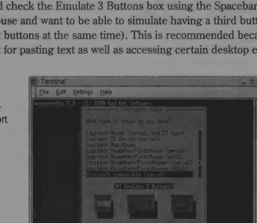

- 5. **配置网络**——此窗口让您有机会提供一些强制性的网络相关项目，以及一些可选项目。您应该输入您的网络域名（例如 `consult.com`）和您的 PC 主机名（例如 `baracuda`，它最终会自动翻译为 `baracuda.consulting.com`；您也可以输入）。如果执行了工作站安装，您可能需要配置打印机，以访问 Web （例如 `www.redhat.com`），这种设置是可能会改变的。
- 6. **配置时区**——选择适用于您地理位置的时区，并设置为格林威治时间（可能会比您的实际时间快慢几个小时）。默认时间是美国东部，如图 2.3 所示。
- 7. **配置打印机**——如果您有本地或网络打印机，现在是您对其进行最小化配置的机会。请注意，如果您执行了工作站安装，将无法配置网络打印机。您必须提供打印队列名称和存储打印文件的目录。从列表中选择合适的打印机并点击确定。
- 8. **Root 密码**——输入 root 密码进行验证，并点击确定锁定系统。当您想从登录界面或通过用户账户登录 root 时，将需要此密码。
- 9. **启动磁盘**——将格式化过的 3.5 英磁盘插入软盘驱动器，按回车选择是并创建启动磁盘。
- 10. **PCI 探测**——安装程序将尝试自动检测并探测您的视频适配器，并安装必要的 X86 驱动程序。图 2.4 显示了一个探测的结果。

图 2.4

Red Hat 自动探测大多数显卡，但剥夺了您更改设置的灵活性。

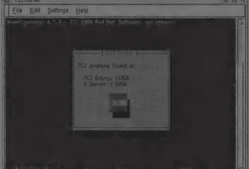

- 11. **显示器设置**——您应该从支持的显示器列表中进行选择。在此处参考您的显示器文档，特别是关于最大像素能力（例如 `1280x1024`；见图 2.5）、其水平和垂直相位或刷新率（如 `30–70KHZ` 和 `50–120Hz`）。如果您找不到适合您硬件配置的，可以选择自定义。不要尝试猜测某个驱动程序是否接近您的硬件标识；那是一种危险的测试，可能会导致显卡、主板甚至显示器的损坏。选择一个您习惯的适当图形模式（例如超级 VGA `800x600` 像素）。您可以选择更改不同位深下的默认分辨率，但这不建议这样做，因为该功能可能会导致安装失败。

图 2.3

您可以设置系统时钟，如果需要的话。

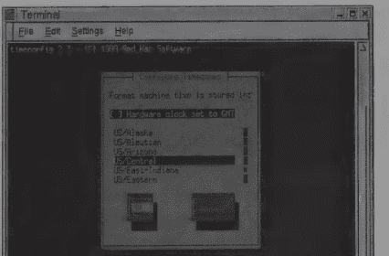

## 图 2.5

你可以选择符合你需求的显示器分辨率类型。

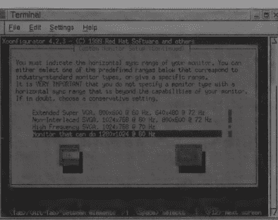

12. XFree86 测试——安装和设置程序的“配置器”部分将尝试探测你的显示器和视频卡，然后你将确认它捕获的设置是否准确。如果成功，你将看到一个精美的图形化桌面，中间有一个清晰的小框，要求你确认是否能看到它。如果执行失败，你永远永远看不到那个框，或者你将看到乱码字符或屏幕垃圾内容——无论如何，你都有机会返回显示器设置或跳过配置阶段。尝试各种你认为可能与设备兼容的组合（见图 2.6）。但是，请记住，在几十次安装中，安装的这部分可能无法正常工作。如果你看到 OK 框，说明 X 配置正确，你将获得将其设置为默认登录界面的选项（这也是建议的，除非你知道该机器将严格作为不经常使用图形桌面的服务器使用）。

> 注意：比任何事情都重要的是，你的视频卡（以及对其物理参数的了解）是成功安装和配置 XFree86 的关键。XFree86 为大多数视频提供了良好的支持，但并不是支持所有的卡。你可能会发现它支持你的卡，但不支持它的所有功能。

## 图 2.6

你可以为显示器能够提供的每个可用深度指定分辨率。

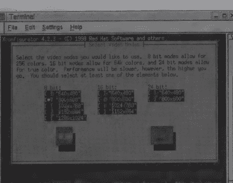

恭喜！如果一切顺利，你已经成功完成了整个安装和基础配置阶段。你现在应该将任何可启动的软盘和 CD 从磁盘驱动器中取出，并在提示时重启。重启后，你应该看到图形化登录，随后是 GNOME 桌面环境。如果配置阶段的 X 部分失败，你必须重复此步骤并尝试让它工作。你可以使用几个配置命令，包括`xconfigurator`和`xconf`，或者你可以直接编辑`/etc/X11/XF86Config`文件。注意，手动修改并不容易，如果你输入了错误的设置，会带来一些风险。本节没有详细介绍如何调整此配置文件来让 X 为工作——因为市上的卡太多了，无法以显著的方式处理每一卡的特殊需求和要求。

在继续之前，你应该查阅第 9 章“安装和配置视频卡、显示器和鼠标”以及第 10 章“更新 X Window 系统”。此外，你应该检查一些互联网资源，看看是否有关于让你的硬件与 Linux 兼容（或反之）文档问题、解决方案或建议。建议的网站至少包括 `http://www.free8.org` 和 `http://www.redhat.com/`。这些网站包含了已知问题和解决方案的良好汇总，以及解决问题卡需要采取的配置步骤。如果你根据已知文档无法解决问题，也可以转向互联网新闻组或红帽支持。

## 执行自定义安装

当你选择执行“自定义安装”时，你将遵循一条稍微复杂的安装路径，以换取对新 Linux 系统更高的灵活性和定制性。安装的这部分与大多数 Linux 安装方式最近。例如，你完全控制 Linux 如何划分和使用你的驱动器和分区。你也可以控制哪些包被安装，哪些不安装。如果你不喜欢这种决策过程或此类头疼，可能最好选择“工作站（Workstation）”或“服务器（Server）”安装。

如果你继续进行自定义安装，请按照路径配置以下项目：

- 1. SCSI 配置——虽然随 CD 驱动器提供的默认 Linux 内核包含了自动感应集成驱动器电子（IDE）驱动端口，但它将使用位于内核之上的模块动态加载对小型计算机系统接口（SCSI，读作 "skuzzy”）设备的支持（在 Linux 中标识为`/dev/sda*`，其中问号被替换为每个设备或分区的特殊数字）。此窗口为你提供了处理和识别你是否有任何 SCSI 适配器（以及相关设备）的机会。如果有，你必须从许多供应商的支持适配器列表中进行选择；Linux 将尝试根据已知的配置设置自动感应该卡。如果此过程成功，你将继续安装，并增加对你连接到 SCSI 适配器的任何 SCSI 设备的支持。有关使用 SCSI 硬盘的更多信息请参考第 19 章。
- 磁盘设置——你可以选择 Disk Druid（一种红帽管理工具）或传统的`fdisk`程序。这两个分区和格式化工具在第 19 章中都有更详细的讨论。你也可以参考本书附 CD 中关于如何使用这些程序的文档。基本上，该过程涉及在系统硬盘上手动创建、编辑、删除和修改必要及可用的分区。你必须确定需要多少分区、每个分区有多大、它将是什么类型的分区（Linux swap、Linux 原生、DOS 等）、文件系统的哪部分将挂载或被使用、哪些分区应属于文件系统（最多四个）、扩展分区中的哪些逻辑驱动器（最多额外四个）、以及哪个分区将是可启动的。
- 选择包——与具有预定义待安装包的工作站和服务器安装不同，如果你选择此项，就必须手动执行所有选择。你将看到一个显示所有可用包组的菜单，你可以根据需要开启或关闭它们。
- 服务——你可以选择运行在你的机器上的标准服务（或守护进程）。例如，如果你不想运行 Web 服务器，可以取消选择`httpd`服务。你也可以对其他服务执行相同的操作，如高级电源管理进程（`apmd`）。图 2.7 显示了一些已开启（带星号）和由于已知漏洞关闭的服务示例。
- 5. 身份验证——许多人倾向于使用 Shadow 和 MD5 密码来增加系统和用户安全性。这通过隐藏`/etc/passwd`文件来增加黑客的目标。NIS 是一种历史上在 UNIX 环境中使用的分布式身份验证系统。如果你已经有一个正常的域名和服务器名称并提供 NIS 服务，可以使用图 2.8 所示的选项。

## 执行快速基础系统管理任务

登录 root 后，你将需要（并能够）完成几项系统管理任务。许多任务在本书章节中都有讨论。然而，这里包含这些内容是为了那些对维护计算机相当熟悉并希望尽快运行的人。这些步骤都是可选的，但它们可能帮助你更熟悉你的系统及其一些常用控制，并可能帮助你同时完成许多小的配置步骤。

你可能想首先包含以下内容中：

- 用户——通过主菜单 System, Linuxconf, User Account, Normal, User Account, Add 为自己创建一个用户账户。输入登录名（例如 `duane`）和全名（例如 `duane hellums`）。在权限 Privileges 选项卡中，勾选

## 执行快速基础系统管理任务

对于我们四个底层标签页上的所有可用选项，选择“授予/静默”。这将让你拥有系统上几乎所有内容的超级权限。输入两次密码，然后点击“退出”并“激活更改”退出程序。通常公认的做法是选择不在字典中或不易被他人猜想到的密码，因此应避免使用名称、昵称或运动队；一个好的提示是在密码中间包含一些数字，例如 `mint8`。当然，不要把密码写下来，也不要选择一个难以记忆的密码，否则如果你忘记了，你可能无法登录。

- 音频——点击 GNOME 主 菜单栏上的显示器图标，这将打开终端。在命令行中使用`soundconfig`，并反复点击“确定”，直到你可以选择你拥有的特定声音（或任何兼容的声音）。输入你在第 1 章中记录的 I/O 端口、IRQ 和 DMA 通道，例如 `220`、`7` 等。点击“确定”覆盖并继续测试。你应该能听到一段 Linux Torvalds 读出“Linux”的音频文件。如果你听到了，请在弹出窗口中确认。对随后的立即播放的 MIDI 声音重复相同的过程。如果你为声卡设置了正确的设置，你的 Linux 系统现在应该发出声音了。


# 桌面安装

- **音乐 CD**——你需要确保`/dev/cdrom`和`/mnt/cdrom`符号链接已正确创建。将音乐 CD 放入你的 CD 播放器，然后点击“开始”、“多媒体”和“CD 播放器”。点击播放箭头并确认音乐正通过可用扬声器或耳机播放。让音乐继续播放，熟悉其他控制按钮，或使用“停止”按钮停止音乐并按 E 键取出你的 CD。

- **桌面声音**——点击 GNOME 主菜单栏中的工具栏。在“音频”下，点击“启用”。这允许你的系统在事件发生时发出声音。单个事件是在你有空时进行配置的。此窗口包含许多可配置的项目（例如左手鼠标设置）。如果你愿意，可以查看它们，或者稍后回来尝试它们。

- **Netscape Communicator**——Netscape 会生成一些许可和错误消息，现在是清除这些信息并让你的系统更接近你每天看到的状态的好时机。点击 GNOME 工具栏上的 N 图标。点击“接受许可协议”，并对 Netscape 信息错误消息点击“确定”。除非你选择“工作站”类（或在“自定义”类中不运行 Web 服务器），否则你可以在位置文本框中输入`http://localhost/`或你的 IP 地址来测试本地 Web 服务器。点击右上角的小 X 关闭 Netscape。

- **GIMP**——如果你经常使用图形，你将会使用到 GIMP，它包含一些你现在可以快速完成的安装步骤。点击 GNOME 主菜单按钮，“图形”，“GIMP”。在安装窗口上点击“安装”按钮，在安装日志中点击“继续”，然后观察它的安装过程。检查确保没有发生任何错误消息，然后点击“关闭”。

## 第 2 章 在桌面级 PC 上安装 Red Hat Linux

- **Enlightenment**——你可以在 E 中对一些内容进行调整，让你的桌面更直观、更愉快。在桌面的空白处同时点击鼠标左键和右键（如果你有三键鼠标，则使用中间键）并选择“Enlightenment 配置”。在“基本选项”下点击“松散指针”（你可能更喜欢它而不是其他选项）。在“行为”组的“高级焦点”选项卡下，点击“所有新键盘焦点”和“随键盘移动指针”。这两个功能都为大多数用户提供了更直观（且更少令人挫败）的功能。在“音频”中，勾选“在 Enlightenment 中启用声音”，然后点击“确定”。这将为你的桌面事件提供额外的声音支持。与 GNOME 工具箱一样，你可以使用此部分中丰富的配置项，现在（现在或以后）自定义和个性化你的 Linux 体验。

- 安装程序的问题之一是，它没有设置基于 DOS 的打印机的主要功能。如果你现在打印页面，可能不会在页面结束时自动出纸，这会导致下一页从页面中间开始打印。要纠正这一点，从 GNOME 菜单选择“系统”，“控制面板”，“打印机配置”。点击“确定”清除 Samba 和 ncpfs 错误（如果你使用的是工作站安装类，则未安装这些网络组件）。点击 Lp，然后是菜单栏，“打印 ASCII 测试页面”。在信息框中点击“确定”，确认打印成功。如果你的页面没有出纸，点击“编辑”，“选择”，“作业完成后结束后纸”，“确定”，再点击“确定”。取出打印页。再次高亮打印机 lp，然后点击“测试”，“打印 PostScript 页面”，并在信息框中点击“确定”。确认最终页面已正确打印并出纸。关闭“打印系统管理器”窗口。

## 桌面安装故障排除

安装过程中可能出现问题是，如果你使用“后退”按钮返回几步，安装程序会产生混乱。这可能导致安装过程停止并启动重启，在这种情况下，你必须从头开始并重新输入所有的配置数据。

X (XFree86) 如果有一块需要调整的显卡，可能会具有一定的挑战性。在这种情况下，你所做的就是寻找解决方案并确定你需要修改的内容。请参考本章前面提到的 Web 页面，并保持耐心。你可能想在某个可以访问互联网的另一台电脑的白天或晚上进行安装，即使是去朋友或邻居那里也可以。这将防止问题迫使你终止安装并从头开始。

# 理解笔记本电脑安装过程

注意：本章并不能帮助所有人在各种类型的笔记本电脑上安装 Linux。过多的专有且未记录的硬件组合需要特殊处理才能在 Linux 上运行。红帽公司在其实支持页面上承认，笔记本电脑是所有安装中最具挑战性的，且技术支持通常必须引导用户访问 http://cs.utexas.edu/users/kharker/linux-laptop 的 Linux 笔记本页面。本章将介绍笔记本常用的特殊方法，以及针对笔记本的特殊配置步骤。

如果你已经有一台笔记本电脑并想在上面安装 Red Hat 6.0，你应该首先遵循第 1 章“准备安装 Red Hat Linux”中的所有指令，并记录你的硬件设置（在可能范围内）。然后，你需要确定自己如何在自己的电脑上安装 Linux。基本上，你有以下选项：

- **仅 CD-ROM**——如果你的系统支持启动 CD-ROM，这通常是最好、最简单且最快的方法。

- **boot.img 软盘和 CD-ROM**——如果你的系统不支持启动 CD-ROM，但你足够幸运拥有一台同时带有 CD-ROM 和软驱驱动器的笔记本电脑（无需频繁更换），则这是下一个选项。

- **boot.img 软盘和 CD-ROM 内容的硬盘镜像**——这允许你只需将 CD-ROM 镜像到其中一个硬盘、额外分区或另一块硬盘上。这规避了同时拥有 CD-ROM 和软驱的需求。

- **bootnet.img 软盘和 NFS 共享 CD-ROM**——这种方法使用网络文件系统（NFS）作为传输介质通过网络安装 Linux。当你的笔记本电脑上有软驱（但没有启动 CD-ROM 且无法同时访问软驱和 CD）时，这是一个很好的选择。你需要一个启动软盘、笔记本上的 PCMCIA 卡、正常的网络以及一个网络文件系统服务器。

- **bootnet.img 软盘和 Web 共享 CD-ROM**——这与上一个选项（NFS）相同，只是使用 Web 服务器通过网络共享 Red Hat Linux CD-ROM。网络要求相同，但你需要的是 Web 服务器而不是 NFS 服务器。

- **bootnet.img 软盘和 FTP 共享 CD-ROM**——这与上一个选项相同，但它使用匿名文件传输协议（FTP）并需要 FTP 服务器。

## 在笔记本电脑上安装 Red Hat Linux 6.0

如果你的笔记本电脑具有启动 CD-ROM（在 BIOS 中启用），那么安装方法应该是顺理成章的，就像我的电脑上一样。如果没有，只要你有一个 CD-ROM 和一个可以同时在同一个接口使用的软驱驱动器（换句话说），安装将同样简单。然而，如果你无法通过这些方法本地访问 CD-ROM，那么你必须考虑其他选项。

如果你有本地网络，则可以使用`bootnet.img`安装方法。这要求你的笔记本电脑拥有内置以太网设备或兼容 Linux 的 PCMCIA 卡。你还需要在网络上有一台配置为 NFS 服务器、Web 服务器或 FTP 服务器的 PC。如果你在网络上的某处配置了 Linux 桌面，NFS 或 HTTP 是共享你的 Linux CD 最简单的方法（也是本章中使用的两种方法）。

如果你没有局域网（LAN），你将不得不使用启动软盘并选择本地硬盘安装，假设你已经将所有必要文件从 CD 复制到了硬盘。从硬盘安装对于台式电脑是一个很好的替代方法，但对笔记本电脑意义不大——很少有笔记本拥有足够的额外硬盘来存储 Red Hat Linux CD 的副本，而且你会有 Linux 分区。

## 执行网络安装

如前所述，你可以选择在网络文件系统（NFS）服务器、超文本传输协议（HTTP）Web 服务器或文件传输协议（FTP）服务器上共享你的 Red Hat Linux 6.0 CD-ROM（随书附带）。最好的办法是在另一台 PC（作为服务器）上安装 Linux 或其他版本的 UNIX 来执行此操作。Windows 不具备原生的 NFS 和 FTP 能力，且某些 Web 服务器与安装程序并不完全兼容（尽管它们似乎可以在 Lynx 和 Netscape Communicator 中运行良好）。

提示：在你计划使用的任何 Linux 服务器上请使用“自定义（Custom）”安装。如果你使用“工作站（Workstation）”安装，默认将不会安装某些服务，如 Apache Web 服务器。你还需要`pcmia.img`软盘、内置以太网设备或外部 PCMCIA 网卡以及必要的网络线缆。如果你的台式电脑有网卡但没有所有网络硬件（如以太网集线器），你可以获取一根交叉线，它设计用于直接连接两台 PC 而无需集线器。当然，如果你使用 BNC 接口而不是 RJ-45 接口和双绞线，你就不需要集线器了。关于如何制作交叉线以及在何处购买，最好的信息来源之一是 http://www.gnu.com/doc/crossover.html。

## 从 NFS 服务器安装

执行 NFS 安装相当简单。基本步骤包括在运行 NFS 的网络 PC 上共享你的 Linux CD，并使用`bootnet.img`软盘通过网络启动你的笔记本电脑。第 1 章提供了创建这些磁盘的步骤。如果你在此类安装中使用 Windows 而不是 Linux 作为服务器，请咨询你的 Windows 和 NFS 文档。具体来说，你应该执行以下步骤：

1. 在服务器上，在 CD-ROM 中插入 Red Hat Linux 6.0。通过输入`mount -t iso960 /dev/cdrom /mnt/cdrom`挂载它。你可以将`/dev/cdrom`替换为 CD-ROM 的适当名称，例如`/dev/hdc`或`/dev/sdc`。

2. 在服务器上，编辑 hosts 配置，添加一行来识别笔记本电脑的名称和 IP 地址。例如，我在服务器的`/etc/hosts`文件中添加了`192.168.1.27`。

3. 在服务器上，编辑`/etc/exports`配置文件，添加一行以便与 Linux 笔记本共享挂载的 CD。例如，我在服务器的`/etc/exports`文件中添加了`/mnt/cdrom`（并标记了`no_root_squash, insecure`）。由于我在上一步中将名称与 IP 地址关联，引用解析将生效。或者，如果你倾向于图形化配置，可以从 GNOME 菜单选择 System、Config、Networking、Server tasks、Exported files (NFS)。你需要点击 Add 并在 Path to Export 框中输入`/mnt/cdrom`；勾选 Root Privileges 框以显示之前提到的`ro, no_root_squash, insecure`。

4. 在服务器上，输入`exports -va`以启用你刚刚创建的共享（除非你接受并激活了更改，此时更改已经应用）。NFS 客户端（例如 Red Hat Linux 6.0 安装程序使用的）能够访问 Red Hat Linux CD。

5. 在笔记本上，插入软盘并启动电脑。程序将按照第 2 章“在台式机 PC 上安装 Red Hat Linux”中记录的相同安装步骤进行，但在处理 PCMIA 支持和安装屏幕时会有不同的步骤（见接下来的几步）。

6. 当需要 PCMIA 支持时，确认为是并将`bootnet.img`软盘替换为`pcmia.img`。在内核中确认 PCMIA 模块。寻找 PCMIA 模块正确加载并识别以太网卡的迹象。如果没有，请参考第 27 章“安装和配置 TCP/IP 网络支持”和第 18 章“安装和配置 Red Hat Linux 内核”（可能还包括 http://cs.utexas.edu/users/kharker/linux-laptop）以确定你的 PCMIA 驱动器和以太网卡是否受支持。如果支持，你可能需要找出传递给内核的启动参数以启用你的网卡。

## 42 第 3 章 在笔记本电脑上安装红帽 Linux

> 提示：你应该会听到双声提示音，确认 PCMIA 支持模块已加载，并看到以太网接口上的 LED 指示灯亮起（如果具备此功能）。在后续步骤中确定你的 IP 地址和计算机名称后，你可以从另一台 PC ping 你的笔记本，以确保卡工作正常。例如，如果 IP 地址是`192.168.1.1`，你可以在 Linux 的 shell 提示符或终端中执行`ping 192.168.1.1`，或者在 Windows 的 MS-DOS 提示符或“开始/运行”中执行。你也可以使用 Alt+F3 查看内核消息（你可能会看到类似`pcmia_core.0`、`i82365.0`和`ds.o`模块加载且无错误，尽管根据你的硬件配置可能会看到不同的模块），然后按 Alt+F1 返回主安装界面。Alt+F4 会显示另一个屏幕，该屏幕应指示卡管理器服务已启动。

7. 在“安装方法”（Installation Method）屏幕上，选择 NFS 镜像（默认选项）并点击 OK，开始配置笔记本电脑的网络，使其连接到 NFS 服务器并从挂载的 CD 驱开始安装。根据第 2 章的说明填写必要的网络信息（“启动协议”和“配置网络”窗口）。在我的情况下，我将笔记本电脑的主名配置为`cuda7`，IP 地址为`192.168.1.2`——你应该能从之前讨论过的服务器`/etc/hosts`文件识别出这一点。

8. 在配置好笔记本电脑和网络 IP 设置后，你需要提供你的 Linux NFS 服务器的 IP 地址以及 Linux 安装 CD 的目录。选择 OK 继续。对于我的情况，我将`192.168.1.1`输入为 NFS 名称，将`/mnt/cdrom`输入为 Red Hat 目录。如果你的 PCMIA 卡安装正确、笔记本电脑网络配置正确完成、你拥有必要的网络连接（线缆、集线器）、你的 NFS 服务器配置正确，且在 DNS 或`/etc/hosts`文件中没有解析问题，那么你应该能看到“安装路径”（Installation Path）窗口；从该点开始的其余安装将与本地 CD-ROM 相同。如果不是，你将收到几条错误信息，并必须返回调试安装失败的原因。

9. 在“安装路径”中，你必须选择“安装”（Install）或“升级”（Upgrade）。此时，你已经完成了针对笔记本电脑的安装部分，可以按照第 2 章的文档继续剩余步骤。

### 从 HTTP (Web) 服务器安装

通过 HTTP 或 Web 服务器安装的过程与 NFS 安装非常相似。实际上，它要稍微简单一点，尽管性能可能没有 NFS 方法那样敏捷快速。幸运的是，你不需要进行任何主要的配置文件更新，也不需要担心名称解析。要方便地配置你的 Web 服务器以通过网络共享你的 Linux 6.0 CD 供笔记本安装，请执行以下步骤：

## 在笔记本电脑上安装红帽 Linux 6.0

1. 在 Linux Apache 服务器上，将红帽 Linux 6.0 CD 插入 CD-ROM 驱。通过输入`mount -t iso9660 /dev/cdrom /mnt/cdrom`将其挂载。你可以将`/dev/cdrom`替换为任何其他合适的 CD-ROM 名称，例如`/dev/hdc`或`/dev/sdc`。

2. 在服务器上，通过输入`cd /home/http/html`切换 Apache 服务器的根目录（假设你没有更改默认值；如果是请进入相应的目录）。

3. 通过输入`ln -s /mnt/cdrom cdrom`为你的 Web 服务器根目录创建一个名为`cdrom`的链接。这创建了一个文件，可以通过引用`http://server-name/cdrom`（其中`server-name`替换为你的 Linux 名称）从任何网络浏览器访问。这假设你已经对 Apache 服务器进行了任何配置更改，以禁用浏览器跟踪服务器中的符号链接；在这种情况下，你必须修改 Apache 配置文件中的`FollowLinks`变量（请参见第 30 章“配置 Apache 服务器”）。

> 提示：如果你执行的是工作站或自定义安装，你可能没有安装 Apache Web 服务器。在这种情况下，可以使用 X 终端或 shell 命令行使用`rpm -i /mnt/cdrom/RedHat/RPMS/apache-1.3.6-7.1386.rpm`轻松地安装它。如果你倾向于使用图形化方法，请从 GNOME 菜单按钮选择 GRPM（参见第 11 章“安装和管理软件包”）。

4. 在笔记本电脑上，插入`boot.img`软盘并启动电脑。程序将引导你完成第 2 章中记录的相同安装程序，只是在处理 PCMCIA 支持和安装方法时会有不同的步骤（概述在接下来的步骤中）。

5. 当你需要 PCMCIA 支持时，确认为“是”，并使用`pcmia.img`重启`boot.img`软盘。确认 OK 以在内核中加载 PCMCIA 模块。寻找已加载的迹象。如果不是，你可能需要查看 27 以及 [http://www.utex.edu/users/kharker/](http://www.utex.edu/users/kharker/) 来确定第二阶段磁盘（`stage2.img`）是否被以太网卡支持（注：此处原文逻辑略显杂乱，已按意译），你可能需要找到传递给内核的参数以启用以太网卡。

6. 在“安装方法”屏幕上，选择 HTTP 并点击 OK，开始配置笔记本电脑的网络，使其连接到 Web 服务器并从挂载的 CD 开始安装。根据第 2 章的说明填写必要的网络信息（“启动协议”和“配置网络”窗口）。在我的情况下，我将笔记本电脑的主名配置为`cuda7`，IP 地址为`192.168.1.2`。

7. 在配置好笔记本电脑和网络 IP 设置后，你需要提供你的 Linux NFS 服务器的 IP 地址以及 Linux 安装 CD 的目录。选择 OK 继续。对于我的情况，我将`192.168.1.1`输入为 NFS 名称，将`/mnt/cdrom`输入为 Red Hat 目录。如果你的 PCMIA 卡安装正确、笔记本电脑网络配置正确完成、你拥有必要的网络连接（线缆、集线器）、你的 NFS 服务器配置正确，且在 DNS 或`/etc/hosts`文件中没有解析问题，那么你应该能看到安装窗口；从该点开始的其余安装将与本地 CD-ROM 相同。如果不是，你将收到几条错误信息，并必须返回调试安装失败的原因。

8. 在“安装路径”中，你必须选择“安装”或“升级”。此时，你已经完成了针对笔记本电脑的安装部分，可以按照第 2 章的文档继续剩余步骤。

### 执行硬盘安装


要执行硬盘安装，你需要将所有 Linux 6.0 安装文件安装到硬盘或分区上。这大约需要 50-60MB。如果你没有额外的硬盘可以使用，你必须进行备份并使用 DOS/Windows/`disk.exe` 程序对现有驱动器进行分区并恢复你的 Windows 文件。有关如何执行此操作，请参见第 19 章“安装和配置硬盘”。要将红帽安装文件安装到笔记本硬盘或分区，请执行以下任务：

1. 假设你将文件安装在 C: 盘上（否则，在 C: 上创建一个目录 `RedHat` 以及两个子目录 `base` 和 `RPM`；既可以通过 MS-DOS 提示符使用 `mkdir` 命令，也可以使用图形界面（双击我的电脑和 C;，然后从菜单栏选择文件、新建、文件夹））。完成后，你将三个目录：`C:\RedHat`、`C:\RedHat\base` 和 `C:\RedHat\RPM`。

2. 将安装 CD（假设 Windows 上的 `d` 设备）中相应的 Linux 目录复制到 Windows 上对应的目录（你创建的目录和子目录）。最好的方法是打开 `D:\RedHat` 的资源管理器窗口和另一个 `C:\RedHat` 的资源管理器窗口。选择 `D:\RedHat` 中的所有文件（排除翻译文件，因为它复制效果不佳），然后将其拖动到 `C:\RedHat` 目录。对两个子目录执行相同的操作。

3. 在笔记本电脑上，插入 `boot.img` 软盘并启动你的计算机。程序将引导你完成第 2 章中记录的安装步骤，不同之处在于在处理“安装方法”（如接下来的几个步骤所示）时，你将会有不同的处理流程。

4. 当被问及是否需要 PCMCIA 支持，大多数情况下请选择“否”，除非你可能在安装期间需要它来访问 SCSI 适配器和硬盘。如果你有 SCSI 适配器和硬盘，你还必须在“SCSI 配置”窗口中回答“是”，这将带你进入允许你选择 Linux 支持的 SCSI 适配器的屏幕。

5. 在“选择分区”（Select Partition）窗口中，系统要求你提供 Red Hat Linux 6.0 安装文件所在的（本地）分区名称。除非你配置了非常自定义的 Windows 配置，否则 Windows 极可能安装在 IDE 或 SCSI 驱动器的第一个分区上。由于你是直接在 Windows 的主目录（`C:\Redhat`）下安装了 `RedHat` 目录，而不是子目录，因此你实际上是将文件安装在了根目录（root，或者说 Linux 称之为 `/`）。因此，你默认应该选择第一个设备（`/dev/sda1 [IDE]` 或 `/dev/sda1 [SCSI]`）并离开。点击 OK 继续。如果你正确将文件复制到文件夹中，并且正确引用了本地驱动分区，你将看到一个弹出窗口，指示第二阶段内存磁盘（`stage2.img`）文件正在检索并加载。然后你将进入“安装路径”（Installation Path）窗口，从该点开始，其余安装过程将与本地 CD-ROM 无。如果不是，你将收到几条错误信息，并且必须返回调试安装过程失败的原因。

## 为笔记本电脑配置 Red Hat Linux 6.0

在使用之前讨论的某种安装方法安装 Red Hat Linux 6.0 之后，仍然有一些事情是你应该做的。例如，你完全没有插在电源插座上，因此你需要管理电池电源的方法。你需要监控当前的电池电量，以便大致知道在重新插上电源之前笔记本电脑还能使用多久。你还需要一种挂起电源的方法而不是完全关闭笔记本电脑；这可以防止你在下次重启时浪费电力，因为 Linux 将继续在你挂起工作时的状态运行。

Red Hat Linux 自带了一套高级电源管理（APM）工具和实用程序来执行这些节电功能。`apmd-3.beta5-7.i3386` 包在所有安装方法中默认安装。这些工具中的许多取决于笔记本电脑 BIOS 中 APM 标准的正确实现。

## 第 3 章在笔记本电脑上安装 Red Hat Linux

如果你需要减少功耗，请评估 `/etc/inetd.conf` 和 `/etc/inittab` 以确定你可以禁用（以及不要禁用）哪些守护进程或进程。可以在 BIOS 设置程序中降低 CPU 的时钟频率；处理会变慢（这对于你正在的操作可能没关系），但消耗的内存更少。外围设备是耗电源，因此移除你不计划在电池模式下使用的 PCMCIA，除非绝对必要，否则不要使用调制解调器、CD-ROM、网络设备或软盘驱动器。

## 启用电池监控器

要启用并配置一个让你快速查看电池剩余电量的监控器（在未插在电源插座上时），请执行以下步骤：

1. 右键点击 GNOME 面板并选择“添加小部件”（Add Applet）、“监控器”（Monitors）、“电池电量监控”（Battery Charge Monitor）。监控器将出现在适当的面板上（尽管你以后可以将其移动到其他地方）。

2. 要要在电池电量水平的数字和图形显示之间切换，直接点击 GNOME 面板上的电池电源监控器。

3. 要更改监控器的设置，右键点击面板上的监控器图标，并选择“属性”（Properties）。这将弹出“电池监控器设置”对话框（见图 3.1）。

图 3.1

你可以轻松更改小部件图标的大小和电池检查之间的间隔。

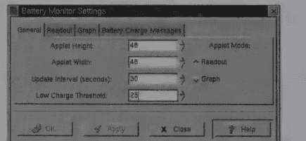

4. 在“常规”（General）选项卡中为笔记本电脑配置 Red Hat Linux 6.0。

警告需要电池充电或关闭计算机可能会导致数据丢失风险。请确保给自己留出足够的时间保存所有数据、清除应用程序并关闭计算机。点击 OK 保存并应用你的更改。

图 3.2

你可以设置警报，在电池达到特定水平（高或低）时激活。

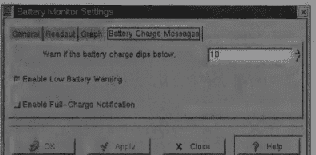

## 配置 Linux 挂起函数

你的笔记本电脑 BIOS 可能支持一种你可以使用的挂起形式，这独立于笔记本电脑上安装的任何操作系统。例如，如果我只按一次 Compaq Presario 1255 上的电源按钮，时间小于一秒，BIOS 将保存系统当前的内存状态并关闭电源。要从我离开的地方继续而无需完全重启，我需要做的只是再次按下电源按钮。要实际上关闭电源，BIOS 要求我按住电源按钮至少 4 秒。这类功能通常可以在你的 BIOS 中进行配置。

即使你的 BIOS 不支持这种挂起和恢复操作，Linux 笔记本电脑也可以内部激活类似的功能。要创建一个启动器，请执行以下步骤：

1. 右键点击 GNOME 面板并选择“新建启动器”（New Launcher）。这将弹出如图 3.3 所示的“启动器属性”窗口。

2. 在启动器属性的“基本”（Basic）选项卡中，为你的按钮输入名称和注释。

3. 输入你想点击它时执行的命令 `-s`。

4. 点击 OK 检查图标是否已在面板上创建。

5. 你不需要在“高级”（Advanced）选项卡中进行任何更改。

图 3.3

创建一个指向挂起工具的快捷方式。


## 第 3 章在笔记本电脑上安装 Red Hat Linux

你可能可以使用 `hdparm` 来“停止旋转”你的笔记本硬盘。通常在插电时，笔记本电脑会保持硬盘旋转。如果你想让 `hdparm` 在 60 秒后关闭硬盘，例如输入 `hdparm -s60 /dev/hda` 或 `/dev/sda`（作为 SCSI 硬盘），每个 `hdparm` 等于 5 秒。你还可以使用 `hdparm -g` 查看磁盘几何结构，使用 `hdparm -C /dev/hd` 检查当前模式状态。

## Linux 笔记本电脑的故障排除

你在配置 XFree66 时可能会遇到问题，笔记本显卡的限制更加严格。如果你遇到问题，可以尝试一些试错，但要小心。阅读 XFree86“安装和配置显卡、显示器和鼠标”第 9 章，看看那里是否有可以帮助你的。然后，访问 Linux 笔记本电脑页面 `http://www.utex.edu/users/kharker/linux-laptop`。如果你在该网站上没有找到与你的问题直接相关的内容，那么你应该检查 XFree86 网站是否有可以帮助你的。

如果你完全找不到帮助，请联系 Red Hat（如果你有支持合同）。在寻求帮助之前，最好自己解决问题，因为这是你学习和提高故障排除能力的唯一途径。最后，订阅相应的互联网新闻组并阅读帖子，看看是否其他人也有你的问题。否则，请发布一个提供详尽技术细节的说明，并请求有人帮助你。

如果你的调制解调器无法工作，你可能拥有某种被阉过的调制解调器。这类调制解调器移除了特定的硬件组件（以降低价格），并将任务交给了 Windows。遗憾的是，制造商并未支持为其他操作系统开发此类程序。这类与 Linux 完全不兼容的调制解调器示例有 WinMod 和 Mwave。

## Linux 笔记本电脑的故障排除

你可能知道你的系统支持启动型 CD-ROM，但即使你插入了 Red Hat CD，它仍然直接进入了 Windows。如果是这样，可能你的系统虽然支持启动型 CD-ROM，但硬盘（可能是软驱器）被设置为更高优先级的启动项。在这种情况下，你必须进入 BIOS 设置。如果你的电脑在正常启动期间提示你进入 BIOS 的组合键，请重启并使用该组合键来启动设置程序。否则，如果你找不到任何内容，请考虑查看用户手册，参考第 1 章，其中包含了不同厂商常用的启动 BIOS 的方法；你可能会找到一种。

在输入正确的组合键并进入设置程序后，在菜单下寻找一个允许你更改顺序的项目。更改这些设置的方法取决于 BIOS，但你应该有一种方法将 CD-ROM 添加为启动选项（如果你的 BIOS 支持启动型 CD-ROM）。你也可以将 CD-ROM 的优先级调高，以防止系统直接从硬盘或软盘启动。需要记住的一点是，大多数带有 SRM 的机器都可以启动 Linux，而带有 AlphaBIOS 的机器在 MILO 的帮助下也可以启动 Linux。如果发生这种情况，并不是什么大问题，你只需移除 CD 并重启即可。

## 第 4 章：在 Alpha 上安装 Red Hat Linux

作者：Richard D. Payne

### 在本章中

- 引言与背景 52
- 理解 Alpha 的挑战 52
- 验证硬件兼容性 53
- 理解 Alpha 的安装差异 53
- Alpha 故障排除 59
- 更多资源 59

### 引言与背景

Alpha 处理器最初于 1989 年中期在数字设备公司（DEC）启动，旨在为 VMS 用户提供高性能升级。1992 年 3 月，Alpha 向世界宣布为一种 64 位 RISC 处理器。1998 年，康贝（Compaq）与数字设备公司合并，使数字成为 Compaq 的全子公司。如今，Alpha 仍由 Compaq (DEC) 所有。

Linux 的 Alpha 版本是由数字公司内部的几位工程师开发的，代码花费多年才变为 64 位。从 2.1 内版本开始，Alpha 被包含在内核中，因此 2.2 系列比 2.0 系列更可靠且更容易使用。

目前，你可以为 Alpha 选择四个发行版。Red Hat (`http://www.redhat.com`) 是第一个制作 Alpha 版本的，随后是 Debian (`http://www.debian.org`) 和 SuSE (`http://www.suse.com`)。在写作时，Stampede (`http://www.stampede.com`) 和 TurboLinux (`http://www.turbolinux.org`) 也正在将它们的发行版带到 Alpha。本章提供的方向和提示基于 Red Hat 安装，尽管大多数信息应该也同样适用于其他 Alpha 发行版。

### 理解 Alpha 的挑战

在 Alpha 系统上安装 Linux 比在 i386（Intel, AMD, Cyrix）上安装更具挑战性。主要的区别在于系统控制台（也称为 BIOS）。Alpha 系统有几个不同的系统控制台，用于引导不同的操作系统。这些控制台如下：

- `SRM`（系统参考手册）——最初设计用于启动 OpenVMS 或 Tru64Unix（之前的 Digital Unix）。可以在次级加载程序的帮助下从 `SRM` 启动 Linux。
- `ARC`（高级 RISC 控制台）——最初设计用于启动 Microsoft Windows NT，但在 `MILO` 的帮助下可启动 Linux。在较后的系统中，ARC 控制台（被称为 AlphaBIOS）已变得更加用户友好。
- `ARCS` 控制台——仅用于基于 164UX（也称为 Ruffian）主板的机器。UX 不是 Digital/Compaq 设计，因此它有自己的控制台，无法使用 SRM 或 ARC (AlphaBIOS)。

控制台取决于几点。首先，某些机器可以将 SRM 和 ARC/AlphaBIOS 存储在闪存中；另一些一次只能接受一个。某些系统带有 AlphaBIOS，而 SRM 仅付费可用。需要记住的是，大多数带有 SRM 的机器都可以启动 Linux，而带有 AlphaBIOS 的机器在 MILO 的帮助下也可以启动 Linux。那些有 AlphaBIOS 但没有 MILO 的机器通常可以切换 SRM 来启动 Linux。

### 理解 Alpha 的安装差异

各种 Alpha BIOS 系统比其 PC 对应版本更先进。例如，AlphaBIOS 包含了分区和格式化磁盘、设置启动菜单以及报告机器中安装的硬件的功能。所有这些都在菜单环境中完成。

SRM 更多地是一个命令行控制台。它也可以报告系统中安装的硬件，但没有像 AlphaBIOS 那样设置启动菜单的能力。然而，SRM 允许设置某些变量以实现自动启动。

## 验证硬件兼容性

要决定 Linux 是否运行在特定硬件上运行，你必须检查两个组件：Alpha 主板和机器中的外设。

今天存在的大多数 Alpha 系统都能够运行 Linux。主要的例外是早期基于 TurboChannel 的机器，被称为 DEC3000 系列机器。在外设方面，大多数发行版都支持它们。Red Hat 的兼容性列表可以在 `http://www.redhat.com` 获取，SuSE 在 `http://www.suse.com` 有一个数据库。

### 从 AlphaBIOS 安装

从 AlphaBIOS 安装和启动需要使用 MILO，即启动操作系统的 Alpha 微型加载器。MILO 取决于进行安装的机器类型，每台机器都有 MILO（如果没有 MILO，则必须从 SRM 安装）。

表 4.1 显示了系统类型及其相应的 MILO。

| 家族/型号 | 别名 | MILO |
|---|---|---|
| ALCOR | ALCOR | `xlt-alcor` |
| AS 600 | MAVERICK | |
| AS 500 3xx | BRET | |
| XL-300 | XLT | |
| XL-366 | XLT | |
| XL-433 | XLT | |
| XL | | `xl` |
| XL-233 | XL | |
| XL-266 | XL | |
| AVANTI | | `avanti` |
| AS 200 4/* | MUSTANG | |
| AS 205 4/* | LX3 | |

个人工作站：

- PWS 433a 或 433au
- PWS 500a 或 500au
- PWS 600a 或 600au

## 理解 Alpha 安装的差异

| 家族/型号 | 别名 | MILO |
|---|---|---|
| EB164 | EB164 | `eb164` |
| EB66+ | EB66+ | `eb66p` |
| EB66 | EB66 | `eb66` |
| TAKARA | TAKARA | `takara` |
| Ruffian | 16UAX | `ruffian` |

MILO 文件应放在带有 `linload.exe` 文件的 DOS 软盘（称为 FAT 格式）上。这些文件在任何 AlphaLinux 发行版中可用，你可以通过几种方式将这些文件放入软盘中。

第一方法是将两个文件（`linload.exe` 和相关的 MILO）复制到 DOS 软盘上；MILO 文件本身应从其 CD-ROM 上的任意名称重命名为 `mil`。

第二方法涉及使用软盘驱动器。在 Red Hat 中，MILO 文件和 `linload.exe` 位于 CD-ROM 的 `/milo` 目录；镜像位于 `/milo/images` 目录，但可以使用后续章节描述的命令直接写入软盘。

**在 Windows/DOS 下**，使用位于 `/dosutils` 目录下的 `rewrite` 工具将镜像写入软盘。例如，如果 CD-ROM 驱动器为 `D:`，软盘驱动器为 `A:`，则以下命令将为 Noname/Multiline 机器创建 MILO 软盘：

```text
d:\rewrite.exe d:\milo\images\udb-noname.img a:
```

**在 Linux（或 Unix 系统）下**，使用大多数 UNIX 系统自带的 `dd` 命令。

假设 CD-ROM 驱动器挂载在 `/mnt/cdrom` 下，软盘设备为 `/dev/fd0`，在以下行输入：

```text
dd if=/mnt/cdrom/milo/images/udb-noname.img of=/dev/fd0 bs=1440k
```

完成后，即可开始安装。

将刚创建的软盘放入机器软盘驱动器并将 CD 插入 ROM 驱动器后，可以将机器设置为从软盘启动。在 AlphaBIOS 初始化时按 F2 进入设置。启动设置后，进入 `Utilities`（工具）菜单并选择 `Insert` 键添加另一个选项。新的启动选项看起来应该类似于：

- Boot Name: Install Linux
- Boot File: `A:\linload.exe`
- OS Path: Disk Partition 1
- OS Options:

## 第 4 章在 Alpha 上安装 Red Hat Linux

完成后，按 Enter 键以允许保存此选项。AlphaBIOS 可能会报告错误 `OS Path: Disk 0, Partition 1 not found`。这可以安全地忽略，因为该变量在安装期间不会被使用。


设置好选项后，按 F10 将更改保存到闪 ROM，按 Esc 退出 AlphaBIOS 设置。此时应出现启动菜单。其中一个项应该是之前添加的 Linux 安装选项。使用方向键突出此选项，并按 Enter 启动 MILO。

当 MILO 完成启动后，将显示 MILO 提示符。从这里开始安装。命令应如下（对于 Red Hat 6.0）：

```
MILO> boot h=/kernels/generic.gz root=/dev/hda
```

这假设使用的是 IDE CD-ROM；如果机器带有 SCSI CD-ROM，命令应如下：

```
MILO> boot scda:/kernels/generic.gz root=/dev/scda
```

此时，MILO 将加载并启动 Linux 内核，这将调用安装过程。从这里开始，Linux 安装与在基于 i386 的机器上相同，但有一个例外。应在磁盘上创建一个（约 5MB 的）DOS（FAT）分区。该分区存放 MILO 和 `linload.exe` 文件，当安装完成后，必须创建此分区。如果是标准的 Red Hat 配置（工作站或服务器），此分区将自动创建。如果由于某种原因无法创建此分区，仍然可以使用软盘启动 Linux，但由于软盘比硬盘慢，启动过程会更长。

当安装完成后，必须从软盘启动 Linux 以将内容复制到 DOS 分区。安装过程返回 MILO 提示符。要启动新安装的操作系统，使用如下命令：

```
MILO boot sda2:/boot/vlinux-2.2.5 root=/dev/sda2
```

假设 sda2（SCSI 磁盘 1，分区 2）是根系统。系统启动后，使用安装期间指定的密码登录 root，并将软盘内容复制到 DOS 分区。假设分区为 sda1（SCSI 磁盘 1，分区 1），命令为：

```
dd if=/dev/fd0 of=/sda1
```

剩下的工作是在 AlphaBIOS 内设置启动。要使用 AlphaBIOS，在初始化期间按 F2 并选择 `Utilities`。使用方向键选择 Linux 项，并按 Enter 编辑该选项。更改值如下：

- Boot Name: Linux
- Boot File: Disk, Partition 1 \linload.exe
- OS Path: Disk, Partition
- OS Options: boot sda2:/boot/vmlinux-2.2.5-16 root=/dev/sda2

按 Enter 更改，按 F10 和 Enter 保存；最后按 Esc 退出。此时出现启动菜单，可以选择 Linux。注意：某些 CD-ROM 副本没有正确制作，从 MILO 启动的过程可能会失败。在这种情况下，使用相同的程序创建软盘：一个来自 `/images/generic.img`，另一个来自 `/images/ramdisk.img`。这些可用于 CD-ROM 启动安装。结果如下：

```
MILO> boot fd0:vmlinuz.gz root=/dev/fd0 ramdisk=1
```

如果也失败，应获取更新的 ramdisk 镜像。

## 安装 SRM

与从 AlphaBIOS 安装和启动相比，使用 SRM 要简单得多。SRM 本身不理解磁盘分区或文件系统。在 Linux 中，SRM 依赖引导程序来启动内核。然而，与 MILO 不同，它仅存在，并且适用于支持 Linux 的每台 Alpha 机器。

从 SRM 安装也可以通过 CD-ROM 或软盘进行。这种方法是使用 SRM 的 `boot` 命令，它会输出 SRM 检测到的设备列表。设备可能是 `h0`（用于 IDE CD-ROM）或 `ska`（用于 SCSI CD-ROM）。设备名称可能与这些略有不同——例如，如果是控制器 1 第二个设备，它将是 `h1`。通常输出的右列会有设备的简短描述。启动命令如下：

```
P> boot h0 /kernels/generic.gz -flags root=/dev/hda
```

同样，需要根据机器配置将 `h0` 和 `/dev/hda` 替换为正确的设备。这应该能成功启动 Red Hat 6.0 安装程序。现在安装可以进行了，但有一个例外。在分区磁盘时，必须使用 `fdisk` 作为硬盘并设置 BSD 标签；磁盘驱动器无法做到这一点。选择 `fdisk` 作为分区工具，并立即使用 `b` 命令将 `fdisk` 变为 BSD 模式。在 BSD 模式下分区时，必须记住几点：

- 分区 c 应保留为整个磁盘。Linux 不使用它。
- 第一个分区应从磁道 2 或 3 开始。这为磁盘上的 aboot 留了空间。
- 有时 `fdisk` 会错误报告磁盘中的可用磁道数。它报告的数字通常比实际的多一个。在这种情况下，只需确保最后一个分区在报告的数字减一处结束。

完成后，可以像任何其他安装一样完成安装。安装过程结束后，必须通过 CD-ROM 启动 Linux，以便将 aboot 引导程序写入磁盘。假设第一个 SCSI 磁盘的第二个分区包含根文件系统，命令如下：

```
P>boot h0 /kernels/generic.gz -flags root=/dev/sda2
```

这启动 CD-ROM 上的 Linux 内核，但使用已安装的根文件系统。内核在此启动期间会报告几个错误，但你可以安全地忽略它们。Linux 启动后，使用安装期间指定的密码登录 root，然后使用以下命令设置 aboot：

```
/sbin/writeboot /dev/sda /boot/bootlx -f3
```

这会将 aboot 写入第一个 SCSI 磁盘，并允许你直接从 SRM 启动硬盘。从 SRM 提示符，你可以设置以下环境变量来允许 Linux 启动：

- `bootdef_dev`——这定义启动设备。在 IDE 磁盘情况下，它是 `h0`、`h1` 等。在 SCSI 磁盘情况下，它是类似 `sda0`、`sda1` 等。
- `boot_file`——这是 SRM 将尝试加载的内核名称。
- `boot_osflags`——这是启动时传递给内核的所有参数列表。
- `auto_action`——这定义了 SRM 完成测试后应该做什么。这会并在提示符处等待，直到用户告诉它做什么。设置此项强制 SRM 自动尝试使用之前讨论的环境变量启动任何内容。

为描述的安装设置 SRM 启动 Linux，代码如下：

```
P>boot bootdef_dev h0
P>boot boot_file /boot/vmlinux-2.2.5-16
P>boot boot_osflags root=/dev/sda2
P>boot auto_action boot
```

这三个启动变量始终可以被命令行标志覆盖。`-file` 选项优先级高于 `boot_file` 值，而 `-flags` 优先级高于 `boot_osflags` 值。

注意：某些 CD-ROM 供应商复制了官方发行版 [但] 并不总是让他们的 CD-ROM 可以被 SRM 启动。在这种情况下，必须从 CD-ROM 上的 `/image/generic.img` 创建一个 SRM 可启动软盘。

## Alpha 安装故障排排除

在安装 AlphaLinux 之后，你应该留意一些可能会导致问题的现象。其中一些是严重问题，而另一些只是可能随时间推移导致问题的困扰。跟进发行版发布的任何软件新版本总是一个好主意。

### 时钟错误了 20 年

这个问题源于 SRM 和 AlphaBIOS/ARC 存储系统时间的格式不同。通常的修复方法是编辑 `/etc/sysconfig/clock` 文件，并确保存在 `'ARC=true'` 这一行。红帽还将将此功能添加到安装程序中，以便在选择时间时进行设置。

### 未对齐异常（Unaligned Traps）

未对齐异常是由非自然对齐的内存访问引起的。该信息来自内核正在修复该问题以便用户进程能够继续。这些异常并不危险，所以你可以忽略它们，因为它们只会导致微小的性能损失。

### 0>0>0>0 何时启动 MILO

发生这种情况是因为默认情况下，MILO 会将其输出回到第一个串口以及屏幕。可能是第一个串口上的调制解调器正在通信并干扰了 MILO。最好的办法是将调制解调器移动到不同的串口。

在 Ruffian 上启动内核时挂起：原始 MILO 和用于 Ruffian（14UX）机器的 `ldmilo.exe` 在加载大型内核时面临问题。解决此问题最简单的方法是前往 Compaq FTP 站点（原 Digital FTP 站点）并下载其更新版本。URL 为 `http://ftp.digital.com/DEC/Linux-Alpha/Kernels`，文件为 `mil-ruffian-98128` 和 `ldmilo-ruffian-98128`。

## 更多资源

Linux 的本质特性就是其变化迅速。随着全球成千上万的人不断使用和改进该软件及其文档，关注最新动态总是一个好主意。本节列出了其他在安装或运行 Alpha Linux 时可以提供帮助的信息源。

### 网站

以下是几个提供 Alpha Linux 信息或通用 Alpha 架构信息的网站：

- Alpha Linux 组织——这是 Alpha Linux 的官方网站：  
  http://www.alphalinux.org/
- Digital Alpha OEM 站点——这里有许多关于 Alpha OEM 产品的信息（包括技术信息）：  
  http://www.digital.com/alphaoem
- Compaq Alpha 网站——该站点支持在 Compaq Alpha 产品上运行 Linux 的文档，以及针对 AlphaLinux 的 Compaq 优化编译器的信息：  
  http://www.unix.digital.com/linux
- Alpha Processor Inc. 网站——Alpha Processor Inc. 于 1998 年 6 月成立，旨在推广 Alpha 架构，最近已开始为自己的设计制造 Alpha 主板：  
  http://www.alpha-processor.com

### 信息邮件列表

邮件列表允许用户向一个地址发送电子邮件，邮件将发送给整个列表。大多数列表允许用户在无需人工交互的情况下自动订阅或取消订阅。它们对于新用户和资深用户来说通常都是极好的资源。

- 红帽的 axp-list——向 `redhat-axp-request@redhat.com` 发送邮件并注明主题行。
- Debian debian-alpha 列表——向 `debian-alpha-request@lists.debian.org` 发送邮件并在正文中加入 `subscribe`。
- SuSE 的 suse-axp 列表——向 `majordomo@use.com` 发送邮件并在正文中加入 `subscribe suse-axp`。

列表存档可在 http://www.alphalinux.org/archives 找到。

# 第 5 章：在 Sparc 上安装红帽 Linux

作者：R. Kevin McPeake

## 本章内容

- 理解 Sparc 的挑战 62
- 验证硬件兼容性 63
- 准备硬盘 63
- 理解 Sparc 安装的差异 64
- 创建安装磁盘 65
- 为网络启动安装做准备 67
- 启动 Linux 69
- 管理安装过程 71
- 创建文件系统 75
- 选择要安装的软件 78
- 配置操作系统 79
- 排除 Sparc 安装故障 85

## 理解 Sparc 的挑战

如果你是 Sparc 平台的新手，那么在 Sparc 上运行红帽 Linux 似乎是一项艰巨的挑战。虽然必须考虑 Sparc 硬件上的某些因素，但其安装难度并不比 Intel 或 Alpha 等相应平台更困难。如果你之前接触过 Sun 硬件，特别是如果你已经在 Sparc 系统上安装过 Sun Solaris，那么你会发现在 Sparc 上安装 Linux 是一项相对顺利的任务。本章将引导你完成 Sparc 上 Linux 的通用安装过程，并提供足够的指导让你自己探索更高级的技术配置。本章的目的不是教你 Sparc 硬件或 OpenBoot 的内部细节。有关这些细节的更多信息，请参阅相应的参考手册或网络上记录的相关网站。

- Sparc——由 Sun Microsystems 于 1989 年引入，可扩展架构（SPARC）是一种 RISC 架构。虽然许多系统基于 SPARC，但有些是基于 Motorola 6800 或 Intel 386 的。这些是 Sun 早期的一些系统，因此未来不计划被 Linux 支持。虽然许多系统基于 SPARC，但并非所有的 Sun 系统都是基于 SPARC；有些是 32 位或 64 位。在大多数情况下，你将使用 32 位 Linux。然而，对于 64 位系统，你将使用 64 位内核。
- OpenBoot——启动期间，系统执行存储在只读存储器（PROM）中的 OpenBoot 固件。这是所有 SPARC 系统的，用于配置和调试。
- LILO——在安装的系统中使用 LILO（Linux Initial Loader），其功能与 OpenBoot 几乎相同。
- 内核——Sparc 的红帽内核支持多处理器（SMP），但它们仍然利用 64 位 CPU 提供的速度。

## 验证硬件兼容性

在开始为 Sparc 安装 Linux 之前，了解硬件是否实际上支持并运行 Linux 是明智的。虽然你可以像 Intel 那样预期更好的兼容性——即你不需要处理中断、DMA 分配等——但并不是所有的 Sparc 硬件都由可用 Linux 支持。此外，应该注意并不是所有的 Sun 系统都是基于 SPARC；有些基于 Motorola 6800 或 Intel 386。

有关支持硬件的列表，请查看红帽硬件兼容性列表：http://www.redhat.com/。

除了硬件兼容性列表列出的支持 Sun Sparc 兼容克隆外，红帽 Linux for Sparc 还需要：

- 硬盘空间——交换分区至少 32MB，基础安装至少 120MB。对于典型安装，建议使用 800MB；对于全功能安装，至少需要 1GB。
- 内存——至少 16MB。

安装期间至少需要以下接口之一运行和配置系统：

- 显示器和键盘
- 远程串口终端（用于无显示安装）

启动安装程序至少需要以下之一：

- 软盘驱动器（3.5 高密度）
- CD-ROM
- 网络适配器（以及网络上另一台可以通过 FTP、NFS 或 SMB 提供红帽安装文件的系统）

## 准备硬盘

如果你计划将 Linux 作为唯一的操作系统，通常情况下 Linux 下的磁盘不需要做太多准备。然而，有一些基础知识需要记住：

- Linux 使用 ext2（第二扩展文件系统）作为其原生文件系统格式，而 SunOS/Solaris 使用 UFS（UNIX 文件系统）格式。虽然 Linux 可以挂载、读取和写入 UFS 分区，但你无法在 UFS 格式的分区上安装 Linux。
- 如果你计划使用 Disk Druid 格式化你的磁盘，请勿删除你的 SunOS/Solaris 磁盘标签（disk labels）。Disk Druid 可以在 Sparc 环境下对磁盘进行分区和格式化，但它无法初始化磁盘标签。因此，你需要在 Linux 安装过程中使用 `(fdisk -s)` 命令创建这些标签，以创建标准的磁盘标签。
- 在安装 Linux 期间，建议你验证分区 3 下有一个定义为“整个磁盘”（Whole Disk）且从磁道 0 延伸到磁盘末尾的分区。它不应该被使用或分配给任何内容，因为该分区是系统访问此驱动器的预留分区。如果你必须对磁盘进行重新标记，则可能需要重新创建此分区。
- 最重要的一点是，在进行任何操作之前，务必备份你任何想要留以后使用的文件。

提示：可以设置 Sparc 以让 Linux 与 SunOS/Solaris 或其他操作系统共存，并在启动提示处配置 SILO 来选择启动哪个操作系统。

> **警告：**如果你计划在单块硬盘上创建双系统，并在创建另一种操作系统之前使用 Disk Druid 创建你的 Linux 分区，你可能会发现创建完 Linux 分区后还有空闲磁盘空间。这是因为 Disk Druid 将所有连续的空闲空间定义为扩展（DOS）分区，并在扩展分区空间内创建 ext2 分区。任何被 ext2 分区使用的磁盘空间将简单地被留作浪费空间。作为解决方法，要么使用 `fdisk` 在 Linux 下定义你的分区，或者直接先安装另一种操作系统，确保留出足够的空间供你安装 Linux。

## 了解 Sparc 的安装差异

为 Sparc 安装 Red Hat Linux 与为 Intel 安装 Linux 之间最大的区别在于，需要对 OpenBoot 有基本的了解，才能成功启动引导安装程序。坦率地说，大多数最近的 Sun 系统都安装了 OpenBoot 2.0 或更高版本，这将使你的安装变得简单。如果你使用的是 2.0 之前的版本，那么你将需要花费更多精力来确定正确的启动参数。如果你不确定自己的是哪个版本，通常可以通过提示符本身判断。如果提示符显示 `ok`，则你拥有 2.0 或更高版本的 OpenBoot。如果提示符显示 `>` 字符，那么你可能拥有的是较旧版本。

要启动新版本，命令是 `boot` 后跟以下设备别名之一：`floppy`、`CD-ROM` 或 `net`。要启动旧版本的 PROM，不能使用设备别名，而必须按照以下格式指定启动设备的字面名称：`xx(a,b,c)`，其中 `xx` 是设备类型（例如 SCSI 的 `sd`），`a` 是控制器编号，`b` 是设备的单元号，`c` 是（切片）分区号。如果你需要更多信息，请参考系统随附的相应手册。

与 Intel 平台一样，你可以从 CD-ROM 或软盘执行安装软件启动。与 Intel 平台不同，你还可以对安装引导盘进行网络启动（Net boot），该引导盘以磁盘镜像文件的形式存储在网络上另一处的远程服务器上。网络启动适用于那些有硬盘但没有 CD-ROM 或软盘的系统，或者需要在同一网络上的多台机器上同时进行安装的场景。


大致来说，网络启动过程如下：

当 OpenBoot 发出执行网络启动的命令时，它会向网络上的另一台服务器请求 IP 号，该服务器负责为其分配 IP 号。一旦 Sparc 系统从远程服务器获取了 IP 号，它将使用该 IP 号连接到网络上相同或不同服务器上的 TFTP 服务器进程，磁盘镜像就存储在那里等待 Sparc 下载。

磁盘镜像下载完成后，它会被加载到 RAM 中并由 OpenBoot 调用。Linux 内核将接管 OpenBoot 的工作，并将当前加载到 RAM 中的磁盘镜像挂载为 RAM 磁盘。当系统成功启动后，Red Hat Linux for Sparc 安装程序启动，你将按照提示完成安装过程。

要从 CD-ROM 或软盘启动，你必须向 OpenBoot 提供相应的命令和参数。当它开始从这两个设备之一启动时，安装程序将加载，生成的程序与基于 Intel 的版本非常相似。

> **警告**
>
> 某些型号的 UltraSparc 系统 OpenBoot 固件中存在 Bug，会导致无法从软盘设备启动。如果你的系统属于这种情况，你仍然可以使用网络启动或 CD-ROM 启动选项进行安装。

# 创建安装磁盘

如果你无法在运行 MS-DOS 的 PC 上通过 CD-ROM 或网络启动制作安装引导磁盘，你将首先需要名为 `rawwrite.exe` 的工具，该工具可以在 Red Hat Linux CD-ROM 上找到。该程序位于 `desutils` 目录下，可以直接从 CD-ROM 运行，也可以复制到 PC 的本地硬盘上。

当你运行 `rawwrite` 时，它会提示你输入镜像文件的路径，然后是你的软盘所在的驱动器。以下是使用 `rawwrite` 命令的示例：

```text
C:\rawwrite
Enter disk image file name: D:\images\imagename
Enter target disk drive: a
Please insert a formatted disk into drive A: and press -ENTER- :
C:\
```

在你输入必要信息后，它会将镜像文件的内容传输到软盘，生成一个可引导的安装磁盘。

当使用 SunOS/Solaris 环境制作磁盘时，相关步骤与上述过程类似。

如果你想使用 Linux 机器，工作会简单一些。首先确保将新的 IP 地址和主机名输入到 `/etc/hosts` 文件中，然后使用以下命令填充内核的 RARP 表格：

```bash
/sbin/arp -s blackhole-sun 31:07:03:62:06:84
/sbin/arp -s 192.168.2.5 31:07:03:62:06:84
```

> **注意**
>
> 如果 RARP 服务器似乎不起作用，请尝试更改 MAC 地址，使其不包含填充的零。

例如，将 `31:07:03:62:06:84` 更改为 `31:7:3:62:6:84` 可能会解决 RARP 缓存问题。

## TFTPboot 服务器

这是下载启动内核所需的。简单文件传输协议（TFTP）服务器将响应 TFTP 客户端对启动镜像文件的特定请求，并将该文件传输给客户端。

创建 TFTP 启动服务器的第一步是编辑 `/etc/inetd.conf` 文件，并取消引用 `tftpd` 守护进程行的注释。如果你修改了 `/etc/inetd.conf` 文件，请向 `inetd` 进程发送 `SIGHUP`（`kill HUP`）信号，使其重新加载配置文件。

你需要创建 `/tftboot` 目录，并将相应的文件复制到 `/tftboot` 目录。

如果你有 16MB 内存，将适用于你架构的文件复制到 `/tftpboot` 目录：

- `/images/tftp32.img`——适用于 Sun4c 和 Sun4m。
- `/images/tftp64.img`——适用于 UltraSparc。

如果内存小于 16MB，你将使用 NFS 挂载的根磁盘。为此，你必须根据你的架构类型使用相应的内核文件：

- `/kernels/mlinux32`——适用于 Sun4c 和 Sun4m。
- `/kernels/mlinux64`——适用于 UltraSparc。

接下来，你需要创建一个指针文件（或符号链接），向 TFTP 守护进程标识要启动的服务器。此操作的约定是 `hexIP.hostname`，其中 `hexIP` 代表十六进制格式的 IP 地址，`hostname` 代表系统架构。

确定十六进制 IP 地址的简单方法是使用 Perl，这是一种大多数 Unix 系统上安装的解释型编程语言。将 `192.168.2.5` 替换为你自己的地址，并使用以下命令：

```bash
perl -e 'printf "%02x"x.\n",192,168,2,5; ' tr "[:lower:]" "[:upper:]" "
```

## 启动 Linux

在示例中，这将产生以下输出：

```text
C0A80205
```

现在你可以使用此十六进制数字作为名称的第一部分创建符号链接；名称的第二部分将基于机器的硬件名称（类），例如 `sun4u` 或 `sun4m`。在本例中使用了 `sun4U`。使用所有大写字母创建链接：

```bash
ln -s /tftpboot/tftp64.img /tftpboot/C0A80205.SUN4U
```

某些版本的 OpenBoot 包含一个 bug，它实际上向 TFTP 服务器发送的请求仅指定了十六进制 IP 地址，而没有指定架构类。如果你的机器没有开始通过 TFTP 加载镜像文件，请创建另一个未指定架构类的符号链接，例如：

```bash
ln -s /tftpboot/tftp64.img /tftpboot/C0A80205
```

## NFS 服务器（可选）

当你的 Sparc 机器内存小于 16MB，且无法将整个根分区作为挂载磁盘加载到内存时，则需要使用 NFS 服务器。在这种情况下，系统必须从远程服务器导出 NFS 文件系统。该文件系统包含用于 SPARC 的 Red Hat Linux CD-ROM 文件系统，并将在安装阶段充当根分区。

要设置此项，你需要在能够将 CD-ROM 导出为 NFS 共享资源的操作系统下挂载 CD-ROM。对于 Solaris，这通过以下命令实现：

```bash
share -F nfs -o ro /cdrom/cdrom
```

对于 Linux，编辑 `/etc/exports` 文件并创建以下条目，以引用你挂载 CD-ROM 的位置：

```text
/mnt/cdrom (ro,no_root_squash)
```

对于其他操作系统，请参考你的参考指南，了解如何共享或导出挂载的文件系统。

## 启动 Linux

要使用 Linux 启动 Sparc 系统，你必须首先告诉 OpenBoot 你选择的启动介质。为此，必须先进入 OpenBoot 命令提示符。

如果你的系统仍在运行 SunOS/Solaris，请重启它。如果它已关闭，请开启。当显示器通电且看到系统正在初始化内存时，同时按下组合键 `Stop+A`。取决于你使用的键盘类型，可能有一个标记为 `L1` 而不是 `Stop` 的键。在这种情况下，请同时使用组合键 `L1+A`。

此时，启动过程停止，你应该已进入 OpenBoot 命令提示符。如果成功，你的屏幕将显示相应提示。

## 选择您的语言

在下一个屏幕上，安装程序将让您选择安装过程中应使用的语言。虽然这不会影响安装的软件语言版本，但如果您的语言不是英语，这可以使您的初始设置更加简单。

使用键盘上的上箭头和下方向键选择语言，并在选择完成后按 Enter 键。

## 选择您的键盘

接下来的屏幕允许您为键盘选择想要使用的键位映射。如果您使用的是非美国标准的键盘布局，并希望按键映射与键帽上实际标记的符号相对应，这一点非常重要。

如果您不确定自己拥有的是什么类型的键盘，可以检查键盘底部的标签，那里应该有一个标明型号和语言布局的标签。如果您仍然不确定，请尝试默认键位映射。

## 选择安装方法

接下来，您将看到可用于安装 Linux 软件的源介质选项：

- **本地 CD-ROM**——如果您有本地 CD-ROM 驱动器和 Red Hat Linux for SPARC CD，则可以使用此选项。如果您是从 CD-ROM 启动的，则这是您唯一的有效选项。
- **NFS 镜像**——如果您在导出的或共享的 NFS 文件系统上有 Red Hat Linux for Sparc 文件，并且想通过 NFS 挂载机制安装它们，则将需要此选项。
- **硬盘**——如果您在本地第二个硬盘上拥有这些文件，并且它们存储在该硬盘的 ext2 Linux 文件系统中，您可以使用此选项挂载该硬盘并将它们复制过去。
- **FTP**——如果您的文件可以在本地或远程网络上的 FTP 服务器上访问，则可以使用此选项。该选项将登录 FTP 服务器并复制安装 Linux 所需的所有文件，对它们进行解压并安装。
- **HTTP**——如果您的文件可以通过本地或远程网络上的 Web 服务器访问，则可以使用此选项。该选项将从 Web 服务器下载并安装 Linux 安装所需的所有文件。

如果您是从 CD-ROM 或硬盘进行安装，可以直接跳到“安装路径（所有安装）”部分，因为接下来的信息仅适用于网络安装。

## 启动协议（仅限 NFS、FTP 或 HTTP 安装）

在此页面上，您将需要指示系统如何在网络上获取其身份，以便访问提供安装文件的网络资源。

选择包括手动分配静态 IP 地址，或从位于网络上的 Boot、DHCP 服务器自动分配 IP 地址。如果您不确定其中任何内容的含义，请联系您的网络管理员获取更多信息。

## 配置 TCP/IP（仅限 NFS、FTP 或 HTTP 安装）

如果您在上一个屏幕上选择了静态 IP 地址选项，则会显示此屏幕。如果您不知道以下值的含义，请联系您的网络管理员获取这些信息。

在此处，系统将提示您输入以下信息：

- **IP 地址**——这是分配给此机器的 TCP/IP 网络地址，例如 `192.168.2.5`。
- **子网掩码（Netmask）**——这是分配给本地网络的子网掩码，类似于 `255.255.255.0`。该值用于确定网络本身的地址和网络的广播地址，从而定义本地 TCP/IP 网络或子网的大小。
- **默认网关（Default gateway）**——这是作为其他网络网关的路由器或服务器的地址。
- **主 DNS 服务器**——这是将域名（如 `www.linux.org`）翻译为 IP 数字以及反之的服务器 IP 地址。

## 配置网络（仅限 NFS、FTP 或 HTTP 安装）

此屏幕可能出现也可能不出现，取决于安装过程是否能够确定您的主机名、域名以及网络上额外的 DNS 服务器：

- **域名**——在此处，您需要指定此计算机所属的域名，例如 `mcpeak.com`。
- **主机名（Host name）**——这是分配给主机的实际名称。Red Hat Linux 的安装过程会自动将您在上一个字段中指定的域名附加到您在此处输入的主机名之后，形成通常称为完全限定域名（FQDN）的名称。在本例中，如果在主机名处输入 `supernova`，将形成完全限定域名 `mcpeak.org`。
- **次级 DNS 服务器（IP）**——如果您在网络上有次级 DNS 服务器，应在此处输入其中一个的 IP 地址。当主 DNS 服务器发生故障或响应较慢时，这对于域名解析至关重要。

# 第 5 章 在 Sparc 上安装 Red Hat Linux

- **三级 DNS 服务器（IP）**——如果您有组织外部的 DNS 服务器，例如由互联网服务提供商提供的服务器，可以将此类服务器的 IP 地址输入此处。

## NFS/FTP/HTTP 设置（仅限 NFS、FTP 和 HTTP 安装）

随后出现的屏幕可能会根据您的安装方法略有不同，但基本上与此相同：

- **站点或服务器名称**——这是存储文件的服务器名称。您可以使用 IP 地址或正在安装的服务器的主机名。
- **目录（Directory）**——这是文件所在的服务器目录。
- **代理（Proxy）**——如果您使用代理服务器，请在此处输入代理详情。

## 安装路径（所有安装）

在此处，您将选择在硬盘上安装 Linux 系统的位置。

## 安装分区（新安装）

在此屏幕上，您将选择如何对硬盘进行分区。

## 创建文件系统

在此步骤中，你将对创建的分区进行格式化。这将创建文件系统。

在对磁盘进行分区时，你应该记住 Linux 文件系统与其他 UNIX 文件系统几乎相同，它们都使用了所谓的分布式文件系统架构。通过这种方式，你可以将其他磁盘设备挂载到目录和子目录上，而不是将标准的 DOS 驱动器作为 `C:` 和 `D:`。

换句话说，你的第一个驱动器始终挂载在根目录 `/` 上，而第二个驱动器或分区可以挂载在 `/usr`，第三个驱动器可以挂载在 `/home`。

在用 Linux 一段时间后，你将开始看到它提供的实用性和灵活性。如果你的 `/home` 目录被文件填满，你可以将其所有内容归档，安装新设备，将新磁盘挂载到 `/home`，并将所有内容归回该目录。

你的路径和各种数据链接将保持不变，且无需对安装的库进行任何进一步修改。驱动器结构变得透明化，作为用户，你只需要导航目录，而不是硬盘。

然而，作为管理员，你必须在对硬盘分区时考虑到目录的计划用途。例如，如果该系统将有大量用户，那么最好在 `/home` 文件系统中为用户留出足够的空间。如果你计划安装本地额外的软件，最好为专门分配给 `/usr` 文件系统的分区留出足够的空间，以便你向其中添加程序。

至少，所有的 Linux 系统都有根系统 `/`。然而，对于中大规模的 Linux 安装，通常倾向于拆分文件系统。这是因为除了 `/home`、`/usr` 和 `/var` 目录外，大多数紧邻根目录的文件在初始启动后就不会被写入硬盘。

通过将根系统拆分到它自己的专用分区（通常小于 50–100 MB），当系统崩溃或在不断写入的分区上发生磁盘错误时，你可以实现对启动所需必要文件受损的更佳鲁棒性。通过这种方式保护根文件系统，你通常可以确保至少进入单用户模式（single user mode），这对于恢复剩余的文件系统和数据通常至关重要。

为了帮助你理解 Linux 中的基本常用目录，以下内容作为一份粗略指南，旨在帮助你决定如何对系统进行分区。这些不是建议，仅仅是基于 1GB 硬盘的示例，该硬盘保留了 130MB 用于交换分区：

- `/` root 根文件系统——100 MB——系统启动所需的文件。
- `/usr`——用户文件系统——500 MB——完整操作系统所需的文件。
- `/var`——（变量）文件系统——50 MB——系统日志、文件锁。
- `/usr/local` 文件系统——320 MB——额外及自定义软件。

你可能没有需要或欲望拥有所有这些分区，也可能只分配一个 `/` 分区和一个 `/usr` 分区。在这种情况下，你必须记住你的 `var` 目录将位于 `/` 分区上，而你的 `local` 目录将位于 `/usr` 分区中。你应该确保为这两个目录都分配必要的空间以补偿。

## 创建文件系统

注意：许多基于 GNU 和商业服务器程序会安装在位于 `/home`、`/opt` 或 `/var` 下的默认子目录中。如果你选择使用会向硬盘写入大量数据或使硬盘处于重负载状态的此类程序，例如 MySQL、Oracle 或 Lotus Notes，强烈建议创建一个专用分区并将其挂载在该特定的子目录上，用于存储数据库。

这有助于在此类应用程序在该分区上发生或导致写入错误时，保护其他分区免受影响。

此外，通过配置数据库服务器使用完全不同的分区来存储数据，可以降低数据损坏的总体风险，因为文件系统被创建并负责特定的功能。例如，`/var` 目录负责系统日志和计数。

为了在驱动器故障的情况下确保数据保护并提高应用程序性能，请考虑安装第二个或更多专门存储此类数据的硬盘。

之前的示例提到了交换分区（swap partition）的使用，但列表中未包含。这是因为交换空间是文件系统的一部分，被分配作为虚拟 RAM。这种虚拟 RAM 不是用户可以访问的文件系统的一部分，但当系统用尽实际物理 RAM 中所有可用空间时就会使用它。

这对于物理内存不足以正确运行程序的系统很有用。建议分配至少是你系统上安装的实际物理 RAM 两倍的内存。因此，如果你有 32MB 的内存，你应该为交换分区分配至少 64MB 的内存。

Linux 通过位于 `/dev` 目录下的设备节点来指代你的硬盘以及硬盘上的各个分区。这些设备节点是 Linux 引用你系统上存储的实际硬件的手段。因此，这些设备节点的名称与其执行的功能有些相似。

例如，你系统上的第一个基于 IDE 的硬盘将由 `/dev` 目录中一个名为 `hda` 的节点表示，而第二个 IDE 硬盘将由 `hdb` 表示。或者，SCSI 驱动器将由 `sd` 前缀和其前面的字母表示，用以引用其在 SCSI 链中的数字位置——例如，一个 SCSI ID 设置为 3 的 SCSI 驱动器将在 `/dev` 目录中显示为相应设备节点。

当你为硬盘分配一个或多个分区时，Linux 会按照分区分配的顺序为每个单独分区分配设备节点。例如，如果你将根分区分配给 SCSI 链上的第一个 SCSI 驱动器，它最终将获得设备节点 `/dev/sda1`。

如果你将 `/var` 分区分配给链上的第二个 SCSI 驱动器，然后将 `/usr` 分区分配给紧随其后的分区，这些分区将被分别分配 `/dev/sdb1` 和 `/dev/sdb2`。

当你为硬盘分配好一个或多个分区后，就可以继续。

## 分配交换空间

在这里你将看到一个屏幕，让你决定是否将分配的分区作为交换空间。请确保这是你打算分配用于交换的实际设备节点。

建议对你的硬盘检查坏块，这将会将坏块标记为不可用，防止其在正常运行期间引起错误。

## 使用分区格式化


在这里，再次会被提示确认格式化列出的分区。如果所有列出的分区都是新创建的，则要求你对其进行格式化。如果如`/home`、`/opt`或`/usr/local`等分区已于之前的安装且其分区值未更改，如果你希望保留它们的数据和文件，则没有必要重新格式化。

建议对这些新格式化的分区检查坏块。

## 选择安装的软件

在你选择完要格式化的分区后，就可以选择要安装的操作系统组件。这些所谓的组件基本上是根据它们为终端用户提供的功能定义的应用程序组。如果你想将你的 Linux 安装作为面向图形设计的桌面，你可能想要选择如 X 多媒体支持和图形处理等组件，以及 GNOME 和 KDE 窗口管理器。

如果你不确定想要什么并且为`/usr`分区分配了超过 1GB 的空间，你可以选择底部的“全部”（Everything）选项，这将所有组件和软件包都安装到你的硬盘。

如果你想要比预定义组件更多的内容但不想安装所有内容，你也可以选择底部的选项选择单个软件包，在这种情况下，你将完全控制安装到你的 Linux 系统上的程序和服务。要获取有关特定软件包及其包含的信息，你可以用光标标亮它，然后按 F1 键。

在你选择好要安装的组件和软件包后，选择确定并继续安装。安装程序随后将格式化你选择的硬盘分区，然后开始所有所选软件的安装过程。

# 配置操作系统

现在安装程序已经运行完毕，你必须对操作系统进行最后的配置，以便在重启时准备好运行。这是必要的，因为你可能会在与最初安装时不同的网络网络上部署系统，或者你需要配置在启动时是使用图形用户界面还是基于文本的控制台界面。通过在安装过程中对配置进行最终更改，你可以比在初始重启后才配置系统更早地开始使用 Linux。

## 网络配置

如果你之前选择从 NFS、FTP 或 HTTP 服务器安装 Linux，系统将提示你选择保留当前网络设置、重新配置网络设置或停用网络设置。你在此处做出的选择通常取决于你的网络环境是否会与安装过程中保持一致，还是会发生变化。

如果你是从光盘或本地硬盘执行安装的，现在系统将提示你设置永久性网络设置的机会。

在这里，系统将要求你提供以下信息：

- **IP 地址**——这是分配给此机器的 TCP/IP 网络地址。例如，如果你的机器位于网络地址`192.168.2.0`，子网掩码为`255.255.255.0`，那么你的机器可以被分配任何 IP 地址，但不包括`192.168.2.0—192.168.2.255`。例如可以是`192.168.2.253`。

- **子网掩码 (NetMask)**——这是分配给本地网络的子网掩码，看起来类似于值`255.255.255.0`。该值用于确定网络自身的地址和网络的广播地址，从而定义本地 TCP/IP 网络或子网掩码的大小。

- **默认网关 (Default gateway)**——这是作为其他网络或子网网关的路由器或服务器的地址。

- **主 DNS (Primary nameserver)**——这是将域名（如`www.linux.org`）转换为 IP 数字以及反之的服务器 IP 地址。

> 关于 TCP/IP 协议的更多信息，Douglas E. Comer 所著《Interworking with TCP/IP, Volume 1: Principles, Protocols and Architecture》（Prentice Hall, 第三版, 1995）是该主题的极佳资料。

## 配置网络（NFS、FTP 或 HTTP 安装）

此屏幕可能出现也可能不出现，取决于安装过程是否能够确定你网络上的主机名、域名以及额外的 DNS 服务器。

**域名 (Domain name)**——在这里，你需要指定此计算机所在的域名。例如`mcpeake.com`。

**主机名 (Hostname)**——这是将分配给主机的实际名称。红帽 Linux 的安装程序将自动将上一个字段中指定的域名附加到你输入的主机名之后，以构建所谓的“完全限定域名”（FQDN）。例如，如果在主机名中输入`supernova`，此处将显示`supernova.mcpeake.org`的完全限定域名。

**备用 DNS (IP) (Secondary nameserver (IP))**——如果你的网络中有备用 DNS 服务器，你应该在此处输入其中一个服务器的 IP 地址。当主 DNS 服务器故障或响应缓慢时，这对于域名解析至关重要。

**三级 DNS (IP) (Tertiary nameserver (IP))**——如果你有外部 DNS 服务器（例如由互联网服务提供商提供的），可以将此类服务器的 IP 地址填入此字段。

## 配置时区

选择最能反映你所在地的时区。你还可以选择将格林尼治时间（GMT）作为标准。

## 服务

现在你可以选择在刚刚安装的 Linux 系统启动期间自动启动各种守护进程（daemons）或服务器进程。你的某些服务包括提供电子邮件服务或允许其他用户远程挂载你的硬盘的功能。

如果你不确定列表中的某个特定服务，请使用方向键将光标移动到相关服务，然后按 F1 键显示该服务的描述。

## 配置打印机

如果你计划从 Linux 系统打印，可以在后续屏幕中配置你的打印机。如果你选择此项，系统将在屏幕上提示配置信息，例如它是本地打印机还是远程打印机，如果是远程打印机，由哪种类型的网络资源作为打印机服务器。你还必须提供该打印机服务器所需的登录信息、打印队列名称等。

**选择打印机连接 (Select Printer Connection)** 在打印机连接屏幕上，你需要选择以下选项之一来定义打印机如何连接到系统：

- **本地 (Local)**——打印机通过并行线直接连接到你的系统。

- **远程 lpd (Remote lpd)**——你的 Linux 系统将连接到另一个 UNIX 或 Linux 主机，该主机通过`lpd`（行打印机守护进程）为其连接的打印机提供打印请求服务。

- **SMB/Windows 95/NT**——你的 Linux 系统将连接到基于 Windows 的系统或运行 SMB 服务器协议的服务器（例如通过 Samba 提供 Windows 文件打印服务的 UNIX 主机），该服务器为其本地连接的打印机提供远程打印请求服务。

- **NetWare**——你的 Linux 系统将连接到基于 Novell NetWare 的服务器或运行 NetWare服务的服务器，该服务器为其本地连接的打印机提供远程打印请求服务。

**标准打印机选项 (Standard Printer Options)** 标准打印机选项允许你定义 Linux 使用的队列名称，以及文件系统中存储这些打印文件的目录。

**本地打印机设备 (Local Printer Device)** 如果你的打印机连接到相应的端口，安装程序将尝试自动检测。如果不成功或不正确，请更改此设置。请记住，Linux 设备名称从数字索引 0 开始，而 DOS 是 1。这意味着如果你的打印机在 DOS 下是 LPT1，你需要在 Linux 中将其分配为`/dev/lpd`。然而，由于这是一台 Sparc 机器，你在安装 Linux 之前可能并没有运行过 DOS 吧？

**远程 lpd 打印机选项 (Remote lpd Printer Options)** 对于远程，你必须提供通过其 lpd 服务处理网络请求的 UNIX/Linux 服务器的主机名。你还需要指定远程服务器上的队列名称。例如`lp1`。

**SMB/Windows 95/NT 打印机选项 (SMB/Windows 95/NT Printer Options)** 要到由 Windows 机器服务的打印机，你需要提供有关相应 Windows 网络的特定信息。如果你不确定以下信息，请检查提供服务的 Windows 机器的网络属性，或者对于 Samba 服务器，检查服务器上的`smb.conf`配置文件：

- **SMB 服务器主机 (SMB server host)**——这是提供打印服务的节点的 NetBIOS 网络名称。有时这与 TCP/IP 主机名相同，但不总是。

- **SMB 服务器 IP (SMB server IP)**——这是提供打印服务的节点的 TCP/IP 地址。

- **共享名称 (Share name)**——这是远程服务器共享资源的实际名称。如果你在 Windows 系统上共享打印机时指定的名称为`lp`，你需要在在此字段中输入`lp`。

- **用户名 (User name)**——如果连接到此共享需要用户名（通常如此），你必须输入你将使用的登录身份。

- **密码 (Password)**——你连接时使用的账户相应的密码（并非总是需要）。

# 配置操作系统

Shadow passwords（影子密码）是为旧版 Unix 系统使用的旧标准密码数据库提供的更安全版本的名称。影子密码通过将密码信息维护在与用户信息分离的数据库中来提高安全性。这个独立的数据库通过限制文件权限增强了安全性，并防止了普通用户复制加密密码数据库。然而，某些依赖于操作系统身份验证机制功能的旧版遗留应用程序无法与影子密码正常协同工作，你可能需要关闭此此功能以运行这些应用程序。

对于大多数用户来说，最好保持开启状态。无论你在此处如何选择，在安装后你都可以使用`pwconv`和`pwuniq`命令在使用影子密码文件和不使用之间进行转换。

强烈建议保持启用 MD5 密码选项，因为这允许你的密码长度超过 8 个字符。

# 安装 SILO

在这里，你会被提示安装 Linux 的引导加载程序。SILO 的工作方式非常像 Intel 版本的 Linux LILO 引导，大部分情况下可以使用相同的方式进行配置，并可以在启动时提示你启动不同的操作系统，例如 Linux、SunOS、Solaris 和 BSD。

通常，SILO 最好安装在硬盘的主引导记录（MBR）中，除非你计划使用不同的机制来决定启动时加载哪个操作系统。

如果 Linux 是你系统上的唯一操作系统，你唯一的选择将将其安装在主引导记录上。

如果你需要在启动期间向 Linux 内核传递额外的参数，你现在就可以输入这些参数。

# SILO 引导加载程序

在本节中，你可以配置 SILO 引导加载程序以启动其他操作系统。然而，在 Red Hat release 6.0 中此功能不起，你必须在完成安装后再进行配置。

SILO 的配置与 Intel 平台上的 LILO 类似。以下示例配置了 SILO 在启动时提供启动 Solaris 或 Linux 的选项。此示例还假设 Solaris 根分区位于`/dev/sda1`。

在`/etc/silo.conf`文件为 Solaris 添加条目的格式如下：

```
image = 1/kernel/unix
label=solaris
literal='s' (可选)
solaris
```

`image`标签定义了你的 unix 镜象文件（unix image）的路径。该路径相对于 Solaris 根分区上的`/platform/your_platform_name_/`。数字`1`告诉 SILO 该文件存储在硬盘的`/dev/sda1`分区上。在另一个示例中，如果你在 Ultra2 Spar 上配置 SILO，且 Solaris 根分区位于第一个驱动器的第五个分区，则你需要类似`image = 5/kernel/unix`的条目。SILO 将自动判断这是相对于第五分区上的`/platform/sun4/`目录。

`label`标签定义了提示你配置的启动选项名称。在示例中，它被定义为`solaris`。

`literal`标签将在启动时将额外的参数传递给 Solaris 内核。如果你有多个 Solaris 选项，每个选项配置了特定的标志，这将非常有用。在示例中，定义了单用户模式的标志。

最后一个标签`solaris`定义了 SILO 启动 Solaris 的特定处理模式。对于 SILO 中所有的 Solaris 启动条目都是必须的。

在`/etc/silo.conf`中添加内容后，不需要像在 Intel 平台上运行`rilo`那样重新运行`silo`命令。SILO 可以在启动时读取并理解 ext2 文件系统，并在启动时读取`/etc/silo.conf`中的启动参数。

# Windows 配置

在此屏幕上，Linux 尝试识别你在系统中安装的特定显卡/帧缓冲区（frame buffer），然后立即为该显卡安装必要的 X Windows 服务器。安装完成后，Linux 将其配置为最大的图形选项，并提示你测试配置。当你成功通过 X Windows 测试后，系统会提示你是否要在启动时启动 X Windows。如果你对此选项选择 yes，X Windows 将在启动时运行，并向你展示一个基于图形的登录管理器界面。如果不是，你将在启动时获得一个基于文本的控制台登录；登录后，你可以使用`start`命令启动 X。

注意，对于作为服务器使用的系统，通常不希望在启动时默认运行 X Windows。因为 X Windows 具有网络感知能力，对于在 Internet 等未受保护的网络上提供公共服务（如 Web、FTP 或邮件服务器）的系统，这一点尤为真实。另一方面，如果系统将作为私有网络上的桌面客户端使用，启动时运行 X Windows 将通过为用户提供易图形界面来增强用户体验。

关于 X Windows 及其周围各种安全问题的更多信息，Simson Garfinkel 和 Gene Spafford 编写的《Practical Unix & Internet Security》（O'Reilly, 第 2 版, 1996年）是一个极佳的信息源。

# 恭喜，安装完成

此时，你应该已经在你的 Sparc 系统上安装并配置了 Linux 操作系统。在这里你可以点击屏幕上的 OK，安装程序将在发出重启系统指令后停止运行。如果你的驱动器槽中有 CD-ROM，请立即将其取出。

在 OpenBoot 加载后几乎立即，你应该能看到 SILO 启动提示，它将在大约 5 到 10 秒后超时。在此之前，如果 SILO 配置了多个启动标签，你可以使用`Tab`键获取可用启动标签的列表。如果你什么都不输入并等待超时，或者按下`Enter`键，新安装的系统应该开始加载。

# Sparc 故障排除

由于厂商的限制，Linux 在 Sparc 上的漏洞不像其他平台常见。尽管如此，某些问题可能会干扰原本顺畅的安装。

# 已知缺陷/问题

- 启动时找不到`/platform/kernel/unix`：这在从 OpenBoot 启动可能会出现。使用 Stop+A 组合停止进入 OpenBoot 提示符。使用`printenv`和`setenv`命令将`boot-file`修改为`linux`。

- 启动后网络似乎无法工作：你可能启用了 pcmia。要禁用 pcmia，使用以下命令：

```bash
rm -f /etc/sysconfig/pcmia
/etc/rc.d/init.d/network stop
/etc/rc.d/init.d/network start
```

- 我想进行串口安装，但一切仍然显示在屏幕上：你可以通过两种方式解决。断开系统的键盘然后电源，或者在提示符处使用以下两个命令将输入输出重定向到串口。请注意你使用的是哪个串口，并使用相应的参数（ttya 或 tty）。

```text
setenv input-device ttya
setenv output-device ttyb
```

确保你的终端模拟器或设备设置为 9600bps 8n,1。启动机器，你应该看到系统加载 OpenBoot 然后进入操作系统。

- SILO 启动时不超时：在 OpenBoot 中执行以下命令来解决此问题：

  - `setenv auto-boot 开启true`

- 安装 Linux 后 SILO 没有显示我的 SunOS/Solaris 安装：这是 SILO 的一个已知问题，目前正在修复。你仍然可以配置 SILO 提示你选择 Linux 和其他操作系统，但你必须在安装并重启进入 Linux 后进行配置。请参考本章的“SILO 引导加载程序”部分获取更多关于配置 SILO 识别你的 SunOS/Solaris 分区的信息。

# 其他问题？

其他故障排除信息以及最新的错误修复和升级，可以在 Red Hat 网站的 Errata 页面（`http://www.redhat.com/`）、UltraLinux 网站（`http://www.ultralinux.org/`）或你 Linux 安装的`/usr/doc`目录中找到。

## 第 6 章：安装 Linux 加载器 (LILO)

作者 Duane Hellums

## 本章内容

- 了解 LILO 88
- 安装与访问 LILO 90
- 启动到其他操作系统 91
- 创建 LILO 启动软盘 92
- 启用新内核 94
- 更改默认设置 96
- LILO 故障排除 101

## 了解 LILO

当你首次开启电源（启动）PC 时，你的计算机系统在实际使用它之前必须遵循一套预定义的事件序列。在正确且安全地配置如何将 Red Hat Linux 6.0 集成到你的系统之前，你必须理解这一序列。对于简单的系统，这整个过程对你来说可能是透明的，在这种情况下，你可能只在紧急情况下，或者当你最终决定扩展或修改启动序列时，才需要本章的内容。

例如，Linux 可能是你在 PC 上使用的唯一操作系统，你可能永远不需要重新配置内核来支持特定的或额外的硬件。在这种情况下，你可以继续使用在初始安装期间创建的默认启动序列和紧急启动盘。然而，如果你需要访问其他操作系统，或者如果你修改了内核并需要正确地启用它，你就需要了解启动加载器。

大多数现代操作系统都提供一个灵活的启动加载器，或者常说的启动管理器。启动加载器仅仅是一个小型实用程序，让你在开启 PC 电源时选择启动哪个操作系统。如果你在硬盘上安装了多个操作系统的副本，Linux 加载器（LILO）是 Linux 社区当前使用的启动加载器，并且它默认安装在你的 Red Hat Linux 6.0 系统上。

## 了解启动序列

当你的 PC 通电时，它会立即从输入/输出系统（BIOS）获取基本指令。BIOS 无非是位于你 PC 主板上的一个芯片，它存储了关于可用硬件的关键信息和用户定义的配置设置，例如当前日期和时间。


你通过一个设置程序与 BIOS 交互，如果你的 PC 安全设置开启了此功能，你可以在启动序列的初始阶段访问该程序。BIOS 设置程序的外观和感受因每个制造商而异，访问 BIOS 设置的方法也不同。通常，在启动过程的非常早期，你会收到一条消息，提示按 `Del` 或 `F1` 键来运行设置程序。大多数供应商随新 PC 附带说明书，记录了主板的功能。

`LILO` 不在 BIOS 中存储信息，但 Linux 需要存储在那里的信息。例如，Linux 必须知道当前日期和时间、你有多少块硬盘，以及它们的参数是什么（头数、磁道或轨道数以及扇区）。BIOS 也很重要，因为这是你最初配置启动序列的地方，且独立于 PC 上安装的任何其他启动加载器或操作系统。

## 了解 LILO

例如，在 BIOS 的某处，你必须定义可以从哪些硬件启动，以及启动的顺序。我将我的系统 BIOS 配置为从 CD-ROM、软盘驱动器，然后硬盘启动（你的设置可能不同）。结果，如果 CD-ROM 驱动器中有可启动的 CD（例如本书附带的那种），BIOS 将执行所需的所有功能，然后将我的系统控制权交给存储在 CD 上的初始指令。如果驱动器中没有可启动的 CD，BIOS 将继续寻找可启动的软盘，然后是可启动的硬盘。某些系统没有可启动的 CD-ROM，并且出于安全考虑可能不会允许从软盘启动。在这种情况下，系统可以配置为 BIOS 初始化完成后直接启动到硬盘。

## 了解 LILO 工作原理

`LILO` 启动加载器只有在 BIOS 完成其工作且 `LILO` 接收到系统处理控制权后，才会接管启动序列。这一过程通过被称为主引导记录（MBR）的东西实现，MBR 由存储在磁盘第一个扇区（你的 BIOS 预期所在的位置）的信息和指令组成。在正确配置和安装后，`LILO` 位于硬盘的 MBR 上，作为一组非常小的指令，根据你选择的设置控制启动序列。

磁盘驱动器还被划分为更小的区域，称为分区（*partitions*），这使你能够在单个系统上安装不同的操作系统（或 Linux 的多个副本或版本）。每个分区都有自己的启动记录，因此 `LILO` 可以驻留在单个分区的启动记录中。如果你想使用已经在你的 MBR 上安装并配置好的除 `LILO` 之外的启动管理器，这将非常有用。你只需要在你的其他启动管理器中添加一个指向你的 Linux 分区的启动选项；当选中该选项时，该选项将无缝地启动你的 `LILO` 启动加载器。

> **注意**

为了有效使用 `LILO` 并防止系统启动出现问题，如果你尚未熟悉，应该非常熟悉当前系统中所有的硬盘、分区和操作系统。

第 19 章“安装和配置硬盘”提供了有关如何执行此操作的细节。

最后一点需要理解的是，`LILO` 启动加载器不仅控制你可以从哪个驱动器和分区启动，还控制涉及哪个内核（如果你有多个分区）。Linux 内核是底层的指令集，为你的 Linux 系统提供所有基本组件和功能，包括对硬件和网络的支持等内容。内核通过模块的使用进一步扩展，这些模块可以在运行时加载（无需重新构建内核或重启系统）。第 18 章“安装和配置内核”提供了详细信息。

## 安装与访问 LILO

`LILO` 程序位于 `sbin` 目录（`/sbin/lilo`），其配置文件存储在 `etc` 目录（`/etc/lilo.conf`）。你通过 `LinuxConfig` 工具访问并配置 `LILO`。为了确保安装了 `LILO` 和 `LinuxConfig` 软件包，请执行以下步骤：

1. 以 `root` 用户身份进入主菜单。
2. 选择 `Packages`, `System Environment`，确认 `lilo-21` 已列。
3. 选择 `Packages`, `Applications`, `System`，确认 `linuxconf-22` 已列。
4. （可选）如果你想使用基于文本的 `LinuxConfig`，选择 `Packages`, `Applications`, `System`，确认 `linuxconf-14` 已列。

在你确保已安装 `LILO` 和 `LinuxConfig` 软件包后，可以启动 `LinuxConfig`，这将允许你图形化配置 `LILO`。使用 `LinuxConfig`，你不再需要手动编辑 `/etc/lilo.conf` 配置文件并运行 `/sbin/lilo` 命令将 `LILO` 安装到相应的启动记录中。使用 `LinuxConfig` 的步骤相对简单：

1. 以 `root` 用户身份

## 启动到其他操作系统

图 6.1

可以使用 Linux 轻松修改 `LILO` 启动加载器设置。


## 

`LILO` 的优点之一是它可以从存储在硬盘和分区上的多个操作系统启动。要在 Windows 95 等操作系统（OS）上使用此类功能，你通常需要购买第三方工具。使用 `LILO`，你可以在同一系统上拥有 Windows 95、Windows NT 和 Linux，并且可以选择启动到这三个之一。你还可以启动到 OS/2 和 UNIX 的其他功能。

某些操作系统的启动管理器不如 Linux 那样友好且对你的需求。例如，如果你在任何分区上安装或重新安装 Windows 95，系统会自动覆盖你的 MBR 以启动活动分区（Windows 95），并忽略那里配置的任何启动管理器选项。这在实际上阻止了你访问你的 Linux 启动加载器、操作系统和文件——除非你有紧急启动盘，或者选择安装第三方启动管理器并重新创建它。我强烈建议保留一个更新的紧急启动盘以防止此类问题的发生。

要在你的 `/etc/lilo.conf` 配置文件中配置额外的操作系统，请执行以下操作：

1. 在 `gnome-linuxconf` 窗口中选择 `Config`, `boot mode`; `Lilo`, `LILO other OS configurations`。你会看到如图 6.2 所示的选项卡，它显示了安装在第一个 IDE 接口上第二个主分区（`/dev/hda2`）上的 Windows 95 操作系统。

## 第 6 章 安装 Linux 引导加载器 LILO

## 图 6.2

查看启动过程中当前可用的操作系统。

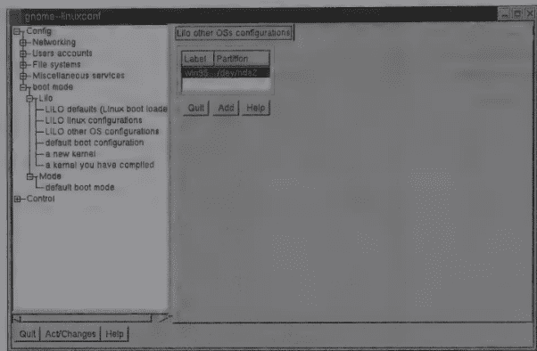

2. 要更改或删除现有的 OS 标签或分区，点击你想要修改的 OS。你将看到“其他操作系统（Other Operating System）”设置选项卡，它允许你输入不同的标签或分区。进行必要的更改，然后点击 `Accept`（接受以激活更改）、`Cancel`（取消以忽略更改）或 `Del`（删除以移除该引导到所选 OS 的 `LILO` 选项）。

3. 要向启动项中添加另一个 OS，请点击 `Add`（添加）按钮。你将看到上一步提到的“其他操作系统”设置选项卡，但不会显示任何标签或分区。你可以通过点击“引导分区（Partition to Boot）”文本框旁边的箭头，从可用硬盘和分区列表中进行选择。完成必要的添加，并点击 `Accept`、`Cancel` 或 `Del`。

> **提示**：如果可能，你应该根据需求提前设置好驱动器和分区，并首先安装所有其他必要的操作系统。记住，其他操作系统有自己的首选安装顺序——例如，Windows 95 应该在 Windows NT 之前安装。无论你是使用一个还是多个驱动器，请确保准确确定系统为 Windows 和 Windows NT 需要多少个分区。如果你没有（稍后需要在任何可用驱动器上添加 DOS 分区），传统的 MS-DOS 命名连接会导致某些 Windows 应用程序和文件指针指向错误的驱动器或分区。然而，Linux 不受影响。

## 创建 LILO 引导软盘

当你首次安装 Red Hat Linux 6.0 时，安装程序默认会将 `LILO` 引导加载器安装到硬盘。但是，你可能会对 `LILO` 进行更改，随后由于某些原因导致无法启动系统。如果发生这种情况，你将无法引导到 Linux 或磁盘上的其他操作系统。

良好的做法是将 `LILO` 的更改安装到软盘并首先测试所有启动选项，然后返回 `gnome-linuxconf` 将 `LILO` 安装到硬盘。如果你有复杂的配置（包含多个操作系统和分区），这一点尤为重要。你制作的软盘引导盘可以作为紧急情况下的备份（例如，当重新安装 Windows 95 覆盖了你的 MBR 时）。这将使你只需使用 Linux 紧急启动软盘和相关的软盘救援镜像。

安装过程完成后，`LILO` 允许将引导扇安装到任何适当设备上，包括你的软盘驱动器。按照喜好配置 `LILO` 后（参见本章的“更改 LILO 默认”部分），将 `LILO` 存储到软盘是相对简单的。从 `gnome-linuxconf` 主窗口，选择 `Config`、`boot mode`、`LILO`、`LILO defaults`（`LILO loader`）。这将打开你在图 6.3 中看到的 `LILO` 选项卡。

### 图 6.3

`LILO` 可以从软盘启动，这样你就可以保留当前的硬盘 MBR 设置。

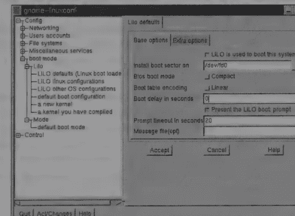

如果你只有一个硬盘，且 Linux 是该硬盘上唯一的操作系统，你可能正从该硬盘的 MBR 启动。在这种情况下，IDE 驱动器的设备名为 `/dev/hda`，SCSI 驱动名为 `/dev/sda`。你将在 `LILO` 默认的“安装引导扇（Install Boot sector）”选项卡中看到此设备名称（参见图 6.5）。点击 `Install Boot Sector On`，你将看到弹出菜单，允许你点击你的硬盘驱动器——在这种情况下，取决于硬盘的接口类型，它将是 `/dev/hda` 或 `/dev/sda`。如果你愿意，也可以点击文本框并输入设备名称而不是使用鼠标。`Base`（基础）和 `Extra Options`（额外选项）中的其他设置将在后的“更改 LILO 默认”部分详细说明。进行更改，并点击 `Accept` 将更改保存到 `/etc/lilo.conf` 文件中。如果你做了更改但决定不想安装，请点击 `Cancel`。

如果你点击了 `Accept`，将看到一个“激活 LILO 配置（Activating LILO configuration）”选项卡，警告你 `LILO` 会影响系统启动。在该选项卡中，你有机会点击 `No`（不激活更改）来保存更改，或点击 `Yes`（激活更改）继续进行 `LILO` 软盘安装。要激活更改，请为软盘标记标签（例如“LILO boot disk”），将其放入软盘驱动器，然后点击 `Yes` 按钮。

记住，你可以使用任何软盘——无论它是格式化为 DOS 还是 Linux 文件系统——因为 `LILO` 只将引导加载器安装到 MBR，MBR 是磁盘的扇区，而不是软盘文件系统的一部分。`LILO` 也会覆盖存储在你软盘上的任何数据。

## 启用新内核

在某些情况下，你在 Red Hat Linux 6.0 初始安装期间继承的基础模块化内核不足以满足你的需求。例如，你可能需要默认内核不支持的硬件或网络功能。在这种情况下，你可能必须构建新内核，以便你能够精确定义包含哪些组件。

如果你构建了新内核，必须告诉 `LILO` 它在什么位置。第 18 章描述了这一过程。

1. 以 `root` 身份登录，并从 GNOME 菜单和面板启动 `gnome-linuxconf`。你将看到 `gnome-linuxconf` 窗口。
2. 选择 `Config`、`boot mode`、`Lilo`、`LILO Linux configurations`。你将看到一个名为 `Lilo Linux Configuration` 的选项卡，其中有一个表格列出了当前已启用的内核（包括内核名称、其所在的分区以及 `LILO` 在启动提示中提供选择的标签）。
3. 点击 `Add` 按钮。你将看到带有空记录的 Linux 配置选项卡（参见图 6.4）。

## 图 6.4

`Linuxconf` 允许你添加、修改和删除多个 Linux 配置。

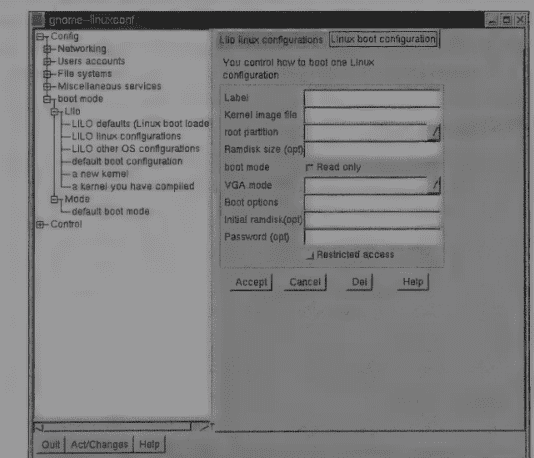

4. 填充所有标识标签、内核镜像文件和根分区的文本框。在当前的示例中，我分别使用了 `New`、`/boot/vmlinuz-new` 和 `/dev/hda5`。
5. 选择单选按钮，以指示你想将新内核添加到现有配置并将其设置为默认（新的默认可启动设置）、覆盖现有的默认设置（替换当前启动设置），或将其合并到你的启动菜单（可选选项）。
6. 点击 `Accept` 保存你的新 Linux 配置，或点击 `Cancel` 还原到之前的配置并忽略你输入的内容。

你还可以在 `LILO` 启动菜单中选择 `New`（新建）来访问你的新内核。

7. 如果这是你此时想要添加的唯一内核映像，点击 `Quit`（退出）以关闭 `Lilo Linux Configuration` 选项卡。

## 修改默认设置

`gnome-linuxconf` 中的许多地方都允许你修改 `LILO` 的默认设置，并决定系统在初始启动及后续启动序列中的行为。例如，你可以启用或禁用 `LILO` 启动菜单，修改在自动启动到默认内核配置之前 `LILO` 启动菜单的显示方式，并指定显示图形化还是基于文本的登录提示。

## 修改 LILO 默认值

在此处你将有机会控制 `LILO` 的绝大部分核心功能。例如，你可以选择在启动序列的早期阶段（当 BIOS 将控制权传递给软盘或硬盘的 MBR 时，在这种情况下 MBR 包含 `LILO`）显示菜单。你还可以自定义随启动菜单一起显示的消息，设置菜单显示之前的等待时间，并控制菜单在自动继续启动序列之前显示多长时间。

要配置 `LILO` 默认值，请以 `root` 身份登录，并从 GNOME 主菜单和面板启动 `gnome-linuxconf`。在 `gnome-linuxconf` 窗口中选择 `Config`、`boot mode`、`LILO defaults`（Linux 启动加载程序）。你会看到两个选项卡，标记为 `Base Options`（基础选项）和 `Extra Options`（额外选项），如图 6.5 所示。

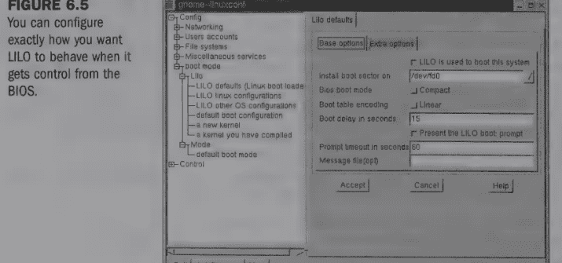

## 修改基础选项

使用 `Base Options` 选项卡，你可以启用 `LILO`（由 `LILO` 安装加载程序）、启用 `LILO` 启动提示，并指定该提示在启动期间持续多久。你可以在 `Base Options` 中配置多个文本框和复选框：

- `LILO` 将用于启动此系统——如果你想使用 `LILO` 而不是由其他操作系统或第三方供应商提供的引导程序，请勾选此框。
- `Install boot sector on`（安装引导区到）：此选项更改 `LILO` 安装加载程序的位置。在此文本框中输入（或从弹出菜单中选择）相应磁盘驱动器或分区名称。将加载程序安装到软盘的过程在本章前面已描述。
- `BIOS boot mode`（BIOS 启动模式）：此选项允许你为 BIOS 启动选择 `Compact mode`（紧凑模式）。除非确定绝对需要它且它与你的系统硬件兼容，否则你不应勾选 `Compact` 框。
- `Boot table encoding`（启动表编码）：勾选此框可以帮助你处理某些用户可能会遇到的磁盘几何问题（尽管并不是为了勾选它）。在某些情况下，`LILO` 具有默认磁盘映射样式（柱、头、道）。SCSI 磁盘此类如此，或者当你尝试使用超出 1024 柱限制的内核映像安装 `LILO` 时，其配置文件通常会被安装在低于 1024 的块上。
- `Boot delay in seconds`（启动延迟，秒）：如果你希望在 BIOS 初始化硬件并将控制权传递给 `LILO` 后立即看到启动提示，请输入。否则，输入你希望系统在显示提示之前暂停的秒数。
- `Present the LILO prompt`（显示 `LILO` 提示）：如果你希望在启动期间看到实际提示，请勾选此框。如果你希望提示不可见（但可以通过 `Tab` 键激活），则取消勾选。“LILO”一词将仍会显示，你可以通过按 `Tab` 键激活提示。
- `Prompt timeout in seconds`（提示超时时间，秒）：输入你希望提示（如果启用，或在启动期间通过 `Tab` 键激活）在自动加载默认操作系统之前活动的时间。如果你希望强制执行交互式启动过程（操作员必须从一个可用启动选项中选择），请在此输入。
- `Message file`（消息文件）：输入纯文本文件的路径和文件名，该文件将在启动提示之前立即显示（例如基本指令和可用选项的说明）。

如果你需要对 `Extra Options` 选项卡中的字段进行更改，请点击该选项卡并继续进行更改。如果没有，点击 `Accept`（接受）以保存对基础选项的任何更改，或点击 `Cancel`（取消）恢复到之前的设置并忽略你刚刚输入的内容。如果你选择 `Accept`，系统将警告你所做的更改将影响启动序列，在继续之前你将另一次机会选择 `Yes`（继续）或 `No`（取消更改）。如果你选择 `Yes`，你的更改将保存到 `/etc/lilo.conf` 文件中，并且 `/sbin/lilo` 将按照配置将加载程序安装到你选择的驱动器或分区。

**修改额外选项**

当你点击 `Lilo Defaults` 窗口的 `Extra Options` 选项卡时，你将看到图 6.6 所示的选项。在此选项卡中，你可以配置多个不同的字段，包括根分区的位置（存储你大部分系统和文件的地方）以及你在启动期间需要传递给内核的任何启动参数（如特定硬件设置）。

## 图 6.6

必须告诉 `LILO` 哪个磁盘分区包含你的根目录，以及内核是否需要额外的参数（启动选项）。

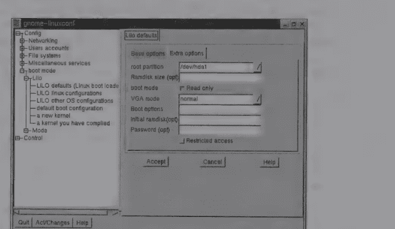

| Lilo defaults | | |
| :--- | :--- | :--- |
| **Base options** | **Extra options** | |
| root partition | /dev/hda1 | |
| Ramdisk size | | |
| VGA mode | | |
| Boot options | | |
| Initial ramdisk | | |
| Password | | |
| Restricted access | | |

`Extra Options` 选项卡中的几个文本框列举如下：

- **Root partition**（根分区）：输入（或从弹出菜单中选择）包含根目录的分区路径。
- **Ramdisk size**（内存磁盘大小）：以 KB 为单位输入内存磁盘的大小。如果你不使用内存磁盘，请输入 `0`。
- **VGA mode**（VGA 模式）：如果你在启动过程中使用图形化模式，请选择此项。


## Boot options（启动选项）

输入启动期间需要传递给内核的任何参数。

## Initial ramdisk（初始内存磁盘）

如果你在使用，输入内存磁盘映像的路径。

## Password（密码）

如果你想保护 LILO 菜单，请输入密码。

## Restricted access（限制访问）

如果你想限制他人访问你的系统，请勾选此框。

## 修改默认配置

如果你只安装了一个内核，它将是你的默认配置。然而，随着你添加不同的内核、内核配置和操作系统，你可能会需要强制系统默认启动到其中一个。例如，你可能希望在 LILO 菜单超时之前（如果已启用）自动从你的 Linux 配置启动。要将系统的启动配置更改到另一个配置好的驱动器或分区，请执行以下步骤：

1. 从`gnome-linuxconf`主窗口中选择`Config`、`boot mode`、`Lilo default boot configuration`。这将打开默认启动表（见图 6.7）。
2. 点击你想默认启动的操作系统或 Linux 内核单选按钮。在这种情况下，我选择了 Windows 95，而不是随 Red Hat Linux 6.0 安装的原始内核或我们在本章稍早配置的新内核。
3. 点击`Accept`保存这些设置，然后点击`Yes`确认。如果你改变了主意不想保存这些设置，请在`Default Boot Configuration`选项卡中点击`Cancel`，或在询问确认激活更改时点击`No`。

## 图 6.7

你可以选择从你用 LILO 配置的任何操作系统或 Linux 内核启动。

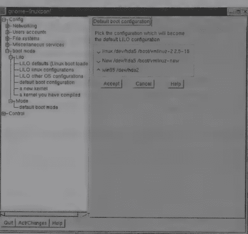

## 更改默认启动模式

你还可以更改 LILO 启动你的系统并将控制权交给初始化进程后的系统行为，这些进程反过来会加载内核以及大量的启动进程和守护进程。例如，你可以控制是想查看并使用基于文本的登录提示符，还是图形登录界面。请按照以下指令执行此操作：

1. 以`root`身份登录，并从 GNOME 菜单和面板中启动`gnome-linuxconf`。你将看到`gnome-linuxconf`窗口。
2. 选择`Config`（配置）、`boot mode`（启动模式）、`Mode`（模式）、`default boot mode`（默认启动模式）。你会看到一个名为`Mode Configuration`（模式配置）的选项页和三组选项（见图 6.8）。
3. 如果你想在登录时看到图形界面，请按下`Graphic & Network`（图形与网络）单选按钮。否则，按下`Text Mode & Network`（文本模式与网络）按钮以查看标准的文本登录提示符（随后是`shell`和命令行界面）。请记住，这个特定选项并非 LILO 特有，尽管它与启动过程有关（仅在后期阶段）。更改实际上是应用于`/etc/inittab`而不是`/etc/lilo.conf`。
4. 点击`Accept`（接受）以保存你的启动模式配置，或点击`Cancel`（取消）以还原到之前的配置并忽略你刚刚输入的更改。如果你选择`Accept`，你的更改将被保存，并在下次重启时生效。

## 图 6.8

你可以选择图形化登录或从文本界面登录。

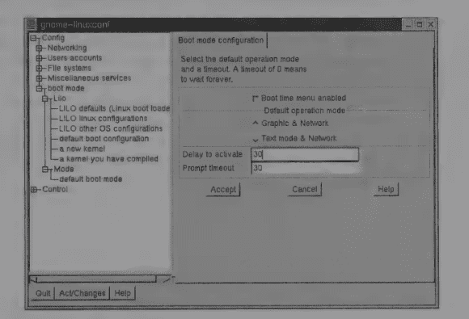

## LILO 故障排除

由于 BIOS 控制着初始启动序列，你必须确保其中的设置是正确的。例如，如果你的 BIOS 配置为在硬盘之前从 CD-ROM 或软盘启动，你必须确保其中一个驱动器中不要没有可启动的 CD 或软盘。如果你将 LILO 引导程序安装在软盘的 MBR 而不是硬盘上，你必须确保 BIOS 配置为从软盘启动（在硬盘之前），并且你创建的软盘位于适当的驱动器中。你可能很容易更改 LILO 并将引导程序保存到硬盘，但意外地从一个不包含你预期的更新更改的旧 LILO 引导软盘启动。

LILO 和`gnome-linuxconf`自带有一套警告消息，帮助你排除可能遇到的任何问题。例如，如果你的驱动器中没有软盘，系统会提示你发生了错误，并询问你是否想检查日志。如果你尝试安装一个不存在的设备，你会收到一条错误消息，说明你的选择将导致系统无法启动。

你可能会发现`gnome-linuxconf`在你执行某个操作后意外地关闭了它的主窗口。例如，有时在删除之前配置的操作系统后会发生这种情况。如果发生这种情况，你只能是回到主 GNOME 面板和菜单重新启动`gnome-linuxconf`（尽管你最近的更改应该已经反映出来了）。此外，有时当你打开两个`gnome-linuxconf`实例并关闭最近的一个时，你可能无法操作第一个。在这种情况下，请也关闭第一个窗口，然后重启`gnome-linuxconf`。

如果你的硬盘非常大，或者你在使用多个驱动器，可能会在尝试安装 LILO 并让其正常运行时遇到问题。使用 LILO 时，Linux 内核及其相关文件（全部位于`/boot`目录）必须完全位于第一个磁道下方。如果你正在使用分区并重新编译了内核（这可能会将其放在更高的磁道），这一点尤为重要。某些 SCSI 驱动器也不理解常用的磁道编码。在这种情况下，你应该尝试在`Base Options`（基本选项）下使用线性块编码。

## 第二部分

## X Window 系统

- 7 安装和配置 GNOME 105
- 8 安装和配置 KDE 桌面 135
- 9 安装和配置显卡、显示器和鼠标 161
- 10 更新 X Window 系统 177

## 安装和配置 GNOME

作者：Duane Hellums

## 本章内容

- 为什么选择 GNOME? 106
- 了解你的桌面 107
- 安装 Enlightenment 和 GNOME 108
- 配置 Enlightenment 108
- 配置 GNOME 119

## 为什么选择 GNOME?

GNOME 和 Enlightenment 是 Red Hat 6.0 体验的关键部分。没有它们，我们就无法获得对现代操作系统所期待的所有华丽功能。每者都有替代方案，但目前没有哪一个方案能提供你在图形化登录 Red Hat Linux 系统时所看到的那种无缝、高效且精致的品质。这解释了为什么 Red Hat 在安装期间将此组合作为默认选项。

图 7.1 显示了你从全新的 Red Hat Linux 6.0 开始时的桌面环境。如你所见，Red Hat Linux 6.0 是非常图形化的，它是某些人因为其 UNIX 根而恐惧的“屏幕”和命令行怪兽”。

**图 7.1** 桌面环境和 Enlightenment 窗口管理器。

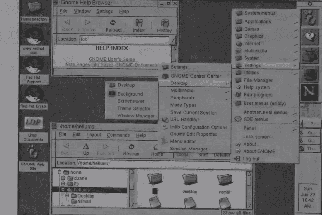

注意：图 7.1 中的桌面显示了应用程序、默认图标和菜单，面板位于右侧而非底部。这只需要鼠标点击和拖拽。

## 了解你的桌面

Linux 的图形用户界面 (GUI) 比你习惯的 Windows 或 Macintosh 世界要复杂一点。信不由你，这是一件好事，因为开放系统提供了更多的选择和灵活性。你受益于许多不同组织和群体的开发，他们对 Linux 应该什么样都有不同的观点。

## 了解 XFree86

XFree86 提供了支持图形桌面的基本工具，包括显卡驱动程序和更改显示器设置的工具。XFree86 基本上是由 XFree86 项目开发的 X 副本。它运行于许多市场和模型，并且是免费分发的。XFree86 是 Linux 不可缺的一部分，因此 CD 中包含了最新版本的 XFree86。你可以访问 `http://www.xfree86.org/` 了解 XFree86。

## 了解 Enlightenment

Enlightenment（有时称为 E）是一种能够扩展 XFree86 基本功能的窗口管理器。通过 Enlightenment，你可以高效地更改你的窗口和其他一些桌面组件的行为。它是 Red Hat Linux 的默认窗口管理器，但你也可以使用其他流行的管理器，如 Ice、Window Maker 或 FVWM。然而，某些窗口管理器部分符合 GNOME 标准，因此 GNOME 的某些组件（如拖放、会话管理和功能）在它们上的运行效果可能不如在 Enlightenment（它是 100% 兼容的）上好。你可以访问 `http://www.enlightenment.org` 了解更多关于 Enlightenment 的信息。

## 了解 GNOME

GNU 网络对象环境 (GNOME) 协同工作提供了一个用户友好的 GUI。理解这些程序 Linux 规则最简单的方法是将它们看作你 Red Hat Linux 系统的额外构建模块。Linux 系统由许多层组成，基本上包括内核、驱动程序、源代码、编译器、`shell`和 XFree86 图形界面。Enlightenment 和 GNOME 位于这一切之上，并且每个系统都可以通过使用主题和 GNOME 应用程序进行进一步扩展。

## 第 7 章 安装与配置 GNOME

GNOME 是你初次通过图形界面登录 Red Hat Linux 6.0 时看到并使用的桌面环境。你可以配合任何符合 Motif 或 GNOME 标准的应用程序和窗口管理器，在应用程序与你的 GNOME 桌面之间进行拖放式操作。GNOME 提供了一层额外的功能层，但它在其之上还有额外的构建模块，例如许多 GNOME 应用程序，这些程序充分利用了到目前为止讨论的所有低级组件。请记住，你也可以轻松地使用其他流行的环境，例如 K 桌面环境 (KDE) 或通用桌面环境 (CDE)，这些都包含在 Red Hat 6.0 中。

## 整合所有部分

当你退后观察你的 Red Hat Linux 6.0 开放系统时，你应该看到基础 Linux 内核得到了许多多样化的网络组件和基础应用程序的支持；而这反过来又通过 XFree86 GUI、Enlightenment 窗口管理器和 GNOME 桌面环境得到了扩展。最顶层是 Red Hat 开发的许多工具和应用程序，用于提供额外功能并改进安装、配置和系统管理过程，更不用说它们提供的强大支持了。

## 安装 Enlightenment 和 GNOME

Enlightenment 包含在 CD 中，路径为`/RedHat/RPMS/enlightenment-0.15.5-32.rpm`，并在 Red Hat 工作站和自定义安装方法中默认安装。如果由于某些原因你没有它，或者你必须重新安装它，应该参考第 11 章“安装和管理 RPM 包”，该章节将引导你完成必要的步骤。

GNOME 也包含在 CD 中并默认安装。如果你必须使用 RPM 安装它，可以在 CD 上找到该包`/RedHat/RPMS/gnome-core-1.0.4-34.rpm`，以及支持包，如`control-center-1.0.5-20.rpm`和`gnome-audio-1.0.6-rpm`（以及相关的 GNOME 游戏、实用程序、`linuxconf`等）。

## 配置 Enlightenment

Enlightenment 仍在开发中，因此你可能会在未来几个月内看到界面有许多细微变化——在未来几年内更是如此。这是一个复杂的应用程序，具有许多在你在使用时会发现的特性。然而，我不会梦想过在这里涵盖 E 的每一个细微方面——空间根本不够。我在这里涵盖的是安装和配置的基础知识，这些将让你能够使用 E 的基本功能。

## 配置 Enlightenment 109

你可能不需要更改 Enlightenment 中的默认设置就能运行，因为大多数桌面环境设置都是在 GNOME 中更改的。但是，如果你在 E 中稍微更改一下某些基础设置（鼠标行为）和一些高级设置（主题），将提升你的桌面体验。

需要记住的一点是，实际上 GNOME 运行在 E 之上，因此当登录期间桌面启动时，GNOME 会覆盖你在 E 中设置的某些设置。例如，考虑当你调出 Enlightenment 配置工具并设置当前会话后，当你再次登录时，在显示默认 GNOME 背景之前，你会看到几秒钟的 E 背景图。

> 对于大多数情况，我建议只更改 E 中那些不与 GNOME 冲突的设置，例如控制窗口、桌面和鼠标行为的设置。在其他方面，请远离背景和主题设置（这些可以从 GNOME 设置）。这应该可以防止任何冲突。

## 访问 E 配置工具

你可以从桌面启动，也可以从 GNOME 配置工具内部的钩子启动 E 配置工具。要从桌面启动它，前往桌面上的任何空白区域并点击鼠标中间键；你应该能看到图 7.2 所示的弹出窗口。如果你有一个双键鼠标，并在安装或设置 Xf86 期间启用了三键仿真，可以通过同时点击左键和右鼠标键来实现相同的结果。

图 7.2 Enlightenment 菜单。


当你不想移动鼠标到其中一个面板时，这是一个很方便的快捷方式。位于 GNOME 系统菜单中的大多数应用程序都可以从这个弹出窗口访问。你也可以从此屏幕更改主题，但正如我之前提到的，我建议你养成从 GNOME 配置工具更改主题的习惯，以防止窗口管理器和桌面环境之间的混淆。

如果你点击帮助（Help）菜单项，E 会弹出一个漂亮的文档查看器，显示关于 E 的幻灯片。如果你想了解 E 目前的开发状态以及如何配置主题和背景，这非常值得一读。

## 第 7 章 安装与配置 GNOME

从弹出桌面菜单中选择“Enlightenment Configuration”（Enlightenment 配置）；E 配置将启动。你也可以使用 GNOME 配置工具（控制中心）来启动 E 配置工具。在控制中心选择“Desktop, Window Manager”（桌面，窗口管理器），然后点击“Run Configuration Tool for Enlightenment”（运行 Enlightenment 配置工具）按钮。

无论你是从弹出桌面菜单还是从 GNOME 控制中心使用 E 配置工具，都会看到图 7.3 所示的 Enlightenment Editor（Enlightenment 编辑器）窗口。程序界面在 E Logo 左上角有一个小窗口，你可以在从中选择可用配置组。当你点击每个组的图标时，窗口的右半部分会变为显示与该组相关的特定配置选项。你只需进行所需的更改即可。

图 7.3 Enlightenment 编辑器。

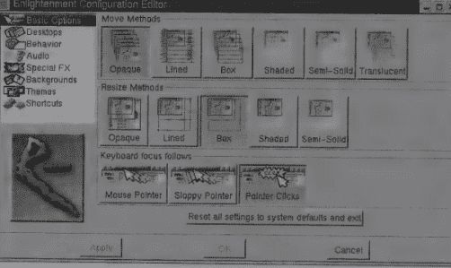

提示：注意窗口底部的`Reset To Defaults And Exit`（重置为默认设置并退出）按钮。当你发现所做的更改不符合预期或 E 出现问题时，可以使用它将其恢复到初始状态。

## 配置 E 选项

当你第一次打开 E 编辑器时，`Basic Options`（基础选项）组是默认显示的组。在此窗口中，你有选项更改移动或缩放窗口的方式。`Opaque`（不透明，默认）和`Box`（框）都是很好的方法，但你应该尝试不同的选项看看你更喜欢哪种。`Opaque`移动整个窗口，而`Box`仅显示一个边界。

键盘焦点选项允许通过鼠标控制窗口焦点。如果你选择`Pointer Clicks`（指针点击），则必须点击窗口才能在其中使用键盘。我个人不喜欢这种方法，因为当我调出终端（命令行提示符）时，必须物理性地移动鼠标并点击。所以我第一件事就是将其改为`Mouse Pointer`（鼠标指针），这允许我只需移动指针而非强制点击。`Sloppy Pointer`（松散指针）更进一步，即使鼠标离开窗口也能继续输入（只要它没有移动到另一个窗口）。你可能还可以在`Behavior`（行为）组中微调其他焦点设置。

## 配置 E 桌面

你可以通过两种方式增加可用桌面空间：使用多个重叠（独立的）桌面，或者创建多个虚拟屏幕。虚拟屏幕是首选方法，会给你带来最少的困扰和误解。然而，如果你选择使用多个独立的桌面，请使用窗口右侧的垂直滑动条从 1 到 32 个桌面中选择。

如果你选择维护虚拟桌面，请使用水平和垂直滑动条从 1 到 64 (8x8) 个屏幕中选择。你可能会发现默认的 4 (2x2) 个屏幕是一个很好的设置。

图 7.4 创建虚拟和独立桌面。

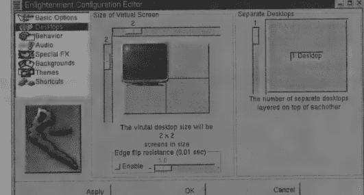

# 112 第 7 章 安装与配置 GNOME

注意：此处选取的虚拟屏幕与你主面板上的 GNOME 翻页器交互。不要将虚拟屏幕与 Linux 的虚拟终端功能混淆（在命令行提示符通过`Alt+F1`、`Alt+F2`等访问，或在 X 界面通过`Ctrl+Alt+F1`、`Ctrl+Alt+F2`等访问）。你应该注意到，在你应用虚拟屏幕数量更改后，你的翻页器窗口会立即变化以反映新设置。

你在该窗口中可以配置的最后一项是边缘阻力。这只是为了强制你的鼠标在移动到邻近窗口之前（如果鼠标移动的方向上有窗口的话）暂停极短时间的方法。如果你不按下“启用”（Enable）按钮，你的鼠标将无缝跨越屏幕边界而无暂停。如果你启用并配置了它，这可能是一个实用的设置，因为有时如果你一直由于靠近边缘而移动到另一个屏幕，尝试调整或移动窗口可能会很困难。我发现设置为 50 和 60 在速度和便利之间是一个很好的折中，但你必须找到适合自己感觉自然的阻力水平。

## 配置高级焦点行为

在行为配置窗口的“高级”选项卡中，你可以更改键盘和鼠标的自动交互方式，其程度甚至比本节之前讨论的“基本选项”窗口中的手动设置更高（图 7.5）。

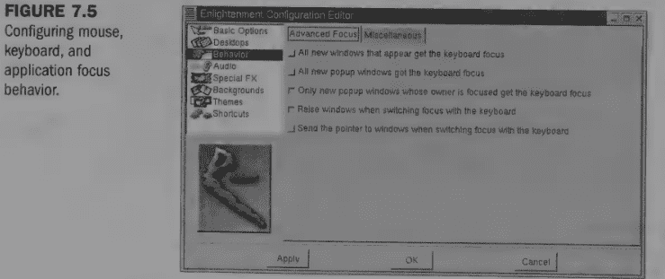

如果你点击桌面上某处的启动器图标，或者选择一个打开程序的菜单项，通常需要先将鼠标移动到该窗口或点击该窗口（取决于你的“基本选项”设置），才能在新窗口中开始打字。点击第一个按钮（所有出现的新窗口都获得键盘焦点），如果你已经将鼠标移动到那里或点击了它，你可以立即在新程序中开始打字。我建议开启此功能（默认是的），因为你可能会发现指向你刚刚调出的应用程序很麻烦。


如果你正在使用的程序生成了弹出窗口（例如对话框或警告），我们通常需要将鼠标移动到该窗口点击“确定”按钮，或者可能在文本框中输入答案。如果你选择标记为“所有新弹出窗口都获得键盘焦点”（All New Pop-up Windows Get Keyboard Focus）的第二个按钮，你将能够在不使用鼠标的情况下响应并使用弹出窗口。我不建议关闭此选项，因为它可能会产生不利影响。例如，一个需要你注意并决策的弹出窗口可能会立即获取你的输入输入（如回车键），即使你并不是故意这样做。

第三个按钮“只有所有获得焦点的新弹出窗口获得键盘焦点”（Only New Popup Windows Whose Owner Is Focus Get The Keyboard Focus）是一种折中，旨在防止第二个选项的问题。如果你选择此按钮，后台运行的程序可能会意外获得键盘输入。只有由你实际使用的程序创建的警告和对话框会自动获得焦点。

屏幕上的第四个按钮对于习惯使用键盘而非鼠标切换应用程序的用户非常有用。例如，你可以按下`Alt-Tab`组合键来切换应用程序。如果你这样做，你切换到的应用程序窗口将立即出现在屏幕顶部，这样你就能看到自己在哪里输入。除非你有理由不，否则我建议使用。

第五也是最后一个单选按钮的效果与第四个类似，但它会自动将指针移动到当前活动（拥有焦点）的应用程序上。这样，你可以立即对当前应用程序使用鼠标和键盘。我建议保持此选项开启（默认关闭的），以便你的鼠标、键盘和应用程序焦点能够无缝协作。

## 配置杂项焦点行为

Enlightenment 可以提供工具提示（ToolTip），当指针悬停在窗口边界或标题栏时，你可以获取简短说明。此功能默认开启，延迟时间为半秒，如图 7.6 所示。换句话说，如果你指向的对象获得焦点持续半秒，工具提示弹出窗口就会出现。你可以禁用此功能以不使用任何工具提示，或者可以使用水平滑动条更改工具提示弹出窗口出现的时间。

你可以禁用此功能以不使用任何工具提示，或者可以使用水平滑动条更改工具提示弹出窗口出现的时间。

Enlightenment 可以提供工具提示，当指针悬停在窗口边界或标题栏时，你可以获取简短说明。此功能默认开启，延迟时间为半秒，如图 7.6 所示。换句话说，如果你指向的对象获得焦点持续半秒，工具提示弹出窗口就会出现。

你可以禁用此功能以不使用任何工具提示，或者可以使用水平滑动条更改工具提示弹出窗口出现的时间。

Enlightenment 可以提供工具提示，当指针悬停在窗口边界或标题栏时，你可以获取简短说明。此功能默认开启，延迟时间为半秒，如图 7.6 所示。换句话说，如果你指向的对象获得焦点持续半秒，工具提示弹出窗口就会出现。

你可以禁用此功能以不使用任何工具提示，或者可以使用水平滑动条更改工具提示弹出窗口出现的时间。

Enlightenment 可以提供工具提示，当指针悬停在窗口边界或标题栏时，你可以获取简短说明。此功能默认开启，延迟时间为半秒，如图 7.6 所示。换句话说，如果你指向的对象获得焦点持续半秒，工具提示弹出窗口就会出现。

你可以禁用此功能以不使用任何工具提示，或者可以使用水平滑动条更改工具提示弹出窗口出现的时间。

Enlightenment 可以提供工具提示，当指针悬停在窗口边界或标题栏时，你可以获取简短说明。此功能默认开启，延迟时间为半秒，如图 7.6 所示。换句话说，如果你指向的对象获得焦点持续半秒，工具提示弹出窗口就会出现。

你可以禁用此功能以不使用任何工具提示，或者可以使用水平滑动条更改工具提示弹出窗口出现的时间。

Enlightenment 可以提供工具提示，当指针悬停在窗口边界或标题栏时，你可以获取简短说明。此功能默认开启，延迟时间为半秒，如图 7.6 所示。换句话说，如果你指向的对象获得焦点持续半秒，工具提示弹出窗口就会出现。

你可以禁用此功能以不使用任何工具提示，或者可以使用水平滑动条更改工具提示弹出窗口出现的时间。

Enlightenment 可以提供工具提示，当指针悬停在窗口边界或标题栏时，你可以获取简短说明。此功能默认开启，延迟时间为半秒，如图 7.6 所示。换句话说，如果你指向的对象获得焦点持续半秒，工具提示弹出窗口就会出现。

你可以禁用此功能以不使用任何工具提示，或者可以使用水平滑动条更改工具提示弹出窗口出现的时间。

Enlightenment 可以提供工具提示，当指针悬停在窗口边界或标题栏时，你可以获取简短说明。此功能默认开启，延迟时间为半秒，如图 7.6 所示。换句话说，如果你指向的对象获得焦点持续半秒，工具提示弹出窗口就会出现。

你可以禁用此功能以不使用任何工具提示，或者可以使用水平滑动条更改工具提示弹出窗口出现的时间。

Enlightenment 可以提供工具提示，当指针悬停在窗口边界或标题栏时，你可以获取简短说明。此功能默认开启，延迟时间为半秒，如图 7.6 所示。换句话说，如果你指向的对象获得焦点持续半秒，工具提示弹出窗口就会出现。

你可以禁用此功能以不使用任何工具提示，或者可以使用水平滑动条更改工具提示弹出窗口出现的时间。

Enlightenment 可以提供工具提示，当指针悬停在窗口边界或标题栏时，你可以获取简短说明。此功能默认开启，延迟时间为半秒，如图 7.6 所示。换句话说，如果你指向的对象获得焦点持续半秒，工具提示弹出窗口就会出现。

你可以禁用此功能以不使用任何工具提示，或者可以使用水平滑动条更改工具提示弹出窗口出现的时间。

Enlightenment 可以提供工具提示，当指针悬停在窗口边界或标题栏时，你可以获取简短说明。此功能默认开启，延迟时间为半秒，如图 7.6 所示。换句话说，如果你指向的对象获得焦点持续半秒，工具提示弹出窗口就会出现。

你可以禁用此功能以不使用任何工具提示，或者可以使用水平滑动条更改工具提示弹出窗口出现的时间。

Enlightenment 可以提供工具提示，当指针悬停在窗口边界或标题栏时，你可以获取简短说明。此功能默认开启，延迟时间为半秒，如图 7.6 所示。换句话说，如果你指向的对象获得焦点持续半秒，工具提示弹出窗口就会出现。

你可以禁用此功能以不使用任何工具提示，或者可以使用水平滑动条更改工具提示弹出窗口出现的时间。

Enlightenment 可以提供工具提示，当指针悬停在窗口边界或标题栏时，你可以获取简短说明。此功能默认开启，延迟时间为半秒，如图 7.6 所示。换句话说，如果你指向的对象获得焦点持续半秒，工具提示弹出窗口就会出现。

你可以禁用此功能以不使用任何工具提示，或者可以使用水平滑动条更改工具提示弹出窗口出现的时间。

Enlightenment 可以提供工具提示，当指针悬停在窗口边界或标题栏时，你可以获取简短说明。此功能默认开启，延迟时间为半秒，如图 7.6 所示。换句话说，如果你指向的对象获得焦点持续半秒，工具提示弹出窗口就会出现。

你可以禁用此功能以不使用任何工具提示，或者可以使用水平滑动条更改工具提示弹出窗口出现的时间。

Enlightenment 可以提供工具提示，当指针悬停在窗口边界或标题栏时，你可以获取简短说明。此功能默认开启，延迟时间为半秒，如图 7.6 所示。换句话说，如果你指向的对象获得焦点持续半秒，工具提示弹出窗口就会出现。

你可以禁用此功能以不使用任何工具提示，或者可以使用水平滑动条更改工具提示弹出窗口出现的时间。

Enlightenment 可以提供工具提示，当指针悬停在窗口边界或标题栏时，你可以获取简短说明。此功能默认开启，延迟时间为半秒，如图 7.6 所示。换句话说，如果你指向的对象获得焦点持续半秒，工具提示弹出窗口就会出现。

你可以禁用此功能以不使用任何工具提示，或者可以使用水平滑动条更改工具提示弹出窗口出现的时间。

Enlightenment 可以提供工具提示，当指针悬停在窗口边界或标题栏时，你可以获取简短说明。此功能默认开启，延迟时间为半秒，如图 7.6 所示。换句话说，如果你指向的对象获得焦点持续半秒，工具提示弹出窗口就会出现。

你可以禁用此功能以不使用任何工具提示，或者可以使用水平滑动条更改工具提示弹出窗口出现的时间。

Enlightenment 可以提供工具提示，当指针悬停在窗口边界或标题栏时，你可以获取简短说明。此功能默认开启，延迟时间为半秒，如图 7.6 所示。换句话说，如果你指向的对象获得焦点持续半秒，工具提示弹出窗口就会出现。

你可以禁用此功能以不使用任何工具提示，或者可以使用水平滑动条更改工具提示弹出窗口出现的时间。

Enlightenment 可以提供工具提示，当指针悬停在窗口边界或标题栏时，你可以获取简短说明。此功能默认开启，延迟时间为半秒，如图 7.6 所示。换句话说，如果你指向的对象获得焦点持续半秒，工具提示弹出窗口就会出现。

你可以禁用此功能以不使用任何工具提示，或者可以使用水平滑动条更改工具提示弹出窗口出现的时间。

Enlightenment 可以提供工具提示，当指针悬停在窗口边界或标题栏时，你可以获取简短说明。此功能默认开启，延迟时间为半秒，如图 7.6 所示。换句话说，如果你指向的对象获得焦点持续半秒，工具提示弹出窗口就会出现。

你可以禁用此功能以不使用任何工具提示，或者可以使用水平滑动条更改工具提示弹出窗口出现的时间。

默认情况下，窗口管理器将选择一个位置放置你的应用程序，然后将其绘制在某处。有些人更喜欢更具风格的窗口放置方法。如果你想尝试，可以点击“动画菜单”（Animate Menus）按钮，启用图 7.7 中的每个选项，并使用水平条尝试不同的设置。

> 提示：你可能会发现不透明窗口滑动（默认）以及大约 300ms 的设置具有相当令人悦的效果。

## 配置 E 桌面背景

E 和 GNOME 桌面背景之间的交互可能有点复杂。如果你只有一个带有虚拟屏幕的桌面，你可以使用 E 或 GNOME 配置工具更改背景。然而，当你登录时，GNOME 的优先级高于 E。正如之前提过的，在 E 启动之后、GNOME 接管之前，你会看到一段极短时间的 E 背景。如果你属于这一类，最好直接使用 GNOME 桌面背景选择器。

然而，如果你正在使用多个（独立的）桌面，每个桌面都有自己的许多屏幕，那么你可以利用 E 配置编辑器来获得优势。这是因为 GNOME 控制中心仅允许你更改主（第一个）桌面的设置，而 E 允许你在每个桌面上独立地设置背景（见图 7.8）。通过这种方式，你可以使用 GNOME 设置桌面背景，并为任何额外的桌面设置背景。

## 配置 E 特殊特效（FX）

默认情况下，窗口管理器将选择一个位置放置你的应用程序，然后将其绘制在某处。有些人更喜欢更具风格的窗口放置方法。如果你想尝试，可以点击“动画菜单”（Animate Menus）按钮，启用图 7.7 中的每个选项，并使用水平条尝试不同的设置。

> 提示：你可能会发现不透明窗口滑动（默认）以及大约 300ms 的设置具有相当令人悦的效果。

## 第 7 章 安装与配置 GNOME

所有可用的背景都显示在预览窗口右侧的空白框中。要更改桌面 1（Desktop 1）的背景图形，你应该点击窗口顶部的桌面 0 按钮，此时你将可以选择任何可用桌面的选项。如果你选择了桌面 1（实际上是你的桌面，因为第一个桌面编号为 0），该桌面将显示在该按钮上。点击“添加（Add New）”按钮，这会将右侧的面板划分，为额外的背景留出空间，并弹出图 7.9 所示的窗口。

## 图 7.9

纯色背景选择选项卡。

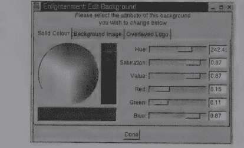

如果你更倾向于纯色，只需使用“纯色（Solid Colour）”而不是其他两种。例如，如果你想要蓝色背景，必须点击圆形蓝色区域的适当部分，然后点击紧邻其右侧垂直矩形中的任意一个色调。你将看到两个元素：标记你所选颜色的圆圆，以及显示你所选色调和饱和度的细线。这将你的颜色放在圆形下方的水平矩形中。如果你点击“完成（Done）”按钮，你的纯色将被选为桌面（在此情况下为桌面 1）的背景。

然而，如果你更喜欢图像作为背景，应该点击“背景图像（Background Image）”选项卡，这将弹出一个特定的文本框和浏览按钮（见图 7.10）。此窗口上的“浏览（Browse）”按钮允许你浏览文件系统目录并选择你喜欢的图像或图形。你还可以切换四个按钮来修改图形在桌面上的显示方式。

## 图 7.10

图像背景选择选项卡。

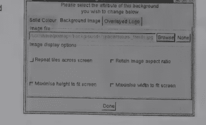

## 配置 Enlightenment

对于小型图案图形，你可能会选择“跨屏平铺（Repeat Tiles Across Screen）”，这会让图案填充整个屏幕。对于图片，你通常会选择“保持宽高比（Retain Aspect Ratio）”和“最大高宽以适应屏幕（Maximize Height and Width to Fit Screen）”。这会让你的图片尽可能大，并使其位于屏幕中央，而不会失真图像。

点击“完成（Done）”保存你的新设置。这应该带你回到主背景编辑器窗口，在那里你将看到新选择的颜色或图像列为可用背景供选择。点击你想查看背景；它将显示在预览窗口中。如果你对外观满意，点击“应用（Apply）”或“确定（OK）”来更改你的背景。

## 配置 E 主题

Enlightenment 默认使用名为`CleanBig`的相当保守且简洁的主题。它提供了一个相对简单的窗口框、控件和事件声音。但多样性是生活的调料，因此你可以从几种可用的 E 主题中选择。图 7.11 显示了 E 配置编辑器中的主题（Themes）”窗口，你可以在那里进行更改。

### 图 7.11

E 选择窗口。

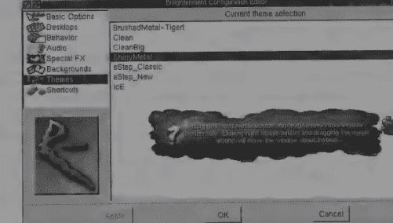

此窗口列出了可用主题以及更改主题对你的界面产生的影响。你可以轻松地看到`ShinyMetal`和`CleanBig`之间的区别。你看到的“工具（Tools）”弹出窗口是窗口操作与其他主题产生不同效果的示例；在这种情况下，我将光标移动到窗口的右边缘，准备调整其大小。你还可以看到标题栏上的阴影以及样式控制。

## 配置 E 快捷键

E 快捷键基本上是热键，允许你结合修饰键（Shift、Ctrl 和 Alt 键）和普通键来执行特定操作。例如，`Alt+Tab`从一个应用程序切换到另一个。`Alt+F1`回到你虚拟桌面的左上角（也称为线性区域 0）。然而，你不必忍受默认设置，可以根据需要创建自己的快捷键。你可以通过图 7.12 所示的窗口定义或修改快捷键。

## 图 7.12

快捷键定义窗口。

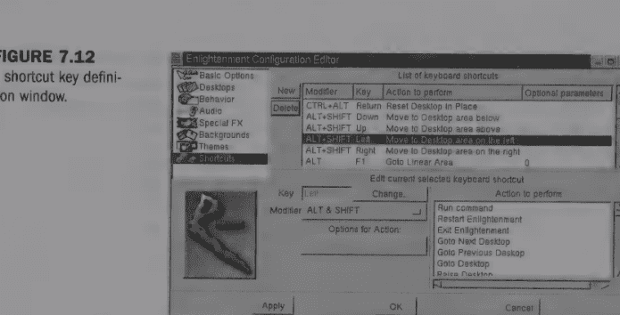

如果你想更改某个操作的默认快捷键，必须在键盘快捷键列表中滚动到它，然后点击将其高亮。“要执行的操作（Action to Perform）”中也会出现相应的高亮。你可以点击不同的操作，键盘快捷键将在另一个窗口中更新。你可以从许多操作中选择，其中大多数是标准的管理器功能。

如果你想保留功能并更改关联的快捷键，首先在列表窗口中选择你想要修改的操作。然后点击“更改（Change）”按钮；这将弹出一个窗口，在其中按下你想要与所需操作关联的特定键。例如，如果你想将“清理窗口（Clean Windows）”从`Ctrl+Alt+Home`更改为`Ctrl+Alt+C`。如果你想将其从`Ctrl+Alt+Home`更改为`Shift+Home`，你需要点击修饰键（Modifier）旁边的按钮，然后点击修饰键选择器旁边的按钮（而不是更改），从列出的选项中选择 Shift。点击“应用（Apply）”或“确定（OK）”将激活你的更改。

最后，你还有删除任何快捷键的能力。要删除快捷键，在列表中选择快捷键并点击“删除（Delete）”按钮。如果你想恢复默认快捷键，请点击“重置（Reset）”按钮。

## 配置 GNOME

对于小型图案图形，你可能会选择“跨屏平铺（Repeat Tiles Across Screen）”，这会让图案填充整个屏幕。对于图片，你通常会选择“保持宽高比（Retain Aspect Ratio）”和“最大高宽以适应屏幕（Maximize Height and Width to Fit Screen）”。这会让你的图片尽可能大，并使其位于屏幕中央，而不会失真图像。

点击“完成（Done）”保存你的新设置。这应该带你回到主背景编辑器窗口，在那里你将看到新选择的颜色或图像列为可用背景供选择。点击你想查看背景；它将显示在预览窗口中。如果你对外观满意，点击“应用（Apply）”或“确定（OK）”来更改你的背景。

## 配置 E 主题（注：此处内容与前文重复，已按要求翻译）

（注：由于原文文本中存在内容重复，此处遵循翻译逻辑进行对应处理）

- 这些组件主要包括菜单、面板和抽屉，但你将需要自己学习一些。然而，本节涵盖了你所需的所有信息。

## 获取 GNOME 帮助

早期版本 Red Linux 的抱怨之一是，GNOME 功能强大但文档不足。如果你购买了 Red Linux 6.0 官方盒装，你会收到一本名为《入门指南（Getting Guide）》的 288 页书籍。该书的前 14 章包含了官方 GNOME 用户指南以及关于 Enlightenment 的少量文档，而最后四章为可能需要 shell 和命令行界面介绍的新用户提供了实用的介绍。

## 寻找 GNOME 兼容应用程序

网站`http://www.gnome.org/applist/listrecent.html`包含一张非常有用的 GNOME 兼容软件地图，你可以从那里查看当前可下载的 GNOME 兼容软件列表。例如，版本 4.5.33 的 GNU Midnight Commander（文件管理器）已可用，你可以升级随书附带 CD 光盘和官方 Red Hat 6.0 盒装提供的 4.5.30 版本。

# 使用 GNOME 配置工具（控制中心）

GNOME 提供了自己的配置工具，允许你轻松地更改桌面环境中许多组件的设置。例如，你可以通过从广泛的背景、屏幕保护程序、主题和窗口管理器中选择来更改桌面的外观。你还可以选择默认编辑器、将应用程序与特定的文件扩展关联，并配置你在使用桌面和窗口控制功能时听到的声音。

## 配置桌面设置

GNOME 配置工具也被称为控制中心（Control Center）。该工具允许你操作桌面的所有不同部分，以增强你在使用 Linux 时的多媒体体验。要访问控制中心，请点击默认主面板自带的工具栏图标；它会被标记为“GNOME Configuration Tool”（GNOME 配置工具），当你将鼠标指针悬停在其上方一秒时，即可看到它的标题。

## 选择背景


运行控制中心窗口时，你会发现它被分为两个部分：左侧的菜单选择区域（看起来像文件树）和右侧的显示区域。当你点击左侧桌面组中的“Background”（背景）项时，你将看到图 7.13 所示的窗口图片。要像我这样更改壁纸，请点击“Browse”（浏览）按钮。你会看到一个“Wallpaper Selection”（壁纸选择）窗口，其中有三个按钮、一个目录列表、一个文件列表、一个小预览区域和一个指示你当前选择的文本框。

图 7.13 在控制中心中选择背景图像。

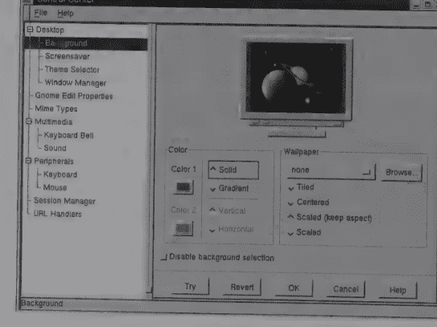

使用鼠标在左侧窗口框中导航目录，直到到达所需的目录。通过点击中间窗口框中的项目来选择一个文件。你应该能在预览区域看到该图像的描述。所选路径和文件名也会在底部的文本框中更新。

## 配置 GNOME

良好的图像选择位于`/usr/share/pixmaps/background`目录下，共有三个名为 Propaganda、space（空间）和 tiles（瓷砖）的子目录；然而，可以使用任何存储在系统中的喜欢的图片。点击“OK”（确定）将应用更改并返回控制中心，而点击“Cancel”（取消）将忽略你所做的任何更改或选择。你必须从控制中心点击“Try”（尝试）或“OK”来激活你的更改。

你有选项将图像拉伸以适应桌面、将其居于屏幕中间，或将其复制多次直到填满屏幕（水平和垂直）。你可以通过分别点击标记为`Scaled`（缩放）、`Centered`（居中）或`Tiled`（平铺）的按钮来实现。如果你希望图像尽可能填充屏幕而不失真，请选择`Scaled (keep aspect)`（缩放保持比例）。对于不适合整个屏幕的图像，你可以选择额外的背景颜色（纯色或渐变）。点击`disable`（禁用）按钮临时激活当前选的背景。

选择“Savers”（屏幕保护程序）会弹出若干项可以在控制中心右侧窗口框中操作的设置。大多数选项都是说明性的。标记为“Saver”的列表框允许你点击想要尝试的屏幕保护程序，它将立即显示在右侧的`Demo`（演示）框中。默认是`random`（随机），它会在你安装的屏幕保护程序之间频繁切换。如果你点击特定的屏幕保护程序，还可以点击演示窗口左侧的“Settings”（设置）按钮来尝试不同的设置（每个独立的屏幕保护程序根据其功能和能力都有自己的一套选项）。

在 Saver Settings（屏幕保护程序设置）下，你可以指定系统在你不使用键盘或鼠标时在开启屏幕保护程序之前延迟多长时间。如果你的显示器具有高级电源管理功能，你还可以选择在屏幕保护程序运行一段时间后关闭显示器的选项。如果你想了解更多关于控制中心的设置，请点击“Help”（帮助）按钮。

## 选择主题

GNOME 的真正之处之一是它能够自定义你的桌面环境，使得窗口的外观、整洁度和功能有所不同。主题允许你受益于许多个人和开发者的努力，他们为你的窗口创建了一套预配置的样式、颜色、行为和外观。当你安装 Red Hat Linux 6.0 时，会有几个主题可用，但你也可以从网上下载其他主题并将它们添加到你的系统中。

点击“Theme Selector”（主题选择器），你将看到一个可以选择的当前已安装主题列表。此外，你可以点击“Preview”（预览）按钮查看所选主题对你的桌面控制产生什么影响。在更改主题和预览时，请查看控制中心底部的小矩形框；你将看到窗口控制集的样式，以便你决定是激活它还是返回尝试其他主题。如果你下载了一个主题但它不在“Available Themes”（可用主题）滚动列表中，请点击“Install New Theme”（安装新主题）；你可以访问文件浏览器来找到要添加到列表的主题。最后，你可以通过点击“Use Custom Font”（使用自定义字体）并选择你喜欢的字体来更改默认用户字体。


> **注意** 存在 E 和 GNOME 两种背景图像选择可能看起来有点困惑。你可能在 Windows 中遇到类似的情况，即在初始启动序列期间你会看到一个特定的启动图像，然后在单个用户登录时会看到另一幅图像。E 背景图像在 X 初始启动后不久就会显示，但在启动序列期间会被 GNOME 背景替换。

## 选择窗口管理器

GNOME并不要求使用任何窗口管理器，尽管它受益于像 E 这样完全符合标准的窗口管理器。这改进了应用程序之间的交互。你可以通过点击控制中心的“Window Manager”（窗口管理器）来添加、编辑和删除额外的窗口管理器。当你添加或编辑主题时，你会看到一个对话框，允许你指定窗口管理器标题、启动管理器的配置文件文件名以及配置工具的文件名。

如果你正在编辑的窗口管理器会话管理的（这意味着 GNOME 可以保存你的桌面设置，以便你的下次会话看起来完全一样），你应该勾选该框。当列表中有多个窗口管理器时，你可以在它们之间选择。你还可以点击底部的“Run Configuration”（运行配置），这将弹出一个应用程序让你自定义管理器。

### 配置编辑器和 MIME 类型

你可能不想使用 Emacs 编辑器，它是 GNOME 的默认编辑器。如果不想，点击“Edit Properties”（编辑属性）会弹出一个窗口，允许从许多不同的编辑器中选择，包括基础的 gedit。你选择的编辑器是在右键单击桌面或文件管理器上的文档时自动启动的应用程序。

通过配置多媒体互联网邮件扩展或 MIME 类型，你可以获得类似的功能。这些是不同类型文件的标准描述符，允许在你尝试查看文件时启动特定的客户端应用程序。MIME 基于文件扩展名。例如，如果你安装了 xpdf 应用程序，它可以让你手动打开并查看 PDF（便携文档格式）文件。然而，如果你希望在双击桌面或文件管理器上的文件时自动启动此应用程序，你必须确保为`.pdf`文件扩展指定了 MIME 类型。

点击“MIME Types”可以在右侧窗口中查看预定义的 MIME 类型列表。从此列表中，你可以添加文件类型，或选择现有的文件类型进行编辑或删除。如果你选择编辑，或者只是想检查与特定 MIME 类型关联的应用程序，请双击文件类型或突出显示并点击“Edit”（编辑）按钮。这将弹出图 7.14 所示的弹出窗口。

## 图 7.14

编辑 MIME 类型及关联应用程序。

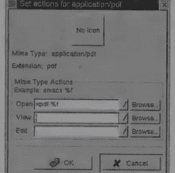

在这种情况下，由扩展名`.pdf`指定的 PDF 格式存储的文件与应用程序`xpdf`关联。如果你双击此类文件，系统将尝试打开该文件，从而运行`xpdf`命令并调出你选择要打开的文件。如果你右键点击一个文件并选择“查看”（View）或“编辑”（Edit），在这个特定示例中什么都不会发生，因为你还没有为为“查看”和“编辑”选择 MIME 类型操作（MIME Type Action）。如果你想启用此类功能，请将“打开”（Open）命令复制到方的两个框中。

如果你知道启动器程序在哪里，但不记得具体位置了，只需点击“浏览”（Browse）即可弹出一个文件浏览器，你可以用它在文件系统中找到该程序。你也可以点击弹出菜单顶部的“无图标”（No Icon）弹出一个方便的图标选择器，以便在文件显示在桌面、菜单或面板上时，选择一个与之关联的图像。做出更改后，你可以点击“尝试”（Try）查看效果，点击“确定”（OK）保存更改并继续配置控制中心（Control Center），或点击“还原”（Revert）忽略刚刚所做的更改并返回之前的设置。

## 配置多媒体

你可以在此部分进行两个简单的配置更改。首先，你可以更改系统提示音，或者激活系统声音并更改与某些系统或操作事件相关的音效。其次，你可以修改默认系统提示音的音调和时长，并点击“测试”（Test）听听新设置的效果。

在声音菜单的“常规”（General）中，你将能够启用或禁用 GNOME 声音支持和事件。在“声音事件”（Sound Events）中，你可以为应用程序内发生某些事件时关联特定的声音。除了典型的“尝试”、“还原”、“确定”、“取消”和“帮助”按钮外，你还会看到一个“播放”（Play）按钮，它可以让你听到事件窗口框中高亮的任何事件的关联声音。此外，你可以通过点击“浏览”（Browse）按钮、导航文件系统并选择你喜的音频文件，来更改任何事件播放的音频文件。

## 配置外设

外设部分允许你更改键盘和鼠标的默认设置。例如，你可以禁用或启用“自动重复”（auto-repeat），这允许你按住一个按键时，让系统在你的应用程序中持续生成该按键，就像你反复按下它一样。你还可以启用并设置键盘点击音量，这会在你按下按键时发出一个细微的点击声。

鼠标选择允许你根据喜好使用鼠标进行左手操作或右手操作。它还允许你设置鼠标的加速速度和阈值（延迟）设置；有些人喜欢鼠标指针在移动鼠标时快速划过屏幕，而另一些人则偏好慢动作。

## 配置 GNOME 会话管理器

GNOME 会话管理器（GNOME Session Manager）让你在仍有应用程序运行在桌面上或在面板上最小化的情况下，能够退出系统。当你重新登录时，会话管理允许你看到你注销时的桌面样子（因为你找回了所有应用程序并按你的方式重新排列了它们）。此功能不像笔记本电脑的挂起和恢复功能——应用程序不会存储和恢复你在其中激活的任何数据。你只能找回激活的应用程序及其在桌面上的位置，而不能找回其中包含的数据。此自动功能仅适用于可以被会话管理的应用程序。如果你想在启动时启动非会话管理的应用程序，你必须使用“添加”（Add）按钮将它们添加到列表。你也可以删除或编辑选中的应用程序。

如果你在此处点击“提示注销”（Prompt Logout）按钮，注销时你将需要“保存当前设置”（Save Current Setup）；你的桌面环境将不会自动保存。如果你希望你的设置被自动保存，请点击“自动保存更改到会话”（Automatically Save Changes To Session）按钮。如果你运行了许多应用程序，可以点击“浏览运行程序”（Browse Running Programs）选项查看可以被会话管理的应用程序列表。如果你拥有的某个应用程序不在列表中，你必须手动将其添加到启动列表。

GNOME 备有一个内置的应急和恢复机制，以防你更改了 GNOME 桌面环境设置，导致无法正常登录并访问桌面。要执行此操作，请在登录时同时按住`Ctrl`和`Shift`键。这将弹出一个窗口，你可以在其中选择“使用默认程序启动”（忽略之前注销会话的特定设置）或“重置所有用户设置”（将所有 GNOME 配置设置还原到首次安装时的默认值）。当然，你应该极度谨慎地使用后者，除非你绝对无法避免且不介意重新配置 GNOME，否则仅在极端紧急的情况下使用。

# 配置 GNOME 面板

你首先会注意到并学会使用的是默认的 GNOME 面板（见图 7.15）。默认面板分为几个部分，包括每侧的隐藏区域（hideouts）、几个应用组件（applets，包括最左侧的主菜单和中间的 GNOME 分页器）、右侧的时钟，以及中间的空白区域，该区域列出了运行中和最小化（图标化）的应用程序。在这种情况下，你可以看到 GNOME 帮助浏览器列表显示在桌面上。

## 图 7.15

配置和使用 GNOME 面板。

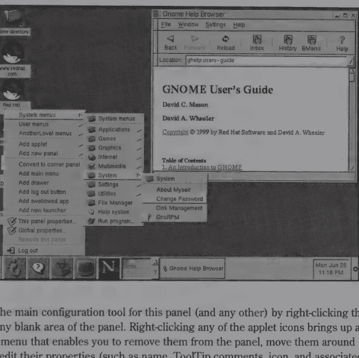

鼠标选择允许你根据喜好使用鼠标进行左手操作或右手操作。它还允许你设置鼠标的加速速度和阈值（延迟）设置；有些人喜欢鼠标指针在移动鼠标时快速划过屏幕，而另一些人则偏好慢动作。

## 配置 GNOME

你始终可以访问纵跨整个虚拟屏幕的应用程序底部的按钮，但有时你必须移动应用程序窗口才能访问面板按钮和菜单。

**如果抽屉内的启动器被按下时选择角抽屉**：如果你不喜欢在选择一个应用程序后手动关闭抽屉，那么这是一个非常实用的功能，如果你使用抽屉，它可以为你节省一些时间。标签页的垂直滚动条允许你在面板上添加、删除和移动图标及按钮时，设置图标与按钮之间自动放置并保持的空间量。

### 转换面板类型

GNOME 提供了两种不同类型的面板：你可以选择使用边缘面板或角面板。默认面板是边缘面板，它的行为与角面板不同。例如，如果你点击边缘面板任一末端的隐藏按钮，面板会关闭并变成你点击鼠标的角落中的一个图标。之后你再次点击隐藏按钮，面板将恢复到原始位置。

然而，角面板的作用方式有所不同。角面板不会扩展到占据整个虚拟屏幕的区域，而是随着你向其添加图标、启动器和菜单而增大或缩小。如果你点击角落中的隐藏按钮，打开的面板行为将类似于打开的边缘面板，并向该角落关闭。另一方面，如果你点击打开的角面板的另一端（即位于屏幕边缘中间某处的隐藏按钮），打开的角面板将移动到另一个角落。这时，你必须再次点击同一个隐藏按钮，才能让角面板关闭到你刚刚定位的角落。

你所使用的面板样式完全取决于你个人，取决于你觉得最自然的操作。从配置弹出菜单中选择“转换为边缘面板（或角面板）”将允许你尝试相反类型的面板。你也可以拥有多个面板，例如将这些面板中的每一个都策略性地放置在你的桌面上。例如，我将我的 CD、调制解调器、时钟和显示器连接存储在屏幕右上角的角面板中；这使得我底部的边缘面板保持相对整洁。

### 编辑单个面板属性

转换角面板和边缘面板是有用的，但你可能也想知道如何将面板放置在屏幕的不同角落或其他侧边上。你可以通过从面板配置弹出菜单中点击“此面板属性”选项来配置面板的位置。图 7.11 所示的窗口和标签页现在就会出现。


图 7.17

更改单个面板属性。

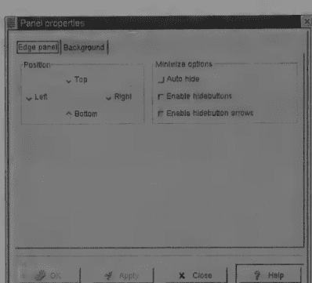

如你所示，与之前描述的全局面板属性相比，单个面板的配置项目相对较少。在第一个标签页中，你可以通过标签标题判断你正在配置的面板是边缘面板还是角面板。在窗口的“位置（Position）”部分，你可以在四个不同的角落（角面板显示为北、东、南、西方的地理位置）或四个不同的侧边（边缘面板显示为上、下、左、右）之间进行选择，如图 7.17 所示。

在边缘面板和角面板的“最小化选项（Minimize Options）”部分，你可以启用或禁用自动隐藏，这指定了面板是始终可见的，还是在鼠标指针不直接悬停在其上方时显示。你可以尝试自动隐藏功能看看你是否喜欢。此功能有助于保持桌面整洁，并且始终让你访问应用程序的整个窗口；然而，当你尝试调整窗口大小或移动到另一个虚拟屏幕时，如果边缘或角面板不断弹出并干扰你的操作，就会非常麻烦。在这种情况下，你还有能力禁用隐藏按钮以及显示在它们上面的箭头。

在配置边缘和角面板属性方面存在一个区别，那就是与“角属性（Corner Properties）”窗口相关的“方向（orientation）”部分。这个额外部分提供了这种功能：不仅可以指定将面板放置在哪个角落，还可以指定面板位于哪个侧边，以及当你点击其隐藏按钮时面板沿哪个方向来回滑动。例如，如果你想让角面板从右上角开始并跨越屏幕右侧，你应该选择“东北（Northeast）”和“垂直（Vertical）”方向。

注意：当通过点击其所在角落相反的隐藏按钮来将打开的面板移动到另一个角落时，面板属性将自动更新。例如，如果你点击一个打开的东北-垂直角面板的底部（南部）隐藏按钮两次，你会发现面板属性显示它已变成东南-垂直角面板。这看起来可能有点复杂，但当你稍微尝试并更多地理解这些奇怪的面板术语时，一切都会变得清晰。

## 添加和删除面板

你可能会发现面板很快变得杂乱且难以使用。在这种情况下，你可能想添加另一个面板。你可以通过右键点击任何面板或隐藏按钮背景，从弹出面板配置菜单中选择“添加新面板（Add New Panel）”来实现。你可以选择创建一个新的角面板或边缘面板。GNOME 将为你创建一个新面板并自动放置它，但此面板将是空的，等待你手动添加功能。

删除面板同样简单。通过右键点击它调出面板配置菜单，并选择“移除面板（Remove Panel）”。面板将立即被移除。请记住，你必须始终至少有一个面板，否则你将无法访问。结果是，如果你只有一个面板，“移除面板”选项将显示为灰色不可选。

## 注意

当你选择删除面板时，即使你放置了抽屉、菜单和启动器也不会弹出警告或确认窗口。确保不要误删面板！

## 配置插件

只需点击面板配置窗口上的“添加插件（Add Applet）”即可向面板添加插件。插件分组在几个菜单中，你可以根据需要从任何类别中选择，例如娱乐、监控、多媒体或工具。

在面板上添加插件后，你可以在面板上移动它。要移动插件，右键点击它并选择“移动插件（Move Applet）”。你的鼠标指针将变为十字准（取决于你的方法）。将光标移动到面板上的新位置，并在你想让插件停留的地方点击。某些插件（如 GNOME ）具有可以编辑的属性。这些设置每个插件都不同，因此无法在此讨论或展示。然而，如果你的插件具有可以编辑的属性，可以通过右键点击显示的插件配置菜单中的“属性（Properties）”选项进行设置。其他插件（如 CD 播放器）具有运行的选项；这是插件内置的不同功能，其目的与双击插件按钮相同。少数插件（如 GNOME 分页器）有一个“关于（About）”选项，你可以选择查看一个小窗口，提供有关该插件功能以及开发或发行者的基本信息。

从面板移除插件同样简单。你只需右键点击调出插件配置弹出菜单；然后选择“从面板移除（Remove From Panel）”选项。遗憾的是，在移除插件之前不会出现警告或确认窗口，请小心并确保你确实想从面板移除该插件。

## 配置面板启动器


假设你有一个经常运行的应用程序或工具，并想在其中一个面板上为它创建一个快捷方式。实现这一目标有两种主要方法。最简单的方法是打开 GNOME 文件管理器，浏览文件系统直到找到你需要的应用程序，然后用鼠标将其拖到面板上。此时，你将有机会为启动器指定标题和注释（参见图 7.18）。你还可以决定启动器是在静默运行该应用程序，还是在 shell 中运行，以便你与其交互或查看输出。

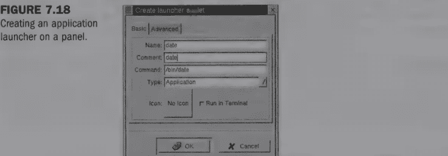

例如，图 7.18 显示了当你从文件管理器将`/bin/date`文件拖放到默认面板时弹出的窗口。在这种情况下，我添加了名称并选了“在终端中运行”（否则，命令将运行，但我将无法看到输出）。点击“确定”而不选择图标，会在面板上放置一个通用的 GNOME 图标和按钮；点击该按钮将运行命令并在弹出窗口中显示输出。

创建面板启动器的另一种方法是从面板的弹出式配置窗口中添加“新启动器（New Launcher）”。这将打开相同的窗口，并允许你输入启动应用程序所需的特定信息。这种方法的区别在于，该窗口没有提供浏览功能来帮助你查找应用程序或工具（与其他属性窗口不同，例如在选择时出现的那些窗口）。与在文件管理器中拖放不同，你必须知道并输入应用程序的准确路径和文件名。

注意：图 7.18 所示的“启动器小组件（Launcher Applet）”对话框外观和功能与你在右键点击面板启动器并选择“属性”后看到的“启动器属性（Launcher Properties）”窗口相似。除了名称之外，主要的区别是，你还有两个额外的按钮（“应用”和“确定”），允许你在查看和编辑属性时保存所做的任何更改（只有在你进行更改时，这两个按钮才可用）。

## 配置 GNOME

> GNOME 为你提供方便的快捷方式，可以在面板上添加注销功能。只需从面板配置弹出窗口中选择“添加注销按钮（Add Logout Button）”，面板上就会出现一个额外的启动器/小组件按钮。点击此按钮的效果与在 GNOME 主菜单中选择“注销（Logout）”相同。

## 配置 GNOME 抽屉

抽屉（Drawer）是 GNOME 提供的一种方便机制，用于在面板上存储应用程序启动器和菜单（包含一组启动器）。实际上，抽屉基本上是一个包含在其他面板中的面板，但它以带有自己图标的抽屉形式显示。你可以通过右键点击抽屉并选择“从面板移除（Remove From Panel）”来从任何面板上删除抽屉。向面板添加抽屉同样简单。要在面板上创建一个空抽屉，右键点击面板并选择“添加抽屉（Add Drawer）”。然后你可以通过从桌面或文件管理器拖放应用程序启动器到该抽屉中。

你可以像编辑其他对象一样编辑抽屉的属性。然而，当你打开属性窗口时，将无法像配置抽屉那样配置位置和方向设置。要移动抽屉，必须在右键点击它后选择“移动小组件（Move Applet）”。

要将主菜单或子菜单中的启动器或启动器组作为抽屉添加到面板，你有两个选择。主要方法是右键点击你想要的启动器（例如 CD 播放器）并选择“将启动器添加到面板（Add Launcher to Panel）”。然后右键点击启动器并选择“移动小组件”，将其移动到任何面板打开抽屉中的所需位置。然而，如果你在全局属性（Global Properties）窗口的杂项选项卡中启用了“显示按钮（Show Buttons）”选项，你可以点击菜单上启动器旁边的 ... 按钮，然后选择“将启动器添加到面板”。

你还可以向面板添加应用程序启动器的项目菜单或子菜单并使其在抽屉可用。要此操作，进入你感兴趣的菜单或子菜单，右键点击启动器或点击其旁边的 ...（如果已启用）并选择“将此抽屉添加到面板（Add This Drawer to Panel）”。所选菜单或子菜单包含的所有启动器都将作为图标列在访问该菜单的面板上的新打开抽屉中。然后你可以点击隐藏按钮来关闭和打开抽屉。

## 配置 GNOME 菜单

在 GNOME 中配置菜单和子菜单的主要方法是通过你可以从主菜单访问的编辑器。选择“设置（Settings） -> 菜单编辑器（Menu Editor）”，你将看到图 7.19 所示的应用程序窗口。此应用程序允许你展开折叠的菜单（通过加号）以查看下方的启动器和子菜单。你还可以右键点击菜单（此处所示）来添加或删除启动器、创建新的子菜单，或根据喜好移动或排序菜单。许多菜单只有 root 用户才能编辑。

图 7.19

使用 GNOME 菜单编辑器

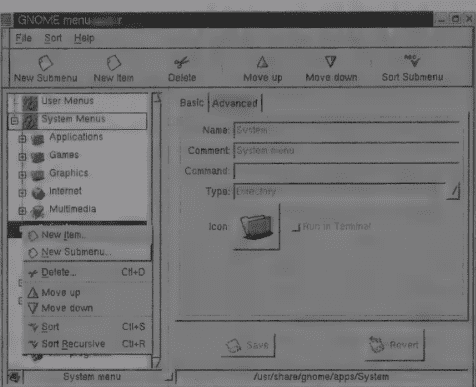

我们在菜单编辑器中看到两个选项卡：基础（Basic）和高级（Advanced）。在“基础”选项卡下，不仅可以编辑菜单、子菜单或菜单项（启动器）的名称，还可以编辑文件名（如果适用）和类型（菜单/目录或应用程序）、命令（与工具/提示相关）。如果某项的详情显示为灰色，则你无法修改它们。如果你想更改它们，必须拥有相应的权限。

如你所见，用户菜单通常直接显示在菜单上。在图 7.20 中，我更改了默认设置，强制将用户菜单显示为子菜单。当你这样做时，用户将显示为带有右侧小箭头图标的菜单项，允许你点击并在旁边弹出一个菜单（类似于 KDE 和 Enlightenment 的默认方式）。

图 7.20

在 GNOME 菜单编辑器中更改属性

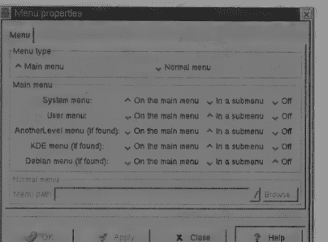

## 配置 GNOME 桌面

不要忘记，桌面上还有大量的可用空间可以补充面板、菜单和抽屉的功能。你可能希望将经常使用的目录、文件和应用程序启动器直接存储在桌面上以便快速访问。考虑到创建和使用多个桌面以及多个屏幕区域，这种能力可以是一个更大的资产。这样，你可以为不同的桌面预配置不同时间所需的工具，但你始终可以保持一个整洁的桌面。

带有 GNOME 和 Enlightenment 的 Red Hat 6.0 最强大的功能之一是它为你开箱即用的拖放功能。要将之前讨论过的 MIME 类型中定义的收藏应用程序、文件夹或文档（及其关联图标）拖放到桌面上，请从文件管理器选择该文件，并在将其拖放到桌面区域时，按住 Ctrl 键。

注意

在系统中到处拖放文件时，请确保按住 Ctrl 键。如果不按，默认操作是移动文件，而不是复制或创建快捷方式（符号链接）。

另一种方法是可以向桌面添加启动器和目录。只需右键点击桌面的空白区域，然后选择“新建（New）”、“启动器（Launcher）”或“目录（Directory）”。如果你选择创建一个新的桌面目录，你可以在弹出的窗口中输入它的名称。如果你选择创建一个新的启动器，将看到一个与图 7.18 类似的弹出窗口，它允许你输入命令的文件名、终端运行要求以及用于描述它的工具提示（ToolTip）注释。

## 总结

GNOME 和 Enlightenment 提供了一个强大、用户友好、灵活且易于配置的桌面环境。你应该熟悉每个应用程序的所有主要选项和功能，以便充分利用它们。如果你能自定义桌面的显示方式、行为和声音，你将更享受你的 Linux 体验。

Red Hat Linux 6.0 包含了所有所需的根据个人喜好配置 GNOME 和 Enlightenment 的图形化工具。不再需要使用 Linux 开发早期作为唯一选择的命令行配置工具。你可以从主面板、主菜单和桌面背景轻松地访问 GNOME 和 Enlightenment 配置工具。

# 第 8 章 安装与配置 KDE 桌面

作者：Robert Napier

- 什么是 KDE？ 136
- 安装 KDE 137
- 配置 KDE 138
- KDE 故障排除 157

## 什么是 KDE？

K 桌面环境（KDE）是一个 UNIX 桌面，这意味着它提供了一个可以与应用程序集成的用户友好 GUI。KDE 提供的功能类似于 Macintosh 和 Windows 界面提供的功能。它还为开发者提供了一个框架以及应用程序相互通信的方法。图 8.1 显示了 KDE 的运行。

图 8.1

KDE 许多你在 Macintosh 和 Windows 机器上看到的相同功能——以及许多你没有的功能。

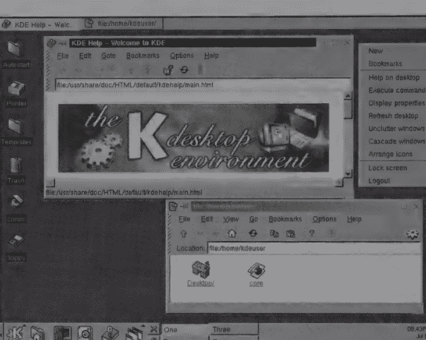

从用户的角度来看，KDE 许多功能，如下：

- **桌面直接文件**——在 KDE 中，就像在 Macintosh 或 Windows 中一样，你可以将文件拖到桌面并以图标形式存储在那里。桌面上的链接也可以自动启动应用程序。

- **会话管理**——会话管理意味着应用程序可以记住你注销时的状态，并在重新登录时以完全相同的状态重启应用程序。例如，你可以重新回到你正在处理的文件以及你所处的位置。

- **桌面面板**——桌面面板通过提供应用程序启动器（或 K 菜单）和启动收藏应用程序的面板按钮来快速访问应用程序。你还可以*嵌入*（swallow）应用程序，这意味着看起来像按钮的东西实际上可以是正在运行的应用程序。这种功能对于检查新邮件的`xbiff`等程序非常有用。

- **任务栏**——任务栏显示当前可用窗口，让你能够快速在应用程序之间切换，即使它们处于最小化状态。

- **分页器**——*分页器*（pager）允许你维护多个桌面并在它们之间轻松切换。例如，你可能把邮件程序放在一个桌面，将所有的编程工具放在另一个桌面，并将纸牌牌游戏放在第三个桌面上。

从用户的角度来看，KDE 最重要的部分是`kwm`、`kpanel`和`kfm`。首先，`kwm`（即 KDE 窗口管理器）提供了所有标准的窗口功能，如显示、移动和调整窗口大小。`kpanel`工具提供了一个方便的面板，通常位于屏幕底部。它有快速启动按钮、菜单、时钟等。此外，`kpanel`还提供了任务栏，通常位于屏幕顶部。它显示所有当前打开的窗口并允许你在它们之间进行切换。最后，`kfm`是 KDE 文件管理器，它不仅提供对文件的访问，还充当 Web 和桌面浏览器。

## 安装 KDE

Red Hat 6.0 的默认桌面是 GNOME，因此你对对其进行一些修改以安装 KDE。

表 8.1 列出了 Red Hat 6.0 的 KDE 包。

表 8.1 KDE 软件包

| RPM | 用途 |
| --- | --- |
| `qt` | (必需) Qt 工具包。 |
| `kdesktop` | (推荐) KDE 需要的各种非 KDE 库。 |
| `kdelibs` | (必需) KDE 共享库。 |
| `kdebase` | (必需) KDE 核心，例如窗口管理器。 |
| `kdegames` | (可选) 若干游戏。 |
| `kdegraphics` | (可选) 用于查看和绘制图形的各种程序。 |
| `kdeutils` | (可选) 计算器、编辑器和类似工具。 |
| `kdemultimedia` | (可选) CD 播放器和其他媒体应用程序。 |
| `knetwork` | (可选) 互联网应用程序，包括邮件读取器和新闻阅读器。 |
| `kdeadmin` | (可选) 系统管理程序。 |
| `ketoys` | (可选) 不是游戏的趣味性程序。例如，`kmoon`将月相显示在你的面板上。 |
| `korganizer` | (可选) 个人组织器。 |

应按照列出的顺序使用`rpm`（Red Hat 软件包管理器）安装所需的和推荐软件包：

```bash
$ su
Password: <root password>
```

（注：从第 163 页开始的提供的 OCR 文本在源文件中变得严重损坏/重复。我已根据可见的上下文清理了逻辑结构。）

7. 如果设备应为只读，请勾选“只读”（Readonly）复选框。

8. 点击“挂载图标”（Mounted Icon）来选择设备挂载时显示的图标。选择“未挂载图标”（Unmounted Icon）来选择设备未挂载时显示的图标。为了方便起见，提供了带有或不带有小绿光的软盘和 CD 图标。要选择某个图标，只需点击它，然后点击“确定”。

9. 最后，点击“确定”关闭对话框。

URL 包含 FTP URL、互联网地址 (URLs) 和万维网 URL。它们之间的唯一区别在于图标。

要创建一个 URL，请按照以下步骤操作：

1. 打开`kfm`（例如，点击面板上的“主页”图标）。

2. 右键点击`kfm`背景获取本地菜单。

3. 点击“新建”（New）。

4. 点击您想要的 URL 类型（FTP URL、互联网地址或 World Wide Web URL）。

5. 为 URL 输入一个有意义的名称。

6. 点击“URL”标签页。

7. 在 URL 字段中输入 URL。

8. 如果需要，点击图标以选择新图标。选择您想要的图标，并点击“确定”。

9. 点击“确定”关闭对话框。

**MIME 类型** 多用途互联网媒体类型扩展（MIME）最初旨在用于编码电子邮件消息中的文件，但现在它已演变为处理许多各种任务。KDE 使用标准的 MIME 机制来识别和处理文件。如果 KDE 需要新的 MIME 类型，应用程序将安装它们。通常情况下，您会设置自己的 MIME 类型，将某种文件类型与非 KDE 应用程序关联。

以下是关于创建 MIME 类型的说明。在示例中，我们将创建 MIME 类型`image/-xcf`。*image* 表示类别，*x-* 表示这是一个非标准的 MIME 类型，而 *xcf* 表示这是用于`.xcf`文件的，`.xcf`是 GIMP（一个用于 Linux 的图像处理软件包）的本地原生文件格式。

1. 打开`kfm`（例如，点击面板上的“主页”图标）。

2. 点击“编辑”（Edit），“MIME 类型”（Mime Types）。

3. 点击`image/`文件夹。

4. 右键点击`kfm`背景获取本地菜单。

5. 点击“新建”（New）。

6. 点击“MIME 类型”（Mime Type）。

将 MIME 类型命名为`x-xcf.kdelnk`。名称应该是 MIME 类型后跟`.kdelnk`。

您将收到一个错误，显示为`The mime type config file <config filename> does not contain a MIMEType—entry`。这是完全正常的，因为您还没有配置您的 MIME 类型。点击“确定”。

将弹出一个 MIME 类型对话框。点击“绑定”（Binding）。

在“模式”（Pattern）字段中，输入指示此类文件的文件名模式。在示例中，输入`*.xcf;*.xcf`。保留末尾的分号。注意，文件名模式列表是用分号分隔的。

在“MIME 类型”字段中，输入`image/xcf`。这就是 MIME 类型。

在“注释”（Comment）字段中，输入`GIMP image file`。这只是一个解释什么是 MIME 类型的注释。

在“默认应用程序”（Default Application）字段中，如果已安装了 GIMP，请选择 GIMP。如果未安装 GIMP，请暂时留空，并选择“应用程序”部分获取有关安装新应用程序的信息。

点击问号图标并为 MIME 类型选择一个合适的图标。在示例中，选择油漆桶（`image.xpm`）并点击“确定”。

点击“确定”保存该 MIME 类型。

应用程序 必须了解您已安装的程序，以便将数据文件匹配到相应的程序。如果我们想“使用 GIMP”来查看`xcf`图像文件，KDE 必须知道您已安装了 GIMP 以及以及如何运行它。`kdelnk` 文件提供了此类信息。

在示例中，我们将将 GIMP 与各种图像文件关联。此示例假设您已经从 Red Hat 6.0 安装了 GIMP。请按照以下步骤操作：

1. 打开`kfm`（例如，点击面板上的“主页”图标）。

2. 点击“编辑”，“MIME 类型”。

3. 点击`image/`文件夹。

4. 右键点击`kfm`背景获取本地菜单。

5. 点击“新建”。

6. 点击“MIME 类型”。

将 MIME 类型命名为`x-xcf.kdelnk`。

您将收到错误显示`The mime type config file <config filename> does not contain a MIMEType—entry`。这是完全正常的，因为您还没有配置您的 MIME 类型。点击“确定”。

将弹出一个 MIME 类型对话框。点击“绑定”。

在“模式”（Pattern）字段中，输入指示此类文件的文件名模式。在示例中，输入`*.xcf;*.xcf`。保留末尾的分号。注意，文件名模式列表是用分号分隔的。

在“MIME 类型”字段中，输入`image/xcf`。这就是 MIME 类型。

在“注释”（Comment）字段中，输入`GIMP image file`。这只是一个解释什么是 MIME 类型的注释。

在“默认应用程序”（Default Application）字段中，如果已安装了 GIMP，请选择 GIMP。如果未安装 GIMP，请暂时留空，并选择“应用程序”部分获取有关安装新应用程序的信息。

点击问号图标并为 MIME 类型选择一个合适的图标。在示例中，选择油漆桶（`image.xpm`）并点击“确定”。

点击“确定”保存该 MIME 类型。

应用程序 必须了解您已安装的程序，以便将数据文件匹配到相应的程序。如果我们想“使用 GIMP”来查看`xcf`图像文件，KDE 必须知道您已安装了 GIMP 以及以及如何运行它。`kdelnk` 文件提供了此类信息。

在示例中，我们将将 GIMP 与各种图像文件关联。此示例假设您已经从 Red Hat 6.0 安装了 GIMP。请按照以下步骤操作：

1. 打开`kfm`（例如，点击面板上的“主页”图标）。

2. 点击“编辑”，“应用程序”。

3. 右键点击`kfm`背景获取本地菜单。

4. 点击“新建”，“应用程序”。

5. 将应用程序命名为`xeyes.kdelink`。

7. 在“执行”（Execute）字段中，输入`xeyes`。这是启动此应用程序要执行的程序。

8. 点击齿轮图标为`xeyes`选择一个图标。如果可用`xeyes.xpm`图标，请选择它。然后点击确定。


9. 在“面板上吞入”（Swallowing on Panel）中，在“执行”字段和“窗口标题”（Window Title）字段中都输入`xeyes`。“执行”字段告诉 KDE 当将此项置于面板时应运行什么程序。“窗口标题”字段告诉 KDE 要“吞入”哪个窗口。这应该是应用程序在其标题栏上显示的标题。

10. 此示例不需要勾选“在终端中运行”（Run in Terminal）。

11. 点击“应用程序”（Application）选项卡。

12. 对于“二进制模式”（Binary Pattern），输入`xeyes;`。这是一个用分号分隔的可执行文件可能名称列表。

13. 对于“注释”（Comment），输入`xeyes`。这只是为了让你知道这是什么程序。

14. 对于“名称”（Name），输入`xeyes`。这是显示在本地菜单中的名称（右键点击文件时弹出的菜单）。如果程序没有提供自己的标题，它也可以用作窗口标题。

15. 点击确定完成。

16. 最后，点击你刚刚创建的`xeyes`图标并将其拖到面板上。当鼠标在屏幕上移动时，你会看到面板上有两只眼睛。

17. 要移除`xeyes`，右键点击这些眼睛并点击“移除”（Remove）。

对于命令行应用程序，勾选“在终端中运行”（Run in Terminal）。KDE 将启动一个终端来显示该应用程序。按照以下步骤为邮件程序`elm`创建一个链接：

1. 打开`kfm`（例如，点击面板上的主页（Home）图标）。

2. 点击“编辑”（Edit），“应用程序”（Applications）。

3. 右键点击`kfm`背景以获取本地菜单。

4. 点击“新建”（New），“应用程序”（Application）。

5. 将应用程序命名为`Elm.kdelnk`。

6. 将出现一个应用程序对话框。点击“执行”（Execute）选项卡。

7. 在“执行”字段中，输入`elm`。这是启动此应用程序要执行的程序。

8. 点击齿轮图标为`elm`选择一个图标。然后点击确定。

9. 留“面板上吞入”（Swallowing on Panel）项为空。

10. 勾选“在终端中运行”（Run in Terminal）。

11. 对于“终端选项”（Terminal Options），输入`-caption "Mail"`。

12. 点击“应用程序”（Application）选项卡。

13. 对于“二进制模式”（Binary Pattern），输入`elm;`。这是一个用分号分隔的可执行文件可能名称列表。

14. 对于“注释”（Comment），输入`Elm Mail Reader`。这只是为了让你知道这是什么程序。

15. 对于“名称”（Name），输入`Elm`。这是显示在本地菜单中的名称（右键点击文件时弹出的菜单）。如果程序没有提供自己的标题，它也可以用作窗口标题。

16. 点击确定完成。

以下选项通常用于“终端选项”（Terminal Options）：

- `-caption "Text"`会使窗口标题变为`Text`。窗口打印在标题栏上。
- `-nowelcome`当打开新的终端窗口时，标题通常会设置为“Welcome to the Console”几秒钟，然后显示你用`-caption`设置的标题。要避免“Welcome to the Console”消息，请使用`-nowelcome`。
- `-vt_sz CCXLL`将终端大小设置为`CC`列`LL`行。例如，要设置为 80 列 25 行的终端，请使用`-vt_sz 80x25`。

## 向应用程序启动器中添加程序

应用程序启动器（Application Starter）或 K-Menu 提供了许多应用程序的快速访问，如图 8.2 所示。应用程序启动器分为三个部分：默认菜单、个人菜单和管理菜单。

### 图 8.2

应用程序启动器或 K-Menu 是组织应用程序的极佳方法。

(image)

- 默认菜单对于系统上的所有用户都是相同的；只有`root`可以修改。
- 个人菜单每个用户独有，可以由该用户修改。
- 管理菜单包含完全无法修改的项目。

这些部分每个都可以包含以下一个或多个元素：

- 分隔符（Separator）——此水平线将菜单的一个部分与其他部分隔开。这可以更容易对相关应用程序进行分组，而无需创建子菜单。
- 子菜单（Submenu）——这是菜单中的菜单。你可以根据需要尽可能深地嵌套菜单，但超过两或三层可能会变得难以操作。在图 8.2 中，“应用程序”（Applications）就是一个子菜单。名称右侧的小三角形显示它是一个子菜单。
- 应用程序（Application）——应用程序是放在应用程序启动器中最常见的内容。此条目启动一个应用程序。
- 链接（Link）——这是一个 URL，本地或远程均有。链接允许你将喜爱的网站或本地文档直接放在应用程序启动器上。
- 设备（Device）——这提供了对物理设备的访问，如 CD-ROM 或软盘驱动器。详细信息请参见本章前面的“文件系统设备”（File System Device）部分。

所有应用程序启动器项都是`kdelink`文件，就像模板一样。事实上，相同的文件可以用于创建桌面图标和应用程序启动器。

### 菜单编辑器（Menu Editor）

修改应用程序启动器最简单的方法是使用菜单编辑器。要启动菜单编辑器，点击应用程序启动器（K-Menu）、面板（Panel）、编辑菜单（Edit Menus）。菜单编辑器如图 8.3 所示。

### 图 8.3

(image)

### 配置（Configuring）

(image)

### 导航（Navigating）

## 定制面板

面板是 KDE 的核心部分，也是可配置性最高得之一。它包含了你最常用的应用程序、状态指示器、桌面翻页器等内容。通过配置面板使其完全符合你的工作习惯，是提高工作效率的最佳方法之一。

### 默认面板组件

在配置面板之前，请先花些时间查看它的默认配置。图 8.4 显示了一个非常常见的默认面板配置。

### 图 8.4

默认的 KDE 面板提供了最关键的功能，但并非所有你想要的功能。

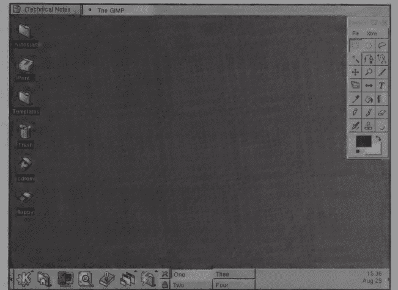

你的默认面板将包含以下内容：

- **应用程序启动器**——应用程序启动器（也称为 K-菜单）包含了你所有程序和配置菜单的链接。它类似于 Windows 95 的开始菜单。按下`Alt+F1`打开应用程序启动器。有关如何自定义此菜单的信息，请参阅本节较早之前的“向应用程序启动器中添加程序”部分。
- **主目录**——主目录会在你的主目录下启动文件管理器。正如我们稍后讨论的，你可以在面板上放置其他目录。
- **KDE 控制中心**——通过控制中心，你可以配置 KDE 的各个部分，包括窗口管理器、文件管理器、键盘、声音等等。
- **查找工具**——KDE 拥有一个强大的查找文件工具。你可以根据名称模式、文件类型、大小或内容进行搜索。该工具的设计非常接近 Microsoft Windows 98 的实用程序。
- **帮助浏览器**——如果你是 KDE 新手，帮助浏览器将是一项极好的资产。它本质上是一个简单的 Web 浏览器。事实上，帮助文件是用 HTML 编写的，帮助系统中的超链接可能指向互联网上的网页。帮助系统之外的链接不会在同一个窗口中显示，尽管帮助浏览器可以启动`kfm`来处理这些请求。
- **窗口列表**——窗口列表可以让你即时访问当前运行的所有窗口，无论它们运行在哪个桌面上。当你跨多个桌面上打开了许多窗口时，能够访问这些窗口可以作为一个实时查看器。你也可以通过点击桌面上的鼠标按钮来获取窗口列表。
- **磁盘导航器**——这可以让你快速访问磁盘和最近访问的文件。通过级联菜单（就像应用程序启动器一样），你可以快速访问根目录、KDE 目录、你的 CD-ROM 驱动器、主目录和桌面。
- **注销**——注销将退出 KDE 并返回登录界面。
- **锁定**——KDE 提供了各种屏幕保护程序，它们会在指定的空闲时间后激活。如果你想立即启动屏幕保护程序，可以按下锁定按钮。要解锁屏幕，你需要输入登录密码。屏幕保护可以通过控制中心进行配置（参见关于 KDE 控制中心的上一点）。
- **翻页器**——此区块中的四个按钮每个都为你提供了一个完全不同的桌面，每个桌面显示不同的窗口。
- **时钟**——时钟出现在纹理面板的右侧，上方有一个箭头。当你点击这些按钮之一时，面板会向指示的方向滑出屏幕。
- **面板隐藏**——面板的两侧都有一个带有箭头的纹理面板。当你点击这些按钮之一时，面板会向指示的方向滑出屏幕。

### 排列默认面板组件

应用程序启动器、翻页器、注销和锁定无法从面板中移除，但可以移动。锁定无法移除或重新排列。面板上的所有其他项目都可以根据你的需要添加、移除或移动。

要在面板内移动项目，请用鼠标按钮点击并拖动它。习惯这些按钮的工作方式可能需要一点练习。其他按钮可能会重新排列以适应你意料之外的移动。

### 新面板组件

大多数面板组件仅仅是`kdelink`文件，正如本章较早之前的“模板”部分描述的那样。要将这些内容添加到面板，请先按照本章较早之前的“应用程序”部分的描述创建它们。然后将它们拖到面板上。例如，要将 GIMP 图形程序添加到面板，请按照以下步骤操作：

1. 如果你尚未创建，请按照本章较早之前的“应用程序”描述创建`gimp.kdelink`。
2. 打开`kfm`（例如，点击面板上的主页图标）。
3. 点击“编辑”、“应用程序”。
4. 点击“图形”进入文件夹。
5. 点击并拖动 GIMP 图标到面板上未使用的区域。释放鼠标按钮。
6. 如果你想移动刚刚放置在面板上的图标，请使用鼠标中键点击并拖动它。

如果该链接已于你的应用程序启动器中，你可以点击应用程序启动器、“添加应用程序”，然后从菜单中选择应用程序。

窗口列表和磁盘导航器是特殊的。要添加或删除它们，点击应用程序启动器、“面板”，然后选择“添加磁盘导航器”或“添加窗口列表”。它旁边的小区块指示它当前是否处于激活状态。

### 移除面板组件

要移除组件，右键点击组件并点击“移除”。记住，应用程序启动器、翻页器、注销、锁定和时钟无法移除。

### 配置面板外观

面板的外观是非常可配置的。你使用 KPanel 配置对话框来控制面板的外观。要访问 KPanel 配置对话框，在面板的未使用区域右键点击面板并点击“配置”。

### 面板选项卡

选项卡决定了任务栏的位置和样式。要访问 KPanel 配置对话框，在面板的未使用区域右键点击面板并点击“配置”。

位置选项卡决定了任务栏的位置。位置框设置面板的位置。你可以选择顶部、左侧、底部或右侧。样式框设置面板的大小。你可以选择小、正常或大。任务栏框设置任务栏的位置。你可以选择隐藏、顶部或底部。最后，顶部/左侧将任务栏垂直显示在屏幕的左上角。

### 选项选项卡

选项选项卡决定了面板的行为。选择菜单提示会在当鼠标指针指向它们时弹出菜单项的描述。延迟滑动块决定你想让鼠标指针停留在项目上多久弹出提示。自动隐藏面板会在你不使用它时导致面板“滑”出屏幕（通常是底部）。要再次访问它，将鼠标指针指向面板边缘。自动隐藏任务栏与自动隐藏面板相同，只是作用于任务栏。动画显示/隐藏决定了任务栏是滑出屏幕还是直接消失。速度滑动块在开启时决定动画的快慢。个人菜单项优先会将个人菜单移动到应用程序启动器的顶部。默认情况下，系统菜单在前。有关个人菜单和系统菜单的更多信息，请参见本章的“菜单编辑器”部分。文件夹优先会将应用程序启动器的子菜单移动到顶部。时钟显示 AM/PM 格式允许时钟以 12 小时制带有 AM 和 PM 标记。取消此选择将显示 24 小时制（军事时间）。时钟显示网络拍允许时钟显示拍。拍是 Swatch, A.G. 提出的一个时间标准。它将一天分为 1000 拍。这通常被认为是 Swatch, A.G. 的营销手段，但如果你感兴趣，可以访问`http://www.swatch.com`获取更多信息。

## 配置虚拟桌面

KDE 允许你拥有多个虚拟桌面。虚拟桌面是你可以在上面分离程序的整个屏幕。例如，你可以在一个虚拟桌面运行邮件程序，在另一个上运行编辑器，在第三上运行游戏。由于每个桌面可以使用整个屏幕，你的屏幕可以不那么拥挤。

你可以通过使用翻页器选择显示的虚拟桌面。翻页器是注销和锁定按钮右侧的区块。图 8.4，这些按钮标记为一、二、三、四。你通过点击这些按钮之一来选择虚拟桌面。

虚拟桌面是高度可配置的。要配置你的桌面，点击应用程序启动器、“面板”、“配置”调出 KPanel 配置对话框（见图 8.5）。点击桌面选项卡来配置你的桌面。

### 图 8.5

你可以配置 KDE 虚拟桌面以匹配你的工作方式。

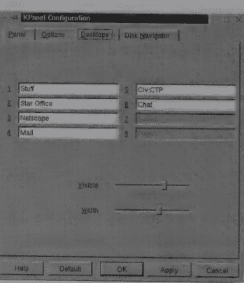

此对话框中的数字字段决定了桌面的名称。要更改桌面名称，只需更改这些字段中的值即可。您应该有意义地命名，以便记住每个桌面上显示的内容。可见的滑块设置了可用的虚拟桌面数量。您可以拥有两个、四个、六或八个桌面；四个是默认设置。宽度（Width）滑块设置面板上虚拟桌面按钮的宽度。您应该将宽度设置得足够大以便看到您选择的名称，但不要占用面板上不必要的空间。KDE 会会在话之间记住您的桌面名称。

- 如果您只想更改桌面的名称，则不需要使用 KPanel 配置对话框。点击桌面按钮进入该桌面，然后再次点击它。您将看到一个标准的 I 型光标来更改名称。

## 配置磁盘导航（Disk Navigator）

磁盘导航对于快速获取常用文件非常有用。由于文件是以级联菜单的形式显示的，在您访问根目录后，就可以访问系统上的任何文件。但通常，您并不希望通过四或五级菜单来获取想要的文件。为了实现这一点，磁盘导航允许您获取开始开始的树结构。您可以拥有任意数量的树——但请记住，拥有太多树可能会难以快速获取所需内容，而这正是磁盘导航的初衷。

磁盘导航由三个部分组成：共享（Shared）、个人（Personal）和最近（Recent）。共享部分只能由超级用户修改，供机器上的所有用户使用。个人部分可以由每个用户修改并仅供该用户使用。最近部分列出了您最近访问 KDE 文件和应用程序。

要配置磁盘导航，右键点击并点击属性（Properties）。这将弹出图 8.6 所示的磁盘导航配置面板。注意，这与图 8.5 显示的磁盘导航标签页相同。

### 图 8.6

磁盘导航允许您定义自己的最常用目录。

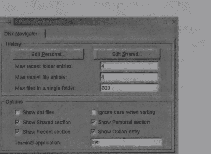

以下是磁盘导航选项：

- **编辑个人（Edit Personal）**——此选项决定个人部分列出哪些目录。选择此项将弹出一个`kfm`窗口。只需将想要包含的文件夹链接放在此处。有关创建链接的更多信息，请参见本章前面的“模板（Templates）”部分。
- **编辑共享（Edit Shared）**——这与编辑个人选项相同，但管理的是共享部分。这只能由`root`用户执行。
- **最大文件夹条目（Max folder entries）**——此选项设置显示的最近访问的文件夹数量。默认值 4 通常是一个不错的选择。将其设置得太高会导致磁盘导航变得过大。
- **最大文件条目（Max file entries）**——此选项设置显示的最近访问的文件数量。默认值 4 通常是一个不错的选择。将其设置得太高会导致磁盘导航变得过大。
- **单个文件夹最大文件（Max files in a single folder）**——此选项限制了文件夹中可以显示的文件数量。如果设置超过此值，将显示“文件过多（Too Many Files）”的消息。出于性能考虑，最好不要将此值设置得比默认值（200）高得多。
- **显示隐藏文件（Show dot files）**——在 Linux 中，以点开头的文件被认为是隐藏文件。这些通常是不需要的配置文件，最好不要设置此选项。
- **排序时忽略大小写（Ignore case when sorting）**——这会将排序设置为“A”、“a”、“B”、“b”、“...”而不是通常的 Linux 排序方法“A”、“B”、“a”、“b”。注意，这并不完全是“忽略”大小写。
- **显示共享部分（Show Shared section）**——通过此选项，您可以切换是否显示共享部分。
- **显示个人部分（Show Personal section）**——此选项允许您切换是否显示个人部分。
- **显示最近部分（Show Recent section）**——如果关闭此选项，最近访问的文件夹和文件列表将完全不再更新。某些用户认为这是对隐私的改进。
- **显示选项条目（Show Option entry）**——此选项允许您切换磁盘导航上是否可用“选项”条目。如果您关闭它，将必须通过主`kpanel`配置对话框来配置磁盘导航。
- **终端应用程序（Terminal application）**——如果您在磁盘导航中 Shift+点击文件夹的“打开文件夹（Open Folder）”项，将在该目录下启动一个终端。此选项决定使用什么终端。

## 美化界面

您可以通过多种方式自定义 KDE，让您的桌面更具吸引力。这些变化中很少能提升您的性能，但它们可能会让您在工作时心情愉快。后续章节中的所有设置可以在 KDE 控制中心的“桌面（Desktop）”下找到。按照以下步骤自定义您的桌面外观：

1. 点击面板上的 KDE 控制中心。
2. 点击“桌面”左侧的小加号（`+`）以展开选项列表。
3. 选择所需的选项（背景、边框等）。

**背景（Background）**：桌面最具有个性化的特征之一。某些用户喜欢简单、平直的背景，而另一些人喜欢纹理甚至图像。KDE 支持所有这些格式。

每个桌面都可以有自己的背景，因此您需要选择正在操作的桌面。不同的背景对于帮助您随时判断自己正处于哪个桌面非常有帮助。

**单色（The One Color）**选项的作用正如其名所示。（注：原文此处存在大量重复文本，翻译已按逻辑流处理）。

## 排除 KDE 故障

可用的主题质量差不齐；`kdethemes.org`对主题的评分从 -2 到 +2 不等。从主题库中，选择你想要看到的最低评分，这将移除许多有趣的主题。如果你倾向于自己做决定，可以将过滤器设置为 -2，这样你就可以看到所有内容。你还可以对主题提交并阅读评论。

## 获取更多桌面空间


KDE 提供了许多选项来最大化你的可用屏幕空间。如果你正在重新整理桌面，请尝试以下方法：

- 缩小你的面板——在`KPanel Configuration`对话框的`Panel`选项卡中，点击`Tiny`（微型）。
- 点击左或右侧隐藏按钮将面板移出屏幕——当你将面板移出屏幕时，KDE 会在你的任务栏上放置启动器、窗口列表和磁盘导航器。
- 自动隐藏面板和任务栏——在`KPanel Configuration`对话框的`Options`选项卡中，点击`Auto Hide Panel`（自动隐藏面板）和`Auto Hide Taskbar`（自动隐藏任务栏）。选择这些选项会导致面板和任务栏隐藏，直到你的鼠标指针触碰它们的边界。例如，当你将鼠标指针移动到屏幕底部时，面板就会重新出现。
- 彻底移除任务栏——你并不需要任务栏，因为窗口列表提供了类似的功能。在`KPanel Configuration`对话框的`Panel`选项卡中，选择`Hidden`（隐藏）。

## 排除 KDE 故障

当你按照自己想要的方式获得 KDE 时，可能不太会出错。然而，在 Red Hat 下安装和配置 KDE 可能会很棘手。

如果你的问题没有在你所在的章节中，你应该考虑加入 KDE-helping 列表（位于`kde-user-lists`）并订阅。向`kde-user-request@kde.org`发送一封空白邮件，主题为`subscribe <email address>`（将`<email address>`替换为你的电子邮件地址）。在发布提问之前，最好检查`lists.kde.org`上的存档。

## 安装 KDE

从 RPM 安装 KDE 通常很顺利。但是，如果你遇到问题，这可能有所帮助。

使用`kfm`连接`ftp.redhat.com`，我收到消息`Could not login for ftp.redhat.com`。可能是密码错误。

Red HAT 服务器经常过载。使用`nfcpt`、`ftp`或 Netscape，你将收到有用的消息：`30 Anonymous Full, Please try http://www.redhat.com/mirrors.html`。遗憾的是，`kfm`不显示此消息。注意，镜像站通常每天更新一次，更新频率更低。

## RPM 命令缺少前提条件

确保你按照正确的顺序安装 KDE RPM：`qt`、`kdesupport`、`kdelibs`、`kdebase`，然后是所有其他包。

如果你在 Red Hat 5.2 或更早版本上安装 KDE，发行版中不包含 KDE 包，因此你需要下载它们。请确保你下载的是 Qt 1.44 版本，因为 Qt 2.0 与 KDE 1.x 不兼容。

## 登录时 `$KDEDIR` 未设置

如果你已经安装了 RPM，请使用以下命令验证`kdesupport`是否正确安装：

```bash
$ -Vkdesupport
```

如果打印出任何错误，你将重新安装`kdesupport`。设置`$KDEDIR`的文件是`/etc/profile.d/kde.sh`（用于 csh 和 tcsh shell）或`/etc/profile.d`（用于几乎所有情况）。如果你不确定使用哪种 shell，你肯定在使用 bash，它使用`kde.sh`。这两个文件都属于`kdesupport`包。

如果你从源码安装 KDE 并使用 csh 或 tcsh 以外的任何 shell（在命令行提示符输入`echo $SHELL`进行验证），你可以复制 RPM 设置`$KDEDIR`的方法（这是一个很好的方法）。只需创建包含以下内容的`/etc/profile.d/kde.sh`：

```bash
# KDE initialization script (csh)
MYKDEDIR=$KDEDIR
if [ -z "$KDEDIR" ] != "$MYKDEDIR" ]; then
 KDEDIR=$MYKDEDIR
  if [ "$KDEDIR" != "/usr" ]; then
    PATH="$KDEDIR/bin:$PATH"
  fi
export KDEDIR
```

将`<your KDEDIR>`替换为你的 KDEDIR 值。通常，这是`/usr`或`/opt/kde`。如果你使用 csh 或 tcsh，请创建包含以下内容的`/etc/profile.d/kde.sh`：

```bash
# KDE initialization script (csh)
if ( $KDEDIR == "/usr" ) then
  exit
endif
endif
setenv KEDIR /usr
setenv PATH ${KEDIR}/bin:${PATH}
```

将所有的`/usr`替换为你的 KEDIR。

我从`ftp.kde.org`下载了源码发行版，所有文件都有`.bz2`扩展名。

这些是使用 bzip2 而不是 gzip 压缩的。要解压它们，你需要从 Red Hat CD 中安装 bzip2：

```bash
$ su
Password: <root password>
# cd /mnt/cdrom/RedHat/RPMS
# rpm -i bzip2*
```

安装完成后，你可以在命令行提示符输入以下命令来提取这些存档：

```bash
$ bzip2 -cd filename.tar.bz2 | tar xvf -
```

将`filename.tar.bz2`替换为你想要提取的文件。

## 配置 KDE 的问题

可用的主题质量差不齐；`kdethemes.org`对主题的评分从 -2 到 +2 不等。从主题库中，选择你想要看到的最低评分，这将移除许多有趣的主题。如果你倾向于自己做决定，可以将过滤器设置为 -2，这样你就可以看到所有内容。

## 获取更多桌面空间

KDE 提供了许多选项来最大化你的可用屏幕空间。如果你正在重新整理桌面，请尝试以下方法：

- 缩小你的面板——在`KPanel Configuration`对话框的`Panel`选项卡中，点击`Tiny`（微型）。
- 点击左或右侧隐藏按钮将面板移出屏幕——当你将面板移出屏幕时，KDE 会在你的任务栏上放置启动器、窗口列表和磁盘导航器。
- 自动隐藏面板和任务栏——在`KPanel Configuration`对话框的`Options`选项卡中，点击`Auto Hide Panel`（自动隐藏面板）和`Auto Hide Taskbar`（自动隐藏任务栏）。选择这些选项会导致面板和任务栏隐藏，直到你的鼠标指针触碰它们的边界。例如，当你将鼠标指针移动到屏幕底部时，面板就会重新出现。
- 彻底移除任务栏——你并不需要任务栏，因为窗口列表提供了类似的功能。在`KPanel Configuration`对话框的`Panel`选项卡中，选择`Hidden`（隐藏）。

## 排除 KDE 故障

当你按照自己想要的方式获得 KDE 时，可能不太会出错。然而，在 Red Hat 下安装和配置 KDE 可能会很棘手。

如果你的问题没有在你所在的章节中，你应该考虑加入 KDE-helping 列表（位于`kde-user-lists`）并订阅。向`kde-user-request@kde.org`发送一封空白邮件，主题为`subscribe <email address>`（将`<email address>`替换为你的电子邮件地址）。在发布提问之前，最好检查`lists.kde.org`上的存档。

## 安装 KDE

从 RPM 安装 KDE 通常很顺利。但是，如果你遇到问题，这可能有所帮助。

使用`kfm`连接`ftp.redhat.com`，我收到消息`Could not login for ftp.redhat.com`。可能是密码错误。

Red HAT 服务器经常过载。使用`nfcpt`、`ftp`或 Netscape，你将收到有用的消息：`30 Anonymous Full, Please try http://www.redhat.com/mirrors.html`。遗憾的是，`kfm`不显示此消息。注意，镜像站通常每天更新一次，更新频率更低。

## RPM 命令缺少前提条件

确保你按照正确的顺序安装 KDE RPM：`qt`、`kdesupport`、`kdelibs`、`kdebase`，然后是所有其他包。

如果你在 Red Hat 5.2 或更早版本上安装 KDE，发行版中不包含 KDE 包，因此你需要下载它们。请确保你下载的是 Qt 1.44 版本，因为 Qt 2.0 与 KDE 1.x 不兼容。

## 登录时 `$KDEDIR` 未设置

如果你已经安装了 RPM，请使用以下命令验证`kdesupport`是否正确安装：

```bash
$ -Vkdesupport
```

如果打印出任何错误，你将重新安装`kdesupport`。设置`$KDEDIR`的文件是`/etc/profile.d/kde.sh`（用于 csh 和 tcsh shell）或`/etc/profile.d`（用于几乎所有情况）。如果你不确定使用哪种 shell，你肯定在使用 bash，它使用`kde.sh`。这两个文件都属于`kdesupport`包。

如果你从源码安装 KDE 并使用 csh 或 tcsh 以外的任何 shell（在命令行提示符输入`echo $SHELL`进行验证），你可以复制 RPM 设置`$KDEDIR`的方法（这是一个很好的方法）。只需创建包含以下内容的`/etc/profile.d/kde.sh`：

```bash
# KDE initialization script (csh)
MYKDEDIR=$KDEDIR
if [ -z "$KDEDIR" ] != "$MYKDEDIR" ]; then
 KDEDIR=$MYKDEDIR
  if [ "$KDEDIR" != "/usr" ]; then
    PATH="$KDEDIR/bin:$PATH"
  fi
export KDEDIR
```

将`<your KDEDIR>`替换为你的 KDEDIR 值。通常，这是`/usr`或`/opt/kde`。如果你使用 csh 或 tcsh，请创建包含以下内容的`/etc/profile.d/kde.sh`：

```bash
# KDE initialization script (csh)
if ( $KDEDIR == "/usr" ) then
  exit
endif
endif
setenv KEDIR /usr
setenv PATH ${KEDIR}/bin:${PATH}
```

将所有的`/usr`替换为你的 KEDIR。

我从`ftp.kde.org`下载了源码发行版，所有文件都有`.bz2`扩展名。

这些是使用 bzip2 而不是 gzip 压缩的。要解压它们，你需要从 Red Hat CD 中安装 bzip2：

```bash
$ su
Password: <root password>
# cd /mnt/cdrom/RedHat/RPMS
# rpm -i bzip2*
```

安装完成后，你可以在命令行提示符输入以下命令来提取这些存档：

```bash
$ bzip2 -cd filename.tar.bz2 | tar xvf -
```

将`filename.tar.bz2`替换为你想要提取的文件。

## 配置 KDE 的问题

可用的主题质量差不齐；`kdethemes.org`对主题的评分从 -2 到 +2 不等。从主题库中，选择你想要看到的最低评分，这将移除许多有趣的主题。如果你倾向于自己做决定，可以将过滤器设置为 -2，这样你就可以看到所有内容。

## 安装和配置显卡、显示器和鼠标

窗口系统（也称为 X11 或 X）是由由麻省理工学院（MIT）开发的窗口系统，为不同平台提供通用桌面。与其他 UNIX 变体一样，Linux 使用 X 作为其图形界面（GUI），基于其强大、灵活和可移植性——这是一种客户端-服务器系统，客户端应用程序与 X 服务器通信绘制窗口、显示对话框、移动鼠标指针等底层工作。这意味着如果一个程序是为 X 编写的（有很多这样的），迁移到另一个平台所需的工作并不巨大。

X 的强大另一个例子是用户界面的灵活性。GUI 是操作系统的一部分。你可以配置某些项，但如果你不喜欢屏幕底部的工具栏，就没办法。在 X 中，一个名为窗口管理器的程序处理外观。窗口管理器管理工具栏、菜单、窗口行为和常规桌面属性。Linux 有多种窗口管理器可用，从旧老的 `twm` 和 `fwm` 到复杂的 GNOME 和 KDE。每一个都可以完全配置。

## 验证硬件兼容性

完整的 X 安装可能是 Red Hat Linux 6.0 安装中最耗费硬件的组件之一。Linux 下运行 XFree86 的建议配置是 486 或更好的处理器，至少 8MB 内存和 16MB 交换空间。然而，如果你计划同时运行 X、当前的窗口管理器和多个内存密集型应用程序，你可能需要 Pentium 和至少 32MB 内存。

X 服务器和 X 应用程序会占用大量内存，因此增加内存是提高设置性能的最佳方法之一。

你可以配置 X 以适用于任何视频硬件，包括 VGA、SVGA、Hercules 和单色卡，以及许多笔记本和台式机型的内置硬件。然而，为了更快的性能，你应该使用加速显卡，例如带有 S3、Mach8、Mach32、8514/A 或其他硬件加速芯片的显卡。此外，带有

## 安装 X 服务器

### 硬件和显示器要求

更多的 DRAM 支持更高的屏幕分辨率，并允许你在使用默认的 256 色模式外，还能使用 16 位和 32 位每像素的模式。具有支持的芯片组的显卡可以在所有总线类型上工作，包括 VESA 本总线和 PCI。

你还需要一个与你的显卡兼容的显示器。大多数显示器可以在 640x480 的标准 VGA 分辨率下工作，但如果你计划同时打开几个程序，请寻找在 1024x768 下运行流畅的设备。除了显示器外，你还需要一个指针设备，例如鼠标或轨迹球。X 支持许多不同的二键和三键鼠标协议，以及触控板和轨迹球硬件。

### 安装 X 系统（X Window System）

安装 X 最简单的方法是在 Red Hat Linux 6.0 安装期间进行。在选择要安装的组件时，请确保选择了 X Window System。在安装过程结束时，会运行`Xfigurator`工具来测试你的显卡并配置 X。此过程通常可以很小或毫无困难地配置大多数显示器。然而，如果你在安装期间跳过了这一步，或者`Xfigurator`未能正确检测到你的硬件，你可能需要重新配置 X 或手动更改某些设置。

手动安装 X 的第一步是确保 X Window 组件已安装。Red Hat Workstation 和自定义安装（Custom installations）默认会安装所有组件。安装所有软件最简单的方法是使用安装软盘启动并重新运行 Red Hat Linux 6.0 安装程序，执行系统升级，并仅选择 X Window 组件。这将运行`Xfigurator`工具并为你的硬件设置配置 X。

如果你想手动安装 X，你应该添加`X11R-contrib`、`XFree86`、`Xfigurator`、`XFree86-libs`和`xinitrc`包。你还需要与你的显卡对应的字体包（如`XFree86-75dpi-fonts`）和`XFree86`包。如果你不确定，请安装 16 色 VGA 服务器的`XFree86-VGA16`，即通用的 16 色 VGA 服务器。你还应该考虑安装 X11 RPM 组中的其他项目，包括应用程序和游戏。请参阅第 11 章“安装和管理 RPM 包”以获取更多关于更新软件的帮助。

## 安装 X 服务器

虽然每个 X 安装都会使用基础的 X8 组件，但 Red Hat Linux 6.0 带有多个 X 服务器以支持不同类型的视频硬件。这使得 X 服务器能够利用许多流行显卡的图形加速功能。当你安装 Red Linux 时，`Xfigurator`工具会判断你是否拥有一个带有加速芯片组的显卡，并安装正确的 X 服务器。然而，如果你在安装时没有运行`Xfigurator`，或者你最终发现了你在 1991 年花 25 美元购买的旧 256K VGA 卡以及一张带有 32MB SDRAM 的新 128 位卡，你可能需要手动安装一个新的新的 X 服务器。

## 第 9 章 安装和配置显卡、显示器和鼠标

以下是 Red Hat Linux 6.0 包含的 X 服务器列表：

| RPM 名称 | 说明 |
|---|---|
| `Free86-3DLabs` | 3D Labs GLINT 和 Permedia 芯片组，例如 ATI。 |
| `Free86-8514` | 较旧的 IBM 8514 卡和兼容卡，例如 ATI。 |
| `Free86-AGX` | 基于 AGX 的卡，例如 Boca Vortex、Orchid Celsius、Spider Black Widow 和 Hercules Graphite。 |
| `Free86-I128` | # Imagine 128 和类似的卡。 |
| `Free86-Mach32` | ATI Mach32 芯片组，包括 ATI Graphics Ultra Pro 和 Ultra Plus 卡。 |
| `Free86-Mach64` | ATI Mach64 芯片组，包括 Graphics Xpression、GUP Turbo 和 WinTurbo 卡。注意：此服务器已知在某些 Mach64 卡上存在问题。 |
| `Free86-Mach8` | ATI Mach8 芯片组，包括 ATI 8514 Ultra 和图形显卡。 |
| `Free86-Mono` | 单色双色 VGA 卡。 |
| `Free86-P9000` | Weitek P9000 芯片组，包括大多数 Diamond Viper 卡和 Orchid P9000 卡。 |
| `Free86-S3` | S3 芯片组，包括大多数卡、许多 Diamond Stealth 卡、Orchid Fahrenheit 卡、Micros Crystal 85 卡、大多数 STB 卡以及许多带有加速芯片组的主板，例如 IBM ValuePoint 系列。 |
| `Free86-S3V` | S3 VIRGE 芯片组，包括一些 Diamond Stealth 3D 卡。 |


| RPM 名称 | 说明 |
|---|---|
| `Free86-3DLabs` | 3D Labs GLINT 和 Permedia 芯片组，例如 ATI。 |
| `Free86-8514` | 较旧的 IBM 8514 卡和兼容卡，例如 ATI。 |
| `Free86-AGX` | 基于 AGX 的卡，例如 Boca Vortex、Orchid Celsius、Spider Black Widow 和 Hercules Graphite。 |
| `Free86-I128` | # Imagine 128 和类似的卡。 |
| `Free86-Mach32` | ATI Mach32 芯片组，包括 ATI Graphics Ultra Pro 和 Ultra Plus 卡。 |
| `Free86-Mach64` | ATI Mach64 芯片组，包括 Graphics Xpression、GUP Turbo 和 WinTurbo 卡。注意：此服务器已知在某些 Mach64 卡上存在问题。 |
| `Free86-Mach8` | ATI Mach8 芯片组，包括 ATI 8514 Ultra 和图形显卡。 |
| `Free86-Mono` | 单色双色 VGA 卡。 |
| `Free86-P9000` | Weitek P9000 芯片组，包括大多数 Diamond Viper 卡和 Orchid P9000 卡。 |
| `Free86-S3` | S3 芯片组，包括大多数卡、许多 Diamond Stealth 卡、Orchid Fahrenheit 卡、Micros Crystal 85 卡、大多数 STB 卡以及许多带有加速芯片组的主板，例如 IBM ValuePoint 系列。 |
| `Free86-S3V` | S3 VIRGE 芯片组，包括一些 Diamond Stealth 3D 卡。 |
| `Free86-SVGA` | 大多数简单的帧缓冲 SVGA 设备，包括 ET4000 设备、Cirrus Logic 芯片、Chips and Technologies 笔记本芯片组、Trident 8900 和 9000 芯片组以及 Matrox 芯片。 |
| `Free86-VGA16` | 通用的 16 色 VGA。如果其他服务器出现出现问题，请使用此服务器。 |
| `Free86-W32` | ET4000/W32 芯片组，包括 Genoa 8900 Phantom 321、Hercules Dynamite、LeadTek WinFast 200、Sigma Concorde、STB Lightspeed、TechWorks Thunderbolt 和 ViewTop PCI 卡。 |

> 如果你在意识到之前就冲出去买了一张 Creative Labs 3D Blaster 卡，在发现 Red Hat Linux 中没有正确支持之前，请不要。Creative Labs 发布了 Savage 的驱动，你可以在`creative.com/savageblaster`下载。

## 配置 X 窗口系统（X Window System）

在 Red Hat Linux 6.0 安装期间安装 X 最简单的方法。在选择要安装的组件时，请确保选择了 X Window System。在安装过程结束时，会运行`Xfigurator`工具来测试你的显卡并配置 X。此过程通常可以很小或毫无困难地配置大多数显示器。然而，如果你在安装期间跳过了这一步，或者`Xfigurator`未能正确检测你的硬件，你可能需要重新配置 X 或手动更改某些设置。

手动安装 X 的第一步是确保 X Window 组件已安装。Red Hat Workstation 和自定义安装（Custom installations）默认会安装所有组件。安装所有软件最简单的方法是使用安装软盘启动并重新运行 Red Hat Linux 6.0 安装程序，执行系统升级，并仅选择 X Window 组件。这将运行`Xfigurator`工具并为你的硬件设置配置 X。

如果你想手动安装 X，你应该添加`X11R-contrib`、`XFree86`、`Xfigurator`、`XFree86-libs`和`xinitrc`包。你还需要与你的显卡对应的字体包（如`XFree86-75dpi-fonts`）和`XFree86`包。如果你不确定，请安装 16 色 VGA 服务器的`XFree86-VGA16`，即通用的 16 色 VGA 服务器。你还应该考虑安装 X11 RPM 组中的其他项目，包括应用程序和游戏。请参阅第 11 章“安装和管理 RPM 包”以获取更多关于更新软件的帮助。

## 安装 X 服务器

虽然每个 X 安装都会使用基础的 X8 组件，但 Red Hat Linux 6.0 带有多个 X 服务器以支持不同类型的视频硬件。这使得 X 服务器能够利用许多流行显卡的图形加速功能。当你安装 Red Linux 时，`Xfigurator`工具会判断你有一个带有加速芯片组的显卡，并安装正确的 X 服务器。然而，如果你在安装时没有运行`Xfigurator`，或者你最终发现了你在 1991 年花 25 美元购买的旧 256K VGA 卡以及一张带有 32MB SDRAM 的新 128 位卡，你可能需要手动安装一个新的新的 X 服务器。

## 第 9 章 安装和配置显卡、显示器和鼠标

以下是 Red Hat Linux 6.0 包含的 X 服务器列表：

| RPM 名称 | 说明 |
|---|---|
| `Free86-3DLabs` | 3D Labs GLINT 和 Permedia 芯片组，例如 ATI。 |
| `Free86-8514` | 较旧的 IBM 8514 卡和兼容卡，例如 ATI。 |
| `Free86-AGX` | 基于 AGX 的卡，例如 Boca Vortex、Orchid Celsius、Spider Black Widow 和 Hercules Graphite。 |
| `Free86-I128` | # Imagine 128 和类似的卡。 |
| `Free86-Mach32` | ATI Mach32 芯片组，包括 ATI Graphics Ultra Pro 和 Ultra Plus 卡。 |
| `Free86-Mach64` | ATI Mach64 芯片组，包括 Graphics Xexpression、GUP Turbo 和 WinTurbo 卡。注意：此服务器已知在某些 Mach64 卡上存在问题。 |
| `Free86-Mach8` | ATI Mach8 芯片组，包括 ATI 8514 Ultra 和图形显卡。 |
| `Free86-Mono` | 单色双色 VGA 卡。 |
| `Free86-P9000` | Weitek P9000 芯片组，包括大多数 Diamond Viper 卡和 Orchid P9000 卡。 |
| `Free86-S3` | S3 芯片组，包括大多数卡、许多 Diamond Stealth 卡、Orchid Fahrenheit 卡、Micros Crystal 85 卡、大多数 STB 卡以及许多带有加速芯片组的主板，例如 IBM ValuePoint 系列。 |
| `Free86-S3V` | S3 VIRGE 芯片组，包括一些 Diamond Stealth 3D 卡。 |
| `Free86-SVGA` | 大多数简单的帧缓冲 SVGA 设备，包括 ET4000 设备、Cirrus Logic 芯片、Chips and Technologies 笔记本芯片组、Trident 8900 和 9000 芯片组以及 Matrox 芯片。 |
| `Free86-VGA16` | 通用的 16 色 VGA。如果其他服务器出现出现问题，请使用此服务器。 |
| `Free86-W32` | ET4000/W32 芯片组，包括 Genoa 8900 Phantom 321、Hercules Dynamite、LeadTek WinFast S200、Sigma Concorde、STB Lightspeed、TechWorks Thunderbolt 和 ViewTop PCI 卡。 |

> 如果你在意识到之前就冲出去买了一张 Creative Labs 3D Blaster 卡，在发现 Red Hat Linux 中没有正确支持之前，请不要。Creative Labs 发布了 Savage 的驱动，你可以在`creative.com/savageblaster`下载。

## 配置 X 窗口系统（X Window System）

在 Red Hat Linux 6.0 安装期间安装 X 最简单的方法。在在选择要安装的组件时，请确保选择了 X Window System。在安装过程结束时，会运行`Xfigurator`工具来测试你的显卡并配置 X。此过程通常可以很小或毫无困难地配置大多数显示器。然而，如果你在安装期间跳过了这一步，或者`Xfigurator`未能正确检测你的硬件，你可能需要重新配置 X 或手动更改某些设置。

手动安装 X 的第一步是确保 X Window 组件已安装。Red Hat Workstation 和自定义安装（Custom installations）默认会安装所有组件。安装所有软件最简单的方法是使用安装软盘启动并重新运行 Red Hat Linux 6.0 安装程序，执行系统升级，并仅选择 X Window 组件。这将运行`Xfigurator`工具并为你的硬件设置配置 X。

如果你想手动安装 X，你应该添加`X11R-contrib`、`XFree86`、`Xfigurator`、`XFree86-libs`和`xinitrc`包。你还需要与你的显卡对应的字体包（如`XFree86-75dpi-fonts`）和`XFree86`包。如果你不确定，请安装 16 色 VGA 服务器的`XFree86-VGA16`，即通用的 16 色 VGA 服务器。你还应该考虑安装 X11 RPM 组中的其他项目，包括应用程序和游戏。请参阅第 11 章“安装和管理 RPM 包”以获取更多关于更新软件的帮助。

## 安装 X 服务器

虽然每个 X 安装都会使用基础的 X8 组件，但 Red Hat Linux 6.0 带有多个 X 服务器以支持不同类型的视频硬件。这使得 X 服务器能够利用许多流行显卡的图形加速功能。当你安装 Red Linux 时，`Xfigurator`工具会判断你是否有一个带有加速芯片组的显卡，并安装正确的 X 服务器。然而，如果你在安装时没有运行`Xfigurator`，或者你最终发现了你在 1991 年花 25 美元购买的旧 256K VGA 卡以及一张带有 32MB SDRAM 的新 128 位卡，你可能需要手动安装一个新的新的 X 服务器。

## 第 9 章 安装和配置显卡、显示器和鼠标

以下是 Red Hat Linux 6.0 包含的 X 服务器列表：

| RPM 名称 | 说明 |
|---|---|
| `Free86-3DLabs` | 3D Labs GLINT 和 Permedia 芯片组，例如 ATI。 |
| `Free86-8514` | 较旧的 IBM 8514 卡和兼容卡，例如 ATI。 |
| `Free86-AGX` | 基于 AGX 的卡，例如 Boca Vortex、Orchid Celsius、Spider Black Widow 和 Hercules Graphite。 |
| `Free86-I128` | # Imagine 128 和类似的卡。 |
| `Free86-Mach32` | ATI Mach32 芯片组，包括 ATI Graphics Ultra Pro 和 Ultra Plus 卡。 |
| `Free86-Mach64` | ATI Mach64 芯片组，包括 Graphics Xexpression、GUP Turbo 和 WinTurbo 卡。注意：此服务器已知在某些 Mach64 卡上存在问题。 |
| `Free86-Mach8` | ATI Mach8 芯片组，包括 ATI 8514 Ultra 和图形显卡。 |
| `Free86-Mono` | 单色双色 VGA 卡。 |
| `Free86-P9000` | Weitek P9000 芯片组，包括大多数 Diamond Viper 卡和 Orchid P9000 卡。 |
| `Free86-S3` | S3 芯片组，包括大多数卡、许多 Diamond Stealth 卡、Orchid Fahrenheit 卡、Micros Crystal 85 卡、大多数 STB 卡以及许多带有加速芯片组的主板，例如 IBM ValuePoint 系列。 |
| `Free86-S3V` | S3 VIRGE 芯片组，包括一些 Diamond Stealth 3D 卡。 |
| `Free86-SVGA` | 大多数简单的帧缓冲 SVGA 设备，包括 ET4000 设备、Cirrus Logic 芯片、Chips and Technologies 笔记本芯片组、Trident 8900 和 9000 芯片组以及 Matrox 芯片。 |
| `Free86-VGA16` | 通用的 16 色 VGA。如果其他服务器出现出现问题，请使用此服务器。 |
| `Free86-W32` | ET4000/W32 芯片组，包括 Genoa 8900 Phantom 321、Hercules Dynamite、LeadTek WinFast S200、Sigma Concorde、STB Lightspeed、TechWorks Thunderbolt 和 ViewTop PCI 卡。 |

> 如果你在意识到之前就冲出去买了一张 Creative Labs 3D Blaster 卡，在发现 Red Hat Linux 中没有正确支持之前，请不要。Creative Labs 发布了 Savage 的驱动，你可以在`creative.com/savageblaster`下载。

## 配置 X 窗口系统（X Window System）

在 Red Hat Linux 6.0 安装期间安装 X 最简单的方法。在在选择要安装的组件时，请确保选择了 X Window System。在安装过程结束时，会运行`Xfigurator`工具来测试你的显卡并配置 X。此过程通常可以很小或毫无困难地配置大多数显示器。然而，如果你在安装期间跳过了这一步，或者`Xfigurator`未能正确检测你的硬件，你可能需要重新配置 X 或手动更改某些设置。

手动安装 X 的第一步是确保 X Window 组件已安装。Red Hat Workstation 和自定义安装（Custom installations）默认会安装所有组件。安装所有软件最简单的方法是使用安装软盘启动并重新运行 Red Hat Linux 6.0 安装程序，执行系统升级，并仅选择 X Window 组件。这将运行`Xfigurator`工具并为你的硬件设置配置 X。


如果你想手动安装 X，你应该添加 `X11R-contrib`、`XFree86`、`Xfigurator`、`XFree86-libs` 和 `xinitrc` 包。你还需要与你的显卡对应的字体包（如 `XFree86-75dpi-fonts`）和 `XFree86` 包。如果你不确定，请安装 16 色 VGA 服务器的 `XFree86-VGA16`，即通用的 16 色 VGA 服务器。你还应该考虑安装 X11 RPM 组中的其他项目，包括应用程序和游戏。请参阅第 11 章“安装和管理 RPM 包”以获取更多关于更新软件的帮助。

`Xconfigurator` 可能会询问你显卡中视频时钟芯片的类型。最好将其设置为“No Clockchip Setting（不设置时钟芯片）”，因为 X 通常可以自动检测你的时钟芯片。

接下来，`Xconfigurator` 会探测你的视频硬件并为你确定最佳的视频模式。不要惊慌——这会导致你的显示器闪烁几次。你将看到一个一个最佳的视频模式设置（色彩深度和分辨率）。你可以接受此设置，也可以选择你想要使用的其他视频模式。这些是不同色彩深度下的分辨率。要选择一种模式，请使用方向键将光标移动到该模式上进行高亮，然后按空格键。你可以选择多个视频模式。

`Xconfigurator` 会尝试启动 X（不带窗口管理器或其他应用程序），以此作为对你设置的快速测试。当 X 运行时，会出现一个小的对话框，询问你是否能看到它。如果一切正常，请使用鼠标选择所有内容。如果你的鼠标不起作用，可以按 Enter 键关闭对话框。如果你什么也看不到，请按 `Ctrl+Alt+Backspace` 退出 X。

如果你的快速测试运行正常，`Xconfigurator` 将写入 `XP86Config` 文件，并在重启时提供运行 X 的选项。如果你认为你的 X 设置可能会遇到问题，最好不要勾选此项，或者准备好一张救援磁盘。

现在，你已经准备好启动 X 并查看它的运行情况了。请跳转到本章节后面的“Starting the X Window System（启动 X 窗口系统）”部分进行尝试。如果你遇到问题，或者 `Xconfigurator` 无法配置所有内容，后续章节将提供关于显卡、显示器和鼠标的一些特定信息。

## 安装显卡

显卡配置可能是为 Red Linux 6.0 安装 X 时最自动化的部分之一。因为 `Xconfigurator` 会探测并测试你的显卡，它通常能看到自动配置 X 所需的一切。然而，如果你的显卡非常旧或非常新，`Xconfigurator` 工具可能无法检测到。本节将帮助你手动配置显卡。

## 确定显卡信息

在开始之前，你必须了解关于显卡的以下信息：

- 硬件的品牌和型号
- 视频适配器使用的芯片组
- 视频显存（SDRAM）的大小
- 视频适配器的时钟频率（也称为“点时钟”）

获取这些信息最简单的方法是阅读随显卡或计算机附带的 RTFM（阅读极其重要的手册）。然而，有时系统的文档并不完善，手册可能在你拿到新机器五分钟后就被直接扔进了垃圾桶。你将需要做一些侦查工作。以下技术中的一种或多种可以获取你所需的信息：

- 访问网站，查找关于你显卡的任何手册、常见问题（FAQs）或其他信息。
- 联系计算机或显卡制造商的技术支持。
- 对显卡的品牌和型号进行网络搜索，查看是否在第三方网页或支持表单上提到它。
- 有时 `SuperProbe`（参见本章节后面的“SuperProbe”部分）可以检测你设置的一部分，但无法检测其他部分。例如，你可能可以查到时钟频率，但无法查到显存。
- 在启动电脑时仔细阅读启动屏幕。有时集成显卡会显示其芯片组、制造商或显卡类型。
- 打开电脑（小心！）并查看你的显卡。通常，至少品牌和型号会在显卡本身上。
- 在 Usenet 新组 `comp.os.linux.x` 发帖，看看是否有人配置过像 `XFree86` 这样的硬件。如果你无法通过 ISP 找到 Usenet，可以尝试基于 Web 的新闻服务，如 `http://www.deja.com`。别忘记快速搜索是否已经有人问过相同的问题并得到了答案。
- 联系 Red Hat 支持，查看他们是否有针对你显卡的配置。
- 如果你知道显卡类型但不确定需要哪种服务器，请访问 `http://xfree86.org/cardlist.html` 查看显卡及其对应服务器的详尽列表。

## Xconfigurator 自定义显卡配置

如果 `Xconfigurator` 工具无法正确检测到你的视频硬件，它将选择一个“Unlisted（未列出）”卡。这起的作用不大，除了给你提供一个选择 X 服务器的选项之外。如果你有一张加速卡并且知道芯片组，可以选择相应的服务器。如果你不确定，目前先选择 16 色 VGA 或 SVGA 服务器。在运行 `Xconfigurator` 之后，你可能需要手动更改你的 `XFree86` 文件。

## XF86Config 文件设备设置

`XF86Config` 文件的 Device（设备）部分处理你电脑上的视频适配器。你可以配置多块不同的显卡，只要它们有唯一的 Identifier（标识符）字符串。以下是一个通用 VGA 显卡的示例：

| Section "Device" | "Generic VGA" |
| :--- | :--- |
| Identifier | |
| VendorName | "Unknown" |

```
BoardName "Unknown"
# Chipset "generic"
# VideoRam 256
# Clocks 25.2 28.3
EndSection
```

`Identifier` 是 `XF86Config` 中 Screen（屏幕）部分使用的字符串。

## 安装显示器

```
BoardName "Unknown"
# Chipset "generic"
# VideoRam 256
# Clocks 25.2 28.3
EndSection
```

`Identifier` 是 `XF86Config` 中 Screen 部分使用的字符串。

（由于此处原文存在大量重复和错误，已根据指令要求清理并逻辑输出。）

## 显示器章节 (Section Monitor)

```
Identifier "FooBar Superscreen 2000"
VendorName "FooBar"
ModelName "Superscreen 2000"
```

这些字符串仅用于标识，并不会告诉 X 关于你硬件的实际信息。如果 `Xconfig` 配置了 `XF86Config` 文件，`VendorName` 和 `ModelName` 可能为 Unknown（未知）。

下一个子章节配置水平同步和垂直刷新率。典型的配置如下：

```
# 除非指定单位，否则 HorizSync 单位为 kHz。
# HorizSync 可以是逗号分隔的离散值列表，也可以是
# 号分隔的值范围列表。
# 注意：这里的数值仅为示例。请参考您的显示器
# 手册以获取正确的数字。
HorizSync 30-70
# 除非指定单位，否则 VertRefresh 单位为 Hz。
# VertRefresh 可以是逗号分隔的离散值列表，也可以是
# 号分隔的范围列表。
# 注意：这里的数值仅为示例。请参考您的显示器
# 用户手册以获取正确的数字。
VertRefresh 50-160
```

将 `HorizSync` 和 `VertRefresh` 修改为匹配你的显示器。不要使用此处提供的数值！

下一个章节是模式（modes），更为复杂。模式告诉 X 在不同分辨率下使用什么种点时（clockdot）和时序（timings）。典型的显示器配置包含其支持的每个分辨率的多个模式配置。在 `XF86Config` 文件中编写模式有两种方法。第一种是多行格式：

```
Mode "1024x768"
DotClock 45
Htimings 1024 1048 1280 1264
Vtimings 768 776 784 817
Flags "Interlace"
EndMode
```

你也可以在一行内编写相同的内容，大多数自动化安装程序（如 `Xconfigurator`）都使用这种方法：

```
ModelLine "1024x768" 45 1024 1048 1280 1264 768 776 784 817 Interlace
```

如果模式配置看起来很令人生畏，那确实如此。大多数时候，你填入 `Mode` 或 `ModeLine` 设置的五个值是从互联网上找到的，而不是手动生成或实验得。请务必小心你使用的数值，除非你清楚自己在做什么，否则不要修改配置的这部分。

## 第 9 章 安装和配置显卡、显示器和鼠标

你可能需要配置的另一个相关章节是 Screen（屏幕）。它将一切整合在一起，并声明不同的屏幕使用 Device（设备）和 Monitor（显示器）设置的组合。典型的 Screen 部分如下：

```
Section "Screen"
Driver "vga16"
Device "Generic VGA"
Monitor "ViewSonic G773"
Subsection "Display"
Modes "600x480" "800x600"
Viewport 0 0
Virtual 800 600
EndSubsection
```

`Driver` 字符串决定哪个 X 服务器使用这种显卡和显示器的组合。可能的值有 `Accel`, `Mono`, `SVGA`, `VGA2` 和 `VGA16`。此配置指定了 16 色 VGA 服务器使用 Generic VGA 显卡和 ViewSonic G773 显示器。

Display 子章节指定了显示特定的参数。在示例中，定义了两种视频模式。这意味着 X 服务器将以 640x480 模式启动。如果你按下 `Ctrl+Alt+Keypad Plus`，X 服务器将切换到 800x660。

其他 Display 参数允许你配置不同的色彩深度或更大的虚拟显示。更多信息，请参阅 `XF86Config` 文件。

## 安装鼠标

X Window 用户界面的一个重要部分是鼠标，特别是因为没有鼠标，你在 GUI 中几乎做不了什么。它支持多种类型的鼠标和类鼠标设备（轨迹球、数位板指针）。鼠标在 Red Hat Linux 6.0 环境中进行配置，但如果你的鼠标尚无法工作，你可以重新配置它。通常，你在配置鼠标时必须了解关于鼠标的两个点：它的接口和协议。

鼠标接口是鼠标物理连接到计算机的方法，这很容易确定。大多数计算机都有一个插入串口端口的串口鼠标。否则，你可能有一个总线鼠标，也称为 PS/2 鼠标。总线鼠标通过九针式-DIN 连接器连接接口卡或特殊端口。除了 IBM 计算机外，某些 Gateway 电脑上的罗技和 ATI 也生产总线鼠标，而笔记本电脑使用总线鼠标协议用于轨迹球或触摸板指针。

鼠标协议是将鼠标移动信号发送到计算机的方法。存在许多冲突和竞争的鼠标协议，要确定鼠标使用的是哪一种可能非常困难，特别是在使用旧硬件时。这些协议包括 `Microsoft`, `Mouse Systems`, `Mouseman`, `PS/2`, `Thinking Mouse`, `Logitech` 以及至少其他十种协议。微软垄断的一个幸运副作用是，大多数新鼠标都使用全套微软协议，这消除了一些猜测。

在安装期间，Red Hat Linux 6.0 尝试将你的串口鼠标配置为 `/dev/mouse`，它是指向 `ttyS0[-3]` 的指针，取决于哪一个是你的鼠标。如果你有一个串口，尝试将 `/dev/mouse` 链接到不同的端口。如果你有一个总线鼠标，尝试将 `/dev/mouse` 链接到不同的端口。

## 关于鼠标

（注：原始文本中的 OCR 文本在此处似乎变得碎片化/重复。我已根据提供的段落重构了逻辑流。）

在安装期间，Red Hat Linux 6.0 尝试将你的串口鼠标配置为 `/dev/mouse`，它是指向 `ttyS0[-3]` 的指针，取决于哪一个是你的鼠标。如果你有一个串口，尝试将 `/dev/mouse` 链接到不同的端口。如果你有一个总线鼠标，尝试将 `/dev/mouse` 链接到不同的端口。

（源文件中提供的剩余文本包含大量关于“微软垄断”、“mouseconfig”和“test-test”的重复和碎片化句子。我在清理 OCR 痕迹的同时，保留了技术指令。）

## 排除 X 窗口和外设

这会启动一个 `xterm` 窗口、`Emacs`、时钟和 `fwwm` 窗口管理器。注意，除 `fwwm` 之外，所有程序都在后台运行。X 将一直运行，直到被关闭（通常通过菜单中的退出命令）。

`.xclients` 不在你的主目录中（默认情况下也没有），`startux` 使用 `/usr/X11R/lib/X11/xinit/xinitrc`。在 Red Hat Linux 6.0 中，它链接到 `/etc/X11/xinit/xinitrc`。该脚本运行 `/etc/X11/xinit/xinitrc` 中的程序。在 Red Hat Linux 6.0 中，它启动了带有 Enlightenment 管理器的 GNOME 环境。

要退出 GNOME，请选择面板上的 GNOME 字体，并从菜单中选择注销（Log Out）。如果配置出现问题导致你看不到屏幕，可以通过按下 `Ctrl-Alt-Backspace` 来杀死 X。这将关闭所有程序且无需确认，请尽可能确保你已经保存了数据。

## 排除 X 窗口和外设

如果你无法让程序正常工作，最好的办法是重新配置你的 X 设置，使用标准的 VGA 显卡通用的 640x480 显示器。如果这有效，你可以返回尝试增加分辨率并尝试不同的字体。

如果你无法让某些功能工作并想读取 X 输出的流，你始终可以执行如下操作：

```
X > /tmp/x.out 2>&1
```

这会启动没有窗口管理器的 X。要退出，按下 `Ctrl+Alt+Backspace`。消息将写入文件 `/tmp/x.out`。

此外，请查看 X 设置的常见问题和解答：

- Q. 我的图像看起来正常，但它超出了屏幕边缘。
- A. 调整显示器上的水平/垂直尺寸和位置控制。有时，即使显示在文本模式下正常，图像在 X 中也可能超出显示器边缘。

- Q. 有没有更好的方法来实验我的视频设置？
- A. 工具 `xvidtune` 允许你交互式地更改视频设置（如垂直和水平同步），然后以与 `XF86Config` 文件相同的格式更改设置。使用 `xvidtune` 极易导致系统崩溃、损坏视频硬件并引起极其复杂的问题。除非你真的研究过你的显示器并知道自己在做什么，否则不要使用此程序。

- Q. 我根本无法让 `XFree86` 在我的硬件上运行。我还有其他选择吗？
- A. 是的，如果你愿意花钱。`XFree86` 只是 Linux X11 的一种实现；还有其他几种商业选项。例如是 Metro-X 服务器，可以在 `http://www.metrolink.com` 获取，价格低至 39 美元。商业 X 服务器通常支持更多硬件、具有更好的安装程序和更全面的技术支持。另一方面，它们并不总是附带源代码，你无法像使用 `XFree86` 那样从互联网下载新版本。

- Q. 我可以在哪里找到关于配置自定义显示器设置的更多信息？
- A. 关于这个主题有一个非常出色的 HOWTO，它详细介绍了显示器的工作工作以及为了计算最佳视频设置必须了解的知识。如果你在 Red Hat Linux 6.0 系统上安装了 HOWTO 文件，它位于 `/usr/doc/HOWTO/XFree86-Video-Timings-HOWTO`。

## 第 10 章

## 更新 X 窗口系统

作者：John Ray

## 本章内容

- 升级你的 X 窗口软件 178
- 在 `XFree86` 中处理字体 182
- 重新编译 X 窗口 188
- 安装 VNC，虚拟网络计算包 191
- 故障排除 196

## 升级你的 X 窗口软件

保持 X 窗口软件更新到最新版本对于与最新桌面软件保持兼容性以及将安全风险降至最低非常重要。X 窗口与你以前使用的其他窗口环境不同。

### X 窗口的网络特性

与 MS 或 Mac OS 不同，X 窗口作为一个基于服务器的系统工作。服务器软件运行在你希望显示窗口的计算机上，并接受客户端的请求以绘制窗口、菜单和类似的组件。这种术语可能看起来有点颠倒（“服务器”似乎是客户端，反之亦然），但它实际上是有意义的。服务器包含了请求服务器以完成任务的所有信息。X 窗口向网络攻击开放了自己。服务器软件并不非要运行在拥有客户端的台计算机上。完全可能在世界的另一端运行 Netscape 副本，并将其输出（窗口、菜单等）显示在你的计算机上。要快速演示如何做到这一点，请尝试以下步骤（需要两台 Linux 机器）：

1. 在其中一台 Linux 机器上启动 X Windows。
2. Telnet 进入第二台机器。为了方便示例，我们将使用 IP 地址 `192.168.0.1` 代表第一台机器，`192.168.0.10` 代表第二台机器。
3. 在第一台机器的终端中输入 `192.168.0.10`（或第二台机器的相应 IP 号）。
4. 在第二台计算机上，输入 `export DISPLAY=192.168.0.1` 并回车。然后输入 `xterm` 并回车。
5. 几秒钟后，第一台机器会出现一个窗口。该程序实际上运行在第二台机器上，但在第一台机器上显示。这就是 X Windows 的运作方式。此外，你通常需要一台 Linux 计算机运行 X 服务器。流行的服务器（免费，$25）可以用于上述任何一个系统来显示运行在你 Linux 机器上的程序。这种复杂的运行方式会让 X Windows 容易受到攻击。保持软件为最新并跟踪漏洞（`http://www.XFree86.org/security/`）对于保持系统稳定安全至关重要。

## 升级你的软件

更新 X Windows 最简单的方法是从 Red Hat 直接下载任何补丁版本（errata）。这些版本是 RPM 格式，安装非常简单。例如，1999 年 9 月 7 日，Red Hat 为带有 Red Hat 6.0 的 `XFree86` 发布了安全补丁（`http://www.redhat.com/corp/`）。

## 选择的文件

查看此页面可能会被大量不同的文件感到无从。完整的 `XFree86` 发行版包含：

- `XFree86-100dpi-fonts-3.3.5-0.6.0.1386.rpm`
- `XFree86-3.3.5-3.3.5-0.6.0.1386.rpm`
- `XFree86-75dpi-fonts-3.3.5-0.6.0.1386.rpm`


- `XFree86-S3-3.3.5-0.6.0.1386.rpm`
- `XFree86-XFreesetup-3.3.5-0.6.0.1386.rpm`
- `XFree86-Xnest-3.3.5-0.6.0.1386.rpm`
- `XFree86-Xvfb-3.3.5-0.6.0.1386.rpm`
- `XFree86-cyrillic-fonts-3.3.5-0.6.0.1386.rpm`
- `XFree86-devel-3.3.5-0.6.0.1386.rpm`
- `XFree86-doc-3.3.5-0.6.0.1386.rpm`
- `XFree86-libs-3.3.5-0.6.0.1386.rpm`
- `XFree86-xfs-3.3.5-0.6.0.1386.rpm`

可能你不需要做所有操作。你应该总是下载支持你视频显卡的基础发行版中的包。

例如，如果你有一张 S3 显卡，你想下载这组文件：

- `XFree86-100dpi-fonts-3.3.5-0.6.0.1386.rpm`
- `XFree86-3.3.5-3.3.5-0.6.0.1386.rpm`
- `XFree86-75dpi-fonts-3.3.5-0.6.0.1386.rpm`
- `XFree86-S3-3.3.5-0.6.0.1386.rpm`
- `XFree86-XFreesetup-3.3.5-0.6.0.1386.rpm`
- `XFree86-Xnest-3.3.5-0.6.0.1386.rpm`
- `XFree86-Xvfb-3.3.5-0.6.0.1386.rpm`
- `XFree86-doc-3.3.5-0.0.1386.rpm`
- `XFree86-libs-3.3.5-0.0.1386.rpm`
- `XFree86-xfs-3.3.5-0.0.1386.rpm`

如果你的连接非常慢，不用担心下载字体——这些文件中没有进行更新。很多时候，软件包只是重新发布了版本号，以确保软件包中所有文件的版本号保持一致。在拥有“100dpi-fonts”版本 `3.3.5-0.3.0` 之后，将该文件的更新版本与程序的其余部分一起发布是合乎逻辑的。

## 确定你正在使用的哪种 X 服务器

如果你不记得了，可以轻松检查当前安装了什么内容。`xshowconfig` 命令将显示配置的服务器以及它支持的所有驱动程序。

例如，我的电脑里用的是一块 S3 Virgo 显卡。如果我不记得在机器上安装过初始服务器，我可能会认为它使用的是 S3 服务器。事实上，如 `xshowconfig` 报告所示，它并没有使用支持许多不同显卡的 SVGA 驱动：

```
[root@epoint updates]# # xshowconfig
XFree86 Version 3.3.1 / X Window System
(protocol 11, revision 0, vendor release 6300)
Release Date: January 4 1999
如果服务器早于 6 个月，或者你的显卡有问题，请在报告上述内容之前查找新版本（参见 http://www.XFree86.org/FAQ）
Operating System: Linux-2.4.15-i686
```

已配置驱动：

`SVGA`: 适用于各种图形适配器 (Patchlevel 0)

`WNI1`, `ST3900`, `RIVA`, `RITIVAT`, `ET4000`, `ET4000W32`, `ET4000W32_rev_B`, `ET4000W32,W_32`, `ET4000W32_rev_A`, `ET4000W32_rev_C`, `ET4000W32_rev_D`, `ET6100`, `vtiga`, `vd90a1`, `wc90c0`, `wc90d0`, `wc90c4`, `wc90d1`, `wc90c3`, `atga`, `vsi`, `si86c21`, `si86c02`, `si86c20`, `si86c15`, `si86c25`, `si5517`, `si5557`, `si55559`, `si5576`, `tga2801`, `vt9800s`, `vt9800cs`, `vt98001`, `vt98001`, `vt99001`, `vt9100b`, `vt9200s`, `qt94001`, `qt94201`, `qt94210`, `qt9538d`, `ti94401`, `cy3320`, `ti9610`, `ti9680`, `ti9682`, `ti9685`, `cyber9328`, `cyber9358`, `cyber9397`, `cyber9520`, `3imagev75`, `c31965`, `c05420`, `c05422`, `c05424`, `c05426`, `c05428`, `c05430`, `c05432`, `c05434`, `c05436`, `c05444`, `c05446`, `c05548`, `c05520`, `c05522`, `c05524`, `c05526`, `c05528`, `c07550`, `c07552`, `c07554`, `c07556`, `c07558`, `c07560`, `c07572`, `c07574`, `c07576`, `c07578`, `cpq`, `avvga`, `mag10244`, `mag10246`, `mag21648`, `mag21650`, `AGP`, `mag2300`, `mag1030`, `oti0768`, `oti0777`, `oti0787`, `oti037c`, `al21201`, `al21228`, `al22381`, `al21302`, `al21308`, `al21401`, `c16410`, `c16412`, `c16428`, `c16440`, `video7`, `ar16001`, `ar10000p`, `ar20000mt`, `mx`, `realtek`, `s3_virga`, `PA5422`, `AT24`, `S30`, `s3_svga`, `NM2070`, `NM2090`, `NM2093`, `NM2097`, `NM2160`, `NM2200`, `ct65520`, `ct65525`, `ct65530`, `ct65535`, `ct65546`, `* ct65548`, `ct65550`, `ct65554`

## 升级你正在使用的 X 服务器

如果你的连接非常慢，不用担心下载字体——这些文件中没有进行更新。很多时候，软件包只是重新发布了版本号，以确保软件包中所有文件的版本号保持一致。在拥有“100dpi-fonts”版本 `3.3.5-0.3.0` 之后，将该文件的更新版本与程序的其余部分一起发布是合乎逻辑的。

## 确定你正在使用的哪种 X 服务器

如果你不记得了，可以轻松检查当前安装了什么内容。`xshowconfig` 命令将显示配置的服务器以及它支持的所有驱动程序。

例如，我的电脑里用的是一块 S3 Virgo 显卡。如果我不记得在机器上安装过初始服务器，我可能会认为它使用的是 S3 服务器。事实上，如 `xshowconfig` 报告所示，它并没有使用支持许多不同显卡的 SVGA 驱动：

```
[root@epoint updates]# # xshowconfig
XFree86 Version 3.3.1 / X Window System
(protocol 11, revision 0, vendor release 6300)
Release Date: January 4 1999
如果服务器早于 6 个月，或者你的显卡有问题，请在报告上述内容之前查找新版本（参见 http://www.XFree86.org/FAQ）
Operating System: Linux-2.4.15-i686
```

已配置驱动：

`SVGA`: 适用于各种图形适配器 (Patchlevel 0)

`WNI1`, `ST3900`, `RIVA`, `RITIVAT`, `ET4000`, `ET4000W32`, `ET4000W32_rev_B`, `ET4000W32,W_32`, `ET4000W32_rev_A`, `ET4000W32_rev_C`, `ET4000W32_rev_D`, `ET6100`, `vtiga`, `vd90a1`, `wc90c0`, `wc90d0`, `wc90c4`, `wc90d1`, `wc90c3`, `atga`, `vsi`, `si86c21`, `si86c02`, `si86c20`, `si86c15`, `si86c25`, `si5517`, `si5557`, `si55559`, `si5576`, `tga2801`, `vt9800s`, `vt9800cs`, `vt98001`, `vt98001`, `vt99001`, `vt9100b`, `vt9200s`, `qt94001`, `qt94201`, `qt94210`, `qt9538d`, `ti94401`, `cy3320`, `ti9610`, `ti9680`, `ti9682`, `ti9685`, `cyber9328`, `cyber9358`, `cyber9397`, `cyber9520`, `3imagev75`, `c31965`, `c05420`, `c05422`, `c05424`, `c05426`, `c05428`, `c05430`, `c05432`, `c05434`, `c05436`, `c05444`, `c05446`, `c05548`, `c05520`, `c05522`, `c05524`, `c05526`, `c05528`, `c07550`, `c07552`, `c07554`, `c07556`, `c07558`, `c07560`, `c07572`, `c07574`, `c07576`, `c07578`, `cpq`, `avvga`, `mag10244`, `mag10246`, `mag21648`, `mag21650`, `AGP`, `mag2300`, `mag1030`, `oti0768`, `oti0777`, `oti0787`, `oti037c`, `al21201`, `al21228`, `al22381`, `al21302`, `al21308`, `al21401`, `c16410`, `c16412`, `c16428`, `c16440`, `video7`, `ar16001`, `ar10000p`, `ar20000mt`, `mx`, `realtek`, `s3_virga`, `PA5422`, `AT24`, `S30`, `s3_svga`, `NM2070`, `NM2090`, `NM2093`, `NM2097`, `NM2160`, `NM2200`, `ct65520`, `ct65525`, `ct65530`, `ct65535`, `ct65546`, `* ct65548`, `ct65550`, `ct65554`

## 升级你正在使用的 X 服务器

如果你的连接非常慢，不用担心下载字体——这些文件中没有进行更新。很多时候，软件包只是重新发布了版本号，以确保软件包中所有文件的版本号保持一致。在拥有“100dpi-fonts”版本 `3.3.5-0.3.0` 之后，将该文件的更新版本与程序的其余部分一起发布是合乎逻辑的。

## 确定你正在使用的哪种 X 服务器

如果你不记得了，可以轻松检查当前安装了什么内容。`xshowconfig` 命令将显示配置的服务器以及它支持的所有驱动程序。

例如，我的电脑里用的是一块 S3 Virgo 显卡。如果我不记得在机器上安装过初始服务器，我可能会认为它使用的是 S3 服务器。事实上，如 `xshowconfig` 报告所示，它并没有使用支持许多不同显卡的 SVGA 驱动：

```
[root@epoint updates]# # xshowconfig
XFree86 Version 3.3.1 / X Window System
(protocol 11, revision 0, vendor release 6300)
Release Date: January 4 1999
如果服务器早于 6 个月，或者你的显卡有问题，请在报告上述内容之前查找新版本（参见 http://www.XFree86.org/FAQ）
Operating System: Linux-2.4.15-i686
```

已配置驱动：

`SVGA`: 适用于各种图形适配器 (Patchlevel 0)

`WNI1`, `ST3900`, `RIVA`, `RITIVAT`, `ET4000`, `ET4000W32`, `ET4000W32_rev_B`, `ET4000W32,W_32`, `ET4000W32_rev_A`, `ET4000W32_rev_C`, `ET4000W32_rev_D`, `ET6100`, `vtiga`, `vd90a1`, `wc90c0`, `wc90d0`, `wc90c4`, `wc90d1`, `wc90c3`, `atga`, `vsi`, `si86c21`, `si86c02`, `si86c20`, `si86c15`, `si86c25`, `si5517`, `si5557`, `si55559`, `si5576`, `tga2801`, `vt9800s`, `vt9800cs`, `vt98001`, `vt98001`, `vt99001`, `vt9100b`, `vt9200s`, `qt94001`, `qt94201`, `qt94210`, `qt9538d`, `ti94401`, `cy3320`, `ti9610`, `ti9680`, `ti9682`, `ti9685`, `cyber9328`, `cyber9358`, `cyber9397`, `cyber9520`, `3imagev75`, `c31965`, `c05420`, `c05422`, `c05424`, `c05426`, `c05428`, `c05430`, `c05432`, `c05434`, `c05436`, `c05444`, `c05446`, `c05548`, `c05520`, `c05522`, `c05524`, `c05526`, `c05528`, `c07550`, `c07552`, `c07554`, `c07556`, `c07558`, `c07560`, `c07572`, `c07574`, `c07576`, `c07578`, `cpq`, `avvga`, `mag10244`, `mag10246`, `mag21648`, `mag21650`, `AGP`, `mag2300`, `mag1030`, `oti0768`, `oti0777`, `oti0787`, `oti037c`, `al21201`, `al21228`, `al22381`, `al21302`, `al21308`, `al21401`, `c16410`, `c16412`, `c16428`, `c16440`, `video7`, `ar16001`, `ar10000p`, `ar20000mt`, `mx`, `realtek`, `s3_virga`, `PA5422`, `AT24`, `S30`, `s3_svga`, `NM2070`, `NM2090`, `NM2093`, `NM2097`, `NM2160`, `NM2200`, `ct65520`, `ct65525`, `ct65530`, `ct65535`, `ct65546`, `* ct65548`, `ct65550`, `ct65554`

`/usr/X11R/lib/X11/fonts/misc/fonts.alias`

`/usr/X11R/lib/X11/fonts/100dpi/fonts.alias`

`/usr/X11R/lib/X11/fonts/75dpi/fonts.alias`

`/usr/X11R/lib/X11/fonts/cyrillic/fonts.alias`


`/usr/share/fonts/ISO08859-2/misc/fonts.alias`

`/usr/share/fonts/ISO08859-2/100dpi/fonts.alias`

`/usr/share/fonts/ISO08859-2/75dpi/fonts.alias`

`/usr/share/fonts/ISO08859-2/Type/fonts.alias`

`/usr/share/fonts/ISO08859-9/misc/fonts.alias`

`/usr/share/fonts/ISO08859-9/100dpi/fonts.alias`

`/usr/share/fonts/ISO08859-9/75dpi/fonts.alias`

这只是整个文件的一个片段。如果你想将字体 `-adobe-helvetica-bold-o-.*.15*-75*-p-80-iso08859-1` 添加到你喜欢的列表名中，只需将此行添加到适当的 `fonts.file` 中：

```
prettyfont adobe-helvetica-bold-o-.*.15*-75*-p-80-iso08859-1
```

对于这个字体，它位于 `/usr/share/fonts/ISO08859-2/75dpi/`，因此你需要编辑 `/usr/share/fonts/75dpi/fonts.alias`。

编辑完成后，你需要告诉 X Server 发生了什么变化。要做到这一点，请执行以下两条命令，并在必要处替换相应的字体目录：

```
[root@contemp jray] mkfontdir /usr/lib/X11/fonts/misc
[root@contemp jray] xset fp refresh
```

别名（Alias）现在应该可以在之前之前指定完整字体名称的地方使用了。

## 添加 Type 1 字体

向 X 添加字体可能是一项麻烦事。在如今这个华丽且可缩的字体时代，位图字体几乎毫无用处。幸运的是，XFree 支持另外两种字体标准。第一种 Postscript Type 1 字体，它广泛应用于排版和出版领域。Type 1 字体的商业发行版可能非常贵，价格在数千美元不等。Type 1 字体没有以前那么流行了，但你仍然可以通过互联网搜索找到它们。

使用 Type 1 pfb 文件非常简单。首先，下载你需要的字体，并确保它们以 `.pfb` 扩展名命名。将它们移动到系统的默认 Type 1 目录 `/usr/X11R/lib/X11/fonts/Type1`。然后，你必须编辑 Type 1 目录下的 `font.scale` 文件，包含有关你新字体的信息。`font.scale` 看起来如下所示（你的文件可能会比示例文件大）：

```bash
[root@contemp Type1] # more fonts.scale
c0582bt_.pfb -bitstream-courier-medium-i-normal-0-0-0-m-0-iso88859-1
c0583bt_.pfb -bitstream-courier-bold-r-normal-0-0-0-m-0-iso88859-1
c0611bt_.pfb -bitstream-courier-bold-i-normal-0-0-0-m-0-iso88859-1
```

## 在 XFree86 中使用字体

第一行是列出的字体数量，随后的行是字体文件名，后面是用于该字体的官方 X Windows 字体名称。为你安装的 Type 1 字体添加必要信息，增加字体计数，然后保存文件。

最后一步，你需要执行与你创建字体别名时完全相同的操作：

```bash
@contempt jray]# mkfontdir /usr/lib/X11/fonts/Type1
@contempt jray]# xset fp refresh
```

字体会立即生效，尽管你可能需要先重启 X-Windows。

## 添加 TrueType 字体

Red Hat 6.0 引入了一种更流行的字体格式：TrueType 字体。TrueType 字体格式由 Apple 为 Mac OS 创建，后来被微软引入 Windows。因此，有数千种 TrueType 格式的字体。与 Type 1 字体一样，TrueType 字体是可缩的，并且在任何尺寸下看起来良好。

网站 `http://www.1fonts.com/` 是获取免费 TrueType 字体的极来源。你可能会遇到许多包含字体的 zip 文件，但可以使用 Red Linux 的 `unzip` 命令来解压压缩文件。解压这些文件后，确保文件以小写、无空格且以 `.ttf` 结尾的文件存储。如果你正尝试使用来自 Macintosh 的 TrueType 字体，你需要使用 TTConverter，它可以在 Mac 风格字体和 Windows `.ttf` 字体之间进行转换。TTConverter 可以从 `ftp://fvisi.com/users/thornley/TTConverter1.5.sit.hqx` 获取。

如果你有一些 TrueType 字体需要安装，请按照以下步骤操作：

1. 确保 TrueType 被系统识别。
2. 将 TrueType 文件复制到你的目录中。
3. 为字体生成字体比例文件（font scale）。
4. 将 TrueType 添加到系统中。
5. 重启 X 服务。

## 图 10.3

GNOME 颜色浏览器提供了一个友好的界面，用于浏览标准的 X Windows 颜色。

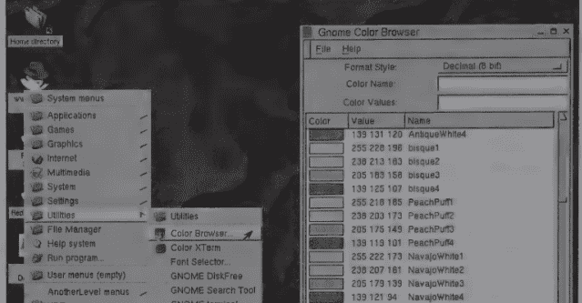

## 重新编译 X Windows

有时你可能想要重新编译 X Server 发行版，而不是使用标准的 Hat 及以上版本。XFree86 发行版更新频繁，且测试版可能支持你需要的显卡。在其他情况下，你可能需要通过额外的功能对 X Server 进行打补丁。例如，一个名为 VMware 的产品（从 `http://www.vmware.com/` 获取）允许你的 Linux 在窗口内运行 Windows 和其他操作系统。VMware 包含了针对各种显卡的修改版 X Server 软件，但并非涵盖所有。如果你有一个被 VMware 分发的 X Servers 不支持的显卡，你可以下载一个补丁文件，该文件将修改标准的 XFree86 代码，以便你能够编译你自己的副本。

## 下载 XFree86 源码

XFree86 发行版可以从 `ftp://ftp.xfree86.org/pub/` 下载。如果你使用的是拨号连接，请注意——目前有四个文件组成该发行版，总大小约为 35MB。对于 3.3.5 源码，这些是在你的计算机上编译并安装 X Windows 所需的步骤。如果你安装的是较后的版本，务必阅读源码中的 `README.INSTALL` 文件。无法保证这些说明适用于未来的修订版本。

在阅读本节之前，先跳到第 12 章“安装和管理 Linux 软件”可能是一个好主意。安装 XFree86 软件的过程与与其他 Unix 发行版的过程非常相似。如果你了解了在计算机上安装非 RPM 基础软件的标准程序，你可能会更好地理解以下过程。按照以下步骤操作：

1. 下载该发行版的源码文件。
2. 假设你已经获取了 gzipped 格式的发行版，使用此命令解压缩文件：`gunzip *.gz`。
3. 解归每个生成的 tar 包。这将创建一个名为 `xc` 的主源码目录：

   ```bash
   [root@contempt XFree86]# # tar -xf X335src-1.tar
   [root@contempt XFree86]# # tar -xf X335src-2.tar
   [root@contempt XFree86]# # tar -xf X335src-3.tar
   ```

4. 如果你下载了任何 X Windows 系统的补丁，现在就是安装它们的时机。大多数补丁都可以通过将补丁文件放在与 `xc` 目录相同的位置并使用以下命令来轻松安装：`patch -p0 < patchfile`。无法预知你会在互联网上找到哪些补丁，因此请务必阅读你找到每一个补丁的说明。这些说明在大多数情况下适用。
5. 编辑 `xc/config/site.def` 文件中任何可能需要的偏好设置。它包含你机器的本地配置信息，包括构建发行版的目录。Linux 将 XFree86 安装在 `/usr/X11R`，这也是 XFree86 发行版的默认路径。此时，没有实际需要修改这些偏好。
6. 当你准备好开始编译时，输入 `make World`，过程将开始。这可能需要相当长，取决于你的机器。在双 Pentium Pro 上，编译需要一个多小时：

   ```text
   [root@contempt xc]# make World
   Building Release 6.3 of the X Windows System.

   I hope you checked the configuration parameters in ./config/config to see if you need BOSTRAPFLAGS==*

   Fri Sep 17 08:50:17 EDT 1999

   cd ./config/make && make -f Makefile.ini BOSTRAPFLAGS==* clean

   make[1]: Entering directory '/home/jray/XFree86/xc/config/'

   rm -f *.CKP *.ln *.BAK *.o core err, * ~ *.a TAGS make.log

   \#
   ```

# 第10章 更新 X Window 系统

```text
rm -fr Makefile.proto Makefile Makefile.dep bootstrap

make[1]: Leaving directory `/home/jray/XFree86/config/imake'

make Makefile.boot

make[1]: Entering directory `/home/jray/XFree86/xc'

cd /config/imake && make -w Makefile.ini BOOTSTRAPFLAGS="

make[2]: Entering directory `/home/jray/XFree86/config/imake'

making image WITH BOOTSTRAPFLAGS in config/imake

cc ccmake -O -../include -I../../../imports/x11/include/X11 ccmake.c

cc -C -O -../include -I../../../imports/x11/X11

../cccmake.imake.c

cc -O -../include -I../../../imports/x11/include/X11 image.o

make[2]: Leaving directory `/home/jray/XFree86/config/imake'

rm -f /config/makepended/Makefile.proto

/config/imake -imake -I./config/oc -s

cd /config/makepended && makedepend

make[1]: Leaving directory `/home/jray/XFree86/xc/`

cd /config/imake && make -w Makefile.ini BOOTSTRAPFLAGS="

make[2]: Entering directory `/home/jray/XFree86/config/imake'

making image WITH BOOTSTRAPFLAGS in config/imake

cc ccmake -O -../include -I../../../imports/x11/include/X11 ccmake.c

cc -C -O -../include -I../../../imports/x11/X11

../cccmake.imake.c

cc -O -../include -I../../../imports/x11/include/X11 image.o

make[2]: Leaving directory `/home/jray/XFree86/config/imake'

rm -f /config/makepended/Makefile.proto

/config/imake -imake -I./config/oc -s

cd /config/makepended && makedep

make[1]: Leaving directory `/home/jray/XFree86/xc/`

cd /config/imake && make -w Makefile.ini BOOTSTRAPFLAGS="

make[2]: Entering directory `/home/jray/XFree86/config/imake'

making image WITH BOOTSTRAPFLAGS in config/imake

cc ccmake -O -../include -I../../../imports/x11/include/X11 c..c

cc -C -O - - - -I -/x11/X11

../cccmake.imake.c

cc -O -../include -I../../../imports/x11/include/X11 image.o

make[2]: Leaving directory `/home/jray/XFree86/config/imake'

rm -f /config/makepended/Makefile.proto

/config/imake -imake -I./config/oc -s

cd /config/makepended && makedep

make[1]: Leaving directory `/home/jray/XFree86/xc/`

cd /config/imake && make -w Makefile.ini BOOTSTRAPFLAGS="

make[2]: Entering directory `/home/jray/XFree86/config/imake'

making image WITH BOOTSTRAPFLAGS in config/imake

cc ccmake -O -../include -I../../../imports/x11/include/X11 ccmake.c

cc -C -O -../include -I../../../imports/x11/X11

../cccmake.imake.c

cc -O -../include -I../../../imports/x11/include/X11 image.o

make[2]: Leaving directory `/home/jray/XFree86/config/imake'

rm -f /config/makepended/Makefile.proto

/config/imake -imake -I./config/oc -s

cd /config/makepended && makedep

make[1]: Leaving directory `/home/jray/XFree86/xc/`

cd /config/imake && make -w Makefile.ini BOOTSTRAPFLAGS="

make[2]: Entering directory `/home/jray/XFree86/config/imake'

making image WITH BOOTSTRAPFLAGS in config/imake

cc ccmake -O -../include -I../../../imports/x11/include/X11 ccmake.c

cc -C -O -../include -I../../../imports/x11/X11

../cccmake.imake.c

cc -O -../include -I../../../imports/x11/include/X11 image.o

make[2]: Leaving directory `/home/jray/XFree86/config/imake'

rm -f /config/makepended/Makefile.proto

/config/imake -imake -I./config/oc -s

cd /config/makepended && makedep
```


```text
make[1]: Leaving directory `/home/jray/XFree86/xc/`

cd /config/imake && make -w Makefile.ini BOOTSTRAPFLAGS="

make[2]: Entering directory `/home/jray/XFree86/config/imake'

making image WITH BOOTSTRAPFLAGS in config/imake

cc ccmake -O -../include -I../../../imports/x11/include/X11 ccmake.c

cc -C -O -../include -I../../../imports/x11/X11

../cccmake.imake.c

cc -O -../include -I../../../imports/x11/include/X11 image.o

make[2]: Leaving directory `/home/jray/XFree86/config/imake'

rm -f /config/makepended/Makefile.proto

/config/imake -imake -I./config/oc -s

cd /config/makepended && makedep

make[1]: Leaving directory `/home/jray/XFree86/xc/`

cd /config/imake && make -w Makefile.ini BOOTSTRAPFLAGS="

make[2]: Entering directory `/home/jray/XFree86/config/imake'

making image WITH BOOTSTRAPFLAGS in config/imake

cc ccmake -O -../include -I../../../imports/x11/include/X11 c..

cc - - -O - -include -II///11//111

.....

cc - -O - -include -I///111///111..

make22]: Leaving//home/jray/XFree86/config/imake

rm -f /config/makepended/Makefile.

/config/imake -imake -I./config/oc -s

cd /config/makepended && makedep

make[1]: Leaving directory `/home/jray/XFree86/xc/`

cd /config/imake && make -w Makefile.ini BOOTSTRAPFLAGS="

make[2]: Entering directory `/home/jray/XFree86/config/imake'

making image WITH BOOTSTRAPFLAGS in config/imake

cc ccmake -O -../include -I../../../imports/x11/include/X11 ccmake.c

cc -C -O -../include -I../../../imports/x11/X11

../cccmake.imake.c

cc -O -../include -I../../../imports/x11/include/X11 image.o

make[2]: Leaving directory `/home/jray/XFree86/config/imake'

rm -f /config/makepended/Makefile.proto

/config/imake -imake -I./config/oc -s

cd /config/makepended && makedep

make[1]: Leaving directory `/home/jray/XFree86/xc/`

cd /config/imake && make -w Makefile.ini BOOTSTRAPFLAGS="

make[2]: Entering directory `/home/jray/XFree86/config/imake'

making image WITH BOOTSTRAPFLAGS in config/imake

cc ccmake -O -../include -I../../../imports/x11/include/X11 ccmake.c

cc -C -O -../include -I../../../imports/x11/X11

../cccmake.imake.c

cc -O -../include -I../../../imports/x11/include/X11 image.o

make[2]: Leaving directory `/home/jray/XFree86/config/imake'

rm -f /config/makepended/Makefile.proto

/config/imake -imake -I./config/oc -s

cd /config/makepended && makedep

make[1]: Leaving directory `/home/jray/XFree86/xc/`

cd /config/imake && make -w Makefile.ini BOOTSTRAPFLAGS="

make[2]: Entering directory `/home/jray/XFree86/config/imake'

making image WITH BOOTSTRAPFLAGS in config/imake

cc ccmake -O -../include -I../../../imports/x11/include/X11 ccmake.c

cc -C -O -../include -I../../../imports/x11/X11

../cccmake.imake.c

cc -O -../include -I../../../imports/x11/include/X11 image.o

make[2]: Leaving directory `/home/jray/XFree86/config/imake' evenrm -f /config/makepended/Makefile.proto

/config/imake -imake -I./config/oc -s

cd /config/makepended && makedep

make[1]: Leaving directory `/home/jray/XFree86/xc/`

cd /config/imake && make -w Makefile.ini BOOTSTRAPFLAGS="

make[2]: Entering directory `/home/jray/XFree86/config/imake'

making image WITH BOOTSTRAPFLAGS in config/imake

cc ccmake -O -../include -I../../../imports/x11/include/X11 ccmake.c

cc -C -O -../include -I../../../imports/x11/X11

../cccmake.imake.c

cc -O -../include -I../../../imports/x11/include/X11 image.o

make[2]: Leaving directory `/home/jray/XFree86/config/imake'

rm -f /config/makepended/Makefile.proto

/config/imake -imake -I./config/oc -s

cd /config/makepended && makedep

make[1]: Leaving directory `/home/jray/XFree86/xc/`

cd /config/imake && make -w Makefile.ini BOOTSTRAPFLAGS="

make[2]: Entering directory `/home/jray/XFree86/config/imake'

making image WITH BOOTSTRAPFLAGS in config/imake

cc ccmake -O -../include -I../../../imports/x11/include/X11 ccmake.c

cc -C -O -../include -I../../../imports/x11/X11

../cccmake.imake.c

cc -O -../include -I../../../imports/x11/include/X11 image.o

make[2]: Leaving directory `/home/jray/XFree86/config/imake'

rm -f /config/makepended/Makefile.proto

/config/imake -imake -I./config/oc -s

cd /config/makepended && makedep

make[1]: Leaving directory `/home/jray/XFree86/xc/`

# 图 10.3

GNOME 颜色浏览器提供了一个友好的界面，用于浏览标准的 X Windows 颜色。


# 重新编译 X Windows

有时你可能想要重新编译 X Server 发行版，而不是使用标准的 Hat 及以上版本。XFree86 发行版更新频繁，且测试版可能支持你需要的显卡。在其他情况下，你可能需要通过额外的功能对 X Server 进行打补丁。例如，一个名为 VMware 的产品（从`http://www.vmware.com/`获取）允许你的 Linux 在窗口内运行 Windows 和其他操作系统。VMware 包含了针对各种显卡的修改版 X Server 软件，但并非涵盖所有。如果你有一个被 VMware 分发的 X Servers 不支持的显卡，你可以下载一个补丁文件，该文件将修改标准的 XFree86 代码，以便你能够编译你自己的副本。

# 下载 XFree86 源码

XFree86 发行版可以从`ftp://ftp.xfree86.org/pub/`下载。如果你使用的是拨号连接，请注意——目前有四个文件组成该发行版，总大小约为 35MB。对于 3.3.5 源码，这些是在你的计算机上编译并安装 X Windows 所需的步骤。如果你安装的是较后的版本，务必阅读源码中的`README.INSTALL`文件。无法保证这些说明适用于未来的修订版本。

在阅读本节之前，先跳到第 12 章“安装和管理 Linux 软件”可能是一个好主意。安装 XFree86 软件的过程与与其他 Unix 发行版的过程非常相似。如果你了解了在计算机上安装非 RPM 基础软件的标准程序，你可能会更好地理解以下过程。按照以下步骤操作：

1. 下载该发行版的源码文件。
2. 假设你已经获取了 gzipped 格式的发行版，使用此命令解压缩文件：`gunzip *.gz`。
3. 解归每个生成的 tar 包。这将创建一个名为`xc`的主源码目录：

```bash
[root@contempt XFree86]# # tar -xf X335src-1.tar
[root@contempt XFree86]# # tar -xf X335src-2.tar
[root@contempt XFree86]# # tar -xf X335src-3.tar
```

4. 如果你下载了任何 X Windows 系统的补丁，现在就是安装它们的时机。大多数补丁都可以通过将补丁文件放在与`xc`目录相同的位置并使用以下命令来轻松安装：`patch -p0 < patchfile`。无法预知你会在互联网上找到哪些补丁，因此请务必阅读你找到每一个补丁的说明。这些说明在大多数情况下适用。
5. 编辑`xc/config/site.def`文件中任何可能需要的偏好设置。它包含你机器的本地配置信息，包括构建发行版的目录。Linux 将 XFree86 安装在`/usr/X11R`，这也是 XFree86 发行版的默认路径。此时，没有实际需要修改这些偏好。
6. 当你准备好开始编译时，输入`make World`，过程将开始。这可能需要相当长，取决于你的机器。在双 Pentium Pro 上，编译需要一个多小时：

```bash
[root@contempt xc]# make World
Building Release 6.3 of the X Windows System.

I hope you checked the configuration parameters in ./config/config to see if you need BOSTRAPFLAGS==*

Fri Sep 17 08:50:17 EDT 1999

cd ./config/make && make -f Makefile.ini BOSTRAPFLAGS==* clean

make[1]: Entering directory '/home/jray/XFree86/xc/config/'

rm -f *.CKP *.ln *.BAK *.o core err, * ~ *.a TAGS make.log

#
```

# 第 10 章 更新 X Window 系统

```bash
rm -fr Makefile.proto Makefile Makefile.dep bootstrap

make[1]: Leaving directory `/home/jray/XFree86/config/imake'

make Makefile.boot

make[1]: Entering directory `/home/jray/XFree86/xc'

cd /config/imake && make -w Makefile.ini BOOTSTRAPFLAGS="

make[2]: Entering directory `/home/jray/XFree86/config/imake'

making image WITH BOOTSTRAPFLAGS in config/imake

cc ccmake -O -../include -I../../../imports/x11/include/X11 ccmake.c

cc -C -O -../include -I../../../imports/x11/X11

../cccmake.imake.c

cc -O -../include -I../../../imports/x11/include/X11 image.o

make[2]: Leaving directory `/home/jray/XFree86/config/imake'

rm -f /config/makepended/Makefile.proto

/config/imake -imake -I./config/oc -s

cd /config/makepended && makedepend

make[1]: Leaving directory `/home/jray/XFree86/xc/`

cd /config/imake && make -w Makefile.ini BOOTSTRAPFLAGS="

make[2]: Entering directory `/home/jray/XFree86/config/imake'

making image WITH BOOTSTRAPFLAGS in config/imake

cc ccmake -O -../include -I../../../imports/x11/include/X11 ccmake.c

cc -C -O -../include -I../../../imports/x11/X11

../cccmake.imake.c

cc -O -../include -I../../../imports/x11/include/X11 image.o

make[2]: Leaving directory `/home/jray/XFree86/config/imake'

rm -f /config/makepended/Makefile.proto

/config/imake -imake -I./config/oc -s

cd /config/makepended && makedep

make[1]: Leaving directory `/home/jray/XFree86/xc/`

cd /config/imake && make -w Makefile.ini BOOTSTRAPFLAGS="

make[2]: Entering directory `/home/jray/XFree86/config/imake'

making image WITH BOOTSTRAPFLAGS in config/imake

cc ccmake -O -../include -I../../../imports/x11/include/X11 c..c

cc -C -O - - - -I -//111111111

cccc..im..

- - - - -include -I/imports/x11/1/X11 image.o

make[2]: Leaving directory `/home/jray/XFree86/config/imake'

rm -f /config/makepended/Makefile.proto

/config/imake -imake -I./config/oc -s
```


cd /config/makepended && makedep

make[1]: Leaving directory `/home/jray/XFree86/xc/`

cd /config/imake && make -w Makefile.ini BOOTSTRAPFLAGS="

make[2]: Entering directory `/home/jray/XFree86/config/imake'

making image WITH BOOTSTRAPFLAGS in config/imake

cc ccmake -O -../include -I../../../imports/x11/include/X11 ccmake.c

cc -C -O -../include -I../../../imports/x11/X11

../cccmake.imake.c

cc -O -../include -I../../../imports/x11/include/X11 image.o

make[2]: Leaving directory `/home/jray/XFree86/config/imake'

rm -f /config/makepended/Makefile.proto

/config/imake -imake -I./config/oc -s

cd /config/makepended && makedep

make[1]: Leaving directory `/home/jray/XFree86/xc/`

cd /config/imake && make -w Makefile.ini BOOTSTRAPFLAGS="

make[2]: Entering directory `/home/jray/XFree86/config/imake'

making image WITH BOOTSTRAPFLAGS in config/imake

cc ccmake -O -../include -I../../../imports/x11/include/X11 ccmake.c

cc -C -O -../include -I../../../imports/x11/X11

../cccmake.imake.c

cc -O -../include -I../../../imports/x11/include/X11 image.o

make[2]: Leaving directory `/home/jray/XFree86/config/imake'

rm -f /config/makepended/Makefile.proto

/config/imake -imake -I./config/oc -s

cd /config/makepended && makedep

make[1]: Leaving directory `/home/jray/XFree86/xc/`

cd /config/imake && make -w Makefile.ini BOOTSTRAPFLAGS="

make[2]: Entering directory `/home/jray/XFree86/config/imake'

making image WITH BOOTSTRAPFLAGS in config/imake

cc ccmake -O -../include -I../../../imports/x11/include/X11 ccmake.c

cc -C -O -../include -I../../../imports/x11/X11

../cccmake.imake.c

cc -O -../include -I../../../imports/x11/include/X11 image.o

make[2]: Leaving directory `/home/jray/XFree86/config/imake'

rm -f /config/makepended/Makefile.proto

/config/imake -imake -I./config/oc -s

cd /config/makepended && makedep

make[1]: Leaving directory `/home/jray/XFree86/xc/`

cd /config/imake && make -w Makefile.ini BOOTSTRAPFLAGS="

make[2]: Entering directory `/home/jray/XFree86/config/imake'

making image WITH BOOTSTRAPFLAGS in config/imake

cc ccmake -O -../include -I../../../imports/x11/include/X11 ccmake.c

cc -C -O -../include -I../../../imports/x11/X11

../cccmake.imake.c

cc -O -../include -I../../../imports/x11/include/X11 image.o

make[2]: Leaving directory `/home/jray/XFree86/config/imake'

rm -f /config/makepended/Makefile.proto

/config/imake -imake -I./config/oc -s

cd /config/makepended && makedep

make[1]: Leaving directory `/home/jray/XFree86/xc/`

VNC（虚拟网络计算）允许你将 Linux 桌面共享给其他 Linux 机器，或运行其他操作系统的机器。最重要的是，系统上的每个用户都可以同时拥有一个独立的桌面，而不会干扰任何人的机器。通过安装一台高性能的 Linux 机器，VNC 可以为整个办公室提供 GNOME 或 KDE 桌面。客户端机器可以是运行 Windows 的低配置计算机。

# 第 10 章 更新 X Window 系统

事实上，有一种 VNC Linux 发行版，它提供单张软盘，即可让 x86 PC 电脑连接到 VNC 服务器——而不需要硬盘。如果你在旅途中且由于紧急情况必须访问您的 Linux 桌面，在 Windows CE 和 Palm Pilot 上运行的 VNC 版本如下。

VNC 也可以反过来工作。你不仅可以向其他机器提供 Linux KDE/GNOME 桌面服务，也可以在自己的电脑上查看远程桌面。当你从基于 Windows/Mac OS 的计算环境迁移到带有 Linux 桌面的环境时，这会非常有用。如果你有一些必须在旧操作系统上使用的应用程序，这里有适用于 Mac OS 和 Windows 95/98/NT 的 VNC 服务器，允许用户从新的红帽 Linux 计算机远程访问他们的旧桌面——所有这些都是免费的。

VNC 软件正在活跃开发中，并由 AT&T 免费提供。VNC 网站为 http://www.uk.research.att.com/vnc/。该软件已为 Linux 系统预编译，你只需下载并安装即可。与 X Windows 安装说明一样，请参考第 12 章获取更多关于后续说明的信息：

1. 下载 VNC 服务器软件。它有多种不同的存档格式，但本节假设使用压缩过的 tar 包。

2. 使用 `gunzip -gz tar -xvf filename.tar` 解压缩并解包 VNC 服务器：

```bash
[jray@pointy vncstuff] gunzip vnc-3.3.3_x86_linux_2.0.tgz
[jray@pointy vncstuff] tar -xvf vnc-3.3.3_x86_linux_2.0.tar
vnc_x86_linux_2.0/LICENSE.TXT
vnc_x86_linux_2.0/README
vnc_x86_linux_2.0/Vncviewer
vnc_x86_linux_2.0/classes/
vnc_x86_linux_2.0/vncpassword
vnc_x86_linux_2.0/vncserver
```

3. 将二进制文件安装在适当的位置。README 文件建议执行以下操作：`cp vncviewer vncserver vncpassword /usr/local/bin`。这对于你的系统应该是没问题的。

你可能想在访问 VNC 网站时花时间下载一个查看器程序。如前提到的，查看器软件适用于多种平台。如果你有 Windows 或 Macintosh 桌面，应该遵循对应平台的说明。本章末尾将提供如何配置 `vncviewer` 的指导方向。

# 安装 VNC（虚拟网络计算包）

以上就是全部了。VNC 服务器现在已准备好在你的电脑上运行。但是，在启动它之前，你可能想要进行一些更改。

# 更改 VNC 服务器显示模式

VNC 查看器可以看到具有不同位深和大小的虚拟显示。默认情况下，它将使用 8 位色彩（256 色）和 800x600 的分辨率来提供你的虚拟桌面服务。如果你希望以更高的位深和更低的分率查看桌面（例如），你必须编辑 `/usr/local/bin/vncserver` 脚本。该脚本调用 `Xnc`，而它是实际的服务器进程。

在 `/usr/local/bin/vncserver` 中寻找以下行：

```
# 全局变量。你可能想为你的站点配置其中一些。

Sgeometry = "1024x768"
Sdepth = 8;
sdesktopName = "X";
```

`geometry` 是虚拟屏幕的分率。如果你想以 800x600 运行，只需替换 `1024x768` 配置。位深也是如此。要更改为 16 位或 24 位色彩，将 `8` 替换为你喜欢的名称。然而，将位深设置得高于客户端电脑能处理的范围是没有用的。最后，如果你想给桌面命名，可以将 `X` 更改为任何你喜欢的，例如 `Johns Desktop`。更改后，你的配置应该类似于此：

```
Sgeometry = "800x600"
Sdepth = 16;
sdesktopName = "Johns Desktop";
```

# 首次启动 VNC

在完成所需的更改后，你就可以（终于）启动 `vncserver` 了。从任何命令行输入 `vncserver` 来启动服务器。系统会提示你设置一个用于连接共享桌面的密码。选择一个密码并输入两次。服务器随后将启动，并给你连接所需的主机名和显示编号，例如：

```bash
[jray@pointy]$ vncserver
```

你需要密码来访问桌面。

Password:

Verify:

New 'X' desktop is pointy.poointonso.com:1

创建默认启动脚本 /home/jray/.vnc/xstartup

正在启动 /home/jray/.vnc/xstartup 中指定的应用程序

日志文件为 /home/jray/.vnc/pointysooth.com:1.log

图 10.4 可以使用 `vncviewer` 来显示远程 Windows、Mac OS 以及其他 Linux 桌面。

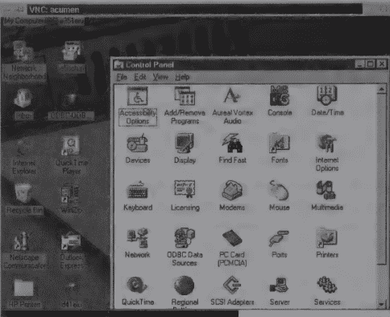

使用 VNC 系统将让你的 Linux 机器摆脱对显示器的依赖。安装 VNC 后，你可以从网络上的任何机器远程控制你的 Linux 计算机。这是你在对预装的 Red Hat X Windows 软件时应该做的最棒（也是少数）的改进之一。

## 故障排除

保持 X Windows 的最新且安全版本对于保持机器的稳定和保护至关重要。升级 RPM 非常简单，从 Red Hat 网站下载并使用 `rpm` 命令执行升级即可。如果你想从 XFree86 源码发行版安装以获得额外的显卡支持或功能，本章希望对该过程提供一些帮助。对于那些必须远程访问其他桌面计算机的用户，VNC 服务器软件与 X Windows 应用程序配合，创建一个非常快速（且免费）的网络计算环境。更多信息，请查看以下内容：

- Q. 我升级了 XFree86 软件包后就无法启动 X Windows 了；发生了什么？

- A. 很有可能是你为显卡安装了错误的 X Server。检查显卡列表：http://www.xfree86.org/cardlist.html。你必须重新安装支持你显芯片组的适当服务器。

- Q. 我确定安装了适当服务器，但 X Windows 仍然无法启动。我该怎么办？

- Q. 我向系统添加了字体，但它们没有显示。我该怎么办？

- A. 确保你在添加字体的目录上运行了 `mkfontdir` 和 `xset`。如果你不告诉系统发生了变化，它将不会自动识别。

- Q. 我已经安装并编译了 XFree86 源码，但它似乎没有识别我的新显卡，尽管新服务器声称支持它。出什么了？

- A. 检查确保你编译的服务器是否已复制或链接到 `/usr/X11/bin/`。很有可能它被安装在了其他地方，而你仍在运行旧版服务器。

- Q. VNC 服务器不再将显示 1 作为默认值。为什么？

- A. VNC 有时会留下一些不该存在的文件。为了防止这种情况，请始终使用 `vncserver -kill <display name>` 杀死 vncserver。如果问题仍然存在，请确保从你的 `.vnc` 目录删除任何 `.pid` 文件，并确保 `/tmp` 目录中没有属于你的 `.X11*` 文件。如果有，删除它们，然后重试 `vncserver`。

- Q. 我尝试了更新 X Windows，现在什么都不能运行了。救命！

- A. 如果一切失败了，请返回并从 Red Hat CD 发行版重新安装基础 XFree86 RPM。请放心，如果出现问题，你可以退回去。

## 第三部分

## 软件

- 11 安装和管理 RPM 软件包 201

- 12 安装和管理 Linux 软件 221

- 13 安装 Adobe Acrobat 247

- 14 安装和配置 Netscape Communicator 259

- 15 安装 StarOffice 285

- 16 安装 GNU 图像处理程序 (GIMP) 309

- 17 安装和配置游戏 323

## 安装和管理 RPM 软件包

作者 Duane Hellums

## 本章

- 理解 GNOME Red Hat 软件包管理器 (GnoRPM) 202

- 安装 GnoRPM 203

- 配置 GnoRPM 203

- 使用 GnoRPM 安装软件 207

- 使用 GnoRPM 升级软件 212

- 使用 GnoRPM 查询和验证软件 213

- 使用 GnoRPM 卸载软件 214

- 使用 GnoRPM 查找软件 215

- 使用命令行 RPM 217

- GnoRPM 故障排除 219

## 理解 Gnome Red Hat 软件包管理器 (GnoRPM)

在 Red Hat 出现并决定让 Linux 变得更容易安装、配置、使用和管理之前，我们都必须使用某些奥秘且远不直观的界面（继承自 UNIX）来在 Linux 上安装和配置应用程序。这主要涉及使用类似于 `gzip/gunzip` 压缩和 `tar` 归档工具。第 12 章“安装和管理 Linux 软件”解释了如何安装使用旧方法（Red Hat 之前）发布的软件。

Red Hat 首先开发了 Red Hat 软件包管理器 (RPM)，以便高效封装软件文件并易于安装。这是一个从 shell 和命令行界面启动的文本界面。Red Hat 后来通过 `glint` 程序进行了改进，为 RPM 软件提供了直观的图形用户界面。

> 注意：尽管 RPM 由 Red Hat 开发，但它是一个开放、免费分发的标准。因此，它可以作为分软件的模型，可以在任何支持它的 Linux 操作系统上轻松安装。

你仍然可以使用所有这些方法，GNOME 桌面带有一个强大的图形实用程序，它使用 Red Hat 的 RPM 库函数，并作为 Red Hat RPM 的图形前端：GnoRPM（取决于你看哪里，你可能也会看到它是 Gnome RPM）。图 11.1 显示了完全安装并配置的系统上的 GnoRPM 窗口（版本 0.8）。

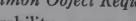

## 图 11.1

nome RPM (GnoRPM) 窗口直观且灵活。


## 安装 GnoRPM

GnoRPM 应该是默认安装的。如果由于某些原因没有安装，你可能需要使用 RPM 来安装它。该文件位于 Red Hat 安装 CD 的 RPM 目录下，文件名为 `gnorpm-0.8.5-1386.rpm`。你可以通过 GNOME 帮助（查看管理部分）或从 X 终端输入 `rpm` 来了解如何使用 RPM。RPM 安装的基本语法如下：`/mnt/cd/RedHat/RPM/gnorpm-0.8.5-1386.rpm`。如果 CD 安装在不同的挂载点，目录路径可能会有所不同。如果收到错误消息说 GnoRPM 已安装，你可能只是在桌面、面板、菜单或子菜单缺少该程序的快捷方式。你可以创建一个快捷方式，或者从 shell 和命令行界面输入 `gnorpm`。

## 配置 GnoRPM

GnoRPM 默认配置的行为与从命令行执行的文本 `rpm` 一致。然而，正如你使用 `rpm` 一样，你可能想更改 GnoRPM 的行为。你通过选择菜单栏中的“操作 (Operations)”、“偏好 (Preferences)”访问主配置工具。这将弹出图 11.2 所示的偏好对话框。遗憾的是，GnoRPM 仍处于婴儿阶段，因此帮助按钮无法使用——请在未来的版本中关注它。

## 第 11 章 安装和管理 RPM 包

### 图 11.2

你可以更改 GnoRPM 界面的外观和响应。

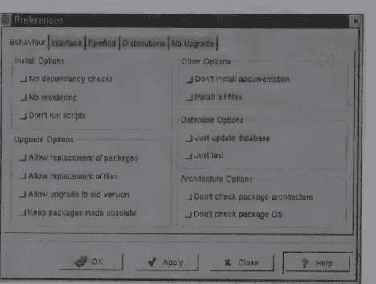

### 配置 GnoRPM 行为


“首选项”（Preferences）对话框中的第一个选项页名为“行为”（Behaviour，顺便说，这是英式拼写，并不是写错误），它分为几个部分，涵盖了与安装、升级、数据库、架构和其他功能相关的选项。由于 GnoRPM 是 RPM 的前端，因此这些选项中的每一个都对应于一个可以从命令行传递给 RPM 的标志（flags）。例如，“不安装帮助文档”（Don't Install Documentation）按钮的效果与在 `rpm` 命令字符串中添加 `--nodoc` 选项相同。

你可以保持这些选项不变，并且应该不会遇到任何实际问题。当你对 GnoRPM 以及整个 RPM 更加熟悉时，你可能会决定更改一些高级设置以配置特定的行为，或防止安装对你的 Linux 系统产生负面影响。例如，你可能希望支持程序将软件包回滚到之前的版本（就像我在测试 Windows 98 时回滚 Windows 95 做的那样），而 GnoRPM 默认防止这样做并试图保护你免受误操作。在这种情况下，你会按下“允许升级到旧版本”（Allow Upgrade To Old Version）选项按钮。

## 配置界面

在“界面”（Interface）选项卡中，你可以更改的两个内容是默认 RPM 路径以及包在 GnoRPM 窗口中的列表方式（见图 11.3）。如果你想查看每个包的文件系统详情，请点击“以列表形式显示”（View As List）选项；如果你更喜欢图形化查看组包内容，请点击“以图标形式显示”（View As Icons）。你可以输入存储 RPM 包的完整路径，也可以点击“浏览”（Browse）按钮进行图形化漫。。在我的系统中，RPM 路径是 `/mnt/cdrom/RedHat/RPMs`，但在你的系统上可能会有所不同，特别是如果你通常从本地或网络硬盘安装程序。

> **注意**
>
> 如果你的 CD 尚未挂载，你将必须先挂载它。如前提到的，你应该通过从主 Gnome 菜单中选择“系统”（System）、“磁盘管理”（Disk Management）以 root 身份执行操作。点击“挂载”（Mount）按钮挂载 CD。如果它已经挂载，则你需要点击“卸载”（Unmount）。在命令行，你可以输入 `-t iso9660 /dev/cdrom /mnt/cdrom`（如果你的 CD-ROM 信息已配置在 `/etc/fstab` 中，只需输入 `mount /dev/cdrom`）。

**图 11.3**

你可以更改 GnoRPM 的默认目录位置和显示格式。

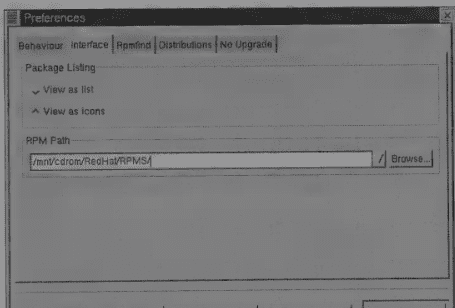

## 配置 Rpmfind

“Rpmfind”选项卡中的大部分信息是根据之前建立的系统和网络设置（例如你的本地主机名）为你填充的。然而，如图 11.4 所示，你可以并且应该控制这里的几个设置。最重要的是，你应该识别出想要安装元数据数据库文件的目录（我选择了 `/mnt/net/`，一个我创建的目录，尽管该目录可能已经为你安装好了；当然，创建此目录需要 root 权限）。这些文件以缓存的形式存储在 Linux 系统上，时间取决于“缓存过期”（Cache Expire）框中指定的时间，该时间由你设置。GnoRPM 预配置为使用 Red Hat 服务器，但如果你知道其他服务器的地址，欢迎将其更改为其他服务器。

如果你位于 HTTP 或 FTP 代理服务器之后，你应该识别其名称或网络地址，以便能够访问互联网下载文件。你还可以通过修改“供应商”（Vendor）和“发行版”（Distrib）文本框，精确指定你想要限制搜索范围的供应商或发行版。最后，你可以选择是否想要最新版本以及任何源代码。通过按下“想要源代码”（Want Sources）和“想要最新版本”（Want Latest Version）按钮来实现此操作。

### 图 11.4

你可以更改系统存储下载包的方式以及保留这些包的时间。

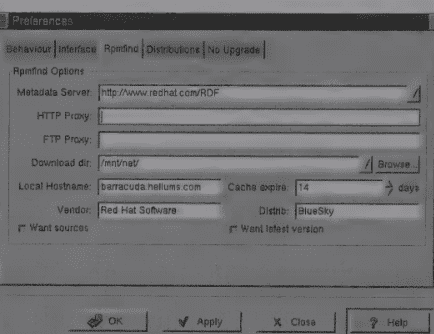

## 配置发行版

Red Hat 无法在单张 CD 上包含你所需的所有软件，即使可以，也会新程序（这些程序在 CD 创建和分发时还不存在）。镜像站（Mirror sites）是 Web 服务器，提供另一个站点所有内容的镜像映像；这提供了一种减少热门站点流量的方法，并允许人们高效地下载文件（特别是当你可能正在下载操作系统时，例如 Red Hat Linux 的最新版本）。你可以在“发行版”（Distributions）选项卡中识别用于下载 RPM 包的首选镜像站，如图 11.5 所示。这样，当你想要寻找新的软件包时，你的系统将知道去哪里。要执行此操作，请在“首选镜像”（Preferred Mirror）框中输入镜像的网络名称或地址，并点击“更改”（Change）。如果你指定了多个镜像，可以使用侧侧的箭头向下滚动并选择另一个。一个很好的起点是 `http://www.redhat.com/mirrors.html` 上的镜像列表。

**图 11.5**

使用 GnoRPM 可以轻松地创建下载新软件的首选站点列表。


## 配置升级选项

在“升级”（Upgrade）选项卡中，你可以设置 GnoRPM 不要升级某些包（见图 11.6）。例如，默认情况下，GnoRPM 不升级某些库，除非你非常熟悉它们、它们的作用以及为什么你需要升级。

**图 11.6**

如果你不想升级应用程序，请告诉 GnoRPM。

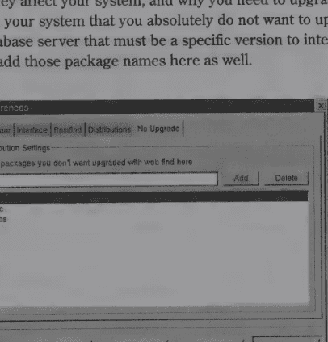

## 使用 GnoRPM 安装软件

GnoRPM 界面最初显示你已安装的 RPM 包和软件。你安装的所有软件都不会自动反映在桌面、菜单或子菜单中。CD 上的包默认不会安装。

### 安装新软件包

你通过点击工具栏上的“安装”（Install）按钮或从菜单栏中选择“操作”（Operations）、“安装”（Install）来安装新包。这将弹出图 11.7 所示的安装框。

**图 11.7**

你可以在安装对话框中查看你当前选择安装的所有包列表。

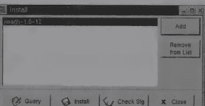

安装对话框最初是空的，直到你点击“添加”（Add）按钮并在“添加包”（Add Packages）框中选择一个或多个包进行安装（见图 11.8）。在这种情况下，已经选择了一个。如你所见，当你选择了一个包进行安装后，包名将列在安装对话窗口中并高亮。

> **注意**
>
> “添加包”对话框在外观和功能上与“升级”对话框完全相同，因此此处不再详细讨论。基本上，这两个框的功能是相同的，区别在于“升级包”用于你已经安装的包，而“添加包”用于新应用程序（尚未在你的系统中）。

**图 11.8**

“添加包”对话框允许你选择单个包进行安装。

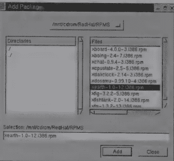

在“添加软件包”（Add Packages）对话框中，窗口顶部列出了您正在的目录。如果存在多个目录，您可以在左侧的“目录”（Directories）窗口中浏览，以进入所需的目录。在右侧的“文件”（Files）窗口中双击您想要安装的软件包（不过，此双击功能并不适用于所有鼠标硬件配置）。或者，您可以点击一下将软件包名称插入底部的“选择”（Selection）文本框，然后点击“添加”（Add）。如果您已选择所有软件包，点击“关闭”（Close）按钮返回安装日志框。那里应该列出您所选所有软件包的完整列表。

> **注意**
>
> 注意不要重复选择同一个软件包，GnoRPM 在当前版本中允许您这样做。如果您这样做了，将必须在以后回来删除其中一个重复的引用。

最后检查一遍列表，确保您没有重复或错误的软件包。如果您知道某个软件包依赖于其他软件包（例如某些库），您也应该选择这些软件包。但是，如果您没有这样做，GnoRPM 会过程中注意到该问题，并为您提供安装其他软件包的机会。

> **注意**
>
> “检查签名”（Check Sig）按钮允许您检查想要安装的软件包的 PGP（优良隐私）签名。这验证了文件来自经过验证的源，并且文件及其程序未被修改过。对于红帽 CD-ROM，您不需要这样做，但如果您安装的是别人创建的 CD-ROM 提供的软件包，或者从互联网下载的软件包，您可能需要这样做。如果您不验证程序的真实性和完整性，可能会导致安全问题、允许未经授权访问您的系统或对您的系统造成损坏（如果软件包已被修改）。但是，如果您没有安装 PGP，GnoRPM 有一个导致其崩溃的错误（是应用程序本身，而不是您的系统）。如果发生这种情况，您必须重启 GnoRPM 并重新选择软件包。除非您需要使用它且已安装 PGP，否则请避免使用此按钮。

作为预防，您可以点击“查询”（Query）按钮，这将弹出一个“软件包信息”（Package Info）对话框，其中为您计划安装的每个软件包都有一个标签（图 11.9 只显示了一个标签）。如果您觉得需要，可以阅读软件包的描述并查看文件名和安装目录。您可能会发现一两个并非打算安装的软件包，或者其功能与您最初想的有所不同。如果您对选择满意，点击“安装”（Install）继续。

| 部分 | 章节 |
|---|---|
| 11 | |

# 第 11 章 安装和管理 RPM 软件包

## 图 11.9

软件包信息日志提供了您想要安装的应用程序的常规描述，以及软件包中包含的文件列表。

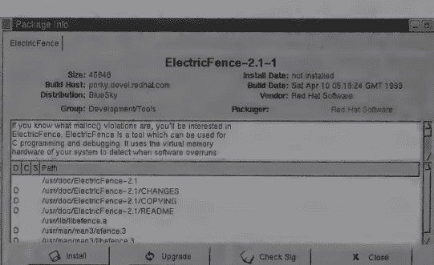

如果一切顺利，您将看到一个“正在安装”（Installing）弹出窗口，类似于图 11.10 所示。此窗口显示安装进度条、剩余时间以及正在安装的软件包总数和兆字节数。

## 图 11.10

您将看到一个“正在安装”进度日志框，显示所选应用程序已安装了多少。

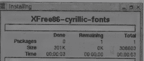

然而，有时一切并不如计划进行。例如，您可能会看到一个“信息”（Information）对话框，指示几个项目的安装失败。失败可能是由于两个原因：您正尝试安装一个已经安装的软件包（您是想升级吗？）或者该软件包因为依赖于未安装的其他软件包而无法安装。当这些任一问题发生时，您有两种选择：可以忽略警告并继续安装当前选择的软件包（并承担可能产生的不可预测后果），或者返回并纠正问题。这可以通过两种方式实现。

## 安装已安装的软件包

如果 GnoRPM 识别出您正尝试安装一个系统中已存在的软件包，它通常会对此发出警告并让您纠正问题。如果发生这种情况，您应该执行以下步骤：

## 使用 GnoRPM 安装软件

1. 在“安装问题”（Installation Problems）弹出窗口中，阅读错误信息并决定您想做什么。如果您想忽略警告并仍然执行安装，点击“是”。注意，如果您忽略了这些警告，系统、Linux 或您的应用程序可能会变得不稳定。最好点击“否”并尝试在 GnoRPM 中修正底层问题。
2. 如果您决定（明智地）返回并纠正问题，记录出现问题的软件包（如果很多或您记不住，请写下来）。点击“否”，让 GnoRPM 停止安装当前选择的软件包。在告诉您软件包安装失败的信息框上点击“确定”。您现在将回到“安装”窗口。
3. 选择要安装的软件包被高亮显示。如果您决定不安装某个软件包（例如，因为它已经安装了且您不想升级或覆盖它），请点击“安装”窗口中的软件包名称；它的背景颜色应变为白色，表示它不再被选中进行安装（尽管它仍在列表中）。对所有您决定不需要或不想安装的应用程序（例如）执行此操作。如果您对选择满意，点击“安装”。

| 部分 | 章节 |
|---|---|
| 11 | |

## 安装具有依赖关系的软件包

您安装的某些软件包是复杂的。许多软件包需要共享库才能运行。由于安装和升级软件包之间的相似性，您会发现当在窗口顶部看到“升级”（Upgrade）时，许多窗口几乎完全相同。例如，点击“升级”将弹出一个与图 11.7 相同的窗口。

## 使用 GnoRPM 查询和验证软件

然而，升级功能并不完全如你预期的那样。当你在 GnoRPM 主窗口中选择或高亮一个软件包并点击“升级”（Upgrade）时，你可能会认为它会去 CD 上的 RPM 目录检查该软件包是否需要升级。相反，GnoRPM 会忽略你高亮的文件，并直接带你进入升级窗口。在那里，你可以添加软件包，就像你之前使用“安装”（Install）功能时一样。区别在于，“安装”应该用于尚未在系统中安装的软件包，而“升级”应该用于已安装的软件包（例如，如果你从之前的 Red 安装中了 1.1.3 版本的 Apache，并想将已安装的版本升级到 1.3.6）。“升级”将移除系统中该应用程序的所有现有版本。实际上，它的功能与 `rpm -U` 命令相同。

> **注意**
>
> 记住，Linux 应用程序的开发速度非常快。即使在你从 CD 安装它们时，大多数应用程序可能已经有了更新版本。你不一定需要进行升级。除非你正在运行 Web 服务器、FTP 服务器等，并且出于安全目的或当前版本提供的额外功能而需要最新版本，否则很少有人需要升级。你可能只需等待 Linux 的下一次大发布来更新许多程序。

## 使用 GnoRPM 查询和验证软件

查询和验证是辅相成的，因为它们是调试工具，能够让你找到已安装的软件包。与之前讨论的引用 CD 或互联网上找到的软件包的“安装”和“升级”功能不同，“查询”（Query）和“验证”（Verify）按钮项关注的是已安装在系统上的软件。

“查询”（Query）菜单按钮允许你查找已安装软件软件包的基本信息：它们是何时打包的，以及安装了哪些文件。“验证”（Verify）按钮允许你测试已安装文件的完整性；可以识别出缺失或损坏的文件，以便在需要时重新安装。要从图 11.1 所示的 GnoRPM 主窗口中选择文件，请执行以下步骤：

1. 在左侧窗口中浏览软件包组和子组，并在右侧框中选择你想要查询或验证的软件包。
2. 要选择（或取消选择）多个文件，请按住 `Ctrl` 键并点击所需的软件包。但在点击左侧框中的组时不需要按住 `Ctrl` 键；那仅适用于软件包。如果你在一个框内选择了一个软件包并在按住 `Shift` 键时点击另一个，两个之间的所有软件包都将被高亮。如果你在一个已选择多个文件的组中在不按 `Ctrl` 键的情况下点击其中一个文件，所有文件将失去高亮，而你点击的单个文件将被选中（然而，其他组中选中的软件包仍将保持高亮状态）。
3. 在选完所有想要查询或验证的文件后，可以通过多种路径继续。你可以点击工具栏中的任一功能，也可以从菜单中选择“软件包, 查询”或“软件包, 验证”。如果你选择了多个文件，但由于某些原因只想检查单个文件，可以右键点击该文件并选择“查询”或“验证”。这将暂时忽略你的其他所有选择，尽管它们仍将保持高亮状态。


如果你选择“查询”，会弹出“软件包信息”（Package Info）对话框。你可以看到所有文件的基本信息，这些信息方便地通过以软件包命名的标签页分开。你还可以点击此对话框底部的“验证”按钮。

如果你选择“验证”，GnoRPM 将检查所选软件包中的文件并确保没有错误。如果没有问题，窗口将保持为空，你可以点击“关闭”返回 GnoRPM 窗口。如果 GnoRPM 发现任何软件包文件的问题，它将在“验证软件包”（Verifying Packages）窗口中为你提供该问题的简短描述。不同的问题需要不同的解决方案，或者可能不需要任何操作（只要应用程序`运行正常`）。如果你有想要修复的问题，你可能需要重新安装该软件包或升级该软件包。但请记住，在在此之前，你需要备份任何与此类软件包相关的配置文件或数据。

## 使用 GnoRPM 安装软件

与繁琐的 `gunzip` 和 `tar` 方法相比，使用 RPM 和 GnoRPM 卸载软件要简单得多。如果你决定需要从系统中删除软件包（例如，为用户数据或更多应用程序留出空间），请按照以下步骤操作：

1. 通过进入 Gnome 菜单并选择“系统 (System), GnoRPM”启动 GnoRPM 应用程序。你将看到 GnoRPM 主窗口，左侧是目录树（带有应用程序组），右侧是单个软件包列表。
2. 在左侧的目录树菜单中，通过点击组旁的加号导航到软件包所在的应用程序组（例如，Apache Web 服务器位于“软件包 (Packages), 系统环境 (System Environment), 守护进程 (Daemons)”）。
3. 在右侧的软件包列表中，点击选择你想要卸载的一个或多个软件包。要选择多个文件，请参阅查询和验证软件部分的第 2 步。
4. （可选）如果你愿意，可以在卸载软件包之前选择“查询”。这将打开“软件包信息”屏幕，该屏幕底部也有“卸载”（Uninstall）按钮。这为你提供了有关每个所选软件包所需的 Basic 信息，用以判断你是否真的想卸载它。
5. 当你确定已选择所有想要卸载的文件时，只需点击“卸载”，可以在“软件包信息”框中或直接在工具栏上。你也可以从菜单选择“软件包, 卸载”。启动卸载过程后，你会看到一个进度条，显示正在卸载的文件和剩余的文件。

## 使用 GnoRPM 查找软件

确定软件包可能非常困难。你可能还想知道某个组中有哪些程序，例如。要使用 GnoRPM 查找，请遵循以下步骤：

1. 点击工具栏上的“查找”（Find）按钮。弹出“查找”对话框。
2. 使用下拉菜单从列表中选择“全部 (All)”。
3. 对于示例，在文本框中输入 `Amusements/Games`（见图 11.1）。GnoRPM 提供了查找已安装的功能。

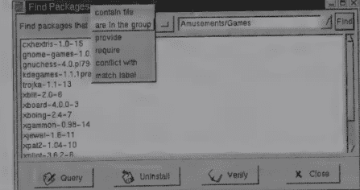

4. 点击“查找”按钮。
5. Amusements/Games 中的软件包将列在主窗口。现在你可以点击任何文件进行高亮；然后进行“查询”、“验证”或“卸载”。

正如你在下拉菜单中的选项所示，你还可以查找需要编辑的、与其他冲突的或包含特定文件的软件包。这可以节省你猜测和在 GnoRPM 窗口中挖掘软件包以寻找其名称的时间。

# 使用命令行 RPM


2. 点击工具栏上的`Webfind`。第一次进入此界面时，它将带你连接到 Red Hat 网站并下载应用程序索引。你将看到一个分为两个部分的窗口。左侧部分是一个目录树，类似于你习惯在主 RPM 窗口中使用的。该部分包含两列：“名称”（Name）和“发行版”（Distribution）。“名称”列出了你最近在机器上安装的应用程序。如果某个程序有新版本，你将在“发行版”列中看到一条注释，表示有可用更新。

3. 例如，如果你拥有`xtrojka`游戏版本`1.2.3-6`，并且有可用的更新（版本`1.2.3-7`），你将在`xtrojka`旁边看到版本`1.2.3-6`。点击`xtrojka`，树将展开并显示可用的版本，其中包含你当前的版本和新软件（可能还有旧版本）。点击你感兴趣的新版本。在窗口右侧，你将看到应用程序的描述以及该软件包包含的文件列表。还有“安装”（Install）和“升级”（Upgrade）按钮。

4. 如果系统中有一个你尚未安装的程序，你可以点击“安装”，RPM 将开始下载并安装。你将看到一个弹窗，确认文件下载的站点并请求你的继续操作权限。点击“是”继续，或点击“否”停止下载。所有其他功能与你在“安装新软件包”部分中遇到的功能类似。RPM 将下载执行依赖检查所需的信息并查找（现有的）软件包，它会提示你再次确认是否要下载软件包（选择“是”或“再次否”）。

# 使用命令行 RPM

你可能会发现遇到了一个阻止你启动 X 窗口的问题。你可能可以通过修改配置文件或运行基于文本的 X 程序来从命令行解决该问题。然而，假设你的 X 软件完全故障了，你需要重新安装或升级它。由于你无法启动 X，也就无法启动 RPM，而 RPM 是从 Red Hat CD 安装和升级软件的主要方式。

幸运的是，因为 RPM 只是`rpm`命令的前端，在这些情况下，你可以选择直接从命令行使用`rpm`。这应该是罕见的情况，这里不需要过多细节；你应该记住，`rpm`是一个非常强大的软件包，包含许多你永远用不到的不同选项。`man`命令提供了在特殊情况下使用该命令的帮助（例如，如果你需要使用它额外频繁使用的命令行参数）。使用`rpm`从命令行执行基本功能，执行以下任务（某些是可选的，取决于你的需求）：

1. 在命令行提示符下，输入`man rpm`查看该命令的帮助文件（如果需要的话）。不当命令可能会导致你丢失数据或覆盖你不想覆盖的程序，所以如果你还不熟悉该命令的功能，你应该熟悉它。
2. 使用`mount /mnt/cdrom`命令挂载你的 CD（如果它当前未挂载）；如果你没有在`/etc/fstab`中配置正确的 CD 文件系统，你可能需要使用`mount -t iso9660 /dev/hdc /mnt/cdrom`命令（这假定你的 CD 是第三个 IDE 设备（第二个 IDE 接口控制器上的第一个设备），因此如有必要，你应该将`hdc`替换为 CD-ROM 的相应标识符，例如用于正确 SCSI 设备的`sdb`，用于第四个 IDE 设备的`hda`等）。
3. 你可能想通过`cd /mnt/cdrom/RedHat/RPM`进入目录（这样就可以列出文件并查看你正在处理的内容）。你必须知道想要处理的应用程序名称或文件名。例如，如果你想查询、升级、安装或卸载`xpdf`，你将必须使用`xpdf-0.80-4.1386.rpm`（针对 Intel 平台；扩展适用于 Alpha 和 Sparse 架构）。输入`rpm -l xpdf`（或`xpdf`）来查看`xpdf`相关文件的列表。你应该能看到类似之前提到的长文件的内容。
4. 要查询此软件包并确定它是否在你的系统上，输入`rpm -q xpdf`。如果已安装，`rpm`将打印出软件包的完整文件名。如果没有安装，`rpm`会提示`xpdf`未安装。
5. 如果`xpdf`已安装且你想卸载或擦除它，请输入`rpm -e xpdf`。该软件包将从你的系统中移除。
6. 如果`xpdf`已安装且你想验证其完整性，请输入`rpm -V xpdf`。注意是大写的`V`，它与之前选项中使用的小写参数不同。
7. 如果安装了较早版本的`xpdf`你想将其升级到新版本，请输入`rpm -Uvh /mnt/cdrom/RedHat/xpdf-0.80-4.1386.rpm`。再次注意大写的`U`。因为你输入的是与文件相关的完整路径，请记住你可以从任何地方安装（例如如果你从互联网下载了较新版本的`xpdf`）。你真正需要的是`-U`来升级，而`vh`选项提供了升级后文件的验证并打印出方便的进度条（对大软件包很有用）。如果你正尝试升级的软件包尚未安装，`U`选项将起到安装的作用。
8. 如果`xpdf`未安装且你想安装它，输入`rpm -ivh xpdf-0.80-4.1386.rpm`。

| Part |
| --- |
| Ch |
| III |
| 11 |

# RPM 故障排除

你可能会发现遇到了一个阻止你启动 X 窗口的问题。你可能可以通过修改配置文件或运行基于文本的 X 程序来从命令行解决该问题。然而，假设你的 X 软件完全故障了，你需要重新安装或升级它。由于你无法启动 X，也就无法启动 RPM，而 RPM 是从 Red Hat CD 安装和升级软件的主要方式。

幸运的是，因为 RPM 只是`rpm`命令的前端，在这些情况下，你可以选择直接从命令行使用`rpm`。这应该是罕见的情况，这里不需要过多细节；你应该记住，`rpm`是一个非常强大的软件包，包含许多你永远用不到的不同选项。

如果你发现某个软件包在你认为已安装的情况下并没有，请使用`rpm -q`检查名称。如果你发现软件包损坏，使用`rpm -V`验证其完整性。如果你需要升级软件包，使用`-Uvh`命令。

| Command | Description |
| :--- | :--- |
| `rpm -q` | 查询软件包 |
| `rpm -e` | 卸载软件包 |
| `rpm -V` | 验证软件包完整性 |
| `rpm -Uvh` | 升级软件包 |
| `rpm -ivh` | 安装软件包 |

如果你发现无法安装软件包，请检查磁盘空间和权限。使用`ls -l`检查权限并在必要时使用`chmod`更改它们。

# 安装与管理 Linux 软件

作者 John Ray

## 本章

- 理解 Linux 软件应用程序 222
- 安装与编译 Linux 源码发行版 226
- 管理 Linux 软件应用程序 236
- 排除 Linux 软件应用程序故障 241

## 理解 Linux 软件应用程序

充分利用 Linux 意味着利用那些并非专门为你的系统打包的软件。数以千计的 UNIX 应用可以在你的 Linux 计算机上编译。

在开始编译和安装 Linux 应用程序之前，你需要了解软件交付到你系统的方法，以及你如何将这些软件转换为可用的形式。

### 分发方法：二进制文件与源码

Linux 和 Unix 与传统桌面操作系统的区别在于软件的分发方式。软件将以两种形式之一到达你的计算机：

- **二进制发行版——这些程序可以开箱即用。二进制发行版意味着软件已经针对你的系统进行了编译，并可以立即运行。二进制发行版的缺点是，它可能仅适用于你正在使用的处理器类型，甚至仅限于你运行的 Linux 版本。运行任何预编译并打包源码的软件都存在某些风险——你不知道（也无法查出）该软件具体会做什么。在安装二进制发行版之前，请确保你从信任的源下载。**
- **源码发行版——某些开发者比起创建特定机器的软件发行版，更倾向于分发应用程序的源码。终端用户负责在自己的计算机上编译软件并准备其供使用。安装源码发行版通常非常简单，但所需的额外步骤可能会让初次 Linux 用户感到困惑。大多数源码可以通过一或两个步骤完成编译和安装，但某些程序要求用户实际编辑源文件来为计算机配置选项。请确保你从信任的源下载——有人可能修改了你准备编译的代码！**

为了增加软件分发问题的复杂性，还存在软件分发打包的问题。你已经知道程序很少以单个文件的形式出现——特别是源码发行版，它们可能由数百个文件组成。软件归档将这些文件合并成单个归档文件，更容易处理。软件发行版也可能很大，因此需要一种压缩最终文件的方法。遗憾的是，这些分发、归档和压缩软件的不同可能性可能导致意想不到的多种组合。让我们来看一些常见的软件分发方法以及如何为安装做准备。如果这让你感到有些无所措，不要担心。你很快就会接触到一种日益流行的 Linux 特有的软件分发方法，它像任何 Windows 或 Mac 的软件安装向导一样易用。

### 归档格式：tar 和 zip

Linux 或 Unix 下流行的归档程序是`tar`。该程序简单地获取几个文件并将它们输出为单个归档。它不包含任何压缩；生成的文件将比输入文件的总大小略大。你可以通过 tar 文件通常赋予的`.tar`扩展名来识别它们。

如果你有一个文件名中包含`.tar`且后面跟着其他内容（例如`.gz`、`.z2`），那么它就是压缩过的 tar 文件，在处理它之前必须先解压缩。请跳过本章的“压缩格式：compress, gzip 和 bzip2”章节以获取更多关于解压缩常用文件的信息。

要归档文件，请使用命令`tar xf <filename>`。选项`x`、`v`和`f`分别代表提取文件、详细显示正在的操作以及指定要提取的归档名称。你可能想在开始提取文件之前创建一个新目录并将归档移动到其中；否则，你可能会在一个并不打算使用的目录中创建出数百个文件。

请看下示例：

```
$ tar -xvf kmysql-1.1.1.tar
kmysql-1.1.1/AUTHORS
kmysql-1.1.1/COPYING
kmysql-1.1.1/ChangeLog
kmysql-1.1.1/INSTALL
kmysql-1.1.1/Makefile.am
kmysql-1.1.1/Makefile.dist
kmysql-1.1.1/Makefile.in
...
kmysql-1.1.1/missing
kmysql-1.1.1/mkinstallsdirs
kmysql-1.1.1/po/
kmysql-1.1.1/po/Makefile.am
kmysql-1.1.1/po/Makefile.in
kmysql-1.1.1/po/kmysql.pot
kmysql-1.1.1/stamp-h..in
```

归档文件`kmysql-1.1.1.tar`已提取到`kmysql-1.1.1`目录中。该程序现在已准备好编译和安装。

另一种你可能熟悉的流行归档方法是`zip`。zip 文件在 Windows/DOS 平台上很常见，结合了同时归档和压缩的能力。Linux/Unix 发行版很少使用 zip 作为打包方法，但有时在 Linux 下访问与你在 Windows 下可以访问的相同 zip 文件是有用的。要提取并解压缩 zip 文件，只需使用`unzip <filename>.zip`，如下例所示：

```
$ unzip filename.zip
  creating: file1.txt
  creating: file2.txt
  extracting: file1.txt
  extracting: file2.txt
  inflating: 0
```

### 压缩格式：compress, gzip 和 bzip2

Linux 和 Unix 提供了许多压缩文件的方法。最常用的格式是`compress`、`gzip`和`bzip2`。Compress 最老，使用最少。Gzip 更现代并提供了更好的压缩率。Bzip2 提供了更好的压缩，但处理速度较慢。

要使用 gzip 压缩文件，使用命令`gzip <filename>`。这将创建一个`.gz`扩展的文件。要解压缩该文件，使用命令`gzip -d <filename>`。

要使用 bzip2 压缩文件，使用命令`bzip2 <filename>`。这将创建一个`.bz2`扩展的文件。要解压缩该文件，使用命令`bzip2 -d <filename>`。

要使用 compress 压缩文件，使用命令`compress <filename>`。这将创建一个`.Z`扩展的文件。要解压缩该文件，使用命令`compress -d <filename>`。

### RPM：一些困难

RPM 包管理器（RPM）是 Linux 和其他 Unix 操作系统的强大包管理系统。它允许你轻松地安装、更新和删除软件包。然而，RPM 包通常有依赖，这很难管理。依赖是软件包正常运行所需的另一个软件包。如果你尝试安装缺少依赖项的包，RPM 会给你错误信息。你可以手动安装缺失的依赖项，或者使用处理依赖的包管理器。要安装 RPM 包，使用命令`rpm -i <filename>.rpm`。更新 RPM 包，使用命令`rpm -U <filename>.rpm`。删除 RPM 包，使用命令`rpm -e <package_name>`。

如果你遇到依赖错误，可以使用命令`rpm --requires <filename>.rpm`查看缺少哪些依赖项。你可以在发行版的软件库或互联网上搜索这些依赖项。

## 理解软件应用程序

充分利用 Linux 意味着利用那些并非专门为你的系统打包的软件。数以千计的 UNIX 应用可以在你的 Linux 计算机上编译。

在开始编译和安装 Linux 应用程序之前，你需要了解软件交付到你系统的方法，以及你如何将这些软件转换为可用的形式。

### 分发方法：二进制文件与源码

Linux 和 Unix 与传统桌面操作系统的区别在于软件的分发方式。软件将以两种形式之一到达你的计算机：

- 二进制发行版——这些程序可以开箱即用。二进制发行版意味着软件已经针对你的系统进行了编译，并可以立即运行。二进制发行版的缺点是，它可能仅适用于你正在使用的处理器类型，甚至仅限于你运行的 Linux 版本。运行任何预编译并打包源码的软件都存在某些风险——你不知道（也无法查出）该软件具体会做什么。在安装二进制发行版之前，请确保你从信任的源下载。
- 源码发行版——某些开发者比起创建特定机器的软件发行版，更倾向于分发应用程序的源码。终端用户负责在自己的计算机上编译软件并准备其供使用。安装源码发行版通常非常简单，但所需的额外步骤可能会让初次 Linux 用户感到困惑。大多数源码可以通过一或两个步骤完成编译和安装，但某些程序要求用户实际编辑源文件来为计算机配置选项。请确保你从信任的源下载——有人可能修改了你准备编译的代码！

为了增加软件分发问题的复杂性，还存在软件分发打包的问题。你已经知道程序很少以单个文件的形式出现——特别是源码发行版，它们可能由数百个文件组成。软件归档将这些文件合并成单个归档文件，更容易处理。软件发行版也可能很大，因此需要一种压缩最终文件的方法。遗憾的是，这些分发、归档和压缩软件的不同可能性可能导致意想不到的多种组合。让我们来看一些常见的软件分发方法以及如何为安装做准备。如果这让你感到有些无所措，不要担心。你很快就会接触一种日益流行的 Linux 特有的软件分发方法，它像任何 Windows 或 Mac 的软件安装向导一样易用。

### 归档格式：tar 和 zip

Linux 或 Unix 下流行的归档程序是`tar`。该程序简单地获取几个文件并将它们输出为单个归档。它不包含任何压缩；生成的文件将比输入文件的总大小略大。你可以通过 tar 文件通常赋予的`.tar`扩展名来识别它们。

如果你有一个文件名中包含`.tar`且后面跟着其他内容（例如`.gz`、`.z2`），那么它就是压缩过的 tar 文件，在处理它之前必须先解压缩。请跳过本章的“压缩格式：compress, gzip 和 bzip2”章节以获取更多关于解压缩常用文件的信息。

要归档文件，请使用命令`tar xf <filename>`。选项`x`、`v`和`f`分别代表提取文件、详细显示正在的操作以及指定要提取的归档名称。你可能想在开始提取文件之前创建一个新目录并将归档移动到其中；否则，你可能会在一个并不打算使用的目录中创建出数百个文件。

请看下示例：

```
$ tar -xvf kmysql-1.1.1.tar
kmysql-1.1.1/AUTHORS
kmysql-1.1.1/COPYING
kmysql-1.1.1/ChangeLog
kmysql-1.1.1/INSTALL
kmysql-1.1.1/Makefile.am
kmysql-1.1.1/Makefile.dist
kmysql-1.1.1/Makefile.in
...
kmysql-1.1.1/missing
kmysql-1.1.1/mkinstallsdirs
kmysql-1.1.1/po/
kmysql-1.1.1/po/Makefile.am
kmysql-1.1.1/po/Makefile.in
kmysql-1.1.1/po/kmysql.pot
kmysql-1.1.1/stamp-h..in
```

归档文件`kmysql-1.1.1.tar`已提取到`kmysql-1.1.1`目录中。该程序现在已准备好编译和安装。

另一种你可能熟悉的流行归档方法是`zip`。zip 文件在 Windows/DOS 平台上很常见，结合了同时归档和压缩的能力。Linux/Unix 发行版很少使用 zip 作为打包方法，但有时在 Linux 下访问与你在 Windows 下可以访问的相同 zip 文件是有用的。要提取并解压缩 zip 文件，只需使用`unzip <filename>.zip`，如下例所示：

```
$ unzip filename.zip
  creating: file1.txt
  creating: file2.txt
  extracting: file1.txt
  extracting: file2.txt
  inflating: 0
```

### 压缩格式：compress, gzip 和 bzip2

Linux 和 Unix 提供了许多压缩文件的方法。最常用的格式是`compress`、`gzip`和`bzip2`。Compress 最老，使用最少。Gzip 更现代并提供了更好的压缩率。Bzip2 提供了更好的压缩，但处理速度较慢。

要使用 gzip 压缩文件，使用命令`gzip <filename>`。这将创建一个`.gz`扩展的文件。要解压缩该文件，使用命令`gzip -d <filename>`。


要使用`bzip2`压缩文件，使用命令`bzip2 <filename>`。这将创建一个`.bz2`扩展的文件。要解压缩该文件，使用命令`bzip2 -d <filename>`。

要使用`compress`压缩文件，使用命令`compress <filename>`。这将创建一个`.Z`扩展的文件。要解压缩该文件，使用命令`compress -d <filename>`。

### RPM：一些困难

RPM 包管理器（RPM）是 Linux 和其他 Unix 操作系统的强大包管理系统。它允许你轻松地安装、更新和删除软件包。然而，RPM 包通常有依赖，这很难管理。依赖是软件包正常运行所需的另一个软件包。如果你尝试安装缺少依赖项的包，RPM 会给你错误信息。你可以手动安装缺失的依赖项，或者使用处理依赖的包管理器。要安装 RPM 包，使用命令`rpm -i <filename>.rpm`。更新 RPM 包，使用命令`rpm -U <filename>.rpm`。删除 RPM 包，使用命令`rpm -e <package_name>`。

如果你遇到依赖错误，可以使用命令`rpm --requires <filename>.rpm`查看缺少哪些依赖项。你可以在发行版的软件库或互联网上搜索这些依赖项。

## 理解软件应用程序

充分利用 Linux 意味着利用那些并非专门为你的系统打包的软件。数以千计的 UNIX 应用可以在你的 Linux 计算机上编译。

在开始编译和安装 Linux 应用程序之前，你需要了解软件交付到你系统的方法，以及你如何将这些软件转换为可用的形式。

### 在 KDE 和 GNOME 中的解压缩过程

KDE 和 GNOME 都识别`.tar`文件，并为这些类型显示特殊的图标。如果你想解压缩每个文件，只需点击图标，它就会被提取。

在 KDE 中，解压缩操作是由基础安装的一部分软件处理的：`kArchive`。

要使用`kArchive`，只需点击压缩文件，无论是 bzip2 压缩的 tar 文件还是 gzip 压缩的 tar 文件，带有类似的压缩工具。几乎瞬间，你就会看到一个可以提取的文件列表。`kArchive`的操作与 Macintosh 上的 Stuff-It 以及 Windows 上的 WinZIP 非常相似。要从归档中提取特定文件，你可以选择一组文件并从 Edit 菜单中选择 Extract。系统将询问你想提取哪些文件（所有文件或选定的文件）。你然后可以指定一个包含提取文件的目录。当你决定了内容和去向后，点击 OK 按钮；文件将被提取。

GNOME 的默认图形归档管理器不像`kArchive`那样透明地处理 gzip 或 bzip2 文件。你必须先使用不同的技术解压缩这些包，如前所述。当你有一个`.tar`文件要处理时，一切都很轻松。双击 tar 文件，你就会看到一个 tar 文件的目录表示，你可以像导航系统中的任何其他目录一样导航它。要提取文件，只需将它们拖到你想要的地方，使用你已经在 GNOME 中使用的相同技术。要提取所有文件，只需将整个 tar 文件目录拖到任何想要的地方。GNOME 在文件从临时存储位置移动到目标位置时会向你显示一个对话框。

## 226 第 12 章 安装和管理 Linux 软件

### 图 12.1

`KArchive`为解压过程提供了一个图形化界面。

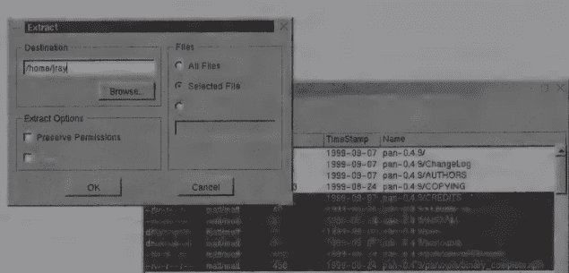

## 安装和编译 Linux 源码发行包

在编译程序之前，你必须获取其源代码。你的系统中可能同时安装了 GNOME 和 KDE，因此后续章节将展示如何为这两个桌面系统下载和安装软件。为了硬件无关性，这些系统的软件通常以源码形式分发，但通常很容易安装。

### 安装 KDE

查看 KDE 网站`http://www.kde.org`。在应用程序（applications）部分，你会发现数百个正在活跃开发并已准备好安装的程序。从游戏到网络流量监控，那里应有尽有。

假设你决定下载一个名为`kacman`的 Pac-Man 克隆游戏，它存储在系统中的文件为`kacman-1.0.tar.gz`，这是一个 gzip 压缩文件。本节将介绍准备该文件进行编译和安装的步骤。虽然你可以一次性完成解压缩和解包，但这里通过分两个步骤来演示。`tar`处理 gzip 的能力很不错，但并不是适用于所有的压缩格式。习惯手动处理此类事务是一个好习惯。

解压缩存档：

```bash
$jray@pointy kacman$ gunzip kacman-1.0.tar.gz
$jray@pointy kacman$ ls -al
total 987
drwxr-xr-x 2 jray jray 1024 Sep 11 12:34
drwxr--xr-x 3 jray jray 1024 Sep 11 12:33
-rw-r--r-- 1 jray jray 1003520 Sep 11 12:18 kacman-1.0.tar
```

现在你有一个单一的 tar 文件需要解包。使用命令解包该文件：

```bash
$jray@pointy kacman$ tar -xvf kacman-1.0.tar
kacman-1.0/
kacman-1.0/README
kacman-1.0/INSTALL
kacman-1.0/Makefile.am
kacman-1.0/Makefile.in
kacman-1.0/acconfig.h
kacman-1.0/acinclude.m4
kacman-1.0/aclocal.m4
kacman-1.0/config-guess
kacman-1.0/config.h
---
kacman-1.0/src/kacman.h
kacman-1.0/src/gamewindow.h
kacman-1.0/src/gamewidget.h
kacman-1.0/src/scoreialog.h
kacman-1.0/src/newscoreialog.h
kacman-1.0/src/mini-kacman.xpm
kacman-1.0/src/kacman.xpm
kacman-1.0/src/kacman.kdelnk
```

到目前为止，你创建了一个`kacman-1.0`目录，且编译应用程序所需的所有文件都位于该目录中。注意，目录中有两个看起来重要的文件：`README`和`INSTALL`。这些是你下载文件时经常常见的典型文件名。在继续安装之前，请阅读这两个文件；它们可能包含关于在你的计算机上运行该程序的重要信息。与其猜测安装步骤并导致错误，不如检查包含在内的说明文件。

以`kacman`为例，README-1.0 简单地写道：

```bash
$jray@pointy kacman$ more README
See the HTML documentation in the doc/ subdirectory.
```

如果需要更多信息，你始终可以在`doc`子目录中查看程序文档。然而，INSTALL 文档几乎包含了编译和安装软件的详细指令。这里显示了文档的一部分。这对于你将找到许多应用程序来说非常典型（可能完全相同）。这是因为现代软件发行包使用自动化配置系统，该系统可以识别你正在运行的计算机类型、操作系统，并可以使用计算机上已安装的功能：

### 基础安装

这些是通用的安装说明。

`configure`脚本尝试为编译期间使用的各种依赖于系统的变量猜测正确值。它使用这些值在包的每个目录中创建一个`Makefile`。它还可能创建一个或多个包含系统相关定义的`.h`文件。最后，它会创建一个 shell 脚本`config.status`，你以后运行它来重建当前配置；一个文件`config.cache`保存测试结果以加速配置；以及一个包含编译器输出的文件`config.log`（主要用于调试`configure`）。

如果你需要执行一些特殊操作，请尝试弄清楚`configure`如何检查是否执行这些操作，并将差异或指令发送到`README`中给出的地址，以便它们在下一次发布中被考虑。如果在某个时刻`config.cache`包含了你不想保留的结果，你可以删除或编辑它。

编译此包简单的方法是：

- `cd`进入包含包源码的目录并输入`./configure`为你的系统编译该包。如果你在旧版本的 System V 上使用`csh`可能需要输入`./configure`以防止`csh`尝试执行`configure`。运行`configure`需要一些时间。运行时，它会打印出正在检查的功能的消息。
- 输入`make`编译包。
- 可选，输入`make check`运行包附带的任何自检。
- 输入`make install`安装程序和任何数据。
- 输入`make clean`从源码目录删除二进制文件和对象文件。要删除`configure`创建的文件（以便为不同类型的计算机编译），输入`make distclean`。还有一个`make maintain`目标，主要供包开发者使用。如果你使用它，可能需要获取发行包自带的所有程序。

过程在这些说明中描述得非常清楚，请遵循操作：首先，`cd`进入包含源码发行包的目录。这是主目录：

```bash
$jray@pointy kacman]$ cd kacman-1.0
$jray@pointy kacman-1.0]$
```

接下来，运行配置脚本。这在你的系统上可能需要一段时间，取决于脚本检查的内容以及处理器和磁盘的速度。你会看到整个过程。不要对缺少特定函数或库的消息感到震惊；这并不意味着软件无法编译：

```bash
$jray@kacman-1.0]$ ./configure
creating config.cache
checking how to run C++ preprocessor... g++ -E
checking for BSD install... /usr/bin/install -c
checking for X... /X11/lib, headers /X11/include
checking whether environment is sane... yes
checking whether make sets ${MAKE}... yes
checking for ranlib... ranlib
checking for main in... no
checking for extra libs... no
checking for kde headers installed... yes
checking for kde libraries installed... yes
checking for kde paths... done
checking for sleep... yes
updating config.cache
creating Makefile
creating src/Makefile
creating data/Makefile
creating config.h
```

在配置过程的最后几行，你会注意到创建了几个文件：`Makefile`和头文件。这些是为你特定系统构建软件所需的文件。它们考虑了你的 KDE 分发位置和其他配置。由于这一点，你不能将此预配置的源码树移动到另一台机器并编译；如果你修改了机器配置（例如移动 KDE 安装目录），可能会遇到问题。然而，软件已准备好编译，进入下一步：编译软件。


> **注意**：在极少数例外，无论包如何发行，在你的计算机上编译的过程都是相同的。你所做的只是进入主源码目录输入`cd`。`make`命令调用配置过程中创建的`Makefile`。在某些软件发行包中没有配置阶段，你直接进入`make`。`Makefile`包含了对源码文件运行编译器并生成可运行程序的所有信息。它们管理不同代码之间的依赖关系。例如，为了编译程序的特定部分，系统依赖于已存在的其他部分。`Makefile`指示编译器先编译哪些文件、如何编译它们以及编译后做什么。作为最后一步，`Makefile`还可以包含如何在全计算机范围内安装结果程序及其文档的信息。

输入`make`会运行主`Makefile`（以及在其他子目录中创建的`Makefile`）。这将是安装中最耗时的部分。根据你计算机的大小和速度，你可能需要休息一下、吃个午饭或睡一会：

```bash
$jray@pointy kacman-1.0$

make all-recursive

make[1]: Entering directory '/home/jray/bookstuff/kacman/kacman-1.0/'

Making all in data

make[2]: Leaving directory '/home/jray/bookstuff/kacman/kacman-1.0/data'

Making all in src

make[2]: Entering directory '/home/jray/bookstuff/kacman/kacman-1.0/src'

--DHAVE_CONFIG_H -I. -I. -I. /usr/include -I/usr/include/qt

/usr/X11/include -O2 -Wall -c main.cpp

g++ -DHAVE_CONFIG_H -I. -I. -I. /usr/include -I/usr/include/qt

/usr/X11/include -O2 -Wall -c gamewindow.cpp

g++ -DHAVE_CONFIG_H -I. -I. -I. /usr/include

-I/usr/include/qt -I/X11 -O2 -Wall -c newscoredog.cpp

-Lbin/sh ..libtool --mode=link -q++ -O2 -Wall -s -o kacman

-L/usr/lib -L/usr/X11/lib main.o

gamewindow.o newscoredialogog.o

gamewindow.gamewidoc.moc newscoredialogog.moc -lkfm

-lkdei -lmediatool

-lqt -lxext -xi -W1,-rpath

-W1,/usr/lib -W1,-rpath

-W1,/usr/X11/lib

make[2]: Leaving directory '/home/jray/bookstuff/kacman/kacman-1.0/src'

make[1]: Leaving directory '/home/jray/bookstuff/kacman/kacman-1.0/'

```

## 安装与编译 Linux 源码发行版

根据所编译的软件，你可能会在编译过程中遇到警告。警告是编译过程中发生的非致命性错误；它们通常是无害的，是编译器试图帮助程序员发现源代码中的问题的结果。警告信息最常见的原因是程序员将特定变量强制转换为另一种类型。例如，`long`存储的是大整数，而`int`存储较小的整数。如果程序员将`long`的内容复制到`int`中，就会生成警告。在大多数情况下，这是无害的，而且正是程序员的意图所。。

编译过程的最后一步是安装已编译的软件。同样使用`make`命令，但这次带有`install`选项：

```bash
[jray@pointy kazman-1.0]$ su

Password:

[jray@pointy kazman-1.0]# make install

Making in data

make[1]: Entering directory '/home/jray/bookstuff/kazman/kazman-1.0/data'

/bin/.. makeinstall-ldirs /usr/share/apps/kazman/data

mkdir /usr/share/apps/kazman

/usr/share/apps/kazman -c 644 --arrow-down-mask.bmp

/usr/share/apps/kazman/data/arrow-down-mask.bmp

/usr/bin/install -c 644 --arrow-down.bmp

/bin/sh ..-libtool --mode=/usr/bin/install -c kazman /usr/bin/kazman

/usr/bin/makeinstall -c kazman /usr/bin/kazman

/bin/sh ..makeinstall -c 644 kodelnik /usr/share/applnk/Games

/usr/bin/install -c 644 kazman.xpm /usr/share/icons

/bin/sh ..makeinstall /usr/share/icons/mini/icons

/usr/bin/install -c 644 mini-kazman.xpm /usr/share/icons/xpm

make[1]: Leaving directory '/home/jray/bookstuff/kazman/kazman-1.0/src'
```


在执行`make install`时，你很有可能需要以 root 用户身份登录系统，以便访问 KDE 应用程序目录。在示例中，使用了`su`来切换到 root，以完成剩余的安装。如果你没有 root 权限，请寻求管理员的帮助，或者检查`README/INSTALL`文件，以获取有关更改安装目录的更多信息。你可能需要在运行配置程序时指定一个目标路径。例如，该发行版中的`INSTALL`文件显示如下：

# 安装名称

默认情况下，`make install`将软件包的文件安装在`/usr/local/bin`、`/usr/local/man`等目录下。你可以通过给`configure`选项`--prefix=PATH`来指定`/usr/local`以外的安装前缀。

## 第 12 章 安装与管理 Linux 软件

你可能想运行`./configure -help`来获取有关传递给配置过程的选项的信息。就是这些！`kazman`应用程序现在已安装在你的 Linux 机器上。KDE 软件包非常出色，因为大多数 KDE 应用程序的 Makefile 实际上会安装文件，以便它们显示在 KDE 弹出应用程序菜单的相应位置。

如果你还没有启动到 KDE，请检查 KDE 游戏菜单，你会看到 Zacman 图标等待点击。如果你已经正在运行 KDE，可以右键点击 KDE 启动栏，然后从 KDE 上下文菜单中选择重启。图 12.2 显示了新安装的软件。

### 12.2

Zacman 已成功编译并安装。


## 安装 GNOME 应用程序

现在将注意力转向 GNOME 环境以及如何安装新的 GNOME 应用程序。与 KDE 应用程序一样，GNOME 应用程序每天都在涌现。GNOME 网站（http://www.gnome.org/applist）有一个软件地图，上面带有所有已知 GNOME 软件的下载链接。

假设你选择为 GNOME 下载一个名为`pan`的 Internet 软件。与之前的安装示例一样，第一步将是解压并解压缩文件：

```bash
[jray@point bookstuff]$ gunzip pan-0.4.9.tar.gz

[jray@point bookstuff]$ ls -al pan-0.4.9.tar

-rw-r--r-- 1 jray 87400 Sep 11 12:18 pan-0.4.9.tar
```

现在，解压 tar 包。你可以使用命令行，也可以在 GNOME 文件管理器中双击 pan tar 文件：

```bash
[jray@pointy bookstuff$]$ tar -xvf pan-0.4.9.tar

pan-0.4.9/

pan-0.4.9/ChangeLog

pan-0.4.9/AUTHORS

pan-0.4.9/COPYING

pan-0.4.9/CREDITS

pan-0.4.9/README

pan-0.4.9/Makefile.am

pan-0.4.9/INSTALL

pan-0.4.9/pan/

pan-0.4.9/pan/xpm/

pan-0.4.9/pan/xpm/binary.xpm

pan-0.4.9/pan/xpm/binary_complete.xpm

pan-0.4.9/pan/xpm/binary_incomplete.xpm

pan-0.4.9/ulib/unconc.c

pan-0.4.9/ulib/uscan.c

pan-0.4.9/ulib/unring.c

pan-0.4.9/ulib/unring.h

pan-0.4.9/ulib/unutil.c
```

在本文中你可能需要查看几个文件：`AUTHORS`、`COPYING`、`CREDITS`、`README`和`INSTALL`。现在，`INSTALL`文件是最重要的。对于 KDE，`INSTALL`文件包含了编译并安装软件所需的全部信息。通过运行以下命令来完成安装：

```bash
[jray@pointy pan-0.4.9]$ ./configure
make
```

在执行`make install`时，你很有可能需要以 root 用户身份登录系统，以便访问 KDE 应用程序目录。在示例中：

```bash
[jray@pointy pan-0.4.9]$ make
```

```text
/usr/bin/install -c pan /usr/local/bin/pan

make[2]: Nothing to be done for 'install-data-am'

make[2]: Leaving directory /home/jray/bookstuff/pan-0.4.9/pan

make[1]: Leaving directory /home/jray/bookstuff/pan-0.4.9/pan

make[1]: Entering directory /home/jray/bookstuff/pan-0.4.9/
```

与 KDE 的软件安装不同，这个 pan 并没有安装在 GNOME 系统菜单中；它只是将 pan 二进制文件安装在了`/usr/local/bin`（你可以在之前的输出中看到这一点）。

你可以通过运行主 GNOME 弹出菜单中“工具”下的“菜单编辑器（Menu Editor）”，手动将应用程序添加到 GNOME 弹出菜单中。或者，你也可以通过导航到`/usr/local/bin`目录，点击鼠标中键（如果你在模拟三键鼠标，则同时点击两个键）并将图标拖到桌面来为应用程序创建快捷方式。

当你选好图标位置后，松开鼠标中键并选择“在此创建链接（Link Here）”，以创建一个文件的符号链接（类似于 Windows 快捷方式或 Macintosh 别名）。然后你可以使用此图标运行软件。图 12.3 显示了编译后的 pan 应用程序及其运行状态。

# 图 12.3

Pan 正在编译并运行。

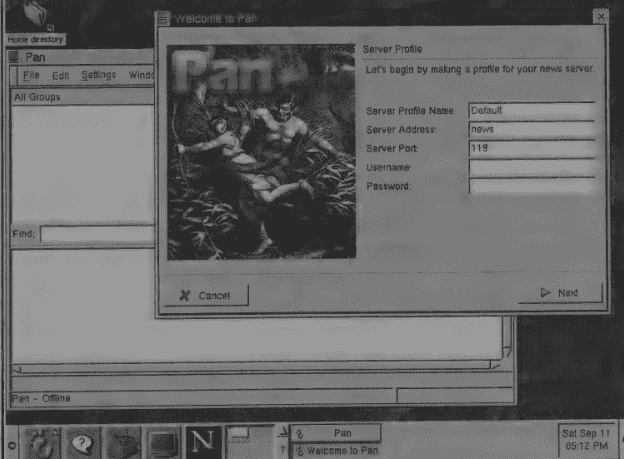

如你所见，安装源代码和编译应用程序的过程并不困难；对于你在互联网上找到的大多数文件，该过程通常是相同的。流程中的任何变化几乎都会记录在`README`或`INSTALL`文件中。

## 理解 KDE 和兼容性

你可能在心里想：“如果我想运行 GNOME 作为我的桌面环境，但又想编译并运行一个 KDE 应用程序（或反之亦然）怎么办？”

别担心——KDE 和 GNOME 本质上是为 Linux 系统提供的一组编程 API 和自定义窗口管理器。如果系统同时安装了 KDE 和 GNOME，你可以在任何一个环境中运行来自任何一个环境的软件。

唯一的例外是某段软件使用了 KDE 窗口管理器的特定功能，或者期望某个软件正在运行但实际上并没有运行。在大多数情况下，你可以在任何地方运行任何程序。事实上你会注意到，为了方便，GNOME 的主系统菜单显示了已安装 KDE 应用程序列表。

## 管理 Linux 软件应用程序

在你的 Linux 计算机上管理软件与其说是一门艺术而非科学。红帽（Red Hat）包管理系统的美之处之一在于，它将跟踪文件去向及其位置的责任交给了操作系统实用程序，而不是用户。

遗憾的是，正如在本章中看到的，软件并不总是以红帽包的形式提供。那么，你该如何管理已安装的程序呢？接下来的章节将更详细地探讨这个问题。

## 选择一个良好的安装目录

首先，明智地选择一个安装目录。你找到的大多数软件会自动安装到供 KDE 或 GNOME 使用的相应目录。其他软件会为你提供一个安装目录选项。

你可能想将软件安装在`/usr/bin`中（许多软件都位于那里），但这在以后可能会导致混淆。如果你想删除已安装的软件，尝试从`/usr/bin`中剔除将非常困难。你还面临着意外用你编译的软件替换操作系统自带实用程序的风险。

安装额外软件的一个流行位置是`/usr/local/bin`。在此位置安装你的软件可以让你立即看到安装了哪些内容。`/usr/local`目录也是作为一个与其他系统分区独立的划分创建的，这允许写入软件和文件，而不会导致你的系统分区碎片或损坏。

## 保留源代码副本

其次，在`/usr/local/src`中保留一份源代码副本。保留源代码副本通常可以在紧急情况下救你一命。

最近，一个为几千人提供拨号认证的系统在雷暴期间发生严重崩溃后，遭受了几个损坏文件的影响。幸运的是，备份系统完全完蛋了。要让系统恢复运行，所需要的是重新安装处理用户认证的软件，但机器中并没有保留源代码。

我下载了软件的新版本，编译了它并安装了它——但不起作用。软件的新版本对用户账户文件使用了不同的格式，并拒绝读取数据。由于其他系统依赖于该用户账户文件，我无法将文件升级为新格式；相反，我必须去寻找认证系统的旧版本源代码。

寻找旧软件并不是你想要的处境——花费了超过一天的停机时间才找到作者并获得旧版本的副本。如果你已经在`/usr/local/src`中保留了已配置好的源代码副本，你只需要输入`make`和`make install`，你的应用程序就会按照原来的样子重新编译并安装。

最佳方法是编译你的软件，然后在程序安装后将整个目录移动到`/usr/local/src`。但在移动之前，你可以通过清除编译器在生成程序时创建的二进制文件来节省空间。要这样做，在源代码目录内执行`make clean`，如下例：

```bash
$jray@point-pan-0.4.9$ make clean

Making clean in .

[1]: Entering directory '/home/jray/bookstuff/pan-0.4.9'

[1]: Nothing to be done for 'clean-am'

[1]: Leaving directory '/home/jray/bookstuff/pan-0.4.9'

Making clean in pan

[1]: Entering directory '/home/jray/bookstuff/pan-0.4.9/pan'

test -f "*pan" -1 | rm -f *.o *.core

[1]: Leaving directory '/home/jray/bookstuff/pan-0.4.9/pan'

rm -f [ -]if2fp

rm -f *.o *.so core * - TAGS

[1]: Leaving directory '/home/jray/bookstuff/pan/ulib'
```

## 确保有一个可行的卸载计划

第三，跟踪安装在你系统上的软件。这可能是管理已安装软件最困难的部分。虽然软件的二进制部分通常会自行安装到`/usr/bin`等目录中，但配置文件往往分散在整个系统中。如果你足够幸运，`/usr/local/bin`没有卸载过程。

日志文件可能有些难以阅读，因此包含了一段快速且简易的 Perl 代码，用于提供从系统中移除软件时必须删除的文件和目录列表。由于不同的 Makefile 以不同的方式安装软件，这段代码并不总是有效；然而，对于大多数软件分发版（那些依赖`install`和`mkinstalldirs`的发行版），它应该是这样的：

```perl
#!/usr/bin/perl

# 1999 by John Ray

# This program may be modified and distributed freely.

if ($ARGV[0] eq "") {
    print "\nUsage: installcheck.pl <install.log>\n";
    exit 1;
}

if (!-f $ARGV[0]) {
    print "\nFile \$ARGV[0] doesn't exist!\n";
    exit 1;
}

$installlog=cat $ARGV[0];

while ($installlog~s/mkinstalldirs (.*)//) {
    print "$1=$1." >> "$directories";
}

while ($installlog~s/\usr/bin/install\.*?\s+([\s\n]+))//) {
    print "$1=$1." >> "$files";
}

$directcount=split(/\s+/, $directories);

$filecount=split(/\s+/, $files);

print "\nTotal files installed: $filecount\n";

print "\nTotal directories created: $directcount\n";

print "--------------------------------------\n";

print "\nThe follow directories MAY have been created by the installation\n";
```


```perl
print "\nprocess. Some may have existed prior to being installed, so be wary\n";

print "\nwhen removing...\n";

for ($x = 0; $x < $directcount; $x++) {
    print "$x+1." $directory[$x]\n";
}

print "\n--------------------------------------\n";

print "\nThese files were installed: $filecount\n";

for ($x = 0; $x < $filecount; $x++) {
    print "$x+1." $filelist[$x]\n";
}

print "\n\n";
```

你可以根据需要以任何方式使用此示例代码。如果你想尝试一下，例如，你可以在`print $x+1.;`行之后立即添加`unlink $filelist[$x];`行。同样，你可以使用`$filelist[$x]\n;`在程序运行时自动删除安装的文件。

# 第三部分

# 第 12 章 安装和管理 Linux 软件

要安装`installcheck.pl`，只需将书中的文本输入到文本编辑器，然后将文件保存为`installcheck.pl`。最后一步，在命令行输入`chmod +x installcheck.pl`，以便赋予程序必要的执行权限。在你之前创建的日志文件上运行`installcheck.pl`，将得到以下结果：

```bash
[root@kzacman-1.0]# /installcheck.pl install.log
```

```text
Total files installed:
Total directories created:
```

以下目录可能由安装过程创建。某些目录在安装之前已经存在，因此在删除时要小心。

1. `/usr/share/icons/mini`
2. `/usr/share/icons`
3. `/usr/share/applnk/Games`
4. `/usr/bin`
5. `/usr/share/doc/HTML/en/kzacman`
6. `/usr/share/apps/kzacman/wav`
7. `/usr/share/apps/kzacman/data`

安装了这些文件：

1. `/usr/share/icons/mini/kzacman.xpm`
2. `/usr/share/icons`
3. `/usr/share/applnk/Games`
4. `/usr/bin/kzacman`
5. `/usr/bin/kzacman`

如你所见，管理在系统上安装的软件主要取决于你自己。你可能会开发出比这里介绍的更适合你环境的技术。Linux Linux 用户可能会被系统提供的可用软件数量搞得无所措；因此，该用户无疑会被尝试安装东西所吸引。鲁率安装会导致重要系统分区磁盘空间被占满，并在无法追踪的地方创建文件。安装六个月后，谁还记得哪个软件使用了`libargu.5.3.a`文件呢？

## 部署前测试

如果你将 Linux 用作服务器而不是个人工作站，那么保留一台测试机器用于安装程序并测试它们如何与该机器必须提供的服务相互作用是关关重要的。用单台机器同时提供服务和测试软件可能会导致严重后果。服务器又一次一次发生故障，是因为在计算机上安装并被忘记的不当软件。某些软件安装程序复杂到足以修改你计算机上的配置文件，甚至可能完全消除了某些服务。

## 故障排除 Linux 软件应用程序

一种特别糟糕的安全软件在过去几年里引起了多次头疼。这个特定的程序监控计算机的网络连接是否存在潜在的端口扫描，这是攻击的可能迹象。遗憾的是，该软件似乎还有内存泄漏问题，最终会导致计算机停滞。

如果你只有一台计算机，且必须从该机器提供服务并想在上面安装软件，请确保在安装之前研究该软件并搜索 Usenet 新闻组。快速看一眼<http://www.deja.com/>只需要几秒钟，但以后可以为你节省几个小时的头疼。此外，务必准确记录更改。

## 故障排除 Linux 应用程序

在管理软件时，故障排除更像是一门艺术而非科学。如果你只有一台计算机，且必须从该机器提供服务并想在上面安装软件，请确保在安装之前研究该软件并搜索 Usenet 新闻组。快速看一眼<http://www.deja.com/>只需要几秒钟，但以后可以为你节省几个小时的头疼。此外，务必准确记录更改。

## 更新你的软件

在阅读这些提示后，你将维持相当的剩余空间。如果系统出现问题，使用文本提示符，停止任何正在运行的进程，并删除你拥有的`/tmp`文件。在许多情况下，这将满足你恢复运行的需求。

# KDE 和 GNOME 崩溃了：甚至无法加载桌面，配置损坏

程序通常会在你的家目录下创建目录和配置文件。通常情况下，你的桌面软件不会显示这些目录和文件，因为它们以点（`.`）开头，这在标准文件列列表中会隐藏该文件/目录。以下是家目录下隐藏文件的示例：

```text
[jray $ ls -al | more

total 4976

drwxr-xr-x 40 jray
drwxr-xr-x 8 jray root
drwxr-x-- 2 jray
drwxr-xr-x 3 jray
drwxr-xr-x 9 jray
drwxr-xr-x 2 jray
-rw-rw--r 1 jray
drwxr-xr-x 3 jray
-rw-rw-r 1 jray
drwxr-xr-x 2 jray
drwxr-xr-- 5 jray
-rw-rw-r 1 jray
drwxr-xr-x 2 jray
drwxr-xr-x 3 jray

    2048 Sep 11 19:07 .-
    1024 Aug 30 11:23 .-
    1024 Jul 23 12:31 .e-conf
    8192 Sep 11 16:58 .enlightenment
    1024 Sep 11 17:13 .genome
    1024 Jul 7 20:23 .genome-private
    263 Jul 23 16:12 .gtckrc
    1024 Jul 7 01:07 .kde
    1024 Sep 11 17:43 .kderc
    1024 Sep 30 11:14 .ncptf
    1024 Aug 16 15:57 .netscape
    3505 Jul 7 01:07 .screenrc
    1024 Sep 11 16:59 .vnc
    1024 Jul 24 23:50 .x11amp
```

这些文件中的许多对你来说应该非常熟悉。这里有 KDE、GNOME 窗口管理器 Enlightenment、KDE、X11Amp（一个基于 X/Windows 的 MP3 播放器）以及 Netscape 的配置目录。如果你配置了任何设置（包括桌面环境中的图标位置），你可以重命名它们，然后运行之前失败的软件，让它重新创建配置文件，并看看是否能解决你的问题。这种技术通常只在配置文件损坏时才需要。在删除这些目录之前，请确保你没有在这些目录中保存重要的自定义设置——例如，删除 KDE 或 GNOME 目录的结果是将配置重置为你首次安装 Red Hat Linux 时的状态。

# 监控你的日志文件

日志文件主要留给系统级进程使用，但它们可能包含帮助你找出软件为何运行异常的信息。主日志文件是`/var/log/messages`。你可以在消息中搜索运行异常程序的名称，因为系统日志函数会为生成日志错误的进程进行命名。

例如，你可以在你的 Apache Web 服务器上配置几个虚拟主机。有时，在启动时，这些主机可能无法按预期工作。在这种情况下，你可以搜索消息文件，查看 Apache（`httpd`）在尝试启动时是否向系统记录了任何内容。你需要读取日志文件的权限，例如：

```bash
[root]#] grep "httpd" /var/log/messages
Sep 11 14:57:58 httpd: [Sep 11 14:57:58 1999] [error] Cannot resolve host name www.poisontooth.com -- ignoring!
Sep 11 14:57:58 httpd: [Sep 11 14:57:58 1999] [error] Cannot resolve host name www.brevardmpo.com -- ignoring!
Sep 11 14:57:58 httpd: [Sep 11 14:57:58 1999] [error] Cannot resolve host name www.brevardmpo.com -- ignoring!
Sep 11 14:57:58 httpd:
Sep 11 14:57:58 httpd: http startup succeeded
```

从这些消息中，你可以看到虚拟主机没有工作，是因为计算机没有正确解析它们的名称。这会引导你发现网络配置问题，而不是 Web 服务器本身的问题。

默认情况下，`/var/log/messages`文件被设置为记录系统认为重要的消息。这并不是所有可以记录的信息。你也可以请求系统记录调试信息，这些信息可能非常庞大，而且并不一定是你想要持续执行的操作。要设置系统为任何可以记录调试信息的进程记录调试信息，只需在`/etc/syslog.conf`文件中添加此行：

```text
*.debug /var/log/debug
```

添加该行后，你可以重启机器以使更改生效，或者像这样重启 syslog 守护进程：

```bash
[root]# /etc/rc.d/init.d/syslog restart
Shutting down kernel logger [ OK ]
Shutting down syslog [ OK ]
Starting kernel logger [ OK ]
Starting syslog [ OK ]
```

根据默认设置，`/var/log/messages`文件被设置为记录系统认为重要的消息。这并不是所有可以记录的信息。你也可以请求系统记录调试信息，这些信息可能非常庞大，而且并不一定是你想要持续执行的操作。

# 运行应用程序

无论是否在桌面环境中配置了任何设置（包括桌面环境中的图标位置），你可以重命名它们，然后运行之前失败的软件，让它重新创建配置文件，并看看是否能解决你的问题。这种技术通常只在配置文件损坏时才需要。在删除这些目录之前，请确保你没有在这些目录中保存重要的自定义设置——例如，删除 KDE 或 GNOME 目录的结果是将配置重置为你首次安装 Red Hat Linux 时的状态。

# 从终端启动

无论是否在桌面环境中配置了任何设置（包括桌面环境中的图标位置），你可以重命名它们，然后运行之前失败的软件，让它重新创建配置文件，并看看是否能解决你的问题。这种技术通常只在配置文件损坏时才需要。在删除这些目录之前，请确保你没有在这些目录中保存重要的自定义设置——例如，删除 KDE 或 GNOME 目录的结果是将配置重置为你首次安装 Red Hat Linux 时的状态。

# 如果都都失败

无论是否在桌面环境中配置了任何设置（包括桌面环境中的图标位置），你可以重命名它们，然后运行之前失败的软件，让它重新创建配置文件，并看看是否能解决你的问题。这种技术通常只在配置文件损坏时才需要。在删除这些目录之前，请确保你没有在这些目录中保存重要的自定义设置——例如，删除 KDE 或 GNOME 目录的结果是将配置重置为你首次安装 Red Hat Linux 时的状态。

## 总结

无论是否在桌面环境中配置了任何设置（包括桌面环境中的图标位置），你可以重命名它们，然后运行之前失败的软件，让它重新创建配置文件，并看看是否能解决你的问题。这种技术通常只在配置文件损坏时才需要。在删除这些目录之前，请确保你没有在这些目录中保存重要的自定义设置——例如，删除 KDE 或 GNOME 目录的结果是将配置重置为你首次安装 Red Hat Linux 时的状态。

# 第 13 章 安装 Adobe Acrobat

作者 Duane Hellums

## 本章内容

- PDF 的重要性 248
- 安装 xpdf 248
- 下载 Acrobat Reader 249
- 安装 Acrobat Reader 250
- 创建 PDF MIME 类型 253
- 配置 Acrobat Reader 255
- 从命令行使用 Acrobat Reader 257
- 故障排除 Acrobat Reader 257

## PDF 的重要性

没有什么比需要访问以软件无法识别的格式存储的数据更令人沮丧的了。我不我是唯一收到邮件要求将字处理文件转换为另一种格式的人。当你发布到 Web、在文件中添加多媒体或在多个操作系统之间移动数据时，尤其如此。

为了减少这种问题的影响，Adobe 创建了所谓的 PDF 格式。你可能已经遇到过这种格式。这种格式可以封装任何来源的文本、超链接和高分辨率图像，并将其存储在标准格式中。免费提供的 Adobe Acrobat 阅读器和查看器适用于每个操作系统和浏览器，因此内容提供者可以确定没有接收者无法查看 PDF 文档。重要的是，接收者不需要购买昂贵的软件应用程序就可以查看以其他格式存储的数据。

那么为什么这很重要？Linux 在互联网上经常遇到这种格式——许多网站管理员提供 PDF 格式的文档。例如，如果你需要从美国税务局下载税表，你需要 Acrobat Reader。你还会发现帮助文件有时以 PDF 格式分发与你安装的软件一起。

## 安装 xpdf

如果你觉得你并不经常查看 PDF 文件，也许你可以使用 Red Hat 6.0 和其他 Linux 版本自带的 xpdf 程序。xpdf 应用程序（如图 13.1 所示）是 Acrobat 文件的简单查看器。xpdf 使用标准的 X 字体，是由 Derek Noonburg 编写的，而不是 Adobe。你可以访问 Derek 的网站获取有关该程序的更多信息，并检查可下载最新版本：<http://www.foolabs.com/xpdf>。

用于文本。打印机图标实际上用于将 PDF 文件转换为 PostScript 文件。问号会弹出关于该应用程序的基本信息文件，退出（Quit）按钮允许您关闭程序。

## 图 13.1

xpdf PDF 查看器可以读取来自 IRS 等地的文档。


版本 0.8 是最新版本，作为一个软件包包含在光盘上，文件名为`xpdf-0.804.1386.rpm`。如果你最初没有选择安装 xpdf，可以使用 Red Hat 软件包管理器（RPM）或 GnoRPM（图形化界面）来安装该软件包。第 11 章“安装和管理 RPM 软件包”提供了有关如何操作的详细信息。如果你已经安装了 xpdf，你应该在 GnoRPM 的“应用程序（Applications）”组下的“发布（Publishing）”类别中看到它。

你可以通过双击任何带有`.pdf`扩展名的文件来启动 xpdf（例如，在 Midnight Commander 管理文件浏览器内部）。你也可以在命令行（shell）中通过输入`xpdf`或`/usr/bin/xpdf`来启动 xpdf。然而，建议将程序添加到 GNOME 菜单、子菜单、面板或桌面。有关如何执行此操作，请参见第 7 章“安装和配置 GNOME”。

## 下载 Adobe Acrobat Reader

尽管 xpdf 可能会无法满足你的某些需求，但你可能需要一个更强大一点的工具。在这种情况下，你应该直接去源头并使用 Adobe 的 Acrobat Reader。

# 第 13 章 安装 Adobe Acrobat

> 如果你有选择，应该应该始终尝试下载 RPM 文件，而不是旧的`tar.gz`文件。下载大小非常相似，但 RPM 安装和软件包管理要简单得多。请参见第 11 章以更好地理解这一过程。

Acrobat 的当前版本 4.0 版本可以从任何镜像文件传输协议（FTP）站点下载，作为一个名为`linux-ar-40.tar.gz`的​​软件包。你可以通过访问<http://www.adobe.com/prodindex/acrobat/readstep.html>并填写所需的表单来下载 5.7MB 的文件。尽管 Acrobat Reader 是免费的，但你需要提供一些个人信息，包括你的电子邮件地址以及你将如何使用 Acrobat 和 PDF 文件。

在提交 Acrobat Reader 下载表单之前，确保在第 1 步的平台（Platform）文本框中默认设置为 Linux；否则，你将得到 Windows 95 版本。

## 安装 Acrobat Reader

如果你使用的是下载的`tar.gz`文件，你要做的第一件事是决定将存档存储在硬盘的哪个位置。因为你将以 root 身份安装 Acrobat，你可以直接使用`/root`目录；但也可以使用其他目录，例如`/usr/local/src`目录。之后，你必须解压并解包 Acrobat Reader，除非你足够幸运使用的是 RPM 文件。目前 Adobe 不支持 RPM 格式，但如果他们改变了这一做法和政策，你可能会在互联网或光盘上找到 Acrobat 的 RPM 软件包。如果你找到了，应该使用它而不是`tar.gz`文件，后者的使用要困难得多。

## 解压和解包 Acrobat Reader

从`tar.gz`文件扩展名可以看出，你必须解压并解包该软件包中的存档文件。遗憾的是，这个过程不像使用 RPM 或 GnoRPM 那么简单，它通常涉及两个步骤——更糟糕的是，这是你在 Red Hat Linux 6.0 中必须使用 shell 和命令行界面的少数几次之一。你可以使用 X 终端或标准虚拟终端执行此操作。遵循以下步骤：

1. 首先，你可以使用`gunzip`（GNU unzip）命令解压文件（不过，在操作之前请查看本节中的提示）。例如，在切换到你下载或复制压缩存档的目录后，你将输入：

   ```bash
   gunzip linux-ar-40.tar.gz
   ```

# 安装 Acrobat Reader 251


这会将 5MB 的压缩文件转换为一个名为 `linux-ar-40.tar` 的 14MB 解压文件（`.gz` 扩展名消失了，因为文件不再被压缩）。

1. 如果你手动解压了 tar.gz 文件，可以使用 `tar` 命令将存档文件恢复到硬盘的文件系统中，如下所示：

```bash
tar xvf linux-ar-40.tar
```

> 你可以通过输入 `tar xvfz linux-ar-40.tar.gz` 在一个命令中完成这两个操作（尽管有些人尝试避免在 `tar` 中使用 `z` 选项，因为它在所有 UNIX 版本上都不受支持）。你也可以输入 `zcat linux-ar-40.tar.gz | tar xvt`，这会实时解压数据（保持原始文件完好），然后将其以解压类型发送到 `tar` 命令进行解包。如果你使用 `gzip` 命令，你将得到一个 14MB 的压缩文件，稍后需要清理它，而不是 5MB 的数据。如果你限制了硬盘或系统内存（RAM）且不希望有任何必要的杂物，你应该使用 `tar xvfz` 命令。

你的存档（`.tar`）文件不会发生任何变化，但你将在终端上看到几行输出。除非看到错误，否则这表明 `tar` 成功地将文件恢复到了新目录。如果你手动解压了 tar.gz 文件，可以使用 `tar` 命令将存档文件恢复到硬盘的文件系统，如下：

```bash
tar xvf linux-ar-40.tar
```

> 你可以通过输入 `tar xvfz linux-ar-40.tar.gz` 在一个命令中完成这两个操作（尽管有些人尝试避免在 `tar` 中使用 `z` 选项，因为它在所有 UNIX 版本上都不受支持）。你也可以输入 `zcat linux-ar-40.tar.gz | tar xvt`，这会实时解压数据（保持原始文件完好），然后将其以解压类型发送到 `tar` 命令进行解包。

除非看到错误，这表明 `tar` 成功地将文件恢复到了新目录。

## 创建 PDF MIME 类型

如果你使用 xpdf 查看指南，你会发现页面本身是可见的。当你使用 acroread 查看指南时，你应该注意到左侧有书签（Bookmarks）和缩略图（Thumbnails）标签，它们可以作为一个良好的索引，帮助你快速找到感兴趣或遇到问题的领域的帮助。这就是你安装 Acrobat Reader 而不仅仅满足于 xpdf 所能享受到的一个小优势。

## 创建 PDF MIME 类型

如果你想将 Acrobat Reader 设置为你的默认 PDF 查器，可以在两个级别进行：在你的 GNOME 界面内部，以及作为 Netscape Navigator 的辅助应用程序。前者允许你在从 Midnight Commander 文件浏览器中双击 PDF 文件时打开 Acrobat Reader，而后者则允许你从 Netscape 内部（用于是在互联网上）指向任何 PDF 文件时启动 Acrobat Reader 进行查看。这是通过将 PDF 文件的 MIME 类型（多媒体互联网邮件扩展）配置为 `application/pdf` 并将其与 Acrobat Reader 关联来实现的。

为了让 GNOME 支持 Acrobat 的 `application/pdf` MIME 类型，请执行以下步骤：

1. 以 root 身份，进入 GNOME 主面板并点击启动控制中心（Control Center）的工具箱。如果你已经运行了 Midnight Commander 文件浏览器，也可以从菜单栏选择“命令，编辑 MIME 类型（Edit MIME Types）”。无论哪种方式，你都会看到左侧带有目录树菜单的控制中心。点击“MIME 类型”，右侧将出现两列，分别是“MIME 类型”和“扩展（Extensions）”。

2. 浏览 MIME 类型列表，查看是否有一个与 `.pdf` 扩展和 xpdf 应用程序关联的 `application/pdf`。如果有，编辑该条目并点击“编辑（Edit)”按钮。这将弹出一个“应用程序/pdf 操作（Set Actions for Application/pdf）”窗口。

3. 如果你想选择一个出现在任何 `*.pdf` 文件旁边的图标图表，请点击窗口顶部的图标按钮。

4. 在 MIME 类型操作的打开（Open）文本框中，输入 `acreate %`。然后输入完整路径，文件必须位于 `/usr/bin` 中，或者你有一个指向 Acrobat Reader 的符号链接（参见本章较早描述的 `ln` 命令）。点击 OK 保存你的更改并返回控制窗口。

5. 你可以通过点击“尝试（Try)”来临时保存更改（如果无效，你可以点击“还原 Revert”）。点击 OK 保存更改，或点击“取消（Cancel）”忽略在该窗口中所做的任何更改。

6. 如果 MIME 类型列中没有列出 `application/pdf` 的 MIME 类型，你必须创建一个。点击“添加（Add）”按钮执行。你会看到一个“添加 MIME 类型”窗口。在这里，你需要在 MIME 类型文本框中添加文本 `application/pdf`，并在扩展文本中添加 `pdf`。点击 OK 保存更改并创建 `application/pdf` MIME 类型。创建完成后，你可以在 MIME 类型列中点击它，然后点击“编辑”，将 Acrobat Reader 命令与此类型的文件关联。参见上段关于如何执行此操作的内容：

Netscape Communicator 的工作略有不同。默认情况下，出于安全考虑，Netscape 将自己与操作系统隔离，因此在没有你显式许可的情况下启动外部程序。你通过让 Netscape 调用辅助应用程序来赋予其权限，该程序像 GNOME 一样使用 `application/pdf` MIME 类型。要在 Netscape 中为 Acrobat Reader 执行此操作，请执行以下步骤：

1. 从 GNOME 面板启动 Netscape Communicator，当进入默认页面时选择“编辑，首好（Edit, Preferences）”。

2. 你会看到 Netscape 首好窗口，左侧有一个标记为“类别（Category）”的目录树。在该区域，点击导航（Navigator）旁边的箭头，然后点击“应用程序（Applications）”。

3. 你会在右侧看到两列，标记为“描述（Description）”和“处理程序（Handled By）”。基本上，你希望在此表中添加一条内容为 `Portable Document Format handled by /usr/bin/acroread %` 的条目（你指向 Acrobat 可执行文件的目录路径取决于你的安装位置，至少你应该有一个指向 `/usr/bin` 中 `acroread` 所在位置的符号链接）。

4. 要将 Reader 添加为 Netscape 的辅助程序，点击“新建（New）”按钮。你会看到带有四个文本框的 Netscape 窗口，你需要填写它们。

5. 在“描述”文本框中，输入 `Portable Document Format`，或者如果你喜欢也可以输入 `Acrobat`（这只是一个标签）。

6. 在 MIME 类型框中，输入 `application/pdf`。这表示你想将 PDF 文件与应用程序关联。在“后缀（Suffixes）”框中，输入 `pdf`。这表示任何以 `.pdf` 结尾的文件都被假设为 PDF 文件。

7. 现在你必须指定在尝试下载或查看 pdf 文件时应该启动哪个应用程序。为此，点击其侧“处理（Handled）”部分中的应用程序复选框，`/usr/bin/acroread %`（注意 Netscape 使用 `%` 表示文件名，GNOME 也使用 `%`；这没有问题，只是差异。Netscape 使用全文件名，而 GNOME 则不）。

8. 点击 OK 返回 Netscape 首好窗口，然后点击 OK 保存更改（或者如果你认为自己做错了，可以点击“取消”以忽略在该窗口中所做的任何更改）。

如果一切顺利，你将能够与 Red Linux 无缝使用 Acrobat PDF 文件。如果你使用 Midnight Commander 或其他符合 GNOME 标准的文件浏览器，你将看到带有你为其配置的图标的 PDF 文件（如果适用），双击它将立即启动 Acrobat Reader。这比手动启动 Acrobat 并选择“文件，打开”并浏览文件要简单得多。你还可以无缝使用来自互联网或本地服务器的文件，因为点击包含 PDF 文件的链接会导致 Netscape 立即启动其辅助应用程序 Acrobat Reader 来为你查看文件。

| 部分 | 章 | 13 |
|---|---|---|

## 配置 Acrobat Reader

在 Acrobat 中，除了显示、字体和打印机设置外，你不会发现很多可以配置的内容。通过菜单选择“文件，首好”可以访问 Acrobat 配置选项。四个子菜单选项如下：

- 注释（Annotations）：注释对话框允许你选择在标记（注释）文档时使用的字体样式。
- 全屏（Full Screen）：全屏对话框创建一个幻灯片格式，允许你自动或通过点击任何键导航文档的所有页面。
- 超链接（Weblink）：超链接对话框允许你选择 Acrobat Reader 如何处理 PDF 文件中的超链接。通过此，还可以决定 Reader 如何处理你的浏览器链接（例如，你可以指定 `/usr/bin/netscape` 的路径）。
- 通用（General）：你可以通过选择“文件，首好，通用”更改大多数默认查看参数。这将显示图 13.3 中的弹出窗口。默认设置适用于大多数人，但你可能对其进行微调。例如，你可以将默认页面布局更改“连续（Continuous）”，将默认缩放改为“适合页面（Fit Page）”（将整个页面显示在屏幕上，因此无需滚动）。在这里你也可以关闭启动 Acrobat 时显示 Adobe 启动界面，或者选择立即弹出一个提示打开文件的对话框。

你可能还想更改打印设置（Print Settings），即图 13.4 显示的弹出窗口。当你从菜单选择“文件，打印”或点击工具栏上的打印机图标打印当前查看的文件时，就会看到此弹出窗口。你有选项打印到文件或到默认打印机（在此情况下为由 `/usr/bin/lpr` 程序控制的网络打印机）。如所示，你可以选择打印所有页面、页码范围或任何范围内的奇数页和偶数页，支持正序或逆序。

## 第 13 章 安装 Adobe Acrobat

设置仅在您当前的 Acrobat Reader 会话中生效；如果您关闭 Acrobat 并重新启动，这些设置将恢复为默认值。

### 图 13.3

您可以通过修改默认设置（常规偏好）轻松地更改 Acrobat Reader 的默认行为。

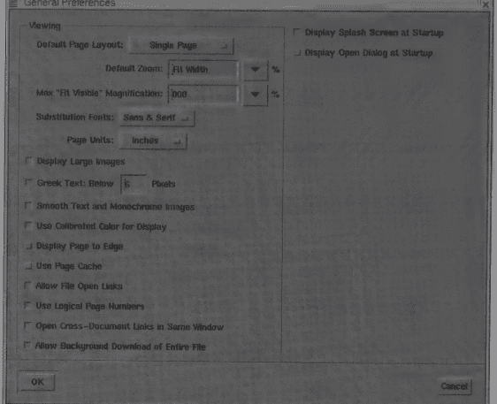

### 图 13.4

Acrobat Reader 打印属性。

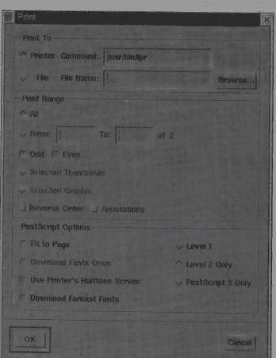

> 注意：如果您将打印设置更改为打印机无法识别的格式，Linux 会打印一条警告消息告知您出现错了。例如，当我将 PostScript 选项更改为“仅 PostScript 3”时，我收到通知，必须将设置反映为“仅 Level 2”，因为我的 Windows 打印机无法识别 PostScript 3。

## 从命令行使用 Acrobat Reader

您可能发现需要从 shell 或命令行界面使用 Adobe Acrobat Reader。如果您想通过编写 shell 程序（例如将 Acrobat 文件列表转换为 PostScript）来自动化其他繁琐的任务，这将非常有用。您可以通过输入 `acreread -help` 获取基本选项，或者输入 `acreread -helpall` 获取高级选项来查找发送给 Acrobat 的所有标志（当然，如果您创建了链接，则必须输入 `/usr/local/Acroread/bin/acreread`）。

例如，如果您想将一个名为 `f1040sc.pdf` 的文件转换为名为 `f1040sc.ps` 的 PostScript 文件，可以输入以下内容：

```bash
acreread -toPostScript -pairs f1040sc.pdf f1040sc.ps
```

如果您想将目录中的三个 PDF 文件（例如，`one.pdf`、`two.pdf` 和 `three.pdf`）转换为子目录 `postscript` 中的 PostScript 文件，可以输入以下内容：

```bash
acreread -toPostScript one.pdf two.pdf three.pdf postscript
```

还有许多其他命令行选项可用，但它们的使用取决于您的需求。这些选项包括但不限于：允许您将文件缩放至页面大小的选项（`-shrink`）、设置横向格式的打印选项（`-landscape`），以及从第 2 页开始转换的选项（`start at`）。

## Acrobat Reader 故障排除

如果您无法让 Adobe Acrobat Reader 工作，最可能意味着您引用了无效的路径或文件名。您能做的只是确认您的信息并重试。如果您仍然无法访问文件，你的问题可能涉及安全权限。在这种情况下，请递归检查您的路径，寻找任何异常，例如您没有权限读取或访问的目录或文件。您也可能尝试打开比您的系统能够处理的新版本 PDF 文件。如果 Adobe 发布了更高版本的 Acrobat Reader，文件格式可能不向后兼容，因此您必须升级到最新版本。

## 安装和配置 Netscape Communicator

作者：Duane Hellums

## 本章内容

- 关于 Netscape 260
- 安装 Netscape Communicator 260
- 启动 Communicator 261
- 配置外观偏好 264
- 配置 Navigator 偏好 266
- 配置邮件和新闻组偏好 269
- 配置漫用户偏好 276
- 配置 Composer 偏好 278
- 配置高级 Communicator 偏好 280
- Communicator 故障排除 282

## 关于 Netscape

Netscape 提供两种不同的网络浏览器产品：Communicator 和 Navigator。Communicator 包括一个 Web 浏览器（Navigator）、一个网页编辑器/发布器（Composer）、一个电子邮件客户端（Messenger）和一个互联网新闻组阅读器（Messenger）。Navigator 只包含一个 Web 浏览器。这两个产品都包含本书 CD 和官方 Red Hat 6.0 CD 中。除了基本的 Web 浏览外，您可能至少会使用电子邮件，如果有足够的磁盘空间，应该计划安装 Netscape Communicator。

## 安装 Netscape Communicator

Communicator 和 Navigator 共享某些文件，这些文件包含在名为 `netscape-common` 的 Red Hat 包管理器 RPM 包中。如果您安装 Communicator，则将需要安装 `netscape-communicator` 和 `netscape-common` 包。无论您选择自定义、工作站还是服务器安装，Communicator 都应该已经安装好了（除非您在自定义安装期间取消了该包）。

## 验证 Communicator 的安装

您在 GNOME 面板上应该有一个 Netscape 图标，它链接到您的 Communicator 可执行文件。要确认其已安装，可以点击它查看 Netscape Communicator 是否启动。如果程序由于某些原因没有启动，请执行以下步骤：

1. 从主 GNOME 菜单选择 System, GnoRPM。或者，您可以打开终端或基于文本的 shell 提示符来运行 `rpm` 实用程序。

2. 在 GnoRPM 中，查看 Packages、Applications、Internet 下。如果您看到 Communicator 包（`netscape-communicator-4.51-3.rpm`）和 Common 包（`netscape-common-4.51-3.rpm`），则所有 Netscape 组件都已安装。

3. （可选，命令行）从 shell 中，输入 `rpm -q netscape-common` 和 `rpm -q netscape-communicator` 来验证两者都已安装。

> 注意：如果您收到 Dependency Error（依赖错误）消息，可能是您可能在没有基础文件的情况下尝试安装 Communicator。请返回并选择 Common 和 Communicator，然后安装。

## 完成安装

如果 Communicator 没有安装，您可以通过以下步骤进行安装：

1. 点击 GnoRPM 上的 Install 按钮，将弹出 Add 窗口。

2. 确保您的驱动器已插入 Red Hat CD。点击 Add，将弹出 Packages 窗口。

3. 在文件中向下滚动并双击 `netscape-common-4.51-3.rpm` 文件，或点击 Add；它应该出现在 Install 窗口。

4. 然后点击 Add 窗口。

5. （可选，命令行）从 shell 中输入 `-ivh /mnt/cdrom/RedHat/RPMS/netscape-communicator-4.51-3.rpm`（假设您的 CD-ROM 挂载在 `/mnt/cdrom`；否则请替换该路径）。

## 启动 Communicator

首次启动 Netscape 时，您会迅速看到两个错误消息对话框和一个 Netscape 许可协议对话框。如果您接受条款，点击 Accept。这会打开主 Netscape Communicator 窗口，但留下了两个错误消息。不要被这些标签吓到——这些并不是真正的错误消息，而是信息对话框，显示缓存和存档目录已设置在您的当前用户主目录下（`/root` 或 `/home/login-name`）。只需选中每个错误消息窗口并点击 OK 按钮将其关闭即可。除非您更改这些目录的设置，否则您无需采取任何操作，这些将在本章后面介绍。


如果安装成功且没有出现其他问题，您应该看到如图 14.1 所示的窗口。这是主要的 `Communicator` 浏览器窗口。它默认指向 Red Hat 文档页面，这对于您熟悉 Red Hat Linux 6.0 非常有用。例如，您可以阅读随官方 Red Hat Linux 6.0 绑定 CD 附带的 Red Hat Linux 安装指南和入门指南的电子版。

| 部分 |
|---|
| Ch 14 |

# 第 14 章 安装和配置 Netscape Communicator

> 注意：如果您没有安装《安装入门指南》，您应该采用本章前面提到的步骤来安装 `rhl-install-guide-6.0-2.noarch.rpm` 和 `rhl_started-guide-en-6.0-2.noarch.rpm`。

图 14.1 Netscape Communicator 主窗口显示内容并提供了方便的菜单栏、工具栏和状态栏。

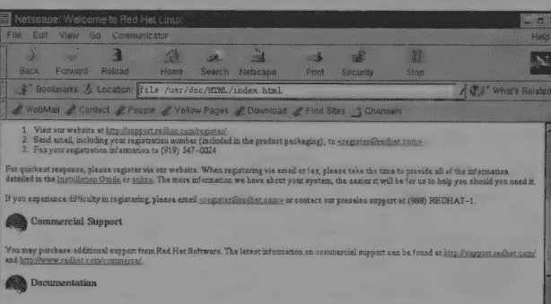

要查看 Red Hat 6.0 文档，请点击第一页中间列出的指南之一；除非您已经配置了 Internet 连接并想要连接到存储在 Red Hat Web 服务器上的 (remote) 指南，否则您应该点击标记为 (local) 的链接。第 33 章“配置 Internet 访问”对此更详细地讨论了这一点。您可能想阅读 Red Hat (remote) 主页上的某些文档（例如 `err`），因为它们可能比随书分发的信息更及时。

## 测试您的浏览器和 Web 服务器

如果您安装了 Apache 服务器，还可以在工具栏的位置栏中输入 `http://localhost/` 来测试它。如果服务器正在运行并已配置，您将看到默认的 Apache 主页，该页面提供了指向 Apache 和 Red Hat 主页的链接，以及本地驱动器上的 Apache 文档。

随 Web 服务器安装的默认 Apache 页面存储为 `/home/httpd/html/index.html`，您可以对其进行编辑或替换为任何想要从 PC 提供的实际内容。

## 测试 Composer 并修改您的本地主页

要查看使用 Communicator 和 Composer 维护本地 Web 页面有多简单，请从主菜单栏选择 File（文件）、Edit（编辑）。这会打开图 14.2 所示的 Netscape Composer。Composer 是一个完全图形化的、见即所得（WYSIWYG）、HTML（超文本标记语言）编辑器。您可以进行任何更改，然后点击 Save（保存）按钮记录您的修改（您必须告诉 Composer 您想存储文件的位置，例如 `/home/http/html/index.html`）。请注意，只有在您登录或希望进行修改时，才能修改此页面。您可以通过点击 Netscape Communicator 的 Reload（重载）按钮查看您的更改。

图 14.2

Netscape Composer 随 Netscape Composer 标准提供，这是一个用于创建和修改 Web 页面的强大 HTML 编辑器。


在安装 Communicator 之后，配置它非常简单，因为所有参数都可以通过几个简单的菜单选项以图形方式执行。具体来说，您可以编辑以下组参数：

- 外观偏好（Appearance preferences）
- 导航偏好（Navigator preferences）
- 邮件和新闻组偏好（Mail and newsgroup preferences）
- 漫游用户偏好（Roaming user preferences）
- Composer 偏好（Composer preferences）

## 配置外观偏好

您可以更改 Communicator 的外观感受以及基本功能。要更改这些，默认情况下您在首次启动 Communicator 时只会看到浏览器。要进行更改，请从 Netscape Communicator 菜单栏选择 Edit（编辑）、Preferences（偏好）、Appearance（外观）。您应该会看到图 14.3 所示的 Preferences（偏好）窗口。

图 14.3 您可以设置 Communicator 在启动时立即自动启动组件。


在第一个标记为 On Startup Launch（启动时启动）的框架中，您可以选择以下四个选项中的一个或多个：

- Navigator（导航）：点击此项可在启动 Communicator 后显示浏览器窗口。
- Messenger Mailbox（邮件邮箱）：点击此项可自动弹出您的收件箱窗口。
- Newsgroup（新闻组）：如果您可以使用互联网新闻，请点击此项。
- Page Composer（页面编辑器）：如果您希望 HTML 编辑器打开一个空白 Web Page，请点击此项。

您还可以更改工具栏的显示。在图 14.1 中，可以看到工具栏同时使用图标和文本来描述您的选项。如果您想为内容留更多空间，或者您更倾向于文本而不是图标，可以精确指定工具栏选择如何呈现给您。在 Show Toolbar As（如何显示工具栏）框架中，您可以选择查看文本、图片或两者——您还可以选择显示 ToolTips（工具提示），即当鼠标悬停在工具栏图标上时出现的小描述。

## 配置字体

在 Appearance（外观）类别下，您可以选择修改 Communicator 使用的字体。点击 Fonts（字体），就可以修改以下选项：

- Fonts and Encodings（字体和编码）——您可以选择浏览器显示字符集编码时使用的默认变量和固定宽度字体。
- Size and Scaling（大小和缩放）——选择您想看到的默认字体大小，并允许使用缩放字体。
- Document-specific Fonts（特定文档字体）——选择您希望浏览器处理或忽略指定某些字体文档的方式。

## 配置颜色

当您访问 Web 页面时，浏览器会记录它。因此，它可以更改页面上不同链接的颜色，以便您知道是否已经访问过它。Web 页面设计师可以直接在 Web 页面中指定这些颜色以便提供。要配置您的设置，选择 Edit（编辑）、Preferences（偏好）、Appearance（外观）、Colors（颜色）。这将调出几项：

- Colors（颜色）——点击此项更改不同链接的颜色。
- Links（链接）——点击此项更改链接的颜色。
- Background（背景）——点击此项更改背景颜色。
- Text（文本）——点击此项更改文本颜色。
- Always（始终）——点击此项始终显示链接为已访问。
- Unvisited（未访问）——点击此项将链接显示为未访问。

# 第 14 章 安装与配置 Netscape Communicator

你也可以通过点击按钮强制 Netscape 处理支持的文件类型来选择辅助程序。或者，你可以点击文件浏览器按钮、将文件保存到磁盘，或在你每次访问所选文件时进行交互提示。

1. 要删除对现有文件类型的支持，选中该类型并点击删除（Delete）按钮。
2. 要为新的或之前不支持的文件类型添加支持，请点击新建（New）按钮。在编辑应用程序时，这将弹出一个新窗口。然而，在选择处理文件之前，你至少输入描述和后缀。
3. 如果你选择将文件下载到磁盘，可以在“下载文件”（Download Files）框中输入路径来设置这些文件的默认目录，或通过点击“选择”（Choose）从文件浏览器选择目录。

> 注意：第 7 章“安装与配置 GNOME”提供了关于 GNOME 界面 MIME 类型的额外信息和方法，该界面也使用 MIME 实现点击式功能。

## 配置智能浏览（Smart Browsing）

Netscape 在你的 Netscape Communicator 浏览器与 Netscape 网站之间提供了一个接口。这种交互通过引入智能浏览功能增强了你的浏览活动。如果你启用此功能，Netscape 可以帮助你以最小的麻烦找到寻找的网站。要配置智能浏览，请执行以下步骤：

1. 选择编辑（Edit）、首选项（Preferences）、导航（Navigator）、智能浏览（Smart Browsing）。这将显示包含两组项目的框架：相关内容（What's Related）和互联网关键词（Internet Keywords）。
2. 要启用“相关内容”并能够找到与当前查看主题相关的其他网站或页面，点击“启用相关内容”按钮。如果你选择了此项，还必须指定你希望相关内容是始终自动（Always）、首次使用后（after First Use）还是从不（Never）。
3. 要启用“互联网关键词”并能够在位置框中输入纯语言术语（而不是域名或 IP 地址），请点击“启用互联网关键词”按钮。然后你可以输入 `Charm paper` 或 `Atlanta Braves Tickets`，Netscape 将自动搜索并为你提供一个供选择的类别或网站列表。

> 提示：要激活“相关内容”，请按住“相关内容”按钮几秒钟。这将列出一个供你选择的相似页面和类别列表。

## 配置邮件和新闻组偏好

虽然 Navigator 能让你高效地浏览 Web 上的信息，但你可能希望使用电子邮件和互联网新闻与他人通信。因此，你在 Navigator 中可能配置的首要项目之一如图 14.5 所示的窗口。具体来说，在这里你可以提供有关身份、账户名称以及用于邮件和新闻组消息的服务器的信息。

图 14.5

你可以告诉 Communicator 你的邮件和新闻组服务器所在地，并提供你的账户名称。


你可以做的事情之一是更改你的邮件和新闻组消息的外观和反应。例如，你可以更改消息中字符的颜色、样式和大小，或者打开额外的窗口来查看单个文件或文件夹。要配置这些基本设置，请执行以下步骤：

1. 选择编辑（Edit）、首选项（Preferences）、邮件与新闻组（Mail & Newsgroups）。这将显示一个包含四组项目的框架。
2. 点击样式（Style）按钮来选择普通（Plain）、粗体（Bold）、斜体（Italic）或粗体斜体（Bold Italic）。点击颜色框调出颜色选择器并选择字体颜色。这些步骤将有效地更改你发送或接收的消息中包含或引用的文本的外观，以便你清晰地区分正文和引用。
3. 如果你使用纯文本消息而不是 HTML，选择你希望用等宽字体还是可变字体查看文本（取决于你认为哪种更吸引人且更易读）。
4. 选择一个或多个相应的复选框，告诉 Netscape Messenger 在某些情况或事件下的行为。你可以选择记住最后一次选择的消息（启动）；在双击文件夹、新闻组或消息时弹出一个新窗口；以及当你想要将消息发送到垃圾箱时（以防万一）弹出一个确认框。
5. 选择相应的单选按钮，指示当你从菜单或工具栏启动新闻组时，你希望弹出 Messenger 窗口还是消息中心（Message Center）。

## 设置你的邮件和新闻消息的身份

你的电子邮件和新闻客户端需要了解一些关于你的基本信息，以便正确格式化消息。你消息的接收者将能够确定是谁发送了消息以及他们如何回复你。要更改或验证你的身份，请执行以下步骤：

1. 选择编辑（Edit）、首选项（Preferences）、邮件与新闻组（Mail & Newsgroups）、身份（Identity）。这将显示一个带有供你填充文本框的框架。
2. 提供你希望邮件接收者在“发件人”字段看到的电子邮件地址或昵称。
3. 输入你的完整电子邮件地址，包括你的账户名称和服务器/域名。如果你不知道这些信息，应该联系你的互联网服务提供商。
4. （可选）如果你希望接收者通过你发送邮件的账户之外地址回复你的消息，请以与电子邮件地址相同的格式输入“回复地址”（Reply-to-Address）。
5. （可选）如果适用，输入你的组织名称。
6. （可选）如果你已经在磁盘上创建了文件，输入该路径。
7. （可选）如果你已经在磁盘上创建了文件，输入该路径。（注：此处原文可能存在重复或乱码，已根据语境修正）。

## 识别你的邮件服务器

现在你已经配置了邮件和新闻客户端，Netscape Messenger 将识别邮局协议（POP）和互联网邮件协议（IMAP）。要配置服务器，请执行以下步骤：

1. 选择编辑（Edit）、首选项（Preferences）、邮件与新闻组（Mail & Newsgroups）、邮件服务器（Mail Servers）。这将显示一个包含接收服务器、发送邮件服务器和本地目录的框架。
2. 要删除现有的邮件服务器，在列表中选中它并点击删除（Delete）按钮。
3. 要编辑默认 pop 服务器，点击 Pop 然后点击编辑（Edit）按钮。
4. 在添加邮件服务器时，从列表中选择 POP。提供服务器的域名或 IP 地址以及你的电子邮件账户（用户名）。如果你希望 Netscape 记住你的密码而不是每次检查邮件时都输入，请勾选记住密码框。指定你希望检查邮件的频率（分钟）。勾选最后一个将在登录时下载任何新消息。在 POP 选项卡中，如果你不想在下载和查看后删除远程文件，请勾选“保留在服务器”。如果你只想在删除后移除远程文件，请勾选另一个框。
5. 在添加 IMAP 服务器时，从服务器类型列表中选择 IMAP。这将禁用服务器名称字段，移除 POP 选项卡，并添加 IMAP 和高级（Advanced）选项卡。以类似于 POP 的方式配置其他字段。在高级选项卡中，输入你的 IMAP 服务器目录和命名空间。如果你不知道这些信息，可以从 ISP 或网络管理员处获取。你还可以指定你希望 IMAP 服务器如何响应设置。在 IMAP 选项卡中，如果你希望在发送电子邮件消息期间使用安全套层（SSL），请勾选相应的框。选择单选按钮，指定你希望 IMAP 服务器删除文件、批量删除还是立即移除你删除的文件。最后，如果你希望在注销时让 IMAP 服务器清空你的垃圾文件夹，请勾选最后的框。
6. 选中你的主邮件服务器并点击“设置为默认”（Set as Default）。每当你检查邮件时，这就是 Netscape Messenger 将使用的服务器。
7. 在发送邮件服务器部分，输入你发送邮件服务器的域名或 IP 地址以及你的电子邮件账户名称。发送邮件服务器使用简单邮件传输协议（SMTP）将你的电子邮件发送到其他服务器。

在同一台机器上（通过不同的端口）。选择单选按钮，指示您希望始终、从不或在可能时对传输进行加密（SSL）。

8. （可选）点击“选择（Choose）”按钮调出文件浏览器，如果您不想使用默认目录，请标识您想要存储邮件文件的目录。

> IMAP 邮件服务器比 POP 服务器具有许多优势。主要在于，您能够虚拟地访问 IMAP 文件夹和文件，在服务器上集中地存储和管理（移动、删除）您的消息；您只需下载很小的消息头以及您需要的完整消息。不过，大多数 ISP 仅支持 POP 服务器，因此您可能无法从 IMAP 功能中受益。

## 配置您的新闻服务器

新闻服务器在功能上与 IMAP 新闻服务器非常相似。您必须确定服务器的位置；订阅您想要、需要或感兴趣的新闻组；并下载消息头。如果某个消息头看起来有趣，您可以下载整条消息。要配置您的新闻服务器，请执行以下步骤：

1. 选择“编辑（Edit）”、“选项（Preferences）”、“邮件与新闻组（Mail & Newsgroups）”、“新闻组服务器（Newsgroup Servers）”。这将弹出一个框架，允许您添加、编辑和删除新闻组服务器，并指定您的新闻消息存储在本地机器上的位置。
2. 若要编辑现有设置，高亮一个服务器并点击“编辑（Edit）”。这将弹出一个显示服务器名称和 IP 端口的弹出窗口。您还可以选择在每次访问新闻或必要时提示输入用户名和密码。
3. 若要删除现有设置，高亮一个服务器并点击“删除（Delete）”。该服务器的设置将被移除。
4. 若要添加服务器，点击“添加（Add）”按钮。在弹出窗口中，输入服务器域名或 IP 端口（如果默认值不正确，通常也是如此）。如有必要，您的互联网服务提供商或网络管理员可以为您提供这些信息。勾选相应的复选框，指示您是否希望使用加密（SSL）连接以及始终使用您的用户名和密码（如果您的新闻服务器要求）。
5. 如果您配置了多个新闻组服务器，高亮您最常用的一个，并点击“设为默认（Set as Default）”。
6. 勾选“可用（available）”框，并输入单次新闻组下载中要接收的消息头最大数量。
7. （可选）点击“选择（Choose）”按钮调出文件浏览器，并选择您想要保存下载的消息的目录（如果您不喜欢默认目录）。

## 配置消息地址

您可能知道或可能知道所有想要发送邮件的人的电子邮件地址。如果您正在给在 Netscape Netcenter 注册了电子邮件账户的人撰写邮件，您可以配置 Messenger 在使用本地存储信息之外，还使用这些集中的地址记录。要配置您的邮件客户端与这些地址数据库交互，请执行以下步骤：

1. 选择“编辑（Edit）”、“选项（Preferences）”、“邮件与新闻组（Mail & Newsgroups）”、“地址（Addressing）”。
2. 在“精确寻址（Pinpoint Addressing）”部分，勾选复选框以指定您是想使用本地地址簿还是目录服务器；从可用列表中选择一个目录服务器。
3. 选择单选按钮，指示当您引用在所选数据库存储器中具有多个条目的名称时，是否希望出现弹出列表。
4. （可选）如果您选择使用目录服务器，在下一个框中，您可以选择让 Messenger 使用您地址簿中的地址，并忽略目录服务器。
5. 在最后一个框中，通过点击相应的单选按钮选择您偏好的名称显示方法。

## 配置消息参数


在编辑消息时，您可能不想使用 Messenger 的默认行为和消息格式。例如，您可以选择将消息作为附件或纯文转发，甚至可以更改行长度。要配置这些消息参数，请执行以下步骤：

1. 选择“编辑 (Edit)”、“选项 (Preferences)”、“邮件与新闻组 (Mail & Newsgroups)”、“消息 (Messages)”。这将弹出一个带有三个部分的窗口框架。
2. 在顶部部分，如果您希望发件者的文本自动引用到您的回复中，请勾选该框。点击按钮并选择您希望将发件者的文本（在转发的消息中）作为引用的纯文还是附件包含。
3. 在中间部分“消息换行 (Message Wrapping)”中，给出您希望在消息中在自动换行到下一行之前显示的最大行长度（列数）。如果您希望将收到的消息换行到当前宽度，也请勾选该框。
4. 在底部部分，选择单选按钮来确定您的发送消息是否将使用 8 位字符。您必须根据消息在接收端是否被正确接收做出此决定，因为某些服务器和电子邮件客户端无法理解某些方法。除非您确定您的服务器或接收者确实存在问题，否则应保持默认设置。

# 第 14 章 安装和配置 Netscape Communicator

## 配置副本和文件夹

您可能希望某些信息离线可用，这样您每次处理邮件或新闻时就不需要连接互联网。默认情况下，Netscape 在本地系统中存储您的模板、草稿消息和发送消息的副本。然而，如果您空间不足或不需要此功能，可以更改这些默认设置。您还可以告诉 Netscape 自动向特定的电子邮件地址或组提供所有输出消息的副本。要配置这些副本和文件夹设置，应该执行以下步骤：

1. 选择“编辑 (Edit)”、“选项 (Preferences)”、“邮件与新闻组 (Mail & Newsgroups)”、“副本与文件夹 (Copies and Folders)”。这将弹出一个包含三个部分的窗口框架。
2. 在顶部部分，勾选该框并点击“选择文件夹 (Choose Folder)”按钮，在您的本地邮件目录中选择一个文件夹，用于存储输出邮件的副本。如果不选择此项，则不会保留输出消息的本地副本。点击此部分的其他框，将所有发送邮件发送到默认电子邮件地址或任何其他个人（用逗号分隔）。
3. 在中间部分，执行相同的步骤，但这次针对新闻组消息（而不是邮件）。
4. 在底部部分，点击“选择文件夹 (Choose Folder)”按钮，从您的本地邮件系统中选择目录，用于存储模板和草稿消息。

## 配置消息格式

现代电子邮件客户端不再局限于枯燥的纯文本字体和字符。您可以为消息增添色彩，并在邮件中包含类似文字处理器的质量。Netscape 通过允许您在消息中使用 HTML 此。然而，并非所有您发送邮件的人都有兼容的电子邮件客户端，因此您必须使用 Netscape Messenger 处理此类情况。要配置消息格式，请执行以下步骤：

1. 选择“编辑 (Edit)”、“选项 (Preferences)”、“邮件与新闻组 (Mail & Newsgroups)”、“格式 (Formatting)”。这将弹出一个包含两个部分的框架。
2. 在顶部部分，选择您在撰写消息时是想使用 HTML 编辑器还是文本编辑器。如果您发现大多数您发送邮件的人都无法正确接收 HTML 邮件，或者您只是更喜欢使用纯文本，那么没有理由继续使用 HTML 编辑器。
3. 在底部部分，选择单选按钮告诉 Messenger 您希望如何处理发送给未标记为能够处理 HTML 的人的消息——在地址簿条目中，您可以勾选复选框来记录某人具有 HTML 能力的电子邮件客户端的事实。在此部分，您可以选择提示、忽略警告并强制发送 HTML、或者转换消息。

转换为纯文本（当然，会丢失字体和颜色设置），或者将消息同时以纯文本和 HTML 格式发送；后一种选项是最好的，如果你只是想确保接收者无论通过何种方式都能阅读消息，而且你并不太在意每条消息重复文本所需的额外存储空间。

## 处理回执执

有时，你必须知道收件人是否收到了你发送给他们的消息。遗憾的是，对于许多电子邮件，获取回执执可以通过几种不同的方式实现。例如，如果收件人正确处理了文件，你可以认为消息已收到；或者你可能需要确切知道收件人何时使用本地客户端从电子邮件服务器下载了。遗憾的是，只有某些邮件服务器和客户端支持此功能，而且接收者可以随时关闭该功能。换句话说，仅仅你请求了回执或确认，并不意味着你就能收到。要更改 Netscape Messenger 使用传入和传出回执的方式，请执行以下任务：

1. 选择编辑 (Edit)、首选项 (Preferences)、邮件与新闻组 (Mail & Newsgroups)、回执执 (Return Receipts)。这将弹出一个包含三个部分的窗口。
2. 在顶部部分，选择一个单选按钮来指示你是否想知道服务器接收你传出消息的时间 (DSN)、接收者下载（假设为阅读）你消息的时间 (MDN)，或者你是否想为了保险起见被通知。
3. 在中间部分，告诉 Messenger 你想将收到的消息回执存储在收件箱 (Inbox) 中还是移动到已邮件 (Sent Mail) 文件夹。
4. 在底部部分，你可以选择告诉 Messenger 当你下载发送者标记为需要回执（发给你）的消息时，它是否应该生成回执。如果你不想让发送者知道你已经获取了消息，请选择“从不返回回执 (Never Return a receipt)"，或者点击其他单选按钮和“自定义 (Customize)”按钮，如果你想指定处理此类情况的某些规则。自定义按钮将弹出一个窗口，允许你强制 Netscape 提示、从不发送回执或自动（始终）发送回执——你可以根据不同的消息类别设置这些选项，具体取决于消息是否是按姓名发给你的、消息是否源自本地（你的网域），以及所有其他消息。

## 管理消息磁盘空间

如果你空间有限，或者你只是不想浪费浪费空间，你可以限制在系统中处理或存储的邮件或消息数量。你可以根据大小限制消息，也可以选择在特定时间后清理存储的消息。要更改 Netscape Messenger 中的磁盘空间设置，请执行以下操作：

1. 选择编辑 (Edit)、首选项 (Preferences)、邮件与新闻组 (Mail & Newsgroups)、磁盘空间 (Disk Space)。这将弹出一个包含两个部分的窗口。
2. 在第一部分，有两个复选框。勾选第一个复选框以限制文件系统本地存储的大小，并输入数量（单位为字节）。如果你希望 Messenger 自动压缩文件夹，请勾选第二个复选框，随后输入 Messenger 计算在压缩文件夹后预计能节省的最小空间。
3. 在第二部分，有很多与远程存储在系统上的新闻组消息数量和类型相关的复选框。默认勾选第一个复选框，并选择你想在文件中保留的消息天数（在这些消息过期并删除之前）。你可以选择第三个复选框，并指定你想方便保留的近期消息总数（无论大小）。第四个复选框允许你只保留重读的消息，删除你之前查看过的文件。如果你希望在选择的若干天后删除旧消息的正文（而非标头），则应使用最后一个复选框。

## 配置漫游用户偏好

当你使用 Netscape 运行时，它会在本地配置文件和文件夹中存储大量你经常需要和使用的信息。通常情况下，如果你移动到另一台计算机，这些个性化且实用的设置将无法可用，因为它们存储在本地机器上，而且你的机器没有标准化的方法将数据导出到你使用的任何其他机器。

幸运的是，Netscape 支持名为漫游用户配置 (roaming user profiles) 的技术；这使得 Netscape 能够以此方式存储你的配置设置和浏览器相关数据，你可以从任何使用 Netscape 的机器访问它。你不仅可以从另一台 PC 访问，当你结束该 PC 会话后，你的更改可以保存回漫游访问服务器以便使用（通过你的原始 PC 或其他）。

你的互联网服务供应商或网络管理员将告诉你你的服务器是否支持此有用功能。要修改漫游用户设置，请执行以下步骤：

1. 选择编辑 (Edit)、首选项 (Preferences)、漫游用户 (Roaming User)。这将显示如图 14.6 所示的窗口。
2. 如果你想使用它且拥有支持它的服务器，请点击“启用此配置的漫游访问 (Enable Roaming Access for this profile)”。
3. 输入你的漫游访问服务器帐户或用户名。如果你希望 Netscape 记住你的漫游访问账户密码，请勾选用户名下方的复选框，这样你每次使用时就不需要提供它。

## 图 14.6

如果你的服务器具有漫游访问能力，无论你使用哪台机器浏览网页，你的 Netscape 配置和数据都可用。


## 设置漫游访问服务器信息

正如你必须提供有关电子邮件和新闻组服务器的技术信息一样，你必须让 Netscape 了解你的漫游访问服务器。例如，你必须让 Netscape 知道设置是存储在目录服务器还是 Web 服务器上。要提供更改服务器信息，请执行以下步骤：

1. 选择编辑 (Edit)、首选项 (Preferences)、漫游访问 (Roaming Access)、服务器信息 (Server Information)。
2. 如果你知道（或你的互联网服务供应商或网络管理员告知）漫游访问信息存储在目录服务器上，请选择“LDAP 服务器”按钮。请提供服务器地址，以及你在该服务器上的特定用户名。
3. 如果你确定漫游访问信息存储在 Web 服务器上，点击“HTTP 服务器”，以及该服务器的统一资源定位符 (URL) 地址。

## 选择特定的漫游访问服务

在你让 Netscape 了解漫游访问服务器、其位置以及在上面的帐户名称后，你可以继续选择漫游访问服务器可以为多台计算机提供的一个或多个标准服务。要选择从任何计算机访问的特定服务，请执行以下步骤：

## 配置 Composer 偏好

1. 选择编辑 (Edit)、首选项 (Preferences)、漫游访问、项目选择 (Item Selection)。
2. 在第一列，你可以选择或取消选择书签 (Bookmarks)、Cookies、邮件过滤器 (Mail Filters) 和通讯人列表 (Address Book)。
3. 在第二列，你可以选择或取消选择用户偏好 (User Preferences)、历史 (History)、安全 (Security) 以及证书和私钥 (Certificates and Private Keys)。默认情况下，此部分仅选择了用户偏好（出于安全考虑，某些人不想从本地机器向互联网上的远程共享安全信息）。如果你觉得需要共享剩余项目，请选择它们。

Composer 有一些你可以配置的设置以优化你的 HTML 编辑和网页创建活动。例如，你可以为你的网站设置默认模板、颜色和背景图像；定期自动保存过的文件；指定编辑 HTML 或图像的应用程序；以及传输文件到网站所需的信息。要修改 Composer 的通用偏好，请执行以下步骤：

1. 选择编辑 (Edit)、首选项 (Preferences)、Composer。这将打开如图 14.7 所示的窗口。

## 图 14.7

你可以设置关于作者、模板和第三方编辑器的一些基本默认。


2. 在作者名称 (Author Name) 字段中输入你的姓名。此信息将存储在你创建的任何 HTML 文件中。
3. 在第一部分，如果您希望定期保存工作以防止数据丢失，请点击“自动保存页面”（Automatically Save Pages）。此外，请提供您希望 Composer 在再次保存之前延迟的分钟数。
4. 如果您不喜欢默认模板，点击“选择”（Choose）按钮调出文件浏览器，并选择一个不同的模板用于您所有的 Web 页面。如果您在日后某决定改回，请点击“使用默认设置”（Use Default）按钮。
5. 在底部部分，点击“选择”（Choose）调出文件浏览器，并选择一个外部 HTML 和图像编辑器（如果适用于您的 Web 创建环境，则适用）。您也可以在文本框中直接输入路径名和文件名。

## 新页面颜色

由于您可以更改电子邮件消息中使用的默认类型、大小和颜色，因此您可以选择使用 Composer 创建的文档的视觉效果。您还有设置特定页面特定选项的权限，例如使用客户端 Web 浏览器的默认颜色方案，以覆盖您之前在 Composer 中格式化的任何颜色。若要更改颜色设置，请执行以下步骤：

1. 选择编辑（Edit）、首选项（Preferences）、Composer、新页面颜色（New Page Colors）。这将弹出一个带有两个基本部分的窗口框，标记为“文档颜色”（Document Colors）和“背景图像”（Background Image）。
2. 如果您不想个性化使用 Composer 创建的文件视觉效果，请使用“浏览器颜色设置”（Browser's Color Settings）。或者，您可以使用“使用自定义颜色”（Use Custom Colors），这将启用此部分中的其余项目。
3. （可选）如果您选择使用自定义颜色，点击每个 Composer 页面类别旁边的颜色框。这将弹出一个颜色选择器（Color Picker），您可以在其中选择颜色（通过“色板”选项卡进行图形化选择，或使用 RGB 设置进行数值选择），以与相关的 Composer 对象关联。您将能够在右侧的框中动态预览更改。
4. 如果您希望在使用 Composer 创建的所有页面上包含默认背景图像，请点击底部的“使用图像”（Use Image）和“浏览文件”（Browse for File）按钮。然后您可以从启动的文件浏览器中选择一个图像。此文件将用作所有新创建 Web 页面的背景。

## 修改发布设置

尽管现代工具使 Web 页面和网站的创建比过去简单得多，但该过程中仍然存在一些棘手的部分——由于您在浏览 Web 时遇到许多断开的链接以及丢失的页面或文件组件，您可能对此非常清楚。Composer 提供了一些方便的通用设置，旨在防止此类情况发生。Composer 还提供了一种简单自动的方法，以最少的干预将您的 Web 页面发布到网站。要更改 Composer 中的发布设置，请执行以下步骤：

1. 选择编辑（Edit）、首选项（Preferences）、Composer、发布（Publish）。这将弹出一个带有两个基本部分的窗口框，标记为“链接”（Links）、“图像”（Images）以及“默认发布位置”（Default Publishing Location）。
2. 在第一部分，如果您希望在将页面发布到您的网站后，超链接继续指向位于本地计算机上的文件，请点击“维护链接”（Maintain Links）；这将防止两台机器上的数据重复。如果您希望将所有超链接文件与您的 HTML 文档一起发布到您的网站，请点击“与文档保留图像”（Keep Images with Document）。
3. 在下部部分，输入您想要发布的默认 URL，或在 Composer 中浏览 Web 文件。

## 配置高级通信器首选项

您可以在 Netscape Communicator 中修改若干与安全、缓存和代理相关的设置。您不必对这些进行任何更改，因为默认设置应该满足绝大多数人的需求。然而，您可能处于一个不想启用 Java 的环境（例如），或者您可能位于企业防火墙之后，该防火墙保护您的局域网免受互联网的影响。您可能还有性能或磁盘空间限制需要注意。若要更改这些高级首选项，请执行以下步骤：

1. 选择编辑（Edit）、首选项（Preferences）、高级（Advanced）。这将显示 14.8 所示的高级窗口。
2. 如果您希望以带多媒体支持的文本模式浏览，请取消选择“自动加载图像”（Automatically Load Images）按钮。这将提高提高浏览速度，但您将无法使用依赖图形的高级功能，例如图像映射（imagemaps）或未提供替代说明的链接。
3. 如果您担心安全且不想在浏览时执行网站的 Java 代码，请取消选择 Java 和 JavaScript 按钮。然而，这将导致网站的某些部分无法访问。
4. 如果您希望能够共享下载的某些页面的公共组件，请点击“启用样式表”（Enable Style Sheets）。这将提高性能并确保网站内外观的一致性。
5. 如果您需要访问需要用户名和密码的文件传输 (`ftp`) 站点，请点击“将电子邮件地址作为匿名 FTP 密码”（Send Email Address as Anonymous FTP Password）；此类站点通常接受“anonymous”作为用户名，并将您的电子邮件地址作为密码。
6. Cookies 用于在本地机器上临时存储您的浏览会话信息，这样网站就无需请求这些信息。在底部部分，选择单选按钮，指示您想要禁用 cookie 使用、接受来自当前访问 Web 网站的 cookie，还是接受所有 cookie。如果您选择后两个选项之一，可以通过点击“在接受 Cookie 前警告我”（Warn Me Before Accept a Cookie）来在每次使用 cookie 时接收警告。

### 图 14.1（高级首选项窗口）

当您点击“重新加载”（Reload）时，浏览器通常会从缓存中读取文件（如果可用）。如果您想从网络或互联网重新加载信息，无论缓存中存储了什么，请按住 Shift 键点击“重新加载”。这在 Web 开发等情况下非常有用，此时您频繁进行更改并希望交互式确认它们。

## 配置缓存

1. 选择编辑（Edit）、首选项（Preferences）、高级（Advanced）、缓存（Cache）。
2. 如果您想删除本地存储的文件和硬盘，请选择“清除磁盘缓存”（Clear Disk with Cache）或“清除内存”（Clear Memory）。
3. 输入您想要分配的硬盘空间（单位为字节）。
4. 如果您希望始终使用，选择“从不”（Never）。
5. 如果您想在当前会话中使用，选择“每个会话一次”（Once Per Session）。
6. 如果您更关注拥有更新信息而非下载速度，请选择“每次”（Every Time）。


如果您在家使用个人或网络工作站，则无需担心配置此部分。然而，如果您在公司环境中，您的机器可能位于互联网防火墙之后。如果是这样，您需要提供一些关于此安排的基本信息，以便 Communicator 直接向代理请求 Web。要添加或更改代理设置，请执行以下步骤：

1. 选择编辑（Edit）、首选项（Preferences）、高级（Advanced）、代理（Proxies）。
2. 如果您不需要或没有代理，点击“直接连接到”（Direct Connection to the Internet）。下载的信息将不通过任何代理，您将显示为请求信息的网络节点。
3. （可选）点击“手动代理配置”（Manual Proxy Configuration）框，然后点击“查看”（View）按钮（实际上是编辑功能），这将打开对话框，允许您输入用于网络流量（例如 FTP 和 HTTP）的代理服务器的 URL 或 IP 地址以及端口号。如果您需要且未知，您的网络管理员可以提供这些信息。如果本地流量不需要代理，请在“无代理”（No Proxy）框中输入网络地址。如果您有 SOCKS 主机，在屏幕底部输入其地址和端口。

## 排除 Communicator

通常情况下，Netscape Communicator 是一个稳健且可靠的程序。然而，像任何软件包一样，它偶尔会出现故障。如果您无法让 Communicator 解决您遇到的问题，您可能需要关闭并重新启动它。您可能还需要注销并重新登录、重启，但这将是罕见的。

您最可能遇到的问题之一是 Netscape 锁文件。此问题有时在您使用 Communicator 时它崩溃或异常运行时发生。一个锁文件用于标记某些 Communicator 资源正被 Communicator 程序的实例使用（该程序可能已不再运行）。

如果你启动 Communicator 并收到锁文件（lock file）警告，你有两个选择。你可以继续启动 Communicator 并在没有磁盘缓存和历史记录等资源的情况下工作。或者，你可以删除该锁文件。

要删除锁文件，请导航到你主目录下名为 `.netscape` 的隐藏目录（对于 root 账户，路径为 `/root/.netscape`）。删除该目录下名为 `lock` 的文件。你可以使用 GNOME 文件管理器进行此操作，也可以使用 X 终端命令行（在此例中为 `rm -rf /root/.netscape/lock`）。

# 第 15 章：安装 StarOffice

作者：Duane Hellums

## 本章内容

- 了解 StarOffice 286
- 安装 StarOffice 287
- 配置 Internet 设置 293
- 使用 StarOffice 配置菜单 295
- 设置 StarOffice 301
- 为 StarOffice 配置打印机 303
- StarOffice 故障排除 305

## 了解 StarOffice

StarOffice 是一套完整的 Web 办公自动化工具套件。这套工具特别独特，因为它支持跨平台运行，支持 Linux、Windows 95/98/NT、Sun、Macintosh 和 OS/2 平台的标准接口和文件格式。它还提供英语、德语、法语、意大利语、西班牙语、荷兰语和葡萄语版本。图 15.1 显示了 StarOffice 提供的许多功能。

图 15.1

StarOffice 提供 Explorer、Beamer 和桌面，方便你创建和管理办公文档。


假设你有足够的硬盘空间并且对 shell 和命令行界面熟悉，安装 StarOffice 可能会相对容易。另一方面，在 StarOffice 中提高生产力并根据你的喜好进行配置要困难一些。这是因为你必须学习使用并单独配置大量的组件和模块。本章的目的不是教你如何使用应用程序（StarWriter 或 StarBase）或组件（Explorer、Beamer、桌面）；但它可以帮助你配置正常操作所需的最常用项目。在完成这些基本步骤后，你将更轻松地学习如何使用 StarOffice，并对 StarOffice 界面进行更高级的更改。

你可以从网上免费下载 StarOffice 5.1 个人版，用于教育和非商业用途。花费 $39.95，你可以购买个人版（PE）豪华版，它附带 CD 以及安装用户指南。该套件需要 32MB 内存和 90–150MB 硬盘空间。此版本还包含一些实用的工具，例如帮助助手和 AutoPilot 功能，协助你完成复杂任务。两个软件包均包含以下组件和模块：

- StarDesktop——与 KDE 桌面环境交互的图形工作空间。（根据我的经验，它支持 GNOME，但效果没那么。）
- StarWriter/Web——强大的 WYSIWYG（所见即所得）Web 版文字处理器，具备所有行业标准功能。
- StarBase——功能全的 Open Database（ODBC）标准数据库引擎。
- StarCalc——一个强大的电子表格程序。
- StarChart——一个用于快速创建和处理数据图表的程序。
- StarSchedule——一个日历、任务管理和规划工具。
- StarImpress——用于制作幻灯片的演示图形工具。
- StarDraw——一个矢量图形绘制程序。
- StarMath——一个用于创建数学公式的程序。
- StarMail——一个可以使用标准邮件协议和存储/检索方法的邮件客户端。
- StarDiscussions——一个参与 Internet 新闻组的新阅读器。
- StarChannel——一个让你能够使用 Internet 推送自动接收 Web 内容（软件升级、新闻、股票报价）的程序。

如果你愿意花 $169（与竞争对手相比，这非常划算），你就可以获得 StarOffice 专业版。专业版附带额外的打印文档和期 60 天的安装技术支持。它还通过提供更多模板、导入/导出过滤器、图纸、图片和字体扩展了 StarOffice 的功能。

## 安装 StarOffice

遗憾的是，如果你通过网络下载 StarOffice 专业版仅以归包（`.tar`）文件的形式提供。由于此版本未压缩（zip），整个程序有 70MB，下载可能需要相当长。下载完成后，你必须按照几个步骤进行正确安装，取决于你是安装在网络环境还是单机 PC 环境中。

### 下载 StarOffice

Star Division 在其网站上提供了下载 StarOffice 个人版 5.1 的机制。然而，应用程序本身是从位于全球的服务器下载的，但你必须通过 Star Division 的注册过程获取注册号。如果你直接连接到具有互联网连接的局域网（LAN），下载可能只需要几分钟。如果你没有安装调制调器、点对点协议（PPP）网络或 Netscape，你应该现在安装它们。

可以使用另一个操作系统（例如 Windows）和文件系统上的浏览器下载该文件。这将需要额外的步骤和更复杂的过程。我建议采取以下步骤：

1. 转到 Star Division 网站 `http://www.stardision.com/`，点击 StarOffice 5.1—免费下载（假设他们没有更改）。
2. 阅读描述 StarOffice 的开头段落，包括 Windows、OS/2、Linux 和 Star Solaris；你会看到列出的操作系统，点击 Linux 链接。
3. 点击 StarOffice 5.1 个人版下载（70MB），这将弹出许可协议。点击继续。
4. 在注册页面，你必须提供操作系统和平台（Linux 为默认）、语言（英语为默认）、你的姓名、街道地址、城市、邮政编码（仅限美国）、国家和电子邮件地址。电话和传真号码可选的，必填字段用 `*` 标记。
5. 填写注册信息并点击提交后，你必须确认你的选择或根据需要返回进行更改。
6. 打印看到的注册表，因为你以后安装 StarOffice 时需要个人信息和注册密钥数据（你也会通过电子邮件接收数据，但数字不会下划线以区分零和 O 或八和 B）。
7. 点击页面底部的按钮或下载链接；现在你会看到站点列表，并通过选择所需的站点开始下载。我通常使用 FTP 站点，因为该协议比 HTTP 快；而且如果在文件传输过程中丢失连接，通常可以恢复下载。

剩余步骤将在你的浏览器以及你配置下载不同类型的方式上执行。系统会提示将文件保存到磁盘或从当前位置打开；你应该选择保存文件到磁盘。你还需要提供一个指示你想安装归包文件的目录路径。如果目录名称不存在，大多数浏览器会提示你为你创建，在这种情况下你应该选择“是”。当你提供这些信息后，下载过程将开始，并持续四到八小时，具体取决于你的调制解调器速度以及互联网服务提供商的带宽和网络活动（假设使用 56K 或 28K 调制解调器）。

> 注意：遗憾的是，StarOffice 尚未为其提供 Red Hot 软件包发行版，也不会提供。因此，你将需要一些命令行操作来安装 StarOffice。如果需要，第 12 章“安装和管理 Linux 软件”提供了更多细节。

下载完 StarOffice 5.1 后，你可能需要决定如何安装它。你可以选择为单用户本地安装，也可以安装到多用户或网络环境的共享目录中。如果你是该 Linux 工作站的唯一使用者，可以按照本地安装说明进行；你只需运行一次 `setup`，所做的所有更改都将保存在你的家目录中。如果你有家庭成员或同事使用同一台 PC 或通过网络访问服务器，那么你应该遵循网络说明。每个需要 StarOffice 的人都必须运行安装程序来安装必要的配置文件，每台已安装的 PC 上将存储约 2MB 的内容。不过，每个人都可以使用该应用程序并在自己的目录中存储本地配置设置。

除非你在操作过程中清理文件，否则 `.tar` 归包和临时安装将很快消耗宝贵的存储空间。你应该通过从 GNOME 菜单和面板启动实用工具中的 GNOME Diskfree，或者通过从命令行运行 `df`（disk free）来检查你有多少可用空间。`df` 命令可能更好，因为它列出了空闲兆字节数。你应该确保至少有几百兆字节，以防止在安装期间空间不足。

## 为单用户操作安装 StarOffice

此示例假设你已将 StarOffice 归包文件 `so51_ln_01.tar` 下载到 `/tmp` 目录。如果你将其安装在其他地方，则应在安装期间将 `/tmp` 替换为你使用的实际路径。要执行典型的单用户 StarOffice 实例，请执行以下步骤：

1. 假设你已将文件下载到 `/tmp` 目录。
2. 输入 `tar -xvf so51_ln_01.tar` 并按回车。这开始创建必要的目录并解压相应的安装、设置文件及程序的过程。随着过程继续，你将看到文件名列表在屏幕上闪过。
3. 从 `/tmp` 目录输入 `cd so51inst`，并浏览 readme 文件（`more` 或 `edit`）以了解有关 glibc2 和 Java 的要求。你已经通过 Red Hat Linux 6.0 安装了 glibc2，且运行 StarOffice 不需要 Java。该文件包含了一些关于验证所需库和安装必要组件（针对某些系统）的重要说明。
4. 从 `/tmp/so51inst` 目录输入 `cd office5inst`，并输入 `./setup` 运行主安装程序，该程序将核心 StarOffice 文件等移动到你的最终目的地。

安装过程涉及多个阶段，从现在开始，全都是图形化的。StarOffice 将向你展示启动界面和几个对话框，你需要在其中提供信息并做出一些选择。具体来说，你会遇到以下弹出窗口：

- **欢迎**——注意，你可以点击“取消”停止安装，然后点击“下一步”按钮继续安装。
- **输入密钥**——图 15.2 显示了此场景，你在此输入 Star Division 在你 Web 注册期间提供的客户编号和注册密钥。除非你有企业许可或其他特殊发行，否则不要使用公司/校园密钥或媒体密钥。

图 15.2 使用 Star Division 提供的客户编号注册密钥来注册你的应用程序。


- **输入用户数据**——输入下载软件时提供给 Star Division 首页的所有信息。每个字段必须与你的注册信息完全匹配，因为这些是用于生成有效注册密钥代码的值。至少，你必须输入姓、名、街道地址、邮政编码、州（如果适用）、国家和电子邮件地址。
- **重要信息**——这是一份帮助文件，解释了 glibc 和 Java 库及组件的使用。阅读文本并点击“下一步”按钮。
- **软件许可协议**——根据你的意愿进行任意长度阅读，然后点击“接受”继续或点击“取消”停止安装。
- **选择安装类型**——从标准（默认）、自定义或最小安装中进行选择。最小安装仅包含约 105MB 的基本功能，几乎没有花哨功能。标准安装所有内容，但占用 155–175MB 的存储空间。自定义允许你挑选你需要的特定组件。
- **选择安装目录**——这允许你指定 `office51` 子目录应位于系统的何处。它默认为你的家目录（`/home/your_name` 或 `/root`）。如果目录不存在，系统将提示为你创建一个目录，如图 15.3 所示。点击“浏览”来查找新路径，或直接在文本框中输入完整路径。

图 15.3

安装程序非常健壮且灵活；你可以在系统上任何需要的地方安装 StarOffice。


- **开始复制**——点击“完成”接受你选择的设置并开始复制文件。
- **Java 设置**——如果你没有安装并启用 Java，将出现此窗口。点击“确定”继续，或如果你绝对需要运行 StarOffice 则点击“取消”。
- **分类设置**——这通知你快捷方式已添加到 KDE 面板。
- **安装完成**——点击“完成”结束安装。

到此时，如果你的磁盘空间不足，你应该能够使用 GNOME 文件管理器删除 `.tar` 文件以及临时存放归包的 `/tmp` 子目录。不过，你可能想等待安装成功后再删除。你也可以使用 zip 压缩 tar 文件以释放一些空间，如果需要的话。

要在单用户模式下启动 StarOffice，使用 GNOME 文件管理器导航到 `/root/office51/bin` 目录。你会看到一个程序文件 `softice`，双击即可。或者，你也可以从命令行输入 `/root/office51/bin/softice` 以获得相同的结果。

> 注意：记住你可以以 root 用户或你的个人帐户名称安装此应用程序。为了简洁起见，在此处引用个人帐户目录（`/home/yourname`）。根据你的特定路径替换 `/root` 的引用。

## 为多用户安装 StarOffice

多用户安装过程与单用户操作过程类似。然而，还涉及一些其他步骤。主要的区别在于必须使用 `/net` 命令行选项将程序安装到系统或网络位置，并且每个个人用户必须运行 StarOffice 设置命令来正确配置其家目录。例如，在目前使用的示例中，你将输入 `/tmp/so5inst/office51/setup /net` 来安装多用户、具备网络能力的 StarOffice 版本。

网络设置程序遵循与单用户相同的步骤配置步骤，直到你选择选择类型窗口。除了标准、自定义或最小选项外，你只有“标准工作站”或“标准安装（本地）”可选（见图 15.4）。通常你应该选择标准工作站，这将少于 2MB 的 StarOffice 文件和目录复制到你的家目录。每当你在此模式下运行 StarOffice 时，你实际上是在使用 `/net` 安装作为应用程序服务器。这种方法的缺点是，如果局域网硬件或电缆故障，将无人可以使用 StarOffice；如果许多用户同时共享该应用程序，局域网流量可能会变得繁忙且缓慢。

图 15.4

授权网络用户可以选择完全在自己的 PC 上安装 StarOffice，也可以只安装极少数量的本地文件，并通过局域网（LAN）运行 StarOffice。


只有当您拥有许多 Linux 工作站并正在使用 `/net` 安装来通过网络共享安装程序时，您才应该使用本地安装方法。在这种情况下，115–177MB 的文件将安装在每个驱动器上，且每台 PC 都将在本地运行 StarOffice，而不是通过网络到应用程序服务器运行。

每个用户都必须从安装目录运行 StarOffice 安装程序，以便在自己的主目录中安装必要的目录和文件。与之前讨论的单用户安装模式不同，您可能希望在多用户环境中将 StarOffice 安装在比 `/root/office51` 更具逻辑的目录中。例如，您可能想将其安装到 `/home/apps/office51`，然后通过网络文件系统（NFS）或 Samba 在网络上共享该目录。每个用户都必须输入适当的注册密钥并根据需要再次使用数据。

## 配置 Internet 设置

恭喜！如果您已经到了这里，说明您已成功安装了 StarOffice。遗憾的是，您仍然有一些强制性的配置步骤需要完成。当您安装后首次启动 StarOffice 时，StarOffice 需要确定您希望如何结合 StarOffice 使用 Internet。您可以选择禁用 Internet 使用并跳过此步骤；如果您选择这样做，则可以仅使用 Netscape Communicator 作为您的电子邮件和新闻程序。

从个人角度来看，我建议配置 StarOffice 的 Internet 使用（以防万一），但原则上使用 Communicator。Netscape 专长于浏览器、邮件程序和新闻程序的集成，因此其提供的产品要精细且友好得多，这解释了为什么它是互联网上同类中应用最广泛的产品。

在为 StarOffice 配置 Internet 使用时，您将遇到六个配置窗口，如下（您可以使用“后退”和“下一步”按钮在屏幕之间来回切换）：

- **欢迎屏幕**——此界面告知您可以通过点击“下一步”为 StarOffice 配置 Internet，也可以通过点击“不使用 Internet”将其禁用。
- **手动浏览器配置屏幕**（见图 15.5）——您应该输入您用于 HTTP 路由的任何代理服务器的 IP 地址和端口。如果您没有代理服务器，应勾选此框，除非您处于企业环境中且管理员确认您需要。


图 15.5 某些组织使用代理服务器处理某些特定类型的局域网流量，并保护内部 IP 地址的标识。


- 电子邮件配置屏幕（见图 15.6）——如果您不想配置 StarOffice 电子邮件，可以勾选“不需要电子邮件设置”框框。否则，您应该输入入站（POP3）和出站（SMTP）邮件服务器的 DNS 名称或 IP 地址，这些服务器通常是同一台。您应该为该服务器提供用户名（通常与您的 Internet 账户登录名相同）。如果您担心安全且不想每次检查邮件都登录，请输入密码。

## 图 15.6

如果您想将 StarMail 作为您的默认邮件程序，则必须提供有关入站和出站邮件服务器及账户的信息。


- 手动新闻配置屏幕（见图 15.7）——您可以通过勾选不需要新闻设置来禁用 StarOffice 中的新闻设置。否则，请为您的新闻服务器输入一个描述性名称，随后是服务器的 DNS 或 IP 地址。

## 图 15.7

如果您想将 StarDiscussion 作为您的默认 Internet 新闻程序，必须让 StarOffice 了解您的新闻服务器和账户名。


- 概览屏幕——此窗口在配置 Internet 使用之前给您最后一次修改设置的机会。点击“后退”进行更改，或点击“创建”继续。

- 就绪屏幕——这是一个确认窗口，让您 StarOffice 已根据您的规范成功配置了 Internet 使用。点击“感谢”按钮退出 Internet 配置程序并开始使用 StarOffice。

## 使用 StarOffice 配置菜单

StarOffice 带有默认设置，这些设置更有可能符合您的需求。然而，您可能会发现随着 StarOffice 的使用，您可能需要配置某些组件的操作方式。要实现这一点，可以从主菜单栏中选择“工具”、“配置”。您将能够修改五个不同标签页中的选项，分别标记为“菜单”、“键盘”、“状态栏”、“工具栏”和“事件”。

> **注意** StarOffice 是高度面向对象的，因此在“工具”、“配置”菜单中显示的各个标签页将根据您正在使用的 StarOffice 个别模块，显示项目和当前设置的不同子集或超集。例如，F6 功能键在 StarWriter 中已启用并配置为拼写检查，但在其他模块中可能没有值（或有不同的值）。本节解释了要遵循的过程。

## 配置 StarOffice 菜单

“菜单”标签页允许您将任何菜单项与任何 StarOffice 功能关联（见图 15.8）。要修改菜单，请配置以下选项：

图 15.8 您可以为每个 StarOffice 模块配置菜单。


- 菜单——点击您想要修改、删除或移动的菜单项。如果您要添加菜单项，请点击您想要放置新选项的正上方菜单项。

- 功能——点击一个类别以查看与其关联的命令。在选择菜单项时，点击您想要执行的特定命令。如果您选择了除当前以外的任何类别/命令，“修改”按钮将可用。

- 新建——如果您想将选定的功能立即添加到菜单项下方，请点击“新建”。

- 新菜单——如果您想在菜单项下方立即创建一个子菜单，请点击此按钮。

- 修改——如果您想将当前高亮的功能应用到高亮的菜单项，请点击此处。您的更改将反映在菜单框中。

- 删除——如果您想移除高亮的菜单项，请点击此按钮。

- 箭头——点击向上或向下箭头键将高亮的菜单项移动或在菜单中向下移动。

- 加载——点击此选择以前存储的菜单配置（如果适用）。

- 保存——点击此处将当前配置保存到文件中。这允许您尝试许多不同的组合直到找到心喜的。

- 重置——点击此按钮清除您随时间对菜单进行的任何更改，恢复到首次安装 StarOffice 时的原始配置。

## 配置 StarOffice 键盘

“键盘”标签页允许您更改 StarOffice 对 Control、Shift 和 Alt 键组合的响应（见图 15.9）。要修改功能，请配置以下选项：

图 15.9 StarOffice 允许您配置键盘的响应。


- 键盘——点击您想要修改或删除的键或键组合。StarOffice 允许您为许多键组合分配操作，包括功能键以及 Shift 或 Ctrl 键。注意 F1 键不可用，留给帮助助手使用。

# 第 15 章 安装 StarOffice

- **功能（Functions）**——点击类别以查看该类别可用的命令列表。点击命令，将在按下键盘框架中指定的按键或组合键时执行。

- **按键（Keys）**——某些类别和命令具有特定的行业标准按键或组合键，例如用于复制的 Ctrl+C 和用于粘贴的 Ctrl+V。此框架显示当前分配您所选功能的任何键盘项目。

- **分配（Assign）**——将所选的功能应用于所选的键盘项目上。

- **删除（Delete）**——移除分配给按键的功能。

- **加载（Load）**——点击此项选择之前存储的键盘配置（如果适用）。

- **保存（Save）**——点击此处将您的配置保存到文件中。这允许您尝试许多不同的组合，直到找到您喜欢的。

- **重置（Reset）**——点击此按钮清除您长期以来对键盘功能进行的所有更改，恢复到最初安装 StarOffice 时存在的原始配置。

# 配置您的 StarOffice 状态栏

与菜单和键栏相比，状态栏相对较小且简单。基本上，它允许您从状态栏中添加或删除几个组件，当您打开文件时，状态栏出现在 StarOffice 应用程序窗口的底部。要修改状态栏设置，请点击状态栏项目将其开启（显示 X）或关闭（X 被空白框取代）。

当您按照喜意配置好状态栏后，可以点击 OK 按钮存储您的配置，或点击取消按钮忽略更改。通过之前提到的其他配置选项卡，您还可以选择加载、保存和重置，以便在存储的配置文件之间切换或恢复到“出厂”设置。

> StarOffice 识别状态栏中特定字段。除非您最大化页面或填充整个宽度，否则您可能无法看到选择的某些字段。

# 配置您的 StarOffice 工具栏

要访问工具栏选项卡，请从 StarOffice 主菜单栏选择“工具（Tools）-> 配置（Configure）”（见图 15.10）。在此选项卡中，您可以选择 StarOffice 将显示的工具栏，以及在某些工具栏下将显示的项目组（如果适用）。要修改工具栏设置，请配置以下选项：

## 图 15.10

您可以使用工具栏选项卡自定义并查看 StarOffice 中的任何工具栏。


- **工具栏（Toolbars）**——点击任何工具栏将其开启（X）或关闭（空）。如果任何选项适用于您选的工具栏，它们将在“选项（Options）”框架中显示。

- **选项（Options）**——某些工具栏可能没有此列表框。如果可用，点击“内容（Contents）”旁边的列表框来选择您希望显示工具栏项目的方式；通常，您可以从图标、文本或图标和文本之间进行选择。

- **可见性（Visibility）**——此字段仅对用户定义的工具栏项目可用。可见性字段将决定在特定操作或事件期间何时显示工具栏。

- **新建（New）**——点击此按钮添加用户定义的工具栏。

- **删除（Delete）**——此按钮删除一个用户定义的工具栏。

- **自定义（Customize）**——此按钮允许您选择与工具栏项目相关的图标或恢复默认设置。在自定义窗口中，您还可以拖放工具栏内的工具栏项目和文本在工具栏与自定义窗口之间来回（见图 15.11）。这允许您移动、添加或删除工具栏项目。

- **默认（Default）**——将所选工具栏的设置恢复为原始设置。

- **加载（Load）**——点击此处将当前配置保存到文件中。这允许您尝试许多不同的组合，直到找到您喜欢的。

- **重置（Reset）**——点击此按钮清除长期以来对工具栏功能进行的所有更改，恢复到最初安装 StarOffice 时存在的原始配置。（顶部的重置清除对所选工具栏的更改，底部的重置清除对任何工具栏的更改。）

## 图 15.11 自定义窗口

允许您通过拖放功能移动、添加或删除工具栏项目。


# 配置 StarOffice 事件

StarOffice 允许您在某些 StarOffice 事件发生时选择预定义或自定义的宏来执行。事件是您在使用应用程序时发生的特定标准操作，例如高亮、调整窗口大小或最小化，以及创建、打开、关闭、保存或删除文件。图 15.12 显示了事件（Events）选项卡。

## 图 15.12

您可以通过分配宏执行特定的 StarOffice 事件来添加功能。


要修改系统对 StarOffice 事件的响应，请配置以下选项：

- **事件（Event）**——点击您想要修改的事件。

- **宏（Macros）**——点击左框中宏组旁边的加号以展开并查看可用宏。选择您想要分配给所选事件的宏。该类别的可用宏将列在旁边的框中（例如，在“创建”下有几十个宏模块可用）。

1. 从“选项”菜单中选择“Internet, 邮件/新闻”。

2. 在“服务器”版块中，输入出站和入站邮件服务器的 DNS 名称或 IP 地址（它们通常是相同的，但并非总是）。如果您不知道这些信息，您的系统管理员或互联网提供商可以提供这些信息。

3. 在“用户”版块中，输入您的电子邮件账户名称和（可选的）密码。这将允许 StarOffice 在您连接下载或传输电子邮件时自动进行身份验证。

4. 在“新闻”版块中，输入您的主互联网新闻服务器的 DNS 名称或 IP 地址。您也可以从您的提供商或管理员处获取此信息。

5. 在“文本格式”版块中，勾选框指示您想要使用 HTML、富文本格式（Windows 兼容）还是 StarOffice 格式的电子邮件。对于邮件接收者的兼容性，HTML 可能是最安全的选项。

6. 在“消息”版块中，如果您希望消息在短段时间后标记为“已读”，请勾选该框并提供时间延迟。

7. 点击“确定”保存设置，或点击“取消”忽略并退出。

## 设置其他选项

在“工具，选项”下可以配置的其余选项针对特定的单个文档类型、StarOffice 模块或应用程序。这些选项的默认值对您非常有帮助，但您可能会发现 StarOffice 的行为与您的预期不符。如果是这样，您可以查看以下选项类别，看看是否可以更改参数以适应您的需求：

- 浏览器

- 文本文档

- HTML 文档

- 电子表格文档

- 演示文

- 绘图

- 图片

- 公式

## 为 StarOffice 配置打印机

默认情况下，StarOffice 支持您已为 Linux 6.0 系统安装并配置的打印机。这在打印机安装窗口的“默认打印机和已安装打印机”部分列为“通用打印机”（见图 15.14）。然而，您可以添加新打印机并修改任何已安装打印机的设置。

## 第 15 章 安装 StarOffice

图 15.14

StarOffice 附有一个打印机管理器，用于安装和配置供 StarOffice 使用的额外打印机。


您可以通过从 StarOffice 开始菜单中选择“设置，打印机”来访问安装窗口。要为 StarOffice 添加并配置另一台打印机，请修改以下选项：

- 现有打印机驱动程序——从现有打印机驱动程序列表中选择打印机。打印机驱动程序无非是计算机为与打印机建立接口以执行标准功能（如斜体、粗体、图形、颜色、页面执行等）所需的一指令集。

> 如果您找不到硬件的驱动程序，可以尝试查看打印机附带的说明书或文档。大多数打印机支持简短的行业标准打印机语言，例如 HP Desklet 或 HP LaserJet。您可以选择其中之一，尽管品牌不同，它也应该与您的打印机无缝工作。

- 安装新驱动程序（可选）——如果您需要添加支持您硬件的额外驱动程序，请点击此按钮。系统将提示您提供从打印机制造商或互联网其他地方获得的驱动程序路径和文件名。

- 卸载驱动程序（可选）——如果您想删除选中的打印机驱动程序，请点击此项。

- 添加新打印机——点击此项，选中的打印机（驱动程序）将被添加到“现有打印机驱动程序”部分。

- 连接（可选）——这允许您将打印文档与特定队列关联，文件在等待打印期间临时存储在那里。在正常情况下，您没有理由更改此设置。

- 移除（可选）——点击此按钮删除不再需要的驱动程序。

- 重命名（可选）——选择此按钮将您的驱动程序重命名为更容易记忆的名称，例如。

- 编辑字体属性（可选）——这允许您更改字体设置。在正常操作期间，没有理由更改这些设置。

- 添加字体——如果您从制造商或互联网获取了额外的字体，请点击此处。您可以通过从弹出窗口中选择路径和文件来安装它们并使其可用。

添加打印机后，您将能够点击“关闭”并将打印机供 StarOffice 模块使用。然而，您可能希望打印长文档之前配置并测试刚安装的打印机，以免发现它无法工作。要配置并测试已安装的打印机，请修改以下选项：

- 配置（可选）——点击此按钮将弹出一个窗口，允许您设置默认参数，如纸张大小、方向、分辨率、页边距以及后script 或色彩能力。

- 测试页（可选）——点击此按钮将指示 StarOffice 向选中的打印机打印测试页。如果页面打印错误，您可以在打印另一个测试页之前有机会机会尝试其他驱动程序或设置。

> 注意：当您保存“测试页”按钮时，您可能会看到一条弹出消息，说您必须先保存更改，即使您没有做任何更改。不用担心这个——您没有做错。

您可以在文档内部通过从主菜单栏选择“文件，打印机设置”来切换打印机并修改这些打印机设置中的几个。选择可用打印机并点击“属性”按钮。这将激活弹出窗口，您可以在其中更改特定打印会话的设置。

## StarOffice 故障排除

StarOffice 是一个非常好的程序，具有集成且精美的外观。然而，它为多个平台维护，价格不像竞争产品那样贵，而且故障报告基础没有那么大。因此，您可能会发现（像我一样）必须排排除 StarOffice 5.1 中的某些错误。

## 处理无法恢复的错误消息

我经常遇到如图 15.15 所示的错误消息。正如您所见，这相当晦涩且未提供信息。就个人而言，我更感兴趣的是导致问题的原因，而不是恢复几分钟的数据。当此错误发生时，您将被重启 StarOffice 并再次尝试您正在的操作。如果程序继续崩溃，您能做的只有确定是否有某些配置不当。如果不同的配置无法解决问题，您可以尽可能记录该事件并通过您的 Web 页面向 StarOffice 部门提供错误报告；技术支持可能帮助您解决问题，或者在下一个版本中进行修复。

图 15.15

StarOffice 是一个非常好的套件，但它也有一些自己难以修复的错误。


> 如果 StarOffice 无法正常启动并看到弹出窗口显示“无法访问对象。由于权限不足无法访问对象”，那么您可能安装了 StarOffice 单用户版本并以 root 身份运行了设置。如果您打算始终作为 root 使用 StarOffice，这是可以的，但如果您以其他身份登录并运行时，将会导致权限问题。如果对于此类工作环境（多次登录）有必要，请使用 `/net` 选项进行网络安装。

## 修复 StarOffice 安装

由于某些原因，应用程序文件或程序可能会损坏或无法被 StarOffice 访问。如果发生这种情况，StarOffice 提供了一种执行自检查的方法以验证一切是否正常（见图 15.16）。要执行此自检查，请执行以下步骤：

## 图 15.16

如果 StarOffice 安装程序检测到之前的安装记录，它将询问你是否想重新安装、修复或自定义组件数量。


1. 从 X 终端终端，输入你的 StarOffice 安装程序的完整路径（例如，`/root/Office51/bin/setup` 或 `/home/apps/Office51/bin/setup /net`）。你将看到图 15.16 所示的窗口。如果你执行了网络安装但忘记为修复操作添加 `/net` 命令行选项，则修改（Modify）单选按钮将不可用。如果你需要修改选择，请点击取消（Cancel）并带有 `/net` 重新运行程序。

2. 点击修复（Repair），然后点击下一步（Next）。系统将提示你点击完成（Complete）以确认修复。安装程序将尝试修复它发现的任何损坏文件。

3. 如果 StarOffice 无法修复问题，你可能考虑使用卸载（Deinstallation）选项然后完全重新安装；除非绝对必要，否则我不会使用此选项（尽管最好是在尝试通过 StarOffice 部门修复问题之后）。

> StarOffice 可以在 16MB 内存下运行。然而，官方公布的最低配置是 32MB。使用低于此数值的内存性能将不理想，特别是当你使用的处理器和硬盘较慢时。如果你需要使用 StarOffice，应该考虑将内存升级到至少 32MB，最好是 64MB。

## 第16 章

# 安装 GNU 图像处理程序 (GIMP)

作者：Max Cohan

## 本章内容

- 什么是 GIMP？ 310

- 获取和安装 GIMP 310

- 运行和使用 GIMP 311

- 创建复杂效果 317

- 使用过滤器插件 319

- 保存你的图像 320

- GIMP 故障排除 321

## 什么是 GIMP？


GIMP 全称为 GNU 图像处理程序（GNU Image Manipulation Program），是一款强大的图形程序，在功能和能力上可以与商业照片/图像编辑软件（如 Adobe Photoshop）相媲美。GIMP 涵盖了从简单的绘画工具到自动化其功能的复杂过滤器和脚本的所有内容。事实上，商业软件能做而 GIMP 做不到的事情很少。此外，GIMP 包含许多其他（非常昂贵的）程序所缺乏的功能。

GIMP 的主要优势之一是它的设计高度模块化。你可以在 Web 上使用插件和扩展，只需将二进制文件放入相应的目录即可使用它们。如果你是一名程序员，可以使用 C 语言创建插件并添加许多功能，从读取新文件类型到处理图像，而无需直接修改主代码或拥有所有组件。

为了让你了解 GIMP 的功能，这些仅仅是主页（http://www.gimp.org/）重点介绍的主要特性：

- 套件绘画工具，包括喷漆笔、铅笔和克隆画工具
- 基于瓦片的内存管理，使得图像大小仅限于可用磁盘空间。
- 所有绘画工具的亚像素采样，用于实现高质量的抗锯齿。
- 全 Alpha 通道支持
- 图层和通道
- 用于从外部程序调用内部 GIMP 函数的程序化数据库（如 Script-fu 中）
- 高级脚本能力
- 同时可以打开几乎无限数量的图像
- 强大的渐变编辑器和混合工具
- 以方便的“帧即图层”格式加载和保存动画的能力
- 变换工具，包括旋转、缩放和翻转
- 允许轻松添加新文件格式和新效果的插件

## 获取和安装 GIMP

Red Hat Linux 6.0 自带 GIMP。但你应访问 GIMP 主网站（http://www.gimp.org/）以获取最新版本以及关于使用和编写 GIMP 的更多信息。你一定会想访问 GIMP 网站，因为它包含了大量的参考资料和 GIMP 工具，包括插件和脚本（在本章稍后部分解释）。

## 运行和使用 GIMP

你可以在最初配置系统时安装 GIMP；它位于图形工具菜单中。或者，你可以从 CD-ROM 安装它；只需挂载 CD 并在命令行中运行以下命令即可：

```bash
rpm -Uvh /mnt/cdrom/gimp-1.0.4-1386.rpm noarch.rpm
rpm -Uvh /mnt/cdrom/gimp-data-extras-1.0.0.4.noarch.rpm
rpm -Uvh /mnt/cdrom/gimp-manual-1.0.0.5.rpm
```

最后，你可以从这里下载源码或二进制文件：http://www.gimp.org/

二进制文件的安装要容易得多，但与你精确配置的源码相比，它们通常会过时。我建议你通过你的 Red Hat CT 编译从 GIMP 构建的程序。如果你选择从网站下载最新版本，请访问 http://www.gimp.org/ 并选择下载（Download）。如果你计划编译版本且不熟悉操作，请在继续之前选择帮助（Help）。接下来，选择一个离你最近的镜像。实际编译的细节将在稍后介绍。

## 第16章 安装 GNU 图像处理程序 (GIMP)

油漆桶（Bucket Fill）——此工具用于填充被另一种颜色包围的区域。你可以用它用纯色或图案填充背景或形状内部。如果填充没有完全填满形状内部，可以稍微调高“填充阈值”（Fill Threshold）——如果调得太高，它会填充整个图像。一个有趣的效果是选择黄色和低不透明度，并将阈值调到最大，以让照片看起来“老旧”（见图 16.6）。

### 图 16.6

油漆桶选项对话框。


混合填充（Blend Fill）——此工具用颜色渐变填充整个图像区域。你可以更改模式和不透明度来创建非常有趣的效果，范围从使图像变暗到让地平线更蓝或更红（见图 16.7）。

### 图 16.7

混合选项对话框。


文本（Text）——你可以使用此工具向图像中添加文本。选择此工具后，点击你想让文本出现的图像位置。点击后会弹出一个对话框，允许你选择想要书写的字体（见图 16.8）。在此对话框底部的框中输入所需的文本。如果文本没有出现在完全准确的位置，你可以通过拖动出现的文本来轻松地移动它。

### 图 16.8

文本工具选项对话框。注意，你可以在此框中查看并选择所有可用字体。


这涵盖了主要的绘制工具。尝试使用它们。选择铅笔工具（Pencil tool）画一个粗略的圆（见图 16.9）。圆不需要圆整，但必须完全闭合，所以不要留下任何间隙。接下来，选择填充工具（Fill tool）。然后，双击填充工具并选择“图案填充”（Pattern fill）。最后，点击你画的圆内部——图案就会填充整个圆（见图 16.10）。

### 图 16.9

很圆的圆……我“作弊”了一下，使用了圆形选择工具，然后选择“描边”（Stroke）让它画出一个完美的圆。


### 图 16.10

填充工具应该填充你画的任何内容的内部。如果它填充了整个屏幕，说明你留下了间隙。


## 选择工具

下一组重要的工具是选择工具。这些工具允许你选择图像的不同部分并移动它们，将许多操作仅作用于选定区域，并剪切和粘贴图像部分。各种选择工具之间的唯一区别在于它们选择图像部分的形状和方式。所有的选择都是相同的，你可以使用工具的组合来精确高亮你想选择的图像部分。你也可以通过右键点击并点击“编辑”（Edit），然后在选择区域后点击“描边”（Stroke）来绘制选择；这用于制作圆、方形和矩形等整洁形状。

以下是选择工具：

- 矩形选择（Rectangular Select）——此图标允许你选择矩形区域。在调整选择大小时按住 Shift 键并拖动，使其成为完美的正方形。
- 椭圆选择（Elliptical Select）——使用此工具选择椭圆形（或圆形）区域。在调整选择大小时按住 Shift 键并拖动，使其成为完美的圆。
- 自由选择（Free-Hand Select）——此图标允许你选择不规则的手绘区域（这的工作原理与铅笔工具一样，用于制作选择）。
- 模糊选择（Fuzzy Select）——也称为魔棒选择，它允许通过检测边缘自动选择对象。此工具对于锐的物体效果非常好，但对于模糊或抗锯齿物体效果差。
- 贝塞尔选择（Bezier Select）——此工具允许使用连接的贝塞尔曲线围成一个区域。你可以通过拖动输入的点来弯曲线条。
- 智能剪刀（Intelligent Scissors）——这允许你在对象周围绘制自由形状。剪刀将选择它周围的部分。

其他几个杂项工具也很有用：

- 移动（Move）——移动图像的所有或部分。通常，你使用此工具调整一个图像（或子集）在另一个图像中的位置。
- 放大（Magnify）——允许你放大图像以进行细节工作，或缩小以轻松修改巨大的图像。点击左键放大，按住 Shift 键同时点击左键缩小。
- 裁剪（Crop）——此工具允许你裁剪图像的一部分。这将移除选定区域以外的所有内容。你可以用它移除未使用的区域、边界或不规则形状。
- 取色器（Color Picker）——此工具允许你从图像中提取颜色。
- 变换（Transform）——此工具允许对图像进行旋转、缩放、变形和其他变换。
- 翻转（Flip）——如名所示，它将水平或垂直翻转图像。
- 卷积（Convolve）——此工具用于应用锐化或模糊等过滤器。

## 图层支持

图层是 GIMP 中一个重要的功能，允许你将图像的不同部分分离并独立编辑。你可以将图层视为堆叠的透明胶片，每个图层可以包含不同的图像元素。通过调整图层的顺序、透明度和混合模式，你可以创建复杂的合成效果。图层还支持蒙版，允许你精确控制图层的可见区域。

## 创建效果

GIMP 提供了多种创建效果的方法。你可以使用滤镜菜单中的各种效果，如模糊、锐化、扭曲和光照效果。此外，你还可以通过组合图层、使用渐变和调整颜色来创建自定义效果。GIMP 的脚本功能（如 Script-Fu）允许你自动化重复的任务，并创建复杂的特效序列。

## 使用过滤器插件

下一个主要功能是插件，它们允许对图像进行复杂的更改。插件是为 GIMP 设计的外部程序。通过它们，你可以模糊图像并创建艺术效果和特效。你还可以从互联网下载新插件。

你可以通过右键点击图像、选择“过滤器”（Filters），然后选择一个过滤器来访问它们（见图 16.13）。大多数插件仅作用于你选择的区域，如果没有激活的过滤器，则作用于整个图像。学习它们的最好方法是尝试——随意更改选项看看这对你的图像产生什么影响。某些插件主要用于照片；另一些用于地图绘制，而大多数插件对所有类型的图像效果都很好。

## 保存您的图像

要保存图像，请右键点击图像并选择“文件”->“保存”。将打开“保存图像”对话框。点击“确定文件类型”按钮打开扩展菜单（参见图 16.14）。通常，你应该将要在 GIMP 中创建的图像保存为 XCF 格式。XCF 是 GIMP 的原生格式，可以保留图层、历史记录以及所有其他 GIMP 特有的信息。然而，当你准备好在 GIMP 之外使用图像时，必须将其保存为与将使用的软件兼容的格式。最常见的格式有 JPEG（非常适合照片和彩色的图片）、GIF（适合颜色少于 256 色的图片）和 PNG（一种较新的格式，适用于大多数图片——但对于照片，你仍应使用 JPEG）。你还可以通过插件添加更多可保存的图像，当然，这些插件可以通过互联网获取。例如，你可以获取一个 Photoshop 插件，它将使你能够与 Photoshop 用户交换分层图像。

> 提示：你可以通过在文件名后（类型之后）添加 `.gz`（或 `.bz2`）（例如 `image.tiff.gz`）来使用 `gzip` 减小旧的未压缩或压缩较差格式（如 TIFF、PCX 等）的大小。GIMP 在保存时会自动压缩文件，并在加载时进行解压。

### 图 16.14

如你所见，GIMP 支持多种格式。通常，灰色的格式在您当前的颜色模式下不可用。


## GIMP 故障排除

GIMP 最常见的问题之一是选择了 Script-Fu 扩展中不存在的字体。这会导致错误信息，如图 16.15 所示。你可以使用文本工具来浏览可用字体。你的窗口管理器可能还有额外的字体和字体浏览器。你也可以通过搜索互联网找到更多字体。一些好的起点地方是 http://metalab.unc.edu/pub/Linux/X11/fonts/ 和 http://ftp.gimp.org/pub/gimp/fonts。例如，`freefonts` 和 `sharefonts` 软件包包含了几个实用的（免费的）字体。最后，几个应该始终可用的字体是 Helvetica 和 Courier，你可以通过 `-adobe-helvetica-medium-r-normal--100-*-.*-.*-*` 和 `*-courier-medium-r-*-100-*-.*-*` 访问它们。在两种情况下，100 指字体大小（以磅为单位）。

### 图 16.15

如果你看到这个，意味着你必须选择一种新字体。许多 Script-Fu 脚本的默认字体可能在你的系统上不可用。


需要记住的另一个重要方面是有几种图像模式：索引（固定调色板）、RGB（24位）和灰度（24位灰）。你不能在所有模式下执行所有操作。例如，大多数过滤器要求图像处于 RGB 模式，而你必须在索引模式下保存 GIF 图像。

## 第 17 章 安装和配置游戏

作者：Jon Konrath

### 本章内容

- Red Hat Linux 6.0 包含的游戏 324
- GNOME 游戏 330
- KDE 游戏 335
- X 的其他游戏 339
- 基于字符的游戏 340
- 关于 Quake 344
- Quake 要求 345
- 获取 Quake 345
- 安装 Quake II 346
- 运行 Quake II 348
- 玩 Quake II 349
- Quake II 任务包 352
- 多人 Quake 353
- 游戏故障排除 354

## 第 17 章 安装和配置游戏

Red Hat Linux 6.0 附带了全面的开发工具、全通信能力和生产力软件。但是，当你那些不使用电脑的朋友来看你新安装的 Linux 系统时，你可能不会向他们展示 C 语言编译器。你需要的是华丽的娱乐节目，就是那些可以占用 Red Hat 帮你节省的部分时间的程序。

当然，Red Hat Linux 6.0 附带了大量的游戏和其他娱乐活动，范围从简单又烧脑的益游戏到多人策略游戏。许多游戏使用 X 窗口系统进行图形处理，另一些运行在纯文本模式下。如果 Red Hat Linux 包含的游戏还不足以让你在任何工作中拖延时间，你还可以下载或购买数以千计的其他娱乐软件，范围从旧的基于文本的主机游戏到最新的街机风格模拟器。

## Red Hat Linux 6.0 包含的游戏

Red Hat Linux 6.0 默认安装了几个游戏，CD-ROM 上还包含了更多可选游戏。这些游戏很大程度上是为了 X 窗口环境设计的，但它们并不是高端街机游戏。在大多数情况下，这些选择是由人们为了趣味编写的代码，并免费发布给 Linux 社区的，通常包含源代码。它们可能无法与 Nintendo 64 或 PlayStation 等专用游戏系统或某些 Windows PC 的商业软件竞争，但 Linux 游戏仍然非常有挑战性且非常有趣。

如果你想安装任何额外的游戏包，请参阅第 11 章“安装和管理 RPM 软件包”，该章节解释了如何添加和更新 RPM 软件包。在 Red Hat Linux 6.0 中，你可以安装 RPM 软件包。例如，要安装 `kdegames` 软件包，请挂载 CD-ROM：

```bash
mount -t iso960 /cdrom /mnt
```

此外，Red Hat Linux 6.0 默认安装了这些游戏。要安装 `kdegames` 软件包，请执行以下命令：

```bash
rpm -ivh /mnt/cdrom/kdegames
```

除了标准游戏，GNOME 桌面环境还包含了这些游戏。KDE 桌面环境并没有默认安装它们，但可以轻松添加。

## xextris

你可能熟悉俄罗斯方块，它是非常着迷的游戏。`xextris` 类似，但有一个不同：当你在命令行提示符处输入 `xextris` 时，新游戏就会开始。按 J 和 L 键可以让方块向左右移动，K 和 I 键可以让它们旋转。这个软件包名为 `xextris-15`，如果你需要升级或卸载 `xextris`，请确保使用以下命令：

```bash
rpm -U /mnt/cdrom/xextris
```

## Red Hat Linux 6.0 包含的游戏

在软件包名为 `fortune-15` 中，如果你想在 CD-ROM 上找到它们，请执行以下命令：

```bash
rpm -ivh /mnt/cdrom/fortune-15
```

## fortune-mod

这并不是真正的游戏，但它是一项悠久的传统。当你发布 `fortune` 命令时，会打印出随机引言、消息或格言。例如：

```bash
fortune
```

我讨厌小镇，因为你在公园里看到了大炮

- Lenny


除了在命令行运行外，`fortune` 经常用于许多地方。例如，你可以将 `fortune` 放在 `.bashrc` 或 `.profile` 的末尾，以便在登录时打印引言。`Fortune` 有许多命令行选项。一些实用的包括 `-n`（限制 `fortune` 的长度）和 `-a`（从可用数据库打印，包括默认不打印的可能犯性的 `fortune`）。

注意 `fortune` 安装在 `/usr/fortune`，它不在 Red Hat Linux 6.0 的路径中。要将 `/usr/fortune` 添加到机器上所有用户的路径中，用你喜欢的编辑器打开 `/etc/profile` 文件。你应该看到类似这样的路径语句：

```bash
PATH=/usr/local/bin:/usr/bin:/bin:/usr/X11/bin:/sbin:/usr/sbin:sbin
```

在最后添加 `:/usr/fortune`，使其看起来像这样：

```bash
PATH=/usr/local/bin:/usr/bin:/bin:/usr/X11/bin:/sbin:/usr/sbin:sbin:/usr/fortune
```

完成后，你只需在 shell 提示符处输入 `fortune` 即可运行。

## gnuchess

GNU 的人们开发了一个世界级的象棋程序，这是他们心血的成果。得益于开局库和包含从之前的游戏中“学习”的位置和走法的哈希文件，GNU Chess 对几乎任何玩家都是强大的对手。

GNU Chess 默认并不漂亮。它使用 ASCII 字符绘制棋盘，你必须通过输入坐标来移动棋子。例如，要将兵移动到王兵位，输入 `E2E4`。基于字符界面很快就会让人厌烦，但幸运的是，它并不是


## 第 17 章 安装与配置游戏

唯一选项。`xboard` 让你能够通过更优的 X 界面玩 GNU 象棋。更多详情请参阅后文章节“xboard”中的描述。

## trojka

`trojka` 是一款类似俄罗斯方块的游戏，但具有不同的游戏机制。玩家需要将不同形状的方块排列成完整的行以消除它们。游戏提供了多种难度级别和游戏模式，适合不同水平的玩家。你可以通过命令行启动 `trojka`，并在游戏过程中使用键盘控制方块的移动和旋转。


这是另外一种变体俄罗斯方块益智游戏，它与 Linux 上其他的下落块游戏一样引人胜。在这个版本中，你掉落的是单个矩形砖块，它们由不同图案的字母和其他字符（`XXXXX`、`OOOOO`、`%%%%%` 等）组成。方块会在屏幕底部堆积，当水平或对角线（或两者都有）出现三个相同的图案时，它们就会消失。像往常一样，游戏会一直持续直到方块到达屏幕顶部，而且随着游戏的进行，方块下降的速度会越来越快。

玩 `trojka` 时使用 `H` 和 `L` 键左右移动掉落的砖块，并按空格键落下砖块。如果你喜欢这个益智游戏，针对 X 的全彩色版本名为 `xtrojka`。

请注意，`trojka` 安装在 `/usr/games/fortune`，这在 Red Hat Linux 6.0 中该路径不在你的路径变量（`path`）中。要将 `/usr/games` 添加到机器上所有用户的路径中，请用你选择的编辑器打开 `/etc/profile` 文件。你会看到类似下面的路径语句：

```
PATH="/usr/games:/local/bin:/usr/bin:bin:/usr/X116/bin:sbin:sbin:/usr/sbin"
```

在末尾添加 `:/usr/games`，使其看起来像这样：

```
PATH="/usr/games:/local/bin:/usr/bin:bin:/usr/X116/bin:sbin:sbin:/usr/games"
```

此更改后，你只需在提示符输入 `trojk` 即可运行 `trojka`。

## xbill

一个名为 Bill 的邪恶黑客创建了一个操作系统形式的病毒；如果没有你的帮助，一切都将毁灭！当你开始这个游戏时，你负责管理一个由 UNIX 和 Macintosh 组成的小网络。很快，大量的 Bill 会入侵，试图在你的机器上安装你的操作系统/病毒。

要阻止入侵，请使用鼠标并拖拽轨道上的 Bill。如果其中一个成功从你的某台机器上被移除，请将 OS 图标拖回电脑。你的得分根据总运行时间计算，请确保你的机器没有病毒。随着游戏速度加快，火花开始在网络周围飞溅。将水桶拖到它们上方以防止火灾。当你安全地保护电脑不受一波 Bill 后，你将进入越来越困难的关卡，会有更多的电脑和更快的 Bill。

## xboard

除了作为 GNU 象棋的 X 用户界面外，`xboard` 还可以通过 ICS（互联网象棋服务器协议）在互联网上下棋。它还可以通过电子邮件代理象棋对战、通过它自己的象棋程序下棋、分析保存的棋局或任意位置、查看 Usenet 新闻组中讨论的棋局、观看两台不同机器之间的比赛，或让两个不同的象棋程序相互对决。

如果你想与电脑进行快速象棋对战，运行不带选项的 `xboard` 将启动一个人类对 40 步的 GNU 象棋游戏，时钟为 5 分钟。你也可以使用命令行选项启动 `xboard` 来更改游戏时长。例如，使用以下命令启动一个 65 分钟 30 秒、100 步、每秒移动一步的游戏：

```
xboard -tc 65:30 -mps 100 -ic 1
```

要更改其他设置，请选择菜单选项进行更改。`Options` 中几个经常更改的选项包括 `Bell`（铃声），每走一步都会发出响声；`Always Queen`（始终升皇后），开启自动兵升；以及 `Highlight Move`（高亮移动），会勾勒出上一步变化的棋子，以防你错过。要更改这些选项，请从菜单中选择它们，它们将切换开启或关闭。当前开启的选项旁边会有帮助说明。

`xboard -npc` 允许你在没有象棋程序的情况下使用 `xboard`。如果你想分析任意位置，或者遵循可移植游戏记法（PGN）或代数记法编写棋局，请从 `File` 菜单中选择 `Load Game`（加载游戏）或 `Load Position`（加载位置）进入新游戏，或直接手动移动棋子并选择 `Save Position`（保存位置）来保存位置。

如果你想在互联网上与他人玩，`xboard -ics` 将你连接到 `chessclub.com`，这是互联网上最流行的象棋服务器之一。这让你能够挑战连接的其他玩家或观看比赛。有关在互联网上下棋的更多详情，请访问 `http://www.chessclub.com` 或查看 `xboard` 的 man page。

## xboing

如果你记得 Apple II 上的旧版《打砖》，你就会记得 `xboing` II（见图 17）。输入命令 `xboing`，你将再次移动挡板并反弹球以摧毁屏幕上的整行砖块。摧毁方块可得分，到达更高处的方块可获得更多。与你旧的 8 位机器上的 `Breakout` 相比，`xboing` 在你的 X 显示器上更漂亮。此外，棋板上有许多奖励：某些方块会爆炸、传送球，或者你可以使用子弹向方块射击。

在提示符输入 `xboing` 开始游戏。在显示标题序列后，将显示可能的方块列表及其分值。按空格键开始游戏。使用鼠标左右移动挡板，使用按钮启动球或射击。根据你的窗口，你可以使用按键左右移动并使用按钮开始。

## 第 17 章 安装与配置游戏

连接到正在运行的服务器后，你将看到命令提示符。输入 `H` 或 `?` 查看命令帮助屏幕，或按 `Enter` 进入游戏。你需要记住许多按键来操控你的飞船；最好点击 `Menu`（菜单），选择 `Keys`（按键），并在尝试之前阅读列表。要开始游戏，使用 `A` 和 `S` 旋转你的飞船，使用 `Shift` 键加速，使用空格键开启护盾，按 `Enter` 射击。记住，一旦你的飞船获得动力，除非你向另一个方向加速或撞到东西，否则它不会停止。要了解更多关于此游戏的选项，请阅读飞行员手册或点击 `About`（关于）按钮查看在线页面。

### xpuzzles

这是一组适用于 X 系统的各种几何谜题和智力游戏。如果你记得魔方立方，你可能能认出其中的几个。软件包中包含了 `xcubes`、`xmino`、`xeagons`、`xmball`、`xino`、`xpanex`、`xpyramin`、`xrubrik`、`xskew` 和 `triangles`。

尽管这些谜题在几何形状和复杂性上差异很大，但它们使用的是相同的基本鼠标移动操作。点击右鼠标键随机化谜题。要移动一个方块，点击左鼠标键用方框选中它，然后用左键点击目标位置。你也可以用中间键解决谜题。

### xtrojka

就像文本版本一样，这是另一个类似于俄罗斯方块的游戏，但包含一个全新的谜题，它与 Linux 上其他掉落块游戏一样吸引人。这次，你掉落的是单个矩形方块，这些方块会在屏幕底部堆积，当三个相同颜色的方块在水平或对角线（或两者都有）方向成一行时，它们就会消失。游戏一直持续到方块堆到屏幕顶部，随着游戏的进行，方块会落下。

要玩 `xtrojka`，请从 `Trojka` 菜单中选择 `New Game`（新游戏）。你可以使用方向键向左或向右移动块，可以使用空格键掉落砖。

### GNOME Games

GNOME 环境包含了一套游戏，Red Hat Linux 6.0 的工作站安装默认包含它们。尽管这些游戏是为 GNOME 设计的，但它们也可以在窗口环境中运行。它们都具有统一的外观和感受，拥有类似的菜单并支持声音等选项。

如果你正在使用 GNOME 环境，可以通过系统菜单上的 `Games` 菜单获取这些游戏，可以通过点击工具栏上的 GNOME 图标找到该菜单。你也可以通过点击桌面的中间鼠标键找到游戏菜单。从菜单中选择任何游戏即可启动。也可以在 shell 提示符处输入它们的名称启动游戏。例如，要玩 `gtali`，只需在 shell 提示符处输入 `gtali` 即可。

以下是软件包中一些热门的游戏。如需有关每个游戏的更多信息，请查看其 `Help`（帮助）菜单。

### freecell

这种接龙游戏以 Microsoft Windows 版本而闻名，已由 GNU 团队移植到 X。游戏的目的是将堆在棋板下部的牌片按顺序移动到棋板的左上部分。你可以按照递减顺序和交替颜色在每个牌片上堆叠，就像普通的接龙一样；为了移动多张牌片，你需要空位。屏幕左上有四个空间，你可以在这里堆叠牌片。但根据牌片的初始排列，你需要进行一些仔细的挖掘。听起来很难，但很快你会在梦中都看到空牌牌了。

要玩游戏，点击工具栏上的 `New` 按钮，棋盘将从八叠牌开始。点击并拖动顶部的牌片，并将它们掉到新位置。如果你卡住了，可以点击 `Undo`（撤销）按钮撤销操作，或点击 `Restart`（重新开始）按钮洗牌并重新开始。还有一个退出功能，但某些……它可能很难使用……

### gnibbles

在 `nibbles` 中，你和其他最多三条虫在包含一个包含钻石的棋盘上穿梭。游戏的目标是捕捉这些钻石，而不撞到墙壁、其他虫或自己的尾巴。听起来简单吗？你以稳定的速度移动，唯一的控制是向左或向右移动。每当你吃掉一个与你颜色不同的钻石，你的尾巴就会增长。这意味着你离撞到自己只有两个急转弯之遥。当棋盘上有其他长着长尾巴的人时，那里就像是一场拆车赛。幸运的是，抓取钻石可以缩短你的尾巴。你可以钻进门洞传到门的另一侧，而不是撞上墙。

单人玩时，使用光标键移动你的虫。多人玩时，请从标题界面的 `Settings`（设置）菜单中选择 `Preferences`（偏好），输入玩家人数，并为他们的移动定义键盘上的其他键。玩家 1 使用光标键，玩家 2 使用数字小键盘，玩家 3 使用 `A`、`S`、`W` 和 `Z` 键。随着棋盘完成，游戏进入新关卡，直到其中一条虫用完移动次数。

### gnobots and gnobots2

`gnots` 是一个经典纯文本 UNIX 游戏 `robots` 的移植版，是一种策略谜题，让你与一堆随机放置的机器人对决（见图 17.2）。它们的唯一任务是追上你并……这是一个适用于 X 的黑白游戏的漂亮版本（见图 17.3）。它在 8x8 的棋盘上进行，使用黑白棋子。轮到玩家时，必须将自己颜色的棋子放在另一个相同颜色的棋子上，反转之间的颜色。随着游戏的进行，棋子从黑色变为白色，直到棋盘填满。

此版本允许在 `Preferences` 菜单中选择不同的棋集。此外，你可以从三种计算机难度中选择，甚至可以让计算机自己对自己。

### gnot

在这个简单的游戏中，你必须放置棋子。每个棋子的侧面都有一个数字。如果你认为标准谜题太简单，尝试更大的 6x6 应该让你猜不透。

### gtali

这是一个基于骰子的游戏 `Yahtzee` 的克隆版。在 `gtali` 中，你必须掷骰子并完成一系列扑克类手牌来得分赢得游戏。你可以通过更改玩家人数与其他人类或计算机玩家一起玩。

要玩游戏，回合开始时你会获得五个骰子。如果你匹配了手牌中的一种，点击骰子然后选择相应的手牌。例如，如果你掷出了所有的六，选择所有骰子然后选择 `Yahtzee`。除了三条、四条、满贯等扑克类手牌外，你还必须完成每个数字的类别。例如，对于六点类别，你必须尽可能掷出六。所有六点的总和是该类别的分值。`Yahtzee` 类别是掷出五个相同。

要重掷某些骰子，选择你不想保留的骰子然后点击 `Roll`（掷）。你只能掷三次，每个手牌只能使用一次。你也可以使用撤销函数，并观察计算机……

### mahjongg

尽管这个游戏使用了与同名古代中国多人游戏类似的彩色牌牌，但它实际上是一个单人接龙谜题。你面对的是一堆麻将牌，你必须通过匹配成对空闲牌来移除它们。一张空闲牌是指其水平边缘没有接触到其他棋子。注意——你可能会陷入一种局面，即锁定了所有匹配的棋子，导致没有更多合法的移动。此版本提供了提示和撤销选项，还提供了更困难的棋盘地图和不同图案的棋子集。

图 17.3

在 `lagio` 中与电脑对战，这是适用于 X 的 GNOME 版本黑白。


# same-gnome

这种游戏的前提似乎太简单了，直到你花八个小时试图玩出一局完美的比赛。游戏板由几种漂亮颜色的弹子组成。当你点击一个弹子时，所有连续的相同颜色弹子都会移除。你可以通过将鼠标移动到游戏板上来检查哪些相同色球是连续的；相邻的同色球会旋转并移动。当你移除弹子时，上方的所有弹子都会落下填补空隙。你不能移除单个弹子，两颗弹子不会给你加分。三颗弹子得一分，移除更多则获得额外分数。游戏一直持续到没有更多组合。如果你对标准游戏感到无聊，可以在“选项”对话框中选择新场景来更改弹子的形状和颜色。

# sol

这是 GNOME 版本的基础纸牌接龙游戏。虽然它开始是经典的推地赛（`Klondike`），但 `sol` 让你从几乎 30 种不同的单人纸牌游戏中选择，包括自由细胞、蜘蛛牌、联合广场、跳跳格、十四，以及许多你可能从未听过的其他游戏。

# KDE Games

幸运的是，有在线帮助解释了所有这些变体。如果你卡住了，可以使用撤销/重做和提示。

KDE 桌面还自带了一套自己的游戏。其中许多游戏与 GNOME 环境捆绑的游戏相似或相同，仅在外观和感受上进行了修改以匹配 KDE 环境。尽管它们是考虑到 KDE 编写的，但你可以在任何窗口管理器中安装和运行大多数此类游戏。这些游戏默认不安装。要安装 `kdegames` 软件包，请将 Red Linux 6.0 CD 插入 CD-ROM 驱动器并输入以下命令：

```
mount -t iso9660 /dev/cdrom /mnt/cdrom
rpm -ivh /mnt/cdrom/RedHat/RPMS/kdegames*.
```

以下是该软件包中更受欢迎的游戏。有关更多信息，你可以查看每个应用程序的帮助文件。

# 部分 | 章节 |

|---|---|

| 17 | n |

# kabalone

这种策略游戏类似于中国跳棋，并与电脑对战。游戏的目的是迫使对手的六枚棋子离开棋盘。你可以一次向一个空间移动一个、两个或三个相邻的棋子。如果你移动的一行棋子数量更多并撞到了它们的棋子，你还可以推动最多两个玩家的棋子。

玩时，点击一个棋子，然后点击目标位置移动它。你可以侧向或对角移动棋子。如果你不确定如何运作，请使用“选项”菜单上的“电脑对战选项”来观察游戏是如何玩的。你也可以通过点击游戏板上提示和反转图标来请求提示或反转位置。

# kblackbox

在这个逻辑游戏中，你必须在一个网格盒中找到隐藏的几个球。要找到它们，你向盒子内射入射线，并调查它们是如何离开或反射回你这里的。根据你的猜测，你也可以标记你认为球可能所在的网格。

游戏玩法非常简单：点击绿球开启激光，点击网格标记一个位置。当你认为你已经标记了所有位置时，点击“完成”（`Done`）按钮（带有大拇指图标），或点击白色旗按钮放弃。如果你仍然感到迷茫，请从“帮助”菜单中选择“帮助”来阅读在线教程。

# kmahjongg

KDE 有一个与 GNOME 版本非常相似的麻将接龙游戏。玩法完全相同：移除匹配的空闲牌子，其中“空闲”意味着它们两边没有被其他牌子围住。

尽管它比 GNOME 的对应版本简单得多，但 `kmahjongg` 提供了多个选项。如果你对绿色背景感到无聊，可以从菜单中选择“加载背景图像”来加载自己的 GIF。如果你犯了错，从菜单中选择“撤销上一步操作”，上一次操作的牌子将恢复。如果你遇到困难，还可以选择“演示模式”，它会显示示例游戏；“帮助我”，它会显示可能的移动；以及“显示匹配牌”，它会根据选定的牌子显示任何可能的移动。所有选项在“游戏”菜单中可用。如果你需要更多帮助，可以通过选择菜单上的“帮助”来查看页面。

# kmines

这是 KDE 的扫雷克隆，外观和行为与 Windows 版本相似。你开始游戏时有一个覆盖方格区域，通过翻开方格寻找雷。如果你翻开一个相邻雷的方格，格内将打印出雷的数量。如果你发现一个已知是雷的方格，可以使用右鼠标键将其标记。如果你选择了一个带有雷的方格，游戏结束，并向你显示所有雷。

当你对 8x8 网格感到无聊时，可以选择更大的区域大小。从“关卡”菜单中，选择“普通”或“专家”以获得更大的棋盘，或选择“自定义”来选择尺寸。

# conquest

这种科幻策略游戏让你接管星系，目标是接管舰队。每个玩家轮流在星系中移动舰队。当你轮到时，你可以通过发送舰队来接管。接管一切的国王将赢得游戏。

玩时，从“游戏”菜单选择“新游戏”。你必须首先接管所有玩家。你可以通过“添加”按钮输入名称，一个窗口将打开并显示他们所在的位置。你还可以通过调整底部的“中立行星和回合”来更改数值。在添加完所有玩家后，点击“开始游戏”按钮。

要了解更多关于接管的策略，请通过菜单上的“帮助”阅读在线帮助。

# kpat

`kpat` 是 KDE 版本的接龙。它实际上有九种纸牌游戏版本，从推地赛到自由细胞等。如果你觉得无聊，可以使用“全自动”版本观看电脑玩。

# kpoker

这是一个非常上瘾的单人扑克。这个游戏的魅力在于它的简单。你开始时有 100 元现金，点击“抽牌”按钮，但每次花费 5 元。保留你想留的牌，再次抽牌，看看是否赢了。你可以坐下来玩一手或 20 手；如果你不知道扑克牌型，可以查看在线帮助以获取对游戏的的良好解释。

# kreversi

经典黑白棋的 KDE 版本看起来比 GNOME 版本简单得多，但原理相同。玩时，你必须包围对手的棋子，将它们翻转为与你的棋子相同的颜色。点击空格放置棋子。它必须是一个你颜色的棋子，中间至少有一个对手的棋子。占据棋盘多数的人获胜。

# ksame

与 `same-gnome` 类似，这种谜题需要你通过选择与相同颜色相连的碎片来消除碎片。你必须点击与至少另一个碎片相连的碎片，一次消除三个或更多碎片时会得分。最好的策略是在开始时尝试移除所有一种颜色，以便以后更容易获得高分。此版本没有任何更改棋子的选项，但它仍然是一个非常上瘾的游戏。

## 第 17 章 安装与配置游戏

### kshisen

如果你喜欢麻将，你可能喜欢这款类似的游戏，它使用相同的牌子。它也是一种单机游戏，你必须移除所有牌子来完成谜题，但匹配系统与众不同。这一次，如果牌子之间最多通过三条连接线连接，它们就可以匹配。线条可以是垂直或水平的，但不能是对角线。像麻将一样，它只有一个可能的解；如果你删除了错误的组合，就会破坏整个游戏。如果你卡住了，可以尝试游戏菜单上的“获取提示”（`Get Hint`）选项。你还可以在选项菜单中更改尺寸和级别，让游戏变得更容易或更困难。

### ksokoban

这款日本经典游戏是另一个简单而迷人的逻辑游戏。你起始于一个砖块迷宫，周围有一堆宝石，并有一个绿色区域用于存放它们（见图 17.4）。你的任务是将宝石移动到存放区域。你可以通过站在宝石后面推它来移动宝石，但不能拉、旋转或以其他方式操控它。这意味着你必须小心移动它们，因为迷宫中有许多角落和死角，你可能会把宝石推进去却永远无法取出。你也很容易将宝石推到位置，但却发现自己无法跑到另一侧并将其推到它应该去的地方。

图 17.4 在 `ksokoban` 中将宝石推到存放区域。


### X 的其他游戏

要玩游戏，请使用方向键穿过迷宫并推动宝石。当你将所有宝石移动到正确的位置时，你就会进入更难的级别。你可以书签你的位置，或从列表中选择不同的级别。作为额外，这里有适合孩子的简单级别，如果你准备好面对挑战，也有困难的级别。

### ksmiletris

当然，KDE 也有一个俄罗斯块克隆版。这个版本在方块设计中使用了奇怪的笑脸，你可以将它们更改为其他几种彩色的皮肤。使用左右方向键移动，使用上下方向键旋转碎片，使用空格键落下它们。这个克隆版没有给游戏增加任何内容，但它比其他的更有色彩。

### ksnake

在这场敏捷性游戏中，你是一条蛇，需要吃掉房间里所有的苹果并离开，而不撞到墙或其他人。问题是每当你吃一个苹果，你的尾巴就会变长。如果你花太多时间闲荡，就会出现更多苹果。

要玩游戏，请使用方向键移动蛇。你也可以从选项菜单中选择这些项目，配置选项以更改使用的键、从另一个级别开始或引入更多的电脑蛇。如果你厌倦了内置关卡，可以通过从帮助菜单中选择“帮助”获取在线帮助，其中的详细说明解释了如何创建你自己的自定义级别。

### X 的其他游戏

除了 Red Hat Linux 6.0 自带的游戏外，互联网上还有许多游戏供下载。其中大多数以源码形式分发，这意味着你需要在你的系统上编译它们。通常，这只需要解压分发包并执行`make; make install`。然而，有时游戏在不进行细微调整的情况下可能在 Red Hat Linux 6.0 中无法运行。更多信息，请阅读下载时附带的文档。

互联网上优质游戏的大仓库是`ftp://metalab.unc.edu/pub/linux/games/`。看看那里，看看你感兴趣什么。也许你喜欢角色扮演游戏或街机风格的视频游戏。无论哪，这里有很多东西可以下载。以下是我喜欢的、可以在 metalab 获取的一些基于 X 的游戏。

### LinCity

如果你玩过广受欢迎的《模拟城市》（SimCity），这里有一个 Linux 克隆版，它同样同样引人入胜。在模拟中，你是一个城市的市市，你的任务是从零开始规划一切。建造房屋、工厂、道路——只要不要忘记城市衰败、污染、电网不足以及其他所有问题。这是一个非常棒的版本，尽管作者似乎来自英国，因为有时英式英语会让我困惑。例如，我玩了几次才发现我可以建造垃圾填埋场，因为它们不被称为垃圾填埋场。这个游戏可以在 X 或 SVGALib 下运行，源码位于`http://metalab.unc.edu/pub/Linux/games/strategy/lincity-1.11-tar.gz`。

### XEvil

“纯粹的邪恶”是对这款侧视角射击街机游戏最简单的描述。忍者和盟友用链子、火焰喷射器和其他重型武器攻击你。你的任务是杀人或被杀。它还支持网络多人游戏。这款游戏不适合心软的人，但可以非常好玩。

你可以从`http://metalab.unc.edu/pub/Linux/games/arcade/xevil-1.5.src.tgz`下载 XEvil。

### 小行星（Asteroids）

不知为何，一个优秀的《小行星》（Asteroids）克隆漏掉了 Red Hat Linux 6.0 的缝隙。KDE 游戏 RPM 信息中列出了一个，但那里并不存在。如果你喜欢这款雅达力经典，尝试下载`ftp://metalab.unc.edu/pub/Linux/games/arcade/asteroids-1.5.src.tgz`。《小行星》的版本很少，但基于字符的有很多。

### 基于字符的游戏

许多游戏使用图形界面，但有些是基于文本的。在过去，并不是每个人都有显示器，许多游戏是为控制台编写的。Red Hat Linux 6.0 不包含此类游戏，但你可以在网上找到它们。

### BSD 游戏

如果你正在寻找经典的文本游戏，BSD 游戏存档就是你的首选。这是一个收集了 40 多个几十年前开发的游戏的存档。该包的亮点包括：

- `adventure`——在这个奇幻角色扮演游戏中，你探索地下室并寻找宝藏。
- `atc`——这是一个空中交通控制的实时模拟。
- `backgammon`——这款经典棋类还包括交互式教程 `teachmon`。
- `cribbage`——这是一个纸牌游戏的 ASCII 版本。
- `fish`——去钓鱼！在这个儿童纸牌游戏中与电脑对战。
- `hangman`——在身体部位组装完成之前，通过猜测来猜出单词。
- `monop`——这是帕罗兄弟棋类《富豪翁》的基于字符的版本。
- `robots`——这是基于 `gnobots II` 的机器人追逐人类游戏。
- `sail`——这模拟了 20 多场不同的历史战斗。
- `tetris-bsd`——这是俄罗斯块的文本版本。
- `trek`——在这个基于文本的《星际迷航》模拟中勇敢人类未踏足的地方。
- `wump`——猎杀 Wump，一个文本冒险游戏，你找到 Wump 并尝试用箭杀死他。

BSD 游戏包没有包含在 Red Hat Linux 6.0 中，但在 Red Hat Linux 5.2 中包含。一个指向 BSD 游戏 RPM 和源码的信息页面位于`http://www.redhat.com/support/products/rh-linux/package-listing/5.2/i386/bsd-games-2.1-5.i386.html`。

并不是所有的游戏在 Red Hat Linux 6.0 中都能完美运行，但许多只需要一点想象力就能良好运行。每个游戏都有一个更多信息的页面。

### MUDs

多人用户地下城（MUDs）非常像文本文本冒险游戏，你发出指令穿过地下室或迷宫，收集武器、与怪物战斗并寻找宝藏。MUD（多用户地下城）大区别在于，其他人也和你处于地下城中，你可以与他们进行实时交流。MUD 运行在连接到互联网的计算机服务器上，玩家可以使用`telnet`程序或其他客户端连接它。一旦连接，玩家就可以创建虚拟角色，探索周围环境，并彼此以及与计算机生成的角色和怪物进行互动，其中一些人还会帮助设计游戏内的房间和物体。虽然 MUD 最初是像《地下城与龙》这类以战斗为导向的幻想角色游戏的扩展，但现在许多 MUD 玩家对与来自世界各地的人交流的社交方面感兴趣。战斗类和社交类 MUD 在互联网上蓬勃发展，目前有数百个服务器正在运行。使用 Red Hat Linux 6.0 玩 MUD 非常容易，而且通过努力，甚至可以在 Linux 机器上运行你自己的 MUD 服务器。

## 玩其他 MUD

开始玩 MUD 的最好方法是玩互联网上提供的数百个 MUD 之一。获取入门信息的良好来源是`http://www.mudconnect.com/`，它列出了互联网上的各种 MUD。就像网站一样，它们在互联网上不断出现又消失，尽管也有一些长盛不衰的经典。

在开始之前，你可能想读一下初学者 FAQ，例如`http://www.mudconnect.com/mudfaq/faq-pt.html`。这不仅会告诉你如何连接到 MUD，还会告诉你你在游戏中可以期待什么。对于新玩家来说，打扰老玩家是不妥的，请确保遵守适当的礼仪。

当你找到一个 MUD 时，通常会获得一个主机名和一个端口号。要连接，只需 telnet 到该主机和端口，即可进入 MUD。例如，如果有人告诉你在`fresmud.com`的端口`4000`上有一个很不错的 MUD，请使用此命令：

```bash
telnet fresmud.com 4000
```

在游戏内部，你通常会看到某种菜单，允许你阅读有关游戏的背景信息、创建角色、更改密码或进入游戏。第一次玩时，你需要创建一个角色。这会为你在该游戏提供一个唯一的登录名和密码。创建角色后，你将看到起始房间的描述和一个命令提示符。命令因 MUD 而异，但你可以使用`help`命令来查看列表。通常，使用指南方向可以在房间间移动（北、南、东、西），`inventory`会显示你持有的物品，`take`让你拿某东西，`say`让你与他人交。还有许多其他命令，每个命令通常都有缩写或同义词，所以如果你被卡住了，请查看帮助信息或询问 MUD 中的其他人。

虽然你可以使用`telnet`程序连接到 MUD，但许多客户端程序也可以用于游戏。这些客户端提供了宏等功能，允许你通过几次按键执行一系列命令，并具有文本过滤选项，可以将你的命令与入站消息隔离开。

## 基于角色的游戏

Linux 提供了多种 MUD 客户端，从简单到冷门皆有。要查看列表以及使用说明，请参阅：`http://www.mudconnect.com/mudfaq/mudfaq-p2.html`。在大多数情况下，你需要下载源代码并在你的 Red Hat Linux 6.0 系统上进行编译以运行客户端。更多详细信息请参阅客户端的文档。

## 搭建你自己的 MUD

如果你已经经常玩了一段时间 MUD，并且准备好投入精力并搭建你自己的服务器，Linux 是最流行的入门方式之一。需要注意的是，运行 MUD 很大程度上是一种兴趣驱动。设置服务器时会遇到一些初始问题，并准备好花费大量时间管理游戏。这不适合心软或硬件配置不足的人，你需要快速且详细的互联网连接（如以太网、xDSL 或电缆调制解调器）、至少 100MB 的磁盘空间、一些 C 知识以及大量的空闲时间。在决定自己动手之前，你应该在其他 MUD 上花费大量时间，并在开始前与其他 MUD 管理员讨论你的想法。

由于 MUD 通常以源代码形式分发并由其管理员深度定制，因此有许多不同的 MUD 分发版本，每个都是另一个的变体。少数原始版本已经存在了几十年，并随着不断发展和变化的 UNIX 进行了修改。同时，这些版本的许多区域变体在互联网上涌现，差异从细微到完全重新设计不等。总体来说，大多数 MUD 分发版倾向于战斗类和非战斗类。`http://www.mudconnect.com/mudfaq/mudfaq-p2.html`中的 FAQ 提供了选择 MUD 软件的信息。当你决定使用什么代码库时，务确保找到使用相同软件的 MUD，并进行测试游戏或向他们的管理员寻求建议或证言。此外，在爱上某个版本之前先尝试编译它；虽然大多数 MUD 分发版是为 UNIX 平台编写的，但它们并不总是灵活或可移植的。有些版本在编译之前会出一屏警告，或者需要大量的记录、配置以及对`make-files`等内容的反复尝试。

图 17.5

正在进行《毁灭战士 2》游戏。


# Quake 需求

《毁灭战士》（Quake）极其消耗资源，需要一台配备快速音视频设置的相当现代机器。这不是一个简单的益智游戏，但在任何主流的 PC 硬件上都能大放异彩。以下是最低硬件要求：

- 奔腾 166
- `Kernel 2.0.24` 或更高版本
- 200–400MB 磁盘空间
- 16MB 内存
- 双速 CD-ROM
- 一块可在 Linux 下工作的 100% 兼容 Sound Blender 声卡

更快的 CPU 会让 Quake 获益，如果你想安装 Quake 扩展包（Quake Packs），还需要更多的磁盘空间。如果你拥有 3DFX 或基于 OpenGL 的硬件加速器、24MB 内存以及可选的视频渲染器，你将获得更好的视频性能。

# 获取 Quake

Linux 版本的 Quake 和 Quake II 由两个部分组成：Quake 引擎程序的二进制分发版及 Linux 配置，以及构成 Quake 任务的与平台无关关卡、声音和图形文件。这意味着在获取必要的二进制文件后，可以在 Linux 上运行 Windows 版本的 Quake。

# 下载 Demo 版和二进制文件

如果你想在购买之前尝试《毁灭战士 2》，可以下载 Windows 版本的 Demo 版，然后下载 Linux 版本的二进制文件并在 Red Hat Linux 6.0 中运行它。虽然它是免费的，但 Demo 版下载大小为 40MB。此外，它只包含三个关卡且没有 CD 音频配带。另外，你无法将 Demo 版用于任何扩展关卡（如任务包）或其他产品或修改版（如 QuakeWorld）。要下载 Demo 版，请访问`ftp://ftp.idsoftware.com/idstuff/quake2/q2-314-demo-x86.exe`。如果你在访问 id Software 网站遇到困难，以下镜像站点也包含 idstuff 目录的内容：

- `ftp://ftp.cdrom.com/pub/idgames/idstuff`（美国加利福尼亚州）
- `ftp://ftp.games.net/idsoftware`（美国加利福尼亚州）
- `ftp://ftp.linuxquake.com/pub/idgames/idstuff`（美国俄亥俄州）
- `ftp://mirrors.telepac.pt/pub/idgames/idstuff`（葡萄牙利斯本）

下载完成后，你需要 Quake 的二进制文件。适用于 Red Hat Linux 6.0 的二进制文件地址为：`ftp.idsoftware.com/idstuff/quake2/unix/quake2-3.20-glibc-6.1386.rpm`。

# 使用 Windows CD-ROM 并下载二进制文件

如果你手头有一张 Windows 版的《毁灭战士 2》光盘，那么你太幸运了。你也可以在 Linux 下运行 Windows 版本的 Quake，只需进行一些额外的添加。这意味着你可以去大多数电脑商店以约 20 美元的价格买到原版 Windows 版《毁灭战士 2》光盘，并在 Windows 或 Red Hat Linux 6.0 下使用它。

如果你有光盘，你还需要下载 Linux 版本的二进制文件。适用于 Red Hat Linux 6.0 的二进制文件地址为：`ftp.idsoftware.com/idstuff/quake2/unix/quake2-3.20-glibc-6.1386.rpm`。

请注意，如果你在一台电脑上拥有 Quake 并在另一台电脑上安装，你必须确保其中一台电脑的安装符合 id Software 的许可协议。

# 购买 Linux 发行版

存在 Linux 版本的《毁灭战士 2》，尽管这些较难找到。Macmillan Software 提供了 Linux 版的 Quake 和 Quake II 发行版；Linux 版 Quake II Colossus 包含了 Quake II、Quake II 任务包 I 和 Quake II 任务包 II，所有 Linux 二进制文件都在包内，价格约为 40 美元。如果你在商店找不到，可以在网页`http://www.macmillansoftware.com`上订购。

# 安装 Quake II

首先，你需要确定要将 Quake II 安装在何处。标准位置是`/usr/local/games/quake2`，这是 Linux 二进制文件包安装的地方。如果你想安装在其他地方，需要在安装后移动二进制文件。在开始之前，如果安装目录不存在，请先创建它。

## 从 Windows CD-ROM 安装

开始安装前，使用以下命令将 Quake II 光盘挂载到你的驱动器：

```bash
mount -t tiso9660 /dev/cdrom /mnt/cdrom
```

然后，使用以下命令将光盘拷贝到系统：

```bash
cd /usr/local/games/quake2
cp -r /mnt/cdrom/Install/Data/* .
```

拷贝完成后，你可以删除一些 Windows 特有的文件：

```bash
rm -f /usr/local/quake2/*.dll
rm -f /usr/local/quake2/quake2.exe
rm -f /usr/local/quake2/gamex386.dll
```

如果你没有 450MB 空间进行完整安装，可以进行部分安装，不包含超过 200MB 的屏保视频。通过拷贝光盘，你可以这样做：

```bash
cd /usr/local/games/quake2
mkdir baseq2
cp /mnt/cdrom/Install/Data/baseq2/* ./baseq2/
```

（注：原文此处为 `Data/*`，根据逻辑推应为 `baseq2` 目录，此处按原文意译处理。）

拷贝完成后，你可以这样做：

在拷贝完成后，请跳转到“安装二进制文件”。

# 使用已有的 Windows 安装


如果你手头有一张 Windows 版的《毁灭战士 2》光盘，那么你太幸运了。你也可以在 Linux 下运行 Windows 版本的 Quake，只需进行一些额外的添加。这意味着你可以去大多数电脑商店以约 20 美元的价格买到原版 Windows 版《毁灭战士 2》光盘，并在 Windows 或 Red Hat Linux 6.0 下使用它。

如果你有光盘，你还需要下载 Linux 版本的二进制文件。适用于 Red Hat Linux 6.0 的二进制文件地址为：`ftp.idsoftware.com/idstuff/quake2/unix/quake2-3.20-glibc-6.1386.rpm`。

请注意，如果你在一台电脑上拥有 Quake 并在另一台电脑上安装，你必须确保其中一台电脑的安装符合 id Software 的许可协议。

# 购买 Linux 发行版

存在 Linux 版本的《毁灭战士 2》，尽管这些较难找到。Macmillan Software 提供了 Linux 版的 Quake 和 Quake II 发行版；Linux 版 Quake II Colossus 包含了 Quake II、Quake II 任务包 I 和 Quake II 任务包 II，所有 Linux 二进制文件都在包内，价格约为 40 美元。如果你在商店找不到，可以在网页 `http://www.macmillansoftware.com` 上订购。

# 安装 Quake II

首先，你需要确定要将 Quake II 安装在何处。标准位置是 `/usr/local/games/quake2`，这是 Linux 二进制文件包安装的地方。如果你想安装在其他地方，需要在安装后移动二进制文件。在开始之前，如果安装目录不存在，请先创建它。

## 从 Windows CD-ROM 安装

开始安装前，使用以下命令将 Quake II 光盘挂载到你的驱动器：

```bash
mount -t tiso9660 /dev/cdrom /mnt/cdrom
```

然后，使用以下命令将光盘拷贝到系统：

```bash
cd /usr/local/games/quake2
```

```bash
cp -r /mnt/cdrom/Install/Data/* .
```

拷贝完成后，你可以删除一些 Windows 特有的文件：

```bash
rm -f /usr/local/quake2/*.dll
```

```bash
rm -f /usr/local/quake2/quake2.exe
```

```bash
rm -f /usr/local/quake2/gamex386.dll
```

如果你没有 450MB 空间进行完整安装，可以进行部分安装，不包含超过 200MB 的屏保视频。通过拷贝光盘，你可以这样做：

```bash
cd /usr/local/games/quake2
```

```bash
mkdir baseq2
```

```bash
cp /mnt/cdrom/Install/Data/* .
```

（注：此处原文代码逻辑似乎有误，但按要求不翻译代码。）

在拷贝完成后，请跳转到“安装二进制文件”。

## 使用已有的 Windows 安装

图 17.5

正在进行《毁灭战士 2》游戏。


# Quake 需求

《毁灭战士》（Quake）极其消耗资源，需要一台配备快速音视频设置的相当现代机器。这不是一个简单的益智游戏，但在任何主流的 PC 硬件上都能大放异彩。以下是最低硬件要求：

- 奔腾 166
- Kernel 2.0.24 或更高版本
- 200–400MB 磁盘空间
- 16MB 内存
- 双速 CD-ROM
- 一块可在 Linux 下工作的 100% 兼容 Sound Blender 声卡

更快的 CPU 会让 Quake 获益；如果你想安装 Quake 扩展包（Quake Packs），还需要更多的磁盘空间。如果你拥有 3DFX 或基于 OpenGL 的硬件加速器、24MB 内存以及可选的视频渲染器，你将获得更好的视频性能。

# 获取 Quake

Linux 版本的 Quake 和 Quake II 由两个部分组成：Quake 引擎程序的二进制分发版及 Linux 配置，以及构成 Quake 任务的与平台无关关卡、声音和图形文件。这意味着在获取必要的二进制文件后，可以在 Linux 上运行 Windows 版本的 Quake。

## 下载 Demo 版和二进制文件

如果你想在购买之前尝试《毁灭战士 2》，可以下载 Windows 版本的 Demo 版，然后下载 Linux 版本的二进制文件并在 Red Hat Linux 6.0 中运行它。虽然它是免费的，但 Demo 版下载大小为 40MB。此外，它只包含三个关卡且没有 CD 音频配带。另外，你无法将 Demo 版用于任何扩展关卡（如任务包）或其他产品或修改版（如 QuakeWorld）。要下载 Demo 版，请访问 `ftp://ftp.idsoftware.com/idstuff/quake2/q2-314-demo-x86.exe`。

如果你在访问 id Software 网站遇到困难，以下镜像站点也包含 `idstuff` 目录的内容：

- `ftp://ftp.cdrom.com/pub/idgames/idstuff`（美国加利福尼亚州）
- `ftp://ftp.games.net/idsoftware`（美国加利福尼亚州）
- `ftp://ftp.linuxquake.com/pub/idgames/idstuff`（美国俄亥俄州）
- `ftp://mirrors.telepac.pt/pub/idgames/idstuff`（葡萄牙利斯本）

下载完成后，你需要 Quake 的二进制文件。适用于 Red Hat Linux 6.0 的二进制文件地址为：`ftp.idsoftware.com/idstuff/quake2/unix/quake2-3.20-glibc-6.1386.rpm`。

# 使用 Windows CD-ROM 并下载二进制文件

如果你手头有一张 Windows 版的《毁灭战士 2》光盘，那么你太幸运了。你也可以在 Linux 下运行 Windows 版本的 Quake，只需进行一些额外的添加。这意味着你可以去大多数电脑商店以约 20 美元的价格买到原版 Windows 版《毁灭战士 2》光盘，并在 Windows 或 Red Hat Linux 6.0 下使用它。

如果你有光盘，你还需要下载 Linux 版本的二进制文件。适用于 Red Hat Linux 6.0 的二进制文件地址为：`ftp.idsoftware.com/idstuff/quake2/unix/quake2-3.20-glibc-6.1386.rpm`。

请注意，如果你在一台电脑上拥有 Quake 并在另一台电脑上安装，你必须确保其中一台电脑的安装符合 id Software 的许可协议。

# 购买 Linux 发行版

存在 Linux 版本的《毁灭战士 2》，尽管这些较难找到。Macmillan Software 提供了 Linux 版的 Quake 和 Quake II 发行版；Linux 版 Quake II Colossus 包含了 Quake II、Quake II 任务包 I 和 Quake II 任务包 II，所有 Linux 二进制文件都在包内，价格约为 40 美元。如果你在商店找不到，可以在网页 `http://www.macmillansoftware.com` 上订购。

# 安装 Quake II

首先，你需要确定要将 Quake II 安装在何处。标准位置是 `/usr/local/games/quake2`，这是 Linux 二进制文件包安装的地方。如果你想安装在其他地方，需要在安装后移动二进制文件。在开始之前，如果安装目录不存在，请先创建它。

## 从 Windows CD-ROM 安装

开始安装前，使用以下命令将 Quake II 光盘挂载到你的驱动器：

```bash
mount -t tiso9660 /dev/cdrom /mnt/cdrom
```

然后，使用以下命令将光盘拷贝到系统：

```bash
cd /usr/local/games/quake2
```

```bash
cp -r /mnt/cdrom/Install/Data/* .
```

拷贝完成后，你可以删除一些 Windows 特有的文件：

```bash
rm -f /usr/local/quake2/*.dll
```

```bash
rm -f /usr/local/quake2/quake2.exe
```

```bash
rm -f /usr/local/quake2/gamex386.dll
```

如果你没有 450MB 空间进行完整安装，可以进行部分安装，不包含超过 200MB 的屏保视频。通过拷贝光盘，你可以这样做：

```bash
cd /usr/local/games/quake2
```

```bash
mkdir baseq2
```

```bash
cp /mnt/cdrom/Install/Data/* .
```

在拷贝完成后，请跳转到“安装二进制文件”。

## 使用已有的 Windows 安装

## 第 17 章 安装与配置游戏

| 游戏 | 开始、保存或加载游戏 |
|---|---|
| 多人游戏 | 启动服务器、加入服务器或更改你的角色配置 |
| 选项 | 自定义你的声音、鼠标、键盘和操纵杆设置 |
| 视频 | 更改视频渲染器、尺寸或其他设置 |
| 退出 | 结束游戏 |

使用方向键在选项之间移动，按 Enter 键进行选择。

要开始游戏，进入“游戏”菜单，按 Enter 键并选择技能设置。如果你拥有完整版，你将看到一段讲述故事开头的介绍视频（你可以按任意键跳过）。视频完成后，你将位于外星城市 Stroggos，准备开始狩猎。

移动时，使用方向键或鼠标。跑步时，按住 Shift 键移动。你也可以用 Space 键跳跃，按 C 键蹲下。开枪时，按下 Ctrl 或鼠标左键。向上或向下看，使用 A 和 Z 键。

屏幕底部的状态栏显示你的健康值、护甲、弹药和当前武器。当你移动时，你会看到可以捡取的物品。这些包括武器、弹药、急救箱和护甲。只需移动到物品上即可捡取。取物品时会短暂显示一个图标。你可以按 Tab 键查看所有物品栏。使用 `[` 和 `]` 键滚动你的物品栏。你可以按 Enter 或数字键切换到手持另一个物品。

在游戏开始时以及每当你完成一个任务目标时，一个小小的 F1 图标会开始闪烁。这意味着你需要访问你的野战电脑。它详细说明了你的位置、目标和击杀数，并提供其他重要信息。你可以随时按 F1 键查看。

整个游戏可以使用以下武器：

- 爆能器（Blaster）——这是你的默认武器，你无法丢弃它。它不需要弹药，但除非目标就在你面前，否则它作用不大。
- 散弹枪（Shotgun）——散弹枪使用霰作为弹药。这是一种极好的近距离武器，对远程目标效果也还可以。唯一的问题是射击间隔较慢。
- 超级散弹枪（Super shotgun）——这比散弹枪慢，消耗弹药更快，但它是值得的。超级散弹枪即使在较远距离也能引起巨大的恐惧。
- 机关枪（Machine gun）——具有出色的射程和不错的伤害，可以成为一把很好的全能武器。它的主要问题是后坐力会导致射击偏高，而且在恐慌情况下如果不注意控制，很容易用光 100 发弹药。
- 链枪（Chain gun）——机关枪的大哥拥有惊人的击杀能力，但也消耗大量弹药。它在开始射击前必须旋转，不适合短点射击。
- 手榴弹（Hand grenade）——使用其中一种时，在扔出前点击并按住。持有时间越长，飞行距离越远。如果你想在隐藏位置伏击，手榴弹是静音的，所以不会暴露自己。好吧，除非你忘记扔出去，否则它是安静的。
- 榴弹发射器（Grenade launcher）——这是一种强大的远程武器，结合了榴弹的致命火力和步枪的精度。但不要尝试在狭窄区域使用它。
- 火箭发射器（Rocket launcher）——比榴弹发射器更好，这种重型武器可以隔着房间造成巨大的伤害。只要不要不小心对准墙壁开火即可。
- 超级爆能器（Hyper blaster）——以高速自动发射的贫缩铀弹头会造成大量伤害，但也会急剧消耗能量电池。
- 磁轨道枪（Rail gun）——这种高端武器会切开路径上的任何东西。看看它留下的下一团蓝色烟雾吧。
- BFG——当你绝对、绝对需要杀死房间里的所有人时，它是你的首选。这把巨大的——好吧，该死的巨大的枪——是《战士 2》中的顶级武器，拿着它走在 Strogg 的街道上永远不需要恐惧。

此外，你还会看到需要携带的军事物资。记住以下信息：

- 不同的武器需要不同类型的弹药：霰、子弹、能量电池、榴弹、火箭。每种弹药的携带量都有限制。例如，如果你携带了 200 发子弹，你就无法再捡更多了。
- 你的健康值可以通过不同的方式恢复。通常，医疗包（带红十字的矩形盒）会将其恢复至上限，而刺激包（像口袋一样的小瓶）会增加你的上限。当你达到上限时，额外的医疗包将毫无用处。但是，你可以记住你所在的位置，以防两个房间后有人把你击昏。
- 你携带的物品数量有限。如果你发现了弹药带或重型背包，它将让你携带更多。

你现在应该掌握了足够的命令来四处移动和杀敌了。如果你想在不被杀死的情况下通过任务，应该看一眼《战士》附带的用户指南。你需要完成野战电脑中列出的目标才能结束每个关卡。此外，每个关卡都有你想要寻找的秘密区域，因为那里藏有武器库。

这里是一些可能救你一命的其他提示：

- 不同的武器需要不同类型的弹药：霰、子弹、能量电池、榴弹、火箭。每种弹药的携带量都有限制。例如，如果你携带了 200 发子弹，你就无法再捡更多了。
- 你的健康值可以通过不同的方式恢复。通常，医疗包（带红十字的矩形盒）会将其恢复至上限，而刺激包（像口袋一样的小瓶）会增加你的上限。当你达到上限时，额外的医疗包将毫无用处。但是，你可以记住你所在的位置，以防两个房间后有人把你击昏。
- 你携带的物品数量有限。如果你发现了弹药带或重型背包，它将让你携带更多。
- 手榴弹——使用其中一种时，在扔出前点击并按住。持有时间越长，飞行距离越远。如果你想在隐藏位置伏击，手榴弹是静音的，所以不会暴露自己。好吧，除非你忘记扔出去，否则它是安静的。
- 榴弹发射器——这是一种强大的远程武器，结合了榴弹的致命火力和步枪的精度。但不要尝试在狭窄区域使用它。
- 火箭发射器——比榴弹发射器更好，这种重型武器可以隔着房间造成巨大的伤害。只要不要不小心对准墙壁开火即可。
- 超级爆能器——以高速自动发射的贫缩铀弹头会造成大量伤害，但也会急剧消耗能量电池。
- 磁轨道枪——这种高端武器会切开路径上的任何东西。看看它留下的下一团蓝色烟雾吧。


`BFG`——当你绝对、绝对需要杀死房间里的所有人时，它是你的首选。这把巨大的——好吧，该死的巨大的枪——是《战士2》中的顶级武器，拿着它走在 `Strogg` 的街道上永远不需要恐惧。

此外，你还会看到需要携带的军事物资。记住以下信息：

- 不同的武器需要不同类型的弹药：霰、子弹、能量电池、榴弹、火箭。每种弹药的携带量都有限制。例如，如果你携带了 200 发子弹，你就无法再捡更多了。
- 你的健康值可以通过不同的方式恢复。通常，医疗包（带红十字的矩形盒）会将其恢复至上限，而刺激包（像口袋一样的小瓶）会增加你的上限。当你达到上限时，额外的医疗包将毫无用处。但是，你可以记住你所在的位置，以防两个房间后有人把你击昏。
- 你携带的物品数量是有限的。如果你发现了弹药带或重型背包，它将让你携带更多。

你现在应该掌握了足够的命令来四处移动和杀敌了。如果你想在不被杀死的情况下通过任务，应该看一眼《战士》附带的用户指南。你需要完成野战电脑中列出的目标才能结束每个关卡。此外，每个关卡都有你想要寻找的秘密区域，因为那里藏有武器库。

## 第 17 章 安装与配置游戏

互联网上的 `Quake` 服务器——总觉得在死斗模式中，其他人总是比你更厉害、速度更快、也更致命。

## 服务器查找器

你可能在想如何在互联网上找到其他多人 `Quake` 游戏。目前并没有一个中央的 `Quake` 服务器仓库，当你从网上读到某个服务器信息时，它可能已经不存在了。为了解决这个问题，许多第三方开发了服务器查找器，即在互联网上搜索 `Quake` 服务器的程序。某些查找器提供更多功能，例如作为多个游戏的查找器、检查快速游戏的网络延迟时间，以及在选择服务器时自动启动 `Quake`。

这些许多程序是专门为 `Windows` 编写的。最流行的商业版本之一是 `GameSpy`；遗憾的是，没有 `Linux` 版本。不过，`Linux` 也有其他免费的服务器查找程序可用。

目前最好的图形化服务器程序之一名为 `Qsat`。它是使用 `X Window` 的 `GTK+` 工具包编写的，实际上是另一个名为 `Qstat` 的程序的界面。它显示已知服务器列表、其规则和玩家信息，并在你找到喜欢的服务器时启动游戏。

有关 `xfq` 的更多信息，或要下载 `xfq` 和 `Qstat`，请访问 `http://www.linuxgames.com/xqf/`。

如果你不在 `X` 环境下玩 `Quake` 并且想要基于字符的服务器查找器，可以尝试 `QuickSpy` 程序。它也是 `Qt` 的前端。虽然它已不再维护，但你可以从 `http://www.xnet.com/quickspy/` 下载名为 `QuickSpy2` 的更新版本。

## 游戏故障排除

游戏可能是 `Linux` 上最复杂的软件。它们通常是资源密集型的，并且许多软件包未触及的库或硬件。本章提到的许多游戏是由个人编写的，并且偶尔会有修复或更新。大多数游戏都有 `man` 页（帮助手册）可以阅读以了解更多信息。此外，检查 `/usr/doc` 目录；如果其他方法都失败了，尝试搜索；这些游戏（尤其是 `GNOME` 主题）在互联网上有更多文档。

以下是关于 `Linux` 游戏的常见问题。

- 问：为什么某些游戏的音频不起作用？

- 答：`Red Hat Linux 6.0` 的一些游戏是为某些 `UNIX` 机器设计的。由于这种原因，它们将声音效果输出到 `/dev/audio` 而不是正常播放。取决于你的声卡和音频驱动，这可能会导致音频断断或缺失。遗憾的是，这个问题没有解决方法，除非向作者报告 `bug` 并在后续版本中修复。

- 问：如何让我的操杆工作？

- 答：操杆驱动现在是 `Linux` 内核的一部分，这意味着可以工作，但并不容易。如果你有内核源码，请查看 `/usr/src/documentation/joystick.txt`。如果你使用的是模拟操杆，通常需要编译支持操杆的内核。支持操杆后，你可以在 `Quake` 等游戏中使用它。对于其他游戏，你可以安装一个名为 `joketey` 的程序，它会将操杆移动转换为按键。`joketey` 的详情见之前的 `joystick.txt` 文件。

- 问：我在 `/games` 和 `/local/games` 安装了更多游戏，为什么它们不起作用？

- 答：虽然 `/games` 和 `/local/games` 是系统和额外游戏的标准位置，但 `Red Hat Linux 6.0` 默认没有将这些目录包含在路径中。确保将 `/games` 和 `/local/games` 添加到你的 `.bashprofile` 中，或者在 `/etc/profile` 中进行全局更改。

- 问：为什么我无法编译我下载的用于 `X` 的游戏？

- 答：要编译 `X`，你需要一些库和工具（例如 `imake`），`Red Hat Linux 6.0` 包含了它们但并不总是安装。使用 `rpm` 确保所有 `X` 开发库都已安装，并确保阅读随软件提供的文档，查看是否需要你自己下载其他可选库。

- 问：为什么我在玩 `Quake` 时键重复（`key repeat`）被关闭了？

- 答：由于某些原因，`Quake` 的 `X` 版本会关闭键重复。有时崩溃后它会保持关闭。要重新开启，执行以下命令：

```
xset rate
```

- 问：在互联网上的多人 `Quake` 游戏中，为什么事情会锁定几秒钟或者在我指令它们发生后发生？

- 答：虽然 `Quake` 的网络游戏是考虑到互联网设计的，但延迟问题困扰了 `28.8 BPSSpeed` 的用户。作为回应，`id Software` 设计了一个名为 `QuakeWorld` 的特殊 `Quake` 版本，它在一个简单的多人游戏中解决了许多调制器性能问题。你无法在 `QuakeWorld` 中玩单任务，只能在特殊的 `QuakeWorld` 服务器上进行多人比赛。要安装 `QuakeWorld`，你必须拥有注册版的 `Quake`。软件可以在 `ftp://ftp.idsoftware.com/idstuff/quakeworld/unix/qw/` 找到。

- 问：为什么 `Quake` 不让我使用所有的 `SVGA` 模式？

- 答：虽然视频菜单中始终列出相同的尺寸，但你的 `SVGA` 可能无法创建所有模式。当你使用 `SVGA` 渲染器 (`qstat`) 启动 `Quake` 时，控制台会打印出模式列表：

```
------ SVGA modes -------
mode 320x200
mode 320x240
mode 320x400
mode 360x480
mode 640x480
mode 800x600
mode 1024x768
mode 1280x1024
```

这些是你能从视频菜单使用的模式。因此，在这个示例中，你将无法切换到 `512x384`。

可以通过 `libvga.config` 为某些芯片组定义新的 `SVGA` 模式，因此你可能通过这种方式创建自己的视频模式。关于此主题的更多细节，请参阅 `SVGA` 文档。

- 问：为什么我在使用 `GL` 渲染器的 `Quake` 中不断看到“`POSSIBLE SCAN CODE ERROR`”消息？

- 答：如果你正在运行 `GLQuake`，你可能每次按下空格键时都会看到这个恼人的消息。它并不代表任何意思，但它就是会出现。这里有一个使用 `perl` 的技巧，它可以修改 `GLQuake` 的二进制文件并将错误消息替换为空字符串，这样就不会显示任何内容。这会将你的原始 `GLQuake` 副本备份为 `glake.bak`，以防出现任何问题。

```
perl -i.bak -0777 's/(possible unknown scancode)/$1/g' glquake
```

## Linux 内核简介

大多数现代操作系统将内存管理和进程调度等低级函数分离到内核（`kernel`）中。这些低级函数通常依赖硬件。高层函数（例如提供 `Web` 页面）与内核通信，而不是直接与硬件通信，这使得这些高层函数在其他硬件架构上更具移植性。

内核具有极高的可定制性。你可以精确选择想要包含哪些功能，并排除不需要的功能。舍弃功能的优势在于，你可以获得一个更小且占用内存更少的内核，和一个更稳定的内核。如果某个功能存在 `bug`，但你没有在内核中包含该功能，那么该 `bug` 永远不会引发问题。

`Linux` 还提供了仅在需要时才包含功能的选项。你通过创建模块（`modules`）来实现。

## 理解模块支持

内核由静态部分和动态加载部分组成。静态部分是内核可执行的，并且始终加载。这包括数学协处理器仿真和即插（`Plug`）支持等功能。动态加载部分（模块）在需要时加载到内存中，并在不再需要时卸载。这包括对特定硬盘和音频支持等功能。

当内核需要特定服务时，它会检查该服务是否已经加载（无论是静态加载还是通过模块）。如果没有，它会尝试加载提供所需服务的模块。如果无法在模块中找到该服务，它将显示错误消息。

未使用 1 分钟的模块将从内存中卸载。这减少了内核的内存需求，同时保持活动模块可用。在版本 2.1 或更高版本的内核中（例如 `Red Hat 6.0` 自带的内核），这种加载和卸载由一个名为 `kmod` 的内核线程处理。在较旧的内核中（例如 `Red Hat 5.2` 及早版本的内核），此功能由一个名为 `kerneld` 的守护进程处理。

由于 `kmod` 或 `kerneld` 在启动序列期间启动，因此启动序列早期需要的功能无法制成模块。这包括对启动设备（通常是主硬盘）的支持。请参阅本章稍后的“配置内核”部分获取有关如何创建模块的更多信息。

## 升级或重新配置内核的原因

修改内核有许多原因。以下是一些最常见的原因：

- 重新配置内核以使用模块或移除不需要的功能，可以提高系统性能并提高稳定性。
- 重新配置甚至升级内核可能是为了支持较新或不常见的硬件。
- 重新配置内核可以显著提高 `Linux` 非桌面用途的性能，例如路由或防火墙应用。
- 跟进内核内核开发进展对许多人来说是有趣且令人快的。

## 安装内核源码

`Red Hat` 提供了一个名为 `kernel-source` 的 `RPM` 包作为内核源码。`Red Hat 6.0` 自带的版本是 `kernel-source-2.2.5-15`。你还需要安装 `kernel-headers`，在这种情况下被称为 `kernel-headers-2.2.5-15`。与所有 `RPM` 一样，内核头的安装方式如下：

```
$ su
# Password: <your root password>
# cd /mnt/cdrom/RedHat/RPMS
# rpm -i kernel-source-2.2.5-15.1386.rpm
# rpm -i kernel-headers-2.2.5-15.1386.rpm
```

这会将内核源码安装在 `/usr/src/linux-2.2.5` 中，并创建一个从 `/usr/src/linux` 到 `/usr/src/linux-2.2.5` 的符号链接。该符号链接是查找 `Linux` 源码的标准方式。

旧版本的 `Red Hat Linux` 提供了 `kernel-source` RPM。例如，`Red Hat 5.2` 提供了 `kernel-source-2.0.36-0.7`。这些 `RPM` 的安装方法与 `Red Hat 6.0` 相同。

## 获取新内核源码

有时你可能想将内核升级到新版本，新版本可能提供新功能或修复 `bug`。最常见的新增之一是对新硬件的支持。例如，如果你使用通用总线 (`USB`) 支持，将需要升级到 2.3 开发内核版本之一。有关每个内核版本中可用功能、`bug` 修复和硬件支持的最新信息，请访问 `http://www.kernelnotes.org`。

## 第 18 章 安装和配置 Red Hat Linux 内核

如果你想跟进内核新版本的发布，请向 `majordomo@vger.rutgers.edu` 发送邮件，正文如下：

```
subscribe linux-kernel-announce
```

如果你对一般的 `Linux` 软件（包括更新的内核）感兴趣，你可以考虑订阅 `freshmeat` 列表。要订阅此列表，请向 `freshmeat-news-sub@freshmeat.net` 发送空邮件，或访问 `http://freshmeat.net`。

## 理解内核编号

`Linux` 内核使用的编号方案与其他大多数软件软件包不同：它有稳定版、开发版、“`pre`”发布版、“`ac`”发布版和其他版本。后续章节将进行更详细的探讨。

**Stable（稳定）** 版本的 `Linux` 版本号格式为 `2.2.8`。你不太可能遇到 2 系列内核以外的任何版本。第二个 2 是偶数，表示这是 `Linux` 的稳定版本。稳定意味着不会添加任何新功能。稳定版的所有新版本都旨在提供重要的 `bug` 修复。

**Development（开发）** 版本的 `Linux` 版本号格式为 `2.3.8`。第二个 3 是奇数，表示这是 `Linux` 的开发版本。

**Pre（预发布）** 版本的 `Linux` 版本号格式为 `2.2.8-pre`。第二个 2 是偶数，表示这是一个预发布版。

**AC** 版本的 `Linux` 版本号格式为 `2.2.8-ac`。第二个 2 是偶数，表示这是一个 `ac` 发布版。

# 第 18 章 安装与配置 Red Hat Linux 内核

尽管如此，但可能在 2.3 变得足够稳定以用于生产环境时，它将被移动到 2.4 稳定版本。

在编写本文时，`2.2.11` 看起来是一个健壮的内核，相比 `2.2.5` 增加了很多内容，如果你真的想从 `2.2.5` 升级而不想迁移到“前沿版本”，这应该是一个很好的选择。

## 下载完整内核版本

通常情况下，下载内核补丁比下载所有源代码更好。遗憾的是，他们声称是这样。`Red Hat 6.0` 提供的内核源码并不是 `2.2.5`，尽管他们声称是。它们看起来似乎是 `2.2.5` 和 `2.2.6` 之间的一个中间版本，并删除了服务器平台目录。虽然可以通过后来的补丁文件制作出此版本的源码（主要是通过忽略几十个错误），但下载一份干净的源码是更好的主意。

`Linux` 内核源码的权威来源是 `ftp.kernel.org`。不过，你应该避免使用该网站，因为它非常繁忙。相反，请考虑使用镜像站，即提供相同文件副本的其他站点。内核镜像比大多数镜像都要易用得多。与其访问 `ftp.kernel.org`，只需访问 `ftp-<国家代码>.kernel.org`。对于美国，地址是 `us.kernel.org`。该站点会自动将你重定向到美国的一个镜像站。其他国家代码的列表，请参阅 `http://www.kernel.org/mirrors`。

当你从 `http://kernelnotes.org` 选择了你感兴趣的内核后，通过 `FTP` 连接内核镜像：

```
$ ncftp ftp://us.kernel.org/pub/linux/kernel
ncFTP 3.0.0 beta 18 (February 19, 1999) by Mike Gleason.
Connecting to 207.33.153...
ProFTPD 1.2.0.23 Server (ProFTPD) [opensource.captech.com]
Logging in...
Anonymous access granted, restrictions apply.
Logged in to ftp.us.kernel.org.
Current remote directory is /kernel/linux/kernel/.
cftp /kernel/linux/kernel > ls
COPYING             SillySounds/ people/      v1.2/
CREDITS             alan@           testing/      v1.3/      v2.3/
Historic            davem@          v2.0/        whaves/
README             hpae               v1.1/      v2.1/
```

现在，选择你感兴趣的版本目录。此时，这应该是 `v2.2` 或 `v2.3`：

```
$ ncftp /kernel/linux/kernel/v2.2 > ls
linux-2.2.9.tar.gz
LATEST-IS-2.2.12     linux-2.2.9.tar.gz.sign
README
linux-2.2.0.tar.gz     patch-2.2.1.gz
linux-2.2.0.tar.gz patch-2.2.1.gz.sign
```

## 获取新的内核源码

```
linux-2.2.10.tar.gz
linux-2.2.10.tar.gz.sign
linux-2.2.11.tar.gz
linux-2.2.11.tar.gz.sign
linux-2.2.12.tar.gz
linux-2.2.12.tar.gz.sign
...
patch-2.2.11.gz
patch-2.2.11.gz.sign
patch-2.2.12.gz
patch-2.2.12.gz.sign
patch-2.2.2.gz
patch-2.2.2.gz
```

> 某些镜像使用 `bzip2` (`.bz2`) 压缩文件代替 `gzip` (`.gz`) 压缩文件。如果你还没有 `bzip2`，可以从 `Red Hat 6.0` CD 安装它：

```
# cd /mnt/cdrom/RedHat/RPMS
# rpm -i bzip2-0.9c-1.1386.rpm
```

如果有选项，请使用 `bzip2` 文件，因为它们体积更小，传输更快。这不仅对你有利，对你下载的服务器也有好处。

在这个示例中，你下载并安装了 `2.2.5` 版本，这与 `Red Hat 6.0` 出带的版本最接近。通过安装完整版本，未来的补丁操作将更加容易。首先下载存档：

```
ncftp /kernel/linux/kernel/v2.2 get linux-2.2.5.tar.gz
ncftp /kernel/linux/kernel/v2.2 quit
```

检查是否存在 `/usr/src/linux` 目录：

```
# ls -ld /usr/src/linux
```

如果返回了目录，请将其重命名为其他名称，以免丢失旧版本：

```
# mv /usr/src/linux /usr/src/linux.old
```

如果这是一个符号链接（你可以通过名称后标有 `->` 来判断），你可以直接删除该链接。你将创建一个新链接：


```text
# ls -ld /usr/src/linux
lrwxwxr-x root root 11 Aug 27 14:26 /usr/src/linux -> linux-2.2.5/
# rm /usr/src/linux
rm: remove '/usr/src/linux'? y
```

现在解压文件并重命名目录，以便知道你拥有什么：

```bash
# su
Password: <your root>
# mv linux-2.2.5.tar.gz /usr/src
# cd /usr/src
# tar xf linux-2.2.5.tar.gz
# mv linux-2.2.5 linux
# ln -s linux-2.2.5 linux
```

> 如果你安装了 Pretty Good Privacy（PGP），可以通过下载并检查`.sig`文件来验证此包。最后的符号链接提供了一个标准方法。如果这不是你第一次构建内核，`/usr/src`中可能有一个旧源码目录。如果是，你应该将配置文件拷贝到新目录，这样就无需重新配置一切：

```bash
# cp linux-2.2.5/.config linux/.config
```

配置文件名为`.config`，在本章之前的“配置内核”部分会有详细介绍。

## 下载内核补丁

如果你有一个较新的内核，通常会想要下载补丁而不是内核源码。补丁包含了两个源码版本之间的差异。由于“补丁”一词可能会引起混义，在此语境下，我们指的是内核的一个发布版本与后续版本之间的补丁。例如，一个可能的补丁提供了 2.2.5 和 2.2.6 之间的差异。

> 此过程不适用于 Red Hat 6.0 出带的源码。虽然这些源码声称是 2.2.5 版本，但并非如此。Red Hat 应用了许多额外的补丁并删除了许多目录。这意味着你无法对 Red Hat 6.0 的源码打补丁。相反，必须按照本章之前的“下载完整内核”部分的说明下载完整副本。

参见本章之前的“下载完整内核”部分以了解镜像。现在 FTP 到服务器并下载补丁：

```text
$ ncftp ftp://us.kernel.org/pub/linux/kernel
ncFTP 3.0.0 beta 18 (February 19, 1999) by Mike Gleason.
Connecting to 207.33.153...
ProFTPD 1.2.0.23 Server (ProFTPD) [opensource.captech.com]
Logging in...
Anonymous access granted, restrictions apply.
Logged in to ftp.us.kernel.org.
Current remote directory is /kernel/linux/kernel.
cftp /kernel/linux/kernel > ls
COPYING             SillySounds/ people/      v1.2/      v2.2/
CREDITS             alan@           testing/      v1.3/
Historic            davem@          v2.0/
README              hpae               v1.1/      v2.1/
```

选择你感兴趣的版本目录。此时，这应该是`v2.2`或`v2.3`：

```text
$ ncftp /kernel/linux/kernel/v2.2 > ls
linux-2.2.9.tar.gz
LATEST-IS-2.2.12     linux-2.2.9.tar.gz.sign
README
```

## 获取新的内核源码

```text
linux-2.2.0.tar.gz
linux-2.2.0.tar.gz.sign
linux-2.2.10.tar.gz
linux-2.2.10.tar.gz.sign
linux-2.2.11.tar.gz
linux-2.2.11.tar.gz.sign
linux-2.2.12.tar.gz
linux-2.2.12.tar.gz.sign
...
```

```text
patch-2.2.1.gz
patch-2.2.1.gz.sign
patch-2.2.11.gz
patch-2.2.11.gz.sign
patch-2.2.12.gz
patch-2.2.12.gz.sign
patch-2.2.2.gz
patch-2.2.2.gz.sign
```

在这个示例中，我们将 2.2.5 内核升级到 2.2.12。首先下载补丁：

```text
ncftp /kernel/linux/kernel/v2.2 > get-patch-2.2-[6789].gz
ncftp /kernel/linux/kernel/v2.2 > get-patch-2.2.10.gz
ncftp /kernel/linux/kernel/v2.2 > get-patch-2.2.11.gz
ncftp /kernel/linux/kernel/v2.2 > get-patch-2.2.12.gz
ncftp /kernel/linux/kernel/v2.2 > quit
```

现在将所有补丁应用到`/usr/src`：

```bash
# su
Password: <your root>
# mv patch-2.2.* /usr/src
```

在启动内核之前，请确保制作备份副本。此时，你应该有一个名为`linux-2.2.5`的目录和一个指向它的`linux`符号链接。由于所有补丁文件都期望你在`linux`目录下运行，最好的备份方法是删除符号链接并将`linux-2.2.5`中的所有文件拷贝到`linux`：

```bash
# rm linux
rm remove 'linux'? y
# mkdir linux
# cd linux-2.2.5
# find . | cpio -pdm ../linux
```

你的目录现在是`linux-2.2.5`目录的精确副本，因此可以开始使用下载的文件进行补丁操作：

```bash
# gzip -cd patch-2.2.6.gz | patch -p0
# gzip -cd patch-2.2.7.gz | patch -p0
# gzip -cd patch-2.2.8.gz | patch -p0
# gzip -cd patch-2.2.9.gz | patch -p0
...
```

你不应该收到任何错误。如果收到了错误，可能是你的源码树损坏了，应该重新下载源码副本。请参见本章之前的“下载完整内核”部分。

现在你重命名目录并修复符号链接，以便知道你拥有什么版本的源码：

```bash
# mv linux-2.2.12
# ln -s linux-2.2.12 linux
```

## 配置内核

无论你如何安装内核源码（无论你使用的是标准的 Red Hat 6.0 源码还是你下载的副本），你现在都应该有一个名为`/usr/src/linux`的符号链接，指向你的源码目录。源码目录的名称应为`linux-2.2.12`。如果你还没有设置此项，请参阅本章节较之前的“下载完整内核版本”和“下载内核补丁”部分。

配置 Linux 内核有两种常用方法。你可以使用图形用户界面（GUI）或文本界面，两者都几乎完全相同。

### xconfig

要启动图形界面，请先以 root 身份登录并输入以下命令：

```bash
# cd /usr/src/linux
# make xconfig
```

这将显示如图 18.1 所示的菜单。在示例中，应该点击了“Block Devices”（块设备）按钮以演示该界面。

> 图 18.1 `xconfig`界面非常用户友好，但在旧机器上运行可能会很慢。


每个条目都有一个 Help（帮助）按钮，用于获取有关选项的更多信息。大多数选项都有 Y（是）、N（否）选项，以及一个 M（模块）选项。这将在本章节稍后的“做出你的选择”部分进行更详细的解释。

> 如果你以普通用户身份登录并使用`su`变为 root，将得到以下错误：

```text
Xlib: connection to ':0.0' refused by server
```

这是因为你当前的屏幕（技术上说是你的 X 显示）属于你的普通用户账户。当另一个用户（root）尝试访问你的屏幕时，X Window 系统会阻止该操作。此安全功能防止他人在你预期之外在你的显示器上打开应用程序。

要解决这个问题，你可以告诉 X Window 系统允许任何来自本地机器的连接：

```bash
$ xhost +localhost
```

记住，在此生效期间，任何登录到当前机器的人都可以在你的显示器上打开窗口。要再次锁定屏幕，请输入：

```bash
$ xhost -localhost
```

### menuconfig

Linux 提供了一个名为`menuconfig`的文本界面。要运行`menuconfig`，请输入以下行：

```bash
# cd /usr/src/linux
# make menuconfig
```

这将显示一个对话框，如图 18.2 所示。

图 18.2

`menuconfig`界面在慢速机器或通过网络时要有用得多。它也可以在没有 X 的情况下使用。


## 第 18 章：安装和配置 Red Hat Linux 内核

你应该会注意到，`xconfig`和`menuconfig`中的顶层菜单选项是完全相同的。它们都读取相同的配置文件，你可以在其中一个中配置的任何内容在另一个中配置。

## 做出你的选择

在本节中，我们假设你正在使用`xconfig`，但这些指令对于`menuconfig`来说几乎完全相同。当你第一次配置内核时，应该浏览每一个菜单。这将让你熟悉所有可用选项，并确保你不会遗掉任何内容。你现在花费的几分钟将让你对系统有更好的理解。为了方便起见，`xconfig`中的每个菜单都有一个标记为 Next（下一个）的按钮，带你进入下一个菜单。

在更改之前，请务必阅读其帮助信息。有时会有可能显而易见的细微要求。以下章节将介绍你一定要查看的菜单。

- 通常情况下，在可能的情况下，你应该选择 M（模块）而不是 Y（是）。这可以让你的内核占用更少的内存。请确保不要将启动期间需要的任何内容制作成模块，特别是对主硬盘的支持。如果你不确定，请暂时保持为 Y 并进行实验，直到获得可以工作的内核。

- **Code Maturity/Level（代码成熟度/级别）** 将“Prompt For Development And Incomplete Code/Drivers”（为开发和不完整的代码/驱动提供提示）设置为 yes 可以让你可以使用前沿选项。除非你有特定理由使用这些功能（例如新硬件或有帮助测试 Linux 的兴趣），否则你应该将其留在 N。此选项提供的大多数内容要么未经测试，要么尚未完全实现。

- **Processor Type and Features（处理器类型和特性）** 如果你构建的内核仅用于一台机器，那么你应该将 Processor Family（处理器族）值设置为你的处理器类型（例如 Pentium 或 386）。这允许编译器为你的电脑优化内核。但是，如果你想让此内核运行在其他系统上，请确保将此值设置为最低公分母。例如，Pentium 可以在没有 486 的情况下运行，反之则不然。Math emulation（数学仿真）选项使用数学协处理器。除非你有一台带有 486SX 或 386 的老旧电脑，否则你永远不需要开启此选项。

如果你有较新的处理器，如 Pentium Pro、Pentium II 或 K6-2，设置 MTRR（内存类型寄存器）支持选项可以加速图形访问。除非你有多个 CPU，否则将 Symmetric Multi-Processing Support（对称多处理支持）设置为 N。

- **Loadable Module Support（可加载模块支持）** 为了充分利用内核模块，请开启这三个选项：Enable Loadable Module Support（启用加载模块支持）、Set Version Information On All Symbols For Modules（为模块的所有符号设置版本信息）以及 Kernel Module Loader（内核模块加载器）。

## General Setup

如果你有打印机，在可能的情况下，你应该选择 M（模块）而不是 Y（是）。这可以让你的内核占用更少的内存。请确保不要将启动期间需要的任何内容制作成模块，特别是对主硬盘的支持。如果你不确定，请暂时保持为 Y 并进行实验，直到获得可以工作的内核。

- **Code Maturity/Level（代码成熟度/级别）** 将“Prompt For Development And Incomplete Code/Drivers”（为开发和不完整的代码/驱动提供提示）设置为 yes 可以让你可以使用前沿选项。除非你有特定理由使用这些功能（例如新硬件或有帮助测试 Linux 的兴趣），否则你应该将其留在 N。此选项提供的大多数内容要么未经测试，要么尚未完全实现。

- **Processor Type and Features（处理器类型和特性）** 如果你构建的内核仅用于一台机器，那么你应该将 Processor Family（处理器族）值设置为你的处理器类型（例如 Pentium 或 386）。这允许编译器为你的电脑优化内核。但是，如果你想让此内核运行在其他系统上，请确保将此值设置为最低公分母。例如，Pentium 可以在没有 486 的情况下运行，反之则不然。Math emulation（数学仿真）选项使用数学协处理器。除非你有一台带有 486SX 或 386 的老旧电脑，否则你永远不需要开启此选项。

如果你有较新的处理器，如 Pentium Pro、Pentium II 或 K6-2，设置 MTRR（内存类型寄存器）支持可以加速图形访问。除非你有多个 CPU，否则将 Symmetric Multi-Processing Support（对称多处理支持）设置为 N。

- **Loadable Module Support（可加载模块支持）** 为了充分利用内核模块，请开启这三个选项：Enable Loadable Module Support（启用加载模块支持）、Set Version Information On All Symbols For Modules（为模块的所有符号设置版本信息）以及 Kernel Module Loader（内核模块加载器）。

## General Setup

如果你有打印机，在可能的情况下，你应该选择 M（模块）而不是 Y（是）。这可以让你的内核占用更少的内存。请确保不要将启动期间需要的任何内容制作成模块，特别是对主硬盘的支持。如果你不确定，请暂时保持为 Y 并进行实验，直到获得可以工作的内核。

## 内核故障排除

如果你还没有旧的内核配置，请点击“添加”（Add）。你将看到一个 Linux 启动配置选项卡，其中有一个空记录。将“标签”（Label）设置为。将“内核镜像文件”（Kernel Image File）设置为与你的旧内核名称匹配。例如，默认的 Red Hat 内核是`/boot/vmlinuz-2.2.5-15`。将“根分区”（Root Partition）设置为你的根分区，通常为`/dev/hda1`（如果你不确定，请检查你的默认 LILO 配置）。选择“接受”（Accept）关闭此窗口。

4. 点击“接受”（Accept）保存你的新 Linux 启动配置。

5. 点击“退出”（Quit）关闭 LILO 配置选项卡。

现在重启并确保你的机器仍然运行。如果启动出现问题，再次重启并在 LILO 提示符处输入`old`。这将找回你的旧内核，以便你有更多时间处理新内核。

在你安装完内核并确保其运行正常后，务必使用`mkbootdisk`创建一个新的救援磁盘。向驱动器中插入一张软盘，并输入`mkbootdisk <kernel-version>`。为此你需要输入以下内容：

```bash
# mkbootdisk 2.2.12
```

对于简单的配置，一切都应该运行良好，但在重新编译内核时，可能会陷入糟糕的境地。这就是为什么保留备份副本至关重要，这一点在本章前面的“安装内核”章节中已有详细介绍。在这里，我们将讨论在重新配置内核时可能遇到的一些最常见问题。

### 在补丁内核时遇到错误，特别是分块失败（Hunk FAILED）

你可能有一份损坏的源码。这可能是因为你手动修改了文件、你没有补丁正确的版本，或者你正在尝试补丁 Red Hat 6.0 自带的补丁（这些补丁并不是如它们描述的那样）。如果你有源码的备份副本，请恢复它们。否则，请从镜像站点下载一份新鲜的副本。

如果补丁在中间失败，撤销造成的损害将非常困难。因此，在开始补丁之前为你的源代码制作副本是非常重要的。

### 内核无法启动

首先，启动你的内核。如果你还没有制作备份内核，请从安装期间制作的 Red Hat 恢复磁盘启动。如果你没有该磁盘，可以从 Red Hat 安装磁盘启动，尽管这要求你对如何在只有极少量工具集的情况下操作 Linux 系统有深入的理解，因此这应该是最后的手段。

如果你没有安装磁盘，你可能可能无法让这台机器启动。这就是为什么你应该始终保留一个 LILO 可以访问的备份内核。

内核无法启动的最常见原因是未能包含对你的启动设备（例如，你的主硬盘）的支持。这种支持不能作为模块。在`xconfig`或`menuconfig`中，你必须指定“y”。

### 获取 Probecan 模块，启动期间出现 XXX 错误


这些错误几乎是无害的。它们仅表示某些东西正在请求你没有编译进内核的支持。这个问题最常见的版本是`net-pf-3`（ax25）、`net-pf-4`（IFX）和`net-pf-5`（AppleTalk）。如果你正在运行如`mars-we`或`nettalk`等服务，但没有将它们包含在内核中，就会收到这些错误。如果你不使用这些服务，应该关闭它们，但也可以向`/etc/conf.modules`添加以下内容来消除这些错误：

```
alias net-pf-3 off
alias net-pf-4 off
alias net-pf-5 off
```

你也可以通过将`net-pf-4`替换为错误消息中列出的模块来关闭任何此类错误。这在 Red Hat 5.2 中是一个特别的问题。

如果你收到关于块设备或字符设备的错误，你可以在`/usr/src/linux/Documentation/devices.txt`中查找它们指的是哪个设备。例如，如果你收到与`block-major-3`相关的错误，`devices.txt`将告诉你是你的“第一个 MFM、RLL 或 IDE 硬盘/CD-ROM 接口”（这可能是一个真实的问题）。

### 我在编译最近发布的内核时遇到问题

请务必检查`http://kernelnotes.org`以确保内核在某些平台上没有问题。同时，确保你正在使用`gcc`而不是`egcs`（除非你已经过过该系统，否则你应该使用`gcc`）。Linux 内核在`egcs`下无法可靠地编译。

### 我无法确定要开启什么来支持我的硬件

查看`/usr/src/linux/Documentation/Configure.help`。这是`xconfig`和`menuconfig`使用的相同文件。不过通过直接读取它，你可以搜索你感兴趣的内容，然后确定在配置菜单中开启哪个选项。

### LILO 提示符不打印，或只打印了部分

LILO 提示符会在某些情况发生时逐个字符打印。通过注意打印了多少行，你可以确定故障发生的位置。

## 内核故障排除

这种形式最常见的表现是只打印“LI”而没有其他。这表示第一阶段加载程序已加载，但第二阶段加载程序执行失败。这通常是因为部分内核位于你硬盘的 1023 磁道之外。你应该确保整个`/boot`分区都在硬盘的 1023 磁道以下。

- 仅打印“LI”而没有其他。这表示第一阶段加载程序已加载，但第二阶段加载程序执行失败。这通常是因为部分内核位于你硬盘的 1023 磁道之外。你应该确保整个`/boot`分区都在硬盘的 1023 磁道以下。
- 仅打印“LI”而没有其他。这表示第一阶段加载程序已加载，但第二阶段加载程序执行失败。这通常是因为部分内核位于你硬盘的 1023 磁道之外。你应该确保整个`/boot`分区都在硬盘的 1023 磁道以下。
- 仅打印“LI”而没有其他。这表示第一阶段加载程序已加载，但第二阶段加载程序执行失败。这通常是因为部分内核位于你硬盘的 1023 磁道之外。你应该确保整个`/boot`分区都在硬盘的 1023 磁道以下。
- 仅打印“LI”而没有其他。这表示第一阶段加载程序已加载，但第二阶段加载程序执行失败。这通常是因为部分内核位于你硬盘的 1023 磁道之外。你应该确保整个`/boot`分区都在硬盘的 1023 磁道以下。
- 仅打印“LI”而没有其他。这表示第一阶段加载程序已加载，但第二阶段加载程序执行失败。这通常是因为部分内核位于你硬盘的 1023 磁道之外。你应该确保整个`/boot`分区都在硬盘的 1023 磁道以下。
- 仅打印“LI”而没有其他。这表示第一阶段加载程序已加载，但第二阶段加载程序执行失败。这通常是因为部分内核位于你硬盘的 1023 磁道之外。你应该确保整个`/boot`分区都在硬盘的 1023 磁道以下。
- 仅打印“LI”而没有其他。这表示第一阶段加载程序已加载，但第二阶段加载程序执行失败。这通常是因为部分内核位于你硬盘的 1023 磁道之外。你应该确保整个`/boot`分区都在硬盘的 1023 磁道以下。
- 仅打印“LI”而没有其他。这表示第一阶段加载程序已加载，但第二阶段加载程序执行失败。这通常是因为部分内核位于你硬盘的 1023 磁道之外。你应该确保整个`/boot`分区都在硬盘的 1023 磁道以下。
- 仅打印“LI”而没有其他。这表示第一阶段加载程序已加载，但第二阶段加载程序执行失败。这通常是因为部分内核位于你硬盘的 1023 磁道之外。你应该确保整个`/boot`分区都在硬盘的 1023 磁道以下。

### 其他未涵盖的问题

首先检查`http://kernelnotes.org`，确保内核没有问题。然后查看“内核 HOWTO”（`http://www.linuxdoc.org/HOWTO/Kernel-HOWTO.html`）。最后搜索`searchlinux.com`。

## 第 19 章：安装和配置硬盘

### 本章内容

- 硬盘与 Linux 378
- 理解硬盘技术 378
- 硬盘集成 Linux 386
- 硬盘故障排除 397

## 硬盘技术详解

- 硬盘
- 硬盘分区

### 设备驱动程序（适用于 Linux 硬盘）

这是操作系统软件组件，也是连接你硬盘的桥梁。它是整个过程中最关键的部分，因为你必须拥有与你特定类型硬盘控制器兼容的 Linux 设备驱动程序（反之亦然）。对于大多数 PC 来说，这通常是 IDE 或 SCSI 设备驱动程序，但如果你有 SCSI 控制器，你可能还需要处理 PCMCIA（PC 卡）设备驱动程序。

Linux 提供了一种方法，可以在启动期间必要向设备驱动程序传递特定的蓝牙参数，以更改其行为。对于某些没有 BIOS 的 SCSI 控制器，有时需要这样做，因为必须告知它们它们的 IRQ（中断请求）和 I/O（输入/输出）设置。

> **注意：**Red Hat Linux 6.0 安装程序对 IDE 硬盘有原生支持。它会探测你的系统并自动识别大多数 SCSI 控制器，然后安装必要的设备驱动模块。如果程序无法识别你的硬盘控制器，你将获得从可用支持驱动程序中选择的选择。

### PC BIOS

操作系统（包括 Linux 在内）可以从 PC BIOS 或硬盘本身获取有关硬盘的信息（如果硬盘支持此功能——大多数较新的硬盘都支持）。你的 BIOS 限制你在系统上使用的硬盘控制器或硬盘的数量（对于大多数较新的系统有两个 IDE 控制器和四个 IDE 硬盘），以及用于你控制器的硬盘大小（8.4GB 是一个常见限制）。

BIOS 还在你的操作系统和硬盘之间执行某些地址翻译，在 BIOS 设置中称为逻辑块寻址（LBA）或大磁盘支持——这是你绕过 8GB 限制的一种方法（在 28 位地址上最高可达 139GB）。

> **提示：**如果你发现 Red Hat Linux 6.0 无法正确识别大于 8GB 的 (E)IDE 驱动器，你可以使用内核驱动程序的启动参数。例如，如果你在第一个接口上有一个硬盘，你可以在启动期间传递`hda=cy2,heads,sectors`（将这些术语替换为硬盘的实际值），这应该解决问题。你可能会发现某些 SCSI 控制器为了兼容 DOS，不允许你使用超过 8GB 的空间。

大多数 BIOS 芯片会在无需你干预的情况下自动确定硬盘相关信息，但在某些旧版本中，你必须进入 BIOS 设置程序（请咨询你的 PC 硬件文档或制造商以获得正确步骤）并针对你的硬盘进行特定配置。某些仅启用一个 IDE 接口的 BIOS 版本要求你运行 BIOS 设置程序并在时启用第二个 IDE 接口。

## 第 19 章：安装和配置硬盘

> **警告：**在编辑 BIOS 选项时请务必小心。这是你系统启动时可用的智能核心，错误的设置可能会导致你无法正常启动。确保你记录了现有设置并将这些信息存储在安全的地方，以便在需要时重置值。在 BIOS 设置程序中导航时要小心，并确保你只更改你想要修改的设置。你可以选择在不保存对 BIOS 所做任何更改的情况下退出。

在 PC 上进入 BIOS 设置程序有多种方法。这通常由 BIOS 制造商决定，但某些 PC 制造商也有自己的机制。该程序是在初始通电自检（POST）期间进入，自检发生在启动的前几秒钟，通过同时按下一个键或多个键的组合来进入，此时显示器屏幕角会出现一个光标或方块。以下是进入某些 BIOS 程序的简短列表，你可能找不到其他帮助性文档：

- `Del`：AMI BIOS
- `Ctrl+Alt+Esc`：Award 和 Phoenix BIOS
- `F10`：某些 Compaq 电脑上的各种 BIOS
- `Ctrl+Alt+Enter`：Phoenix BIOS 和某些 Dell 电脑上的各种 BIOS
- `Esc`：DTK BIOS
- `F1`：IBM Aptiva 电脑上的各种 BIOS
- `Ctrl+Alt+Del`后接`Ctrl+Alt+Ins`：IBM PS/2 电脑上的各种 BIOS
- `Ctrl+Alt+S`：Phoenix BIOS 和 Mr. Bios
- `F1`或`F2`：某些 Packard Bell 电脑上的各种 BIOS

某些 BIOS 还包含一个或两个 IDE 接口的从设备（即 IDE 接口上的第二个 IDE 设备，相对于主设备，即第一个设备），根据你的需求，你可能需要更改它。

如果你使用 SCSI 系统而不是 IDE，你可以在 BIOS 中更改 IDE 接口并获取几个额外的 IRQ（中断请求）通道（通常为 14 和 15）。如果你有大量的外设设备（网卡、调制解调器、显卡、游戏卡、视频采集卡、声卡等），这非常有用，因为这些设备很容易就会耗尽 IRQ 资源。IRQ 为你的外设和主处理器之间提供了一种信号机制，告知对方有要传递的信息或要执行的指令。

## 主板外设接口

技术随时间推移，而且通常非常快。随着技术的进步，它们作为标准接口被添加到你的 PC 主板上。这允许硬件制造商根据标准接口设计设备，而不是创建一种与你的系统硬件通信的私有手段。

你在主板（主板）上遇到的最常见接口是 ISA（工业标准架构）和 PCI（外设组件互连），它们为你的控制器卡——在此例中为你的硬盘控制器——提供了与 PC 处理器和内存通信的方法。如果你有选择，应该始终使用 PCI 而不是 ISA，因为它提供了更强的处理能力和数据传输速度。

PC 主板上正在实施的新接口是 USB（通用串行总线）。该接口为键盘、鼠标、扫描仪和摄像头等设备提供了方便的外部即插即用功能。设备可以直接插入 USB 端口，也可以插入提供多个端口的 USB 集线器。然而，此接口无法提供硬盘所需的由 PCI 提供的高速，因此你不需要考虑它。

## 硬盘控制器

硬盘控制器作为你的硬盘和 PC 之间的主要接口。它控制系统与存储总线之间的交互。总线仅仅是电流的共享路径，不同设备可以根据一组标准规则接入其中——将总线比作家中的电力系统可能会帮助，你在那里插入电器，并由保险丝控制。

你将使用的常用控制器（也称为适配器）是 IDE 和 SCSI。你的控制器卡必须匹配主板接口类型（ISA 或 PCI——顺便说，另一种总线）和硬盘类型（IDE、SCSI）。

对于 IDE，较新的系统依赖卡并将此功能集成在主板上。你还会遇到 ATAPI（AT 附加包接口）术语，它用于 IDE 光驱器——基本上，你将此术语与 IDE 同用是安全的，因为这些设备使用的 IDE 标准已经通过扩展包含了光驱器的要求。

SCSI 在控制器和硬盘本身上提供了大量的处理能力，这解释了其高性能和高成本。SCSI 子系统可以执行许多磁盘功能（例如设备间的文件复制、备份等），而无需你的 PC 主处理器的交互或控制。

## 第 19 章：安装与配置硬盘

例如，您应该确保控制器是可启动的，具有 DMA 和总线主控能力（为了性能），与您购买的硬盘类型匹配，并可能支持软磁盘（如果您需要此功能）。请记住，SCSI 有多个不同的版本或变体，如果设备无法处理该速度，您的控制器可能会降低其所控制总线的传输速度。

然而，某些较新的控制器提供了多个通道或分段，允许在总线的不同部分通过适当的设备在 SCSI 通道或 SCSI 分段上以相应的运行（如果您需要在不引入性能下降的情况下混合使用不同类型的设备）。

> **不要被 SCSI 通常比 IDE 贵以及通常与服务器和高端工作站（如台式电脑）相关这一事实吓到。**您可能会喜欢性能的提升并认为它物有所值。此外，您还可以找到 SCSI 子系统（控制器、驱动器和电缆）的优惠活动，例如从 Insight（`http://www.insight.com/`）以 320 美元的相对低价格购买一个 40Mbps 32 位 Ultra SCSI 控制器和 4.5GB 驱动器。这在几年前 4.5GB 硬盘的价格。这只是一个示例网站；您还可以找到其他具有类似优惠的网站，例如：`http://www.buycomp.com/`。

> 然而，您应该确保该控制器受 Red Hat Linux 6.0 支持，并且尽可能减少启动行参数和选项更改（Adaptec 控制器非常流行且受到广泛支持）。

## 硬盘接口电缆

电缆提供了一种在您的 PC 机箱内布置硬盘并将其高效地连接到硬盘控制器的方法，因为空间限制和其他设计考虑导致驱动器无法直接插入您的控制器中。电缆必须具有与硬盘控制器和硬盘本身匹配的适当连接器。对于 IDE，这意味着一根 40 针扁平排带电缆。

对于 SCSI，您将使用 50 针连接器或 68 针器——这些分别被称为高密度或极高密度连接器，并包含 SCSI 所需的两行并行 25 个或 34 个引脚。对于外部设备，扁排带电缆被圆形的屏蔽电缆取代，这种电缆具有与内部使用的相同的 50 针和 68 针连接器，或者 50 针连接器（有时称为低密度连接器），它看起来像带有扁平金属板和夹子而非引脚的 Centronics 打印机电缆连接器。

如果您的设备没有自带任何电缆且您必须购买，请检查您的 SCSI 控制线之间的最小和最大电缆长度。您可以将两个 IDE 设备（称为主设备和从设备）插入到一根 IDE 电缆中。如果您只使用一个 IDE 驱动器，可以忽略额外的连接器。

SCSI 控制器将设备限制为 7 个或 15 个，取决于设备支持的特定 SCSI 标准。外部 SCSI 设备是链式连接、端到端连接的，而不是像内部 SCSI 设备那样全部位于单条带上——换句话说，每个额外的外部驱动器都需要另一根电缆。此外，现有 SCSI 总线的每个末端都需要一个终止器或末端连接器。

## 硬盘

这是信息物理存储在磁盘上的地方。硬盘在物理上被分为磁头、柱面和扇区（此信息与 IDE 硬盘有关，因为 SCSI 硬盘上的板处理器大多屏蔽了 BIOS 和操作系统，使其无需知道这种物理配置）。这种用磁头、柱面和扇区表示硬盘的方式也被称为硬盘几何结构。

如前所述，LBA 址会将这些物理地址转换为逻辑地址，逻辑地址并不等于每轨道 1023 个柱面、255 个磁头和 63 个扇区（这是因为分区表分别为这些值预留了 10、8 和 6 位）。

例如，如果您的驱动器物理几何结构是 8944 个柱面、15 个磁头和每轨道 63 个扇区，您的硬盘 BIOS 和 Linux 创建有效几何结构的方法是将柱面数减半并将磁头数翻倍，直到获得等尺寸的 C/H/S 设置（在此处为 559 个柱面、240 个磁头和每轨道 63 个扇区）。因为扇区通常为 512 字节，每个驱动器将是 4224MB（4.2GB）。计算此总硬盘空间的另一种方法是乘以`C×H×S`然后除以 2（等同于 512/1024）。

您还应该阅读关于磁盘分区的章节，并理解某些操作系统（例如 Windows）将分区像硬盘一样呈现给您，这正是分区的意图。因此，您应该始终确认系统上有多少个实际硬盘。仅仅在您的 Windows 上看到`C:`、`D:`、`E`和`F`并不意味着 IDE 设备连接已用尽。Linux 监控驱动器并将分区划分文件系统，其目的是精确确定物理资源的位置。

当然，您的驱动器类型必须匹配您的硬盘控制器接口（IDE、SCSI），并且您必须拥有适用于两者的电缆。IDE 硬盘在台式电脑中最常见，且比 SCSI 硬盘便宜。一种新型 IDE 驱动器被称为 UDMA（超直接内存访问），其性能优于 EIDE 硬盘，并更具吸引力的价格接近某些 SCSI 硬盘的性能。

SCSI 硬盘集成的电子元件比 IDE 硬盘更多。因此，它们通常更贵且功能更强，这主要由于驱动器可以结合控制器执行更多的独立处理。更高的转速和更短的访问时间表示硬盘性能更好。容量更大（GB 为单位）的硬盘通常也性能更好。在使用 SCSI 设备时，您需要比 IDE 稍微了解一点。

| 部分 | 类型 |
| :--- | :--- |
| SCSI | Fast SCSI |
| SCSI | Ultra SCSI |
| SCSI | Ultra2 SCSI |

| 能力 | 传输速度 |
| :--- | :--- |
| 8 位（窄） | 10MBps、20MBps、40MBps |
| 16 位（宽） | 20MBps、40MBps、80MBps |

## 硬盘分区

许多人会在同一个硬盘上拥有多个不同的操作系统和文件系统，并根据当时的需要选择启动它们。这被称为双启动场景。然而，操作系统通常不提供在其内部嵌入另一种文件系统的能力，更不用说从该系统启动。因此，唯一的选择是增加硬盘，这在过去的一个时期极其昂贵（难以置信，5MB 到 10MB 就需数千美元）。因此，计算机架构师提出了分区的概念。

## 了解硬盘技术

分区提供了一种将单个 IDE 或 SCSI 硬盘逻辑上划分为多个可变长度分区的方法，这些分区可以被表示并作为单独的硬盘进行处理。例如，对于单个 8GB 的硬盘，你可以创建两个 4GB 的分区（驱动器）、四个 2GB 的分区（驱动器）、八个 1GB 的分区（驱动器），或任何此类加和为 8GB 的组合（1/4/3、4/2/2、4/1/3、1.5/1.5/3.5、2.5/2.5 等）。如前所述，分区的数量和大小受到 BIOS 和操作系统的限制，尤其在较旧系统上。


通常，其他操作系统可能无法识别另一个操作系统程序所做的更改，结果导致数据丢失或难以恢复。大多数操作系统使用某种版本的 `fdisk` 或 `fdisk.exe` 工具来对硬盘进行分区。在为该系统创建、修改或删除分区时，你应该使用每个操作系统自带的分区软件。通常，你应该使用另一个操作系统来创建分区。唯一的例外是 OS/2，它使用的引导加载程序不会识别并启动由 Linux 的 `fdisk` 创建的分区；对于这种情况，你应该使用 OS/2 为 Linux 创建正确大小的分区，然后在 Linux 中设置文件系统类型（且不在 Linux 中进行格式化）。

你可以创建三种类型的分区：主分区、扩展分区和逻辑分区。主分区被限制为四个，但你可以将其中一个作为扩展分区，在扩展分区内，你可以创建更多逻辑分区（通常被限制为 63 个 IDE 或 15 个 SCSI 分区）。例如，你可以为 Windows 95 创建一个主分区，为 DOS 创建另一个主分区，为另一个操作系统创建第三个分区，为磁盘的剩余部分创建一个扩展分区，并在扩展分区内创建许多逻辑分区（驱动器），在其中你可以存储 Linux。当然，你也可以在单个主分区上安装 Linux，或者拥有双启动系统，即在一个主分区上运行 Windows 95，在另一个分区上运行 Red Hat Linux 6.0。

## 注意

如果你在 PC 上添加了第二个硬盘，你可能会倾向于对其进行分区，例如将某些分区用于 Linux，另一些用于 Windows。如果你在 Windows 中只识别到一个硬盘或分区（例如 C:），这种方法运行良好。然而，如果你在第一个 IDE 控制器上有多个主分区或驱动器（例如 C 和 D:），那么在任何其他 IDE 控制器上添加 DOS 分区将导致所有版本的 DOS 或 Windows 将 D:（在本例中）重新映射到另一个标识符。因此，在第一块硬盘上的 C 和 D:，在添加了你预期的第二块硬盘上的 E: 之后，将导致第一块硬盘上变为 C 和 E:，而第二个硬盘上变为 D:。这对于 Linux 来说没有特殊问题，如果你只是在两个不同的硬盘上存储数据而不包含任何程序或链接，在 Windows 和 DOS 中可能不会被察觉。但是，如果你决定在以后某时刻将所有数据从你认为的第二个硬盘拷贝出来（从你认为的 E: 到 D:），然后丢弃你的第二个硬盘（你错误地认为它是空的），这可能是危险的。通过重新映射，你实际上将整个分区的数据拷贝到了第二个硬盘上，而这些数据随后就丢失了。

# 在 Linux 中集成硬盘

现在你已经了解了与硬盘相关的基本术语，准备好进入在 Linux 中使用硬盘的程序了。具体来说，你将知道如何向 Linux 添加硬盘，并创建可以格式化、挂载以及供 Linux 使用的分区。你可能还需要考虑硬盘与你计划在 Linux 系统上使用的任何其他操作系统的关系。安装章节（第 1-5 章）讨论了为安装 Linux 准备单块硬盘的基础知识。如果你只想在你的系统上运行 Linux，那么服务器和工作站安装程序将为你处理大部分细节，让你对硬盘的了解非常稀少。

## 考虑双启动环境

如果你想在同一块硬盘上使用多个操作系统，你必须在该块硬盘上为 Linux 留出空间。如果你足够幸运拥有几个分区，你可能可以将你所有其他操作系统的文件和程序从需要释放给 Linux 的分区中移动出来。这可能会是一个问题，因为某些程序、快捷方式和链接在它们之间移动时可能无法工作（因为硬盘的设计或名称将不同）。你还可能没有足够的空间，或者缺少两个或多个分区供使用，因为大多数制造商使用单个分区（非常大的硬盘除外）。

在涉及现有操作的多数情况下，你必须备份系统、重新分区（为 Linux 及其分区留出空间）、使用其操作系统自身的 `fdisk` 程序（或第三方商业包）重新格式化其他操作系统的分区、重新安装恢复软件、恢复文件，并可能重新安装某些程序（以重新建立必要的驱动器链接）。完成这些后，你可以使用 Red Hat Linux 6.0 安装和设置程序对剩余空间进行分区、格式化和使用。

> 如果可能，你应该考虑使用一块额外的硬盘（如果有必要，就买一个）来运行双启动系统。这将减少大多数普通用户的安装复杂性。它还将减少涉及的工作量，以及你执行某些操作并导致现有操作系统丢失数据的概率。你也可以尝试使用 Red Hat Linux... 中包含的 `fips` 程序 [注：OCR 文本在源码最后部分包含严重的损坏/乱码文本]。

# 将分区与挂载点和设备文件关联

对于新用户来说，Linux 真正需要两个分区：存储文件的根分区，以及另一个用于交换的分区（作为额外内存）。不要混淆“主分区”（`/`，你的文件系统）与 `/root` 目录（超级用户所在的地方）。如果你正在进行自定义安装但想将复杂性降到最低，你可以只创建并使用这些分区。

- 作为一般规则，对于简单的系统，你应该至少 16MB RAM 和 16MB 交换空间；如果你计划大量使用 Windows，应有 32MB RAM 和 32MB 交换空间；64MB RAM 和 64MB 交换空间。如果你需要，可以增加更多，甚至可以使用与物理内存等量的交换空间。从性能角度考虑，内存芯片没有替代品，尽管你可以通过交换文件节省费用并扩展总可用内存。内存模块的速度比典型的硬盘访问速度快一百倍。如果你经常使用交换空间（物理内存不足），可以通过将交换分区放置在包含活跃目录（例如 `/`、`/usr`、`/home`）不同的硬盘上提高性能。

对于 Linux 来说，所有文件、程序、数据和设备——无论它们位于哪个硬盘或分区——都显示为位于根目录或 `/`（相当于 Windows 中的 `c:\`）下的单个文件系统。Linux 使用挂载点的概念来实现这一点。例如，你可以创建多个分区并将每个分区分配给 Linux 文件系统的不同部分。这很快就会让人困惑，因为你会在不同时间将 `/home` 称为目录、挂载点、分区甚至是驱动器。许多人这样做是为了优化系统、提高性能、使备份更高效、最大化服务器性能、促进文件系统增长、减少碎片、减少系统不同部分之间的冲突（日志增长导致分区并防止用户保存文件）。

# 第 19 章 安装与配置硬盘

每个分区在 Linux 看来都是 `/dev` 目录下的一个设备文件。设备名称基于硬盘控制器接口（IDE 使用 `hd`，SCSI 使用 `sd`）以及硬盘在接口上的位置。例如，你将看到 `/dev/hda` 和 `/dev/hdb` 分别代表 IDE 总线上的第一个和第二个 IDE 驱动器（或 ATAPI CD-ROM），然后是 `/dev/hdc` 和 `/dev/hdd` 代表第二个总线上的两个 IDE 驱动器（或 ATAPI CD-ROM）。你将看到 `/dev/sda` 到 `/dev/sdg` 代表 SCSI 驱动器（SCSI CD-ROM 上的 SCSI ID 0-6 不与硬盘共享相同的命名，而是表现为 `/dev/sd0`、`/dev/sd1` 等）。这些设备文件根据分区编号进一步扩展。例如，Linux 使用 `/dev/hda1` 到 `/dev/hda16` 用于前 16 个 IDE 分区，并使用 `/dev/sda1` 到 `/dev/sda15` 用于 `sd` 上的 15 个分区。注意，前四个分区（`hda1` 到 `hda4`）预留给主分区或扩展分区，或者扩展分区中的任何逻辑设备将自动从 `hda5` 或 `sda5` 开始。

当你执行文件列出（`-al`）并查看 `/dev` 中的设备文件时，你看不到控制器、驱动器或分区的尺寸。你将看到两个数字，代表设备的主设备号（major number）和次设备号（minor device numbers）。Linux 内核使用链接或绑定到该设备软件驱动程序（如 IDE 或 SCSI 驱动程序）的相应分区。例如，你的第一个 IDE 驱动器应该有一个主设备号 0（整个驱动器）和 1–16（各个分区）。你的第一个 SCSI 驱动器应该有一个主设备号 8 以及次设备号 0（整个驱动器）和每个分区的 1-15。

你可能会注意到的一点是，下一个 SCSI 驱动器（`/dev/sdb`）涵盖了从 16 到 31 的次号，而下一个 IDE 驱动器（`/dev/hdd`）跳到了数字 64。默认情况下，Red Hat 只包含 16 个 IDE 分区的文件系统支持，尽管 IDE 接口支持 63 个。你可以使用 `mkn` 命令创建额外的次设备。例如，`mkod -m 0660 /dev/sda17 3` 会为该驱动器上的 IDE 分区创建另一个挂载点。你还必须执行 `chown disk /dev/sda17` 使其属于与所有其他硬盘分区相同的组。

> 通过命令 `more /proc/partitions`，你可以看到内核识别的你系统磁盘上所有分区的主号、次号以及总块数。另一个有用的分区信息工具是 `fdisk -l` 命令，它提供了一个包含你所有驱动器分区、起始和结束磁柱数以及总块数的详尽表格，类似于你正在使用的 `fdisk` 屏幕界面。

## 建议的分区布局

- `/`（200-400MB，假设你在其他分区上服务于下文的挂载点）
- `/boot`（16MB）
- `/usr`（约 300–400MB，取决于你安装了多少额外软件）
- `/var`（约 100–400MB，取决于你的系统生成多少日志；有些人甚至创建一个单独的 `/var/log` 分区）
- `/home`（200MB 到磁盘剩余空间，取决于你有多少用户以及他们存储了多少信息。你之后也可以创建 `/home2` 等额外的用户目录）
- `swap` 分区（至少一个：16–128MB 或更多，视情况而定）

如你所见，建议的最低配置大约需要 800MB。假设你有一个 1-8GB 的硬盘，那么有足够的空间可以慷慨地为目录挂载点预留空间，例如交换文件、`/home` 目录和 `/usr` 目录。现在提供额外空间比日后学习如何将信息从这些分区迁移到更大的分区要好得多（如果你耗尽了可用分区空间的话）。

> 使用 Linux PC 作为服务器的人有时会为了支持其服务器文件创建单独的分区和挂载点。例如，`/home/httpd`、`/var/pool/`。

正如你所看到的，推荐的最小配置大约需要 800MB。假设你有一个 1-8GB 的硬盘，那么有足够的空间可以慷慨地为目录挂载点预留空间，例如交换文件、`/home` 目录和 `/usr` 目录。现在提供额外空间比日后学习如何将信息从这些分区迁移到更大的分区要好得多（如果你耗尽了可用分区空间的话）。

> 使用 Linux PC 作为服务器的人有时为了支持其服务器文件创建单独的分区和挂载点。例如，`/home/httpd`、`/var/pool/`。

# 使用 `fdisk` 创建 Linux 分区

存在多种方法可以创建 Linux 分区。在自定义安装期间，你可以选择 Disk Druid，它相对容易使用。然而，如果你已经进行了规划，并知道将使用多少分区、它们的大小有多大以及要在它们上挂载哪些目录，那么 `fdisk` 将是一个非常简单且强大的界面。

在某些情况下，`fdisk` 是唯一可行的方法。如果你在一段时间内创建并删除了许多不同的分区，可能会出现分区之间存在隙的情况。Disk Druid 程序会尝试确定安装路径，但它并不是手动配置的替代品。

其他程序可以辅助硬盘分区，例如 `cfdisk` 和 `sfdisk`。前者旨在作为 `fdisk` 的图形化前端，但并不成熟或稳定，因此我们不会讨论它。后者主要用于脚本查询分区信息并更改配置，因此也不会讨论它。

对于阅读本章的 Linux 用户来说，`fdisk` 程序可能是分区磁盘的主要方法。这是因为大多数人在 Red Hat 设置期间选择工作站或服务器安装方法，并且硬盘没有很多问题。因此，只有执行自定义安装或维护已安装系统的人可能会阅读本章。目前，Disk Druid 仅为安装时程序（仅在安装过程中执行）。

取决于你将安装最小化 Linux 系统还是 Red Hard CD 上的所有内容，你应该计划预留 400MB 到 1GB 的未分配（未使用）磁盘空间。由于本章前面提到的 BIOS 限制，你可能需要为 Linux `/boot` 分区预留至少 16MB 完全位于磁柱数 1023 的空间。如果你无法为 `/boot` 分区和 Linux 其他部分提供空间，你应该添加额外的分区（`/dev/hdb` 或 `/dev/sdb`）。

在使用任何操作系统的任何分区工具时都要小心。这是一个低级工具，可能会让你产生导致数据丢失并可能导致系统无法启动的错误。你应该确保不要更改属于其他系统的分区。确保不要重叠分区或删除你实际需要的分区。

你可以使用 `/sbin/fdisk` 在任何硬盘上查看、添加、删除或修改分区。如果你有任何用其他操作系统创建的分区并计划用 Linux 覆盖它们，你应该使用该操作系统的 `fdisk` 工具来删除相关分区并更新驱动器的分区表。在你释放了足够的磁盘空间后，可以通过以下步骤创建 Linux 所需的分区：

1. 以 root 身份，从 shell 提示符或 X 终端运行 `/sbin/fdisk /dev/hda` 以启动分区程序。将 `hda` 替换为适当的驱动器（`hda`、`sda`、`hdb` 等）。

   这将打开主界面。如果你不提供设备名称，程序将默认使用 IDE 或针对 SCSI 的 `sda`。

2. 在提示符处输入 `m` 或 `r` 可以查看帮助信息菜单，该菜单简要说明了你可以使用的命令。如果你想打印当前分区列表，请输入 `p`。如果你有双启动系统，你将看到属于其他操作系统的分区，在使用 Linux `fdisk` 时你应该忽略这些分区。

3. 输入 `n` 创建新分区，并选择适当的分区类型。

4. 输入你想要创建的适当分区编号（`/dev/hda` 为 1，`/dev/hda2` 为 2，依此类推）。系统将提示你输入第一个磁道（分区起始位置）或按回车键接受提供的默认值。确保你不要创建重叠的分区——在启动 `fdisk` 时选择 `p` 会很有帮助，这样你可以记录下现有分区的正确磁道（如果适用的话）。例如，如果你的 4GB 硬盘有 800 个磁道，你可以创建磁道范围为 1–200、201–400、401–600 和 601– 的分区。

5. 系统提示你输入最后一个磁道或以兆字节或字节为单位的值来指定分区的大小。在上一步的第一个分区示例（1–200）中，你可以在这里输入 200。由于 4GB 驱动器被分为四个等份（示例所示），你也可以输入 `+800` 并按回车键创建一个 1GB 的分区。如果你再次选择 `p`，它将打印出当前分区表。你的新分区应该出现在列表中（原生分区）。

6. 对剩余驱动器重复步骤 3 到 5，直到你已经为 Linux 交换分区（swap）分配了所有需要的空间，包括在 Intel PC 上不超过 2GB 的交换驱动器、在 Sparcs 上为 1GB 的交换或在 Alphas 上为 128GB 的交换。请记住，如果你想在其中创建任何逻辑分区（驱动器），你将不得不将四个分区中的一个创建扩展分区——这是突破四分区限制的唯一方法。

7. 如果你创建了任何交换驱动器，你需要将它们的文件系统从 Linux 更改为 Linux swap（交换）。在提示符处输入 `l1` 查看按代码列出的可用文件系统表。这些是你在 Linux `fdisk` 中必须使用的代码。在提示符处，输入 `t` 表示你想更改分区的类型（代码为 83），并且你想将其用作 Linux 交换分区（代码为 82）。当提示输入文件系统类型时，输入新代码 82（如果你想在 `t` 提示符状态下再次输入 `l1` 来查看类型代码列表，可以这样做）。此时，分区已经以 Linux 使用的正确类型存在了，但在你挂载它们之前，你仍然必须在 Linux 原生分区和交换驱动器上进行格式化并创建文件系统（在下一节挂载文件系统的部分讨论）。

8. 你必须使用 `fdisk` 的存档功能识别一个标记为可启动的分区。如果你还没有这样的分区，输入 `a` 并选择你将用于启动的分区。在双系统启动中，这可能被识别为现有的 DOS 或 Windows 磁盘（你应该对其保持原）。在所有的 Red Hat 安装中（包括自定义安装），此细节将会被处理好。

9. 如果你需要删除任何 Linux 分区，在提示符处输入 `d`。系统将要求你提供你想要删除的分区编号并确认你的选择。小心删除你想要的实际 Linux 分区（且仅删除 Linux 分区）——不要误删了分区！

> 注意：请记住，你在 `fdisk` 中删除的某些逻辑分区可能会在你的某些配置文件中引用，例如 `/etc/fstab`（如果你在 Linux 系统中为它们设置了挂载点，例如）。添加额外的分区不会引起问题，但删除它们会导致逻辑驱动器自动重启。之前系统识别为 `/dev/hda12` 的设备现在可能变成了 `/dev/sda1`。如果你提前规划了分区的更改，你可以在使用 `fdisk` 之前对配置文件进行必要的更改。

> 提示：如果在这些类环境中存在所有可能的情况，你应该考虑启动到单用户模式（使用 UILO 提示符向内核添加启动时参数 `single=1`）来执行这些 `fdisk` 更改。如果你已经进入了 Linux，可以通过关闭文件和应用程序、使用 `Ctrl+Alt+F1` 进入第一个终端窗口、如果尚未登录则登录命令行、并输入 `init 1` 来实现结果。取决于受影响的分区，你可能还需要卸载某些分区然后关闭你的交换设备（在后文挂载文件系统的部分中讨论）。

10. 如果你想在不保存更改的情况下退出，在提示符处输入 `q`。如果你对你的选择满意（也许你应该输入 `p` 查看一次你的最终选择，以防万一），你可以输入 `w` 保存更改并退出到 Linux 命令提示符。

11. 在你的更改记录并写入磁盘后，系统将提示你重启。Linux 的某些分区不需要重启即可工作，但其他分区需要，因此你应该在这里留出重启所需的时间。确保你有应急启动。

# 格式化分区

当你对硬盘进行分区并创建了必要的分区后，必须对它们进行格式化以供 Linux 使用。你必须使用 `/sbin/mkfs.ext2` 命令对它们进行格式化。例如，如果你创建一个主分区（`hda3` 或 `sda3`），你应该使用：

```bash
mkfs.ext2 /dev/hda3
```

另一方面，对于交换驱动器，如果你使用 `fdisk` 创建了 Linux 分区（例如 `hda5` 或 `sda5`），你可以使用命令：

```bash
mkswap /dev/hda5
```

# 挂载分区


在你创建了分区并将其格式化为供 Linux 使用后，就可以挂载这些分区，使它们成为整体 Linux 文件系统的一部分。你也可以挂载由其他操作系统格式化的分区，并且在大多数情况下可以在它们之间几乎无缝地交换文件。

4. 如果你没有收到任何错误信息，请尝试使用新目录（此时它实际上是一个挂载的驱动器），可以使用如下命令：`cd /home2`（移动到该目录）、`touch testfile`（创建一个空文件）、`ls -al`（确认文件是否已正确创建）以及 `rm touchfile`（删除临时文件）。

5. 如果一切运行正常，你现在可以根据需要，选择将`/home2`设置为任何新用户的默认家目录。然而，你可能希望将挂载此驱动器的过程自动化；否则，你每次启动时都必须手动操作。要实现这一点，你可以编辑`/etc/fstab`文件，并在文件末尾添加一行：`/dev/hda3 /home2 ext2 defaults`。当你重启时，该分区应该会被自动挂载。

6. 如果你临时挂载了驱动器，或者你需要在一个已被占用的目录上挂载分区，就需要知道如何卸载分区。在本示例中，要卸载`/home2`目录，请切换到`/`（你可以同时处于`home2`目录并挂载它），然后输入`umount /dev/hda3`和`umount /home2`（注意`mount`命令的拼写不同，多了一个 n）。然后你就可以在该位置挂载另一个分区。你可能需要这样做，例如当你需要恢复到其他分区上的`/home2`备份副本时。对于`/etc/fstab`中配置的任何当前未卸载的分区，挂载状态将保持不变。

除了用于格式化和挂载硬盘分区的简单且快速的命令行界面外，还有一些图形化工具。具体来说，你可以使用`/bin/fsconf`，它会从命令行调出一个并在 X 窗口中打开文件系统配置器。这为你提供了一个“Access Drives”（访问驱动器）选项，允许你将 ext2 挂载为其他操作系统的文件系统（光驱 ROM 使用`iso9660`、16 位 DOS 使用`fat`、32 位 Windows FAT32 使用`vfat`，以及 OS/2 或 NT 只读的`ntfs`）。通过这些工具，你可以为`/etc/fstab`添加额外的参数，例如允许非用户挂载和卸载分区（这通常适用于软盘、光驱和其他可移动介质）。

另一个实用的程序是用户工具（User Tool），你可以从主菜单的“System, Disk Management”运行它。通过此工具，你可以挂载和卸载任何已配置的分区文件系统，包括软盘——当由管理员（root）使用时，它还允许你格式化驱动器。

最后，你可以使用 Linuxconf 来自动化挂载目录。当你这样做时，更改将自动写入`/etc/fstab`，因此你不需要手动添加。这也是你用于为 Linux 配置额外交换驱动器（swap drives）的工具。在 GNOME 主菜单中，选择“System, Linuxconf, Config, Filesystems, Configure swap files and partitions”。点击“Add”并输入你之前创建的分区路径（使用`fdisk`和`mkswap`创建的分区）。请注意，这只会向`/etc/fstab`中添加正确的条目（具体为如`/dev/hda2 swap swap exec, dev, sw, rw 0 1`的行），以便它在下次重启时加载。要激活交换驱动器以立即使用，你可以使用`swapon /dev/hda2`（在本例中）或`swapon -a`（这会挂载`/etc/fstab`中配置的任何交换文件，类似于`mount -a`统计所有类型分区的方式）。如果你因为维护原因需要卸载交换设备，可以使用`swapoff`命令。例如，`swapoff /dev/hda2`会关闭配置的设备，而`swapoff -a`会关闭所有分区（使你仅在 RAM 内存中运行）。

# 在 Linux 中集成硬盘

## 使用 Disk Druid 创建 Linux 分区

Disk Druid 程序仅用于 Red Hat Linux 6.0 的初始安装和配置。你可以选择使用它或`fdisk`。如果你已经阅读了之前关于使用`fdisk`分区、使用`mkfs.ext2`和`mkswap`格式化、使用`mount`和`swapon`挂载，以及使用`linuxconf`自动化挂载过程的章节，那么你应该能够体会到 Disk Druid 采用的这种简单方法。

这两个分区工具的功能本质上与`fdisk`相同，尽管界面要友好得多。如果你没有特殊的考虑或情况（例如本章前面提到的非连续分区表）需要使用更灵活的`fdisk`，那么你应该使用 Disk Druid。

无论你使用 Disk Druid 还是`fdisk`，你都应该将所有想要在 Linux 中使用的驱动器安装在系统中并在 BIOS 中配置好；稍后向系统添加驱动器或分区将比在初始安装期间一次性完成困难得多，并且会增加搞乱系统或丢失数据的风险。当安装程序妥善地处理分区并修改所有配置文件时，这一点是成立的。

如果你选择 Disk Druid 方法进行分区，你将需要了解该界面以及如何使用它。本章之前讨论的关于硬盘、驱动器几何结构和驱动器（主、扩展和逻辑分区）的所有细节仍然适用，因此它们不会再详细重复。挂载点和分区类型也是如此。需要记住的一点是，Disk Druid 默认会给你一个分区，然后将所有其他分区都放在一个扩展分区中（作为逻辑磁盘）。在初始安装期间使用 Disk Druid 程序为你的硬盘配置以供 Linux 使用，请执行以下任务：

1. 在“Current Disk Partitions”（当前磁盘分区）窗口中，你将看到一个指示你配置的分区的表格（如果你需要的话）。[注意：原文中的 OCR 文本似乎在此处损坏/中断]。

2. 如果你选择了“Add”，你将看到“Edit New Partition”窗口。

3. 如果你高亮特定的分区和挂载点并点击“Edit”，你将看到与添加挂载点相同的窗口。

4. 随着你添加分区和挂载点，你会看到“Drive Summaries”（驱动器摘要）发生变化，反映每个已安装磁盘的使用和可用兆字节数。

# 硬盘故障排除

硬盘极其可靠，即使你使用的是相对较旧的硬盘。然而，它们可能会出现很多问题，特别是在你最初对系统进行更改、移动磁盘、更改硬件和固件设置等时候。最好的建议是在对物理硬盘进行任何重大更改之前，务必确保你知道问题所在。如果你的问题与权限、电缆或配置文件有关，则没有必要重新分区或更改跳线帽（jumpers）。

如果你正在创建一个新系统，调试问题可能会很困难，因为有很多地方可能出错，例如电缆松动、新硬盘上的硬件设置错误（跳线帽或 DIP 开关），或者 BIOS 设置不正确。在对驱动器分区或格式化时，你可能向系统中引入了错误。当你确认已按照需要设置好了配置文件后，尝试重启（如果你进行过修改的话）。请确保你已经阅读了 Red Hat 网站上相应的支持页面，以查看是否是 Linux 的某些问题导致了你的故障。你可能需要下载新的启动镜像，例如 SCSI 控制器无法自动配置的情况，或者使用 Red Hat Linux 6.0 CD 创建的镜像。

当问题发生时，请系统地检查并双重检查与硬盘相关的系统组件。可能的话，试着想想你最近是否做了什么可能导致此问题的操作。问自己是否更换了驱动器、更改了 BIOS 设置或配置文件、删除了目录、移动了某些文件等。如果你看不到本该存在的文件，你可能在问题目录上挂载了另一个分区（或错误的分区），或者应该挂载的分区由于某种原因没有出现（如果发生了错误消息而你又错过了它的话）。确保你遵守了最大电缆长度、磁盘容量以及每个控制器的磁盘数量限制。确保数据电缆和电源电缆正确连接到驱动器和控制器接口上。确保你正确设置了主/从跳线帽或 SCSI ID。查看`/bin`、`/sbin`、`/usr/bin`目录下的磁盘相关命令和工具，并熟悉从`/proc`目录下的文件中获取的磁盘相关信息（例如`/proc/partitions`、`/proc/swaps`、`/proc/ide/hda/geometry`、`model`、`capacity`和`cache`）。

尝试在其他操作系统中启动，以排除是否为完全硬件故障或 MBR（主引导记录）分区表损坏。如果你确定这里没问题，启动你的 BIOS 设置程序并检查所有选项，寻找任何可能导致你遇到的问题的原因。如果你没有找到任何祸首，使用 Linux 紧急启动盘启动，并在没有任何挂载驱动器或文件系统的情况下检查系统。观察启动期间打印出的内核消息，以确保内核识别了 IDE 和 SCSI 设备。你可能会看到错误消息，这有助于调试和修复问题。使用本章中提到的任何工具或你阅读过的其他工具，确认你的分区表或配置文件中没有问题。

# 第 19 章 安装和配置硬盘

如果你找不到问题，请先解决当前问题，过几天再回来处理（如果可能的话）。有时，以这种全新的方式处理问题会解决问题，而不是在那里原地打转让你感到沮丧。如果所有其他方法都失败了，尝试重新插拔（拔出再插入）控制器卡、电缆和驱动器。如果可能，尝试将控制器卡移动到 ISA 或 PCI 插槽。尝试更换其他设备之间的电源线，或者更换控制器卡和驱动器之间的电缆。关键在于准确定义问题所在之处——你不想在不需要的情况下重新分区和重新安装，或者花 200 美元买了一个新硬盘，结果后来发现只是一根故障的 S3 电缆或设置不正确的硬件开关或 BIOS 设置。

随着双启动系统的普及，你希望确保在启动到其他系统时，没有对 Linux 做过任何更改。当你遇到问题时，你不应该丢失数据或重启。例如，确保你也为其他操作系统准备了良好的备份和恢复磁盘。这样你就可以启动到另一个操作系统并可能修复问题。例如，有时人们对 LILO（Linux 加载程序）进行的修改会导致无法正常启动。在这种情况下，你可以启动到 Windows 95 紧急磁盘，并使用`fdisk.exe MBR`命令覆盖错误数据，允许你的系统硬盘启动到你的 Windows 分区。当然，那时你仍然需要 Linux 紧急启动盘才能回到 Linux 并在必要时进行修复。

你还可以使用一些技术来防止硬盘问题，并在问题发生时快速恢复。最重要的是，确保你拥有一套良好的安装软盘、Red Hat Linux CD-ROM 以及你在初始安装期间创建的恢复磁盘。你还应该拥有一份每个驱动器的 BIOS 设置和分区表的打印件。如果你在添加、删除或修改配置文件（例如`/etc/fstab.orig`或`/etc/fstab.bak`）时，良好且频繁的系统备份可以节省很多心力。

# 安装和配置 CD-ROM、CD-Rs 和 CD-RWs

由 Kyle Amon 编写

本章内容：

- 验证硬件兼容性 400
- 当前支持的驱动器 400
- 了解 CD 驱动器 404
- 安装 CD 驱动器 408
- 安装硬件支持 409
- 安装支持软件 412
- 故障排除 415

## 验证硬件兼容性

Linux 最广为人知的声誉之一是硬件支持。在这一领域，它无疑是王者，对于 CD 驱动器来说也没有例外。如果你手边有这种旧硬件，很有可能让它们在 Linux 下工作。

你可能会看到三种基本的 CD-ROM 接口：ATAPI、SCSI 或不遵循任何标准的专用接口。这些接口支持通过外部耳机或线路输出播放音频 CD。有些允许你读取数字格式的音频 CD 数据帧。所有 CD-ROM 驱动器在读取数据方面应该是类似的，尽管某些可能还不支持音频。如果你使用的磁盘按照行业标准 ISO-9660 格式格式化，你应该能够在 Linux 下使用它们。这包括读取和写入任何符合 SCSI-ATAPI 的 CD-R（刻录 CD）或 CD-RW（可写 CD）的能力。许多此类可写驱动器还能够使用 DVD-ROM 驱动器流媒体音频视频所需的 UDF 文件系统。遗憾的是，在本书期间，Linux 的 DVD 支持仍在早期开发阶段。

> **提示：** CD 技术和相关缩写将在后面的“了解 CD 驱动器”章节详细介绍。

## 当前支持的驱动器

在 Alpha 平台上，仅支持内部 ATAPI 和标准 SCSI CD 驱动器。Sparc 平台仅支持 SCSI 驱动器。如果你的系统是其中之一，你可能在这里阅读适用于你平台的内容并进入“CD 驱动器”章节。在 x86 平台上，后续内容均适用。

### ATAPI 驱动器

任何符合 ATAPI 版本 1.2 或 2.6 的 CD-ROM 驱动器都应该能够很好运行 Red Hat Linux 6.0。今天制造的大多数驱动器属于此类。如果你是最近购买的驱动器，它极可能是这种类型。Linux 还有一个 IDE 模拟程序，使 ATAPI 设备看起来像 SCSI 设备。如果你有一个没有编写原生驱动程序的 ATAPI 驱动器，你可以使用此模拟程序配合相应的 SCSI 设备驱动程序来支持你的驱动器。这也是所有 ATAPI CD-R 和 CD-RW 为了进行写入而需要配置的方式。

### SCSI 驱动器

任何块大小为 512 或 2048 字节的 SCSI 驱动器在 Linux 下都能正常工作。市场上大多数 SCSI 驱动器都属于这一类。当然，在使用 SCSI 驱动器时，你还需要一个受支持的 SCSI 控制器来连接。

某些 SCSI 驱动器带有专有控制器，该控制器并不完全兼容 SCSI，并且可能不支持在总线上连接额外的 SCSI 设备。此类设备在 Linux 下可能无法工作。如果你的驱动器随附了此类设备，你可能需要将其替换为标准的 SCSI 卡，以便在 Linux 下使用该驱动器。如果你拥有板载的 Adaptec 78xx 系列控制器，则无需担心。

### 专有驱动器

市场上仍存在许多带有专有接口的驱动器，其中大多数由 Linux 的各个独立设备驱动程序支持。这些专有接口有时被错误地称为 IDE 接口，因为它们与 IDE 硬盘一样，使用一种基于 PC/AT 总线的简单接口。为了进一步增加困扰，一些厂商（最引人注目的是创意创新科技实验室/Creative Labs）多年来在其声卡上均提供了专有、SCSI 和 ATAPI 接口，并因此发布了各种驱动器。

表 20.1 列出了所有支持的专有驱动器及其对应的驱动程序。

| 专有驱动器 | 驱动程序 |
|---|---|
| Aztec CDA268-01A | `aztcd` |
| Orchid CDS-3110 | |
| Okano/Wearneas CDDM-110 | |
| Conrad TXC | |
| CyCDROM CR520ie/CR540ie/CR940ie | |
| Creative Labs CD-200(F) | `sbpcd` |
| Funai E2550UA/MK4015 | |
| IBM External ISA | |
| Longshine LCS-7260 | |
| Matsushita/Panasonic CR-521/522/523/526/563 | |
| Teac CD-55A SuperQuad | `gscd` |
| GoldStar R420 | `optcd` |
| Lasermate CR328A | |

**表 20.1 续**

| 专有驱动器 | 驱动程序 |
|---|---|
| Optics Storage Dolphin 8000AT | |
| LMS Philips CM 206 | `cm206` |
| Mitsumi CR DC IU005S | `mcd` |
| Mitsumi FX001D/F | `mcdx` |
| Sanyo CDR-H94A | `sjcd` |
| Sony CDU331A/CDU33A | `cdu31a` |
| Sony CD-510/515/531/535 | `sonycd535` |
| 连接到 ISP16、MAD16 和 Mozart 声卡的驱动器 | `isp16` |

> **提示：** 对于某些专有驱动程序，提供了 alpha 或 beta 版本的驱动，这些驱动未包含在当前的 Linux 内核源码中。这些驱动可以在以下地址找到：<http://metalab.unc.edu/pub/Linux/kernel/patches/cdrom/>

## 并行口驱动器

连接到并行端口的外部 CD 驱动器已变得相当常见。一些旧的驱动器使用专有接口。这些可能是通过内置的中间 SCSI 控制器，通过并行端口访问的标准 SCSI 驱动器。然而，较新的驱动器基于标准的 IDE 类型设备，不需要中间控制器。这些较新的驱动器与内部 ATAPI 驱动器相同，额外增加了一个并行口适配芯片，该芯片复制了一个微小的 ISA 或 IDE 总线，以访问设备寄存器并执行数据块传输。

许多较新的驱动器受 Linux 并口 IDE 驱动程序支持，该程序也支持大多数兼容的无名克隆驱动器。然而，Red Hat Linux 6.0 不支持并行口 SCSI 驱动器。用于 `pscsi`（一个提供此类支持的驱动程序）的内核补丁可以在 <http://www.torque.net/parport/pscsi.html> 获取。使用专有端口接口的驱动器也不被支持，尽管至少有两种此类驱动器提供了驱动程序，即 MicroSolutions backpack CD-ROM 型 160550 和 162550，它们在表 20.2 中列出并带有相应的驱动程序。所有已知与以下设备工作的并行 CD 驱动器如下：

| 并行口驱动器 | 驱动程序 |
|---|---|
| Freecom Power CD | `paride` |
| Freecom Traveler CD | |
| Hewlett-Packard 7100e 和 7200e CD-RW | `pscsi` |
| H45 Quick CD | `bpscmcd` |
| KingByte IDE/ATAPI CD-ROMs | |
| MicroSolutions backpack CD-ROM（型号 163550 及后续型号） | |
| MicroSolutions backpack PD/CD | |
| Fidelity International Technology Transdisk CD-ROM/PD-CD | |
| SyQuest SyJet | |
| MicroSolutions backpack CD-ROM（型号 160550 和 162550） | |


# PC Card 驱动器

PC Card 驱动器由 David Hinds 的 PCMCIA 卡服务包支持。这是一个相当大且复杂的包，包含一组可加载的内核模块，实现了 PCMCIA 2.1 卡服务 API（应用程序编程接口）的版本以及一组针对特定卡的客户端驱动程序。还有一个卡管理器守护进程，通过监控卡插入和移除事件并根据需要管理模块的加载和卸载来促进 PC 卡的“热插拔”。

第 3 章“在笔记本上安装 Red Hat Linux”讨论了与使用你的 PCMCIA 控制器和卡相关的问题。某些 PCMCIA 接口并不支持，尽管至少有两种此类接口提供了驱动程序，即 MicroSolutions backpack CD-ROM 型号 160550 和 162550。

## 第 20 章 安装与配置 CD-ROM、CD-R 和 CD-RW

- **PCMCIA**——个人电脑内存国际协会（PCMCIA）是一个贸易协会（<http://www.pc-card.com/>），它定义了以坚固、紧凑的外形尺寸为计算机添加内存、存储和 I/O 能力的标准。基于该技术的接口卡最初被称为 PCMCIA 卡，但行业正倾向于将这些设备视为 PC 卡，并将 PCMCIA 缩写仅留给该协会。虽然 PC 卡设备价格稍贵，但它们几乎是移动计算的强制性要求。
- **并行端口**——如今，除了打印机之外，许多外部设备都可以连接到个人电脑的并行端口。此类设备内部通常使用 IDE 接口，并使用一个外部适配器将内部 IDE 总线连接到 PC 并行端口。对于利用此接口的设备，其卖点是连接性而非运行速度。

### 文件系统分类

- **ISO-9660**——以前称为 High Sierra 文件系统，ISO-9660 文件系统是 CD 媒体最常用的文件系统。遗憾的是，它有 MS-DOS 命名限制，将你限制为八字符名称和三字符的扩展名，且目录层级深度仅嵌套到八层。
- **通用磁盘格式（UDF）**——Linux 对此格式的支持仍处于早期阶段。如果你需要为现有内核添加支持，可以从 <http://trylinux.com/projects/udf/> 获取内核补丁。UDF 是一种新的文件系统标准，旨在取代 ISO-9660 文件系统标准。DVD-ROM 使用它存储 MPEG 音频视频流。使用 DVD-ROM 驱动器查看 MPEG 电影需要此文件系统的支持。CD-R 和 CD-RW 记录器也可以通过数据包写入使用它，允许此类驱动器更高效地写入数据。

### 其他扩展

- **多会话 CD-R**——支持多会话的 CD-R 驱动允许将新数据附加到有可用空间的磁盘末。虽然不能完全读写，但多会话支持为此类驱动器增加了灵活性。
- **PhotoCD**——PhotoCD（XA）是柯达开发的一种标准，用于将照片存储为数字数据。通过适当软件，你可以查看、处理和打印此类图像。由于具有多会话能力，信息可以在稍后添加，允许修改图像。
- **Rock Ridge**——引入 Rock Ridge 扩展是为了克服 Unix 机器上 ISO-9660 文件系统的缺陷，在这些机器上忍受这种极端的限制是不可想象的。它利用 ISO-9660 标准中未定义的字段来支持更长的文件名、更大的目录层级深度以及文件所有权和符号链接等额外信息。
- **Joliet**——Joliet 是一种专有的 ISO-9660 文件系统扩展，使用 UNICODE（ASCII 的继任者）支持长文件名。这支持新的 16 位字符代码，可以为世界每种主要语言的字符编码。它是在 Rock Ridge 扩展流行后由微软定义的。
- **El Torito**——El Torito 是一种使 CD 可启动的规范。它定义了一种方法，其中 CD 的前 1.44MB 可能包含一个软磁盘镜像。如果计算机的 BIOS 支持 El Torito 且存在此软磁盘镜像，计算机将将其视为软磁盘并从中启动。

无论你使用什么硬件，它都是上述列出项的某种组合。你可能有一个旧的支持多会话但不支持 PhotoCD 的 SCSI CD-R 驱动器。你可能有一个通过 PCMC 接口卡使用专有协议的外部 CD-ROM 驱动器。你可能有一个通过 PCMC 接口卡使用 SCSI 的外部 CD-ROM 驱动器。你可能有一个支持或 Rock Ridge 扩展的 ATAPI CD-ROM 驱动器。你可能有一个旧的 CD-ROM 驱动器和专有的 SCSI 接口卡，或者将同一个 SCSI 驱动器通过六种芯片组中的一种连接到十几个声卡之一。

可能的组合种类是极其巨大的，事实上，光是可能性的数量就足以让新手在添加或更改驱动器时望而却畏。不过事实并非如此。除非你有一有一堆旧驱动器和柜子里的芯片的旧硬件方案，或者你从那个家伙那里得到了一些旧设备，否则你很有可能只是遇到少数几种情况之一。

如果你有一台独立的台式系统，你可能会遇到常见的 ATAPI（EIDE）驱动器，或者可能是稍微常见的 SCSI 驱动器。如果你有一台带有内置驱动器的笔记本电脑，它通常属于上述两类之一；否则，你将通过某种 PC 卡或并行端口连接外部驱动器。对于大约 99% 的用户来说，这应该是相当准确的。

尽管每种情况都有其特殊之处（此处已涵盖），但当你意识到需要做的事情总是一样的时，没有任何一种情况是真的很困难。唯一的区别在于细节——是的，它们很重要，但仅是外围的。在每种情况下，你都只需要执行以下步骤：

1. 识别硬件。
2. 安装驱动器。
3. 添加内核支持。
4. 如有，创建设备文件。
5. 如有必要，设置启动或模块参数。

尽管基本步骤总是相同的，但魔鬼在细节中。因此，为了避免数小时的沮丧，你可以做的最重要的一件事就是识别你的硬件。配置任何硬件取决于该硬件的驱动程序。如果没有在硬件和内核之间正确配置的驱动程序，你将一无所获。确保你确切知道你使用的是什么型号的驱动器以及具体的接口。

## 安装 CD 驱动器

安装 CD 驱动器与安装其他硬件非常相似。如果你是外部型号，当然就容易了。然而，如果没有，请遵循驱动器的安装说明。如果你没有驱动器的安装说明，不用担心。除非出现琐碎的 IRQ（中断请求）和 SCSI ID 冲突，否则实际上并不复杂。

如果你是内部 ATAPI 驱动器，只需找到 IDE 控制器上的可用连接器，将驱动器跳线为主或从设备（取决于情况），然后插入。接下来，连接数据线和电源线。在验证一切运行正常之前，你可以先不固定它。根据我的经验，每当我觉得可以更换外壳、将机器移回原位并完美连接一切时，我几乎会犯一个需要重新拆卸的错误。

如果你是内部 SCSI 驱动器，安装过程基本相同。唯一的区别是你将驱动器连接到 SCSI 总线并设置其 SCSI ID，而不是连接到 IDE 控制器并跳线为主或从。如果你有一台拥有顶级磁盘子系统、包含多个 SCSI 逻辑单元（LUN）和/或硬件冗余磁盘阵列（RAID），你可能知道。如果不是，你不可能为了安装 CD 驱动器而成为 SCSI 专家。只需确保驱动器设置为唯一的 SCSI ID 并正确终止即可。

你可能拥有的其他内部 CD 驱动器是专用的。从硬件角度来看，这些应该也容易安装。它们要么有自己的专用控制器卡，要么连接到声卡上可能的专有连接器上。

如果你是带有专用控制器卡的驱动器，检查驱动器的跳线设置，找到相应类型的可用槽（最可能是 8 位或 16 位 ISA 插槽），并将卡插入其中。然后连接数据线和电源线，你就完成了。

如果你需要将内部专用驱动器连接到声卡，请确保你确切知道驱动器的类型，并确保将数据线连接到声卡上正确的接口上。带有多个接口的声卡通常会有 Sony、Mitsumi 和 Panasonic 接口。如果适用，请确保声卡上的所有跳线帽（jumped）都已正确设置。你可能还想在草稿纸上记录任何设置，因为你以后在为内核配置驱动程序支持时很可能需要这些信息。

对于专用驱动器，记录信息更为重要，特别是当连接到声卡时，因为在处理 ATAAPI 或 SCSI 驱动器时，有更多可能的设置需要记住。虽然大多数人可以较长时间记住空闲控制器上的从机或 SCSI 控制器 XYZ 上的 ID 3，但在面对诸如基址内存地址 `0x240`、I/O 地址 `0x6400`、IRQ `5`、16 位的 DMA（直接内存访问）通道 1、8 位的 DMA 3 以及位于 `0x3640` 的 cd-rom 时，他们的短期记忆有时会失效。

所以现在就把这些写下来，避免以后为了检查设置而不得不再次拔出声卡的烦恼。如果你在设置声卡方面额外帮助，请参考第 23 节“安装和配置操纵杆和游戏卡”，该章节详细介绍了你的声卡的安装和配置。

在所有情况下，你可能唯一想要连接的是音频卡（如果你有一个的话）。这是最简单的部分。即使你的 CD 驱动器、声卡或两者上都有多个接口（这通常如此），你的电缆几乎肯定能适应每端各处的某一个位置。

如果你是在硬件熏陶中长大的，那么这些细节是不言而喻的。如果你发现自己一无所措，且手头没有硬件的厂商安装说明，我强烈建议你请一位硬件经验稍丰富的朋友或亲戚帮忙。在一切运行良好之后，你应该认真考虑在某个下雨的下午买来并翻读一本良好的计算机硬件书籍。

## 安装硬件支持

在安装硬件之后，你需要为它构建内核支持，它才能为你提供。这种支持以硬件驱动程序的形式出现，编译到内核中或作为可加载模块动态加载。目前，你可能应该将所有内容静态编译到内核中。当你确定一切工作正常时，可以回来忙于将这些配置为模块。

记得第 19 节“安装和配置硬盘”解释了如何配置、编译和安装自定义内核以及内核模块。在这里，文本解释了需要对内核进行哪些操作以添加对各种 CD 驱动器的支持。如果你觉得可能需要回顾内核编译的复杂细节，请参考第 19 节。

除了为硬件选择合适的驱动程序外，如果你真的想对你的 CD 驱动器进行任何操作，必须考虑其他其他内核选项。具体需要启用哪些选项完全取决于你拥有的 CD 驱动器类型以及你打算用途。如果你有一个常见的 ATAPI 或 SCSI CD-ROM 驱动器，只想听音频 CD，那么这一章基本上就结束了，可以参考第 23 节来让你的声卡配置并正常工作。然而，我猜你想对驱动器做比听音乐更多的事情。

接下来的表格总结了根据你的 CD 驱动器类型及其预期用途在内核中需要包含的内容。这些表格包含了查找选项的内核配置章节，以及如果你选择将选项编译为模块，则生成的模块名称。标记为 N/A 的字段表示该选项无法作为模块可用；标记有星号（`*`）的字段表示你需要为你的设备选择合适的驱动程序。

对于所有驱动器，你可能都包含表 20.5 中的两个文件系统支持选项。注意，ISO-9660 文件系统自动包含了 Rock Ridge 扩展，如果你不使用微软媒体，可以不需要 Joliet 扩展。

### 表 20.5 CD-ROM 文件系统内核选项

| 章节 | 描述 | 模块 |
| :--- | :--- | :--- |
| Filesystems | ISO 9660 CD-ROM 文件系统支持 | `isofs` |
| Filesystems | Microsoft Joliet CD-ROM 扩展 | N/A |

对于所有 ATAPI 驱动器，你需要包含表 20.6 中的两个驱动程序。注意，`ide-cd` 驱动需要存在 `ide` 驱动才能工作。

### 表 20.6 IDE/ATAPI CD-ROM 内核选项

| 章节 | 描述 | 模块 |
| :--- | :--- | :--- |
| Block devices | 增强 IDE/MFM/RLL 磁盘/光驱/磁带/软盘支持 | `ide` |
| Block devices | 包含 IDE/ATAPI CD-ROM 支持 | `ide-cd` |

对于 SCSI 驱动器，你需要包含表 20.7 中的所有选项，启用厂商特定扩展的选项除外，因为这只需要少数特定驱动器的多会话（multisession）支持。如果你发现你的驱动器不支持多会话而你知道它应该，请尝试也启用此选项。

### 表 20.7 SCSI CD-ROM 内核选项

| 章节 | 描述 | 模块 |
| :--- | :--- | :--- |
| SCSI support | SCSI 支持 | `scsi_mod` |
| SCSI support | SCSI CD-ROM 支持 | `sr_mod` |
| SCSI support | 启用厂商特定扩展（用于 SCSI CD-ROM） | N/A |
| SCSI support | 为你的设备选择合适的驱动程序 | `*` |

## 安装支持软件

在配置好 CD 之后，你需要确保安装了相应的软件包包，如果你想能够除了挂载和卸载包含 ISO-9660 文件系统的 CD 之外对其进行任何操作。大部分软件都包含在红帽 6.0 CD 中，并通过 Gnome 桌面的 Gnome RPM 进行安装或删除。你感兴趣的软件将位于软件包、应用程序、多媒体下，如图 20.1 所示。

**图 20.1**

红帽包含了许多与你的 CD 使用的包。

你可以通过选择和查询来查找特定包包含哪些内容。如果它包含你想要的内容，只需确保已经安装了它即可。其实就是如此。此类应用程序通常可以在“多媒体”（Multimedia）选项卡找到，除非它们是纯命令行版本的。

对于普通的 CD-ROM，你可能只能使用音频 CD 播放器和一个音效混音器应用程序。除了这些之外，你可能使用的其他 CD 可能是用于从音频 CD 提取轨道以便以后在其他地方播放的程序。如果你是一个 MP3 狂热分子，想要在车里制作一个基于 Linux 的 MP3 播放器之类的，可以考虑 `deparanoia`，这是一个来自主页 <http://www.xiph.org/paranoia/> 的优秀“刻录”应用程序。

然而，如果你有 CD-R 或 CD-RW 驱动器，你就需要的 CD 刻录软件。虽然此类软件未包含在 Red Hat Linux 6.0 发行版中，但可以在网上以 RPM 格式轻松获取。关于软件信息、获取途径以及如何使用的最佳且最新的资源，很可能是 CD-Writing HOWTO，这是一份专门处理 Linux 下向 CD 刻字的特殊 HOWTO。


无论你在做什么，似乎总会有障碍——在 Linux 下进行 CD 刻录，障碍在于此用途的软件非常特殊，以至于它不支持所有的 CD-R 和 CD-RW 驱动器。所以，除非你运气好，否则你可能确实有一个 CD-R 或 CD-RW 驱动器，它在 Linux 下只能作为一个优秀的 CD-ROM 驱动器，仅此而已。表 20.11 列出了目前已知兼容 Linux 下 CD 刻录软件的 CD-R 和 CD-RW 驱动器。如果你想刻录 CD，请为自己检查一下。不过，如果你已经有一个不在此列表中的驱动器，它可能仍然有效：唯一确定的方法是尝试一下。你也可以检查`http://www.gug.de:8080/cgi-bin/winni/lsc.pl`上最新的 Unix CD 刻录机兼容列表，看看自本书出版以来是否有人你的型号驱动器取得了成功。

> 表 20.11 Linux 支持的 CD-R 和 CD-RW 驱动器

| CD-R and CD-RW | 驱动器 | 零件 |
|---|---|---|
| Acer | CDRW 6206A | |
| BTC | BCE 621E | |
| Compro | CW-7502, CW-7502B | |
| Creative | RW 4224E | |
| Dyson | CRW-1622 | |
| Elite | Elite b444.1 | |
| Grundig | CDR 100 IPW | |
| Guillemot | Maxi CD-R 4X/8X | |

## 第 20 章 安装和配置 CD-ROM、CD-Rs 和 CD-RWs

### 表 20.11 续

| CD-R and CD-RW | 驱动器 |
|---|---|
| HP | SureStore 4020i, SureStore 6020i, CD-Writer+ 7100, CD-Writer+ 7200i, CD-Writer+ 8100i, CD-Writer+ 8110i |
| Hi-Val | CDD 2242, CD-3610 |
| JVC | XR-W2001, XR-W2010, XR-W2042, R-2626 |
| Kodak | PCD 200, PCD 225, PCD 260, PCD 600 |
| Matsushita | CW-7502 |
| Memorex | CRW-620, CRW-1622 |
| Microboards | PlayWrite 2000, PlayWrite 4000RW, PlayWrite 4001RW |
| MicroNet | MasterCD Plus 4x, MasterCD Plus 4x6 |
| Mitsubishi | CRW-2266 |
| Mitsumi | CR-2401-TS, CR-2600 TE, CR-2801 TE, CR-4801 TE |
| Nomai | 680.RW |
| OTI | CDW 965 |
| Olympus | CDS 615E, CDS 620E |
| Optima | Diskovery 650 CD-R |
| Panasonic | CW-7502, CD-7582 |
| Philips | CDD-521/10, CDD-522, CDD-2000, CD-2600, CDD-3600, CD-36010, Omniwriter 26, Omniwriter 26A |
| Plasmon | CDR 480, CDR 4220, RF-4100, RF-4102, CDR 4400 |
| Plextor | CDR PX-24 CS, PX-412 C, PX-R4810TI, PleXwriter 412C |
| Procom | PCDR4 |
| Ricoh | RO-1420C+, MP 1420C, MP 6200, MP 6201S, MP 7040 |
| Sanyo | CDR-R245 |
| Smart and Friendly | CD-RW226, CD-R1002, CD-R1002/PRO, CD-R1004, CD-R2004, CD-R2006, CD-R4000, CD-R4012 |
| Sony | CDU 920S, CDU-924, CDU-926S, CDU-928E, CDU-948S, CDRX 100E |
| Taiyo Yuden | TEAC CD-R50S, CDR-R55S, CDR-R56S |
| Traxtata | CRW 220, 4120 |
| Turtle Beach | 2040 |

## 故障排除

| CD-R and CD-RW | 驱动器 |
|---|---|
| WPI (Wearneas) | CDRW-622, CDR-632P |
| YAMAHA | CDR-100, CDR-102, CDR-200, CDR-300, CDR-400, CDR-400c, CDR-400t, CRW-220, CRW-250t, CRW-260t, CRW-441 S |

## 故障排除

Linux 社区一直在与厂商斗争，要求公开硬件规格以方便驱动开发。在早期，开发者失败的情况往往更多。他们经常无法开发出所需的驱动，或者只能通过逆向工程、猜测和坚持来实现。情况正在好转。尽管问题仍然存在，但厂商对 Linux 驱动的支持正在稳步增长。

你最重要的资源之一是针对 x86、Alpha 等平台的 Red Hat 硬件兼容列表：`http://www.redhat.com/support/hardware/index.html`。你可以在那里找到最新信息。如果你遇到书中未涵盖的问题，可能还需要查看`http://howto.org/`的 Linux HOWTO。

如果这些文档没有解决你感兴趣的硬件问题，请搜索 Usenet 新闻邮件列表，并在相应的组组发布你的问题。你可能会发现已经取得成功的人。Red Hat 网站包含已知问题的错误列表和修复，这可能也会帮助。请记住，有时由于某些原因，Linux 并不你的硬件。在这种情况下，你应该考虑花钱买一个支持的 CD-ROM 驱动器，而不是在这里抓狂。

首先，确保你正确识别了所有相关硬件。确保一切连接正常。检查所有硬件设置、跳线帽、EEPROM 等。观察启动时的控制台信息，并确保一切都已识别。如果没有被识别，你也可以使用`dmesg`和`lsmod`命令来查找内核中支持和配置的信息。如果你缺少一个无法通过模块加载的关键驱动，你可能需要重新编译内核。

# 第 21 章 安装和配置打印机

作者：Duane Hellums

- 理解 Linux  418
- 安装和配置本地打印机 419
- 配置远程打印 422
- 打印到本地和远程队列 426
- 直接打印到本地打印机 428
- 控制打印机、队列和打印作业 428
- Linux 打印故障排除 430

## 理解 Linux 打印

在 Linux 下打印与其他操作系统的操作相似，尽管有一些细微的差别。具体来说，你会发现自己比其他操作系统需要更多地了解打印机和打印过程的工作原理。此外，你可能会发现打印机制造商可能没有为你的打印机提供必要的 Linux 驱动。在某些情况下，可能没有人为该特定硬件编写驱动。幸运的是，大多数现代打印机支持几种常用的打印机驱动，所以让打印机提供基本的打印服务应该没有问题。

对于大多数人来说，打印仅涉及连接并行打印线、开启打印机电源、配置打印机驱动，然后从应用程序或 shell 命令行打印文档。虽然不需要理解 Linux 打印驱动、队列和后台进程工作的所有细节，但了解这些细节可以帮助你排除打印机故障。

Red Linux 使用的是标准的 UNIX 类型打印开发（BSD）。这种打印方法使用一个后台进程（`lpd`），它“监听”来自本地机器或其他网络机器上进程的请求（如果启用了远程打印）。每当`lpd`接收到请求时，它会临时创建一个运行中的新`lpd`进程来打印和传输数据，所以如果你看到一个一个`lpd`进程在运行（`ps -ef`），你应该感到惊讶。

大多数带有一个或两个并行端口的 PC 通常在基本输入输出系统（BIOS）中启用并配置。检查随电脑或主板附带的说明书，找到如何访问 BIOS 并更改打印机端口设置。通常，你不需要这样做，因为 Red Linux 使用标准并行端口和输入输出（I/O）地址自动检测打印端口，就像其他系统一样。因此，该端口的配置对你应该是透明的。

你的 BIOS 可能会反映第一个并行端口为 LPT1，中断 (IRQ) 7 和 I/O 地址十六进制 378 (0x378)，第二个并行端口为 LPT2，IRQ 5 和 I/O 278 (0x278)。在你的 Red Linux 系统中，这些设备将被标记为`/dev/lp0`和`/dev/lp1*`。通过 X 终端或命令行提示符输入`ls -al /dev/`来确认这些设备在 Red Hat 中已启用并可用。

### 安装和配置本地打印机

你很可能在安装 Red Hat Linux 6.0 之前连接了打印机，并在 Red Hat 的安装和设置过程中配置了打印机。然而，你可能想向系统添加额外的本地和网络打印机，或者需要对现有配置进行更改。从硬件角度来看，你唯一的限制是系统和主板支持的并行端口数量——你只需要获取另一根 25 并行打印机线，将其连接到可用端口和你的额外打印机即可。在软件配置方面，你将使用 Red Hat 打印工具（`/usr/bin/printtool`）。

要在 Red Hat Linux 系统中添加新的打印机配置或编辑现有打印机的设置，请执行以下步骤：

1. 以 root 身份，从 GNOME 面板菜单中选择“系统”、“控制面板”、“打印配置”。你也可以从 X 终端或命令行提示符输入`/usr/bin/printtool`。如果你已经配置了打印机，你将在打印系统管理器弹出窗口中看到它，如图 21.1 所示。

   图 21.1

   Red Hat 提供了一个灵活的打印机管理器，用于配置连接的或网络打印机。

   

2. （可选）若要编辑现有打印机的设置，请突出一个可用打印机并点击“编辑”按钮。然后跳过下一步。

3. （可选）若要添加打印机，点击“添加”按钮。你应该看到图 21.2 所示的信息框，它会通知你 Red Hat Linux 已自动检测到标准并行端口。

4. 选择“本地打印机”，并点击“确定”按钮。

5. 点击“确定”关闭信息框并弹出如图 21.3 所示的框，该框允许你输入以下信息：

   - **名称**——输入一个你在引用此打印机时想要使用的适当名称（例如：`lp`、`lp1`、`laser`、`hp`、`canon`、`inkjet`）。如果你需要，可以输入多个名称，并用竖线（`|`）分隔。

## 第 21 章 安装和配置打印机

### 图 21.2

Red Hat 自动检测连接到标准端口的并行打印机。


### 图 21.3

你可以选择打印机名称、设备文件以及打印队列的位置。


- **打印池目录**——打印池（spool）不仅仅是一个用于临时存储打印文件队列的目录。你命名的目录将创建在你刚刚选择的`/var/spool/lp1`目录中。

> 不要被所有打印组件所使用的相似名称（如`lp`、`lpr`（LPT）、`lpm`、`lpc`、`lpq`等）感到困惑或担心。虽然这些名称看起来有些晦涩，但随着时间的推移，你会习惯它们的，并希望能够欣赏它们的简洁。如果你犯了错，用其中一个替换了另一个，不太可能会造成任何损坏或系统问题。

- **KB 单位的文件限制**——如果你不想对打印文件实施大小限制，请将其留为 0。否则，输入你想要的限制。

- **打印机设备**——输入存储在`/dev`目录中的 Linux 打印机设备名称，它是通打印机的通道（相当于 DOS/Windows 打印中的 LPT1 或 LPT2 设备名称）。默认值是第一个端口`/dev/lp0`（LPT1）。

- **抑制页眉**——如果你不需要为每个文档打印横幅页，请勾选此项（有时在多用户环境中用于识别和路由目的）。

- **输入过滤器**——点击“选择”按钮。你将看到图 21.4 所示的窗口，它允许你选择打印机驱动程序及相关设置，如下。

### 图 21.4

你可以从多种支持的过滤器（驱动程序）中选择适用于几乎任何标准打印机。


- **打印机类型**——选择与你的打印机匹配或兼容的 Linux 支持打印驱动程序。描述、分辨率、纸张尺寸和色彩深度字段将根据打印机的能力而变化。

- **分辨率**——选择打印输出的颗粒度。数字越大意味着质量越高，因为纸上每英寸打印的点越多。

- **纸张尺寸**——指定你正在使用的纸张尺寸（默认是 letter，即 8.5x11 英寸）。这允许 Linux 确定打印区域和分页位置。

- **色彩深度**——如果你有彩色打印机，请根据所需的质量选择想要使用的颜色设置。

- **边距**——对于 1 英寸边距，输入 72；对于 1/2 英寸边距，输入 36。

- **打印机选项**——这些选项允许你调整打印机。例如，你可以使用相同的工具进行本地打印，但这次是连接到远程打印机。

## 配置远程打印

1. 点击“添加 (Add)”按钮。

2. 选择 Remote Unix Lpd (lpd) Queue，并点击“确定 (OK)”按钮。这将打开图 21.5 所示的编辑远程 Unix (lpd) 队列框，您可以在其中填写以下配置项：

   - **Names (名称)**：输入您在引用此打印机时使用的名称（例如：`Ip`、`lpd`、`laser`、`hp`、`canon`、`inkjet`）。您可以输入多个名称，并用竖线字符隔开。

### 图 21.5

您指定远程 Linux PC 和队列的名称，以及过滤器或驱动程序的类型。


   - **Spool Directory (溢池目录)**：将在默认的`/var/spool/lpd`目录下创建一个您刚刚选择命名的目录，用于存储临时打印队列文件。

   - **File Limit in KB (文件限制，KB)**：如果您不想对打印文件设置大小限制，请将其保持为 0。否则，请输入您需要的限制。

   - **Remote Host (远程主机)**：输入远程 Linux 机器名称（或其他使用 BSD 风格打印的 UNIX 主机）。

   - **Remote Queue (远程队列)**：正如您在`/var/spool/lpd`中有一个本地溢池目录一样，远程计算机也是如此。在此输入溢池名称。这通常是存储在另一台机器名称字段中的名称。

   - **Input Filter (输入过滤器)**：点击“选择 (Select)”弹出之前图 21.4 所示的配置过滤器窗口。如前所述，您可以从可用列表中选择打印机类型，以及分辨率（如果适用）、纸张大小、色彩深度（如果适用）、打印份数、页边距和其他打印选项。对更改满意后，点击“确定 (OK)”，或点击“取消 (Cancel)”以忽略您所做的任何更改。

3. 完成配置后，在系统管理器窗口中点击您刚刚添加的打印机，然后选择“测试 (Tests)”、“打印 PostScript 测试页 (Print PostScript Test Page)”。一个格式正确且彩色（如果适用）的测试页将从远程 Linux 打印机打印出来。如果您想查看纯文本，也可以点击“ASCII 测试页 (ASCII Test Page)”。如有必要，点击“编辑 (Edit)”按钮并进行相应的配置更改。

## 注意

远程 Linux PC 上的打印队列配置了针对本地和远程打印的特定打印过滤器。在配置您的本地机器打印到远程打印机时，您实际上不需要选择打印过滤器——`lpr` 将默认使用远程打印机的设置。然而，在本地输入打印过滤器将覆盖远程打印机的设置，这可能会给您带来意外的结果并增加故障排除的难度。如果您正在打印到远程打印机，最好保持过滤器为空。

## 配置远程 Windows 打印

正如 Linux 默认不允许在未经其本地 PC 授权的情况下在其打印机上打印一样，Windows 也不允许远程打印。要在安装并配置了网络和文件共享的 Windows PC 上执行此操作，您必须执行以下步骤：

1. 右键点击“网络邻域 (Network Neighborhood)”，并选择“属性”（在控制面板中选择“网络”）。

2. 点击“文件和打印共享 (File and Print Sharing)”按钮。

3. 勾选表示您希望其他人使用您的打印机的复选框。

4. 转到“开始 (Start)”、“设置 (Settings)”、“打印机 (Printers)”，打开您想要共享的已配置打印机的属性（选择“添加打印机”，并按照指令配置新打印机）。

5. 在“共享 (Sharing)”选项卡下，勾选“共享为 (Shared As)”单选按钮，并输入共享名称、注释和密码（仅在绝对必要时才使用密码，因为 Windows 与与其他操作系统之间的访问权限通常不会如预期的那样顺畅，因为 Windows 不是区分大小敏感的）。

在配置好 Windows 系统允许从远程 PC 打印（实际上包括 Windows 和 Linux）后，您仍然必须配置网络上的所有 Linux 设备，以正确连接并使用这些远程 Windows 打印机。正如您在本章看到的，这个过程非常简单，与配置本地打印机和远程 Linux 打印机相似，只有几处变化。大部分复杂工作将由 Linux 的 SMB 网络功能完成。要在您的 Linux PC 上实现此，请执行以下步骤：


1. 以 `root` 身份，从 GNOME 主菜单中选择“系统 (System)”、“控制面板 (Control Panel)”、“打印机配置 (Printer Configuration)”。您也可以从 X 终端或命令行输入`/usr/bin/printtool`。

2. 点击“添加 (Add)”按钮，选择“SMB/Windows 95/NT 打印机”，并点击“确定 (OK)”按钮。这将弹出一个警告框，解释打印机密码的传输安全性不如身份验证登录密码，出于原因，应与用户账户密码不同。您将看到图 21.6 所示的编辑 SMB/Windows 95/NT 打印机框，您可以在其中填写以下配置项：

- `Names (名称)`：与本地和远程 Linux 打印机类似，输入您在引用此打印机时使用的名称（如果您已配置了本地 Linux 打印机，此框将默认为`lp1`）。如果需要，可以输入多个名称并用竖线隔开。

图 21.6

您指定远程 Windows PC 的名称和 IP 地址，以及身份验证和打印过滤器/驱动程序信息。


构建你的网络，以便所有机器都能轻松方便地访问它。如果你想，甚至可以将一台打印机连接到某些机器上，以增加它们作为打印服务器的用途。第五部分“局域网（LANs）”详细讨论了你的 Linux 机器的网络连接。

在 Linux 中使用`/usr/bin/lpd`和`/usr/bin/lpr`或 SMB（用于 Windows/NT）进行网络打印涉及两个配置步骤。你首先要在服务器上安装并配置网络打印机，然后必须告诉你的 PC 或客户端如何访问该打印机。在我的特殊情况下，我在安装 Linux PC（本地和远程）以及 Windows 98 PC 的同时安装并配置了网络，因此这些功能方面一切已准备就绪。

例如，我使用了本章前面的步骤，在一个名为`HEMICDA`的双系统 Windows 98/Linux PC 上配置了本地惠普 Deskjet 1120c 彩色打印机。在我的 Linux 分区上，我在本地配置了打印机，在`/dev/lp0`（等同于 LPT1）将其命名为`lp`和`deskjet`（`lp:deskjet`），并使用默认的`/var/spool/lp`临时存储打印文件。我也可以命名为`/var/spool/lpd/deskjet`。我选择了 HP Deskjet 550C/560C/6xxC 系列打印过滤器，它与我的新打印机最匹配。当然，要在本地使用打印机并不安装网络。我之前使用了另一种方法来配置 Windows 98 分区。

然后，我必须配置配置另一台名为`CUDA`的 Linux PC，用于通过网络进行远程 Linux BSD 样式打印和远程 SMB/Windows/NT 打印。在配置过程中，我提供了远程计算机名称`HEMICDA`，以及远程队列名称`/var/spool/lp/lp`（Linux/UNIX 打印）或打印机名称和 IP 地址（Windows SMB 打印），以及打印过滤器（HP Deskjet 550C/560C/6xx 系列）。在 CUDA 中，我将远程局域网命名为`LAN-deskjet`以便记忆。

要测试打印功能（例如获取 CUDA 上所有名称和 IP 地址的列表），我只需要使用`/usr/bin/lpr -P LAN-deskjet /etc/hosts`即可。从本地角度来看，CUDA 通过局域网（LAN）布线和设备到 HEMICDA，并在那里奇迹地打印出来。从 Linux 角度来看，HEMICDA 接收了来自 CUDA 的打印请求，允许网络文件传输，然后使用`/usr/bin/lpr`命令在当地 Deskjet 打印机上打印文件。对于到 Windows 98 打印机的远程打印，Linux 打印只需将请求交给 SMB 工具，由它们完成到 Windows PC 和打印机的网络协商和文件传输。

本地和远程 Linux 打印机之间的基本区别可以在`/etc/printcap`配置文件中很容易看到（红帽建议你不要直接编辑它，而是通过使用`printcap`）。本地打印机作为连接到 LPT1 或`/dev/lp0`的打印机，列为标记为`lp`的格式化记录。远程打印机没有条目；它们有名为`rm`和`rp`的条目，分别存储远程机器名称和打印队列信息。

# 第四部分

# 第 21 章

## 直接打印到本地打印机

当你在 Linux 上配置本地打印机时，你可以选择使用`printtool`测试打印设置。如果打印机直接连接到计算机而不是通过网络，你还可以将纯文本直接转储到物理端口。为了故障排除，这可以用来测试物理链路是否正常以及打印驱动程序是否工作。

要执行此直接硬件测试，在`printtool`中点击本地打印机，并选择`Tests`，点击`Print ASCII Directly to Port`。如果你的打印机已开启并连接正常，且 Linux `printtool`配置正确，你将看到所选打印机打印出一行文本。

你还可以通过重定向通常在屏幕上看到的标准输出直接将纯文本文件打印到打印机。例如，如果选打印机连接到`lp0`，输入`/etc/inittab > /dev/lp0`的效果与之前的步骤相同。注意，你可能需要执行换页（form feed）来强制打印机出纸，如果你以此方式打印可执行文件或非 ASCII 文件，打印机的行为将变得异常（因为打印机试图解释奇怪的控制代码和字符）。

## 控制打印机、队列和打印作业

在创建所有必要的本地和远程打印机后，在某个时刻你可能需要控制它们在你的 Linux 系统中的运行和操作方式。例如，你可以使用`/usr/bin/lpr`将默认打印机从`lp0`更改另一个打印机名称。

要将名为`laser`的打印机设置为默认，如果你使用的是默认的 BASH shell，在 X 终端或命令行提示符处输入：`PRINTER=laser;export PRINTER`（不要用分号；你可以分行输入这两个命令）。你也可以将此语句添加到你的`.bash`配置文件中。在执行此操作前后，你可以通过输入`echo $PRINTER`来确认默认打印机（Linux 将显示当前默认打印机的名称）。这是当你不带任何额外参数使用`/usr/bin/lpr`命令时将使用的打印机。

如果你想让应用程序打印到`/dev/lp0`上默认`lp`打印机不同的打印机，你可能需要修改特定应用程序的配置设置。例如，Netscape Navigator 默认使用`lp1`，我必须添加`-P LAN-deskjet`语法打印到那里。

## 使用 `/usr/bin/lpq` 和 `/usr/bin/lprm`

如果你正在使用`lpq`命令，你可能需要监控、操作或控制打印队列。

## 第 21 章安装和配置打印机

- `topq`—将一个或多个选定的作业编号移动到队列顶部，以便它们更早运行（注意，你不需要`-P`语法来识别特定打印机——例如，`lpc topq lp8 23`将将`lp0`上的作业 23 移动到队列顶部）。

## Linux Linux 打印故障排除

总而言之，Linux 打印非常成熟且稳健。如果出现问题，你可以使用上述提到的打印工具组合来帮助调试打印。具体来说，`lpc stat`是快速获取有关当前打印环境所需信息的快捷方法。从此命令的输出中，你可能需要使用不同的`lpc`命令组合来解决特定打印机的问题。如果你确定守护进程（daemons）和队列运行正常，你可能需要使用`printtool`来编辑本地和远程打印机的默认打印机设置。你也可以直接强制打印到打印机端口，以跳过后台打印（spooling）和打印守护进程进行故障排除。要这样做，请对 LPT1 上的打印机尝试以下命令：

```
cat /etc/passwd > /dev/lp0
```

如果你已经使用了所有原生 Linux 工具来修复问题，但仍然无法在其中本地打印机上打印文件，你可能需要检查 BIOS 以确保打印机在 PC 硬件级别已正确配置并启用。下一步是确保你的内核支持行式打印，并且你的`lp`设备在系统（在`/dev/`目录）中已正确配置，并对用户和组具有访问打印机的相应读写权限。

有时打印问题并不难修复。守护进程可能只是过期或崩溃了，需要你重启它。在多打印环境中，另一个管理员可能在不知情的情况下禁用队列或打印。在寻找更复杂的问题之前，不要忘记尝试明显而简单的故障排除步骤。例如，确保打印机已插入、已开启并固固连接到 PC 端口。记住，本章提到的所有不同配置项（例如文本步）可能会导致某些类型的问题。这可能只是配置问题而不是系统问题。

# 第 22 章

## 安装和配置声卡

作者：Jon Konrath

### 在本章中

- 关于计算机生成的声音 432
- 理解 Linux 声音支持 433
- 安装声卡 434
- 安装硬件支持 435
- 测试你的声卡 446
- 安装支持软件 447
- 声卡故障排除 450

## 关于计算机生成的声音

以前，Linux 面临最大的批评之一是缺乏声音支持。过去，声卡非常原始且难以配置。此外，只支持有限数量的声卡。但随着红帽 Linux 6.0 的出现，声音支持得到了巨大的改进。许多新卡都得到了支持，安装过程也得到了简化。此外，开源和商业的第三方声卡驱动程序也变得可用。这意味着音频支持有了更多选择，并且对这些不为人知的声音硬件具有更好的兼容性。

在开始为 Linux 配置声音之前，确切了解声卡的作用以及声音是如何工作的可能会有所帮助。声音本身是空气的振动，就像向水池里扔石头时扩散的涟漪一样。内耳检测到相似但更快的频率，并将其翻译成你听到的声音。这些振动发生的速率是频率，而这些运动的模式和重复创造了音调或音色。

计算机硬件生成 FM 合成的最简单的方法。在家用电脑的黄金时代，像 Commodore 64 和 Atari 800 这样的电脑具有创建声音的能力，主要用于计算机游戏和 BASIC 程序。为了产生声音，这些机器使用一个可以生成几个波形并组合它们的芯片，使用非常基础的音色。这些组合发出的声音显然是人造和计算机生成的。FM 合成创建的音色通常生成的声音是完美的，因为它们每次都完全相同。这可能不符合现实，但通过 FM 合成，你只需要告诉声音芯片要播放哪种音色以及持续时间，而不是存储数兆字节的采样数据。这就是为什么在内存稀缺时期这种声音生成方法是首选，而且它仍然被广泛用于合成器、玩具和视频游戏中。大多数 PC 声卡仍然支持更先进的 FM 合成声音，很大是为了向后兼容。

如果你想要更真实的声音，就必须对其进行采样。采样发生在数字设备（如计算机）测量声音的模拟属性并周期性地记录这些测量值以备以后播放时。采样优于 FM 合成，因为它捕捉了源声音的每一个细微差别和特征，而不是试图用纯音来模仿它。这种方法的缺点是存储所有值需要空间。你可以更改每秒采样数来节省空间，但也会降低声音质量。

波表合成（Wetable synthesis）是一种结合采样和 FM 合成的方案。在这种情况下，声音被采样到库中，以提供一组真实的声音。它们存储在声卡的内存中，并可以播放、组合，且没有采样声音的开销。

大多数声卡还支持乐器数字接口（MIDI）。MIDI 的硬件组件提供了一种与合成器、序列器、采样器、鼓鼓机、计算机和其他音频设备建立接口的方法。像钢琴键盘之类的控制器可以用于播放另一个设备（如计算机）中的声音。这种通过 MIDI 总线进行的通信可以被记录和回放。MIDI 文件很小，包含序列信息并使用声音。即使你没有 MIDI 乐器或 MIDI 端口，声卡也能播放 MIDI 文件。声卡将所有这些功能整合在一个硬件上。此外，它们还包括用于输入和输出设备的端口。

## 理解 Linux 声音支持

与 Linux 系统中的任何其他硬件一样，声卡需要某些代码来识别它并让 Linux 内核与其进行良好通信。这就是设备驱动程序，对于不同的声音硬件有许多驱动程序。当它运行时，驱动程序使`/dev`中的相关文件成为控制声卡的网关，就像驱动程序允许你使用`/sda`读写硬盘一样。

红帽 Linux 6.0 在内核源码中包含了声音设备的驱动程序。这些驱动程序可以编译进内核，也可以作为模块加载。内核支持许多不同类型的声卡，经过最充分测试和开发的代码是针对 Creative Labs Sound Blaster 的特别是大部分旧的 Sound Blaster 卡。

在你认为“太好了，我的卡就像 Sound Blaster 一样工作”之前，请注意！当你为 Linux 配置声音时，你会很快发现“100% Sound Blaster 兼容”并不

这是计算机行业最大的迷言之一。尽管大多数声卡都声称兼容 Sound Blaster，但那仅限于自定义的 Windows 驱动程序。在 Linux 中，每块不同的声卡都必须有自己的驱动程序。这是因为市场上的音频设备不断增加——包括专有的内置音频设备——而 Linux 开发社区的资源是的。因此，即使是 Windows 中可以运行的卡，在 Linux 中也可能无法工作。

另一个问题是许多声卡现在都是即插即用（Plug and Play）。旧的 Sound Blaster 声卡使用跳线来配置 IRQ 和 DMA 设置。但新的硬件使用即插即用来初始化声卡，这在 Linux 中无法运行。Red Hat Linux 6.0 包含了对初始化即插即用声卡的支持。

当声音驱动程序正确加载并配置后，可以通过多个设备文件与声卡进行交互。以下列出了最标准的设备文件：

| 设备 | 描述 |
| :--- | :--- |
| `/dev/audio` | 与 Sun 工作站音频设备兼容的音频设备 |
| `/dev/dsp` | 数字采样设备 |
| `/dev/mixer` | 用于混合各种音频输入电平的混器设备 |
| `/dev/music` | 高级序列器接口 |
| `/dev/sequencer` | 低级 FM 合成器设备接口 |
| `/dev/midi` | 原始 MIDI 信息 |
| `/dev/sndstat` | 显示声音设备状态的设备 |

这些设备为音频应用程序与声卡的通信提供了标准方法。有了这种支持，应用程序可以使用你的声卡播放、录制和处理声音。

## 安装声卡

在尝试为 Linux 安装声卡之前，先了解它在 Windows 中是如何工作的将会有帮助。如果你有一台双启动机器，或者你还没有安装 Linux 且 Windows 仍在你的电脑上，请先安装声卡并让它在 Windows 上运行。阅读制造商的说明，安装硬件，并添加 Windows 声卡驱动程序。确保连接声卡到 CD-ROM 驱动器的电缆，并插入一对外部扬声器或耳机，或者连接到放大器立体声。在 Windows 中测试声音（纸牌游戏），并播放几张音频 CD 以确保你的声卡和 CD-ROM 正在通信。

当你确定声卡硬件以及任何相关的扬声器和麦克风均工作正常时，打开 Windows 声卡的控制面板。位置取决于你的 Windows 版本，但最近它位于多媒体控制面板上的一个选项页。如果你使用的是非即插即用声卡，快速查看此控制面板将显示一个设置列表，如 I/O 端口、IRQ 和 DMA 设置。将这些记录下来，以备日后在 Linux 配置中使用。

如果你从未在这一台 PC 上安装过 Windows，请不要担心；这是一个非本质的故障排除测试。确保正确安装了声卡和其他设备，不用担心 Windows 驱动程序（或可能随你的新声卡附带的六张 AOL 软盘）。

在开始在 Linux 中配置声音之前，获取尽可能关于你声音系统的信息是有帮助的，包括声卡的、型号以及它是否为即插即用。此外，如果你还没有安装该声卡，或者你打开了 PC 机箱，请快速查看一下。旧的显卡有跳线开关，用于设置 IRQ、DMA 通道和其他选项。新的卡没有跳线或开关；使用 PnP 或软件来更改这些设置。如果你的卡有跳线，记录下它们的设置，以备日后在 Linux 配置中使用。

## 安装硬件支持

Red Hat Linux 6.0 包含了对几种流行声卡的内核支持。如果你拥有这些音频设备之一，启动声音并不困难。如果你的声音硬件不同，你可能可以手动为内核配置声音，以识别你的硬件。如果所有其他方法都失败了，第三方声音驱动（包括免费和商业性的）可能会解决问题。

### 使用 `sndconfig`

Red Hat Linux 使用 2.2 内核，该内核包含了 OSS/Free 声音驱动。这些默认作为模块安装。为了让你的工作获得声音，必须配置两个事项。为了实现这一点，使用一个名为`sndconfig`的工具。在运行`sndconfig`之前，你必须以`root`身份登录或使用`su`命令获取超级用户权限。

首先，如果你有一个 ISA 即插即用声卡，Linux 在系统启动时必须能够正确初始化。为了做到这一点，你使用名为`isapnp`的工具。该工具使用位于`/etc/isapnp.conf`的配置文件，该文件充当系统中所有 ISA 即插即用设备的转储。当你运行`sndconfig`时，它会检测系统中的任何即插即用卡并将其转储到`isapnp.conf`文件中。

如果你没有即插即用声卡，此将失败。你可以继续下一步，或者带有`--noautoconfig`选项运行`sndconfig`以跳过探测测试。

接下来，`sndconfig`将尝试识别你拥有的声卡类型。如果它无法做到，将向你显示可能的选项列表。使用方向键选择你的声卡的品牌和型号，并按回车键选择。记住，并不是所有声卡都是相同的，名称相似的声卡并不总是兼容。

## 第 22 章：安装和配置声卡

如果你从列表中选择了一张卡，`/etc/conf.modules`文件将决定使用哪种声音驱动程序，并将配置写入`/etc/conf.modules`文件。这会正确配置 Linux 为你的声卡加载适当的驱动程序模块。

取决于你选择哪种声卡，你将看到一个卡设置对话框。你需要输入 I/O 端口、IRQ、DMA 以及可能的其他设置。这些是声卡跳线配置的设置。

最后，`sndconfig`将播放声音以测试你的配置。在这一步之前，确保你的扬声器已连接并开启。如果你的配置失败，`sndconfig`会告诉你。你可以尝试使用不同的声卡或`sndconfig`中的设置再次尝试。通常，这意味着你需要移动到下一步，开始在内核中重新配置声音驱动。

## 配置 OSS/Free 声音


如果 `sndconfig` 对你无效，下一步是尝试手动配置 Linux。这需要对你的声音硬件有一定的了解。此外，你可能需要重新编译内核并很可能重新配置模块支持。这并不是容易的工作，你可能想要寻求帮助，或者至少考虑本章提到的商业产品。

在继续之前，你应该确保已经安装了内核源码，并阅读`/usr/src/linux/Documentation/sound`目录下的所有文档。阅读`/usr/doc/HOWTO/Sound-HOWTO`也有帮助，尽管信息已过时。

## 配置内核

Red Hat Linux 6.0 包含的内核配置可能不支持你的硬件。Linux 内核源码包含的一些驱动程序并不是 OSS 声音包的一部分，对于某些声卡，你需要手动安装和配置。阅读`/usr/src/linux/Documentation/sound`中针对你声卡的特定文档是非常重要的。

你可以将声音驱动配置为包含内核或编译为稍后加载的模块。对于某些卡，先让内置支持工作，然后尝试让模块支持工作会更容易。这对于即插即用卡无效，因为卡在内核运行之后才被识别。在这些情况下，将你的声音驱动配置为模块，然后阅读后续关于模块配置和`isapnp`的章节。

以下是内核中声音配置选项的列表。要更改这些选项，请在`/usr/src/linux`目录下执行`make config`或`make xconfig`：

## 声卡支持（CONFIG_SOUND）

如果你想在系统上配置音频，你需要启用此选项。你可以选择 Y 将音频配置到内核中，或者选择 M 让内核将音频功能作为模块加载。通常，你会将音频功能作为模块加载。

## 基于 Ensoniq ES1370 的 PCI 声卡（CONFIG_SOUND_ES1370）

如果你有一个使用 Ensoniq ES1370 芯片的 PCI 声卡，请启用此驱动程序。如果你不确定，请查看`/proc/pci`查找 Vendor id=1274 且 Device id=5000 的显卡列表。由于 Creative 收购了 Ensoniq，SonicBlaster 64/PCI 型号使用了 ES1370 或 ES1371 芯片。这些驱动程序不是 OSS/Free 的一部分，且版本略有不同。在继续之前，请阅读`/usr/src/linux/Documentation/sound/es1370get`文档。

## 启动时的摇杆支持（CONFIG_SOUND_ES1370_JOYPORT_BOOT）

如果你选择了 Ensoniq ES1370 驱动程序，选择 Y 以启用摇杆端口。若要实际使用摇杆，还需要安装摇杆驱动程序。详情请见`/usr/src/linux/Documentation/joystick.txt`。

## 基于 Ensoniq ES1371 的 PCI 声卡（CONFIG_SOUND_ES1371）

如果你有一个使用 Ensoniq ES1371 芯片的 PCI 声卡，请启用此驱动程序。如果你不确定，请查看`/proc/pci`查找 Vendor id=1274 且 Device id=1371 的显卡列表。由于 Creative 收购了 Ensoniq，SonicBlaster 64/PCI 型号使用了 ES1370 或 ES1371 芯片。这些驱动程序不是 OSS/Free 的一部分，且版本略有不同。在继续之前，请阅读`/usr/src/linux/Documentation/sound/es1371`文档。

## 启动时的摇杆支持（CONFIG_SOUND_ES1371_JOYPORT_BOOT）

如果你选择了 Ensoniq ES1371 驱动程序，选择 Y 以启用摇杆端口。若要实际使用摇杆，还需要安装摇杆驱动程序。详情请见`/usr/src/linux/Documentation/joystick.txt`。

## Gameport I/O 范围选择（CONFIG_SOUND_ES1371_GAMEPORT）

如果你选择了 Ensoniq ES1371 驱动程序，请选择游戏器的 I/O 范围。可以使用值 200、208、210 和 218。

## 基于 S3 SonicVibes 的 PCI 声卡（CONFIG_SOUND_SONICVIBES）

如果你有一个使用 S3 SonicVibes 芯片的 PCI 声卡，请启用此驱动程序。如果你不确定，请查看`/proc/pci`查找 Vendor id=5333 且 Device id-CA00 的显卡列表。在配置此驱动程序之前，你应该阅读`/usr/src/linux/Documentation/sonicvibes`文档。

## Turtle Beach Wave Front（Maui、Tropezes）合成器支持（CONFIG_SOUND_MAUI）

如果你有一个 Turtle Beach Wave Front、Maui 或 Tropezes 声卡，请选择此选项。

- 拥有 OSWF.MOT 固件文件（CONFIG_MAUI_HAVE_BOOT）

  如果你选择此选项，你需要一个随声卡 DOS/Windows 驱动程序分发的 OSWF.MOT 文件。如果你有此文件，请选择 Y。

- OSWF.MOT 固件文件的完整路径（CONFIG_MAUI_BOOT_FILE）

  如果你对此选项选择 Y，请输入你的 OSWF.MOT 文件的路径。该路径从根目录（`/`）开始。

- 支持 Turtle Beach MultiSound Classic、Tahiti、Monterey（CONFIG_SOUND_MSNDOCLAS）

  如果你有一个 Turtle Beach MultiSound Classic、Tahiti 或 Monterey 声卡，请为此选项选择 M。关于此驱动程序的更多信息，请参阅`/usr/src/linux/Documentation/sound/MultiSound`。

- MSNDINT.BIN 固件文件的完整路径（CONFIG_MSNDOCLAS_INIT_FILE）和 MSNDPERM.BIN 固件文件的完整路径

  如果你选择 Turtle Beach MultiSound 驱动程序，你需要两个固件文件：MSNDINT.BIN 和 MSNDPERM.BIN。这些文件可以从 Turtle Beach 获取；详情请参阅`/usr/src/linux/Documentation/sound/MultiSound`。在这两个选项中输入这两个文件的路径。

- 支持 Turtle Beach MultiSound Pinnacle、Fiji（CONFIG_SOUND_MSNDOPIN）

  如果你有一个 Turtle Beach MultiSound Pinnacle 或 Fiji 声卡，请为此选项选择 M。关于此驱动程序的更多信息，请参阅`/usr/src/linux/Documentation/sound/MultiSound`。

- PNDSPINI.BIN 固件文件的完整路径（CONFIG_MSNDOPIN_INIT_FILE）和 PNDSPERM.BIN 固件文件的完整路径（CONFIG_MSNDOPIN_PERM_FILE）

  如果你选择 Turtle Beach MultiSound 驱动程序，你需要两个固件文件：PNDSPINI.BIN 和 PNDSPERM.BIN。这些文件可以从 Turtle Beach 获取；详情请参阅`/usr/src/linux/Documentation/sound/MultiSound`。在这两个选项中输入这两个文件的路径。

- MSND Pinnacle S/PDIF I/O（CONFIG_MSNDOPIN_DIGITAL）

  如果你有一个 Turtle Beach MultiSound Pinnacle 或 Fiji 声卡，并且你有 S/PDIF 扩展板，请为此选项选择 Y；否则选择 N。如果你有扩展板，将能够通过 S/PDIF 端口播放和录音。参见`/usr/src/linux/Documentation/sound/MultiSound`。

- MSND Pinnacle 非即插用（PnP）

  如果你有一个 MultiSound Pinnacle 和 Fiji 声卡，它们可以被配置为即插用或使用配置端口。如果你的显卡不是即插用的，在此处选择 Y。如果你在即插用模式下使用显卡，请为此选项选择 N 并进行配置。

- MSND Pinnacle 配置端口（CONFIG_MS_CFG）

  在非即插用模式下，选择用于配置 Pinnacle 和 Fiji 卡的端口。

- MSND 缓冲区大小（KB）（CONFIG_MSNDSIZE）

  选择 Turtle Beach MultiSound 驱动程序用于录音和播放的缓冲区大小（KB）。

- OSS 模型（CONFIG_SOUND_OSS）

  OSS 驱动程序是 Linux 内核自带的标准声卡套件。如果如果不适用于你的声卡，你应该为此选项选择 Y 或 M。你还需要从列表中选择声卡驱动程序。

- 持久 DMA 缓冲区（CONFIG_SOUND_DMA）

  如果你有一个 ISA 声卡且内存大于 16MB，你应该对此选择 Y。ISA DMA 缓冲区必须低于 16KB，如果超过则可能无法分配。如果你选择此选项，64KB 缓冲区将在启动时分配并持续到关机。如果你有 16MB 内存或未使用 OSS，或者你有 PCI 声卡，请对此选项选择 N。

- Aztech Sound 支持（非 PnP）（CONFIG_SOUND_GAL）

  如果你有一个不使用即插用的旧 Aztech Sound 卡（包括 Waverider 32 和 Galaxy），请为此选项选择 Y 或 M。

- 基于 AD1816(A) 的卡的实验性支持（CONFIG_SOUND_AD816）

  如果你想尝试基于 Analog Devices AD1816(A) 芯片的卡的实验性驱动程序，请选择 M。更多信息请参见`/usr/src/linux/Documentation/sound/AD1816`。

- Yamaha OPL3-SA 音频控制器（CONFIG_SOUND_OPL3SA）

  如果你的主板有 Yamaha OPL3-SA 声卡，为此选项选择 Y 或 M。更多信息请参见`/usr/src/linux/Documentation/sound/OPL3-SA`。

- ProAudio Spectrum 16 支持（CONFIG_SOUND_PAS）

  如果你有 ProAudio Spectrum 16、ProAudio Studio 16 或 Logitech Sound 卡，选择 Y。此驱动程序不支持 PAS16 的其他 Media Vision 或 Logitech 声卡。

- 100% Sound Blaster 兼容（CONFIG_SOUND_SB）

  如果你有 Sound Blaster 16、32 或 64；ESS；或 Sound Blaster 兼容声卡，选择 Y 将其包含在内核中或选择 M 编译模块。如果你有 IBM wave 卡或基于 Avance Logic ALS-007 芯片或 ESS 芯片卡，也应该选择此选项。更多信息请参见`/usr/src/linux/Documentation/sound`目录下的 ALS007、ESS 和 wave 文件。

# 第 22 章 安装和配置声卡

- 通用 OPL2/OPL3 FM 合成器支持（CONFIG_SOUND_ADLIB）

  如果你的声卡有 Yamaha 制造的 FM 合成芯片（如 OPL2、OPL3 或 OPL4），为此选项选择 Y 或 M。除非你确定声卡使用软件 FM 仿真方案，否则你应该始终对此回答 Y 或 M。更多信息请参见`/linux/Documentation/sound/OPLS`。

- Gravis Ultrasound 支持（CONFIG_SOUND_GUS）

  如果你有 Gravis Ultrasound 卡（包括 GUS 或 GUS MAX），为此选项选择 Y 或 M。关于配置此卡的更多信息，请参阅`/usr/src/linux/Documentation/sound/ultrasound`。

- MPU-401 支持（CONFIG_SOUND_MPU401）

  此选项适用于真正的 MPU401 MIDI 接口卡。它不适用于具有 MPU401 仿真的声卡（如 Blaster）。只有在真正的 MPU401 卡时才为此选项选择 Y。

- 6850 UART 支持（CONFIG_SOUND_UART6850）

  如果你的声卡有基于 6850 UART 芯片的 MIDI 接口，为此选项选择 Y。除非你有专用 MIDI 设备，通常可以对此回答 N。

- VIDC 支持（CONFIG_VIDC_SOUND）

  如果你有一个带有 VIDC 视频控制器和 16 位音频 DAC 的 ARM 系统，为此选项选择 Y。除非你确定拥有它，否则不要选择此选项。

- PSS（AD13848、ADSP-23115、ESC614）支持（CONFIG_SOUND_PSS）

  如果你有 Orchid SW32、Cardinal DSP16、Beethoven ADSP-16 或其他基于 PSS 芯片的卡，为此选项选择 Y 或 M。更多信息见`/usr/src/linux/Documentation/sound/PSS`。

- 启用混合器（Beethoven ADSP-16 及其他兼容型号）（CONFIG_PSS_MIXER）

  如果你有 Beethoven Adsp-16 或兼容声卡，为此选项选择 Y 以启用混合器。更多信息见文件`/usr/src/linux/Documentation/sound/PSS`。

- 拥有 PSSXX.LD 固件文件（CONFIG_PSS_HAVE_BOOT）

  如果你有 PSSXX.LD 文件或对应的 SYNTH.LD 文件，选择 Y 以包含此文件。没有此文件，合成器设备（OPL）可能无法工作。

- PSSXX.LD 固件文件的完整路径（CONFIG_PSS_BOOT_FILE）

  如果你对此选项选择 Y，请输入 PSSXX.LD 文件或 SYNTH.LD 文件的完整路径。

- GUS 的 16 位采样选项（**不是** GUS MAX）（CONFIG_SOUND_GUS16）

  如果你为 GUS 声卡安装了 16 位采样扩展卡，且你有一台 GUS MAX，选择 N 此选项将禁用对 GUS MAX 的。

- GUS MAX 支持（CONFIG_SOUND_GUSMAX）

  仅在你拥有 Gravis UltraSound MAX 时选择 Y。

- 微软声学系统支持（CONFIG_SOUND_MSS）

  如果你有一张由 Aztec 或微软制造的原始 Windows 声卡，请对此选项选择 Y。不要仅仅因为你的显卡声称支持微软声学系统就启用此选项。

- Ensoniq SoundScape 支持（CONFIG_SOUND_SSCAPE）

  仅在你拥有带有 Ensoniq SoundScape 芯片的卡时选择 Y。

- MediaTRIX AudioTRIX Pro 支持（CONFIG_SOUND_TRIX）

  如果你有一个 MediaTRIX AudioTRIX Pro 声卡。

- 拥有 TRXPRO.HEX 固件文件（CONFIG_TRIX_HEX_BOOT）

  如果你有一个 MediaTRIX AudioTRIX Pro，它必须使用其 DOS 目录下的 TRXPRO.HEX 文件进行初始化。如果你有此文件，请对此选项选择 Y。你的声卡的 Sound Blaster 和 MPU-401 模型在 Linux 下无法工作。

- TRXPRO.HEX 固件文件的完整路径（CONFIG_TRIX_BOOT_FILE）

  如果在此选项选 Y，请输入你的 TRXPRO.HEX 文件的完整路径。

- 支持 Opti MAD16 和/或基于 Mozart 的卡（CONFIG_SOUND_MAD16）

  如果你拥有 Mozart（OAK GTI-601）或 MAD16（OPTI82C928 或 82C931）芯片，请选择 Y。更多信息请使用`/usr/linux/Documentation/sound/Opti`和 MAD16。

- 支持 Turtle Beach Wavefront 合成器/声卡（CONFIG_SOUND_WAVEFRONT）

  如果你有 Tropez Plus、Tropez 或 Maui 声卡，请选择 Y。请查看`/usr/src/linux/Documentation/sound/`中的 Wavefront 和 Tropez+ 文件获取更多信息。

- 在旧版 MAD16 基卡中支持 MIDI（需要 SB）（CONFIG_MAD16_OLDCARD）

  如果你有一张基于 C928 或 Mozart 芯片的声卡且你想处理 MIDI，请选择 Y。你还必须启用对 Sound Blaster 驱动的支持。

- 支持 Crystal CS4322 基（PnP）（CONFIG_SOUND_CS4322）

  如果你有一张基于 Crystal CS4322 芯片的卡，请对此选项选择 Y。更多信息请查看`/usr/src/linux/Documentation/sound/CS4322`。

- 支持 Yamaha OPL3-SA2、SA3 和 SAX 基 PnP 卡（CONFIG_SOUND_OPL3SA2）

  如果你有一张基于这些雅马哈芯片组之一的卡，请选择 Y 或 M。更多信息见`/usr/src/linux/Documentation/sound/opl3-SA2`。

- FM 合成器（YM3812/OPL-3）支持（CONFIG_SOUND_YM3812）

  除非你确定不需要此选项，否则在此处选择 Y。

- 额外的低级驱动程序（CONFIG_LOWLEVEL_SOUND）

  某些声卡需要额外的低级驱动程序。要配置这些驱动程序，选择 Y，系统将提示更多选项。

- ACI 混合器（miroPCM12/PCM20）（CONFIG_ACI_MIXER）

  如果你有支持 Audio Command Interface（ACI）协议的 SoundPCM12 或 PCM20，请为此选择 Y。

- SB32/AWE 支持（CONFIG_AWE32_SYNTH）


如果你有 Sound Blaster SB32、AWE32-PnP、SB AWE64 或类似的 AWE 卡，请选择此选项。阅读`/usr/src/linux/Documentation/sound/README.ave`和`AWE32`获取更多信息。

- Gallant's Audio Excel DSP 16 支持（SC-6000 和 SC-6600）（`CONFIG_AEDSP16`）

  如果你有一张 Gallant's Audio Excel DSP 16 卡，请为此选择 Y。此驱动不支持此卡的 III 或 PnP 版本。

  Gallant's Audio Excel DSP 16 卡还可以模拟 Sound Blaster Pro 或微软声学系统声卡（ESS），因此你本应该对 100% Sound Blaster 兼容（SB16/32/64、ESS、Jaz16）或微软声学系统支持（之前讨论过的）任一选择 Y，但你没有。

  选择`/usr/src/linux/Documentation/sound/AudioExcelDSP16`获取更多信息。

- Audio Excel DSP 16 的 I/O 基础（`CONFIG_AEDSP16_BASE`）

  在此选项中选择 Audio Excel DSP 16 卡的 I/O 地址。可能的值为`220`或`240`。

- Audio DSP 16（SBPro 模拟）（`CONFIG_AEDSP16_SBPRO`）

  如果你想让你的 Audio Excel DSP 16 模拟 Sound Blaster Pro，请选择 Y。你还应该对 100% Sound Blaster 兼容（SB16/32/64、ESS、Jaz16）支持选择 Y，并对 Audio Excel DSP 16（MSS）选择 N。

- Audio Excel DSP 16 IRQ（`CONFIG_AEDSP16_SB_IRQ`）

  选择你的 Audio Excel DSP 16 卡的 IRQ。可能的值为`5`、`7`、`9`、`10`或`11`。

- Audio Excel DSP 16 DMA（`CONFIG_AEDSP16_DMA`）

  选择 Audio Excel DSP 16 的 DMA 通道。可能的值为`0`、`1`或`3`。

# 安装硬件

- Audio Excel DSP 16（MSS 模拟）（`CONFIG_AEDSP16_MSS`）

  如果你想让 Audio Excel DSP 16 模拟声学系统，请选择 Y。如果是，你还应该对微软支持选择 Y，对 Audio Excel DSP 16（SBPro 模拟）选择 N。

- Audio Excel DSP 16 IRQ（`CONFIG_AEDSP16_MSS_IRQ`）

  选择 Audio Excel DSP 16 卡的 IRQ。可能的值为`5`、`7`、`9`、`10`或`11`。

- Audio Excel DSP 16 DMA（`CONFIG_AEDSP16_MSS_DMA`）

  选择 Audio Excel DSP 16 卡的 DMA 通道。可能的值为`0`、`1`或`3`。

- 基于 SC-6600 的声卡（新的 Audio DSP 16）（`CONFIG_SC600`）

  如果你有一张带有 SC6600 芯片的 Audio DSP 16 卡，选择此项。

- SC6600 摇杆接口（`CONFIG_SC600_JOY`）

  如果你有一个基于 SC6600 的卡并想启用接口，请选择此项。

- SC6600 CDROM 接口（`CONFIG_SC600_CDROM`）

  如果你有一个基于 SC6600 的卡并想激活 Audio DSP 16 卡上的 CD-ROM 接口，为此选项选择 Y。对于 Sony 输入`0`，对于 Panasonic 输入`1`，对于 IDE 输入`2`，无 CD-ROM 输入`4`。

- Audio Excel DSP 16（MPU401 模拟）（`CONFIG_MPU1`）

  如果你想让你的 Audio Excel DSP 16 模拟 MPU401 接口，请为此选项选择 Y。你还应该对 MPU401 支持（之前讨论过的）选择 Y。

- Audio Excel DSP 16 的 MPU401 IRQ（`CONFIG_AEDSP16_MPUIQ`）

  选择你的 Audio Excel DSP 16 卡的 MPU401 IRQ。可能的值为`5`、`7`、`9`、`10`或`0`（以禁用 MPU401 接口）。

- Rockwell WaveArtist（`CONFIG_SOUND_WAVEARTIST`）

  如果你有一个 Rockwell WaveArtist 声系统，对此选项说 Y。

# 配置 Isapnp

如果你有一张即插卡（Plug Play card），它必须在内核启动后初始化以便供模块化支持使用。要做到这一点，你必须配置`/etc/isapnp.conf`。这通常通过`sndconfig`程序完成，但如果你遇到问题也可以手动进行。

要生成`isapnp.conf`文件，你必须首先使用`pnpump`驱动。运行`pnpump`时，它将扫描所有的 ISA 即插卡并将信息输出到 stdout。这些信息的格式与`isapnp.conf`文件类似，但所有配置语句都被注释了。要创建一个工作的`isapnp.conf`文件，执行以下命令：

```bash
pnpumper > temp-isapnp.conf
```

# 第 22 章 安装和配置声卡

然后，在重启时取消你识别的设备的注释。关于此的更多信息，请阅读`isapnp.conf`手页或`/usr/doc/isapntools-1.18`中的文档。配置好此文件后，将其移动到`/etc/isapnp.conf`并重启。

如果由于某种原因`isapnp`对你的卡无效，另外两个选项可能有效。如果你先将 Linux 机器启动到 DOS，...。此外，你可能可以使用硬件的 BIOS 程序在 Linux 启动之前配置你的即插卡。

# 安装 Open Sound System

如果 OSS/Lite 驱动对你无效，还有另一个选择：Front technologies 的 Open Sound System（OSS）驱动是商业出售的，在 OSS/Free 驱动失效的情况下，它们可以工作。OSS 由原始 OSS/Free 的作者开发。然而，OSS 是作为商业产品开发的。它包含了对许多声卡的支持、更简单的安装过程以及其他附加功能和应用程序。此外，由于它是商业化的，OSS 支持了一些其开源版本未支持的私有声卡。

如果你感兴趣尝试 OSS，可以在`http://www.opensound.com/`获取试用版。这是产品的完整版本，但它每周每天运行三个小时，届时它将只允许你使用 20 分钟。但是，如果你不确定是否购买驱动，可以先尝试它们并看看你的卡是否被支持。如果你对结果满意，OSS 的许可证费用约为 20 美元。

要安装 OSS，你必须重新编译没有声卡驱动的内核。然后你必须下载或购买适用于内核和处理器配置的版本。对于大多数 Red Hat 6.0 安装，这意味着支持单处理器的 2.2 内核的 glibc 版本。当你获得 OSS 存档时，将其移动到临时目录，例如`/usr/src/oss.tar.gz`。例如，如果你下载了`osslinux392s-glibc-2212-UP.tar.gz`，使用以下命令在`/tmp`中解压：

```bash
mv osslinux392s-glibc-2212-UP.tar.gz /tmp
cd /tmp
tar -xzf osslinux392s-glibc-2212-UP.tar.gz
```

关于你的 OSS 安装的更多信息，请查看`/usr/lib/oss`中的文件和文档。

## 安装 ALSA 驱动程序

另一个音频驱动选项是高级 Linux 声音架构，简称 ALSA 驱动。这是一个旨在为 Linux 社区创建一套与 OSS 兼容（但更优）的免费声学驱动的项目。该项目最初是作为支持 Gravis UltraSound 声卡的声学驱动创建的，随后增加了更多硬件支持，该项目也随之发展起来。

尽管 ALSA 仍处于非常早期的发布阶段（`0.4a`），但更新非常频繁。目前仅支持几块声卡，但列表在不断加入新的声卡。如果你想尝试 ALSA，请访问网站`http://www.alsa-project.org`。

## 安装 Sound Blast Live! 驱动程序

在我写这一章时，我决定通过去商店购买最新的 Sound Blast 声卡来测试 OSS/Free 驱动程序，看看它们在 Red Hat Linux 6.0 上开箱即用的效果。我想，对于那些使用现成的组件组装 PC 的人来说，了解如何配置 Creative Labs 的产品将受益匪浅。

当我到达当地的电脑店时，我发现基本上有三种 Sound Blast 声卡可选：Sound Blast 512 PCI、Sound Blast 512 和 Sound Blast Live! 我购买了 PCI 512；16 PCI 看起来可能是基于某些线/Fp 硬件，可能无法工作，而 Live! 的价格几乎是 PCI 512 的三倍——我也听 OSS/Free 不支持 Live! 芯片。

当我把声卡带回家时，发现既有好消息也有坏消息。好消息是 512 使用与 Live! 相同的 EMU10K 芯片，但价格只有其的三分之一。坏消息是，之前提到的所有 Linux 声学驱动程序都不支持这个芯片，因为 Creative Labs 没有免费发布访问声卡功能所需的专有信息。尽管 OSS 正在与 Creative Labs 合作，未来为 Live! 声卡开发一些新驱动程序，但这对于 Creative 所有者没有帮助。

幸运的是，Creative Labs 一直针对 Live! 声卡和 Linux 开发一种专有的声学驱动程序，并在网页`http://developer.soundblaster/linux/`上提供了一个测试版本。在上面，你可以下载最新的测试版驱动程序，它适用于 Sound Blast 512 PCI 和 Live 卡！EMU10K 驱动仅适用于运行`2.0.36-7`、`2.2.5-15`或`2.2.10`内核的单处理器系统，驱动程序不包含源代码。

下载 EMU10K 驱动程序后，在临时目录（如`/tmp`或`/usr/src`）中解压存档。使用命令`-xzf emu10k-0.3b.gz`解压存档。再次阅读 README——在运行安装程序之前，你必须遵循几个步骤。你必须设置特定的选项重新编译内核，例如设置模块支持、无 SMP 支持、在模块中支持声音以及无驱动模块。还建议至少拥有 200MHz 的 Pentium RAM 内存来运行 EMU10K 驱动程序。

根据 Readme 文件中的说明配置好内核后，确保你已以 root 身份登录，并使用以下命令运行自动安装程序：

```bash
./install_emu0k1
```

这将自动为你的 Sound Blaster Live! 卡安装驱动程序。如果程序显示任何错误信息，请参考 Readme 文件中的手动安装驱动程序说明。

EMU10KI 驱动的当前测试版本运行良好，但存在一些问题。例如，合成器设备无法工作，某些将文件转储到`/dev/audio`的旧版程序要么无法工作，要么会产生杂音。然而，表现良好的音频应用程序（包括`sox`、GNOME 的音频支持，甚至还有 Quake II）运行得很好。

## 测试你的声卡

安装好声学驱动程序后，重启系统。如果你在内核中包含了声音支持，请在重启期间仔细观察，或者在之后使用`dmesg`命令。你会看到`Sound initialization started`和`Sound initialization`行在启动信息中闪过。如果你的声卡配置正确且一切运行正常，你将看到几行关于你的声卡类型、IRQ 和 DMA 通道设置以及其他驱动支持的信息。如果你什么都没看到，说明你的声学驱动没有工作。请重新检查你的配置，或阅读随后的故障排除章节。

系统重启后，首先要检查的是`/dev/sndstat`。该文件提供了声音状态的完整报告。例如，在我的系统上，它看起来像：

```text
OSS/Free:3.8.97
Load type: Driver loaded as a module
Kernel: Linux 2.2.10 #4 Aug 29 18:17:49 EDT 1999
Config options:
  Installed drivers: Type: Creative EMU10K (0.3)
  Card config: Sound Blast Live! at 0x irq 11
Audio devices: Sound Blast Live! (DUPLEX)
Synth devices: Not supported by current driver
Midi devices: Sound Blast Live!
Timers: System Clock
Mixers: Sound Blast Live!
```

## 安装支持软件

下一步是测试你在声卡上的音频播放。实现此点的快速方法是将声音文件重定向到 dsp，如下：

```bash
cat /share/sample.au > /dev/dsp
```

这不是播放声音的最佳方法，取决于你的声卡和驱动程序，你可能会得到糟糕的输出。尝试使用`play`程序（Sox 包的一部分）代替：

```bash
play /share/sample.au
```

- `multimedia`：此包包含了`xplaycd`和`mixer`。`xplaycd`是 X 的标准音频 CD 播放软件。它允许跳过轨道、快进和后退轨道、执行其他 CD 播放任务。你还可以编辑 CD 的轨道列表并将其存储在数据库文件中。点击`xplaycd`上的右键可以查看命令菜单，其中包含编辑选项。

- `mixer`：通过`mixer`，你可以设置输入设备（如麦克风、线路输入和 CD 播放器）的音。启动`mixer`后，可以通过操作相应项目下面的滑块来调整音。你还可以通过选择每个输入项目下面的按钮来指定录音源。

- `aumix`：如果你需要混音器程序，例如没有运行 X，或者你需要编写更改混音器电的脚本，`aumix`是一个文本混音器程序。如果你不带选项运行`aumix`，将获得一个全屏的界面。

  使用多种选项启动`aumix`以非交互方式更改音量。更多信息请参见`aumix`手页。

- `cdp`：如果你没有使用 X 并且喜欢`aumix`，你应该尝试`cdp`播放器。这同样是一个基于文本的程序，提供了与`xplaycd`类似的功能。数字小键盘用于控制程序；`dei`键提供命令主菜单。此包提供了`cdplay`命令，这是一种非交互的播放音频 CD 方法。通过它，你可以执行`cdplay`命令来停止和启动音频 CD。

- `mpg123`：如果你在互联网上看到并在媒体中提到过 MP3 文件，那么现在是在你的 Linux 机器上播放它们的机会了。`mpg123`是一个命令行 MPEG-MPEG 播放器，界面简单，但有许多播放选项。你可以先下载文件稍后播放，或者指定一个 URL 让`mpg123`为你下载并播放。你可以使用其命令行选项；更多细节请参阅`mpg123`手册。

- `x11amp`：如果你熟悉 Windows 上流行的 WinAmp MP3 播放器，你就能识别`x11amp`的图形界面。这是一个功能全面的 MPEG 播放器，具有播放列表编辑器、图形 EQ 以及在播放 MPEG 期间的各种可视化模式。在播放器上点击右键可显示选项菜单。

  关于`x11amp`或通用 mp3 的更多信息，请访问`http://www.mpeg.org`。

- `axes`：如果你正在使用 Sound Blaster AWE 32/64 声卡驱动，这些实用程序将让你能够将音效加载到声卡中。`sfload`命令用于将 SoundFont 文件加载到你的声卡。更多信息请查看`/usr/src/linux/Documentation/sound`目录下的 AWE32 文件，或`sfload`手页。

- `gnome-media`：此包是一套为 GNOME 桌面环境编写的音频应用程序和工具。每个程序与之前提到的程序相似，因此 gnome-media 设计用于使用 GNOME 环境的外观和感受。该包包含了`mixer`（一个类似于 mixer 的混音器）、`gtcd`（类似于`xplaycd`的 cdp 播放器）、一个基于文本的 CD 播放器以及`vmeter`（一个音频输出的图形量表）。

- `kimedia`：此包是一套类似于 gnome-media 包的音频应用程序。然而，这些应用程序是为 KDE 环境编写的。该包包含了`kmedia`（媒体播放器）、`kmid`（MIDI 播放器）、`kmidi`转换器、`kmix`以及`kscd`（一个 cdp 播放器）。

# 其他音频应用程序

互联网上还有许多其他用于 Linux 的音频应用程序。其中许多是之前提到的程序的变体，例如具有不同功能的 CD 播放器或更冷门的混合器程序。还有许多针对冷门音频格式的其他音频播放器和转换程序。

# 第 22 章 安装和配置声卡


寻找音频程序的最佳起点是`metalab`存档。查看 FTP 站点`http://metalab.unc.edu/pub/Linux/apps/sound`中的应用程序。以下包含了你可能发现有用的互联网详细应用程序。

### Tracker

如果你在使用`mikmod`播放 MOD 文件时遇到困难，你可能想尝试 Tracker。Tracker 最初是 Amiga 编写的，这个简单程序可以通过文本界面播放一个或多个 MOD 文件。你可以在`http://metalab.unc.edu/pub/Linux/apps/players/tracker-4.3-linux.tar.gz`下载`tracker`。

### Waveplay Sox

Sox 在播放 WAV 文件方面表现良好，但如果你有许多来自旧 Windows 机器的声音，你可能想要更全面的 WAV 播放器。Waveplay 包含了`wavplay`（一个播放 WAV 文件的 X 接口）和一个 WAV 录音器。你可以在`http://metalab.unc.edu/pub/Linux/apps/players/waveplay-1.3.tar.gz`下载`wavplay`。

### Cthuga

如果你有多个音频音频应用程序，但它可以让你看到它们。Cthuga 是 VU 表显示和屏幕保护无缝图案的结合。当你运行 Cthuga 时，它读取音频输出并用它在屏幕上形成几何图案和旋涡。它是一个 X 客户端，带有 SVGALIB 版本，以及许多用于创建不同图案的`map`、`pix`和`tab`文件。你可以在`http://metalab.unc.edu/pub/Linux/apps/lightshow/cthuga-L-1.4.tar.gz`下载 Cthuga 源码。

# 声卡故障排除

如果你的音频设置出现问题，请检查几几基本项：

- 你运行的是正确的内核吗？使用`uname -a`命令检查当前运行的内核日期。如果你在几分钟前重新编译了内核，但报告的日期是几个月前的，说明你运行的内核内核。确保你将内核安装在正确的位置，编辑了`/etc/lilo.conf`文件（如果需要），并运行了`lilo`命令进行安装。
- 你构建了模块吗？如果你使用的是模块化音频设置，你需要编译并安装模块。仅用`Make`编译内核是不够的；你还需要接着执行`Make modules`和`Make modules_install`。
- 音频启动了吗？使用`dmesg`，或者查看`/var/log/messages`的末尾获取关于声卡的任何信息。至少你应该收到一条说未找到卡器的错误消息。通常，这是是因为你

# 安装游戏设备

最初，摇杆接口要么实现在独立的适配器卡上，要么集成在多功能 IO 卡中（通常集成得很糟糕）。当创意实验室（Creative Labs）在他们的声卡上直接集成游戏端口和 MIDI 接口且仅使用单个连接器时，情况变得更加复杂。为了实现这一功能，他们不得不偏离 IBM 的 MIDI 标准，并替换 PC 摇杆接口的第 12 和 15 号引脚，为 MIDI 接口引脚（输出和输入）留出空间。如果你有此类设备，可能会发现连接到此接口的 MIDI 设备运行正常，但某些游戏会发生故障，因为它们无法以预期的方式访问 12 或 15 号引脚。

如果你在将游戏设备连接到系统时遇到困难，Tom Engahl 的“摇杆和其他游戏控制器”（Joysticks and Other Game Controllers）信息页是一个极佳的资源，可以帮助你解决遇到的任何困难——它解释了必要如何构建简单的适配器来绕过已知问题。该网页可以通过`http://www.hut.fi/~Misc/Electronics/docs/joystick/`获取，我建议你至少去看看。


# PC 串口

带有此类连接器的设备较少，但市场上仍有相当数量。如果你有此类设备，将其连接到你的系统中应该是非常简单且没有问题的。只需识别一个可用的串口并插入即可。从硬件角度来看，没有其他需要做的操作。

# PC 并行端口

此类设备包括 Atari 摇杆和天堂游戏手柄等游戏设备，这些设备最初并非为 PC 硬件设计。由于所有这些设备都通过数字信号通信，而且 PC 摇杆接口仅为模拟输入设计，因此你无法在 PC 端口使用此类设备。然而，PC 并行端口的设计非常适合将设备连接到 PC 系统。让这类设备通过并行端口工作并不容易。根据你的个人情况，你可能需要进行相对简单的接线调整（当然，这不适合胆小者），甚至需要进行电路修改（很少需要）。

## 注意

此类设备并非设计为连接到 PC 硬件，这样做并不适合胆小者。你可能会损坏 PC 或你正尝试连接的设备。如果你不熟悉电子设备和 PC 硬件，在尝试此类操作之前，请寻求专业人士的帮助。无论如何，务必先做好功课并反复检查一切，以降低风险。

如果你确实需要这样做，可以在`joystick-parport.txt`文件中找到如何连接这些设备的完整说明。该文件包含在 Linux 内核源码的`Documentation`子目录下以及 Linux 设备软件包本身中。另一个良好的资源是之前提到的 Tom Engahl 电子信息页中的“摇杆和其他游戏控制器”部分。属于这一类的一些游戏设备如下：

- `joy-console`—用于 NES、SNES 和克隆机；每个并行端口支持多五个设备。
- `joy-db9`—用于多系统设备；每个并行端口仅支持一个设备。
- `joy-db9`—用于世嘉（Sega）设备；每个并行端口仅支持一个设备。
- `joy-console`—用于多系统设备；可以支持多五个简单的、基于开关的（非 TTL）设备，包括 NES、SNES 和克隆机。
- `joy-turbograf`—用于多系统设备；每个并行端口可以支持多五个设备（使用接口的说明请参阅`http://www2.burg-halle.de/-schwenke/parport.html`）。
- `joy-console`—用于索尼游戏手柄（PSX）；为每个并行端口提供一个设备的实验性和不稳定支持。

## 验证硬件兼容性

Linux 驱动程序从 2.1 开发分支开始集成到内核源码树中。红帽 Linux 6.0 是第一个附带 2.2 系列内核的版本，因此它是首批为各种摇杆和设备提供开箱即用支持发行版之一。

> 对于运行 2.2 系列之前的稳定内核以支持摇杆的系统，有必要下载、编译（或补丁你的 2.0 内核）并安装 Linux 摇杆驱动程序。运行红帽 6.0 的大多数人不会选择将系统降级到 2.2 之前的内核，但在某些情况下，这可能是必要的。如果你发现自己处于这种境地且仍想要摇杆支持，可以从他的官方网站`http://atrey.karilin.mff.conj/-voytech/`下载最新的摇杆驱动程序。

Linux 摇杆驱动程序支持的设备分为几类。除非你是一个深度玩家，否则你很可能想在利用`x86 (PC)`架构的系统使用 PC 模拟或数字类型摇杆。因此，你只需要关注前三类中的一个或多个。这些类别的介绍主要是为有需要的、冒险的或有强迫症（心理）的玩家准备的。

> 除了基于 Intel 的 x86 和 Amiga (`joy-amiga`驱动)平台外，你可能没有摇杆支持。例外是你是在 PC 游戏端口或并行端口兼容方面运气幸运。

# PC 游戏端口模拟设备

Linux 支持符合 IBM PC 摇杆标准的模拟摇杆和手柄。它还支持各种扩展，例如兼容 CH Flightstick Pro、ThrustMaster FCS 或六键手柄的额外拨杆（hats）和按钮。表 23.1 列出了已知适用于 Linux 的模拟设备，包括设备特定的驱动、参数和 m 值。

| 23.1 支持 Linux 的模拟摇杆和驱动 | 驱动 | 参数 |
| :--- | :--- | :--- |
| 具有两个、三个或四个轴以及多达五个按钮的标准摇杆 | `joy-analog` | |
| CH Flightstick Pro (兼容) | `joy-analog` | |
| ThrustMaster FCS (兼容) | `joy-analog` | |
| Genius2000 F-12 | `joy-analog` | `0x00f3` |
| Genius2000 F-21 | `joy-analog` | `0x08f7` |
| Genius2000 F-22 | `joy-analog` | `0x02ff` |
| Genius GameHunter G-06 | `joy-analog` | `0xf03` |
| Genius MaxFire G-07 | `joy-analog` | `0xf03` |
| GeniusPowerStation | `joy-analog` | `0xf03` |
| Laing #1 SuperPad * | `joy-analog` | `0xf03` |
| Microsoft SideWinder | `joy-analog` | `0x003b` |
| PDPI Lighting L4 gamecard * | `joy-l4` | |
| QuickShot-201 SuperWarrior | `joy-analog` | `0xfb` |
| 表 23.1 续 | 硬件特定驱动 | 参数 | m 值 |
| :--- | :--- | :--- | :--- |
| Saitek Meg XII * | `joy-analog` | `0x30f3` |
| Logitech Wingman | `joy-analog` | | |
| Logitech Wingman Extreme | `joy-analog` | | |
| Logitech WingMan Light | `joy-analog` | | |
| Logitech ThunderPad | `joy-analog` | | |

# PC 游戏端口数字设备

一些新设备通过游戏端口使用私有协议。由于这些协议是私有的且因制造商而异，并非所有设备都受 Linux 摇杆驱动的支持。由于私有协议的性质以及新协议和扩展不断开发，及时提供支持非常困难。尽管如此，Linux 摇杆驱动支持大量且不断增长的设备。表 23.2 列出了最新驱动支持的此类设备、相应的设备特定驱动、参数和合适的 m 值。

> **提示** 在编写本文时，Linux 2.2 系列内核仍包含 1.2.13 版本的 Linux 摇杆驱动。本章列出的某些设备在该版本中不支持。这些设备在随后的表中对应的驱动程序后带有星号（`*`）。要使用这些设备之一，你必须下载并使用 1.2.14 或更高版本的 Linux 摇杆驱动，而不是系统自带的版本。

| 表 23.2 支持 Linux 的数字摇杆和驱动 | 硬件特定驱动 | 参数 | 值 |
| :--- | :--- | :--- | :--- |
| Creative Labs Blaster GamePad Cobra | `joy-creative*` | | |
| DirectPad Pro 并端口摇杆接口 | | | |

## 验证硬件兼容性

| 设备 | 参数 | m Value |
| :--- | :--- | :--- |
| 六键和八键的 FP Gaming Assassin 3D 手柄 | `joy-assassin` | `js_as` |
| Genius Flight2000 Digital F-23 | `joy-sidewinder` | |
| | `joy-analog` | `js_an`，`0x02ff (CHF mode)` |
| | | `0x08f7 (FCS mode)` |
| Gravis Blackhawk Digital GamePad Pro | `joy-gravis` | |
| | `joy-analog` | `js_an`，`0x003` |
| Gravis Xterminator GamePad | `joy-gravis` | |
| Logitech CyberMan 2 ThunderPad Digital | `joy-logitech` | |
| Logitech WingMan Extreme Digital | `joy-logitech` | |
| Logitech WingMan Formula | `joy-logitech*` | |
| Logitech WingMan Gamepad | `joy-logitech*` | |
| Logitech WingMan Interceptor | `joy-logitech*` | |
| Madcatz Panther | `joy-assassin` | `js_as` |
| Madcatz Panther XL | `joy-assassin` | `js_as` |
| Microsoft SideWinder | `joy-analog` | `js_an`，`0x02ff (CHF mode)`，`0x08f7 (FCS mode)` |
| Microsoft SideWinder Force Feedback Pro | `joy-sidewinder` | |
| Microsoft SideWinder Force Feedback Wheel | `joy-sidewinder*` | |
| Microsoft SideWinder Freestyle Pro | `joy-sidewinder*` | |

| 表 23.2 续 |
| 设备 | 硬件特定驱动程序 | 参数 | m Value |
| :--- | :--- | :--- | :--- |
| Microsoft SideWinder GamePad | `joy-sidewinder` | | |
| Microsoft SideWinder Precision Pro | `joy-sidewinder` | | |
| ThrustMaster Millennium 3D Inceptor | `joy-thrustmaster` | | |
| ThrustMaster Rage 3D | `joy-thrustmaster` | | |

# 第 23 章 安装和配置摇杆杆和游戏卡

## PC 串口数字设备

一些较新的设备使用专有的数字协议通过串口通信，而不是通过游戏端口。与 PC 游戏端口数字设备的情况一样，对这些设备的支持并不完全且到来较慢。表 23.3 列出了最新的 Linux 摇杆驱动程序支持的此类设备，以及相应的设备特定驱动程序。请注意，所有设备特定驱动程序的名称都带有星号（`*`），表示仅在 Linux 摇杆驱动程序的 2.2.14 或更高版本中可用。

| 表 23.3 Linux 支持的串口数字摇杆及驱动 |
| :--- |
| 设备 | 硬件特定驱动程序 |
| --- | --- |
| Logi3 Magellan 3D | `joy-magellan*` |
| LogiCad3D Space Mouse | `joy-magellan*` |
| Logitech Magellan | `joy-magellan*` |
| Logitech WingMan Warrior | `joy-warrior*` |
| SpaceTec SpaceBall Avenger | `joy-spaceorb*` |
| SpaceTec SpaceOrb 360 | `joy-spaceorb*` |

## 非 PC（并行口）数字设备

许多为各种非 PC 游戏游戏机设计的手柄和摇杆设备也可以在 Linux 上运行。这些包括索尼、任天堂、世嘉以及几家克隆制造商提供的多系统摇杆和手柄。表 23.4 列出了最新的 Linux 摇杆驱动程序支持的此类设备，以及相应的设备特定驱动程序。

| 表 23.4 Linux 支持的并行口数字摇杆及驱动 |
| :--- |
| 设备 | 硬件特定驱动程序 |
| --- | --- |
| 多系统摇杆（Atari, Amiga, Commodore, Amstrad 等） | `joy-db9` |
| 任天堂机（及克隆版）手柄 | `joy-console` |
| 超任天堂系统手柄 | `joy-console` |
| 世嘉 Genesis (MegaDrive) 手柄 | `joy-db9 (set to Multi2 mode)` |
| 世嘉 Master System 手柄 | `joy-db9 (set to Multi2 mode)` |
| 世嘉 Saturn 手柄 | `joy-db9 (set to Multi2 mode)` |
| 索尼 PlayStation 手柄 (PSX) | `joy-console` |
| DirectPad 并行口摇杆接口 | `http://www.ziplabel.com/dpadpro/construct.html` |
| SNESKey 并行口摇杆接口 | |
| TurboGraFX 并行口摇杆接口 | `joy-turbograx` |

## 安装硬件支持

一如既往，安装硬件支持只需确保必要的驱动程序要么被静态编译到运行的内核中，要么作为运行时加载模块供内核使用。虽然 Linux 驱动模块可以静态编译到内核中，但更常见是将它们作为运行时加载模块进行编译和使用。这种方法可以保持内核体积较小，在游戏设备未实际使用时节省系统资源。它还可以防止游戏设备故障导致整个内核（以及你的 PC）崩溃。

> **注意** 尽管此处的主题不是 Linux 内核编译和运行时加载模块支持，但有必要通理解这些主题，本章假设你已经熟悉这些内容。如果你不熟悉或者需要复习，请参阅第 18 章“安装和配置 Red Hat Linux 内核”，该章节专门介绍了这些主题。

对于每种类型的游戏设备，你必须首先将主摇杆模块加载到内核中。可以通过变为 root 用户并执行如下命令来实现：

```bash
insmod joystick
```

接下来，必须加载对应设备的硬件特定模块。例如：

```bash
modprobe joy-analog
```

要让模块自动加载，请在`/etc/modules`中添加以下内容：

```bash
joystick
```


卡槽可能会有所帮助。如果一切看起来良好，但你仍然无法让你的摇杆工作，你可以使用`jestest`工具进行检查（该工具应该在本章早些时候已经安装在你的系统中）。如果该工具工作不正常，你可以尝试重启、重新加载模块，甚至重新编译内核（尽管这应该是最后的手段）。在启动期间观察控制台，寻找任何错误信息或所需的驱动程序未安装的迹象。你也可以尝试联系游戏卡或设备制造商并解释该问题，或者访问 Red Hat 网页查看是否能找到任何已知问题或建议。

最后，请记住，你可能不是唯一尝试让你当前的摇杆硬件配置在 Linux 上运行的人；查看你能找到任何关于游戏和摇手的 HOW-TO 指南，阅读与 Linux 和游戏相关的网络帖子，并寻找有类似问题和解决方案的人。你可以进行网络搜索，寻找包含你的摇杆名称以及可能的 Linux 或 Red Hat 术的文件或消息。

当然，在某些情况下，你咨询了所有可用资源，尝试了所有组合，祈祷了一切，结果却反复遭受挫败。如果你在游戏设备上遇到了这种情况，你可以订阅一个专门的邮件列表来寻求帮助。该列表由许多热心的人监控，他们乐意使用带有 Linux 的游戏设备回答你的问题。要订阅此列表，请发送一封正文如下邮件：

```
subscribe linux-joystick Your Name
```

to

```
listproc@atrey.karlin.mff.cuni.cz
```

```
joydump
```

## 第 24 章

## 安装与配置备份支持

作者：John Ray

## 本章内容

- 备份类型 466
- 验证硬件兼容性 466
- 理解 Linux 备份支持 467
- 安装备份设备 468
- 安装硬件支持 469
- 使用备份支持软件 470
- 配置备份脚本 480
- 备份故障排除 481

## 备份类型

你可以从两种通方式来看待备份过程：作为对重要数据进行长期归档的方法，或者作为快速访问可能被意外删除的文件的方法。例如，如果你选择使用磁带存储作为备份介质，你可能希望定期执行增量备份。如果你希望立即访问信息，可以随时将数据镜像到另一个驱动器。你也可以为你的系统选择使用这两种，但在决定什么最适合你之前，请仔细查看以下内容：

- **增量备份**——传统上，增量备份是通过某种类型的磁带机进行的。增量备份从将你的硬盘完整备份到备份介质开始。然后，在固定的时间间隔内，你执行额外的备份，这些备份仅仅是将驱动器上发生的变化备份到备份介质。这种备份的优点是执行速度非常快（第一次运行除外），而且除了偶尔插入磁带外，不需要大量的监督。缺点是，你只能在你当前访问系统上的文件时才能访问备份。

- **数据镜像**——有多种方法将数据镜像到另一个驱动器。本文介绍的方法非常简单，只需要很少的设置时间。“镜像数据”无非是在其他地方创建数据的一份精确副本。如果你有一个刻录驱动器（zip drive）或辅助硬盘，你可以用它来存放数据的副本。由于 Unix/Linux 文件系统的特性，如果主数据驱动器发生故障，你可以始终将备份驱动器挂载并替换原始驱动器。这使你能够快速将系统恢复到工作状态。

例如，如果你有一个需要尽可能在线的关键网站，你可以每周将整个网站转储到可记录的 CD-ROM 驱动器。如果包含网站数据的驱动器发生故障，你可以立即插入 CD 并将其挂载替换损坏的驱动器。你可以通过进一步研究 Linux 对驱动器镜像的 RAID 支持来实现这一步，但这可能会变得复杂，不应让初学者尝试。

## 验证硬件兼容性

取决于你想要如何执行备份，你需要检查要使用的介质是否在 Red Hat Linux 下受支持。如果你想使用第二个硬盘备份数据，你将能够在 Linux 下通过任何其他驱动器访问数据。如果你想使用磁带机或 CD 刻录机，你需要验证操作系统支持它们。查看硬件是否兼容最快最简单的方法是查看 Red Hat 硬件兼容性列表：

`http://www.redhat.com/support/docs/hardware.html`。你会注意到，对于磁带设备，Red Hat 目前将大多数 SCSI 磁带机（连接到支持的 SCSI 适配器）作为支持的硬件。

不受支持但假设兼容的硬件包含以下信息：

以下类型的磁带机与 Red Hat Linux 兼容，但不受支持。使用这些设备无需构建自定义内核（驱动程序模块已经是`kernel-modules`包的一部分）：

- 软盘控制器磁带机。
- IDE 磁带机。
- 符合 ATAPI 标准的并行口磁带机。

如果你有一个符合这些标准的磁带机，它在你的 Linux 电脑上应该可以使用。显然，最理想的驱动器类型——SCSI 磁带机的“语言”是一的，且你计算机上的 SCSI 硬盘接口也是如此——因此你可以轻松地在系统中使用和诊断 SCSI 硬件。如果可能，你可以运行基于 SCSI 的系统——从长远来看，这将为你节省大量的麻烦，而且在操作系统将获得更一致的硬件支持。SCSI 卡从 75 美元起，Linux 支持其中许多种。一种流行（且廉价）的芯片是 SYMBIOS SCSI 芯片组。如果你发现使用此芯片组的 SCSI 卡划算，买下它——它将是一项很好的投资。

尽管 Red Hat 为几种类型的磁带机提供了开箱支持，但唯一支持的标准是 SCSI，因此本章的示例专注于此。如果你没有 SCSI 设备或“支持硬件”页面列出的设备，你并不没运气。在放弃之前，务必进行几次 Web 和 USENET 搜索。你可能会发现用户贡献的驱动程序和补丁，以便你可以配置你的机器使用该设备。

## 理解 Linux 备份支持

Linux 抽象了硬件，使你可以使用标准接口访问设备，而无需使用为每个单独磁带机或备份设备设计的软件。大多数 Unix/Linux 备份的基础是`dump`命令。（此处原文存在大量重复的句子，已按要求处理翻译）

只要你遵循设备随附的说明，就没问题。随着更多支持 Linux 的设备问世，你可能刚开箱就能找到为你的设备配置 Red Hat 支持的开箱说明。

## 安装硬件支持

Linux 内核支持 SCSI 和许多基于软盘的解决方案。SCSI 设备是即插即用的：你将设备插入 SCSI 链，Linux 就会检测到它，你无需在系统端进行任何额外的配置即可使用它。基于 IDE 的磁带设备也应该被自动检测。你应该能够在启动信息中看到检测到的设备以及如何引用它。

例如，假设你向系统连接了一个 SCSI 磁带驱动器。你的启动信息将包含：

```
Sep 12 13:04:44 pointy kernel: Vendor: ARCHIVE
Model: Python 26388-XXX Rev. 4.94
Sep 12 13:04:44 pointy kernel:
Type: Sequential Access ANSI SCSI revision: 02
Sep 12 13:04:44 pointy kernel: Detected scsi tape st at scsi0,
channel 0, id 6
```

这就是你需要做的全部。如信息所示，你的 SCSI 磁带驱动器现在可以作为`/dev/st0`访问。

基于软盘的驱动器和其他设备需要更广泛的配置。例如，磁带需要你向`/etc/conf.modules`文件添加模块配置信息（`/usr/src/linux-2.2.5/Documentation/ftape.txt`）。这些设备需要 IRQ、IO 和 DMA 配置信息——除非你了解这些值，否则你花时间去使用更现代（且支持更好）的备份硬件。

如果你运行的是修改过的版本，你可能需要重新编译回内核以支持你的磁带（或其他存储介质）设备。第 18 章“安装和配置 Red Hat Linux 内核”涵盖了编译和安装新内核的步骤。在使用`make xconfig`、`make menuconfig`或`make config`配置编译时，请注意这些行：

- 请查看`Documentation/ide.txt`获取有关 IDE 驱动器的帮助/信息
- 包含 IDE/ATAPI 磁带支持 (`CONFIG_BLK_DEV_IDETAPE`) [M/n/y?]
- SCSI 支持
- SCSI 支持 (`CONFIG_SCSI`) [Y/m/n?]

## 第 24 章 安装和配置备份支持

- Ftape，软盘磁带设备驱动
- Ftape (QIC-80/Travan) 支持 (`CONFIG_FTAPE`) [M/n/y/?]
- Ztape，VFS 接口 (`CONFIG_ZFTAPE`) [M/n/?]
- 默认块大小 (`CONFIG_ZFT_DFLT_SZ`) [1024]
- 压缩器将被编译为模块！
- 磁带缓冲区数量（实验性）(`CONFIG_FT_NR_BUFFERS`) [3]
- 显示进度状态 (+2kb) (`CONFIG_FT_PROG_FS`) [N/y/?]
- 调试输出（普通、过度、减少、无）[Normal]
- 已定义 `CONFIG_FT_NORMAL_DEBUG`
- 硬件配置
- 软盘磁带控制器（Standard, MACH-2, FC-10/FC-20, Alt/82078）[Standard]

在决定激活这些任何选项之前，你应该完全理解配置内核的概念。如果你在让系统识别你的备份单元方面遇到困难，你可能希望将你的磁带设备支持直接编译到内核中，而不是将其作为模块加载。

## 使用备份支持软件

配置系统进行备份所需的所有内容已经在你的系统中可用了。如果你计划直接将文件备份到另一个驱动器，该过程非常简单。让我们看看对你的文件系统部分进行简单镜像备份需要采取的步骤。

### 使用 copy (cp) 备份文件

首先，你必须为在 Linux 上使用介质做好准备。假设你正在使用 SCSI 磁盘，例如将 SCSI zip `/dev/sdb` 作为计算机的备份介质。你将希望使用`mkfs /dev/sdb`为驱动器创建一个新的文件系统。如果你想在驱动器上创建单独的分区，你需要使用`fdisk`工具创建类型为 83（Linux 原生）的新分区，将它们写入系统，然后在你想要用于备份的分区上创建文件系统。第 19 章“安装和配置硬盘”涵盖了你在备份设备上创建分区和文件系统时所需的信息。

其次，你必须在系统的某处挂载该设备。例如，你可以创建一个名为`/mnt/storage`的挂载点来挂载你的备份。不要将此设备添加到`/etc/fstab`文件中。备份的目的是数据是安全的。如果你每次打开电脑都挂载备份设备，就有损坏数据的风险。将你的备份介质保放在安全的地方，不要连接到你的系统。例如，你可以使用命令`mount /dev/sdb /mnt/storage`在计算机上挂载你的备份。

第三，开始复制文件。命令`-av <source>`创建被备份文件的镜像。`-a`选项让你递归遍历目录并复制文件，保留它们的属性。`-v`告诉你在运行时显示详细信息，并向你显示正在复制哪些文件。如果你尝试在不使用此选项的情况下使用 copy，你最终将使用默认权限复制文件，而不是原始权限。

*(注：由于原文后部分存在大量重复和逻辑断层，译文已根据语境进行了对齐)*

### 使用 dump 备份文件

所以，在你确认计算机确实在与磁带机通信后，你可能想要启动转储（dump），然后休息几分钟。

现在，你已经成功完成了增量备份的第一张磁带。随后的备份现在将快得多。你现在应该考虑制定备份计划了。每次运行`dump`时，请指定备份级别。你创建的第一个转储是 0 级转储，它指定了目录中的所有内容。如果你想运行每周备份，将需要使用 1 级，它会复制自 0 级备份以来发生更改的所有文件。你可以继续指定级别，一直到 9 级。每个级别只备份自上一个级别执行以来发生更改的文件。

一个典型的备份计划可能如下所示：

- **每月**：通过运行 0 级备份开始一个新的备份套集。
- **每周**：在系统上运行 1 级备份。这会备份自本月初的 0 级备份以来发生更改的所有内容。
- **每天**：运行 2 级备份，备份自本周初以来修改的所有数据。

当你制定了备份计划后，请坚持执行，不要无意中按月循环利用你的磁带。在安全的存储位置保留几个月的磁带，并始终标记备份级别和创建日期。从“1”开始运行磁带以进行 0 级转储，并从那里开始递增磁带编号。

`dump`会跟踪所有的备份日期。当你想查看已执行的备份时，请查看以下示例：

```
[root@point/home]# -W
Last dump(s) done (Dump -f file systems):
/dev/sda1 ( ) Last dump: Level: 0, Date Sep 12 15:18
```

### 使用 dump 恢复备份的文件

恢复写入磁带或其他设备的文件非常简单，但它不像从一个设备复制到另一个设备那样方便。要恢复文件，你必须使用`restore`命令。要从刚刚做的备份恢复文件，可以使用`restore`命令的“交互式”版本。如果你想自动化恢复过程，请查看`restore`管理器，它显示了可以赋予命令的几个选项。以交互模式运行为恢复过程提供了一个友好的命令行界面。以下是你可能想要使用的基本命令：

- `<file/directory>`—将目录或文件名添加到待恢复的文件列表中。使用此命令添加目录意味着底层目录也将被提取。
- `delete <file/directory>`—删除一个文件。如果你无意中从提取列表中删除了不想处理的目录或文件，可以使用`delete`移除该文件。
- `cd`—更改你正在工作的目录。这与 Linux shell 等效的`cd`命令完全相同。
- `ls`—显示目录内容。目标为提取的目录项以`*`字符开头。
- `pwd`—显示你当前所在的目录。
- `extract`—提取提取列表上的文件。这是你在恢复操作期间将要调用的最后一个命令。系统将提示你用于恢复的磁带卷——从最近的磁带开始。
- `quit`—退出恢复过程。
- `help`—打印这些命令（以及其他几个命令）的列表以便快速参考。

看一看由 dump 0 级转储创建的示例恢复会话。通过回卷磁带并运行恢复命令`restore -i -f /dev/st0`。确保你处于想要恢复文件所在的目录中。如果你想让它们恢复到原始位置，务必确保你正处于根目录：

```
[root]# # mkdir restoredfiles
[root]# cd restoredfiles/
[root]# # mt -f /dev/st0 rewind
[root@restoredfiles]# restore -i -f /dev/st0
```

现在，环顾四周看看你在哪里，并导航到你想恢复的目录：

```
restore > ls
.:
home/
restore > cd home
restore > ls
./home:
htpd/
```

如果你想恢复`httpd`目录，你将其添加到提取列表中。这也会将该目录下的所有文件添加到提取列表中。目录名称前的`*`显示该目录已索引用于提取：

```
restore > cd httpd
restore > ls
./home:
htpd/
```

你也可以看到位于此目录直接下的文件将将被恢复：

```
restore > cd httpd
restore > ls
./home/httpd:
*cgi-bin/ *icons/
```

如果你不想恢复所有这些文件，可以使用`delete`命令将它们从提取列表中移除。在这个示例中，`cgi-bin`和`icons`目录将不会被恢复。对于未标记为提取的项目，项目前面不再显示`*`：

```
restore > delete cgi-bin icons
restore > ls
/home/httpd/
cgi-bin/"html/    icons/
```

你将要使用的命令是`extract`。它执行你已标记的文件的提取：

```
restore > extract
You have not read any tapes yet.
Unless you know which volume file(s) are on you should start with the last and work towards the first.
Specify next volume : 1
```

最后，你可以退出程序并检查目录是否存在：

```
restore > quit
[root@restoredfiles]# ls
home
```

### 重置数据文件

如果你想让 dump 忘记何时进行备份，可以手动编辑`/etc/dumpates`文件。`/etc/dumpates`文件是可读的，包含了转储内容、级别和日期。

这里有一个示例：

```
[root@pointy httpd]# more /etc/dumpates
/dev/sda @ Sun 12 16:00:06 1999
```

## 使用简单的方法备份文件：Taper

如果你对命令行不感兴趣，可以查看一些替代软件包。例如，Linux 带有 Taper 程序，它通过简单的界面执行增量备份。你通过指定使用的设备类型来调用 Taper。你会感兴趣的类型：

- `s`：SCSI
- `r`：可移动介质
- `f`：Ftape（软带驱动器）

通过带有`-T <backup device>`参数调用 taper。图 24.1 显示了 SCSI 设备的 Taper 初始界面。如果你发现系统中没有安装 Taper，可以按照第 11 章“安装和管理 RPM 包”所述手动安装。Taper 软件包在你的 Red Hat CD-ROM 发行版中命名为`taper-6.9.6-i386.rpm`。

图 24.1

Taper 为备份系统提供了一个简单的控制界面

你首先需要做的是确保系统选择了正确的备份设备。从主菜单中选择`Change Preferences`，然后在下一个屏幕中选择`Tape Drive Preferences`。出现 Tape Preferences Configuration 屏幕。

当你确定设置与你的硬件配置匹配时，可以返回主菜单（按 Esc 键向上移动一个层级）并执行简单的备份。

备份文件从主菜单中选择`Backup Module`启动备份系统。如果你在驱动器中有一个 Taper 无法识别的磁带，它将提示你擦除该数据。在软件确定有一张干净磁带后，它将提示你输入存档名称。选择任何你喜欢的名称，只要能反映这些数据即可。


在磁带上。接下来，系统会提示你输入卷标题（volume title）。这是一个将写入磁带的名称，以便软件在恢复过程中能够验证你已将正确的磁带放入驱动器中。

## 图 24.2

Taper 提供了用户友好的配置。


## 第 24 章 安装和配置备份支持

你现在应该处于 Taper 的主备份界面，该界面由四个窗口组成。右上窗口显示文件系统，并允许你选择要备份的文件和目录。左上部分包含归档中的文件。底部两个窗口分别显示已选择备份的文件和排除在备份之外的文件。在此界面上，你想要使用的基本命令非常容易记忆：

- **方向键/Enter**——在你的文件系统中导航。按 `Enter` 键进入目录树。
- `I`——将文件或目录包含在归档中。
- `U`——取消选择已选备份的文件。
- `E`——从备份中排除某个文件。如果你想备份整个目录但想去掉其中的几个文件，这非常有用。与其一个个选择想要的文件，不如选择整个目录并排除你不需要的文件。
- `F`——结束文件选择过程并开始备份。
- `Space`——在备份前界面按下空格键显示程序的完整摘要。

图 24.3 显示了备份前界面，其中从主目录选择了几个文件进行备份。这些目录中的某些文件已被排除。

## 图 24.3

磁带备份界面的四面板设计让你很容易确定你正在备份什么以及哪些没有备份。


你现在准备好开始备份了，请按 `F`。Taper 会询问你是否已完成选择；选择 Yes。然后 Taper 在备份文件时显示其状态。图 24.4 显示了备份状态界面。

## 图 24.4

Taper 在备份文件时会清晰地显示其状态。


## 使用备份支持软件

完成后，将显示结果界面，显示备份过程中发生的任何问题，以及所需的时间和其他统计数据。按 OK 回到主界面。备份完成。

### 恢复文件

使用 Taper 恢复文件与备份它们一样简单。将带有备份集的磁带插入你的驱动器，然后从主菜单中选择“恢复模块（Restore Module）”。你将看到一个显示磁带上可用备份集的界面，并允许你使用方向键选择想要恢复的备份集。选择你需要的集，然后按 `Enter` 开始恢复过程。

当提示恢复文件的位置时，输入你希望重新创建文件的目录。如果你想将它们恢复到原始位置，请确保输入根目录。

如图 24.5 所示，显示了熟悉的四个面板。此界面的操作方式与选择备份文件的界面类似。使用方向键选择你想要恢复的文件，在所需的文件或目录被高亮时按下 `I`。选中的文件显示在左下窗口。

## 图 24.5

恢复界面与备份界面非常相似。


在确认已完成文件选择后，按 `F` 开始恢复。与之前一样，在恢复文件时会显示状态窗口。进程完成后，将显示一条确认消息以及可能发生的任何错误。

Taper 还提供了其他几个易用功能，包括测试磁带驱动器的能力以及在无人值操作期间配置程序的默认行为。你会发现该软件非常容易配置，并提供了丰富的选项。

## 使用 KDat

你可能想要考虑的最后一个选项是 KDat，它是 KDE 的备份工具。KDat 为备份过程提供了 KDE 风格的界面，且非常简单易用。你可以从 KDE 系统弹出菜单的“工具（Utilities）”下访问 KDat。

你可能立即想要配置 KDat 以查看计划用于备份的磁带设备。从 KDat 的“编辑”菜单中选择“偏好（Preferences）”来设置你的设备。你还可以从此窗口配置应用程序的其他默认行为（见图 24.6）。

## 图 24.6

KDat 提供了简单且用户友好的 KDE 风格界面。


你通过选择想要备份的文件来操作 KDat，当所需的文件或目录被高亮时。选中的文件显示在左下窗口。

## 配置脚本

有了这些工具，自动化备份非常简单。例如，如果你想备份类似 `/mnt/storage` 的内容，可以将此行添加到 `/etc/crontab`：

```bash
0 6 * * cp -a /mnt/storage
```

## 备份故障排除

如果备份过程中发生错误，通常是因为你没有某些文件的权限。如果你以 root 用户身份运行，这应该不是问题。你可能还会备份一个正在使用的文件并导致数据损坏。避免这种情况的一种方法是在尝试备份或恢复文件之前进入单用户模式（single-user mode）。

单用户模式大致相当于 Windows 机器上的安全模式。运行着少量的服务，其他用户无法连接到机器（即“单用户”模式）。

另一个常见的备份问题是磁带被重复使用直到不再可用。注意你的驱动器——如果向磁带驱动器写入数据比通常长时间，请尝试更换磁带。磁带驱动器具有纠错功能，并在问题发生时尝试修复。对于状况良好的磁带很好，但当磁带开始磨损会对产生不利。每两年更换一次磁带是确保你在需要时能够恢复数据的好方法。如果磁带坏了，你无能为力。遗憾的是，备份是那种成功或失败的事物之一。

## 总结

现在你已经读完了本章，你应该了解可以使用哪些设备来备份计算机，以及可以用来保护信息的不同方法。SCSI 磁带机是 Red Hat Linux 中最常见且支持最好的备份设备。如果你有购买 SCSI 设备的选项，这是你可以采取的最优路线。Red Hat 提供了多个软件让备份变得轻而易举。`copy (cp)` 命令可用于在两个设备之间快速备份文件。`dump` 命令可以从命令行执行增量备份，而 `T` 和 `KDat` 为备份过程提供了友好的界面。当你厌倦了手动备份文件时，可以使用 `/etc/crontab` 文件使该过程自动化。Linux 备份不再应该是一个问题或谜题了。

# 第 25 章 安装和配置 Zip 和 SuperDisk 驱动器

作者：Wade Maxfield

## 本章内容

- 并口 Iomega Zip 驱动器 第 484 页
- LS-120 驱动器 第 495 页

## 并口 Iomega Zip 驱动器

Iomega Zip 驱动器是由位于犹他州 Roy 的 Iomega 公司开发的。Zip 标识由 Iomega 公司注册（http://www.iomega.com/）。

直到最近，Zip 驱动器仅支持 100MB 磁盘。然而，Iomega 已经引入了 250MB 的驱动器和磁盘，称为 Zip 250，它同时支持 100MB 和 250MB 磁盘。

Iomega 声称拥有适用于 Microsoft Windows 95、Microsoft Windows 98、Microsoft Windows NT、Microsoft Windows 3.X 和 DOS 的操作系统软件。在 Grant Guenther 和 David Campbell 的帮助下，Iomega 也支持 Linux。Grant Guenther 编写了原始驱动模块，David Campbell 更新了它们以支持新的磁盘。

### 鼠标与模块

让 Iomega Zip 驱动器工作的秘密在于模块。模块与 Windows 驱动程序是相同的，区别在于 Linux 允许在系统运行时将它们加载和卸载到内存中。例如，如果你有一个兼容 FS/2 的鼠标，PC 键盘模块在启动后应该检测并在内核中安装对它的支持。这不是一个无错误的过程，但在大多数情况下它是有效的。

默认安装的 Linux 带有支持 Zip 驱动器所需的所有内容。你只需要在适当的时间加载和卸载模块即可。

在标准的 Linux 安装中，必须以 root 登录才能插入和删除模块。即使你以普通用户登录，如果你知道 root 密码，也可以使用 `su` 命令临时完成。如果你输入 `su -` 并按回车，系统会提示输入密码。此时输入 root 密码。将被置于 root 的家目录，并设置 root 的路径，以便 `modprobe` 和 `rmod` 命令可用。

> 注意：如果你忘记在 `su` 命令后加上 `-`，你的路径将不会被设置，也不会进入 root 的家目录。

`modprobe` 程序查找你想要加载的模块，并确定为了使该模块工作还需要哪些其他模块。它会在加载你请求的模块之前，先为你加载这些模块。以前，你会使用 `insmod` 并会发现许多错误，这些错误可以通过耐心地返回并加载系统抱怨需要的模块来解决。

### 连接硬件

驱动器带有一根直通电缆，一端是公头连接器，另一端是母头连接器。公头是带有引脚的连接器，母头是带有小插座的连接器。PC 背面的 25 针母头连接器是并行打印机端口。将公头端插入 PC 的并行口，将母头端插入 Zip 驱动器的背面。

> 较旧的 PC 具有串口连接器，其尺寸与并行口连接器相同。这是一个公头。可以将 Zip 驱动器电缆插入串口，然后插入驱动器的打印机端口连接——这可能会损坏驱动器，不应这样做。如果你有任何疑问，请参考随驱动器附的 Iomega 文档。

确保在下一步之前已向驱动器插入了磁盘。同时确保 Zip 驱动器已通电。如果驱动器中没有磁盘，下一步将给出一个错误信息，正如故障排除部分讨论的。

## 让 Linux 识别驱动器

> 如果你使用的是 1998 年 8 月之后制造的 Zip 驱动器，在后续说明中使用 `modprobe` 命令代替 `modprobe ppa`。请参见本章稍后的“Modprobe ppa 失败”故障排除部分获取更多信息。

第一次使用驱动器时，你应该在控制台界面登录，而不是 X 窗口会话。如果你当前正在运行 X 窗口会话，简单的方法是按下 `CTRL+ALT+F1` 键。这会隐藏 X 图形界面并为你提供第一个控制台屏幕。此时，按下 `ALT+F2` 到 `ALT+F5` 将为你提供额外的控制台屏幕。按下 `ALT+F7` 将带回到 X 窗口图形界面。只需以 root 登录。

如果你处于控制台提示符处，必须注销并以 root 身份登录，或者你需要运行 `su -` 命令并在提示时获取 root 密码。此时，你已准备好为 Zip 驱动器设置 Linux。

运行 `modprobe ppa`。如果成功，你将看到类似的内容：

```text
root@pc:~# modprobe ppa
scsi0: sc 0: Direct-Access
scsi0: Vendor: IOMEGA Model: ZIP 250 Rev: 1.0
scsi0: 100MB disk
scsi0: capacity 262144000 bytes
scsi0: 512000 blocks
scsi0: 250MB disk
scsi0: capacity 262144000 bytes
scsi0: 512000 blocks
```

- 1. SCSI 驱动器打印了第一行。
- 2. `modprobe` 程序查看了 `ppa`。
- 3. SCSI 驱动器被告知了 `ppa`。
- 4. SCSI 驱动器检测到了磁盘类型并报告了发现的内容。

如果你对 `/dev*` 执行 `ls`，你将会发现：

```text
root@pc:~# ls /dev*
/dev/sda /dev/sda1 /dev/sda2 /dev/sda3 /dev/sda4 /dev/sda5 /dev/sda6 /dev/sda7 /dev/sda8 /dev/sda9 /dev/sda10 /dev/sda11 /dev/sda12 /dev/sda13 /dev/sda14 /dev/sda15
```

## 并行口 Iomega Zip 驱动器

```bash
[root@pk75]# cd /mnt
[root@pk75]# mkdir zip
[root@pk75]# ls
cdrom floppy zip

[root@pk75]# /mnt# ls -l
total 3
drvx-xr-x 2 root root      1024 Oct 9 1998 cdrom
drvx-xr-x 2 root root      1024 Feb 6 1996 floppy
drvx-xr-x 2 root root      1024 Jul 10 07:22 zip

[root@pk75]# /mnt# chmod a+rw zip

[root@pk75]# /mnt# ls -l
total 3
drvx-xr-x 2 root root      1024 Oct 9 1998 cdrom
drvx-xr-x 2 root root      1024 Feb 6 1996 floppy
drvx-xr-x 2 root root      1024 Jul 10 07:22 zip
```

在这里，Zip 驱动器已经创建，并通过 `chmod` 赋予了权限，允许用户读取和写入驱动器。下一步是通过在 `/etc/fstab` 文件中创建一个条目来使用 Zip 驱动器。（据我所知，Fstab 代表“文件系统表”，File System Table。它列出了系统启动时或以后可以使用的所有设备。）

以 root 身份，在 Linux 中使用你喜欢的编辑器打开 `/etc/fstab` 文件。它看起来应该是这样的：

| /dev/hda2 | | ext2 | defaults | 1 | |
| --- | --- | --- | --- | --- | --- |
| /dev/hda1 | /boot | ext2 | defaults | 1 | 2 |
| /dev/hda4 | /home | ext2 | defaults | 1 | 2 |
| /dev/hda3 | /swap | ext2 | defaults | 0 | 0 |
| /dev/fd0 | /mnt/floppy | swap | noauto | 0 | 0 |
| /dev/cdrom | /mnt/cdrom | iso9660 | noauto,ro | 0 | 0 |
| none | /proc | defaults | 0 | 0 |
| none | /dev/pts | devpts | mode=0622 | 0 | 0 |

你需要在文件的末尾添加以下行：

`/dev/sda4 /mnt/zip vfat noauto,user 0 0`

条目之间用制表符或空格分隔。第一个条目是你将使用的设备。值 `/dev/sda` 的来源是因为设备始终在 `/dev` 目录中找到，并且 `modprobe` 命令的结果会告诉你 Zip 磁盘是 `sda` 设备 `4`。

第二个条目是磁盘将要挂载的目录。它应该由 root 创建，并应该如之前所示具有适当的权限。

第三个条目是磁盘上的文件系统类型。`Vfat` 是 Microsoft Windows 使用的文件名目录结构，从 Microsoft Windows 95 和 Windows NT 开始。

第四个条目由两部分组成。`noauto` 条目指示 Linux 在启动过程中不要自动挂载。`user` 条目（与 `noauto` 条目用逗号分隔）指示 `mount` 命令任何用户都可以尝试在该目录的架构下挂载磁盘。在用户挂载磁盘后，该用户就是该驱动器上文件的所有者，直到使用 `mount` 命令卸载磁盘为止。

最后两个条目与备份和自动错误检查有关。如果第一个数字非零，`dump` 命令将假设该文件系统需要备份。如果下一个条目非零，则表示在启动时挂载时应该检查该文件系统。这两个选项都不是必需的，因此它们都被设置为 0。保存 `/etc/fstab` 文件。

> 注意：Linux 是编辑 `/etc/fstab` 文件的极工具。查看 Config、File Systems、Access local drive，并在那里添加驱动器信息。点击 Options 选项卡下的 User Mountable。

要使用 `mtools` 命令，你必须编辑 `/etc/mtools.conf` 文件。文件的开头看起来如下所示：

```bash
# Example mtools.conf 文件。取消与你的
# 架构对应的行，并注释掉下面的 "SAMPLE FILE" 行

# Linux 软盘驱动器
drive a: file="/dev/fd0" exclusive 1.4m
drive b: file="/dev/fd1" exclusive 1.4m
```

在 `drive b` 之后添加以下行：

```bash
drive z: file="/dev/sdb4"
```

此条目允许你在使用 `mtools` 时将 Zip 驱动器标识为驱动器 `z`。你不能使用 `mount` 命令挂载 Zip 驱动器。你还必须运行 `modprobe`。最后，以 root 身份必须执行以下操作：

```bash
chmod a+rw /dev/sdb4
```

此命令更改了 Zip 驱动器的权限，以便任何用户都未挂载的驱动器上使用 `mtools`。然而，如果你一直以 root 身份操作，很可能会出错。Linux 内核曾删除了整个驱动器，并花了许多小时才恢复它。要配合 FreeDOS 使用 Zip 驱动器，你必须在初始过程中或以后通过 `rpm` 安装 FreeDOS 软件包。例如，它是使用 FreeDOS 安装的，它提供了一个可以立即启动的 DOS。

## 并行 Iomega Zip 驱动器

Zip 驱动器被设置为在 FreeDOS 下被标识为磁盘 B。使用你喜欢的编辑器编辑 `/etc/freedos.conf`。搜索类似于这样的行：

```bash
floppy_b
```

然后将其更改为：

```bash
floppy_b="/dev/sda4"
```

从命令行运行以下命令：

```bash
mount dos
```


FreeDOS 将运行并向你展示 `C>` 提示符。此时，你可以访问该驱动器。在这一点上，你可能可以使用 `mount` 命令访问驱动器。

# 使用 Zip 驱动器

在使用 Zip 驱动器时，有一些需要注意的事。在未挂载的驱动器上使用 `mtools`。然而，如果你一直以 root 身份操作，很可能会出错。Linux 内核曾删除了整个驱动器，并花了许多小时才恢复它。要配合 FreeDOS 使用 Zip 驱动器，你必须在初始过程中或以后通过 `rpm` 安装 FreeDOS 软件包。例如，它是使用 FreeDOS 安装的，它提供了一个可以立即启动的 DOS。

## 挂载驱动器

在挂载驱动器之前，有一些需要注意的事。在未挂载的驱动器上使用 `mtools`。然而，如果你一直以 root 身份操作，很可能会出错。Linux 内核曾删除了整个驱动器，并花了许多小时才恢复它。要配合 FreeDOS 使用 Zip 驱动器，你必须在初始过程中或以后通过 `rpm` 安装 FreeDOS 软件包。例如，它是使用 FreeDOS 安装的，它提供了一个可以立即启动的 DOS。

## 卸载驱动器

在卸载驱动器之前，有一些需要注意的事。在未挂载的驱动器上使用 `mtools`。然而，如果你一直以 root 身份操作，很可能会出错。Linux 内核曾删除了整个驱动器，并花了许多小时才恢复它。要配合 FreeDOS 使用 Zip 驱动器，你必须在初始过程中或以后通过 `rpm` 安装 FreeDOS 软件包。例如，它是使用 FreeDOS 安装的，它提供了一个可以立即启动的 DOS。

## 使用 mtools 命令

在使用 `mtools` 命令之前，你必须编辑 `/etc/mtools.conf` 文件。文件的开头看起来如下：

```bash
# Example mtools.conf 文件。取消与你的
# 架构对应的行，并注释掉下面的 "SAMPLE FILE" 行

# Linux 软盘驱动器
drive a: file="/dev/fd0" exclusive 1.4m
drive b: file="/dev/fd1" exclusive 1.4m
```

在 `drive b` 之后添加以下行：

```bash
drive z: file="/dev/sdb4"
```

此条目允许你在使用 `mtools` 时将 Zip 驱动器标识为驱动器 `z`。你不能使用 `mount` 命令挂载 Zip 驱动器。你还必须运行 `modprobe`。最后，以 root 身份必须执行以下操作：

```bash
chmod a+rw /dev/sdb4
```

## 表 25.1 DOS 命令与对应的 mtools 命令

| DOS | mtools | 作用 |
|---|---|---|
| `attrib` | `matt` | 更改文件的 DOS 属性 |
| `cd` | `mcd` | 切换目录 |
| `copy` | `mcopy` | 复制文件 |
| `del` | `mdel` | 删除文件 |
| `deletree` | `mdtree` | 删除子目录及其所有子目录 |
| `dir` | `mdir` | 列出目录 |
| `format` | `mformat` | 格式化磁盘 |
| `label` | `mlabel` | 为磁盘标记标签 |
| `md` | `mmd` | 创建目录 |
| `move` | `mmove` | 将文件从一个目录移动到另一个目录 |
| `rd` | `mrd` | 删除目录 |
| `ren` | `mren` | 重命名文件或目录 |
| `type` | `mtype` | 将文件内容打印到屏幕 |

例如，你可以使用以下命令在当前挂载的驱动器根目录下创建一个名为 `ziptest` 的目录，从本地目录将名为 `iomega` 的文件复制到驱动器根目录，将文件移动到该目录，然后撤销你的操作：

```
[rootpk75 /root]# mmd z:ziptest
[rootpk75 /root]# mcopy iomega z:
[rootpk75 /root]# mdir z:
Volume in drive Z is ZIP-100
Volume Serial Number is 15F9-2C71
Directory for Z:
zip-dr-1 33291 07-03-1999 20:40 ZIP-Drive
test 15 07-10-1999 7:40
50WAYS EXE 265728 01-03-1998 15:22 50ways.exe
zip-in-1 33668 07-03-1999 20:40 ZIP-Install
ziptest <DIR> 07-10-1999 8:24 ziptest
iomega 2780 07-10-1999 8:24 iomega
6 files 335 482 bytes free
100 087 808 bytes free
```

```text
[rootpk75 /root]# mmove z:iomega z:ziptest
[rootpk75 /root]# mdir z:
Volume in drive Z is ZIP-100
Volume Serial Number is 15F9-2C71
Directory for Z:/
```

```text
zip-dr-1 33291 07-03-1999 20:40 ZIP-Drive
```

# 第 25 章 安装和配置 Zip 和 SuperDisk 驱动器

```text
test            15 07-10-1999 7:40
50WAYS EXE     265728 01-30-1998 15:22 5ways.exe
zip-in-1          33668 07-03-1999 20:40 ZIP-Install
ziptest <DIR>     07-10-1999 8:24 ziptest
            5 files         332 702 bytes
                        100 087 bytes free
```

```text
[root@pk75 /root]# mdir ziptest
Volume in drive Z has no label
Volume Serial Number is 15F9-C271
Directory for Z:
```

```text
<DIR>           07-10-1999 8:24
<DIR>           07-10-1999 8:24
iomega          2780 07-03-1999 8:24 iomega
            3 files         2 780 bytes
                        100 087 bytes free
```

```text
[root@pk75 /root]# mdir ziptest/iomega
[root@pk75 /root]# mrd ziptest
[root@pk75 /root]# mdir z:
Volume in drive Z is ZIP-100
Volume Serial Number is 15F9-C271
Directory for Z://
```

```text
zip-dr           33291 07-03-1999 20:40 ZIP-Drive
test            15 07-10-1999 7:40
50WAYS EXE     265728 01-30-1998 15:22 50ways.exe
zip-in-1          33668 07-03-1999 20:40 ZIP-Install
            4 files         332 702 bytes
                        100 093 952 bytes free
```

# 故障排除

以下列表涵盖了你在让 Zip 驱动器在系统上工作时可能遇到的最常见问题。如果你完全无法让驱动器工作，请进入 DOS 或 Windows，并尝试使用 Iomega 提供的驱动程序使用 Zip 驱动器。如果你在 Windows 或 DOS 下使用 Zip 驱动器遇到问题，Iomega 技术支持可以为你提供帮助。当你能够在这些条件下成功使用 Zip 驱动器时，你已经证明了电脑和驱动器是正常的。请重新查看安装说明。如果问题仍然，请检查此常见问题列表。

### `modprobe ppa` 失败

你可能会收到如下消息：`ppa: Version 2.0 (for Linux) no compatible devices found.`。自 1998 年 8 月起，Iomega 支持具有不同接口的并行口 Zip 驱动器。如果标记为 AutoDetect，则发生了这种情况：

```text
scsi : hosts/lib/modules/2.5/scsi/ppa.: Device or busy
```

### 并行口 Zip 驱动器

如果你收到此消息，意味着你没有正确将驱动器插入并行口。请双击所有连接，确保你将驱动器插入了并行口。Zip 驱动器上的绿色指示灯应该亮起。这可能意味着你的驱动器是在 1998 年之后制造的。如果是这样，请尝试使用 `modprobe` 命令。在 Windows 或 DOS 下测试硬件，如果硬件不工作，请联系 Iomega 技术支持。以下是使用早期版本 `imm` 的 `modprobe` 成功示例：

```text
modprobe imm
imm: Version 0.18
imm: Probing port 03
imm: Probing port 0378
imm: SPP port present
imm: ECP with 16 byte present
imm: PS/2 bidirectional port present
imm: Passed check.
imm: Probing port 0378
scsi0 : Iomega Zip drive
scsi0 : 1 host.
Vendor: IOMEGA Model: 100 Rev: J66
Type: Direct-Access-scSI revision: 02
Detected scsi removable disk at scsi0, channel 0, id 6, lun 0
sda: hwdsector=512 bytes. Sectors=19608
sda: Write Protect
```

注意示例中的 SCSI 设备是 `sda1`。对于这种情况，你应该使用 `/dev/sda1` 作为你的设备，并在 `/etc/mtools.conf` 中。

### `modprobe` 成功但显示读取错误

你可能也会遇到如下错误：

```text
ppa: Version 2.3 (for Linux 2.x)
ppa: Found device at ID 6, Attempting to use 32 bit
ppa: Found device at ID 6, Attempting to use PS/2
ppa: Communication established with ID 6 using PS/2
scsi0 : Iomega V0 (ppa) interface
scsi0 : 1 host.
Vendor: IOMEGA Model: 100 Rev: D13
Type: Direct-Access SCSI revision: 02
Detected scsi removable disk at scsi0, channel 0, id 6, lun 0
sda: READ CAPACITY failed.
sda : status = 0, message = 00, host = 0, driver = 28
sda : extended sense code = 2
```

```text
sda: block size assumed to be 512 bytes, disk size=1GB.

sda: Write Protect off

sda:scsisisk I/O error: dev 08:00, sector 0

unable to read partition table
```

这意味着刚刚通过 `modprobe` 安装的 `ppa` 和 `sci` 模块无法识别驱动器中的磁盘。通常，该消息意味着磁盘没有完全插入驱动器。重新插入磁盘。如果仍然无效，磁盘可能损坏并需要更换。

### Zip 驱动器存在间歇性问题

如果你的 zip 驱动器工作正常但有时会损坏数据，请检查机器的 BIOS 设置中的并行口。如果并行口设置为 ECP 模式，请将其设置为 EPP 模式。某些电脑主板芯片组无法正确处理 ECP。

### 使用打印机后 Zip 驱动器无法工作

打印机端口模块（`lp`）可能与并行口模块冲突，在使用 Zip 驱动器之前可能需要卸载。如果你访问 Zip 驱动器遇到问题，请尝试使用 `rmmod lp` 命令卸载并行口模块。完成驱动器使用后，你可以运行 `modprobe ppa` 回。

### 使用较新的 Zip 驱动器时 `modprobe imm` 失败

这可能是由于 `modprobe` 无法识别需要 `parport_pc` 模块。要验证 `parport_pc` 模块已安装，请运行以下命令：

```bash
cat /proc/modules
```

你应该得到一个类似的列表：

```text
parport_probe  2884 0
parport_pc     5012 0
parport        7092 0
```

如果你获取了以下信息以及其他模块，则 `parport_pc` 已安装。如果不是，请继续阅读。

默认安装通过在 `/etc/conf.modules` 中放置该行来处理 `parport_pc` 的安装：

```text
Alias parport_lowlevel parport_pc
```

要验证该行是否存在，你可以使用以下命令：

```bash
cat /etc/conf.modules
```

即使该行存在文件中，也可能是 `modprobe` 仅仅无法识别对 `parport_pc` 模块的需求。这时你需要在运行 `modprobe` 命令之前先使用 `modprobe` 插入它：

```bash
modprobe parport_pc
modprobe imm
```

## LS-120 驱动器

在 VMware 1.x 版本下使用 Zip 驱动器时的问题。VMware 是一种可以安装在 Linux 上的虚拟机，它允许你同时运行多个操作系统。VMware 的网站地址为 <http://www.vmware.com>。IDE ATAPI Zip 驱动器无法在 VMware 虚拟机作为设备使用。你可以在主机操作系统上放置一个磁盘文件，VMware 将能够访问它。然而，它无法作为可移动介质设备正常工作；尽管你有 VMware 正在运行使用 Zip 驱动器上文件的虚拟机，但你不能拔除磁盘。

LS-120 SuperDisk 是由位于明尼苏达州奥克代尔市的 Imation 公司（<http://www.imation.com/>）制造的 120MB 软盘驱动器。

Imation 还生产其他媒体，并于 1997 年左右从 3M 公司拆分出来。

LS-120 驱动器是一种 120MB 磁盘，其磁盘介质中编码了激光伺服（LS-120 的组成部分）信息。这使得每英寸可以具有极高的轨道密度，并在 3.5 英寸软盘格式中实现数据存储容量。这些驱动器配有 EIDE 接口，这意味着它们将像计算机硬盘一样工作。互联网上还存在 LS-120 超级驱动器的并行端口版本；这些驱动器的行为与 Zip 驱动器类似，区别在于在 Linux 下它们被识别为 `/dev/sda` 而不是 `/dev/sda4`。

除非你的 BIOS 日期在 1998 年之后，否则更改将保证你的系统不会允许你任意将 LS-120 SuperDisk 驱动器作为启动驱动器。如果该驱动器被作为主驱动器安装在主 IDE 控制器接口上，只要它有一个格式化正确的 120MB 软盘，你可能就可以从它启动。针对旧机器和硬盘控制卡的 BIOS 升级已出售以解决此问题。请注意，你无法使用 LS-120 驱动器中的软盘安装 Linux。红帽（Red Hat）在内部硬编码了驱动器，并且无法识别你正在运行在 EIDE 设备上的事实。

在 Linux 下，LS-120 SuperDisk 驱动器显示为硬盘，路径可能是 `/dev/sda`、`/dev/hdb`、`/dev/hdc` 或 `/dev/hdd`。计算机如何定位 LS-120 完全取决于你如何安装驱动器。每个驱动器都有一个 IDE 或 EIDE 接口，接口上有一个小跳线块，你必须指示驱动器它在系统中的角色。


20 世纪 90 年代后期制造的计算机有两个 IDE 接口。第一个 IDE 接口称为主接口，另一个是从接口。每个接口都插有一根电缆，电缆的另一端插在驱动器上。IDE 电缆可以在驱动器中间有一个插头，以便每个接口可以容纳两个硬盘。

# 第 25 章 安装和配置 Zip 和 SuperDisk 驱动器

接口电缆上的每个驱动器都必须指定为主驱动器（Master）或从驱动器（Slave）。在较新的系统中，用于选择驱动器主、从或电缆选择（Cable Select）选项的跳线块通常位于驱动器末端，排线插座旁边。某些磁盘驱动器在电路板上有一个跳线块。在几乎所有情况下，跳线块被标记为 CS（电缆选择）、SL（从）或 MA（主）。

连接到主板的电缆上只能有一个主驱动器。如果你已经在电缆上有一个 CD-ROM 驱动器，它将被配置为主设备。在这种情况下，通过将跳线放在 SL 引脚上，将你的 LS-120 驱动器配置为从设备。如果你在连接 LS-120 驱动器的电缆上没有任何运行中的驱动器，则将驱动器配置为主设备。

在 Linux 下，主接口上的主驱动器是`/dev/hda`。在从接口上，主驱动器是`/dev/hdc`。该接口上的从驱动器是`/dev/hdd`。

所有驱动器都有这些分区。这些分区占据驱动器的最开始部分以及驱动器的逻辑划分。使用分区允许你将驱动器拆分为 C、D、E 等驱动器。在 Linux 下，使用分区允许你在驱动器上分配存储空间块，直到`/dev/hda1`、`/dev/hda2`、`/dev/hda3`、`/dev/hda4`等。磁盘驱动器上存在四个主分区。你可以使用主分区来存放其他分区，称为逻辑分区。存放逻辑分区的主分区称为扩展分区。

带有标准格式的 Zip 驱动器将信息存储在分区 4 中。在 Mac 计算机上，分区信息并不总是使用。这意味着磁盘上可以存储更多数据。在这种情况下，磁盘将被访问为`/dev/sda`。

LS-120 驱动器采用相同的方法。数据存储在驱动器标识符下。例如，从接口上的从设备 LS-120 驱动器是`/dev/hdd`。要访问此驱动器上的数据，你需要挂载`/dev/hdd`。从接口上的主设备是`/dev/hdc`。

## 无模块或驱动

在 Linux 内核 2.0.31 之后，LS-120 SuperDisk 驱动器可以顺利识别。LS-120 驱动器的 ATAPI IDE 接口和 ATAPI Zip 驱动器的支持已内置默认内核。

## 连接硬件

如果系统中已安装了 CD-ROM 驱动器，请检查它是否在从接口上，并且你有一根没有扭曲的扁直排线。然后将跳线块从 CS 脚移动到 SL 脚。然后安装 LS-120 驱动器。

当你插入排线时，注意引脚 1。某些排线有键槽，导致无法反向插入驱动器；对于没有键槽的，排线侧有一个红色或棕色的条。那是引脚 1，必须正确插入驱动器。

安装后，如果你的计算机具有较新的 BIOS，它应该识别并报告 LS-120 驱动器。如果是旧 BIOS，则要在进入 Linux 后才知道安装成功。

## 让 Linux 识别驱动器

登录 Linux 后，运行以下命令：

```
dmesg
Linux version 2.2.53-22 (root@redhat.com) (gcc 2.9.6 19990314) #1 Wed Jun 26 09:02:27 1999 758MHz processor. Console: VGA+2x25 Calibrating delay... 950 MIPS Memory: 11924k/2288k available (96k code, 42k reserved, 148k data) VFS: Diskqueue-0.4 initialized CPU: AMD-K6(300) stepping 386/487... OK, FPU using 16 error reporting. Checking 'hlt'... OK. POSIX conformance detected by PCI: BIOS revision 2.10 entry at 0xf500 PCI: Using type 1 PCI: Probing hardware for Linux 2.2 Based on Swansea University domain 1.0 for TCP/IP Protocols: ICMP, UDP, IGMP Initializing netlink socket v1.5 Detected PS/2 Mouse. Serial driver 4.27 with MANY PORTS SHARE_IRQ requested ttyS0 at 0x03f8 (irq = 4) is 16550 type: 256 Unix pty configured mios: BIOS 1.22 Flags 0x07 (Driver version 1.9) Real Time Clock Driver v1.0 RAM initialized: 16 RAM disks size sis5513: IDE controller on PCI bus 0 dev 1 sis5513: not 100% native mode: will probe irqs later video: BM-DMA at 0x4000-0x407, BIOS settings: hda:pio, hdb:pio ide1: BM-DMA @0x400-0x40f, BIOS settings: hdc:pio, hdd:pio hda: FUJITSU MPD301AT, ATA DISK drive hdb: ST3820A, ATA DISK drive hdc: 4X4X2, ATAPI CD-ROM drive hdd: LS-120 VER 5 HD FLOPPY, ATAPI FLOPPY drive ide at @0x1f0-0x1ff7,0x36 on irq 4 ide1 at @0x170-0x177,0x36 on irq 15 hda: FUJITSU MPD308AT, 10300MB w/512k Cache, Cache=1313/256 hdb: ST3820A, 8223MB w/512k Cache, Cache=1048/256 hdc: ATAPI 32 CD-ROM DVD-CAM R/RW drive, 1024kB Cache uniform CD drive Revision: 2.54 floppy(s): is f0:44 FD0 is a post-1991 82097 dm: 0.6M MAX_DEV=256, MAX_REAL=1 raid5: measuring checksumming speed raid5: using high-speed MEM checksum runtime pii_mmx : 953.262 MB/sec p5_mmx : 862.584 MB/sec bregs : 664.845 MB/sec 32regs : 484.251 MB/sec using fastest function: pii_mmx (953.262 MB/sec) scsi : detected total. dc: sizeof(mdp_t) = 4096 check: Partition check: hda: hda1 hda2 hda5 hda6 hda3 hdb: hdb1 hdb2 audodetect RAID arrays autorun ... autorun DONE. VFS: Mounted root (ext2 filesystem) readonly. Freeing unused kernel memory: 60kB freed Adding Swap: 12816k swap-space (priority -1) via-rhine.c.v1:9/0 5/98 Written by Donald Becker//csidf.fsc.nasa.gov/linux/drivers/via-rhine.html
via-rhine.c.v1:9/0 5/98 Written by Donald Becker//csidf.fsc.nasa.gov/linux/drivers/via-rhine.html
eth0: VIA VT3043 Rhine at 0xe000; 00:c8:ec:ca5, IRQ 10. eth0: MII PHY found at address 8, status 0x782d attention 05e1 Link 0000.
```

## 准备在驱动器中使用磁盘

要设置 SuperDisk 驱动器，请参考上一节：LS-120 驱动器。该节涵盖了基础知识，并向你介绍了后续命令和操作的原因。

为 LS-120 驱动器创建一个目录，你需要使用`mkdir`命令：

```
[root@pk75 drivers]# cd /mnt

[root@pk75 /mnt]# mkdir ls120
```

```
[root@pk75 /mnt]# ls -l
total 3
drwxr-xr-x 2 root root      1024 Oct 9 1998 cdrom
drwxr-xr-x 2 root root      1024 Feb  6 1996 floppy
drwxr-xr-x 2 root root      1024 Jul 10 07:22 ls120
```

```
[root@pk75 /mnt]# chmod a+rw ls120
total 3
drwxr-xr-x 2 root root      1024 Oct 9 1998 cdrom
drwxr-xr-x 2 root root      1024 Feb  6 1996 floppy
drwxr-xr-x 2 root root      1024 Jul 10 07:22 ls120
```

你已经创建了`ls120`目录，并赋予了它允许所有人读写的权限。接下来，你将通过在`/etc/fstab`文件中创建一个条目，允许标准用户使用 LS-120 驱动器。

以 root 身份，使用你喜欢的 Linux 编辑器打开`/etc/fstab`文件。它看起来如下：

```
/dev/hda2           /ext2      defaults       1 1
/dev/hda1           /boot       ext2      defaults       1 2
/dev/hda4           /home       ext2      defaults       1 2
/dev/hda3           swap        defaults       0 0
/dev/fd0            /mnt/floppy  ext2      noauto         0 0
/dev/cdrom          /mnt/cdrom  iso9660    noauto,root  0 0
none                /proc        proc                   0 0
none                /dev/pts    devpts      mode=622  0 0
```

你需要在文件的末尾添加以下行：

```
/dev/hdd            /mnt/ls120  vfat       noauto,user  0 0
```

要使用 mtools 命令，你必须编辑`/etc/mtools.conf`文件。文件的开头如下：

```
# Example mtools.conf files. 取消与你的
# 架构相对应的行，并注释掉下方的 "SAMPLE FILE" 行
```

```text
# Linux 软盘驱动器
```

```
drive a: file="/dev/fd0" exclusive 1.44m

drive b: file="/dev/fd1" exclusive 1.44m
```

在 drive b 之后添加以下行，假设 LS-120 驱动器在 Linux 内核行中如`dmesg`所示中显示为 hdd。如果你的驱动器显示为 hdc，请将后续命令中的`/dev/hdd`更改为`/dev/hdc`：

```
drive h: file="/dev/hdd"
```

此条目允许你在使用 mtools 命令时将 LS-120 驱动器标识为驱动 H。你不能使用`mount`命令挂载 LS-120 驱动器来使用 mtools。

最后，以 root 身份执行以下命令（再次将 hdd 更改为相应的标识符）：

```
chmod a+rw /dev/hdd
```

此命令更改了 LS-120 驱动器设备的权限，以便任何用户可以在未挂载的驱动器可以使用 mtools。如果你希望始终作为 root 用户访问驱动器，则不需要此命令。

最后，为了让驱动弹出更方便，将 LS-120 驱动器链接到一个更容易记忆的设备助符：

```
ln -s /dev/hdd /dev/ls120
```

完成此操作后，你可以在任何通常使用`/dev/hdd`的地方使用`/dev/ls120`。

## 使用 LS-120 驱动器

在查看操作 LS-120 驱动器的细节之前，有几点需要注意。

Linux 要求所有驱动器在使用之前必须挂载到目录中。如果你不这样做，除非驱动器之前由 DOS 或 Windows 格式化，否则除了 mtools 命令集外，任何程序都无法使用该驱动器。mtools 命令无法在挂载的驱动器上使用。

### 挂载驱动器

在 Linux 识别驱动器之后、使用 LS-120 驱动器之前，你必须挂载它。由于你已经在`/etc/fstab`文件中创建了条目，挂载变得非常简单。作为用户或 root，输入以下命令：

```
mount /mnt/ls120
```

mount 程序查找`/etc/fstab`文件，并确定挂载 Zip 驱动器的正确方法。你会看到访问指示灯亮一会。此时，你可以执行`df`命令来检查磁盘是否已挂载：

```
[root@pk75 /root]# df

Filesystem 1k-blocks Used Available Mounted on

/dev/sda1 290167 105 2891 /
```

## LS-120 驱动器

| 文件系统 | 1k-块 | 已用 | 可用 | 挂载 |
| :--- | :--- | :--- | :--- | :--- |
| `/dev/sda1` | 290167 | 105 | 28911 | |
| `/dev/h11` | 2047936 | 27011 | 77112 | 677% |
| `/dev/hda5` | 2088128 | 108576 | 199952 | 52% / |
| `/dev/hda4` | 4779452 | 828945 | 370106 | 18% / / |
| `/dev/hdd` | 123806 | 996 | 122810 | %% |

如果磁盘挂载成功，你会看到`/dev/hdd`。此时，标准 Linux 命令可以使用。vfat 模块将处理长文件名并以正确格式将文件在磁盘磁盘，以便从任何 DOS 或 Windows 机器读取。

作为 Zip 驱动器，在弹出 LS120 磁盘之前，你必须使用`mount`命令以确保安全。弹出命令应该刷新数据到驱动器，但不要信任它。命令如下：

```
umount /dev/hdd
```

此命令会对 LS120 执行`sync`命令。它会将内存中的所有信息写入磁盘。此警告不适用于 mtools 命令。

现在使用弹出命令。LS120 的弹出命令适用于所有用户。使用此命令，在命令行输入：

```
eject /dev/hdd
```

这会导致磁盘从驱动器弹出。你现在可以插入另一个磁盘了。如果你已经执行了`(ln -s) /dev/ls120`，那么你可以使用以下命令运行弹出命令：

```
eject /dev/ls120
```

### 使用 mtools 命令

Linux 识别驱动器后，你可以立即使用 mtools 命令。由于你已经在`/etc/mtools.conf`文件中创建了条目，使用 LS-120 驱动器就像使用 Zip 驱动器一样简单。mtools 命令与 DOS 命令相似。参考表 25.1 获取 mtools 命令的完整列表。

例如，将在当前插入但未挂载的 ls120 驱动器的根目录下创建一个名为 ls120test 的目录。将名为 vmware.tgz 的文件从当前目录复制到该驱动器的根目录。之后，你把文件移动到该目录。你还将使用`mkdir`命令来检查你刚刚的操作。你会注意到每次使用 mtools 命令时都会得到 h1 hdd2 hdd3 hdd4 列表。这很烦人，但并不大害。

```
@linux vm]# mdir h:

hdd: hdd1 hdd2 hdd3 hdd4

Volume in drive H has no label

Volume Serial Number is F7BD-4EEB

Directory for H:/
```

## LS-120 驱动器

LS-120 SuperDisk 驱动器也可以读写 1.44MB 的软盘。在下文中，请注意总字节数现在为 1.44MB：

```bash
[root@linux vm]# mdir h:

Volume in drive H has no label

Volume Serial Number is 1550-14F3

Directory for H:

MINNTL0 DOC 49564 03-11-1999 16:53

DTSPEC ZIP 1047964 03-09-1999 8:23

2 files 1 097 628 bytes

339 836 bytes free
```


在 Dosemu 中使用 LS-120 驱动器，你必须在初始安装过程中安装了 Dosemu 包，或者之后安装了 RPM。我是使用 FreeDos 选项安装的，它提供了一个可以立即启动的 DOS 软件包。

我启用了 Dosemu 将 LS-120 驱动器映射为 B。使用你喜欢的编辑器编辑`/etc/dosemu.conf`。找到类似下面这一行：

```bash
$_floppy_b = **
```

然后将该行改为如下内容（假设你的 LS-120 驱动器显示为 hdd）：

```bash
$_floppy_b = "ATAPI:/dev/hdd"
```

然后，从命令行运行以下命令：

Dosemu 将运行并向你显示`C>`提示符。此时，你可以使用标准 DOS 命令通过`B:`访问驱动器；一切运行都符合预期。目前，在使用 Dosemu 时，你应该将 LS-120 驱动器视为不可挂载的硬盘。在拔出 LS-120 驱动器之前，务必使用`exit`命令退出 Dosemu。

## 故障排除

第一个列表涵盖了你在让 LS-120 驱动器与系统工作时可能的最常见问题。如果你遇到困难，应该始终使用提供的 Windows 或 DOS 驱动程序测试驱动器。如果在 DOS 或 Windows 下遇到问题，驱动器制造商可以提供技术支持。

当你在这些情况下成功使用 LS-120 驱动器时，你已经证明了计算机和驱动器可以协同工作。请重新检查安装说明。如果你继续遇到问题，请检查此常见问题列表。

启动时、Linux 无法识别 LS-120 驱动器，或你的计算机无法启动，最可能的原因是电源连接未连接或排线插反了。如果你的电脑启动但你看不到 LS-120 驱动器或 CD-ROM 驱动器，则说明 LS-120 驱动器未插好。


## 你无法在驱动器上存储 120MB 数据

确保你没有在驱动器中插入普通的 1.44MB 软盘。

## 执行`/mnt/ls120`没有结果

要么 LS-120 软盘是空的，要么你忘记挂载它了。运行`df`命令查看 LS-120 是否已挂载。如果是，则驱动器可能是空的。LS-120 磁盘通常不带数据或文件。

## 你无法运行任何`.exe`文件

要运行 Microsoft Win 9 可执行文件，你必须使用 Wine。要运行 DOS 可执行文件，你必须使用 Dosemu。

## 在 Dosemu 下读取驱动器时发生错误

如果你在 Dosemu 下更换驱动器中的磁盘，将会得到错误。如果你从低密度软盘移动到高密度软盘，将发生以下错误：

```cmd
C:\dir b: hdd1 hdd2 hdd3 hdd4
```

```cmd
hdd: hdd1 hdd2 hdd3 hdd4

Volume in drive B
```

Sector Not Found error on drive B

Sector Not Found error on drive B  
Abort, Retry, Fail or Continue? r

如果你从高密度软盘移动到低密度软盘，将发生以下错误：

```cmd
C:\>dir b: hdd1 hdd2 hdd3 hdd4

C:\dir b:

Volume in drive B is

Directory of B:\

hdd: hdd1 hdd2 hdd3 hdd4

hdd: hdd1 hdd2 hdd3 hdd4

*<ai> 655,358 01-30-80 12:00a

             94 00-00-88 12:00a

             15-31-207 19:63p

1,442,865 00-00-80 12:00a

             0 00-00-80 12:00a

5 files 2,098,276 bytes

0 dirs 1,408,000 bytes free
```

注意，Dosemu 没有给你给出任何警告；它只是显示了一个奇怪的目录列表。

在这种情况下向磁盘写入数据将导致你的数据遭受无法恢复的损坏！

# 第 26 章：安装与配置外设

作者：John Ray

## 本章内容

- 了解 Linux 外设支持 (506)
- 使用 USB 系统 (510)
- 使用扫描仪 (515)
- 使用数相机 (520)
- 使用家庭自动化 (527)
- 故障排除 (534)

本章向你介绍了 Linux 的一些问题。

## 了解外设支持

如果你正在运行 Linux，你就能完成第一步，然后就自由了。主流公司尚未完全跟上潮流，所以如果你想使用，你只有两个选择。坚持大品牌，例如用于扫描仪的 HP 或用于数码相机的 Kodak，你应该得到你想要的。

### 用户开发的支持

很可能，许多人为 Linux 编写了自己的软件并免费提供。使用许多此类软件的缺点是，在许多情况下缺乏文档支持。如果你在系统中使用不支持的硬件，你可能会经历一段艰难的时光。选择最好的方案取决于你的情况，显然取决于可用资源。

## 外围设备的安装与配置

相机通常自带专有软件，用于从相机中下载照片。你只需要安装软件，插上相机，就大完成了。运行该软件仅能与特定的特定的相机通信。

这种模式的优点是，使用这种技术让软件运行起来极其容易；所有内容都包含在一个程序包中。然而，这种方法的缺点是非常显著的。如果你有三台不同的数字相机，很可能需要安装三款不同的软件来与相机通信。这意味着你必须维护和升级三款软件，并且必须学习三个不同的接口。

从支持的角度来看，驱动程序/软件包模型既是福音，也是诅咒。如果你在运行程序时遇到问题，你有一个简单的解决方案：更换软件，问题就消失了。如果问题依旧，你就遇到了真正的大麻烦。根据应用程序的不同，这可能是最好的方法——而在 Linux 软件的情况下，这是唯一的可用解决方案。

### 驱动程序/API 模型

第二个模型（也是我个人更偏好的模型）为用户提供了更广泛的选择。用户不再安装一个“全能型”包，而是安装一个与硬件通信的驱动程序，该驱动程序可以通过标准的应用程序编程接口（API）进行连接。通过这种方法，用户可以为任何使用 API 的软件打开外围设备的世界。想象一下，如果每一块显卡在统一的 X Windows 之下都有属于自己的窗口系统，Linux 会变成什么样？对于每块显卡，你将拥有自己的自己的图形环境。如果你更换了显卡，你需要一个完全不同的软件。使用驱动程序/API 方法，你可以找到一个支持所需 API 的单一软件并坚持使用它。如果你最终更换了设备，你只需要更改 API 的底层驱动程序。软件本身保持不变，并按照你预期的那样继续运行。

再次，这种方法也有缺点。安装过程通常更加复杂，在开始使用外围设备之前，你必须安装多层软件。驱动程序需要由不同的人编写，一个驱动程序的运行可能非常完美，而另一个可能表现非常糟糕。结果是，使用该驱动程序的应用程序看起来可能不稳定。你可能会陷入一种境地，即无法判断问题出在哪里。

这种技术的另一个问题是它需要开发一个标准（API）。因为 Linux 发行版没有所谓的“控制器”，因此很难形成一个标准。大多数已经存在的标准都源于 Linux 的 UNIX 遗产。UNIX 在桌面领域并不是一个主要的角色，因此 Linux 在此处的获益较少。开发外围设备标准接口的唯一方法是让 Linux 架构师（即 Linux Torvalds）在内核层面包含对设备的支持（正如在 2.2.x 内核中对摇杆的操作那样）。另一种方法是某人设法为另一个标准获得足够的支持——在某些情况下（如扫描仪），这种情况正在缓慢发生。

### 理解 Linux 外围设备支持

Linux 标准问题在正在进行的 KDE/GNOME 斗争中表现得非常清楚。Gnome 最初开发是为了作为一种完全开源的解决方案来提供 UNIX 桌面环境。KDE 最初依赖于一个非开源的库，但从后已采用了开源哲学。这两个桌面阵营并没有合并，而是各自带着其非常相似的产品在不断进步。这是一种竞争对用户来说不一定是好事的情况。每个桌面在每次新版本发布时都会推出更多功能，试图胜过对方。代价是某些桌面环境（特别是 GNOME）缺乏稳定性，以及 Linux 平台之间缺乏一致性。这种为了开发终极 Linux 桌面的战斗可能会减缓操作系统向桌面电脑角色的迁移。因此，很容易看出为什么个人可能会放弃创建标准的 API，转而选择创建驱动程序/软件包。

### 家电化外围设备的趋势

需要特殊驱动软件的日子可能很快就要结束了。目前的外围设备使用特殊的协议和接口与计算机通信。例如，每块显卡都需要独立的驱动程序，并可能使用不同的 MPEG 或 MPEG 编码编解码器来压缩视频流。一切都是专有的。幸运的是，硬件制造商正发起一项运动，旨在开发开放标准并引入类似家电的外围设备。

与外围设备接口的主要问题是移动性。每个设备都有不同的实现方法。然而，某些制造商打破了硬件开发的规则。这些设备不再是只能在一个系统上使用的，而是可以在任何地方使用。Zip 驱动器（尤其是 SCSI 的）在 Linux 上非常容易支持——它们只是另一个驱动程序。如果你有一个 Zip 驱动器（今天随处可见），如果能有一个扫描仪，那不是很好吗？更好，有一个 3.5 英的软盘怎么样？有了像 Zip 驱动器这样的设备，扫描仪本身内置了 Zip 和软盘驱动器。图像被扫描并直接存储在可移动介质中，不需要电脑。然后你可以在任何有软盘的地方使用存储的文件。其他设备，如索尼 Mavica 数字相机，提供了将数字传输到软盘的功能。最新的网络摄像头允许你以标准 MPEG 流在软盘上捕获长达 60 秒的数字视频。这类设备在 Linux 下极易使用，它们不需要定制的支持。

其他值得期待的进展包括采用标准化的 I/O 端口，如 USB 和 Firewire。USB 提供了将摇杆、键盘、扫描仪和类似设备插入单个端口的能力。Firewire 是一种高速端口，支持硬盘和其他高带宽数据流。例如，数字视频正在消费市场迅速占有一之地。相机现在包含了 Firewire 接口——你只需将相机插入 Firewire 接口即可。一旦操作系统完全支持 Firewire，Linux 成为参与者的时间就不远了。

### 忠言

无论你想要什么，你可能都会在 Linux 下找到有人支持它，但它可能没有你希望的那么容易。随着支持者的数量增加，可用选项也会增加。如果你有希望被支持的硬件，请在 Linux 新闻组发帖，联系制造商并表达你的诉求。用户的声音越大，硬件最终获得支持的机会就越大。如果你决定使用某件硬件，请尝试找到最新且支持最好的软件。时间会解决这些问题，但目前，处理 Linux 外围设备是一个尝试、错误和大量耐心的过程。本章查看了几种不同类型的 Linux 外围设备及其配置。本节涵盖的程序可能适用也可能不适用于你的特定配置。系统之间的差异之大，以至于需要比这本书大几本书才能涵盖单一类型的所有变化。相反，你应该了解可能的功能以及你实现它们的方法。

### 在 Linux 下使用 UPS 系统

如果你将 Linux 作为服务器，你可能想要投资的第一件硬件之一是不间断电源（UPS）。如果你不担心停电，或者你的建筑有备份，你可能只想买一个能让计算机度过断电或电压不稳定的 UPS。这些设备相对便宜（小于 100 美元），只需将计算机电源插入 UPS 备用插座即可安装。然而，如果你决定设置在发生故障时向计算机发送信号，你需要购买一个可以通过机器串口与计算机通信的 UPS。

## 确定兼容的 UPS 系统

Red Hat 目前官方并不支持任何 UPS 系统，因此坦率地说，没有哪些 UPS 系统可以保证与你的系统兼容。在购买 UPS 之前，理解这一点非常重要；如果 UPS 无法工作，你将无法向 Red Hat 请求支持。尽管如此，Linux HOWTO 文档记录了在计算机上使用各种 UPS 系统的方法。Linux HOWTO 可以从 http://www.linuxdoc.org/HOWTO/ 获取。

有两种类型的 UPS 系统可用：

- 智能 UPS——智能 UPS 使用标准协议通过串口与你的计算机通信。这些协议在不同公司之间存在，需要不同的软件包来与 UPS 通信。由于这些是专有协议，Linux 很难支持。
- 傻瓜 UPS——傻瓜 UPS 通过串口上的简单信号与计算机通信。串口通常有几个被保持在特定状态的信号，例如数据载波检测（`DCD`）。如果 UPS 想要向计算机通信掉电状态，它只需要掉落这些恒定信号之一（如 `DCD`）。这消除了计算机需要特定协议的需求并简化了监控过程。服务器 UPS 系统通过这种方法获得支持。

在选择 UPS 之前，你应该阅读 Linux HOWTO 文档。购买傻瓜 UPS 系统是最好的选择，因为它们更容易支持、更便宜，并且与更广泛的 Linux 软件兼容。Linux UPS 软件库位于许多 Linux 软件镜像站，包括 http://metalab.unc.edu/pub/Linux/system/ups/。目前支持的包包括以下：

- APC
- Tripp
- Merlin Gerin
- Powerbox
- 大多数傻瓜 UPS 系统

选择 UPS 后，你还需要一种在计算机和 UPS 之间具有适当连接的电缆。如果运气好，购买 UPS 时会附带一根。如果不是这样，支持文档应该会给你如何制作此类电缆的想法。UPS HOWTO 有关于必要时创建自定义电缆的信息。

## 安装 UPS 支持软件

Linux UPS 系统最流行的支持包之一是`power`。该软件包与傻瓜 UPS 系统配合，并且相对容易配置和使用。该软件可以从文中列出的网站下载。如果你的 UPS 是傻瓜系统，它可能希望将`power`作为你的控制软件。你的 UPS 文档可能会指示其信号协议，以便你更容易地配置`power`与其通信。

在尝试此安装之前，请务必阅读第 12 章“安装和管理 Linux 软件”。UPS 软件包不遵循友好的 Red Hat RPM 安装方式，在运行于你的系统之前需要进行编译。要安装软件，请遵循以下步骤。

1. 从 Linux 软件库之一（例如 sunsite，或 http://metalab.unc.edu/pub/Linux/system/ups/）下载软件。
2. 在 UPS 目录中解压并存档软件：

   ```bash
   [ray@contemp$] gunzip power-2.0.tar.gz
   [ray@contemp$] tar -xvf power-2.0.tar

   power-2.0/
   power-2.0/power.c
   power-2.0/power.b
   power-2.0/README
   power-2.0/Makefile
   power-2.0/power.conf
   power-2.0/TODO
   power-2.0/setserialbits.c
   power-2.0/COPYING
   ```
3. 现在，阅读 README 文件非常重要。这将告诉你为 UPS 配置软件的必要步骤。目前，假设默认值对系统是可行的。
4. 接下来，运行`make`进行编译：

   ```bash
   [ray@contemp power-2.0$] make

   gcc -MM *.c -fomit-frame-pointer -DPREFIX="\*" -c power.c -o power.o
   cc power.o -o power
   cc -O3 -fomit-frame-pointer -DPREFIX="\*" -setserialbits.c -o setserialbits.o
   ```
5. 最后，使用`make install`安装软件。如果你想安装 man 页，必须手动将其复制到相应的 man 目录。

   ```bash
   [root@contemp power-2.0$]# make install

   cc -O3 -fomit-frame-pointer -DPREFIX="\*" -setserialbits.c -o setserialbits.o
   cc setserialbits.o -o setserialbits
   install -c -m 755 -strip power /sbin
   [root@contemp power-2.0]## cp power-2.0 /usr/local/man/man/
   ```

UPS 监控器现在应该已经安装在你的系统上了。你必须编辑系统配置以便利用该软件。

## 编辑你的 UPS 配置文件

不同的 UPS 包有不同的配置文件。Powered 允许你在运行时指定所有配置选项，消除了对额外的`/etc/power.conf`文件的需求。无论你正在使用哪种 UPS 监控系统，你都需要编辑启动文件以包含对监控器的支持。如果你愿意，可以在`/etc/init.d/`中添加一个控制`power`守护进程的文件，或者修改`/etc/rc.d/local`文件以进行必要的更改。`power`文档建议类似于以下的内容：

## 在 Linux 下使用 UPS 系统

# 1999 由 John Ray 编写  
# 欢迎重新分发和编辑

```bash
unlink "/tmp/powerfailed.tmp";nexit 0;
```


当您配置好配置后，就可以重启机器并部署您的电源保护脚本了。

## 调试 UPS 配置

当你第一次在连接 UPS 的情况下运行电脑时，你可能想要密切观察它。测试拔掉电源插头，并查看断电程序是否有响应（通过`/var/log/ups.log`文件查看）。如果在拔掉插头之前就生成了断电信号，要么是你正在监控的信号有问题，要么是你用于连接的电缆存在问题。

您的 UPS 说明书是获取技术信息的最佳来源。检查断电信号以适当调整电源配置。同样，HOWTO 文档也是布线信息以及 UPS 系统其他软件包的良好来源。你可能不会遇到任何问题，但最好了解可用的资源，以防万不一。

对于 UPS 本身，遵循建议的说明以保持电池处于良好状态非常重要。某些系统会对电池进行循环：将其放电至零电状态然后重新充电。长时间运行的系统需要更换电池。请查看您的说明书以获取电池状况和维护信息。

## 在 Linux 下使用扫描仪

另一种你可能想在 Linux 下使用的外设是扫描仪。GIMP 项目的发展推动了 Linux 在图像处理领域的进步，但使用另一台计算机系统来扫描图像似乎有点落后。如果能使用 Linux 处理你所有的图像扫描和处理需求将太棒了。Red Hat 在 6.0 版本中没有提供官方的扫描仪支持，因此你再次需要自力为。不过，这一次已经有一个成熟软件基础支持 Linux 下的扫描仪。

### 确定扫描仪兼容性

如前，Red Hat 尚未提供任何扫描仪的硬件支持。好消息是，已经有一个正在开发的驱动/API 获得了 Linux 社区的高度支持。该 API 称为 SANE，全称为 Scanners Access Now Easy。还有一个名为 TWAIN 的扫描仪接口，它是为了在其他桌面操作系统上提供扫描 API 而设计的。SANE 的开发是因为 TWAIN 效率低下且缺乏操作系统独立性。SANE 的主页位于`http://www.mostang.com/sane/`。

# 第 26 章 安装和配置外设

表 26.1 列出了 SANE 主页描述的支持的扫描仪。如果你的扫描仪不在列表中，请务必检查是否有更新。

| 表 26.1 SANE 兼容扫描仪 |
| :--- | :--- |
| Abaton | Scan 300/GS, Scan 300/S |
| AGFA | Focus GS Scanner, Focus Linear Scanner, Focus II, Focus Color, Focus Color Plus, Arcus II, StudioScan II, StudioScan III, SnapScan 300, SnapScan 310, SnapScan 600, SnapScan 1236s |
| Siemens | S9036, ST3400 |
| Apple | Apple Scanner, OneScanner, ColorScanner |
| Artec/Ultima | AT3, A6000C, A6000 PLUS, AT6, AT12 |
| BlackWidow | BW4800SP |
| Canon | CanoScan 300, CanoScan 600, CanoScan 2700F |
| Nikon | LS-20, LS-1000 |
| Kodak | DC210, DC25, DC20 |
| Polaroid | DNC |
| Epson | GT-5500, GT-7000 |
| HP | ScanJet Plus, ScanJet Iic, ScanJet IIic, ScanJet IIc, ScanJet 3c, ScanJet 4c, ScanJet 6100C, ScanJet 3p, ScanJet 4p, ScanJet 5p, ScanJet 6200C, ScanJet 6250C, PhotoSmart Scanner, Scanmaker E6, Scanmaker E3, Scanmaker E2, Scanmaker 35t+, Scanmaker III, Scanmaker IIS, Scanmaker IIHR, Scanmaker IG, Scanmaker II, Scanmaker 600Z, Scanmaker 600G |
| Vobis | HighScan |
| Mustek | MFC-600S, MFC-600CD, MFS-600CX, MFS-6000SP, MFS-8000SP, MFS-800S, MFS-1200SP, MFS-12000CX, SE-6000SP, SE-12000SP |
| Plustek | Plustek 4830 |
| Qtronix | Sagitta Gray, Sagitta Color |
| Sharp | JX-610, JX-250, JX-330 |
| Tamarack | Artisan 6000C, Artisan 8000C, Artisan 12000C |
| UMAX | Vista S, Vista E, Vista G, Vista 600, Vista 800, Vista 1000/200 |

## 在 Linux 下使用扫描仪

| 制造商 | 型号 |
| :--- | :--- |
| Abaton | |
| AGFA | |
| Siemens | |
| Apple | |
| Artec/Ultima | |
| BlackWidow | |
| Canon | |
| Nikon | |
| Kodak | |
| Polaroid | |
| Epson | |
| HP | |
| Vobis | |
| Mustek | |
| Plustek | |
| Qtronix | |
| Sharp | |
| Tamarack | |
| UMAX | |

另一种你可能想在 Linux 下使用的外设是扫描仪。GIMP 项目的发展推动了 Linux 在图像处理领域的进步，但使用另一台计算机系统来扫描图像似乎有点落后。如果能使用 Linux 处理你所有的图像扫描和处理需求将太棒了。Red Hat 在 6.0 版本中没有提供官方的扫描仪支持，因此你再次需要自力为为。不过，这一次已经有一个成熟软件基础支持 Linux 下的扫描仪。

### 确定扫描仪兼容性

如前，Red Hat 尚未提供任何扫描仪的硬件支持。好消息是，已经有一个正在开发的驱动/API 获得了 Linux 社区的高度支持。该 API 称为 SANE，全称为 Scanners Access Now Easy。还有一个名为 TWAIN 的扫描仪接口，它是为了在其他桌面操作系统上提供扫描 API 而设计的。SANE 的开发是因为 TWAIN 效率低下且缺乏操作系统独立性。SANE 的主页位于`http://www.mostang.com/sane/`。

## 在 Linux 下使用扫描仪

针对设备`/dev/scanner`的特定选项：

- `--brightness -100..100% [0]`  
  控制采集图像的亮度。
- `--contrast -100..100% [0]`  
  控制采集图像的对比度。

可以使用`help`参数列出设备的所有可用选项。如果你的设备被识别，就可以开始扫描了。`scanimage`命令也用于与实际扫描过程交互。在命令行中使用此语法进行扫描：`scanimage --name=/dev/scanner > output.pnm`。

如果你不喜欢使用命令行扫描（毕竟你想扫描的是图形，为什么不使用图形界面呢？），你可以在 X Windows 中使用`xscanimage`软件。如图 26.1 所示，`xscanimage`与商业扫描软件非常相似，应该是不言自明的。

### 图 26.1

对于使用过其他扫描软件包的人来说，`xscanimage`软件应该很熟悉。


因为 Red Hat 6.0 自带了 GIMP，你可能更倾向于直接扫描到图形软件包中。当你安装 SANE 软件时，也对你的 GIMP 软件包进行了升级。默认情况下，GIMP 支持 SANE API 并自动识别你安装的扫描仪。你可以通过在 GIMP Xt 菜单中选择“采集”（Acquire Image）和相应的设备来访问扫描仪。图 26.2 显示了 GIMP 与 SANE 的集成。

**图 26.2** GIMP 提供对 SANE API 的支持，让你能够直接扫描到图形处理应用程序中。


# 诊断扫描仪问题

使用 SANE 模型发现扫描仪的问题相对容易。SANE 带有两个虚拟设备驱动程序：`pnm:0`和`pnm:1`。使用这两个驱动程序，你可以验证你的图像扫描软件运行正常。如果`xscanimage`使用虚拟设备可以工作，那么你就知道软件运行正常。你应该检查扫描仪驱动是否已启用，以及扫描仪线连接是否正确。

如果你使用的是 SCSI 扫描仪（推荐做法），请确保遵循标准的 SCSI 规则：

- 不使用重复的 SCSI ID。
- 不使用大于 6 的 ID。
- 始终对链中的最后一个设备进行终止（terminate）。

如果你的扫描仪已正确连接到机器并被 SANE 软件包支持，那么让软件在 Red Hat Linux 6.0 上运行将不会太困难。

# 在 Linux 下使用数码相机

数字成像是如今增长最快的外设市场之一。相机的价格已降至 100 美元以下，为那些以前不会考虑为相机系统花费数百美元的人打开了市场。当一款数码相机作为芭比娃娃系列的一部分上市时，你几乎可以假设它是主流产品。

遗憾的是，与你迄为止看到的其他外设一样，Linux 并没有内置对数码机的支持。有几十个应用程序旨在将照片从相机下载到计算机，但要筛选哪些可用哪些不可用非常困难。直到最近，在为数码相机提供统一接口方面还很少协作。然而，这与其他操作系统对数码相机的支持并无异处：每台相机使用不同的协议来传输图像，并通常附带一个独特的软件来完成任务（索尼 Mavica 相机是一个例外）。但是，这一切开始发生改变，出现了一个名为`gPhoto`的极佳软件。

通过 SANE 分发版，`gPhoto`包含了你立即在计算机上使用数码相机所需的所有内容。遵循驱动程序/API 模型，该软件为数码相机提供了统一接口，无论其型号或功能如何。如果你学会了如何使用该程序，你就可以切换相机并继续使用相同的软件来管理你的图像集。

# 确定数码相机兼容性

如前所述，数码相机用户已经编写了许多命令行工具，用于将照片从相机传输到他们的 Linux 计算机。如果你没有被`gPhoto`支持的相机，并不意味着没有地方为它编写驱动程序。互联网是寻找不支持的硬件软件的最佳工具。由于每天都有新的驱动程序编写，本文无法提供关于什么在你的计算机上运行的确定性指南。

表 26.2 列出了已知与`gPhoto`系统兼容的数码相机。此列表来自 gPhoto 网站，地址为[http://www.gphoto.org/](http://www.gphoto.org/)。如果你的相机不在列表中，请直接检查该网站，因为该软件处于非常活跃的开发阶段并且更新频繁。

| 表 26.2 当前 gPhoto 支持的制造商和相机型号 |
| :--- | :--- |
| Agfa | ePhoto 307, ePhoto 780, ePhoto 1280, ePhoto 1680 |
| Apple | QuickTake 150, QuickTake 200 |
| Casio | QV-10, QV-11, QV-30, QV-70, QV-100, QV-200 |
| Chinon | ES-100 |
| Epson | PhotoPC 500, PhotoPC 550, PhotoPC 600, PhotoPC 700 |

## 524 第 26 章 安装和配置外设

**图 26.3**  
首次启动`gPhoto`。


你将立即收到提示，配置你的相机：点击“Configure”（配置）菜单并选择“Select Port-Camera Model”（选择端口-相机型号）。相机/串口端口配置屏幕（如图 26.4 所示）。从下拉菜单中选择要使用的相机型号，以及它连接的串口端口。当你完成了适用于你系统的选择后，点击“Save”（保存）按钮。

**图 26.4**  
`gPhoto`支持许多流行的相机型号。

| 相机型号 | 端口 |
| :--- | :--- |
| Apple QuickTake 200 | 串口 1 |
| Canon G600 | 串口 2 |
| Agfa 370 | 串口 3 |
| Agfa 700 | 串口 4 |
| Agfa 1280 | 其他 |
| Agfa QuickTake 150 | |
| Nikon D-200 | |
| Casio QV-9 | |
| Casio QV-11 | |
| Casio QV-70 | |
| Casio QV-120 | |
| Canon EOS 3500 | |
| Epson Photopc 520 | |
| Epson Photopc 550 | |
| Epson Photopc 700 | |
| Fuji DW-5 | |
| Hewitt Polaroid C20 | |
| Hewitt Polaroid C30 | |
| Kodak DC203 | |
| Kodak DC250 | |
| Kodak DC269+ | |
| Kodak DC342 | |
| Konica QM-01 | |
| Konica QM105V | |
| Minolta Dynax A | |
| Minolta Rebel 200 | |

## 在 Linux 下使用数码相机

现在已经配置好`gPhoto`软件了。如果你想查看特定相机的配置选项，可以从 gPhoto 的 Configure 菜单中选择 Configure Camera。

## 使用 gPhoto 软件

在`gPhoto`完成初始配置后，你（以及任何可以访问相机连接的串口的人）将能够从`gPhoto`的命令行界面直接下载信息。

以下是你可以用于从相机检索和删除图片的`gPhoto`基础选项：

- `-n` - 显示从相机中可供下载的图片数量。
- `-s # <filename>` - 将图片编号（`#`）保存到 Linux 宿主机的文件名中。图片不会从相机中删除。
- `-t <filename>` - 将编号为（`#`）的图片缩略图保存到文件名。
- `-d #` - 从相机内部存储中删除编号为（`#`）的图片。
- `-1 -filename` - 将当前实时图像保存到文件名。适用于网络摄像头应用。
- `-h` - 显示`gPhoto`版本信息和命令摘要。

```text
[root@contemp jray]# gphoto -h

gPhoto v0.3.5 - the GNU digital camera application

受 GNU GPL 保护。输入 "gphoto -v" 查看详情。

用法: gphoto [-h] [-n] [-s # filename] [-t # filename]

 [-d # [-1 filename]

  n 显示 # 张图片

  s # filename 将图像保存为文件名

  t # filename 将缩略图保存为文件名

  d # 从相机删除图片 #

  -1 filename 将实时预览保存为文件名

  -h 显示此帮助屏幕

  -v 显示关于 0.3.5 版本的信息
```


使用这些命令，你应该能够在命令行完全控制你的相机。

你可能会奇怪为什么命令行访问数码相机很重要。数码相机通常被用作数据采集设备。与扫描仪不同（扫描图像的人通常就是使用者本身），数码相机通常开放用于收集视觉数据并分发给他人使用；例如，保险公司可能会使用数码相机来记录理赔。一旦相机使用完毕，需要下载图片时，传统上这是一个相当缓慢且复杂的过程：启动相机、连接相机、启动软件、选择图片，最后将图片下载到计算机。如果图片必须存放在其他地方，该过程通常是手动完成的。


# 第 26 章 安装和配置外设

命令行控制能力对于许多 Linux 应用都非常重要，并可以以其他平台无法实现的方式自动化数字成像。例如，你可以编写脚本，通过将相机接入计算机来热同步相机、下载所有图片、为它们标记时间，并通过 FTP、NetBIOS（Windows）共享等进行分发，无需用户交互。

然而，如果你更倾向于运行图形用户模式，`gPhoto` 为数码相机操作提供了一个非常好的界面。`gPhoto` 会从相机下载缩略图，然后允许用户在联系页上选择并下载单张图片。

`Camera` 菜单提供了快速易懂的命令来处理所有-

## 在 Linux 下使用数码相机

`gPhoto` 软件现在已经配置好了。如果你想查看特定相机的配置选项，可以从 `gPhoto` 的 `Configure` 菜单中选择 `Configure Camera`。

## 使用 gPhoto 软件

在 `gPhoto` 完成初始配置后，你（以及任何可以访问相机连接的串口的人）将能够从 `gPhoto` 的命令行界面直接下载信息。

以下是你可以用于从相机检索和删除图片的 `gPhoto` 基础选项：

- `-n`：显示从相机中可供下载的图片数量。
- `-s # <filename>`：将图片编号（`#`）保存到 Linux 宿主机的文件名中。图片不会从相机中删除。
- `-t <filename>`：将编号为（`#`）的图片缩略图保存到文件名。
- `-d #`：从相机内部存储中删除编号为（`#`）的图片。
- `-1 -filename`：将当前实时图像保存到文件名。适用于网络摄像头应用。
- `-h`：显示 `gPhoto` 版本信息和命令摘要。

```bash
[root@contemp jray]# gphoto -h

gPhoto v0.3.5 - the GNU digital camera application

受 GNU GPL 保护。输入 "gphoto -v" 查看详情。

用法: gphoto [-h] [-n] [-s # filename] [-t # filename]

 [-d # [-1 filename]

  n 显示 # 张图片

  s # filename 将图像保存为文件名

  t # filename 将缩略图保存为文件名

  d # 从相机删除图片 #

  -1 filename 将实时预览保存为文件名

  -h 显示此帮助屏幕

  -v 显示关于 0.3.5 版本的信息
```

使用这些命令，你应该能够在命令行完全控制你的相机。

你可能会奇怪为什么命令行访问数码相机很重要。数码相机通常被用作数据采集设备。与扫描仪不同（扫描图像的人通常就是使用者本身），数码相机通常开放用于收集视觉数据并分发给他人使用；例如，保险公司可能会使用数码相机来记录理赔。一旦相机使用完毕，需要下载图片时，传统上这是一个相当缓慢且复杂的过程：启动相机、连接相机、启动软件、选择图片，最后将图片下载到计算机。如果图片必须存放在其他地方，该过程通常是手动完成的。


# 第 26 章 安装与配置外设

命令行控制能力对于许多 Linux 应用都非常重要，并可以以其他平台无法实现的方式自动化数字成像。例如，你可以编写脚本，通过将相机接入计算机来热同步相机、下载所有图片、为它们标记时间，并通过 FTP、NetBIOS（Windows）共享等进行分发，无需用户交互。

然而，如果你更倾向于运行图形用户模式，`gPhoto` 为数码相机操作提供了一个非常好的界面。`gPhoto` 会从相机下载缩略图，然后允许用户在联系页上选择并下载单张图片。

`Camera` 菜单提供了快速易懂的命令来处理所有-

## 在 Linux 下使用数码相机

`gPhoto` 软件现在已经配置好了。如果你想查看特定相机的配置选项，可以从 `gPhoto` 的 `Configure` 菜单中选择 `Configure Camera`。

## 使用 gPhoto 软件

在 `gPhoto` 完成初始配置后，你（以及任何可以访问相机连接的串口的人）将能够从 `gPhoto` 的命令行界面直接下载信息。

以下是你可以用于从相机检索和删除图片的 `gPhoto` 基础选项：

- `-n`：显示从相机中可供下载的图片数量。
- `-s # <filename>`：将图片编号（`#`）保存到 Linux 宿主机的文件名中。图片不会从相机中删除。
- `-t <filename>`：将编号为（`#`）的图片缩略图保存到文件名。
- `-d #`：从相机内部存储中删除编号为（`#`）的图片。
- `-1 -filename`：将当前实时图像保存到文件名。适用于网络摄像头应用。
- `-h`：显示 `gPhoto` 版本信息和命令摘要。

```bash
[root@contemp jray]# gphoto -h

gPhoto v0.3.5 - the GNU digital camera application

受 GNU GPL 保护。输入 "gphoto -v" 查看详情。

用法: gphoto [-h] [-n] [-s # filename] [-t # filename]

 [-d # [-1 filename]

  n 显示 # 张图片

  s # filename 将图像保存为文件名

  t # filename 将缩略图保存为文件名

  d # 从相机删除图片 #

  -1 filename 将实时预览保存为文件名

  -h 显示此帮助屏幕

  -v 显示关于 0.3.5 版本的信息
```

使用这些命令，你应该能够在命令行完全控制你的相机。

你可能会奇怪为什么命令行访问数码相机很重要。数码相机通常被用作数据采集设备。与扫描仪不同（扫描图像的人通常就是使用者本身），数码相机通常开放用于收集视觉数据并分发给他人使用；例如，保险公司可能会使用数码相机来记录理赔。一旦相机使用完毕，需要下载图片时，传统上这是一个相当缓慢且复杂的过程：启动相机、连接相机、启动软件、选择图片，最后将图片下载到计算机。如果图片必须存放在其他地方，该过程通常是手动完成的。


# 第 26 章 安装与配置外设

根据水质的各种变化，必要时激活二氧化碳或臭氧发生器来修正问题。如果你正在安装一台 Linux 计算机作为服务器，为什么不让它也控制你的周围环境呢？

实现这一切可能的标准是 `X10`。`X10` 已经存在多年，但控制模块一直过于昂贵。最初花费 25 美元来开关灯似乎有些离谱，但价格在最近几个月内已经下降，控制单元的价格在 5 到 10 美元之间。`X10` 系统通过你的电源从基站单元发送信号到多个控制单元。每个控制单元由一个字母和一个 1 到 16 之间的数字组成。单个基站最多可以控制 25 个设备，这为你开发自动化家居或公寓提供了充足的空间。市上有广泛的 `X10` 兼容设备：调光器、传感器、窗帘开启器、恒温器、遥控器等。购买 `X10` 硬件的最佳资源是 `http://www.x10.com`。

## 确定 X10 硬件兼容性

正如你所猜想的，目前还没有非常流行的 Linux 家庭自动化支持，例如 Red Hat 6.0。幸运的是，只有一种非常流行的 `X10` 计算机接口，因此大量的软件支持它。该支持的设备在技术上被称为 `CM11a`。其他的 `X10` 控制设备，但 `CM11a` 具有一个其他设备缺乏的重要功能：接收来自远程传输器的事件并作为电力线传输事件的能力。这意味着你可以购买一个遥控单元，直接向 `X10` 设备发送信号；这些信号反过来会被 `CM11a` 单元接收，允许你的计算机对你在遥控器上按下的按钮做出反应。

`CM11` 单元通常以 `ActiveHome` 的名称出售。如果你从 `http://www.x10.com` 购买 `ActiveHome` 系统，将拥有立即开始家居自动化应用程序所需的一切。`CM11a` 也在 Radio Shack 作为 `X10` 计算机接口出售，价格约为 50 美元。包括 IBM（提供 Home Director 产品）在内的其他公司通过不同的名称和包装提供 `CM11a`。

如果你觉得 `CM11a` 的启动成本有点高，也可以查看 `X10 Web` 提供的 `Firecracker` 接口。`Firecracker` 是一个微型 `X10` 传输器，价格明显比 `CM11a` 低。唯一的缺点是你无法接收事件；你只能发送事件。本节的重点将是 `CM11a` 单元，它是两者中更流行、更强大的。如果使用 `Firecracker`，请查看 `http://mlug.missouri.edu/~tymm/` 获取 `BottleRocket` 控制软件，它为访问 `Firecracker` 控制单元提供了一个易用的命令行界面。

## 安装 X10 CM11a 控制软件

许多不同的应用程序可以控制你的 `X10` 单元。最新的软件之一是 Penguin Power，或称为 `ppower`。Penguin Power 作为两个独立的程序运行。一个是当你打开计算机时启动的守护进程（daemon）。该守护进程的目的是监控串口来自控制单元的输入信号，并对这些信号采取行动。这对于 `CM11a` 单元的双向操作是必要的。它不仅能让你的计算机开关，还可以对你的信号做出反应。第二个程序是一个实用程序，你可以非常方便地从命令行发布 `X10` 命令。你会发现这是一个非常强大且易用的软件；在 Linux 下 `X10` 硬件和软件的安装非常快速方便。

Penguin Power 的网站是 `http://sdcc10.ucsd.edu/~brown/ppower/`。截至目前的 `ppower` 版本，也提供了 RPM 安装包。一如既往，如果有 RPM，它们是安装和管理软件的极佳方法——请使用它们。按照以下步骤在你的系统上安装：

1. 从 Penguin Power 网站下载当前的 RPM：`http://sdcc0.ucsd.edu/~brown/ppower/`
2. 使用 `rpm -Uvh <filename>.rpm` 安装 RPM：

   ```bash
   [root@pointy10]# rpm -Uvh ppower-0.1.4-1.386.rpm ppower
   ```

3. 配置你的计算机，以便计算机启动时激活 `ppower`。RPM 包含初始化脚本，因此你可以使用运行级别编辑器或 `chconfig --add <service name>` 命令将 `ppower` 添加到你的运行级别启动文件中：

   ```bash
   [root@pointy rc.3]# chconfig --add ppower
   ```

安装软件后，你将要把 `CM11a` 单元插入你的串口和电源线。请务必注意你正在使用的串口。如之前强调的，重要的是记住如果你在使用串口鼠标，你可能已经在使用 COM1 了。

## 配置 X10 CM11a 控制软件

现在你已经安装了软件，你需要配置 `/etc/ppower.conf` 文件，以定义你想让 Penguin Power 在接收信号时执行的任何特殊操作，以及它启动时使用的串口。本节将介绍配置文件的简要版本并详细说明不同部分：

- 守护进程连接到接口的 `tty`。这应该是 `tty` 设备/符号链接。
- `TTY` 行配置 `CM11a` 使用的串口。
- `HOUSE_SOCKET` 行定义了套接字的权限。
- `DAEMON_TIMEOUT` 行指定守护进程的超时时间（秒为单位）。
- `DAEMON_COMMAND` 行允许执行自定义命令。

## 在 Linux 下使用家庭自动化

配置文件的此部分包含了你的系统控制和监控的所有设备列表。当你请求 `X10` 网络状态时，只有此部分列出的模块会被跟踪：

- `SIGNAL` 设备是你使用的地址，这些地址没有实际硬件，但你仍希望守护进程能够处理它们。例如，当你想要运行一个宏时，可以设置一个远程信号 `A9`。
- 设备的别名（Aliases）。使用别名是因为记住你的房间灯是“lights”比记住 `A1` 和 `A2` 要容易。这些是完全可选的。

如果你记不住设备的字母数字代码，你可以在 `ppower` 配置文件中为它们创建别名。别名行可以将设备代码链接到纯文本名称或将一组设备链接到单个组名（如 `fish`、`lamp2` 和 `lights` 所示）：

```text
ALIAS A1 fish
ALIAS A2 lamp2
ALIAS fish,lamp2 lights
ALIAS A3 heater
ALIAS B8 fish_signal
```

创建了两个宏以便在向 Linux 机器发送 `B8` 信号（记住 `fish_signal` 是 `B8` 的别名）时运行。每个宏都会调用 `ppower` 应用程序，该程序可以向设备发送信号。`ppower` 应用程序是控制 `ppower` 软件的用户前端。你可能会奇怪，为什么要拦截这些信号并重新读取到 `A1` 设备（鱼缸灯）的命令。这是因为 `X10` 遥控器单元只能向单个房屋代码（housecode）广播（不经过重新配置）。想象一下遥控器被设置为向 B 房屋代码广播，而没有 A 房屋的遥控器。要解决这个特定问题，只需在 Linux 机器上拦截 `B8` 信号，然后使用 `power` 向鱼缸灯重播 `A1` 信号即可。

你可以在 `RUN` 命令中添加任何想要的内容。如果你想为你的 Linux 电脑提供紧急关机功能，可以添加一个在按下远程按钮时调用 `shutdown now` 的宏。编写一个启动 MP3 播放器并开启你的播放器同样简单。你选择如何拦截和响应信号完全取决于你自己。你可以从 `X10` 网站购买约 25 美元的运动检测器。你可以编写一个简单的脚本，使用 `gPhoto` 拍摄检测到运动区域的照片，然后通过电子邮件发送给你——或者通过你的调制调器拨打 911。只需少量投入，你的 Linux 机器就可以变成终极家庭安全设备。

当你完成 `X10` 软件配置后，可以立即启动守护进程，如下：

```bash
[root@pointy xray]# /etc/rc.d/init/ppower start [ OK ]

Starting ppower daemon:
```

假设你早些运行了配置命令，下次重启机器时，Penguin Power 守护进程也会启动。

## 使用 X10 CM11a 控制软件

你刚刚了解了如何配置 `X10` 软件来接收和响应信号。现在让我们看看如何使用客户端包 `ppower` 向 `X10` 设备发送命令。

命令语法（你可能已经从配置文件中学到了）非常简单：`ppower <device>:<optional value>`。你可以发送到 `X10` 设备的不同命令列在 `ppower` 页面中。你可能想要的最常用的命令可能是 `OFF`、`ON`、`BRIGHT` 和 `DIM`。

例如，如果你想关闭设备 `A2`，只需使用此命令：

```bash
[root@pointy xray]# ppower a2:off
```

同样，要将设备重新打开，命令是：

```bash
[root@pointy xray]# ppower a2:on
```

如果远程设备是灯具模块，你应该能够通过命令行中的扩展值来调暗或调亮该模块。`DIM` 和 `BRIGHT` 命令要求提供一个 0 到 22 之间的数值作为变化水平，软件将根据该数值增强或调暗连接的灯光。例如，如果你想打开灯并将其调暗到 50%，命令看起来像这样：

```bash
[root@pointy jray]# ppower b1:dim:11
```

将灯光调至最大强度只需如下：

```bash
[root@pointy jray]# ppower b1:bright:22
```

如果你想在信号发送和接收时监控你的 `X10` 网络状态，可以使用 `--status` 参数实时查看信号的接收情况。这对于调试你的 `X10` 系统非常有帮助：

```text
[root@pointy jray]# --status

(Sun Sep 19 17:56:05 1999) Housecode b; Device 8: OFF

(Sun Sep 19 17:56:08 1999) Housecode b; Device 8: ON

(Sun Sep 19 17:56:19 1999) Housecode b; Device 7: OFF

(Sun Sep 19 17:56:21 1999) Housecode b; Device 4: OFF

(Sun Sep 19 17:56:24 1999) Housecode b; Device 3: ON

(Sun Sep 19 17:56:28 1999) Housecode b; Device 4: ON

(Sun Sep 19 17:56:31 1999) Housecode b; Device 8: ON

(Sun Sep 19 17:56:36 1999) Housecode b; Device 8: ON

(Sun Sep 19 17:56:40 1999) Housecode b; Device 8: ON
```

如果你想使用 `ppower` 软件在一天中的特定时间开关设备，可以在 `crontab` 中为想要控制的设备添加条目。例如，如果你想在早上 9:30 开启鱼缸灯，在晚上 9:30 关闭灯，你可以在 `/etc/crontab` 中添加以下行：


## 在 Linux 下使用家庭自动化

如果你想使用`ppower`软件在一天中的特定时间开关设备，你可以在`crontab`中为想要控制的设备添加条目。例如，如果你想在早上 9:30 开启鱼缸灯，在晚上 9:30 关闭灯，你可以在`/etc/crontab`中添加以下行：

```
30 9 * * * /usr/local/bin/ppower a1:on
00 21 * * * /usr/local/bin/ppower a1:off
```


# 安装和配置 TCP/IP 网络支持

作者：John Ray

## 本章内容

- TCP/IP 协议 538
- 验证硬件兼容性 544
- 安装您的网络硬件并配置内核支持 546
- 编辑您的 TCP/IP 配置 549
- 诊断 TCP/IP 网络连通 563

## TCP/IP 协议

从用户的角度来看，计算机配置中最难以掌握的部分之一就是网络配置。网络似乎是神奇的怪兽，它们可以将数据从一个地方传输到另一个地方，而无需任何显而易见的方法来寻找路径。如果你用过其他操作系统，你可能体验过一些简单的对等文件共享网络协议，例如 Macintosh 上的 AppleTalk 或 Windows 上的 NetBEUI。在一段时间内，这些协议就是计算机运行所需的全部。当时桌面电脑并没有跨国连接，你无法回到家里坐在舒适的手椅上访问公司的数据。然而，时代变了。在当今世界，连接性就是一切。如果你的计算机不能与另一台计算机交换数据，那么它将没有什么大用处。

互联网驱动了计算机通信的全球革命，并使一种名为 TCP/IP（传输控制协议/网际协议）的通信协议成为局域网和广域网的标准。本章的第一部分将帮助你熟悉 TCP/IP 的作用的，以及不同组件的含义。这将使配置计算机的过程变得简单得多，并为这个一直扑云预测的话题提供一些见解。

### TCP/IP 简史

TCP/IP 协议最初由国防部委托并提供资金开发的。其目的是在跨越全国的各个网络之间建立连接，这些网络由不知道如何相互交流的计算机组成。一个计算世界的"巴别塔"已经形成；教授机器使用一种通用语言的方法成为一种迫切的需求。TCP/IP 的目标（过去是现在）是超越硬件和软件的差异，允许计算机无论运行什么操作系统都能交换信息。TCP/IP 桥接了该国的网络并形成了所谓的 ARPANET。ARPANET 的规模已经超过了它曾经包含的政府机构和大学。它现在包含了企业、图书馆、医院和全球数百万的人：这现在被称为"互联网"。

TCP/IP 是作为一个开放协议开发的。它的规范是免费提供的，任何想要使用它的个人都可以自由地实现。这种开放性导致了我们今天使用的稳定且健壮的系统。之前的网络协议需要专有标准，并且对特定操作系统或硬件类型的采用有限。TCP/IP 实现存在于你找到的几乎任何计算设备上，从你桌面上的电脑到口袋里的手持式组织器。它们都可以通过 TCP/IP 协议共享信息。

### TCP/IP 详解

多年来，TCP/IP 仅仅以几个字母的形式存在。我知道如何为 TCP/IP 网络配置机器，但我并不真正理解所有数字意味着什么。当我终于有机会学习我正在配置的是什么时，一切突然变得有意义了。如果你感兴趣直接开始配置你的 TCP/IP 设置，请尽管向前跳读，了解更多关于这些设置作用的内容！

首先，让我们定义一个简单的网络，（创造性地称为）网络 A。这个网络由几台通过网卡/调制解器等连接的计算机组成；这些计算机想要交换信息。为了让机器能够通信，它们需要知道彼此的名字。显然，你不能从帽子里抽名字，所以需要创建一个地址系统——这个系统被称为 IP 路由。

IP 地址是 32 位数字，代表你计算机的唯一标识。当你的计算机拥有一个 IP 地址时，它是地球上拥有该地址的唯一计算机。IP 地址并不是表示为一个非常大的数字，而是以"点分十进制"格式存储在你的计算机中，这种格式由由小数点分隔的 8 位数字（0-255）组成。例如，我现在用来写这篇文章的计算机的 IP 地址是 `192.164.85.2`。

局域网上的所有计算机共享的地址看起来可能非常相似。例如，网络 A 可能包含 IP 地址为 `192.168.0.10`、`192.168.0.15` 和 `192.168.0.20` 的计算机。只要计算机能够识别出它们处于同一个网络，它们就可以之间直接通信，而无必在外部世界寻找它们想要通信的 IP 地址。换句话说，如果两台机器并在一起，它们应该能够交换数据，而无必在互联网上互相寻找。为了让机器做到这一点，它们必须理解局域网的概念。计算机不能仅仅看一眼 IP 地址就猜测一台机器在同一个网络上，因为完全可能一个网络拥有看起来非常相似的 IP 地址，但实际上并不在同一个子网。

子网掩码告诉你 IP 地址的哪部分识别网络，哪部分识别单个机器。这个示例使用了 `255.255.255.0` 的子网掩码。IP 地址的前三个字节识别网络，最后一个字节识别主机。

#### 向另一个网络发送数据

向想象的网络 A 添加一个名为网络 B 的第二个网。这个网络的 IP 地址为 `192.168.99.10`、`192.168.99.15` 和 `192.168.99.20`，子网掩码为 `255.255.255.0`。局域网上的所有计算机共享的地址看起来可能非常相似。只要计算机能够识别出它们处于同一个网络，它们就可以之间直接通信，而无必在外部世界寻找。如果网络 A 上的计算机想要向网络 B 上的计算机发送数据会怎样？机器的子标识是不同的（`192.168.0` 对 `192.168.99`），所以它们需要离开自己的网络来寻找彼此。为了这样做，它们必须使用网关。

TCP/IP 网关与黑白盒子里的计算机无关。它可以是一台计算机，也可以是专用硬件，取决于情况。网关的工作是接收传出流量并将其发送到更接近目的地的地方。网关设备在本地子网上获得一个 IP 地址，与其他任何 TCP/IP 设备一样。这个 IP 地址在每台计算机的 TCP/IP 配置中作为网关配置。

#### 理解域名和主机名

到目前为止，你学习了 IP 地址、子网掩码和网关。现在，你将学习成功配置你的 TCP/IP 设置所需的最后部分信息：DNS 服务器的 IP 地址在互联网上承担着非常重要的工作。如果你使用互联网，你可能在 Web 浏览器中输入类似 `etoys.com` 的地址，而不是 IP 地址。域名服务器的工作是将将 IP 地址转换为主机名，反之亦然。例如，我也可以在互联网上引用这台机器……而 DNS 会将我的名字解析为我的 IP 地址。DNS 的目的完全是为了人类的利益——计算机会非常乐意处理数字。记住 `etoys.com` 比记住一个数字简单得多。

你可以将主机名的不同部分看作与 IP 地址中的子网和计算机标识部分非常相似。对于我的机器名称 `primal.ag.ohio-state.edu`，网络（在 DNS 术语中称为域名）是 `ag.ohio-state.edu`。名称中指代我的个人计算机的部分——你可以说我有一台名为 `primal` 的计算机是 `ag.ohio-state.edu` 域名的一部分。

有时 TCP/IP 应用的术语在设置主机名时可能会让人感到困惑。有时，主机名（hostname）指的是你计算机的名字——在这种情况下我的主机名就是 `point`。域名（domain name）通常用于指代域名称，不带计算机名称——例如在我的情况下，是 `ag.ohio-state.edu`。为了告知你软件期望的是完全限定主机名（qualified hostname）和域名，系统可能会提示你输入完全限定主机名或完全限定域名（FQDN）。在这些情况下，如果你不确定程序在请求什么，最好总是输入完全限定主机名。

你可以通过域名了解一些你正在互联网上连接的主机。域名的末尾段被称为顶级域名（TLD）。以下是最常见的 TLD：

- `com`—商业性领域
- `edu`—教育机构
- `org`—非营利组织
- `gov`—美国政府
- `mil`—美国军
- `net`—商业领域（通常是 ISP 服务提供商）

最近，有几个新的公共域名批准在互联网上使用。这些域的批准让许多人感到不安，因为这是互联网完全商业化的信号。看看并自己做决定吧。

- `firm`—企业和商号
- `shop`—提供在线购物服务的企业
- `web`—与万维网相关的项目
- `arts`—文化/娱乐相关信息
- `rec`—休闲/娱乐网站
- `info`—信息资源
- `nom`—任何想要建立个人网站的任何人

在本章中，你将学习如何阻止从任何 IP 地址或域名访问你的 TCP/IP 服务。例如，如果你担心美国军方入侵你的机器，你将学习如何防止这种情况发生。

#### 理解 TCP/IP 中的 TCP（和 UDP）

那么 TCP（传输控制协议）的作用究竟什么呢？IP 部分定义了通过数字地址来引用网络上计算机的方法。然而，TCP 在网络通信中扮演着非常重要但在幕后的角色。在大型网络中，每一条信息都不可能准时、有序且无错地到达。TCP 的作用是确保在互联网上发送的每段数据都能被正确接收。TCP 是一种可靠的网络传输层，被用于互联网上的大部分流量，包括电子邮件和 Web 服务。

TCP/IP 连接发生在两台想要通信的计算机的套接字（sockets）之间。套接字是由 TCP/IP 协议维护的虚拟连接点。将它们想象成每台机器上某种想象中的插头，虚拟电线（连接）通过它们运行。通过观察许多编程语言与套接字通信的方式可以产生不同的类比。套接字就像你计算机上的一个文件。文件中的数据由远程计算机写入文件提供。当你的计算机想要响应时，它执行完全的操作，远程机器就可以读取该文件以确定你的响应。

此外，你可能想熟悉另一个重要术语：端口（port）。端口是另一种虚拟构结构，类似于套接字。想象你的计算机在它的电子邮件端口中有数千个不同的网络插座，用于不同类型的连接。如果它正在提供电子邮件服务，你的计算机就会监听是否有数据请求。这些端口在现实中显然并不存在，但它们存在于计算机的大脑中。当连接发生时，套接字会在特定的端口号上打开，这决定了通过的流量类型。`/etc/services` 文件列出了你的计算机当前知道的所有端口以及在每个端口上运行的协议。以下是一些更常见的端口：

- `25`: SMTP - 简单邮件传输协议——SMTP 负责将邮件通过互联网从一台机器移动到另一台机器。每当发送一次电子邮件，它都会通过 SMTP 服务器。
- `80`: HTTP - 超文本传输协议——万维网的协议是 HTTP。Web 页面每天从数千个运行在 `80` 端口的 Web 服务器向数百万人提供。
- `20/21`: FTP - 文件传输协议——这是一种通过 TCP/IP 连接将文件从机器到机器的基本跨平台协议。FTP 使用两个端口来工作：一个端口接受命令，第二个端口处理所有数据传输。

一种类似的协议也是 TCP/IP 的一部分：用户数据报协议（UDP）。TCP/UDP 并不保证信息的交付。相反，它尝试尽可能快地跨网络移动信息。如果数据丢失了，UDP 不管。这听起来像是一个没用的网络标准，但在非常特定的情况下，它实际上比使用 TCP 好得多。在网络上传输视频和声音时，最重要的是什么？传输速度。如果发送的信息中发生错误，你不想等待 TCP 请求重发信息——你只想继续观看视频。将 UDP 想象成电视广播标准，将网络错误想象成某些静电干扰虽然恼人，但比每次都停止整个广播要好。

你会发现非常有用的最后一个协议是互联网控制消息协议（ICMP）。ICMP 用于发送消息。

### 安装并配置 TCP/IP

现在你已经了解了一些 TCP/IP 的背景知识，是时候进入正题了：获取网卡并在 Red Hat Linux 上运行 TCP/IP。

#### 检查网卡

首先，我们需要确认系统是否识别了网卡。使用 `ifconfig` 命令：

```
ifconfig
```


`ifconfig`

这会列出所有当前的网络接口。如果你看到`eth0`或类似的名称，说明网卡已被系统识别。

### 配置静态 IP 地址

要手动设置静态 IP，你需要编辑网络配置文件。在 Red Hat 中，通常是`/etc/network/interfaces`。文件内容如下：

```
iface eth0 inet static
    address 192.168.1.10
    netmask 255.255.255.0
    gateway 192.168.1.1
```

保存后，重启网络服务生效：

```bash
service network restart
```

### 使用 DHCP 获取 IP

在大多数情况下，使用 DHCP 更简单。修改`/etc/network/interfaces`为：

```
iface eth0 inet dhcp
```

然后重启网络服务。

### 测试连接

使用`ping`命令测试到互联网的连通性，例如 Google 的 DNS：

```bash
ping 8.8.8.8
```

如果看到回复，说明你的 TCP/IP 配置已成功！

- Kingston Linksys
- Digital Tulip PCI Ethernet
- SMC EtherPower 10 PCI
- SMC EtherPower 10/100 PCI
- Intel EtherExpressPro 10+/100

其他支持但可能存在问题的设备包括：

- 3Com EtherLink Plus
- 3Com EtherLink 16
- AMD PCnet/32/PCI
- Cabletron CS8900/CS8920
- Compaq Netelligent Series
- D-Link Ethernet Pocket Adapters
- Intel EtherExpress 16
- Intel EtherExpress Pro 10/10+
- NE1000/NE2000

Red Hat 发行版还支持了若干块额外的 Intel 和 3Com 网卡，但它们并未获得 Red Hat 的官方支持。再次强调，这并不是一份完整的兼容列表。你应该始终检查 Red Hat 网站以获取最新的兼容列表。即使你的网卡不在列表中，也可以检查一下运行该网卡的芯片组；该芯片组很有可能与某一个已支持的网卡相同，这意味着你可以使用驱动程序。

网卡是 Linux 下最受欢迎的支持的设备之一。Linux 是一个强大的网络操作系统，并开始被更多的网卡厂商认为是一个值得投入开发的领域。如果 Red Hat 提供的软件完全不支持你的网卡，请检查该网卡的网站查看是否有可用驱动程序。如果你仍然没有运气，可以尝试几次搜索。我早期在 Linux 下让我的第一块以太网卡工作的经历，是下载了一个佛罗里达州 Linux 爱好者为自己编写的测试驱动程序，这显然是最简单的方法，但你会发现，只要搜索得足够，驱动程序涵盖的硬件范围比你最初想象的要广泛得多。

## 注意你对硬件选择的影响

尽管某个设备与 Linux 兼容，但某些选择不应该草率决定。例如，如果你遇到某人以公道的价格出售大量的以太网卡（受 Linux 支持），请务必确保他们提供 10BASE-T 或双绞支持。

今天制造的大多数网卡都支持 10BASE-T 或同轴电（thinnet），但几年前情况并非如此。技术正在缓慢从联网的黑暗时代中走出来，在那个时代，被称为同轴电的布线标准非常常见。同轴电是一种长长的单根网络线，以链式方式将一台计算机连接到另一台计算机。如果你正在连接几台机器，初看之下这种过时的设置似乎是可行的，但在你还没开始运行之前就会为自己制造灾难。同轴电的问题在于它的工作方式就像圣诞树灯串：计算机之间是串行工作的，因此如果电缆上任何地方出现问题，所有计算机都会停止工作。计算机后面一个扭动或松动的连接器就足以让整个同轴电网络瘫痪。

双绞线（或 10/100BASE-T）采用了不同的网络方法。它不是插在链条上，而是每台计算机都有自己的线缆，连接到一个称为集线器（hub）的中心点。如果电线或连接损坏，该计算机将从网络中隔离，其他计算机可以继续正常工作。

最后，不要立即假设购买一块 100M 网卡是最好的投资。目前网络世界正处于 100MB 网络（理论上数据传输速度远高于 1Mbps）和 100MB 网络（能够实现超过 12 Mbps 的传输速度）之间的过渡期。如果你买了一块支持 100MB 网络的网卡，请确保你接入的网络也支持 100MB，或者该网卡也支持 100MB 网络。否则，你最终可能会得到一个无法与你接入的网络通信的网卡。

这些只是你在选择网络网卡时应该考虑的建议。请记住，虽然 Linux 兼容在二手电脑店里 3 美元就能买到的许多网卡，但购买一块符合当标准且获得完全支持的网卡可能是明智之举。

## 安装你的网络硬件并配置内核支持

当你选定网卡后，需要将其安装计算机中。这应该按照网卡制造商推荐的安装说明进行。务必记下网卡的 IRQ 和 I/O 地址（以及任何其他你可以配置的内容）。如果你拥有一块不支持自动端口检测的多口网卡，你可能需要先在 Windows 或 DOS 机器上配置网卡。

## 基于模块的配置

如果你拥有 Red Hat 支持的适配器之一，你可以使用包含的模块，仅需对`/etc/conf.modules`文件进行少量配置。在开始配置之前，我们需要理解 Linux 网络设备的命名规范。以太网设备命名为`/dev/eth#`，从数字 0 开始。你计算机中的第一块以太网设备是`/dev/eth0`，第二块是`/dev/eth1`，以此此类推。

接下来，你需要检查 Linux 硬件兼容性指南，找到适用于你网卡的模块设置。例如，表 27.1 显示了从指南中摘取的的一些流行网卡的设置和配置选项。

表 27.1 示例以太网模块配置选项

| 设备 | 模块 | 配置 |
| :--- | :--- | :--- |
| Intel EtherExpress Pro10/10+ | `epro.o` | `io=io_port irq` |
| 3Com EtherLink 16 | `3c57.o` | `io=io_port irq` |
| 3Com EtherLink Plus | `3c55.o` | `io=io_port irq` |
| Compaq Netelligent Series | `lan.o` | `io=io_port irq` |
| D-Link Ethernet Pocket Adapters | `ne.o` | `io=io_port irq` |
| Intel EtherExpress 16 | `tulip.o` | `io=io_port irq` |
| Intel EtherExpress Pro 10/10+ | `epro.o` | `io=io_port irq` |
| NE1000/NE2000 | `dummy.o` | `io=io_port irq` |

如果你想将驱动包含在内核中，可以在`/etc/conf.modules`中添加以下行：

```
alias eth0
options epro io=0x310
```

如果你使用的是网卡，除了上述之外，你不需要设置任何额外参数。要将驱动编译到内核中，进入`/usr/src`并运行`make config`。此示例显示了其中的一些。

## 基于内核的配置

如果你倾向于将其编译到内核中，可以轻松实现。将驱动编译到内核中，可以对该过程进行简要概述。

## 编辑 TCP/IP 配置

在本节中，你将学习如何通过两种方式之一配置你的网络设置：使用`linuxconf`工具对机器进行图形化配置，或者通过手动编辑配置文件。

## 使用 linuxconf 轻松编辑你的配置

编辑系统配置的任何方面最简单的方法是使用`linuxconf`工具。由于`linuxconf`可以通过 Web 浏览器、命令行以及 X 窗口访问，因此它适用于你正在使用的任何环境。在`linuxconf`中，可以轻松地配置网络设置。

**设置你的主机名** 若要设置主机名，请在`linuxconf`导航窗中导航到 Networking（网络）、Client Tasks（客户端任务）、Basic Host Information（基本主机信息）。选择 Basic Host Information 会显示一个字段，你可以在其中输入计算机的全限定主机名（图 27.1）。


**配置你的网卡** 接下来，你需要设置机器中存在的任何网卡。要做到这一点，请选择一个与 Linux 网络设备工作方案不对应的适配器编号（即，Adapter 1 并不一定是 eth1）。图 27.2 显示了以太网适配器的适配器屏幕——你将在此处输入运行网络所需的信息。如果你更倾向于亲自动手手动编辑配置文件，请跳到“接口配置文件（Interface Configuration Files）”部分。

## 图 27.2

你可以通过`linuxconf`接口配置网络适配器。


可以进行各项设置以确保你的网卡正确运行。如果某个字段与你的设置有关，请务必设置该字段。如果你使用的是 PCI 卡，可能会留空 I/O 端口和 IRQ 组。这是完全正常的。

- **Enabled（启用）**——如果网卡已启用，它将在启动时上线。否则，必须手动启用。
- **Primary name + domain（主主机名+域名）**——这是你的网卡将使用的主主机名和域名。
- **Aliases（别名）**——这些是你用来引用此 IP 地址的其他名称。
- **IP address（IP 地址）**——这表示适配器的 IP 地址。
- **Netmask（子网掩码）**——这是接口的子网掩码。
- **Device name（设备名称）**——这是该设备的驱动模块名称。字段右侧的下拉菜单显示所有可用模块列表。
- **Kernel module（内核模块）**——这是该设备继承这些设置的驱动模块名称（`eth0`、`eth1`等）。
- **I/O port（I/O 端口）**——如果需要指定 I/O 端口，你可以在这里进行。之前你已经学习了如何在`conf.modules`文件中进行操作。
- **IRQ（中断请求）**——再次，如果你的网络适配器模块需要设置 IRQ，你可以在这里设置，而不是在`conf.modules`文件中设置。

**配置名称服务器信息** 若要设置你的名称服务器，请点击`linuxconf`中的 Networking（网络）、Client Tasks（客户端任务）、Name Server Specification（名称服务器规范）。你可以设置多三个用于解析主机名的名称服务器。如果 DNS 查找名称失败，请求将发送到第二个、第三个。你还可以为你的计算机配置搜索域——当在连接机器时没有指定全限定主机名时，DNS 将在这些域中查找。例如，如果你尝试 tel 连接到本地网络上一台名为 win 的计算机。如果它找不到任何该名称的机器，它将按顺序搜索搜索域，直到找到名称适当的机器，或者搜索完全失败。但注意，如果主机名存在于你的多个域中，你可能会连接到错误的网络。DNS 信息配置服务器如图 27.3 所示。


在此表单中填写必要字段以配置你的名称服务器：

- **Default Domain（默认域）**——这指定机器的默认域。当使用未限定的主机名时，假设它属于哪个域？此字段指定了该域。
- **Nameserver 1–3（名称服务器 1–3）**——这些是名称服务器的 IP 地址。你可以最多输入三个。
- **Search domain 1–3（搜索域 1–3）**——当在使用未限定的主机名时，你可能想要搜索的其他域。

**配置默认网关** 你需要设置的最后一条信息是网络的网关。点击`linuxconf`中的 Networking（网络）、Client Tasks（客户端任务）、Routing and Gateways（路由与网关）、Defaults（默认）。如图 27.4 所示，你在这里需要的操作很少；只需输入你网络网关的 IP 地址并点击 Accept（接受）。如果你机器中有两块网卡或在两个不同的网络上进行多宿主，则无需点击 Enable Routing（启用路由）按钮。

## 图 27.4

配置网络的最后一步是设置默认网关。


## 第 27 章 安装和配置 TCP/IP 网络支持

### 接口配置文件

如果你更喜欢手动设置网络，可以通过直接编辑配置文件来实现。当你需要更多控制或没有可用`linuxconf`工具时，这非常有用。文件位于`/etc/sysconfig/network-scripts/`。每个网络接口都有一个名为`ifcfg-<interface>`的文件。

例如，`eth0`的文件可能如下：

```text
DEVICE=eth0
IPADDR=192.168.1.10
NETMASK=255.255.255.0
GATEWAY=192.168.1.1
ONBOOT=yes
BOOTPROTO=static
```

`ONBOOT`变量决定启动时是否自动启动接口。将其设置为`yes`可以确保接口立即可用。如果你将其设置为`no`，则必须使用`ifup`命令手动启动。

`BOOTPROTO`变量指定用于获取 IP 地址的协议。常用值有`static`或`dhcp`。如果你使用`dhcp`，可以留空`IPADDR`和`NETMASK`字段。

编辑文件后，你需要重启网络服务使更改生效。你可以通过尝试 ping 外部主机（例如网关或远程服务器）来确定你的配置是正确的。如果 ping 成功，说明你的网络配置恰当。

## 第 27 章 安装和配置 TCP/IP 网络支持

为你的以太网卡创建别名（alias）简单的方法是手动复制其中一个接口配置文件。例如，假设你有一个接口配置文件`/etc/sysconfig/network-scripts/ifcfg-eth0`，并且你想为它创建一个别名。接口配置文件的命名与普通配置文件完全相同，但它们在文件名末尾包含：`<别名数字>`。例如，如果你想为你的 eth0 网卡创建一个别名，请按照以下步骤操作：

1. 将`/etc/sysconfig/network-scripts/ifcfg-eth0`复制到第二个文件`/etc/sysconfig/network-scripts/ifcfg-eth0:1`。
2. 编辑新文件。它最终看起来应该与你的原始文件非常相似，不同在于你使用了不同的 IP 地址和不同的设备名称，该设备名称与`ifcfg-eth`配置文件的名称相对应。

例如，eth0 网卡的别名看起来如下：

```
DEVICE=eth0:1
IPADDR=192.168.0.2
NETMASK=255.255.255.0
ONBOOT=yes
BOOTPROTO=none
```

当编辑完成并就绪后，你可以使用`ifup eth0:1`命令让你的新接口上线。通过`ping`它来测试测试。你的计算机现在应该就像安装了另一个以太网卡一样。

## 名称服务器和主机信息：/etc/hosts 和 /etc/resolv.conf

你计算机上的名称服务器信息存储在`/etc/resolv.conf`文件中。该文件包含三个名称服务器以及多个搜索域。你可以在此文件中输入三个以上的名称服务器，但前三个之后的所有内容都会被忽略。然而，名称服务器并不是计算机查找主机信息的第一地方。默认情况下，Red Hat 尝试使用`/etc/hosts`文件来解析主机名；如果在`/etc/hosts`中未找到主机，则会向名称服务器请求。

### 编辑 hosts 文件

在`/etc/hosts`中为每个想要无需 DNS 查询即可解析的机器输入 IP 地址和主机名映射，这在 DNS 故障时维护网络连接非常有用。如果计算机之间必须保持连接，则每台机器都必须配置为通过 IP 地址或主机名找到对方。通过在`/etc/hosts`文件中输入所有频繁使用的主机名，你消除了对系统连接到这些机器的依赖。另一个你可能想要使用和维护 hosts 文件的原因是限制网络外的流量。例如，如果你的网络位于部分拨号线路，且仅在需要离开本地网络时才连接，那么你可能需要通过 DNS 来解析本地网络上机器的名称。

### 编辑 TCP/IP 配置

`/etc/hosts`文件结构非常简单。每行都有一个 IP 地址，后面跟着一个空格和一个应该解析到该 IP 地址的名称列表。例如，一个包含四台机器的本地网络：pointy、bity、canine 和 fang。我的`/etc/hosts`文件看起来如下：

```
[rootpointy@etc]# more /etc/hosts
127.0.0.1       localhost.localdomain
192.168.0.1       pointy.poisontooth.com
192.168.0.60      bity        poisontooth.com
192.168.0.61      canine      canine.poisontooth.com
192.168.0.62      fang        fang.poisontooth.com
140.24.85.226     www         www.ag.ohio-state.edu
140.24.86.38     postoffice postoffice.ag.ohio-state.edu
```


注意，我包含了几个 `poisontooth.network` 之外的示例。`www` 和 `poisontooth.ag` 是我在工作时使用的机器。你可以输入任何想要的 IP 地址/主机名映射；它们不必是你本地网络上的机器。

### 编辑 `resolv.conf` 文件

要向计算机添加名称服务器，需要编辑 `resolv.conf` 文件。`resolv.conf` 文件的第一行通常包含计算机的 DNS 搜索路径。该搜索路径是一个列表，如果你要求计算机解析一个未限定的主机名，它应该尝试这些域名。例如，如果我想连接到名为 `calendar.ag.ohio-state.edu` 的机器，但我简称为 `calendar`，计算机会告诉我正在尝试联系本地网络上的机器，并尝试连接 `calendar.poisontooth.com`，而该机器并不存在。通过设置包含 `ag.ohio-state.edu` 的 DNS 搜索路径，即使我只使用 `calendar` 作为名称也可以连接它。`resolv.conf` 文件的其余行是你想要查询的名称服务器，在例所示：

```
[rootpointy@etc]# more resolv.conf

search ag.ohio-state.edu poisontooth.com

nameserver 198.30.29.7

nameserver 198.30.29.8
```

此 `resolv.conf` 文件有两个名称服务器和两个搜索路径。你可以在文件中列出最多三个名称服务器：

## 使用 `/etc/pump.conf` 细调 DHCP 操作

Red Hat 的 DHCP 引擎了一些你可能感兴趣的配置。默认情况下，`pump` 从 DHCP 服务器检索 DNS 信息，并在每次发出 DHCP 请求时重置 `/etc/resolv.conf` 文件。这并不总是想要的，因此你可以在以太网卡上配置以限制 `pump` 发送 DHCP 请求的次数以及出错时的重试次数。要更改这些选项，请编辑 `/etc/pump.conf`。此文件在安装时不会创建，因此你需要为你的系统创建一个新文件。

## 保护你自己：编辑 TCP/IP Wrappers 并移除不必要的服务

`/etc/pump.conf` 示例：

```
# sample /etc/pump.conf

retries 3

timeout 5

device eth0 {

  nodns

}
```

此示例文件在出现任何问题时重试三次并在五秒后退出。如果 `eth0` 接口使用 DHCP，则从服务器检索的 DNS 信息将不会被使用。现在你已经完全配置好接入互联网了，是时候认真考虑保护你自己了。连接到互联网是很棒的，而且在传统的操作系统上通常是一个相对安全的动作。然而...

## 第 27 章 安装和配置 TCP/IP 网络支持

### 编辑由 `inetd` 控制的服务

并不是所有运行在你的计算机上的服务都会在计算机启动时启动。某些软件只有在有请求进入你的计算机时才会运行。例如，与其让一个 FTP 服务器持续运行，不如让操作系统等待 FTP 命令端口上的连接，并在需要时启动服务器。有一个易于阅读的 `/etc/inetd.conf` 文件。通过注释掉该文件中的行，你可以移除 `inetd` 启动特定服务的权限。如果你将 Linux 作为桌面计算机使用，你可能不需要 Telnet 或 ftp 服务器。你可以通过编辑 `inetd` 来消除这些服务。

例如，这是我的 `inetd.conf` 文件的部分内容：

```
# inetd.conf 这描述了通过 THE INETD TCP/IP 超级服务器提供的服务。
# 要重新配置正在运行的 INETD 进程，请编辑此文件，然后向
# INETD 进程发送 SIGUSR 信号。
# Echo, discard, daytime, and charge 主要用于测试。
# 在更改后重新读取此文件，只需执行 'killall -HUP inetd'
#echo stream tcp nowait root internal
#echo stream tcp nowait root internal
#echo udp wait root internal
#discard stream tcp nowait root internal
#discard wait root internal
#daytime stream tcp nowait root internal
#daytime dgram wait root internal
#charg stream tcp nowait root internal
#charg dgram wait root internal
#time stream tcp nowait root internal
#time dgram wait root internal
# 这些是标准服务。
#ftp stream tcp nowait root /usr/sbin/tcpd in.ftpd -l a
#telnet stream tcp nowait root /usr/sbin/tcpd in.telnetd
# Shell, login, exec, comsat and talk 是 BSD 协议。
#shell stream tcp nowait root /usr/sbin/tcpd in.rshd
#login stream tcp nowait root /usr/sbin/tcpd in.rlogind
#exec stream tcp nowait root /usr/sbin/tcpd in.rexec
#comsat dgram wait root /usr/sbin/tcpd in.comsat
#talk dgram wait root /usr/sbin/tcpd in.talkd
```

每行前面的符号 `#` 表示该行被注释掉了。如你所见，我注释掉了示例中的所有行。我建议你尽可能禁用许多服务。随着 ICQ 和 AIM 等即时消息解决方案的广泛可用，某些服务（如 `talk`）已经很少被使用了。

### 编辑你的 TCP/IP 配置

### 安装 TCP Wrappers

对于你确实需要运行的服务，你可以通过配置 TCP/IP wrappers 来提供额外的保护以保护你的机器。TCP/IP wrappers 的作用正如其名所示：它们为选定的服务提供一个安全外壳。与其依赖服务器提供的内置安全功能，你不如通过配置 TCP wrappers 来限制对 `inet` 进程的访问。红帽 Linux 自带了开箱即用的 TCP wrappers，但尚未激活。

TCP wrappers 通过 IP 地址、子网或主机名来限制对服务的访问。在访问你的机器时，你可能想采取对所有人进行锁定的方法，并为你可能想要安装的极少数人开放访问。`tcpd`（TCP wrapper 守护进程）的 man 页面提供了设置更复杂配置的方法，接下来的章节将介绍一种你可以立即使用来保护你的机器的配置。

你需要编辑的两个文件是 `hosts.allow` 和 `hosts.deny`。这些文件并没有使用 TCP wrappers，但系统中的其他软件为了安全起考虑可能也会关注它们。检查你的软件文档，以验证它是否支持 `hosts.allow/deny` 保护系统。

首先，`hosts.deny` 文件包含了被锁定在系统之外的计算机名称。我的观点是最好从锁定机器上的所有人开始，然后为应该拥有访问的人开放计算机。

这是一个 `/etc/hosts.deny` 文件的示例，你可以以同样的方式设置：

```
# hosts.deny 此文件描述了不允许
# 使用本地 INET 服务的主机名，这是由
# /usr/sbin/tcpd 服务器决定的。
# portmap 是多余的，但保留它是为了提醒你
# 新的安全 portmap 使用了 hosts.deny 和 hosts.allow。特别是
# 你应该知道 NFS 使用了 portmap！
ALL:ALL
```

在这里，所有计算机都被禁止连接到这台机器。如果你在计算机上启用了 Telnet 访问，请添加此文件——注意你再也无法通过 Telnet 登录系统了。你能够建立初始连接，但 TCP wrappers 将验证连接被拒绝，随后连接将被丢弃。

接下来，你需要为那些应该能够使用 `inetd` 控制服务的人添加你的计算机。这些人可能是你的本地网络，或者你家里计算机的 IP 地址。包含此信息的文件是 `/etc/hosts.allow`。

我的 `hosts.allow` 文件包含了我的本地网络、工作网络、我经常拨入的 ISP，以及一个访问这台机器的朋友的 IP 地址：

```
#
# hosts.allow    此描述了允许
# 使用本地 INET 服务的主机名，这是由
# /usr/sbin/tcpd 服务器决定的。
ALL: LOCAL, postoffice.example.edu, 192.168.0.0/24, 140.254.85.x
```

## 第 27 章 安装和配置 TCP/IP 网络支持

需要的最后一个配置文件是 `/etc/sysconfig/network` 文件：

该文件中重要的行是 `FORWARD_IPV4` 行（必须设置为 `yes` 才能让 IP 伪装正常工作）和 `GATEWAY` 行。启用 IP 转发允许计算机在两块网卡之间移动 TCP/IP 数据包。

在配置好两块网卡后，你就可以开始进行伪装了。你必须配置网络上的客户端计算机，使用你的 `eth0` 卡作为它们的网关。在这个示例中，你希望在内部网络计算机上设置的网关 IP 地址是 `192.168.0.1`。如果你愿意，可以使用这些地址——它们是专为此目的创建的。客户端计算机上的 IP 地址应该与为内部网络定义的子网 `eth1` 在同一范围内（即 `192.168.0.2`、`192.168.0.3` 等都是的）。

最后一步是配置两条网络规则，以开启 Red Hat Linux 内核中的伪装功能。在任何命令行（以 root 身份）输入这些命令即可完成。

```
/sbin/ipchains -P forward DENY
/sbin/ipchains -A forward -s 192.168.0.1/24 -j MASQ
```

如果你想让伪装在启动时开始，可以创建一个启动脚本并将其包含在相应的运行级别（runlevel）。以下我创建的一个示例脚本，它可以让你启动、停止和重启 IP 伪装：

```bash
#!/bin/sh
#
# description: Starts and stops IP masquerading
#

# 引入函数库。
/etc/rc.d/init.d/functions

# 引入网络配置。
/etc/sysconfig/network

# 检查网络是否启动。
[ ${NETWORKING} = "no" ] && exit 0

# 查看是如何调用的。
case "$1" in

start)
echo -n "Starting masquerading services:
# 清空所有活动中的规则
/sbin/ipchains -F
# 设置链规则
/sbin/ipchains -P forward DENY
/sbin/ipchains -A forward -s 192.168.0.1/24 -j MASQ
echo "Done."
:
stop
echo -n "Shutting down masquerading services: *"
/sbin/ipchains -F
echo "Done."
::
restart)
$ stop
$ start
::
*)
echo "Usage: masquerade {start|stop|restart}"
exit 1
esac
```

将此文件复制到你的 `/etc/rc.d/init.d` 目录中，然后使用运行级别编辑器（如前所述）将其添加到计算机启动时运行的服务中。现在，内部网络应该能够访问外部网络了。这非常简单。IP 伪装不需要额外费用，因为只使用了一个 IP 地址。关于 IP 伪装的更多信息可以在 `ipchains` 文档中找到：

`/usr/doc/HOWTO/IPCHAINS-HOWTO`。

## 诊断 TCP/IP 网络

诊断网络上发生的问题有时会让人感到有些困惑。本节将介绍一些可以使用的技术和工具，用来确定正在发生以及没有发生什么。

## 寻找简单的问题

最常见的网络问题解决非常简单，通常是由设备故障而不是配置错误引起的。如果计算机不再与网络通信，请从检查计算机与网络的连接开始。大多数网卡有两个指示灯，分别指示活动链路和网络流量。链路灯在计算机启动后应立即亮起，只要计算机连接到网络，它就会保持常亮。如果灯不亮，请检查你的集线器（hub）——计算机连接的端口也应该有一个链路灯。如果这个灯也灭了，请检查你的网线。你也可以尝试重置集线器；它可能检测到了问题并将计算机与其他网络部分隔离，从而切断了它的网络访问。

如果集线器与计算机之间的连接完正常，下一步是查看网络线上的活动。集线器和网卡上通常都有活动灯，在接收网络流量时会闪烁。如果你访问网络时这些灯没有闪烁，可能是你的网卡出了问题；信息没有从计算机流向集线器。

## 测试网络连通性

要测试两台计算机是否有能力相互通信，可以使用 `ping` 命令，它从一台计算机向另一台计算机发送 ICMP 数据包。如果两台计算机可以通信，将生成一个回显包并返回给原始发送消息。`ping` 命令还提供网络延迟和任何丢包的统计信息。如果你在连接远程机器时遇到问题，这可能揭示问题。较大的数据包延迟或丢包可能表明你的计算机与目标之间存在路由问题。问题很可能是由于尝试通信的两台计算机之一的配置，而不是网络本身。使用以下格式的 `ping`：`ping ip 地址或完全限定主机名`。

例如，我将 `ping` 局本地网络上的另一台计算机：

```
PING 192.168.0.68 (192.168.0.68): 56 bytes of data
64 bytes from 192.168.0.68: icmp_seq=1 ttl=255 time=0.6 ms
64 bytes from 192.168.0.68: icmp_seq=2 ttl=255 time=0.6 ms
64 bytes from 192.168.0.68: icmp_seq=3 ttl=255 time=0.5 ms
64 bytes from 192.168.0.68: icmp_seq=4 ttl=255 time=0.5 ms
64 bytes from 192.168.0.68: icmp_seq=5 ttl=255 time=0.6 ms
64 bytes from 192.168.0.68: icmp_seq=6 ttl=255 time=0.6 ms
64 bytes from 192.168.0.68: icmp_seq=7 ttl=255 time=0.6 ms
64 bytes from 192.168.0.68: icmp_seq=8 ttl=255 time=0.6 ms
64 bytes from 192.168.0.68: icmp_seq=9 ttl=255 time=0.6 ms
64 bytes from 192.168.0.68: icmp_seq=10 ttl=255 time=0.5 ms
---
11 packets transmitted, 11 received, 0% packet loss
round-trip min/avg/max = 0.5/0.5/0.7 ms
```

这表明网络健康，因为丢包率为零且延迟很低。根据你的连接类型，响应时间可能会变化。如果你通过调制解调器 ping 位于另一个国家或世界另一端的机器，你会发现响应时间很长（数百毫秒）。

另一个查找流量在哪里变慢或丢失的工具是 `traceroute`。`traceroute` 跟踪网络流量移动的路径。如果你确认流量离开了你的网络但未到达目标，可以使用 `traceroute` 找到问题所在。使用要连接的计算机的主机名或 IP 地址调用 `traceroute`：`traceroute <ip 地址或完全限定主机名>`。

例如，这是从我工作的一台计算机到 `etoys.com` 的一次成功 `traceroute`。对于路径上的每一跳，你都可以看到数据到达该点的时间：

```
[jray@content]$ /usr/sbin/traceroute etoys.com
traceroute to etoys.com (204.71.188.166), 30 hops max, 40 byte packets
1 kh1-eth1-5.net.ohio-state.edu (128.146.143.1) 2.199 ms 1.737 ms 1.639 ms
2 kc2-atm0-38-net.ohio-state.edu (140.254.258.52) 1.567 ms 1.737 ms 2.387 ms
3 kr205-ohio-min.net (199.18.96.5) 1.663 ms 1.700 ms 1.539 ms
4 ltm3-atm-0.toledo.edu (199.18.202.533) 9.853 ms 10.165 ms 12.673 ms
5 atm9-0-0-153.bri.CH1.globalcenter.net (204.246.198.73) 38.521 ms 38.898 ms
6 pos4-1-155.cmri.CH1.globalcenter.net (206.132.118.855) 40.623 ms
7 pos4-0-628.cmri.SV2.globalcenter.net (206.132.254.258) 82.193 ms 77.836 ms 75.079 ms
8 pos12-0-0155.hri.SV2.globalcenter.net (206.132.151.162) 76.987 ms 74.966 ms 77.368 ms
9 204.714.186 (204.714.184.166) 79.003 ms 75.297 ms 73.463 ms
```


现在假设你运行了一个失败的`traceroute`。失败的`traceroute`显示了数据到连接故障点的路径；这为你寻找网络故障提供了一个起点。你可以联系远程网络的管理员并询问你尝试访问的网络。

这是一个失败的`traceroute`示例：

```
[jray@contentempt jray]$ /usr/sbin/traceroute brevardmpo.com
traceroute to brevardmpo.com (204.93.186.47), 30 hops max, 40 byte packets
1 kh1-eth1-5.net.ohio-state.edu (128.146.143.1) 1.948 ms 1.709 ms 1.709 ms
2 kc2-atm0-38-net.ohio-state.edu (140.254.258.52) 1.567 ms 1.737 ms 2.387 ms
3 mcws-fdio-0-ohio-min.net (192.148.245.41) 1.728 ms 1.583 ms 1.559 ms
4 dbmcr-0.columbus.rr.com (204.210.252.70) 9.227 ms 5.023 ms 14.235 ms
```

# 第 27 章 安装和配置 TCP/IP 网络支持

如果你决定要联系远程网络的管理员，可以通过`whois`命令来确定其联系信息。所有公共网络都必须注册联系信息。技术联系人、网络位置和联系电话都可以通过`whois`访问。`whois`的另一个良好用途是查找可能被记录为尝试非法访问你计算机的计算机的联系信息。向管理员联系人报告反复的入侵行为通常会导致对该用户采取迅速且果断的行动。设备是你的——保护好它！

例如，这里是我域名`poisontooth.com`的`whois`查找结果：

```
[jray@contempt gray]$ whos poisontooth.com
[rs.internic.net]
```

注册员：

John Ray (POISONTOOTH-DOM)

7879 Rhapsody Drive

Dublin, OH 43016

域名名：POISONTOOTH.COM

7879 Rhapsody Drive

Dublin, OH 43016

域名名：POISONTOOTH.COM

管理联系人：

Ray, John (JR01034) jray@DIFFERENT.AG.OHIO.STATE.EDU

614-718-9597

技术联系人、区域联系人：

Singh, David K (DKS) dsingh@IWAYNET.NET

(614)254-9292 (FAX) (614)291-1392

账单联系人：

Ray, John (JR01034) jray@DIFFERENT.AG.OHIO.STATE.EDU

614-718-9597

记录最后更新于 98年9月3日。

记录创建于 99年6月16日。

数据库最后更新于 99年9月13日 04:51:13 EDT。

列出的域名服务器：

NS1.IWAYNET.NET 198.30.29.7

NS2.IWAYNET.NET 198.30.29.8

显然，这些信息应该足够联系远程网络的管理员了，无论是出于调试还是安全目的。

## 检查当前的网络连接

有时，查看哪些机器当前连接到你的计算机是有用的。确定你的机器认为正在发生什么，有助于判断连接是否实际上正在建立，或者在通过之前是否失败。此操作最简单的方法是使用`netstat`命令，它提供了计算机上当前网络连接及其状态的快照。例如，在邮件服务器上使用`netstat`显示的结果如下所示：

```
[jray@poisontooth$ netstat
Active Internet connections (w/o servers)
Proto Recv-Q Send-Q Local Address             Foreign Address         State
tcp      0       0     postoffice.smtp           209.166.42.20308         FIN_WAIT_2
tcp      0       0     postoffice.smtp           wanv-cas2-cs21.0361     TIME_WAIT
tcp      0       0     postoffice.smtp           209.166.42.20397         FIN_WAIT_2
tcp     42       0     postoffice.smtp           mail.stalker.4649        ABLISHED
tcp      0       0     postoffice.smtp           199.149.256.2403         FIN_WAIT_2
tcp      0       0     postoffice.smtp           tanf7.com.2780            TIME_WAIT
tcp      0       0     postoffice.smtp           199.149.256.1066         FIN_WAIT_2
tcp      0       0     postoffice.smtp           199.149.256.1091         FIN_WAIT_2
tcp      0       0     postoffice.smtp           mailhost.webhooks.2244      FIN_WAIT_2
tcp      0       0     postoffice.8100           firewall-ext.ctc.2703      ABLISHED
```

你可以看到所使用的协议以及连接的本地部分（在许多情况下用符号`smtp`和`pop`表示）。连接的机器在“远程地址”列中表示，并还有该机器用于建立连接的端口。

`netstat`命令根据涉及的套接字（sockets）状态显示连接状态。这些状态在`netstat`的 man 页面中记录如下：

- ESTABLISHED—套接字已建立连接。
- SYN_SENT—套接字正积极尝试建立连接。
- SYN_RECV—从网络接收到连接请求。
- LISTEN—套接字正在监听入站的连接。
- FIN_WAIT1—套接字已关闭，连接正在关闭。
- FIN_WAIT2—套接字已关闭，套接字正在等待远程端的关闭信号。
- LAST_ACK—远程端已关闭，套接字已关闭并等待确认。
- TIME_WAIT—套接字在关闭后等待，以处理传输中的数据包。
- CLOSED—套接字未被使用。
- CLOSE_WAIT—远程端已关闭，等待套接字关闭。
- CLOSING—两个套接字均已关闭，但数据尚未发送完毕。
- UNKNOWN—套接字状态未知。

## 诊断 TCP/IP 网络

你通常可以判断你的计算机上是否存在问题。确定你的机器认为正在发生什么，有助于判断连接是否实际上正在建立，或者在通过之前是否失败。

### 编译和嗅探

有时，查看哪些机器当前连接到你的计算机是有用的。确定你的机器认为正在发生什么，有助于判断连接是否实际上正在建立，或者在通过之前是否失败。执行此操作最简单的方法是使用`netstat`命令，它提供了计算机上当前网络连接及其状态的快照。例如，在邮件服务器上使用`netstat`显示的结果如下所示：

```
[jray@poisontooth$ netstat
Active Internet connections (w/o servers)
Proto Recv-Q Send-Q Local Address             Foreign Address         State
tcp      0       0     postoffice.smtp           209.166.42.20308         FIN_WAIT_2
tcp      0       0     postoffice.smtp           wanv-cas2-cs21.0361     TIME_WAIT
tcp      0       0     postoffice.smtp           209.166.42.20397         FIN_WAIT_2
tcp     42       0     postoffice.smtp           mail.stalker.4649        ABLISHED
tcp      0       0     postoffice.smtp           199.149.256.2403         FIN_WAIT_2
tcp      0       0     postoffice.smtp           tanf7.com.2780            TIME_WAIT
tcp      0       0     postoffice.smtp           199.149.256.1066         FIN_WAIT_2
tcp      0       0     postoffice.smtp           199.149.256.1091         FIN_WAIT_2
tcp      0       0     postoffice.smtp           mailhost.webhooks.2244      FIN_WAIT_2
tcp      0       0     postoffice.8100           firewall-ext.ctc.2703      ABLISHED
```

你可以看到所使用的协议以及连接的本地部分（在许多情况下用符号`smtp`和`pop`表示）。连接的机器在“远程地址”列中表示，并还有该机器用于建立连接的端口。

`netstat`命令根据涉及的套接字（sockets）状态显示连接状态。这些状态在`netstat`的 man 页面中记录如下：

- ESTABLISHED—套接字已建立连接。
- SYN_SENT—套接字正积极尝试建立连接。
- SYN_RECV—从网络接收到连接请求。
- LISTEN—套接字正在监听入站的连接。
- FIN_WAIT1—套接字已关闭，连接正在关闭。
- FIN_WAIT2—套接字已关闭，套接字正在等待远程端的关闭信号。
- LAST_ACK—远程端已关闭，套接字已关闭并等待确认。
- TIME_WAIT—套接字在关闭后等待，以处理传输中的数据包。
- CLOSED—套接字未被使用。
- CLOSE_WAIT—远程端已关闭，等待套接字关闭。
- CLOSING—两个套接字均已关闭，但数据尚未发送完毕。
- UNKNOWN—套接字状态未知。

### 诊断 TCP/IP 网络

你通常可以判断你的计算机上是否存在问题。确定你的机器认为正在发生什么，有助于判断连接是否实际上正在建立，或者在通过之前是否失败。执行此操作最简单的方法是使用`netstat`命令，它提供了计算机上当前网络连接及其状态的快照。例如，在邮件服务器上使用`netstat`显示的结果如下所示：

```
[jray@poisontooth$ netstat
Active Internet connections (w/o servers)
Proto Recv-Q Send-Q Local Address             Foreign Address         State
tcp      0       0     postoffice.smtp           209.166.42.20308         FIN_WAIT_2
tcp      0       0     postoffice.smtp           wanv-cas2-cs21.0361     TIME_WAIT
tcp      0       0     postoffice.smtp           209.166.42.20397         FIN_WAIT_2
tcp     42       0     postoffice.smtp           mail.stalker.4649        ABLISHED
tcp      0       0     postoffice.smtp           199.149.256.2403         FIN_WAIT_2
tcp      0       0     postoffice.smtp           tanf7.com.2780            TIME_WAIT
tcp      0       0     postoffice.smtp           199.149.256.1066         FIN_WAIT_2
tcp      0       0     postoffice.smtp           199.149.256.1091         FIN_WAIT_2
tcp      0       0     postoffice.smtp           mailhost.webhooks.2244      FIN_WAIT_2
tcp      0       0     postoffice.8100           firewall-ext.ctc.2703      ABLISHED
```

你可以看到所使用的协议以及连接的本地部分（在许多情况下用符号`smtp`和`pop`表示）。连接的机器在“远程地址”列中表示，并还有该机器用于建立连接的端口。

`netstat`命令根据涉及的套接字（sockets）状态显示连接状态。这些状态在`netstat`的 man 页面中记录如下：

- ESTABLISHED—套接字已建立连接。
- SYN_SENT—套接字正积极尝试建立连接。
- SYN_RECV—从网络接收到连接请求。
- LISTEN—套接字正在监听入站的连接。
- FIN_WAIT1—套接字已关闭，连接正在关闭。
- FIN_WAIT2—套接字已关闭，套接字正在等待远程端的关闭信号。
- LAST_ACK—远程端已关闭，套接字已关闭并等待确认。
- TIME_WAIT—套接字在关闭后等待，以处理传输中的数据包。
- CLOSED—套接字未被使用。
- CLOSE_WAIT—远程端已关闭，等待套接字关闭。
- CLOSING—两个套接字均已关闭，但数据尚未发送完毕。
- UNKNOWN—套接字状态未知。

### 编译和嗅探

有时，查看哪些机器当前连接到你的计算机是有用的。确定你的机器认为正在发生什么，有助于判断连接是否实际上正在建立，或者在通过之前是否失败。执行此操作最简单的方法是使用`netstat`命令，它提供了计算机上当前网络连接及其状态的快照。例如，在邮件服务器上使用`netstat`显示的结果如下所示：


## 第 27 章 安装和配置 TCP/IP 网络支持

如果你决定要联系远程网络的管理员，可以通过`whois`命令来确定其联系信息。所有公共网络都必须注册联系信息。技术联系人、网络位置和联系电话都可以通过`whois`访问。`whois`的另一个良好用途是查找可能被记录为尝试非法访问你计算机的计算机的联系信息。向管理员联系人报告反复的入侵行为通常会导致对该用户采取迅速且果断的行动。设备是你的——保护好它！

例如，是我域名`poisontooth.com`的`whois`查找结果：

```
[jray@contempt gray]$ whos poisontooth.com

[rs.internic.net]
```

注册员：
John Ray (POISONTOOTH-DOM)
7879 Rhapsody Drive
Dublin, OH 43016

域名名：POISONTOOTH.COM
7879 Rhapsody Drive
Dublin, OH 43016

域名名：POISONTOOTH.COM

管理联系人：
Ray, John (JR01034) jray@DIFFERENT.AG.OHIO.STATE.EDU
614-718-9597

技术联系人、区域联系人：
Singh, David K (DKS) dsingh@IWAYNET.NET
(614)254-9292 (FAX) (614)291-1392

账单联系人：
Ray, John (JR01034) jray@DIFFERENT.AG.OHIO.STATE.EDU
614-718-9597

记录最后更新于 98年9月3日。
记录创建于 99年6月16日。
数据库最后更新于 99年9月13日 04:51:13 EDT。

列出的域名服务器：
NS1.IWAYNET.NET 198.30.29.7
NS2.IWAYNET.NET 198.30.29.8

显然，这些信息应该足够联系远程网络的管理员了，无论是出于调试还是安全目的。

## 检查当前的网络连接

有时，查看哪些机器当前连接到你的计算机是有用的。确定你的机器认为正在发生什么，有助于判断连接是否实际上正在建立，或者在通过之前是否失败。执行此操作最简单的方法是使用`netstat`命令，它提供了计算机上当前网络连接及其状态的快照。例如，在邮件服务器上使用`netstat`显示的结果如下所示：

```
[jray@poisontooth$ netstat
Active Internet connections (w/o servers)
Proto Recv-Q Send-Q Local Address             Foreign Address         State
tcp      0       0     postoffice.smtp           209.166.42.20308         FIN_WAIT_2
tcp      0       0     postoffice.smtp           wanv-cas2-cs21.0361     TIME_WAIT
tcp      0       0     postoffice.smtp           209.166.42.20397         FIN_WAIT_2
tcp     42       0     postoffice.smtp           mail.stalker.4649        ABLISHED
tcp      0       0     postoffice.smtp           199.149.256.2403         FIN_WAIT_2
tcp      0       0     postoffice.smtp           tanf7.com.2780            TIME_WAIT
tcp      0       0     postoffice.smtp           199.149.256.1066         FIN_WAIT_2
tcp      0       0     postoffice.smtp           199.149.256.1091         FIN_WAIT_2
tcp      0       0     postoffice.smtp           mailhost.webhooks.2244      FIN_WAIT_2
tcp      0       0     postoffice.8100           firewall-ext.ctc.2703      ABLISHED
```

你可以看到所使用的协议以及连接的本地部分（在许多情况下用符号`smtp`和`pop`表示）。连接的机器在“远程地址”列中表示，并还有该机器用于建立连接的端口。

`netstat`命令根据涉及的套接字（sockets）状态显示连接状态。这些状态在`netstat`的 man 页面中记录如下：

- ESTABLISHED—套接字已建立连接。
- SYN_SENT—套接字正积极尝试建立连接。
- SYN_RECV—从网络接收到连接请求。
- LISTEN—套接字正在监听入站的连接。
- FIN_WAIT1—套接字已关闭，连接正在关闭。
- FIN_WAIT2—套接字已关闭，套接字正在等待远程端的关闭信号。
- LAST_ACK—远程端已关闭，套接字已关闭并等待确认。
- TIME_WAIT—套接字在关闭后等待，以处理传输中的数据包。
- CLOSED—套接字未被使用。
- CLOSE_WAIT—远程端已关闭，等待套接字关闭。
- CLOSING—两个套接字均已关闭，但数据尚未发送完毕。
- UNKNOWN—套接字状态未知。

## 诊断 TCP/IP 网络

图 27.6 显示了一个正在监控的 Telnet 会话。你可以清楚地看到用户在网络上输入的命令。

### 图 27.5

`sniff`实用实时显示你网络上活跃的 TCP/IP 连接。


### 图 27.6

你可以主动观察一个连接并查看正在发送的数据。


27.6 也提醒我们注意一个重要的点。图中显示的数据是一个活跃会话，在其中我运行了`ls`和`pwd`命令，然后使用`password`将密码更改为 "happy"。通过监控连接，可以精确地看到我将密码改成了什么。还要记住，只要运行软件的人员对系统拥有 root 权限，就可以局域内的任何地方执行此操作。但你不应该滥用这种权力。

你可能会奇怪，为什么没有在图 27.6 中看到命令的响应。这是因为我正在监控通信的一侧，即我没有接收到的数据。如果我想查看计算机的响应，我必须选择由机器 machine（即我的电脑）表示的连接。这可以让你关注你想要观察的数据，而不是试图猜测某台机器说了了什么。

如果你有一个活跃的网络，有时很难找到你想要观察的流量。如果你正尝试监控特定计算机的 23 端口（Telnet 端口）的非法访问尝试，你可以进行`sniff`，使其查找发送到特定机器和特定端口的数据。你也可以反过来，监控网络上从特定端口特定机器发送的流量。这些选项的任何组合都是可能的。在监控模式下，使用这些键切换到特定流量：

- 1—设置要监控的源 IP 地址。任何来自此源的连接将显示在监控中。
- 2—设置目的 IP 地址。发往此地址的连接将被监控。
- 3—设置源端口。如果你想监控来自特定端口的连接，这可以实现该功能。
- 4—设置目的端口。这可以让你监控到特定端口的连接，并让你轻松地分类不同类型的网络流量。

如果你想监控所有连接到你网络的 POP 会话，按下 4，将端口设置为 110，然后按回车。如果你想将监控限制到特定的服务器，可以按下 2 并输入应该接收 POP 请求的服务器的 IP 地址。

完全没有理由不使用此工具来监控自己的电脑以及网络的其他部分。如果你想监控直向你的流量，只需将你的 IP 地址指定为目的 IP 地址即可。如果你遇到了怪异的系统行为，可能是有人在你不知的情况下访问了你的系统。这是发现他们正在访问什么以及他们是谁的一种方法。


## 处理配置问题和错误

你可能面临的最糟糕的问题是某些东西“似乎可以工作”的问题。通常，诊断持续且大规模的问题比诊断那些看起来有点奇怪的问题要容易。在放弃计算机并拿起螺丝刀和大锤之前，有几个陷阱你可能需要注意。

不要急于下结论。如果你在阅读你喜爱的网页时突然无法连接到另一个网站，不要立即假设你的网络断了或你的电脑出了问题。互联网会有一些小故障，在短时间内就能解决。在做任何事情之前，站起来伸伸腰，20 分钟回到电脑前。如果问题仍然存在，那么可能是时候开始寻找麻烦了。

**网关错误** 如果你无法连接网络外部的计算机，尝试连接网络内部的计算机。这是我经常经历的问题。我工作大楼其他建筑的网络管理员向我报告我的其中一台服务器宕机了。无例外，我可以问：“你们尝试过连接你们大楼里的机器吗？” 答案通常是否定的。在进一步追问后，他们通常会宣布问题要么出现在他们面前的电脑上，要么出现在大楼之间的连接上。快速 ping 局域网上的机器花费的时间非常短，但可以告诉你很多信息。假设你在一个有 10 台电脑连接在同一个集线器上的办公室里，而你的电脑无法与其中任何一台通信。那么很有可能你应该在自己的网络上寻找问题，而不是在街对面的你恰好尝试连接的服务器上。

如果事实证明你的网络与局域网上的其他机器之间存在连接性，请查看你的网关设置。如果网关错误，你将无法向局域网之外发送数据。很容易弄错一两个数字。这就是被发现的问题。

**子网问题** 如果网关错误，你将无法向局域网之外发送数据。很容易弄错一两个数字。这就是被发现的问题。

如果事实证明你的网络与局域网上的其他机器之间存在连接性，请查看你的网关设置。如果网关错误，你将无法向局域网之外发送数据。很容易弄错一两个数字。这就是被发现的问题。

**重复 IP 地址** 如果网关错误，你将无法向局域网之外发送数据。很容易弄错一两个数字。这就是被发现的问题。

**域名服务器问题** 如果网关错误，你将无法向局域网之外发送数据。很容易弄错一两个数字。这就是被发现的问题。

## 日志作为诊断工具

诊断时最好的朋友之一可能是你的日志文件。如果你想增加日志监控系统的能力，你需要在`/etc/syslog.conf`配置文件中添加一行。此更改在第 12 章的“排查 Linux 应用程序”部分中有所介绍，但这里将

默认情况下，`/var/log/messages`文件设置为记录系统认为重要的消息。然而，这并不是所有可以记录的信息。你还可以请求系统记录调试信息，这些信息可能非常巨大，你不一定希望持续这样做。要设置系统为任何可以的进程记录调试信息，只需在`/etc/syslog.conf`文件中添加此行：

```
*debug                              /var/log/debug
```

添加行后，你可以重启机器使更改生效，或者重启 syslog 守护进程，如下：

```
[root@point ~]# /etc/rc/init.d/syslog restart
Shutting down kernel logger:      [ OK ]
Shutting down system logger:      [ OK ]
Starting system logger:           [ OK ]
```


Starting kernel logger:           [ OK ]

## 第 27 章 安装和配置 TCP/IP 支持

`/var/log/debug` 文件将开始增长。某些 Linux 软件会记录大量的调试信息，这些对于诊断问题很有用。例如，守护进程负责管理 DHCP 请求并保持 IP 地址。DHCP 在请求地址时会经过几个步骤：

1. 想要 IP 地址的计算机向网络广播发现（discover）消息。
2. DHCP 服务器识别发现消息，并向客户端计算机发送提议（offer）消息。
3. 客户端机器决定是否想要该地址。如果想要，它会将该地址分配给自己，然后如果它确实可以使用该地址，则告知 DHCP。
4. 服务器随后回复确认（acknowledgement），告知客户端是否可以保留该地址。如果不是，必须重复这些步骤。

整个 DHCP 过程对用户来说几乎是瞬时完成的。如果 DHCP 过程出现问题，你的电脑启动时可能只会看到这条消息：

```
正在启动接口 eth0:
```

```
[Failed]
```

这并没有给你提供太多信息——DHCP 客户端在过程中进行到了哪一步？DHCP 服务器有响应吗？如果你在 syslog 中启用了调试级别，可以检查一下启动期间记录了什么。

对于此示例，是 DHCP 的严重故障，记录在 `/var/log/debug` 文件中：

```
Sep 23:49:09 pumd[898]: starting at Wed Sep 23:49:09 1999
Sep 23:49:09 pumd[898]: PUMP: sending discover
Sep 23:49:09 pumd[898]: breq: opcode: 1
Sep 23:49:09 pumd[898]: breq: hw: 1
Sep 23:49:09 pumd[898]: breq: hwlength: 6
Sep 23:49:09 pumd[898]: breq: server_ip: 0.0.0.0
Sep 23:49:09 pumd[898]: breq: bootstrap_gw_ip: 0.0.0.0
Sep 23:49:09 pumd[898]: breq: hwaddr:
Sep 23:49:09 pumd[898]: breq: servername:
Sep 23:49:09 pumd[898]: breq: bootfile:
Sep 23:49:09 pumd[898]: PUMP: sending discover
Sep 23:49:09 pumd[898]: breq: opcode: 1
Sep 23:49:09 pumd[898]: breq: hw: 1
Sep 23:49:09 pumd[898]: breq: hwlength: 6
Sep 23:49:09 pumd[898]: breq: hopcount: 0
Sep 23:49:09 pumd[898]: breq: id: 0x7b1e5308
```


这些内容在文件中重复多次。DHCP 客户端一直在发送重复的发现消息，但从未获得响应。针对这一特定问题记录这些信息的能力，最终导致了故障电缆调制解调器的更换。发生故障的计算机确实发送了响应，但电缆调制解调器没有回传。

不能保证你经历的任何问题都会被记录，但 Linux 记录得相当详尽，所以绝对值得检查。

## 跟踪所有这一切

你在很短的时间内收到了大量信息——如果这些内容看起来有些难以应付，请不要担心。如果你在网络上只使用一台电脑，那么很有可能永远不需要诊断 TCP/IP 问题。如果你打算在网络上安装几台 Red Hat Linux 机器，你将会习惯偶尔出现的问题，并发现大多数问题都可以很容易地解决。

## 总结

本章涵盖了大量信息。在处理网络主题时，如果先理解它是如何影响网络运行的，通常更容易理解正在配置的内容。如果你读了关于 TCP/IP 的简要介绍，你现在已经知道了网络掩码、IP 地址和网关的概念。本章还涵盖了以太网卡的选择、以及它们的安装和配置。最后，本章通过查看在系统出现网络问题时的不同监控和诊断方法进行了总结。

## 第 28 章 安装和配置 Samba

作者 Duane Hellums

### 本章内容

- 理解 Linux 和 Windows 网络 578
- 安装 Samba 579
- 配置 Samba 579
- 配置 Linux 客户端访问 SMB 网络共享 581
- 配置 Linux 服务器提供 SMB 网络共享 584
- 排除 SMB 客户端/服务器网络故障 587

### 理解 Linux 和 Windows 网络

你极有可能正在运行一个局域网 (LAN)，并连接了一台或多台基于 Windows 的电脑。你更有可能想在 Linux 和 Windows 文件系统之间共享文件。今天使用的许多方法都可以实现这一点，但你已经进化到使用这些标准了。

### 理解 NFS

你可能正在运行一个局域网 (LAN)，并连接了一台或多台基于 Windows 的电脑。你更有可能想在 Linux 和 Windows 文件系统之间共享文件。今天使用的许多方法都可以实现这一点，但你已经进化到使用这些标准了。从历史角度讲，NFS（网络文件系统）被用于各种环境。它允许计算机通过网络访问文件。你更有可能想在 Linux 和 Windows 文件系统之间共享文件。今天使用的许多方法都可以实现这一点，但你已经进化到使用这些标准了。

### 理解 SMB

SMB（服务器消息块）是一种用于提供文件、打印机和其他网络资源的网络协议。它在 Windows 环境中被广泛使用，但也通过 Samba 支持 Linux。

### 安装 Samba

与之前的 Red Hat Linux 不同，安装 Samba 后不需要许多配置即可正常工作。如果你执行了 Red Hat Linux 6.0 安装，所有部分都已就绪，使你的 Linux 工作站可以作为 SMB 客户端和服务器。内核和可用模块为 SMB 协议提供了底层支持，Samba 件件提供了访问远程文件系统和打印机所需的所有工具。

## 第 28 章 安装与配置 Samba

在某些情况下，你可能需要配置 Samba 客户端和服务器进程。如果你执行的是 Red Linux 6.0 工作站版或自定义安装，你可能没有向安装程序指示你希望 SMB 守护进程（客户端/服务器进程）默认启动。在这种情况下，你必须返回并告诉系统如何启动它们。为了让你的 SMB 进程可用，以便在局域网（LAN）中共享 SMB 资源，请执行以下步骤：

1. 从 GNOME 菜单中选择“系统”（System）、“控制面板”（Control Panel）（或在 X 终端中输入 `control-panel`）。这将打开控制面板。
2. 点击标记为 Runlevel Editor（运行级别编辑器）的标题图标。这将显示图 28.1 所示运行级别管理器。

### 图 28.1

可以很容易地选择启动或停止哪些守护进程，以及在哪些 (init) 运行级别下运行。


> 注意：在标记为 Available（可用）的列中，你应该能看到一行标记为 `smb`（如果 Samba 已正确安装）。列 2-5 显示了所有配置在 init 级别下运行的进程。你感兴趣的是 3 和 5，因为这些是多用户和图形化登录模式。

3. 如果 `smb` 列在第 3 和第 5 列，你可以关闭 Runlevel Editor 窗口，因为 Samba 应该已经可以使用了。如果没有列出 `smb`，请点击 Available 列中的 `smb`，然后点击 Add（添加）按钮。这将弹出一个名为 Add smb 的弹出窗口。
4. 点击标记为 Start smb（启动 smb）和 (runlevel) 5 的按钮。
5. 点击 Done（完成）按钮。这将弹出 Where（位置）窗口，它告诉你 `smb` 的标准进程号为 91，你可以通过点击 Add 按钮确认这一点（遗憾的是，点击 Done 等同于取消）。
6. 你的 `smb` 进程现在应该列在第 5 列中，这意味着它将在你图形登录时启动。你可以重复此过程并为特定的运行级别（例如 2）选择 Stop smb（停止 smb），但没有必要；内核会在关机或重启时停止 `smb`。
7. 重复相同的步骤将 `smb` 添加到运行级别 3。如果你愿意，可以通过点击相应的列并点击 Remove（移除），从任何 Start 或 Stop 运行级别中移除 `smb`。

如果你想启动 `smb` 进程，但不想配置系统在每次启动时都启动它，请点击 Available 列中的 `smb`，然后点击 Execute（执行）。这会启动 `smbd` 和 `nmbd` 客户端/服务器守护进程，以便你可以在当前的登录会话中使用 SMB 网络共享。

## 配置 Linux 客户端访问 SMB 网络共享

假设你想从 Windows 95 或 Windows 98 PC 共享一个目录或打印机，并能够从你的 Red Hat Linux 工作站访问它们。当然，为了这项工作，你必须在 Windows PC 上安装 TCP/IP 网络和 Microsoft 客户端。要将你的 Windows 95 或 98 PC 配置为 SMB 服务器，你必须首先执行以下步骤：

1. 在 Windows 中，选择“开始”（Start）、“控制面板”（Control Panel）；然后双击“网络”图标。
2. 在 Configuration（配置）选项卡中，点击“文件和打印共享”（File and Print Sharing）。
3. 在出现的对话框中，勾选一个或两个复选框，表示你允许他人访问你的文件并打印到你的打印机。如果这些框尚未勾选，Windows 将从你的 CD 或硬盘安装必要的文件，然后要求你重启以启用共享。
4. 重启后，根据需要使用“资源管理器”（Explorer）或“我的电脑”（My Computer），导航到你想共享的目录、文件或打印机。
5. 右键点击对象，选择“属性”（Properties），然后在属性窗口中转到“共享”（Sharing）选项卡。
6. 点击 Shared As（共享为），提供共享名称（Share Name）和注释（Comment），以及你想要对资源访问提供的任何保护措施。对于文件和目录，你可以提供三种访问类型：只读、完全控制或需要密码（只读或完全控制）。

如果你不想担心安全问题，请将密码留空（例如在严格控制的局域网环境中）。

7. 通过进入“网络邻域”（Network Neighborhood）并点击你的电脑来确认你的共享已在局域网中发布。你应该看到刚刚选择共享的资源，这应该允许你的 Linux PC 访问它。

记住你在这些步骤中创建的共享名称，以便在配置 Linux SMB 客户端时备用。Linux 还没有一个像 Windows“网络”那样方便、健壮、用户友好的图形 SMB 客户端前端工具来方便地浏览、查找和访问网络资源（某些正在开发中）。

Samba 附有一个 Samba 网页管理工具 (SWAT)，如图 28.2 所示，但由于安全缺陷和性能问题，未进行讨论。如果你选择使用它，必须取消 `inet.conf` 中启动 SWAT 的行。至少，你应该备份你的 `/etc/smb.conf` 文件，因为它会覆盖你存储在该处的任何现有设置（这会导致你丢失连接并浪费时间处理麻烦的默认 SWAT 设置，我就是这么做的）。

### 图 28.2

Samba 附有一个 SWAT 管理工具，你可以配合浏览器来配置你的 Linux 网络共享。


在标记为 Available 的列中，你应该能看到一行标记为 `smb`（如果 Samba 已正确安装）。列 2-5 显示了所有配置在 init 级别下运行的进程。你感兴趣的是 3 和 5，因为这些是多用户和图形化登录模式。

## 配置 Linux 服务器提供 SMB 网络共享

585

### 图 28.4

LinuxConf 允许你将 Linux 工作站配置为 SMB 客户端，以远程访问局域网资源。


- **浏览（Browsable）** — 如果你希望共享出现在支持浏览响应广播查询的任何服务器的 SMB 客户端（如网络邻域）中，请勾选此项。
- **写入列表和有效用户（Write List and Valid Users）** — 输入名称。
- **设置和清理命令（Setup and Cleanup commands）** — 输入你想在共享挂载或卸载后立即运行的脚本路径和文件名。
- **允许和拒绝主机（Allow and Deny hosts）** — 输入你想显式允许或拒绝访问你的 SMB 服务器的特定机器 IP 地址、范围或机器名称。在单个字段中用逗号分隔多个条目，你可以使用通配符 (*) 表示地址块 (192.168.1.*)。
- **有效和无效用户（Valid and Invalid users）** — 这些选项与前面的项目功能相同，但涉及的是人员而非主机。
- **仅用户可连接（Only User May Connect）** — 如果勾选此选项，除了在 Linux SMB 服务器上登录账户的人外，其他人将无法访问该机器。

3. 点击接受，并对你需要配置的每个共享重复此过程。

## 第 28 章 安装和配置 Samba

由于 Linux 和 Samba 是区分大小写的，而并非所有的微软产品都是如此，日常涉及 SMB 的大多数问题都与安全设置和选项有关。对于没有连接到外部局域网，默认的安全设置基本上是没问题的。然而，如果你有连接连接，应该避免保持安全处于完全开放状态。

你还可以对 Samba 进行服务器级的配置更改。要访问这些项目，请前往 Config（配置）、Networking（网络）、Server tasks（服务器任务）、Samba File Server（Samba 文件服务器）和 Defaults（默认值）（见图 28.5）。

### 图 28.5

你可以更改应用于新共享的默认设置。


如果你没有为单个共享填写某些字段，则你在此默认模板中输入的设置将具有优先级，并应用于新的网络共享。要修改默认值，请更改以下选项：

- **同步 Linux 和 SMB 密码（Synchronize Linux and SMB Passwords）** — 如果你希望在每次更改 Samba 密码时更新 Linux 密码，请勾选此项。
- **服务器描述和工作组（Server Description and Work Group）** — 在此处输入你想要的内容，这些这些等同于 Windows 95/98 网络中的计算机名和工作组。
- **访客账户（Guest Account）** — 提供精简用户账户名称，该账户将用于远程网络连接期间创建任何文件。

## 排除 SMB 客户端/服务器网络故障

- **需要加密密码（Encrypted Password Required）** — 如果你希望通过网络安全地发送身份验证，请勾选此项。如果你想让你的 Windows NT、98 和后期版本的 95 机器连接到 Linux 服务器，则必须选择此选项，除非你想在每个 Windows 客户端上修改注册表（这不太可能）。
- **密码服务器（Password Server）** — 如果适用，识别你网络上的任何专用密码服务器。
- **密码级别（Password Level）** — 选择你愿意尝试解析大写或小写的密码字母数量（数字越大，解析时间越长）。
- **密码提示（Passwd Prompt）** — 标识你的 Linux 密码工具的完整路径，以便 Samba 在你的 SMB 密码更改时可以进行更改。
- **首选主和网域主（Preferred Master and Domain Master）** — 如果你希望你的 Linux 工作站成为负责文件和名称解析的整体 SMB 服务器，请选择这些项。如果你想强制你的 Linux 服务器成为主，必须同时选择两者，否则网络上可能会有多台机器争抢这一角色。如果发生这种情况，你可能需要对其他服务器进行更改，告诉它们不要这样做。
- **允许主机和拒绝主机（Allow Hosts and Deny Hosts）** — 输入你想允许或拒绝访问你网络共享的主机名称。
- **超时、调试级别和服务默认服务（Dead Time, Debug Level, and Default Service）** — 设置连接终止前的空闲时间、提供的错误信息量，以及为任何尝试连接到不存在的服务器的人提供的共享位置（以防止错误消息）。

## 排除 SMB 客户端/服务器网络故障

对于大多数网络问题，很多事情都可能出错，特别是当你处于多用户环境中时，不同的人正在更改系统设置。无法访问网络共享是你在使用 Samba 时会遇到的主要问题。某天你还能共享，第二天就不能了。

如果你无法获取存储在远程驱动器上的数据，或者数据与你预期的不同，可能有很多地方错了。当你跨局域网和不同操作系统共享多个文件系统、目录和打印机时，很容易感到困惑。如果你远程挂载 NFS 和 NetWare 共享，情况会变得更加复杂。

例如，你可能忘记挂载远程目录，或者可能将其挂载到了不同的挂载点上。通过命令行使用 `mount` 命令确认文件共享和实际位置。你也可以通过从 GNOME 主菜单选择 System（系统）、Disk Management（磁盘管理）（见图 28.6）使用用户工具。挂载工具会告诉你已挂载设备的类型和数量，以及挂载在哪些挂载点上；它

| 第五部分 | 第 28 章 |

## 第 28 章 安装和配置 Samba

还提供了一种简单的挂载或卸载远程资源的能力，或者在时对它们进行格式化。如果你处于多用户环境中，你应该咨询系统管理员，确认共享资源是否由于定期维护、备份或软件安装而不可用。

### 图 28.6

你可以轻松挂载或卸载分区或远程文件系统。

| 目录 | 设备 | 类型 |
| :--- | :--- | :--- |
| /media/remyluk/linux | sda1 | 格式 |
| /media/remyluk/home | sda2 | 格式 |
| /dev/sdb1 | none | devs1 |
| /proc | none | proc |
| /mnt/cdrom | /dev/cdrom | sdb0 | 挂载 |
| /mnt/floppy | /dev/floppy | emd0 | 格式 |
| / | emd1 | |


如果一切正常但你仍然无法访问共享，你应该检查守护进程是否仍在运行。要这样做，从 GNOME 菜单选择 System Monitor（系统监器）；然后确认守护进程 `smbd` 和 `nmbd` 是否在最后一列列表中。如果有需要，可以使用之前讨论过的 RunLevel Editor 重启它们。

为了使情况复杂化，你很容易在不经意间更改权限或设置。这可能导致其他机器无法访问。例如，如果你一直收到关于 IPC 资源密码无效的 Windows 错误消息，`smb.conf` 文件中的加密密码设置可能是错误的。你应该将此值设置为 `yes`，以便 Linux 接受 Windows 机器的加密密码。

## 第 29 章 配置 NetWare 访问

Jim Henderson

### 本章内容

- NetWare 简介 590
- 如何设置 IPX 591
- IP 连接选项 599
- 打印 600
- 工具 601
- 未来发展 604

## NetWare 简介

如果你在带有 Linux 的企业环境中工作，那么你的环境极有可能包含 NetWare 服务器。在过去的 15 年里，Novell 一直提供网络系统，并一直担任 PC 网络领域的领导者。

### NCP 与 IPX

与 NetWare 服务器进行原生连接的基础的基础是使用 Novell 的 NetWare 核心协议（NetWare Core Protocol，简称 NCP）。该协议最初随 20 世纪 80 年代中期发布的 NetWare 2.x 版本一起开发，是向 NetWare 服务器发送请求和接收响应的手段。

Novell 将 NCP 视为一种专有协议。因此，当发布新版本时，它会增强额外的功能。最近的添加功能包括一个分片子协议，用于拆分 Novell 目录服务（Novell Directory Services）超过网络最大数据包大小的请求。

在所有版本的 NetWare 中，IPX 协议都是连接到服务器的主要协议。直到 NetWare 5 发布后，Novell 才消除了 IPX 和 NCP 之间的相互依赖关系，允许 NCP 封装在其他协议中。在 NetWare 5 中，你可以选择使用 Novell 所称为 Pure IP 或 IPX 的。请注意，Linux 客户端尚未支持通过 Pure IP 进行连接；因此，本章将讨论使用 IPX 客户端进行连接。

### NetWare 历史

NetWare 的根源于基于摩托罗拉 6800 处理器的第一个版本。Novell 最终转向了更流行的 Intel x86 平台，并发布了演变为 NetWare ELS 的版本，随后是 NetWare 2.x、3.x、4.x，以及最近的 5.0 版本。

现代 NetWare 安装使用较后期的版本：3.11 和 3.12；4.10、4.11 和 4.2；以及 5.0。本章将重点关注这些版本，因为较早的版本不再进行千年问题（Y2KK）兼容性测试。

Novell 的 2.x 和 3.x 服务器使用一个被称为 Binders 的数据库。在 20 世纪 80 年代后期，Novell 创建了一款名为 NetWare 命名服务（NNS）的产品，旨在允许 NetWare 3.x 服务器共享它们的 bindenies，以便在多用户环境中方便地管理用户。NNS 在非常大的组织中表现并不理想，因为它是一个复杂的产品。为了跟上企业网络规模的快速增长，需要不同的解决方案。1993 年，Novell 宣布了 NetWare 的下一个版本——NetWare 4.0——以及引入了 NetWare 目录服务。在 NetWare 4 发布几年后，Novell 将 NetWare Directory Services 重命名为 Novell Directory Services，以反映 NDS 将在 NetWare 以外的平台上可用。

### 如何设置 IPX

1998 年 9 月，Novell 发布了最新版本的 NetWare：NetWare 5.0。如上一节所述，NetWare 引入了在 IP 上使用 NCP，而无需将 IPX 封装在 IP 中。

NetWare 2.x 或 3.x 服务器上的绑定（Binding）存储在主系统卷（SYS: 卷）上的两个文件文件中：`NETBIND.SYS` 和 `NETSBAL.SYS`。这两个文件形成了一个基础关系数据库，存储用户信息，如用户 ID、用户名和用于身份验证的密码哈希。

密码哈希算法是一种公开的算法，基于用户登录 ID、密码和密码长度。根据哈希算法的本质，在这些较现代的 NetWare 版本中，哈希是不可逆的，密码永远不会通过网线传输。

NetWare 2 或 NetWare 3 服务器中的绑定还跟踪 NetWare 子系统中与打印相关的对象。打印机、队列和打印服务器都通过绑定结合设备本身连接在一起，并且通常与运行 `RPRINTER` 程序（代表“远程打印机”）的 PC 连接。

Novell 目录服务（NDS）：1993 年，Novell 发布了 NetWare 4.0，该版本基于 NetWare 3.11 的流行而构建，并在文件系统中添加了新功能，并对打印设置进行了更改以使操作变得更简单。然而，NetWare 4.0 最重大的引入是 NetWare 目录服务。随着 NDS 的发布，Novell 为启用目录功能的网络开启了大门，采用了基于 X-500 目录标准的网络资源管理方法。

随着 NetWare 4.11 的发布，Novell 将名称更改为 Novell Directory Services，以反映 NDS 提供的跨平台支持。编写本文时，NDS 已在多个平台上可用，包括 NetWare、Windows NT 和 Solaris SPARC 平台。

NDS 在行业内持续增长。NetWare 5 发布后不久，NDS v8 被发布。NDS v8 是第一个服务目录，提供了原生 LDAP 支持、使用 LDAP 格式文件将数据导入树的实用程序，以及卓越的可扩展性（已证明单树支持多达 10 亿对象）。对 LDAP 辅助属性的支持使得数据库的定义完全可扩展，并增强了目录的功能，使其能够存储任何想象到的信息。

目前，基于 NCP 的 NetWare 服务器连接（即使是 NetWare 5 服务器）以支持 `ncpmount` 命令需要配置 IPX 协议。使用 `linuxconf` 工具这是一个相当简单的过程，但需要对配置文件和脚本进行一些细微更改以便自动启动。

### 使用 linuxconf 配置设置

启动配置过程最简单的方法是使用 `linuxconf`。启动工具后，选择 IPX。

# 列表 29.1 继续

```bash


`CWD=$(pwd)`

`cd /etc/sysconfig/network-scripts`

# 查找回环接口外的所有接口，以及编辑器备份文件

# 忽略别名、备配置和编辑器

```
interfaces="$ifcfg" | grep -v '\'(ifcfg-lo:)\'' | grep ifcfg-\-[a-z0-9]\+\$*' | \
    sed 's/ifcfg-//g'
interfaces_boot="$ifcfg" | grep -v '\'(ifcfg-lo:)\'' | grep \
    '#ifcfg-\-[a-z0-9]\+\$*'
    xargs grep -1 'ONBOOT=\[n][o]\' | sed 's/ifcfg-//g'
```

`ipv4_forward_set()` {

    # 开启或关闭 IP 转发。我们在启动接口之前执行此操作，
    # 以确保在不应该转发时不进行转发，而且如果网络没有
    # 配置（这可能吗？），我们会执行此操作。

    `if [ -d /proc/sys/net/ipv4 ]; then`

        # 用户可能在内核中删除了此项，这并不完全算是一个 错误

        `if [ ! -f /proc/sys/net/ipv4/ip_forward ]; then`

            `echo "/proc/sys/net/ipv4/ip_forward is missing --" | \`
            `echo "cannot control IP forwarding" >&2`

        `else`

            `if [ "$FORWARD_IPV4" = "no" -o "$FORWARD_IPV4" = "false" ]; then`

                `value=0`
                `message="Disabling IPv4 packet forwarding"`

            `else`

                `value=1`
                `message="Enabling IPv4 packet forwarding"`

            `fi`

        `fi`

        `if [ $value -ne /proc/sys/net/ipv4/ip_forward ]; then`

            `action="$message"`
            `$action /bin/true`
            `echo "$value" > /proc/sys/net/ipv4/ip_forward`

        `fi`

    `fi`

}

# 查看我们是如何被调用的。

```
case "$1" in
    start)
        ipv4_forward_set
        action "Brings up interface lo" ./ifup ifcfg-lo
        ;
        case "$IPX*" in
            true)
                /ipx_configure --auto-primary=$IPXAUTOPRIMARY \
                    --/sbin/ipx-auto-interface=$IPXAUTOFRAME
                if [ $IPINTERNALNETNUM != @ ]; then
                    /sbin/ipx_internal_net add $IPINTERNALNETNUM $IPINTERNALNODENUM
                fi
                ;;
        esac
        for i in $interfaces_boot; do
            action "Bringing up interface $i" ./ifup $i boot
        done
        touch /var/lock/subsys/network
        ;;
    stop)
        for i in $interfaces_boot; do
            action "Shutting down interface $i" ./ifdown $i boot
        done
        case "$IPX" in
            yes|true)
                if [ $IPINTERNALNETNUM != 0 ]; then
                    /sbin/ipx_internal_net del
                fi
        esac
        ./ifdown ifcfg-lo
        action "Disabling IPv4 packet forwarding" /bin/true
        echo 0 > /proc/sys/net/ipv4/ip_forward
        rm -f /var/lock/subsys/network
        ;;
    status)
        echo "Configured devices:"
        echo lo $interfaces
        if [ - /bin/linuxconf ]; then
            eval /bin/linuxconf --hint netdev
            echo "Devices that are down:"
            echo $DEV_UP
            echo "Devices with modified configuration:"
            echo $DEV_RECONF
        else
            echo "Currently active devices:"
            echo /sbin/ifconfig | grep "[a-z]" | awk '{print $1}'
        fi
        ;;
    restart)
        cd $CWD
        $0 stop
        $0 start
        ;;
    reload)
        if [ -x /bin/linuxconf ]; then
            eval /bin/linuxconf --hint netdev
            if [ "$RECONF_IPV4ROUTING" = "yes" ]; then
                ipv4_forward_set
            fi
            for device in $DEV_UP; do
                action "Bringing up device $device" ./ifup $device
            done
            for device in $DEV_DOWN; do
                action "Shutting down device $device" ./ifdown $device
            done
            for device in $DEV_RECONF; do
                action "Shutting down device $device" ./ifdown $device
                action "Bringing up device $device" ./ifup $device
            done
            for device in $DEV_RECONF_ALIASES; do
                action "Bringing up aliases $device" \
                /etc/sysconfig/network-scripts/ifup-aliases $device
            done
            for device in $DEV_RECONF_ROUTES; do
                action "Bringing up route $device" \
                /etc/sysconfig/network-scripts/ifup-routes $device
            done
            case $IPX in|true])
                case $IPXINTERNAL in
                    reconf)
                        action "Deleting internal IPX network*" /sbin/ipx_internal_net
                        action "Adding internal IPX network $IPXINTERNAL"
                        ;;
                    $IPXINTERNALNODENUM)
                        /sbin/ipx_internal_net add $IPXINTERNALNODENUM
                        ;;
                    add)
                        action "Adding internal IPX network $IPXINTERNAL"
                        /sbin/ipx_internal_net add $IPXINTERNALNODENUM
                        ;;
                    del)
                        action "Deleting internal IPX network*" /sbin/ipx_internal_net
                        ;;
                esac
            esac
            $0 restart
        ;;
    probe)
        if [ - /bin/linuxconf ]; then
            eval /bin/linuxconf --hint netdev
            if [ -n "$DEV_DOWN$RECONF_ALIASES$IPINTERNAL" ] && \
               [ "$RECONF_IPV4ROUTING" = "yes" ]; then
                $0 reload
            else
                # 如果 linuxconf 来帮我们判断，
                # 比完全执行 restart 或 probe 要好。
                exit 0
            fi
        fi
        echo "Usage: $0 {start|stop|restart|status|probe}"
        exit 1
        ;;
esac
```

# 列表 29.1 继续

## 更改

除了上一节提到的启动脚本外，还需要更改接口的配置文件。Linux 工具没有在配置文件中启用 IPX 配置；因此，即使设置了自动启动，网络组件也不会启动。配置文件位于`/etc/sysconfig/network-scripts`；例如，`eth0`的配置文件将名为`ifcfg-eth0`。

幸运的是，这是一个简单的修复问题，如列表 29.2 所示。再次强调，必须以 root 登录才能编辑此配置。

### 列表 29.2 配置文件

```bash
DEVICE="eth0"
BOOTPROTO="dhcp"
DHCP="yes"
ADDR="*"
NETMASK=""
IPXNUM_802=""
IPXPRIMARY_802="yes"
IPXACTIVE_802="yes"
IPXNUM_802="*"
IPXPRIMARY_802="no"
IPXACTIVE_802="no"
IPXNUM_ETHERII=""
IPXPRIMARY_ETHERII=""
IPXACTIVE_ETHERII="no"
```

# 手动配置

```bash
列表 29.2 继续
SNAP=""
IPXPRIMARY_SNAP="no"
IPXACTIVE_SNAP="no"
IPX="yes"
```

如果只需要临时配置，则没有必要按照前面章节中概述的步骤来提供 IPX 连接。这是 Linux 的乐趣之一：可以在需要时动态更改配置以提供所需的服务。

启动脚本自动执行的所有步骤也可以从你选择的 shell 手执行。为文件访问手动配置 IPX 连接涉及三个主要的命令：

- `ipx_configure`

- `ipx_interface`

- `ncpmount`

默认情况下，`ipx_configure`的自动接口选择和自动创建设置为关闭。如果只需要基本配置，则不需要更改这些参数。

配置 IPX 接口是一项轻松完成的任务。通过设置`ipx_configure`参数`--auto-primary=on`，无需在`ipx_interface`命令中使用`-p`切换来选择主接口。

例如，如果您使用设备`eth0`作为网络接口，使用的帧类型是 Ethernet 802.2，并且到`NWFS1`的连接要挂载在`/mnt/nwfs1`，以下命令将建立连接：

```bash
ipx_interface add eth0 802.2
ncpmount -s nwfs1 -U username /mnt/nwfs1
ncpmount
```

这建立了连接，还能让你看到用户访问的所有卷和路径。

在 NetWare 3.x (Bindery) 环境中，用户名仅指定为用户名。因此，如果你在 DOS/Windows 环境下的登录 ID 是`JOHN`，你可以在`-U`切换后指定用户 ID。

然而，如果环境是 NetWare 4 或 NetWare 5 环境，用户名应指定为 DNS 全限定区分名。因此，如果你的用户 ID 是`JOHN`但`JOHN`的 NDS 上文是`IT.Acme`，那么在`-U`参数后指定的用户名将是`JOHN.IT.Acme`。

> 注意：熟悉 Novell Directory Services（目录）和 NDS 设置的人可能会疑惑，为什么在运行 Windows 版 32 位客户端时没有指定前面的点。这是因为在 Windows 中，客户端配置中设置了默认上下文。但在 Linux 中，尚未建立提供诸如搜索 NDS 子树或设置当前上下文等功能。在`ncpmount`工具中使用前面的点会让你困惑。

如果你不确定服务器运行的是哪个版本的 NetWare，可以使用本文稍后讨论的`nwfsinfo`命令查询。

你还可以使用`ncpmount`的`-P`参数在命令行上指定密码。需要注意的是，这样做会将你的密码暴露给任何盯着你肩膀的人，并可能被视为安全风险。

# IP 连接选项

如果你不想使用 IPX/NCP 连接到 NetWare 文件服务器进行文件访问，可以从其他几个选项中选择。这些选项的可用性取决于你的组织拥有并在 NetWare 服务器上安装了哪些产品。

## NFS

第一个可用的仅限 IP 选项是通过 NetWare NFS Services 产品提供的。该产品允许您将 NetWare 文件系统导出为与 NFS 兼容的文件系统，可以使用标准的`mount`命令将其直接挂载到您的 Linux 机器上。虽然描述 NetWare NFS 服务的设置和配置不在本书的范围之内，但让您了解该选项是可用的是至关重要的。

## FTP

第二个可用的仅限 IP 选项是使用 NetWare 4 和 NetWare 5 包含的 FTP 服务。FTP 服务可以直接从 NetWare 产品光盘进行安装，并提供一个完整的 FTP 服务器。此选项将要求您登录到 FTP 服务器并从该服务器检索文件。

对于启用了 NDS 的 NetWare 版本，FTP 服务可以安装在单台服务器上，然后将其配置为允许访问 NDS 树内的任何 NetWare 服务器。因此，如果您的网络中有一个名为`NWPTF01`的单台 NetWare 服务器，在在该服务器上运行 FTP 服务将使您能够访问`NWDATA01`服务器，因为`NWDATA01`位于同一个 NDS 树中。

## 打印

除非您有特定需要打印到由 NetWare 打印队列服务的打印机，否则可能没有必要讨论打印。通常情况下，大多数现代感知网络的打印机都能够同时接收来自 NetWare 服务器和基于 IP 的 lpd 打印任务的任务。

在 Linux 内部使用 NetWare 打印队列也非常简单。您只需要使用`nprint`命令将您的打印作业提交到 NetWare 队列即可。

> 注意：在 NDS 环境中，队列必须在服务器的 Bindery 上下文中定义。`pqlist`命令将告诉您哪些队列可用于打印。

要向位于服务器`NWFS1`上名为`TEST_QUEUE`的 NetWare 打印队列提交作业，请使用以下命令：

```
nprint -s NFS1 -U username -q TEST_QUEUE filename
```


从应用程序中打印是一个分两步完成的过程。首先，您将把打印作业打印到一个文件中；完成后，您将使用`nprint`将作业发送到 NetWare 打印队列。

如果您已经对目标服务器进行了身份验证（例如，如果您已在您的 Linux 系统上挂载了 NetWare 文件系统），则不需要指定`-U`参数。

文件将作为流打印到指定的打印队列；不需要重新格式化，因为作业可能包含用于格式化的嵌入二进制代码。如果是这样，则由生成输出的程序负责正确格式化文本并生成适当的打印控制代码。

## 工具

到为止，涵盖了许多用于提供 NetWare 连接的工具。本节包含了涉及 NetWare 连接的最常用工具的快速参考。有关所有命令行开关的作用的完整详细信息，请参阅在线的`man`或`info`页面。还有许多用于在 NetWare 服务器上执行各种任务的命令未在本节中涵盖；若要获取完整列表，请在 shell 提示符下执行命令`-k nw`。这将为您提供一个包含 NetWare 相关命令的列表。

## ncpmount 命令

`ncpmount`命令用于在 Linux 系统下挂载 NetWare 文件系统。以下是命令格式：

```
ncpmount [-h] [-S server [-U user name] [-P password | -n] [-C]
[-c client name] [-u uid] [-g gid] [-f file mode] [-d dir mode] [-V volume]
[-t timeout] [-r retry count] [-b] [-i level] [-v] [-m] [-y charset]
[-p codepage] mount-point
```

以下是一个示例：

`ncpmount -S nwfs1 -U user.context /NetWare/nwfs1`

### fstab 条目

`ncpmount`工具还能够在启动时挂载 NCP 文件系统。然而，需要注意的是，`ncpmount`的`man`页面和`info`页面关于允许`mount`命令成功的所需的`fstab`条目格式是错误的。

特别值得关注的是，目前无法在安全文件中指定用户名和密码的功能。为了允许自动挂载 NCP 文件系统，必须在`fstab`条目中包含密码。这是一个危险的操作，因为`fstab`文件可以被任何登录到机器的用户读取。如果您需要在启动时自动挂载文件系统，且该文件设置了较低的安全措施，建议您采取以下两种措施之一：

- 确保系统安全，并且不要安装绝对必要的`inetd`服务。

- 创建一个独立的、安全的启动脚本来挂载 NCP 文件系统，并在该脚本中处理挂载操作。

## nwuserlist 命令

`nwuserlist`命令列出连接到服务器的用户。以下是命令格式：

`nwuserlist [-h] [-S server] [-U user name] [-P password] [-n] [-C] [-a]`

看这个示例：

`wuserlist -S nwfs1 -U user.context`

以下是`nwuserlist`的示例输出：

| Conn | User name | Login time |
| :--- | :--- | :--- |
| 1 | NWFS1.Home | Thu Aug 12 00:44:27 1999 |
| 2 | USER1 | Wed Aug 18 11:10:22 1999 |
| 3 | ADMIN | Wed Aug 18 19:34:05 1999 |
| 4 | ADMIN | Sun Aug 15 21:14:00 1999 |

## slist 命令

`slist`命令列出网络上的服务器。以下是命令格式：

`slist [-h]`

再看这个示例：

`slist`

以下是`slist`的示例输出：

| Known NetWare Servers | Network | Address |
| :--- | :--- | :--- |
| NWFS1 | | 0000 |

## nprint 命令

`nprint`命令用于将作业提交到 NetWare 打印队列。命令格式如下：

`nprint [-S server] [-U user] [-P password] [-n] [-C] [-a]`

看这个示例：

```
nprint -S nwfs1 -U user.context myfile
```

## ipx_interface 命令

`ipx_interface`命令用于配置系统上的 IPX 网络接口。以下是命令格式：

`ipx_interface add [-p] device frametype [network number]`

`ipx_interface del device frametype`

`ipx_interface delall`

`ipx_interface check device frametype`

`ipx_interface help`

这是一个示例：

`ipx_interface add eth0 802.2`

## 未来发展

连接 Linux 工作站到 NetWare 网络的进一步开发正在快速进行。多个 Linux 发行版包含了来自各种厂商的工具，包括由 Caldera 开发的基础 IPX 连接组件。

1999 年，Novell 和 Red Hat 宣布了合作伙伴关系，Novell 投资了 Red Hat 以进一步开发 Linux 中的 NetWare 连接选项。这些努力的首批成果将于 2000 年初随 Linux 版 NDS 的发布，这是一个可以在 Linux 上原生运行的 NDS 版本，并将通过 PAM 直接集成 NDS 来实现 Linux 身份验证。为了实现这一点，还需要其他东西，例如：

- 完整的 Linux NetWare 客户端

- 基于 IPX 或 TCP/IP 的完整 NCP 支持

## 配置 Apache Web 服务器

作者：Duane Hellums 和 Neal S. Jamison

本章内容

- 世界维网、Apache 与红帽 Linux 6.0 606
- 理解 Web 服务器术语 606
- 获取、安装和配置 Apache 609
- 配置 Apache 612
- 启动和停止 Apache 616
- 排除 Apache 故障 618

## 世界维网、Apache 与红帽 Linux

世界维网已成为目前互联网上最流行的服务。许多人正利用网络收集信息、寻找工作、购物，甚至进行股票交易。企业也正涌向网络以增加消费者需求。他们还创建了以 Web 服务器和浏览器为核心的内域网，并将其作为许多类型多媒体文档的标准发布平台。

红帽 Linux 6.0 默认配备了互联网上最强大、安全且安装最广泛的 Web 服务器之一——Apache 超文本传输协议 (HTTP) 服务器。根据 Netcraft 进行的最新 Web 服务器研究，Apache Web 服务器占据了上 Web 服务器总数的 55%——所以，当你使用它时，你知道自己正处于一个非常优秀的环境中。本章将指导你如何在红帽 Linux 6.0 上安装、配置和运行 Apache。

## 理解 Web 服务器术语

世界维网之所以能够运行，很大程度上是因为了一种名为超文本传输协议 (HTTP) 的 TCP/IP 网络协议。HTTP 是一种请求/响应服务，允许客户端（浏览器）和 Web 服务器交换信息。Web 服务器是一个软件程序，监听浏览器的请求并通过 HTTP 提供 HTML 格式的数据。在红帽 Linux 6.0 以及大多数 UNIX 服务器上，服务器进程或守护进程被称为`httpd`。一个典型的 HTTP 会话工作如下：

- 客户端（如 Netscape Communicator 或在 Linux 上）连接到服务器。

- 当 Web 服务器指向或点击超文本链接时，浏览器请求文件或其他信息。

- 服务器通过提供请求进行响应，然后断开连接。

默认情况下，HTTP 运行在 TCP 端口 80（这种约定为客户端和服务器之间提供了共识，即某些服务通道如 HTTP 将使用特定的端口）。当然，你可以更改此设置以允许`httpd`运行在另一个非标准端口（如 8080）上；然而，你的浏览器必须感知到这一更改，并配置为接收来自该端口的服务。与你的 WWW 或 HTTP 服务相关的已知端口在`/etc/services`文件中进行指定和控制。

当你启动 Netscape Communicator 时，如果你已连接，它将带你进入 Netscape 的主页；否则进入硬盘上的一个本地文件。在后者的情况下，这并不意味着你的本地 Web 服务器运行正常。该文件被视为在只读编辑器中查看，而并没有通过你的 Web 服务器软件 Apache 发送。要检查并确保其正常工作，请输入`http://localhost/`（你也可以将`localhost`替换为计算机名称、DNS 名称或 IP 地址）。你应该看到一条显示 Apache 安装成功的消息。

接下来的章节将解释一些与 Web 服务器相关的术语，你将在本章稍后部分或红帽 Linux 或 Apache Web 服务器文档中看到。

### Web 服务器

Web 服务器是通过 HTTP 协议在互联网上提供文档（网页）的计算机。“Web 服务器”一词可以指计算机本身（硬件、操作系统和 Web 服务器应用程序的组合），也可以指软件软件包本身（Apache Web 服务器）。此外，你还可以从互联网下载其他的 Linux Web 服务器并进行尝试。

### 浏览器

浏览器是网络的客户端程序。Linux 最常用的浏览器包括 Lynx (`/usr/bin/lynx`) 和 Netscape Navigator (`/usr/bin/netscape-navigator`)。对于 Windows PC，你最可能会看到 Microsoft Internet Explorer 和之前提到的 Netscape 产品。

### URL

URL 是资源定位符或地址，用于引用网页以及其他互联网对象和资源，例如文件或 Telnet 服务器。有效 URL 的示例是`http://www.apache.org/`。（更多信息请参阅本章稍后的“到底什么是 URL？”）

### 服务器根 (Server Root)

服务器根是计算机上 Web 服务器存储其日志和配置文件的位置——默认情况下，对于红帽 Linux 6.0，这是`/etc/httpd`目录。Apache `httpd`可执行文件本身位于`/usr/sbin`中。

### 文档根 (Document Root)

文档根是 Web 服务器上存放所有内容和用户生成文件的顶级位置。这是 Apache Web 服务器查找所有发送给浏览器的文件的目录。在之前使用的示例中，对于`/localhost/`，Apache 将在（默认的）`/home/httpd/`查找名为`index.html`的文件。如果你在浏览器的地址框中使用`http://localhost/index.html`，你将收到来自`/home/httpd/index.html`的内容。如果该文件不存在，且你对 Web 服务器进行了配置更改，Apache 将发送`/home/httpd`的目录列表，允许人们看到位于文档根目录下的所有文件。

### 端口 (Port)

TCP/IP 服务使用端口来建立连接和传递信息。默认情况下，HTTP 使用端口 80，尽管它可以被配置为使用 0 到 65535 之间的任何端口号。其他常用端口还有 Telnet (23)、SMTP (25) 和 FTP (21)。如果你在不同的端口上运行 Apache，你将使用`http://localhost:8080`访问它。

### 虚拟主机 (或虚拟服务器)

大多数 Web 服务器都具有表示多个站点的能力。这是通过虚拟主机概念实现的，虚拟主机通常被互联网服务提供商（ISP）使用。

### 安全套接层 (SSL)

这是由 Netscape 开发的一种协议，用于安全地传输数据。当你使用 SSL 时，会在浏览器的角落看到一个小的锁头图标。

### MIME (多用途互联网扩展)

MIME 允许 Web 服务器交换 HTML、图形、音频和视频等文件。

例如，操作系统会为 Web 内容和 Apache 服务器配置文件使用不同的默认目录。只有在你确切知道自己在做什么，并且能够承担相关风险时，才应该偏离常规并从另一个网站进行安装（通常，这意味着你是一个 Linux 高级用户，例如互联网服务提供商，而不是普通用户）。

如果你选择升级，有几点是你考虑的：

- 磁盘空间——你将至少需要 12MB 的临时磁盘空间。安装后，Apache 将需要大约 3MB 的空间，加上存储你的 Web 页面所需的任何空间（对于小型个人网站，空间在 2MB 到 5MB 之间；对于更复杂的网站，可能是几百兆字节甚至 1GB 以上）。

- 预编译的 Apache——遗憾的是，软件应用程序通常必须从源代码编译成一系列可执行文件，这些文件将与公司想要支持的每个操作系统版本配合。通常，他们只会提供源代码，由你自行编译。幸运的是，通常有人会为更流行的操作系统进行编译，例如 Linux、Sun Solaris、HP UNIX，甚至包括 Windows 和 Windows NT。Red Hat Linux 6.0 包含一个预编译、预配置的 Apache 服务器，并默认已安装、配置并启动。出于安全考虑以及可能与 Red Hat Linux 服务器产生的兼容性问题，你应该避免从互联网下载预编译的 Apache 版本。

- ANSI 编译器——如果你想尝试更困难的路线，并自定义 [http://www.redhat.com/](（首选方法）或直接从 Apache 主站 [http://www.apache.org/](）或其任何镜像站点（这些站点复制了此服务，并通过在多个处提供应用程序副本来减少瓶颈）。

## 下载 Apache 源代码

如前所述，你可以从此处下载 Apache 的最新版本：

## 获取、安装和配置 Apache

从地理位置离你较的镜像站点下载会更快。请查看`http://www.redhat.com/mirrors.html`或`http://www.apache.org/mirrors/`获取镜像站点列表。对于 Red Hat 站点，文件将是 RPM 软件包（文件名以`apache`开头），存储在如`/i386/RedHat/RPM/`等子目录下（对于其他平台，请将`/i386`替换为 Sparc 或 Alpha）。

如果你正在下载非 Red Hat Linux 版本的 Apache，你需要决定是下载完整源代码自行编译，还是跳过编译步骤下载可执行文件（二进制文件）和纯文本配置文件（但仍获取部分源代码以备万不之需）。尽管如此，仍然建议你只使用 RPM 软件包，以防止与你的 Linux 版本发生冲突。

> 如果你必须下载预编译的二进制文件，请确保从 Apache 官方网站或其其中一个镜像站点下载。其他二进制文件可能编译不当，甚至可能包含安全漏洞或恶意逻辑，可能会损坏你的系统和数据。

带有`.md5`校验和的文件可以和你下载的内容配合使用，以确保你获得的是作者提供的实际包。这在你下载预编译二进制文件时尤为重要。在下载完两个文件后，查看运行以下命令时收到的输出（第一行是）：

```
# md5sum apache_1.3.6.tar.gznb414ed7f296bfe42c4ba6dcc643 apache_1.3.6.tar.gz
```

这根据对文件中所有信息的数学计算和哈希处理，为你提供了该文件的（唯一的）md5 指纹或校验和值。同样，编译的作者在他们那边也执行了同样的操作，并将结果包含在`.md5`文件中供你比较结果。如果它们相同，则一切正常。如果不同，你应该尝试重新下载。

某些管理员会在以特定版本号命名的目录中编译此类应用程序，然后从标准目录路径名创建一个该目录的符号链接（使用`ln`命令）。这便于在日后的升级、测试和恢复，届时你可以在不同版本之间来回切换。

## 下载预编译的 Apache

如之前所述，你可能更倾向于下载预编译的二进制文件，以省去配置、编译甚至可能安装必要的 GNU 编译器包的额外麻烦。Red Hat RPM 软件包包含一个为 Red Hat Linux 预编译的执行执行文件。你应该先检查`http://www.redhat.com/`，看看他们是否有你可能想要或需要的更更新版本的 Apache。如果有，你可以手动将其获取到你的 Linux 系统中，或者使用 GRPM 的 Webfind (Rpmfind) 功能进行下载、安装或升级（所有这些都在一个简单的流程中完成）。

> 在尝试 GRPM 安装或升级之前，确保你已经停止了 Apache Web 服务器。大多数安装包无法覆盖内存中当前加载并正在运行的文件。请参阅本章的“启动和停止 Apache”部分了解如何操作。

## 配置 Apache

为了让你的服务器最初运行，Apache 配置文件只需要极少的编辑甚至完全不需要。遗憾的是，这并不意味着你应该跳过这一节直接查看启动和停止 Apache Web 服务器的指令，请务必阅读此部分，并根据你的特定环境采取任何必要的行动。具体来说，运行和配置 Apache 有一些安全方面是你必须意识到并采取行动防止的。

可能需要编辑的配置项或服务器指令包括：

- `ServerName`——这是服务器的名称。

- `ServerType`——选项有。

- `ServerAdmin`——这允许你指定接收错误信息的用户名。

- `ServerRoot`——这是 Apache 安装的根目录。

- `ErrorLog`——存储错误信息的日志文件的位置和名称。

- `TransferLog`——这是记录访问服务器所有内容的日志的位置和名称。

- `Timeout`——这指定 Web 服务器等待浏览器响应的时间（秒）。

- `User`——像其他进程一样，`httpd`进程必须属于某人。

- `Port`——这是 Apache 监听的端口。

**DocumentRoot**——这是你的 Web 服务器文档树的根目录。示例：`DocumentRoot /home/http/html`。


**DirectoryIndex**——如果用户向你的服务器请求一个仅包含目录路径而没有包含文件名的 URL，Web 服务器将尝试提供与 `DirectoryIndex` 匹配的文档。例如，加载 `http://www.apache.org/` 导致 `index.html` 文件被发送到你的浏览器。示例：`DirectoryIndex index.html`。

**IndexOptions**——默认情况下，如果用户向你的服务器请求一个以有效的目录路径结尾且没有可用的 `.html` 文件的 URL，Web 服务器将向用户显示该目录下的文件列表供其选择，类似于菜单。通常会有一些你不希望显示的文件（例如 `.htaccess` 和 `README` 文件）。服务器将不会显示 `IndexOptions` 指令中的文件。此指令大量使用了通配符，正如你从这个示例中所示：`Ignore ??* # HEADER README CVS`。

# 配置 Apache 访问选项

在历史上，`access.conf` 文件是用来为整个 Web 服务器或其部分设置访问规则的。与其他文件一样，Apache 的最新版本也将这些指令包含在 `httpd.conf` 文件中。此部分的重要性不言而喻，因为你有机会在这里关闭所有的安全漏洞，或者让你的系统对黑客、竞争对手、心怀不满的员工等完全开放。

在更改你的 Web 服务器目录和文件的安全及访问权限时，你应该密切注意。如果你不小心，可能会无意中允许你网站的访问者浏览你的系统，查看或编辑他们不应能够查看的文件，或执行他们不应执行的文件（见注意）。

访问规则被分为若干块或容器，你可以在其中为 Web 服务器上提供的不同资源放置特定信息。例如，考虑以下取自 Red Linux 上的 Apache 安装的块：

```apache
<Directory />
Options None
AllowOverride None
</Directory>
```

此块与你可能在典型的 `access.conf` 文件中找到的内容类似。`<Directory />` 打开容器。文件中任何 `<Directory>` 之前的每个指令都适用于 `/` 目录。这里的场景是为整个文件系统设置受限的访问权限。然后，你可以为网站打开所需的文件系统部分。`Options None` 指令意味着文件系统没有特殊权限（在其他块中讨论）。`AllowOverride None` 指令限制所有用户创建 `.htaccess` 文件（用于用户特定的配置和访问限制），这些文件可能会覆盖存储在 `/etc/httpd` 目录中的系统级设置。这确保了网站按照你设置的规则运行——并且仅按照你设置的规则运行。如果你是唯一的站点管理员，这是一个无关紧要的问题，但当有多个 Web 管理员或管理员需要处理时，这是重要的。

```apache
<directory /home/httpd>
Options Includes FollowSymLinks
AllowOverride None
</directory>
```

通过此块，Web 管理员控制 Web 服务器本身的权限（至少在内容方面），以及 `DocumentRoot` 目录的所有底层文件和目录。每当你使用这三个选项中的任何一个时，你都应该知道其影响，并确保你自己没有出现任何安全问题。具体来说，`Options` 行包含了该网站的以下功能：

- **Indexes**（索引）——如果该网站的访问者指向一个没有默认 `index.html` 首页的目录，他们将创建一个文件目录列表。如果你想移除此功能并稍微加强限制，请删除此引用、保存配置文件并重启 Apache 服务器。

- **Includes**（包含）——Web 页面可以包含命令，在传输到浏览器期间无缝地将一个文件嵌入另一个文件。某些人喜欢在黑客可能利用的情况下移除此功能。

- **FollowSymLinks**（跟随符号链接）——此选项告诉 Web 服务器，如果遇到符号链接，它可以自由浏览文件系统。由于默认配置锁定了从根目录 (`/`) 的所有内容，此选项允许访问者跟踪 `DocumentRoot` 目录 (`/home/httpd/html`) 内的符号链接。然而，如果没有此限制，你可能会让系统上的用户创建一个指向你的硬盘、光驱或打印机的链接，并允许互联网上的任何人访问它。

```apache
<directory /home/httpd/cgi-bin>
AllowOverride None
Options ExecCGI
</directory>
```

在此块中，对于 `cgi-bin` 目录，你将看到一个新的选项：`ExecCGI`。在任何你想允许访问者执行 CGI 程序的块中，必须存在此指令。显然，每当你考虑到互联网上的某人在你的服务器上执行程序时，你都应该担心；然而，此类程序将具有极少的交互性、数据库连接以及人们访问网站时想要的所有酷工具。唯一安全的服务器是锁在保险箱并拔掉电源，这并不是一个吸引人的选项。基本上，最好的办法是经常检查你的配置文件，并确保这些指令仅在适当的地方使用，并且风险在你可以接受的范围内（例如，如果你的 Apache Web 服务器仅在内网运行，你可能不必担心）。

# 第 30 章 配置 Apache Web 服务器

```apache
<Directory /usr/doc
  order deny, allow
  deny from all
  allow from localhost
  options Indexes FollowSymLinks
</Directory>
```

在这里的 `/usr/doc` 目录中，你看到了 Web 管理员或管理员允许显式访问 Web 服务器正常范围之外的有限主机和资源的能力。此特定块增加了机器特定的概念。`order deny, allow` 告诉服务器先应用拒绝规则，然后是允许规则。`deny from all` 默认拒绝访问该目录。`allow from localhost` 告诉服务器，尽管限制了其他人，但允许登录到本地机器的人访问此目录（用户文档所在处）。

> **注意**：非常小心符号链接。你的 Web 管理员或系统管理员希望严格控制从外部访问的文件。如果你允许符号链接，你可能会向任何想要利用你的服务器或其提供的文件的漏洞的黑客开放你的文件系统。提供链接功能的理由很少，但有很多（令人可怕的）理由让你不想允许它们。如果你允许符号链接，你将不得不担心系统中每个文件的权限和所有权，而不仅仅是 `/httpd/html` 中的文件和目录。

你可能想在本地（未连接互联网）测试这些重要的设置，以确保没有意外的安全漏洞。Apache 文档包含了关于使用 `access.conf` 控制访问的其他信息。如果你有一台安装了 Microsoft FrontPage 的 PC，你还可以针对根 Apache 以及创建的任何子网站安装 FrontPage 服务扩展（见第 36 章）。这允许你进一步控制网站的安全性。

# 启动和停止 Apache

取决于你的情况，有多种方法。长期解决方案是使用系统启动在每次启动时启动 Apache。这是 Red Hat Linux 开箱即用的方式，通过 `/etc/rc.d/init.d/` 目录中的脚本在启动时启动 `/usr/sbin/httpd`。然而，在确认 Apache 配置并运行正常之前，你不想经历这些麻烦。这引出了第二种方法，即手动启动 Apache Web 服务器，这对于一次性或偶尔这样做是可以的。你可能需要使用手动方法停止 Web 服务器，然而，例如当你遇到问题并需要在不重启或更改运行级别的情况下关闭服务器时。

## 手动启动和停止 Apache

你有几种选项可以启动、停止和重启 Apache 服务器。你还可以检查任何正在运行的 `httpd` 进程的状态。要执行这些操作，请执行以下步骤：

1. 要检查你的 Apache Web 服务器状态，输入 `/etc/rc.d/init.d/httpd status`。你应该看到一个进程 ID 列表，或者被告知服务器未运行。根据你的配置，你会看到大约六个 `httpd` 进程。

2. 要启动 Apache Web 服务器，输入 `/etc/rc.d/init.d/httpd start`。你应该会收到一行显示服务器已启动的提示。

3. 要重启服务器（关闭它并使用新进程重新启动），输入 `/etc/rc.d/init.d/httpd restart`。你应该看到服务器关闭后再次启动的确认信息。

4. 要完全停止 Apache Web 服务器，输入 `/etc/rc.d/init.d/httpd stop`。该命令应该告诉你服务器不再运行。

使用 Linux 上的 Linux 或 Netscape Communicator 浏览器测试你的层级结构，为你新安装的 Web 服务器提供 URL，以确保其正常工作。使用你创建的 `ServerName` URL，例如 `http://www.yourdomain.com/`，或者默认的 `http://localhost/`。如果 Apache 配置正确并运行，你将看到一个 Apache 测试页面，显示你的内容可以在 Apache 服务器上使用。

## 自动启动 Apache

你可以使用 `rc.d` 系统来自动管理 Apache。这可以防止你忘记在重启后启动它，例如。商业和业务网站始终保持这种简单、长期的解决方案。红帽 Linux 6.0 通过 `/etc/rc.d/init.d/httpd` 程序提供了此功能（该程序也可配合 `start` 和 `stop` 选项使用）。要自动化此过程，请执行以下步骤：

1. 从主 GNOME 面板中选择“系统（System）”、“控制面板（Control Panel）”。

2. 点击“运行级别编辑器（RunLevel Editor）”按钮。你应该看到 SYS 运行级别管理器窗口，它包含左侧的配置窗口和右侧的四列。这四列对应不同的启动模式（3 不是图形界面；4 是网络化非图形界面；5 是网络化图形界面；1 是单用户模式，没有运行任何非必要的守护进程，因此没有它自己的小丑）。如果你正在运行图形化网络工作站或服务器（启动模式 5），你将希望在第 5 列找到 `httpd`（它可能已经在那里了；你可以滚动查看）。

3. 如果在你想要的启动模式（第 5 列）中没有列出 `httpd`，点击第 1 列“可用（Available）”部分中的 `httpd` 以选择它，然后点击“添加（Add）”。你会看到弹出窗口，询问你想启动还是停止 `httpd` 以及在何种模式下运行。

4. 在此示例中，你想将其添加到模式 5，因此点击 `Start httpd` 和 `5`，然后点击“完成（Done）”按钮。

5. 系统将询问你想将进程插入何处（在此情况下为 85，这是 `httpd` 的默认值）。点击“添加”选择默认值。这将带回到运行级别管理器窗口，并将 `httpd` 守护进程推入第 5 列，这意味着当你启动到运行级别 5 时，它现在将永久运行。如果你希望 Apache Web 服务器在其他模式（如 3 和 4）下运行，请重复此过程。

> **注意**：如果你感兴趣此过程具体做了什么，它基本上在 `/etc/rc.d` 目录下创建了一个指向 `/etc/rc.init/httpd`（运行级别 5）的链接 `S85httpd`，该链接默认在引导启动期间带有 `start` 选项执行，类似于你手动启动 Apache 服务器的方式。你可以在命令行输入 `man it` 来了解更多关于 Linux 运行和重启过程的信息。

## Apache 故障排除

如果你没有对 Web 服务器进行任何配置更改或维护（例如，从磁带备份），Web 服务器可能会出现异常。如果你执行了，第一步应该是查看控制台和 Web 服务器日志文件 `/etc/httpd/logs` 中的任何错误消息，特别是 `/etc/httpd/logs/error_log` 中的。不要忘记检查 `ServerAdmin` 指定账户的邮件；Apache 可能已向该账户发送了管理邮件，说明它遇到的问题。这可能为你提供关于问题所在位置的提示。如果你没有发现任何异常，通过重启 Web 服务器一或两次看看问题是否会得到解决。这意味着你应该停止 `httpd` 守护进程并重新启动它。

如果这不起作用，你的下一步应该是完全重启电脑，如果这是可以负担得起的话（即不会将用户踢下或导致其他关键进程，如 `ftp` 服务器）。有时进程会意外地变得过期或变成“幽灵进程”，重启会让它们全部重新正常启动。这在多用户、多任务、网络化的环境中尤为真实，因为在这些环境中许多进程正在运行，系统通常连续运行数周或几个月而不中断。

如果你刚刚执行了 Apache 安装，在花费大量时间调整 Apache 配置文件以及运行进程或守护进程之前，请尝试排除网络和域名问题。例如，如果你创建了 `www.yourdomain.com` 但似乎无法访问它，请通过尝试 `www.yourdomain.com` 确保其运行正常。

如果你收到了明显的错误信息，请尝试确定它是与操作系统、网络层还是 Apache Web 服务器有关。这可以帮助你确定从何处寻找问题的解决方法。如果你确定问题出在 Web 服务器，请仔细阅读 Apache 文档中附带故障排除和帮助文件。如果不起作用，可以考虑加入互联网新闻组（newsgroup）并发布你的问题细节（根据需要尽可能详尽，包括技术人员分析问题和跟踪解决方案所需的任何信息）。虽然你可能没有见过这个问题的具体情况，也不知道如何解决它，但很大概率是，在数百万使用 Apache 的用户中，有几个人遇到过相同的问题。这些人非常乐意与你分享他们的智慧和经验，这会让你感到惊讶。

如果你的 Apache 服务器已经停止运行很长时间，而你无法确定故障原因是什么（在应用了所有故障排除方法后），你始终可以尝试重新安装。然而，这里涉及的工作量以及对数据造成的风险，应该使其成为你的最后手段。显然，这需要你备份所有的网站内容和当前的配置文件（以防你万一需要再次使用它们或需要迁移某些设置）。但是，这可能是让你重新恢复运行的唯一方法。

# 配置电子邮件

作者：Duane Hellums

## 本章

- Red Hat 与电子邮件 622
- 理解 Linux 电子邮件 622
- 安装和配置 Linux 电子邮件服务器 627
- 安装和配置 Linux 电子邮件客户端 628
- 为 Linux 电子邮件配置 Microsoft Outlook Express 636
- 电子邮件故障排除 638

## Red Hat 与电子邮件

自互联网早期以来，电子邮件（email）一直是最流行的在线活动，在万维网广泛使用之前，它占据了互联网流量的大部分。与朋友和家人保持联系是许多人最初为家里购买 PC 的驱动力。

Red Hat Linux 6.0 为你提供了家庭、工作场所或小型办公家庭办公（SOHO）环境中进行有效电子邮件服务所需的所有工具和底层技术。配置这些电子邮件服务器和客户端以在多用户机器上、局域网（LAN）上或通过互联网远程处理电子邮件是相当简单的。你甚至可以将你的 Linux 电子邮件服务器与支持标准互联网邮件协议的 Linux 及其他操作系统的邮件客户端集成在一起。

请记住，对于任何操作系统（包括 Linux），并没有单一正确或完美的电子邮件解决方案（客户端或服务器）。Linux 的强大之处之一在于拥有选择权，这自然导致了许多不同的解决方案供你选择。本章讨论的解决方案只是实现电子邮件的一种方式，并且基本上面向大多数读者所处的环境。然而，书中也对网络化的 SOHO 解决方案以及倾向于使用 Windows 机器和 Linux 服务器的环境给予了一些额外的考虑。当然，这并不意味着 Linux 不能在不同的环境中使用或与其他操作系统一起使用。

## 理解 Linux 电子邮件

在你正确安装和配置适用于特定情况的套程序之前，你必须理解 Linux 是如何处理电子邮件的。这也有助于你解决白天可能遇到的邮件问题。

在 Linux 或 Windows 上使用电子邮件时，你应该意识到三种不同类型的电子邮件协议。这些分别是：简单邮件传输协议 (SMTP)、邮局协议第 3 版 (POP3) 和互联网邮件访问协议 (IMAP)。对于这些协议中的每一个，都有许多服务器进程或守护进程供选择，也有许多不同的客户端程序。

这些技术都是为了特定的网络环境类型设计的，某些电子邮件客户端（阅读器）支持这三个协议的一个、两个或全部。你最关注的两个协议是 SMTP 和 POP3。无论你使用哪种协议，你都需要理解本地邮件和缓存邮件（spooled mail）的概念，这是 Linux 使用的两种主要邮件机制。

## 理解本地邮件

如果你的 Linux 工作站上有多个用户，每个用户都会有一个邮件存储（有时称为“收件箱”或“邮局”），其位于 `/var/sp/mail` 目录下，并以登录名命名。例如，`root` 的邮件存储存储在 `/var/sp/mail/root` 中。这是一个 ASCII 文本文件，邮件程序会将发送给 `root` 的邮件追加到此处。你可以使用任何可用的 Linux 邮件程序来发送和接收本地邮件，包括：

- `mail`
- `pine`
- `elm`
- Netscape Messenger

你可能好奇 Linux 是如何定义本地邮件与其他类型邮件的。基本上，如果你在这些邮件程序的任何一个 `To:` 或 `CC:` 行中添加 Linux 账户名，它们将将其视为本地邮件，并将消息附加到相应的账户存储中。如果你为新加载 Linux 的工作站添加了本地主机名和域名，这些邮件程序也会将其视为本地邮件（分别对应 `localhost` 和子域名）。你的邮件程序会将发往 `root`、`root@localhost.local` 的邮件视为本地邮件。根据你使用的程序和当前的系统配置，这些程序将直接使用 SMTP 或将邮件交给 `sendmail` 程序处理。

你还可以使用 `pine` 和 `elm` 程序，它们会在你的 Linux 主目录中创建子目录（分别为 `mail` 和 `elm`），在这些目录中你可以选择在阅读邮件后移动邮件。这里也是程序为你存储配置设置、别名信息、草稿消息、发送消息以及命名文件夹的地方，以便你分类、安排和存储收到的邮件。邮件程序还可以将邮件留在邮件存储中，或将其移动到用户主目录，存储在一个名为 `mailbox`（信箱的缩写）的文件中。


你可以使用`/bin/mail`从命令行快速、方便地发送本地和互联网邮件。例如，`/bin/mail hellums@yahoo.com < /etc/mail`会立即从 Yahoo! 的 POP3 邮件账户和 Linux 工作站上的本地 root 账户重写 mail 文件。

## 第三章：配置电子邮件

如你所见，本地邮件具有局限性，尽管它符合某些需求。在单服务器支持用户的情况下可以有效使用。然而，大多数用户对使用互联网邮件与世界各地的人进行通信更感兴趣，无论对方是否有本地账户。因此，本章将重点关注能够处理本地和互联网邮件协议的邮件程序（特别是 kmail 和 Netscape Messenger）。

## 理解缓存邮件

前面的段落查看了 Linux 如何处理发往本地用户的邮件。那么，当你把邮件发送到外部邮件服务器控制的互联网地址（如 yahoo.com）时会发生什么呢？这就是缓存邮件（spooled mail）发挥作用的地方。

# 理解 sendmail

`/usr/sbin/sendmail`进程或守护进程用于使用 SMTP 发送和接收电子邮件。该协议主要用于在互联网（或局域网）上当时处于活动状态（TCP/IP 网络连接）的服务器之间直接交换邮件。正如前文段落所述，发出的邮件被队列在一个目录中，等待成功连接并传输到目标服务器。入站邮件则存储在活动邮件服务器上对应个人的“存储库”、“收件箱”或“邮局”中，等待用户使用适当的客户端进行读取。

`sendmail`守护进程用于将邮件从邮件客户端发送到目标地点的邮件服务器，该收件人在该处拥有账户。例如，假设我在我名为 barracuda 的 Linux 主机上准备了一封邮件，地址设为我的 Yahoo! 账户（hello@yahoo.com）。当我点击“发送”按钮时，我的邮件客户端将与`sendmail`通信，将我的发送邮件存储在溢池目录（`/var/spool/`）中。`sendmail`将尝试连接并将文件传输到运行在 Yahoo 邮件服务器上的 SMTP 守护进程（该进程监听标准互联网协议 [IP] 端口号 25）。Linux 邮件服务器在接收互联网邮件后，会将入站邮件存储在`/var/spool/`下的用户文件中。在该系统上拥有账户的用户可以使用本地读取器或 POP3 读取器来读取邮件。

为不同的环境配置`sendmail`是棘手且复杂的，并且超出了本章的范围；整本书都专门讲解`sendmail`。幸运的是，默认配置满足了大多数需求。如果你需要更改`sendmail`配置，配置文件存储在`/etc/sendmail.cf`。如果可能，你应该使用`linuxconf`的服务器来更改设置。

> 注意：由于在邮件队列中反复传输文件带来的开销，`sendmail`守护进程旨在用于具有持续连接的主机之间交换邮件。POP3 协议是为了具有间歇连接的主机创建的，例如使用点对点协议 (PPP) 连接到互联网，或在运行 Linux 服务器的局域网上经常掉线的主机。

基本上，`sendmail`守护进程将按照预设间隔继续传输你的队列或损坏的邮件。如果源邮件服务器或目标服务器未连接，或者在预定义时间内（几天）由于其他无法传输文件，`sendmail`将移除队列文件并向邮件发送者发送消息通知他们。发送者随后必须确保互联网连接、核实地址信息，并在必要时重新发送文件。

由于`sendmail`是为恒久连接的主机设计的，互联网大师们不得不另想出一种方法，在仅偶尔连接到互联网的主机之间发送和接收电子邮件消息。他们开发了两种专门用于解决这一特定问题的协议：（最初的）邮局协议 (POP3) 和（后）互联网邮件访问协议 (IMAP)。

# 第 31 章 配置电子邮件

POP3 支持从互联网或局域网邮件服务器将电子邮件消息下载到本地机器的能力（取决于配置），或者将消息存储在邮件服务器上。如果你使用多台机器检查电子邮件，且不希望邮件分散在几台不同的机器上，后一种功能非常有用；你可以配置你的主机器下载所有消息，并配置所有其他机器（如笔记本电脑）将消息留在服务器上。

IMAP 提供了更增强的远程邮件处理和管理能力（超越 POP3）。例如，你可以将邮件存储器留在 IMAP 服务器上，仅下载邮件头信息（对于带宽有限的连接非常有用），并在服务器上创建子目录来存储消息。尽管 IMAP 保持邮件的整合性并减少了所需的带宽，但它在服务器上需要更多的硬盘空间。大多数互联网服务提供商支持 POP3，但只有部分支持 IMAP。出于原因，本章讨论了 POP3。

# 理解 POP3

POP3 用于间歇连接到互联网或局域网邮件服务器的客户端，例如下班后拨号到 ISP 检查邮件的家庭用户。它也可以用于局域网环境，其中单个 Linux 邮件服务器支持一组人员，这些人晚上关闭 Linux 工作站或基于 Windows 的 PC，并在白天工作期间偶尔下载邮件。

请记住，为了让 POP3 正常工作，邮件客户端和服务器都必须支持它。你需要在 Linux 上运行 POP3 服务器守护进程，并在你的网络化 Windows 或 Linux 主机上使用支持 POP3 的客户端。Red Hat Linux 6.0 带有高效的 POP3 客户端和服务器。默认情况下，与 Linux 分发的 POP3 服务器守护进程监听标准 IP 端口号 110 的入站邮件请求。如果你有详细的安全需求并想更改此默认端口设置，你可以在`/etc/services`中轻松地做到；你必须在 POP3 邮件客户端上进行相应的配置更改。

当 POP3 邮件客户端连接到 POP3 服务器时，用户必须使用账户名和密码进行身份验证，这些信息可能存储在客户端以方便未来的连接。在 POP3（没有安全外壳或任何其他封装）中，你的密码是以明文发送的——它没有经过任何形式的加密。应该访问此信息的人只有和你所在的 ISP 的超级管理员，但你应该意识到这一点。当此过程结束，该个人本地 Linux 邮件存储中的所有文件（例如`/var/spool/mail/duane`）都会下载到客户端进行查看。如之前所述，大多数 POP3 客户端允许你将消息留在服务器上，或者仅在从 POP3 邮件客户端的删除文件夹中删除消息时才从服务器上删除消息。

> 注意：Netscape Communicator 带有 Messenger，它提供了一个强大且舒适的图形界面，支持 POP3 和 IMAP。它还内置了新闻组功能，功能与电子邮件非常相似。然而，Messenger 每次只能支持一个账户。

如果你在一个互联网账户中接收邮件，那么统一使用 Netscape 可能是合理的，因为这是你可能会使用的浏览器。然而，如果你在多个互联网账户中接收邮件，你应该考虑使用功能稍强的邮件客户端（在许多方面类似于微软的 Outlook）。Outlook Express 需要的内存只有 Netscape 需要的三分之一，因此它更适合低端系统。

# 理解 IMAP

IMAP 协议比 POP3 新。它是由于 POP3 的局限性以及 POP3 无法直接对邮件服务器上的存储进行远程管理而产生的。例如，远程用户希望能够在邮件服务器上创建子目录以实现邮件消息的管理。使用这种方法，无论你在何处登录，始终看到相同的邮件状态和版本。如果你在 POP3 客户端上创建目录，信息存储在本地，而不是服务器上。如果你有一台笔记本电脑和台式机检查同一个服务器，邮件的整合可能会非常痛苦。

IMAP 支持的邮件客户端没有旧的 POP3 协议那么多，你的 ISP 账户可能支持也可能不支持。如果你想使用 IMAP 电子邮件功能，你应该考虑使用支持 IMAP 的 Netscape Messenger。在 Windows 客户端上，Microsoft Outlook Express 和 Outlook 也支持 IMAP。根据你的邮件服务器运行的 IMAP 协议版本，IMAP 将使用标准端口号 143 或 220。

# 安装和配置 Linux 邮件服务器

Red Hat Linux 6.0 安装、配置并启用了`sendmail`守护进程。它的操作以及与 SMTP 的交互应该是无缝且透明的。`sendmail`由一组 Red Hat 软件包文件组成：`sendmail-8.9.3`（可执行文件）、`sendmail-cf-8.9.3.i1038.rpm`（配置文件）和`sendmail-doc-8.9.3.i1038.rpm`（文档文件）。对于大多数配置，只需要可执行文件。你可以通过在 shell 提示符或 X 终端输入`rpm -qa ; grep sendmail`来验证系统中是否安装了`sendmail`。如果没有看到这些软件包的确认，你应该按照第 11 章“安装和管理 RPM 包”的说明来安装`sendmail`组件。

## 第 31 章 配置电子邮件

为了获得 POP3 和 IMAP 服务器支持，你必须安装`imap-4.5-3`软件包。此电子邮件套件可在本书的 CD 中找到，名为`imap-4.5-1386.rpm`的 Red Hat 包管理器文件。你可以通过输入`rpm -q imap`并确认输出结果显示了`imap-4.5-3`来验证其已安装。如果未安装此 IMAP/POP3 套件，请按照第 11 章中概述的说明完成安装。

安装 IMAP 和 POP3 后，配置它们在你的系统中运行非常简单。要启动守护进程，请执行以下步骤：

1. 以 root 身份，使用你喜欢的编辑器或 ASCII 文字处理器编辑`/etc/inetd`（Internet 守护进程配置）文件。

2. 在该部分找到 Pop 和 Imap 邮件服务。取消你计划使用的守护进程的注释（删除前面的井号，例如`pop2`、`pop3`和`imap`）。如果你预计要与不支持 POP3 的其他电子邮件客户端进行交互，你可能只需要取消`pop2`的注释。

3. 输入`ps -ef | grep inetd`查找`inetd`的进程号。例如，假设其 PID 号为 360（你的 PID 会不同）。

4. 使用`kill -1 360`发送 SIGHUP 信号强制`inetd`重新加载其配置文件（替换为你特定的`inetd` PID）。或者，你也可以使用`shutdown -y -g (shell)`重启机器，或者注销并重启（通过图形界面）。

## 安装和配置 Linux 客户端

你可能需要使用两个主要的 Linux 电子邮件客户端：KDE 邮件 (kmail) 和 Netscape Messenger。这两个程序都可以在本书的 CD 中找到，分别为`knetwork-1.1.pre2.1-1386.rpm`和`netscape-communicator-4.51-1386.rpm`。这些软件包可以在 Linux 安装和配置期间安装，也可以稍后安装。如果你有一台 Windows PC，你可能会使用 Outlook Express 处理 Internet 邮件。

## 安装 kmail

KDE 邮件客户端 (kmail) 是 KDE 应用程序套件的一部分，包含在 KDE 工作包 (knetwork) 中。以 root 身份登录时，你可以从 shell 提示符或终端窗口输入`rpm -q knetwork`并验证输出，以快速检查 kmail 是否已安装。如果你看到显示未安装的消息，可以按照第 11 章的说明安装 kmail。你需要安装的主包是`knetwork-1.1.pre2.1-1386.rpm`，但如果你没有安装任何 KDE 文件，你可能需要安装 kmail 依赖的其他软件包。

## 安装 Netscape Messenger

Netscape Messenger 包含在本书的 CD 中，作为 Netscape Communicator 软件包的一部分（`netscape-communicator-4.51-1386.rpm`）。它还需要底层的 Netscape Common 软件包（`netscape-common-4.51-3.i386.rpm`）。在 shell 或 X 终端中输入`rpm -q netscape-communicator`和`rpm -q netscape-common`以快速验证 Netscape 软件包已安装。如前段所述，如果这些软件包在 Red Hat Linux 的初始安装和配置期间未安装，请参考第 11 章关于使用 GnoRPM 安装这些软件包的说明。

## 为 Linux 和 ISP 电子邮件配置 kmail

你不使用 KDE 用户界面也可以利用某些强大的 KDE 应用程序和工具。例如，KDE 提供了一个多功能的邮件客户端，支持 POP3 和本地邮件服务。它与 Netscape Messenger 相比的优势之一是，你可以为 kmail 配置多个 POP3 和本地电子邮件账户（这对拥有多个账户的人非常有用）。如果你只有一个账户，你可能想尝试 Netscape，这样你就可以用同一个程序进行浏览和邮件。然而，如果你有多个账户，你可能想尝试 kmail，因为它具有非常清晰、易于使用的界面（便于使用和配置）。

> **注意**
>
> 尽管你必须登录才能安装电子邮件服务器和客户端，但你应该以普通用户身份登录以接收邮件（以防止身份验证问题）。你可以通过编辑`/etc/aliases`文件轻松地将邮件转发到另一个账户。root 应该已经有一行配置了；取消该行的注释，并将默认名称替换为你的 Linux 账户。在我的案例中，我使用的是`root: duane`。

要配置 kmail 以接收本地和 Internet 邮件，请执行以下步骤：

1. 从主菜单中选择 KDE Menus > Internet > Mail Client。这会将你带到邮件客户端窗口。如果这是你第一次使用 kmail，它将直接带你进入设置对话框。如果不是第一次，你可以在 kmail 中选择 File > Settings。你将看到图 31.1 所示的 Identity 标签卡。

2. 在 Identity 标签卡中，请列出你的名称和电子邮件地址。组织（Organization）、回复地址（Reply-To Address）和签名文件是可选的。如果你希望将邮件回复发送到不同的服务器（例如你 ISP 的服务器），请填写 Reply-To 地址。签名文件是一个文本文件，你可以自动包含在每条消息中，包含全名和职位。使用编辑器创建此文件，然后从此窗口浏览并选择将其包含在每条发出的邮件中。

3. 点击 Network 标签卡（见图 31.2）。对于典型配置，在 Sending Mail 部分，点击 Sendmail 选项并确认或更新。

图 31.1

4. 在 Network 标签卡的 Incoming Mail 部分，点击 Add Account 对话框，这将允许你创建本地或 POP3 账户（见图 31.2）。这两类账户都允许你开启 Mail Checking，这会导致你的 Linux 系统定期（默认每三分钟）去下载新邮件。

图 31.2

| Configure Account |
|---|
| Type | Pop Account |
| Name | duane |
| Login | duane |
| Password | ********** |
| Host | barracuda |
| Port | 110 |
| Store POP Password in Config file |
| Delete mail from server |
| Retrieve all mail from server |
| Enable Mail checking |
| Store new mail in account |
| Inbox |
| OK | Cancel |

5. 要创建 POP3 账户，你需要填写以下信息。输入信息后，点击 OK：

- 输入你的登录名称和密码（由 ISP 或系统管理员提供）。
- 输入你的 Host 名称和端口（localhost 或 barracuda，在此情况下为 110）。
- 勾选 Store Password in Config，这样你就不需要每次输入密码。
- 勾选 Delete Mail From Server 和 Retrieve All From Server 选项，分别从 POP3 服务器删除和检索所有邮件。
- 在 Store New Mail in Account 选项中，输入你创建的存储 POP3 邮件的文件夹名称，与本地邮件或其他账户分开。

图 31.3

注：从意义上说，此时你已经完成了使用 kmail 发送和接收邮件所需的所有配置。你应该发送一些测试邮件来测试你的配置；这可以帮助你在做出过多更改之前缩小范围。一旦正确配置了前几个标签卡，你可以回来修改剩余标签的设置。

6. 在 Appearance 标签卡中，你可以为邮件正文和列表选择可用字体，并确定列表的布局。

7. 在 Composer 标签卡中，你可以对回复、转发消息和包含文本时使用的短语进行格式设置。你还可以配置发送邮件的外观，例如附加签名文件、使用 Pretty Good Privacy (PGP) 签名进行（加密）以及在特定宽度处换行（默认值为 80）。在最底部部分，你可以选择立即发送已完成的消息或稍后手动批量处理它们，并使用 8 位或符合 MIME 标准的字符格式（某些服务器不支持 8 位，除非你有特定的特殊原因，否则请选择 MIME）。

8. 在“杂项”（Misc）选项卡中，选择在退出 kmail 时是否要从垃圾箱文件夹删除邮件，以及在你手动检查邮件时 kmail 是否应该从发件箱文件夹发送邮件。

9. 在“PGP”选项卡中，你应该输入你已注册的任何用户身份（如果有），以及你是否想要存储任何密码短语或对自己的消息进行内部加密（例如抄送消息）。

在开始发送和接收邮件之前，有几个“即时”配置更改可以改变 kmail 的行为。其中某些更改是通过主菜单栏或正常操作完成，而不是通过“设置”对话框。例如，在“视图”（View）菜单下，你可以更改查看收到的邮件邮件头和附件的方式。在你开始接收消息时，尝试不同的邮件头选项，直到找到一个适用的。


从“视图”菜单中，你还可以选择将图形附件作为消息的一部分内联显示、作为可以点击打开的图标显示，或者作为智能附件显示（当你尝试打开附件时会弹出一个相应的 KDE 辅助程序）。当你发送电子邮件时，你必须标识一个签名文件（如果你在之前的步骤中启用了此项）。最后，如果你尝试发送二进制文件附件，你将必须选择如何编码它们。`base64` 或引用打印格式都行得通，但你可能会发现某些收件者只能接收其中一种（在这种情况下，你应该尝试发送另一种）。

# 配置 Netscape Messenger 发送电子邮件

你会在 Netscape 中发现许多为了使用 `kmail` 而修改过的相同设置。从 Gnome 主菜单点击 Netscape 图标或选择“Internet, Netscape Communicator”打开 Netscape Communicator 窗口。然后，在 Netscape 菜单栏上点击“编辑”（Edit）、“首选项”（Preferences）。要配置 Messenger 用于收发 POP3 电子邮件，请执行以下步骤：

1. 在“首选项”窗口中，点击左侧的“邮件和新闻组”（Mail and Newsgroups）类别。这将显示图 31.4 所示的 Netscape 首选项窗口。你可以输入以下信息：

- 纯引用文本（Plain Quoted Text）——选择你用于在转发邮件中查看引用（包含）内容的字体和颜色，以便将其与正文区分开。
- 记住最后选择的消息（Remember the Last Selected Message）——如果你希望 Messenger 在会话期间返回到上次正在处理的消息上，请勾选此按钮。

# 安装和配置 Linux 电子邮件客户端

**双击（Double-clicking）**——如果你希望在新窗口中打开消息而不是在当前窗口中查看，请勾选这些按钮。

**移动文件夹到垃圾箱时确认（Confirm When Moving Folders to the Trash）**——如果你希望每次删除邮件并将其送到垃圾箱时都看到确认窗口，请勾选此框。

**新闻组菜单（The Newsgroups Menu）**——当你点击新闻组菜单项或按钮时，选择要查看 Messenger 窗口还是消息中心（Message Center）。

**图 31.4**

你可以更改电子邮件和新闻组界面的基本显示方式。


2. 在“首选项”窗口左侧列中点击“身份”（Identity）类别。这将显示图 31.5 所示的窗口，你可以在其中输入以下信息：

- **姓名（Your Name）**——输入你希望收件人在你的邮件头中看到的名称。
- **电子邮件地址（Email Address）**——输入你的 POP3 服务器的电子邮件地址（除非 POP3 服务器不允许中继且要求在此处输入你的实际账户地址）。
- **回复地址（Reply-To Address）**——如果你从某台机器上的账户发送邮件，但想回复到另一个电子邮件账户，请在此处输入返回账户。
- **组织（Organization）**——如果你需要，在此处输入组织或业务名称。
- **签名文件（Signature File）**——点击“选择”，选择你用编辑器创建的文本文件，用于存储你的姓名、地址以及你想包含在每封发出的邮件底部的联系信息。
- 在消息中附加我的个人卡片（作为 vCard）（Attach my Personal Card to Messages (as a vCard)）——勾选此选项并点击“编辑卡片”，在数据库记录中输入个人信息，你可以将其附加到发出的邮件中（让收件者很容易将你添加到联系人管理器）。

**图 31.5**

输入你想在发出的邮件头中显示的信息。


3. 点击“首选项”窗口左侧列中添加“邮件服务器”（Mail Servers）类别。这将显示图 31.6 所示的窗口，你可以在其中输入以下信息：

- **入站邮件服务器（Incoming Mail Servers）**——点击 Pop 和“编辑”按钮编辑默认邮件服务器，这将显示图 31.6 所示的窗口。
- **出站邮件（Outgoing Mail (SMTP) Server）**——输入你的出站邮件服务器名称，这与你的入站邮件服务器不同（你的 ISP 或服务器管理员可以提供此类信息），以及该系统所需的任何账户信息，包括连接是否需要安全套接层（SSL）。
- **本地邮件目录（Local Mail Directory）**——使用默认邮件文件夹；如果你选择添加新服务器，将看到 31.7。

**图 31.6**

（注：文本根据上下文继续）

# 配置 Microsoft Outlook Express 发送电子邮件

在 Microsoft Outlook Express 上启用 Linux 电子邮件的过程与你启用互联网提供商电子邮件账户的过程相同。你需要的基本信息也是相同的：入站和出站邮件服务器的名称或 IP 地址、服务器上的账户名称、电子邮件账户密码、账户类型（POP3）以及服务器的 IP 数字。要启用 Windows PC 收发你的 Linux 账户邮件，请执行以下步骤：

- 从“开始”、“程序”或你安装快捷方式的地方启动 Outlook Express 程序。如果你已经在 Windows 中处于在线状态，此步骤可能会更容易；否则，你必须指示要离线工作（这些步骤假设你已经安装并配置了 Outlook Express 以及网络——如果没有，请咨询你的 Windows 文档并完成所需的步骤）。
- 从 Outlook Express 菜单栏上选择“账户”（Accounts），然后点击“邮件”（Mail）选项卡随后的“添加、邮件”（Add, Mail）。这将打开 Internet 向向。
- 在“姓名”（Name）窗口中，输入你希望在邮件“发件人”字段中名称，并点击“下一步”。
- 在“电子邮件地址”（Email Address）窗口中，勾选指示已有一个想要使用的电子邮件地址的复选框，输入你的电子邮件地址（如果与显示的不同），然后点击“下一步”按钮。
- 在“服务器名称”（Server Names）窗口中，从下拉邮件服务器列表中选择 POP3，并输入你的 Linux PC 的入邮件服务器名称或 IP 地址。请记住，如果你没有通过域名系统服务（DNS）、Windows Internet 名称（WINS）或本地 Windows `hosts` 文件在 Windows 中将 Linux 系统名称映射到 IP 地址，那么你必须使用 Linux 服务器的 IP 地址。

6. 在入站服务器名称下方的框中输入邮件服务器名称。此值取决于您是想向您的 Linux PC 上的用户帐户发送邮件，还是仅从其接收邮件。您可能两者都想要，因此您可能应该输入与入站邮件服务器相同的值。如果您想从 ISP 账户发送邮件，也可以输入该值（但除非您的 Linux PC 持续且频繁地连接互联网并配置为接收来自 ISP 的邮件，否则邮件无法投递到您的 Linux PC）。

7. 在“邮件登录”窗口中，输入您的 Linux 电子邮件帐户的用户名和密码（这应该与您的登录名和密码相同）。如果您不想每次检查邮件时都输入密码，请勾选“记住密码”框框。忽略“安全验证”框框，因为您在 Linux 上不使用它。点击“下一步”。

8. 在“配置”窗口中，点击“完成”。您将返回“Internet 帐户”窗口并看到新创建的账户。注意“连接”列显示为“可用”（Any Available）。此参数允许 Outlook 通过调制调器上的拨号网络账户或本地局域网（LAN）访问邮件。点击“关闭”。

9. 若要进行其余更改，再次从菜单中选择“工具”、“帐户”。突出显示您创建的帐户，然后点击“属性”。

10. 在“常规”选项卡中，您可以看到您的 Linux 帐户名（如果需要，您可以更改它）和您的用户信息。如果需要，可以添加“组织名称”和“回复地址”（如果您希望 Linux 邮件的接收者向与您不同的服务器发送回信）。如果您不想让帐户自动和定期检查，请取消底部的复选框，而是倾向于通过菜单栏中的“工具”、“发送和接收”以及“Linux 帐户”手动执行邮件。

11. 在“服务器”选项卡中，您可以看到这是一个 POP3 服务器帐户，以及您的入站和出站邮件服务器的名称或 IP 地址，随后是您的 Linux 电子邮件服务器上的帐户和密码。忽略底部的验证框。

12. 在“连接”选项卡中，您现在可以根据需要选择通过 LAN 投递。勾选“始终使用此帐户连接”框，并从下拉列表中选择“本地局域网”。

13. 在“安全”选项卡中，您可以识别任何“安全邮件”设置，例如您来自 Verizon 等服务的任何数字标识。由于您不在互联网上，因此不需要更改这些设置。

14. 在“高级”选项卡中，您可以更改出站和入站邮件的任何标准 IP 端口号。除非您在 Linux 的`/etc/services`文件中更改了这些设置，否则无需执行此。您还可以更改“服务器超时”滑块中的延迟——如果服务器在您收到邮件之前超时（这通常不会发生）。忽略“发送副本和断开”消息框。有些人想将 Linux 邮件下载到 Windows 客户端，但将邮件留在 Linux 服务器上以便使用 `gmail` 和 Netscape Messenger 等 Linux 客户端本地访问。如果您这样做，请在“投递”部分勾选“在服务器上保留邮件副本”框。这将启用另外两个框，在其中您可以选择性在指定天数后或当您在 Windows PC 上删除它们时删除 Linux 服务器上的文件（实际上，这是一种保持帐户同步的良好方法）。如果需要，请勾选这些框。点击“确定”。

此时，您的 Linux 电子邮件应已在 Windows 上配置妥。您可以通过转到菜单栏并选择“工具”、“发送和接收”以及您的 Linux 电子邮件服务器的名称或 IP 地址（如果想检查所有帐户，则选择“全部”）来获取。您可能需要连接互联网以检查其他帐户。

要向 Linux 服务器上的帐户发送邮件，请点击工具栏上的“新建邮件”，或从菜单栏选择“文件”、“新建”、“邮件消息”。在“发件人”字段中，选择您在 Outlook Express 中创建的帐户名称或 IP 地址。在“字段”中，输入接收者的 Linux 电子邮件帐户名，可选包含域名信息（我成功使用了`heliums@barracuda.com`、`helium@localdomain`和`heliums@localhost`）。可以使用任何根据您的 DNS 和`/etc/hosts`配置在您的 Linux 服务器上正确解析的有效地址。

就是这样。您应该能够通过 LAN 使用您的任何本地 Linux 服务器帐户发送和接收邮件。您可能需要调整您操作过的配置设置以适应您的个人设置，但它是可以运行的（尽管您可能需要尝试几种不同的设置）。

双击桌面上的“我的电脑”图标，然后点击“拨号网络”文件夹（如果未安装，请使用您的 Windows 安装程序并参考您的 Windows 文档协助您安装——这假设您已经安装并配置了网络）。

# 电子邮件故障排除

成功的电子邮件服务依赖于许多因素，所有这些因素都可能出错。您必须在两台 PC 上安装并正确配置网络硬件和线缆。您必须在 Windows 和可能的 Linux PC 上正确安装和配置本地和拨号网络。您必须在两台 PC 上配置 IP 命名服务，以便主机名和域名能解析为正确的 IP 地址。您必须在您的 Linux 服务器上建立正确的用户和电子邮件帐户，并安装和配置电子邮件本身。然后，您必须正确安装和配置您的 Linux 和 Windows 客户端，以与您的硬件、软件和网络配置协同工作。想起来，这是一项艰巨的任务，您几乎肯定会这样遇到问题。

## 第五部分

遗憾的是，没有可以与您共享的具体问题和解决方案。大部分过程涉及尝试、对细节的关注以及严格遵循此处和帮助文件中的说明。遵循基于以往成功的逻辑配置计划，例如：先让本地邮件可用，然后是 POP3 和 Windows 客户端。这将显著简化故障排除过程，因为您可以缩小问题范围。

如果某些功能不起，请尝试使用科学方法解决问题。如果 Windows 无法访问您的 POP3 帐户和电子邮件，请先检查 Linux 上是否能收到邮件，然后再研究 Windows 设置。确保 POP3 服务器正在运行。如有必要，请重启您的 PC，以确保您在一个全新的、干净的环境中工作，特别是如果您刚刚做过更改。在继续进行更改之前，请尝试一次测试一项；如果您更改了 5 到 10 地方且不知道是哪一个在捣鬼，调试将非常困难。

在异构网络世界中，学会接受缺陷是可能的。例如，Windows 某些隐藏设置（很可能在注册表中）导致 Outlook Express 检查 Linux 邮件的速度很慢。然而，接受变通方案比花费大量时间在所有操作系统、网络服务器和邮件客户端上尝试不同的设置要好得多。

如果您购买了 Red Hat Linux 6.0 商业版，您应该尽快安装并配置电子邮件，以便在支持期内报告问题。惊讶的是，与 Linux 相关以及您遇到的问题的 Linux 新组非常有帮助，而且是极具价值的读物。订阅相关的 Linux 新组并阅读几天的信息。如果您针对自己的个人问题没有看到存档或新评论，请发帖寻求帮助。请尽可能详细地说明您的硬件、软件、操作系统、网络环境、服务器、客户端以及其他人员推荐解决方案所需的因素。您会惊讶地发现许多其他人可能有相同的问题，而且可能可能已经有了解决方案。请务必感谢那些花时间免费为您解决问题的人，并花一点时间感谢使这种安排可能的开放系统运动。

# 第六部分

## 互联网

- **32** 配置调制调器 643
- **33** 配置访问互联网 653
- **34** 配置拨号接入 663
- **35** 配置传真支持 675
- **36** 配置 Microsoft FrontPage 服务器扩展程序 689

# 第 32 章

## 配置调制调器

作者：Duane Hellums

- 本章内容
- 理解 Linux 中的调制调器 644
- 检查 COM 端口状态 646
- 使用即插用调制调器 647
- 使用 Hayes AT 命令集 648
- 修改 Linux 串口端口设置 649
- 处理 Winmodems（软调制调器） 650
- 调制调器故障排除 651

## 理解 Linux 中的调制调器

调制调器的功能依赖于串口的底层技术。串口本质上是计算机发送数据的一种路径，一次发送 1 位（bit），这与一次可以发送多个位的并行端口不同。由于你的计算机还可以与其他设备通信，人们也将串口称为通信端口或 COM 端口。你的 PC 主板可以有一到四个串口端口（通常以它们的 DOS 名称 COM1 到 COM4 来引用），除非你有一个多端口串口卡，这超出了本文的范围。系统的鼠标是占用一个 COM 端口还是使用其自己的资源地址。

你可能还想阅读以下章节，它们包含了与在 Linux 中功能性使用调制调器和 COM 端口相关的信息：

- 第 34 章，“配置拨号接入”
- 第 35 章，“配置传真支持”
- 第 27 章，“安装和配置 TCP/IP 网络支持”
- 第 33 章，“配置访问互联网”

基本上，调制调器可以配合串口和 Linux 使用，拨出并与你的互联网服务提供商（ISP）的调制调器、另一个 Linux 网络或公告板系统（BBS）进行通信（见第 33 章）。你也可以通过调制调器读取和接收传真（fax）文档（见第 35 章）。调制调器还可以用于提供拨号能力，从远程位置连接到你的 Linux PC 和网络（见第 34 章）。Linux 支持大多数标准的内部和外部调制调器，几乎没有问题。如果你的调制调器使用串口通信（COM）端口的标准设置，情况更是如此。

从物理上讲，COM 端口通常由一个 9 针公头 D 型连接组成，轮廓看起来像大写字母 D（不要与你的 VGA 显示器连接混淆，后者是 15 针母头 D 型连接）。由于所需的传输开销和某些物理限制，串口每秒只能传输约 12KB，比硬盘或网络连接慢 100 倍。

在逻辑层面，你的计算机必须有一种方法区分不同的数据路径、COM 端口和引脚。这种能力通过两个重要的 PC 基础设施或体系组件来实现：中断请求（IRQ）和输入/输出（I/O）地址。IRQ 仅为像 COM 端口这样的外设提供手段，告知处理器有一些工作需要处理或某些数据需要传递。I/O 地址是低级内存地址，主板上的设备或卡使用这些地址与 PC 处理器进行往来通信。

在操作系统层面，Linux 有自己的方式来引用这些 COM 端口——即设备名称（在`/dev`目录中显示为文件，与其他任何其他设备一样）。取决于你使用的 Linux 版本，你会看到每个 COM 端口对应两个不同设备的引用：`ttyS8`和`cua`（或`tty3/cua3`）。`ttyS8`设备曾被用于拨入，而`cua`用于拨出；然而，趋势是只使用`ttyS8`并逐渐淘汰`cua`。你可能会遇到一些需要`cua`的旧程序，所以不要假设你总是可以使用`ttyS8`就能成功。

Linux 支持你 PC 上的标准串口 COM1 到 COM4。外部设备连接到你的 COM 端口之一，并共享该串口相同的中断（IRQ）和输入/输出（I/O）设置。内部方法有自己独立的、你可以访问的设置，只要你不要尝试同时使用相应的硬件 COM 端口。综上所述，以下是每个了解的每个标准 COM 端口设备的参数（地址以十六进制数字列出，需要）：

| 端口 | IRQ | 地址 | 设备名称 |
| :--- | :--- | :--- | :--- |
| COM1 | 4 | 0x3F | `/dev/ttyS0`, `/dev/cua0` |
| COM2 | 3 | 0x2F | `/dev/ttyS1`, `/dev/cua1` |
| COM3 | 3 | 0x3E | `/dev/ttyS2`, `/dev/cua2` |
| COM4 | 3 | 0x28 | `/dev/ttyS3`, `/dev/cua3` |

当然，这些只是 Intel 架构和标准的一部分名称；它们不是硬性规定。没有任何能阻止你或制造商偏离这些规定。发现你必须绕过这些限制来完成工作并不罕见。例如，如果你在使用两个串口的串口并安装了调制调器，它最终可能会落在某个 IRQ 上。

**注意**


请记住，这些文件和设备存在并不意味着内核支持它们。例如，可能重新编译内核并忽略端口支持，尽管这些文件和设备仍然存在。你应该意识到，这些文件和设备存在并不意味着内核支持它们。例如，可能重新编译内核并忽略端口支持，尽管这些文件和设备仍然存在。你应该意识到，这些文件和设备存在并不意味着内核支持它们。例如，可能重新编译内核并忽略端口支持，尽管这些文件和设备仍然存在。

此外注意，默认情况下你的系统应该是这样配置的，但很容易犯错并错误地认为 `COM1` 是 `COM2`。你应该确保你购买的线是调制调器线，并且每个端都有正确的连接器。

## 检查端口状态

为了让 `COM` 端口工作，你必须在 `BIOS` 中启用它们。默认情况下，你使用的内核提供了 `COM` 端口的支持。你还必须在系统级别创建驱动设备。你可以通过在 `shell` 提示符输入以下命令并确保输出列出了相应的 `COM` 端口来验证它们是否存在：

- `ls /dev/ttyS?`
- `ls /dev/cu?`

> **TIP** 你可以通过输入 `cat /proc/interrupts` 来查看当前的 `IRQ`。发现有足够可用 `IRQ` 的人可以使用小型计算机系统接口（`SCSI`）设备，从而释放出通常与典型 `IDE` 接口相关的几个 `IRQ`（例如 14 和 15）。

> **TIP** 若要查找当前的串口 `I/O` 设置，请在命令行输入 `cat /proc/ports | grep`。输出将显示一组 `I/O` 位地址范围，例如 `Q28-QFF`。要查找哪些 `IRQ` 正被 `PCI` 卡占用（因此不能用于 `COM` 端口），请输入 `cat /proc/pci | grep IRQ`。这不会显示哪个设备占用了哪个 `IRQ`——你必须将命令中的 `grep IRQ` 部分替换为更多内容来实现。

如果你使用外部调制调器，你必须获得正确的调制调器线（如果你的调制调器没有自带的话）。如果你不小心，可能会买到一条空调制器线，它在两台 `PC` 之间运行良好，但对于 `PC` 到调制调器的通信，接线并不正确。你应该确保你购买的线是调制调器线，并且每个端都有正确的连接器。

## 使用即插用调制调器

调制调器端使用 25 针母头 `D` 接口。你也可能会遇到带有 25 针 `D` 接口的 `PC`，如果你只有 9 针连接，则可能需要使用 25 针转 9 针转换器。只需将电缆的相应端插入每台 `PC`，即可开始配置。你还必须为你的外部调制调器供电；内部调制调器由你的 `PC` 总线供电。

红帽 Linux 也带了一些出色的调试工具。

你可以对每个设备以及 `/dev/modem` 执行此操作。这实际上可以帮助你判断背后是哪个调制调器，因为调制调器和 `COM` 端口的响应不同（如果你的调制调器已连接并开启，适用）。输出列出了 `RS-232` 引脚上的信号状态（`RTS`、`DTR`、`CTS` 等）。请求发送（`RTS`）和数据终端就绪（`DTR`）对于调制调器和 `COM` 端口都是开启的（在表中显示为 1），但允许发送（`CTS`）和数据设备集就绪（`DSR`）仅适用于调制调器。

## 使用即插用调制调器

即插即用（`PNP`）设备的出现源于手动或静态配置设备的需要。主要问题是由于设置不正确导致了过多的 `IRQ` 冲突和设备故障。更改这些设置过于困难，且要求用户非常了解 `PC` 外设和设备的当前状态，这既令人疲惫又令人不。`PNP` 允许系统维护一个诸如 `IRQ` 等的资源池以供不同设备使用，并使用一些基本规则在启动期间动态重新配置它们，以适应变化的需求。例如，如果你添加了一个只能使用 `IRQ 5` 或 `7` 的设备，而这些端口已被其他设备占用，`PNP` 允许 `PC` 将其他设备（如果可能）重新分配到另一个资源，从而为新设备释放出 `IRQ 5` 或 `7`。

`PNP` 可以在 `BIOS` 或操作系统层面实现。如果实现在 `BIOS` 层面，它可能会给非 `PNP` 操作系统带来问题。这是因为此类操作系统期望设备位于上次所在的位置，并且不认可或不理解自上次启动以来发生的任何变化。Linux 的 `PNP` 功能已经投入了大量的开发，但尚未完全成熟。如果可能，你应该在 `BIOS` 中禁用 `PNP`（特别是当你经常添加和删除设备时）。然后你就可以手动管理 `IRQ` 和 `I/O` 资源并防止任何冲突。如果你的 `PC` 卡有跳线开关（在两个金属引脚之间创建桥接或电气连接的小插头），你应该使用它们强制为设备设置特定的 `IRQ` 和 `I/O` 设置，然后让 Linux 选择这些设置。

## 第 32 章 配置调制调器

如果你在 `PNP` 调制调器（或其他设备）上遇到问题，并且拥有双启动系统，你还有其他选择。你可以采取的方法之一是使用 Windows（完全支持 `PNP`）来安装并设置正确的 `IRQ` 和 `I/O` 参数，然后执行热启动或重启到 Linux。这不是一个优雅的解决方案，也不适用于所有使用双系统的人。但是，对于某些特定情况，即你无法让某个不经常使用的设备正常工作，且又不想购买新的非 `PNP` 设备来替换它，这是一个解决办法。

## 使用 Hayes AT 命令集

为了标准化，几乎所有的调制调器都使用标准的 Hayes `AT` 命令集。这提供了一个控制调制调器的简单视图，并能让你手动完成许多像 `minicom` 等通信包包为你完成的工作。本节并不旨在教你整个命令集；而是让你熟悉执行基本功能所需的常用命令。许多设置控制如调制调器握手、错误纠正、传输速度和数据压缩等。然而，你通常不需要更改这些设置，因为出厂默认应该提供最灵活、最强大的设置。

你可以使用简单直接的 `minicom` 串口通信程序进入调制调器命令模式并手动输入 `AT` 命令（你必须先使用 `minicom -s` 配置菜单为调制调器设置相应的 `COM` 端口）。`minicom` 程序提供了一个方便的拨号目录，你可以在其中添加要拨打的电话号码，例如公告板或其他主机。输入 `minicom` 查找更多相关信息；如果你在 Windows 中用过通信软件，你会发现 `minicom` 很容易操作。你可以通过回引号中的命令并将输出重定向到调制调器来直接发送 `AT` 命令。例如，要使用 `COM2` 调制调器执行基本功能，可以使用以下命令：

- 出厂重置——只需输入 `"AT&H" > /dev/tty1` 即可重置调制调器的出厂设置。
- 挂断——通过输入 `echo "AT&H" > /dev/tty1` 可以挂断调制调器并监控当前线路。
- 接听——通过输入 `echo "AT&S0=1" > /dev/tty1` 可以强制你的调制调器监控连接的电话线并在第一个铃响处接听来电（4 会在第四声铃响接听）。
- 拨号——通过输入 `echo "ATDT 5551212" > /dev/tty1` 可以拨打外部电话并让你的调制调器与另一端的调制调器协商通信。当然，你需要将 `555-1212` 替换为你想要拨打的实际号码，如果是长途，则需加上 1 和区号（或国家代码）。
- 重置——通过输入 `echo ATZ > /dev/tty1` 可以将调制调器重置为之前的状态。

通过输入 `echo ATZ > /dev/tty1` 你可以将调制调器重置为之前的状态。如果你发现需要，可以咨询调制调器用户说明书并查看其详细指令。遗憾的是，并非所有厂商都为 Windows 提供补丁。你可能需要使用 `AT` 命令来手动应用针对某些调制调器的固件升级。你应该检查说明书并让技术支持评估这种方法的有效性。遗憾的是，并非所有厂商都为 Windows 提供指令。如果绝对必要，你可以在 Windows 下应用补丁，重启 Linux 时它就会生效（因为存储在调制调器的内存中）。

## 更改 Linux 串口设置

在为每个 `COM` 端口和 `COM` 找到正确的 Linux 设置后，可以使用设置来满足你的需求。你可以更改常用设置以匹配调制调器的配置。请记住，更改这些设置实际上不会对硬件产生任何更改——这必须在 `BIOS` 层面（手动或通过 `PNP`）或硬件层面（调制调器、主板或串口卡上的跳线）完成。例如，通过在串口命令中添加以下标志来配置 `COM2`：

- 速度——这用于高速调制调器，如 56K `V90` 调制调器。如果你希望设置 Linux 在与 56K 调制调器通信时使用 115Kbps 速度，请添加 `spd_vh`。如果你希望 Linux 以 56Kbps 速度与调制调器通信，请添加 `spd_hi`。使用 `spd_normal` 以 38Kbps 通信。
- 端口——这设置了 Linux 与调制调器或串口端口通信的 `I/O` 通道。你必须以十六进制输入所需值，并加上 `0x`。例如，在此示例中将 `COM2` 设置为 `IRQ 2`，你需要在命令中添加 `port 0x02f8`。
- `IRQ`——这是你更改 `IRQ` 以反映调制调器当前设置的方法。在此示例中为 `COM2` 设置 `IRQ 3`，你需要添加 `irq 3`。

在你获得了每个调制调器和 `COM` 端口所需的正确设置后，可以实现过程自动化。你只需要在 `/etc/rc.d/rc.local` 文件中添加一行，该命令在每次 Linux `PC` 启动时都会执行。例如，如果你在 `COM3` 上有一个使用 `IRQ5` 的 56K 调制调器，你可以在配置文件中输入以下行：

```
/bin/setserial /dev/tty2 spd_vh irq 5
```

> 如果你需要空闲的 `IRQ` 地址，请查看 `IRQ5` 和 `IRQ9`，它们分别与并行打印机和网卡相关。如果这些 `IRQ` 没有被其他设备（如网卡、显卡或视频捕获卡）占用，你可能还可以利用 `IRQ 10`、`11`、`12` 或 `15`。

`/dev/modem` 设备应该是指向实际 `COM` 端口设备（如 `/dev/ttyS`）的符号链接。符号链接出现在列表的最左侧，以“I”开头，排在用户、组和 `rwx` 权限之前。你可以通过执行 `ls -al /dev/modem` 列出文件来检查。如果 `/dev/modem` 不存在，你可以输入 `ln -s /dev/ttyS0 /dev/modem`（针对 `COM1`，`COM2` 使用 `ttyS1`），以此类推。你可以使用控制面板提供的图形化功能——选择“系统”、“控制面板”，然后点击电话图标，随后选择配置了调制调器的相应 `COM` 端口。

在所有应用程序中请统一使用 `/dev/modem` 或 `/dev/ttyS#` 标识符。如果你混合使用这些引用，将会遇到设备锁定问题。例如，运行在 `COM` 端口上的 `uugetty` 实用使用 `oops` 文件锁约定。每当你使用此类设备时，`/var/lock` 目录中都会创建一个带有 `LCK..` 前缀的设备锁文件（在本例中为 `LCK..modem`）。程序和工具了解如何使用和共享此文件，以及如何锁定和解锁，但你必须在整个过程中对设备使用相同的命名规范。如果你的其他程序使用 `/dev/modem` 而你在这里使用了 `/dev/ttyS0`，你可能会发现可以拨入但无法拨出，反之亦然。

## 处理 Winmodems（软调制调器）

`Winmodems` 有时被称为软调制调器。这些是廉价的调制器，它们将某些处理工作（通常由调制调器硬件控制）卸载到了操作系统。这使得调制器的生产成本更低，并利用如今更快的处理器来处理额外的处理工作。唯一的问题是，目前这类调制器仅适用于 Windows 操作系统。目前正在有一些工作尝试为 `Winmodems` 编写驱动程序，但可能需要一段时间。

如果你的 `PC` 拥有任何版本的此类调制器（无论哪个供应商），你将无法让它在 Linux 上工作。你必须更换 `Winmodem` 或向你的系统添加一个基于控制器的调制器。

## 调制调器故障排除

调制器依赖于几个底层的支持才能正常工作。如果这些层未就绪或配置错误，你就会遇到问题。首先，你的 `BIOS` 必须对串口端口提供支持。如果你的调制调器在安装 Linux 后任何时候都能工作，那么当你遇到问题时，可能可以排除 `BIOS` 设置是罪魁祸首（除非你在遇到调制调器问题的同时更改了 `BIOS` 设置）。关键在于确保调制调器的设置与 Linux 不同。你还必须确保 `BIOS` 的 `PNP` 能力不会导致系统串口端口设置发生发性变化。如果你怀疑问题可能出在 `BIOS` 设置中，请查阅系统文档，获取如何访问 `BIOS` 设置程序以及验证或更改串口（`COM`）端口设置的说明。

如果你完全无法让调制调器工作，应该检查 Linux 系统上是否存在 `COM` 设备。使用 `ls -al /dev/ttyS?` 列出文件，查看是否列出了两个或四个设备（`tty0-ttyS3`）。对 `ls -al /dev/modem` 执行相同操作，并确保它是指向其中一个 `tty` 设备的符号链接（通常是 `tty`）。当文件列表可用时，现在是确认调制器和 `COM` 设备文件的权限及所有权是否符合你环境的好时机。令人惊讶的是，安全设置可能会导致你无法读取或写入设备或文件（包括 `COM` 端口）。如果 `root` 可以该设备而其他人不能，很可能是权限不正确。如有必要，使用 `chmod 666 /dev/ttyS?`（更改所有 `COM` 端口的模式，或者如果你愿意，将问号替换为特定的 `COM` 端口）。如果你希望 `root` 和用户组中的任何人可以使用，但其他人不行，可以使用 `chmod 660 /dev/ttyS?` 和 `chown root:users /dev/tty?`。

你应该检查调制调器的 `IRQ` 和 `I/O` 设置是否与你的软件使用的以及你预期的匹配。使用 `setserial -dev/tty1` 查询 `COM2` 的状态和设置。如果你看到任何错误信息或异常情况，就可以继续调试替代方案。如果某些地方看起来不对，你可以用 `serial` 命令进行纠正。例如，如果你知道 `COM2` 上的调制调器使用的是 `IRQ3` 和 `I/O 0x2F8`，但反映的是 `IRQ4` 和 `I/O 0x3E8`，你可以通过 `setserial /dev/tty1 irq 3 io 0x2F8` 来更改调制器。

更有可能的是你的 Linux 设备文件（例如 `/etc/ttyS0`）未配置正确，所有权或读写权限错误。它们还可能需要使用 `setserial` 命令使用额外选项重新配置。例如，你可以使用 `speed_v1` 标志来启用 56K `V.90` 调制器的最高传输速率。然而，默认配置设置通常足够完成工作，但有时这些默认值之间会出现不匹配。

## 32 配置调制调器

如果你认为在没有网卡（`NIC`）的情况下不需要了解任何网络知识。如果你认为在没有网卡（`NIC`）的情况下不需要了解任何网络知识。如果你认为在没有网卡（`NIC`）的情况下不需要了解任何网络知识。

## 33 配置访问互联网

- 理解互联网 654
- 安装互联网 656
- 配置拨号上网 661

## 理解互联网连接

如果你有一台 `PC`，你可能想在某个时刻将其连接到互联网。

## 理解互联网连接

为了接收数据，每个网卡适配器（`NIC`）都会监听自己的 `IP` 地址并忽略发送到其他地方的信息。为了发送数据，发往另一台 `PC` 的会被分成小块（`IP` 数据包），并使用目标 `PC` 的 `IP` 地址进行地址。这些数据包随后被传输到网络，希望它们能够到达目标 `PC`，并在那里被重新组合、重新排序（如果到达顺序错误）并进行处理。

某些网络使用特殊的 `PC` 或专用设备，这些设备具有规定，规定如何处理未发送给任何本地网络节点的节点包。通过这种方式，你的数据可以遍历互联网层次结构，在各个网络之间跳跃，直到到达目的地。

如果你的 Linux `PC` 上有一块以太网卡，你应该已经有了一个 `IP` 地址。例如，你可能有几台 `IP` 地址为 `192.168.1.1`、`192.168.1.2` 和 `192.168.1.3` 的联网 `PC`。无论每台 `PC` 是否都有网卡适配器，它们都将自己识别为默认的本地地址 `127.0.0.1`，这可以使得某些网络功能在不物理连接到网络的情况下工作。

关于网络需要理解的最后一点是，它有时被称为域名系统服务（`DNS`）。`DNS` 是一项成熟的互联网技术，使我们能够使用数字地址的名称，并让这些名称神奇般地映射到 `IP` 地址。像 `www.redhat.com`、`www.harvard.edu` 和 `www.whitehouse.gov` 这样的名称比数字更容易理解、使用和记忆。`DNS` 命名连接是层次化的，就像之前讨论的路由一样。例如，`redhat.com` 域名可以拥有（但并没有）名为 `pooh.redhat.com` 和 `tigger.redhat.com` 的 `PC`，就像 `192.168.1.1` 和 `192.168.1.2` 一样。

对于这种域名解析，你的 `PC` 必须知道 `DNS` 服务器的 `IP` 地址，它负责从名称到 `IP` 地址的转换。在某些情况下，如果主服务器宕机，你可以指定备用 `DNS` 服务器。如果两个都宕机了，你的 `PC` 将不知道如何将网络名称转换为 `IP` 地址，并将无法在互联网上正常运行。

注意：你的 `ISP` 可能不想给你它的主 `DNS` 和备用 `DNS` 服务器地址。根据你 `ISP` 的 `PPP` 连接的准确配置，这些信息可能会内部且透明地提供给你的 `PC`，而无需手动提供这些信息。你可能需要留空它并看看是否有效，然后询问他们是否可以访问互联网地址但不能访问域名。不提到你正在使用 Linux 也可能有帮助——他们可能会避开帮助你，因为他们可能不知道涉及的技术。只需告诉他们你的拨号上网程序需要 `DNS` 信息，不要放弃。

## 理解点对点网络

那么，当你的 Linux `PC` 上没有局域网（`LAN`）或网卡时会发生什么呢？你如何连接到互联网并与世界上几乎任何人交换数据？这就是点对点协议（`PPP`）发挥用场的地方。你可能拥有注册的 `IP` 地址，也没有直接连接互联网的物理连接。为了模拟互联网上的节点，`PPP` 允许你在 Linux 调制解调器和位于 `ISP` 的调制解调器之间建立基于 `TCP/IP` 的链路。相同的技术也用于 Windows `PC`（被称为拨号上网）以连接互联网。如果你还没有调制解调器，第 32 章提供了你在你的 Linux `PC` 上安装和配置调制解调器所需的信息；连接到互联网需要一个调制解调器。

幸运的是，这些功能大部分在后台进行，当你使用 Red Hat Linux 6.0 时对你来说是相对透明的。当你的 `PC` 和 `ISP` 的一个支持 `PPP` 的设备之间建立此链路时，一个注册的 `IP` 地址将租用给你的 `PC`，允许你以及互联网上的任何其他 `PC` 引用它、定位它并允许信息发送到那里。

例如：

> **注意**：某些 `ISP` 提供动态 `IP` 地址，另一些则提供固定 `IP` 地址。如果你收到动态 `IP` 地址，你的地址在每次登录时都会不同，因为 `IP` 地址仅仅是从可用地址池中提取的。如果你有固定 `IP` 地址，你的地址在每次登录时始终是相同的（实际上类似于电话号码）。如果你想发布或列出你的网页，让朋友、亲属和客户轻松找到，固定 `IP` 地址是唯一的选择（尽管你可能需要为此服务支付额外费用）。

## 安装 Linux 软件


Red Hat Linux 6.0 提供了易于使用的自动化工具帮助你连接和断开互联网。因此，连接互联网不再是以前 Linux 那样的一项苦差。主要，你需要基本的 TCP/IP 网络套件以及 PPP 软件和必要的 TCP/IP 客户端。PPP 是点对点协议，用于在串口链路（如你的电话线）上实现 TCP/IP 网络。

## 配置拨号连接

如果你在初始安装时没有安装 PPP 守护进程，你可以在 Red Hat Linux 6.0 光的 RedHat/RPM 目录下找到它，命名为 `ppp-2.3.7.1386.rpm`。你可以通过使用主菜单中“设置”下的 GnomeRPM 或在命令行中输入 `rpm -q ppp` 来确认你已安装了它。使用 GnomeRPM 安装它，或者使用 `rpm -ivh ppp-2.3.7.1386.rpm`。

例如，创建新账户后，你必须为它创建一个名称，提供一个用于拨号的号码，提供 DNS 地址，指定身份验证方法（PAP、CHAP、脚本登录），识别你的调制调器设备，并输入你的用户名和密码（你可以将其保存以供以后连接）。当程序运行时，它甚至会在 kappa 统计窗口中提供详细的细节，包括 PPP 链路两端的 IP 地址。好消息是，大多数默认设置对于简单、无误的 Internet 连接设置都是正确的。如果你在配置 netconf 时遇到任何问题，请考虑使用 kpppo。`kppload` 程序是另一个你可以使用的工具，用于监控你传输的数据量和速度。

6. 点击“自定义”（Customize）将窗口扩展为“编辑 PPP 接口”窗口（见图 3.2），该窗口具有额外的标签和输入字段。勾选“硬件流控制”（Hardware Flow Control）和“调制调器线路”（Modem lines）选项，并勾选“已知错误时中止连接”（Abort Connection on Well-Known Errors）。

图 33.2

你可以允许 root 以外的本地账户使用调制调器的 PPP 接口，并更改调制调器设置。


7. 在“硬件”（Hardware）标签页中，也勾选“允许任何用户（去）激活接口”（Allow Any User to (De)Activate interface），以便更改 PPP 链路的权限以允许非 root 用户使用它。除非你发现客户端在发送 8 位 CTRL 字符而非 7 位字符序列时与服务器的通信遇到问题，否则不要勾选“转义控制字符”（Escape Control Characters）。

8. 在“线路速度”（Line Speed）下拉框中为你的调制调器选择合适的连接速度。请记住，压缩也可以将吞吐量提高到调制调器实际物理带宽的四倍。例如，对于 33.6Kbps 或 56Kbps 的调制调器，你应该使用 115200。不要在最后一个框中输入任何 PPP 选项标志。

9. 点击“通信”（Communication）标签查看图 33.3 显示的信息。Linux 假设你正在连接到一个 ISP 链路，该链路会在你身份验证后不久启动 PPP，因此它会自动设置在暂停五秒后在你的 Linux PC 上启动 PPP 客户端。这是目前最常用的 Internet 连接方法。如果你的 ISP 使用不同的脚本或设置，你应该确定该服务器的预期，以便在此在此处进行必要的更改。在这种情况下，使用“通信”标签页中的“插入”（Insert）、追加”（Append）和“删除”（Remove）按钮创建一个

# 第 33 章 配置访问 Internet

自定义登录 PPP 协商脚本。前三个按钮会弹出一个“编辑对话”（Edit Chat）窗口，该窗口由一个简单的“期待”（Expect）和“发送”（Send）文本框组成；你在这里输入的数据将显示在“通信”标签页两列中的正确位置。

图 33.3 ISP 需要不同的登录序列或脚本，你可能需要自定义默认配置以适配你的 ISP。


10. 点击“网络”（Networking）标签页（见图 33.4）。如果你希望你的 Linux 计算机每次启动时都自动连接到 Internet，请勾选“启动时激活接口”（Activate Interface at Boot Time）选项。如果你有固定 IP 地址，你的 ISP 可能希望你在“本地 IP”（Local IP）和“远程 IP”（Remote IP）地址框中输入本地 Linux PPP 客户端和远程服务器的 IP 地址。然而，在大多数情况下 ISP 使用动态而非静态 IP 地址，你只需留空空白，让你的 ISP 在登录期间提供即可。此窗口中剩余的默认设置对于大多数连接都是足够的。

图 33.4 你可以在每次启动时连接 Internet，并且可能需要提供固定的本地和远程 IP 地址（取决于你的 ISP 和网络需求）。


# Internet 访问故障排除

11. 如果你的 ISP 使用 PAP 身份验证且你在图 33.1 中勾选了此项，请在“发送用户名”（Send username）框中输入你的 PAP 用户名。如果你的 ISP 要求你输入额外的 PAP 相关脚本设置，请点击 PAP 标签页和“追加”（Append）按钮。你将看到之前提到的“编辑对话”窗口，它允许你输入与 ISP 的 PPP 连接通信的“编辑-发送”配对。

12. 点击“编辑 PPP 接口”窗口底部的“完成”（Done）按钮（随后在弹出确认窗口中点击“保存”按钮）以保存你的设置并返回“网络配置”窗口，在那里你应该能看到你的新连接（命名为 ppp0 的可能是你创建的第一个 PPP 接口）。

13. 点击“激活”（Activate）让你的调制调器拨号。你应该听到调制调器的拨号声（如果调制调器和音量变量已设置）。如果你的 ISP 调制调器运行正常，你的调制调器将完成连接，你会类似 `connect 58666:ARP/V98/LAPN/V2815`（你的调制调器连接会有不同），这表示你与任何配置的连接和纠错能力建立了良好的链路。

连接成功完成后，你可以执行所有标准的 TCP/IP 网络功能。实际上，你的系统感觉、看起来和操作起来就像你通过网线物理连接到 ISP 的 LAN 一样。但是，你可能需要返回并调整你创建的设置，以获得与 ISP 正正确的 PPP 连接。遗憾的是，某些 ISP 可能对 Linux 系统并不了解，因此你可能无法使用 PPP、用户名、脚本等通用术语与技术人员交流。

# Internet 访问故障排除

Internet 连接有许多相互依赖的组件，包括 TCP/IP 网络、域名服务、PPP 软件以及关联设备、PC 串口。其中任何一个都可能在你尝试连接 Internet 时出现问题。

如果你遇到问题，应该退一步考虑整体大局，以确定具体问题所在。当你脑中梳理不同的技术时，尝试通过测试每项技术来排除它们。你的目标应该是使用 `ping`、telnet、ftp、traceroute、`netstat` 和 `ifconfig` 等工具确认你的预期配置。

在调试连接时，尝试每次进行一种更改。这样，你就能判断各个更改是否成功。这也简化了调试故障排除，因为你能够确定问题所在。

尝试排除你能想到的简单问题，例如松动的电话线缆或连接。当你尝试使用 Linux 的线路通话时，确保电话没有被占用（如果你在该路线上连接了多个电话）。在你排除了所有能想到的简单问题后再拨打你的 ISP 电话（也可以重启一下，以防你运行的进程集不干净）。这样，你可以节省与 ISP 交的时间，自然地会占据主动（并让他们去处理其他任务）。如果你表现出实时处理得更快（如果你有两个电话线），ISP 技术人员通常可以通过听你连接期间的调制调器信号并观察 ISP 侧在登录和 PPP 协商期间的情况来帮助排除故障。

# 配置拨号接入

作者：Duane Hellums

## 本章

- 理解远程访问 664

- 配置电缆连接 665

- 配置电话登录 668

- 配置终端仿真器软件 670

- 配置拨号上网网络 671

- 远程访问的故障排除 674

## 第 34 章 配置拨号接入

尽管本章的主要目的是解释如何通过电话线拨入你的 Linux 系统，但它还讨论了如何从物理上将另一台 PC 连接到你的 Linux 服务器或工作站。这允许远程 PC 成为你 Linux 机器上的终端，或者成为你 Linux 网络上的一个实际节点（通过你的 PC）。在 Linux 中建立这两种功能的过程和底层技术非常相似，因此将这些主题分组在一起是合逻辑的。你可能还想阅读以下章节中的相关信息：

- 第 32 章，“配置调制解器”

- 第 35 章，“配置传真支持”

- 第 27 章，“安装和配置 TCP/IP 网络支持”

- 第 33 章，“配置访问互联网”

## 理解远程访问

许多人最终会发现，他们需要从远程位置运行某些 Linux 程序或在 Linux 系统上查看数据。Linux 由于其固有的多用户、多任务能力以及对互联网协议（IP）网络的支持，非常适合这项工作。如果你的 Linux PC 是一个 24 小时在线的网络节点，你就可以访问 Linux PC 的标准应用程序：Web 流量、电子邮件、文件传输 (ftp) 或用于远程登录的 Telnet。然而，大多数小型企业和家庭用户并没有这种奢侈。本章讨论了连接到你 Linux PC 的三种基本方法：

- **电缆连接**——有些人在家里或办公室里有多个台 PC，并想要登录到附近的 Linux PC（例如，从 Windows 桌面远程管理它），但他们没有相关设备。你可以通过标准的 PC 串口接口（通信端口或 COM 端口），使用一根电缆和一些基础配置更改（或者如果你有旧式的绿屏终端的话）来轻松且廉价地实现这一点。你的远程 PC 充主机或终端的角色，你通常只能通过此类链接访问基于文本的命令行应用程序。

- **电话登录**——另一些人想要通过调制解器链路拨入并登录到他们的 Linux PC，原因类似。除了为你的 Linux 系统（以及远程 PC）增加调制解器硬件外，这也是一个非常简单的过程。同样，你的远程 PC 只是一个主机，你通过这种方式只能访问基于文本的命令行应用程序。

- **拨号上网（dial-up）网络**——最后，有些人想要从远程位置获得几乎完全的网络能力，类似于他们在互联网服务提供商（ISP）处拥有的体验。当你正确配置了调制解器和拨号连接（如上一段提到的电话登录）时，向你的电话链路中添加必要的点对点协议（PPP）网络能力是相对简单的。与连接 Linux PC 的前两种方法不同，你的远程 PC 实际上变成了一个完全联网的 IP 节点，可以运行任何基于 IP 的客户端/服务器应用程序，例如基于 Windows 的 POP3 电子邮件客户端和 Web 浏览器。

## 配置电缆连接

在理解这里的讨论之前，你应该了解串口的一些基础知识，以便在连接 PC 时防止出现问题。你不应该过多地纠结于这些细节或对它们感到担心——只需熟悉它们即可，因为漏掉一个小细节就可能导致你在日后的故障排除中遇到麻烦。

### 掌握串口术语

串口仅仅是计算机发送数据的一个路径，一次发送一个位（与一次可以发送几个位的并行端口不同）。由于你的计算机可以通过这种方式与其他设备通信，人们也将串口称为通信端口或 COM 端口。你的 PC 主板可以有一到四个四个串口（通常用它们的 DOS 术语 COM1 到 COM4 来引用），除非你有多端口串口卡，那超出了本文讨论的范围。

> 注意：第 32 章详细讨论了 COM 端口、IRQ、串口接口卡和电缆，这些内容与内部和外部调制解器的使用有关。你在这里将使用相同的底层技术，所以如果你还没有读过的话，应该花时间读读它（假设你需要对串口接口进行复习）。

### 确保硬件和 Linux 支持

对于你的 PC 端口，你必须在基本输入/输出系统（BIOS）中启用它们。默认情况下，你的系统应该是这样配置的，但如果你遇到问题，可能需要检查一下。请参考你的 PC 制造商的文档，了解如何进入 BIOS 设置并更改设置（或者参考第 19 章“安装和配置硬盘”中的提示，该提示包含了不同 BIOS 和 PC 制造商的常用组合键）。

最后，你必须获得合适的串口电缆。如果你不小心，可能会买到一根可以连接到端口但永远无法按你预期工作的电缆，这只会带来头疼。具体来说，你需要一根空调制器线（null modem cable），它有时也被交叉串口线或打印机线。普通串口线的区别在于，一端的接收和发送引脚是交叉接的（显然，双方可以在同一个通道上传输，而都在另一个通道上监听）。

## 第 34 章 配置拨号接入

如前所述，确保你已经有了正确的连接：这些端应该是母头端，以便插入调制解器。如果你只有 9 针连接，可能还需要使用 9 针转 25 针的转换器。只需将电缆的适当端接入。

## 配置终端设置

只要你知道正确的设备名称、IRQ 设置和 COM 端口的 I/O 地址，这个过程应该是很简单的。为了让远程 PC 通过串口接口连接到 Linux，你应该执行以下步骤：

1. **修改终端配置文件**——以 root 或超级用户身份登录，使用你喜欢的编辑器打开 `/etc/ttydefs`。这是你指定链路参数的地方。

2. **移除调制解器控制**——仅编辑 `/etc/ttydefs` 中以 DT3800 开头的行，移除该行中对 CTS 的引用，这样你的 Linux PC 知道没有连接调制解器。

3. **在启动文件中添加启动器**——用你喜欢的编辑器打开 `/etc/initab`。这是系统启动内核你看到和使用的登录提示程序的地方。

4. **确定合适的 COM 端口**——记住你插入串口电缆的 Linux 设备名称。

5. **为 COM 端口添加登录提示**——转到 `/etc/initab` 底部，添加以下命令（COM2 为 ttyS1；COM3 为 ttyS2；COM4 为 ttyS3，以此类推）：`23456:respawn=/sbin/getty ttyS1 DT3800`

> 注意：`initab` 的语法有些解释。23456 告诉 init 在单用户模式（1）之外的所有启动模式下启动 getty。respawn 告诉 init 在 getty 因任何原因终止或关闭时重新运行。s1 和 tty1 指的是 COM2。

6. **重新加载 initab 配置文件**——你必须让 initab 识别你刚刚所做的更改。从 X 终端或命令行提示符处输入 `init q` 来刷新守护进程。

7. **重启现有的登录提示（可选）**——如果某个 COM 端口已经运行了一个 getty（例如在你更新或排查故障时），你可能需要重启它。执行文件列表 `ps -ef | grep getty`，并注意

在屏幕最左侧找到相应 COM 端口（在本例中为 tys1）的进程标识（PID）。通过运行 `kill -9` 加上 PID 并按回车键来终止并重启它。

注意：这里泛泛地使用了“登录过程”一词以减少混淆。当你在 COM 端口上运行进程时，它实际上在监控端口的活动。当它最初接收到任何数据时，它会立即启动登录过程，该过程通过账户和密码对对用户进行验证，然后将控制权交给 shell 提示符（bash）。由于这些后期阶段是自动且透明的，人们很容易将其视为登录过程，尽管 punish 会指出这种表述的不严谨性。

此时，你的 Linux 系统应该已经正确地配置了串口端口登录。然而，如果你打算使用串口线将 Windows PC 连接到 Linux，你也必须对 Windows 端进行配置。

## 配置 Windows 终端设置

从技术上讲，你可以使用任何绿屏哑终端（dumb terminal），但这些终端大多已经消失，转而受到 PC“智能”终端的青睐。你可以使用任何 Windows（或 Mac）通信软件包连接到你的 Linux 服务器。本节仅讨论 HyperTerminal，它是 Windows 95 和 98 自带的标准免费软件包。它具有简单、直观的界面，并带有一些你可以学习利用的特性，例如通过这个简单的串口接口进行 hermit 和 zmodem 文件传输。

要配置你的 Windows PC 以通过已连接的空闲串口串口线连接到 Linux，你必须首先在链路的 Linux 端进行必要的更改（在之前的段落中讨论过）。然后执行以下操作：

- 1. 在 Windows 95 或 98 中，通过选择开始、“程序”、“辅助程序”、“通信”和 HyperTerminal 文件夹启动 HyperTerminal。如果你没有看到此文件夹，将不得不使用 Windows 安装程序和文档来安装它。

- 2. 点击 Hyperterm 调出 HyperTerminal 程序和“连接描述”窗口。为你的串口连接输入一个简单、易记的名字（例如 Linux），并根据需要选择一个图标。点击“确定”。

- 3. 在“连接到”窗口中，忽略电话和调制解器登录的设置，点击“使用以下连接：”。选择“直接连接到 Com1”（或你连接电缆的任何串口端口）。点击“确定”。

- 4. 在“COM 属性”窗口中，默认设置为 2400、8 数据位、1 停止位和无校验位，并带有硬件流控。将下拉框中的“每个值的位数”更改为 38400（记住你在本章的上一节中已将链路速度设置为 38400）。保持其余设置不变，点击“确定”。这将返回 HyperTerminal 窗口，并显示一个新的 Linux 连接。

| 第六部分 |

| :--- |

| 第 34 章 |

## 第 34 章配置拨号访问

- 5. 在 Linux HyperTerminal 窗口中，按任意键通过链路发送一些数据，强制 Linux 上运行的 getty 进程确认链路并启动登录过程。如果你没有看到，应该检查两端的物理连接，并验证你的 Linux 设置以及 Windows 设置。如果仍然不起作用，你可能尝试重启 HyperTerminal、Windows，甚至可能是你的 Linux 服务器。

**注意**：你将无法通过此终端连接以 root 身份登录。你必须以普通用户身份登录，然后使用 `su` 命令和超级用户（root）所需的密码。

- 6. 在提示时提供你的登录名和密码。如果你通过了验证，你应该收到一个 shell 提示符，你可以使用它的方式与物理坐在实际 Linux 服务器上使用命令行提示符完全相同。使用任何简单命令查看进程或文件列表，以确保链路及其速度和时序已正确配置。


如果一切进展按计划进行，你应该能够执行你正在进行的任何处理，包括运行如`linuxconf`等程序。当你完成串口链路上的处理时，可以通过输入`exit`或`logout`来终止它。如果你只是在 Windows 中关闭终端窗口而不注销，你的 Linux 服务器将不知道你已离开，并将继续运行你的 shell 提示符，这在某些位置可能会导致安全问题——任何将配置妥当的计算机连接到该端口的人将立即以你的身份登录并开始处理。

## 配置电话登录

拥有良好的物理连接并能从另一台 PC 远程使用你的 Linux 服务器是很好的，但你可能还需要从另一种类型的远程串口连接到你的 Linux 服务器：调制解调器（modem）。由于这两个链路都使用某种形式的 RS-232 信号，因此过程非常相似。基本上，你只需要增加几个步骤来创建调制解调器锁、让你的 Linux 调制解调器响应来电电话并运行不同类型的`getty`（以及相关的登录过程）。如果你还没有物理上安装调制解调器并对其进行适当配置，应以 root 身份登录并完成。要配置你的 Linux PC 进行远程电话登录，请执行以下步骤：

1. 确定合适的 COM 端口：回想调制解调器端口的 Linux 设备名。假设你正在使用 COM1（可以使用任何不与其他设备冲突的可用端口），你将使用`/dev/ttyS0`（或`/dev/tty0`——见注意侧边栏）。你将在后续步骤的多个地方需要使用长引用`ttyS0`和短名称`S0`（根据需要更改此处包含的代码以反映你的实际情况）。

> **注意**
>
> 如果其他程序（如`ppp`和`chat`，用于拨出）使用`/dev/modem`，请使用它；否则，你可能会遇到设备问题。每当你使用设备时，`/var/lock`中都会创建一个文件。该程序使用锁定机制。`/dev/modem`应该是指向`/dev/ttyS0`的符号链接（如果你使用拨号连接，则在`/etc/inittab`的最左侧、用户、组和 root 权限之前加上“i”）。你可以通过执行`ls -l /dev/modem`来检查。

2. 创建拨号配置文件：以 root 或超级用户身份登录时，使用编辑器创建文件`/etc/conf.ugetty.ttyS`（使用你的实际设备名`tty1`、`tty2`或`tty3`，或`/dev/modem`——见注意侧边栏）。在此文件中输入以下信息（将`DELAY`替换为你想要响铃次数）：

```
TIMEOUT=60
INIT="*AT@R OK\r\nWAITFOR=RING
CONNECT="*AT@R CONNECT\sA"
DELAY=1
```

3. 在启动文件中添加启动器：使用你喜欢的编辑器打开`/etc/inittab`文件。这是系统最初启动关键守护进程的地方。

4. 为 COM 端口添加登录提示符：前往`/etc/inittab`的末尾添加以下命令。（对于 COM1，使用`S0`和`ttyS0`；否则，COM2 使用`S1`和`tty1`，COM3 使用`S2`和`ttyS2`，以此类推。在与`conf.ugetty`结合时使用`S0`、`S1`、`S2`或`S3`——见之前的注意侧边栏）。

```
s1:23456:respawn:/sbin/ugetty -d /etc/conf.ugetty.ttyS0 115200
```

5. 重新加载配置：你必须让`inittab`识别你对配置文件进行的更改。从终端或命令行提示符，输入`init q`刷新守护进程。

6. 重启现有的登录提示符（可选）：如果你已经在 COM 端口上运行了`ugetty`，例如在更新或排除连接故障时，你必须重启它。执行`ps -ef | grep getty`进行文件列表并记录进程。

# 第 34 章 配置拨号接入

屏幕最左侧相应 COM 端口（在本例中为`tty1`）的标识符（PID）。通过输入`kill -9`加上 PID 并按回车键来终止并重启它。此外，如果你对该端口运行了任何任务（例如在 Linux PC 上使用 PC 智能终端时会进行的配置，如前文“配置电缆连接”部分所述），在继续进行调制解调器配置之前，你必须移除这些文件引用（或在行首使用`#`符号将其注释掉）。

此时，`ugetty`进程将开始监听入站调制解调器，并在接收到拨入电话时启动登录提示。它将根据需要控制所有的调制解调器通信。如果你正确配置了拨入和拨出连接，你就可以使用其中一种而不会干扰另一种（参见之前的“警告”侧边栏）。这并不意味着你可以同时拨入和拨出；如果你想这样做，必须使用两条电话线，并在 PC 中安装并配置两个调制解调器。

## 配置终端模拟器软件

你可以使用 Windows 或 Linux 中的任何通信软件包来拨打你的 Linux 拨号服务器。然而，由于你永远不知道自己会在哪里，或者今天是否有 Linux 工作站，本节将讨论如何通过远程 Windows PC 和调制解调器使用你的 Linux 拨号配置。具体而言，本文介绍了如何使用 HyperTerminal，这是 Windows 95 和 98 自带的免费通信软件包。

在 Windows 95 或 98 中，选择“开始”、“程序”、“附件”、“通信”、“HyperTerminal”来打开 HyperTerminal 文件夹。双击 HyperTerm 图标启动 HyperTerminal 通信程序。然后按照以下步骤操作：

1. 在“连接”窗口中，输入连接名称，例如 Linux。如果想更改图标，可以点击相应的图标。然后点击“确定”。

2. 在“连接到”窗口中，选择你的拨入 Linux 工作站的国家代码（默认为美国 USA）、区号（对应你当前的拨号上网网络设置）和电话号码。在“连接”字段中，选择你 Windows PC 上相应的拨出调制解调器（默认值应该是正确的）。点击“确定”。

3. 在“连接”窗口中，你将看到你正在拨打的电话号码（如果需要返回更改，请点击“修改”）以及你的位置（如果需要为连接定义特定指令，例如关闭呼叫等待或使用拨号 9 访问外线线路，请点击“拨号属性”）。如果你的 Linux 工作站已配置好拨入，且你已准备好测试配置，请点击“拨号”（你需要两条不同的电话线，或者必须从外部位置拨号）。你的 Windows PC 调制解调器将拨出并能连接到你的 Linux 拨号调制解调器。

4. 在 Linux–HyperTerminal 窗口中，你应该输入你的登录用户名和密码。如果你通过了身份验证，将收到一个命令行提示符，你可以在其中输入额外的命令。

5. 在 Linux 命令行中输入`exit`以注销并关闭连接。你也可以点击 HyperTerminal 中的挂断图标注销，然后点击连接进行拨号和重新登录。

默认情况下，你的 Linux PC 不允许远程终端以 root 或超级用户身份登录。你将被允许作为普通用户登录并使用`su`命令切换用户并变为 root（拥有 root 权限）。但是，如果你更喜欢直接从远程位置登录，可以在控制台上以 root 登录并使用你的编辑器编辑`/etc/security`文件。然后添加一行包含你允许远程 root 登录的设备名称。你可能会遇到一个 bug：在我对 Linux 进行任何拨号连接后，我无法使用任何 GNOME 菜单项或面板启动器。遗憾的是，我不得不通过`Ctrl+Alt+Backspace`组合键重启我的 X 会话。

然而，基于文本的计算可能不是你在远程位置想要的。通过普通的拨号账户，你可以在远程终端上使用`lynx`等程序直接访问你的 Web 服务器文件（例如，假设你已正确配置了`localhost`地址到你的本地 Linux IP 地址）。但是，这会将所有处理都放在 Linux 服务器上，你无法使用你的 Windows 客户端，例如 Web 服务器、Telnet 和文件传输协议（FTP）客户端。

幸运的是，在你获取并配置好调制解调器、TCP/IP 网络和 PPP 网络后，然后为你的 Linux 计算机配置拨号，添加这种网络能力是一项简单任务。有关这些领域的更多信息，请参考第 32 章、第 27 章和第 33 章。当你通过拨号调制解调器链路调通 PPP 网络后，你的 Windows PC 将不再显示为 Linux 的终端，而是网络上的一个实际节点。登录后，你可以轻松地为链路的连接设置网络地址。

使这一切可能的魔术是相同的点对点协议（PPP）技术，你通过 Linux 和 Windows PC 连接互联网时也使用这种技术，并有效地成为你互联网服务提供商网络上的一个节点（如果他们的路由和域名配置正确并正常运行）。与 Windows 自带的拨号客户端不同，你的 Linux PC 配有一个 PPP 守护进程，同时作为客户端和服务器。这让你能够连接到其他网络和其他 PC，并让它们连接到你的网络。

如果你在安装过程中没有安装 PPP 守护进程，你可以在这本书的 CD 的 Red Hat RPMS 目录中找到它，名为`ppp-2.3.7-1386.rpm`。

# 第 34 章 配置拨号接入

你可以通过命令行直接配置`pppd`，或者通过将设置存储在`/etc/ppp/options`文件中配置。如果你将设置存储在选项文件中，这可能会干扰你的拨出连接。默认情况下，在你登录并成为超级用户后，只需在命令行输入`/usr/sbin/pppd`即可启动 PPP 守护进程。这将从远程终端（无论是 Windows 还是 Linux）产生一些乱码。这样做的问题是你需要在远程端也启动 PPP 以与 Linux 运行的 PPP 进行联网。如果你在本章之前的章节仅在使用 HyperTerminal，则没有方法在 Windows 上启动 PPP 来与 Linux 协商网络连接。要在 Windows 中执行此操作，你需要考虑以下步骤：

1. 在 Windows 95 或 98，双击“我的电脑”、“拨号上网”，点击“新建连接”。

2. 在“新建连接”窗口中，输入你想为 PPP 连接命的名字（类似于“Linux”），并从下拉列表中选择要使用的调制解调器。点击“下一步”。

3. 输入区号和国家代码（如果需要）以及拨入 Linux PC 的电话号码。点击“下一步”。你将看到一个确认框，显示你的 Linux 连接已存在。点击“完成”。

4. 在“拨号上网”窗口中，右键点击你创建的网络连接，并选择“属性”。确保“常规”选项卡中不需要更改，然后点击“配置”。对你的实际调制解调器进行任何更改，例如速度、COM 端口以及你是否想监听调制解调器拨出。点击“选项”选项卡并勾选“拨号后打开终端窗口”。这是最重要的设置，因为它强制登录提示可见并允许你登录、成为超级用户并启动 PPP 守护进程。点击“确定”保存设置并关闭属性窗口。

5. 在“服务器类型”（Server Types）选项卡中，取消勾选所有“高级”（Advanced）选项以及所有允许的网络协议 TCP/IP。点击“配置”（Configure）并选择指示分配 IP 地址和名称服务器的单选按钮（如果你本地有其他名称服务器地址或要使用远程 Linux 服务器，可以输入它们——例如，如果你的 Linux 机器 IP 地址是`192.168.1.1`，则作为主服务器）。取消勾选 IP 头部压缩并勾选“默认网关”（Default Gateway）。点击“确定”（OK）保存你的设置并关闭 Linux（拨号）窗口。

6. 双击你刚刚创建的连接。这将弹出一个“连接”（Connect）窗口。不要担心输入密码；此时不需要密码。点击“连接”（Connect）让调制解调器拨出并连接到 Linux。

7. 连接完成后弹出终端窗口，请提供你的 Linux 账户名和密码。身份验证后，你将获得一个 shell。

8. 在提示符处，使用`su`命令并提供超级用户（root）密码以超级用户身份登录。

9. 确定你想用于拨号连接两端的未使用的 IP 地址。例如，在你的局域网中，你可以使用`192.168.1.x`系列 IP 地址，许多小型企业和个人本地网络都是这样做的。假设你网络上的所有机器的 IP 地址都在`192.168.1.1`到`192.168.1.10`之间，你决定使用`192.168.1.20`用于你的 Linux PPP 节点，使用`192.168.1.25`用于你的 Windows 节点。你希望远程网络能够引用你的 Windows IP 地址，同时也希望你的 Windows PC 能够引用 Linux 网络上的 IP 地址。为了这一点，你需要在使用`pppd`时使用`default`和`proxyarp`参数。在终端窗口中输入以下内容在 Linux 上启动 PPP：

```
/usr/sbin/pppd 192.168.1.20:192.168.1.25 defaultproxyarp
```

10. 当你看到 Linux 在你的终端屏幕上生成类似垃圾字符的内容时，点击 (F7) 让 Windows 发起 PPP 连接的端。你会看到另一个弹窗显示连接正在建立，然后你就在 Linux 网络上活跃了。

当连接成功完成后，你可以像物理上通过网线连接到 Linux 局域网一样执行所有 IP 网络功能。例如，你可以在 Windows 浏览器中输入`http://192.168.1.20/`来打开你的 Linux Web 服务器的默认页面（如果已配置），使用`telnet 192.168.1.20`打开一个基于文本的登录终端，或使用`ftp 192.168.1.20`使用你的 Windows 文件传输客户端访问任何配置好的 Linux FTP 服务器。你也可以对`192.168.1.25`执行相同操作，以访问 Windows 机器上的 IP 资源和服务器（通过 Linux 和 Windows 均可）。即使是 POP3 邮件读取器等客户端也能访问 Linux 服务器上的单个 IP 端口。

# 第 34 章 配置拨号访问

## 远程访问故障排除

在进行本章讨论的高级网络功能之前，必须有许多底层基础设施组件就绪。例如，你必须在 BIOS 中进行许多设置，以确保 COM 端口和调制解调器能够正常工作。你还必须在任何 Windows 客户端上安装网络和拨号网络，并在 Linux 和 Windows PC 上配置某些名称服务，以便将计算机名称翻译为 IP 地址。

如果你在串口（COM）端口连接上遇到问题，通常可以排除硬件问题，特别是当它们在 Windows 等其他操作系统中工作正常时。更有可能是因为你的 Linux 设备文件（例如`/etc/tty8`）配置不当，可能是由于所有权或读写权限错误。它们还可能需要使用`serial`命令通过额外的选项进行重新配置。如果你按照本章提到的方法进行了更改，那么开箱即用的配置通常足够完成工作。然而，有时这些默认设置之间会发生不匹配，特别是在连接对等的 Windows 侧。如果你遇到这种情况，请采用逻辑化、科学的方法来排除故障。寻找简单的解决方案，例如检查电缆连接和最近修改过的配置文件。对你更改的任何配置文件制作备份副本，以便在发生任何问题时能够轻松恢复。通常 Linux 中的问题可以追溯到所有权权限，请确保你尽早检查它们。

当在两台 PC 之间使用串口电缆连接时，如果屏幕上的文件和进程列表打印错误，你可能在传输过程中丢失了字符。在这种情况下，你可能需要对链路两端的波特率或速度设置进行调整。

最常见的问题之一是看到关于进程派生（尝试启动）失败的错误消息。这通常是由于向配置文件（如`/etc/inittab`或`/etc/getty`）中添加了行导致功能无法正常运行。当这种情况发生时，编辑你认为引起问题的文件（最近修改过的）并进行必要的更改。在`/etc/inittab`的情况下，你可以注释掉某行然后重新启动`inittab`。你可能还需要使用`kill`命令停止任何产生问题的进程。

如果你遇到网络问题，可以使用任何典型的 IP 客户端来测试你的网络连接。

## 配置传真

本章内容

- 理解你的传真 676
- 安装传真 676
- 为传真准备文件 677
- 配置传真发送 678
- 手动配置传真 680
- 自动配置传真 681
- 配置 init 接收 682
- 配置脚本自动处理 683
- 传真和调制解调器故障排除 685

## 理解你的调制解调器

第 32 章“配置调制解调器”介绍了如何为你的 Linux 系统安装和配置调制解调器。到目前为止，你应该已经让调制解调器运行并知道如何引用它。例如，如果你的调制解调器设置为 COM2，它将作为设备`/dev/ttyS1`或`/dev/cu1`可用。如果你的调制解调器设置为 COM3，它则是`/dev/ttyS2`或`/dev/cu2`，你还应该将`/dev/modem`设备链接到相应的 COM 端口，你可以通过控制面板的调制解调器配置来执行或验证。

`/dev/ttyS1`和`/dev/cu1`设备之间的区别在于，历史上`tty1`被用于呼叫（数据和传真）。设置两个设备的原因是它们都被设计为识别数据载波检测（DCD）信号。如果你使用了错误的设备且未检测到载波，任何使用该设备的应用程序将停止处理并等待永远不会来的信号（导致锁定或挂起）。目前的趋势是将`/dev/ttyS1`同时作为拨入和拨出设备，因为驱动程序支持这种做法。

虽然`efax`为你完成了大部分工作，但你仍然需要一些关于传真的信息，例如类别和速度（大多数传真机现在支持 14Kbps 的最高速度）。

## 安装 efax

你可以从本书的 CD 以红帽软件包管理器（RPM）包的形式找到`efax`程序集。它存储在 CD 的`/RedHat/RPMS/efax-0.8a-11.i386.rpm`。

你可以使用 GnomeRPM 确认`efax`是否已安装，或者在命令行 shell 提示符输入`rpm -q efax`。如果未安装此程序，请按照第 11 章“安装和管理 RPM 软件包”中的说明进行操作。`efax`套件包含三个程序，如下：

- `efax`—`/usr/bin/efax`实用程序，用于处理支持`efax`所需的文件格式转换。
- `efax`—主`/usr/bin/efax`程序，负责处理与你的传真调制解调器之间的所有通信。


注意：最终，你可能会发现对于所有需求，`/usr/bin/fax` 更加容易使用。然而，该界面仅仅是基于 `/usr/bin/efix` 和 `/usr/bin/efax` 的低级函数构建的。因此，采用循序渐进、模块化的方法更有可能让你在处理 `/usr/bin/fax` 的同时，充分理解为你提供的这些小型手册。这也能帮助你调试规模较小、更易隔离和故障排除的特定配置挑战。

# 第 35 章 配置传真支持

## 准备传真文件

要发送传真，你需要自动或手动将所有页面转换为 Group 3 TIFF 格式，以便 `efax` 进行处理和发送。你收到的传真也以这种格式存储，因此你需要一种查看这种格式的方法。对于单页文本和图形，你可以使用你喜爱的应用程序，因为它会以正确的 TIFF 格式保存文件（`efax` 不支持某些类型，例如多条带格式）。对于较大的文件，最好使用 `efax` 和 `fax` 进行这些文件转换。

本章还将讨论其他方法和工具，包括 GNU 图像处理程序（GIMP）和 GhostScript 等程序。如果你想使用这些程序，必须确保它们也已安装。

## 使用 efax 转换文本文件

例如，假设你有一个名为 `myfile` 的六页 ASCII 文件，该文件是你用 Gnotepad 或另一个文字处理器创建的。该过程基本上涉及将该文件中的页面转换为六个 TIFF 格式的文件，以供 `efax` 处理。要将此文件转换为 TIFF，请进入 `myfile` 所在的目录。输入 `/usr/bin/efax -%03d myfile`，并确保没有收到任何错误信息。你应该看到一条指示命令执行成功的版权声明。这将创建名为 `myfile.001`、`myfile.002`、`myfile.003`、`myfile.004`、`myfile.006` 的 TIFF 文件。然后你可以使用 `/usr/bin/efax` 或 `/usr/bin/fax` 传真这些文件，正如本章后文“发送文件”节介绍的那样。对于非 ASCII 文本文档——例如你在 StarOffice 文字处理器中看到的文档——请参考下一节。

## 转换图形文件

要传真多页图形或更复杂的文档，你可以使用几种方法。基本过程涉及将相关文件保存、导出或打印到系统上的 PostScript 文件。你可以使用 Ghostscript（`/usr/bin/gs`）及其带的 TIFF 导出驱动程序将 `.ps` 文件转换为 `efax` 需要的 TIFF 格式。

例如，假设你在 StarOffice 文字处理器中有一个三页带图形的文档，在 Netscape Communicator 浏览器中有一个长度相似的 Web 页面，你都想将它们准备好传真。这两个应用程序都提供了选择“文件”、“打印”，然后“打印到文件”的能力。假设你分别将文件保存为 `document.ps` 和 `netscape.ps`，你可以输入以下行将这两个文件转换为多个 TIFF 格式：

```
(c1) gs -sDEVICE=tiff3 -DOPAUSE -sOutputFile=document.%03d \
document.ps < /dev/null
(c1) gs -sDEVICE=tiff3 -DOPAUSE -sOutputFile=netscape.%03d \
netscape.ps < /dev/null
```

运行此命令后，你应该会在当前目录中看到六个额外文件，命名为 `document.001`、`document.002`、`document.003`、`netscape.001`、`netscape.003`。如果你在 X 终端或命令行提示符输入 `file document*netscape*`，你将从输出中确认原始的 `.ps` 文件是 PostScript，转换后的文件存储为 TIFF 图像。

## 配置 efax 发送传真

到此时，你应该能够准备好一些可以传真的文件。此时，了解调制解调器的正确设备名称和速度变得非常重要。奇怪的是，在使用 `efax` 之前，并没有必须编辑特定的配置文件。然而，在执行 `/usr/bin/efax` 命令时，必须根据你的预期结果向其传递不同的选项和标志。正如你从本章缺失插图中看到的，`efax` 没有可用的图形化前端程序，尽管传真脚本（在本章中讨论）至少是对这个相当繁琐过程的增强。

> 注意：这里你可能需要对不同选项进行某种程度的尝试，以使 `efax` 程序与你的调制解调器正确接口。请在命令行处记录你在此使用的配置设置，因为你以后在配置 `/usr/bin/fax` 脚本时会需要它们。

你必须为 `efax` 提供一些命令行选项，以便将其 TIFF 格式的文件正确地传输到远程传真机。例如，你必须提供以下信息：

- 设备名称——你必须提供传真设备的路径和文件名。例如，如果你的传真调制解调器是 `/dev/ttyS1`，则使用 `-d /dev/ttyS1`。
- 选项——在执行时，必须根据预期结果向 `/usr/bin/efax` 命令传递不同的选项和标志。

## 配置传真在待机模式下接收传真

**注意** 该方法在你不经常使用 Linux PC 接收传真时效果最佳。你可能在预期收到传真时才手动接收，或者在另一端接听传真。如果你的 Linux PC 未开机，最好保持线路连接直到对方传真机挂断。这将为你启动 Linux 并准备运行手动接收传真的命令或脚本留出更多时间。

出于显而易见的原因，你可能不想每次接收入站传真都手动运行命令。幸运的是，`efax` 提供了一种让你的传真调制解调器进入待机模式，并在传真到达时自动接收的方法。

如果你必须让调制解调器长时间等待入站传真（也许是几个小时或一整天），你可以作为后台进程运行 `/usr/bin/efax`，它将保持激活状态，直到收到传真或你停止该进程。你甚至可以让调制解调器每次等待第四次或第五次响铃，这样你就有时间接听查看是否是语音通话。

要启动 `efax` 程序并使其等待入站电话，可以向 `efax` 命令添加 `-w` 选项。你添加 ISO 调制解调器注册选项，以指示在接听并播放音调以协商传真链路之前暂停多少声响。在这种情况下，你希望用在本章之前使用的 `-r` 选项（你不想一直覆盖同一个文件）替换为根据接收日期和时间（格式为 MDDHHMMSS）动态创建文件的选项。为了此类目的使用上述的传真调制解调器，使用以下命令将传真调制解调器置于待机状态，等待第四次响铃接听：

```bash
/usr/bin/efax -d /dev/ttyS1 -o -1 '123-4567' -c 1,5 \
-w -iS4 2>> fax.log
```

如果一切顺利，你应该看到 `efax` 快速提示你它已打开调制解调器并等待活动。当电话现在或稍后响铃时，`efax` 将指示检测到活动，但它将继续等待配置的响铃次数。如果电话在设定响铃次数内未被接听，`efax` 将接听并启动传真链路，同时向你的 shell 或 X 终端发送“传真电话已接听”。

**注意** 使用这种自动方法，每个进程只能接收一个入站传真。在 `efax` 接收传真并将其保存到磁盘后，进程将结束并返回 shell 提示符。如果你想让调制解调器等待另一个传真，你必须重新运行命令。如果你需要在一天内接收多个传真，且没有时间不断引入此进程，你应该考虑使用初始化进程（init）来运行和管理 `efax` 处理。

## 配置 init 自动接收传真

幸运的是，如前所述，有一种方法可以每次启动时强制运行传真。这不需要你干预，除非你遇到程序中的某些问题。正如你可能猜到的，你使用初始化进程（init）进行这种“永久性”配置。`init` 进程不仅启动 `efax` 进程，还负责管理它并在其因任何原因崩溃时启动另一个实例。

初始化进程基本上是其他守护进程和进程（如 `efax`）的中央仓库和管理器。如果你配置 `init` 启动另一个守护进程，它将在启动时并在之后根据需要持续执行——换句话说，如果一个因任何原因被杀死，`init` 将启动另一个。

要将 `efax` 添加 `init` 进程，你需要执行以下步骤：

1. 使用 `vi`、Notepad 或类似的编辑器，在 `/usr/bin/` 目录下创建一个适当的 ASCII 文本文件，例如 `/usr/bin/efax-init`。


## 配置传真脚本以自动处理传真

现在你已经学会了手动使用 `efax` 的方法，是时候讨论简单的方法了。`efax` 传真软件包包含了脚本 `/usr/bin/fax`，它接受多个命令行选项。然而，它与 `/usr/bin/efax` 的区别在于，`fax` 操作在更高的层次上，并隐藏了大部分传真的复杂性，使其变为自动化。传真脚本为你提供了以下功能（你会发现这些与在本章之前介绍的 `efax` 功能相似）：

- **测试**——运行 `/usr/bin/fax test` 以发现配置设置在调制调器硬件上的表现。你可以捕获并重定向输出（例如 `< fax-test.txt`）到文件中，供后续查看和调试或收集。

- **制作**——运行 `/usr/bin/fax make netscape.ps` 将你想转换为 Send 需要的 TIFF 位图文件。会自动添加 `.001`、`.002` 和 `.003` 文件扩展名。你可以使用 `fax myfile` 将 ASCII 文本文件转换为 TIFF；`fax` 会检测文件类型并进行必要的转换。

- **发送**——运行 `/usr/bin/fax send 123-4567 document`，通过虚构本地号码 `123-4567` 发送你之前创建的三页文件。如果原始源文件存在（命名为 `document`），你只需输入 `document`，Send 将在转换期间处理。

> **提示**：与 `efax` 需要你使用 `efax` 转换文件不同，`fax` 命令同时完成这些工作，不需要用户制作，除非你想运行传真准备任务，或者例如。

> **提示**：如果你已经拨打了号码并正在与电话/传真机上的某人通话，可以使用 `-m` 标志手动启动此处列出的文件的传真传输，或输入 `/usr/bin/fax send -m document`。

- **接收（Receive）**——运行 `/usr/bin/fax receive inboundfax` 以 `inboundfax` 为文件名名前缀顺序接收页面，以便立即响应入电电话，并将（例如 `inboundfax.001`、`inboundfax.002`）保存到 `/var/spool/fax` 目录，这与之前 `efax` 的操作类似。

如果你在 Receive 命令中留空文件名前缀，传真将根据当前日期和时间自动生成文件名，类似于在本章之前节保存文件的方式。

- **接听（Answer）**——运行 `/usr/bin/fax answer` 让你的传真调制调器处于待机状态，等待执行命令后通常会发生的入电电话。传真程序将在后台运行，直到接收到传真电话。传真页面将以 `inboundfax` 为文件名前缀顺序保存（例如 `inboundfax.001`、`inboundfax.002`），与之前 `efax` 发生的情况类似。

为了让 Answer 始终在后台运行并接受传真电话，你可以将以下行添加到 `/etc/inittab`（参见之前的警告），替换放置在此处的 `efax-init` 脚本：`s1:55:respawn:/bin/sh /usr/bin/fax answer`。

- **打印（Print）**——运行 `/usr/bin/fax print inboundfax` 打印你刚刚使用 `efax` 命令接收的所有页面。

- **查看（View）**——运行 `/usr/bin/fax view inboundfax.001` 查看你收到的传真的第一页，或者查看你打算发送的示例（例如，`document.001`）。

- **删除（Rm）**——运行 `/usr/bin/fax rm inboundfax*` 删除你接收并存储在硬盘上的所有传真页面。

你应该会注意到，使用 `/usr/bin/fax` 比使用 `efix` 和 `afast` 要易用得多。具体来说，它向你隐藏了许多配置设置，并且不需要你记住为了在命令行中作为选项正确放置而记忆的语法或设置。然而，这并非魔法。默认情况下，你之前在手动配置 `efix afast` 时提供的信息必须存储在 `/usr/bin/fax` 脚本中并作为参数变量。你可能需要在此脚本中编辑的配置设置如下：

- `DEV`——输入你的传真调制调器名称（`DEV=cua1` 代表 COM2，`DEV=cua2` 代表 COM3，以此此类推）。

- `CLASS`——取消你所拥有的传真调制调器类型的注释（我的是 `CLASS=2.0`），并注释掉列出的其他类型。

- `FROM`——输入你位置的电话号码，并加上引号（`FROM='1 800 123 4567'`，参考之前的传真）。

- `NAME`——输入你希望显示在打印传真顶部的名称，并加上引号（`NAME='Red Linux 6.0–Penguins Rule!'`）。

- `PAGE`——取消正确纸张尺寸的注释（默认是 `PAGE=LETTER`）。

- `PRTYPE`——取消正确打印机类型的注释（HP PostScript 使用 `PRTYPE=pcl1` 或 `PRTYPE=ps`）。

- `PRCMD`——输入正确的打印机命令（默认是 `PRCMD=lpr*`）。

- `VIEWCMD`——取消在你的系统上运行的传真查看器注释（我当时必须使用 `VIEWCMD=*pmntoxwd ~xwd`，尽管我通常只使用 GIMP 或 StarOffice 处理器来查看和打印传真）。

- `RES`——仅输入 `efx` 或 `gs` (GhostScript) 打印实用程序部分，低分辨率（`RES=204x196`）。

- `INIT`——如果你的传真调制调器无法使用通用默认设置，输入特定的调制调器初始化字符串。

- `SPKR`——如果你需要听到传真的嘟嘟声和哨声（例如），输入扬声器模式和音量。

- `TXCPAP`——在本章之前编码的传输代码（14Kps 调制调器和无限页长度使用 `TXCPAP=1,5,0,2,0,0,0`）。

- `FAXDIR`——输入所需的溢池目录（spooling directory）位置（默认是 `FAXDIR=/var/spool/fax`）。

- `ANSRINGS`——输入你的电话在传真调制调器接听并开始播放传真调调之前的响铃次数（默认是 `ANSRINGS=1`，你可能会发现 4 或 5 次更好）。

在进行更改之前，你应该对原始脚本进行备份复制（这始终是一个良好的做法！），以防你可能需要从更改中恢复。对其他文件执行相同的操作，例如 `/etc/inittab`，你可能需要修改它以让 `/usr/bin/fax` 工作。在你按照喜意设置并编辑了 `/usr/bin/fax` 脚本后，你应该保存你的更改。如果你已经通过 `inittab` 配置了传真，你所做的只需通过输入 `/usr/bin/fax stop` 然后再输入 `/usr/bin/fax start` 的过程来“重启”，使脚本加载你创建的新设置。

## 配置传真脚本以自动处理传真（续）

- 7. 确认 `init` 进程启动了上一节中的 `efax` 命令。

- 8. 通过向自己发送传真（如果可能），调用其主页的服务来测试设置。例如，8 月 8 日下午 3:53:14 被保存为 `08081534.001` 和 `08081534.002`。

## 配置传真脚本以自动处理传真（续）

- 2. 使用 `chmod 700 /usr/bin/efax-init` 修改该文件的权限以使其可执行。

- 3. 在此 `init` 脚本内部，添加上一节中的待机命令：`/usr/bin/efax -d /dev/tty1 -o0 -1 "123 4567" -c1,5 -w -ISO=4 2>&1 >> fax.in` 并保存文件到磁盘。

> **警告**
> 你必须以 root 身份登录（或使用 `sudo` 命令变为超级用户身份）来编辑配置文件。在编辑此类重要文件之前，应始终对它们进行备份，以便在紧急情况下进行恢复。在保存文件之前双重检查你的语法，并验证权限是否符合你的需求（你可能想在进行更改之前检查并记录原始文件的正确所有权权限，以便之后更新你创建的任何新配置文件）。从这些文件中的错误中恢复有时会很问题。要小心，不要仅仅是一点偏执——就像对 Windows 注册表进行手术（编辑）时一样。

- 4. 使用相同的编辑器，在 `/etc/initab` 文件的最后一行添加以下语法（该文件管理在启动期间启动并在系统运行时保持的进程）：`s:15:respawn:/usr/bin/efax-init`。

- 5. 关闭你运行的任何活动进程，并在命令行提示符处输入 `1` 进入单用户模式。观察屏幕输出，确保在你编辑并添加 `efax-init` 脚本后，`init` 没有生成任何错误消息。

- 6. 当系统处于单用户模式时，输入 `init 5` 回到网络模式。

# 第 35 章 配置传真支持

# 故障排除 efax 和传真调制调器

传真调制调器有时很难调试。如果你完全无法从调制调器获得任何反应，可能表明你的设置错误。如果你的工作在 Windows 中正常但在 Linux 中不正常，情况尤其如此。很可能是你使用了错误的设备名称，或者没有访问和使用设备所需的正确权限。如果你已经双检了硬件和软件设置，仍然无法让调制调器在任何可用操作系统中运行，尝试重置卡，或将其拔出并牢固均匀地插回去。双检硬件和软件设置，确保它们与你的配置一致。

还要考虑其他可能性，例如你的调制调器是否被 Linux 支持；某些调制调器（如 U.S. Robotics WinModem）是为 Windows 专门设计的，在 Linux 下没有灵活性。另一个需要考虑的问题是，如果你的调制调器连接失败但在放弃之前持续听到调调声，可能是电话线路质量差。

如果万事无策，你始终可以参考 `efax` 随附的文档。帮助文件的数量和质量都非常好。输入 `man efax`、`man efix` 或 `man fax`（或相应的 `info efax`、`info efix`、`info fax`），取决于你认为最需要哪个哪个程序的帮助。

# 配置 Microsoft FrontPage 服务器扩展

作者：Duane Hellums

本章内容

- 理解 FrontPage 2000 服务器扩展 690
- 获取 FrontPage 2000 服务器扩展 691
- 为 FrontPage 2000 的支持配置 Apache 692
- 安装并配置 FrontPage 2000 服务器扩展 693
- 为 Linux 和 Apache 配置 FrontPage 2000 客户端 695
- 排除 FrontPage 服务器扩展的故障 698

# 第 36 章 配置 Microsoft FrontPage 服务器扩展

Microsoft FrontPage 2000 是一套 Internet 时代 Web 开发和管理工具。客户端可用于创建 Web 页面和站点，且仅运行在微软操作系统上。客户端在网站中构建的某些功能或组件需要与 Web 服务器进行直接交互。如果 Web 服务器没有安装 Microsoft FrontPage 2000 服务器扩展 (FPSE)，FrontPage 仍然可以用于创建和编辑 Web 页面——开发者可以在页面上添加任何花哨的特性。

幸运的是，这些服务器扩展适用于大多数现代 Web 服务器和操作系统，包括 Apache 和 Red Hat Linux 6.0。事实上，将 FPSE 整合到你的 Linux 服务器中是一个非常简单的过程，因为 Red Hat Linux 6.0 预装并预配置了 Apache，仅需进行少量微小的修改。你只需要下载、安装并配置 FPSE 即可。如果你需要，还可以为你的基于 Linux 的 Web 服务器优化 FrontPage 2000 客户端，但这并非严格必须。

## 理解 FrontPage 2000 服务器扩展

你有许多种方法来创建和管理网站以及与之相关的无数技术、文件和文件夹。例如，你可以手动在超文本标记语言 (HTML) 文件中编辑文本，并学习将 Web 对象“标记”为超链接、图形和包含的项。然后，你可以使用文件传输协议 (ftp) 将文件传输到你的站点。当你删除网站上的本地超链接时，可能应该删除它所指向的文件。在没有管理工具的情况下，你能轻松高效地做到这一点吗？即使你尽力尝试，最终可能也会留下一些孤立的文件，浪费服务器空间并增加站点管理的复杂度。

如果你添加了超链接却忘记包含文件，或者反之，你可能得等到客户发来第一封关于此问题的邮件投诉，如果那个人还介意的话？即使是中等规模和复杂的站点也需要几个人来维护。你如何与这些人协调，以防止其中某人写了你刚刚更新的文件，反之亦然？

如果能点击一个按钮让计算机处理这些许多管理噩梦，那不是很好吗？微软很早就意识到了这一客户需求，并为此开发了 FrontPage。随后，该公司推出了两个升级版本：FrontPage 98 和 FrontPage 2000（顺便说一下，后者不需要 Office 2000 或 Windows 2000）。

FPSE 与之前的客户端版本后兼容，但客户端提供的某些功能（数据库连接、访问量计数器、讨论组等）只有当你的互联网服务提供商 (ISP) 在服务器上安装了相应的扩展时，才能在你的网站上可用。

## 获取 FrontPage 2000 服务器扩展

微软创建 FrontPage 是为了在 Windows 平台上通过一个 WYSIWYG（所见即所得）、拖放界面以图形化方式完成所有这些操作。其他竞争产品包括 Adobe 的 Go Live! 也是可用的。每种产品都包含自己一套工具和实用程序，方便 Web 的创建和管理。

我不需要介绍该产品或其功能——它本身已经说明了一切。本章只是承认了 FrontPage 的流行和广泛使用，并涵盖了如果你选择，如何在基于 Linux 的 Apache 服务器上获取它。如果你想了解更多功能和能力，可以查看微软的 FrontPage 站点：`http://www.microsoft.com/frontpage`。关于服务器特定的信息，你可以阅读 FrontPage 服务器扩展工具包 (SERK)，地址位于：`http://www.microsoft.com/frontpage/serk`。

服务器扩展资源包也位于你的 FrontPage 2000 CD 上，以及位于你启用了 FrontPage 的 Linux 服务器的路径 `/usr/local/frontpage/version4.0/serk/default.htm`。

## 获取 FrontPage 2000 服务器扩展

微软并没有直接将 FrontPage 2000 服务器扩展开发或“移植”到 UNIX 或 Linux。他们将这项工作外包给了一名为 Ready to Run Software 的公司。该公司开发并支持 FPSE 的 UNIX 版本，并提供从网站 `http://www.rtr.com/` 供下载。除了微软网站上的副本外，他们还有 SERK 的副本供查看。

要使用浏览器和互联网连接下载 Linux 服务器的 Microsoft FrontPage 2000 服务器扩展，请访问 Ready to Run Software 的网站 `http://www.rtr.com/`（如果可能，请在你的 Linux PC 上操作）。

1. 使用浏览器和互联网连接访问 Ready to Run Software 的网站 `http://www.rtr.com/`，查找适用于 Linux 服务器的最新 FrontPage 2000 服务器扩展（如果可能，请在你的 Linux PC 上操作）。

2. 使用浏览器和互联网连接访问 Ready to Run Software 的网站 `http://www.rtr.com/`，查找适用于 Linux 服务器的最新 FrontPage 2000 服务器扩展。

3. 使用浏览器和互联网连接访问 Ready to Run Software 的网站 `http://www.rtr.com/`，查找适用于 Linux 服务器的最新 FrontPage 2000 服务器扩展。

4. 使用浏览器和互联网连接访问 Ready to Run Software 的网站 `http://www.rtr.com/`，查找适用于 Linux 服务器的最新 FrontPage 2000 服务器扩展。

5. 使用浏览器和互联网连接访问 Ready to Run Software 的网站 `http://www.rtr.com/`，查找适用于 Linux 服务器的最新 FrontPage 2000 服务器扩展。

6. 使用浏览器和互联网连接访问 Ready to Run Software 的网站 `http://www.rtr.com/`，查找适用于 Linux 服务器的最新 FrontPage 2000 服务器扩展。

7. 使用浏览器和互联网连接访问 Ready to Run Software 的网站 `http://www.rtr.com/`，查找适用于 Linux 服务器的最新 FrontPage 2000 服务器扩展。

（注：由于 OCR 文本中的列表是破碎的，将根据意图重新处理该部分）

要下载 Linux 服务器的 Microsoft FrontPage 2000 服务器扩展，请使用浏览器和互联网连接，访问 Ready to Run Software 的网站 `http://www.rtr.com/`（如果可能，请在你的 Linux PC 上操作）。

1. 使用浏览器和互联网连接访问 Ready to Run Software 的网站 `http://www.rtr.com/`，查找适用于 Linux 服务器的最新 FrontPage 2000 服务器扩展。

2. 使用浏览器和互联网连接访问 Ready to Run Software 的网站 `http://www.rtr.com/`，查找适用于 Linux 服务器的最新 FrontPage 2000 服务器扩展。

3. 填写你的电子邮件地址（必）。

4. 在下一个表单上选择单选按钮。

5. 在扩展下载时，点击下载链接。

6. 右键点击安装脚本并选择“另存为”。

（注：修正列表的流程）

要下载 Linux 服务器的 Microsoft FrontPage 2000 服务器扩展，请使用浏览器和互联网连接，访问 Ready to Run Software 的网站 `http://www.rtr.com/`。

1. 使用浏览器和互联网连接访问 Ready to Run Software 的网站 `http://www.rtr.com/`，查找适用于 Linux 服务器的最新 FrontPage 2000 服务器扩展。

2. 使用浏览器和互联网连接访问 Ready to Run Software 的网站 `http://www.rtr.com/`，查找适用于 Linux 服务器的最新 FrontPage 2000 服务器扩展。

3. 填写你的电子邮件地址（必）。

4. 在下一个表单上选择单选按钮。

5. 在扩展下载时，点击下载链接。


如果万事无策，你始终可以参考 `efax` 随附的文档。帮助文件的数量和质量都非常好。输入 `man efax`、`man efix` 或 `man fax`（或相应的 `info efax`、`info efix`、`info fax`），取决于你认为最需要哪一个程序的帮助。

# 配置 Microsoft FrontPage 服务器扩展

作者：Duane Hellums

本章内容

- 理解 FrontPage 2000 服务器扩展 690
- 获取 FrontPage 2000 服务器扩展 691
- 为 FrontPage 2000 的支持配置 Apache 692
- 安装并配置 FrontPage 2000 服务器扩展 693
- 为 Linux 和 Apache 配置 FrontPage 2000 客户端 695
- 排除 FrontPage 服务器扩展的故障 698

# 第 36 章 配置 Microsoft FrontPage 服务器扩展

Microsoft FrontPage 2000 是一套 Internet 时代 Web 开发和管理工具。客户端可用于创建 Web 页面和站点，且仅运行在微软操作系统上。客户端在网站中构建的某些功能或组件需要与 Web 服务器进行直接交互。如果 Web 服务器没有安装 Microsoft FrontPage 2000 服务器扩展 (FPSE)，FrontPage 仍然可以用于创建和编辑 Web 页面——开发者可以在页面上添加任何花哨的特性。

幸运的是，这些服务器扩展适用于大多数现代 Web 服务器和操作系统，包括 Apache 和 Red Hat Linux 6.0。事实上，将 FPSE 整合到你的 Linux 服务器中是一个非常简单的过程，因为 Red Hat Linux 6.0 预装并预配置了 Apache，仅需进行少量微小的修改。你只需要下载、安装并配置 FPSE 即可。如果你需要，还可以为你的基于 Linux 的 Web 服务器优化 FrontPage 2000 客户端，但这并非严格必须。

# 理解 FrontPage 2000 服务器扩展

你有许多方法来创建和管理网站以及与之相关的无数技术、文件和文件夹。例如，你可以手动在超文本标记语言 (HTML) 文件中编辑文本，并学习将 Web 对象“标记”为超链接、图形和包含的项。然后，你可以使用文件传输协议 (ftp) 将文件传输到你的站点。当你删除网站上的本地超链接时，可能应该删除它所指向的文件。在没有管理工具的情况下，你能轻松高效地做到这一点吗？即使你尽力尝试，最终可能留下一些孤立的文件，浪费服务器空间并增加站点管理的复杂度。

如果你添加了超链接却忘记包含文件，或者反之，你可能得等到客户发来第一封关于此问题的邮件投诉，如果那个人还介意的话？即使是中等规模和复杂的站点也需要几个人来维护。你如何与这些人协调，以防止其中某人写了你刚刚更新的文件，反之亦然？

如果能点击一个按钮让计算机处理这些许多管理噩梦，那不是很好吗？微软很早就意识到了这一客户需求，并为此开发了 FrontPage。随后，该公司推出了两个升级版本：FrontPage 98 和 FrontPage 2000（顺便说一下，后者不需要 Office 2000 或 Windows 2000）。

FPSE 与之前的客户端版本后兼容，但客户端提供的某些功能（数据库连接、访问量计数器、讨论组等）只有当你的互联网服务提供商 (ISP) 在服务器上安装了相应的扩展时，才能在你的网站上可用。

# 获取 FrontPage 2000 服务器扩展

微软创建 FrontPage 是为了在 Windows 平台上通过一个 WYSIWYG（所见即所得）、拖放界面以图形化方式完成所有这些操作。其他竞争产品包括 Adobe 的 Go Live! 也是可用的。每种产品都包含自己一套工具和实用程序，方便 Web 的创建和管理。

我不需要介绍该产品或其功能——它本身已经说明了一切。本章只是承认了 FrontPage 的流行和广泛使用，并涵盖了如果你选择，如何在基于 Linux 的 Apache 服务器上获取它。如果你想了解更多功能和能力，可以查看微软的 FrontPage 站点：http://www.microsoft.com/frontpage。关于服务器特定的信息，你可以阅读 FrontPage 服务器扩展工具包 (SERK)，地址位于：http://www.microsoft.com/frontpage/serk。

服务器扩展资源包也位于你的 FrontPage 2000 CD 上，以及位于你启用了 FrontPage 的 Linux 服务器的路径 `/usr/local/frontpage/version4.0/serk/default.htm`。

# 获取 FrontPage 2000 服务器扩展

微软并没有直接将 FrontPage 2000 服务器扩展开发或“移植”到 UNIX 或 Linux。他们将这项工作外包给了一名为 Ready to Run Software 的公司。该公司开发并支持 FPSE 的 UNIX 版本，并提供从网站 http://www.rtr.com/ 供下载。除了微软网站上的副本外，他们还有 SERK 的副本供查看。

要下载 Linux 服务器的 Microsoft FrontPage 2000 服务器扩展，请使用浏览器和互联网连接，访问 Ready to Run Software 的网站 http://www.rtr.com/（如果可能，请在你的 Linux PC 上操作）。

1. 使用浏览器和互联网连接访问 Ready to Run Software 的网站 http://www.rtr.com/，查找适用于 Linux 服务器的最新 FrontPage 2000 服务器扩展（如果可能，请在你的 Linux PC 上操作）。
2. 使用浏览器和互联网连接访问 Ready to Run Software 的网站 http://www.rtr.com/，查找适用于 Linux 服务器的最新 FrontPage 2000 服务器扩展。
3. 使用浏览器和互联网连接访问 Ready to Run Software 的网站 http://www.rtr.com/，查找适用于 Linux 服务器的最新 FrontPage 2000 服务器扩展。
4. 使用浏览器和互联网连接访问 Ready to Run Software 的网站 http://www.rtr.com/，查找适用于 Linux 服务器的最新 FrontPage 2000 服务器扩展。
5. 使用浏览器和互联网连接访问 Ready to Run Software 的网站 http://www.rtr.com/，查找适用于 Linux 服务器的最新 FrontPage 2000 服务器扩展。
6. 使用浏览器和互联网连接访问 Ready to Run Software 的网站 http://www.rtr.com/，查找适用于 Linux 服务器的最新 FrontPage 2000 服务器扩展。

# 配置 Apache 以支持 FrontPage 2000

Apache 服务器版本 1.3.6 应该在你的 Red Hat Linux 6.0 安装和配置过程中默认安装。你可以通过在终端或命令行提示符输入 `rpm -q apache` 来检查（它应该响应 `apache-1.3.6` 已安装）。如果没有安装，你可以使用第 11 章“安装和管理 RPM 包”中概述的步骤将必要的文件移动到你的硬盘。

如果 Apache 已安装，你必须熟悉几个文件和目录。在 FrontPage 2000 服务器扩展安装过程中，你将处理以下 Apache 文件和目录：

- `/etc/httpd/access.conf` 用于安全设置的配置文件
- `/etc/httpd/httpd.conf` 你的 Apache 服务器的主配置文件
- `/home/httpd/html/` 存储 Web 站点页面的地方，供 Apache 向浏览器提供

最重要的是，在安装期间可能会被要求编辑 `httpd.conf` 和 `access.conf` 文件。大多数大多数配置文件，你必须使用 `su` 命令以 root 或超级用户身份登录并提供密码。这是因为 FrontPage 2000 服务器扩展需要以特定方式进行配置，而这不是从 Red Hat CD 安装时的预配置设置。如果你现在不进行这些更改，你的 FPSE 安装脚本可能会（但不总是）遇到问题并终止，等待你修复它们然后运行 `fp_install.sh`。为了准备你的 Apache 配置文件，请执行以下任务：

1. 使用你喜欢的 ASCII 文本编辑器（如使用 Notepad++）编辑 Apache 的 `/etc/httpd/conf/access.conf` 文件。


2. 找到所有设置了 `AllowOverride None` 的实例，并将其更改为 `AllowOverride All`。如果这些引用保持默认值，FPSE 安装脚本将退出且不完成。

3. 使用你刚刚完成 `access.conf` 的相同编辑器编辑 Apache 的 `/etc/httpd/conf/httpd.conf` 文件。

4. 在此文件的末尾添加以下行，这些行的目的是禁用 Apache 的 `srm.conf` 和 `access.conf` 配置文件（如果你在安装 FPSE 之前对这些文件进行了更改，则应直接将这些内容迁移到 `httpd.conf`），然后保存文件以恢复你的更改：

```
ResourceConfig /dev/null
AccessConfig /dev/null
```

取决于你的系统配置，你可能不需要对 `httpd.conf` 进行这些更改。你不需要对你的 Apache Web 服务器或其相关文件进行任何其他更改。但在安装 FrontPage 2000 服务器扩展程序之前，你应该对与 Apache 和 Web 相关的目录和文件进行备份。

# 安装和配置 FrontPage 2000 服务器扩展程序

根据你在本章之前下载的两个文件（包括 `fp_install.sh` 和 `fp8.linux.tar.gz`），你必须安装 FPSE 并配置其以与 Linux 和 Apache 工作。然而，服务器扩展的大多数配置是在安装过程中（`fp_install.sh` 脚本）完成的。

如果没有这些文件，当你执行安装脚本时，系统会提示你指定 GNU zip 或 tar 文件的位置。你也可以选择使用 GNU unzip（`gunzip`）来扩展第一个文件，它将从 10MB 扩展到 26MB。但是，此安装脚本比适用于 UNIX 的 FrontPage 98 服务器扩展自带的脚本更灵活且健壮，因此你不需要执行此额外步骤。如果你选择不使用 `gunzip` 扩展第一个文件，你必须在运行时提供 `/bin/zcat` 脚本的路径（目录路径和文件名），它可以实时解压文件。

要安装并配置 FrontPage 扩展程序，你需要执行以下步骤并提供以下信息：

1. 以 root 身份从下载所在的位置执行 `fp_install.sh` 脚本（例如，我曾从 `/usr/local` 安装，另一次从 `/mnt/local/fp_install.sh` 安装，这是一个 Windows 网络共享驱动器）。该脚本将设置安装环境，包括验证你是否已登录为 root。

2. 通过输入来验证你对已执行的现有备份是否满意（默认是 N，所以请注意不要按回车，因为你可以在安装脚本的其他部分也可以这样做）。

3. 在提示输入目录时按回车，同意将扩展程序安装在 `/usr/local/frontpage`（如果你愿意也可以输入另一个目录，它将被链接到 `/usr/local/frontpage`）。如果该目录由于之前的成功安装尝试已经存在，你将有继续（y）安装并覆盖目录的选项，或取消（n）安装。

4. `fp_install.sh` 脚本将在它所在的本地目录查找 `fp40.linux.tar.gz` 或 `fp40.linux.tar` 文件。如果它找到了 `.tar.gz` 文件，它将提示你提供 `zat` 工具（`/bin/zcat`）的位置。如果你已经使用 `gunzip` 解压了文件，脚本将开始自动安装到 `/usr/local/frontpage` 或另一个选定的目录。

5. 当询问安装新的 Web 根目录时回答。

6. 当提示服务器配置文件位置时，输入 `/etc/http/http.conf`，除非你更改了 Apache 的出厂配置，在这种情况下，你应该输入配置文件的位置。

7. 为 FrontPage Web 管理员选择登录名称。这不需要与你的 Linux 登录帐户名或名称相同；可以是任何内容——“administrator”或你的名字。当 FrontPage 2000 客户端在你想要打开或编辑 FrontPage 2000 Web 时要求你验证身份，你必须提供此名称以及你创建一个关联密码。

8. 选择默认的 Linux 帐户名（`nobody`）或输入另一个帐户名。从安全角度考虑，使用默认值是好的，因为 `nobody` 账户不具备 shell 登录能力。本地文件可以属于任何人，因为 FrontPage 2000 客户端 FPSE 处理所有必要的 Web、目录和文件访问控制列表（独立于 Linux 安全和身份验证机制）。

9. 选择默认的 Linux 组（`nobody`）或提供另一个，作为 `users`。

10. 假设你正在使用默认的 Apache Web 服务器安装 FPSE，当询问你使用什么类型的服务器时，选择选项 2（Apache）。

11. 验证当安装脚本在默认端口 80 上安装 Web 并更改 Web 目录和文件的必要所有权和组关联时，没有错误消息。你可能会收到关于 `httpd.conf` 中未设置 `DocumentRoot` 变量的注释，该变量默认在 Red Hat Linux 6.0 的 `rpm.conf` 文件中。如果你收到此警告，尝试从后一个文件中复制配置行到第一个文件中。

12. 为管理员或其他帐户提供密码。你将看到几条消息表示根 Web 正在创建。Web 页面已更新。

13. 选择系统支持的字符编码，默认为 Latin。

14. 选择 FrontPage 使用的默认语言（默认为英语）。

15. 除非你有特殊原因，否则对于关于每个用户或虚拟 Web 安装的最后一个问题，回答 N。

此时，希望你会看到安装成功并完成的提示。你现在需要做的就是通过输入 `/etc/rc.d/init.d/http stop` 重启服务器。然后恢复 Web 服务，如果你收到与 MIME 相关的错误消息或 Web 服务器无法启动，你可能需要将 `/etc/http/conf/srm.conf` 中的 `TypesConfig` 行复制或移动到 `/etc/http/conf/http.conf` 配置中。当你恢复服务器后，应该可以通过在 Windows 机器上启动 FrontPage 2000 客户端并测试 Linux 和 Apache 的 FrontPage 扩展程序。在 Folder Name 列表框中输入你的机器域名、机器名或 IP 地址——例如，我可以使用 `http://baracity.hellums.com/` 或 `http://baracuda//192.168.1.1/` 访问我的机器。你应该会被提示登录，并在那里提供用户名和密码。

## 图 36.1 FrontPage 2000 为您的 Web 资源提供了良好的保护。


接下来您可能需要做的是为管理员以外的用户创建额外的用户名和密码对。这既是为了你自己，也可以是为了其他帮助你工作的人。例如，为了在 barracuda（192.168.1.10）上的扩展和 Web 服务器上为用户 hellums 添加用户名，并从 hemicicula（192.168.1.10）授予其授权和管理权限，您可以执行以下步骤：

- 从 Windows 上的 FrontPage 中，选择工具（Tools）、安全（Security）、权限（Permissions），以打开图 36.2 所示的权限窗口。在“设置（Settings）”选项卡中，您可以选择使用与父级网站（层次结构中的下一级）相同的权限，或者使用作为整体网站子集的单独独立设置；这将允许不同的人（或市场部、财务部、销售部和人力资源部）在网站内拥有并维护独立的设置。

## 图 36.2 您可以使用根网站的现有安全设置，也可以创建自己的。


- 您可以通过选择工具（Tools）、安全（Security）、权限（Permissions）、用户（Users）来设置网站的权限。点击“添加（Add）”或“编辑（Edit）”按钮进行更改。在“添加用户”窗口中，您可以输入用户名和密码，并授予管理（administer）、作者（author）和浏览（browse）权限（在这种情况下，为用户名 hellums 授予管理和作者权限）（参见图 36.3）。

## 图 36.3 您可以设置您想要授予给许多不同作者的特定权限。


第 VI 部分

第 36 章

3. 您不仅需要尝试将对机器的访问限制在少数几手中，还希望对特定的机器或网络执行同样的操作。您可以使用工具（Tools）、安全（Security）、权限（Permissions）、计算机（Computers）实现。点击“添加（Add）”和“编辑（Edit）”按钮打开与图 36.4 所示类似的窗口。您可以输入特定的 IP 地址或地址范围（通过使用星号 * 通配符）。

## 图 36.4 您可以将对您的 FrontPage 网站的管理和作者访问限制在少数几机器或网络上。


4. 选择工具（Tools）、页面选项（Page Options）、兼容性（Compatibility）以优化 FrontPage 2000，使其仅使用您的 Linux 客户端和服务器支持的技术。您可以在图 36.5 中看到这些可用选项。如果您处于混合环境中，或者预计会有许多 Windows 浏览器将访问您在 Apache 服务器上启用的 FrontPage Web，您可以同时针对 Microsoft 和 Netscape 浏览器。

## 第 36 章 配置 Microsoft FrontPage 服务器扩展

图 36.5 启用了 FrontPage 的 Web 可以针对特定的 Web 服务器和浏览器环境。


# 排错 FrontPage 服务器扩展

FrontPage 2000 服务器扩展本身运行相当顺畅，且总体维护成本较低。您的大多数问题将与 Apache Web 服务器守护进程或您正在管理或授权的网站或子网站上的错误设置有关。

如果您无法访问您的 FrontPage 2000 Web 文件或文件夹，应该执行的第一件事是运行进程列表（`ps - grep httpd`），以确保有某些守护进程正在运行处理传入的文件请求。您也可以通过使用 telnet，“手动”连接到 Web 服务器的地址和端口号进行测试，例如 `telnet 192.168.1.1 80` 或 `88`（这些是设置，您需要根据自己的环境替换 IP 地址、机器名称或域名）。如果收到响应，说明您的 Web 服务器正在您正在测试的端口上运行。

您必须确保您坐在的一台 PC 在 FrontPage 2000 中也拥有权限，允许您执行正在尝试的工作类型。如果您已经检查了 FrontPage 2000 中的所有安全设置，仍然无法对您的 Web 目录和文件进行必要的更改，那么您应该检查 Linux 文件和文件夹权限是否正确。某些内容可能在您不知情的情况下发生了变化。

如果安全权限看起来正常但您仍然无法通过，可以使用 `/usr/local/frontpage/version4.0/bin/fpsrvadm.exe` 菜单中的一些工具。具体来说，您可以选择以下项：

- 检查并修复（Check and Fix (4)）——此程序将检查安装在 Web 服务器并运行在特定端口（默认为 80）上的 FrontPage 服务器扩展文件。

- 启用创作（Enable Authoring (5)）——如果有人为您关闭了整个 FrontPage 2000 Web 的创作功能，此程序将其重新开启。

- 卸载并安装（Uninstall and Install (3)）——仅在需要刷新所有设置时才使用此程序。

# 第七部分

# 附录 A

# 互联网资源

作者：Duane Hell

在本附录中

- 安装、配置和管理资源 704
- 平台特定资源 706
- 硬件特定资源 706
- 图形用户界面、桌面环境和管理器资源 708
- 网络特定资源 709
- 软件特定资源 710
- 通用 Linux 相关资源 711

# 附录 A

附录提供了可以增强您体验的其他资源。如果您发现特定的环境或情况需要比本书提供的更多信息，可以参考本附录并在互联网上寻找现成的参考资料。部分信息与基础安装和配置有关，其余部分旨在增加您的知识。您可能会顺利安装 Red Hat 6.0，而不需要参考这些许多资源。然而，您对 Linux、UNIX 和互联网技术的了解越多，管理您的系统就越容易。在启动 Linux 系统后，花一点时间识别令您感兴趣的资源。需要时参考它们，您将找到帮助维护 Linux PC 的工具和程序。许多网站还有 Linux 内核和应用程序开发的最新消息，帮助您发现使用和享受 Linux 的新方法。除了万维网，您还应该考虑订阅许多与 Linux 相关的新闻组，您可以在那里阅读他人的建议，也可以发布自己的问题或建议。至少访问以下站点：

```
linux.redhat.redhat, comp.os.linux.redhat, alt.os.linux.redhat, 以及 comp.os.linux.portable（如果您有笔记本电脑）。
```

# 安装、配置和管理资源

| 网站 | 描述 |
| --- | --- |
| http://www.redhat.com/cgi-bin/support?faq | 常见问题及对故障电话的响应。在安装或配置 Red Hat Linux 遇到问题时的良好的开始点。 |
| http://209.81.8.22/archives/3/88/1999/ | Red Hat 互联网消息存档（其他年份也可用）。 |

# 安装、配置与管理资源

## 网站

## 描述

- http://www.linuxdoc.org/HOWTO/Hardware-HOWTO.html

Linux 内核支持的各个组件列表，以及在哪里可以找到某些硬件的驱动程序。

- http://www.linuxdoc.org/HOWTO/Config-HOWTO.html

关于特定 Linux 配置领域的额外帮助。

- http://www.linuxdoc.org/HOWTO/Bootdisk-HOWTO.html

关于创建软盘启动盘和根磁盘的额外帮助。

- http://www.linuxdoc.org/HOWTO/BootPrompt-HOWTO.html

关于添加初始启动参数的额外帮助，以便让 Linux 内核识别其自动识别困难的硬件。

- http://www.linuxdoc.org/HOWTO/KickStart-HOWTO.html

关于在许多 PC 上安装时，创建 kickstart 指令以实现 Linux 网络安装过程自动化的信息。

- http://www.linuxdoc.org/HOWTO/mini/Hard-Disk-Upgrade.html

解释如何在另一块硬盘上创建 Linux 磁盘的副本或镜像。

- http://www.linuxdoc.org/HOWTO/mini/Large-Disk.html

关于磁盘几何结构和 Linux 内核 1024 柱限制的信息。

- http://www.linuxdoc.org/HOWTO/mini/Multi-Disk-HOWTO.html

关于 Linux 及其他操作系统的磁盘驱动器和分区管理的全面解释。

- http://www.linuxdoc.org/HOWTO/mini/Loadline+Win5.html

展示如何直接从 Windows 启动 Linux。

- http://www.linuxdoc.org/HOWTO/mini/Kerneld.html

解释如何配置你的内核及相关模块，以支持你所需的硬件和网络环境。

- http://www.linuxdoc.org/HOWTO/mini/Ext2fs-Undeletion.html

为你提供尝试找回 Linux 上已删除文件的机会。

- http://www.linuxgeek.org

一个寻求信息、建议和故障排除帮助的新 Linux 用户的门户。

## 特定于平台的资源

| 网站 | 描述 |
| --- | --- |
| http://www.linuxuxdoc.org/HOWTO/Alpha-HOWTO.html | Alpha 概述与教程 |
| http://www.linuxuxdoc.org/HOWTO/MILO-HOWTO.html | 解释如何使用 Linux Alpha Miniloader 在 Alpha 上启动 Linux |
| http://www.linuxuxdoc.org/HOWTO/Laptop-HOWTO.html | 关于如何在你的笔记本电脑上安装 Linux 的详细说明 |
| http://www.cs.utexas.edu/users/kharker/linux-laptop | 关于笔记本电脑上 Linux 安装和配置的权威参考。它包含一个支持的硬件数据库 |
| http://www.linuxuxdoc.org/HOWTO/mini/Saving-Space.html | 描述你如何减少 Linux 所需的空间，这通常对于旧系统和笔记本电脑非常有帮助 |
| http://www.linuxuxdoc.org/HOWTO/PCMCIA-HOWTO.html | 描述如何在 Linux 上配置 PCMCIA 支持和设备 |
| http://www.linuxuxdoc.org/HOWTO/IR-HOWTO.html | 描述如何配置 Linux 以支持红外设备 |

## 特定于硬件的资源

| 网站 | 描述 |
| --- | --- |


## 硬件兼容性资源

| 网站 | 描述 |
| --- | --- |
| `http://www.redhat.com/corp/support/hardware/intel/68/rh6.0-hcl-i.1d.html` | 关于 Intel i386 平台上 Red Hat Linux 6.0 的已知兼容与不兼容硬件的详细说明 |
| `http://www.redhat.com/corp/support/hardware/sparc/6.0/rh60-hardware.sparc.html` | 关于 Sun 平台上 Red Hat Linux 6.0 的已知兼容与不兼容硬件的详细说明 |
| `http://www.redhat.com/corp/support/hardware/alpha/6.0/rh60-hardware.alpha.html` | 关于 Alpha 平台上 Red Hat Linux 6.0 的已知兼容与不兼容硬件的详细说明 |
| `http://www.linuxuxdoc.org/HOWTO/CD-Writing-HOWTO.html` | 关于让你的 CD-R 在 Linux 上工作的信息 |
| `http://www.linuxuxdoc.org/HOWTO/CDROM-HOWTO.html` | 关于让你的 CDROM 在 Linux 上工作的信息 |
| `http://www.linuxuxdoc.org/HOWTO/Ftape-with-linux` | 关于让你的磁带备份设备在 Linux 上工作的信息 |

- `http://www.linuxdoc.org/HOWTO/mini/ZIP-Drive.html`：关于 Linux 上安装和配置 ZIP 驱动器的信息
- `http://www.linuxdoc.org/HOWTO/Keyboard-and-Console-HOWTO.html`：关于在 Linux 上配置键盘和文本显示（控制台）的信息
- `http://www.linuxdoc.org/HOWTO/Serial-HOWTO.html`：关于在 Linux 上配置标准和多口串口卡的信息
- `http://www.linuxdoc.org/HOWTO/Plug-and-Play-HOWTO.html`：关于配置即插即用设备在 Linux 上工作的信息
- 关于在 Linux 上打印的信息
- `http://www.linuxdoc.org/HOWTO/Printing-HOWTO.html`：关于安装和配置声卡以及让其在你的 Linux PC 上工作的信息
- `http://www.linuxdoc.org/HOWTO/mini/Sound-HOWTO.html`：关于如何在 Linux 上播放不同类型的音频的信息
- `http://www.linuxdoc.org/HOWTO/Sound-Playing-HOWTO.html`：关于让你的 Soundblaster AWE 卡在 Linux 上工作的信息
- `http://www.linuxdoc.org/HOWTO/mini/Soundblaster-AWE.html`：关于让你的 Linux PC 解释并播放 MP3 音频的信息
- `http://www.linuxdoc.org/HOWTO/MP3-HOWTO.html`：关于让哑终端和智能终端在 Linux 上工作的信息
- `http://www.linuxdoc.org/HOWTO/Text-Terminal-HOWTO.html`：关于让你的三键鼠标在 Linux 上工作的信息
- `http://www.linuxdoc.org/HOWTO/mini/3-Button-Mouse.html`：关于让你的调制解调器在 Linux 上工作的信息
- `http://www.linuxdoc.org/HOWTO/Modem-HOWTO.html`：关于在非对称用户环路（ADSL）中使用 Linux
- `http://www.linuxdoc.org/HOWTO/mini/ADSL.html`：关于让你的电缆调制解调器在 Linux 上工作的信息
- `http://www.linuxdoc.org/HOWTO/Cable-Modem.html`：关于在服务器上使用 RAID 软件的信息
- `http://www.linuxdoc.org/HOWTO/mini/Softraid.html`：关于让 Linux 支持 RAID 设备

## 图形界面、桌面环境与窗口管理器

| 网站 | 描述 |
| --- | --- |
| `http://www.linuxuxdoc.org/HOWTO/Alpha-HOWTO.html` | Alpha 概述与教程 |
| `http://www.linuxuxdoc.org/HOWTO/MILO-HOWTO.html` | 解释如何使用 Linux Alpha Miniloader 在 Alpha 上启动 Linux |
| `http://www.linuxuxdoc.org/HOWTO/Laptop-HOWTO.html` | 关于如何在你的笔记本电脑上安装 Linux 的详细说明 |
| `http://www.cs.utexas.edu/users/kharker/linux-laptop` | 关于笔记本电脑上 Linux 安装和配置的权威参考。它包含一个受支持的硬件数据库 |
| `http://www.linuxuxdoc.org/HOWTO/mini/Saving-Space.html` | 描述你如何减少 Linux 所需的空间，这通常对于旧系统和笔记本电脑非常有帮助 |
| `http://www.linuxuxdoc.org/HOWTO/PCMCIA-HOWTO.html` | 描述如何在 Linux 上配置 PCMCIA 支持和设备 |
| `http://www.linuxuxdoc.org/HOWTO/IR-HOWTO.html` | 描述如何配置 Linux 以支持红外设备 |

## 特定于网络的资源

| 网站 | 描述 |
| --- | --- |
| `http://www.linuxdoc.org/HOWTO/SMB-HOWTO.html` | 关于 SMB 协议和 Samba 软件包的详细说明，用于在原生 Windows 网络环境下共享资源 |
| `http://www.samba.org/` | 获取更多 Samba 信息或下载最新版本的镜像站点 |
| `http://www.linuxdoc.org/HOWTO/WWW-HOWTO.html` | 在 Linux 上安装和配置各种图形和文本 Web 服务器及客户端 |
| `http://www.linuxdoc.org/HOWTO/Net3-4.html` | 网络（主要是 TCP/IP）的全面教程 |
| `http://www.linuxdoc.org/HOWTO/Ethernet-HOWTO.html` | 关于 Linux 以太网网络的广泛解释，包括特定厂商的信息 |
| `http://www.linuxdoc.org/HOWTO/Mail-Administrator-HOWTO.html` | 对管理 Linux 邮件系统（服务器和客户端）很有帮助 |
| `http://www.linuxdoc.org/HOWTO/Mail-User-HOWTO.html` | 关于安装和配置邮件客户端的有用信息 |
| `http://www.linuxdoc.org/HOWTO/mini/IP-Masquerade.html` | 为通过单个互联网连接将许多网络 PC 连接到互联网的帮助 |
| `http://www.linuxdoc.org/HOWTO/mini/DHCP.html` | 关于如何配置 Linux 作为域主机配置协议（动态 IP）客户端和服务器的 |
| `http://www.linuxdoc.org/HOWTO/Firewall-HOWTO.html` | 关于防火墙和代理的教程，详细介绍了如何在此能力下配置 Linux |
| `http://www.linuxdoc.org/HOWTO/IPX-HOWTO.html` | 关于配置你的 Linux 网络与 Novell NetWare 接口并共享资源的详细说明 |
| `http://www.linuxdoc.org/HOWTO/VPN-Masquerade-HOWTO.html` | 如何通过你的防火墙创建安全的虚拟专用网络 |
| `http://www.linuxdoc.org/HOWTO/mini/PLIP.html` | 如何在 Linux 接口上进行 IP 网络传输 |

## 软件特定资源

| 网站 | 描述 |
| --- | --- |
| `http://linuxcentral.com` | 查找和购买 Linux 产品的地方，包括发行版、书籍和软件 |
| `http://linuxberg.com` | 大量的 Linux 软件 |
| `http://www.freshmeat.net` | 每日更新的新 Linux 软件发布新闻 |
| `http://www.gnu.org` | GNU 项目 |
| `http://www.redhat.com/community/list_subscribe.html` | 你可以订阅的红帽邮件列表索引 |
| `http://interpath.linuxberg.com/picks.html` | 前 20 个热门 Linux 软件（10 个控制台和 10 个图形化） |
| `http://www.filewatcher.org` | 适用于 Linux 软件包、二进制文件、补丁等的实用搜索引擎 |
| `http://www.linux.org` | 查找 Linux 当前进展信息以及寻找 Linux 马克杯和 T 恤等酷物品的地方 |
| `http://www.linux.org/apps/lsm.html` | Linux 软件地图（Linux Software Map）项目，你可以在此找到所有可以下载的 Linux 软件和实用程序（可搜索） |
| `http://www.execpc.com/lsm` | Linux 软件地图项目（不可搜索） |
| `http://www.sun.com/staroffice` | Sun StarOffice 办公软件信息页 |
| `http://linux.core.com/linux8/download.html` | Corel WordPerfect 8 下载页面 |
| `http://linux.core.com/linux8/install_instr.html` | |
| `http://home.netscape.com/download/` | Linux 版 Netscape Communicator 4.7 下载页面 |
| `http://www.real.com/products/player/` | RealNetworks RealPlayer 5.0 下载页面 |
| `http://www.mpegtv.com/download.html` | 用于 Linux 和 Netscape 的流媒体 MPEG 查看器下载网站 |

## Linux 相关资源

| 网站 | 描述 |
| --- | --- |
| `http://www.slashdot.com` | 关于 Linux 的最新新闻和信息 |
| `http://www.linxtoday.com` | 关于 Linux 的更近期新闻和信息 |
| `http://www.linuxuxjournal.com` | 流行的 Linux 杂志网站，甚至有一些在线文章 |
| `http://www.linuxworld.com/lsm` | 关于 Linux 主题的有用文章和书评，带有丰富的链接 |
| `http://www.linuxdoc.org` | Linux 文档项目 (LDP)，包含 Linux 指南、HOWTO、man 页面、FAQ、通讯报以及其他资源的链接 |
| `http://linuxdev.com` | Linux 开发问题、新闻及其他链接 |
| `http://www.linuxdoc.org/HOWTO/DOS-Win-to-Linux-HOWTO.html` | 比较对比 Linux、DOS 和 Windows 的文档 |
| `http://www.linuxdoc.org/HOWTO/Unix-Internet-Fundamentals-HOWTO.html` | UNIX 和网络基础的基础 |
| `http://www.linuxdoc.org/HOWTO/Reading-List-HOWTO.html` | 推荐的 Linux 书籍和资源阅读列表 |
| `http://www.linuxhelp.net` | 一个包含新闻、文章、HOWTO 和建议的 Linux 门户 |
| `http://www.rfc-editor.org/rfc.html` `http://www.ietf.org/rfc` | 互联网标准、意见征求 (RFC) 文档和搜索引擎（不可搜索） |
| `http://www.linuxdoc.org/HOWTO/Security-HOWTO.html` | 如何保护 Linux 系统各个部分的详情 |

## 索引

### A

- 终止打印, 429
- AC 补丁版本 (Linux 内核), 362
- 访问时间, 硬盘, 384
- `access.conf`, 612-616
- 访问
  - Apache, 614-616
  - FTP 站点, 280
  - 互联网, 661-662
- 账户 (用户), 32
- Accounts 命令 (工具菜单), 636
- ACI (音频命令接口) 支持, 442
- `acacroad` 命令, 254
- ActiveHome 系统。参见 CM11a
- 添加警报命令 (面板配置弹出菜单), 129
- 添加警报菜单命令，监控器，电池电量监控器, 46
- `add` 命令, 473
- 添加新面板命令 (面板配置弹出菜单), 129
- 添加软件包对话框, 208-209
- 正在。另另安装
- 应用程序启动器, 131
- 抽屉, 131
- GNOME 的 `application/pdf` MIME 类型支持, 253-254
- Netscape Communicator, 254
- 应用程序，应用程序启动器 (KDE), 146
- 目录，桌面, 134
- 抽屉, 131
- 支持的文件, 268
- IMAP 服务器, 271
- 语言, 267
- 启动器组，抽屉, 131
- 桌面启动器, 134
- 菜单, 131
- 新组件，KDE 面板, 150-151
- 新闻服务器, 272
- 面板, 129
- 外设，IRQ 和 I/O 资源, 418
- POP 邮件服务器, 271
- 邮件消息地址, 273
- I/O, 644-645
- IP, 607-609
  - 192.168.1 组, 654
  - 动态, 656
  - 故障排除, 572-573
- 管理资源 (网站), 704-705
- Application Starter, 146
- `application/pdf` MIME 类型支持, 253-255
  - 命令行用法, 257
  - 下载, 249-250
  - 指南, 252-253
  - 超链接, 250-251
  - 打印机设置, 255
  - 幻灯片格式, 255
  - 符号链接，创建, 255
  - 查看参数, 255
- 高级选项卡 (配置窗口), 112-113
- Linux 驱动程序, 445
- RISC 控制台 (ARC), 52
- Windows/DOS, 59
- 已安装软件包, 210-211
- 外观偏好, 264-265
  - 颜色, 155
  - 屏幕保护程序, 155
  - 主题, 156-157
- KDE 面板, 151-152
- 窗口, 280
- `airbrush` (GIMP), 313
- Airbrush 对话框, 183-184
- Alan Cox 网站, 362, 553-554
- ALSA 网站, 445, 439
- 模拟摇杆/游戏板, 457-458
- 动画总, 114
- 注释对话框, 255
- 外观 (窗口), 631
- 应用外设, 509-510
- `applets`, 129
- Application (New), 141
- 单选按钮, 113
- 所有弹出窗口, 112
- Alpha Linux 组织, 60
- Alpha Processor Inc. 网站, 60
- AlphaBIOS，安装 Linux 挑战, 52-53
  - 差异, 53
  - 硬件兼容性, 53
  - MILO，启动, 57-59
- 添加列表, 145-146
  - 默认菜单, 146
  - 菜单编辑器, 148
  - 个人菜单, 146
- GNOME 的 `application/pdf` MIME 类型支持, 253-254
- 网络配置器。另见网站, 610
- FrontPage 2000 客户端, 685-697
- Apache Web 服务器, 606, 609
  - 弹跳, 667
  - 访问选项, 614-616
  - 基本选项, 612-613
  - 资源选项, 613-614
  - 预编译，已下载, 611-612
  - Red Hat 发行版, 609-610
  - 源代码, 610-611
  - 启动, 616-617
  - 测试, 262
  - 故障排除, 618-620
  - 升级考虑, 610
- 软件，程序，添加到 Application Starter, 145-146
- 音频 CD, 413
- `aumix`, 448
- `awf`, 449
- 二进制发行版, 222
- `bzip`, 224
- `cd` 提示, 449
- CD 驱动器支持, 412-415
- CD 写入, 413
- CM11a, 532-533
  - 配置, 529-532
  - 安装, 529
  - 故障排除, 533-534
- 压缩工具, 224
- 发行版打包, 222
- 拖放, 133
- 查找, 215-217
- 焦点行为, 112-113
- GNOME, 235
- 符合 GNOME 标准, 119


- `gnome-media` 软件包, 449
- `gPhoto`, 525-527
  - 配置, 523-525
  - 安装, 552
  - 网站, 251
- `gzip`, 226
  - 安装, 207
- `karchive`, 225
- KDE 配置, 142-143
  - 执行, 142-143
  - 安装, 226-232
  - 面板封装, 143-144
  - 在终端中运行, 144-145
  - 故障排除, 159
- 多媒体包, 449
  - 管理, 236
  - 安装目录, 236
  - 新软件包, 207
  - 带有依赖项的软件包, 211-212
- SANE, 517
  - 选择, 78
- 声音, 448-450
- 源代码, 222
- `Sox`, 448
- `tar`, 223
- `Tracker`, 450
- 卸载, 214-215

# 备份

- 自动化, 480-481
- 文件, 创建
  - `copy` 命令, 470-471
  - `KDat`, 480
  - `Taper`, 475-479
- 硬件兼容性, 466-467
- 增量 (`incremental`), 466
- 数据文件, 重置, 475
- 执行, 472-473
- 恢复已备份, 473-475
  - `KDat`, 480
- 镜像数据, 466, 470-471
- 支持, 466
- 479-480
- 故障排除, 481
- 基础选项 (`gnome-linux` 配置), 97-98
- 基本输入输出系统。参见 `BIOS`
- 基础标签页 (启动器属性窗口), 48
- 电池监控器, 46-47
- 电池充电消息标签页 (电池监控器设置对话框), 46
- 电池监控器设置对话框, 46
- 节拍, 152
- 贝多芬 ADSP-16 声卡, 440
- 行为配置窗口, 112-113
- 行为标签页 (首选项对话框), 204
- 贝曲线选择工具 (GIMP), 317
- `bin/fscnoft` 工具, 394
- `bin/mail` 程序, 624
- 二进制文件, `Quake 2`, 348
- 二进制发行版 (软件), 222
- `Bindery`, 551
- `BIOS` (基本输入输出系统), 88
- 启动序列, `nnediting`, 380
  - PC, 379-380
  - 程序, 380
- 混合填充 (GIMP), 314
- 混合选项对话框, 314
- 块设备, Linux 内核, 371
- 书签, 148
- 启动磁盘, 228
- 启动镜像软盘, 18
- 启动加载器, 228, 参见 `LILO`
- 启动协议
  - 在 `Sparc` 上运行 Linux, 73
  - 配置, 26
- 启动
  - 从其他操作系统启动的 `LILO`, 91-92
  - Linux 内核, 373
  - 在 `Sparc` 上运行 Linux, 73
- 启动过程, 73
  - CD-ROM 启动, 70-71
  - 软盘启动, 70
  - 安装类, 74
  - 选择, 72
  - 安装路径, 74
  - 键盘选择, 72
  - 语言选择, 72
  - 网络启动, 71
  - 网络配置, 73-77
  - NFS/FTP/HTTP 配置, 74
  - TCP/IP 配置, 73
  - 欢迎界面, 71
  - 序列, 88-89
- 运行 Apache Web 服务器, 617
- 浏览器, 607
  - 帮助浏览器, 150
  - 历史, 266
  - 主页, 266
  - `Navigator`。参见 `Navigator`
  - 网页浏览 (Web), 280
- BSD 游戏存档, 341
- 桶填充 (GIMP), 314
- 桶装溢选项对话框, 314
- 总线, 371
- 按钮
  - 动画菜单, 145
  - 自动保存更改到会话, 124
  - 检查 `Sig`, 209
  - 启用互联网关键词, 268
  - 启用相关内容, 268
  - 查找, 215
  - 帮助, 126
  - 无图标, 123
  - 退出时提示, 124
  - 查询 (`GnoRPM`), 213
  - 所有新弹出的窗口
    - 获取键盘焦点, 113
  - 所有出现并获取键盘焦点的新窗口, 112
  - 当键盘焦点时，仅限所有者处于焦点的新弹出窗口, 113
  - 重置所有设置到系统详细信息并退出, 110
  - 运行配置工具, 122
  - `Enlightenment` 运行配置工具, 110

# 关闭抽屉

- 显示按钮, 126
- 显示小图标, 126
- 间距, 127
- 升级, 212
- 验证 (`GnoRPM`), 213
- `bz2` 文件扩展名, 224
- `zip2`, 224
- DVD-ROM 驱动器 (数字磁盘只读存储), 405
- `El Torito` 扩展, 405
- 文件系统分类, 406-407
- 硬件兼容性, 400
- 排序, 404-492
- CD-ROM 文件系统内核选项, 410
- CD-ROM 接口, 400
- CD-ROM

# C

- 在 `Sparc` 上启动 Linux, 70-71
- Linux 安装, 16-17
- CD-RW 驱动器 (光盘读写), 405, 413-415
- `cdmp` 命令, 447-449
- `cdparanoia`, 413
- 线缆连接 (远程访问), 664-665
  - 硬件/Linux 支持, 665-666
  - Linux 终端设置, 666-667
  - Windows 设置, 667-668
- IDE/CD-RW 内核选项, 412
- IDE/ATAPI CD-ROM 内核选项, 410
- 安装, 408-409
- 接口, 405-460
- ISO-960 文件系统, 406
- 扩展, 450
- section CD-R, 406
- ATAPI CD-ROM 内核选项, 411
- 并行端口, 402-403
- 并行接口, 406
- 挂载, 218
- 音频, 33, 34-447
- 基于字符的游戏, 340, 344
- 缓存 (soft), 281-382
- 卡片 (sound), 433
- `cat /proc/interrupts` 命令, 646
- `cat /proc/ | serial` 命令, 646
- `cat /proc/ | grep` 命令, 646
- BSD 游戏存档, 341
- `CircleMUDs` (multiser), 341
- `chess` 游戏 (genius), 325-326
- `chess` 游戏 (xboard), 326-327
- `chess` 网站, 327
- 中文检查器 (alone), 335
- 选择图标窗口, 488
- 选择接口-dow, 658
- `cd /cd/RedHat/RPM` 命令, 218
- `cd` 命令, 474
- CD 驱动器, 407
  - ATAPI 驱动器, 400, 408
  - ATAPI 接口 (ATA Packet), 405
  - CD-R 驱动器 (光记录器), 405, 413-415
  - CD-ROM 驱动器 (只读内存), 405
  - CD-ROM 文件系统内核选项, 410
  - CD-RW 驱动器 (读写), 405, 413-415
- 类, 安装, 25, 74
- 客户端 (email), `kmail`, 228-632
  - `Netscape Messenger`, 628-632, 336
  - PCMCIA 接口, 406
  - 扩展扩展, 406
  - 私有 CD-ROM 内核选项, 411
  - 私有驱动器, 401-402
  - 私有接口, 405
  - `rock ridge` 扩展, 406
  - SCSI CD-R/RW 内核选项, 411
  - SCSI CD-ROM 内核选项, 410
  - SCSI 接口 (small), 401, 405
  - 软件支持, 412-415
  - 故障排除, 415
  - UDF 文件系统, 406
- `AlphaLinux`, 59
- KDE, 150
- 关闭抽屉, 127
- CD 写入软件, 413
- CD-R 驱动器 (光记录器), 405, 413-415
- CD-ROM 驱动器 (只读内存), 405

# CM11a

- `CM11a`, 528, 532-533
  - 配置, 529-532
  - 安装, 529
  - 故障排除, 533-534
- DOS 命令, 490-491
- `dump`, 467
  - 数据文件, 重置, 475
  - 增量备份, 472-473
  - 恢复已备份文件, 473-475
- 邮件 & 新闻组, 新组服务器, 272
- 颜色成熟度选项, Linux 内核, 370
- 颜色深度 (打印机), 421
- 颜色选择器 (GIMP), 317
- 颜色
  - 邮件 & 新闻组, 回执执, 256
  - `Communicator`, 265
  - `Composer`, 278
  - `Enlightenment` 桌面背景, 116
  - KDE 桌面, 155
  - X Windows 系统, 128
  - `Navigator`, 应用程序, 267
  - `Navigator`, 语言, 267
  - `Navigator`, 智能浏览, 268
  - 漫游访问, 项目选择, MIME 类型, 140
- 首选项, 632
  - 高级, 280
  - 高级, 缓存, 281
  - 高级, 代理, 282
  - 外观, 264
- COM 端口。参见串口端口
- `.com` 顶级域名, 541
- COM1 属性窗口, 667
- 漫游访问, 服务器, 信息, 272
- 漫游用户, 276
- 命令行 Adobe Acrobat Reader 使用, 253
- `rpm` 命令, 218
- 命令
  - `acroseed`, 252
  - 添加, 473
  - 添加小部件菜单, 监控器, 电池充电监控器, 46
  - `cat /procirc`, 643
  - `cat /proc/ | grep serial`, 646
  - `cat /proc/ | grep`, 646
  - `cd`, 474
  - `/mnt/cdrom/RedHot/RP/MS`, 218
  - `cp`, 447
  - 拷贝, 270-471
  - `dd`, 447
  - 删除, 473
  - `demsg`, 446
  - `Composer`, 首选项, 278
  - `Composer`, 新页面, 279
  - `Composer`, 发布, 280
  - 邮件 & 新闻组, 269
  - 邮件 & 新闻组, 地址, 273
  - 邮件 & 新闻组, 文件夹, 274
  - 邮件 & 新闻组, 磁盘空间, 275-276
  - 邮件 & 新闻组, 身份, 270
  - 邮件 & 新闻组, 消息, 271
  - `etc/rc.d/init.d/网络`, 474
  - 传真, 683
  - 文件菜单, 新消息, 638
  - 打印机设置, 305
  - 帮助, 474
  - `ix_configure`, 598, 603
  - `ix_internal_net`, 593
  - KDE 菜单, 629
  - `stat`, 430
  - `lc`, 429-430
  - `make`, 230
  - `mikmod`, 448
  - `mkdrik`, 486
  - `mpobe`, 485-486
  - 桌面窗口, 110
  - `df`, 242
  - 挂载, 490
  - 挂载 `/mnt/cdrom`, 218
  - `mt`, 472
  - `mools`, 488, 499-500
  - `tools` 命令, 490-492
  - `ncmount`, 599, 601
  - `netstat`, 566-568
  - `rpm`, 217-218
  - `rm -q xpdf`, 218
  - `sbin/mkfs.ext2`, 392
  - `sbin/reboot`, 242
  - `sbin/shutdown -r`, 242
  - `scanimage`, 519
  - `seterval /dev/ttyS1`, 649
  - `seterval -dev/tty7`, 446
  - 设置菜单, 编辑器,
  - 颜色, 265
  - 演示, 278-280
  - 字体, 265
  - 安装, 260-261
  - 启动, 261-264
  - 本地主页, 263
  - 锁定文件, 283
  - 新菜单, 应用程序, 141
  - 文件系统设备, 129
  - 文件夹, 139
  - MIME 类型, 140
  - 打印, 600-602
  - `wininfo`, 603
  - `nwuserlist`, 602
  - 安装, 207
  - 升级, 212
  - 选项菜单
    - 互联网, 代理, 302
  - 软件包菜单, 应用程序, 90
  - 系统环境, 基础, 90
  - 安装, 215
  - 配置弹出菜单
    - 邮件/新闻组首选项
      - 配置, 266-276
      - 拷贝/文件夹, 274
      - 邮件服务器, 271-272
      - 消息地址, 273
      - 磁盘空间, 275-276
      - 消息格式, 274-275
      - 新闻服务器, 272
      - 消息参数, 273
      - 回执, 261-262
  - 添加警报面板, 129
  - 添加新面板, 129
  - 转换为编辑（或角落）面板, 127
  - 移动警报, 129
  - 新启动器, 130
  - 属性, 129
  - 移除警报, 129
  - 此面板, 129
  - 此面板的属性, 127
  - `ping`, 534-565
  - `447`
  - 弹出桌面菜单, 配置, 110
  - `pwd`, 474
  - 退出, 474
  - `rec`, 447
  - `sfoad`, 449
  - `slist`, 602
  - `sndconfig`, 33
  - 启动, 174-175
  - `su`, 435
  - `sync` 命令, 490
  - 系统菜单, 控制面板, 配置, 419
  - `GnoRPM`, 920, 214
  - `Linuxconf`, 990
  - `taper`, 476
  - `tar xvf -filename>`, 223
  - `tar xzvf`, 224
  - `umount` 命令, 490
  - `compress`, 224
  - `izip`, 223
  - `usr/bin`, 426
  - `usr/printool`, 419
  - `vncpasswd`, 195
  - `vncviewer`, 195
  - `whols`, 566
  - `xdf`, 249
  - `xplayved`, 447
- `Navigator` 首选项
  - 应用程序支持, 267-268
  - 配置, 266-268
  - 语言支持, 267

## 编译 Linux 内核

编译 Linux 内核, 374

复杂效果 (GIMP), 317-318

- 线缆连接, 665
  - 硬件/Linux 支持, 665-666
  - Linux 终端设置, 666-667
- 拨号上网连接, 657-661
  - 接口, 658
  - 调制解调器速度, 659
  - 调制解调器串口, 657
  - 网络设置, 660
  - 网络协议设置, 658
  - PAP 认证, 661
  - PPP 接口, 658-659
- 磁盘导航器, 153-154
- 磁盘, 31
- 抽屉, 131
- `efax`
  - `Composer`
    - 颜色设置, 279
    - 配置, 278-280
    - 偏好, 278-280
    - 发布设置, 279-280
    - 测试, 263
  - Windows 终端
    - 设置, 667-668
  - `CM11a` 控制软件, 529-532
  - `Communicator`
    - 高级偏好, 280-282
    - 外观偏好, 264-265
    - 缓存设置, 281-282
    - `Composer` 偏好, 278-280
  - `Composer` 标签页 (邮件客户端窗口), 631
  - `compress` 命令, 224
  - 压缩文件, 224
  - 邮件/新闻组偏好, 269-276
    - 文件夹, 274
    - 邮件服务器, 271-272
    - 身份, 270
    - 消息地址, 273
    - 消息磁盘空间, 275-276
  - 配置菜单 (`StarOffice`), 296
    - 事件, 303-309
    - 键绑定, 297-298
    - 菜单标签页, 296-297
    - 状态栏, 298
    - 工具栏标签页, 298-299
  - 消息格式, 274-275
    - 新闻服务器, 272
    - 回执收执, 275
  - 导航器偏好, 266-268
  - 配置阶段, 250
  - 配置资源 (网站), 704-705
  - `Configure` 命令 (工具菜单), 296
  - 漫游用户偏好, 276-278
    - 启动命令, 264
    - 工具栏, 264
  - 配置调制解调器窗口, 657
  - 配置网络窗口, 277
  - `Composer`
    - 颜色设置, 279
    - `Communicator`, 278-280
    - 发布设置, 279-280
  - 配置
    - 额外系统, 91
    - Adobe Acrobat Reader; 255-257
    - Apache, 692-693
    - Apache Web 服务器, 612
      - 访问选项, 614-616
      - 基本选项, 612-613
      - 资源选项, 613-614
  - 守护进程, 80
  - 网络中的拨入接入, 671-673
  - 认证
    - 自定义安装, 32
    - `Sparc` 版 Linux, 82-83
    - 备份脚本, 480-481
    - 启动协议, 26
  - 手动接收, 680
  - 待机接收面部, 681
  - 发送面部, 678-679


- 邮件客户端, 628
- 邮件服务器, 627-628
- `enlightenment`, 34, 108-118
  - 基本选项, 110
  - 桌面背景, 115-117
  - 桌面, 111-112
  - 杂焦点行为, 113-114
  - 鼠标, 键盘
  - 应用程序焦点行为, 112-113
  - 快捷键, 117-118
  - 特殊效果, 114
  - 主题, 117
- Linux 和 Apache 版 `FrontPage2000`, 695-697
- `FrontPage` 服务器扩展, 693-695
- 网关, 551-552
- `GIMP`, 33
- `GNOME`, 119
  - 桌面, 120-122, 133-134
  - 抽屉, 131
  - 编辑器, 122
  - 菜单, 133
  - `MIME` 类型, 122-123
  - 多媒体, 123
  - 面板, 124-131
  - 外围, 123-124
  - 会话管理器, 124
- `GNMx`, 203
  - 行为, 204
  - 发行版, 206
  - 接口, 204-205
  - `Rpmvind`, 205
  - 升级选项, 207
- `Ghost` 软件, 523, 525
- `HyperTerminal`, 670-671
- 它, 682-683
- `IPX` 协议, 501
- 配置文件, 597-598
- `linuxconf`, 592
- 手动, 598-599
- 脚本更改, 593-597
- `isap.conf` 文件, 443-444
- `KDE`
  - 应用程序, 141-142
  - 文件系统, 139-140
  - 文件夹, 123
  - `MIME` 类型, 140-141
  - 面板外观, 151-152
  - 示例
  - 故障排除, 159
- 内核驱动, 438-439
- `kmail`, 629-632
- `LILO`, 90
  - 基础选项, 97-98
  - 默认配置, 99
  - 默认启动模式, 100
  - 默认值, 96
  - 额外选项, 98-99
- Sparc 版 Linux 电池, 46-47
  - 暂停, 47-48
- Sparc 版 Linux 配置, 82-83
  - 守护进程/服务器, 86
  - 打印机, 79-80
  - `root` 密码, 82
  - `LILO` 启动器, 83-84
  - `LILO` 安装, 83
  - Linux 内核, 84
  - 块设备, 371
  - 代码现实, 371
  - `GUI` 接口, 368-369
  - `ISDN` 子系统, 371
  - 可加载模块, 370
  - 网络设备支持, 371
  - 网络选项, 371
  - 并行端口支持, 371
  - 即插即用支持, 371
  - 处理器类型/功能, 370
  - 保存更改, 371-372
  - `CCI` 支持, 371
  - 基于文本的接口, 369-370
- 菜单, 131, 133
- 监控器, 28
- 信息, 176
- 鼠标, 26
- 配置器, 170
- `MUDs`, 343
- `Navigator` 版本, 550-551
  - 应用程序支持, 267-268
  - 语言支持, 267
  - 智能浏览, 256
- `Netscape Communicator`, 33
- `Netscape Messenger`, 632-636
- 在 Sparc 上启动 Linux, 73-74
  - 卡, 549-550
  - 硬件, 546-548
- `NFS` 服务器, 69
- `Outlook` 费用, 636-638
- 打印机, 27, 34, 419-422
- `RAR` 扫描, 303-305
- 远程, 678
- 远程 Linux 打印, 422-424
- 远程 Windows 打印, 424-426
- `Samba`, 579-581
- `SCSI`, 30
- 服务, 31
- `SHLO` 启动器, 83-84
- `SMB` 客户端网络, 581-584
- `SMB` 服务器网络, 584-587
- 声音, 33
- `StarOffice` 事件, 300-301
  - 通用选项, 302
  - 互联网代理选项, 302-303
  - 键盘功能, 297-298
  - 邮件/新闻选项, 302-303
  - 菜单, 296-297
  - 状态栏, 298-299
  - 工具栏, 296-299
  - 用户数据, 302
- `StarOffice Internet` 设置, 260, 296
- `TCP/IP`, 26, 73
- `TCP/IP` 设置, 543-544
- 电话登录, 668-670
- `TPFT` 启动服务器, 68-69
- 时区, 27, 80

## 配置 721

## 722 配置

- 显卡, 168
- 虚拟桌面, 152-153
- `X Windows` 系统
  - 颜色, 187
  - 字体, 186
  - 鼠标, 173
  - 外围, 123-124
  - 屏幕保护程序, 121
  - 主题, 121-122
  - 窗口管理器, 122

## 定制. 另见

- 动画设置, 125
- 应用程序启动, 146-148
- `KDE` 桌面, 155-157
  - 背景, 155
  - 颜色, 155
  - 字体, 156
  - 屏幕保护程序, 156
  - 主题, 157
- 本地主页, 263
- 弹出窗口, 126
- 串口设置, 649-650
- 窗口, 110-111
- 1.0 软件包, 325
- Sparc 版 Linux, 84
- 配置器工具, 166-167

## 控制中心 (KDE), 149

- 打印机, 419
- 控制器, 磁盘, 381-382
- 连接窗口, 670
- 连接标签页, 637
- 连接弹出菜单, 127
- 转换为 Edge (或 Corner), 317
- 面板 (GNOME), 127
- 声音格式, 448
- 游戏设备, 455
- 拨号接入, 657-661
- 以太网网络, 654-655
- `PPP` (点对点协议), 656
- 打印机, 80
- 复制命令, 470-471
- 边缘面板, 127
- 对话框, 130
- 创建启动器插件, 130
- 创建 `IP` 接口, 658
- 创建声音, 433
- 桌面背景, 120-121
- 桌面设置, 122-125
- 编辑器, 122
- `GNOME` 会话管理器, 124
- 启动, 120
- 工具, 110
- `MIME` 类型, 122-123
- 多媒体, 123
- 面板, 124-131
- 交叉线, 40
- 基于 `PnP` 的卡, 441
- `Cthuga`, 450
- 当前分区, 395
- 自定义安装 (Linux), 15, 30-32
- 守护进程配置, 80
- `nermeld`, 360
- 打印, 429
- `sendmail`, 625-626
- `Debian` 网站, 52
- 调试

## 数字游戏手柄 723

- `KDE` 面板组件, 151
- `KDE` 任务栏, 157
- 语言, 267
- 锁文件, 283
- 新闻服务器设置, 272
- 插件, 129
- 快捷方式, 110
- `StarOffice` 启动界面, 302
- 依赖关系 (软件包), 211-212
- `dev/sndstat` 文件, 446
- 开发版本 (Linux 内核), 362
- 设备驱动程序, 磁盘, 379
- 声卡, 433
- 调制解调器串口, 657
- 网络设置, 660
- 网络协议设置, 658
- `PAP` 认证, 661
- `PPP` 接口, 658-659
- 拨号网络窗口, 672
- 对话框
  - 添加软件包, 208-209
  - 画笔选项, 313
  - 注释, 255
  - 电池监控设置, 46
  - 混合选项, 314
  - 桶填充, 313
  - 创建启动器插件, 130
  - 橡皮擦选项, 313
  - 查找软件包, 215
  - 全屏, 255
  - 设备文件分区, 387-389
  - 声音, 452
- 设备备份, 468-469
- 游戏连接, 故障排除, 455
- 硬件能力, 456
- 硬件软件, 阻塞, 454, 461-462
- `PC` 并行口数字设备, 460-461
- `PC` 游戏端口模拟设备, 457-458
- `PC` 游戏端口数字设备, 458-460
- `PC` 串口数字设备, 460
- 软件软件, 阻塞, 463
- 支持, 454
- 故障排除, 463-464
- 游戏端口模拟, 457
- 游戏端口数字, 458-460
- 主控, 380
- 并行数字, 460-461
- 串口数字, 460
- `Slaw.`, 381
- `Derek Nookburg` 网站, 248
- 桌面背景
  - `Enlightenment`, 115-117
  - `GNOME`, 120-121
  - 目录, 添加, 134
  - 边缘翻转抗, 152
  - `Enlightenment`, 111-112
  - `GNOME`, 133-134
  - `KDE` 外观, 155
  - 背景, 155
  - 颜色, 155
  - 文件, 135
  - 整理, 157
  - 面板, 136
  - 屏幕保护程序, 156
  - 主题, 156
  - 启动器, 添加, 134
  - 手动放置窗口, 114
  - 设置, 120-122
  - 声音, 33
- 虚拟

## 724 数字成像

数字成像, 520
数字操纵杆, 458-461
数字视频磁盘只读存储 (`DVD-ROM`) 驱动器, 405
磁盘, 383
启动, 28
配置, 31
`floppy`
`FrontPage` 服务器扩展, 691-692
Linux 内核补丁, 386-367
Linux 内核版本, 364, 366
`Quake II` 演示版/二进制文件, 345-346
`StarOffice`, 287, 289
`XFree8` 源码, 188, 190-191
`XFree8` 更新, 179-
- 在 Sparc 上启动 Linux, 70
- 安装, 18-19
Linux 安装, 16-17
Sparse Red Hat Linux 安装, 65-66
`ILO` 启动软盘, 92
- 目录
  - 添加到桌面, 134
  - 创建
- `LS-120 SuperDisk` 驱动器, 499-500
- `Zip` 驱动器设置, 486-497
- `etc/sysconfig/network-scripts`, 597
- 显示模式, 193
- 向声音显示几何图形/旋涡, 450
- 导航, 218
- 软件安装, 236
- `tmp`, 242
- `usr/bin`
- `usr/local`, 236
- `usr/local`
  - `GNOME` 应用安装, 235
  - 软件安装, 236
- `usr/local/src`, 236
- `usr/share/pixmaps/backgrounds`, 121
- `var/spool/mail`, 623
- 拖放, 133
- 抽屉, 127, 131
- 驱动器几何结构, 383
- 驱动/API 包, 508-509
- 驱动程序
  - `ALSA`, 445
  - 模拟操纵杆, 457-458
  - 数字操纵杆, 458-460
  - `IDE PC` 卡 `CD-ROM`, 403-404
  - 操纵杆, 456-457
  - Linux 操纵杆, 456-457
  - `OSS`, 434
  - 并行口数字操纵杆, 461
- `GNOME` 声音, 123
- 浏览时 `Java/JavaScript`, 280
- `OSS` 声音, 444
- `ToolTools`, 126
- 发行版打包, 222
- 发行版, `GoPro`, 206
- 发行版选项卡 (选项), 306
- 磁盘驱动器, 分区, 89
- `disk Druid`, 75, 395-396
- `disk Navigator`, 150, 153-154
- `DMA` 缓冲区, 439
- `dmes` 命令, 446
- `DNS` (域名服务器), 540-541, 573, 655
- 磁盘空间, 电子邮件消息, 275-276
- 文档根, 607
- 硬件配置文档, 91-99
- 文档, 134
- 域名服务器 (`DNS`), 540-541, 573, 655
- 打印机, 221
- 私有 `CD-ROM`, 401
- `SCSI PC CD-ROM`, 404
- 串口串口数字操纵杆, 460
- 声音, 436-443
- `sound Blaster Live!`, 445-446
- 声卡, 433
- 驱动器
  - `API`, 400, 408
  - `CD`, 见 `CD` 驱动器
  - `IDE`, 383
  - `LS-120 SuperDisk` 驱动器, 495-504
  - 连接, 296
  - 目录, 创建, 499-500
  - `EIDE` 接口, 495
- `Alpha` Linux 安装, 55
- 命令, 490-491
- 下载 `Adobe Acrobat Reader`, 249-250
- 预编译 `Apache Web` 服务器, 611-612
- 源码, 610-611
- 编辑
- 卸出磁盘, 501
- `IDE` 接口, 495
- 挂载, 500-501
- 工具命令, 501-503
- 为 Linux 设置, 497-498
- 故障排除, 503-504
- 并行端口, 402-403
- `PC` 卡, 403-404
- 私有, 401-402
- `SCSI`, 383-384, 401
- `Zip` 驱动器, 484-495
  - 连接, 484-485
  - 目录, 创建, 486-489
  - 卸出磁盘, 490
  - 模块, 484, 490
  - 挂载, 489-490
  - 工具命令, 490-492
  - 为 Linux 设置, 485-486
  - 故障排除, 492-495
- `E`
- 偏好, 邮件与新闻组, 消息, 273
- 偏好, 邮件与新闻组, 服务器, 272
- `E.` 见 `Enlightenment` 边缘电阻 (桌面), 112
- 边缘面板, 127
- 编辑菜单, 141
- 编辑 `PPP` 接口, 659
- 编辑分区窗口, 396
- `DUMP`, 551
- 自定义 `BIOS`, 380
- 书签, 148
- `etc/hosts` 文件, 555-555
- `etc/hosts.ldp`, 422
- `etc/pump.conf`, 555-555
- `etc/resolv.conf`, 555
- `dump` 命令, 467
- 数据文件, 重置, 475
- 备份备份, 472-473
- 全局属性 (`GNOME`), 125, 127
- `GNOME` 面板属性, 127-128
- 网络控制服务, 558
- 主菜单, 132
- 面板, 129
- 面板属性, 128
- 恢复备份文件, 473-475
- `DVD-ROM` 驱动器 (数字只读内存), 405
- 动态 `IP` 地址, 656
- `SANE` 配置文件, 517-518
- `TC/IP` 配置, 549-552
- 运行级别, 556-557
- 封装器, 556
- `UPS` 配置文件, 513-515
- 服务器, 271-272, 627-628
- 轮询, 624
- `StarOptions`, 302-303
- 启动, 274
- 文本封装, 273
- 故障排除, 638
- `Enlightenment` 菜单, 109
- `Enlightenment` 快捷键定义, 117
- `Enlightenment` 网站, 107
- `Ensoniq 1370-based` 声卡, 437
- `Ensoniq 1371-based` 声卡, 437
- 编辑器, 122
- 顶级域名, 541
- `efax` 添加到初始化, 682-683
- 接收传真, 680-681
- 发送传真, 678-679
- 安装, 676
- 故障排除, 685-687
- `Email` 窗口, 636
- 紧急恢复机制 (`GNOME`), 124
- `Ensoniq Soundscape` 声卡, 441
- `Inner Keywords` 按钮, 268
- `the Key` 窗口, 290
- 效果 (`GIMP`), 317-318
- `efix`, 677
- `IDE` 接口, 495
- `ject` 命令, 490
- `El Toro` 扩展, 407
- 椭圆选择工具 (`GIMP`), 316
- `elm`, 623
- `email`, 622
  - 客户端, 628
  - 副本/文件夹, 274
  - `HTML`, 374
  - `IMAP`, 327
  - `kmail`, 628-632
  - `focal`, 623-624
  - 消息地址, 273
  - 磁盘空间, 275-276
  - 格式, 274-275
  - 参数, 273
  - `Netscape Messenger` 配置, 632-636
  - 安装, 628-629
  - 输出, 选项, 636-638
  - 协议, 622
  - 接收, 625-626
  - 回执, 275
- `Enable What's` 按钮, 268
- 启用显示器, 40-47
- 新内核, 49-94
- `Enlightenment`, 107
  - 基本选项, 110-111
  - 配置编辑器, 110
  - 桌面组, 111-112
  - 配置工具, 109-110
  - 各种原因, 112
  - 应用程序焦点, 112-113
  - 快捷键, 117-118
  - 特殊效果, 114
- `Eraser` (`GIMP`), 313
- `Eraser` 对话框, 313
- `Data` 窗口, 291
- `Options` 选项卡, 474


事件（StarOffice），300-301

事件（文件），223-224

扩展（`gnome-linuxconf`），98-99

`Extra` 命令，474

提取 `zip` 文件，223

`dev/sndistat`，446

归档，225

`var/log/messages`，243

`WAV`，430

`Xdefaults`，186-187

`XF86Config`

## F

传真调制器，676, 685-687

传真脚本，683-685

传真发送命令，683

传真 `efax` 配置，676-668

- `efax`，676
- 接收传真，680-681
- 发送传真，678-679

传真脚本配置，683-685

文件准备，677-668

初始化配置，682-683

磁盘，75, 398-592

文件菜单命令

新邮件，消息，638

打印机设置，305

显示器设置，170-172

指针，173-174

显卡设置，168-169

`X Window` 系统配置，165

`XFree8` 更新，179-181

`xstart`，194-195

文件系统分类，406-407

文件服务器信息，603

文件系统设备命令（新菜单），139

文件系统，创建，75-78

文件传输协议（`SFTP`），74, 542

插件（`GIMP`），319

过滤器

打印机，420

远程 `Linux` 打印机，423

远程 `Windows` 打印机，426

`Find bind`，215

`Find` 功能（`Gnome`），215

`Find Packages` 对话框，215

`Find` 工具，149

文件

- `etc/fstab`，487-488, 499
- `etc/mtools.conf`，488, 499

`access.conf`，612-616

归档，225

`AU`，433

备份

复制命令，470-471

`Dat`，480

`Taper`，475-480

## 编辑配置

`SANE` 配置文件，517-518

运行级别，556-557

封装器，556

`UPS` 配置文件，513-515

服务器，271-272, 627-628

轮询，624

## 软磁盘

软磁盘

- 在 `Sparc` 上启动 `Linux`，70
- 安装，18-19, 65-66
- `Linux` 安装，16-17
- 自由手绘选择工具（`GIMP`），316
- 纸接龙（`freecell`），331
- 频率（声音），432
- `freshmeat` 网站，362
- `PC` 游戏端口模拟设备，457-458
- `PC` 游戏端口数字设备，458-460
- `PC` 串口数字设备，460
- 软件支持，463
- 支持，454
- 故障排除，463-464

`FM` 合成，432

`FrontPage 2000` 客户端，695-697

`FrontPage` 扩展扩展（`FPSE`），690-691

## 焦点（focus）

- 启蒙，113-114
- 鼠标、键盘、应用程序行为，112-113
- 窗口，111-113
- 配置，693-695
- 下载，691-692
- 安装，692-693
- 故障排除，698-699
- 游戏端口模拟设备，454-455, 457-458
- `Commander`（新菜单），139

## 游戏手

- 模拟，457-458
- 非 `PC` 数字设备，460-461

## 文件夹

- 拖放和放置，133
- 邮件消息，274
- `KDE`，139

## 游戏

- 基于字符的，340, 344
- `BSD` 游戏存档，341
- `CircleUD`，333
- `MUDs`（多服务器地下城），341-343
- `FrontPage` 扩展扩展资源包（`SERIC`）网站，691
- `FrontPage` 网站，691
- `fstab`，601

## 字体

- `Adobe Reader`，255
- 别名，183-184
- 可用的，186
- `Communicator`，265
- 配置，186-187
- `KDE` 桌面，156
- 命名规范，182-183
- `TrueType`，185
- `FTP`（文件传输协议），74, 542
- `FTP` 服务（`NetWare`），600
- `FTP` 站点，280
- 全屏对话框，255
- 模糊选择工具（`GIMP`），316
- 纸接龙，331
- `gobilles`，331
- `gnobots`（231）-332
- `gnome`，332
- `grotavex`，333
- `iagno`，333
- 麻将，333
- `gname_gnu`，334
- `sol`，334

## X Windows 系统

- 别名，183
- 配置，186-187
- 列出可用，186
- 命名规范，`KDE`，335
- 单独，335
- `klockbox`，335
- 麻将，336
- `kmines`，336
- `konquest`，336-337
- `kpat`，337
- 扑克，337
- `kreversi`，337
- `ksame`，337
- `kshisen`，338
- `ksnake`，339
- `ksokoban`，338-339
- `TrueType`，185
- `Type 1`，184-185
- `xfersel` 工具，183

## 格式化

- 邮件消息，274-275
- 分区，392-393

## G

- `Galliant Audio Excel DSP 16` 声卡，442

## 游戏设备

- 连接，故障排除，455

## 硬件

- 兼容性，456
- 支持，461-462
- 安装，454
- `PC` 游戏端口，454-455
- `PC` 并行端口，455-456
- `PC` 串口，455
- `PC` 并行端口数字设备，460
- `fortune-medes`，325
- `FPSE`（`FrontPage` 扩展扩展），690-691
- 配置，693-696
- 下载，691-692
- 安装，692-693
- 故障排除，698-699

## GNOME（GNU 网络对象环境）

- 毁灭战士（`Qu II`），344, 348
- 演示版/二进制文件，345-348
- 发行版，346
- 下载，352
- 安装，346
- 军事用品，351
- 任务包，352
- 多人游戏，353-354
- 玩，349-352
- 要求，345
- 启动，344-349
- 状态栏，350
- 故障排除，355-356
- 武器，350-351

## 通用选项卡

- 电池监视设置对话框，46
- 拨号上网对话框，672
- 互联网连接向导，637
- `Netscape` 选项窗口，635
- 控制中心（`GNOME`）桌面
- 背景，120-121
- 配置，133-134
- 设置，120-122
- 编辑器，222
- 游戏，330
- 纸接龙，331
- `gnobots`（2），331-332
- `gnome`，332
- `grotavex`，333
- `iagno`，333
- 麻将，333
- `same-gnome`，334
- `sol`，334

## GIMP（GNU 图像处理程序），310-311

- 帮助，129
- 安装，108
- `KDE` 兼容性，236
- 菜单编辑器，131
- 菜单，123
- 多媒体，123
- 面板，29
- 小工具，29
- 配置，124-125
- 窗口，127-128
- 删除，29
- 边缘，127
- 全局属性，125-127
- 隐藏/显示，128
- 启动，130
- 属性，127-128
- 类型，127
- 会话管理器，124
- 软件站点，119
- 声音，123
- 主题，121
- 红帽 `Linux`，6.0
- 模式，325
- `gruchen`，325
- `xbill`，326
- `xorg`，327
- `webt`，327
- `xgammon`，328
- `theris`，324-325
- `jewel`，328
- `pat2`，329
- `ypilot`，329-330
- `xtroja`，330
- 声音，354
- 故障排除，354-356
- `gimp` 命令，311
- `Web` 站点，463
- 基于 `X` 的 `Asteroida`，340
- `LinCity`，340
- `EVil`，340
- 网关，540
- 配置 `TCP/IP`，551-552
- 故障排除，572
- 智力游戏（`puzzles`），330

## GNOME（GNU 网络环境）

- 工具，126
- 故障排除，243
- 解压缩，225
- 用户指南 `Web`，119
- `Web` 站点，232
- 窗口管理器，122
- `GNU` 网络环境. 见 `GNOME`
- `GNU zip`（`gunzip`），693
- `gnuchess`，325-326
- 顶级域名，541
- 安装，44-45
- 接口，382
- 笔记本电脑，48
- 主板，381
- 分区，384-385
- 创建，392, 395-396
- 格式化，392-393
- 在 `Sparc` 上安装，75-78
- `Gnome RPM`，90
- `GNOME RPM`. 见 `Gnome`
- `gnome-linuxconf`，90
- 基础选项卡，97-98
- 默认配置，99
- `gPhoto`，521-527
- 配置，523-525
- 安装，522
- 制造商/相机模型，521-522
- 挂载点/设备文件，387-389
- 挂载，393-396
- 超块，393
- `PC BIOS`，379-380
- 红帽 `Linux` 操作，63-64
- 传输速率，384
- 故障排除，397-998
- `gnome-media` 包，449
- `gnomine`，332
- `gPhoto` 网站，521
- 图形选项卡（监控设置对话框），46
- 图形界面. 见 `GUI`
- 硬件. 见外围
- 抽象化，467
- `Alpha` 系统安装，53
- `ackup` 兼容性，466-467
- 线缆连接，468, 665-469
- `CD` 驱动器，400
- 支持，409-412
- 配置，9-11
- `GnPRM`，202
- 行为，204
- 配置，203
- 分发版，206
- 查找功能，215
- 安装，203
- 接口，204-205
- `RPMs`，216
- 查找，215-77
- 查询/验证，213-214
- 卸载，215
- 软件安装，207
- 新包，207-210
- 依赖关系的包，211-212
- 故障排除，219
- 安装选项，207
- 窗口，202
- 图形，617
- `Gravis Ultra` 声卡，441
- `Gravis Ultrasound` 声卡，440
- `GUI`（通用用户界面），107
- `X Windows` 系统，162
- （`Web` 站点），708
- `Freeft`，186
- `gzip`（`GNU zip`），693-224
- 文件扩展名，224
- 游戏设备兼容性，456
- 支持，461-462
- 设备驱动能力，456-457
- 基于内核配置，548
- `Linux` 内核支持，374
- 基于内核模块配置，446

## H

- 访问时间，338
- 硬盘，383-384
- 设备驱动程序，379
- 驱动器几何结构，383
- 双启动环境，386-387
- 硬件特定资源，706-707
- `Hayes AT` 命令，648-649
- `hdparm` 命令，48
- 头文件，220
- 磁头，383

## 安装目录（软件）236

- `I/O`（输入/输出）地址，644-645
- 图标显示，114, 126
- 间距，127
- 输入过滤器，420
- 远程 `Linux` 打印机，423
- 远程 `Windows` 打印机，426
- `Insight` 网站，382
- 安装命令（操作菜单），207
- 安装对话框，208
- 安装类，25, 74
- 安装完成窗口，292
- 安装目录（软件），236
- 工业标准架构（`ISA`）接口，381
- `inet` 控制服务，558
- `inetd` 文件，558
- `info` 顶级域名，541
- `init`（初始化过程）
- 配置，682-683
- `effax`，682-683
- 输入过滤器，420
- 远程 `Linux` 打印机，423
- 远程 `Windows` 打印机，426
- `Insight` 网站，382
- 安装命令（操作菜单），207
- 安装对话框，208
- 安装类，25, 74
- 安装完成窗口，292
- 安装目录（软件），236
- `IMAP`（`Internet` 邮件访问协议），271-272
- 增量，466
- 数据，257
- 执行，472-473
- 备份文件，473-475
- `IDE-R/RW` 选项，412
- `IDE/ATAPI CD-ROM` 选项，410
- `IDE` 驱动器，383
- `IDE` 接口，495
- 身份（邮件客户端），629
- 身份（邮件/新闻），270
- 图像启蒙桌面背景，116
- 保存，320
- 重要信息窗口，291
- `GNOME`，119, 126
- 帮助浏览器，150
- 帮助命令，474
- 隐藏
- `GNOME` 面板，128
- `KDE` 面板，150, 157
- `KDE` 栏，157
- 高密度计数器，382
- 历史（浏览器），266
- 智能家居（`X10`），527-528
- `CM11a` 客户端软件，529-534
- 硬件兼容性，528
- 首页（浏览器），266
- 主机名，540-541
- 主机信息，查找，554-555
- `hosts.allow` 文件，560
- `hosts.deny` 文件，559
- 热键，启蒙，117-118
- `HTML`（超文本标记语言），274
- `HTML` 画库（`gphoto`），527
- `HTTP`（超文本传输协议），542, 606
- `Web` 服务器，606
- `HTTP` 服务器，42
- `httpd.conf`，612-614
- 超链接，`Adobe Acrobat Reader`，255
- `HyperTerminal`，667, 670-671
- `HyperTerminal`，668
- 超文本标记语言（`HTML`），274
- 超文本传输协议. 见 `HTTP`

# 安装软磁盘

安装软磁盘，18-19

安装路径，25, 74

安装阶段，23-25

## 安装问题

窗口，211

安装资源（网站），704-705

安装脚本（`Adobe Acrobat Reader`，251）

卡顿。另见 `Adobe Acrobat Reader`，250-251

`ALSA` 驱动，445

`API` 驱动器，408

备份设备，468-469

`CD` 驱动器，408-409

硬件支持，499-412

软件支持，412-415

`CM11a` 控制软件，529

通信，260-261

`efax`，676

邮件客户端，628

邮件服务器，627-628

`Enlightenment`，108

`FrontPage` 服务器扩展程序，622-695

游戏卡，454

硬件支持，461-462

`PC` 游戏端口，454-455

`PC` 并行端口，455-456

软件支持，463

`GNOME`，108

`GNOME` 应用程序，232-235

`GnoRPM`，203

`ggPhoto` 软件，522

硬件支持，469-470

`Internet` 软件，656

`KDE`，137-138, 157

`KDE` 应用程序，226-232

邮件，628

`LILO`，90

`Linux`，23

`Alpha` 系统。*参见* `AlphaLinux`, installing

配置阶段，25, 27-38

自定义安装，15, 30-32

从 `CD-ROM` 或软磁盘驱动器安装，16-17

安装阶段，23-25

笔记本电脑。另见安装

本地/网络设备，17-23

新建或升级，16

on on.. 参见 `Spar`, `Red Hat Linux` kernel

class级服务器，14

系统管理任务，32

故障排除，34

工作站级，14-33

`Linux` 内核，372-373

`Linux` 内核源码，361

`LinuxConf` 软件包，90

鼠标，172-174

显示器，169-172

`Netscape Messenger`，628-629

`OSS` 驱动，444

打印机，492

专有驱动器，408

`Quark`，346

`demo` 演示版，347-348

发行版本，348

从现有的 `Windows` 安装，347

从 `Windows CD-ROM` 安装，347

`Samba`，579

`SANE` 软件，517

`SCSI` 驱动器，408

`SIL`，83

`sniffit`，568-569

软件

已安装包，210-211

`GnoRPM`，207

新包，207-210

有需求依赖关系的包，211-212

`Sound Blaster Live!` 驱动，444-446

声卡，434-435


StarOffice，287

多用户，292-293

单用户，289, 291-292

故障排除，306

`TCP/IP` 封装器，559-561

`UPS` 软件支持，511, 513

显卡，167-169

`VNC`，165-163

`XWindow` 系统，163

`xdpf` 程序，248-249

`Intel Hat Linux` 安装，64-65

智能剪刀 (`GIMP`)，317

接口盟友，553-554

接口线，382

接口配置文件，552-553

接口选项卡（偏选项对话框），205

接口

`ATAPI` (`ATA` 数据包接口)，405

`CD` 驱动器，405-406

拨号连接，658

`EIDE` 接口，495

`GnoRPM`，204-202

`IDE`，495

`ISA` (行业标准架构)，381

摇杆，455

主板，381

并行端口，406

`PCI` (外围组件互连)，381

`PCMCIA` (个人计算机内存国际协会)，406

`Internet` 邮件窗口，637

`ISA` (行业标准架构)接口，381

`PPP` 659, 658

专有，405

`SCSI` (小型计算机系统接口)，405

`TWAIN`，515

# `kArchive` 733

# `KDE` 菜单

`Internet`, 邮件客户端命令（`KDE` 菜单菜单），629

`isapnp` 工具，435

`isapnp` 配置文件，443-444

`ISDN` 子系统，371

`ISO-9660` 文件系统，406

`Internet`, 邮件/新闻命令（选项菜单），303

`ISP` 拨号连接

`Internet`, 代理命令（选项菜单），303

中断请求 (`IRQs`)，418, 644

`USB` (通用总线)，388

# J

`Java`，在 `Web` 浏览时禁用，280

`Java` 设置窗口，292

`JavaScript`，在 `Web` 浏览时禁用，280

内部模式，647

`Internet`, 访问-662 网址 (`URLs`)，140, 607-609

连接，654

拨号连接，657-661

调制解器接口，658

调制解器速度，659

现代串行文本，658-660

`PAP` 注意，661

`PPP` 接口，658

以太网网络，654-655

`IOmega` 网站，484

`IOmega zip`，484-495

连接，485-489

吐出磁盘，490

模块，484, 494

挂载，489-490

工具命令，490-492

`Linux` 设置，485-493

`Joliet` 扩展，470

发行网站，456

硬件兼容性，456-457

关键工具，463

源包下载，463

网络，656

下棋，327

`IP` 地址，539

192.168.1

地址伪装，561-563

`IP` 协议，590

配置文件，597-598

手动，591

`ipx_configure` 命令，598

`ipx_interface` 命令，598, 603

`ipx_internal_net` 命令，593

`IRQs`，645

`IRQs` (中断请求)，418, 644

# K

`Internet` 邮件窗口，636

`Internet` 邮件访问 (`IMAP`)，271-272, 622, 627

`K` 桌面环境。`DE` (`K` 桌面环境)，136-137

启动器，145

管理菜单，146

默认菜单，146

个人菜单，146

执行，143

扩展，143-144

在终端运行，144

书签，148

外观，155

背景，155

颜色，155

字体，156

组织，157

屏幕保护程序，156

主题，157

桌面导航，153-154

文件系统设备，139-140

游戏，335

独立，335

`kblackbox`，335

矿石，336

`conquest`，336-337

`poker`，337

`same`，337

`kshinen`，338

`ksnake`，339

`ksosob`，338-339

`kArchive`，225

`kblackbox`，335

配置，629, 631-632

安装，628

软件包，137

面板，149

`MIME` 类型，140-141

`kArchive`，225

`kblackbox`，335

`kblackbox`，335

`conquest`，336-337

`poker`，337

`same`，337

`kshinen`，338

`ksnake`，339

`kblackbox`，335

添加组件，150-151

外观，152

默认组件，149-150

删除组件，151

隐藏，150

最小化，157

显示器，157

会话管理，136

任务栏，157

模板，129

主题网站，156

故障排除，157-159

虚拟桌面，152-153

网站，226

配置，361

块设备，371

代码成熟度级别选项，370

`GUI` 接口，368-369

`ISDN` 子系统，371

笔记本选项，371

可加载模块支持，370

网络设备支持，371

网络选项，371

并行端口支持，371

即插即用支持，371

打印机，371

处理器类型/功能，370

保存配置，372

`SCSI` 支持，371

基于文本的接口，369-370

硬件，374

`HOWTO` 网站，375

`IDE/CD-RW` 选项，412

`IDE/ATAPI CD-ROM` 选项，410

`LILO` Prompt，376

镜像网站，364

模块支持，360

并行端口 `ATAPI CD-ROM` 选项，411

补丁存档网站，362

下载，366-367

故障排除，373

专有 `CD-ROM` 选项，411

`SCSI CD/RW` 选项，410

`SCSI CD-ROM` 选项，410

驱动配置，336-443

源码，361-362

启动，374

故障排除，373-374

`kernel` (`Linux`)

`kdenk`, 135

`kdemultimedia` 软件包，449

`kernel` (`Linux`)

`booting`，373

`compiling`，373

`versions`，362

`development`，362

`downloading`，364

`pre patch`，362

`stable`，362

`unofficial`，362

# `Linux Quake` 网站

- `Linux Quake` 网站, 344, 463

- `Linux` 服务器, `SMB` 网络共享共享访问, 584-587

- `Linux` 相关资源 (网站), 711

- `LinuxApps.com` 网站, 241

- `LinuxConf` 硬盘分区挂载, 394

- `IPX` 协议, 592

- `LILO`, 软件包, 90

- `Samba` 服务器配置, 584-587

- `TCP/IP` 配置编辑, 549-552, 556

- `LinuxConf` 命令列表 (系统菜单), 90

- `IPX` 协议文件, 597-598

- `IPX` 协议启动更改, 583-597

- `wilent` 文件格式, 599

- 可载模块支持, 370

- 本地邮件, 623-624

- 本地主页, 263

- 本地 `Linux` 安装, 17-18

- 本地打印队列, 426

- 本地打印机, 428

- 锁, 150

- 锁文件 (`Netscape`), 283

- 日志文件诊断, 073-575

- 故障排除, 243-244

- 注销, 系统, 124

- 逻辑游戏

  - `kbbox`, 335

  - `ksokoban`, 338-339

- 登录过程, 667

- `Log驰 SoundMan 16` 声卡, 439

- 登销, 150

- `Loki` 网站, 463

- `lpc ipc` 命令, 429-430

- `lpc stat` 命令, 430

- `lpd` 后台进程, 418

- `lipq` 命令, 428-429

- `lprpm` 命令, 428-429

- `is` 命令, 474

- `IS-120` 超磁盘驱动器, 495-504

  - 连接, 496

  - 指令, 499-500

  - `EIDE` 接口, 496

  - 弹出磁盘, 501

  - `IDE` 接口, 495

  - 挂载, 500-501

  - 工具命令, 501-505

  - 设置 `Linux`, 497-498

  - 故障排除, 503-504

- 主菜单, 132

- `make` 命令, 230

- 创建新连接窗口, 672

- `man rpm` 命令, 218

- 管理打印队列, 428-429

- 软件管理, 236

  - 安装, 236

  - 源代码副本, 236-240

- 手动浏览器配置窗口, 294

- 手动电子邮件配置窗口, 294

- 手动新闻配置窗口, 295

- 边距, 打印机, 421

- 设备, 380

- `MBR` (主引导记录), 89

- `MediaTriX AudioTriX` 卡, 441

- 菜单编辑器, 146-148

- 菜单编辑器 (`GNOME`), 131

- 菜单编辑器命令 (设置菜单), 131

- 菜单标签页 (`StarOffice` 配置菜单), 296-297

- `menucfig` 接口, 369-370

- 菜单

  - 添加到抽屉, 131

  - 配置 (`StarOffice`), 296

  - 事件标签页, 306-301

  - 键盘标签页, 297-298

  - 菜单标签页, 296-297

  - 状态栏标签页, 298

  - 工具栏, 298-299

  - 配置, 131, 133

# M

- `Macmillan` 软件网站, 346

- 放大工具 (`GIMP`), 317

- 麻麻将, 333

- 邮件客户端窗口, 629, 631-632

- 邮件/新闻偏好 (`Communicator`)

  - 配置, 266-276

  - 文件夹/副本, 274

  - 邮件服务器, 271-272

  - 身份, 270

  - 消息地址, 273

  - 消息磁盘空间, 275-276

  - 消息格式, 274-275

  - 消息参数, 273

  - 新闻服务器, 272

  - 回执执, 275

  - 邮件列表, `Alpha Linux`, 60

# `mouse`

# 737

- 用项目名称显示项目, 126

- `Enlightenment`, 109

- 主, 132

- 个人, 132

- `StarOffice`, 296-297

- 用户, 133

- `MIME` (多用途互联网邮件扩展), 122, 608

  - `GNOME`, 122-123

  - `KDE`, 140-141

  - `PDF` 文件, 253-255

- 电话日志, 668-670

- 故障排除, 651-652

- 调制调器, 650

- `modprobe ppa` 命令, 485-486

- `message` (邮件)

  - `HTML`, 274

  - 消息 (邮件)

  - 地址, 273

  - 副本/文件夹, 274

  - 磁盘空间, 275-276

  - 格式, 274-275

  - 参数, 273

  - 回执, 275

  - 存储, 274

- `MIME` 类型 (新菜单), 140

- `MIME` 对话框, 141

- `MIME` 类型 (编辑菜单), 140

- `modprobe` 命令, 493

- `Linux` 内核, 360

- 可载模块支持, 370

- `Zip` 驱动器, 484, 494

- 扫雷游戏, 332

- 扫雷, 336

- 监控器网站, 170

- 监控器配置, 28

- 监控器配置器, 170

- 监控器信息, 172

- 监控器安装, 176

- 监控器电源管理, 121

- 显示器屏幕尺寸, 175

- 显示器配置文件, 170, 172

- `minicom` 程序, 648

- 最小化应用程序, 114

- 镜像站点, 206

- 镜像数据, 646-647

- 金属存档网站, 449

- `Microsoft FrontPage` 网站, 691

- `Microsoft Outlook Express` 网站, 636-638

- `MicroSolutions` 背包, 160/150

- `MicroWeb` 网站, 402

- `MicroLinux` 内核, 364

- `Microtek` 索引网站, 509

- 网站列表, 206

- 列表 (邮件客户端窗口), 632

- 列表 (邮件客户端窗口), 552-50

- `Mission Packs` (`Quake II`), 352

- `mkdir` 命令, 488, 499

- `MOD` 文件, 430, 453

- `MOD` 播放器, 448

- 连接速度, 659

- 外部, 646

- 调制调器, 685-687

- `Hayes AT` 命令, 648-649

- 内部, 647

- 即插即用, 647-648

- 串口端口状态, 646-647

- 串口设置, 657

- 自定义, 649-650

- 显示器, 电池电, 46

- 主板, 381

- 挂载 `/cdrom` `CD`, 218

- 挂载命令, 490

- 挂载点, 387-389

- `LS-120` 超磁盘驱动器, 500-501

- `NetWare` 文件系统, 601

- 挂载分区, 393-395

- `Zip` 驱动器, 489-490

- 鼠标配置, 273

- 鼠标焦点行为, 112-113

- 鼠标 `GNOME` 配置, 124

- 鼠标安装, 172-174

- 鼠标打印机设置, 173-174

- 鼠标播放器, 448-449

- `MIDI` (乐器接口), 432

- `MIDI` 文件, 433

- `mikmod` 命令, 448

- 顶级域名, 541

- 军事系统类型, 启动, 59

- `MILO` (字母混合加载器), 53-55, 59

- 军事用品 (`Quake II`), 351

- 系统类型, 54-55

# N

- `Netscape` 选项窗口, 632, 634-636

- `netscape-common` 包, 260

- 串口, 513

- 测试, 173

- 窗口焦点控制, 111

- 打开, 525

- 鼠标测试程序, 173

- `mouseconfig`, 173

- 命名字体, 182-183

- 命名打印机, 419

- 远程 `Linux` 打印机, 423

- 远程 `Windows` 打印机, 425

- `Move Applet` 命令 (面板配置弹出菜单), 129

- 开发历史, 590-591

- 移动工具 (`GIMP`), 317

- 移动角面板, 128

- 移动抽屉, 131

- 移动 `KDE` 面板, 157

- 移动面板苹果, 129

- 打印任务作业数 (打印队列), 430

- 文件服务器安装, 603

- 文件系统, 601

- `stab` 条目, 601

- `FTP` 服务, 600

- `NetWare Bindery`, 591

- `IPX` 协议, 590

- 配置文件, 597-598

- 配置, 591-592

- 手动配置, 598-599

- 网络接口, 603

- 脚本更改, 593-597

- `TCP/IP` 域名服务器配置, 550-551

- 信息, 514-555

- 目录导航, 218

- `Navigator`, 260

- 应用支持, 267-268

- 配置, 266-268

- 语言支持, 267

- `Smart Browsing`, 267

- `Space Red Hat` 安装, 71

- `NCP` (`Netscape` 核心窗口), 590

- `NCP` (`Netscape` 核心窗口), 590

- `NDS` (`NetWare` 目录), 591

- `NFS` 服务, 604

- 打印, 124

- 连接服务器, 602

- 工作站服务器, 602

- `Mozart` 卡, 444

- `MOD` 文件, 430, 453

- `MOD` 播放器, 448

- 连接速度, 659

- 外部, 646

- 调制调器, 685-687

- `Hayes AT` 命令, 648-649

- 内部, 647

- 即插即用, 647-648

- 串口端口状态, 646-647

- 串口设置, 657

- 自定义, 649-650

## 黑棋类游戏

- `iagno`, 333

- `kreversett`, 337

- `Outlook Express`, 636-638

- 概述窗口, 295

## 软件包菜单命令

- 应用程序, 系统, 90

- 系统环境, 基础, 90

- 卸载, 215

- 边缘, 127-128

- 默认, 124-125

- 删除, 129

- 边缘, 127

- 全局属性, 125-127

- 隐藏/显示, 130-131

- 定位, 128

- 属性, 127-128

- 类型, 127

## P

- 软件包对话框, 209

- 软件包

  - `cxextris-1.0-325`

  - 驱动/API, 508-509

  - 完成, 216-267

  - `gnomemedia`, 449

  - `KDE`, 137

  - `kdmultimedia`, 449

  - 内核源码, 361

  - `Linux` 摇杆驱动下载网站, 463

  - `LinuxConf`, 90

  - 多媒体, 448

  - `netscape-com`, 260

  - 新源码, 207-210

  - `PCMIA` 卡服务, 403

  - `pg sign`, 209

  - `Samba`, 579

  - 选择, 31

  - 分页器 (`KDE`), 150

  - 画笔 (`GIMP`), 313

  - 画笔画刷对话框, 313

  - 面板 (`KDE`), 136, 149

  - 外观, 151-152

  - 应用程序吞, 143-144

  - 组件, 149-151

  - 删除, 151

  - 隐藏, 150, 157

  - 最小化, 157

  - 移动, 157


# PAP 注意, 666

# 纸张尺寸, 421

# 并口, 455-456

# ATAPI CD-ROM 选项, 411

# 数字设备, 460-461

# 驱动器, 402-403

# 接口, 460

# Linux 内核支持, 371

# 新面板弹出菜单

- 添加警告面板, 129
- 添加新面板, 129
- 转换为边缘 (Corner) 面板, 127
- 移动警告, 129
- 新启动器, 130
- 属性, 129
- 移除警告, 129
- 移除此面板, 129
- 此面板的属性, 127

# 并口模块 (Zip)

- 驱动器, 494
- 分区, 89, 496
- 创建, 395-396
- 硬盘硬盘, 384-385
- 创建, 389-392
- 双启动系统, 12
- 格式化, 392-393
- 在 Sparc 上安装 Linux, 75-78
- 已安装, 210-211
- 完成, 215-217
- 查询/验证, 213-214
- 卸载, 214-215
- 升级, 212-213
- 依赖项, 211-212
- 统一驱动/软件, 507-508
- 升级, 181-182

# 面板标签 (KPanel 配置 对话框), 151

# 面板

- 磁盘导航器配置, 153
- 抽屉, 131
- 设备/文件, 387
- 挂载, 393-395
- 根, 387
- 超数据块, 393
- 交换驱动器, 393
- GNOME: 添加, 129, 插件, 129, 显示优先级, 126, 配置, 124, 126-131

# 密码

- 远程 Windows 打印机, 425
- 根配置, 258
- Sparc Linux, 82
- VNC, 195

# 补丁

- 路径, 安装, 25, 74
- PC BIOS, 379-380
- PC 卡驱动器, 403-404
- PC 串口, 644
- PC 游戏端口, 454-455, 458-460
- PC 游戏模拟设备, 257-458
- PC 并口, 255-456
- PC 串口, 455, 460

# PCI (外设总线) 接口, 381

# PCI 探测, 28

# PCMCIA 卡服务包, 403

# PCMCIA (个人电脑卡国际协会), 406

# PCMCIA 软盘, 18

# PDF (便携文档格式), 24-249

# PDF 文件

- Adobe Reader 应用程序/pdf 类型排序, 253-255
- 命令行用法, 257
- 配置, 255-257
- 下载, 249-250
- 字体样式, 255
- 指南, 252-253
- 超链接, 255-251
- 安装, 250-252
- 打印机设置, 255
- 幻灯片格式, 255
- , 252
- 符号链接, 252
- 故障排除, 257
- 查看参数, 255
- MIME 类型, 253-255
- xpdf 程序, 248-249

# 铅笔 (GIMP), 312

# 企鹅力量, 529

# 外设总线 (PCI) 接口, 381

# 外设。另参 硬件

- 添加 IQ 和 I/O 资源, 418
- 联盟式的, 509-510
- 为 GNOME 配置, 123-124
- 数字照码兼容性, 521-522
- gfphoto 软件, 522-527
- 故障排除, 527
- 驱动 API 包, 505-508

# 属性, GNOME 面板

- 属性, GNOME 面板, 125-128
- 专有 CD-ROM 驱动程序, 401
- 专有 CD-ROM 内内核选项, 411
- 专有驱动器, 401-402, 408
- 专有接口协议, 405
- ATAPI (ATA 数据包接口), 405
- 启动, 26
- 电子邮件, 622
- FTP (文件传输协议), 542
- HTTP (超文本传输协议), 542
- ICMP (互联网控制消息协议), 543
- IMAP, 622
- NFS (网络文件系统), 578
- POP3 (邮局协议 +3), 542, 622, 626-627
- PPP, 656
- SMB (服务器消息块, 578. 另见 Samba
- SMTP (简单邮件传输协议), 542, 622, 626-635
- SSL (安全套层), 668
- TCP/IP (传输控制协议/网协议). 见 TCP/IP
- UDP (用户数据协议), 543
- 代理, 282, 302-303
- PSS 通行卡, 440
- 发布 Web Pages, 279-280
- 购买 Quake II 发行版, 346
- pcmd 命令, 474

# Q

- Quake (Quake II, 344)
  - 演示版/二进制文件下载, 345-346
  - 安装, 347
  - 发行版, 346-348
  - 提示, 352
  - 安装, 346
  - 二进制文件, 348
  - 发行版版本, 348
  - 从演示版下载, 347-348
  - 从现有的 Windows 安装, 347
  - 从 Windows CD-ROM, 347
  - 军事用品, 351
  - 任务包 (Mission Packs), 352
  - 多人游戏, 354-351
  - 游戏, 349-352
  - 需要, 345
  - 启动, 348-349
  - 状态栏, 350
  - 故障排除, 355-356
  - 武器, 350-351
  - 网站 (Linux 版本), 463
- Quake II 二进制文件站点,
- Quake II 演示版下载
  - 网站, 346
- QuakeWorld 网站, 356
- 查询按钮 (GnoRPM), 213
- 查询
  - 软件包, 218
  - 软件, 213-214
- QuickSpy 网站, 354
- quit 命令, 474

# R

- 内存磁盘更新镜像网站, 57
- RARP 服务器, 67-68
- 输出标签页 (显示器设置对话框), 46
- Ready to Run Software 网站, 691
- Ready 窗口, 295
- Real Audio 文件, 433
- 重启应用程序, 241-242
- rec 命令, 447
- rec 顶级域名, 541
- Receive 命令, 684
- 接收电子邮件, 625-626
- 重新编译 X Windows 系统, 188-191
- 恢复/紧急机制 (GNOME), 124
- 矩形裁剪工具 (GIMP), 317
- 矩形选择工具 (GIMP), 316
- 红帽 (Red Hat)
  - 硬件兼容列表网站, 63, 466
  - Intel (x86), Alpha, Sparc 硬件兼容性列表
  - Web 插件, 415
  - 红帽软件包管理器 (RPM), 202. 另见软件包
  - 支持的网站, 544
  - 更新网站, 241
  - 网站, 52, 86

# 保存图像对话框, 745

- 远程访问, 664-665
  - 线缆连接, 664-665
  - 硬件/Linux 支持, 665-666
  - Linux 终端设置, 666-667
  - Windows 终端设置-拨号网络, 664, 671-673
  - 电话日志, 664, 668-680
  - 远程主机故障排除, 423
- 远程 Linux 打印机, 423
- 远程 lpd 打印机, 81
- 远程打印队列, 426-427
- 远程打印, 配置, 422
  - Linux, 424-424
  - Windows, 424-424
- 远程查询, 423
- 远程 Windows 打印机, 425
  - 输入过滤器, 426
  - 名称, 425
  - 密码, 425
  - 服务器主机名, 425
  - 服务器 IP 号, 425
  - 尺寸限制, 425
  - 打印处理程序目录, 425
  - 用户名, 425
  - 工作组, 425
  - Remove 命令 (面板弹出菜单), 129
  - Remove Panel 命令 (面板弹出菜单), 129
- 救救软盘, 18
- 重置为系统默认按钮, 110
- 分辨率 (打印机), 421
- 资源
  - Alpha, 60
  - Apache 选项, 613-614
  - 图形用户界面, 桌面环境
  - 窗口管理器网站, 708
  - 硬件特定网站, 706-707
  - 管理网站, 704-705
  - Linux 相关网站, 711
  - 平台特定网站, 709
  - 软件特定网站, 710
  - 恢复打印机, 429
  - 使用 T 恢复文件, 479-480
  - 使用 dump 命令恢复文件, 473-475
  - 返回收据, 275
  - 返回 Accessator, 276-278
  - root 扩展, 406
  - Rockwell 系统, 443
  - root 分区, 387
  - roots, 28, 82
  - RPM (红帽软件包管理器), 202. 另见 pm -q xpdf 命令, 218
  - pm 命令, 217-218
  - pmfind, 205, 216-217
  - pmfind 对话框, 216-317
  - pmind (属性对话框), 205
  - pmton, 122
  - 编辑器的配置工具, 580-581
  - 级别, 555-557
  - 运行 Adobe Reader, 251
  - 在终端中运行 KDE , 144-145
  - 运行 <filename> 选项, 525
  - Sonic 基声卡, 437
  - Samba, 579-581
  - 停滞, 579
  - Samba Web 管理工具 (SWAT), 582
  - Samba Web 管理工具 (SWAT), 582
  - samba-2.0.3-rpm, 579
  - 采样工具, 432
  - SANE (Scanners Now Easy), 515, 518-520
    - 兼容扫描机, 516-517
    - 配置文件, 517-518
    - 发行版网站, 517
    - 软件, 517
    - 支持的扫描机网站, 518
    - 网站, 516
  - 故障排除, 520
- Scanners Now Easy. 见 Mane
- 服务器类安装, 14-15
- 服务器消息块. 见 SMB
- 服务器进程, 880
- 服务器根, 607
- 服务器类型标签页 (拨号网络属性对话框), 673
- 服务器
- 科幻故事游戏 (探险), 336-337
- KDE 桌面屏幕, 156
- 选择, 121
- Apache Web 服务器. 见 Apache Web 服务器
- DHCP, 544
- 邮件配置

# 保存, 746

- 保存图像, 320
- Linux 内核配置, 371-372
- 脚本备份, 480-481
- 脚本, 683-685
- 保存软件, 78
- 保存主题题, 121-122
- 窗口管理器, 122
- SB32/AWE 声卡, 442
- 选择工具 (GIMP), 316-317
- sbin/mk.ext2 命令, 392
- sbin/reboot 命令, 242
- sbin/shutdown -r now 命令, 242
- SCSI (小型计算机接口) 配置, 30
- CD-RW 内核选项, 411
- CD-ROM 内核选项, 410
- 控制器, 381
- 发送电子邮件, 625-626, 638
- smail 守护进程, 625-626
- 串口鼠标, 513
- 串口端口, 455, 644-645
- 设置, 649-650
- 状态, 646-647
- SC-6600 基声卡, 443
- 可扩展架构, 见 Sparc
- scanimage 命令, 519
- 扫描仪, 515
  - 兼容性, 515, 517
  - SANE, 515, 518-520
  - 兼容扫描机, 516-517
  - 配置文件, 517-518
  - 发行版网站, 517
  - 软件, 517
  - 支持的扫描机网站, 518
  - 网站, 516
  - 故障排除, 520
- 保存图像对话框, 320

# 站点 (Web)

MUD

TrueType 字体, 185

软件。参见应用程序、程序

- 客户端, 343
- FAQ, 342
- 列表, 342
- 网络特定资源, 709
- OSS, 444
- PCMCIA, 406
- Penquinn Power, 529
- 平台特定资源, 706
- ppsscsi 内核补丁, 402
  - TurboLinux, 52
  - UltraLinux, 86
- Unix CD刻字机兼容性: 413

软件许可协议

窗口, 291

特定特定资源 (网站), 710

- UPS 软件, 511
- 显卡和服务器支持, 181
- 显卡和服务器, 168
- VMWare, 188, 495
- VNC, 192
- Wayplay 下载, 450
- 窗口管理器资源, 706

sol, 334

纸牌牌类游戏

- freeceill, 331
- kkshisen, 338
- kkpat, 337
- sol, 334
  - Quake (Linux), 463
  - Quake II 二进制文件, 346
  - Quake II 演示, 340
  - QuakeWorld, 356
- QuickSpy2, 354
- 磁盘更新镜像, 57
- Ready to Run Software, 691
- 红帽 (Red Hat), 52, 86
- X10 系统, 528
- XeVi, 340
- XFree8, 186
- xqf, 354

声音, 432

- ALSA 驱动程序, 445

应用程序

- amumbx, 448
- awefx, 449
- cdp, 439
- thuga, 450
- 查找, 449
- gnome-media 软件包, 449
  - 兼容列表, 63
  - 硬件兼容列表, 466
- Intel (x86), Alpha, Space 平台硬件兼容列表, 415
- 受支持的硬件, 544
- 更新, 241
- 从属设备, 380
- 幻灯片格式, 255

智能浏览 (Navigator), 268

- slist 命令, 602

SMB (服务器消息块), 578。另见 Samba

- SANE, 发行版, 517
- 支持的扫描仪, 518
- snift, 568
- 特定软件资源, 710
- 客户端网络配置, 581-584
- 故障排除, 58
- 打印机选项, 81-82
- 服务器网络配置, 584-587
- 故障排除, 587-588
- kdemultimedia 软件包, 449
- mikmod, 448
- pm123, 449
- playmidli, 448
- sox, 348
- Wayplay, 450
- x11lamp, 449
- 混音器, 448
- xplaycod, 448
- AU 文件, 433
  - Sound Blast, 445
  - Stampede, 52
  - Star Edition, 228
  - 子软件库, 541
- 苏苏 Linux (SuSE), 52
- Swatch, 152
- 文本游戏存档, 344

SMTP (简单邮件传输协议), 542, 622, 625-626

- 音频 CD 播放器, 448-449
- 格式转换, 448
- deskip, 330
- 设备文件, 434
- 驱动程序
- sndconfig 命令, 33
- sndconfig 工具, 435-436
  - sniffit 监控网络流量, 569-571
  - TCP/IP 连接, 568-571
  - 网站, 568
- 内核配置, 436-443
- OSS, 439
- Enlightenment, 114
- FM 合成, 432
- Tom Engelhardt 的电子产品信息, 455
- Trakcer 下载, 450

# 启动界面 (StarOffice) 749

- 频率, 432
- 游戏, 354
- GNOME, 123
- isnaop 工具, 435


# 音频与声卡

- MIDI 文件, 435
- 混音器应用程序, 448-449
- MOD 文件, 439
- MP3 (MPEG-2 Layer), 435
- OSS, 444
- Real Audio 文件, 433
- 录制, 447
- 采样, 432
- Sound Blaster Live! 驱动程序, 445-446
- 查看匹配的几何图形/漩涡, 450
- 音量, 448
- WAV 文件, 433
- 波形表合成, 432

## 声卡型号与芯片

- OPTI MAD 16, 441
- 即插即用, 443-444
- ProAudio Spectrum/Studio, 439
- PSS, 440
- SonicVib-based PCI, 337
- SB32/AWE, 442
- 6600-based, 433
- `sconfig` 工具, 403-436
- Sound Blaster, 433, 439
- Sound Blaster 兼容, 439
- 故障排除, 444-457
- Turtle Beach MultiSource Cloud, 408, 439
- MultiSource Pinnacle, 338
- Wave Front (Maui), 337
- WaveFront, 441
- Windows Sound System, 441
- Sound Blaster 卡, 433
- Sound Blaster Live! 驱动程序, 445-446
- 显卡, 439, 433, 439, 441
- Sound Galaxy, 439
- Analog Devices 151, 440
- 243-based, 441
- 设备驱动程序, 439
- Ensonic ES1370-based PCI, 337
- ES1371-based PCI, 337
- Gallant Audio DSP, 156, 442
- Gravis Ultrasound, 440
- Ultrasound MAX, 441
- Logitech SoundMan 16, 439
- MediaTriX Audio, 441
- Mozard, 441
- 音效, 449
- OPL2/OPL3 FM 合成器, 440
- OPL3A1, 439
- OPL3A2, SA2, 442

# 安装

- 安装类, 74
- 安装方法, 74
- 安装路径, 74
- 键盘选择, 72
- 语言选择, 72
- 网络启动, 71
- 网络配置, 73
- NFS/FTP/HTTP, 74
- TCP/IP 配置, 73
- 欢迎界面, 71
- 配置 Linux, 79
- 守护进程/服务器, 80
- `network-rad`, 80
- root 密码, 82
- SILO 启动, 83-84
- SILO 安装, 83
- 时区, 80
- Windows 配置, 84
- Red Hot Linux, 62
- 文件系统创建, 75-78
- 硬盘准备, 63
- 硬件兼容性, 63
- 安装磁盘, 65-66
- Intel 通信, 65
- 导航, 71
- 启动, 67-69
- 软件选择, 78
- 故障排除, 85-86
- Sparc (可扩展处理器架构), 62
- 启动 Linux, 69-70
- 启动协议, 73
- CD-ROM 启动, 70
- 软盘启动, 70

# 打印

- 打印机打印目录, 420
- 远程 Linux 打印机, 423
- 远程 Windows 打印机, 425
- 打印守护进程, 429
- 阶梯打印, 422

# StarOffice

- 代理选项, 302-303
- 设置, 293, 295
- 键盘功能, 297-298
- 状态参数, 472
- 启动, 292
- 邮件/新闻选项, 302-303
- 菜单, 296-297
- 个人版 (PE) 豪华, 286
- 打印机配置, 303, 305
- 专业版, 287
- 启动界面 (StarOffice), 302
- StarBase, 287
- StarCalc, 287
- 工具栏标签页 (StarOffice 配置菜单), 298-299
- 工具菜单命令
  - 帐户, 636
  - 配置, 296
- 不可错误 (StarOffice), 306

# 系统管理

- 存储需求, 11-13
- 存储邮件消息, 274
- `su` 命令, 435
- 子菜单, 131-133
- 子网掩码, 539, 572
- `sunsite` 软件库网站, 512
- 超块, 393
- SSL (安全套接层), 292
- 稳定版本 (Linux 内核), 362
- 笔记本电脑睡眠, 47-48
- 吸收 KDE, 143-144
- 交换分区, 393
- 系统环境, 287
- 系统文档, 287
- 系统项, 298
- 系统菜单, 297
- 系统需求, 305
- 系统选项, 302
- 系统进程, 80
- 系统配置, 549-550
- 系统资源, 710
- 系统要求, 305
- 系统工具, 314
- 系统故障排除, 886
- 系统用户, 349
- 系统版本, 362
- 系统窗口, 291
- 系统特定资源 (网站), 710

# T

- Tom Engdahl 的电子信息网站, 455
- 传输控制协议/网协议 (TCP/IP)。参见 TCP/IP
- 简单文件传输协议 (TFTP) 启动服务器, 68-69
- `trojka`, 326
- 顶级域名 (TLD), 541
- Tracker, 450
- 传输控制协议 (TCP), 542-543
- Turbolinx 网站, 52
- Turtle Beach
  - MultiSound Classic, Tahiti, 声卡, 438
  - MultiSound Pinnacle, Fiji, 声卡, 438
  - Wave Front (Mount, Trope) 声卡, 437
  - WaveFront 声卡, 441

# 故障排除

- Adobe Acrobat Reader, 257
- AlphaLinux 安装, 59
- Apache Web 服务器, 618-620
- 应用程序, 241, 245
- 空闲空间, 242
- 补丁, 373
- 启动, 374
- 锁文件, 283
- 作为诊断工具的日志文件, 573-575
- KDE/GNOME 失败, 243
- 日志文件, 243-244
- 重启, 241
- 启动 Windows
  - 应用程序, 244
  - 临时文件, 242
  - 更新, 241
- 调制调器, 651-652
- 声卡, 450-451
- 硬盘, 397-398
- 访问访问, 662-669
- IP 地址, 572-573
- 网关错误, 572
- 游戏设备, 463-464
- 游戏, 354-356

# 工具与应用程序

- KDE, 157, 159
  - 应用程序, 159
  - 配置, 159
  - 失败, 243
  - 安装, 157
- 工具
  - Communicator, 264
  - StarOffice, 298-299
- GIMP
  - 喷刷, 313
  - 贝曲线选择, 317
  - 混合填充, 314
  - 油桶填充, 314
  - 取色器, 317
  - 卷积, 317
  - 裁剪选择, 317
  - 椭圆选择, 316
  - 橡皮擦, 313
  - 翻转, 317
  - 手绘选择, 316
  - 模糊选择, 316
  - 智能剪刀, 317
  - 放大, 317
  - 移动, 317
  - 画笔, 313
  - 矩形选择, 316
  - 选择, 317
  - 文本, 314
  - 变换, 317
- GIMP, 219
- GNOME 失败, 243
- GNMP, 219
- Communicator, 282-283
- Communicator 安装, 261
- FrontPage 服务器扩展, 698-699
- 游戏设备命令, 455
- 游戏设备, 463-464
- 音效游戏, 354
- Quake/Quake II, 355-356
- 武器 (Quake II), 350-351
- 铅笔, 212
- 提示弹出窗口, 113
- 提示框, 113, 126

# 硬件与外围设备

- LS-200 超磁盘驱动, 503-504
- MILO 启动, 59
- 配置, 176
- 屏幕尺寸, 175
- 网络, 85
- 外围设备, 534
- `platform/kernel/unix` 文件, 85
- 打印, 420
- 远程访问, 674
- `rera`, 224-225
- 扫描仪, 520
- SLO, 88
- 备份, 481
- CD 驱动器, 415
- CM1a 控制软件, 533-534
- 数码相机, 527
- DNS, 573
- `exif`, 687
- 邮件, 638
- 传真备忘, 685-687
- SMB 客户端/服务器网络, 587-588
- Spar 安装, 85-86
- StarOffice, 305-306
- TCP/IP, 563-564
- `isnapf`, 435-436
- `switchlesh`, 138
- 硬盘转速, 384
- 轴轴, 384
- 特效, 114
- 高密度连接器, 382
- VIDC 视频控制器, 440
- 显卡
  - 配置, 168
  - 信息, 167-168
  - 安装, 167-169
  - 设置, 168-169
- SuperProbe, 169
- 支持网站, 181
- 视频设置, 175
- 查看参数, 255
- 虚拟桌面
  - KDE, 152-153
- 虚拟主机, 608
- 虚拟屏幕, 112
- VMW, 188
- VNC (虚拟网络计算), 191
  - 显示模式, 193
  - 暂停, 191-193
  - 密码选择, 195
  - 启动, 193-194
  - 启动文件, 194-195
  - 停止, 194
  - 查看器, 195-196
  - 网站, 192
- `vncpasswd` 命令, 195
- `vncvier` 命令, 195
- 音量 (声音), 448
- 不间断电源。参见 UPS
- 通用串接口 (USB)
  - 接口, 381
- 用户数据报协议 (UDP), 543
- USB (通用串接口) 接口, 381
- 通用磁盘格式, 406
- UDP (用户数据报协议), 543
- UPS (不间断电源), 510
  - 配置文件, 513-515
  - 调试, 515
  - 智能 UPS, 515
  - 软件网站, 511
  - 支持软件, 511-513
  - 系统兼容性, 511
- Zip 驱动器, 492-495
- 用户开发 (外围设备), 507
- 用户帐户, 32
- 用户名, 225
- WAIN 接口, 115

# 网络与协议

- 网络接口, 178
- URLs (统一资源定位符), 140, 607-609
- 虚拟主机, 608
- 子网掩码, 539, 572
- 顶级域名 (TLD), 541
- 传输控制协议 (TCP), 542-543
- 用户数据报协议 (UDP), 543
- 统一资源定位符 (URLs), 140, 607-609

# 文件与目录

- `usr/bin` 目录, 236
- `usr/bin/lpr` 命令, 426
- `usr/bin/printtool`, 419
- `usr/local` 目录, 236
- `usr/local/bin` 目录, 235-236
- `var/log/messages` 文件, 243
- `var/spool/mail` 目录, 623
- 归档, 222-225
- 解压命令, 223
- 解压 Adobe Acrobat Reader, 250-251
- `gzip` 文件, 224
- `zip` 文件, 223
- `unzip` 命令, 223

# 内核与版本

- 源码 Apache 服务器, 610-611
- 源码内核, 361-362
- 源码发行, 236-240
- 稳定版本 (Linux 内核), 362
- 非官方版本 (Linux 内核), 362
- Linux 内核, 373-374
  - 启动, 373
  - 硬件支持, 374
- 版本 (Linux 内核)
  - AC 补丁, 362
  - 开发, 362
  - 下载, 364-366
  - 前补丁, 362
  - 选择, 363-364
  - 稳定版, 362
  - 非官方, 362

# 应用程序管理

- 应用程序, 212-213
- Linux, 16
- Linux 内核, 361
- RPMs, 182
- Free86 更新, 189
- 卸载命令 (软件包菜单), 215
- 卸载应用程序, 214-215
- 验证软件包窗口, 214
- Upgrade 命令 (操作菜单), 212
- Upgrade 窗口, 213
- 升级 Apache 服务器, 610

# W

- 壁纸, 155
- 壁纸选择窗口, 120
- WAV 文件, 433, 450
- 波表合成 (声音), 432
- Wavplay, 450
- 武器 (Quake II), 350-351

# Web

- 浏览器。参见 seeing
  - 浏览, 220
  - 文档根, 607
  - 服务器根, 607
  - URLs (统一资源定位符), 140, 607-609
- Web 页面，发布, 279-280
- Web 服务器, 606-607
  - Apache, 606
  - 无聊的, 617
  - 确定, 612-614
  - 下载, 611-612
  - Red 发行版, 609-610
  - 源代码, 611
  - 启动, 616
  - 停止, 617
  - 考虑, 618-620
  - http (传输协议), 606
  - 安全层 (SSL), 607-608
  - 符号链接, 616
  - 虚拟主机, 608

# Web 网站

- 管理, 704-705
- Adobe Reader 下载, 250
- Alan Cox, 362
- Alpha, 60
- Alpha Processor., 60
- ALSA, 445
- 星星体, 340
- BSD 游戏, 344
- Chess, 327
- Compaq, 415
- Creative Labs 3D Blaster, 164
- 交叉线, 40
- Debian, 52
- Deja News, 507
- Derek Noob, 248
- 桌面环境, 250
- DOOM (Linux), 463
- Enlightenment, 107
- Firecracker, 52
- Freshmeat, 362
- FrontPage 服务器扩展, 691
- GIMP, 310
- GNOME, 232
- 用户指南, 119
- gPhoto, 521
- 图形用户界面, 708
- 特定硬件资源, 706-707
- id 软件, 344
- Imation, 495
- 安装资源, 704-705
- Iomega, 484
- `joy-turb`, 456
- `joy2key`, 463
- LinCity, 340
- Linux, 226
- Linux Notes, 363
- Linux OSS, 444
- PCMCIA, 406
- Penguin Power, 529
- 特定平台资源, 706
- Quake (Linux), 463
- Quake II 二进制文件, 346
- Quake II 演示, 346
- Quake-World, 356
- QuickSpy, 354
- Ramdisk 更新镜像, 57
- VC, 192
- 显卡及支持, 181
- 显卡服务器, 168
- VMWare, 188, 495
- Wayplay 下载, 450
- 窗口管理器, 708

# 窗口管理器

- Enlightenment, 107
  - 基础选项, 111-101, 110-122
  - 配置编辑器, 109-110
  - 配置, 34, 108-112
  - 桌面背景, 115-117
  - 安装, 108
  - 杂杂焦点行为, 113-114
  - 鼠标/键盘焦点行为, 112-113
  - 快捷键, 117-188
  - 声音, 114
  - 特殊特效, 114
  - 主题, 117
  - GNOME 选择, 122

# 其他

- 停止 Apache 服务器, 616-617
- 打印的邮件, 624
- SRM (系统参考手册), 52, 57-59
- `srm.conf`, 612
- 特效, 114
- 硬盘转速, 384
- 轴轴, 384
- 启动界面 (StarOffice) 302
- 笔记本电脑安装, 48-49
- LILO, 101-102
- Linux 安装, 34
- 视频设置, 175
- X Window 系统, 175, 196-197
- Free86, 175
- 磁盘格式 (UTF)
- TrueFonts, 185
- Alpha 安装, 55-57
- CD-Writer 兼容库, 413
- 用户菜单, 133
- 工具, 394
- 统一驱动/软件包, 507-508
- 验证软件包窗口, 753


- 笔记本电脑, 39
- 相关资源, 711
- LinuxApps.com, 241
- LinuxQuake, 342
- Loki, 463
- Macmillan Software, 346
- Metlab 存档, 449
- Microsoft Frontend, 691
- MicroSolutions 软件包 CD-ROM 模型, 10650/162250, 402
- Microtech ImageDeck, 509
- 镜像 (列表), 02, 206
- 监控器配置, 170
- MUJ
- Sound Blast, 445
- Stampede, 52
- Sunsite 软件库, 221
- SuSE, 52
- Swatch, 152
- 文本游戏存档, 344
- Tom Enfield 的电子信息, 465
- Tracker 下载, 450
- TrueItype 字体, 185
- TurbolLinux, 52
- UltraLinux, 86

# windows

- 高级, 280
- 外观, 110
- 行为配置, 112-113
- 选择图标, 48
- 选择接口类型, 658
- COM1 属性, 667
- 通信器（主）, 261-262
- 配置模型, 657
- 配置网络, 27
- 恭喜, 634
- 选择传输到, 670
- 连接桌面, 670
- 创建 PPP 接口, 658
- 创建 SLIP 接口, 658
- 当前磁盘分区, 395
- 依赖关系问题, 212
- 拨号上网, 672
- 编辑新分区, 396
- 编辑 PPP 接口, 659
- 电子邮件服务器名称, 636

## Enlightenment 配置编辑器

- 编辑器, 110
- 基础基础选项, 110-111
- 桌面, 111-112

## Enlightenment 快捷键定义

- 定义, 117
- 输入键代码, 290
- 输入用户数据, 291

## 焦点自定义

- 自定义, 111
- Enlightenment 配置, 113
- 全局面板配置, 125

## Gnome RPM, 290

## gnome-linuxxcf

- 基础选项类型, 98
- 默认启动配置, 99
- 默认模式, 100
- 默认值, 96
- 额外选项类型, 98-99
- gnomw-linuxxcf, 90
- GnoPRM, 202
- HyperTerminal, 668
- 重要信息, 291
- 安装完成, 292
- 安装问题, 211
- 互联网连接向导, 636
- 电子邮件电子邮件, 636
- 邮件登录, 637
- Java 安装, 292
- 启动器程序, 475
- 邮件客户端, 629, 631-632
- 创建新连接, 672
- 手动浏览器配置, 294
- 手动电子邮件配置, 294
- 主新闻配置, 295
- 手动放置桌面顶部, 114
- Netscape 偏好, 632-636
- 网络配置器, 658
- 概述, 295
- 弹出窗口, 114
- 偏好, 264
- 打印系统管理器, 419-422
- 打印安装程序, 304-305
- 就绪, 295
- 选择安装目录, 291
- 选择安装类型, 291
- 软件许可协议, 291
- 星级部门设置, 292
- 开始覆盖, 291
- SysV 级别管理器, 617
- 主题, 117
- 提示框弹出, 193
- 升级, 213
- 验证软件包, 214
- 壁纸选择, 120
- 欢迎 (StarOffice), 290, 294
- 您的姓名, 636
- Windows 95/98, 资源共享, 51, 583-584
- Windows 95/NT, 打印机选项, 81-82
- Windows 音系统卡, 441
- Winmodems, 10, 650
- 向导, 互联网连接, 636-638
- 工作站类安装, 13-14
- 工作站服务 (NetWare), 602
- 封装 (TCP/IP) 安装中, 559-561
- 封装, 273

# X

- X 服务器, 180
- X Windows 系统, 162
- , 244
- 颜色, 187
- 为 Sparc 配置 Linux, 84
- Xconfigurator 实用, 166-167
- XF86Config 文件, 166
- nofases, 183-184
- 配置, 186-187
- 列出可用, 186
- 命名规范, 182-183
- TrueType, 185
- 类型: 1, 184-185
- xended 实用, 183
- GUI, 162
- 硬件兼容性, 162-163
- 安装, 163
- Windows (OS) Alpha Linux 安装, 55
- 终端设置, 连接, 667-668

# X11. 见 X Window 系统

## mouse

- jewel, 328-329
- 配置, 173
- x1lamp, 449
- xmixer, 448
- 安装, 172-174
- xbill, 326
- xpatz, 329
- 指针设置, 173-174
- xboard, 326-327
- xpdf 命令, 249
- 测试, 173
- xdoing, 327
- xpdf 程序, 248-249
- xconfig 接口
- pilot, 329-330
- 块设备, 170
- 配置, 170
- xplayed, 448
- 信息, 170
- 成熟度选项
- xcycled 命令, 447
- 安装, 169-172
- xpuzzles, 333
- XF86config 设置
- 配置, 368-369
- xqf 网站, 354
- ISDN 子子系统, 170-172
- xstartup 文件, 194-195
- 建议, 188-191
- 笔记本选项, 371
- xtrojka, 330
- 服务器, 163-165
- 可加载模块
- xvidtune, 175
- 软件, 178
- 网络, 370
- 遗产, 178
- 网络设备支持, 371
- RPMs, 181-182
- 网络选项, 371
- 并行端口支持, 371
- 即插即用支持, 371
- 启动, 174
- 故障排除, 196
- 打印机, 440
- 处理器类型特征/370
- 显卡, 372
- 保存配置, 371
- SCSI 支持, 371
- 配置, 168
- 信息, 168
- Xconfigurator, 169
- 显示器, 170
- SuperFree, 169
- 显卡, 168-169
- X Window 系统配置, 165-166
- zip 文件, 484-495
- 连接, 484-489
- 默认文件, 186-187
- 目录, 486-489
- XEvil, 340
- 注入磁盘, 490
- XF86config 文件, 484, 494
- 显示器设置, 170-172
- 指针设置, 173-174
- 显卡创意, 168-169
- 挂载, 489-490
- mtools 命令, 490
- 为 Linux 准备, 485-486
- 故障排除, 492-995
- xfonts 实用, 183
- XFree86, 107, 162
- 源码, 188-191
- 测试, 29
- 故障排除, 175
- 更新, 179-181
- 网站, 107
- xargon, 328
- xhtris, 324-325

## VNC (虚拟网络计算), 1

- 显示模式, 193
- 安装, 191-193
- 密码检测, 195
- 启动, 194-195
- 停止, 194
- XFree86, 162

# 基于 X 的游戏, 340

# X. 见 X Window 系统

# X10 系统, 528

- X11a 控制软件, 532-533
- 配置, 529-532
- 安装, 529
- 故障排除, 533-534
- 硬件兼容性, 528
- 网站, 528

# 获取免费书籍及更多...当您在线注册此书以加入我们的个人书架计划时

http://register.quebecorp.com/

## 光盘内容

随附的 CD-ROM 包含 Red Linux 6.0 发布版。

## 从 CD-ROM 安装 Red Hat Linux 6.0

1. 将光盘插入 CD-ROM 驱动器中。
2. 重启您的电脑。
3. 您可能需要更改 BIOS 设置以从 CD-ROM 启动。通常，在启动序列期间按 F2 或 DEL 键进入 BIOS 设置程序。
4. 做出更改（如果有的话）并退出 BIOS 设置实用程序。
5. 如果您的驱动器支持从 CD-ROM 启动，您将进入 Red Hat 安装程序。
6. 按照屏幕上的提示完成安装。

## 从启动软盘安装 Red Hat Linux 6.0

1. 使用 DOS 或 Windows 格式化两个 1.44 MB 的软盘。
2. 从 CD-ROM 拷贝三个文件到硬盘上的临时位置，例如 TEMP；`D:\IMAGESBOOT`; `D:\IMAGESSPP`; 以及 `DADOSUTILSRAWWRITE.EXE`。如果您的 CD 驱动器号不是 D:，请替换为对应您系统的驱动器号。
3. 在 DOS 提示符下，移动到拷贝了三个文件的目录。输入 WRITE 并按回车。
4. 当提示时，输入名称 `BOOT.IMG` 并按回车。
5. 当提示时，输入您要准备的磁盘的驱动器号并按回车。由于您将从此磁盘启动，它通常是 A:。
6. 大多数 CD-ROM 驱动器都支持启动磁盘上找到的信息。但是，您可能想创建一个辅助磁盘以防万一。重复步骤 3。当提示时，输入名称 `SUPP.IMG` 并按回车。
7. 重复步骤 5。
8. 如果您的磁盘驱动器中还没有软盘，请现在插入。
9. 重启电脑。
10. 您可能需要更改 BIOS 设置以从软盘驱动器启动。通常，在启动序列期间按 F2 或 DEL 键进入 BIOS 设置程序。
11. 做出更改（如果有的话）并退出 BIOS 设置实用程序。
12. 如果您的电脑设置正确，您将进入 Red Hat Linux 安装程序。
13. 按照屏幕上的提示完成安装。

注意：如果您的电脑上安装了 Windows 5、95、98 或 Windows NT 4 并且启用了自动播放功能，每当您将光盘插入 CD-ROM 驱动器时，`START.EXE` 程序就会自动启动。

## 在打开软件前阅读本文

打开此软件包即表示您同意受以下协议的约束：

本书包含一份来自 Red Hat Software, Inc. 提供的 Linux 副本，您可以根据 GNU 通用许可许可证使用它。从 Red Hat Software 购买的官方 Red Hat Linux 包含了 Red Hat Software 的文档以及有关官方 Red Hat Linux 安装的 90 天免费电子邮件技术支持。您也可以从 Red Hat Software 购买除安装以外问题的技术支持。您可以通过公司网站（www.redhat.com）或其免付电话 1-888-REDHAT 购买官方 Red Hat Linux 和技术支持。

作者提供的安装程序和代码版权归出版商和作者所有。CD-ROM 上的个人程序和其他项目版权归其各个作者或其他版权持有者所有。本产品包含的一些程序受 GNU 通用许可许可证管辖，该许可允许重新分发；更多信息请参阅每个产品的许可信息。

CD-ROM 上还经其作者特殊许可包含了其他程序。

本软件按“原样”提供，不提供任何形式的明示或隐含保证，包括但不限于对商品销性和特定用途适用性的隐含保证。出版商及其代理商或分销商均不对因使用本程序而引起的任何声称或实际的损害承担任何责任。（某些州不允许排除隐含保证，因此该排除可能不适用于您。）

## 欢迎来到革命

## LINUX

革命的编年史

## 我不想错过革命！

WWW.LINUX-MAG.COM

请为我订阅：

- 1 年（12 期）$34.95
- 2 年（24 期）$64.95

姓名

公司

地址

城市/州/邮编

国家

电话

传真

电子邮件 [ ] 随附 [ ] 账单寄给我

LINUX

国际费率：

加拿大/墨西哥费率：1 年（12 期）$59.95 所有其他国家：1 年（12 期）$69.95

所有美国订单必须使用美国银行票预付。请留出 6-8 周处理时间。

## 不要错过任何一期！

**Linux Magazine** 是整个 Linux 社区的每月信息源。无论您是系统管理员、开发人员还是仅仅是 Linux 爱好者，Linux Magazine 每月都会为您提供所需的信息和见解。

我们的专题、深度采访和评测将帮助您在不断变化的 Linux 和开源软件世界中航行并蓬发展。微软对 Linux 到底怎么看？从零开始构建 Linux 机器的最佳方法是什么？您如何将 Linux 集成到基于 Windows 的网络中？无论您在寻找什么，都能在 Linux Magazine 上找到。

凭借开源领军人物 Alan Cox、Paul ‘Rusty’ Russell、Randal Schwartz 和 Larry Augustin 等人的定期专栏，您知道自己不会出错……

所以，不要错过任何一期 —— 立即订阅《Linux 杂志》，“革命的编年史”。

访问我们的网站 www.linux.com

## 导航您的 Red Hat 桌面

1. GNOME 菜单——轻松管理系统、应用程序和游戏
2. GNOME 帮助菜单——浏览帮助文件
3. GNOME 控制中心——配置您的桌面包括背景、声音事件
4. Netscape 通信器——网页浏览、电子邮件和新闻
5. X 终端——命令行界面
6. GNOME 切换器——快速切换虚拟桌面
7. GNOME 任务列表——管理打开的应用
8. GNOME 面板——添加菜单、抽屉、插件
9. GNOME 监视——显示电源/内存使用、传入邮件
10. GIMP——图形编辑器（兼容）
11. Enlightenment 配置——用户窗口管理器
12. StarOffice——集成办公软件（兼容）

## Red Hat Linux

## 安装与配置

优化 Red Hat Linux 性能的详尽易读指南

本手册是安装和故障排除 Red Hat Linux 的最佳参考。通过提供简洁的信息让您进入工作状态。作者 Duane Hellums 是一位项目经理，负责一家500 强公司使用的 UNIX 系统的开发和维护。他是一位技术作家，曾在 Windows NT、SCO UnixWare、OpenServer 和 Sun Solaris for Intel 发表文章。Duane 是《Microsoft FrontPage©2000 Unleashed》的贡献作者。

- 在 PC、Alpha、Solaris 或笔记本上安装 Red Hat Linux 的策略
- 双启动 Linux、Windows 95/98 NT 或 OS/2
- 充分利用 GNOME 和 KDE 桌面
- 配置打印机、调制解调器、传真机、声音、Zip 盘和其他
- 使用 Red Hat 包管理器 (RPM) 安装和升级软件
- 将 Linux 与 TCP/IP、Windows 或 NetWare 网络集成
- 创建优化性能的自定义内核
- 配置桌面主题、背景、声音事件和行为窗口
- 使用 Netscape 和 Microsoft FrontPage 维护 Linux 服务器
- 备份您的 Linux 和网络文件系统

CD-ROM 包含 Red Hat Linux 版本 6.0

企鹅由 Larry Ewing 创建，标志由 Andres Dilger 设计。注册商标权归 Linus Torvalds。

$39.99 美国 / $59.99 加拿大 / £28.99 英国净增值税

| 类别 | 操作系统 |
|---|---|
| 内容 | Red Hat Linux |
| 用户级别 | 入门—中级 |

ISBN 0-7897-2181-3 53999

9 780789721815

que

www.quecorp.com
