# Red Hat Linux 网络管理工具 (附 CD-ROM)


献给 Gimmy，永远永远……


xvi


xxi

## 前言

本书从单个组件的角度阐述了网络管理的基础知识。许多提供重要功能和特性的软件工具，这些功能和特性以前仅存在于商业产品和解决方案中，现已公开可用。本书讨论并描述了许多可用于有效管理企业网络的离散工具和实用程序，企业网络可能由工作站、服务器和其他网络组件（如交换机、路由器和集线器）组成。

在过去几年中，企业网络已成为信息系统领域的关键环节和不可或缺的组成部分。用户之间的连接曾是可选的、网络故障曾是计算常态的日子已一去不复返。在许多企业和机构中，网络中断或延迟会对组织开展正常业务活动或与客户沟通的能力产生严重影响。在金融界，即使是相对较短的网络中断也可能导致重大的财务影响。

当今的企业和机构网络的特点是连接到这些网络的系统种类和数量显著增长。这被称为*异构网络*，且非常普遍。由于大部分工作必须手动完成，因此很难有效地管理众多不同的计算机、外设和核心设备。关键系统或网络故障会严重影响企业服务的使用，并影响组织的日常运营。许多网络在部署时也很少考虑其可管理性或升级能力。由于遗留系统的额外要求，这使得网络管理任务更加困难。

此外，随着互联网被许多公司广泛接受为主要的外部通信工具，维持网络正常运行时间变得更加关键，因为用户和客户习惯于即时访问信息和服务。由于从世界上任何位置访问站点只涉及很少的步骤，如果客户选择竞争对手的站点，与互联网的断开连接可能意味着失去收入机会。

由于网络行业的爆炸性增长，计算领域充斥着来自许多不同供应商的各种计算平台和系统。得益于 TCP/IP 协议套件，许多种类的计算系统和设备可以连接到网络，范围从大型主机系统到小型手持设备。借助 TCP/IP，许多系统共享通用服务并为连接提供标准框架。此外，随着这些系统中网络管理协议的通用实现，可以部署标准网络管理模型。

本书将为您提供关键工具的知识和必要的技能，以协助系统和企业网络管理。本书的根本重要性和目标是提供关于使用软件工具和相关系统实用程序来管理 TCP/IP 企业网络的信息。

### 读者对象

本书的主要读者对象是网络管理员和系统管理员。如果您已经知道 **arp** 和 **ifconfig** 命令的区别，并且已经使用过 **snmpwalk** 命令，那么本书可能不适合您。其他初次接触这些命令的读者会发现本书很有用，因为它涉及网络管理基础、特定网络管理协议以及上述软件工具。它将有助于作为那些面临现实世界网络支持挑战者的起点。文本更侧重于工具，而非冗长详细的协议操作描述、网络管理设计或架构。至少，读者应熟悉 UNIX 操作系统的基础知识，并能熟练执行命令和访问系统文件。不熟悉这些主题的用户可以考虑查阅本系列中的其他书目。

### UNIX 版本

本书中讨论的所有工具和提供的示例均来自 Linux UNIX 操作系统。由于许多 UNIX 工具可跨多种 UNIX 版本使用，读者在其环境中改编和使用这些工具将几乎没有困难。大多数软件以 RPM 包的形式提供，可在随书附带的 CD-ROM 上找到。有关 CD-ROM 上可用软件的完整列表以及详细的安装信息和说明，请参阅附录 B “安装过程”。

### 本书概述

前三章为读者提供概述，重点关注网络管理概论、简单网络管理协议和 TCP/IP 网络。既然本书提供网络管理工具的概述，那么包含网络管理核心组件的介绍性信息似乎是恰如其分的。

第 1 章“网络管理概述”介绍了网络管理；它描述了网络管理系统中发现的基本要素和功能，并定义了全书将引用的特定组件。它为建立在基础之上的附加信息和高级主题的回顾建立了基本框架。第 2 章“简单网络管理协议”包含对 SNMP 的详细描述，SNMP 是当今最流行、应用最广泛的管理协议。因此，它讨论了核心协议操作，并解释了网络管理器和代理如何以无缝方式运行。第 3 章“TCP/IP 协议套件”详细概述了 TCP/IP。它涵盖了网络的许多方面——如 IP 地址以及 TCP 和其他协议的基本操作——网络管理员或系统管理员在使用或管理 UNIX 系统时可能需要这些知识。

接下来的两章侧重于使用 UNIX 软件工具管理单个系统和联网系统。第 4 章“核心系统实用程序和工具”详细概述了一些最常见的 UNIX 实用程序和工具。这些包括 ARP、ifconfig、netstat、ping 和 traceroute。第 5 章“其他系统实用程序和工具”延续了上一章的主题，介绍了其他工具和实用程序，如 nmap 和 ethereal。

第 6 章“MIB-II 概述”描述了 MIB-II 对象存储中可用的对象。这些对象是在大多数供应商产品中实现的。第 7 章“使用 SNMP 代理”介绍了 SNMP 代理及其相关的 MIB 对象。本章将帮助读者理解代理的基本服务和功能。第 8 章“SNMP 工具”讨论了从 SNMP 代理检索网络管理信息的特定工具。这些工具是控制和配置网络系统的整体基础的一部分。

第 9 章“支持 Web 的工具”对基于 Web 的工具进行了必要的回顾，这些工具有望进一步增强网络管理的报告方面。第 10 章“Linux 控制面板”描述了随 Red Hat Linux 附带的标准控制面板包。第 11 章“tkined 工具——网络编辑器”详细描述了 Scopus 网络编辑器。该软件工具可创建网络拓扑图，用于监控和管理多种网络设备。

附录 A“工具一览”提供了本书讨论的所有工具的概述；附录 B“安装过程和软件说明”提供了本书讨论的许多工具的安装过程；附录 C“网络/网络管理术语词汇表”提供了一些最常用的网络和网络管理术语的定义。

本书包含两张 CD-ROM。一张 CD-ROM 包含完整的 Red Hat 6.1 发行版。另一张包含本书讨论的许多工具。它还包含 Red Hat Linux 6.1 Powertools 发行版。


## 约定

本书使用以下约定：

- 代码行、函数、变量名以及您在屏幕上看到的任何文本均以特殊的*等宽字体*显示。
- 文件、按钮、图标和菜单名称也以*等宽字体*显示。
- 程序、实用程序和工具名称采用正常字体，根据行业惯例决定是否大写（如 MRTG 和 *ntop*）。
- 新术语采用*斜体*。
- 如果段落正文指示您输入任何文本，您必须输入的文本将以**粗体**显示。例如，“键入 */mysqldshow*。”不过通常情况下，该行会单独列出，并以粗体等宽字体显示，如下例所示：

/mysqldshow

- 命令和关键字以**粗体**显示。

## 致谢

非常感谢我的妻子 Ginny，感谢她在本书撰写期间提供的宝贵帮助和持续不断、风趣幽默的讽刺。还要感谢我最爱的三个一起长大的孩子：Lisa、Matthew 和 Joshua。你们让生活变得值得热爱。作者感谢 McGraw-Hill 制作团队在准备手稿过程中付出的卓越努力。特别感谢高级编辑 Simon Yates，感谢他对 UNIX 工具丛书的管理与支持，以及对出版艺术的精心协调。还要感谢 Bob Kern 以其精湛技艺将本书编排完成。还要感谢 Sandra Henry-Stockler 在审稿过程中仔细研读手稿，以及 Lynnane Fowle 负责排版并处理所有所需的细节工作。

特别感谢 JC，没有他我什么也做不了，感谢他让这一切成为现实。

## 作者简介

过去 15 年来，Steve Maxwell 一直从事各类公司和机构的企业网络设计、部署和管理工作。他曾协助为 Lisp Machine、BBN、波士顿大学、Stratus Computer、3Com 等构建和支持网络与系统。此外，在 3Com 任职期间，他协助交付网络管理产品，并深入了解了有效满足大型异构网络管理需求所需的基础知识和策略。Steve Maxwell 目前与妻子和三个日渐长大的孩子居住在佛罗里达州奥兰多地区。

Steve 欢迎反馈——请将关于本书的意见和建议发送至：sJmaxwell@worldnet.att.net

## Red Hat Linux 网络管理工具

## 网络管理概述

从概念层面来看，网络管理系统涉及三个基本领域：性能监控、配置管理和诊断管理。有些网络管理系统提供所有这些服务，而大多数单个工具只解决其中一两个方面。

这些领域中的每一个都是整体拼图的一部分，如图 1.1 所示。网络管理系统必须在所有三个领域发挥作用，并提供实施有效网络管理所需的工具。如果缺少其中一个领域，网络管理图景就不完整，解决方案也就不充分。也就是说，如果没有工具支持关键的网络管理功能，整体网络管理工作就会受到阻碍。本书的目标之一是通过描述实现一种或多种网络管理功能的工具，来涵盖各个管理领域。然而，由于本书介绍的某些工具属于公共领域，并非所有领域都会有合适的网络管理工具覆盖。


**图 1.1** 网络管理的三个要素。

*性能管理*包括从企业或单个设备的角度监控网络总体效率或健康状况的能力。它涉及收集并随后分析流量模式，以缓解网络瓶颈并解决相关问题，例如两个系统之间的文件传输耗时过长，或远程站点的数据库更新定期超时。解决这些及其他问题需要获取充足的历史性能信息，并对收集的数据进行趋势分析。通过主动进行性能评估，网络管理员或设计师可以更一致、及时且有战略地规划网络增长。

配置管理涉及确保每个网络设备或系统都包含适当的配置和正确版本的操作系统软件。例如，假设我们需要在一组网络设备上启用安全参数。有时更改针对单个设备，有时则传播到大量系统。在这些情况下，网络管理系统必须确保这些更改正确且高效地完成。

诊断管理涉及排查网络故障、软件问题以及影响网络或其组件正常运行的其他问题。它还涉及有效管理由软件和硬件故障引起的各种不同类型的问题。网络问题的复杂程度各不相同，范围可以从简单的硬件故障到与协议相关的问题。网络管理系统的目标是隔离、描述问题，并在某些情况下修复问题。

网络管理的一大挑战是跟上网络技术整体的改进和进步步伐。随着虚拟局域网 (VLAN) 的部署，网络拓扑可以非常快速地定义和修改，单个设备和工作站在网络中逻辑移动而非物理移动，这使得强大且功能完善的管理变得至关重要。随着从标准广域网 (WAN) 拓扑的迁移、虚拟专用网 (VPN) 的创建（以公共网络作为网络基础设施的基础），以及存储区域网络 (SAN) 最终的大规模实施，网络管理必须再次在塑造网络的管理、支持和日常运营中发挥重要作用。

考虑到这些因素，我们将回顾网络管理系统的主要组件，重点介绍具体的系统功能。

## 网络管理组件

要了解网络管理系统如何运作，我们首先必须考虑构成此类系统的各个要素。一般来说，网络管理系统由以下四个组件组成：

- 管理器
- 代理
- 管理信息库 (MIB)
- 代理代理

前三个组件是大多数网络管理系统中必需的元素。剩下的元素，代理服务或代理，是可选的，因为这些服务往往高度专业化，在大多数网络环境中可能不需要。

### 管理器

网络管理软件包含重要功能，协助网络管理员执行管理网络或单个设备的日常任务。网络管理器软件定期查询代理实体以收集关键信息。管理器可能会定期*轮询*多个代理，以收集有关运行状态、当前配置或性能数据的各类信息。图 1.2 从高层展示了管理器和代理之间的关系。管理器利用收集的信息来判断单个网络设备、网络一部分或整个网络的总体健康状况。

### 代理

网络管理代理是驻留在网络设备（如 UNIX 工作站、个人计算机、网络打印机、路由器、交换机和其他网络设备）中的软件模块。代理可以访问操作状态、设备特性、系统配置和其他相关信息，如图 1.3 所示。代理是每个受管网络设备的信息中介；它们响应特定


信息，通常由一个或多个网络管理器轮询。代理负责管理软件与代理所在设备之间的接口。代理可以通过操作设备中包含的管理信息库（MIB）中存储的信息数据库来控制网络设备的功能。


如果代理支持简单网络管理协议（SNMP）等标准协议，则不同供应商产品的网络管理代理的外部行为是相同的。SNMP 代理既理解管理器可以使用的语言，也理解管理器可以提出的问题类型。可以部署来自一家供应商的网络管理系统、来自另一家供应商的第三方网络应用程序，以及来自其他多家供应商的代理，并确保所有组件之间的通信。SNMP 提供了一个框架，允许许多不同的设备、软件和系统之间进行通信和理解。

许多网络设备（如路由器、交换机和集线器）的内部设计专有，代理组件由网络设备制造商作为基础系统的一部分或作为可选升级模块提供。在许多情况下，代理嵌入在设备的操作系统中，通常只提供最少的配置选项。这与 UNIX 等计算机操作系统形成鲜明对比，在 UNIX 中，代理作为独立的系统程序提供，用户对系统的操作和配置拥有更多控制权。在 UNIX 系统下，商业供应商和公共领域都提供多种代理。相比之下，大多数网络硬件产品没有公共领域的代理可用。

网络管理代理的职责是将网络管理器的请求从标准网络格式转换过来，检索所需信息，并发回有效响应。在某些情况下，管理器可能会请求代理通过设置管理信息库（MIB）对象的值来执行某项操作。例如，如果代理收到重启设备的请求，将不会发送返回消息，但代理将尝试满足该请求，前提是满足安全要求。只有通过对设备的额外轮询，管理器才能真正知道设备是否已重启。

设备供应商定义其代理操作或支持的对象，这给代理开发人员带来了一些有趣的问题。供应商如何确定代理功能？通常，供应商会征求客户意见，并在理想情况下尝试模拟硬件功能。也就是说，他们试图让代理在营销和工程限制下尽可能紧密地支持硬件功能或服务。然而，这个目标并不总是切实可行的；硬件设计通常变化太快，代理软件可能无法跟上硬件改进的步伐。此外，网络管理作为一个整体仍处于起步阶段，并非所有设备供应商都意识到代理开发与硬件产品开发同样重要。换句话说，在许多情况下，拥有市场上最快的设备比提供功能完善的代理更重要。

通常，网络设备中只运行单个代理。然而，一些更昂贵的高端设备可能有多个代理可用。使用多个代理有几个原因。首先，多个代理提供了一定程度的额外冗余，从而增强了抗故障能力。如果其中一个模块/代理发生故障，另一个将接管所需任务，从而确保代理的持续可用性和运行。其次，额外的代理在轮询方面可能对性能产生积极影响。例如，轮询两个独立代理可能比只轮询一个更高效。第三，硬件设计或架构可能需要多个独立代理。

无论原因如何，拥有多个代理会给网络管理系统带来一些独特的问题和挑战。首先，多个代理在管理器眼中可能表现为不同的设备。这会给收集清单信息的应用程序带来问题，因为应用程序记录的设备数量与网络上实际安装的硬件设备数量不同。多个代理还迫使网络管理员在执行任务时必须考虑所有代理，而不仅仅是单个代理，从而增加了网络管理的复杂性。

代理的本质往往是静态的；它们支持一组固定的功能或对象。对于许多网络设备，代理只能由设备供应商修改或升级。这有点遗憾，因为无需等待供应商提供更新即可增加额外的代理功能将会很有帮助。然而，少数代理是可扩展的，可以配置为支持额外功能。一般来说，驻留在 UNIX 系统或其他操作系统上的代理有一个或多个文件控制代理的某些操作或配置方面。例如，可用于 Linux 的系统代理具有高度可配置性。许多可扩展代理仅适用于 UNIX 等通用操作系统，而不适用于思科路由器或 Brocade 光纤通道交换机等特定设备。可扩展代理使用户能够插入新功能，而无需构建或升级到另一个版本的代理。图 1.4 显示了此类代理的功能概览。正如您所见，可扩展组件只是代理的一个附加组件。在许多情况下，它需要将额外的配置参数和命令添加到代理配置文件中。


**图 1.4** *代理功能图。*

## 管理信息库（MIB）

MIB 定义了一个对象数据库，可由网络管理系统检索或操作。图 1.5 显示了代理和 MIB 对象之间的关系。MIB 是一个信息仓库，可以包含数以千计的对象，网络管理器可以通过直接操作这些对象来控制、配置和监控设备。MIB 对象通过代理提供给网络管理系统。无论对象数量多少，维护 MIB 对象一致性都是代理的责任。

已经定义了几个通用的标准 MIB，它们包含网络设备必须支持的特定对象，以便与 SNMP 协议兼容。应用最广泛、最常见的 MIB 是 MIB-II。已经开发了许多额外的 MIB，并记录在征求意见稿（RFC）中，以解决不同的网络组件和技术。表 1.1 显示了这些 MIB 的示例列表。正如您所见，MIB 可用于各种各样的服务、网络协议和架构。


图 1.5 SNMP 代理和 MIB 对象。

| MIB | 描述 |
|---|---|
| FDDI MIB | 提供对光纤分布式数据接口（FDDI）网络管理功能的访问 |
| 主机资源 MIB | 提供对与内存、磁盘、进程和其他系统相关信息有关的系统对象的访问 |
| ISDN MIB | 用于提供综合业务数字网（ISDN）节点的管理 |
| DNS 解析器和服务器 MIB | 为域名服务（DNS）提供管理能力 |
| MIB-II | 提供对系统级对象的访问，包括网络协议、网络接口和通用系统信息 |
| 打印机 MIB | 提供对通用打印机管理功能的访问 |

此外，许多供应商开发了自己的专有 MIB。这些 MIB 定义了不在


在标准 MIB 中发现。这些额外的 MIB 对于充分利用可能可用的供应商特定管理功能是必需的。因为 MIB 是用标准语言编写的，所以它们可以与许多不同的网络管理工具和产品一起使用。许多网络设备供应商，如 3Com、Brocade、Cabletron 和 Cisco，以及计算机制造商，如 HP、IBM 和 Sun，都开发了自己的 MIB。表 1.2 显示了这些供应商提供的一些专有 MIB 示例。

## 表 1.2 专有 MIB 列表

| MIB | 说明 |
| --- | --- |
| 3cProd-mib | 3Com 交换系统 MIB，用于 Core Builder 交换机产品 |
| 3cWeb-mib | 3Com Web 服务器 MIB |
| Cisco-mib | Cisco 路由器 MIB |
| snmpdx.mib | Sun 主代理 MIB |
| swmib | Brocade 交换机 MIB |

## 代理

代理¹ 弥合了标准网络协议管理器与不直接支持此类标准的遗留系统之间的差距。术语“代理”也可以指支持多种网络管理协议的代理。图 1.6 显示了基于代理的系统的基本功能。代理提供了一条从旧版标准协议迁移到新版本的路径，而无需升级整个网络。例如，在过去几年中，大量工作集中在建立 SNMP 协议的改进上。

当新版本的 SNMP 可用时，希望现有网络设备能够升级。然而，当这些增强功能由设备供应商提供时，可以合理地假设并非所有产品都将升级以支持新协议。一些供应商将为其产品提供更新，而另一些则不会；这取决于产品的可行性和经济性。关键设备（如高端路由器）可能会被升级，而其他产品可能会被淘汰。因此，组织必须在可预见的未来解决支持不同版本 SNMP 的问题。代理机制是处理任何迁移顾虑的一种方法，因为它可以用作通往旧的不可升级设备的桥梁。

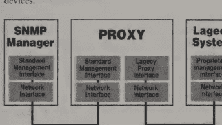

图 1.6 *基于代理的系统。*

> 1. 此处使用的术语“代理”与当今许多企业网络中使用的代理服务器无关，后者提供协议过滤、安全性和其他相关服务，以向外部世界隐藏内部网络的细节。

## 管理器功能

如今，管理器提供大量服务，以满足不断扩大的异构企业网络的需求。所提供的服务可以来自基本管理系统本身，也可以来自第三方应用程序提供商，或者可以内部开发以满足某些特定的独特需求。网络管理器的能力和功能可分为三个领域：

- 架构
- 核心服务
- 应用

表 1.3 列出了这些类别各自的相关服务，随后将讨论每个类别的服务。

## 表 1.3 按类别列出的管理器服务

| 类别 | 架构 | 核心服务 | 附加应用 |
| :--- | :---: | :---: | :---: |
| 开放/可扩展框架 | ✓ | | |
| 分布式/集中式监控 | ✓ | | |
| 通用平台 | ✓ | | |
| 故障检测/解决 | | ✓ | |
| 告警通知 | | ✓ | |
| 大量设备 | | ✓ | |
| 报表工具 | | ✓ | |
| 易用的 GUI | | ✓ | |
| 配置管理 | | ✓ | |
| 网络发现 | | ✓ | |
| 软件分发 | | | ✓ |
| 故障单 | | | ✓ |
| 策略管理 | | ✓ | |
| 高级告警处理 | | ✓ | |
| 网络仿真 | | ✓ | |

### 架构

架构描述了管理器运行和实现完成网络管理任务所需基本服务的基本框架和模型。它应包括：

**开放和可扩展的框架**—一些管理器是围绕基于开放标准的框架设计的，该框架可以支持对现有协议和新兴技术的增强。开放网络管理器支持基于标准的网络管理协议，如 SNMP。首选的网络管理协议是 SNMP。不支持开放架构和标准协议的网络管理系统应受到怀疑，因为该软件可能难以支持网络协议、数据库和操作系统软件的增强。管理器还必须支持 TCP/IP 互联网协议套件和其他专有网络协议。

开放管理系统还为第三方开发人员提供集成工具和应用程序编程接口 (API)，以便在管理框架之上分层额外的软件解决方案。这些解决方案提供了通常在基本网络管理系统中不可用的专用应用程序功能。根据集成级别，用户可能不知道管理系统中包含的不同供应商的解决方案。

**支持分布式/集中式监控**—网络管理系统应具有以分布式或集中式架构部署的能力。这也称为客户端/服务器方法，并提供了网络管理系统扩展规模并满足额外网络管理需求的手段。在许多情况下，建议部署一台或多台专用计算机系统来处理管理大型网络相关的开销。尽管供应商并不总是要求使用多个系统进行管理任务，但假设单个网络管理系统可以处理和支持由数万个设备组成的网络是不合理的。即使为了论证，所选平台可以监控那么多设备，一些实际考虑因素也会反对使用单一系统。

首先，在集中式方法中，管理器可能从单个网段或子网轮询每个设备。这会导致网络该部分严重的流量拥塞，并显著降低该网段上其他设备与网络其余部分通信的能力。其次，网络管理系统本身可能忙于轮询任务，以至于无法响应 GUI 或其他相关管理任务。第三，使用集中式系统在一般可用性和正常运行时间方面存在问题。如果主管理站因硬件或软件问题而失效，导致系统无法使用，则网络将没有管理平台，直到系统得到修复。在系统可用性至关重要的计算环境中，这种情况可能是不可接受的。

**支持通用平台**—为了给客户提供最多的选择，网络管理系统供应商在最流行的操作系统和硬件平台上提供跨系统支持。许多供应商同时支持 UNIX 和 Windows NT 操作系统。然而，UNIX 仍然是网络管理系统供应商最流行的平台，并将继续在未来发挥重要作用。网络管理软件供应商支持的最流行的 UNIX 平台包括 Solaris、AIX 和 HP-UX。由于 Linux 的巨大增长，惠普 (HP) OpenView 产品等网络管理软件已移植到 Red Hat 版 Linux。目前无法准确预测 Linux 将在网络管理市场中扮演什么角色。有一点是肯定的：Linux 是一个强大、有力且具有成本效益的解决方案，将在可预见的未来部署在计算和网络的许多领域。

### 核心服务

网络管理系统通常提供基本级别的服务。这些基本服务通常被认为是网络管理系统完成简单管理任务所需提供的最低功能量。因此，可以假设大多数企业管理系统都具备这些功能。在一定程度上，供应商通过提供更重要的核心服务产品并确保第三方产品的可用性来进行行业竞争。服务可能随基本系统提供，也可能作为附加可选组件提供。其他基本服务可能包括以下内容：

- **故障检测和解决**—网络故障是发生在网络中的问题或状况。这些包括配置问题、设备过载、因软件或硬件问题而崩溃的设备，以及许多其他网络相关问题。由于许多企业网络的规模大且复杂，管理软件必须提供一种机制来检测、报告、过滤，并在某些情况下解决网络故障和问题。例如，当关键系统耗尽可用磁盘空间时，网络管理系统应尝试通过执行系统实用程序来删除不必要的文件以解决该问题。此外，与大多数企业网络一样，网络故障的数量与受监控设备的数量成正比，后者可能相当大。对这些故障处理不当会影响网络支持人员响应问题的能力。

- **告警通知和处理**—除了故障检测和解决外，管理器还应提供一种机制来响应检测到的错误和状况。告警是对网络状况的编程响应。告警将网络状况与将解决该问题的某个操作联系起来。


例如，当关键服务器对网络变得不可用并激活系统管理员的传呼机时，会生成一条告警，从而提供故障通知。另一方面，事件是特定的条件，并不总是被视为关键，可能不需要立即通知或响应。设备配置的更改或服务器负载的下降可被视为网络事件。对于此类事件，仅将其记录下来以供日后审查可能是合理的。

### 支持大量设备
管理器的设计初衷和要求是能够处理大量活动设备。从理论上讲，管理器支持数百甚至数千台设备并不罕见。然而，出于实际考虑，由于网络性能因素，管理器通常不会配置为轮询极大数量的设备。

### 报表工具
网络管理系统最重要的需求之一是其有效生成报表的能力。被认为必不可少的报表类型包括性能、配置、资产清单和故障。在许多情况下，报表最关键的领域与性能相关。网络管理系统可以收集大量性能统计数据。需要一个易用且灵活的工具来协助判断网络的总体健康状况，以便能快速、轻松地定位潜在瓶颈。此外，报表软件还应处理资产清单需求，例如协助确定网络升级所需的设备版本信息。

### 易用的界面
通常，管理器具有图形用户界面（GUI）以简化管理功能和任务。目前，网络管理系统在界面方面正经历一场变革。许多网络管理厂商为其产品同时提供原生 GUI 支持和基于 Web 的界面。一些厂商将 GUI 概念发挥到了极致，许多厂商成功地将不同的网络设备整合在一起，共享统一的管理和控制视图。从远程或服务台的角度来看，这在管理网络方面是一项巨大的优势。Web 模式肯定会改变网络管理的传统方式。然而，网络管理产品完全迁移到支持 Web 的界面可能还需要一段时间。

### 性能监控与测量
给网络管理员带来麻烦的最重要领域之一是管理网络性能。一些网络管理系统厂商提供工具来收集和分析网络性能信息。这些信息对于诊断性能相关问题至关重要，并有助于主动规划网络升级和/或其他改进以提升网络性能特征。性能工具借助特殊的硬件（有时也包括软件）产品持续收集性能信息。这些设备通常被称为网络探测器，安装在网络上或嵌入在路由器和交换机等其他设备中。这些探测器监听网络，收集性能信息以及网络节点之间的数据包级通信。网络性能工具与这些设备交互，轮询探测器获取性能数据，并提供强大的报表和绘图功能。

### 配置管理
企业网络通常由需要自定义配置信息来控制功能和纠正系统操作的设备组成。网络管理系统必须提供对设备配置更改的支持。例如，跨大量设备更新一个或多个配置参数并不罕见。在这种情况下，由管理器以逻辑、统一的方式处理此任务将是有利的。网络管理系统常因缺乏复杂的配置管理支持而受到批评。然而，目前在解决配置管理和支持这一复杂任务方面已取得巨大进展。

### 网络发现
鉴于企业网络包含海量设备，手动将所有设备添加到网络管理系统是不现实的。因此，管理器提供自动查找或发现整个网络或特定类别设备的能力。网络发现过程通常耗时较长，并可能消耗大量网络带宽。进行发现过程时应谨慎操作，因为它可能对网络性能产生不利影响。发现过程完成后，设备会被放置在特殊视图中，通常按子网/工作组排列。

## 附加应用或服务
网络管理系统通常部署在需要额外服务和功能的环境中，以解决组织内独特的业务流程和支持结构。这些服务通过提供叠加在网络管理系统之上的增值应用，扩展了基础网络管理器的实用性和能力。这些应用可能来自第三方提供商，也可能来自网络管理系统厂商本身。在许多情况下，网络管理厂商会寻求解决方案合作伙伴，提供能够补充并集成网络管理系统的特定业务软件。

第三方产品的集成程度将取决于网络管理系统的核心服务、集成到管理系统所涉及的工作量以及产品功能。视管理系统而定，来自某一厂商的集成可能意味着能够从通用菜单调用软件功能，也可能意味着获得对数据库的访问权限。

一些较流行的应用和服务包括：

- **软件分发**—在大型计算环境中，有必要拥有一种自动化机制来维护网络上众多计算机系统上的软件。在许多站点中，网络包含个人电脑、工作站和服务器，每台设备支持一种或多种不同的操作系统。为解决这些系统的软件可管理性问题，网络管理系统提供自动化软件分发软件，可用于一键加载操作系统补丁和应用软件。试想一下，如果必须在 100 个系统上安装第三方应用程序。如果没有网络管理软件将应用程序推送到这些系统，唯一的替代方案就是手动安装该软件或构建自定义安装脚本来完成工作。手动完成此任务需要大量的时间和精力。因为网络管理员已经有太多事情要做，拥有管理软件可以对这种情况产生积极影响。

### 故障单管理
该应用提供以自动化方式跟踪和管理网络事件及故障的能力。当故障单管理与网络管理系统集成时，特定的网络事件或告警可触发工单的创建，从而通知相关方或个人有关网络问题。使用这种自动化方法的一个问题是可能产生不需要的或无效的工单。例如，如果一栋建筑瞬间断电，导致网络部分重启，由于网络大部分不可用，可能会生成许多工单。显然，生成一张工单就足够了，而不是为所有可能的设备生成工单。一些故障单系统具有基于用户定义标准或其他条件过滤传入告警的能力。因此，可以创建一个过滤器来测量中断持续时间，仅在确定经过的时间段后，生成相应的工单。如果谨慎使用，该过滤器可以在网络问题发生时提供一种完全自动化的方式来调度关键人员，而无需专门的呼叫支持中心。

### 基于策略的管理
策略管理是网络管理中相对较新的一个方面。策略涉及为个人用户、组或系统建立资源配置文件或访问域。它还可能包含用户信息，如访问权限、特权、电子邮件标识等。特别是，策略可用于从访问控制列表（ACL）到广播域来定义网络。广播域描述系统被允许与之通信的区域或设备数量。此外，虚拟局域网（VLAN）和虚拟专用网络（VPN）利用策略来帮助定义或塑造网络，并建立和执行服务级别协议（SLA）。


### 高级告警处理
有时，核心管理产品中的基本告警处理无法提供满足特定需求所需的定制化或功能。因此，可能需要更高级的告警处理能力。例如，告警软件可能需要提供更好的告警通知机制。在无人值守的自动化运营环境中，激活传呼机有时并不合适。相反，告警软件应具备足够的智能，以决定如何最好地解决问题。这可以包括运行外部程序或脚本，或启动故障切换序列。

### 网络仿真
网络仿真软件模拟真实网络环境的行为。在某些情况下，在对现有网络进行任何更改之前，建议对网络设计或升级进行建模。通过与网络管理系统对接，网络仿真可以更加真实和动态，因为它们基于实际设备和网络拓扑的信息，而非静态的通用信息。

## 简单网络管理协议
简单网络管理协议（SNMP）为许多网络管理系统提供了底层框架。SNMP 得到了广泛实现，可在种类繁多的不同网络设备和系统中找到。如今，SNMP 被视为网络硬件厂商、网络管理厂商、软件应用开发商、互联网服务提供商（ISP）和最终用户的首选管理协议。

为什么 SNMP 如此流行？首先，与其他网络管理架构或协议相比，SNMP 易于实现。该协议、MIB 及相关框架可运行在从低端个人电脑（PC）到高端主机、服务器，以及路由器、交换机等网络设备的任何设备上。SNMP 代理组件不需要占用大量内存*占用空间*，也不需要大量处理能力。SNMP 通常可以在目标系统上非常快速地开发，从而缩短新产品和增强功能的上市时间。当 SNMP 首次推出时，虽然已有其他管理机制，但 SNMP 证明更加灵活且易于实现。确实，SNMP 缺少其他网络管理协议（例如 OSI）中的某些功能，但其简单的设计、可扩展性和易用性将任何潜在缺点降至最低。

其次，SNMP 是免费且属于公共领域的。因此，没有单一厂商可以声称拥有该协议的所有权，也无法由任何公司或个人进行版权保护。影响或更改 SNMP 的唯一途径是参与互联网工程任务组（IETF）的标准化过程，这可能是一项艰巨的任务。IETF 是互联网的标准机构之一。厂商可以选择对 SNMP 进行专有更改。然而，这种更改可能徒劳无功，因为这些厂商必须游说其他厂商和用户支持其非标准增强功能，这违背了制定标准的初衷。

第三，SNMP 文档完善（通过 RFC、文章和教科书），且在业界为人熟知。这为持续增强和采用提供了坚实的基础。

最后，SNMP 可用于控制各种设备。它甚至正逐步应用于非传统设备，如电话系统、环境控制设备，以及几乎任何可连接网络并需要管理或控制的设备。

## SNMP 操作
SNMP 定义了网络管理器与相关代理之间的数据包格式和信息交换。其核心在于，SNMP 操作代理 MIB 中的对象，因此可以管理代理中定义的各种任务。SNMP 协议及相关组件在多个 RFC 中有所描述。任何符合 SNMP 标准的代理都可以与支持 SNMP 的任何网络管理系统进行通信。管理系统负责向代理提问。这也称为轮询代理。如果代理支持标准 MIB，则管理系统只需向代理请求一个或多个对象。如果代理支持非标准 MIB（即厂商专用 MIB），则管理器必须拥有代理 MIB 的副本，才能正确解析支持的代理对象。

SNMP 被认为*简单*的原因之一，是因为它提供了三种可应用于代理对象的通用操作。这些操作或功能是 SNMP 的核心；它们是 *set*、*get* 和 *trap*。

- **Set**：管理系统可以更新或更改代理中包含的对象的值。Set 操作是一项特权命令，因为例如它可用于更改设备配置或控制其运行状态。
- **Get**：管理系统可以获取或读取代理中包含的对象的值。Get 功能是最常见的 SNMP 操作，因为这是从网络设备获取管理信息的主要机制。
- **Trap**：代理可以向网络管理器发送未经请求的消息。Trap 服务的目的是在管理系统未专门请求该信息的情况下，通知网络管理系统特殊状况或问题。

SNMP 定义了管理器与代理在通信方面的关系和消息流，如图 2.1 所示。正如你所见，在大多数情况下，SNMP 管理器通过 *get* 或 *set* 功能指导与代理的消息交换。管理应用程序请求信息；消息通过 SNMP 层转换为 SNMP 格式，传递给网络接口层，最终在网络上传输。代理在网络接口层接收消息，将消息传递给 SNMP 进行转换，并访问所需的对象信息。当代理向管理器发送回复时，将使用反向过程。

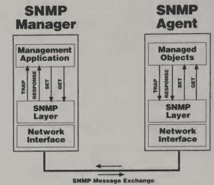

**图 2.1** SNMP 管理器和代理关系。

SNMP 提供了代理向管理器发送异步消息的能力，而无需专门轮询。这称为 *trap*。Trap 为代理在未被专门询问的情况下进行通信，以及传达重要信息、特殊情况或事件提供了一种方便且重要的方式。

除了上述列出的 SNMP 命令外，SNMP 未定义任何额外机制来控制或向设备代理发出命令。可应用于 MIB 对象的唯一操作是设置或获取值。例如，SNMP 中未定义重启功能。相反，代理软件可以通过将 MIB 对象与设备内部支持的特定命令关联来实现特定命令。要重启设备，管理站将通过 set 操作更改特定的 MIB 对象（例如设为 1）。这将向代理发出重启设备的信号，并将 MIB 重启对象重置为其先前状态。请注意，目前没有可用的标准接口集（或 MIB 对象）能够操控设备控制的所有方面。相反，每个厂商负责使用其自己的 MIB 对象集合提供此类访问。

## 管理信息库 (MIB)
如前所述，MIB 是包含代理内配置、性能和其他数据相关信息的存储库。MIB 具有组织结构和通用架构，可能包含大量分组的对象。

### 组织结构
MIB 对象以层次树结构组织，其中每个分支都有唯一的名称和数字标识符。图 2.2 显示了从根到其他分支的标准 MIB 组织结构。树的分支作为相关对象的逻辑分组。叶子（通常称为节点）代表单个对象。此外，还会形成子树，代表额外的中间分支和连接的叶子。可以通过指定从树顶（或根）开始到单个叶子或对象的每个数字标识符来引用 MIB 中的对象。分支的根通常用 . （点）表示。访问 MIB 类似于在 UNIX 操作系统中引用文件。然而，一个关键区别在于 UNIX 路径名可以用绝对或相对术语表示。MIB 对象只能以绝对方式访问；相对格式不可用。

例如，图 2.2 显示根（ . ）位于树的最顶端，sysDescr(1) 为叶子。表达对象标识符的常用方法是使用点分表示法。这种表示法要求用点分隔每个分支名称或标识符。通常根（ . ）不表达，因为它是隐含的。要访问


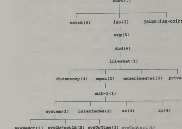

## 图 2.2 MIB 结构与组织。

对于 `sysDescr(1)` 对象，其完全限定标识符将写为：

```
iso.org.dod.internet.mgmt.mib-2.system.sysDescr
```

该标识符从左向右读取。对象也可以通过用与每个标识符名称关联的数字标识符替换分支名称，以短形式表示。因此，`iso.org.dod.internet.mgmt.mib-2.system.sysDescr` 也可以表示为 `1.3.6.1.2.1.1.1`。这两种表达式在功能上是等效的，并引用同一个 MIB 对象。选择哪种形式取决于偏好，尽管数字标识符更加简洁。然而，MIB 浏览器可以用任一格式显示 MIB 对象，从而使在两种格式间转换变得容易。在使用 SNMP 和 MIB 一小段时间后，你将熟悉这两种方法，并有机会选择最适合你的风格。

通过使用图 2.2 所示的结构，SNMP 管理器（或 MIB 浏览器工具）可以以一种简便而简洁的方式深入探查 MIB。MIB 浏览器是一种软件应用程序，用于遍历 MIB 树，通常以图形方式显示分支、叶子对象和关联的值。图 2.3 显示了一个 MIB 浏览器的屏幕快照。MIB 浏览器非常适合探测代理以获取特定信息，或学习新 MIB 的结构和格式。

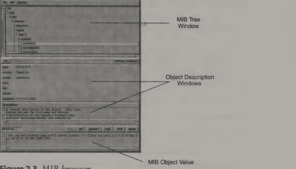

**图 2.3** *MIB 浏览器*。

如图 2.3 所示，MIB 浏览器窗口包含几个部分。第一个面板提供 MIB 的分层视图，可用于*导航*到所需的 MIB 对象或分支。下一个面板显示有关该对象的详细信息。第三个面板显示从指定的 MIB 对象获取的值。有关此工具的更多详细信息，请参见第 8 章“SNMP 工具”。

## 对象类型

在 MIB 中，不同的对象类型表示代理中包含的数据结构或值。对象可以表示物理代理属性、配置信息或其他数据。这些对象类型源自抽象语法表示法（ASN.1）标准规则。ASN.1 为基本数据类型的实现和编码提供了详细机制，这些数据类型与机器无关，且可以以明确的方式在网络上传输。

这对 SNMP 或网络管理为何重要？因为网络管理必须面对异构网络环境，所以必须提供一种标准方式，以确保 SNMP 消息能在不同的系统和设备上传输和理解。由于各种计算机平台存储信息的方式不同，ASN.1 提供了一种通用格式。例如，在某个系统上，整数可以首先用最高有效位表示，而在其他系统上则可能首先用最低有效位表示。此外，ASN.1 数据类型存在于 MIB 中。为了理解网络管理，我们必须能够阅读和理解 MIB 对象。如果不很好地掌握 MIB，就很难有效地使用 SNMP 工具和软件来管理网络。

使用 ASN.1 定义了两类对象数据类型：

- 通用类型
- 应用类型

通用类由可用于在 MIB 内构建对象的其他数据类型的基本类型组成。表 2.1 列出了通用类中一些可用的简单数据类型。

表 2.1 *通用数据类型*

| ASN.1 数据类型 | 说明 |
| :--- | :--- |
| INTEGER | 表示一个基数的数据类型，对表示整数值所需的精度级别不作限制 |
| OCTET STRING | 表示零个或多个八位字节的数据类型，其中每个八位字节可以取 0 到 255 之间的任何值 |
| NULL | 作为占位符的数据类型，但目前未使用 |

## 表 2.1 通用数据类型（续）

| ASN.1 数据类型 | 说明 |
| :--- | :--- |
| OBJECT IDENTIFIER | 表示一个权威命名的对象的数据类型，该对象由指定 MIB 树的一系列值组成。 |
| SEQUENCE SEQUENCE OF | 用于表示包含其他 ASN.1 类型的零个或多个元素的有序列表的数据类型。SEQUENCE OF 包含相同 ASN.1 类型的有序列表。 |

SNMP 从通用类类型派生出一些应用数据类型。这些应用类型定义了可用于表示针对网络管理环境定制的特定值的其他类型。表 2.2 描述了应用类中当前可用的一些应用数据类型。

## 表 2.2 应用数据类型

| ASN.1 数据类型 | 说明 |
| :--- | :--- |
| Counter Counter32 | 表示一个非负整数的数据类型，它增加直到达到最大值，然后重置为零。Counter 是一个可以取 0 到 4294967295 之间值的 INTEGER。Counter 没有定义的起始值。 |
| Counter64 | 与 Counter 对象类似，不同之处在于 Counter64 是一个可以取 0 到 18446744073709551615 之间值的 INTEGER。 |
| DisplayString | 表示零个或多个八位字节的数据类型，其中每个八位字节可以取 0 到 255 之间的任何值。DisplayString 类似于 OctetString 对象。 |

## 表 2.2 应用数据类型（续）

| ASN.1 数据类型 | 说明 |
|---|---|
| Gauge Gauge32 | 表示一个非负整数的数据类型，它可以增加或减少，并在达到最大值时触发。除了这点外，Gauge 与 Counter 相似 |
| IpAddress | 表示一个长度为 4 字节（32 位）的 OCTET STRING，其中四个八位字节中的每一个对应标准 IP 地址的四个字节 |
| Opaque | 一种提供传递任意信息能力的数据类型，它使用 OCTET STRING 数据类型 |
| NetworkAddress | 可以表示来自多种网络协议地址标准之一的地址。目前，它与 IpAddress 相同 |
| TimeTicks | 表示一个非负整数，自某个既定纪元起以百分之一秒为单位计算时间。除了这点外，TimeTicks 与 Counter 相似 |

为何在本书中包含这种 MIB 细节？因为后续章节将重点介绍操作 MIB 对象的网络管理工具的使用，所以介绍可能遇到的对象类型似乎是合理的。因此，读者理解不同类型的对象，以及为何这些对象的值采用特定格式或结构，这一点很重要。同等重要的是 MIB 对象的访问模式，将在下文讨论。

## MIB 对象列表示例

因为 MIB 对象是网络管理的重要组成部分，本书中的某些章节将专门描述 MIB 定义，因为它们与系统代理和网络管理工具有关。因此，在讨论 MIB 时，将使用如下所示的通用格式：

- 对象名称：`sysDescr`
- OID：`system.1`
- 对象类型：`Octet String`
- 访问模式：`read-only`
- 状态：`current`
- 说明：代理设备或实体的说明。此值应包括全称、系统标识、硬件类型、操作系统和网络软件。强制要求仅包含可打印的 ASCII 字符。Linux 系统代理获取的该对象示例包括：`Linux socrates 2.2.5-15 apr 19 22:21:09 EDT 1999`

此格式包括*对象名称*、*OID 字符串*、*对象类型*、*访问模式*、*状态*和*说明*。*对象名称*是在查询代理以获取此特定对象时使用的名称。在本例中，`sysDescr` 对象是一个字符串，包含设备或设备内代理的一般描述。*对象标识符字符串*，或 OID 字符串，显示该对象所在的组及其在 MIB 层次结构中的逻辑位置。在本例中，它是 `system` 组中的第一个对象。该组可在标准 MIB-II 定义中找到。

*对象类型*为 `Octet String`，长度可达 255 个字符。回顾表 2.2 列出了这些 ASN.1 类型的定义。*访问模式*指示管理器或其他工具如何操作该对象。SNMP 新手尝试修改不可写对象的情况非常常见。在本例中，尝试修改 `sysDescr` 对象将导致代理响应 non writable（不可写）或其他错误消息。

*状态*字段指示该对象是 `current`（当前）还是 `historic`（历史）。`current` 状态意味着该对象目前可在代理中使用，正如 MIB 中所述。也就是说，如果 MIB 代表该代理，则所有标记为 current 的对象将


在这些代理中实现。其他值也可用于指示对象的其他状态。例如，*obsolete*（废弃）引用表示该对象在 MIB 中不再受支持。*deprecated*（已弃用）引用可用于帮助与代理的旧版本或实现实现互操作。

*description*（描述）字段提供对象的概述、用途，以及在适当情况下的示例值。在上述示例中，当查询 sysDescr 对象时，它会返回代理操作系统、代理所在的主机名、操作系统版本信息和日期信息。

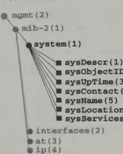

图 2.4 *MIB 结构示例*。

本书描述 MIB 的另一种方式是使用层次图，以树形结构展示每个对象。图 2.4 显示了通用格式。特别是，它显示了 *system*（系统）组下的 MIB-II 对象。正如你所见，格式包括使用实心圆 (●) 和实心方块 (■)。方块代表离散对象，如 INTEGER 和 OCTET STRING，但不包括表或其他对象组。圆圈代表对象组或表。此外，灰色线条和外围对象进一步指示了导航到相关组所需的结构。感兴趣的对象和相关线条以黑色绘制。这些对象附带成员索引（括号内），显示每个对象在树结构中的相对位置。因此，sysContact(4) 是 *system* 组中的第四个对象。

## 表格

如上所述，MIB 可能包含表示设备物理特征或代理内其他信息的对象。这些对象可以是离散元素的形式（即单个对象，如 sysDescr），在某些情况下也可以是二维表。表存储相关信息，可能包含 MIB 对象的多个实例或副本。说明表用法的最佳方法是检查实际 MIB 中的表。

MIB-II 标准中定义了 *interface*（接口）组，其对象标识符定义为 1.3.6.1.2.1.2 或 iso.org.dod.internet.mgmt.mib-2.interface。该组中的对象表示网络设备中安装的物理网络接口和相关信息。性能相关信息也在此组中收集和存储。

对于网络设备中的每个接口，以下信息用于描述接口的性质和相关配置：

- *Description*（描述）：接口的一般描述
- *Type*（类型）：接口类型，如以太网或令牌环
- *Mtu*（最大传输单元）：最大传输大小
- *Speed*（速率）：接口的传输速度
- *Physical Address*（物理地址）：数据链路协议或硬件地址
- *Administration Status*（管理状态）：接口的当前管理状态
- *Operational Status*（运行状态）：接口的实际运行状态
- *Last Change*（最后变更）：接口开始运行的时间

表中的其他对象存储以下性能监控信息：

- 接收或发送的八位字节数
- 传递给高层软件或从高层软件发送的单播包数
- 传递给高层软件或从高层软件发送的非单播包数
- 入站/出站丢弃包数
- 入站/出站含错误包数
- 因协议错误而丢弃的入站/出站包数
- 输出包队列长度

图 2.5 显示了接口组的结构。使用表来包含接口信息，因为网络设备可以包含许多接口。例如，路由器或交换机设备实际上可以包含数十个接口，通常支持不同的网络协议，如以太网、ATM 或 FDDI。使用表提供了一种直接且方便的方式来访问给定接口定义中的各个对象。

`interface group` 包含 `ifNumber` 对象，该对象包含网络设备内网络接口的总数。使用表 2.3 中包含的示例数据，`ifNumber` 值将为 2。在这种情况下，设备报告两个接口：一个定义为伪接口，另一个定义为以太网。网络设备包含用于内部诊断目的的伪接口是很常见的。

`interface group` 的其余部分由一个名为 `ifTable` 的表组成，该表为设备中定义的每个接口包含一行。该表由 `ifIndex` 索引，其值范围在 1 和 `ifNumber` 的值之间。`ifIndex` 对象唯一寻址代表接口的表的每一列。

表 2.3 第一列显示整个接口组，其余列显示取自实际网络设备的相关值。每一行对应 `ifEntry` 表中包含的每个特定 MIB 对象。每个 `ifEntry`

图 2.5 MIB-II 接口组结构。

表 2.3 接口组实例表

| MIB 对象 | IfEntry | 1.3.6.1.2.1.2.2.1 | IfEntry | 1.3.6.1.2.1.2.2.2 |
| :--- | :--- | :--- | :--- | :--- |
| IfIndex | | 1 | | 2 |
| IfDescr | 伪接口 | | 以太网 | |
| IfType | | 1 | | 6 |
| IfMtu | | 1500 | | 1500 |

## **表 2.3** 接口组实例表（续）

| MIB 对象 | IfEntry 1.3.6.1.2.1.2.2.1 | IfEntry 1.3.6.1.2.1.2.2.2 |
| :--- | :--- | :--- |
| IfSpeed | 10000000 | 10000000 |
| IfPhysAddress | 无<sup>a</sup> | 0x00400010ee5d |
| IfAdminStatus | 1 | 1 |
| IfOperStatus | 1 | 1 |
| IfLastChange | 0 | 0 |
| IfInOctets | 0 | 42617 |
| IfInUcastPkts | 445 | 680 |
| IfInNUcastPkts | 0 | 19 |
| IfInDiscards | 0 | 0 |
| IfInErrors | 0 | 5 |
| IfInUnknownProtos | 0 | 0 |
| IfOutOctets | 0 | 42600 |
| IfOutUcastPkts | 445 | 570 |
| IfOutNUcastPkts | 0 | 94 |
| IfOutDiscards | 0 | 0 |
| IfOutErrors | 0 | 87 |
| IfOutQLen | 0 | 0 |
| ifSpecific | null | null |

a. 伪接口通常没有与之关联的物理地址。这就是为什么这里未列出接口地址。

实例代表表中定义的一个接口。要访问第一个接口的 `ifDescr` 对象，将使用对象标识符 (OID)：

```
1.3.6.1.2.1.2.2.1.1
```

或

```
iso.org.dod.internet.mgmt.mib-2.interface.ifTable.ifEntry.ifDescr
```

`ifDescr` 对象提供接口的一般描述。从 `ifInOctets` 到 `ifOutOctets` 的对象代表代理中设备接口的流量计数器，可用于衡量网络和设备性能。

## 访问对象

MIB 对象定义了访问控制信息，指定可对对象执行何种操作。SNMP 包含 MIB 对象的以下访问控制信息：

- not-accessible（不可访问）
- accessible-for-notify（可通知访问）
- read-only（只读）
- read-write（读写）
- read-create（读创建）

MIB 中定义的 `Not-accessible` 对象通常引用对象定义，或其他本身不是对象但可被 SNMP 管理器操作的对象描述。一个很好的例子是表数据结构，其中一个对象描述表的形状或大小，但不描述实际的行或列。

`Accessible-for-notify` 对象仅可通过通知网络管理器或另一个代理来获取。不允许直接轮询该对象。

`Read-only` 对象不能被网络管理系统修改，但可通过 get 或 trap 操作获取值。为什么要禁止更改 MIB 对象？原因很明确：某些 MIB 信息在产品生命周期内永远不会改变。例如，代表*系统描述*的 MIB 对象 `sysDescr` 包含代理的供应商信息。SNMP 管理器不应修改此信息，因为这会将设备与实际产品供应商分离，从而使代理识别变得困难。此外，它可能对基于软件的网络清单机制的准确性产生不利影响。将对象设为只读的另一个原因是

确保性能信息或其他统计数据保持准确，而不是被无意中篡改。

**读写** 访问权限在必须修改特定对象以实现某个特定目标或必须以特定方式配置对象时是必需的。例如，如果在某个接口上检测到大量错误，可能需要禁用路由器端口。在这种情况下，网络管理系统必须将接口的操作状态更改为 0，从而关闭物理连接，直到确定错误的原因。

**读创建** 对象具有与只读对象和读写对象相同的访问权限。读创建访问权限用于可能即时创建的对象。例如，此类对象可能包括表行（也称为概念行）实例。

## 标准和私有 MIB

如前所述，MIB 在分层树结构下组织，许多标准 MIB 已被开发并放置在 *mgmt(2)* 分支下。这些 MIB 许多是通过 RFC 过程开发的。许多不同的个人或厂商协助了它们的开发，但并不实际拥有它们，也不能随意更改它们。然而，许多厂商和第三方软件开发商开发了额外的 MIB，以解决其特定产品的特定功能或服务。这些 MIB 许多被称为企业 MIB，始于标准 MIB 树的 *private(4)* 分支下。图 2.6 显示了可以在该分支下找到的几个流行 MIB。

互联网号码分配机构 (IANA) 维护一份已分配企业编号的列表。想要获取编号的人向该组织提出申请并获得一个有效编号。表 2.4 显示了已分配编号的一小部分示例。

为什么要开发企业 MIB？许多厂商这样做是因为它们可能需要标准 MIB 中未定义或不可用的设备特定对象。此外，厂商特定的 MIB 不需要成为标准，因为只有该厂商及其客户实际需要使用这些 MIB。只有当许多厂商能在大量不同设备上实现同一组 MIB 时，开发标准 MIB 才有意义。


### 表 2.4 已分配企业编号

| 编号 | 厂商 |
| :--- | :--- |
| 2 | IBM |
| 9 | Cisco Systems |
| 11 | 惠普 |
| 42 | 太阳微系统 |
| 43 | 3Com 公司 |
| 52 | Cabletron Systems |
| 1588 | Brocade Communications Systems |
| 1598 | Tivoli Systems |

### 表 2.4 已分配企业编号（续）

| 编号 | 厂商 |
| --- | --- |
| 1751/3729 | 朗讯科技 |
| 4475 | 彩虹软件解决方案 |

## SNMP 团体

通常，网络管理系统会部署在包含许多不同网络和设备群组的大型网络环境中。因此，将企业网络划分为用户区域或团体以分割责任是合理的。因此，可以将 *团体名* 分配给一类设备，并提供一个安全边界，帮助实现所需的团体或区域。SNMP 基于团体字符串信息支持这种安全模型，该信息被物理添加到所选团体内的每个设备中。一些实际示例包括选择一个代表所有 Cisco 骨干路由器的团体，以及选择另一个仅包含销售部门设备的团体。

SNMP 当前的基于团体的认证模型被认为非常薄弱，并构成了重大的安全问题。主要原因是 SNMP 不提供任何加密设施或其他机制，以确保在 SNMP 数据包交换期间 *团体信息* 不会被直接从网络中复制。使用抓包工具，可以解码整个 SNMP 数据包，从而泄露团体名。由于这一限制，许多站点禁用了对许多代理设备的设置操作。这产生了一个不幸的副作用，限制了 SNMP 的实用性，因为它随后只能监视对象值而不能修改它们。

## SNMP 版本概述

SNMP 于 1988 年正式可用。从那时起，它得到了广泛应用，并几乎在所有局域网 (LAN) 设备和许多计算机操作系统中实现。这个流行的版本称为 SNMPv1，占当今已安装代理库存的很大一部分。尽管很流行，SNMPv1 仍有几个基本问题。首先，因为它缺乏健壮的安全机制，所以无法发挥其全部潜力。因此，许多厂商限制代理上的设置操作，以最小化安全漏洞的潜在风险。其次，SNMPv1 不优化大量信息的处理，从而进一步限制了 SNMP 的使用。第三，SNMPv1 中网络管理器与代理之间的关系定义明确——代理仅扮演接受来自管理系统命令的单一、简单角色。当需要智能代理来满足分布式网络管理功能的特定要求时，这显著限制了 SNMPv1。

SNMPv1 还指定了一组称为 MIB-II 的 MIB 对象。MIB-II 的目标是提供一组所有 SNMP 代理都可支持的对象，无论由哪个厂商实现该代理。总之，SNMPv1 提供：
- 基本网络管理框架
- MIB-II 标准的定义
- 协议数据单元 (PDU) 的描述，包括：
  *GetRequest*、*GetNextRequest*、*SetRequest*、*GetResponse* 和 *Trap*
- ASN.1 编码语言的描述

为了解决 SNMPv1 中的一些缺陷，过去几年中投入了大量精力来增强 SNMP。第一系列改进出现在 1993 年，当时引入了一系列 12 个 RFC（1441-1452），提议向 SNMP 架构和安全模型添加 PDU 和增强功能。这组 RFC 被称为 SNMPv2 Classic（经典版）。当时，许多 SNMP 用户都在期待这些改进，并计划在新版本可用时立即实施。

不幸的是，关于 SNMPv2 安全性和远程配置仍有许多争论。当显然并非所有原始 SNMPv2 提案都将被广泛采用时，人们做了额外的工作来定义 SNMP 安全性和远程配置管理组件。这导致了额外的提案，包括新协议和新的 MIB 结构元素（记录在 RFC 1901–1908 中）。这些提案比 SNMPv2 Classic 更受欢迎，被称为基于团体的 SNMPv2 或 SNMPv2c。SNMPv2c 的问题是，尽管它得到了 IETF 的认可，但它缺乏健壮的安全和管理功能。

对 SNMPv1 远程管理能力的额外改进产生了称为 SNMPv2usec 和 SNMPv2* 的提案，分别记录在 RFC 1909–1910 和 RFC 2222 中。SNMPv2usec 推荐了一种健壮的安全模型和管理框架。SNMPv2usec 的问题之一是它缺乏 IETF 的认可，IETF 放弃了该提案，使其成为非标准。SNMPv2 的主要功能包括：
- 扩展的数据类型，如 64 位计数器
- 通过 get-bulk PDU 提高性能和效率
- 通过 inform PDU 进行事件通知
- 更好的错误处理
- 更高效的行创建和删除

最后，为了在各种远程管理和安全提案之间达成某种共识，编写了另一系列 RFC，后来被称为 SNMPv3。这些 RFC（2271–2275）已由 IETF 作为建议标准发布，这意味着它们可供公众审查和讨论。SNMPv3 是 SNMPv2c 加上健壮安全和管理的规定；它借鉴了 SNMPv2c RFC（1902–1908）。在高层上，SNMPv3 提案试图：
- 提出一种基于 DES、MD5 和其他认证协议的安全模型


- 定义基于视图的访问控制模型
- 重新定义一些 SNMP 概念和术语

到目前为止，SNMPv3 在市场上已取得了一定程度的成功，但这些协议仍然相当新。主要的网络硬件和软件公司已经支持 SNMPv3 或正在致力于此。然而，SNMPv3 尚未在行业内广泛部署；这或许只是时间问题。采用这一新协议的主要延迟原因之一是成本效益比。对于那些当前需要更好安全性的站点，它们可以在供应商提供实现后升级到新协议。然而，让所有人都升级所有现有设备以支持 SNMPv3 可能并不合理。最可能的方法是随着包含 SNMPv3 支持的新产品被部署，随着时间的推移缓慢迁移。最终，新产品将取代旧产品，部署新管理协议将仅仅是一个配置问题。

## SNMP 协议操作

SNMPv1 报文包含三个主要组件：版本字段、团体字段和 SNMP 协议数据单元 (PDU) 字段。与其他 TCP/IP 协议不同，SNMP 数据包不是固定长度的，而是依赖 ASN.1 格式。图 2.7 显示了这种基本的 SNMP 数据包结构，字段（及大小）的说明如下。

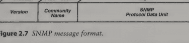

图 2.7 SNMP 报文格式。

该格式包含字段名称（以粗体文本显示）和格式标签（类型），如顶部灰色文本所示。类型显示每个字段的基本格式。例如，版本信息是一个 INTEGER 对象。字段名称定义如下。

**版本：** 该字段指示正在使用的 SNMP 协议版本。目前版本 1 是实现和支持最广泛的 SNMP 协议。

**团体名称：** 团体被用作主要安全机制，以建立从网络管理器到 SNMP 内代理的认证。团体名称或字符串被用作密码，基于网络管理器知道代理密码这一条件，允许访问对象的请求。如果代理已配置为发送陷阱，当网络管理器使用无效的团体字符串查询代理时，将生成一个 authenticationFailure 陷阱。

**协议数据单元：** SNMPv1 PDU 可以是五种不同类型之一，并由请求和响应组件组成。它们包括：
- *GetRequest*
- *GetNextRequest*
- *SetRequest*
- *GetResponse*
- *Trap*

SNMPv2 定义了以下附加 PDU：
- *GetBulkRequest*
- *InformRequest*

每个 GetRequest、GetNextRequest 和 SetRequest 组件都会从响应代理引出一个 GetResponse，其中可能包含有效数据或错误状态。

### GetRequest

GetRequest PDU 由 SNMP 管理器或应用程序发出，用于从 SNMP 代理获取一个或多个 MIB 对象。

图 2.8 显示了包含以下字段的数据包格式：
- *pdu type*：指示 PDU 类型为 GetRequest。
- *request-id*：唯一标识符，允许 SNMP 管理器匹配成对的请求和响应。它还有助于检测在使用不可靠传输服务时可能接收到的重复消息。
- *variable-bindings*：请求的 MIB 对象列表。

当相关对象预先已知时，GetRequest 操作是从代理获取信息的主要方式。例如，如果网络管理器决定从代理检索 `sysDescr` 和 `sysUpTime` 对象，我们可以将该请求视为一个简单的函数，包含：

`GetRequest (`sysDescr`, `sysUpTime`)`

在这种情况下，发送时这两个对象都被放置在 variable-binding 字段中。`sysDescr` 对象代表一个包含代理一般描述的字符串，而 `sysUpTime` 反映代理已运行的时间量。


当代理接收到上述消息且未发生错误时，它将通过 GetResponse PDU 响应所请求的 MIB 对象的值。GetRequest 操作是原子的。也就是说，要么返回所有请求的值，要么不返回任何值。当接收实体响应 GetRequest 时，它会在 GetResponse variable-binding 字段中包含这些值。如果由于某种原因，至少有一个值无法提供，则不会提供任何值。

如果管理器请求的值无法由代理返回，代理将响应一个错误。例如，管理系统可能请求了一个代理中未实现的 MIB 对象。在这种情况下，代理无法满足请求，因此返回错误。此外，在某些情况下，返回请求对象的值会失败，因为该值可能太大而无法由管理器处理。

*variable-bindings* 字段包含请求值的对象列表。当代理通过 GetResponse 响应时，variable binding 包含请求的对象和关联的值。根据上面的示例，代理将发送以下 GetResponse：

```
GetResponse(sysDescr="3Com Enterprise Monitor", sysUpTime=0000154477)
```

在该示例中，正如 *sysDescr* 字段所示，代理是一个 3Com 企业 RMON 监视器（或网络探测器）。该设备收集网络性能和数据包内容信息，以供后续分析和报告。 *sysUpTime* 对象包含代理已启动并运行的时间量。示例中显示的值表明该设备已运行约 15 分 44 秒。

### GetNextRequest

GetNextRequest PDU 与 GetRequest PDU 相似，数据包格式相同，如图 2.8 所示。然而，GetNextRequest PDU 有一个区别：它用于在 MIB 树结构未知时检索对象。当用于发现代理的确切 MIB 结构时，GetNextRequest 非常有用。为什么代理的 MIB 结构会对 SNMP 管理器未知？SNMP 没有提供直接的方法来确定代理支持哪些 MIB 或 MIB 结构。供应商当然可以自由实现其设备所需的任何 MIB。因此，网络管理器必须通过以自动化方式遍历 MIB 树来发现受支持的 MIB。当发送带有特定对象的 GetNextRequest 时，GetResponse 将返回请求对象的值，以及 MIB 树中按字典顺序排列的下一个对象的实例。结果，每个 GetNextRequest 都将揭示 MIB 中的下一个对象，而管理器无需知道下一个对象是什么。与 GetRequest 相比，GetNextRequest 操作还提供了一种从代理检索对象的更高效机制，因为它需要更少的请求/响应交换。

### SetRequest

SetRequest 操作用于更改代理信息，例如 MIB 对象的值。数据包格式与 GetRequest 和 GetNextRequest 相同，如图 2.8 所示。与 GetRequest 或 GetNextRequest 不同，SetRequest 用于更改 MIB 对象的值。如前所述，SetRequest 需要安全权限，目前在 SNMPv1 协议中通过团体字符串映射。因此，在允许操作成功之前，代理必须验证提供的 SetRequest 团体字符串。SetRequest 也是原子的；要么可以更改所有值，要么一个都不能更改。如果 SetRequest 成功，将返回一个 GetResponse，variable-binding 列表包含具有新值的对象。这就是网络管理器确定设置操作成功的方式。如果 SetRequest 不成功，将在 GetResponse 中返回错误。

### GetResponse

除 trap 外，每个 SNMP 操作都会从代理接收一个 GetResponse。图 2.9 显示了 GetResponse 数据包的格式，包含以下字段：
- *pdu type*：指示 PDU 类型为 GetResponse。
- *request-id*：允许配对请求和响应的唯一标识符。
- *error-status*：指示处理请求时发生了异常条件。
- *error-index*：发生错误时，指示 variable-binding 列表中哪个对象变量导致了错误。


## 陷阱

*陷阱* 是一种未经请求的消息，从代理发送到网络管理站，表示一个重要事件或状况，认为有必要通知管理器。这种来自代理的通信方式与管理器的轮询相比是异步的。Trap PDU 与 SNMP 中定义的其他 PDU 截然不同，如图 2.10 所示。与其他 SNMP PDU 不同，Trap 不要求接收网络进行响应。*Trap* 的字段包括：

- **PDU 类型：** 指示 PDU 类型为 *Trap*。
- **企业：** 包含发送代理的 MIB 对象 *sysObjectID*。*sysObjectID* 对象包含有关发送 *Trap* 的代理供应商的信息。
- **代理地址：** 表示发送代理的 IP 地址。
- **通用陷阱：** 表 2.5 中列出的预定义 *Trap* 值之一。
- **特定陷阱：** 关于 *Trap* 的更详细信息。除非 *generic-trap* 是 *enterpriseSpecific* *Trap*，否则通常为 *zero*。企业 *Trap* 是特定于供应商的，可能包含关于导致 *Trap* 的状况的其他代理信息。
- **时间戳：** 生成 Trap 与设备上次初始化之间的时间量，以十分之一毫秒为单位表示。
- **变量绑定：** 与 Trap 相关的供应商特定信息。


**图 2.9** *GetResponse* 消息格式。


**图 2.10** Trap 消息格式。

表 2.5 列出了七种预定义的通用 Trap 类型。enterpriseSpecific Trap 类型提供了一种机制，用于定义不属于其他通用类型的自定义或专有陷阱。

### 表 2.5 SNMP 预定义陷阱

| 陷阱类型 | 含义 |
|---|---|
| ColdStart (0) | 设备正在重启或重新初始化，以至于代理或配置可能已更改。通常，这表示崩溃或其他重启条件 |
| WarmStart (1) | 设备正在重启或重新初始化，以至于代理或配置未作更改。通常，这意味着操作系统环境的简单刷新或重启 |
| LinkDown (2) | 指示设备的通信（接口）链路之一发生故障 |
| LinkUp (3) | 指示从 LinkDown 状态变为操作状态 |
| 认证失败 (5) | 指示认证丢失 |
| EGP 邻居变更 (6) | 指示 EGP 邻居状态的变化 |
| 企业特定 | 指示来自企业的自定义或专有陷阱 |

### 表 2.5 SNMP 预定义陷阱

| 陷阱类型 | 含义 |
|---|---|
| LinkUp (3) | 指示设备的通信（接口）链路现已启动并运行 |
| AuthenticationFailure (4) | 设备上发生了认证或安全故障。通常，这表示使用了无效的 SNMP 团体字符串 |
| EgpNeighborLoss (5) | 指示设备对等的外部网关协议 (EGP) 邻居已被标记为 down，且该关系不再有效 |
| EnterpriseSpecific (6) | 指示发生了某些厂商特定事件。厂商使用此通用陷阱类型来表示其自己的专有陷阱 |

## GetBulkRequest

此 PDU 由 SNMPv2 管理器或应用程序发出，旨在最大限度地减少网络交互，并允许代理返回更大的数据包（与 GetNextRequest 或 GetRequest 相比），从而提高从代理获取大量对象的效率。这使用与大多数其他 SNMPv1 操作相同的 PDU 格式。唯一的区别是将 *error-status* 和 *error-index*（来自 Response PDU）字段分别重命名为 *non-repeaters* 和 *max-repetitions*。这些字段定义如下：

- **non-repeaters：** 最多应检索一次的 MIB 对象数量
- **max-repetitions：** 应检索其他 MIB 对象的最大次数

## InformRequest

InformRequest PDU 由充当管理器角色的 SNMPv2 实体发送给另一个充当相同角色的 SNMPv2 实体，目的是提供网络管理信息。此 PDU 的主要功能是提供分布式 SNMP 管理能力。因此，代理可以实现此 PDU 以提供类似管理的服务和功能。此 PDU 的格式与 GetRequest 和其他相关 PDU 相同。

## SNMP 响应代码

SNMPv1 代理返回的错误代码非常有限。例如，如果 SNMP 管理器请求对 MIB 对象执行 set 操作，而代理无法按要求执行该操作，代理将回复 *noSuchName*。随着 SNMPv2 中增加了更多错误代码，在这种情况下代理将回复 *notWritable*。表 2.6 列出了所有 SNMP 响应代码。

### 表 2.6 SNMP 响应代码

| 响应代码 | 说明 |
|---|---|
| tooBig | 如果对请求的响应太大而无法发送，则由代理返回 |
| noSuchName | 在以下两种情况下由代理返回：1) 尝试对不在 MIB 视图中的对象执行 **set** 操作，或 2) 尝试对 MIB 视图中的对象执行 **set** 操作，但该对象为 *read-only*。此代码现在用于代理兼容性 |
| badValue | 由检测到 PDU 变量绑定列表中错误的代理返回。此代码现在用于代理兼容性 |
| Read-only | 由代理返回。此代码现在用于代理兼容性 |
| genError | 当处理 PDU 失败的原因不是表中所列原因时，由代理返回 |

### 表 2.6 SNMP 响应代码（续） — SNMPv2/v3

| 响应代码 | 说明 |
|---|---|
| noAccess | 变量超出了此操作成功所需的定义 MIB 视图范围 |
| notWritable | 变量存在于代理中，但代理无法修改该对象 |
| WrongType | 提供的值数据类型错误，由 ASN.1 定义 |
| WrongLength | 提供的值长度错误 |
| WrongEncoding | 提供的值编码不正确 |
| WrongValue | 提供的值不在该对象类型所需的范围内 |
| NoCreation | 对象不存在，且代理无法创建该对象的实例 |

### 表 2.6 SNMP 响应代码（续）

| 响应代码 | 说明 |
|---|---|
| InconsistentName | 对象不存在，且代理无法创建该对象的实例，因为该名称与其他相关对象的值不一致 |
| InconsistentValue | 提供的对象与受管对象的值不一致 |
| resourceUnavailable | 代理内所需的资源无法预留以完成请求 |

这些代码很重要，因为它们可以帮助您在使用与代理通信的 SNMP 代理和工具时追踪问题和故障。了解这些消息代码并理解代理的配置错误与管理器和代理之间的连接问题之间的区别，有助于确定 SNMP 问题的解决方案。

## SNMP 消息的传输

当网络管理器构建 SNMP 消息时，会发生以下系列事件：

1. 构建基本 PDU。
2. 如果可用，将 PDU 传递给安全服务层。
3. 协议层格式化消息，包括版本和团体信息。
4. 现在使用 ASN.1 规则对整个消息进行编码。
5. 消息被传递给传输服务，以便将其传送给接收实体。

当代理设备接收 SNMP 消息时，会发生以下系列事件：

- 1. 执行基本检查以确保消息格式正确。如果遇到任何错误，则丢弃该消息。
- 2. 验证协议版本信息。如果不匹配，则丢弃该消息。
- 3. 安全服务尝试验证发送实体。如果失败，则生成一个陷阱并丢弃该消息。
- 4. 对 PDU 进行解码。
- 5. 对 PDU 进行处理。

## 无连接协议

SNMP 是一种无连接协议，这意味着它不支持像 Telnet 或 FTP 那样建立和控制专用连接的概念。SNMP 通过请求和返回响应在代理和管理器之间传输信息。这消除了代理必须支持与基于连接的方案相关的额外协议和进程的负担。因此，SNMP 提供了自己的机制来解决可靠性和错误检测问题。

## 主代理和子代理

在部署网络管理软件时，通常在每个将被管理的系统上安装单个代理。对于网络设备（如网络路由器和交换机），通常只有一个可用的代理。无论哪种情况，代理都将使用标准 SNMP 端口 161 与一个或多个网络管理器进行通信。对于大多数需求，单代理方法讲得通且是合适的。然而，有时需要不止一个代理才能达到期望的可管理性级别。例如，工作站制造商通常会在其操作系统中提供 SNMP 代理。这个特定的系统代理通常只支持有限数量的操作系统功能和参数。如果我们希望通过 SNMP 管理该系统上的数据库服务，这将要求我们安装另一个代理来专门监控数据库功能。这会带来一个问题，因为这两个代理通常都将通过同一个标准端口被 SNMP 管理器访问。此外，当代理由系统启动时，第一个代理将启动并打开端口 161 并正常运行。然而，当第二个代理启动并尝试执行相同操作时，它将收到一个*错误*，提示端口忙，应中止操作。

可以采取两种可能的方法来解决这个端口争用问题。首先，可以将其中一个代理配置为使用替代端口而不是标准的 161。如果代理在由系统启动时可以支持另一个端口，此解决方案将奏效。许多系统代理确实支持替代端口，但这绝非普遍规则。此解决方案的主要缺点是，用于轮询代理的任何 SNMP 管理器现在也必须配置为使用这个新端口。当只使用少量非标准端口时，这不会构成重大问题。然而，如果大规模使用此解决方案，例如许多代理在大量系统上都使用非标准端口，由于可能引入的管理负担，该方法将失去吸引力。

另一种解决方案可能被认为更优雅，因为它涉及使用一个主代理和一个或多个子代理。主代理通过成为标准 SNMP 端口的持有者并将所有 SNMP 流量转发给相应的子代理，从而解决了端口冲突问题。子代理是正常的 SNMP 代理，但它们向主代理注册，并被分配用于与主代理通信的非标准端口。来自管理器的 SNMP 消息被发送给主代理，主代理再利用动态分配给子代理的端口将消息传递给正确的子代理。图 2.11 显示了主/子代理架构的示意图。该解决方案的一个主要好处是减轻了第一种方案中提到的修改 SNMP 管理器的管理任务。此外，该解决方案扩展性很好，因为可以直接添加新的子代理。

在负面方面，主代理可能会带来问题，因为它可能会崩溃或以其他方式变得不可操作。这将产生不利影响，导致无法连接到子代理。因为这个特定问题也存在于其他软件系统中，所以风险虽然不为零，但不一定是一个显著因素。此外，由于主代理负责将 SNMP 传递给相应的子代理，它需要一定的处理时间和开销。这可能会成为时间关键型管理功能的一个因素。

已经提出了几项建议和产品，试图提供一种支持主代理和子代理架构的标准机制。这些包括 SMUX (RFC1227)、AgentX (RFC2257) 以及特定厂商产品，如 Solaris 上的主代理和 HP-UX 上的主代理。所有这些都实现了相同的目的：允许两个或多个代理在同一系统上运行而不出现端口冲突问题。

1. 此 RFC 已被提升为历史状态，因此可能不会受到网络管理产品供应商的关注。

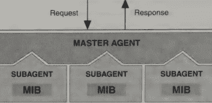

### 图 2.11 主/子代理架构。

## TCP/IP 协议族

作为网络管理员，您将需要直接与 TCP/IP 协议及相关服务交互。因此，您需要对 *TCP/IP*、相关协议和应用有很好的理解。今天，许多公司、机构和其他组织广泛使用 TCP/IP 来满足其网络需求。网络设备制造商、操作系统供应商和用户都认为它是首选协议族。事实上，世界上最大的网络——互联网，专门使用 TCP/IP。

## TCP/IP 协议族

如果您访问过网站、从 FTP 服务器传输文件或通过互联网发送电子邮件，您就间接使用了 TCP/IP 协议。从根本上说，TCP/IP 提供了一种标准方式，将数据从一个系统传递到另一个系统，而无需担心操作系统差异和网络硬件。TCP/IP 是一个首字母缩写词，代表两个独立的协议：传输控制协议 (TCP) 和网际协议 (IP)。然而，TCP/IP 通常指这些协议加上一套相关协议。例如，文件传输协议 (FTP) 使用 TCP/IP，并为支持 TCP/IP 的设备提供基本的文件传输功能。如果设备支持 TCP/IP，通常假定它也支持 FTP 以及许多其他协议和服务。

今天，TCP/IP 套件几乎支持所有可用的主流计算机操作系统。因此，它被认为是最流行的网络协议，许多相同的 TCP/IP 服务可在不同版本的 UNIX 上使用。这是个好消息，因为 TCP/IP 和应用程序的许多核心功能在不同版本的 UNIX 中是相同的。TCP/IP 的操作独立于操作系统或计算机平台。该协议隐藏了底层操作系统的细节，并为在系统间建立连接提供了一个通用框架。

许多网络设备（如路由器、交换机和专用设备）实现 TCP/IP 协议用于本地管理和控制。一般来说，这些设备上只提供一小组核心服务。表 3.1 列出了一些最流行的网络设备上可用的服务列表。正如您所见，SNMP、Telnet 和 FTP 是实施最广泛的服务。

TCP/IP 套件建立在行业标准之上，并在征求意见稿 (RFC) 中得到了完整记录。这意味着该协议将保持开放和标准，没有单个供应商可以拥有这些协议或开发专有扩展。因此，许多网络硬件供应商在其产品中提供对 TCP/IP 的支持。


| 设备类型 | TCP/IP 协议 |
| --- | --- |
| 3Com CoreBuilder 交换机 | HTTP、FTP、Telnet 和 SNMP |
| 3Com RMON 探测器 | TFTP 和 SNMP |
| Cisco 7000 路由器 | HTTP、FTP、Telnet 和 SNMP |
| Brocade 光纤通道交换机 | HTTP、Telnet 和 SNMP |
| Lexmark 激光打印机 | FTP 和 SNMP |

TCP/IP 独立于数据链路协议，可用于多种不同的网络技术，包括 FDDI、以太网、ATM、令牌环、帧中继和 SMDS。TCP/IP 使得构建真正异构的网络成为可能，该网络由来自许多不同供应商和来源的产品及网络技术组成。事实上，被认为是世界上最大网络的互联网，由来自许多网络供应商的设备组成，这些设备协同工作。这并不是说互联网没有网络问题或故障，但大多数人会同意，对于既定的核心 TCP/IP 协议集而言，设备供应商之间的互操作性并非主要因素。

从管理角度来看，用于管理 TCP/IP 系统的许多工具在大多数 UNIX 操作系统版本中都是一致的。这些工具在第 6 章“网络管理代理”中进行了描述。然而，一个可能存在的问题是，每个 UNIX 操作系统供应商都可以并且确实以不同的方式实现非协议细节。例如，IP 地址信息如何存储在每个网络设备上，不在任何 RFC 标准的涵盖范围内，也不应该在其范围内。当前的 TCP/IP 套件提供了一种动态向设备分配 IP 地址的机制，并强制要求将其唯一地分配给连接到网络的每个设备。然而，IP 地址存储在本地系统上，这不属于协议事项，而是网络管理或系统配置问题，传统上在操作系统层面解决。每个操作系统供应商都提供自己的解决方案，规定如何存储 IP 地址信息或其他操作系统参数。

## OSI 模型

包括 TCP/IP 在内的网络协议可以映射到通用网络模型。该模型定义了每个协议将为其他相关协议、服务和应用程序提供的关系和服务。最常见的标准网络模型基于开放系统互连。OSI 七层模型由一系列堆叠的层表示，整体来看，它们代表了整个网络的运作。每一层代表了构成网络的要素的一个独特视角。OSI 模型的层包括以下内容：

- 应用层
- 表示层
- 会话层
- 传输层
- 网络层
- 数据链路层
- 物理层

### 应用层

为用户提供服务，包括文件传输、电子邮件、远程主机访问和许多其他服务。

### 表示层

用于为应用程序提供通往下层的通用接口，并实现通用服务，这些服务可能包括加密、重新格式化和压缩。

### 会话层

提供在协作应用程序之间建立、维护和终止会话的机制。

### 传输层

确保两个端点之间可靠、透明的数据传输、流量控制以及数据错误检测和恢复。

### 网络层

提供上层协议透明性，因为可能会使用不同的网络通信方法。该层负责为不同网络建立、维护和终止连接。

### 数据链路层

使用帧在物理链路上提供数据传输服务；处理错误检测、流量控制和相关服务。一些常见的帧类型包括以太网、FDDI 和令牌环。

### 物理层

解决机械连接要求（如电缆和连接器），并提供比特流传输，涉及控制电压特性以产生适当的信号。示例包括以太网、快速以太网、FDDI 和令牌环的布线。

## TCP/IP 协议架构

将 TCP/IP 套件放置或叠加在 OSI 模型上，有助于演示 TCP/IP 的协议操作及其与其他协议的关系。图 3.1 形象地展示了 TCP/IP 如何融入 OSI 模型。

如图 3.1 所示，TCP/IP 模型由四层组成。每一层映射到 OSI 模型的一层或多层，包括：

- 进程层
- 主机到主机层
- 网际层
- 网络接入层

除网络接入层外，其他三个组件层均基于软件，由提供所需功能的编程模块组成

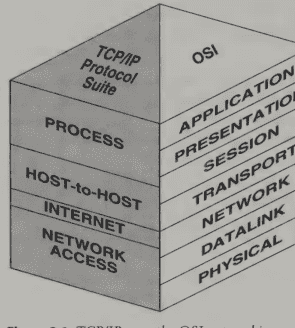

图 3.1 *TCP/IP 在 OSI 网络模型中的位置。*

通常，这些组件被纳入操作系统以提供通用访问。

### 进程层

该层提供用户应用程序并与主机到主机层进行接口。该层还包含其他协议和服务。进程层映射到 OSI 模型中定义的表示层和应用层。该层上的应用程序包括 Telnet、FTP、SMTP 等。

### 主机到主机层

该层负责确保数据可靠，并确保每个高层服务从发送实体获取正确信息。该层支持的协议是 TCP。该层映射到 OSI 传输层。用于描述主机到主机层信息的术语是 *段*。

### 网际层

该层提供从一个网络到另一个网络的不可靠信息流。从 OSI 的角度来看，该层被定义为网络层。网际层（或网络层）负责不同 IP 网络之间的路由。该层支持的协议是 IP。用于描述该层处理信息的术语是 *包*。

### 网络接入层

网络接入层涉及与网络的物理连接，传统上需要从网络到计算机内部总线的硬件接口。该层包括 OSI 模型中的物理层和数据链路层。网络接入组件定义了网络架构和拓扑。示例包括以太网、FDDI 和令牌环。用于描述该层处理信息的术语是 *帧*。还需要一个由接口制造商提供的小型驱动程序，以将硬件与操作系统连接。

TCP/IP 及相关协议也可以放置在 OSI 七层模型上，如图 3.2 所示。在这里，我们可以看到协议和服务如何与模型相关联。接下来的几页将进一步描述 TCP/IP 协议套件提供的许多其他服务。

### 进程层服务

进程层上的 TCP/IP 服务包括最终用户工具、其他协议和系统服务。TCP/IP 在不同的 UNIX 平台上提供了一种通用机制，用于共享文件、发送/接收电子邮件、远程访问系统、在系统间传输文件以及完成其他网络任务。虽然 TCP/IP 协议和应用套件很庞大，但许多 UNIX 系统供应商只提供这些服务的一个较小子集。表 3.2 列出了 UNIX 系统上通常可用的许多核心 TCP/IP 服务。

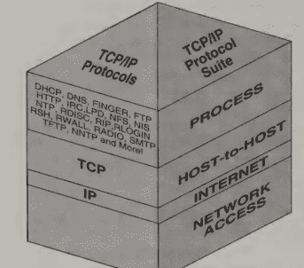

图 3.2 TCP/IP 协议套件。

### 最终用户工具

最终用户工具是许多 UNIX 系统 TCP/IP 实现中通用的应用程序，通常可供普通系统用户使用。因此，这些工具的操作不需要系统 root 权限。例如，从管理角度来看，无需任何特殊考虑，普通用户即可调用 Telnet 和 FTP 命令。TCP/IP 套件中的某些服务既指最终用户应用程序，也指协议。Telnet 就是一个很好的例子，因为它既代表用户工具，也代表通信协议。然而在实践中，这不是大问题，因为 UNIX 上的最终用户应用程序是小写的（如 telnet），而协议通常大写。

值得注意的是，某些组织通过禁用某些 TCP/IP 服务来加强安全性。有一个组织特别不希望其用户在核心开发系统上具备发送或接收电子邮件的能力，因此从这些系统中移除了 SMTP 服务器。组织的另一种方式是

通常禁用服务的方法是使用防火墙设备或路由器阻断对系统端口的访问。

## 附加协议

TCP/IP 套件包含位于网络层之上的附加高层协议，这些协议提供必要的细节以确保应用程序能够通信。例如，文件传输协议 (FTP) 定义了文件及其相关信息如何在网络中传输。该协议处理与用户授权、命名以及异构系统间数据表示相关的所有细节。

## 系统服务

TCP/IP 系统服务包括提供给系统所有用户的设施，但只能由系统管理员控制。系统服务包括特定的系统进程以及这些进程使用的特殊配置文件。系统网络服务通常在系统启动或重新引导时自动启动，但也有一些是响应请求而启动的。

### 表 3.2 核心 TCP/IP 协议和服务

| 服务 | 说明 |
| :--- | :--- |
| ARP/RARP | 地址解析协议 / 反向地址解析协议 |
| DHCP | 动态主机配置协议 |
| DNS | 域名服务 |
| FINGER | 查找远程/本地用户 |
| FTP | 文件传输协议 |
| HTTP | 超文本传输协议 |
| ICMP | 互联网控制消息协议 |
| LPD | 行式打印机守护进程 |
| NFS | 网络文件系统 |
| NIS | 网络信息服务 |
| NTP | 网络时间协议 |
| RDISC | 路由器发现协议 |
| REXEC | 远程执行服务 |
| RIP | 路由信息协议 |
| RLOGIN | 远程登录服务 |
| RPC | 远程过程调用 |
| RSH | 远程 Shell 服务 |
| RWALL | 远程 wall 广播 |
| RWHO | 远程用户监控 |
| WALL | 远程 wall 广播 |
| RADIO | 无线电发射器/接收器 |
| SMTP | 简单邮件传输协议 |
| TALK | 与远程/本地用户对话 |
| Telnet | 访问远程系统 |
| TFTP | 简单文件传输协议 |
| WHOIS | 远程查找服务 |

表 3.2 中列出的核心 TCP/IP 协议和服务进一步定义如下。

**ARP：** 地址解析协议提供低层数据链路协议（如以太网和令牌环）与高层协议（如 IP）之间的映射。ARP 将数据链路（即硬件接口）地址映射到 IP 地址。反向地址解析协议 (RARP) 用于反向操作；它将 IP 地址映射到数据链路协议地址。本节后面将全面描述 ARP 和 RARP。

**DHCP：** 动态主机配置协议向客户端系统提供启动（引导）信息。DHCP 支持 IP 地址信息、操作系统配置信息和其他相关信息。从网络地址的角度来看，DHCP 是在企业中管理 IP 地址的绝佳方式。例如，客户端可以在引导时动态获取 IP 信息，从而消除了配置每台机器的负担。

**DNS：** 域名服务在主机名和 IP 地址之间进行映射。客户端通过向一个或多个 DNS 服务器发出请求，提供解析名称和地址的能力。服务器端组件 named 监听请求，并在本地数据库中查找条目或联系另一台名称服务器进行解析。

**FINGER：** finger 服务允许查找本地或远程系统上的用户信息。finger 服务不是一种协议，只是一个使用 TCP 与 in.fingerd 服务器通信的最终用户程序。

**FTP：** 文件传输协议在系统之间传输文件。FTP 提供基本的用户认证，包括使用远程系统上的登录名和密码。FTP 接口简单，但提供了一种传输单个或多个文件的简便方法。FTP 服务器称为 in.ftpd。FTP 支持二进制和 ASCII 数据文件的传输。

**HTTP：** 超文本传输协议将网页和文档从 Web 服务器传输到浏览器。

**ICMP：** 互联网控制消息协议是一种使用 IP 协议的网络诊断工具。ping 工具使用 ICMP 回显请求/回复协议来确定节点连通性。

**LPD：** 行式打印机守护进程为网络或直接连接的打印机提供打印功能。

**NFS：** 网络文件系统功能提供本地网络上系统之间的文件共享。

**NIS：** 网络信息服务是一种目录查找工具，提供客户端对服务器数据库的访问。NIS 中通常使用的信息类型包括登录、主机、文件共享和其他系统配置信息。

**NTP：** 网络时间协议提供了一种极好的方式，以确保所有联网 UNIX 系统之间的时间和日期信息同步。

**RDISC：** ICMP 网络路由器发现协议查找路由器并构建到连接网络的路由表。

**REXEC：** 远程执行服务提供在远程系统上执行 UNIX 命令的功能。REXEC 使用一种专门的认证过程，包括读取登录名和密码，并将此信息与远程系统进行比较。如果登录信息匹配，则执行 UNIX 命令。远程命令系列包括 `rsh`、`rwho`、`rlogin` 等。

**RIP：** 路由信息协议在路由器等网络系统设备之间传播路由信息。UNIX 系统也支持 RIP。在某些 UNIX 系统上，如果安装了两个或更多网络接口，系统将自动执行路由功能。路由功能包含在系统初始化时启动的 in.routed 系统进程中。

**RLOGIN：** 远程登录服务访问远程 UNIX 系统。它提供与 Telnet 程序相同的基本服务。

**RPC：** 远程过程调用是一种机制和协议，允许以中立的方式跨网络执行过程。

**RSH：** 远程 Shell 服务为远程系统提供 Shell。

**RWHO：** RWHO 提供远程系统上已登录用户的列表。此命令类似于 UNIX `who` 命令。

**RWALL：** RWALL 提供了一种向远程系统用户写入信息的方式。此命令类似于 UNIX `wall` 命令。

**RADIO：** 这是无线电广播设施。

**SMTP：** 简单邮件传输协议提供许多电子邮件包使用的邮件投递机制，是互联网的标准邮件协议。`sendmail` 系统程序实现 SMTP，负责系统间的邮件传播。

**TALK：** Talk 是一种双向通信工具，可用于与本地或远程系统上的其他系统用户对话。Talk 不是一种协议，只是一个使用 UDP 协议的最终用户系统实用程序。

**Telnet：** Telnet 是一种协议和最终用户系统实用程序的名称。Telnet 实用程序为远程 UNIX 系统提供用户界面。用户可以通过网络登录到其他系统，并像在本地一样执行命令。它们的终端通过 Telnet 协议使用 in.telnetd 服务器进程连接到远程系统。Telnet 协议定义了一个网络虚拟接口，控制系统间字符流的流动和解释。

**TFTP：** 简单文件传输协议提供比 FTP 更简化的文件传输功能。TFTP 被视为 FTP 的轻量版本，因为它不支持健壮的授权机制或命令集。TFTP 主要用于下载系统配置信息或数据。

**WHOIS：** WHOIS 是一种白页查找实用程序。WHOIS 服务将从标准互联网服务器搜索个人用户和其他信息。

## 附加服务

许多公共领域的 TCP/IP 服务和应用程序也可通过互联网获得。其中一些资源是对现有核心服务集的改进，而其他应用程序则提供新的服务和功能。

### 表 3.3 附加 TCP/IP 服务

| 服务 | 说明 |
| --- | --- |
| ARCHIE | FTP 搜索工具 |
| Gopher | 文档检索系统 |
| IRC | 互联网中继聊天服务 |
| NNTP | 网络新闻传输协议 |
| WAIS | 广域信息服务器 |

**ARCHIE：** Archie 是匿名 FTP 站点及其内容的数据库。Archie 跟踪非常

大量匿名 FTP 站点，并允许您使用各种文件名搜索方式在这些站点上搜索文件。

GOPHER：Gopher 是一种文档检索系统，可通过菜单驱动界面（用于基于字符的设备）和万维网 (WWW) 访问。

IRC：Internet Relay Chat（互联网中继聊天）是一种实时向一个或多个订阅者发送公共或私人文本消息的方式。

NNTP：Network News Transfer Protocol（网络新闻传输协议）提供在客户端和服务器之间传输新闻文件（也称为 Usenet）的能力。

WAIS：WAIS 是另一种帮助搜索已编制索引的资料和文件的工具。

## 主机到主机层

主机到主机层，或 OSI 网络层，负责在不同网络实体之间提供健壮的数据传送机制。提供此服务的标准是传输控制协议 (TCP)。在网络中，当发生传输错误或网络硬件故障时，数据可能会丢失或损坏。数据也可能乱序传送，并在到达最终目的地前经历显著延迟。TCP 的设计和开发旨在解决这类网络相关问题。TCP 负责确保数据按正确顺序到达且无错误。它通过提供下述服务来完成这些任务：

### 虚拟连接

TCP 向网络提供虚拟连接接口，这类似于电话网络中建立电话呼叫的方式。概念上，用户呼叫另一台机器以请求数据传输。完成所有连接建立细节后，应用程序之间即可进行数据传输。从应用程序的角度来看，TCP 连接的外观和行为就像建立了一条专用硬件链路。然而，这只是 TCP 流接口提供的一种假象。

### 有序数据

为确保可靠传输，TCP 通过为每个段分配序列号来跟踪其传输的数据。序列号在连接内唯一标识每个数据段，并向发送实体提供肯定确认。无确认表明该消息应重传。序列号还用于对可能乱序到达的段进行重新排序。段如何会乱序到达？请考虑图 3.3 中的网络示例。

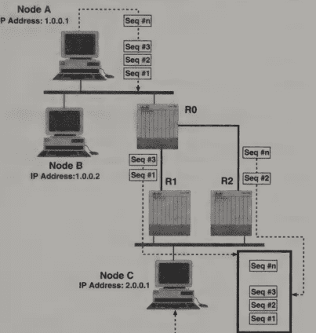

**图 3.3** *TCP 段序列号的实际应用。*

由于存在到达节点 C 的多条网络路径，某些 TCP 段可能会通过路由器 R2 而不是路由器 R1 传输。例如，如果节点 C 和 R1 之间的路径暂时变得繁忙，段可能会通过备用路径路由。结果，使用 R2 路径的段可能比使用 R1 路径的段更早到达目的地。

### 流抽象接口

从应用层的角度来看，TCP 在两个应用程序或进程之间提供缓冲的面向字节的接口。从源实体传输的数据与目的地接收到的信息完全相同。例如，如果发送实体传输消息 "Hello World"，目的地将接收到 "Hello World"。事实证明，这是一个对开发网络应用程序和服务非常有用且方便的特性。此外，TCP 流是缓冲的，这意味着应用程序在处理来自网络的数据时具有更大的灵活性。

### 端口、套接字和连接

TCP 端口是指定网络资源的地址，用于在系统上唯一标识单个应用程序或服务。目前有相当多知名的端口地址在使用中，其中许多可以在 UNIX 系统的 `/etc/services` 文件中找到。有关此文件的更多信息，请参见附录 B。表 3.4 包含部分最常用 TCP 端口的列表。

表 3.4 常用 TCP 端口
| 端口 | 应用程序/服务 |
|---|---|
| 20 | FTP 数据 |
| 21 | FTP |
| 23 | Telnet |
| 25 | SMTP |
| 53 | DNS |
| 119 | NNTP |
| 161 | SNMP |
| 80 | HTTP |

为了进一步理解这些端口的功能，请考虑 UNIX `inetd` 进程的服务。`inetd` 被称为超级互联网服务器，因为它负责将来自网络的服务请求连接到实际的服务器程序。`inetd` 知道调用哪个进程，因为它可以确定端口和服务之间的关系。通过处理 `/etc/services` 文件和 `/etc/inetd.conf` 配置文件，`inetd` 可根据需要将网络请求发送给适当的服务。有关 `inetd.conf` 文件的更多信息，请参见附录 B。图 3.4 显示了远程用户请求 Telnet 会话时 `inetd` 的操作。

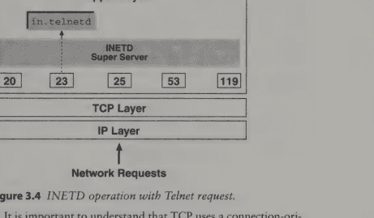

图 3.4 带有 Telnet 请求的 INETD 操作。

重要的是要理解 TCP 使用面向连接的模型，其中一个网络实体可以呼叫另一个实体以建立半双工或全双工会话。在全双工模式下，系统之间建立两个独立的通道，数据可以在系统之间流动，无需明显的交互。在半双工模式下，仅建立单个通道。网络实体可以先建立全双工会话，然后在必要时关闭一个通道。另一方面，服务可能最初建立单个半双工会话用于控制目的，然后启动另一个通道来执行某些特定操作或任务。这种应用程序行为可能看起来有点奇怪，但例如 FTP 服务就是以这种方式运行的。当 FTP 会话开始时，它首先建立到目标系统的单个会话。此会话用于用户身份验证和命令界面。当用户指定文件传输或执行远程命令时，将建立另一个会话来服务该请求。传输完成后，新创建的会话将关闭。此过程针对每个单独的事务重复进行。

套接字是在执行网络应用程序或其他服务时，系统代表用户分配的端口。由于操作系统生成唯一的套接字编号，同一系统上没有两个同时运行的应用程序会具有相同的套接字编号。在某些 UNIX 系统上，套接字的分配从 1024 以上开始。

在连接的上下文中，TCP 使用四条信息来唯一标识一个会话与另一个会话的区别：源 IP 地址、源端口、目的 IP 地址和目的端口。这点很重要，因为即使来自同一主机，也可以建立到同一应用程序或服务的多个会话。例如，两个不同的用户可以 `telnet` 到同一目标主机，而端口之间不会发生任何冲突。这是通过 TCP 使用所有四个寻址元素来区分唯一会话来实现的。图 3.5 显示了不同会话中 TCP 元素的关系。

| TCP 连接 #1 | **源实体** | **目的实体** |
| :--- | :--- | :--- |
| | **IP: 10.0.2.1** | **IP: 10.0.2.2** |
| | 源地址: 10.0.2.1 | 目的地址: 10.0.2.2 |
| | TCP 端口: 1001 | TCP 端口: 23 |

| TCP 连接 #2 | **源实体** | **目的实体** |
| :--- | :--- | :--- |
| | **IP: 10.0.2.1** | **IP: 10.0.2.2** |
| | 源地址: 10.0.2.1 | 目的地址: 10.0.2.2 |
| | TCP 端口: 1002 | TCP 端口: 23 |

**图 3.5 来自同一源/目的的两个 TCP 会话。**

### 肯定确认

TCP 提供可靠性的一种方式是确保每条传输的消息都由接收实体确认。TCP 消息的确认称为肯定确认，用于确保接收实体已收到所有已发送的段。发送 TCP 消息时，发送实体启动一个定时器。如果在时间到期前未收到确认，TCP 会假定消息丢失或损

以某种方式老化，导致无法投递。因此，TCP 发送另一个消息来替换第一个，并重新启动计时器进程。此过程将持续进行，直到所有段都被确认，或直到达到内部错误阈值。如果发送方在达到内部错误计数后仍未收到未确认段的确认，则连接将被终止。

## 建立和关闭 TCP 连接

如前所述，TCP 使用连接提供可靠、稳健的数据传输功能。建立或关闭连接的过程并非神奇的过程。相反，每个 TCP 实体在创建或终止会话时都遵循相同的规则集。为了建立连接，TCP 使用三次握手协议，如图 3.6 所示。

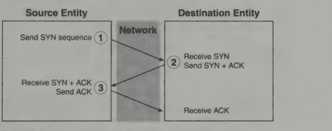

首先，源端发送一个 SYN 消息段。SYN（读作“sin”）或同步是启动 TCP 会话的请求，并在代码字段中设置了 SYN 位。接下来，目的端响应一个 ACK 段，该段在代码字段中同时设置了 SYN 位和 ACK 位，表明它已接受请求并继续握手协议。最后，源端发送一个 ACK 段，通知目的端双方实体同意连接已建立，现在可以传输和接收段了。

要关闭已建立的会话，TCP 使用修改后的三次握手，如图 3.7 所示。首先，源端发送一个 FIN 或完成段（代码字段中设置了 FIN 位），这是由于应用程序希望关闭其连接端。回想一下，TCP 将这些连接视为全双工；因此，任一方均可终止其连接端。一旦目的端上的应用程序关闭连接，TCP 就会向源端发出一个 FIN 段。接下来，源端接收 FIN 序列并发送确认。

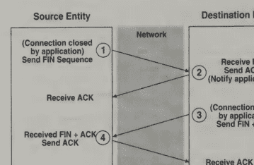

**图 3.7** 关闭 TCP 连接。

请注意，创建 TCP 连接需要三个段，而关闭它还需要四个额外的段。操作一个 TCP 连接总共需要七个消息，不包括任何数据传输段。

## 状态机

TCP 的操作最好使用状态机模型来描述，该模型控制协议的基本操作。图 3.8 显示了 TCP 状态机的示意图，其中每个 TCP 连接都会经历一系列定义好的阶段。从一种状态移动到另一种状态是事件或转换的结果。每个转换上的标签显示 TCP 接收到什么以导致状态之间的变化。例如，正如所讨论的，TCP 必须在数据传输前打开连接。通常，连接的每个 TCP 端都从 CLOSED（关闭）状态开始。当需要连接时，会从 CLOSED 状态转换到 SYN SENT（同步已发送）状态。此时客户端发送一个 SYN 数据包。如果接受了 SYN 数据包，远程端会发出一个 ACK，这会导致从 SYN SENT 状态转换到 SYN RECEIVED（同步已接收）状态。

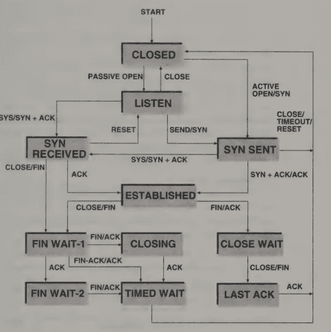

**图 3.8** *TCP 状态机。*

一旦收到最终的 ACK，即达到 ESTABLISHED（已建立）状态，数据传输便可开始。当建立 TCP 连接后，它将保持在 ESTABLISHED 状态，直到任一方希望终止连接或发生某些错误。

当 TCP 连接终止时（无论由源端还是目的端），连接会移至 CLOSED 状态或 FIN WAIT-1（终止等待-1）状态。如果源端发送 FIN 段，TCP 将转换到 **CLOSE WAIT**（关闭等待）状态，这最终将终止连接。

当目的端想要关闭连接时，会变更到 **FIN WAIT-1** 状态。TCP 拥有一套精密的机制，以确保来自先前连接的段不会干扰现有连接。TCP 维护一个计时器，称为最大段生存时间 (MSL)，它包含旧段可能在网络中保持存活的最长时间。因此，TCP 在关闭连接后会移至 **TIMED WAIT**（时间等待）状态。它将在此状态下保持两倍的 MSL 时间。在此之后，如果有任何段到达该连接，它们将被拒绝。我们为什么关心这些细节？嗯，这有时有助于排查连接问题。例如，**netstat** 命令提供 TCP 端口状态信息，以协助此类活动。

## TCP 段格式

TCP 定义了一种段格式，其中包含确保段到达正确目的地所需的所有信息，还包含额外的控制信息。图 3.9 显示了 TCP 段格式。

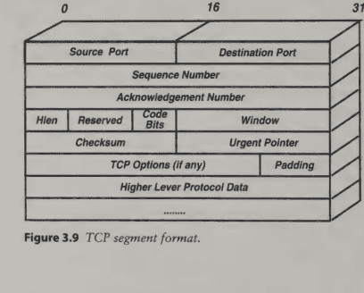

TCP 段字段包括：

- **源端口：** 发送此段的协议（或服务）
- **目的端口：** 接收此段的协议（或服务）
- **序列号：** 发送方字节流中的位置
- **确认号：** 源端期望在下一个段中接收到的字节编号
- **Hlen：** 指定段头部长度的整数
- **代码位 (C Bits)：** 段用途和内容的详细信息
- **窗口：** TCP 愿意接收的数据量规范
- **校验和：** 用于验证 TCP 头部和数据完整性的整数
- **紧急指针：** 指示此段应立即处理的字段
- **选项：** 用于协商最大段大小的详细信息
- **数据：** 高层协议或特定于应用程序的信息

## 代码位

这些位指示 TCP 段的类型以及应如何处理。表 3.5 显示了既定代码及其相关含义。这些代码类似于以太网帧中的类型字段，这意味着 TCP 段是自我标识的。

### **表 3.5** TCP 段类型

| 代码 | 含义 |
| :--- | :--- |
| URG | 紧急指针 |
| ACK | 确认 |
| PSH | 请求推送 |
| RST | 复位 |
| SYN | 同步序列号并启动连接 |
| FIN | 到达字节流末尾 |

## 窗口

TCP 拥有一套精密的机制来处理数据缓冲、流控制和未确认段的重传。窗口字段帮助 TCP 确定它愿意在下一个段中接受多少数据。事务的数据大小会显著影响整体网络和应用程序性能。为了理解原因，假设此刻在名为 *socrates* 和 *durer* 的两个节点之间已建立 TCP 连接，并且在之前的事务中，*socrates* 向 *durer* 指定了一个 1024 的 TCP 窗口（这是默认值）。现在，*durer* 开始经历高使用率，并开始面临可用资源（如内存）不足的情况。许多原因都可能导致这种情况。此时，*socrates* 仍在向 *durer* 发送 TCP 消息，但由于消息数量过多，*durer* 难以确认（甚至可能难以处理）来自 *socrates* 的段。因为 *durer* 存在资源问题，发送给 *socrates* 的下一个段包含一个较小的窗口大小，这通知 *socrates* 必须调整后续 TCP 消息中包含的数据量。当 *socrates* 收到新的窗口大小时，它开始向 *durer* 发送较少量的数据。在 *durer* 上的资源限制得到解决后，无论是通过系统管理员的显式操作，还是通过完成最初导致资源问题的任务，*durer* 都会向 *socrates* 发送一个较大的窗口大小并恢复如常处理。如果没有 TCP 动态调整段大小的能力，在该示例中，*durer* 将开始丢弃其无法处理的消息。这反过来会导致 *socrates* 重传它们，不仅浪费 *socrates* 上的处理周期，还因重传消息而浪费网络带宽。

## 紧急指针

由于 TCP 提供流式接口，应用程序有时需要一种方式发送带外或紧急消息到连接的另一端，而无需等待前面的消息被处理。带外数据重要性的一个例子是用户希望使用 Telnet 终止远程登录会话。终端通常提供中断或控制信号，可用于通知应用程序应当终止。在这种情况下，TCP 使用 *URG* 位指示这是一个带外段，并设置*紧急指针*以指定段中紧急数据结束的位置。

## TCP 选项

此字段协商 TCP 段大小，当可以建立较高或较低的最大传输单元 (MTU) 时，这很有用。不同物理网络上的 MTU 值可能不同。例如，ATM 的 MTU 高于以太网。

## 网际层

网际层（或 OSI 模型的网络层）提供一种不可靠的、基于无连接传输协议的投递服务。如前所述，网际协议 (IP) 在此层运行，提供尽力而为的传输服务，并负责在不同 IP 网络之间路由数据包。IP 数据包可能会丢失、延迟、重复和乱序投递。

该协议定义了两个版本。实施最广泛的版本是 *4*（称为 IPv4），由于该版本的协议缺陷和资源限制，增强

进行了改进，产生了一个称为 IPv6 的新版本。然而，版本 6 在网络行业中尚未得到广泛实施。

IP（版本 4）的主要特征和服务包括：
- 不可靠交付
- 无连接协议
- 数据包通过不同路径传输
- 地址格式
- 子网划分
- 路由

## 不可靠交付

术语*不可靠*表明 IP 不会尝试保证数据包送达其目的地。这与传输控制协议的行为和服务形成鲜明对比，后者提供可靠的传输机制，确保消息送达。另一方面，IP 提供尽力而为的交付机制，不确保数据包传输，但也不会随意丢弃它们。尽管 IP 不可靠，但这并不意味着 IP 中携带的数据无法正确交付。IP 只是使用像 TCP 这样的上层协议来确保数据的可靠交付。

## 无连接协议

IP 被称为无连接协议，因为它不建立用于传输数据包的连接，这与可靠传输协议的行为相反。数据包的交付基于数据包本身所包含的 IP 地址信息。每个 IP 数据包都是自包含的、独立于任何其他数据包的，并且不是网络实体之间预先建立的协议的一部分。因为 IP 内部不维护连接信息，所以数据包交付被简化了，且效率更高。

### 数据包通过不同路径传输

在 IP 中，数据包可能通过不同的路径到达其最终目的地，即使每个数据包可能只承载一条大得多的消息的一小部分。当 IP 数据包在互联网中传输时，可以观察到这种行为。此外，数据包可能会乱序到达。

### IP 寻址

IP 定义了地址的格式，并要求每个网络节点拥有其自己的唯一地址。地址包含一对网络标识和节点标识，它们被表示为一个单一的数字。在 IPv4 中，使用 32 位来表示一个 IP 地址，并以点分表示法表达。每个地址写为四个由十进制点分隔的十进制整数。IPv4 中定义了五个不同的类别。然而，在实践中，只有前三个主要类别用于定义网络/节点对，如图 3.10 所示。


每个类别指定了用于解释地址中有多少部分代表网络、有多少部分代表节点的格式。地址的解释包括：
- *A 类：* 第一个字节是网络标识，其余字节指定节点。网络地址范围（第一字节）为 1–127。
- *B 类：* 前两个字节是网络标识，其余字节是节点。网络地址范围为 128–191。
- *C 类：* 前三个字节是网络标识，剩余字节是节点。网络地址范围为 192-223。

定义了两个额外的（D 和 E）类别，但它们是保留的，不能用于正常的网络地址。D 类地址用于多播支持，E 类地址保留供将来使用。区分不同类别的一种方法是使用首字节规则。根据此规则，第一个字节决定该地址属于哪个类别。例如，使用 IP 地址 10.1.3.2，10 是该地址的第一个字节。数字 10 落在 1-127 的范围内，因此该 IP 地址是 A 类类型，网络部分是 10，而节点部分是 1.3.2。

IP 还定义了一些保留地址，包括回环地址和广播地址。回环网络被定义为地址 127，用作 IP 设备内部诊断和支持的专用网络。此网络地址被保留，不应用作真实的网络地址。事实上，IP 协议规范不建议在生产网络上使用它。可以通过发出 UNIX `ifconfig -a` 命令来观察回环地址。被定义为 255 的广播地址也被视为特殊地址，因为它表示以简便方式寻址给定范围内的所有主机。例如，给定网络 134.110.0.0（这是一个 B 类网络），广播地址 134.110.255.255 将寻址整个 134.110 网络内的所有设备。由于与 255 关联的特殊含义，它不应用作节点地址。

IP 地址的分配通过一个称为网络信息中心 (NIC) 的中央机构完成。NIC 负责向任何希望连接到互联网的组织分配唯一的 IP 网络地址。在许多情况下，本地互联网服务提供商 (ISP) 将代表您申请 IP 地址，或提供其自己的地址之一。

## 子网划分

子网划分是一种将网络划分为较小的子网或*子网*的机制。实施子网的一个主要动机是分发 IP 地址分配的管理控制权。子网还允许更有效地利用现有地址。

通过子网，IP 地址的节点部分被分为两个部分：子网地址和节点地址，如图 3.11 所示。

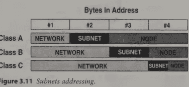

要实施子网划分，必须满足以下要求。首先，必须为将参与子网的每个设备创建一个子网掩码。该子网掩码是一个特殊的 32 位地址，像普通 IP 地址一样使用点分十进制表示法表示。与普通 IP 地址一样，子网中的每个字节都在 1 到 255 的范围内。但与 IP 地址不同的是，这些字节代表一组屏蔽位，它们与设备的 IP 地址结合以生成子网网络。具体而言，确定子网涉及将子网掩码和主机 IP 地址与布尔**与**运算符结合。图 3.12 显示了所需的子网计算。

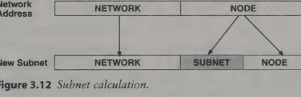

其次，将参与子网的每个设备必须使用相同的子网掩码地址。特别是，对于本地系统上定义的每个接口，子网掩码应与其他接口参数一起定义。例如，在 UNIX 下，对系统中安装的每个系统接口调用 *ifconfig* 命令

在系统中。执行此系统命令时必须包含子网掩码信息。

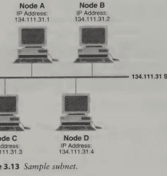

为了进一步说明子网的实施，请考虑图 3.13 所示的示例网络。在该图中，我们有四个连接到同一网络的设备。每个设备已经获得了一个 IP 地址，但现在我们必须确定子网掩码应该是什么。我们确定网络将来会增长，并且需要在子网中有足够的 IP 地址供约 200 台设备使用。因此，我们将需要至少使用 8 位（1 个字节）作为子网。

示例网络中使用的 IP 地址属于 B 类类型。回想一下，B 类地址的范围是 128-191，前两个字节是网络地址（134.111），而剩下的两个字节（例如 31.1）是节点地址。我们唯一可以用于子网的位置是从地址的主机部分获取位。我们根本无法使用任何网络地址部分，因为该地址区域是受限的。考虑到这一点，我们需要将主机部分细分为两部分，这就是子网掩码发挥作用的地方。通过在子网字段的位中使用全 1，在节点字段的位中使用全 0，我们可以通过将 IP 地址和子网掩码转换为二制来形成所需的子网地址：

| (十进制) | (二进制) |  |
|---|---|---|
| 134.111.31.1 | 10000110.01101111.00011111.00000001 | (IP 地址) |
| 255.255.255.0 | 11111111.11111111.11111111.00000000 | (子网掩码) |
| 134.111.31.0 | 10000110.01101111.00011111.00000000 | (子网地址) |

应用布尔**与**将产生子网地址 134.111.31.0。在该子网掩码配置到子网内的每个设备后，每个节点将执行所需的**与**计算，以确定其所属的子网地址。在许多（如果不是全部）UNIX 系统上，当系统的网络服务启动时，这是一项自动任务。总之，要对网络进行子网划分，请包含以下步骤：
- 1. 确定您要划分子网的网络的 IP 地址类别。
- 2. 确定子网所需的地址数量。
- 3. 确定是否可以为子网地址使用完整的字节（至少需要 B 类地址）。
- 4. 使用子网掩码对其中一个设备地址执行布尔**与**运算。
- 5. 将子网掩码应用于将参与子网的所有设备。

此示例中的子网掩码分配相对简单直接，因为为子网编号使用了完整的字节。这也使得**与**计算变得非常简单。然而，假设我们通过使用 C 类网络编号来更改示例。我们现在需要分配给图 3.13 中示例网络的地址包括 199.81.23.1 到 199.81.23.4。对于 C 类地址，第一字节的范围落在 192–223 内。前三个字节是网络地址（199.81.23），而剩余的字节（本例中为 4）是节点地址。这个示例会使子网划分过程稍微复杂一些，因为我们

现在必须仅从一个八位字节中分离主机部分和子网地址。然而，适用的过程与上述所述相同。

为了从 C 类网络地址制定子网地址，我们必须从地址的主机部分借用一定数量的位来表示子网号。这样做会自动减少子网内每个设备可用的 IP 地址数量。因此，我们需要知道将在子网上安装多少设备。为了进一步完善我们的示例，假设我们在子网上仅需要十个 IP 地址供各个节点使用。

我们可以手动确定子网掩码和其他信息，但如果使用软件程序为我们进行计算，会容易且快捷得多。Chesapeake 网站 (www.cci.com/tools/subcalc) 提供了一个优秀的计算器。该软件提供对任何有效 IP 地址进行子网划分的功能，并向我们展示所涉及的计算和步骤。图 3.14 显示了主屏幕。请注意，该软件可以下载并在本地计算机上运行，或直接从 Chesapeake 站点执行。关于在本地计算机上使用的下载和安装说明见附录 C。


图 3.14 主子网计算器窗口。

第一个字段“IP 主机地址”要求我们指定网络上某台主机的 IP 地址。在本例中，我们给出第二个示例中的一个节点地址（即 199.81.23.1）。接下来，我们在标记为“选择以下一项”的第三个框中输入信息，提供关于子网的一些信息。我们可以通过四种方式之一来执行此操作：直接指定子网掩码（子网掩码字段）、子网的位数（位字段）、子网内的最大主机数（最大可能子网数字段）或每个子网可能的主机数（每个子网可能的主机数字段）。更改其中一个字段会自动更改其他三个字段。例如，当子网掩码更改为 255.255.255.224 时，位数变为 3，每个子网可能的主机数变为 30。

通过查看图 3.15 所示的计算窗口，可以更容易地看到这些字段之间的关系。此屏幕包含五个部分。第一部分显示两行，每行包含三个字段：标准 IP 地址（C 类网络字段）分别以十进制和二进制格式显示、子网和主机位字段，以及子网掩码。这是必须应用于将参与子网的每个系统的掩码。此子网掩码使用 28 位，因此可称为“28 位子网掩码”。第二部分包含主机地址 (199.81.23.1) 和子网掩码 (255.255.255.224) 字段进行逻辑与运算得出的子网号。第三部分以二进制形式显示正确的子网掩码、反转子网掩码和子网号。下一部分包含子网定向地址和广播地址。广播地址将 IP 数据包导向本地子网上的每个节点。最后一部分包含摘要，其中包括子网地址、用范围指定的可用主机地址以及定向广播地址。可用主机范围很重要，因为它表示子网内所有主机系统可使用的地址。

## Internet Control Message Protocol

如前所述，IP 提供了一种尽力而为的数据包传送机制，不保证数据传送。IP 与底层协议细节隔离，并对网络的性能和可靠性极少做假设。数据传送无需其他 IP 实体间的特殊协调即可完成，且在大多数情况下运行良好。然而，可能存在超出 IP 控制范围的条件，使得传送变得困难或不可能。例如，远程主机可能暂时从网络中移除，或者当启动网络密集型应用程序时，路由器可能变得过载。IP 需要一种方法来检测这些类型的问题。

Internet Control Message Protocol（ICMP，互联网控制消息协议）为 IP 协议和相关服务提供了通用的错误消息工具。ICMP 为遇到错误的 IP 实体提供了一种向导致问题的源头报告错误的方式。纠正错误是源实体的责任。例如，这可能包括向高层应用程序报告错误。表 3.6 列出了一些 ICMP 消息类型。

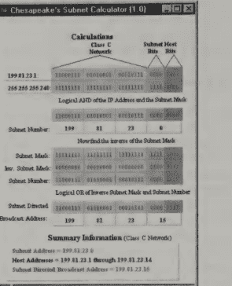

### 图 3.15 子网计算窗口。

**表 3.6 ICMP 错误消息类型**

| 消息类型 | 含义 |
| :--- | :--- |
| 回显请求/回复 | 确定系统可达性 |
| 目标不可达 | 无法到达目标目的地 |
| 源抑制 | 停止发送数据 |
| 重定向 | 检测路由错误 |
| 超时 | 过期的 IP 数据包 |

最流行的网络调试实用程序之一 `ping` 使用 ICMP 来确定主机可达性。`ping` 使用 ICMP 中提供的回显请求和回显回复原语来确定远程主机是否在网络上可用且运行正常。图 3.16 显示了回显请求和回复的基本操作。用户想要确定节点 B 是否在网络上可用。从节点 A，用户输入 `ping` 命令，向节点 B 发出回显请求。如果节点 B 处于活动状态，它将使用回显回复向节点 A 响应。如果节点 B 不活动，则节点 A 不会收到响应。在这种情况下，来自节点 A 的请求只是超时。发生这种情况时，用户会看到一条超时消息，指示节点 B 未响应请求。

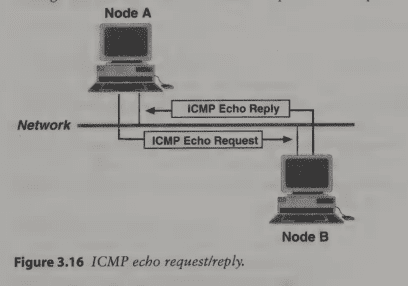

### 目标不可达

当路由器无法将数据包传送或转发到其目的地时，它会向发送者发出 ICMP 目标不可达消息。目标不可达错误通常意味着存在某种路由问题或错误（即路由表中的路由不正确）。由于硬件故障导致系统暂时不可用，或发送者指定了不存在的目标地址，可能会导致目的地不可达。有时，除非使用 ping 系统实用程序，否则无法知道目的地不可达。例如，如果用户向远程系统（恰好连接到以太网 LAN）发出 Telnet 请求，而该系统已从网络断开连接，则该 Telnet 请求最终将超时，因为以太网不支持任何帧确认。结果，不会生成目标不可达消息，因为以太网假定数据传送即使针对暂时从网络断开连接的节点也是有效的。

### 源抑制

ICMP 中的源抑制提供了一种在 IP 数据包级别处理拥塞的方法。网络中的拥塞可能由多种因素引起。然而，一个主要原因是当多个系统开始传输流经单个路由器的数据时，如图 3.17 所示。在这种情况下，路由器本身因合并流量而过载。拥塞的另一个原因是功能更强大的计算机系统向功能较弱的系统传输数据，后者无法跟上速度。如果这些情况不加控制，最终路由器和性能不足的系统将开始丢弃数据包，这反过来会导致 TCP 重传它们，从而使情况恶化。在这种情况下，路由器和较小的系统只需发出一条源抑制消息，指示发送方停止发送数据。结果，路由器和较小的系统有时间处理任何未完成的数据包。

没有直接的方法来逆转 ICMP 源抑制消息的效果。然而，任何接收到源抑制的目的地都会降低其向目的地传输数据包的速率。在不再接收到额外的源抑制消息后，

远程系统开始逐渐增加传输速率，最终恢复正常流量。

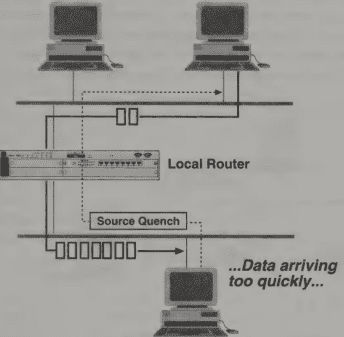

图 3.17 **ICMP 源抑制重定向。**

## 重定向

ICMP 重定向消息通知路由器网络内路由信息的变更。TCP/IP 的基本假设之一是路由器了解网络内的路由拓扑，并且该信息在参与的路由器之间共享。当路由器检测到主机使用非最优路由时，它会发送一条重定向消息，通知主机有更好的路由可用。主机需将此新信息纳入其路由配置中。在某些情况下，这不是自动的，必须由网络管理员手动完成。图 3.18 显示了路由器发送 ICMP 重定向消息的一个示例。假设节点 A 想与节点 D 通信。在这种情况下，节点 A 和节点 D 之间存在两条路径，即 R1 和 R2。R1 路径较短，且节点 A 和节点 D 之间的跳数较少。R2 路径包含一些额外的链路，因为它还提供连接到包含节点 B 和节点 C 的其他网络的连通性。如果节点 A 尝试通过 R2 与节点 B 通信，则 R2 会将重定向消息发回给节点 A，告知其使用 R1，因为 R1 到节点 D 的路径更短。很多时候，使用错误路由器的原因在于系统本身的配置，或来自一个或多个配置错误的路由器的错误路由信息。无论哪种情况，ICMP 重定向都有助于网络管理员追踪这类问题。

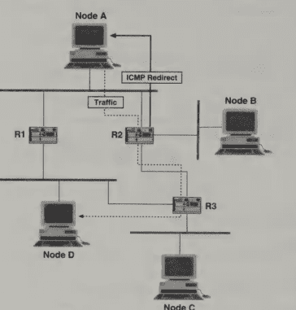

图 3.18 *ICMP 重定向。*

重定向消息不提供分发路由信息的通用机制，因为它们仅限于主机和路由器之间的交互。相反，路由信息协议 (RIP) 等路由协议用于在网络内传播路由信息。

## 超时

每个 IP 数据包都包含一个生存时间 (TTL) 字段，该字段控制数据包在网络中可存在的时间。当路由器处理数据包时，它会在转发前递减该字段。每当路由器因数据包的生存时间字段为零或发生其他超时而丢弃数据包时，路由器会向数据包源发送一条 ICMP *超时* 消息。这是检测网络中路由环路或过长路由的主要机制。例如，*traceroute* 命令使用生存时间字段来追踪 IP 数据包在两点之间可能采取的路径，并测量到达目的地途中遍历每个路由器所需的时间。

## 地址解析协议

正如我们之前讨论的，IP 对网络设备使用的地址施加了一定的结构和格式。在 IP 版本 4 中，地址长度为 32 位，以点分十进制表示。在版本 6 中，地址甚至更大——128 位。与任何高层网络协议（如 IP）一样，都需要一种机制将这些地址转换为 Ethernet、FDDI 或 TokenRing 等协议使用的地址。这些协议被称为数据链路协议，它们各自拥有自己的寻址结构和格式，这与 IP 截然不同。例如，Ethernet 使用 48 位地址，并以冒号十六进制表示法表示。因此，**8:0:20:4:cf:2c** 代表一个有效的 Ethernet 地址。在这种情况下，该数据链路地址并不总是能轻松映射到 IP 使用的地址。许多其他数据链路协议也是如此。这造成了一个困境，因为如果没有将 IP 地址映射到物理接口的方法，节点之间将无法通信。

拥有一种简单、灵活且强大的方法在 IP 和数据链路（物理）地址之间进行映射是可取且非常必要的。地址解析协议 (ARP) 已被证明是一种非常优雅且稳健的解决地址映射问题的方法。特别是，ARP 旨在处理任意网络层协议到数据链路协议的地址解析，而不仅仅是 IP 和 Ethernet 之间。

ARP 的基本操作很简单：当节点 A 想要确定节点 B 的物理地址时，节点 A 会向网络上的所有设备发送一条特殊的广播消息，请求节点 B 的地址，如图 3.19 所示。所有主机都会收到该消息，包括节点 B 和节点 C，但只有节点 B 会响应正确的物理地址，如图 3.20 所示。只有节点 B 响应的原因是它检查 ARP 数据包，并确定其自身的 IP 地址与请求者正在寻找的目标 IP 地址匹配。

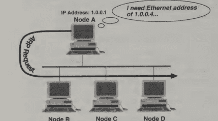

**图 3.19 ARP 请求。**

ARP 的一个姊妹功能称为反向地址解析协议 (RARP)，它执行相反的操作；给定一个数据链路地址，它查找对应的 IP 地址。RARP 主要用于无盘工作站在系统启动期间需要确定其 IP 地址时。

上述示例中的术语 *广播* 指的是发往特定 LAN 网段上所有网络设备的本地定向数据包。某些数据链路协议（如 Ethernet）提供使用特殊目标地址向所有连接站点传输广播数据包的功能。对于 Ethernet，目标地址全为 1（十六进制为 FF）被视为广播。ARP 假定将消息传递给每个站点的细节将由数据链路协议直接处理。

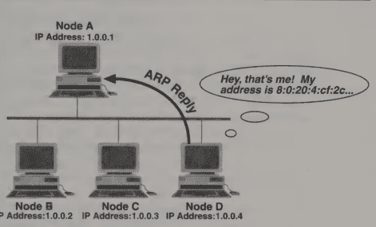

图 3.20 *ARP 应答*。

正如你所见，ARP 协议非常简单。然而，尽管简单，它却有几个深远的优势。首先，ARP 本质上是动态的，这消除了静态跟踪和存储 IP 到物理地址映射的必要性。这种动态解析行为使网络管理员免于在每次设备添加或从网络移除时持续维护和确保信息正确。考虑到当今许多互联网的规模和增长速度，要完成这样的任务是不可能的。其次，ARP 是一个标准，可在支持 TCP/IP 的每个设备上使用，无论数据链路协议是什么。这就是为什么 IP 可以在 FDDI 和 TokenRing 上运行。这使得构建异构网络变得更加容易，因为 ARP 隐藏了数据链路寻址细节，网络设计师在组合不同的数据链路协议时无需关心物理地址解析。第三，ARP 可用于 IP 子网，为设备在路由互联网中通信提供一种非常简单的方式。

## 数据包格式

与其他网络协议不同，ARP 数据包字段并非全部采用固定格式，而是依赖于数据包开头附近的某些固定字段。ARP 和 RARP 共享相同的基本数据包格式。为了使 ARP 适用于其他数据链路协议，字段的长度将取决于网络类型。图 3.21 显示了标准的 ARP 和 RARP 消息格式。

硬件类型字段定义发送方需要答案的硬件接口类型。标准值包括 1 代表 Ethernet，2 代表 FDDI。协议类型指定发送方使用的高层协议类型，对于 IP 而言，十六进制为 0800（十进制为 2048）。操作字段注明消息是 ARP 请求 (1)、ARP 响应 (2)、RARP 请求 (3) 还是 RARP 响应 (4)。Hlen 和 Plen 字段定义硬件和高层协议地址字段的长度。Hlen 和 Plen 字段允许 ARP 与任意数据链路协议配合工作，因为硬件类型和协议字段的大小可以通过直接检查 ARP 数据包来确定。发送实体在发出请求时将尽可能提供发送方 HA 和/或发送方 IP 字段信息。发送方 HA 用于 ARP 请求，而发送方 IP 用于 RARP 请求。目标 HA 用于响应 ARP 消息；否则，目标 IP 用于响应 RARP。

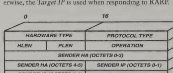

**图 3.21 ARP/RARP 消息格式。**

## ARP 缓存

乍一看，ARP 服务似乎效率低下，因为每当设备希望与另一个设备通信时，它都会发送一个广播数据包。然而，在许多系统上，ARP 实现包括使用 ARP 缓存来临时存储来自先前 ARP 请求的地址绑定。事实上，在发出 ARP 请求之前，高层软件会扫描 ARP 缓存，以查看所需的数据链路地址映射是否已存在于

缓存。如果存在，则使用现有绑定；否则发送 ARP 请求。由于缓存的存在，网络流量减少，因为只有在设备未知时才会发出 ARP 请求。此外，应用程序性能得到提升，因为发送方的 ARP 请求可以通过使用缓存来满足，而无需在网络上传输数据包。最后，缓存为管理员提供了一种查看高层协议与网络硬件之间连接性的方法。正如我们稍后在本书中将看到的，检查 ARP 缓存可以成为排查网络和系统问题的有力手段。

这里有一个关于 ARP 缓存的有趣问题：何时应从缓存中丢弃绑定？答案并不简单。如果我们假设永远保持 ARP 缓存填满条目（或直到系统重启），则缓存中可能包含无效信息。例如，考虑一个包含系统 *monet* 和 *rembrandt* 的网络，它们正在通信时，*rembrandt* 上的网络接口卡（NIC）发生故障并随后被替换。除非管理员在接口安装后*更改*了地址，否则新 NIC 将包含一个新的*数据链路*地址。结果，*monet* 无法再与 *rembrandt* 通信，因为 *monet* 上的缓存包含 *rembrandt* 的无效*数据链路*地址。另一方面，我们可以采取一种方法，即 ARP 缓存中的绑定应在相对较短的时间内过期，例如每 30 秒。不幸的是，这将对网络性能产生不利影响，因为需要更多的网络广播，因为 ARP 缓存将非常小。然而，这将解决最近更换过 NIC 的错误绑定问题，因为旧条目会在新 NIC 投入运行后的一段合理时间内被清除。

或许解决此问题的最佳方案可描述为*折中*的方法。也就是说，绑定过期时间不应太短而失效，也不应太长而无法应对网络变化。通常，大多数 UNIX 系统将在约 20 分钟后删除 ARP 条目。某些 UNIX 版本还允许管理员更改 ARP 缓存超时以适应其：
- 数据链路地址格式
- 个人网络需求，并在必要时更改它以解决其他网络相关问题

### 数据链路地址格式

如所述，数据链路地址用 48 位（六字节）表示，并用冒号分隔。这种冒号表示法是表示这些硬件地址的主要方法。某些 UNIX 网络管理工具，如 ifconfig 和 arp 命令，使用此格式。FDDI、以太网和令牌环的数据链路协议地址包含供应商代码标识号和序列号。此信息可用于库存目的的节点识别。IEEE 注册管理机构将供应商部分分配给生产网络硬件并已请求供应商代码的组织。这些代码也称为组织唯一标识符（OUI）。地址的前三个字节代表设备的制造商或供应商，剩余三个字节代表设备的序列号，如图 3.22 所示。


图 3.22 数据链路地址格式。

通常在多宿主系统上，数据链路地址将在所有定义的接口间共享。对于包含不同网络接口类型（即以太网和 FDDI）的系统，这甚至可能也是真的。表 3.7 显示了一些最常见的供应商代码。请注意，多个供应商代码可能与同一供应商关联。例如，当一家公司收购另一家公司及其产品时，可能会出现这种情况。在这种情况下，被收购公司的供应商代码现在归属于收购方公司。这就是为什么表 3.7 包含 3Com 和 Cisco 的多个条目。了解其中一些地址在网络调试期间非常方便，有助于识别特定数据包所属的设备类型和供应商。如果您有兴趣查找表 3.7 中未列出的供应商，请访问 IEEE 网站 http://standards.ieee.org/regauth/oui/oui.txt。

### 表 3.7 示例供应商 OUI 代码

| **供应商代码** | **供应商** |
|---|---|
| 00:20:AF<br>00-80-3E<br>00-C0-D4<br>（更多） | 3Com 公司<br>前身为 Synernetics, Inc.<br>前身为 AXON, Inc. |
| 08-00-2B<br>AA-00-00<br>AA-00-03<br>AA-00-04 | 前身为 Digital Equipment Corporation (DEC)，现归 Cabletron Systems 所有 |
| 00:00:0C<br>00-E0-B0<br>00-E0-F7<br>00-E0-F9<br>00-E0-FE<br>00-06-7C<br>00-06-C1<br>00-10-07<br>（更多） | Cisco Systems, Inc.<br>（包含大量前身公司列表） |
| 00-60-69 | Brocade 公司 |
| 00-00-81<br>00-00-A2<br>00-80-E3 | 前身为 Bay Network, Inc.<br>前身为 Coral Networks |
| 00-E0-81 | Packet Engines, Inc. |
| 08:00:5A | IBM 公司 |
| 08:00:20 | Sun Microsystems, Inc. |
| 08-00-09 | HP 公司 |
| 00-10-E3 | Compaq 公司 |

102

第 03 章 / TCP/IP 协议套件

访问此统一资源定位符（URL）将显示整个 OUI 文件。请注意：此文件相当大（超过 900K）且仍在增长！如果您不想查看整个 OUI 文件内容，则可通过访问 `http://standards.ieee.org/regauth/oui/index.html` 搜索您要查找的特定供应商代码。

访问此 URL 将显示图 3.23 所示页面。


图 3.23 IEEE OUI 搜索页面。

如果您想搜索供应商，请在搜索文本框字段中输入公司名称。此外，如果您知道 OUI 但想查找供应商，请输入地址。然后，单击*搜索！*按钮。图 3.24 显示搜索 Brocade 公司时获得的结果。

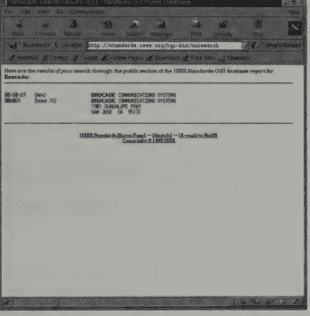

图 3.24 OUI 搜索结果。

## 核心系统实用程序和工具

本章详细概述了 Linux 操作系统可用的命令和实用程序。讨论的许多工具属于一组通用工具，且可在许多其他不同的 UNIX 平台上使用。例如，arp 命令的运作方式相似，且在 Solaris、HPUX 和 AIX 系统上拥有许多相同的命令行选项。

本节讨论的软件包括可协助网络管理员处理网络相关任务并解决特定网络问题的工具。本章涵盖以下工具：

| 命令 | 页码 |
| --- | --- |
| arp | 106 |
| ifconfig | 115 |
| netstat | 125 |
| ping | 143 |
| tcpdump | 153 |
| traceroute | 171 |

### ARP 工具

#### 一般描述

`arp` 命令显示并操作本地 UNIX 系统上的网络地址表。地址解析协议表，也称为**ARP 缓存**，包含本地网络上所有数据链路协议到 IP 地址映射的完整列表。回顾第 3 章，ARP 协议是一种动态机制，可将数据链路地址（如以太网）映射到 IP 地址。每当系统要传输消息时，必须首先知道目标系统的低层（即数据链路）地址。许多网络工具，如 `telnet`、`ftp` 等，间接使用 ARP 表。

`arp` 命令提供查看和修改 ARP 表的能力。请注意，术语 ARP 表和 ARP 缓存可互换使用，指代同一事物。此外，术语**绑定**和*映射*也指 ARP 条目。普通 UNIX（非 root）用户可显示 ARP 缓存，但无法进行任何更改。原因显而易见；用户可能会对缓存进行更改，从而影响所有用户的连接性。


使用 **arp** 命令，超级用户可以：

- 显示 ARP 缓存
- 删除 ARP 条目
- 添加 ARP 条目

ARP 工具提供了许多命令行选项。然而，表 4.1 中仅列出了最重要的选项，并在下文中进行了完整描述。这些选项中的每一个都支持单个命令字符或关键字，并在开头带有两个破折号。例如，**-v** 选项有一个关联的 **--verbose** 关键字。它们是等效的，可以在命令行上互换使用。表 4.1 显示了这两种形式。选择其中一种而非另一种仅仅是风格问题。然而，关键字格式可能使未来更容易记住各个选项。

#### 显示 ARP 缓存

**表 4.1** *重要的 arp 命令行选项*

| 选项 | 关键字 | 说明 |
| :--- | :--- | :--- |
| -a | --display | 显示特定主机的当前 ARP 条目 |
| -d | --delete | 删除 ARP 条目 |
| -f | --file | 加载包含要放入缓存条目的文件 |
| -i | --device | 仅显示指定接口的条目 |
| -n | --numeric | 显示数字地址而非主机名 |
| -s | --set | 创建 ARP 条目 |
| -v | --verbose | 使用详细模式显示 ARP 缓存 |

要显示 ARP 表的内容，请使用 **arp -v (--verbose)** 命令。显示表时，它包含设备名称、硬件类型、物理地址、掩码标志和网络接口。示例如下：

```
# arp -v
Address HxType HWaddress Flags Mask Iface
durer.home.com ether 00:60:97:0E:A3:06 C eth0
switch.home.com ether 00:00:10:0A:5D:01 eth0
probe.home.com ether 00:C0:D4:00:09:40 C eth0
rembrandt.home.com ether 08:00:20:82:be:05 eth0
rubens.home.com (incomplete) eth0
monet.home.com ether 08:00:20:04:cf:2c C eth0
Entries: 6 Skipped: 0 Found: 6
```

Address 字段显示与 ARP 条目对应的主机名或 IP 地址。这是用于搜索 ARP 表以确定所需条目是否存在的地址。当显示 IP 地址（而不是主机名）时，这表明 IP 地址无法正确解析为主机名，或者使用了 -n 选项。这可能是 DNS 服务器或 /etc/hosts 文件中存在无效或不存在的条目、两者之一配置错误，或与 DNS 服务器的连接问题导致的。

HWtype 字段表示获取 ARP 条目的网络接口。正如你所见，关键字 ether 代表从以太网网络派生的条目。还支持其他网络类型，包括 ARCnt (arcnet)、PROnet (pronet)、AX.25 (ax25) 和 NET/ROM (netrom)。

Flags Mask 字段提供了关于 ARP 条目的更多详细信息。表 4.2 显示了可用的标志及其关联的含义。

### 表 4.2 ARP 条目标志

| ARP 标志 | 含义 |
| --- | --- |
| C | 已完成的 ARP 条目 |
| M | 永久（静态）ARP 条目 |
| P | 发布此 ARP 条目 |

HWaddress（物理地址）字段包含本地网络上每个节点的低级地址，并以冒号分隔的六个十六进制数表示。回想一下，冒号表示法使用冒号分隔的十六进制数，如

`iface` 字段对应获取 ARP 条目的连接到本地网络的网络接口。在前面的示例中，显示了两个独立的接口及其各自的列表。在实践中，大多数系统仅包含单个接口。`eth` 代表 Ethernet，即以太网硬件设备驱动程序的名称。末尾的零表示这是系统中定义的第一个接口。

标记为 `P` 的 ARP 条目是永久（或静态）的，并且是在正常 ARP 协议之外定义的（例如，使用 `arp -s` 命令手动输入）。静态条目也用于支持不支持 ARP 协议的网络系统。因此，地址绑定必须手动输入到 ARP 表中。这种方法的一个问题是，如果这些系统映射中的任何 IP 地址或硬件地址发生更改，必须手动更新 ARP 信息以使更改生效。`C` 标志表示正常且完整的条目，大多数（如果不是全部）ARP 条目都应标记此标志。

只有与真实接口关联的 IP 地址才会通过 ARP 通告。值得注意的是，从其他网络设备获得的 ARP 信息通常不会由第三方系统发布。通常，每个设备负责用自己的信息响应 ARP 请求。有一种特殊情况是系统将代表其他系统响应 ARP 请求。这称为 *proxy ARP*（代理 ARP），用于路由子网或其他特殊网络配置。

映射的 ARP 条目包含一个计时器，控制条目在 ARP 缓存中保留多长时间。默认情况下，大多数 UNIX 系统在移除条目前会保留约 20 分钟。某些系统允许管理员更改此时间值。

`incomplete` 字符串表示 ARP 请求仍在进行中，且关联主机的映射尚未解析。在上面的 ARP 示例中，系统 `rubens` 缺少物理地址，因为 ARP 请求未获得回复。这称为 *incomplete*（不完整）ARP 条目。许多原因可能导致此状况：设备硬件故障、网络布线问题或主机上的软件配置问题。根本原因是 ARP 软件无法与设备通信以获取所需信息。显示的最后一行字符串显示缓存中条目数量的统计。

在存在许多 ARP 条目的情况下，可以使用 *-a* 后跟有效主机名来列出特定系统。例如，以下命令将列出名为 *socrates* 的主机的 ARP 映射：

```
# arp -a socrates
socrates.home.com (10.0.2.201) at 00:60:97:0E:A3:03 [ether] on eth0
```

此外，也可以使用 IP 地址代替主机名。因此，命令 **arp -a 10.0.2.201** 将产生相同的输出。

> **注意**
>
> 在标准 Linux 6.0 版本中，*arp* 命令的手册页错误地声明可以使用 `--display` 选项代替 *-a* 选项。不幸的是，*ARP* 程序不支持此功能，用户尝试使用 `--display` 选项时会收到错误。因此，`arp --display socrates` 命令将产生：
>
> arp: unrecognized option '--display'

*arp* 命令也接受不带 *-a* 选项的主机名或 IP 地址。如果没有此命令选项，每个字段标签将与 ARP 条目一起显示。因此，命令

```
# arp socrates
Address          HWtype  HWaddress          Flags Mask  Iface
socrates.home.com ether   00:60:97:0E:A3:03   C         eth0
```

提供的信息比使用 *-a* 选项时更多。ARP 支持的另一个选项是 *-n*。此选项在列表中显示主机名或 IP 地址。选择使用 IP 地址显示 ARP 条目的一个原因是速度会稍快一些。IP 地址和主机名之间的映射通常通过域名服务器 (DNS) 完成，因此可能需要一些时间才能完成。在实践中，在大多数情况下延迟可以忽略不计。然而，如果名称解析工具（例如 NIS 或 DNS）遇到延迟或其他操作问题，则使用 *-n* 选项列出 ARP 缓存将快得多。如果给定相当大的 ARP 缓存，名称解析完全无法工作，命令 **arp -n** 将更快地返回输出。使用本节第一个示例的格式，ARP 列表将显示以下内容：

```
# arp -n -v
Address    Hwtype    HWAddress             Flags Mask    Iface
10.0.2.10   ether   00:60:97:0E:A3:06      C              eth0
10.0.2.60   ether   00:10:0d:A5:50:01      C              eth0
10.0.2.50   ether   00:c0:d4:00:09:40      C              eth0
10.0.2.127  ether   08:00:20:82:be:05      C              eth0
10.0.2.220  ether   (Incomplete)           C              eth0
10.0.2.126  ether   08:c0:20:04:cf:2c      C              eth0
Entries: 6 Skipped: 0      Found: 6
```

正如你所见，显示的是每个主机的 IP 地址，而不是实际的主机名。

如前所述，`arp` 命令显示获取条目的接口名称。根据上面的输出，所有映射均来自 `eth0` 接口。有时，系统可能包含多个接口。这称为多宿主。在这些系统上显示 ARP 缓存时，输出包含每个接口的条目，如下例所示：

```
Address       Hwtype    HWAddress             Flags Mask    Iface
murer.home.com  ether   00:60:97:0E:A3:06      C             eth0
moster.home.com ether   00:60:97:0A:83:09      C             eth1
probe2.home.com ether   00:80:96:08:C1:01      C             eth0
switch.home.com ether   00:10:10:0A:50:01      C             eth0
probe.home.com  ether   00:C0:D4:00:09:40      C             eth0
```

我们可以看到该系统存在两个接口的映射。在这种情况下，输出中列出了 `eth0` 和 `eth1`。由于 ARP 按接口跟踪条目，我们可以使用 `-i` 选项仅显示特定接口的映射。以下命令 `arp -i eth1` 将显示 `eth1` 接口的所有 ARP 列表：

```
Address       Hwtype    HWAddress             Flags Mask    Iface
moster.home.com ether   00:60:97:0A:83:09      C             eth1
probe2.home.com ether   00:80:96:08:C1:01      C             eth1
```


#### 删除 ARP 缓存

有时有必要从 ARP 表中删除一个或多个条目。例如，如果硬件故障导致网络接口卡被替换，系统的网络硬件地址将会改变。在这种情况下，现有的 ARP 条目不会反映出低层地址已发生变化。结果，从其他设备发送到该主机的消息将无法被接收，因为使用的硬件地址将与接口的地址不匹配。

要解决此问题，应使用 `-d` 选项来删除 ARP 条目，如下所示。由于移除 ARP 绑定可能导致网络问题，因此仅允许超级用户移除它们。**arp** 命令要求 `-d` 选项与有效的主机名或 IP 地址一起使用。在本例中，主机 `durer` 将从 ARP 表中移除：

```bash
# arp -d durer
```

如果现在显示 ARP 表，`durer` 条目将如下所示：

| Address | HWtype | HAddress | Flags | Mask | Iface |
|---|---|---|---|---|---|
| durer.home.com | | (incomplete) | | | |

如果非 root 用户尝试从表中移除此主机，将显示错误消息：

```bash
$ arp -d durer
SIOCDARP(priv): Operation not permitted
```

#### 添加 ARP 缓存条目

有几种情况可能需要手动向 ARP 表添加条目。其中一种情况是需要与某设备通信，但该设备出于某种原因不支持 ARP，或其实现无法工作。这可能发生在仍在服役的非常老旧的系统上。此外，如果 NIC 地址发生变化，必须手动更新表以确保连通性。最后，可能需要添加条目以支持代理 ARP 服务。

要添加 ARP 条目，请使用 `-s` 选项，后跟主机名（或地址）和关联的物理数据链路地址。例如，假设我们要将一个名为 `bruegel` 的系统添加到 ARP 表中。物理数据链路的格式表示为 xxx:xx:xx:xx，其中每个 x 是 0 到 ff 之间的十六进制数。为了演示该示例，将使用以下命令：

```bash
# arp -s bruegel 08:00:20:82:be:05
```

如果未显示错误消息，则可假定命令执行成功。或者，您可以列出 ARP 缓存以查看 bruegel 是否确实已添加：

```bash
# arp bruegel
Address          Htype HWaddress     Flags Mask     Iface
bruegel.home.com  ether 08:00:20:82:be:05    CM       eth
```

请注意，此 ARP 绑定带有 **M** 标志，表示它是永久条目，因为它是在命令行添加的。由于永久映射是静态定义的，因此它们不会超时。遗憾的是，永久条目不会在系统重启后保留。

要理解为什么修改 ARP 表仅限于超级用户，请考虑这样一种情况：当定义静态 ARP 条目时，该信息与实际连接到网络的设备之间不存在直接关联。例如，bruegel 的条目是手动添加的，但 ARP 没有可用的机制来确保物理地址确实正确。arp 命令假定提供的信息是准确的，并且设备实际连接到了网络。因此，如果普通用户有能力修改 ARP 表，则可能会引入更多错误，导致网络连接丢失。如果关键网络资源（如服务器）的物理地址被错误更改，本地系统与关键系统之间的所有通信都将停止。

#### 使用文件加载 ARP 绑定

arp 命令还支持添加在常规文件中定义的绑定，而不必在命令行上指定信息。例如，此方法用于在一步中加载一组 ARP 条目。例如，在正常的系统启动过程中加载一系列 ARP 绑定的情况并不少见——特别是当系统不支持分布式数据库查找方案（如 NIS）时。用于此目的的文件格式包含以下字段：hostname data link address [ temp ] [ pub ] [ netmask]

使用文本编辑器，您可以按上述格式创建 ARP 绑定列表并将其保存到文本文件中——例如 /etc/arp-list。示例文件列表如下：

```
bruegel 08:00:20:82:be:05 temp  
rubens 08:00:20:81:ce:01 temp  
rembrandt 08:00:20:86:fe:02  
cezanne 08:00:20:81:bb:01  
michelangelo 08:00:20:84:ee:02
```

请注意，bruegel 和 rubens 都包含 temp 关键字，表示这些条目将在过期后从 ARP 表中删除。在实践中，temp 选项不常用，因为这些绑定过期并从缓存中移除可能是不可取的。pub 关键字将 ARP 绑定发布到网络。

arp 命令可用于支持代理 ARP 服务。代理 ARP 是代表另一个网络设备响应 ARP 请求的一种方式。通常，此配置用于支持路由器后面的设备或专用配置，例如远程拨号访问策略所需的配置。netmask 选项主要用于为子网上的一个或多个系统启用代理 ARP 服务。由于代理服务通常不使用静态 ARP 配置来实现，因此 netmask 选项被认为已过时。

文件包含所需的条目。使用 arp 命令的 -f 选项将文件内容加载到 ARP 表中：

```bash
# arp -f /etc/arp-list
```

如果您想自动加载此表，请编辑系统启动文件之一（例如 /etc/rc.d/init.d/network）并包含：

**清单 4.1 ARP 启动脚本**

```bash
#!/bin/bash  
# Load custom ARP table  
#  
echo -n "Loading local arp table.."
if [ -f /etc/arp-list ]; then
    /sbin/arp -f /etc/arp-list
    echo "done.."
else
    echo "ARP file not found!"
    exit -1
fi
```

当此脚本添加到网络启动脚本中时，它将加载 /etc/arp-list 文件中包含的 ARP 映射。脚本检查 /etc/arp-list 文件是否存在且为常规文件（第 5 行）。如果是，它将使用 -f 选项调用 arp 命令。如果不是，它将显示错误消息并以错误代码退出。

## Ifconfig 工具

### 一般描述

ifconfig 命令是 interface configuration（接口配置）的缩写，用于配置本地网络接口。此命令通常在系统启动期间调用，以使用预定义的配置设置每个接口。系统启动后，ifconfig 命令也可用于更改网络接口参数。此命令常用于调试和/或系统调优活动。该命令执行以下操作：

- 列出每个已定义网络接口的配置
- 禁用/启用任何已定义的网络接口
- 修改网络接口配置参数
- 创建伪接口

ifconfig 命令提供了大量选项和关键字，用于配置一个或多个接口。表 4.3 列出了最重要的这些选项和关键字，它们作为修饰符与其他命令行选项一起使用。

### 列出可用接口

要显示所有系统接口，请使用 `ifconfig -a` 命令。

**表 4.3** ifconfig 选项和关键字

| 选项 | 说明 |
| :--- | :--- |
| -a | 应用于系统上当前安装的所有接口 |
| arp / -arp | 在此接口上启用地址解析协议 (ARP)；使用 -arp 选项禁用 ARP |
| promisc / -promisc | 在此接口上启用混杂模式（即监听所有流量）。-promisc 选项将禁用它 |
| allmulti / -allmulti | 启用接口接收所有多播流量。-allmulti 选项将禁用多播数据包的接收 |
| broadcast / -broadcast | 给定参数时，设置或清除此接口的广播地址。这是一个网络层广播地址 |
| pointtopoint / -pointtopoint | 为此接口启用点对点模式。基本假设是这是两个设备之间的专用链路。如果提供了地址参数，它将设置链路另一侧的协议地址。使用 **pointtopoint** 关键字禁用点对点模式 |
| up | 使接口启动或激活 |
| down | 使接口关闭或停用 |
| netmask | 设置此接口的 IP 网络掩码。指定的参数可以是 **255.0.0.0**（点分十进制）或 **0xffffff00**（十六进制）的形式 |
| broadcast | 设置此接口的 IP 广播。指定的参数可以用与 **netmask** 关键字相同的格式表示 |
| address | 设置此接口的 IP 地址。这必须是一个未分配给其他系统的唯一 IP 地址 |


```
#ifconfig -a
eth0
Link encap:Ethernet HWaddr 00:10:5A:28:5D:7C
inet addr:10.0.2.201 Bcast:10.0.2.255
Mask:255.255.255.0
UP BROADCAST RUNNING PROMISC MULTICAST MTU:1500 Metric:1
RX packets:822 errors:1 dropped:0 overruns:0 frame:1
TX packets:108 errors:0 dropped:0 overruns:0 carrier:0
collisions:10 txqueuelen:100
Interrupt:10 Base address:0xfc00
lo
Link encap:Local Loopback
inet addr:127.0.0.1 Mask:255.0.0.0
UP LOOPBACK RUNNING MTU:3924 Metric:1
RX packets:92 errors:0 dropped:0 overruns:0 frame:0
TX packets:92 errors:0 dropped:0 overruns:0 carrier:0
collisions:0 txqueuelen:0
ppp0
Link encap:Point-to-Point Protocol
POINTOPOINT NOARP MULTICAST MTU:1500 Metric:1
RX packets:0 errors:0 dropped:0 overruns:0 frame:0
TX packets:0 errors:0 dropped:0 overruns:0 carrier:0
collisions:0 txqueuelen:10
```

`-a` 选项表示 `ifconfig` 应显示系统内安装的所有接口，而不管其当前的配置或操作状态如何。

上面显示的示例表明定义了三个接口。第一个 `eth0`，代表使用 3Com 以太网驱动程序的 10Mbps 以太网的物理硬件接口。第二个 `lo` 是环回接口，主要用于内部通信和诊断。环回接口可用于确定 TCP/IP 软件在本地层面上是否正常运行。例如，可以 ping 环回地址以确定是否有效响应。最后一个 (`ppp0`) 接口代表点对点拨号链路，用于连接到本地互联网服务提供商 (ISP)。

对于每个接口，显示内容包含以下字段：

Link encap：这指定了接口在传输数据链路帧时将使用的链路封装协议。支持的类型包括 Ethernet（以太网）、Local Loopback（本地环回）和 Point-to-Point Protocol（点对点协议）。

Hwaddr：这是封装协议的数据链路地址。例如，以太网使用十六进制表示法，如 `eth0` 接口条目所示：00:10:5A:28:5D:7C。

inet addr：这是与该接口关联的 IP 地址。

Bcast：这代表网络层广播地址。

Mask：这代表子网掩码地址。

此外，显示内容还包括接口的操作参数。这些包括 UP、BROADCAST、RUNNING、PROMISC 和 MULTICAST。这些选项显示接口的模式和当前状态。

接下来，显示内容包含代表统计计数器的字段，例如接收数据包 (RX packets)、发送数据包 (TX packets)、冲突数 (collisions) 等。这些提供了一种相对简便的方法来衡量接口的性能。最后，剩余字段显示接口硬件的中断号和 I/O 基址。还请注意，并非所有接口都有关联的中断号和 I/O 地址。环回接口缺少这些字段，因为它不使用系统内的特定硬件。

### 控制管理状态

使用 `ifconfig`，可以在系统运行时禁用活动接口或启用已禁用的接口。在禁用状态下，不允许任何数据包通过接口。这相当于将接口从网络中断开。当接口被禁用时，从管理角度来看，它被视为 down 状态。要将接口置于 down 状态，请使用适当的接口和 `down` 关键字选项调用 `ifconfig` 命令，如下所示：

```
# ifconfig eth0 down
```

我们可以使用带有接口名称的 `ifconfig` 命令（代替 `-a` 选项）来列出单个接口。以下命令显示我们用前一个命令关闭的接口的配置。

```
# ifconfig eth0
eth0 Link encap:Ethernet HWaddr 08:00:20:04:CF:2C
inet addr:10.0.3.127 Bcast:10.0.3.255
Mask:255.255.255.0
BROADCAST MULTICAST MTU:1500 Metric:1
RX packets:3452 errors:0 dropped:0 overruns:0 frame:0
TX packets:3212 errors:1 dropped:0 overruns:0 carrier:1
collisions:0 txqueuelen:100
Interrupt:38 Base address:0x3200
```

请注意，关键字 **up** 和 **running** 现在已从输出中消失。这就是 **ifconfig** 指示接口已被禁用且不可用的方式。要启用或激活此接口，我们只需使用 **up** 命令选项：

```
# ifconfig eth0 up
```

当接口处于 up 状态时，它在网络上可用并接收网络信息。如果没有 **up** 标志的指示，接口虽然可能已运行并连接到网络，但没有信息流向网络或从网络流来。

### 修改接口参数

可以使用三种方法来修改网络接口参数。首先，直接使用 **ifconfig**，可以在命令行上进行更改，并立即生效。第二种方法涉及修改 **ifconfig** 用于配置接口的系统启动文件和/或系统文件。这种方法可确保接口更改永久生效，不会因系统重启而丢失。有时这两种方法会同时使用。通常，必须在系统方便重启之前快速实施配置更改。因此，可以使用 **ifconfig** 进行即时更改。通常，当在系统上安装新接口时，此配置可能由安装过程处理。第三种方法涉及使用标准的 Linux 控制面板应用程序 *control-panel* 进行更改。第 9 章 “Web 启用工具” 将更详细地描述此应用程序。

使用 **ifconfig**，可以更改接口的以下重要信息：

- IP 地址
- 网络掩码
- 广播地址
- 数据链路地址
- MTU

IP 地址以标准的点分十进制表示法指定，代表系统所连接网络上主机的唯一地址。网络子网掩码（或网络掩码）指定用于计算子网的网络部分和主机部分的过滤器。广播地址指定广播数据包应发送到的 IP 地址。数据链路地址代表以太网或 FDDI 使用的唯一低级硬件地址，并与硬件本身相关联。最大传输单元 (MTU) 表示接口能处理的最大消息大小。以太网的标准消息大小为 1,500，FDDI 为 4096，令牌环为 2048。MTU 很少修改，即使修改，也不能配置为支持高于硬件支持的值；只能使用较低的值。

假设必须更改系统的 IP 地址，因为系统被移动到了不同的子网。在这种情况下，网络掩码和广播信息保持不变。移动到新网络仅涉及更改接口的 IP 地址。旧 IP 地址为 `128.197.9.10`，新 IP 地址为 `128.197.10.1`。以下命令将用于即时更改网络信息：

```
# ifconfig eth0 128.197.10.1
```

要使此更改永久生效，我们必须修改 `/etc/hosts` 文件。该文件包含主机名与关联 IP 地址之间的映射。在系统启动时，IP 地址从此文件派生并应用于接口。网络掩码和广播信息相同；我们可以使用现有值。

也可以在命令行上指定主机名而不是 IP 地址。因此，命令

```
# ifconfig eth0 fred
```

可以达到相同的结果，假设 fred 已被分配 IP 地址 128.197.10.1。无论是在 `/etc/hosts` 文件、DNS 还是 NIS 主机数据库中。

正如你所见，更改接口的 IP 地址相对简单。然而，更改其他接口特性需要更多工作。为了扩展前面的示例，现在假设我们必须更改网络掩码和广播信息。要即时更改接口，我们将使用：

```
# ifconfig eth0 128.197.10.1 netmask 255.255.0.0 broadcast\
128.197.255.255
```

在上面的示例中，必须使用 **netmask** 和 **broadcast** 关键字来标识紧随每个关键字之后的信息。网络掩码在 32 位地址中用于网络和子网（如果适用）部分的位位置包含 1，主机部分包含 0。网络掩码/子网部分必须占用至少与特定网络类标准一样多的位。如果未定义子网，则使用标准网络掩码。正如第 2 章 “TCP/IP 协议套件” 所述，使用子网要求保留比地址主机部分通常更多的位来标识子网。网络掩码可以用两种不同的方式指定：点分十进制表示法和十六进制表示法。

点分十进制表示法以四个用点分隔的单字节数字表示（例如 255.255.255.0）。十六进制格式包括使用 0x 前缀后跟十六进制字符串值。例如，255.255.255.0 的十六进制值为 0xffffff00。由于 ifconfig 支持这两种格式，它们可以互换使用。每个标准 IP 类地址都有关联的默认网络掩码地址，如表 4.4 所示。请注意，这些地址仅是在未实施子网划分时使用的标准地址。特定子网


### 特殊配置参数

**ifconfig** 命令支持其他参数。这些参数包括：

- ARP
- 多播
- 混杂模式
- 媒体类型
- 点对点

**arp** 关键字指定接口应支持 ARP 风格的 IP 地址解析。当使用 **ifconfig** 创建接口时，默认支持 ARP。要在接口上禁用 ARP，请使用 **-arp** 关键字。在大多数网络中，必须开启 ARP。

**allmulti** 关键字启用或禁用 (-**allmulti**) 所有多播流量模式。如果启用，接口将接收多播数据包（即具有 D 类网络地址的数据包）。尽管接口上可用多播流量，但需要运行支持多播流量的应用程序才能利用此类流量。多媒体应用程序使用多播来传输包含实时视频和音频数据的数据包。

**promisc** 关键字将使接口能够接收所有网络流量。当读取所有网络流量而不仅仅是网络上其他系统发送给它的正常流量时，这被称为 **混杂模式**。使用 **-promisc** 命令可禁用此模式。某些网络工具（如 **tcpdump**）在运行时会自动启用此模式。

**media** 关键字更改接口的物理连接类型。并非所有接口都支持动态更改接口媒体类型的功能。对于支持的接口，可以使用许多最常见的类型，例如用于细缆以太网的 **10baseT**、用于双绞线以太网的 **10baseF**，以及用于与 10base5 以太网关联的外部以太网的 **AUI**。

**point-to-point** 关键字启用 **点对点** 链路层封装协议的使用，这通常意味着两个系统之间将存在直接连接。可以使用常见的支持协议，如 PPP 或 SLIP。

#### 逻辑接口

**ifconfig** 命令创建并配置逻辑接口（也称为虚拟或伪接口）。这些接口的行为类似于物理接口，可用于为同一系统分配多个 IP 地址。从配置角度来看，逻辑接口是独立配置的，但与真实的物理接口共享相同的物理地址和接口特征。

要配置伪接口，请将物理接口与逻辑接口引用编号结合，用冒号分隔。例如，要为 **eth0** 配置第一个逻辑接口，请使用以下命令：

```
# ifconfig eth1:1 10.0.2.128 netmask 0xffffff00 broadcast 10.0.2.255
```

使用 **ifconfig -a** 命令显示逻辑接口，就像显示物理接口一样。以下输出显示了从物理接口 **eth1** 定义的一个逻辑接口。

```
eth0      Link encap:Ethernet  HWaddr 00:00:20:04:CF:2C
          inet addr:10.0.3.127  Bcast:255.255.255.255
          Mask:255.255.0.0
          UP BROADCAST RUNNING MULTICAST  MTU:1500  Metric:1
          RX packets:0 errors:0 dropped:0 overruns:0 frame:0
          TX packets:0 errors:2 dropped:0 overruns:0 carrier:0
          collisions:0 txqueuelen:100
          Interrupt:38 Base address:0x3200
```

```
eth1      Link encap:Ethernet  HWaddr 00:00:20:04:CF:2C
          inet addr:10.0.2.127  Bcast:10.0.2.255
          Mask:255.255.255.0
          UP BROADCAST RUNNING MULTICAST  MTU:1500  Metric:1
          RX packets:1810 errors:0 dropped:0 overruns:0 frame:0
          TX packets:1173 errors:0 dropped:0 overruns:0 carrier:0
          collisions:0 txqueuelen:100
          Interrupt:55 Base address:0x3000
```

```
eth1:1    Link encap:Ethernet  HWaddr 00:00:20:04:CF:2C
          inet addr:10.0.2.128  Bcast:10.0.2.255
          Mask:255.255.255.0
          UP BROADCAST RUNNING MULTICAST  MTU:1500  Metric:1
          Interrupt:55 Base address:0x3000
```

```
lo        Link encap:Local Loopback
          inet addr:127.0.0.1  Mask:255.0.0.0
          UP LOOPBACK RUNNING  MTU:3924  Metric:1
          RX packets:360 errors:0 dropped:0 overruns:0 frame:0
          TX packets:360 errors:0 dropped:0 overruns:0 carrier:0
          collisions:0 txqueuelen:0
```

请注意，伪接口 `eth1:1` 包含与真实接口相同的以太网硬件地址 (00:00:20:04:CF:2C) 和相同的中断级别 (55)。这些是表明该接口与 `eth1` 接口相同的额外线索。

要删除逻辑接口，请使用 **down** 关键字。因此，命令

```
ifconfig -a eth1:1 down
```

将从系统中移除 `eth1:1` 接口。如果此逻辑接口是在系统启动期间创建的，则系统重启时将再次配置该接口。

## Netstat 工具

### 一般描述

*netstat* 命令提供了关于网络连接当前状态、路由信息和其他重要网络相关数据的丰富信息。该工具是 *network status*（网络状态）的缩写，严格用于监控，是 UNIX 上最流行的调试辅助工具之一。不同的命令行选项控制 *netstat* 的显示行为。因此，功能可以分为多个类别，用于完成以下任务：

- 列出活动的网络会话
- 显示接口信息和统计数据
- 显示路由表信息
- 显示网络数据结构

该工具还提供控制操作和输出格式的特定关键字。表 4.5 包含控制显示哪些数据结构的主要关键字。某些命令选项/关键字具有单字符选项和助记符字符串。例如，显示命令行摘要帮助的 *-h* 和 *-help* 选项可以互换使用。

**表 4.5 netstat 关键字**

| 选项 | 助记符 | 说明 |
| :--- | :--- | :--- |
| -i | --interface | 显示网络接口参数和统计信息 |
| -g | --groups | 显示多播组成员信息 |
| -M | --masquerade | 列出所有在 FTP 中使用伪装功能的会话 |
| -N | --netlink | 显示 netlink 接口和活动 |
| -r | --route | 显示网络路由表 |
| -t | --tcp | 显示活动的 TCP 套接字连接。--tcp 选项将持续显示这些连接，直到用户中断 |

表 4.6 包含命令行修饰符，它们在与关键字选项一起使用时提供额外信息或修改输出。

**表 4.6 netstat 命令选项**

| 选项 | 助记符 | 说明 |
| :--- | :--- | :--- |
| -A | --af | 指定不同的地址族。具体关键字包括 --unix、--ipx、--ax25、--netrom 和 --ddp |
| -c | --continue | 导致输出持续显示，直到用户中断输出 |
| -h | --help | 向用户显示命令行摘要信息 |
| -n | --numeric | 显示数字信息（例如 IP 地址），而不是尝试解析为主机、端口或用户名 |
| -p | --program | 显示所列每个网络套接字的进程名称和标识符 |
| -v | --verbose | 打印附加信息 |


### 显示活动网络会话

该工具的一个有用功能是在线帮助。只需使用 `-h` 或 `--help` 选项调用命令：

```
netstat --help
```

### 清单 4.2 netstat --help 的结果

```
usage: netstat [-veenNcCF] [<AF>] -r				 netstat [-V|-version|-h|--help]
netstat [ -vvnNcaee0] [-Socket ...]
netstat [-vveenNc] [-i | [-cne] -M | -s]
										
-r, --route				显示路由表
										
-i, --interfaces		显示接口表
-g, --groups			显示多播组成员资格
-s, --statistics		显示网络统计信息（如 SNMP）
-M, --masquerade		显示伪装连接
										
-v, --verbose				详细输出
-n, --numeric			不解析名称
-N, --symbolic			解析硬件名称
-e, --extend			显示其他/更多信息
-P, --programs			显示套接字的 PID/程序名
-c, --continuous		持续列出
										
-l, --listening		显示监听服务器套接字
-a, --all, --listening	显示所有套接字（默认：已连接）
-o, --timers		显示计时器
-F, --fib			显示转发信息库（默认）
-C, --cache			显示路由缓存而非 FIB
										
<Socket>={-t|-tcp|-u|-udp|-w|-raw|-x|-unix|-ax25|-ipx|--netrom}
<AF>=Use “-A <af>” or “--af” [Default: inet] 可能的地址族列表（支持路由）：inet (DARPA Internet) ax25 (AMPR AX.25) netrom (AMPR NET/ROM)
```

**netstat** 提供的重要服务之一是查看系统间活动连接的能力。本地主机与任何其他系统之间的任何 TCP 会话都可以被监控。此外，任何已创建的流套接字也将被显示。流被用作程序间通信通道。要显示当前建立的连接，请使用 `-t` 选项执行 `netstat`，如下所示：

```
# netstat -t
Active Internet connections (w/o servers)
Proto Recv-Q Send-Q Local Address Foreign Address State
tcp 0 0 orlando-11-12:1052 192.215.123.37:www ESTABLISHED
tcp 1 0 orlando-11-12:1051 192.215.123.37:www CLOSE
tcp 0 6 orlando-11-12:1050 postoffice.worldinpop:3 ESTABLISHED
tcp 0 0 orlando-11-12:1049 wwwx.yahoo.com:www ESTABLISHED
tcp 0 0 socrates.home.co:telnet durer.home.com:1033 ESTABLISHED
tcp 0 0 socrates.home.co:telnet durer.home.com:1032 ESTABLISHED
```

回顾表 4.5，`-t` 选项将显示 TCP 套接字活动。如所示，上述命令的输出包含本地系统上的连接。每个连接都包含有关本地和远程地址、统计信息以及连接状态的信息。本地和远程地址的显示包含主机名和端口信息，格式为：*主机, 端口*，其中 *主机* 可以是来自 `/etc/hosts` 的分配主机名（或来自其他主机解析机制，如 NIS 或 DNS），也可以是有效的 IP 地址。*端口* 代表 `/etc/services` 中定义的保留端口，或由系统分配的套接字。本地地址是源，远程地址是目的地。回想一下，TCP 使用四个元素组成连接，并将状态机模型作为 TCP 传输机制的一部分。因此，*monet.telnet* 和 *rebrandmt.1036* 被视为一个连接。从 *状态* 字段可以看出，该连接处于 *ESTABLISHED* 状态，这意味着它正在来回传递数据。

回想一下，TCP 使用状态机来控制定义的每个状态，我们可以使用 `netstat` 命令来跟踪和显示每个 TCP 连接的状态。表 4.7 显示了最常见的状态，并包含每种状态的一般描述。

### 表 4.7 netstat 显示的 TCP 状态

| 状态 | 描述 |
| --- | --- |
| ESTABLISHED | 连接正常运行 |
| LISTEN | 服务或应用程序正在等待客户端连接 |
| SYN_SENT | 本地系统想要打开远程连接 |
| SYN_RCVD | 远程系统想要打开连接 |
| FIN_WAIT_1 | 本地系统正在关闭连接的过程中 |
| FIN_WAIT_2 | 本地系统正在关闭连接的过程中 |
| CLOSE_WAIT | 远程系统想要关闭连接 |
| LAST_ACK | CLOSE_WAIT 的最后一步 |
| TIME_WAIT | FIN_WAIT_1 或 FIN_WAIT_2 的最后一步 |
| UNKNOWN | 套接字状态未知 |

前面的 `netstat` 命令仅显示处于或曾处于 *ESTABLISHED* 状态的连接。有时列出系统上所有可用且活动的服务很有帮助。这可以通过使用带有 `-a` 选项的 `netstat` 来实现，如下所示。

请注意，以下输出已精减以提高可读性。在大多数系统上执行此命令将产生更大的列表，因为它也将包括流接口。不过，我们可以使用 `-t` 和 `-u` 选项进一步细化输出，使其仅包含 TCP 和 UDP 套接字。以下输出提供了 UDP 和 TCP 服务的列表，无论其连接状态如何。这很有用，因为并不总是显而易见某个特定服务使用哪种传输协议。

```
# netstat -a -t -u
Active Internet connections (servers and established)
Proto Recv-Q Send-Q Local Address Foreign Address State
tcp 0 0 socrates.home.co:telnet durer.home.com:1033 ESTABLISHED
tcp 0 0 orlando-11-1:domain *.* LISTEN
tcp 0 0 *:1048 *.* LISTEN
tcp 0 0 *:1047 *.* LISTEN
tcp 0 0 *:1046 *.* LISTEN
tcp 0 0 *:1045 *.* LISTEN
tcp 0 0 *:1044 *.* LISTEN
tcp 0 0 *:1037 *.* LISTEN
tcp 0 710 socrates.home.co:telnet durer.home.com:1032 ESTABLISHED
tcp 0 0 *:6000 *.* LISTEN
tcp 0 0 *:nntp *.* LISTEN
tcp 0 0 *:www *.* LISTEN
tcp 0 0 *:smtp *.* LISTEN
tcp 0 0 *:713 *.* LISTEN
tcp 0 0 *:1024 *.* LISTEN
tcp 0 0 *:683 *.* LISTEN
tcp 0 0 *:678 *.* LISTEN
tcp 0 0 *:673 *.* LISTEN
tcp 0 0 *:652 *.* LISTEN
tcp 0 0 *:printer *.* LISTEN
tcp 0 0 10.0.2.205:domain *.* LISTEN
tcp 0 0 10.0.2.202:domain *.* LISTEN
tcp 0 0 socrates.home.co:domain *.* LISTEN
tcp 0 0 localhost:domain *.* LISTEN
tcp 0 0 *:linuxconf *.* LISTEN
tcp 0 0 *:auth *.* LISTEN
tcp 0 0 *:finger *.* LISTEN
tcp 0 0 *:login *.* LISTEN
tcp 0 0 *:shell *.* LISTEN
tcp 0 0 *:telnet *.* LISTEN
tcp 0 0 *:ftp *.* LISTEN
tcp 0 0 *:sunrpc *.* LISTEN
udp 0 0 orlando-11-1:domain *.*
udp 0 0 *:x1mcqp *.*
udp 0 0 localhost:1119 *.*
udp 0 0 *:800 *.*
udp 0 0 *:1022 *.*
udp 0 0 *:714 *.*
udp 0 0 *:1023 *.*
udp 0 0 *:1026 *.*
udp 0 0 *:2049 *.*
udp 0 0 *:681 *.*
udp 0 0 *:676 *.*
udp 0 0 *:671 *.*
udp 0 0 *:661 *.*
udp 0 0 *:650 *.*
udp 0 0 *:1024 *.*
udp 0 0 10.0.2.205:domain *.*
udp 0 0 10.0.2.202:domain *.*
udp 0 0 socrates.home.co:domain *.*
udp 0 0 localhost:domain *.*
udp 0 0 *:smtp *.*
udp 0 0 *:talk *.*
udp 0 0 *:sunrpc *.*
```

在 TCP 标题下，不仅显示了前一个示例中的两个 TCP 连接，还包含了其他服务。处于 LISTEN 状态的任何服务都在等待传入连接，通常称为基于服务器的资源。当服务等待来自网络的请求时，它可以自由接受来自任何远程地址的连接。这就是为什么 *.* 会列在外部地址字段下。服务器通常也在本地主机部分放置 *，以进一步表明如果发出客户端请求，服务器可以自由建立连接。当客户端的请求发送到服务器时，服务器会复制自身来处理该请求，并继续监听其他客户端请求。因此，当这种情况发生时，netstat 会显示同一服务的多个实例，如下所示：

```
netstat -a | grep ftp

tcp 0 0 0 0 0 0 .home.co : ftp: data durer.home.com: 1034 TIME_WAIT
tcp 0 0 0 0 0 0 .home.co : smtp durer.home.com: 1033 ESTABLISHED
tcp 0 0 0 0 0 0 *:ftp *:* 
```

上面的命令执行 netstat 并将输出通过管道传给 grep 命令，后者扫描输入中的 ftp 字符串。结果显示所有包含 ftp 字符串的行。在上面的输出中，FTP 服务器仍在监听传入的连接请求，同时 FTP 会话已建立到套接字。

在前一个输出示例的 UDP 标题下，仅显示了本地地址和状态字段；未指定外部地址。这是因为 UDP 是无连接协议，因此不需要远程地址信息。另请注意，UDP 没有可用的统计信息。这也是 UDP 从设计上根本不同且不需要此类信息的另一个迹象。

尽管 `-a` 选项提供了相当大量的信息，但 netstat 可用于快速检查，以确保正确的服务正在给定系统上运行。通过扫描

通过检查**netstat**的输出，网络管理员可以轻松发现任何不应运行的服务。例如，许多组织认为*finger*服务是一种安全风险，因为它可向任何请求者提供用户账户信息。一旦通过**netstat**检测到，可通过修改/etc/inetd.conf网络配置文件来禁用*finger*服务。

如果您有兴趣显示系统上定义的流，请使用**-unx**选项发出**netstat**命令。输出包括UNIX流套接字接口。由于这些连接主要用于进程间通信，因此不会详细描述其具体用途和功能。由于UNIX系统上使用的流数量可能相当大，因此**netstat**命令的输出可能会很长。因此，以下输出仅显示了几行，而通常会显示更多内容：

```
unix  1      [ ]         STREAM     CONNECTED        2399   /dev/log
unix  1      [ ]         STREAM     CONNECTED        2384   /tmp/.ICE-unix/963
unix  1      [ N ]       STREAM     CONNECTED        2364   /tmp/.X11-unix/X0
unix  1      [ ]         STREAM     CONNECTED        2220   /tmp/orbit-root/orb-11931020341330722701
unix  1      [ ]         STREAM     CONNECTED        2217   /tmp/orbit-root/orb-2122911451756745208
unix  1      [ ]         STREAM     CONNECTED        2213   /tmp/orbit-root/orb-16956010373298973
unix  1      [ ]         STREAM     CONNECTED        2206   /tmp/.X11-unix/X0
unix  1      [ ]         STREAM     CONNECTED        2202   /tmp/orbit-root/orb-2122911451756745208
unix  1      [ ]         STREAM     CONNECTED        2196   /tmp/orbit-root/orb-16956010373298973
unix  1      [ ]         STREAM     CONNECTED        2197   /tmp/orbit-root/orb-13881122161462635705
unix  1      [ ]         STREAM     CONNECTED        2188   /tmp/.X11-unix/X0
unix  1      [ ]         STREAM     CONNECTED        2179   /tmp/orbit-root/orb-16956010373298973
```

这些流是由系统程序和应用程序创建的，作为与自身及其他程序通信的机制。

**netstat**的一项极其有用的功能是**-p**选项，它将显示已打开或正在使用套接字的关联进程或程序名称。命令

```
# netstat -t -p -a
```

将产生如下输出：

```
(Not all processes could be identified, non-owned process info
will not be shown. You would have to be root to see it all.)
Active Internet connections (servers and established)
Proto Recv-Q Send-Q Local Address           Foreign Address         State       PID/Program name
tcp        0      0 socrates.home.com:telnet remote.home.com:1032    ESTABLISHED 265/in.telnetd
tcp        0      0 *:1036                  *:*                     LISTEN      846/gnomepager_applet
tcp        0      0 *:1035                  *:*                     LISTEN      843/gen_utility_applet
tcp        0      0 *:1034                  *:*                     LISTEN      821/gmc
tcp        0      0 *:1033                  *:*                     LISTEN      823/gnome-name-server
tcp        0      0 *:1032                  *:*                     LISTEN      812/panel-session
tcp        0      0 *:1025                  *:*                     LISTEN      766/gnome-
tcp        0      0 *:6000                  *:*                     LISTEN      738/X
tcp        0      0 *:rpc.mountd            *:*                     LISTEN      685/rpc.mountd
tcp        0      0 *:www                   *:*                     LISTEN      602/httpd
tcp        0      0 *:smtp                  *:*                     LISTEN      573/sendmail
tcp        0      0 *:713                   *:*                     LISTEN      536/sma
tcp        0      0 *:1024                  *:*                     LISTEN      495/rpc.mountd
tcp        0      0 *:683                   *:*                     LISTEN      495/rpc.mountd
tcp        0      0 *:678                   *:*                     LISTEN      495/rpc.mountd
tcp        0      0 *:673                   *:*                     LISTEN      495/rpc.mountd
tcp        0      0 *:652                   *:*                     LISTEN      473/rpc.statd
tcp        0      0 *:printer               *:*                     LISTEN      455/lpd
tcp        0      0 10.0.2.205:domain       *:*                     LISTEN      441/named
tcp        0      0 10.0.2.202:domain       *:*                     LISTEN      441/named
tcp        0      0 socrates.home.com:domain *:*                    LISTEN      441/named
tcp        0      0 localhost:domain        *:*                     LISTEN      441/named
tcp        0      0 *:linuxconf             *:*                     LISTEN      397/inetd
tcp        0      0 *:auth                  *:*                     LISTEN      397/inetd
tcp        0      0 *:finger                *:*                     LISTEN      397/inetd
tcp        0      0 *:login                 *:*                     LISTEN      397/inetd
tcp        0      0 *:shell                 *:*                     LISTEN      397/inetd
tcp        0      0 *:telnet                *:*                     LISTEN      397/inetd
tcp        0      0 *:ftp                   *:*                     LISTEN      397/inetd
tcp        0      0 *:sunrpc                *:*                     LISTEN      290/portmap
```

执行后，会在netstat的正常输出中添加额外的列。它们包括PID（进程标识）和**Program name**字段。正如您所见，现在非常容易追踪套接字并找出正在使用它们的进程和/或程序。请注意，此版本的**netstat**会警告用户，除非用户以**root**身份运行**netstat**，否则可能不会列出所有进程。以上输出来自以root用户身份执行命令，但该消息仍然显示。从实际角度来看，应忽略此消息。

### 显示接口信息

**netstat**命令还可以获取网络接口配置的详细信息和基本的数据包计数。**-i**命令行选项可获取系统上每个已定义接口的列表，每行一个接口：

```
# netstat -i
```

| Iface | MTU | Met | RX-OK | RX-ERR | RX-DRP | RX-OVR | TX-OK | TX-ERR | TX-DRP | TX-OVR | Flg |
|-------|-----|-----|-------|--------|--------|--------|-------|--------|--------|--------|-----|
| eth0  | 1500 | 0   | 0     | 0      | 0      | 0      | 0     | 1      | 0      | 0      | BRU |
| eth0: | 1500 | 0   | 无可用统计信息 | - | - | - | - | - | - | - | - |
| eth1  | 1500 | 0   | 3946  | 0      | 0      | 0      | 138   | 0      | 0      | 0      | BRU |
| lo    | 3924 | 0   | 192   | 0      | 0      | 0      | 192   | 0      | 0      | 0      | LRU |

正如您所见，**netstat**显示了**ifconfig**命令提供的部分相同信息，外加每个接口操作特性的一些基本统计信息——具体而言，包括接口名称、最大传输单元(MTU)、网络或目标地址以及接口地址。此外，它还显示输入数据包总数、输入错误包、输入丢弃包和输入溢出计数器的计数。它也包含发送数据包的相同计数器。**Flg**字段包含由**ifconfig**命令启用并报告的接口配置选项的简要列表。

**RX-OK**（接收）和**TX-OK**（发送）字段分别表示通过接口接收和发送的有效流量。接下来的字段**RX-ERR**和**TX-ERR**指示接口上发生的任何输入和输出错误包；例如，这包括任何畸小包（小于标准大小的包）和其他错误。**RX-DRP**和**TX-DRP**字段是表示接口上数据包传输问题的计数器。在上面的输出中，请注意接口**eth0**报告了许多输出包错误。在这种情况下，这些错误的产生是因为该接口未物理连接到网络，但系统正尝试发送数据包。某些UNIX系统无法检测接口何时实际连接到网络。这也是RX-OVR和TX-OVR字段为零的原因；这表明没有流量通过此接口发送或接收。

TX-ERR字段表示系统记录的冲突数（或其他传输错误）。冲突是指两个或多个设备几乎在同一时间尝试传输数据包。发生这种情况后，会发送一个阻塞信号以通知网络上的所有设备发生了冲突，并且任何传输都应短暂停止，然后在随机确定的时间间隔后重试。这称为退避，是设备用于恢复正常操作的机制。冲突仅发生在以太网等广播网络技术上。当TX-ERR字段非零时，表示该接口记录了其直接参与的冲突。重要的是要注意，此字段并不代表网络上发生的所有冲突，因为系统可能并不总是计算由其他系统引起的冲突所导致的阻塞信号传输数量。

RX-DRP和TX-DRP字段表示在接收或发送前被丢弃的数据包。当系统执行路由功能时，这些字段很有用，因为丢失或丢弃的数据包可能导致系统或网络之间的连接问题。另一个可能需要监控这些计数器的情况是系统作为服务器时，此时网络流量可能很大。实际上，对于可能用作单用户工作站的系统，这些字段并不那么重要。RX-OVR和TX-OVR字段为导致网络软件溢出条件的数据包提供计数器。同样，仅当被监控的系统被视为关键系统时，这些字段才至关重要。

当系统上定义了逻辑（或伪）接口时，netstat将每个接口列为单独的条目。但是，您会注意到，根据上面的示例，netstat不会收集这些接口的统计信息。因此，会显示消息no statistics available。在所有其他方面，netstat显示逻辑


### 显示路由信息

虚拟接口显示的信息与普通接口相同。例如，这包括接口（Flags）字段代码。

**netstat** 显示的某些数据包总计与直接从称为 **snmpd** 的 Linux SNMP 代理获取的值非常接近。**snmpd** 程序是一个支持 MIB 对象的代理，这些对象对应于 **netstat** 报告的对象。MIB 对象可以映射到 **netstat** 数据包计数器字段，并列在表 4.8 中。有关 **snmpd** 和所列 MIB 对象的更多详细信息，请参见第 6 章“使用 SNMP 代理”。

**表 4.8** *映射到* ***netstat*** *输出的 Linux 代理 MIB 对象*

| netstat 字段 | MIB 对象 |
| --- | --- |
| RX-OK | IfInUcastPkts + IfInNUcastPkts |
| RX-ERR | IfInErrors |
| RX-DRP | IfInDiscards |
| TX-OK | IfOutUcastPkts + IfOutNUcastPkts |
| TX-ERR | IfOutErrors |
| TX-DRP | IfOutDiscards |

如果系统有大量接口，而你只对其中特定的一个感兴趣，请使用 **--interfaces** 命令行选项来指定你想要的那个。请注意，联机手册专门描述了此功能，但由于某些原因，**netstat** 会忽略任何接口命令选项。

系统使用路由表来确定将用于向特定主机或网络发送 IP 数据包的路径。通常，系统会配置一个默认路由器，以便路由决策简单直接。然而，有时一台机器可能有多个接口，每个接口连接到不同的 IP 网络。在这种情况下，系统可能也会在这些网络之间转发 IP 数据包（路由）。因此，路由功能变得稍微复杂一些。作为整体路由系统的一部分，定义了一个路由表，可根据需要显示。检查此表的主要方法之一是使用 `-r` 选项：

```
# netstat -r
Kernel IP routing table
Destination     Gateway         Genmask         Flags   MSS Window  irtt Iface
199.70.195.41     *               255.255.255.255 UH          0 0       0 ppp0
10.0.2.201        *               255.255.255.255 UH          0 0       0 eth0
10.0.2.0          *               255.255.255.0   U           0 0       0 eth0
127.0.0.0         *               255.0.0.0       U           0 0       0 lo
default           199.70.195.41   0.0.0.0         UG          0 0       0 ppp0
```

上面的输出来自一个包含两个独立网络接口的服务器系统。在本例中，路由表包括目标网络、网关（或路由器）、网络掩码、一些状态标志、两个大小字段、一个度量值以及与该路由关联的接口。目标字段指定已建立路由的网络。网关字段显示将数据包转发到目标列中列出的 IP 地址的路由器的 IP 地址或主机名。`*` 表示未为关联网络配置路由器。如果此字段中显示 IP 地址或主机名，则表示已配置路由器。

Genmask 字段显示为该接口配置的网络掩码。此掩码的使用方式类似于子网掩码，用于计算目标列中指定的网络地址。

Flags 字段显示有关路由的状态信息。`U` 标志表示路由处于启用且活动状态。`H` 标志显示该路由条目指的是主机系统，而非实际路由器。在 UNIX 中，始终存在一条通往本地系统的路由，供网络软件内部使用。`G` 标志表示该路由通过外部网关或路由器。

> **注意**
> *route*（路由）和 *gateway*（网关）这两个术语可互换使用。

当我们列出仅包含单个接口的工作站的路由表时，可能会看到以下条目：

```
# netstat -r
```

| 目标 | 网关 | 掩码 | 标志 | 度量 | 引用 | 使用 | 接口 |
| :--- | :--- | :--- | :--- | :--- | :--- | :--- | :--- |
| 199.70.195.41 | * | 255.255.255.255 | UH | 0 | 0 | 0 | ppp0 |
| 10.0.2.201 | * | 255.255.255.255 | UH | 0 | 0 | 0 | eth0 |
| 10.0.2.0 | * | 255.255.255.0 | U | 0 | 0 | 0 | eth0 |
| 127.0.0.0 | * | 255.0.0.0 | U | 0 | 0 | 0 | lo |
| default | 199.70.195.41 | 0.0.0.0 | UG | 0 | 0 | 0 | ppp0 |

在这种情况下，默认路由已设置为 199.70.195.41，这恰好是一个使用点对点协议 (PPP) 连接到本地 ISP 的链路。当系统包含单个接口时，默认路由可用作指定离开本地网络的唯一出路的快捷方式。如果没有默认条目，系统必须连接的每个网络都将需要一个单独的路由条目。当 ppp0 链路被激活（无论是手动还是自动）时，默认路由会由 PPP 软件自动安装。

**MSS** 字段表示 TCP 会话或连接的最大段大小 (MSS)。通常情况下，在 netstat 中，此字段包含零值。**Window** 字段控制使用此路由的连接的 TCP 窗口大小；这通常用于某些 WAN 协议或其他难以处理背靠背帧的网络驱动程序。同样，此字段通常具有零值。

**irtt** 字段显示 TCP 会话或连接的初始往返时间 (RTT)；同样用于 WAN 网络协议。netstat 命令显示的值为零。最后一个字段 (Iface) 显示该路由所属的网络接口。重要的是要注意，在路由表中，许多路由可能使用同一个接口。事实上，前面的示例显示了不少于三条使用同一接口的路由。这是正常且正确的，因为路由功能关注的是将 IP 数据包从一个网络转发到另一个网络，而不管涉及哪个物理网络或遍历哪条路径。这在一定程度上说明了 TCP/IP 协议和网络软件的模块化。

此外，netstat 命令在列出路由表时支持另一种格式。UNIX route 命令可以更改系统路由表，也可以显示路由信息。netstat 命令可以以与 route 命令相同的格式显示路由信息。因此，`netstat -r` 命令在与命令行选项 `-e` 结合使用时，在从中获得前面输出的同一系统上执行，将显示系统路由表。

命令：**netstat -e -r** 显示如下：

| 目标 | 网关 | 掩码 | 标志 | 度量 | 引用 | 使用 | 接口 |
|---|---|---|---|---|---|---|---|
| 199.70.195.41 | * | 255.255.255.255 | UH | 0 | 0 | 0 | ppp0 |
| 10.0.2.201 | * | 255.255.255.255 | UH | 0 | 0 | 0 | eth0 |
| 10.0.2.0 | * | 255.255.255.0 | U | 0 | 0 | 0 | eth0 |
| 127.0.0.0 | * | 255.0.0.0 | U | 0 | 0 | 0 | lo |
| default | 199.70.195.41 | 0.0.0.0 | UG | 0 | 0 | 0 | ppp0 |

**Metric** 字段记录到目标网络或主机的距离或跳数。**Ref** 是共享相同数据链路或物理地址的路由总数，**Use** 字段显示自接口激活以来传输的数据包数量。不幸的是，**netstat** 命令似乎无法为 **Ref** 和 **Use** 字段获取任何有效值，因为它们始终被设置为零。

### 显示组播信息

组播是一种机制，它以非常高效的方式支持将大量流量传送到网络和相关工作站。组播组是工作站和组播路由器的定义集合，它们使用特殊的组播 IP 地址转发流量。**-g** 选项显示与系统上定义的路由组和接口相关的组播路由信息。使用此选项，**netstat -g** 命令将显示当前配置的组播组：

| 接口 | 引用计数 | 组 |
| :--- | :--- | :--- |
| lo | 1 | 224.0.0.1 |
| eth0 | 1 | 224.0.0.1 |
| eth1 | 1 | 224.0.0.1 |

在本例中，该系统上定义的每个接口都是名为 224.0.0.1 或 ALL-SYSTEMS.MCAST.NET 的默认组播组的成员。该组是一个标准组播组，用于将组播流量发送到本地网络上的所有系统。因此，如果任何应用程序使用 224.0.0.1 地址来


传输流量时，该系统将接收信息。当使用标准多播应用程序部署多播时，可以定义额外的多播组，以将多播流量限制为仅传输给需要该信息的系统。

### 显示协议统计信息

`netstat` 命令可用于显示协议统计信息。单独使用 `--statistics` 选项将显示支持的协议，包括 TCP、UDP 和 RAW。RAW 是 IP 和 ICMP 数据包的组合，可以使用关键字 `raw` 单独显示。

```
# netstat --statistics
ip:

3003 total packets received

0 forwarded

0 incoming packets discarded

212 incoming packets delivered

2847 requests sent out

Icmp:

489 ICMP messages received

0 input ICMP messages failed.

ICMP input histogram:

    destination unreachable: 486
    echo replies: 3

487 ICMP messages sent

0 ICMP messages failed

ICMP output histogram:

    destination unreachable: 487

Tcp:

0 active connections openings

0 passive connection openings

0 failed connection attempts

0 connection resets received

1 connections established

2295 segments received

1700 segments sent out

2 segments retransmitted

0 bad segments received.

0 resets sent

Udp:

171 packets received

2 packets to unknown port received.

0 packet receive errors

657 packets sent:
```

或者，您可以只显示列出的协议之一，而不是整个列表。在这种情况下，请使用 `--raw`、`--tcp` 或 `--udp` 关键字选项之一。然后，将仅显示该协议。例如，要仅显示 IP 和 ICMP 数据包，请使用以下命令：

```
netstat --statistics --raw
```

执行此命令后，将显示以下内容：

```
Ip:
    3360 total packets received
    0 forwarded
    0 incoming packets discarded
    213 incoming packets delivered
    3090 requests sent out
Icmp:
    489 ICMP messages received
    0 input ICMP message failed.
    ICMP input histogram:
    destination unreachable: 486
    echo replies: 3
    487 ICMP messages sent
    0 ICMP messages failed
    ICMP output histogram:
    destination unreachable: 487
```

### 其他命令行选项

**netstat** 命令还提供了一些其他选项；其中包括 `-t` 选项，用于控制显示数字地址，而不是尝试确定符号主机名、端口或用户名。当 DNS 或 NIS 等名称解析服务无法正常工作或不可用时，请使用此选项。**netstat** 的默认行为是显示主机名和其他符号信息。**netstat** 命令将显示本地系统上的当前 TCP 连接：

| 协议 | 接收队列 | 发送队列 | 本地地址 | 外部地址 | 状态 |
|-------|--------|--------|---------------|-----------------|-------|
| tcp | 0 | 126 | socrates.home.com:telnet | durer.home.com:1035 | ESTABLISHED |

但是，添加 `-t` 选项后，将显示以下内容：

| 协议 | 接收队列 | 发送队列 | 本地地址 | 外部地址 | 状态 |
|-------|--------|--------|---------------|-----------------|-------|
| tcp | 0 | 126 | 10.0.2.201:23 | 10.0.2.10:1035 | ESTABLISHED |

请注意，不仅显示了 IP 地址信息，端口号也被显示出来了。通常 `netstat` 会检查 `/etc/services` 文件以确定端口名称和编号之间的映射关系，并显示端口名称。`-t` 选项取消了这些端口映射。另一个有用的选项是 `-c` 选项，它切换信息的连续显示。如果我们想持续监控前一个示例中显示的信息，将使用以下命令：

```
# netstat -c -t
```

生成以下输出：

```
Active Internet connections (w/o servers)
Proto Recv-Q Send-Q Local Address Foreign Address State
tcp 0 0 socrates.home.com:telnet durer.home.com:1035 ESTABLISHED

Active Internet connections (w/o servers)
Proto Recv-Q Send-Q Local Address Foreign Address State
tcp 0 124 socrates.home.com:telnet durer.home.com:1035 ESTABLISHED

Active Internet connections (w/o servers)
Proto Recv-Q Send-Q Local Address Foreign Address State
tcp 0 0 socrates.home.com:ftp durer.home.com:1036 ESTABLISHED
tcp 0 126 socrates.home.com:telnet durer.home.com:1035 ESTABLISHED

Active Internet connections (w/o servers)
Proto Recv-Q Send-Q Local Address Foreign Address State
tcp 0 0 socrates.home.com:ftp durer.home.com:1036 ESTABLISHED
tcp 0 124 socrates.home.com:telnet durer.home.com:1035 ESTABLISHED

Active Internet connections (w/o servers)
Proto Recv-Q Send-Q Local Address Foreign Address State
tcp 0 0 socrates.home.com:ftp-data durer.home.com:1037 ESTABLISHED
tcp 0 0 socrates.home.com:ftp durer.home.com:1036 ESTABLISHED
tcp 0 124 socrates.home.com:telnet durer.home.com:1035 ESTABLISHED
```

从该输出中我们可以看到，首先在 `socrates` 和 `durer` 之间建立了一个 `telnet` 连接。然后，在这两个系统之间启动了一个 FTP 会话，如下所示：

```
tcp 0 0 socrates.home.com:ftp durer.home.com:1036 ESTABLISHED
```

一旦建立了 `ftp` 会话，用户就执行了和/或传输了文件。这可以通过使用端口 1037 的 `ftp-data` 连接来查看，该连接是在用户发出 ftp 命令或传输文件时创建的。要停止输出的连续显示，请使用 ^c (control+c) 序列。正如您所想，这是一种监控网络连接非常方便的方法。

## Ping 工具

### 一般描述

ping 命令提供两项基本服务。首先，它可用于确定一个或多个端点或系统之间是否存在基本级别的连接。ping 工具可用于确定远程设备是否可从本地系统在网络上到达，并帮助调试系统间的连接问题。其次，它可以提供基本的网络性能统计信息，可用于诊断与流量相关的网络问题。术语 ping 源自短语 *packet internet groper*。ping 工具可以通过两种方式使用：指定有效的主机名或 IP 地址，或将命令行选项与主机名或 IP 地址结合使用。使用第一种形式，ping 提供了一种方便的方法来确定远程设备在网络上可用。

回顾第 3 章“TCP/IP 协议套件”，ping 使用互联网控制消息协议 (ICMP) 发送 ICMP 请求并等待有效的 ICMP 回复。因为 ICMP 是 TCP/IP 协议族中的必需协议，所以 ping 通常可用于每个支持 TCP/IP 的设备，并且在许多操作系统和其他网络设备上可用。例如，思科路由器提供了 ping 网络上其他设备的功能。ping 工具只是一个客户端应用程序；它不需要也不要求额外的软件即可运行，并直接与远程系统的协议层交互以完成其任务。

### 确定系统可用性

ping 工具可用于确定任何 TCP/IP 设备的总体可用性，即使该设备没有通用操作系统。例如，要确定主机 *rembrandt* 是否可达，请发出以下 *ping* 命令：

```
PING durer:
PING durer.home.com (10.0.2.10): 56 data bytes
64 bytes from 10.0.2.10: icmp_seq=0 ttl=28 time=0.9 ms
64 bytes from 10.0.2.10: icmp_seq=1 ttl=28 time=0.8 ms
64 bytes from 10.0.2.10: icmp_seq=2 ttl=28 time=0.8 ms
64 bytes from 10.0.2.10: icmp_seq=3 ttl=28 time=0.8 ms

--- durer.home.com ping statistics ---
4 packets transmitted, 4 packets received, 0% packet loss
round-trip min/avg/max = 0.8/0.8/0.9 ms
```

在这种情况下，**ping** 显示对 *durer* 无丢包，它恰好是一台 PostScript 激光打印机。这基本上说明从 IP 角度来看，*durer* 处于活动状态且运行正常。**ping** 的默认行为意味着用户必须输入 **Ctrl+c** 来停止输出。此消息通常意味着 TCP/IP 软件正常运行。虽然 *alive*（活动）表示系统在网络上可见，但它**不能保证**其他网络服务（如 FTP 或 Telnet）可用。这是一个重要的区别。ping 工具只能用于确定基本协议连接性，而不能用于确定高层应用程序或服务的可用性。事实上，某些系统甚至在完全启动之前就会响应 **ping**。请记住，没有任何单一软件能够确定系统上安装并运行的每个 TCP/IP 应用程序或服务。

如果主机 *durer* 不可达，输入 Ctrl+C 后，**ping** 将显示以下消息：

```
PING rubens.home.com (10.0.2.220): 56 data bytes
--- rubens.home.com ping statistics ---
2 packets transmitted, 0 packets received, 100% packet loss
```

通常，**ping** 会无限期地发出 ICMP 请求，如果未收到回复，仅在用户中断命令后才生成上述消息。这有点遗憾，因为其他版本的 **ping** 最终会超时，而无需用户手动中断命令。幸运的是，可以指定请求总数的最大数量或计数，这具有控制 **ping** 的效果，因此用户无需手动干预。使用带有参数 1 的 **-c 命令行选项，** **ping** 命令将向 *rubens* 发出单个请求：


### Ping 命令与连通性诊断

```bash
# ping -c 1 rubens
```

如果该主机宕机，将生成以下输出：

```
PING rubens.home.com (10.0.2.220): 56 data bytes
--- rubens.home.com ping statistics ---
1 packets transmitted, 0 packets received, 100% packet loss
```

这很有用，因为用户可以快速确定主机的可达性，而无需浪费额外的时间或网络带宽。减少 **ping** 请求的数量通常对网络有益。以这种方式指定计数在 shell 脚本中使用 **ping** 时有时更为合适，因为在脚本中发出 ^C 可能困难或不方便。使用计数选项是获得非常准确的往返延迟平均值并确定随时间变化的性能的理想方法。

值得注意的是，如果主机 *rubens* 与发出 **ping** 的主机不在同一子网上，则 *rubens* 可能运行正常，但中间设备（如网络路由器）可能导致连接失败。我称此问题为 **连接挑剔**。在这种情况下，**ping** 无法确定 *rubens* 为何不可达。为了进一步理解此问题，请参考图 4.1 中的示例网络。该网络图显示了多个设备连接到两个通过 *路由器 A* 互联的不同网络。当从网络 A 上的节点 B 向网络 B 上的节点 C 发出 **ping** 请求时，请求通过 *路由器 A* 传递。如果 *路由器 A* 停止工作，请求将永远无法到达节点 C。结果，从节点 B 的角度来看，节点 C 变得不可达。

因为 **ping** 可以检查任何 TCP/IP 设备的可达性，我们现在可以对 *路由器 A* 发出 **ping** 以进一步诊断问题。通过探测离节点 C 最近的路由器，我们将了解到连接丢失很可能是由 *路由器 A* 通往网络 B 的网络接口引起的，而不是节点 C 本身。此外，如果我们 **ping** 网络 B 上的其他设备，这将确认所有设备均不可达，从而得出结论：*路由器 A* 存在问题。此例表明，网络问题可能由发送方和接收方以外的设备引起。像 **ping** 这样的工具有助于隔离路由故障和许多其他网络故障或问题的根源。

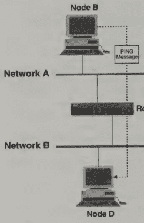

ping命令的另一种形式提供了许多选项，用于控制附加功能。表 4.9 列出了可用的最常用命令行选项。

### 表 4.9 ping命令选项 / Table 4.9 ping command options

| 选项 / Option | 说明 / Description |
| :--- | :--- |
| -c | 只发送特定数量的数据包 / 仅发送指定数量的数据包 |
| -f | 用数据包淹没网络 / 用数据包淹没网络 |
| -i | 在每次请求之间延迟秒数 / 延迟每次请求之间的秒数 |
| -n | 显示网络地址 / 显示网络地址 |
| -P | 指定最多16字节用于填充包含自定义数据的包 / 指定最多 16 字节以自定义数据填充包 |
| -Q | 安静模式 / 安静模式 |
| -R | 切换记录路由选项 / 切换记录路由选项 |
| -S | 指定每次请求发送的字节数 / 指定每次请求发送的字节数 |

### 确定网络性能

**ping** 命令可用于测量将消息传输到远程目的地所需的时间以及获取响应所需的时间。这种 **ping** 命令的用法本质上测量了在给定时间点两个设备之间路径的相对性能。它绝不提供设备或它们之间连接的详细分析。相反，它提供了在测量点路径总体状况的一瞥。可以说网络性能就像股市。一天涨，第二天跌。关于波动性的主要区别在于我们是以天为单位还是以毫秒为单位。大量因素可能导致网络性能变化。这些因素包括过度激进地使用网络资源的用户、硬件问题、软件配置问题等。

**ping** 命令也提供了一种确定系统响应时间的方法，但需要更多工作来判断观察到的性能问题是与特定的缓慢系统有关，还是其他网络组件的延迟有关。**ping** 工具显示的输出可用于测量和报告往返时间并提供丢包统计。默认情况下，**ping** 每秒向命令行指定的目标发出一个 ICMP 请求，并报告每个 ICMP 回复的状态。示例输出包括以下内容：

```bash
# ping didymus
PING didymus-gw2.home.com (10.0.2.127): 56 data bytes
```

```
64 bytes from 10.0.2.127: icmp_seq=0 ttl=255 time=1.2 ms
64 bytes from 10.0.2.127: icmp_seq=1 ttl=255 time=1.2 ms
64 bytes from 10.0.2.127: icmp_seq=2 ttl=255 time=1.2 ms
64 bytes from 10.0.2.127: icmp_seq=3 ttl=255 time=1.2 ms

--- didymus-gw2.home.com ping statistics ---
4 packets transmitted, 4 packets received, 0% packet loss
round-trip min/avg/max = 1.1/1.1/1.2 ms
```

此报告提供了数据包大小、目标设备的主机名或 IP 地址、序列号、往返时间值和统计摘要。时间值显示了每个接收到的回复的往返时间（毫秒，即千分之一秒）。报告底部计算了所有回复的最小、平均和最大行程时间，也以毫秒显示。发送给 didymus 的 ICMP 数据包总长度为 64 字节。这是默认大小，通常足够。但是，可能需要增加数据包大小以获得更好的吞吐量度量。在这种情况下，可以使用 `-s` 命令行选项指定较大的数据包大小。例如，命令：

```bash
# ping -s 100 didymus
```

向目标主机 didymus 发送数据包大小为 100 字节的 ICMP 请求。这可能是获得更好性能图景所必需的，因为网络吞吐量对于较大数据包与较小数据包可能不同。执行后，此命令显示如下：

```
PING didymus-gw2.home.com (10.0.2.127): 100 data bytes
108 bytes from 10.0.2.127: icmp_seq=0 ttl=255 time=2.7 ms
108 bytes from 10.0.2.127: icmp_seq=1 ttl=255 time=1.5 ms
108 bytes from 10.0.2.127: icmp_seq=2 ttl=255 time=1.3 ms
108 bytes from 10.0.2.127: icmp_seq=3 ttl=255 time=1.3 ms
108 bytes from 10.0.2.127: icmp_seq=4 ttl=255 time=1.3 ms
108 bytes from 10.0.2.127: icmp_seq=5 ttl=255 time=1.3 ms
108 bytes from 10.0.2.127: icmp_seq=6 ttl=255 time=1.3 ms
108 bytes from 10.0.2.127: icmp_seq=7 ttl=255 time=1.3 ms

--- didymus-gw2.home.com ping statistics ---
8 packets transmitted, 8 packets received, 0% packet loss
round-trip min/avg/max = 1.3/1.5/2.7 ms
```

正如你从输出中看到的，**ping** 为每个发送的数据包增加了 8 字节的开销；这是通过从 **ping** 传输的 108 字节中减去用 `-s` 选项指定的 100 字节确定的。请注意，尽管我们使用了较大的数据大小，响应时间变化不大。我们需要显著增加大小才能观察到处理数据包的更大延迟。

你可能注意到命令行使用了主机名 *didymus*，但当 **ping** 回显主机名时，显示了不同的名称，如 `didymus-gw2.home.com`。原因是 *didymus* 是 `didymus-gw2.home.com` 的别名，在许多 UNIX 命令中使用别名会导致返回官方名称。该别名是在 `/etc/hosts` 文件中创建的。

**ping** 工具使用序列号来跟踪请求和回复。每个请求按顺序获得下一个编号，然后与相应的回复匹配。如果任何请求未收到适当的回复，此序列用于确定丢包。一般来说，小网络上的丢包应该非常罕见，如果发生，可能表明存在网络或系统相关问题。然而，在大型网络或互联网（小写 *i* 的 internet）或 Internet 上，丢包很常见，属于正常现象。对于如下所示的热门 Internet 站点，可能会观察到一定量的丢包：

```bash
ping -c 10 www.whitehouse.gov
PING www.whitehouse.com (209.67.27.247): 56 data bytes
64 bytes from 209.67.27.247: icmp_seq=7 ttl=244 time=240.1 ms
64 bytes from 209.67.27.247: icmp_seq=8 ttl=244 time=240.1 ms
64 bytes from 209.67.27.247: icmp_seq=9 ttl=244 time=240.1 ms

--- www.whitehouse.com ping statistics ---
10 packets transmitted, 3 packets received, 70% packet loss
round-trip min/avg/max = 240.1/240.1/240.1 ms
```

上面的报告表明，发送到 `www.whitehouse.gov` 系统的数据包中有 70% 没有收到相应的回复！它们丢失了。换句话说，我们发送了十个数据包，但只收到了三个回复；十个中有七个就是 70%。一个可能的原因

导致这种明显丢包的原因是，一些关键的互联网路由器可能非常繁忙，甚至因网络流量而过载。因此，一些 ICMP 请求可能会被丢弃，因为这些请求在被传送到最终目的地之前就已过期。此外，目标设备的相对负载也可能是一个因素，因为这些系统可能没有足够的计算资源来按要求响应所有网络请求。由于该站点很受欢迎，认为连接它们的服务器和网络都非常繁忙甚至过载，这并不无道理。当太多用户同时使用系统资源时，就会发生过载状况。

有时最好为确认每个 **ping** 请求提供额外时间，而不是使用默认的一秒值。如果希望在连续的 ICMP 请求之间增加额外时间，可以使用 `-i` 选项，后跟所需的值。间隔应足够长，以提供远程系统响应所需的时间。当我们按建议增加超时值时，通常会注意到丢包减少。该命令

```
ping -c 10 www.whitehouse.gov -i 5
```

给每个请求增加五秒的延迟，从而为请求通过网络并到达目标服务器的处理提供额外时间。使用上述命令，产生了以下输出：

```
PING www.whitehouse.com (209.67.27.247): 56 data bytes
64 bytes from 209.67.27.247: icmp_seq=1 ttl=244 time=240.1 ms
64 bytes from 209.67.27.247: icmp_seq=2 ttl=244 time=240.1 ms
64 bytes from 209.67.27.247: icmp_seq=3 ttl=244 time=240.0 ms
64 bytes from 209.67.27.247: icmp_seq=4 ttl=244 time=240.0 ms
64 bytes from 209.67.27.247: icmp_seq=5 ttl=244 time=250.1 ms
64 bytes from 209.67.27.247: icmp_seq=6 ttl=244 time=240.1 ms
64 bytes from 209.67.27.247: icmp_seq=7 ttl=244 time=240.1 ms
64 bytes from 209.67.27.247: icmp_seq=8 ttl=244 time=240.2 ms
64 bytes from 209.67.27.247: icmp_seq=9 ttl=244 time=250.1 ms

--- www.whitehouse.com ping statistics ---
10 packets transmitted, 9 packets received, 10% packet loss
round-trip min/avg/max = 240.0/242.3/250.1 ms
```

从输出可以看出，到该站点的丢包率降低到了 10%。请记住，其他因素也可能导致了这种减少，例如用户离开该站点或网络未被使用。一般来说，增加每个请求的时间应该会降低系统的整体负载。然而，这并不能保证总是有效，因为系统可能过载到即使增加再多时间也无济于事的地步。

### 杂项选项

使用 `-n` 选项时，ping 会显示 IP 地址而不是主机名。例如，当涉及 DNS 的网络问题影响 ping 的使用时，这很有用。此选项指示 ping 不调用主机名解析，从而允许该工具在名称服务缓慢或暂时禁用时仍能运行。

`-R` 选项启用 IP 协议的记录路由选项。开启记录路由会通知路径上的每个路由器将其 IP 地址放入 IP 头部。因此，可以获得用于到达最终目的地的路由器列表。这是 traceroute 命令利用的主要机制。本工具将在本章后面介绍。另一个有趣的选项是使用 `-f` 选项的洪水模式。此选项告诉 ping 尝试每秒约 100 次或以远程目的地能处理每个请求的速度，用 ICMP 请求淹没网络。

顺便说一句，这里需要提个醒；`-f` 选项可能很危险。它会消耗大量网络带宽，并导致系统因网络而受损，因为它们负载过重，无法响应其他网络请求。当连接丢失可能影响使用网络的个人的业务操作时，不建议在生产网络上使用此选项。此外，向你无关联的其他网络发起洪水攻击是不合理的。说了这么多，该命令

```
ping -c 100 -f durer
```

显示以下输出：

```
PING durer.home.com (10.0.2.10): 56 data bytes
.........
--- durer.home.com ping statistics ---
1015 packets transmitted, 1000 packets received, 1% packet loss
round-trip min/avg/max = 1.0/14.3/121.0 ms
```

与标准输出不同的第一件事是显示了一系列点 (..........)。这表明 ping 已收到发送给 durer 的请求的响应。其次，请注意，在发送的 1015 个数据包中，只收到了 1000 个数据包。然而 ping 仅报告了 1% 的丢包率。实际上，丢包率接近 1.5%。ping 命令仅报告整数，不报告小数点右边的数字。在这种情况下，问题不大，因为如果必要，我们可以手动确定更准确的丢包率。然而，这在一定程度上是无关紧要的，因为 ping 工具并不真正被认为是测量网络数据丢失或吞吐量最科学和/或经验性的方法。

对许多人来说，重要的问题可能是，“为什么要使用洪水功能呢？”原因很简单：尝试在网络上产生大量流量，看看会发生什么。你会发现，在网络领域，确定事物如何工作有时包括尝试破坏事物，或以超出设备或系统实际限制的方式做事。对于路由器等网络设备，行业专家和用户想知道如果设备暴露在高流量模式下会发生什么。在网络承受巨大负载时测量性能和其他网络特性，将帮助网络管理员真正了解关键网络设备和系统在部署到其网络时的行为。洪水选项是实现这一点的一种简单方法。

最后一个有趣的 ping 选项是安静模式。此选项 `-q` 用于限制通常会产生的输出量。该命令

```
ping -c 100 dudyamos
```

将产生大量行（超过 100 行），代表每个请求和相关的回复。使用 `-q` 选项时，只显示几行；开头和摘要：

```
ping -c -q 100 didymus
PING didymus-gw2.home.com (10.0.2.127): 56 data bytes
--- didymus-gw2.home.com ping statistics ---
100 packets transmitted, 100 packets received, 0% packet loss
round-trip min/avg/max = 1.1/1.1/2.5 ms
```

显然，此选项减少了输出，当 **ping** 在脚本中使用时，这可能正是所需的。

## Tcpdump 工具

### 一般描述

**tcpdump** 命令是一个通用的网络流量监视器，可以捕获并显示数据包及其内容。此命令可用作 *协议分析器*，提供调查系统和网络设备之间通信和/或连接问题的最佳方法之一。大多数情况下，网络故障排除侧重于网络配置问题和诊断硬件相关故障。然而，有时你会面临协议相关的问题，被迫深入特定协议的核心以解决问题。使用 **tcpdump**，扫描的数据包将根据使用的命令行选项，以短格式或长格式显示信息。此外，**tcpdump** 有一个非常强大的过滤机制，可以搜索匹配特定字符串或标准的数据包。

**tcpdump** 提供两种主要捕获模式：*混杂* 和 *非混杂*。在混杂模式下，网络上传输的每个数据包都会被捕获，无论该数据包是否发送给正在执行 **tcpdump** 的系统。例如，这是 RMON 探针在监控网络流量时使用的模式。网络探针监听网络上的流量并收集协议信息和统计数据。因为以太网等局域网 (LAN) 协议基于广播，所以连接到 LAN 的任何网络接口都能看到传输的每一帧。如果设备选择并配置为这样做，任何设备都可以读取传输的每一帧。当设备或接口从网络读取每一帧时，称其处于混杂模式。实际上，接口必须被配置

混杂模式仅用于网络诊断等特殊场合。因此，只有 *root* 才能在接口上启用混杂模式。这是非 root 用户不被允许调用 **tcpdump** 的主要原因。当非 root 用户尝试执行该命令时，将显示以下消息：

```
tcpdump: socket: Operation not permitted
```

如果您想授予普通用户调用 **tcpdump** 命令的权限，可以将该程序 *setuid* 为以 *root* 身份运行，或者安装并配置类似 **sudo** 的程序。**sudo** 实用程序根据系统管理员的判断，授予特定用户访问特权程序的权限。附录 C 包含有关 **sudo** 命令的更多信息。

在非混杂模式下，只有广播帧和发往本地系统的帧可供接口使用。术语 *broadcast* 实际上同时指代普通广播（目标字段全为 1）和多播流量。在正常情况下，接口处于非混杂模式。

当不带命令行选项调用 **tcpdump** 时，它会打开主网络接口，开始捕获本地网络上的帧并显示其内容。由于 **tcpdump** 可能产生大量输出，我们将使用安静选项 (*-q*) 以减少显示的输出量。由 *root* 执行时，命令

```
# tcpdump -q
```

将以单行、非详细格式显示所有网络帧。输出格式将包括时间戳、源和目标主机（或地址）、高层网络协议、一些标志、附加协议信息以及摘要：

```
tcpdump: listening on eth0
15:41:58.056289 durer.home.com.1032 > socrates.home.com.telnet: tcp 0 (0F) [tos0x50]
15:41:58.056446 socrates.home.com.telnet > durer.home.com.1032: tcp 28 (DF)
15:41:58.274933 durer.home.com.1032 > socrates.home.com.telnet: tcp 0 (0F) [tos0x50]
15:41:58.275116 socrates.home.com.telnet > durer.home.com.1032: tcp 164 (DF)
15:41:58.494694 durer.home.com.1032 > sophos.home.com.telnet: tcp 0 (DF) [tos0x50]
15:41:58.494880 sophos.home.com.telnet > durer.home.com.1032: tcp 165 (DF)
15:41:58.544828 sophos.home.com > didymus-gw2.home.com: icmp: echo request
15:41:58.545719 didymus-gw2.home.com > sophos.home.com: icmp: echo reply
15:34:10.601950 sophos.home.com.telnet > durer.home.com.1032: tcp 165 (DF)
```

8 packets received by filter
0 packets dropped by kernel

输出包括时间、源/目的地、协议端口、帧内包含的协议以及附加协议信息。在本例中，源主机 *durer* 和目标主机 *socrates* 建立了一个 Telnet 会话。我们可以通过查看目标端口（即 telnet）来判断这一点。默认情况下，**tcpdump** 会持续捕获数据包，直到用户发出 ^c 中断程序。此外，*socrates* 向 *didymus-gw2* 发出了 **ping request**，后者响应了回复。字符串 `>` 表示通信方向。请注意，**tcpdump** 始终将通信路径定向为指向右侧，如上述 ICMP Echo request 所示。为了表示相反方向的通信，**tcpdump** 会交换主机位置（而非指针），如 ICMP Echo reply 条目所示。**tcpdump** 命令以小写显示高层协议，如 **tcp** 和 **icmp**，随后是与该协议相关的更具体信息，可能包括端口、附加协议信息和数据。输出还包括用户终止命令前捕获的数据包数量摘要。

输出末尾包含 **tcpdump** 捕获的数据包数量和丢弃的数据包数量。在本例中，共捕获八个数据包，零个数据包被丢弃。

tcpdump 工具提供大量命令行选项，用于选择捕获模式、控制输出、指定过滤器规范和指定附加操作特性。这些选项按功能分组，包括以下类别：

- 操作模式
- 显示选项
- 数据包过滤选项

### 操作模式选项

这些选项用于控制 **tcpdump** 如何捕获和显示网络流量。可用选项汇总见表 4.10，详细说明如下。

**表 4.10** *tcpdump 操作模式选项*

| 选项 | 说明 |
| --- | --- |
| -c | 捕获指定数量的数据包 |
| -F | 使用文件作为过滤表达式的来源 |
| -i | 使用备用网络接口捕获数据包 |
| -p | 禁用混杂模式捕获 |
| -r | 读取捕获文件而非网络接口 |
| -w | 将原始数据包保存到文件 |

通常，**tcpdump** 将在主网络接口上监听流量。如果系统包含两个或多个同类型接口，主接口通常具有最小的数字标识符。例如，当系统包含两个以太网接口 eth0 和 eth1 时，eth0 被视为主接口。但是，如果您想在其他接口上运行 **tcpdump**，请使用 -i 选项和设备名称指定备用接口。例如，要选择点对点 (ppp) 接口，请使用以下命令：

```
# tcpdump -i ppp0
tcpdump: listening on ppp0
```

如前所述，**tcpdump** 将持续捕获数据包，直到从控制终端输入 ^C（或如果放入后台，则直到进程被 **kill** 命令终止）。如果您想指定捕获的数据包数量，请使用 -c 选项后跟数据包计数值。要从 eth1 接口捕获十个数据包，请使用以下命令：

```
tcpdump -t -q -i eth1 -c 10
tcpdump: listening on eth1
didymus-gw2.home.com > socrates.home.com: icmp: echo request
socrates.home.com > didymus-gw2.home.com: icmp: echo reply
didymus-gw2.home.com > socrates.home.com: icmp: echo reply
socrates.home.com > didymus-gw2.home.com: icmp: echo request
didymus-gw2.home.com > socrates.home.com: icmp: echo reply
socrates.home.com.1032 > switch.home.com.snmp: snmp: udp 44
switch.home.com.snmp > socrates.home.com.1032: udp 111
socrates.home.com.1032 > switch.home.com.snmp: snmp: udp 51
switch.home.com.snmp > socrates.home.com.1032: udp 61
socrates.home.com.1032 > switch.home.com.snmp: snmp: udp 51
switch.home.com.snmp > socrates.home.com.1032: udp 54
socrates.home.com.1032 > switch.home.com.snmp: snmp: udp 51
```

在本例中，**tcpdump** 捕获了 **socrates** 和 **didymus-gw2** 之间的 **ping** 会话，这由前四行检测到。此外，**socrates** 正使用 SNMP 查询名为 **switch** 的设备，这由 SNMP 端口和使用的 UDP 协议表示（其余各行）。我们可以通过计算显示的行数来确认捕获的数据包数量。当意图是监控使用固定数量数据包交换的关键网络事务时，指定捕获的数据包数量非常有用。在 Shell 脚本中监控数据包时，此选项也很有用，因为您无需担心启动 **tcpdump** 后如何停止它。本例中还使用了 -t 选项，该选项移除数据包时间戳信息。

如前所述，**tcpdump** 默认以 **混杂模式** 打开网络接口以捕获所有网络流量。混杂模式意味着无论数据包的目标如何，所有网络流量都将被 **tcpdump** 捕获。有时，检查发送给指定主机的数据包比读取网络上的所有数据包更有效。如果我们想捕获发送给运行 **tcpdump** 的主机的那些数据包，则使用 -p 选项禁用混杂模式捕获。稍后您将看到，我们可以使用过滤器告诉 **tcpdump** 捕获来自或发往特定主机的数据包。


遗憾的是，`tcpdump` 命令无法确认是否使用了 `-p` 选项。因此，用户在命令执行后无法知道它正以哪种模式进行捕获，除非检查输出以查看目标地址。换句话说，任何不是广播或发送给本地地址的数据包，都表明 `tcpdump` 已启用混杂模式进行捕获。无论如何，为什么要用这个选项禁用混杂模式呢？有时有必要仅检查正常到达特定系统的流量。使用此选项，我们可以看到发往本地系统的每个数据包，而不再有其他内容。这可用于轻松检测（通过监控传入数据包），例如，对特定服务的请求是否到达了该系统。在客户端/服务器环境中，我们可以确定来自客户端系统的请求是否到达了服务器（通过在服务器上运行 `tcpdump`），或者特定客户端首先是否正在发送请求（通过在客户端上运行 `tcpdump`）。诚然，我们可以使用过滤器完成同样的事情，但首先减少数据包数量会更高效、更容易。

在非常活跃的网络或繁忙的系统上，以及使用某些命令行选项时，`tcpdump` 会产生大量输出。为了帮助管理此问题，可以使用 `-w` 选项将捕获的信息重定向到文件中。使用文件的一个原因是为了保存捕获的数据，以便稍后进行检查和分析。这可能包括以其他方式处理数据，可能利用数据构建专用报告等。

要捕获网络流量并将其保存到名为 `traffic-data` 的文件中，请使用以下命令：

```bash
# tcpdump -w traffic-data
tcpdump: listening on eth0
```

一旦调用上述命令，文件 `traffic-data` 就会在本地目录中创建。然而，捕获的数据直到用户中断程序或使用了 `-c` 选项时才会写入文件。用户执行此操作后，将显示以下内容：

```
48 packets received by filter
0 packets dropped by kernel
```

请注意，创建的文件不是普通文本文件，而是一种特殊格式的数据文件，只有 **tcpdump** 和某些其他程序能理解。其中一个名为 **tcpslice** 的程序，可以剪切或拼接不同的 **tcpdump** 文件。

要了解更多关于 **tcpdump** 文件的信息，请使用 UNIX `file` 命令。如果针对 `traffic-data` 文件运行此命令，它会报告该文件与 **tcpdump** 命令相关联、软件版本，以及数据包含类型为以太网、帧长度为 68 字节的数据包。它不是人类可读的文本文件。UNIX 命令

```bash
# file traffic-data
```

显示如下：

```
traffic-data: tcpdump capture file (little-endian) - version 2.4
(Ethernet, capture length 68)
```

如前所述，**tcpdump** 标记数据文件中包含的帧类型，这很有趣。在前面的示例中，标签表明该文件中存储了以太网帧。其他类型包括 `raw IP`、`FDDI` 等。因此，如果在点对点链路上进行数据包捕获（如在 `ppp0` 接口上），则会显示 `raw IP` 数据包类型。

如果你尝试查看该文件，它将显示为一长串奇怪的字符。然而，该文件可以被 `ethereal` 程序读取，该程序提供了一种基于 GUI 的协议捕获和分析方法。下一章将讨论该工具。

**tcpdump** 命令在压缩存储在文件中的数据方面做得相当不错。例如，超过 3,000 个数据包大约消耗 260K 的磁盘空间。如果你要保存大量捕获的数据，可能需要使用 **compress** 或 **gzip** 进一步压缩数据。`compress` 实用程序设法将此数据文件的大小减少到略高于 33K，而 `gzip` 程序将字节数进一步减少到略高于 18K。从超过 260K 的字节大小来看，这很不錯！

要显示已保存在数据文件中的数据包，请使用 `-r` 选项，后跟数据包捕获文件的名称。例如，要重放 `traffic-data` 文件中保存的数据包，请发出以下命令：

```bash
# tcpdump -r traffic-data
```

### 显示选项

这些选项控制 tcpdump 如何显示来自网络的数据包。此类别下可用选项的列表汇总在表 4.11 中，并在下面详细描述。

### 表 4.11 TCPDUMP 显示选项

| 选项 | 说明 |
|--------|-------------|
| -e     | 在每行打印链路层头部信息 |
| -v     | 指定详细模式 |
| -q     | 指定快速模式，显示简短的数据包信息 |
| -t     | 禁用时间戳的打印 |
| -s     | 限制捕获数据包的大小 |
| -X     | 同时以十六进制和 ASCII 格式显示 |

有时确定数据链路帧的长度很有用。例如，在调查与高层应用程序相关的性能问题时，这会有所帮助。tcpdump 工具提供了一种获取每个帧大小（包括头部和数据部分）的方法，即使用 `-e` 命令行选项。以下示例命令和输出显示了一个使用 FTP 和 ARP 广播的文件传输会话：

```bash
# tcpdump -t -e
0:10:5a:28:5d:7c Broadcast arp 42: arp who-has didymus.gw2.home.com tell socrates.home.com
0:10:5a:28:5d:7c Broadcast arp 42: arp who-has didymus-gw2.home.com tell socrates.home.com
0:10:5a:28:5d:7c Broadcast arp 42: arp who-has didymus-gw2.home.com tell socrates.home.com
0:10:5a:28:5d:7c 0:60:97:ea:36:1514: socrates.home.com.ftp->data durer.home.com.1036: tcp 1448 [DF] [tos 0x8]
0:10:5a:28:5d:7c 0:60:97:e:a3:6 1514: socrates.home.com.ftp-data durer.home.com.1036: tcp 1448 [DF] [tos 0x8]
```

正如你所见，长度字段显示在协议旁边，如果未显示协议，则显示在目标地址之后。它以字节为单位显示帧的总大小。从 socrates 到 durer 的数据包大于 1500 字节的原因是因为 FTP 尽可能用数据填充数据包。以太网的数据容量约为 1500 字节，不包括帧的头部部分。

`-x` 选项提供了一种以十六进制转储网络帧的方法。它显示链路层头部信息，如源地址和目的地址。考虑主机 rembrandt 尝试打开到名为 durer 的系统的 FTP 会话时的一系列数据包交换。tcpdump 命令：

```bash
tcpdump -i eth1 -x 'tcp and port 21'
```

将捕获网络上的任何 FTP 活动。执行此命令并启动 FTP 会话时，数据包将被捕获并显示如下。

```
0:60:97:e:a3:6 0:10:5a:28:5d:7c ip 78: durer.home.com.1044 > socrates.home.com.ftp: tcp: S 9262138:9262138(0) win 8192 <mss 1460,nop,wscale 0,nop,nop,timestamp[|tcp]> (DF) [tos 0x1d] (ttl 128, id 19970)

451d 0040 4e02 4000 8006 93c6 0a00 020a
0000 02c9 0414 0015 008d 543a 0000 0000
b002 2000 a43e 0000 0204 0584 0103 0300
0101 808a 0000

0:10:5a:28:5d:7c 0:60:97:e:a3:6 ip 74: socrates.home.com.ftp > durer.home.com.1044: S 1087677057:1087677057(0) ack 9262139 win 32120 <mss 1460,sackOK,timestamp> 1106589[|tcp]> (DF) [ttl 64, id 490]

4500 003c 01ea 4000 4006 6000 0a00 02c9
0a00 020a 0015 0414 40d4 a281 088d 543b
a012 7a78 92b7 4000 0204 0584 0a02 080a
0010 e29d 0000

0:60:97:e:a3:6 0:10:5a:28:5d:7c ip 66: durer.home.com.1044 > socrates.home.com.ftp: ack 1 win 8760 <nop,nop,timestamp 84320 1106589> (DF) [tos 0x1d] (ttl 128, id 20226)

451d 0034 4f02 4000 8006 92d2 0a00 020a
0a00 02c9 0414 0015 008d 543b 40d4 a282
```


### 使用数据包过滤器

网络协议调试的一个非常重要的方面涉及数据包过滤器的使用。数据包过滤器是一种预定义的模式，它与传入的数据包进行比较，并由一个或多个基元组成的系列构成，这些基元可以与 and、or 和 not 等操作符结合使用。当模式匹配时，该数据包将被捕获并显示；否则，数据包将被丢弃且不显示。数据包过滤器在搜索特定协议类型或数据包内可用的任何其他特定信息时非常有用。

我们在前面的示例中首次使用了数据包过滤器，通过告诉 tcpdump 我们对显示与文件传输相关的数据包感兴趣。

tcpdump 命令支持用户定义的数据包过滤器。当在命令行上给出过滤表达式时，tcpdump 会安装一个过滤器。此过滤器被放置在内存中，并将根据使用关键字和基元定义的规则进行过滤。每个数据包都会与过滤器进行比较，当找到匹配项时，显示该数据包。否则，丢弃该数据包。图 4.2 显示了数据包过滤器的高层概览。

通常，网络数据包由内核代表的关联驱动程序从网络接口读取。接下来，tcpdump 使用系统调用从内核请求信息。tcpdump 工具提供了大量预定义的表达式或基元，可用于构建功能强大的数据包过滤器。这些表达式可分为三组。第一组称为地址基元，使用 IP 或数据链路地址等地址信息对数据包进行操作；第二组称为协议基元，对使用包括 IP、AppleTalk 在内的不同协议的数据包进行操作。最后一组包括布尔和算术基元（或操作符），它们可与前两种表达式类型结合使用以生成复合过滤器。复合过滤器包含由 and、not 和 or 等保留字分隔的多种表达式类型。这些过滤器还可以包含 +、-、* 等算术操作符。这些表达式的求值结果为真或假，结果将决定 tcpdump 将采取什么操作。基元的说明如下。

### 地址基元

作用于数据包地址部分的表达式列在表 4.12 中，并在下面进行更详细的描述。

| 基元 | 说明 |
|-----------|-------------|
| gateway | 选择由指定主机作为网关转发的数据包 |
| host | 选择来自指定主机的数据包 |
| ipaddr etheraddr | 选择来自 IP 地址或数据链路地址的数据包 |
| broadcast | 选择在源字段或目标字段中包含全 1 或全 F 的广播数据包 |
| multicast | 选择发送到多播地址的数据包 |
| net | 选择包含与 IP 协议一起使用的指定网络部分的数据包 |
| port | 选择包含与 IP 协议一起使用的指定端口地址的数据包 |

gateway 基元选择由路由器转发的数据包。这表明数据包的数据链路地址（源或目标）与路由器的地址匹配，而 IP 地址与主机的地址匹配。通常，路由器在转发数据包时不会更改 IP 地址信息，但数据链路地址将匹配转发数据包的设备。

host 基元后跟有效主机名，可选择发送到或从指定主机名接收的数据包。host 关键字主要用于避免歧义，如果指定的主机名恰好与 tcpdump 现有关键字之一相同，就会出现这种歧义。例如，监控名为 gateway 的主机时，必须使用 host 关键字，因为 gateway 关键字将被解释为关键字，而不是有效主机名。因此，列出的 tcpdump 命令会产生错误，因为 gateway 字符串被假定为指定本地网关：

```
# tcpdump gateway
tcpdump: hostname required:
```

指定捕获名为 cisco-gw2 的主机的数据包的方法如下：

```
# tcpdump host cisco-gw2
```

ipaddr 和 etheraddr 选项分别以点分和冒号格式指定实际的 IP 地址和数据链路地址。例如，要捕获来自 IP 地址 10.0.2.100 的所有数据包，将使用以下命令：

```
# tcpdump ipaddr 10.0.2.100
```

ipaddr 和 etheraddr 基元将匹配源地址或目标地址。某些数据链路地址以字母开头，会导致 tcpdump 将其误认为是主机名而非真实地址。为避免此问题，在指定这些类型的地址时，在前面插入一个零。

要捕获广播数据包，请使用 broadcast 基元。广播是一种特殊地址，指示所有设备都应接收该消息。ARP、NIS 和 RIP 等多种网络协议和服务使用广播在网络中传播信息。使用 broadcast 将导致从数据链路层捕获广播数据包。这意味着源字段或目标字段中包含 255 或 FF 值的任何地址都将被捕获。这包括包含广播的数据链路数据包（如 ARP 请求）和高层协议广播（如 IP 广播）。此基元可用于捕获路由信息协议 (RIP) 的路由数据，因为路由器会定期广播路由更新。

此外，要获取 Internet 广播等多播流量，请使用 multicast 基元。标准多播地址 224.0.0.1 支持这种类型的流量，这是由多播标准定义的。您站点上可以使用其他地址（物理或 IP 地址均可）。在开始过滤这些类型的数据包之前，可能需要确定确切的多播地址。

### 协议基元

tcpdump 应用程序提供协议基元，作为选择特定网络流量的简写方式，而无需了解或要求低层协议信息。例如，ip 基元可用于捕获所有 IP 流量。如果没有此关键字，您将需要使用 0x0800 这种 IP 类型，这更难记忆。这些基元支持 TCP/IP、AppleTalk 和


DECnet 协议族。表 4.13 列出并描述了这些协议关键字。

## 表 4.13 协议原语

| **原语** | **描述** |
| :--- | :--- |
| *apple* | AppleTalk 协议族 |
| *arp* | 地址解析协议——包括请求和回复 |
| *fddi* | FDDI 数据链路协议 |
| *ethertype* | 另一种协议类型（与*类型代码*配合使用） |
| *decnet* | DECnet 协议族 |
| *ip* | 网际协议 |
| *icmp* | 网际控制消息协议——包括回显请求和回显回复 |
| *rarp* | 逆地址解析协议——包括请求和回复 |
| *tcp* | 传输控制协议 |
| *udp* | 用户数据报协议 |

要选择 **tcpdump** 未直接提供的协议族或类型，请使用 *ethertype* 原语以及所需协议的类型代码。例如，要监控 Novell NetWare 数据包，其 *type code* 为 `0x8137`，请使用以下命令：

```
# tcpdump ethertype 0x8137
```

请注意，因为 **tcpdump** 不直接支持 Novell 协议族，所以无法显示数据链路层以外的数据包信息。如果 **tcpdump** 发现包含 Novell 头部的数据包，它将仅列出数据链路信息。然而，尽管存在这个缺点，**tcpdump** 仍然可用于识别特定的数据包类型并提供基本的数据包计数信息。

tcpdump 命令支持多种表达式（或运算符）类型，并可与原语和限定符结合以生成复合过滤器。这些表达式包括表 4.14 中列出的算术和布尔运算符。运算符可构建强大的表达式以搜索特定数据包。表达式可由数字、数据包字段选择、长度原语和算术运算符组成。要在数据包中使用表达式内字段的值，请使用以下语法：

```
primitive [offset [: size]]
```

其中 *primitive* 一词替换为 *ether*、*ip*、*udp*、*tcp* 或 *icmp*。*offset* 用于协议原语的基址，而 *size* 指定字段的长度。如果未提供，则默认为 1。

数据包字段部分可用于多种方式。请考虑以下示例：

```
tcpdump "ether[1:4] = 0xffffffff"
```

在此示例中，*tcpdump* 将显示在本地网络上传输的所有广播数据包——这意味着目标地址全为 1 的所有帧（十进制 255，十六进制 0xff）。*ether*[1:4] 中的 1 表示帧的第一个可寻址字节（目标地址），而 4 指定该字段的长度。尽管以太网地址长度为六字节，但我们可以检查前四个字节以确定是否为广播地址。

## 表 4.14 算术和布尔运算符

| 算术运算符 | 描述 |
| :--- | :--- |
| > | 大于 |
| < | 小于 |
| >= | 大于或等于 |
| <= | 小于或等于 |
| = | 等于 |

### 表 4.14 算术和布尔运算符（续）

| 算术运算符 | 描述 |
| :--- | :--- |
| `!=` | 不等于 |
| `+` | 加 |
| `-` | 减 |
| `*` | 乘 |
| `/` | 除 |
| `&` | 按位与 |
| `|` | 按位或（包含） |
| `^` | 按位异或 |
| **布尔运算符** |  |
| `and or &&` | 逻辑与 |
| `or or ||` | 逻辑或 |
| `not or !` | 逻辑非/取反 |

例如，要显示源自特定 Sun 系统的所有数据包，请使用以下命令：

```
tcpdump "ether[6:4] & 0xffffffff = 0x08002004"
```

这会指示 `tcpdump` 检查帧的第六个字节（源帧地址），并使用 `&`（与）运算符将其与 0x08002004 地址进行比较。此数据链路地址代表名为 `monet` 的本地系统的地址。回想一下，以太网地址长度为六字节，我们可以使用前四个字节来识别所需的系统。因此，将显示所有从 `monet` 发送的数据包。要识别另一个系统，请获取该系统的数据链路地址，将其转换为十六进制，并将其放在前面命令的右侧。

## 杂项原语

`tcpdump` 还提供了其他一些原语，它们无法归类为地址或协议原语。这些包括以下内容：

- *greater*
- *less*
- *length*

*greater* 和 *less* 原语与其他 `tcpdump` 命令结合使用，根据数据包的总长度进行过滤。例如，要显示所有大于 56 字节的数据包，请调用以下命令：

```
# tcpdump greater 56
```

要显示所有小于 60 字节的数据包，请使用 *less* 原语：

```
# tcpdump -x less 60
```

此命令将显示所有小于 60 字节的帧。例如，ARP（地址解析协议）请求帧小于 60 字节。执行此命令将显示任何 ARP 消息，如下所示：

```
tcpdump: listening on eth0
23:45:29.240364 arp who-has durer.home.com tell socrates.home.com
0001 0800 0604 0001 0010 5a28 5d7c 0a00
02c9 0000 0000 0000 0000
```

为什么要使用 *greater* 或 *less* 命令？主要原因是根据大小而不是内容搜索数据包。另一个原语 *length* 也可用于根据确切大小捕获数据包。当捕获数据包的需求基于某些计算时，可以使用 *length*。例如，下面的命令将显示任何不等于 56 的数据包：

```
# tcpdump length != 56
```

## 限定符

可以将三个限定符与前面表格中列出的原语结合使用。限定符可进一步定义搜索特征以精确定位特定网络流量。这些限定符包括以下内容：

- from 或 src
- to 或 dst
- ether

from 和 src 限定符与 host、net、ipaddr、etheraddr、port 或 rpc 原语一起使用，以基于特定目标地址或端口进行过滤。to 或 dst 限定符修改刚才提到的原语，但会导致捕获的数据包发往特定地址或端口。当与 host 原语一起使用时，ether 修饰符将名称解析为数据链路地址。为了说明 host 关键字的用法，假设我们只想捕获来自特定主机的流量。可以使用以下 tcpdump 命令：

```
# tcpdump from host monet
```

将上述命令与以下命令进行对比：

```
# tcpdump host monet
```

在后一个示例中，将显示所有涉及 monet 的流量，包括发送给 monet 和从 monet 接收的数据包。在前一个示例中，将仅显示从 monet 接收的流量。正如你所见，在尝试隔离网络问题时，这可能会产生很大差异。

## Tcpdump 示例

表 4.15 包含命令示例列表及每个示例的相关说明。希望这些命令能为在实际场景中使用 tcpdump 提供快速参考。

## Traceroute 工具

### 一般说明

traceroute 命令检查并记录到指定网络目标的路径。在传统 IP 网络中，使用一个或多个路由器来提供不同 IP 网络之间的连接。IP 路由器有不同的形状和大小，

表 4.15 tcpdump 命令示例

| 命令 | 说明 |
| :------ | :---------- |
| tcpdump host barney | 将捕获并显示发送自或发往名为 `barney` 的系统的流量。此命令检查 IP 头部的源地址和目标地址字段 |
| tcpdump host not barney | 将捕获并显示网络上除名为 `barney` 的系统以外的所有主机的流量 |
| tcpdump host barney and host fred and \(not pebbles\) | 将捕获并显示来自主机 `barney` 和 `fred` 的流量，但不包括名为 `pebbles` 的系统。添加括号是为了使命令更具可读性。然而，每个 `tcpdump` 算术和布尔运算符都有优先级，括号可用于定义命令解释顺序。注意：由于括号对某些 Shell 具有特殊含义，因此必须使用反斜杠 (\) 进行转义 |
| tcpdump arp | 将捕获并显示所有地址解析协议 (ARP) 数据包。这包括请求和回复 |
| tcpdump host durer and tcp | 将捕获并显示来自/发往主机 `durer` 的所有传输控制协议 (TCP) 数据包 |
| tcpdump host vectra and port 23 | 将捕获并显示来自或发往主机 `vectra` 的所有使用端口 23 的数据包。这相当于检查从网络上其他系统发往该系统的所有 Telnet 数据包。回想一下，端口 23 是所有传入数据包的 Telnet 服务端口 |
| tcpdump ether multicast | 将捕获并显示组播数据包。替代命令见下一条 |


## 表 4.15 tcpdump 命令示例（续）

| 命令 | 说明 |
| --- |
| tcpdump 'ip[16] >= 224' | 将捕获并显示所有使用多播地址的数据包。此命令将 IP 数据包的第十六个字节（即目标地址）与值 224 进行比较。这是标准多播地址 224.0.0.1 的前缀，表示默认多播组内的所有主机 |
| tcpdump 'ether[0] & 1 = 1' | 将捕获并显示所有广播数据包。序列 ether[0] 提供对以太网数据链路目标字段的第一个字段的访问，并将其与值 1 进行比较。如果目标字段包含全 1（如果广播地址用二进制表示，这将为真），并且当与（&）运算符应用于正值时，将产生值 1。在这种情况下，表达式为真，并显示数据包 |
| tcpdump 'ip[2:2] > 512' | 将捕获并显示所有大于 512 字节的 IP 数据包。序列 ip[2:2] 标识 IP 头部的第二个字节（即数据包的大小），并将此值与 512 进行比较。2: 表示 IP 头部的偏移量，而剩余的 2 表示该字段内的字节数 |

从具有两个接口的简单多宿主 UNIX 系统，到包含大量接口的工业级 Cisco 路由器系列。在所有这些情况下，路由功能主要是相同的；它根据建立的路由信息将 IP 数据包从一个接口转发到另一个接口。**traceroute** 命令使用 IP 数据包中包含的生存时间 (TTL) 字段，并尝试从通往目标的路径上的每个主机获取 ICMP TIME_EXCEEDED（超时）消息。结合尝试连接到目标的不可达端口，它将导致沿路径到最终目的地的每个路由器都做出系统性响应。它通过发送 TTL 为 1 的请求（或探测包）并将 TTL 每次增加 1 来完成此任务，直到到达目标主机或超过最大 TTL 值。默认情况下，TTL 设置为 30 跳，但这可以更改。

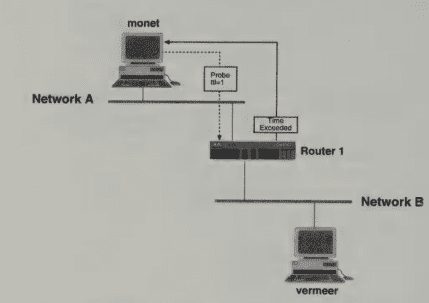

此命令有大量的命令行选项，但唯一必需的参数是目标的主机名或 IP 地址。例如，要显示运行 traceroute 的本地系统与名为 vermeer 的目标系统之间的 IP 路径，请发出以下命令：

```
# traceroute vermeer
```

图 4.3 和 4.4 显示了一个由一个路由器和两个网络节点组成的示例网络。当在 monet 上执行上述 traceroute 命令时，将显示以下输出：

```
# traceroute vermeer
traceroute to vermeer (128.197.2.200), 30 hops max, 40 byte packets
```

```
1 router-1 (10.0.2.129) 4.256 ms * 2.899 ms
2 vermeer (128.197.2.200) 7.340 ms 7.433 ms 7.526 ms
```

默认情况下，**traceroute** 向每一跳总共发送三个探测包，每个探测包具有不同的 TTL 值。输出的第一行包括目标及其 IP 地址、**traceroute** 使用的默认跳数以及发送的数据包大小。第二行（带有 1）显示 **traceroute** 遇到的第一跳（见图 4.3）。

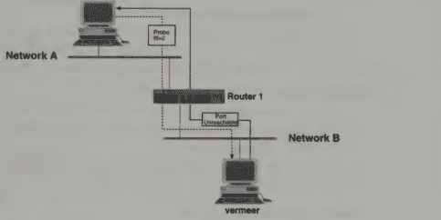

图 4.4 两跳的 traceroute。

因为 *vermeer* 与 *monet* 在不同的物理网络上，所以必须使用路由器才能到达该系统。因为此示例中的默认路由器是 *router-1*，所以第一个数据包被发送到那里。发送的第一个数据包是 TTL 字段设置为 1 的 ICMP 请求数据包。在 IP 中，任何到达路由器的数据包都会将 TTL 减 1，使其变为零。当路由器收到一个 TTL 为零的数据包时，它应该丢弃该数据包并通知发送方。这迫使路由器向 *monet* 发回一条 TIME_EXCEEDED 消息。发生这种情况后，**traceroute** 会测量发送数据包和收到回复之间的时间量。这被称为*往返时间*或 RTT，以毫秒（千分之一秒）为单位显示，如主机名和 IP 地址信息后所示。这意味着第一组探测包的 RTT 耗时 4.25 毫秒（或 0.004 秒），第三组耗时 2.89 毫秒（或 0.028 秒）。

第二行详细描述了第二个路由跳，并显示 **traceroute** 到达了目标系统 *vermeer*，其 RTT 时间比第一跳慢（见图 4.4）。当发送第二个探测包时，路由器将 TTL 减 1，然后将该数据包传递给 *vermeer*。因为 **traceroute** 尝试访问一个未使用的端口，所以 *vermeer* 返回 PORT UNREACHABLE（端口不可达）错误。事实上，作为大型（有时也是小型）互联网上的一般规则，系统和网络之间的性能甚至可以在瞬间发生显著变化。

对于什么构成目标没有限制；它可以是从简单的主机系统到互联网路由器的任何类型的设备。唯一的要求是它必须支持 IP。

## 读取 traceroute 输出

由于沿特定路径的路由器设备存在变化和问题，网络路由的总体波动可能导致不可预测和奇怪的 **traceroute** 输出。结果，在显示计时信息后可能会出现某些代码。表 4.16 列出了这些代码及其相关含义。

## 表 4.16 traceroute 显示代码

| 代码 | 含义 |
|:-----|:----------|
| * | 探测包无响应 |
| ! | 接收到的数据包中的 TTL 设置为 1 |
| !H | 目标主机不可达 |
| !N | 目标网络不可达 |
| !P | 目标协议不可达 |
| !S | 源路由选项失败。在实践中，这不应该发生，如果发生了，则表明生成该错误的路由器存在 bug 或问题 |

表 4.16 traceroute 显示代码（续）

| 代码 | 含义 |
| :--- | :--- |
| 1F | 探测包需要分片。在实践中，这不应该发生，如果发生了，则表明生成该错误的路由器存在 bug 或问题 |
| 1X | 由于通信被管理上禁用，路径被阻断。换句话说，从软件角度来看，路径被关闭或阻断 |
| 1N> | ICMP 错误代码，其中 N 为该数字 |

这些显示代码中的一些在调试网络问题时很有用。例如，如果运行 **traceroute** 命令的系统无法到达某个目标（如 www.whitehouse.gov），执行

```
monet# traceroute www.whitehouse.gov
```

将产生

```
traceroute to www.whitehouse.gov (198.137.240.91), 30 hops max, 40
byte packets
1  monet (10.0.2.126)  4.281 ms 1N*  1.896 ms 1N
```

在此示例中，本地系统无法到达网络 198.137.240，而 **traceroute** 显示错误字符串 1N 以指示此问题。在此特定情况下，monet 无法向 198.137.240 发送任何数据包，因为不存在到该网络的路由。* 表示特定的探测包从未收到响应；* 用作超时指示符。要进一步验证这些结果，请对同一目标使用 ping 命令。因此该命令

```
monet# ping www.whitehouse.gov
```

将显示相同的问题，只不过错误描述稍微详细一些：

```
ICMP Net Unreachable from gateway monet (10.0.2.126)
for icmp from monet (10.0.2.126) to www.whitehouse.gov
```

同样，!H 和 !P 错误代码也用于调试一般网络问题。然而，在这两种情况下，!H 报告主机不可达，而 !P 报告协议不可达。例如，当网络也不可达时，将显示主机不可达消息。鉴于在任何时间点，网络和系统之间的性能或 RTT 都可能发生显著变化，对卢浮宫博物馆网站的追踪首先显示如下：

```
# traceroute 198.137.240.91
traceroute to 198.137.240.91 (198.137.240.91), 30 hops max, 40 byte
packets
 1 10.0.2.76 (10.0.2.76) 19.906 ms 9.801 ms 8.174 ms
 2 199.70.195.38 (199.70.195.38) 197.460 ms 188.000 ms 181.029 ms
 3 12.77.194.1 (12.77.194.1) 166.802 ms 184.713 ms 185.857 ms
 4 12.127.12.205 (12.127.12.205) 245.026 ms 270.253 ms 266.718 ms
 5 12.127.15.145 (12.127.15.145) 219.191 ms 211.920 ms 208.979 ms
 6 192.205.31.165 (192.205.31.165) 217.875 ms 232.610 ms 222.274 ms
 7 204.6.117.65 (204.6.117.65) 266.797 ms 239.000 ms 215.671 ms
 8 38.1.4.69 (38.1.4.69) 255.431 ms 225.447 ms 301.119 ms
 9 38.1.25.5 (38.1.25.5) 255.365 ms 236.134 ms 263.557 ms
10 38.1.25.5 (38.1.25.5) 252.172 ms 252.984 ms 252.013 ms
11 38.146.148.45 (38.146.148.45) 241.956 ms 249.524 ms 243.300 ms
12 198.137.240.33 (198.137.240.33) 249.361 ms 228.917 ms 252.927 ms
13 198.137.240.91 (198.137.240.91) 238.799 ms 259.967 ms 236.384 ms
```

稍后重复追踪时，显示如下：

```
# traceroute 198.137.240.91
traceroute to 198.137.240.91 (198.137.240.91), 30 hops max, 40 byte
packets
 1 10.0.2.76 (10.0.2.76) 7.619 ms 5.863 ms 6.206 ms
 2 199.70.195.42 (199.70.195.42) 177.685 ms 177.691 ms 177.842 ms
 3 12.77.242.129 (12.77.242.129) 170.712 ms 177.090 ms 173.517 ms
 4 12.127.12.205 (12.127.12.205) 260.239 ms 248.022 ms 252.829 ms
 5 12.127.15.145 (12.127.15.145) 219.767 ms 215.648 ms 232.399 ms
 6 192.205.31.165 (192.205.31.165) 232.259 ms 225.243 ms 219.236 ms
 7 204.6.117.65 (204.6.117.65) 228.997 ms 218.067 ms 219.365 ms
 8 38.1.4.69 (38.1.4.69) 445.758 ms 232.797 ms 276.249 ms
 9 38.1.25.5 (38.1.25.5) 454.674 ms 443.611 ms 577.309 ms
10 38.1.25.5 (38.1.25.5) 432.994 ms 222.527 ms 242.844 ms
11 38.146.148.45 (38.146.148.45) 257.668 ms 249.923 ms 263.074 ms
12 198.137.240.33 (198.137.240.33) 276.658 ms 242.361 ms *
13 198.137.240.91 (198.137.240.91) 248.266 ms 245.006 ms 251.071 ms
```


## 更改操作特性

`traceroute` 命令包含许多可修改的操作参数，这些参数会影响其追踪到指定目标路径的方式。每个参数都有一个关联的命令行选项，可用于更改其默认值。表 4.17 列出了这些选项。

### 表 4.17 traceroute 操作选项

| 选项 | 说明 |
|---|---|
| `-i` | 指定备用接口 |
| `-p` | 设置发送探测包的备用端口 |
| `-g` | 指定用于松散源路由的路由器 |
| `-f` | 设置要使用的初始 TTL 值 |
| `-S` | 在发送探测包时使用指定地址作为源地址 |
| `-q` | 设置探测查询的数量 |
| `-m` | 设置最大跳数 |
| `-d` | 启用调试标志 (`SO_DEBUG`) |
| `-F` | 指定不分片 |
| `-t` | 设置服务类型 (TOS) 标志 |
| `-w` | 设置探测包的等待时间 |
| `-x` | 指定不计算校验和 |

当在多宿主系统（即包含多个网络接口的系统）上执行 `traceroute` 时，它会选择遇到的第一个接口。不幸的是，这可能不是你想要的，因为你要访问的目标可能只能从另一个接口访问。为解决此问题，可以使用 `-i` 选项强制 **traceroute** 使用该选项指定的接口发送探测包。因此命令

```
traceroute -i hme0
traceroute: Warning: Multiple interfaces found; using 10.0.2.126 @ hme0
```

将导致 **traceroute** 使用快速以太网接口，而不是它通常会使用的 FDDI 接口。

在某些情况下，默认的 TTL 值 30 不足以到达可能包含大量路由的目标。发生这种情况时，**traceroute** 将永远无法到达目标。在这种情况下，请使用 `-m` 选项增加跳数。

当对某些设备执行 **traceroute** 时，有时可能会失败，尽管到该设备的路径是正常的。此外，对该设备使用 **ping** 命令也将指示其工作正常。为什么？在回答这个问题之前，让我们看一个例子：

```
mone1# traceroute -m 5 128.197.2.200
traceroute to 128.197.2.200 (128.197.2.200), 5 hops max, 40 byte packets
1 rodlm (10.0.2.129) 10.193 ms * * 2.158 ms
2 * * *
3 * * *
4 * * *
5 * * *
```

此 **traceroute** 对探测包没有产生任何响应。注意使用 `-m` 选项以保持探测包数量较少。这个问题的答案在于，默认情况下，**traceroute** 基于 UDP 协议发送探测包。相关目标很可能不直接支持此协议，或无法处理所使用的 UDP 目标端口。从 TCP/IP 的角度来看，并非所有设备都必须支持 UDP，即使支持 UDP，也不一定支持 **traceroute** 使用的端口号。

当 **traceroute** 发送探测包时，默认使用 UDP 端口 33434，并假设该端口未被任何其他应用程序或网络服务使用。它使用这个高端口号，希望目标响应端口不可达消息，从而终止路由追踪。另一方面，如果该端口正在被使用，将会给 **traceroute** 造成问题。如果发生这种情况，请使用 `-p` 选项后跟另一个端口号，**traceroute** 将使用该端口而不是默认端口。

```
monet# traceroute -p 10 -m 5 128.197.2.200
traceroute to 128.197.2.200 (128.197.2.200), 5 hops max, 40 byte
packets
1 rodin (10.0.2.129) 10.193 ms * 2.158 ms
2 * * *
3 * * *
4 * * *
5 * * *
```

如果这仍然不起作用，请尝试使用 `-I` 选项，这将指示 **traceroute** 在发送探测包时使用 ICMP 协议而不是 UDP。因此命令

```
monet# traceroute -m 5 -I 128.197.2.200
```

加上 `-I` 选项后产生正确的结果：

```
traceroute to 128.197.2.200 (128.197.2.200), 5 hops max, 40 byte
packets
1 rodin (10.0.2.129) 4.412 ms * 2.335 ms
2 vermeer (128.197.2.200) 6.875 ms 6.955 ms 6.935 ms
```

正如你所见，这需要一点尝试和错误才能获得预期结果。然而，这并非人为编造的例子；**vermeer** 代表一个实际设备：一台激光打印机。这里的关键在于，当追踪到特定目标的路由时，**traceroute** 无法到达目标可能有多种原因。失败并不意味着设备已关机或与网络断开连接。

### 显示选项

有两个选项可用于修改 **traceroute** 的输出。第一个是 `-v`，它显示每一跳的响应包大小和目标。以下显示了一个示例：

```
traceroute -v vermeer
# traceroute -i 1e1 -v rebrandt
traceroute to rebrandt (10.0.2.75), 30 hops max, 40 byte packets
1 rebrandt (10.0.2.75) 56 bytes to 10.0.2.1 3.450 ms 2.085 ms
2.094 ms
```

第二个选项 `-n` 以数字形式显示地址，而不是使用符号名称。这消除了 **traceroute** 必须解析每个路由器主机名的额外任务。

## 其他系统实用程序和工具

本章中的工具将成为迄今为止讨论的软件实用程序和工具集合中受欢迎的补充。

将这些工具单独放在一章中的主要原因是：上一章讨论的命令和程序可在许多不同的 UNIX 系统上使用，但通常属于标准核心调试工具集的一部分。另一方面，本章中的工具不如第 4 章描述的工具那样广为人知。尽管如此，这些工具提供非常重要的服务，并将对诊断网络问题产生重大影响。它们包括：

| 命令 | 页码 |
| :--- | :--- |
| **arpwatch** | 184 |
| **ethereal** | 188 |
| **fping** | 210 |
| **nmap** | 218 |
| **xtraceroute** | 239 |

### Arpwatch 工具

#### 一般说明

**arpwatch** 命令跟踪并报告在本地网络上观察到的数据链路/IP 地址的变化。它还跟踪数据链路/IP 地址对，即以太网到互联网协议 (IP) 地址。由于连接到大多数网络的系统数量显著增长，提供一种机制来记录添加和设备变更变得至关重要。当 **arpwatch** 发现差异时，它会将信息记录到文件并发送电子邮件。

表 5.1 列出了该工具支持的少量命令行选项。

### 表 5.1 arpwatch 命令行选项

| 选项 | 说明 |
|---|---|
| `-d` | 启用调试模式 |
| `-f` | 指定用于存储数据库的备用文件 |
| `-i` | 指定另一个网络接口，覆盖系统上定义的默认接口 |
| `-r` | 解析包含 tcpdump 格式数据的文件以供读取，而不是监控网络 |

最有用的选项之一是 `-i`，它控制 **arpwatch** 在监控网络时将使用的接口。默认情况下，系统启动时最低的主网络接口会被选中由 **arpwatch** 监控。对于拥有多个接口的系统，例如可能是 `eth0`。当 **arpwatch** 检测到数据链路地址发生变化时，它会发出特定的消息报告。生成的消息类型包括：

- 新站点
- 更改的以太网地址
- 翻转
- 新活动

#### 新站点

当在网络上首次发现新系统时，将使用此消息。**arpwatch** 软件将向本地系统上的 *root* 账户发送如下所示的电子邮件：

```
From root Mon Dec 27 13:05:09 1999
Date: Mon, 27 Dec 1999 13:05:09 -0400
From: arpwatch@socrates.home.com (Arpwatch)
To: root@socrates.home.com
Subject: new station

hostname: probe
	ip address: 10.0.2.50
	ethernet address: 0:0:0:d4:9:40
	ethernet vendor: Axxon Networks Inc
	timestamp: Monday, Dec 27, 1999 13:05:08 -0400
```


该邮件包含主机名（如果可用）、IP 地址、以太网地址、以太网厂商以及事件的日期/时间戳。在本例中，本地网络上安装了一个 RMON 探针，**arpwatch** 检测到了这个新设备。此外，一条消息被发送给 syslog 进程，最终会记录到 `/var/log/messages` 文件中。*syslog* 消息的格式与此处显示的邮件格式不同：

> Dec 27 13:05:09 probe arpwatch: new station 10.0.2.50
> 0:c0:d4:0:9:40

显然，了解网络上此类变更非常有用。新站点消息仅在设备首次安装并上电时生成一次。一旦该事件首次被记录，就不会再生成额外消息，即使设备多次重启，或从网络断开后稍后重新连接。只要 **arpwatch** 数据库得到维护和保留，新站点消息将真实指示有新设备添加到了网络。这是在用户未经您明确知晓就向网络添加设备时获知情况的绝佳方式。

## 以太网地址变更

生成此消息是因为 **arpwatch** 检测到设备的数据链路地址已更改，但 IP 地址保持不变。当安装新接口卡以替换故障单元，或数据链路地址因其他原因（甚至故意）更改时，可能会发生这种情况。生成的相关邮件消息包含以下内容：

> From root Fri Dec 24 23:07:43 1999
> 日期: Fri, 24 Dec 1999 23:07:43 -0400
> 发件人: arpwatch@socrates.home.com (Arpwatch)
> 收件人: root@socrates.home.com
> 主题: 以太网地址变更 (switch.home.com)
>
> 主机名: switch.home.com
> IP 地址: 10.0.2.60
> 以太网地址: 0:0:1d:a:5d:1
> 以太网厂商: Cabletron
> 旧以太网地址: 0:0:1d:a:5c:ff
> 旧以太网厂商: Cabletron
> 时间戳: Friday, December 24, 1999 23:07:42 -0400
> 上次时间戳: Thursday, December 23, 1999 21:25:30 -0400
> 增量: 1 day

实际上，此消息并非由于设备安装了新接口而产生。相反，因为该设备是一个多端口 Cabletron 以太网交换机，它包含大量网络接口。由于该设备的网络连接从一个端口移到了另一个端口，arpwatch 检测到了该变化。原始接口的地址为 0:0:1d:a:5c:ff，而新端口的地址为 0:0:1d:a:5d:1。注意，在两种情况下，厂商均被识别为 Cabletron，这是该硬件的正确厂商。为了使报告更有用，显示了经过时间的增量。这表示从 arpwatch 首次记录数据链路/IP 对到端口变更首次发生所经过的时间量。

## 翻转

此消息类型表明提到的主机原本是最近监控的地址，但现在已成为第二常被监控的地址。例如，消息

```
From root Sat Jul 31 14:07:15 1999
Date: Sat, 31 Jul 1999 14:07:15 -0400
From: arpwatch@socrates.home.com (Arpwatch)
To: root@socrates.home.com
Subject: flip flop (durer.home.com)

hostname: durer.home.com
ip address: 10.0.2.10
ethernet address: 0:60:97:e:a3:6
ethernet vendor: 3Com
old ethernet address: 0:0:1d:a:5c:ff
old ethernet vendor: Cabletron
timestamp: Saturday, July 31, 1999 14:07:15 -0400
previous timestamp: Saturday, July 31, 1999 14:06:29 -0400
delta: 46 seconds
```

表明最近看到的主机称为 durer.home.com，其数据链路地址为 0:60:97:e:a3:6，使用 3Com 接口卡。第二常见的地址是数据链路地址为 0:0:1d:a:5c:ff 的 Cabletron 设备。

在发出此消息之前，Cabletron 设备是网络上最活跃的设备。

### 新活动

当在六个月（或更长）的时间内首次看到以太网/IP 地址对时，将生成新的 *Activity* 消息。这对于跟踪因某种原因长期停用或与网络断开连接，而现在重新投入使用或重新连接到网络的设备将很有用。然而，在实践中，由于时间跨度的原因，这可能不是一个非常有意义的消息。相反，如果用户可以自定义时间间隔使其更短，那会更好。不过，在该工具的当前版本中，不支持此功能。

该工具较有趣的功能之一包括解析 **tcpdump** 输出。使用 -r 选项，**arpwatch** 将解析这些特殊格式的文件，建立数据库，并使用前面讨论的监控消息报告网络历史。当需要 **arpwatch** 报告，但由于某些原因 **arpwatch** 无法实时执行以监控网络时，这可能会派上用场。

## Ethereal 工具

### 一般描述

**ethereal** 命令是一个强大的以太网网络监控解决方案，可用于实时或离线模式下捕获和分析网络流量。该工具在 **tcpdump** 结束的地方接续，提供完整的数据包级协议解码，支持许多流行的网络协议，并拥有易于使用的数据包捕获界面。此外，**ethereal** 还支持许多其他商业数据包捕获格式，因此您可以继续使用现有软件并使用 **ethereal** 处理这些数据文件。

该工具提供了一个健壮的 GUI 界面，简化了网络数据的捕获和后续的网络流量浏览。主窗口包含一组菜单项、三个面板，以及底部的三个状态或输入框，如图 5.1 所示。许多菜单项不言自明，不再详细介绍。第一个面板包含所有捕获数据包的摘要。此面板包含数据包编号、时间戳、源、目的、协议和信息字段。正如您稍后在本节中将看到的，这些字段可自定义，用户可以移除或包含额外的数据包字段信息。


- 进度条
- 显示过滤器
- 状态框
- 数据包摘要窗口
- 数据包详情窗口

图 5.1 Ethereal 主窗口。

下一个面板显示分层视图（数据包详情），以树形格式显示所有高层协议。剩余面板包含整个数据包的十六进制显示。当用户通过树视图浏览第二个面板时，底部面板会高亮显示光标在数据包中的位置。主窗口左侧的进度区域显示任务状态，并提供了一个过滤文本框，用于接受第一个面板中显示的数据包的过滤。最后，主窗口右侧的信息框指示数据文件的名称和丢弃的数据包数量。

该软件支持许多重要的命令行选项，可分为两类：显示模式和功能模式选项。显示模式选项可控制各个显示面板的大小、所用字体的类型和大小等项目。表 5.2 列出了显示选项。

表 5.2 ethereal 显示选项
| 选项 | 说明 |
|--------|-------------|
| -B | 控制底部十六进制面板的初始高度 |
| -P | 控制数据包摘要面板的初始高度 |
| -T | 控制数据包树视图面板的初始高度 |
| -b | 使用指定的粗体字体显示数据包字段 |
| -m | 使用指定字体代替默认字体 |
| -t | 设置在摘要数据包面板中显示的数据包时间戳格式 |

功能模式选项控制诸如将使用哪个网络接口读取捕获的流量、数据包捕获期间应读取的数据包最大大小等项目。表 5.3 列出了这些命令选项。

表 5.3 ethereal 功能选项
| 选项 | 说明 |
|--------|-------------|
| -c | 捕获由此选项指定数量的数据包 |
| -h | 显示版本和信息 |
| -i | 指定用于捕获数据包的网络接口 |
| -n | 禁用主机名解析和 TCP/UDP 端口名称映射 |


## 表 5.3 ethereal 功能选项（续）

| 选项 | 说明 |
| :--- | :--- |
| -r | 从指定文件获取网络流量数据 |
| -s | 指定捕获实时网络流量时的默认数据包长度 |
| -w | 指定将数据保存到磁盘时使用的捕获文件 |

许多功能选项与 tcpdump 命令的选项相同，tcpdump 命令已在上一章中介绍过。因此，此时许多选项对读者来说应该已经很熟悉了。尽管如此，-s 选项还需要稍作解释。默认情况下，ethereal 在捕获网络流量时会尝试读取整个数据包。然而，可以使用此选项限制 ethereal 为每个数据包读取的实际字节数。它读取的默认字节长度为 65535，这足以处理 ethereal 可能遇到的大多数（如果不是全部）数据包。控制数据包大小会影响性能、数据存储和数据包分析。

低层网络数据链路协议（如以太网和 FDDI）具有固定大小的帧，表示每帧可承载的最大数据量。帧也可以小于最大值。表 5.4 显示了这些大小。正如你所见，不同协议的大小各异，但重要的是要记住，无论上层协议（如 IP）的大小如何，定义物理帧大小的是数据链路协议，而非高层协议。此外，许多高层协议（如 TCP 等）都有能力指定其数据包的长度。在许多此类情况下，通常都有一个上限或允许的最大尺寸。对于 IP，最大值为 65535，恰好与 ethereal 的限制相同。

掌握了这些信息，我们可以在捕获过程中任意调整读取的数据量，而不必读取整个帧。为什么要这样做？首先，如果你只对少数数据包字段感兴趣，例如源地址、目的地址和帧类型，则没有理由处理帧以包含额外字段。从性能角度来看，处理每帧较少的字节数要容易得多。此外，在过滤和/或将数据保存到 UNIX 文件时，速度也会快得多。最后，有个陷阱！为了提高捕获处理速度或减少管理的数据量，我们牺牲了功能性。当对帧大小施加人为限制时，会影响可用于审查和分析的高层协议的数量。例如，执行以下命令的人

```
# ethereal -s 64
```

将启动 **ethereal** 并将默认数据包大小更改为 64 字节。这是以太网帧的最小尺寸，如表 5.4 所示。该表还包含其他数据链路协议的尺寸。如果你有兴趣检查 TCP 数据（可能来自 FTP 会话），使用此大小将无法做到；它会截断帧，导致 FTP 信息丢失。最好的方法是使用默认大小，除非你捕获大量数据包并必须减少保存的数据总量。一般规则是，如果你要捕获的数据少于默认值，将会限制最终能从捕获的数据包中解码出哪些高层协议。

### 表 5.4 数据链路帧尺寸

| 数据链路协议 | 最小值 | 最大值 |
|---|---|---|
| ATM | 6 | 53 |
| 以太网 | 64 | 1518 |
| FDDI | 64 | 4500 |
| 光纤通道 | 0 | 2112 |
| 令牌环 | 48 | 2048 |

## 捕获网络流量

要开始捕获网络信息，请点击 *Capture*（捕获）菜单，然后选择 *Start... Ctrl+K*（开始... Ctrl+K）子菜单项。或者，你可以从键盘输入 **^k**（Control k）。完成后，将显示 **ethereal Capture Preferences**（ethereal 捕获首选项）窗口，如图 5.2 所示。


**图 5.2** *ethereal Capture Preferences*（ethereal 捕获首选项）窗口。

此窗口允许用户在开始捕获会话之前更改网络接口、数据包计数和帧长度。此外，用户可以在文本框中定义过滤器。回顾上一章，过滤器可用于筛选网络流量，挑选特定类型的帧或任何可与数字和/或字符模式匹配的信息。**ethereal** 工具支持 **tcpdump** 过滤协议基元和关键字。因此，可以非常快速且轻松地定义强大的过滤器。

点击 **OK**（确定）按钮将开始捕获。这将导致 **ethereal Capture Preferences** 窗口消失并显示 **ethereal Capture/Playback**（ethereal 捕获/回放）窗口，如图 5.3 所示。

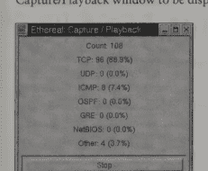

**图 5.3** *ethereal Capture/Playback*（ethereal 捕获/回放）窗口。

此窗口显示 **ethereal** 获取的帧的运行计数，按协议类型和接收到的总帧数的百分比排序。图 5.2 显示共捕获 108 个数据包，其中 96 个为 TCP，4 个为 ICMP，其余 4 个被视为 *other*（其他）类型。**Other**（其他）指从网络捕获但与计数窗口中列出的数据包类型不匹配的数据包。这提供了关于 **ethereal** 活动的可视化反馈，并快速显示了网络上已见到的帧类型。如果要停止捕获，请点击 *Stop*（停止）按钮。有时从用户点击 *STOP* 按钮到应用程序实际停止捕获流量，会有一定的延迟。这在一定程度上取决于网络负载或系统上运行的其他进程。此外，如果定义了过滤器，可能会使 **ethereal** 在响应键盘和/或鼠标控制时稍慢一些。

**ethereal** 停止捕获数据后，会在第一个数据包摘要面板中显示所有帧。图 5.4 显示了捕获网络流量后主窗口外观的代表性示例。

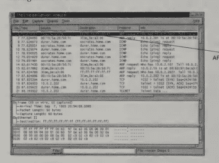

**图 5.4** 选中的 ARP 数据包及其详细信息。

在此示例中，我们有几种不同的数据包类型，由 *Protocol*（协议）字段表示。我们可以看到 **ARP**、**ICMP**、**TCP** 和 **TELNET** 数据包。如果我们想更详细地检查单个数据包，只需点击它即可。在图 5.4 中，第一个 ARP 数据包被鼠标高亮显示，导致下方两个面板显示额外的数据包信息。如前所述，中间面板包含帧各主要部分的树状视图。该面板的全部内容如下所示，没有中间面板中显示的层级标记：

```
Frame (60 on wire, 60 captured)
  Arrival Time: Dec 27, 1999 20:54:09.0385
  Packet Length: 60 bytes
  Capture Length: 60 bytes

Ethernet II
  Destination: ff:ff:ff:ff:ff:ff (ff:ff:ff:ff:ff:ff)
  Source: 00:60:97:0e:a3:06 (3Com_0e:a3:06)
  Type: ARP (0x0806)

ARP request
  Hardware type: Ethernet
  Protocol type: IP
  Hardware size: 6
  Protocol size: 4
  Opcode: 0x0001 (ARP request)
  Sender hardware address: 00:60:97:0e:a3:06
  Sender protocol address: 10.0.2.10
  Target hardware address: 00:00:00:00:00:00
  Target protocol address: 10.0.2.201
```

上面的列表仅包含一个数据包！这代表从网络接口 3Com_0e:a3:06（即系统 *durer* 的接口卡）发送的 ICMP 回显请求。注意 **ethereal** 如何用一个明确标识接口制造商的字符串替换硬件地址的前三个字节。

每个数据包至少包含三个部分。这些包括 Frame（帧）、Ethernet II 和 ARP。*Frame* 部分代表帧编号，指示在捕获的数据包列表中的计数或位置。此数据包是从网络读取的第 60 帧。还显示了 *Arrival Time*（到达时间）字段、*Packet Length*（数据包长度）字段和 *Capture Length*（捕获长度）字段。除非在命令行上或使用捕获对话框专门限制了帧的大小，否则数据包长度和捕获长度应该相等。

*Ethernet II* 字段代表数据链路帧，其格式符合以太网规范。回想一下，每个以太网帧都包含一个固定长度的头部，其中包括前导码

前导码、目的地址、源地址、类型、数据和校验和信息。然而，**Ethereal** 仅报告 `Destination field`、`Source field` 和 `Type` 字段。其他字段不显示，因为底层以太网驱动程序未提供该信息。

其余部分包含 `ARP portion`，通常表示已封装在以太网帧数据部分中的高层协议。如前所述，许多高层协议（如 `TCP`、`IP` 和 `IPX`）均可像 `ARP` 一样被封装在帧中。在本例中，`ARP packet` 包含特定于 `ARP protocol` 的信息——硬件类型、硬件地址信息、ARP 数据包类型、发送方硬件地址信息和目标（期望）硬件地址。我们可以判定这是一个 `ARP request`，因为 `opcode field` 设置为 `1`（或 `0x0001`），且 `Target hardware address` 为 `null`（或 `00:00:00:00:00:00`）。

底部面板以行和列的形式显示数据包的十六进制格式。当用户访问中间面板中的每个字段时，代表该数据的字节会在底部面板中高亮显示。例如，当用户选择数据包的 `Ethernet Source` 字段时，将显示以下内容：

```
0000  ff ff ff ff 00 60 97 0e a3 06 08 06 00 01
................................
0010  08 00 06 04 00 01 00 60 97 0e a3 06 0a 00 02 0a
................................
0020  00 00 00 00 00 00 0a 00 02 c9 02 c9 c9 c9 02 c9
................................
0030  02 c9 02 c9 02 c9 c9 02 c9 02 c9 02 c9
```

如所示，值集合 `00 60 97 0e a3 06` 以粗体显示，代表该数据包发送方的 `datalink address`。此面板中的数据非常有用，因为它提供了到低级格式的快速转换，可用于识别网络流量模式。十六进制格式在表示此层级的数据包时几乎是通用的。在上一章中，我们展示了如何使用 `tcpdump` 扫描数据包中的特定字符串。十六进制格式表示的数据提供了快速参考，以便我们需要过滤任何特定模式时使用。

由于 *Ethereal* 支持由 *tcpdump* 专门格式化的文件，任何采用此格式生成的文件（通过 *tcpdump* 的 *-w* 选项生成）均可被 *Ethereal* 读取并处理。事实上，这两个程序完全兼容；*Ethereal* 生成的输出也可由 *tcpdump* 处理。

## 使用过滤器

*Ethereal* 软件提供两种过滤器：数据包捕获过滤器和显示过滤器。如前所述，*Ethereal* 支持的过滤关键字、操作和语法与上一章讨论的 *tcpdump* 命令类似。捕获过滤器可在捕获会话开始前通过在过滤文本框中指定一个来设置，如图 5.5 所示。例如，该图显示了一个使用过滤字符串 *tcp* 仅捕获 TCP 数据包的过滤器。此过滤器被称为 *ad-hoc* 或临时过滤器，因为一旦应用程序终止，过滤器定义就会丢失。TCP 字符串是 *Ethereal* 使用的一个关键字，它将过滤掉所有使用 TCP 的数据包。


*图 5.5 TCP 数据包过滤器窗口。*

永久过滤器也可创建。这些过滤器将跨捕获会话保持可用。要创建此类过滤器，请单击过滤器按钮。随后将显示 *Ethereal:Preferences* 对话框，如图 5.6 所示。实际上，这也是用户访问 *Ethereal* 选项时显示的同一窗口。

默认情况下，*Ethereal* 不提供任何现有的过滤器定义。相反，用户必须使用此对话框创建它们并保存以供将来使用。

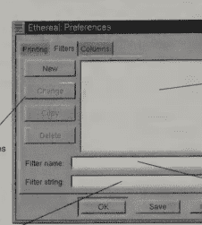

*图 5.6 Ethereal 过滤器窗口。*

这就是过滤器定义面板为空的原因。如果用户已定义现有过滤器，它们将显示在此处。过滤器窗口包含一组按钮、输入文本框和一个过滤器定义面板。要构建新过滤器，请在“过滤器名称:”文本框中键入过滤器名称。在本例中，让我们使用名称 `ip-broadcast`，这在上一章中已描述。回想一下，该过滤器将检查 IP 协议的 IP 头部，以确定数据包是否使用 IP 广播地址。接下来，在过滤字符串文本框中输入过滤器定义；使用字符串：`ip[9]&0xff = 0xff`。然后单击 *New* 按钮。此时，`ip-broadcast` 过滤器将被添加到过滤器列表面板。最后，单击 *Save* 按钮以永久保存该过滤器以供将来使用。完成这些步骤后，过滤器窗口应包含刚创建的过滤器定义，如图 5.7 所示。

该窗口还包含两个先前创建的额外过滤器定义。这些包括：
- `snmp-p`：第一个过滤器，称为 `snmp-p`，将在 SNMP 数据包的头部中搜索字符串 `p`，这有助于追踪哪些系统正在轮询 SNMP 设备。
- `host-durer`：第二个过滤器 `host-durer` 将显示发送给名为 `durer` 的主机的所有流量。

正如你所见，使用其他按钮，可以非常轻松快捷地修改、复制和删除过滤器。

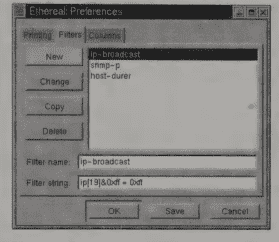

如果你想在捕获网络流量时使用过滤器，请选择该过滤器，然后点击 “Ok” 按钮。假设我们选择 `ip-broadcast` 过滤器，**Ethereal** 会将该过滤器的定义放入捕获窗口的文本框中，如图5.8所示。

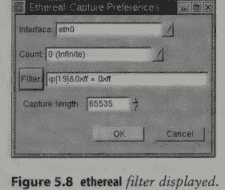

在此窗口中，点击 “Ok” 按钮将激活该过滤器，并开始网络流量捕获。

前文提到的显示过滤器也可用于选择已经捕获的数据包。例如，请注意，在图5.9中，我们捕获了FTP、TCP和Telnet包。

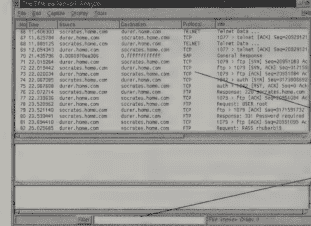

图 5.9 按协议类型排序的大量数据包列表。

在 Ethereal 窗口中输入显示过滤器字符串，然后按回车键。图 5.10 显示了此操作的结果。如图所示，数据包数量显著减少。显示过滤器的有趣之处在于，你可以恢复从摘要面板中删除的数据包。只需移除本例中的 TCP 过滤器并按回车键。一旦执行此操作，完整的数据包列表将被恢复。数据包选择是该软件的一项强大功能，当你只想查看少数特定数据包时，它提供了一种非常好的缩小列表范围的方法。

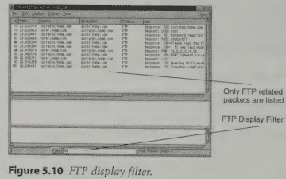

图 5.10 FTP 显示过滤器。

请记住，FTP 使用 TCP 传输协议，因此额外的 FTP 数据包可能显示为 TCP。原因是 Ethereal 按协议使用的端口对数据包进行排序。因此，如果我们使用显示过滤器仅过滤 FTP 数据包，最终会获得所有使用 FTP 端口的数据包。这产生了一个不幸的副作用：无法显示可能包含 FTP 信息的其他数据包。

Ethereal 的一个有用功能是，我们可以将捕获的数据保存为常规 UNIX 文件，也可以读取由其他软件工具（如 tcpdump 或 snoop）创建的捕获文件。snoop 工具提供与 tcpdump 相同的基本功能和特性，但仅适用于 Sun Solaris 平台。相比之下，tcpdump 可用于许多 UNIX 系统。

要保存捕获的数据，只需从“文件”菜单中选择“保存”项。完成后，将显示一个对话框，如图 5.11 所示。如果你将进行大量捕获，建议创建一个专用目录来存放所有文件。此外，可能需要使用有关捕获数据的重要信息对文件进行标记，以便稍后能轻松识别。如果没有完整且适当的文件标记，要确切知道每个捕获文件包含什么内容，唯一的方法就是将其读入 Ethereal 软件并进行查看。

当对话框首次出现时，它包含启动 Ethereal 程序位置的目录及任何关联文件。你可以在“选择:”文本框中显式指定目标文件，或使用下拉菜单导航。在本例中，路径和文件名

```
/home/capture/ftp-traffic-12-10-99.data
```

已输入“选择:”文本框。正如建议的那样，文件名同时包含数据包类型和捕获发生的日期。在大多数情况下，这已足够；然而，诸如捕获来源系统的名称、额外的协议信息或其他相关信息等附加信息在将来可能会很有用。另请注意，在对话框窗口中，为用户方便提供了三个按钮。这些包括“创建目录”、“删除文件”和“重命名文件”按钮。单击“创建目录”按钮将显示一个小对话框，请求输入要创建的目录名称。输入目录名称并单击“创建”按钮


## 设置首选项和选项

*ethereal* 工具提供了一些基本控制，用于调整主数据包摘要面板的外观、过滤器的定义和维护，以及打印选项。我们已经讨论了过滤器的操作，因此我们将重点关注摘要面板选项和打印。要访问首选项，请从“编辑”菜单中选择“首选项...”项目。将显示三个选项卡，它们控制对各相关屏幕的访问。选择“列”选项卡将显示数据包摘要面板选项。图 5.12 显示了选择此选项卡时将显示的窗口。

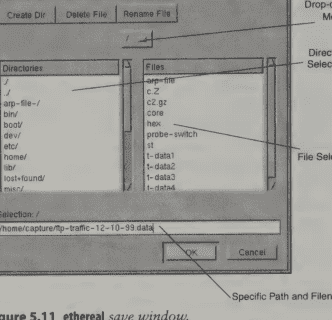

**图 5.11** *ethereal save* 窗口。

默认情况下，主窗口的摘要面板显示数据包编号、时间戳、源地址、目的地址、协议和附加数据包信息。*ethereal* 的一个特别有用的功能是这些字段可自定义。用户可以控制面板上显示哪些字段以及显示的顺序。如果用户需要以一种或多种专用格式查看数据包信息，这非常有用。关于一些现有监控工具的持续抱怨之一是无法生成报告；有了这些可自定义功能，生成自定义报告易如反掌。

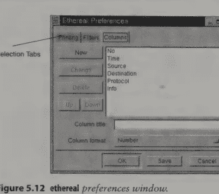

**图 5.12** *ethereal 首选项窗口*。

要访问打印选项，请单击 *ethereal* “首选项”对话框中的“打印”选项卡。图 5.13 显示了将要显示的对话框。

*ethereal* 工具可以将数据包打印到打印机或常规 UNIX 文件。用户可以定义在后续会话中使用的默认打印机和/或文件。在图 5.13 中，UNIX *a2ps* 命令已添加到“命令:”文本框中。此命令将 ASCII 数据（常规文本）转换为 PostScript 语言格式，以输出到兼容 PostScript 的打印机。该命令有大量控制输出的选项，但默认情况下，它以横向模式在两个并排的页面上显示数据。这种格式结合较小的字体大小，意味着您可以在相对较少的页数中容纳大量数据。如图 5.13 所示，已定义一个默认文本文件 *ethereal.out*。然而，在当前版本的软件中，打印到文件时不使用此文件。相反，用户在打印到文件时必须输入另一个文件名。图 5.14 包含一个屏幕快照，显示了在名为 **ghostview** 的 PostScript 查看器应用程序中看到的 **a2ps** 输出。这就是您打印文件时期望看到的内容。正如您所见，使用 **a2ps** 程序是输出数据包信息的绝佳方式。

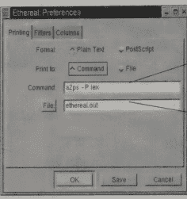

**图 5.13** *ethereal 打印首选项*。

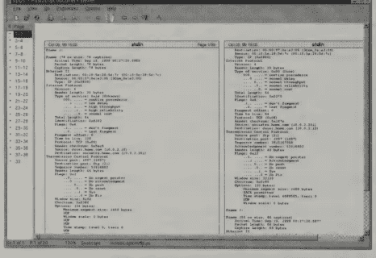

**图 5.14** *a2ps 输出预览*。

因为图 5.14 中并非所有页面都可见，所以用户必须使用滚动条来检查输出的隐藏部分。

**ethereal** 软件包含一个显示选项窗口，可用于更改摘要面板中 *Time* 字段的格式。从 *Display* 菜单中选择 **Options...** 子菜单将显示图 5.15 所示的窗口。


**图 5.15** *ethereal 时间字段显示选项窗口*。

最有用的显示选项之一是显示数据包到达系统的时间。选择 *Time of day* 选项将显示 **ethereal** 读取每个数据包的确切时间。这在追踪发生在特定时间段内的网络问题时非常有用。第二个选项显示相对于首次开始捕获数据包时的时间偏移量。最后一个选项显示相对于每个前一帧的时间偏移量。由于这些选项互斥，您只能选择其中一个。*Apply* 按钮可用于更改摘要面板中的时间，而无需关闭或删除选项窗口。这将允许用户在摘要面板中查看每个时间选项。图 5.16 显示了选择 *Time of day* 选项后的摘要数据包。

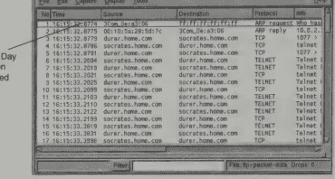

**图 5.16** 显示了选择 *Time of Day* 选项的数据包。

## 附加功能

*Tools* 菜单提供了两个大多数用户会发现有用的附加菜单命令。首先，**ethereal** 提供了一种方法，用于查看 TCP 连接中包含的所有可打印 ASCII 值和某些协议信息。使用 *Follow TCP Stream* 菜单项，用户可以跟踪系统之间发生的所有数据。图 5.17 显示了从名为 **socrates** 的系统捕获 FTP 登录会话后的 TCP 流。在本例中，socrates 允许用户以 *root* 身份登录，更改到 */* 目录，并使用 FTP *dir* 命令执行目录列表。

图 5.17 所示窗口仅包含登录序列的数据、*CWD* 和 *LIST* 命令的传输以及终止握手信息。您会注意到目录列表信息未显示。原因很简单：FTP 使用备用 TCP 连接来传输目录信息。因此，*ethereal* 仅显示来自第一个连接的数据。

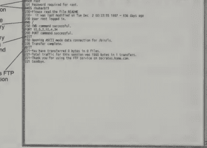

**图 5.17** TCP 登录会话信息。

使用 **TCP stream feature** 的一个有趣之处在于，它在显示 TCP 会话信息时会秘密使用一个特殊的显示过滤器。这会将摘要面板中的数据包减少为仅涉及给定连接的那些数据包。

要取消显示单个 TCP 连接的效果，请在主 **ethereal** 窗口上显示的显示过滤器文本框中按 **Enter** 键。

要检查由 **LIST** 命令产生的 FTP 目录列表，用户必须从第二个连接中选择一个数据包。要找出与给定 TCP 连接关联的数据包，用户必须检查目标端口。从 FTP 连接流出的所有数据（如目录列表或文件传输）都使用端口 20。所有 FTP 命令使用端口 21，这与连接开始时的端口相同。一旦用户选择摘要窗口中包含的第二个连接的一部分特定数据包，目录信息将显示出来，如图 5.18 所示。

由于 FTP 使用新的 TCP 连接来处理每次文件传输或目录列表，用户需要选择与这些连接相关的适当数据包以获取传输的数据。使用此方法查看完整 TCP 事务的能力非常重要。它允许用户查看许多 TCP/IP 协议和服务的内部操作。这对网络调试和故障排除可能产生深远影响。

**Tools** 菜单下的另一个选项提供有关捕获的信息摘要。选择 **Summary...** 子菜单将显示数据包摘要面板中显示的数据包的通用和具体信息。图 5.19 显示了刚才讨论的 FTP 会话的 **ethereal** 摘要窗口。

摘要窗口包含三个部分：**File**、**Data** 和 **Capture**。**File** 部分包含数据包已保存到的文件名（在 **Name** 字段中）。**Length** 字段显示此文件的大小（以字节为单位）。**Format** 字段显示用于存储捕获数据包的文件格式。**pcap** 格式是 ethereal 的原生格式。**Snapshot length** 字段是在捕获网络流量时使用的最大数据包大小，如前所述，它是默认值。


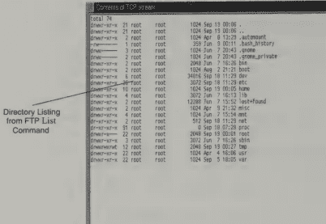

图 5.18 FTP 目录列表。

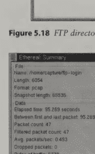

图 5.19 Ethereal 数据包摘要窗口。

数据部分包含“已用时间”字段，该字段指示自接收最后一个数据包以来经过的总时间量（以秒为单位），即整个数据包捕获会话的持续时间。下一个字段“首尾包之间”与“已用时间”字段相同。“包计数”字段显示从网络接收的数据包总数或 UNIX 文件中包含的数据包数量。“过滤包计数”字段指示被活动过滤器接受的数据包总数。在本例中，默认过滤器接受所有数据包，因此它包含的值与“包计数”字段相同。下一个字段“平均包/秒”包含在一秒间隔内进入网络接口的平均数据包数量。“丢弃包”字段指示捕获会话期间丢弃的数据包数量。图 5.19 显示没有数据包被丢弃。大于零的数字表示工具不得不丢弃数据包，因为它们无法被足够快地处理。

“流量字节”字段表示在数据包中传输的数据量，不包括低级帧的任何头部部分。最后一个字段“平均字节/秒”显示传输速率，测量捕获期间每秒的字节数。

捕获部分指定“接口”字段，该字段显示从中获取数据包的系统接口。在这种情况下，由于数据包来自 UNIX 文件而非网络接口，因此该字段标记为“未知”。下一个字段“显示过滤器”显示活动显示过滤器的名称。在本例中，它未定义，因此列出“无”。最后一个字段“捕获过滤器”列出活动捕获过滤器。未定义活动捕获过滤器，因此显示“无”。

Ethereal 软件提供了本文未完全描述的附加功能。这些功能包括：

-   匹配所选
-   彩色显示

“显示”菜单中的“匹配所选...”选项将扫描每个数据包以搜索特定模式或标准。如果您在捕获大量数据包后正在查找特定字符串或值，这非常有用。在这些情况下，人工检查既不准确也不高效，因此需要自动化方法。“显示”菜单中的“彩色显示...”选项允许用户更改某些数据包类型的前景色和背景色。这使得数据包检查和审查变得容易得多。

## FpingTool

### 一般描述

**`fping`** 命令与本章前面讨论的 **`ping`** 命令非常相似。然而，**`fping`** 软件提供了一些普通 **`ping`** 不具备的特殊功能。与其对应命令一样，**`fping`** 使用 ICMP 回显请求和回复来确定系统可达性。但是，与常规 **`ping`** 不同，**`fping`** 可以在命令行上指定主机名或 IP 地址列表。此外，**`fping`** 可以处理包含主机名或 IP 地址列表的文件。与向单个目标发送请求（像 **`ping`** 所做的那样）不同，**`fping`** 将使用轮询机制向每个目标发送 ICMP 请求。另一个重要区别是，**`fping`** 主要用于脚本编程，而不是像普通 **`ping`** 那样作为用户命令。尽管如此，在命令行上使用时，**`fping`** 可以有效解决一些常见的 IP 地址相关问题。

**`fping`** 可用的命令行选项可分为两部分。第一部分控制可用于自定义输出的各种显示选项。第二部分包括控制 **`fping`** 从设备获取可达性信息并处理该信息方式的操作参数。

默认情况下，当目标响应 ICMP 请求时，会将其记录并从应检查的目标列表中移除。如果目标在设定的时间或重试限制内未响应，则视为不可达。**`fping`** 命令可以设置为无限循环（像普通 **`ping`** 一样）或向目标发送用户定义数量的 ICMP 请求。

### 显示选项

表 5.5 列出了 **`fping`** 可用的许多显示选项。其中一些选项不言自明，除了与该特定选项关联的描述外，无需进一步解释。其他选项需要额外的细节，将在下面描述。

**表 5.5** `fping` 显示选项列表

| 选项 | 说明 |
| --- | --- |
| -A | 显示目标的地址而非主机名 |
| -0 | 类似 `-q` 选项，但每 `n` 秒显示一次汇总结果信息。遗憾的是，此命令似乎不起作用 |
| -a | 给定命令行上的目标列表，显示存活且可达的系统 |
| -d | 显示目标的主机名而非地址。这是 `-A` 选项的反向操作 |
| -e | 显示从发送数据包到收到回复的往返时间 |
| -q | 安静模式。不显示任何结果，但设置退出返回状态 |
| -u | 给定命令行上的目标列表，显示未存活的系统 |
| -v | 显示命令版本信息以及用于发送评论和错误报告的电子邮件地址 |

`fping` 特别有用的功能之一是，给定 `-a` 选项后跟随的目标列表，它将显示可达的系统。例如，考虑以下命令：

```
# fping -a vermeer monet rodin louvre
monet
rodin
louvre
```

主机 `monet`、`rodin` 和 `louvre` 被显示——表明它们是存活的——而 `vermeer` 未显示，因为它未响应。

相反，可以使用 `-u` 选项显示相反的列表。在这种情况下，显示不响应的主机：

```
# fping -u vermeer monet rodin louvre
vermeer
```

我们可以更进一步，将目标列表放入文件中进行处理。假设一个名为 `host-list` 的文件包含以下 IP 地址：

```
10.0.2.75
10.0.2.100
10.0.2.150
10.0.2.151
10.0.2.152
10.0.2.153
10.0.2.200
10.0.2.201
```

通过将输入重定向到 `host-list` 文件，**fping** 可以处理更多目标，而不需要您在命令行上逐个指定它们：

```
# fping < host-list
10.0.2.75 is alive
10.0.2.100 is alive
10.0.2.150 is alive
10.0.2.151 is alive
10.0.2.152 is alive
10.0.2.153 is alive
10.0.2.200 is alive
10.0.2.201 is alive
```

这是处理大量主机的更合理方式。

如果您愿意，也可以使用 `-f` 选项代替上述文件重定向。因此命令

```
# fping < host-list
# fping -f host-list
```

在功能上等效并产生相同结果。然而，`-f` 选项仅限 **root** 用户使用，而任何系统用户都可以使用第一个示例中所示的重定向选项。

`alive` 和 `not alive` 选项（`-u` 和 `-a`）非常方便，可用于各种情况。例如，假设您希望在某些系统宕机时通过电子邮件收到通知。如清单 5.1 所示的简单脚本可能为您完成此任务。

### 清单 5.1 用于识别宕机系统的 fping 示例脚本

```
#!/usr/bin/ksh

#
# Simple script to notify user when
# systems are down
#

FILE=$1

FPINGCMD=`fping -u < $FILE`
MAIL=/bin/mailx
USER=root

if [ "$FPINGCMD" != "" ]; then
    $MAIL -s "down system(s)" -u $USER $FPINGCMD
fi
```

此脚本针对指定文件中包含的主机运行 **fping** 命令（第 10 行），如果文件中包含的任何设备无法访问，则向用户 *root* 发送邮件，如第 15 行所示。显然，可以编写更健壮和详尽的脚本，但这里的重点是 **fping** 可以帮助自动化一些小型网络管理任务。

在特殊场合，可能需要直接操作 IP 地址，而不是像前面的示例那样使用主机名。给定主机名列表时，返回 IP 地址会很方便。`-A` 选项指示 **fping** 显示 IP 地址信息而不是主机名。因此，在清单 5.1 中的示例里，我们处理一个包含 IP 地址列表的文件。在这种情况下，我们将处理一个有效主机名列表。文件 `hostname-list` 包含以下内容：

monet
durer
vermeer
rembrandt
lex-mark


通过使用 -A 选项处理此文件，我们得到：

```
# ping -A < hostname-list

10.0.2.126 is alive
134.111.2.1 is alive
10.0.2.75 is alive
10.0.2.75 is alive
10.0.2.129 is alive
128.197.2.200 alive
10.0.2.200 is alive
10.0.2.101 is alive
```

**ping** 命令不仅提供了一种确定系统是否在网络上运行的方法，还可以提供一定量的性能信息。特别是，有几个选项可用于显示从 **ping** 来源到每个目标的性能相关的各种统计数据。-e 选项将显示从发送数据包的那一刻起直到返回回复的往返时间或经过时间。该命令

```
# ping -e rembrandt

rembrandt is alive (2.82 ms)
```

提供的输出与使用 **ping** 命令获得的输出非常相似。另一个有用的选项 -s 显示目标更完整的累积统计概况：

```
# ping -s rembrandt

rembrandt is alive
    1 targets
    0 unreachable
    0 unknown addresses
    0 timeouts (waiting for response)
    1 ICMP Echoes sent
    1 ICMP Echo Replies received
    0 other ICMP received

3.09 ms (min round trip time)
3.09 ms (avg round trip time)
3.09 ms (max round trip time)
   0.015 sec (elapsed real time)
```

此选项提供详细的细分，显示目标的总数和发现存活的目标数量（在本例中为 1）。其他信息不言自明，实际经过的时间以秒为单位测量。为了确定此信息的准确性，请考虑以下示例：

```
# date; `fping` -s rodin; date
Sat Oct 3 13:25:01 EDT 1998
rodin is unreachable
1 targets
0 alive
1 unreachable
0 unknown addresses
4 timeouts (waiting for response)
4 ICMP Echo sent
0 ICMP Echo Replies received
0 other ICMP received

0.00 ms (min round trip time)
0.00 ms (avg round trip time)
0.00 ms (max round trip time)
4.080 sec (elapsed real time)
Sat Oct 3 13:25:05 EDT 1998
```

在这里，**fping** 被 UNIX `date` 命令包围。`date` 程序在 **fping** 启动前和执行结束后执行。不考虑操作系统的任何延迟，经过的时间相当准确。由于多种因素，经过的时间可能不是 100% 准确，但对于大多数应用程序来说，它应该足够准确。选择一个不可达的系统作为示例，以便强制 **fping** 发送额外的数据包并等待最长时间。这提供了更多的时间来测量请求，而无需求助于目标为活动系统时所需的其他选项。

## 操作选项

表 5.6 列出了 **fping** 可用的许多操作选项。其中一些选项不言自明，除了与该特定选项关联的描述外，无需进一步解释。其他选项需要更多细节，将在下面描述。

**fping** 命令向目标发送一定数量的请求，随着每次连续请求等待回复的时间变长。所用的值由等待因子决定，该因子对每个未收到回复的请求使用一个乘数。1.5 的值是默认乘数。要更改此值，请使用 -B 选项后跟一个浮点值。

### 表 5.6：fping 操作选项

| 选项 | 说明 |
| :----- | :---------- |
| -b | ping 请求中包含的数据字节数 |
| -B | 此选项后跟一个值，用于确定 ping 在等待回复时使用的延迟时间。该值用作乘数，必须以浮点格式给出。 |
| -c | 确定发送给每个目标的请求数 |
| -C | 类似于 -c，但按目标显示的统计数据采用更易于解析的格式 |
| -f | 从指定文件获取目标列表。这仅限 root 用户。普通用户应改用文件重定向而非此选项 |
| -l | 向目标发送无限数量的请求；可通过 Ctrl(ctrl-c) 停止 |
| -P | 设置 ping 在目标的连续数据包之间等待的毫秒数。这仅在使用 -l、-c 或 -C 选项时有意义。 |
| -r | 对指定目标进行 ping 尝试的次数。默认值为 3。 |
| -t | 等待初始数据包请求的第一个响应的时间量。默认为 500 毫秒。 |

例如，使用默认值，我们观察到以下内容：

```
# fping -s rembrandt
rembrandt is unreachable
1 targets
0 alive
1 unreachable
0 unknown addresses
4 timeouts (waiting for response)
4 ICMP Echos sent
0 ICMP Echo Replies received
0 other ICMP received
0.00 ms (min round trip time)
0.00 ms (avg round trip time)
0.00 ms (max round trip time)
4.077 sec (elapsed real time)
```

通过使用 `-B` 选项，我们可以将每个发送数据包的延迟因子加倍。结果，我们看到每个数据包请求使用了大量时间：

```
# fping -B 3.0 -s rembrandt
rembrandt is unreachable
1 targets
0 alive
1 unreachable
0 unknown addresses
4 timeouts (waiting for response)
4 ICMP Echos sent
0 ICMP Echo Replies received
0 other ICMP received
0.00 ms (min round trip time)
0.00 ms (avg round trip time)
0.00 ms (max round trip time)
20.037 sec (elapsed real time)
```

请注意，经过的时间已增加到约 20 秒，因为延迟因子乘以每个发送的数据包。

要控制 `fping` 发送给每个目标的请求数，请使用 `-c` 选项。默认情况下，在放弃指定系统之前会尝试四次。`-c` 选项可用于更改尝试次数：

```
# fping -c 5 monet
monet: [0], 84 bytes, 3.55 ms (3.55 avg, 0% loss)
monet: [1], 84 bytes, 2.53 ms (3.04 avg, 0% loss)
monet: [2], 84 bytes, 1.63 ms (2.57 avg, 0% loss)
monet: [3], 84 bytes, 1.99 ms (2.42 avg, 0% loss)
monet: [4], 84 bytes, 1.64 ms (2.26 avg, 0% loss)
monet: xmt/rcv/%loss = 5/5/0%, min/avg/max = 1.63/2.26/3.55
```

## Nmap 工具

**nmap** 工具是一种实用程序，用于定位和识别目标主机系统上所有可用的 TCP 和 UDP 端口。也称为端口扫描器，**nmap** 将扫描 0 到 1024（默认）范围内的 TCP 端口，尝试确定接受连接的端口上监听的服务。该软件旨在最大化网络带宽，同时保持运行 **nmap** 的主机上的处理资源。

传统上，**nmap** 被视为一种安全监控工具，用于定位系统上的安全弱点，而不是网络管理工具。然而，网络管理员会发现该工具在识别未知系统上的网络服务方面非常有帮助。有必要说一句警告：该工具被牵连到帮助人们非法访问遍布互联网的网络和相关系统。因此，**nmap** 受到了一些负面宣传。如果您在自己的网络上使用此工具，可能没问题，但如果您打算在不受您控制的网络、系统或站点上使用此工具，您应首先寻求许可。请记住，尊重他人网络和系统的隐私意味着这种好意也许有一天会回报给您。

偶尔，会向网络中添加干扰正常网络操作的设备。此外，这些系统的来源或性质可能不明显，SNMP 代理可能因被禁用或未配置等原因而处于非活动状态。可能有必要扫描设备以了解它们提供的服务。例如，假设添加到网络的设备被认为是网络性能问题的原因，但由于该设备似乎不支持 *telnet* 等服务，因此难以识别该设备。

我们可以 **ping** 该设备，但这并不能真正为我们提供太多信息：

```
# ping 10.0.2.10
PING 10.0.2.10 (10.0.2.10): 56 data bytes
64 bytes from 10.0.2.10: icmp_seq=0 ttl=128 time=0.7 ms
64 bytes from 10.0.2.10: icmp_seq=1 ttl=128 time=0.7 ms

--- 10.0.2.10 ping statistics ---
```

发送 2 个数据包，接收 2 个数据包，0% 丢包率，往返时间 最小/平均/最大 = 0.7/0.7/0.7 毫秒

我们也可以尝试 telnet 该设备，但连接永远无法建立，因为设备拒绝此类访问：

```
# telnet 10.0.2.10
Trying 10.0.2.10...
telnet: Unable to connect to remote host: Connection refused
```

不过，我们可以让 nmap 探测该设备，帮助我们确定其相关信息。

```
nmap -O 10.0.2.10
```

结果表明，nmap 命令的输出符合 Windows 95 工作站的特征：

```
Starting nmap V. 2.12 by fyodor (fyodor@idp.com, www.insecure.org/nmap/)
Interesting ports on (10.0.2.10):

Port     State    Protocol  Service
135      open     tcp       loc-srv
139      open     tcp       netbios-ssn
427      open     tcp       svrloc

TCP Sequence Prediction: Class=trivial time dependency
Difficulty=13 (Easy)
Remote operating system guess: Windows NT4 / Win95 / Win98
```

通常很难判断一台有问题的设备是否为 Windows 工作站，但使用 nmap，大多数系统都能相当快速且轻松地被识别出来。

nmap 工具还可以检查网络中已知系统上运行的网络服务。这有助于确定多个系统上有哪些系统服务可用。例如，以下输出是通过在一台名为 socrates 的 Linux 工作站上使用 nmap 生成的：

```
# nmap -O socrates

Starting nmap V. 2.12 by fyodor (fyodor@idp.com,
www.insecure.org/nmap/)
Interesting ports on socrates.home.com (10.0.2.201):
Port  State  Protocol  Service
21    open   tcp       ftp
22    open   tcp       ssh
23    open   tcp       telnet
25    open   tcp       smtp
80    open   tcp       http
111   open   tcp       sunrpc
512   open   tcp       exec
513   open   tcp       login
514   open   tcp       shell
515   open   tcp       printer
610   open   tcp       nmp-local
615   open   tcp       unknown
620   open   tcp       unknown
982   open   tcp       unknown
1013  open   tcp       unknown
1024  open   tcp       unknown
6000  open   tcp       X11

TCP Sequence Prediction: Class=random positive increments
Difficulty=5369390 (Good luck!)
Remote operating system guess: Linux 2.1.122 - 2.1.132;
2.2.0-pre1 - 2.2.2
```

此处使用的 `-O` 选项告诉 nmap 我们希望它尝试使用我们所谓的 TCP/IP 指纹识别来识别目标系统。这基本上意味着使用多种不同的技术来检测操作系统或目标设备中所含运行软件的差异。利用从设备获取的数据，nmap 将该信息与已知设备和系统的指纹进行比较。nmap 尝试识别的每个设备都会与存储在名为 nmap-os-fingerprints 的文件中的数据进行比较，该文件位于 /usr/local/lib/nmap 目录下。该文件包含大量系统和网络设备的指纹。如果遇到指纹文件中条目不匹配的设备，您可以考虑将扫描结果发送给 nmap 的作者。

nmap 软件支持许多重要功能和命令行选项。此外，它还提供大量系统扫描技术，如表 5.7 所示。该表还包含相关的命令选项以及每种扫描方法所涉及过程的一般描述。

nmap 工具的设计初衷是在探测许多不同网络上的大量主机时能高效工作。它也被认为是公共领域中最快的端口扫描器之一，甚至可与某些商业产品媲美。命令行选项分为两类；第一类是扫描选项，列于表 5.7。第二类是附加选项，用于细化或控制工具的行为。表 5.8 列出了这些附加选项。

### 表 5.7 nmap 扫描技术

| 扫描方法 | 命令行选项 | 描述 |
| :------------- | :------------- | :------------- |
| UDP 端口 | -sU | 扫描 1 到 1024 范围内的可用 UDP 端口，加上 `/usr/local/lib/nmap/` nmap-services 文件中列出的端口 |
| TCP 连接 | -sT | 扫描 1 到 1024 范围内的可用 TCP 端口，加上 `/usr/local/lib/nmap/` nmap-services 文件中列出的端口；使用底层 `connect` 系统调用尝试建立与目标系统的连接 |
| TCP SYN（半开） | -sS | 使用*半开放*技术扫描 TCP 端口，这意味着 TCP 连接的只有一侧处于打开并等待确认的状态 |
| FTP 代理 | -b | FTP 反弹扫描；利用 FTP 服务中的代理功能尝试连接 |
| 反向 Ident | -i | 启用 TCP 反向 ident 扫描，这要求 `ident` 服务器正在运行；启用后，允许识别使用 TCP 端口的进程所有者 |
| Ping 扫描 | -sP | 扫描探测系统时使用 ICMP。这等同于发出 `ping` 请求。 |
| FIN | -sF | 称为隐身 FIN，此扫描选项使用 FIN TCP 数据包试图引出响应 |
| Xmas | -sX | 类似于 FIN 但将 TCP 数据包中的 FIN、URG 和 PUSH 位置位 |
| Null | -sN | 类似于 FIN 但关闭所有 TCP 标志 |

### 表 5.8 附加 nmap 选项

| 选项 | 描述 |
|---|---|
| -F | 快速扫描模式；仅扫描 nmap-services 文件中找到的端口 |
| -i | 从指定文件获取目标信息，而非使用命令行 |
| -m | 显示最小输出，包括主机名、端口号等 |
| -o | 将程序结果记录到指定文件 |
| -p | 使用指定端口或范围代替默认值 |
| -v | 启用详细模式，提供关于程序活动的额外信息 |

由于 nmap 支持大量命令行参数和选项，请使用 -h 选项列出摘要：

```
# nmap -h
nmap V. 2.12 usage: nmap [Scan type(s)] [Options] <host or net #1 ...[#N]>
Scan types
-SI tcp connect() port scan
-SS tcp SYN stealth port scan (must be root)
-sf, -sX, -sN Stealth FIN, Xmas, or Null scan (only works against UNIX).
-sP ping "scan". Find which hosts on specified network(s) are up but don't port scan them
-sU UDP port scan, must be root
<ftp_relay_host> ftp "bounce attack" port scan
Options (none are required, most can be combined):
-f Use tiny fragmented packets for SYN, FIN, Xmas, or NULL scan
-P0 Don't ping hosts (needed to scan www.microsoft.com and others)
-PT Use "TCP Ping" to see what hosts are up (for normal and ping scans)
-PT21 Use "TCP Ping" scan with probe destination port of 21 (or whatever)
-PI Use ICMP ping packet to determine hosts that are up
-PB Do BOTH TCP & ICMP scans in parallel (TCP dest port can be specified after the 'B')
-PS Use TCP SYN sweep rather than the default ACK sweep used in "TCP ping"
-O Use TCP/IP fingerprinting to guess what OS the remote host is running
-p <range> ports: ex: '-p 23' will only try port 23 of the host(s)
"-p 20-30,63000" scans 20-30 and 63000-65535. default: 1-1024
+ /etc/services
-Ddecoy_host1,decoy2,ME,decoy3,...] Launch scans from decoy host(s) along with the real one. If you care about the order your real IP appears, stick "ME" somewhere in the list. Even if the target detects the scan, they are unlikely to know which IP is scanning them and which are decays.
-F Fast scan. Only scans ports in /etc/services, a la strobe(1).
-G Get ident(6) info on listening TCP processes.
-n Don't DNS resolve anything unless we have to (makes ping scans faster)
-R Try to resolve all hosts, even down ones (can take a lot of time)
-o <logfile> Output scan logs to <logfile> in human readable.
-m <logfile> Output scan logs to <logfile> in machine parseable format.
-i <infile> Grab IP numbers or hostnames from file. Use "-" for stdin
-g <portnumber> Sets the source port used for scans. 20 and 53 are good choices.
-S <your_IP> If you want to specify the source address of SYN or FIN scan.
-v Verbose. Its use is recommended. Use twice for greater effect. help, print this junk. Also see http://www.insecure.org/nmap/
-V Print version number and exit.
-e <devicename> Send packets on interface <devicename> (eth0,ppp0,etc.).
-q quash argv to something benign, currently set to "pine". (deprecated)
Hostnames specified as internet hostname or IP address. Optional '/mask' specifies subnet. For example: cert.ora/24 or 192.88.209.5/24 or
```


192.88.209.0-255 或 128.88.209.* 均可扫描 CERT 的 C 类网络。

请参阅手册页以获取更详尽的解释和示例

**nmap** 的优势之一在于它支持多种不同的扫描方法。某些扫描器仅支持 TCP 扫描，虽然这非常有用，但也有局限性。例如，某些网络设备不像传统 UNIX 系统那样提供通用的 TCP 网络服务；它们可能仅支持有限的一组 UDP 服务。在这种情况下，使用仅支持 TCP 的端口扫描器将毫无用处。请参考以下扫描及其相关输出：

```
# nmap -sT probe.home.com

Starting nmap V. 2.12 by Fyodor (fyodor@dhp.com, www.insecure.org/nmap/)

Interesting ports on probe.home.com (10.0.2.50): (Not showing ports in state: filtered)

Port State Protocol Service

Nmap run completed -- 1 IP address (1 host up) scanned in 66 seconds
```

正如您在该输出中所见，**nmap** 未在目标系统上检测到任何服务。然而，使用 -sU 选项进行扫描会指示 **nmap** 扫描一系列 UDP 端口，而不是默认的 TCP 端口范围。因此，有趣的是，

```
# nmap -sU 10.0.2.50
```

执行后会产生以下输出：

```
WARNING: -sU is now UDP scan -- for TCP FIN scan use -sF

Starting nmap V. 2.12 by Fyodor (fyodor@dhp.com, www.insecure.org/nmap/)

Interesting ports on probe.home.com (10.0.2.50): (Not showing ports in state: filtered)

Port State Protocol Service
161 open udp snmp

Nmap run completed -- 1 IP address (1 host up) scanned in 12 seconds
```

我们发现一个 SNMP 进程正在标准 161 端口上监听。这表明该设备仅支持 SNMP 而无其他服务。如果需要，我们可以使用基于 SNMP 的工具进一步查询该设备，以确定驻留在设备内的代理的更多信息。有关用于完成此任务的工具的更多信息，请参阅第 8 章 “使用 SNMP 工具”。

nmap 的默认行为是在关联服务文件中包含的标准 TCP 端口上使用 TCP 端口扫描方法。通常 nmap-services 文件位于 /usr/local/lib/nmap 目录中，nmap 将使用这些端口并额外扫描 1 到 1024 范围内的所有端口。仅使用默认值，nmap 就非常有用。请参考以下命令：

```
# nmap sparky
```

它显示了名为 sparky 的主机的大量信息：

```
Starting nmap V. 2.12 by Fyodor (fyodor@dhp.com, www.insecure.org/nmap/)

Interesting ports on sparky.home.com (10.0.2.12):
Port    State     Protocol Service
21      open      tcp      ftp
23      open      tcp      telnet
25      open      tcp      smtp
53      open      tcp      domain
79      open      tcp      finger
80      open      tcp      http
98      open      tcp      linuxconf
111     open      tcp      sunrpc
113     open      tcp      auth
119     open      tcp      nntp
513     open      tcp      login
514     open      tcp      shell
515     open      tcp      printer
652     open      tcp      unknown
673     open      tcp      unknown
678     open      tcp      unknown
683     open      tcp      unknown
713     open      tcp      unknown
1024    open      tcp      unknown
6000    open      tcp      X11

Nmap run completed - 1 IP address (1 host up) scanned in 1 second
```

以上输出来自对 Red Hat Linux 6.0 系统的扫描。正如您所见，此扫描显示许多标准 UNIX 服务正在运行。仅列出 TCP 服务，因为这是默认模式；这等同于使用命令行选项 -sT。系统上运行的服务包括 ftp、Telnet、smtp 等。此外，有几个端口未被识别，标记为 Unknown。这些端口包括 713 端口上的 amd 服务（一种自动挂载服务）和 678 端口上的 rpc.mountd rpc 服务，但 nmap 未将其识别为这些服务。连接到系统时使用 netstat 命令可以检测到其他服务。该命令在上一章中已有描述。

如果我们想同时扫描 UDP 和 TCP 端口，需要将 -sU 和 -sT 选项一起使用。如果不组合它们，nmap 将只扫描其中一种。命令

```
# nmap -sU -sT sparky
```

将产生以下结果：

```
WARNING:  -sU is now UDP scan -- for TCP FIN scan use -sF

Starting nmap V. 2.12 by Fyodor (fyodor@dhp.com,
www.insecure.org/nmap/)
Interesting ports on sprites.home.com (10.0.2.201):
```

| 端口 | 状态 | 协议 | 服务 |
| :--- | :--- | :--- | :--- |
| 21 | open | tcp | ftp |
| 23 | open | tcp | telnet |
| 25 | open | tcp | smtp |
| 53 | open | udp | domain |
| 53 | open | tcp | domain |
| 79 | open | tcp | finger |
| 80 | open | tcp | http |
| 98 | open | tcp | linuxconf |
| 111 | open | udp | sunrpc |
| 111 | open | tcp | sunrpc |
| 113 | open | tcp | auth |
| 119 | open | tcp | nntp |
| 161 | open | udp | snmp |
| 177 | open | udp | xdmcp |
| 513 | open | tcp | login |
| 514 | open | tcp | shell |
| 515 | open | tcp | printer |
| 517 | open | udp | talk |
| 518 | open | udp | ntalk |
| 650 | open | udp | bwnfs |
| 652 | open | tcp | 未知 |
| 661 | open | udp | 未知 |
| 671 | open | udp | 未知 |
| 673 | open | tcp | 未知 |
| 676 | open | udp | 未知 |
| 678 | open | tcp | 未知 |
| 681 | open | udp | 未知 |
| 683 | open | tcp | 未知 |
| 713 | open | tcp | 未知 |
| 714 | open | udp | 未知 |
| 800 | open | udp | mbsm_daemon |
| 1022 | open | udp | 未知 |
| 1023 | open | udp | 未知 |
| 1024 | open | udp | 未知 |
| 1024 | open | tcp | 未知 |
| 1026 | open | udp | 未知 |
| 2049 | open | udp | nfs |
| 6000 | open | tcp | X11 |

Nmap run completed -- 1 IP address (1 host up) scanned in 5 seconds

请注意，现在同时显示 UDP 和 TCP 端口，并按端口号排序。

正如任何优秀的端口扫描器一样，扫描特定端口的能力至关重要。判断网络上所有系统是否拥有一组标准网络服务或某项特定服务的一个好方法是，针对特定端口号扫描该网络。例如，假设我们想确定 10.0.2.0 网络上的所有系统是否支持某种 SNMP 代理。命令：

```
$ nmap -p 161 -sU -o results 10.0.2.0/24
```

指示 **nmap** 使用 UDP 扫描网络 10.0.2.0 上的 161 端口（SNMP 端口），并将输出信息保存到名为 *results* 的文件中。如果我们显示此文件，将发现以下内容：

```
# Log of: nmap -p 161 -sU -o result 10.0.2.0/24
No ports open for host duree.home.com (10.0.2.10)
No ports open for host king.home.com (10.0.2.21)
No ports open for host derry.home.com (10.0.2.25)
Interesting ports on probe.home.com (10.0.2.50):
Port State Protocol Service
161 open udp snmp

Interesting ports on switch.home.com (10.0.2.60):
Port State Protocol Service
161 open udp snmp

Interesting ports on tux.home.com (10.0.2.65):
Port State Protocol Service
161 open udp snmp

Interesting ports on didymus-gw2.home.com (10.0.2.129):
Port State Protocol Service
161 open udp snmp

Interesting ports on didymus-gw3.home.com (10.0.2.130):
Port State Protocol Service
161 open udp snmp

Host (10.0.2.255) seems to be a subnet broadcast address (returned 2 extra pings). Skipping host.
```

事实证明，这是一种非常合理的大规模清查服务的机制。任何 TCP 或 UDP 服务都可以使用这种方法进行查询。

此例演示了该工具的另一项强大功能。即我们可以使用几种不同的表示法指定目标系统或网络。首先，我们可以使用列表或范围来指定 IP 地址的每个部分。因此，我们可以使用 “* *” 字符扫描整个 IP 类网络。例如，128.197.*-* 允许扫描整个 B 类网络。另一种表达方式是使用连字符。因此，128.197.1-255.1-255 在功能上等同于使用 128.197.*-*. 语法。其次，我们可以使用掩码表示法，如上一个 nmap 命令示例所示。即 128.197.0.0/16 将进行掩码操作，等同于使用 “* *” 或 “-” 字符的前两个示例。最后，我们可以将编号序列与范围语法结合使用。因此，128.197.90.1, 2, 3, 4, 5, 100-105 将扫描以下地址：128.197.90.1、128.197.90.2、128.197.90.3、128.197.90.4 和 128.197.90.5，以及 128.197.90.100 到 128.197.90.105 的地址。使用这些 IP 格式极大地提高了扫描整个子网或网络的便利性。


扫描网络时，有时了解 **nmap** 始终在做什么会很有帮助。因此，提供了 -v 选项。请记住，这可能会生成大量输出，因此谨慎使用此选项可能很重要。在前面的示例中，我们扫描了整个子网。如果我们为此命令添加 -v 选项，并使用 IP 范围将目标数量减半，命令 **nmap -v -p 161 10.0.2.1-127** 将显示以下内容：

```
No scantype specified, assuming vanilla tcp connect() scan.
Use -sP if you really don't want to portscan (and just want to see what hosts
are up).

Starting nmap V. 2.12 by Fyodor (fyodor@dhcp.com,
www.insecure.org/nmap/)
Host (10.0.2.0) appears to be down, skipping it.
Host (10.0.2.1) appears to be down, skipping it.
Host (10.0.2.2) appears to be down, skipping it.
Host (10.0.2.3) appears to be down, skipping it.
Host (10.0.2.4) appears to be down, skipping it.
Host (10.0.2.5) appears to be down, skipping it.
Host (10.0.2.6) appears to be down, skipping it.
Host (10.0.2.7) appears to be down, skipping it.
Host (10.0.2.8) appears to be down, skipping it.
Host (10.0.2.9) appears to be down, skipping it.
Host durer.home.com (10.0.2.10) appears to be up ... good.
Initiating TCP connect() scan against durer.home.com
(10.0.2.10)
The TCP connect scan took 0 seconds to scan 1 ports.
No ports open for host durer.home.com (10.0.2.10)
Host (10.0.2.11) appears to be down, skipping it.
Host (10.0.2.12) appears to be down, skipping it.
Host (10.0.2.13) appears to be down, skipping it.
Host (10.0.2.14) appears to be down, skipping it.
Host (10.0.2.15) appears to be down, skipping it.
Host (10.0.2.16) appears to be down, skipping it.
Host (10.0.2.17) appears to be down, skipping it.
Host (10.0.2.18) appears to be down, skipping it.
Host (10.0.2.19) appears to be down, skipping it.
Host (10.0.2.20) appears to be down, skipping it.
Host (10.0.2.21) appears to be down, skipping it.
Host (10.0.2.22) appears to be down, skipping it.
Host (10.0.2.23) appears to be down, skipping it.
Host (10.0.2.24) appears to be down, skipping it.
Host (10.0.2.25) appears to be down, skipping it.
Host (10.0.2.26) appears to be down, skipping it.
Host (10.0.2.27) appears to be down, skipping it.
Host (10.0.2.28) appears to be down, skipping it.
Host (10.0.2.29) appears to be down, skipping it.
Host (10.0.2.30) appears to be down, skipping it.
Host (10.0.2.31) appears to be down, skipping it.
Host (10.0.2.32) appears to be down, skipping it.
Host (10.0.2.33) appears to be down, skipping it.
Host (10.0.2.34) appears to be down, skipping it.
Host (10.0.2.35) appears to be down, skipping it.
Host (10.0.2.36) appears to be down, skipping it.
Host (10.0.2.37) appears to be down, skipping it.
Host (10.0.2.38) appears to be down, skipping it.
Host (10.0.2.39) appears to be down, skipping it.
Host (10.0.2.40) appears to be down, skipping it.
Host (10.0.2.41) appears to be down, skipping it.
Host (10.0.2.42) appears to be down, skipping it.
Host (10.0.2.43) appears to be down, skipping it.
Host (10.0.2.44) appears to be down, skipping it.
Host (10.0.2.45) appears to be down, skipping it.
Host (10.0.2.46) appears to be down, skipping it.
Host (10.0.2.47) appears to be down, skipping it.
Host (10.0.2.48) appears to be down, skipping it.
Host (10.0.2.49) appears to be down, skipping it.
Host probe.home.com (10.0.2.50) appears to be up ... good.
Initiating FIN, NULL, UDP, or Xmas stealth scan against
probe.home.com (10.0.2.50)
The UDP or stealth FIN/NULL/XMAS scan took 0 seconds to
scan 1 ports.

Interesting ports on probe.home.com (10.0.2.50):
| Port | State | Protocol | Service |
|------|-------|----------|---------|
| 161 | open |  | snmp |
Host (10.0.2.51) appears to be down, skipping it.
Host (10.0.2.52) appears to be down, skipping it.
Host (10.0.2.53) appears to be down, skipping it.
Host (10.0.2.54) appears to be down, skipping it.
Host (10.0.2.55) appears to be down, skipping it.
Host (10.0.2.56) appears to be down, skipping it.
Host (10.0.2.57) appears to be down, skipping it.
Host (10.0.2.58) appears to be down, skipping it.
Host (10.0.2.59) appears to be down, skipping it.
Host switch.home.com (10.0.2.60) appears to be up ... good.
Initiating FIN, NULL, UDP, or Xmas stealth scan against
switch.home.com (10.0.2.60)
The UDP or stealth FIN/NULL/XMAS scan took 0 seconds to
scan 1 ports.

Interesting ports on switch.home.com (10.0.2.60):

| Port | State | Protocol | Service |
| :--- | :--- | :--- | :--- |
| 161 | open | udp | snmp |

Host (10.0.2.61) appears to be down, skipping it.
Host (10.0.2.62) appears to be down, skipping it.
Host (10.0.2.63) appears to be down, skipping it.
Host (10.0.2.64) appears to be down, skipping it.
Host tux.home.com (10.0.2.65) appears to be up ... good.

Initiating FIN, NULL, UDP, or Xmas stealth scan against
switch.home.com (10.0.2.65)

The UDP or stealth FIN/NULL/XMAS scan took 0 seconds to
scan 1 ports.

Interesting ports on tux.home.com (10.0.2.65):

| Port | State | Protocol | Service |
| :--- | :--- | :--- | :--- |
| 161 | open | udp | snmp |

No ports open for host switch.home.com (10.0.2.60)

Host (10.0.2.66) appears to be down, skipping it.
Host (10.0.2.67) appears to be down, skipping it.
Host (10.0.2.68) appears to be down, skipping it.
Host (10.0.2.69) appears to be down, skipping it.
Host (10.0.2.70) appears to be down, skipping it.
Host (10.0.2.71) appears to be down, skipping it.
Host (10.0.2.72) appears to be down, skipping it.
Host (10.0.2.73) appears to be down, skipping it.
Host (10.0.2.74) appears to be down, skipping it.
Host (10.0.2.75) appears to be down, skipping it.
Host (10.0.2.76) appears to be down, skipping it.
Host (10.0.2.77) appears to be down, skipping it.
Host (10.0.2.78) appears to be down, skipping it.
Host (10.0.2.79) appears to be down, skipping it.
Host (10.0.2.80) appears to be down, skipping it.
Host (10.0.2.81) appears to be down, skipping it.
Host (10.0.2.82) appears to be down, skipping it.
Host (10.0.2.83) appears to be down, skipping it.
Host (10.0.2.84) appears to be down, skipping it.
Host (10.0.2.85) appears to be down, skipping it.
Host (10.0.2.86) appears to be down, skipping it.
Host (10.0.2.87) appears to be down, skipping it.
Host (10.0.2.88) appears to be down, skipping it.
Host (10.0.2.89) appears to be down, skipping it.
Host (10.0.2.90) appears to be down, skipping it.
Host (10.0.2.91) appears to be down, skipping it.
Host (10.0.2.92) appears to be down, skipping it.
Host (10.0.2.93) appears to be down, skipping it.
Host (10.0.2.94) appears to be down, skipping it.
Host (10.0.2.95) appears to be down, skipping it.
Host (10.0.2.96) appears to be down, skipping it.
Host (10.0.2.97) appears to be down, skipping it.
Host (10.0.2.98) appears to be down, skipping it.
Host (10.0.2.99) appears to be down, skipping it.
Host (10.0.2.100) appears to be down, skipping it.
Host (10.0.2.101) appears to be down, skipping it.
Host (10.0.2.102) appears to be down, skipping it.
Host (10.0.2.103) appears to be down, skipping it.
Host (10.0.2.104) appears to be down, skipping it.
Host (10.0.2.105) appears to be down, skipping it.
Host (10.0.2.106) appears to be down, skipping it.
Host (10.0.2.107) appears to be down, skipping it.
Host (10.0.2.108) appears to be down, skipping it.
Host (10.0.2.109) appears to be down, skipping it.
Host (10.0.2.110) appears to be down, skipping it.
Host (10.0.2.111) appears to be down, skipping it.
Host (10.0.2.112) appears to be down, skipping it.
Host (10.0.2.113) appears to be down, skipping it.
Host (10.0.2.114) appears to be down, skipping it.
Host (10.0.2.115) appears to be down, skipping it.
Host (10.0.2.116) appears to be down, skipping it.
Host (10.0.2.117) appears to be down, skipping it.
Host (10.0.2.118) appears to be down, skipping it.
Host (10.0.2.119) appears to be down, skipping it.
Host (10.0.2.120) appears to be down, skipping it.
Host (10.0.2.121) appears to be down, skipping it.
Host (10.0.2.122) appears to be down, skipping it.
Host (10.0.2.123) appears to be down, skipping it.
Host (10.0.2.124) appears to be down, skipping it.
Host (10.0.2.125) appears to be down, skipping it.
Host (10.0.2.126) appears to be down, skipping it.
Host dyndns-gw2.home.com (10.0.2.127) appears to be up ... good.

Initiating FIN, NULL, UDP, or Xmas stealth scan against dyndns-gw2.home.com (10.0.2.127)
The UDP or stealth FIN/NULL/XMAS scan took 0 seconds to scan 1 ports.

Interesting ports on dyndns-gw2.home.com (10.0.2.127):
| Port | State | Protocol | Service |
|------|-------|----------|---------|
| 161 | open | udp | snmp |

Nmap run completed -- 127 IP addresses (5 hosts up) scanned in 1 second
```

正如你所见，尽管只扫描了半个子网，但仍产生了大量输出。此外，nmap 识别出了四个支持 SNMP 代理的设备，正如以下几行所示

包含字符串：Host switch.home.com (10.0.2.60) appears to be up ... good。请注意，此示例最重要的一点是 nmap 在探测不存在或宕机的系统时非常智能；它不会花费太多时间或资源去探测无响应的系统。在 nmap 尝试扫描设备之前，它首先通过对其执行 ping 来确定其是否可在网络上到达。这不仅减少了扫描所需的时间并降低了所需的系统资源，还有助于保护网络带宽。重要的是不要低估扫描对网络可能造成的影响，而 nmap 在探测时能很好地减少网络需求。

## Nmap 输出列表

下面的列表显示了 nmap 对一系列不同计算机系统和网络设备进行扫描时的部分输出。当然，您的结果可能会有所不同，但该工具非常擅长检测不同类型的系统。本节包含输出以及系统和支持的网络服务的一般描述。由于大多数系统支持许多相同的网络服务和进程，常见的服务列在表 5.9 中。

### 表 5.9 标准 nmap 网络列表

| 端口 | 服务名称 | 描述 |
|------|----------|-------------|
| 7 | echo | 回显发送到此端口的字符；由 inetd 进程提供服务；主要用于测试 |
| 8 | discard | 丢弃发送给它的任何数据；充当网络服务和其他网络应用程序的 /dev/null；主要用于测试 |
| 13 | daytime | 提供人类可读格式的时间；主要用于测试 |
| 19 | chargen | 字符生成器；产生 ASCII 字符集；主要用于测试 |
| 21 | ftp | 标准文件传输协议服务器 |
| 23 | telnet | Telnet 服务器；提供远程登录服务 |
| 25 | smtp | 简单邮件传输协议；通常 sendmail 服务器监听此端口 |
| 37 | time | 提供机器可读的时间 |
| 53 | domain | 域名服务器进程 |
| 79 | finger | Finger 服务器进程 |
| 80 | http | Web 服务器进程 |
| 111 | sunrpc | Sun 远程过程调用服务 |
| 199 | snmp | SNMP 主代理 |
| 382 | hp-managed-node | HP 代理。此进程为 HP 网络管理器产品提供网络管理服务。 |
| 512 | exec | 带认证的远程执行服务器 |
| 513 | login | 带认证的远程登录 |
| 514 | shell | 带认证的远程 Shell 服务器 |
| 515 | printer | 远程打印机服务器 |
| 540 | uucp | UUCP 服务器 |
| 4045 | lockd | 锁守护进程 |

## AIX 系统

### 描述

此报告基于运行 AIX 4.2 的 RISC 6000 系统生成。它包含一些标准 UNIX 网络服务以及一些特定服务。

### 报告结果

Starting nmap V. 2.12 by Fyodor (fyodor@lhp.com, www.insecure.org/nmap/)

lexis.home.com (10.0.2.240) 上的有趣端口：

| 端口 | 状态 | 协议 | 服务 |
|------|------|--------|---------|
| 7 | 开放 | tcp | echo |
| 9 | 开放 | tcp | discard |
| 13 | 开放 | tcp | daytime |
| 19 | 开放 | tcp | chargen |
| 21 | 开放 | tcp | ftp |
| 23 | 开放 | tcp | telnet |
| 25 | 开放 | tcp | smtp |
| 37 | 开放 | tcp | time |
| 111 | 开放 | tcp | sunrpc |
| 199 | 开放 | tcp | smux |
| 382 | 开放 | tcp | hp-managed-node |
| 512 | 开放 | tcp | exec |
| 513 | 开放 | tcp | login |
| 514 | 开放 | tcp | shell |
| 515 | 开放 | tcp | printer |
| 543 | 开放 | tcp | klogin |
| 544 | 开放 | tcp | kshell |
| 651 | 开放 | tcp | unknown |
| 652 | 开放 | tcp | unknown |
| 777 | 开放 | tcp | unknown |
| 2401 | 开放 | tcp | cvsserver |

TCP 序列预测：Class=true random  
Difficulty=9999999 (Good luck!)

远程操作系统猜测：AIX 4.2

*Nmap* 运行完成 -- 扫描了 1 个 IP 地址（1 个主机在线），耗时 4 秒

## Solaris 系统

### 描述

此报告将名为 *chips* 的系统识别为 Solaris 2.6 或 Solaris 2.7 系统。在本例中，该系统实际上是 2.6，但由于 2.6 和 2.7 之间差异相对较小，*nmap* 同时指示了两者。*nmap* 检测到的两个有趣且独特的服务包括 *lotusnote* 和 *xaudio*。第一个进程代表 Lotus Notes Domino 服务器，另一个是提供多播支持的音频/视频应用程序。

### 报告结果

Starting nmap V. 2.12 by Fyodor (fyodor@dhcp.com, www.insecure.org/nmap/)

chips.home.com (10.0.2.199) 上的有趣端口：

| 端口 | 状态 | 协议 | 服务 |
|------|------|--------|---------|
| 7 | 开放 | tcp | echo |
| 9 | 开放 | tcp | discard |
| 13 | 开放 | tcp | daytime |
| 19 | 开放 | tcp | chargen |
| 21 | 开放 | tcp | ftp |
| 23 | 开放 | tcp | telnet |
| 25 | 开放 | tcp | smtp |
| 37 | 开放 | tcp | time |
| 79 | 开放 | tcp | finger |
| 80 | 开放 | tcp | http |
| 111 | 开放 | tcp | sunrpc |
| 512 | 开放 | tcp | exec |
| 513 | 开放 | tcp | login |
| 514 | 开放 | tcp | shell |
| 515 | 开放 | tcp | printer |
| 540 | 开放 | tcp | uucp |
| 1103 | 开放 | tcp | xaudio |
| 1352 | 开放 | tcp | lotusnote |
| 4045 | 开放 | tcp | lockd |
| 6112 | 开放 | tcp | dtspc |
| 7100 | 开放 | tcp | font-service |

TCP 序列预测：Class=random positive increments  
Difficulty=48025 (Worthy challenge)

远程操作系统猜测：Solaris 2.6 - 2.7

Nmap 运行完成 -- 扫描了 1 个 IP 地址（1 个主机在线），耗时 2 秒

## HP-UX 系统

### 描述

名为 dip 的此系统提供许多标准服务，并分别在端口 543 和 544 上包含用于安全登录和远程 Shell 执行的 Klogin/Kshell。

### 报告结果

Starting nmap V. 2.12 by Fyodor (fyodor@nnp.com, www.insecure.org/nmap/)

dip.home.com (10.0.2.198) 上的有趣端口：

| 端口 | 状态 | 协议 | 服务 |
|------|------|--------|---------|
| 7 | 开放 | tcp | echo |
| 9 | 开放 | tcp | discard |
| 13 | 开放 | tcp | daytime |
| 19 | 开放 | tcp | chargen |
| 21 | 开放 | tcp | ftp |
| 23 | 开放 | tcp | telnet |
| 25 | 开放 | tcp | smtp |
| 37 | 开放 | tcp | time |
| 53 | 开放 | tcp | domain |
| 94 | 开放 | tcp | objcall |
| 111 | 开放 | tcp | sunrpc |
| 113 | 开放 | tcp | auth |
| 135 | 开放 | tcp | loc-srv |
| 382 | 开放 | tcp | hp-managed-node |
| 512 | 开放 | tcp | exec |
| 513 | 开放 | tcp | login |
| 514 | 开放 | tcp | shell |
| 515 | 开放 | tcp | printer |
| 543 | 开放 | tcp | klogin |
| 544 | 开放 | tcp | kshell |
| 590 | 开放 | tcp | tns-cm1 |
| 659 | 开放 | tcp | unknown |
| 661 | 开放 | tcp | unknown |
| 816 | 开放 | tcp | unknown |
| 980 | 开放 | tcp | unknown |
| 984 | 开放 | tcp | unknown |
| 988 | 开放 | tcp | unknown |
| 993 | 开放 | tcp | imaps |
| 996 | 开放 | tcp | xtremeric |
| 1501 | 开放 | tcp | sas-3 |
| 5520 | 开放 | tcp | sdlog |
| 6111 | 开放 | tcp | spc |
| 6112 | 开放 | tcp | dtspc |

TCP 序列预测：Class=64K rule  
Difficulty=1 (Trivial joke)

远程操作系统猜测：HP-UX 10.20 E 9000/777 或 A 7/12/60，且 tcp_random_seq = 0

Nmap 运行完成 -- 扫描了 1 个 IP 地址（1 个主机在线），耗时 2 秒

## Windows NT 系统

### 描述

此报告基于 NT 工作站生成。识别出的服务与任何常见 UNIX 服务都不匹配。

### 报告结果

Starting nmap V. 2.12 by Fyodor (fyodor@dhp.com, www.insecure.org/nmap/)

(10.0.2.124) 上的有趣端口：

| 端口 | 状态 | 协议 | 服务 |
|------|------|--------|---------|
| 135 | 开放 | tcp | loc-srv |
| 139 | 开放 | tcp | netbios-ssn |
| 427 | 开放 | tcp | srvloc |

TCP 序列预测：Class=trivial time dependency  
Difficulty=13 (Easy)

远程操作系统猜测：Windows NT4 / Win95 / Win98

Nmap 运行完成 -- 扫描了 1 个 IP 地址（1 个主机在线），耗时 1 秒

## Cisco 路由器系统

### 描述

此报告显示 Cisco 路由器提供的服务。

### 报告结果

[root@dymus /root]# nmap -0 199.82.24.1

Starting nmap V. 2.12 by Fyodor (fyodor@dhp.com, www.insecure.org/nmap/)

(10.0.2.1) 上的有趣端口：

| 端口 | 状态 | 协议 | 服务 |
|------|------|--------|---------|
| 7 | 开放 | tcp | echo |
| 9 | 开放 | tcp | discard |
| 13 | 开放 | tcp | daytime |
| 19 | 开放 | tcp | chargen |


## Nmap 扫描结果

| 端口 | 状态 | 协议 | 服务 |
|------|------|------|------|
| 23   | open | tcp  | telnet |
| 79   | open | tcp  | finger |
| 6001 | open | tcp  | X11:1 |

TCP 序列预测：类别=随机正增量  
难度=659 (中等)

远程操作系统猜测：IOS 版本 10.3(15) - 11.1(20)

Nmap 运行完成 -- 扫描了 1 个 IP 地址 (1 个主机在线) 耗时 4 秒

## Xtraceroute 工具

**xtraceroute** 工具是一个基于其命令行对应程序 **traceroute** 的 X Window 应用程序。它提供了一个 GUI 界面，并具有一个旋转地球仪，显示 **xtraceroute** 会话的路径。回想一下，上一章描述的 **traceroute** 命令使用 Internet 协议记录通往特定目标主机途中的每个目的地或跳站。命令行版本通过显示 IP 地址和一般性能信息来记录每个跳站。该工具的此版本提供相同的信息，但也在一个三维地球仪上显示跳站，可以用鼠标移动地球仪以控制查看角度。

**xtraceroute** 软件维护一个数据库，其中包含目的地信息，如 IP 和主机名。它还包含纬度和经度信息，以便在 **xtraceroute** 访问该站点时，可将其显示在地球仪上。用户还可以输入标准数据库中未提供的其他目的地。

图 5.20 显示了当使用 **xtraceroute** 追踪从美国东海岸 (佛罗里达州奥兰多) 到位于瑞典西海岸的 **xtraceroute** 网站的路径时将显示的内容。请注意，从佛罗里达州穿过大西洋到欧洲画有一条线。

该工具的主窗口包含两个菜单、两个面板和两个按钮。第一个菜单“文件”有两个项目：“新建...”和“退出”。“信息”按钮显示主机条目的具体信息。另一个按钮是空白的，位于主窗口上，是“新建...”子菜单的快捷方式。“新建...”子菜单项用于输入目标目的地。为了确定正确的路径，**xtraceroute** 将使用用户输入的目的地地址。选择此子菜单将显示图 5.21 所示的对话窗口。用户可以输入完全限定的主机名或有效的 IP 地址。在图 5.21 所示的窗口中，输入了 **xtraceroute** 软件可用的 Internet 主机位置。

另一个子菜单项是“退出”，不言自明。另一个菜单项“数据库”包含三个子菜单项。这些项目完成相同的基本任务——添加其他目的地信息，以便 **xtraceroute** 可以在地球仪上显示该站点。三者中最有用的是“添加主机...”子菜单项。选择此选项将显示图 5.22 所示的对话框。

单击此对话框中的**帮助**按钮将提供关于为正在添加的主机条目添加全球坐标的更多信息。

当 **xtraceroute** 首次安装时，数据库不包含覆盖奥兰多地区网络的任何信息。因此，主机信息被手动添加到 **xtraceroute** 数据库中。其中一些信息取决于用户的 Internet 位置。用户将使用“新主机记录”窗口向数据库添加新条目。在图 5.22 中，Internet 的入口点从一个本地 ISP 开始，主机名为 `1.orlando-11-12rs.fldial.access.att.net`，IP 地址为 `12.77.196.1`，分别输入到“主机名”和“IP 编号”字段中。“纬度”和“经度”字段包含世界地图或地球仪上显示的位置的全球坐标。请记住，本示例中的纬度和经度数字均为近似值。最后，包括城市和州的位置被输入到“信息”字段中。

单击**确定**按钮将把此条目添加到一个名为 `user_hosts.cache` 的本地文件中，该文件存储在用户主目录下的 `.x` 子目录中。遗憾的是，必须在 **xtraceroute** 将任何文件保存到此位置之前手动创建 `.x` 目录。当 **xtraceroute** 启动时会读取此文件，**xtraceroute** 在更新三维地球仪面板时使用此数据库。

与常规 `traceroute` 一样，跳站计数、跳站主机名/IP 显示在主窗口的底部面板中。与普通 `traceroute` 不同，**xtraceroute** 不在主面板中提供网络往返性能信息。相反，用户必须选择一个跳站目的地并单击主面板底部的*信息*按钮以获取行程时间数据。单击此按钮将显示一个新窗口，如图 5.23 所示。

此窗口包含图 5.22 所示窗口中未显示的几个字段。这些新字段包括*往返时间*、*最小距离*和*精度*字段。*往返时间*字段表示源站点的往返时延（以微秒为单位），在本例中，目标目标恰好是 `palver.dtek.chalmers.se`。此特定主机位于查尔默斯理工大学。*最小距离*字段有助于定义到远程目的地的路径长度。最后一个字段“精度”提供关于目的地信息来源的有用信息。该窗口还包含两个按钮，使在主窗口中导航跳站更加容易。“下一个”按钮移动得更接近目标目标，而“上一个”按钮移动得远离目标目标但更接近追踪的源头。

**xtraceroute** 的强大功能之一是其使用鼠标操纵三维地球仪的能力。默认情况下，当应用程序首次启动时，整个非洲大陆在视野中，欧洲部分位于顶部，南美洲位于左侧。当输入目的地并开始 **xtraceroute** 时，它会绘制一个起点指示追踪的起点，并绘制一条或多条线指示通往最终目的地的路线上的每个跳站。根据用户从哪个大洲发出追踪，目的地连接点可能不在视野中。在这种情况下，追踪完成后，使用鼠标将线条拖入视野。使用鼠标左键拖动地球仪到所需位置。有时，如果用户按住鼠标工具时间过长或拖动地球仪过远，会跳过所需位置。随着时间的推移和少许练习，控制大陆的位置将变得容易。

如前所述，**xtraceroute** 数据库可能不包含用户所在的站点、目标路径上的任何目的地或目标本身。因此，用户必须手动输入此信息。用户可以不使用 GUI，而是手动将条目添加到其主目录中的默认数据库。例如，列表 5.2 显示了用于提供美国东海岸和瑞典西海岸之间路径的几个条目。

### 列表 5.2 用户的 xtraceroute 个人数据库

| 条目 | IP 地址 | 主机名 | 纬度 度 | 纬度 分 | 纬度 秒 | 纬度 方向 | 经度 度 | 经度 分 | 经度 秒 | 经度 方向 |
|------|---------|--------|---------|---------|---------|-----------|---------|---------|---------|-----------|
| 1 | 199.70.195.54 | 199.70.195.54 | 30 | 0 | 0 | n | 81 | 0 | 0 | w |
| 2 | 12.77.196.1 | 1.orlando-11-12rs.fldial.access.att.net | 30 | 0 | 81 | 0 | 0 | w | | |
| 3 | 12.127.9.101 | br3-p390.wswdc.lp.att.net | 23 | 33 | 16 | n | 81 | 33 | 18 | w |
| 4 | 204.70.10.150 | core5-hss15-0-0.Washington.cw.net | 38 | 30 | 0 | n | 27 | 5 | 59 | w |

个人数据库的格式包括目的地的 IP 地址和主机名，随后是标准全球坐标。第一个条目中包含的坐标解释为北纬 30 度、0 分、0 秒，或西经 81 度、0 分、0 秒。当每个跳站目的地添加到此文件时，**xtraceroute** 将显示追踪源与最终目的地之间更准确的映射。


## MIB-II 概述

本章详细概述了 SNMP MIB-II。由于 MIB-II 是一项标准，其对象可从多种来源获取，包括 3Com、Brocade、Cisco 等众多厂商。事实上，任何声称支持 SNMP 标准的设备都必须支持 MIB-II。通过查询特定的 MIB-II 对象，可以获取有关特定设备或设备组的大量信息。MIB 中包含的对象提供了系统配置和网络性能信息。

SNMP 标准定义了一组每个 SNMP 代理都支持的管理信息库 (MIB) 对象。第一组对象称为 MIB-I，记录在 RFC1156 中。随着时间的推移，这些对象得到了扩展，该对象集合被称为 MIB-II，记录在 RFC1213 中。MIB-II 对象提供有关设备网络方面状态的通用信息。该 MIB 划分为一组群组，如表 6.1 所述。

**表 6.1 MIB-II 群组列表**

| 群组 | 说明 |
| :--- | :--- |
| system | 提供关于运行代理的设备或系统的总体信息 |
| interfaces | 包含系统中所含操作网络接口的信息 |
| at | 用于互联网 IP 地址到数据链路地址的地址转换表。注意这是一个已弃用的群组 |
| ip | 包含设备互联网协议 (IP) 的统计信息 |
| icmp | 包含设备互联网控制消息协议 (ICMP) 的统计信息 |
| tcp | 包含设备传输控制协议 (TCP) 的统计信息 |
| udp | 包含设备用户数据报协议 (UDP) 的统计信息 |
| egp | 包含设备外部网关协议 (EGP) 的统计信息 |
| dot3 | 提供关于每个网络接口的传输和访问协议的信息 |
| snmp | 包含设备简单网络管理协议 (SNMP) 的统计信息 |

MIB-II 群组的集合也可以图形化显示，如图 6.1 所示。mib-2 群组以树形结构显示，群组成员向右分支。每个对象关联的数字或索引标识其在树层次结构中的位置。本章所述的每个相关 mib-2 群组下方都有额外的子群组或对象，并以树视图格式显示。回顾第 2 章“简单网络管理协议”，对象旁边的圆圈表示子群组（可在其中定义额外的子群组或单个对象），而方框表示单个离散对象。这使得区分对象集合和单个对象变得容易。

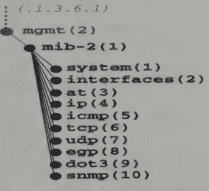

图 6.1 mib-2 群组视图。

## 系统群组

`system` 群组由提供有关运行代理的设备或系统的通用信息的对象组成。图 6.2 展示了系统群组的层次视图。

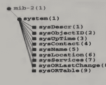

图 6.2 系统群组视图。

该群组中的对象大多不言自明。带有 `sysServices`、`sysUpTime` 和 `sysOR` 前缀的对象需要额外信息。`sysServices` 对象代表一个七位代码，对应设备提供的组合服务的值。代码中的每一位与 OSI 模型的某一层相关联，如果设备在特定层提供服务，则该层对应的位被置位。例如，考虑一个提供路由功能的设备。该设备关联的 `sysServices` 值为 72。表 6.2 包含层及相关服务的列表。`sysServices` 的值是位值之和，其中任意特定位的值为 2 的 L-1 次方（其中 L 为层号）。因此，对于作为第 1 层和第 2 层设备的交换设备，我们得到

```
$2^{1-1} + 2^{2-1} = 3$
```

和/或应用服务器（第 4 层和第 7 层），我们得到

```
$2^{4-1} + 2^{7-1} = 72$
```

我们在该等式中包含第 4 层，因为应用服务器同时在第 7 层和第 4 层提供服务。

第 5 层和第 6 层的定义目前不存在。注

**表 6.2 用于确定 sysServices 的功能层**

| 层 | 设备功能 |
|---|---|
| 1 | 物理层：在此层运行的设备称为网络中继器 |
| 2 | 数据链路层和/或网络层：在此层运行的设备包括网络网桥或交换机 |
| 3 | 互联网/网络层：在此层运行的设备是网关或路由器 |
| 4 | 端到端服务，如 IP 主机 |
| 7 | 应用服务，如邮件中继、DNS 服务器等。 |

`sysUpTime` 对象指示自网络管理代理上次启动以来经过的时间。这不一定意味着设备本身自那时起一直在运行。例如，运行在操作系统之上的代理。代理可以独立于系统重新启动，因此可能不代表系统实际运行的时间。然而，对于某些设备，代理无法独立于系统启动或停止。在这种情况下，代理的时间应更准确。

`system` 群组还包含一些与充当代理角色的 SNMPv2 设备相关的对象。这些对象的名称以 `sysOR` 前缀开头，由 SNMPv2（或更高版本）代理支持。这些对象控制对象资源的动态配置。由于这些对象是随着 SNMPv2 标准引入的，SNMPv1 代理不支持它们。

`system` 群组包含以下对象集合：

- **对象名称：** sysDescr
  **OID：** system.1
  **对象类型：** `Display String [255]`
  **访问模式：** 只读
  **说明：** 设备或实体的描述，如设备类型、硬件特性、操作系统信息等。

- **对象名称：** `sysObjectID`
  **OID：** system.2
  **对象类型：** `Object Identifier`
  **访问模式：** 只读
  **说明：** 设备供应商的权威标识

- **对象名称：** `sysUpTime`
  **OID：** system.3
  **对象类型：** `TimeTick`
  **访问模式：** 只读
  **说明：** 系统（代理）的网络管理部分上次重新初始化以来的时间量

- **对象名称：** `sysContact`
  **OID：** system.4
  **对象类型：** `Display String [255]`
  **访问模式：** 读写
  **说明：** 记录为此设备提供支持的联系人和/或其他组织的信息

- **对象名称：** sysName
  **OID：** system.5
  **对象类型：** Display String [255]
  **访问模式：** 读写
  **说明：** 设备的名称；可以是官方主机名或另一个管理分配的名称

- **对象名称：** sysLocation
  **OID：** system.6
  **对象类型：** Display String [255]
  **访问模式：** 读写
  **说明：** 设备安装的物理位置

- **对象名称：** sysServices
  **OID：** system.7
  **对象类型：** Integer
  **访问模式：** 只读
  **说明：** 该设备提供的服务

- **对象名称：** sysOrLastChange
  **OID：** system.8
  **对象类型：** TimeStamp
  **访问模式：** 只读
  **说明：** 在 $sysORID$ 对象的任何实例最近一次发生更改时 $sys\_upTime$ 对象的值

- **对象名称：** $sysORTable$
  **OID：** $system.9$
  **对象类型：** Sequence of $SysORDentry$
  **访问模式：** 只读
  **说明：** 充当代理角色的 $SNMPv2$ 系统中可动态配置的对象资源表

- **对象名称：** $sysORentry$
  **OID：** $sysORTable.1$
  **对象类型：** Sequence
  **访问模式：** 只读
  **说明：** 特定可配置对象的信息

- **对象名称：** $sysORindex$
  **OID：** $sysORentry.1$
  **对象类型：** Object Identifier
  **访问模式：** 只读
  **说明：** 用作索引进入 $sysORTable$

- **对象名称：** $sysORID$
  **OID：** $sysORentry.2$


对象名称：`sysORID`  
OID：`sysOREntry.1`  
对象类型：显示字符串 [255]  
访问模式：只读  
描述：此条目的 OID，类似于 `sysObjectID` 对象

对象名称：`sysORDescr`  
OID：`sysOREntry.3`  
对象类型：显示字符串 [255]  
访问模式：只读  
描述：对象资源的描述，类似于 `sysDescr` 对象

对象名称：`sysORUpTime`  
OID：`sysOREntry.4`  
对象类型：TimeStamp  
访问模式：只读  
描述：包含此实例（行）最后更新或实例化时 `sysUpTime` 对象的值

当查询 Linux 系统的 `system` 组时，将返回以下对象及其关联值：

```
system.sysDescr.0 = "Linux socrates 2.2.5-15 #5 Mon Aug 2 21:07:04 EDT 1999 i586"
system.sysObjectID.0 = OID: enterprises.ucdavis.ucdSnmpAgent.linux
system.sysUpTime.0 = Timeticks: (160910) 0:26:49.10
system.sysContact.0 = "Steve Rossman"
system.sysName.0 = "socrates"
system.sysLocation.0 = "Media Lab · 10th Floor"
system.sysServices.0 = 72
```

在此示例中，`sysDescr` 对象包含运行代理的系统的信息。该字符串提供的基本信息与从 UNIX `uname` 命令获得的信息相同：

```
# uname -a
Linux socrates 2.2.5-15 #5 Mon Aug 2 21:07:04 EDT 1999 i586 unknown
```

`sysObjectID` 对象包含标识代理的 Linux 分支的 OID。`sysUpTime` 对象显示代理已运行约 26 分 49 秒。`sysContact`、`sysName` 和 `sysLocation` 对象分别包含设备所有者 (Steve Rossman)、名称 (socrates) 和位置 (Media Lab — 10th Floor) 的具体信息。第 7 章“使用 SNMP 代理”将展示如何更新这些字段以包含特定于您的系统和环境的信息。最后，`sysServices` 对象显示该设备提供第 4 层和第 7 层服务。

## 接口组

`interfaces` 组提供有关设备中安装的网络接口的配置和统计信息。正如第 2 章“简单网络管理协议”中所讨论的，此组具有一个 `ifNumber` 对象，它包含系统上安装的网络接口总数，而不管任何特定接口的运行状态如何。另一个对象 `ifTable` 是一个表，包含每个接口的一行。该表由 `ifIndex` 对象索引，并包含 1 到 `ifNumber` 对象值之间的值。`ifIndex` 编号可直接寻址每一列或接口。`ifTable` 包含 22 个对象，提供以下内容：

- 类型、容量和其他接口特性
- 运行信息
- 性能和统计信息

**图 6.3** *接口组视图。*


查询 Linux 系统的 *interfaces* 表将显示类似于以下的输出：

```
interfaces.ifNumber.0 = 2

interfaces.ifTable.ifEntry.ifIndex.1 = 1
interfaces.ifTable.ifEntry.ifIndex.2 = 2

interfaces.ifTable.ifEntry.ifDescr.1 = "lo"  Hex: 6C 6F 30
interfaces.ifTable.ifEntry.ifDescr.2 = "eth0"  Hex: 65 74 68 30

interfaces.ifTable.ifEntry.ifType.1 = softwareLoopback(24)
interfaces.ifTable.ifEntry.ifType.2 = ethernet-csmacd(6)

interfaces.ifTable.ifEntry.ifMtu.1 = 3924
interfaces.ifTable.ifEntry.ifMtu.2 = 1500

interfaces.ifTable.ifEntry.ifSpeed.1 = Gauge: 10000000
interfaces.ifTable.ifEntry.ifSpeed.2 = Gauge: 10000000

interfaces.ifTable.ifEntry.ifPhysAddress.1 = ""
interfaces.ifTable.ifEntry.ifPhysAddress.2 = Hex: 00 10 5A 28 5D 7C

interfaces.ifTable.ifEntry.ifAdminStatus.1 = up(1)
interfaces.ifTable.ifEntry.ifAdminStatus.2 = up(1)

interfaces.ifTable.ifEntry.ifOperStatus.1 = up(1)
interfaces.ifTable.ifEntry.ifOperStatus.2 = up(1)

interfaces.ifTable.ifEntry.ifLastChange.1 = TimeTicks: (0) 0:00:00.00
interfaces.ifTable.ifEntry.ifLastChange.2 = TimeTicks: (0) 0:00:00.00

interfaces.ifTable.ifEntry.ifInOctets.1 = 373912
interfaces.ifTable.ifEntry.ifInOctets.2 = 50204

interfaces.ifTable.ifEntry.ifInUcastPkts.1 = 1218
interfaces.ifTable.ifEntry.ifInUcastPkts.2 = 163

interfaces.ifTable.ifEntry.ifInNUcastPkts.1 = 0
interfaces.ifTable.ifEntry.ifInNUcastPkts.2 = 0

interfaces.ifTable.ifEntry.ifInDiscards.1 = 0
interfaces.ifTable.ifEntry.ifInDiscards.2 = 0

interfaces.ifTable.ifEntry.ifInErrors.1 = 0
interfaces.ifTable.ifEntry.ifInErrors.2 = 0

interfaces.ifTable.ifEntry.ifInUnknownProtos.1 = 0
interfaces.ifTable.ifEntry.ifInUnknownProtos.2 = 0

interfaces.ifTable.ifEntry.ifOutOctets.1 = 381304
interfaces.ifTable.ifEntry.ifOutOctets.2 = 174020

interfaces.ifTable.ifEntry.ifOutUcastPkts.1 = 1242
interfaces.ifTable.ifEntry.ifOutUcastPkts.2 = 565

interfaces.ifTable.ifEntry.ifOutNUcastPkts.1 = 0
interfaces.ifTable.ifEntry.ifOutNUcastPkts.2 = 0

interfaces.ifTable.ifEntry.ifOutDiscards.1 = 0
interfaces.ifTable.ifEntry.ifOutDiscards.2 = 0

interfaces.ifTable.ifEntry.ifOutErrors.1 = 0
interfaces.ifTable.ifEntry.ifOutErrors.2 = 0

interfaces.ifTable.ifEntry.ifOutQLen.1 = Gauge: 0
interfaces.ifTable.ifEntry.ifOutQLen.2 = Gauge: 0

interfaces.ifTable.ifEntry.ifSpecific.1 = OID:.ccitt.nullOID
interfaces.ifTable.ifEntry.ifSpecific.2 = OID:.ccitt.nullOID
```

请注意，ifNumber 对象等于 2，因为系统上总共定义了两个接口。因此，ifIndex.1 和 ifIndex.2 对象分别设置为 1 和 2，以便它们可用于分别索引每个接口。ifDescr 对象包含设备内运行的代理所知道的接口名称。例如，使用上面的输出，第一个以太网接口称为 eth0。因此，ifDescr 对象将包含此接口名称，其中每个字符均转换为十六进制 ("eth0" Hex: 65 74 68 30.)。因此 eth0 的十六进制值为 65 74 68 30。代理提供的接口名称与使用 ifconfig 或 netstat 命令显示的名称相同。有关更多信息，请参阅第 4 章“核心系统实用程序和工具”。

ifType 对象使用单个整数标识符记录网络接口的类型。该数字可映射到一个关键字字符串，该字符串提供有关所用实际接口的更多描述性信息。MIB-II 标准定义了大量网络接口类型。表 6.3 列出了一些较常用的接口。有关完整列表，请参阅 RFC1213。观察可知，eth0 承载接口类型 6，即 ethernetCsmacd。

ifMtu 对象，即最大传输单元 (MTU)，标识允许用于该接口的协议数据单元 PDU（或帧）的最大大小。标准以太网为 1500，而 softwareLoopback 要高得多，为 3924。不同系统可能会根据各自系统的适宜性，为软件环回实现不同值的 MTU。ifSpeed 对象显示接口的最大容量。在示例中，两个接口的速度均为 10000000。此值代表每秒 10Mb 以太网 LAN 的理论性能。其他接口将根据接口类型显示更高或更低的容量。这里有一个例子：支持 PPP 的串行接口，其 ifSpeed 为 9600，考虑到串行 RS-232 接口的硬件特性，这代表可支持的每秒 9600 比特。

### 表 6.3 常用接口类型及描述

| 编号 | 类型 | 描述 |
| --- | --- | --- |
| 1 | other | 非以下类型 |
| 6 | ethernetCsmacd | 以太网网络协议 |
| 7 | iso88023Csmacd | IEEE 802.3 带冲突检测的载波侦听多路访问 (CSMA/CD) 网络协议 |
| 9 | iso88025TokenRing | IEEE 802.5 TokenRing 网络协议 |
| 15 | fddi | ANSI 光纤分布式数据接口 (FDDI) 网络协议 |
| 20 | basicISDN | 基本速率综合业务数字网 (ISDN) |
| 21 | primaryISDN | 主速率 ISDN |
| 23 | ppp | 点对点互联网协议 |
| 23 | softwareLoopback | 用于进程间通信的内部接口 |
| 30 | ds3 | 使用 DS-3 格式的数字传输线路 |
| 37 | atm | 异步传输模式 (ATM) |
| 46 | hssi | 高速串行接口 (HSSI) |

`ifPhysAddress` 对象标识接口的数据链路协议地址（如果适用）。`eth0` 接口的 `ifPhysAddress` 为 `00 10 5A 28 5D 7C`，而 `ifPhysAddress` 包含空字符串值 (`""`)。原因在于软件环回不使用任何硬件，且无数据链路地址

所需或必需。`ifPhysAddress` 中包含的地址用于系统间的低级网络通信。每当一个数据包从此接口发出时，该地址将用作数据包的源地址。

`ifAdminStatus` 和 `ifOperStatus` 对象显示接口的管理状态和操作状态。网络管理员使用管理状态来控制接口。该对象提供了控制接口何时标记为 `up` 或 `down` 的能力。此外，还可以设置第三种状态 `testing`。`up` 状态意味着允许数据包通过接口流动，而 `down` 状态意味着不接收或发送来自此接口的数据包。这与接口的物理连接状态无关。换句话说，网络接口可能已连接到运行中的网络，但如果它被标记为 `down`，则该接口不会读取任何网络流量。`testing` 状态启用内部接口诊断以验证接口的正确操作。`ifOperStatus` 对象显示接口的当前状态，它是 `ifAdminStatus` 对象所表示的已定义状态之一。该对象获取特定接口的状态。

> `ifAdminStatus` 对象的访问权限为读写；接口组中的所有其他对象都无法由网络管理员修改，因为它们具有只读访问权限。这一点的原因应该显而易见且合乎逻辑。接口的计数器和描述性信息不应被更改，这是合理的，因为保持接口类型信息以避免网络配置问题并维护准确的性能指标非常重要。

`ifSpecific` 对象包含 `ccitt.nullOID` 的值，它代表一个有效但为空的 OID 字符串。接口组包含以下对象集合。

- **对象名称：** `ifNumber`
- **OID：** `interfaces.1`
- **对象类型：** Integer
- **访问模式：** read-only
- **描述：** 本地系统中包含的网络接口总数

**对象名称：** ifTable
**OID：** `interfaces.2`
**对象类型：** Sequence of ifEntry
**访问模式：** na
**描述：** 此表的接口条目列表或行

**对象名称：** ifEntry
**OID：** `interfaces.ifTable`
**对象类型：** Sequence
**访问模式：** not-accessible
**描述：** 包含其下方定义的所有对象的特定接口条目

**对象名称：** ifIndex
**OID：** `ifEntry.1`
**对象类型：** Integer
**访问模式：** read-only
**描述：** 用于访问网络接口的特定介质类型的 MIB 引用定义

**对象名称：** ifDescr
**OID：** ifEntry.2
**对象类型：** DisplayString [255]
**访问模式：** read-only
**描述：** 接口的字符串描述，包括从操作系统角度看到的接口名称；可能的值包括：eth0、ppp0 和 lo0

**对象名称：** ifType
**OID：** ifEntry.3
**对象类型：** INTEGER
**访问模式：** read-only
**描述：** 接口类型。表 6.3 列出了具体类型

**对象名称：** ifMtu
**OID：** ifEntry.4
**对象类型：** Integer
**访问模式：** read-only
**描述：** 接口的最大传输单元。这表示可在接口上发送和/或接收的最大帧

**对象名称：** ifSpeed
**OID：** ifEntry.5
**对象类型：** Gauge
**访问模式：** read-only
**描述：** 接口的数据速率（容量）

**对象名称：** ifPhysAddress
**OID：** ifEntry.6
**对象类型：** PhysAddress
**访问模式：** read-only
**描述：** 接口的数据链路地址

**对象名称：** ifAdminStatus
**OID：** ifEntry.7
**对象类型：** Integer
**访问模式：** read-write
**描述：** 接口的管理状态，它是 `ifOperStatus` 对象中列出的已定义状态之一。设备所有者可利用此对象控制接口

**对象名称：** ifOperStatus
**OID：** ifEntry.8
**对象类型：** Integer
**访问模式：** read-only
**描述：** 接口当前的操作状态。已定义的状态包括 up(1)、down(2) 和 testing(3)

**对象名称：** ifLastChange
**OID：** ifEntry.9
**对象类型：** TimeTicks
**访问模式：** read-only
**描述：** 接口最后更新为其当前操作状态的时间

**对象名称：** ifInOctets
**OID：** ifEntry.10
**对象类型：** Counter
**访问模式：** read-only
**描述：** 接口接收的八位字节（字节）数，包括任何数据链路帧字节

**对象名称：** ifInUcastPkts
**OID：** ifEntry.11
**对象类型：** Counter
**访问模式：** read-only
**描述：** 通过高层协议交付给子网的单播数据包数量

**对象名称：** ifInNUcastPkts
**OID：** ifEntry.12
**对象类型：** Counter
**访问模式：** read-only
**描述：** 交付给高层网络协议的非单播数据包数量

**对象名称：** ifInDiscards
**OID：** ifEntry.13
**对象类型：** Counter
**访问模式：** read-only
**描述：** 被丢弃的入站数据包数量（尽管无错误），不会被交付给高层网络协议

**对象名称：** `ifInErrors`
**OID：** `ifEntry.14`
**对象类型：** `Counter`
**访问模式：** `read-only`
**描述：** 因错误而未被交付给高层网络协议的入站数据包数量

**对象名称：** `ifInUnknownProtos`
**OID：** `ifEntry.15`
**对象类型：** `Counter`
**访问模式：** `read-only`
**描述：** 因未知或不支持的网络协议而被丢弃的入站数据包数量

**对象名称：** `ifOutOctets`
**OID：** `ifEntry.16`
**对象类型：** `Counter`
**访问模式：** `read-only`
**描述：** 接口上发送的八位字节（字节）数。这也包括任何数据链路帧字节

**对象名称：** `ifOutUcastPkts`
**OID：** ifEntry.17
**对象类型：** Counter
**访问模式：** read-only
**描述：** 高层协议（如 IP）请求发送到网络单播地址的数据包数量。这包括被丢弃或未发送的数据包

**对象名称：** ifOutNUcastPkts
**OID：** ifEntry.18
**对象类型：** Counter
**访问模式：** read-only
**描述：** 高层协议（如 IP）请求发送到非单播地址的数据包数量。这也包括被丢弃或因其他原因未发送的数据包。

**对象名称：** ifOutDiscards
**OID：** ifEntry.19
**对象类型：** Counter
**访问模式：** read-only
**描述：** 因与特定错误条件无关的原因而无法发送的数据包数量。例如，这可能是由数据包的 TTL 过期引起的

**对象名称：** ifOutErrors
**OID：** ifEntry.20
**对象类型：** Counter
**访问模式：** read-only
**描述：** 因错误而无法发送的数据包数量

**对象名称：** `ifOutQLen`
**OID：** `ifEntry.21`
**对象类型：** `Gauge`
**访问模式：** `read-only`
**描述：** 设备上输出数据包队列的长度

**对象名称：** `ifSpecific`
**OID：** `ifEntry.22`
**对象类型：** `Object Identifier`
**访问模式：** `read-only`
**描述：** 用于实现网络接口的特定介质类型的 MIB 引用定义

## 地址转换组

`at` 组由单个表组成，该表提供从网络地址到物理地址的映射。图 6.4 显示了地址转换组的树视图。该组已被弃用（这意味着它已被另一组 MIB 对象取代），但为了与现有的 MIB-I 标准向后兼容而保留。许多现有代理继续支持此组，包括 Linux 代理。既然是这样，我们在此描述该组。


## MIB-II 概述

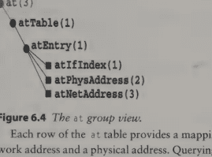

at 表的每一行都提供了网络地址与物理地址之间的映射。查询 Linux 系统的 at 表将显示类似以下的输出：

```
at.atTable.atEntry.atIfIndex.1.1.10.0.2.50 = 1
at.atTable.atEntry.atIfIndex.1.1.10.0.2.127 = 1
at.atTable.atEntry.atPhysAddress.1.1.10.0.2.50 = Hex: 00 00 00 00 00 00
at.atTable.atEntry.atPhysAddress.1.1.10.0.2.127 = Hex: 00 C0 97 0E A3 06
at.atTable.atEntry.atNetAddress.1.1.10.0.2.127 = IpAddress: 10.0.2.127
at.atTable.atEntry.atNetAddress.1.1.10.0.2.50 = IpAddress: 10.0.2.50
at.atTable.atEntry.atNetAddress.1.1.10.0.2.127 = IpAddress: 10.0.2.127
```

网络地址通常是分配给接口的 IP 地址。物理地址表示适合该接口的数据链路网络地址。该表由 atIfIndex 对象索引，该对象包含接口组中 atIfIndex 对象的映射。网络地址对象也为 at 表建立索引。例如，atIfIndex.1.1.10.0.2.50 用作指向与该 IP 地址关联的 atPhysAddress 和 atNetAddress 对象的指针。请注意，OID 字符串包含接口的实际 IP 地址，并用作索引键。atPhysAddress 对象包含该接口类型的数据链路协议的物理地址。示例显示了一个有效的十六进制以太网地址。atNetAddress 对象包含接口的有效 IP 地址，以标准的点分十进制表示法表示。

at 表的大小将随 ARP 缓存的变化而变化。根据网络流量，ARP 表将增长和收缩。`arp` 命令可以列出 UNIX 系统上的 ARP 表。第 4 章“核心系统实用程序和工具”将详细解释此实用程序。此外，由于 at 表代表 ARP 条目，因此该表也会列出不完整的映射。您可以通过检查 `atPhysAddress.1.1.10.0.2.10 = Hex: 00 00 00 00 00 00` 条目来查看这一点。请注意，十六进制值全为零，这意味着未为此 IP 地址获取映射。

### at 表对象

at 表包含以下对象：

| 对象名称 | OID | 对象类型 | 访问模式 | 描述 |
|-------------|-----|-------------|-------------|-------------|
| atTable (已弃用) | mib-2.at | AtEntry 序列 | 只读 | 网络地址与物理（数据链路）地址之间的映射 |
| ifEntry (已弃用) | mib-2.at | 序列 | 只读 | 包含下表所列所有剩余对象的特定映射 |
| atIfIndex (已弃用) | mib-2.at | 整数 | 读写 | 对每个特定映射的引用 |
| atPhysAddress (已弃用) | ifEntry.22 | PhysAddress | 读写 | 依赖于媒体的物理地址（即有效 IP 地址） |
| atNetAddress (已弃用) | ifEntry.22 | NetworkAddress | 读写 | 与依赖于媒体的物理地址关联的 IP 地址 |

## 互联网协议组

`ip` 组包含测量进出系统的 IP 流量的网络计数器。该组还包含提供网络层路由和数据链路映射信息的附加表。图 6.5 以树视图格式显示了 `ip` 组。

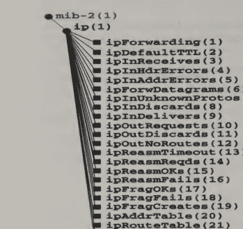

**图 6.5 ip 组视图。**

`ip` 组包含以下对象集：

### IP 组对象

| 对象名称 | OID | 对象类型 | 访问模式 | 描述 |
|-------------|-----|-------------|-------------|-------------|
| ipForwarding | ip.1 | 整数 | 读写 | 指示系统是作为 IP 网关（路由器）运行，还是仅作为不提供转发服务的普通主机运行。有效值为 Forwarding(1) 和 NotForwarding(2) |
| ipDefaultTTL | ip.2 | 整数 | 读写 | 放置在 IP 数据包 TTL 字段中的生存时间 (TTL) 值 |
| ipInReceives | ip.3 | 计数器 | 只读 | 从系统内运行的所有接口接收到的输入数据包总数 |
| ipInHdrErrors | ip.4 | 计数器 | 只读 | 因 IP 头部错误而被丢弃的输入数据包数量 |
| ipInAddrErrors | ip.5 | 计数器 | 只读 | 因最终 IP 目标地址对该系统无效而被丢弃的输入数据包数量 |
| ipInFwdDatagrams | ip.6 | 计数器 | 只读 | 系统作为网关或路由器时尝试转发的数据包数量 |
| ipInUnknownProtos | ip.7 | NetworkAddress | 读写 | 因网络层协议不受支持或系统未知，而从网络成功接收后被丢弃的数据包数量 |
| ipInDiscards | ip.8 | 计数器 | 只读 | 因缺乏缓冲区空间或与数据包本身无关的其他条件而被丢弃的输入数据包数量 |
| ipInDelivers | ip.9 | 计数器 | 只读 | 成功交付给高层协议的输入数据包数量 |
| ipOutRequests | ip.10 | 计数器 | 只读 | 高层协议交付给 IP 协议以进行传输的 IP 数据包数量 |
| ipOutDiscards | ip.11 | 计数器 | 只读 | 因缺乏缓冲区空间或与数据包本身无关的其他条件而被丢弃的输出数据包数量 |
| ipOutNoRoutes | ip.12 | 计数器 | 只读 | 因未知到达所需目标网络的路由而被丢弃的数据包数量 |
| ipReasmTimeout | ip.13 | 计数器 | 只读 | 输入 IP 分片数据包在重组前被保留的时间间隔（秒） |
| ipReasmReqs | ip.14 | 计数器 | 只读 | 需要重组的接收到的 IP 分片数据包数量 |
| ipReasmOKs | ip.15 | 计数器 | 只读 | 成功重组的 IP 分片数据包数量 |
| ipReasmFails | ip.16 | 计数器 | 只读 | 检测到的重组失败次数 |
| ipFragOK | ip.17 | 计数器 | 只读 | 成功分片的数据包数量 |
| ipFragFails | ip.18 | 计数器 | 只读 | 因 IP 头部中设置了“不分片”标志而未分片的数据包数量 |
| ipFragCreates | ip.19 | 计数器 | 只读 | 在此系统上生成的 IP 数据包片段数量 |
| ipAddrTable | ip.20 | IpAddrEntry 序列 | 不可访问 | 与系统 IP 地址相关的寻址信息表 |
| ipRouteTable | ip.21 | IpRouteEntry 序列 | 不可访问 | 通往特定目标的路由 |
| ipNetToMediaTable | ip.22 | IpNetToMediaEntry 序列 |  |  |


**访问模式：** 不可访问  
**描述：** IP 地址与数据链路地址之间的映射  

**对象名称：** ipRoutingDiscards  
**OID：** ip.23  
**对象类型：** 计数器  
**访问模式：** 只读  
**描述：** 尽管数据包有效，但被丢弃的数据包数量  

ip 组包含三个表：ipAddrTable、ipRouteTable 和 ipNetToMediaTable。ipAddrTable 表存储与系统上使用的 IP 地址相关的信息。图 6.6 显示了该表的树视图。


表中的每一行由对象 ipAddrIfIndex 索引，并包含一个与物理网络接口对应的单个 IP 地址，该行被分配从接口组的 ifIndex 对象派生出的接口编号。例如，下面列出的输出包含值为 3 的 ipAddrIfIndex.12.77.195.141 对象。数字 3 代表系统上的第三个接口，碰巧是一个点对点链路 (pp0)。IP 地址 12.77.195.141 被分配给该接口。我们可以通过检查接口表中的 ifDescr 对象来确定第三个接口的类型。对象 ipAddrNetMask 标识 IP 地址 (ipAddrAddr) 的网络掩码，或在适用时标识子网掩码。对象 ipAddrBcastAddr 显示用于在与该 IP 地址相关的逻辑接口上发送数据包的 IP 广播地址的最低有效位的值。以下是 ipAddrTable 表的示例列表：

```
ip.ipAddrTable.ipAddrEntry.ipAddrAddr.10.0.2.201 = IPaddress: 10.0.2.201
ip.ipAddrTable.ipAddrEntry.ipAddrAddr.12.77.195.141 = IPaddress: 12.77.195.141
ip.ipAddrTable.ipAddrEntry.ipAddrAddr.127.0.0.1 = IPaddress: 127.0.0.1
ip.ipAddrTable.ipAddrEntry.ipAddrIfIndex.10.0.2.201 = 2
ip.ipAddrTable.ipAddrEntry.ipAddrIfIndex.12.77.195.141 = 3
ip.ipAddrTable.ipAddrEntry.ipAddrIfIndex.127.0.0.1 = 1
ip.ipAddrTable.ipAddrEntry.ipAddrNetMask.10.0.2.201 = IPaddress: 255.255.255.0
ip.ipAddrTable.ipAddrEntry.ipAddrNetMask.12.77.195.141 = IPaddress: 255.255.255.255
ip.ipAddrTable.ipAddrEntry.ipAddrNetMask.127.0.0.1 = IPaddress: 255.0.0.0
ip.ipAddrTable.ipAddrEntry.ipAddrBcastAddr.10.0.2.201 = 1
ip.ipAddrTable.ipAddrEntry.ipAddrBcastAddr.12.77.195.141 = 0
ip.ipAddrTable.ipAddrEntry.ipAddrBcastAddr.127.0.0.1 = 1
ip.ipAddrTable.ipAddrEntry.ipAddrReasmMaxSize.10.0.2.201 = -1
ip.ipAddrTable.ipAddrEntry.ipAddrReasmMaxSize.12.77.195.141 = -1
ip.ipAddrTable.ipAddrEntry.ipAddrReasmMaxSize.127.0.0.1 = -1
```

ipRouteTable 表为条目提供 IP 路由信息，并在必要时用于做出路由决策。对于每个已知路由，都有一个由 ipRouteDest 对象索引的单个表条目。对于每个条目，通往目的地的下一跳的本地接口包含在 ipRouteIfIndex 对象中。该值与接口组的 ifIndex 对象匹配。以下列表包含与 199.70.195.0 网络相关的路由信息：

```
ip.ipRouteTable.ipRouteEntry.ipRouteIfIndex.199.70.195.41 = 3
ip.ipRouteTable.ipRouteEntry.ipRouteMetric1.199.70.195.41 = 0
ip.ipRouteTable.ipRouteEntry.ipRouteMetric2.199.70.195.41 = -1
ip.ipRouteTable.ipRouteEntry.ipRouteMetric3.199.70.195.41 = -1
ip.ipRouteTable.ipRouteEntry.ipRouteMetric4.127.0.0.0 = -1
ip.ipRouteTable.ipRouteProto.ipRouteProto.199.70.195.41 = -1
ip.ipRouteTable.ipRouteEntry.ipRouteNextHop.199.70.195.41 =
     IpAddress: 0.0.0.0
ip.ipRouteTable.ipRouteEntry.ipRouteType.199.70.195.41 = direct(3)
ip.ipRouteTable.ipRouteEntry.ipRouteMask.199.70.195.41 = local(2)
ip.ipRouteTable.ipRouteEntry.ipRouteAge.199.70.195.41 = 0
ip.ipRouteTable.ipRouteEntry.ipRouteMask.199.70.195.41 =
     IpAddress: 255.255.255.255
ip.ipRouteTable.ipRouteEntry.ipRouteMetric5.199.70.195.41 = -1
ip.ipRouteTable.ipRouteEntry.ipRouteInfo.199.70.195.41 = OID:
     .ccitt.null(0)ID
```

请注意，此输出是从其他条目列表中选取并手动格式化的；路由信息通常不会按列出的顺序显示。图 6.7 显示了 `ipRouteTable` 表的树视图。`ipRouteMetric1` 对象以及其他三个度量对象用于表示此路由的路由度量。度量的实际定理由 `ipRouteProto` 值指定的路由协议决定。在这种情况下，值零表示这是该网络最直接的路由。当特定度量对象未被使用时（例如 `ipRouteMetric4.199.70.195.41`），其值为 -1。

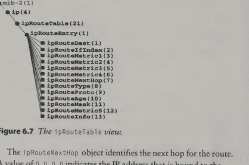

`ipRouteNextHop` 对象标识路由的下一跳。值 `0.0.0.0` 表示绑定到该接口的 IP 地址。**ipRouteType** 对象指示路由类型，并包含以下值：**other** (1)、**invalid** (2)、**direct** (3) 和 **indirect** (4)。**ipRouteType** 传达了**直接**和**间接**路由的概念。**invalid** 值使路由无效，**other** 意味着不适用于其他任何列出的值。**direct** 值意味着**目的地**地址位于直接连接的子网上，而 **indirect** 意味着**目的地**不在直接连接的网络上，但在到达**目的地**之前必须至少遍历一条额外的路由。**ipRouteProto** 对象指示用于学习路由的机制。表 6.4 列出了使用 **local** 方法示例的 **ipRouteProto** 值。此值意味着路由是手动配置的，无需路由协议的帮助。例如，这可以在接口首次初始化时完成。

### 表 6.4 定义的 ipRouteProto 值

| ipRouteProto 值 | 描述 |
|---|---|
| other | 无以下任何值 |
| local | 手动配置或源自非路由协议源的路由信息 |
| netmgmt | 从网络管理协议获得的路由信息 |
| icmp | 来自主机和其他设备关于问题的反馈；提供给出特定路由信息的重定向消息 |
| egp | 外部网关协议 (EGP)，在 RFC904 中描述；一种简单的路由器到路由器网络协议 |
| ggp | 网关到网关协议；早期互联网实现使用的一种路由协议，但现已废弃 |
| hello | 用于同一自治系统内路由之间的一种简单路由协议 |
| rlp | 路由信息协议 (RIP) —— UNIX 系统事实上的标准路由协议 |
| ls-ls | 中间系统到中间系统协议 |
| es-ls | 端系统到中间系统协议 |
| ciscoIgrp | 思科专有内部网关协议 |
| bbnSpfIgp | BBN 的最短路径优先内部网关协议 |
| ospf | RFC1583，开放最短路径优先 (OSPF) 自治网关路由协议 |
| bgp | RFC1771，边界网关协议 (BGP) 自治网关路由协议 |

`ipRouteAge` 对象表示自上次更新此路由或确定其为正确路由以来的秒数。`ipRouteMask` 对象指示在与 `ipRouteBest` 对象中的值进行比较之前，要与目的地址进行逻辑与 (&) 运算的掩码。`ipRouteMetrics` 对象是此路由的备用路由度量，与其他度量一样，当未使用时值为 -1。最后一个对象 `ipRouteInfo` 用作对特定路由协议负责的特定 MIB OID 字符串的引用。如果信息不可用，则应使用有效的对象标识符 `00`。

`ipRouteTable` 表具有以下对象：

### ipRouteEntry
- **对象名称：** ipRouteEntry
- **OID：** ipRouteTable.1
- **对象类型：** 序列
- **访问模式：** 不适用
- **描述：** 通往特定目的地的路由

### ipRouteDest
- **对象名称：** ipRouteDest
- **OID：** ipRouteEntry.1
- **对象类型：** IP地址
- **访问模式：** 读写
- **描述：** 此路由定义的 IP 地址目的地

### ipRouteIfIndex
- **对象名称：** ipRouteIfIndex
- **OID：** ipRouteEntry.2
- **对象类型：** 整数
- **访问模式：** 读写
- **描述：** 标识可通过其到达此路由的下一个路由跳的本地接口的索引

### ipRouteMetric1
- **对象名称：** ipRouteMetric1
- **OID：** ipRouteEntry.3
- **对象类型：** 整数
- **访问模式：** 读写
- **描述：** 此路由的主要路由度量


对象名称：ipRouteMetric2
OID：ipRouteEntry.4
对象类型：Integer
访问模式：read-write
描述：此路由的备用路由度量值

对象名称：ipRouteMetric3
OID：ipRouteEntry.5
对象类型：Integer
访问模式：read-write
描述：此路由的备用路由度量值

对象名称：ipRouteMetric4
OID：ipRouteEntry.6
对象类型：Integer
访问模式：read-write
描述：此路由的备用路由度量值

对象名称：ipRouteNextHop
OID：ipRouteEntry.7
对象类型：IpAddress
访问模式：read-write
描述：此路由下一跳的IP地址

对象名称：ipRouteType
OID：ipRouteEntry.8
对象类型：Integer
访问模式：read-write
描述：此路由的类型标识符。有效类型包括 `other(1), invalid(2), direct(3), and indirect(4)`

对象名称：ipRouteProto
OID：ipRouteEntry.9
对象类型：Integer
访问模式：read-only
描述：用于学习此路由的路由机制

对象名称：ipRouteAge
OID：ipRouteEntry.10
对象类型：IpAddress
访问模式：read-write
描述：自路由被更新或验证以来经过的时间（秒）

对象名称：ipRouteMask
OID：ipRouteEntry.11
对象类型：IpAddress
访问模式：read-write
描述：与目标地址一起使用（与运算）的掩码地址

对象名称：ipRouteMetrics5
OID：ipRouteEntry.12
对象类型：Integer
访问模式：read-write
描述：此路由的备用路由度量值

对象名称：ipRouteInfo
OID：ipRouteEntry.13
对象类型：Object Identifier
访问模式：read-only
描述：对负责此路由的路由协议的MIB定义引用

*ipNetToMediaTable* 表是一个地址转换表，包含与IP地址和物理地址对应的条目。图 6.8 显示了此表的树视图。

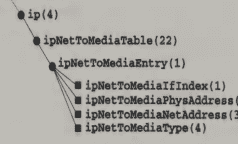

**图 6.8**
*ipNetToMediaTable 表视图。*

此表中包含的信息基本上与 *at* 表相同。唯一的区别是 *ipNetToMediaType* 对象，它列出了所使用的映射类型。

对象名称：ipNetToMediaIfIndex
OID：ipNetToMediaEntry.1
对象类型：Integer
访问模式：read-write
描述：尽管数据包有效但仍被丢弃的数据包数量

ipNetToMediaTable 表包含以下对象集：

对象名称：ipNetToMediaPhysAddress
OID：ipNetToMediaEntry.2
对象类型：PhysAddress
访问模式：read-write
描述：依赖媒体的物理地址；例如，以太网地址

对象名称：ipNetToMediaNetAddress
OID：ipNetToMediaEntry.3
对象类型：IpAddress
访问模式：read-write
描述：与依赖媒体的物理地址对应的IP地址

对象名称：ipNetToMediaType
OID：ipNetToMediaEntry.4
对象类型：Counter
访问模式：read-write
描述：生成地址的映射类型。类型包括 other(1)、invalid(2)、dynamic(3) 和 static(4)

`ipNetToMediaTable` 表的示例列表如下所示：

```
ip.NetToMediaTable.ipNetToMediaEntry.ipNetToMediaIfIndex.1.10.0.2.127 = 1
ip.NetToMediaTable.ipNetToMediaEntry.ipNetToMediaPhysAddress.1.10.0.2.127 = 0.60:97:e:a3:6
ip.NetToMediaTable.ipNetToMediaEntry.ipNetToMediaNetAddress.1.10.0.2.127 = IpAddress: 10.0.2.127
ip.NetToMediaTable.ipNetToMediaEntry.ipNetToMediaType.1.10.0.2.127 = dynamic(3)
```

`ipNetToMediaType` 对象被赋值为 `dynamic(3)`，其他可能的值包括：`other(1)`、`invalid(2)` 和 `static(4)`。动态分配意味着该条目是由某种自动方式创建的，可能使用动态主机配置协议（DHCP）或其他机制。

## IP 转发组

IP 转发表被添加到 MIB-II 中，是因为 `ipRouteTable` 表存在问题。使用 IP 转发表，到单个目标的多条路由可以出现，但访问这些条目取决于实现访问此表的机制。不幸的是，在 SNMP 中没有标准化的方法来获取此路由信息。为此引入了 `ipForward` 组，并将其放置在 IP 表的末尾，如图 6.9 所示。


**图 6.9** *`ipForward` 视图。*

`ipForwardTable` 表中的大多数对象与 `ipRouteTable` 表中的对象对应，并且具有相同的语法和含义。因此，未列出这些对象的详细列表。主要区别在于每个对象前缀已从 `ipRoute` 更改为 `ipForward`。此外，还添加了两个新对象：`ipForwardPolicy` 和 `ipForwardNextHops`。
`ipForwardPolicy` 对象指示到特定目标的路由策略。对于 IP 服务，策略基于 IP 头中包含的 IP 服务类型字段。该字段定义了八个不同优先级级别之一和一个延迟的二进制值。`ipForwardNextHop` 对象通过提供自治路由域中下一跳的系统编号，帮助管理区域网络的人员。

`ipRouteDest` 对象用作 `ipRouteTable` 表中的索引。`ipForwardTable` 表可以由 `ipForwardDest`、`ipForwardProto`、`ipForwardPolicy` 和 `ipForwardNextHop` 索引。

## ICMP 组

`icmp` 组包含记录互联网控制消息协议操作的计数器。ICMP 诊断连接问题和其他网络层问题。著名的 `ping` 实用程序使用此协议。`icmp` 组对象列表如图 6.10 所示。

`icmp` 组包含以下对象集：

- **对象名称：** `icmpInMsgs`
- **OID：** `icmp.1`
- **对象类型：** Counter
- **访问模式：** read-only
- **描述：** 接收到的 ICMP 消息数量

- **对象名称：** `icmpInErrors`
- **OID：** `icmp.2`


# 图 6.10 icmp 组视图。

**对象类型：** Counter
**访问模式：** read-only
**描述：** 接收到的包含特定 ICMP 错误的 ICMP 消息数量

**对象名称：** icmpInDestUnreachs
**OID：** icmp.3
**对象类型：** Counter
**访问模式：** read-only
**描述：** 接收到的 ICMP 目标不可达消息数量

**对象名称：** icmpInTimeExcds
**OID：** icmp.4

- **对象类型：** Counter
- **访问模式：** read-only
- **描述：** 接收到的 ICMP 超时消息数量

- **对象名称：** icmpInParmProbs
- **OID：** icmp.5
- **对象类型：** Counter
- **访问模式：** read-only
- **描述：** 接收到的 ICMP 参数问题消息数量

- **对象名称：** icmpInSrcQuenches
- **OID：** icmp.6
- **对象类型：** Counter
- **访问模式：** read-only
- **描述：** 接收到的 ICMP 源抑制消息数量

- **对象名称：** icmpInRedirects
- **OID：** icmp.7
- **对象类型：** Counter
- **访问模式：** read-only
- **描述：** 接收到的 ICMP 重定向消息数量

- **对象名称：** icmpInEchos
- **OID：** icmp.8


## ICMP 组

### ICMP 对象

| 对象名称 | OID | 对象类型 | 访问模式 | 描述 |
|-------------|-----|-------------|-------------|-------------|
| icmpEchoReps | icmp.9 | Counter | read-only | 接收到的 ICMP 回显应答消息数量 |
| icmpTimestamps | icmp.10 | Counter | read-only | 接收到的 ICMP 时间戳请求消息数量 |
| icmpInTimestampReps | icmp.11 | Counter | read-only | 接收到的 ICMP 时间戳应答消息数量 |
| icmpAddrMasks | icmp.12 | Counter | read-only | 接收到的 ICMP 地址掩码请求数量 |
| icmpAddrMasksReps | icmp.13 | Counter | read-only | 接收到的 ICMP 地址掩码应答消息数量 |
| icmpOutMsgs | icmp.14 | Counter | read-only | 系统尝试发送的 ICMP 消息数量 |
| icmpOutErrors | icmp.15 | Counter | read-only | 因 ICMP 问题导致系统无法发送的 ICMP 消息数量 |
| icmpOutDestUnreachs | icmp.16 | Counter | read-only | 发送的 ICMP 目标不可达消息数量 |
| icmpOutTimeExcds | icmp.17 | Counter | read-only | 发送的 ICMP 超时消息数量 |
| icmpOutParmProbs | icmp.18 | Counter | read-only | 发送的 ICMP 参数问题消息数量 |
| icmpOutSrcQuenchs | icmp.19 | Counter | read-only | 发送的 ICMP 源抑制消息数量 |
| icmpOutRedirects | icmp.20 | Counter | read-only | 发送的 ICMP 重定向消息数量 |
| icmpOutEchos | icmp.21 | Counter | read-only | 发送的 ICMP 回显请求消息数量 |
| icmpOutEchoReps | icmp.22 | Counter | read-only | 发送的 ICMP 回显应答消息数量 |
| icmpOutTimestamps | icmp.23 | Counter | read-only | 发送的 ICMP 时间戳请求消息数量 |
| icmpOutTimestampReps | icmp.24 | Counter | read-only | 发送的 ICMP 时间戳应答消息数量 |
| icmpOutAddrMasks | icmp.25 | Counter | read-only | 发送的 ICMP 地址掩码请求消息数量 |
| icmpOutAddrMaskReps | icmp.26 | Counter | read-only | 发送的 ICMP 地址掩码应答消息数量 |

### 查询 ICMP 组的示例输出

```text
icmp.icmpInMsgs.0 = 27
icmp.icmpInErrors.0 = 0
icmp.icmpInDstUnreachs.0 = 7
icmp.icmpInTimeExcds.0 = 0
icmp.icmpInParmProb.0 = 0
icmp.icmpInSrcQuenches.0 = 0
icmp.icmpInRedirects.0 = 0
icmp.icmpInEchos.0 = 8
icmp.icmpInEchoReps.0 = 12
icmp.icmpInTimestamps.0 = 0
icmp.icmpInTimestampReps.0 = 0
icmp.icmpInAddrMasks.0 = 0
icmp.icmpInAddrMaskReps.0 = 0
```

```text
icmp.icmpOutMsgs.0 = 10
icmp.icmpOutErrors.0 = 0
icmp.icmpOutDestUnreachs.0 = 2
icmp.icmpOutTimeExcds.0 = 0
icmp.icmpOutParmProbs.0 = 0
icmp.icmpOutSrcQuenchs.0 = 0
icmp.icmpOutRedirects.0 = 0
icmp.icmpOutEchos.0 = 0
icmp.icmpOutEchoReps.0 = 8
icmp.icmpOutTimestamps.0 = 0
icmp.icmpOutTimestampReps.0 = 0
icmp.icmpOutAddrMasks.0 = 0
icmp.icmpOutAddrMaskReps.0 = 0
```

从输出可以看出，许多计数器的值都很低。这符合预期。某些对象（如 icmpInTimeExcds）的高计数表明存在配置问题或其他操作问题。

## TCP 组

tcp 组存储系统上传输控制协议 (TCP) 的统计和操作信息。该组包含一个表，用于存储系统上每个 TCP 连接的信息。图 6.11 显示了该组的树视图。


### TCP 对象

| 对象名称 | OID | 对象类型 | 访问模式 | 描述 |
|-------------|-----|-------------|-------------|-------------|
| tcpRtoAlgorithm | tcp.1 | Counter | read-only | 重传时间算法；可能的值包括 other(1)、constant(2)、rsrc(3) 和 varj(4) |
| tcpRtoMin | tcp.2 | Counter | read-only | 重传计时器的最小值 |
| tcpRtoMax | tcp.3 | Counter | read-only | 重传计时器的最大值 |
| tcpMaxConn | tcp.4 | Counter | read-only | 系统支持的 TCP 连接总数（或限制） |
| tcpActiveOpens | tcp.5 | Counter | read-only | 该系统支持的主动打开次数 |
| tcpPassiveOpens | tcp.6 | Counter | read-only | 该系统支持的被动打开次数 |
| tcpAttemptFails | tcp.7 | Counter | read-only | 该系统上发生的失败连接尝试次数 |
| tcpEstabResets | tcp.8 | Counter | read-only | 该系统上发生的复位次数 |
| tcpCurrEstab | tcp.9 | Counter | read-only | 处于 ESTABLISHED 或 CLOSE-WAIT 状态的 TCP 连接数量 |
| tcpInSegs | tcp.10 | Counter | read-only | 接收到的段数，包括错误接收的段 |
| tcpOutSegs | tcp.11 | Counter | read-only | 发送的段数，但不包括包含重传字节的段 |
| tcpRetransSegs | tcp.12 | Counter | read-only | 重传段的数量 |
| tcpConnTable | tcp.13 | Counter | read-only | TCP 连接信息 |
| tcpInErrors | tcp.14 | Counter | read-only | 错误接收的段数量 |
| tcpOutRsts | tcp.15 | Counter | read-only | 发送的包含 RST 标志的 TCP 段数量 |

### 轮询 Linux 系统的示例输出

```text
tcp.tcpRtoAlgorithm.0 = other(1)
tcp.tcpRtoMin.0 = 0
tcp.tcpRtoMax.0 = 0
tcp.tcpMaxConn.0 = 0
tcp.tcpActiveOpens.0 = 105422
tcp.tcpPassiveOpens.0 = 0
tcp.tcpAttempFails.0 = 2968
tcp.tcpEstabResets.0 = 0
tcp.tcpCurrEstab.0 = Gauge: 2
tcp.tcpInSegs.0 = 63591
tcp.tcpOutSegs.0 = 111130
tcp.tcpRetransSegs.0 = 1881
```

### tcpConnTable

`tcpConnTable` 表存储系统上 TCP 连接的具体信息。图 6.12 显示了该表的树视图。`tcpConnEntry` 对象用作表中的索引。该表的大小由系统上记录的连接数量决定。在繁忙的服务器上，它可能非常大。


`tcpConnState` 对象标识连接的当前状态。有效值包括：closed(1)、listen(2)、sysSent(3)、sysReceived(4)、established(5)、finWait1(6)、finWait2(7)、closeWait(8)、lastAck(9)、closing(10)、timeWait(11) 和 deleteTCB(12)。除 `deleteTCB(12)` 外，这些状态值代表第 2 章“简单网络管理协议”中讨论的 TCP 状态机模型。回想一下，每个连接将处于这些定义状态之一。`deleteTCB(12)` 状态表示该连接的 TCP 控制块 (TCB) 已被删除。其余对象存储本地和远程 IP 地址及端口对。例如，考虑以下输出：


tcp. tcpConnTable. tcpConnEntry. tcpConnState.10.0.2.201.23.10.0.2.127.1033 = timeWait(11)
tcp. tcpConnTable. tcpConnEntry. tcpConnState.10.0.2.201.23.10.0.2.127.1035 = established(5)
tcp. tcpConnTable. tcpConnEntry. tcpConnState.10.0.2.201.53.0.0.0.0 = listen(2)
tcp. tcpConnTable. tcpConnEntry. tcpConnLocalAddress.10.0.2.201.23.10.0.2.127.1033 = ipAddress: 10.0.2.201
tcp. tcpConnTable. tcpConnEntry. tcpConnLocalAddress.10.0.2.201.23.10.0.2.127.1035 = ipAddress: 10.0.2.201
tcp. tcpConnTable. tcpConnEntry. tcpConnLocalAddress.10.0.2.201.53.0.0.0.0 = ipAddress: 10.0.2.201
tcp. tcpConnTable. tcpConnEntry. tcpConnLocalPort.10.0.2.201.23.10.0.2.127.1033 = 23
tcp. tcpConnTable. tcpConnEntry. tcpConnLocalPort.10.0.2.201.23.10.0.2.127.1035 = 23
tcp. tcpConnTable. tcpConnEntry. tcpConnLocalPort.10.0.2.201.53.0.0.0.0 = 53
tcp. tcpConnTable. tcpConnEntry. tcpConnRemAddress.10.0.2.201.23.10.0.2.127.1033 = ipAddress: 10.0.2.127
tcp. tcpConnTable. tcpConnEntry. tcpConnRemAddress.10.0.2.201.23.10.0.2.127.1035 = ipAddress: 10.0.2.127
tcp. tcpConnTable. tcpConnEntry. tcpConnRemAddress.10.0.2.201.53.0.0.0.0 = ipAddress: 0.0.0.0
tcp. tcpConnTable. tcpConnEntry. tcpConnRemPort.10.0.2.201.23.10.0.2.127.1033 = 1033
tcp. tcpConnTable. tcpConnEntry. tcpConnRemPort.10.0.2.201.23.10.0.2.127.1035 = 1035
tcp. tcpConnTable. tcpConnEntry. tcpConnRemPort.10.0.2.201.53.0.0.0.0 = 0

## 给定的连接

tcpConnState.10.0.2.201.23.10.0.2.127.1035 = established(5) 表示已建立状态，tcpConnLocalAddress 值为 10.0.2.201，tcpConnLocalPort 值为 23，而存储在 tcpConnRemoteAddress 和 tcpConnRemotePort 中的远程信息分别为 10.0.2.201 和 1035。

## UDP 组

UDP 组包含与系统中用户数据报协议 (UDP) 的实现和操作相关的对象。名为 udpTable 的表记录了监听传入请求的 UDP 服务的本地地址和端口信息。其余对象是记录特定 UDP 流量统计的计数器。

UDP 组由以下对象组成：

**对象名称：** udpInDatagrams
**OID：** udp.1

**对象类型：** Counter

**访问模式：** read-only

**描述：** 交付给高层协议和应用程序的 UDP 数据报数量

**对象名称：** udpNoPorts

**OID：** udp.2

**对象类型：** Counter

**访问模式：** read-only

**描述：** 未提供特定应用程序端口的已接收 UDP 数据报数量

**对象名称：** udpInErrors

**OID：** udp.3

**对象类型：** Counter

**访问模式：** read-only

**描述：** 因与有效应用程序或目标端口无关的原因而无法交付的已接收 UDP 数据报数量

**对象名称：** udpOutDatagrams

**OID：** udp.4

**对象类型：** Counter

**访问模式：** read-only

**描述：** 从此系统发送的 UDP 数据报数量

**对象名称：** udpTable

* **OID：** udp.5  
* **对象类型：** UdpEntry 序列  
* **访问模式：** not-accessible  
* **描述：** UDP 监听器地址和端口信息

* **对象名称：** udpEntry  
* **OID：** udpTable.1  
* **对象类型：** Sequence  
* **访问模式：** not-accessible  
* **描述：** 每个 UDP 会话对应一个 udpTable

* **对象名称：** udpLocalAddress  
* **OID：** udpEntry.1  
* **对象类型：** IpAddress  
* **访问模式：** read-only  
* **描述：** 此 UDP 监听器、服务或应用程序的本地 IP 地址

* **对象名称：** udpLocalPort  
* **OID：** udpEntry.2  
* **对象类型：** Integer  
* **访问模式：** read-only  
* **描述：** 此 UDP 监听器、服务或应用程序的本地端口（套接字）号

图 6.13 显示了 UDP 组的树视图。示例值是通过查询 Linux SNMP 代理获得的：


## 图 6.13 UDP 组视图。

```
udp.udpInDatagrams.0 = 1867
udp.udpNoPorts.0 = 8
udp.udpInErrors.0 = 0
udp.udpOutDatagrams.0 = 1951
udp.udpTable.udpEntry.udpLocalAddress.0.0.0.0.0.111 = IpAddress: 0.0.0.0
udp.udpTable.udpEntry.udpLocalAddress.0.0.0.0.0.161 = IpAddress: 0.0.0.0
udp.udpTable.udpEntry.udpLocalAddress.0.0.0.0.0.177 = IpAddress: 0.0.0.0
udp.udpTable.udpEntry.udpLocalAddress.0.0.0.0.0.517 = IpAddress: 0.0.0.0
udp.udpTable.udpEntry.udpLocalAddress.0.0.0.0.0.518 = IpAddress: 0.0.0.0
udp.udpTable.udpEntry.udpLocalAddress.0.0.0.0.0.615 = IpAddress: 0.0.0.0
udp.udpTable.udpEntry.udpLocalAddress.0.0.0.0.0.626 = IpAddress: 0.0.0.0
udp.udpTable.udpEntry.udpLocalAddress.0.0.0.0.0.636 = IpAddress: 0.0.0.0
udp.udpTable.udpEntry.udpLocalAddress.0.0.0.0.0.641 = IpAddress: 0.0.0.0
udp.udpTable.udpEntry.udpLocalAddress.0.0.0.0.0.679 = IpAddress: 0.0.0.0
udp.udpTable.udpEntry.udpLocalAddress.0.0.0.0.0.646 = IpAddress: 0.0.0.0
udp.udpTable.udpEntry.udpLocalAddress.0.0.0.0.0.800 = IpAddress: 0.0.0.0
udp.udpTable.udpEntry.udpLocalAddress.0.0.0.0.0.1022 = IpAddress: 0.0.0.0
udp.udpTable.udpEntry.udpLocalAddress.0.0.0.0.0.1023 = IpAddress: 0.0.0.0
udp.udpTable.udpEntry.udpLocalAddress.0.0.0.0.0.1024 = IpAddress: 0.0.0.0
udp.udpTable.udpEntry.udpLocalAddress.0.0.0.0.0.1026 = IpAddress: 0.0.0.0
udp.udpTable.udpEntry.udpLocalAddress.0.0.0.0.0.1041 = IpAddress: 0.0.0.0
udp.udpTable.udpEntry.udpLocalAddress.0.0.0.0.0.2049 = IpAddress: 0.0.0.0
udp.udpTable.udpEntry.udpLocalAddress.10.0.2.201.53 = IpAddress: 10.0.2.201
udp.udpTable.udpEntry.udpLocalAddress.127.0.0.1.53 = IpAddress: 127.0.0.1
udp.udpTable.udpEntry.udpLocalAddress.127.0.0.1.1119 = IpAddress: 127.0.0.1
udp.udpTable.udpEntry.udpLocalPort.0.0.0.0.0.111 = 111
udp.udpTable.udpEntry.udpLocalPort.0.0.0.0.0.161 = 161
udp.udpTable.udpEntry.udpLocalPort.0.0.0.0.0.177 = 177
udp.udpTable.udpEntry.udpLocalPort.0.0.0.0.0.517 = 517
udp.udpTable.udpEntry.udpLocalPort.0.0.0.0.0.518 = 518
udp.udpTable.udpEntry.udpLocalPort.0.0.0.0.0.615 = 615
udp.udpTable.udpEntry.udpLocalPort.0.0.0.0.0.626 = 626
udp.udpTable.udpEntry.udpLocalPort.0.0.0.0.0.636 = 636
udp.udpTable.udpEntry.udpLocalPort.0.0.0.0.0.641 = 641
udp.udpTable.udpEntry.udpLocalPort.0.0.0.0.0.646 = 646
udp.udpTable.udpEntry.udpLocalPort.0.0.0.0.0.679 = 679
udp.udpTable.udpEntry.udpLocalPort.0.0.0.0.0.800 = 800
```

udp.udpTable.udpEntry.udpLocalPort.0.0.0.0.1022 = 1022
udp.udpTable.udpEntry.udpLocalPort.0.0.0.0.1023 = 1023
udp.udpTable.udpEntry.udpLocalPort.0.0.0.0.1024 = 1024
udp.udpTable.udpEntry.udpLocalPort.0.0.0.0.1026 = 1026
udp.udpTable.udpEntry.udpLocalPort.0.0.0.0.1041 = 1041
udp.udpTable.udpEntry.udpLocalPort.0.0.0.0.2049 = 2049
udp.udpTable.udpEntry.udpLocalPort.10.0.2.201.53 = 53
udp.udpTable.udpEntry.udpLocalPort.127.0.0.1.53 = 53
udp.udpTable.udpEntry.udpLocalPort.127.0.0.1.1119 = 1119

在大多数 UNIX 系统中，一组核心网络服务和应用程序在绑定到本地端口时使用标准地址。使用标准地址 0.0.0.0，它表示*本*主机。例如，在上面的输出中，对象

```
udpLocalAddress.0.0.0.0.161 = IpAddress: 0.0.0.0
```

演示了使用本地地址 0.0.0.0，该地址绑定到 UDP 端口 161。与该端口关联的服务是 SNMP 进程（或 snmpd），udpLocalPort.0.0.0.0.161 = 161（类型为 *Integer*）保存此端口信息。正如你所见，大量服务正在运行 udpEntry 表，其中每个服务包含一个条目。

如果你想确定哪个进程与哪个端口关联，可以在 /etc/services 文件中查找端口号，或运行 **netstat** 命令。请参考 **netstat** 命令的输出：

```
# netstat -n -a -udp
(Not all processes could be identified, non-owned process info
will not be shown, you would have to be root to see it all.)
Active Internet connections (servers and established)
Proto Recv-Q Send-Q Local Address Foreign Address State
PID/Program name
udp 0 0 0.0.0.0:177 0.0.0.0:* 69/
udp 0 127.0.0.1:1119 0.0.0.0:* 652/activated
udp 0 0.0.0.0:800 0.0.0.0:*
udp 0 0.0.0.0:1022 0.0.0.0:* 501/amd
udp 0 0.0.0.0:1679 0.0.0.0:* 501/amd
udp 0 0.0.0.0:1023 0.0.0.0:* 501/amd
udp 0 0.0.0.0:2049 0.0.0.0:*
udp 0 0.0.0.0:646 0.0.0.0:* 460/rpc.mountd
udp 0 0.0.0.0:641 0.0.0.0:* 460/rpc.mountd
udp 0 0.0.0.0:636 0.0.0.0:* 460/rpc.mountd
udp 0 0.0.0.0:626 0.0.0.0:* 449/rpc.rquotad
udp 0 0.0.0.0:615 0.0.0.0:* 438/rpc.statd
udp 0 0.0.0.0:161 0.0.0.0:* 376/snmpd
*(continued)*
```

```
udp    0    0 0.0.0.0:1024    0.0.0.0:*    406/named
udp    0    0 10.0.2.201:53    0.0.0.0:*    406/named
udp    0    0 127.0.0.1:53    0.0.0.0:*    406/named
udp    0    0 0.0.0.0:518    0.0.0.0:*    362/netd
udp    0    0 0.0.0.0:517    0.0.0.0:*    362/netd
udp    0    0 0.0.0.0:111    0.0.0.0:*    255/PORTMAP
```

`snmpd` 进程以**粗体**显示，包含的信息与 `udpTable` 相同。有关 `netstat` 命令的完整说明，请参阅第 4 章“核心系统实用程序和工具”。

## EGP 组

`egp` 组包含与系统中外部网关协议的操作和实现相关的计数器和对象。由于大多数 UNIX 系统不实现此组，因此未包含其说明。但请注意，某些网络设备（如提供路由服务的设备）将支持此 MIB 组。

## 传输 (dot3) 组

`dot3` 组包含的对象提供了关于系统上每个已定义接口的低级数据链路媒介的详细信息。实际上，`dot3` 组并非真正的组，而是 MIB-II 分支层次结构下的一个节点。该组的主要目的是以特定接口 MIB 的形式提供特定于接口的信息。回顾一下，`interfaces` 组提供适用于给定系统上所有接口的通用信息。`dot3` 下的特定接口 MIB 包含与特定数据链路协议（如以太网）相关的信息。

以太网 MIB 在 RFC1643 中定义，定义了一组代表类以太网通信媒介属性的对象。EtherLike MIB 包含三种不同的访问方法（或 `ifType`），包括 `ethernet-csmacd`、`iso88023-csmacd` 和 `starlan`。`ethernet-csmacd` 方法适用于使用基带同轴电缆介质在 10Mbps 下运行的以太网标准。`iso88023-csmacd` 方法涵盖 IEEE 802.3 委员会制定的所有标准和国际标准 ISO 8802-3。其中包括的拓扑和布线介质有快速以太网，它使用 UTP 和光纤以及千兆以太网。`starlan` 方法涵盖已废弃的 1 Mbps LAN 拓扑。请注意，只有以太网等网络技术使用此 MIB。其他网络介质类型（例如 FDDI）没有冲突。支持这些类型接口的设备通常不支持此 MIB 组。

### 图 6.14 dot3 传输组视图。


`dot3StateTable` 表记录代理与物理网络媒介之间观察到的流量统计信息。需要使用表而不是一组特定的计数器，因为工作站、服务和其他网络设备可能包含不止一个网络接口。因此，系统上每个已定义的接口都有一个表条目。该表由 `dot3StateIndex` 对象索引。`dot3StateTable` 表对象如图 6.15 所示。

### 图 6.15 dot3StateTable 视图。


#### dot3StateTable 对象

| 对象名称 | OID | 对象类型 | 访问模式 | 说明 |
| :--- | :--- | :--- | :--- | :--- |
| dot3StateEntry | dot3StateTable.1 | Sequence | read-only | 类以太网网络接口的统计信息 |
| dot3StateIndex | dot3StateEntry.1 | Integer | read-only | 标识 dot3StateTable 表中的一个接口 |
| dot3StateAlignmentErrors | dot3StateEntry.2 | Counter | read-only | 从网络读取的、包含在正确字节边界内的帧 |
| dot3StateFCSErrors | dot3StateEntry.3 | Counter | read-only | 从网络读取的、未通过帧检验序列 (FCS) 的帧 |
| dot3StateSingleCollisionFrames | dot3StateEntry.4 | Counter | read-only | 在网络上传输且恰好导致一次冲突的帧 |
| dot3StateMultipleCollisionFrames | dot3StateEntry.5 | Counter | read-only | 在网络上传输且导致多次冲突的帧 |
| dot3StateSQETestErrors | dot3StateEntry.6 | Counter | read-only | SQE 测试检查生成的频率 |
| dot3StateDeferredTransmission | dot3StateEntry.7 | Counter | read-only | 因网络争用而导致首次传输尝试延迟的帧数 |
| dot3StateLateCollisions | dot3StateEntry.8 | Counter | read-only | 传输时在 12 比特时间间隔检测到冲突的次数 |
| dot3StateExcessiveCollisions | dot3StateEntry.9 | Counter | read-only | 因过度冲突而失败的传输帧数 |
| dot3StateInternalMacTransmitErrors | dot3StateEntry.10 | Counter | read-only | 因内部媒体访问控制 (MAC) 错误而失败的传输帧数 |
| dot3StateCarrierSenseErrors | dot3StateEntry.11 | Counter | read-only | 传输帧时载波侦听 (CS) 条件丢失或未断言的次数 |
| dot3StateFrameTooLong | dot3StateEntry.13 | Counter | read-only | 超过最大帧长度的接收帧数 |
| dot3StateInternalMacReceiveErrors | dot3StateEntry.16 | Counter | read-only | 因内部媒体访问控制 (MAC) 错误而失败的接收帧数 |
| dot3StateEtherChipSet | dot3StateEntry.17 | Counter | read-only | 与该接口关联的芯片组名称 |

`dot3CollTable` 表包含代理与网络媒介之间观察到的冲突活动记录。它为系统上定义的一组接口存储一个直方图。`dot3CollCount` 对象包含每个接口的单个直方图点。`dot3CollFrequencies` 对象存储在关联的 `dot3CollCount` 对象中恰好经历特定冲突次数的接口上的传输帧数。

#### dot3CollTable 对象

| 对象名称 | OID | 对象类型 | 访问模式 | 说明 |
| :--- | :--- | :--- | :--- | :--- |
| dot3CollEntry | dot3CollTable.1 | Sequence | read-only | 一组网络接口的冲突直方图集合 |
| dot3CollCount | dot3CollEntry.1 | Counter | read-only | 特定接口的一个直方图点。特定接口的冲突总数 |
| dot3CollFrequencies | dot3CollEntry.2 | Counter | read-only | 接口上经历关联 dot3CollCount 对象中确切冲突次数的帧数 |

剩下的两个表 `dot3Tests` 和 `dot3Errors` 用于测试接口和报告错误。`dot3Tests` 表包含两个对象 `dot3TestTDR` 和 `dot3TestLoopBack`，用于标识可针对网络媒介调用的特定测试。`dot3TestTDR` 对象调用时域反射仪 (TDR) 测试，而 `dot3TestLoopBack` 对象提供硬件环回测试。`dot3Errors` 表也包含两个对象 `dot3ErrorInitError` 和 `dot3ErrorLoopbackError`，用于存储与从 `dot3Tests` 表执行的任何测试相关的错误信息。

#### dot3Tests 对象

| 对象名称 | OID | 对象类型 | 访问模式 | 说明 |
| :--- | :--- | :--- | :--- | :--- |
| dot3TestTDR | dot3Tests.1 | Counter | read-only | TDR 测试 |
| dot3TestLoopBack | dot3Tests.2 | Counter | read-only | 环回测试 |

#### dot3Errors 对象

| 对象名称 | OID | 对象类型 | 访问模式 | 说明 |
| :--- | :--- | :--- | :--- | :--- |
| dot3ErrorInitError | dot3Errors.1 | Counter | read-only | 初始化错误 |
| dot3ErrorLoopbackError | dot3Errors.2 | Counter | read-only | 环回错误 |


**对象名称：** dot3ErrorInitError
**OID：** dot3Errors.1
**对象类型：** Counter
**访问模式：** read-only
**描述：** 标识与芯片组测试失败相关的错误

**对象名称：** dot3StateIndex
**OID：** dot3StateEntry.1
**对象类型：** Counter
**访问模式：** read-only
**描述：** 与运行回环测试相关的错误

## SNMP 组

SNMP 组包含与 SNMP 的操作和实现相关的信息。该组中的某些对象与 SNMP 站管理或代理功能相关。因此，每个 SNMP 实现都可能使用表中的特定对象。代理不支持的那些对象包含零值。

除 snmpEnableAuthenTraps 对象为读写外，所有其他对象均为只读。此对象控制代理是否被允许生成认证失败陷阱，通常由网络管理应用程序设置。认证失败是管理实体尝试在代理上执行某些特权功能，但没有正确的安全权限或凭据来执行该操作的结果。图 6.16 显示了 snmp 表的树视图。

请注意，位置 7 和 8 均未列出，因为 MIB 未为这些槽位定义任何对象。如图 6.16 所示，许多 SNMP 对象以灰色列出，而少数以黑色列出。这是因为该表的原始版本包含所有灰色对象以及其他一些对象。当 SNMPv2 规范发布时，许多对象被废弃。然而，由于许多代理继续支持 SNMPv1，这些对象仍在使用中。这是较新的 MIB 规范对过去实现影响甚微的一个例子。较旧的 snmp 组对象将长期伴随我们。snmp 表包含以下对象：


图 6.16 SNMP 组视图。

**对象名称：** snmpInPkts
**OID：** snmp.1
**对象类型：** Counter
**访问模式：** read-only
**描述：** 传递给代理的 SNMP 消息数量

**对象名称：** snmpOutPkts **(已废弃)**
**OID：** snmp.2
**对象类型：** Counter
**访问模式：** read-only
**描述：** 从代理传递到传输层的 SNMP 消息数量

**对象名称：** snmpInBadVersions
**OID：** snmp.3
**对象类型：** Counter
**访问模式：** read-only
**描述：** 传递给代理的不受支持的 SNMP 消息数量

**对象名称：** snmpInBadCommunityNames
**OID：** snmp.4
**对象类型：** Counter
**访问模式：** read-only
**描述：** 传递给代理的包含未知团体名称的 SNMP 消息数量

**对象名称：** snmpInBadCommunityUses
**OID：** snmp.5
**对象类型：** Counter
**访问模式：** read-only
**描述：** 传递给代理的包含所提供 SNMP 团体名称不允许的 SNMP 操作的消息数量

**对象名称：** snmpInASNParseErrs
**OID：** snmp.6
**对象类型：** Counter
**访问模式：** read-only
**描述：** 解码传入 SNMP 消息时遇到的 BER 和 ASN 错误数量

**对象名称：** snmpInTooBig (已废弃)
**OID：** snmp.8
**对象类型：** Counter
**访问模式：** read-only
**描述：** 传递给代理的发生 tooBig 错误的 SNMP PDU 数量

**对象名称：** snmpInNoSuchName (已废弃)
**OID：** snmp.9
**对象类型：** Counter
**访问模式：** read-only
**描述：** 传递给代理的发生 noSuchName 错误的 SNMP PDU 数量

**对象名称：** snmpInBadValues (已废弃)
**OID：** snmp.10
**对象类型：** Counter
**访问模式：** read-only
**描述：** 传递给代理的发生 badValue 错误的 SNMP PDU 数量

**对象名称：** snmpInReadOnlys (已废弃)
**OID：** snmp.11
**对象类型：** Counter
**访问模式：** read-only
**描述：** 传递给代理的发生 readOnly 错误的 SNMP PDU 数量

**对象名称：** snmpInGenErrs (已废弃)
**OID：** snmp.12
**对象类型：** Counter
**访问模式：** read-only
**描述：** 传递给代理的发生 genErr 错误的 SNMP PDU 数量

**对象名称：** snmpInTotalReqVars (已废弃)
**OID：** snmp.13
**对象类型：** Counter
**访问模式：** read-only
**描述：** 代理因有效的 SNMP get-request 和 getnext-request 而成功检索的 MIB 对象数量

**对象名称：** snmpInTotalSetVars (已废弃)
**OID：** snmp.14
**对象类型：** Counter
**访问模式：** read-only
**描述：** 代理因有效的 SNMP set-request 而成功修改的 MIB 对象数量

**对象名称：** snmpInGetRequests (已废弃)
**OID：** snmp.15
**对象类型：** Counter
**访问模式：** read-only
**描述：** 代理接受并处理的 SNMP get-request 数量

**对象名称：** snmpInGetNexts (已废弃)
**OID：** snmp.16
**对象类型：** Counter
**访问模式：** read-only
**描述：** 代理接受并处理的 SNMP getnext-request 数量

**对象名称：** snmpInSetRequests
**OID：** snmp.17
**对象类型：** Counter
**访问模式：** read-only
**描述：** 代理接受并处理的 SNMP set-request 数量

**对象名称：** snmpInGetResponses (已废弃)
**OID：** snmp.18
**对象类型：** Counter
**访问模式：** read-only
**描述：** 代理接受并处理的 SNMP get-response 数量

**对象名称：** snmpInTraps (已废弃)
**OID：** snmp.19
**对象类型：** Counter
**访问模式：** read-only
**描述：** 代理接受并处理的 SNMP trap 数量

**对象名称：** snmpOutTooBig
**OID：** snmp.20
**对象类型：** Counter
**访问模式：** read-only
**描述：** 代理生成的发生 tooBig 错误的 SNMP PDU 数量

**对象名称：** snmpOutNoSuchNames (已废弃)
**OID：** snmp.21
**对象类型：** Counter
**访问模式：** read-only
**描述：** 代理生成的发生 noSuchName 错误的 SNMP PDU 数量

**对象名称：** snmpOutBadValues **(已废弃)**
**OID：** snmp.22
**对象类型：** Counter
**访问模式：** read-only
**描述：** 代理生成的发生 `badValue` 错误的 SNMP PDU 数量

**对象名称：** snmpOutGenErrs **(已废弃)**
**OID：** snmp.24
**对象类型：** Counter
**访问模式：** read-only
**描述：** 代理生成的发生 `genErr` 错误的 SNMP PDU 数量

**对象名称：** snmpOutGetRequests **(已废弃)**
**OID：** snmp.25
**对象类型：** Counter
**访问模式：** read-only
**描述：** 代理生成的 SNMP `get-request` PDU 数量

**对象名称：** snmpOutGetNexts **(已废弃)**
**OID：** snmp.26
**对象类型：** Counter
**访问模式：** read-only
**描述：** 代理生成的 SNMP `getNext-request` PDU 数量

**对象名称：** snmpOutSetRequests **(已废弃)**
**OID：** snmp.27
**对象类型：** Counter
**访问模式：** read-only
**描述：** 代理生成的 SNMP set-request PDU 数量

**对象名称：** snmpOutGetResponses **(已废弃)**
**OID：** snmp.28
**对象类型：** Counter
**访问模式：** read-only
**描述：** 代理生成的 SNMP get-response PDU 数量

**对象名称：** snmpOutTraps **(已废弃)**
**OID：** snmp.29
**对象类型：** Counter
**访问模式：** read-only
**描述：** 代理生成的 SNMP trap 数量

**对象名称：** snmpEnableAuthenTraps
**OID：** snmp.30
**对象类型：** Integer
**访问模式：** read-write
**描述：** 是否应生成认证失败陷阱。有效值为 `enabled(1)` 或 `disabled(2)`。当 SNMP 实体尝试使用无效的团体字符串或认证令牌查询代理时，如果已启用，代理将发出 SNMP 陷阱


## 使用 SNMP 代理

本章详细概述了专门用于 Linux 和 Solaris 系统的 SNMP 代理。Red Hat Linux 系统随附加州大学戴维斯分校 (UCD) SNMP 系统代理，该代理提供 MIB-II 和 UCD 特有对象。Sun 代理称为 Solstice Enterprise Agent (SEA)，随最新版 Solaris 提供，并包含 Sun 特有的 MIB 对象。SEA 包实际上包含两个代理：一个主代理和一个子代理。由于 *Solstice* 一词也指 Sun 的网络管理框架和产品组合，本书将使用*主代理*和*子代理*这两个术语来描述来自 Sun 的这些代理。

## 代理概述

上述列出的三个代理都提供一些相同的基本服务：即 MIB 对象的检索和设置。每个代理都支持标准 SNMP 基本操作，包括 get、set 和 trap。此外，每个代理还提供一些专用功能，例如对磁盘或内存管理的支持。使用哪个代理取决于环境以及您试图解决的问题类型。例如，可能有必要同时使用所有三个代理，因为每个代理都提供所需的服务。

每个代理的功能可归纳为以下几类：

- **MIB-II 支持**：代理支持大部分或全部标准 MIB-II 对象集。MIB-II 标准在前一章中已介绍。
- **进程管理**：提供额外的 MIB 对象来管理 UNIX 进程。基本操作包括通过代理列出和控制这些进程。
- **远程配置**：代理可以通过 SNMP 协议操作自己的配置文件。例如，当监控对象达到临界阈值时代理可以动态更改预定义的操作。
- **扩展 MIB 支持**：代理支持额外的 MIB 对象，提供超出 MIB-II 标准的信息。这可能包括专有的厂商特定 MIB 或标准 MIB，例如主机资源 MIB。
- **灵活配置**：代理提供一组灵活的配置选项和关键字，主要用于控制代理的运行状态和行为。
- **性能对象**：代理支持提供额外性能信息或统计数据的额外 MIB 对象。
- **可定制操作**：代理可以执行包含在代理配置文件中的外部脚本或程序。这些操作通常是代理检测到的某些特定条件或事件的直接结果。
- **内存/磁盘管理**：代理提供提供额外内存或磁盘信息或统计数据的额外 MIB 对象。
- **主代理支持**：代理提供子代理注册以接收 SNMP 消息的能力。主代理负责代表子代理处理外部通信。主代理使用 SNMP 端口 161，而子代理通过另一个预定义端口与主代理通信。
- **可扩展性**：代理可扩展以支持额外功能并提供新特性，例如执行外部 UNIX shell 脚本或其他命令。这也可能意味着代理提供了一个开发环境，包含便于通过重新编译（或链接）包的各个组件来添加新功能的接口。
- **SNMPv2/v3**：代理支持 SNMPv2 和/或 SNMPv3 协议规范的一个或多个要素。

表 7.1 概述了每个代理的功能，可在选择代理时用作快速参考。

## 表 7.1 代理功能概览

| 类别 | Linux | Sun 主代理 | Sun 代理 |
| :--- | :---: | :---: | :---: |
| MIB-II 对象 | | ✓ | ✓ |
| 进程管理对象 | | ✓ | ✓ |
| 远程配置 | ✓ | | |
| 附加系统对象 | | | ✓ |
| 灵活配置 | ✓ | | ✓ |
| 附加性能对象 | ✓ | | ✓ |
| 可定制操作 | ✓ | | |
| 内存管理对象 | | ✓ | |
| 磁盘管理对象 | ✓ | | |
| 主代理 | | ✓ | |
| 子代理管理 | | ✓ | |
| 可扩展能力 | ✓ | | |
| SNMP v2/v3 | ✓ | | |

## Linux SNMP 代理

Linux 代理称为 snmpd，提供全面的 SNMP 相关服务列表。Linux 代理实际上是加州大学戴维斯分校的代理，称为 UCD 代理，可用于包括 Linux 在内的大量操作系统。该代理支持 SNMPv1、SNMPv2 和 SNMPv3 网络管理协议。这意味着它不仅支持基本 SNMP 操作，还支持与 SNMPv2 相关的操作，例如 `get-bulk`、`get-inform` 等。

此外，它支持 SNMPv3 规范中描述的用户安全模型 (USM)。它还支持 MIB-II、UCD MIB 和其他一些 MIB。代理提供基于特定事件或条件配置的远程执行 UNIX 命令的能力。代理可用于监控系统内存和进程信息。

使用 UCD 包的优势非常显著。首先，该软件提供了一套非常完整的工具和功能，属于公共领域。该包包含用户 SNMP 工具，外加一个功能齐全的 SNMP 代理。互联网上有许多 SNMP 包，但大多数无法与 UCD 包的稳定性、健壮性和功能相提并论。其次，尽管 UCD 软件属于公共领域，但它似乎拥有忠实的用户群，并多年来持续改进，甚至在 SNMP 协议支持和功能方面超越了一些成熟的商业产品。UCD 工具支持大量计算机平台和操作系统。该包包含在某些 Linux 发行版中，例如 Red Hat。最后，UCD 包是免费的，这意味着它可以在整个网络企业中部署，无需担心许可问题。这使得该代理对预算有限的机构和其他组织极具吸引力。

### Sun 的主代理

Sun 提供了一个标准 SNMP 网络管理主代理，可用作企业管理策略的基础。该代理称为 snmpd，为一个或多个子代理提供主/子代理设施。回顾第 2 章“简单网络管理协议”，主代理的主要目的和角色是允许多个 SNMP 代理共存。因为每个 SNMP 代理都必须在知名 SNMP 端口 161 上监听请求，所以必须提供一种机制，使所有代理能够共享此端口而不发生冲突。如果没有特殊的仲裁，第一个使用该端口的代理将获得对该端口的独占锁，所有其他代理将被拒绝访问。使用 snmpdx 代理，许多子代理可以安装在同一系统上，而不会出现传统的端口争用问题。此外，此主代理支持一组 MIB 对象，用于描述已配置到主代理的每个子代理。

### Sun 的 SNMP 代理

Sun 还提供标准 SNMP 网络管理系统和代理。该代理称为 *mib1sa*，支持 SNMPv1，并提供对 MIB-II 和 Sun 企业特定对象的读写访问。该代理在 Sun 的主/从代理架构下工作，这意味着它可以与主代理结合运行，也可以在独立模式下运行。它提供了从运营和性能角度管理 Sun 工作站和服务器的能力。它支持标准 MIB-II 对象组以及 Sun 定义的一些附加组。总的来说，该代理的这些功能可以监控网络和系统管理员面临的一些更为关键的网络管理问题。

使用 Sun 代理的优势包括集成到操作系统中并获得供应商支持。因为代理随 Solaris 提供，所以代理组件可以非常容易地随操作系统软件加载。在尚未包含该代理的旧版操作系统上，可以使用 Sun 的 pkgadd 实用程序以简单的方式安装该代理。此外，因为代理由 Sun 开发，所以如果出现需要技术协助的问题，将获得支持。最后，供应商支持确保用户可以期待在代理的未来版本中包含增强功能和新特性。这很重要，因为 SNMP 将继续变化，以满足网络和系统管理员不断增长的需求。

## 代理 MIB

本节所述的每个代理都实现标准或专用（或两者兼有）MIB。由于 Sun 和 UCD 代理都使用专用 MIB，因此对这些对象的访问位于企业分支层级。图 7.1 显示了从根到每个供应商专用分支的路径。


**图 7.1** Sun/UCD 代理 MIB 分支。

## 安全考量

这些代理功能非常强大，会对网络管理产生深远影响。因为它们提供对系统关键部分的访问，所以在配置和使用时应格外小心。例如，Sun 代理的配置文件提供了为 MIB 的读访问和写访问设置团体字符串的功能。许多网络管理系统和代理（包括此处列出的）默认配置为标准团体字符串 *public* 和 *private*。在本地站点部署这些代理时，将这些字符串更改为非标准密码非常重要。尽管可以通过抓包设备获取并解码 SNMP 团体字符串信息，但团体名称仍应唯一且难以猜测。在大型安装环境中，可能需要为一组设备使用一组团体字符串，这些设备可能地理位置相邻，或属于特定类型，如 Cisco 或 3Com 设备。

未能正确配置代理可能导致灾难性后果。例如，使用 Sun 代理时，如果团体字符串为 public，只需一个简单的 SNMP set 操作即可禁用网络接口。拥有 MIB 浏览器或 snmpset 命令工具的人可以轻松禁用一个或多个系统接口。如果被禁用的接口是该系统唯一的接口，该系统将实际上与网络断开连接。结果，所有网络相关进程都将受到此操作的影响。在某些环境中，这将被视为故障，并带来严重后果。要将系统恢复到原始状态，管理员必须登录到系统控制台（如果可用），并使用 ifconfig 命令启用接口。或者，如果不存在系统控制台，必须通过断电重启系统；这一步也会增加数据丢失的可能性，因为无法预先同步文件系统。

这里的经验法则是：设置代理配置文件时要小心，不要使用标准 SNMP 团体名称。正如您将看到的，访问控制列表（ACL）以及代理中可用的其他安全功能将提供进一步保护。

## Linux SNMP 代理

### 总体描述

Linux 代理（snmpd）是一个功能非常强大、可扩展、全功能的 SNMP 系统代理，可在大量 UNIX 平台上使用。有关受支持的具体平台列表，请参见附录 B 中的安装部分。如前所述，该代理支持 MIB-II（网络统计）、SNMPv2 MIB、SMUX MIB、主机资源 MIB 和 UCD-SNMP MIB。这些 MIB 默认位于 `/usr/local/share/mibs` 目录中。但是，即使代理无法找到这些文件，它仍能正常运行。

从网络管理的角度来看，代理可以监控关键系统运行参数（如系统负载平均值），并在这些资源达到关键阈值时提供警报。代理可以执行以下操作：

- 监控磁盘空间使用情况
- 监控系统进程
- 监控系统负载
- 调用 UNIX 命令和 Shell 脚本
- 监控代理信息和状态
- 提供对关键 MIB 对象的访问

以下各节将更详细地探讨这些功能，包括如何配置代理以监控这些资源，以及如何主动解决系统资源限制问题。

### 代理配置文件

代理运行需要一个配置文件。该文件默认位于 `/usr/local/share/snmp` 目录中。它包含一个或多个操作指令，每行包含一个关键字及其关联的若干参数。关键字可分为以下类别之一：*monitor*、*security*、*extensible* 和 *informational*，如表 7.2 所示。监控指令（*proc*、*disk* 和 *load*）包括用于跟踪特定资源（如磁盘空间或系统负载）的指令。安全关键字（*com2sec*、*group*、*view* 和 *access*）用于定义对代理访问的各个安全层，这可能包括访问控制列表（ACL）和 MIB 对象的各种视图。可扩展关键字（*exec* 和 *pass*）定义了在不更改代理软件的情况下向代理添加功能的方法。最后，信息关键字（*syslocation* 和 *syscontact*）将静态信息分配给 MIB 对象。每个关键字都有固定数量的必需参数，也可能有额外的可选参数。

### 表 7.2 按类别排序的 UCD 代理命令

| 类别 | 关键字 | 说明 |
| :------- | :------ | :---------- |
| 监控 | proc | 检查指定进程是否正在运行 |
| | disk | 确定指定文件系统的可用磁盘空间 |
| | load | 监控系统负载平均值 |
| 安全 | com2sec | 指定源/团体名称与安全名称之间的映射 |
| | group | 定义模型/安全名称与组之间的映射 |
| | view | 定义代理 MIB 的一个或多个特定视图 |
| | access | 安全配置参数 |
| 可扩展 | exec | 执行指定命令并通过 MIB 提供输出 |
| | pass | 将 MIB 树传递给指定程序，该程序可操作 MIB 对象 |
| 信息 | syslocation | 表示代理设备的物理位置 |
| | syscontact | 表示代理设备的联系人 |

要插入注释，请在行首放置字符 #。

代理首次启动时，会读取配置文件。如果在代理启动后对文件进行了更改，可以通过两种方式指示代理重新读取配置文件。首先，可以将 MIB 对象 versionUpdateConfig 设置为 1。例如，使用 UCD snmpset 工具，以下命令将强制系统 rodin 上的代理再次处理配置文件：

```
snmpset rodin private 1.3.6.1.4.1.ucdavis.version.versionUpdateConfig.0 i 1
```

其次，可以使用 kill 命令向代理进程发送 -HUP 信号。在发出此命令之前，必须获取代理的进程 ID。例如，可以通过发出 ps 命令来完成。假设发现进程 ID 为 304，则以下命令在功能上等同于 snmpset 命令：

```
# kill -HUP 304
```

某些代理关键字在执行时，会监控修改特定 MIB 对象的资源，这些对象指示返回状态或附加信息。这些对象是代理 MIB 的一部分，可从 UCD (2021) 专用分支访问。MIB 的起始路径为：

```
iso.org.dod.internet.mgmt.enterprises.ucdavis

或

1.3.6.1.4.1.2021
```

此外，如果发现由于其他操作问题（如崩溃）必须重启代理，则调用标准启动脚本：snmpd。例如，要重启代理，需发出以下命令：

```
# /etc/rc.d/init.d/snmpd restart
Shutting down snmpd:
[  OK  ]
Starting snmpd:
[  OK  ]
```

如果代理成功启动，将显示 [ OK ] 字符串；否则将显示错误字符串。

### 注意

snmpd 脚本支持其他命令。这些命令包括 **stop**、**start** 和 **status**。如果代理已在运行，stop 选项将终止代理；如果代理尚未激活，start 选项将启动代理。最后一个选项 status 用于检查代理是否正在运行。

### 监控系统负载

UCD 代理提供通过 **load** 代理命令监控系统负载平均值的能力。系统负载平均值是运行队列中作业（或程序）的平均数量。代理提供与 UNIX **uptime** 和 **w** 命令相同的基本信息。该命令的语法包括：

```
load [1 *minute max*] [5 *minute max*] [15 *minute max*]
```

**load** 命令后跟 1 *maximum*、5 *maximum* 或 15 *maximum*，将指示代理监控这些时间段的系统负载。如果系统负载超过一分钟、五分钟或 15 分钟运行平均值的 *maximum*，则代理将把 `loadAverageFlag` 对象设置为 1，并在 `loadAverageMessage` 对象中包含描述性错误消息。如果未指定 *maximum* 负载字符串，则使用默认值 1 分钟。

**load** 命令是跨大量系统监控系统利用率的绝佳方式。建立系统负载阈值可能有点棘手，因为某些系统可能需要不同的阈值。例如，工作站可能因为用户刚启动了一个 CPU 密集型应用程序而经历高系统负载。另一方面，在拥有大量用户的服务器上启动相同的应用程序可能构成重大问题。此外，某些系统的负载可能始终高于其他系统，但由于预期以这种方式使用该系统，这可能不代表问题。

对于关键系统，负载平均值高于 2 或 3 可能表明存在严重问题，必须及时解决。在

在下面的示例中，代理已被配置为监控一分钟负载平均值，阈值设为 2：

```
load 2
```

如果达到此限制，代理的 MIB 将被适当更新：

```
enterprises.ucdavis.loadTable.laEntry.laErrorFlag.1 = 1
enterprises.ucdavis.loadTable.laEntry.laErrorFlag.2 = 1
enterprises.ucdavis.loadTable.laEntry.laErrorFlag.3 = 0
enterprises.ucdavis.loadTable.laEntry.laErrorMessage.1 = "1 min Load Average too high (<= 2.50)"
enterprises.ucdavis.loadTable.laEntry.laErrorMessage.2 = "5 min Load Average too high (<= 2.26)"
enterprises.ucdavis.loadTable.laEntry.laErrorMessage.3 = ""
```

在这种情况下，MIB 显示一分钟和五分钟负载平均值均超过了 2 的限制阈值。MIB 显示三个 laErrorFlag 和 laErrorMessage 实例，因为负载平均值是按一分钟、五分钟和十五分钟平均值来衡量的。因此，创建了三个独立的 MIB 对象实例。

代理还提供对当前系统负载平均值以及 load 命令本身配置参数的访问。例如，当负载超过 2 标记时，从代理获得的信息如下：

```
enterprises.ucdavis.loadTable.laEntry.laNames.1 = "Load-1"
enterprises.ucdavis.loadTable.laEntry.laNames.2 = "Load-5"
enterprises.ucdavis.loadTable.laEntry.laNames.3 = "Load-15"
enterprises.ucdavis.loadTable.laEntry.laLoad.1 = "2.56" Hex: 32 2E 35 30
enterprises.ucdavis.loadTable.laEntry.laLoad.2 = "2.26" Hex: 32 2E 32 36
enterprises.ucdavis.loadTable.laEntry.laLoad.3 = "1.38" Hex: 31 2E 33 38
enterprises.ucdavis.loadTable.laEntry.laConfig.1 = "2.00" Hex: 32 2E 30 30
enterprises.ucdavis.loadTable.laEntry.laConfig.2 = "2.00" Hex: 32 2E 30 30
enterprises.ucdavis.loadTable.laEntry.laConfig.3 = "2.00" Hex: 32 2E 30 30
```

正如你所见，一分钟和五分钟的负载平均值都高于 2。此外，laConfig 对象在每个负载平均值阈值级别上均设置为 2.00。laNames 对象只是一个用于描述每个负载平均值窗口的标签。此信息直接从代理配置文件中获取。

## 监控磁盘空间

代理可以使用 `disk` 关键字命令监控任何已挂载文件系统的磁盘空间消耗，语法如下：

```
disk [-system [minimum]]
```

代理将监控指定的文件系统，并确定可用的总磁盘空间是否小于最小值。如果是，MIB 对象 *diskErrorFlag* 将被设置为 1，MIB 对象 *diskErrorMsg* 将包含一条描述性消息。如果未提供最小值，代理将使用默认值 100K。最小值存储在 *dskMinimum* 对象中，并设置为配置文件中指定的最小值，如果配置文件中未找到最小值，则设置为默认值。

举例说明，请看以下代理命令：

```
disk /
disk /usr 1000
```

第一条 `disk` 命令将监控 /（根）文件系统，并将最小值与 100 兆字节 进行比较。如果未提供大小参数，将使用 100 千字节（默认值）作为值。此值与可用的总磁盘空间进行比较。默认值可以被覆盖。第二条命令将监控 /usr 文件系统，并将可用空间与 1,000 Kb 的最小值进行比较。由于最小值以 Kb 为单位，我们必须在末尾添加三个零以获得以字节为单位的值。在本例中，我们得到 1,000,000 字节。查询代理返回以下内容：

```
enterprises.ucdavis.diskTable.diskEntry.diskMinimum.1 = 100000
enterprises.ucdavis.diskTable.diskEntry.diskMinimum.2 = 1000
enterprises.ucdavis.diskTable.diskEntry.diskAvail.1 = 56924
enterprises.ucdavis.diskTable.diskEntry.diskAvail.2 = 32545
enterprises.ucdavis.diskTable.diskEntry.diskErrorFlag.2 = 1
enterprises.ucdavis.diskTable.diskEntry.diskErrorMsg.1 = "/:
less than 100000 free ( - 56924)"
enterprises.ucdavis.diskTable.diskEntry.diskErrorMsg.2 = "**"
```

你会注意到定义了两组 MIB 对象。第一组对应根（/）文件系统，因为它在代理配置文件中首先出现。第二组对应 /usr 文件系统，因为它在配置文件中位于第一个条目之后。

正如你所见，diskMinimum 对象已相应设置；映射到 / 文件系统的 diskMinimum.1 实例设置为 100Mb（100,000,000 字节），而映射到 /usr 文件系统的第二个实例 diskMinimum.2 设置为 1Mb（1,000,000 字节）。代理还将每个受监控文件系统的可用磁盘空间存储在 diskAvail 对象中，每个文件系统一个。在本例中，/ 文件系统约为 36Mb，而 /usr 文件系统约为 32Mb。文件系统的 diskErrorFlag.1 对象被设置，因为根文件系统小于 100Mb，且 diskErrorMsg.1 包含更多描述性信息。在这种情况下，diskErrorMsg.2 对象不包含任何信息。diskErrorFlag.2 未被设置，因为 /usr 文件系统包含足够的空间以满足磁盘空间测试。

MIB 还包含可用于监控磁盘空间的其他信息。该信息与 UNIX `df`（disk free）命令的输出相当。例如，`df -k` 命令包含已挂载文件系统磁盘空间的摘要。下面的输出包含报告的文件系统的部分列表：

| Filesystem | 1k-blocks | Used | Available | Use% | Mounted on |
| /dev/hdb1 | 82303 | 25286 | 56935 | 31% | / |
| /dev/hdb2 | 232141 | 199364 | 32545 | 86% | /usr |

当查询代理时，我们发现以下内容：

```
enterprises.ucdavis.diskTable.diskEntry.diskPath.1 = "/" Hex: 2F
enterprises.ucdavis.diskTable.diskEntry.diskPath.2 = "/usr" Hex: 2F 75 73 72
enterprises.ucdavis.diskTable.diskEntry.diskDevice.1 = "/dev/hdb1" Hex:
enterprises.ucdavis.diskTable.diskEntry.diskDevice.2 = "/dev/hdb2"
enterprises.ucdavis.diskTable.diskEntry.diskTotal.2 = 232141
enterprises.ucdavis.diskTable.diskEntry.diskAvail.2 = 32545
enterprises.ucdavis.diskTable.diskEntry.diskUsed.1 = 25286
```

```
enterprises.ucdavis.diskTable.diskEntry.diskUsed.2 = 199364
enterprises.ucdavis.diskTable.diskEntry.diskPercent.1 = 31
enterprises.ucdavis.diskTable.diskEntry.diskPercent.2 = 86
```

请注意，MIB 包含 `df` 命令提供的所有信息。这包括挂载点、文件系统、总磁盘空间、可用磁盘空间、已用磁盘空间和磁盘空间使用百分比。此信息非常有用，因为例如，可以通过使用 dskPercent 对象按百分比而不是原始字节来监控磁盘空间使用情况。此外，其余对象可用作系统存储容量清单的自动化机制。“Linux MIB”部分包含有关这些及其他代理 MIB 对象的更多信息。

### 监控系统进程

`proc` 命令可以监控特定的应用程序服务或标准 UNIX 进程。该命令使用以下语法：

```
proc process [maximum limit] [minimum limit]
```

此命令后跟一个由代理监控的有效进程名称或命令。此指令用于监控必须在系统上持续运行的关键进程或一组进程。如果代理在本地系统上未找到指定的进程在运行，则会在 MIB 对象 procTable.prEntry.prErrorFlag 中设置错误标志，并在 MIB 对象 procTable.prEntry.prErrorMessage 中放置一条描述性消息。代理使用 UNIX `ps -e` 命令搜索由 `proc` 命令指定的正在运行的进程。例如，以下命令可用于确保 mountd 进程处于活动状态：

```
proc mountd
```

此外，可以包含最大值和最小值，以进一步细化应该运行的进程数量。最大值指示应同时运行多少个进程，而最小值确定必须运行的最小数量。例如，由于在系统上拥有多个 mountd 进程是惯例，因此可以将代理配置为监控确切的数量。为了讨论方便，让我们

假设我们已启用系统以支持四个 *mountd* 实例：

```
`proc mountd 4 4`
```

如果代理检测到当前运行的 *mountd* 进程少于四个或多于四个，它会适当更新 MIB。

如果未指定最大值和最小值，则假定默认值为零。实际上，同时使用最大值和最小值选项提供了一种灵活的方式来满足特定的监控需求。

该命令

```
`proc ntalkd 4`
```

指示代理监控 *ntalkd* 进程，如果当前运行的进程超过四个则更新 MIB。因此，最大值选项提供了一种便捷的方式，以确保当前仅允许特定数量的进程运行。如果我们想更进一步，可以让代理在发现 *ntalkd* 进程时自动采取行动（例如终止进程）。由于未列出最小值，当未发现 *ntalkd* 进程运行时，代理将不采取任何行动。

选择使用 *proc* 关键字监控哪些 UNIX 进程，主要取决于确定哪些服务对您的环境运行至关重要。如果计算系统支持发布软件，您可能更关心打印后台处理程序和文字处理应用程序，而支持在线订单录入软件的系统可能需要监控数据库服务器进程。

另一方面，有人可能会采取这样的方法：系统上运行的一切都是关键的，都必须受到监控。乍一看，这似乎是一个合理的策略。不幸的是，这可能导致其他问题，而且在大多数情况下可能有些大材小用。如果我们想监控所有系统进程，是否也要监控网络服务等临时进程？如果是，监控哪些？此外，维护这些进程的代理配置文件充其量只是一项苦差事，因为每当系统添加或移除新应用程序和软件时，都必须更新该文件。代理的性能也会受到影响。监控大量进程可能会导致代理负载过重，这应当避免。

假设我们已配置代理监控 *mount* 进程和四个 *ntalkd* 进程。以下示例显示了当代理检测到没有 *mount* 或 *ntalkd* 进程运行时 MIB 的值：

```
enterprises.ucdavis.procTable.prEntry.prErrorFlag.1 = 1  
enterprises.ucdavis.procTable.prEntry.prErrorFlag.2 = 1  
enterprises.ucdavis.procTable.prEntry.prErrorMessage.1 = "No mount process running."  
enterprises.ucdavis.procTable.prEntry.prErrorMessage.2 = "Too few ntalkd running (# = 0)"
```

## 代理安全

UCD 代理支持 SNMPv1、SNMPv2 和 SNMPv3 安全方法，并使用表 7.2 中列出的安全关键字进行配置。代理实现的主流安全模型包括基于视图的访问控制模型 (VACM)；不过，SNMPv1 和 SNMPv2 的旧安全模型也受支持。该 VACM 模型随 SNMPv3 规范引入，简而言之，它基于不同的视图和用户级别提供安全性，这些视图和用户级别控制对单个对象、组或整个 MIB 的访问。

关键字 *com2sec* 指定源/团体名称与安全名称之间的映射，语法如下：

```
com2sec security_name source community_string
```

其中 *security_name* 可以是任意字符串，用于后续的安全策略定义。*source* 参数可以是主机名、IP 地址、网络或保留关键字 *default*。*default* 字是通配符，将匹配任何源。指定网络时，支持两种不同格式：带地址掩码的地址和带活动位数的网络地址。因此，

```
134.111.82.0/255.255.255.0
```

和

```
134.111.82.0/24
```

两者等效，可互换使用。`community_string` 代表管理实体将提供的团体密码。以下是 `com2sec` 条目的示例：

```
com2sec public-sec-name default public
```

此条目定义安全名称为 `public-sec-name`，任何使用团体字符串 `public` 的源均被允许访问。以下示例提供了额外的控制：

```
com2sec priv-sec-name 134.111.80.0/24 private-80
```

在这种情况下，定义了一个新的安全字符串 `priv-sec-name`，它将访问限制为源地址为 134.111.80.0 且团体密码为 `private-80` 的任何设备。

关键字 `group` 指令定义模型/安全名称与组之间的映射：

```
group group_name available_model security_name
```

`group_name` 是一个字符串，可以代表一组用户或任何其他组定义。`available_model` 是代理支持的已定义安全模型之一。它们包括 `any`、`v1`、`v2c` 和 `usm`。`any` 关键字是通配符，表示其他任何模型。`v1` 模型与 SNMPv1 团体字符串相关联，其中单个字符串名称用作认证令牌。`v2c` 模型采用基于公共和/或私有安全密钥的基于团体的认证。`usm` 模型，即用户安全模型 (USM)，随 SNMPv3 引入，包含规定用户必须在 SNMP 代理中定义以用于认证目的的规范。

`group` 关键字的主要目的是进一步定义对个别用户组或其他实体的控制级别。例如，请考虑以下内容：

```
group anybody any public-sec-name
```

此示例中的条目定义了一个名为 `anybody` 的组，基本上表示只要使用与 **public**-**sec-name** 关联的团体字符串，即允许使用所有安全模型进行的任何访问。因此，在示例中
`group admin usm priv-sec-name`

定义了一个称为 *admin* 的组，由于它使用 **usm** 模型和 *priv-sec-name* 安全名称，因此对访问有相当严格的限制。此时，*v2c* 和 *usm* 安全模型的确切语法和语义尚未定义。然而，为讨论起见，假设在需要的地方，相关的网络管理软件负责向代理提供适当或正确的信息。

关键字 **view** 定义了一个或多个代理 MIB 的特定视图。这是一个非常强大的功能，因为它允许以有趣且有益的方式划分网络及相关设备的网络管理功能。例如，ISP 可能会向其客户提供对其内部网络设备或特定接口的访问权限。通过仅提供对客户需要管理访问权限的那些接口和网络的访问，ISP 的网络安全和管理得以保留，但客户可以进行高级故障排除和性能监控。所有这些都可以通过网络设备中包含的代理 MIB 的不同视图来实现。

**view** 命令的语法如下：

`view name type mib_tree [mask]`

**view** 命令的下一个参数是特定视图的名称。该名称可以是任意字符串值，但应描述视图中定义的 MIB 对象或组。**name** 后跟视图类型：*included* 或 *excluded*。关键字 **included** 表示 *mib_tree* 对象包含在视图内，而 *excluded* 表示 *mib_tree* 对象不包含在视图内。*mib_tree* 表示代理内的 MIB 定义，视图将被允许或拒绝访问该定义。*mib_tree* 对象可以包含特定的 MIB 对象或组。例如，*.1.3.6.1.2.1.1* 和 *.iso.org.dod.internet.mgmt.mib-2.interfaces* 都是有效的 MIB 对象定义。以下是一个有效视图的示例：

`view system_group include system fe`


此示例定义了一个名为 `system_group` 的新视图，该视图允许访问整个 MIB-II *system* 组。最后一个参数是 *mask* 选项，它能更精确地控制应用于视图的对象。*mask* 值屏蔽一组特定的对象标识符字符串。掩码提供了一种简单的方法来启用或禁用 MIB 树的部分（或全部）。掩码的每一位都与相应的 MIB 对象标识符进行比较。如果掩码中的位设置为 $1$，则使用该对象。如果该位为 $0$，则对象标识符位置可以出现任何值。$0$ 值用作通配符。鉴于前面的示例，让我们检查一下为什么 $fe$ 掩码将允许访问 *system* 组。首先，我们必须考虑到 *system* 组的 OID 路径可以用点分十进制表示法表示，如下所示：

```
system - 1.3.6.1.4.1.1
```

接下来，我们需要将 $fe$ 掩码转换为二进制：

```
fe (hex) - 11111110 (binary)
```

现在我们需要将 OID 字符串与掩码进行比较：

```
1 3 6 1 4 1 1     (OID value)
1 1 1 1 1 1 1 0   (Mask value)
```

比较这些值，你可以看到直到 *system* 组的所有对象都被掩盖了。因此，仅允许从 *system* 组向下访问。

### 扩展代理

UCD 代理最强大的功能之一是它可以扩展以包含外部命令的执行。这些命令可以是 shell 脚本或二进制程序，可在代理配置中指定。通过标准输出的输出被捕获在代理 MIB 中，以便信息可以通过 SNMP 操作 *get-requests* 和 *getnext-requests* 获得。

要从代理调用外部 UNIX 命令或 shell 脚本，请使用 **exec** 命令，其语法如下：

```
exec label program [args]
exec MIB program [args]
```

在第一种形式中，**exec** 命令与标签、程序和可选参数一起使用。标签用作标识符，这在浏览代理的 MIB 时很有帮助。程序是代理将要调用的实际 UNIX 二进制文件或 shell 脚本，_args_ 字段中列出了指定的命令行参数。当代理执行此命令时，输出会被放置在代理 MIB 的 _extEntry_ 表中。在下一个示例中，**exec** 命令执行 **uptime** 命令以确定本地系统的运行级别：

```
exec uptime /usr/bin/uptime
```

**uptime** 命令显示系统自上次启动以来运行了多长时间以及系统负载平均值。_uptime_ _string_ 是标签，当代理调用 **uptime** 命令时，输出会被放置在 MIB 中并可供查看。使用第 8 章“使用 SNMP 工具”中描述的 _snmpwalk_ 工具，从代理获得了以下示例输出：

```
enterprises.ucdavis.extTable.extEntry.extIndex.1 = 1
enterprises.ucdavis.extTable.extEntry.extNames.1 = "uptime"
enterprises.ucdavis.extTable.extEntry.extCommand.1 = "/usr/bin/uptime"
enterprises.ucdavis.extTable.extEntry.extResult.1 = 0
enterprises.ucdavis.extTable.extEntry.extOutput.1 = 10:47pm
up 2:09, 3 users, load average: 0.57, 0.37, 0.22.
enterprises.ucdavis.extTable.extEntry.extErrFix.1 = 0
```

请注意，_extResult_ 对象包含一个 0。这是因为命令成功完成。此外，**uptime** 标签和命令 _/usr/bin/uptime_ 分别存储在 _extNames_ 和 _extCommand_ 对象中。

此版本 **exec** 的一个特点是仅将单行输出保存到 MIB。因此，第一行之后的任何输出都将被代理丢弃。这在一定程度上限制了该命令的实用性。幸运的是，当有多行输出时，可以使用 **exec** 命令的第二种形式来捕获输出。

使用第二种形式，**exec** 命令包含一个 MIB 定义，该定义将用于存储 **exec** 命令信息以及代理执行的命令的完整输出。例如，考虑以下命令：

```
exec .1.3.6.1.4.1.2021.51 ps /bin/ps -e
```

此 **exec** 命令将运行 **ps** 命令并将输出分配给 MIB 分支

```
.iso.org.dod.internet.private.ucdavis.51
```

**ps** 命令显示系统/应用程序进程信息。-e 选项用于收集有关系统上所有正在运行进程的信息。

要检查 **ps** 的输出，我们只需在 **2021.51** MIB 分支上执行一次遍历（例如使用 **snmpwalk**）。请注意，为了可读性，输出中 **enterprises** 字符串之前的 OID 字符串已被省略。

因此命令

```
snmpwalk scocrates public .iso.org.dod.internet.private.enterprises.ucdavis.51
```

将给出以下结果：

| OID | 值 |
|-----|-------|
| enterprises.ucdavis.51.1.1 | 1 |
| enterprises.ucdavis.51.2.1 | "ps" Hex: 70 73 |
| enterprises.ucdavis.51.3.1 | "/bin/ps -e" |
| enterprises.ucdavis.51.100.1 | 0 |
| enterprises.ucdavis.51.101 | "   PID TTY       TIME CMD.*" |
| enterprises.ucdavis.51.101.1 | "     1 ?    00:00:03 init.*" |
| enterprises.ucdavis.51.101.3 | "     2 ?    00:00:00 kflushd.*" |
| enterprises.ucdavis.51.101.4 | "     3 ?    00:00:00 kswapd.*" |
| enterprises.ucdavis.51.101.5 | "     4 ?    00:00:00 kswapd.*" |
| enterprises.ucdavis.51.101.6 | "     5 ?    00:00:00 mdrecoveryd.*" |
| enterprises.ucdavis.51.101.7 | "    107 ?    00:00:00 amd.*" |
| enterprises.ucdavis.51.101.8 | "    257 ?    00:00:00 portmap.*" |
| enterprises.ucdavis.51.101.9 | "    307 ?    00:00:00 syslogd.*" |
| enterprises.ucdavis.51.101.10 | "   318 ?    00:00:00 klogd.*" |
| enterprises.ucdavis.51.101.11 | "   332 ?    00:00:00 atd.*" |
| enterprises.ucdavis.51.101.12 | "   346 ?    00:00:00 crond.*" |
| enterprises.ucdavis.51.101.13 | "   364 ?    00:00:00 inetd.*" |
| enterprises.ucdavis.51.101.14 | "   394 ?    00:00:00 xapwatch.*" |
| enterprises.ucdavis.51.101.15 | "   408 ?    00:00:00 named.*" |
| enterprises.ucdavis.51.101.16 | "   422 ?    00:00:00 lpd.*" |
| enterprises.ucdavis.51.101.17 | "   440 ?    00:00:00 rpc.statd.*" |
| enterprises.ucdavis.51.101.18 | "   451 ?    00:00:00 rpc.rquotad.*" |
| enterprises.ucdavis.51.101.19 | "   462 ?    00:00:00 rpc.mountd.*" |
| enterprises.ucdavis.51.101.20 | "   477 ?    00:00:00 nfsd.*" |
| enterprises.ucdavis.51.101.21 | "   478 ?    00:00:00 nfsd.*" |
| enterprises.ucdavis.51.101.22 | "   479 ?    00:00:00 nfsd.*" |
| enterprises.ucdavis.51.101.23 | "480 ? 00:00:00 nfsd.*" |
| enterprises.ucdavis.51.101.24 | "481 ? 00:00:00 nfsd.*" |
| enterprises.ucdavis.51.101.25 | "485 ? 00:00:00 lockd.*" |
| enterprises.ucdavis.51.101.26 | "486 ? 00:00:00 rpciod.*" |
| enterprises.ucdavis.51.101.27 | "503 ? 00:00:00 amd." |
| enterprises.ucdavis.51.101.28 | "540 ? 00:00:00 sendmail." |
| enterprises.ucdavis.51.101.29 | "555 ? 00:00:00 gpm." |
| enterprises.ucdavis.51.101.30 | "599 ? 00:01:00 xfs." |
| enterprises.ucdavis.51.101.31 | "651 ? 00:00:00 1nd." |
| enterprises.ucdavis.51.101.32 | "654 ? 00:00:00 actived.*" |
| enterprises.ucdavis.51.101.33 | "695 tty1: 00:00:00 mingetty." |
| enterprises.ucdavis.51.101.34 | "696 tty2: 00:00:00 mingetty." |
| enterprises.ucdavis.51.101.35 | "697 tty3: 00:00:00 mingetty." |
| enterprises.ucdavis.51.101.36 | "698 tty4: 00:00:00 mingetty." |
| enterprises.ucdavis.51.101.37 | "699 tty5: 00:00:00 mingetty." |
| enterprises.ucdavis.51.101.38 | "700 tty6: 00:00:00 mingetty." |
| enterprises.ucdavis.51.101.39 | "701 ? 00:00:00 prefdm." |
| enterprises.ucdavis.51.101.40 | "703 ? 00:00:00 update.*" |
| enterprises.ucdavis.51.101.41 | "705 ? 00:05:07 X." |
| enterprises.ucdavis.51.101.42 | "708 ? 00:00:00 prefdm." |
| enterprises.ucdavis.51.101.43 | "713 ? 00:00:00 Default.*" |
| enterprises.ucdavis.51.101.44 | "726 ? 00:00:00 gnome-session.*" |
| enterprises.ucdavis.51.101.45 | "758 ? 00:01:55" |
| enterprises.ucdavis.51.101.46 | "773 ? 00:00:01 xscreensaver.*" |
| enterprises.ucdavis.51.101.47 | "775 ? 00:00:01 panel.*" |
| enterprises.ucdavis.51.101.48 | "777 ? 00:00:00 gnome-name-serv.*" |
| enterprises.ucdavis.51.101.49 | "781 ? 00:00:00" |
| enterprises.ucdavis.51.101.50 | "784 ? 00:01:09 gnu_tii_applet. gnomepager_appli." |
| enterprises.ucdavis.51.101.51 | "789 ? 00:00:05 gnome-terminal.*" |
| enterprises.ucdavis.51.101.52 | "791 ? 00:00:07 gnome-terminal.*" |
| enterprises.ucdavis.51.101.53 | "793 ? 00:00:02 gnome." |
| enterprises.ucdavis.51.101.54 | "795 ? 00:01:01 gtd.*" |
| enterprises.ucdavis.51.101.55 | "796 ? 00:00:00 gnome-pty-helper.*" |
| enterprises.ucdavis.51.101.56 | "797 ? 00:00:00 gnome-pty-helper.*" |
| enterprises.ucdavis.51.101.57 | "798 pts/0 00:00:00 bash." |
| enterprises.ucdavis.51.101.58 | "799 pts/1 00:00:00 bash." |
| enterprises.ucdavis.51.101.59 | "849 ? 00:00:00 in.telnetd.*" |
| enterprises.ucdavis.51.101.60 | "950 pts/2 00:00:00 login." |
| enterprises.ucdavis.51.101.61 | "951 pts/2 00:00:00 bash." |
| enterprises.ucdavis.51.101.62 | "1569 pts/0 00:01:00 smmsp." |
| enterprises.ucdavis.51.101.63 | "1605 pts/2 00:00:00 smpmailk.*" |
| enterprises.ucdavis.51.101.64 | "1606 pts/0 00:00:00 ps." |
| enterprises.ucdavis.51.102.1 | 0 |


我们可以使用在 `ucdavis.51` MIB 组中找到的一些 MIB 对象来帮助识别 `ps` 命令的输出。`ucdavis.51.2.1` 和 `ucdavis.51.3.1` 对象包含命令标签和命令本身，正如代理配置文件中所指定的那样。剩余的 MIB 对象（`ucdavis.51.101.1` 到 `ucdavis.51.101.23`）代表命令输出。此外，MIB 对象 `ucdavis.51.101.1` 显示 `ps` 命令的返回状态。在此示例中，0 表示 `ps` 命令已成功执行。正如你所见，`exec` 命令可以将代理监控范围扩展到包括额外的操作系统工具和应用程序功能。这或许是 Linux 代理最强大的功能之一。

### 使用 pass 功能

UCD 代理的另一个强大功能是 `pass` 命令。此命令可以将 MIB 树的控制权交给代理执行的程序。这使代理能够动态修改 MIB 对象，而无需自定义代理开发。图 7.2 显示了高层流程。通常，代理接收一个或多个访问与 `pass` 命令关联的 MIB 树部分的 SNMP 请求。因此，代理执行 `pass` 命令的最后两个参数——在本例中，分别是 `/bin/sh` 和 `/usr/local/passtest`。运行此脚本时，代理会向 `passtest` 脚本提供包含正在访问的 OID、类型和关联值的附加参数。脚本的输出被代理捕获并放入 MIB 中。

要使用 `pass` 选项，需创建一个简单的程序来显示所需的 MIB 对象信息并执行任何必要的工作。例如，考虑此命令：

```
pass .1.3.6.1.4.1.2021.255 /bin/sh /usr/local/passtest
```

`pass` 选项包含一个 MIB 对象树和当访问 MIB 时将要执行的命令。在此例中，MIB 对象 1.3.6.1.4.1.2021.255 实际上被传递给了 `passtest` 脚本。

更具体地说，代理将根据请求的操作模式，以三种方式之一调用 `passtest` 脚本。


**图 7.2 代理 pass 功能。**

当代理接收到 SNMP get-request（获取请求）时，它会使用 -g 选项调用 passtest 脚本，后跟 MIB OID。因此，代理将调用该脚本：

```
/bin/sh /usr/local/passtest -g 1.3.6.1.4.1.2021.255
```

当代理接收到 getnext-request（获取下一个请求）时，将使用 -n 选项代替 -g。对于 SNMP set-request（设置请求），将提供 -s 选项以及 MIB 对象的类型和值。这些选项被提供给脚本，以便它可以根据不同的请求采取正确的操作。

脚本还负责生成适当的输出，以满足 SNMP 请求和代理的要求。例如，当 SNMP getnext-request 发送给代理时，必须呈现所提供 OID 之后的下一个 OID。输出格式包括 OID 字符串、类型和关联值。因此，如果脚本要为对象 `.1.3.6.1.4.1.2021.255.3` 返回字符串值（例如，Hello World），则脚本应返回以下内容：

```
.1.3.6.1.4.1.2021.255.3
string
Hello World
```

脚本要返回的任何数据必须遵守代理的要求，指定所有三个组件：OID、类型和值。当调用脚本时，代理将其 MIB 合并到数据中。脚本可以输出任何信息，但必须使用现有的预定义 MIB 对象类型之一。表 7.3 列出了这些 MIB 对象类型，它们告知代理如何格式化来自脚本的数据。

**表 7.3 支持的代理 MIB 对象类型**

| OID 类型 | 描述 |
| :--- | :--- |
| string | 表示零个或多个八位字节的数据类型，其中每个八位字节可取 0 到 255 之间的任何值 |
| integer | 表示基数的数据类型，对表示该值所需的精度级别不作限制 |
| objectid | 表示一个权威命名的对象的数据类型，该对象由指定 MIB 树的一系列值组成 |
| timeticks | 表示一个非负整数的数据类型，该整数以百分之一秒为单位计算自某个既定纪元以来的时间。在其他方面，Timeticks 类似于计数器 |
| ipaddress | 表示一个长度为四字节（32 位）的八位字节字符串的数据类型，其中四个八位字节中的每一个对应标准 IP 地址的四个字节之一 |
| counter | 表示一个非负整数的数据类型，该整数增加直到达到最大值然后重置为零。计数器是一个可以取 0 到 4294967295 之间值的整数。计数器没有定义的起始值 |
| gauge | 表示一个非负整数的数据类型，该整数可能增加或减少并在最大值时触发。在其他方面，Gauge 类似于计数器 |

为了进一步了解 **pass** 功能，请参考清单 7.1 中所示的 `passtest` 脚本。此脚本随 Linux 标准版本一起提供，可在 `/usr/local` 目录中找到。提供此脚本是为了作为如何编写 shell 脚本（模块）以扩展 Linux 代理的示例。因此，它不包含更健壮、生产质量脚本中应包含的所有内容（如日志记录）。

关于此脚本的第一个观察是，每个 SNMP 操作——`set-request`、`getnext-request` 和 `get-request`——都被专门检测。也就是说，脚本检查以确保已提供给程序的参数，并且该参数是 `-s` 或 `-n`。回想一下，代理使用与相应 SNMP 操作对应的适当命令行参数来调用脚本。这些在 8 行和 13 行找到的 `if` 语句中有所体现。这两行都检查第一个程序参数 ($1) 是否等于 `-s` 或 `-n`。如果两者均未提供，则脚本假定提供了 `-g`。

**清单 7.1 passtest 脚本**

```sh
#!/bin/sh -f

PATH=$path:/bin:/usr/bin:/usr/ucb

PLACE="1.3.6.1.4.1.2021.255"
REG="$2"

if [ "$1" = "-s" ]; then
    echo $* >> /tmp/passtest.log
    exit 0
fi

if [ "$1" = "-n" ]; then
    case "$REG" in
        $PLACE)         RET=$PLACE.1 ;;
        $PLACE.1)        RET=$PLACE.2.1 ;;
        $PLACE.2.1)      RET=$PLACE.2.2 ;;
        $PLACE.2.2)      RET=$PLACE.3 ;;
        $PLACE.3)        RET=$PLACE.4 ;;
        $PLACE.4)        RET=$PLACE.5 ;;
        $PLACE.5)        RET=$PLACE.6 ;;
        *)               exit 0 ;;
    esac
else
    case "$REG" in
        $PLACE)          exit 0 ;;
        *)               RET=$REQ ;;
    esac
fi

echo "$RET"
case "$RET" in
    $PLACE.1) echo "string"; echo "life the universe and everything"; exit 0 ;;
    $PLACE.2.1) echo "integer"; echo "42"; exit 0 ;;
    $PLACE.2.2) echo "objectid"; echo "1.3.6.1.4.42.42.42"; exit 0 ;;
    $PLACE.3) echo "timeticks"; echo "363136200"; exit 0 ;;
    $PLACE.4) echo "ipaddress"; echo "127.0.0.1" ;;
    $PLACE.5) echo "counter"; echo "42"; exit 0 ;;
    $PLACE.6) echo "gauge"; echo "42"; exit 0 ;;
    *) echo "string"; echo "ack... $RET $REQ"; exit 0 ;;
esac
```

当脚本检测到已发出 SNMP getnext 请求时，它必须检索字典序大于前一个对象的下一个 OID 对象。因此，脚本使用 case 语句来确定正在检索哪个对象，并通过将 OID 值放入 RET 变量来相应地推进 OID。RET 变量将包含返回的 OID。暂且假设代理想要检索 OID .1.3.6.1.4.1.2021.255.3 对象。然后，case 语句将把变量 PLACE.4 赋值给 RET。PLACE.4 变量包含值 .1.3.6.1.4.1.2021.255.4，随后被赋值给 RET。之后，程序进入第 30 行，在那里它使用 echo shell 命令将 RET 的内容发送到标准输出。这一行满足了脚本将 OID 字符串发送回代理的第一个要求。接下来，脚本通过使用另一个 case 语句来检测刚才显示的是哪个 OID。此时，RET 变量仍包含 .1.3.6.1.4.1.2021.255.4 对象，它等于 $PLACE.4 并强制执行第 36 行的相关命令。在此例中，脚本显示字符串 ipaddress 和值 127.0.0.1。ipaddress 字符串满足来自代理的第二个要求，即指定 MIB 对象的类型。脚本显示的最终值 127.0.0.1 是 .1.3.6.1.4.1.2021.255.4 对象的关联值。

为了支持 SNMP get 请求，从第 24 行开始执行代码的 else 部分。在此 case 语句中，如果 REQ 参数（即 OID 字符串）等于 PLACE 变量，则脚本将以 0 状态退出。这样做是因为代理为 get 请求提供的 OID 是 OID 表的开始，在这种情况下无法返回任何值。否则，任何其他 OID 值将被赋给 RET 变量，并且脚本按上述方式处理请求，从第 30 行开始。

注意第 8 行，对于 SNMP set 请求，给脚本的参数（使用 $*）被定向到一个名为 /tmp/passtest.log 的日志文件。即，来自代理的任何 SNMP set 请求操作仅记录信息并返回 0 退出代码。这是因为代理每次访问 OID 表时都会调用该脚本。因此，该脚本未实现任何机制来捕获 set 操作并将其应用于脚本生成的数据。如果它要实现 set

对于该特性，脚本需要一种方式来修改任何被更改的 OID 对象。因为它已经使用 `passpersist.log` 文件作为临时存储，所以它只需要解析此文件并修改脚本中包含的 OID 值。完成此操作后，脚本应删除日志文件中先前解析的条目，以防止在请求另一次设置操作时将其错误地视为新条目。正如你所见，当前版本的 `passpersist` 脚本并未实现永久的 `set-requests`。当使用 `passpersist` 脚本支持的 OID 对代理运行 SNMP `getnext-request` 操作时，将显示以下内容：

```
Enterprises.ucdavis.255.1 = 	"life the universe and everything"
	Enterprises.ucdavis.255.2 =	42
	Enterprises.ucdavis.255.2 =	OID: 42.42.42
	Enterprises.ucdavis.255.3 =	Timeticks: (363136200) 42 days,
	0:42:42.00
	Enterprises.ucdavis.255.4 =	IpAddress: 1.0.0.127
	Enterprises.ucdavis.255.5 =	42
	Enterprises.ucdavis.255.6 =	Gauge: 42
```

列表 7.2 显示了 `pass` 命令的另一个示例。在此程序中，名为 `maintain-message.pl`，SNMP `set-request` 操作被用作触发器来删除系统消息文件的内容。此脚本代表了 `pass` 设施如何帮助执行一些有用的系统管理任务的功能示例。在此示例中，脚本有助于在多台系统上维护 `/var/log/messages` 文件。

## 列表 7.2 Perl 脚本 (maintain-message.pl) 用于维护 messages 文件

```
1  #!/usr/bin/perl -w
2  ###############################################
3  #
4  # Extensible Agent Script Example - Maintenance of the
5  # /var/log/messages file. It
6  # provides a way to delete the contents of the file to zero bytes
7  # and also shows the
8  # the last 50 lines of the file.
9  # Steve Maxwell
10 # December '99
11 #
12  #
13  $MESSAGESFILE = "/var/log/messages";
14  $OID_PATHBASE = "1.3.6.1.4.1.2021.255";
15  $SET_OID    = "1.3.6.1.4.1.2021.255.51";
16  $SET_OID_OBJ   = 51;
17  $DEF_LINES   = 50;
18  $LOG_NAME     = "agent-log";
19  $LOG_PATH     = "/etc/snmp/";
20  $DATE        = "/bin/date '+Date: %m/%d/%y  Time: %H:%M:%S':";
21  $TAIL        = "/usr/bin/tail -n";
22  $LOGGING     = 1;
23  ##
24  ##  Creates logfile.  On success, return 0, else 1.
25  ##
26  sub CreateLogFile {
27
28      $lf = sprintf("%s%s", $LOG_PATH, $LOG_NAME);
29      unless (open (LFP, ">$lf")) {
30          print "Can't open log file: $lf\n";
31          exit 1;
32      }
33      return 0;
34  }
35  ##
36  ##  Logs any string passed to it.
37  ##
38  sub Log {
39      if ($LOGGING) {
40          print LFP " $DATE  $_[0]\n";
41      }
42  }
43  ##
44  ##  Close open log file and exit program with supplied
45  ##  error code.
46  ##
47  sub Leave {
48      close LFP;
49      exit $_[0];
50  }
51  ##
52  ##  We need to purge the log file, but we need to make
53  ##  sure the correct OID string is provided to us.
54  ##
55  sub SnmpSet {
56      ($oid, $type, $value) = @_;
57
58
59  ##  ##  Make sure OID from agent matches are OID set object.
60  ##  ##  if so, then we know to execute the SET operation.
61  ##
62  if($oid eq $SET_OID) {
63          Log "SnmpSet: oid...$oid, type...$type, and value...$value";
64    $comm = sprintf("%s %s %s", "/bin/cp", "/dev/null",
        $MESSAGESFILE);
65    Log "Executing... $comm";
66    $rc = system ($comm);
67    $stat = $rc/256;
68    if ( $stat ) {
69        Log "SnmpSet: Command executes successfully";
70        Leave 0;
71    }
72    }
73    Leave 1;
74    }
75    ##
76    ## Get the next OID and line from the messages
77    ## file.
78    ##
79    sub SnmpGetNext {
80    ($Reqoid, $master_oid) = @_;
81
82    @data = `$TAIL $DEF_LINES $MESSAGESFILE`;
83
84    if ($Reqoid eq $master_oid) {
85        Log "SnmpGetNext: OIDs are equal\n";
86        print "$Reqoid.0\n";
87        print "string\n";
88        print "$data[0]";
89        Log "SnmpGetNext: $Reqoid.0, string, $data[0]";
90        Leave 0;
91    } else {
92    $newstring = "";
93    $oidstring = $Reqoid;
94    (@oids) = split (/\./, $oidstring);
95    $count = @oids-1;
96    for ($i = 1; $i <= $count; $i++) {
97        $newstring = sprintf("%s.%s", $newstring,
        $oids[$i]);
98    }
99    $lastoid = $oids[$#oids];
100    $oid_int = sprintf("%i", $lastoid);
101    $oid_int++;
102    print "$newstring.$oid_int\n";
103    print "string\n";
104    print "$data[$oid_int]";
105    Log "SnmpGetNext: $newstring.$oid_int, string,
        $data[$oid_int]";
106    }
107    Leave 0;
108    }
109    ##
110    ## Get an individual line of the messages file
111    ##
112    sub SnmpGet {
113    $Reqoid = $_[0];
114
115 Log "SnmpGet: $Reqoid";
116 @lines = `$TAIL $DEF_LINES $MESSAGESFILE`;
117
118 (@oids) = split (/\./,$Reqoid);
119
120 $lastoid = $oids[$#oids];
121 if ( $lastoid =~ /$SET_OID_OBJ/ ) {
122 print "$Reqoid\n";
123 print "integer\n";
124 print "0";
125 Leave 0;
126 }
127 if ( $lastoid > 0 && $lastoid < 50 ) {
128 print "$Reqoid\n";
129 print "string\n";
130 print "\n$lines[$lastoid]";
131 Log "SnmpGet: $Reqoid, string, $lines[$lastoid]";
132 Leave 0;
133 } else {
134 Leave 1;
135 }
136 }
137 ##
138 ## Main program starts here
139 ##
140
141 CreateLogFile;
142
143 ($arg1, $arg2, $arg3, $arg4) = @ARGV;
144
145 if ($arg1 eq "-s") {
146 SnmpSet $arg2, $arg3, $arg4;
147 } elsif ($arg1 eq "-n") {
148 SnmpGetNext $arg2, $OID_PATHBASE;
149 } else {
150 SnmpGet $arg2;
151 }
```

此示例由于行数较多看起来可能有些复杂，但实际上该程序非常直接且简单。此外，名为 `messages.pl` 的示例程序使用 Perl 语言编写，并与解释器的 5.005_03 版本一起使用。程序的核心部分在第 141 行到第 151 行之间，主要部分由多个函数分隔。如你所见，程序使用了三个函数，这些函数模仿了代理调用脚本的方式。函数包括从第 55 行开始的 SnmpSet；从第 79 行开始的 SnmpGetNext；以及从第 112 行开始的 SnmpGet。每当代理接收到 SNMP 操作时，都会调用这些函数。与 passpersist 脚本相比，此示例真正新颖之处在于它支持 SNMP set-request 操作。在这种情况下，对特定 OID (1.3.6.1.4.1.2021.255.51) 使用的 set 操作将导致 /var/log/messages 文件的内容被清除。实际命令位于第 64 行。在该行中，使用 $comm 变量调用 system 命令。在 Perl 中，system 命令会将字符串直接发送到操作系统以执行。此变量被赋值为字符串 /bin/cp /dev/null /var/log/messages。函数的其余部分仅检查 system 命令的返回状态并记录脚本活动。如果命令成功，脚本将以成功值终止；否则，它将返回错误状态（第 73 行）。一个名为 leave 的函数用于在退出脚本之前关闭日志文件并返回正确的退出条件。该函数定义在第 47 行和第 50 行。

messages.pl 脚本还提供了一种查看 messages 文件中最多 50 行内容的方法。访问此文件内容的方式是对 MIB 对象 1.3.6.1.4.1.2021.255.1 执行 getnext-request。请记住，getnext 操作会“遍历” MIB 树以检索整个 MIB 或一组 MIB 对象。因此，我们可以获取 255 树下的所有对象。结果，示例输出将如列表 7.3 所示生成。引号中的字符串代表来自 /var/log/messages 文件的实际行。

## 列表 7.3 对 /var/log/messages 文件的 SNMP “walk”

```
enterprises.ucdavis.255.0 = *Sep 1 20:04:30 socrates chat[995]: expect (OK)"
enterprises.ucdavis.255.1 = *Sep 1 20:05:15 socrates ppd[993]: Connect script failed"
enterprises.ucdavis.255.2 = *Sep 1 20:05:15 socrates chat[995]: Fail"
enterprises.ucdavis.255.3 = *Sep 1 20:05:15 socrates chat[995]: Fail"
enterprises.ucdavis.255.4 = *Sep 1 20:05:16 socrates ppd[993]: exit"
enterprises.ucdavis.255.5 = *Sep 1 20:05:16 socrates lwp-upp: ppdpd started for ppdpd on /dev/modem at 115200"
enterprises.ucdavis.255.6 = *Sep 1 20:05:16 socrates ppd[1000]: ppd 2.3.7 started by root, uid 0"
enterprises.ucdavis.255.7 = *Sep 1 20:05:17 socrates ppd[1000]: up on (BUSY)
enterprises.ucdavis.255.8 = *Sep 1 20:05:17 socrates chat[1002]: abort on (ERROR)"
enterprises.ucdavis.255.9 = *Sep 1 20:05:17 socrates chat[1002]: abort on (NO CARRIER)"
enterprises.ucdavis.255.10 = *Sep 1 20:05:17 socrates chat[1002]: abort on (NO DIALTONE)"
enterprises.ucdavis.255.11 = *Sep 1 20:05:17 socrates chat[1002]: (Invalid Login)"
```

(续)


enterprises.ucdavis.255.12 = "Sep 1 20:05:17 scorates chat[1002]: abort on (Login incorrect)*"
enterprises.ucdavis.255.13 = "Sep 1 20:05:17 scorates chat[1002]: send (ATZ%)*"
enterprises.ucdavis.255.14 = "Sep 1 20:05:17 scorates chat[1002]: expect (OK)*"
enterprises.ucdavis.255.15 = "Sep 1 20:06:02 scorates pppd[100]: Connect script failed*"
enterprises.ucdavis.255.16 = "Sep 1 20:06:02 scorates chat[1002]: alarm*"
enterprises.ucdavis.255.17 = "Sep 1 20:06:02 scorates chat[1002]: failed*"
enterprises.ucdavis.255.18 = "Sep 1 20:06:03 scorates pppd[100]: Exit.*"
enterprises.ucdavis.255.19 = "Sep 1 20:06:04 scorates pppd[101]: pppd 2.3.3 started by root, uid 0"

enterprises.ucdavis.255.20 = "Sep 1 20:06:04 scorates ifup-ppp: pppd started for ppp0 on /dev/modem at 115200"

enterprises.ucdavis.255.21 = "Sep 1 20:06:05 scorates chat[1012]: abort on (BUSY)*"
enterprises.ucdavis.255.22 = "Sep 1 20:06:05 scorates chat[1012]: abort on (ERROR)*"
enterprises.ucdavis.255.23 = "Sep 1 20:06:05 scorates chat[1012]: abort on (NO CARRIER)*"
enterprises.ucdavis.255.24 = "Sep 1 20:06:05 scorates chat[1012]: abort on (NO DIAL TONE)*"
enterprises.ucdavis.255.25 = "Sep 1 20:06:05 scorates chat[1012]: abort on (Invalid Login)*"
enterprises.ucdavis.255.26 = "Sep 1 20:06:05 scorates chat[1012]: abort on (Login Incorrect)*"
enterprises.ucdavis.255.27 = "Sep 1 20:06:05 scorates chat[1012]: send (ATZ%)*"
enterprises.ucdavis.255.28 = "Sep 1 20:06:05 scorates chat[1012]: expect (OK)*"
enterprises.ucdavis.255.29 = "Sep 1 20:06:50 scorates chat[1012]: alarm*"
enterprises.ucdavis.255.30 = "Sep 1 20:06:50 scorates chat[1011]: failed*"
enterprises.ucdavis.255.31 = "Sep 1 20:06:50 scorates pppd[101]: Connect script failed"

enterprises.ucdavis.255.32 = "Sep 1 20:06:51 scorates pppd[101]: Exit.*"
enterprises.ucdavis.255.33 = "Sep 1 20:06:51 scorates pppd[100]: pppd 2.3.3 started by root, uid 0"

enterprises.ucdavis.255.34 = "Sep 1 20:06:51 scorates ifup-ppp: pppd started for ppp0 on /dev/modem at 115200"

enterprises.ucdavis.255.35 = "Sep 1 20:06:52 scorates chat[1025]: abort on (BUSY)*"
enterprises.ucdavis.255.36 = "Sep 1 20:06:52 scorates chat[1025]: abort on (ERROR)*"
enterprises.ucdavis.255.37 = "Sep 1 20:06:52 scorates chat[1025]: abort on (NO CARRIER)*"
enterprises.ucdavis.255.38 = "Sep 1 20:06:52 scorates chat[1025]: abort on (NO DIAL TONE)*"
enterprises.ucdavis.255.39 = "Sep 1 20:06:52 scorates chat[1025]: abort on (Invalid Login)*"
enterprises.ucdavis.255.40 = "Sep 1 20:06:52 scorates chat[1025]: abort on (Login Incorrect)*"
enterprises.ucdavis.255.41 = "Sep 1 20:06:52 scorates chat[1025]: send (ATZ%)*"
enterprises.ucdavis.255.42 = "Sep 1 20:06:52 scorates chat[1025]: expect (OK)*"
enterprises.ucdavis.255.43 = "Nov 2 20:01:02 scorates last message repeated 2 times*"
enterprises.ucdavis.255.44 = "Nov 2 20:01:03 scorates PAM_pwdb[914]: (su) session opened for user news by (uid=0)"
enterprises.ucdavis.255.45 = "Nov 2 20:01:06 scorates PAM_pwdb[914]: (su) session closed for user news"
enterprises.ucdavis.255.46 = "Nov 2 20:01:35 scorates smpd: Connection from 10.0.2.201"
enterprises.ucdavis.255.47 = "Nov 2 20:04:50 scorates last message repeated 2 times"
enterprises.ucdavis.255.48 = "Nov 2 20:06:16 scorates last message repeated 3 times"
enterprises.ucdavis.255.49 = "Nov 2 20:11:40 scorates last message repeated 102 times*"

列表 7.3 中的输出对应于系统消息文件的最后 50 行。如脚本所示，消息文件中的行是从第 79 行开始的 `SnmpGetNext` 函数获取的。第 82 行包含 UNIX `tail` 命令。在此，该命令被调用，输出存储在名为 `data` 的数组（或列表）变量中。当调用此函数时，数组中的其中一行会显示在标准输出上；它对应于 SNMP 调用中引用的 OID 对象。当发出 SNMP 遍历时，它会多次调用此函数，并使用树中下一个对象的 OID。92 到 105 行之间的代码检查 OID 的最后一个数字并将其加一（第 101 行）。接下来，函数显示新的 OID、字符串类型，以及使用 OID 本身作为数组索引从 `tail` 命令输出的一行。`SnmpGet` 函数基本以相同的方式运行；它执行 UNIX `tail` 命令，并使用 OID 作为 `data` 数组中的索引返回消息文件中的其中一行。

关于此脚本可以做几点观察。首先，`SnmpGet` 函数在消息文件的清除方面可以更健壮。例如，它可以定义另一个对象来存储清除发生时的日期和时间信息。这在大型网络环境中肯定会是一个有用的功能。其次，由于 PERL 中的数组元素从零开始，`tail` 命令的输出与 OID 编号并不完全对应。请注意上面的输出中行从 1.3.6.1.4.1.2021.255.0 开始，而不是 1.3.6.1.4.1.2021.255.1。最后，可以修改脚本以不同方式处理硬编码限制和其他相关数据。例如，它会检查代理发送给它的 OID 的范围。这从第 127 行开始显示。复杂的程序在确定 OID 范围时将使用更动态的方法，等等。

## 示例代理配置文件

列表 7.4 显示了一个示例代理配置文件。对于希望部署代理环境以监控某些标准 UNIX 进程至关重要的人来说，这可能是一个良好的起点。此外，配置还包括调用函数以自动限制某些系统进程，从而使系统不会过载。

### 列表 7.4 示例代理配置

```
#
# Sample Configuration
# Monitor these processes..
#

proc_mountd
proc_nfsd
proc_lpsched
#
# Monitor load average above 2.0..
#
load 2
#
# Make sure we have at least 50 MB in root
# and 100 MB in /usr
#
disk /      50000
disk /usr    100000
#
# Execute the following programs to obtain
# output via the UCD mib...
#
exec .1.3.6.1.4.1.2021.255.1 top /usr/bin/top
exec .1.3.6.1.4.1.2021.255.2 ps /bin/ps -e
pass .1.3.6.1.4.1.2021.255.3 /usr/local/perl /etc/snmp/message.pl
```

## 命令行选项

代理提供了许多命令行选项，如表 7.4 所列。由于代理在大多数情况下会在系统启动时自动启动，如果要使其永久生效，则应将其中一些选项更改在启动文件中。然而，其中一些选项只有在命令行中使用时才有意义。

默认情况下，启动 snmpd 时，它使用众所周知的 SNMP 端口 161。如果同一系统上运行其他代理或使用主代理，则必须更改此设置。为此提供了 -p 选项。snmpd 命令将使用此选项，后跟端口号，以侦听传入的 SNMP 请求。

有几个选项可用于协助必须使用代理进行的任何调试工作。-a 选项显示与代理通信的任何系统的 IP 地址，以及日期和时间信息。这对于确认任何配置的 ACL 是否正常工作很有用。当使用选项时，代理将显示如下消息：

```
1999-11-21 16:04:17 Received SNMP packet(s) from 10.0.2.126
```

-d 选项显示发送到代理和从代理接收的 UDP 数据包，并用于帮助检测 SNMP 协议相关问题或其他操作问题。此外，此选项可用于检查 SNMP 客户端应用程序请求的 MIB 对象。下面显示了代理调试输出的示例：

```
GET
  -- system.sysContact.0
   >> system.sysContact.0 = Steve Maxwell
sent 64 bytes to 10.0.2.126:
0000: 30 82 00 3c 02 01 00 04 6f 70 75 62 6c 69 63 34  0.<....public..
0016: 92 00 20 02 04 23 c1 e0 9f 02 01 00 02 01 00 30  ...*.......
0032: 82 00 10 30 82 00 19 06 08 28 60 01 02 01 01 04  ...
0048: 00 00 5d 74 65 76 65 20 4d 61 78 77 65 6c        ...Steve Maxwell
```

在此示例中，代理从 IP 地址为 10.0.2.126 的系统获得 SNMP get 请求。代理显示字符串“...”以指示远程 SNMP 实体请求的内容（在本例中为 sysContact 对象），而“>>”字符串显示代理返回的内容。十六进制输出对应于整个 UDP 数据包，其中包括 community 字符串信息和任何返回的对象。如果您只想要协议事务而不是 UDP 数据包跟踪，请使用 -v 选项。此选项将显示

```
GET
  -- system.sysLocation.0
   >> system.sysLocation.0 = Graphics Lab 11-B
```

这是 SNMP 客户端应用程序请求 sysLocation MIB 对象的结果。

根据 UCD 包中的文档，-q 选项显示更简单的格式，可用于例如自动化代理输出的解析。不幸的是，在测试的代理版本 4 中，此选项似乎没有任何作用。


为了进一步协助代理调试，-f 选项指示代理不要从 shell 分叉。没有此选项，代理将通过从当前 shell 分叉新进程来分离并返回 shell 提示符。例如，mib1isa 代理就是这样行为的。当使用 -f 选项时，可以通过向用于启动代理的 shell 输入 ^c 来终止代理。或者，如果你想停止代理，则需要使用 kill 命令并提供代理的适当进程 ID。

如果需要将调试信息保存到文件中，可以使用 -l 选项后跟文件名。此文件记录的输出包括标准输出（STDOUT）和标准错误（STDERR）。如果使用 -l 选项但未提供文件名，则使用默认的 /var/log/snmpd.log 文件。在进行 SNMP 跟踪（使用 -V 选项）时，当处理大量事务时，将输出保存到文件会很有帮助。如果您想记录发送到标准输出和标准错误的信息，则使用 -L 选项。-l 和 -L 选项互斥，因此不应同时使用。

如果您希望代理使用特定的配置文件，请使用 -c 选项后跟完整路径和文件名。默认情况下，代理会在预配置的位置搜索一个或多个代理配置文件。如果您不希望代理搜索其他配置文件，而是希望它仅使用 -c 选项指定的那个配置文件，请同时包含 -C 选项。这会强制代理仅使用您提供的配置文件，并且是一种确保忽略任何其他配置文件的方法。

## UCD/Linux MIB

代理在 ucdavis（2021）企业编号下实现 MIB 对象。UCD 树的完整路径以 iso.org.dod.internet.private.enterprises 或 1.3.6.1.4.1 开头。UCD MIB 提供了以下重要的 MIB 对象和组：

- procTable
- memory
- extTable
- diskTable
- loadtable
- systemStats
- version
- snmperrs

此 MIB 定义可以在 UCD 软件包安装后在 *<code>/usr/local/share/snmp/mibs/UCD-SNMP-MIB.txt</code>* 文件中找到。


**图 7.3** procTable 视图。

## UCD ProcTable

procTable 表由对象组成，这些对象获取由代理监控并已放置在代理配置文件中的系统进程列表。图 7.3 显示了这些对象与 ucdavis 分支相关的层次表示。进程信息是通过 prEntry MIB 对象访问的。procTable 表包含以下对象集：

**对象名称：**  prIndex

**OID：**  prEntry.1

**对象类型：**  PrIndex (Integer)

**访问模式：**  read-only

**描述：** 每个被监控系统进程的引用索引。因为 *procTable* 实际上是一个表，所以 *prIndex* 用于访问表的另一个实例

- **对象名称：** *prNames*
- **OID：** *prEntry.2*
- **对象类型：** Display String [255]
- **访问模式：** read-only
- **描述：** 代理正在监控的进程的名称。进程名称是从代理配置文件中在 *proc* 关键字命令之后获取的

- **对象名称：** *prMin*
- **OID：** *prEntry.3*
- **对象类型：** Integer
- **访问模式：** read-only
- **描述：** 系统上应运行的进程的最小数量。如果进程数少于最小值，则会在 *prErrorFlag* 和 *prErrMessage* MIB 对象中生成错误标志。最小值是在指定最大值（如果有）后从代理配置中获取的

- **对象名称：** *prMax*
- **OID：** *prEntry.4*
- **对象类型：** Integer
- **访问模式：** read-only
- **描述：** 系统上应运行的进程的最大数量。如果进程数大于最大值，则会在其他 MIB 对象中生成错误标志。最大值是在指定进程名称后从代理配置中获取的

**对象名称：** prCount

**OID：** prEntry.5

**对象类型：** integer

**访问模式：** read-only

**描述：** 代理当前正在监控的系统上实际运行的进程的当前数量

**对象名称：** prErrFlag

**OID：** prEntry.100

**对象类型：** integer

**访问模式：** read-only

**描述：** 如果代理检测到进程出现问题，则此对象设置为 1；如果未遇到任何问题，则设置为 0。可能出现的问题包括超过最大和最小进程计数或进程根本未运行

**对象名称：** prErrMessage

**OID：** prEntry.101

| | |
|---|---|
| **对象类型：** | `DisplayString [255]` |
| **访问模式：** | read-only |
| **描述：** | 如果代理检测到进程出现问题，此对象将包含更详细地描述问题的错误消息 |

| | |
|---|---|
| **对象名称：** | `prErrFix` |
| **OID：** | `prEntry.102` |
| **对象类型：** | `Integer` |
| **访问模式：** | read-only |
| **描述：** | 如果代理已配置为支持对进程遇到的问题做出响应，将此对象设置为 1 将指示代理通过执行代理所知的任何脚本或进程来尝试自动修复进程问题 |

## UCD Extensible Agent Table

`extTable` 表由对象组成，这些对象获取代理将执行并将其结果存储在 UCD MIB 中的脚本或程序列表。图 7.4 显示了这些对象与 `ucdavis` 分支相关的层次表示。此表包含一个名为 `extEntry` 的 MIB 对象，用于访问每个 `extTable` 元素。

`extTable` 表包含以下对象集：

| | |
|---|---|
| **对象名称：** | `extIndex` |
| **OID：** | `extEntry.1` |
| **对象类型：** | `ExtIndex (Integer)` |
| **访问模式：** | read-only |

• `ucd(2021)`


**图 7.4** *extTable 视图*。

**描述：** 每个已配置的可扩展脚本在 `extTable` 表中的索引

**对象名称：** `extNames`

**OID：** `extIndex.2`

**对象类型：** `DisplayString [255]`

**访问模式：** read-only

**描述：** 代理配置文件中指定的可扩展命令的简短（单字）描述

**对象名称：** `extCommand`

**OID：** `extIndex.3`

**对象类型：** `DisplayString [255]`

**访问模式：** read-only

**描述：** 代理配置文件中指定的可扩展命令行

**对象名称：** `extResult`

**OID：** `extIndex.100`

**对象类型：** `Integer`

**访问模式：** `read-only`

**描述：** 代理执行的可扩展命令的返回代码（退出状态）

**对象名称：** `extOutput`

**OID：** `extIndex.101`

**对象类型：** `DisplayString [255]`

**访问模式：** `read-only`

**描述：** 代理执行的可扩展命令输出的第一行

**对象名称：** `extErrFix`

**OID：** `extIndex.102`

**对象类型：** `DisplayString [255]`

**访问模式：** `read-only`

**描述：** 控制代理在运行可扩展命令时遇到问题是否应尝试恢复的标志

## UCD Disk Table

`diskTable` 表由对象组成，可用于获取代理正在监控的所有文件系统的列表以及任何相关对象。图 7.5 显示了这些对象与 `ucdavis` 分支相关的层次表示。此表包含一个名为 `dskEntry` 的 MIB 对象，用于访问每个 `diskTable` 元素。


`diskTable` 表包含以下对象集：

- 1. **对象名称：** `dskIndex`
  **OID：** `dskEntry.1`
  **对象类型：** `DiskIndex (Integer)`
  **访问模式：** read-only
  **描述：** 每个由代理监控的文件系统在 `DiskTable` 表中的索引

- 2. **对象名称：** `dskPath`
  **OID：** `dskEntry.2`
  **对象类型：** `DisplayString [255]`


**访问模式：** 只读
**描述：** 代理监控的文件系统的挂载点

**对象名称：** diskDevice
**OID：** diskEntry.3
**对象类型：** DisplayString [255]
**访问模式：** 只读
**描述：** 挂载的磁盘的实际设备分区（切片）

**对象名称：** diskMinimum
**OID：** diskEntry.4
**对象类型：** integer
**访问模式：** 只读
**描述：** 代理触发事件前所需的最小磁盘空间量，以千字节为单位。此值由此对象或代理配置文件中的 `diskMinPercent` 对象指定

**对象名称：** diskMinPercent
**OID：** diskEntry.5
**对象类型：** integer
**访问模式：** 只读
**描述：** 代理触发事件前所需的最小磁盘空间量，以千字节为单位。此值由此对象或代理配置文件中的 `diskMinimum` 对象指定

**对象名称：** dskTotal
**OID：** dskEntry.6
**对象类型：** Integer
**访问模式：** 只读
**描述：** 磁盘/分区的总大小，以千字节为单位

**对象名称：** dskAvail
**OID：** dskEntry.7
**对象类型：** Integer
**访问模式：** 只读
**描述：** 磁盘/分区可用磁盘空间的总量，以千字节为单位

**对象名称：** dskUsed
**OID：** dskEntry.8
**对象类型：** Integer
**访问模式：** 只读
**描述：** 磁盘/分区上已使用的空间量，以千字节为单位

| 属性 | 值 |
|---|---|
| 对象名称 | dskPercent |
| OID | dskEntry.9 |
| 对象类型 | Integer |
| 访问模式 | 只读 |
| 描述 | 磁盘/分区上已使用的空间量，以百分比表示 |

| 属性 | 值 |
|---|---|
| 对象名称 | dskErrorFlag |
| OID | dskEntry.100 |
| 对象类型 | Integer |
| 访问模式 | 只读 |
| 描述 | 用于指示磁盘/分区低于代理配置文件中指定的最小可用磁盘空间量 |

| 属性 | 值 |
|---|---|
| 对象名称 | dskErrorMsg |
| OID | dskEntry.101 |
| 对象类型 | DisplayString [255] |
| 访问模式 | 只读 |
| 描述 | 与受监控磁盘/分区相关的描述性警告消息和可用空间摘要 |

## UCD 系统负载表

`loadTable` 表由监控系统负载的对象组成。图 7.6 显示了这些对象与 `ucdavis` 分支相关的层次结构表示。此表包含一个名为 `laEntry` 的 MIB 对象，用于访问每个 `loadTable` 元素。


### 图 7.6 loadTable 视图。

`loadTable` 包含以下对象集：

- 对象名称：`laIndex`
  - OID：`laEntry.1`
  - 对象类型：`Integer`
  - 访问模式：`read-only`
  - 描述：每个条目在 `loadTable` 表中的索引

- 对象名称：`laNames`
  - OID：`laEntry.2`
  - 对象类型：`Display String [255]`
  - 访问模式：`read-only`
  - 描述：代理正在监控的负载平均值名称列表。这可以是代理支持的三个负载平均窗口之一：1 分钟、5 分钟和 15 分钟。它们分别由字符串 Load-1、Load-5 和 Load-15 表示

- 对象名称：`laLoad`
  - OID：`laEntry.3`
  - 对象类型：`Display String [255]`
  - 访问模式：`read-only`
  - 描述：代理记录的 1 分钟、5 分钟和 15 分钟的实际系统负载平均值

- 对象名称：`laConfig`
  - OID：`laEntry.4`
  - 对象类型：`Display String [255]`
  - 访问模式：`read-only`
  - 描述：包含负载平均值发出错误信号的监视阈值。此对象使用 `load` 命令从代理配置文件获取其值

- 对象名称：`laErrorFlag`
  - OID：`laEntry.100`
  - 对象类型：`Integer`
  - 访问模式：`read-only`
  - 描述：用于指示负载平均值阈值（包含在 `laConfig` 对象中）是否已被超过。如果值设置为 1，则阈值已被超过；否则，值为 0。

- 对象名称：`laErrMsg`
  - OID：`laEntry.101`
  - 对象类型：`Display String (255)`
  - 访问模式：`read-only`
  - 描述：描述性错误消息，指示负载平均值和被超过的阈值

## Sun 的主代理

### 主代理配置/配置子代理

在可以使用子代理之前，它必须在主代理中注册。这是通过更新位于 `/etc/snmp/conf` 目录中的少量配置文件来完成的。当主代理启动时，它会解析该目录中位于其中的任何注册和资源文件。主代理还确保网络中的消息流向正确的子代理，并且子代理发出的消息也被正确转发。要在 `snmpd` 主代理中注册，以下文件必须包含子代理的条目：

- agent.reg
- agent.rsrc

`agent` 前缀表示将在主代理下配置的子代理的名称。`agent.reg` 文件将子代理注册到主代理。注册文件由关键字（或标记）后跟单个值组成，以换行符分隔。在这些文件中使用井号字符 (`#`) 允许注释。关键字和值的单个集合用括号括起来，构成子代理条目。可以在注册文件中使用关键字包括 **name**、**subtrees**、**timeout** 和 **watch-dog-time**。

**name** 关键字只是用于在内部命名子代理的标签。**subtrees** 关键字指定当另一个 SNMP 实体查询时子代理支持的 MIB 树。**timeout** 关键字控制主代理等待子代理处理 SNMP 请求的时间。*timeout* 值以微秒为单位表示。*watch-dog-time* 关键字由主代理用于通过定期检查子代理的状态来确定子代理是否仍在运行。由 *mib2isa* 子代理使用的注册文件，如清单 7.5 所示，进一步说明了这一点。

### 清单 7.5 代理注册文件

```
agents =
{
    {
        name = "snmpd"
        subtrees = { mib-2, sun }
        timeout = 2000000
        watch-dog-time = 86400
    }
}
```

在这种情况下，*mib2isa* 子代理的名称是 *snmpd*，它在主代理内部使用。*subtrees* 值表示两个宏，它们是特定 OID 字符串的简写。*mib-2* 值定义为 `1.3.6.1.2.1`，而 *sun* 为 `1.3.6.1.4.1.42`。*timeout* 值是两秒（或 2,000,000 微秒）。*watch-dog-time* 值以秒为单位表示。

资源文件 *agent.rsrc* 在配置子代理与主代理一起工作时也是必需的。此文件主要用于指示注册文件和子代理程序名称。清单 7.6 列出了 *mib2isa* 子代理的资源文件。此文件与注册文件共享相同的格式，关键字后跟值。资源文件需要 *registration_file*、*policy*、*type* 和 *command* 关键字以及相关值。*registration_file* 标记指定主代理将使用的子代理注册文件。*policy* 标记用于指示主代理应如何执行子代理。**command** 标记表示主代理在完成对每个子代理的注册和资源文件的解析后将启动的子代理程序。SNMP 端口也可以通过使用 **port** 关键字在此文件中指定。但是，子代理也可以通过使用 `$PORT` 字符串让主代理分配一个端口。在清单 7.6 中，`mib2isa` 子代理使用 `$PORT` 字符串而不是静态分配端口。

### 清单 7.6 代理资源文件

```
resource =
{
    {
        registration_file = "/etc/snmp/conf/mib2isa.reg"
        policy = "spawn"
        type = "legacy"
        command = "/usr/lib/snmp/mib2isa -p $PORT"
    }
}
```

主代理需要以下文件：

```
snmpd.conf
snmpd.reg
snmpd.rsrc
```

`snmpd.acl` 文件可用于指定主代理将用于控制对其 MIB 访问的 community 字符串信息。控制机制主要用于主代理 MIB 对象，而不是子代理 MIB。这是一个重要的区别，因为子代理（例如 `mib2isa` 代理）依赖于 `snmpd.conf` 文件，而不是 `snmpd.acl` 文件来实现此目的。`snmpd.reg` 是主代理注册文件，其作用与子代理文件相同。`snmpd.rsrc` 文件用于指定主代理的一些计时参数。所有这些文件都位于 `/etc/snmp/conf` 目录中。

### 命令行选项

`snmpd` 代理支持多个命令行选项，这些选项在表 7.4 中列出，并在以下部分中描述。

-a 选项指定访问控制文件的路径和文件名。代理使用此文件来控制外部对 MIB 的访问

## 表 7.4 主代理命令行选项

| 选项 | 描述 |
| :-: | :- |
| -a | 指定代理使用的访问控制文件的路径 |
| -c | 更改搜索代理配置文件所在的路径 |
| -d | 激活调试级别 |
| -h | 打印在线帮助 |
| -i | 指定代理使用的另一个状态文件的路径 |
| -m | 指示代理根据指定模式转发 SNMP 消息 |
| -o | 指定企业 OID 映射文件的路径 |
| -p | 指定使用的端口以替代默认的 161 |
| -r | 指定资源文件的路径 |
| -y | 调用子代理的恢复 |

实体。默认文件是 /etc/snmp/conf/snmpdx.acl。The `-i` 选项为 master agent 状态文件提供另一个完整路径。这是 master agent 在崩溃后恢复时使用的文件。它包含每个已定义子代理的 UNIX 进程 ID、端口号、资源名称和代理名称。状态文件的默认位置和名称为 /var/snmp/snmpdx.st。

The -c 选项将默认配置路径从 /etc/SNMP/conf 更改。master agent 在此位置搜索代理配置、资源文件和 OID 映射文件。The -o 命令行选项更改企业名称 OID 文件的默认位置和名称。master agent 使用此文件将厂商名称映射到企业编号。此文件默认情况下为 /etc/snmp/conf/enterprises.oid。master agent 的 Trap 处理需要此信息来确定厂商特定信息。The -r 选项控制 master agent 使用哪个资源文件。

此文件包含代理配置信息和默认路径；文件名是 `/etc/snmp/conf/snmpdx.rsrc`。由于 master agent 在系统启动时启动，这些选项应更改在 `/etc/init.d/init.snmpdx` 系统启动文件中，以便永久生效。然而，建议在系统重启时执行启动文件之前，先测试对启动文件的任何更改。

为什么要更改文件的位置？好吧，在某些站点，标准做法是使用一个特殊的已先前设置的文件系统位置，并且在网络上的每个系统上都可以通用。此外，该区域可能比其他文件系统更频繁地归档，因此可用于存储第三方工具的所有配置文件。因此，使用该区域可能比使用默认位置更有益。此外，如果你想测试可能存在于其他位置且具有不同文件名的新配置，这些选项也可以提供帮助。

The `-h` 选项很有用，因为它显示 master agent 的帮助摘要。使用 `-h` 选项运行 `snmpdx` master agent 命令将显示可用的命令行选项及其相关参数：

```
# /usr/lib/snmp/snmpdx -h
Usage: snmpdx [-h]
    [-H]
    [-r relay_agent_name (default relay-agent)]
    [-p port (default 161)]
    [-r resource-file (default /etc/snmp/conf/snmpdx.rsrc)]
    [-e access-control-file (default /etc/snmp/conf/snmpdx.acl)]
    [-c config-dir (default /etc/snmp/conf)]
    [-i pid-file (default /var/snmp/snmpdx.st)]
    [-o enterprise-oid-file (default /etc/snmp/conf/enterprises.oid)]
    [-y]
    [-m GROUP | SPLIT (default GROUP)]
    [-d trace-level (range 0..4, default 0)]
```

master agent 通过使用 `-d` 选项提供显示消息的功能。此选项在调试代理配置或操作问题时非常有用。支持四个调试级别，范围从 0（无调试）到 4（完全调试）。第四级调试包括代理配置信息、每个 SNMP 消息 PDU 的解码、

会话信息，以及以十六进制显示的完整数据包内容。第三级包括代理配置、SNMP 解码和会话信息，但不包括数据包显示。第二级仅包括代理配置和会话信息，第一级包括代理配置但会话信息很少。

The `-m` 选项指定将 SNMP 请求转发给每个子代理的模式。master agent 提供两种模式。第一种，`GROUP`，表示可以从 master agent 的每个请求中包含多个变量。第二种模式，`SPLIT`，确保传入请求中的每个变量都会导致向每个子代理发送一个请求。默认转发模式为 `GROUP`。

The `-p` 选项指定 master agent 在接收或传输 SNMP 消息时将使用的替代端口。master agent 使用默认 SNMP 端口 161 发送和接收 SNMP 消息。使用此选项，master agent 将在 `-p` 参数后指定的另一个端口上监听。例如，如果执行以下命令，master agent 将在端口 200 上监听：

```sh
# /usr/lib/snmp/snmpdx -p 200 -y
```

请记住，如果默认 SNMP 端口被更改，任何将查询代理的 SNMP 管理软件也必须配置为使用此新端口。否则，在旧端口上进行的 SNMP 查询永远无法到达代理，而会超时。使用此选项的主要原因之一是在同一系统上支持多个 master agent 实例。此配置可在测试 master agent 的新版本期间使用，而不会影响当前版本的操作。

The `-y` 选项用于当 master agent 崩溃或重启时，而一个或多个子代理已在运行时。当 master agent 必须在崩溃前恢复其先前状态以确定每个已定义子代理的配置和状态时，使用此选项。此外，你会注意到在执行位于系统启动文件中的 `snmpdx` 命令 `/etc/init.d/init.snmpdx` 时包含 `-y` 选项。此启动脚本按如下所示执行 master agent：

/usr/lib/snmp/snmpdx -y -c /etc/snmp/conf

当代理由系统自动启动时，master agent 无法确定其先前状态，因此默认使用恢复选项。master agent 启动时未发现正在运行的任何子代理都将由 master agent 自动重启。

## 主代理 MIB

The `snmpdx` 代理实现了一组 MIB 对象，提供有关 master agent 和任何已配置子代理的操作状态和配置的信息。这些对象在 Sun 的企业编号（42）下定义于 `/var/snmp/mib/snmpdx.mib` 文件中，并在 `sunMasterAgent` 分支下的 `products` 组（`enterprises.sun.products`）中引用。图 7.7 显示了从 `standard enterprises` 分支的 `sunMasterAgent` 组的层次结构。

由于与 master agent 相关的这些对象数量众多，这里仅描述并列出了最重要的对象。对于未介绍的对象，请参阅 `/var/snmp/mib/snmpdx.mib` 文件以获取更多信息。

The `sunMasterAgent` 组包括以下 MIB 对象集合：

- 全局代理对象
- 子代理配置对象

## 全局代理对象

全局代理对象为 master agent 和所有已注册子代理提供配置信息。此信息很重要，因为可能需要直接轮询 master agent 以帮助调试 master agent 和子代理操作问题以及其他问题。以下是对象列表：

**对象名称：** `sunMasterAgentStatusFile`
**OID：** `sunMasterAgent.1`
**对象类型：** `Display String`
**访问模式：** `read-write`


**图 7.7** sunMasterAgent 视图。

**描述：** 此文件包含所有子代理进程 ID 的列表，并在 master agent 意外停止或被杀死后用于恢复。

**对象名称：** sunMasterAgentResourceConfigFile

**OID：** sunMasterAgent.2

**对象类型：** Display String

**访问模式：** read-write


**描述：** 该文件用于包含子代理配置信息，并在主代理启动时使用

**对象名称：** sunMasterAgentConfigurationDir  
**OID：** sunMasterAgent.3  
**对象类型：** Display String  
**访问模式：** 读写  
**描述：** 包含主代理配置文件的目录

**对象名称：** sunMasterAgentTrapPort  
**OID：** sunMasterAgent.4  
**对象类型：** INTEGER  
**访问模式：** 只读  
**描述：** 主代理用于接收每个子代理的 SNMP trap 的端口。这些 trap 然后被转发到主代理配置文件中找到的一个或多个管理器

**对象名称：** sunCheckSubAgentName  
**OID：** sunMasterAgent.5  
**对象类型：** Display String  
**访问模式：** 读写  
**描述：** 由子代理用于检查没有同名重复子代理正在运行

| **对象名称：** | `sunMasterAgentPollInterval` |
| **OID：** | `sunMasterAgent.6` |
| **对象类型：** | `INTEGER` |
| **访问模式：** | `read-only` |
| **描述：** | 该变量包含代理执行 housekeeping 活动的时间间隔，例如确定资源文件是否已更改、重新发现每个子代理以及其他相关任务 |

| **对象名称：** | `sunMasterAgentMaxAgentTimeOut` |
| **OID：** | `sunMasterAgent.7` |
| **对象类型：** | `INTEGER` |
| **访问模式：** | `read-only` |
| **描述：** | 该对象用于表示子代理可以设置的最大允许超时时间。主代理在向子代理发送请求时使用此时间等待，在此之前请求被视为已过期 |

## 子代理配置对象

`snmpdx.mib` 文件内的附加对象提供有关在主代理下运行的每个子代理的信息。此信息可通过表和索引对象获得。表（`sunSubAgentTable`）列出了已在主代理注册的所有子代理。此表中的每个条目均描述为 `sunSubAgentEntry` 对象。可通过 `sunSubAgentEntry` 对象访问 `sunSubAgentTable` 表。图 7.8 显示了从标准 `enterprises` 分支的 `sunSubAgentTable` 组的层次结构。


图 7.8 `sunSubAgentEntry` 视图。

`sunSubAgentEntry` 表由以下子代理相关对象组成：

|  |  |
| --- | --- |
| 对象名称: | `sunSubAgentID` |
| OID: | `sunSubAgentEntry.1` |
| 对象类型: | INTEGER |
| 访问模式: | 只读 |
| 描述: | 这是主代理下运行的每个子代理的唯一 ID |

对象名称: sunSubAgentStatus
OID: sunSubAgentEntry.2
对象类型: INTEGER
访问模式: 读写
描述: 表示子代理的状态。可能的状态包括 init(1)、load(2)、active(3)、inactive(4) 和 destroy(5)

对象名称: sunSubAgentTimeout
OID: sunSubAgentEntry.3
对象类型: INTEGER
访问模式: 读写
描述: 主代理等待子代理完成请求的最大时间，以微秒为单位表示

对象名称: sunSubAgentPortNumber
OID: sunSubAgentEntry.4
对象类型: INTEGER
访问模式: 读写
描述: 子代理用于侦听来自主代理请求的端口号

对象名称: sunSubAgentRegistrationFile
OID: sunSubAgentEntry.5
对象类型: Display String
访问模式: 读写
描述: 指定子代理使用的注册文件。每个子代理必须有自己的文件并包含子代理名称、MIB 树信息、首选 SNMP 端口等

**对象名称：** sunSubAgentAccessControlFile
**OID：** sunSubAgentEntry.6
**对象类型：** Display String
**访问模式：** 读写
**描述：** 指定子代理用于存储 SNMP 社区信息的访问控制文件

**对象名称：** sunSubAgentExecutable
**OID：** sunSubAgentEntry.7
**对象类型：** Display String
**访问模式：** 读写
**描述：** 包含可执行子代理程序

**对象名称：** sunSubAgentVersionNum
**OID：** sunSubAgentEntry.8
**对象类型：** Display String
**访问模式：** 读写
**描述：** 子代理的版本信息

对象名称: sunSubAgentProcessID
OID: sunSubAgentEntry.9
对象类型: Display String
访问模式: 读写
描述: 子代理的进程 ID

对象名称: sunSubAgentName
OID: sunSubAgentEntry.10
对象类型: Display String
访问模式: 读写
描述: 注册文件中指定的子代理名称

对象名称: sunSubAgentSystemUpTime
OID: sunSubAgentEntry.11
对象类型: TimeTicks
访问模式: 读写
描述: 子代理的系统运行时间

对象名称: sunSubAgentWatchDogTime
OID: sunSubAgentEntry.12
对象类型: INTEGER
访问模式: 读写
描述: 主代理在轮询子代理以确保其仍正常运行之前等待的时间，以秒为单位表示

## Sun SNMP 代理

Sun 代理可以提供以下服务：

- 获取网络统计信息
- 获取系统进程信息
- 获取系统内存信息
- 向指定系统发送 trap

通过轮询代理的 MIB 可以获得这些系统和网络信息。代理支持 MIB-II 和 Sun 私有 MIB 的部分内容。Sun MIB 如下所述。*trap 定义*，必须在代理配置文件中完成，也在下面描述。

## 命令行选项

`mib1isa` 实用程序支持若干命令行选项，如表 7.5 所示。其中最重要之一是 -r 选项，可用于禁用对代理 MIB 的写访问。由于 `mib1isa` 实用程序实现 SNMPv1，代理不提供非常强大的安全模型。可能需要限制对代理支持的系统对象的访问。使用此选项，所有 SNMP set-requests 将被拒绝，但读访问将不受影响。

在使用 -r 选项后尝试更改或设置 MIB 对象将导致错误。更具体地说，例如在使用 MIB 浏览器时，如果尝试设置置于只读模式的 MIB 对象，将生成身份验证 trap 消息。

表 7.5 *主代理命令选项*

| 选项 | 描述 |
|:-----|:-----|
| -a | 禁用身份验证 trap |
| -c | 指定搜索配置文件的路径 |
| -d | 启用调试输出 |
| -p | 使用指定端口代替 161 |
| -r | 将 MIB 置于只读模式 |

默认情况下，mib1isa 搜索所需配置文件的目录是 /etc/snmp/conf。要指定备用目录，请使用 -c 选项后跟目录名称。此选项可用于帮助测试可能位于其他目录位置的新配置文件。mib1isa 代理需要配置文件，如果找不到有效配置，它将退出并报错。

当 SNMP 实体尝试使用错误的 community 字符串轮询代理时，身份验证消息将被发送到 mib1isa 配置文件中配置的地址。如果您想禁用这些 trap 消息，请使用 -a 选项。

要将代理置于调试模式，可在命令行调用代理时使用 -d 选项。此外，还可以包含可选的调试级别，其调试级别从 3（最高）降低到 1（最低）。

根据系统上当前运行的网络服务，可能需要使用不同于默认 161 的 UDP 端口。如果 mib1isa 代理与主代理一起运行，则需要这样做。在这种情况下，需要使用 -p 选项在不同端口上启动代理。例如，要在端口 32000 上启动代理，请使用以下命令：

```
# /usr/lib/snmp/mib1isa -p 32000
```

## 配置 Sun 代理

mib1isa 代理使用名为 snmpd.conf 的配置文件，默认情况下在 /etc/snmp/conf 目录中搜索此文件。该文件包含控制对代理 MIB 的访问以及额外控制信息的配置信息。每个条目包含一个关键字，后跟一个字符串值，两者由一个或多个空格分隔。此文件还支持使用井号（#）的注释，并在处理时被忽略

代理。可用的关键字概述于表 7.6 中，并在下面详细介绍。

## 表 7.6 代理配置选项

| 关键字 | 描述 |
| :--- | :--- |
| sysdescr | 系统代理信息 |
| syscontact | 系统联系信息 |
| syslocation | 系统物理位置信息 |
| trap | 发送陷阱到指定主机 |
| system-group-read-community | 控制对 MIB-II 和 Sun 系统对象的读取访问 |
| system-group-write-community | 控制对 MIB-II 和 Sun 系统对象的写入访问 |
| read-community | 控制对整个 MIB 的读取访问 |
| write-community | 控制对整个 MIB 的写入访问 |
| trap-community | 陷阱社区字符串 |
| kernel-file | 符号查找文件 |
| managers | 允许与代理通信的主机 |

sysdescr 关键字映射到 MIB-II 对象 sysDescr，相关联的值在代理响应对此对象的请求时使用。这描述了代理运行所在的系统（例如，Ultra SPARC 2 或 SPARCClassic）。此对象的取值可以是任意字符串，但应表示与系统类型相关的某些信息，也许还包括操作系统信息。

syscontact 关键字映射到 MIB-II 对象 sysContact，相关联的值在代理响应对此对象的请求时使用。sysContact 对象用于描述负责系统的联系人组或姓名（例如，Steve Rossman x3414）。

sysLocation 关键字映射到 MIB-II 对象 sysLocation，相关联的值在代理响应对此对象的请求时使用。sysLocation 对象用于描述系统的物理位置（例如，Building 2, Graphics Lab 11-8）。

trap 关键字指定一个或多个应接收代理陷阱的主机。此选项最多可包含五个主机。可以使用 IP 地址或主机名。超过最大数量的额外主机将被忽略。此关键字的一种用途是在 SNMP 实体使用错误的 community 字符串轮询代理时转发身份验证陷阱。这是确定是否有其他方试图在未经适当授权的情况下访问设备的主要方法。

授权陷阱还可能表示 community 字符串在代理端发生了更改，而此更改未传播到管理器端。另有可能是最近安装了使用 public 或 private community 字符串的新的 SNMP 管理软件包，并且这些字符串必须调整为本地站点使用的字符串。

system-group-read-community 和 system-group-write-community 关键字控制对仅包含 MIB-II 中系统组和 Sun 对象组的代理 MIB 的读写访问。read-community 和 write-community 关键字控制对整个 MIB 的读写访问。trap-community 关键字指定陷阱消息的 community 字符串。kernel-file 关键字指定代理应搜索符号的位置。

managers 关键字控制哪些主机被允许以读取或写入访问与代理通信。它为代理形成一个基本访问控制列表（ACL）。ACL 是解决 SNMP 安全模型中某些安全缺陷的一种非常好的方法。然而，请记住此选项提供了一种基本身份验证机制，在特定情况下容易被攻破。例如，如果访问列表上的系统主机，但在维修期间系统 IP 冒用了主机的身份，则 ACL 可能会被欺骗。因此，请将 **managers** 选项仅视为整体安全策略的一部分。

## 示例配置

列表 7.7 进一步说明了代理配置文件选项。

### 列表 7.7 示例代理配置文件

```
#
# System Information
#
sysdescr    SPARC Ultra 60
syscontact  Steve Rossman
syslocation Science Center room 22B
#
# Community Strings (system group only)
#
system-group-read-community  louvrehasart
system-group-write-community   louvrehasart
#
# Community Strings (entire MIB)
#
read-community  louvrehasart_1834
write-community louvrehasart_1824
#
# Trap Information
#
trap          rembrandt
trap-community louvrehasart
#
# Standard Unix kernel
#
kernel-file   /vmunix
#
# Which systems are permitted to talk to this agent
#
managers      rembrandt monet
```

系统信息（*sysdescr*、*syscontact* 和 *syslocation*）应针对代理运行的每个系统具体指定。在此示例中，代理运行在 *SPARC Ultra 60* 工作站上，系统的联系人是 *Steve Rossman*，系统位于 *Science Center room 22B*。请注意，可以包含任何描述性信息。因此，*sysdescr* 可能不代表代理实际运行的系统类型。系统 MIB 对象使用 community 字符串 `louvrehasart` 进行读取和写入访问。对剩余 MIB 的读写访问均设置为字符串 `louvrehasart_1824`。系统 community 字符串与整个 MIB 不同，以防您希望其他人能够访问系统信息（例如用于库存目的），而无需访问其他代理对象的核心。所有从此代理生成的陷阱都将发送到主机 `rembrandt`，community 字符串为 `louvrehasart`。使用 `managers` 关键字作为基本 ACL，代理允许访问来自主机 `rembrandt` 和 `monet` 的 SNMP 请求，所有其他请求将被代理丢弃。

## Sun 代理 MIB 对象

`mibiisa` 代理支持 MIB-II 中定义的所有对象，外加 Sun 企业级厂商编号 *(42)* 下的额外对象。MIB-II 对象已在第 3 章“TCP/IP 协议套件”中介绍过。然而，Sun 已更改了与标准 MIB-II 定义的返回值或访问模式相关的某些属性。本节描述这些更改和额外的 Sun 对象。

## Sun MIB 差异

`mibiisa` 对象与标准 MIB-II 对象之间的差异包括：

- 对 MIB 对象的访问已更改
- 某些 MIB 对象包含固定值

表 7.7 概述了这些差异，并包含 MIB 对象列表、指示对象差异的标志、访问方法（*读写* 或 *只读*）以及返回值（如有）。对象标志 V 和 A 指对象更改是否与对象的数值（V）或访问模式（A）相关。在列中放置一个勾号以指示哪个对象属性与标准 MIB-II 定义不同。例如，`sysName` 对象的访问模式在 MIB-II 中为读写，而 Sun MIB 仅提供只读访问。因此，在列 A 中放置一个勾号。此表中的大多数 Sun 对象仅返回固定值。在许多情况下，会返回 `1`，这意味着代理不支持该对象，仅为兼容性目的而提供。

## 表 7.7 MIB-II 与 Sun MIB 对象的比较

| MIB 对象 | V A | MIB-II 中的访问 | mibiisa 中的访问 | mibiisa 中的值 |
| :--- | :---: | :--- | :--- | :--- |
| sysName | ✓ | 读写 | 只读 | |
| atIfIndex | ✓ | 读写 | 只读 | |
| ipDefaultTTL | ✓ | 读写 | 只读 | |
| ipRouteIfIndex | ✓ | 读写 | 读写 | (fixed) |
| ipRouteMetric1 | ✓ | 读写 | 读写 | -1 |
| ipRouteMetric2 | ✓ | 读写 | 读写 | -1 |
| ipRouteMetric3 | ✓ | 读写 | 读写 | -1 |
| ipRouteMetric4 | ✓ | 读写 | 读写 | -1 |
| ipRouteMetric5 | ✓ | 读写 | 读写 | -1 |
| ipRouteType | ✓ | 读写 | 读写 | (fixed) |
| ipRouteAge | ✓ | 读写 | 读写 | 0 |
| ipRouteMask | ✓ | 读写 | 读写 | (fixed) |


## 表 7.7 MIB-II 与 Sun MIB 对象比较（续）

| MIB 对象 | V | A | MIB-II 内的访问 | mib1sa 内的访问 | mib1sa 内的值 |
| :--- | :---: | :---: | :--- | :--- | :--- |
| icmpInDestUnreachs | ✔ | | 只读 | 只读 | 1 |
| icmpInTimeExcds | ✔ | | 只读 | 只读 | 1 |
| icmpInParmProbs | ✔ | | 只读 | 只读 | 1 |
| icmpInSrcQuenchs | ✔ | | 只读 | 只读 | 1 |
| icmpInRedirects | ✔ | | 只读 | 只读 | 1 |
| icmpInEchos | ✔ | | 只读 | 只读 | 1 |
| icmpInEchoReps | ✔ | | 只读 | 只读 | 1 |
| icmpInTimestamps | ✔ | | 只读 | 只读 | 1 |
| icmpInTimestampReps | ✔ | | 只读 | 只读 | 1 |
| icmpInAddrMasks | ✔ | | 只读 | 只读 | 1 |
| icmpInAddrMaskReps | ✔ | | 只读 | 只读 | 1 |
| icmpOutDestUnreaches | ✔ | | 只读 | 只读 | 1 |
| icmpOutTimeExcds | ✔ | | 只读 | 只读 | 1 |
| icmpOutParmProbs | ✔ | | 只读 | 只读 | 1 |
| icmpOutSrcQuenchs | ✔ | | 只读 | 只读 | 1 |
| icmpOutRedirects | ✔ | | 只读 | 只读 | 1 |
| icmpOutEchos | ✔ | | 只读 | 只读 | 1 |
| icmpOutEchoReps | ✔ | | 只读 | 只读 | 1 |
| icmpOutTimestamps | ✔ | | 只读 | 只读 | 1 |
| icmpOutTimestampReps | ✔ | | 只读 | 只读 | 1 |
| icmpOutAddrMasks | ✔ | | 只读 | 只读 | 1 |
| icmpOutAddrMaskReps | ✔ | | 只读 | 只读 | 1 |
| ifInUnknownProtos | ✔ | | 只读 | 只读 | 1 |

## 表 7.7 MIB-II 与 Sun MIB 对象比较（续）

| MIB 对象 | V | A | MIB-II 内的访问 | mib1sa 内的访问 | mib1sa 内的值 |
|---|---|---|---|---|---|
| ipAdEntBcastAddr | ✓ | | 只读 | 只读 | 1 |
| ipAdEntReasmMaxSiz | ✓ | | 只读 | 只读 | 65535 |
| ipNetToMediaType | ✓ | | 只读 | 只读 | 返回动态 (3) |
| ipRoutingDiscards | ✓ | | 只读 | 只读 | 0 |

## Sun 企业 MIB 对象

mib1sa 支持的 Sun 企业对象包括以下组：

- sunSystem
- sunProcessTable
- sunHostPerf

sunSystem 组提供通用主机信息，例如代理和系统信息。sunProcessTable 组包含有关代理系统上当前运行的系统进程的信息。sunHostPerf 组包含性能相关信息。每个组将在下面详细介绍。这些组是 Sun 企业 MIB 的一部分，其中包含其他组。但是，代理仅支持上面列出的三个组。图 7.9 显示了从 enterprises 分支下 Sun MIB 的所有组的层次结构表示。

sunSystem 组由可用于获取系统信息的对象组成，例如系统代理的描述、主机标识字符串、每日消息文件的一部分以及系统时间。图 7.10 显示了从 sun 分支延伸的该组中对象的层次结构表示。


图 7.9 Sun 企业 MIB。


图 7.10 sunSystem 视图。

这些 MIB 对象的详细描述如下：

**Object Name:** agentDesc

**OID:** sunSystem.1

**Object Type:** Display String [255]

**Access Mode:** read-only

**Description:** SNMP 代理的描述，用于将其自身标识给其他实体，例如 SNMP 管理器。代理将字符串值分配为 Sun Microsystems SNMP Agent。

**Object Name:** hostID

**OID:** sunSystem.2

**Object Type:** Display String [255]

**Access Mode:** read-only

**Description:** 一个四字节的硬件标识符，应对每个 Sun 系统唯一。该值相当于在 UNIX 命令行上执行 `hostid` 实用程序。

**Object Name:** motd

**OID:** sunSystem.3

**Object Type:** Display String [4]

**Access Mode:** read-only

**Description:** 来自 /etc/motd 文件的第一行。/etc/motd 文件是每日消息文件，每当用户登录系统时，文件内容都会显示。默认情况下，第一行将包含操作系统版本和相关信息，但也可能包含管理员希望提供的任何其他信息

**Object Name:** unixTime

**OID:** sunSystem.4

**Object Type:** Counter

**Access Mode:** read-only

**Description:** UNIX 系统时钟时间，以 1970 年 1 月 1 日起的秒数衡量

## Sun 进程表组

sunProcessTable 表由可用于获取系统进程列表及相关信息的对象组成。图 7.11 显示了这些对象相对于主 sun 分支的层次结构表示。psEntry 对象是 sunProcessTable 表的索引，用于访问每个成员，每个成员代表一个不同的 UNIX 进程。由于下面列出的每个对象都是 sunProcessTable 的成员，因此 OID 表示为从 psEntry 对象的角度来看的索引。

该组中的可用信息也可以通过操作系统 ps 命令获得并进行比较。为了帮助您更好地理解该组对象的用法，图 7.12 显示了与 ps 命令字段相对应的对象。


**图 7.11** sunProcessTable 视图。

| pState |  | pPID |  | pPPID |  | pPrcID |  | PR | WI | AGR |  | H | NCMAX |  | STIME |  | TT | TIME | CMD |  |  |
|---|---|---|---|---|---|---|---|---|---|---|---|---|---|---|---|---|---|---|---|---|
|  |  |  |  |  |  |  |  |  |  |  |  |  |  |  |  |  |  |  |  |  |
| pProcessState(5) |  |  |  |  |  |  |  |  |  |  |  |  |  |  |  |  |  |  |  |  |
| pProcessUserName(8) |  |  |  |  |  |  |  |  |  |  |  |  |  |  |  |  |  |  |  |  |
| pProcessName(9) | root | 23 | 0 | 0 |  | 48 |  | 20 |  |  | 55d0ac28 |  | 382 |  | f5d02615 |  | 15:58:03 |  | 7 |  | 0:10 |  | ni bis a - p 32834 |
| pProcessStatus(10) |  |  |  |  |  |  |  |  |  |  |  |  |  |  |  |  |  |  |  |  |
| pProcessSize(3) |  |  |  |  |  |  |  |  |  |  |  |  |  |  |  |  |  |  |  |  |
| pProcessCPU Time(4) |  |  |  |  |  |  |  |  |  |  |  |  |  |  |  |  |  |  |  |  |
| pProcessTTY(7) |  |  |  |  |  |  |  |  |  |  |  |  |  |  |  |  |  |  |  |  |
| pProcessWaitChannel(6) |  |  |  |  |  |  |  |  |  |  |  |  |  |  |  |  |  |  |  |  |
| pProcessID(1) |  |  |  |  |  |  |  |  |  |  |  |  |  |  |  |  |  |  |  |  |
| pParentProcessID(2) |  |  |  |  |  |  |  |  |  |  |  |  |  |  |  |  |  |  |  |  |

**图 7.12** 进程状态 MIB 映射。

进程表包含以下对象：

**Object Name:** psProcessID

**OID:** psEntry.1

Object Type: Counter

Access Mode: read-only

Description: 显示进程 ID

Object Name: psParentProcessID

OID: psEntry.2

Object Type: Counter

Access Mode: read-only

Description: 显示进程 ID 的父进程

Object Name: psProcessSize

OID: psEntry.3

Object Type: Counter

Access Mode: read-only

Description: 显示进程使用的内存大小，包括栈和数据段

Object Name: psProcessCpuTime

OID: psEntry.4

Object Type: Counter

Access Mode: read-only

Description: 显示在检索该值时，该进程已消耗的 CPU 时间，包括用户时间和系统时间

**Object Name:** psProcessState

**OID:** psEntry.5

**Object Type:** Display String [4]

**Access Mode:** read-only

**Description:** 显示进程的当前运行状态。这包括以下标志的使用：R: 可运行 T: 已停止 P: 分页等待 0: 不可中断等待 S: 睡眠（少于 20 秒）I: 空闲（超过 20 秒）Z: 僵尸

**Object Name:** psProcessWaitChannel

**OID:** psEntry.6

**Object Type:** Display String [16]

**Access Mode:** read-only

**Description:** 显示进程处于等待模式的原因

**Object Name:** psProcessTTY

**OID:** psEntry.7

**Object Type:** Display String [16]

**Access Mode:** read-only

**Description:** 显示该进程的控制终端（如果有）


对象名称: psProcessUserName

OID: psEntry.8

对象类型: Display String [16]

访问模式: read-only

描述: 显示与此进程关联的用户名

对象名称: psProcessUserID

OID: psEntry.9

对象类型: counter

访问模式: read-only

描述: 显示与 psProcessUserName 字符串关联的数值用户 ID

对象名称: psProcessName

OID: psEntry.10

对象类型: Display String [64]

访问模式: read-only

描述: 显示此进程的命令字符串名称

对象名称: psProcessStatus

OID: psEntry.11

对象类型: Counter

访问模式: read-write

描述: 指示要发送到此进程的信号

## Sun SNMP 代理

407

## Sun 主机性能组

sunHostPerf 组包含一系列系统性能相关对象，从进程使用的总时间滴答数到总网络冲突数不等。由于这些对象的数量相当多，只会描述最有用的对象。如果您正在寻找该组中所有可用对象的完整列表，请查阅 Sun MIB 文件 /var/snmp/mib/sun.mib 以获取更多信息。

sunHostPerf 组中更有用的对象包括与系统交换、设备中断和网络流量相关的对象。图 7.13 以层级形式展示了这些对象与主 sun 分支的关系。流量对象是计数器，表示整个系统的总数，不受网络连接数量的影响，与 netstat 命令的输出类似。例如，rsIfInPackets 对象提供系统上所有网络接口从网络获得的总输入数据包数。

sunHostPerf 组包含以下对象：

对象名称: rsVpagesIn
OID: sunHostPerf.9
对象类型: Counter
访问模式: read-only
描述: 自上次重启以来从磁盘读入的总页数

对象名称: rsVpagesOut
OID: sunHostPerf.10
对象类型: Counter
访问模式: read-only
描述: 自上次重启以来写入磁盘的总页数


**图 7.13** *sunHostPerf* 视图。

对象名称: rsVSwapIn
OID: sunHostPerf.11
对象类型: Counter
访问模式: read-only
描述: 自上次重启以来换入的总页数

对象名称: rsVSwapOut
OID: sunHostPerf.12
对象类型: Counter
访问模式: read-only
描述: 自上次重启以来换出的总页数

对象名称: rsVIntr
OID: sunHostPerf.13
对象类型: Counter
访问模式: read-only
描述: 自上次重启以来设备中断的总次数；包括磁盘和其他外围设备等所有设备的中断。

对象名称: rsIfInPackets
OID: sunHostPerf.14
对象类型: Counter
访问模式: read-only
描述: 自上次重启以来从网络获得的总输入数据包数

对象名称: rsIfOutPackets
OID: sunHostPerf.15
对象类型: Counter
访问模式: read-only
描述: 自上次重启以来传输到网络的总输出数据包数

对象名称: rsIfInErrors
OID: sunHostPerf.16
对象类型: Counter
访问模式: read-only
描述: 自上次重启以来从网络产生的总输入错误数

对象名称: rsIfOutErrors
OID: sunHostPerf.17
对象类型: Counter
访问模式: read-only
描述: 尝试传输到网络时遇到的总输出错误数，自上次重启以来

对象名称: rsIfCollisions
OID: sunHostPerf.18
对象类型: Counter
访问模式: read-only
描述: 自上次重启以来在网络上记录的总输出冲突数

## SNMP 工具

第 4 章“核心系统实用程序和工具”以及第 5 章“其他系统实用程序和工具”讨论了操作系统工具和实用程序。本章更侧重于网络工具，这些工具可以帮助管理系统和网络元素，例如交换机、路由器、探针、集线器和其他设备。它们都基于 SNMP，可用于查询任何 SNMP 兼容代理以获取大量信息。

本章涵盖以下工具：

| 命令 | 页码 |
|---|---|
| snmpdelta | 422 |
| snmpget | 425 |
| snmpgetnext | 427 |
| snmpnetstat | 429 |
| snmpset | 434 |
| snmpstatus | 437 |
| snmptable | 440 |
| snmptest | 443 |
| snmptranslate | 443 |
| snmptrap | 445 |
| snmptrapd | 446 |
| snmpwalk | 450 |
| snmpbulkwalk | 451 |
| snmpconf | 454 |
| tkmib | 458 |

### 监控/管理功能

本节介绍的工具可访问各种代理信息，在监控和管理方面特别有用。可以从设备收集的最重要信息包括以下内容：

- SNMP 系统心跳
- 系统上下线消息
- 协议统计
- 接口性能测量
- 系统进程活动
- 路由
- 性能统计

其中一些工具也可以用于配置网络设备。以下各节描述了这些用途。

## 系统心跳

系统心跳是管理器用来确定代理和系统的总体可达性的 SNMP get-request。例如，网络管理器可能会轮询代理的系统时钟 MIB 变量，以确定每次轮询都比上一次更新。每次轮询都应表明时间在向前移动。网络管理器可能轮询的 MIB 变量是 unixTime 对象，是 Sun 系统代理的 sun-System 组的一部分。作为替代，网络管理器可以轮询来自 MIB-2 系统组的 sysUpTime 对象，该对象应可从所有 SNMP 代理获得。

## 系统上下线消息

如果系统因任何原因被关闭并重新启动，将以 SNMP trap 的形式向指定的网络管理系统发送一条消息。请回忆，trap 是代理发出的未请求消息，表示某种特殊条件或事件。通过接收这些消息，管理器会被告知例如系统中断的情况并可采取适当措施。UCD 代理配置文件和额外的工具可用于将 trap 消息转发到一个或多个网络管理系统。

## 协议统计

由于许多 SNMP 代理支持 MIB-II 标准，因此可以进行协议性能监控和系统监控。这包括 IP、ICMP、TCP、SNMP、网络接口计数器以及额外的代理系统性能对象的监控。

## 系统进程活动

借助 Sun MIB 扩展和 UCD 代理，系统进程的监控也是可能的。对象可以通过监控关键进程来建立网络的整体健康状况或单个系统的状况。

## 路由监控

路由监控代理可以确定系统的路由配置并报告发现的任何错误。例如，如果组织已确定每台机器必须具有默认路由，则可以通过探测这些设备中的 SNMP 代理来验证这一点。

## 接口性能

MIB-2 还提供了包含 SNMP 设备中安装的每个接口性能信息的对象。可以检索此信息并监控活动接口的性能。

## 配置控制

许多网络设备（例如路由器和交换机）在网络上有效使用之前必须进行配置。此外，随着网络需求的变化，这些设备中的配置也必须随之变化。这里列出的工具可用于更改设备配置。

## UCD 命令

## 一般描述

UCD 包不仅提供了一个强大而强大的 SNMP 代理，还提供了一系列可用于管理 SNMP 启用网络设备的便捷工具。这些工具支持 SNMPv1、SNMPv2 和 SNMPv3。您可以使用命令行选项选择使用的版本。此外，这些实用程序可用于构建脚本或其他程序，以完成复杂的网络管理功能或自定义任务。例如，**snmpget** 命令可以监控某些关键接口，以确定其中一个或多个是否变得不可操作。在这种情况下，适当的支持人员可以自动收到通知。


Table 8.1 lists the tools and utilities that are supplied with the UCD package.

## 表 8.1 UCD SNMP 工具

| UCD 工具 | 描述 |
| :--- | :--- |
| `snmpdelta` | 监视 SNMP 变量的变化 |
| `snmpget` | 获取一个或多个 MIB 对象 |
| `snmpgetnext` | 持续遍历 SNMP MIB 树并获取所有支持的 MIB 对象 |
| `snmpifstat` | 获取代理接口配置信息 |
| `snmpset` | 将一个或多个 MIB 对象设置为指定值 |
| `snmpstatus` | 获取重要的 MIB 对象信息 |
| `snmptable` | 获取完整的 SNMP 表 |
| `snmptrap` | 与 SNMP 代理实体通信 |
| `snmptranslate` | 将 MIB 对象转换为更有意义的信息 |
| `snmptrap` | 发送 SNMP trap 消息到一个或多个管理器 |
| `snmptrapd` | 从网络检索 SNMP traps |
| `snmpwalk` | 获取一组相关的 MIB 对象 |
| `snmpbulkwalk` | 使用 SNMP 批量请求获取 MIB 对象 |
| `tkmib` | 浏览 MIB 对象。此工具基于 Tcl/Tk。 |

The basic syntax of the UCD tools is the following:

```
snmpcmd protocol_version [additional_options] hostname community object [object]
```

The word *snmpcmd* is a placeholder and represents one of the UCD commands listed in the preceding table. All the UCD tools support this basic command syntax. The word *protocol_version* can be 1, 2c, or 3. This string identifier specifies which SNMP version should be used when sending queries to the agent. Option 1 represents the standard SNMPv1 format. The 2c option indicates differences within the supported SNMP protocol data units, but uses the same community-based approach as in SNMPv1. The 3 option indicates the use of the SNMPv3 security model.

The *additional_options* placeholder represents options that control both display attributes and operational behavior of the tools. The most commonly used command-line options are described below.

The word *hostname* can be replaced with the name of any host on the network that contains an SNMP agent that matches the *protocol_version* information specified on the command line. A valid IP address, expressed in dotted notation, may be used instead of a hostname.

The word *object* represents the MIB OID that should be retrieved (in the case of an SNMP *get-request*) or altered (in the case of an SNMP *set-requests*). It may be expressed in either dotted numeric or dotted named notation. In the case of an SNMP *set-request* operation, additional object information will be required, as discussed in the upcoming “SNMP Set Tool” section. Note that one or more objects may be specified on the command line.

## 常用命令行选项

UCD tools share a number of common command-line arguments. Having a core set of options makes them easier to remember and use. The arguments supported by all the commands are divided into two categories: operational options and display options. The operational options control the behavior of each of the tools, while the display options control how the MIB objects, associated values, and other information are displayed.

### 显示选项

Table 8.2 lists the display arguments, which control some aspect of the output. Note that the table does not fully describe each of the eight available options. For instance, the `-h` option, which displays a help string of the command-line arguments, is not described because it is fairly intuitive.

### 表 8.2 常用显示选项

| Option | Description |
| :--- | :--- |
| -d | 转储 SNMP 数据包 |
| -D | 显示调试信息 |
| -h | 显示帮助消息 |
| -f | 显示完整对象标识符路径 |
| -q | 使程序解析更容易 |
| -s | 仅显示后缀标识符 |
| -S | 显示后缀标识符和 MIB 名称 |
| -V | 显示版本信息 |

Three of these options provide control over how MIB path information is formatted and displayed: `-f`, `-s`, and `-S`. The `-f` option displays the full object identifier path information. Thus, the `-f` option will display the object

```
system.sysContact.0
```

as shown:

```
.iso.org.dod.internet.mgmt.mib-2.system.sysContact.0
```

The `-s` option permits only the suffix of the OID to be printed; the last symbolic portion of the MIB object identifier will be shown. For example, the `-s` option will print

```
.iso.org.dod.internet.mgmt.mib-2.system.sysName.0
```

as shown:

```
sysName.0
```

Finally, the `-S` option requests that the MIB object be printed with both suffix and MIB name. Thus, the `-S` will display `.iso.org.dod.internet.mgmt.mib-2.system.sysUpTime.0` as shown:

```
SNMPv2-MIB::sysUpTime.0
```

Please note that, in this example, the `sysUpTime` object is found within the SNMPv2-MIB; this is true when you use the UCD tools. Traditionally, however, this object is found in the MIB-2 tree.

If you need to collect SNMP information from a `-q` device and use this information as input into another program, the `-q` option will come in handy. Normally, MIB object information is displayed as shown:

```
system.sysObjectID.0 = OID: enterprises.9.1.17
system.sysUpTime.0 = Timesticks: (139494644) 16 days, 3:29:06.44
system.sysContact.0 = Matthew Maxwell
system.sysName.0 = remote-gw5
system.sysLocation.0 = Remote Sales Office (San Jose)
system.sysServices.0 = 6
```

The `-q` option, which stands for *quick* format, causes the output above to be formatted differently. First, the equal sign (=) is removed; this makes it easier to parse because the data is now in column format. Second, notice that both the `sysObjectID` and `sysUpTime` formats have been altered. The information for these two objects in the preceding example is interpreted, while, in the following example, only the raw data is displayed.

```
system.sysObjectID.0 enterprises.9.1.17
system.sysUpTime.0 16:3:24:11.44
system.sysContact.0 Matthew Maxwell
system.sysName.0 remote-gw5
system.sysLocation.0 Remote Sales Office (San Jose)
system.sysServices.0 6
```

To display debugging information, use the `-d` option. This shows the packet information, including the size and destination, and also provides a hexadecimal and ASCII dump of the packet. The output shown here is the result of an SNMP *get* -request of the `system.sysContact` MIB object:

```
sending 51 bytes to 10.0.2.220:161:
0000: 30 82 00 2f 02 01 00 04 06 70 75 b2 6c 69 63 a0
0016: 82 00 20 02 04 41 c9 44 92 02 01 00 02 01 00 30
0032: 82 00 10 82 00 0c 06 08 2b 06 01 02 01 01 04
0048: 00 05 00
received 60 bytes from 10.0.2.220:161:
0000: 30 82 00 38 02 01 00 04 06 70 75 b2 6c 69 63 a2
0016: 28 02 04 41 c9 44 92 02 01 00 02 01 00 30 10 30
0032: 16 06 06 28 06 01 02 01 01 04 00 61 74
0048: 74 68 65 77 20 4d 61 78 77 65 6c b2
```

The first part of the output is the request packet, as indicated by the string sending 51 bytes to 10.0.2.220:161 which includes the SNMP packet format. Note the visibility of the communication string public. The receiving packet is the response from the agent and it, too, uses the SNMP packet format. In this case, we see both the community string public and the sysContact object string. The second part is the response, which starts with the string received 60 bytes from 10.0.2.220:161.

## 操作选项

Table 8.3 lists the eight available operational arguments but does not fully describe each of them. For instance, because the -c option's ability to define the clock values with SNMPv2 authentication messages is not a critical function for using the tools, it is not described.

### 表 8.3 常用操作选项

| Option | Description |
| :----- | :---------- |
| -c | 设置时钟值 |
| -m | 指定要加载的 MIB 模块列表 |
| -M | 指定搜索 MIB 文件的目录列表 |
| -p | 使用指定的端口与代理通信 |
| -r | 指定重试次数 |
| -R | 请求对代理 MIB 表进行随机访问 |

### 表 8.3 常用操作选项（续）

| Option | Description |
| :--- | :--- |
| -t | 指定重试尝试之间的超时时间 |
| -v | 指定协议版本 |

By default, MIB objects are located in standard, well-known places within the MIB tree. Consider, for example, the `system.sysContact.0` MIB object, which is normally found within the following tree:

```
iso.org.dod.internet.mgmt.mib-2 tree
```

The UCD tools support a concept of random access MIBs. Using this approach, the `system.sysContact` MIB object may be entered as `sysContact`—without the `system` group name. To specify a single search of an MIB object, because it might appear more than once, specify the name of the MIB followed by the object, such as `SNMPv2-MIB:SysContact.0`. To enable random access, use the `-R` command-line option. This feature is most useful when searching for MIB objects that are not located in standard places and when more than one instance of the same object name exists within the agent.

As with any software tool that communicates with an SNMP agent, some method must be provided to convert the numeric dotted notation (such as `1.3.6.1`) of the MIB object tree into the notation that uses names (such as `iso.org.dod.internet.mgmt.mib-2`). Normally, without the MIB files, the UCD tools display MIB information using the numeric form. This is because these tools obtain only the numeric form from the agents; they now know how to map these identifiers into the corresponding string names. For example, when an SNMP `get-request` is done against an agent with the MIB files not available, the following output snippet may be displayed:

```
.iso.3.6.1.2.1.1.1.0 = "Cisco Interwork Operating System Software ..IOS (tm) 4500 Software (C4500-J..Version 11.1(5), RELEASE SOFTWARE (fc1).Copyright (c) 1986-1996 by cisco Systems, Inc...Compiled Mon 05-Aug-96 13:17 by rkamson"
.iso.3.6.1.2.1.1.2.0 = OID: .iso.3.6.1.4.1.9.1.50
.iso.3.6.1.2.1.1.3.0 = Timeticks: (99491814) 11 days,
```

```
12:21:58.14
.iso.3.6.1.2.1.1.4.0 = "Neferelle Maxwell"
.iso.3.6.1.2.1.1.5.0 = "remote-gw"
.iso.3.6.1.2.1.1.6.0 = "Remote Sales Office (Florida)"
.iso.3.6.1.2.1.1.7.0 = 78
```

此输出来自对 Cisco 路由器的查询，正如你所见，MIB 对象路径信息在 `iso` 部分之后仅包含数字字符串。`iso` 字符串被包含在输出中，因为 UCD 工具仅知道 MIB 树的起点。对于非标准或厂商特定的 MIB，只能使用数字形式。为了解决此问题，提供了 `-m` 和 `-M` 选项。`-m` 选项指定在 UCD 工具对代理执行任何 SNMP 查询之前应加载的 MIB 模块列表。当列出多个 MIB 模块时，模块必须用冒号 (:) 分隔。MIB 模块只是一个包含代理 MIB 定义的文件。使用 `-m` 选项，我们可以提供正确的 MIB 模块，以便上面的 snmpwalk 输出包含所有字符串名称。`-M` 选项很有帮助，因为我们可以提供搜索 MIB 文件的目录列表。因此命令

```
# snmpwalk -M /var/mibs_cisco-gw1 public system
```

将搜索目录 `/var/mibs_cisco-gw1`。假设它找到了标准 MIB 文件，它将显示以下内容：

```
system.sysDescr.0 = Cisco Internetwork Operating System Software
IOS (tm) 4500 Software (C4500-J-M), Version 11.1(5), RELEASE SOFTWARE (fc1)
Copyright (c) 1986-1996 by cisco Systems, Inc.
Compiled Mon 05-Aug-96 13:17 by mkasron
system.sysObjectID.0 = OID: enterprises.9.1.50
system.sysUpTime.0 = TimeTicks: (99487614) 11 days, 12:21:16.14
system.sysContact.0 = Neferelle Maxwell
system.sysName.0 = remote-gw
system.sysLocation.0 = Remote Sales Office (Florida)
system.sysServices.0 = 78
```

还有一种简写方式来指定所有 MIB 模块（而不是提供列表）——使用 `all` MIB 命令。这会覆盖下一节中讨论的 `MIBS` 环境变量。

## 环境变量

UCD 工具中的每个工具都使用一组小的环境变量，帮助为某些操作参数建立全局值，并为命令行选项提供快捷方式。包括以下内容：

- PREFIX
- MIBS
- MIBDIR
- SUFFIX

PREFIX 变量提供了一种标准方式来定义 MIB 对象标识符的前缀。默认值是

```
iso.org.dod.internet.mgmt.mib-2
```

如果定义了此变量，则在使用 UCD 工具之一时，变量的内容将被添加到所引用 MIB 对象的开头。定义此值将在使用非标准 MIB 的情况下提供帮助。

MIBS 和 MIBDIR 变量提供了一种加载额外 MIB 模块的方式。变量 MIBS 的功能与 `-m` 命令行选项相同。MIBDIR 变量的功能与 `-M` 选项相同。两者都很方便，因为它们适用于所有 UCD 应用程序。

SUFFIX 变量切换 `-s` 命令行选项，该选项显示 MIB 对象路径的后缀或最后一个组件。

## Snmpdelta 工具

**snmpdelta** 命令从 SNMP 代理实体收集 MIB 整数值的变化。此命令监视指定的整数对象并显示随时间发生的对象变化。这对于跟踪网络错误非常有用。例如，可能需要确定从接口丢弃的数据包数量，如 *ifInDiscards* MIB-II 对象。要从名为 remote-gw 的设备监视此对象，可以使用以下命令：

```
# snmpdelta -R remote-gw public ifInDiscards.1
```

调用时，此命令将产生以下输出：

```
ifInDiscards.1 /1 sec: 0
ifInDiscards.1 /1 sec: 0
ifInDiscards.1 /1 sec: 0
ifInDiscards.1 /1 sec: 0
ifInDiscards.1 /1 sec: 0
ifInDiscards.1 /1 sec: 0
ifInDiscards.1 /1 sec: 0
ifInDiscards.1 /1 sec: 0
```

在没有用户交互的情况下，上述命令会持续轮询代理，直到用户发出 control+c。注意，在我们使用的命令中，`-R` 选项激活对代理 MIB 的随机访问。这使得获取所需 MIB 对象变得容易。较高的丢弃率可能表明接口存在问题。此问题可能是由与布线相关的硬件问题甚至软件配置错误引起的。在上面的示例中，丢弃率没有变化，这就是所有值都为零的原因。此命令支持除先前讨论的常用选项之外的许多附加命令行参数。表 8.4 列出了可用选项。

表 8.4 snmpdelta 命令行选项的附加选项

| 选项 | 描述 |
|---|---|
| `-f` | 读取配置文件 |
| `-k` | 在输出中显示时间信息 |
| `-l` | 将配置写入文件 |
| `-m` | 显示已检索到的最大值 |
| `-p` | 指定轮询周期 |
| `-P` | 指定报告周期为轮询请求的次数 |
| `-s` | 显示时间戳信息 |
| `-S` | 将数据记录到日志文件 |
| `-t` | 确定时间间隔 |
| `-T` | 生成表格输出 |

使用 `-m` 选项，**snmpdelta** 将显示正在轮询的 MIB 对象获得的最大值。它显示每次轮询的值，并在收到新的高值时将其包含在 `Max` 列中。命令

```
# snmpdelta -R remote-gw public -m ifOutOctets.2
```

产生以下输出：

```
ifOutOctets.2 /1 sec: 25784 (Max: 25784)
ifOutOctets.2 /1 sec: 21287 (Max: 25784)
ifOutOctets.2 /1 sec: 2743 (Max: 25784)
ifOutOctets.2 /1 sec: 8611 (Max: 25784)
ifOutOctets.2 /1 sec: 4473 (Max: 25784)
ifOutOctets.2 /1 sec: 10939 (Max: 25784)
ifOutOctets.2 /1 sec: 1882 (Max: 25784)
ifOutOctets.2 /1 sec: 9258 (Max: 25784)
ifOutOctets.2 /1 sec: 22751 (Max: 25784)
ifOutOctets.2 /1 sec: 28615 (Max: 28615)
ifOutOctets.2 /1 sec: 18599 (Max: 28615)
ifOutOctets.2 /1 sec: 28459 (Max: 28615)
ifOutOctets.2 /1 sec: 2662 (Max: 28615)
```

请注意，当获得新的最大值时，`Max` 列会相应更新。

在监视大量 MIB 对象或数据时，将信息保存到日志文件可能会有所帮助。`-l` 选项以以下格式将数据保存到文件中：

```
(device) - (MIB object)
```

因此，命令

```
# snmpdelta -R monet public -l ifOutOctets.12
```

将记录 `ifOutOctets` 增量到名为 `monet-ifOut-Octets.2` 的文件中。

检查此文件将显示与通常显示的相同格式和数据。

如果需要以更结构化的格式显示 **snmpdelta** 的输出，请使用 `-T` 选项。例如，如果需要监视多个 MIB 对象并将数据添加到电子表格或其他程序中，**snmpdelta** 可以以表格格式显示输出：

```
snmpdelta -R remote-gw public -T ifInDiscards.1 ifInDiscards.2:
```


输出是两个接口丢弃的数据包数量的显示，以列格式呈现。

## Snmpget 工具

**snmpget** 命令从 SNMP 代理实体检索信息。它使用 SNMP get-request 并将一个或多个 MIB 对象名称作为参数，并返回其关联值。如果发生错误，将显示描述性消息以帮助确定问题。如果在命令行上指定了对象列表，则只返回包含在代理 MIB 中的那些对象。

命令语法如下：

```
 snmpget [<common arguments>] MIB-object [MIB-object]
```

要从 Cisco 路由器检索 MIB 对象 sysDescr 和 sysContact，可以使用以下命令：

```
 # snmpget remote-gw public system.sysDescr.0 system.sysUpTime.0
```

根据路由器型号和配置，此命令将显示如下输出：

```
system.sysDescr.0 = Cisco Internetwork Operating System Software
IOS (c) 3000 Software (I6S-1NR-L), Version 11.0(17), RELEASE
SOFTWARE (fc1) Copyright (c) 1986-1997 by cisco Systems, Inc.
Compiled Thu 04-Sep-97 14:17 by richu
system.sysUpTime.0 = TimeTicks: (134381144) 15 days, 13:16:51.44
```

请注意，Cisco 路由器包含一个相当长的 sysDescr 字符串。这在尝试识别互联网操作系统型号和当前版本时非常有用

(IOS) 运行于系统上。IOS 是思科系统软件，为大量思科硬件设备提供所有路由和处理功能。在本例中，系统型号为运行版本 11.0 的 3000 系列路由器，已运行了最近 1.5 天。

请注意，有时在访问某些设备的对象时，我们可能会遇到错误信息，导致我们认为相关设备不支持 SNMP 命令中指定的对象。例如，考虑以下针对名为 monet 的 Linux 系统执行的命令：

```
# snmpget monet private-write system.sysDescr.0
```

该命令产生以下输出：

```
system.sysDescr.0 = "Linux monet 2.2.5-15 #5 Mon Aug 2\n 21:07:04 EDT 1999 i586"
```

然而，使用不同的 community 字符串对同一系统运行相同命令，如下所示：

```
# snmpget monet bad-password system.sysDescr.0
```

显示以下消息：

```
Error in packet\nReason: (noSuchName) There is no such variable name in this MIB.\nThis name doesn't exist: system.sysDescr.0
```

在前面的示例中，错误信息并不能清楚说明发生了什么；该消息表明所请求的对象在代理中不存在。显然，从第一个示例来看，对象 system.sysDescr.0 确实存在并且具有关联的值。差异的原因在于 Linux 代理支持 MIB 树的不同视图。在最后一次命令中，它只是尝试在与 bad-password community 字符串关联的视图内搜索 system.sysDescr.0 对象。MIB 视图是在 SNMPv2 中引入的，并且 Linux 代理支持这些协议。实际上，由于 bad-password 命令字符串无效，代理发出了针对该情况最合适的响应。

此外，当查询不支持 MIB 视图的设备（如 SNMPv1 设备）时，并在名为 dips 的设备上执行相同命令，我们得到以下结果：

```
Timeout: No Response from dips
```

显示此错误消息的原因如下：当 community 字符串与其中配置的密码不匹配时，SNMPv1 代理会忽略请求。如果启用了身份验证陷阱，它随后会发送关联的陷阱。需要记住的重要一点是，在轮询特定对象时，不要仅因生成了表明对象不可用的错误消息就假设对象不可用。如果对代理实际支持哪些对象有疑问，执行 snmpwalk 对代理可能会有所帮助。

## Snmpgetnext 工具

snmpgetnext 命令使用 SNMP 查询请求检索一个或多个 MIB 对象。对于命令行中指定的每个对象，snmpgetnext 会获取 MIB 树中找到的下一个按字典顺序排列的 MIB 对象。当检索的 MIB 对象的确切结构未知时，此工具非常适合返回一系列对象。此外，它还允许动态发现 MIB 视图的结构。例如，命令：

```
# snmpgetnext probe public system.SysContact.0
```

将获取 sysContact.0 对象之后的下一个 MIB 对象：

```
system.sysName.0 = "AXON" Hex: 41 5B 4F 4E
```

sysName.0 对象被显示，因为它在字典顺序上位于 sysContact.0 对象之后。我们怎么确定这一点？最简单的方法是显示整个 system 组。对该组的 snmpwalk 显示以下内容：

```
system.sysDescr.0 = "AXON LANServant - Ethernet (4.1.6)"
system.sysObjectID.0 = OID: enterprises.370.2.2
system.sysUpTime.0 = Timeticks: (868306) 2:24:43.06
system.sysContact.0 = "3Com Corporation"
system.sysName.0 = "AXON" Hex: 41 5B 4F 4E
system.sysLocation.0 = " "
system.sysServices.0 = 15
```

snmpwalk 命令的主要目的是更有效地检索代理表。考虑 udp 表，它包含与使用用户数据报协议的任何打开套接字相关的信息。对 Linux 系统轮询此表会显示清单 8.1 中所示的部分输出。

### 清单 8.1 UDP 示例表

```
1 udp.udpInDatagrams.0 = 860
2 udp.udpNoPorts.0 = 5
3 udp.udpInErrors.0 = 0
4 udp.udpOutDatagrams.0 = 911
5 udp.udpTable.udpEntry.udpLocalAddress.0.0.0.0.111 = ipAddress: 0.0.0.0
6 udp.udpTable.udpEntry.udpLocalAddress.0.0.0.0.161 = ipAddress: 0.0.0.0
7 udp.udpTable.udpEntry.udpLocalAddress.0.0.0.0.162 = ipAddress: 0.0.0.0
8 udp.udpTable.udpEntry.udpLocalAddress.0.0.0.0.177 = ipAddress: 0.0.0.0
9 udp.udpTable.udpEntry.udpLocalAddress.0.0.0.0.517 = ipAddress: 0.0.0.0
10 udp.udpTable.udpEntry.udpLocalAddress.0.0.0.0.518 = ipAddress: 0.0.0.0
11 udp.udpTable.udpEntry.udpLocalAddress.0.0.0.0.624 = ipAddress: 0.0.0.0
12 udp.udpTable.udpEntry.udpLocalAddress.0.0.0.0.635 = ipAddress: 0.0.0.0
13 udp.udpTable.udpEntry.udpLocalPort.0.0.0.0.111 = 111
14 udp.udpTable.udpEntry.udpLocalPort.0.0.0.0.161 = 161
15 udp.udpTable.udpEntry.udpLocalPort.0.0.0.0.162 = 162
16 udp.udpTable.udpEntry.udpLocalPort.0.0.0.0.177 = 177
17 udp.udpTable.udpEntry.udpLocalPort.0.0.0.0.517 = 517
18 udp.udpTable.udpEntry.udpLocalPort.0.0.0.0.518 = 518
19 udp.udpTable.udpEntry.udpLocalPort.0.0.0.0.624 = 624
20 udp.udpTable.udpEntry.udpLocalPort.0.0.0.0.635 = 635
```

清单 8.1 包含包含相关信息的表对象，但没有关联的索引来在需要时检索每个对象。如你所见，对象可以通过正在使用的 IP 地址（0.0.0.0）来引用，如第 5 行所示。此条目包含此套接字的本地 IP 和端口地址。IP 地址用作第 13 行列出的对象的索引，其中包含 UDP 端口信息。基于字典顺序检索 MIB 对象是按顺序发现每个对象的唯一方法。

## Snmpnetstat 工具

snmpnetstat 命令类似于 UNIX netstat 实用程序，并提供有关附加设备接口和路由的一些相同基本信息。此工具的 remarkable之处在于它提供了一种轻松的方式从任何 SNMP 设备获取接口信息。这包括例如路由器、交换机、网络监控探针以及支持 MIB-II 标准的其他设备。这是一个非常强大的工具，因为可以在不使用复杂命令序列的情况下收集接口信息。此外，它消除了在网络由大量不同厂商产品组成时需要使用厂商特定接口的障碍。

与 UNIX 对应工具一样，snmpnetstat 支持控制基本操作和输出的多个命令行选项。表 8.5 列出了可用的命令选项。如你所见，其中许多选项与 netstat 命令一致。

### 表 8.5 snmpnetstat 命令行选项

| Option | Description |
|--------|-------------|
| -a | 显示所有套接字连接的状态 |
| -i | 显示系统上定义的所有接口的状态 |
| -l | 显示指定网络接口的信息 |
| -o | 显示接口的简略状态 |
| -n | 以数字形式显示网络地址 |
| -p | 按网络协议显示排序的统计信息 |
| -r | 显示路由表信息 |
| -s | 显示按协议划分的网络统计信息 |

### 显示接口信息

要显示所有网络接口的配置，请使用 -l 选项。在下面的示例中，snmpnetstat 命令查询名为 cisco-gw3 的本地 Cisco 路由器：

```
# snmpnetstat -i cisco-gw3 public
Name    Mtu    Network     Address   Ipkts   Ierrs  Opkts Oserrs Queue
Etherr  1500   10.0.2      10.0.2.1  13377   315    13250 5081   15
Serial  1500   135.111.81  135.111.81.2 431375 127  46280286 50
Serial* 1500  none        none       1934  15446557336  998  150
```

输出应该很熟悉；它镜像了 UNIX netstat 输出。唯一的主要区别是接口名称以及删除了表示接口上总冲突数目的列。一般来说，Cisco 内部软件使用与完整接口名称（例如 serial1）相同的接口类型和索引号。然而，在示例中，名称被截断（由于列大小）并且在从 SNMP 获取时源自接口类型，而不是实际的 Cisco 接口名称。因此，使用 snmpnetstat 命令显示时，整个接口名称不会显示，也不会显示索引号。

要以简略形式列出可用接口，请使用 -s 选项。如下面的输出所示，仅列出了传入和传出八位字节（字节）列。将此与前一个示例中 -i 选项显示的内容进行比较。

```
# snmpnetstat -o cisco-gw4 public
Name    Network      Address       Ioctets  Octets
Etherr  10.0.2      10.0.2.1       487708   12778317
Serial  135.111.81  135.111.81.2   4331197  559999
```

cisco-gw4 设备仅包含两个接口：一个以太网和一个串行。通常，Cisco 路由器和交换机（以及其他厂商设备）可能包含大量接口。例如，在 Cisco 7000 路由器上执行上述 snmpnetstat 命令将产生以下结果：

```
Name    Network Address     Ioctets  Octets
Fddi0/  10.10.1  10.10.1.1  3723440280 1783545432
Fddi1/  10.11.2  10.11.2.1  2560994642 2783361340
Etherr  10.0.2  10.0.2.254   2141819815 1555401237
```


| | | | | | |
|---|---|---|---|---|---|
| Ethernet* | 无 | 无 | 0 | 0 | |
| Ethernet* | 无 | 无 | 0 | 0 | |
| Ethernet* | 无 | 无 | 0 | 0 | |
| Ethernet* | 无 | 无 | 0 | 0 | |
| Fddi3/3 | 10.14.1.10 10.14.1.1 | 2248945512 | 2038311069 | | |
| Serial | 10.250.10.10 10.250.10.11 | 4016791701 | 870256641 | | |
| | | | 592331671 | 3226921185 | |
| Serial* | 无 | 无 | | 0 | |
| Serial* | 无 | 无 | | 0 | |
| FastEthernet | 19.80.8.18 | 19.82.8.1 | 4086327200 | 421590301 | |
| FastEthernet | 19.80.9.19 | 19.82.9.1 | 401748469 | 3080615899 | |
| FastEthernet | 19.80.10.19 19.82.10.1 | 269162560 | 1781784403 | | |
| FastEthernet* | 无 | 无 | | 0 | |

接口的实际数量将取决于路由器的型号和已安装的接口卡。在此示例中，列出了 17 个接口。在输出中，列出了四种不同的接口类型：Serial、Ethernet、FastEthernet 和 FDDI。此输出是从核心骨干路由器轮询的，这解释了许多接口的高利用率。

要列出单个接口，请使用 -i 选项，后跟接口名称。此选项也与 interval 选项一起使用。当 snmpnetstat 使用 interval 参数调用时，它会显示与指定接口相关的网络统计信息的运行计数。显示的信息包括一列用于指定接口，另一列汇总所有其他接口的信息。输出的第一行提供了自设备上次重新启动以来的信息摘要。所有额外的行代表在指定间隔内发生变化的值。命令

```
# snmpnetstat -i Ethernet cisco-gw4 public 10
```

将显示以下内容：

| 输入 | | | | 输出（总计） | | 输出 | | |
|---|---|---|---|---|---|---|---|---|
| 数据包 | 错误 | 数据包 | 错误 | 输入 | 数据包 | 错误 | 数据包 | 错误 | 碰撞 |
| 68355 | 39800 | 131/733 | 198 | 0 | 499131392464894457300 | | | |
| | | | | 376 | 255 | 236 | 220 | |
| 178 | 62 | 93 | 68 | 0 | | | | |
| 46 | 58 | 142 | 84 | 0 | 172 | 167 | 268 | 420 |
| 93 | 63 | 67 | 60 | 0 | 210 | 134 | 359 | 140 |
| 119 | 49 | 169 | 85 | 0 | 326 | 187 | 385 | 18 | 0 |

此显示包括 cisco-gw3 中包含的以太网接口上的数据包活动的运行计数。命令将继续显示此输出，直到输入 control+c (Ctrl+C)。前两列表示输入数据包数和输入错误数，而接下来的两列表示输出数据包数和输出错误数。第五列提供冲突数。其余五列是设备内定义的所有接口的累计总计。

### 显示路由信息

要显示同一设备的路由信息，请使用 -r 选项，如以下示例所示：

```
# snmpstat -r cisco-gw3 public
```

-r 选项将显示以下内容：

```
Routing tables
Destination    Gateway    Flags    Interface
default         161.135.59.1    UG      if0
155.161.75/25   161.135.59.9    U       Serial0
155.161.114.128/26    rebrand    U      Ethernet0
161.135            161.135.59.1    U      if0
161.135.59/26      161.135.59.9    U      Serial0
161.135.59.64/26   161.135.59.8    UG    if0
161.135.59.128/26  rebrand    U      Ethernet0
170.5            161.135.59.1    U      if0
```

此命令支持每个网络协议的统计信息。因此，可以使用 -s（显示每个协议的统计信息）和 -P（按每个协议排序的统计信息）选项来显示详细的协议性能数据。要仅查看每个协议的统计信息，请使用以下命令：

```
# snmpstat -s monet public
```

此命令将产生以下示例输出：

```
udp:
8606737 total datagrams received
7727372 datagrams to invalid port
1 datagram dropped due to errors
851929 output datagram requests
tcp:
0 active opens
```

8 passive opens
0 failed attempts
1 reset of established connections
0 current established connections
645 segments received
476 segments sent
0 segments retransmitted
icmp:
9741 total messages received
0 messages dropped due to errors
10042 output message requests
0 output messages discarded
Output Histogram:
Destination unreachable: 310
Echo Reply: 9732
Input Histogram:
Destination unreachable: 9
Echo Request: 9732
ip:
22222667 total datagrams received
0 datagrams with header errors
0 datagrams with an invalid destination address
0 datagrams forwarded
0 datagrams with unknown protocol
0 datagrams discarded
22222673 datagrams delivered
0 output datagram requests
0 output datagrams discarded
0 datagrams with no route
0 fragments received
0 datagrams reassembled
0 reassembly failures
0 datagrams fragmented
0 fragmentation failures
0 fragments created

此输出提供了网络性能和每个网络协议活动的快速快照。许多计数器似乎代表正常的网络使用。然而，一个指标值，*7727372 数据报发送到无效端口*，可能代表一个重大问题。由于某种未知原因，数据正从可能的其他几个系统到达此系统，发送到一个或多个无效的 UDP 端口。这种情况的一个可能原因是应该从另一个源接收数据的应用程序未运行，但另一端尚未检测到。另一个原因可能是远程应用程序试图向此系统发送信息，但配置错误，试图向不存在的端口发送信息。

追踪此问题原因的一种积极方法是捕获与此系统相同网络上的流量，并尝试了解哪个远程设备正在发送数据。一旦获得远程系统的身份，调查哪个应用程序导致此问题只需通知系统所有者即可。很容易看出为什么使用 **snmpnetstat** 命令是确定潜在网络问题在失控之前的好方法。

## Snmpset 工具

**snmpset** 命令是 UCD 包中最有用和最强大的命令之一。本章中的许多工具侧重于从 SNMP 代理获取对象值。然而，此工具用于更改可修改的 MIB 代理对象。更改 MIB 对象的能力意义深远，因为这样做会更改受管代理的配置或操作状态。

此工具代表了一种在全球范围内控制代理的强大机制。更改大量设备的配置的能力提供了每个网络管理员或系统管理员必须具备的重要功能。拥有控制许多设备的权力也可能带来责任。例如，考虑一台具有多个接口的路由器，这些接口充当重要远程办公网络之间的远程连接点。针对此路由器上的一个或多个接口执行的单个 **snmpset** 命令（使用适当的 security password）可能会禁用本地网络与远程办公室之间的网络连接。显然，这可能会对业务造成灾难性后果，更不用说你的声誉了。

另一个责任与在新配置不正确或由于更改的性质导致某些服务中断时对一系列系统进行全局更改有关。由于 **snmpset** 命令功能强大，在活动网络上使用此命令时请谨慎操作。永远不能过分强调网络中的第一条经验法则是首先在测试环境中审查拟议的更改。这样，当更改部署到真实网络时，故障和其他不愉快的意外被降到最低。

**snmpset** 命令的基本语法如下：

```
`snmpset [common arguments] MIB-objectID type value [MIB-objectID type value]`
```

MIB-objectID 是将赋予新值的 MIB 对象。type 参数表示应更改的对象的类型，而 value 表示新的对象值。type 是一个字符，表示表 8.6 中列出的对象类型之一。第 2 章，“简单网络管理协议”，讨论了这些对象类型。

有人可能会问，“**snmpset** 命令可以帮助完成哪些具体任务？” 下面列出了一些可能的建议：

- 禁用或启用网络接口
- 使用新的管理信息更新设备（例如 `sysContact`）
- 重置某些网络流量计数器
- 重新启动设备或代理
- 修改某些配置参数

### 表 8.6 snmpset 对象类型

| 字符 | 对象类型 |
| :--- | :--- |
| i | 整数 |
| s | 字符串 |
| x | 十六进制字符串 |
| d | 十进制字符串 |
| n | 空对象 |
| o | 对象标识符 |
| t | 时间滴答 |
| a | IP 地址 |


你可能还记得一个先前的场景，其中一个被禁用的接口导致了网络问题。也有不禁用接口反而会导致额外网络问题的情形。例如，在广播风暴期间或当黑客试图渗透网络时，关闭设备或接口可能是防止问题扩散到网络其他部分的唯一方法。然而，在诉诸关闭接口之前，请注意 *无法返回的集合* 综合征。请考虑图 8.1 所示的示例网络。


在此示例网络中，我们有两个路由器，R1 和 R2。我们唯一访问 R2 的途径是通过路由器 R1，使用串行 1 接口。从设备 Node A，我们发出 snmpset 命令以禁用 R2 的串行 0 接口。这停止了广播风暴，但也导致远程办公室的连接丢失。现在的问题是：广播风暴修复后，我们如何重新启用 R2 上的接口？无法返回的集合意味着访问该设备的唯一手段已被切断。除非可以使用某种带外管理功能，例如拨号，否则对路由器的远程访问已丢失。在这种情况下，必须从本地侧启用端口，这可能需要指示某人启用端口或重新启动设备以重置端口。

避免 *无法返回的集合* 的最佳方法是禁用 **R1** 上的本地 *serial0* 接口或 **R2** 上的远程 *ethernet1* 接口。这样，广播问题就被遏制了，同时我们仍然保持对设备的访问。

要禁用路由器 **R1** 上的 *serial0* 接口，必须修改 *ifOperStatus* 对象。这包括将 *对象设为零* (0) 以从管理角度禁用接口。使用以下命令设置此对象：

```
# snmpset monset private interfaces.ifTable.ifEntry.ifAdminStatus.2 i 0\
interfaces.ifTable.ifEntry.ifAdminStatus.3 = 0
```

执行时，该命令将禁用进出此接口的流量。对于大多数代理而言，此更改不是永久性的，这意味着系统重启会将此对象重置回默认值（已启用）。然而，如果不进行系统重置，恢复网络连接的唯一其他方法就是使用 *snmpset* 命令启用接口。

*snmpset* 命令可以更改代理内的其他 MIB 对象。例如，考虑 *sysContact* 和 *sysLocation* 对象。让我们使用单个 *snmpset* 命令为这些对象分配新值：

```
# snmpset cisco-gw10 private system.sysContact.0 s "NCC Support"\
      system.sysLocation.0 s "3rd Floor Closet"
```

执行命令后，它返回以下内容：

```
system.sysContact.0 = "NCC Support" \
      system.sysLocation.0 = "3rd Floor Closet"
```

## Snmpstatus 工具

*snmpstatus* 命令使用 SNMP *get-request* 操作从 SNMP 网络实体获取重要信息。命令的语法如下：

```
snmpstatus host community
```

当远程代理使用通用 community 字符串 public 时，由于默认使用 public，因此可以在 SNMP 命令中省略该字符串。顺便说一下，强烈不建议使用 public community 字符串。

当 snmpstatus 命令用于设备时，它会显示以下信息：

-   设备 IP 地址
-   sysDescr MIB 对象
-   sysUpTime MIB 对象
-   所有活动接口上接收和发送的数据包数量（即 ifInCastPkts.* 和 ifInNUCastPkts.* 对象的总和）
-   接收和发送的 IP 数据包数量（即 ipInReceives.0 和 ipOutRequests.0）
-   活动接口数量
-   已禁用的接口数量

因此，运行命令

```
# snmpstatus switch-2200 private
```

在名为 switch-2200 的设备上显示图 8.2 所示的输出。

使用此命令是在不了解节点或要轮询的特定 MIB 对象的太多信息的情况下快速获取网络设备快照的好方法。如你所见，该设备是 Linkswitch 2200（由 3Com 制造），运行版本 7.1 的交换软件。该设备已运行 90 小时 23 分钟。请注意，snmpstatus 检测到八个接口处于关闭状态。在这种情况下这不是问题，因为该设备是 Ethernet 交换机，其接口连接到个人计算机或工作站。

一些用户更频繁地重新启动系统，并在每天晚上离开办公室时关闭系统。这导致交换机端口被标记为关闭，并解释了为什么它们会出现在 snmpstatus 输出中。


Figure 8.2 *snmpstatus 命令的输出。*

此工具可以通过使用 shell 快速盘点网络。例如，考虑以下命令：

```
# foreach node (10.0.2.1 10.0.2.202 10.0.2.254 10.0.2.250) {
  foreach? snmpstatus $node public; echo
  foreach? end
}
```

该命令生成以下输出：

```
[10.0.2.1]->[Cisco Internetwork Operating System Software
IOS (tm) GS Software (RSP-JV-M), Version 11.1(16)CA, EARLY
DEPLOYMENT RELEASE SOFTWARE (fc1)
Synced to mainline version: 11.1(16)
Copyright (c) 1986-1997 by cisco Systems, Inc.
Compiled Sat 20-Dec-97 04:21 by jlp: Up: 168 days, 3:23:39
Interfaces: 23, Recv/Trans packets: -1270803594/-666101155 | IP:
-15165/5442/102937871
9 interfaces are down!

[10.0.2.202]->[Cisco Systems WS-C5000] Up: 167 days, 15:31:32
Interfaces: 100, Recv/Trans packets: 258062534/866645 | IP:
22222133/0
32 interfaces are down!

[10.0.2.254]->[Fibre Channel Switch.] Up: 1 day, 8:35:11
Interfaces: 2, Recv/Trans packets: 43996343/16638 | IP:
20002011/7886

[10.0.2.250]->[AXON LANservant - Ethernet (4.16)] Up: 9:45:21
Interfaces: 3, Recv/Trans packets: 4027/1135 | IP: 0/0
```

使用 csh 的 **foreach** 内置命令，在括号之间分配了一组 IP 地址。当 **foreach** 执行时，它调用 **snmpstatus** 命令并用变量 $\mathit{node}$ 替换每个 IP 地址。从上面的输出可以明显看出，使用此工具探测网络非常容易。实际上，更合理的做法是构建一个 shell 脚本来持续盘点这些设备，而不是从命令行交互式操作。另外，输出可以放在文本文件中以便以后查看。

## Snmptable 工具

**snmptable** 命令探测代理并使用 SNMP $\textit{getnext}$-request 操作显示 MIB 表。命令的语法如下：

```
snmptable [ common options ] [additional options] host community tableID
```

最小必需参数包括 host、community 和 tableID。tableID 必须是真正的 SNMP 表，例如 $\mathit{interfaces.ifTable}$。ifTable 表包含一系列 MIB 对象，其中包含设备内接口的性能信息和其他特征。在 MIB-II 中，该内容在第 6 章“Overview of MIB-II”中进行了描述，以下表被定义并可通过此命令显示：

-   接口表 ($\mathit{interfaces.ifTable}$)
-   IP 地址表 ($\mathit{ip.ipAddrTable}$)
-   IP 路由表 ($\mathit{ip.ipRouteTable}$)
-   IP 网络媒体表 ($\mathit{ip.ipNetToMediaTable}$)
-   TCP 连接表 ($\mathit{tcp.tcpConnTable}$)
-   UDP 监听表 ($\mathit{udp.udpTable}$)

请注意，第 6 章描述了 MIB-II 树。此命令的基本目的是让用户能够显示 SNMP 表并将数据导入其他程序以进行额外的报告和操作。例如，要显示 TCP 连接表 $\textit{tcpConnTable}$，请使用以下命令：

```
# snmptable 10.0.2.240 public tcp.tcpConnTable
SNMP table: tcp.tcpConnTable
tcpConnState tcpConnLocalAddress tcpConnLocalPort tcpConnRemAddress
    tcpConnRemPort
listen    0.0.0.0      23          0.0.0.0     0
listen    0.0.0.0     111         0.0.0.0     0
listen    0.0.0.0     513         0.0.0.0     0
established 10.0.2.240  23          10.0.2.75   33441
```

如果提供的是非表对象，将会生成错误。因此，命令

```
# snmptable 10.0.2.240 public system.sysContact.0
```

将返回

```
Was that a table? system.sysContact.0.1.1
```

在这里，我们使用 *snmptable* 命令提供了 MIB 对象 *system.sysContact.0*（它绝对不是 MIB 表）。如你所见，会显示一个适当的错误，其中包含表中应有的第一个元素（即 .1.1）。

*snmptable* 命令支持一些额外的命令行参数，可控制输出的格式。表 8.7 列出了这些额外选项。

## Table 8.7 *Additional snmptable 命令行选项*

| 选项 | 描述 |
|:-------|:------------|
| -b | 显示简短标题 |
| -f | 指定字符分隔符 |
| -h | 防止显示标题信息 |
| -H | 仅显示表标题信息 |
| -w | 指定所显示表的宽度 |
| -x | 在每个列出的条目开头添加 MIB 索引 |

最有用的选项之一是 -f，用于指定替代列分隔符字符。因此，要使用冒号 (:)

显示上述相同的 TCP 表时，使用以下命令序列（显示输出）：

```
# snmp table 10.0.2.240 public -f : tcp.tcpConnTable

SNMP table: tcp.tcpConnTable

tcpConnLocalAddress:tcpConnLocalPort:tcpConnRemAddress:tcpConnRemPort

listen:0.0.0.0:23:0.0.0.0:0

listen:0.0.0.0:111:0.0.0.0:0

listen:0.0.0.0:513:0.0.0.0:0

established:10.0.2.240:23:10.0.2.75:33441
```

现在每个列都由 : 字符分隔，使其非常容易将此信息作为输入解析到其他程序中。-b 选项可用于提供更具描述性的列标签，如下所示。at.atTable 表包含 IP 地址与物理地址之间的地址转换映射。在此情况下，显示了三个列标签：IfIndex、PhysAddress 和 NetAddress。ifIndex 是接口表中的索引，并显示这些映射源自哪些接口。PhysAddress 是数据链路地址（本例中为 Ethernet），而 NetAddress 是网络上每个设备关联的 IP 地址。该命令：

```
# snmp table cisco-gw5 public -b at.atTable
```

探测 MIB-II 地址转换组并提供以下示例输出：

SNMP table: at.atTable

|IfIndex|PhysAddress|NetAddress|
|---|---|---|
|2|"08 00 20 8D 81 B2"|10.0.1.100|
|2|"00 60 47 1F 76 8A"|10.0.1.120|
|14|"00 60 88 91 4A 64"|10.0.2.110|
|14|"00 60 95 AD F2 1F"|10.0.2.111|
|14|"00 80 5F E2 88 3D"|10.0.2.117|
|14|"00 60 B8 94 37 FC"|10.0.2.200|
|14|"08 00 20 B6 2F C2"|10.0.2.221|
|14|"00 60 88 62 C7 C1"|10.0.2.226|
|14|"08 00 20 7A CA 49"|10.0.2.234|
|14|"08 00 20 25 70 E7"|10.0.2.250|
|14|"00 20 CA FA E6 99"|10.0.2.251|
|14|"00 60 88 10 D8 A5"|10.0.2.252|
|14|"00 80 A3 03 4E 98"|10.0.2.257|

## SnmpTest 工具

**snmpTest** 命令提供了一个简单的类似 shell 的功能，使使用 SNMP 与网络实体通信变得容易。

与大多数其他 SNMP 工具不同，**snmpTest** 是交互式的，会提示输入信息以完成一个或多个任务。

该软件支持三种操作模式：*snmp-get*、*snmp-getNext* 和 *snmp-set*。发出 `$N` 命令将使 **snmpTest** 进入 *snmp-getNext* 模式，而使用 `$S` 则将命令置于 *snmp-set* 模式。要返回到 *snmp-get* 模式，请使用 `$G` 命令。默认情况下，**snmpTest** 置于 *snmp-get* 模式，此时会提示用户输入要从 SNMP 设备检索的 MIB 对象。

例如，以下命令序列将从名为 *monet* 的系统获取 *sysUpTime* 对象：

```
# snmpTest monet steve write
Variable: system.sysUpTime.0
Variable:
Received Get Response from monet
requestid 0x4362F60A errstat 0x0 errindex 0x0
system.sysUpTime.0 = Timeticks: (379613) 1:03:16.13
Variable: ^C
```

显然，这是一个用于向网络代理发出基本 SNMP 操作的初级接口。如果必须对同一网络目标执行大量任务，则它在某种程度上是有用的。请注意，要退出程序，只需使用 `^C` 命令序列即可。

## SnmpTranslate 工具

**snmpTranslate** 工具将 SNMP MIB 对象翻译成更用户友好且可读的格式。当使用 MIB 对象运行此命令时，它会将对象翻译为 SMI 值或符号形式。当未指定选项时，默认显示 SMI 值。表 8.8 列出了此工具支持的命令行选项。该命令的主要用途是帮助显示 MIB 对象的完整特征，而无需查阅相应的 MIB 定义文件。

### 表 8.8 snmptranslate 命令行选项

| 选项 | 描述 |
| --- | --- |
| -d | 显示对象的描述 |
| -p | 显示从已加载 MIB 文件中加载的符号表 |
| -n | 以符号格式显示对象 |
| -s | 仅显示 OID 的最后一个符号部分 |
| -R | 访问对象时使用随机访问 |
| -w | 符号冲突时显示警告 |
| -W | 显示比 -w 更详细的警告 |

默认情况下，**snmptranslate** 显示数字点分对象表示法。因此，可以使用以下命令完成 `system.sysDescr` MIB 对象的翻译：

```
# snmptranslate system.sysDescr
```

其结果如下：

```
.1.3.6.1.2.1.1.1
```

要显示 MIB 对象的相当完整的描述，请使用 `-d` 选项。例如，考虑以下命令：

```
# snmptranslate -d system.sysDescr
```

执行后，命令将产生以下输出：

```
.1.3.6.1.2.1.1.1
SYNTAX  OCTET STRING
DISPLAY-HINT    "255a"
MAX-ACCESS  read-only
STATUS current
DESCRIPTION   "A textual description of the entity.
This value should include the full name and version
identification of the system's hardware type, software
operating-system, and networking software."
```

如图所示，可以获得 MIB 对象的完整参考。这些信息取自代理引用的 MIB 定义文件。在本例中，使用了位于 /usr/local/share/mibs 目录中的文件 RFC1213-MIB.txt。

## Snmptrap 工具

`snmptrap` 命令将向一个或多个指定的 SNMP 管理器发出 SNMP 陷阱。此工具非常有用，当嵌入在 shell 脚本或其他用于发送陷阱的程序中时。可以在命令行上指定一个或多个对象标识符，并且每个对象必须附带类型和值。`snmptrap` 支持 SNMPv1 和 SNMPv2 格式。命令的基本语法如下：

```
```text
snmptrap -v 1 [command arguments] enterprise-oid agent generic-trap/ specific-trap uptime [object ID type value]
```
```

`enterprise-oid` 字段标识生成陷阱的网络管理子系统。`agent` 是发出陷阱的主机。`generic-trap` 对应于第 2 章“简单网络管理协议”中列出的预定义 SNMP 陷阱之一。`specific-trap` 值更具体地指示陷阱的性质。`uptime` 字段用作设备上次初始化与陷阱发出之间的时间戳。`object ID`、`type` 和 `value` 提供与陷阱相关的附加信息。这些附加字段称为变量绑定，可能包含与陷阱相关的任何类型的信息。`enterprise-oid`、`agent` 和 `uptime` 字段不必在命令行上指定。相反，可以使用空字符序列 '` '` 来指定这些字段的默认值。默认 `agent` 值是运行 `snmptrap` 命令的机器的主机名。`uptime` 从本地系统的 MIB 对象 `sysUpTime.0` 获取。

例如，考虑我们希望向名为 `rembrandt` 的网络管理系统发出 `link-down` 陷阱。此外，如果我们想传达某个特定端口已关闭，我们将在陷阱的变量绑定中包含该端口。我们可以使用以下命令：

```
# snmptrap -v 1 public '' monet 2 0 '' interfaces.ifTable.ifEntry.ifIndex.1 i 1
```

在此示例中，我们对 **enterprise-oid** 和 **uptime** 字段使用默认值。此外，我们指定特定接口（ifindex.1）并将值设置为 **1**（表示设备的第二个接口）。**2** 表示 **link-down** 陷阱，而 **0** 为 **specific-trap** 值提供空值。

如果我们查看 **rembrandt** 上的陷阱，我们将看到如下输出：

```
Nov 24 17:51:27 monet snmptrapd [385]: 10.0.2.201: Link Down
Trap (0) Uptime:2:26:59, interfaces.ifTable.ifEntry.ifIndex.1 = 1
```

实际上，大多数 **link-down** 消息并不那么有意义或有趣。然而，当它们来自核心路由器或交换机等关键设备时，接口被禁用可能会对网络造成灾难。在从网络设备配置陷阱时应谨慎，因为这样做可能导致 **trap flood**。当针对特定重复事件发送大量陷阱时，就会发生这种情况。例如，在 LAN 以太网交换机中，由于硬件故障，端口的链路状态可能每秒上下波动多次。这种问题可能产生大量陷阱。实际上，陷阱通知应仅在关键设备和服务上启用。在这种情况下，如果可能，应禁用来自通用网络设备的 linkup/linkdown 事件的陷阱。

## Snmptrapd 工具

**snmptrapd** 命令将接收并记录 SNMP 陷阱。发送到端口 **162** 的陷阱要么记录到 UNIX **syslog** 设施，要么显示在终端上。这些消息使用 **LOG_WARNING** 和 **LOG_LOCAL0** 日志级别发送。**snmptrapd** 命令必须以超级用户身份运行，因为它监听保留的系统端口。不带任何选项执行命令将使其置于后台并与调用 shell 分离。


The **snmptrapd** command supports several command-line arguments: -P, -O, -d, and -q. The -P option will instruct **snmptrapd** to display any traps received on the standard output, and the -d option will display a dump of the trap packet. Thus, to show received traps and display the contents of trap packets, use the following command:

```
# snmptrapd -P -d
```

Executing this command, using the previous example on the host *rembrandt*, will display the following output:

```
1999-11-27 22:56:47 UCD-snmp version 4.0.1

received 69 bytes from 10.0.3.126:32566:
0000: 30 82 00 41 02 01 00 04 06 70 75 62 6C 69 63 43
00...public.
0016: 82 00 32 06 08 2B 06 01 04 01 03 01 01 40 04 0A
02...+......@
0032: 00 03 7E 02 01 02 02 01 00 43 03 24 5C 96 30 82
0..~..$..0
0048: 00 13 30 82 00 0F 06 0A 28 06 01 02 01 02 02 01
...0......
0064: 01 01 02 01 01
1999-11-27 22:56:51 monlet [10.0.3.126] enterprises.3.1.1:

Link Down Trap (O) Uptime: 6:37:09
interfaces.ifTable.ifEntry.ifIndex = 1
```

The first line shows the current version and when the **snmptrapd** process was run. Next, the output displays the number of bytes in the trap packet, the host the trap was sent from (*monlet*), and the UDP port (*32566*, in this case). The contents of the *trap* include both hexadecimal and ASCII characters. Finally, the trap information, including the variable-binding information, is shown.

The -d option will display additional debugging information that includes the parsing of MIB files. The -q option provides a more verbose output, but it doesn't seem to be implemented in this version of the command.

The **snmptrapd** command can be used as a focal point for reception of traps for a large number of devices. However, it must be running continuously in order to receive traps from the network. By default, this tool is not started by the system on startup. To enable this command on system startup, you should add it to the existing UCD agent startup script called *snmpd*. This shell script can be found in the
/etc/rc.d/init.d directory. Listing 8.2 shows the startup script with the snmptrapd command added on line number 21.

### Listing 8.2 UCD Startup Script with snmptrapd command

```
1  #!/bin/bash
2
3  # ucd-snmp init file for snmpd
4  #
5  chkconfig: - 50 50
6  # description: Simple Network Management Protocol (SNMP) Daemon
7  #
8  # processname: snmpd
9  # config: /etc/snmpd/snmpd.local.conf
10 # config: /etc/snmpd/snmpd.conf
11 # config: /usr/share/snmpd/snmpd.local.conf
12 # config: /usr/share/snmpd/snmpd.conf
13
14 # source function library
15 . /etc/rc.d/init.d/functions
16
17 case "$1" in
18     start)
19        echo -n "Starting snmpd: "
20        daemon /usr/sbin/snmpd -l /etc/snmpd/agent.log
21        daemon /usr/sbin/snmptrapd -s
22        touch /var/lock/subsys/snmpd
23        echo
24        ;;
25     stop)
26        echo -n "Shutting down snmpd: "
27        killproc snmpd
28        rm -f /var/lock/subsys/snmpd
29        echo
30        ;;
31     restart)
32        $0 stop
33        $0 start
34        ;;
35     status)
36        status snmpd
37        ;;
38     *)
39        echo "Usage: snmpd {start|stop|restart|status}"
40        exit 1
41 esac
42
43 exit 0
```

In this example, the script will be executed on system startup and the snmptrapd command will be invoked with the -s option (see line 21). This option enables the logging of messages to the syslog facility. Before messages can be received by syslog, however, the /etc/syslog.conf configuration file must be updated to
include an entry for trap processing. Listing 8.3 shows the standard Linux `syslog.conf` with the appropriate trap entry added (see line 25).

### Listing 8.3 Standard `syslog.conf` file with trap entry

```
1   # Log all kernel messages to the console.
2   # Logging much else clutters up the screen.
3   *kern.*
4       /dev/console
5
6   # Log anything (except mail) of level info or higher.
7   # Don't log private authentication messages!
8   *.info;mail.none;news.none;authpriv.none
9       /var/log/messages
10
11  # The authpriv file has restricted access.
12  authpriv.*
13      /var/log/secure
14
15  # Log all the mail messages in one place.
16  mail.*
17      /var/log/maillog
18
19  # Everybody gets emergency messages, plus log them on
20  # another machine.
21  *.emerg
22      /usr/bin/omail
23
24  # Save mail and news errors of level err or higher in a
25  # special file.
26  uucp,news.crit
27      /var/log/spooler
28
29  # Save boot messages also to boot.log
30  local7.*
31      /var/log/boot.log
32
33  local0.*
34      /var/log/trapd.log
35
36  #
37  # INN
38  #
39  news.crit
40      /var/log/news/news.crit
41  news.err
42      /var/log/news/news.err
43  news.notice
44      /var/log/news/news.notice
```

The new line defines the `syslog` entry that the **snmptrapd** uses when posting messages to the `syslogd` process. The entry indicates that all messages from the `local0` category will be collected. Note that all messages obtained will be saved to the `/var/log/trapd.log` file.

## Snmpwalk Tool

The **snmpwalk** command will *walk* an agent MIB tree using the SNMP getnext-request. Why use this command instead of the snmpget tool? Well, the snmpwalk command can discover the entire MIB tree contained within the agent automatically. With snmpget, you need to explicitly reference an object to obtain a value. With the snmpwalk command, you can start at a given point and move through the agent’s MIB to the end. An object variable may be given on the command line to specify with which portion of the MIB space the search will begin. Without an MIB object argument, snmpwalk searches and starts with the MIB-II object store. Thus, the command

```
# snmpwalk monet public
```

will walk the entire system agent on the device monet. Since MIB-II contains a large number of objects, the command will produce a rather long listing. Instead of listing every object supported by the agent, we can limit the search and display only a single group of objects. Thus, we can list all the objects found within the MIB-II system group using the following command:

```
# snmpwalk cisco-gw4 public system
```

Executing this command on the Cisco router generates the following sample output:

```
system .sysDescr.0 = Cisco Internetwork Operating System Software
IOS (tm) GS Software (RSP-JV-M), Version 11.1(13a)CA1, EARLY
DEPLOYMENT RELEASE SOFTWARE (fcl)
Synced to mainline version: 11.1(13a)
Copyright (c) 1986-1997 by cisco Systems, Inc.
Compiled Wed 13-Aug-97 04:12 by richardd
system .sysObjectID.0 = OID: enterprises .9 .1 .46
system.sysUpTime.0 = TimeTicks: (236153209) 27 days.
7:58:52.09
system .sysContact.0 = Susan Maxwell
system .sysName.0 = cisco-gw4
system.sysLocation.0 = Testing Lab
system .sysServices.0 = 78
```

To walk the entire MIB within a given agent and save the output to a file, use the following command:

```
# snmpwalk cisco-gw5 public .1 > walk.out
```

This command uses the .1 as the starting point to begin listing objects. Doing this will ensure that every object will be displayed because .1 is the root of the entire MIB tree and all objects are accessible from this point. Walking the entire MIB tree with an agent will help identify certain MIB objects or give you an idea of exactly how many objects a particular agent may support. To see the approximate number of objects the cisco-gw5 supports, count the number of lines in the file. Because the snmpwalk command displays each MIB object on its own line (unless the line is longer than the maximum number of characters for a line), we can then use the UNIX wc command to total the number of lines within the walk.out file. Thus, the command

```
# wc -l walk.out
```

produces the following output:

```
2242 walk.out
```

This command output shows that the agent contained within the cisco-gw5 device supports roughly 2242 MIB objects. When no object is specified with the snmpwalk command, it will search the MIB-II object tree by default. When the snmpwalk command reaches the end of the MIB within the agent, it will display the message End of MIB.

Note that the use of snmpwalk is a rather inefficient means to obtain a large number of MIB objects from an agent. This is because the command continuously queries a single MIB object to obtain an associated value. It is recommended that the snmpbulkwalk command be used whenever possible to reduce network traffic and load on the agent system. This command significantly reduces the work involved for a lower level to obtain a large amount of information from an agent. See the snmpbulkwalk section for additional information.

## Snmpbulkwalk Tool

The snmpbulkwalk tool communicates with a network entity using SNMPv2 bulk-request. Like the snmpwalk tool, snmpbulkwalk will

遍历 MIB 树直到到达 MIB 末尾或发生错误。*批量请求* 提供了比常规 SNMPv1 *获取请求* 更高效的大量数据传输机制。例如，假设我们想从 Linux 服务器检索整个 MIB-II 接口组。我们将发出以下命令：

```
# snmpwalk monet public interfaces
```

此命令将导致一系列 SNMP *getnext 请求* 发送到名为 *monet* 的网络节点上的 *interfaces* MIB 组。SNMPv1 *snmpwalk*（使用正常的 *获取请求*）命令将使用 136 个数据包获取信息。我们怎么知道这一点？在执行 *snmpwalk* 命令之前，使用以下命令启动了数据包捕获：

```
# tcpdump host monet -w output.file
```

*tcpdump* 命令，该命令在第 5 章“Additional System Utilities and Tools”中描述，将捕获来自或发往名为 *monet* 的主机的所有数据包。这些数据包保存在名为 *output.file* 的文件中。一旦 *snmpwalk* 命令完成，*tcpdump* 命令将手动停止。接下来，我们只需统计 *output.file* 文件中捕获的数据包数量。因此，使用

```
# tcpdump -r output.file | wc -l
136
```

我们可以看到总共捕获了 136 个数据包。这就是检索 *interfaces* 表所需的数据包数量。请注意，根据设备中定义的接口数量，可能需要更多或更少的数据包。但是，如果我们改用 *snmpbulkwalk* 命令查询同一设备，

```
# snmpbulkwalk -v 2c monet public information
```

我们将轮询相同的设备组信息，但仅使用两个数据包！

这在网络带宽方面是巨大的节省，并且提高了代理和管理器两者的 SNMP 性能。SNMP *批量请求* 选项之所以高效，是因为它尝试将尽可能多的 MIB OID 值放置在 SNMP 响应数据包的变量绑定字段中。SNMP 数据包中可放置的数据量的唯一限制是底层协议的最大数据包大小。顺便说一下，**tcpdump** 并不是捕获网络流量的唯一可用命令。**Ethereal** 工具，该工具在第 5 章“Additional System Utilities and Tools”中描述，也可使用。图 8.3 包含使用 Ethereal 软件捕获的 **snmpbulkwalk** 操作的输出。如图所示，执行 **snmpbulkwalk** 命令时仅捕获了两个数据包：SNMP **批量请求** 和 **响应**。在示例中，响应数据包包含来自 *interfaces* 表的所有 MIB 对象。这就是该数据包明显大于来自 **snmpget** 或 **snmpgetnext** 操作的响应数据包的原因。


**图 8.3** *snmpbulkwalk* **操作数据包捕获。**

遍历名为 *cisco-gw1* 的设备的整个 MIB 树，请使用以下命令：

```
# snmpbulkwalk -v 2c cisco-gw1 public
```

`snmpbulkwalk` 命令仅适用于 SNMPv2 或 SNMPv3 代理。这是因为 `bulk-request` 设施规范是在 SNMPv1 广泛部署之后才出现的。因此，在 SNMPv1 代理上使用此命令将生成错误。

例如，以下命令尝试从 `system` 组开始遍历名为 `remote-gw3` 的设备的 MIB 树。在此示例中，`remote-gw3` 仅支持 SNMPv1：

```
# snmpbulkwalk -v 2c remote-gw3 public system
```

由于该设备不理解 SNMP `bulk-request`，最终会超时，并在执行 `snmpbulkwalk` 命令后显示以下消息：

```
Timeout: No Response from remote-gw3
```

超时错误条件发生是因为请求已发送到设备，但设备中的代理不理解 SNMP `bulk-request` 格式。因此，数据包未被代理应答，命令 simply 超时。实际上，许多网络设备已升级以支持 `bulk-request` 操作。因此，随着旧设备的更换或升级，此问题将随着时间的推移而减少。

请注意，`snmpbulkwalk` 要求您使用 `2c` 或 `2p` 安全选项。如果您尝试在未指定要使用的 SNMP 协议版本的情况下调用 `snmpbulkwalk`，将显示以下错误：

```
snmpbulkwalk: Cannot send V1 PDU on V2 session
```

默认情况下，如果在命令行上未指定 MIB 对象或组，`snmpbulkwalk` 命令将搜索整个 MIB-II 树。从实际角度来看，如果需要完整的 MIB-II 对象存储，这使得工具使用起来稍微容易一些。

## Snmpconf 工具

`snmpconf` 命令提供使用 `snmpset` 命令根据配置文件中定义 MIB 对象配置设备的能力。配置文件可能包含可在 SNMP 设备上设置的一系列 MIB 对象和值。此工具提供了一种自动机制，可将标准配置信息应用于多个设备，甚至是必须多次以相同方式配置的单个设备。例如，考虑安装多个路由器设备的情况。很容易创建一个包含路由器设备共有的许多常用配置对象的配置文件。这样的配置可以在每个设备首次安装时使用。与手动逐个配置每个路由器相比，使用配置文件方法减少了安装设备所需的时间并降低了配置错误的可能性。

与 **snmpconf** 关联的配置文件可能包含 MIB 对象条目、注释和空行。您可以使用井号 (`#`) 添加注释。有效的配置条目由类型、OID、值和注释字符串组成。列表 8.4 显示了一个示例配置文件。

### 列表 8.4 示例 SNMPCONF 文件

```
#
# Setup standard system group information
#
S .1.3.6.1.2.1.1.4.0 Susan-Maxwell system contact
S .1.3.6.1.2.1.1.5.0 host.dt.com system name
S .1.3.6.1.2.1.1.6.0 Graphics_Lab system location
```

在列表 8.4 中，每个配置条目的第一个字段都包含字符 S，该字符标识第二个字段中列出的 MIB 对象的类型。S 表示该对象的类型为 STRING。此字段被解释为字符串，因此不得包含任何额外空格。因此，“Virginia Maxwell”是可接受的，但“Virginia  Maxwell”（带空格字符）则不可接受。此外，不允许使用双引号。如果使用字符串“Virginia Maxwell”，将导致配置错误。

**snmpconf** 工具定义了另外两种类型：I 表示 INTEGER，A 表示 IPADDRESS。

第二个字段是要更改为第三字段中包含的值的 MIB 对象。请注意，**snmpconf** 仅支持以点表示法表示的完全限定 OID。任何其他格式，例如点名称格式，例如 iso.org.dod.internet.mgmt.mib-2.system.sysLocation.0 或缩写的 MIB 字符串都会导致配置错误。

如前所述，第三字段是要将 MIB 对象设置到的值。因此，它必须与第一个字段中指定的类型字符匹配。因此，在此示例中，每个配置行在此字段中期望一个字符串。最后一个或第四个字段用于注释。它提供了一个注释，用于标识 MIB 对象和值。在本例中，MIB 对象是来自 MIB-II 系统组的 contact (sysContact)、name (sysName) 和 location (sysLocation) 对象。

一旦配置文件包含所需和/或必需的 MIB 对象和值，它就可以用于 SNMP 设备。snmpconf 命令的基本语法如下：

```
snmpconf hostname community configuration_file
```

因此，假设上述配置存储在名为 config1 的文件中，我们希望将此文件应用于名为 nicodemus 的设备，该设备还具有 community 字符串 private。鉴于此信息，可以使用以下命令：

```
# snmpconf nicodemus private config1
```

执行此命令会显示以下输出：

```
#
# Setup standard system group information
#
Set display string 'system contact' to Susan_Maxwell
Set display string 'system name' to host.dt.com
Set display string 'system location' to Graphics_lab
Done.
```

请注意，定义的注释会与每个 set 命令成功的确认一起显示。如果您想验证这一点，只需在 MIB-II 系统组内执行 snmpwalk。因此，命令

```
# snmpwalk nicodemus public system
```

将产生以下输出：

```
system.sysDescr.0 = unknown
system.sysObjectID.0 = OID:
enterprises.ucdavis.ucdSnmpAgent.linux
system.sysUpTime.0 = Timeticks: (2620363) 0:43:23.63
system.sysContact.0 = Susan_Maxwell
system.sysName.0 = host.dt.com
```

```
system.sysLocation.0 = Graphics_Lab
system.sysServices.0 = 72
```

主机 **nrcidemo** 运行着 UCD SNMP 代理，上面的输出仅显示了系统组的一部分。在此示例中，我们可以确认 sysContact、sysName 和 sysLocation 对象已根据 **snmpconf** 配置文件进行了更新。

**snmpconf** 软件提供了几种指定所需配置文件的方法。首先，文件名可以在命令行中给出，如前例所示；**snmpconf** 将检查当前目录以查找文件。接下来，可以使用完全限定路径名提供文件。最后，如果环境变量 **SNMPCONF_LIB** 已设置，软件将搜索该变量指定的目录。

**snmpconf** 工具提供了一些基本错误检查，并在出现问题时显示有用的信息。然而，很难确定某些类型问题的根本原因。例如，如果提供了错误的 community 字符串或设备当前不在网络上，则会显示相同的错误消息。因此，命令

```
# snmpconf didymus private config1
# snmpconf monet public config1
```

产生相同的错误，如下所示，但原因不同：

```
#
# Setup standard system group information
#
UNABLE to set display string ‘system contact’ to Susan-Maxwell
UNABLE to set display string ‘system name’ to host.dt.com
UNABLE to set display string ‘system location’ to Graphics_Lab
Done.
3 errors encountered.
```

第一个命令尝试在系统 **didymus** 上设置 MIB 对象，该系统目前在网络上无法访问；也就是说，在运行此命令时该设备已断电。第二个命令使用了错误的 community 字符串。在此情况下，正确的 community 字符串是 **private**，而不是 **public**。正如你所见，该工具对宕机的系统和错误的 community 没有不同的响应，使得你难以确定特定错误的根本原因。然而，通过谨慎，你可以通过在执行 **snmpconf** 之前发出 **ping** 命令来解决此问题。这样可以避免这种歧义并适当处理各自的问题。

**snmpconf** 软件提供了两个命令行选项。第一个，**-version**，显示 **snmpconf** 工具本身以及 CMU 支持库的版本信息。第二个，**-quiet**，指示 **snmpconf** 在执行时抑制消息。

## Tkmib 工具

tkmib 实用程序为许多 Linux SNMP 工具提供了 GUI 前端，包括 **snmpget**、**snmpgetnext**、**snmpwalk** 和 **snmptable**。该软件被称为“MIB 浏览器”，可用于查询 SNMP 代理关于特定 MIB 对象及其关联值的信息。要调用此工具，请在 UNIX shell 中发出 **tkmib** 命令。启动软件后，它会显示一个相当大的窗口，其中包含多个菜单、面板和按钮，如图 8.4 所示。

窗口包含四个主要面板：MIB 树视图面板、MIB 对象定义面板、MIB 描述面板和 MIB 值面板。

使用该软件查询代理非常简单：在顶部面板中找到所需的 OID 字符串，在目标主机文本框中输入主机名或 IP 地址，然后单击适当的 SNMP 操作按钮之一。

按钮 **stop**、**get**、**getnext** 和 **walk** 的功能应该很容易理解。不幸的是，**graph** 功能似乎不能正常工作；调用时会产生大量错误消息。剩下的按钮 **table** 需要更详细的解释。此按钮提供了一种查看 SNMP 表的绝佳方式。我们之前讨论过 **snmptable** 命令的功能，该命令显示 MIB 表。该工具的主要功能之一是能够将数据格式化为其他应用程序和程序的输入。它还显示表的格式。**tkmib** 中的 **table** 按钮主要用于查看 MIB 表，并且在格式化特定表的元素方面比 **snmptable** 命令做得更好。


MIB 树视图

OID
MIB 信息
MIB 定义
信息

对象
描述

目标
主机

MIB 对象及
关联值

SNMP 操作按钮

**Figure 8.4** tkmib 主窗口。

考虑 tcpConnTable 表，其中每个索引由 IP 地址和端口对构造。乍一看，很难理解此表的组织方式。然而，在 tkmib 工具的帮助下，表更容易理解。图 8.5 显示了从 IP 地址为 10.0.2.201 的设备检索到的 tcpConnTable 的视图。要获得此列表，选择了 tcpConnTable 表（来自 MIB-II 组）并单击了表按钮。

图中所示的底部面板包含一个滚动条，用于列出表的所有列。这些包括 tcpConnIndex、tcpConnLocalAddress、tcpConnLocalPort 等。还请注意 Index 列，其中包含表中每一行的索引。

**Figure 8.4** tkmib 主窗口。


**Figure 8.5** 表按钮显示。

### 菜单项

tkmib 工具提供了三个主要菜单：File、Mib 和 Options。File 菜单包含一个项目 Quit，其含义不言自明。下一个菜单 Mib 包含三个项目：Find a MIB Node、Load a New MIB File 和 Load a New MIB Module。子项目 Find a MIB node 可以搜索现有 MIB 以查找特定对象或组。例如，假设我们正在搜索 `udpInDatagrams` MIB 对象。首先，从 `Mib` 菜单中选择 `Find a mib node` 子菜单以显示图 8.6 所示的对话框窗口。


**Figure 8.6** 搜索节点对话框窗口。

输入 `udpInDatagrams` 对象名称并单击 `OK` 按钮。如果能找到该对象，MIB 树面板将更新以显示所需对象。否则，将显示错误对话框，说明找不到该对象。其他菜单项将额外的 MIB 模块和文件加载到 `tkmib` 中。

新 MIB 文件可以直接导入到 `tkmib` 工具中，以便 OID 对象使用标准名称字符串显示。要加载新 MIB，请选择 `Load a New MIB File` 菜单项。会出现一个新的对话框窗口，如图 8.7 所示。


在底部文本框中输入名称，或从右侧面板中选择代表应加载的 MIB 的文件名。在此示例中，将导入一个名为 `CISCO-6400-CHASSIS-MIB.my` 的 Cisco MIB。该 MIB 包含用于描述基于机箱的 Cisco 交换机和路由器产品的元素。选择后，树视图面板将被重绘并显示默认树项。要确定 MIB 文件是否按预期导入，请导航到 MIB 对象应开始的位置。

在此示例中，已从 `enterprises` 分支创建了一系列 Cisco 相关组。图 8.8 显示了顶部树视图面板的快照，其中仅包含 MIB 视图，显示在 Cisco 分支下定义的新 MIB 组。如果加载了不同的厂商特定 MIB，厂商特定名称也应在此列表中出现。


**Figure 8.8** Cisco 分支的树视图。

剩余的菜单包含四个项目：`Display`、`Time between graph polls`、`Port number` 和 `Community Name`。`Display` 子菜单控制在对象描述面板中显示的每个 MIB 对象属性。子菜单包含多个复选框，每个 MIB 属性一个。当其中一个框未选中时，相应的 MIB 属性将从对象面板中移除。

时间间隔图轮询菜单选项控制在图中使用的 MIB 对象每次检索之间经过的时间。默认值为五秒。端口号子菜单项定义查询 SNMP 目标代理时使用的 TCP 端口。默认值为标准端口 161。要更改默认值，请选择端口号项，并在显示新的对话框框时（如图 8.9 所示），输入所需端口并单击 Ok 按钮。


**Figure 8.9** 端口号对话框窗口。

community 字符串密码也可以更改。默认值设置为 public。要更改默认值，请选择 Community Name 子菜单项，并在显示的新对话框窗口中输入新值，如图 8.10 所示。

不幸的是，Options 菜单中任何项目的更改在应用程序终止时都不会永久保存。


图 8.10 社区字符串对话框窗口。

已终止。因此，任何被更改的值都需要在每次启动应用程序时进行更改。

## 基于 Web 的工具

正如上一章所讨论的 UNIX 命令行网络管理工具和实用程序以及一些专用 GUI，本章重点介绍可通过 Web 浏览器使用的网络管理工具。任何人都无法否认 Web 对应用程序开发、通用接口和易用性所产生的重大影响，特别是在网络管理领域。
由于基于 Web 的计算的巨大流行，合理地包含一些可通过常用 Web 浏览器使用的工具。


这些工具包括基于 SNMP 和非 SNMP 的软件。非 SNMP 工具是为那些尚未实现 SNMP 功能或只是需要一个无需太多麻烦即可实现的系统工具的站点而选择的。对于那些已经使用 SNMP 的人来说，本节中的工具将成为任何现有软件套件的受欢迎补充。

本章讨论 MRTG 和 NTOP 工具。

## MRTG 工具

### 通用描述

多路由器流量图形化工具 Multi-router Traffic Grapher (MRTG) 工具可以监控并绘制使用 SNMP 的网络设备所获得的网络流量。如名称所示，它显示从路由器和其他网络设备收集的流量利用率和其他统计信息。它生成 HTML 页面和 GIF 图像，通过 Web 浏览器提供网络性能的可视化表示。网络性能是网络管理最重要的方面之一。此工具将使您轻松找出设备和网络性能问题。

例如，给定图 9.1 所示的网络拓扑，MRTG 可以从名为 remote-gw 的远程路由器和其他重要设备（如骨干交换机/路由器和工作组交换机）监控网络。由于该网络至关重要，因此监控进出路由器的网络流量非常重要。具体来说，必须监控串行接口和两个以太网接口，以确保它们不会过载。此外，还应监控骨干网络和任何附加子网，以确保平稳运行。

由于 MRTG 可以监控任何支持 SNMP 的设备，因此它可用于监控边缘和骨干路由器以及其他关键设备。边缘路由器（或其他设备）更靠近用户工作站和服务器，而骨干设备则是网络的核心或心脏。这里的要点是 MRTG 可用于从网络上的许多设备收集重要信息，以获得更好的性能视图。

MRTG 用于收集信息的首要方法是 snmpget 命令，该命令之前已讨论过。但是，您也可以自定义 MRTG 以显示通过其他方式得出的信息。例如，MRTG 可以显示 UNIX 系统负载和磁盘空间利用率。此外，由于 MRTG 可以轮询任何 SNMP MIB 对象，因此可以检索许多额外的性能指标和 MIB 对象。因此，这些功能带来了许多实际用途，包括但不限于以下内容：

- 在 LAN 和 WAN 链路上显示网络利用率
- 在网络设备上显示系统 CPU 负载
- 在网络设备上显示系统内存利用率
- 在远程访问服务器上显示调制解调器使用情况

从概念上讲，MRTG 从设备轮询特定的性能 MIB 对象，并使用 HTML 以图形格式显示值。图 9.2 显示了 MRTG 的高级流程。基本操作包括从外部设备收集数据并创建关联的日志文件以存储数据。一旦创建日志文件，即可生成 HTML 报告。此外，MRTG 必须有一个配置文件，告诉程序要监控哪些设备并控制特定的操作和格式参数。不幸的是，每个网络都不同，用户必须构建此配置文件。幸运的是，MRTG 提供了一个自动化工具，可完成为每个网络构建特定配置所需的大部分工作。


**图 9.1** *示例办公网络。*

### Web 页面概述

默认情况下，MRTG 以一系列图表的形式显示网络轮询结果，并为每个受监控接口提供额外的设备信息。总共提供了四个图表，显示每日、每周、每月和每年的平均每秒传输和接收字节数。


**图 9.2** *MRTG 的基本操作。*

此报告包含通过 SNMP 从设备 *remote-gw* 的 MIB-II *系统* 和 *接口* 组获得的信息。请参阅第 6 章，“MIB-II 概述”，以获取有关这些 MIB 组的更多信息。*系统* 字段源自 *sysName* 和 *sysLocation* 对象，而 *维护者* 字段则取自 *sysContact* 对象。*接口* 字符串表示设备内包含的物理硬件接口，数字 (1) 表示这是第一个接口。请注意图 9.3 中接口标记为 *Ethernet0*，这意味着这是设备上的第一个以太网接口。它之所以这样标记，是因为思科路由器总是从零开始编号其接口。图 9.3 还仅显示了部分 MRTG 报告，其中包含一些设备信息以及每日使用情况图表。


**图 9.3** *MRTG Web 报告。*

IP 字符串表示未为该设备的 IP 地址找到关联的主机名。这并不是真正的问题，因为有时访问许多网络设备是通过 IP 地址而不是主机名进行的。要纠正此问题，请在本地 `/etc/hosts` 文件中输入有效的主机名，或者如果运行 DNS，则在 DNS 服务器配置文件中添加条目。

Max Speed 字段是根据除以八的 `ifSpeed` 对象计算得出的。这表示接口理论上每秒可支持的最大字节数。选择八这个值是因为一个字节中有八位。Max Speed 字段还通过将类型显示为 `ethernetCsmacd` 来确认该接口是以太网，该类型源自 MIB-2 存储中的 `ifType` 对象。报告还显示了报告更新的日期和时间，以及设备自上次启动或设备网络管理组件上次重置以来运行的时间。

每日图表使用五分钟平均值显示大约 36 小时期间的每秒字节数。此平均值是每次轮询传输或接收字节数的差值，而不是累计总数或原始计数。换句话说，显示的值是当前值与前一个值之间的差值，并除以两次读数之间的时间间隔。水平轴（x 轴）以两小时为增量显示时间，而垂直轴（y 轴）显示从零到给定最大值范围的字节数。图表显示进出接口的字节传输情况，分别取自 `ifOutOctets` 和 `ifInOctets` MIB 对象。

报告底部显示图例；在此情况下，传入流量以绿色显示，而传出流量以蓝色显示。但是，由于本书为黑白印刷，图表中的绿色看起来像灰色，蓝色看起来像黑色。稍后，“自定义 MRTG 报告”部分将展示如何更改图表中使用的颜色。此外，图表底部包含一个简短摘要，列出了最大、平均和当前传入和传出每秒字节数。这可以帮助您快速发现问题。使用 MRTG 提供的自定义选项，可以更改这些颜色以及许多其他报告和图表属性。

MRTG 报告还包含每周、每月和每年的总计图表。每周图表包含过去七天的每周平均值，默认情况下当前天显示在图表左侧。月度报告显示最近五周，当前周在左侧，之前几周在右侧。该图表中的数据已按两小时周期平均。年图表跨越过去 12 个月，当前月份显示在左侧，并以日平均值显示数据。图 9.4 显示了这三个图表。

正如您所见，所有图表都从左侧增长，这是默认值。可以通过在 **MRTG** 命令选项中启用一个选项，使图表从右侧增长。此外，默认情况下，报告页面每五分钟自动更新一次，当新


**图 9.4 MRTG 周报、月报和年报。**

信息会为每个被监控的接口获取。你也可以自定义此更新间隔（或刷新率）。

## MRTG 的基本配置

MRTG 使用配置文件来指定要监控的设备。MRTG 包不带预定义的配置，因为列出的设备不太可能与您站点的设备匹配。相反，包中包含一个名为 **cfgmaker** 的实用程序，用于构建基本配置，这样你就不必从头创建。该实用程序的目的是轮询网络设备以获取特定的 SNMP 对象（例如，接口表）并构建适用于 MRTG 的配置文件。**cfgmaker** 的语法如下：

```
cfgmaker community@device
```

需要两个参数：设备的 community 字符串和主机名（或 IP 地址）。因为 **cfgmaker** 输出到标准输出，所以当你想保存结果时，应将输出重定向到文件。为了说明此实用程序的使用，假设我们想要监控远程办公室中的一台路由器。在此示例中，我们有一台名为 remote-gw 的 Cisco 2500 系列路由器，其 community 字符串为 louvre。因此命令为：

```
# cfgmaker louvre@remote-gw > cisco.conf
```

探测 remote-gw 设备并构建名为 cisco.conf 的 **MRTG** 配置文件。假设提供给 **cfgmaker** 的参数正确且设备响应 SNMP 请求，列表 9.1 显示了 **cfgmaker** 脚本将生成的配置（不包括 **cfgmaker** 添加的注释）：

### 列表 9.1 cfgmaker 配置文件示例

```
Target[10.0.2.75.1]: 1:public@10.0.2.75
MaxBytes[10.0.2.75.1]: 124994
Title[10.0.2.75.1]: remote-gw (No hostname defined for IP address): Ethernet0
PageTop[10.0.2.75.1]: <H1>Traffic Analysis for Ethernet0
</H1>
<TABLE>
    <TR><TD>System:</TD><TD>remote-gw in Graphics Lab 11-BK</TD></TR>
    <TR><TD>Maintainer:</TD><TD>Steve Maxwell</TD></TR>
    <TR><TD>Interface:</TD><TD>Ethernet0 (1)</TD></TR>
    <TR><TD>IP:</TD><TD>No hostname defined for IP address (161.135.59.129)</TD></TR>
    <TR><TD>Max Speed:</TD>
        <TD>1250.0 Kbytes/s (ethernetCsmacd)</TD></TR>
</TABLE>
# --------------------------------------------------
Target[10.0.2.75.2]: 2:public@10.0.2.75
MaxBytes[10.0.2.75.2]: 6982
Title[10.0.2.75.2]: remote-gw (No hostname defined for IP address): Serial0
PageTop[10.0.2.75.2]: <H1>Traffic Analysis for Serial0
</H1>
<TABLE>
    <TR><TD>System:</TD><TD>remote-gw in Graphics Lab 11-BK</TD></TR>
<TR><TD>MaxSpeed:</TD><TD>6982.0 Bytes/s (rfc877x25)</TD></TR>
</TABLE>
#
```

要在 MRTG 配置文件中支持注释，请在每行开头使用井号（#）字符。文件忽略空行。配置文件包含一个或多个轮询实例，其中包含标记和相关值。这些标记共同代表一个被监控的元素。每个元素代表一个被轮询的实体，其中包括从被监控设备查询的 SNMP 对象以及结果信息的额外显示格式。每个元素由单个井号（#）后跟一系列“...”字符分隔（如列表 9.1 的最后一行所示）。此特定路由器仅包含几个网络条目，并且关键字 target 对应于每个路由器接口。这是一个关键观察：任何要由 MRTG 监控和显示的数据都需要一个 target 条目。

此特定路由器包含三个接口——一个以太网和两个串行——但 cfgmaker 仅报告两个接口。因为第三个接口处于管理关闭状态，cfgmaker 跳过了此接口。要么该接口未在路由器中配置，要么因其他原因被禁用。无论如何，cfgmaker 包含前两个接口，但在 cisco.conf 文件中在第三个接口前插入注释字符，以便它不会被 MRTG 软件轮询，如列表 9.2 所示。

### 列表 9.2
注释的接口条目

```
##
# This interface is one of the following
# - administratively not UP
# - it is in test mode
# - it is a softwareloopback interface
# - has a unrealistic speed setting
# It is commented out for this reason.
##
```

```
# Target[10.0.2.75.3]: 3:public@10.0.2.75
# MaxBytes[10.0.2.75.3]: 193000
# Title[10.0.2.75.3]: remote-gw (No hostname defined for IP address): Serial1
# PageTop[10.0.2.75.3]: <H1>Traffic Analysis for Serial1
# <BR></H1>
# <TABLE>
# <TR><TD>System:</TD><TD>remote-gw in </TD></TR>
# <TR><TD>Maintainer:</TD><TD></TD></TR>
# <TR><TD>Interface:</TD><TD>Serial1 (3)</TD></TR>
# <TR><TD>IP:</TD><TD> ()</TD></TR>
# <TR><TD>Max Speed:</TD>
# <TD>193.0 kBytes/s (propPointToPointSerial)</TD></TR>
# </TABLE>
# ---------------------------------------------------------------
```

禁用该接口是个好主意，因为当没有流量时，让 MRTG 轮询非活动接口是不合理的，这会产生空图表。此外，如果接口在未来某天启用并投入使用，只需简单地“取消注释”接口条目，即可允许 MRTG 监控该端口。MRTG 配置文件使用 HTML 格式化语言，特别是构建表格来格式化设备信息，如 <TABLE> 和 </TABLE> 标签所示。配置还包括一个或多个关键字，用于控制监控哪些设备以及如何绘制数据图表。每个关键字包含以下语法：

```
Command [label] args
```

其中 **Command** 是接下来显示的命令之一，后跟用括号括起的标签和一个或多个参数或命令选项。

配置文件中的每个被监控元素或接口通常包含以下关键字：

- Target
- MaxBytes
- Title
- PageTop

**target** 关键字指示 MRTG 应监控的内容。基本格式如下

```
Target[label]: port:community@device
```

*标签* 用作标识符，以便 MRTG 可以在一页 HTML 上显示一组关键字。*标签* 是设备 IP 地址和接口号的组合。*端口* 是 MRTG 应使用 SNMP *社区字符串* 的 *社区* 轮询的 *设备* 中定义的接口号。端口或接口号必须是被轮询设备上的有效接口。你可以使用 MRTG cfgmaker 程序确定给定设备上的有效接口。通过使用此程序，你将使给定设备内的所有已定义接口自动被发现。或者，使用 MIB 浏览器，你可以浏览设备的 MIB 树并检查接口表以手动发现接口。然而，如果你已经知道要监控哪些接口，手动指定可能是最简单的方法。使用上面的配置示例，考虑以下 **Target** 命令：

```
Target[10.0.2.75.1]: 1:public@10.0.2.75
```

此命令将定义 *标签* 10.0.2.75.1 并指示 MRTG 使用 *社区字符串* public 监控 IP 地址为 10.0.2.75 的设备的第一个接口的流量。默认情况下，*MRTG 轮询 MIB 对象* ifInOctets *和* ifOutOctets *从指定设备并随时间绘制此数据的图表。*

**MaxBytes** 关键字定义任何被监控流量统计的上限，并确定未缩放图表的 y 轴范围。对于任何接口，**MaxBytes** 关键字通常以每秒字节为单位指定，可以通过将接口的最大带宽除以八来计算。例如，因为 10M 以太网的最大带宽为 10Mbps，除以八（8）后，我们得到 1250000（10,000,000 / 8 = 1,250,000）。正确设置此值非常重要，因为这将确保图表显示真实的信息。例如，在列表 9.2 中，命令

```
MaxBytes[10.0.2.75.1]: 1250000
```


定义了与标签 10.0.2.75.1 关联的设备的最大值为 1,250,000 字节。请记住 **cfgmaker** 程序分配 *MaxBytes* 值，而选择该值的原因是接口类型为 Ethernet。方便地掌握每秒字节数的值很重要。因此，表 9.1 列出了最常见的网络接口类型。这里包含此信息是因为 MRTG 不包含图表的最大每秒字节数；这是为了确保在绘制小流量负载时图表仍可读。

## 表 9.1 不同接口的每秒字节数

| 网络类型 | 每秒字节数 |
|---|---|
| ATM-OC3 (155Mbps) | 19,375,000 |
| 千兆以太网 (1000Mbps) | 125,000,000 |
| 快速以太网 (100Mbps) | 12,500,000 |
| FDDI (100Mbps) | 12,500,000 |
| T3/DS-3 (45Mbps) | 5,593,250 |
| 以太网 (10Mbps) | 1,250,000 |
| 令牌环 (16Mbps) | 2,000,000 |
| 令牌环 (4Mbps) | 500,000 |
| T1/DS-1 (1.54Mbps) | 193,000 |
| 56K | 7,000 |

MRTG 还使用 *MaxBytes* 值来检测轮询设备接口流量统计信息时无效的响应。

**Title** 关键字标记报告页面，通常包含有关正在监视的特定接口的一些信息。示例

```
Title[10.0.2.75.1]: remote-gw (No hostname defined for IP\n address): Ethernet0
```

定义了与系统 10.0.2.75.1 关联的标题。它包含主机名，外加接口（即 *Ethernet0*）。

最后的关键字 PageTop 包含将放置在报告顶部的附加信息。这允许在报告上放置接口或其他信息的更多描述。

```
PageTop[10.0.2.75.1]: <H1>Traffic Analysis for Ethernet0 </H1>
```

在此示例中，字符串 Traffic Analysis for Ethernet0 在执行 cfgmaker 脚本时被包含，并进一步描述了报告所代表的内容。 <H1> 和 </H1> 标记是 HTML 标题标签。浏览器可能会以多种不同的形式显示这些标记之间的字符串，包括居中、粗体文本、大字体、斜体、颜色或下划线。可以向此关键字添加多行，并且由于 HTML 通常会删除换行符，因此如果需要新行，则必须使用 \n 序列。

## 使用 MRTG

在为设备准备好基本配置文件后，就可以使用 MRTG 来监视性能并对这些设备生成报告。轮询设备性能统计信息并构建 HTML 页面的命令称为 mrtg。但是，在运行此命令之前，我们必须确保在配置文件中包含 WorkDir 关键字条目命令。此关键字告诉 MRTG 在何处创建日志文件和 HTML 页面。此命令的语法如下：

```
WorkDir: path
```

其中 path 是将包含所有所需文件的目标目录的绝对路径名。在将此命令添加到配置文件后，就可以使用新配置运行 mrtg，以确保没有引入语法错误或其他问题。这是重要的一步，因为它有助于确保我们在以或多或少永久的方式开始执行 mrtg 之前捕获任何问题。假设使用的配置文件名为 cisco.conf，则命令

```
# /usr/bin/mrtg cisco.conf
```

使用此文件运行 mrtg 并立即尝试从列出的设备收集 SNMP 数据。mrtg 命令完成后，它将在 `WorkDir` 命令指定的目录中创建一系列文件。例如，假设 `cisco.conf` 文件包含以下示例条目：

```
WorkDir: /usr/mrtg/www
Target[10.0.2.75.1]: 1:public@10.0.2.75
```

以下文件将在 `/usr/mrtg/www` 目录中创建：

```
10.0.2.75.1-day.gif
10.0.2.75.1-month.gif
10.0.2.75.1-week.gif
10.0.2.75.1-year.gif
10.0.2.75.1.html
10.0.2.75.1.log
10.0.2.75.1.old
```

所有这些文件都以 IP 地址和接口号为前缀，表示 MRTG 正在监视的设备和端口。`10.0.2.75.1.html` 文件包含之前在图 9.1 中显示的 HTML 高级报告。在查看 MRTG 报告时，使用此文件和标准 Web 浏览器来显示接口性能图表。以 `.gif` 为扩展名的文件是四个图表，显示 `10.0.2.75.1.html` 报告文件使用的设备的每日、每月、每周和每年的字节每秒使用情况。`10.0.2.75.1.log` 和 `10.0.2.75.1.old` 文件包含用于构建图表的 SNMP 轮询数据。

对于 MRTG 监视的每个接口，都将自动创建这七个文件。MRTG 的另一个优点是报告和数据文件不会占用大量磁盘空间。事实上，MRTG 使用一种独特的数据存储方法来最大限度地减少历史图表占用的空间。

为了确保 MRTG 从受监视设备捕获一致且完整的信息，必须定期运行 MRTG 程序。实现此目的的最佳方法之一是使用 *cron* 设施。由于 MRTG 报告中可用的日图表是按五分钟周期平均的，因此合理的做法是每五分钟运行一次 *mrtg*。下面显示了一个可以做到这一点的示例 `crontab` 条目：

```
0,5,10,15,20,25,30,35,40,45,50,55 * * * * /usr/bin/mrtg \
/usr/mrtg/www/mrtg.conf
```

此条目将每天每周的每五分钟执行一次 **mrtg** 程序。` *` 是一个通配符，表示 `minutes` 字段之后的四个时间规范的 *all*。将此条目复制到 root 的 crontab 文件中以使其持续运行。

## 自定义 MRTG 报告

您可以自定义 MRTG 包以生成格式不同的报告和图表，并控制 MRTG 的某些操作方面。为此，请在 MRTG 配置文件中使用可选的目标配置标签（或关键字）。关键字可以分为两组：*optional global commands* 和 *optional target commands*。全局命令会影响 MRTG 的整体操作或行为，而可选目标命令专门适用于单个目标或设备报告和图表。

### 全局命令

表 9.2 列出了 MRTG 支持的四个全局命令。这些可选命令放置在使用 **mrtg** 程序的配置文件中。

表 9.2 可选全局命令
| 命令 | 描述 |
| :--- | :--- |
| Refresh | 指定以（秒为单位）多频繁更新 MRTG 报告 |
| Interval | 指定调用 mrtg 的频率 |
| Write-Expires | 如果设置为 YES，将生成控制 MRTG 报告过期标签的元文件 |
| IconDir | 告诉 MRTG 在替代位置查找 GIF 图像 |

**Refresh** 命令指定浏览器应以秒为单位多频繁重新加载 MRTG 报告页面。默认值是 300 秒（五分钟）。当需要精确控制 MRTG 报告更新的粒度时，这是一个非常有用的选项。例如，如果需要对某些关键设备进行近乎实时性能信息，则将 **Refresh** 降低到 60 秒可能是合适的。另一方面，对于可能不太关键且不需要最新报告的设备，**Refresh** 应该更大。要将浏览器刷新率降低到一分钟，请在 MRTG 配置文件中放置以下命令：

```
Refresh: 60
```

为了使刷新值生效，它应与轮询设备时 **mrtg** 的执行间隔密切匹配。本节前面指定的 **crontab** 条目每五分钟运行一次 **mrtg**。如果将刷新值从默认值减少，则还应使用相同的值更新 **crontab** 条目。考虑刷新值为一分钟而 **mrtg** 执行为每五分钟的情况。在此场景中，刷新 MRTG 报告毫无意义，因为数据仅由 **mrtg** 每五分钟更新一次。显然，要提高 MRTG 报告的粒度，需要更频繁地运行 **mrtg** 程序以从受监视设备收集更多数据点。

**Interval** 命令指定 **MRTG** 的执行频率。此命令的目的是在 MRTG 报告中生成控制报告缓存目的生存时间的 meta 标头。此外，meta 标头使用正确的调用间隔记录 HTML 页面。如果使用的 Web 浏览器需要生成控制 MRTG 报告过期的元文件，请使用 **WriteExpires** 命令。这些元文件包含指定 HTML 和 GIF 文件过期的标签。启用 **WriteExpires** 将导致 MRTG 在工作目录中创建额外的文件。

**IconDir** 命令可以指定一个替代目录（而不是工作目录）来包含 MRTG 使用的图标。将设备报告文件与报告中使用的 GIF 图像分开很有用。因此，要使用 **/graphics** 目录保存所有图像，请使用以下命令：

```
IconDir: /graphics/
```


请注意，目录名称必须包含尾部的 "/" 字符。

## 可选目标命令

许多选项控制图形的格式，但只有少数会影响报告的显示方式。这里描述的所有关键字都与其他 MRTG 命令具有相同的语法，例如 **Target** 和 **MaxBytes**。表 9.3 列出了这些自定义关键字，并随后对每个关键字进行了讨论。

### 表 9.3 MRTG 自定义选项

| 选项 | 描述 |
| :--- | :--- |
| AddHead | 类似于 **PageTop** 关键字，这会在 MRTG 报告中包含指定的条目。这是在 MRTG 报告中添加站点特定信息的好方法 |
| AbsMax | 指定在绘制数据时可能达到的最大值 |
| Background | 控制 MRTG 报告的背景颜色 |
| Colours | 覆盖默认配色方案 |
| Directory | 将与给定标签相关的所有文件放在指定的目录中 |
| Legend | 控制颜色图例的字符串 |
| Options | 启用使用额外的布尔开关，进一步控制图形的显示属性 |
| Short-Legend | 覆盖单位字符串，默认情况下为 *b/s* |
| Step | 将默认步骤或超时时间从 **五分钟** (5 * 60) 更改 |
| Suppress | 禁用 MRTG 报告上每日、每周、每月或每年的图形显示 |
| Timezone | 控制所使用的时区。支持 **日本** 等标准名称 |
| Unscaled | 关闭 MRTG 报告上图形数据的垂直缩放 |
| Weekformat | 控制用于格式化每月图形中显示的每周信息的 UNIX API 函数 |
| WithPeak | 启用 MRTG 报告上图形中峰值显示 |
| XSize / YSize | 更改 MRTG 报告图形的垂直和水平尺寸 |
| XZoom / YZoom | 增加图形使用的像素数 |
| XScale / YScale | 缩放图形的 $x$ 和 $y$ 轴 |
| Ylegend | 覆盖图形 $y$ 轴显示的文本 |

**AddHead** 关键字在生成的 HTML 中的 <TITLE> 和 </HEAD> HTML 标签之间添加 HTML 代码。这是在 MRTG 报告中添加任何站点特定信息的好方法。例如，要从 MRTG 报告中添加向个人发送电子邮件的功能，请添加以下内容：

```
AddHead[10.0.2.75.1]: <A HREF="mailto:support@monet"> Open Trouble Ticket</A>
```

请注意，此关键字需要一个标签，并用于将 **AddHead** 与现有的 **Target** 命令条目匹配。

默认情况下，MRTG 会缩放垂直轴，以确保远小于 **MaxBytes** 的数据以可见的方式显示在图形上。如果要禁用缩放功能，请使用 **Unscaled** 关键字。此命令接受一个字符串参数，该参数由不应缩放的图形名称的首字母组成。该字符串包括 d 表示每日、w 表示每周、m 表示每月、y 表示每年。因此，命令 `Unscaled[10.0.2.71.1]: dw` 禁用了每日和每周图形的缩放。

`WithPeak` 命令指示 MRTG 在设备接口上显示进出流量的峰值五分钟速率。通常，图形仅包含监控变量的平均值。此命令接受一个字符串，其中包含应显示峰值的图形名称的首字母。该字符串包括 w 表示每周、m 表示每月、y 表示每年。在以下示例中，每周和每年的图形都将包含峰值信息：`WithPeak[10.0.2.71.1]: dw`

未将每日图形包含在此列表中的原因是该图形已显示峰值信息。

通常，MRTG 在接口报告上显示全部四个图形。您可以使用 `Suppress` 关键字从报告中删除一个或多个这些图形。此关键字采用与 `Unscaled` 和 `WithPeak` 命令相同的参数。要阻止显示每周、每月和每年的图形，请使用以下命令：`Suppress[10.0.2.71.1]: wmy`

为了更好地组织 MRTG 报告和数据文件，提供了 `Directory` 命令。默认情况下，MRTG 将所有文件保存到使用 `WorkDir` 关键字指定的目录中。`Directory` 命令接受一个字符串参数，表示保存与标签关联的所有文件的目录名称。命令 `WorkDir: /usr/mrtg/www/devices` `Directory[10.0.2.71.1]: gw-1` 指示 MRTG 将与标签 10.0.2.71.1 关联的所有文件保存在名为 `gw-1` 的目录中。如您所见，这对于管理大量监控设备和接口的安装非常有用，因为每个接口都可以保存到自己的位置。使用 `Directory` 命令指定的目录必须在运行 MRTG 之前存在。因为 MRTG 不会创建它。如果在该目录不存在之前运行 MRTG，它将产生错误消息并中止。

**options** 关键字提供了进一步自定义 MRTG 图形显示方式的功能。此命令接受多个布尔开关，如表 9.4 所列，用于切换属性以控制各种图形选项。

### 表 9.4 选项布尔开关

| 选项 | 描述 |
|---|---|
| `growright` | 使图形从右侧增长 |
| `bits` | 更改每字节的位数 |
| `noinfo` | 抑制正常运行时间和设备信息 |
| `no-percent` | 抑制使用百分比信息 |
| `gauge` | 将轮询值视为绝对值而不是递增计数器 |
| `absolute` | 与 gauge 值一起使用，表示在获取数据时重置的非增量值 |

`growright` 选项将导致数据从图形的右侧添加，而不是从左侧添加，这是默认行为。这也会反转所有图形的 *x轴* 值。

使用 **MRTG**，所有监控值默认以字节显示。使用 `bits` 选项，这些值可以改为以位显示。这对图形有深远影响，因为 `bits` 值似乎比字节图形产生更令人印象深刻的图形。

`noinfo` 和 `nopercent` 关键字会抑制 MRTG 报告中的信息。在 `noinfo` 的情况下，不会显示正常运行时间或额外的设备信息。`nopercent` 关键字会隐藏图形中的计算百分比信息。

`gauge` 开关将收集的值视为绝对数量，而不是相对于上次轮询显示的值的增量。这对于监控与磁盘空间、处理器利用率和系统上用户数量相关的信息非常有用。"Monitoring Disk Space" 部分讨论的磁盘空间监控示例使用了 `gauge` 选项。`absolute` 开关用于在获取数据时重置其值的数据源。这表明 MRTG 无需计算当前值与上次轮询值之间的差异。`absolute` 值除以最后两次轮询之间的经过时间，这使其与前面讨论的 `gauge` 值大不相同。

## 特殊目标名称

MRTG 提供了三个特殊目标名称，可以减少 MRTG 配置文件中的输入量。这些特殊字符包括插入符号 (^)、美元符号 ($) 和下划线 (\_)。使用 ^ 的每个关键字的文本都会添加到随后使用的每个目标的开头。例如，MRTG 序列

PageTop[^]: <H1>The Graphics Lab Network</H1>

将添加到配置文件中找到的每个额外的 **PageTop** 关键字命令中。因此，给定

PageTop[10.0.2.75.1]: <H1>Traffic Analysis for Ethernet0</H1>

报告上的输出将如下所示：

```
The Graphics Lab Network
Traffic Analysis for Ethernet0
```

每当 MRTG 遇到 **target** 条目时，它都会将字符串 `The Graphics Lab Network` 添加到每个 **target** 命令的开头。

当使用 $ 字符代替 ^ 时，后续的字符串会附加到任何额外的关键字。因此，给定

PageTop[$]: <H1> <A HREF="mailto:lisa.ellen@think-tech.com">Lisa Ellen</A></H1>

上述电子邮件链接将出现在任何 **PageTop** 条目的末尾。使用上面的示例，报告上的输出将如下所示：

```
Traffic Analysis for Ethernet0
Lisa Ellen
```

如果您想替换现有的添加值，只需对其进行细化：

PageTop[^.]: <H2>The Graphics Lab Network</H2>
PageTop[10.0.2.75.1]: <H1>Traffic Analysis for Ethernet0</H1>


```
PageTop[^]: <H1>The Engineering Lab</H1>
PageTop[10.0.2.100.1]: <H1>Traffic Analysis for ATM</H1>
```

在此输出中，第二个实例的 **PageTop**[^] 会覆盖第一个，并在整个配置文件中被使用，除非遇到额外的 **PageTop**[^] 关键字。

此外，使用 ^ 和 $ 定义的先前值可以通过仅使用字符而不提供任何字符串定义来重置为空或取消设置。因此，

```
PageTop[^]:
PageTop[$]:
```

将关键字重置为无值的默认状态。

下划线字符 _ 与 MRTG 关键字一起使用，并为该关键字指定默认值。如果没有明确的关键字值或附加值，则将使用默认值，如以下示例所示：

```
Target[10.0.2.75.1]: 1:public@10.0.2.75
```

带有标签 10.0.2.75.1 的 **Target** 定义可以在不使用标签字符串的情况下复制。因此，

```
MaxBytes[_]: 1249991
Title[_]: remote-gw : Ethernet0
Options[_]: growright
PageTop[_]: <H1>Traffic Analysis for Ethernet0</H1>
```

都是有效的 MRTG 条目——因为下划线指向 10.0.2.75.1 标签。

要重置下划线，请指定空值：

```
Options[_]:
```

## 主索引

MRTG 可以被视为 *以接口为中心*。这意味着其主要关注点是被监控设备的接口。如果使用 MRTG 监控具有五个接口的 Cisco 路由器，将创建五个单独的 MRTG 报告。不幸的是，虽然这种结构对于少量接口来说足够，但面对大量接口或许多设备和接口的组合时，使用和管理变得困难。为协助完成此任务，MRTG 发行版中提供了一个名为 indexmaker 的脚本，该脚本可生成所有被监控设备和接口的索引。此脚本可在 /usr/lib/mrtg 目录中找到。indexmaker 的语法如下：

```
indexmaker label config result_file
```

此命令支持多个命令行参数。表 9.5 显示了其中许多更重要的参数。至少需要三个参数：MRTG 配置文件、图形标签以及包含应添加到索引中的所有被监控接口的正则表达式。由于 indexmaker 输出到标准输出，因此应将输出重定向到文件。因此，示例命令

```
# indexmaker -t 'Summary of Interfaces' *.conf > backbone.html
```

使用文件 backbone.html 为 10.0.2.75 设备中包含的所有接口构建主接口索引。

## 表 9.5 indexmaker 命令行参数

| Option | Description |
| :----- | :---------- |
| -1 | 构建单列网页。图形将堆叠在彼此之上 |
| -2 | 构建双列网页。图形并排放置而不是堆叠在彼此之上。这是默认模式 |
| -b | 设置背景颜色。默认值为白色（或无颜色）。值必须以十六进制格式指定。例如，#ffffff 是黑色的代码 |
| -r | 使用指定的正则表达式匹配目标接口。默认值为“.*” |
| -t | 设置索引页面的标题。默认值是 All Targets |
| -P | 设置解析索引页面中图形名称的 PageTop 标签。这是默认值 |

## 表 9.5 indexmaker 命令行参数（续）

| Option | Description |
| :--- | :--- |
| `-P` | 不设置解析 `index page` 中图形名称的 `PageTop` 标签 |
| `-H` | 设置图形之间使用 `<HR>` 标签。这是默认值 |
| `-h` | 不设置图形之间使用 `<HR>` 标签 |
| `-S` | 按字母顺序排序图形。这是默认排序顺序 |
| `-s` | 不对图形排序。它们将按配置文件中找到的顺序出现 |
| `-N` | 在每个图形开头添加序列号 |
| `-n` | 不对图形编号。这是默认值 |
| `-X` | 指定每个图形的宽度。默认值是 500 |
| `-Y` | 指定每个图形的高度。默认值是 135 |
| `-A` | 在 HTML 代码中将参数作为注释包含 |
| `-a` | 不将参数作为注释包含 |
| `-G` | 将图形添加到索引页面。默认情况下已启用 |
| `-g` | 不向索引页面添加任何图形 |

indexmaker 程序可在 /usr/lib/mrtg 目录中找到。显示新文件时，其外观应类似于图 9.5 所示的窗口。它显示每个接口的每日图形，并包含指向每个定义页面的链接，这些页面包含该接口的剩余图形。


**图 9.5** 被监控设备的主索引。

## 监控附加信息

MRTG 可以使用 **target** 命令来监控其他信息——包括额外的 SNMP 对象和非 SNMP 信息。**target** 命令接受可用于监控和绘制信息图表的额外输入格式。这些格式包括直接 OID 字符串、SNMP 缩写对象和自定义命令。直接 OID 格式使用对象标识符（OID）字符串，以完全限定的点分十进制表示法表示，指定 MRTG 应监控哪个对象。**完全限定** 表示已提供从根到对象的完整路径。例如，要从设备 `10.0.2.200` 监控 `ifInErrors` 和 `ifOutErrors`，请使用以下命令：

Target [10.0.2.200.1]:1.3.6.1.2.1.2.2.1.14.1&1.3.6.1.2.1.2.2.1.20.1, \
public@10.0.2.200

此命令检索接口 1 的输入和输出错误计数。

请注意前述命令中使用 & 字符。MRTG 在显示数据时需要两个变量；该字符用作分隔符。或者，可以使用 SNMP 缩写对象名称代替直接 OID 惯例。因此，命令

```
Target[10.0.2.200.1]:ifInErrors.1&ifOutErrors.1:public@10.0.2.200
```

在功能上等同于之前的 **Target** 命令。MRTG 知道有限数量的 SNMP 对象；可以通过修改和向 mibhelp.txt 文件添加对象来扩展对象列表。此文件包含某些 SNMP MIB-II 对象与完全限定 OID 路径之间的映射。以下是该文件的一个示例：

```
Descriptor:	ifInErrors
Identifier:	1.3.6.1.2.1.2.2.1.14
ASN.1 Syntax:	Counter32

The number of inbound packets that contained errors preventing them from being deliverable to a higher-layer protocol.
```

此文件示例显示了前述 **Target** 命令中使用的 ifInErrors 对象，并包含该对象的描述符、标识符和 ASN.1 语法。描述符命名 MRTG 将使用的对象，并与标识符字符串关联；只要在 mibhelp.txt 文件中唯一，可以是任何字符串名称。标识符是对象的完全限定路径名，不包括实例。ASN.1 语法指对象类型，应与定义该对象的 MIB 中找到的对象定义相匹配。最后，条目包含解释对象定义的描述性文本。虽然此文本不是必需的，但非常有用，在向此文件添加额外对象时建议包含它。

表 9.6 列出了 mibhelp.txt 文件中预定义的 SNMP 对象。请参阅第 6 章“Overview of MIB-II”，以获取有关这些 MIB-II 对象的更多信息。

## 表 9.6 预定义的 SNMP MRTG 对象

| SNMP Object | Object information |
| :--- | :--- |
| *ifOperStatus* | 接口的当前运行状态 |
| *ifAdminStatus* | 接口的当前管理状态 |
| *ifInOctets* | 接口接收的总八位字节数，包括帧字符 |
| *ifInUcastPkts* | 交付给高层协议的子网单播数据包数 |
| *ifNUcastPkts* | 交付给高层协议的非单播（即子网广播或子网多播）数据包数 |
| *ifInDiscards* | 被选为丢弃的入站数据包数 |
| *ifInErrors* | 包含错误导致无法交付给高层协议的入站数据包数 |
| *ifInUnknownProtos* | 因未知或不受支持的协议而被丢弃的通过接口接收的数据包数 |
| *ifOutOctets* | 从接口传输的总八位字节数，包括帧字符 |
| *ifOutUcastPkts* | 高层协议请求传输到子网单播地址的数据包总数，包括被丢弃或未发送的数据包 |
| *ifOutNUcastPkts* | 高层协议请求传输到非单播（即子网广播或子网多播）地址的数据包总数 |


| **SNMP 对象** | **对象信息** |
| :--- | :--- |
| ifOutDiscards | 即使未检测到错误，也被选择丢弃以防止其传输的出站数据包数量 |
| ifOutErrors | 因错误无法传输的出站数据包数量 |
| ifOutQLen | 输出数据包队列长度（以数据包为单位） |

MRTG 支持对 SNMP 对象或 OID 字符串进行数学运算。这些运算符可用于例如将一组接口的输入错误和输出错误总数进行分组，而不仅仅是单个接口。因此，

$$
\begin{array}{l}
\text{Target[monet] : ifInErrors.0:public@10.0.2.75+ifInErrors.1:public@10.0.2.75}\\
\&\text{ifOutErrors.0:public@10.0.2.75+ifOutErrors.1:public@10.0.2.75}
\end{array}
$$

计算在设备 10.0.2.75 上找到的第一个和第二个接口的接口错误总和。

## 监控磁盘空间

MRTG 还支持从自定义程序或脚本收集数据。例如，MRTG 可以显示磁盘空间使用信息。使用可在贡献软件目录中找到的 df2mrtg 脚本，MRTG 监控各个磁盘分区并提供磁盘使用和大小信息。以下命令显示此任务：

Target[monet] : `/usr/mrtg/bin/df2mrtg -u /dev/hdb2`

将此行和一些附加选项放在 MRTG 配置文件中会生成图 9.6 所示的图表。表 9.6 显示，具有从其他来源收集信息的能力是 MRTG 的一项非常强大的功能。如图所示，每日图表显示磁盘空间在大约 120 MB 左右运行；然后在大约下午 6:00（1800 小时）磁盘空间骤降至接近零。这持续了四个小时，直到当晚 10:00 后释放了额外的磁盘空间，超过 180 MB。月度图表记录了相同的事件，但实际数据被压缩到更小的比例。因此，磁盘空间为零的四小时窗口在此图表中只是短暂的下降。这些图表使得可以轻松地将磁盘消耗 pinpoint 到天和小时，并将极大地有助于确定事件发生的原因。


## 图 9.6 MRTG 磁盘空间报告。

如果你有兴趣开发自定义程序来监控非 SNMP 信息，程序返回的数据必须采用 MRTG 能够理解的格式。因此，程序必须返回四行输出，其中包括第一个变量的当前状态、第二个变量的当前状态、指示目标系统正常运行时间的字符串以及指示目标名称的字符串。

前两个变量可与例如每秒传入字节数和每秒传出字节数相比较。系统更新时间表示系统上次重新启动的时间（或网络管理组件——代理——上次重新启动的时间）。为确保脚本输出与目标匹配，会返回目标名称。

在 `df2mrtg` 脚本的情况下，第一个变量表示当前使用的磁盘空间（以千字节为单位，当使用 -u 选项时），第二个变量是第一个变量的重复。因为我们只对监控磁盘空间感兴趣，所以系统正常运行时间信息和表示目标的字符串是不需要的。此外，根据脚本返回的数据类型，你可能需要使用 Options 关键字并根据需要使用 gauge 或 absolute。此脚本还报告有关本地系统磁盘分区的其他信息。表 9.7 列出了命令行选项。

## **表 9.7** *df2mrtg* 脚本命令行选项

| Option | Description |
| :--- | :--- |
| -f | 报告分区中的空闲磁盘空间 |
| -s | 报告磁盘分区的总大小 |
| -p | 以百分比报告空闲磁盘空间 |
| -u | 报告已使用的磁盘空间 |

如果你希望 MRTG 对分区上的空闲磁盘空间进行图表绘制，请使用 -f 选项。-s 选项将报告分区总大小。因为 MRTG 用于监控网络接口，所以当它用于监控磁盘空间或其他系统信息时，应更改一些默认值和配置信息。以下是与使用 `df2mrtg` 脚本时最合适的配置非常接近的 MRTG 配置。

```
Title[monet]: Disk Space Monitor
PageTop[monet]: <H1> Disk Space Usage for System: Monet
```

```
Options[monet]: gauge,growright
MaxBytes[monet]: 314461
AbsMax[monet]: 400000
WithPeak[monet]: ymwD
YLegend[monet]: Available Space
ShortLegend[monet]: Bytes
Legend1[monet]: Current Disk Utilization.
```


图 9.7 MRTG 按百分比报告磁盘使用情况。

由于 MRTG 和 df2mrtg 脚本的灵活性，我们可以报告可用磁盘空间的百分比，而不是报告可用磁盘空间。这也许是一个更好的度量，因为通过显示百分比利用率，我们可以快速了解可用磁盘空间状况，而无需进行任何数学运算。图 9.7 显示了同一个分区，但使用脚本的 -p 选项报告磁盘百分比。如你所见，此图表显示的信息与图 9.6 相同，但以百分比显示此信息更有意义且更易于阅读。

## MRTG 的贡献组件

MRTG 包中包含了一些模块，以提供对 MRTG 的额外定制支持以及对额外服务和设备的监控。表 9.8 提供了在 `/usr/lib/mrtg/contrib` 目录中找到的这些模块的列表。

## 表 9.8 MRTG 的贡献模块

| Module Name | Description |
| --- | --- |
| `ascendget` | 提供来自 Ascend 远程访问设备的调制解调器信息 |
| `atmmaker` | 为 ATM 设备构建 MRTG 配置文件 |
| `cpumon` | 监控 UNIX 系统的 CPU 使用情况 |
| `distrib` | 根据 MRTG 日志文件构建网络流量分布图 |
| `get-active` | 生成 MRTG 监控的最活跃接口报告 |
| `get-multiserial` | 监控本地 UNIX 系统上的拨入调制解调器 |
| `GetSNMPlinesUP` | 查询 SNMP 设备以获取特定对象并将值返回给 MRTG |
| `ircstats` | 收集活动 IRC 客户端的信息 |
| `mrtg-archiver` | 根据设备目标列表归档 MRTG 报告 GIF |
| `mrtg-blast` | 在 MRTG 中整合 `tcp-blast` 输出 |
| `mrtg-dynip` | 使 MRTG 能够监控动态网络接口 |

## 表 9.8 MRTG 的贡献模块（续）

| Module Name | Description |
|---|---|
| mrtg-igpet | 使 MRTG 能够使用 IP 地址而不是实例来监控接口 |
| mrtg-mail | 监控邮件统计信息 |
| mrtgidfx | 生成受监控设备的 MRTG 索引 |
| mrtgidnex.cgi | 生成受监控设备的 MRTG 索引（改进的脚本） |
| ping-probe | 使用 ping 显示往返性能信息 |
| portmasters | 显示来自 Livingston Portmaster 设备的调制解调器信息 |
| rdlog2 | 生成 MRTG 监控设备的流量显示 |
| rumb-stat | 从 Apache 等 Web 服务器获取低级统计信息 |
| TCH | 监控 USR Total Control 调制解调器机架的调制解调器利用率 |
| xlsummary | 从 MRTG 日志文件提取摘要信息并生成 Excel 图表 |

这些工具的安装和操作可在与脚本名称相同（或相似）的目录中找到。

## 故障排除 MRTG 问题

由于 MRTG 配置文件由纯文本组成，因此在定制过程中相对容易在此文件中引入语法错误或其他错误。此外，在执行其他 MRTG 程序时可能存在产生错误的其它条件。以下是

一些最常见的运行时和配置问题及建议的解决方案。

## 错误信息/问题：
Rateup 警告：/rateup 无法读取 10.0.2.50.1 的主日志文件
Rateup 警告：/rateup 10.0.2.50.1 的备份日志文件同样无效
Rateup 警告：/rateup 无法删除 10.0.2.50.1.old 更新日志文件。

### 解决方案
不必担心这些错误。它们偶尔会出现，但不会造成任何严重问题，可以忽略。不幸的是，没有办法禁用这些消息的生成。

## 错误信息/问题：
没有来自 community@device 的答复。你可能使用了错误的 community

### 解决方案
MRTG 在轮询配置文件中指定的 SNMP community 字符串的设备时遇到问题。请检查是否对出现问题的设备使用了正确的 community 字符串。此外，确保可以使用其他 SNMP 工具（如 snmpget 或 snmpwalk）从网络轮询这些设备。

## 错误信息/问题：
```
./mrtg rmcon
ERROR: I guess another mrtg is running. A lockfile (rmcon_l) aged 264 seconds is hanging around. If you are sure that no other mrtg is running you can remove the lockfile.
```

### 解决方案
MRTG 检测到一个锁文件，这表明另一个 MRTG 副本当前正在运行或过去运行过但未能删除锁文件。使用 ps 命令确保没有额外的 MRTG 进程正在运行。如果没有额外的进程正在运行，请删除锁文件。

## 错误信息/问题：
```
ERROR: I can't find a "target[10.0.2.50.1]" definition
```

### 解决方案
MRTG 报告配置文件的 **target** 关键字命令缺失。在配置文件中添加正确的条目。

## 错误信息/问题：
```
ERROR: "WorkDir" not specified
ABORT: Please fix the error(s) in your config file
```

### 解决方案
使用 **mrtg** 命令指定的配置文件中未包含 **WorkDir** 命令。因为该关键字不是可选的，所以没有此定义 MRTG 会中止。

## 错误信息/问题：
```
Bareword found where operator expected at (eval 13) line 1, near "Ipublic" (Missing operator before public?)
Bareword "public" not allowed while "strict subs" in use at (eval 13) line 1. Array found where operator expected at (eval 13) line 1, at end of line
* Problem with ('Ipublic@10.0.2.50': syntax error at (eval 13) line 1, near "Ipublic"
```

### 解决方案
在 MRTG 配置文件中检测到语法错误。请检查错误消息中指示的行是否存在缺少冒号或其他语法错误。

```
Target[10.0.2.50.1]:public@10.0.2.50
```

## 错误信息/问题：
```
SNMP Error:
no response received
SNMPv1_Session (remote host: "10.0.2.200" [10.0.2.200],161
community: "public"
request ID: 47279887
PDU bufsize: 8000 bytes
timeout: 2s
retries: 5
backoff: 1)
SNMPGET: failed to reach target: "1:public@10.0.2.200". I tried multiple times!
```

### 解决方案
此错误表明设备未响应 SNMP 请求。请检查设备在网络上是否存活以及 SNMP 代理是否正在响应。

## Ntop 工具
ntop 程序提供了一种确定网络上处于活动状态的系统以及这些系统发送和接收的流量类型的方法。网络流量按协议排序，并且可以识别一些最常见的网络协议，包括 TCP/IP 及其相关协议。该工具还支持非 IP 协议类型，例如 Decnet、IPX、AppleTalk 等。回顾第 5 章“Additional System Utilities and Tools”中 *ethereal* 用于捕获和检查单个网络数据包的使用。与 *tcpdump* 或 *ethereal* 实用程序相比，该工具存在显著差异，因为它侧重于提供网络数据包的统计数据，而不是其内容。此外，**ntop** 不需要使用 Web 服务器；它在内部支持 HTTP 协议。

为什么使用 **ntop**？首先，它提供了一种快速简便的方法，可以在不使用网络探针或嗅探设备的情况下获得网络活动的准确快照。在许多情况下，需要专用探针来追踪网络问题。然而，在某些情况下，时间至关重要，而 **ntop** 可以在无法快速获得探针时使用，因为探针已部署并正在监控另一个网络。其次，鉴于某些网络配置，可能无法连接探针，例如通过 WAN 相互连接的一对 UNIX 系统。在这种情况下，在部署探针时使用 **ntop** 可能非常困难，甚至不可能。第三，在成本是主要考虑因素的情况下，购买探针的费用远高于安装公共领域软件工具。

在负面方面，没有免费的午餐！在多个系统上运行 **ntop** 确实会带来一些问题。首先，**ntop** 将接口置于混杂模式，这意味着每个网络数据包都被捕获，因此系统会承受显著的处理负载。为了解决这个问题，运行 **ntop** 时应谨慎。通过设置一些自动化机制，可以确保 **ntop** 仅在必要时运行，也许不在关键时间或系统峰值使用期间运行，从而解决任何潜在问题。

其次，使用 **ntop** 可能会进一步复杂化安全策略和程序，因为未经授权访问此工具可能会导致现有系统漏洞和安全漏洞的额外暴露。不要对 **ntop** 工具产生错误的想法；它不会向现有系统引入任何新的安全问题或漏洞。相反，它提供了有关网络上安装的任何系统的额外信息。幸运的是，**ntop** 具有保护捕获的网络信息的 rudimentary 设施。它不是最严格的安全措施，但提供了合理程度的控制。这将在后面进一步讨论。

第三，**ntop** 不支持人类所知的每一种网络协议。事实上，对于一个公共领域工具来说，其覆盖范围令人印象深刻。它提供了当今大多数网络上流行的有用协议集。这些包括 IP、IPX、NetBIOS 和 Decnet。它还提供更高级别的 TCP/IP 协议，例如 FTP、HTTP、DNS、Telnet 等。

**ntop** 最强大的功能之一是它提供了两种查看模式：Web 模式和基本 ASCII 终端模式。这是一个非常独特的功能，**ntop** 是首批成功实现多种强大接口能力的公共领域工具之一。然而，最有趣的功能是通过 Web 界面找到的。

在 Web 模式下，一系列 HTML 页面可用于提供多个网络流量统计报告和额外的网络相关信息。在此模式下，需要标准 Web 浏览器来查看这些报告并支持多个同时的浏览器连接。当在分布式网络环境中使用 **ntop** 时，这是一个非常方便的功能，因为访问可能由不同用户在同一时间从多个位置发起。当浏览器连接到 **ntop** 时，将显示图 9.8 所示的主页面。

## 使用 Web 模式
要以 Web 模式启动 **ntop**，请使用 -w 选项后跟端口号。这是客户端 Web 浏览器将用于连接到 **ntop** 程序的端口。因此，要在端口 3000 上启动 **ntop**，请发出以下命令：

```
# ntop -w 3000
```

工具启动后，它显示以下输出：

```
ntop v.1.1 MT (i586-pc-linux-gnu) listening on eth0.
Copyright 1998-99 by Luca Deri <deri@unipi.it>
Warning: unable to read file `.ntop'. No security will be used!
Waiting for HTTP connections on port 3000...
```

**ntop** 在系统上安装了多个接口时会显示它正在使用的接口，并确认浏览器客户端用于传入连接的指定端口。此外，它会警告无法读取安全文件，因此不会使用任何安全措施。在这种情况下，任何客户端浏览器都可以连接到 **ntop** 并查看报告。报告的安全性将在后面介绍。

在 Web 模式下，主页面分为两个单独的框架，如图 9.8 所示。左侧框架提供用户可以选择的报告类别列表，而右侧框架显示网络流量报告。类别包括 *About ntop*、*Data Revd*、*Data Sent*、*Stats*、*IP Traffic* 和 *IP Protocols*。每个都包含一个或多个可选择的 ele-


### 图 9.8 主 ntop Web 页面。


提供与指定类别相关详细信息的元素（或报告）。用户必须使用鼠标左键单击某个类别以显示该类别中包含的元素。下面将更详细地描述每个重要类别（及其后续报告）。

本节中使用的屏幕截图均直接取自使用 *ntop* 应用程序时的 Netscape 浏览器。人们认为实际输出的完整性（这是本书贯穿始终的一个主要主题）必须不惜一切代价得到维护。然而，每个报告首先都被保存到一个新的 HTML 框架中。这导致创建了新的窗口来显示报告。在 Netscape 中，右键单击会弹出一个小菜单，其中一个菜单项提供了使用新框架保存每个报告的功能。这样做的主要原因是使每个报告都包含在单个窗口中。不幸的是，这是一把双刃剑。当创建新框架时，左侧面板会被移除。结果，每个报告的树视图不会与每个相关报告一起显示。此外，一些报告明显大于最大浏览器窗口大小，必须在两个不同的框架中显示。

## 数据接收类别

该报告组显示运行 *ntop* 工具的系统本地所有网络设备的入站数据的实际网络流量统计信息。报告包括以下内容：

- 所有协议报告
- IP 报告
- 吞吐量报告
- 网络流报告

### 所有协议报告

本报告显示按网络节点或网络协议类型排序的列出网络主机接收到的网络流量。本报告显示一个长表格，如图 9.9 所示。该图显示了活动主机、以千字节为单位的接收数据量、每个系统接收的网络流量百分比以及按各协议类型划分的网络流量。所列协议代表网络上最活跃的协议。要更改默认排序顺序，只需单击其中一个标题名称即可。这将强制表格根据新的选择重新绘制。


在此示例中，已识别出多个主机，包括 secrets、durer、rembrandt 和 224.0.1.22。这些是当前在网络上接收流量的活动系统。然而，在 224.0.1.22 的情况下，这代表一个多播组，网络上的其他系统会定期向此地址发送流量。如果网络上启用了多播，其他多播地址可能在其他 ntop 报告中显示。此外，ntop 还提供了一个专门的多播报告，将在后面讨论。

本报告在第二列显示接收流量的总量，以字节、千字节 (KB)、兆字节 (MB) 或吉字节 (GB) 表示。此外，接收列显示每个主机接收的流量占百分比。在本报告中，所列系统中，secrets 是接收流量最多的接收方，占网络总流量的 41.8%。剩余的一组列显示根据 *ntop* 支持的每个网络协议接收的流量。第三列和第四列显示 TCP 或 UDP 数据包的数据总量。在这种情况下，TCP 占流量的绝大部分。

### IP 报告

本报告使用与 IP 协议报告相同的格式，但进一步定义了所记录的 TCP/IP 协议，以包括文件传输、远程访问和 Web 访问等更高级别的应用程序功能。图 9.10 显示了本报告。

列包括 FTP、Telnet、HTTP 等协议接收的总数据。虽然本报告仅包含少量主机，但从网络性能角度来看，它提供了一些非常有用的信息。我们可以推断 FTP 协议的使用超过了所列的任何其他协议。这是通过将总 FTP 流量与其他所有协议进行比较确定的。


**图 9.10 IP 报告。**

### 吞吐量报告

图 9.11 显示了本报告，它是确定网络中各个设备的实际性能（吞吐量）的绝佳方式。吞吐量定义为在指定时间段内发送的网络流量字节数。本报告提供三列：*Actual Thpt*、*Average Thpt* 和 *Peak Thpt*。*Actual Thpt* 列显示每个系统在过去三秒内的吞吐量。实际上，图形数据收集和显示与浏览器最后更新之间存在少量延迟。因此，结果已有几分钟旧，并非完全实时。*Average Thpt* 列显示 **ntop** 运行期间每个系统的平均性能。最后，*Peak Thpt* 列表示流量模式中的任何峰值。默认情况下，表格按 *Actual Thpt* 列排序。

正如表中所示，主机 *socrates* 的峰值高达 289.7Kbps，但平均值要小得多。在测量或确定网络性能时，最好对峰值性能数据持保留态度并考虑其他因素。也就是说，峰值仅显示在网络被监控期间网络使用率达到最高点时的使用情况。最好也考虑平均值，因为它们代表了更长时间内网络利用率的真实情况。峰值是暂时的且波动很大，而平均值反映了更规范的行为。


**图 9.11** *Throughput* 报告。

### 网络流报告

*ntop* 的一个非常有趣的功能是其定义自定义网络流（即过滤器）并显示结果的能力。基本上，流是一个过滤器表达式（例如在第 4 章“Core System Utilities and Tools”中与 *tcpdump* 讨论的那些），使用 -f 选项在命令行上指定。例如，命令：

```
# ntop -F "servermonitor=host durer\ ,session=\*host socrates\ and monet" -w 3000
```

定义了两个不同的流。第一个过滤的流量如果源或目标地址等于 `durer`。另一个捕获在 `socrates` 和 `monet` 之间传输的流量。流的名称是简单的字符串，可以包含普通 ASCII 字符串字符。执行此命令将显示图 9.12 所示的报告。该图显示了两个流，并包括总数据包计数和传输或接收的总字节数。可以创建任意数量的流，并且 **ntop** 支持 `tcpdump` 和 `ethereal` 支持的许多过滤器表达式关键字和语法。这些分别在第 4 章“Core System Utilities and Tools”和第 5 章“Additional System Utilities and Tools”中介绍。很明显，流提供了强大的性能监控方式。标题为“Setting Up Flows”的部分讨论了创建流。


图 9.12 *Network flows report.*

## 数据发送类别

这些报告显示运行 **ntop** 工具的系统本地所有网络设备的出站数据的实际网络流量统计信息。报告包括以下内容：

- 所有协议报告
- IP 报告
- 吞吐量报告

### 所有协议报告

本报告如图 9.13 所示，显示了在网络上传输流量的主机。本报告的格式与接收报告相同，只是本报告包含发送列而不是接收列。本报告对于追踪产生或接收大量数据包的主机非常有用。在某些情况下，这可能代表反映真实流量模式的正常情况；另一方面，它可能表明某种故障。它可能提供设备配置错误或其他不良活动的证据。例如，值得注意的是主机 *durer* 在网络上传输了一定数量的 IPX 数据包。无论使用该协议发送的数据量相对较小，这都可能是问题的征兆，因为被监控的网络应仅包含基于 IP 的流量。实际上，常见的是一些 PC 系统会传输 IPX 和 NetBios 等协议，即使使用这些协议的服务未在使用中。此外，ICMP 数据包的数量似乎相当高。这可能表明大量 ping（或其他 ICMP 消息）请求正在淹没网络。


**图 9.13** 所有协议报告。

### IP 报告

这与前一报告部分中讨论的数据接收类别中的 IP 报告相似。有趣的是，在此表中，TCP/IP 基础活动显示 Telnet 占传输数据的绝大部分，为 494.6 兆字节，而 FTP 仅以 40.3 兆字节排名第二。图 9.14 显示了一个示例报告。这些类型的报告可以派上用场

当有必要确定使用最多的应用程序时。对于许多公司而言，HTTP 或 Web 访问可能是最重要的流量产生源。正如您所见，很容易确定使用最多的应用程序。如果网络上使用了非标准协议，但 ntop 不直接支持它，仍然可以添加特定的协议过滤器并使用流监控协议活动。请参阅之前的报告部分，了解如何设置流。


**图 9.14** *IP 报表*。

## 吞吐量报表

*数据发送* 吞吐量报表与 *数据接收* 吞吐量报表的格式相同。然而，就真正了解网络中正在发生的事情而言，该报表可以提供大量信息。流量的传输比接收到的数据信息更能识别网络的脉搏。这是因为在测量接收数据时，信息可能来自本地网络以外的来源。这也是一个重要的性能指标，但能够识别网络上的 *重度使用者或高负载用户* 这一点意义深远。

请参阅图 9.15 中的表格，其中主机 *socrates* 负责网络上大量流量。请注意，在监控期间的某个时间点它出现了大幅峰值。还需要注意的是，*当前实际吞吐量* 明显下降。这是一件好事。如果峰值水平持续更长
一段时间，则需要对可能的原因进行更深入的检查。此外，*socrates* 能够传输所示峰值并不令人意外。凭借众多强大的工作站和服务器，超出网络限制相对简单，特别是对于包含多个 CPU 的高端系统而言。在此示例中，假设网络是正常的 10 Mbps 以太网。在这种情况下，*socrates* 消耗了大约 25% 的网络。然而，*如果我们谈论的是快速以太网（100 Mbps）*，仅使用了 2.5% 的网络。


图 9.15 吞吐量报表。

## 统计类别

这些报表显示了整体流量统计以及有关网络上主机的其他重要信息。此类别包含以下报表：

- 多播统计报表
- 流量统计报表
- 主机报表
- 吞吐量报表

## 多播统计报表

该报表显示网络上所有多播数据包活动。在多播中，定义了特殊的 IP 地址（例如 `224.0.0.1`），
并且提供多播服务的系统，例如 Internet TV，将使用这些特殊地址传输数据。此外，关于哪些设备属于哪些多播组的信息也使用标准多播地址传播。多播报表显示哪些主机正在传输多播信息。某些系统，例如 Sun 工作站和服务器，将继续轮询特定的多播地址以确定是否定义了任何多播组。因此，即使这些系统上没有活动的多播应用程序，这些系统仍会产生流量。

一般来说，为了支持多播，网络基础设施必须配置为支持多播组传播和转发多播流量。如果网络未配置为专门支持多播，并且报表显示有大量流量，则需要进行调查。如果已设置多播，则需要确定多播流量仅定向到希望获取此信息的网络和系统。实际上，这通常是自动的，因为多播路由的激活处理了确保多播数据包正确转发的许多细节。然而，配置错误或其他问题可能导致网络被不需要的多播信息淹没。在这种情况下，使用多播报表来追踪这些问题。

图 9.16 显示了一个包含许多系统的相当大的交换网络的快照。表格包括已传输少量多播流量的许多设备。然而，一些系统发送了更多流量。一个例子是 Cisco-gw2 设备。这是 ntop 运行的系统的默认本地路由器，并且已传输大量流量，如图所示。唯一的问题是子网上的工作站未设置支持多播。因此，要么本地网络上的工作站请求了多播流量，要么路由器配置错误。您可能会问，“为什么我在报表中看到这么多设备？”答案在于，当使用其中一个多播地址发送数据包时，此信息会通过网络传输到所有已配置（或配置错误）以转发此信息的子网络（子网）。因此，报表显示所有已传输数据的<|message|> 主机，而不管其在网络中的位置如何。在


**图 9.16** 多播统计报表。

UNIX 主机传输不需要的多播信息的情况下，流量可以被阻止（不由本地路由器转发）或通过关闭一个或多个网络服务在源头禁用。

## 流量统计报表

全局流量统计报表包含与网络整体性能相关的有趣信息。该报表包含两个表格：第一个（显示在图 9.17 中）显示全局流量信息，而另一个（显示在图 9.18 中）显示协议分布利用率。

在第一个表格中，前三行包含通用信息。对于当今许多 UNIX 系统而言，连接到多个网络是很常见的，很容易监控错误的网络。**网络接口类型** 字段显示 **ntop** 程序正在探测的接口。如前所述，确保监控正确的网络非常重要。表格显示第一个接口 **eth0** 已被使用。**本地域**
名称字段显示运行 ntop 的系统的域名。请注意，这不是一个有效的域名，而是一个示例。

采样时间字段非常重要，因为它显示了 ntop 程序已处于活动状态的时间。为了获得有关网络性能的最准确信息，必须尽可能长时间地监控网络。这并不是说网络应该监控固定时间，而是说要足够长的时间以建立任何常见的使用模式或其他有趣或特殊事件。例如，如果特定的网络任务每周安排一次，并且您想捕获该任务对网络的影响，那么网络应在事件发生之前和之后进行监控。监控网络足够长的时间以建立基线也很重要。基线是代表网络正常行为的度量，并与异常活动进行比较。对于许多网络而言，监控一周或两周应该足以确定基线。表格显示 ntop 已运行大约 8.5 小时。此时间段可用于大致查看网络性能，但建议更长的监控期。

表格的下一部分显示了收集到的流量中的一些有趣细节。总统计表示自 ntop 启动以来在 ntop 监控的接口上捕获的总帧数。内核丢弃字段表示由于 UNIX 方面的处理限制而被丢弃的帧。有时系统（即 UNIX 内核）会因 CPU 限制或其他临时限制而丢弃数据包。ntop 丢弃字段显示由于数据包问题而被 ntop 丢弃的数据包数量。任一字段可能表明系统无法足够快地处理数据包，或者定义了一个或多个过滤器（或流），导致 ntop 未使用该数据包。

接下来的三行显示了记录的三种常见数据包地址类型及其相关百分比。它们包括单播、广播和多播。数据包类型在一定程度上揭示了网络的使用方式。例如，如果大部分流量基于多播，则可以得出结论，多媒体应用程序是网络的主要来源。


## 图 9.17 第一次流量统计报告

工作流量。然而，重要的是要非常仔细地检查百分比。如果很大比例的流量是基于广播或多播的，但没有部署网络应用程序来解释这一点，那么就需要解决一个谜。这很容易，因为其他 `ntop` 报告显示了此信息。一般来说，网络应主要包含单播流量。单播流量表示一台机器向另一台机器发送信息。同样，网络和应用程序的部署最终将决定流量特征。

表格的其余行描述了所记录数据包的大小，不应被忽视。几年前，一家大型公司正在部署一个涉及图形用户界面和后端数据库的新应用程序。随着该应用程序在世界各地远程站点安装，开发和支持人员在使用新应用程序时注意到严重的性能问题。问题在于：该应用程序在应用程序接口和数据库之间使用非常小的数据包。问题进一步加剧的原因是网络为每个数据包引入了一定量的延迟。因此，应用程序响应时间可以用分钟而不是秒来衡量。问题的核心在于应用程序仅使用了可用网络带宽的一小部分。在这种情况下的解决方案涉及更改应用程序接口以请求每个数据包更多的信息。这最终解决了问题，但在开发周期的后期才发现这种行为，导致应用程序部署延迟并产生额外的开发费用。

图 9.17 中的表格显示，47% 的数据包每个小于 128 字节。此外，运行平均值仅为 330 字节。这是不幸的，因为网络支持的最大数据包大小大于 1500 字节。在许多情况下，所使用的数据包大小和许多标准 UNIX 应用程序和服务的性质很难轻易更改。因此，使用标准 UNIX 服务的改进不会很显著。另一方面，定制应用程序开发组应密切关注此信息，以便在软件开发生命周期的早期检测与网络相关的问题。

另外说明一点：在许多 WAN 环境中，最大数据包大小通常小于大多数本地 LAN 网络技术可用的大小。这一点也必须加以检查。

下一节“Traffic”显示了网络活动的总体总量。Total Traffic 字段表示从接口读取的数据总量。这是 IP 基于和非 IP 基于网络流量的总和。IP Traffic 字段显示 IP 流量的总量，其中将包括例如 ICMP 和 TCP 等所有上层协议。Total non-IP Traffic 统计信息包括 IPX、AppleTalk 等协议。因此，如果我们有一个同时使用 IP 和 AppleTalk 协议的混合网络，则该字段将不为零并包含 AppleTalk 流量部分。不幸的是，似乎该应用程序在这些总量方面不准确，因为 IP Traffic 和 non-IP Traffic 字段应等于 Total 字段显示的值。

Throughput 部分衡量接口的观察性能（数据包接收）；之前的报告部分描述了这些统计信息。

本报告包含两个额外的表格，显示在图 9.18 中。第一个表格标题为 *Global Protocol Distribution*，显示每个主要协议族发送和接收的数据总量（千字节）。例如，*IP* 协议的数据总量为 1.4Gb，而 *IPX* 仅为 69.8Kb。报告提供了 *IP* 类别的额外协议细分，其中包括 *TCP*、*UDP* 和 *ICMP* 以及相关的协议值。这些值也在表格右侧以条形图格式显示，反映了每个协议占 *IP* 总量的百分比。请注意，*TCP* 占 *IP* 流量的 81.0%，而 *ICMP* 占 18.9%。*UDP* 为空的原因是其值（从百分比角度看）小于一，并且鉴于图表的比例无法显示。在浏览器中查看时，图表条为浅蓝色。在相关图中，它们显示为浅灰色。

第二个表格按不同的相关 *TCP/IP* 协议对总 *IP* 流量进行排序。第一列显示协议类型，第二列显示该协议的数据总量。右侧包括数据的百分比可视化表示。百分比可视化显示每个协议的流量。如你所见，最活跃的协议是 *Telnet*，其次是其他非特定的 *TCP/IP* 协议。可能属于此类类别的协议和/或服务包括 *remote login*、*finger*、*DNS* 等。

## 主机统计报告

本报告提供了有关网络上主机的额外信息。它包括以下列：Host Name、IP Address、MAC Address、Sent Bandwidth 和 Network Board Vendor。图 9.19 包含此报告的示例。如果无法将主机的 IP 地址映射到主机名，则在 Host Name 列中使用 IP 地址。这就是为什么某些条目同时包含主机名和 IP 地址的原因。IP 地址字段不言自明，MAC Address 列（媒体访问控制）包含发送/接收网络流量的主机接口的硬件地址。Sent Bandwidth 列提供了网络上每个主机的发送带宽视图。这是通过使用发送到每个主机的所有发送流量（而不是接收）的总和并绘制相关值来计算的。


## 图 9.18 第二份流量统计报告


## 图 9.19 主机报告

最后一列包含接口硬件的供应商，该供应商是从 MAC Address 字段的前三个字节派生的。请注意，并非所有条目都包含接口供应商，并且 224.0.0.22 根本不包含 MAC 地址。原因很简单：有两个主机具有 MAC 地址但没有关联的供应商，它们是用于广告特定服务的服务器相关低级地址。224.0.0.22 是一个多播地址，它不映射到任何特定的供应商地址，而是映射到一个或多个特定的标准 MAC 地址。**ntop** 软件并未检测到这些地址。

请注意 **Host Name** 列中的条目是下划线的。这是因为它们代表指向另一个 **ntop** 报告的链接。其他标题也是下划线的，但目的不同。它们用于为每列选择排序顺序。主机名（**info about**）报告提供有关主机的额外信息，包括更详细的流量信息、IP 历史记录和已联系对等系统列表。图 9.20 显示了主机 *socrates* 的此报告。如你所见，报告中呈现的一些信息也可以在 **Host Info** 报告中找到。


图 9.20 单个主机报告

前三个项目已讨论过。**Host Location** 表明该主机包含在 **ntop** 监控的子网中。换句话说，**ntop** 从其监控的接口位于与主机相同的网络上。为什么这很重要？它有助于了解该主机相对于 *ntop* 是本地还是远程，以便正确解释 *ntop* 报告的额外信息。例如，*Data Sent Stats* 字段以图形方式表示本地和远程流量的百分比。这种信息可用于确定互联网上的流量模式。在此处显示的报告中，100% 的流量是本地的。如果例如这种情况被颠倒，并且 100% 的流量是远程的，则可能需要将 *socrates* 移动到另一个远程网络或限制从远程位置访问此系统。*Total Data Sent* 表示从 *socrates* 传输的字节数和数据包数。

*Total Data Sent* 统计信息是广播和多播流量的组合，以字节数和发送的数据包数表示。这是该主机在网络上传输的真实度量，涉及信息的最终目的地。*Broadcast Pkts Sent* 统计信息顾名思义，表示使用广播地址（255）传输数据包的数据包数。这包括 IP 和数据链路广播数据包。这些类型的包用于向网络上的所有本地设备发送信息。*Data Received Stats* 字段表明所有接收到的流量对系统都是本地的。

剩余的表格包括 *IP Service/Port Usage*、*IP Session History* 和 *Active TCP Sessions*，如图所示 9.21 所示。报告的 *IP Session* 部分包括该主机涉及的 *IP* 活动。在这种情况下，记录了 *TCP* 和 *UDP* 流量。报告还提供了涉及网络活动的更高层协议的额外详细信息——即高于 *TCP* 或 *UDP*。如你所见，*ftp* 和 *telnet* 服务都列出并提供了有关这些服务的额外信息。在第一个表格中，显示的 *IP* 活动包括服务处于活动状态的会话数（次数）、发送/接收的字节数以及时间戳信息。

*Active TCP Session* 表格包括可从 *netstat* 命令获得的大部分信息。然而，它提供了比该命令输出更易于查看信息的格式。一般来说，它提供了一种查看来自客户端和服务端的


## 图 9.21 附加主机信息报告。

服务器视角。*客户端端口* 列显示使用的远程系统和 TCP 端口，表示连接的远程端。*服务器端口*，即连接的本地端，也显示系统和 TCP 端口。在第 2 章“简单网络管理协议”中，我们讨论了 TCP 连接由四项组成：远程 IP 地址、远程端口、本地 IP 地址和本地端口。通过此报告，我们可以观察每个连接的状态。*状态* 列提供所有 TCP 连接的当前状态。该报告的标题有点误导，因为它暗示只会显示活动会话。该报告还包括终止待处理的连接。请注意，在此示例中，有若干 TCP 连接处于 TIME_WAIT 状态。在 TCP 会话任一端终止后会进入此状态。此状态下会话数量众多是由于该系统上的 HTTP 活动所致。由于 HTTP 使用大量 TCP 连接，在 Web 服务器上存在许多等待终止的未决 TCP 连接是很常见的。


Data Sent 和 Data Rcvd 列显示连接发送/接收的数据量。Active Since 字段显示连接首次初始化的时间（日期和时间）。此外，Duration 字段显示连接处于活动状态的时长。有趣的是，当连接从 TCP 角度来看不再活动（例如处于 TIME_WAIT 模式）时，其持续时间会增加，直到连接完全终止并且不再出现在报告中。

还请注意，在可能的情况下，ntop 会显示服务的应用程序名称，而不仅仅是 TCP 端口本身。例如，报告显示系统 durer 和 rembrandt 之间有多个 telnet 会话处于活动状态。报告将端口显示为 telnet，而不是与 Telnet 应用程序关联的正常端口号（即 23）。ntop 能进行此映射的原因是它查找找到的每个 TCP 端口，并在 /etc/services 文件中搜索合适的匹配项。

## 吞吐量报告

该报告包含图表，显示所监控网络上所有设备的平均吞吐量。这是对发送和接收数据包活动相对于网络带宽的流量汇总。图 9.22 所示的图表是该报告中显示的第一个图表。该图表包含最近一小时的监控数据，每个条形代表一分钟的时间。图表的刻度不是成比例的；底部为零，但顶部不是 100%。该报告还包括另一幅图形，表示最近 24 小时的运行平均值。最高条形代表该时间段的峰值。

## IP 流量类别

接下来的五个报告更详细地显示网络流量，特别强调网络上各设备之间的关系。报告包括从运行 *ntop* 的系统角度来看的远程到本地（*R->L*）、本地到远程（*L->R*）、本地到本地（*L<->L*）、IP 流量矩阵（*Matrix*）以及按 UNIX 进程的本地使用情况（*Local Usage*）。前三个报告共享相同的通用报告布局/格式，其余两个则各具特色。

### 远程和本地报告

图 9.23 显示了 *远程到本地 IP 流量* 报告。与许多其他表格一样，该报告列出了特定的主机名和 IP 地址信息。此外，报告还提供了获取附加主机信息的链接，如前所述。它们还包括两个独立的表格，一个显示每个主机的单独流量，另一个显示所有主机合并的总计。在第一个表格中，*Data Received* 和 *Data Sent* 统计数据均包含两列。第一列显示每个系统接收或发送的数据量，以字节为单位。第二列显示表中列出的所有主机的流量百分比。第二个表格包含 *Total Traffic* 列，它是对第一个表格中 *Data Received* 和 *Data Sent* 两列的汇总。接下来的两列 *Data Received* 和 *Data Sent* 是第一个表格中同名列的汇总。*Bandwidth* 列列出了由于监控的网络流量而产生的有效带宽利用率。

另外两个报告提供类似的信息，但从本地系统向远程网络和系统发送/接收流量以及本地系统之间通信的角度来看。将这些额外报告的导出和审查留给读者。


### 图 9.23 远程/本地 IP 报告。

## 流量矩阵报告

该报告揭示了每个系统的进出总流量。图 9.24 显示了流量矩阵报告的示例。颜色方案基于流量是否以及在多大程度上超过表 9.9 中列出的性能阈值。每个系统都与由该系统的发送和接收值组成的最高值进行比较。根据流量，每个系统在其各自的单元格中被分配适当的颜色。在图中，主机 *socrates* 和 *durer* 相交的单元格为红色。由于本书为黑白印刷，颜色显示为深灰色调。该单元格还包含在两个系统之间传输的数据总量。为保持对称性，单元格被重复，因为每个主机相互相交两次。

### 表 9.9 流量矩阵报告性能阈值

| 颜色 | 描述 |
| :--- | :--- |
| 粉色 | 最大值的 0 到 15% 之间 |
| 绿色 | 最大值的 15 到 75% 之间 |
| 红色 | 超过最大值的 75% |

该报告出于以下原因很有用。首先，很容易确定哪些系统正在相互通信。当网络流量超过本地网络的限制并且必须对设备进行分区以减少网络开销并提高性能时，这一点很重要。了解流量模式是有效性能管理的第一步。其次，它提供了系统之间的总量以确定流量大户。例如，**socrates** 和 **durer** 产生的流量在所有其他系统中最多。从管理角度来看，确定这两个系统为何产生如此多的流量很重要。这可能是正常现象，也可能是不良现象；一切取决于这两个系统上提供的服务和/或应用程序。使用本报告和其他报告，相对容易确定使用何种服务以及使用程度。


**图 9.24 流量矩阵报告。**

关于本报告的额外说明：同一系统之间相交的单元格为空且不包含值。这是由于 **ntop** 监控特定网络接口，而该接口通常永远看不到来自自身的数据流量的结果。当 UNIX 网络进程希望在系统内部通信时，它可能会选择使用回环接口。因此，当 **ntop** 监控真实接口时，它永远看不到此流量。如果您有兴趣监控内部网络（即回环）上的活动，请在调用 **ntop** 时使用 `-i` 选项更改默认接口。您可能会对以下事实感到有些惊讶：从内部网络捕获流量时，报告中只会列出少量主机（回环地址和主接口地址）。

## 本地使用报告

该报告包含两个部分：第一个显示每个系统进程的网络使用情况，另一个显示按端口的网络使用情况。

该报告非常有用，因为它提供了深入了解哪些应用程序和系统服务在给定系统上产生和接收网络流量的能力。Granted，**ntop** 必须在本地系统上运行才能收集此信息，但为了获得此信息而在所需系统上部署此工具是值得的努力。该报告还包括其他有用信息，例如进程 ID、拥有进程的用户以及发送和接收的流量计数。图 9.25 显示了仅按每个进程的网络利用率的示例报告。如您所见，报告表格在图中被截断；这是由于表格长度过长，如果完全显示将跨越多个屏幕快照。表格如此长的原因是典型的 UNIX 服务器通常包含相当数量访问网络的进程。


**图 9.25** *本地使用报告（第一部分）*。

报告的另一部分显示了网络端口与使用该端口的 UNIX 进程之间的映射。这就是 inter-

有趣的是，它提供了一种确定哪些进程使用哪些网络端口的方法。部分信息可从 * /etc/services* 文件中获得，但并非所有网络应用程序或服务都列在此文件中，而且每个条目也并不明确说明哪个进程可能使用特定端口。图 9.26 显示了一个示例映射报告。


图 9.26 本地使用报告（第二部分）。

## IP 协议类别

本类别包含两种不同的报告。第一个名为 *Distribution*，显示最多三个单独的表格，指示流量的流动。第二个报告 *Usage* 从高层次的角度显示网络协议的使用情况。

## 分布报告

**ntop** 报告中最有用的之一是 IP 协议分布报告，它按更高层的协议显示网络使用的细分。它类似于图 9.17 中显示的 **Global Traffic Statistics** 报告，但按传输层协议进行了详细分解。它揭示了按协议类型发送/接收的数据量，例如 **snmp** 或 **ftp**，如图 9.27 所示。


图 9.27 协议分布报告。

这是一个重要的观察，因为该报告清楚地显示了使用最多的应用程序与使用最少的应用程序。报告包含三个表格，包括本地流量、远程到本地流量和本地到远程流量的协议分布。每个部分或表格包含三列：IP Protocol、Data 和 Percentage。IP Protocol 列包括 ntop 理解并支持的更高层协议。ntop 不支持的协议列在 Other TCP/UDP-based Prot. 类别下。每个协议都有相关的 Data 和 Percentage 列，表示以字节和占总字节百分比表示的数据量，与其他每个协议进行比较。

利用报告中包含的条形图，可以相对轻松地按协议或网络应用程序识别网络利用率。例如，观察第二个表格显示，在显示的所有 IP 流量中，与 TCP 流量相比，UDP 使用量是最显著的。

该报告显示高层协议或应用程序服务，以及参与流量交换的客户端和服务器。图 9.28 显示了一个示例报告，显示了 ftp、telnet、snmp、finger 和 smtp。此外，它还列出了使用这些协议和服务的客户端和服务器。


图 9.28 协议子网使用报告。

### 使用命令行选项

`ntop` 工具支持表 9.10 中列出的命令行选项。该软件将自上次轮询以来未生成或接收流量的主机视为非活动主机。如果您有兴趣查看非活动主机以及活动主机，请使用 `-d` 选项。生成报告时将显示这两种类型。此外，当 `ntop` 在终端模式下运行时，`-d` 键可用于实现相同的目的。这对于根据活动状态显示所有主机很有用。另一个方便的选项是 `-i`，它控制 `ntop` 用于监控网络的网络接口。对于多宿主系统，这是绝对必要的。如果需要按百分比监控网络，请使用 `-p` 选项。此选项将显示每个网络上活动系统的流量占总流量的百分比。

| 选项 | 描述 |
|---|---|
| -d | 显示所有主机，而不仅仅是活动主机 |
| -F | 定义被监控和报告的流（过滤器） |
| -l | 显示生成网络流量的本地和远程主机 |
| -i | 指定要使用的备用接口 |
| -n | 显示数字 IP 地址而不是名称 |
| -r | 控制屏幕更新之间的延迟 |
| -p | 以百分比显示网络流量 |
| -w | 启用 Web 模式 |

### 保护 Web 报告

如果您担心报告的安全性，没问题！`ntop` 工具支持一种原始但非常有用的安全功能，可以快速轻松地实现。当运行 ntop 时，它会在启动进程的用户的主目录中搜索名为 .ntop 的文件。该文件可能包含一个或多个名称及其关联密码。当向此文件添加条目时，用户会收到登录窗口提示，如图 9.29 所示。


在大多数情况下，合理的做法是以系统的超级用户身份运行 ntop。因此，可以将 .ntop 文件放在 /root 文件系统的目录中。为了使其尽可能安全，请确保文件除超级用户外不可读。权限 600 应该足够。假设我们希望为少数用户提供对 **ntop** 的访问权限。以下示例 `.ntop` 可满足我们的目的：

```
netmgr private
tech-l secret
smartwell lghost99
acartwright 44pleaserad
```

有了这些条目，任何四个用户——`netmgr`、`tech-l`、`smartwell` 或 `acartwright`——都可以获得对 **ntop** 报告的访问权限，前提是他们各自使用关联的密码字符串。因此，`netmgr` 必须使用 `private`，依此类推。显然，此安全功能非常简单，但它确实存在弱点。也就是说，有人可以用探测器或基于主机的软件捕获登录序列并获取名称/密码配对组合。

## 创建监控流

`-F` 选项在 **ntop** 中创建新的流。但是语法有点棘手。使用此选项的一般格式如下：

```text
ntop -F "flow_name=\'filter expression\'[;filter expression]"...
```

当使用多个流时，每个流必须跟在前一个流之后，以单个逗号分隔，且逗号前没有空格。选项后的整个字符串必须包含双引号，而过滤表达式则包含在单引号中。假设需要两个新的过滤器，一个用于捕获主机 `chips` 和 `dips` 之间的所有流量，另一个用于捕获主机 `peanuts` 的所有 **tcp** 流量。第一个流将称为 `chipsdips_traffic`，另一个是 `tcp-peanuts`。以下带有相关流的 **ntop** 命令可以使用：

```text
# ntop -F "chipsdips_traffic=\'host chips and dips\';tcp-peanuts=\'host\
peanuts and tcp\'" -w 3000
```

在此命令中，第一个流将捕获 `chips` 和 `dips` 两者发送或接收的所有流量。另一个流将捕获包含 **tcp** 数据并由 `peanuts` 发送或接收的所有流量。请记住，**ntop** 支持许多 `ethereal` 和 `tcpdump` 过滤表达式和关键字命令。因此，可以使用强大的过滤器来协助监控网络。

## 使用终端模式

对于那些不想使用 Web 界面的人来说，第二种显示模式提供类似于 UNIX **top** 命令的终端输出。在不使用 `-w` 选项的情况下调用 **ntop** 命令。在此模式下，网络信息以不断更新的窗口呈现，如图 9.30 所示。此窗口包含按网络协议排序的网络利用率运行状态。提供了多个显示选项，可用于切换显示的信息并以其他方式控制 **ntop**。在显示的窗口中，网络流量值以百分比表示。这是由 **p** 命令启用的。窗口仅显示少数被监控的协议；使用空格键滚动浏览整个协议列表。


图 9.30 终端显示模式。

默认情况下，**ntop** 以终端模式启动。Web 界面中提供的信息在终端模式中可用，但当然数据格式不同。为了查看不同的报告，**ntop** 定义了许多键盘命令，可更改显示的报告。关键字命令由按下单个字母键而不按 Enter 键组成。

例如，**h** 命令为 **ntop** 工具提供帮助并显示可用键盘命令列表。因此，当 **ntop** 运行时，按下此键（不按 Return 或 Enter）将显示图 9.31 所示的帮助菜单。

用户会被提示按一个键返回主报告屏幕。即使 **ntop** 显示帮助屏幕，它仍在监控和收集网络流量统计数据。如你所见


**图 9.31** *终端帮助模式。*

在帮助屏幕中，**ntop** 显示了支持的键盘命令。**q** 命令用于停止 **ntop** 的运行。**^c** 命令序列也能达到同样的效果。

## Linux 控制面板

Linux 的一个重要特性是，许多网络管理任务和工作已在名为控制面板的图形用户界面 (GUI) 配置工具中实现自动化。本章提供了随 Red Hat Linux 标准发行版提供的控制面板概述。那些对 UNIX 不熟悉且不想编辑特殊网络配置文件或使用 shell 命令的用户会发现控制面板是一个受欢迎的辅助工具。尽管控制面板无法控制网络的各个方面，但它确实支持大多数重要任务。

### 控制面板

控制面板为许多网络和系统配置任务提供了 GUI。您可以使用它执行以下操作：

- 控制进程或服务的启动/关闭
- 更改日期和时间
- 配置/控制打印机
- 配置网络参数
- 配置调制解调器参数
- 加载/卸载内核模块
- 配置其他系统参数

该工具可通过 GUI 主菜单或命令行从 GNU 网络对象模型环境 (GNOME) 接口调用。要从 GUI 启动它，请单击 GNOME *向上三角形*，导航到 *系统* 菜单，然后向右移动并选择控制面板子菜单。图 10.1 显示了主 GNOME 菜单和 *系统* 菜单。

另外，用户可以通过输入以下内容从命令行访问控制面板：

```
# /usr/bin/control-panel
```

运行 `control-panel` 时应以 *root* 身份运行，因为它会修改需要管理员权限的标准 UNIX 配置文件。尽管 `control-panel` 包含多个不同的图标并提供大量功能，但我们只关注与网络相关的内容。然而，提供其他功能的总体概述也很重要，并重点强调与网络管理相关的网络元素。首先介绍 `control-panel` 服务的基本概述，然后深入审查与网络相关的任务。

`control-panel` 的网络组件称为 `network configurator`，用于配置基本的网络服务。UNIX 包含大量存储

重要系统和网络信息在一种或多种特定格式中的配置文件。幸运的是，该工具负责将数据放置在适当的文件中并采用正确的格式。然而，作为 UNIX 管理员，您需要知道某些文件的位置及其相关格式，因为在某些情况下可能无法或不切实际地访问控制面板。


图 10.1 访问控制面板。

启动控制面板会显示图 10.2 所示的主窗口。该窗口包含一个菜单 File 以及八个图标。File 菜单包含两个项目：Change Orientation 和 Exit。Exit 选项不言自明，而 Change Orientation 选项作为切换开关，会改变图标的显示方式。在图 10.1 中，图标的方向为水平，选择 Change Orientation 项目将使图标改为垂直显示。再次选择该选项将返回到之前的方向。

### 运行级别编辑器

第一个图标访问运行级别管理器，可控制在启动时激活的系统和/或网络服务，以及在系统停止时停用的服务。Linux 支持标准的 *运行级别* 机制，该机制源自 AT&T UNIX 发行版，其中系统服务根据系统内的不同模式或运行级别被调用和停止。例如，Linux 通常在 *运行级别 5* 下运行，这被称为多用户模式。这是系统启动并正常运行时的主要操作模式。在 Solaris 等其他系统上，*运行级别 2* 是没有 NFS 服务的多用户模式，而 *运行级别 3* 是正常的多用户模式。用户可以通过使用 **runlevel** Linux 命令来确定系统正在运行的运行级别。或者可以使用 **uname -a** 命令。


### 更改日期和时间

下一个图标更改系统的日期和时间。会弹出一个对话框窗口，允许用户选择当前日期/时间各个组件（如小时、分钟和秒），以便进行更改。

### 配置/控制打印机

此图标显示系统打印管理器，允许您定义、控制和删除系统打印机。该工具支持创建本地打印机、通过行式打印机守护进程 (LPD) 的远程打印机，以及 Windows 95/NT 和 NetWare 打印机。此外，用户可以控制打印机后台进程，并向已定义的打印机发送测试页作为诊断调试辅助。

### 网络配置

此图标代表控制基本网络服务的网络配置工具。该工具定义客户端域名服务器属性、路由信息、网络接口和主机信息。下一节“使用网络配置器”提供了更详细的信息。

### 使用内核模块

Linux 系统支持动态加载系统模块。模块在无需构建新内核或重启系统的情况下为系统提供额外的功能或服务。此图标访问 *内核配置器* 并允许即时加载和卸载模块。例如，如果用户想要启用 TokenRing 网络接口支持，他可以通过加载 *tr* 模块来实现，该模块是可用模块之一。

### 访问帮助

*帮助* 图标可用于配置系统搜索在线文档的位置。这包括例如手册页 (manual) 的位置。

### 系统配置

最后一个图标显示 Linux *配置器* 工具，可配置和控制大量系统和网络参数。配置器软件也可以通过使用 *linuxconf* 命令从命令行启动。工具的概述出现在下一节中。

## 使用网络配置器

如前所述，*网络配置器* 提供了配置基本网络参数的能力。使用此软件可以完成以下任务：

- 配置 DNS 客户端配置参数
- 维护主机名数据库
- 配置、更改或删除网络接口
- 配置网络路由

从控制面板中选择网络配置器图标会显示图 10.3 所示的窗口。


图 10.3 网络配置器窗口。

窗口顶部包含一组用于导航不同视图或类别的按钮。每个按钮代表不同的类别。共提供四个按钮，单击其中任何一个都会导致主窗口重新绘制并显示相关视图。

### 配置 DNS 参数

第一个按钮 Names 是默认视图，每次调用配置器软件时都会首先显示。此视图用于定义本地系统的主机名和默认域名。此外，用户可以配置要查询的 DNS 服务器和搜索指标。在图 10.3 中，系统的名称 scrates 包含在 Hostname 字段中，DNS 域名 home.com 列在 Domain 字段中。更改 Hostname 字段将更改系统的名称。如果您想在不使用控制面板的情况下列出系统的名称，请使用 hostname 命令。

其余三个字段 Domain、Search for hostnames in additional domains 和 Nameservers 控制 DNS 客户端软件的操作。定义的三个名称服务器

是 204.127.129.1、204.127.160.1 和 10.0.2.278。这些条目告诉系统在进行主机名解析时应查询哪个名称服务器以及查询顺序。搜索字段告诉系统在查询其中一个已定义名称服务器时应将哪些额外域名附加到主机名。名称服务器负责支持一个或多个与特定主机关联的域名。在本例中，scarecats 属于 home.com 域，但系统也可以查询属于其他域的额外主机。

DNS 信息存储在 `/etc/resolv.conf` 配置文件中，并且对主机名所做的更改会自动更新这些文件。请注意，每次保存时，配置文件中保存的任何先前信息都将被字段的内容覆盖。

## 维护主机数据库

Hosts 按钮维护 `/etc/hosts` 文件中的条目，选择此按钮会显示当前视图中该文件的内容。

更改仅对本地 hosts 文件进行。如果您正在运行 NIS 或 DNS，对此文件所做的更改不会影响这两种解析服务。

注意

此系统文件包含主机名到 IP 地址的映射，由最多三个字段组成：IP、Name 和 Nicknames。IP地址代表指定主机的唯一地址。它不是你随便想出来的。这个地址是专门分配给系统的，或者在使用动态 IP 分配的情况下，由服务器在主机启动时为特定主机分配。通常，如果您正在运行 NIS 或 DNS，您将不需要此文件。关键是分配给网络的所有 IP 地址必须是唯一的，以便 TCP/IP 协议能够正常运行。

图 10.4 显示了本地系统中已定义的主机名示例集。这些条目仅代表节点 IP 地址与某个主机名标识之间的映射。主机名严格用于人类阅读。名称只是使人们更容易区分一个系统与另一个系统，并且与 TCP/IP 协议的运行无关。网络软件使用地址，而不是名称。IP 地址是一组固定的数字，而主机名则更广泛。主机可以被称作任何名称，并且如图所示，名称的长度可以变化，并可包含数字和大多数有效字符。


如您所见，Host View 窗口定义了三个按钮——Add、Edit 和 Remove——帮助用户定义、更改或删除特定的主机条目。*视图* 将每一行分为三个字段，对应于 `/etc/hosts` 文件格式。该格式包括 IP 地址、官方主机名和别名。要添加新主机，请单击 *添加* 按钮。完成此操作后，将出现一个小型对话框窗口，其中包含三个空白字段：IP、Name 和 *昵称*。图 10.5 显示了此窗口。

假设我们要添加一个名为 *monet* 的主机，其对应的 IP 地址为 10.0.2.100；我们将在每个文本框中的适当字段中添加这些字符串。不幸的是，控制面板软件不对这些字段中指定的信息的格式或有效性进行任何错误检查。这意味着，例如，用户可以输入不正确甚至


图 10.5 添加主机对话框窗口。

格式不良的数据，而软件会在没有任何警告的情况下接受它。

实际上，大多数，如果不是全部，UNIX 配置文件（包括 `/etc/hosts`）通常没有任何内置机制来确保输入的信息确实正确。然而，许多文件确实提供某种错误检查，以确定特定的格式或语法相关错误。这通常是通过运行负责解析特定配置文件并对其内容进行操作以提供特定应用程序或系统服务的关联程序来实现的。只有在此阶段才会检测到任何错误。控制面板软件确实提供了一个 rudimentary 检查；要接受有效条目，第一和第二字段必须填写，而第三个字段是可选的，可以留空。

输入所需信息后，用户必须单击 Done 按钮。此操作将把条目添加到现有主机映射列表中。但是，用户必须通过选择 Save 按钮来保存新配置。如果用户未保存新条目并退出控制面板，新条目将丢失。不幸的是，如果用户在保存新主机配置之前决定退出软件，软件不会提供警告。

要更改现有主机条目，请从主窗口中选择它并单击 Edit 按钮。将显示图 10.5 中显示的相同窗口，但它已包含主机信息。更改所需信息并单击 Done 按钮。如果要从列表中删除主机，只需选择它并单击 Remove 按钮即可。

如果您真的想确保条目已正确添加，只需使用 grep 命令并从 `/etc/hosts` 文件中搜索新的主机名即可。因此，

```
# grep monet /etc/hosts
```

如果控制面板软件确实正确添加了此主机条目，将返回以下内容：

```
10.0.2.100    monet
```

### 配置网络接口

`Interfaces` 按钮向系统添加、编辑或删除网络接口。选择 `Interfaces` 按钮会在图 10.6 所示的窗口中显示当前定义的接口。此窗口以单独的字段呈现接口配置信息，并包含与刚才讨论的 `hosts` 视图相同的一些按钮。然而，`Interfaces` 视图还有几个额外的按钮：`Clone`、`Alias`、`Activate` 和 `Deactivate`。


图 10.6 网络配置器 *接口视图*。

要向系统添加接口，用户必须单击 `Add` 按钮并从图 10.7 所示的接口选择对话框窗口中选择类型。用户必须选择要配置的具体接口。前三个接口加上最后一个——*PPP*、*SLIP*、*PLIP* 和 *Pocket*——与大多数计算机系统上可用的串行或并行端口一起使用。剩余的接口——*Ethernet*、*Arnet* 和 *Token ring*——需要特定的硬件接口，必须在接口可以使用之前将其添加到系统中。例如，如果用户希望配置第二个 Ethernet 接口，则第二个接口卡应已安装在系统中。


**图 10.7** 接口选择窗口。

请记住，用户可以使用控制面板添加多个接口，但只有已安装的硬件才能决定这些接口是否实际可用。

根据从接口选择窗口中选择的接口类型，将在新窗口中提出不同的问题。这是因为某些接口在设置之前需要不同的信息。例如，选择 Ethernet 类型并单击 Ok 按钮会显示图 10.8 所示的窗口。


**图 10.8** Ethernet 接口窗口。

添加新的 Ethernet 接口时，必须填写 ip 和 netmask 字段。如果在 ip 字段中添加了有效的 IP 地址，则 netmask、Network 和 Broadcast 字段将自动填写。netmask 字段表示将与 IP 地址一起使用以确定子网号的 32 位子网掩码。Netmask 字段的值由 IP 字段中输入的类 IP 地址的默认掩码决定。如果此值不合适，请更改 Netmask 以满足网络要求。

如果接口应在系统启动时启动，请选中 Activate interface at boot time 按钮。在大多数情况下，接口应在启动时启用，以便上层协议或网络服务可用。Allow any user to activate interface 按钮本应控制普通非 root 用户是否可以启用或禁用此接口。不幸的是，此功能似乎不起作用。Interface configuration protocol 下拉菜单和/或文本框指定应使用的方法来获取额外的接口配置数据或 IP 地址信息。两种可能的方法是动态主机配置协议（DHCP）和引导协议（BOOTP）提供一种机制来检索中央服务器的 IP 地址信息和其他信息。两者都需要一个或多个服务器在网络上运行。

配置完接口后，单击 Done 按钮。之后，另一个对话框窗口会提示用户保存接口更改。图 10.9 显示了此对话框窗口。单击 Save 按钮将永久保存配置，而 Cancel 按钮则不会保存信息。从接口编辑窗口单击 Cancel 按钮将删除所做的更改。


图 10.9 保存对话框窗口。

当添加新接口时，将在 /etc/sysconfig/network-scripts 目录中放置一个配置文件。文件名包含 ifcfg 前缀，后跟接口名称。当创建一个名为 eth1 的新接口时，一个配置

创建了名为 `ifcfg-eth1` 的文件。该文件包含此处所示的接口信息：

```
DEVICE=eth1
IPADDR=10.0.2.220
NETMASK=255.255.255.0
NETWORK=10.0.2.0
BROADCAST=10.0.2.255
ONBOOT=yes
BOOTPROTO=none
USERCTL=no
```

如输出所示，文件包含一系列名称，后跟等号，再加上关联的值。包含这些信息的主要原因是，如果需要的话，你可以在没有控制面板 GUI 辅助的情况下快速更改脚本。当接口被修改时，该文件会使用新信息简单地更新；当接口被删除时，该文件会被移除。

如果在图 10.7 所示的窗口中选择点对点 (PPP) 接口类型 (ppp)，则会显示不同的配置对话框窗口。该窗口如图 10.10 所示，包含所需的 PPP 配置参数。


使用 PPP 时，需要若干重要信息以确保能够成功建立到远端的链路。最先也是最明显的是，如果连接将用于提供 Internet 连接，则你必须拥有 Internet 服务提供商 (ISP) 的账户。如果不是这种情况，你仍然需要另一台具有可拨号调制解调器的系统。远端系统的电话号码必须填入 Phone Number 字段。其次，你必须拥有一个包含用户名和密码的有效账户。如果你要使用 PAP 协议，必须单击 Use PAP authentication 项。然后，你必须分别在 PPP login name 和 PPP password 字段中输入用户 ID（登录名）和关联的密码。配置过程的最后一步需要了解连接的具体细节：系统端口选择、速度和其他参数。如果你单击 Done 按钮，将使用可能与你的环境不兼容的默认值。建议你单击 Customize 按钮以确保和/或更正不适用于你站点的默认值。单击 Done 按钮会显示一个新窗口，其中包含四个选项卡面板：Hardware、Communication、Networking 和 PAP。图 10.11 显示了该窗口。


Hardware 面板包含正在配置的接口名称，用于配置所需的一些低层操作参数。在本例中，接口为 ppp0。第一个复选框 Use hardware flow control and modem lines 将启用或禁用调制解调器及其连接调制解调器的相关端口的流量控制。流量控制确保在建立连接时，两个调制解调器和端口都能控制信息流，在出现错误时不会丢失任何数据。此复选框应在大多数远程连接情况下保持选中状态。Escape control characters 选项应被禁用，因为它用于确保发送的任何控制字符不会被本地端口或调制解调器解释。Abort connection on well-known errors 选项仅表示如果发生一个或多个常见错误，连接将被终止。应启用此选项，因为在低层出现故障时中断连接是一个好主意。`Allow any user to (de)activate interface` 按钮用于帮助非特权用户启用接口。例如，当远端出现临时问题，网络管理员不在场以在服务恢复时重新建立连接，且需要普通用户协助完成此任务时，这很有用。

接下来的两个文本框包含所使用硬件端口特定的参数。`Line speed` 字段控制物理接口的波特率。应将其设置为接口支持的最高速率。请记住，无论该字段的设置如何，端口的实际速率将受硬件提供的限制。例如，如果端口只能支持 57600 波特，但 `line speed` 配置为 115200，仍将使用 57600 速率，尽管有此配置设置。接下来，`Modem Port` 字段应包含调制解调器所连接的物理端口的名称。默认情况下，实际端口与 `/dev/modem` 之间会建立符号链接。在此配置窗口中使用符号链接更好，因为你可能以后想更改端口，而 `/dev/modem` 端口可以重新链接到另一个端口，而无需更改此配置。如果需要任何特殊的点对点配置选项，可以将其添加到 `PPP Options` 字段。

如图 10.12 所示的 `Command panel` 包含调制解调器命令和附加参数，例如 `expect`/`response` 字符串。第一个字段 `Modem Init String` 在接口激活前重置调制解调器。这样做总是一个好主意，因为它确保系统可以与调制解调器通信，并且调制解调器被初始化为已知的操作状态。`Modem Dial Command` 字段存储用于拨打位于 `Phone Number` 字段中的电话号码的命令序列。如果你遇到连接无法正常工作的问题，请检查 `debug connection` 选项。这将导致额外的调试信息被添加到 `/var/adm/messages` 文件中。窗口的剩余部分定义了一个用于登录远端的 `expect` 脚本序列。一些系统会显示一系列登录提示，并要求按特定顺序作出响应。expect 脚本读取这些提示并向远端系统发出正确的响应。然而，当你使用 PAP 协议时，这些脚本不应是必要的。


如图 10.13 所示的 Networking 面板提供对网络层参数和选项的访问。如果接口需要在系统启动时启动，则应选中 Activate interface at boot time 选项。例如，当系统用作路由、服务器或工作站时，使用此功能，该系统在系统激活时（而不仅仅是在用户登录系统时）需要远程连接。选择此选项时，ONBOOT 标志被设置为 yes（在接口配置文件中）；当系统启动时，/etc/rc.d/rc2.d/S10network 启动脚本检查此标志并启动启用了 ONBOOT 标志的任何接口。

Set default route when making connection 选项将配置本地路由表并为与此接口关联的网络添加默认路由。此选项默认启用。当此接口代表对 Internet 的连接且大部分网络流量通过此接口时，此选项非常有用。通过建立默认路由，它消除了运行 RIP 或 OSPF 等网络路由协议的需求。在某些情况下，运行其中一种协议是可取的。然而，在许多情况下，默认路由方法就足够了，特别是当工作站仅包含一个对外网络接口时。


图 10.13 Networking 面板。

**连接失败时重启 PPP** 选项也默认启用，如果连接失败，重新启动 PPP 服务是合理的。由于连接失败可能由大量问题引起，且某些环境希望在出现问题时确保连接，因此将自动启动到远端站点的连接。当然，如果出现特定问题——例如远端崩溃——反复重新启动连接也不会有帮助。然而，当远端的问题最终得到解决时，此时无需人工干预即可建立连接。可能有必要限制尝试建立远程连接所花费的时间。

接下来的两个文本框包含在链路发生故障时与接口关联的超时值（以秒为单位）。**无连接** 字段控制在接口检测到无连接状态时应经过多长时间。**连接中断** 字段控制当链路由远端终止或由于其他问题（例如电话线路故障）而终止时，连接尝试之间的时间间隔。The

第二部分包含数据包大小最大值，在正常情况下无需更改。最后一部分为本地和远程网络接口定义静态 IP 地址。对于大多数 ISP 来说，IP地址信息是动态分配的，因此不应包含任何地址信息。

PAP 面板存储 PAP 登录的用户名和密码。图 10.14 显示了此面板，其中包含一个单点登录条目。在此示例中，用户名 `234567@worldnet.att.net` 的关联密码为 `abcdefg-zxcv.`。用户名根据 ISP 命名约定格式化，通常采用其自身的登录名标准。


接口面板还包含维护和控制现有接口的附加按钮。*编辑*按钮修改现有接口的参数。如果要编辑接口，请先用鼠标选择它，然后单击*编辑*按钮。之后，将显示一个窗口，如图 10.8 所示。下一个按钮，*克隆*，通过使用另一个接口的参数和设置来添加全新的接口。单击此按钮会显示图 10.15 所示的对话框窗口。输入新接口的名称，该接口将是所选接口的副本（克隆）。

单击*完成*按钮将从现有接口之一创建别名。别名接口与逻辑或


图 10.15 克隆窗口。

伪接口。简而言之，别名定义了另一个接口，它是现有接口的副本，但使用不同的网络地址。别名接口的主要目的是为机器创建另一个网络地址。别名包含原始接口的所有参数和操作特性。


图 10.16 别名接口窗口。

选择完成按钮会显示图 10.16 所示的编辑以太网/总线接口窗口。这与编辑现有接口时显示的窗口相同。但是，系统会在接口名称后添加别名编号，以单个冒号字符分隔。在图 10.16 中，已在 eth0 名称后添加了零。这就是系统指定别名接口的方式；在这种情况下，以太网接口的第一个别名名为 eth0:0。如果创建另一个别名，它将被标记为 eth0:1，第三个为 eth0:2，以此类推。别名接口在系统上表现并显示为任何正常接口，并且也可以使用 ifconfig 等网络命令。例如，考虑 ifconfig -a 命令的输出：

```
eth0
Link encap:Ethernet  HWaddr 00:10:5A:2B:5D:7C
inet addr:10.0.2.201  Bcast:10.0.2.255  Mask:255.255.255.0
UP BROADCAST RUNNING PROMISC MULTICAST  MTU:1500  Metric:1
RX packets:1494 errors:0 dropped:0 overruns:0 frame:0
TX packets:842 errors:0 dropped:0 overruns:0 carrier:0
collisions:0 txqueuelen:100
Interrupt:10 Base address:0xfc00
eth0:0
Link encap:Ethernet  HWaddr 00:10:5A:2B:5D:7C
inet addr:10.0.2.254  Bcast:10.0.2.255  Mask:255.255.255.0
UP BROADCAST RUNNING PROMISC MULTICAST  MTU:1500  Metric:1
Interrupt:10 Base address:0xfc00
lo
Link encap:Local Loopback
inet addr:127.0.0.1  Mask:255.0.0.0
LOOPBACK RUNNING  MTU:3924  Metric:1
RX packets:7890 errors:0 dropped:0 overruns:0 frame:0
TX packets:7890 errors:0 dropped:0 overruns:0 carrier:0
collisions:0 txqueuelen:0
```

输出包括三个接口：`eth0`、`eth0:0` 和 `lo`。正如您所见，定义了一个名为 `eth0:0` 的单个伪接口。请注意，它具有 `eth0` 接口的所有特性，但 IP 地址不同。有关别名接口的更多信息可在第 4 章“核心系统实用程序和工具”中的 *ifconfig* 部分找到。

`Remove` 按钮删除系统上定义的现有接口。单击 `Remove` 按钮会显示一个对话框窗口，如图 10.17 所示，用于验证指定接口的删除。请注意，一旦单击 `OK` 按钮，接口将被永久删除。


**图 10.17** 接口删除验证窗口。

因此，图中所显示接口相关的任何特定配置参数将永久丢失。您可能希望在删除接口之前保存与该接口相关的配置文件副本，以防将来需要。

在 /etc/sysconfig/network-scripts 目录中查找与应保存的接口名称匹配的文件。

## 配置路由

路由面板配置默认网关并向路由表添加静态路由。提供网络数据包转发（IPv4）选项以在系统上配置的网络之间激活路由。如果系统包含至少两个接口，并且需要在这些接口之间路由 IP 流量，请选中此选项；否则应保持未选中。实际上，路由的选择比仅仅启用此选项更复杂。还需要选择和配置路由协议，但这超出了本书的范围。默认情况下，此功能处于禁用状态。图 10.18 显示了路由面板。


图 10.18  *路由面板*.

接下来的两个字段用于默认网关。当系统上未安装或配置 RIP 等路由协议时使用默认网关（或路由器）。使用默认路由器意味着如果必须访问路由表中未明确定义的任何网络，则使用默认路由路径。

在默认网关字段中输入默认路由器的 IP 地址或有效主机名。默认网关设备字段包含用于访问默认路由器的接口名称。此信息存储在 /etc/sysconfig/network 文件中。面板的剩余部分定义了额外的静态路由条目。通常在系统未运行路由协议时需要静态路由。要添加路由，请单击添加按钮。这将显示一个包含四个字段的对话框，如图 10.19 所示。静态路由需要四项：路由的网络接口、被路由的网络、网络掩码以及网关/路由器设备。


图 10.19 静态路由条目。

设备字段包含将用于访问路由网络的网络接口名称。网络字段保存路由所属网络的点分十进制 IP 地址或有效网络名称。网络掩码字段确定网络和节点部分，特别是如果实现了子网划分。网关字段是网关或路由器设备的实际 IP 地址，该设备将数据包转发到网络字段中定义的网络。单击完成按钮将把路由条目保存到 /etc/sysconfig/static-routes 文件。请注意，如果之前定义了路由，它们将出现在图 10.14 显示的窗口中。作为替代方案，可以使用 route 命令列出和添加静态路由条目。不幸的是，使用此命令添加的任何条目在系统重新启动后都不会保存。请参阅 route 命令的 Linux 手册页以获取更多信息。此外，如果您想列出路由表，可以使用带有 -r（路由）选项的 netstat 命令。第 4 章“核心系统实用程序和工具”全面描述了此命令。

## 使用系统配置器

控制面板提供了访问另一个系统工具的入口，称为 `gnome-linuxconf`。该工具为更多网络管理配置任务提供了 GUI 前端。虽然这里没有完整描述该工具，但为了完整性提供了概述。从控制面板 GUI 中选择系统配置图标会显示图 10.20 所示的窗口。


图 10.20 *Linux 配置窗口*.

`gnome-linuxconf` 窗口左侧包含一个分层树视图，右侧包含一个或多个选项卡面板。树视图包含两个单独的根类别，分别标记为 **配置** 和 **控制**，每个类别标签左侧都有一个关联的状态框。单击状态框可展开或收起类别下的附加项目。例如，单击 **网络** 标签的状态框将导致显示附加项目。再次单击同一类别将导致项目消失。每次用户选择一个类别时，右侧都会显示一个新的选项卡面板。图 10.20 显示了两个面板：**NIS 客户端配置** 和 **解析器配置**。由于选项卡面板是累积的——也就是说，每次选择的类别都会显示

另一个面板——用户必须通过点击与该面板关联的 **退出** 或 **关闭** 按钮来显式删除面板。

为了帮助读者了解所有由 **gnome-Linuxconf** 配置工具提供的功能，表 10.1 和 10.2 列出了并描述了每个主要功能。

根类别 **配置** 包含多个用于配置网络服务器应用程序的子类别：

- **网络**
- **用户账户**
- **文件系统**
- **杂项服务**
- **启动模式**

**网络部分** 进一步分为三个子类别：**客户端任务**、**服务器任务** 和 **杂项**。本部分处理许多网络任务，例如 DNS 客户端和服务器配置、NFS 文件系统导出、Apache Web 服务器设置和配置等。表 10.1 列出了此 **网络** 类别下所有可用的任务。

| 主类别 | 子类别 | 描述 |
| --- | --- | --- |
| 客户端任务 | 基本主机信息 | 修改本地系统的主机名并提供访问接口配置参数的功能 |
|  | 名称服务器规范 | 修改 DNS 解析器配置文件 /etc/resolv.conf |
|  | 路由和网关 |  |

## 表 10.1 可用网络类别功能（续）

| 主类别 | 子类别 | 描述 |
| :--- | :--- | :--- |
|  | 主机名搜索路径 | 告诉系统各种名称服务将被探测的顺序；修改 /etc/host.conf 配置文件 |
|  | 网络信息服务 (NIS) | 设置 NIS 客户端配置 |
|  | IPX 接口设置 | 在特定网络接口上启用 IPX 网络协议 |
|  | PPP/SLIP/PLIP | 在串行或并行端口上配置网络层服务；使用标准网络控制面板 |
| 服务器任务 |  |  |
|  | 导出的文件系统 (NFS) | 设置可供客户端主机使用的文件系统 |
|  | 虚拟主机的 IP 别名 | 创建伪接口 |
|  | 域名服务器 (DNS) |  |
|  | 配置 | 包含用于配置 DNS 服务器的多个子项 |
|  | 添加/编辑 | 包含用于在 DNS 数据库中添加新主机或修改现有主机的子项 |

| 主类别 | 子类别 | 描述 |
|---|---|---|
|  | 安全 | 包含用于控制哪些主机可以获取 DNS 区域信息的子项 |
| Apache Web 服务器 | 默认设置 | 控制任何默认配置选项，例如管理员电子邮件地址、错误日志文件名以及要监听的 TCP 端口；还包括许多其他选项 |
|  | 虚拟域 | 提供创建具有多个 Web 服务器的虚拟 Web 域的手段 |
|  | 子目录规范 | 允许在 Web 服务器内配置 URL 路径和目录 |
| Samba 文件服务器 | 默认设置 | 控制 Samba 服务器的许多默认配置选项 |
|  | 用户主目录的默认设置 | 配置磁盘分区或文件系统的共享 |
|  | 打印机的默认设置 | 非功能性子项；点击此项不会执行任何操作 |
|  | 磁盘共享 | 为 Samba 文件服务器创建多个独立入口点 |

## 表 10.1 可用网络类别功能（续）

| 主类别 | 子类别 | 描述 |
|---|---|---|
| | 邮件投递系统 (sendmail) | |
| | 基本 | 配置 sendmail 服务器的基本操作 |
| | 反垃圾邮件过滤器 | 控制包含中继服务的邮件过滤器的创建 |
| | Ftp 服务器 (wu-ftpd) | |
| | 基本配置 | 配置管理员电子邮件地址、横幅文件、关机消息文件和其他控制选项 |
| | 虚拟主机 | 控制使用 FTP 服务器创建虚拟主机 |
| 杂项 | 其他主机信息 | 提供对 /etc/hosts 文件的访问 |
| | 其他网络信息 | 提供对 /etc/networks 文件的访问 |
| | Linuxconf 网络访问 | 创建主机过滤器以限制对 Linux 配置服务器进程的访问 |

用户账户类别有四个子类别：普通、特殊账户、电子邮件别名和策略。本类别为 UNIX 账户管理及相关任务提供了许多功能，包括创建新系统账户或修改现有账户、维护邮件别名以及控制密码的能力。表 10.2 提供了这些功能的完整列表。

## 表 10.2 可用用户账户类别功能

| 主类别 | 子类别 | 描述 |
| :---- | :---- | :---- |
| 普通 | 用户账户 | 添加、删除或移除单个账户 |
| | 组定义 | 添加、删除或移除单个组 |
| | 修改 root 密码 | 修改 root 密码 |
| 特殊账户 | PPP 账户 | 创建/修改用于 PPP 访问的特殊系统账户 |
| | SLIP 账户 | 创建/修改用于 SLIP 访问的特殊系统账户 |
| | UUCP 账户 | 创建/修改用于 UUCP 访问的特殊系统账户 |
| | POP 账户（仅邮件） | 创建/修改用于 POP 邮件访问的特殊系统账户 |
| | 虚拟 POP 账户（仅邮件） | 创建/修改用于 POP 虚拟邮件访问的特殊系统账户 |
| 电子邮件别名 | | |

| 主类别 | 子类别 | 描述 |
| --- | --- | --- |
|  | 用户别名 | 维护系统邮件别名，这些别名存储在 /etc/aliases 文件中 |
|  | 虚拟域用户别名 | 维护虚拟系统邮件别名 |
| 策略 | 密码和账户策略 | 控制有关普通用户和账户系统密码的各种参数 |
|  | 可用用户 shell | 控制哪个命令解释器是默认登录 shell |
|  | 可用 PPP shell | 控制 PPP 用户的命令解释器 |
|  | 可用 SLIP shell | 控制 SLIP 用户的命令解释器 |
|  | 每日消息 | 配置在正常登录期间显示的每日消息字符串 |

文件系统部分包含有助于控制和维护文件系统的额外项目。杂项服务控制默认的 Linux 运行级别，而启动模式项用于较低级别的 Linux 启动配置和其他参数。这三个类别都列在表 10.3 中。

根类别 Control 也包含子类别，用于访问此处描述的控制面板功能的某些部分

## 表 10.3 `config` 类别的附加功能

| 主类别 | 子类别 | 描述 |
| :--- | :--- | :--- |
| 文件系统 | 访问本地驱动器 | 对本地文件系统的 `/etc/fstab` 文件进行更改 |
|  | 访问 NFS 卷 | 对 NFS 卷的 `/etc/fstab` 文件进行更改 |
|  | 配置交换文件和分区 | 对交换分区的 `/etc/fstab` 文件进行更改 |
|  | 设置配额默认值 | 控制磁盘配额参数 |
|  | 检查某些文件权限 | 检查 `/etc` 目录内关键文件的文件权限 |
| 杂项服务 |  |  |
|  | 初始系统服务 | 控制默认运行级别的设置 |
| 启动模式 |  |  |
|  | Lilo |  |
|  | Lilo 默认设置 (Linux 启动加载器) | 控制与 Linux 系统启动相关的参数 |
|  | Lilo Linux 配置 | 控制启动时与内核选项相关的参数 |
|  | Lilo 其他操作系统配置 | 定义其他操作系统的标签和启动分区 |

## 表 10.3 `config` 类别的附加功能（续）

| 主类别 | 子类别 | 描述 |
| :--- | :--- | :--- |
|  | 默认启动配置 | 选择在启动内核时使用的启动参数 |
|  | 一个新内核 | 配置现有 Linux 内核的启动 |
|  | 你编译的内核 | 配置新 Linux 内核的启动 |
| 模式 | 默认启动模式 | 控制系统应如何启动：文本模式和网络与图形和网络。提供额外的控制参数 |

以及许多管理任务，例如挂载文件系统和配置系统文件：

- 控制面板
- 控制文件和系统
- 日志

表 10.4 列出了这些主类别下的所有子类别项目。

## 表 10.4 `Control` 类别下可用的功能

| 主类别 | 子类别 | 描述 |
| :--- | :--- | :--- |
| 控制 | 控制面板 |  |
|  | 激活配置 | 启用或禁用对系统所做的更改；同时，可以在提交更改前显示更改 |


## 表 10.4 控制类别下可用的功能（续）

| 主类别 | 子类别 | 描述 |
| :--- | :--- | :--- |
| | Shutdown/ Reboot | 运行 **/usr/bin/shutdown** 命令 |
| | 控制服务活动 | 启用/禁用系统服务，即系统在正常启动期间启动的服务 |
| | 挂载/卸载文件系统 | 同上文的“控制服务活动”项 |
| | 控制已配置的本地驱动器 | 同上文的“控制服务活动”项 |
| | 控制已配置的 nfs 卷 | 同上文的“控制服务活动”项 |
| | 挂载其他 NFS 文件系统 | 同上文的“控制服务活动”项 |
| | 配置超级用户计划任务 | 维护 root 账户的 crontab 条目 |
| | 归档配置 | 未实现 |
| | 切换系统配置文件 | 控制一个或多个可通过命令激活的系统配置文件的[content]

## 表 10.4 控制类别下可用的功能（续）

| 主类别 | 子类别 | 描述 |
| :--- | :--- | :--- |
| | Shutdown/ Reboot | 运行 **/usr/bin/shutdown** 命令 |
| | 控制服务活动 | 启用/禁用系统服务，即系统在正常启动期间启动的服务 |
| | 挂载/卸载文件系统 | 同上文的“控制服务活动”项 |
| | 控制已配置的本地驱动器 | 同上文的“控制服务活动”项 |
| | 控制已配置的 nfs 卷 | 同上文的“控制服务活动”项 |
| | 挂载其他 NFS 文件系统 | 同上文的“控制服务活动”项 |
| | 配置超级用户计划任务 | 维护 root 账户的 crontab 条目 |
| | 归档配置 | 未实现 |
| | 切换系统配置文件 | 控制一个或多个可通过命令激活的系统配置文件的[content]
## 表 10.4 控制类别下可用的功能（续）

| 主类别 | 子类别 | 描述 |
| :--- | :--- | :--- |
| | 关闭/重启 | 运行 **/usr/bin/shutdown** 命令 |
| | 控制服务活动 | 启用/禁用系统服务，即系统在正常启动期间启动的服务 |
| | 挂载/卸载文件系统 | 同上文的“控制服务活动”项 |
| | 控制已配置的本地驱动器 | 同上文的“控制服务活动”项 |
| | 控制已配置的 nfs 卷 | 同上文的“控制服务活动”项 |
| | 挂载其他 NFS 文件系统 | 同上文的“控制服务活动”项 |
| | 配置超级用户计划任务 | 维护 root 账户的 crontab 条目 |
| | 归档配置 | 未实现 |
| | 切换系统配置文件 | 控制一个或多个可通过命令激活的系统配置文件的[content]
## 表 10.4 控制类别下可用的功能（续）

| 主类别 | 子类别 | 描述 |
| :--- | :--- | :--- |
| | 关闭/重启 | 运行 **/usr/bin/shutdown** 命令 |
| | 控制服务活动 | 启用/禁用系统服务，即系统在正常启动期间启动的服务 |
| | 挂载/卸载文件系统 | 同上文的“控制服务活动”项 |
| | 控制已配置的本地驱动器 | 同上文的“控制服务活动”项 |
| | 控制已配置的 nfs 卷 | 同上文的“控制服务活动”项 |
| | 挂载其他 NFS 文件系统 | 同上文的“控制服务活动”项 |
| | 配置超级用户计划任务 | 维护 root 账户的 crontab 条目 |
| | 归档配置 | 未实现 |
| | 切换系统配置文件 | 控制一个或多个可通过命令激活的系统配置文件的[content]
## 表 10.4 控制类别下可用的功能（续）

| 主类别 | 子类别 | 描述 |
| :--- | :--- | :--- |
| | 关闭/重启 | 运行 **/usr/bin/shutdown** 命令 |
| | 控制服务活动 | 启用/禁用系统服务，即系统在正常启动期间启动的服务 |
| | 挂载/卸载文件系统 | 同上文的“控制服务活动”项 |
| | 控制已配置的本地驱动器 | 同上文的“控制服务活动”项 |
| | 控制已配置的 nfs 卷 | 同上文的“控制服务活动”项 |
| | 挂载其他 NFS 文件系统 | 同上文的“控制服务活动”项 |
| | 配置超级用户计划任务 | 维护 root 账户的 crontab 条目 |
| | 归档配置 | 未实现 |
| | 切换系统配置文件 | 控制一个或多个可通过命令激活的系统配置文件的[content]
## 表 10.4 控制类别下可用的功能（续）

| 主类别 | 子类别 | 描述 |
| :--- | :--- | :--- |
| | 关闭/重启 | 运行 **/usr/bin/shutdown** 命令 |
| | 控制服务活动 | 启用/禁用系统服务，即系统在正常启动期间启动的服务 |
| | 挂载/卸载文件系统 | 同上文的“控制服务活动”项 |
| | 控制已配置的本地驱动器 | 同上文的“控制服务活动”项 |
| | 控制已配置的 nfs 卷 | 同上文的“控制服务活动”项 |
| | 挂载其他 NFS 文件系统 | 同上文的“控制服务活动”项 |
| | 配置超级用户计划任务 | 维护 root 账户的 crontab 条目 |
| | 归档配置 | 未实现 |
| | 切换系统配置文件 | 控制一个或多个可通过命令激活的系统配置文件的使用 |
| | 控制 PPP/SLIP/PLIP 链路 | 启用或禁用网络链路 |
| | 控制文件和系统 |  |
| | 配置所有配置文件 | 提供维护重要系统配置文件的能力。具体文件包括 `/etc/HOSTNAME`、`/etc/aliases` 和 `/etc/exports`。 |
| | 配置所有命令和守护进程 | 配置系统命令名称与其本身之间的映射。例如，`cat` 映射到 `/bin/cat` |
| | 配置文件权限和所有权 | 控制系统范围内文件和目录的权限 |
| | 配置 Linuxconf 模块 | 管理 Linux 模块。每个模块可以被激活或停用 |
| | 配置系统配置文件 | 在一个或多个系统配置配置文件之间切换 |
| | 覆盖 Linuxconf 插件 | 控制 Linux 模块 |
| | 创建 Linuxconf 插件 | 定义一个新的 Linux 模块 |
| | 日志 |  |
| | 日期和时间 | 控制系统日期和时间设置 |
| | 功能 | 控制 Linuxconf 程序的特殊行为 |

## tkined 工具—网络编辑器

随 Scotty 网络包提供的 **tkined** 网络编辑器为大量网络监控和支持功能提供图形用户界面（GUI）。此外，它还提供一个交互式编辑器，用于创建和操作网络拓扑图。该工具可由用户自定义，并且可以将额外的网络和系统工具集成到基本包中。该软件基于 XWindow 系统，并在多个不同的操作系统平台上可用并得到支持。

### tkined 概述

**tkined** 应用程序是一个功能齐全的网络管理器，提供了一些更受欢迎的商业产品中发现的许多管理功能。该工具被认为是最好的公共领域网络监控包之一，具有许多特性和功能。**tkined** 应用程序不是一个复杂的软件包，但它包含许多菜单项、子菜单、子窗口和特定模块。因此，您必须先回顾基础知识，才能立即开始使用该软件。

从功能角度来看，**tkined** 执行以下操作：

- 发现网络设备和系统
- 创建/维护网络地图和视图
- 管理 SNMP 设备
- 支持 IP 监控
- 创建性能图表和图表

要启动应用程序，请在 shell 提示符下调用 **tkined** 命令：

```
# /usr/bin/tkined
```

执行该命令将显示图 11.1 所示的主窗口。默认情况下，窗口不包含任何对象或网络设备，因为在 **tkined** 能够监控您的网络之前必须进行一定程度的自定义。

主窗口包含一套完整的菜单项、左侧的工具选择调色板以及网络拓扑映射面板。网络映射面板用于以图标格式显示各种网络元素。该包包含大量图标，您可以使用它们来表示特定的设备和系统，或网络上可能存在的总线和环等特定网络拓扑。最后，您可以创建包含特定设备、整个子网、图表和图形以及其他项目的不同视图。


**图 11.1** 主 tkined 窗口。

## 拓扑视图

该包支持使用不同的视图来表示网络的各个方面，例如 Cisco 路由器或多个关键服务器。您可以创建额外的视图来容纳性能图表或整个子网。当应用程序首次启动时，会创建一个空视图。视图的名称显示在主应用程序窗口的标题中。视图的名称也是视图存储的文件的名称。默认视图文件为 noname.txt，您可以更改它。

视图的主要目的是帮助将网络划分为更小的组件。许多网络上的系统数量庞大，使得监控网络变得非常困难，但通过将网络划分为不同的元素或组件，您可以使任务变得容易得多。如何拆分网络的选择完全取决于您。需要记住的重要一点是，您应该将网络划分为最适合您部门或公司业务模式的逻辑或功能区域。

例如，假设您为主要负责支持骨干网络和广域网（WAN）的网络组工作。对特定子网的支持由各个部门负责，这基本上意味着这些子网的设备可以随时添加、移动或删除。因此，监控这些子网中包含的特定终端节点或设备可能不合理；相反，监控核心骨干设备和 WAN 组件会更有趣。**tkined** 中创建的拓扑图或视图将反映这种监控生理。

事实上，为了所有各方的最佳利益，每个个人或支持组都应部署 **tkined** 的额外副本，以解决每个特定的需求和监控要求。在同一系统上使用多个 **tkined** 副本是解决此情况的一种可能方法。

## 网络发现

**tkined** 的一个强大用途是动态发现单个子网、多个子网或单个设备中的网络设备。网络管理员的主要目标之一是快速轻松地将网络拓扑集成到工具中。要开始发现过程，请从 *Tools* 主菜单中选择 *IP Discovery* 子菜单。工具菜单右侧将显示一个名为 *IP: Discovery* 的新菜单。图 11.2 显示了这个新菜单。它包含一个选项 *Discover IP Network*，该选项使用 ICMP 和 SNMP 协议查询设备，以尝试了解网络拓扑。选择此选项会显示图 11.2 所示的子窗口。


**图 11.2** *网络发现请求窗口*。

对话框窗口要求用户输入有效的 IP 网络地址或一组地址，后跟空格。如图 11.2 所示，点击发现按钮时将发现 `10.0.2.0` 网络。点击此按钮还会显示图 11.3 所示的窗口。

该窗口显示发现的进度和所涉及的具体步骤。图 11.3 所示的发现过程仅用了 66 秒完成，并在网络上找到了七个节点。鉴于节点数量，所花费的时间并不成问题。然而，在大型网络上，发现过程可能需要更长的时间。请注意，tkined 已检测到支持 SNMP 的设备和不支持 SNMP 的设备。在示例中，应用程序找到了六个 SNMP 代理；对于该网络来说这是正确的。我们稍后会看到，tkined 基于 SNMP 支持大量功能，准确检测 SNMP 设备至关重要。关于状态窗口的另一个重要信息是创建的对象数量。图 11.3 表明总共创建了 16 个对象。由于有七个设备，每个设备都有一个单独的图标、一个网络连接对象和两个网络。


图 11.3 发现状态窗口。

发现完成后，tkined 会尝试使用网络拓扑面板呈现拓扑和设备。图 11.4 显示了探测 10.0.2.0 网络的结果。请注意，图标有点杂乱，并且所有设备都使用默认图标。您可以自定义拓扑图并移动对象，使地图在视觉上更具吸引力。不幸的是，如果您想使用更具代表性的图标，则必须手动分配它们。

要移动图标，只需选择对象，然后按住两个鼠标按钮，将图标移动到所需位置并释放鼠标。为了帮助跟踪您的操作，软件会显示一个随着鼠标移动而移动的正方形框作为指南。您可以以这种方式在拓扑视图中移动所有对象。


**图 11.4** _发现的网络拓扑._

要替换对象的默认图标，请选择该对象并进入图标菜单，然后点击节点选项。当系统类型列表出现时，选择与你要更改的设备相匹配的一项，如图 11.5 所示。之后，设备的图标将更改为你指定的类型。正如列表所示，系统可用的图标种类繁多。菜单还包含其他选项，其中有交换机和路由器等网络设备的图标。网络设备选项包含网桥、集线器、交换机、路由器、终端服务器和 Cisco 路由器的图标。外设选项具有以下设备的图标：调制解调器、电话、打印机、激光打印机、HP 绘图仪、HP Deskjet 和 HP Scanjet。杂项选项包含通用图标，如小方框、普通方框、大方框和连接器。

该工具也足够灵活，允许你使用自定义图标并将其应用于对象。请参阅“Customization”部分获取更多信息。一旦所有默认图标都被更具代表性的图标替换，并且对象被移动以使地图更易读，地图应能更准确地表示网络。前面示例中的网络发现产生了如图 11.6 所示的拓扑视图。

在此测试网络的 home.com 拓扑视图中，每个设备图标都已更改为对应其所代表的实际设备。请注意，Linux 系统使用的是安装后添加到 **tkined** 的自定义图标。你在标准可用图标列表中找不到此图标。请记住，你可以将任何系统图标分配给设备对象，无论该对象是什么；没有任何内部机制或规则会禁止此操作。唯一的例外是分配不兼容类型的图标时。例如，工具不允许将网络类型（如 `10MB Ethernet`）分配设备图标，反之亦然。`10MB Ethernet` 网络类型表示连接一个或多个节点的水平线。

在某些情况下，这可能会带来问题，因为如果设备的图标不能代表实际设备，可能会被误认为是其他设备。实际上，可以通过以下方式减轻此问题：对设备的操作不应仅基于图标图像，还应基于设备的标签。

你可能会想：“如果我必须自己分配图标并清理视图，为什么还要使用自动发现？”这是一个好问题。然而，发现过程远不止表面看起来那么简单；该工具很好地列出了网络上的所有设备并为它们创建了单独的对象。它还为每个设备分配了一个标签，即设备的 hostname。此外，它还会检测哪些设备支持 SNMP，并为收集 SNMP 信息分配默认参数。

尽管如此，你可能更喜欢自己手动设置网络拓扑视图。下一节将向你展示如何操作。

## tkined 概述


*图 11.5 设备图标列表.*


*图 11.6 完成的拓扑视图.*

## 使用工具面板

`tkined` 编辑器在主窗口左侧提供了多个工具，可用于构建自己的拓扑图或修改现有拓扑图。图 11.7 显示了主窗口中工具调色板的局部视图。

工具调色板包含以下工具：
- 选择
- 调整大小
- 文本
- 设备
- 网络
- 连接
- 组
- 引用


**图 11.7** *工具面板视图.*

### 选择工具

此项更像是一种模式而非工具；它启用选择模式，指示鼠标是否用于在拓扑视图中选择现有对象。你在更改对象属性和参数或删除对象时需要使用此模式。启用此模式会将鼠标指针更改为黑色填充的左手箭头 ()。你可以通过左键单击来选择单个对象。要选择一组对象，请左键单击鼠标并将鼠标拖动到要选择的对象的上方。此时，鼠标指针将更改为 ()，并显示一个矩形或橡皮筋，涵盖所有选中的对象。

要删除对象，请先选择它，然后从 *Edit* 菜单中选择 *Delete* 选项，或使用等效的键盘命令 ^D (control+d)。

### 调整大小工具

此工具提供调整网络拓扑和图表/条形图对象的大小的能力。要放大或缩小其中一个对象，首先左键单击该对象。接下来，选择 *Resize* 工具，左键单击四个对象句柄之一，然后拖动对象到所需位置并释放鼠标按钮。

### 文本工具

此工具在拓扑视图中添加文本对象。添加静态文本信息可以改善视图的外观并提供重要信息。例如，如果视图包含包含多个子网的不同子视图，你可以为每个子网添加特定标签。当选择此工具时，鼠标指针会更改为十字准线 ( T )。你可以像控制特定视图中的任何其他元素一样控制这些对象。

要添加文本对象，请通过选择它来突出显示文本框。接下来，在拓扑视图区域内单击鼠标左键开始输入标签。如果要编辑现有视图，请在要修改的文本位置右键单击鼠标。

### 设备工具

选中时，此工具允许用户创建设备对象。这是向拓扑图添加额外设备的首要方式。选择此工具会将鼠标指针更改为加号 (+) 。图标是默认设备图形，你可以通过从图标菜单中选择另一个图标来更改它。

要创建对象，只需在鼠标指针更改为加号 (+) 后在拓扑视图上左键单击一次即可。

### 网络工具

此工具创建连接设备对象的网络图标。标准网络拓扑图标是总线，不能更改。但是，表示总线网络拓扑的粗细可以根据指定的网络类型而更改。使用图标菜单中的网络选项来更改拓扑视图上位置的网络拓扑图标。

要创建网络对象类型，请使用鼠标左键选择网络对象。接下来，将鼠标移到拓扑视图区域。然后，左键单击以标记网络的开始，然后向右拖动，直到建立所需长度的网络（或线条）。

### 连接工具

连接工具在单个设备对象和一个或多个网络拓扑对象之间建立连接。设备对象可以相互连接到一个或多个网络对象，但使用连接工具将两个网络对象连接起来是不受支持的。连接网络元素的唯一方法是使用一个或多个设备对象。

要连接设备对象和网络元素，请选择连接工具。移动到拓扑区域。注意鼠标指针会更改为 (+) 。接下来，左键单击设备对象并开始将指针拖向要连接的网络对象。软件会显示一条连接线并跟踪鼠标。然后左键单击以完成操作。

### 组工具

此工具主要用于将一组单独的对象组合成单个对象。例如，一组工作站可能被组织成子网视图。因此，顶级拓扑视图可能包含包含额外设备对象或其他元素的组对象。

要创建新组，只需选择应包含在组中的元素，加上新的组对象，然后在结构菜单中选择加入组。可以通过展开组来访问组对象的成员。图 11.8 显示了两个名为 Subnet 134.110.1.0 和 Subnet 134.110.2.0 的组。在此示例中，每个组的默认图标已被更改为表示总线网络拓扑。

要展开特定组，请选择组元素并在结构菜单中执行展开选项。曾经隐藏的图标现在将对视图可见，如图 11.9 所示。组功能可以组织大型网络。此外，与组关联的图标可以像单个设备对象一样更改。可用组图标通过图标主菜单中的组选项列出。


**Figure 11.8** *包含组对象的示例视图。*


**Figure 11.9** *展开的组。*

## 参考工具

本工具创建指向现有拓扑视图的链接，这些视图可通过单个图标元素访问。参考对象为另一个实例的 **tkined** 视图提供快捷方式。图 11.10 所显示的拓扑视图包含三个不同的参考链接：Accounting Subnet、Performance 和 Backbone。

要访问参考链接后面的视图，请右键单击图标并选择 `Open (this view)` 选项。这将在现有面板上显示与该参考对象链接的视图。图 11.11 显示了与 **Accounting Subnet** 参考对象关联的视图示例。


Figure 11.10 参考对象。


Figure 11.11 被引用的视图。

## 构建视图

构建拓扑视图时，必须使用上一节中讨论的工具调色板。本节提供逐步说明，用于创建与网络物理或逻辑拓扑相匹配的自定义网络视图。设计拓扑视图有两种主要方法：*物理* 和 *逻辑*。物理拓扑视图模仿物理网络的安装或连接方式。

例如，考虑一个包含单个 LAN 交换机并有多台工作站互连到该交换机的以太网网络。我们可以映射该网络的所有物理元素，包括连接每个节点到交换机的布线，如图 11.12 所示。从网络图可以确定每台工作站使用的办公室接点、每个办公室接点使用的压接位置，以及交换机端口与单个工作站之间的映射。最接近设备的矩形内包含的数字代表办公室接点，而其他方框是配线架位置。通常在物理网络布局中会呈现许多细节，例如设备的位置（如交换机）和其他相关信息。通常物理网络图最难维护，因为任何细微的更改，例如添加或删除工作站，都可能使其不准确。

网络管理员必须勤勉地保持此信息为最新，这本身可能就是一份全职工作。

逻辑网络视图通常以更广、更高层次的方式呈现网络。逻辑视图从纯概念层面展示节点和网络设备之间的关系，并不一定包括有关物理连接、交换端口映射和其他信息的细节。图 11.13 显示了这种拓扑类型的示例。

许多网络管理员在构建视图时同时使用这两种方法是很常见的。因此，网络拓扑视图从高层次开始，并通过一系列视图变得越来越详细。

在构建拓扑之前，还建议您确定将使用哪种拓扑类型——逻辑、物理或两者。此外，为了确保拓扑视图有效且有用，重要的是考虑在本地环境中网络被查看和支持的方式。例如，大型企业可能会将每个子网的管理权限委托给各个部门。因此，中央网络组主要关注企业骨干网。因此，只会为网络的这一部分构建拓扑视图，而每个子网所有者则为其网络部分维护拓扑视图。


使用 `tkined`，将构建一组逻辑视图，代表描述中型企业网络的最常见方法之一。在此示例中，企业雇用一个管理信息服务（MIS）组，负责公司内网络的各个方面。每个部门分配自己的子网，但网络组负责维护子网内节点之间的连接，以及每个子网与骨干网络之间的连接。该公司位于马萨诸塞州波士顿，坐落在一个由三栋建筑组成的校园内，这些建筑彼此非常接近。此外，该组维护一个 WAN 以连接许多销售和支持办公室。

由于网络包含 LAN 和 WAN 组件，因此有必要构建多个视图。请注意，本节中包含的步骤涉及为网络上的实际设备创建对象。您应将特定设备替换为网络上实际可用的设备。构建每个视图需要许多单独的步骤。以下各节提供构建 LAN 视图和 WAN 视图的逐步说明。

### LAN 视图

要构建 LAN 视图，请按照以下步骤操作：

- 创建一个新目录以包含所有视图。在此示例中，目录 `/home/network-views` 为此目的而创建。
- 通过在 `File` 菜单中选择 `New View` 选项来获取干净（新）视图。这将显示一个空视图。如果您不想创建新视图，只需删除不需要的对象以腾出空间供额外对象使用。
- 由于使用了 `noname.tki` 的默认视图，请通过在 `File` 菜单中选择 `Save As...` 选项将视图重命名为 `top-level-view`。将出现一个对话框窗口，如图 11.14 所示。输入新视图的名称并单击 `Select` 按钮。


**Figure 11.14** 另存为对话框窗口。

- 使用鼠标左键选择 Group 工具。应在此工具周围出现一个透明边框，表示其处于活动状态。当鼠标在拓扑视图区域移动时，鼠标指针会变为一个符号。
- 单击鼠标左键选择第一个组对象。接下来，右键单击同一对象并选择 编辑所有属性... 弹出菜单选项。将出现一个新对话框窗口，如图 11.15 所示。您可以在此窗口中更改标签（或对象的名称）。默认情况下，它包含 group1 的标签。接下来，输入新的标签 LAN 并单击 设置值 按钮。


**Figure 11.15** 对象属性对话框窗口。

- 此时，您应该有一个类似于图 11.16 的窗口。如果没有，请回顾之前的步骤以确保它们已正确完成。


- 定期保存对视图所做的任何修改非常重要。因此，在 *文件* 菜单中选择 *保存* 选项。将出现一个需要确认以更新视图的对话框，如图 11.17 所示。单击 *替换* 按钮以保存最近的更改。在此示例中，`top-level-view` 文件将被更新。


- 选择 Network 工具。然后，创建一个网络来代表企业的骨干网络。单击鼠标左键，释放按钮，将光标向右拖动，然后再次单击鼠标左键。在此示例中，骨干网包括一系列通过千兆以太网接口互连的 Cisco 路由器。请注意，该工具尚未更新以包含千兆网络设备的图标。相反，它将仅使用与 FDDI 关联的图标。
- 更改网络对象类型。选择 Select 工具。接下来，通过单击鼠标左键选择刚创建的网络图标。然后，在 Icon->Network 菜单中选择 FDDI 选项。
- 通过修改 编辑所有属性... 弹出菜单项将网络对象的名称更改为 Backbone。请注意，此对话框窗口显示可以更改的对象。仅修改 *名称* 字段。
- 通过选择设备对象工具并使用左键创建四个设备对象来添加 Cisco 路由器设备。如果实际网络不包含 Cisco 设备，请使用通用设备类型。此外，调整设备数量以匹配您的网络环境。
- 单击 Selection 工具并选择刚创建的所有对象。通过在 Icon->Node->Network Device 菜单中选择 Cisco 选项，将这些设备的默认图标更改为使用 Cisco 图标。
- 连接骨干网络中的每个 Cisco 设备。选择 Connectivity 工具，左键单击其中一个 Cisco 设备，然后左键单击网络对象。对每个 Cisco 对象重复此操作。
- 通过编辑对象的属性来更改刚创建的设备的 IP 地址信息和名称。对于设备对象，对话框中列出了两个对象元素，如图 11.18 所示。在此示例中，其中一台 Cisco 路由器名为 `cisco-gw1.home.com`，IP 地址为 `10.0.1.1`。


**Figure 11.18** *对象属性对话框*。


- 将整个主干网络移入 LAN 组。选择所有 Cisco 设备、网络及相关网络对象，加上 LAN 组对象。在结构菜单中选择 Join Group 选项。完成此操作后，主干网络将被包含在 LAN 组对象内。
- 要访问组内的各个对象，请在结构菜单中使用展开选项。您也可以通过选择组对象并使用鼠标右键从弹出菜单中选择“展开组”来展开该组。
- 展开后，组内的元素会显示在灰色矩形内，如图 11.19 所示。


**图 11.19** *组视图*。

- 您可以为此拓扑图添加背景图像，使视图更具代表性。目前仅支持 X11 位图文件。要添加图像，请从 *文件* 菜单中选择 *导入...* 选项并输入包含背景图像的文件名。
- 在此示例中，由于公司位于该州，因此已将马萨诸塞州的背景图像 ma_image.xbm 添加到拓扑视图中。由于图像相当大，因此有必要将整个图像从窗口左上角移动到右下角。此外，LAN 组对象也被移到了公司办公室所在的城市（本例中为波士顿）。要移动对象，只需在对象上单击鼠标左键和右键，然后用鼠标拖动。松开按钮至所需位置。
- 为视图添加描述性标题。选择文本工具并在要放置新标题的区域内单击鼠标左键。可能的标题包括：*企业局域网*、*主干网络* 和 *企业网络* 等。如果标题不在所需位置，请使用上一节讨论的相同程序用鼠标移动它。图 11.20 显示了完成的视图。


**图 11.20** *完成的 LAN 视图*。

## WAN 视图

要构建 WAN 视图，请按以下步骤操作：

- 1. 通过在 *文件* 菜单中选择 *新建视图* 选项来创建另一个 tkined 视图。
- 2. 将新视图保存到 `/home/network/views` 目录下的名为 *WAN-view* 的文件中。
- 3. 由于公司在全国各地设有不同办公室，使用美国地图来显示 WAN 内各个设备的位置是合理的。因此，导入名为 `usa-image.xbm` 的背景图像。
- 4. 创建用于支持 WAN 的设备。这包括路由器、调制解调器以及任何其他相关设备。在我们的示例中，共向视图中添加了四个路由器：`wan-remote.home.com`、`fi-gw.home.com`、`tx-gw.home.com` 和 `ca-gw.home.com`。
- 5. 在各路由器之间创建连通性对象，以显示网络的正确拓扑结构。
- 6. 使用文本工具添加描述性标签。
- 7. 现在您已完成此视图，应从第一个视图（*顶层* 视图）向 *WAN 视图* 建立链接。您可以通过在 *顶层* 视图上创建引用对象来实现。要将此对象添加到视图中，请用鼠标左键选择引用图标。接下来，在拓扑图上左键单击对象应放置的位置。
- 8. 创建引用对象后，必须将其添加到 *WAN 视图*。为此，右键单击引用对象以显示图 11.21 所示的对话框。在名称字段中输入 *WAN-view* 作为对象的名称。接下来，指定包含 *WAN 视图* 拓扑图的文件的完整路径名和文件名。在本示例中，路径和文件为 `/home/network-views/WAN-view`。单击 *设置值* 按钮以保存此信息。


**图 11.21** 引用对象属性对话框窗口。

- 9. 为确保引用对象链接正常工作，右键单击对象链接，并在弹出窗口出现时选择“打开（此视图）”项。如果链接正常工作，WAN 视图拓扑图应替换现有视图，如图 11.22 所示。


**图 11.22** WAN 拓扑视图。

### 使用背景图像

表示许多美国州的图像位于 CD-ROM 顶层的 `images` 目录中。这些图像可作为 **tkined** 拓扑视图的背景使用。在该目录下，`README.txt` 文件包含有关检索和使用这些图像的额外信息。

## 管理网络拓扑

到目前为止，网络拓扑视图应已通过自动发现过程或手动方式创建。无论如何，假设诸如路由器和网络交换机之类的网络元素已创建，您现在可以开始使用 **tkined** 的一些强大功能来管理这些单个设备。

许多设备管理功能均通过图 11.23 所示的 `Tools` 菜单访问。该菜单提供了一大套管理功能。

`Tools` 菜单中的每个任务可分为以下类别：


- Internet 协议（IP）监控
- SNMP 监控
- 事件监控和处理
- 杂项任务

大多数选项在被选中时，会在 Tools 菜单右侧创建一个新的动态菜单。例如，选择 IP-Trouble 选项会在主菜单栏中添加一个名为 IP-Trouble 的新菜单，如图 11.24 所示。但是菜单的移除并非自动；用户必须通过选择 Tools 菜单的最后一个选项 Delete IP-Monitor 手动删除菜单。


IP 监控菜单包括表 11.1 中列出的五个子菜单。某些监控功能使用目标设备的远程过程调用（RPC）设施来获取管理信息。因此，必须激活此功能才能使这些监控功能正常工作。

此外，许多这些功能需要在执行特定任务时选择一个或多个目标系统。因此，未选择目标时，从菜单中选择的功能将不会执行。

### 表 11.1 IP 监控菜单子菜单

| 子菜单 | 描述 |
| --- | --- |
| IP Trouble | 用于诊断特定连接或系统相关问题的工具 |
| IP Monitoring | 用于监控特定服务的工具 |
| IP Layout | 控制一个或多个拓扑视图布局的选项 |
| IP Discover | 用于发现给定网络上所有设备和系统的工具 |
| IP World | 一个可视化 traceroute 功能 |

### IP Trouble 子菜单

IP-Trouble 子菜单包含大量有助于诊断特定系统和连接问题的功能。它是许多常见的 UNIX 网络和系统命令（如 ping、traceroute、telnet、finger 和 whois）的前端。图 11.25 显示了该子菜单作为一个独立窗口。tkined 下所有菜单都可以“撕下”并通过常规窗口访问。请参阅“菜单参考”部分，了解如何激活可撕下菜单的说明。

下文将描述此子菜单中列出的选项。


**图 11.25** *IP* 故障排除子菜单。

### Ping

此选项实现标准 ping 服务以确定一般网络连通性。第 4 章“核心系统实用程序和工具”讨论了此命令。当命令成功时，它会显示一个结果窗口，显示 ICMP（*ping*）响应的往返时间。如果任务失败，则会显示 *不可达* 消息。

### Multi Ping

此选项在检查一般网络连通性时提供更改部分 ping 选项的能力。调用此功能会导致应用程序显示图 11.26 所示的对话框窗口。该窗口包含两个滚动元素，可用于更改每次 ICMP 请求发送的字节数和最大字节数。数字

发送的字节数决定了传输的 ICMP 请求数量。


点击 **Start** 按钮开始发送 ICMP 请求。使用默认值，总共发送 17 个请求，如图 11.27 所示的结果窗口中显示的那样。该工具最适用于以更自动化的方式从一个或多个网络设备获取通用性能信息。


## 子网掩码

此选项显示目标主机使用的已定义子网掩码。成功时，它会显示类似的消息：**Netmask for monet.home.com [10.0.2.27] 255.255.255.0**，表示主机 **monet** 使用 **255.255.255.0 (24 位)** 作为子网掩码。如果工具无法获取此信息，则会显示空的掩码列表 0.0.0.0。

## Traceroute

此选项实现标准 traceroute 服务，用于确定运行 **tkined** 的本地系统与远程目标系统之间的路由路径。它以与标准 `traceroute` 命令相同的格式显示相同的输出。第 4 章“核心系统实用程序和工具”讨论了 `traceroute` 命令。

## Telnet 和登录

此选项通过调用 **telnet** 或 **rlogin** 服务为目标系统提供通用远程访问。选择其中任一时，会显示一个带有登录提示的新窗口。请注意，如果选择了两个或多个目标主机，将创建相应数量的终端窗口。

## Daytime、Finger、DNS 信息、Whois 和 NTP 信息

这些选项各自获取有关目标主机的各种信息，并显示一个结果窗口，其中包含信息或任何错误消息。

## TCP/RPC 服务

这两个选项都尝试发现远程目标上运行哪些 TCP 端口和/或远程过程调用 (RPC) 服务。对于 TCP 服务，输出类似于第 5 章中解释的 `nmap` 命令。此选项将检索当前运行的所有 RPC 服务。对名为 **bubbles** 的 Sun 服务器系统进行探测，得到如图 11.28 所示的输出。

## NFS 导出/NFS 挂载

这些选项列出远程目标上的任何已导出文件系统或已挂载文件系统。

## 主机状态

此选项提供通过 `rstatd` 进程在远程目标主机上执行 `vmstat` 命令的能力。此命令还提供正常运行时间信息。执行时，它会显示一个对话框窗口，允许用户更改轮询间隔。此间隔控制每次查询周期之间的时间。图 11.29 显示了此窗口。


图 11.30 显示了执行此任务生成的输出示例。

## 以太网状态

此选项提供通过 *etherd* 进程从远程目标系统获取类似以太网的统计信息的能力。与 *Host Status* 功能类似，它显示一个对话框窗口，允许用户更改轮询间隔。


图 11.30 远程结果窗口。

## 设置参数

此选项显示一个对话框窗口，允许用户更改 IP-Trouble 菜单中包含的选项相关联的一些基本参数。

该窗口包含四项；前三项控制 ping 命令的一般运行特性，而另一项控制 traceroute 命令使用的跳数限制。


图 11.31 IP-Trouble 参数窗口。

## 帮助 IP-Trouble

此选项显示一个新窗口，其中包含有关所有 IP-Trouble 菜单选项的通用帮助。这对于在菜单中搜索特定选项很有用，但它不提供有关每个选项的具体细节。

### 删除 IP-Trouble

此选项从主窗口中删除 `IP-Trouble` 菜单。

## IP 监控菜单

如图 11.32 所示的 `IP-Monitoring` 菜单提供与 UNIX 系统的性能行为和网络连接相关的故障监控任务。其中一些新选项在拓扑面板上创建性能图表。正如您将看到的，这些图表是持续监控特定信息的一种极佳方式。


图 11.32 IP 监控菜单。

`IP Monitoring` 菜单中列出的选项接下来将进行描述。

### 检查可达性

此选项监控网络设备可达性，并提供指示问题发生时的不同方式。要启用此功能，只需选择应监控的目标设备并选择 `Check Reachability` 选项。当网络连接中断时，无论是由于网络问题还是设备问题，表示被监控系统的相关拓扑设备图标都会闪烁并变红。图 11.33 显示了一个拓扑视图，其中包含一个设备（称为 route-1.home.com），该设备未通过可达性测试。其图标已更改以指示此问题已发生。

在图中，图标显示为白色。这是因为图标在白色和红色之间持续闪烁；当窗口的屏幕快照拍摄时，图标当时为白色。当系统恢复连接时，图标恢复正常。这提供了一种视觉机制，用于在特定设备或系统宕机时发出警报。


**图 11.33** *设备图标更改以表示故障。*

请记住，与系统无关的因素也可能导致其看起来已宕机。例如，在许多网络中，交换机或其他网络设备在目标被监控系统与运行监控软件的主机之间提供连接。例如，考虑图 11.34 所示的网络。

该网络由三个主要设备和两个通过 Cisco 路由器互连的 3Com LAN 交换机组成。如果 Router B 或 Switch C 因任何原因出现故障，被监控系统与监控设备之间的连接将看起来已中断。实际上，是中间设备导致了此问题。解决方案？计划监控的不仅仅是系统和其他重要工作站。请考虑从每个关键系统到将提供主要监控服务的网络之间的整个路径。


**图 11.34** *可能的监控故障。*

再进一步，假设所有设备都在被监控，并且 *Switch C* 中的电源决定休假并变得无法运行。此时，假设交换机不包含冗余电源，交换机就彻底瘫痪了。从 *timed* 角度来看，连接到此交换机的设备以及交换机本身已与网络的其余部分断开连接。拓扑视图现在包含一堆闪烁的图标。问题现在变成，哪些设备真正宕机了？

不幸的是，回答这个问题需要对网络拓扑有一定的了解。有经验的网络故障排除人员可能会检查拓扑并确定开始查找最可能原因的最佳位置。在这种情况下的第一步是开始隔离问题。在某种程度上，tkined 工具已为您完成了此操作；它显示了网络的哪个部分出现问题。沿途确保连接性的分阶段检查问题将很重要。例如，如果您看到某个交换机宕机，请尝试建立到最接近该交换机的设备的可达性。持续探测受影响系统的每个邻居，直到确定根本原因，在本例中，需要更换故障电源。

### 往返时间

此选项生成一个条形图，显示使用 Internet 控制消息协议 (ICMP) 的往返延迟。此功能有趣之处在于，图表会添加到拓扑面板中，与设备图标并列。从本质上讲，此工具提供了直观查看系统及其关联路径网络行为的能力。这意味着可以创建特定视图来显示与性能相关的信息。考虑图 11.35 所示的视图，其中显示了两台服务器，每台服务器都有一个关联的往返时间 (RTT) 图表。两个系统都运行良好，因为 RTT 为一毫秒。这表明运行 tkined 的系统与目标主机之间的网络路径没有拥塞或其他可能影响网络性能的问题。

### 系统负载、CPU、磁盘和接口活动

这些选项各自提供与上述往返时间图表相同的监控功能。选择后，每个选项都会创建如图 11.36 所示的条形图。在此图中，为名为 monet 的单个系统创建了一个新视图。该视图包含五个不同的图表，指示往返延迟、系统负载平均值、CPU 活动、网络接口性能和磁盘活动。

理解图表中呈现的性能信息需要了解某些 UNIX 监控命令的输出。本书的范围不包括检查每个系统管理监控工具。因此，读者


Figure 11.35 Performance-specific view.


Figure 11.36 *monet* performance view.

应研究 **vmstat**、**rstatd**、**uptime** 以及相关命令以获取更多信息。

视图的布局并非关键所在，并且只要稍加想象，就能拼凑出既功能齐全又易于使用的自定义视图。如果许多系统需要图 11.36 所示的监控量，建议为每个系统视图单独创建，甚至为其链接自己的引用图标。另外，也可以使用组元素代替引用图标；选择权完全在你。

## Ethernet Load/Active Users

Ethernet Load 选项显示默认接口的网络负载，由 etherd 进程报告。Active Users 选项提供特定系统上所有已登录用户的列表。

## Monitor Job Info/Modify Monitor Job

这些选项提供了监控和修改 tkined 监控进程的能力。你可以使用其中任一选项列出 tkined 当前执行的所有监控任务。Monitor Job Info 选项仅列出所有活动进程，而 Modify Monitor Job 选项则允许用户更改某些运行参数甚至终止特定进程。图 11.37 显示了选择 Modify Monitor Job 选项时显示的窗口。


Figure 11.37 Modify Job selection window.

此窗口包含监控作业列表，用户可从中选择单个作业进行查看或修改。要修改特定作业，请选择它并点击 Modify 按钮。结果将显示一个新窗口，如图 11.38 所示。此窗口控制监控间隔、作业状态、下降和上升阈值以及阈值操作，并提供停止被监控任务的能力。如果你想停止作业，请使用 Kill Job 按钮。


**Figure 11.38** Modify monitoring task window.

## Set Parameter

此选项提供与 IP-Trouble 菜单选项相同的功能，但包含一个额外的切换开关来控制图表的创建。默认情况下，值为 *false*。

## Delete IP-Monitor

此选项删除 IP-Monitor 菜单。然而，如果监控作业处于活动状态，选择此菜单选项将显示一个对话框，告知用户仍有待处理的任务正在运行。删除菜单意味着任何被监控的作业都将被停止。用户可以选择终止这些任务并退出菜单，或完全取消删除菜单任务。删除 IP-Monitor 菜单会自动从拓扑视图中移除某些图表，例如接口活动和磁盘活动。

## IP Layout Menu

IP-Layout 菜单包含控制拓扑视图如何组织的函数。此菜单上的选项适用于处理执行了 IP 发现进程并创建了大量网络设备元素的情况。此菜单提供了一种自动化设备在视图上布局和定位的方式。图 11.39 显示了 IP-Layout 菜单。

IP Layout 菜单中列出的选项如下所述。


**Figure 11.39** IP layout menu.

### Set Name, Address, and Icon

这些菜单选项会导致对象标签区域中显示的内容包含对象名称、地址或图标名称。例如，要使每个设备在标签中包含地址，请选择 Set *地址* 菜单选项。

### Unique Name

此选项将为每个选定的图标元素去掉域名扩展。该选项的目的是缩短每个对象的名称，使其仅包含名称的主机部分，而不包含域名。

### Layout Network, Group Network, and Layout Nodes & Groups

这些菜单选项提供自动化任务，以帮助组织包含许多对象的拓扑视图。你也可以在少量设备上使用它们，但如果视图将包含自定义外观，使用手动方法布局可能更容易。*Layout Network* 选项将以有序的方式将连接到给定网络的所有节点放置在该网络周围。*Group Network* 选项将给定网络的所有成员设为一个组的成员，该组将以网络地址命名。*Layout Network* 选项尝试控制组和单个设备对象在视图上的布局。不幸的是，这些对象的布局并非人们所期望的那样。此功能以合理的方式布局组，但会将设备对象彼此重叠，这并不是很有用。建议单独布局对象或使用其他自动化布局菜单选项之一。

### All of the Above

此选项似乎表明它将执行其上方的每个菜单项。当我们选择此选项时，它开始将对象元素的名称更改为完整名称。此后 **tkined** 应用程序崩溃了。即使反复尝试，该选项要么无法完成任务，要么导致应用程序停止。因此，建议不要使用此菜单选项。

### Show Parameter

此选项显示一个新窗口，其中包含用户可以更改的菜单布局参数。实际上，你不需要更改默认值，可以忽略此选项。

### Delete IP-Layout

此选项关闭 IP-Layout 菜单。执行此任务不会影响先前执行的布局任务、现有对象元素或相关拓扑视图。

## IP Discover Menu

IP-Discover 菜单自动化了收集和盘点网络设备以构建一个或多个拓扑视图的过程。进行发现的过程在本书开头“Network Discovery”部分有介绍。这里需要谨慎注意，因为如果使用不当或过于频繁，网络发现过程可能会对网络性能产生不利影响。在使用自动化发现过程时遵循以下规则将有助于将问题降至最低：

- 仅发现你实际工作或获得网络所有者许可进行盘点的网络。
- 切勿在无人监控的情况下让发现过程保持活动状态。由于盘点大型网络是一个耗时的任务，完全发现网络可能需要数天时间。启动过程后就离开可能不是一个好主意。如果出现对网络其他部分产生不利影响的问题，最好在用户社区（或你的老板）之前就知道问题。
- 在盘点大型网络时，最好将网络分成较小的部分进行发现，而不是尝试一次性完成并让过程持续数天。反对大规模发现的主要论点是，如果软件崩溃或由于软件错误或其他问题而持续探测网络，它们往往会导致网络相关问题。
- 了解发现过程的确切性质。了解盘点网络时查询了哪些 SNMP MIB 对象和其他元素非常重要。


**Figure 11.40** *IP-Discover 菜单*。

IP-Discover 菜单中列出的选项在此描述。

### Discover IP Network

如“Network Discovery”部分所示，此选项为基于 IP 的网络调用发现过程。不幸的是，截至本文撰写时，tkined 不支持其他网络层协议，例如 IPX。选择 IP Discover 选项将显示一个新对话框窗口。这个新窗口包含一段文字

允许用户添加一个或多个目标网络地址以进行发现的框。

发现过程同时使用 ICMP 和 SNMP 来对网络上的设备进行盘点和查询。

## 发现路由
此菜单选项将对到达目标主机或其他设备的路由进行发现。当到远程目标的路由已建立后，会创建一系列路由器（网关）和网络图标，这些图标代表从本地系统到远程系统的网络路径。这种类型的发现最适用于尝试了解到达远程系统时所使用的各个节点。

## 显示 RPC/TCP 服务器
这两个选项都尝试探测远程 RPC 或 TCP 目标服务，以查看其是否正在运行并接受服务连接。选中后，每个选项都会显示一个对话框，其中包含要查询的远程服务器进程列表。选择 RPC 选项会显示服务器列表，如图 11.41 所示。

在图中，选择了 mountd 进程。当系统上配置了文件系统的远程挂载时，会使用此进程。这些菜单选项的主要目的是尝试发现一类较小的设备和系统。例如，可以搜索所有提供远程文件系统挂载功能 的系统。对话框窗口中显示的远程服务列表代表了大多数 UNIX 系统的许多标准服务。因此，使用几乎任何所需的服务对网络进行盘点不应困难。

## 解析电子邮件
此菜单选项提供了一种机制，用于确定为给定电子邮件用户提供邮箱的电子邮件系统的位置。选中后，此选项会显示一个对话框，允许用户在文本字段中添加电子邮件地址。此功能主要用于识别用于支持电子邮件的系统并监控这些特定系统。


图 11.41 RPC 服务器查询列表。

## 设置参数
此选项控制发现菜单选项的通用操作参数。实际上，您无需更改默认值，可以基本忽略此选项。

## IP World 菜单
ip World 菜单提供可视化 traceroute 功能，当给定目标时，会在世界地图上记录路由跳数。由于此菜单提供的服务与第 5 章“附加系统实用程序和工具”中讨论的 traceroute 命令相同，因此此处未描述此选项。

## SNMP 菜单
SNMP 相关工具提供了一种查询特定 SNMP 信息和监控 MIB 对象的方法。一般来说，这些服务相当于能够以自动化方式查询 SNMP 代理。

## SNMP-Trouble 菜单
如图 11.42 所示的 SNMP-Trouble 菜单，提供用于查询设备的特定信息的选项。当出现特定问题时，使用此菜单以了解更多问题信息并实施解决方案。


图 11.42 SNMP-Trouble 菜单。

SNMP-Trouble 菜单中的选项如下所述。

### SNMP 设备
此选项提供通用测试，用于确定拓扑面板上选定的哪些设备响应 SNMP 请求。选择此选项后会查询 system.SysDescr.0 MIB-II 对象。该选项提供了一种快速建立与网络设备基本 SNMP 连接的方法。

### 系统信息
此选项显示有关目标系统的通用 SNMP 信息。它提供了对 MIB-II 系统组的 walk 的等效操作，如图 11.43 所示。


图 11.43 系统信息显示窗口。

### 接口、IP、TCP 和 UDP
这些菜单选项提供对与 MIB-II 组关联的对象的访问。每个选项包含一个或多个子选项，用于显示特定的 MIB 表或组信息。

### ICMP 和 SNMP 统计信息
与上述选项类似，这些菜单选项提供对额外 MIB-II 对象的访问。

### 遍历 MIB 树
与 UCD snmpwalk 命令类似，此菜单选项提供了一种自动遍历 MIB 树的方法。给定一个 MIB 组，它会遍历整个 MIB 树，直到检测到 MIB 结束。

### 设置 SNMP 参数
此菜单选项允许用户更改所有菜单功能共享的一些默认 SNMP 参数。选择此选项会显示如图 11.44 所示的窗口。

该窗口包含一些基本 SNMP 参数，例如 community 名称、SNMP（UDP）端口、超时值等。如果网络使用非标准 community 字符串（强烈建议），此处应输入适当的值。

### SNMP-Host 菜单
SNMP-Host 菜单用于从 HOST-RESOURCE MIB 中检索特定对象。此 MIB 提供与存储、文件系统和进程信息相关的系统特定对象。


图 11.44 SNMP 参数选项窗口。

由于对该 MIB 的描述超出了本书范围，因此不会描述此菜单。

## SNMP-Monitor 菜单
此菜单提供对特定 MIB 对象监控选项的访问。图 11.45 显示了 SNMP-Monitor 菜单。此菜单的基本目的是提供对设备元素的持续监控，以确定异常条件或其他问题。


图 11.45 SNMP-Monitor 菜单。

接下来将描述 SNMP-Monitor 菜单选项。

### 监控变量
tkined 提供的最重要的任务之一是能够监控一个或多个特定 MIB 对象。选择 Monitor Variable 选项会显示一个对话框窗口，允许用户输入 MIB 对象名称，如图 11.46 所示。


图 11.46 监控对话框窗口。

您可以向此文本框添加任何有效的 MIB 对象名称。选择开始按钮会在拓扑视图上创建该对象值的图表。在图 11.46 中，输入了 MIB-II 对象 ifInOctets.4。请回顾第 6 章“MIB-II 概述”，该对象包含系统上第五个接口的接收字节总数。一旦 tkined 开始监控此对象，就可维护历史图表以显示进入该接口的网络流量。图 11.47 显示了跟踪 ifInOctets.4 对象的示例条形图。


图 11.47 ifInOctets 对象的条形图。

### 接口负载
此选项为目标系统内的每个接口提供条形图。它可用于同时查看特定设备组的所有接口。

### TCP 服务用户
此选项提供访问或使用特定 TCP 服务的用户计数。这是一种捕获某些协议和服务（如 Web 访问、文件传输和邮件）重度使用情况的好方法。

## 菜单参考
本节提供通用应用程序菜单的概述。要完成特定操作或任务，请查阅以下各节以获取应用程序功能的详细说明。tkined 提供的菜单用于访问应用程序的大部分功能。除 Tools 菜单外，所有其他菜单都在本节中描述。Tools 菜单在最后一节“管理网络”中解释。

主窗口包含以下子菜单：File、Select、Edit、Structure、Icon、Options、Tools 和 Help。这些子菜单可以从主窗口访问，也可以制作为单独的窗口。后者功能称为 tear-off 菜单，通过将菜单转换为独立窗口为用户提供额外便利。要撕下菜单，请选择位于菜单框架顶部的第一个虚线分隔符。执行此操作后，将出现一个包含相关菜单的新窗口。图 11.48 显示了 Help 菜单顶部的 tear-off 栏。


图 11.48 Help 菜单 tear-off 菜单。

Help 菜单提供有关 tkined 应用程序和功能的通用在线信息。更重要的项目之一是 tkined 手册页，当用户选择 Man Page (tkined) 菜单选项时将显示该页。还包括 Scotty 手册页，它提供了 Tool Command Language (TCL) 的应用程序编程接口 (APIs) 的详细概述。


一般来说，您可以通过相应的键盘快捷键执行大多数菜单功能，可用其代替使用鼠标选择菜单选项。

**文件** 菜单包含用于创建和维护网络视图的选项。图 11.49 显示 **文件** 菜单。**清除** 选项删除当前显示的视图。应用程序将在操作完成前提示确认。删除现有视图会自动创建另一个空视图。如果用户删除的视图尚未保存到文件中，则该视图将永远丢失。**打开...** 菜单选项从 UNIX 文件恢复并显示预先存在的视图。显示现有视图将创建一个新的 *tkined* 窗口，并且视图的文件名将放置在窗口标题中。


**合并...** 项目可用于将不同的视图合并为一个。**保存...** 选项将当前显示的视图保存到文件中。系统会提示用户输入文件名。**保存...** 选项会复制视图并将其放置在不同的文件中。**打印...** 选项打印当前活动视图。

**选择** 菜单提供多种选项，可选择并突出显示多个对象。图 11.50 显示此菜单。第一个选项，**全选**，选择拓扑视图中包含的所有对象。**选择邻居** 选项选择与现有选定对象互连的相邻对象。**选择成员** 选项选择视图的所有成员。剩余的菜单选项可根据类型、名称、地址、标签和属性选择对象。每个选项都会显示一个对话框窗口，以便用户收集适当的输入。例如，选择 类型... 选项会显示图 11.51 所示的对话框窗口，使用户能够从预定义菜单项列表中选择对象的类型。


**图 11.50** 选择 *菜单*。


**图 11.51** 选择 *类型对话框*。

图 11.52 显示可从选择列表中选择的可用类型。列表包含软件支持的所有对象类型。选择对象类型并单击 选择 按钮将选择主拓扑面板上符合条件的所有对象。在这种情况下，只有节点类型会被突出显示。名称...、地址... 和 标签... 选项允许用户输入一个表达式字符串，该字符串与拓扑视图中该特定属性的所有对象进行比较。剩余选项，属性...，提供用户使用其他对象定义进一步定义选择条件的能力。例如，一个可能的属性是对象所属的拓扑图。

编辑 菜单包含用于修改对象属性和控制对象在视图上的放置的多个项目，以及剪切、复制和粘贴等通用编辑选项。图 11.53 显示 编辑 菜单。


图 11.52 类型选择。

第一个项目，属性，是一个可添加、修改或删除对象属性的子菜单。此子菜单包含三个选项：创建...、删除... 和 编辑...。

拓扑视图中定义的每个对象都包含标准和自定义属性，这些属性提供额外的信息或配置参数。


图 11.53 编辑 菜单。

与所有节点对象关联的标准属性包括 名称、地址 和 SNMP::Config。名称 表示对象的官方主机名，地址 是对象的 IP 地址。SNMP::Config 属性包含在对对象执行特定 SNMP 操作时使用的命令行选项。可以定义额外的用户属性。

使用此菜单，只能删除或编辑自定义属性和 SNMP::Config 对象。

要创建新属性，首先选择要将此新属性关联到的对象或对象组。然后在 属性 菜单中选择 创建 选项。这将导致对话框窗口出现，如图 11.54 所示。在 名称 字段中输入新属性的名称。名称可以是您想要的任何内容，但应代表所输入的值。例如，名为 snmp_version 的新属性可以包含设备支持的 SNMP 协议版本。在设备支持多个版本的情况下，该值表示最高级别的支持。接下来，输入与此属性关联的值，并且对于本示例，假设设备支持所有版本。因此，如图 11.54 所示，输入值 3。最后，单击 创建 按钮以保存新属性并将其应用于之前选择的对象。


**图 11.54 创建新属性窗口。**

下一个菜单选项，设置标签...，更改对象标签。标签直接列在对象图标下方。

图 11.55 所示的结构 菜单包含用于控制组及其成员组织的选项。此外，菜单还提供用于控制对象相对于其他对象放置的功能。

前两个选项控制当一个对象放置在另一个对象之上时对象的显示方式。第一个选项，将置于前台，将隐藏对象带到前台，而 置于后方 选项则相反。这些选项在较大对象创建后创建的较小对象需要放置在较大对象前面时最有用。剩余选项维护组。


图 11.55 结构 菜单。

*图标* 菜单选项将图标分配给对象元素。tkined 提供大量图标，包括 UNIX 系统的图标、路由器和交换机等网络设备的图标，以及 Ethernet 和其他网络拓扑的网络拓扑图标。关于可分配给某些图标的适当设备类型有一些基本规则。例如，您不能将网络元素（如 FDDI）分配给代表 Linux 系统的设备图标。


图 11.56 *图标* 菜单。

如图 11.56 所示，此菜单的使用应该相当直观。如您所见，一系列子菜单用于访问按类型排序的单个图标。*选项* 菜单控制拓扑视图的基本元素，例如页面大小和方向。此外，工具调色板可以放置在窗口顶部而不是左侧。大多数用户应能够访问选项的默认值。图 11.57 显示 *选项* 菜单。


图 11.57
*选项菜单*。

## 工具一览

表 A.1 提供了本书记述的工具的快速摘要。每种工具都根据其执行的功能归类为一个或多个网络管理分类。

### 表 A.1 本书中描述的工具列表

| 工具 | 描述 | 性能管理 | 配置管理 | 诊断管理 | 页码 |
| --- | --- | --- | --- | --- | --- |
| arp | 监控并控制 ARP 缓存 |  |  | √ | 106 |
| arpwatch | 监控 ARP 活动 |  |  | √ | 184 |
| control-panel | 基于 GUI 的配置工具 |  | √ |  | 534 |
| ethereal | 基于 GUI 的数据包捕获 |  |  | √ | 188 |
| fping | 花哨的 ping | √ |  | √ | 210 |
| ifconfig | 接口配置 |  | √ |  | 115 |
| ping | 确定网络上活动设备的数量 | √ |  | √ | 143 |
| mibisa | Sun MIB-II SNMP 代理 | √ | √ | √ | 391 |
| mrtg | 网络性能绘图工具 | √ |  | √ | 466 |
| netstat | 网络统计 | √ |  | √ | 125 |
| ntop | 网络流量监视器 | √ |  | √ | 500 |
| nmap | 网络端口扫描器 |  |  | √ | 218 |


表 A.1 本书所述工具列表（续）

| 工具 | 描述 | 性能管理 | 配置管理 | 诊断管理 | 页码 |
| :--- | :--- | :--- | :--- | :--- | :--- |
| snmpbulkwalk | 增强的 SNMP 检索 | | | | 451 |
| snmpconf | 自动化的 SNMP 配置 | | ✓ | | 454 |
| snmpd | UCD SNMP 代理 | | | | 448 |
| snmpdelta | 格式化 SNMP 数据 | | | | 422 |
| snmpget | 常规 SNMP 检索 | | | | 425 |
| snmpgetnext | 检索多个 SNMP 对象 | | | | 427 |
| snmpnetstat | 从 SNMP 实体检索网络统计信息 | | | | 429 |
| snmpset | 修改 SNMP 配置信息 | | ✓ | | 434 |
| snmpstatus | 检索重要 SNMP 数据 | | | | 437 |
| snmptable | 检索 SNMP 表数据 | | | | 440 |
| snmptest | 测试 SNMP 连接性 | | | | 443 |

表 A.1 本书所述工具列表（续）

| 工具 | 描述 | 性能管理 | 配置管理 | 诊断管理 | 页码 |
| :--- | :--- | :--- | :--- | :--- | :--- |
| snmptrap | 发送 SNMP 陷阱 | | | √ | 445 |
| snmptrapd | 从网络接收 SNMP 陷阱 | | | √ | 446 |
| snmpwalk | 检索一组或整个 MIB 树 | | | √ | 450 |
| tcpdump | 数据包捕获程序 | | | √ | 153 |
| tkined | 用于创建拓扑图和管理网络设备的网络编辑器 | √ | | √ | 568 |
| tkmib | SNMP MIB 浏览器 | | √ | √ | 458 |
| traceroute | 显示路由路径 | √ | | √ | 171 |
| xtraceroute | 显示路由路径信息 | √ | | √ | 239 |

## 安装程序和软件说明

请使用以下安装程序安装本书所述的工具。许多软件包已提供在本书内侧封底的 CD-ROM 上。软件也可以通过互联网获取。由于出版本书后某些工具可能已更新，因此提供了指向替代来源（适用时）的链接。此外，部分工具还以源代码形式提供；因此也包含了构建这些软件包的程序。

表 B.1 包含本书中讨论的所有工具的列表。该表还包括一列，指示该工具是否包含在 CD-ROM 上、其在 CD-ROM 上的目录以及该工具可位于的任何替代互联网来源。此信息提供的原因是某些工具所有者会定期提供更新，并且可以从互联网直接下载更新版本。

## 表 B.1 工具信息目录

| 工具 | 是否在 CD-ROM 上 | CD-ROM 上的目录 | 替代来源 |
| :--- | :--- | :--- | :--- |
| Chesapeake's Subnet Calculator | Y | ccci | http://www.ccci.com/tools/subcalc/index.html |
| arp | N | NA | NA |
| control-panel | N | NA | NA |
| ethereal | Y | ethereal | http://ethereal.zing.org |
| fping | Y | fping | ftp://ftp.stanford.edu/pub/packages/fping/fping2.2b1.tar.gz ftp://sesame.hensa.ac.uk/pub/mirrors/ftp.kernel.org/pub/software/admin/mon/fping2.2b1.tar.gz ftp://www.wooten.net/ftp/pub/unix/att/tcputils/fping.tar.z |
| ifconfig | N | NA | NA |
| ping | N | NA | NA |
| netstat | N | NA | NA |
| nmap | Y | nmap | http://www.insecure.org/nmap |
| ntop | Y | ntop | ftp://ftp.unipi.it/pub/local/ntop |
| mibiisa | Y | sunagent | http://www.sun.com/solstice/products/ent.agents |
| mrtg | Y | mrtg | http://eestaff.ethz.ch/~oetiker/webtools/mrtg/pub/ |
| snmpd | Y | ucd | Part of the UCD package |
| snmpdelta | Y | ucd | Part of the UCD package |
| snmpget | Y | ucd | Part of the UCD package |
| snmpgetnext | Y | ucd | Part of the UCD package |
| snmpgetstat | Y | ucd | Part of the UCD package |
| snmpset | Y | ucd | Part of the UCD package |
| snmpstatus | Y | ucd | Part of the UCD package |
| snmptable | Y | ucd | Part of the UCD package |
| snmptest | Y | ucd | Part of the UCD package |
| snmptranslate | Y | ucd | Part of the UCD package |
| snmptrapd | Y | ucd | Part of the UCD package |
| snmptrapd | Y | ucd | Part of the UCD package |
| snmpwalk | Y | ucd | Part of the UCD package |
| snmpbulkwalk | Y | ucd | http://ftp.ece.ucdavis.edu/pub/snmp/ucd-snmp.tar.gz http://sunsite.cnlab-switch.ch/mirror/ucd-snmp/ucd-snmp.tar.gz http://ftp.win.or.jp/pub/network/ucd-snmp/ucd-snmp.tar.gz |
| snmpconf | Y | snmpconf | http://www.net.cmu.edu/projects/ http://ftp.net.cmu.edu/pub/snmp/snmpconf/snmpconf-V1.1.tar.gz http://ftp.net.cmu.edu/pub/snmp/cmu-snmp-V1.13.tar.gz |
| tkined | Y | scotty | http://wwwhome.cs.utwente.nl/~schoven/scotty/ http://ftp.ibr.cs.tu-bs.de/pub/local/tkined |
| tkmib | Y | ucd | Part of the UCD package |

表 B.1 工具信息目录（续）

| 工具 | 是否在 CD-ROM 上 | CD-ROM 上的目录 | 替代来源 |
| :--- | :--- | :--- | :--- |
| traceroute | N | NA | NA |
| xtraceroute | Y | xtraceroute | http://www.dtek.chalmers.se/~d3august/xt/index.html |

## 使用 RPM 安装软件包

您可以使用 GNOME Red Hat 软件包管理器（RPM）安装程序安装以下软件包：

- Ethereal
- MRTG
- nmap
- ntop
- xtraceroute

CD-ROM 上找到的许多软件包均采用 RPM 软件包格式。因此，您可以使用 Linux 提供的 RPM 安装工具安装这些工具。Linux 上提供两种不同的 RPM 版本，均可用于安装软件工具。第一个名为 *rpm*，是命令行界面。另一个提供 GUI 界面的称为 *gnorpm*。

CD-ROM 包含多个 RPM 软件包，每个软件包的安装程序相同。因此，以下程序中仅显示一个软件包。

### 挂载 CD-ROM

1. 挂载随本书附带的 CD-ROM。将 CD-ROM 放入光驱后，执行以下命令：

```bash
mount -o ro /dev/cdrom /mnt/cdrom
```

该命令将 CD-ROM 挂载在 `/mnt` 目录下。后续程序将使用此目录作为示例。

## 使用命令行 RPM 工具

1. 切换到包含已挂载 CD-ROM 上 RPM 软件包的目录：
   
    rpm --install xtraceroute-0.8.13-1.i386.rpm

如果未遇到错误，则软件包已成功安装。如果软件包已安装，则会显示以下错误消息：

error: package xtraceroute-0.8.13-1.i386.rpm is already installed

## 使用 RPM GUI

1. 以 root 用户身份启动 RPM 安装工具，执行以下命令：
   
    /usr/bin/gnorpm

执行此命令将显示图 B.1 所示的窗口。这是主 gnorpm 安装窗口，可在此安装、查询、验证和删除软件包。您还可以在此执行其他任务，例如搜索特定软件包并升级一个或多个软件包。综合这些功能，使 gnorpm 工具成为网络和系统管理员非常重要的工具。

2. 使用左侧面板检查系统上已安装的软件包。使用此树视图，您可以浏览每个文件夹，从而显示其他文件夹并最终显示单个软件包。如果要删除


**图 B.1** *GNOME RPM* 主窗口。

一个或多个软件包，只需选择软件包并单击卸载按钮。


**图 B.2** *安装窗口*。

3. 接下来，单击窗口最左侧的 *Install* 按钮。将显示一个新子窗口，如图 B.2 所示。从 *Operations* 菜单中选择 *Install...* 子菜单也会使此窗口出现。显示的窗口包含一个空面板，因为尚未选择要加载到系统上的软件包。我们现在必须选择要安装的软件包。为此，我们必须单击 *Add* 按钮。这样做时，*Add Package* 对话框窗口将出现，如图 B.3 所示。在此选择要安装的软件包。


**图 B.3** *添加软件包* 窗口。

请注意，默认文件位置显示在 `/root` 目录中。您现在必须导航到 RPM 软件包所在的位置。在我们的例子中，我们需要选择 CD-ROM 已挂载的目录。CD-ROM 将挂载在 `/mnt` 目录下。软件包的完整路径包括以下内容：

```
/mnt/cdrom/linux
```

选择 `xracroute-0.8.13-1.i386.rpm` 软件包后，单击 **添加** 按钮。这会将 `xracroute` 软件包放置在 `Install` 窗口中，如 **图 B.4** 所示。通过单击 **关闭** 按钮关闭 *添加软件包* 窗口。

4. 在安装软件之前，查询软件包以查看其包含的内容以及软件包文件将被放置的位置可能是一个好主意。此外，您可能还能了解更多关于该软件包的信息。单击查询按钮将显示 **图 B.5** 所示的窗口。

如您所见，此窗口提供有关 `xracroute` 软件包的摘要信息、与软件包相关的可滚动文件列表以及几个按钮。`Install` 按钮将继续安装，Upgrade 按钮如果已存在较旧版本则会升级软件包，而 Check Sig 按钮将确保软件包包含正确的数字签名。这些签名用于验证软件包是否完整。最后，Close 按钮将关闭此窗口而不执行其他操作。


图 B.4 已选择软件包的安装窗口。


图 B.5 查询软件包窗口。

5. 此时，您已准备好安装软件包。因此，单击 Install 按钮。图 B.6 所示的窗口使用进度条显示安装进度。

一旦进度窗口消失，并且未发生错误，软件包即已安装。

**gnorpm** 安装程序检测到应用程序是否已安装。因此，如果用户尝试安装系统上已有的软件包，软件将显示警告消息，如图 B.7 所示。


## 非 RPM 软件包安装程序

以下软件包要么不可用 RPM 格式，要么需要特殊的安装说明：

- 子网计算器
- fping
- snmpconf
- Sun 代理

请参阅本附录开头，了解访问和挂载 CD-ROM 的具体说明。

## **安装 Chesapeake 软件**

子网计算器的安装程序包括以下步骤：

1. 从 CD-ROM 或表 B.1 中列出的 Internet 地址获取 *tar* 归档文件。如果您从 Internet 站点获取归档文件，则必须执行以下操作：

- 填写注册表
- 同意许可协议
- 下载 *subcalc.tar.Z* 文件

如果您从 CD-ROM 获取软件包，请将 *tar* 归档文件复制到新目录：

```
cp /mnt/cdrom/ccci/subcalc.tar.Z <directory>
```

2. 从保存 *tar* 归档文件的目录运行以下命令：

```
uncompress subcalc.tar.Z
tar xvf subcalc.tar
[lots of output]
```

3. 在您喜欢的 Web 浏览器中加载 *subcalc.html* 文件。此 HTML 文件位于归档文件被解压的同一目录中。

## **安装 FPING 软件**

fping 软件包的安装程序包括以下内容：

1. 从表 B.1 中列出的站点之一或随本书提供的 CD-ROM 获取 fping 软件包。如果您只想安装此程序的二进制文件，请执行步骤 1 和 2；忽略剩余步骤。

2. 解压缩 GNU 归档：

```
gunzip fping-2.2b1.tar.gz
```

3. 将归档文件解包到您将用于包含源代码或二进制文件的目录中：

```
tar xvf fping-2.2b1.tar
```

4. 通常，解包会创建一个新目录，其名称以 **fping-2.2b1** 开头并以软件版本号结尾。切换到此目录：

```
cd fping-2.2b1
```

5. 接下来，从此目录运行 **configure** 命令：

```
./configure

[lots of output]

After several pages of output, the configure program will ask a small number of questions.

[questions here]
```

6. 如果未遇到错误，请运行 **make** 命令：

```
make

[lots of output]
```

7. **make** 完成后，如果未显示严重错误，请通过运行以下命令安装软件包：

```
make install

[lots of output]
```

如果在安装过程中遇到问题，请参阅 **README** 文件，该文件可在 **fping** 发行版的顶级目录中找到。

## 安装 Sun 代理

要使用 Solaris 2.6 CD-ROM 在较旧版本的 Solaris 上安装 Sun 代理，请按照此处概述的程序进行操作，并以超级用户身份执行命令。

1. 从表 B.1 中列出的站点之一或随本书提供的 CD-ROM 获取软件包。
2. 将 CD-ROM 挂载到系统（或使用卷管理器）。
3. 更改目录到 CD-ROM：

```
cd /cdrom/sol_2_6_sparc_smcc_svr/s0/Solaris_2.6/Product
```

4. 安装 SUNWascm 软件包：

```
pkgadd -d . SUNWascm
(lots of output)
```

5. 安装 SUNWasnm 软件包：

```
pkgadd -d . SUNWasnm
(lots of output)
```

6. 安装 SUNWadmi 软件包：

```
pkgadd -d . SUNWadmi
(lots of output)
```

7. 安装 SUNWmibi 软件包：

```
pkgadd -d . SUNWmibi
(lots of output)
```

8. 要激活代理，请重新启动系统或使用系统启动脚本：

```
/etc/reboot
or
/etc/init.d/init.snmpdx start
```

## **Sun 代理软件包信息**

Sun 代理从 Solaris 2.6 开始随标准版提供。二进制软件包适用于 SPARC 和 Intel；因此，只能安装在这些平台之一的 Solaris 系统上。标准的 Solaris 2.6 和 2.7 CD-ROM 包含 Sun Enterprise 代理的软件包。如果您无法访问 Sun Solaris CD-ROM，代理也可通过 Sun 网站下载。代理可以安装在 Solaris 2.4 和 2.5 版本上。由于之前的版本不包含代理，因此安装这些版本的 Solaris 需要 pkgadd 系统实用程序。所需的软件包以及 Sun 代理软件包内的组件列表如下：

- SUNWascem
- SUNWsasmn
- SUNWsadmin
- SUNWmibii

### SUNWascem

此软件包包含其他软件包的配置和通用文件，可在 /etc 和 /var 目录中找到。这些其他软件包包括 /etc/snmp/conf/snmpd.conf 和 /var/snmp/mb/sun.mib。

### SUNWsasmn

此软件包包含 snmpdx 主代理、主代理 MIB 文件 snmpdx.mib、系统启动文件 init.snmpdx 以及额外的系统库。

### SUNWsadmin

此软件包包含代理的 DMI 部分。尽管 DMI 功能将不会被使用，但也应安装它。

### SUNWmibii

此软件包包含 mibiisa 系统代理。

## Sun 代理启动信息

Sun SNMP 代理和主代理仅在 Solaris 平台上可用。它们随当前版本的 Solaris 标准提供，但也可以安装在之前的版本上。为了使 SNMP 代理始终可用，应在系统初始化或重新启动时启动它们。Sun 代理随启动脚本提供，并在软件安装时设置。启动脚本 init.snmpdx 位于 /etc/init.d 目录中，会自动启动主代理。一旦主代理运行，它将启动任何已配置的子代理，并默认启动 mibiisa 系统代理。列表 B.1 显示了启动脚本：


## 清单 B.1 代理启动脚本

```
#!/sbin/sh
# Copyright 01/17/97 Sun Microsystems, Inc. All Rights Reserved.
#pragma ident "@(#)init.snmpdx 1.11 97/01/17 Sun Microsystems"
#
# Return pid of named process in variable "pid"
pidproc() {
	pid=`/usr/bin/ps -e | \
		/usr/bin/grep $1 | \
		/usr/bin/sed -e 's/^ *//' -e 's/ *$//' -e '/^ *$/d'`
}
#
# Kill named process(es)
killproc() {
	pidproc $1
	[ -n "$pid" ] && kill -9 $pid
}
case "$1" in
	start)
		if [ -f /etc/snmp/conf/snmpdx.rsrc -a -x /usr/lib/snmp/snmpdx ]; then
			/usr/lib/snmp/snmpdx -y -c /etc/snmp/conf
		fi
	;;
	stop)
		killproc snmpdx
		killproc snmpv2d
		killproc mibiisa
	;;
	*)
		echo "Usage: /etc/init.d/init.snmpdx { start | stop }"
	;;
esac
exit 0
```

与 Solaris 上大多数启动脚本类似，此脚本提供启动或停止主代理和子代理的能力。case 语句提供逻辑来确定命令行上给出的参数并采取适当操作。如果指定字符串 start，则执行第 25-29 行之间的所有内容。如果使用 stop 字符串，则执行第 31-35 行之间的所有内容。系统启动时，它使用 start 参数执行此脚本。系统关机时，脚本使用 stop 参数启动。` * ` 标签（第 37 行）在脚本在命令行上执行时提供。如果未提供 start 或 stop 参数，脚本使用此项匹配任何内容，从而显示用法字符串。

当脚本启动代理进程时，它首先检查 /etc/snmp/conf/snmpdx.rsrc 文件是否存在且为普通文件，然后检查 /usr/lib/snmp/snmpdx 是否可执行。如果任一测试失败，脚本将静默停止而不启动代理。

当脚本被调用以停止代理进程时，它使用 killproc()（第 8-12 行）函数并使用每个代理的名称来停止代理。在 killproc 函数实际终止每个代理进程之前，它通过调用 pidproc 函数检查这些进程是否确实正在运行。此函数执行 ps 命令，然后使用 grep 匹配代理名称。如果代理正在运行，它将返回进程 ID。如果不是，则返回空字符串 `""`。最后一步是使用每个正在运行代理的进程 ID 发出 `kill -9` 命令。

该脚本设计为在系统启动期间和之后均可使用。例如，要停止代理进程，请使用以下命令：

```
# init.snmpdx stop
```

要启动代理，请使用以下命令：

```
# init.snmpdx start
```

## 安装 UCD 软件包

UCD 软件包的安装过程包括以下步骤：

- 1. 从表 B.1 中列出的其中一个 Internet 地址或随本书提供的 CD-ROM 获取 fping 软件包。
- 2. 解压缩 GNU 归档：

```
gunzip ucd-snmp-4.0.1.tar.gz
```
- 3. 将归档解包到您将使用的目录中：

```
tar xvf ucd-snmp-4.0.1.tar
```
- 4. 通常，解包会创建一个新目录，其名称以 ucd-snmp 开头，以软件版本号结尾。切换到此目录：

```
cd ucd-snmp-4.0.1
```
- 5. 接下来，从此目录运行 configure 命令：

```
./configure
```

```
[lots of output]
```

在输出数页后，configure 程序会询问几个问题。

```
[questions]
```
- 6. 如果未遇到错误，运行 make 命令：

```
make
```

```
[lots of output]
```
- 7. make 完成后，如果未显示严重错误，通过运行以下命令安装软件包：

```
make install
```

```
[lots of output]
```

如果在安装过程中遇到问题，请参阅随软件包提供的常见问题解答（FAQ）文件和额外文档。FAQ.txt 文件位于安装目录的顶层。

UCD 软件包可在公共领域获得；因此必须检索并随后安装。它以源代码或二进制形式提供。二进制形式最易于安装，因为软件包无需编译。但是，如果您想从头构建 UCD，您需要一个编译器和一点耐心。二进制和源代码版本的安装程序已在以下页面提供。

## 目录结构

UCD 软件包（版本 3.5）包含以下目录：

- agent
- apps
- etc
- local
- m
- man
- mibs
- ov
- s
- snmplib

*agent*、*apps*、*local*、*m* 和 *s* 目录包含源代码、shell 脚本和头文件，构成了软件包的大部分。特别是，*apps* 位置包含所有 SNMP 工具的源代码（如 *snmpget* 和 *snmpset*），而 *agent* 位置是 SNMP 代理和陷阱处理程序源文件（*snmpd* 和 *trapd*）所在的位置。*snamplib* 目录包含 SNMP API 的源代码。*mibs* 目录包含代理支持的 MIB 文件列表，而 *ov* 目录包含用于集成到 HP OpenView 软件包中的文件。*etc* 目录包含实现 SNMP 安全所需的代理配置文件。

UCD 代理还必须配置为在系统启动时启动。本书中描述的 UCD 软件包版本不包含启动脚本，因此 Sun 代理启动脚本已被修改以包含 UCD 代理。清单 B.2 显示了用于启动 UCD 代理的代码片段；它可以包含在其自己的启动脚本中。

## 清单 B.2 UCD 代理启动

```
#
# Start the UCD Agent
#
if [ -f /usr/local/share/snmp/snmpd.conf -a -x /usr/local/sbin/snmpd ]; then
	/usr/local/sbin/snmpd
fi
```

默认情况下，UCD 代理侦听众所周知的端口 *161*。如果代理必须使用另一个端口，请通过包含 `-p` 选项后跟新端口号来更改前面的命令。

## 安装 snmpconf 和 CMU 软件包

安装程序如下：

- 1. 从表 B.1 中列出的其中一个 Internet 地址或随本书提供的 CD-ROM 获取 snmpconf 和 CMU 库软件包。
- 2. 确定软件的安装位置。可能的目录包括以下内容：
  - /usr/local/snmp 和 /usr/local/snmpconf
  - 创建适当的目录：
  - mkdir /usr/local/snmp 和 mkdir /usr/local/snmpconf
- 3. 解压缩 CMU 归档：
  - gunzip cmu-snmp-V1.12.tar.gz
- 4. 解压缩 snmpconf 归档：
  - gunzip snmpconf-V1_1.tar.gz
- 5. 将 CMU 归档解包到您将使用的目录中：
  - cd /usr/local/snmp
  - tar xvf cmu-snmp-V1.12.tar
  - a. 在 Solaris 上，有必要修改源代码。
  - b. 在 snmp_extra.c 文件中，在其他条目之后添加包含文件 <sys/sockio.h>。
  - 在 makefile 中 version.o 行旁边删除多余的空格。
- 6. 接下来，从此目录运行 configure 命令：
  - ./configure
  - [lots of output]

在输出数页后，configure 程序会询问少量问题。

[questions]
- 7. 如果未遇到错误，运行 **make** 命令：
  - make
  - [lots of output]
- 8. 如果未遇到错误，运行 **make install** 命令：
  - make install
  - [lots of output]
- 9. 将 snmpconf 归档解包到您将使用的目录中：
  - cd /usr/local/snmpconf
  - tar xvf snmpconf-v1_1.tar
- 10. 接下来，从此目录运行 **configure** 命令：
  - ./configure
  - [lots of output]
- 11. 如果未遇到错误，运行 **make** 命令：
  - make
  - [lots of output]
- 12. **make** 在没有严重错误的情况下完成后，通过运行以下命令安装软件包：
  - make install
  - [lots of output]
- 13. 调用 csh 并将 /usr/local/lib 库路径添加到 LD_LIBRARY_PATH 变量：
  - csh
  - set LD_LIBRARY_PATH /usr/local/lib

如果在安装过程中遇到问题，请参阅随软件包提供的 README 和 INSTALL 文件。它们位于软件安装的目录顶层。


## 网络/网络管理术语词汇表

像许多不同的技术和行业一样，网络和网络管理也有自己的亚文化和语言。本词汇表旨在弥合差距，解释本书和行业中使用的一些更常见的术语。

### 表 C.1 术语和定义

| 术语 | 含义 |
| :--- | :--- |
| 100Base-TX | 称为快速以太网，一种基于 CSMA/CD 网络访问方法的 100 Mbps LAN 技术，使用两对五类 UTP 布线。其他媒体类型包括 100Base-FX（光纤电缆）和 100Base-T4（四对三类 UTP 布线） |
| 10Base-T | 一种 10 Mbps LAN 技术，使用基于 CSMA/CD 网络访问方法的 IEEE 802.3 规范。其他媒体类型包括 10Base2（Thinnet，使用细同轴电缆）、10Base5（ThickNet，使用大同轴电缆）和 10BaseFL（使用光纤电缆） |
| ACK | 确认；对特定请求的响应。例如，TCP 为每个传输的数据包提供确认 |
| Agent | 存在于网络设备或操作系统进程中的软件组件，响应一个或多个网络管理器的查询 |
| arp | 显示或操作 ARP 缓存的 UNIX 命令 |
| ARP | 地址解析协议；一种负责将低层网络地址（如以太网）映射到高层地址（如互联网协议）的网络协议 |

### 表 C.1 术语和定义（续）

| 术语 | 定义 |
| --- | --- |
| ARP cache | 由节点在 TCP/IP 网络上使用的 IP 地址和数据链路地址组成的 ARP 条目列表 |
| ATM | 异步传输模式，一种用于在小 53 字节大小的单元中承载语音、数据和视频的单元中继标准 |
| Attachment Unit Interface | 称为 AUI；定义以太网媒体访问单元（MAU）与 DTE 设备之间的规范；规定以太网设备如何连接到 10Base5 网络上使用的收发器 |
| Backbone | 使用一种或多种高速网络技术的主干 LAN 或 WAN，较小的网络分支于其上。LAN 主干连接不同的部门或用户组。WAN 主干网络通常提供到区域或远程位置的连接 |
| BER | 基本编码规则。标准方法，用于将每个 ASN.1 类型的数值编码为一系列字符串八位组或字节 |
| Bandwidth | 通常用于描述数字网络设施的承载能力，通常以每秒位数（bps）衡量。例如，据说 100Base-T 以太网的容量为 100 Mbps |
| BootP | 基于 UDP 网络层协议的引导协议；提供为主机分配动态 IP 地址的手段 |

### 表 C.1 术语和定义（续）

| 术语 | 定义 |
| :--- | :--- |
| Broadcast address | 用于同时向网络上的所有站点广播信息的特殊地址。示例包括 IP 广播（134.111.10.255）和以太网广播（FF:FF:FF:FF:FF:FF） |
| Broadcast domain | 共享同一物理或逻辑网络的网络设备集合。广播域可以限制在一系列交换端口上。当在此网络上发生广播时，只有域内的设备才会接收到它 |
| Community string/community name | 提供 SNMPv1 代理密码保护的字符串。如果 SNMP 管理器拥有社区字符串，则允许其修改代理 MIB 中任何可写的对象 |
| CMIP | 通用管理信息协议；一种网络管理 ISO 标准，提供与 SNMP 相同的部分功能 |
| Datalink Protocol | 一种在 OSI 模型第 2 层运行的低级网络协议。它指的是帧格式和通信协议。流行的链路层协议包括以太网、FDDI 和 ATM |
| Enterprise MIB | 一种厂商特定的 MIB，定义在企业分支下并位于 iso.dod.internet.private 分支下。许多厂商 MIB 如 Cisco 和 3Com 使用此分支 |

### 表 C.1 术语和定义（续）

| 术语 | 定义 |
| --- | --- |
| Extensible agent | 一种可通过修改一个或多个配置文件或添加一些自定义功能来扩展以包含额外功能的 SNMP 代理 |
| Get | 用于从 SNMP 代理获取 MIB 对象值的操作。它是 SNMP 管理器检索 MIB 值的首要方式 |
| GetNext | 类似于 SNMP Get，此 SNMP 操作检索 MIB 树中的“下一个”对象 |
| Host resource MIB | 提供对系统级对象（如内存使用、磁盘使用、运行进程等）访问的 MIB。UCD 代理提供对这些 MIB 对象的访问 |
| HPOV | 惠普 OpenView；最受欢迎的网络管理软件包之一 |
| Internet Protocol | 互联网协议（IP）提供尽力而为的数据包传递和路由层服务。该协议运行在 OSI 模型的第 3 层 |
| Master agent | 一个中央控制代理，拦截标准端口上的 SNMP 请求并将这些请求转发给一个或多个子代理。通常，子代理必须配置为与主代理一起工作 |
| MIB | 管理信息库；定义 SNMP 设备代理中用于管理设备的对象 |

### 表 C.1 术语和定义（续）

| 术语 | 定义 |
| :--- | :--- |
| MIB-II | 一种标准 MIB，提供对在多个组中定义的常用对象集的访问。这些包括 system、interfaces、at、ip、icmp、tcp、udp、egp 和 transmission |
| MIB browser | 一个用户程序，提供 MIB 对象的分层视图以显示或修改单个对象值 |
| Multicast | 使用类 D 范围（224.0.0.0-240.0.0.0）作为目的 IP 地址的地址。与传统单播交付相比，多播代表向大量设备发送信息的更有效机制 |
| OSI | 开放系统互连模型。该模型定义了七层，负责在网络设备之间建立连接 |
| OUI | 组织唯一标识符；数据链路地址的一部分，表示设备的厂商；用于识别数据链路帧 |
| Out-of-band management | 指设备使用不用于一般连接的专用接口支持远程管理功能的能力 |
| Packet | 描述跨网络传输的消息的通用术语。数据包包含源、目的和其他相关信息 |
| PDU | 协议数据单元；SNMP 消息类型的包。SNMP 定义了几种 PDU 类型：get-request、set-request、get-response 和 trap |

### 表 C.1 术语和定义（续）

| 术语 | 定义 |
| --- | --- |
| Probe | 连接到网络的设备，用于收集性能和数据包信息以供后续分析和报告。探针通常实现 RMON 或其他网络性能监控协议 |
| Polling | 从一个或多个代理检索特定信息（MIB 对象）的行为。管理器据说轮询代理以获取所需信息 |
| RMON | 远程监控协议。RMON 负责在网络探针中收集网络流量和协议信息。许多厂商已在其网络产品中实现 RMON |
| SAN | 存储区域网络。一种网络拓扑结构，使用基于标准的网络基础设施将大容量存储管理硬件（即磁盘阵列）集成到计算机系统中 |
| Set | 用于更改代理中一个或多个 MIB 对象的操作。SNMP set 操作需要安全身份验证才能完成此任务 |
| SNMP | 简单网络管理协议。SNMP 是提供对单个系统和设备管理能力的协议。SNMP 定义了管理器、代理和 MIB |
| SNMPv1 | SNMP 的第一个版本。此版本包括核心框架、SMIv1 和 MIB-II 定义 |


## 表 C.1 术语和定义（续）

| 术语 | 定义 |  |
| :--- | :--- | :--- |
| SNMPv2 | 对 SNMPv1 框架的增强；包括新的 SMI、额外的 SNMP PDU 以及对 MIB-II 组和对象的更改 | 提供安全稳健框架的新 SNMP 版本 |
| SMI | 管理信息结构；用于定义和构建 MIB 的通用框架 | 包含固定数量的状态和从一个状态转换到另一个状态的动作的模型。TCP 使用状态机模型进行协议操作 |
| Subagent | 已配置为与主代理一起工作的 SNMP 代理。所有 SNMP 请求均来自主代理，子代理在不同的端口上监听 SNMP 请求 | 传输控制协议；OSI 第四层传输层协议，负责从一台机器到另一台机器的可靠数据传输。TCP 在整个互联网中被广泛使用 |
| Topology | 由交换机、路由器以及单个工作站和服务器等网络设备组成的网络的物理或逻辑布局 | 提供大量管理服务的网络管理包。服务包括软件分发、UNIX 账户管理以及远程系统管理 |

## 表 C.1 术语和定义（续）

| 术语 | 定义 |
| :--- | :--- |
| Trap | 从 SNMP 代理发送到管理器的消息。Trap 消息可能包括 ColdStart、WarmStart、LinkDown 和 LinkUp。企业陷阱（<i>EnterpriseSpecific</i>）包含厂商特定的信息 |
| trapd | 一个使用端口 162 监听来自网络的传入陷阱的 UNIX 程序。Trap 消息可以被记录或删除，或者如果它们符合特定模式或配置文件，则可以触发额外的操作 |
| UDP | 用户数据报协议；一种轻量级的传输层协议，不保证信息交付 |
| Unicast | 从一个系统发送到另一个系统的数据链路帧。单播帧定向到网络上的特定设备 |
| URL | 通用资源定位符；包含主机名加上目录路径以检索特定网页的路径名 |
| Variable binding list | 包含特定 MIB 对象及其关联值的 SNMP PDU 中的一个字段 |
| Virtual LANs | 虚拟局域网（VLAN）；位于单个广播域内的网络设备（服务器、工作站等）的逻辑集合 |
| WAN | 广域网；分布在较大地理区域的网络，或基于 ATM、帧中继、PPP 等 WAN 技术。 |
| WWW | 万维网；遍布全球的网站集合 |

## 索引

### 符号

- .（点）25
- 访问 25

### A

- 抽象语法记法 (ASN.1)
- 参见 ASN.1
- 访问控制列表 (ACL) 19
- 访问模式 31, 297
- 访问对象 37
- ACK 段 75, 77, 80
- 地址原语 163
- 地址解析协议 (ARP)
- 参见 ARP 66
- 代理 4, 23
  - 架构 55
  - 确定功能 6
  - 可扩展 7, 8
  - 外部行为 5
  - 内部行为 6
  - 主代理 55
  - 主代理和 54
  - 主/子代理架构 55
  - 多个 7
  - 概述 326
  - 端口竞争问题 55
  - 公共领域 6
  - SNMP 5
  - 子代理 54
- 代理功能图 8
- AgentX 56
- 告警 15
- 应用数据类型
  - counter 29
  - displaystring 29
  - gauge 30
  - networkAddress 30
  - opaque 30
  - TimeTicks 30
- 应用层 60
- 应用程序编程接口 (API) 13, 613
- ARCHIE 69
- 架构 13
- 算术运算符 168
- 算术原语 164
- ARP 66, 95, 96
  - --display 选项 110
  - -a 选项 110
  - -d 选项 112
  - -f 选项 114, 115
  - -n 选项 110
  - -s 选项 112
  - -v 命令示例 107
  - 地址字段 108
  - 优点 97
  - C 标志 109
  - 缓存 98, 99, 106
  - 命令字符格式 107
  - 命令行选项 107
  - 数据链路地址格式 100
  - 删除 ARP 缓存 112
  - 描述 106
  - Flag Mask 字段 108
  - Flag Mask 字段选项 108
  - 硬件类型 98
  - 硬件类型字段 98
  - hlen 字段 98
  - HWAddress 字段 108
  - HWType 字段 108
  - iface 字段 109
  - 不完整字符串 109
  - 关键字格式 107
  - 使用文件加载 ARP 绑定 113
  - M 标志 113
  - 消息格式 98
  - netmask 选项 114
  - 操作字段 98
  - P 标志 109
  - 数据包字段 97
  - 数据包格式 97
  - plen 字段 98
  - 协议字段 98
  - 代理 ARP 109, 114
  - pub 关键字 114
  - 刷新缓存绑定 99
  - 远程拨号访问策略 114
  - 回复 97
  - 请求 96
  - 示例 107
  - Sender HA 98
  - Sender IP 98
  - 启动脚本 114
  - 超级用户权限 107
  - 目标 IP 98
  - temp 关键字 114
- ARP 缓存 98
  - 添加条目 112
  - 显示 107
- arwatch
  - 更改的以太网地址 186
  - 命令行选项 185
  - 描述 184
  - 乒乓 187
  - 新活动 188
  - 新站点 185
  - 消息类型 185
- ASN.1 27, 41
  - 应用类型 28
  - 通用类型 28
- at 组 267
- authentication-failure 陷阱
  - 另请参见 MIB-II
  - SNMP 组 314
- B
- 回退 135
- 主干设备 466
- 波特率 547
- 绑定
  - 用于绑定到本地端口的标准地址 305
- 布尔运算符 168
- 广播 96
  - 地址 120
  - 域 19
- C
- 检查可达性 597
- Chesapeake Software
  - 安装 634
- CMU Software Packages and snmpconf
  - 安装 642
- 碰撞 135
- 通用管理信息协议 (CMIP) 13
- 社区名称 40
- compress 159
- 配置控制 414
- 配置工具 537
- 无连接协议 54
- 连接 72
- 连接业务 145
- 控制面板 119, 534
  - 参见 Linux 控制面板 534
- 核心服务 15
- D
- 数据链路地址 106, 120
  - 绑定 106
  - 映射 106
  - 表 106
- DataLink 地址格式 100
- 厂商列表 101
- 厂商 OUI 代码 101
- 数据链路帧大小 192
- 调试 115, 125, 143
- 网络问题 177, 178
- 网络协议 163
- 默认网关 553
- 开发者
- 代理 6
- 设备 412
  - 确定实际性能 505
  - 使用 snmpconf 工具自动配置 455
  - 接口自动发现 475
  - 观察连接状态 520
  - 重要信息 412
  - 使用 cgmaker 验证接口 475
  - 性能问题 466
  - 另请参见 MRTG 工具，target 关键字
- di23r3cg 492
  - 命令行选项 494
- DHCP 66
- 目录布局 641
- 磁盘消耗监控 493
- 磁盘空间利用率 467
- DNS 67
- DNS 信息 539
- 域名系统 (DNS)
  - 参见 DNS
- 点分十进制表示法 121
- 点分表示法 25
  - 另请参见 MIB，点分表示法 25
- 全双工会话 73
- 动态主机配置协议 (DHCP)，参见 DHCP 66

### E

- 边缘路由器 466
- 企业分支 461
- 企业 MIB 38
  - 分配的企业编号 38, 39
  - 开发 38
- 企业编号
  - Sun 的 383
- ethereal 453, 507, 530
  - TCP Display 选项 210
  - 描述 188
  - 显示选项 190, 205
  - 跟随 TCP 流菜单项 205
  - 功能选项 190
  - 安装 628
  - Match Selected 选项 209
  - 捕获网络流量 192
  - 优化数据包捕获 192
  - 打印 203
  - 将捕获的数据保存到 UNIX 文件 201
  - 设置首选项和选项 202
  - Summary 子菜单 207
- ethereal Capture/Preferences 窗口 193
- ethereal Capture/Playback 窗口 193
- ethereal 过滤器窗口 198
- ethereal 数据包摘要窗口 208
- ethereal 首选项窗口 203
- ethereal 打印首选项 204
- ethereal 时间字段显示选项窗口 205
- ethernet
  - 捕获数据包类型 194
  - 显示过滤器 197
  - 检查数据包 194
  - 过滤网络捕获 199
  - 数据包
    - ARP 部分 196
    - Ethernet II 字段 195
    - 十六进制格式 196
  - 数据包捕获过滤器 197
  - 永久过滤器 197
  - 标准消息大小 120
  - 使用过滤器 197
- 事件 16
- 外部网关协议 (EGP)
  - 参见 MIB-II，EGP 组 306

### F

- 故障检测 15


-   FDDI，标准消息大小 120
-   文件传输协议 (FTP)
-   参见 FTP 58, 65, 67
-   FINGER 67
-   结束段 (FIN) 75, 68, 80, 221
-   防火墙 65
-   网络泛洪 152
-   流量控制
-   参见 PPP，流量控制 546
-   fping
-   -A 选项 213
-   -a 选项 211
-   -B 选项 216
-   -c 选项 217
-   -e 选项 214
-   -s 选项 214
-   -u 选项 212
-   描述 210
-   显示选项 210
-   显示选项列表 211
-   ICMP 请求 210
-   识别存活系统 211
-   安装 634
-   操作选项 215
-   操作选项列表 216
-   性能信息 214
-   帧 163
-   FTP 58, 65, 67
-   命令接口 74
-   会话 73
-   用户认证 73
-   FTP 目录列表 208
-   FTP 显示过滤器 200
-   FTP 代理 221
-   完全限定 489

## G
-   GetBulkRequest 50
-   字段
-   max-repetitions 50
-   non-repeaters 50
-   GetNextRequest 46
-   GetRequest 44
-   字段
-   pdu 45
-   request-id 45
-   variable-bindings 46
-   消息格式 45
-   GetResponse 47
-   字段
-   error-index 47
-   error-status 47
-   pdu 47
-   request-id 47
-   variable-bindings 48
-   消息格式 48
-   千兆以太网 306
-   gnorp 628
-   GNU 网络对象模型环境 (GNOME) 534
-   GOPHER 69, 70
-   图形用户界面 (GUI) 16
-   grep 命令 131, 541
-   gzip 159

## H
-   硬件环回测试 313
-   重击者 524
-   十六进制格式 121
-   跳数 139
-   hostname 命令 538
-   超文本传输协议 (HTTP) 67

## I
-   ICMP 67, 89, 90, 600
-   使用调试 91
-   错误消息类型 91
-   处理网络拥塞 92
-   重定向消息 93
-   源抑制 92
-   超时消息 95
-   另请参见 MIB-II，ICMP 组
-   IEEE 802.3 委员会 306
-   IEEE 注册机构 100
-   IETF 42

## IP (continued)
-   IPv6 82
-   环回地址 84
-   跨不同路径的数据包 83
-   主要地址类 83
-   子网寻址 85
-   子网划分 84
-   不可靠交付 82
-   IP 地址 120
-   IP 广播过滤器 199
-   IP 流量，测量 269
-   IRC 69, 70
-   ISO 8802-3 306
-   接口视图
-   激活 542
-   别名 542
-   克隆 542
-   去激活 542
-   主窗口显示方向 535
-   主窗口视图 536
-   主菜单数据 339
-   子网掩码字段 543
-   在机器上创建额外的网络地址 551
-   网络配置 537
-   网络配置器 534, 537
-   主机按钮 539
-   接口按钮 542
-   名称按钮 538
-   网络配置器主机视图 540
-   网络配置器图标 538
-   网络配置器窗口 538
-   配置网络接口 542
-   ppp 545
-   配置和控制打印机 536
-   删除按钮 541
-   运行级别编辑器 535
-   保存按钮 541
-   保存对话框窗口 544
-   系统配置 537
-   系统配置窗口 555
-   系统配置器
-   账户类别功能 560
-   启动模式功能 562
-   控制类别 561
-   控制类别功能 563
-   文件系统 562
-   文件系统部分 561
-   杂项服务类别 561
-   杂项服务功能 562
-   杂项服务部分 556
-   网络部分功能列表 556
-   用户账户子类别 559
-   用户账户类别 559

## K
-   内核配置器 537

## L
-   词法位置 427
-   Lin 打印机守护进程 (LPD) 67, 536
-   Linux 控制面板 533-566
-   访问控制面板 534, 535
-   添加主机对话框窗口 541
-   别名接口 551
-   别名接口窗口 551
-   启动协议 (BOOTP) 544
-   克隆窗口 551
-   更改日期和时间 536
-   配置 DNS 参数 538
-   完成按钮 541
-   动态主机配置协议 (DHCP) 544
-   编辑按钮 541
-   错误检查 541
-   以太网接口窗口 543
-   外部接口
-   添加新接口 543
-   功能列表 534
-   gnome-linuxconf 555
-   帮助 537
-   主机条目 540
-   接口选择窗口 543

## Index
使用 555  
系统配置器子类别 556  
使用内核模块 537

Linux 图形用户界面 (GUI)  
参见 Linux 控制面板 533

Linux SNMP 代理
-   -a 选项 362
-   -C 选项 364
-   -d 选项 364
-   -i 选项 363
-   -f 选项 364
-   -L 选项 364
-   -l 选项 364
-   -p 选项 362
-   -q 选项 363
-   -V 选项 363, 364
-   代理配置文件 333
-   关键字 333
-   kill 命令 335
-   ps 命令 335
-   snmpget 命令 335
-   支持的代理 MIB 对象类型 351
-   代理安全 342
-   命令行选项 362
-   其他命令 336
-   限制并发进程 341
-   描述 332
-   df 命令 339, 340
-   磁盘命令 338
-   磁盘空间监控 338
-   diskTable 370
-   diskTable 对象列表 371
-   diskAvail 373
-   diskDevice 372
-   diskEntry 371
-   diskErrorFlag 374
-   diskErrorMsg 374
-   diskIndex 371
-   diskMinimum 372
-   diskMinPercent 372
-   diskPath 371
-   diskPercent 374
-   diskTotal 373
-   diskUsed 373

echo 命令 354

exec 命令 345, 346, 349

extCommand 369

扩展代理 345

调用外部 UNIX 命令 345

-   extErrorFix 370
-   extIndex 368
-   extNames 369
-   extOutput 370
-   extResult 370

extTable 368

extTable 对象列表 368

功能列表 333

kill 命令 364

-   laConfig 376
-   laErrMessage 377
-   laErrorFlag 376
-   laIndex 375
-   laLoad 376
-   laNames 375

load 命令 336

loadTable 374

最大负载字符串 336

支持的 MIB 332

-   pass 命令 349, 352
-   passext 脚本 353

用于维护消息文件的 perl 脚本 355

端口 161 362

-   端口分配
-   主代理 362
-   prCount 367
-   prEntry MIB 对象 365
-   prErrFix 368
-   prErrMessage 367
-   prErrorMsg 367
-   prIndex 365
-   prMax 366
-   prMin 366
-   prNames 366
-   proc 命令 340
-   proc 关键字 366
-   ProcTable 365

Linux SNMP 代理（续）  
procTable 对象列表 365  
ps 命令 340, 347, 349  
示例代理配置文件 361  
标准启动脚本 335  
system 命令 359  
建立系统负载阈值 336  
系统负载监控 336  
系统进程监控 340  
tail 命令 361  
UCD MIB 364  
UCD MIB 对象列表 364  
监控关键 UNIX 进程 361  
uptime 命令 336, 346  
使用 pass 设施 349  
view 命令 344  
w 命令 336  
Linux SNMP 代理 (snmpd) 328  
linuxconf 命令 537  
LPD 67

accessible-for-notify 37  
not-accessible 37  
read-only 37  
访问对象 37  
管理状态 33  
Cisco-mib 10  
current 31  
描述 32  
DNS 9  
点表示法 25  
名称标识符 26  
数字标识符 26  
简写形式 26  
FDDI 9  
格式  
闭合圆圈 32  
闭合方块 32  
层次图描述 32  
历史 31  
host-resource 9  
接口组  
参见接口组 33  
ISDN 9  
叶节点 25  
专有列表 10  
标准列表 9  
对象标识符 31  
对象名称 31  
对象类型 27, 31  
对象 25  
已废弃 32  
组织 25  
Printer MIB 9  
private 38  
private(4) 分支 38  
示例结构 32  
snmpdx.mib 10  
标准 38  
状态 31  
swmib 10  
系统描述 37  
表 33  
格式 33

## M
MAC 地址 518  
管理信息库 (MIB) 参见 MIB  
管理信息服务 (MIS) 582  
Manager 4, 11  
Manager Functions 11  
主代理和子代理 54  
最大段生存时间 (MSL)  
参见 MSL 78  
最大段大小 (MSS) 138  
最大传输单元 (MTU) 120  
最大传输单元 (MTU)  
参见 TCP，序列格式 81  
MIB 5, 8, 2.5, 2.5-40, 246  
3cProd-mib 10  
3cWeb-mib 10  
访问模式 31  
访问类型
-   性能监控信息 33
-   性能相关信息 33
-   另请参见企业 MIB 38
-   另请参见 MIB-II
-   MIB 浏览器 26, 27
-   另请参见 rtkmb 工具
-   MIB 对象列表示例 30
-   修改 MIB 对象 434
-   翻译为用户友好格式 443
-   另请参见 snmpset 工具 434
-   动态探索 MIB 结构 427
-   词法位置 427
-   另请参见 snmpgetnx 工具 427
-   MIB-II 246
-   MIB-II 8, 41, 245–323, 329, 330
-   地址转换组
-   ARP 缓存 267
-   atfIndex 267, 268
-   atNetAddress 267, 269
-   atPhysAddress 267, 268
-   atTable 267, 268
-   ifEntry 268
-   另请参见 MIB-II，at 组
-   at 组
-   对 Linux 系统的 at 表查询输出 267
-   at 组视图 267
-   定义 31
-   dot3 组 306
-   dot3CollCount 312
-   dot3CollEntry 312
-   dot3CollFrequencies 312
-   dot3CollTable 312
-   dot3CollTable 对象列表 312
-   dot3ErrorInError 313, 314
-   dot3ErrorOutOfPacketError 313
-   dot3Errors 313
-   dot3Errors 对象列表 313
-   dot3StateAlignmentErrors 308
-   dot3StateCarrierSenseErrors 311
-   dot3StateDeferredTransmission 310
-   dot3StateEntry 307
-   dot3StateNextChipSet 311
-   dot3StateExcessiveCollisions 310
-   dot3StateFCSErrors 309
-   dot3StateFrameTooLong 311
-   dot3StateRun 307, 308, 314
-   dot3StateInternalMacReceiveErrors 311
-   dot3StateInternalMacTransmitErrors 310
-   dot3StateLateCollisions 310
-   dot3StateMultipleCollisionFrames 309
-   dot3StateSingleCollisionFrames 309
-   dot3StateSQETestErrors 309
-   dot3StateTable 307
-   dot3StateTable 对象列表 307
-   dot3TestLoopBack 313
-   dot3Tests 313
-   dot3Tests 对象列表 313
-   dot3TestsTDR 313
-   ethernet-csmacd 306
-   iso88023-csmacd 306
-   starlan 306
-   dot3 传输组视图 307
-   dot3StateTable 视图 308
-   EGP 组 306
-   传输组
-   参见 MIB-II，dot3 组 306
-   Ethernet MIB 306
-   访问方法 306
-   组视图 247
-   组列表 246
-   ICMP 组 287
-   icmpAddrMasks 290
-   icmpAddrMasksReps 291
-   icmpEchoReps 290
-   icmpInDestUnreachs 288
-   icmpInEchos 289


## MIB-II，ICMP 组（续）
- icmpInErrors 287
- icmpInMsgs 287
- icmpInParmProbs 289
- icmpInRedirects 289
- icmpInSrcQuenchs 289
- icmpInTimeExcds 288
- icmpInTimestampReps 290
- icmpOutAddrMaskReps 294
- icmpOutAddrMasks 294
- icmpOutDestUnreachs 291
- icmpOutEchoReps 293
- icmpOutEchoes 293
- icmpOutErrors 291
- icmpOutMsgs 291
- icmpOutParmProbs 292
- icmpOutRedirects 292
- icmpOutSrcQuenchs 292
- icmpOutTimeExcds 292
- icmpOutTimestampReps 293
- icmpOutTimestamps 293
- icmpTimestamps 290
- Linux 代理查询输出 294
- 对象列表 287
- ICMP 组视图 288
- 接口组 254
- ifAdminStatus 259, 262
- ifAdminStatus 状态 259
- ifDescr 257, 260, 277
- ifEntry 260
- ifIndex 254, 260, 276, 277
- ifInDiscards 263
- ifInErrors 264
- ifInNUcastPkts 263
- ifInOctets 263
- ifInUcastPkts 263
- ifInUnknownProtos 264
- ifLastChange 262
- ifMtu 257, 261
- ifNumber 254, 257, 259
- ifOperStatus 259, 262
- ifOutDiscards 265
- ifOutErrors 265
- ifOutNUcastPkts 265
- ifOutOctets 264
- ifOutLen 266
- ifOutUcastPkts 264
- ifPhysAddress 258, 262
- ipspecific 259, 266
- ipSpeed 257, 261
- ipTable 254, 260
- ipTable 对象列表 254
- Linux 系统 ipTable 查询输出 255
- ipType 257, 261
- 常用接口类型 253
- RFC1213 257
- 接口组视图 255
- 互联网协议组
- 参见 IP 组 269
- IP 转发组
- IP 转发表 286
- ipForward row 286
- ipForwardDest 287
- ipForwardNextHopAs 287
- ipForwardNextHop 287
- ipForwardPolicy 287
- ipForwardProto 287
- ipForwardTable 287
- ipRouteTable 287
- 新对象 287
- IP 组 269
- ipAddrTable 275, 276
- ipAddrTable 输出 277
- ipAdEntAddr 277
- ipAdEntBroadcastAddr 277
- ipAdEntNetMask 277
- ipDefaultTTL 269
- ipForwarding 269
- ipForwardDatagrams 271
- ipFragOK 274
- ipFragCreates 275
- ipFragFails 274
- ipInAddrErrors 271
- ipInDelivers 272
- ipInDiscards 272
- ipInHdrErrors 271
- ipInReceives 270
- ipInUnknownProtos 271
- ipNetToMediaIfIndex 284
- ipNetToMediaNetAddress 285
- ipNetToMediaPhysAddress 285
- ipNetToMediaTable 275, 276
- ipNetToMediaTable 输出 286
- ipNetToMediaTable 视图 284
- ipNetToMediaType 285
- ipNetToMediaType 值 286
- ipOutDiscards 273
- ipOutNoRoutes 273
- ipOutRequests 272
- ipReasmFails 274
- ipReasmOKs 274
- ipReasmReqs 273
- ipReasmTimeout 273
- ipReasmAge 280, 283
- ipRouteDest 277, 280, 281
- ipRouteEntry 281
- ipRouteIfIndex 277, 281
- ipRouteInfo 280, 284
- ipRouteMask 280, 283
- ipRouteMetric1 278, 281
- ipRouteMetric2 282
- ipRouteMetric3 282
- ipRouteMetric4 282
- ipRouteMetric5 280, 283
- ipRouteNextHop 278, 282
- ipRouteProto 278, 279, 283
- ipRouteProto 值 279
- ipRouteTable 275, 276, 277, 278
- ipRouteTable 对象列表 280
- ipRouteTable 问题 286
- ipRouteTable 视图 278
- ipRouteType 279, 282
- 值 279
- ipRoutingDiscards 276
- IP 组视图 270
- ipAddrTable 视图 276
- 对象 248
- 确定 sysServices 设备值 248
- sysContact 250, 254
- sysLocation 251, 254
- sysName 251, 254
- sysObject 254
- sysObjectID 250
- sysOR 前缀 243
- sysORDescr 258
- sysOREntry 252
- sysORID 252
- sysORIndex 252
- sysORLastChange 251
- sysORTable 252
- sysORUptime 253
- sysServices 248, 251, 254
- sysUpTime 248, 249, 250
- 概述 246
- SNMP 组 314
- 因 SNMPv2 而弃用的对象 315
- snmp 表对象列表 315
- snmpEnableAuthenTraps 值 323
- snmpEnableAuthenTraps 322
- snmpInASNParseErrs 317
- snmpBadCommunityNames 316
- snmpBadCommunityUsers 316
- snmpBadValues 318
- snmpInBadVersions 316
- snmpInGenErrs 318
- snmpInGetNexts 319
- snmpInGetRequests 319
- snmpInGetResponses 320
- snmpInNoSuchNames 317
- snmpInPkts 315
- snmpInReadOnlys 318
- snmpInSetRequests 319
- snmpInTooBigs 317
- snmpInTotalReqVars 318
- snmpInTotalSetVars 319
- snmpInTraps 320
- snmpOutBadValues 321
- snmpOutGenErrs 321
- snmpOutGetNexts 321
- snmpOutGetRequests 321

## MIB-II，SNMP 组（续）
- snmpOutGetResponses 322
- snmpOutNoSuchNames 320
- snmpOutPkts 316
- snmpOutSetRequests 322
- snmpOutTooBig 320
- snmpOutTraps 322
- SNMP 组视图 315

## 系统组 248
- 用于确定 sysServices 的功能层 249
- Linux 查询结果 253
- sysUpTime 对象 413
- 系统组视图 248

## TCP 组 295
- Linux 系统轮询输出 299
- 对象列表 295
- tcpActiveOpens 297
- tcpAttemptFails 297
- tcpConnEntry 300
- tcpConnState 300
- tcpConnState 输出 300
- tcpConnState 值 300
- tcpConnTable 299, 300
- tcpCurrEstab 视图 300
- tcpCurrEstab 298
- tcpEstabResets 297
- tcpInErrs 299
- tcpInSegs 298
- tcpMaxConn 296
- tcpOutRsts 299
- tcpOutSegs 298
- tcpPassiveOpens 297
- tcpRetransSegs 298
- tcpRtoAlgorithm 295
- tcpRtoAlgorithm 值 295
- tcpRtoMax 296
- tcpRtoMin 296
- tcp 组视图 296

## UDP 组 301
- Linux SNMP 代理查询输出 303
- 对象列表 301
- udpEntry 303
- udpInDatagrams 301
- udpInErrors 302
- udpLocalAddress 303
- udpLocalPort 303
- udpNoPorts 302
- udpOutDatagrams 302
- udpTable 301, 302
- udp 组视图 304

## MIB-II 接口组结构 35

## MIB-II 标准
- 接口组 33
- 性能相关信息 33

## mibisa 实用程序
- 参见 Sun SNMP 代理 391
- MRTG 工具 466–500
- AddHead 关键字 482
- 坐标轴刻度 482
- 基本配置 471
- 基本操作视图 468
- cfgmaker 实用程序 471
- 示例配置文件 472
- 语法 471
- 从其他来源收集信息 492
- 配置文件构建 471
- 贡献组件 496
- 自定义选项 470, 481
- 每日图表 470
- 描述 466
- df2mrg 脚本 494
  - -f 选项 494
  - -p 选项 495
  - -s 选项 494
- df2mrg 脚本命令行选项 494
- Directory 命令 483
- 发现接口 475
- 磁盘空间监控 492
- 错误消息
  - 无法到达目标设备 500
  - 检测到锁定文件 498
  - 缺少 target 关键字 499
  - 缺少 WorkDir 关键字 499

## 索引
- Rateup 警告 498
- 语法错误 499
  - 社区字符串错误 498
- 全局命令 479
- 修改图表颜色 470
- 修改图表显示 484
- 使用 HTML 报表格式 474
- IconDir 命令 480
- ifErrors 对象 490
- ifInOctets MIB 对象 470
- ifInOctets 对象 475
- ifOutOctets MIB 对象 470
- IfOutOctets 对象 475
- ifSpeed 对象 469
- ifType 对象 469
- indexmaker
  - 命令行参数 487
  - 语法 487
- indexmaker 脚本 486
- 安装 628
- 关键字语法 474
- 关键字列表 474
- 主索引 486
- 受监控设备的主索引
  - 视图 489
- Max Speed 字段 469
- Maxbytes 关键字 475
- 监控额外信息 489
- 月度报表 470
- 生成 mrtg 可读数据 493
- 可选目标命令 481
- options 关键字 484
  - absolute 开关 485
  - Boolean 开关 484
  - gauge 开关 484
  - growright 开关 484
  - noinfo 开关 484
  - nopercnet 开关 484
- PageTop 关键字 477, 481
- 预定义 SNMP MRTG 对象 491
- Refresh 命令 479
- 磁盘空间报表 493
- 按百分比报告磁盘使用情况 495
- 自定义报表 479
- 运行计划 478
- 使用 cron 设施调度 479
- 特殊目标名称 485
- `^` 字符 485
- `$` 字符 485
- `~` 字符 486
- Suppress 关键字 483
- sysContact 对象 468
- sysLocation 对象 468
- sysName 对象 468
- system 字段 468
- target 命令 489
- target 条目 473
- target 关键字 473, 475
- 重置目标名称 486
- title 关键字 476
- 故障排除 MRTG 问题 497
- Unscaled 关键字 482
- 用途列表 467
- 使用 MRTG 477
- Web 页面概述 468
- Web 报表 469
- 每周图表 470
- 每周、每月和每年的报表
  - 视图 471
- WithPeak 命令 483
- WorkDir 关键字 477
- WorkDir 示例输出 478
- WorkDir 语法 477
- WriteExpires 命令 480
- 每年图表 470
- MSL 78
- MTU 120
- 多宿主系统 179
- 多路由器 111
- 多路由器流量图生成器 (MRTG)
  - 参见 MRTG 工具
- 多播组 139
- 多播路由信息 139

## N
- 子网掩码 120


- 网络掩码地址，标准 IP 122
- netstat 226
- --interfaces 关键字 136
- --raw 关键字 141
- --statistics 选项 140
- --tcp 关键字 141
- --udp 关键字 141
- --unix 选项 132
- -a 选项 128
- -c 选项 142
- -e 选项 139
- -g 选项 139
- -p 选项 132
- -r 选项 137
- -t 选项 128, 129, 141
- -u 选项 129
- 显示活动网络会话 127
- 命令选项 126
- 命令行选项，附加 141
- 目标字段 137
- 显示多播信息 139
- 显示协议统计信息 140
- 显示路由信息 136
- ESTABLISHED 状态 128
- Flags 字段 137
- Flg 字段 134
- G 标志 137
- 网关字段 137
- Genmask 字段 137
- H 标志 137
- 识别安全风险 132
- iface 字段 138
- 显示接口信息 134
- Irrt 字段 138
- 关键字 125
- 函数列表 125
- LISTEN 状态 131
- 逻辑接口 135
- Metric 字段 139
- 映射到 netstat 输出的 MIB 对象 136
- MMS 字段 138
- PID 字段 133
- 程序名称字段 134
- raw 关键字 140
- Ref 字段 139
- netstat -help 的结果 127
- 路由表 137
- RX-DRP 字段 134, 135
- RX-ERR 字段 134
- RX-OK（接收）字段 134
- RX-OVR 字段 135
- State 字段 128
- 显示的 TCP 状态 129
- TX-DRP 字段 134, 135
- TX-ERR 字段 134, 135
- TX-OK（传输）字段 134
- TX-OVR 字段 135
- U 标志 137
- Use 字段 139
- Window 字段 138
- netstat 命令 519, 554
- 输出来自 305
- netstat 工具
- 描述 125
- 网络
- alarm5
- 高级处理 20
- 存活 144
- 瓶颈 2
- 用户社区 40
- 社区名称 40
- 连接问题 287
- 发现 17
- 泛洪 152
- 整体性能 512
- 接口类型速度 476
- 清点，另请参见 nsstatus 工具 440
- 层问题 287
- 管理术语 645
- 性能测量 152
- 分区 523
- 性能 433
- 性能管理 524
- 性能监控 17
- 性能问题 466

## 索引
- 示例办公网络 467
- 安全边界 40
- 速度 476
- 拓扑图 567
- 跟踪错误 422
- 流量报告 522
- 流量统计 510
- 流量利用率 466
- 故障排除潜在问题 434
- 单播流量 514
- 区域 40
- 另请参见 topo 工具，IP 流量类别 522

### 网络配置器
- 配置路由 553
- Device 字段 554
- Gateway 字段 554
- 函数列表 537
- Netmask 字段 554
- Network 字段 554
- 路由面板 553
- 静态路由条目 554
- 静态路由条目字段 554
- 使用 537
- 另请参见 Linux 控制面板 537

### 网络编辑器
- 另请参见 tined 工具 567

### 网络文件系统 (NFS)
- 另请参见 NFS 67

- 网络标识对 83
- 网络信息中心 (NIC) 84

### 网络信息服务 (NIS)
- 另请参见 NIS 67

- 配置网络接口 115

### 网络管理
- 改进和进展 3

### 网络管理代理
- 任务 6

### 网络管理组件
- 代理
- MIB 操作 5
- UNIX 代理系统 6
- MIBs 8
- 可选 4
- 代理代理 4
- 必需 4
- 代理 4
- 管理器 4
- MIBs 4

### 网络管理系统
- 1, 2
- 配置管理 1, 3
- 诊断管理 1, 3
- 管理器
- 与代理的关系 4
- 性能管理 2
- 来源监控 1

### 网络管理器
- 附加应用程序和服务 18
- 高级告警处理 20
- 网络仿真 20
- 基于策略的管理 19
- 软件分发 18
- 告警
- 过滤 19
- 架构
- 客户端/服务器 14
- 框架 13
- 监控 14
- 平台支持 14
- 服务类别 12
- 核心服务 15
- 告警 15
- 告警通知 15
- 配置管理 17
- 事件 16
- 故障检测 15
- 接口 16
- 网络发现 17
- 性能监控 17
- 报告工具 16
- 支持多种设备 16
- 事件
- 问题票据 19
- 功能 11
- 应用程序 12
- 架构 12, 13
- 核心服务 12

- 网络新闻传输协议 (NNTP) 另请参见 NNTP
- 网络数据包
- 统计数据 500
- 网络性能 143, 466
- 建立基线 513
- 网络状态监控 125
- 网络子网掩码 另请参见 netmask 120
- 网络系统组件代理代理 10
- 网络技术改进和进展 3
- 网络术语 645
- 网络时间协议 (NTP) 另请参见 NTP 67
- 网络流量 135, 188, 503
- 按传输层协议 526
- 捕获网络 453
- 捕获流量 453
- 网络利用率 525
- 网络探针 17
- NFS 67
- NIS 67
- nmap
- -O 选项 220
- -T 选项 226
- -sU 选项 224, 226
- -v 选项 229
- 附加选项 222
- AIX 系统报告 235
- Cisco 路由器系统报告 238
- 描述 218
- HP-UX 系统报告 237
- 安装 628
- 获取对网络的访问 218
- 输出列表 233
- 扫描网络以查找特定端口 227
- 扫描 IP 范围 228
- 扫描选项 222
- 扫描技术 221
- solaris 系统报告 236
- 标准网络列表 233
- Windows NT 系统报告 238
- nmap 命令 594
- NNTP 69, 70
- 节点标识对 83
- 节点 25
- ntop
- 命令选项，使用 528
- ntop 工具 500-532
- -f 选项 506, 530
- -I 选项 524
- -p 选项 528
- 优点 500
- 命令行选项 529
- 缺点 500
- 过滤器 506
- h 选项 531
- 安装 628
- Local Domain Name 字段 512
- 主 Web 页面视图 502
- 多播数据包活动 510
- 网络流 506
- Nw Interface Type 字段 512
- 报告
- Active Since 字段 521
- Active TCP Session 表 519
- 所有协议报告 504, 507, 508
- BroadcastPkts Sent 统计 519
- Data Received Stats 字段 519
- data-received 吞吐量列表 503
- data-sent 吞吐量列表 507
- data-sent 吞吐量报告 509
- 分布报告 526
- Dropped by ntop 字段 513
- Duration 字段 521
- 第一个流量统计报告 514
- Global Protocol Distribution 516
- Global Traffic Statistics 报告 526
- hosts 报告 517
- hosts 统计报告 516
- 单个主机报告 518
- IP 协议类别 526
- IP 报告 505, 508, 509
- IP Traffic 字段 515
- IP 流量报告列表 522
- 本地使用报告 525
- 本地使用报告（第一部分） 525
- 本地使用报告（第二部分） 526
- MAC Address 字段 518
- 多播统计报告 510, 512
- 网络流报告 506, 507
- non-IP Traffic 字段 515
- 协议分布报告 527
- 协议子网使用报告 528
- Remote to Local IP Traffic 报告 522
- remote/local IP 报告 523
- 第二个流量统计报告 517
- 保护报告 528
- 统计类别报告列表 510
- 吞吐量报告 505, 506, 521
- Total Data Sent 统计 519
- Total 字段 513, 515
- Total Traffic 字段 515
- 流量矩阵报告 523, 524
- 流量矩阵报告性能阈值 523
- Sampling Time 字段 513
- 安全 528
- 登录窗口 529
- 安全问题 501
- 终端显示模式 531
- 终端模式 531
- 使用 Web 模式 501
- 查看模式 501
- Web 模式 501
- -o 选项 501
- 报告列表 503
- 保护报告 528
- 启动输出 502
- NTP 67
- Null Scan 222

### O
- Object Name 31, 296
- Object Type 27, 31, 297
- OID 31, 296
- Open Standard Interconnect (OSI) 另请参见 OSI model 60
- Organization Unique Identifiers (OUI) 100

### OSI
- 应用层 60
- 数据链路层 61
- 层列表 60
- 网络层 61
- 物理层 61
- 表示层 60
- 会话层 60
- 传输层 61
- OSI 模型 60
- 应用层 62
- 数据链路层 63
- 网络层 70, 81
- 网络层 63
- 物理层 63
- 表示层 62
- 传输层 62
- 输出数据包队列 34

### P
- Packet Format 97
- packet internet groper 另请参见 ping 143
- 数据包
- 入站 34
- 非单播 34
- 出站 34
- 单播 34
- 性能信息 2
- 物理层 61
- ping
- -c 选项 144
- -f 选项 151
- -i 选项 150
- -n 选项 151
- -R 选项 151
- -s 选项 148
- 命令选项 146
- 描述 143

ping（续）
限制 144
杂项选项 151
网络故障，隔离 145
网络性能，确定 147
网络性能，评估 148
网络流量，使用 flood 选项模拟 152
请求，控制数量 144
序列号 149
停止会话 144
系统可用性，确定 143
ping 扫描 221
pkgadd 实用程序 330

点对点 (PPP) 接口
参见 PPP 545
轮询流量拥塞 14
端口扫描器
参见 nmap 218
端口 65, 72
与 UNIX 进程之间的映射 525
禁用 65
关联的进程 305

PPP 545
（停用/）激活 连接 547
通信面板 547
通信选项卡窗口 548
配置参数 545
连接失败重启 549
连接重启选项 549
自定义窗口 546
调试选项 547
流量控制 546
硬件端口 547
接口对话框窗口 545
网络面板 548
PAP 配置面板 550
PAP 面板 550
PAP 协议 546
特殊选项 547
系统启动 548
表示层 60

探测 17
协议分析器 153
协议数据单元 (PDU) 41
协议原语 164
协议统计 413
协议
CMIP 13
SNMP 13
TCP/IP 13
代理 10
作为 SNMP 版本之间的桥梁 11
提供网络连接 11
伪接口 34, 35, 123
另见 ifconfig, 逻辑接口 123
PSH 80

R
RADIO 68
RARP 66
消息格式 98
另见 ARP 96
RDISC 68

Red Hat 软件包管理器 (RPM) 628
远程和本地报告 522
远程执行服务 (REXEC) 68
远程登录服务 (RLOGIN) 68
远程过程调用 (RPC) 68
远程过程调用 (RPC) 591
远程 Shell 服务 (RSH) 68
报告结果 235, 236, 237, 238
报告工具 16
征求意见稿 (RFC) 8
另见 RFC
调整大小工具 575
逆地址解析协议 (RARP)，参见 RARP 66
反向缩进 221
REXEC 68

RFC
1156 246
1213 246
1227 56

## 索引
- 1441-1452 41
- 1643 306
- 1901-1908 42
- 1902-1908 42
- 1909-1910 42
- 2222 42
- 进程 38
- RIP 68
- RLOGIN 68
- 往返时间 (RTT)
- 参见 traceroute, RTT 175
- route 命令 138, 554
- 路由监控 414
- 路由器发现协议 (RDP) 68
- 路由信息协议 (RIP) 68, 166
- RPC 68, 591
- RPM 工具
- 使用命令行 629
- 使用 GUI 629
- RSH 68
- RST 22
- rstatd 594
- RTT 600
- 运行级别 536
- 确定当前级别 536
- 多服务器模式 536
- 运行级别 2 536
- 运行级别 3 536
- 运行级别 5 536
- RWALL 68
- RWHO 68
- S
- SANS 3
- Scotty 网络包 567
- 脚本编程 210
- 安全边界 40
- 段 62
- 顺序数据 70
- 段号 71
- 序列号 70
- 会话层 60
- 无返回综合征 436
- 设置参数 596
- SetXRequest 47
- 简单邮件传输协议 (SMTP) 68
- 简单网络管理协议 (SNMP)，参见 SNMP
- 模拟网络流量 152
- SMTP 68
- SMUX 56
- SNMP 5, 10, 13, 21-56
- MIB 对象的访问控制信息 37
- 架构和安全 41
- 身份验证 40
- 优点 22
- 社区 40
- 无连接协议 54
- 控制非传统设备 22
- 描述 22
- 缺乏加密 40
- 占用空间 23
- 功能 23
- get 23
- set 23
- trap 23, 24, 48
- 消息格式 43
- 社区名称 44
- 协议数据单元 44
- 版本 43
- 消息，传输 53
- 概述 325
- 预定义陷阱 49
- 协议操作 43
- 请求和响应 44
- 响应代码 51
- genError 52
- InconsistentName 53
- InconsistentValue 53
- noAccess 52
- NoCreation 52
- NoSuchName 51
- notWritable 52

SNMP，响应代码（续）
- 只读 52
- resourceUnavailable 53
- tooBig 51
- WrongEncoding 52
- WrongLength 52
- WrongType 52
- WrongValue 52
- 安全 40
- SNMPv1 41, 43
- SNMPv2 42
- SNMPv2c 42
- SNMPv2usec 42
- SNMPv3 42
- 版本 40

SNMP 代理 136, 325-410
- 代理 MIB 330
- 可自定义操作 327
- 扩展 MIB 支持 326
- 可扩展 327
- 灵活配置 326
- 代理功能概述 328
- 功能 326
- 功能列表 326
- Linux SNMP 代理 (snmpd)
- 参见 Linux SNMP 代理 328

Linux SNMP，使用优势 329
- 主代理支持 327
- 内存/磁盘管理 327
- MIB-II 支持 326
- 性能对象 327
- 端口仲裁 329
- 进程管理 326
- 远程配置 326
- 安全考虑 331
- Sun 的主代理 (snmpdx)
- 参见 Sun 的主代理 329

Sun 的 SNMP 代理 (mibisaa)
- 安装旧版本的 Sun OS 330
- 另见 Sun 的 SNMP 代理 330
- 版本支持 327

SNMP 社区 40

SNMP 设备
- 收集接口信息 429
- SNMP 消息传输 53
- SNMP 操作 23
- SNMP 协议操作 43
- SNMP 响应代码 51
- snmp 工具 411-463
- 配置控制 414
- 接口性能 414
- 列表 412
- 路由监控 414
- 系统心跳 413
- 系统进程活动 413

SNMP，版本概述 40

snmpconf 工具 454
- -quiet 选项 458
- -version 选项 458
- A 字符 455
- 命令行选项 458
- 错误消息 457
- I 字符 455
- 输出字段描述 455
- 输出 456
- S 字符 455
- 示例文件 455
- 语法 456
- 与 ping 命令一起使用 458

snmpdate 工具 422
- -m 选项 424
- -o 选项输出 424
- -R 选项 423
- -T 选项 424
- 命令行选项 423
- remote-gw 选项输出 422

snmpdx 代理
- 参见 Sun 的主代理 379
- snmpdx 扫描代理命令 381

snmpget 命令 414, 466
- snmp 工具 425
- 命令语法 425
- sysDescr 和 sysUpTime 输出 425

snmpgetnext 工具 427

snmptrap 工具 429
- -1 选项 430, 431
- 带间隔参数 431
- 输出 446
- 语法 445

snmptrapd 工具 446
- -D 选项 447
- -d 选项 447
- -P 和 -d 输出 447
- -P 选项 447
- -q 选项 447
- -s 选项 448
- 带陷阱条目的标准 syslog.conf 文件 449
- 使用 UCD 启动脚本 448

SNMPv1 42, 51, 328, 330
- 缺点 41
- SNMPv1 概述 41

SNMPv2 42, 328
- 概述 42

SNMPv2 Classic 41
SNMPv2/v3 52
SNMPv2c 42
SNMPv2c 42
SNMPv3 42, 328
- 部署 41
- 概述 42

snmpwalk 427
snmpwalk 工具 450
- 默认遍历 451
- 有限搜索的输出 450
- 遍历整个 MIB 的语法 450
- 与 snmpbulkwalk 对比 451
- 与 snmpget 对比 450

snmpwalk 工具 451
- 数据包捕获 453
- snmp 版本兼容性 454
- 与 tcpdump 对比 452

snoop 201
套接字 72, 74
- 在 UNIX 系统上的分配 74

软件分发 18
SOLstice 325
标准和私有 MIB 38
状态机 76
状态 31
存储区域网络 3

- -i 选项 430
- -i 选项输出 430
- -P 选项 432
- -r 选项 432
- -s 选项 430, 432
- -s 选项输出 432
- Cisco 7000 路由器输出 430
- 命令行选项 429
- 显示接口信息 430
- 显示路由信息 432

snmpset 工具 434
- 禁用接口 436
- 功能列表 435
- 对象类型 435
- 无返回集 436
- 语法 435

snmpstat 工具 437
- 显示信息列表 438
- foreach 命令选项 440
- 输出 439
- 语法 437

snmptable 458
snmptable 工具 440
- -b 选项 442
- -f 选项 442
- atTable 示例输出 442
- 切换列分隔符字符 442
- 命令行选项 441
- ifIndex 442
- NetAddress 442
- PhysAddress 442
- 语法 440
- 表列表 440
- TCP 表示例输出 442

snmptest 工具 443
- 操作模式 443

snmptest 工具 443
- -d 选项 444
- -d 选项输出 444
- 命令行选项 444

snmptrap 工具 445
- 配置陷阱的最佳实践 446
- 支持的格式 445

- 流抽象接口 72
- 子网
- 地址计算器 88
- 地址分配 85
- 计算 85
- 创建步骤 87
- 子网划分 84
- sudo 命令 154
- Sun 代理
- 代理启动脚本 638
- 安装 Sun 代理 635
- 软件包信息 636
- 启动信息 637
- Sun 企业特定对象 330
- Sun SNMP 代理 391
- -a 选项 392
- -c 选项 392
- -d 选项 392
- -p 选项 392
- -r 选项 391
- 访问控制列表 (ACL) 394
- agentDescr 401
- 命令行选项 391
- MIB-II 与 Sun MIB 对象比较 397
- 配置文件 392
- 配置选项 393
- 配置 Sun 代理 392
- 调试模式 392
- 调试级别 392
- 更改默认端口 392
- 禁用陷阱消息 392
- 禁用写访问 391
- hostID 401
- 关键字 393
- kernel-file 394
- 管理员 394, 396
- read-community 394
- sysdescr 393
- syslocation 394
- system-group-read-community 394
- system-group-write-community 394
- trap-community 394
- write-community 394
- 主代理命令选项 391
- MIB-II 391, 396
- mord 401
- netstat 命令 407
- ps 命令 402
- psProcessCpuID 404
- psProcessCpuName 404
- psProcessCpuTime 404
- psProcessID 403
- psProcessName 406
- psProcessSize 404
- psProcessState 405
- psProcessStatus 406
- psProcessTTY 405
- psProcessUserID 406
- psProcessUserName 406
- psProcessWaitChannel 405
- rsfCollisions 410
- rsfInPackets 409
- rsfOutErrors 410
- rsfOutPackets 409
- rsVInter 409
- rsVpagesIn 407
- rsVpagesOut 407
- rsVSwapIn 408
- rsVSwapOut 408
- 示例配置 395
- 示例配置文件 395
- 安全 391
- 处理安全漏洞 394
- 服务列表 391
- 运行状态标志 405
- Sun 代理 MIB 对象 396
- Sun 企业 MIB 组
- Sun 企业 MIB 对象 399
- 组 399
- Sun 主机性能组 407
- Sun 进程表组 402
- SunSystem 组 399
- Sun 企业范围供应商编号 396
- Sun MIB 差异 396
- Sun 进程表组


## 索引
- 402 的索引
- Sun 私有 MIB 391
- sunHostPerf 组 407
  - 附加信息 407
  - 最有用的对象 407
- sunHostPerf 视图 408
- sunProcessTable 组 402
- sunProcessTable 视图 403
- sunSystem 视图 400
- 测试新配置文件 392
- unixTime 402
- Sun 系统代理
  - unixTime 对象 413
- Sun 的主代理 329, 377
  - -a 选项 379
  - -c 选项 380
  - -d 选项 381
  - -h 选项 381
  - -i 选项 380
  - -m 选项 382
  - GROUP 模式 382
  - SPLIT 模式 382
  - -o 选项 380
  - -p 选项 382
  - -r 选项 380
- 代理配置，调试 381
- 代理注册文件 378
- 代理资源文件 379
- 命令行选项 379
  - 显示可用选项 381
  - 列表 380
- 崩溃恢复 380
- 调试级别 381
- 企业编号 380
- 关键字 378
  - 命令 378
  - 名称 378
  - 策略 378
  - 端口 379
  - registration_file 378
  - 子树 378
  - 超时 378
  - 类型 378
- 看门狗时间 378
- 主代理
  - 分支 383
  - 配置 377
  - 崩溃恢复 382
  - 更改默认端口 382
  - help 命令摘要 381
  - 支持多个主代理 382
  - 注册文件 379
  - 资源文件 379
  - 更改资源文件位置 381
  - 子代理信息 386
  - 测试 382
  - 陷阱处理 380
  - 两种模式 382
- 主代理 MIB 383
- MIB 对象
  - 全局代理对象 383
  - 最重要的列表 383
  - 完整列表的来源 383
  - 子代理配置对象 383, 386
- 资源文件 378
- 子代理
  - 配置 377, 378
  - 可供主代理使用的信息 386
  - 可能的状态 388
  - 注册 377
  - 注册文件 389
- sunCheckSubagentName 385
- sunMasterAgent 视图 384
- sunMasterAgentConfigurationDir 385
- sunMasterAgentMaxAgentTimeOut 386
- sunMasterAgentPollInterval 386
- sunMasterAgentResourceConfigFile 384
- sunMasterAgentStatusFile 383
- sunMasterAgentTrapPort 385
- sunSubAgentAccessControlFile 389
- sunSubAgentEntry 视图 387
- sunSubAgentExecutable 389
Sun 的主代理（续）
- sunSubAgentID 387
- sunSubAgentName 390
- sunSubAgentPortNumber 388
- sunSubAgentProcessID 390
- sunSubAgentRegistrationFile 388
- sunSubAgentStatus 388
- sunSubAgentSystemUpTime 390
- sunSubAgentTimeout 388
- sunSubAgentVersionNum 389
- sunSubAgentWatchDogTime 390
- Sun 的 SNMP 代理 330
- Sun 的 SNMP 代理 (mibiisa)
- UCD 软件包 414
- SUNWascm 637
- SUNWmibi 637
- SUNWsdmi 637
- SUNWssm 637
- SYN 75, 76, 80
- 同步消息段
  参见 SYN
- 系统代理 7
- 系统心跳 413
- 系统模块 537
- 系统打印管理器 536
- 系统进程活动 413
- 系统服务 65
- 系统调优 115
- 系统上下线消息 413

## T
- 表格 33
- TALK 68
- target 命令
  参见 MRtG 工具，target 命令 489
- TCP
  - 消息确认 74
  - 连接
    - 关闭 75
    - 建立 75
    - 消息计数 76
    - 状态 77
  - 连接，关闭 75
  - 段类型 80
  - 段，动态调整大小 81
  - 序列格式 78
    - 确认号 79
    - 校验和 79
    - 代码位 79
    - 数据 79
    - 目的端口 79
    - hlen 79
    - 互联网层 81
    - MTU 81
    - 选项 79
    - 序列号 79
    - 源端口 79
  - TCP 选项 81
  - 紧急指针 79, 81
  - 窗口 79
  - 窗口字段 80
  - 统计和操作信息
    295
- TCP 连接 221
- TCP 连接表 441
- TCP 控制块 (TCB) 300
  另请参见 MIB-II，TCP 组
- TCP 登录会话信息 206
- TCP 数据包过滤窗口 197
- TCP 序列格式 78
- TCP 状态机 77
- TCP SYN 221
- TCP/IP 13, 57–103
  - 附加服务 69
  - 架构 61
  - 连接 72
  - 核心服务 65
  - 描述 58
  - 目的 IP 地址 74
  - 目的端口 74
  - 终端用户工具 64
  - 指纹识别 220
  - 用于本地管理 58
  - 帧 63
  - 和网络技术 59
  - 操作系统独立性 58

## 索引
- 端口 72
- 协议套件 58
- RFCs 58
- 安全 64
- 段 62
  - 到达顺序 71
  - 顺序数据 70
- 服务 63
- 套接字 72
- 源 IP 地址 74
- 源端口 74
- 流抽象接口 72
- 系统服务 65
- 虚拟连接 70
- TCP/IP 模型 61
  - 主机到主机层 62, 70
  - 互联网层 63
  - 映射到 OSI 层的层 61
  - 层列表 61
  - 网络访问层 63
  - 进程层 62
  - 进程层服务 63
- TCP/IP 协议架构 61
- TCP/IP 协议套件 57, 58
- tcpConnTable 表 459
- Tcpdump
  - -c 选项 156, 158
  - -e 选项 160
  - -i 选项 156
  - -p 选项 157
  - -q 选项 154
  - -t 选项 157
  - -v 选项 159
  - -w 选项 158
  - -x 选项 161
  - 捕获模式 153
    - 非混杂模式 154
  - 显示选项 160
  - 启用用户访问 154
  - ethereaddr 选项 166
  - ipaddr 选项 166
  - 关键字
    - 网关 165
    - 主机 165, 171
  - 非混杂模式 153
  - 操作模式选项 156
  - 数据包过滤器图 164
  - 数据包过滤器
    - 地址原语 164
    - 地址原语列表 165
    - 广播原语 166
    - 构建复合过滤器 168
    - dst 限定符 171
    - ether 限定符 171
    - ethereaddr 原语 166
    - ethertype 原语 167
    - 网关原语 164
    - greater 原语 170
    - 主机原语 165, 171
    - ip 原语 166
    - ipaddr 原语 166
    - less 原语 170
    - 杂项原语 170
    - 多播原语 166
    - 运算符 168
    - 运算符列表 168
    - 协议原语 166
    - 协议原语列表 167
    - 限定符 170
    - src 限定符 171
    - to 限定符 171
  - 确定数据包大小 161
  - 混杂模式 153
    - 使用 163
  - 使用 tcpslice 切割或拼接 tcpdump 文件 159
- Tcpdump 工具 201, 452, 507, 530
  - 描述 153
  - 示例 171
  - tcpslice 159
- 撕下菜单 613
- Telnet 64, 69
- Telnet 和 Rlogin 594
- 使用终端选项 531
- 术语 645
- TFTP 69
- 三次握手 75
- 时域反射测量 (TDR) 313
生存时间 (TTL)
参见 traceroute，TTL 字段 173
- tkined 567
- 主菜单上新增菜单 590
- 命令 568
- 定义视图 569
- 编辑菜单 615
- 编辑菜单视图 616
- 文件菜单 614
- 文件菜单视图 614
- 函数列表 568
- 帮助菜单 613
- 图标菜单 618
- 图标菜单视图 618
- 调用 568
- 在 shell 提示符下调用 568
- IP 发现菜单 605
- 发现 IP 网络 606
- 发现路由 607
- IP World 菜单 608
- 解析电子邮件 607
- RPC 服务器查询列表 608
- 设置参数 608
- 显示 RPC/TCP 服务器 607
- IP 发现过程规则 605
- IP 布局菜单 603
- 删除 IP-Layout 605
- 组网络 604
- 布局网络 604
- 布局节点和组 604
- 设置地址 604
- 设置图标 604
- 设置名称 604
- 显示参数 605
- 唯一名称 604
- IP 监控菜单 597
- 检查可达性 597
- CPU 600
- 删除 IP-Monitor 603
- 设备故障通知 598
- 磁盘 600
- 以太网负载/活动用户 602
- 示例性能视图 601
- 接口活动 600
- 修改 IP 选择窗口 602
- 修改监控任务窗口 603
- 监控作业信息/修改监控作业 602
- 特定性能视图 601
- 往返时间 600
- 设置参数 603
- 子菜单 591
- 系统负载 600
- IP 故障子菜单 591
- Daytime 594
- 删除 IP-Trouble 597
- DNS 信息 594
- ether 状态 595
- finger 594
- 帮助 IP-Trouble 596
- 主机状态 594
- 间隔对话框窗口 595
- IP-Trouble 参数窗口 596
- 多 ping 592
- 多 ping 对话框窗口 593
- 子网掩码 593
- NFS 导出 594
- NFS 挂载 594
- NTP 信息 594
- ping 592
- ping 结果窗口 593
- 远程结果窗口 596
- RPC 服务列表 595
- 设置参数 596
- TCP/RPC 服务 594
- telnet 和 rlogin 594
- traceroute 594
- Whois 594
- IP 故障子菜单视图 592
- 主 tkined 菜单视图 606
- 主 tkined 窗口 569
- 主窗口，子菜单 613
- 管理网络 589
- 工具菜单任务列表 589
- 菜单参考 613
- 网络发现 570


## 索引
网络发现请求窗口 570
网络发现状态窗口 571
打开菜单 614
选项菜单 618
选项菜单视图 619
概述 568
选择菜单 614
选择菜单视图 615
按类型选择对话框窗口 615
SNMP 菜单 608
SNMP-Host 菜单 610
SNMP 参数选项窗口 611
SNMP-Monitor 菜单 611
接口负载 612
监控对话框窗口 612
监控变量 612
条形图 612
TCP 服务用户 612
SNMP-Trouble 菜单 609
ICMP 和 SNMP 统计 610
接口、IP、TCP 和 UDP 610
设置 SNMP 参数 610
SNMP 设备 609
系统信息 609
系统信息显示窗口 610
遍历 MIB 树 610
结构菜单 577, 617
结构菜单视图 618
工具面板
连接工具 577
设备工具 576
组工具 577
工具列表 574
网络工具 576
参考工具 578
调整大小工具 575
选择工具 575
文本工具 576
使用 574
工具面板视图 575
工具菜单 590

拓扑视图 569
添加背景 586
构建 LAN 视图 583
构建 WAN 视图 587
构建视图 579
方法 580
完成的 LAN 视图 587
完成的拓扑视图 573
自定义图标 572
设备图标列表 573
展开的组视图 578
组对象视图 578
LAN 视图 582
逻辑网络视图 580
逻辑拓扑示例 581
移动图标 571
物理拓扑示例 581
物理拓扑视图 580
替换图标 572
使用背景图像 589
WAN 拓扑视图 587
WAN 视图 587
类型选择 516
tkMib 工具 458
将数据格式化为其他应用程序输入的能力 458
社区字符串对话框窗口 463
文件菜单 459
加载 MIB 文件对话框窗口 461
加载窗口按钮说明 458
主窗口视图 459
菜单项 459
MIB 菜单 459
选项菜单 461
子菜单 461
端口号对话框窗口 462
Cisco 分支的树视图 462.
TokenRing
标准消息大小 120
工具命令语言 (TCL) 613
工具
源目录 626
GNOME RPM 主窗口 630
- 工具（续）
- 使用 GNOME Red Hat 软件包管理器 (RPM) 安装 628
- 列表 621
- RPM 安装 633
- RPM 安装步骤 628
- tr 模块 537
- traceroute
- -I 选项 181
- -i 选项 180
- -m 选项 180
- -n 选项 182
- -v 选项 181
- 显示代码 176
- 显示选项 181
- 单跳示例 174
- 更改操作特性 179
- 操作选项 179
- 读取输出 176
- RTT 示例 176
- TTL 180
- TTL 字段 173
- 双跳示例 175
- traceroute 工具
- 描述 171
- 参见 TCP/IP
- 传输控制协议 (TCP)
- 传输层 61
- trap 48, 413
- 字段
- agent-address 48
- enterprise 48
- EnterpriseSpecific 48
- generic-trap 48
- pdu 48
- specific-trap 48
- time-stamp 49
- variable-binding 49
- 消息格式 49
- 类型
- AuthenticationFailure 50
- ColdStart 49
- EgpNeighborLoss 50
- EnterpriseSpecific 50
- LinkDown 49
- LinkUp 50
- WarmStart 49
- trap flood 446
- 趋势分析 3
- Trivial File Transfer Protocol (TFTP) 69
- U
- UCD 代理 328
- 命令 334
- 配置文件 413
- 安装 UCD 软件包 639
- 启动 641
- UCD 命令
- -c 选项 419
- -d 选项 418
- -f 选项 417
- -h 选项 417
- -M 选项 421
- -m 选项 421, 422
- -q 选项 418
- -q 选项 420
- -R 选项 420
- -S 选项 418
- -s 选项 417, 422
- all 命令 421
- 基本命令语法 416
- 常用命令行选项 416
- 调试信息 418
- 描述 414
- 显示选项 417
- 显示选项列表 417
- 环境变量 422
- 环境变量列表 422
- MIB 对象输出 418
- MIB 对象搜索的随机访问 420
- MIBDIR 变量 422
- MIBS 变量 422
- 操作选项 419
- 操作选项列表 419
- PREFIX 变量 422
- 快速格式，参见 -q 选项 418
- snmp get-request 输出 system.sys-Contact MIB 对象 418
- 指定所有 MIB 模块 421
- 指定 SNMP 版本 416
- SUFFIX 变量 422
- sysUpTime 418
- UCD 磁盘表 370
- UCD 可扩展代理表 368
- UCD MIB 329
- UCD SNMP 工具 415
- UCD 系统负载表 374
- UDP 端口 221
- UDP 协议 68
- UDP 示例表 428
- 单播流量 514
- 通用数据类型 28
- counter32 29
- integer 28
- IpAddress 30
- null 28
- 对象标识符 29
- 八位字节字符串 28
- UNIX 6
- 最流行的平台 14
- 不可靠 82
- URG 80, 81
- URL 102
- 用户数据报协议 (UDP)
- 参见 MIB-II, UDP 组 301
- 用户安全模型 (USM) 329, 343, 344
- V
- VACM 342
- 值 34
- 基于视图的访问控制模型 (VACM) 342
- 虚拟连接 70
- 虚拟接口 123
- 参见 ifConfig, 逻辑接口 123
- 虚拟局域网 (VLANS) 3, 19
- 虚拟专用网络 (VPNs) 3, 19
- vmstat 命令 594
- W
- WAlS 69, 70
- walking 46
- wc 命令 451
- WHOIS 69
- 广域网 (WAN) 3
- X
- Xmax Tree 222
- xtraceroute
- 精度字段 243
- 添加主机 241
- 描述 239
- 目的跳信息 242
- 安装 628
- 最小距离字段 242
- 性能信息 242
- ping 时间字段 242
- 用户个人数据库 243

## 软件和信息许可

本磁盘上的软件和信息（统称为“产品”）是 The McGraw-Hill Companies, Inc.（“McGraw-Hill”）的财产，并受美国版权法和国际版权条约规定的保护。您必须像对待一本书一样对待本产品，只是您可以将其复制到计算机中使用，并且您可以为唯一目的即备份软件和保护您的投资免受损失而制作产品的存档副本。

McGraw-Hill 所说的“像一本书一样”，例如意味着产品可以被任意数量的人使用，并且可以自由地从一个计算机位置移动到另一个位置，只要产品（或产品的任何部分）在一个位置或一台计算机上使用时，不可能在另一个位置同时使用。就像一本书不能同时在两个不同的地方被两个人阅读一样，产品也不能同时在两个不同的地方使用（当然，除非违反了 McGraw-Hill 的权利）。

McGraw-Hill 保留随时更改或修改产品内容的权利。

本协议在终止前有效。如果您未能遵守本协议的任何条款，本协议将自动终止且不另行通知。如果因您违约而终止，您将销毁或删除安装在任何计算机系统上或为备份目的而制作的所有产品副本，并将产品从您的数据存储设施中清除。

## 有限保修

McGraw-Hill 保证本文件中包含的物理磁盘片在购买之日起六十天内无材料和工艺缺陷。如果 McGraw-Hill 在保修期内收到关于材料或工艺缺陷的书面通知，并且 McGraw-Hill 确定该通知正确，McGraw-Hill 将更换有缺陷的磁盘片。请将请求发送至：

- 客户服务
- McGraw-Hill
- Gahanna 工业园
- 860 Taylor Station Road
- Blacklick, Ohio 43004-9615

违反本有限保修的全部和唯一责任和补救措施应限于更换有缺陷的磁盘片，且不包括或扩展任何其他损害的索赔或权利，包括但不限于利润损失、数据或软件使用，或特殊、偶然或间接损害或其他类似索赔，即使 McGraw-Hill 已被明确告知此类损害的可能性。在任何情况下，McGraw-Hill 对您或任何其他人的任何损害的责任均不得超过建议的标价或实际支付的产品使用许可费的较低者，无论索赔形式如何。

The McGraw-Hill Companies, Inc. 明确声明不承担所有其他明示或暗示的保证，包括但不限于适销性或特定用途适用性的任何暗示保证。具体而言，McGraw-Hill 不作任何陈述或保证产品适用于任何特定目的，任何适销性的暗示保证仅限于涵盖仅物理磁盘片（而非软件或信息）的有限保修的六十天期限，且在此之外明确且特别声明不承担保证。

本有限保修赋予您特定的法律权利；您可能还享有其他权利，这些权利因州而异。某些州不允许排除偶然或间接损害，或限制暗示保证的持续时间，因此上述内容可能不适用于您。

本协议构成双方关于产品使用的全部协议。任何采购订单的条款均不影响本协议的条款。McGraw-Hill 任何时候不坚持严格遵守本协议并不构成放弃本协议项下的任何权利。本协议应根据纽约州法律解释和管辖。如果本协议的任何条款被认定为违反法律，该条款将在允许的最大范围内执行，其余条款仍保持有效。


## 红帽 Linux
### 网络管理工具

光盘

McGraw-Hill

P/N 213602-7

maxwell

版权所有 © 2002 The McGraw-Hill Companies, Inc. 保留所有权利。

## 完整实操指南：使用基于 Linux 的工具进行有效网络管理

Linux 正迅速成为首选操作系统，不仅用于桌面，也用于管理大规模企业网络。对于在多平台环境中工作的系统管理员而言，本 essential sourcebook 是系统配置和服务器管理的最完整、实操指南。这套一站式、综合工具包涵盖了成功网络管理所需的所有任务，并包含 CD-ROM，其中收录了最新版 Red Hat Linux 安装程序以及对日常网络管理不可或缺的关键工具和实用程序。

随着当今企业网络的多样性，管理员需要一份可靠的指南来使用基于 Linux 的工具进行有效网络管理，而 Red Hat Linux Network Management Tools 是任何地方都找不到的最全面、最详尽的参考资料！

### Linux 网络管理工具实用程序
- 涵盖 Red Hat 及其他 Linux 平台
- 安装和命令结构
- 快速参考表
- 设计管理工具
- 使用 Expect、Scotty、Switch 和 SNMPX
- 涵盖 TCP/IP，包括 OSI 模型


McGraw-Hill 1221 Avenue of the Americas, New York, NY 10020 封面照片：Photodisc


