# 红帽Linux秘籍


## 关于 IDG BOOKS WORLDWIDE

欢迎来到 IDG Books Worldwide 的世界。

IDG Books Worldwide, Inc. 是 International Data Group 的子公司，International Data Group 是全球最大的计算机相关信息出版商，也是信息技术信息服务的领先全球提供商。IDG 由 Patrick J. McGovern 于 30 多年前创立，目前在全球雇用超过 9,000 名员工。IDG 在超过 75 个国家出版超过 290 种计算机出版物。每月有超过 9,000 万人阅读一种或多种 IDG 出版物。

IDG Books Worldwide 于 1990 年推出，如今是美国最畅销计算机图书的第一大出版商。我们很荣幸获得了计算机新闻协会的八项奖项，以表彰编辑卓越，以及 Computer Currents 首届读者选择奖的三项奖项。我们的畅销书 ...For Dummies® 系列印刷量超过 5000 万册，翻译成 31 种语言。IDG Books Worldwide 通过与 IDG 的 Hi-Tech Beijing 的合资企业，成为首家在中华人民共和国出版计算机图书的美国出版商。在创纪录的时间内，IDG Books Worldwide 已成为全球数百万读者的首选，他们希望学习如何更好地管理自己的业务。

我们的使命很简单：我们的每一本书都旨在为读者带来额外的价值和技能建设指导。我们的书籍由了解并关心我们读者的专家撰写。我们编辑人员的知识基础来自多年的出版、教育和新闻工作经验 —— 我们利用这些经验来制作书籍，带我们进入新千年。简而言之，我们关心书籍，因此我们吸引最优秀的人才。我们特别关注受众、内页设计、图标使用和插图等细节。而且因为我们采用高效的流程以电子方式进行创作、编辑和桌面出版我们的书籍，我们可以花更多时间确保卓越的内容，而较少花时间在书籍制作的技术细节上。

你可以信赖我们致力于以具有竞争力的价格提供关于你想阅读的主题的高质量书籍。在 IDG Books Worldwide，我们继续传承 IDG 30 多年来提供品质的优良传统。你不会找到比 IDG Books Worldwide 出版的图书更好的关于某个主题的书籍。

John Kilcullen
董事长兼首席执行官
IDG Books Worldwide, Inc.

Steven Berkowitz
总裁兼出版人
IDG Books Worldwide, Inc.

IDG 是全球领先的 IT 媒体、研究和展览公司。IDG 成立于 1964 年，1997 年收入为 20.5 亿美元，在全球拥有超过 9,000 名员工。IDG 提供最广泛的媒体选择，覆盖 75 个国家代表全球 95% IT 支出的 IT 买家。IDG 多样化的产品和服务组合涵盖六个关键领域，包括印刷出版、在线出版、展览和会议、市场研究、教育和培训以及全球营销服务。超过 9,000 万人阅读一种或多种 IDG 的 290 种杂志和报纸，包括 IDC 的领先全球品牌 —— Computerworld、PC World、Network World、Macworld 和 Channel World 系列出版物。IDG Books Worldwide 是全球增长最快的计算机图书出版商之一，拥有 36 种语言的 700 多种图书。仅 ...For Dummies® 系列的印刷量就超过 5000 万册。IDG 通过 IDG.Net（http://www.idg.net）为在线用户提供全球最大的技术特定网站网络，该网站包含全球 55 个国家的超过 225 个目标网站。国际数据公司（IDC）是全球最大的信息技术数据、分析和咨询提供商，在 41 多个国家设有研究中心，在全球拥有超过 400 名研究分析师。IDG World Expo 是全球品牌会议和展览的主要组织者，在 35 个国家举办超过 168 个活动，包括 E3（电子娱乐博览会）、Macworld Expo、ComNet、Windows World Expo、ICE（互联网商务博览会）、Agenda、DEMO 和 Spotlight。IDG 的培训子公司 ExecuTrain 是全球最大的计算机培训公司，在全球拥有超过 230 个地点和 785 门培训课程。IDG Marketing Services 通过 IDG 在全球的印刷、在线和展览产品，帮助行业领先的 IT 公司建立国际品牌认知度，开发全球整合营销计划。有关该公司的更多信息，请访问 www.idg.com。

1999年1月24日

## 致谢

**策划编辑**
Laura Lewin

**开发编辑**
Matthew Lusher

**技术编辑**
Matt Hayden

**文字编辑**
Amy Joy Eoff
Robert Campbell
Richard H. Adin

**CD-ROM**
Media Development

**项目协调**
Ritchie Durdin
Linda Marousek

**图形与制作专员**
Mario Amador
Stephanie Hollier
Jude Levinson
Dina Quan
Ramses Ramirez

**质量控制专员**
Chris Weisbart

**图书设计**
Kurt Krames

**校对与索引**
York Production Services

**封面设计**
Debra Reinerio

## 关于作者

**Naba Barkakati** 是一位资深程序员和成功的计算机图书作者，拥有丰富的系统经验，涵盖 MS-DOS、Windows 到 UNIX 和 X Window System。1984 年，他从马里兰大学获得电气工程博士学位后，购买了他的第一台个人电脑——IBM PC-AT。在从事全职工程工作的同时，Naba 一直梦想着为新兴的 PC 软件市场编写软件。然而命运弄人，他没有像微软那样建立起软件帝国，而是最终投身于计算机图书的写作，并取得了成功。

在过去 11 年里，Naba 已经撰写了 24 本计算机图书，主题涵盖从 Visual C++ Windows 编程到 Linux 等多个领域。他曾著有多本畅销书，如 *The Waite Group's Turbo C++ Bible*、*Object-Oriented Programming in C++*、*X Window System Programming*、*Visual C++ Developer's Guide* 和 *Borland C++ 4 Developer's Guide*。他的书已被翻译成多种语言，包括西班牙语、法语、波兰语、希腊语、意大利语、中文、日语和韩语。Naba 最近的著作是 *UNIX Webmaster Bible* 和 *Discover Perl 5*，均由 IDG Books 出版。

Naba 与妻子 Leha 及他们的孩子 Ivy、Emily 和 Ashley 住在马里兰州的北波托马克。

本书献给我的妻子 Leha，以及女儿们 Ivy、Emily 和 Ashley。

## 前言

如果你刚开始使用 Linux，你需要的是一本实用指南，它不仅能帮助你完成 Linux 的安装和配置，还能指导你如何将 Linux 用于特定任务，例如作为互联网主机或软件开发平台。

本书第二版正是一本针对这些需求而设计的技术指南。该版本附带了一张包含标准安装和配置信息的 CD-ROM，其中收录了当时流行的 Red Hat Linux 5.1 版本。

自第二版出版以来的短短几个月里，发生了许多变化。Linux 正迅速成为主流操作系统，得到了众多主要硬件和软件供应商的支持。许多商业数据库供应商，如 Oracle、IBM、Informix 和 Sybase，已经宣布支持或已发布了其数据库的 Linux 版本。一些企业已正式宣布打算在其工作站和服务器上使用 Linux。著名的 PC 供应商 Dell 已与 Red Hat 合作，开始在部分服务器和工作站上预装 Red Hat Linux。

Red Hat 持续改进其 Linux 版本。最近发布的 Red Hat Linux 6.1 包含了备受期待的 Linux 2.2.10 内核、更新后的安装程序以及名为 GNOME 和 KDE 的新桌面 GUI。

*Red Hat Linux Secrets, Third Edition* 遵循了第二版的成功模式，但有一个重大变化：它在附带的 CD-ROM 中收录了最新版本的 Red Hat Linux（截至本书写作时，最新版本为 Red Hat Linux 6.1，采用 2.2.x 内核）。本书提供了关于安装和定制 Linux 的详细技术信息，涵盖了各种类型的计算机和外设。

本书的内容在此基础上更进一步，展示了如何将 Linux 作为解决特定问题的方案。此外，它还提供了关于 CD-ROM 中收录的软件包的信息——如新闻和邮件工具、图形处理软件和文本工具。

*Red Hat Linux Secrets, Third Edition* 的独特之处在于：它提供了大量实用提示、技巧、快捷方式以及鲜为人知的 Linux 使用知识，涵盖从简单的 UNIX 学习到为企业搭建 WWW 服务器等各种实际任务。

通过阅读本书，你将获得以下收益：

- 学习如何使用随书附带的 Red Hat Linux CD-ROM 安装和配置 Linux

- 学习如何在 Linux 中使用各种外设（显卡、硬盘和网卡）

- 了解 Linux 下的拨号网络（使用 SLIP 和 PPP）

- 获取针对 Linux 特定用途的提示、技巧和快捷方式，例如：

- 学习如何将 Linux 用作互联网主机（WWW 服务器和匿名 FTP 服务器）

- 了解 Linux 和 DOS 如何共存

- 在 Linux 上学习 UNIX

- 在 Linux 上学习 C 和 C++ 编程

- 在 Linux 上学习 Motif 编程

- 获得众多 Linux 工具和实用程序

- 了解可用于在不断变化的 Linux 世界中持续获取信息的 Linux 资源

## 本书结构

*Red Hat Linux Secrets, Third Edition* 共有 24 章，分为四个部分和四个附录：

**第一部分：配置你的 Linux 系统** 包含两章，主要引导你完成从随书附带的 CD-ROM 安装 Linux 的步骤。本部分的第二章介绍了如何应用补丁程序并重新配置 Linux 内核，以启用新功能或升级到新版本的内核（操作系统核心）。

**第二部分：运行 Linux** 侧重于 Linux 安装后的使用方法。第二部分包含六章，分别介绍如何配置 X Window 并使用 GNOME 图形界面、如何使用 Linux 命令（本质上就是 UNIX 命令）、如何从 Linux 访问 DOS，以及如何使用 Tcl/Tk 脚本语言进行快速简易编程。

**第三部分：在 Linux 中充分利用你的硬件** 提供了在 Linux 中使用各种类型硬件所需的全部信息。硬件介绍涵盖从计算机（处理器、内存和总线）到串行端口和 PC 卡（使用 PCMCIA 接口）的方方面面。

**第四部分：将 Linux 用于娱乐和实用** 包含七章，介绍如何将 Linux 用于特定目的，如搭建互联网主机、运行万维网服务器、开发软件和编制文档。本部分的第一章向你展示如何在 Linux 中设置拨号网络。

**附录 A：Linux 应用程序概览** 介绍了几张随书 CD-ROM 中收录的流行 Linux 应用程序。

**附录 B：Linux 命令** 以字母顺序排列，提供了许多常用 Linux 命令的参考条目。

**附录 C：Linux 资源** 列出了互联网上可以获取最新 Linux 信息的资源。

**附录 D：关于 CD-ROM** 概述了随书 CD-ROM 的内容。

如果你是新用户，应该从第一部分开始，使用 CD-ROM 安装 Linux。如果你已经安装了 Linux，可能希望从第 3 章开始，该章讨论了如何在日常使用中充分发挥 Linux 的优势。如果你有特定的硬件问题，应直接参阅第三部分中的相关章节。第四部分介绍了 Linux 的各种具体用途。阅读第四部分中的相关章节来着手完成特定任务。当你需要了解某个特定 Linux 命令的信息时，请参阅附录 B，在按字母顺序排列的参考条目中查找该命令。

## 本书使用的约定

*Red Hat Linux Secrets, Third Edition* 采用简洁的标注风格。所有程序清单、文件名、函数名、变量名和关键词均使用 `等宽字体` 排版，以便于阅读。新术语和概念的首次出现使用 *斜体* 标注。要求你输入的文本使用 **粗体** 标注。

每章开头都列出了你在该章可以学到的所有精彩内容。章末的总结则进一步告诉你本章涵盖了哪些内容。

沿袭 IDG Books *Secrets* 系列的传统，我使用图标帮助你快速定位有用信息。以下是我设计这些图标的初衷：

- **注意**：注意图标标记一般性的有趣事实——一些我认为你会想了解的内容。
- **提示**：提示图标标记你可以用来提高效率的方法。
- **警告**：警告图标标示潜在的陷阱。通过此图标，我在告诉你："小心！这可能会损害你的系统！"
- **CD**：CD-ROM 图标指向可以在随书 CD-ROM 中找到的特定程序或文档。
- **交叉引用**：交叉引用图标指向本书中的其他章节，以便对特定主题进行更深入的讨论。
- **秘诀**：秘诀图标标记那些文档中不常见但又十分重要的事实。并非无人知晓这些事实——只是难以找到；而了解这些事实通常能解答你的许多其他疑问。此图标还标记了一些对高级用户有吸引力的技术信息。


 > 边栏

我在整本书中使用边栏来突出有趣但非关键的信息。边栏会解释你可能从未遇到过的概念，或提供对一些相关主题的深入见解。

如果你时间紧迫，可以放心跳过边栏。另一方面，如果你在书中翻阅寻找有趣的信息，阅读边栏是个好主意。

## Red Hat Linux 6.1 CD-ROM

*Red Hat Linux Secrets, Third Edition*旨在满足希望在家用或办公PC上充分利用Linux的新用户的需求。由于安装是开始使用Linux的难点之一，编辑团队和我决定在随书附带的CD-ROM中加入Red Hat Linux 6.1（含Linux内核2.2.11）的副本。Red Hat Linux易于安装，并得到了Red Hat（www.redhat.com）的良好支持。

Red Hat Linux 6.1是一个完整的Linux发行版，包含2.2.11内核（操作系统）以及大量Linux软件。具体而言，你可以在Red Hat Linux 6.1 CD-ROM中找到以下软件：

- Linux内核2.2.11，带有针对所有主要PC硬件配置的驱动模块，包括IDE/EIDE和SCSI驱动器、PCMCIA设备以及CD-ROM
- 完整的安装和配置工具集，用于设置设备（如键盘和鼠标）和服务（如邮件、FTP和Web）
- 基于XFree86 3.3.4软件包的图形用户界面，包含GNOME和KDE桌面
- 用于互联网、局域网和内部网的完整TCP/IP网络功能
- 使用PPP、SLIP或拨号串行通信程序将PC连接到互联网服务提供商的工具
- 全套互联网应用程序，包括电子邮件（`sendmail`、`elm`、`pine`、`mailx`）、新闻（`inn`、`tin`、`trn`）、互联网中继聊天（`ircii`）、TELNET、FTP和NFS
- Apache Web服务器1.3.6，可将你的PC变成Web服务器；以及Netscape Communicator 4.61，用于网上冲浪
- Samba 2.0.5a局域网管理软件，用于连接Microsoft Windows
- 多款文本编辑器（GNU Emacs 20.4、JED、Joe、`vim`）
- 图形和图像处理软件，如The GIMP、XPaint、Xfig、Gnuplot、Ghostscript、Ghostview、ImageMagick
- 编程语言（GNU C和C++ 2.91.66、Perl 5.005、Tcl/Tk 8.0.5、Python 1.5.2、GNU AWK 3.0.04）和软件开发工具（GNU Debugger 4.18、CVS 1.10.6、RCS 5.7、GNU Bison 1.28、flex 2.5.4a、TIFF和JPEG库）
- 支持行业标准可执行和链接格式（ELF）及英特尔二进制兼容规范（iBCS）
- 全套标准UNIX实用工具
- 访问和使用DOS文件及应用程序的工具（DOSEMU 0.99.10、mtools 3.9.1）
- 文本排版和排版软件（groff、TeX和LaTeX）
- 游戏，如GNU Chess、Mahjongg、Reversi、Minesweeper、FreeCell、Gnobots、Snake Race、fortune、xgammon、xpilot

这份长长的软件列表不应让你感到不知所措。你只需要学习使用你需要的部分即可。此外，本书将向你展示如何安装Linux以及使用其中的大部分软件。

如果你的PC硬盘上有足够的空间（或者更好的是，有一个备用的第二硬盘），安装Red Hat Linux可以很简单：创建一张启动盘，启动PC，然后在一系列对话框中填写信息。你不必轻信我的话——你可以亲自看看。

是时候开始你的Linux冒险之旅了。取出随书附带的CD-ROM，翻到第1章，让乐趣开始吧。不知不觉中，你就会成为Linux专家！

我希望你能像我享受写作这本书一样享受阅读它！

## 致谢

我感谢Laura Lewin让我开始撰写*Red Hat Linux Secrets*的第三版。作为开发编辑，Matt Lusher指导我完成了手稿提交过程，并推动一切顺利进行。我感谢他们两人在此项目期间给予我的指导和支持。

我要感谢Matt Hayden审阅手稿以确保技术准确性，并为改进本书内容提出了许多宝贵建议。

感谢IDG Books的所有人，将我的原始手稿变成了这本精心编辑、包装精美的书籍。

当然，如果没有Linux，就没有这本书存在的理由。为此，我们要感谢Linus Torvalds和全球众多的Linux开发者。

最后，一如既往地，我最感谢我的妻子Leha，感谢她的耐心和理解，以及在我过去几个月埋头于PC时照顾一切事务。当我完成这本书时，我的女儿们——Ivy、Emily和Ashley——正在追踪我的进度并倒数截止日期。感谢你们一路相伴！


## 引言

当你回顾 Linux 的起源及其持续发展时，它确实令人惊叹。从芬兰人**林纳斯·托瓦兹**（Linus Torvalds）的个人爱好起步，Linux 已成长为功能完备的 32 位操作系统（在 DEC Alpha 处理器上为 64 位），其特性足以与 Solaris 和 SCO UNIX 等商业 x86 UNIX 操作系统相媲美。更令人称道的是，Linux 及其全部源代码对任何人都是*免费的*。只需从互联网站点下载，或以象征性费用从众多 Linux CD 供应商处获取 CD 即可。

Linux 无疑是"一分钱一分货"这一规则的例外。尽管 Linux 免费，但在性能、功能和可靠性方面毫不逊色。Linux 的健壮性源于其开发方式。全球众多开发者通过互联网协作添加功能。增量版本不断被用户下载，并在各种系统配置中进行测试。Linux 的修订版本经过的 beta 测试远比任何商业软件更为严格。

自 1994 年 3 月 14 日 Linux 1.0 发布以来，全球 Linux 用户数量呈指数级增长。根据 Linux 计数器（`http://counter.li.org/`）收集的数据，估计全球安装量约为八百万用户。同一数据还提供了关于 Linux 的一些其他有趣统计：

+   - 大多数 Linux 用户位于美国、加拿大和欧洲。
- 88% 的 Linux 用户在家中使用，39% 在工作中使用，有些用户同时在工作和家中使用。
- 28% 的用户通过 FTP 获取 Linux，约 42% 的用户购买 Linux CD，通常来自 InfoMagic 或 Red Hat Linux 等供应商。
- Slackware Linux（35%）继续是最受欢迎的 Linux 发行版，Red Hat（27%）和 Debian（21%）是另外两个主要发行版。
- 36% 的用户在 Intel Pentium 和 Pentium II 系统上运行 Linux，22% 在 486 处理器上运行。系统通常配备 16 至 64MB 内存和 500MB 至 4GB 硬盘。
- 64% 的 Linux 系统使用以太网，34% 使用 SLIP 和 PPP 拨号网络。
- 大多数 Linux 系统拥有 1 至 8 个用户。
- 大多数 Linux 系统用作互联网服务器（WWW、FTP、邮件、防火墙，甚至路由器）。

Linux 发行版——Red Hat、Caldera、Debian 和 Slackware——在安装过程的处理方式上各不相同。由于安装是开始使用 Linux 最困难的步骤，选择一个安装简便的 Linux 发行版大有裨益。Red Hat Linux 在安装过程中表现卓越。Red Hat 提供了安装程序，引导新用户完成安装过程的关键环节，包括磁盘分区。安装的便捷性使 Red Hat Linux 成为所有用户，尤其是新用户的理想选择。

Red Hat Linux 附带大量在线信息，涵盖为各种 PC 和外设安装及配置操作系统等主题。虽然专家用户可以仅依靠在线文档安装和运行 Linux，但新用户会发现参考书籍（如本书）对 Linux 安装提供详细指导大有帮助。通常，用户转向 Linux 时都带有特定目的（如搭建万维网服务器或学习 X 编程）。在线文档并未涵盖用户可能想到的 Linux 特定用途。本书旨在满足这些需求。


 # 第一部分

## 配置您的 Linux 系统

- 第 1 章：安装 Linux

- 第 2 章：升级 Linux

## 安装 Linux

### 本章内容

- 了解本书附带 Red Hat Linux 光盘的完整安装过程
- 了解在安装 Linux 之前需要知道的 PC 硬件知识
- 在 MS-DOS 或 Windows 下执行初始安装步骤
- 从随书光盘安装 Red Hat Linux
- 首次运行 Linux

从 Intel 80386 处理器开始，历经 80486，再到如今的 Pentium II 和 Pentium III，PC 处理器的计算能力持续增长。处理器时钟频率从最初的 16 MHz 80386（几年前）发展到今天 550 MHz 的 Pentium III 处理器。基于 IBM PC-AT 的工业标准架构（ISA）总线已被高性能的外围组件互连（PCI）总线所取代。现代普通 PC 的硬件性能显然已与惠普和 Sun 等厂家的 UNIX 工作站相当。

然而，就操作系统而言，PC 却未能跟上工作站的步伐。许多 PC 仍在运行 16 位操作系统，如 MS-DOS 或 Windows 3.1，这些系统无法充分利用 PC 处理器的 32 位处理能力。而工作站则运行 UNIX——一种多任务、多用户的操作系统。（这意味着操作系统可以同时运行多个程序，并同时支持多个用户。）通常，工作站还使用 X Window 系统作为图形用户界面。

### 16 位与 32 位操作系统之间的区别

Intel 80386、80486 和 Pentium 处理器具有 32 位寄存器，可以一次处理 32 位的数据项。但是，16 位操作系统（如 MS-DOS 和 Windows 3.1）仅使用 32 位寄存器中的 16 个低位（见图），并以 16 位数据块为单位处理数据。

32 位操作系统，如 Linux、Windows 95、98 或 NT，则充分利用 32 位寄存器，一次处理 32 位数据。您需要像 Linux 这样的 32 位操作系统来发挥 PC 32 位处理器的性能优势。

UNIX 在 PC 上已经存在相当长的时间了，但以前您要为一套配置完整的商业 PC UNIX 操作系统支付几乎与 PC 本身相当的费用。然而，当芬兰赫尔辛基大学的 Linus Torvalds 决定为 PC 构建一个类 UNIX 操作系统时，这种情况发生了改变。最初这只是一个简单的任务切换示例，两个进程在一个简易终端上分别打印 AAAA... 和 BBBB...，如今已发展成为功能完善的多任务、多用户操作系统，可以与针对 Intel 80x86 系统的商业 UNIX 系统相媲美。世界各地的众多程序员贡献代码并协作，将 Linux 发展到如今的水平。随着 1994 年 3 月 1.0 版本的发布，Linux 成为 UNIX 爱好者的首选操作系统，同时也成为那些寻求低成本 UNIX 平台用于特定用途（如开发软件或运行 Internet 主机）的人们的选择。

在您克服了对未知的最初恐惧并安装 Linux 之后，您将会看到如何使用 Linux 将您的 PC 变成一台 UNIX 工作站。最棒的是，您可以免费获得 Linux——只需从几个 Internet 站点下载即可。不过，对于初学者和专家来说，最好的入门方式是购买一本附带 Linux 光盘的书（比如本书）。本书是您学习 Linux 的完整指南。在本书开头，我将讨论安装问题，然后转向您可能想用 Linux PC 执行的特定任务（如开发软件或连接 Internet）。

安装可能是 Linux 中最棘手的环节之一，尤其是当您使用的是无名品牌的 IBM 兼容 PC 时。您需要了解关于硬件的一些具体信息，例如磁盘控制器类型、显卡和光盘驱动器。Linux 通过驱动程序（操作系统通过其访问硬件的软件）控制硬件，因此您需要确保当前版本的 Linux 包含您硬件的驱动程序。由于 Linux 是免费的，您无法真正要求或期望对特定硬件提供支持。然而，Linux 正通过全球程序员之间的协作不断发展。如果您的硬件足够流行，很有可能已经有人为其开发了驱动程序。无论如何，随书光盘上的 Red Hat Linux 版本已经支持种类如此广泛的硬件，您的 PC 外围设备很可能全部都能被支持。

为了让您开始 Linux 体验，在本章中我将向您展示如何从随书光盘安装 Linux。本章首先概述整个安装过程；然后逐步引导您完成安装。

如果您已经安装了 Linux，第 2 章将向您展示如何配置和升级 Linux，以利用 Linux 操作系统中的修复或增强功能。

### 了解 Linux 安装过程

在开始一项大工程之前，我总是觉得先将必须执行的整个任务序列在脑海中过一遍很有帮助。这个过程类似于在开车去一个从未去过的地方之前先研究地图。Linux 安装可能是一项大工程，尤其是当您遇到障碍时。本节为您展示安装过程的路线图。阅读本节之后，您应该在心理上为安装 Linux 做好了准备。

安装 Linux 的确切步骤取决于您使用的 Linux 发行版——即操作系统的确切包装方式。本书向您展示随书 Red Hat 光盘的安装步骤。以下是安装 Red Hat Linux 的一般步骤：

1. 在安装 Linux 之前收集关于 PC 硬件的信息。Linux 通过称为驱动程序的软件组件访问和使用各种 PC 外围设备。您必须确保即将安装的 Linux 版本具有您系统硬件配置所需的驱动程序。相反，如果您还没有系统，请查看 Linux 支持的硬件列表，确保您购买的 PC 配备了 Linux 支持的组件。

2. 由于大多数 PC 的硬盘中都预装了 Windows，因此您必须执行一个称为**分区**的过程，将硬盘的一部分划分出来供 Linux 使用。如果您有备用硬盘，您可能决定将 MS-DOS 和 Windows 保留在第一块硬盘上，而在第二块硬盘上安装 Linux。有了备用的第二块硬盘，您就不需要在 DOS 或 Windows 下进行分区操作了。然而，如果您只有一块硬盘，则必须将该硬盘分成几个部分。用一部分配合 DOS 和 Windows 使用，其余留给 Linux。您应该使用非破坏性重新分区程序 FIPS 来重新分区硬盘，而不破坏现有内容。FIPS 本质上是通过缩小现有 DOS 分区来创建新分区。当然，您也可以将 Linux 作为 PC 上唯一的操作系统来安装；在这种情况下，您可以跳过此步骤，直接在 Linux 下对硬盘进行分区。

3. 在 DOS 或 Windows 下创建 Linux 启动盘。启动盘用于启动 PC 并启动一个初始版本的 Linux 操作系统。如果您的 PC 在 MS-DOS 下启动（必须是纯 MS-DOS；不能是 Windows 95/98 中的 MS-DOS 提示符窗口），您可以跳过这一步——相反，您可以直接从光盘启动 Linux。当您想直接从光盘安装时，必须在 AUTOEXEC.BAT 和 CONFIG.SYS 中添加适当的命令，以便从 DOS 访问光盘驱动器。

4. 使用 Linux 启动盘启动 PC（或启动 MS-DOS 并从光盘运行命令）。此过程会自动运行 Red Hat Linux 安装程序。从此刻起，当 Red Hat 安装程序引导您完成各步骤时，您将需要回应多个对话框。

5. 回应询问您选择语言的对话框。在随后的对话框中，您选择键盘类型并指出 Red Hat Linux 的位置（在光盘驱动器中）。

6. 选择您是要安装新系统还是升级现有安装。然后您需要决定是要设置工作站、服务器还是自定义系统。选择自定义安装以获得最大的灵活性。

7. 指明 PC 上是否安装了任何 SCSI 适配器。如果您有一个或多个 SCSI 适配器，则必须在随后的对话框中选择 SCSI 适配器类型。这一步可能比较棘手，因为您至少需要指定拥有的 SCSI 适配器类型，而在最坏的情况下，您可能还必须指定适配器的设置，如中断请求（IRQ）和 I/O 端口地址。通常情况下，Red Hat 安装程序可以自动探测并确定 SCSI 适配器的设置。

8. 准备您计划安装 Linux 的硬盘分区。如果您通过缩小现有 DOS 分区已经为 Linux 创建了空间，那么现在您需要创建 Linux 分区。通常，您至少需要两个分区：一个用于 Linux 文件，另一个用作*交换分区*，这是虚拟内存的一种形式。执行此步骤时，安装程序让您选择使用 Linux 的 `fdisk` 命令或 Red Hat 称为 Disk Druid 的新磁盘管理工具。您应该使用 Disk Druid，因为它比 `fdisk` 更容易使用。


 - 9. 使用 Disk Druid 创建必要的硬盘分区，指定哪个分区是交换分区（swap partition），并指定要安装 Linux 的分区（这称为根分区，root partition）。你还可以挂载其他磁盘分区，例如任何现有的 DOS 分区。挂载一个分区是将物理磁盘分区与 Linux 文件系统中的目录相关联。

- 10. 选择要安装的各种软件包。每个包代表 Linux 的一部分，从基础操作系统到诸如 GNOME 图形桌面、*emacs* 编辑器、编程工具、Perl 脚本语言和 X Window System（GNOME 所需的图形窗口系统）等组件。你只需选择需要的包，然后让 Red Hat 安装程序完成其工作。

- 11. 如果你安装了 X Window System，安装程序会配置鼠标。

- 12. 如果你安装了网络软件，安装程序会让你配置网络（局域网，而非拨号网络）。安装程序会尝试检测你的网卡，并让你从列表中选择网卡。然后你需要指定一些参数，包括 Linux 系统的 IP 地址、主机名和域名。

- 13. 指定本地时区。

- 14. 选择要在 Linux 系统上运行的服务。这些服务是指在 Linux 系统启动时自动运行并执行任务的程序，例如接收电子邮件、提供网页服务和支持各种 Internet 协议。

- 15. 配置打印机。你可以配置直接连接到 PC 的打印机或网络上的远程打印机。Red Hat 甚至允许你配置连接到运行 Windows 95 或 Windows NT 的 PC 上的打印机（假设该 PC 与 Linux PC 联网）。

- 16. 设置 root 密码。root 用户是超级用户——在 Linux 中是可以做任何事情的用户。

- 17. 创建自定义启动盘，以便在从硬盘启动出现问题时用来启动 Linux 系统。

- 18. 在硬盘上安装 Linux Loader（LILO）程序，这样在你关机后重新启动 PC 时可以启动 Linux。

- 19. 如果你安装了 X Window System，安装程序会运行 `Xconfigurator` 程序，该程序创建一个由 X Window System 使用的配置文件（`/etc/X11/XF86Config`）。根据 `Xconfigurator` 程序呈现的对话框，你提供有关显卡和显示器的信息。`Xconfigurator` 程序还允许你设置图形登录屏幕，这样当你启动 Linux 系统时，它会显示登录对话框，并在成功登录后直接进入 GNOME 图形桌面。

- 20. 如果你发现 Linux 无法与一个或多个系统组件（如网卡或声卡）正常工作，你可能需要重新配置 Linux 操作系统以添加对这些系统组件的支持。

在以下章节中，我将指导你完成 Linux 的基本安装步骤和初始启动。

你的 PC 必须配备有 CD-ROM 驱动器——一个 Linux 支持的 CD-ROM 驱动器——才能从本书附带的 CD-ROM 安装 Linux。如果你的 PC 没有 CD-ROM 驱动器，但你的 PC 在网络上，你可以使用另一台 PC 的 CD-ROM 驱动器，并通过 NFS 或耻 FTP 在网络上安装 Linux。

### 为 Linux 安装准备你的 PC

在安装 Linux 之前，你应该为安装准备好你的 PC。你可能处于以下两种情况之一：

- 你已经有一台运行某种流行 PC 操作所包含的操作系统，如 MS-DOS、Microsoft Windows 3.1、Windows 95、Windows 98、Windows NT 或 OS/2。

- 你即将购买一台新 PC，并且计划在至少部分时间内在该 PC 上运行 Linux。

如果你即将购买 PC，那么你很幸运，因为你可以获得一台配置了 Linux 支持的外设的 PC。要选择与兼容的配置，你所需要做的只是查阅 Linux 支持的当前硬件列表，然后选择一台仅包含受支持硬件组件的 PC。你可能必须向供应商明确询问有关外设的详细信息，如显卡、CD-ROM 驱动器和网卡，以确保你可以在 Linux 下使用这些外设。选择带有 Linux 支持硬件的 PC 可以最大程度地减少安装 Linux 时可能出现的问题。在接下来的几个章节中，我列出了 Linux 支持的硬件。

你也可以购买已经预装 Linux 的 PC。你可以在 *Linux Journal*（参见附录 C）中找到此类 Linux 工作站的广告。

如果你想在现有 PC 上安装 Linux，请确认最新的 Linux 发行版支持 PC 上的所有硬件。换句话说，你必须清点 PC 的硬件组件，并确定 Linux 目前是否支持它们。

#### 清点你的 PC 组件

与许多其他操作系统一样，Linux 通过设备驱动程序支持各种类型的硬件。对于每种外围设备，如网卡或 CD-ROM 驱动器，Linux外流需要一个驱动程序。事实上，每种外围设备都需要单独的驱动程序。因为 Linux 是免费（或相对便宜）的，而且因为遍布世界的许多程序员合作开发 Linux，你不能要求对特定种类的硬件提供支持。最好的办法是希望有能力编写 Linux 驱动程序的人拥有与你相同的硬件。很可能，那个人会编写一个驱动程序，最终它会进入某个版本的 Linux；然后你就可以在 Linux 下使用该硬件。Linux 支持新接口可能需要一段时间。例如，Linux 目前还不支持通用串行总线（USB）。

检查附带 CD-ROM 上的 Linux 版本支持的硬件列表（我在接下来的几个章节中总结了此列表）。即使某些外设没有可用的 Linux 驱动程序，你仍然可以安装和运行 Linux。然而，最低要求是，要从附带 CD-ROM 安装 Linux，你必须有与 Linux 兼容的处理器、总线类型、硬盘、键盘和 CD-ROM 驱动器。如果你想运行 X Window System 和 GNOME 或 KDE 等图形桌面，你还必须确保 XFree86（Linux 的 X 服务器）支持鼠标、显卡和显示器。（第 4 章将告诉你所有关于 X 的内容。）

以下部分概述了附带 CD-ROM 上的 Linux 版本支持的硬件。有关 Red Hat Linux 支持的最新（和更详细的）硬件列表，请访问 Red Hat 的网站 http://www.redhat.com/hardware。

第 9 章到第 17 章详细介绍了所有 PC 硬件。请查阅这些章节以了解 Linux 是否支持你的系统的独特硬件配置。在第 9 章到第 17 章中，你还可以找到有关如何在 Linux 下充分利用 PC 硬件的信息。

#### 处理器

*处理器* 是中央处理单元（CPU）——在 PC 中执行所有处理的集成电路芯片。最低要求，你需要 Intel 80386 处理器来运行 Linux。任何 Intel 80386、80486 和 Pentium 兼容处理器均可运行 Linux 操作系统。在兼容处理器中，Linux 可在 AMD K5、K6 以及 Cyrix 和 IBM 处理器上运行。Linux 还支持配备多个处理器的主板。请注意，支持多个处理器的对称多处理（SMP）Linux 内核尚未完全稳定。

你不能在 80286 PC 上运行 Linux；80286 不是 32 位处理器。

#### 总线

*总线* 是处理器与其外设之间的标准电气连接。存在几种类型的 PC 总线。最流行的总线是工业标准体系结构（ISA）总线，以前称为 AT 总线，因为 IBM 于 1984 年在 IBM PC-AT 计算机中引入了它。其他总线包括扩展工业标准体系结构（EISA）；VESA 局部总线（VLB）；

微通道架构（MCA）；以及最近的外围组件互连（PCI）。

目前，Linux 支持所有常见的 PC 总线。MCA 总线（用于 IBM PS/2 计算机）的支持首次出现在 Linux 内核版本 2.0.7 中，第 2 章解释了内核版本号。

#### 内存

通常称为*随机存取存储器*或*RAM*，内存不是兼容性的决定因素。但是，你至少需要 8MB 的 RAM 才能获得良好的性能。虽然你可能在只有 4MB RAM 的 PC 上安装并运行 Linux，但你无法在该 PC 上运行 X Window 系统。X Window 系统通过*X 服务器*管理图形界面，这是一个大型程序，需要大量内存才能高效运行。

如果你正在购买新 PC，它可能至少配备 32MB 的 RAM，甚至 64MB 或更多。如果你的旧 PC 内存少于 8MB，你可能想要增加一些内存，使总量至少达到 16MB。系统拥有的物理内存越多，运行多个程序的效率就越高，因为所有程序都可以装入内存。虽然 Linux 可以使用硬盘的一部分作为虚拟内存，但这种基于磁盘的内存比物理内存慢得多。所需物理内存的数量取决于 Linux 操作系统的大小以及你必须随时运行的其他软件，例如 X Window 系统。虽然仅 Linux 本身可以在 4MB 内存上运行，但运行 X 至少需要 8MB。再加上你可能运行的任何应用程序（如编辑器或编译器），你很快就会明白为什么至少需要 16MB 的 RAM 才能获得令人满意的性能。当然，物理内存越多，系统性能越好。例如，配备 128MB RAM 的 Linux 系统将比配备 64MB 或更少内存的系统表现更好。当将 Linux 系统设置为服务器（例如邮件服务器）时，你应该为系统配置至少 128 或 256MB 的 RAM。

#### 显卡和显示器

大多数 PC 都有所谓的*超级 VGA*（视频图形阵列）显卡。Linux 在文本模式下可以与所有显卡很好地工作。但说到 XFree86 —— Linux 版本的 X Window 系统 —— 情况就大不相同了。如果 XFree86 不明确支持你的显卡，你就必须费力地为你的显卡配置 XFree86。

你使用的显示器类型并不是特别关键，但它必须能够在视频卡使用的屏幕分辨率下显示，这些分辨率以水平和垂直方向上的图像元素或*像素*数量表示（例如 1024 × 768）。

一般来说，XFree86 对显卡的支持取决于*视频芯片组* —— 控制显示器并使显示器显示输出的集成电路。你可以从显卡的文档中找到所使用的视频芯片组的名称。然而，显卡制造商可能以非标准方式使用视频芯片组。在这种情况下，你需要一个特殊版本的 XFree86 来支持该显卡。为了帮助你选择显卡，以下是 XFree86 版本 3.3.4（随附 CD-ROM 上的版本）支持的显卡列表：

- ATI Mach8、ATI Mach32 和 ATI Mach64
- ATI 3D Rage、ATI 3D Rage II 和 ATI 3D Rage Pro
- ATI VGA Wonder 系列
- Compaq AVGA
- DEC TGA
- Diamond Viper VLB 和 Viper PCI
- 增强图形适配器（EGA）
- Epson SPC8110
- Genoa GVGA
- Hercules 单色
- Hyundai HGC-1280 单色
- IBM 8514/A、XGA 和 XGA-II
- Matrox MGA2064W（Millennium）、Matrox MGA1064SG（Mystique 和 Mystique 220）、MGA2164W（Millennium II PCI 和 AGP）、G100、G200
- Number Nine Imagine I128（系列 I 和 II）和 Revolution 3D（T2R）
- Orchid P9000
- Sigma LaserView PLUS 单色
- Video 7（也称为 Headland Technologies HT216-32）
- 基于 Advance Logic ALG2101、ALG2228、ALG2301、ALG2302、ALG2308 和 ALG2401 芯片组的显卡
- 基于 Alliance AP6422 和 AT24 芯片组的显卡
- 基于 ARK Logic ARK1000PV、ARK1000VL、ARK2000PV 和 ARK2000MT 芯片组的显卡
- 基于 ATI 18800、18800-1、28800-2、28800-4、28800-5、28800-6、68800-3、68800-6、68800AX、68800LX、88800GX-C、88800GX-D、88800GX-E、88800GX-F、88800CX、264CT、264ET、264VT、264GT、264VT-B、264VT3、264GT-B、264GT3 芯片组的显卡
- 基于 Chips & Technologies 64200、64300、65520、65525、65530、65535、65540、65545、65546、65548、65550、65554、65555、68554 和 69000 芯片组的显卡
- 基于 Cirrus Logic CLGD5420、CLGD5422、CLGD5424、CLGD5426、CLGD5428、CLGD5429、CLGD5430、CLGD5434、CLGD5436、CLGD5440、CLGD5446、CLGD5462、CLGD5464、CLGD5465、CLGD5480、CLGD6205、CLGD6215、CLGD6225、CLGD6235、CLGD6410、CLGD6412、CLGD6420 和 CLGD6440 芯片组的显卡（CLGD7541、CLGD7543、CLGD7548 和 CLGD7555 芯片组部分支持）
- 基于 NVidia/SGS-Thomson NV1、STG2000、RIVA 128 和 RIVA TNT 芯片组的显卡
- 基于 Cyrix MediaGX 和 MediaGXm 芯片组的显卡
- 基于 IIT AGX-010、014、015 和 016 芯片组的显卡
- 基于 MX68000 和 MX68010 芯片组的显卡
- 基于 NCR 77C22、77C22E 和 77C22E+ 芯片组的显卡
- 基于 OAK OTI-067、OTI-077 和 OTI-087 芯片组的显卡
- 基于 RealTek RTG3106 芯片组的显卡
- 基于 S3 86C732（Trio32）、86C764（Trio64）、Trio64V+、86C801、86C805、86C805i、86C864、86C868、86C325（ViRGE）、86C375（ViRGE/DX）、86C385（ViRGE/GX）、86C988（ViRGE/VX）、86C911、86C924、86C928、86C964、86C968、86C765、86C767、86C775、86C785、86C357、86CM65 和 86C260 芯片组的显卡（有关支持的 S3 卡列表，请参见第 4 章）
- 基于 Rendition V1000 和 V2x00 芯片组的显卡
- 基于 SiS 86C201、86C202、86C205、86C215、86C225、5597、5598 和 6326 芯片组的显卡
- 基于 3DLabs GLINT 500TX、GLINT MX、Permedia、Permedia 2 和 Permedia 2v 芯片组的显卡
- 基于 NeoMagic 2200、2160、2097、2093、2090 和 2070 芯片组的显卡
- 基于 Weitek P9000 和 P9100 芯片组的显卡
- 基于 Trident TVGA8800CS、TVGA8900B、TVGA8900C、TVGA8900CL、TVGA9000、TVGA9000i、TVGA9100B、TVGA9200CX、Cyber9320、TVGA9400CXi、TVGA9420、TVGA9420DGi、TGUI9430DGi、TGUI9440AGi、TGUI9660XGi、TGUI9680、ProVidia 9682、ProVidia 9685、Cyber 9382、Cyber 9385、Cyber 9388、3DImage975、3DImage985、Cyber 9397、Cyber 9520 芯片组的显卡
- 基于 Tseng ET3000、ET4000、ET4000AX、ET4000/W32、ET4000/W32i、ET4000/W32p、ET6000 和 ET6100 芯片组的显卡
- 基于 Western Digital WD90C00、WD90C10、WD90C11、WD90C24、WD90C24A、WD90C31 和 WD90C33 芯片组的显卡
- 视频图形阵列（VGA）
- Western Digital Paradise PVGA1

如果你在这个列表中没有看到你的显卡名称，不要惊慌。大多数流行的显卡都使用上述列出的某个芯片组。事实上，同一个芯片组可能用于许多不同的显卡。例如，NVidia RIVA TNT 芯片组用于许多显卡，包括 Diamond Viper V550、Hercules TNT、STB Velocity 4400 和 ELSA ERAZOR II。在你安装 Linux 时，Red Hat Linux 安装程序会在设置 X Window 系统时自动检测视频芯片组。

虽然你在 Red Hat Linux 安装过程中会经历一个 X 配置步骤，但你会在第 4 章中找到有关配置 XFree86 的更多详细信息。

#### 硬盘

Linux 支持你的 PC 的*基本输入输出系统*（**BIOS**）支持的任何硬盘。在许多旧的 386 和 486 PC 中，你必须使用单独的驱动程序才能访问大硬盘 —— 系统 BIOS 无法处理这些驱动器。你无法在这样的系统上安装 Linux。简而言之，Linux 仅支持系统 BIOS 无需额外驱动程序即可支持的硬盘 —— 有一个重要限制。为了能够从大型硬盘（即任何超过 1,024 个柱面的驱动器）启动 Linux，Linux 加载程序（LILO）、Linux 内核以及 LILO 配置文件必须位于驱动器的前 1,024 个柱面内。这是因为 Linux 加载程序使用 BIOS 来加载内核，而 BIOS 无法访问前 1,024 个柱面之外的柱面。

对于通过 SCSI 控制器卡连接到 PC 的硬盘，Linux 必须有一个驱动程序来使 SCSI 控制器能够访问和使用硬盘。支持的 SCSI 控制器摘要出现在本章的"SCSI 控制器"部分。

关于硬盘的唯一 remaining 决定是其容量。如果你有一台旧 PC，你可能有一个相对低容量的硬盘 —— 可能低至 500MB。虽然你可以在 400MB 内安装 Linux 和 X Window 系统，但这样做不会给 Windows 95 留下太多空间，如果你想保留它的话。因此，如果你的旧 PC 有 IDE 接口和一个小硬盘（500MB 或更小），你可能想要添加第二个硬盘，因为大多数 IDE 控制器可以支持两个硬盘。如果你有 SCSI 卡，你可以在其上连接多达七个 SCSI 设备。

如果你正在购买新 PC，请记住完整的 Linux 安装（包含所有 Red Hat 软件包）需要超过 600MB 的磁盘空间。除此之外，你还需要一些磁盘空间来存储你的工作。幸运的是，大多数新 PC 的磁盘大小从 2GB 到 20GB 不等。这些磁盘大小中的任何一个都足够大，因此你可以将 Windows 保留在一个分区上，然后可以选择启动 Windows 或 Linux。

考虑为 Linux 购买第二个硬盘。第二个硬盘使安装过程的风险大大降低，因为你不需要使用 FDISK 或 FIPS 对可能已安装 Windows 95 的驱动器进行分区。


 ## PC BIOS

所有 IBM 兼容 PC 都内置了一个基本输入输出系统（BIOS），存储在只读存储器（ROM）中。BIOS 包含一组输入/输出（I/O）函数，用于访问 PC 的外围设备，例如键盘、显示器、打印机、串行端口以及软盘或硬盘驱动器。

BIOS 本质上是存储在 ROM 上的软件，因此，PC 厂商会像更新任何软件一样修订和更新 BIOS。通常，BIOS 的修订是为了支持新设备，例如容量远超最初设计的新硬盘，甚至是新的总线类型如 PCI。BIOS 修订还可能通过更高效地执行各种任务来提升性能。

由于 BIOS 是让 Linux 与 PC 外围设备协同工作的关键要素，你可以考虑升级 BIOS 以便在较旧的 386 或 486 PC 上运行 Linux。升级过程涉及用新芯片替换一对芯片——你需要联系 PC 制造商，获取与你的 PC 兼容的 BIOS 芯片新版本。

升级 PC BIOS 的另一个原因（可能还包括 CMOS 实时时钟）是 2000 年（Y2K）问题，即当 2000 年到来时，PC 将无法保持正确的年份。

#### 软盘驱动器

与硬盘一样，Linux 驱动程序使用 PC BIOS 来访问软盘驱动器。因此，你的软盘驱动器与 Linux 兼容。然而，在安装过程中，你可能需要从软盘驱动器启动 Linux。为此，你需要一个高密度 3.5 英寸（1.44MB 容量）软盘驱动器。如果你能在 MS-DOS 下启动 PC（不是 Windows 95/98 下的 MS-DOS 窗口），并且能从 DOS 命令提示符访问 CD-ROM，则可以避免从软盘启动。

#### 键盘和鼠标

Linux 支持任何已经能在你的 PC 上正常工作的键盘。然而，鼠标需要 Linux 提供明确的支持。如果你想配置和运行 XFree86（Linux 的 X Window 系统），就需要一个鼠标。

Linux 支持以下流行的鼠标：

- Microsoft Intellimouse
- Microsoft serial mouse
- Mouse Systems serial mouse
- Logitech Mouseman serial mouse
- Logitech serial mouse
- Logitech bus mouse
- PS/2（auxiliary device）mouse
- Microsoft bus mouse
- ATI XL Inport bus mouse
- QuickPort（C&T 82C710）mouse（用于 TI Travelmate 和 Toshiba 笔记本电脑）

Linux 也支持触摸板设备，例如 Alps Glidepoint，只要它们与上述支持的鼠标之一兼容。

#### SCSI 控制器

小型计算机系统接口，通常称为 *SCSI*（读作 *scuzzy*），是一种将多种类型的外围设备连接到计算机的标准方式。SCSI 用于多种计算机，从高端 UNIX 工作站到 PC。要在 PC 上使用 SCSI 设备，你需要一块 SCSI 控制器卡，插入 PC 总线上的一个连接插槽中。

通常，你通过 *SCSI 控制器* 连接硬盘和 CD-ROM 驱动器。单个 SCSI 控制器支持设备地址 0 到 7，其中 7 通常分配给控制器本身。这意味着你可以将多达七个 SCSI 设备连接到你的 PC。如果你想在 Linux 下访问和使用 SCSI 设备，必须确保 Linux 支持你的 SCSI 控制器卡。

随书附赠 CD-ROM 上的 Linux 版本已经支持以下流行的 SCSI 控制器：

- 基于 NCR 53c406a 芯片组的 Acculogic ISApport
- 用于 ISA 总线的 Adaptec AHA-1510 和 AHA-152x（基于 AIC-6260 或 AIC-6360 芯片；x 为任意数字）控制器
- 用于 ISA 总线的 Adaptec AHA-154x（x 为任意数字）控制器
- 用于 EISA（扩展工业标准架构）总线的 Adaptec AHA-174x（x 为任意数字）控制器
- 用于 EISA 总线的 Adaptec AHA-274x 和 AHA-274xT 控制器，以及用于 VLB（VESA 本地总线）的 AHA-284x 控制器
- 用于 PCI 总线的 Adaptec AHA-2910B 和 AHA-2920 控制器
- 用于 PCI 总线的 Adaptec AHA-2940/U/W/AU/UW/U2W、AHA-2944D/WD/UD/UWD、AHA-3940/U/W/UW 和 AHA-398x/U/W/UW 控制器
- 用于 ISA 总线的 Adaptec AVA-1502E、AVA-1505 和 AVA-1515 控制器（由 Linux 中的 Adaptec 152x 驱动程序支持）
- 基于 AIC-7850、AIC-7855、AIC-7860 芯片的 Adaptec PCI 控制器
- 基于 AIC-777x（EISA）、AIC-785x、AIC-786x、AIC-787x（PCI）、AIC-788x（PCI）、AIC-7895、AIC-786x 和 AIC-7895 芯片的 Adaptec 板载控制器
- AdvanSys ABP510/5150 Bus-Master ISA
- AdvanSys ABP5140 Bus-Master ISA PnP（即插即用）
- AdvanSys ABP5142 Bus-Master ISA PnP with floppy
- AdvanSys ABP920 Bus-Master PCI
- AdvanSys ABP930/U Bus-Master PCI/Ultra
- AdvanSys ABP960/U Bus-Master PCI/ULTRA MAC/PC
- AdvanSys ABP542 Bus-Master ISA with floppy（单通道）
- AdvanSys ABP742 Bus-Master EISA（单通道）
- AdvanSys ABP842 Bus-Master VL（单通道）
- AdvanSys ABP940/U Bus-Master PCI/Ultra（单通道）
- AdvanSys ABP970/U Bus-Master PCI/Ultra MAC/PC（单通道）
- AdvanSys ABP752 Dual Channel Bus-Master EISA（双通道）
- AdvanSys ABP852 Dual Channel Bus-Master VL（双通道）
- AdvanSys ABP950 Dual Channel Bus-Master PCI（双通道）
- Always IN2000
- AMD AM53C974
- AMI Fast Disk VLB/EISA（由 Linux 中的 BusLogic 驱动程序支持）
- 用于 ISA、EISA、VLB 和 PCI 的 Mylex（原 BusLogic）SCSI 控制器（所有型号）
- DPT PM2001 和 PM2012A 控制器
- 用于 ISA、EISA 和 PCI 总线的 DPT Smartcache/SmartRAID Plus 控制器，包括型号 PM2011、PM2021、PM2041、PM3021、PM2012B、PM2022、PM2122、PM2322、PM2042、PM3122、PM3222、PM3332、PM2024、PM2124、PM2044、PM2144、PM3224 和 PM3334
- DTC 3180/3280
- 用于 EISA 总线的 DTC 329x 控制器（由 Linux 中的 Adaptec 154x 驱动程序支持）
- Future Domain TMC-16x0 和 TMC-3260（PCI）
- Future Domain TMC-8xx 和 TMC-950
- ICP-Vortex PCI-SCSI 磁盘阵列控制器，包括型号 GDT6111RP、GDT6121RP、GDT6117RP、GDT6127RP、GDT6511RP、GDT6521RP、GDT6517RP、GDT6527RP、GDT6537RP 和 GDT6557RP
- ICP-Vortex EISA-SCSI 控制器，包括型号 GDT3000B、GDT3000A、GDT3010A、GDT3020A 和 GDT3050A
- 内置于 Iomega ZIP 驱动器中的 Iomega PPA3 并行端口 SCSI 主机总线适配器
- 用于 ISA 总线的 Media Vision Pro Audio Spectrum（PAS）16 SCSI 控制器
- 基于 NCR 53C406a 芯片组的 Media Vision Premium 3D SCSI
- 通用 NCR 5380 SCSI 卡
- Qlogic FAS408 控制器（ISA/VLB）
- Qlogic FASxxx/FASxx 系列控制器（ISA/VLB）
- QLogic IQ-PCI、IQ-PCI-10、IQ-PCI-D（PCI）（ISP1020 芯片）
- Quantum ISA-200S 和 ISA-200MG
- 基于 NCR 53C7x0 和 53C8x0（用于 PCI 总线）芯片组的 SCSI 控制器
- 用于 ISA 总线的 Seagate ST-01 和 ST-02 控制器
- 用于 ISA 总线的 Sound Blaster 16 SCSI 控制器（由 Linux 中的 Adaptec 152x 驱动程序支持）
- Tekram DC-390、DC-390W/U/F
- 用于 ISA 总线的 Trantor T128、T128F 和 T228 控制器
- 基于 NCR 53C400 芯片组的 Trantor T130B（由 NCR 5380 驱动程序支持）
- UltraStor 14F（用于 ISA 总线）、UltraStor 24F（用于 EISA 总线）和 UltraStor 34F（用于 VLB 总线）
- Western Digital WD7000 SCSI 控制器

随着 Linux 开发者不断增加对新 SCSI 控制器的支持，这个列表还在持续增长。要获取更完整的列表，请查看 CD-ROM 中包含的在线文档。本章末尾的"查找在线文档"部分将告诉你如何查找和使用在线文档。

请注意，你可能需要了解 SCSI 控制器的一些设置，例如中断请求号（IRQ）和 I/O 端口地址。Red Hat Linux 安装程序会为你的 SCSI 控制器加载 SCSI 驱动模块，安装程序应该通过探测控制器来找到这些设置。然而，如果探测失败，你就必须自己指定这些设置。

### CD-ROM 驱动器

CD-ROM（光盘只读存储器）驱动器很受欢迎，因为每张 CD-ROM 可以容纳多达 650MB 的数据。与软盘相比，这是相当大的存储容量。CD-ROM 可靠且制造成本低廉。厂商可以使用 CD-ROM 以合理的成本分发大量信息。

本书以 CD-ROM 形式提供 Linux，因此你需要一个 CD-ROM 驱动器来安装软件。大多数新 PC 都配有 CD-ROM 驱动器。如果基本

如果你的配置不包含 CD-ROM 驱动器，你可以以远低于个人电脑成本的价格添加一个——通常大约一百美元左右。如果你有一台没有 CD-ROM 驱动器的老式 PC，你需要购买一个才能从本书附带的光盘安装 Linux。

CD-ROM 驱动器在过去几年变得流行，当时用户追求多媒体体验。如你所知，在 PC 的语境中，*多媒体*指的是在软件应用中使用多种媒体——声音、图像、动画和视频。声卡和 CD-ROM 驱动器是所有多媒体软件的共同要素。

声卡和 CD-ROM 驱动器的组合如此流行，以至于许多声卡（如 Creative Labs 的 Sound Blaster Pro）都是与 CD-ROM 驱动器一起销售的。你必须用一根电缆将 CD-ROM 驱动器连接到声卡，声卡上包含适当的硬件接口。Linux 支持连接到声卡的 CD-ROM 驱动器（如 Sound Blaster Pro CD）。

如今，大多数 CD-ROM 驱动器使用*增强型集成驱动电子*（EIDE）接口，该接口也用于将硬盘驱动器连接到 PC。Linux 支持所有 EIDE CD-ROM 驱动器。EIDE 接口也被称为*AT 附件数据包接口*（ATAPI 或简称为 ATA）。

一些 CD-ROM 驱动器是连接到 SCSI 控制器卡的 SCSI 设备。只要 Linux 有 SCSI 控制器的驱动程序，它就支持 SCSI CD-ROM 驱动器。

以下是 Linux 支持的一些常见 CD-ROM 驱动器（除前两种类型外的所有 CD-ROM 驱动器都是需要特殊驱动程序的专有驱动器）：

- 任何 EIDE CD-ROM 驱动器（也称为 ATAPI 或 ATA 驱动器）
- 任何能够以 512 或 2,048 字节块传输数据的 SCSI CD-ROM 驱动器（这包括市场上大多数 CD-ROM 驱动器）
- Aztech CDA268-01A、Orchid CDS-3110 和 Okano/Wearnes CDD-110、Conrad TXC、CyCDROM CR520ie、CyCDROM CR540ie、CyCDROM CR940ie
- Creative Labs CD-200(F)
- Funai E2550UA/MK4015
- GoldStar R420
- IBM 外置 ISA CD-ROM 驱动器
- Lasermate CR328A
- LMS Philips CM 206
- Longshine LCS-7260
- Matsushita/Kotobuki/Panasonic CD-ROM 驱动器型号 CR-521、CR-522、CR-523、CR-562 和 CR-563（与 Sound Blaster Pro 声卡捆绑的 CD-ROM 驱动器）
- MicroSolutions Backpack 并口驱动器
- Mitsumi CD-ROM 驱动器（CR DC LU05S、FX001D/F）
- Optics Storage Dolphin 8000AT
- Sanyo CDR-H94A
- Sony CDU31A、CDU33A、CDU-510、CDU-515、CDU-531 和 CDU-535 驱动器
- Teac CD-55A SuperQuad

Sound Blaster 16 声卡具有两种 CD-ROM 接口之一：专有接口或 SCSI 接口。Linux 支持这两种接口，但你需要知道你的 Sound Blaster 16 板提供哪种接口。你可以在随附 Sound Blaster 16 板的说明书上找到此信息。

正常安装 Linux 通常不会遇到从 CD-ROM 启动的问题，除非你有 SCSI CD-ROM。大多数现代计算机允许你从 CD-ROM 启动。如果你的计算机支持从 CD-ROM 启动，你可以在开机时按特定键（如 F12）或更改 BIOS 设置来选择启动设备。

#### 声卡

在 PC 上，声卡和 CD-ROM 驱动器是密不可分的，因为大多数基于 CD-ROM 的多媒体程序包含声音效果，只有在你有声卡的情况下才能享受。在 Linux 下，你也可以在声卡上播放声音。如果你有声卡，你可以播放音频 CD。

随附光盘上的 Linux 版本支持以下声卡：

- 4Front Technology Virtual Mixer 和 Virtual Synth（使用 SoftOSS 内核模块；更多信息请访问 http://www.opensound.com/softoss.html）
- 6850 UART（通用异步接收发送器）MIDI（乐器数字接口）
- A-Plus Sound of Music (OPL3-SA)
- A-Trend Harmony 3Ds751 (PCI)
- AcerMagic S23
- Adlib FM 合成器卡和 MSC 16 PnP (CS4235) 声卡
- AMD Interwave 参考卡
- ARC Probook
- Audio Excell DSP16
- AW32 Pro (R2.2-W2)
- AW35 (CS4237) 和 AW37 Pro (CS4235)
- Aztech Sound Galaxy NX Pro、NX Pro 16、WaveRider 32+ 和 Washington
- BTC Mozart Sound System 和 BTC-1831 声卡 (Opti 1688)
- Bravo Sound Card (Opti 82C930)
- Bull PowerPc 内置音频
- CDR4235-6/-8
- CS32-3DI
- Compaq Deskpro XL 集成商务音频
- Creative EMU8000 附加组件（PnP——即插即用）、Phone Blaster 28.8/33.6、Sound Blaster 1.0 到 1.5、Sound Blaster Pro、Sound Blaster 16 ASP、Sound Blaster 16 PnP（type-1 到 type-10）、Sound Blaster 16 Vibra、Sound Blaster 2.x、Sound Blaster 32/AWE（配置方式与 Sound Blaster 16 相同）、Sound Blaster 32/AWE PnP（type-1 到 type-10）、Sound Blaster AWE64（type-1 到 type-7）、Sound Blaster AWE64 Gold（type-1 和 type-2）、Sound Blaster PCI64/128、ViBRA16C/CL/S（type-1 和 type-2）PnP、ViBRA16X PnP 半双工（Sound Blaster AWE64/Gold 和 16/32/AWE PnP 卡需要使用 `isapnptools` 实用程序激活）
- CrystaLake Crystal Clear Series 100
- Crystal Audio (CS4235)、CRD4236B-1E、CRD4237B-5/-8、CSC0B35 (CS4236B)、CX4237B-SIDE 和 Onboard PnP Audio (CS4235)
- Dell Latitude 内置音频
- Diamond Crystal MM PC/104
- Digital AXP 内置音频
- ECHO-PSS 卡（Orchid SoundWave32、Cardinal DSP16）
- ESS 1868、1869（type-1 和 type-2）、1878、1879 和 1968 PnP AudioDrive
- Ensoniq AudioPCI (ES1371)、AudioPCI / SoundBlaster PCI (ES1370)、Soundscape Elite、Soundscape PnP（model 1 和 2）、Soundscape S-2000、Soundscape VIVO、SoundscapeVIVO90 和 ActionNote 880 C/CX
- AD1815、AD1816 系列声卡（PnP）
- CMI8330 系列声卡（PnP）
- Crystal CS4232（PnP 或主板集成）、CS4235 type-1、CS4236（type-1 到 type-3）、CS4236A（type-1 和 type-2）、CS4236B、CS4237（非 PnP）、CS4237B（type-1 和 type-2）和 CS4238 系列声卡
- ESS ES1688、ES1788、ES1887、ES1888 和 ES688 系列声卡或主板
- Jazz16 系列声卡
- MAD16 (OPTi 82C928)、MAD16 Pro 和 MAD16 Pro duplex (OPTi 82C929) 系列声卡
- Mozart 声卡（OAK OTI-601 芯片）
- OPTi 82C924、82C925 系列声卡（PnP）
- OPTi 82C930 和 OPTi 82C931
- Windows Sound System 兼容卡
- Yamaha OPL3-SA (YMF701)、OPL3-SA2（type-1、type-3、type-4）、OPL3-SA3 和 OPL3-SAx (YMF715/YMF719) 非 PnP 系列声卡
- Gravis Ultrasound、Ultrasound Extreme、Ultrasound 16 位采样子板、Ultrasound MAX、Ultrasound ACE、Ultrasound PnP（带 RAM）和 Unltrasound PnP Pro
- HP OmniBook 2100 (CS4236)
- Home Studio 64（仅模拟音频）
- IBM Audio Feature (CS423x)
- Logitech SoundMan Games（SBPro，44kHz 立体声支持）、SoundMan Wave（Jazz16/OPL4）和 SoundMan 16（PAS-16 兼容）
- MED3201 音频卡
- Maxi Sound 32 PnP（仅模拟音频）和 Maxi Sound 64 Dynamic 3D（仅模拟音频）
- Media Sound SW/32（非 PnP 模式）
- MediaTriX AudioTriX Pro、3D XG
- Media Vision Premium 3D (Jazz16)、Pro Sonic 16 (Jazz)、Pro Audio Spectrum 16 (PAS-16)、Pro Audio Studio 16 和 Thunderboard
- Microsoft Windows Sound System 板 (AD1848)
- MultiWave AudioWave Green 16
- Music Quest MIDI 接口卡 (MCC)、MQX-16、MQX-16S MIDI 适配器、MQX-32、MQX-32M MIDI 适配器和 PC MIDI 卡
- NEC Harmony
- Orchid SoundDrive 16EZ
- Pine PT201
- Primax SoundStorm FM 16 和 SoundStorm Wave
- RME Digi32、Digi32 Pro、Digi32/8
- Reveal SC300 和 WaveXtreme Pro（带 RAM）
- Roland MPU IPC-T MIDI 适配器
- S3 SonicVibes
- Shark Mako
- Sharp PC8800
- Shuttle Sound System 48
- Spacewalker HOT-255 PCI 3D (PCI)
- TerraTec Maestro 32/96、EWS64XL（仅音频）、Sound System Base 1 (AD1816) 和 Sound System Base 64 (AD1816)
- Tomato Sound System (OPTi 82C930)
- Trust Sound Expert De Luxe Wave 32
- Turtle Beach Maui、Monte Carlo 928、Monte Carlo 929、Tropez、Tropez Plus（仅音频）和 Daytona（仅音频）
- Wearnes Classic 16
- Yamaha Sound Edge SW20-PC
- Zenith Z-Player

#### 网络适配器

有关 Linux 对令牌环网和其他网络适配器的支持的更多信息，请参见第 16 章。

以下是 Linux 支持的网络卡列表：

- 3Com 3C503、3C505、3C507、3C509、3C509B（ISA 总线）和 3C579（EISA 总线）（其中，3C509 是 Linux 中 10Mbps 以太网的最佳选择）
- 3Com Etherlink III Vortex Ethercards（3C590、3C592、3C595、3C597）用于 PCI 总线，3Com Etherlink XL Boomerang Ethercards（3C900、3C905）用于 PCI 总线和 3Com Fast EtherLink Ethercard（3C515）用于 ISA 总线
- PC 卡以太网卡，如 3Com 3c589、3c589B、3c589C、3c589D；Megahertz XJ10BT、CC10BT；和 Xircom CreditCard CE2
- PC 卡快速以太网卡，如 3Com 3c574TX、3c575TX、3CCFE575B、3CXFE575B；Linksys EtherFast 10/100；和 Xircom CreditCard CE3
- 基于 AMD LANCE (79C960) 芯片的 ISA 和 PCI 以太网卡
- Accton 并口以太网适配器
- Allied Telesis AT1500、AT1700 和 LA100PCI-T
- Allied Telesyn AT2400T/BT
- Ansel Communications AC3200 EISA
- Apricot Xen-II
- AT&T GIS WaveLAN


 - Cabletron E21xx（x 为任意数字）

- Cogent EM110

- Crystal Lan CS8900 和 CS8920

- Danpex EN-9400

- Digital Equipment Corporation (DEC) DEPCA、EtherWORKS、EtherWORKS 3、DE425 (EISA)、DE434 (PCI)、DE435 (PCI)、DE450、DE500、DE450-XA、DE500-XA 和 DEC QSilver

- Digi International RightSwitch

- Fujitsu FMV-181、FMV-182、FMV-183、FMV-184

- Hewlett-Packard PCLAN（27245 和 27xxx 系列）、PCLAN PLUS（27247B 和  Connected to localhost  6529 (18252) 27252A）和 10/100VG PCLAN（J2577、J2573、27248B、J2585）（ISA、EISA 和 PCI）

- ICL EtherTeam 16i / 32 (EISA)

- Intel EtherExpress 和 EtherExpress Pro

- KTI ET16/P-D2、ET16/P-DC ISA

- NCR WaveLAN

- Netgear FA-310TX

- New Media Ethernet

- Novell Ethernet NE1000、NE1500、NE2000 和 NE2100（所有克隆版本可能无法工作）

- PureData PDUC8028 和 PDI8023

- Racal-Interlan NI5210（基于 i82586 以太网芯片）、NI6510（使用 AMD 7990 LANCE 芯片，且不支持超过 16MB 的内存）

- SEEQ 8005

- Schneider & Koch G16

- SMC (Western Digital) WD8003、WD8013、SMC Elite、SMC Elite Plus、SMC Elite 16 Ultra、SMC EtherEZ (ISA)、SMC 9000 系列、SMC PCI EtherPower 10/100

- Sun Lance 和 Intel 适配器

- Zenith Z-Note 和 IBM ThinkPad 300 内置以太网适配器

- Znyx 312 Etherarray

如果你计划在家中使用独立 PC 运行 Linux，你可以使用串行线路网际协议（SLIP）或点对点协议（PPP），通过 Internet 服务提供商（ISP）的拨号连接来接入 Internet。详情请见第 18 章。

#### 制作硬件清单

现在你已经了解了 Linux 支持的各种硬件外设的概要，应该对自己是否拥有合适的 PC 硬件来运行 Linux 有了大致的概念。如果你正在购买新 PC 来运行 Linux，这份硬件清单应该能帮助你确定新 PC 的硬件配置。

总结一下，请通过以下清单来确认你是否已准备好安装 Linux：

- 你的 PC 是否配备了 80386 或更好的处理器，带有 ISA、EISA、VLB、MCA 或 PCI 总线；至少 8MB 的 RAM；一个高密度软盘驱动器；以及一个大容量硬盘（至少 500MB）？请记住，如果你计划在 PC 上同时运行 Windows 95 和 Linux，你至少需要 1GB 的磁盘空间。

- 你的 PC 是否有 Linux 支持的 CD-ROM 驱动器？（你需要 CD-ROM 驱动器才能从本书附带的光盘安装 Linux。）

- 你能获得第二个硬盘吗？（如果可以，你可以将 Linux 安装在该硬盘上。在第二个硬盘上安装 Linux 可以避免破坏你的第一个硬盘，而第一个硬盘通常装有 MS-DOS 或 Windows。）

- 如果你有 SCSI 控制器以及任何想在 Linux 下使用的 SCSI 设备，该 SCSI 控制器是否受 Linux 支持？

- 你的显卡是否受 Linux 支持？（如果不是，你将无法设置和运行 X Window 系统。）

- 你的鼠标是否受 Linux 支持？（如果不是，你将无法设置和运行 X Window 系统。）

正如问题后的注释所示，你不一定需要对每个问题都回答"是"。但是，你必须对前两项回答"是"，因为没有这些基本硬件配置，Linux 无法在你的系统上运行。

如果你计划将 Linux 安装在第二个硬盘上，则不必经历在 MS-DOS 下对硬盘进行分区（划分）的过程。你应该跳过接下来的几节，直接进入"创建启动盘"部分。然后你可以从启动盘启动 Linux，并为 Linux 的使用对第二个硬盘进行分区。

### 使用 FIPS 重新分区硬盘

如果你的 PC 只有一个硬盘，那么你很可能已经在该硬盘上安装了 Microsoft Windows 95/98（或 Windows 3.1）。如果你的硬盘至少有 1GB，我建议你即使在主要使用 Linux 工作的情况下，也要保留 Windows 系统。毕竟，你必须在 MS-DOS 或 Windows 下执行一些 Linux 安装步骤。此外，你还可以从 Linux 访问 Windows 文件。如果在安装 Linux 时保留 MS-DOS 和 Windows，你就能两全其美。

如果你的新 PC 有一个大硬盘（通常大于 2GB）但有两个驱动器——C 和 D——这意味着该磁盘已经有两个分区。在这种情况下，你可能只想将扩展分区（D 盘）用于 Linux。你可以跳过重新分区步骤，直接进入"创建 Red Hat 启动盘"部分。

通常，你的 PC 硬盘被设置为单个大型驱动器，用驱动器盘符 C 表示。除非你能为你的 PC 找到第二个硬盘，或者已经有一个第二硬盘，否则你的首要任务就是将你唯一的硬盘进行划分，为 Linux 腾出空间。

有两种方法可以重新分区你的硬盘：

- 销毁现有分区，创建两个较小的、新的分区——一个用于 Windows，另一个用于 Linux。这要求你备份并恢复现有的 Windows 文件。这是重新分区硬盘的困难方法。

- 使用 FIPS 程序（包含在附带光盘中）来调整现有分区的大小，并释放空间用于创建第二个分区来安装 Linux。

在本节中，我将向你展示如何使用 FIPS（为 Linux 创建新分区的最简单方法）来重新分区你的硬盘。思路是缩小现有的 DOS 分区，为 Linux 分区创建空间。稍后，在 Linux 安装过程中，你必须进一步将用于 Linux 的分区划分为两部分：一个用于 Linux 根文件系统，另一个用于交换空间。

### 在安装 Linux 之前使用 MS-DOS 或 Windows

如果你是 MS-DOS 或 Windows 的初学者，你可能会发现有些必须在 MS-DOS 下执行的 Linux 安装步骤难以跟上。以下是你需要了解的一些术语和概念，以完成必要的安装步骤：

- **启动软盘驱动器：** 第一个软盘驱动器（A）就是启动软盘驱动器。如果你在 A 驱动器中放入软盘并打开电源，你的 PC 会自动尝试从软盘启动。（许多新 PC 允许你设置启动设备；然而，默认情况下，几乎所有 PC 都将第一个——在许多情况下也是唯一的——软盘驱动器配置为启动设备。）此功能内置于计算机中，不依赖于系统硬盘上安装了哪种操作系统。在大多数新系统中，A 驱动器是 3.5 英寸软盘驱动器。然而，许多较旧的系统使用 5.25 英寸软盘驱动器作为 A。要安装 Linux，你需要一个高密度 3.5 英寸启动软盘驱动器（5.25 英寸高密度软盘没有足够的存储空间来存放 Linux 启动文件）。

**第一部分：配置你的 Linux 系统**

> （续）

- **分区：** 一个物理硬盘可以被划分为多个部分，每个部分都可以被视为单独的逻辑硬盘。虽然大多数新 PC 将整个硬盘用作单个驱动器，但你可以将磁盘划分为最多四个部分，称为*四个主分区*。要在硬盘上安装 Linux，你必须为 Linux 创建至少两个分区——一个用于 Linux 文件系统，另一个用于交换空间（虚拟内存，物理内存的内容可以临时存储在其中）。如果你想在一个分区中保留 Windows 并同时安装 Linux，你需要三个分区。

- **重新分区硬盘：** 如果你的硬盘只有一个分区，创建更多分区的过程称为*重新分区*。要重新分区磁盘，你必须备份其内容。然后使用 MS-DOS 的 FDISK 命令删除旧分区并创建几个新分区，最后将旧内容恢复到其中一个分区中。Red Hat Linux 发行版（本书附带的光盘上）包含一个名为 **FIPS** 的 MS-DOS 程序，你可以用它来重新分区硬盘，而不会破坏旧分区的内容。然而，该工具并不能保证完美工作。因此，在尝试使用 **FIPS** 重新分区硬盘之前，你仍然需要备份重要文件。

- **格式化磁盘：** MS-DOS 的 FDISK 程序只是将物理磁盘的一个部分定义为由 MS-DOS 等操作系统使用。在 MS-DOS 可以使用该部分磁盘来存储文件和目录之前，你还必须准备该部分磁盘。格式化就是使分区为文件系统做好准备的过程。

- **目录和文件：** 在 MS-DOS 中，驱动器被划分为目录。每个目录又可以包含其他目录和文件。文件是实际存储信息的地方。目录帮助你组织文档和程序。例如，Windows 操作系统的所有文件通常都在 C:\WINDOWS\ 目录中。C:\WINDOWS\SYSTEM 目录包含 Windows 需要的一些特殊文件。如你所见，反斜杠字符用作目录名称之间的分隔符。C:\ 目录被称为*根*目录；WINDOWS 是根目录的子目录，SYSTEM 是 **WINDOWS** 的子目录。因此，C:\WINDOWS\SYSTEM 在根目录下两层。

- **文件名：** MS-DOS 文件名由 1 到 8 个字符组成，后跟一个句点，然后是扩展名，可以有 0 到 3 个字符。因此，README.TXT 是一个 MS-DOS 文件名，名称为 **README**，扩展名为 **TXT**。可执行程序具有 **COM** 或 **EXE** 扩展名，而 **DOC** 通常表示可由文字处理程序打开的文档。

- **MS-DOS 命令：** 你通过在提示符下输入命令来使用 MS-DOS。MS-DOS 命令解释器显示一个提示符（通常是当前驱动器和目录名称，后跟一个大于号，如 *C:\>)*）。MS-DOS 命令通常带有以斜杠开头的选项。例如，你可以使用 **FORMAT** 命令的 /S 选项来格式化磁盘并复制系统文件。请注意，即使在 Windows 95 的 MS-DOS 窗口中，你也可以使用 MS-DOS 命令。


Red Hat Linux 附带了一个名为 FIPS（The First Nondestructive Interactive Partition Splitting Program，第一个非破坏性交互式分区拆分程序）的实用程序，可以将现有的主 DOS 分区拆分为两个分区。FIPS 将硬盘上未使用的部分隔离出来，并从该未使用部分创建一个新分区，而不会破坏任何现有数据。

尽管 FIPS 并不能保证成功拆分 DOS 分区，但你也可以考虑使用它为 Linux 创建空间，尤其是当你的新 PC 硬盘上只安装了 DOS 和 Windows 时。在这种情况下，即使 FIPS 出现问题，你也可以重新安装 Windows 和应用程序。我总是使用 FIPS 来拆分新 PC 硬盘上的 DOS 分区，为 Linux 创建空间。在使用 FIPS 之前，请确保硬盘上有足够的可用空间来安装 Linux。你需要 600MB 到 1GB 的可用空间来进行有效的 Linux 安装。

FIPS.EXE 程序及相关文件位于随附 CD-ROM 的 \DOSUTIL 子目录中。要使用 FIPS，请按照以下步骤操作：

- 1. 要使 FIPS 正常工作，磁盘上所有已使用的区域必须是连续的，或者至少尽可能紧密排列。你可以通过运行磁盘碎片整理程序来准备磁盘。在 MS-DOS 6.0 或更高版本中，使用 DEFRAG 程序进行磁盘碎片整理。在 Windows 95/98 中，在资源管理器窗口中右键单击磁盘符号，从弹出菜单中选择属性，然后单击属性选项卡，再单击立即整理碎片按钮。启动碎片整理程序的另一种方法是选择 开始 ➜ 程序 ➜ 附件 ➜ 系统工具 ➜ 磁盘碎片整理程序。你还应该通过运行 Norton Disk Doctor 等程序来检查硬盘错误（在 Windows 95/98 中，使用 SCANDISK）。如果你碰巧有 Norton Speed Disk，用它来整理硬盘碎片，因为它比 DEFRAG 实用程序快得多。

- 2. 使用命令 FORMAT A: /S 创建一张可引导磁盘。在 Windows 95/98 中，使用控制面板中的添加/删除程序选项创建启动盘，然后按照启动盘选项卡中的说明操作。

- 3. 将以下文件从 CD-ROM 复制到格式化后的磁盘（以下示例假设 D: 是 CD-ROM 驱动器）：

```
COPY D:\DOSUTILS\FIPS.EXE A:
COPY D:\DOSUTILS\RESTORRB.EXE A:
COPY D:\DOSUTILS\FIPSDOCS\ERRORS.TXT A:
```

FIPS.EXE 是用于拆分分区的程序。ERRORS.TXT 是 FIPS 错误消息列表。你可以查阅此列表以了解 FIPS 显示的任何错误消息的解释。RESTORRB.EXE 是一个程序，允许你从 FIPS 创建的这些区域的备份中恢复硬盘上某些重要部分。

- 4. 将可引导磁盘留在 A 驱动器中，然后重新启动 PC。PC 从 A 盘启动并显示 A:\> 提示符。

- 5. 键入 **FIPS**。FIPS 程序运行并显示有关硬盘的信息。FIPS 给你机会在继续之前保存重要磁盘区域的备份副本。之后，FIPS 显示新分区可以开始的第一个可用柱面（以及分区大小，以兆字节为单位）。图 1-1 显示了 FIPS 程序在此阶段的输出。

```
Sectors per FAT: 256
Sectors per track: 63
Drive heads: 255
Hidden sectors: 63
Number of sectors (long): 4192902
Physical drive number: 80h
Signature: 29h

Checking boot sector ... OK
Checking FAT ... OK
Searching for free space ... OK

Do you want to make a backup copy of your root and boot sector before
proceeding (y/n)? y
Do you have a bootable floppy disk in drive A: as described in the
documentation (y/n)? y

Writing file a:\rootboot.000

Enter start cylinder for new partition (17 - 260):

Use the cursor keys to choose the cylinder, <enter> to continue

Old partition    Cylinder    New Partition
1059.0 MB        135         988.4 MB
```

**图 1-1：** FIPS 程序正在提示用户输入新分区大小。

- 6. 使用左右箭头键调整新分区（即拆分现有分区后产生的分区）的起始柱面，以更改分区大小。按右箭头键增加起始柱面号（这样会在现有分区中留下更多空间，并减小你正在创建的新分区的大小）。

- 7. 当你对新分区的大小满意时，按 Enter 键。FIPS 显示修改后的分区表，并提示你输入 **C** 继续或 **R** 重新编辑分区表。

- 8. 按 **C** 继续。FIPS 显示一些关于磁盘的信息，并询问你是否要将新的分区信息写入磁盘。

- 9. 按 **Y**。FIPS 将新的分区表写入硬盘，然后退出。

从 A 驱动器中取出磁盘，然后重新启动 PC。当系统启动时，硬盘上的所有内容应该完好无损，但 C 驱动器会更小。你已经从旧 C 驱动器的未使用部分创建了一个新分区。

你不需要在 DOS 下对新创建的分区执行任何操作。稍后，在"对硬盘进行分区并使用"部分，你将学习如何在 Linux 下使用这个新分区。

### 创建 Red Hat 启动盘

重新分区硬盘并为 Linux 腾出空间后，你就可以开始从本书 CD-ROM 安装 Linux 的下一步了：创建 Linux 启动盘。（对于这一步，你应该在 A 驱动器中没有磁盘的情况下打开 PC，然后像平常一样运行 Windows。）

如果你能够启动到 MS-DOS（不是 Windows 95 中的 MS-DOS 窗口）并从 DOS 命令提示符访问 CD-ROM，则不需要启动盘。如果你运行的是 Windows 95/98，在 MS-DOS 模式下重新启动 PC 就足够了。然而，在 MS-DOS 模式下可能无法访问 CD-ROM，因为启动文件——AUTOEXEC.BAT 和 CONFIG.SYS——可能没有正确配置。要从 DOS 访问 CD-ROM，通常必须在 CONFIG.SYS 中添加 CD-ROM 驱动程序，并在 AUTOEXEC.BAT 中添加一行来运行 MSCDEX 程序。尝试在 MS-DOS 模式下重新启动 PC，看看能否访问 CD-ROM。如果成功了，那么跳过本节，继续阅读标题为"启动 Linux 以进行安装"的部分。

与 MS-DOS 启动盘一样，Linux 启动盘用于启动你的 PC 并启动 Linux。安装 Linux 后，除了在紧急情况下（需要从 CD-ROM 重新安装 Linux 时），你将不再需要 Linux 启动盘。

Red Hat 启动盘包含 Linux 的初始版本，用于启动 Linux、准备硬盘并加载 Linux 的其余部分。创建启动盘涉及使用名为 RAWWRITE.EXE 的实用程序将一个称为 Linux *启动映像* 的特殊文件复制到磁盘。

要在 Windows 下创建 Red Hat 启动盘，请按照以下步骤操作：

- 1. 打开 MS-DOS 窗口（选择 开始 ➜ 程序 ➜ MS-DOS 提示符）。

- 2. 在 MS-DOS 窗口中，在 MS-DOS 提示符下输入以下命令（我的注释在括号中，你的输入以粗体显示）：

d: *（使用 CD-ROM 驱动器的盘符）*

cd \dosutils

rawrite

Enter disk image source file name: \images\boot.img

Enter target diskette drive: a

Please insert a formatted diskette into drive A: and press -ENTER- :

- 3. 按照指示，你应该将格式化好的磁盘放入 PC 的 A 驱动器中，然后按 Enter 键。RAWRITE 将启动映像文件复制到磁盘。

再次看到 DOS 提示符后，你可以将 Red Hat 启动盘从 A 驱动器中取出，并（如果尚未这样做的话）适当地贴上标签。*Linux Boot Disk* 这样的标签就可以了。

如果你在笔记本电脑上安装 Red Hat Linux，并且 CD-ROM 驱动器连接到 PCMCIA 适配器，则必须再准备一张软盘用于 PCMCIA 支持。要准备 PCMCIA 支持盘，请按照与 Red Hat 启动盘相同的步骤操作，但指定 \images\pcmcia.img 作为映像文件名。注意，如果你使用笔记本电脑的内置 CD-ROM 驱动器进行安装，则不需要 PCMCIA 支持盘。


 ## 使用 NFS 通过网络安装 Linux

如果两台计算机都在网络上，且另一台计算机的某个目录通过**网络文件系统**（**NFS**）导出了 Red Hat 发行版，你就可以从网络上的另一台系统安装 Linux。如果你的 PC 没有 CD-ROM 驱动器，但可以访问网络，这个安装选项就很有用。在这种情况下，你可以将 Red Hat Linux CD-ROM 挂载到另一台带有 CD-ROM 驱动器且支持 NFS 的系统上。

要执行 NFS 安装，你必须了解 NFS 或向网络管理员寻求帮助。你需要使用 bootnet.img 文件（而非用于 CD-ROM 安装的 boot.img 文件）创建一张启动软盘。使用该启动软盘后，将 NFS 指定为安装方法，并提供有关你的网卡和网络的信息，包括你的 PC、网关和域名服务器的 IP 地址。接下来，指定 NFS 服务器的主机名或 IP 地址，以及服务器上包含 Red Hat 发行版的目录。然后，你就可以继续执行通常的安装步骤了。

### 启动 Linux 进行安装

Red Hat Linux 安装程序在 Linux 下运行——这意味着你需要先在 PC 上以某种方式运行 Linux，然后才能执行安装步骤。这个初始版本的 Chau 可以来自启动软盘或 CD-ROM 本身。这个初始的 Linux 操作系统进而运行安装程序，安装程序会准备磁盘分区，并将所有必要的文件从 CD-ROM 复制到磁盘。

你可以通过以下两种方式之一，使用初始版本的 Linux 操作系统启动你的 PC：

- 在你的 PC 运行 MS-DOS 时，执行 AUTOBOOT.BAT 命令文件（来自 CD-ROM 的 DOSUTILS 目录）来加载 Linux。
- 使用你之前创建的 Linux 启动软盘启动你的 PC。

以下部分描述了启动 Linux 并开始 Red Hat 安装的两种方法。

#### 从 Red Hat CD-ROM 启动 Linux

你可以在你的 PC 运行 MS-DOS 时直接从 CD-ROM 启动 Linux。一个名为 LOADLIN.EXE 的 MS-DOS 程序可以将 Linux 内核加载到内存中并开始运行 Linux。Linux 内核本身位于另一个文件中。你不需要了解 LOADLIN 启动 Linux 的所有细节。实际上，Red Hat CD-ROM 在 \DOSUTILS 目录中提供了一个 DOS 批处理文件 AUTOBOOT.BAT，该文件使用适当的参数运行 LOADLIN。

只有在你的 PC 单独运行 MS-DOS 时（不是 Windows 95 下的 MS-DOS 窗口），才能使用 AUTOBOOT 从 CD-ROM 直接启动 Linux。此外，你必须能够从 MS-DOS 使用 CD-ROM。如果你的 PC 运行 Windows 95，请从"开始"菜单选择"关闭计算机"，然后单击标有"重新启动计算机并切换到 MS-DOS 方式"的按钮。在 DOS 提示符下，如果你能查看 CD-ROM 的目录（使用命令 DIR D:，其中 D 是 CD-ROM 驱动器的盘符），那么你就可以从 CD-ROM 直接启动 Linux。否则，你必须使用启动软盘。

要启动 Linux，将 Red Hat CD-ROM 放入 CD-ROM 驱动器，并从 DOS 提示符使用以下命令：

```
D:         (使用 CD-ROM 驱动器的盘符)
cd \dosutils
autoboot
```

Linux 启动后，Red Hat 安装程序开始运行。"从 Red Hat CD-ROM 安装 Linux"部分详细描述了这一过程。

AUTOBOOT.BAT 文件使用两个参数运行 LOADLIN 程序——一个是 Linux 内核文件的名称，另一个是包含初始文件系统的文件（称为*初始 RAM 磁盘*或 **initrd**，因为这个文件系统被加载到内存中）。如果 autoboot 命令给出错误信息，请键入以下命令来运行 loadlin 并从 CD-ROM 启动 Linux：

```
loadlin autoboot\vmlinuz initrd=..\misc\src\trees\initrd-local.img
```

#### 从软盘启动

要启动 Linux 进行安装，请将 Linux 启动软盘放入 PC 的 A 驱动器，然后重新启动 PC（按复位按钮，或按 Ctrl+Alt+Delete，或者在 Windows 95/98 中，选择 开始 ➢ 关闭计算机，然后从对话框中选择重新启动）。你的 PC 会执行正常的启动序列，例如检查内存和运行 ROM BIOS 代码。然后 PC 从软盘加载 Linux 并开始运行 Red Hat 安装程序。

#### 观察启动过程

启动过程开始一会儿后，会出现一个初始屏幕——该屏幕显示一条欢迎信息，最后是一个 `boot:` 提示符。欢迎信息告诉你，按 F1 到 F6 功能键之一可以获得帮助。

如果你想阅读帮助屏幕，请按对应所需帮助的功能键。如果你不按任何键，一分钟后启动过程将继续将 Linux 内核加载到 PC 的内存中。要立即开始启动 Linux，请按 Enter。Linux 内核加载后，它将自动启动 Red Hat Linux 安装程序。

## 第一部分：配置你的不在了系统

随着 Linux 内核开始运行，各种信息会出现在屏幕上。这些信息告诉你 Linux 内核是否已检测到你的硬件。这些信息通常闪过太快，你无法跟上。随后，屏幕会显示一个对话框，其中包含欢迎信息和一些有关安装的有用信息。此时，按 Shift+PgUp 可以向上滚动并阅读有关你硬件的信息。特别要注意关于 CD-ROM 的信息，因为内核必须检测到 CD-ROM 才能继续其余的安装。

你也可以按 Alt+F4 查看这些信息——这会将显示切换到另一个虚拟屏幕，在那里所有内核信息以一种与你在主安装屏幕上看到的形式略有不同的方式显示。要返回主安装屏幕，请按 Alt+F1。

以下列表显示了当我使用 Red Hat Linux 启动软盘启动我的一台 PC 时显示的典型信息序列（这台 PC 配有 200 MHz 奔腾处理器、64MB 内存、4GB 磁盘、一个 ATAPI CD-ROM 驱动器和一个 Iomega ZIP 驱动器）：

```
boot:
Loading initrd.img..............
Loading vmlinuz..........
Uncompressing Linux... Ok, booting the kernel.
Linux version 2.2.10-3BOOT (root@porky.devel.redhat.com) (gcc version egcs-
2.91.66 19990314/Linux (egcs-1.1.2 release)) #1 Wed Jul 28 00:20:03 EDT 1999
Detected 199616848 Hz processor.
Console: colour VGA+ 80x25
Calibrating delay loop... 398.13 BogoMIPS
Memory: 62492/65536k available (876k kernel code, 416k reserved, 864k data, 44k
init)
CPU: Intel Pentium MMX stepping 03
Checking 386/387 coupling... OK, FPU using exception 16 error reporting.
Checking 'hlt' instruction... OK.
Checking for popad bug... OK.
Intel Pentium with F0 0F bug - workaround enabled.
POSIX conformance testing by UNIFIX
PCI: PCI BIOS revision 2.10 entry at 0xfd9df
PCI: Using configuration type 1
PCI: Probing PCI hardware
NET4: Unix domain sockets 1.0 for Linux NET4.0.
NET4: Linux TCP/IP 1.0 for NET4.0
IP Protocols: ICMP, UDP, TCP
Starting kswapd v 1.5
Serial driver version 4.27 with no serial options enabled
ttyS01 at 0x2f8 (irq = 3) is a 16550A
pty: 256 Unix98 ptys configured
```

```
RAM disk driver initialized : 16 RAM disks of 4096K size
PIIX4: IDE controller on PCI bus 00 dev 39
PIIX4: not 100% native mode: will probe irqs later
    ide0: BM-DMA at 0xcfc0-0xcfcf, BIOS settings: hda:DMA, hdb:pio
    ide1: BM-DMA at 0xcfc8-0xcfcf, BIOS settings: hdc:DMA, hdd:pio
hda: ST34342A, ATA DISK drive
hdc: Pioneer CD-ROM ATAPI Model DR-A24X 0105, ATAPI CDROM drive
hdd: IOMEGA ZIP 100 ATAPI, ATAPI FLOPPY drive
ide0 at 0x1f0-0x1f7,0x3f6 on irq 14
ide1 at 0x170-0x177,0x376 on irq 15
hda: ST34342A, 4103MB w/0kB Cache, CHS=523/255/63
hdc: ATAPI 20X CDROM drive, 128kB Cache
Uniform CDROM driver Revision: 2.54
Floppy drive(s): fd0 is 1.44M
FDC 0 is a National Semiconductor PC87306
scsi : 0 hosts.
scsi : detected total.
Partition check:
    hda: hda1 hda2 hda3
RAMDISK: Compressed image found at block 0
VFS: Mounted root (ext2 filesystem)
```

在本例中，信息显示 Linux 已检测到 ATAPI CD-ROM 驱动器。字母 `hdc` 指的是 Linux 用于 CD-ROM 驱动器的设备名称。

## 从 Red Hat CD-ROM 安装 Linux

按照"启动 Linux 进行安装"部分中描述的步骤启动初始版本的 Linux 后，Linux 会从 CD-ROM 运行 Red Hat Linux 安装程序。安装的其余部分在安装程序的控制下进行。

## 与 Red Hat 安装程序交互

Red Hat 安装程序使用全屏基于文本的界面。每个屏幕通常会呈现一个对话框，其中包含各种元素，例如你可从中选择项目的项目列表，以及用于指示操作的按钮。通常，按钮标有 OK 和 Cancel。屏幕底部显示一条帮助信息，告诉你在文本屏幕中如何进行导航。

你使用特定的键而不是鼠标来移动文本光标。有关用于特定操作的按键，请参阅表 1-1。


 | 按键 | 操作 |
|---|---|
| 方向键 | 在对话框中的各项之间移动。 |
| Tab | 在对话框中向前移动到下一个项目。 |
| Alt+Tab | 在对话框中向后移动到上一个项目。 |
| 空格键 | 选择光标所在的项目。如果该项目已被选中，则取消选择。因此，空格键用于切换选择状态。 |
| Enter | 按下光标所在的按钮。如果对话框只有一个按钮，按Enter相当于按下该按钮。 |
| F12 | 接受当前值并进入下一个对话框。这相当于按下OK按钮。 |

## 监控安装过程

随着安装的推进，您将主要在对话框中进行响应并输入安装程序所需的信息。安装程序在多个虚拟控制台上显示有用信息——这些内存中的文本屏幕可以通过按下表1-2所示的按键组合在物理屏幕上查看。

您主要在主控制台——虚拟控制台1中工作。要切换到另一个虚拟控制台，请按下表1-2所示的按键。例如，要查看虚拟控制台3上的安装日志，请按Alt+F3。查看完日志后，按Alt+F1返回主控制台，以便继续安装。

通常情况下，您无需切换到其他屏幕即可完成安装，但如果出现问题，可以按Alt+F3切换到安装日志屏幕，从中获取更多关于问题的信息。

| 虚拟控制台 | 按键 | 描述 |
|---|---|---|
| 1 | Alt+F1 | 这是主控制台，安装程序在此显示基于文本的用户界面，您通过该界面安装Linux。 |
| 2 | Alt+F2 | 此控制台显示一个shell提示符，您可以使用Linux命令监控安装进度。只有在插入CD-ROM并按Enter响应安装程序显示的对话框后，才会出现shell提示符。 |
| 3 | Alt+F3 | 这是安装日志。来自安装程序的消息会显示在这里。 |
| 4 | Alt+F4 | Linux内核在此控制台上显示其消息。在Linux最初启动后，您可能希望切换到此控制台查看内核消息，因为它们包含Linux在您的PC中检测到的硬件信息。 |
| 5 | Alt+F5 | 此控制台显示安装过程中运行的任何其他程序的输出。 |

## 了解Red Hat安装阶段

Linux安装是一个漫长的过程，主要包括以下阶段：

1. **准备安装**：指示键盘类型并指定Red Hat Linux的位置（例如CD-ROM）。如果您的PC带有PCMCIA接口的PC Card设备，此阶段会检测此类设备并要求您提供PCMCIA支持磁盘，其中包含访问PCMCIA设备所需的文件。

2. **分区并使用硬盘**：回答有关SCSI设备的问题，然后进行磁盘分区。您还需要指定用作交换分区的分区以及哪个分区将存放Linux根目录（用/表示）。分区在使用前还会进行格式化。Red Hat包含Disk Druid程序来执行此安装阶段的所有步骤。

3. **选择要安装的组件**：选择您想要安装的Red Hat Linux组件——例如X Window系统、GNOME桌面、Emacs编辑器和Web服务器。选择组件后，安装程序将接管并在硬盘上安装所选组件。

4. **配置Linux**：在此阶段，您需要设置X Window系统、TCP/IP网络、时区和打印机。您还需要为root（超级用户）设置密码。您通过指定Linux加载器（LILO）的存储位置来完成配置步骤和安装。

## 指定SCSI适配器设置

如果您的系统中有SCSI适配器，Red Hat Linux安装程序会为该适配器加载SCSI驱动程序模块。您需要确定SCSI适配器的类型（如Adaptec 1542或Adaptec 2940）。安装程序可以通过探测各种*s*数据端口地址来尝试确定适配器的设置，如IRQ和I/O端口地址。但是，如果安装程序无法确定SCSI适配器设置，您需要将它们指定为驱动程序模块的选项。这些选项的确切格式因模块而异。例如，Adaptec AHA 152x卡的驱动程序接受以下格式的选项：

```
aha152x=IOPORT, IRQ, SCSI_ID [, Reconnect, Parity]
```

其中*IOPORT*是I/O端口地址，*IRQ*是中断请求号，*SCSI_ID*是SCSI适配器的SCSI ID。最后两项是可选的。aha152x模块的典型模块选项可能是：

```
aha152x=0x340, 11, 7
```

更多信息请参阅第11章关于SCSI适配器的内容。

如果您手头有所有配置信息（如显卡、显示器、网卡详细信息、IP地址以及TCP/IP网络配置的主机名），并且一切顺利，在快速的（166MHz或更高）Pentium PC上从随附CD-ROM安装Linux大约需要一个小时。例如，在一台200MHz Pentium PC上，配备64MB RAM和专用于Linux的1GB磁盘分区，整个安装大约花了40分钟。在较旧的486 PC上，安装过程可能需要更长一些的时间。


Red Hat安装程序会探测——尝试确定——特定硬件的存在，并相应地调整安装步骤。例如，如果安装程序检测到使用PCMCIA接口的PC Card设备，程序会自动要求插入PCMCIA支持磁盘。这意味着根据您的具体硬件配置，您可能会看到步骤顺序有所变化。

## 准备安装

在此阶段，在继续磁盘设置和实际安装Linux之前，您需要完成以下步骤：

1. 出现欢迎屏幕。消息告诉您访问Red Hat网站`http://www.redhat.com`。按Enter继续安装。

2. 安装程序显示语言列表，如图1-2所示。

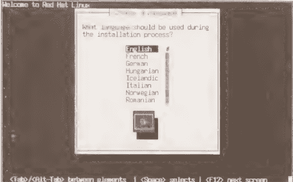

**图 1-2：** 在Red Hat Linux安装开始时选择语言

使用方向键在列表中上下滚动。列表包括英语、法语、德语、冰岛语、意大利语、挪威语、罗马尼亚语、斯洛伐克语、俄语和乌克兰语等语言。使用方向键高亮显示您想要的语言，然后按Enter选择适当的语言并进入下一步。

3. 安装程序显示键盘类型列表，如图1-3所示。

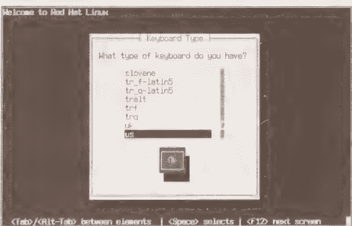

**图 1-3：** 在Red Hat Linux安装期间选择键盘类型

使用方向键在列表中上下移动，然后按Enter选择与您的系统匹配的键盘类型。

4. 安装程序检查是否有使用PCMCIA接口的PC Card设备。如果找到PCMCIA控制器，安装程序会显示一个对话框，询问您在安装期间是否需要PCMCIA支持。只有当安装期间需要连接到PCMCIA接口的设备时，您才应该回答yes。例如，如果您从笔记本电脑上连接到PCMCIA适配器的CD-ROM驱动器进行安装，您应该对此问题回答yes。如果您回答yes，请插入PCMCIA支持磁盘，然后选择OK。

5. 通过对话框中显示的列表指定Red Hat软件包的位置。Local CDROM选项指的是您PC上的CD-ROM驱动器。由于您是从本书随附的CD-ROM进行安装，因此应选择Local CDROM并按Enter。

6. 一条消息要求您将Red Hat Linux CD-ROM插入CD-ROM驱动器。请照做并按Enter。

7. 安装程序初始化CD-ROM并显示一个对话框（见图1-4），询问您是要安装新系统还是升级旧的Red Hat安装。假设您是第一次安装，请确保光标在 Install 按钮上，然后按Enter。

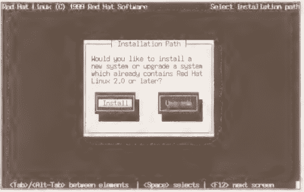

**图 1-4**：选择是安装还是升级的对话框

8. 对于完整安装，安装程序会显示一个对话框（见图1-5），要求您选择安装类别——Workstation、Server或Custom。Workstation和Server安装通过预定义的方式对磁盘进行分区来简化安装过程。Workstation类安装创建一个64MB的交换分区、一个16MB的`/boot`分区用于Linux内核，以及另一个更大的分区（大小取决于可用磁盘空间）用于Linux根文件系统。Server类安装创建一个64MB的交换分区、一个16MB的`/boot`分区用于内核、一个256MB的根分区、两个512MB的分区（`/usr`和`/home`）以及一个256MB的`/var`文件系统分区。总而言之，Server类安装需要大约1.6GB的磁盘空间。为了获得最大的灵活性，请选择Custom安装并按Enter。


## 硬盘分区与使用

与 MS-DOS 类似，Linux 要求你在安装之前对硬盘进行分区和准备工作。通常你不需要执行这一步，因为从厂商处购买 PC 时，厂商会负责准备好硬盘并安装 Windows 以及其他所有应用程序。然而，由于你是从零开始安装 Linux，所以必须自己完成这一关键步骤。如你在后续章节中所见，这项任务只需按照说明操作即可。

当 Red Hat Linux 安装程序进入磁盘分区阶段时，它会显示一个文本对话框，提供两个选项来分区并使用硬盘：

- **Disk Druid：** 这是 Red Hat 的一个实用程序，使用文本对话框让你能够对磁盘进行分区，同时指定 Linux 文件系统的哪些部分要加载到哪个分区上。
- **fdisk：** 这是 Linux 的磁盘分区程序，概念上与 DOS 的 FDISK 命令类似，但功能更为丰富。使用 Linux 的 `fdisk` 程序时，你需要输入简短的单字母命令来操作磁盘分区。然而，一旦掌握了这些命令，你可能会发现 `fdisk` 比 Disk Druid 更强大。例如，Disk Druid 不允许你更改分区类型（即指示要在分区上存储何种文件系统）；但使用 `fdisk` 可以轻松地更改分区类型。

在本章中，我将解释如何使用 Disk Druid 来准备和使用磁盘分区以进行 Red Hat Linux 安装。你将在第 11 章中学习 `fdisk` 的使用。

在开始使用 Disk Druid 对磁盘进行分区之前，你需要了解在 Linux 中如何引用磁盘驱动器和分区。此外，你还应该理解术语*挂载点*和*交换分区*。在接下来的三节中，我将描述这些术语和概念，然后再介绍 Disk Druid。

## Linux 中的磁盘名称

第一步是了解 Linux 如何引用各种磁盘。Linux 将所有设备视为文件，并有实际文件来代表每个设备。在 Linux 中， slippers这些*设备文件*位于 `/dev` 目录下。如果你是 UNIX 新手，可能还不了解 UNIX 的文件名，但随着你继续使用 Linux，你会学到更多。如果你知道 MS-DOS 文件名的工作原理，你会发现 Linux 文件名与之类似，只是不使用驱动器盘符（如 A 和 C），并且用斜杠（/）代替 MS-DOS 的反斜杠（\）作为目录名之间的分隔符。

由于 Linux 将设备视为 `/dev` 目录中的一个文件，硬盘名称以 `/dev` 开头。表 1-3 列出了你可能需要使用的硬盘和软驱名称。

### 表 1-3 硬盘和软驱名称

| 名称 | 描述 |
|------|-------------|
| /dev/hda | 第一个集成驱动电子设备（IDE）硬盘（在 DOS 和 Windows 中即 C 盘） |
| /dev/hdb | 第二个 IDE 硬盘 |
| /dev/sda | 第一个小型计算机系统接口（SCSI）驱动器 |
| /dev/sdb | 第二个 SCSI 驱动器 |
| /dev/fd0 | 第一个软驱（在 DOS 中即 A 驱动器） |
| /dev/fd1 | 第二个软驱（在 DOS 中即 B 驱动器） |

使用 Red Hat Disk Druid 或 Linux `fdisk` 程序准备 Linux 分区时，你必须通过名称（如 `/dev/hda`）来识别磁盘驱动器。

当 Disk Druid 或 `fdisk` 显示分区列表时，分区名称的形式为 `/dev/hda1`、`/dev/hda2` 等。Linux 通过将分区号（1 到 4，对应硬盘上的四个主分区）附加到磁盘名称来构不会产生分区名称。因此，如果你的 PC 只有一个 IDE 硬盘且有两个分区，请注意安装程序使用 `/dev/hda1` 和 `/dev/hda2` 作为这些分区的名称。表 1-4 展示了 Linux 中一些更多的硬盘分区名称示例。

### 表 1-4 硬盘分区名称

| 名称 | 分区 |
|------|-----------|
| /dev/hda1 | 第一个 IDE 驱动器的第一个主分区 |
| /dev/hda2 | 第一个 IDE 驱动器的第二个主分区 |
| /dev/hda3 | 第一个 IDE 驱动器的第三个主分区 |
| /dev/hda4 | 第一个 IDE 驱动器的第四个主分区 |
| /dev/hda5 | 第一个 IDE 驱动器的第一个逻辑分区 |
| /dev/hda6 | 第一个 IDE 驱动器的第二个逻辑分区 |
| /dev/hdb1 | 第二个 IDE 驱动器的第一个主分区 |
| /dev/sda1 | 第一个 SCSI 驱动器的第一个主分区 |
| /dev/sda2 | 第一个 SCSI 驱动器的第二个主分区 |
| /dev/sdb1 | 第二个 SCSI 驱动器的第一个主分区 |
| /dev/sdc1 | 第三个 SCSI 驱动器的第一个主分区 |

## 挂载点

在 Linux 中，你将物理磁盘分区与文件系统的特定部分关联起来使用，文件系统是一种层次化的目录排列方式——即目录树。如果你有多个磁盘分区（你可能有第二个带有 Linux 分区的磁盘），你可以在 Linux 中将它们全部置于单个目录树下使用。你所要做的只是决定 Linux 目录树的哪些部分应该位于哪个分区上——在 Linux 中，这一过程称为*在设备上挂载文件系统*（磁盘分区即是一个设备）。

术语**挂载点**指的是你与磁盘分区或任何其他设备关联的目录。

假设你的 PC 上有两个磁盘，并且你在这两个磁盘上都创建了 Linux 分区。图 1-7 展示了如何在这两个分区上挂载 Linux 目录树（文件系统）的不同部分。

**图 1-7：** 在两个磁盘分区上挂载 Linux 文件系统的示例

## 交换分区

大多数高级操作系统都支持*虚拟内存*的概念，即将系统硬盘的一部分用作物理内存（RAM）的扩展。当操作系统耗尽物理内存时，它可以将当前不需要的 RAM 内容移出（或交换出去），为需要更多内存的程序腾出空间。一旦需要访问已交换出去的数据中的任何内容时，操作系统必须找到其他内容交换出去，然后从磁盘交换入所需的数据。这种在 RAM 和磁盘之间来回交换数据的过程也称为*分页*。

由于磁盘比 RAM 慢得多，当操作系统需要进行大量分页时，系统性能会变慢；但虚拟内存允许你运行原本无法运行的程序。

Linux 支持虚拟内存，并可以利用交换分区。当你创建 Linux 分区时，也应该创建一个交换分区。使用下一节介绍的 Disk Druid 实用程序，创建交换分区非常简单。只需将某个分区的类型标记为交换设备，Disk Druid 就会执行必要的任务。

## 磁盘准备

当你准备好为 Linux 安装准备磁盘时，应该会看到磁盘设置对话框，其中标记为 Disk Druid 的按钮已被选中，如图 1-8 所示。要使用 Disk Druid，请按 Enter 键。

**图 1-8：** Red Hat Linux 安装程序的磁盘设置对话框

Disk Druid 会收集有关系统硬盘的信息，并显示一个对话框，列出磁盘驱动器以及其中一个驱动器的当前分区信息，如图 1-9 所示。


图 1-9：Disk Druid 程序的主对话框

您可以通过对话框底部横向排列的五个按钮，在 Disk Druid 中执行特定的磁盘设置任务。具体来说，这些按钮执行以下操作：

- **Add（添加）**允许您创建新分区，前提是必须有足够的可用磁盘空间来创建分区。按下此按钮后，会弹出另一个对话框，您可以在其中填写创建分区所需的信息。
- **Edit（编辑）**允许您修改"当前磁盘分区"列表中高亮显示的分区的属性。按下 Edit 按钮后，会弹出另一个对话框，您可以在其中更改当前属性。
- **Delete（删除）**用于删除"当前磁盘分区"列表中高亮显示的分区（见图 1-14）。
- **Ok（确定）**会让 Disk Druid 询问您是否真的要更新系统中所有硬盘的分区表。如果您回答 Yes（是），Disk Druid 将更改分区表并退出。
- **Back（返回）**用于退出 Disk Druid，不保存您可能已做出的任何更改。安装程序随后会将您带回上一个屏幕。

您在 Disk Druid 中的具体操作取决于 PC 中的硬盘及其现有分区。在本讨论中，我假设您已通过以下方法之一为 Linux 创建必要的硬盘空间：

- 您最初只有一块硬盘，且只有一个分区（Windows 中仅 C 盘）。然后您使用 FIPS 将该分区拆分为两个（参见"使用 FIPS 重新分区硬盘"部分）。分区后，您得到了两个 DOS 分区。

- 您的 PC 有一块大容量硬盘（大于 2GB），该硬盘有两个分区（Windows 中的 C 盘和 D 盘）。在这种情况下，第二个分区是包含逻辑驱动器 D 的扩展分区。您想要在曾经是 Windows D 盘的扩展分区上安装 Linux。

这两种情况都需要执行相同的步骤序列：

1. 删除 DOS 分区——即具有足够 Linux 安装空间的分区，而不是安装 Windows 的那个分区。
2. 从可用磁盘空间中创建两个 Linux 分区——一个用作交换空间（swap），另一个用于 Linux 文件系统。

在下一节中，我将讨论您在 Disk Druid 中需要执行的具体步骤，以设置 Linux 所需的最低数量的分区。如果有其他磁盘分区（例如，您有第二块硬盘），您可以按照下一节中概述的步骤进行准备。


设置好分区后，您必须初始化交换分区并格式化用于 Linux 文件系统的分区。这些步骤在"初始化交换空间"和"格式化分区"部分中进行了描述。

## 设置分区

要为 Linux 准备现有的 DOS 分区，您需要在 Disk Druid 中执行以下步骤（有关设置分区的更多指导，请参阅边栏"为 Linux 文件系统预留空间"）。

1. 删除您想要用于 Linux 的 DOS 分区。为此，请从"当前磁盘分区"列表中选择该分区（通常为设备名为 **hda2** 的那个，见图 1-9），然后按 Delete 按钮。作为快捷方式，您也可以直接选择该分区并按 F4。在删除分区之前，请记住从"当前磁盘分区"列表中记下该分区的大小。
2. 创建一个新的 Linux 文件系统分区。为此，请按 Add 按钮（或按 F1）。您将看到"编辑新分区"对话框（见图 1-10），在其中填写 **/** 作为挂载点，并以兆字节为单位输入大小。要计算大小，只需从分区的原始大小中减去交换空间的大小（32MB 或您 PC 中的内存量，以较大者为准）。选择 OK 按钮，然后按 Enter 完成此步骤并返回 Disk Druid 主对话框。
3. 创建另一个新分区并将其设置为 Linux 交换空间。为此，请从 Disk Druid 主对话框（图 1-9）按 F1。然后，在"编辑新分区"对话框（图 1-10）中输入分区大小。按 Tab 键移动到分区类型列表，并使用方向键选择 Linux Swap 作为类型。执行此操作时，"挂载点"字段中会显示 Swap Partition 文本。接下来，按 Tab 键选择 OK 按钮，按 Enter 定义新分区并返回 Disk Druid 主对话框。

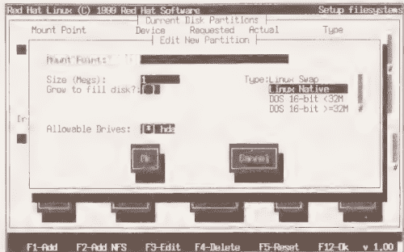

图 1-10："编辑新分区"对话框是填写新分区属性的地方

4. 如果您想要在 Linux 下访问 DOS 分区，请确保为该分区分配一个挂载点。基本上，您将为 DOS 分区指定一个将出现的 Linux 目录名称。例如，您可以使用 `/dosc` 作为 DOS 分区的挂载点；这样您就可以在 Linux 的 `/dosc` 目录中访问 DOS 文件。这个助记符很好，因为名称 `dosc` 应该能让您想起这个驱动器就是 DOS 或 Windows 下的 C 盘。要分配挂载点，请选择 DOS 分区（通常，在"当前磁盘分区"列表中会显示为设备 `hda1`）并按 F3 编辑属性。"编辑分区"对话框会出现（见图 1-11）。输入挂载点（例如 `/dosc`）并按 Enter 返回 Disk Druid 主对话框。

5. 按 Disk Druid 主对话框（图 1-9）中的 OK 按钮，使更改永久生效。

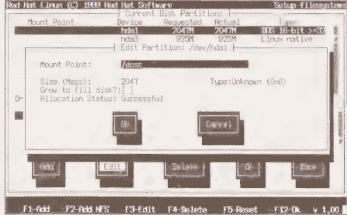

图 1-11："编辑分区"对话框使您能够更改分区的属性

## 为 Linux 文件系统预留空间

虽然您可以用一个大的分区来容纳整个 Linux 文件系统，另一个分区用于交换空间即可运行，但如果为 Linux 文件系统的关键部分创建单独的分区，您可以更好地管理磁盘空间。Linux 文件系统层次结构中的关键目录及其用途如下所示（您可以通过访问 http://www.pathname.com/fhs/ 了解更多关于文件系统层次结构标准的信息）：

- `/bin` 包含基本用户命令的二进制文件（供所有用户使用）
- `/boot` 包含启动 Linux 所需的文件
- `/dev` 包含设备文件
- `/etc` 包含特定主机的系统配置文件
- `/home` 用于用户主目录（可选）
- `/lib` 包含基本共享库和内核模块
- `/mnt` 用于临时挂载文件系统的挂载点
- `/opt` 用于附加的应用软件包
- `/root` 是 root 用户的主目录（可选）
- `/sbin` 包含 root 使用的命令的二进制文件
- `/tmp` 用于临时文件
- `/usr` 包含大量软件，如 X Window System、库、应用软件的二进制文件等
- `/var` 用于日志文件和假脱机目录

您不必为这些关键目录中的每一个都创建单独的分区。典型的分区布局可能如下所示：

- `/ = 32MB` 用于 /bin、/boot、/dev、/etc、/lib、/root 和 /sbin
- `/home = 512MB`（如果用户更多，可能需要更大）
- `/opt = 512MB`
- `/tmp = 100MB`
- `/usr = 512MB`
- `/var = 100MB`

## 初始化交换空间

在 Disk Druid 中完成分区指定后，Red Hat 安装程序会显示一个对话框（见图 1-12），列出所有 Linux Swap 类型的分区，并询问您是否要初始化交换空间。如果您创建了一个交换分区，列表中将包含该单个分区。您应该继续初始化交换分区，方法是按 Tab 直到选中 OK历险记 OK 按钮，然后按 Enter。

如果安装程序找不到任何交换分区，您可能没有将分区类型设置为 Linux Swap。

**提示**


 ## 格式化分区

在 Red Hat 安装程序初始化交换空间后，会显示一个对话框，列出你可能需要格式化的磁盘分区，以便在 Linux 中使用。如果你只有一个用于 Linux 的磁盘分区，那么列表中只会显示该分区（图 1-13）。

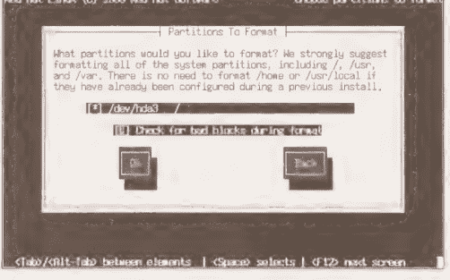

图 1-13："格式化分区"对话框可用于将分区格式化为供 Linux 使用。

要格式化某个分区，请按 **Tab** 键将光标移动到该分区的名称，然后按 **Spacebar**（空格键）进行选择。你还应该选择标记为 **Check for bad blocks during format**（格式化期间检查坏块）的选项，这样格式化过程就会标记出磁盘上所有可能物理损坏的区域。

如果你有多个磁盘分区挂载在 Linux 文件系统的不同目录下，并且你正在升级现有系统，那么你不需要格式化任何想要保留现有数据的分区。例如，如果你将所有用户目录放在单独一个挂载到 `/home` 目录的磁盘分区上，那么你就不需要格式化该分区。

## 选择要安装的组件

在选择要格式化的分区后，安装程序并不会立即格式化这些分区。相反，它会询问你要安装哪些 Red Hat Linux 组件。这样，在你选定组件后，就可以去喝杯咖啡了，而 Red Hat 安装程序会自动格式化磁盘分区并将所有选定的文件复制到该分区。

Red Hat 使用一种称为*软件包*（*packages*）的特殊文件来打包构成特定软件的多个文件。例如，Perl 编程语言的所有配置文件、文档和二进制文件都包含在一个 Red Hat 软件包中。你可以使用一个名为 Red Hat 软件包管理器（RPM）的特殊程序来安装、卸载和获取软件包信息。第 2 章将介绍如何使用 RPM。现在，只需记住一个组件是由多个 Red Hat 软件包组成的。

图 1-14 显示了可供选择安装组件的对话框。每个组件都有一个描述性标签，前缀为方括号（`[ ]`）。

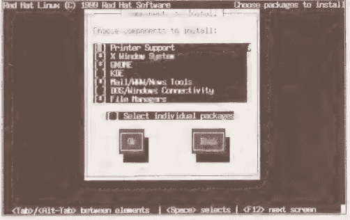

**图 1-14：** 用于选择要安装组件的对话框

方括号中的星号（`*`）表示该组件已被选中。对话框首次出现时，许多组件已经被选中，如星号所示。你可以将这些标记的组件视为 Red Hat 推荐安装的最低组件集合。不过，你也可以选择安装任意或全部组件。使用方向键在滚动列表中上下移动（参见图 1-14），然后按空格键选择或取消选择某个组件。

表 1-5 列出了所有可选组件。在表中，带星号前缀的组件表示默认已选中。除了这些用户可选组件外，Red Hat 安装程序还会自动安装大量运行 Linux 及你所选应用程序所需的软件包。

每个组件需要特定的软件包才能运行。Red Hat 安装程序会自动检查所有软件包依赖关系，并显示一个列表，列出需要但尚未选中的软件包。在这种情况下，你应该安装这些必需的软件包。

由于每个组件都包含许多不同的 Red Hat 软件包，安装程序还为你提供了选择单个软件包的选项。如果你在图 1-14 中列表下方的 "Select individual packages"（选择单个软件包）选项，然后按 **OK** 按钮，安装程序将带你进入更多对话框，在那里你可以选择单个软件包。然而，如果你是首次安装 Linux，你真的不需要深入到选择特定软件包的层级。只需从表 1-5 中挑选你认为需要的组件即可。你还可以随时使用 RPM 工具程序安装额外的软件包，相关内容在第 2 章中介绍。

## 表 1-5 Red Hat Linux 安装组件列表

| Component Name*（组件名称*） | Description（描述） |
| --- | --- |
| Printer Support（打印机支持） | 从系统进行打印所需的软件包。包括 `lpr`、Ghostscript 和 XFree86 等实用程序。 |
| *X Window System（X 窗口系统） | 构成 XFree86（适用于 Intel x86 系统的 X 窗口系统）的软件包。包括所有字体、`fvwm2` 窗口管理器、Ghostscript、Tcl/Tk、Perl 以及许多实用程序。实际的 X 服务器软件包将在安装后期配置 X 时由配置程序选择。 |
| *GNOME | GNOME（GNU 网络对象模型环境）图形桌面环境的软件包。 |
| KDE | K 桌面环境——Linux 的另一个新图形桌面环境的软件包。 |
| *Mail/WWW/News Tools（邮件/WWW/新闻工具） | 用于阅读电子邮件和新闻组的 `elm`、`pine` 和 `trn` 等软件包。还包括许多用于 X 窗口系统、Perl、Tcl/Tk 和打印机支持的软件包。 |

| Component Name*（组件名称*） | Description（描述） |
|---|---|
| DOS/Windows Connectivity（DOS/Windows 连接） | 用于在 Linux 中访问 DOS 和 Windows 文件的 `dosemu`、`mtools`、`lha`、`zip` 和 `unzip` 等软件包。还包括许多用于 X 窗口系统的软件包。 |
| *File Managers（文件管理器） | 如 `mc`（Midnight Commander，午夜指挥官）和 `xfm` 等文件管理器，以及 Perl、Tcl/Tk 和 X 窗口系统。 |
| Graphics Manipulation（图形处理） | 图像处理软件包，如 ImageMagick、`gimp` 和 Ghostscript，以及所有 X 窗口系统组件。 |
| Console Games（控制台游戏） | 经典的 UNIX 游戏，如 `hangman` 和 `fish`，以及新游戏，如 `yahtzee`、Doom、`gnuchess`、`trojka` 和一些纸牌游戏。 |
| X Games（X 游戏） | 整个 X 窗口系统组件以及 X 游戏软件包 `xbill`、`xboard`、`xboing`、`xchomp`、`xdemineur`、`xevil`、`xfishtank`、`xgalaga`、`xgammon`、`xopher`、`xjewel`、`xlander`、`xpat2`、`xpilot`、`xpuzzles`、`xsnow` 和 `xtrojka`。 |
| *Console Multimedia（控制台多媒体） | 声音和动画支持软件包，如 `aumix`、`sndconfig`、`rhsound`、`cdp`、`maplay` 和 `playmidi`。 |
| *X Multimedia Support（X 多媒体支持） | 在 X 下运行声音和动画的软件包。还包括所有 X 窗口系统软件包。 |
| *Networked Workstation（网络工作站） | TCP/IP 网络软件包，如 FTP（文件传输协议）、Telnet 和 NFS（网络文件系统）。 |
| *Dialup Workstation（拨号工作站） | TCP/IP 网络软件包以及拨号网络所需的 `ppp` 和 `dip` 等软件包。还包括 `minicom` 和 `lrzsz`（用于发送和接收文件）等通信软件包。 |
| News Server（新闻服务器） | 使 Linux 系统成为新闻组服务器所需的 Perl 和 INN（互联网新闻服务器）软件包。 |
| NFS Server（NFS 服务器） | 使 Linux 系统成为 NFS 服务器的 `portmap` 和 `nfs-server` 等软件包。 |
| SMB (Samba) Connectivity（SMB（Samba）连接） | 使 Linux PC 用作 LAN Manager 服务器所需的 `samba` 和 `smbfs` 等软件包。还包括 TCP/IP 网络和打印机支持等许多其他软件包。 |
| IPX/Netware(tm) Connectivity（IPX/Netware(tm) 连接） | 使 Linux PC 用作 Novell Netware 服务器所需的软件包。还包括大部分 TCP/IP 网络软件包。 |

| Component Name*（组件名称*） | Description（描述） |
| --- | --- |
| Anonymous FTP Server（匿名 FTP 服务器） | `wu-ftpd` 和 `anonftp` 软件包，以及支持 Linux 匿名 FTP 所需的所有 TCP/IP 网络软件包。 |
| Web Server（Web 服务器） | Apache Web 服务器以及将 Linux 系统用作 Web 服务器所需的其他网络软件包。 |
| DNS Name Server（DNS 域名服务器） | `bind`、`bind-utils` 和 `caching-nameserver` 软件包，以及为 Linux 系统提供域名服务（DNS）所需的其他支持软件包。 |
| Postgres (SQL) Server（Postgres (SQL) 服务器） | `postgresql`、`postgresql-data` 和 `postgresql-devel` 软件包，以及许多用于在 Linux 系统上实现 Postgres SQL 服务器（数据库）的支持软件包。 |
| Network Management Workstation（网络管理工作站） | 通过 SNMP（简单网络管理协议）和网络防火墙管理实用程序支持网络管理的软件包。还包括网络管理工具所需的许多网络软件包。 |
| TeX Document Formatting（TeX 文档排版） | TeX（发音为 "tech"）文档排版系统所需的软件包。 |
| Emacs | 不需要 X 的 GNU Emacs 文本编辑器版本。 |
| Emacs with X windows（带 X 窗口的 Emacs） | 在 X 中运行的 GNU Emacs 版本。还包括 X 窗口系统组件以及不需要 X 的 Emacs 版本。 |
| C Development（C 开发） | GNU C 编译器、`gdb` 调试器、修订控制系统（RCS）、各种头文件以及 C 编程所需的其他实用程序。 |
| Development Libraries（开发库） | Linux 软件开发所需的各种库。 |
| C++ Development（C++ 开发） | GNU C++ 编译器以及 C++ 编程所需的其他相关文件。 |
| X Development（X 开发） | 用于开发使用 X 的应用程序的 X 头文件和库，以及所需的 X 窗口系统。 |
| GNOME Development（GNOME 开发） | 用于开发 GNOME 桌面应用程序的头文件和库，如 gtk+。 |


 | 组件名称* | 说明 |
| --- | --- |
| Extra Documentation | 各种在线手册页（在 UNIX 中称为“man”页），以及大量 Linux 软件的 HOWTO 文件和常见问题解答（FAQ）。建议安装此组件。 |
| Everything | 选择此项以安装所有组件。 |

*标有星号（*）前缀的组件默认为选中状态。

选定所需组件后，按 Tab 键移至图 1-16 所示的 OK 按钮，然后按 Enter 键。安装程序会显示一个信息对话框，如图 1-15 所示。

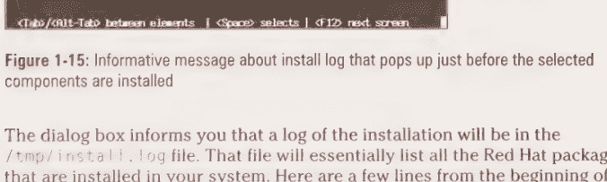

> **图 1-15**：在所选组件安装之前弹出的关于安装日志的信息消息

该对话框告知您安装日志将保存在 /tmp/install.log 文件中。该文件基本上会列出系统中安装的所有 Red Hat 软件包。以下是在 PC 上完成 Red Hat Linux 安装后，/tmp/install.log 文件开头的几行内容：

```
Installing setup.
Installing filesystem.
Installing basesystem.
Installing ldconfig.
Installing AfterStep.
Installing AfterStep-APPS.
Installing aktion.
Installing anonftp.
Installing AnotherLevel.
Installing glibc.
Installing chkconfig.
Installing mktemp.
Installing termcap.
Installing libtermcap.
Installing bash.
Installing ncurses.
Installing info.
Installing fileutils.
Installing mailcap.
Installing grep.
Installing textutils.
Installing apache.
```

您可以稍后查看安装日志，并保留该文件以备将来参考。

按 Enter 键继续安装。Red Hat 安装程序会格式化磁盘分区，然后安装软件包。在安装软件包的过程中，安装程序会显示一个状态屏幕，显示安装进度信息，例如要安装的软件包总数、目前已安装的数量、预计所需的磁盘空间以及预计剩余安装时间。

> 提示：格式化和安装需要相当长的时间——所以您可以休息一下，大约 10 分钟后再回来看看。回来时，您应该能从持续更新的状态屏幕上了解剩余时间。

## 配置 Linux

当安装程序完成加载所有选定的软件包后，将进入配置阶段。假设您要安装 X Window 系统和网络组件，配置步骤如下：

- 配置鼠标
- 配置网络
- 设置时区
- 配置服务
- 配置打印机
- 设置 root 密码
- 配置密码验证
- 创建自定义启动盘
- 安装 LILO
- 配置 X

以下各节介绍每个配置步骤。

## 配置鼠标

Red Hat 安装程序运行 `mouseconfig` 实用程序（位于 `/usr/sbin` 目录）来检测和配置您 PC 的鼠标。如果 `mouseconfig` 程序检测到鼠标，它会显示一个包含鼠标信息的对话框。您应按 Enter 键进入下一步。

如果鼠标配置程序没有检测到鼠标，它会显示另一个对话框，让您可以从列表中选择鼠标类型，如图 1-16 所示。

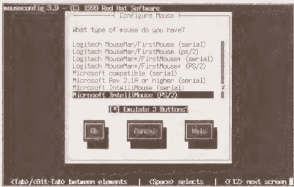

**图 1-16：** 用于选择鼠标类型的对话框

使用方向键选择鼠标。然后使用 Tab 键移动到标有 "Emulate 3 Buttons?" 的字段，按空格键选择该字段。由于许多 X 应用程序假定您使用的是三键鼠标，建议您选择此选项。在典型的双键鼠标上，您可以通过同时按下两个按钮来模拟中键单击。在 Microsoft 智能鼠标上，滚轮充当中键。

如果选择串行接口鼠标，系统会要求您指定鼠标连接的串行端口。对于 COM1，请将 `/dev/ttyS0` 指定为设备；对于 COM2，设备名称是 `/dev/ttyS1`。

## 配置网络

完成鼠标配置后，Red Hat 安装程序会显示一个对话框（图 1-17），询问您是否要配置 Linux 系统的局域网（LAN）参数。

如该对话框所述，此步骤不是用于配置拨号网络的。如果您的 Linux 系统通过以太网卡连接到 TCP/IP 局域网，则需要执行此步骤。否则，选择 No 跳过此步骤。

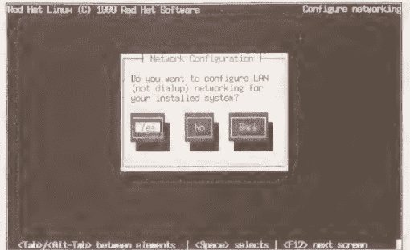

**图 1-17：** 询问是否要配置局域网的对话框

如果您的系统在局域网上，即使是未连接到互联网的局域网，也应选择 Yes 按钮。然后您必须再执行两个步骤：选择 PC 上安装的以太网卡的制造商和型号，并允许安装程序探测该卡的参数，如 I/O 端口地址和 IRQ。之后，Red Hat 安装程序会显示一个对话框（图 1-18），供您选择系统 IP（互联网协议）地址的设置方式。

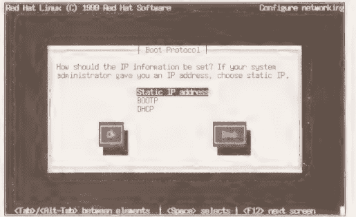

**图 1-18：** 用于指定系统 IP 地址设置方式的对话框

该对话框提供三种选择：

- **Static IP address** — 如果系统有指定的 IP 地址，请选择此选项。在这种情况下，您必须手动提供所有必要的网络相关信息。

- **BOOTP** — 如果您的 PC 从 Bootstrap 协议（BOOTP）服务器获取网络信息（包括 IP 地址），请选择此选项。

- **DHCP** — 如果您的 PC 从动态主机配置协议（DHCP）服务器获取 IP 地址和其他网络信息，请选择此选项。

只有在您的局域网上运行了相应类型的服务器时，才应选择 BOOTP 或 DHCP。如果选择 BOOTP 或 DHCP，您的网络配置将自动设置，您可以跳过本节的其余部分。

如果选择 "Static IP address" 选项，Red Hat 安装程序会显示一个对话框，您需要在该对话框中输入 TCP/IP 配置的某些参数（图 1-19）。

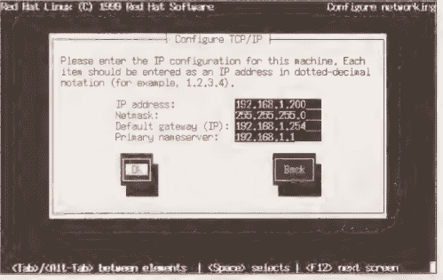

**图 1-19：** TCP/IP 配置对话框，用于输入 TCP/IP 局域网的 IP 地址（已填入示例值）

该对话框要求填写四个关键参数：

- Linux 系统（您正在安装的系统）的 IP 地址

-  Paulo;的网络掩码

- 网关的 IP 地址（您可能通过该系统访问任何外部网络）

- 名称服务器的 IP 地址

如果您有私有局域网（未直接连接到互联网的局域网），可以使用指定为私有用途的 IP 地址范围。私有局域网的常见 IP 地址是 192.168.1.1 至 192.168.1.254 范围内的地址。您将在第 16 章中进一步了解 TCP/IP 网络和 IP 地址。

输入所需参数后，按 Tab 键选择 OK，然后按 Enter 键。安装程序随后会显示另一个对话框（图 1-20），询问有关 TCP/IP 局域网的更多信息。

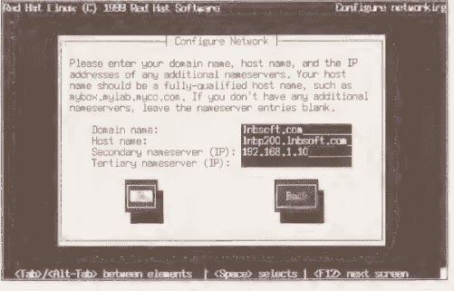

**图 1-20：** 用于进一步网络信息的对话框（已填入示例值）

这次您必须输入以下信息：

- 您局域网的域名

- Linux 系统的主机名（对于私有局域网，您可以自行分配主机名，无需担心与互联网上任何其他现有系统冲突）

- 辅助名称服务器的 IP 地址

- 第三名称服务器的 IP 地址

输入所需信息后，选择 OK 并按 Enter 键。

### 设置时区

完成网络配置后，您需要选择*时区*——即当地时间与英格兰格林威治当前时间（作为标准参考时间，也称为格林威治标准时间，或 GMT；也称为 UTC 或世界协调时）之间的差值。安装程序会向您显示时区列表（图 1-21），按国家或地区列出。

许多国家的时区按大洲组织，美国许多地区也按此方式组织。按上下方向键选择您的位置。例如，如果您居住在美国东海岸，您会选择 USA/Eastern。如果您的国家未列出，请选择表示您当地时间与 GMT 差值的条目之一。选择时区后，按 Enter 键。


图 1-21：选择时区的对话框

## Configure services（配置服务）

选择时区后，Red Hat 安装程序会运行 `/usr/sbin/ntsysv`，让你设置每次启动 Linux 系统时应自动运行的服务。你需要从图 1-22 所示对话框的列表中选择所需的服务。

图 1-22：选择要自动启动的服务的对话框

列表中的每一行显示一个服务的名称，前面带有方括号（`[]`）。方括号中的星号（`*`）表示该服务被选中运行。当对话框首次出现时，许多服务已经被选中。你可以使用上下箭头键在列表中移动，并按空格键选择或取消选择某个服务。完成选择后，按 Tab 键选择 OK，然后按 Enter。

表 1-6 列出了这些服务以及每项的简要说明。第一列显示服务名称，这与运行以提供服务的程序名称相同。第二列中带星号的名称是安装程序预先选中的那些。

### 表 1-6 配置为在 Linux 中自动启动的服务

| 服务名称 | 预选中 | 说明 |
| --- | --- | --- |
| apmd | * | 监控高级电源管理（APM）BIOS 并记录电源状态（交流电或电池备份）。 |
| atd | * | 运行由 at 和 batch 命令调度的命令。 |
| crond | * | 根据 crontab 命令设置的定期计划运行用户指定的程序。 |
| gpm | * | 在文本模式屏幕中启用鼠标。 |
| httpd | * | 这是 Apache 万维网（WWW）服务器。 |
| inet | * | 这是 Internet 超级服务器，也称为 inetd。它在需要时启动其他 Internet 服务，如 Telnet 和 FTP。 |
| innd | * | 这是 Internet 新闻服务器，你可以用它来支持系统上的本地新闻组。 |
| kerneld | * | 在 Linux 需要时自动加载内核模块。你应该始终运行 kerneld 服务，因为 Linux 操作系统需要它。 |
| keytable | * | 加载在文件 /etc/sysconfig/keyboard 中指定的键盘映射。你应该让此服务保持运行。 |
| linuxconf | * | 执行 Linux 系统配置任务。 |
| lpd | * | 管理打印作业队列并将打印作业发送到打印机的服务器。如果你想从 Linux 系统进行打印，则需要此服务器。 |
| named | * | 这是将主机名转换为 IP 地址的域名服务器（DNS）。如果你愿意，可以在系统上运行一个副本。 |
| netfs | * | 使你能够挂载和卸载所有网络文件系统（NFS、Samba 和 Netware）的服务器。 |
| network | * | 此服务器使你能够激活或停用配置为在系统启动时启动的所有网络接口。 |
| nfs | * | 使用网络文件系统（NFS）协议导出文件系统，以便其他系统（运行 NFS 的系统）可以从你的系统共享文件。 |
| nfslock | | 为 NFS 提供文件锁定功能。 |
| pcmcia | * | 为 PCMCIA 设备提供支持。 |
| portmap | * | 任何依赖远程过程调用（RPC）的软件使用的服务器。NFS 需要 portmap 服务。 |
| postgresql | | 启动或停止处理数据库请求的 PostgreSQL 服务器（PostgreSQL 是随 Red Hat Linux 提供的免费数据库）。 |
| random | * | Linux 系统上生成高质量随机数所需的服务器。 |
| routed | | 使用 RIP 协议更新 IP 路由表。除非你需要在组织中的多个网络之间路由 IP 数据包，否则不需要启用此服务。 |
| rstatd | | 返回从 Linux 内核获取的性能统计信息。 |
| rusersd | | 使网络上任何系统的用户能够查出在某个系统上登录了谁。 |
| rwhod | | 使远程用户能够获取运行 rwhod 服务的 Linux 系统上所有用户的列表。 |
| sendmail | * | 将邮件消息从一台机器移动到另一台。如果你想从 Linux 系统发送邮件，请启动此服务。如果你不打算将 Linux 系统用作邮件服务器，请不要启动 sendmail 服务器，因为它会减慢启动过程并消耗不必要的资源。 |
| smb | * | 启动和停止 Samba smbd 和 nmbd 服务，这些服务用于在 Linux 系统上支持 LAN Manager 服务。 |
| snmpd | | 用于网络管理功能的简单网络管理协议（SNMP）服务。 |
| sound | * | 在系统关机时保存某些声卡设置，并在启动时恢复它们。 |
| syslog | * | 许多其他程序（包括其他服务）用来将各种错误和状态消息记录到日志文件（通常是 /var/log/messages 文件）中的服务。你应该始终运行此服务。 |
| ypbind | | 网络信息系统（NIS）所需的服务。除非你使用 NIS，否则不需要启动 ypbind。 |

## Configure printers（配置打印机）

设置服务后，Red Hat 安装程序会显示一个对话框（图 1-23），询问你是否要配置打印机。如果你打算从 Linux 系统进行打印，请在此对话框中选择 Yes。

即使你未将打印机直接连接到 Linux 系统，也应该从图 1-23 的对话框中选择 Yes。即使你计划使用远程打印机，也必须配置打印机。此步骤允许你选择连接到另一个 Linux、Windows 95/98/NT 或 Netware 系统的共享打印机。

选择 Yes 并按 Enter 后，安装程序会询问你关于打印机连接类型的问题，如图 1-24 所示。

图 1-23：此对话框询问你是否要配置打印机

图 1-24：选择打印机连接类型

你可以从四种打印机连接类型中选择：

- **Local（本地）**：指直接连接到你安装 Linux 的 PC 的打印机。

- **Remote lpd（远程 lpd）**：指物理连接到本地网络上另一台 Linux 系统的打印机（有关 Linux 打印守护进程 `lpd` 的更多信息，请参阅第 14 章）。

- **SMB/Windows 95/NT**：指连接到本地网络上另一台 PC 的打印机，该 PC 运行 LAN Manager 协议（通常用于在运行 Windows 95 或 Windows NT 的 PC 之间共享磁盘和打印机等资源）。

- **Netware**：指连接到局域网上 Novell Netware 服务器的打印机。

你应该指定适用于你配置的打印机连接。选择连接类型后，安装程序会显示一个对话框，显示两个标准打印机选项，如图 1-25 所示。

图 1-25：选择标准打印机选项

这些称为标准选项，因为无论你拥有何种类型的打印机连接，它们都是必需的。你不需要更改这些标准打印机选项——只需选择 OK 按钮并按 Enter。

下一步配置取决于你在图 1-26 的对话框中指定的打印机连接类型。如果你选择了本地打印机，安装程序会显示一个对话框（图 1-26），要求你指定打印机物理连接的打印机端口。

图 1-26：本地打印机的打印机端口

通常，打印机连接到 PC 的并行端口。在 Windows 中，并行端口被称为 LPT1、LPT2 等。在 Linux 中，相应的设备名称为 `/dev/lp0`、`/dev/lp1` 等。如图 1-26 的对话框所示，安装程序会告知你检测到了哪些并行端口，并在文本输入区域填写最可能的端口名称。你应该验证信息是否正确（如有必要，输入正确的端口名称）；然后按 Enter 继续配置打印机。

下一个对话框（图 1-27）要求你从已知打印机列表中识别你的打印机类型。选择打印机类型，然后按 Enter 继续打印机配置。

接下来，安装程序会显示另一个对话框（图 1-28），请求有关纸张尺寸和打印机分辨率的信息（许多现代激光打印机通常为 600 × 600 点每英寸）。你应该选择适当的值。


图1-28对话框中的另一项是一个标记为`Fix stair-stepping of text`的选项。这涉及一个从Linux发送文本文件到打印机时出现的问题。在Linux文本文件中，每行以单个换行符结束，而DOS和Windows则以回车符加换行符结束每行。打印机对回车符和换行符的反应与旧式打字机相同——换行符前进到下一行，回车符移动到行首。打印DOS文本文件时，各行会如你所预期地一个接一个打印出来。然而，当打印机打印行尾只有换行符的Linux文本文件时，输出看起来像这样：

```
Line 1 ends here
            Line 2 here
                        and so on
                                    like a staircase.
```

为避免这种阶梯效应，只需在图1-28的对话框中勾选标记为`Fix stair-stepping of text`的复选框，Linux就会在每次打印文本文件时，于每个换行符前发送一个回车符，从而解决这个问题。

在图1-28中选择选项并按下Enter后，安装程序会在另一个对话框（图1-29）中显示所有已选选项，以便你验证打印机配置。

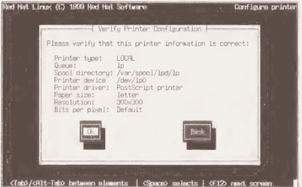

## 图1-29：验证打印机设置

确认设置正确后，按Enter键继续下一步配置。

## 设置root密码

完成打印机配置后，安装程序会提示你输入root密码，如图1-30所示。

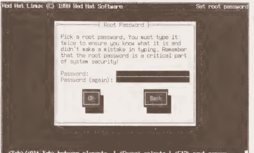

图1-30：用于设置root密码的对话框

root用户是Linux中的超级用户。由于超级用户可以在系统中执行任何操作，你应该设置一个自己能记住但他人难以猜到的密码。通常，密码长度应至少为八个字符，包含字母和数字的组合，并且为了保险起见，加入一些特殊字符，如+或*。

在第一行输入密码，然后在下一行重新输入密码。密码不会显示在屏幕上。你必须输入两次，且两次输入必须匹配，安装程序才会接受该密码。这可以确保你没有输入错误。两次输入密码后，选择OK并按Enter键继续下一步配置。

## 配置密码认证

安装程序运行/usr/sbin/authconfig程序来配置密码认证选项。authconfig程序会显示一个对话框，如图1-31所示。

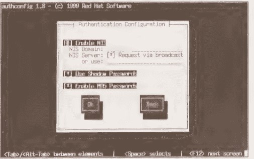

图1-31：配置密码认证选项

你有三个可以启用或禁用的选项：

- **启用NIS：** 选择此选项可在同一网络信息服务（NIS）域中的多个系统上使用通用的密码和组文件对用户进行认证。选择NIS域选项以指定你的系统所属的域。否则，选择NIS服务器选项以使用特定的NIS服务器进行认证。要启用NIS，你的Linux系统必须连接到NIS网络。

- **使用Shadow密码：** 实际上是常年航的词，此选项会导致`/etc/passwd`文件被`/etc/shadow`取代，而后者只能由超级用户（root）读取。这提供了额外的安全级别。

- **启用MD5密码：** 选择此选项可让用户使用长达256个字符的长密码，而不是最多只有八个字符的标准密码。注意，MD5指的是消息摘要5，这是由RSA公司开发的一种算法，用于计算整个消息数据的摘要。本质上，MD5将消息缩减为包含四个32位数字的摘要。

默认情况下，"Use Shadow Passwords"和"Enable MD5 Passwords"两个选项都被选中。你应该使用默认设置以提高系统安全性。按Tab键选择OK按钮，然后按Enter键继续下一步配置。

## 创建自定义启动盘

配置认证选项后，安装程序会显示一个对话框（图1-32），询问你是否要创建自定义启动盘。如果硬盘上的Linux内核损坏或Linux加载器（在下一节中描述）无法工作，你可以使用此盘启动你的Linux系统。

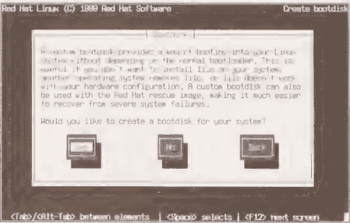

**图1-32：** 创建自定义启动盘

按Enter键回答yes。然后安装程序会要求你将一张空白软盘插入PC的A驱动器。照做并按Enter键（注意软盘上的所有数据都将被销毁）。安装程序会将Linux内核和其他一些文件复制到软盘。安装程序准备好自定义启动盘后，从A驱动器中取出软盘，贴上适当的标签，并保存以备将来使用。

安装程序运行`/sbin/mkbootdisk`程序为你的系统创建自定义启动盘。如果在安装过程中跳过此步骤，你随时可以创建启动盘，命令格式如`/sbin/mkbootdisk --device /dev/fd0 2.2.10-3`，其中最后的数字是Linux内核的版本号（使用命令`uname -r`获取你系统的版本号）。

你可以使用自定义启动盘在PC上启动Linux。在下一节中，你将了解如何在PC的C盘上放置Linux加载器程序。然而，该过程涉及修改硬盘的关键部分。如果你对修改硬盘感到不安，或者Linux加载器因某种原因无法工作，你始终可以从刚刚创建的自定义启动盘启动Linux。

## 安装LILO

*LILO*代表*Linux Loader*——一个驻留在硬盘上并从硬盘启动Linux的程序。如果你的硬盘上有Windows或OS/2，你也可以配置LILO来加载这些操作系统中的任何一个。

Red Hat安装程序会显示一个对话框（图1-33），询问你想在哪里安装LILO，它也被称为引导加载器。

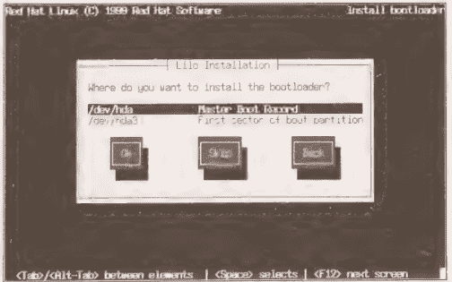

**图1-33：** 指定安装LILO的位置

该对话框为你提供了在两个位置之一安装LILO的选项：

- 主引导记录（MBR），位于PC硬盘（C盘）的第一个扇区
- 你加载Linux的分区的第一个扇区

你应该将LILO安装在主引导记录中，除非你使用的是其他操作系统加载器，如System Commander或OS/2 Boot Manager。选择位置后，按Tab键选择OK，然后按Enter键。

选择LILO安装位置后，安装程序会显示另一个对话框（图1-34），使你能够输入Linux启动时可能需要的任何特殊选项。

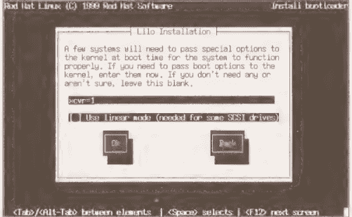

## 图1-34：输入Linux启动选项

是否需要任何特殊选项取决于你拥有的硬件。例如，在我的系统中，我有一块3Com 3C503以太网卡，它通过外部收发器连接到本地以太网。当Linux加载3Com 3C503卡的驱动软件时，我需要指定选项`xcvr=1`，以确保驱动使用外部收发器。我在对话框的第一行输入该选项，如图1-34所示。

输入任何必要选项后，选择OK按钮，并按Enter键继续LILO安装。Red Hat安装程序会显示另一个对话框（图1-35），让你可以选择使其他磁盘分区可启动。

该对话框显示一个表格，列出了Linux分区和可能包含其他操作系统的任何其他分区。在我的系统中，该

该表包含两个条目：Linux 分区和 DOS 分区（实际上安装了 Windows 95/98）。表中的每个条目都是 LILO 可以引导的操作系统。

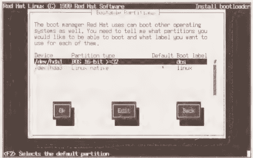

图 1-35：在 LILO 下使其他分区可引导

安装 LILO 后，每当 PC 从硬盘启动时，LILO 会运行并显示一个 `boot:` 提示符。在提示符下，您可以输入要引导的操作系统名称（图 1-35 中表格的最后一列显示了您可以在 LILO 提示符下输入的名称）。在本例中，您输入 `linux` 来引导 Linux，输入 `dos` 来从 DOS 分区引导（如果您的该分区上安装了 Windows 95/98，则应该启动它）。

如果您在 LILO 提示符下不输入任何内容，它会等待几秒钟，然后引导默认操作系统。默认操作系统是图 1-35 中"默认"列带有星号的那个（在本例中 Linux 是默认的）。

如果您想更改任何条目，请选择"编辑"，然后按 Enter。如果您接受这些选择，请按 Tab 键选择"确定"，然后按 Enter。这样就安装了 LILO。

## 配置 X

如果您选择了 X 窗口系统组件（如"选择要安装的组件"一节所述），Red Hat 安装程序现在会运行 `Xconfigurator` 实用程序，以创建 X 服务器所需的配置文件。

`Xconfigurator` 程序以一个欢迎对话框开始，如图 1-36 所示。阅读消息后，按 Enter 继续配置过程。

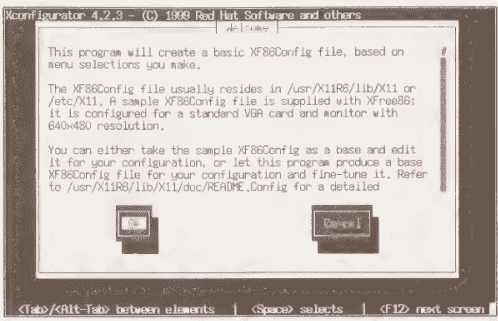

图 1-36：Xconfigurator 程序的欢迎对话框

`Xconfigurator` 自动检测显卡使用的芯片组，并显示摘要消息，如图 1-37 所示。

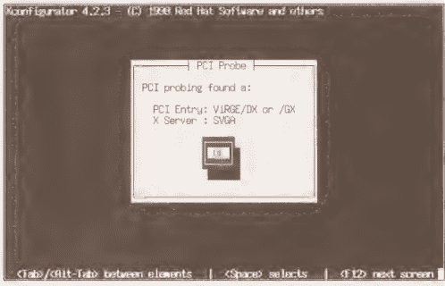

图 1-37：探测显卡的结果

在本例中，`Xconfigurator` 找到了基于 S3 ViRGE/DX（或 /GX）芯片组的显卡，并推荐使用 SVGA X 服务器。实际上，`Xconfigurator` 的消息有些晦涩难懂。SVGA X 服务器指的是完整名称为 `XF86_SVGA` 的 X 服务器程序，它将安装在 `/usr/X11R6/bin` 目录中。由于图 1-37 中的对话框仅供您参考，请按 Enter 继续其余的配置。下一步是从列表中选择您的显示器，如图 1-38 所示。

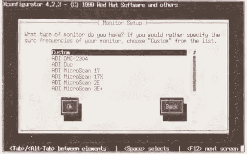

图 1-38：选择您的显示器类型

按上下箭头键浏览列表。如果您在列表中找到了自己的显示器型号，请将光标定位到该显示器上，然后按 Enter。否则，选择"自定义"并按 Enter。如果您选择"自定义"，Xconfigurator 会显示另一个对话框，如图 1-39 所示。

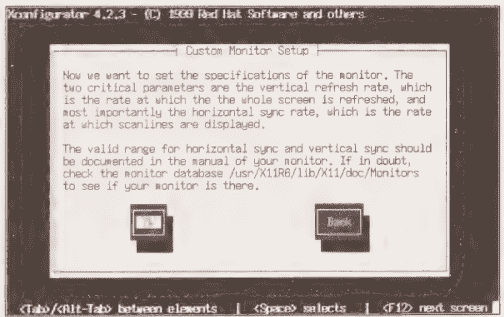

图 1-39：Xconfigurator 告知您需要关于显示器的一些信息

如图 1-39 中的对话框所述，您必须提供显示器的两个关键参数：

- 水平同步频率——显示器每秒可以显示水平扫描线的次数，单位为千赫兹（kHz）
- 垂直同步速率或垂直刷新率——显示器每秒可以显示整个屏幕的次数

您可以在显示器的手册中找到这些信息。

在图 1-39 的对话框中按 Enter 继续。Xconfigurator 显示预定义显示器功能的列表，如图 1-40 所示。

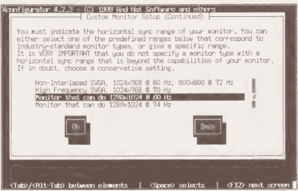

图 1-40：Xconfigurator 显示的预定义水平同步范围列表

通常，此列表中的一项应该与您的显示器规格匹配。如果您需要猜测显示器的功能，请保守一些。不要指定超出显示器能力范围的水平同步范围。错误的水平同步频率值可能会损坏您的显示器。

例如，如果您的显示器手册说明它能够在 60Hz 下显示 1,280 × 1,024 分辨率，那么您应该选择与此规格匹配的条目。选择水平同步功能后，按 Enter。

Xconfigurator 现在提示您输入显示器的垂直同步速率，如图 1-41 所示。

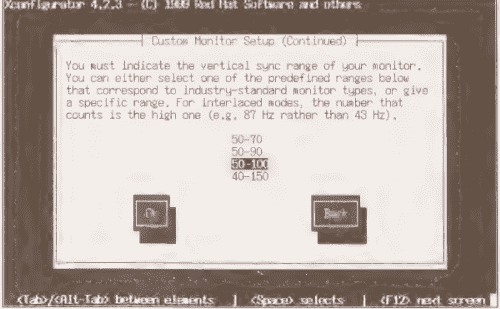

图 1-41：Xconfigurator 显示的垂直同步范围列表

选择最接近您显示器规格的垂直同步范围，然后按 Enter。

Xconfigurator 显示一个对话框（见图 1-42），告知您 X 服务器将运行以收集有关显卡的信息。

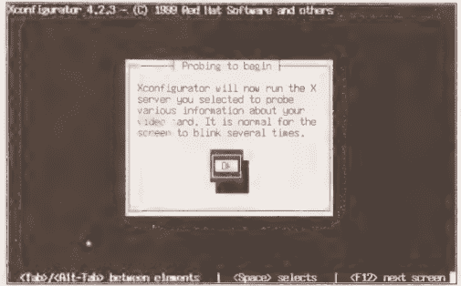

图 1-42：Xconfigurator 探测显卡之前的消息

由于该消息旨在向您提供信息，请阅读消息后按 Enter 继续。

屏幕闪烁几次，然后 Xconfigurator 显示一个对话框（图 1-43），其中包含默认视频模式——以像素分辨率（如 1,280 × 1,024）和颜色（如每像素 16 位）表示。

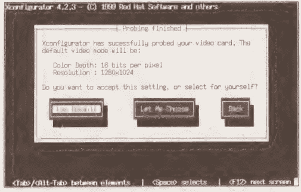

图 1-43：Xconfigurator 探测显卡后选择的默认视频模式

通常，`Xconfigurator` 会选择具有最高可能分辨率和颜色的默认视频模式，但您可能希望使用更适中的值，如 1,024 × 768 像素分辨率和 8 位颜色。要自行选择，请按 Tab 键选择"让我选择"按钮，然后按 Enter。`Xconfigurator` 随后会显示一个让您选择视频模式的对话框，如图 1-44 所示。

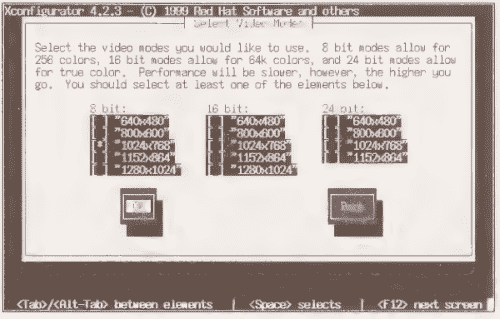

**图 1-44：** 选择您想要使用的视频模式

按 Tab 键将光标移动到视频模式，按空格键选择该模式。然后按 Tab 键选择"确定"按钮，按 Enter。

接下来，`Xconfigurator` 为您提供启动 X 以测试配置的选项。您应该按 Enter。会出现一个图形化 X 屏幕，`Xconfigurator` 显示一个询问您是否能阅读文本的对话框。用鼠标单击以关闭该对话框。

`Xconfigurator` 然后显示一个询问您是否要图形化登录屏幕的对话框。选择"是"并按 Enter。这可以确保系统重启时，您将获得图形化登录对话框而不是文本屏幕。

`Xconfigurator` 随后将 `XF86Config` 文件写入 `/etc/X11` 目录并完成安装。

## 首次启动 Linux

安装完成后，Red Hat Linux 安装程序会自动重启系统。PC 会经过其正常的上电序列，从 C 盘加载 LILO，然后出现以下提示：

```
LILO boot:
```

安装 LILO 时，如果您将 Linux 分区指定为默认分区，您只需等待；几秒后，LILO 将启动 Linux。

如果您想从另一个分区（如 DOS）启动，请按 Tab 键。LILO 会显示可用可引导分区的名称。例如，典型显示可能是：

`linux dos`

然后您可以输入要启动的分区名称（或按 Enter 从第一个分区启动）。

LILO 启动 Linux 后，您应该会看到一长串启动消息，包括 Linux 检测到的设备名称。前几条消息之一显示为 `Calibrating delay loop... 398.13 BogoMIPS`；`BogoMIPS` 前面的数字取决于您系统的处理器类型。*BogoMIPS* 是一个 Linux 行话术语，是各种致力于 Linux 的新闻组中无数讨论的主题。（您将在第 18 章和第 19 章中了解有关新闻组的更多信息。）Linux 在操作系统需要等待指定时间的情况下使用 BogoMIPS 测量值。

### 什么是 BogoMIPS？

当您的 Linux 系统启动时，您会注意到一条消息显示为 `Calibrating delay loop... 398.13 BogoMIPS`，`BogoMIPS` 前面有一些数字。*BogoMIPS* 是那些让 Linux 新用户困惑的词汇之一。在本栏中，我将解释它的含义。

如您所知，**MIPS** 是 *millions of instructions per second*（每秒百万条指令）的缩写——衡量计算机运行程序速度的指标。因此，MIPS 并不是衡量性能的很好指标，因为比较不同类型计算机的 MIPS 很困难。*BogoMIPS* 是 *bogus* MIPS（伪 MIPS），指的是对计算机速度的指示。Linux 使用 *BogoMIPS* 数值来校准延迟循环，在该循环中计算机重复处理一些指令，直到指定的时间过去。

*BogoMIPS* 数值范围可以从 1 到 300 或更高，具体取决于处理器类型（386、486 或 Pentium）。典型的 33MHz 80386DX 系统的 *BogoMIPS* 约为 6，而 66MHz 80486DX2/66 系统的 *BogoMIPS* 约为 33。旧款 Pentium 系统的 *BogoMIPS* 与 80486 处理器相当（或略低），因为 *BogoMIPS* 计算没有利用 Pentium 的任何高级功能（如并行执行指令的能力）。在旧的 75MHz Pentium 系统上，Linux 报告的 *BogoMIPS* 为 30.22。然而，在 200MHz Pentium MMX 系统上，*BogoMIPS* 为 398.13。在更新的 450 和 500MHz Pentium 系统上则更高。


在所有消息的最后，你会看到一个图形登录界面，如图 1-45 所示。

**图 1-45：** Red Hat Linux 中的图形登录界面

对话框显示一条欢迎信息，其中包含你系统的主机名——即你在配置网络时为系统指定的名称。

由于此时还没有其他用户，在第一个文本字段中输入 root，然后按 Enter 键（在输入前，先将鼠标移到登录对话框上）。接着输入 root 密码（安装时设置的那个）以超级用户身份登录。GNOME 桌面随即出现，同时 GNOME 文件管理器会给出一个警告对话框。单击 OK 按钮关闭警告对话框。随后文件管理器启动，并提供一个类似于 Windows 资源管理器的视图（图 1-46）。现在你可以执行一些初始任务，并学习如何关闭你的 Linux 系统。

花点时间看看图 1-46 中所示的初始 GNOME 桌面。GNOME 桌面与 Windows 95/98 桌面非常相似。**GNOME 面板**——类似于 Windows 的任务栏——出现在屏幕的底部边缘。你可以通过 GNOME 面板访问各种菜单并启动应用程序。该面板还包含一些小程序，例如时钟小程序，它在面板右边缘的一个小区域内显示日期和时间。

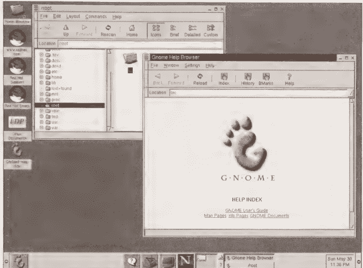

图 1-46：以 root 身份登录后的初始 GNOME 桌面

你将在第 5 章中了解更多关于 GNOME 桌面的内容。目前，你只需要知道 GNOME 面板左边缘那个风格化的脚是**主菜单按钮**。这个按钮类似于 Windows 95/98 中的开始按钮。你可以通过主菜单按钮或"脚"访问许多程序（包括用于系统配置的 `linuxconf` 工具和用于注销的对话框）。

## 恢复忘记的 Root 密码

如果你忘记了 root 密码，可以按照以下步骤设置新的 root 密码：

- 1. 像往常一样启动 PC。在 LILO 启动提示符处，输入 Linux 启动分区的名称，后跟单词 `single`，如下所示（**粗体**部分为需要输入的文本）：

```
LILO boot: linux single
```

这将使 Linux 像往常一样启动，但以单用户模式运行，无需登录。Linux 启动后，你将看到以下命令行提示符：

```
bash#
```

- 2. 使用 `passwd` 命令来更改 root 密码，如下所示：

```
bash# passwd
New UNIX password:
```

输入你想使用的密码（密码不会显示在屏幕上），然后按 Enter 键。Linux 会要求再次输入密码，如下所示：

```
Retype new UNIX password:
```

再次输入密码，然后按 Enter 键。如果两次输入的密码相同，`passwd` 命令将更改密码并显示以下消息：

```
passwd: all authentication tokens updated successfully
```

- 3. 现在按 Ctrl+Alt+Delete 重启 PC。Linux 启动后，将显示熟悉的登录界面。现在你应该能够使用新密码以 root 身份登录。

## 添加用户账户

既然已经以 root 身份登录，不妨执行一项关键的系统管理功能——向系统中添加其他用户账户。

**提示**

除了 root 之外，再创建一个用户账户是个好主意。即使你是系统的唯一用户，以权限较低的用户身份登录也是一个好习惯，因为这样你就不会无意中损坏任何重要的系统文件。必要时，你可以以 root 身份登录并执行任何系统管理任务。

为方便起见，Red Hat Linux 提供了 `linuxconf` 图形化系统管理工具，使你能够配置和控制系统的各个方面。要启动 `linuxconf`，请选择 主菜单（脚） ➢ 系统 ➢ LinuxConf（见图 1-47）。

`linuxconf` 的初始窗口左侧显示一个树形菜单（图 1-48），右侧为空白区域。树形菜单组织了你可以使用 `linuxconf` 执行的各种任务。当你单击树形菜单中的某个配置项时，该项的配置选项会出现在窗口右侧的选项卡式对话框中。

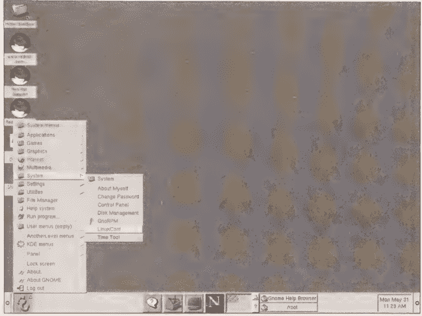

图 1-47：从 GNOME 主菜单启动 linuxconf

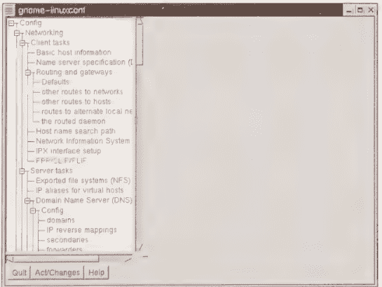

图 1-48：linuxconf 初始窗口

要以我自己的身份添加为新用户，我会按照以下步骤操作：

- 1. 向下滚动到"User accounts"选项，然后单击 Normal 下列出的"User accounts"项（见图 1-49）。由于所有操作都从 Config 选项开始，因此该树形菜单选择可以记为 Config⇨User accounts⇨Normal⇨User accounts。选择此菜单项会使 linuxconf 在右侧面板中显示 User Accounts 选项卡，如图 1-49 所示。

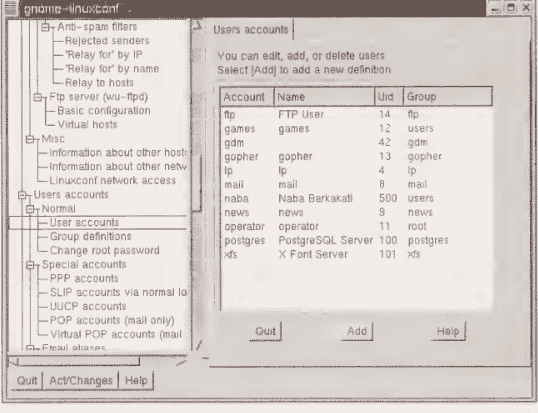

图 1-49：linuxconf 初始窗口

- 2. 单击图 1-49 中 User Accounts 选项卡的 Add 按钮。这将弹出"User Account Creation"选项卡，如图 1-50 所示。

- 3. 填写请求的信息。特别要注意的是，你必须输入登录名和主目录。对于我的账户，我将 /home/naba 作为主目录。你可以为你的账户使用类似的主目录。填写完所有字段后，单击 Accept 按钮。如果 /home/naba 目录不存在，linuxconf 会创建该目录。

- 4. linuxconf 工具会显示 Changing Password 选项卡，我在其中输入新账户的密码并单击 Accept 按钮。随后工具会要求我重新输入密码以进行确认。你会注意到，如果密码是可在词典中找到的单词组合，linuxconf 会拒绝接受你选择的密码。

- 5. 添加用户账户后，通过单击 Quit 按钮关闭 User Accounts 选项卡。

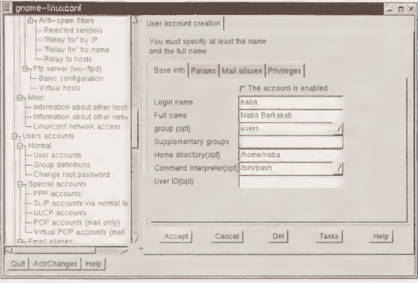

图 1-50：输入新用户账户的信息

- 6. 要退出 `linuxconf`，单击树形菜单下方左侧面板上的 Quit 按钮。`linuxconf` 工具会显示一个新的选项卡（图 1-51），询问你是否要激活更改。单击 Activate the Changes 按钮以完成任务并退出 `linuxconf`。

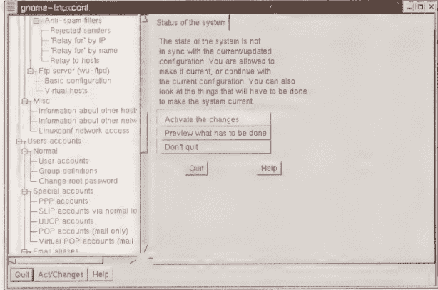

图 1-51：激活更改并退出 linuxconf

你可以使用 `linuxconf` 完成 Linux 中的大多数系统和网络管理任务。你可能会发现浏览树形菜单来了解 `linuxconf` 可以执行哪些配置任务很有帮助。在网上，`linuxconf` 的主页位于 `http://www.solucorp.qc.ca/linuxconf/`。

## 查阅在线文档

你应该熟悉 Linux 中一个重要的信息来源。你经常可以看到一些要求你输入 Linux 命令的说明。过一段时间，你肯定会遇到这样的情况：隐约记得某个命令的名称，却想不起来应该输入的确切语法。这时，Linux 的在线手册页面可以帮到你。

要尝试本节所述的命令，你需要在 GNOME 中打开一个终端窗口。单击 GNOME 桌面底部边缘主面板上的终端图标（紧邻 Netscape 的 N 图标旁边）（见图 1-48）。这将打开一个终端窗口，你可以在其中输入 Linux 命令。

你可以使用 `man` 命令查看某个命令的手册页面——通常称为 *man page*。（你必须*记住*这个命令才能查找在线帮助。）要查看 `passwd` 命令的 man page，请输入以下命令：

```
man passwd
```

Linux 会逐页显示信息。按空格键翻到下一页。阅读完毕后，按 q 键返回 Linux 命令提示符。

在极力称赞了在线帮助页面的实用性之后，我必须指出，术语 *Linux 命令* 指的是任何可执行文件，范围从包含其他 Linux 命令的脚本文件到标准的 Linux 可执行程序。虽然大多数标准程序都有 man page，但许多程序并没有任何在线帮助。例如，如果你在 Linux 命令提示符下输入 `help`，你会得到命令处理器（称为 shell）内部定义的命令列表。然而，当你输入 `man help` 时，Linux 会按如下方式响应：

```
No manual entry for help
```

尽管如此，每当你难以想起某个命令时，使用 `man` 命令来查看该命令是否存在在线帮助都是值得的。

你可以参考的另一种在线文档形式是系统 `/usr/doc/HOWTO` 目录中的 HOWTO 文件（如果在安装期间选择了 Extra Documentation 组件，这些文件会被安装。

安装）。HOWTO 文件的文件名均带有 `-HOWTO` 后缀，每个文件都是纯文本文件。

每个 HOWTO 文件包含关于 Linux 某个领域的信息，例如它支持的硬件或如何创建启动盘。表 1-7 列出了应该位于 Linux 系统 `/usr/doc/HOWTO` 目录中的 HOWTO 文件，前提是你安装了 Extra Documentation 组件。

要查看这些文件中的任何一个，请进入 `/usr/doc/HOWTO` 目录并使用 `more` 命令，如下所示：

```
cd /usr/doc/HOWTO
more topic-name-HOWTO
```

其中 *topic-name* 是文件名中不包含 `-HOWTO` 后缀的前半部分。因此，要查看 `Bootdisk-HOWTO` 文件，请输入：

```
more Bootdisk-HOWTO
```

你不必输入完整的长文件名；只需输入 `more Bootd`，然后按 Tab 键。Linux 命令处理器——shell——会自动补全与你所输入内容匹配的文件名。然后你可以按 Enter 键运行该命令。

## 表 1-7 /usr/doc/HOWTO 目录中的 Linux HOWTO 文件

| HOWTO 文件名 | 内容 |
|---|---|
| 3Dfx-HOWTO | 如何配置 Linux 以支持 3Dfx 图形加速芯片 |
| AX25-HOWTO | 如何安装和配置 Linux 以支持全球业余无线电爱好者使用的 AX.25 分组无线电协议 |
| Access-HOWTO | 如何使 Linux 能够被残障人士使用 |
| Alpha-HOWTO | Digital Equipment Corporation 的 64 位 RISC 架构 Alpha CPU 概述（Linux 可在 Alpha 上运行） |
| Assembly-HOWTO | 如何在 Linux 中使用汇编语言编程 |
| Bash-Prompt-HOWTO | 如何使用 Bash shell（命令处理器） |
| Benchmarking-HOWTO | 如何对 Linux 系统进行基准测试——测量系统完成计算任务的速度 |
| Beowulf-HOWTO | 如何通过集群多台 Linux 系统来构建和配置 Beowulf 超级计算机 |
| BootPrompt-HOWTO | 可以在启动时传递给 Linux 的参数列表（在 LILO `boot:` 提示符处） |
| Bootdisk-HOWTO | 如何为 Linux 创建启动盘、根文件系统盘和其他工具盘 |
| Busmouse-HOWTO | 如何在 Linux 中安装、配置和使用总线鼠标 |
| CD-Writing-HOWTO | 如何使用安装在 Linux 系统中的 CD 刻录机刻录光盘 |
| CDROM-HOWTO | 如何在 Linux 中安装、配置和使用 CD-ROM 驱动器 |
| Chinese-HOWTO | 如何配置 Linux 以使用中文字符集和中文版 X Window 系统 |
| Commercial-HOWTO | Linux 商业软件列表 |
| Config-HOWTO | 如何配置 Linux 中最常见的应用程序 |
| Consultants-HOWTO | 提供 Linux 支持的顾问或咨询公司列表 |
| Cyrillic-HOWTO | 如何在 Linux 系统上使用西里尔字母排版和打印俄语文档 |
| DNS-HOWTO | 如何在 Linux 系统上设置域名服务（DNS） |
| DOS-Win-to-Linux-HOWTO | 如何将你的 DOS 和 Windows 知识应用到 Linux 环境中 |
| DOS-to-Linux-HOWTO | 如何将你的 MS-DOS 知识应用到 Linux 中 |
| DOSEMU-HOWTO | 如何设置和使用 MS-DOS 模拟器 DOSEMU |
| Danish-HOWTO | 如何配置 Linux 以使用丹麦语字符集 |
| Distribution-HOWTO | Linux 发行版列表，特别关注商业 CD-ROM 发行版 |
| ELF-HOWTO | 如何在 ELF（可执行和链接格式）二进制格式下编译和运行程序（配套 CD-ROM 上的 Linux 版本已配置为可运行 ELF 二进制文件） |
| Emacspak-HOWTO | 如何通过 Emacspak 支持盲人用户——Emacspak 是一个 Emacs 子系统，通过合成语音提供反馈 |
| Esperanto-HOWTO | 如何为世界语设置 Linux（该 HOWTO 本身使用世界语撰写——世界语是 1887 年设计的一种语言，旨在促进不同国家和文化背景的人们之间的交流） |
| Ethernet-HOWTO | 如何在 Linux 中配置和使用以太网网络适配器 |
| Finnish-HOWTO | 如何为芬兰语设置 Linux（除开头段落外，该 HOWTO 本身使用芬兰语撰写） |
| Firewall-HOWTO | 如何在 Linux 系统上设置互联网防火墙 |
| French-HOWTO | 如何为法语设置 Linux（该 HOWTO 本身使用法语撰写） |
| Ftape-HOWTO | 如何在 Linux 中设置和使用软盘磁带驱动器（QIC-40、QIC-80、QIC-3010 和 QIC-3020 兼容的磁带驱动器，通过软盘控制器连接到 PC） |
| GCC-HOWTO | 如何在 Linux 中设置和使用 GNU C 编译器及开发库 |
| German-HOWTO | 如何在 Linux 中使用德语字符集（该 HOWTO 本身使用德语撰写） |
| Glibc2-HOWTO | 如何在 Linux 系统上安装和使用 GNU C 库版本 2（libc 6） |
| HAM-HOWTO | 关于 Linux 业余无线电软件的信息 |
| Hardware-HOWTO | 已知可与 Linux 配合使用的硬件列表以及如何查找所需的驱动程序 |
| Hebrew-HOWTO | 如何在 X Window 系统和文本模式屏幕中支持希伯来语字符集 |
| IPCHAINS-HOWTO | 如何获取、安装和配置 Linux 的增强型 IP 防火墙链软件，包括一些关于如何使用 ipchains 工具的建议（ipchains 取代了旧版的 ipfwadm 工具） |
| IPX-HOWTO | 如何获取、安装和配置使用 Linux IPX 协议支持的各种软件（IPX 被 Novell Netware 使用） |
| IR-HOWTO | 如何在 Linux 中使用符合 IrDA 标准的红外设备（IrDA 是一种红外无线通信标准，传输速率从 2400bps 到 4Mbps） |
| ISP-Hookup-HOWTO | 如何通过拨号调制解调器连接将 Linux 系统连接到互联网服务提供商（ISP） |
| Installation-HOWTO | 如何获取和安装 Linux |
| Intranet-Server-HOWTO | 如何在将 Unix、Novell Netware、Windows NT 和 Windows 95 系统连接在一起的内部网中使用 Linux 系统 |
| Italian-HOWTO | 如何为意大利语设置 Linux（该 HOWTO 本身使用意大利语撰写） |
| Java-CGI-HOWTO | 如何在 Linux 中开发和使用 Java 程序 |
| Kernel-HOWTO | 如何升级和重新编译 Linux 内核 |
| Keyboard-and-Console-HOWTO | 如何使用各种 Linux 工具来配置键盘和控制台（文本模式屏幕） |
| Kickstart-HOWTO | 如何使用 RedHat Linux KickStart 系统在大量系统上安装相同的 Linux 版本 |
| LinuxDoc+Emacs+Ispell-HOWTO | 如何使用 Emacs 和 Ispell 为 Linux Documentation Project 撰写文档（如 HOWTO） |
| MGR-HOWTO | 如何在 Linux 中使用 MGR（ManaGeR）图形窗口系统 |
| MILO-HOWTO | 如何在基于 Alpha AXP 的系统上设置和使用 Linux 的 Miniloader（MILO）（正如 LILO 在基于 Intel 的 PC 上加载和启动 Linux，MILO 在 Alpha 系统上加载 Linux） |
| MIPS-HOWTO | 如何获取和使用 Silicon Graphics 的 MIPS 处理器版本的 Linux（MIPS 处理器用于从 Silicon Graphics 工作站到 Nintendo 64 游戏机等多种系统） |
| Mail-HOWTO | 如何在 Linux 系统上设置和维护电子邮件（e-mail） |
| Modem-HOWTO | 如何在 Linux 中选择、连接、配置和使用调制解调器 |
| Multi-Disk-HOWTO | 如何在 Linux 中最佳地使用多个磁盘和分区 |
| Multicast-HOWTO | 关于 TCP/IP 网络上的组播信息 |
| NET-3-HOWTO | 如何在 Linux 中安装和配置 TCP/IP 网络 |
| NFS-HOWTO | 如何在 Linux 中设置 NFS（网络文件系统）服务器和客户端 |
| NIS-HOWTO | 如何在 Linux 中配置 NIS（网络信息服务） |
| Networking-Overview-HOWTO | Linux 网络功能概述 |
| Optical-Disk-HOWTO | 如何在 Linux 中安装和配置光盘驱动器（包括对带 SCSI-II 接口的 Panasonic LF1000 PD 相变光驱的详细介绍） |
| Oracle-HOWTO | 如何在 Linux 系统上安装和配置 Oracle 数据库服务器 |
| PCI-HOWTO | 关于 Linux 对 PCI（外围组件互连）总线架构支持的信息 |
| PCMCIA-HOWTO | 如何在 Linux 中安装和使用 PCMCIA（个人计算机内存卡国际协会）卡服务 |
| PPP-HOWTO | 如何在 Linux 中设置和使用点对点协议（PPP）网络 |
| PalmOS-HOWTO | 如何在 Linux 中使用 PalmOS 设备（如 Palm III） |
| Parallel-Processing-HOWTO | 如何使用并行处理方法，包括 SMP（对称多处理）Linux 系统、网络化 Linux 系统集群、使用多媒体指令（即 MMX）的并行执行，以及由 Linux 系统托管的附加（并行）处理器 |
| Pilot-HOWTO | 如何在 Linux 系统中使用 3Com（U.S. Robotics）Palm Pilot 个人数字助理（PDA） |
| Plug-and-Play-HOWTO | 如何在 Linux 中支持即插即用（PnP）设备 |
| Polish-HOWTO | 如何为波兰语设置 Linux（该 HOWTO 本身使用波兰语撰写） |
| Portuguese-HOWTO | 如何为葡萄牙语设置 Linux（该 HOWTO 本身使用葡萄牙语撰写） |
| PostgreSQL-HOWTO | 如何在 Linux 中设置和使用 PostgreSQL 数据库引擎 |
| Printing-HOWTO | 如何在 Linux 中设置打印功能 |
| Printing-Usage-HOWTO | 如何使用 Linux 中的打印假脱机系统 |


 # 表 1-7（续）

| HOWTO 文件名 | 内容 |
| --- | --- |
| Quake-HOWTO | 如何在 Linux 中安装、运行和排除 Quake、QuakeWorld 和 Quake II（这些是由 id Software 开发的 3D 动作游戏）的故障 |
| RPM-HOWTO | 如何在 Linux 中使用 Red Hat 软件包管理器（RPM） |
| Reading-List-HOWTO | 对 Linux 用户有用的书籍列表 |
| Root-RAID-HOWTO | 如何在 Linux 中创建根挂载 RAID（廉价磁盘冗余阵列）文件系统 |
| SCSI-HOWTO | 关于 Linux 中 SCSI 设备支持的信息 |
| SCSI-Programming-HOWTO | 关于在 Linux 中编程 SCSI 设备驱动程序的信息（对希望在 Linux 中为新 SCSI 设备添加支持的程序员有用） |
| SMB-HOWTO | 如何在 Linux 中使用服务器消息块（SMB）协议，也称为 NetBIOS 或 LAN Manager 协议 |
| SRM-HOWTO | 如何使用 SRM（系统参考手册）固件引导基于 Alpha 的 Linux 系统，该固件通常用于在 Alpha 上引导 DEC Unix |
| Security-HOWTO | Linux 系统中安全问题的概述 |
| Serial-HOWTO | 如何在 Linux 中设置串行通信设备 |
| Serial-Programming-HOWTO | 如何在 Linux 中编程串行端口 |
| Shadow-Password-HOWTO | 如何在 Linux 中获取、安装和配置密码 Shadow Suite（密码阴影比存储在 /etc/passwd 文件中的密码更安全） |
| Slovenian-HOWTO | 如何为斯洛文尼亚用户配置 Linux（此 HOWTO 为斯洛文尼亚语） |
| Software-Release-Practice-HOWTO | 描述 Linux 开源项目的良好软件发布实践 |
| Sound-HOWTO | 如何在 Linux 中启用对声卡硬件的支持 |
| Sound-Playing-HOWTO | 列出许多音频文件格式以及可用于在 Linux 中播放声音的应用程序 |
| Spanish-HOWTO | 如何为西班牙语用户配置 Linux（此 HOWTO 为西班牙语） |
| TeTeX-HOWTO | 如何在 Linux 中安装和使用 teTeX TeX（发音为 tech，与 technology 中的 tech 相同）和 LaTeX 文档排版软件 |

## 注销

既然你已经尝试了 GNOME 桌面，并在 X 下使用了 `linuxconf` 图形化系统管理工具，你应该学习如何注销。要注销，请选择主菜单（脚印图标）➜ 注销。屏幕会变灰，并弹出一个对话框询问你是否真的要注销。点击"是"按钮即可注销。

片刻之后，图形登录界面（图 1-47）出现，以便其他用户可以登录并使用系统。

## 关闭 Linux

当你准备关闭 Linux 时，应该按有序的方式进行。即使你是 Linux 系统的唯一用户，通常也有几个其他程序在后台运行。此外，Linux 等操作系统会尝试优化向磁盘写入数据的方式。由于磁盘访问相对较慢（与访问内存位置所需的时间相比），数据通常保存在内存中，并以大块形式写入磁盘。因此，如果你直接关闭电源，就会有某些文件无法正确更新的风险。

任何用户（无需登录）都可以从图形登录界面关闭系统。登录对话框上的"选项"按钮提供了重新启动或停止系统的菜单选项。要关闭系统，只需选择"选项" ➜ "系统" ➜ "停止"，如图 1-52 所示。

另一个对话框（图 1-53）会要求你确认是否真的要停止系统。点击"是"按钮。

当系统关闭时，你会看到关于进程正在关闭的消息。即使没有人明确在系统上运行任何程序，进程数量之多也会让你惊讶。如果你的系统在关闭时不会自动断电，你可以手动关闭电源。

如果你已经以 root 身份登录，可以使用 `shutdown` 命令来停止或重新启动系统。如果你已经使用其他用户名登录，可以通过输入以下命令成为超级用户（你的输入以粗体显示；我的注释以斜体显示）：

省略了过时的内容，如需完整文本请提供

如果你想重新启动系统而不是停止它，可以使用带有 `-r` 选项的 `shutdown` 命令，如下所示：

`/sbin/shutdown -r now`

### 小结

Linux 是适用于 Intel 80x86、Pentium 及兼容系统的类 UNIX 操作系统。本书附带的 CD-ROM 包含流行的 Red Hat Linux 发行版的最新版本。本章指导你完成在 PC 上安装 Linux 的过程。在下一章中，我将向你展示如何保持 Linux 内核为最新版本，以及如何使用 Red Hat 软件包管理器（RPM）安装新软件包。

本章的详细信息包括：

- 在安装 Linux 之前应收集的有关 PC 的信息

- 从随书 CD-ROM 安装 Red Hat Linux（包括 X Window 系统和 GNOME 桌面）的整体过程

- 在安装 Linux 之前需要在 MS-DOS 或 Microsoft Windows 下执行的步骤

- 如何首次启动 Linux、对硬盘进行分区，以及使用 Red Hat 安装程序从随书 CD-ROM 加载各种软件组件

- 如何使用 `linuxconf` 图形化系统管理工具添加新用户

- 如何登录、注销和关闭 Linux 系统

## 第 2 章

## 升级 Linux

**本章内容**

- 了解 Linux 内核
- 使用 Red Hat 软件包管理器（RPM）
- 应用内核补丁
- 重新构建 Linux 内核
- 使用 Red Hat 内核 RPM 升级到新内核版本

Linux 如此令人兴奋的原因之一是许多程序员正在不断改进它。例如，一些程序员编写驱动程序以添加对新硬件的支持，如新 CD-ROM 驱动器或新网卡。其他程序员添加对更多显卡的支持以运行 X Window 系统。Linux 开发社区以 *补丁* 的形式，或通过 Linux 的新版本，将所有这些创新提供给你。

虽然你不需要在每次有新补丁或新版本可用时都升级或修改 Linux 操作系统——内核——但有时你需要升级，仅仅因为新版本纠正了某些问题或更好地支持你的硬件。

即使没有修复或增强，你也可能想要重新构建内核。随书 CD-ROM 上的 Linux 内核是一个通用内核，使用模块来支持所有类型的硬件。你可能想要构建一个新内核，只将实际安装在你系统上的那些设备的驱动程序链接进去。特别是，如果你有 SCSI 硬盘，你绝对想要创建一个支持你的 SCSI 适配器的内核。根据你的需求，你可能还想要更改一些内核配置选项，例如启用 IP 转发，以便你可以将 Linux 系统用作局域网（LAN）的 Internet 网关。

许多修复和改进由 Red Hat 提供——这些更新以 Red Hat 软件包的形式从 Red Hat 的 FTP 服务器分发（尝试 `ftp://ftp.redhat.com/pub/redhat/updates/`，如果该站点繁忙，请查阅 `http://www.redhat.com/mirrors.html` 查找你附近的镜像站点）。要安装这些软件包，你必须使用 Red Hat 软件包管理器（RPM）。


 本章以一个关于 rpm（Red Hat 软件包管理器程序）的简要教程开始。然后将展示如何应用内核补丁以及如何重建 Linux 内核。

### 使用 Red Hat 软件包管理器（RPM）

Red Hat 的一项重要创新是 Red Hat 软件包管理器（RPM）——一种将所有必要文件打包成单个文件的系统（称为 RPM 文件，或简称 RPM）。Red Hat Linux 以大量 RPM 的形式分发。当您从配套 CD-ROM 安装 Red Hat Linux 时，安装程序使用 rpm 命令解包并将文件复制到磁盘上的适当位置。

虽然您不需要了解 RPM 文件的内部结构，但您应该知道如何使用 rpm 命令在 RPM 文件范围内工作。具体来说，您可能希望对 RPM 执行以下一项或多项任务：

- 查找系统上已安装的 RPM 的版本号和其他信息。
- 从 RPM 安装新软件包。例如，您可能安装初始安装时跳过的一个包。特别是，在重建内核之前，您必须安装 Linux 内核的源文件。
- 删除（卸载）您先前从 RPM 安装的不需要的软件。如果您发现从未使用过某个包，可以卸载它以回收磁盘空间。
- 用新的 RPM 升级旧版本。从 Red Hat 的 FTP 服务器下载软件包的新版本后，您可能会进行升级。通常，您必须升级 RPM 才能从新版本中的修复中受益。
- 验证 RPM 是否正常工作。您可以验证一个包，检查所有必要文件是否在正确的位置。

您可以使用 rpm 命令执行所有这些任务——只是使用不同的选项而已。接下来的几个部分将简要介绍 rpm 命令。

如果您忘记了 rpm 选项，键入以下命令查看列表：

```
rpm --help | more
```

您会对 rpm 拥有的选项数量感到惊讶！

#### 理解 RPM 文件名

一个 RPM 包含多个文件，但在您的 Linux 系统上它显示为单个文件。按照惯例，RPM 文件名具有特定的结构。要查看配套 CD-ROM 上 RPM 文件的名称，请按以下步骤操作：

1. 将 CD-ROM 放入 CD-ROM 驱动器，并使用以下命令挂载（您必须以 root 身份登录）：

   mount /mnt/cdrom

   这个挂载命令有效，因为在 /etc/fstab 文件中存在此挂载点的条目。

2. 转到 RPM 所在的目录并查看列表：

   cd /mnt/cdrom/RedHat/RPMS
   ls *.rpm | more

```
AfterStep-1.7.90-3.i386.rpm
AfterStep-APPS-990329-2.i386.rpm
AnotherLevel-0.9-1.noarch.rpm
ElectricFence-2.1-1.i386.rpm
Gxedit-1.23-2.i386.rpm
ImageMagick-4.2.2-4 biotechnology.rpm
ImageMagick-devel-4.2.2-4.i386.rpm
MAKEDEV-2.5-1.noarch.rpm
ORBit-0.4.3-3.i386.rpm
ORBit-devel-0.4.3-3.i386.rpm
SVGATextMode-1.8-4.i386.rpm
SysVinit-2.74-14.i386.rpm
WindowMaker-0.52.0-2.i386.rpm
X11R6-contrib-3.3.2-6.i386.rpm
XFree86-100dpi-fonts-3.3.4-2.i386.rpm
XFree86-3.3.4-2.i386.rpm
（列表的其余部分已删除）
```

正如您可能从列表中猜到的，所有 RPM 文件都以 .rpm 扩展名结尾。要了解文件名的各个部分，请考虑以下 RPM：

```
XFree86-3.3.4-2.i386.rpm
```

此文件名有以下用连字符（-）分隔的部分：

- **包名称。** XFree86
- **版本号。** 3.3.4
- **发布号。** 2（这是 Red Hat 分配的发布号）
- **架构。** i386（表示此包用于 Intel 80386 兼容处理器）

通常，包名称的描述性足够强，可以让您猜测 RPM 可能包含什么。版本号与软件包当前版本的版本号相同（即使它以其他形式分发，如 `tar` 文件）。Red Hat 分配发布号以跟踪更改。对于要在配备 Intel x86 兼容处理器的 PC 上安装的 RPM，架构应为 `i386` 或 `noarch`。

#### 了解 RPM

`rpm` 命令在安装软件包时会构建一个已安装 RPM 的数据库。您可以使用 `rpm -q` 命令查询此数据库，以查找系统上已安装软件包的信息。

例如，要查找系统上已安装的 Linux 内核版本号，请输入以下 `rpm -q` 命令：

```
rpm -q kernel
kernel-2.2.10-3
```

响应是内核的 RPM 名称（这是内核的可执行版本；不是源文件）。名称与 RPM 文件名相同，只是不显示最后一部分——`.i386.rpm`。在这种情况下，RPM 的版本部分告诉您内核是 2.2.10。

您可以使用以下命令查看所有已安装 RPM 的列表：

```
rpm -qa
```

您将看到一长串 RPM 在屏幕上滚动。要逐屏查看列表，请输入

```
rpm -qa | more
```

如果您想搜索特定的软件包，将 `rpm -qa` 的输出传递给 `grep` 命令。例如，要查看名称中包含 `kernel` 的所有软件包，请输入：

```
rpm -qa | grep kernel
kernel-headers-2.2.10-3
kernel-2.2.10-3
kernel-pcmcia-cs-2.2.10-3
kernel-source-2.2.10-3
kernelcfg-0.5-5
```

您可以使用 `rpm -q` 命令查询的远不止软件包的版本号。通过添加单字母选项，您可以找到有关软件包的其他有用信息。例如，尝试以下命令查看内核软件包中的文件：

```
rpm -ql kernel
/boot/System.map-2.2.10-3
/boot/module-info-2.2.10-3
/boot/vmlinux-2.2.10-3
/boot/vmlinuz-2.2.10-3
/lib/modules
/lib/modules/2.2.10-3
/lib/modules/2.2.10-3/.rhkmvtag
/lib/modules/2.2.10-3/block
（列表的其余部分已删除）
```

以下是几种有用的 rpm -q 命令形式，用于查询软件包信息（要使用任何这些 rpm -q 命令，请输入命令后跟软件包名称）：

- **rpm -qc** 列出软件包中的所有配置文件。
- **rpm -qd** 列出软件包中的所有文档文件。这些通常是在线手册页（也称为 *man* 页）。
- **rpm -qi** 显示有关软件包的详细信息，包括版本号、大小、安装日期和简要说明。
- **rpm -ql** 列出软件包中的所有文件。对于某些软件包，这可能是一个很长的列表。
- **rpm -qs** 列出软件包中所有文件的状态。

#### 安装 RPM

要安装 RPM，您必须使用 rpm -i 命令。您需要提供 RPM 文件名作为参数。一个典型的例子是从 CD-ROM 安装 RPM。像往常一样，您必须首先挂载 CD-ROM，然后转到 RPM 所在的目录。然后，使用 rpm -i 命令安装 RPM。

例如，要从我的 CD-ROM 安装 kernel-source RPM（它包含 Linux 操作系统的源文件），我输入以下命令：

```
mount /mnt/cdrom
cd /mnt/cdrom/RedHat/RPMS
rpm -i kernel-source*
```

注意，您不必键入完整的 RPM 文件名——您可以使用名称开头的几个字符，后跟星号。确保您键入了足够的名称以唯一标识 RPM 文件。

如果您尝试安装已安装的 RPM，rpm 命令会显示错误消息。例如，当我尝试在我的系统上安装 Emacs 编辑器时，会发生以下情况：

```
rpm -i emacs-20*
error: package emacs-20.3-15 is already installed
```

要强制 rpm 命令安装软件包，即使有错误，只需在 rpm -i 命令后添加 --force，如下所示：

```
rpm -i --force emacs-20*
```

#### 删除 RPM

如果您意识到并不真正需要某个软件，您可能想要删除——卸载——该软件包。例如，如果您安装了 X Window 系统开发包，但您对编写任何 X 应用程序不感兴趣，您可以使用 `rpm -e` 命令轻松删除该软件包。

在删除之前，您需要知道软件包的名称。一个找到名称的好方法是使用 `rpm -qa` 与 `grep` 结合来搜索适当的 RPM 文件。例如，要定位 X Window 系统开发 RPM，您可以尝试：

```
rpm -qa | grep XFree
XFree86-3.3.4-2
XFree86-75dpi-fonts-3.3.4-2
XFree86-devel-3.3.4-2
XFree86-libs-3.3.4-2
XFree86-xfs 3.3.4-2
XFree86-SVGA-3.3.4-2
```

在这种情况下，`XFree86-devel` 恰好是您需要的软件包名称。要删除该软件包，请输入：

```
rpm -e XFree86-devel
```

注意，您不需要完整的 RPM 文件名；您只需要软件包名称——文件名中版本号前第一个连字符（-）之前的部分。

`rpm -e` 命令不会删除其他软件包需要的软件包。例如，当我尝试删除 kernel-headers 软件包时，我得到了以下错误消息：

```
rpm -e kernel-headers
error: removing these packages would break dependencies:
        kernel-headers   is needed by glibc-devel-2.1.2-2
        kernel-headers >= 2.2.1 is needed by glibc-devel-2.1.2-2
        kernel-headers   is needed by glibc-devel-2.1.2-2
        kernel-headers >= 2.2.1 is needed by glibc-devel-2.1.2-2
        kernel-headers = 2.2.10 is needed by kernel-source-2.2.10-3
```

#### 升级 RPM

使用 `rpm -U` 命令升级 RPM。您必须提供包含新软件的 RPM 文件名。例如，如果我的系统上安装了 Netscape Communicator 4.51 版，但我想升级到 4.61 版，我从 Red Hat 的 FTP 服务器（`ftp://ftp.redhat.com/pub/redhat/updates/` 或 `http://www.redhat.com/mirrors.html` 中列出的某个镜像站点）下载 RPM 文件 `netscape-communicator-4.61-1.i386.rpm`，然后使用以下命令：

```
rpm -U netscape-communicator-4.61-1.i386.rpm
```


rpm 命令执行升级的方式是先删除旧版本的 netscape-communicator 软件包，然后安装新的 RPM。

只要可能，你应该升级而不是移除旧软件包；然后再安装新版本。升级会自动保存旧的配置文件，为你省去全新安装后配置软件的麻烦。

在升级内核以及包含即用型 Linux 内核的内核模块包时，你应该使用 rpm -i 命令（而不是 rpm -u 命令）来安装它。这样就不会覆盖当前内核。请参阅"使用 Red Hat 内核 RPM 升级"部分，了解如何从内核 RPM 中提取并安装新内核。

#### 验证 RPM

你可能不常这样做，但如果怀疑某个软件包没有正确安装，可以使用 rpm -V 命令来验证该软件包。例如，要验证内核软件包，请键入以下命令：

```
rpm -V kernel
```

这会让 rpm 将软件包中每个文件的大小和其他属性与原始文件进行比较。如果一切验证正确，rpm -V 命令不会打印任何内容。如果存在任何差异，你将看到差异报告。例如，我修改了 Apache Web 服务器的配置文件。以下是我验证 apache 软件包时看到的结果：

```
rpm -V apache
S.5....T c /etc/httpd/conf/access.conf
S.5....T c /etc/httpd/conf/httpd.conf
S.5....T c /etc/httpd/conf/srm.conf
```

在这种情况下，rpm -V 的输出显示有三个配置文件已更改。每行输出包含三个部分：

- 行首是八个字符；每个字符表示发现的差异类型。例如，S 表示大小不同，T 表示最后修改时间不同。表 2-1 显示了每个特定字符及其含义。句点表示该特定属性与原始文件匹配。

- 对于配置文件，接下来会出现一个 c；否则，该字段为空。这样你就能判断一个文件是否是配置文件。通常情况下，你不会担心配置文件是否已更改，因为这些更改可能是你自己进行的。

- 行的最后一部分是文件的完整路径名。从这部分你可以准确知道文件的位置。

| 字符 | 含义 |
|-----------|---------|
| S | 大小已更改。 |
| M | 权限和文件类型不同。 |
| 5 | 使用 MD5 算法计算的校验和不同。 |
| D | 设备类型不同。 |
| L | 符号链接不同。 |
| U | 文件的用户不同。 |
| G | 文件的组不同。 |
| T | 文件修改时间不同。 |

### 应用内核补丁

与任何主要软件产品一样，Linux 也有一个版本号，随着新功能的添加而变化。通常，版本号包含两部分：*主版本号*和*次版本号*。例如，MS-DOS 6.2 的主版本号是 6，次版本号是 2。次版本号随着软件的增量改进而变化；只有当发生重大变化时，主版本号才会改变。

除了常见的主版本号和次版本号之外，Linux 还包含第三个数字，表示当前的补丁级别。补丁通常是修正——对代码进行的更改以修复错误。

最后，Red Hat 添加了第四个数字，表示该软件的 Red Hat 发布版本号。

文本终端上的 Linux 登录提示会显示 Linux 版本号、补丁级别和 Red Hat 发布版本号。如果你使用的是图形登录界面，请按 Ctrl+Alt+F1 查看显示文本模式登录提示的虚拟终端（要切换回图形界面，请按 Ctrl+Alt+F7）。提示的第二行具有以下形式：

```
Kernel 2.2.5-2 on an i586
```

该信息告诉你 Linux 版本是 2.2，补丁级别是 5，Red Hat 发布版本号是 2。内核版本 2.2.5 最初包含在最初的 Red Hat Linux 6.0 CD-ROM 中。但是，在 Red Hat Linux 的后续版本中，Red Hat 可能会将内核升级到更高版本。

你也可以使用 `uname` 命令来确定当前的内核版本号。要查看其工作原理，请键入：

```
uname -r
2.2.5-2
```

输出显示 Linux 内核的完整版本号。`uname` 命令适用于任何 UNIX 系统。

虽然版本号变化相对缓慢，但像 2.2 这样的版本可能包含许多补丁。如果你通过定期阅读专门讨论 Linux 的互联网新闻组（如 `comp.os.linux` 和 `comp.os.linux.setup`）来跟进 Linux 的发展，通常可以了解到补丁的相关信息。你还可以从 Linux 内核档案网站 `http://www.kernel.org/` 了解最新的内核补丁。

你需要访问互联网才能阅读新闻组；有关将 Linux 系统连接到互联网的更多信息，请参阅第 18 章和第 19 章。

#### 安装内核源代码

要对内核应用任何补丁，你需要在系统上安装内核源文件。Red Hat Linux 安装程序会在安装过程中安装内核源文件，前提是你在安装时选择了内核开发组件。如果你没有安装内核开发组件，可以从配套 CD-ROM 上的 kernel-source RPM 安装这些文件。

按照以下步骤在系统上安装内核源软件包：

1. 以 `root` 身份登录，并将 Red Hat Linux CD-ROM 插入 CD 驱动器。
2. 使用 `mount` 命令将 CD-ROM 驱动器挂载到文件系统的某个目录上：
3. 切换到 CD-ROM 上的 `RedHat/RPMS` 目录，并使用 RPM 安装内核源文件。使用以下命令：

```
mount /mnt/cdrom

cd /mnt/cdrom/RedHat/RPMS
rpm -ivh kernel-source*
kernel-source
#########################################
```

RPM 通过显示一系列井号（#）来指示进度。RPM 完成内核源软件包的安装后，必要的源文件将位于 `/usr/src/linux` 目录中。

#### 获取补丁

如果你了解到某个内核补丁修复了你在 Linux 中遇到的一些问题，通常你也会了解到该补丁的编号。当你在某个新闻组中发布消息求助某个 Linux 问题时（例如"我正在运行内核版本 2.2.5，但我的全新 SCSI 控制器似乎无法工作"），你可能会收到回复说你应该将内核升级到 2.2.9，因为该 SCSI 控制器在 2.2.9 补丁级别才得到支持。

#### 什么是内核补丁？

*内核*一词指的是 Linux 操作系统的核心——它是使你的 PC 成为 Linux PC 的程序。*补丁*一词指的是修正。将两者结合起来，你可以看出*内核补丁*指的是对 Linux 操作系统本身的修正。

Linux 附带源代码，因此补丁是对源代码的修改。应用内核补丁时，你更改的是 Linux 操作系统的源代码。进行更改后，你必须重新构建 Linux 才能使更改生效。重新构建涉及设置许多配置选项并编译内核源代码。

要从 2.2.5 升级到 2.2.9，你有两种选择：

- 获取完整的 Linux 2.2.9 内核源代码并安装它。
- 获取补丁 6 到 9，并将它们应用到内核版本 2.2.5 的源文件中。

通常，整个内核分发版是一个很大的文件（对于 2.2.5 版本，是一个 10.4MB 的 bzip2 压缩文件），即使是压缩形式，而大多数补丁文件都小于 500KB（尽管有些可能高达 1MB）。因此，仅下载并应用所需的补丁是合理的。你可以使用 Web 浏览器从互联网获取这些补丁。

如果你没有互联网接入，第 18 章和第 19 章会解释如何将你的系统连接到互联网（你必须向互联网服务提供商注册才能获得接入）。

为了说明获取内核补丁文件的过程，我假设你的系统已连接到互联网，并且你可以使用 Netscape Communicator 访问互联网上的任何计算机。

Linux 内核补丁（以及最新版本的内核）可从网站 `http://www.kernel.org/` 获取。按照该页面上的链接，到达存有内核分发版（包括补丁）的 FTP 服务器。如果 FTP 站点繁忙，你会看到镜像站点列表（按地理位置组织）；从该列表中选择一个合适的站点。在 FTP 站点上，Linux 内核和相关补丁按版本号组织。例如，Linux 版本 2.2 的所有文件都在 `pub/linux/kernel/v2.2/` 目录中。版本 2.2 的内核文件和补丁的列出方式如下（我只显示列表中的几行代表性内容）：

```
linux-2.2.5.tar.bz2  29-Mar-1999 01:54  10.4M
linux-2.2.5.tar.gz   29-Mar-1999 01:54  12.9M
patch-2.2.6.bz2      16-Apr-1999 17:46  365k
patch-2.2.6.gz       16-Apr-1999 17:46  433k
```


前两个文件是两种不同格式的 Linux 2.2.5 内核完整发行版。后两个文件是版本 2.2.6 的补丁文件——通过应用这些补丁，您可以将 2.2.5 内核升级到版本 2.2.6。

如示例清单所示，每个文件都有两个版本——`.bz2` 文件和 `.gz` 文件。按照惯例，使用 `bzip2` 压缩程序压缩的文件显示为 `.bz2` 扩展名，而使用 `gzip` 程序压缩的文件则显示为 `.gz` 扩展名。`bzip2` 格式正变得流行，因为它的压缩效果优于 `gzip`（比较示例清单中的大小）。

您应该下载 `.bz2` 文件，因为它们比 `.gz` 版本更小。例如，要将内核从 2.2.5 升级到 2.2.9，您需要下载以下文件：

```
patch-2.2.6.bz2    16-Apr-1999 17:46    365k
patch-2.2.7.bz2    28-Apr-1999 14:42    252k
patch-2.2.8.bz2    11-May-1999 15:59    400k
patch-2.2.9.bz2    13-May-1999 19:54     30k
```

要下载每个文件，请点击文件名并将其保存到系统硬盘上。接下来，您需要解压补丁文件并应用这些补丁。

#### 应用补丁

下载补丁后，首先需要解压文件；然后才能应用补丁。

要解压 `.bz2` 文件，您需要 `bzip2` 程序，这是一个免费提供的快速数据压缩和解压缩工具。配套 CD-ROM 中包含有 `bzip2`，但安装程序不会自动安装它。要安装 `bzip2`，请将 CD-ROM 插入 CD-ROM 驱动器，以 root 身份登录，然后使用以下命令：

```
mount /mnt/cdrom
cd /mnt/cdrom/RedHat/RPMS
rpm -Uvh bzip2*
bzip2
```

安装 `bzip2` 后，请按照以下步骤应用补丁（您需要以 root 身份登录）：

1. 将补丁文件复制到 `/usr/src` 目录。

2. 输入以下命令进入 `/usr/src` 目录并解压补丁文件：

```
cd /usr/src
bzip2 -d patch*.bz2
```

3. 切换到 /usr/src/linux 目录，并使用 patch 命令逐个应用补丁：

```
cd /usr/src/linux
patch -p1 < ../patch-2.2.6 > err.6
patch -p1 < ../patch-2.2.7 > err.7
patch -p1 < ../patch-2.2.8 > err.8
patch -p1 < ../patch-2.2.9 > err.9
```

第一条命令运行 patch 命令，以 patch-2.2.6 文件作为输入，并将所有输出信息（包括任何错误报告）发送到文件 err.6。

命令执行完毕后，检查 err.6、err.7、err.8 和 err.9 文件，查看是否有任何补丁应用失败。一个很好的方法是使用文本搜索工具 grep 查找字符串 FAIL 的任何出现，如下所示：

```
grep FAIL err.*
```

如果 grep 找到字符串 FAIL 的任何出现，则补丁应用未成功，这可能是因为内核源文件已经从原始形式被修改过。

现在，先按原样尝试 grep 命令；在第 6 章中，您将了解更多关于 grep 和其他 Linux 命令的知识。有关 Linux 命令的快速参考，包括 grep 和 patch，请参见附录 B。

如果这些命令没有任何错误地执行完毕，这些 patch 命令将修改 Linux 操作系统的源代码，以反映开发人员自版本 2.2.5 以来所做的任何更改。应用最后一个补丁后，Linux 源代码应该达到 2.2.9 级别。接下来您所要做的就是重新构建内核；然后您的 Linux 系统就将处于版本 2.2.9。

这些步骤可能在 Red Hat Linux 上无法正常工作，因为 Red Hat 修改了部分内核文件。如果 Red Hat Linux 中的 patch 命令失败，您仍然可以通过其他方式将内核升级到更新的版本。


这些程序各自都能达到相同的结果——它们都会把你的选择存储在一个名为 .config 的文本文件中，该文件位于 /usr/src/linux 目录下。由于文件名以句点开头的点开头，因此当你使用 ls 命令列出目录时看不到它；输入 ls -a 才能在目录列表中看到该文件。

内核配置步骤所做的只是将你的选择记录到 .config 文件中。在你实际使用 make 命令编译内核之前，内核文件不会更改。这意味着你可以根据需要多次进行内核配置选项的设置。

以下是我系统上 .config 文件中的部分内容（在我配置内核之后）：

```
more .config
#
# Automatically generated make config: don't edit
#

#
# Code maturity level options
#
CONFIG_EXPERIMENTAL=y

#
# Processor type and features
#
# CONFIG_M386 is not set
# CONFIG_M486 is not set
# CONFIG_M586 is not set
CONFIG_M586TSC=y
# CONFIG_M686 is not set
CONFIG_X86_WP_WORKS_OK=y
CONFIG_X86_INVLPG=y
CONFIG_X86_BSWAP=y
CONFIG_X86_POPAD_OK=y
CONFIG_X86_TSC=y
# CONFIG_MATH_EMULATION is not set
CONFIG_MTRR=y
# CONFIG_SMP is not set

#
# Loadable module support
#
CONFIG_MODULES=y
CONFIG_MODVERSIONS=y
CONFIG_KMOD=y
(文件其余部分未显示)
```

本质上，每个配置选项都有一个名称，并且每个选项都被赋予一个值。名称以 CONFIG_ 开头，后面跟着一个标识该选项的单词。每个被选中的选项的值为 y（为链接该功能的支持）或 m（为该功能使用模块）。以 # 开头的行是注释。注释行列出了未被选中的功能。

在示例 `.config` 文件中，`CONFIG_MODULES` 被设置为 `y`，这意味着内核应包含对可加载模块的支持——即可以在内核运行时加载的驱动程序。另一方面，`CONFIG_MATH_EMULATION` 未被设置——这意味着内核不必包含用于仿真数学协处理器的代码（386 和 486SX 处理器需要单独的数学协处理器，但较新的处理器如英特尔奔腾系列和 AMD K6 已将数学协处理器内置）。

提示

我将通过 `make config` 命令来描述配置过程。尽管这种方法有些繁琐，因为它会逐一引导你完成每个选项，但作为学习工具来说非常理想。当你逐步浏览各组配置选项时，我会提供注释来解释大多数选项的含义。然后你可以使用任何配置工具（`make xconfig`、`make menuconfig` 或 `make config`）来执行配置。

## 开始内核配置

要开始配置内核，输入：

```
make config
rm -f include/asm
( cd include ; ln -sf asm-i386 asm)
/bin/sh scripts/Configure arch/i386/config.in
#
# Using defaults found in arch/i386/defconfig
#
*
* Code maturity level options
*
Prompt for development and/or incomplete code/drivers (CONFIG_EXPERIMENTAL)
[Y/n/?]
```

按 Enter 键接受默认的 Yes 回答。这会使配置过程显示所有实验性设备驱动程序。

提示

每个提示的可能回答显示在方括号中，默认回答为大写。因此，`[Y/n/?]` 表示默认回答是 Yes，另外两个可能的回答是 `n` 和 `?`。要接受默认值，请按 Enter 键。要获取该选项的帮助，请按 `?`。

## 配置与处理器相关的功能

接下来的四个问题涉及处理器类型和对特定处理器相关功能的支持：

```
*
* Processor type and features
*
Processor family (386, 486/Cx486, 586/K5/5x86/6x86, Pentium/K6/TSC, PPro/6x86MX)
[386] Pentium
  defined CONFIG_M586TSC
Math emulation (CONFIG_MATH_EMULATION) [Y/n/?] n
MTRR (Memory Type Range Register) support (CONFIG_MTRR) [Y/n/?]
Symmetric multi-processing support (CONFIG_SMP) [N/y/?]
```

这组问题中的第一个询问你系统的处理器类型。如果你回答 386，编译后的内核可以在任何其他处理器上运行，例如 486 或奔腾。但是，如果你要为特定系统创建内核，请从括号中显示的选择中输入你的处理器类型。如果你有一台不带数学协处理器的旧 386 或 486SX PC，你应该对第二个问题回答 Yes，并让内核以软件方式执行浮点运算。内存类型范围寄存器（Memory Type Range Register）支持是奔腾 Pro、奔腾 II 及后续处理器的一项功能，X 服务器可以利用它来实现更快的图形操作。只有当系统主板上有两个或更多处理器时，你才应该对对称多处理（SMP）支持回答 Yes。

## 启用对可加载模块的支持

下一组选项询问你关于可加载模块的支持（可加载模块类似于旧的 DOS TSR——终止并驻留——程序）：

```
* Loadable module support

Enable loadable module support (CONFIG_MODULES) [Y/n/?]
Set version information on all symbols for modules (CONFIG_MODVERSIONS) [Y/n/?]

Kernel module loader (CONFIG_KMOD) [Y/n/?]
```

你需要包含对模块的支持，因此对第一个问题回答 Yes。下一个问题询问是否在每个模块中包含版本信息。如果模块具有版本信息，则会检查该模块与当前内核版本的兼容性。由于很容易卸载无法正常工作的模块，我倾向于对这个选项回答 No。但是，你可以安全地接受默认值并按 Enter 键。第三个问题询问你是否希望内核能够自行加载所需的模块。你应该对这个选项回答 Yes。

## 配置常规选项

接下来是一组常规选项，涉及网络、PCI 总线、MCA 总线和高级电源管理（APM）BIOS 支持。

```
*
* General setup
*

Networking support (CONFIG_NET) [Y/n/?]
PCI support (CONFIG_PCI) [Y/n/?]
PCI access mode (BIOS, Direct, Any) [Any]
  defined CONFIG_PCI_GOANY
  PCI quirks (CONFIG_PCI_QUIRKS) [Y/n/?]
  PCI bridge optimization (experimental) (CONFIG_PCI_OPTIMIZE) [N/y/?]
  Backward-compatible /proc/pci (CONFIG_PCI_OLD_PROC) [Y/n/?]
MCA support (CONFIG_MCA) [N/y/?]
SGI Visual Workstation support (CONFIG_VIRWS) [N/y/?]
System V IPC (CONFIG_SYSVIPC) [Y/n/?]
BSD Process Accounting (CONFIG_BSD_PROCESS_ACCT) [Y/n/?]
```

```
Sysctl support (CONFIG_SYSCTL) [Y/n/?]
Kernel support for a.out binaries (CONFIG_BINFMT_AOUT) [M/n/y/?]
Kernel support for ELF binaries (CONFIG_BINFMT_ELF) [Y/m/n/?]
Kernel support for MISC binaries (CONFIG_BINFMT_MISC) [M/n/y/?]
Parallel port support (CONFIG_PARPORT) [M/n/y/?]
  PC-style hardware (CONFIG_PARPORT_PC) [M/n/?]
  Support foreign hardware (CONFIG_PARPORT_OTHER) [N/y/?]
Advanced Power Management BIOS support (CONFIG_APM) [Y/n/?]
  Ignore USER SUSPEND (CONFIG_APM_IGNORE_USER_SUSPEND) [N/y/?]
  Enable PM at boot time (CONFIG_APM_DO_ENABLE) [N/y/?]
  Make CPU Idle calls when idle (CONFIG_APM_CPU_IDLE) [N/y/?]
  Enable console blanking using APM (CONFIG_APM_DISPLAY_BLANK) [N/y/?]
  Power off on shutdown (CONFIG_APM_POWER_OFF) [Y/n/?]
  Ignore multiple suspend (CONFIG_APM_IGNORE_MULTIPLE_SUSPEND) [N/y/?]
  Ignore multiple suspend/resume cycles (CONFIG_APM_IGNORE_SUSPEND_BOUNCE)
[N/y/?]
  RTC stores time in GMT (CONFIG_APM_RTC_IS_GMT) [Y/n/?] n
  Allow interrupts during APM BIOS calls (CONFIG_APM_ALLOW_INTS) [N/y/?]
```

你可以直接按 Enter 键接受这些选项的默认回答。如果你不理解某个选项的含义，请按 ? 获取该选项的帮助。只有当你想为 SGI 320 或 540 工作站构建内核时，才回答 Yes 以支持 SGI Visual Workstation。此外，只有当你的 PC 的实时时钟（RTC）以格林威治标准时间（GMT）存储时间时，才对 CONFIG_APM_RTC_IS_GMT 回答 No。

## 启用即插即用支持

接下来的两个问题询问你是否要在内核中启用即插即用（PnP）支持。如果你启用 PnP 支持，内核会自动配置即插即用设备（就像 Windows 95/98 所做的那样）。你应该按 Enter 键接受这两个问题的默认选择。

```
*
* Plug and Play support
*
Plug and Play support (CONFIG_PNP) [Y/n/?]
  Auto-probe for parallel devices (CONFIG_PNP_PARPORT) [M/n/?]
```

## 配置软盘和 IDE 驱动器

下一组问题涉及软盘驱动器、硬盘驱动器和 CD-ROM 驱动器。

```
*
* Block devices
*
Normal PC floppy disk support (CONFIG_BLK_DEV_FD) [Y/m/n/?]
Enhanced IDE/MFM/RLL disk/cdrom/tape/floppy support (CONFIG_BLK_DEV_IDE)
[Y/m/n/?]
```

第一个问题询问你是否需要软盘驱动器支持。由于大多数 PC 确实配有软盘驱动器，你的回答可能是 Yes。你也应该对第二个问题回答 Yes，因为大多数 PC 都有一个或多个 IDE（集成驱动器电子）驱动器。


 下一组选项是关于各种 IDE 驱动程序的。最初的注释开头提到一个备注，指向文件 `/usr/src/linux/Documentation/ide.txt`。你会在 `/usr/src/linux/Documentation` 目录中找到许多有用的帮助文件（这些都是文本文件）。

- * 关于 IDE 驱动器的帮助/信息，请参阅 Documentation/ide.txt
- * 在主接口上使用旧的仅磁盘驱动程序（`CONFIG_BLK_DEV_HD_IDE`）[N/y/?]
- * 包含 IDE/ATA-2 磁盘支持（`CONFIG_BLK_DEV_IDEDISK`）[Y/m/n/?]
- * 包含 IDE/ATAPI CDROM 支持（`CONFIG_BLK_DEV_IDECD`）[Y/m/n/?]
- * 包含 IDE/ATAPI 磁带支持（`CONFIG_BLK_DEV_IDETAPE`）[M/n/y/?]
- * 包含 IDE/ATAPI 软盘支持（`CONFIG_BLK_DEV_IDEFLOPPY`）[M/n/y/?]
- * SCSI 仿真支持（`CONFIG_BLK_DEV_IDESCSI`）[M/n/y/?]
- * CMD640 芯片组修复/支持（`CONFIG_BLK_DEV_CMD640`）[Y/n/?]
- * CMD640 增强支持（`CONFIG_BLK_DEV_CMD640_ENHANCED`）[N/y/?]
- * RZ1000 芯片组修复/支持（`CONFIG_BLK_DEV_RZ1000`）[Y/n/?]
- * 通用 PCI IDE 芯片组支持（`CONFIG_BLK_DEV_IDEPCI`）[Y/n/?]
  - * 通用 PCI 总线主控 DMA 支持（`CONFIG_BLK_DEV_IDEDMA`）[Y/n/?]
  - * 优先从板载芯片组启动支持（`CONFIG_BLK_DEV_OFFBOARD`）[N/y/?]
  - * 可用时默认使用 DMA（`CONFIG_IDEDMA_AUTO`）[N/y/?]
  - * OPTi 82C621 芯片组增强支持（实验性）（`CONFIG_BLK_DEV_OPTI621`）[N/y/?]
  - * Tekram TRM290 芯片组支持（实验性）（`CONFIG_BLK_DEV_TRM290`）[N/y/?]
  - * NS87415 芯片组支持（实验性）（`CONFIG_BLK_DEV_NS87415`）[N/y/?]
  - * VIA82C586 芯片组支持（实验性）（`CONFIG_BLK_DEV_VIA82C586`）[N/y/?]
  - * CMD646 芯片组支持（实验性）（`CONFIG_BLK_DEV_CMD646`）[N/y/?]
- * 其他 IDE 芯片组支持（`CONFIG_IDE_CHIPSETS`）[N/y/?]

你可以接受这些选项的默认答案。请注意，IDE/ATAPI 软盘指的是连接在 IDE 接口上的软盘驱动器，例如 Iomega Zip 驱动器。关于 CMD640 和 RZ1000 修复的问题是指 IDE 接口中某些特定芯片组存在的已知问题。

## 配置其他块设备

接下来是另一组块设备选项，块设备指的是以块为单位传输数据的任何设备（与键盘每次传输一个字符的数据相对）：

- * 其他块设备
- * 回环设备支持（`CONFIG_BLK_DEV_LOOP`）[M/n/y/?]
- * 网络块设备支持（`CONFIG_BLK_DEV_NBD`）[M/n/y/?]
- * 多设备驱动程序支持（`CONFIG_BLK_DEV_MD`）[Y/n/?]
- * 自动检测 RAID 分区（`CONFIG_AUTODETECT_RAID`）[Y/n/?]
  - * 线性（追加）模式（`CONFIG_MD_LINEAR`）[M/n/y/?]
  - * RAID-0（条带化）模式（`CONFIG_MD_STRIPED`）[M/n/y/?]
  - * RAID-1（镜像）模式（`CONFIG_MD_MIRRORING`）[M/n/y/?]
  - * RAID-4/RAID-5 模式（`CONFIG_MD_RAID5`）[M/n/y/?]
  - * 半透明模式（`CONFIG_MD_TRANSLUCENT`）[N/y/m/?]

```
Logical Volume Manager support (CONFIG_MD_LVM) [N/y/m/?]
RAM disk support (CONFIG_BLK_DEV_RAM) [Y/m/n/?]
Initial RAM disk (initrd) support (CONFIG_BLK_DEV_INITRD) [Y/n/?]
XT hard disk support (CONFIG_BLK_DEV_XD) [M/n/y/?]
Mylex DAC960/DAC1100 PCI RAID Controller support (CONFIG_BLK_DEV_DAC960)
[M/n/y/?]
Compaq SMART2 support (CONFIG_BLK_CPQ_DA) [M/n/y/?]
  Support for PCI SMART2 adapters (CONFIG_BLK_CPQ_DA_PCI) [Y/n/?]
  Support for EISA SMART2 adapters (CONFIG_BLK_CPQ_DA_EISA) [Y/n/?]
```

启用回环设备可以让 Linux 在单个大文件内操作整个文件系统。多设备驱动程序（`CONFIG_BLK_DEV_MD` 选项）使 Linux 能够将多个硬盘分区组合成一个逻辑设备。该选项用于支持 RAID（廉价磁盘冗余阵列）设备。RAM 磁盘支持允许内核使用系统内存的一部分作为能够存储文件系统的磁盘。通常，RAM 磁盘仅在系统启动期间使用，此时硬盘可能还不可用。

## 配置并行端口 IDE 设备

下一组选项是关于连接到 PC 并行端口的 IDE 设备。这类设备包括设计为连接到 PC 并行端口的 CD-ROM 和磁盘驱动器。

```
Parallel port IDE device support (CONFIG_PARIDE) [M/n/?]
*
* Parallel IDE high-level drivers
*
  Parallel port IDE disks (CONFIG_PARIDE_PD) [M/n/?]
  Parallel port ATAPI CD-ROMs (CONFIG_PARIDE_PCD) [M/n/?]
  Parallel port ATAPI disks (CONFIG_PARIDE_PF) [M/n/?]
  Parallel port ATAPI tapes (CONFIG_PARIDE_PT) [M/n/?]
  Parallel port generic ATAPI devices (CONFIG_PARIDE_PG) [M/n/?]
*
* Parallel IDE protocol modules
*
  ATEN EH-100 protocol (CONFIG_PARIDE_ATEN) [M/n/?]
  MicroSolutions backpack protocol (CONFIG_PARIDE_BPCK) [M/n/?]
  DataStor Commuter protocol (CONFIG_PARIDE_COMM) [M/n/?]
  DataStor EP-2000 protocol (CONFIG_PARIDE_DSTR) [M/n/?]
  FIT TD-2000 protocol (CONFIG_PARIDE_FIT2) [M/n/?]
  FIT TD-3000 protocol (CONFIG_PARIDE_FIT3) [M/n/?]
  Shuttle EPAT/EPEZ protocol (CONFIG_PARIDE_EPAT) [M/n/?]
  Shuttle EPIA protocol (CONFIG_PARIDE_EPIA) [M/n/?]
  Freecom IO ASIC-2 protocol (CONFIG_PARIDE_FRIO) [M/n/?]
  FreeCom power protocol (CONFIG_PARIDE_FRPW) [M/n/?]
  KingByte KBIC-951A/971A protocols (CONFIG_PARIDE_KBIC) [M/n/?]
  KT Phd protocol (CONFIG_PARIDE_KTTI) [M/n/?]
  OnSpec 90c20 protocol (CONFIG_PARIDE_ON20) [M/n/?]
  OnSpec 90c26 protocol (CONFIG_PARIDE_ON26) [M/n/?]
```

你可以接受默认答案，并通过可加载模块为并行端口 IDE 设备构建支持。这样，当你需要时模块就在那里，但内核不会因此而不必要地臃肿。

## 配置网络

下一组选项涉及网络配置。如何回答取决于你想如何在网络中使用你的 Linux 系统。以下是一些指导原则：

- 如果想将 Linux 系统用作防火墙——控制局域网（LAN）与互联网之间信息流的中间系统，请回答是来启用 `CONFIG_FIREWALL`。如果你想使用 IP 伪装，就应该打开这个选项，IP 伪装允许私有局域网上的许多系统通过具有有效 IP 地址的 Linux 系统访问互联网。你还必须打开 `CONFIG_IP_FIREWALL`。第 16 章解释了 IP 伪装。
- 如果对 `CONFIG_IP_ALIAS` 回答是，你可以为单个网络接口卡分配多个 IP 地址。
- 对于 TCP/IP 网络，你应该始终启用 `CONFIG_INET`。
- 如果想将 Linux 系统用作路由器——两个局域网之间的网关，请打开 `CONFIG_IP_ROUTER` 和 `CONFIG_IP_ADVANCED_ROUTER`。
- 如果使用 Linux 系统通过 IP 多播同时向多台联网计算机发送数据，应该打开 `CONFIG_IP_MULTICAST`。
- 如果希望 Linux 抵御一种称为 SYN 洪泛的攻击，可以启用 `CONFIG_SYN_COOKIES`，这种攻击可能会压垮网络连接。
- 对于 IP 隧道（`CONFIG_NET_IPIP`）选项，可以安全地回答否。你只需要在某些特定情况下处理这个选项，例如将笔记本电脑从一个网络移到另一个网络而不更改其 IP 地址。

以下是网络选项的完整列表：

```
* Networking options

Packet socket (CONFIG_PACKET) [Y/m/n/?]
Kernel/User netlink socket (CONFIG_NETLINK) [Y/n/?]
Routing messages (CONFIG_RTNETLINK) [Y/n/?]
Netlink device emulation (CONFIG_NETLINK_DEV) [Y/m/n/?]
Network firewalls (CONFIG_FIREWALL) [Y/n/?]
Socket Filtering (CONFIG_FILTER) [Y/n/?]
Unix domain sockets (CONFIG_UNIX) [Y/m/n/?]
TCP/IP networking (CONFIG_INET) [Y/n/?]
IP: multicasting (CONFIG_IP_MULTICAST) [Y/n/?]
IP: advanced router (CONFIG_IP_ADVANCED_ROUTER) [N/y/?]
```

IP: kernel level autoconfiguration (CONFIG_IP_PNP) [N/y/?]
IP: firewalling (CONFIG_IP_FIREWALL) [Y/n/?]
IP: firewall packet netlink device (CONFIG_IP_FIREWALL_NETLINK) [Y/n/?]
IP: transparent proxy support (CONFIG_IP_TRANSPARENT_PROXY) [Y/n/?]
IP: masquerading (CONFIG_IP_MASQUERADE) [Y/n/?]

*

* Protocol-specific masquerading support will be built as modules.

*

IP: ICMP masquerading (CONFIG_IP_MASQUERADE_ICMP) [Y/n/?]

*

* Protocol-specific masquerading support will be built as modules.

*

IP: masquerading special modules support (CONFIG_IP_MASQUERADE_MOD) [Y/n/?]
IP: ipautofw masq support (EXPERIMENTAL) (CONFIG_IP_MASQUERADE_IPAUTOFW) [M/n/y/?]
IP: ipportfw masq support (EXPERIMENTAL) (CONFIG_IP_MASQUERADE_IPPORTFW) [M/n/y/?]
IP: ip fwmark masq-forwarding support (EXPERIMENTAL) (CONFIG_IP_MASQUERADE_MFW)[M/n/y/?]
IP: optimize as router not host (CONFIG_IP_ROUTER) [N/y/?]
IP: tunneling (CONFIG_NET_IPIP) [M/n/y/?]
IP: GRE tunnels over IP (CONFIG_NET_IPGRE) [M/n/y/?]
IP: broadcast GRE over IP (CONFIG_NET_IPGRE_BROADCAST) [Y/n/?]
IP: multicast routing (CONFIG_IP_MROUTE) [N/y/?]
IP: aliasing support (CONFIG_IP_ALIAS) [Y/n/?]
IP: ARP daemon support (EXPERIMENTAL) (CONFIG_ARPD) [N/y/?]
IP: TCP syncookie support (not enabled per default) (CONFIG_SYN_COOKIES) [Y/n/?]

*

* (it is safe to leave these untouched)

*

IP: Reverse ARP (CONFIG_INET_RARP) [M/n/y/?]
IP: Allow large windows (not recommended if <16Mb of memory) (CONFIG_SKB_LARGE)[Y/n/?]
The IPv6 protocol (EXPERIMENTAL) (CONFIG_IPV6) [N/y/m/?]

*

*

*

The IPX protocol (CONFIG_IPX) [M/n/y/?]
IPX: Full internal IPX network (CONFIG_IPX_INTERN) [N/y/?]
IPX: SPX networking (EXPERIMENTAL) (CONFIG_SPX) [N/m/?]
Appletalk DDP (CONFIG_ATALK) [M/n/y/?]
CCITT X.25 Packet Layer (EXPERIMENTAL) (CONFIG_X25) [N/y/m/?]
LAPB Data Link Driver (EXPERIMENTAL) (CONFIG_LAPB) [N/y/m/?]
Bridging (EXPERIMENTAL) (CONFIG_BRIDGE) [N/y/?]
802.2 LLC (EXPERIMENTAL) (CONFIG_LLC) [N/y/?]
Acorn Econet/AUN protocols (EXPERIMENTAL) (CONFIG_ECONET) [N/y/m/?]
WAN router (CONFIG_WAN_ROUTER) [M/n/y/?]
Fast switching (read help!) (CONFIG_NET_FASTROUTE) [N/y/?]
Forwarding between high speed interfaces (CONFIG_NET_HW_FLOWCONTROL) [N/y/?]
CPU is too slow to handle full bandwidth (CONFIG_CPU_IS_SLOW) [N/y/?]

*

* QoS and/or fair queueing

*

QoS and/or fair queueing (CONFIG_NET_SCHED) [N/y/?]


注意，Linux 内核现在支持下一代互联网协议：IP 版本 6（**IPv6**，也称为 **IPng** 或 **IP 下一代**）。

## 配置 SCSI 设备

接下来是一整套与 SCSI 设备相关的选项。如果你的系统有 SCSI 适配器，你首先应该对 CONFIG_SCSI 选项回答 Yes。之后，你需要回答关于连接到 SCSI 适配器的设备类型（磁盘、磁带、CD-ROM）的问题。最后，你需要启用对系统中特定 SCSI 适配器型号的支持。

如果你的系统有 SCSI 适配器，请对所有需要的 SCSI 选项按 **y**。不要按 **m** 来创建 SCSI 模块。如果内核需要加载模块化的 SCSI 设备驱动程序，你必须执行几个额外的步骤来完成安装。最简单的方法是直接链接 SCSI 支持，对 CONFIG_SCSI、CONFIG_BLK_DEV_SD 以及与你 SCSI 适配器对应的配置选项回答 **y**（见下面的清单）。

下面的清单显示了 SCSI 支持的选择列表：

```
SCSI support (CONFIG_SCSI) [Y/m/n/?]

* SCSI support type (disk, tape, CD-ROM)

SCSI disk support (CONFIG_BLK_DEV_SD) [Y/m/n/?]
SCSI tape support (CONFIG_CHR_DEV_ST) [Y/m/n/?]
SCSI CD-ROM support (CONFIG_BLK_DEV_SR) [Y/m/n/?]
  Enable vendor-specific extensions (for SCSI CDROM)
  (CONFIG_BLK_DEV_SR_VENDOR)[Y/n/?]
SCSI generic support (CONFIG_CHR_DEV_SG) [M/n/y/?]

* Some SCSI devices (e.g. CD jukebox) support multiple LUNs

Probe all LUNs on each SCSI device (CONFIG_SCSI_MULTI_LUN) [Y/n/?]
Verbose SCSI error reporting (kernel size +=12K) (CONFIG_SCSI_CONSTANTS) [Y/n/?]

SCSI logging facility (CONFIG_SCSI_LOGGING) [Y/n/?]

* SCSI low-level drivers

7000FASST SCSI support (CONFIG_SCSI_7000FASST) [M/n/y/?]
ACARD SCSI support (CONFIG_SCSI_ACARD) [M/n/y/?]
Adaptec AHA152X/2825 support (CONFIG_SCSI_AHA152X) [M/n/y/?]
Adaptec AHA1542 support (CONFIG_SCSI_AHA1542) [M/n/y/?]
Adaptec AHA1740 support (CONFIG_SCSI_AHA1740) [M/n/y/?]
Adaptec AIC7xxx support (CONFIG_SCSI_AIC7XXX) [M/n/y/?]
  Enable Tagged Command Queuing (TCQ) by default
  (CONFIG_AIC7XXX_TCQ_ON_BY_DEFAULT) [N/y/?]
  Maximum number of TCQ commands per device (`CONFIG_AIC7XXX_CMDS_PER_DEVICE`) [8]
  Collect statistics to report in /proc (`CONFIG_AIC7XXX_PROC_STATS`) [Y/n/?]
  Delay in seconds after SCSI bus reset (`CONFIG_AIC7XXX_RESET_DELAY`) [5]
  AdvanSys SCSI support (`CONFIG_SCSI_ADVANSYS`) [M/n/y/?]
  Always IN2000 SCSI support (`CONFIG_SCSI_IN2000`) [M/n/y/?]
  AM53/79C974 PCI SCSI support (`CONFIG_SCSI_AM53C974`) [M/n/y/?]
  AMI MegaRAID support (`CONFIG_SCSI_MEGARAID`) [M/n/y/?]
    Concurrent IO commands on MegaRAID (`CONFIG_MEGARAID_MULTI_IO`) [N/y/?] (NEW)
  BusLogic SCSI support (`CONFIG_SCSI_BUSLOGIC`) [M/n/y/?]
  Omit FlashPoint support (`CONFIG_SCSI_OMIT_FLASHPOINT`) [N/y/?]
  DTC3180/3280 SCSI support (`CONFIG_SCSI_DTC3280`) [M/n/y/?]
  EATA ISA/EISA/PCI (DPT and generic EATA/DMA-compliant boards) support (`CONFIG_SCSI_EATA`) [M/n/y/?]
    enable tagged command queueing (`CONFIG_SCSI_EATA_TAGGED_QUEUE`) [Y/n/?]
    enable elevator sorting (`CONFIG_SCSI_EATA_LINKED_COMMANDS`) [N/y/?]
    maximum number of queued commands (`CONFIG_SCSI_EATA_MAX_TAGS`) [16]
  EATA-DMA [Obsolete] (DPT, NEC, AT&T, SNI, AST, Olivetti, Alphatronix) support (`CONFIG_SCSI_EATA_DMA`) [M/n/y/?]
  EATA-PIO (old DPT PM2001, PM2012A) support (`CONFIG_SCSI_EATA_PIO`) [M/n/y/?]
  Future Domain 16xx SCSI/AHA-2920A support (`CONFIG_SCSI_FUTURE_DOMAIN`) [M/n/y/?]
  GDT SCSI Disk Array Controller support (`CONFIG_SCSI_GDTH`) [M/n/y/?]
  Generic NCR5380/53c400 SCSI support (`CONFIG_SCSI_GENERIC_NCR5380`) [M/n/y/?]
    Enable NCR53c400 extensions (`CONFIG_SCSI_GENERIC_NCR53C400`) [N/y/?]
  NCR5380/53c400 mapping method (use Port for T130B) (Port, Memory) [Port]
    defined `CONFIG_SCSI_G_NCR5380_PORT`
  Initio 9100U(W) support (`CONFIG_SCSI_INITIO`) [M/n/y/?]
  Initio INI-A100U2W support (`CONFIG_SCSI_INIA100`) [M/n/y/?]
  IOMEGA parallel port (ppa - older drives) (`CONFIG_SCSI_PPA`) [M/n/?]
  IOMEGA parallel port (imm - newer drives) (`CONFIG_SCSI_IMM`) [M/n/?]
    ppa/imm option - Use slow (but safe) EPP-16 (`CONFIG_SCSI_IZIP_EPP16`) [N/y/?]
    ppa/imm option - Assume slow parport control register (`CONFIG_SCSI_IZIP_SLOW_CTR`) [N/y/?]
  NCR53c406a SCSI support (`CONFIG_SCSI_NCR53C406A`) [M/n/y/?]
  symbios 53c416 SCSI support (`CONFIG_SCSI_SYM53C416`) [M/n/y/?]
  NCR53c7,8xx SCSI support (`CONFIG_SCSI_NCR53C7XX`) [M/n/y/?]
    always negotiate synchronous transfers (`CONFIG_SCSI_NCR53C7XX_SYNC`) [N/y/?]
    allow FAST-SCSI [10MHz] (`CONFIG_SCSI_NCR53C7XX_FAST`) [Y/n/?]
    allow DISCONNECT (`CONFIG_SCSI_NCR53C7XX_DISCONNECT`) [N/y/?]
  NCR53C8XX SCSI support (`CONFIG_SCSI_NCR53C8XX`) [M/n/y/?]
  SYM53C8XX SCSI support (`CONFIG_SCSI_SYM53C8XX`) [N/y/m/?] (NEW)
    default tagged command queue depth (`CONFIG_SCSI_NCR53C8XX_DEFAULT_TAGS`) [8]
    maximum number of queued commands (`CONFIG_SCSI_NCR53C8XX_MAX_TAGS`) [32]
    synchronous transfers frequency in Mhz (`CONFIG_SCSI_NCR53C8XX_SYNC`) [20]
    enable profiling (`CONFIG_SCSI_NCR53C8XX_PROFILE`) [Y/n/?]
    use normal IO (`CONFIG_SCSI_NCR53C8XX_IOMAPPED`) [N/y/?]
    assume boards are SYMBIOS compatible (`CONFIG_SCSI_NCR53C8XX_SYMBIOS_COMPAT`) [N/y/?]
  PAS16 SCSI support (`CONFIG_SCSI_PAS16`) [M/n/y/?]
  PCI2000 support (`CONFIG_SCSI_PCI2000`) [N/y/m/?]
  PCI2220i support (`CONFIG_SCSI_PCI2220I`) [N/y/m/?]
  PSI240i support (`CONFIG_SCSI_PSI240I`) [M/n/y/?]
  Qlogic ISP SCSI support (CONFIG_SCSI_QLOGIC_ISP) [M/n/y/?]
  Qlogic ISP FC SCSI support (CONFIG_SCSI_QLOGIC_FC) [M/n/y/?]
  Seagate ST-02 and Future Domain TMC-8xx SCSI support (CONFIG_SCSI_SEAGATE)
  [M/n/y/?]
  Tekram DC390(T) and Am53/79C974 SCSI support (CONFIG_SCSI_DC390T) [M/n/y/?]
    _omit_ support for non-DC390 adapters (CONFIG_SCSI_DC390T_NOGENSUPP) [N/y/?]
  Trantor T128/T128F/T228 SCSI support (CONFIG_SCSI_T128) [M/n/y/?]
  UltraStor 14F/34F support (CONFIG_SCSI_U14_34F) [M/n/y/?]
    enable elevator sorting (CONFIG_SCSI_U14_34F_LINKED_COMMANDS) [N/y/?]
    maximum number of queued commands (CONFIG_SCSI_U14_34F_MAX_TAGS) [8]
  UltraStor SCSI support (CONFIG_SCSI_ULTRASTOR) [M/n/y/?]
  SCSI debugging host adapter (CONFIG_SCSI_DEBUG) [M/n/y/?]
```

## 配置网络适配器

下一组选项是关于网络的。它们包括局域网（LAN）适配器的配置，例如以太网和令牌环网卡。通过此类别中的选项，还可以启用通过 SLIP 和 PPP 的拨号和广域网（WAN）支持。下面的清单显示了网络配置选项：

```
Network device support (CONFIG_NETDEVICES) [_yes_/no/module]
ARCnet support (CONFIG_ARCNET) [N/y/m/?]
Dummy net driver support (CONFIG_DUMMY) [M/n/y/?]
EQL (serial line load balancing) support (CONFIG_EQUALIZER) [M/n/y/?]
Ethernet network tap (CONFIG_ETHERTAP) [M/n/y/?]
Ethernet (10 or 100Mbit) (CONFIG_NET_ETHERNET) [Y/n/?]
3COM cards (CONFIG_NET_VENDOR_3COM) [Y/n/?]
3c501 support (CONFIG_EL1) [M/n/y/?]
3c503 support (CONFIG_EL2) [M/n/y/?]
3c505 support (CONFIG_ELPLUS) [M/n/y/?]
3c507 support (CONFIG_EL16) [M/n/y/?]
3c509/3c579 support (CONFIG_EL3) [M/n/y/?]
3c515 ISA Fast Etherlink (CONFIG_3C515) [M/n/y/?]
3c590/3c900 series (592/595/597) "Vortex/Boomerang" support (CONFIG_VORTEX)
[M*/n/y/?]
AMD LANCE and PCnet (AT1500 and NE2100) support (CONFIG_LANCE) [M/n/y/?]
Western Digital/SMC cards (CONFIG_NET_VENDOR_SMC) [Y/n/?]
WD80*3 support (CONFIG_WD80x3) [M/n/y/?]
SMC Ultra support (CONFIG_ULTRA) [M/n/y/?]
SMC Ultra32 EISA support (CONFIG_ULTRA32) [M/n/y/?]
SMC 9194 support (CONFIG_SMC9194) [M/n/y/?]
Racal-Interlan (Micom) NI cards (CONFIG_NET_VENDOR_RACAL) [Y/n/?]
NI5010 support (CONFIG_NI5010) [M/n/y/?]
NI5210 support (CONFIG_NI52) [M/n/y/?]
NI6510 support (CONFIG_NI65) [M/n/y/?]
RealTek 8129/8139 (not 8019/8029!) support (CONFIG_RTL8139) [M/n/y/?]
Packet Engines Yellowfin Gigabit-NIC support (CONFIG_YELLOWFIN) [M/n/y/?]
Alteon AceNIC/3Com 3C985/NetGear GA620 Gigabit support (CONFIG_ACENIC) [M/n/y/?]
```


 ## 第一部分：配置您的 Linux 系统

- 其他 ISA 网卡 (CONFIG_NET_ISA) [Y/n/?]
- AT1700/1720 支持 (CONFIG_AT1700) [M/n/y/?]
- Cabletron E21xx 支持 (CONFIG_E2100) [M/n/y/?]
- DEPCA, DE10x, DE200, DE201, DE202, DE422 支持 (CONFIG_DEPCA) [M/n/y/?]
- EtherWORKS 3 (DE203, DE204, DE205) 支持 (CONFIG_EWRK3) [M/n/y/?]
- EtherExpress 16 支持 (CONFIG_EEXPRESS) [M/n/y/?]
- EtherExpressPro 支持 (CONFIG_EEXPRESS_PRO) [M/n/y/?]
- FMV-181/182/183/184 支持 (CONFIG_FMV18X) [M/n/y/?]
- HP PCLAN+ (27247B 和 27252A) 支持 (CONFIG_HPLAN_PLUS) [M/n/y/?]
- HP PCLAN (27245 及其他 27xxx 系列) 支持 (CONFIG_HPLAN) [M/n/y/?]
- HP 10/100VG PCLAN (ISA, EISA, PCI) 支持 (CONFIG_HP100) [M/n/y/?]
- ICL EtherTeam 16i/32 支持 (CONFIG_ETH16I) [M/n/y/?]
- NE2000/NE1000 支持 (CONFIG_NE2000) [M/n/y/?]
- SEEQ8005 支持 (实验性) (CONFIG_SEEQ8005) [N/y/?]
- SK_G16 支持 (CONFIG_SK_G16) [Y/n/?]
- EISA、VLB、PCI 及板载控制器 (CONFIG_NET_EISA) [Y/n/?]
- AMD Pcnet32 (VLB 和 PCI) 支持 (CONFIG_PCNET32) [M/n/y/?]
- Ansel Communications EISA 3200 支持 (实验性) (CONFIG_AC3200) [M/n/y/?]
- Apricot Xen-II 板载以太网 (CONFIG_APRICOT) [M/n/y/?]
- CS89x0 支持 (CONFIG_CS89x0) [M/n/y/?]
- 通用 DECChip & DIGITAL EtherWORKS PCI/EISA (CONFIG_DE4X5) [M/n/y/?]
- DECChip Tulip (dc21x4x) PCI 支持 (CONFIG_DEC_ELCP) [M/n/y/?]
- Digi Intl. RightSwitch SE-X 支持 (CONFIG_DGRS) [M/n/y/?]
- EtherExpressPro/100 支持 (CONFIG_EEXPRESS_PRO100) [M/n/y/?]
- Mylex EISA LNE390A/B 支持 (实验性) (CONFIG_LNE390) [M/n/y/?]
- Novell/Eagle/Microdyne NE3210 EISA 支持 (实验性) (CONFIG_NE3210) [M/n/y/?]
- PCI NE2000 支持 (CONFIG_NE2K_PCI) [M/n/y/?]
- TI ThunderLAN 支持 (CONFIG_TLAN) [M/n/y/?]
- VIA Rhine 支持 (CONFIG_VIA_RHINE) [M/n/y/?]
- Racal-Interlan EISA ES3210 支持 (实验性) (CONFIG_ES3210) [M/n/y/?]
- SMC EtherPower II (实验性) (CONFIG_EPIC100) [M/n/y/?]
- Zenith Z-Note 支持 (实验性) (CONFIG_ZNET) [N/y/?]
- 袖珍及便携式适配器 (CONFIG_NET_PPI) [Y/n/?]
- AT-LAN-TEC/RealTek 袖珍适配器支持 (CONFIG_ATP) [Y/n/?]
- D-Link DE600 袖珍适配器支持 (CONFIG_DE600) [M/n/y/?]
- D-Link DE620 袖珍适配器支持 (CONFIG_DE620) [M/n/y/?]
- FDDI 驱动支持 (CONFIG_FDDI) [Y/n/?]
- Digital DEFEA 和 DEFPA 适配器支持 (CONFIG_DEFXX) [N/y/?]
- HIPPI 驱动支持 (实验性) (CONFIG_HIPPI) [N/y/?]
- 帧中继 DLCI 支持 (CONFIG_DLCI) [M/n/y/?]
  - 最大开放 DLCI 数 (CONFIG_DLCI_COUNT) [24]
  - 每设备最大 DLCI 数 (CONFIG_DLCI_MAX) [8]
  - SDLA (Sangoma S502/S508) 支持 (CONFIG_SDLA) [M/n/?]
- Apple/Farallon LocalTalk PC 支持 (CONFIG_LTPC) [M/n/?]
- COPS LocalTalk PC 支持 (CONFIG_COPS) [M/n/?]
  - Dayna 固件支持 (CONFIG_COPS_DAYNA) [Y/n/?]
  - Tangent 固件支持 (CONFIG_COPS_TANGENT) [Y/n/?]
- Appletalk-IP 驱动支持 (CONFIG_IPDDP) [M/n/?]
  - IP 到 Appletalk-IP 封装支持 (CONFIG_IPDDP_ENCAP) [Y/n/?]
  - Appletalk-IP 到 IP 解封装支持 (CONFIG_IPDDP_DECAP) [Y/n/?]
- PLIP (并口) 支持 (CONFIG_PLIP) [M/n/?]
- PPP (点对点) 支持 (CONFIG_PPP) [M/n/y/?]

```
* CCP 压缩器仅作为模块构建。
*
* SLIP (串行线路) 支持 (CONFIG_SLIP) [M/n/y/?]
* CSLIP 压缩头 (CONFIG_SLIP_COMPRESSED) [Y/n/?]
* 保持连接和线路填充 (CONFIG_SLIP_SMART) [Y/n/?]
* 六位 SLIP 封装 (CONFIG_SLIP_MODE_SLIP6) [Y/n/?]
* 无线局域网 (非业余无线电) (CONFIG_NET_RADIO) [Y/n/?]
* STRIP (Metricom starmode radio IP) (CONFIG_STRIP) [M/n/y/?]
* AT&T WaveLAN & DEC RoamAbout DS 支持 (CONFIG_WAVELAN) [M/n/y/?]
* 令牌环驱动支持 (CONFIG_TR) [Y/n/?]
* IBM Tropic 芯片组适配器支持 (CONFIG_IBMTR) [M/n/y/?]
* SysKonnect 适配器支持 (CONFIG_SKTR) [M/n/y/?]
* 流量整形器 (实验性) (CONFIG_SHAPER) [M/n/y/?]
* Comtrol Hostess SV-11 支持 (CONFIG_HOSTESS_SV11) [M/n/?]
* COSA/SRP 同步串口板支持 (CONFIG_COSA) [M/n/?]
* Red Creek 硬件 VPN (实验性) (CONFIG_RCPCI) [M/n/y/?]
* WAN 驱动 (CONFIG_WAN_DRIVERS) [Y/n/?]
* Sangoma WANPIPE(tm) 多协议卡 (CONFIG_VENDOR_SANGOM) [M/n/y/?]
* 最大卡数 (CONFIG_WANPIPE_CARDS) [4]
* WANPIPE X.25 支持 (CONFIG_WANPIPE_X25) [N/y/?]
* WANPIPE 帧中继支持 (CONFIG_WANPIPE_FR) [N/y/?]
* WANPIPE PPP 支持 (CONFIG_WANPIPE_PPP) [Y/n/?]
```

仅在需要支持业余分组无线电 (AX.25) 时启用以下选项：

```
*
* 业余无线电支持
*
* 业余无线电支持 (CONFIG_HAMRADIO) [N/y/?]
```

## 启用红外设备支持

Linux 内核现已支持符合 IrDA 标准的红外 (IR) 设备。以下选项集允许您启用对 IrDA 设备的支持。如果您的电脑具有任何 IrDA 接口，您可以构建支持此类设备所需的模块。

```
*
* IrDA 子系统支持
*
* IrDA 子系统支持 (CONFIG_IRDA) [M/n/y/?]
*
* IrDA 协议
*
* IrLAN 协议 (CONFIG_IRLAN) [M/n/?]
* IrCOMM 协议 (CONFIG_IRCOMM) [M/n/?]
* IrLPT 协议 (CONFIG_IRLPT) [M/n/?]
 IrLPT 客户端支持 (CONFIG_IRLPT_CLIENT) [M/n/?]
 IrLPT 服务器支持 (CONFIG_IRLPT_SERVER) [M/n/?]
* IrDA 协议选项 (CONFIG_IRDA_OPTIONS) [Y/n/?]
*
*   IrDA 选项
*
缓存上一个 LSAP (CONFIG_IRDA_CACHE_LAST_LSAP) [Y/n/?]
快速 RRs (CONFIG_IRDA_FAST_RR) [Y/n/?]
调试信息 (CONFIG_IRDA_DEBUG) [N/y/?]
IrLAP 压缩 (CONFIG_IRDA_COMPRESSION) [Y/n/?]
*
	IrDA 压缩器
*
	Deflate 压缩 (实验性) (CONFIG_IRDA_DEFLATE) [M/n/?]
*
* 红外端口设备驱动
*
IrTTY (使用串行驱动) (CONFIG_IRTTY_SIR) [M/n/?]
```

许多红外接口以 dongle（加密狗）的形式出现——通常是连接到 PC 串行端口的小型适配器。您可以使用以下选项来启用对几种常见类型 dongle 的支持：

```
*
*	Dongle 支持
*
	串行 dongle 支持 (CONFIG_DONGLE) [Y/n/?]
	ESI JetEye PC dongle (CONFIG_ESI_DONGLE) [M/n/?]
	ACTiSYS IR-220L 和 IR220L+ dongle (CONFIG_ACTISYS_DONGLE) [M/n/?]
	Tekram IrMate 210B dongle (CONFIG_TEKRAM_DONGLE) [M/n/?]
	Greenwich GIrBIL dongle (CONFIG_GIRBIL_DONGLE) [M/n/?]
	NSC PC87108 (CONFIG_NSC_FIR) [M/n/?]
	Winbond W83977AF (IR) (CONFIG_WINBOND_FIR) [M/n/?]
	Sharp UIRCC (CONFIG_SHARP_FIR) [M/n/?]
```

## 启用 ISDN 支持

下一组选项使您能够包含对 ISDN（综合业务数字网）的支持——这是一种数字电话线，可用于将 Linux 系统连接到互联网。以下 ISDN 相关选项包括特定 ISDN 适配器的配置：

```
*
* ISDN 子系统
*
ISDN 支持 (CONFIG_ISDN) [M/n/y/?]
支持同步 PPP (CONFIG_ISDN_PPP) [Y/n/?]
同步 PPP 使用 VJ 压缩 (CONFIG_ISDN_PPP_VJ) [Y/n/?]
支持通用 MP (RFC 1717) (CONFIG_ISDN_MPP) [Y/n/?]
通过 ISDN 支持音频 (CONFIG_ISDN_AUDIO) [Y/n/?]
ICN 2B 和 4B 支持 (CONFIG_ISDN_DRV_ICN) [M/n/?]
isdnloop 支持 (CONFIG_ISDN_DRV_LOOP) [M/n/?]
PCBIT-D 支持 (CONFIG_ISDN_DRV_PCBIT) [M/n/?]
HiSax Siemens 芯片组驱动支持 (CONFIG_ISDN_DRV_HISAX) [M/n/?]
HiSax 支持 EURO/DSS1 (CONFIG_HISAX_EURO) [Y/n/?]
支持德国计费信息 (CONFIG_DE_AOC) [Y/n/?]
支持澳大利亚 MicroLink 服务 (不适用于标准 EURO) (CONFIG_HISAX_ML) [Y/n/?]
HiSax 支持德国 1TR6 (CONFIG_HISAX_1TR6) [Y/n/?]
```

```
HiSax 支持 Teles 16.0/8.0 (CONFIG_HISAX_16_0) [Y/n/?]
HiSax 支持 Teles 16.3 或 PNP 或 PCMCIA (CONFIG_HISAX_16_3) [Y/n/?]
HiSax 支持 Teles 16.3c (CONFIG_HISAX_TELES3C) [Y/n/?]
HiSax 支持 AVM A1 (Fritz) (CONFIG_HISAX_AVM_A1) [Y/n/?]
HiSax 支持 Elsa 卡 (CONFIG_HISAX_ELSA) [Y/n/?]
HiSax 支持 ITK ix1-micro 修订版 2 (CONFIG_HISAX_IX1MICROR2) [Y/n/?]
HiSax 支持 Eicon.Diehl Diva 卡 (CONFIG_HISAX_DIEHLDIVA) [Y/n/?]
HiSax 支持 ASUSCOM 卡 (CONFIG_HISAX_ASUSCOM) [Y/n/?]
HiSax 支持 TELEINT 卡 (CONFIG_HISAX_TELEINT) [Y/n/?]
HiSax 支持 Sedlbauer speed card/win/star (CONFIG_HISAX_SEDLBAUER) [Y/n/?]

HiSax 支持 USR Sportster 内置 TA (CONFIG_HISAX_SPORTSTER) [Y/n/?]
HiSax 支持 MIC 卡 (CONFIG_HISAX_MIC) [Y/n/?]
HiSax 支持 NETjet 卡 (CONFIG_HISAX_NETJET) [Y/n/?]
HiSax 支持 Niccy PnP/PCI 卡 (CONFIG_HISAX_NICCY) [Y/n/?]
Spellcaster 支持 (实验性) (CONFIG_ISDN_DRV_SC) [N/m/?]
IBM Active 2000 支持 (实验性) (CONFIG_ISDN_DRV_ACT2000) [N/m/?]
AVM-B1 CAPI2.0 支持 (CONFIG_ISDN_DRV_AVMB1) [M/n/?]
详细原因代码报告 (内核大小增加约 7K)
(CONFIG_ISDN_DRV_AVMB1_VERBOSE_REASON) [Y/n/?]
```

## 配置专有接口的 CD-ROM 驱动器

如果您拥有带有专有接口的 CD-ROM 驱动器——不是 SCSI 或 IDE (ATAPI) CD-ROM 驱动器——则应从以下选项中选择您的 CD-ROM 接口：

```
支持非 SCSI/IDE/ATAPI CDROM 驱动器 (CONFIG) [Y/n/?]
Aztech/Orchid/Okano/Wearnes/TXC/CyDROM CDROM 支持 (CONFIG_AZTCD) [M/n/y/?]
Goldstar R420 CDROM 支持 (CONFIG_GSCD) [M/n/y/?]
Matsushita/Panasonic/Creative, Longshine, TEAC CDROM 支持 (CONFIG_SBPCD) [M/n/y/?]
Mitsumi (标准) [无 XA/多会话] CDROM 支持 (CONFIG_MCD) [M/n/y/?]
MCD IRQ (CONFIG_MCD_IRQ) [11] (NEW)
MCD I/O 基地址 (CONFIG_MCD_BASE) [300] (NEW)
Mitsumi [XA/多会话] CDROM 支持 (CONFIG_MCDX) [M/n/y/?]
Optics Storage DOLPHIN 8000AT CDROM 支持 (CONFIG_OPTCD) [M/n/y/?]
Philips/LMS CM206 CDROM 支持 (CONFIG_CM206) [M/n/y/?]
Sanyo CDR-H94A CDROM 支持 (CONFIG_SJCD) [M/n/y/?]
ISP16/MAD16/Mozart 软可调 CD-ROM 接口支持 (CONFIG_ISP16_CDI) [M/n/y/?]
Sony CDU31A/CDU33A CDROM 支持 (CONFIG_CDU31A) [M/n/y/?]
Sony CDU535 CDROM 支持 (CONFIG_CDU535) [M/n/y/?]
```

通常情况下，除非您拥有列出的一种 CD-ROM 接口，否则您将忽略这些 CD-ROM 选项。


# 配置字符设备

接下来的几个选项用于配置字符设备，包括连接到串口和并口的设备。这些选项还包括多串口接口卡的配置，通过它可以将多个终端或其他设备连接到你的 Linux 系统。如果你的系统没有任何此类设备，请选择 No。最后一项是并行打印机支持（CONFIG_PRINTER）。如果你打算将打印机连接到并口，请对该选项选择 Yes。

```
*
* Character devices
*
Virtual terminal (CONFIG_VT) [Y/n/?]
Support for console on virtual terminal (CONFIG_VT_CONSOLE) [Y/n/?]
Standard/generic (dumb) serial support (CONFIG_SERIAL) [Y/m/n/?]
  Support for console on serial port (CONFIG_SERIAL_CONSOLE) [Y/n/?]
Extended dumb serial driver options (CONFIG_SERIAL_EXTENDED) [Y/n/?]
  Support more than 4 serial ports (CONFIG_SERIAL_MANY_PORTS) [Y/n/?]
  Support for sharing serial interrupts (CONFIG_SERIAL_SHARE_IRQ) [Y/n/?]
  Autodetect IRQ on standard ports (unsafe) (CONFIG_SERIAL_DETECT_IRQ) [N/y/?]
  Support special multiport boards (CONFIG_SERIAL_MULTIPORT) [Y/n/?]
  Support the Bell Technologies HUB6 card (CONFIG_HUB6) [N/y/?]
Non-standard serial port support (CONFIG_SERIAL_NONSTANDARD) [Y/n/?]
Control Rocketport support (CONFIG_ROCKETPORT) [M/n/y/?]
Digiboard Intelligent Async Support (CONFIG_DIGIEPCA) [M/n/y/?]
Cyclades async mux support (CONFIG_CYCLADES) [M/n/y/?]
Stallion multiport serial support (CONFIG_STALDRV) [Y/n/?]
  Stallion EasyIO or EC8/32 support (CONFIG_STALLION) [M/n/y/?]
  Stallion EC8/64, ONboard, Brumby support (CONFIG_ISTALLION) [M/n/y/?]
SDL RISCom/8 card support (CONFIG_RISCOM8) [M/n/y/?]
Specialix IO8+ card support (CONFIG_SPECIALIX) [M/n/y/?]
Specialix DTR/RTS pin is RTS (CONFIG_SPECIALIX_RTSCTS) [Y/n/?]
Hayes ESP serial port support (CONFIG_ESPSERIAL) [M/n/y/?]
Multi-Tech multiport card support (CONFIG_ISI) [M/n/?]
Microgate SyncLink card support (CONFIG_SYNCLINK) [M/n/?]
HDLC line discipline support (CONFIG_N_HDLC) [M/n/?]
Unix98 PTY support (CONFIG_UNIX98_PTYS) [Y/n/?]
Maximum number of Unix98 PTYs in use (0-2048) (CONFIG_UNIX98_PTY_COUNT) [256]
Parallel printer support (CONFIG_PRINTER) [M/n/?]
  Support IEEE1284 status readback (CONFIG_PRINTER_READBACK) [N/y/?]
```

# 指定鼠标类型

在下一组选项中，指定你 PC 上使用的鼠标类型：

```
Mouse Support (not serial mice) (CONFIG_MOUSE) [Y/n/?]
*
* Mice
*
ATIXL busmouse support (CONFIG_ATIXL_BUSMOUSE) [M/n/y/?]
Logitech busmouse support (CONFIG_BUSMOUSE) [M/n/y/?]
Microsoft busmouse support (CONFIG_MS_BUSMOUSE) [M/n/y/?]
PS/2 mouse (aka "auxiliary device") support (CONFIG_PSMOUSE) [Y/n/?]

C&T 82C710 mouse port support (as on TI Travelmate) (CONFIG_82C710_MOUSE) [M/n/y/?]
```

如果你的 IBM PC110 掌上电脑上配有数字化板，请在下一项中启用该板的驱动模块：

```
PC110 digitizer pad support (CONFIG_PC110_PAD) [M/n/y/?]
```

# 启用对非 SCSI 磁带机的支持

如果你有非 SCSI 磁带机，则对下一项选择 Yes；否则选择 No：

```
QIC-02 tape support (CONFIG_QIC02_TAPE) [N/y/m/?]
```

# 配置看门狗定时器

下一组配置选项用于启用看门狗定时器支持。这实质上会让内核创建一个特殊文件——如果每分钟未能打开该文件并向其写入数据，系统就会重新启动。有一些看门狗板可以监测 PC 状态（例如温度）。你也可以在以下选项中启用对特定看门狗板的支持：

```
Watchdog Timer Support (CONFIG_WATCHDOG) [Y/n/?]

+   * Watchdog Cards

Disable watchdog shutdown on close (CONFIG_WATCHDOG_NOWAYOUT) [N/y/?]

WDT Watchdog timer (CONFIG_WDT) [M/n/y/?]

WDT501 features (CONFIG_WDT_501) [N/y/?]

Software Watchdog (CONFIG_SOFT_WATCHDOG) [M/n/y/?]

Berkshire Products PC Watchdog (CONFIG_PCWATCHDOG) [M/n/y/?]

Acquire SBC Watchdog Timer (CONFIG_ACQUIRE_WDT) [M/n/y/?]
```

# 启用对 CMOS 内存和实时时钟的访问

如果你需要访问 PC 实时时钟中的非易失性（电池供电）内存，请对下一项选择 Yes：

```
/dev/nvram support (CONFIG_NVRAM) [M/n/y/?]
```

你也可以通过启用以下配置选项来访问实时时钟：

```
Enhanced Real Time Clock Support (CONFIG_RTC) [Y/n/?]
```

# 配置音频和视频设备

下一组选项用于配置音频和视频设备，包括 FM 收音机卡：

```
+   * Video For Linux
* Video For Linux (CONFIG_VIDEO_DEV) [M/n/y/?]
  * AIMSlab RadioTrack (aka RadioReveal) support (CONFIG_RADIO_RTRACK) [M/n/?]
  * AIMSlab RadioTrack II support (CONFIG_RADIO_RTRACK2) [M/n/?]
  * Aztech/Packard Bell Radio (CONFIG_RADIO_AZTECH) [M/n/?]
  * ADS Cadet AM/FM Tuner (CONFIG_RADIO_CADET) [M/m/?] (NEW)
  * Miro PCM20 Radio (CONFIG_RADIO_MIROPCM20) [M/n/?]
  * GemTek Radio Card support (CONFIG_RADIO_GEMTEK) [M/n/?]
  * BT848 Video For Linux (CONFIG_VIDEO_BT848) [M/n/?]
  * Quickcam BW Video For Linux (CONFIG_VIDEO_BWQCAM) [M/n/?]
  * Colour QuickCam Video For Linux (EXPERIMENTAL) (CONFIG_VIDEO_CQCAM) [M/n/?]
  * Mediavision Pro Movie Studio Video For Linux (CONFIG_VIDEO_PMS) [M/n/?]
  * SAA5249 Teletext processor (CONFIG_VIDEO_SAA5249) [M/n/?]
  * SF16FMI Radio (CONFIG_RADIO_SF16FMI) [M/n/?]
  * Typhoon Radio (a.k.a. EcoRadio) (CONFIG_RADIO_TYPHOON) [M/n/?]
    * Support for /proc/radio-typhoon (CONFIG_RADIO_TYPHOON_PROC_FS) [Y/n/?]
  * Zoltrix Radio (CONFIG_RADIO_ZOLTRIX) [M/n/?]
```

# 启用游戏杆支持

你可以在以下一组选项中启用对特定游戏杆的支持：

# 启用语音卡支持

如果你有 DoubleTalk PC 语音合成器，请使用以下选项启用对该语音卡的支持：

```
Double Talk PC internal speech card support (CONFIG_DTLK) [M/n/y/?]
```

# 配置软盘磁带机

如果你有连接到软盘控制器的磁带机，请对下一项选择 **y** 或 **m**，然后适当选择其他参数（或接受默认选项）：

```
+   * Ftape, the floppy tape device driver
* Ftape (QIC-80/Travan) support (CONFIG_FTAPE) [M/n/y/?]
* Zftape, the VFS interface (CONFIG_ZFTAPE) [M/n/?]
* Default block size (CONFIG_ZFT_DFLT_BLK_SZ) [10240]
* The compressor will be built as a module only!
* Number of ftape buffers (EXPERIMENTAL) (CONFIG_FT_NR_BUFFERS) [3]
* Enable procfs status report (+2kb) (CONFIG_FT_PROC_FS) [N/y/?]
* Debugging output (Normal, Excessive, Reduced, None) [Normal]
  defined CONFIG_FT_NORMAL_DEBUG
* Hardware configuration
* Floppy tape controllers (Standard, MACH-2, FC-10/FC-20, Alt/82078) [Standard]
  defined CONFIG_FT_STD_FDC
* Default FIFO threshold (EXPERIMENTAL) (CONFIG_FT_FDC_THR) [8]
* Maximal data rate to use (EXPERIMENTAL) (CONFIG_FT_FDC_MAX_RATE) [2000]
* ONLY for DEC Alpha architectures
* CPU clock frequency of your DEC Alpha (CONFIG_FT_ALPHA_CLOCK) [0]
```

# 指定 Alpha 处理器时钟频率

只有当你正在为 DEC Alpha 系统构建内核时，才需要考虑下一项。对于 PC，直接按 Enter 接受默认设置即可，因为该选项无关紧要：

# 启用对特定文件系统的支持

下一组选项可让你启用对特定类型文件系统的支持。你可以根据表 2-2 中的说明进行选择。

| 选项 | 说明 |
|--------|-------------|
| CONFIG_QUOTA | 启用磁盘配额，以便限制每个用户的磁盘空间。只有当你的系统有很多用户并且希望实现磁盘配额时，才选择 y。 |
| CONFIG_MINIX_FS | 支持 Minix 文件系统——Linux 最早的文件系统。这个简单的文件系统仍在软盘上使用，stranger essay。 |

**表 2-2** *(续)*

| 选项 | 说明 |
|--------|-------------|
| CONFIG_EXT_FS | 启用对已废弃的扩展文件系统（extended file system）的支持。你可以安全地对该选项选择 **n**。 |
| CONFIG_EXT2_FS | 启用对第二代扩展文件系统（second extended file system）的支持——这是 Linux 当前标准的文件系统。你绝对应该选择 **y** 来启用该选项。 |
| CONFIG_XIA_FS | 支持 XIA 文件系统，另一种已经无人使用的旧文件系统。选择 **n** 以禁用该选项。 |
| CONFIG_FAT_FS | 启用对基于文件分配表（FAT）的文件系统的支持（例如 MS-DOS 和 Windows 95 VFAT 文件系统）。如果你想访问 MS-DOS 或 VFAT 文件，请选择 **y**。 |
| CONFIG_MSDOS_FS | 支持 MS-DOS 文件系统。如果你想读取硬盘上的 MS-DOS 分区或 MS-DOS 软盘，请按 **y**。 |
| CONFIG_VFAT_FS | 支持 Windows 95 VFAT 文件系统。如果你的系统包含 VFAT 文件系统分区，请选择 **y**。 |
| CONFIG_UMSDOS_FS | 支持 UMSDOS 文件系统，它可以将 Linux 文件存放在 MS-DOS 分区中。你可以安全地选择 **n**。 |
| CONFIG_PROC_FS | 启用对 `/proc` 虚拟文件系统的支持，通过它可以获取内核相关信息。`/proc` 文件系统并不存在于磁盘上；文件在你访问时才会被创建。你应该选择 **y** 启用该选项，因为它非常有用，而且某些系统程序依赖 `/proc`。 |
| CONFIG_NFS_FS | 使你可以挂载网络中其他系统上的网络文件系统（NFS）目录。如果你想访问 NFS 目录，请选择 **y**。 |
| CONFIG_ROOT_NFS | 使 Linux 系统能够从另一台运行 NFS 的系统挂载整个文件系统（如果你的 Linux 系统根本没有硬盘，这会很有用）。大多数人会对该选项选择 **n**。 |
| CONFIG_SMB_FS | 使 Linux 系统能够访问运行 Windows 95 或 Windows for Workgroups 的网络 PC 上的共享目录。如果你想访问 Windows 系统上的共享目录，请选择 **y**。 |
| CONFIG_SMB_WIN95 | 使 Linux 系统能够绕过 Windows 95 共享目录中的一些缺陷。如果你启用了 CONFIG_SMB_FS，请选择 **y**。 |


 | 选项 | 描述 |
| --- | --- |
| CONFIG_ISO9660_FS | 开启对 CD-ROM 上使用的标准 ISO 9660 文件系统的支持（这也被称为 High Sierra 文件系统，在某些 UNIX 工作站上称为 `hsfs`）。如果你有 CD-ROM 驱动器，请在此处回答 **y**。 |
| CONFIG_HPFS_FS | 使您的 Linux 系统能够访问 OS/2 HPFS 文件系统。如果您的硬盘上有 OS/2 分区，请回答 **y**。 |
| CONFIG_SYSV_FS | 开启对 System V 文件系统的支持，该文件系统由 SCO、Xenix 和 Coherent 等基于 Intel PC 的 UNIX 变种使用。如果您需要访问 System V 文件系统，请在此处回答 **y**。 |
| CONFIG_UFS_FS | 使您的 Linux 系统能够读取（但不能写入）BSD（Berkeley Software Distribution）类 UNIX 使用的 UFS 文件系统（如 SunOS、FreeBSD、NetBSD 和 NeXTstep）。如果您需要访问任何 UFS 文件系统，请回答 **y**。 |

以下清单显示了这些文件系统配置选项的可用选择：

```
* 文件系统
-
配额支持 (CONFIG_QUOTA) [Y/n/?]
内核自动挂载支持 (CONFIG_AUTOFS_FS) [M/n/y/?]
ADFS 文件系统支持（只读）(实验性) (CONFIG_ADFS_FS) [N/y/m/?]
Amiga FFS 文件系统支持 (CONFIG_AFFS_FS) [N/y/m/?]
Apple Macintosh 文件系统支持（实验性）(CONFIG_HFS_FS) [M/n/y/?]
DOS FAT 文件系统支持 (CONFIG_FAT_FS) [M/n/y/?]
  MSDOS 文件系统支持 (CONFIG_MSDOS_FS) [M/n/?]
  UMSDOS：在标准 MSDOS 文件系统之上的类 Unix 文件系统
    (CONFIG_UMSDOS_FS) [M/n/?]
  VFAT (Windows-95) 文件系统支持 (CONFIG_VFAT_FS) [M/n/?]
ISO 9660 CDROM 文件系统支持 (CONFIG_ISO9660_FS) [Y/m/n/?]
Microsoft Joliet CDROM 扩展 (CONFIG_JOLIET) [Y/n/?]
Minix 文件系统支持 (CONFIG_MINIX_FS) [M/n/y/?]
NTFS 文件系统支持（只读）(CONFIG_NTFS_FS) [N/y/m/?]
OS/2 HPFS 文件系统支持（只读）(CONFIG_HPFS_FS) [M/n/y/?]
/proc 文件系统支持 (CONFIG_PROC_FS) [Y/n/?]
/dev/pts 用于 Unix98 PTYs 的文件系统 (CONFIG_DEVPTS_FS) [Y/n/?]
QNX 文件系统支持（实验性）(CONFIG_QNX4FS_FS) [N/y/m/?]
ROM 文件系统支持 (CONFIG_ROMFS_FS) [M/n/y/?]
第二扩展文件系统支持 (CONFIG_EXT2_FS) [Y/m/n/?]
System V 和 Coherent 文件系统支持 (CONFIG_SYSV_FS) [M/n/y/?]
UFS 文件系统支持 (CONFIG_UFS_FS) [M/n/y/?]
  UFS 文件系统写入支持（实验性）(CONFIG_UFS_FS_WRITE) [N/y/?]
*
* 网络文件系统
  - Coda 文件系统支持（高级网络文件系统）(CONFIG_CODA_FS) [M/n/y/?]
  - NFS 文件系统支持 (CONFIG_NFS_FS) [M/n/y/?]
  - NFS 服务器支持 (CONFIG_NFSD) [M/n/y/?]
    - 模拟 SUN NFS 服务器 (CONFIG_NFSD_SUN) [Y/n/?]
  - SMB 文件系统支持（用于挂载 WfW 共享等）(CONFIG_SMB_FS) [M/n/y/?]
  - SMB Win95 缺陷解决方案 (CONFIG_SMB_WIN95) [Y/n/?]
  - NCP 文件系统支持（用于挂载 NetWare 卷）(CONFIG_NCP_FS) [M/n/y/?]
    - 数据包签名 (CONFIG_NCPFS_PACKET_SIGNING) [Y/n/?]
    - 专有文件锁定 (CONFIG_NCPFS_IOCTL_LOCKING) [Y/n/?]
    - 需要时清除删除/移除抑制 (CONFIG_NCPFS_STRONG) [Y/n/?]
    - 如果可用则使用 NFS 命名空间 (CONFIG_NCPFS_NFS_NS) [Y/n/?]
    - 如果可用则使用 LONG（OS/2）命名空间 (CONFIG_NCPFS_OS2_NS) [Y/n/?]
      - 小写 DOS 文件名 (CONFIG_NCPFS_SMALLDOS) [N/y/?] (新)
    - 允许挂载卷子目录 (CONFIG_NCPFS_MOUNT_SUBDIR) [Y/n/?]
    - 使用本地语言支持 (CONFIG_NCPFS_NLS) [N/y/?] (新)
    - 启用符号链接和执行标志 (CONFIG_NCPFS_EXTRAS) [N/y/?] (新)
```

Linux 可以读取和操作由许多不同系统创建的磁盘分区。以下一组选项使您能够包含对特定分区类型的支持：

- - 分区类型
  - BSD 磁盘标签（BSD 分区表）支持 (CONFIG_BSD_DISKLABEL) [N/y/?]
  - Macintosh 分区映射支持 (CONFIG_MAC_PARTITION) [N/y/?]
  - SMD 磁盘标签（Sun 分区表）支持 (CONFIG_SMD_DISKLABEL) [N/y/?]
  - Solaris (x86) 分区表支持 (CONFIG_SOLARIS_X86_PARTITION) [N/y/?]
  - Unixware 切片支持（实验性）(CONFIG_UNIXWARE_DISKLABEL) [N/y/?]

## 选择本地语言字符集

接下来是一组配置选项，要求您选择本地语言字符集。这些字符集由 Microsoft FAT 文件系统用于以多种语言之一存储和显示文件名。字符集存储在称为 DOS 代码页的文件中。您必须包含适当的代码页，以便 Linux 内核能够正确读写硬盘上任何 DOS 分区中的文件名。请注意，代码页仅适用于文件名；它们与文件的实际内容无关。

您可以包含对任意数量代码页的支持。对以下集合中您选择的语言对应的代码页回答 Yes：

- - 本地语言支持
  - 代码页 437（美国、加拿大）(CONFIG_NLS_CODEPAGE_437) [M/n/y/?]
  - 代码页 737（希腊）(CONFIG_NLS_CODEPAGE_737) [M/n/y/?]
  - 代码页 775（波罗的海地区）(CONFIG_NLS_CODEPAGE_775) [M/n/y/?]
  - 代码页 850（欧洲）(CONFIG_NLS_CODEPAGE_850) [M/n/y/?]
  - 代码页 852（中欧/东欧）(CONFIG_NLS_CODEPAGE_852) [M/n/y/?]
  - 代码页 855（西里尔文）(CONFIG_NLS_CODEPAGE_855) [M/n_pdata/[M/n/y/?]
  - 代码页 857（土耳其）(CONFIG_NLS_CODEPAGE_857) [M/n/y/?]
  - 代码页 860（葡萄牙语）(CONFIG_NLS_CODEPAGE_860) [M/n/y/?]
  ```
  代码页 861（冰岛语）(CONFIG_NLS_CODEPAGE_861) [M/n/y/?]
  代码页 862（希伯来语）(CONFIG_NLS_CODEPAGE_862) [M/n/y/?]
  代码页 863（加拿大法语）(CONFIG_NLS_CODEPAGE_863) [M/n/y/?]
  代码页 864（阿拉伯语）(CONFIG_NLS_CODEPAGE_864) [M/n/y/?]
  代码页 865（挪威语、丹麦语）(CONFIG_NLS_CODEPAGE_865) [M/n/y/?]
  代码页 866（西里尔文/俄语）(CONFIG_NLS_CODEPAGE_866) [M/n/y/?]
  代码页 869（希腊语）(CONFIG_NLS_CODEPAGE_869) [M/n/y/?]
  代码页 874（泰语）(CONFIG_NLS_CODEPAGE_874) [M/n/y/?]
  NLS ISO 8859-1（拉丁语 1；西欧语言）(CONFIG_NLS_ISO8859_1)
  [M/n/y/?]
  NLS ISO 8859-2（拉丁语 2；斯拉夫/中欧语言）
  (CONFIG_NLS_ISO8859_2) [M/n/y/?]
  NLS ISO 8859-3（拉丁语 3；世界语、加利西亚语、马耳他语、土耳其语）
  (CONFIG_NLS_ISO8859_3) [M/n/y/?]
  NLS ISO 8859-4（拉丁语 4；爱沙尼亚语、拉脱维亚语、立陶宛语）
  (CONFIG_NLS_ISO8859_4) [M/n/y/?]
  NLS ISO 8859-5（西里尔文）(CONFIG_NLS_ISO8859_5) [M/n/y/?]
  NLS ISO 8859-6（阿拉伯语）(CONFIG_NLS_ISO8859_6) [M/n/y/?]
  NLS ISO 8859-7（现代希腊语）(CONFIG_NLS_ISO8859_7) [M/n/y/?]
  NLS ISO 8859-8（希伯来语）(CONFIG_NLS_ISO8859_8) [M/n/y/?]
  NLS ISO 8859-9（拉丁语 5；土耳其语）(CONFIG_NLS_ISO8859_9) [M/n/y/?]
  NLS ISO 8859-15（拉丁语 9；带欧元的西欧语言）
  (CONFIG_NLS_ISO8859_15) [M/n/y/?]
  NLS KOI8-R（俄语）(CONFIG_NLS_KOI8_R) [M/n/y/?]
  ```

## 配置控制台驱动程序

在选择完 DOS 文件系统的自然语言支持后，您必须配置内核可以在不使用 X Window System 的情况下显示文本输出的控制台驱动程序。您肯定希望对 CONFIG_VGA_CONSOLE 选项回答 Yes，因为这使内核能够使用通用 VGA 模式在文本模式下显示输出（几乎所有显卡都支持）。大多数其他控制台驱动程序本质上都是实验性的。一个新特性是 CONFIG_FB 选项，它可以启用对帧缓冲设备的支持。帧缓冲是对图形硬件的抽象，使内核和其他软件能够产生图形输出，而无需依赖显卡的底层细节（如硬件寄存器）。从选项列表中可以看出，帧缓冲支持可用于少数特定的显卡：

```
*
* 控制台驱动程序
*
VGA 文本控制台 (CONFIG_VGA_CONSOLE) [Y/n/?]
视频模式选择支持 (CONFIG_VIDEO_SELECT) [Y/n/?]
MDA 文本控制台（双头）(实验性) (CONFIG_MDA_CONSOLE) [M/n/y/?]
帧缓冲设备支持（实验性）(CONFIG_FB) [Y/n/?]
Permedia2 支持（实验性）(CONFIG_FB_PM2) [N/y/?]
VESA VGA 图形控制台 (CONFIG_FB_VESA) [Y/n/?]
Matrox 加速 (CONFIG_FB_MATROX) [M/n/y/?]
  Millennium I/II 支持 (CONFIG_FB_MATROX_MILLENIUM) [Y/n/?]
  Mystique 支持 (CONFIG_FB_MATROX_MYSTIQUE) [Y/n/?]
  G100/G200 支持 (CONFIG_FB_MATROX_G100) [Y/n/?]
  多显示器支持 (CONFIG_FB_MATROX_MULTIHEAD) [Y/n/?]
ATI Mach64 显示支持 (CONFIG_FB_ATY) [N/y/?]
```

 +   - 虚拟帧缓冲支持（仅用于测试！）（CONFIG_FB_VIRTUAL）[N/y/m/?]
- 高级底层驱动选项（CONFIG_FBCON_ADVANCED）[N/y/?]
- 仅支持8像素宽度字体（CONFIG_FBCON_FONTWIDTH8_ONLY）[N/y/?]
- 选择内置字体（CONFIG_FBCON_FONTS）[N/y/?]

## 配置声卡

下一组选项是声卡支持。如果你已安装声卡，请首先对 CONFIG_SOUND 选项回答 **y** 或 **m**。之后，你需要回答一系列关于各种声卡的问题。你可以始终回答 **m**，以便将声卡支持构建为可在需要时加载的模块。以下是声卡相关选项的典型列表：

+   - 声音
- 声卡支持（CONFIG_SOUND）[M/n/y/?]
- Ensoniq AudioPCI (ES1370)（CONFIG_SOUND_ES1370）[M/n/?]
- Creative Ensoniq AudioPCI 97 (ES1371)（CONFIG_SOUND_ES1371）[M/n/?]
- S3 SonicVibes（CONFIG_SOUND_SONICVIBES）[M/n/?]
- Turtle Beach MultiSound Classic、Tahiti、Monterey 支持（CONFIG_SOUND_MSNDCLAS）[M/n/?]
  - MSNDINIT.BIN 固件文件的完整路径（CONFIG_MSNDCLAS_INIT_FILE）[/etc/sound/msndinit.bin]
  - MSNDPERM.BIN 固件文件的完整路径（CONFIG_MSNDCLAS_PERM_FILE）[/etc/sound/msndperm.bin]
- Turtle Beach MultiSound Pinnacle、Fiji 支持（CONFIG_SOUND_MSNPIN）[M/n/?]
  - PNDSPINI.BIN 固件文件的完整路径（CONFIG_MSNPIN_INIT_FILE）[/etc/sound/pndspini.bin]
  - PNDSPERM.BIN 固件文件的完整路径（CONFIG_MSNPIN_PERM_FILE）[/etc/sound/pndsperm.bin]
- OSS 声音模块（CONFIG_SOUND_OSS）[M/n/?]
- ProAudioSpectrum 16 支持（CONFIG_SOUND_PAS）[M/n/?]
- 100% 兼容 Sound Blaster (SB16/32/64, ESS, Jazz16) 支持（CONFIG_SOUND_SB）[M/n/?]
- 通用 OPL2/OPL3 FM 合成器支持（CONFIG_SOUND_ADLIB）[M/n/?]
- Gravis Ultrasound 支持（CONFIG_SOUND_GUS）[M/n/?]
- GUS 16 位采样选项（非 GUS MAX）（CONFIG_GUS16）[Y/n/?]
- GUS MAX 支持（CONFIG_GUSMAX）[Y/n/?]
- MPU-401 支持（非 SB16）（CONFIG_SOUND_MPU401）[M/n/?]
- PSS (AD1848, ADSP-2115, ESC614) 支持（CONFIG_SOUND_PSS）[M/n/?]
  - 启用 PSS 混音器（Beethoven ADSP-16 及其他兼容）
- Microsoft Sound System 支持（CONFIG_SOUND_MSS）[M/n/?]
- Ensoniq SoundScape 支持（CONFIG_SOUND_SSCAPE）[M/n/?]
- MediaTrix AudioTrix Pro 支持（CONFIG_SOUND_TRIX）[M/n/?]
- OPTi MAD16 和/或 Mozart 系列声卡支持（CONFIG_SOUND_MAD16）[M/n/?]
- 旧版 MAD16 声卡 MIDI 支持（需要 SB）（CONFIG_MAD16_OLDCARD）[Y/n/?]
- Turtle Beach WaveFront (Tropez Plus, Tropez, Maui) 合成器/声卡完全支持（CONFIG_SOUND_WAVEFRONT）[M/n/?]
- Crystal CS4232 系列（PnP）声卡支持（CONFIG_SOUND_CS4232）[M/n/?]
- Yamaha OPL3-SA2, SA3, 及 SAx 系列 PnP 声卡支持（CONFIG_SOUND_OPL3SA2）[M/n/?]
- Turtle Beach Wave Front (Maui, Tropez) 合成器有限支持（`CONFIG_SOUND_MAUI`）[M/n/?]
- Aztech Sound Galaxy（非 PnP）声卡支持（`CONFIG_SOUND_SGALAXY`）[M/n/?]
- AD1816/1815/1812 系列声卡支持（`CONFIG_SOUND_AD1816`）[M/n/?]
- Yamaha OPL3-SA1 音频控制器（`CONFIG_SOUND_OPL3SA1`）[M/n/?]
- SoftOSS 软件波表引擎（`CONFIG_SOUND_SOFTOSS`）[M/n/?]
- FM 合成器 (YM3812/OPL3) 支持（`CONFIG_SOUND_YM3812`）[M/n/?]
- 回环 MIDI 设备支持（`CONFIG_SOUND_VMIDI`）[M/n/?]
- 6850 UART 支持（`CONFIG_SOUND_UART6850`）[M/n/?]

*

* 额外底层声卡驱动

*

额外底层声卡驱动（`CONFIG_LOWLEVEL_SOUND`）[Y/n/?]

ACI 混音器（miroPCM12）（`CONFIG_ACI_MIXER`）[M/n/?]

AWE32 合成器（`CONFIG_AWE32_SYNTH`）[M/n/?]

Gallant 声卡（基于 SC-6000 和 SC-6600）（`CONFIG_AEDSP16`）[M/n/?]

Audio Excel DSP 16 I/O 基地址 220 或 240（`CONFIG_AEDSP16_BASE`）[220]

MPU401 I/O 基地址（请查阅声卡手册）（`CONFIG_MPU_BASE`）[330]

*

* SC-6600 声卡没有任何跳线开关

*

基于 SC-6600 的声卡（新版 Audio Excel DSP 16）（`CONFIG_SC6600`）[Y/n/?]

*

* SC-6600 特定配置

*

启用 SC-6600 游戏杆接口（`CONFIG_SC6600_JOY`）[Y/n/?]

SC-6600 CDROM 接口（4=无，3=IDE，1=Panasonic，0=Sony?）（`CONFIG_SC6600_CDROM`）[4]

SC-6600 CDROM 接口 I/O 地址（`CONFIG_SC6600_CDROMBASE`）[0]

Audio Excel DSP 16（SBPro 仿真）（`CONFIG_AEDSP16_SBPRO`）[Y/n/?]

*

* Audio Excel DSP 16 [Sound Blaster Pro]

*

Audio Excel DSP 16 I/O 基地址 220, 240（`CONFIG_AEDSP16_BASE`）[220]

Audio Excel DSP 16 IRQ 5, 7, 9, 10, 11（`CONFIG_AEDSP16_SB_IRQ`）[5]

Audio Excel DSP 16 DMA 0, 1 或 3（`CONFIG_AEDSP16_SB_DMA`）[0]

Audio Excel DSP 16（MPU401 仿真）（`CONFIG_AEDSP16_MPU401`）[Y/n/?]

*

* Audio Excel DSP 16 [MPU-401]

*

Audio Excel DSP 16 的 MPU401 IRQ 5, 7, 9, 10 或 0（禁用）
（`CONFIG_AEDSP16_MPU_IRQ`）[5]

## 启用内核调试支持

下一个也是最后一个选项允许你使用 SysRq 键（相当于按 Alt+PrintScreen）在系统崩溃后立即获取重要的状态信息。如果你是期望调试内核的 Linux 开发人员，这些信息将非常有用。大多数用户回答 No（因为大多数用户运行的是稳定版本的内核，并不期望修复内核错误）以禁用此选项：

*

* Kernel hacking

*

Magic SysRq 键（`CONFIG_MAGIC_SYSRQ`）[Y/n/?] n

内核配置会话以如下消息结束，提示你在构建内核之前输入 `make dep` 命令。

```
*** Linux 内核配置结束。
*** 检查顶层 Makefile 以获取额外的配置信息。
*** 接下来，你必须运行 'make dep'。
```

## 构建内核

你应该用一条命令行启动接下来的三个任务（Linux 允许你在同一行上输入多个以分号分隔的命令），这样你可以输入命令行，按回车，然后休息一下，因为这部分需要一些时间。

根据你的系统不同，构建新内核可能需要几分钟到超过一个小时。在单行上输入以下内容以启动该过程：

```
make dep; make clean; make zImage
```

`make dep` 命令确定哪些文件已更改以及需要重新编译什么。`make clean` 命令删除旧的、不需要的文件（例如内核的旧副本）。最后，`make zImage` 创建一个压缩文件形式的新内核，并将其放置在特定目录中。

如果你将太多功能链接到内核中（对配置选项回答 Yes），内核文件大小可能会太大，无法放入 PC 启动时可用的 640KB 内存中。这个 640KB 限制存在是因为 Intel x86 处理器启动时处于所谓的实模式，只能访问 1MB 内存，其中 640KB 可供程序使用使用。这个限制是旧 MS-DOS 时代的遗留物，仅在 Linux 内核最初加载时适用。在这种情况下，make 命令会显示如下错误消息：

```
System is too big. Try using bzImage or modules.
```

如果你收到 "System too big" 错误，请输入 **make bzImage** 使用另一种可能适合内存限制的压缩转换内核。否则，再次执行 make config 步骤，并通过回答 No 来消除不必要的功能。对于你真正需要或可能想要尝试的其他功能，输入 **m** 来创建模块。虽然内核大小在启动时受限，但一旦启动过程完成，内核可以根据需要加载尽可能多的模块。

在内核构建过程中，你会在屏幕上看到大量消息。全部完成后，将在 `/usr/src/linux/arch/i386/boot` 目录中生成一个名为 `zImage` 的压缩文件形式的新内核。

要使用新内核，你必须将内核复制到 `/boot` 目录下的特定名称，并编辑 `/etc/lilo.conf` 文件以设置 LILO —— Linux 加载器。你将在"安装新内核"中学习这些步骤。不过，在继续内核安装之前，你必须构建并安装模块。

## 构建和安装模块

如果你在内核配置期间选择了任何模块，你必须构建并安装它们。按照以下步骤执行这些任务：

+   1. 输入以下命令构建模块：
   
   cd /usr/src/linux
   make modules
   
2. 模块目录以系统正在运行的 Linux 内核版本命名。例如，如果你的系统运行内核版本 2.2.5-15，模块位于以下目录：
   
   /lib/modules/2.2.5-15
   
   将模块目录移动到新位置，如下所示：
   
   mv /lib/modules/2.2.5-15 /lib/modules/2.2.5-15-old
   
3. 使用以下命令安装新模块：
   
   make modules_install

现在你可以安装内核并使其可供 LILO 引导了。

## 安装新内核

Red Hat Linux 使用 LILO 从磁盘加载 Linux 内核。配置文件 /etc/lilo.conf 列出了 LILO 运行的内核二进制文件。你可以通过输入以下命令查看 LILO 配置文件的内容：

```
cat /etc/lilo.conf
```

以下是我在其中一台带有 SCSI 适配器的系统上尝试此命令时看到的内容：

```
boot=/dev/hda
map=/boot/map
install=/boot/boot.b
prompt
timeout=50
image=/boot/vmlinuz-2.2.5-15
	label=linux
	root=/dev/hda3
	initrd=/boot/initrd-2.2.5 15.img
	read-only
other=/dev/hda1
	label=dos
	table=/dev/hda
```

你将在第 11 章中了解有关 LILO 及其配置文件（/etc/lilo.conf）的更多信息。目前，你应该注意以下几点：

+   - 最后三行用于从 DOS 分区引导（Microsoft Windows 安装在该分区中）。


 - 以`image=/boot/vmlinuz-2.2.5-15`开头的五行定义了LILO可以引导的特定内核文件。你可以通过在配置文件中添加类似的部分，让LILO引导另一个内核。

- `image=/boot/vmlinuz-2.2.5-15`这一行标识LILO加载的内核。在本例中，内核文件是`vmlinuz-2.2.5-15`，位于`/boot`目录下。

- `label=linux`这一行为内核指定一个名称。在本例中，你可以在`boot:`提示符下输入**linux**，让LILO引导这个特定的内核。

- `root=/dev/hda3`这一行指定了根Linux文件系统所在的磁盘分区。在你的系统上，这可能有所不同。

- `initrd=/boot/initrd-2.2.5-15.img`这一行指定了一个包含初始RAM磁盘镜像的文件，该镜像在磁盘可用之前充当文件系统。只有当你的系统有SCSI适配器且内核使用模块化SCSI驱动程序时，你才会看到`initrd`这一行。在本例中，内核使用RAM磁盘（一块用作磁盘的内存）来启动；然后它加载SCSI驱动程序模块并开始使用SCSI硬盘。如果你创建的内核已将SCSI适配器支持内置到内核中，则不需要`initrd`这一行。

在带有MS-DOS分区的系统上，LILO配置文件可能还包含另一部分，其中包含该分区上操作系统（可能是Windows 95或98）的详细信息。

要将LILO配置为引导另一个内核（你刚刚构建的那个），你需要按照以下步骤操作：

1. 将新的内核二进制文件复制到`/boot`目录。新的压缩内核文件位于`/usr/src/linux/arch/i386/boot`目录中。如果你输入了`make zImage`命令，内核文件名为`zImage`；如果你使用`make bzImage`命令构建了内核，则文件名为`bzImage`。我简单地将该文件以相同名称复制到`/boot`目录：

```
cp /usr/src/linux/arch/i386/boot/zImage /boot
```

如果内核文件名是bzImage，请确保使用bzImage而不是`zImage`。你可以使用任何你想要的文件名，只要在步骤3中于`/etc/lilo.conf`文件中引用该内核时使用相同的文件名即可。

2. 保存`/boot`目录中旧的`System.map`文件，并复制新的映射文件（我假设你在更改了一些配置选项后重新构建内核版本2.2.5-15）：

```
mv /boot/System.map-2.2.5-15 /boot/System.map-2.2.5-15-old
cp /usr/src/linux/System.map /boot/System.map-2.2.5-15
cd /boot
ln -s System.map-2.2.5-15 System.map
```

3. 使用你喜欢的文本编辑器编辑`/etc/lilo.conf`文件，在文件中的timeout行之后添加以下行（如果你需要了解文本编辑器的使用方法，请参阅第24章，了解`vi`和Emacs——两个流行的Linux文本编辑器）：

```
image=/boot/zImage
	label=new
	root=/dev/hda3
	read-only
```

在你的系统上，你应该确保`root`行是正确的——你应该列出Linux根目录（`/`）所在的正确磁盘分区，而不是`/dev/hda3`。此外，使用正确的内核镜像文件名（例如，如果内核文件名为`/boot/bzImage`，则使用该名称）。

请注意，我不再显示`initrd`行，因为我假设即使你的系统有SCSI适配器，你也不再使用模块化SCSI驱动程序。

4. 保存`lilo.conf`文件并退出编辑器。

5. 使用以下命令重新安装LILO：

```
/sbin/lilo
```

现在你可以重新启动系统并试用新内核了。

## 重新启动系统

完成LILO的配置和安装后，你将回到Linux提示符。在以root身份登录的情况下，输入以下命令重新启动系统：

```
reboot
```

当你看到LILO的`boot:`提示符时，输入你在`/etc/lilo.conf`文件中分配给新内核的名称。如果你将新内核的描述添加在LILO配置文件中所有其他操作系统之前，则无需输入任何内容。

系统重新启动后，你应该会看到熟悉的图形登录界面。要查看你确实正在运行新内核的证明，请以用户身份登录，打开终端窗口，然后输入：

```
uname -srv
Linux 2.2.5-15 #4 Sat Jun 5 13:19:45 EDT 1999
```

`uname`命令的结果向你展示了内核版本以及构建此内核的日期和时间。如果你已升级内核源代码，你应该能看到新内核的版本号。如果你只是为相同的旧内核版本重新构建了内核，日期和时间应该与你重新构建内核的时间相匹配。这就是系统正在运行新内核的证明。

如果系统*挂起*（这意味着似乎没有任何反应——屏幕上没有输出，也没有磁盘活动），你可能在内核重建过程中跳过了某个步骤。你可以关闭PC电源然后再打开来重新启动。这次，在LILO的`boot:`提示符下输入**linux**（旧的可正常工作的内核名称）。

如果连旧版本的Linux也无法启动，请使用紧急启动盘（包含一个较早但可正常工作的Linux版本）来启动系统。然后，你可以重复内核构建和安装过程，确保正确执行所有步骤。

### 使用Red Hat内核RPM进行升级

正如我在"应用内核补丁"中提到的，由于Red Hat版本的内核文件与标准内核源代码之间的差异，应用内核补丁时可能会出现错误。在这种情况下，你可以直接从Red Hat的FTP服务器获取更新版本的内核。Red Hat以RPM文件的形式分发所有软件更新，包括新版的内核。

完成内核升级的基本步骤如下：

1. 从Red Hat的FTP服务器下载内核RPM文件（如果有的话）。如果你想重新构建内核，则必须下载与新版本内核相对应的`kernel-source`和`kernel-headers` RPM。
2. 使用`rpm -i`命令安装这些RPM。
3. 如果你的系统有SCSI适配器，请通过运行`/sbin/mkinitrd`命令创建一个新的初始RAM磁盘。
4. 重新配置LILO以引导新内核。
5. 通过重新启动系统来试用新内核。

接下来的几个部分将进一步描述这些步骤。

#### 下载新内核RPM

Red Hat 以 RPM （软件包）的形式在其 FTP 服务器（`ftp://ftp.redhat.com/pub/redhat/updates/` 或 `http://www.redhat.com/mirrors.html` 列出的镜像站点之一）上提供软件更新。这些更新按照 Red Hat Linux 版本号组织在不同的目录中。例如，Red Hat Linux 6.0 针对 Intel x86 系统的任何更新都在 `6.0/i386` 目录中。

使用 Web 浏览器（例如，Linux 系统上的 Netscape Communicator）访问 FTP 站点，并下载该站点上提供的任何内核 RPM。例如，在 Red Hat 6.0 发布之后，FTP 站点上提供了内核版本 2.2.5-22。如果有任何内核 RPM 可用，你会看到包含以下文件的目录列表：

```
kernel-2.2.5-22.i386.rpm         4441 Kb  Wed Jun 02 21:31:00 1999
kernel-2.2.5-22.i586.rpm         4359 Kb  Wed Jun 02 21:33:00 1999
kernel-2.2.5-22.i686.rpm         4359 Kb  Wed Jun 02 21:33:00 1999
kernel-BOOT-2.2.5-22.i386.rpm    2745 Kb  Wed Jun 02 21:31:00 1999
kernel-doc-2.2.5-22.i386.rpm      769 Kb  Wed Jun 02 21:31:00 1999
kernel-headers-2.2.5-22.i386.rpm   834 Kb  Wed Jun 02 21:31:00 1999
kernel-ibcs-2.2.5-22.i386.rpm     30 Kb  Wed Jun 02 21:31:00 1999
kernel-pcmcia-cs-2.2.5-22.i386.rpm 187 Kb  Wed Jun 02 21:31:00 1999
kernel-smp-2.2.5-22.i586.rpm     4214 Kb  Wed Jun 02 21:33:00 1999
kernel-smp-2.2.5-22.i686.rpm     4214 Kb  Wed Jun 02 21:33:00 1999
kernel-source-2.2.5-22.i386.rpm  11609 Kb  Wed Jun 02 21:32:00 1999
```

在这种情况下，如果你有一台奔腾PC，你应该下载文件`kernel-2.2.5-22.i586.rpm`并安装该RPM。

#### 安装内核RPM

要安装内核和模块，请按照以下步骤操作：

1. 确保你位于RPM文件（你从Red Hat的FTP服务器下载的文件）所在的目录中。
2. 输入以下命令安装内核RPM：

```
rpm -ivh kernel-2.2.5-22.i586.rpm
```

此步骤在`/boot`目录中创建新内核文件`vmlinuz-2.2.5-22`，并创建`/lib/modules/2.2.5-22`目录，然后将模块文件放置在此目录中。

只有当你想构建新内核时，才需要安装`kernel-source`和`kernel-headers` RPM。使用以下`rpm -i`命令安装这些软件包：

```
rpm -i kernel-source-2.2.5-22.i386.rpm
rpm -i kernel-headers-2.2.5-22.i386.rpm
```

#### 制作新的初始RAM磁盘

如果你的系统中有SCSI适配器，并且你正在使用SCSI设备驱动程序模块，则必须制作一个新的初始RAM磁盘镜像——一个可以复制到内存块中并用作内存驻留磁盘的文件。

要查看你是否有任何SCSI驱动程序模块，请尝试以下命令：

```
grep scsi /etc/conf.modules
```

如果此命令没有产生任何输出，则你的系统没有使用SCSI模块，也不需要初始RAM磁盘。你可以跳过此步骤，继续重新配置LILO。

在我的一台带有Adaptec AHA 1542 SCSI适配器的系统上，当我使用`grep`命令搜索时，得到以下结果：

```
grep scsi /etc/conf.modules
alias scsi_hostadapter aha1542
```

在这种情况下，我不得不使用 `mkinitrd` 命令来创建初始 RAM 磁盘。通常，初始 RAM 磁盘映像存储在一个文件名以 `initrd` 开头的文件中。正如你可能猜到的，`initrd` 是*初始 RAM 磁盘*的缩写，而 `mkinitrd` 命令之所以这样命名，是因为它用于生成 `initrd` 文件。

`mkinitrd` 程序位于 `/sbin` 目录中，你必须使用以下形式的命令行来创建 `initrd` 文件：

```
`/sbin/mkinitrd /boot/initrd-filename.img module-directory-name`
```

`initrd` 文件必须位于 `/boot` 目录中，内核也位于该目录。你可以使用任何文件名作为 `initrd-filename`。`module-directory-name` 是 `/lib/modules` 中模块文件所在目录的名称。按照惯例，模块目录名称与内核版本号相同。例如，如果你的内核版本（由 `uname -r` 命令报告）是 2.2.5-22，那么 module-directory-name 就是 2.2.5-22。另一个常见做法是将版本号附加到 `initrd-` 前缀来创建 `initrd` 文件名。因此，对于内核版本 2.2.5-22，`initrd` 文件是 `initrd-2.2.5-22.img`

要为内核版本 2.2.5-22 创建初始 RAM 磁盘映像，请键入以下命令：

```
`/sbin/mkinitrd /boot/initrd-2.2.5-22.img 2.2.5-22`
```

这将在 `/boot` 目录中创建文件 `initrd-2.2.5-22.img`。你将在此 LILO 配置文件（`/etc/lilo.conf`）中引用这个 `initrd` 文件。

#### 重新配置 LILO

安装 RPM 包之后，如有必要，创建初始 RAM 磁盘映像，然后你必须重新配置 LILO，以便它能够引导新内核。此重新配置步骤与前面"安装新内核"中描述的步骤非常相似。唯一的区别是，如果你的系统需要 SCSI 驱动程序模块，则需要包含一行 `initrd`。

使用 `vi` 或 Emacs 等文本编辑器编辑 `/etc/lilo.conf` 文件。在该文件开头附近，`timeout` 行之后立即添加以下行：

```
image=/boot/vmlinuz-2.2.5-22
        label=linux new
        root=/dev/hda3
        initrd=/boot/initrd-2.2.5-22.img
        read-only
```

在 `root=/dev/hda3` 这一行中，将 `/dev/hda3` 更改为 Linux 系统根目录（`/`）所在磁盘分区的正确设备名。

编辑并保存 `/etc/lilo.conf` 文件后，使用以下命令重新安装 LILO：

```
`/sbin/lilo`
```

现在你可以重新启动系统，试用新版本的内核。

#### 试用新内核

安装新内核 RPM、创建初始 RAM 磁盘文件并重新配置 LILO 之后，你就可以试用新内核了。要重新启动系统，请以 root 身份登录，然后在 Linux 提示符下键入以下命令：

```
reboot
```

你也可以从图形登录界面重新启动系统。在登录对话框的选项菜单中选择重新启动。

当系统重新启动，你看到 LILO `boot:` 提示符时，键入 **linux-new** 来引导新内核。如果你在 LILO 配置文件中将新内核的描述放在所有其他操作系统之前，那么即使在 `boot:` 提示符处什么都不输入，该内核也应该会启动。

Linux 启动后，你应该会看到熟悉的图形登录界面。以用户身份登录，打开终端窗口，然后键入以下命令查看版本号：

```
uname -sr
Linux 2.2.5-22
```

响应显示你的系统正在运行内核版本 2.2.5-22。

### 小结

Linux 是通过全球许多程序员的共同努力开发出来的。这些程序员（以及许多新加入的程序员）继续改进 Linux，发布错误修复和新版本。有时，你可能需要获取一些更新或错误修复并重新构建 Linux 内核。本章详细介绍了如何应用修复程序（称为*补丁*）以及如何构建新内核。本章还向你展示了如何以 Red Hat 软件包管理器（RPM）文件的形式从 Red Hat 下载和安装新更新。下一章将退一步，从安装和配置细节中抽离出来，提供 Linux 的概述以及你可以用 Linux PC 做什么。

通过阅读本章，你将了解以下内容：

- 术语*内核*指的是 Linux 操作系统的核心——这是使你的 PC 成为 Linux PC 的程序。

- Linux 内核不断改进，以纠正错误（这些是错误修复）或添加新功能。此类更新以补丁的形式分发——对特定 Linux 源文件的更改。你必须应用补丁并重建内核，才能从内核的任何增强中受益。

- 你可以从网站 `http://www.kernel/` 获取 Linux 内核补丁。按照该页面上的链接访问拥有内核发行版（包括补丁）的 FTP 服务器。如果 FTP 站点繁忙，你会获得一个镜像站点列表（按地理位置组织）；从此列表中选择一个合适的站点。在 FTP 站点上，Linux 内核和相关补丁按版本号组织。在 /pub/linux/kernel 目录下查找当前版本号（例如，版本 2.2 的 v2.2）下的特定补丁。

- 补丁以压缩形式分发——可通过文件名中的 .gz 和 .bz2 后缀识别。你必须使用 gunzip 或 bzip2 程序来解压缩补丁。如果你的系统上没有安装 bzip2，可以从配套 CD-ROM 安装它。

- 将补丁复制到 /usr/src 目录，解压缩补丁文件，然后使用 patch 命令应用补丁。这会修改 /usr/src/linux 目录中的内核源代码。

- 在重建内核之前，你应该准备一张紧急启动盘，以便内核重建过程出现问题时能够重新启动系统。

- 要重建内核，请切换到 /usr/src/linux 目录，然后使用 make 命令。你必须按照以下顺序执行：make config; make dep; make clean; make zImage。如果你收到"System too big"错误，应该尝试 make bzImage 命令。你还必须使用 make modules 和 make modules_install 命令。

- 要使新内核可用于引导，你必须将新内核文件复制到 /boot 目录，并编辑 LILO 配置文件 /etc/lilo.conf，使其包含有关新内核文件的信息。然后，你必须运行 /sbin/lilo 重新安装 LILO。

- 除了应用补丁之外，你还可以通过从 Red Hat 的 FTP 服务器下载和安装新更新来升级到新的内核版本。这些更新以 Red Hat 软件包管理器（RPM）文件的形式分发，将所有必要的文件打包在单个文件中。你必须使用 rpm 命令来安装和使用 RPM 文件。

- 你可以从 Red Hat 的 FTP 服务器（ftp://ftp.redhat.com/pub/redhat/updates/ 或 http://www.redhat.com/mirrors.html 上列出的镜像站点之一）下载 Red Hat Linux 的更新。更新按 Red Hat Linux 版本号组织在目录中。例如，任何适用于 Intel x86 系统的 Red Hat Linux 6.0 更新都在 6.0/i386 目录中。

## 第二部分

## 运行 Linux

- 第 3 章：Linux 概述
- 第 4 章：Linux 下的 X 秘诀
- 第 5 章：自定义 Linux 启动
- 第 6 章：Linux 命令秘诀
- 第 7 章：Linux 下的 DOS 秘诀
- 第 8 章：使用 Tcl/Tk 在 Linux 中编写脚本

## 第 3 章

## Linux 概述

### 本章内容

- 查看 Linux 的当前版本和版本编号方案

- 评估 Linux 作为 UNIX 平台的适用性

- 了解 X 如何为 Linux 提供图形界面

- 了解 Linux 的内置网络功能

- 了解 Linux 对网络管理员和系统管理员的意义

- 使 DOS 与 Linux 共存

- 了解 Linux 中的软件开发工具

- 使用 Linux 作为你的互联网入口

既然你已经成功安装并配置了 Linux，你就可以开始探索和使用你的 Linux 系统了。当你最初决定在 PC 上安装 Linux 时，你可能已经有了特定的用途。无论你是想使用 Linux 开发软件还是仅仅上网冲浪，这本书都是你在 Linux 迷宫中前行的个人向导。即使你心中已有特定的用途，你会发现详细了解 Linux 非常有用，包括其亮点和陷阱。当你对 Linux 了解更多时，你可以成为聪明的用户，以你可能从未想过的方式使用 Linux。

因此，本章提供了 Linux 的概览。本章描述了如何充分利用 Linux 的内置功能，如网络、开发软件和运行应用程序。

### Linux 版本

在 1994 年 3 月 14 日发布 Linux 版本 1.0 之后，松散组织的 Linux 开发社区采用了版本编号方案。版本 1.x.y 和 2.x.y（其中 x 是偶数）是稳定版本。数字 y 是*补丁级别*，随着问题的修复而递增。


版本号 2.x.y 中，x 为奇数的版本仅供开发者测试使用；这些版本可能不稳定，因此你不应将其用于日常用途。开发者会在这些奇数版本的 Linux 中添加新功能。

本书撰写时，Linux 内核最新的稳定版本是 2.2.12，而开发者正在开发 2.3.15 版本（注意，关于 Linux 内核最新版本的信息可在 http://www.kernel.org/ 获取）。本书附带的 CD-ROM 包含了截至 1999 年夏季可用的最新稳定版 Linux。该版本的 Linux 内核支持对称多处理（SMP）——这意味着操作系统能够自动检测并利用主板上的多个处理器。

如果你听说了更高版本的 Linux，或者对当前版本有帮助的补丁（修正程序），你可以获取这些补丁并重建内核，具体步骤请参考第 2 章的说明。

### Linux 作为 UNIX 平台

与其他 UNIX 系统一样，Linux 是一个多用户、多任务操作系统，这意味着 Linux 允许多个用户登录，并同时运行多个程序。

Linux 的设计遵循 IEEE Std 1003.1-1990（POSIX）。该标准定义了用 C 语言编写的应用程序访问操作系统服务时所使用的函数——从打开文件到分配内存等各种任务。1996 年 3 月 8 日，美国国家标准与技术研究院（NIST）计算机系统实验室——一个美国政府机构——验证确认，由 Open Linux Ltd. 打包的 Linux 1.2.13 版本符合 POSIX 标准。要查看通过 POSIX 验证的产品列表，请将你的万维网浏览器指向 http://www.nist.gov/itl/div897/ctg/posix/finalreg4.htm。请注意，NIST 的 POSIX 测试项目已于 1997 年 12 月 31 日结束。

除了符合 POSIX 标准外，Linux 还包含许多其他 UNIX 标准的功能，例如 System V 接口文档（SVID）和伯克利软件发行版（BSD）版本的 UNIX。Linux 采用兼收并蓄的方法，选取了多种标准 UNIX 版本中最需要的功能。

#### UNIX 简史

UNIX 于 1970 年代初期在 AT&T 贝尔实验室开发。它的开发紧随另一个名为 MULTICS 的操作系统之后；据说 UNIX 的名称来源于将 MULTICS 中的 "MULT" 改为 "UN"（意为单一）。贝尔实验室继续改进 UNIX，并发布了多个版本：System III，随后是 System V Release 1——SVR1，以及 SVR2、SVR3 和 SVR4。

在维护和演进 UNIX 的同时，贝尔实验室将 UNIX 源代码分发给了教育机构。可乐加州大学伯克利分校是获得 UNIX 副本的学校之一，并为该操作系统添加了许多新功能。最终，加州大学伯克利分校发布了他们的 UNIX 版本，称为伯克利软件发行版（BSD）UNIX。BSD UNIX 中使用最广泛的版本是 4.3 和 4.4（称为 4.4BSD）。

到 4.4BSD UNIX 推出时，加州大学伯克利分校意识到该发行版中已几乎没有贝尔实验室原始的 UNIX 代码。不久，多个团体编写了新代码来替代少量残留的贝尔实验室代码，并将 BSD UNIX 适配到 Intel 386 处理器。这催生了适用于 Intel PC 的、免费可用的 FreeBSD 和 NetBSD 版本 BSD UNIX。

请注意，UNIX System V Release 4 或 SVR4 结合了 System V 和 BSD UNIX 的所有功能。

#### POSIX 标准

POSIX 代表**可移植操作系统接口**（缩写为 POSIX，以使其发音类似于 UNIX）。电气电子工程师学会（IEEE）开始制定 POSIX 标准，以促进应用程序在不同 UNIX 环境之间的可移植性。然而，POSIX 并不仅限于 UNIX。许多其他操作系统，如 DEC OpenVMS 和 Microsoft Windows NT，也实现了 POSIX——特别是 IEEE Std. 1003.1-1990（于 1995 年再次确认），或 POSIX.1，它提供了对操作系统服务的源代码级 C 语言应用程序编程接口（API），例如在夏季和写入文件。POSIX.1 已被国际标准化组织（ISO）接受，称为 ISO/IEC 9945-1:1990 标准。

顺便说一下，POSIX 这一术语可与 IEEE 1003 和 2003 系列标准互换使用。除了 1003.1 之外，1003 和 2003 系列还包括以下处于不同开发阶段的标准（**P** 前缀表示正在进行的标准项目）：

- **1003.0** —— POSIX 开放系统环境（OSE）指南。IEEE 于 1995 年批准了该标准。ISO 版本称为 ISO/IEC 14252:1996。

- **1003.1** —— 一项广泛接受的源代码级可移植性标准。1003.1 提供了对操作系统的 C 语言应用程序编程接口（API）。IEEE 和 ISO 于 1990 年批准了该标准，IEEE 于 1995 年再次确认了该标准。

- **P1003.1a** —— 一个正在进行的项目，计划向 1003.1 添加若干额外的 C 语言 API。

- **1003.1b** —— 实时编程标准（原称为 P1003.4 或 POSIX.4）。该标准于 1993 年由 IEEE 批准，并纳入 ISO/IEC 9945-1。

- **1003.1c** —— *线程*标准，即程序内并发执行的代码块。该标准原属于 P1003.4 或 POSIX.4 的一部分，IEEE 于 1995 年批准，并纳入 ISO/IEC 9945-1:1996。

- **P1003.1d** —— 一个正在进行的项目，旨在扩展 1003.1b 提供的实时 API。

- **1003.1g** —— 协议无关接口标准，使应用程序能够通过网络与另一个应用程序通信。IEEE 于 1996 年批准了该标准。

- **P1003.1h** —— 一个正在进行的项目，将规定一组用于故障管理的 API。该标准正式称为可靠、可用和可服务系统服务（SRASS）。

- **P1003.1j** —— 一个正在进行的项目，将通过额外的实时功能扩展 1003.1 API。

- **P1003.1m** —— 一个正在进行的项目，开发检查点/重启 API，使应用程序能够访问操作系统的恢复服务。

- **P1003.1p** —— 一个正在进行的项目，将定义 C 语言 API 来控制各种系统资源的使用，如 CPU 时间、内存、文件大小限制和进程数量。

- **P1003.1q** —— 一个正在进行的项目，将定义跟踪管理的 C 语言 API，以便应用程序能够访问关于系统中任何软件或硬件生成事件的数据。

- **1003.2** —— Shell 和工具标准，分别是操作系统必须提供的命令处理器和实用程序。IEEE 于 1992 年批准了该标准。ISO 也批准了该标准（ISO/IEC 9945-2:1993）。

- **1003.2d** —— 通过定义分布式批处理队列环境的用户界面来修正 1003.2 的标准。

- **1003.5** —— 与 1003.1 对应的 Ada 语言 API。IEEE 于 1992 年批准该标准，并于 1997 年再次确认。ISO 也批准了该标准。

- **1003.5b** —— 与 1003.1b（实时扩展）对应的 Ada 语言 API。IEEE 和 ISO 均批准了该标准。ISO 标准称为 ISO/IEC 14519:1999。

- **1003.5c** —— 与 1003.1g（协议无关接口）对应的 Ada 语言 API。IEEE 于 1998 年批准了该标准。ISO 也批准了该标准。

- **P1003.5f** —— 一个正在进行的项目，将规定用于实时分布式系统通信的 Ada 语言 API。

- **P1003.5g** —— 一个正在进行的项目，将通过定义额外的 Ada 语言 API 来增强 1003.5b，用于嵌入式实时应用。

- **1003.9** —— 与 1003.1 对应的 FORTRAN 语言 API。IEEE 于 1992 年批准该标准，并于 1997 年再次确认。ISO 也批准了该标准。

- **1003.10** —— 超级计算应用环境配置文件（AEP）标准。IEEE 于 1995 年批准了该标准。

- **1003.13** —— 使用 POSIX 接口的实时应用的应用环境配置文件标准。IEEE 于 1998 年批准了该标准。

- **P1003.13a** —— 一个正在进行的项目，将定义用 Ada 编程语言编写的实时应用的应用环境配置文件。

- **P1003.15** —— 一个正在进行的项目，将定义批处理的应用级接口。

- **P1003.21** —— 一个正在进行的项目，将为实时分布式系统的进程间通信开发与语言无关的规范。

- **1003.22** —— POSIX 安全框架指南。

- **1003.23** —— 指导用户组织开发和使用的开放系统环境（OSE）配置文件的指南，以支持其运营需求。


**2003** — 一项定义通用要求和指南的标准，用于指定和实施测试方法，以测量对 POSIX 标准的符合性。IEEE 于 1997 年批准了该标准。

**2003.1** — 一项规定 1003.1（POSIX.1）POSIX 测试方法提供者必须满足的要求的标准。IEEE 于 1992 年批准了该标准。

**2003.2** — 一项定义用于测量对 IEEE 1003.2（shell 和实用工具 API）符合性的测试方法的标准。IEEE 于 1996 年批准了该标准。

请注意，除了 1003 和 2003 系列之外，还有若干其他 IEEE 标准——如 1224 和 1228——也为开发可移植应用程序提供了 API。有关所有 IEEE 标准的最新信息，请访问 IEEE 标准主页 `http://standards.ieee.org/`。要阅读有关 POSIX 标准的摘要信息，请访问网页 `http://standards.ieee.org/reading/ieee/std_public/description/posix/`。

除了符合 POSIX（IEEE 1003.1）之外，Linux 还支持 IEEE 1003.2 标准，该标准专注于操作系统的命令解释器（通常称为 *shell*）以及一组标准的实用工具程序。如果你了解 UNIX 或接触过它，你就知道 UNIX 采用了一种面向工具的操作系统视图。几乎任何你想做的事情都有相应的工具可用，而 shell 使你能够组合多个工具来执行比基本工具所能处理的更复杂的任务。IEEE 1003.2 标准保持了这种面向工具的视图，提供了以下特性：

- 一个具有指定内置命令集和编程语法的 shell，可用于编写 *shell 程序* 或脚本。
- 一组标准的实用工具程序——如 `sed`、`tr` 和 `awk`——可供 shell 脚本和应用程序调用。甚至 `vi` 编辑器和 `mail` 电子邮件程序也是标准集的一部分。你将在第 6 章了解更多关于这些实用工具的信息。
- 一组 C 函数，如 `system` 和 `getenv`，应用程序可以使用它们来访问 shell 的特性。
- 一组用于开发 shell 应用程序的实用工具（IEEE 1003.2 有一个名为 `c89` 的 C 编译器）。

Linux 的默认 shell 称为 **Bash**，全称是 **B**ourne-**A**gain **Sh**ell——这指的是 *Bourne shell*，它是自 UNIX 早期以来的标准 UNIX shell。Bash 包含了许多 IEEE 1003.2 要求的特性，甚至更多。Bash 基本上继承了 Bourne shell 的特性和功能。如果 Bourne shell 与 IEEE 1003.2 之间存在任何差异，Bash 遵循 IEEE 1003.2。为了更严格地符合 IEEE 1003.2，Bash 甚至包含了一个 POSIX 模式。

总而言之，Linux 是学习 UNIX 的良好平台，因为它提供了一套标准的 UNIX 命令（IEEE 1003.2 标准以及 System V 和 BSD UNIX 的最佳特性）。

Linux 对 POSIX 和其他常见 UNIX *系统调用*（应用程序调用的函数）的支持使其成为软件开发的优秀系统。现代工作站软件的另一个重要组成部分——X Window 系统——在 Linux 上也以 Xfree86 的形式提供。

常用生产力软件的可用性——如文字处理、电子表格和数据库应用程序——曾是 Linux 所欠缺的领域。然而，这种情况已经改变。Applixware Office Suite（由 Red Hat Software, Inc. 销售）是 Linux 生产力软件的一个好例子。其他近期的产品包括 Corel Corporation 的 Corel WordPerfect 8 for Linux 和 Star Division 的 Star Office（可从 `http://www.stardivision.com/` 免费获得个人非商业用途）。此外，许多现有的软件包（为带有 X Window 系统的 UNIX 工作站设计）可以方便地移植到 Linux，这要归功于 Linux 对 POSIX 和 X Window 系统等可移植标准的支持。

### Linux 中的 X Window 系统

让我们面对现实——在终端上输入晦涩的 UNIX 命令是枯燥的。我们这些对命令烂熟于心的人可能没有意识到这一点，但如果我们不让系统变得易于使用，UNIX 的安装基数就不会显著增加。这就是 X Window 系统，即 X，发挥作用的地方。

X 提供了一种标准的机制，用于显示与设备无关的位图图形。换句话说，X 应用程序可以在许多使用不同光栅化标准的不同机器上显示其图形输出。X 也是一个窗口系统，使应用程序能够在单独的窗口中组织其输出。

虽然 X 提供了窗口化输出的机制，但它并不提供任何特定的外观和感觉。外观和感觉来自图形用户界面（GUI），如基于 X Window 系统的 Motif。

本书 CD-ROM 上的 Red Hat Linux 发行版随附了 X Window 系统，形式为 Xfree86 3.3.4——这是针对 80x86 系统的 X11R6（X Window 系统版本 11，第 6 版，即 X 的最新版本）的实现。Xfree86 的一个关键特性是它对当今 PC 上各种视频卡的广泛支持。正如你在第 4 章将学到的，Xfree86 支持数百种 PC 视频卡，从普通的超级视频图形适配器（SVGA）到基于 S3、Mach64 和 Weitek P9000 视频芯片组的加速图形卡。

至于 GUI，Linux 包含两个强大的图形桌面环境：KDE（K Desktop Environment）和 GNOME（GNU Object Model Environment）。在 Red Hat Linux 安装时，你可以选择你想要的桌面。KDE 和 GNOME 提供的桌面类似于 Microsoft Windows 和 Apple Macintosh 中的桌面。有了 GNOME 或$iconKDE，你就可以开始使用你的 Linux 工作站，而无需学习 UNIX 命令。然而，如果你需要使用 UNIX 命令，你所要做的就是打开一个终端窗口，在 shell 提示符下输入命令。

Red Hat Linux 还附带了许多在 X 下运行的图形应用程序。最引人注目的程序与图像显示和编辑有关。第一个是 GIMP——GNU 图像处理程序——一个功能与 Adobe Photoshop 相当的程序；另一个是 ImageMagick；还有一个是 David Koblas 的 `xpaint`。

X Window 系统的另一个重要方面是你可以跨网络运行应用程序。例如，你可能在网络上的服务器运行一个图形应用程序，但从你的 Linux 桌面查看该应用程序的输出并与之交互。换句话说，有了 X，你的 Linux PC 就成为了网络上所有其他系统的网关。

虽然 Motif 是 UNIX 市场上的主导 GUI，但它并不随 Linux 附带，因为开放软件基金会不免费提供 Motif。Motif 的外观和感觉类似于 Microsoft Windows，包括 Motif 窗口管理器（`mwm`）和面向程序员的 Motif 工具包。你可以从几家商业供应商处以不到 150 美元（美国）的价格获得用于 Linux 的 Motif。

虽然你必须额外付费才能获得 Motif，但如果你需要一个项目所需的 Motif，一台带有 Motif 副本的 Linux PC 仍然是建立软件开发平台的经济方式。如果你有一家咨询公司，或者你想在家里开发 X 和 Motif 软件，Linux 绝对是一个好选择。

除了 GNOME 和 KDE，你在 Linux 中还有两个开发 GUI 应用程序的选择。GNOME 附带了一个名为 Gtk+（GIMP toolkit）的工具包，KDE 则附带 Qt 工具包。如果你不想购买 Motif，你可能希望为 GUI 应用程序使用 Gtk+ 或 Qt。

第 4 章向你展示如何在你的系统上设置 Xfree86，第 5 章介绍 GNOME 和 KDE 桌面，第 23 章解释如何在 Linux 系统上开发 X 应用程序。

### Linux 网络

*网络* 是指一台或多台计算机之间数据交换的所有方面，范围从物理连接到实际数据交换的协议。*网络协议* 是发送方和接收方商定的通过网络交换数据的方法。

不同的网络协议在网络的不同层级使用。在物理层级——数据位通过介质传输的层级，

例如使用电缆连接时——会使用以太网和令牌环等协议。然而，应用程序程序并不真正在物理层面上工作。相反，它们依赖于在数据块上运行的协议。这些协议包括 Novell 的互联网数据包交换协议（IPX）以及广为人知的传输控制协议/互联网协议（TCP/IP）。


不同的网络协议层次可以用网络模型来表示，例如由国际标准化组织（ISO）开发的七层开放系统互连（OSI）参考模型。第16章包含对该模型的讨论。

像 TCP/IP 这样的标准网络协议一直是计算机互联增长的关键，从而形成了局域网以及广域网。这些协议使得这些较小网络的互联成为可能，现在我们有了互联网络构成的互联网：Internet。

#### TCP/IP

网络一直是 UNIX 自早期以来的优势。特别是，广为人知的 TCP/IP 协议套件自 1982 年左右在 BSD UNIX 中出现以来，就一直是 UNIX 不可或缺的一部分。时至今日，TCP/IP 已成为全球 Internet 的首选广域网协议。

Linux 支持 TCP/IP 协议套件，并包含所有常见的网络应用程序，如 telnet、ftp 和 rlogin。在物理网络层面，Linux 包含许多以太网卡的驱动程序。令牌环也是 Linux 内核源码的组成部分；你所要做的只是重新构建内核并启用对令牌环的支持。


你可以说 Linux 对 TCP/IP 的支持——Internet 的主导协议套件——是自然而然的。Linux 本身的快速发展如果没有来自欧洲和美洲的众多开发者的协作是不可能实现的。而这种协作，又只有在 Internet 的帮助下才可能实现。在第19章中，你将学习如何设置 TCP/IP 网络并使用网络软件。

Linux 还包含伯克利套接字（Berkeley Sockets）（之所以这样命名，是因为套接字接口于 1982 年左右在伯克利 UNIX 中引入）——这是 TCP/IP 网络编程中广受欢迎的接口。对于有 C 编程经验的读者，套接字接口由几个 C 头文件和几个 C 函数组成，你可以调用这些函数来建立连接以及发送和接收数据。

你可以使用伯克利套接字编程接口来开发 Internet 工具，例如万维网（WWW）浏览器。由于大多数 TCP/IP 程序（包括在各种 Internet 站点免费获取的那些程序）都使用套接字编程接口，因此让这些程序在 Linux 上运行起来很容易，因为 Linux 包含了套接字接口。

#### PPP 和 SLIP

并非每个人都有以太网连接到 Internet——特别是，我们中很少有在家用 PC 上使用 Linux 的人。然而，有一种方法可以通过电话线和调制解调器使用 TCP/IP 协议连接到 Internet 并进行通信。你需要的是一台*服务器*——一个拥有 Internet 连接并接受你系统拨入连接的系统。

如今，被称为*互联网服务提供商*（ISP）的商业机构提供这种类型的服务，需要付费。如果你不想为这样的连接付费，可以了解一下你所在的公司是否提供这种访问权限。这个选择也许并非不合理，特别是如果你在家里的 Linux PC 上为公司进行 UNIX 软件开发。

当你通过服务器访问 Internet 时，该服务器运行以下两种协议之一：

- 串行线路网际协议（SLIP）
- 点对点协议（PPP）

两种协议都支持通过拨号线路使用 TCP/IP。SLIP 是比 PPP 更简单、更古老的协议，PPP 在建立连接方面拥有更多功能。然而，如今几乎所有人都使用 PPP。要建立连接，你的系统必须与 ISP 的系统运行相同的协议。

Linux 支持 SLIP 和 PPP 两种拨号 Internet 连接。你还可以将你的 Linux 系统变成 SLIP 或 PPP 服务器，这样其他计算机就可以拨入你的计算机并通过电话线建立 TCP/IP 连接。第18章解释了如何在你的 Linux 系统上设置 SLIP 和 PPP。

#### 使用 NFS 共享文件

在 MS-DOS 和 Microsoft Windows 的世界里，你可能熟悉*文件服务器*的概念——一个维护重要文件并允许网络上所有其他系统访问这些文件的系统。本质上，网络中的所有 PC 共享一个或多个中央磁盘。在 DOS 和 Windows 中，用户将文件服务器的磁盘视为另一个驱动器，拥有自己的驱动器字母（如 U）。在 PC 网络中，随机转盘通常使用 Novell NetWare 或 Microsoft Windows 网络协议实现。

NFS 在 Linux 中可用；你可以与其他支持 NFS 的系统共享你的 Linux 系统的目录。通过 NFS 访问你的 Linux 系统文件的其他系统不一定必须运行 UNIX；事实上，NFS 也可用于 DOS 和 Windows。因此，你可以使用 Linux PC 作为运行 DOS 和 Windows 的小型工作组 PC 的文件服务器。第21章进一步探讨了 Linux PC 作为文件服务器的这种用途。

#### UUCP

一个古老但重要的数据交换协议是 UUCP（UNIX-to-UNIX Copy）。对于某些系统来说，该协议仍然是交换电子邮件和新闻的一种方式。Usenet 新闻——Internet 的公告板系统（BBS）——就起源于 UUCP。通过电话线和调制解调器相互连接的计算机使用 UUCP 来交换邮件消息、新闻条目和文件。本质上，消息和新闻是从一台计算机中继到另一台计算机的。该系统是一种低成本的新闻和邮件投递方式。尽管如今大部分电子邮件和新闻通过 Internet 的永久网络连接传输，但 UUCP 仍然允许许多远程系统成为 Internet 社区的一部分，就 Usenet 新闻和电子邮件而言。

Linux 包含 UUCP。如果你的 Linux 系统有调制解调器，并且你想通过拨号连接与另一系统交换文件，你可以使用 UUCP。然而，随着互联网服务提供商的普及，你很有可能通过 ISP 将 Linux PC 连接到 Internet。

### Linux 系统管理

*系统管理*指的是为了保持计算机系统正常运行而必须执行的任务。现在由于几乎所有计算机都已联网，因此还需要另一组任务来保持网络的正常运行。这些任务统称为*网络管理*。拥有许多计算机的站点可能有一名全职的*系统管理员*，负责所有系统和网络管理任务。非常大的站点可能有单独的系统管理和网络管理人员。如果你在家用 PC 或小型公司的几台系统上运行 Linux，你可能同时是系统管理员和网络管理员。

Linux 包含了今天的系统和网络管理所需的所有基本命令和实用程序。第6章简要介绍了其中一些命令。第18章和第19章描述了网络管理工具。


从 6.0 版本开始，Red Hat Linux 包含了 `linuxconf` 工具——一个 X Window 应用程序，让你无需手动编辑配置文件或输入晦涩的命令，就能执行大多数系统和网络管理任务。


#### 系统管理任务

作为系统管理员，你的典型任务包括：

- **安装、配置和升级操作系统及各种实用程序。** 你在第1章学习了如何安装 Linux 和其他软件包。第2章展示了如何升级操作系统，第4章涵盖 X Window 系统的安装。

- **添加和删除用户。** 如第1章"添加用户账户"中所示，安装 Linux 后，你可以使用 Red Hat 的图形化 `linuxconf` 工具添加新用户。如果用户忘记密码，你可以从 `linuxconf` 工具更改密码，或使用 `passwd` 命令更改密码。

- **安装新软件。** 对于典型的 Linux 软件（以源代码形式获取），这项任务涉及使用诸如 `gunzip`（解压缩软件）、`tar`（解包归档文件）和 `make`（构建可执行程序）等工具。对于 Red Hat 以 Red Hat 软件包管理器（RPM）文件形式分发的软件，你必须使用 `rpm` 命令来安装软件。第2章描述了 RPM。

- **制作备份。** 你可以使用 `tar` 程序将多个目录归档，并将归档文件复制到软盘（如果归档足够小）或磁带（如果你有磁带驱动器）上。

- **挂载和卸载文件系统。** 例如，当你想读取 MS-DOS 软盘时，必须将该磁盘的 MS-DOS 文件系统挂载到 Linux 文件系统的某个目录上。你必须使用 `mount` 命令来完成这项任务。你也可以使用 `linuxconf` 来挂载文件系统。

- **监控系统性能。** 你需要使用一些实用程序，例如 `top`（查看处理器将大部分时间花在何处）和 `free`（查看系统中空闲和已用内存的数量）。

- **启动和关闭系统。** 虽然启动系统通常只需打开 PC 电源，但在关闭 Linux 系统时需要小心。你应该使用 `shutdown` 命令在关闭 PC 电源开关之前停止所有程序。如果你的系统设置为图形登录界面，可以通过从登录界面选择菜单项来执行关机操作。

#### 网络管理任务

典型的网络管理任务包括：

- **向内核添加网络支持。** 你可能需要配置和构建 Linux 内核，使其包含对特定网络适配器以及 PPP 和 SLIP 的支持。第2章指导你完成配置和构建内核所需的步骤。


 - 维护网络配置文件。在 Linux（以及其他 UNIX 系统中），TCP/IP 网络是通过多个文本文件来配置的，你可能需要编辑这些文件才能使网络正常工作。你可能需要编辑以下一个或多个文件：`/etc/hosts`、`/etc/networks`、`/etc/host.conf`、`/etc/resolv.conf`、`/etc/HOSTNAME`、`/etc/hosts.allow`、`/etc/hosts.deny`，以及 `/etc/sysconfig/network-scripts` 目录中的脚本。你可以手动编辑这些文件，也可以使用 `linuxconf` 来配置这些文件。

- 设置 PPP 和 SLIP。你可以使用 `chat` 和 `dip` 等工具来设置 PPP 和 SLIP 连接。你也可以使用 `linuxconf` 来设置 PPP 和 SLIP 连接。

- 监控网络状态。你需要使用诸如 `netstat`（查看活动网络连接信息）、`/sbin/ifconfig`（检查各种网络接口的状态）和 `ping`（确保连接正常工作）等工具。

- 配置 UUCP（如果你想拨号到另一台系统并交换电子邮件或新闻）。你可能根本不会使用 UUCP，因为如今大多数系统都通过互联网上的 TCP/IP 协议来交换电子邮件和新闻。

### DOS 和 Linux

如你所知，MS-DOS 和 Microsoft Windows 恰好是 80386、80486 和 Pentium PC 上最流行的操作系统。由于 Linux 诞生于 80386/80486 PC，因此 DOS 和 Linux 之间一直存在着联系。通常，你会在 DOS 中完成一些步骤后开始安装 Linux。

Linux 通过几种方式保持其与 DOS 的联系：

- Linux 支持较旧的 MS-DOS 文件系统 FAT（文件分配表），以及较新的 Windows VFAT（长文件名）和 FAT32 文件系统。从 Linux 中，你可以访问硬盘或软盘上的 MS-DOS 和 Windows 文件。

- Linux 包含一组工具（称为 `mtools`），用于在 Linux 内部处理 MS-DOS 文件。

- 一个 MS-DOS 模拟器项目（通常称为 DOSEMU）正在开发中，它使用 80386 或更好处理器的虚拟 8086 模式，就像 Windows 95 和 Windows 98 提供了在窗口中运行 DOS 会话的能力一样。

DOSEMU 项目已经取得了一些成功，许多 DOS 应用程序（包括 WordPerfect 5.1 和 FoxPro 2.0）已被证明可以在 DOS 模拟器下运行。

一个名为 WINE 的持续项目正试图为 Linux 下的 X 窗口系统开发一个 Windows 模拟器。实际上，WINE 允许你使用现有的 Windows 3.1 安装，并运行已安装在 PC 的 DOS 分区上的 Windows 3.1 程序。

第 7 章介绍如何从 Linux 访问 DOS。该章还解释了 `mtools` 实用程序的使用。

### Linux 中的软件开发

在所有潜在的 Linux 用途中，软件开发与 Linux 完美契合。软件开发工具（如编译器和库）都已包含在内，因为你在重新构建 Linux 内核时无论如何都需要它们。如果你是 UNIX 软件开发人员，你已经了解 UNIX，所以你会在 Linux 中 accompanies 自在。

就开发环境而言，你拥有与其他 UNIX 工作站（如惠普（HP）、Sun Microsystems 和 IBM 的工作站）相同的基本工具（如编辑器、编译器和调试器）。因此，如果你白天在主流 UNIX 工作站之一上工作，你可以在家里使用 Linux PC 以一小部分成本复制该开发环境。然后你可以在家里完成工作项目，或者把时间花在为了乐趣而编写的软件上，然后在互联网上分享。

为了让你了解 Linux 的软件开发支持，以下是使 Linux 成为高效软件开发环境的各种特性列表：

- GNU 的 C 编译器 `gcc`，可以编译 ANSI 标准 C 程序。

- GNU 的 C++ 编译器（`g++`），支持 ANSI 标准 C++ 特性。

- GNU 调试器 `gdb`，使你能够逐步执行程序以查找问题，并确定程序在何处以及如何失败。（失败程序的内存映像保存在名为 `core` 的文件中；`gdb` 可以检查此文件。）

- GNU 性能分析工具 `gprof`，使你能够确定某段软件使用计算机处理器时间的程度。

- GNU 的 `make` 和 `imake` 实用程序，使你能够管理大型程序的编译和链接。

- 并发版本系统（CVS）和修订控制系统（RCS），用于维护版本信息并控制对源代码文件的访问，以便两个程序员不会无意中修改同一源代码文件。

- GNU Emacs 编辑器，用于准备源代码文件，甚至启动编译链接周期来构建程序。

- Perl 脚本语言，用于编写脚本，将许多小程序与 UNIX 命令结合在一起以完成特定任务。

- 工具命令语言及其 X 工具包（Tcl/Tk），使你能够快速原型化 X 应用程序。

- 动态链接共享库，使实际程序文件可以小得多，因为多个程序可能使用的所有库代码都是共享的，在系统内存中只加载一个副本。

- POSIX 头文件和库，使你能够编写可移植程序。

交叉参考

第 22 章涵盖 Linux 中的软件开发。不过，首先请阅读第 8 章以了解 Tcl/Tk 编程。

### Linux 作为互联网入口

你们中的许多人已经可以访问互联网，并体验了互联网所提供的功能：电子邮件、新闻组和万维网（*WWW* 或 *the Web*）。无论你是属于"去过那里，做过那个"阵营还是"什么是 Web？"阵营，你可能很高兴了解到 Linux PC 包含访问互联网所需的一切。事实上，你的 PC 可以成为互联网的一流公民，拥有自己的 Web 服务器，你可以在上面发布任何想要的信息。

虽然 Linux 包含 TCP/IP 和支持网络软件，你可以用它们将 PC 设置为互联网主机，但有一个问题：首先，你必须获得与互联网的物理连接。你的 Linux PC 必须连接到互联网上的另一个*节点*（可以是另一台计算机或网络设备，如路由器）。这一要求是许多粉丝的绊脚石——互联网连接需要花钱，价格与数据传输速率成正比。

许多商业 ISP 提供各种形式的互联网物理连接。在美国，如果你愿意每月花费 15 到 30 美元，你可以在 PPP 服务器上获得一个账户。然后你可以在 Linux 系统上运行 PPP 软件；通过调制解调器拨号；以 28,800 比特每秒（bps）到 56,000 bps 的数据传输速率连接到互联网，具体取决于你的调制解调器。

虽然拨号连接足以让 Linux 系统访问互联网、接收电子邮件和阅读新闻，但如果你想让系统通过 Web 或 FTP（文件传输协议）向其他人提供信息，它可能不合适。为此，你需要 24 小时可用的连接，因为其他系统可能在一天中的任何时间尝试访问你的系统。每月几百美元，你可以获得专用的 PPP 连接，使你的系统永久存在于互联网上。其他提供比拨号调制解调器更高容量互联网连接的选项包括电缆调制解调器（针对家庭用户）和数字用户线路（DSL）。

对于小型企业——或任何拥有几台联网 PC 的人来说，另一种选择是将局域网（LAN）连接到互联网。你可以在其中一个 PC 上运行 Linux 来完成此任务。通常，你会有一个运行 TCP/IP 的以太网 LAN，连接到网络上的所有 PC，包括 Linux 机器。Linux PC 建立到互联网的 SLIP 或 PPP 连接（通过拨号或专用连接）。然后你可以设置 Linux PC 作为以太网 LAN 和互联网之间的网关，以便 LAN 上的 PC 可以访问互联网上的其他系统。

在第 19 章中，你将学习如何配置 Linux 系统以访问互联网。更重要的是，你将学习如何使用 Linux PC 作为本地网络到互联网的网关。

### 小结

一旦你在 PC 上运行起 Linux，你就可以将注意力转向计划使用 Linux 完成的工作。无论你是想开发软件还是将 PC 设置为互联网主机，如果你了解 Linux 的整体功能，就可以明智地使用 Linux。因此，本章提供了 Linux 各个方面的概览，从软件开发到网络和系统管理。下一章将转向另一个配置任务——它向你展示如何在 Linux PC 上配置和运行 X 窗口系统。运行 X 后，你将拥有 Linux 的图形用户界面。

通过阅读本章，你学到了以下内容：

- Linux 开发人员使用版本号方案来帮助你理解各种版本的含义。版本 2.x.y，其中 x 是偶数，是稳定版本。数字 y 是*补丁级别*，随着问题的修复而递增。x 为奇数的版本 2.x.y 仅面向开发人员的测试版本；它们可能不稳定。

- POSIX 代表*可移植操作系统接口*（缩写为 POSIX，使其听起来像 UNIX）。电气和电子工程师协会（IEEE）开始制定 POSIX 标准，以促进应用程序在 UNIX 环境中的可移植性。

- Linux 是一个符合 POSIX 标准的类 UNIX 操作系统。因此，Linux 是理想的低成本 UNIX 系统。

- 本书的 Linux 发行版附带 XFree86（X 窗口系统第 11 版第 6 次发布，或 X11R6）软件。安装 XFree86 后，你就有了 Linux 的图形用户界面。此外，X 允许你跨网络运行应用程序——这意味着你可以在网络上的另一个系统上运行应用程序，并将输出显示在你的 Linux PC 的显示器上。


 + Linux 对 TCP/IP 网络提供了出色的支持。TCP/IP 是互联网首选的网络协议。因此，Linux PC 非常适合作为互联网主机，提供 FTP 和万维网等各种互联网服务。你也可以将 Linux PC 用作你的互联网跳板——通过拨号 TCP/IP 连接与互联网服务提供商建立连接，并运行 Web 浏览器来畅游网络。

+ 随附 CD-ROM 中的 Red Hat Linux 发行版还包含了 `linuxconf` 工具，让你可以通过图形用户界面执行大多数系统和网络管理任务。

+ Linux 发行版包含了编写 UNIX 和 X 应用程序所需的全部软件开发工具。你可以找到用于编译源文件的 GNU C 和 C++ 编译器、用于自动化编译的 `make`、用于查找错误的 `gdb` 调试器，以及用于管理文件各种修订版本的修订控制系统（RCS）。因此，Linux PC 是一个理想的软件开发工作站。

## 第四章

## Linux 下 X 的奥秘

### 本章内容

- 介绍 X Window 系统
- 在 Linux 下设置 XFree86
- 配置 XFree86
- 启动 X
- 终止 X
- 尝试不同的视频模式

如果你使用过 Macintosh 系统软件或 Microsoft Windows，你就熟悉图形用户界面（GUI）带来的便利。在 UNIX 工作站的世界里，GUI 并不是操作系统的组成部分。相反，UNIX 工作站通常提供 Motif 作为 GUI。而 Motif 又是构建在一个名为 *X Window 系统*（或简称 *X*）的窗口系统之上的。Linux 也支持 X——一个名为 XFree86 的版本，该版本专为与你的 PC 显卡协同工作而设计。在 GUI 方面，Linux 提供了 GNOME 和 KDE 桌面环境，它们包含图形文件管理器和多个窗口管理器。GNOME 和 KDE 都依赖 X 作为底层窗口系统。

本章解释 X Window 系统，并提供你需要的详细信息来帮助你安装 Linux 系统上的 XFree86。随附 CD-ROM 包含 XFree86 软件，你在第一章的安装过程中已将其安装到硬盘上。当时，你还配置了 XFree86。本章将重温 XFree86 配置文件，并向你展示如何在你的 Linux PC 上启动 X。

### 理解 X Window 系统

术语 *X Window 系统*（简称 *X*）松散地应用于多个组件，这些组件促进了基于窗口的图形输出在各种位图显示器上的实现。

X 的核心是 *X 服务器*——一个运行在具有位图显示器、键盘和鼠标的计算机上的进程（计算机程序）。需要显示输出的应用程序——*X 客户端*——通过几种可能的进程间通信机制之一与 X 服务器通信。X 客户端与 X 服务器之间的通信遵循一个定义良好的协议：*X 协议*。除了 X 服务器、客户端和 X 协议之外，术语 X 还包含一个被称为 *Xlib* 的例程库，它构成了 X 服务器功能的 C 语言接口。

#### 位图图形显示

位图图形显示有两个不同的组成部分：

- *视频显示器*。通常是阴极射线管（CRT），图形输出显示在上面。显示器通常被称为 *显示屏幕*，或简称 *屏幕*。
- *视频卡*（或 *显卡*）。要么是一块插入式卡，要么是系统主板上内置的一些电路，通过向显示器发送适当的信号来产生输出。

在位图图形显示中，显示器显示一个点阵（称为 *像素*，或 *图像元素*），每个像素的外观对应于视频卡（即 *视频内存*）中的一个内存位置的内容。对于每个像素只有亮或暗两种状态的黑白显示，单个比特的内存就可以存储一个像素的状态。术语 *位图*（bitmapped）指的就是内存中的每个比特与屏幕上的像素之间的这种对应关系。

对于彩色显示，每个像素可能有 4 到 24 比特的内存。每个像素的比特数也被称为 *深度*（depth）。深度决定了显示器上可以同时显示的颜色数量。例如，8 位深度提供 256 种同时显示的颜色，因为 $2^8 = 256$。

PC 显卡可以在不同的 *视频模式* 下工作，每种模式都有特定的深度。大多数 PC 显卡支持 8 位深度，通常还能支持 24 位深度。

位图图形也被称为 *光栅图形*（raster graphics），因为显示器上显示的图形是由大量被称为 *光栅线*（raster lines）的水平线构建的。这些光栅线由电子束扫过磷光涂层屏幕产生。由于每个对应一个像素的光点以与电子束强度成比例的方式发光，因此可以通过控制电子束扫描屏幕时的强度来生成图像的每一行。显示器通过反复绘制光栅线来产生稳定图像的错觉。大多数显示器每秒重绘整个屏幕的光栅线 50 到 90 次。

彩色显示使用三种原色的组合来表示任何给定的颜色：红色（R）、绿色（G）和蓝色（B）。术语 *RGB 值* 通常用于根据原色的强度来指定颜色。彩色显示器使用三个电子束——每种原色一个。彩色显示器的屏幕上有重复的红、绿、蓝磷光点三角形图案。当电子束撞击时，每种磷光点都会发出其颜色的光。视频卡发送信号来改变电子束的强度，从而使显示器上显示出多种色调的颜色。

#### 客户端和服务器

当你使用典型的 X 显示时，X 服务器运行在你的计算机上，控制显示器、键盘和鼠标。服务器响应 X 客户端发送的命令，这些客户端打开窗口并在窗口中绘图。这种安排被称为 *客户端/服务器模型*。顾名思义，服务器提供客户端请求的服务。通常，客户端通过网络与服务器通信，客户端和服务器使用双方都能理解的协议交换数据。

你可能已经见过客户端/服务器模型的实际应用。例如，*文件服务器* 存储文件，并允许客户端访问和操作这些文件。另一个常见的应用是 *数据库服务器*，它提供一个集中式数据库，客户端通过发送查询来检索数据。同样，X 显示服务器向发送 X 协议请求的客户端提供图形显示服务。

X 服务器与其他服务器（如文件和数据库服务器）之间存在一个主要区别。文件服务器和数据库服务器通常是在远程机器上执行的进程，但 X 服务器是在显示器所在计算机上执行的进程。X 客户端可以在本地运行，也可以在远程系统上运行。

在 PC 局域网（LAN）的客户端/服务器模型中，应用程序通常存储在中央服务器上。用户从客户端 PC 访问这些基于服务器的应用程序。当你在 PC 上运行应用程序时，应用程序在你的 PC 处理器中执行。在 X 客户端/服务器模型中，情况有所不同。当你运行应用程序时，它实际上在服务器的处理器中运行——只有输出显示在你的 Linux PC 上（运行 X 服务器）。换句话说，X 服务器运行在你通常与客户端相关联的位置（如在 PC LAN 中的客户端 PC）。在使用 X 客户端/服务器模型时，你应该记住这一区别。

#### 图形用户界面和 X

应用程序的用户界面决定了它的外观（look）和行为（feel）。当用户界面使用图形对象（如窗口和菜单）时，我们称它为 *图形用户界面*（许多人简称它为 GUI——发音为 *goo-ey*）。你也可以将 GUI 称为点击式用户界面，因为用户通常通过在屏幕上移动鼠标指针并点击鼠标按钮来与 GUI 交互。例如，为了确认关闭文件，用户可能在鼠标指针位于标有 OK 的方框内时点击鼠标按钮。

图形用户界面最初是在 Xerox Palo Alto 研究中心（PARC）开发的。随后，Apple Computer 在其 Lisa 和 Macintosh 系统中使这种界面流行起来。如今，大多数系统都可以使用图形用户界面。Microsoft Windows 可用于大多数配备 386 或更好处理器的 IBM 兼容 PC；Presentation Manager 用于 OS/2；而 Motif、GNOME 和 KDE（构建于 X 之上）用于 UNIX。


 - 一个窗口系统
- 一个窗口管理器
- 一个工具包
- 一个样式指南

大多数 GUI，包括 Motif、GNOME 和 KDE，都有四个组成部分：

图形*窗口系统*负责在显示屏上组织图形输出，并执行基本的文本和图形绘制功能。

*窗口管理器*允许用户移动和调整窗口大小。窗口管理器还部分负责窗口的外观，因为它通常会为窗口添加装饰性边框。窗口管理器的另一个重要方面是*输入焦点*的管理：这是用户可以在屏幕上选择多个窗口之一，并使其成为当前*活动窗口*（用户打算与之交互的窗口）的机制。窗口可以通过多种方式获得输入焦点：将指针移到窗口上、单击窗口，或使用特殊的键组合将输入焦点循环到某个窗口。对于基于 X Window System 的 GUI，窗口管理器是一个 X 客户端，就像任何其他 X 应用程序一样。

第三个组成部分是*工具包*，它是一个具有明确定义的编程接口的例程库。这个工具包主要对程序员有意义，因为它使程序员能够编写利用窗口系统功能并具有统一外观和感觉的应用程序。

乍一看，你可能会认为这三个组成部分——窗口系统、窗口管理器和工具包——对于一个 GUI 来说已经足够了。但事实并非如此。除非程序员遵循一套共同的指南，否则使用 GUI 构建的应用程序的外观和感觉可能不一致。因此，GUI 有一个至关重要的第四个组成部分：*样式指南*，它规定了应用程序用户界面的外观和行为。

你可能认为遵循样式指南的要求剥夺了程序员的创造力，但样式指南仅适用于应用程序用户界面的共同元素。该指南建立了基本惯例，例如文件、编辑和帮助下拉菜单的相对位置，以及鼠标按钮*绑定*的含义（绑定是指将按钮单击与特定操作相关联，例如用户单击鼠标右键时弹出菜单的出现）。GUI 不会对应用程序执行的特定功能施加任何限制。程序员在设计这些应用程序特定部分时有充分的机会发挥创造力。

#### Linux 上的 X

用于 Linux 的 X Window System 来自 XFree86 项目——一个由程序员组成的合作项目，他们将 X 带到 PC（XFree86 主页位于 http://www.xfree86.org/）。因此，Linux 版本的 X 被称为 XFree86。

#### X 的简短历史

X Window System 的开发于 1984 年在麻省理工学院（MIT）开始，由 MIT 计算机科学实验室和 MIT/Project Athena 主持。从一开始，X 就得到了业界的支持，因为 DEC 和 IBM 都参与了 Project Athena。到 1986 年初，DEC 推出了第一个商业化的 X 实现，运行在 Ultrix 操作系统下的 VAXstation-II/GPX 上：X 版本 10，发行版 3（X10R3）。很快，X 引起了其他知名工作站厂商的注意，如惠普、Apollo Computer（Apollo 后来与惠普合并）、Sun Microsystems 和 Tektronix Friestand Tektronix。

X10 用户的反馈促使项目成员开始对 X 协议进行重大重新设计。在将成为 X 版本 11（X11）的设计进行期间，X10R4 于 1986 年 12 月发布。X10R4 是 X 版本 10 的最后一个发行版。

1987 年 1 月，在第一次 X 技术会议上，十一家主要计算机厂商宣布了一项共同支持和标准化 X11 的联合努力。X11 的第一个发行版——X11R1——于 1987 年 9 月推出。

为了确保 X 在一个开放组织的控制下继续发展，MIT X 联盟于 1988 年 1 月成立。在 X 的主要架构师之一 Robert W. Scheifler 的领导下，该联盟是 X 取得成功的主要原因。此后，X Window System 的控制权移交给了 X Consortium, Inc.，一家非营利公司。

1988 年 3 月，X11 的发行版 2——X11R2——推出。X11 发行版 3——X11R3FINware 于 1988 年 10 月下旬出现。1990 年 1 月，MIT X 联盟发布了 X11R4；X11R5 于 1991 年 8 月发布。

随着 X 在工作站领域扎根，X 联盟继续在几个领域改进 X，包括通过 C++ 编程语言支持 X 编程，以及添加一个名为 Fresco 的基于对象的工具包，这是 X11R6 的一部分（1994 年 4 月发布）。在这些发行版中，X11 协议保持不变。所有增强都是通过 X11 协议支持扩展的能力来实现的。在撰写本书时，最广泛使用的 X 版本是 X11R6。

X 服务器负责在显示器上显示输出。因此，服务器必须访问和使用显卡。PC 世界有如此多种多样的显卡，创建一个能与所有显卡工作的 X 服务器是困难的。但许多显卡都使用常见的芯片组——集成电路。XFree86 项目提供了多个服务器，每个服务器都能与特定的芯片组工作。

不幸的是，即使几家厂商基于相同的芯片组制造显卡，厂商也可以独特的方式配置芯片组。因此，XFree86 服务器仍然需要调整以处理每个特定品牌的显卡。为此，XFree86 开发人员需要有关显卡的详细信息。有一段时间，几家知名的显卡厂商拒绝发布有关其显卡的信息。然而，不断增长的 Linux 用户安装基础说服了这些厂商向 XFree86 项目发布必要的信息。因此，XFree86 版本 3.3.4 包含了对大量以前不支持的显卡的支持。

随书附带 CD-ROM 上的 XFree86 版本支持常见的 Diamond SpeedStar 和 Diamond Stealth 系列显卡。一旦 Diamond 同意向 XFree86 开发人员发布有关显卡的技术信息，这种支持就可用。

### 在 Linux 上设置 X

你希望快速设置并启动 X，因为没有 X，Linux 就没有 GUI。如果你习惯了其他图形环境（可能在另一台 UNIX 工作站上，或在运行 Microsoft Windows 的 PC 上），你可能希望在 Linux 上拥有类似的图形环境。

如果你计划在你的 Linux 系统上开发软件，很可能你的软件有一个图形组件需要在 X 下实现和测试。你必须设置并运行 X 才能做到这一点。

无论你的目的是什么，如果你想设置 XFree86，你必须准备一个特殊的配置文件，名为 `XF86Config`（必须位于 `/etc/X11` 目录中），其中包含有关你的硬件的信息。XFree86 3.3.4 附带了一个名为 `xf86config` 的实用程序（与配置文件同名，但为小写），可以帮助你创建 `XF86Config` 文件。

当你按照第 1 章中概述的说明安装 Red Hat Linux 时，安装程序会自动运行 `/usr/X11R6/bin/Xconfigurator` 程序，该程序自动检测你系统的视频芯片组，并使你能够通过多个文本模式对话框配置 X。`Xconfigurator` 程序创建配置文件 `/etc/X11/XF86Config`。

本章将引导你使用 `xf86config` 程序完成配置过程，以便你可以详细了解配置选项，并理解存储在配置文件中的各种信息的格式和目的。特别是，当你使用 `xf86config` 配置 X 时，你可以看到最新版本 XFree86 支持的 600 多种显卡的列表。如果你正在购买新 PC 并计划在该 PC 上安装 Linux，你可以查阅支持的显卡列表以确保你的新 PC 的显卡在列表中。

接下来的几节将指导你完成在 Linux PC 上配置 XFree86 和启动 X 的过程。


#### 配置 XFree86 之前了解你的硬件

要配置 XFree86，你必须了解 X 必须访问和使用的硬件。从本章对 X 的简要介绍中，你已经知道 X 服务器控制以下硬件：

- 显卡
- 显示器
- 键盘
- 鼠标

X 服务器需要有关这些组件的信息才能正常工作。

##### 显示器

XFree86 通过显卡来控制显示器。因此，XFree86 服务器可以让显卡向显示器发送各种各样的信号（例如，控制光栅线绘制速度或整个屏幕重绘频率）。如果显卡使显示器执行超出其能力的任务（例如，每条光栅线的绘制速度远快于其设计速度），显示器实际上可能会损坏。为了确保显卡发出的信号在显示器可接受的范围内，XFree86 需要了解显示器的一些关键特性。

至少，你必须提供以下有关显示器的信息：

- 可接受的水平同步频率范围。典型范围可能是 30–64 千赫兹（kHz）。
- 允许的垂直同步速率范围（也称为*垂直刷新率*），例如 50–90 赫兹（Hz）。
- 如果可获得，带宽以兆赫兹为单位，例如 75MHz。

通常，显示器的文档会包含所有这些信息。如果你最近购买了 PC，你可能还保留着文档。如果你丢失了显示器的文档，一种获取信息的方法可能是查看你的 Microsoft Windows 设置。如果你的系统附带了显示器 Windows 驱动程序，该驱动程序可能会显示有关显示器的信息。此外，Norton System Information 工具也可能提供这些信息。另一种可能是访问计算机供应商的网站，查找显示器的技术规格。我就能够从供应商网站上找到有关我系统显示器的有用信息。

#### 显卡

XFree86 已经提供了专为特定视频芯片组（生成控制显示器所需信号的集成电路芯片）设计的 X 服务器。要选择正确的 X 服务器，你必须指明显卡使用的视频芯片组。

即使在基于特定芯片组的显卡系列中，许多可配置参数也可能因卡而异。因此，你还必须指定显卡的厂商名称和型号。

至少，你必须提供以下有关显卡的信息：

- 视频芯片组，例如 S3、NVidia RIVA TNT 或 ATI Mach64

- 厂商名称和型号，例如 Diamond Stealth 64 VRAM、Diamond Viper V550、Number Nine GXE64 或 ATI Graphics Xpression

- 显存（随机存取存储器）容量，例如 2MB 或 4MB

大多数 PC 厂商在广告中只标明显卡的制造商和型号；广告很少提及视频芯片组。你应该明确询问视频芯片组，并尽可能向厂商索取有关显卡型号的详细信息。

如果你打算使用旧 PC 运行 Linux，你可以尝试打开计算机机箱并查看显卡来找到视频芯片组信息。厂商名称和型号可能刻在卡上。对于视频芯片组，你必须查看显卡上不同芯片的标记并尝试猜测。在显卡上，你可能会发现一块带有以下标记的芯片（这里只显示部分标记）：

```
S3 Trio 64 (GACC 2)
86C764 - P
```

你可能会猜测这张卡使用了 S3 芯片组。事实上，芯片上的标记也显示了 86C764 编号（完整形式或简写为 764）。现在，如果你能找到这张卡的厂商名称和型号，你就完全可以配置 X 服务器以使其在 PC 上正常运行了。

##### 鼠标

鼠标是 GUI 不可或缺的一部分，因为用户通过指向和点击来表明选择并执行任务。当你移动鼠标时，X 服务器会移动屏幕上的指针。此外，X 服务器会监控所有鼠标点击，并将这些鼠标点击事件发送到相应的 X 客户端应用程序——即鼠标指针所在窗口对应的应用程序。

尽管你可能在 Linux 安装过程中已经设置了鼠标，但你仍然需要向 X 服务器提供有关鼠标的信息。XFree86 X 服务器需要鼠标才能启动；如果 X 服务器无法访问和控制鼠标，它将无法启动。

要指定鼠标，你需要了解以下内容：

- 鼠标类型，例如 Microsoft、Logitech、BusMouse 或 PS/2 型鼠标。
- 鼠标与系统之间的连接类型——串行或总线。
- 鼠标设备名称。你可以将其保留为通用名称 `/dev/mouse`，因为 Red Hat 安装程序会在 `/dev/mouse` 与实际鼠标设备之间建立链接；实际设备名称取决于鼠标类型及其连接位置——例如，串行鼠标所连接的具体串口。

只要鼠标类型和设备名称正确，你就不应该遇到任何鼠标问题。

如果你使用的是总线鼠标，你应该知道运行 `gpm` 程序（允许你在文本模式显示中剪切和粘贴文本的程序）可能会干扰 X。如果你使用的是总线鼠标，在启动 X 之前不要运行 `gpm`。要检查 `gpm` 是否正在运行，请使用以下命令并在输出中查找 `gpm` 进程：

```
ps ax | grep gpm
```

如果 `gpm` 正在运行，请在启动 X 之前使用 `gpm -k` 命令停止该程序。

#### 使用 xf86config 程序

XFree86 X 服务器读取并解释 `XF86Config` 文件，以获取有关 PC 的显示器、显卡、键盘和鼠标的详细信息。此外，`XF86Config` 文件还指定你要使用的视频模式类型。

你可以使用一个名为 `xf86config` 的实用程序来生成可用的 `XF86Config` 文件。`xf86config` 程序会向你提问，你进行回答。你需要掌握有关 PC 显卡和显示器的一些信息才能回答这些问题。

要运行 `xf86config`，请以 **root** 身份登录，然后在 Linux 命令提示符下键入 **xf86config**。`xf86config` 程序会显示一屏文本，其中包括以下信息：

- `XF86Config` 文件位于 `/etc` 或 `/usr/X11R6/lib/X11` 目录中。名为 `XF86Config.eg` 的示例文件位于 `/usr/X11R6/lib/X11` 中，该文件为标准视频图形阵列（VGA）卡和分辨率为 640 × 480 的显示器进行了配置。
- 你可以编辑示例 `XF86Config` 文件，或者通过继续使用 `xf86config` 来创建一个新文件。
- 文件 `/usr/X11R6/lib/X11/doc/README.Config` 描述了配置过程。
- 针对特定视频芯片组的 README 文件位于 `/usr/X11R6/lib/X11/doc` 目录中。
- 在继续使用 `xf86config` 之前，你应该了解你的视频芯片组和显存容量。

阅读完上一节之后，你应该已经尽可能了解了你的显卡和显示器。现在按 Enter 键继续。

xf86config 程序要求你指定一种鼠标协议，该协议决定 X 服务器如何与鼠标通信。程序会显示以下选项列表：

1. Microsoft compatible (2-button protocol)
2. Mouse Systems (3-button protocol)
3. Bus Mouse
4. PS/2 Mouse
5. Logitech Mouse (serial, old type, Logitech protocol)
6. Logitech MouseMan (Microsoft compatible)
7. MM Series
8. MM HitTablet
9. Microsoft IntelliMouse
10. Acecad tablet

键入与鼠标类型对应的数字。例如，如果你的鼠标连接到 PS/2 型端口，请选择 4。键入相应的数字；然后按 Enter 键。

然后，xf86config 程序会询问以下内容：

```
Please answer the following question with either 'y' or 'n'.
Do you want to enable Emulate3Buttons?
```

如果你的鼠标有两个按钮，xf86config 建议你启用 Emulate3Buttons。输入 y。如果启用了 Emulate3Buttons，你可以同时按下两个按钮来模拟中键点击。许多 X 应用程序假设鼠标有三个按钮，因此在 PC 世界中，鼠标通常只有两个按钮，此功能非常方便。

接下来，你必须指定鼠标的完整设备名称。在 Linux 安装过程中配置鼠标时，安装程序已在鼠标设备与标准名称 `/dev/mouse` 之间创建了链接；因此你可以直接按 Enter 键。否则，你应该输入鼠标的设备名称。对于串行鼠标，请使用以下名称之一：

- `/dev/ttyS0` 表示连接到 COM1 的鼠标
- `/dev/ttyS1` 表示连接到 COM2 的鼠标
- `/dev/ttyS2` 表示连接到 COM3 的鼠标
- `/dev/ttyS3` 表示连接到 COM4 的鼠标

对于总线鼠标，请使用以下名称之一：

- `/dev/atibm` 表示 ATI 总线鼠标
- `/dev/logibm` 表示 Logitech 总线鼠标
- `/dev/inportbm` 表示 Microsoft 总线鼠标
- `/dev/psaux` 表示任何连接到 PS/2 型辅助端口的鼠标

输入与你的鼠标对应的设备名称，然后按回车键。即使 `/dev/mouse` 与你的实际鼠标设备之间存在链接，你也可以输入确切的设备名称。

xf86config 程序会询问你是否要使用 XKEYBOARD 扩展（X11R6 的一项功能）来管理键盘布局（布局决定了键盘上每个物理按键对应的字符）：

```
Please answer the following question with either 'y' or 'n'.
Do you want to use XKB? n
```

如果你回答"是"，你将需要从几个预定义的键盘布局中选择一个。你可以放心地输入 **n**；然后你需要使用 xmodmap 程序来更改你的键盘布局。

xf86config 程序接着会询问你是否要在 X 环境中工作时生成特殊字符。为此，你可以将左 Alt 键绑定到 Meta，将右 Alt 键绑定到 ModeShift。（*Meta* 和 *ModeShift* 是 X 中使用的特殊键的标准名称；你可以将这些键与键盘上的任意物理按键关联。）

程序接着会询问以下问题：

```
Please answer the following question with either 'y' or 'n'.
Do you want to enable these bindings for the Alt keys? y
```

启用这些按键没有任何坏处；因此，输入 **y** 并按回车键继续配置。

接下来，xf86config 会告知你它需要你的显示器的两个关键参数：

- 水平同步频率——显示器每秒能显示水平光栅线的次数，单位为千赫兹（kHz）
- 垂直同步速率——显示器每秒能显示整个屏幕的次数，单位为赫兹（Hz）

你可以在显示器的说明手册中找到这些信息。

按回车键继续。xf86config 程序会为你提供以下选项：

```
hsync in kHz; monitor type with characteristic modes
1  31.5; Standard VGA, 640x480 @ 60 Hz
2  31.5 - 35.1; Super VGA, 800x600 @ 56 Hz
3  31.5, 35.5; 8514 Compatible, 1024x768 @ 87 Hz interlaced (no 800x600)
4  31.5, 35.15, 35.5; Super VGA, 1024x768 @ 87 Hz interlaced, 800x600 @ 56 Hz
5  31.5 - 37.9; Extended Super VGA, 800x600 @ 60 Hz, 640x480 @ 72 Hz
6  31.5 - 48.5; Non-Interlaced SVGA, 1024x768 @ 60 Hz, 800x600 @ 72 Hz
7  31.5 - 57.0; High Frequency SVGA, 1024x768 @ 70 Hz
8  31.5 - 64.3; Monitor that can do 1280x1024 @ 60 Hz
9  31.5 - 79.0; Monitor that can do 1280x1024 @ 74 Hz
10  31.5 - 82.0; Monitor that can do 1280x1024 @ 76 Hz
11  Enter your own horizontal sync range

Enter your choice (1-11): 11
```

你可以输入与你的显示器对应的编号，或输入 **11** 来指定一个范围。

#### 注意

不要指定超出你的显示器能力范围的水平同步范围。错误的数值可能会损坏显示器。

许多显示器手册会提供水平同步速率的值范围。要输入值范围，请输入 **11** 然后按回车键。程序会提示你输入范围。输入两个用减号（-）分隔的值作为范围。例如，我的显示器文档显示水平同步范围为 30–64 kHz，因此我输入以下内容：

```
Horizontal sync range: 30-64
```

接下来，`xf86config` 会提示你输入垂直同步速率，并提供以下选项：

1. 50-70
2. 50-90
3. 50-100
4. 40-150
5. Enter your own vertical sync range

```
Enter your choice: 5
```

如果你知道范围，请输入 **5** 然后按回车键。在下一个提示中，输入垂直同步的范围。我的显示器文档显示该范围为 55–90 Hz，因此我输入以下内容：

```
Vertical sync range: 55-90
```

接下来，你需要输入显示器定义的标识符。通常你可以输入显示器的品牌和型号。这里你可以输入任何内容，因为这些信息仅用作 `XF86Config` 配置文件另一部分中引用显示器时的标识符（下一节将描述该文件的布局）。对于我系统中的显示器，我输入以下内容：

```
Enter an identifier for your monitor definition: Dell VS15X
Enter the vendor name of your monitor: Dell
Enter the model name of your monitor: VS15X
```

下一个任务是配置显卡设置。`xf86config` 程序会显示一条说明信息，并提出以下问题：

```
Do you want to look at the card database? y
```

输入 **y** 然后按回车键。程序随后会显示一个包含 604 张显卡的列表（编号从零开始到 603）。每显示一屏后按回车键以查看完整列表。完整的列表出现在本段之后。显卡的品牌、型号和芯片组是你选择正确的 XFree86 X 服务器并正确配置它的关键信息。你应该浏览此列表以查看 X 是否支持你的显卡。

## 第 4 章：Linux 下 X 的奥秘

| 编号 | 显卡名称 | 芯片组 |
|--------|-----------|---------|
| 0 | 2 the Max MAXColor S3 Trio64V+ | S3 Trio64V+ |
| 1 | 3DLabs Oxygen GMX | PERMEDIA 2 |
| 2 | 3DVision-i740 AGP | Intel 740 |
| 3 | 3Dlabs Permedia2 (generic) | PERMEDIA 2 |
| 4 | 928Movie | S3 928 |
| 5 | ABIT G740 8MB SDRAM | Intel 740 |
| 6 | AGP 2D/3D V. 1N, AGP-740D | Intel 740 |
| 7 | AGX (generic) | AGX-014/15/16 |
| 8 | ALG-5434(E) | CL-GD5434 |
| 9 | Aopen AGP 2X 3D Navigator PA740 | Intel 740 |
| 10 | ARISTO i740 AGP (ART-i740-G) | Intel 740 |
| 11 | ASUS 3Dexplorer | RIVA128 |
| 12 | ASUS AGP-V2740 | Intel 740 |
| 13 | ASUS PCI-AV264CT | ATI-Mach64 |
| 14 | ASUS PCI-V264CT | ATI-Mach64 |
| 15 | ASUS Video Magic PCI V864 | S3 864 |
| 16 | ASUS Video Magic PCI VT64 | S3 Trio64 |
| 17 | AT25 | Alliance AT3D |
| 18 | AT3D | Alliance AT3D |
| 19 | ATI 3D Pro Turbo | ATI-Mach64 |
| 20 | ATI 3D Pro Turbo PC2TV | ATI-Mach64 |
| 21 | ATI 3D Xpression | ATI-Mach64 |
| 22 | ATI 3D Xpression+ | ATI-Mach64 |
| 23 | ATI 3D Xpression+ PC2TV | ATI-Mach64 |
| 24 | ATI 8514 Ultra (no VGA) | ATI-Mach8 |
| 25 | ATI All-in-Wonder | ATI-Mach64 |
| 26 | ATI All-in-Wonder Pro | ATI-Mach64 |
| 27 | ATI Graphics Pro Turbo | ATI-Mach64 |
| 28 | ATI Graphics Pro Turbo 1600 | ATI-Mach64 |
| 29 | ATI Graphics Pro Turbo with AT&T 20C408 RAMDAC | ATI-Mach64 |
| 30 | ATI Graphics Pro Turbo with ATI68860 RAMDAC | ATI-Mach64 |
| 31 | ATI Graphics Pro Turbo with ATI68860B RAMDAC | ATI-Mach64 |
| 32 | ATI Graphics Pro Turbo with ATI68860C RAMDAC | ATI-Mach64 |
| 33 | ATI Graphics Pro Turbo with ATI68875 RAMDAC | ATI-Mach64 |
| 34 | ATI Graphics Pro Turbo with CH8398 RAMDAC | ATI-Mach64 |
| 35 | ATI Graphics Pro Turbo with STG1702 RAMDAC | ATI-Mach64 |
| 36 | ATI Graphics Pro Turbo with STG1703 RAMDAC | ATI-Mach64 |
| 37 | ATI Graphics Pro Turbo with TLC34075 RAMDAC | ATI-Mach64 |
| 38 | ATI Graphics Ultra | ATI-Mach8 |
| 39 | ATI Graphics Ultra Pro | ATI-Mach32 |
| 40 | ATI Graphics Xpression | ATI-Mach64 |
| 41 | ATI Graphics Xpression with AT&T 20C408 RAMDAC | ATI-Mach64 |
| 42 | ATI Graphics Xpression with ATI68860 RAMDAC | ATI-Mach64 |
| 43 | ATI Graphics Xpression with ATI68860B RAMDAC | ATI-Mach64 |
| 44 | ATI Graphics Xpression with ATI68860C RAMDAC | ATI-Mach64 |
| 45 | ATI Graphics Xpression with ATI68875 RAMDAC | ATI-Mach64 |
| 46 | ATI Graphics Xpression with CH8398 RAMDAC | ATI-Mach64 |
| 47 | ATI Graphics Xpression with Mach64 CT (264CT) | ATI-Mach64 |
| 48 | ATI Graphics Xpression with STG1702 RAMDAC | ATI-Mach64 |
| 49 | ATI Graphics Xpression with STG1703 RAMDAC | ATI-Mach64 |
| 50 | ATI Graphics Xpression with TLC34075 RAMDAC | ATI-Mach64 |
| 51 | ATI Mach32 | ATI-Mach32 |
| 52 | ATI Mach64 | ATI-Mach64 |
| 53 | ATI Mach64 3D RAGE II | ATI-Mach64 |
| 54 | ATI Mach64 3D RAGE II+DVD | ATI-Mach64 |
| 55 | ATI Mach64 3D Rage IIC | ATI-Mach64 |

## 第二部分：运行 Linux

| 编号 | 显卡名称 | 芯片组 |
|--------|-----------|---------|
| 56 | ATI Mach64 3D Rage Pro | ATI-Mach64 |
| 57 | ATI Mach64 CT (264CT) | ATI-Mach64 |
| 58 | ATI Mach64 GT (264GT)，又称 3D RAGE | ATI-Mach64 |
| 59 | ATI Mach64 VT (264VT) | ATI-Mach64 |
| 60 | ATI Mach64 with AT&T 20C408 RAMDAC | ATI-Mach64 |
| 61 | ATI Mach64 with ATI68860 RAMDAC | ATI-Mach64 |
| 62 | ATI Mach64 with ATI68860B RAMDAC | ATI-Mach64 |
| 63 | ATI Mach64 with ATI68860C RAMDAC | ATI-Mach64 |
| 64 | ATI Mach64 with ATI68875 RAMDAC | ATI-Mach64 |
| 65 | ATI Mach64 with CH8398 RAMDAC | ATI-Mach64 |
| 66 | ATI Mach64 with IBM RGB514 RAMDAC | ATI-Mach64 |
| 67 | ATI Mach64 with Internal RAMDAC | ATI-Mach64 |
| 68 | ATI Mach64 with STG1702 RAMDAC | ATI-Mach64 |
| 69 | ATI Mach64 with STG1703 RAMDAC | ATI-Mach64 |
| 70 | ATI Mach64 with TLC34075 RAMDAC | ATI-Mach64 |
| 71 | ATI Ultra Plus | ATI-Mach32 |
| 72 | ATI Video Boost | ATI-Mach64 |
| 73 | ATI Video Charger | ATI-Mach64 |
| 74 | ATI Video Xpression | ATI-Mach64 |
| 75 | ATI Video Xpression+ | ATI-Mach64 |
| 76 | ATI WinBoost | ATI-Mach64 |
| 77 | ATI WinBoost with AT&T 20C408 RAMDAC | ATI-Mach64 |
| 78 | ATI WinBoost with ATI68860 RAMDAC | ATI-Mach64 |
| 79 | ATI WinBoost with ATI68860B RAMDAC | ATI-Mach64 |
| 80 | ATI WinBoost with ATI68860C RAMDAC | ATI-Mach64 |
| 81 | ATI WinBoost with ATI68875 RAMDAC | ATI-Mach64 |
| 82 | ATI WinBoost with CH8398 RAMDAC | ATI-Mach64 |
| 83 | ATI WinBoost with Mach64 CT (264CT) | ATI-Mach64 |
| 84 | ATI WinBoost with STG1702 RAMDAC | ATI-Mach64 |
| 85 | ATI WinBoost with STG1703 RAMDAC | ATI-Mach64 |
| 86 | ATI WinBoost with TLC34075 RAMDAC | ATI-Mach64 |
| 87 | ATI WinCharger | ATI-Mach64 |
| 88 | ATI WinCharger with AT&T 20C408 RAMDAC | ATI-Mach64 |
| 89 | ATI WinCharger with ATI68860 RAMDAC | ATI-Mach64 |
| 90 | ATI WinCharger with ATI68860B RAMDAC | ATI-Mach64 |
| 91 | ATI WinCharger with ATI68860C RAMDAC | ATI-Mach64 |
| 92 | ATI WinCharger with ATI68875 RAMDAC | ATI-Mach64 |
| 93 | ATI WinCharger with CH8398 RAMDAC | ATI-Mach64 |
| 94 | ATI WinCharger with Mach64 CT (264CT) | ATI-Mach64 |
| 95 | ATI WinCharger with STG1702 RAMDAC | ATI-Mach64 |
| 96 | ATI WinCharger with STG1703 RAMDAC | ATI-Mach64 |
| 97 | ATI WinCharger with TLC34075 RAMDAC | ATI-Mach64 |
| 98 | ATI WinTurbo | ATI-Mach64 |
| 99 | ATI WinTurbo with AT&T 20C408 RAMDAC | ATI-Mach64 |
| 100 | ATI WinTurbo with ATI68860 RAMDAC | ATI-Mach64 |
| 101 | ATI WinTurbo with ATI68860B RAMDAC | ATI-Mach64 |
| 102 | ATI WinTurbo with ATI68860C RAMDAC | ATI-Mach64 |
| 103 | ATI WinTurbo with ATI68875 RAMDAC | ATI-Mach64 |
| 104 | ATI WinTurbo with CH8398 RAMDAC | ATI-Mach64 |
| 105 | ATI WinTurbo with Mach64 CT (264CT) | ATI-Mach64 |
| 106 | ATI WinTurbo with STG1702 RAMDAC | ATI-Mach64 |
| 107 | ATI WinTurbo with STG1703 RAMDAC | ATI-Mach64 |
| 108 | ATI WinTurbo with TLC34075 RAMDAC | ATI-Mach64 |
| 109 | ATI Wonder SVGA | ATI-vgawonder |
| 110 | ATI Xpert 98 | ATI-Mach64 |
| 111 | ATI Xpert XL | ATI-Mach64 |


## 第四章：Linux 下 X 的奥秘

- 112 ATI Xpert@Play ATI-Mach64
- 113 ATI Xpert@Play 98 ATI-Mach64
- 114 ATI Xpert@Work ATI-Mach64
- 115 ATI 集成于 Intel Maui MU440EX 主板 ATI-Mach64
- 116 ATrend ATC-2165A ET6000
- 117 AccelStar Permedia II AGP PERMEDIA 2
- 118 Acorp AGP i740 Intel 740
- 119 Actix GE32+ 2MB S3 801/805
- 120 Actix GE32i S3 805i
- 121 Actix GE64 S3 864
- 122 Actix Prostar CL-GD5426/5428
- 123 Actix ProStar 64 CL-GD5434
- 124 Actix Ultra S3 928
- 125 Acumos AVGA3 CL-GD5420/2/4/6/8/9
- 126 Alliance ProMotion 6422 AP6422
- 127 Ark Logic ARK1000PV（通用）ARK1000PV
- 128 Ark Logic ARK1000VL（通用）ARK1000VL
- 129 Ark Logic ARK2000MT（通用）ARK1000MT
- 130 Ark Logic ARK2000PV（通用）ARK1000PV
- 131 Atrend（Speedy）3DI740 AGP（ATC-2740）Intel 740
- 132 Avance Logic 2101 Avance Logic
- 133 Avance Logic 2228 Avance Logic
- 134 Avance Logic 2301 Avance Logic
- 135 Avance Logic 2302 Avance Logic
- 136 Avance Logic 2308 Avance Logic
- 137 Avance Logic 2401 Avance Logic
- 138 Binar Graphics AnyView ET6000
- 139 Boca Vortex（Sierra RAMDAC）AGX-015
- 140 COMPAQ Armada 7380DMT S3 Aurora64V+
- 141 COMPAQ Armada 7730MT S3 Aurora64V+
- 142 California Graphics SunTracer 6000 ET6000
- 143 Canopus Co. Power Window 3DV S3 ViRGE
- 144 Canopus Total-3D Verite 1000
- 145 Cardex Challenger（Pro）ET4000/W32(i/p)
- 146 Cardex Cobra ET4000/W32(i/p)
- 147 Cardex Trio64 S3 Trio64
- 148 Cardex Trio64Pro S3 Trio64
- 149 Chaintech AGP-740D Intel 740
- 150 Chips & Technologies CT64200 ct64200
- 151 Chips & Technologies CT64300 ct64300
- 152 Chips & Technologies CT65520 ct65520
- 153 Chips & Technologies CT65525 ct65525
- 154 Chips & Technologies CT65530 ct65530
- 155 Chips & Technologies CT65535 ct65535
- 156 Chips & Technologies CT65540 ct65540
- 157 Chips & Technologies CT65545 ct65545
- 158 Chips & Technologies CT65546 ct65546
- 159 Chips & Technologies CT65548 ct65548
- 160 Chips & Technologies CT65550 ct65550
- 161 Chips & Technologies CT65554 ct65554
- 162 Chips & Technologies CT65555 ct65555
- 163 Chips & Technologies CT68554 ct68554
- 164 Chips & Technologies CT69000 ct69000
- 165 Cirrus Logic GD542x CL-GD5420/2/4/6/8/9
- 166 Cirrus Logic GD543x CL-GD5430/5434
- 167 Cirrus Logic GD5446（无名卡）CL-GD5446, 1MB（可升级至 2MB）
- 168 Cirrus Logic GD544x CL-GD544x
- 169 Cirrus Logic GD5462 CL-GD5462
- 170 Cirrus Logic GD5464 CL-GD5464
- 171 Cirrus Logic GD6105 CL-GD6105
- 172 Cirrus Logic GD6205 CL-GD6205
- 173 Cirrus Logic GD6215 CL-GD6215
- 174 Cirrus Logic GD6235 CL-GD6235
- 175 Cirrus Logic GD6245 C-L-GD6245
- 176 Cirrus Logic GD6410 CL-GD6410
- 177 Cirrus Logic GD6410/6420/6440 CL-GD6410/6420/6440
- 178 Cirrus Logic GD6420 CL-GD6420
- 179 Cirrus Logic GD6430/SP24 CL-GD6430
- 180 Cirrus Logic GD6440 CL-GD6440
- 181 Cirrus Logic GD7540 CL-GD7540
- 182 Cirrus Logic GD7543 CL-GD7543
- 183 Cirrus Logic GD7548 CL-GD7548
- 184 Color Graphics Dual Lightning ET4000/W32(i/p)
- 185 Creative Blaster Extreme PERMEDIA 2
- 186 Creative Labs 3D Blaster PCI（Verite 1000）Verite 1000
- 187 Creative Labs Graphics Blaster 3D CL-GD5464
- 188 Creative Labs Graphics Blaster Eclipse（OEM 型号 CT6701）CL-GD5465
- 189 Creative Labs Graphics Blaster MA201 CL-GD5429
- 190 Creative Labs Graphics Blaster MA202 CL-GD5434
- 191 Creative Labs Graphics Blaster MA303 CL-GD5446
- 192 Creative Labs Graphics Blaster MA304 CL-W5434
- 193 DFI WG6000 EL20U W32(i/p) # DFI-WG6000 EL20U W32(i/p)
- 194 DFI-WG6000 EL20U W32(i/p)
- 195 DSV3325 S3 ViRGE
- 196 DSV3365 S3 Trio64V+
- 197 DataExpert S3 Trio64V+
- 198 Dell S80 S3 968
- 199 Dell 板载 ET6000 EL6000
- 200 Diamond Edge 3Dnv1 PERMEDIA Maurice
- 201 Diamond Fire GL 1000 PERMEDIA 2
- 202 Diamond Fire GL 3000 PERMEDIA 2
- 203 Diamond Monster Fusion Voodoo Banshee
- 204 Diamond Multimedia Stealth 3D 2000 S3 ViRGE
- 205 Diamond Multimedia Stealth 3D 2000 PRO S3 ViRGE/DX
- 206 Diamond SpeedStar（Plus）1400
- 207 Diamond SpeedStar 21 EL1600
- 208 Diamond SpeedStar 59（未完全支持）
- 209 Diamond SpeedStar 64 S3 968
- 210 Diamond SpeedStar 6A CL-GD5434
- 211 Diamond SpeedStar A50 SIS 6326
- 212 Diamond SpeedStar HiColor EL6000
- 213 Diamond SpeedStar Pro n/a S3 968
- 214 Diamond SpeedStar Pro 1100 CL-GD5430/5434/5446
- 215 Diamond SpeedStar Pro SE CL-GD5430/5432
- 216 Diamond SpeedStar Pro VE CL-W5434
- 217 Diamond SpeedStar Pro Graphics 2001 CL-GD5434
- 218 Diamond Stealth 32 DRAM S3 ViRGE
- 219 Diamond Stealth 32D S3 ViRGE
- 220 Diamond Stealth 32D Pro S3 ViRGE/DX
- 221 Diamond Stealth II S220 Verite 2x00
- 222 Diamond Stealth II G460 S3 ViRGE/VX

## 第二部分：运行 Linux

| 行号 | 产品 | 芯片组 |
|:---|:---|:---|
| 223 | Diamond Stealth II/G460 AGP | Intel 740 |
| 224 | Diamond Stealth Pro | S3 928 |
| 225 | Diamond Stealth VRAM | S3 911/924 |
| 226 | Diamond Stealth Video 2500 | Alliance AT24 |
| 227 | Diamond Stealth Video DRAM | S3 868 |
| 228 | Diamond Stealth64 Graphics 2001 系列 | ARK2000PV |
| 229 | Diamond Stealth64 Graphics 2xx0 系列（864 + SDAC） | S3 864 |
| 230 | Diamond Stealth64 Graphics 2xx0 系列（Trio64） | S3 Trio64 |
| 231 | Diamond Stealth64 Video 2001 系列（2121/2201） | S3 Trio64V+ |
| 232 | Diamond Stealth64 Video 2120/2200 | S3 868 |
| 233 | Diamond Stealth64 Video 3200 | S3 968 |
| 234 | Diamond Stealth64 Video 3240/3400（IBM RAMDAC） | S3 968 |
| 235 | Diamond Stealth64 Video 3240/3400（TI RAMDAC） | S3 968 |
| 236 | Diamond Viper 330 | RIVA128 |
| 237 | Diamond Viper 550 | RIVATNT |
| 238 | Diamond Viper 770 | RIVATNT2 |
| 239 | Diamond Viper PCI 2Mb | Weitek 9000 |
| 240 | Diamond Viper Pro Video | Weitek P9100 |
| 241 | Diamond Viper VLB 2Mb | Weitek 9000 |
| 242 | Digital 24 平面 TGA（ZLXp-E2） | TGA |
| 243 | Digital 24 平面+3D TGA（ZLXp-E3） | TGA |
| 244 | Digital 8 平面 TGA（UDB/Multia） | TGA |
| 245 | Digital 8 平面 TGA（ZLXp-E1） | TGA |
| 246 | EIZO（VRAM） | AGX-014/15/16 |
| 247 | ELSA ERAZOR II | RIVATNT |
| 248 | ELSA ERAZOR III | RIVATNT2 |
| 249 | ELSA Gloria Synergy | PERMEDIA 2 |
| 250 | ELSA Gloria-L | GLINT 500TX |
| 251 | ELSA Gloria-L/MX | GLINT MX |
| 252 | ELSA Gloria-S | PERMEDIA |
| 253 | ELSA Gloria-XL | GLINT MX |
| 254 | ELSA Gloria-XXL | GLINT MX |
| 255 | ELSA Gloria-4 | S3 968 |
| 256 | ELSA Gloria-8 | S3 968 |
| 257 | ELSA Synergy II | RIVATNT2 |
| 258 | ELSA VICTORY ERAZOR | RIVA128 |
| 259 | ELSA VICTORY ERAZOR LT | RIVA128 |
| 260 | ELSA Victory 3D | S3 ViRGE |
| 261 | ELSA Victory 3DX | S3 ViRGE/DX |
| 262 | ELSA WINNER 1000/T2D | S3 Trio64V2 |
| 263 | ELSA Winner 1000 R3D | RIVA128 |
| 264 | ELSA Winner 1000AVI（AT&T 20C409 版本） | S3 868 |
| 265 | ELSA Winner 1000AVI（SDAC 版本） | S3 868 |
| 266 | ELSA Winner 1000ISA | S3 805i |
| 267 | ELSA Winner 1000PRO 搭配 S3 SDAC | S3 864 |
| 268 | ELSA Winner 1000PRO 搭配 STG1700 或 AT&T RAMDAC | S3 864 |
| 269 | ELSA Winner 1000PRO/X | S3 868 |
| 270 | ELSA Winner 1000TRIO | S3 Trio64 |
| 271 | ELSA Winner 1000TRIO/V | S3 Trio64V+ |
| 272 | ELSA Winner 1000TwinBus | S3 928 |
| 273 | ELSA Winner 1000VL | S3 928 |
| 274 | ELSA Winner 2000 | S3 928 |
| 275 | ELSA Winner 2000/Office | PERMEDIA 2 |
| 276 | ELSA Winner 2000AVI | S3 968 |
| 277 | ELSA Winner 2000AVI/3D | S3 ViRGE/VX |
| 278 | ELSA Winner 2000PRO-2 | S3 964 |

| 行号 | 卡名 | 芯片 |
|------|-----------|------|
| 279 | ELSA Winner 2000PRO-4 | S3 964 |
| 280 | ELSA Winner 2000PRO/X-2 | S3 968 |
| 281 | ELSA Winner 2000PRO/X-4 | S3 968 |
| 282 | ELSA Winner 2000PRO/X-8 | S3 968 |
| 283 | ELSA Winner 3000 | S3 ViRGE/VX |
| 284 | ELSA Winner 3000-L-42 | S3 ViRGE/VX |
| 285 | ELSA Winner 3000-M-22 | S3 ViRGE/VX |
| 286 | ELSA Winner 3000-S | S3 ViRGE |
| 287 | EONtronics Picasso 740 | Intel 740 |
| 288 | EONtronics Van Gogh | Intel 740 |
| 289 | EPSON CardPC（板载） | SPC8110 |
| 290 | EPSON SPC8110（CardPC） | SPC8110 |
| 291 | ET3000（通用） | ET3000 |
| 292 | ET4000（通用） | ET4000 |
| 293 | ET4000 W32i, W32p（通用） | ET4000/W32(i/p) |
| 294 | ET4000/W32（通用） | ET4000/W32 |
| 295 | ET6000（通用） | ET6000 |
| 296 | ET6100（通用） | ET6100 |
| 297 | EliteGroup(ECS) 3DVision-1740 AGP | Intel 740 |
| 298 | Elsa Victory II | Voodoo Banshee |
| 299 | Elsa Winner T3D | S3 Trio3D |
| 300 | Everex MVGA 1740/AG | Intel 740 |
| 301 | ExpertColor DSV3325 | S3 ViRGE |
| 302 | ExpertColor DSV3365 | S3 Trio64V+ |
| 303 | Flagpoint Shocker 1740 8MB | Intel 740 |
| 304 | Gainward CardExpert 740 8MB | Intel 740 |
| 305 | 通用 VGA 兼容卡 | Generic VGA |
| 306 | Genoa 5400 | ET3000 |
| 307 | Genoa 8500VL(-28) | CL-GD5426/28 |
| 308 | Genoa 8900 Phantom 32i | ET4000/W32(i/p) |
| 309 | Genoa Phantom 64i 搭配 S3 SDAC | S3 864 |
| 310 | Genoa Systems Phantom 740 | Intel 740 |
| 311 | Genoa VideoBlitz III AV | S3 968 |
| 312 | Gigabyte Predator 1740 8MB AGP | Intel 740 |
| 313 | HOT-158（Shuttle） | Intel 740 |
| 314 | Hercules Dynamite | ET4000/W32 |
| 315 | Hercules Dynamite 128/Video | ET6000 |
| 316 | Hercules Dynamite 3D/GL | PERMEDIA 2 |
| 317 | Hercules Dynamite Power | ET4000/W32(i/p) |
| 318 | Hercules Dynamite Pro | ET4000/W32(i/p) |
| 319 | Hercules Dynamite TNT | RIVATNT |
| 320 | Hercules Graphite HG210 | AGX-014 |
| 321 | Hercules Graphite Power | AGX-016 |
| 322 | Hercules Graphite Pro | AGX-015 |
| 323 | Hercules Graphite Terminator 64 | S3 964 |
| 324 | Hercules Graphite Terminator 64/DRAM | S3 Trio64 |
| 325 | Hercules Graphite Terminator Pro 64 | S3 968 |
| 326 | Hercules Stingray | ALG-2228/2301/2302 |
| 327 | Hercules Stingray 128 3D | Alliance AT3D |
| 328 | Hercules Stingray 64/V 搭配 ICS5342 | ARK2000MT |
| 329 | Hercules Stingray 64/V 搭配 ZoomDAC | ARK1000PV |
| 330 | Hercules Stingray Pro | ARK1000PV |
| 331 | Hercules Stingray Pro/V | ARK1000PV |
| 332 | Hercules Terminator 128 2X/i AGP | Intel 740 |
| 333 | Hercules Terminator 128/3D | S3 Trio3D |
| 334 | Hercules Terminator 3D/DX | S3 ViRGE/DX |

-   **335**. Hercules Terminator 64/3D — S3 ViRGE
-   **336**. Hercules Terminator 64/Video — S3 Trio64V+
-   **337**. Hercules Thriller3D — Verite 2200
-   **338**. Integral FlashPoint — ET4000/W32(i/p)
-   **339**. Intel 5430 — CL-GD5430
-   **340**. Intel 740 (通用) — Intel 740
-   **341**. Intel Express 3D AGP — Intel 740
-   **342**. Interay PMC Viper — ET6000
-   **343**. JAX 8241 — S3 801/805
-   **344**. Jaton Video-58P — ET6000
-   **345**. Jaton Video-70P — CL-GD5464
-   **346**. Jaton Video-740 AGP 3D — Intel 740
-   **347**. Jazz Multimedia G-Force 128 — ET6000
-   **348**. Jetway J-740-3D 8MB AGP, i740 AGP 3D — Intel 740
-   **349**. Joymedia Apollo 7400 — Intel 740
-   **350**. LeadTek WinFast 3D S600 — S3 ViRGE
-   **351**. LeadTek WinFast 3D S680 — S3 ViRGE/GX2
-   **352**. LeadTek WinFast S200 — ET4000/W32(i/p)
-   **353**. LeadTek WinFast S430 — S3 968
-   **354**. LeadTek WinFast S510 — S3 968
-   **355**. LeadTek WinFast 2300 — PERMEDIA 2
-   **356**. Leadtek WinFast 3D S320 — RIVATNT
-   **357**. Leadtek WinFast 3D S320II — RIVATNT2
-   **358**. Leadtek WinFast 3D S3500 — RIVA128
-   **359**. Leadtek WinFast S900 — Intel 740
-   **360**. MAXI Gamer AGP 8 MB — Intel 740
-   **361**. MELCO WGP-VG4S — S3 ViRGE
-   **362**. MELCO WGP-VX8 — S3 ViRGE/VX
-   **363**. MSI MS-4417 — SiS6326
-   **364**. Machspeed Raptor i740 AGP 4600 — Intel 740
-   **365**. Magic-Pro MP-740DVD — Intel 740
-   **366**. Matrox Comet — ET4000/W32(i/p)
-   **367**. Matrox Marvel II — ET4000/W32(i/p)
-   **368**. Matrox Millennium 2MB — mga2064w
-   **369**. Matrox Millennium 4MB — mga2064w
-   **370**. Matrox Millennium 8MB — mga2064w
-   **371**. Matrox Millennium G200 16MB — mgag200
-   **372**. Matrox Millennium G200 32MB — mgag400
-   **373**. Matrox Millennium G200 4MB — mgag200
-   **374**. Matrox Millennium G200 8MB — mgag200
-   **375**. Matrox Millennium G200 SD 16MB — mgag200
-   **376**. Matrox Millennium G200 SD 4MB — mgag200
-   **377**. Matrox Millennium G200 SD 8MB — mgag200
-   **378**. Matrox Millennium G400 16MB — mgag400
-   **379**. Matrox Millennium II 16MB — mga2164w
-   **380**. Matrox Millennium II 4MB — mga2164w
-   **381**. Matrox Millennium II 8MB — mga2164w
-   **382**. Matrox Mystique — mga1064sg
-   **383**. Matrox Mystique G200 16MB — mgag200
-   **384**. Matrox Mystique G200 4MB — mgag200
-   **385**. Matrox Mystique G200 8MB — mgag200
-   **386**. Matrox Productiva G100 4MB — mgag100
-   **387**. Matrox Productiva G100 8MB — mgag100
-   **388**. MediaGX — mediagx
-   **389**. MediaVision Proaxcel 128 — ET6000
-   **390**. Mirage Z-128 — ET6000

## 第二部分：在Linux下运行

-   **391**. Miro CRYSTAL VRX — Verite 1000
-   **392**. Miro Crystal 10SD with GenDAC — S3 801/805
-   **393**. Miro Crystal 12SD — S3 Trio32
-   **394**. Miro Crystal 16S — S3 928
-   **395**. Miro Crystal 20SD PCI with S3 SDAC — S3 868
-   **396**. Miro Crystal 20SD VLB with S3 SDAC (BIOS 3.xx) — S3 864
-   **397**. Miro Crystal 20SD with ICD2061A (BIOS 2.xx) — S3 864
-   **398**. Miro Crystal 20SD with ICS2494 (BIOS 1.xx) — S3 864
-   **399**. Miro Crystal 20SV — S3 964
-   **400**. Miro Crystal 22SD — S3 Trio64
-   **401**. Miro Crystal 40SV — S3 964
-   **402**. Miro Crystal 80SV — S3 968
-   **403**. Miro Crystal 8S — S3 801/805
-   **404**. Miro Crystal DVD — SiS6326
-   **405**. Miro MiroMedia 3D — S3 ViRGE
-   **406**. Miro MiroVideo 20TD — ET4000/W32(i/p)
-   **407**. Miro Video 20SV — S3 968
-   **408**. NeoMagic（笔记本电脑/移动电脑）— MagicGraph 128系列
-   **409**. Number Nine FX Motion 331 — S3 Trio64V+
-   **410**. Number Nine FX Motion 332 — S3 ViRGE
-   **411**. Number Nine FX Motion 531 — S3 868
-   **412**. Number Nine FX Motion 771 — S3 968
-   **413**. Number Nine FX Reality 772 — S3 ViRGE/VX
-   **414**. Number Nine FX Vision 330 — S3 Trio64
-   **415**. Number Nine GXE Level 10/11/12 — S3 928
-   **416**. Number Nine GXE Level 14/16 — S3 928
-   **417**. Number Nine GXE64 — S3 864
-   **418**. Number Nine GXE64 Pro — S3 964
-   **419**. Number Nine GXE64 with S3 Trio64 — S3 Trio64
-   **420**. Number Nine Imagine I-128 (2-8MB) — I128
-   **421**. Number Nine Imagine I-128 Series 2 (2-4MB) — I128
-   **422**. Number Nine Imagine-128-T2R — I128
-   **423**. Number Nine Revolution 3D AGP (4-8MB SGRAM) — I128
-   **424**. Number Nine Visual 9FX Reality 332 — S3 ViRGE
-   **425**. Oak 87 ISA（通用）— Oak OTI-087
-   **426**. Oak 87 VLB（通用）— Oak OTI-087
-   **427**. Oak ISA Card（通用）— Oak OTI-067/77
-   **428**. Ocean (octek) VL-VGA-1000 — ARK1000VL
-   **429**. Octek AVGA-20 — CL-GD5420
-   **430**. Octek Combo-26 — CL-GD5426
-   **431**. Octek Combo-28 — CL-GD5428
-   **432**. Octek VL-VGA-26 — CL-GD5426
-   **433**. Octek VL-VGA-28 — CL-GD5428
-   **434**. Orchid Celsius (AT&T RAMDAC) — AGX-015
-   **435**. Orchid Celsius (Sierra RAMDAC) — AGX-015
-   **436**. Orchid Fahrenheit 1280 — S3 801
-   **437**. Orchid Fahrenheit VA — S3 801/805
-   **438**. Orchid Fahrenheit-1280+ — S3 801/805
-   **439**. Orchid Kelvin 64 — CL-GD5434
-   **440**. Orchid Kelvin 64 VLB Rev A — CL-GD5434
-   **441**. Orchid Kelvin 64 VLB Rev B — CL-GD5434
-   **442**. Orchid P9000 VLB — Weitek 9000
-   **443**. Orchid Technology Fahrenheit Video 3D — S3 ViRGE
-   **444**. PC-Chips M567主板 — SiS5597
-   **445**. Palit Daytona AGP740 — Intel 740
-   **446**. Paradise Accelerator Value — Oak OTI-087

## 第四章：X在Linux下的奥秘

-   **447**. Paradise/WD 90CXX — WD90CXX
-   **448**. PixelView Combo TV 3D VGA (Prolink) — CL-GD5465, 4MB
-   **449**. PixelView Combo TV Pro (Prolink) — CL-GD5480, 4MB
-   **450**. PowerColor C740 (SG/SD) AGP — Intel 740
-   **451**. QDI Amazing I — Intel 740
-   **452**. Quantum 3D MGXplus — mgx
-   **453**. Quantum 3D MGXplus with M VRAM — mgx
-   **454**. RIVA TNT — RIVATNT
-   **455**. RIVA TNT2 — RIVATNT2
-   **456**. RIVA128 — RIVA128
-   **457**. Real3D Starfighter AGP — Intel 740
-   **458**. Real3D Starfighter PCI — Intel 740
-   **459**. Rendition Verite 1000 — Verite 1000
-   **460**. Rendition Verite 2x00 — Verite 2x00
-   **461**. Revolution 3D (T2R) — I128
-   **462**. S3 801/805（通用）— S3 801/805
-   **463**. S3 801/805 with ATT20c490 RAMDAC — S3 801/805
-   **464**. S3 801/805 with ATT20c490 RAMDAC and ICD2061A — S3 801/805
-   **465**. S3 801/805 with Chrontel 8391 — S3 801/805
-   **466**. S3 801/805 with S3 GenDAC — S3 801/805
-   **467**. S3 801/805 with SCII148{2,3,4} RAMDAC — S3 801/805
-   **468**. S3 801/805 with SCII148{5,7,9} RAMDAC — S3 801/805
-   **469**. S3 864（通用）— S3 864
-   **470**. S3 864 with ATT 20C498 or 21C498 — S3 864
-   **471**. S3 864 with SDAC (86C716) — S3 864
-   **472**. S3 864 with STG1703 — S3 864
-   **473**. S3 868（通用）— S3 868
-   **474**. S3 868 with ATT 20C409 — S3 868
-   **475**. S3 868 with ATT 20C498 or 21C498 — S3 868
-   **476**. S3 868 with SDAC (86C716) — S3 868
-   **477**. S3 86C260（通用）— S3 ViRGE/MX
-   **478**. S3 86C280（通用）— S3 ViRGE/MX
-   **479**. S3 86C325（通用）— S3 ViRGE
-   **480**. S3 86C357（通用）— S3 ViRGE/GX2
-   **481**. S3 86C365 (Trio3D) — S3 Trio3D
-   **482**. S3 86C375（通用）— S3 ViRGE/DX
-   **483**. S3 86C385（通用）— S3 ViRGE/GX
-   **484**. S3 86C391 (Savage3D) — 通用VGA
-   **485**. S3 86C764（通用）— S3 Trio64
-   **486**. S3 86C765（通用）— S3 Trio64V+
-   **487**. S3 86C775（通用）— S3 Trio64V2
-   **488**. S3 86C785（通用）— S3 Trio64V2
-   **489**. S3 86C801（通用）— S3 801/805
-   **490**. S3 86C805（通用）— S3 801/805
-   **491**. S3 86C864（通用）— S3 864
-   **492**. S3 86C868（通用）— S3 868
-   **493**. S3 86C911（通用）— S3 911/924
-   **494**. S3 86C924（通用）— S3 911/924
-   **495**. S3 86C928（通用）— S3 928
-   **496**. S3 86C964（通用）— S3 964
-   **497**. S3 86C968（通用）— S3 968
-   **498**. S3 86C988（通用）— S3 ViRGE/VX
-   **499**. S3 86CM65 — S3 Aurora64V+
-   **500**. S3 911/924（通用）— S3 911/924
-   **501**. S3 924 with SCII48 DAC — S3 924
-   **502**. S3 928（通用）— S3 928
-   **503**. S3 964（通用）— S3 964
-   **504**. S3 968（通用）— S3 968
-   **505**. S3 Aurora64V+（通用）— S3 Aurora64V+
-   **506**. S3 Savage3D — 通用VGA
-   **507**. S3 Trio32（通用）— S3 Trio32
-   **508**. S3 Trio3D — S3 Trio3D
-   **509**. S3 Trio64（通用）— S3 Trio64
-   **510**. S3 Trio64V+（通用）— S3 Trio64V+
-   **511**. S3 Trio64V2（通用）— S3 Trio64V2
-   **512**. S3 Trio64V2/DX（通用）— S3 Trio64V2
-   **513**. S3 Trio64V2/GX（通用）— S3 Trio64V2
-   **514**. S3 ViRGE（通用）— S3 ViRGE
-   **515**. S3 ViRGE（旧版S3V服务器）— S3 ViRGE
-   **516**. S3 ViRGE/DX（通用）— S3 ViRGE/DX
-   **517**. S3 ViRGE/GX（通用）— S3 ViRGE/GX
-   **518**. S3 ViRGE/GX2（通用）— S3 ViRGE/GX2
-   **519**. S3 ViRGE/MX（通用）— S3 ViRGE/MX
-   **520**. S3 ViRGE/MX+（通用）— S3 ViRGE/MX
-   **521**. S3 ViRGE/VX（通用）— S3 ViRGE/VX
-   **522**. S3 Vision864（通用）— S3 864
-   **523**. S3 Vision868（通用）— S3 868
-   **524**. S3 Vision964（通用）— S3 964
-   **525**. S3 Vision968（通用）— S3 968
-   **526**. SHARP 9080 — S3 Aurora64V+
-   **527**. SHARP 9090 — S3 Aurora64V+
-   **528**. SNI PC5H W32 — ET4000/W32(i/p)
-   **529**. SNI Scenic W32 — ET4000/W32(i/p)
-   **530**. SPEA Mercury 64 — S3 964
-   **531**. SPEA Mirage — S3 801/805
-   **532**. SPEA/V7 Mercury — S3 928
-   **533**. SPEA/V7 Mirage P64 — S3 864
-   **534**. SPEA/V7 Mirage P64 with S3 Trio64 — S3 Trio64
-   **535**. SPEA/V7 Mirage VEGA Plus — ALG-2228
-   **536**. SPEA/V7 ShowTime Plus — ET4000/W32(i/p)
-   **537**. STB Horizon — CL-GD5426/28
-   **538**. STB Horizon Video — CL-GD5440
-   **539**. STB LightSpeed — ET4000/W32(i/p)
-   **540**. STB LightSpeed 128 — E10000
-   **541**. STB MVP-2 — E10000
-   **542**. STB MVP-2 PCI — ET4000/W32(i/p)
-   **543**. STB MVP-2X — ET4000/W32(i/p)
-   **544**. STB MVP-4 PCI — ET4000/W32(i/p)
-   **545**. STB MVP-4X — ET4000/W32(i/p)
-   **546**. STB Nitro (64) — CL-GD5434
-   **547**. STB Nitro 3D — S3 ViRGE/GX
-   **548**. STB Nitro 64 Video — CL-GD5446
-   **549**. STB Pegasus — S3 928
-   **550**. STB Powergraph 64 — S3 Trio64
-   **551**. STB Powergraph 64 Video — S3 Trio64V+
-   **552**. STB Powercliffe: ies X-2; —
-   **553**. STB Systems Powergraph 3D — S3 ViRGE
-   **554**. STB Systems Velocity 3D — S3 ViRGE/VX
-   **555**. STB Velocity 128 — RIVA128
-   **556**. STB Velocity 64 Video — S3 968
-   **557**. STB nvidia 128 — RIVA128
-   **558**. SiS 3D PRO AGP — SiS6326


| 559 | SiS 530 | SiS530 |
| 560 | SiS 5597 | SiS5597 |
| 561 | SiS 5598 | SiS5598 |
| 562 | SiS 620 | SiS620 |
| 563 | SiS 6326 | SiS6326 |
| 564 | SiS SG86C201 | SIS86C banking |
| 565 | SiS SG86C205 | SIS86C205 |
| 566 | SiS SG86C215 | SIS86C215 |
| 567 | SiS SG86C225 | SIS86C225 |
| 568 | Sierra Screaming 3D | Verite 1000 |
| 569 | Sigma Concorde | ET4000/W32 |
| 570 | Sigma Legend | ET4000 |
| 571 | Soyo AGP (SY-740 AGP) | Intel 740 |
| 572 | Spacewalker Hot-158 | Intel 740 |
| 573 | Spider Black Widow | AGX-015 |
| 574 | Spider Black Widow Plus | AGX-016 |
| 575 | Spider Tarantula 64 | S3 964 |
| 576 | Spider VLB Plus | CL-GD5428 |
| 577 | Sun CG8/RasterOps | cgeight |
| 578 | Sun Color3 (cgthree) | cgthree |
| 579 | Sun Double Width GX | cgsix |
| 580 | Sun Elite3D | afbBloom/ffb (creatorddx/ffb_ddx.o等) | afb |
| 581 | Sun Elite3D-M6 Horizontal | afb |
| 582 | Sun FFB | ffb |
| 583 | Sun FFB 67MHz Creator | ffb |
| 584 | Sun FFB 67MHz Creator 3D | ffb |
| 585 | Sun FFB 75MHz Creator 3D | ffb |
| 586 | Sun FFB2 Horizontal Creator | ffb |
| 587 | Sun FFB2 Horizontal Creator 3D | ffb |
| 588 | Sun FFB2 Vertical Creator | ffb |
| 589 | Sun FFB2 Vertical Creator 3D | ffb |
| 590 | Sun FFB2Vertical Creator | ffb |
| 591 | Sun FFB2Vertical Creator 3D | ffb |
| 592 | Sun GS (cgtwelve) | cgtwelve |
| 593 | Sun Graphics Tower | gt |
| 594 | Sun Monochrome (bwtwo) | bwtwo |
| 595 | Sun SX | cgfourteen |
| 596 | Sun SX with 4M VSIMM | cgfourteen |
| 597 | Sun SX with 8M VSIMM | cgfourteen |
| 598 | Sun Single Width GX | cgsix |
| 599 | Sun TCX (8bit) | tcx |
| 600 | Sun TCX (S24) | tcx |
| 601 | Sun Turbo GX | cgsix |
| 602 | Sun Turbo GX Plus | cgsix |
| 603 | Sun Turbo GX with 1M VSIMM | cgsix |
| 604 | Sun Turbo ZX | leo |
| 605 | Sun Unknown GX | cgsix |
| 606 | Sun ZX or Turbo ZX | leo |
| 607 | TechWorks Thunderbolt | ET4000/W32 |
| 608 | Techworks Ultimate 3D | CL-GD5464 |
| 609 | Toshiba Tecra 540CDT | S3 ViRGE/MX |
| 610 | Toshiba Tecra 550CDT | S3 ViRGE/MX |
| 611 | Toshiba Tecra 750CDT | S3 ViRGE/MX |
| 612 | Toshiba Tecra 750DVD | S3 ViRGE/MX |
| 613 | Trident 3DImage975 (generic) | 3dimage975 |
| 614 | Trident 3DImage975 AGP (generic) | 3dimage975 |

## 第二部分：运行 Linux

| 615 | Trident 3DImage985 (generic) | 3dimage985 |
| 616 | Trident 8900/9000 (generic) | TVGA8900/9000 |
| 617 | Trident 8900D (generic) | TVGA8900D |
| 618 | Trident Blade3D (generic) | Blade3D |
| 619 | Trident Cyber 9320 (generic) | Cyber9320 |
| 620 | Trident Cyber 9325 (generic) | Cyber9325 |
| 621 | Trident Cyber 9382 (generic) | Cyber9382 |
| 622 | Trident Cyber 9382 (generic) | Cyber9382 |
| 623 | Trident Cyber 9385 (generic) | Cyber9385 |
| 624 | Trident Cyber 9385 (generic) | Cyber9385 |
| 625 | Trident Cyber 9388 (generic) | Cyber9388 |
| 626 | Trident Cyber 9388 (generic) | Cyber9388 |
| 627 | Trident Cyber 9397 (generic) | Cyber9397 |
| 628 | Trident Cyber 9397 (generic) | Cyber9397 |
| 629 | Trident Cyber 9397 DVD (generic) | Cyber9397DVD |
| 630 | Trident CyberBlade (generic) | CyberBlade |
| 631 | Trident TGUI9400CXi (generic) | TGUI9400CXi |
| 632 | Trident TGUI9420DGi (generic) | TGUI9420DGi |
| 633 | Trident TGUI9430DGi (generic) | TGUI9430DGi |
| 634 | Trident TGUI9440 (generic) | TGUI9440 |
| 635 | Trident TGUI9660 (generic) | TGUI9660 |
| 636 | Trident TGUI9680 (generic) | TGUI9680 |
| 637 | Trident TGUI9682 (generic) | TGUI9682 |
| 638 | Trident TGUI9682 (generic) | TGUI9682 |
| 639 | Trident TGUI9685 (generic) | TGUI9685 |
| 640 | Trident TGUI9685 (generic) | TGUI9685 |
| 641 | Trident TVGA 8800BR | Generic VGA |
| 642 | Trident TVGA 8800CS | Generic VGA |
| 643 | Trident TVGA9200CXr (generic) | TVGA9200CXr |
| 644 | Unsupported VGA compatible | Generic VGA |
| 645 | VI720 | CL-GD5434 |
| 646 | VL-41 | S3 801/805 |
| 647 | VidTech FastMax P20 | S3 864 |
| 648 | VideoExcel AGP 740 | Intel 740 |
| 649 | Videologic GrafixStar 300 | S3 Trio64 |
| 650 | Videologic GrafixStar 400 | S3 Trio64V+ |
| 651 | Videologic GrafixStar 500 | S3 868 |
| 652 | Videologic GrafixStar 550 | CL-GD5464 |
| 653 | Videologic GrafixStar 560 (PCI/AGP) | CL-GD5465 |
| 654 | Videologic GrafixStar 600 | ET6000 |
| 655 | Videologic GrafixStar 700 | S3 968 |
| 656 | ViewTop PCI | ET4000/W32(i/p) |
| 657 | ViewTop ZeusL 8MB | Intel 740 |
| 658 | Voodoo Banshee (generic) | Voodoo Banshee |
| 659 | Voodoo3 (generic) | Voodoo3 |
| 660 | WD 90C24 (laptop) | WD90C24 |
| 661 | WD 90C24A or 90C24A2 (laptop) | WD90C24A |
| 662 | Weitek P9100 (generic) | Weitek P9100 |
| 663 | WinFast 3D S600 | S3 ViRGE |
| 664 | WinFast 3D S600 | S3 ViRGE/GX2 |
| 665 | WinFast S200 | ET4000/W32(i/p) |
| 666 | WinFast S430 | S3 968 |
| 667 | WinFast S510 | S3 968 |
| 668 | Winfast S900 i740 AGP 8MB | Intel 740 |
| 669 | XGA-1 (ISA bus) | XGA-1 |
| 670 | XGA-2 (ISA bus) | XGA-2 |

输入数字选择对应的显卡定义。按回车键进入下一页，按 q 键继续配置。

通过输入相应的数字来选择您的显卡。例如，我的一台电脑拥有搭载 S3-Trio64 芯片组的 Number Nine GXE64 显卡。对于这台电脑，我输入 417 并按回车。

XFree86 的每个新版本都支持更多显卡。本节中的列表显示了 XFree86 3.3.4 支持的显卡（作为参考，在 3.1.2 版本中，列表只有 124 个条目；3.3 版本支持 382 种显卡，而现在有 671 种支持的显卡）。如果您的显卡供应商和型号未出现在列表中，但您知道显卡芯片组，请尝试选择与该通用芯片组对应的条目。例如，如果您有一款基于 S3-Trio64 芯片组的显卡，但不知道其品牌和型号，请从列表中选择第 456 号显卡。

输入您的选择后，xf86config 会显示关于您所选显卡的一些信息（以及任何适当的说明）。例如，当我选择第 417 号显卡时，xf86config 显示以下内容：

```
您选择的显卡定义：

标识符: Number Nine GXE64 with S3 Trio64
芯片组:   S3 Trio64
服务器:    XF86_S3
请勿探测时钟或使用任何 Clocks 行。
```

按回车继续，或按 Ctrl+C 中止。

请注意说明：我不应该探测时钟或使用任何 Clocks 行。如果您看到类似说明，在继续使用 xf86config 时请记住它。例如，如果程序提议探测时钟，您应该回答不。您不必真正理解该说明的含义；只需遵循它，您就应该能得到一个正常工作的 XF86Config 文件。

按回车继续后，xf86config 显示以下消息，要求您选择 X 服务器：

现在您必须确定要运行哪个服务器。请参考手册页和其他文档。以下服务器可用（您的系统上可能并未全部安装）：

1. XF86_Mono 服务器。这是一个单色服务器，应能在任何 VGA 兼容显卡上工作，分辨率为 640x480（在某些 SVGA 芯片组上可能更高）。
2. XF86_VGA16 服务器。这是一个 16 色 VGA 服务器，应能在任何 VGA 兼容显卡上工作。
3. XF86_SVGA 服务器。这是一个 256 色 SVGA 服务器，支持多种 SVGA 芯片组。在某些芯片组上，它支持加速或更高的色深。
4. 加速服务器。这些包括 XF86_S3、XF86_Mach32、XF86_Mach8、XF86_8514、XF86_P9000、XF86_AGX、XF86_W32、XF86_Mach64、XF86_I128 和 XF86_S3V。

这四种服务器类型对应于 XF86Config 中的四种不同的 "Screen" 部分 (vga2, vga16, svga, accel)。

5 根据显卡定义选择服务器，XF86_S3。

您打算默认运行哪种屏幕类型 (1-5)？5

如果您正确指定了显卡，应该输入 **5**，以使服务器与显卡对应。然后 `xf86config` 程序显示以下消息和问题：

通过更改符号链接 'X' 来选择要运行的服务器。例如，`rm /usr/X11R6/bin/X; ln -s /usr/X11R6/bin/XF86_SVGA /usr/X11R6/bin/X` 会选择 SVGA 服务器。

请用 'y' 或 'n' 回答以下问题。
您希望我设置符号链接吗？ y

**输入 y 表示对此问题回答“是”。**

**接下来，`xf86config` 询问您的显卡有多少视频内存：**

您的显卡有多少视频内存：

1. 256K
2. 512K
3. 1024K
4. 2048K
5. 4096K
6. 其他

输入您的选择：

大多数当前显卡的视频内存在 2MB (2,048KB) 到 16MB (16,384KB) 之间。您至少需要 1MB 视频内存才能在 1,024 × 768 分辨率（水平 1,024 像素 × 垂直 768 像素）下显示 256 种颜色。输入与您的显卡内存容量对应的数字，然后按回车。

现在您必须为显卡提供一个标识符。为您的显卡输入适当的信息。以下是我为电脑显卡输入的内容：

为您的显卡定义输入一个标识符: Number Nine GXE64
输入显卡的供应商名称: Number Nine
输入显卡的型号（板卡）名称: GXE64

然后 `xf86config` 程序会提示您输入一些对加速服务器特别有用的技术信息。首先，程序询问 RAMDAC 设置；输入 **q** 然后按回车继续。然后程序询问 Clockchip 设置。如果您不知道这些信息，只需按回车继续。

接下来是 Clocks 行，这是 X 服务器启动时使用的时钟频率列表。如果没有 Clocks 行，X 服务器会在每次启动时确定时钟频率。X 服务器可以在 *probeonly 模式*（使用命令 `X -probeonly` 启动时）下运行，在此模式下，服务器

 # 第四章：Linux 下 X 的奥秘

确定并显示时钟频率。然后你可以将这些信息放在 XF86Config 文件的一行中。事实上，xf86config 程序可以以 probeonly 模式运行 X 服务器并获取时钟值。

在决定继续之前，请检查你的显卡是否需要 Clocks 行（回忆选择显卡时 xf86config 显示的说明）。许多显卡芯片组不需要 Clocks 行。例如，当我指定 S3 显卡时，会收到以下信息：

```
The card definition says NOT to probe clocks.
Do you want me to run 'X -probeonly' now? n
```

当然，我输入 **n** 来回答 No。另一方面，如果你的显卡可以使用 Clocks 行，请继续输入 **y** 来回答 Yes。xf86config 程序以 probeonly 模式运行 X 服务器，获取时钟值，并将适当的 Clocks 行添加到配置文件中。

> 请注意，在某些情况下，探测显卡可能会导致系统锁定。如果发生这种情况，请尝试按 Ctrl+Alt+Del 重新启动系统。

接下来，xf86config 程序显示多个模式并要求你进行选择，如下所示：

```
For each depth, a list of modes (resolutions) is defined. The default
resolution that the server will start-up with will be the first listed
mode that can be supported by the monitor and card.
Currently it is set to:
"640x480" "800x600" "1024x768" "1280x1024" for 8bpp
"640x480" "800x600" "1024x768" for 16bpp
"640x480" "800x600" for 24bpp
"640x480" "800x600" for 32bpp

Note that 16, 24 and 32bpp are only supported on a few configurations.
Modes that cannot be supported due to monitor or clock constraints will be
automatically skipped by the server.

1  Change the modes for 8bpp (256 colors)
2  Change the modes for 16bpp (32K/64K colors)
3  Change the modes for 24bpp (24-bit color, packed pixel)
4  Change the modes for 32bpp (24-bit color)
5  The modes are OK, continue.

Enter your choice: 5
```

缩写 bpp 代表 *bits per pixel*（每像素位数）。模式的深度用 8bpp 和 16bpp 等值表示。你可以安全地选择最后一个选项并继续。输入 **5** 然后按 Enter 接受选择并继续。

此步骤完成了你与 xf86config 的会话。程序显示以下消息，询问是否可以在当前目录中写入 XF86Config 文件：

```
I am going to write the XF86Config file now. Make sure you don't accidentally
overwrite a previously configured one.
```

```
Do you want it written to the current directory as 'XF86Config'? n
Please give a filename to write to: /etc/X11/XF86Config
```

对第一个问题**回答 n**，然后输入 `/etc/X11/XF86Config` 并按 Enter。`xf86config` 程序写入配置文件并退出。

如果你幸运的话，`xf86config` 生成的 `XF86Config` 文件可能就是你运行 X 所需的全部内容，配合你的 PC 显卡和显示器。然而，由于如果在 `XF86Config` 文件中进行错误设置可能会导致显示器损坏，你应该使用编辑器查看配置文件（第 24 章描述了 `vi` 和 GNU Emacs 编辑器）。

### 检查 XF86Config 文件

当你运行 `xf86config` 程序时，你会创建一个 `XF86Config` 文件；你还会选择适合你的显卡的 X 服务器。`XF86Config` 文件向 X 服务器描述你的显卡、显示器和鼠标。默认情况下，X 服务器首先在 `/etc/X11` 目录（`/etc/X11/XF86Config`）中查找配置文件，这是你应该保存配置文件的位置。

如果你研究示例 `XF86Config` 文件，你会看到配置文件由几个部分组成。每个部分具有以下格式：

```
# This a comment
Section "SectionName"
    EntryName  EntryValue
    ...
    ...
    Subsection "SubsectionName"
        EntryName EntryValue
        ...
        ...
    EndSubsection
EndSection
```

部分由一系列条目组成；每个条目有一个名称和一个值。一个部分可以包含一个或多个子部分。行首的井号 (#) 标记注释行。

`XF86Config` 文件包含以下七个部分中的一个或多个：

- **Files**。此部分列出字体文件的*路径名*（完整目录名）以及包含颜色数据库的文件，称为 *RGB 文件*。RGB 代表红、绿、蓝——颜色的三个主要组成部分。
- **ServerFlags**。此部分列出各种 X 服务器选项，例如 DontZap（意思是"不允许 Ctrl+Alt+Backspace 按键终止 X 服务器"）和 DontZoom（意思是"不接受特殊按键来更改屏幕分辨率"）。
- **Keyboard**。此部分指定键盘类型，以及自动重复延迟和速率等特性。
- **Pointer**。此部分列出有关鼠标的信息，包括其设备名称。（在 X 窗口系统的术语中，鼠标被称为 *pointer*（指针）。）
- **Monitor**。此部分包括显示器的规格（例如水平和垂直同步速率）以及显示器支持的视频模式列表。
- **Device**。此部分描述视频卡（*图形设备*）的特性。配置文件可能有多个 Device 部分。
- **Screen**。此部分描述 X 服务器要使用的视频卡和显示器的组合。通常，配置文件有多个 Screen 部分。

在大多数情况下，你不必了解这些部分的所有细节；`XF86Config` 文件应该是你的起点。接下来的几个部分总结了配置文件的一些重要部分，并为你提供了可能需要进行的更改的指南。

#### Files 部分

Files 部分列出 X 服务器需要的一些文件的位置。这些文件包括：

- 包含颜色定义的文件（此文件称为 RGB 文件）
- 字体的位置（每个位置曾经是一个目录，但现在你可以指定 X 字体服务器作为字体源）

你不必更改 RGB 文件的名称。至于字体位置，请确保每个目录都存在。如果你在 Linux 安装期间安装了所有字体，这些目录应该存在。如果字体目录不存在，你必须从配置文件中删除该行，或者在该行的开头输入 `#`。

Red Hat Linux 6.0 及更高版本使用独立于 X 服务器的 X 字体服务器来渲染字体。Files 部分中的 `FontPath` 行应具有以下形式的条目：

```
    FontPath   "unix/:-1"
```

#### ServerFlags 部分

在此部分中，你可以拥有表 4-1 中列出的标志之一；只需将该单词单独放在一行上。

| 标志 | 含义 |
|------|------|
| NoTrapSignals | 仅用于调试。 |
| DontZap | 导致 X 服务器忽略 Ctrl+Alt+Backspace，这通常会导致 X 服务器退出。 |
| DontZoom | 导致 X 服务器忽略 Ctrl+Alt+Keypad + 和 Ctrl+Alt+Keypad – 键组合，否则这些组合会更改视频模式。（Keypad + 和 Keypad – 指的是数字键盘上的加号和减号键。） |

xf86config 生成的配置文件不使用任何这些标志，因此你应该保持此部分不变。稍后，当 X 服务器不工作或某种原因挂起时，你会发现 Ctrl+Alt+Backspace 组合很有用。当你想尝试不同的视频模式而无需重新启动 X 服务器时，Ctrl+Alt+Keypad + 和 Ctrl+Alt+Keypad – 组合很有用。

#### Monitor 部分

Monitor 部分是 XF86Config 文件的关键部分，因为它列出了有关显示器的一些重要技术数据。如果你最近购买了 PC，你可能收到了显示器的手册。在该手册中，你应该找到技术规格页。你需要该页中的数据来填写 Monitor 部分。

确保该部分包含 Identifier 条目。以下是一个典型条目：

```
    Identifier "Dell VS15X"
```

本章后面描述的 Screen 部分通过名称 Dell VS15X 引用此显示器。

另外两个条目——HorizSync 和 VertRefresh——很重要。HorizSync 条目应指定水平同步值的范围；只需按照显示器手册中指定的范围输入。水平同步的单位是千赫兹（kHz）。

对于 VertRefresh，你应该提供垂直刷新频率的范围（在显示器手册中也列为垂直同步）。垂直同步的单位是赫兹（Hz）。

对于 Dell VS15X，HorizSync 和 VertRefresh 设置（从显示器手册中获得）如下：

```
# NOTE: THE VALUES HERE ARE EXAMPLES ONLY. REFER TO YOUR MONITOR'S
# USER MANUAL FOR THE CORRECT NUMBERS.
    HorizSync  30-64
    VertRefresh 55-90
```

表 4-1  ServerFlags 部分标志

在这两个关键值之后，你会看到大量的 Modeline 条目。该列表是一组标准 modeline；X 服务器会从中选择最佳的标准模式。你无需编辑这些行。

#### Device 节

Device 节用于指定显卡并为其命名（通过 Identifier 条目）。`xf86config` 程序会生成一个配置文件，其中包含针对 VGA 显卡的标准 Device 节。你应当检查根据你提供给 `xf86config` 的输入所创建的 Device 节。该节应包含正确的 Identifier 条目，如下所示：

```
Identifier "Number Nine GXE64 with S3-Trio64"
```

Screen 节通过 Identifier 条目中所示的名称来引用该显卡。对于许多显卡而言，该节可能不会包含太多其他信息，因为（针对该显卡的）X 服务器可以自动配置并正确使用显卡。

对于某些显卡，`XF86Config` 文件的 Device 节需要一个 `Clocks` 条目，其值为一系列浮点数。这些时钟值是最难填写的项目之一（尽管某些视频芯片组，如 S3-Trio64，不需要时钟值）。获取时钟值的一种方法是使用命令 `X -probeonly` 运行 X 服务器。事实上，`xf86config` 程序就是这样运行 X 并为你获取时钟值的。当你看到以下问题时，只需输入 y：

```
Do you want me to run 'X -probeonly' now?
```

如果你的显卡需要在 Device 节中填写时钟值，那么这种方法是获取所需值的最简单方式。

#### Screen 节

每个 Screen 节都会指定一个 Monitor（显示器）和一个 Device（设备），用于特定的 X 服务器。你通过各自 Identifier 条目中的名称来指定 Monitor 和 Device。Driver 条目用于标识 X 服务器。

`xf86config` 程序会在配置文件中生成多个 Screen 节。每个 Screen 节对应一个不同的 X 服务器，由 Driver 条目标识。表 4-2 列出了这些选项。

| 条目 | 用途 |
|-------|---------|
| accel | 用于加速视频芯片组（Mach8、Mach32、Mach64、AGX/XGA、8514/A、S3、I128、P9000）的 X 服务器 |
| svga | 用于 SuperVGA 显卡的 X 服务器 |
| vga16 | 用于通用 16 色 VGA 显卡的 X 服务器 |
| vga2 | 用于单色 VGA 显卡的 X 服务器 |

每个 Screen 节还会列出多个 Display 子节，用于指示视频模式（例如 640 × 480，即水平 640 像素、垂直 480 像素；800 × 600；以及 1024 × 768）。每个 Display 子节还包含一个 Depth 条目，用于指定每个像素所使用的位数——即每像素位数，或称为色深（depth）。

当前 X 服务器会选择 Driver 条目与其类型相匹配的 Screen 节（例如 `svga` 或 `accel`）。你在使用 `xf86config` 程序时会指定 X 服务器。

### 运行 X

当你拥有完整的 `XF86Config` 文件后，X 服务器就应该可以运行了。通常情况下，你在安装过程中已经选择了图形登录选项，因此每当系统重新启动时，X 都会自动启动。

如果你没有选择图形登录选项，可以通过运行 `startx` 脚本来启动 X 服务器，该脚本是一个包含 Linux 命令的文件。此脚本位于 `/usr/X11R6/bin` 目录中，但该目录应该已经包含在你的 PATH 环境变量中。因此，要运行该脚本，请在 shell 提示符下输入 **startx**。

`startx` 脚本会在你的主目录中查找另一个名为 `.xinitrc` 的脚本文件。如果 `startx` 在你的主目录中找不到 `.xinitrc` 文件，它将使用默认脚本 `/etc/X11/xinit/xinitrc` 运行 `xinit` 命令。请注意，与主目录中的 `.xinitrc` 文件不同，默认脚本文件名的第一个字符不是句点。

运行 `startx` 的结果取决于你主目录中 `.xinitrc` 文件里的命令（如果你有这样的文件）。否则，结果取决于 `/etc/X11/xinit/xinitrc` 文件中的命令。

#### 使用 Ctrl+Alt+Backspace 中止 X

如果你创建了一个新的 `XF86Config` 文件来尝试一些新的视频模式，你可以按 Ctrl+Alt+Backspace 中止 X 服务器，即 *kill*（终止）X 服务器。（在 UNIX 中，术语 *kill* 指的是异常退出某个程序。UNIX 甚至还有一个 `kill` 命令，用于停止失控的程序。）

如果你选择了图形登录选项，X 服务器会立即重新启动，但这次会使用新 `XF86Config` 文件中的配置选项。如果你的系统未设置为图形登录屏幕，你将返回到文本显示界面。

如果你已启用图形登录屏幕，但由于 XF86Config 文件中的配置选项错误导致 X 无法正常工作，请按 Ctrl+Alt+F1 进入文本模式登录屏幕。以 root 身份登录并运行 xf86config 来配置 X，仔细选择显示器、显卡和视频模式（分辨率与色深）的选项。准备好新的 XF86Config 文件后，按 Ctrl+Alt+F7 返回图形登录屏幕，然后按 Ctrl+Alt+Backspace 终止 X 服务器，并强制其使用新的配置选项重新启动。

#### 尝试不同的屏幕模式

在你的 `XF86Config` 文件中，如果查看适用于你的 X 服务器的 Screen 节，你会看到多个 Display 子节。每个 Display 子节列出了在特定色深下支持的视频模式——色深即每个像素值中的位数。X 服务器通常支持 8 位色深，这意味着每个像素具有 8 位值，服务器最多可显示 2^8 = 256 种不同的颜色。Display 子节按显示分辨率列出视频模式，而分辨率则以水平和垂直方向的像素数来表示。

例如，我为 S3-Trio64 显卡使用的加速 X 服务器的 Screen 节中，针对每像素 8 位色深的 Display 子节如下所示：

```
# The accelerated servers (S3, Mach32, Mach8, 8514, P9000, AGX, W32,
# Mach64, I128, and S3V)
Section "Screen"
    Driver    "accel"
    Device    "Number Nine GXE64 with S3-Trio64"
    Monitor   "Dell VS15X"
    SubSection "Display"
        Depth     8
        Modes     "640x480" "800x600" "1024x768"
        ViewPort  0 0
        Virtual   1024 768
    EndSubSection
    ...
EndSection
```

当 X 服务器启动时，它会按照 Modes 条目中显示的第一个模式来配置显卡的分辨率（在本例中为 640 × 480，即水平 640 像素、垂直 480 像素），如下所示：

```
Modes     "640x480" "800x600" "1024x768"
```

你无需退出 X 服务器即可尝试其他模式。按 Ctrl+Alt+Keypad +（*Keypad* + 表示数字小键盘上的加号键）。X 服务器会切换到下一个模式——在本例中为 800 × 600。再次按 Ctrl+Alt+Keypad +，X 服务器会切换到 1,024 × 768 模式。当你按 Ctrl+Alt+Keypad + 时，X 服务器会按 Modes 条目中列出的顺序向前循环到下一个模式。

多次按 Ctrl+Alt+Keypad +，确保 X 服务器在所有视频模式下都能正常工作。

要向后循环到上一个模式，请按 Ctrl+Alt+Keypad –（*Keypad –* 表示数字小键盘上的减号键）。因此，如果 X 服务器当前以 800 × 600 模式显示，而你按了 Ctrl+Alt+Keypad –，服务器将切换到 640 × 480 模式。

你可以让 X 服务器以任意支持的模式启动。如果你希望 X 服务器以最高分辨率模式启动，只需将与你的 X 服务器相对应的 Screen 节中的 Modes 条目（Screen 节中的 Driver 条目指示了 X 服务器的类型）更改为以下内容：

```
Modes     "1024x768" "800x600" "640x480"
```

这一更改会使 X 以 1,024 × 768 模式启动，相比 640 × 480 模式，它能为你提供更大的屏幕区域。

Modes 条目中的屏幕分辨率决定了以下内容：

- 第一个分辨率是默认分辨率（即 X 服务器启动时使用的分辨率）。

- 当你切换屏幕分辨率时，X 服务器会按照 Modes 条目中所示的顺序滚动切换分辨率。按 Ctrl+Alt+Keypad + 时，X 服务器会按从左到右的顺序更改分辨率；按 Ctrl+Alt+Keypad – 时，顺序则相反。

如果你按 Ctrl+Alt+Keypad + 后没有任何反应，这意味着你的 X 服务器对应的 Screen 节中的 Modes 条目没有多个模式项。要尝试其他模式，请执行以下步骤：

1. 使用你喜欢的文本编辑器打开 `/etc/X11/XF86Config` 文件。

2. 找到对应于你 X 服务器的 Screen 节。例如，如果你使用的是 SVGA 服务器，请查找 Driver 条目为 `svga` 的 Screen 节。

3. 在该 Screen 节的 Display 子节中找到 Modes 行。

4. 在该 Modes 行的末尾添加更多模式。例如，如果你希望以 1,024 × 768 分辨率启动，并想尝试 640 × 480 和 800 × 600 分辨率，那么 Modes 行应如下所示：

```
Modes     "1024x768" "640x480" "800x600"
```

5. 保存 `XF86Config` 文件。

6. 如果 X 正在运行（并且假设你已启用图形登录屏幕），请按 Ctrl+Alt+Backspace 停止 X 服务器并强制其重新启动。


### 总结

X窗口系统，或称X，是一个流行的窗口系统，为大多数UNIX工作站上的图形用户界面和图形输出提供基础。XFree86是适用于Intel 80x86及兼容PC的免费X实现。XFree86支持多种显卡，但必须配置适当的参数以适应您的显卡和显示器。本章将展示如何在Linux系统上配置和运行X。下一章将讨论定制和使用X及窗口管理器提供的图形用户界面。

通过阅读本章，您将学到以下内容：

- X窗口系统是基于客户端/服务器模型的网络透明窗口系统。X服务器运行在带有位图图形显示的工作站上，管理称为“窗口”的屏幕区域，X客户端应用程序的输出会显示在这些区域。X客户端通常在远程系统上运行，但其输出会显示在本地X显示器上。

- 图形用户界面（GUI—发音为 *goo-ey*）是指利用窗口、菜单和其他图形对象，使用户能够通过点击鼠标按钮与应用程序进行交互的用户界面。从应用程序开发者的角度看，GUI是窗口管理器、风格指南和可用于构建用户界面的例程库（工具包）的结合体。

- X提供了可用于构建GUI的基本功能。许多GUI构建于X之上。Motif、GNOME和KDE就是这类GUI的示例。Motif是流行的商业GUI之一。GNOME和KDE在Linux用户中很受欢迎。

- XFree86是适用于Linux PC的X窗口系统；它包含在本书的随附光盘中。当您从光盘安装Linux时，您也安装了XFree86。

- 随附光盘包含XFree86 3.3.4，它支持多种显卡。

- 在Linux PC上启动X之前，必须配置XFree86以使其与PC的显卡、显示器、鼠标和键盘协同工作。

- 您在安装Red Hat Linux时配置了XFree86。但是，您可以通过运行`xf86config`程序重新配置XFree86。该程序会提示您输入有关PC显卡、显示器和鼠标的某些技术信息。

- 您应提供关于显示器的正确信息，因为错误的信息可能损坏显示器。

- `xfree86config`程序创建配置文件`/etc/X11/XF86Config`。在启动X之前，必须准备好此文件。
- 您可以通过按Ctrl+Alt+Backspace组合键终止X服务器。如果您有图形登录屏幕，此组合键会重启X服务器。
- 您可以通过按特殊键组合在不同模式（屏幕分辨率，如1,024 × 768和800 × 600）之间切换：Ctrl+Alt+小键盘+和Ctrl+Alt+小键盘-。

## 第5章：自定义Linux启动

### 本章内容

- 理解Linux启动的步骤
- 在Linux中获得图形登录屏幕
- 理解GNOME和KDE图形环境
- 学习如何通过资源自定义X应用程序

至此，您已经安装了Linux和X，并初步体验了Linux。在Red Hat Linux安装过程中，Xconfigurator程序配置X，然后显示一个对话框询问您是否要设置图形登录屏幕。如果您选择了图形登录屏幕，X已经自动启动，您将看到一个带有登录对话框的图形屏幕。


本章解释Linux如何自动以图形模式启动。如果您没有启用图形登录屏幕，阅读本章后可以轻松设置。您还将了解GNOME和KDE——Linux中的两个图形环境。

如果您尚未安装Linux和X，请转到第1章安装Linux和X。然后返回本章阅读关于Linux如何自动启动X并显示图形登录屏幕的内容。

### 设置图形登录

要在许多UNIX工作站（如Hewlett-Packard或IBM的工作站）上登录，您必须在登录对话窗口中输入用户名和密码。设置您的Linux工作站以显示图形登录屏幕很容易——您只需在安装过程中做出相应选择即可。即使您当初没有选择图形登录屏幕，了解详细信息后也可以轻松设置。以下各节解释您的Linux系统如何显示图形登录屏幕。

#### init进程

根据第1章的安装步骤，您知道当Linux启动时，它会从磁盘加载并运行核心操作系统程序。然而，核心操作系统的设计目的是运行其他程序。一个名为init的进程负责在您的Linux系统上启动初始进程集。

init进程启动的内容取决于以下因素：

- 运行级别，它指定一种系统配置，其中只存在一组选定的进程
- `/etc/inittab`文件，一个文本文件，指定在不同运行级别应启动的进程
- 一系列shell脚本（位于`/etc/rc.d`目录及其子目录中），在特定运行级别执行。

当前运行级别以及`/etc/inittab`文件的内容共同控制init启动哪些进程。例如，Linux有七个运行级别：0、1、2、3、4、5和6。按照惯例，其中一些级别表示在该级别运行的特定进程。例如，运行级别1表示单用户、独立系统。运行级别0表示系统已停止，运行级别6表示系统正在重新启动。运行级别2到5是具有不同功能级别的多用户模式。

初始默认运行级别对于文本模式登录屏幕是3，对于图形登录屏幕是5。如下一节所述，您可以通过编辑`/etc/inittab`文件中的一行来更改默认运行级别。

#### 环境变量和进程

环境变量只是将名称与字符串关联的一种方式。shell有一套标准的环境变量。例如，名为HOME的环境变量设置为您的主目录。如何定义环境变量取决于您使用的shell。在Bash（Linux中的默认shell）中，您使用以下语法设置环境变量：

```
NAME=Value; export NAME
```

NAME是环境变量的名称，Value是表示与NAME关联值的字符串。定义和使用导出变量的更短方法是使用以下语法：

```
export NAME=Value
```

在UNIX中，术语“进程”指在内存中执行的程序及其关联的环境。环境包括属于程序的输入和输出文件，以及一组环境变量。本质上，每当您在shell提示符下输入命令时，就会创建一个进程。当然，shell（操作系统的命令解释器）本身只是另一个进程——一个根据您的命令创建新进程的进程。

#### /etc/inittab文件

`/etc/inittab`文件是理解init在各种运行级别启动的进程的关键。您可以使用以下命令查看该文件的内容（您无需以root身份登录即可执行此操作）：

```
more /etc/inittab
```

以下是从我设置了图形登录屏幕的Red Hat Linux系统上的`/etc/inittab`文件中选取的几行内容：

```
#
# inittab     This file describes how the INIT process should set up
#             the system in a certain run-level.
#
# Author:     Miquel van Smoorenburg,
#             <miquels@drinkel.nl.mugnet.org>
#             Modified for RHS Linux by Marc Ewing and Donnie Barnes
#
```

```
# Default runlevel. The runlevels used by RHS are:
#   0 - halt (Do NOT set initdefault to this)
#   1 - Single user mode
#   2 - Multiuser, without NFS (The same as 3, if you do not have
#                              networking)
#   3 - Full multiuser mode
#   4 - unused
#   5 - X11
#   6 - reboot (Do NOT set initdefault to this)
#
```

```
id:5:initdefault:
```

```
# System initialization.
si::sysinit:/etc/rc.d/rc.sysinit
```

```
l0:0:wait:/etc/rc.d/rc 0
l1:1:wait:/etc/rc.d/rc 1
l2:2:wait:/etc/rc.d/rc 2
l3:3:wait:/etc/rc.d/rc 3
l4:4:wait:/etc/rc.d/rc 4
l5:5:wait:/etc/rc.d/rc 5
l6:6:wait:/etc/rc.d/rc 6
```

```
# Things to run in every runlevel.
ud::once:/sbin/update
```

```
# Trap CTRL-ALT-DELETE
ca::ctrlaltdel:/sbin/shutdown -t3 -r now
```

```
# When our UPS tells us power has failed, assume we have a few minutes
# of power left.  Schedule a shutdown for 2 minutes from now.
# This does, of course, assume you have powerd installed and your
# UPS connected and working correctly.
pf::powerfail:/sbin/shutdown -f -h +2 "Power Failure; System Shutting Down"
```


# 如果在关机启动前恢复了电源，则取消关机。
pr:12345:powerokwait:/sbin/shutdown -c "Power Restored; Shutdown Cancelled"

# 在标准运行级别中运行 getty
1:2345:respawn:/sbin/mingetty tty1
2:2345:respawn:/sbin/mingetty tty2
3:2345:respawn:/sbin/mingetty tty3
4:2345:respawn:/sbin/mingetty tty4
5:2345:respawn:/sbin/mingetty tty5
6:2345:respawn:/sbin/mingetty tty6

# 在运行级别 5 中运行 xdm
# xdm 现在是一个独立的服务
x:5:respawn:/etc/X11/prefdm -nodaemon

以井号（`#`）开头的行是注释。`/etc/inittab` 文件中第一个非注释行指定了默认运行级别，如下所示：

```
id:5:initdefault:
```

即使你不知道 `/etc/inittab` 文件的语法（你确实不必学习该语法），你可能也能猜到该行中的 `5` 表示默认运行级别。因此，如果你想让系统在启动后处于运行级别 3（用于纯文本模式登录屏幕），你只需将 `5` 改为 `3` 即可。


输入 **man inittab** 查看 `inittab` 文件中条目的详细语法。本节的其余部分简要描述 `inittab` 文件格式。

`/etc/inittab` 文件中的每个条目指定了 `init` 应该在哪个或哪些指定的运行级别启动的进程——你只需列出该进程应运行的所有运行级别。`inittab` 文件中的每个条目都有四个字段——用冒号分隔——格式如下：

```
id:runlevels:action:process
```

各字段的含义如下：

- `id` 字段是一个唯一的单字符或双字符标识符。进程内部使用此字段。你可以使用任何想要的标识符，只要不在多行中使用相同的标识符即可。
- `runlevels` 字段是零个或多个字符的序列，每个字符表示一个运行级别。例如，标识符为 `1` 的行适用于运行级别 1 到 5，因此该条目的 `runlevels` 字段为 `12345`。如果 `action` 字段设置为 `sysinit`、`boot` 或 `bootwait`，则忽略此字段。
- `action` 字段告诉 `init` 进程如何处理该条目。例如，如果此字段是 `initdefault`，则 `init` 将 `runlevels` 字段解释为默认运行级别。如果此字段设置为 `wait`，`init` 将启动 `process` 字段中指定的进程，并等待该进程退出。表 5-1 总结了你可以在 `action` 字段中使用的有效值。
- `process` 字段指定 `init` 必须启动的进程。当然，某些 `action` 字段设置不需要 `process` 字段。（例如，当 `action` 是 `initdefault` 时，不需要 `process` 字段。）。表 5-1 显示了 `/etc/inittab` 中的有效 `action`。

### 表 5-1 /etc/inittab 中的有效 Action

| Action | 描述 |
| --- | --- |
| `respawn` | 进程终止时会被重启。 |
| `wait` | 进程在指定的运行级别启动一次，`init` 等待该进程退出。 |
| `once` | 进程在指定的运行级别执行一次。 |
| `boot` | 进程在系统启动时执行，无论运行级别如何（忽略 `runlevels` 字段）。 |
| `bootwait` | 进程在系统启动时执行，`init` 等待进程退出（忽略 `runlevels` 字段）。 |
| `off` | 对此 `action` 不执行任何操作。 |
| `ondemand` | 进程在指定的运行级别执行，该运行级别必须是 `a`、`b` 或 `c` 之一。 |
| `initdefault` | 此 `action` 指定系统启动后的运行级别。此 `action` 忽略 `process` 字段。 |
| `sysinit` | 进程在系统启动时执行，在任何具有 `boot` 或 `bootwait` `action` 的条目之前（忽略 `runlevels` 字段）。 |
| `powerwait` | 当 `init` 接收到指示电源出现问题的 SIGPWR 信号时执行该进程。然后 `init` 等待进程退出。 |
| `powerfail` | 类似于 `powerwait`，但 `init` 不等待进程退出。 |
| `powerokwait` | 当 `init` 接收到 SIGPWR 信号且 `/etc/powerstatus` 文件包含单词 OK 时执行该进程（这意味着电源已恢复）。 |
| `ctrlaltdel` | 当 `init` 接收到 SIGINT 信号（按下 Ctrl+Alt+Del 时发生）时执行该进程。通常，`process` 字段应指定带有 `-r` 选项以重启 PC 的 `/sbin/shutdown` 命令。 |
| `kbdrequest` | 当 `init` 从键盘驱动程序接收到按下了特殊键组合的信号时执行该进程。该键组合应在键盘映射文件中映射到 `KeyboardSignal`。 |

`process` 字段通常以 shell 脚本的形式指定，该脚本又可以启动多个进程。例如，条目 `15` 指定如下：

```
15:5:wait:/etc/rc.d/rc 5
```

此条目指定 `init` 应该执行文件 `/etc/rc.d/rc`，参数为 `5`。如果你查看文件 `/etc/rc.d/rc`，你会注意到它是一个 shell 脚本文件。在你学习了第 6 章关于编写 shell 脚本的更多内容后，你可以研究 `/etc/rc.d/rc` 文件，了解它如何为运行级别 1 到 5 启动各种进程。

回到图形登录屏幕的主题，`/etc/inittab` 文件的最后一行负责通过以下条目启动图形登录进程：

```
x:5:respawn:/etc/X11/prefdm -nodaemon
```

此命令运行 `/etc/X11/prefdm`，它是指向特定显示管理器的符号链接。对于 GNOME 图形用户界面或 GNOME GUI（Red Hat Linux 中的默认值），`/etc/X11/prefdm` 是指向 `/usr/bin/gdm`（GNOME 显示管理器）的符号链接。在本章后面，你将了解如何切换到 KDE GUI。当你使用 KDE 时，`/etc/X11/prefdm` 是指向 `/usr/bin/kdm`（KDE 显示管理器）的符号链接。这意味着无论你选择哪个 GUI，在运行级别 5 `init` 都会启动一个显示管理器。显示管理器又会显示图形登录对话框，并使你能够登录系统。

如果你在 Red Hat 安装期间没有启用图形登录屏幕，你可以通过编辑 `/etc/inittab` 文件来启用它。找到包含 `initdefault` 的行，确保它读取如下：

```
id:5:initdefault:
```

在编辑 `/etc/inittab` 文件之前，你应该知道此文件中的任何错误都可能阻止 Linux 启动到可以登录的点。如果你无法登录，就无法使用你的系统。如下一节所述，在实际更改 `/etc/inittab` 中的默认运行级别之前，你总是可以使用 `init` 命令尝试特定的运行级别。

### init 命令

要尝试新的运行级别，你不一定必须更改 `/etc/inittab` 中的默认运行级别。如果你以 root 身份登录，你可以使用 `init` 命令更改运行级别（从而更改在 Linux 中运行的进程集），该命令格式如下：

```
init runlevel
```

这里，`runlevel` 必须是表示所需运行级别的单个字符。例如，要将系统置于单用户模式，你需要输入以下内容：

```
init 1
```

因此，如果你想尝试运行级别 5（假设你的系统尚未设置图形登录屏幕），而不更改 `/etc/inittab` 文件，请在 shell 提示符下输入以下命令：

```
init 5
```

系统应终止所有当前进程并进入运行级别 5。默认情况下，`init` 命令在停止所有当前进程并启动运行级别 5 的新进程之前等待 20 秒。

要立即切换到运行级别 5，请输入命令 **init -t0 5**。（`-t` 选项后的数字表示 `init` 在更改运行级别之前等待的秒数。）

### GNOME 显示管理器 (gdm)

`gdm` 程序被编写为 X 显示管理器 `xdm` 的替代品。与 `xdm` 类似，`gdm` 显示登录对话框并允许用户登录系统。

当 `gdm` 运行时，它从配置文件 `/etc/X11/gdm/gdm.conf` 读取各种配置参数，该文件结构类似于 Windows INI 文件。例如，这是一个典型的 `gdm.conf` 文件：

```
[appearance]
Browser=0
Completion=0
Logo=0
LogoImage=/usr/share/pixmaps/gnome-logo-large.png
NoFaceImage=/usr/share/pixmaps/nophoto.png
GlobalImageDir=/usr/share/faces/
Quiver=1
Iconify=0
IconFile=/usr/share/pixmaps/gdm.xpm
Gtkrc=

[system]
ShutdownMenu=1
SuspendCommand=
UserFileCutoffSize=65536
UserIconMaxWidth=128
UserIconMaxHeight=128
DefaultPath=/usr/bin:/usr/local/bin:/usr/X11R6/bin:/bin

[messages]
Welcome=Welcome to %h

[daemon]
SessionDir=/etc/X11/gdm/Sessions
PidFile=/var/run/gdm.pid
Greeter=/usr/bin/gdmgreeter
Chooser=/usr/bin/gdmchooser
```


#### gdm 配置文件

```
User=gdm
Group=gdm
DisplayInitDir=/etc/X11/gdm/Init
KillInitClients=1
PreSessionScriptDir=/etc/X11/gdm/PreSession
PostSessionScriptDir=/etc/X11/gdm/PostSession
AuthDir=/var/gdm
LogDir=/var/gdm

[servers]
0=/usr/bin/X11/X

[xdrcp]
Enable=1
MaxLoadAvg=10
MaxPending=4
MaxManageWait=20
MaxSessions=4
Port=177

[chooser]
ImageDir=/usr/share/hosts
DefaultImage=/usr/share/pixmaps/nohost.png

[debug]
Enable=0
```

文件中的 `[servers]` 部分指定了 gdm 用于显示登录对话框的显示设备。该部分中的每一行都以显示编号开头，并显示启动 X 服务器所需的命令。表 5-2 列出了所有 gdm 配置选项并说明了每个选项的作用。

编辑 `Welcome=` 行可以更改图形登录屏幕上的欢迎消息。默认消息会显示欢迎访问主机名，这可能有些晦涩难懂。你可以编辑该行，使用语法 `Welcome=Welcome to XYZ Corp` 将消息更改为更有意义的内容。

#### 表 5-2：gdm 配置选项

| 配置选项 | 描述 |
| --- | --- |
| **[appearance] 部分** | |
| Browser=1 | 如果此选项为 1，则会显示一个浏览器，称为面孔浏览器，其中展示所有系统用户的头像。 |
| Logo=1 | 如果此选项为 1，则会从图像文件显示一个徽标。 |
| LogoImage=imagefile | 在徽标区域显示指定文件名中的图像（该文件必须可被 gdm 用户读取）。 |
| NoFaceImage=imagefile | 指定一个包含图像的文件，当用户在 `~/gnome/photo`（即用户主目录下的 gnome/photo 子目录）中没有个人照片时，将显示该图像。该图像文件必须可被 gdm 用户读取。 |
| GlobalImageDir=pathname | 指定图标文件所在的目录。 |
| Quiver=1 | 如果此选项为 1，当用户输入错误密码时，`gdmgreeter` 程序会抖动显示（不是物理抖动，而是通过移动图形输出实现）。 |
| Iconify=1 | 如果此选项为 1，`gdmgreeter` 显示的登录窗口可以被图标化（缩小为图标）。 |
| IconFile=imagefile | 指定登录窗口处于图标化状态时显示的图像文件（该文件必须可被 gdm 用户读取）。 |
| Completion=1 | 如果此选项为 1，`gdmgreeter` 程序支持 Tab 键自动补全。 |
| Gtkrc=pathname | 指定包含 `gdmgreeter` 和 `gdmchooser` 程序所使用主题的目录。 |
| **[system] 部分** | |
| ShutdownMenu=1 | 如果此选项为 1，登录窗口将包含关机/停机菜单。 |
| SuspendCommand=command | 指定从系统菜单中选择"挂起"项时执行的命令。例如，要使用高级电源管理功能，你可以设置 `SuspendCommand=/usr/bin/apm --suspend` |
| UserFileCutoffSize=n | 指定 `gdmgreeter` 接受的文件最大大小；任何大于此大小的文件（如用户照片）将被 `gdmgreeter` 忽略。N 是一个整数，以字节为单位指定文件大小。 |
| UserIconMaxWidth=n | 指定面孔浏览器中图标尺寸的最大宽度。N 是一个整数，以像素为单位指定最大宽度。 |
| UserIconMaxHeight=n | 指定面孔浏览器中图标尺寸的最大高度。N 是一个整数，以像素为单位指定最大高度。 |
| DefaultPath=path1:path2:... | 指定用于用户会话的路径（path1、path2 为目录名）。 |
| **[messages] 部分** | |
| Welcome=message | 指定 `gdmgreeter` 程序在登录屏幕上徽标旁边显示的欢迎消息。如果你设置 `Welcome=Welcome to %h`，`gdmgreeter` 会将 `%h` 展开为主机名。你可以编辑此选项来更改欢迎消息。 |
| **[daemon] 部分** | |
| SessionDir=pathname | 指定包含会话脚本的目录（默认为 `/etc/X11/gdm/Sessions`）。 |
| PidFile=pidfile | 指定存储 gdm 进程 ID（pid）的文件名（默认为 `/var/run/gdm.pid`）。 |
| Greeter=greetefile | 指定 `gdmgreeter` 可执行文件的完整路径和名称（通常应为 `/usr/bin/gdmgreeter`）。 |
| Chooser=chooserfile | 指定 `gdmchooser` 可执行文件的完整路径和名称（通常应为 `/usr/bin/gdmchooser`）。 |
| User=username | gdm 运行所使用的用户名（默认为 `gdm`）。 |
| Group=groupname | gdm 运行所使用的组名（默认为 `gdm`）。 |
| DisplayInitDir=pathname | 指定包含 Init 脚本的目录（默认为 `/etc/X11/gdm/Init`）。 |
| KillInitClients=1 | 如果此选项为 1，gdm 会在用户登录后终止由 Init 脚本启动的 X 客户端。 |
| PreSessionScriptDir=pathname | 指定包含 PreSession 脚本的目录。 |
| PostSessionScriptDir=pathname | 指定包含 PostSession 脚本的目录。 |
| AuthDir=pathname | 指定包含显示设备的 X 认证文件的目录（该目录应属于用户 `gdm`、组 `gdm`，权限为 750）。 |
| LogDir=pathname | 指定包含显示设备日志文件的目录。默认情况下，此选项的值与 `AuthDir` 选项相同。 |
| **[servers] 部分** | |
| N=/usr/bin/X11/X | 指定为本地显示编号 N 启动 X 服务器的命令（如果你的系统只有一个监视器，N 为 0）。 |
| **[xdmcp] 部分** | |
| Enable=1 | 如果此选项为 1，gdm 支持 X 显示管理器控制协议（XDMCP），允许用户登录到网络上的其他主机。 |
| MaxLoadAvg=n | 如果系统的平均负载超过 N（一个介于 0 到 100 之间的整数值），gdm 将拒绝接受远程显示连接。 |
| MaxPending=n | 指定 gdm 允许的最大挂起连接数（这有助于避免任何拒绝服务攻击）。 |
| MaxManageWait=n | 指定 gdm 等待显示设备响应的秒数，超过此时间则认为该显示设备不再活动。 |
| MaxSessions=n | 指定 gdm 将接受的最大远程显示连接数。 |
| Port=177 | 指定 gdm 监听 XDMCP 请求的 UDP 端口号（默认为 177）。 |
| **[chooser] 部分** | |
| ImageDir=pathname | 指定存放主机图标文件（代表各主机的小图片）的目录。每个图标文件的名称必须与主机系统的完全限定域名匹配（例如 `yourhost.yourdomain.com`）。 |
| DefaultImage=filename | 指定为那些没有唯一图标文件的主机显示的默认图像文件名。 |
| **[debug] 部分** | |
| Enable=1 | 如果此选项为 1，gdm 会保存有助于隔离 gdm 中任何错误的信息。 |

对于默认配置（在你从配套 CD-ROM 安装 Red Hat Linux 和 X 之后），gdm 按照以下方式管理登录会话：

1.  gdm 程序启动 X 服务器，并在 `/etc/X11/gdm/Init` 目录中查找以本地显示设备名称命名的脚本（对于第一个显示设备，文件名为 `:0`）。如果未找到该文件，gdm 将执行该目录中名为 `Default` 的文件。Red Hat Linux 6.0 中的 `/etc/X11/gdm/Init/Default` 脚本包含以下命令：

```
#!/bin/sh
# Xsetup for Red Hat Linux 6.0
# Copyright (c) 1999 Red Hat Software, Inc.
/usr/X11R6/bin/xsetroot -solid "#356390"
/usr/bin/xsri -geometry +5+5 -avoid 300x250 -keep-aspect \
    /usr/share/pixmaps/redhat/redhat-transparent.png
```

在这种情况下，该脚本将背景设置为纯色并显示 Red Hat 徽标。gdm 程序以 root 身份运行此脚本，并等待命令执行完毕。

2.  gdm 程序运行 `/usr/bin/gdmgreeter` 程序，该程序显示一个对话框，其中包含用户可以输入名称和密码的字段。

3.  在用户输入名称和密码并按下回车键后，gdm 验证密码并尝试执行启动脚本 `/etc/X11/gdm/PreSession/DisplayName`，其中 DisplayName 对于第一个显示设备为 `:0`。如果未找到该文件，gdm 将执行 `/etc/X11/gdm/PreSession/Default` 脚本（如果存在）。


4.  `gdm` 程序从 `/etc/X11/gdm/Sessions` 目录运行会话脚本。`gdm` 运行的具体脚本取决于用户在 `gdmgreeter` 显示的登录对话框“会话”菜单中选择的会话。如果用户没有明确选择特定类型的会话（GNOME 或 KDE），`gdm` 会运行 `/etc/X11/gdm/Default` 脚本，而该脚本又会执行 `/etc/X11/xdm/Xsession` 脚本。该脚本会在用户的 home 目录中查找名为 `.xsession` 的另一个脚本文件，如果存在则执行它。接下来，它会在你的 home 目录中查找 `.Xclients` 脚本文件，如果存在则执行该文件。否则，`Xsession` 会执行 `/etc/X11/xinit/Xclients` 脚本。当你追溯这些脚本时，你会发现 `Xclients` 脚本执行了 `/usr/bin/gnome-session` 程序。`gnome-session` 程序随后启动 GNOME 会话（包括一组应用程序和一个窗口管理器）。最初，`gnome-session` 使用会话文件 `/usr/share/gnome/default.session`（一个文本文件）来启动应用程序和窗口管理器。之后，GNOME 会话会从 `~/.gnome/session` 文件（指用户 home 目录下的 `.gnome` 子目录中的会话文件）中恢复保存的值。默认会话文件指定了一个名为 Enlightenment 的窗口管理器。

5.  从此时起，用户可以通过 X 显示器和窗口管理器（由 `gnome-session` 程序根据会话文件的内容启动）与系统进行交互。

6.  当用户结束 GNOME 会话（通过从主菜单按钮中选择“注销”）时，`gdm` 会尝试运行脚本 `/etc/X11/gdm/PostSession/DisplayName`，其中 `DisplayName` 对于第一个显示器是 `:0`。如果该文件不存在，`gdm` 会执行 `/etc/X11/gdm/PostSession/Default` 脚本（如果存在的话）。

尽管这个对 `gdm` 的简要描述并未展示所有细节，但它为用户登录和启动 GNOME 会话提供了用户友好的界面。同样，像许多其他 X 程序一样，`gdm` 具有高度可配置性。例如，前面列表中的脚本文件名是典型的，但你可以通过名为 `gdm.conf` 的文件指定其他名称，该文件默认也位于 `/etc/X11/gdm` 目录中。

### 从 GNOME 切换到 KDE

GNOME 和 KDE 都是功能强大的 GUI 环境。Red Hat Linux 同时包含这两种 GUI，但 GNOME 是默认 GUI。不过，Red Hat 也包含实用程序脚本 `/usr/bin/switchdesk`，让你可以轻松地从一个 GUI 切换到另一个，反之亦然。要从 GNOME 切换到 KDE，请按照以下步骤操作：

1.  从你的 GNOME 桌面，选择“主菜单（脚印）⇨ 运行程序”选项。出现一个对话框。
2.  在程序名称处输入 **switchdesk**，然后单击“运行”按钮。出现“桌面切换器”对话框。
3.  在“桌面切换器”对话框中，单击 KDE 单选按钮以选中它（参见图 5-1）。然后单击“确定”按钮。出现另一个对话框。

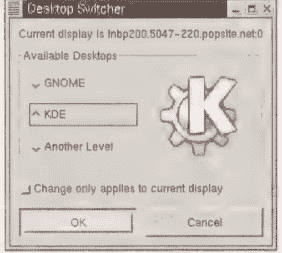

图 5-1：使用 switchdesk 实用程序切换到 KDE

4.  一条消息通知你桌面配置已更改，但你必须重新启动 X。单击“确定”按钮关闭对话框。

尽管步骤 4 中的消息说你必须重新启动 X，但你只需注销会话并重新登录即可。要注销，请选择“主菜单↵ 注销”。当你再次登录时，你应该会得到 KDE GUI，如图 5-2 所示。

如你所见，KDE 桌面看起来非常像 Windows 95/98/NT。你可以看到桌面上有文件夹和设备（打印机、CD-ROM）的图标，以及一个用于存储已删除文件的回收站。屏幕底部的条是 KDE 面板，最左边的图标（标记为 K）是 K̂ 按钮，或者简单称为 K 按钮。该按钮类似于 Windows 95/98/NT 中的“开始”按钮。你单击 K 按钮会得到一个可以启动的应用程序菜单。你可以自行探索 KDE 桌面，并在“使用 KDE”部分了解更多关于 KDE 的信息。

回到切换 GUI 的主题，`switchdesk` 实用程序通过在你的 home 目录中创建适当的脚本来更改 GUI。它保持显示管理器不变。这意味着你使用 GNOME 显示管理器 `gdm` 进行登录，即使你切换到 KDE GUI。登录后，`gdm` 会执行一个会话脚本，最终会执行你 home 目录中的 `.Xclients` 脚本（如果该脚本存在）。

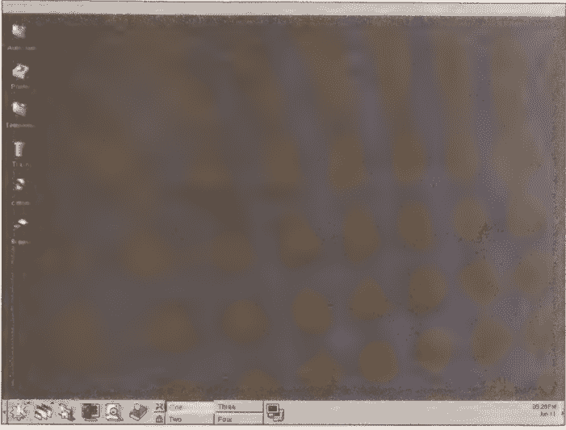

**图 5-2：** 初始 KDE 桌面

要从 GNOME 切换到 KDE，`switchdesk` 实用程序会在你的 home 目录中创建一个包含以下行的 `.Xclients` 脚本：

```
#!/bin/bash

# Created by Red Hat Desktop Switcher

if [ -e "$HOME/.Xclients-$HOSTNAME$DISPLAY" ]; then
    exec $HOME/.Xclients-$HOSTNAME$DISPLAY
else
    exec $HOME/.Xclients-default
fi
```

然后 `switchdesk` 创建一个包含以下命令的 `.Xclients-default` 脚本：

```
# Created by Red Hat Desktop Switcher
exec startkde
```

这些更改的最终结果是，当你登录时，`gdm` 会执行你 home 目录中的 `.Xclients` 脚本，而该脚本又会执行 `startkde` 程序（`/usr/bin/startkde`）以启动 KDE 会话。

因为 `switchdesk` 实用程序通过用户 home 目录中的 `.Xclients` 和 `.Xclients-default` 脚本来更改 GUI，所以这些更改只影响该特定用户。

要从 KDE 切换到 GNOME，请以 root 身份登录，打开终端窗口，并在 shell 提示符下输入 **switchdesk**。然后选择 GNOME 作为桌面。在你注销 KDE 并重新登录后，你应该会得到 GNOME 作为你的桌面。

请注意，如果你只想在当前会话中使用 GNOME（而不是使其成为你的默认 GUI），只需在初始登录屏幕的登录对话框中选择“选项 → 会话 → Gnome”，如图 5-3 所示。

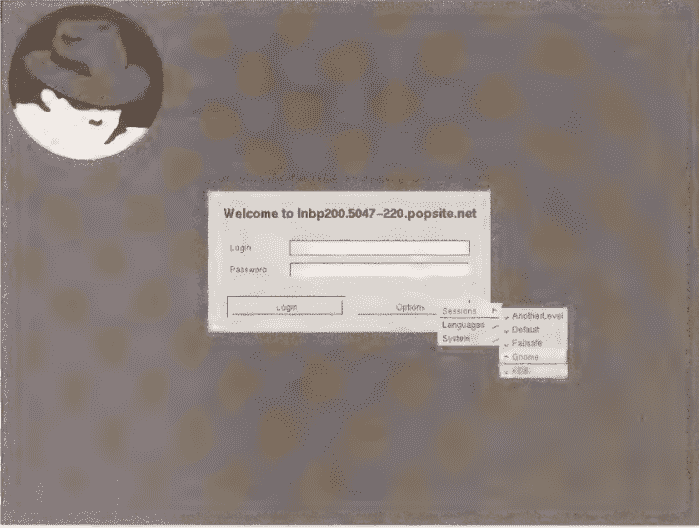

**图 5-3：** 仅为当前会话切换到 GNOME

你在此会话中应该会得到 GNOME 桌面。下次再次登录时，系统会恢复回 KDE。

### 使用 GNOME

GNOME 代表“GNU 网络对象模型环境”，而 GNU，你可能知道，代表“GNU 不是 Unix”。GNOME 是一个 GUI 和一个编程环境。从用户的角度来看，GNOME 类似于基于 Motif 的通用桌面环境（CDE）或 Microsoft Windows。在幕后，GNOME 具有许多特性，使程序员能够编写可以协同工作的图形应用程序。接下来的几节将对 GNOME 进行快速概述。我只指出 GNOME GUI 的关键特性，细节留给你自己探索。

你总是可以通过访问 GNOME 主页 http://www.gnome.org 来获取关于 GNOME 的最新信息。

#### 了解 GNOME

尽管你看到的 GNOME 是 GUI，但 GNOME 的内涵远不止 GUI。为了帮助你更好地理解它，以下是 GNOME 的关键特性列表：

-   GNOME 的官方发音是“guh-NOME”，但许多人将其发音为“NOME”。请注意，“guh-NOME”源自“guh-NU”，这是人们发音 GNU 的方式。
-   GNOME 可以在多个类 UNIX 系统上运行，包括 Linux、BSD（FreeBSD、NetBSD 和 OpenBSD）、Solaris、HP-UX、AIX 和 Silicon Graphics IRIX。
-   GNOME 使用 Gimp 工具包（GTK+）作为所有图形应用程序的图形工具包。GTK+ 依赖于 X 进行输出，并支持多种编程语言，包括 C、C++、Perl 等。用户可以轻松更改系统上运行的所有 GTK+ 应用程序的外观和感觉。GTK+ 根据 GNU 库通用公共许可证（LGPL）进行许可。有关 LGPL 的更多信息，请参见第 22 章。
-   GNOME 还使用 Imlib，这是另一个支持在 X 显示器上显示图像的库。Imlib 支持多种不同的图像格式，包括 XPM 和 PNG（可移植网络图形）。
-   GNOME 使用对象管理组（Object Management Group）的公共对象请求代理架构（CORBA）版本 2.2，以使 GNOME 软件组件无论位于何处或用何种编程语言实现，都能相互通信。
-   GNOME GUI 可与任何为 X 窗口系统设计的窗口管理器一起工作。为了支持某些 GNOME 特性，如会话管理和 GNOME 分页器（见下一节），你需要一个符合 GNOME 标准的窗口管理器。有几种这样的窗口管理器可供选择。Red Hat Linux 附带 Enlightenment 窗口管理器。其他选择包括 Window Maker 和 FVWM。
-   GNOME 应用程序支持拖放操作。
-   GNOME 应用程序开发人员使用 DocBook 编写文档，DocBook 是基于标准通用...的文档类型定义（DTD）。


#### 探索 GNOME

假设你在安装 Red Hat Linux 时启用了图形化登录界面，那么每次登录 Linux 系统时，你应该都会进入 GNOME 图形用户界面。GNOME 显示屏的确切外观取决于当前的**会话**。会话无非就是一组应用程序（包括一个窗口管理器）以及这些应用程序的状态。GNOME 将会话信息存储在 `~/.gnome/session` 文件中（该文件位于你主目录的 `.gnome` 子目录下）。这是一个文本文件；如果你好奇，可以用 `more` 命令查看这个文件。

最初，GNOME 会话来自 `/usr/share/gnome/default.session` 文件。然而，一旦会话开始，GNOME 会话管理器（`/usr/bin/gnome-session`）就会将当前的会话信息保存到 `~/.gnome/session` 文件中。由默认会话文件中的会话描述产生的初始 GNOME 桌面包括一个文件管理器、一个帮助浏览器、一个面板（类似于 Windows 任务栏）以及 Enlightenment 窗口管理器，如图 5-4 所示。

正如你在 GNOME 桌面左侧图标（图 5-4）中看到的，GNOME 允许你将文件夹和应用程序直接放置在桌面上。这类似于你可以将图标直接放在 Windows 95/98/NT 桌面上的方式。

尽管从图 5-4 看不出 Enlightenment 窗口管理器是否正在运行，但你确实需要窗口管理器作为会话的一部分。*窗口管理器*是一个特殊的 X 应用程序，负责处理各个在屏幕上显示窗口的应用程序之间的交互。你需要窗口管理器来控制每个应用程序窗口的位置和大小。没有窗口管理器，你就无法更改窗口的位置或调整其大小。

要理解为什么需要窗口管理器，请考虑两个 X 应用程序——A 和 B——在同一屏幕上显示的情况。这两个应用程序都不了解对方的需求。假设你在 A 之后运行 B，而 B 占据了整个屏幕（根窗口）作为其输出窗口。此时，A 的窗口被 B 遮盖在下面，你无法访问 A 的窗口。

窗口管理器为你提供了从 B 切换到 A 的手段，即使 B 行为不当（例如，如果 B 的窗口填满了整个屏幕，没有窗口管理器你将无法访问 A 的窗口）。Enlightenment 窗口管理器会为每个应用程序的主窗口添加一个装饰性边框。这个边框使你能够移动和调整窗口大小。你可以点击并拖动边框的角来缩小 B 的窗口。Enlightenment 会显示一个随着鼠标移动而改变大小的窗口轮廓。这个轮廓使你可以缩小最顶层的窗口以暴露其下方的窗口。此外，使用 Enlightenment，你可以通过点击窗口边框的左上角（参见图 5-5）来获得一个下拉菜单。此菜单包含允许你调整窗口大小、将窗口最小化为图标以及退出应用程序的选项。

与 Microsoft Windows 95/98/NT 中的窗口边框一样，标题栏的右侧角落包含三个按钮：最左边的按钮将窗口最小化为图标，中间的按钮将窗口最大化以填满整个屏幕，最右边的按钮关闭窗口。

#### GNOME 面板

GNOME 桌面的一个关键特性是沿屏幕底边延伸的长条。这被称为 GNOME 面板，或简称面板。面板是一个独立的 GNOME 应用程序。如图 5-6 所示，它为菜单和小型面板小程序提供了一个显示区域。每个面板小程序都是一个设计用于在面板内运行的小型程序。例如，面板最右侧的时钟小程序会显示当前日期和时间。

提示：注意面板左右两端向外的箭头。点击箭头，面板会滑动消失，将其显示区域缩小到屏幕边缘的一小条。这为窗口腾出了更多桌面区域。再次点击箭头，面板会重新出现。

面板还包括几个其他小程序：

- GNOME 分页器小程序提供了一个大于系统屏幕物理尺寸的虚拟桌面。在图 5-6 中，分页器在一个小的显示区域内显示四个页面。每个页面代表一个与 X 显示屏幕大小相等的区域。要转到特定页面，请在分页器窗口中单击该页面。如果你希望某个窗口始终显示在每个虚拟屏幕页面上，只需从其窗口菜单（参见图 5-5）中选择“置顶/取消置顶”。置顶窗口会始终出现在每个虚拟屏幕页面的相同位置。GNOME 分页器小程序还会显示当前虚拟页面中每个显示窗口的按钮。
- 启动器小程序显示带有应用程序图标的按钮。单击按钮会启动（启动）该应用程序。

GNOME 面板还显示主菜单按钮（风格化的脚印），其行为类似于 Windows 的“开始”菜单。

#### 主菜单按钮或“脚印”

在图 5-6 中，面板左侧包含一个带有风格化脚印图像的按钮（这恰好是 GNOME 标志）。那个脚印就是主菜单按钮。与 Windows 95/98/NT 中的“开始”按钮一样，你可以通过单击脚印弹出的菜单来启动应用程序。通常，此菜单列出了启动应用程序的项目。一些菜单项目带有箭头；当你将鼠标指针放在带箭头的项目上时，会出现另一个弹出菜单。图 5-7 显示了我的系统上主菜单的典型视图。

你应该探索主菜单中的所有项目，以查看可以从此菜单执行的所有任务。特别是，你应该将鼠标移到“设置”项目上，查看列出了更改桌面外观选项的菜单（参见图 5-7）。例如，你可以从此菜单更改桌面的背景。

KDE 应用程序也可以在 GNOME 下运行。实际上，KDE 应用程序组织在 KDE 菜单下。即使你使用 GNOME 桌面，你也可以随时从 KDE 菜单（参见图 5-8）启动 KDE 应用程序。因此，当你使用 GNOME 图形用户界面时，你绝不仅限于运行 GNOME 应用程序。

#### GNOME 控制中心

你可以从 GNOME 控制中心配置 GNOME 桌面的某些方面。要启动控制中心，请选择“主菜单” ➪ “设置” ➪ “GNOME 控制中心”或单击 GNOME 面板中的工具箱（参见图 5-6）。

GNOME 控制中心的用户界面与 linuxconf（第 1 章中首次描述）有些相似。窗口垂直分为两部分——较窄的左侧和较宽的右侧。左侧显示所有配置项目的树状菜单。顶级项目被组织成几个类别，例如“桌面”和“多媒体”。你可以单击一个类别来查看其子类别。要配置某个项目，请在树状菜单中找到该项目并单击它。右侧区域随后会显示一个包含你可以更改的设置的对话框。例如，图 5-9 显示了自定义 GNOME 桌面背景的选项。

在这种情况下，GNOME 控制中心允许你选择纯色背景或选择壁纸（用作背景的图像）。完成更改后，单击“确定”按钮关闭对话框并应用更改。

要退出控制中心，请选择“文件” ➪ “退出”。


## 第五章：自定义你的 Linux 启动

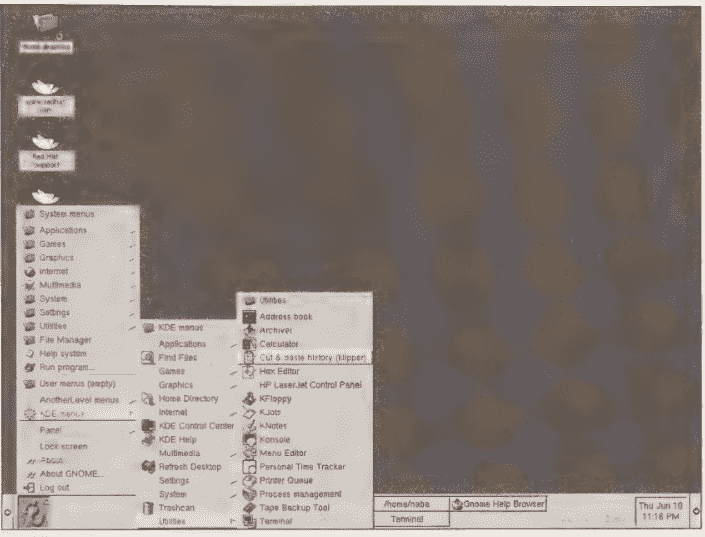

图 5-8：从 KDE 菜单中选择一个 KDE 应用程序

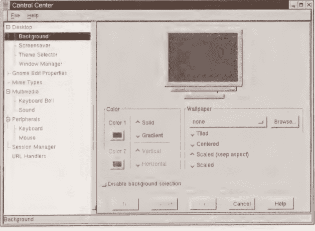

图 5-9：使用 GNOME 控制中心自定义 GNOME 桌面

### 使用 KDE

KDE 代表 K 桌面环境。KDE 项目于 1996 年 10 月启动，旨在为使用 X 窗口系统的 UNIX 系统开发一个通用的图形用户界面。KDE 的第一个测试版在一年后的 1997 年 10 月发布，KDE 1.0 版本于 1998 年 7 月发布。

从用户的角度来看，KDE 提供了一个图形桌面环境，包括一个窗口管理器 (`kwm`)、一个文件管理器 (`kfm`)、一个用于启动应用程序的面板 (`kpanel`)、一个帮助系统、一个配置工具以及许多应用程序，包括图像查看器、PostScript 查看器以及邮件和新闻程序。

从开发者的角度来看，KDE 拥有用于在 C++ 中轻松进行应用程序开发的类库和对象模型。KDE 本身是一个大型开发项目——当前源代码库大约有 800,000 行代码（相比之下，Linux 2.0.31 内核的 Intel 版本大约有 600,000 行代码）。

以下各节提供了 KDE 的概述，但学习 KDE 的最佳方式是使用一段时间。按照“从 GNOME 切换到 KDE”部分的说明将你的图形用户界面更改为 KDE。然后使用一段时间以感受 KDE 的功能。

#### 了解 KDE

与 GNOME 类似，KDE 旨在成为用户的一个完整桌面环境，也是应用程序开发者的编程环境。以下是 KDE 的一些关键特性：

-   KDE 可以在许多类 UNIX 系统上运行，包括 Linux、FreeBSD、Solaris、HP-UX 和 Silicon Graphics IRIX。KDE 需要 X 窗口系统。

-   KDE 用 C++ 编写，并使用面向对象开发。

-   KDE 使用来自挪威公司 Troll Tech AS (`http://www.troll.no/`) 的 *Qt 免费版* 图形用户界面工具包。Qt 是一个用于构建图形用户界面的 C++ 类库；它提供了 KDE 应用程序中使用的控件，如菜单、按钮和滑块。Qt 许可证引起了一些争议，因为其条款与 GNU 通用公共许可证不同。然而，Troll Tech AS 免费提供 Qt 免费版，供运行使用该产品的软件（如 KDE）以及开发自由分发且提供完整源代码的软件。KDE 还包括使用 X 窗口系统和 KOM 构建的 OpenParts 复合文档模型。OpenParts 提供的功能类似于 IBM 的 OpenDoc 模型或 Microsoft 的对象链接与嵌入 (OLE) 和 ActiveX 控件。

-   KDE 正在基于 KOM/OpenParts 技术开发一个办公应用程序套件。这个名为 KOffice 的办公套件将包括一个电子表格 (KSpread)、一个类似 FrameMaker 的文字处理器 (KWord)、一个演示文稿应用程序 (KPresenter)、一个绘图程序 (KIllustrator) 和一个组织器 (KOrganizer)，以及电子邮件和新闻客户端。

-   KDE 支持拖放操作。

-   KDE 支持国际化，大多数 KDE 应用程序已翻译成超过 25 种不同的语言。

#### 探索 KDE

你会发现 KDE 易于使用，并且与 Windows 95/98/NT 图形用户界面有许多相似之处。你可以从类似于 Windows 开始菜单的菜单中启动应用程序。KDE 还允许你将文件夹和应用程序直接放在桌面上。

KDE 图形用户界面有三个关键部分：kwm 窗口管理器、用于启动应用程序的 kpanel 和用于管理文件的 kfm 文件管理器。当你的 KDE 会话启动时，所有这些程序——kwm、kpanel 和 kfm——都在你的系统上运行。在这些组件中，kpanel 显示并管理沿屏幕底边的面板，如图 5-10 所示。


图 5-10：KDE 面板

面板的左右两端显示向外指的箭头。你可以单击这些箭头来隐藏面板，为桌面上的应用程序腾出更多空间。当面板隐藏时，它仍然显示一个带有箭头的小条。要再次查看整个面板，请单击该箭头，面板就会滑出。

面板最重要的组件是左侧的 K 按钮。该按钮类似于 Windows 95/98/NT 中的开始按钮。当你单击 K 按钮时，会出现一个弹出菜单。从此菜单中，你可以通过将鼠标移动到带有向右箭头的项目上来访问其他菜单。例如，图 5-11 显示了用于更改一些桌面设置的典型菜单层次结构。

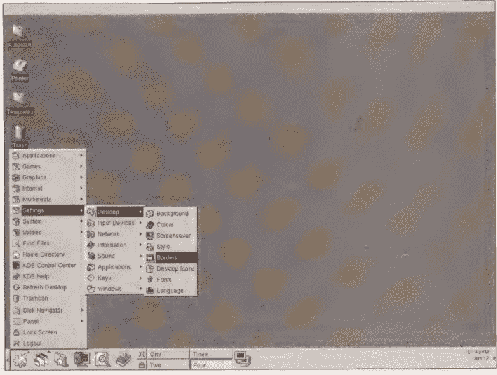

图 5-11：单击 K 按钮获取菜单

你可以从此菜单启动应用程序。这就是为什么 KDE 文档将 K 按钮称为 *应用程序启动器*。

在 K 按钮旁边，面板还包括几个其他按钮。如果你不知道某个按钮的作用，只需将鼠标移到该按钮上，一个小弹出窗口就会显示关于该按钮的简要信息。要阅读 KDE 上的联机帮助，请单击带有书本图标的按钮。该按钮会启动 KDE 帮助，使你能够阅读有关 KDE 各个方面的帮助信息。

要查看你的主目录的内容（使用 `kfm` 文件管理器），请单击带有文件夹和房子图标的按钮。图 5-12 显示了一个典型的 KDE 桌面，其中 KDE 帮助和文件管理器正在显示主目录。

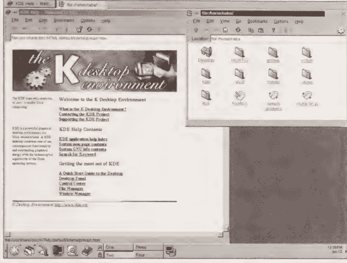

图 5-12：运行着一些应用程序的 KDE 桌面

请注意屏幕顶部的条。那是 KDE 为每个打开的窗口显示按钮的地方，非常类似于 Windows 95/98/NT。

你应该浏览 KDE 帮助中的帮助信息，以了解有关 KDE 各个方面的更多信息。特别是，单击标有“A Quick Start Guide to the Desktop”的链接，以了解更多关于 KDE 桌面的信息。

kwm 窗口管理器为每个应用程序的窗口添加边框、标题栏和其他装饰。它还为每个窗口添加了一个窗口菜单。单击窗口左上角的按钮以查看窗口菜单，如图 5-13 所示。

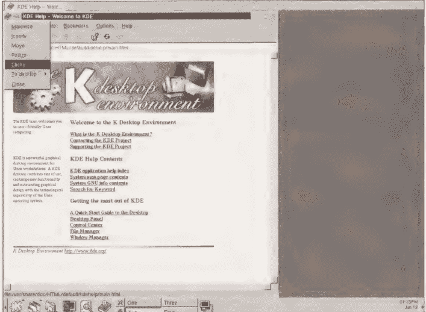

图 5-13：kwm 窗口管理器添加窗口装饰和窗口菜单

窗口菜单允许你执行诸如最大化或最小化窗口、更改其大小以及切换到其他桌面等操作。当然，窗口边框本身也有其他按钮（例如，位于窗口右上角的按钮）来执行这些任务。

KDE 支持虚拟桌面。默认情况下，你可以获得四个虚拟桌面。你可以单击标有 One、Two、Three 和 Four 的按钮之一来切换到特定的桌面。你可以使用这些桌面来组织你的应用程序窗口。你不需要让一个桌面被许多打开的窗口弄得杂乱无章。当一个桌面变得拥挤时，只需切换到另一个桌面并在那里打开应用程序。

如果你想让一个窗口无论当前活动桌面是哪个都可见，请使该窗口保持固定。你可以通过从窗口菜单中选择 Sticky（参见图 5-13）或通过单击窗口标题左侧的图钉来实现这一点。

KDE 面板还包括一个带有终端图标的按钮——在图 5-13 中，这是面板上最右边的按钮。单击此按钮运行 kvt（一个终端仿真程序）并获得一个终端窗口，如图 5-14 所示。

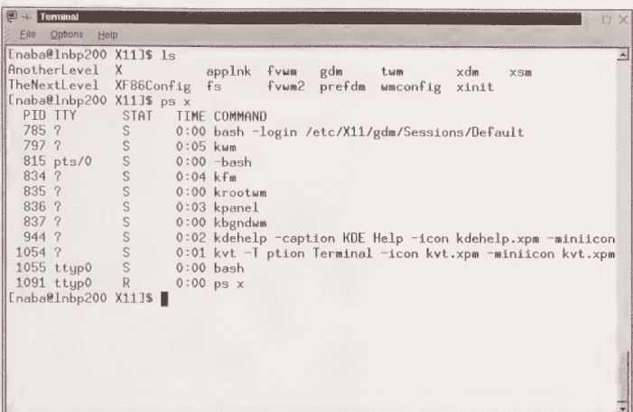

图 5-14：在 kvt 终端仿真窗口中输入 Linux 命令

你可以在终端仿真窗口的 shell 提示符处输入 Linux 命令。第 6 章进一步介绍了 shell 和一些重要的 Linux 命令。

KDE 包括一个 KDE 控制中心，你可以用它来自定义 KDE 的各个方面，包括桌面背景、图标和字体。要启动 KDE 控制中心，请选择 K -> KDE 控制中心，或从面板中单击带有电路板图标的按钮。KDE 控制中心主窗口有两部分。窗口左侧有一个包含你可以使用此工具控制的项目的树形菜单。树形菜单按类别组织，如应用程序、桌面和网络。单击项目左侧的加号以查看该项目的子类别。要更改某个项目，请通过树形菜单找到该项目并单击它。该项目的配置选项随后会出现在窗口右侧的选项卡对话框中。例如，图 5-15 显示了用于自定义桌面背景的选项卡。

你可以选择要自定义背景的桌面。然后选择纯色背景或墙纸（用作背景的图像）。做出选择后，单击“确定”关闭对话框并应用更改。

要注销 KDE，请选择 K -> 注销，然后在出现的对话框上单击“注销”按钮。


### 定制 X

您几乎可以定制 X 显示的所有方面，从屏幕的背景色到所有应用程序的默认字体。X（以及 UNIX）的基本理念是，用户应该拥有自由来配置软件以满足其个人喜好。因此，X 应用程序会从资源文件加载各种设置。每个 X 应用程序也接受一组标准的命令行选项。本节向您展示定制 X 应用程序的一般技术。这些技术适用于所有 X 应用程序，例如 `xterm` 和 `rxvt` 终端模拟器。

#### 根窗口外观

在 X 中，整个显示屏幕被称为*根窗口*。一个名为 `xsetroot` 的实用程序使您能够调整根窗口的外观。使用 `xsetroot`，您可以按以下方式自定义屏幕：

- 使用 `-solid` 选项将屏幕设置为纯色。您可以通过名称指定颜色；颜色名称位于文本文件 `/usr/lib/X11/rgb.txt` 中。

- 使用 `-bitmap` 选项将背景设置为位图图形文件。

- 使用 `-cursor` 或 `-cursor_name` 选项指定当鼠标指针停留在根窗口任意位置时的光标形状。

- 使用 `-gray` 选项将背景设置为灰色。

要定制根窗口，您应该在命令提示符下运行 `xsetroot` 并尝试各种选项，直到找到您喜欢的外观。然后，您可以将适当的 `xsetroot` 命令放入您的 `.Xclients` 文件中。

在 GNOME 和 KDE 中，您可以从图形控制中心更改背景颜色。每个环境都附带一个配置工具，允许您自定义桌面的外观。

##### 屏幕颜色

您可以使用 `xsetroot` 程序设置屏幕的背景颜色。例如，要将背景设置为纯色 `SteelBlue`，请在终端窗口的 shell 提示符下输入以下命令：

```
xsetroot -solid SteelBlue
```

要尝试更多颜色，您需要知道颜色的名称。颜色定义位于名为 `/usr/lib/X11/rgb.txt` 的文本文件中。要查看颜色名称列表，请使用编辑器打开该文件，或在 `xterm` 窗口中输入以下命令：

```
more /usr/lib/X11/rgb.txt
```

以下是 `rgb.txt` 文件中的一些行：

| R | G | B | 颜色名称 |
|---|---|---|---|
| 255 | 255 | 255 | white |
| 0 | 0 | 0 | black |
| 190 | 190 | 190 | gray |
| 65 | 105 | 225 | RoyalBlue |
| 70 | 130 | 180 | SteelBlue |
| 218 | 165 | 32 | goldenrod |
| 184 | 134 | 11 | DarkGoldenrod |
| 233 | 150 | 122 | DarkSalmon |
| 255 | 160 | 122 | LightSalmon |

正如您可能猜到的那样，这三个数字表示颜色红色 (R)、绿色 (G) 和蓝色 (B) 分量的强度级别。强度级别范围在 0 到 255 之间。

除了使用描述性名称指定颜色外，您还可以将颜色指定为六位十六进制数，这相当于颜色三个分量（红色 (R)、绿色 (G) 和蓝色 (B)）各占两位。颜色的六位十六进制 RGB 值的数字从左到右解释，最高有效的一对数字假定为 R，中间一对为 G，最低有效的一对为 B。

字符 `#` 前缀用于表示十六进制格式的颜色规范。以这种方式指定颜色时，必须将十六进制颜色值放在引号内。您可以使用十六进制格式指定任何您想要的颜色。

##### 表 5-3 常见颜色的十六进制表示

表 5-3 列出了以十六进制格式表示的一些常见颜色。

| 颜色 | 十六进制值 |
| --- | --- |
| black | #000000 |
| red | #ff0000 |
| green | #00ff00 |
| blue | #0000ff |
| yellow | #ffff00 |
| cyan | #00ffff |
| magenta | #ff00ff |
| white | #ffffff |

既然您知道了如何以十六进制 RGB 格式指定任何任意颜色，您就可以尝试新的颜色。例如，您可以尝试使用以下命令为屏幕背景设置一种奇怪的颜色：

```
xsetroot -solid "#ccb0b0"
```

如果您想要简单的灰色背景（即使有点缺乏新意，也可能相当赏心悦目），可以使用以下命令获得：

```
xsetroot -gray
```

##### 十六进制数字

即使您可能不熟悉这个术语，但您在日常经验中熟悉一种数字系统——十进制数字系统。我们使用 0 到 9 的数字表示十进制数，在书写值时，我们使用个位、十位、百位和千位的概念。例如，考虑数字 3,495。使用个位、十位、百位和千位的概念，我们可以将其写为：

3,495 = 3 千位 + 4 百位 + 9 十位 + 5 个位

或

3,495 = 3 × 10³ + 4 × 10² + 9 × 10¹ + 5 × 10⁰

最后一种形式表示以 10 的幂次表示数字，这是十进制数字系统的基数或基数。

十六进制数字系统与十进制数字系统类似，只是基数是 16。要书写十六进制数，您需要十六个数字来表示从 0 到 15 的值，就像十进制系统使用从 0 到 9 的十个数字一样。以下是十六进制的 16 个数字：

| 十六进制 | 十进制 |
|-----|---------|
| 0 | 0 |
| 1 | 1 |
| 2 | 2 |
| 3 | 3 |
| 4 | 4 |
| 5 | 5 |
| 6 | 6 |
| 7 | 7 |
| 8 | 8 |
| 9 | 9 |
| A | 10 |
| B | 11 |
| C | 12 |
| D | 13 |
| E | 14 |
| F | 15 |

如您所见，字母 A 到 F 分别用于表示 10 到 15 的值。您可以使用小写或大写字母作为十六进制数字。

了解十进制和十六进制数字系统之间的相似性后，您可以轻松地找到十六进制数的十进制等价值。例如，十六进制的 `1b` 在十进制中是 $1 \times 16^1 + 11 \times 16^0 = 16 + 11 = 27$。

##### 屏幕背景图像

您不必满足于使用纯色作为屏幕背景。您可以使用带有 `-bitmap` 选项的 `xsetroot` 在屏幕背景上平铺单色位图图像（平铺意味着将位图的副本一个接一个地放置，直到覆盖整个屏幕——类似于您用物理瓷砖覆盖地板的方式）。您可以使用 `-fg` 和 `-bg` 选项以前景色绘制图像，并用选定的背景色填充背景。

尝试以下命令将屏幕背景设置为有趣的 X 标志图案：

```
xsetroot -bitmap /usr/include/X11/bitmaps/xlogo64 -fg "#cccccc" -bg "#c0c0c0"
```

`/usr/include/X11/bitmaps` 目录包含更多您可以尝试作为背景图像的位图文件。请注意，`xsetroot` 无法将彩色图像显示为屏幕背景。

在 GNOME 和 KDE 中，您可以使用各自的控制中心选择彩色图像作为桌面的背景。

避免使用彩色图像作为屏幕背景；如果您将过于丰富多彩的图像显示为背景，其他 X 程序可能会耗尽颜色。请记住，8 位视频模式最多只能显示 256 种颜色。如果背景图像包含超过 16 种颜色，当您运行其他程序时可能会遇到问题。特别是，像 Netscape Navigator 网络浏览器这样的程序也需要颜色来显示大多数网页中的所有那些图像。

除了导致 X 耗尽颜色外，彩色图像背景还会消耗 X 服务器的资源，并可能影响系统性能。因此，安全的解决方案是使用纯色背景作为屏幕背景。

##### 光标形状和颜色

使用 `xsetroot` 程序，您可以设置指针停留在根窗口任意位置时的光标形状和颜色。在应用程序窗口内部，应用程序控制光标形状和颜色。

虽然您可以使用两个位图文件来定义任意形状的光标，但更简单的方法是选择预定义的光标形状之一。您可以使用 `xsetroot` 程序的 `-cursor_name` 选项来指定光标。光标名称定义在文件 `/usr/include/X11/cursorfont.h` 中。这些名称用于 X 程序，每个光标名称都有一个 `XC_` 前缀。当您在 `xsetroot` 程序中使用光标名称时，必须省略 `XC_` 前缀。

以下是几个光标名称：

| 光标名称 | 描述 |
|-------------|-------------|
| X_cursor | 形状像 X 的光标（默认光标） |
| arrow | 指向右上角的箭头 |
| left_ptr | 指向左上角的箭头 |

默认光标是黑色的 `X_cursor`。要将光标更改为白色左箭头，请输入以下命令：

```
xsetroot -cursor_name left_ptr -fg white -bg black
```

在 Macintosh 和 Windows 95/98 图形环境中，光标是左指向箭头。如果您熟悉这些环境，您可能希望将光标更改为左箭头。

#### X 资源

大多数 X 应用程序都是高度可配置的。您可以通过两种方式更改 X 应用程序的外观，甚至在一定程度上更改其行为：

- 通过启动应用程序的命令行中指定的选项来更改应用程序的默认行为。
- 在称为*资源文件*的文本文件中指定选项的值。（X 程序员使用*资源*一词来指代应用程序中任何用户可配置的选项。）

对于小型 UNIX 实用程序，少量命令行选项可能足以指定程序的所有用户可配置参数。然而，X 应用程序往往具有大量用户可以设置的变量。X 应用程序可能有多个窗口，每个窗口都可能有边框、背景色和前景色。虽然 X 应用程序为这些参数提供了默认值，但用户可以覆盖大多数这些值。此外，用户可以更改要在窗口中显示的任何文本的字体。X 应用程序的变量实在太多，无法仅通过命令行选项来设置。X 的创建者认识到了这个问题，并设计了一个资源数据库。

在 X 应用程序中，术语*资源*指任何影响应用程序行为或外观的参数。因此，前景色和背景色、字体以及窗口的大小和位置都是典型的资源。资源不必是与 X 相关的参数；它可以是任何控制应用程序行为且可由用户指定的内容。应用程序可能有一个名为 `verbose` 的参数，设置后可在运行时打印详细信息。除了应用程序的窗口大小和位置外，`verbose` 也是该应用程序的一项资源。

##### 资源文件

你必须在称为*资源文件*或*资源数据库*的文本文件中指定 X 应用程序的资源。X 资源数据库是一个简单的文本文件，你可以在其中以明确定义的格式指定各种参数的值。

X 资源文件不像传统数据库那样复杂和精密。X 资源数据库包含类似 "所有前景色都是白色"、"`xterm` 的背景是浅青色" 等形式的规范。

X 应用程序使用一组实用程序例程（统称为 *X 资源管理器*）从这个相当不精确的数据库中提取精确标识的单个参数的值。考虑查询 "`xterm` 应用程序的前景色是什么？" 如果你在资源文件中指定了 `xterm` 的前景色，资源管理器将返回此值。然而，如果数据库中关于前景色的唯一规范是通用语句 "所有前景色都是黑色"，那么 `xterm` 前景色返回的值就是黑色。

##### X 的资源命名约定

要指定 X 应用程序的资源值（如前景色），你必须知道如何命名资源以及如何指定资源的值。

资源的名称取决于应用程序的名称及其组件的名称，这些组件通常是主要的子窗口。对于使用 *X 工具包*（本质上是用户界面组件库）构建的应用程序，组件将是用于构建应用程序的 widget 的名称。

*widget* 不过是用户界面组件，如按钮、列表框或对话框。像 Motif 工具包这样的 X 工具包提供了程序员可在其程序中创建和使用 widget 的功能。

应用程序及其组件的名称可以是两种类型：*类名* 和 *实例名*。类名表示应用程序或组件的通用类别，而每个单独的副本都有自己的实例名。

考虑一个具体的例子：`xterm` 应用程序。该应用程序属于 `XTerm` 类，其实例名为 `xterm`。`xterm` 应用程序使用一个名为 `vt100` 的 `VT100` 类组件（`VT100` 组件模拟 VT102，但其内部名称是 VT100），其中包含一个名为 `scrollbar` 的 `Scrollbar` 类组件。现在考虑以下资源：VT100 窗口的前景色和该窗口中滚动条的可见性。在 `xterm` 中，与大多数 X 应用程序一样，前景色资源的类名为 `Foreground`，实例名为 `foreground`。滚动条的可见性由名为 `on` 的布尔变量控制。

大多数使用 X 工具包构建的 X 应用程序都遵循这种命名约定，即通过将实例名的首字母大写来命名资源的类。应用程序的名称也遵循这种约定，这在一定程度上促进了应用程序之间的一致性。然而，应用程序、其组件和资源的命名完全由应用程序控制。（不过，基于工具包的应用程序在一定程度上受到预定义 widget 的内置名称的限制。）

现在你可以为这些资源在 `xterm` 中给出唯一的名称并指定它们的值。你可以按以下方式为 VT100 窗口的前景色和其滚动条的 `on` 变量赋值：

```
xterm.vt100.foreground:  yellow
xterm.vt100.scrollbar.on:  true
```

这个例子说明了命名资源和赋予其值的语法。资源的名称以应用程序的名称开头，后跟组件的名称，每个组件之间用点号（.）分隔。资源名称在最后，资源的值跟在冒号（:）之后。你将值指定为文本字符串；如何解释该字符串取决于应用程序。资源管理器有实用程序例程可以帮助程序员完成这项任务。

到目前为止，本节中说明的名称是完整的实例名，显示了应用程序及其所有组件。你也可以有完整的类名，对于 `xterm.vt100.foreground`，其完整类名是 `XTerm.VT100.Foreground`。你通过将每个组件的实例名替换为相应的类名来获得此名称。

##### 资源的部分名称

上一节解释了如何通过全名指定资源，但资源规范可以是不精确的。例如，你可能想指明所有 VT100 类的组件都应具有黄色的前景色。你可以通过在资源数据库中进行以下条目来完成此任务：

```
*VT100.Foreground: yellow
```

由于没有应用程序名称，此前景色规范适用于在任何应用程序中使用的 VT100 组件。同样，要指定 `xterm` 应用程序的每个组件的背景色为海军蓝，你应在资源文件中包含以下行：

```
xterm*background:Navy
```

要理解资源命名方案，你需要了解 X 资源管理器内部工作原理的一些知识。到现在为止，你可能已经猜到，X 资源管理器通过将精确指定的资源名称与资源数据库中的不精确条目进行匹配来定位资源的值。资源管理器使用的搜索算法遵循某些规则，将完整的资源名称与资源数据库中的部分名称进行匹配。了解以下规则可以帮助你理解何种资源规范足够精确以满足你的需求：

- 星号（*）匹配名称中的零个或多个组件。因此，对 `xterm.vt100.foreground` 的查询与此条目匹配：

  `xterm*foreground: yellow`

- 在考虑星号之后，应用程序名称、组件名称和资源名称（类或实例）必须与条目中出现的项目匹配。因此，对 `XTerm.VT100.Scrollbar.Background` 的查询与此条目匹配：

  `xterm.vt100.scrollbar.background: Navy`

  但不匹配

  `xterm.vt100.scrollbar.on: true`

- 更具体的资源规范优先于较不具体的设置。带点号（.）的条目优先于带星号（*）的条目。如果你指定以下内容，xterm 中的所有内容都具有海军蓝背景，但滚动条具有白色背景：

  ```
  xterm*background: Navy
  xterm.vt100.scrollbar.background: white
  ```

- 实例名优先于类名。因此，具体的条目 `xterm*background` 将覆盖使用类名的条目：`XTerm*Background`。

- 包含类名或实例名的条目优先于不包含两者的条目。在 xterm 中，条目 `XTerm*Foreground` 中给出的值覆盖更通用条目 `*Foreground` 下的值。

- 名称从左到右匹配，因为资源名称的组件层次结构是从左到右的。换句话说，当查找名为 `xterm.vt100.scrollbar.background` 的资源时，资源管理器匹配条目

  ```
  xterm.vt100*background: white
  ```

  而不是

  ```
  xterm*scrollbar.background: Navy
  ```

  因为 `vt100` 出现在 `scrollbar` 的左边。

##### 资源文件的位置

大多数 X 工具包应用程序（包括 Motif 应用程序）按特定顺序从多个来源加载资源设置。首先，应用程序查找名为 `/usr/lib/X11/app-defaults/AppClass` 的文件，其中 `AppClass` 是应用程序的类名。因此，`xterm` 在 `/usr/lib/X11/app-defaults/XTerm` 中查找其资源。

接下来，应用程序查找名为 `RESOURCE_MANAGER` 的字符串，该字符串附加（关联）在应用程序窗口所在显示器的根窗口上。在 X 中，与根窗口关联的字符串称为根窗口的属性。

你可以使用实用程序 `xprop` 查看此属性是否存在你的显示器的根窗口上。只需键入 `xprop -root`，并在输出中查找标记为 `RESOURCE_MANAGER(STRING)` 的条目。`xprop` 实用程序还可以读取资源文件并将内容加载到此属性中（作为一个长字符串）。

如果 `RESOURCE_MANAGER` 属性不存在，应用程序将从你主目录中的 `.Xdefaults` 文件中读取资源规范。接下来，应用程序加载由环境变量 `XENVIRONMENT` 指示的文件指定的资源（如果有）。如果此变量不存在


##### 标准 X 资源

按照惯例，所有 X 应用程序都有一套标准资源。这些资源包括前景和背景颜色、窗口大小和位置（统称为 *geometry*）以及字体等参数。表 5-4 列出了一些标准 X 资源。

| 实例名称 | 类名 | 命令行选项 | 具体含义 |
|:---|:---|:---|:---|
| `background` | `Background` | `-bg -background` | 背景色 |
| `borderColor` | `BorderColor` | `-bd -border` | 边框颜色 |
| `borderWidth` | `BorderWidth` | `-bw -borderwidth` | 边框宽度（像素） |
| `display` | `Display` | `-d -display` | 显示名称 |
| `foreground` | `Foreground` | `-fg -foreground` | 前景色 |
| `font` | `Font` | `-fn -font` | 字体名称 |
| `geometry` | `Geometry` | `-geometry` | 大小和位置 |
| `title` | `Title` | `-title` | 标题字符串 |

资源的另一个来源是主目录下名为 `.Xdefaults-hostname` 的文件。在这个文件名中，*hostname* 是应用程序所运行系统的名称。

当然，你可以通过命令行选项覆盖任何资源配置。

如果你想查看资源的效果，下面是一个示例。在当前 `xterm` 窗口中，用编辑器创建文件 `xttest`，包含以下行：

```
xterm.vt100.scrollBar:           true
*VT100.Foreground:               yellow
xterm.vt100.background:          navy
xterm.vt100.scrollbar.background: white
```

现在输入以下命令，运行 `xrdb` 工具程序，并将这些设置加载到根窗口的 `RESOURCE_MANAGER` 属性中：

```
xrdb -load xttest
```

输入 **xprop -root** 以验证资源是否已加载。注意，资源文件的内容在 `RESOURCE_MANAGER` 属性内部存储为一个很长的字符串。现在用命令 **xterm &** 启动另一个 `xterm` 会话。你会看到一个新的 `xterm` 窗口，字符为黄色，背景为藏青色，而滚动条的背景为白色。

#### X 应用程序中的命令行选项

除了资源数据库外，X 应用程序还接受命令行参数。表 5-4 显示了 X 应用程序常用的命令行选项。本节总结了一些重要的命令行选项。

##### `-display` 选项

使用 `-display` 指定应用程序输出应显示在哪个显示器上。（X 应用程序可以在一个系统上运行，并将其输出发送到网络上另一系统所连接的显示器上。）例如，如果你登录到远程计算机，并想在该系统上运行客户端 `xclock`，可以使用如下命令启动它：

```
xclock -display sysname:0 &
```

这里，`sysname` 是你的系统名称（即你在系统上输入 **hostname** 命令时看到的名称）。

##### `-geometry` 选项

另一个常见选项是 `-geometry`，用于指定应用程序窗口的大小和位置。必须按以下标准格式指定 geometry：

```
width x height[+-]xoffset[+-]yoffset
```

在此格式中，`width`、`height`、`xoffset` 和 `yoffset` 是数字，你必须从括号中选择一个符号。`width` 和 `height` 值指定窗口大小，单位为像素（`xterm` 除外，在该程序中以文本的列数和行数来指定）。`xoffset` 和 `yoffset` 值也以像素为单位。这两个数字的含义取决于应用程序。例如，在 `xterm` 中，正的 `xoffset` 表示窗口左侧相对于屏幕左侧偏移的像素数；负的 `xoffset` 则表示窗口右侧相对于屏幕右侧偏移的像素数。同样，正的 `yoffset` 和负的 `yoffset` 分别表示窗口顶部和底部边缘的偏移量。

你可以输入以下命令，将 80 列 × 25 行的 `xterm` 窗口放置在屏幕右上角，窗口边框与屏幕顶部和右侧边缘之间有 16 像素的间隙：

```
xterm -geometry 80x25-16+16 &
```

##### 窗口外观选项

还有其他几个命令行选项决定应用程序窗口的外观。这些选项指定前景颜色（`fg`）、背景颜色（`bg`）、边框颜色（`bd`）以及边框宽度（`bw`，单位为像素）。颜色名称可在 `/usr/lib/X11/rgb.txt` 文件中找到。要启动字符为黄色、背景为藏青色的 **xterm**，请使用以下命令：

```
xterm -bg navy -fg yellow &
```

如果颜色名称包含空格，请用引号括起来。要指定 **xterm** 的背景为 **浅蓝色**，请使用以下命令：

```
xterm -bg "light blue" &
```

如本章前面“屏幕颜色”一节所述，你也可以将颜色指定为六位十六进制数。颜色六位十六进制 RGB 值的各位数字从左到右解释，最左边两位为红色（R），中间两位为绿色（G），最右边两位为蓝色（B）。必须在十六进制数字前加上 **#** 字符，以表示颜色规格为十六进制格式。你可以使用以下命令为 **xterm** 的背景尝试一种奇特的颜色：

```
xterm -bg "#ccb0b0" &
```

##### 字体规格

应用程序的字体资源控制文本输出的外观。与颜色一样，字体也通过名称指定。在 X 中，字体名称非常具有描述性。示例如下：

```
-adobe-courier-medium-r-normal--12-120-75-75-m-60-iso8859-1
```

对于此字体，**adobe** 是**制造商**，**courier** 是**字族**，字重为**中等**（例如也可以是**粗体**）。**r** 值表示该字体为**罗马体**。该位置为 **i** 表示**斜体**，**o** 表示**倾斜体**。**normal** 值是字符宽度与字符间距的参数；它也可以是**压缩**、**窄体**或**双倍**。

两个短横线（--）后面的数字表示字体大小：**12** 表示字体的像素大小，**120** 表示打印机点数的十分之一大小。接下来的两个数字 **75-75** 给出字体设计的水平和垂直分辨率。分辨率后面的字母（**m**）表示间距；该值可以是 **m**（等宽）或 **p**（比例）。再下一个数字 **60** 是此字体中所有字符的平均宽度，以像素的十分之一为单位（本例中为 6 像素）。字符串 **iso8859-1** 标识字体的字符集，由国际标准化组织（ISO）规定。在本例中，字符集为 ISO Latin 1，是 ASCII（美国信息交换标准代码）字符集的超集。

提示：在资源文件中指定字体时，不必给出完整名称。对于那些可以任意的字段，可以使用星号（*）代替。假设你希望 **xterm** 中的 VT100 窗口使用中等字重 12 磅的 **courier** 字体。通过恰当地添加星号，可以在资源文件中这样指定该字体：

```
*VT100*Font: *courier-medium-r-normal--*120*
```

### 小结

无论新手还是老手，都能从图形化的点击式用户界面中受益。本章介绍了如何将 Linux 设置为图形登录屏幕，以便你一直待在图形环境中。下一章将介绍 Linux 命令和 Perl 编程语言，你可以用它们来完成各种系统管理任务。

通过阅读本章，你可以学到以下内容：

-   Linux 启动后，一个名为 `init` 的进程会启动所有其他进程。初始进程的精确集合取决于运行级别，通常是一个 0 到 6 之间的数字。`/etc/inittab` 文件指定了在每个运行级别中启动的进程。
-   `/etc/inittab` 文件指定在运行级别 5 启动图形显示管理器。在 Red Hat Linux 中，GNOME 显示管理器（`gdm`）提供图形登录提示。当你理解了 Linux 中进程的启动方式后，就可以让 `gdm` 在每次启动 Linux 时都运行。此外，Red Hat Linux 安装程序也可以为你设置图形登录。
-   GNOME 和 KDE 是 Linux 的两个流行 GUI。Red Hat Linux 同时附带 GNOME 和 KDE，但系统默认以 GNOME 作为 GUI。你可以使用 `switchdesk` 工具将默认 GUI 更改为 KDE。
-   GNOME 和 KDE 都与其他现代桌面环境（如公共桌面环境（CDE）和 Microsoft Windows）相似。因此，你可以轻松学会使用 GNOME 和 KDE。二者都包含控制中心，你可以在其中自定义桌面的各个方面，包括外观。
-   你可以轻松自定义大多数 X 应用程序。X 应用程序中可自定义的方面称为*资源*。你可以在主目录下的 `.Xresources` 文件中指定资源值。通过资源，你可以指定背景颜色、前景颜色和字体等参数。


## 第6章

## Linux 命令的奥秘

### 本章内容

- 理解 shell：Linux 的命令解释器
- 了解 Bash（Bourne Again Shell）
- 理解 Linux 目录结构
- 使用 Linux 命令操作文件
- 编写 shell 脚本
- 使用 shell 脚本自动化常见任务
- 了解 Perl 编程的基础知识

在第5章中，你学习了如何在 Linux 的图形环境中工作。遗憾的是，并非所有事情都能在图形环境中完成。虽然设计一个能够让你执行大多数任务的图形界面并非不可能，但有时你可能需要在无法使用图形环境时执行系统管理任务。你可能是通过终端会话登录，或者 X 系统出现了问题。在这种情况下，你必须使用 Linux 命令来完成特定任务。

在 Linux 中，你可以使用各种命令解释器，即 *shell*。本章将向你介绍 Bash：Bourne Again Shell——Linux 中的默认 shell。你将学习一些重要的 shell 命令，以及如何编写简单的 *shell 脚本*：存储在文件中的一组 shell 命令。在编写脚本方面，*Perl* 语言在 UNIX 系统管理员中很受欢迎。由于你可能就是自己 Linux 系统的管理员，本章也会向你介绍 Perl。

> 我将 Tcl/Tk（另一种流行的脚本语言，可用于构建带有图形界面的应用程序）的内容推迟到第8章介绍。

### Bash Shell

如果你使用过 MS-DOS，你可能熟悉 COMMAND.COM：DOS 的命令解释器。那个程序会显示那个臭名昭著的 `C:\>` 提示符。Linux 提供了一个类似于 DOS 中 COMMAND.COM 的命令解释器。在 UNIX 中，命令解释器传统上被称为 shell。

最初的 UNIX shell 被称为 *Bourne shell*，其可执行程序名为 `sh`。默认的 Linux shell 是 Bash，其程序名是 `bash`（位于 `/bin` 目录中）。Bash 与最初的 `sh` 兼容，但包含了其他知名 shell（如 C shell 和 Korn shell）的许多理想特性。例如，Bash 允许你召回之前输入的命令，它甚至可以补全部分命令（这被称为 *命令补全*）。

像 Bash 这样的 shell 的目的是显示一个提示符，并执行你在键盘上输入的命令。一些命令，如 `cd`（更改目录）和 `pwd`（打印工作目录），是内置于 Bash 中的。其他命令，如 `cp`（复制）和 `ls`（列出目录），是独立的程序（代表这些命令的文件位于你系统上的某个目录中）。然而，作为用户，你实际上不需要知道或关心一个命令是内置的还是以独立可执行文件的形式存在。

除了标准的 Linux 命令外，Bash 还可以执行存储在可执行文件中的任何程序。Bash 甚至可以执行 shell 脚本（包含一个或多个命令的文本文件）。正如你将在本章后面学到的，你实际上可以使用 shell 的内置命令来编写程序（也称为 *shell 脚本*）。

接下来的几节将让你感受 shell 的各种特性，从通用的命令语法到 shell 编程的基础知识。在阅读概述之后，你可以在后续章节中深入了解选定的主题。

本章的讨论假设你使用 Bash 作为你的 shell，因为当你使用随书附带的光盘安装 Linux 时，你得到的就是 Bash shell。

#### 命令语法

因为 shell 解释你输入的内容，所以了解 shell 如何处理你输入的文本非常重要。所有 shell 命令都具有以下通用格式：

```
command option1 option2 ... optionN
```

单行命令通常被称为 *命令行*。在命令行上，你输入一个命令，后跟一个或多个选项（或 *参数*），这些选项称为 *命令行选项*（或 *命令行参数*）。

一条基本规则是，你必须使用空格或制表符将命令与选项分开。你也必须用空格或制表符分隔各个选项。如果你想使用包含嵌入空格的选项，你必须将该选项放在引号内。例如，要在密码文件中搜索我的名字，我输入以下 `grep` 命令：

```
grep "Naba Barkakati" /etc/passwd
```

当 `grep` 打印包含我名字的那一行时，它看起来像这样：

```
naba:x:500:100:Naba Barkakati:/home/naba:/bin/bash
```

我在我的系统上使用了影子密码。这就是为什么密码字段（第一个和第二个冒号之间的字符）是单个字母 `x`。尽管如此，这一行包含一些有用的信息；最有趣的信息（就本讨论的目的而言）是最后一个冒号（:）后面的字段。该字段显示了我正在运行的 shell 的名称。

当然，命令行选项的数量和格式取决于实际的命令。当你对命令了解得更多时，你会看到控制命令行为的命令行选项具有 `-X` 的形式，其中 `X` 是一个字符。

由于各种 GNU 工具和实用程序实现了大多数 Linux 命令，你应该知道 GNU 命令行选项以两个破折号开头，后跟一个描述性单词。因此，GNU 选项的形式是 `--xxxx`，其中 `xxxx` 是表示该选项的单词。例如，GNU 命令 `ls --all` 显示所有目录条目，包括那些以点（.）开头的条目。这在所有 UNIX 系统中等同于 `ls -a` 命令。

如果命令太长而无法在单行中容纳，你可以按反斜杠（\）键，然后按回车键。然后，在下一行继续输入命令。或者，你可以在单行上连接几个较短的命令；只需使用分号（;）作为命令之间的分隔符。例如，在重建 Linux 内核时（如第2章所述），你可以通过在单行上输入以下命令来完成三个连续的任务：

```
make dep; make clean; make zImage
```

#### 组合命令

Linux 遵循 UNIX 的哲学，为用户提供一个包含许多简单命令的工具箱。然而，你可以组合这些简单命令以创建一个更复杂的命令。假设你想查明名为 `sbpcd` 的设备文件是否存在于你系统的 `/dev` 目录中，因为一些文档告诉你，对于 Sound Blaster Pro CD-ROM 驱动器，你需要该设备文件。你可以使用命令 `ls /dev` 获取 `/dev` 目录的目录列表，并查看列表中是否出现了任何包含 `sbpcd` 的内容。不幸的是，`/dev` 目录有非常多的条目，可能很难找到任何名称中包含 `sbpcd` 的项目。然而，你可以将 `ls` 命令与 `grep` 组合起来，得出一个完全符合你要求的命令：

```
ls /dev | grep sbpcd
```

shell 将 `ls` 命令的输出（目录列表）发送给 `grep` 命令，后者搜索字符串 `sbpcd`。那个竖线（`|`）被称为 *管道*，因为它充当两个程序之间的管道；第一个命令的输出成为第二个命令的输入。

大多数 Linux 命令的设计方式使得一个命令的输出可以馈送到另一个命令的输入中。要做到这一点，只需连接命令，并在它们之间放置管道。

#### I/O 重定向

旨在协同工作的 Linux 命令具有一个共同特性——它们总是从 *标准输入*（通常是键盘）读取，并写入 *标准输出*（通常是屏幕）。错误消息被发送到 *标准错误*（通常是屏幕）。这三个设备通常被称为 *stdout*、*stdin* 和 *stderr*。

如果你想让命令从文件读取，你可以将标准输入重定向为来自该文件。类似地，要将命令的输出保存到文件中，可以将标准输出重定向到文件。shell 的这些特性称为 *输入重定向* 和 *输出重定向*，或 *I/O 重定向*。

例如，使用以下命令，你可以搜索 `/usr/include` 目录中的所有文件以查找字符串 `typedef` 的出现，然后将该列表保存到名为 `typedef.out` 的文件中：

```
grep typedef /usr/include/* > typedef.out
```

此命令还说明了 Bash 的另一个特性。当你使用星号（`*`）时，Bash 会用指定目录中所有文件名的列表替换该星号。因此，`/usr/include/*` 表示 `/usr/include` 目录中的所有文件。

表 6-1 显示了常见 I/O 重定向命令的语法。

| 任务 | 命令语法 |
|------|--------------|
| 将标准输出发送到文件 | `command > file` |
| 将标准错误发送到文件 | `command 2> file` |
| 将标准输出和标准错误发送到文件 | `command > file 2>&1` |
| 从文件读取标准输入 | `command < file` |
| 将标准输出追加到文件末尾 | `command >> file` |
| 将标准错误追加到文件末尾 | `command 2>> file` |
| 将标准输出和标准错误追加到文件末尾 | `command >> file 2>&1` |
| 从键盘读取标准输入直到字符 c | `command <<c` |
| 将标准输出通过管道传递给 command2 | `command | command2` |
| 将标准输出和标准错误通过管道传递给 command2 | `command 2>&1 | command2` |


# Shell 程序

如果你不是程序员，你可能会对编程感到担忧。但 shell 编程可以简单到只是在文件中存储几条命令。事实上，你可以拥有一个只包含一条命令的实用 shell 程序。

例如，在撰写本书时，我从 X Window 系统捕获屏幕截图，并将其用于插图中。我使用 X 屏幕捕获程序 `xwd`，将屏幕图像以 X Window Dump（XWD）格式存储。然而，本书的制作团队希望屏幕截图采用 PCX 格式。因此，我使用 Portable Bitmap（PBM）工具包将 XWD 图像转换为 PCX 格式。要转换每个文件，我需要运行两个程序并删除一个临时文件，如下所示：

```
xwdtopnm < file.xwd > file.ppm
ppmtopcx < file.ppm > file.pcx
rm file.ppm
```

这些命令假设 `xwdtopnm` 和 `ppmtopcx` 程序位于 `PATH` 环境变量所列出的某个目录中。顺便说一下，`xwdtopnm` 和 `ppmtopcx` 是 PBM 工具包中的两个程序。

在将几个 XWD 文件转换为 PCX 格式后，我厌倦了为每个文件输入相同的命令序列，因此我准备了一个名为 `topcx` 的文件，并将以下行保存在其中：

```
#!/bin/sh
xwdtopnm < $1.xwd > $1.ppm
ppmtopcx < $1.ppm > $1.pcx
rm $1.ppm
```

然后我使用以下命令使该文件可执行：

```
chmod +x topcx
```

`chmod` 命令允许你更改文件的权限设置。其中一项设置决定文件是否可执行。`+x` 选项表示你想将文件标记为可执行文件。你需要这样做，因为 Bash 只运行可执行文件。（有关文件权限设置的更多信息，请参阅本章后面的"目录列表和权限"部分。）

最后，我使用以下命令将文件 `figure1.xwd` 转换为 `figure1.pcx`：

```
./topcx figure1
```

`./` 前缀表示 `topcx` 文件位于当前目录中——如果 `PATH` 环境变量包含当前目录，则不需要 `./` 前缀。`topcx` 文件称为 shell 程序。当你使用命令 `topcx figure1` 运行此 shell 程序时，shell 会将每次出现的 `$1` 替换为 `figure1`。

简而言之，这就是你可能创建 shell 程序的原因——让你的 Linux 系统执行重复性的任务。

以下是 shell 程序的另一个有趣示例。假设你偶尔需要在 Linux 系统上使用 MS-DOS 文本文件。虽然你可能期望在任何系统上都能毫无问题地使用文本文件，但有一个问题：DOS 使用回车符加换行符来标记每行的结尾，而 Linux（和其他 UNIX 系统）只使用换行符。因此，如果你使用带有 `-b` 选项的 `vi` 编辑器打开 DOS 文本文件（例如，输入 `vi -b filename` 打开文件），你会在每行末尾看到 `^M`。`^M` 代表 Ctrl+M，即回车符。

在你的 Linux 系统上，你可以使用带有 `-d` 选项的 `tr` 命令轻松去除 DOS 文本文件中多余的回车符。本质上，要将 DOS 文本文件 `filename.dos` 转换为名为 `filename.linux` 的 Linux 文本文件，请输入以下内容：

```
tr -d '\015' < filename.dos > filename.linux
```

在此命令中，`\015` 表示回车符的八进制 ASCII 码。

> 你可以使用 `tr` 命令来转换或删除输入中的字符。当你使用带有 `-d` 选项的 `tr` 时，它会从输入数据中删除所有出现的特定字符。在 `-d` 选项之后，你必须指定要删除的字符。与许多 UNIX 实用程序一样，`tr` 读取标准输入并将其输出写入标准输出。如示例命令所示，你必须使用输入和输出重定向，才能使用 `tr` 删除文件中所有出现的某个字符，并将输出保存到另一个文件中。

如果你不想每次将 DOS 文件转换为 UNIX 时都记住所有这些信息，请将以下内容保存在名为 `dos2unix` 的文件中：

```
tr -d '\015' < $1 > $2
```

然后，使用以下命令使该文件可执行：

```
chmod +x dos2unix
```

就是这样！现在你有了一个名为 `dos2unix` 的 shell 程序，可以将 DOS 文本文件转换为 UNIX 文本文件。如果你已将 MS-DOS 分区挂载为 `/dosc`，你可以使用以下命令尝试 `dos2unix` shell 程序：

```
dos2unix /dosc/autoexec.bat aexec.bat
```

该命令在当前目录中创建一个名为 `aexec.bat` 的文件。如果你使用 `vi -b aexec.bat` 命令打开此文件，应该不会看到行尾有任何 `^M` 字符。

> 如果你熟悉 MS-DOS，你可能会注意到 shell 脚本与 MS-DOS 批处理文件非常相似，只是存在一些语法差异。但是，shell 脚本的功能要强大得多。

### 环境变量

shell 和其他 Linux 命令需要信息才能正常工作。如果你输入的命令不是该 shell 的内置命令之一，shell 必须定位一个可执行文件（其名称与你输入的命令匹配）。shell 需要知道要在哪些目录中搜索这些文件。同样，文本编辑器（如 `vi`）需要知道终端类型（即使终端恰好是 `xterm` 或 `kvt`，它们本质上是在窗口中模拟终端）。

向程序提供此类信息的一种方法是使用命令行选项。但是，如果你使用这种方法，每次启动程序时可能都需要输入许多选项。UNIX 通过*环境变量*提供了一种优雅的解决方案。

*环境变量*不过是一个与字符串相关联的名称。例如，在我的系统上，名为 `PATH` 的环境变量定义如下：

```
PATH=/usr/local/bin:/bin:/usr/bin:.:/usr/X11R6/bin
```

等号右侧的字符串是 `PATH` 环境变量的值。按照惯例，`PATH` 环境变量是一系列目录名，每个名称与前一个名称之间用冒号（`:`）分隔。目录列表中的句点也表示一个目录；它代表当前目录。

当 shell 必须搜索文件时，它只需搜索 `PATH` 环境变量中列出的目录。shell 按照目录在 `PATH` 中出现的顺序进行搜索。因此，如果两个程序同名，shell 会执行它先找到的那个。

与 shell 使用 `PATH` 环境变量的方式类似，`vi` 等编辑器使用 `TERM` 环境变量的值来确定如何显示你正在用 `vi` 编辑的文件。要查看 `TERM` 的当前设置，请在 shell 提示符处输入以下命令：

```
echo $TERM
```

如果你在 `xterm` 窗口中输入此命令，输出如下：

```
xterm
```

在 `kvt`（KDE 终端）中，`TERM` 环境变量定义为 `xterm-color`。

要在 Bash 中定义环境变量，请使用以下语法：

```
export NAME=Value
```

这里，`NAME` 表示环境变量的名称，`Value` 是表示其值的字符串。因此，你可以使用以下命令将 `TERM` 设置为值 `xterm`：

```
export TERM=xterm
```

> 提示：定义环境变量后，你可以使用语法 `NAME=new-value` 简单地更改其值。例如，要将 `TERM` 的定义更改为 `vt100`，请在 shell 提示符处输入 `TERM=vt100`。

对于 `PATH` 这样的环境变量，你通常希望将新目录名附加到现有定义中，而不是从头开始定义 `PATH`。以下示例展示了如何完成此任务：

```
export PATH="$PATH:/usr/games"
```

此命令将字符串 `:/usr/games` 附加到 `PATH` 环境变量的当前定义中。其净效果是将 `/usr/games` 添加到 `PATH` 中的目录列表中。

请注意，你也可以将此 `export` 命令写成如下形式：

```
export PATH=${PATH}:/usr/games
```

`PATH` 和 `TERM` 只是少数几个常用环境变量中的两个。表 6-2 列出了 Bash 中一些有用的环境变量。

#### 表 6-2 有用的 Bash 环境变量

| 环境变量 | 内容 |
| --- | --- |
| BASH | Bash 可执行程序的完整路径名（通常为 `/bin/bash`） |
| BASH_VERSION | Bash 程序的版本号 |
| DISPLAY | X Window 系统显示输出的显示名称（通常设置为 `:0.0`） |
| HOME | 你的主目录 |
| HOSTNAME | 你的系统的主机名 |
| LOGNAME | 你的登录名 |
| MAIL | 你的邮件目录位置 |
| PATH | shell 查找程序的目录列表 |
| PS1 | shell 提示符（对于除 root 以外的所有用户，默认值为 `bash$`；对于 root，默认提示符为 `bash#`） |
| SHELL | 你的 shell（对于 Bash，`SHELL=/bin/bash`） |
| TERM | 终端类型 |

### 进程

每次 shell 执行你输入的命令时，它都会启动一个*进程*。shell 本身是一个进程；shell 执行的任何脚本或程序也是进程。此类程序的一个示例是


KDE环境与GNOME中的Enlightenment窗口管理器。你可以使用 **ps** 命令查看进程列表。例如，当你输入 **ps x** 时，Bash会显示当前的进程集。以下是在终端窗口中输入 **ps x** 命令后显示的典型报告（我还包含了 **--cols 132** 选项，以确保你能完整看到每条命令）：

```
ps x --cols 132
  PID TTY      STAT   TIME COMMAND
  815 pts/0    S      0:01 -bash
 2314 ?        S      0:00 bash -login /etc/X11/gdm/Sessions/Gnome
 2326 ?        S      0:00 gnome-session
 2344 ?        S      0:00 gnome-smproxy --sm-client-id default0
 2350 ?        S      0:01 enlightenment -clientId default2
 2362 ?        S      0:00 panel --sm-client-id default8
 2365 ?        S      0:00 xscreensaver -no-splash -timeout 20 -nice 10 -lock-mode
 2367 ?        S      0:01 gmc --sm-client-id default10
 2369 ?        S      0:01 gnome-help-browser --sm-client-id default9
 2371 ?        S      0:00 gnome-name-service
 2383 ?        S      0:00 gnomepager_applet --activate-goad-server
 2385 ?        S      0:00 gen_util_applet --activate-goad-server
 2389 ?        S      0:00 gnome-terminal
 2390 ?        S      0:00 gnome-pty-helper
 2391 pts/1    S      0:00 bash
 2449 pts/0    R      0:00 ps x --cols 132
```

在默认输出格式中，**COMMAND** 列显示创建进程的命令。此列表将 **bash** shell和 **ps** 命令显示为进程。其他进程包括我在图形登录屏幕登录并启动GNOME会话时shell启动的所有程序。具体来说，该列表包含 **enlightenment**（窗口管理器）进程。

默认的 **ps x** 命令并未提供Linux系统上所有运行的进程。**ps x** 显示的是你直接或间接（通过登录时自动运行的shell脚本）启动的命令。要查看完整的进程列表，请结合使用 **ps** 命令的 **a** 选项和 **x** 选项，如下所示：

```
ps ax
```

**ps ax** 形式的命令是 **ps** 命令的BSD UNIX格式。你也可以将命令写为 **ps -ax** —— 选项前加连字符，就像大多数其他Linux命令一样。Linux **ps** 命令接受带或不带连字符前缀的选项。我不展示该命令的输出，因为即使你是系统上的唯一用户，也会有相当多的进程在运行。你应该预期在列表中看到60到80个进程。

如果你研究 `ps` 命令的输出，你可能会发现第一列的标题是PID，并且它显示每个进程的数字。*PID* 代表 *进程ID*（标识符），这是由Linux内核分配的序列号。如果你查看 `ps ax` 命令的输出，你应该会看到 `init` 命令是第一个进程；它的PID或进程号是1。这就是为什么 `init` 被称为 *所有进程的母进程*。

当你必须强制停止一个出错的进程时，进程ID或进程号非常有用。查看 `ps ax` 命令的输出，并记下问题进程的PID。然后，使用 `kill` 命令和该进程号。例如，要停止进程号123，输入 **kill -9 123**。

UNIX系统，包括Linux，使用信号来通知进程已发生特定事件。`kill` 命令使你能够向进程（通过进程号标识）发送信号。`kill` 命令中的 `-9` 部分表示要发送的信号；9恰好是导致进程退出的SIGKILL信号的编号。

#### 后台命令与虚拟控制台

使用MS-DOS时，你别无选择，只能等待每个命令完成才能输入下一个命令。（你可以提前输入一点，但MS-DOS系统在其内部缓冲区中只能保存几个字符。）然而，Linux可以同时处理多个任务。你可能遇到的唯一问题是，在命令完成之前，终端或控制台被占用。

如果你在终端窗口中工作，并且一个命令耗时太长，你可以打开另一个终端窗口并继续输入其他命令。然而，如果你在文本模式下工作，并且一个命令似乎耗时太长，你需要其他方式来访问你的系统。

有几种方法可以在你的Linux系统处理耗时任务时继续工作：

- 你可以将耗时命令 *在后台启动*，这意味着shell启动与命令对应的进程并立即返回以接受更多命令。shell不会等待命令完成；该命令作为后台的一个独立进程运行。要将进程置于后台启动，你只需在命令行末尾放置一个与号（`&`）。例如，当我想要运行 `topcx` shell脚本来将名为 `image1.xwd` 的大图像文件转换为PCX格式时，我使用以下命令在后台运行该脚本：

  `topcx image1 &`

- 如果一个命令（你没有在后台运行的）似乎耗时太长，按Ctrl+Z停止它；然后，输入 `bg` 将该进程置于后台。

使用Linux的 *虚拟控制台* 功能。尽管你的Linux系统只有一个物理终端或控制台（显示器和键盘的组合称为 *终端* 或 *控制台*），但它让你感觉拥有多个控制台。初始文本屏幕是第一个虚拟控制台。按Alt+F2进入第二个虚拟控制台，Alt+F3进入第三个虚拟控制台，依此类推。从X Window System，你必须按Ctrl+Alt+F1进入第一个虚拟控制台，Ctrl+Alt+F2进入第二个，依此类推。

要返回X显示，按Ctrl+Alt+F7。你可以使用其中一个虚拟控制台登录并杀死可能导致你的X显示屏幕无响应的进程（例如，如果鼠标停止响应）。

#### Bash中的命令补全

许多命令将文件名作为参数。例如，当你想要浏览名为 `/etc/X11/XF86Config` 的文件时，输入以下内容：

```
more /etc/X11/XF86Config
```

该条目使 `more` 命令一次显示一个屏幕的 `/etc/X11/XF86Config` 文件。对于将文件名作为参数的命令，Bash包含一个功能，允许你输入短文件名。你只需要输入最少的部分——仅仅是前几个字符——就能在目录中唯一标识该文件。

要查看示例，输入 `more /etc/X11/XF`，但不要按回车；而是按Tab键。Bash会自动补全文件名，使命令变为 `more /etc/X11/XF86Config`。现在按回车运行命令。

每当你输入文件名时，在文件名的前几个字符后按Tab键。Bash很可能会补全文件名，这样你就不必输入整个名称。如果你输入的字符不足以唯一标识该文件，Bash会发出嘟嘟声。只需再输入几个字符并再次按Tab键。

#### 通配符

避免输入太多文件名的另一种方法是使用 *通配符* - 特殊字符，如星号（*）和问号（?），它们匹配字符串中的零个或多个字符。如果你熟悉MS-DOS，你可能使用过像 `COPY *.* A:` 这样的命令将当前目录中的所有文件复制到A驱动器。Bash在文件名中接受类似的通配符。事实上，Bash提供的通配符选项比MS-DOS多得多。

Bash支持三种类型的通配符：

- 星号（*）字符匹配文件名中的零个或多个字符。因此，`*` 表示目录中的所有文件。
- 问号（?）匹配任何单个字符。
- 方括号中的一组字符匹配该集合中的任何单个字符。例如，字符串 `[xX]*` 匹配任何以x或X开头的文件名。

当你想要对一组文件执行任务时，通配符非常方便。例如，要将名为 `/mnt/cdrom` 的目录中的所有文件复制到当前目录，输入以下命令：

```
cp /mnt/cdrom/* .
```

Bash将通配符字符 `*` 替换为 `/mnt/cdrom` 目录中所有文件的名称。命令末尾的句点代表当前目录。

你可以将星号与文件名的其他部分一起使用，以选择更特定的文件组。假设你想要使用 `grep` 命令在 `/usr/include` 目录中所有符合以下条件的文件中搜索字符串 `typedef struct`：

- 文件名以s开头。
- 文件名以.h结尾。

通配符规范 `s*.h` 表示所有符合这些条件的文件名。因此，你可以使用以下命令执行搜索：

```
grep "typedef struct" /usr/include/s*.h
```

字符串包含一个你希望 `grep` 命令找到的空格，因此你必须将该字符串用引号括起来。这种方法确保Bash不会尝试将字符串中的每个单词解释为单独的命令行参数。

虽然星号（`*`）匹配任意数量的字符，但问号（`?`）匹配单个字符。假设你在当前目录中有四个文件 — `image1.pcx`、`image2.pcx`、`image3.pcx` 和 `image4.pcx`。要将这些文件复制到 `/mnt/floppy` 目录，使用以下命令：

```
cp image?.pcx /mnt/floppy
```

Bash将单个问号替换为任何单个字符，并将这四个文件复制到 `/mnt`。

第三种通配符格式 — `[...]` — 匹配特定集合中的单个字符。你可能想将此格式与其他通配符结合使用，以将匹配的文件名缩小到更小的集合。要查看 `/etc/X11/xdm` 目录中所有以x或X开头的文件名列表，输入以下命令：

```
ls /etc/X11/xdm/[xX]*
```

在扩展 `[...]` 通配符格式时，如果Bash未找到任何匹配该格式的文件名，它会保留通配符规范不变。


#### 命令历史

为了方便您重复执行长命令，Bash 会存储多达 500 条旧命令。本质上，Bash 维护着一个*命令历史*（旧命令列表）。要查看命令历史，请输入 `history`。Bash 会显示一个带编号的旧命令列表，包括您在之前登录时输入的命令。该列表可能类似于以下内容：

```
 1  cd
 2  ls -a
 3  more /etc/X11/XF86Config
 4  history
```

如果命令列表太长，您可能只想查看最后几条命令。要仅查看最后 10 条命令，请输入以下命令：

```
history 10
```

要重复 `history` 命令显示的列表中的某个命令，只需输入感叹号（`!`），后跟该命令的编号。要重复编号为 3 的命令，请输入 `!3`。

您也可以在不知道命令编号的情况下重复一个旧命令。假设您之前输入过 `more /usr/lib/X11/xdm/xdm-config`，现在您想再次查看该文件。要重复上一个 `more` 命令，请输入以下内容：

```
!more
```

通常，您可能想重复刚刚输入的最后一个命令，也许需要稍微修改一下。例如，您可能已经使用 `ls -l` 命令显示了目录的内容。要重复该命令，请输入两个感叹号，如下所示：

```
!!
```

有时，您可能想重复上一个命令，但为其添加额外的参数。假设 `ls -l` 显示的文件太多。只需重复该命令，但将输出通过管道传递给 `more` 命令，如下所示：

```
!! | more
```

Bash 会将两个感叹号替换为上一个命令，然后在该命令后附加 `| more`。

回忆之前命令的一个简单方法是按上箭头键，这会使 Bash 在命令列表中向后移动。要在命令历史中向前移动，请按向下箭头键。

#### 命令编辑

当您回忆一个命令后，不必原封不动地使用它；您可以编辑该命令。Bash 支持多种多样的命令行编辑命令。这些命令类似于 `emacs` 和 `vi` 编辑器所使用的命令。

假设您想查看文件 /etc/X11/XF86Config，但您输入了以下内容：

`more /etc/X11/XF86config`

在按 Enter 键并看到错误消息提示“没有该文件”后，您意识到 `config` 中的 `c` 应该是大写的。您不必重新输入整行，而是可以输入以下编辑命令来修正问题：

`^con^Con`

Bash 将此命令解释为：将上一个命令中的字符串 `con` 替换为 `Con`。

默认情况下，Bash 允许您使用 `emacs` 编辑器支持的一小部分命令来编辑命令行。

我已经熟悉 `emacs`，所以我使用 `emacs` 命令来编辑命令。例如，要取回上一个命令行，我按 Ctrl-P。然后，我通常使用以下按键组合来编辑命令行：

- Ctrl-B 向后移动一个字符
- Ctrl-F 向前移动一个字符
- Ctrl-D 删除文本光标所在的字符

要插入文本，我直接输入文本。尽管 `emacs` 有大量的编辑命令，但使用前面这一小部分命令就足以编辑 Bash 命令行。

默认情况下，Bash shell 支持 `emacs` 风格的命令行编辑。要使用 `vi` 编辑器的命令编辑命令行，请在 shell 提示符下输入 `set -o vi`。在 `vi` 模式下，您必须按 Esc 键才能输入编辑命令，并按 `i` 键切换回与 shell 交互。在 `vi` 模式下，您可以通过在 shell 提示符下输入 `set -o emacs` 返回到 `emacs` 编辑。

#### 别名

在配置 Linux 内核并创建新的 Linux 启动软盘时，我发现自己多次将目录切换到 `/usr/src/linux/arch/i386/boot`。输入两次该目录名后，我立即使用 Bash 的别名功能设置了一个快捷方式：

`alias goboot='cd /usr/src/linux/arch/i386/boot'`

我故意不在 `goboot` 中使用任何下划线字符或大写字母，因为我希望别名快速且易于输入（并且它只对我有意义）。既然我已经定义了别名，我可以在 Bash 提示符下输入以下内容来进入该目录：

`goboot`

如您所见，*别名*只不过是一个冗长命令的替代名称（通常更短）。Bash 会将其替换为定义并执行等效命令。

计算和信息技术已成为现代社会不可或缺的一部分，几乎影响着日常生活的方方面面，并推动着各个行业的创新解决方案。随着对这些领域技能型专业人才需求的持续增长，教育机构和行业利益相关者必须调整其课程设置和培训计划，以满足不断变化的需求。技术变革的快速步伐，包括人工智能、数据科学和网络安全领域的进步，要求采取一种前瞻性的教育方法，既强调基础知识，又强调前沿技能。此外，在计算领域内促进多样性和包容性仍然是一项关键挑战，因为代表性不足的群体在进入和晋升方面持续面临障碍。通过审视当前趋势、识别新兴机遇并应对持续存在的挑战，教育工作者和政策制定者可以更好地为学生做好准备，使其在技术领域取得成功的职业生涯，并为构建一个更公平、更具创新性的未来做出贡献。近年来，跨学科合作的重要性也日益得到认可，因为复杂的问题越来越需要来自多个领域的专业知识。例如，通过技术应对气候变化不仅需要计算机科学，还需要环境科学、政策和工程学。同样，开发合乎伦理的人工智能系统，除了技术专家外，还需要哲学家、社会科学家和法律专家的参与。这些趋势凸显了需要灵活、适应性强的教育方法，使学生既具备深厚的技术技能，又具备跨学科工作的能力。另一个重要发展是在线和混合学习模式的兴起，它们扩大了教育的可及性，但也引入了与参与度、公平性和质量保证相关的新挑战。随着机构适应这些变化，认证和专业证书在维持标准和促进劳动力转型方面的作用变得越来越重要。展望未来，将量子计算、区块链和扩展现实等新兴技术融入课程设置和专业实践，将给教育工作者和从业者带来机遇和挑战。技术领域的全球性也意味着国际合作和标准协调对于最大化效益和最小化风险至关重要。最终，计算和信息技术教育的未来取决于持续创新、合作，以及对包容性和伦理责任的承诺。通过密切关注这些动态并积极塑造教育格局，利益相关者可以帮助确保下一代技术专业人员具备充分的能力，以应对数字时代的复杂挑战和机遇。

如果您经常输入相同的长命令，可以为该命令定义一个别名。为确保该别名在您每次登录时都可用，请将其定义放在您主目录的 `.bash_profile` 文件中。

许多用户使用别名功能为常用命令提供更熟悉的名称。如果您是 DOS 用户，并且习惯使用 `dir` 命令获取目录列表，您可以简单地将 `dir` 定义为 `ls`（显示目录列表的 Linux 命令）的别名，如下所示：

```
alias dir=ls
```

现在，每当您想查看目录列表时，都可以输入 `dir`。

别名的另一个妙用是重新定义危险命令（如 `rm`）使其更安全。默认情况下，`rm` 命令会删除一个或多个指定的文件。如果您错误地输入 `rm *`，`rm` 会删除当前目录中的所有文件。有一天我想删除所有以 `.xwd` 结尾的文件时，就吃到了苦头。（这些文件包含我不再需要的旧屏幕图像。）我本打算输入 `rm *.xwd`，但不知何故，最终输入了 `rm * .xwd`。我收到了以下消息：

```
rm: .xwd: No such file or directory
```

起初我对这条消息感到困惑，于是我输入 **ls** 再次查看目录内容。当列表显示为空时，我意识到我在 `*` 和 `.xwd` 之间多打了一个空格。当然，该目录中的所有文件都永远消失了。

`rm` 命令提供了 `-i` 选项，该选项在删除文件前会要求确认。要使该选项成为默认设置，请将以下 `alias` 定义添加到您主目录的 `.bash_profile` 文件中：

```
alias rm='rm -i'
```

就是这样！从现在起，当您使用 `rm` 删除文件时，该命令会首先要求确认，如下所示：

```
rm .bash_profile
rm: remove `.bash_profile'? n
```

按 **y** 删除文件；否则，按 **n**。

### Linux 命令

shell 使您能够运行任何 Linux 命令，但您需要先了解这些命令才能运行它们。由于 Linux 是 UNIX 的克隆，所有 Linux 命令本质上都是 UNIX 命令。一些最重要的

#### Linux 目录结构

与其他操作系统一样，Linux 以文件形式组织信息。文件又被包含在目录中。一个目录可以有子目录，从而形成层次结构。与 MS-DOS 不同，在 MS-DOS 中你可以看到各个驱动器，而 Linux 文件系统从一个根目录开始；单个斜杠（/）表示根目录。图 6-1 展示了 Linux 文件系统的基本布局，包括根目录和几个重要的子目录。

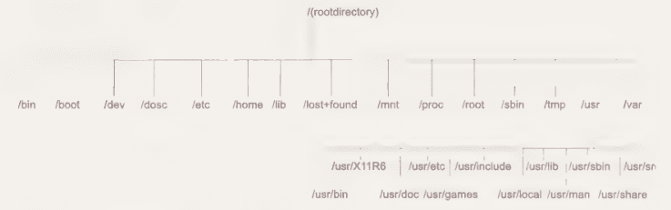

许多目录都有特定的用途。如果你了解特定目录的用途，在 Linux 目录中导航就会更容易。了解目录的典型用途的另一个好处是，当你面对新情况时，可以猜测在哪里查找特定类型的文件。表 6-3 简要描述了 Linux 系统中的目录：

| 目录 | 描述 |
| --- | --- |
| / | 构成文件系统基础的根目录。所有文件和目录在逻辑上都包含在根目录中，无论它们的物理位置在哪里。 |
| /bin | 包含作为 Linux 操作系统一部分的可执行程序。许多 Linux 命令，如 cat、cp、ls、more 和 tar，都位于 /bin 中。 |

命令用于在 Linux 文件系统中移动。本节总结了这些命令。你可以在终端窗口的 shell 提示符下尝试这些命令。

请参阅附录 B 中的 Linux 命令参考，以了解更多 Linux 命令。

## 第 6 章：Linux 命令的奥秘

| 目录 | 描述 |
|-----------|-------------|
| `/boot` | 包含 Linux 内核以及 LILO 引导管理器所需的其他文件。 |
| `/dev` | 包含所有设备文件。Linux 将每个设备视为一个特殊文件；所有此类文件都位于设备目录 `/dev` 中。 |
| `/dosc` | MS-DOS 分区通常挂载的目录（前提是系统硬盘有 MS-DOS 分区）。 |
| `/etc` | 包含大多数系统配置文件和初始化脚本（在 `/etc/rc.d` 子目录中）。 |
| `/home` | 所有用户主目录的常规位置。例如，用户 `naba` 的主目录是 `/home/naba`。 |
| `/lib` | 包含 C 语言和其他编程语言的库文件。 |
| `/lost+found` | 用于存放丢失文件的目录。每个磁盘分区都有一个 `lost+found` 目录。 |
| `/mnt` | 一个空目录，通常用于临时挂载设备，如软盘和磁盘分区。还包含用于挂载软盘的 `/mnt/floppy` 目录，以及用于挂载 CD-ROM 驱动器的 `/mnt/cdrom` 目录。（当然，你也可以将 CD-ROM 驱动器挂载到其他目录。） |
| `/proc` | 一个特殊目录，包含有关 Linux 系统各个方面的信息。 |
| `/root` | `root` 用户的主目录。 |
| `/sbin` | 包含通常用于系统管理任务的可执行命令文件。`mount`、`halt`、`umount` 和 `shutdown` 等命令位于 `/sbin` 目录中。 |
| `/tmp` | 任何用户都可以用作临时工作目录的临时目录——意味着此目录的内容被认为不重要，通常在每次系统启动时都会被删除。 |
| `/usr` | 包含许多重要程序的子目录，如 X Window 系统和在线手册。 |
| `/var` | 包含各种系统定义文件，以及用于保存临时信息的目录。 |

`/usr` 目录还包含许多有用的子目录。表 6-4 列出了 `/usr` 中的一些重要子目录。

#### 表 6-4 重要的 /usr 子目录

| 子目录 | 描述 |
|-------------|-------------|
| /usr/X11R6 | 包含 XFree86（X Window 系统）软件 |
| /usr/bin | 包含许多更多 Linux 命令的可执行文件，包括 Linux 中常用的实用程序，但不属于核心 Linux 操作系统的一部分 |
| /usr/doc | 包含 Linux 操作系统的文档文件，以及许多实用程序（如 Bash shell、mtools、xfm 文件管理器和 xv 图像查看器） |
| /usr/games | 包含一些旧版 Linux 游戏，如 fortune、banner 和 trojka |
| /usr/include | 包含 C 和 C++ 编程语言的头文件（文件名以 .h 结尾）；还包括 /usr/include/X11 目录中的 X11 头文件 |
| /usr/lib | 包含 C 和 C++ 编程语言的库；还包含 X 和 Tcl 的库 |
| /usr/local | 包含本地文件。例如，/usr/local/bin 目录应该是你系统上开发的任何可执行程序的位置。 |
| /usr/man | 包含在线手册（你可以使用 man 命令阅读） |
| /usr/sbin | 包含许多管理命令，如电子邮件和网络命令 |
| /usr/share | 包含共享数据，如许多应用程序的默认配置文件和图像。例如，/usr/share/gnome 包含 GNOME 桌面的各种共享文件。 |
| /usr/src | 包含 Linux 内核（核心操作系统）的源代码 |

#### 目录导航

在 Linux 中，当你以 `root` 身份登录时，你的主目录是 `/root`。对于其他用户，主目录通常位于 `/home` 目录中。我的主目录（当我以 `naba` 登录时）是 `/home/naba`。此信息存储在 `/etc/passwd` 文件中。

默认情况下，只有你有权限在你的主目录中保存文件，也只有你可以在你的主目录中创建子目录以进一步组织你的文件。

像 Bash 这样的 Linux shell 支持*当前目录*的概念，即所有文件和目录命令操作的目录。例如，登录后，你的当前目录就是主目录。要查看当前目录，请使用 `pwd` 命令。

要更改当前目录，请使用 `cd` 命令。要将当前目录更改为 `/usr/doc`，请键入以下内容：

```
cd /usr/doc
```

然后，要将目录更改为 `/usr/doc` 中的 `bash-1.14.7` 子目录，请键入此命令：

```
cd bash-1.14.7
```

现在，如果你使用 `pwd` 命令，该命令会显示 `/usr/doc/bash-1.14.7` 为当前目录。因此，你可以用两种方式引用目录名称：

- 绝对路径名（如 `/usr/doc`），指定目录树中的确切目录
- **相对**目录名（如 `bash-1.14.7`，表示当前目录的 `bash-1.14.7` 子目录）

如果你在 `/usr/doc` 中键入 `cd bash-1.14.7`，当前目录会变为 `/usr/doc/bash-1.14.7`；但在 `/home/naba` 中**相同的命令**会尝试将当前目录更改为 `/home/naba/bash-1.14.7`。


使用不带任何参数的 `cd` 命令将当前目录更改为你主目录。实际上，单独的 `cd` 命令将当前目录更改为 `HOME` 环境变量中列出的目录；但该环境变量默认包含你的主目录。


你可以使用快捷方式来引用任何用户的主目录。在用户登录名前加上波浪号（`~`）来引用该用户的主目录。因此，`~naba` 引用用户 `naba` 的主目录，`~root` 引用 `root` 用户的主目录。如果你的系统有一个登录名为 `emily` 的用户，你可以键入 `cd ~emily` 来切换到 Emily 的主目录。

目录名 `.` 和 `..` 有特殊含义。单个句点（`.`）表示当前目录，而两个句点（`..`）表示父目录。例如，如果当前目录是 `/usr/doc`，你可以使用此命令将当前目录更改为 `/usr`：

```
cd ..
```

请注意，你可以在 shell 提示符中显示当前目录。Bash shell 使用环境变量 `PS1` 的值作为主提示符。另一个变量 `PS2` 在命令

需要用户提供更多信息。你可以使用 `echo` 命令查看这些变量（例如，输入 `echo $PS1` 来查看 PS1 的设置）。默认情况下，Red Hat Linux 中的 PS1 变量定义如下：

```
echo $PS1
[\u@\h \W]\$
```

使用此 PS1 设置，命令提示符看起来像这样：

> [username@hostname dirname]$

在此示例中，username 是用户的名称；hostname 是系统名称；dirname 是当前工作目录的最后一部分。因此，如果当前目录是 `/usr/src/linux`，则 dirname 是 `linux`。你可以在 PS1 环境变量中使用以下字符序列来自定义提示符。

| 代码 | 提示符中显示的内容 |
|------|------------------------|
| \\t | HH:MM:SS 格式的当前时间 |
| \\d | "星期 月份 日期" 格式的日期，例如 "Sat Jul 10" |
| \\n | 换行符 |
| \\s | shell 的名称 - 例如 bash |
| \\w | 当前工作目录的完整名称 - 例如 /usr/src/linux |
| \\W | 当前工作目录的基本名称 - 例如 /usr/src/linux 的 linux |
| \\u | 当前用户的用户名 |
| \\h | 主机名 |
| \\\# | 此命令的命令编号 |
| \\! | 此命令的历史记录编号 |
| \\$ | 如果有效用户 ID 为 0（表示用户是 root），则显示 #；否则显示 $ |
| \\nnn | 对应八进制数 nnn 的字符 |
| \\\\ | 反斜杠 |
| \\[ | 开始非打印字符序列，可用于将终端控制序列嵌入提示符中 |
| \\] | 结束非打印字符序列 |

根据此信息，你可以使用以下命令在提示符中显示完整目录名（用方括号括起来）：

```
export PS1="[\w]"
```

如果当前目录是 /usr/src/linux，则提示符将显示如下：

```
[/usr/src/linux]
```

#### 目录列表和权限

当你在 Linux 目录之间移动时，你可能想知道目录的内容。你可以使用 `ls` 命令获取目录列表。默认情况下，`ls` 命令（不带任何选项）以紧凑的四列格式显示当前目录的内容。如果你以 `root` 身份登录并输入 `ls`，`ls` 命令将以以下方式列出 `/root` 目录的内容：

```
mbox  nsmail
```

从这个列表中，你无法真正分辨条目是文件还是目录。要查看目录内容的完整详细信息，请在 `ls` 中使用 `-l` 选项，如下所示：

```
ls -l
```

对于 `/root` 目录，`ls -l` 的典型输出如下所示：

```
total 2
-rw-------  1 root  root   670 Jun  9 23:18 mbox
drwx------  2 root  root  1024 Jun  2 20:38 nsmail
```

此列表显示了每个目录条目的大量信息——这些条目可以是文件或另一个目录。从右列向左看，最右边的列显示目录条目的名称。名称前的日期和时间显示了对该文件的最后修改时间。日期和时间之前是文件的大小（以字节为单位）。

文件的组和所有者出现在显示文件大小的列左侧。再往左的数字表示指向文件的链接数。（链接类似于 Windows 中的快捷方式。）最后，最左边的列显示文件的*权限设置*，它决定谁可以读取、写入或执行该文件。

最左边列的第一个字母具有特殊含义，如下列表所示：

- 如果第一个字母是 `l`，则该文件是指向另一个文件的符号链接。
- 如果第一个字母是 `d`，则该文件是一个目录。
- 如果第一个字母是短横线（`-`），则该文件是一个普通文件。
- 如果第一个字母是 `b`，则该文件代表一个块设备，如磁盘驱动器。
- 如果第一个字母是 `c`，则该文件代表一个字符设备，如串行端口或终端。

在第一个字母之后，最左边的列显示九个字符的序列，当每个字母都存在时，显示为 rwxrwxrwx。每个字母表示特定的权限；用连字符代替字母表示对该文件的特定操作没有权限。将这九个字母视为三组三个字母（rwx），解释如下：

- 最左边的 rwx 组控制文件所有者的读取、写入和执行权限。换句话说，如果你在此位置看到 rwx，则文件所有者可以读取（r）、写入（w）和执行（x）文件。用连字符代替字母表示没有权限。因此，字符串 rw- 表示所有者具有读取和写入权限，但没有执行权限。通常，可执行程序（包括 shell 程序）具有执行权限。但是，对于目录，执行权限等同于使用权限——用户必须对目录具有执行权限才能打开和读取目录的内容。

- 中间的三个 rwx 字母控制属于该文件组的任何用户的读取、写入和执行权限。

- 最右边的 rwx 组控制所有其他用户（统称为 world）的读取、写入和执行权限。

因此，权限设置为 rwx------ 的文件仅文件所有者可访问；而权限设置为 rwxr--r-- 的文件则 world 可读。

使用 `chmod` 命令更改文件的权限设置。例如，一个 shell 程序或 shell 脚本通常是你用文本编辑器准备的文本文件。保存文件后，你必须使文件可执行才能运行脚本。例如，要向名为 `convert_images` 的脚本文件添加执行权限，请输入以下命令：

```
chmod +x convert_images
```

此命令为所有者、组和 world 添加执行权限。

`ls` 命令的一个有趣特点是它不列出任何以句点开头的文件名。要查看这些文件，你必须在 `ls` 命令中使用 `-a` 选项，如下所示：

```
ls -a
```

大多数 Linux 命令采用单字符选项，每个选项以减号（将此符号视为短横线）为前缀。当你想使用多个选项时，输入一个短横线并将选项字母一个接一个地连接起来。因此，`ls -al` 等同于 `ls -a -l`。

#### 文件操作

你经常可能需要将文件从一个目录复制到另一个目录。使用 `cp` 命令执行此任务。要将文件 `/usr/X11R6/lib/X11/xinit/Xclients` 复制到另一个目录（如你的主目录）中的 `Xclients.sample` 文件，请输入以下命令：

```
cp /usr/X11R6/lib/X11/xinit/Xclients Xclients.sample
```

如果你想将文件复制到当前目录并保留相同的名称，请使用句点（.）作为 `cp` 命令的第二个参数。因此，以下命令将 `/etc/X11` 目录中的 `XF86Config` 文件复制到当前目录（由单个句点表示）：

```
cp /etc/X11/XF86Config .
```

`cp` 命令创建文件的新副本并保持原文件不变。

另一个 Linux 命令 `mv` 将文件移动到新位置。原始副本消失，新副本出现在指定的目标位置。你可以使用 `mv` 重命名文件。如果你想将 `today.list` 的名称更改为 `old.list`，请使用 `mv` 命令，如下所示：

```
mv today.list old.list
```

另一方面，如果你想将 `today.list` 文件移动到名为 `saved` 的子目录中，请使用此命令：

```
mv today.list saved
```

`mv` 的一个有趣特点是你可以用它移动整个目录及其所有子目录和文件到新位置。如果你有一个名为 `data` 的目录，其中包含许多文件和子目录，你可以使用此命令将整个目录结构移动到 `old_data`：

```
mv data old_data
```

另一个常见的文件操作是删除文件。使用 `rm` 命令删除名为 `old.list` 的文件，例如，输入以下命令：

```
rm old.list
```

使用 `rm` 命令时要小心，尤其是在以 `root` 身份登录时。不小心用 `rm` 删除重要文件非常容易。（请参阅本章前面关于别名的部分，了解如何避免意外使用 `rm` 命令覆盖文件。）

除了复制、重命名和删除文件外，你可能还想查看文件的内容。使用 `more` 命令一次一页地查看文本文件。例如，要查看文件 `/etc/X11/XF86Config`，请使用此命令：

```
more /etc/X11/XF86Config
```

`more` 命令在每页后暂停，因此你必须按空格键才能转到下一页。按 Enter 键可一次在文件中前进一行。要向后移动到上一页，请按 `b`。

另一个用于文件查看的有用 Linux 命令是 `less`。（这个名字是一个文字游戏，因为 `less` 比 `more` 做得更多。）


#### 目录操作

要在主目录中组织文件，你需要创建新目录。使用 `mkdir` 命令来创建目录。例如，要在当前目录下创建一个名为 `images` 的目录，请输入以下命令：

```
mkdir images
```

创建目录后，你可以使用 `cd images` 命令切换到该目录。

当你不再需要一个目录时，使用 `rmdir` 命令来删除它。你只能删除一个空目录。

#### 文件查找

`find` 命令用于定位符合指定搜索条件的文件（和目录）。`find` 命令是 Linux 中最有用的命令之一。Linux 版本的 `find` 命令源自 GNU，它比标准 UNIX 版本具有更广泛的选项。然而，我将展示标准 UNIX `find` 命令的语法，因为该语法在 Linux 中也适用，并且你可以在其他 UNIX 系统上使用相同的格式。

我必须承认，当我多年前（20 世纪 80 年代初的伯克利 UNIX）开始使用 UNIX 时，我对 `find` 命令感到困惑。我在很长一段时间里一直使用 `find` 的一种基本语法，后来才过渡到更复杂的形式。我首先学会的基本语法用于在文件系统中的任何位置查找文件。

假设你想查找任何名称以 `gnome` 开头的文件或目录。你可以使用 `find` 执行此搜索，如下所示：

```
find / -name "gnome*" -print
```

此命令告诉 `find` 从根目录（`/`）开始查找，查找与 `gnome*` 匹配的文件名，并显示任何匹配文件的完整路径名。

你可以使用此简单 `find` 形式的变体在任何目录（以及目录中包含的子目录）中定位文件。如果你忘记了在主目录的哪个位置存储了所有名为 `y2k*`（名称以字符串 `y2k` 开头）的文件，你可以使用以下命令搜索这些文件：

```
find ~ -name "y2k*" -print
```

当你熟悉 `find` 的这种语法后，你可以使用 `find` 的其他选项。要仅查找特定类型的文件（例如目录），请使用 `-type` 选项。以下命令显示你的 Linux 系统中的所有顶级目录名称：

```
find / -type d -maxdepth 1 -print
```

在典型的 Linux 系统中，你可能不需要使用 `find` 的复杂形式，但你可以使用以下命令查找其余的 `find` 选项：

```
man find
```

### Bash 中的 Shell 脚本

UNIX 的基本理念是为用户提供许多小型且专门化的命令，以及连接这些命令所需的“管道”。这里的“管道”指的是一个命令的输出作为另一个命令的输入。Bash 作为 Linux 中的默认 shell，以 I/O 重定向和管道的形式提供了这种管道功能。Bash 还包含诸如 `if` 语句（仅在特定条件为真时运行命令）和 `for` 语句（重复执行命令指定次数）等特性。你可以利用 Bash 的这些特性来编写称为 *shell 脚本* 的程序。

Shell 脚本在系统管理员中很受欢迎。如果你是一名系统管理员，你可以建立一个自定义 shell 脚本集合，以帮助你自动执行经常执行的任务。例如，如果一个磁盘似乎快满了，你可能想要查找所有超过某个大小（比如 1MB）且在过去 30 天内未被访问过的文件。此外，你可能想向所有拥有大文件的用户发送电子邮件，请求他们尝试归档和清理这些文件。你可以使用 shell 脚本执行所有这些任务。你可以从以下 `find` 命令开始来识别大文件：

```
find / -type f -atime +30 -size +1000k -exec ls -l {} \; > /tmp/largefiles
```

此命令创建一个名为 `/tmp/largefiles` 的文件，其中包含有关占用过多空间的旧文件的详细信息。获取文件列表后，你可以使用其他一些 Linux 命令（如 `sort`、`cut` 和 `sed`）来准备并向拥有大文件且需要清理的用户发送邮件。

以下各节概述了 Bash 编程。

在尝试简单的 shell 程序时，请不要将你的示例程序命名为 `test`。Linux 包含一个名为 `test`（`/usr/bin/test`）的重要程序。此程序在 shell 脚本中测试各种条件，例如文件是否存在以及文件是否可读。如果你创建一个名为 `test` 的示例程序，一些脚本最终可能会调用你的程序而不是系统的 `test` 程序。

#### 一个简单的 Shell 脚本

在本章前面，我讨论了如何将常用的命令放在一个文件中，并使用 `chmod` 命令使该文件可执行。瞧——你就有了一 个 shell 脚本。就像大多数 Linux 命令接受命令行选项一样，Bash 脚本也接受命令行选项。在脚本内部，你可以将这些选项称为 `$1`、`$2` 等。特殊名称 `$0` 指的是脚本本身的名称。

考虑以下 Bash 脚本：

```
#!/bin/sh
echo "This script's name is: $0"
echo Argument 1: $1
echo Argument 2: $2
```

第一行使 Linux 运行 `/bin/sh` 程序，该程序随后处理脚本中的其余行。名称 `/bin/sh` 传统上指的是 Bourne shell——第一个 UNIX shell。在 Linux 中，`/bin/sh` 是指向 `/bin/bash` 的符号链接，即 Bash 的可执行程序。因此，在 Linux 中，Bash 运行 Bourne shell 脚本（Bash 恰好与 Bourne shell 兼容）。

如果你将这个简单的脚本保存到一个名为 `simple` 的文件中，并使用命令 `chmod +x simple` 使该文件可执行，你可以按如下方式运行该脚本：

```
simple
This script's name is: ./simple
Argument 1:
Argument 2:
```

脚本文件的名称显示为相对于当前目录，由一个点表示。由于你在没有参数的情况下运行了脚本，因此脚本没有显示任何参数。

如果你收到错误消息 `bash: simple: command not found`，则你的 `PATH` 环境变量未包含当前目录。只需输入 `./simple` 即可执行该脚本。

现在，尝试使用几个参数运行该脚本，如下所示：

```
simple "This is one argument" second-argument third
This script's name is: ./simple
Argument 1: This is one argument
Argument 2: second-argument
```

如本例所示，shell 将双引号内的整个字符串视为单个参数。否则，shell 使用空格作为命令行上参数之间的分隔符。

#### Bash 编程概述

像任何编程语言一样，Bash 包含以下特性：

-   存储值的变量，包括用于访问传递给 shell 脚本的命令行参数的特殊内置变量以及其他特殊值。
-   计算表达式的能力。
-   使你能够循环多个 shell 命令或有条件地执行某些命令的控制结构。
-   定义函数的能力，这些函数可以在脚本中的多个位置调用。Bash 还包含许多可以在任何脚本中使用的内置函数。

接下来的几节将通过简单的示例说明 Bash 的一些编程特性。由于你已经在运行 Bash，你可以通过在终端窗口中的 shell 提示符下输入这些示例来尝试它们。

#### 变量

你在 Bash 中定义变量就像定义环境变量一样。因此，你可以这样定义一个变量：

```
count=12  # 注意不允许有嵌入空格
```

要使用变量的值，请在变量名前加上美元符号（$）。例如，`$PATH` 是变量 `PATH` 的值（是的，著名的 `PATH` 环境变量）。要显示变量 `count` 的值，请使用以下命令：

```
echo $count
```

Bash 有一些用于访问命令行参数的特殊变量。在 shell 脚本中，`$0` 指的是 shell 脚本的名称。变量 `$1`、`$2` 等指的是命令行参数。变量 `$*` 将所有命令行参数存储为单个变量，`$?` 包含 shell 执行的最后一个命令的退出状态。

你还可以提示用户输入，并使用 `read` 命令将输入读入变量。下面是一个示例：

```
echo -n "Enter value: "
read value
echo "You entered: $value"
```

`-n` 选项可防止 `echo` 命令在其显示的字符串末尾自动添加换行符。


#### 控制结构

在 Bash 脚本中，控制结构（例如 `if`、`case`、`for` 和 `while`）依赖于命令的退出状态来决定下一步执行什么。当任何命令执行时，它会返回一个*退出状态*：一个表示命令是否成功的数值。按照惯例，退出状态为零表示命令执行成功。（是的，你没看错：零表示成功。）非零退出状态表示命令执行过程中出现了问题。

你可能会使用一个脚本，在用 `vi` 编辑器打开文件之前先创建一个备份副本，方式如下：

```bash
#!/bin/sh
if cp "$1" "#$1"
then
    vi "$1"
else
    echo "Failed to create backup copy"
fi
```

这个脚本说明了 *if-then-else* 结构的语法，并展示了 `cp` 命令的退出状态如何被 `if` 结构用来决定下一个动作。如果 `cp` 返回零，脚本就调用 `vi` 来编辑文件；否则，脚本显示一条消息并退出。

不要忘记结束 `if` 结构的最终 `fi`。忘记 `fi` 是 Bash 脚本中常见的错误来源。

Bash 包含 `test` 命令，使你能够计算任何表达式，并将表达式的值用作命令的退出状态。假设你想要一个脚本，使你能够编辑一个现有文件。使用 `test`，你可以这样编写这样一个脚本：

```bash
#!/bin/sh
if test -f "$1"
then
    vi "$1"
else
    echo "No such file"
fi
```

`test` 命令的一种更短形式省略了 `test`，并将命令选项放在方括号内。使用这种表示法，你可以将上面的脚本写成如下形式：

```bash
#!/bin/sh
if [ -f "$1" ]
then
    vi "$1"
else
    echo "No such file"
fi
```

左方括号（`[`）实际上是 `/usr/bin/test` 的符号链接。你可以通过输入 `ls -l /usr/bin/[` 来确认这个事实。

另一个常见的控制结构是 for 循环。以下脚本将数字 1 到 10 相加：

```bash
#!/bin/sh
sum=0
for i in 1 2 3 4 5 6 7 8 9 10
do
    sum=`expr $sum + $i`
done
echo "Sum = $sum"
```

这个例子也展示了使用 expr 命令来计算表达式。

#### Bash 中的内置函数

Bash 有超过 50 个内置函数，包括常见的函数如 `cd` 和 `pwd`，以及许多其他不常用的函数。你可以在任何 Bash 脚本中使用这些内置函数。本章没有足够的篇幅来涵盖所有内置函数，但你可以通过使用 `man bash` 命令从 Bash 的在线手册中了解更多关于它们的信息。

### Perl 作为一种脚本语言

从官方定义上说，Perl 代表 *实用提取报告语言*。Larry Wall 创建 Perl 是为了从文本文件中提取信息，然后利用这些信息来准备报告。用 Perl 语言编写的程序由 perl 程序解释并执行。本书随附的 CD-ROM 包含 perl 程序；你应该将其安装在系统的 `/usr/bin` 目录中。

Perl 在各种各样的计算机系统上都可用，因为像 Linux 一样，Perl 可以自由分发。此外，Perl 在许多用户和系统管理员中作为一种脚本语言非常受欢迎，这就是我介绍 Perl 并展示其优势的原因。在第 8 章，你将学习另一种脚本语言（Tcl/Tk），它提供了为脚本创建图形用户界面的功能。

正如你目前所知，术语“脚本”只是“程序”的同义词。与用 C 和 C++ 等语言编写的程序不同，你不必编译 Perl 程序；perl 程序只是解释并执行 Perl 程序。“脚本”一词通常用于此类用 shell 编程语言或 Perl 编写的解释型程序。（严格来说，perl 不仅仅是解释 Perl 程序；它在执行程序之前将 Perl 程序转换为一种中间形式。）

**注意：** 如果你熟悉 shell 编程或 C 编程语言，你可以非常快地掌握 Perl。如果你从未编程过，精通 Perl 可能需要一段时间。我鼓励你从小范围的 Perl 功能开始，忽略任何你不理解的内容。然后，慢慢地将 Perl 功能添加到你的技能库中。

#### 我有 Perl 吗？

在继续 Perl 教程之前，请检查你的系统上是否安装了 `perl`。输入以下命令：

```
which perl
```

`which` 命令会告诉你它是否在 `PATH` 环境变量列出的目录中找到指定的程序。如果 `perl` 已安装，你应该看到以下输出：

```
/usr/bin/perl
```

如果 `which` 命令抱怨当前 PATH 中没有这样的程序，这并不一定意味着你没有安装 `perl`；它可能意味着你的 PATH 中没有包含 `/usr/bin` 目录。确保 `/usr/bin` 在 PATH 中；要么输入 `echo $PATH`，要么查看 `which` 命令显示的消息（该消息包括 PATH 中的目录）。如果 `/usr/bin` 不在 PATH 中，请使用以下命令重新定义 PATH：

```
export PATH=$PATH:/usr/bin
```

现在，再次尝试 `which perl` 命令。如果你仍然收到错误，你可能还没有安装 `perl`。你可以按照以下步骤从随附的 CD-ROM 安装 Perl：

- 1. 以 root 身份登录。
- 2. 将随附的 CD-ROM 插入 CD-ROM 驱动器，并使用以下命令挂载 CD-ROM：

```
mount /mnt/cdrom
```

- 3. 输入以下命令切换到 Red Hat 软件包所在的目录：

```
cd /mnt/cdrom/RedHat/RPMS
```

- 4. 输入以下 `rpm`（Red Hat 软件包管理器）命令来安装 Perl：

```
rpm -i perl*
```

如果你的系统上已安装 `perl`，输入以下命令查看其版本号：

```
perl -v
```

以下是该命令的典型输出：

```
This is perl, version 5.005_03 built for i386-linux

Copyright 1987-1999, Larry Wall
```

Perl 只能在 Artistic License 或 GNU 通用公共许可证的条款下复制，这些许可证可以在 Perl 5.0 源代码套件中找到。

Perl 的完整文档，包括常见问题解答列表，应可在此系统上使用 `man perl` 或 `perldoc perl` 找到。如果你可以访问互联网，请将浏览器指向 http://www.perl.com/，Perl 主页。

此输出告诉你，你拥有 Perl 版本 5.005，补丁级别 03，并且 Perl 的创始人 Larry Wall 持有版权。不过，Perl 是在 GNU 通用公共许可证下自由分发的。

随附的 CD-ROM 包含 Perl 的 5.005_03 版本。你可以通过将万维网浏览器指向综合 Perl 存档网络 (CPAN) 来获取最新版本的 Perl。以下地址将你连接到离你最近的 CPAN 站点：

```
http://www.perl.com/CPAN/
```

#### 你的第一个 Perl 脚本

Perl 具有许多 C 的特性，而且，如你所知，大多数关于 C 的书籍都以一个在终端上显示 `Hello, World!` 的示例程序开始。因为 Perl 是一种解释型语言，你可以直接从命令行完成此任务。如果你输入：

```
perl -e 'print "Hello, World!\n";'
```

系统会响应：

```
Hello, World!
```

此命令使用 `perl` 程序的 `-e` 选项，将 Perl 程序作为命令行参数传递给 Perl 解释器。在这种情况下，以下一行构成了 Perl 程序：

```
print "Hello, World!\n";
```

要将这一行转换为脚本，只需将该行放在一个文件中，并以运行 `perl` 程序的指令开始该文件（就像在 shell 脚本中那样，当你放置一行如 `#!/bin/sh` 来运行 Bourne shell 处理脚本时一样）。

要尝试一个 Perl 脚本，请按照以下步骤操作：

- 1. 使用文本编辑器，如 `vi` 或 `emacs`，将以下行保存到名为 `hello` 的文件中：

	#!/usr/bin/perl
	# This is a comment.
	print "Hello, World!\n";

- 2. 使用以下命令使 `hello` 文件可执行：

	chmod +x hello

- 3. 在 shell 提示符下输入以下命令来运行 Perl 脚本：

	hello
	Hello, World!

如果你收到错误消息 `bash: hello: command not found`，则当前目录不在 `PATH` 环境变量中。输入 `./hello` 来运行脚本。


# 更多关于 Perl 的内容

本章用几个小节为你介绍了 Perl 的概况并展示了一些简单的示例。然而，这些讨论远未充分展现 Perl 的强大功能。如果你想将 Perl 作为一种工具来使用，请参考以下 Perl 书籍之一：

1. Larry Wall、Tom Christiansen、Randal L. Schwartz 和 Stephen Potter，*Programming Perl, 2nd Edition*（O'Reilly & Associates，1996）
2. Randal L. Schwartz、Tom Christiansen 和 Larry Wall，*Learning Perl, 2nd Edition*（O'Reilly & Associates，1997）
3. Naba Barkakati，*Discover Perl 5*（IDG Books Worldwide，1997）
4. Paul E. Hoffman，*Perl For Dummies, 2nd Edition*（IDG Books Worldwide，1998）

*Programming Perl, 2nd Edition* 是 Perl 的权威指南（尽管它可能不是学习 Perl 的最佳资源）。Randal Schwartz 的后续著作更侧重于教授 Perl 编程。我最近出版的书籍通过循序渐进的指导，并配以简短但完整的示例程序来教授 Perl。Paul Hoffman 的书非常适合想要学习 Perl 的非程序员入门使用。

就是这样！你已经编写并尝试了你的第一个 Perl 脚本。

请注意，Perl 脚本的第一行以 `#!` 开头，后面跟着 `perl` 程序的完整路径名。如果脚本的第一行以 `#!` 开头，shell 会简单地去掉 `#!`，将脚本文件名附加到末尾，然后运行该脚本。因此，如果脚本文件名为 `hello`，第一行为 `#!/usr/bin/perl`，则 shell 执行以下命令：

```
/usr/bin/perl hello
```

#### Perl 概述

大多数编程语言，包括 Perl，都有一些共同的特性：

- *变量*，用于存储不同类型的数据。你可以将每个变量视为数据的占位符——有点像邮箱，有一个名称和存储数据的空间。变量的内容就是它的值。
- *表达式*，通过使用*运算符*将变量组合在一起。一个表达式可能将几个变量相加；另一个可能提取字符串的一部分。
- *语句*，执行某些操作，例如将值赋给变量或打印字符串。
- *流程控制语句*，使语句能够根据某个表达式的值以不同的顺序执行。通常，流程控制语句包括 `for`、`do-while`、`while` 和 `if-then-else` 语句。
- 函数（也称为子程序或例程），使你能够将多条语句组合在一起并给它们一个名称。这一特性使你可以通过调用代表这些语句的函数来执行相同的一组语句。通常，编程语言提供一些预定义的函数。

接下来的几个小节概述了 Perl 的这些主要特性，并通过简单的示例来说明这些特性。

#### 基本 Perl 语法

Perl 是自由格式的，和 C 语言一样；关键字的具体位置没有任何限制。Perl 程序通常存储在以 .pl 结尾的文件中，但对文件名的使用没有限制。

和 C 语言一样，每条 Perl 语句以分号（;）结尾。井号（#）标记注释的开始；Perl 程序会忽略井号后面那一行的内容。

多条 Perl 语句用花括号（{...}）括起来。这一特性与 C 语言也相似。

#### 变量

你不必像在 C 语言中那样在使用前声明 Perl 变量。在 Perl 脚本中，你可以很容易地识别出一个变量，因为每个变量名都以一个特殊字符开头：艾特符号（@）、美元符号（$）或百分号（%）。这个特殊字符表示变量的类型。三种变量类型是：

- 标量变量，表示基本数据类型：整数、浮点数和字符串。标量变量以美元符号（$）开头。以下是一些示例：

```
$maxlines = 256;
$title = "Red Hat Linux Secrets, 3rd Edition";
```

- 数组变量，是标量变量的集合。数组变量以艾特符号（@）作为前缀。因此，以下是数组：

```
@pages = (62, 26, 22, 24);
@commands = ("start", "stop", "draw", "exit");
```

- 关联数组，是键值对的集合，其中每个键是一个字符串，值可以是任何标量变量。百分号（%）前缀表示关联数组。你可以使用关联数组将名称与值关联起来。你可以在如下所示的关联数组中存储每个用户使用的磁盘空间量：

```
%disk_usage = ("root", 14118, "naba", 28547, "emily", 55);
```

因为每种变量类型都有自己独特的字符前缀，所以你可以对不同的变量类型使用相同的名称。因此，%disk_usage、@disk_usage 和 $disk_usage 可以出现在同一个 Perl 程序中。

##### 标量

标量变量是 Perl 中的基本数据类型。每个标量的名称以美元符号（$）开头。通常，你通过赋值语句来初始化并开始使用标量。你甚至可以在不初始化的情况下使用变量；数字的默认值为零，字符串的默认值为空字符串。如果你想查看标量是否已定义，可以使用 `defined` 函数，如下所示：

```
print "Name undefined!\n" if !(defined $name);
```

如果 `$name` 已定义，表达式 `(defined $name)` 的值为 1。你实际上可以使用 `undef` 函数来"取消定义"一个变量。例如，你可以按如下方式取消定义 $name：

```
undef $name;
```

变量根据上下文进行求值。以下是一个初始化并打印几个变量的脚本：

```
#!/usr/bin/perl
$title = "Red Hat Linux Secrets, 3rd Edition";
$count1 = 550;
$count2 = 375;

$total = $count1 + $count2;

print "Title: $title -- $total pages\n";
```

当你运行此 Perl 程序时，它会产生以下输出：

```
Title: Red Hat Linux Secrets, 3rd Edition -- 925 pages
```

正如 Perl 语句所示，当两个数字变量相加时，使用的是它们的数值；但当打印 `$total` 变量时，显示的是它的字符串表示形式。

Perl 的另一个有趣的方面是，它会在双引号（"..."）中对字符串内的所有变量进行求值。但是，如果你将字符串写在单引号（'...'）内，Perl 会保持该字符串不变。如果你写

```
print 'Title: $title -- $total pages\n';
```

使用单引号而不是双引号，Perl 显示

```
Title: $title -- $total pages\n
```

而不会生成换行。

一个有用的 Perl 变量是 `$_`（美元符号后跟下划线字符）。这个特殊变量被称为*默认参数*。Perl 解释器根据上下文来确定 `$_` 的值。当 Perl 解释器从标准输入读取输入时，`$_` 保存当前输入行；当解释器进行搜索时，`$_` 保存默认的搜索模式。

### 数组

数组是标量的集合。数组名称以艾特符号（@）开头。和 C 语言一样，数组下标从零开始。你可以通过索引访问数组的元素。Perl 动态分配数组的空间。

考虑以下简单脚本：

```
#!/usr/bin/perl
@commands = ("start", "stop", "draw" , "exit");

$numcmd = @commands;
print "There are $numcmd commands.\n";
print "The first command is: $commands[0]\n";
```

当你运行该脚本时，它会产生以下输出：

```
There are 4 commands.
The first command is: start
```

如你所见，将标量等于数组会将标量设置为数组中的元素数量。@commands 数组的第一个元素被引用为 $commands[0]，因为索引从零开始。因此，@commands 数组中的第四个元素是 $commands[3]。

两个特殊的标量与数组相关。$[ 变量是当前的基数索引，默认为零。标量 $#arrayname（其中 arrayname 是数组变量的名称）的值是最后一个数组索引。因此，对于 @commands 数组，$#commands 为 3。

你可以用一条简单的 print 语句来打印整个数组，如下所示：

```
print "@commands\n";
```

当 Perl 执行此语句时，它会显示以下输出：

```
start stop draw exit
```

##### 关联数组

关联数组变量以百分号（%）作为前缀来声明，是 Perl 的独特特性。使用关联数组，你可以用字符串（例如名称）来索引数组。关联数组的一个很好的示例是 Perl 自动为你定义的 %ENV 数组。在 Perl 中，%ENV 是环境变量数组，你可以使用环境变量名作为索引来访问它们。以下 Perl 语句打印当前的 PATH 环境变量：

```
print "PATH = $ENV{PATH}\n";
```

当 Perl 执行此语句时，它会打印出 PATH 的当前设置。与常规数组不同，你必须使用花括号来索引关联数组。

Perl 有许多内置函数——例如 delete、each、keys 和 values——使你能够访问和操作关联数组。


#### Perl 中的预定义变量

Perl 有几个预定义变量，其中包含你可能在 Perl 脚本中需要使用的有用信息。以下是一些重要的预定义变量：

- @ARGV 是一个字符串数组，包含脚本的命令行选项。第一个选项是 $ARGV[0]，第二个是 $ARGV[1]，依此类推。
- %ENV 是一个关联数组，包含环境变量。你可以使用环境变量名作为键来访问此数组。因此，$ENV{HOME} 是主目录，$ENV{PATH} 是 shell 用于定位命令的当前搜索路径。
- $_ 是许多函数的默认参数。如果你看到一个 Perl 函数没有使用任何参数来调用，该函数很可能期望其参数在 $_ 变量中。
- @_ 是传递给子例程的参数列表。
- $0 是包含 Perl 程序的文件的名称。
- $] 是你正在使用的 Perl 版本号（例如，如果你使用的是 Perl 版本 5.005 修补级别 3，$] 将是 "5.00503"）。
- $< 是运行脚本的用户的用户 ID（一个标识号码）。这在每个用户都有 ID 的 UNIX 系统上很有用。
- $$ 是脚本的进程 ID。
- $? 是最后一次系统调用返回的状态。

#### 运算符和表达式

运算符用于组合和比较 Perl 变量。典型的数学运算符包括加法 (+)、减法 (-)、乘法 (*) 和除法 (/)。Perl 和 C 提供几乎相同的运算符集。当你使用运算符组合变量时，最终会得到表达式。每个表达式都有一个值。

以下是一些典型的 Perl 表达式：

```
error < 0
$count == 10
$count + $i
$users[$i]
```

这些表达式是比较运算符（前两行）、算术运算符和数组索引运算符的示例。

在 Perl 中，不要使用 == 运算符来判断两个字符串是否匹配；== 运算符仅适用于数字。要测试字符串的相等性，Perl 包含了 FORTRAN 风格的 eq 运算符。使用 eq 来检查两个字符串是否相同，如下所示：

```
if ($input eq "stop") { exit; }
```

其他 FORTRAN 风格的字符串比较运算符包括 `ne`（不等）、`lt`（小于）、`gt`（大于）、`le`（小于或等于）和 `ge`（大于或等于）。你也可以使用 `cmp` 运算符来比较两个字符串。返回值为 -1、0 或 1，具体取决于第一个字符串是小于、等于还是大于第二个字符串。

Perl 还提供以下独特的运算符。C 缺少指数运算符，而 FORTRAN 包含；Perl 使用 `**` 作为指数运算符。因此，你可以输入以下内容：

```
$x = 2;
$y = 3;
$z = $x**$y; # z 应该是 8（2 的 3 次方）
$y **= 2; # y 现在是 9（3 的 2 次方）
```

你可以通过使用 `()` —— *空列表运算符* —— 来将数组初始化为 null，如下所示：

```
@commands = ();
```

点运算符 (`.`) 使你能够连接两个字符串，如下所示：

```
$part1 = "Hello, ";
$part2 = "World!";
$message = $part1.$part2; # 现在 $message = "Hello, World!"
```

一个有趣但有用的运算符是*重复运算符*，由 `x=` 表示。你可以使用 `x=` 运算符将字符串重复指定的次数。假设你想将一个字符串初始化为 65 个星号 (`*`)。以下示例展示了如何使用 `x=` 运算符初始化字符串：

```
$marker = "*";
$marker x= 65; # 现在 $marker 是一个包含 65 个星号的字符串
```

Perl 中另一个强大的运算符是*范围运算符*，由两个点 (`..`) 表示。你可以使用范围运算符轻松初始化数组。以下是一些示例：

```
@numerals = (0..9); # @numerals = 0, 1, 2, 3, 4, 5, 6, 7, 8 , 9
@alphabet = ('A'..'Z'); # @alphabet = 大写字母 A 到 Z
```

#### 正则表达式

如果你使用过 UNIX 一段时间，你可能知道 `grep` 命令，它使你能够在文件中搜索字符串模式。以下是 `grep` 的一个典型用法，用于在所有名称以 `.c` 结尾的文件中查找任何出现字符串 `blaster` 或 `Blaster` 的行：

```
cd /usr/src/linux/drivers/cdrom
grep "[bB]laster" *.c
```

前面的命令在我的系统上产生以下输出：

```
cdu31a.c: { 0x230,  0 },  /* SoundBlaster 16 card */
sbpcd.c: *         Works with SoundBlaster compatible cards and with "no-
sound"
sbpcd.c:    x230, 1, /* Soundblaster Pro and 16 (default) */
sbpcd.c:    0x250, 1, /* OmniCD default, Soundblaster Pro and 16 */
sbpcd.c:    0x270, 1, /* Soundblaster 16 */
sbpcd.c:    0x290, 1, /* Soundblaster 16 */
sbpcd.c:static const char *str_sb = "SoundBlaster";
sbpcd.c:static const char *str_sb_l = "soundblaster";
 sbpcd.c: *              sbpcd=0x230, SoundBlaster
 sbcd.c:         msg(DBG_INF,"  LILO boot: ...
sbpcd=0x230,SoundBlaster\n");
sjcd.c: * the SoundBlaster/Panasonic style CDROM interface. But today, the
```

如你所见，`grep` 在名称以 `.c` 结尾的文件中找到了所有出现的 `blaster` 和 `Blaster`。

`grep` 命令的 `"[bB]laster"` 参数被称为*正则表达式*，这是一种匹配一组字符串的模式。你使用一小套类似于编写算术表达式的运算符和规则来构造正则表达式。例如，方括号内的字符列表 (`[...]`) 匹配列表中的任何单个字符。因此，正则表达式 `"[bB]laster"` 是两个字符串的集合，如下所示：

```
blaster  Blaster
```

Perl 支持正则表达式，就像 `grep` 命令一样。许多其他 UNIX 程序，如 `vi` 编辑器和 `sed`（流编辑器），也支持正则表达式。正则表达式的目的是在文件中搜索字符串模式。这就是为什么编辑器支持正则表达式。

Perl 使你能够构造复杂的正则表达式。然而，规则相当简单。本质上，正则表达式是一个字符序列，其中一些字符具有特殊含义。表 6-5 列出了解释字符的基本规则。

##### 表 6-5 正则表达式字符解释规则

| 表达式 | 含义 |
|------------|---------|
| . | 匹配除换行符外的任何单个字符 |
| x* | 匹配字符 x 的零次或多次出现 |
| x+ | 匹配字符 x 的一次或多次出现 |
| x? | 匹配字符 x 的零次或一次出现 |
| [...] | 匹配方括号内的任何字符 |
| x{n} | 恰好匹配字符 x 的 n 次出现 |
| x{n,} | 匹配字符 x 的 n 次或多次出现 |
| x{,m} | 匹配字符 x 的零次或最多 m 次出现 |
| x{n,m} | 匹配字符 x 的至少 n 次但不超过 m 次出现 |
| $ | 匹配行尾 |
| \\0 | 匹配空字符 |
| \\b | 匹配退格符 |
| \\B | 匹配不在单词开头或结尾的任何字符 |
| \\b | 匹配单词的开头或结尾 —— 当不在方括号内时 |
| \\cX | 匹配 Ctrl-X（其中 X 是任何字母字符） |
| \\d | 匹配单个数字 |
| \\D | 匹配非数字字符 |
| \\f | 匹配换页符 |
| \\n | 匹配换行符 |
| \\ooo | 匹配由数字 ooo 指定的八进制值（其中每个 o 是 0 到 7 之间的数字） |
| \\r | 匹配回车符 |
| \\S | 匹配非空白字符 |
| \\s | 匹配空白字符（空格、制表符或换行符） |
| \\t | 匹配制表符 |
| \\W | 匹配非字母数字字符 |
| \\w | 匹配字母数字字符 |
| \\xhh | 匹配由数字 hh 指定的十六进制值（其中每个 h 是 0 到 f 之间的数字） |
| ^ | 匹配行首 |

如果你想匹配字符 $, |, *, ^, [, ], \\, 和 / 中的任何一个，你必须在它们前面放一个反斜杠。因此，你将这些字符输入为 \$, \|, \*, \^, \[, \], \\, 和 \/。正则表达式通常看起来令人困惑，因为有大量的奇怪字符序列和大量的反斜杠。然而，与其他任何事情一样，你可以慢慢开始，最初只使用其中的几个特性。

到目前为止，本节总结了正则表达式的语法。但你还没有看到如何在 Perl 中使用正则表达式。通常，你将正则表达式放在一对斜杠内，并使用匹配 (=~) 或不匹配 (!~) 运算符来测试字符串。你可以编写一个 Perl 脚本，执行与本节前面使用 `grep` 相同的搜索。以下步骤可帮助你完成此练习：

1. 使用编辑器将以下脚本输入并保存为名为 `lookup` 的文件：

```
#!/usr/bin/perl

while (<STDIN>)
{
    if ( $_ =~ /[bB]laster/ ) { print $_; }
}
```

2. 使用以下命令使 `lookup` 文件具有可执行权限：

```
chmod +x lookup
```

3. 使用以下命令测试该脚本：

```
cat /usr/src/linux/drivers/cdrom/sbpcd.c | ./lookup
```

**我的系统返回如下结果：**

```
*	Works with SoundBlaster compatible cards and with
"no-sound"
	0x230, 1, /* Soundblaster Pro and 16 (default) */
	0x250, 1, /* OmniCD default, Soundblaster Pro and 16 */
	0x270, 1, /* Soundblaster 16 */
	0x290, 1, /* Soundblaster 16 */
static const char *str_sb = "SoundBlaster";
static const char *str_sb_l = "soundblaster";
*		sbpcd=0x230,SoundBlaster
		msg(DBG_INF,"	LILO boot: ...
sbpcd=0x230,SoundBlaster\n");
```

`cat` 命令将指定文件的内容（正如你在 `grep` 示例中所了解的，其中包含一些匹配该正则表达式的行）传递给 `lookup` 脚本。该脚本只是应用 Perl 的正则表达式匹配运算符（`=~`）并打印所有匹配的行。

脚本中的 `$_` 变量需要一些解释。`<STDIN>` 表达式从标准输入获取一行，并默认将其存储在 `$_` 变量中。在 `while` 循环内部，正则表达式会与 `$_` 字符串进行匹配。以下这一条 Perl 语句就完成了 `lookup` 脚本的全部工作：

```
if ( $_ =~ /[bB]laster/ ) { print $_; }
```

这个示例展示了如何使用正则表达式在文件中搜索字符串的出现。

使用一段时间的正则表达式后，你会更好地体会到它们的强大之处。关键在于准确地找出能完成你所需任务的正则表达式。下面是一个搜索示例，查找所有以恰好七个空格开头并以右括号结尾的行：

```
while (<STDIN>)
{
    if ( $_ =~ /\)$/ && $_ =~ /^ {7}\S/ ) { print $_; }
}
```

#### 流程控制语句

到目前为止，你看到的 Perl 语句都是按照顺序依次执行的。Perl 还包含了可以控制语句执行流程的语句。你已经见过 `if` 语句和 `while` 循环。Perl 包含了一套完整的流程控制语句，与 C 中的类似，但增加了一些额外的功能。

在 Perl 中，所有条件语句都采用以下形式：

```
conditional-statement
{ Perl code to execute if conditional is true }
```

请注意，你*必须*将条件语句后面的代码放在花括号（{...}）中。条件语句检查表达式的值，以确定是否执行花括号内的代码。在 Perl 中，与 C 一样，任何非零值都被视为真，而零值则为假。

以下各节简要介绍 Perl 中主要条件语句的语法。

##### if 和 unless

Perl 的 `if` 语句与 C 的 `if` 语句类似。例如，一个 `if` 语句可以检查计数是否超过阈值，如下所示：

```
if ( $count > 25 ) { print "Too many errors!\n"; }
```

你可以在 `if` 语句中添加 `else` 子句，如下所示：

```
if ($user eq "root")
{
    print "Starting simulation...\n";
}
else
{
    print "Sorry $user, you must be \"root\" to run this program.\n";
    exit;
}
```

如果你了解 C 语言，你可以看到 Perl 的语法与 C 非常相似。使用 `if` 语句的条件语句可以包含零个或多个 `elsif` 子句，以处理更多的情况，例如：

```
print "Enter version number:"; # prompt user for version number
$os_version = <STDIN>;      # read from standard input
chop $os_version; # get rid of the newline at the end of the line
# Check version number
if ($os_version >= 10 ) { print "No upgrade necessary\n";}
elsif ($os_version >= 6 && $os_version < 9)
                                { print "Standard upgrade\n";}
elsif ($os_version > 3 && $os_version < 6) { print "Reinstall\n";}
else { print "Sorry, cannot upgrade\n";}
```

`unless` 语句是 Perl 独有的。该语句与 `if` 具有相同的形式，包括使用 `elsif` 和 `else` 子句。不同之处在于，`unless` 仅在条件为假时执行其语句块。例如，你可以使用以下代码：

```
unless ($user eq "root")
{
    print "You must be \"root\" to run this program.\n";
    exit;
}
```

在这种情况下，除非字符串 user 为 `"root"`，否则脚本将退出。

##### while

使用 Perl 的 `while` 语句进行*循环*——即重复执行某些处理，直到条件变为假。要从标准输入逐行读取并处理该行，你可以使用以下代码：

```
while ($in = <STDIN>)
{
# Code to process the line
    print $in;
}
```

如果你从标准输入读取时不带任何参数，Perl 会将当前标准输入的行赋值给 `$_` 变量。因此，你可以将上面的 `while` 循环写成如下形式：

```
while (<STDIN>)
{
# Code to process the line
    print $_;
}
```

Perl 的 `while` 语句比 C 的更灵活，因为你可以将几乎任何东西用作测试条件。例如，如果你将数组用作条件，`while` 循环将一直执行，直到数组中没有剩余元素，如下例所示：

```
# Assume @cmdarg has the current set of command arguments
while (@cmdarg)
{
    $arg = shift @cmdarg;  # this extracts one argument
# Code to process the current argument
    print $arg;
}
```

`shift` 函数移除数组的第一个元素并返回该元素。

你可以使用 `next` 关键字跳到循环的末尾；使用 `last` 关键字退出循环。以下 `while` 循环将 1 到 10 的数字相加，但跳过 5：

```
while (1)
{
    $i++;
    if($i == 5) { next;}  # Jump to the next iteration if $i is 5
    if($i > 10) { last;}  # When $i exceeds 10, end the loop
    $sum += $i;           # Add the numbers
}
# At this point $sum should be 50
```

##### for 和 foreach

Perl 和 C 的 for 语句具有相似的语法。使用 for 语句可以根据表达式的值执行语句任意次数。语法如下：

```
for (expr_1; expr_2; expr_3) { statement block }
```

expr_1 在循环开始时求值一次；语句块会一直执行，直到表达式 expr_2 的求值结果为零。第三个表达式 expr_3 在每次执行语句块后求值。你可以省略任何一个表达式，但必须保留分号。此外，语句块周围的花括号也是必需的。以下是一个使用 for 循环将 1 到 10 的数字相加的示例：

```
for($i=0, $sum=0; $i <= 10; $sum += $i, $i++) {}
```

在这个示例中，实际的加法运算在第三个表达式中完成，而由 for 循环控制的语句是一个空块（{}）。

foreach 语句最适合用于数组。语法如下：

```
foreach Variable (Array) { statement block }
```

foreach 语句将数组中的一个元素赋值给 Variable，然后执行语句块。foreach 语句会重复此过程，直到没有剩余的数组元素。以下 foreach 语句将 1 到 10 的数字相加：

```
foreach $i (1..10) { $sum += $i;}
```

注意，我使用范围运算符（..）声明了数组。你也可以使用逗号分隔的项目列表作为数组。

如果你在 foreach 语句中省略 Variable，Perl 会隐式使用 `$_` 变量来保存当前数组元素。因此，你可以使用以下代码：

```
foreach (1..10) { $sum += $_; }
```

##### goto

goto 语句将控制权转移到一个语句标签。下面是一个示例，提示用户输入一个值，如果该值不可接受则重复请求：

```
ReEnter:
print "Enter offset: ";
$offset = <STDIN>;
chop $offset;
unless ($offset > 0 && $offset < 512)
```


#### 访问 Linux

你可以通过多种方式从 Perl 中执行任何 Linux 命令：

- 调用 `system` 函数，传入包含要执行的 Linux 命令的字符串。
- 将 Linux 命令用*反引号*（`` ` ``）括起来，反引号也称为*重音符号*。你可以通过这种方式运行 Linux 命令并捕获其输出。
- 调用 `fork` 函数复制当前脚本，并在子进程中处理新命令。（如果一个进程启动了另一个进程，那么新进程称为*子进程*。）
- 调用 `exec` 函数用新脚本或 Linux 命令覆盖当前脚本。
- 使用 `fork` 和 `exec` 提供类似 shell 的行为。（监控用户输入，并通过子进程处理每个用户输入的命令。）本节展示了一个完成此任务的简单示例。

在脚本中执行 Linux 命令的最简单方式是使用 `system` 函数，并将命令放在字符串中。`system` 函数返回后，命令的退出码保存在 `$?` 变量中。你可以轻松编写一个简单的 Perl 脚本，从标准输入读取字符串，并使用 `system` 函数处理该字符串。按照以下步骤操作：

1. 使用文本编辑器输入以下脚本，并保存到名为 `rcmd.pl` 的文件中：

```perl
#!/usr/bin/perl
# Read user input and process command

$prompt = "Command (\"exit\" to quit): ";
print $prompt;

while (<STDIN>)
{
    chop;
    if ($_ eq "exit") { exit 0;}

# Execute command by calling system
    system $_;
    unless ($? == 0) {print "Error executing: $_\n";}
    print $prompt;
}
```

2. 使用以下命令使 `rcmd.pl` 文件可执行：

```
chmod +x rcmd.pl
```

3. 在 shell 提示符下输入 `./rcmd.pl` 运行脚本。注意以下 `rcmd.pl` 脚本的示例输出（输出取决于你输入的命令）：

```
Command ("exit" to quit): ps
  PID TTY      TIME CMD
  767 pts/0   00:00:00 bash
  940 pts/0   00:00:00 rcmd.pl
  945 pts/0   00:00:00 ps
Command ("exit" to quit): exit
```

你也可以在 Perl 脚本中使用 `fork` 和 `exec` 运行 UNIX 命令。以下是一个示例脚本 `psh.pl`，它使用 `fork` 和 `exec` 执行用户输入的命令：

```perl
#!/usr/bin/perl

# This is a simple script that uses "fork" and "exec" to
# run a command entered by the user

$prompt = "Command (\"exit\" to quit): ";
print $prompt;

while (<STDIN>)
{
    chop;   # remove trailing newline
    if($_ eq "exit") { exit 0;}

    $status = fork;
    if($status)
    {
# In parent... wait for child process to finish...
        wait;
        print $prompt;
        next;
    }
    else
    {
        exec $_;
    }
}
```

以下示例展示了 `psh.pl` 脚本如何执行 `ps` 命令：

```
Command ("exit" to quit): ps
  PID TTY      TIME CMD
  767 pts/0   00:00:00 bash
  949 pts/0   00:00:00 psh.pl
  950 pts/0   00:00:00 ps
Command ("exit" to quit): exit
```

Bash 等 UNIX shell 使用 `fork` 和 `exec` 的组合来运行命令。

#### 文件访问

你可能已经注意到本章各种示例中的 `<STDIN>` 表达式。这是 Perl 读取文件的方式。在 Perl 中，*文件句柄*（也称为标识符）用于标识文件。通常，文件句柄使用大写字符。`STDIN` 是一个预定义的文件句柄，表示标准输入——默认情况下是键盘。`STDOUT` 和 `STDERR` 是另外两个预定义的文件句柄。`STDOUT` 用于向终端打印，`STDERR` 用于打印错误消息。

要从文件读取，你需要将文件句柄放在尖括号（`<>`）中。因此，`<STDIN>` 从标准输入读取一行。

你可以使用 `open` 函数打开其他文件。以下示例展示了如何以读取模式打开 `/etc/passwd` 文件，以及如何显示该文件中的行：

```perl
open (PWDFILE, "/etc/passwd");  # PWDFILE is the file handle
while (<PWDFILE>) { print $_; }  # By default, input line is in $_
close PWDFILE;                   # Close the file
```

默认情况下，`open` 函数以读取模式打开文件。你可以在文件名开头添加特殊字符来指示其他访问类型。`>` 前缀以写入模式打开文件，而 `>>` 前缀以追加模式打开文件。以下是一个简短的脚本，它读取 `/etc/passwd` 文件，并创建一个新文件 `output`，其中包含所有没有 shell 的用户列表（这些用户的密码条目在每行末尾有 `:`）：

```perl
#!/usr/bin/perl
# Read /etc/passwd and create list of users without any shell

open (PWDFILE, "/etc/passwd");
open (RESULT, ">output");              # open file for writing

while (<PWDFILE>)
{
    if ($_ =~ /:\n/) {print RESULT $_; }
}

close PWDFILE;
close RESULT;
```

执行此脚本后，你应该在当前目录中找到一个名为 `output` 的文件。以下是我在 Linux 系统上运行此脚本时输出文件的内容：

```
bin:x:1:1:bin:/bin:
daemon:x:2:2:daemon:/sbin:
adm:x:3:4:adm:/var/adm:
lp:x:4:7:lp:/var/spool/lpd:
mail:x:8:12:mail:/var/spool/mail:
news:x:9:13:news:/var/spool/news:
uucp:x:10:14:uucp:/var/spool/uucp:
operator:x:11:0:operator:/root:
games:x:12:100:games:/usr/games:
gopher:x:13:30:gopher:/usr/lib/gopher-data:
ftp:x:14:50:FTP User:/home/ftp:
nobody:x:99:99:Nobody:/:
```

#### Perl 文件名管道

一个有趣的文件名前缀是管道字符——垂直竖线（`|`）。如果你调用 `open` 时使用的文件名以 `|` 开头，则文件名的其余部分被视为命令。Perl 解释器执行该命令，你可以使用 `print` 调用向此命令发送输入。以下 Perl 脚本向用户列表发送邮件：

```perl
#!/usr/bin/perl
# Send mail to a list of users

foreach ("root", "naba")
{
    open (MAILPIPE, "| mail -s Greetings $_");
    print MAILPIPE "Remember to send in your weekly report today!\n";
    close MAILPIPE;
}
```

如果文件名以管道字符（`|`）结尾，则该文件名作为命令执行；你可以使用尖括号读取该命令的输出，如下例所示：

```perl
open (PSPIPE, "ps ax |");
while (<PSPIPE>)
{
    # Process the output of the ps command
    # This example simply echoes each line
    print $_;
}
```

#### 子例程

尽管 Perl 包含大量内置函数，但你可以以子例程的形式添加自己的代码模块。事实上，Perl 发行版附带了一大套子例程。以下是一个简单脚本，展示了 Perl 中子例程的语法：

```perl
#!/usr/bin/perl
sub hello
{
    # Make local copies of the arguments from the @_ array
    local ($first,$last) = @_;
    
    print "Hello, $first $last\n";
}

$a = Jane;
$b = Doe;

&hello($a, $b);    # Call the subroutine
```

运行此脚本时，它会显示以下输出：

```
Hello, Jane Doe
```

- 子例程在数组 `@_`（at 符号，后跟下划线字符）中接收其参数。
- 子例程中使用的变量默认是全局的。使用 `local` 函数创建一组局部变量。
- 通过在子例程名称前放置与号（`&`）来调用子例程。因此，子例程 `hello` 通过 `&hello` 调用。

如果你愿意，可以将子例程放在单独的文件中。例如，`hello` 子例程可以驻留在名为 `hello.pl` 的文件中。当你将子例程放在文件中时，记得在文件末尾添加返回值——只需在末尾输入 `1;` 以返回 1。因此，`hello.pl` 文件如下所示：

```perl
sub hello
{
# Make local copies of the arguments from the @_ array
    local ($first,$last) = @_;

    print "Hello, $first $last\n";
}
1;    # return value
```

然后，你需要编写使用 `hello` 子例程的脚本，如下所示：

```perl
#!/usr/bin/perl
require 'hello.pl';  # include the file with the subroutine definition

$a = Jane;
$b = Doe;

&hello($a, $b);    # Call the subroutine
```

此脚本使用 `require` 函数包含实际包含 `hello` 子例程定义的 `hello.pl` 文件。

#### Perl 内置函数

Perl 有近 200 个内置函数（也称为 Perl 函数），包括类似于 C 运行时库中的函数以及访问操作系统的函数。你确实需要浏览函数列表，以了解 Perl 中可用的广泛功能。本章没有足够的篇幅来涵盖这些函数，但你可以通过将万维网浏览器指向以下地址来了解 Perl 函数：

```
http://www.perl.com/CPAN/doc/manual/html/pod/perlfunc.html
```

此地址将你连接到 Comprehensive Perl Archive Network（CPAN）——实际上，它连接到你最近的 CPAN 站点——以便你可以下载包含 Perl 内置函数概述的页面。然后，单击函数名称以查看有关该函数的更多详细信息。


### 摘要

从根本上说，Linux 仍然是 UNIX，你必须学会使用 shell——命令解释器——来执行许多常见任务。即使在使用图形界面时，有时你也需要打开一个终端窗口，在 shell 提示符下输入命令。本章重点介绍 Bash——Bourne Again shell——以及脚本语言 Perl。

通过阅读本章，你将学到以下内容：

- 即使你停留在 X Window System 的图形环境中，有时也需要在终端窗口中输入 Linux 命令来执行许多日常任务。这在你通过 TELNET 登录或者 X 出现问题时尤其如此。
- shell 是一个为你执行命令的程序。Bash 是 Linux 中的默认 shell。Bash 与所有其他 UNIX 系统附带的 Bourne shell 兼容。
- Linux 的目录结构被逻辑地组织为一棵单一的树，与子目录的实际物理位置无关。Linux 包含许多用于导航目录和操作文件的命令。
- `find` 命令提供了一种强大的方式来定位所有符合特定搜索条件的文件。
- shell 脚本只不过是一系列 Linux 命令组成的文件。通常，你需要在脚本文件的开头放置一行特殊的指令，并使其可执行。然后，你可以在 shell 提示符下输入脚本名称来运行它。
- Perl 是一种流行的脚本语言，包含在本书附带的 CD-ROM 中。你可以使用 Perl 在你的 Linux 系统上编写功能强大的脚本。
- Perl 包含与其他编程语言（如 C）相当的特性。Perl 的一个强大功能是它能够使用正则表达式在文件中搜索匹配的模式。
- 你可以在 Comprehensive Perl Archive Network（CPAN）上下载最新版本的 Perl（以及 Perl 文档），网址为 http://www.perl.com/CPAN/。

## 第 7 章：Linux 下的 DOS 秘诀

### 本章内容

- 从 Linux 访问 DOS/Windows 分区
- 使用 mtools 实用工具访问和使用 DOS 软盘

通常，你会在一台之前安装了 DOS 和 Microsoft Windows 的 PC 上安装 Linux。如果你同时需要在 DOS、Windows 和 Linux 中工作，你很可能希望从 Linux 访问 DOS/Windows 文件。本章将向你展示如何挂载和访问 MS-DOS 磁盘，包括软盘。

你还将了解一个名为 mtools 的软件包，它使你能够在 Linux 中访问和使用（复制、删除和格式化）MS-DOS 文件（通常是软盘上的文件）。

### 挂载 DOS 文件系统

如果你的硬盘上安装了 Microsoft Windows，你可能已经将 DOS 分区挂载到了 Linux 下。在安装过程中（参见第 1 章），Red Hat 安装程序会运行 Disk Druid 程序，询问你是否要在 Linux 下访问任何 DOS 硬盘分区。Disk Druid 通过检查硬盘的分区表来找到这些 DOS 分区（以及 OS/2 分区）。

通过 Disk Druid 程序，你可以指定将每个 DOS 分区挂载到何处。（挂载会使 DOS 目录层次结构显示为 Linux 文件系统的一部分。）通常，你可以将第一个 DOS 分区挂载为 /dosc，第二个挂载为 /dosd，以此类推。如果你指定了这些挂载点，Disk Druid 会执行必要的步骤，确保每次启动 Linux 时 DOS 分区都会自动挂载。

要查看你的 DOS 硬盘分区是否自动挂载，请按照以下步骤操作（你不需要以 root 用户身份执行此操作）：

1. 使用 `grep` 命令在文件 `/etc/fstab` 中查找字符串 `vfat`。注意我在一台 Linux PC 上使用 grep 得到的结果：

```
grep vfat /etc/fstab
/dev/hda1 /dosc vfat defaults 0 0
```

我将在本章的"**The `/etc/fstab` file**"部分解释 `/etc/fstab` 文件。

2. 如果输出显示一行或多行包含 `vfat` 的内容，说明你的 Linux 系统会自动挂载 DOS/Windows 硬盘分区。在这个示例中，输出显示了一行匹配内容，其第一个字段是分区名称 `/dev/hda1`（第一个 IDE 磁盘上的第一个分区）；第二个字段 `/dosc` 显示了该分区的挂载位置。

3. 如果 `grep` 命令没有在 `/etc/fstab` 中显示任何包含字符串 `vfat` 的行，说明你的系统不会自动挂载任何 DOS/Windows 硬盘分区。当然，这可能是因为你的硬盘上没有任何 DOS 分区。

另一种快速了解已挂载设备的方法是在 shell 提示符下输入 `mount`（不带任何参数）。以下是我的系统上 `mount` 命令的输出：

```
/dev/hda3 on / type ext2 (rw)
none on /proc type proc (rw)
/dev/hda1 on /dosc type vfat (rw)(Windows partition mounted on /dosc)
none on /dev/pts type devpts (rw,mode=0622)
```

如果你在输出中看到任何 `vfat`，这些行表示已挂载到 Linux 上的 MS-DOS 文件系统。在这种情况下，一个 MS-DOS 分区被挂载到了 Linux 目录 `/dosc` 上。

以下各节将解释 DOS 分区是如何自动挂载的。即使你的硬盘上没有任何 DOS 分区，你也应该学习如何从 Linux 访问 DOS 文件系统，因为你可能需要在 Linux 下访问 DOS 软盘。理解挂载的概念是在 Linux 下使用 DOS 文件系统的关键。

#### mount 命令

正如第 6 章所述，Linux 拥有一个以根目录为起点的单一文件系统，根目录用单个斜杠（`/`）表示。即使你有一块单独的硬盘（或一块硬盘上的多个分区），这些硬盘的内容也会以逻辑方式出现在 Linux 文件系统的某个位置。*挂载*是你执行的一种操作，它使物理存储设备（硬盘分区或 CD-ROM）显示为 Linux 文件系统的一部分。

许多 Linux 系统将一个小的磁盘分区挂载到根目录（`/`）上，将一个较大的分区挂载到 `/usr` 目录上。`/usr` 使用较大的分区是因为许多软件包，包括 X Window System，都安装在 `/usr` 下。

你可以使用 `mount` 命令将设备手动挂载到 Linux 文件系统上的指定目录。该目录称为*挂载点*。你可以使用任何目录作为挂载点。但是，如果你将设备挂载到一个非空的目录上，在使用 `umount` 命令卸载该设备之前，你将无法访问该目录中的文件。因此，你应该始终使用空目录（如 `/mnt`）作为挂载点。

与任何 UNIX 命令一样，`mount` 有很多选项。不过，你只需要掌握少数几个选项就足够了。

由于挂载使物理设备成为 Linux 文件系统的一部分，默认情况下只有 `root` 用户才能运行 `mount` 命令。但是，`root` 用户可以在 `/etc/fstab` 文件中设置条目，使任何用户都能挂载设备。请参阅"**Mounting DOS Floppy Disks**"部分，了解如何让任何用户都能挂载 DOS 软盘。如果你在未以 `root` 身份登录时尝试挂载设备，你会看到以下消息：

```
mount: only root can do that
```

这意味着你必须先以 `root` 身份登录。

如果你没有以 `root` 身份登录，使用 `su` 命令切换到 `root`。当你不带任何参数输入 **su** 时，shell 会假定你要切换到 `root` 并提示你输入 root 密码，如下所示：

```
[naba@lnbp200 naba]$ su  (Become the root user)
Password:                  (Enter root password)
[root@lnbp200 naba]#      (Now you are root)
```

输入 root 密码后，提示符会发生变化以表明你现在是 `root`。完成作为 root 需要执行的操作后，输入 `exit` 返回到你的正常登录。

假设你以 `root` 身份登录，想要将 CD-ROM 设备挂载到挂载点 `/mnt/cdrom`（该目录应该已在你的系统上存在）。为此，请输入以下命令：

```
mount /mnt/cdrom
```

你不需要指定 CD-ROM 设备名称，因为 `/etc/fstab` 文件中已经存在 `/mnt/cdrom` 挂载点的条目。该条目指定了 CD-ROM 设备名称和文件系统类型。

如果 CD-ROM 设备已经挂载，`mount` 命令会报告错误。否则，挂载操作将成功，你可以通过 `/mnt/cdrom` 目录访问 CD-ROM 的内容。

要挂载 DOS 分区，`mount` 命令使用类似的格式，但还需要指定 DOS 分区上的文件系统类型。如果你的 DOS 分区恰好是 IDE（集成驱动电子设备）驱动器上的第一个分区，并且你想将其挂载到 `/dosc`，请使用以下 `mount` 命令：

```
mount -t vfat /dev/hda1 /dosc
```

`mount` 命令中的 `-t vfat` 部分指定你挂载的设备——`/dev/hda1`——使用的是 MS-DOS 文件系统。Linux 内置了对 MS-DOS 文件的支持。图 7-1 展示了此 `mount` 命令的效果。


## 图 7-1：在 /dosc 目录上挂载 DOS 分区

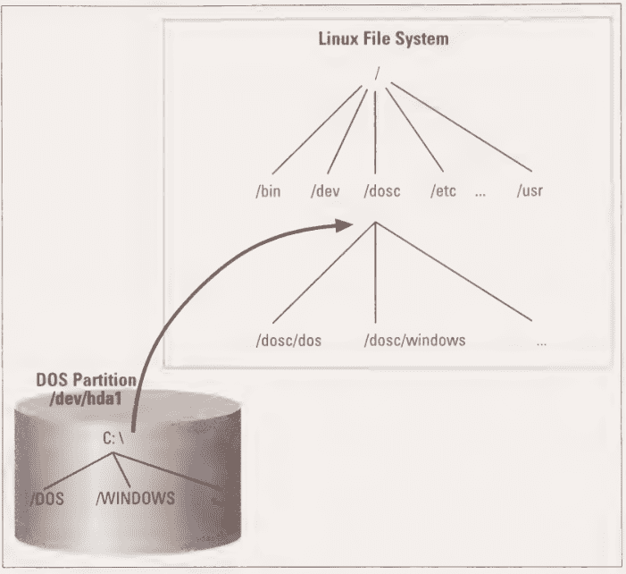

图 7-1 还展示了 DOS 分区中的目录如何映射到 Linux 文件系统。DOS 下的 C:\DOS 目录在 Linux 下变成了 /dosc/dos。类似地，C:\WINDOWS 现在对应 /dosc/windows。你或许已经看出了规律。要将 DOS 文件名转换为 Linux 格式（在本例中，当你将 DOS 分区挂载到 /dosc 时），请执行以下步骤：

-   将 DOS 文件名改为小写。
-   将 C:\ 改为 /dosc/。
-   将所有反斜杠（\）改为斜杠（/）。

请注意，通过输入命令 `mount -a`，你可以挂载 /etc/fstab 文件中提到的所有文件系统（除了那些包含 `noauto` 关键字的行）。请参阅下文关于 /etc/fstab 的部分。

### DOS 软盘

就像你可以在 Linux 下挂载 DOS 硬盘分区一样，你也可以挂载 DOS 软盘。通常，你必须以 root 身份登录才能挂载软盘，但你可以按照本节后面部分的步骤设置你的系统，以便任何用户都可以挂载 DOS 软盘。你还需要知道软驱的设备名称。默认情况下，Linux 定义了两个通用软盘设备名：

-   `/dev/fd0`，即 A 驱动器（第一个软驱）
-   `/dev/fd1`，即 B 驱动器（第二个软驱，如果你有的话）

至于挂载点，一个名为 `/mnt/floppy` 的现有目录专门用于此类临时挂载操作。因此，你可以使用以下命令将 DOS 软盘挂载到 `/mnt/floppy` 目录：

```
mount -t vfat /dev/fd0 /mnt/floppy
```

软盘挂载后，你可以使用 Linux 的复制命令 (`cp`) 来复制文件到软盘或从软盘复制文件。要将当前目录中的文件 `gnome1.pcx` 复制到软盘，请输入以下命令：

```
cp gnome1.pcx /mnt/floppy
```

类似地，要查看软盘的内容，请输入以下命令：

```
ls /mnt/floppy
```

当你想从驱动器中取出软盘时，首先卸载软驱。此操作会删除软盘文件系统与 Linux 文件系统上挂载点之间的关联。使用 `umount` 命令卸载设备，如下所示：

```
umount /dev/fd0
```

你可以设置你的 Linux 系统，使任何用户都可以挂载 DOS 软盘。你只需以 root 身份登录，并在 `/etc/fstab` 文件中添加一行。例如，要使用户能够在 `/a` 目录上挂载 A 驱动器中的 DOS 软盘，请执行以下步骤：

1.  以 root 身份登录。
2.  使用以下命令创建 `/a` 目录：
    ```
    mkdir /a
    ```
3.  在文本编辑器（如 vi 或 Emacs）中编辑 `/etc/fstab` 文件，插入以下行，然后保存文件并退出编辑器：
    ```
    /dev/fd0  /a  vfat  noauto,user  0 0
    ```

    你将在下一节了解更多关于 `/etc/fstab` 文件的信息；`user` 选项（出现在 `noauto` 旁边）允许所有用户挂载 DOS 软盘。该行中的第一个字段是设备名 (`/dev/fd0`)，第二个是挂载目录 (`/a`)，第三个字段显示文件系统类型 (`vfat`)。

4.  注销并以普通（非 root）用户身份登录。
5.  要测试你无需 root 权限即可挂载 DOS 软盘，请在 A 驱动器中插入一张 DOS 软盘并输入以下命令：
    ```
    mount /a
    ```
    请注意，你将挂载目录用作 `mount` 命令的参数。挂载操作应该成功，并且当你输入命令 `ls /a` 时，你应该会看到 DOS 软盘的内容列表。
6.  要卸载 DOS 软盘，请输入 `umount /a`。

### /etc/fstab 文件

在 Linux 中，`/etc` 目录包含许多包含系统配置信息的文本文件。正如你在第 5 章所学到的，例如，`/etc/inittab` 文件包含关于 Linux 启动后应启动哪些进程的信息。`/etc/fstab` 文件就是这样一个配置文件——一个包含 `mount` 和 `umount` 命令所使用信息的文本文件。`/etc/fstab` 文件中的每一行都提供了关于要挂载到 Linux 文件系统目录中的设备的信息。

以下是来自典型 Linux 系统的 `/etc/fstab` 文件：

```
/dev/hda3   /           ext2     defaults   1 1
/dev/hda1   /dosc       vfat     defaults   0 0
/dev/hda5   /dosd       vfat     defaults   0 0
/dev/hda4   swap        swap     defaults   0 0
/dev/fd0    /mnt/floppy ext2     noauto     0 0
/dev/cdrom  /mnt/cdrom  iso9660  noauto,ro  0 0
none        /proc       proc     defaults   0 0
none        /dev/pts    devpts   mode=0622  0 0
```

每一行的第一个字段显示设备名称，例如硬盘分区。第二个字段是挂载点，第三个字段指示设备上的文件系统类型。你现在可以忽略最后三个字段。

示例 `/etc/fstab` 文件显示 `/dev/hda4` 设备（第一个 IDE 硬盘上的第四个分区）充当虚拟内存的交换设备，这就是为什么挂载点和文件系统类型都设置为 `swap`。最后一行显示了另一个特殊文件系统：`proc` 文件系统，Linux 用它来存储系统信息。文件系统类型为 `vfat` 的行指定了 DOS 分区 `/dev/hda1` 应该挂载在 `/dosc` 上。

`/etc/fstab` 文件的内容用于在 Linux 中自动挂载各种文件系统。在 Linux 启动期间，`init` 进程执行一个 shell 脚本，该脚本调用带有 `-a` 选项的 `mount`。这个脚本导致 `mount` 读取 `/etc/fstab` 文件并挂载所有列出的文件系统（除了那些带有 `noauto` 选项的）。因此，要自动挂载 DOS 分区，请在 `/etc/fstab` 文件中添加一行，包含挂载该分区所需的信息。例如，如果你想将第一个小型计算机系统接口（SCSI）磁盘第一个分区中的 DOS 文件系统挂载到 `/dosd`，请将以下行添加到 `/etc/fstab`：

```
/dev/sda1   /dosd   vfat   defaults  0  0
```

`/etc/fstab` 文件每一行的第四个字段显示一个适用于特定设备的、以逗号分隔的选项列表。通常，你会在这个字段中找到 `defaults` 选项。`defaults` 选项意味着（除其他事项外）设备在启动时挂载，只有 root 用户可以挂载该设备，并且设备以读写模式挂载。如果选项包括 `noauto`，则设备在系统启动时不会自动挂载。另一个有用的选项是 `user`。任何用户都可以挂载 `/etc/fstab` 文件中带有 `user` 选项的设备。例如，如果你想允许任何用户挂载 CD-ROM，请以 root 身份登录，并在 `/etc/fstab` 的 `/dev/cdrom` 行中添加 `user` 选项，如下所示：

```
/dev/cdrom   /mnt/cdrom   iso9660 noauto,ro,user  0 0
```

有了这一行，任何用户都可以使用以下命令挂载 CD-ROM：

```
mount /mnt/cdrom
```

### 使用 mtools

前面的章节向你展示了一种访问 MS-DOS 文件系统的方法：使用 `mount` 命令挂载 DOS 硬盘或软盘；然后使用常规的 Linux 命令，如 `ls` 和 `cp`。这种挂载 DOS 文件系统的方法对硬盘来说没问题。Linux 可以在启动时自动挂载 DOS 分区，你可以随时访问硬盘上的 DOS 目录。

但是，如果你想快速列出 DOS 软盘的目录，挂载过程可能会很繁琐。首先，你必须挂载软驱。然后，你必须使用 `ls` 命令。最后，在从驱动器中取出软盘之前，你必须使用 `umount` 命令。

这就是 `mtools` 软件包的用武之地。`mtools` 软件包实现了大多数常见的 DOS 命令；这些命令与 DOS 中的名称相同，只是你在每个命令前加上了 `m` 前缀。因此，获取目录列表的命令是 `mdir`，而 `mcopy` 用于复制文件。`mtools` 最好的部分是你无需挂载软盘即可使用 `mtools` 命令。

因为 `mtools` 命令直接读写物理设备（软盘），所以你必须以 root 身份登录才能执行这些命令。如果你想让任何用户都能访问 `mtools` 命令，你必须修改

软盘驱动器设备的权限设置。请使用以下命令允许所有人从第一个软盘驱动器读取和写入：

```
chmod o+rw /dev/fd0
```

#### 我有 mtools 吗？

mtools 软件包随本书附带的 Red Hat Linux 发行版 CD-ROM 一起提供。安装 Linux 时，mtools 会作为基础 Linux 的一部分自动安装。mtools 的可执行文件位于 `/usr/bin` 目录中。要查看是否已安装 mtools，请在 shell 提示符下输入 `ls /usr/bin/mdir`。如果 `ls` 命令显示该文件存在，则系统上应该可以使用 mtools。

你也可以输入以下 `rpm` 命令来验证系统上是否安装了 mtools：

```
rpm -q mtools
mtools-3.9.1-5
```

如果 mtools 已安装，输出会显示 mtools 软件包的全名。示例输出显示系统上安装了 mtools 3.9.1 版本。

要尝试 mtools，请按照以下步骤操作：

- 1. 以 root 身份登录，或输入 **su** 然后输入 root 密码。
- 2. 将 MS-DOS 软盘放入系统的 A 驱动器中。
- 3. 输入 **mdir**。你应该会看到软盘的目录（使用标准的 DOS 目录列表格式）。

#### `/etc/mtools.conf` 文件

mtools 软件包应该可以使用默认设置工作；但如果出现任何错误，你应该检查 `/etc/mtools.conf` 文件。该文件包含 mtools 实用程序看到的驱动器（如 A、B 和 C）的定义。以下是典型 `/etc/mtools.conf` 文件中的几行内容：

```
drive a: file="/dev/fd0" exclusive 1.44m
drive b: file="/dev/fd1" exclusive 1.44m

# first SCSI hard disk partition
#drive c: file="/dev/sda1"

# First IDE hard disk partition
drive c: file="/dev/hda1"

# IDE Zip drive
drive X: file="/dev/hdd4" exclusive
```

井号 (#) 表示注释的开始。每一行定义一个驱动器盘符、关联的 Linux 设备名称以及一些指示设备访问方式的关键字。在此示例中，前两行定义了驱动器 A 和 B。第三行非注释行将驱动器 C 定义为第一个 IDE 驱动器上的第一个分区 (`/dev/hda1`)。如果你有其他 DOS 驱动器（例如 D），可以添加另一行将驱动器 D 定义为相应的磁盘分区。

如果你系统的 A 驱动器是高密度 3.5 英寸驱动器，则无需更改默认的 `/etc/mtools.conf` 文件中的任何内容。

通常，你使用 mtools 实用程序来访问软盘。虽然你可以为 DOS 硬盘分区定义 C 和 D 驱动器，但你可能希望通过 Linux `mount` 命令挂载这些分区来访问它们。因为硬盘分区可以在启动时自动挂载，所以通过 Linux 命令访问它们应该同样容易。

你也可以通过 mtools 访问 Iomega Zip 驱动器。只需指定一个驱动器盘符和相应的设备文件名。对于内置 IDE (ATAPI) Zip 驱动器，尝试使用 `/dev/hdd4` 作为设备文件。

#### mtools 命令

正如我在本章前面解释的，mtools 软件包是一个实用程序集合。到目前为止，你已经看到了 `mdir` 命令——它在 mtools 中相当于 DOS 中的 `DIR` 命令。

如果你了解 MS-DOS 命令，你会发现使用 mtools 命令非常容易。用小写字母输入 DOS 命令，并记住在每个命令前加上 `m`。因为 Linux 命令和文件名区分大小写，所以输入 mtools 命令时必须使用全小写字母。

表 7-1 总结了 mtools 3.9.1 版本中可用的 24 个命令。

#### 表 7-1 mtools 命令

| mtools 实用程序 | MS-DOS 命令（如果有） | 功能 |
|---|---|---|
| mattrib | ATTRIB | 更改 MS-DOS 文件属性标志 |
| mbadblocks | | 测试软盘，并在文件分配表 (FAT) 中标记坏块 |
| mcd | CD | 更改 MS-DOS 目录 |
| mcopy | COPY | 在 MS-DOS 和 Linux 之间复制文件 |
| mdel | DEL 或 ERASE | 删除 MS-DOS 文件 |
| mdeltree | DELTREE | 递归删除 MS-DOS 目录 |
| mdir | DIR | 显示 MS-DOS 目录列表 |
| mdu | | 列出目录及其内容占用的空间 |
| mformat | FORMAT | 在低级格式化的软盘上放置 MS-DOS 文件系统（使用 `fdformat` 在 Linux 中低级格式化软盘） |
| minfo | | 获取有关 MS-DOS 文件系统的信息 |
| mkmanifest | | 创建短名称等效列表 |
| mlabel | LABEL | 初始化 MS-DOS 卷标 |
| mmd | MD 或 MKDIR | 创建 MS-DOS 目录 |
| mmove | | 移动或重命名 MS-DOS 文件或子目录 |
| mmount | | 挂载 MS-DOS 磁盘 |
| mpartition | | 创建一个 MS-DOS 文件系统作为分区 |
| mrd | RD 或 RMDIR | 删除 MS-DOS 目录 |
| mren | REN 或 RENAME | 重命名现有的 MS-DOS 文件 |
| mshowfat | | 显示 MS-DOS 文件的 FAT 条目 |
| mtoolstest | | 测试并显示当前 `mtools` 配置 |
| mtype | TYPE | 显示 MS-DOS 文件的内容 |
| mwrite | COPY | 将 Linux 文件复制到 MS-DOS |
| mzip | | 对 SCSI Zip 磁盘执行某些操作 |
| xcopy | XCOPY | 递归复制 DOS 目录到另一个目录 |

你可以像使用相应的 DOS 命令一样使用 `mtools` 命令。例如，`mdir` 命令的工作方式类似于 DOS 中的 `DIR` 命令。表 7-1 中显示的所有其他 `mtools` 命令也是如此。关于通配符（如 `*`），你必须记住 Linux shell 是第一个处理你命令的程序。因此，如果你不希望 shell 展开通配符，应该用引号括起包含任何通配符的文件名。例如，要将 A 驱动器上的所有 `*.txt` 文件复制到你的 Linux 目录，请使用以下命令：

```
mcopy "a:*.txt" .
```

如果你省略引号，shell 会尝试用当前 Linux 目录中的文件名展开字符串 `a:*.txt`。它还会尝试从 DOS 软盘复制这些文件（如果存在）。

另一方面，当你想从 Linux 目录复制文件到 DOS 软盘时，你*希望* shell 展开通配符。例如，要将当前 Linux 目录中的所有 `*.pcx` 文件复制到 DOS 软盘，请这样调用 `mcopy`：

```
mcopy *.pcx a:
```

`mtools` 实用程序允许你使用反斜杠字符 (`\`) 作为目录分隔符，就像在 DOS 下一样。每当文件名包含反斜杠字符时，必须用双引号括起字符串。以下命令将 A 驱动器子目录中的文件复制到当前 Linux 目录：

```
mcopy "a:\test\sample.dat" .
```

### 如何格式化 DOS 软盘

假设你在家用 PC 上运行 Linux，系统上不再安装 MS-DOS，但你需要在 MS-DOS 软盘上复制一些文件并带到办公室。如果你已经有一张格式化好的 MS-DOS 软盘，可以简单地挂载该软盘，并使用 Linux `cp` 命令将文件复制到软盘。如果你没有格式化好的 DOS 软盘怎么办？`mtools` 软件包再次派上用场。

`mtools` 软件包提供了 `mformat` 实用程序，可用于格式化软盘以在 MS-DOS 下使用。与 DOS `format` 命令一步格式化软盘不同，`mformat` 命令要求你遵循两步过程：

- 1. 使用 `fdformat` Linux 命令低级格式化软盘。`fdformat` 命令期望软盘设备名称作为参数；该设备名称包含格式化软盘所需的所有参数。

图 7-2 说明了软盘驱动器设备的设备命名约定。根据图 7-2 中显示的信息，你可以使用以下命令格式化系统中 A 驱动器中的 3.5 英寸高密度软盘：

```
fdformat /dev/fd0H1440
Double-sided, 80 tracks, 18 sec/track. Total capacity 1440 kB.
Formatting ... done
Verifying ... done
```

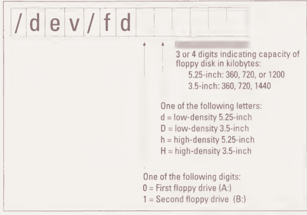

#### 图 7-2：Linux 中软盘驱动器的命名约定

- 2. 使用 **mformat** 命令在低级格式化的软盘上放置 MS-DOS 文件系统。如果软盘在 A 驱动器中，请输入以下命令：

```
mformat a:
```

### 总结

如果你的 PC 除了 Linux 分区外还有一个 DOS 分区，或者你使用 DOS 软盘，你可以从 Linux 直接访问 DOS 文件。你也可以使用 mtools 实用程序直接从 Linux 格式化和使用 DOS 软盘。本章涵盖以下内容：

Linux 内置支持 MS-DOS 文件系统。你可以使用 `mount` 命令从 Linux 访问 DOS 分区或 DOS 软盘。在 Linux 系统上的目录挂载 DOS 文件系统后，你可以使用 `ls` 和 `cp` 等 Linux 命令来操作 DOS 文件。


当你按照第1章的说明安装Linux时，你也安装了一组名为`mtools`的实用程序。`mtools`程序提供了一种方便的访问MS-DOS文件的方式，尤其是软盘，因为你可以使用`mtools`命令而无需先挂载软盘。`mtools`实用程序包含诸如`mdir`和`mcopy`等命令，它们的工作方式类似于DOS命令`DIR`和`COPY`。

# 第8章

## 使用Tcl/Tk进行Linux脚本编程

### 本章内容

- 了解Tcl/Tk
- 理解Tcl语法
- 编写Tcl脚本
- 使用Tk为Tcl脚本构建图形界面
- 通过示例学习使用Tcl/Tk

如果你已经是C和X窗口系统的程序员，你会惊讶于使用*Tcl*（工具命令语言）及其关联的X工具包*Tk*——合称为Tcl/Tk（发音为“tickle/tee kay”）——来创建图形应用程序是如此轻松。Tcl是一种类似于Perl的脚本语言。Tcl最大的优势在于其X工具包Tk，它使你能够开发具有图形用户界面的脚本。

当我开始使用Tcl/Tk时，我惊喜地发现只需很少的Tcl/Tk代码行就能创建一个功能完备的图形界面。对于新手来说，Tcl/Tk脚本看起来仍然相当复杂，但如果你曾使用过基于C的工具包如Xt和Motif来编写程序，你就能体会到Tk的高级特性。在Tk中创建用户界面组件（如按钮）比在Motif中简单得多。你仍然需要注意许多细节，例如如何布局用户界面组件，但你可以比使用调用Motif库的C程序更快地看到结果。

如果你从未编程过，不要因为害怕而避开本章。本章中的示例将教你Tcl和Tk的基础知识。在你看到使用Tcl/Tk解释器创建图形界面应用程序的速度有多快后，你一定会成为Tcl/Tk的拥护者。

### Tcl简介

Tcl的创造者John Ousterhout旨在将Tcl设计为一种简单的脚本语言，其解释器可以与任何C程序链接，以便C程序可以使用Tcl脚本。术语*可嵌入*指的就是Tcl的这个特性：任何C程序都能够使用Tcl解释器并运行Tcl脚本。

#### Tcl/Tk的起源？

John Ousterhout在加州大学伯克利分校工作时创建了Tcl和Tk。Tcl首次出现于1989年；Tk紧随其后于1991年推出。Tcl/Tk可免费获取并自由使用，包括商业用途。在撰写本文时，Tcl版本是8.0；Tk也是8.0。本书附带的CD-ROM包含Tcl/Tk。

以下各节概述了Tcl、其语法以及一些重要命令。因为Tk工具包建立在Tcl基础上，所以在深入学习Tk之前，你应该先熟悉Tcl，尽管Tk无疑更有趣，因为你可以用它来创建图形界面。

#### 你的第一个Tcl脚本

在第6章中，你看到了如何编写shell脚本和Perl脚本。编写Tcl脚本的方式相同。与Perl不同，Tcl包含一个shell——一个交互式的Tcl命令解释器。Tcl shell程序的名称是`tclsh`；它应该位于`/usr/bin`目录中。

当你登录时，PATH环境变量应包含`/usr/bin`目录。因此，你可以通过输入**tclsh**来启动Tcl shell。下一行会出现一个百分号(`%`)；这是Tcl shell程序的提示符。要查看你使用的Tcl版本，请在Tcl shell提示符处输入**info tclversion**。Tcl shell程序会通过打印Tcl版本来响应：

```
tclsh
% info tclversion
8.0
%
```

现在你可以交互式地尝试以下Tcl程序，它会在标准输出（显示屏幕）上打印`Hello, World!`：

```
% puts "Hello, World!"
Hello, World!
%
```

输入**exit**退出Tcl shell (`tclsh`)。

请注意，在前面的章节中我没有显示shell提示符，但在本章的代码清单中我显示了Tcl提示符(`%`)。那是因为Tcl提示符看起来与Bash提示符不同，这应该能告诉你，你不在Bash中工作。


Tcl shell会立即处理你输入的Tcl命令并显示结果；然后它会提示你输入下一条命令。此时，你可以输入**exit**退出Tcl shell。

要准备并运行一个Tcl脚本，请按照以下步骤操作：

1.  使用文本编辑器输入以下内容，并将其保存到名为`hellotcl`的文件中（此文件将作为Tcl脚本）：

```
#!/usr/bin/tclsh
# A simple Tcl script
puts "Hello, World!"
```

2.  在shell提示符处输入以下命令，使`hellotcl`文件可执行（`chmod`命令中的`+x`就是这个意思）：

```
chmod +x hellotcl
```

3.  要运行`hellotcl`脚本，请在shell提示符处输入以下命令：

```
hellotcl
Hello, World!
```

你使用这些基本步骤来创建和运行任何Tcl脚本。当然，你仍然需要学习Tcl语法的细微之处——以及许多规则。本节通过概述Tcl来让你入门。

#### 关于Tcl/Tk的更多信息

本章概述了Tcl和Tk，强调了许多要点，并展示了简单的示例。但本章篇幅有限，无法列出充分利用Tcl和Tk强大功能所需的所有信息。由于Tcl/Tk的流行，你可以找到相当多的相关资源，从书籍到互联网站点。以下是Tcl/Tk资源的简短列表：

**书籍：** 有两本关于Tcl/Tk的著名书籍。第一本是*Tcl and the Tk Toolkit*（Addison Wesley, 1994），作者是Tcl和Tk的创始人John K. Ousterhout。John的书对Tcl和Tk进行了广泛的概述，包括对Tcl命令字符串解析方式的解释。另一本是*Practical Programming in Tcl and Tk, Second Edition*（Prentice Hall, 1997），作者是Brent B. Welch。这本书提供了更多的Tcl和Tk示例。Tcl/Tk书籍清单中另一本较新的书是*Tcl/Tk for Dummies*（IDG Books, 1997），作者是Tim Webster和Alex Francis。

**互联网资源：** 一些FTP和Web站点包含最新的Tcl/Tk发行版以及关于Tcl/Tk开发的信息。以下列表使用统一资源定位器（URL）语法。你可以使用Web浏览器（如Netscape、Mosaic或Lynx）并输入所示的URL。然后浏览器会显示有关站点内容的适当信息。

`ftp://ftp.scriptics.com/pub/tcl/`
*（Tcl/Tk 主发行站点）*

`http://www.scriptics.com/`
*（John Ousterhout 的新公司）*

`http://www.tclconsortium.org/`
*（Tcl/Tk 联盟）*

`http://www.neosoft.com/tcl/`
*（Tcl/Tk 贡献源代码档案库）*

### Tcl概览

正如其名（工具命令语言），Tcl由一组你可以根据一套规则组合的命令组成。要编写Tcl脚本，你必须理解两个广泛的主题：

- **Tcl语法**。Tcl语法是*Tcl命令解释器*在解释*命令字符串*（包含命令及其参数的行）时所遵循的*规则集*。

- **Tcl命令**。虽然所有命令的语法相同，但每个单独的Tcl命令旨在执行特定任务。要充分利用Tcl，你必须知道有哪些命令可用以及每个命令的作用。Tcl命令集可以通过应用程序扩展。事实上，Tk本身就是Tcl的一个扩展；Tk添加了操作图形用户界面组件的命令。

首先学习Tcl语法，这是一小部分决定每个Tcl命令解析方式的规则。因为Tcl有很多命令，学习所有命令可能需要一段时间。即使你熟练掌握了Tcl语法和一小部分命令，你可能也需要手边放一本参考手册，以便查阅每个命令所需参数的确切格式。

Tcl命令包括任何编程语言都期望具备的以下基本编程设施：

- 存储数据的**变量**。每个变量都有一个名称和一个值。Tcl还允许你定义变量数组。

- 将变量值与*运算符*结合的**表达式**。例如，一个表达式可能将两个变量相加。Tcl使用`expr`命令来求值表达式。

- **控制流命令**，允许根据某个表达式的值以不同顺序执行命令。Tcl提供诸如`for`、`foreach`、`break`、`continue`、`if`、`while`和`return`等命令来在Tcl脚本中实现流程控制。

- 让你将多个命令分组并赋予它们一个名称的**过程**。过程也接受参数。Tcl提供`proc`命令，使你能够定义过程。你可以使用过程通过调用代表这些命令的过程来执行相同的命令集（通常使用不同的参数）。

接下来的几节概述了Tcl语法和核心Tcl命令。

#### 基本Tcl语法

要理解基本Tcl语法，你必须了解Tcl解释器如何处理每个命令字符串。步骤如下：

1.  Tcl解释器将命令字符串*解析*（分解）成单词。


+   2. Tcl 解释器应用规则来替换变量的值，并将某些命令替换为它们的结果。

- 3. Tcl 解释器执行命令，将第一个单词作为命令名，并调用一个命令过程来执行该命令。该命令过程接收其余单词作为字符串。

在编写 Tcl 命令字符串时，必须使用空白字符（空格或制表符）将命令名与其参数分隔开。换行符或分号（;）标记命令字符串的结束。你可以将两个命令放在同一行，前提是在第一个命令后插入分号。因此，你可以使用以下方式：

`puts Hello, ; puts World!`
Hello.
World!...

生成的输出出现在单独的行上，因为 `puts` 命令默认添加换行符。

在行尾使用反斜杠以将该命令字符串延续到下一行（这是 UNIX 中的标准约定）。因此，你可以编写一个命令字符串来打印 Hello, World!，如下所示：

`puts "Hello, \ World!"`

##### 替换

##### 变量替换。
Tcl 解释器将命令字符串的某些部分替换为等效值。例如，如果你在变量名前加上美元符号（$），解释器会将该单词替换为变量的值。正如你在"变量"部分学到的，你可以使用 `set` 命令在 Tcl 脚本中定义变量，如下所示：

```
set count 100
```

此命令定义了一个名为 count 的变量，其值为 100。

现在假设你输入以下内容：

`puts $count`

解释器首先将 `$count` 替换为其值，即 100。因此，该命令字符串变为

`puts 100`

当解释器执行 `puts` 命令时，它打印 100。这是变量替换的一个示例。

##### 反斜杠替换。
你可以使用反斜杠替换在单词中嵌入特殊字符，如换行符和制表符。只需键入反斜杠，后跟一个或多个字符；解释器会将该序列替换为不可打印字符。这些序列遵循 ANSI 标准 C 的转义序列模式。表 8-1（在本列表之后）总结了 Tcl 解释器理解的反斜杠序列。

##### 命令替换。
这种替换指的是一种机制，使你能够指定在解释器处理命令字符串之前先计算某个命令并用其结果替换它。例如，命令 `string length "Hello, World!"` 返回 13，即字符串的长度。要将名为 `len` 的变量设置为该字符串的长度，请键入以下内容：

`set len [string length "Hello, World!"]`

解释器处理方括号内的命令，并将该部分命令字符串替换为命令的值。因此，此命令变为

`set len 13`

而 `set` 命令将 `len` 变量设置为 13。

##### 表 8-1 Tcl 中的反斜杠序列

| 序列 | 替换字符 * |
|----------|------------------------|
| \\a      | 响铃字符（0x7） |
| \\b      | 退格（0x8）          |
| \\f      | 换页（0xc）         |
| \\n      | 换行（0xa）           |
| \\r      | 回车（0xd）   |
| \\t      | 水平制表符（0x9）    |
| \\v      | 垂直制表符（0xb）      |
| \<newline>  | 将下一行的换行符和空白替换为单个空格 |
| \\\\<newline> | 解释为单个反斜杠（\\） |
| \\"     | 解释为双引号（"） |
| \\ooo   | 使用八进制数字指定的值（最多三位） |
| \\xhh   | 使用十六进制数字指定的值（最多两位） |

* 十六进制值显示在括号中（例如，0xd 表示十六进制 d）

##### 注释

井号（#）标记注释的开始；Tcl 解释器忽略从井号开始的该行的其余部分。然而，Tcl 对注释有一个特殊要求：你不能在命令内部开始注释。命令字符串必须在开始注释之前结束。

要理解这个问题，请在 tclsh 提示符下尝试以下 Tcl 命令：

```
% puts "Hello, World!" # This is a comment
wrong # args: should be "puts" ?-nonewline? ?field? string
```

本质上，`puts` 命令处理该行的剩余部分，并抱怨参数数量不对。解决方案是在井号（#）之前放一个分号，如下所示：

```
% puts "Hello, World!" ;# This is a comment
Hello, World!
```

如果你在 Tcl 命令末尾添加注释，请记住在井号（#）之前加上分号（;）。分号终止前面的命令，并使你能够开始注释。

##### 花括号和双引号

你可以使用花括号（{ ... }）和双引号（" ... "）来分组多个单词。使用双引号来传递包含嵌入空格或分号的参数，否则分号会结束命令。引号不是单词组的一部分；它们只是用来标记单词组的开始和结束。以下是使用双引号分组单词的一些示例：

```
% puts "Hello, World!"
Hello, World!
% puts "Enter 1; otherwise file won't be saved!"
Enter 1: otherwise file won't be saved!
```

当你用双引号分组单词时，所有类型的替换仍然会发生，如下例所示：

```
% puts "There are [string length hello] characters in 'hello'"
There are 5 characters in 'hello'
```

Tcl 解释器将括号内的所有内容替换为 `string length` 命令的结果，其返回值是 `hello` 中的字符数（5）。在表达式 `[string length hello]` 中，你可以将字符串 `hello` 替换为任何变量，以确定该变量值的长度。

你也可以使用花括号来分组单词。当你用花括号分组单词时，Tcl 解释器不会执行任何替换（如果你用双引号括住单词，解释器会执行替换）。考虑前面的示例，用花括号代替双引号：

```
% puts {There are [string length hello] characters in 'hello'}
There are [string length hello] characters in 'hello'
```

如结果所示，Tcl 解释器只是将所有内容原封不动地作为单个参数传递。

当你需要将表达式传递给控制流命令（如 `while` 循环、`for` 循环或过程）时，使用花括号作为分组机制。

#### 变量

在 Tcl 中，一切都是字符串。变量名和值都存储为字符串。要定义变量，请使用内置的 Tcl 命令 `set`。例如，以下命令将变量 `book` 定义为 "Red Hat Linux Secrets, Third Edition"；变量 `year` 定义为 1999；变量 `price` 定义为 $39.99：

```
set book "Red Hat Linux Secrets, Third Edition"
set year 1999
set price \$39.99
```

要引用变量的值，请在变量名后附加美元符号（$）。因此，要打印变量 `book`，请使用以下格式：

```
% puts $book
Red Hat Linux Secrets, Third Edition
```

如果你使用带有单个参数的 `set`，`set` 返回该参数的值。因此，`set book` 等同于 `$book`，如下例所示：

```
% puts [set book]
Red Hat Linux Secrets, Third Edition
```

#### 表达式

你可以通过将变量与数学运算符组合来编写表达式，例如 `+`（加）、`-`（减）、`*`（乘）和 `/`（除）。以下是一些表达式的示例：

```
set count 1
$count+1
$count * 5    ?
2 + 3.5
```

你可以在表达式中使用数字以及变量名。使用空白字符来提高可读性。并使用括号来指定你希望表达式的计算方式。

除了基本数学运算符之外，Tcl 还包括几个内置数学函数，如 `sin`、`cos`、`tan`、`log` 和 `sqrt`。像你在 C 语言中一样调用这些函数，参数放在括号中，如下所示：


你也可以使用布尔运算符，例如 !（非）、&&（与）和 ||（或）。比较运算符——例如 <（小于）、>（大于）、<=（小于或等于）、==（等于）和 !=（不等于）——也是可用的。使用布尔或比较运算符的表达式，如果为真则求值为 1，如果为假则求值为 0。你可以编写如下表达式：

```
count == 10
angle < 3.1415
```

表达式本身不是命令。你只能将表达式用作接受表达式作为参数的命令的参数。例如，`if` 和 `while` 命令就期望表达式作为参数。

Tcl 还提供了 `expr` 命令来求值表达式。以下示例展示了如何在 Tcl 命令中求值表达式：

```
% set angle 1.5
1.5
% puts "Result = [expr 2*sin($angle)]"
Result = 1.99498997321
```

尽管 Tcl 将所有内容存储为字符串，但在需要数字的地方你必须使用数字。例如，如果 `book` 被定义为 "Red Hat Linux Secrets, 3rd Edition"，你就不能编写表达式 `$book+1`，因为这没有意义。

#### 流程控制命令

Tcl 的流程控制命令使你能够指定 Tcl 解释器执行命令的顺序。你可以使用 `if` 命令来测试表达式的值，如果值为真（非零），你可以让解释器执行一组命令。Tcl 包含与 C 语言类似的流程控制命令，例如 `if`、`for`、`while` 和 `switch`。本节概述了流程控制命令。

Tcl 的流程控制命令通常有一个命令块（一组命令），该命令块在流程控制命令对表达式求值后执行。为避免替换（例如，用变量的值替换变量），你必须将整个命令块用花括号括起来。以下 `if-else` 流程控制命令展示了能正常工作的花括号风格：

```
if { expression } {
# 表达式为真时执行的命令
  command_1
  command_2
} else {
# 表达式为假时执行的命令
# ...
}
```

你应该在 Tcl 脚本中严格遵循这种花括号风格。特别要记住，在流程控制命令（例如 `if`）和紧随其后的左花括号 (`{`) 之间要包含一个空格。

##### if 命令

Tcl 的 `if` 命令最简单的形式是求值一个表达式，如果该表达式非零（为真），则执行一组命令。你可以如下比较变量的值与阈值：

```
if { $errorCount > 25 } {
    puts "Too many errors!"
}
```

你可以添加一个 `else` 子句，以便在表达式求值为零（假）时处理命令。下面是一个例子：

```
if { $user == "root" } {
    puts "Starting system setup ..."
} else {
    puts "Sorry, you must be \"root\" to run this program!"
}
```

Tcl 的 `if` 命令后面可以跟零个或多个 `elseif` 命令，如果你需要执行更复杂的测试，如下所示：

```
puts -nonewline "Enter version number: "  ;# 提示用户
set version [gets stdin]                   ;# 读取版本号

if { $version >= 10 } {
    puts "No upgrade necessary"
} elseif { $version >= 6 && $version < 9 } {
    puts "Standard upgrade"
} elseif { $version >= 3 && $version < 6 } {
    puts "Reinstall"
} else {
    puts "Sorry, cannot upgrade"
}
```

##### while 命令

`while` 命令执行一个命令块，直到表达式变为假。以下 `while` 循环持续从标准输入读取行，直到用户按下 Ctrl+D：

```
while { [gets stdin line] != -1 } {
    puts $line
    # 对 $line 执行你需要做的任何操作
}
```

尽管这个 `while` 命令看起来很简单，但你应该意识到它有两个参数，分别包含在两组花括号内。第一个参数是表达式；第二个参数包含如果表达式为真时要执行的 Tcl 命令。你必须始终使用花括号将这两个参数都括起来。花括号防止 Tcl 解释器求值其中的内容；是 `while` 命令处理花括号内的内容。

如果你在 `while` 循环内使用一个变量来计数，你可以使用 `incr` 命令来递增该变量。你可以使用 `continue` 命令跳过循环的剩余部分；`break` 命令则退出循环。以下 Tcl 脚本使用 `while` 循环来累加从 1 到 10 的所有数字，但不包括 5：

```
#!/usr/bin/tclsh

set i 0
set sum 0

while { 1 } {
    incr i                       ;# 递增 i
    if {$i == 5} { continue }    ;# 如果 i 是 5 则跳过
    if {$i > 10} {break}         ;# 如果 i 超过 10 则结束循环
    set sum [expr $sum+$i]       ;# 否则，将 i 加到 sum 中
}
puts "Sum = $sum";
```

运行此脚本时，它应显示以下结果：

> Sum = 50

##### for 命令

Tcl 的 `for` 命令接受四个参数，你应该按以下方式输入：

```
for {expr_1} { expr_2} { expr_3} {
    commands
}
```

`for` 命令在循环开始时对 `expr_1` 求值一次，并执行最后一对花括号内的命令，直到表达式 `expr_2` 求值为零。`for` 命令在每次执行命令后对第三个表达式——`expr_3`——求值。你可以省略任何表达式，但必须使用所有的花括号。以下示例使用 `for` 循环来累加从 1 到 10 的数字：

```
#!/usr/bin/tclsh
for {set i 0; set sum 0} {$i <= 10} {set sum [expr $sum+$i]; incr i} {
}
puts "Sum = $sum";
```

运行此脚本时，它显示以下结果：

> Sum = 55

##### foreach 命令

你可能在 C 语言中没见过像 `foreach` 这样的命令，但当你想对变量列表中的每个值执行某些操作时，`foreach` 就很方便了。你可以使用 `foreach` 命令来累加一组数字，如下所示：

```
set sum 0
foreach i { 1 2 3 4 5 6 7 8 9 10} {
    set sum [expr $sum+$i]
}
puts "Sum = $sum"
```

如果你有一个列表存储在变量中，你可以使用该变量的值来代替第一对花括号中显示的列表。以下是一个 `foreach` 循环，用于回显列表中的字符串：

```
set users "root naba"
foreach user $users {
    puts "$user"
}
```

##### switch 命令

Tcl 的 `switch` 命令与 C 语言的 `switch` 语句不同。Tcl 的 `switch` 命令不是求值数学表达式，而是将字符串与一组模式进行比较，并根据哪个模式匹配来执行一组命令。通常，模式是用正则表达式表示的。

> 参见第 6 章关于正则表达式的介绍。

以下脚本说明了 `switch` 命令的语法和典型用法：

```
#!/usr/bin/tclsh
# 此脚本从用户读取命令，并使用 switch 语句处理命令

set prompt "Enter command (\"quit\" to exit): "

puts -nonewline "$prompt"; flush stdout

while { [gets stdin cmd]  != -1 } {
    switch -exact -- $cmd {
        quit   { puts "Bye!"; exit}
        start  { puts "Started"}
        stop   { puts "Stopped"}
        draw   { puts "Draw..."}
        default { puts "Unknown command: $cmd" }
    }
# 再次提示用户
    puts -nonewline $prompt; flush stdout
}
```

以下是此脚本的示例会话（用户输入以粗体显示）：

```
Enter command ("quit" to exit): help
Unknown command: help
Enter command ("quit" to exit): start
Started
Enter command ("quit" to exit): stop
Stopped
Enter command ("quit" to exit): quit
Bye!
```

如这个例子所示，`switch` 语句使你能够将字符串与其他字符串集进行比较，然后根据哪个模式匹配来激活一组命令。在这个例子中，字符串是 `$cmd`（它通过使用 `gets` 命令读取用户输入来初始化），模式是字面字符串：`quit`、`start`、`stop` 和 `draw`。以下是精确匹配的情况，如 `switch` 命令第一行的 `-exact` 标志所示：

```
switch -exact -- $cmd {
    ...
}
```

`-exact` 标志后面的两个连字符 (`--`) 标志着标志的结束。使用 `switch` 命令时，你应该始终在标志末尾使用双连字符，以防止测试字符串意外匹配到一个标志。

你可以使用带有 `-regexp` 标志的 `switch` 命令来将字符串与正则表达式进行比较，如下例所示：

```
# 假设 $cmd 是要匹配的字符串

switch -regexp -- $cmd {
    ^q.*    { puts "Bye!"; exit}
    ^x.*    { puts "Something x..."}
    ^y.*    { puts "Something y..."}
    ^z.*    { puts "Something z..."}
    default { puts "Unknown command: $cmd" }
}
```

在这个例子中，每个正则表达式都有类似的形式。模式 `^z.*` 表示任何以单个 `z` 开头，后跟任意数量其他字符的字符串。

#### Tcl 过程

你可以使用 `proc` 命令来添加自己的命令。这些命令被称为过程；Tcl 解释器对待它们就像对待内置的 Tcl 命令一样。以下示例展示了在 Tcl 中编写过程是多么容易：

# 第8章：使用 Tcl/Tk 进行 Linux 脚本编程

#!/usr/bin/tclsh

proc total items {
    set sum 0
    foreach i $items {
        set sum [expr $sum+$i]
    }
    return $sum
}

set counts "5 4 3 5"
puts "Total = [total $counts]"

运行此脚本时，它将输出以下内容：

```
Total = 17
```

在此示例中，过程的名称是 `total`，它接受一个数字列表作为参数。该过程在名为 `items` 的变量中接收参数。过程的主体提取每个项目并返回其总和。因此，要将数字1到10相加，你必须如下调用 `total` 过程：

```
set sum1_10 [total {1 2 3 4 5 6 7 8 9 10}]
```


在 Tcl 过程中，参数名 `args` 具有特殊意义；如果你使用 `args` 作为参数名，你可以向过程传递可变数量的参数。例如，如果你将 `total` 过程的参数名从 `items` 改为 `args`，你可以这样调用 `total`：

```
set sum1_10 [total 1 2 3 4 5 6 7 8 9 10]  ;# variable arguments
```

如果你想在 Tcl 过程中访问一个*全局变量*（在过程外部定义的变量），你必须在该过程内部使用 `global` 命令。`global` 命令使一个全局变量在过程的作用域内可见。如果一个名为 `theCanvas` 的变量保存着 Tk（Tcl 的 X 工具包）程序中的当前绘图区域，那么一个使用 `theCanvas` 的过程必须包含以下命令：

```
global theCanvas
```

### 内置 Tcl 命令

你在前面的示例中已经看到了许多 Tcl 命令。了解 Tcl 中可用的命令类型有助于你决定哪些命令最适合手头的任务。尽管本章没有足够的篇幅涵盖所有 Tcl 命令，但表 8-2 总结了 Tcl 的内置命令。

要获取表 8-2 中列出的任何 Tcl 命令的在线帮助，请输入 **man n**，后跟命令名。例如，要获取 Tcl `file` 命令的在线帮助，请输入 **man n file**。


### 表 8-2  内置 Tcl 命令

| 命令 | 作用 |
| :--- | :--- |
| append | 将参数附加到变量的值上。 |
| array | 对数组变量执行各种操作。 |
| break | 退出循环命令（如 while 和 for）。 |
| catch | 执行脚本并捕获错误，以防止错误传递到 Tcl 解释器。 |
| cd | 更改当前工作目录。 |
| close | 关闭一个已打开的文件。 |
| concat | 将两个或多个列表连接成一个列表。 |
| continue | 立即开始 for 或 while 循环的下一次迭代。 |
| eof | 检查已打开的文件是否到达文件末尾。 |
| error | 生成一个错误。 |
| eval | 连接列表（如 concat 所做的那样），然后将结果列表作为 Tcl 脚本进行求值。 |
| exec | 启动一个或多个进程来执行命令的参数。 |
| exit | 终止 Tcl 脚本。 |
| expr | 对表达式求值。 |
| file | 检查文件名和属性。 |
| flush | 将缓冲输出刷新到文件。 |
| for | 实现 for 循环。 |
| foreach | 对列表中的每个元素执行指定操作。 |
| format | 格式化输出并将其存储在字符串中（就像 C 中的 sprintf 函数一样）。 |
| gets | 从文件中读取一行。 |
| glob | 返回与模式（例如 *.tcl）匹配的文件名。 |
| global | 访问全局变量。 |
| history | 提供对历史记录列表（过去的 Tcl 命令列表）的访问。 |
| if | 测试表达式，如果表达式为真（非零）则执行命令。 |
| incr | 增加变量的值。 |
| info | 返回有关 Tcl 解释器的内部信息。 |
| join | 通过连接列表中的所有项目来创建字符串。 |
| lappend | 将元素附加到列表中。 |
| lindex | 返回列表中指定索引处的元素。（索引 0 指第一个元素。） |
| linsert | 在指定索引之前将元素插入列表。 |
| list | 创建一个由指定参数组成的列表。 |
| llength | 返回列表中的元素数量。 |
| lrange | 返回列表中指定范围的连续元素。 |
| lreplace | 用新元素替换列表中的元素。 |
| lsearch | 在列表中搜索特定元素。 |
| lsort | 按指定顺序对列表排序。 |
| open | 打开文件并返回文件标识符。 |
| pid | 返回进程标识符（ID）。 |
| proc | 定义一个 Tcl 过程。 |
| puts | 将字符发送到文件。 |
| pwd | 返回当前工作目录。 |
| read | 从文件中读取指定数量的字节。（你可以在一次读取中读取整个文件。） |
| regexp | 用正则表达式匹配字符串。 |
| regsub | 用另一个正则表达式模式替换一个模式。 |
| rename | 重命名或删除命令。 |
| return | 从 Tcl 过程中返回一个值。 |
| scan | 使用仿照 C 的 sscanf 函数的格式说明符解析字符串。 |
| seek | 更改已打开文件中的访问位置（下一个输入或输出操作发生的位置）。 |
| set | 设置变量的值或返回其当前值。 |
| source | 读取文件并将其作为 Tcl 脚本进行处理。 |
| split | 将字符串分解为 Tcl 列表。 |
| string | 对字符串执行各种操作。 |
| switch | 根据哪个模式匹配指定字符串，处理多个命令块之一。 |
| tell | 返回已打开文件的当前访问位置。 |
| time | 返回执行脚本所需的总时间。 |
| trace | 每当访问变量时执行指定的 Tcl 命令集。 |
| unknown | 处理任何未知命令。（每当 Tcl 解释器遇到任何未知命令时都会调用此命令。） |
| unset | 删除一个或多个变量的定义。 |
| uplevel | 在不同的上下文中执行脚本。 |
| upvar | 引用过程外部的变量。（用于实现按引用传递的过程调用风格，其中更改过程参数会更改参数的原始副本。） |
| while | 实现一个 while 循环，只要表达式求值为非零值（真），就重复执行一组 Tcl 命令。 |

### Tcl 中的字符串操作

如果你浏览表 8-2 中列出的 Tcl 命令，你会发现有不少命令——例如 append、join、split、string、regexp 和 regsub——是操作字符串的。本节总结了一些字符串操作命令。

当你将一个变量设置为一个字符串时，Tcl 解释器会将该字符串视为一个单一实体，即使该字符串包含任何嵌入的空格或特殊字符。有时，你需要将字符串作为一个项目列表来访问。`split` 命令是将字符串分离为其组成部分的便捷方法。例如，`/etc/passwd` 文件中的行看起来像这样：

```
root:x:0:0:root:/root:/bin/bash
```

该行由冒号 (:) 分隔的字段组成。假设你想从每一行中提取第一个字段（因为该字段包含登录名）。你可以逐行读取文件，将每一行分割成一个列表，然后提取每个列表的第一个元素（索引为 0 的项目）。以下是一个实现此功能的 Tcl 脚本：

```
#!/usr/bin/tclsh

set fid [open "/etc/passwd" r]  ;# Open file for read-only access

while { [gets $fid line] != -1 } {
    set fields [split $line ":"]  ;# split the string into a list
# Just print out the first field
    puts [lindex $fields 0]         ;# extract item at a index 0
}
```

运行此脚本时，它应该打印系统 `/etc/passwd` 文件中的所有登录名。

**join** 命令是 **split** 的反操作；你可以用它来从列表中的项目创建单个字符串。假设你有一个包含六个项目的列表，定义如下：

```
set x {1 2 3 4 5 6}
```

当你连接元素时，你可以选择在字段之间使用什么字符。要不使用任何字符连接元素，请使用以下格式：

```
set y [join $x ""]
```

现在 $y$ 字符串是 "123456"。

**string** 命令实际上是一组用于处理字符串的命令，因为 `string` 的第一个参数指定了要执行的操作。例如，`string compare` 命令比较两个字符串，当两个字符串相同时返回零。返回值 -1 表示第一个字符串参数在字典顺序上小于第二个字符串，这意味着它出现在字典中第二个字符串之前。类似地，返回值 1 表示第一个字符串在字典顺序上大于第二个字符串。因此，你可以在 `if` 命令中使用 `string compare`，如下所示：

```
if { [string compare $command "quit"] == 0 } {
    puts "Exiting..."
    exit 0
}
```

表 8-3 列出了你可以使用 Tcl 的 `string` 命令执行的操作。

### 表 8-3  可以在 Tcl 中用 String 执行的操作

| 字符串命令 | 描述 |
| :--- | :--- |
| `string compare` *string1* *string2* | 比较字符串后返回 −1、0、1。 |
| `string first` *string1* *string2* | 返回 *string1* 在 *string2* 中首次出现的索引。 |
| `string index` *string* *charIndex* | 返回索引 *charIndex* 处的字符。 |
| `string last` *string1* *string2* | 返回 *string1* 在 *string2* 中最后一次出现的索引。 |
| `string length` *string* | 返回字符串的长度。 |
| `string match` *pattern* *string* | 如果模式匹配字符串则返回 1，否则返回 0。 |


```
| 字符串命令 | 描述 |
| --- | --- |
| `string range string first last` | 返回字符串中指定范围的字符。 |
| `string tolower string` | 返回转换为小写字母的字符串。 |
| `string toupper string` | 返回转换为大写字母的字符串。 |
| `string trim string chars` | 返回去除开头或结尾指定字符后的字符串。 |
| `string trimleft string chars` | 返回去除开头指定字符后的字符串。 |
| `string trimright string chars` | 返回去除结尾指定字符后的字符串。 |

### 数组

在 Tcl 中，*数组*是一种带有字符串索引的变量。数组包含元素；每个元素的字符串索引被称为*元素名*。换句话说，你可以通过其名称来访问数组中的一个元素。在内部，Tcl 使用一种称为*哈希表*的高效数据结构来实现数组，这使得 Tcl 解释器能够在相对固定的时间内查找任何数组元素。

你使用 `set` 命令来声明一个数组变量。以下示例展示了如何定义 `disk_usage` 数组，该数组用于存储系统用户的磁盘使用量：

```
set disk_usage(root)     147178
set disk_usage(naba)     28574
set disk_usage(emily)    73
set disk_usage(ivy)      61
set disk_usage(ashley)   34
```

定义数组后，你可以通过元素名来访问其各个元素，如下例所示：

```
set user "naba"
puts "Disk space used by $user = $disk_usage($user)K"
```

### 环境变量

Tcl 在一个名为 `env` 的预定义全局数组中提供环境变量，其中环境变量名用作元素名。换句话说，你可以使用变量名作为索引来查找环境变量的值。以下命令打印当前的 PATH：

```
puts "$env(PATH)"
```

你可以像操作任何其他变量一样操作环境变量数组。例如，你可以通过以下方式向 PATH 添加一个新目录：

```
set env(PATH) "$env(PATH):/usr/sbin"
```

对环境变量所做的任何更改都不会影响父进程（例如，你启动 Tcl 脚本时所在的 shell）。但是，脚本通过 exec 命令创建的任何新进程都将继承更改后的环境变量。

### Tcl 中的文件操作

到目前为止，本章中的大多数示例都使用 Tcl 的 puts 命令来显示输出。默认情况下，puts 写入标准输出：即使用 X 时的终端窗口。但是，你可以通过提供一个文件标识符作为 puts 的第一个参数来写入文件。要获取文件标识符，你首先必须使用 Tcl 的 open 命令打开文件。以下示例展示了如何打开文件、向文件写入一行文本并关闭文件：

```
set fid [open "testfile" w]  ;# 打开 "testfile" 进行写操作
puts $fid "Testing 1...2...3"  ;# 写入此文件
close $fid                     ;# 关闭文件
```

当你使用 puts 在标准输出上显示字符串时，无需提供任何文件标识符参数。此外，puts 会自动在字符串末尾附加一个换行符。如果你不希望换行，请使用带 -nonewline 参数的 puts，如下所示：

```
puts -nonewline "Command> "  ;# -nonewline 适用于命令提示符
flush stdout                 ;# 确保输出立即显示
```

你也见过使用 gets 命令从标准输入读取一行输入。例如，以下 gets 的调用从标准输入读取一行（命令在你按 Enter 键时返回）：

```
set line [gets stdin]  ;# 从标准输入读取一行
```

关键字 stdin 是一个预定义的文件标识符，代表标准输入，默认情况下是你的键盘。其他预定义的文件标识符包括 stdout，用于标准输出；以及 stderr，用于标准错误报告设备。默认情况下，stdout 和 stderr 都连接到显示屏幕。

以下是另一种调用 gets 的方式，将一行输入读入名为 line 的变量：

```
gets stdin line      ;# 将一行输入读入 line 变量
```

要从另一个文件读取，你首先应该为读取打开该文件，然后使用该文件的 ID 调用 gets。例如，要从 /etc/passwd 读取所有行并显示在标准输出上，你会使用以下命令：

```
set fpass [open "/etc/passwd" r]   ;# 打开 /etc/passwd 进行读取
while { [gets $fpass line] != -1} {   ;# 在 while 循环中读取这些行
    puts $line                         ;# 并打印每一行
}
```

gets 命令非常适合读取文本文件，因为它一次处理一行；事实上，它查找换行符作为一行文本结束的标记。如果你想读取二进制数据，例如图像文件，你应该改用 read 命令。要以 2,048 字节为块读取和处理文件，你可能会以以下方式使用 read：

```
# 假设 fid 是一个已打开文件的文件标识符
while { ![eof $fid]} {             ;# 直到文件结束
    set buffer [read $fid 2048]    ;# 最多读取 2048 字节到缓冲区
    # 处理缓冲区中的数据   ;# 并处理缓冲区
```

read 命令的第二个参数是要读取的最大字节数。如果你省略此参数，read 命令将读取整个文件。你可以使用此特性来处理整个文本文件。读取文件内容后，使用 split 命令将输入数据分成文本行。以下是一个示例：

```
set fid [open "/etc/passwd" r]   ;# 打开文件进行读取
set buffer [read $fid 100000]    ;# 将整个文件读入缓冲区
split $buffer "\n"               ;# 将缓冲区拆分为行
foreach line $buffer {           
    puts $line                   ;# 对每一行执行所需操作
}
```

如果你想处理多个文件（例如所有名称以 .tcl 结尾的文件），请使用 glob 命令将文件名（如 *.tcl）扩展为一个列表。然后你可以使用 open 命令以以下方式打开并处理每个文件：

```
foreach filename [glob *.tcl] {    ;# 创建文件名列表
    puts -nonewline $filename      ;# 打印文件名
    set file [open $filename r]    ;# 打开该文件
    gets $file line                ;# 读取第一行
    puts $line                     ;# 并打印它（用于测试）
    # 根据需要处理文件的其余部分
    close $file                    ;# 记得关闭文件
}
```

这是如何在脚本中使用 glob 命令的一个很好的例子。

### 执行 Linux 命令

Tcl 没有复制大量的 Linux 命令，而是简单地提供了运行任何 Linux 命令的机制。如果你了解 Linux 命令，你可以直接在 Tcl 脚本中使用它们。

你使用 exec 命令在 Tcl 脚本中执行 Linux 命令。在命令的最简单形式中，你将 Linux 命令作为 exec 的一个参数提供。例如，要显示当前目录列表，请输入以下命令：

```
exec ls
```

输出出现在标准输出（显示器）上，就像你在 shell 提示符下输入 ls 命令一样。

当你从 shell 运行 Linux 命令时，你可以使用特殊字符重定向输入和输出，例如 <（重定向输入）、>（重定向输出）和 |（管道）。这些选项在 Tcl 中也可用，因为 exec 命令接受完整的命令行，包括任何输入或输出重定向。因此，你可以按如下方式将目录列表发送到名为 dirlist 的文件：

```
exec ls > dirlist
```

Tcl 的 exec 命令不会扩展传递给 Linux 命令的文件名中的通配符字符（例如星号）。如果在文件名中使用通配符，你必须执行一个额外的步骤：你必须通过 glob 命令处理文件名规范以正确扩展它，然后再将其提供给 exec。此外，你必须将整个 exec 命令作为参数传递给 eval。例如，要查看所有名称以 .tcl 结尾的文件列表，你必须使用带有 glob 的 exec 命令，并将整个命令提供给 eval，如下所示：

```
eval exec ls [glob *.tcl]  ;# 这等同于 "ls *.tcl"
```

### Tk 简介

Tk（发音为 *tee-kay*）是 Tcl 的一个扩展。Tk 提供了一个基于 X 窗口系统的工具包，你可以在 Tcl 脚本中使用它来构建图形用户界面。正如你所料，Tk 提供了一组超出核心内置集合的 Tcl 命令。你可以使用这些 Tk 命令来创建窗口、菜单、按钮和其他用户界面组件，并为你的 Tcl 脚本提供图形用户界面。

Tk 使用 X 窗口系统作为其图形组件，这些组件被称为*控件*。一个控件代表一个用户界面组件，例如按钮、滚动条、菜单、列表，甚至整个文本窗口。Tk 控件提供了类似 Motif 的三维外观。

如果你熟悉 Motif 控件，你可能知道 Motif 依赖于 Xt Intrinsics——一个用于构建控件的 X 工具包。与 Motif 不同，Tk 工具包不基于任何其他工具包；它仅使用 Xlib，这是 X 窗口系统的 C 语言库。结果是，你只需要免费可用的 X 窗口系统即可使用 Tk。
```

和任何新事物一样，通过示例是学习 Tk 的最佳方式，接下来的章节将提供这些示例。

#### Tk 中的 "Hello, World!"

Tk 是 Tcl 的一个重要扩展，足以拥有自己的 shell，称为 `wish`（*窗口化 shell*）。`wish` shell 解释所有内置的 Tcl 命令以及 Tk 命令。在运行 `wish` 之前，你必须先启动 X；毕竟，`wish` 允许你使用 X 来创建图形界面。

`wish` 程序应该位于 `/usr/bin` 目录中，该目录默认应在你的 `PATH` 环境变量中。要启动 `wish`，你只需在终端窗口的 shell 提示符下输入以下命令：

```
wish
```

`wish` 程序会显示其提示符（百分号）以及一个小窗口，如图 8-1 的右上角所示。

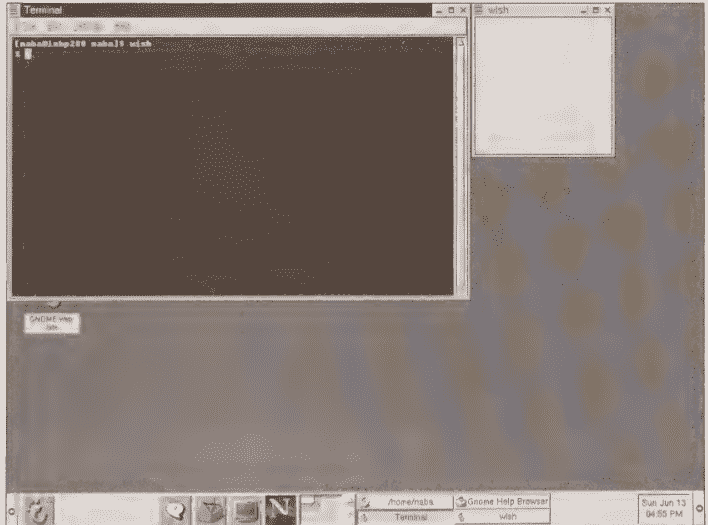

**图 8-1：** 从终端窗口运行 wish 的结果

因此，wish 提供了一个交互式提示符，你可以在其中输入 Tk 命令来创建图形界面。当 wish 解释这些命令时，它会在窗口中显示生成的图形界面。

要了解这种交互式图形界面创建是如何工作的，请在 wish 提示符下尝试以下命令（输入粗体显示的部分）：

```
% label .msg -text "Hello, World!"
.msg
% button .bye -text "Bye" -command { exit }
.bye
% pack .msg .bye
%
```

图 8-2 显示了这些命令的结果；wish 显示一个 "Hello, World!" 标签，下面是一个 "Bye" 按钮。

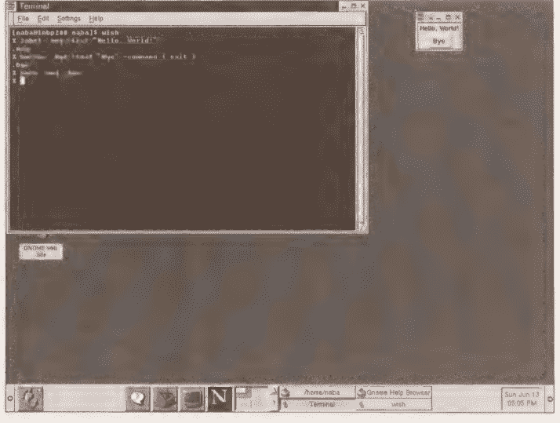

注意，标签和按钮在你输入 `pack` 命令之前不会出现。此外，wish 窗口会缩小到刚好能容纳标签和按钮的大小。

点击 "Bye" 按钮；wish 程序会退出。这是因为 `button` 命令的 `{ exit }` 参数将 Tcl 命令 `exit` 与 "Bye" 按钮的点击相关联。

要创建一个显示 "Hello, World!" 标签和 "Bye" 按钮的 Tk 程序或脚本，你只需将 Tk 命令放入一个文件中，并在开头添加一行特殊内容，以确保 wish shell 处理该文件。为此，请按照以下步骤操作：

1.  使用文本编辑器将以下几行输入并保存到一个名为 hellotk 的文件中：

```
#!/usr/bin/wish -f
# A simple Tk script
label .msg -text "Hello, World!"
button .bye -text "Bye" -command { exit }
pack .msg .bye
```

注意第一行中的 `-f` 选项。在早于 4.0 的 Tk 版本中，你必须使用该选项启动 wish，以确保它处理脚本文件。在 Tk 4.0 及更高版本中，该标志是可选的。

2.  在 shell 提示符下键入以下命令，使 hellotk 文件可执行（chmod 命令中的 +x 就是这个意思）：

```
chmod +x hellotk
```

3.  要运行 hellotk 脚本，请在终端窗口的 shell 提示符下键入以下命令：

```
hellotk
```

图 8-3 显示了运行 hellotk 脚本时应出现的包含 "Hello, World!" 标签和 "Bye" 按钮的窗口。点击 "Bye" 按钮可关闭窗口并结束脚本。


**图 8-3：** 运行 hellotk 脚本的结果

如本例所示，编写 Tk 脚本的基本步骤与创建和运行任何 Tcl 脚本的步骤相同。唯一的区别是 Tk 命令生成图形输出。

#### Tk 小部件基础

既然你已经接触了 Tcl，就可以开始编写 Tk 脚本了。你需要了解的是用于创建和配置小部件的 Tk 命令。

术语 *widget* 在 Tk 中与在 X 工具包（如 Motif）中具有相同的含义——它是一种用户界面组件，例如按钮、列表框或对话框。

在上一节的示例中，你使用了标签和按钮小部件。创建小部件的命令与该小部件的名称相同。因此，`button` 命令创建一个按钮小部件，`label` 创建一个标签，依此类推。

Tk 还有几个其他的小部件创建命令，列于表 8-4。

**表 8-4** 用于创建小部件的 Tk 命令

| 命令 | 操作 |
| --- | --- |
| button | 创建一个按钮小部件。 |
| canvas | 创建一个画布小部件，你可以在其中显示文本、位图、线条、框、多边形和其他小部件。 |
| checkbutton | 创建一个切换按钮并将其与一个 Tcl 变量关联。 |
| entry | 创建一个单行文本输入小部件。 |
| frame | 创建一个能够容纳其他小部件的框架小部件。 |
| label | 创建一个只读的单行标签小部件。 |
| listbox | 创建一个能够滚动文本行的列表框小部件。 |
| menu | 创建一个菜单。 |
| menubutton | 创建一个菜单按钮小部件，点击时会弹出一个关联菜单。 |
| message | 创建一个只读的多行消息小部件。 |
| radiobutton | 创建一个链接到 Tcl 变量的单选按钮小部件。 |
| scale | 创建一个可以调整变量值的刻度小部件。 |
| scrollbar | 创建一个滚动条小部件，你可以将其链接到另一个小部件。 |
| text | 创建一个文本小部件，用户可以在其中输入和编辑文本。 |
| toplevel | 创建一个顶层小部件（其窗口是 X 窗口系统根窗口的子窗口）。 |

创建小部件时，你可以将其许多特性指定为命令的参数。例如，你可以创建一个蓝色背景、红色标签（test）的按钮，并使用以下命令显示该按钮：

```
button .b -text test -fg red -bg blue
pack .b
```

`pack` 命令并不创建小部件；而是将一个小部件相对于其他小部件进行定位。表 8-5 列出了所有小部件操作命令。

要在线查找表 8-4 和 8-5 中列出的任何 Tk 命令的帮助，请键入 `man n`，后跟命令名称。例如，要获取 `bind` 命令的在线帮助，请键入 `man n bind`。

**表 8-5** 用于操作小部件的 Tk 命令

| 命令 | 操作 |
| --- | --- |
| after | 在指定的时间间隔后执行命令。 |
| bind | 将 Tcl 命令与一个 X 事件关联，以便每当该 X 事件发生时，都会自动调用 Tcl 命令。 |
| destroy | 销毁一个或多个小部件。 |
| focus | 将键盘事件定向到特定窗口（赋予该窗口输入焦点）。 |
| grab | 将指针和键盘事件限制在指定的小部件及其子部件内。 |
| lower | 在堆叠顺序中降低一个窗口的位置（堆叠顺序指的是各种窗口在显示屏上相互重叠的顺序）。 |
| option | 提供对 X 资源数据库的访问。 |
| pack | 根据指定的约束条件，自动将小部件定位在框架中。 |
| place | 允许手动定位相对于另一个小部件的小部件。 |
| raise | 在堆叠顺序中提升一个窗口的位置。 |
| selection | 操作 X PRIMARY 选择（X 中选择的标准名称）。 |
| send | 将 Tcl 命令发送到不同的 Tk 应用程序（用于进程间通信）。 |
| tk | 提供关于 Tk 解释器内部状态的信息。 |
| tkerror | 处理 Tk 应用程序中发生的任何错误（当 Tk 应用程序中发生错误时，解释器会调用此命令）。 |
| tkwait | 等待一个事件，例如窗口的销毁或变量值的更改。 |
| update | 处理所有待处理的事件并更新显示。 |
| winfo | 返回关于小部件的信息。 |
| wm | 提供对窗口管理器的访问。（例如，你可以向窗口管理器发送命令，请求为你设置顶层窗口的大小。） |

##### 命名小部件

从创建标签和按钮的示例中，你可能已经猜到，小部件创建命令后面的参数是小部件的名称。如果你想知道为什么所有名称都以句点开头（这是小部件名称开头所必需的），那是因为小部件是按层次结构组织的。

假设你有一个主窗口，其中包含一个菜单栏、一个文本区域和一个滚动条。菜单栏有两个按钮，分别标记为 `File` 和 `Help`。图 8-4 显示了这个小部件层次结构在屏幕上的样子，以及小部件名称如何与此层次结构相关联。

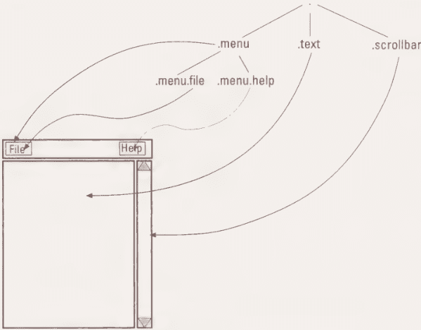

**图 8-4：** 小部件名称与小部件层次结构之间的关系

层次结构的根是应用程序的主窗口；一个单独的句点（点）用于表示主窗口。这个主窗口是 X 显示根窗口的子窗口。主窗口的每个子窗口的名称都以一个句点开头。因此，`.menu` 是主窗口的子窗口。

其他小部件的名称取决于它们在层次结构中的位置。菜单栏中的按钮有名称——`.menu.file` 和 `.menu.help`——表明它们是 `.menu` 小部件的子小部件。当你创建小部件时，你为每个小部件指定名称，从而定义了小部件层次结构。

如果你仔细想想，就会发现小部件命名方案类似于 Linux 中文件的路径名。小部件名称中的句点（`.`）类似于文件路径名中的斜杠（`/`）。事实上，Tk 文档和在线手册页使用 *Tk pathname* 这个术语来表示小部件层次结构。


##### 配置控件

Tk 将每个控件名称视为命令名称。你可以通过使用该控件的名称，后跟适用于该控件的参数，来对特定控件执行操作。例如，如果你有一个名为 `.b` 的按钮，请使用以下命令将该按钮的背景设置为蓝色：

```
.b config -fg blue
```

你可以使用以下命令将按钮的标签更改为 `Goodbye!`：

```
.b config -text Goodbye!
```

参数对 `-fg blue` 和 `-text Goodbye!` 指定了控件的**属性**。每个属性名称都以连字符（`-`）开头，例如 `-text`。下一个参数是该属性的值。

##### 显示控件

Tk 不会显示控件，直到你使用命令将控件放置在主窗口中。你必须使用*几何管理器*——一个 Tk 过程，用于在一个父控件中安排一个或多个子控件。Tk 提供了两个几何管理命令：

-   `place` 命令，它允许你将控件定位在指定主控件窗口中的固定位置（该主控件不一定是父控件）。主控件被用作参考——其他控件相对于主控件进行定位。你也可以指定相对位置，例如水平位置为主控件宽度的一半。
-   `pack` 命令，它围绕主窗口的边缘排列子控件。你可以指定子控件放置在父控件的哪一侧，以及你想在子控件周围使用的任何额外空间。顾名思义，`pack` 命令会将控件尽可能紧密地打包在一起。

尽管 `pack` 和 `place` 命令接受许多不同的选项，但它们的基本用法很简单。我的建议是你启动 `wish`，创建几个控件，并尝试使用 `place` 和 `pack` 命令查看它们的效果。之后，你可以在需要时查阅在线手册以获取确切的选项。

pack 和 place 命令有一种形式——pack forget 和 place forget——你可以用来隐藏控件。例如，如果你想隐藏一个名为 .btn1 的按钮，请使用命令 pack forget .btn1。要使按钮重新出现，请再次使用 pack .btn1 命令。

##### pack 命令

`pack` 命令是 Tk 中最常用的几何管理命令。正如本章中的一些简单示例所示，要使名为 .btn1 的按钮出现，请按如下方式使用 pack：

```
pack .btn1
```

你可以在同一个 pack 命令行上指定多个控件名称。要显示按钮 .btn1、.btn2 和 .btn3，并按该顺序垂直排列，请使用以下命令：

```
pack .btn1 .btn2 .btn3
```

表 8-6 总结了 `pack` 命令的语法。如表 8-5 所示，你可以定位控件并获取有关控件层次结构的信息。如果你想获得更复杂的控件布局，则必须使用表 8-7 中显示的打包选项。

| 命令 | 描述 |
| --- | --- |
| pack 控件名称列表 选项 | 根据指定的选项打包列出的控件（与 pack configure 相同）。表 8-6 显示了可用选项列表。 |
| pack configure 控件名称列表 选项 | 根据指定的选项打包列出的控件。 |
| pack forget 控件名称列表 | 隐藏（取消打包）指定的控件。 |
| pack info 控件 | 返回指定控件的打包配置（选项和值的列表）。 |
| pack propagate 控件 布尔值 | 如果布尔值为 1，则为指定的控件启用几何传播；否则禁用传播。（当启用几何时传播时，控件窗口的大小由其包含的控件的大小决定。） |
| pack slaves 控件 | 返回由指定控件管理的控件列表。 |

##### 表 8-7 打包控件的选项

| 选项 | 描述 |
| --- | --- |
| `-after 控件名称` | 将正在打包的控件放置在*控件名称*指定的控件之后。 |
| `-anchor 锚点位置` | 确定被管理的控件放置在哪里。（仅当包含的控件大于被管理的控件时适用。）*锚点位置*值可以是 `center`、`e`、`n`、`ne`、`nw`、`s`、`se`、`sw` 或 `w`；默认值为 `center`。 |
| `-before 控件名称` | 将正在打包的控件放置在*控件名称*指定的控件之前。 |
| `-expand 布尔值` | 如果*布尔值*为 1，则包含的控件会扩展以使用包含控件中剩余的任何空间。 |
| `-fill 样式` | 指示如果包含控件变得比其中包含的控件所需的空间更大，该如何扩展包含控件。*样式*值可以是 `both`、`none`、`x` 或 `y`。 |
| `-in 控件名称` | 指示放置 `pack` 命令行中指定的控件所在的控件。如果不使用此选项，控件将打包在其父控件中（`f.b` 将打包在 `.f` 中）。 |
| `-ipadx 数量` | 指定正在打包的控件内部的额外水平空间（除了它已经需要的空间之外）。*数量*值是一个数字，以屏幕单位为单位。 |
| `-ipady 数量` | 指定正在打包的控件内部的额外垂直空间（除了它已经需要的空间之外）。*数量*值是一个数字，以屏幕单位为单位。 |
| `-padx 数量` | 指定正在打包的控件边框外部的额外水平空间。*数量*值是一个数字，以屏幕单位为单位。 |
| `-pady 数量` | 指定正在打包的控件边框外部的额外垂直空间。*数量*值是一个数字，以屏幕单位为单位。 |
| `-side 边名` | 靠指定边打包。*边名*值为 `bottom`、`left`、`right` 或 `top`；默认值为 `top`。 |

如果你想知道如何记住所有这些选项，我的建议是你*不要*记住它们。通常，你只需要这些选项中的少数几个就可以完成工作，并且一段时间后你会开始记住它们。要熟悉每个选项的作用，请启动 `wish`，创建几个控件，并尝试使用不同的选项打包它们。从那时起，每当你需要某个选项的确切语法时，可以通过输入 **man n pack** 或简单地输入 **man pack** 来查阅在线手册。

##### place 命令

`place` 命令是指定控件放置位置的一种更简单的方法，但你必须自己定位所有窗口。它比 `pack` 更简单，因为 `place` 命令让你直接控制控件的位置。另一方面，对于少数几个窗口，直接控制控件位置是没问题的，但当用户界面中有许多控件时，它很快就会变得繁琐。

使用 `place`，你可以将控件定位在特定位置。要将 `.btn1` 放置在其父控件中的坐标 (100, 50)，请使用以下命令：

```
place .btn1 -x 100 -y 50
```

`place` 的一个很好用途是将控件居中在其父控件内。为此，你可以使用 `place` 的 `-relx` 和 `-rely` 选项。如果 `.f` 是一个*框架控件*（包含其他控件的控件），你可以使用以下命令将其显示在父窗口的中心：

```
frame .f
button .f.b1 -text Configure
button .f.b2 -text Quit
pack .f.b1 .f.b2 -side left
place .f -relx 0.5 -rely 0.5 -anchor center
```

如代码片段所示，框架内的按钮是使用 `pack` 命令放置的。只有框架 `.f` 是使用 `place` 命令定位的。`-relx` 和 `-rely` 选项允许你以包含控件大小的比例来指定相对位置。`-relx` 的零值表示左边缘；1 表示右边缘；0.5 表示中间。

与 `pack` 类似，`place` 命令有多种形式，如表 8-8 所列。此外，`place` 接受几个选项，这些选项在表 8-9 中总结。将这些选项与普通的 `place` 命令或 `place configure` 命令一起使用。

##### 表 8-8 Place 命令的形式

| 命令 | 描述 |
| --- | --- |
| place *控件名称列表 选项* | 根据指定的选项定位列出的控件（与 `place configure` 相同）。表 8-9 显示了可用选项列表。 |
| place configure *控件名称列表 选项* | 根据指定的选项定位列出的控件。 |
| place forget *控件名称列表* | 停止管理指定的控件并取消映射（隐藏）它们。 |
| place info *控件* | 返回指定*控件*的选项列表及其值。 |
| place slaves *控件* | 返回由指定*控件*管理的控件列表。 |


##### 表8-9 放置部件的选项

| 选项 | 描述 |
| --- | --- |
| `-anchor` *anchorPos* | 指定被管理部件上的哪个点被放置在管理窗口中的指定位置。*anchorPos* 的值可以是 `center`、`e`、`n`、`ne`、`nw`、`s`、`se`、`sw` 或 `w`；默认值为 `nw`（左上角）。 |
| `-borderMode` *bmode* | 指示在被管理部件定位时如何使用管理部件的边框。*bordermode* 的值必须是 `ignore`、`inside` 或 `outside`。 |
| `-height` *size* | 指定被管理部件的高度。 |
| `-in` *widgetName* | 指示相对于哪个部件来指定 `place` 命令行中指定的部件位置。如果未使用此选项，部件将相对于其父部件放置（`.f.b` 相对于 `.f` 定位）。 |
| `-relheight` *fraction* | 指定被管理部件的高度为管理部件高度的一个分数。该分数是一个浮点值。 |
| `-relwidth` *fraction* | 指定被管理部件的宽度为管理部件宽度的一个分数。该分数是一个浮点值。 |
| `-relx` *fraction* | 指定被管理部件的水平位置为管理部件宽度的一个分数。该分数是一个浮点值；0.0 表示左边缘，1.0 表示右边缘。 |
| `-rely` *fraction* | 指定被管理部件的垂直位置为管理部件高度的一个分数。该分数是一个浮点值；0.0 表示上边缘，1.0 表示下边缘。 |
| `-x` *coord* | 指定被管理部件的锚点在管理部件中的水平位置。*coord* 的值以屏幕坐标为单位。 |
| `-y` *coord* | 指定被管理部件的锚点在管理部件中的垂直位置。*coord* 的值以屏幕坐标为单位。 |
| `-width` *size* | 指定被管理部件的宽度。 |

#### 将操作绑定到事件

当你编写一个具有图形用户界面的程序时，各种程序操作是由事件（例如用户在用户界面中点击按钮）触发的。在 Tk 脚本中，你通过将操作与事件关联来指明程序要做什么。这里的 *操作* 只是一个执行某些任务的 Tcl 脚本。以一个 `Quit` 按钮为例，一个合乎逻辑的操作是 Tcl 命令 `exit`，它结束 Tk 脚本。

对于按钮，形成这种关联的一个简单方法是点击按钮。使用 `button` 命令的 `-command` 选项来指定用户点击按钮时要执行的 Tcl 命令。`exit` 命令与 `Quit` 按钮的关联如下：

```
button .b -text Quit -command { exit }
```

当只有一个 Tcl 命令时，花括号不是必需的，但你必须将多个命令括在花括号内。


`bind` 命令是将操作与事件关联的最常用方式。以下是 `bind` 命令的一般语法：

```
bind *widgetName* <*eventSpecification*> *TclCommand*
```

*widgetName* 参数通常是部件的路径名，尽管你可以将事件绑定到部件类，例如所有按钮。通常，你需要查阅在线帮助来指定 *eventSpecification*。（在本节中，我将为你展示一个示例，然后解释事件规范。）最后一个参数——*TclCommand*——是指定事件发生时你希望执行的 Tcl 命令。这些 Tcl 命令可以是任何 Tcl 脚本，从简单的 `puts` 命令到存储在单独文件中的完整 Tcl 脚本。

要查看如何将操作绑定到事件的更详细示例，考虑以下场景。你可能已经注意到，许多 Microsoft Windows 应用程序以及 GNOME 和 KDE 应用程序都有一个工具栏——本质上是一组按钮，每个按钮都旨在执行特定任务。通常，每个按钮都有一个图标来指示其用途。为了帮助用户快速了解按钮的含义，许多 Windows 应用程序都有一个名为 *tool help*（工具提示）的功能。如果你将鼠标指针放在按钮上，会弹出一个小窗口，显示一条简短的帮助消息，告诉你该按钮的作用。

你可以使用 Tk 来实现类似的工具提示功能。请遵循以下步骤：

+   1. 创建按钮。

+   2. 将帮助消息准备为标签（最好使用明亮的背景，例如黄色）。

+   3. 当鼠标指针进入按钮时，会发生一个 `Enter` 事件。将 `Enter` 事件绑定到一个使帮助标签可见的命令。使用 `place` 命令将标签相对于按钮定位，以便工具提示标签始终出现在相关按钮附近。

以下示例展示了如何使用 `bind` 将 `place` 命令（显示在花括号内）与 `Enter` 事件关联：

```
bind .f.q <Enter> { place .bh -in .f.q -relx 0.5 -rely 1.0 }
```

## 第8章：使用 Tcl/Tk 在 Linux 中进行脚本编程

+   4. 当鼠标指针离开按钮时，会发生一个 Leave 事件。将 Leave 事件绑定到 `place forget` 命令以隐藏帮助消息，如下所示：

```
bind .f.q <Leave> { place forget .bh }
```

以下示例工具提示脚本演示了如何在 Tk 中实现工具提示：

```
#!/usr/bin/wish -f
# Demonstrates a "tool help" window that appears when you
# place the mouse pointer inside the "Quit" button.

wm geometry . 180x60

frame .f
button .f.b -text File
label .bh -text "Quit program"
.bh config -bg yellow
button .f.q -text Quit -command { exit }

bind .f.q <Enter> { place .bh -in .f.q -relx 0.5 -rely 1.0 }
bind .f.q <Leave> { place forget .bh }

pack .f.b .f.q -side left
pack .f -fill x
```

使用 `chmod +x toolhelp` 命令使 toolhelp 脚本文件可执行。然后在终端窗口的 shell 提示符下输入 **./toolhelp** 来运行该脚本。图8-5显示了将鼠标指针放在 Quit 按钮上后出现的窗口。


**图8-5：演示如何实现工具提示消息的 Tk 脚本**

当你使用 `bind` 将 Tcl 脚本与事件关联时，你需要知道如何指定事件。大多数事件要么是键盘事件，要么是鼠标事件。少数事件与部件窗口的状态有关。例如，`<Map>` 和 `<Unmap>` 事件发生在部件被管理或取消管理时（当你使用 `pack forget` 或 `place forget` 时）。

##### 键盘事件

有两种键盘事件：

+   - `<KeyPress>` 发生在你按下一个键时。
- `<KeyRelease>` 发生在你释放一个键时。

你可以通过将该键的 *keysym*（即 X 窗口系统中该键的标准名称）附加到字符串 `KeyPress-` 后面，并将所有内容括在尖括号中，来为特定键指定键盘事件。例如，按 q 键关联的事件由 `<Keypress-q>` 指定。Tk 为键盘事件提供了一种更短的格式。你可以简单地将 keysym 放在尖括号内，如下所示：

`<q>`

对于大多数按键，事件规范很简单。如果你想在用户按下名为 `.text` 的部件内的 Ctrl+C 时退出，请使用 `bind` 命令，如下所示：

```
bind .text <Control-c> exit
```

以下是一些其他常用的 keysym：

| Keysym | 键的名称 |
|--------|-------------|
| BackSpace | 退格键 |
| comma | 逗号 |
| Down | 向下箭头 |
| dollar | 美元符号 ($) |
| Escape | 转义键 |
| exclam | 感叹号 |
| Left | 向左箭头 |
| numbersign | 井号 (#) |
| period | 句点 |
| Return | 回车键 |
| Right | 向右箭头 |
| Tab | 制表键 |
| Up | 向上箭头 |

在绑定到按键事件的 Tcl 命令中，使用 `%A` 关键字来引用用户按下的可打印字符。对于任何不可打印字符，`%A` 会被 `{}`（一对空花括号）替换。`%W` 关键字会被接收按键的部件名称替换。因此，你可以使用以下代码将文本插入名为 `.text1` 的文本部件中：

```
# Assume .text1 is a text widget
bind .text1 <KeyPress> {
    if { "%A" != "{}"} { %W insert insert %A }
}
```

请记住，控件的名称本身就是一个命令，而该命令的参数取决于控件的类型。对于文本控件，命令 `%W insert insert %A` 会将字符插入到文本控件中。

##### 鼠标事件

使用 `<ButtonPress>` 和 `<ButtonRelease>` 分别表示鼠标按钮的点击和释放事件。你必须附加按钮编号以使事件具体化。因此，点击鼠标左键（在X术语中称为按钮1）的操作表示为 `<ButtonPress-1>`。按钮按下的简写符号是省略 Press；因此，你可以写 `<Button-1>` 来表示由点击鼠标左键生成的事件。

在绑定到鼠标事件的 Tcl 命令中，关键字 `%x` 和 `%y` 分别表示鼠标事件发生时鼠标指针的 x 和 y 坐标（相对于控件的窗口）。因此，你可以按照如下方式跟踪鼠标在控件 `.text1` 上的点击位置：

```
bind .text1 <Button-1> { puts "Click at (%x, %y) on widget: %W"}
```

其他鼠标事件包括 `Enter` 和 `Leave` 事件，它们分别在你将鼠标指针移入或移出控件时发生。这两个事件分别表示为 `<Enter>` 和 `<Leave>`。本章前面“将动作绑定到事件”部分中展示的 toolhelp 示例说明了如何使用 `<Enter>` 和 `<Leave>` 事件。

另一个与鼠标指针相关的事件是 `<Motion>` 事件，当你在控件内移动鼠标指针时会发生该事件。

##### 窗口事件

除了键盘和鼠标事件外，X 还包含许多在操纵窗口时发生的事件。例如，当通过 `pack` 或 `place` 命令显示或隐藏控件时，X服务器会生成 `<Map>` 和 `<Unmap>` 事件。

当用户调整窗口大小时，会发生 `<Configure>` 事件。因此，你可以将 `<Configure>` 事件绑定到一个重显示过程，该过程根据新的大小重绘控件的内容。

当窗口即将被销毁时，会发生 `<Destroy>` 事件。你将一个过程绑定到 `<Destroy>` 事件，以拦截删除窗口的请求。

### 总结

工具命令语言（Tcl）及其基于X窗口系统的图形工具包Tk的组合，非常适合快速开发具有图形界面的应用程序。本章通过简单的例子介绍了Tcl/Tk。通过阅读本章，你将学到以下内容：

- Tcl是一种解释型语言，拥有一组可以按照特定规则组合使用的命令。Tcl随附于Red Hat Linux发行版的随附CD-ROM上。你可以在安装Linux的同时安装Tcl（更多信息请参阅第1章）。
- 你可以通过运行Tcl命令解释器 `tclsh` 并在 `tclsh` 提示符下输入Tcl命令，来交互式地学习Tcl语法并开发Tcl脚本。
- Tcl包含了大多数常规任务的内置命令，例如读写文件、操作字符串以及运行任何Linux命令。此外，Tcl还包含控制流命令——例如 `if`、`for` 和 `while`——这些命令使你能够控制解释器处理的命令序列。最后，你可以使用Tcl的 `proc` 命令编写新的Tcl命令，这些命令使用现有命令的组合。
- Tk，即Tcl工具包，是Tcl的一个扩展，它使用X窗口系统使你能够构建图形用户界面。Tk提供了Motif的三维外观，但Tk并不需要Motif工具包或任何其他X工具包。Tk构建在Xlib之上，Xlib是X的C语言应用程序编程接口（API）。
- Tk包含用于创建许多常见控件（用户界面元素）的命令，例如按钮、标签、列表框和滚动条。控件命名约定规定了控件层次结构（控件的组织方式）。
- 为了使图形界面活跃起来，你必须使用 `bind` 命令将Tcl命令与特定的键盘和鼠标事件关联起来。
- 你可以通过运行 `wish`（窗口外壳，可以解释所有Tcl和Tk命令）来交互式地试验和创建Tk程序。

## 第三部分

## 在Linux中利用你的硬件

- 第9章：计算机
- 第10章：显卡和显示器
- 第11章：磁盘驱动器
- 第12章：CD-ROM驱动器和声卡
- 第13章：键盘和指点设备
- 第14章：打印机
- 第15章：调制解调器
- 第16章：网络
- 第17章：PC卡

## 第9章

## 计算机

### 本章内容

- 了解不同的PC架构：ISA、EISA和MCA
- 使用高速外设总线：VESA局部总线（VLB）和外围组件互连（PCI）
- 使用 /proc 文件系统作为信息来源
- 在笔记本电脑上运行Linux
- 在笔记本电脑上安装Linux

通常，在按照第1章的说明安装Linux后，你可以开始使用它，而无需担心PC架构的细节。只有在安装过程中遇到问题时，你才需要关注计算机的制造商和型号及其内部细节。至少，你可能需要了解你的PC的硬件架构——例如它使用的是PCI总线还是VLB总线——才能在PC上成功安装和使用Linux。最坏的情况是，你可能需要了解系统主板（系统中的主电路板）的具体细节——例如主板上使用的集成驱动电子设备（IDE）控制器的类型。其他外设，如硬盘和显示器，同样重要；我将在后续章节中介绍这些硬件组件。

从某种意义上说，本章的标题具有误导性，因为术语 *计算机* 包含了从处理器到硬盘和显示器的所有内容。本章的目标是为你提供有关Linux与特定处理器和总线类型（总线是外设的标准物理连接方法）兼容性的信息。由于笔记本电脑是比台式电脑集成度更高的系统，本章还提供了在几种流行品牌的笔记本电脑上运行Linux的信息。

### 基本处理器和总线类型

当你从像MS-DOS这样简单的操作系统转向像Linux这样更复杂的操作系统时，计算机硬件的确切细节变得更加重要，因为操作系统试图利用硬件的所有特性。大多数操作系统，包括Linux，都使用设备驱动程序来访问和使用硬件设备。然而，某些硬件，如系统的处理器及相关电路，必须由Linux内核——操作系统的核心——来支持。

Linux是为Intel 80386或更优的处理器开发的；该程序使用处理器的 *保护模式*。MS-DOS使用处理器的 *实模式*，其中可寻址内存被限制为1MB。在保护模式下，386及更优的处理器可以访问大量内存（理论上最多4GB）。


典型的386架构通常限制基于386的PC最多运行16MB RAM。如果你想在386 PC上安装超过16MB的RAM，你可能需要在添加额外RAM之前升级BIOS（基本输入输出系统）ROM（只读存储器）。为此，你必须联系你的PC制造商获取新的ROM芯片。然后，你必须在安装Linux之前移除旧的ROM BIOS芯片并安装新的芯片。由于Linux在具有足够内存的386上运行得相当好，升级BIOS可能是一项值得做的工作，可以让你的旧386 PC得到充分利用。

你需要至少一个80386系统才能运行Linux。Linux可以在所有变体的80386、80486和Pentium处理器上运行。因此，你可以在Intel的386SX、386DX、386SL、386SLC、486SX、486DX、486SL、486DX2、486DX4、Pentium、Pentium II、Pentium III和Celeron处理器上运行Linux。（此列表并未包含所有386和486处理器的变体，但你明白意思即可。）总的来说，这些处理器通常被称为80x86系列处理器。Linux也可以在来自其他供应商（如Cyrix和AMD）的80x86兼容处理器上运行。

80x86系列处理器使用 *浮点处理器*（也称为 *数学协处理器*）来加速浮点计算。在许多486和Pentium处理器中，浮点处理器是基本处理器的一部分。如果可用，Linux会使用硬件浮点处理器。否则，Linux会使用内置于Linux内核中的软件来模拟浮点处理器。

#### 总线类型

术语 *总线* 指的是在PC的处理器和任何外设设备之间传输信号的线路集合。处理器之后，总线是PC的关键硬件特性。每种类型的总线指定了各种信号的含义以及通过总线传输数据的 *协议*（信号的顺序和时序）。

每种总线都有一个最大数据传输速率，这取决于总线一次可以传输多少位数据以及时钟速率——信号每秒可以在两种状态（0和1）之间切换多少次。与处理器的内部时钟速率一样，总线时钟速率以兆赫（MHz）为单位。一兆赫意味着每秒一百万次。


# 在其他处理器上的 Linux

虽然最广泛发行的 Linux 版本适用于 Intel 80x86 和 Pentium 处理器，但 Linux 也可用于基于其他处理器的系统，例如 Motorola 68000 系列、Digital Equipment Corporation（DEC）的 Alpha AXP 处理器、Sun SPARC 处理器、Hewlett-Packard 的 HP PA-RISC 处理器、PowerPC 处理器以及 MIPS R4x00 和 R5x00 处理器。你可以在互联网上找到这些 Linux 版本的更多信息。首先将你的 Web 浏览器指向以下一个或多个网站：

适用于配备 Motorola 680x0 处理器的系统的 Linux：Linux/m68k 项目正在将 Linux 移植到使用 Motorola 的 68020、68030、68040 和 68060 微处理器的系统上运行。m68k 内核的当前版本可用于 Amiga、Atari、多种 Apple Macintosh 型号，以及来自 BVM、Motorola 和 Tadpole 的几款 VMEbus 单板计算机。更多信息请访问 Linux/m68k 主页：http://www.linux-m68k.org/。

适用于 Compaq（DEC）Alpha 系统的 Linux：适用于 Alpha 处理器的 64 位版本 Linux 可从 Red Hat Linux 获取。有关 Linux for Alpha 的最新信息，请访问 AlphaLinux 主页：http://www.alphalinux.org/。

适用于 Sun SPARC 系统的 Linux：UltraLinux 是 Linux 移植到 Sun SPARC 处理器系列的名称。UltraLinux 既可用于 32 位也可用于较新的 64 位 UltraSPARC 处理器。有关 UltraLinux 的更多信息，请访问 UltraLinux 主页：http://www.ultralinux.org/。同时请访问 Sun 的 Linux 页面 http://www.sun.com/linux/ 以了解更多关于在 Sun 工作站上运行 Linux 的信息。请注意，有一个版本的 Red Hat Linux 可用于 Sun SPARC 系统。

适用于配备 HP PA-RISC 处理器的系统的 Linux：HP Precision Architecture Family（PA-RISC）是一种流行的 RISC 处理器，用于 HP 工作站和服务器。有关适用于 PA-RISC 处理器的 Linux 信息，请访问 PA-RISC Linux Development Project：http://thepuffingroup.com/parisc/。

适用于 PA-RISC 系统的另一个 Linux 选项是 MkLinux，这是一个移植到 The Open Group 的 Mach 微内核（微内核是一个最小化的操作系统，只包含核心服务，如进程间通信、进程调度和内存管理）上运行的 Linux 移植版。有关 MkLinux 的更多信息，请访问 MkLinux 主页：http://www.mklinux.org/。MkLinux 也可在 Apple PowerMac 和 Intel x86 系统上运行。

适用于配备 MIPS 处理器的系统的 Linux：有关适用于 MIPS 处理器的 Linux 信息，请阅读 The Linux/MIPS Frequently Asked Questions（FAQ）：http://lena.fnety.fr/。SGI（在其工作站和服务器上使用 MIPS 处理器的公司）在其网站上提供了有关 SGI/MIPS 系统上 Linux 的信息：http://www.linux.sgi.com/mips/。

适用于配备 PowerPC 处理器的系统的 Linux：适用于 Apple、IBM 和 Motorola PowerPC 系统的 Linux 版本称为 LinuxPPC。LinuxPPC 可在所有 Apple PowerMac、IBM 和 Motorola PReP 工作站以及 Amiga Power-UP 系统上运行。有关 LinuxPPC 的更多信息，请访问 http://www.linuxppc.org/。

适用于 Power Macintosh 的另一个 Linux 版本是 MkLinux，它可从 Apple Computer 获取（http://www.mklinux.apple.com/）。MkLinux 依赖于 The Open Group 的 Mach（PMK1.1）微内核。因此，MkLinux 也可在同样支持 Mach 微内核的 HP PA-RISC 和 Intel x86 处理器上运行。

每种总线类型都规定了控制器卡的物理尺寸、连接器的数量和用途，以及主板上用于插入该卡的插槽。例如，你系统的硬盘就是通过一块与该主板总线类型兼容的磁盘控制器卡连接到主板上的。

以下是几种流行的总线类型：

-   *Industry Standard Architecture（ISA）总线*是最广泛使用的总线（直到 PCI 总线出现之前）；这种总线用于最初的 IBM PC-AT。ISA 总线每次可以传输 16 位数据；它以 8 MHz 的时钟频率运行，与当今时钟频率在 200-500 MHz 范围内的处理器相比，速度较慢。通常，ISA 总线的数据传输速率可达 5MB/秒（即每秒 5 兆字节）。

-   *Video Electronics Standard Association（VESA）局部总线*，即 VLB，旨在实现处理器与显卡之间的高性能数据传输。VLB 的典型传输速率为 30MB/秒。请注意，早期的 VLB 系统通常采用非标准的 VESA 局部总线实现，这可能会导致 Linux 出现问题。

-   *Micro Channel Architecture（MCA）总线*是 IBM 的专有总线，最早出现在 PS/2 PC 中。IBM 将此总线设计为高速总线，但其专有性质阻碍了它在 PC 中的广泛使用。

-   *Extended Industry Standard Architecture（EISA）总线*是作为 MCA 总线的替代品而出现的，其性能与 MCA 相当。EISA 总线并未广泛使用，因为 EISA 总线的外围卡比相应的 ISA 总线卡更昂贵。EISA 总线的性能与 VLB 相当，数据传输速率为 30MB/秒。

-   *Peripheral Component Interconnect（PCI）总线*是最新的高性能总线；它以 33 MHz 的时钟频率运行，每次最多可以传输 64 位数据（较新的 PCI 总线版本可以以 66 或 100 MHz 的时钟速度运行）。当使用 PCI 总线每次传输 32 位数据时，33 MHz 的时钟频率意味着总线可以以 33 × 4 = 132MB/秒的速率传输数据（请注意 32 位 = 4 字节）。PCI 是即将到来的标准；当前的 Pentium PC 使用 PCI 总线，但也提供 ISA 总线插槽，以便你可以继续使用 ISA 卡。通常，PCI 总线的数据传输速率可达 60MB/秒。

Linux 支持 ISA、VLB、EISA 和 PCI 总线；附带 CD-ROM 上的 Linux 版本可以在拥有任何这些总线的系统上安装和运行。因为总线旨在将外围设备连接到系统，所以对总线的支持意味着你可以使用使用该总线类型控制器卡的外围设备。

当然，并非所有这些总线的所有外围硬件（如显卡和磁盘控制器）都能在 Linux 下工作。每个外围设备都需要一个驱动程序，而对于某些较新的显卡或磁盘控制器，驱动程序可能尚不存在。你可以在第 10 章到第 17 章中找到有关特定设备的更多信息。


# Linux 中的 PCI 总线支持

PCI 总线正迅速成为所有基于 Pentium 的新 PC 中首选的总线。一个吸引力在于其高吞吐量。此外，该总线与处理器无关；只要两个系统都使用 PCI 总线，PCI 接口卡应该可以在 Pentium PC 和 DEC Alpha 系统上同样工作。PCI 总线的设计也使得构建可以直接放在主板上的 PCI 组件变得容易，从而最大限度地减少了其他总线所需的额外“胶合逻辑”（即确保一切正常工作所需的额外电子元件）成本。


当前批次的 PCI 主板使用各种 Intel 芯片组，例如 Intel 430FX（Triton）、430HX（Triton 2）、430VX、440BX、440EX 和 440GX 芯片组。这些芯片组支持一种称为 EDO（扩展数据输出）DRAM（动态随机存取存储器）的特殊内存类型，该内存类型在内存芯片内包含一个高速缓存。当前大多数 Pentium PC 使用 Intel Triton 主板，配合 EDO DRAM 和外部 512K 缓存。较新的 PC 使用配备同步 DRAM（SDRAM）内存的 Pentium III 处理器。通常，PCI 主板还内置 PCI 视频芯片组和一个用于将 IDE 硬盘连接到系统的 IDE（集成驱动电子设备）接口。PCI IDE 接口在第 11 章中有进一步描述。

XFree86 支持许多 PCI 显卡——例如 ATI Graphics Pro Turbo、Diamond Viper PCI 和 Number Nine GXE Pro PCI——以及集成视频芯片组，如 S3 Trio32/Trio64。


附带 CD-ROM 上的 Linux 版本包含 PCI Prober，它在 Linux 启动时提供有关系统上 PCI 设备的信息。你可以通过发出 `cat /proc/pci` 命令来查看此信息。（/proc 文件系统在本章的“来自 /proc 文件系统的信息”部分中进行了解释。）

# 一些特定问题

当你在 PC 上安装或配置 Linux 时遇到问题，其中大多数问题都与特定的外围设备有关——磁盘控制器、显卡、光驱接口等等。然而，少数问题与处理器或 PC 的基本硬件架构直接相关。本节指出其中几个此类问题并建议一些解决方案。

#### 添加内存后系统变慢

当你向 PC 添加额外内存（例如从 16MB 增加到 32MB）并期望获得显著的性能提升时，会出现此问题；相反，系统速度显著变慢。这种奇怪行为的原因是，当你添加内存时，你还必须确保新内存被缓存。


#### 高速缓存存储器

*高速缓存存储器*是一种速度极快（且昂贵）的存储器，用于保持处理器以全速运行。（顺便说一下，存储器的*速度*是指处理器从中读写数据的快慢。）通常，系统可能拥有 256K 或 512K 的高速缓存存储器。

普通存储器（即你拥有的 16、32 或 64MB 那种）速度太慢，无法跟上当今的高速处理器。高速缓存存储器充当普通存储器和处理器之间的中间存储。

当你添加存储器时，必须确保高速缓存存储器与新存储器协同工作。具体的解决方案取决于你的主板。有时，解决方案只需运行 PC 的设置程序并开启一个选项来缓存新的存储区域，该选项可能默认处于关闭状态。

在某些系统上，你必须将存储器安装在特定的物理插槽中，才能确保所有存储器都被缓存。另一种解决方案可能是设置*跳线*——主板上引脚之间的连接器——来启用缓存功能。

某些主板根据高速缓存存储器的容量来缓存一定量的存储器。通常，带有 256K 缓存的主板应该能够满足系统的缓存需求。即使有 256K 缓存，你仍可能需要设置一些跳线或开启某些选项来为所有存储器启用缓存。请查阅系统文档获取相关提示；一本薄薄的主板手册可能就提供了这些信息。

如果你添加的存储器超过 64MB，系统会变慢，因为 Linux 无法确定 PC 中存储器的确切容量。在系统启动时，Linux 使用 BIOS 调用来确定已安装存储器的容量。不幸的是，原始 BIOS 调用最多只能报告 64MB 的已安装存储器。如果你拥有超过 64MB 的存储器，则必须通过 LILO 引导选项来指定存储器容量。例如，如果你的 PC 拥有 96MB 的存储器，请在引导提示符处添加以下选项：

```
mem=96M
```

你也可以将此行添加到 LILO 配置文件 `/etc/lilo.conf` 中。在安装内存为 1GB 或更多的新型 PC 服务器上安装 Linux 时，你应该添加类似 `mem=960M`（一个小于 1000M 的数值）的选项，以确保 Linux 成功安装。

在引导时指定存储器容量时，请记住某些 PC 可能会使用最后 384KB 的存储器来缓存 BIOS（本质上是将 BIOS 代码复制到该区域）。为安全起见，你可能希望指定比实际容量少 1MB 的数值。因此，对于一台拥有 96MB 存储器的 PC，你应该使用选项 `mem=95M`。

#### Cyrix 6x86 系统存在一些问题

Cyrix 6x86 系列处理器是 Intel x86 系列处理器的兼容产品，性能与 Intel Pentium 处理器相当。因此，Linux 可以在 Cyrix 6x86 系统上运行。然而，Cyrix 6x86 存在一些已知问题。

一段简短的指令序列可能导致 Cyrix 6x86 处理器停止响应所有中断。本质上，系统会死锁。你可以在 http://www.tux.org/~balsa/linux/cyrix/p11.html 了解更多关于此问题的信息。解决方案是启用 CCR1 配置寄存器中的 NO_LOCK 位。有一个名为 set6x86 的程序可用于修正此问题。该程序还可以启用 6x86 处理器的一项功能，在处理器空闲时降低功耗。最新的 Linux 内核包含 Cyrix 官方设计的解决方案，用于规避 NO_LOCK 方案存在的问题。有了这个解决方案，Linux 可以完全支持 Cyrix 处理器。

还有一些其他小问题，例如 Cyrix 6x86 处理器上的 BogoMips 计算错误。有关 Linux 和 Cyrix 6x86 处理器的更多信息，请访问 http://www.tux.org/~balsa/linux/cyrix/。在该站点上，你还可以找到 Cyrix 6x86 处理器所需的所有补丁。

#### 从 /proc 文件系统获取信息

你可以通过查阅一个名为 /proc 文件系统的特殊文件系统的内容来获取大量关于你的计算机的信息。当然，要使用 /proc 文件系统，你必须在系统上安装并运行 Linux。不过，了解 /proc 文件系统仍然很有用，因为它可以帮助你确定 PC 的确切信息（至少是 Linux 认为你的 PC 拥有的信息），例如在你添加新设备或重新编译内核并试图决定应该在内核中启用哪些功能时。

/proc 文件系统不是磁盘上的真实目录，而是 Linux 内核管理的一组内存中的数据结构，在用户看来像是一组目录和文件。/proc（也称为*进程文件系统*）的目的是允许用户访问有关 Linux 内核和当前系统上正在运行的进程的信息。

你可以像访问任何其他目录一样访问 /proc 文件系统，但你需要了解各种文件的含义才能解读其中的信息。通常，你可以使用 `cat` 或 `more` 命令查看 /proc 中某个文件的内容；文件的内容提供了关于系统某些方面的信息。

与任何目录一样，你可能希望先查看 /proc 的详细目录列表。为此，请输入 `ls -l /proc`。以下是我的系统上的典型输出：

```
ls /proc
total 0
dr-xr-xr-x  3 root   root    0 Jun 14 20:58 1
dr-xr-xr-x  3 root   root    0 Jun 14 20:58 1065
dr-xr-xr-x  3 root   users   0 Jun 14 20:58 1066
dr-xr-xr-x  3 naba   users   0 Jun 14 20:58 1067
dr-xr-xr-x  3 root   root    0 Jun 14 20:58 108
dr-xr-xr-x  3 root   gdm     0 Jun 14 20:58 1323
dr-xr-xr-x  3 root   gdm     0 Jun 14 20:58 1333
dr-xr-xr-x  3 naba   users   0 Jun 14 20:58 1340
dr-xr-xr-x  3 naba   users   0 Jun 14 20:58 1352
dr-xr-xr-x  3 naba   users   0 Jun 14 20:58 1370
dr-xr-xr-x  3 naba   users   0 Jun 14 20:58 1376
dr-xr-xr-x  3 naba   users   0 Jun 14 20:58 1389
dr-xr-xr-x  3 naba   users   0 Jun 14 20:58 1391
dr-xr-xr-x  3 naba   users   0 Jun 14 20:58 1393
dr-xr-xr-x  3 naba   users   0 Jun 14 20:58 1397
dr-xr-xr-x  3 naba   users   0 Jun 14 20:58 1409
dr-xr-xr-x  3 naba   users   0 Jun 14 20:58 1411
dr-xr-xr-x  3 naba   users   0 Jun 14 20:58 1413
dr-xr-xr-x  3 nobody nobody  0 Jun 14 20:58 1441
dr-xr-xr-x  3 nobody nobody  0 Jun 14 20:58 1442
dr-xr-xr-x  3 naba   users   0 Jun 14 20:58 1444
dr-xr-xr-x  3 naba   users   0 Jun 14 20:58 1454
dr-xr-xr-x  3 naba   users   0 Jun 14 20:58 1537
dr-xr-xr-x  3 root   root    0 Jun 14 20:58 2
dr-xr-xr-x  3 bin    root    0 Jun 14 20:58 258
dr-xr-xr-x  3 root   root    0 Jun 14 20:58 3
dr-xr-xr-x  3 root   root    0 Jun 14 20:58 305
dr-xr-xr-x  3 daemon daemon  0 Jun 14 20:58 330
dr-xr-xr-x  3 root   root    0 Jun 14 20:58 344
dr-xr-xr-x  3 root   root    0 Jun 14 20:58 362
dr-xr-xr-x  3 root   root    0 Jun 14 20:58 376
dr-xr-xr-x  3 root   root    0 Jun 14 20:58 393
dr-xr-xr-x  3 root   root    0 Jun 14 20:58 4
dr-xr-xr-x  3 root   root    0 Jun 14 20:58 408
dr-xr-xr-x  3 root   root    0 Jun 14 20:58 419
dr-xr-xr-x  3 root   root    0 Jun 14 20:58 440
dr-xr-xr-x  3 root   root    0 Jun 14 20:58 445
dr-xr-xr-x  3 root   root    0 Jun 14 20:58 446
dr-xr-xr-x  3 root   root    0 Jun 14 20:58 447
dr-xr-xr-x  3 root   root    0 Jun 14 20:58 448
dr-xr-xr-x  3 root   root    0 Jun 14 20:58 449
dr-xr-xr-x  3 root   root    0 Jun 14 20:58 450
dr-xr-xr-x  3 root   root    0 Jun 14 20:58 451
dr-xr-xr-x  3 root   root    0 Jun 14 20:58 452
dr-xr-xr-x  3 root   root    0 Jun 14 20:58 453
dr-xr-xr-x  3 root   root    0 Jun 14 20:58 454
dr-xr-xr-x  3 root   root    0 Jun 14 20:58 489
dr-xr-xr-x  3 root   root    0 Jun 14 20:58 5
dr-xr-xr-x  3 root   root    0 Jun 14 20:58 504
dr-xr-xr-x  3 root   root    0 Jun 14 20:58 518
dr-xr-xr-x  3 nobody nobody  0 Jun 14 20:58 521
dr-xr-xr-x  3 nobody nobody  0 Jun 14 20:58 522
dr-xr-xr-x  3 nobody nobody  0 Jun 14 20:58 523
dr-xr-xr-x  3 nobody nobody  0 Jun 14 20:58 524
```


## 第9章：计算机

```
dr-xr-xr-x  3 nobody nobody    0 Jun 14 20:58 525
dr-xr-xr-x  3 nobody nobody    0 Jun 14 20:58 526
dr-xr-xr-x  3 nobody nobody    0 Jun 14 20:58 527
dr-xr-xr-x  3 nobody nobody    0 Jun 14 20:58 530
dr-xr-xr-x  3 nobody nobody    0 Jun 14 20:58 531
dr-xr-xr-x  3 nobody nobody    0 Jun 14 20:58 532
dr-xr-xr-x  3 nobody nobody    0 Jun 14 20:58 548
dr-xr-xr-x  3 root   root      0 Jun 14 20:58 563
dr-xr-xr-x  3 root   root      0 Jun 14 20:58 574
dr-xr-xr-x  3 news   news      0 Jun 14 20:58 625
dr-xr-xr-x  3 news   news      0 Jun 14 20:58 629
dr-xr-xr-x  3 root   root      0 Jun 14 20:58 669
dr-xr-xr-x  3 root   root      0 Jun 14 20:58 670
dr-xr-xr-x  3 root   root      0 Jun 14 20:58 671
dr-xr-xr-x  3 root   root      0 Jun 14 20:58 672
dr-xr-xr-x  3 root   root      0 Jun 14 20:58 673
dr-xr-xr-x  3 root   root      0 Jun 14 20:58 674
dr-xr-xr-x  3 root   gdm       0 Jun 14 20:58 675
dr-xr-xr-x  3 root   root      0 Jun 14 20:58 677
-r--r--r--  1 root   root      0 Jun 14 20:58 apm
dr-xr-xr-x  3 root   root      0 Jun 14 20:58 bus
-r--r--r--  1 root   root      0 Jun 14 20:58 cmdline
-r--r--r--  1 root   root      0 Jun 14 20:58 cpuinfo
-r--r--r--  1 root   root      0 Jun 14 20:58 devices
-r--r--r--  1 root   root      0 Jun 14 20:58 dma
-r--r--r--  1 root   root      0 Jun 14 20:58 fb
-r--r--r--  1 root   root      0 Jun 14 20:58 filesystems
dr-xr-xr-x  3 root   root      0 Jun 14 20:58 fs
dr-xr-xr-x  4 root   root      0 Jun 14 20:58 ide
-r--r--r--  1 root   root      0 Jun 14 19:40 interrupts
-r--r--r--  1 root   root      0 Jun 14 20:58 ioports
-r--r--r--  1 root   root 67112960 Jun 14 20:58 kcore
-r--r--r--  1 root   root      0 Jun 14 10:28 kmsg
-r--r--r--  1 root   root      0 Jun 14 20:58 ksyms
-r--r--r--  1 root   root      0 Jun 14 20:58 loadavg
-r--r--r--  1 root   root      0 Jun 14 20:58 locks
-r--r--r--  1 root   root      0 Jun 14 20:58 mdstat
-r--r--r--  1 root   root      0 Jun 14 20:58 meminfo
-r--r--r--  1 root   root      0 Jun 14 20:58 misc
-r--r--r--  1 root   root      0 Jun 14 20:58 modules
-r--r--r--  1 root   root      0 Jun 14 20:58 mounts
dr-xr-xr-x  4 root   root      0 Jun 14 20:58 net
-r--r--r--  1 root   root      0 Jun 14 20:58 partitions
-r--r--r--  1 root   root      0 Jun 14 20:58 pci
-r--r--r--  1 root   root      0 Jun 14 20:58 rtc
dr-xr-xr-x  2 root   root      0 Jun 14 20:58 scsi
lrwxrwxrwx  1 root   root     64 Jun 14 20:58 self -> 1537
-r--r--r--  1 root   root      0 Jun 14 20:58 slabinfo
-r--r--r--  1 root   root      0 Jun 14 20:58 sound
-r--r--r--  1 root   root      0 Jun 14 20:58 stat
-r--r--r--  1 root   root      0 Jun 14 20:58 swaps
dr-xr-xr-x 10 root   root      0 Jun 14 20:58 sys
dr-xr-xr-x  4 root   root      0 Jun 14 20:58 tty
-r--r--r--  1 root   root      0 Jun 14 20:58 uptime
-r--r--r--  1 root   root      0 Jun 14 20:58 version
```

第一组目录（以行首的字母 `d` 表示）代表当前系统上正在运行的进程。每个对应于一个进程的目录，都以进程ID（一个数字）作为其名称。

请注意名为 `/proc/kcore` 的巨大文件；该文件代表您系统的整个物理内存。虽然 `/proc/kcore` 在列表中显示为一个巨大的文件，但并没有物理文件占用硬盘上如此多的空间，因此您不应尝试删除该文件来回收磁盘空间。

正如接下来的几节所示，`/proc` 文件系统中的文件可以帮助您了解关于系统的大量信息。

### /proc/cpuinfo 文件

`/proc` 中的几个文件包含有关系统硬件的有用信息。例如，`/proc/cpuinfo` 文件列出了系统的关键特性，例如处理器类型和浮点处理器信息。

在我的一个系统上，当我想查看 `/proc/cpuinfo` 文件时，我会输入 `cat /proc/cpuinfo`，并得到以下输出：

```
cat /proc/cpuinfo
processor     : 0
vendor_id     : GenuineIntel
cpu family    : 5
model         : 4
model name    : Pentium MMX
stepping      : 3
cpu MHz       : 199.616496
fdiv_bug      : no
hlt_bug       : no
sep_bug       : no
f00f_bug      : yes
fpu           : yes
fpu_exception : yes
cpuid level   : 1
wp            : yes
flags         : fpu vme de pse tsc msr mce cx8 mmx
bogomips      : 398.13
```

这个输出来自一个200 MHz的Pentium MMX系统。该列表显示了处理器的许多有趣特性。请注意以 `fdiv_bug` 开头的行。还记得臭名昭著的Pentium浮点除法错误吗？该错误存在于一个名为 `fdiv`（代表浮点除法）的指令中。因此，`f00f_bug` 行表明此特定Pentium是否有此错误（幸运的是，我的系统处理器没有）。

### CPU 命名约定

术语 *CPU* 代表 *中央处理单元*。在大型机和小型机时代，CPU真的就是一个单元——像一个机柜。然而，对于PC，CPU是微处理器——486或Pentium芯片，是PC的核心。因此，包含有关处理器（CPU）信息的文件被命名为 cpuinfo——这个名字来源于将 *cpu* 与 *info*（*information* 的缩写）拼接而成。我解释这个思考过程是因为程序员通常就是这样创建简短、隐晦的名称的。在你看到一些这样的名字后，你会开始更容易地猜测它们的含义。

`f00f_bug` 行也指Pentium和Pentium MMX处理器中的另一个错误。这个错误得名于一个特定的指令，其编码以十六进制数 F0 0F 开头。这个错误很麻烦，因为它可能使系统死锁，与操作系统无关。幸运的是，有一个解决此错误的方法，随附CD-ROM上的Linux内核实现了该方法。要查看您的系统是否有此错误，请输入 `dmesg | grep bug`。如果检测并修复了此错误，您会看到有关该错误的消息。例如，在我的系统上，我得到以下信息：

```
dmesg | grep bug
Intel Pentium with F0 0F bug - workaround enabled.
```

`/proc/cpuinfo` 文件中的最后一行显示了处理器的 BogoMips（有关 BogoMips 的更多信息，请参见第1章中的“What is BogoMips?”侧边栏），这是在Linux内核启动时计算的。BogoMips 是Linux内部用于计时延迟循环的东西。

### /proc/pci 文件

如果您有一个PCI系统（大多数新的Pentium系统都可能是），您可以检查 `/proc/pci` 文件以获取系统上PCI设备的信息。通常，输入 `cat /proc/pci` 来查看信息。以下是在一个具有PCI主板的Pentium MMX系统上找到的内容：

```
PCI devices found:
  Bus 0, device 0, function 0:
    Host bridge: Intel 82439TX (rev 1).
    Medium devsel. Master Capable. Latency=32.
  Bus 0, device 7, function 0:
    ISA bridge: Intel 82371AB PIIX4 ISA (rev 1).
    Medium devsel. Fast back-to-back capable. Master Capable. No bursts.
  Bus 0, device 7, function 1:
    IDE interface: Intel 82371AB PIIX4 IDE (rev 1).
    Medium devsel. Fast back-to-back capable. Master Capable. Latency=64.
    I/O at 0x1f0 [0x1f1].
  Bus 0, device 7, function 2:
    USB Controller: Intel 82371AB PIIX4 USB (rev 1).
    Medium devsel. Fast back-to-back capable. IRQ 9. Master Capable.
Latency=64.
    I/O at 0xfcc0 [0xfcc1].
  Bus 0, device  7, function  3:
    Bridge: Intel 82371AB PIIX4 ACPI (rev 1).
    Medium devsel. Fast back-to-back capable.
  Bus 0, device 13, function 0:
    VGA compatible controller: S3 Inc. ViRGE/DX or /GX (rev 1).
    Medium devsel. IRQ 11. Master Capable. Latency=64. Min Gnt=4.Max
Lat=255.
       Non-prefetchable 32 bit memory at 0xf8000000 [0xf8000000].
```

如列表所示，系统有三个PCI设备，编号为0、7和13。设备0是PCI-CPU桥接器——处理器和PCI总线之间的接口。

第二个PCI设备（7）是连接到集成驱动电子设备（IDE）的接口，这些IDE内置在每个IDE磁盘驱动器中。（*集成驱动电子设备* 这个名称意味着控制驱动器所需的电子设备内置在驱动器本身中。）同一个PCI设备还用作PCI-ISA桥接器和PCI-USB（USB是通用串行总线）桥接器。

第三个设备——设备13——是视频显示控制器。该控制器是一个内置在主板中作为PCI设备的视频卡（或图形卡）。本质上，主板包含驱动显示器所需的芯片。

对于每个设备，`/proc/pci` 文件还显示设备的品牌和型号。例如，视频控制器是 S3 Trio32/Trio64 芯片组。当您配置 XFree86 在您的系统上运行时，可以使用关于视频芯片组的信息。

### /proc 文件系统中的其他信息

您系统中的所有外围设备（如硬盘、声卡、CD-ROM驱动器、调制解调器和打印机）都需要访问一些系统资源。每个设备通常需要以下资源：

- *中断请求 (IRQ) 号*，设备用它来引起系统处理器的注意。您可以将 IRQ 视为设备和处理器之间的直接线路。可用的 IRQ 线路数量有限，因此如果您系统中外围设备过多，则存在很大冲突的可能性。

- *输入/输出端口地址 (I/O 地址)*，处理器用它来向外围设备发送数据和从外围设备接收数据。设备通常需要一个唯一的 I/O 地址范围才能正常工作。

- *直接内存访问 (DMA) 通道*，设备用它来直接访问系统内存，而不是通过处理器。


某些设备不需要DMA通道，但大多数设备需要IRQ号和所需的I/O地址范围。

即便是Linux也需要为每个设备分配这些资源——IRQ、I/O地址和DMA通道，因为底层硬件架构决定了这些资源是必需的。通常情况下，如果您掌握系统中所有硬件的这些信息，就可以避免因IRQ、I/O地址或DMA通道分配冲突而导致的问题。

当您重新构建内核（如第2章所述）以添加对特定非PCI设备（例如某款声卡）的支持时，必须提供必要的IRQ、DMA和I/O地址来正确配置Linux。对于某些设备，Linux可以探测设备并确定这些信息。特别是，Linux内核总是直接从PCI寄存器读取PCI设备信息。

除了`/proc/cpuinfo`和`/proc/pci`之外，`/proc`文件系统中的三个文件包含系统中正在使用的IRQ、DMA和I/O地址信息。这些文件是：

-   `/proc/interrupts`，包含正在使用的IRQ信息
-   `/proc/dma`，显示正在使用的DMA通道
-   `/proc/ioports`，列出正在使用的I/O端口地址范围

例如，以下是我系统中的`/proc/interrupts`文件：

```
CPU0
0:  4133143  XT-PIC  timer
1:    3054  XT-PIC  keyboard
2:       0  XT-PIC  cascade
5:   14059  XT-PIC  3c503-PIO
8:       2  XT-PIC  rtc
12: 371924  XT-PIC  PS/2 Mouse
13:      1  XT-PIC  fpu
14: 210710  XT-PIC  ide0
15:    296  XT-PIC  ide1
```

列表以标题CPU0开头，表明这些是第一个CPU的中断。如果主板上有两个CPU，那么另一个CPU也会有对应的中断列表。

每行的第一个数字是IRQ（中断请求号）。其后跟着一个冒号；然后是到目前为止发生的该IRQ中断总数。行末的文本表示使用此IRQ的设备。设备`3c503-PIO`指的是以编程IO模式工作的3Com 3C503以太网卡。

以下是我系统中的`/proc/dma`文件：

```
4: cascade
```

如列表所示，只有一个DMA正在使用。许多设备不使用直接内存访问。

/proc/ioports文件包含更多条目，因为每个设备都需要I/O端口地址。以下列表显示了我系统中的/proc/ioports文件（我的注释以斜体显示）：

```
0000-001f : dma1              Direct Memory Access (DMA) controller 1
0020-003f : pic1              Programmable Interrupt Controller (PIC) 1
0040-005f : timer
0060-006f : keyboard           Keyboard
0070-007f : rtc                Real-time clock
0080-008f : dma page reg DMA page register
00a0-00bf : pic2               Programmable Interrupt Controller (PIC) 2
00c0-00df : dma2               Direct Memory Access (DMA) controller 2
00f0-00ff : fpu                Floating-point processor unit
0170-0177 : ide1               Integrated Drive Electronics interface 1
01f0-01f7 : ide0               Integrated Drive Electronics interface 0
0300-030f : 3c503-PIO          3Com 3C503 Ethernet card
0376-0376 : ide1               Integrated Drive Electronics interface 1
03c0-03df : vga+               Video controller (graphics card)
03f6-03f6 : ide0               Integrated Drive Electronics interface 0
fcf0-fcf7 : ide0               Integrated Drive Electronics interface 0
fcf8-fcff : ide1               Integrated Drive Electronics interface 1
```

如果您的系统有SCSI（小型计算机系统接口）控制器或任何串口设备，您会在`cat /proc/ioports`命令显示的列表中看到这些设备的I/O端口。

### 笔记本电脑上的Linux

笔记本电脑比台式机集成度更高；其显卡、显示器和硬盘都内置于一个紧凑的机箱中。换句话说，您无法像在台式机系统中那样轻松地混合搭配笔记本电脑的组件，因此必须确保Linux支持笔记本电脑系统的所有组件。

大多数配备Intel 80386或更高处理器的笔记本电脑应能运行标准的Linux。然而，如果您想安装XFree86（X窗口系统），可能会遇到一些麻烦，因为显卡（在笔记本电脑上，视频电路集成在主板上）和定点设备必须得到XFree86的支持。从Linux内核版本2.2开始，即使XFree86原生不支持笔记本电脑的图形芯片组，您也可以使用VESA帧缓冲控制台驱动程序使X在大多数笔记本电脑上工作。您只需在lilo.conf文件中添加一行如`vga=791`的配置，即可启用VESA帧缓冲控制台驱动程序。此外，如今大多数笔记本电脑的定点设备至少可以模拟标准的PS/2鼠标，这应该可以与XFree86配合工作。

本书第10章至第17章涵盖了各个组件，如显卡和显示器。本节提供了一些关于在笔记本电脑PC上运行Linux的信息。

#### 关于笔记本电脑上的Linux的更多信息

本章仅简要提及了在笔记本电脑上运行Linux的主题。随着用户在各种笔记本电脑上安装并运行Linux，用户社区关于笔记本电脑上Linux的累积经验持续增长。其中许多信息已被总结并发布在Web上。有关如何在笔记本电脑上安装和运行Linux的详细信息，请将您的Web浏览器指向**Linux on Laptops主页**：

http://www.cs.utexas.edu/users/kharker/linux-laptop/

此页面包含指向更多网页的链接，每个网页都详细记录了在特定笔记本电脑上安装和运行Linux的具体情况。特别是，您将了解是否需要执行某些特殊操作才能使Linux和X在笔记本电脑上运行。

#### PCMCIA

笔记本电脑有一种独特的接口类型，称为PCMCIA，它代表个人计算机内存卡国际协会（Personal Computer Memory Card International Association）。配套CD-ROM上的Linux版本支持PCMCIA。当前的PCMCIA驱动程序支持许多常见的PCMCIA控制器，例如Databook TCIC/2、Intel i82365SL、Cirrus PD67xx和Vadem VG-468芯片组。

请注意，PCMCIA卡如今被称为PC卡。PC卡技术的32位版本称为CardBus，在33 MHz时钟频率下传输速度可达133 Mbps。

有关Linux中PCMCIA支持的更多信息，请参阅第17章。

#### 高级电源管理

另一个笔记本电脑特有的功能是电源管理，它指的是笔记本电脑暂停活动以节省电池电量的能力。具有高级电源管理（APM）功能的笔记本电脑可以挂起和恢复耗电组件（如显示器和硬盘），并提供电池寿命信息。

配套CD-ROM上的Linux版本支持APM，但需要在构建内核时启用该功能（有关如何构建内核的信息，请参见第2章）。

您可以通过访问网站http://www.cs.utexas.edu/users/kharker/linux-laptop/apm.html来了解更多关于如何在Linux下支持APM的信息。

#### 笔记本电脑上的声音

许多高端笔记本电脑内置声卡。在Linux下使用声音功能是一个直接的过程，前提是要弄清楚笔记本电脑中的声卡类型。第12章详细介绍了声卡。

即使来自同一供应商的笔记本电脑型号，声卡类型也可能不同。例如，NEC Versa P配备Sound Blaster Pro兼容声卡。而另一方面，NEC Versa M则配备Microsoft Sound System (MSS)声卡，它与Sound Blaster不兼容。

正如您在第12章所学，Sound Blaster Pro的典型设置是I/O地址0x220（即十六进制表示的220；0x前缀在C编程语言中表示十六进制）、IRQ 5和DMA 1。因此，在任何带有SoundBlaster Pro兼容声卡的笔记本电脑（例如NEC Versa P）上，您应该使用I/O地址0x220、IRQ 5和DMA 1的Sound Blaster Pro配置Linux内核。德州仪器TravelMate 4000M的内置声卡需要类似的设置。

另一方面，在带有Microsoft Sound System兼容声卡的笔记本电脑（例如NEC Versa M）上，请尝试使用I/O地址0x530、IRQ 9和DMA 3的Microsoft Sound System。像往常一样，在设置声音支持之前，您应该查阅笔记本电脑的文档，以获取声卡制造商和型号的线索。

关键在于，您可以像为台式机PC设置Linux支持声音一样，为笔记本电脑设置Linux支持声音。第一步是弄清楚您的笔记本电脑使用什么类型的声卡。许多带有声音功能的笔记本电脑，其声音硬件并未得到Linux的支持。例如，Linux没有任何声音驱动程序支持使用Neomagic组合视频/声音芯片组的笔记本电脑。当然，许多笔记本电脑根本没有声音功能，因此这一点对某些笔记本电脑用户来说可能无关紧要。

#### 笔记本电脑上的X

用户报告称，在许多386、486和奔腾笔记本电脑上成功运行了Linux和XFree86。直到最近，要在笔记本电脑上运行X，您不得不满足于标准的16色VGA服务器（XF86_VGA16），因为XFree86不支持笔记本电脑中使用的许多流行视频芯片组。如今，笔记本电脑支持高分辨率LCD屏幕，其能力与台式机PC相当，但16色VGA服务器无法利用高分辨率功能。您必须能够运行Super VGA X服务器（XF86_SVGA）才能在笔记本电脑上使用256色。

大多数笔记本电脑使用以下类型的视频芯片组：

-   Western Digital WD90C24系列芯片
-   Chips & Technology 655xx系列芯片
-   Cirrus Logic CLGD6235, CLGD6440, CLGD7543, CLGD7548, 和 CLGD7555

XFree86 3.3.3.1中的XF86_SVGA服务器支持所有这些芯片组，如下所示：

-   Western Digital WD90C24系列芯片

### 摘要

Linux 对 PC 硬件细节的依赖程度远高于 DOS。要安装和使用 Linux，你需要确保 Linux 支持你 PC 的各个部件。本章重点介绍 Linux 与 PC 最重要部件——主板的兼容性，主板包含处理器和总线，你通过总线连接硬盘、显卡和光驱等外设。通过阅读本章，你将了解以下内容：

- Linux 最初是为 Intel 80386 处理器设计的，目前支持 386、486、Pentium 和 Pentium II 处理器的所有变体，以及 Cyrix 和 AMD 等公司生产的任何兼容处理器。Linux 还被移植到其他处理器上，如 DEC Alpha AXP、Sun SPARC、HP PA-RISC、MIPS 和 PowerPC。

- 总线是一组标准线路，外设通过总线连接到 PC 主板。总线有多种类型：ISA、EISA、MCA、VLB 和 PCI。Linux 支持所有这些总线类型。PCI 总线已成为 Pentium PC 的高性能总线。

- Linux 包含 /proc 文件系统，为用户提供了一种便捷的方式来访问系统信息。通过查看 /proc 中的文件，你可以了解大量关于系统的信息。例如，/proc/devices 文件列出了系统中的所有设备，/proc/pci 则显示 PCI 系统中的 PCI 设备。

- 笔记本电脑是一种特殊的计算机，因为笔记本电脑的所有部件——从硬盘到显卡——都高度集成。Linux 可以在许多笔记本电脑上运行。主要问题是对笔记本电脑特有功能的支持，例如高级电源管理（APM）和 PCMCIA 或 PC Card 接口。另一个问题是在笔记本电脑上运行 X，因为 XFree86 对笔记本电脑显卡芯片组的支持不如对台式机显卡那样好。尽管如此，Linux 和 X 仍然可以在各种笔记本电脑上运行。事实上，Linux 几乎可以在任何新笔记本电脑上运行。

相反，他通过一系列卑微段落的马赛克来制定策略，仿佛这些段落也能像双层公寓单元那样被安排在有序的网格中。除了勒·柯布西耶的名言——那种对精确和功能的还原式致敬——之外，利古里亚的僧侣还能在哪里找到他的建筑孪生呢？

"Post-Ligurian Stall"（所有作品 2014）是那句名言的一个流浪砖块版本，竖起一根细长的黑色柱子，并将一根绿色竹梁伸展到街道上方，庇护的只有空间本身。这种通过有用汇率实现的奇异造型，被一个中枢神经般的砖圈所强化，砖圈刺穿了一幅散漫的竹林图像，犹如丛林中的野兽守护着水池。孔洞是一个突出的主题，这或许可以解释那些画在廉价马尼拉纸上的手榴弹，它们被间隔地张贴，如同在画廊中。它们是在引用卡韦利尼的格勒诺布尔时期吗？是倒计时焦虑的提醒吗？孔洞刺穿、打开、扩大裂缝并穿透表面。它们的幽默也是它们的恐怖。

恰如其分的是，在这位年轻的意大利裔阿根廷人在美国的首次个展中，他为展览设计了一个示意图式，指向一个所有旧形式都已耗尽的未来。这是一个由慷慨的折扣和怪异的奇思妙想构成的泛民族乌托邦幻想，它将艺术家颂为跳蚤马戏团的领班、微型火车工程师、首领之首以及邮政主管。温室萨满听起来也不错，但季节不允许。

— 达蒙·克鲁科夫斯基

## 第 10 章

### 显卡与显示器

### 本章内容

- 了解不同类型的显卡和显示器
- 为你的显卡和显示器选择 X 服务器
- 为 XFree86 指定显卡和显示器的配置参数
- 查看各种显卡的具体配置信息

当你在 PC 上安装 Linux 时，如果只使用文本模式，显卡和显示器并不重要。当你想使用 X Window System（简称 X）提供的图形界面时，显卡和显示器的具体细节就变得很重要了。如果你想享受图形界面带来的易用性，就需要安装 X。安装 X 时，你需要关于显卡和显示器的详细信息，才能使 X 在你的 PC 上正常工作。

本章介绍各种常见的显卡和显示器，它们的属性，以及让 X 与显卡和显示器协同工作的注意事项。你还将学习如何指定为 Linux 配置 X 所需的一些显卡和显示器参数。

### 显卡与显示器

显卡或图形适配器包含控制显示器的电子电路。在大多数系统中，显卡以电路板的形式插入 PC 主板上的插槽。然而，在许多新系统中，主板已集成了必要的图形芯片组。

### 光栅扫描显示

所有显卡的工作原理相同：它们在视频内存（也称为 *video RAM*，简称 *VRAM*）中存储图像，并生成相应的信号在显示器屏幕上显示图像。

*显示器* 是包含显示屏幕的物理设备，图形和文本输出显示在屏幕上。*显示屏幕* 通常是一根涂有荧光粉的玻璃管，电子束在其上描绘输出图像。在笔记本电脑上，显示屏幕是 *液晶显示*（LCD）屏幕。更高端的笔记本电脑使用有源矩阵 LCD 显示屏。

显示器上显示的图像由大量水平线组成，这些线称为 *光栅线*。显示器中的电子束通过在涂有荧光粉的屏幕上左右扫描来生成光栅线，如图 10-1 所示。


#### 图 10-1：典型的光栅扫描显示

屏幕上的荧光粉发光强度与电子束的强度成正比。屏幕上的发光点代表一个图像元素，即 *像素*。因此，图像的一行是通过控制电子束扫描屏幕时的强度来生成的。荧光粉会逐渐衰减，但如果线条被反复重绘，我们的视觉暂留效应就会形成稳定图像的图像。大多数 PC 显示器每秒重绘 50 到 90 次完整的光栅线屏幕。

如图 10-1 所示，电子束扫描的面积大于显示屏的实际可视区域，但电子束只在可视区域内才处于激活状态。此外，到达一行末尾后，电子束必须返回到下一行光栅线的起始位置。电子束的这部分运动称为 *水平回扫*。类似地，当电子束到达屏幕底部时，它必须返回到第一行以开始下一个绘制周期。这段时间称为 *垂直回扫*。在水平和垂直回扫期间，电子束的强度会降低（电子束被 *消隐*），使这些线条不出现在屏幕上。

显卡生成必要的信号，以快速扫描电子束并刷新显示屏。刷新有两种类型：*隔行扫描* 和 *非隔行扫描*。在隔行扫描中，每幅画面分两步绘制。首先电子束扫描屏幕，绘制所有奇数编号的光栅线。然后电子束返回屏幕顶部，绘制所有偶数编号的光栅线。广播电视使用隔行扫描。非隔行扫描则在单步中绘制所有光栅线。大多数显卡每秒刷新屏幕 60 次或更多次，使用非隔行扫描。

#### 彩色显示

彩色显示屏幕用三种原色的组合来表示任何颜色：红色（R）、绿色（G）和蓝色（B）。大多数彩色显示器使用三束电子束，每种原色一束。

彩色显示器的屏幕上有一种重复的三角形图案的红、绿、蓝荧光点。当电子束击中荧光点时，每个荧光点以其对应颜色发光。一个称为 *阴影掩膜* 的穿孔金属屏幕确保每束电子束击中正确颜色的荧光点。显卡改变红、绿、蓝电子束的强度，从而显示多种颜色。

#### 调色板和分辨率

通常，显卡允许 256 色的调色板，此时每个像素的颜色存储为 8 位值。与像素 8 位值对应的实际颜色（以 R、G、B 分量表示）通过查阅颜色查找表或 *colormap* 来确定。

如今的高性能显卡允许每个像素三个字节的存储空间，因此每个像素的值可以直接指定决定该像素颜色的 RGB 分量。这些所谓的 24 位显卡提供真彩色显示，但需要更多的视频内存来存储整个图像。

显示屏幕的分辨率以一条光栅线上的可见点数（像素）和光栅线总数来表示。常见的分辨率是 640 × 480，即水平 640 个点、垂直 480 条线。其他常见的屏幕分辨率有 800 × 600、1,024 × 768 和 1,280 × 1,024。


#### 视频内存

显卡将像素内容存储在称为视频内存的随机存取存储器（RAM）中。显卡支持的颜色数量和显示分辨率取决于视频内存的大小。例如，要存储 256 色 1,024 × 768 显示屏幕的信息内容，显卡需要 1,024 × 768 = 786,432 字节的视频内存（因为 8 位像素值代表 256 种颜色，1 字节 = 8 位）。另一方面，要在 1,024 × 768 分辨率下显示 24 位彩色，显卡需要三倍的视频内存；3 × 786,432 = 2,359,296 字节，约 2.3MB 的视频内存（因为 24 位 = 3 字节）。


典型的显卡拥有 1MB、2MB、4MB、8MB 或 16MB 的视频 RAM。拥有 1MB 视频 RAM 的显卡可以从容地处理 256 色、1,024 × 768 分辨率的显示。

#### 点时钟

在配置显卡以配合 XFree86（X 窗口系统）工作时，你会遇到 *dot clock* 这个术语。*dot clock* 指的是显卡能够扫描组成完整显示屏幕的光栅线的速率。点时钟的值以每秒绘制的点数来表示。

为了大致了解点时钟，考虑一个 640 × 480 的显示，它有 640 × 480 = 307,200 个点（至少是可看到的那些）。为了产生稳定的显示效果，这些点每秒应至少重绘 72 次。因此，显卡每秒必须绘制 640 × 480 × 72 = 22,118,400 个点。这个速率相当于每秒约 2200 万个点，表示为 22 MHz 的点时钟（1 MHz = 每秒一百万次）。

实际上，640 × 480 显示在 72 Hz（即每秒 72 次）刷新率下需要更高的点时钟，因为电子束不能瞬间转向。如图 10-1 所示，电子束必须越过可见点数继续扫描一行，然后才能迅速返回到下一行的起始位置。例如，640 × 480 显示在 72 Hz 刷新率下所需的点时钟为 25.2 MHz。

正如你现在一定已经意识到的，更高分辨率的显示需要更高的点时钟。1,024 × 768 显示在 72 Hz 刷新率下意味着每秒至少需要 1,024 × 768 × 72 = 56,623,104 个点。因此，你可以知道，1,024 × 768 显示所需的点时钟将略高于 56.6 MHz。

较老的显卡支持一组固定的点时钟，但许多高级显卡包含可编程点时钟。当显卡具有可编程点时钟时，X 服务器可以将显卡设置为在可接受范围内的任意点时钟下运行。然而，对于具有可编程点时钟的显卡，你可能需要指定控制点时钟的芯片名称（称为 *clock chip*）。

### 显卡和显示器的重要性

Linux 在文本模式下可以与任何显卡–显示器组合协同工作。如果显卡和显示器能在 MS-DOS 或 Windows 下工作，那么该组合也能在 Linux 文本模式下工作。但当你安装 XFree86（Linux 的 X 窗口系统）时，情况就不同了。因为 XFree86 直接控制显卡（MS-DOS 通常使用显卡标准的预定义模式），所以让 XFree86 与特定显卡一起运行需要做更多的工作。

显示器对 XFree86 也很重要。来自显卡的电信号控制显示器，因此显示器必须与显卡兼容。显示器上的输出是由显卡信号控制的快速移动电子束产生的。显示器与显卡的兼容性取决于显卡试图在显示屏幕上移动电子束的速度。

显卡–显示器组合所支持的分辨率取决于显卡上的显存容量以及显示器电子束移动的速度。

XFree86 从一个名为 `XF86Config` 的特殊文件中获取有关显示器和显卡的必要信息，该文件通常位于 `/etc/X11` 目录中。

### X 服务器选择

XFree86 附带多个 X 服务器，每个服务器都针对特定的一组显卡而设计。要选择要运行的 X 服务器，你需要知道 PC 中显卡的类型。对于新系统，你可以通过询问 PC 制造商来找到这些信息。理想情况下，你在订购 PC 之前就获得有关显卡的信息，这样你就能确保 Linux 支持该显卡。

如果你有一台较旧的 PC，确定显卡类型可能会很困难。你至少需要知道系统显卡使用什么视频芯片组。更好的是知道显卡的制造商和型号。

如果你对你系统显卡一无所知，你仍然可以运行 X。假设你的 PC 年代足够新，其显卡很可能可以模拟原始 16 色视频图形阵列（VGA）显卡。例如，如果你曾在 Microsoft Windows 下使用 VGA 驱动程序运行，你就知道你的显卡可以作为通用 VGA 工作。XFree86 包含一个名为 `XF86_VGA16` 的 X 服务器，它是专门为通用 16 色、640 × 480 VGA 视频模式设计的。尽管 16 色 VGA 模式可能无法充分利用系统显卡的全部功能，但你至少可以启动并使用 X。

XFree86 3.3.4 版本包含以下 X 服务器（每个都以独立的可执行程序形式存在）：

- `XF86_3DLabs`，用于使用 3DLabs 芯片组（GLINT 500TX、GLINT_MX、Permedia 和 Permedia 2）的显卡
- `XF86_8514`，用于基于 IBM 8514/A 的显卡
- `XF86_AGX`，用于使用 AGX 视频芯片组的显卡
- `XF86_I128`，用于 Number Nine Imagine 128 系列 1 和 2 图形加速卡
- `XF86_Mach32`，用于使用 ATI Mach32 视频芯片组的显卡
- `XF86_Mach64`，用于使用 ATI Mach64 视频芯片组的显卡
- `XF86_Mach8`，用于使用 ATI Mach8 视频芯片组的显卡
- `XF86_Mono`，用于在单色视频模式或 2 色 VGA 模式下工作的显卡
- `XF86_P9000`，用于使用 Weitek P9000 芯片组的显卡。Diamond Viper 和 Orchid P9000 显卡使用该芯片组
- `XF86_S3`，用于使用 S3 芯片组的显卡。请注意，并非所有基于 S3 的显卡都受支持；你仍然必须拥有该服务器明确支持的显卡。参见“S3 video cards”部分以获取受支持的基于 S3 的显卡列表
- `XF86_S3V`，用于使用 S3 ViRGE 和 ViRGE/VX 图形加速芯片组的显卡
- `XF86_SVGA`，用于在 Super VGA 模式下工作的显卡。这一类别包括大量基于多种芯片组的显卡
- `XF86_VGA16`，用于在 16 色 VGA 模式下工作的显卡。你可以将该 X 服务器与大多数显卡一起使用，包括较旧的 VGA 和 EGA（Enhanced Graphics Adapter）卡
- `XF86_W32`，用于使用 Tseng ET4000/W32、ET4000/W32i、ET4000/W32p 和 ET6000 视频芯片组的显卡

此服务器列表可能会在未来的 XFree86 版本中增加。你应该检查 /usr/lib/X11/doc 目录中的 README 文件，以获取有关特定显卡的最新信息。

如第 4 章所述，你应该运行 xf86config 实用程序来在系统上设置 XFree86。届时，当你指定显卡时，xf86config 程序允许你选择要运行的 X 服务器。选择特定的 X 服务器后，xf86config 程序会将 /usr/X11R6/bin/X 设置为指向实际 X 服务器二进制文件的符号链接。例如，要使用 XF86_S3 服务器，xf86config 实用程序会执行以下命令：

```
ln -s /usr/X11R6/bin/XF86_S3 /usr/X11R6/bin/X
```

当你使用 startx 脚本或 xdm 启动 X 时（如第 5 章所述），符号链接到 /usr/X11R6/bin/X 的 X 服务器就是实际启动的那个。X 服务器启动时，会读取 XF86Config 文件（来自 /etc/X11 目录）的内容，以配置显卡和显示器。

### 再次审视 XF86Config 文件

X 服务器启动时，会从 XF86Config 文件（通常位于 /etc/X11 目录）中查找有关显卡、显示器、键盘和鼠标的信息。在第 4 章中，我概述了 /etc/X11/XF86Config，但没有完整描述如何填写该文件的几个重要部分。本节从为特定显卡和显示器提供适当信息的角度来审视 XF86Config 文件。

正如你在第 4 章所学到的，XF86Config 由多个部分组成。XF86Config 中有三个部分涉及显卡和显示器：

Screen 部分将显卡和显示器与特定 X 服务器要使用的视频模式组合在一起。通常，`XF86Config` 包含多个 Screen 部分，每个 X 服务器类型对应一个。

Device 部分描述显卡的特性（也称为 *graphics device*）。配置文件可能有多个 Device 部分。

Monitor 部分列出显示器的技术规格（例如水平和垂直同步速率），并包含显示器支持的视频模式列表。

如第 4 章所述，你可以通过运行 `xf86config` 实用程序来创建 `XF86Config` 文件。如果你手头有显示器的技术规格，并且你的显卡出现在 `xf86config` 显示的列表中，那么生成的 `XF86Config` 文件可能可以直接使用。通常只有当你试图使用高级显卡的全部功能时才会遇到问题。本章后面的部分介绍如何将 XFree86 与特定的高级显卡一起使用。

#### Screen 部分

X 服务器根据为其设置的 Screen 部分来决定显卡和显示器的设置。X 服务器按以下名称分为四类：

`vga2` 指的是在 2 色模式下工作的显卡–显示器组合。

`vga16` 指的是 16 色标准 640 × 480 VGA 模式。

`svga` 指的是 Super VGA（最初指 256 色 640 × 480 模式，但 Super VGA X 服务器几乎支持所有显卡，甚至在许多显卡上支持加速图形）。

`accel` 指的是所有加速 X 服务器。（具体的 X 服务器取决于确切的芯片组；你在运行 `xf86config` 实用程序时选择服务器。）

Screen 部分指定可以使用该部分的 X 服务器，以及 Device（显卡）和 Monitor 的名称。下面是一个用于加速 X 服务器的 Screen 部分：

```
# The accelerated servers (S3, Mach32, Mach8, 8514, P9000, AGX, W32,
# Mach64, I128, and S3V)
Section "Screen"
    Driver  "accel"
    Device  "Number Nine GXE64 with S3-Trio64"
    Monitor "Dell VS15X"
    Subsection "Display"
        Depth 8
        Modes "640x480" "800x600" "1024x768"
```


```
ViewPort 0 0
Virtual 1024 768
EndSubsection
Subsection "Display"
  Depth 16
  Modes "640x480" "800x600"
  ViewPort 0 0
  Virtual 800 600
EndSubsection
Subsection "Display"
  Depth 32
  Modes "640x400"
  ViewPort 0 0
  Virtual 640 400
EndSubsection
EndSection
```

注释行以井号（#）开头。节的定义被包含在 Section ... EndSection 块中。

Driver 行指定应使用此 Screen 节的 X 服务器。在 Device 和 Monitor 名称之后，是若干 Display 子节。每个 Display 子节对应一个特定的 Depth（每像素存储位数，也决定了同时可显示的颜色数量）。

X 服务器会自动使用 Screen 定义中的第一个 Display 子节，但也可以使用命令行选项指定不同的 Depth 来启动服务器。如果你已将 Red Hat Linux 系统配置为图形登录屏幕，可以在 /etc/X11/gdm/gdm.conf 文件的 [servers] 节中加入以下行，以 Depth 24 启动 X 服务器：

```
0=/usr/bin/X11/X -bpp 24
```

`-bpp` 选项代表每像素位数（bits per pixel），与 Depth 相同。只要显卡和显示器能够支持该 Depth，就可以选择该值。

Display 子节中的 Modes 行列出了显示器和显卡支持的视频模式名称。这些模式的名称出现在 `XF86Config` 文件的 Monitor 节中。

对于某些显卡，如果显存容量超过特定模式下保存所有可见像素信息所需的容量，X 服务器就可以利用剩余内存，营造出比视频模式所指定的 640 × 480 或 1,024 × 768 大得多的像素阵列。换句话说，你获得一个较大的虚拟屏幕，可以从中选择一个较小的区域来显示。Virtual 行指示该虚拟屏幕的大小，而 ViewPort 指定虚拟屏幕的哪一部分映射到物理显示器。

#### Device 节

`XF86Config` 文件的 `Device` 节提供有关显卡的信息。对于标准 VGA 模式，`XF86Config` 有一个类似如下的 `Device` 节：

```
# Standard VGA Device:
Section "Device"
    Identifier  "Generic VGA"
    VendorName  "Unknown"
    BoardName   "Unknown"
    Chipset     "generic"
#   VideoRam   256
#   Clocks  25.2 28.3
EndSection
```

该节中的每一行都提供一些有关显卡的信息。在本例中，`Identifier` 表示显卡的类型；该标识符在 `Screen` 节中用于引用特定的显卡。

`VendorName`、`BoardName` 和 `Chipset` 进一步指定显卡类型和视频芯片组。对于标准 VGA 模式，`VendorName`、`BoardName` 和 `Chipset` 无关紧要。你也不必指定显存容量（在 `VideoRam` 行）或允许的点时钟（在 `Clocks` 行）。因此，它们被这些行开头的 `#` 注释掉了。

对于许多没有可编程点时钟的显卡，`Device` 节中最重要的行是 `Clocks` 行。该行的值表示显卡支持的点时钟。

如果需要，`xf86config` 程序可以使用特殊选项（`-probeonly`）运行 X 服务器，确定显卡支持的点时钟，并填写 `Device` 节中的 `Clocks` 行。当 `xf86config` 程序询问是否要在 `-probeonly` 模式下运行 X 时，你只需回答 yes。执行 `X -probeonly` 命令时，X 服务器会查询 `XF86Config` 文件。如果 `Clocks` 行已经存在，X 服务器就不会探测点时钟。此外，配置文件必须正确指定 `Keyboard` 和 `Pointer` 节，以便 X 服务器能够进行显卡探测。特别是，如果鼠标设备类型有误，`X -probeonly` 将会失败。

除了 `Clocks` 行外，你还可以在 `Device` 节中指定一个或多个标志，用于 X 服务器，针对你所指定的显卡类型。

#### Monitor 节

`Monitor` 节列出显示器的技术规格：水平同步频率（简称*水平同步*）和垂直刷新率。你可以从显示器的说明书中获取这些值。

水平同步信号出现在每条光栅行的末尾；该信号将电子束从一行末尾移动到下一行光栅行的开头。水平同步频率本质上是显示器每秒能在显示屏上描绘一条光栅行的次数。如果显示器能显示 480 行（例如 640 × 480 分辨率），并且每秒刷新屏幕 72 次（垂直刷新率为 72 Hz），那么水平同步频率至少为 480 × 72 = 34,560 次/秒 = 34,560 Hz = 34.56 kHz。实际值更高，因为显示器总是需要描绘比显示行数更多的行。

你必须小心设置水平同步和垂直刷新的值，因为 X 服务器会根据这些值选择从显卡发送何种信号。如果显卡发送的信号超出显示器的规格，显示器可能会受到物理损坏。

使用 `xf86config` 程序创建 `XF86Config` 文件时，该程序允许你从通用列表中选择水平同步频率，例如标准 VGA 或超级 VGA 显示器。如果你不了解显示器的信息，可以先采用一个保守的水平同步设置，例如标准 VGA 显示器的值。（你不必输入水平同步的精确值，只需选择显示器类型。）

大多数新型显示器都是多频同步显示器，支持一定范围的水平同步频率（而不是固定值）。如果你有显示器说明书，可以指定水平同步的频率范围。

Monitor 节中最重要的条目是 `Modelines` 行，它们列出了适合该显示器使用的视频模式。通常，大多数新用户会对 `Modelines` 中该填写什么有疑问。实际上，你不必在 `Modelines` 上花费太多精力；`xf86config` 工具程序会生成包含一组标准模式时序的 `XF86Config` 文件。只要你指定了显示器的水平同步频率和垂直刷新率（垂直刷新率指屏幕每秒重绘的次数），X 服务器就会自动选择在该分辨率下显示器和显卡支持的最佳视频模式。

下面是一个典型的 Monitor 节（其中大部分 `Modelines` 已删除）：

```
Section "Monitor"

  Identifier "Dell V515X"
  VendorName "Dell"
  ModelName  "V515X"

# HorizSync is in kHz unless units are specified.
# HorizSync may be a comma separated list of discrete values, or a
# comma separated list of ranges of values.
# NOTE: THE VALUES HERE ARE EXAMPLES ONLY. REFER TO YOUR MONITOR'S
# USER MANUAL FOR THE CORRECT NUMBERS.

  HorizSync  30-64
```

```
# HorizSync 30-64        # multisync
# HorizSync 31.5, 35.2  # multiple fixed sync frequencies
# HorizSync 15-25, 30-50 # multiple ranges of sync frequencies
```

```
# VertRefresh is in Hz unless units are specified.
# VertRefresh may be a comma separated list of discrete values, or a
# comma separated list of ranges of values.
# NOTE: THE VALUES HERE ARE EXAMPLES ONLY. REFER TO YOUR MONITOR'S
# USER MANUAL FOR THE CORRECT NUMBERS.
```

```
VertRefresh 55-90
```

```
# Modes can be specified in two formats. A compact one-line format, or
# a multi-line format.
```

```
# These two are equivalent
```

```
#ModeLine "1024x768i" 45 1024 1048 1208 1264 768 776 784 817 Interlace
```

```
#  Mode "1024x768i"
#    DotClock  45
#    HTimings  1024 1048 1208 1264
#    VTimings  768 776 784 817
#    Flags     "Interlace"
#  EndMode
```

```
# This is a set of standard mode timings. Modes that are out of
# monitor spec are automatically deleted by the server (provided the
# HorizSync and VertRefresh lines are correct), so there's no
# immediate need to delete mode timings (unless particular mode
# timings don't work on your monitor). With these modes, the best
# standard mode that your monitor and video card can support for a
# given resolution is automatically used.
```

```
# 640x400 @ 70 Hz, 31.5 kHz hsync
Modeline "640x400"   25.175 640 664 760 800  400 409 411 450
# (Modelines deleted)
EndSection
```

Monitor 节的 `Identifier` 字段为该显示器命名；该名称在 `Screen` 节中用于引用该显示器。你应根据显示器说明书中的信息填写 `HorizSync` 和 `VertRefresh` 行（或从 `xf86config` 程序显示的典型值中保守选择）。

#### Modeline 计算

虽然你可以直接使用 `xf86config` 生成的标准 `Modelines`，但了解该行的具体细节还是有用的，以防你需要为某个显卡与显示器的组合定义一个独特的模式。通常你按如下语法在单行中指定一个 `Modeline`：

```
Modeline "name"  CLK  HRES HSS HSE HTOT  VRES VSS VSE VTOT flags
```


`Modeline`上各参数的含义如下：

-   "`name`"是此模式的名称，用双引号括起来。通常，使用模式的分辨率作为其名称。因此，您会看到诸如"`640x480`"和"`1024x768`"这样的模式名称。这些模式名称在`Screen`部分的`Display`子节中使用。

-   `CLK`是此模式要使用的点时钟。对于具有固定点时钟集的显卡，点时钟应是`XF86Config`文件`Device`部分`Clocks`行上的值之一。

-   `HRES` `HSS` `HSE` `HTOT`是水平时序参数。`HRES`是以可见像素数表示的水平分辨率。如图10-1所示，光栅线上的实际像素数超过了可见像素数。`HTOT`是线上的总像素数。`HSS`是水平同步信号开始的位置，`HSE`是水平同步信号结束的像素编号。水平同步信号将电子束从一行移动到下一行。对于640 × 480视频模式，这四个参数可能是640 680 720 864。这一串数字表示光栅线上有864个像素，但只有640个可见。水平同步信号在像素680处开始，在像素864处结束。

-   `VRES` `VSS` `VSE` `VTOT`是垂直时序参数。`VRES`是以显示屏幕上可见光栅线数表示的垂直分辨率。如图10-1所示，实际光栅线数超过了可见光栅线数。`VTOT`是总光栅线数。`VSS`是垂直同步信号开始的行号，`VSE`是垂直同步信号结束的行号。垂直同步信号将电子束从屏幕底部移动到第一行的开头。对于640 × 480视频模式，这四个参数可能是480 488 491 521。

从显示器手册中，您可以获得两个关键参数：垂直刷新率（以Hz为单位）和水平同步频率（以kHz为单位）。显示器手册将这些值作为有效值的范围提供。垂直刷新率通常在50 Hz到90 Hz之间；水平同步频率可以在30 kHz到135 kHz的任何位置。以下是定义点时钟与`Modeline`上一些水平和垂直时序参数之间关系的两个方程：

```
CLK = RR * HTOT * VTOT
CLK = HSF * HTOT
```

在这些方程中，RR是屏幕刷新率，在显示器的垂直刷新率范围内，HSF是显示器支持的水平扫描频率。应用这些公式时，请记住将所有内容转换为共同单位（例如，确保所有值都以Hz为单位）。

要定义一个模式，您可以从所需的刷新率（RR）开始，例如72 Hz。对于给定的点时钟，然后可以从第一个方程计算乘积HTOT * VTOT。接下来，插入一个在显示器支持的水平扫描频率范围内的HSF值。由于点时钟已知，您可以从第二个方程计算HTOT。知道HTOT后，您可以确定VTOT，因为您已经计算了HTOT * VTOT的乘积。

此时，您知道了HTOT和VTOT。您需要选择的是参数HSS、HSE、VSS和VSE，这是Modeline所需的。不幸的是，找出这四个参数需要一些试错。您可以先选择HRES和VRES值（HRES和VRES决定模式的分辨率）。然后，您必须选择HSS和HSE，使其位于HRES和HTOT之间，且HSE > HSS。同样，VSS和VSE应位于VRES和VTOT之间，且VSE > VSS。

如果显示区域看起来很小或未居中，您必须更改HSS、HSE、VSS和VSE的值来调整显示。鉴于默认的XF86Config文件已经包含了许多常见视频模式的Modeline，您应该只需提供显示器允许的垂直刷新率和水平同步频率范围，并选择一个预定义的模式。

另一种纠正轻微显示问题的方法是运行XFree86附带的xvidtune实用程序。如果您的X显示正在工作，但显示效果不如您预期的那样好（例如，如果没有填满整个屏幕或偏向一侧），请在终端窗口中输入xvidtune。该程序会在终端窗口上打印几行关于显示器的信息。xvidtune窗口和一个对话框会出现。该对话框（参见图10-2）显示一条消息，警告您如果错误使用xvidtune程序可能会损坏显示器和显卡。


#### 图10-2：来自xvidtune的警告消息

### 常见显卡

如果您决定继续，请单击OK以关闭对话框。您必须通过其主窗口上的按钮使用`xvidtune`，如图10-3所示。


单击Auto按钮。然后单击相应的按钮（Up、Down、Left、Right、Shorter、Taller、Wider、Narrower）来调整显示。每次单击后，显示都会发生变化。将显示调整到您满意后，单击Show按钮。这会在终端窗口上打印出以下形式的`Modeline`：

```
"1024x768"    85.00   1024 1052 1172 1360    768 784 787 823
```

其想法是您可以将此`Modeline`添加到`/etc/X11/XF86Config`文件的`Monitor`部分，然后重新启动X显示（按Ctrl+Alt+Backspace终止X服务器）。

如果您想调整其他视频模式，可以单击Next和Prev按钮来切换模式。这些按钮的效果分别相当于按Ctrl+Alt+Keypad+和Ctrl+Alt+Keypad-。

使用完`xvidtune`后，单击Quit按钮退出程序。

XFree86支持各种常见的显卡。虽然显卡的品牌名称可能很重要，但对X服务器来说最重要的是显卡芯片组。XFree86 3.3.4支持基于以下芯片组的显卡：

## 第10章：显卡和显示器

| 供应商 | 芯片组 |
| --- | --- |
| 3DLabs | GLINT 500TX, GLINT MX, Permedia, Permedia 2, Permedia 2v |
| Ark Logic | ARK1000PV, ARK1000VL, ARK2000PV, ARK2000MT |
| Alliance | AP6422, AT24 |
| ATI | 18800, 18800-1, 28800-2, 28800-4, 28800-5, 28800-6, 68800-3, 68800-6, 68800AX, 68800LX, 88800GX-C, 88800GX-D, 88800GX-E, 88800GX-F, 88800CX, 264CT, 264ET, 264VT, 264GT, 264VT-B, 264VT3, 264GT-B, 264GT3（这包括Mach8, Mach32, Mach64, 3D Rage, 3D Rage II和3D Rage Pro） |
| Advance Logic | ALG2101, ALG2228, ALG2301, ALG2302, ALG2308, ALG2401 |
| Chips & Technologies | 65520, 65525, 65530, 65535, 65540, 65545, 65546, 65548, 65550, 65554, 65555, 68554, 69000, 64200, 64300 |
| Cirrus Logic | CLGD5420, CLGD5422, CLGD5424, CLGD5426, CLGD5428, CLGD5429, CLGD5430, CLGD5434, CLGD5436, CLGD5440, CLGD5446, CLGD5462, CLGD5464, CLGD5465, CLGD5480, CLGD6205, CLGD6215, CLGD6225, CLGD6235, CLGD6410, CLGD6412, CLGD6420, CLGD6440, CLGD7541(*), CLGD7543(*), CLGD7548(*), CLGD7555(*) |
| Cyrix | MediaGX, MediaGXm |
| Compaq | AVGA |
| Compaq (DEC) | TGA |
| Epson | SPC8110 |
| Genoa | GVGA |
| IBM | 8514/A（及真正的兼容品）, XGA-2 |
| IIT | AGX-014, AGX-015, AGX-016 |
| Matrox | MGA2064W (Millennium), MGA1064SG (Mystique和Mystique 220), MGA2164W (Millennium II PCI和AGP), G100, G200 |
| MX | MX68000(*), MX68001(*) |
| NCR | 77C22(*), 77C22E(*), 77C22E+(*) |
| NeoMagic | 2200, 2160, 2097, 2093, 2090, 2070 |
| Number Nine | I128（系列I, II和IV）, Revolution 3D (T2R) |
| NVidia/SGS Thomson | NV1, STG2000, RIVA128, Riva TNT |
| OAK | OTI067, OTI077, OTI087 |
| RealTek | RTG3106(*) |
| Rendition | V1000, V2x00 |
| S3 | 86C911, 86C924, 86C801, 86C805, 86C805i, 86C928, 86C864, 86C964, 86C732, 86C764, 86C765, 86C767, 86C775, 86C785, 86C868, 86C968, 86C325, 86C357, 86C375, 86C385, 86C988, 86CM65, 86C260 |
| SiS | 86C201, 86C202, 86C205, 86C215, 86C225, 5597, 5598, 6326 |
| Tseng | ET3000, ET4000AX, ET4000/W32, ET4000/W32i, ET4000/W32p, ET6000, ET6100 |
| Trident | TVGA8800CS, TVGA8900B, TVGA8900C, TVGA8900CL, TVGA9000, TVGA9000i, TVGA9100B, TVGA9200CXR, Cyber9320(*), TVGA9400CXi, TVGA9420, TGUI9420DGi, TGUI9430DGi, TGUI9440AGi, TGUI9660XGi, TGUI9680, ProVidia 9682, ProVidia 9685(*), Cyber 9382, Cyber 9385, Cyber 9388, 3DImage975, 3DImage985, Cyber 9397, Cyber 9520 |
| Video 7/Headland Technologies | HT216-32(*) |
| Weitek | P9000, P9100 |
| Western Digital/Paradise | PVGA1 |
| Western Digital | WD90C00, WD90C10, WD90C11, WD90C24, WD90C24A, WD90C30, WD90C31, WD90C33 |

\* 标有星号的芯片组要么支持有限，要么其驱动程序未被积极维护。

有关特定显卡芯片组的最新消息和其他信息，请参阅/usr/lib/X11/doc目录中的以下README文件：

| 文件名 | 文件中的信息 |
| --- | --- |
| README.3DLabs | XF86_3DLabs加速服务器对用于Diamond Fire GL 3000等显卡中的3DLabs芯片组的支持 |
| README.agx | XF86_AGX加速服务器对基于IIT AGX显卡芯片组的Hercules Graphite系列等广泛显卡的支持 |
| README.apm | XF86_SVGA服务器对基于Alliance Promotion芯片组的Diamond Stealth Video 2500和Hercules Stingray 128/3D等显卡的支持 |
| README.ark | XF86_SVGA服务器对用于多款Hercules Stingray显卡的ARK Logic显卡芯片组的支持 |
| README.ati | XF86_SVGA服务器对许多ATI显卡（如VGAWonder和3D Rage显卡）的支持 |

## 第10章：视频卡与显示器

| 文件名 | 文件信息 |
|----------|---------------------|
| README.chips | XF86_SVGA服务器对Chips and Technologies芯片组的支持，该芯片组主要用于笔记本电脑 |
| README.cirrus | XF86_SVGA服务器对Cirrus芯片组的支持，也用于许多笔记本电脑 |
| README.clkprog | 如何使用外部时钟设置程序 |
| README.Config | 如何配置XFree86 |
| README.cyrix | XF86_SVGA服务器对Cyrix芯片组的支持 |
| README.DECtga | 对DEC 21030芯片组（也称为TGA）的支持 |
| README.DGA | 如何使用允许客户端程序直接访问视频帧缓冲区的XFree86-DGA扩展 |
| README.epson | 对Seiko/EPSON SPC8110FOA LCD VGA控制器的支持 |
| README.I128 | XF86_I128服务器对Number Nine Imagine 128加速显卡的支持 |
| README.LinkKit | 如何从源代码分发版编译和链接XFree86（如果您从随附的CD-ROM安装Red Hat Linux，则无需执行此操作） |
| README.Linux | 关于在Linux系统上使用XFree86的信息 |
| README.Mach32 | XF86_Mach32服务器对ATI Mach32芯片组的支持 |
| README.Mach64 | XF86_Mach64服务器对ATI Mach64芯片组的支持 |
| README.MGA | XF86_SVGA服务器对Matrox显卡的支持，如Millennium、Millennium II、Mystique和Productiva G100 |
| README.mouse | 关于XFree86中鼠标支持的信息 |
| README.neo | 对NeoMagic视频芯片组的支持，该芯片组用于许多笔记本电脑，包括某些型号的Dell Inspiron、Gateway 2000 Solo、HP Omnibook、IBM ThinkPad、Micron Transport和NEC Versa |
| README.NVIDIA | XF86_SVGA服务器对NVidia NV1 / SGS-Thomson STG2000、Riva 128和Riva TNT芯片组的支持 |
| README.Oak | XF86_SVGA服务器对基于Oak Technologies Inc.的OTI037C、OTI067、OTI077、OTI087、OTI107和OTI111芯片组的显卡的支持 |
| README.P9000 | XF86_P9000服务器对Weitek P9000视频芯片组的支持，该芯片组用于Diamond Viper和Orchid P9000显卡 |
| README.rendition | XF86_SVGA服务器对Rendition V1000和V2x00芯片组的支持，这些芯片组用于Diamond Stealth II S220和Hercules Thriller3D等显卡 |
| README.S3 | XF86_S3服务器，支持基于S3视频芯片组的各种显卡 |
| README.S3V | XF86_S3V服务器，支持基于S3 ViRGE视频芯片组的各种显卡 |
| README.SiS | XF86_SVGA服务器对SiS视频芯片组的支持（主要是SiS86c201） |
| README.trident | XF86_SVGA服务器对Trident视频芯片组的支持，包括影响Trident芯片组的任何选项 |
| README.tseng | XF86_SVGA驱动程序对Tseng ET3000、ET4000、ET4000/W32和ET6000芯片组的支持（包括对ET4000/W32、W32i、W32p和ET6000加速特性的支持） |
| README.Video7 | XF86_SVGA服务器对Headland Technologies HT216-32芯片组的支持 |
| README.W32 | XF86_W32服务器对基于Tseng ET4000/W32和ET6000芯片组的显卡的支持（仅当XF86_SVGA服务器在您的显卡上不起作用时，才应使用XF86_W32服务器） |
| README.WstDig | XF86_SVGA服务器对Western Digital PVGA1、WD90C00、WD90C11、WD90C10、WD90C24、WD90C30、WD90C31和WD90C33视频芯片组的支持（包括对WD90C24、WD90C31或WD90C33加速特性的支持）。这些芯片组广泛用于许多笔记本电脑。 |

### S3视频卡

S3芯片组是一种流行的加速视频芯片组，用于许多显卡。表10-1显示了一些具体的视频卡（品牌名称），XF86_S3服务器在XFree86 3.3.4（XFree86的最新版本）中支持它们。每像素位数（BPP）列显示了该卡支持的最大BPP。例如，当BPP列为32时，也支持8位和16位BPP模式。

表10-1还包括一些基于S3 ViRGE芯片组的视频卡。XF86_S3V服务器支持这些视频卡。

#### 表10-1 XFree86 3.3.4支持的一些基于S3的视频卡

| S3芯片组 | 显卡 |
|------------|-------|
| 732 (Trio32) | Diamond Stealth 64 DRAM SE，所有基于Trio32的显卡 |
| 764 (Trio64) | SPEA Mirage P64 (BIOS 5.x)，Diamond Stealth 64 DRAM，Diamond Stealth 64 Graphics 2xx0，Number Nine FX Vision 330，STB PowerGraph 64，所有基于Trio64的显卡 |
| 801/805 | Actix GE 32，Diamond Stealth 24 VLB，Orchid Fahrenheit 1280+，Orchid Fahrenheit VA，STB PowerGraph X.24，JAX 8231/8241，Del S3 805，Miro Crystal 8S，Miro Crystal 10SD，VL-41，SPEA Mirage，STB PowerGraph X.24 |
| 805 | Miro 10SD VLB/PCI，SPEA Mirage VLB |
| 805i | Actix GE 32i，ELSA Winner 1000 ISA |
| 864 | Actix GE 64 VLB，Miro Crystal 20SD (BIOS 1.x, BIOS 2.x, BIOS 3.x)，ELSA Winner 1000 PRO VLB/PCI，ELSA Winner 1000 PRO，SPEA Mirage P64 DRAM (BIOS 4.x)，Diamond Stealth 64 DRAM，Diamond Stealth 64 Graphics 2001，Genoa Phantom 64i，Miro Crystal 20SD VLB (BIOS 3.x)，Number Nine GXE64 PCI，SPEA Mirage P64 DRAM (BIOS 3.x)，ASUS Video Magic PCI V864，VidTech FastMax P20 |
| 868 | ELSA Winner 1000AVI，Miro Crystal 20SD PCI，Diamond Stealth Video DRAM，Diamond Stealth 64 Video 2120/2200，ELSA Winner 1000PRO/X，Number Nine FX Motion 531，VideoLogic GrafixStar 500 |
| 911/924 | Diamond Stealth VRAM |
| 928 | Actix Ultra，SPEA Mercury VLB，ELSA Winner 1000 ISA/VLB/EISA，STB Pegasus VL，Number Nine GXE Level 10/11/12，Number Nine GXE Level 14/16，928Movie，Diamond Stealth Pro，ELSA Winner 1000TwinBus，ELSA Winner 1000VL，ELSA Winner 2000，Miro Crystal 16S |
| 964 | Miro Crystal 20SV PCI，Diamond Stealth 64，SPEA Mercury 64，Number Nine GXE64 Pro VLB/PCI，Miro Crystal 40SV，Hercules Graphite Terminator 64，Spider Tarantula 64 |
| 968 | Diamond Stealth 64 Video 3200/3240/3400，ELSA Gloria-4/8，ELSA Winner 2000AVI，ELSA Winner 2000PRO/X-2/X-4/X-8，Genoa VideoBlitz III AV，Hercules Graphite Terminator Pro 64，LeadTek WinFast S430，LeadTek WinFast S510，Miro Crystal 80SV，Miro Crystal 20SV，Number Nine FX Motion 771，VideoLogic GrafixStar 700，WinFast S430/S510，Diamond Stealth 64 Video VRAM，Genoa VideoBlitz III AVI，STB Velocity 64 Video |
| Trio64V+ | DataExpert DSV3326，DataExpert DSV3365，Diamond Stealth 64 Video 2001，ExpertColor DSV3365，MAXColor S3 Trio64V+，ELSA Winner 1000TRIO/V，Hercules Terminator 64/Video，Number Nine FX Motion 331，STB Powergraph 64 Video，VideoLogic GrafixStar 400 |
| ViRGE/DX/GX/VX | Canopus Co. Power Window 3DV，DataExpert DSV3325，Diamond Multimedia Stealth 3D 2000，Diamond Stealth 3D 2000，Diamond Stealth 3D 2000 PRO，Diamond Stealth 3D 3000，ELSA Victory 3D，ELSA Victory 3DX，ELSA Winner 3000-S，Hercules Terminator 64/3D，Number Nine FX Motion 332，Orchid Tech. Fahrenheit Video 3D，STB systems Powergraph 3D，STB Nitro 3D，ELSA Winner 2000AVI/3D，ELSA Winner 3000，ELSA Winner 3000-L-42/-M-22，MELCO WGP-VX8，STB Systems Velocity 3D |

尽管许多显卡使用相同的S3芯片组，但它们在两个重要方面有所不同：

- 生成点时钟的时钟芯片
- 一个称为RAMDAC的芯片，用于将视频内存的内容转换为发送到显示器的模拟信号

当您选择受支持的基于S3的显卡之一时，无需指定时钟芯片或RAMDAC。如果您遇到一个新的基于S3的显卡，其名称未出现在支持的显卡列表中，您可以尝试在XF86Config文件的Device部分中指定其时钟芯片和RAMDAC，以使XF86_S3或XF86_S3V服务器能够与该显卡配合工作。

大多数RAMDAC由X服务器自动检测，但如果您使用的是带有AT&T 20C490 RAMDAC的显卡，则应在XF86Config文件的Device部分中包含以下行：

```
RamDac "att20c490"
```

表10-2列出了受支持的时钟芯片以及您可以在XF86Config文件的Device部分中用于指定芯片的ClockChip行。

#### 表10-2 支持的时钟芯片和ClockChip行

| 时钟芯片 | XF86Config中的ClockChip行 |
|-----------|------------------------------|
| AT&T 20C409 | ClockChip "att20c409" |
| Chrontel 8391 | ClockChip "ch8391" |
| DCS2824-0 (Diamond, ICD2061 A-compatible) | ClockChip "dcs2824" |
| IBM RGB 5xx | ClockChip "ibm_rgb5xx" |
| ICD2061A | ClockChip "icd2061a" |
| ICS2595 | ClockChip "ics2595" |
| ICS5300 GENDAC (86c708-compatible) | ClockChip "ics5300" |
| ICS5342 GENDAC | ClockChip "ics5342" |
| ICS9161A (ICD2061A-compatible) | ClockChip "ics9161a" |
| S3 86c708 GENDAC | ClockChip "s3gendac" |
| S3 86c716 SDAC | ClockChip "s3_sdac" |
| Sierra SC11412 | ClockChip "sc11412" |
| STG 1703 | ClockChip "stg1703" |
| TI3025 | ClockChip "ti3025" |
| TI3026 | ClockChip "ti3026" |


### XFree86 的商用 X 服务器

如果 XFree86 不支持您的高性能显卡，您可能需要考虑商用 X 服务器。其价格通常在 100 到 200 美元之间，但您将获得一个比 XFree86 支持更多显卡的 X 服务器。对于 XFree86 已经支持的显卡，商用版本可能提供比 XFree86 更好的性能。

两个知名的商用 X 服务器是：

-   来自 Metro Link, Inc. 的 Metro-X。如需更多信息，请发送电子邮件至 sales@metrolink.com 或访问公司网站 http://www.metrolink.com/。
-   来自 Xi Graphics, Inc. 的 Accelerated-X。如需更多信息，请发送电子邮件至 sales@xig.com，或访问公司网页 http://www.xig.com/。

以下是商用 X 服务器支持的显卡示例：

-   ATI Xpert 98 AGP, ATI 3D RAGE PRO
-   Diamond Fire GL 1000Pro AGP (3DLabs Permedia 2 芯片组)
-   Matrox MGA Millennium II PCI/AGP, Matrox Millennium G200 AGP
-   Number Nine Imagine 128, 9FX Vision330, and Revolution 3D
-   Weitek P9100 芯片组 (用于如 Diamond Viper Pro 等显卡)
-   Chips & Technologies 65550 视频芯片组

许多新的奔腾 PC 都配备这些高性能显卡。尽管 XFree86 已经支持其中至少部分显卡，但商用产品力求通过提供能在 X 和 Linux 下帮助您利用最新显卡的 X 服务器来保持领先一步。

商用 X 服务器在支持每像素 16 位、24 位和 32 位 (bpp) 模式方面也比 XFree86 服务器做得更好。这些模式本质上指的是您可以在显示器上同时显示的颜色数量。24-bpp 模式允许颜色的 RGB（红、绿、蓝）分量各用一个字节。32-bpp 模式本质上就是 24-bpp 模式，但单个像素的 RGB 值存储在一个 32 位字中，其中一个字节被浪费（但 32 位数据传输比 24 位数据传输更高效）。术语 *24 bpp* 用于指代 24 位 RGB 值存储时不浪费任何空间的情况。因此，24-bpp 模式通常被称为 24-bpp 打包像素模式。

### 总结

如果您仅在文本模式下使用 Linux，显卡和显示器并不太重要。但是，如果您想使用 XFree86 X Window System，就必须注意显卡和显示器。本章描述了如何配置 XFree86 以及它支持哪些类型的显卡和显示器。

通过阅读本章，您将了解到以下内容：

-   在 PC 中，显卡存储构成您在屏幕上看到的图像的像素阵列。显卡将像素值转换为模拟信号，驱动显示器中的红 (R)、绿 (G) 和蓝 (B) 电子枪。这些 RGB 电子束继而在涂有磷光体的显示屏上绘制彩色图像。显卡和显示器的组合对于 X Window System 很重要，因为 X 服务器直接控制显卡，并且显示器必须能够处理显卡生成的信号。
-   XFree86 包含多个 X 服务器，每个都为特定类别的显卡设计，从通用 VGA 到加速卡（如 ATI Mach64 和 S3）。您必须根据系统中显卡的类型选择 X 服务器，因此在设置 XFree86 之前需要知道您拥有什么显卡。
-   当 X 服务器运行时，它会查阅名为 `XF86Config`（位于 `/etc/X11` 目录中）的配置文件，以选择合适的视频模式并配置显卡和显示器以正确运行。计算有效的视频模式参数很复杂。只要您知道显示器的技术规格（如水平同步频率和刷新率），就不需要计算视频模式信息。
-   显卡大致分为两大类。所有超级 VGA 卡都由 XF86_SVGA 服务器控制；而加速显卡则有定制的 X 服务器，如 XF86_S3 和 XF86_Mach64。
-   XFree86 支持大多数流行的高性能显卡，但如果您的喜爱显卡不在支持列表中，您必须转向商用供应商。只需少量费用，您就可以为较新的显卡购买 X 服务器，例如 Number Nine Imagine 128 和 Matrox MGA Millennium II AGP。

## 第 11 章

### 磁盘驱动器

### 本章内容

-   概述 Linux 支持的不同类型的磁盘控制器
-   理解磁盘驱动器概念：柱面、磁头和扇区 (CHS)
-   理解磁盘驱动器操作：分区和使用 LILO 引导
-   理解 BIOS 的 1,024 柱面限制
-   概述 Linux 支持的 SCSI 磁盘
-   SCSI 故障排除
-   在 Linux 中使用 Iomega Zip 驱动器
-   查看 PCI 总线 EIDE 磁盘控制器的已知错误

当涉及到磁盘驱动器和 Linux 时，重要的是 Linux 是否支持*磁盘控制器*：即连接磁盘驱动器与 PC 主板的卡。Linux 支持大多数常见的磁盘控制器。本章提供有关不同磁盘控制器的信息，以及如何在具有一个或多个此类控制器的系统上安装和运行 Linux 的具体细节。

### 磁盘控制器类型

磁盘控制器是充当 PC 主板和一个或多个硬盘驱动器之间中介的适配卡。通常，您可以将最多两个硬盘和两个软盘驱动器连接到单个磁盘控制器。小型计算机系统接口 (SCSI) 控制器是一个例外；您可以连接最多七个 SCSI 设备（任何具有 SCSI 接口的设备，如磁盘驱动器、CD-ROM 驱动器、磁带驱动器或扫描仪）。

多年来，PC 上出现了几种类型的硬盘控制器。以下是在 PC 中可能发现的一些磁盘控制器：

-   *ST-506* 磁盘控制器最初出现在 IBM XT 和 AT 电脑中，在 PC 行业早期成为通用磁盘控制器（请记住 IBM PC-AT 于 1984 年推出）。许多 PC 都有与 ST-506 兼容的磁盘控制器。Seagate 的 ST-506 是 PC 的原始硬盘；Western Digital 的 WD1003 是控制器卡。因此，这些控制器通常被称为 WD1003 兼容控制器。原始的 ST-506 驱动器使用一种称为改进调频制 (MFM) 的记录方法。许多 ST-506 磁盘控制器也支持使用另一种称为游程长度受限 (RLL) 的数据记录技术的驱动器。
-   *集成驱动器电子设备* (IDE) 接口模拟 ST-506 接口。但是，IDE 驱动器将必要的控制器电路内置其中。主板通常包含一个用于将驱动器连接到主板的 IDE 接口。多年来，IDE 驱动器一直是 PC 中最普遍的。如今，术语 *AT 附件* (ATA) 用于指代 IDE。原始的 IDE 接口只能支持两个驱动器，并将最大磁盘大小限制在约 500MB。您需要第三方驱动程序才能使用大于 500MB 的磁盘。当今配备大容量磁盘驱动器的 PC 使用增强型 IDE 接口（接下来描述）。
-   *增强型 IDE* (EIDE) 接口支持最多四个内部 IDE 设备（包括硬盘驱动器和 CD-ROM 驱动器）、更高容量的驱动器和更高的数据传输速度。典型的 EIDE 接口由两个 IDE 接口组成：主接口和从接口，每个接口能够支持最多两个驱动器。EIDE 接口因其低成本而广受欢迎。许多 PC 使用 EIDE 接口将硬盘和 CD-ROM 驱动器连接到 PC 主板。
-   *增强型小型设备接口* (ESDI) 控制器模拟 ST-506 接口，但提供更高的数据传输速率。
-   *小型计算机系统接口* (SCSI) 控制器提供一条单独的总线，您可以在其上连接最多七个 SCSI 设备。您会发现支持 SCSI 的硬盘驱动器、CD-ROM 驱动器、磁带驱动器和扫描仪。您可以通过使用 SCSI 电缆将设备菊花链式连接，将多个 SCSI 设备连接到计算机。所有 UNIX 工作站（如来自 Hewlett-Packard、IBM 和 Sun Microsystems 的工作站）都使用 SCSI。最近，SCSI 在 PC 上也变得流行起来。唯一的缺点是 SCSI 控制器相对于 EIDE 控制器而言相对昂贵。

Linux 支持所有这些常见的磁盘控制器。如前面的列表所述，控制器基本上有两种类型：IDE 或 ATA（其中 IDE 指所有 ST-506 兼容接口）和 SCSI。

大多数奔腾系统使用支持外围组件互连 (PCI) 总线的主板。这些 PCI 系统需要插入 PCI 总线插槽的 SCSI 适配卡和连接到 PCI 总线的 IDE 接口。Linux 支持 PCI 总线。最初，特定 PCI 接口硬件存在一些问题，但 Linux 现在可以解决其中一些问题。PCI 总线现在是 PC 市场上的主流总线，取代了旧的和过时的 ISA 总线。（第 9 章讨论了各种总线。）


# 第11章：磁盘驱动器
385

### 磁盘驱动器概念

当你阅读关于磁盘驱动器的内容时，会遇到一些硬盘领域独有的术语和概念。本节将解释其中一些概念。

#### 柱面、磁头和扇区

磁盘的物理组织结构以柱面、磁头和扇区来描述。硬盘由多个磁性材料盘片组成。从物理角度来看，*柱面*、*磁头*和*扇区*的含义如下：

- *柱面*是磁盘驱动器中所有盘片两侧匹配磁道的集合，其中每条*磁道*是磁盘盘片一侧的一系列同心圆之一。
- *磁头*总数等于所有磁性盘片的面数。
- *扇区*是盘片上的楔形区域。每个柱面被划分为若干扇区。

磁盘上的任何位置都可以用柱面、磁头和扇区来表示。用柱面（C）、磁头（H）和扇区（S）来标识磁盘位置的方式称为*CHS寻址*。


硬盘的物理*几何参数*通常以柱面、磁头和扇区（CHS）来表示。一块磁盘的几何参数可能为 CHS = 8,894 / 15 / 63，这意味着该磁盘有 8,894 个柱面、15 个磁头和 63 个扇区。通常每个扇区可以存储 512 字节（即半千字节）的数据。因此，该磁盘的容量为 (8,894 × 15 × 63) � 2 千字节，即 4,202,415 千字节（约 4,103MB）。


PC硬盘控制器上包含一个只读存储器（ROM）基本输入/输出系统（BIOS）。按照惯例（以及与原始IBM PC架构的兼容性），BIOS使用CHS寻址来访问硬盘。然而，磁盘BIOS使用10位值作为柱面地址。由于10位可以表示0到1,023之间的数字，因此BIOS最多只能寻址1,024个柱面。

许多大容量磁盘的柱面数超过1,024。为了适应1,024个柱面的限制，磁盘控制器不得不采用一些技巧来处理超过1,024个柱面的磁盘。稍后在"超过1,024个柱面的磁盘"一节中，你将了解到更多关于超过1,024个柱面磁盘的问题。

#### 主引导记录（MBR）

硬盘的第一个扇区（柱面0、磁头0、扇区1）称为*主引导记录*（MBR）。这个512字节的存储区域包含磁盘的重要信息，如分区表以及PC启动时BIOS加载并运行的一小段代码。

MBR中的小程序会读取分区表，确定哪个分区是活动分区（这只是分区的一个属性），读取活动分区的第一个扇区，即*引导扇区*，然后运行该引导扇区中的程序。分区引导扇区中的程序通常会加载安装在该分区上的操作系统。

当你在硬盘上安装Linux加载器（LILO）时，LILO会获取MBR或Linux根目录（/）所在分区的引导扇区。

#### 分区

分区是将硬盘划分并分别管理各部分的一种方式。通过将PC的硬盘划分为多个分区，你可以在不同的分区中安装不同的操作系统。即使你将整个磁盘用于Linux，你至少也需要一个Linux可用作*交换空间*的分区——交换空间是内存的扩展，这样你的虚拟内存就可以超过系统上的物理内存。

主引导记录包含分区表，起始于第446字节（0x1be，即十六进制的`1be`）。分区表最多可包含四个16字节的条目。每个16字节的值定义一个分区。每个分区由起始和结束柱面号指定。分区条目还包括一个类型，用于标识创建该分区的操作系统。分区概念是从MS-DOS到Linux等所有基于PC的操作系统都遵循的约定。

在MS-DOS中，你使用FDISK程序来操作分区。Linux包含一个同名程序——`fdisk`（小写）——用于更改磁盘分区。

### Linux磁盘设备名称

在Linux中，每个设备由`/dev`目录下的设备文件表示。硬盘的设备名称取决于磁盘控制器的类型。对于IDE和EIDE驱动器，第一个磁盘的设备名称是`/dev/hda`，第二个磁盘是`/dev/hdb`，以此类推。

在EIDE接口上，如果主接口上有一个硬盘，辅接口上有一个CD-ROM驱动器，则设备名称分别为`/dev/hda`（硬盘驱动器）和`/dev/hdc`（CD-ROM驱动器）。

Linux磁盘驱动器将每个磁盘分区视为独立的设备。第一个IDE磁盘的第一个分区是/dev/hda1，第二个分区是/dev/hda2，第三个分区是/dev/hda3，以此类推。同样，第二个IDE驱动器上各分区的设备名称为/dev/hdb1、/dev/hdb2，以此类推。

SCSI磁盘设备命名为/dev/sda、/dev/sdb等。如果SCSI设备是硬盘，则其分区通过在设备名称后附加分区编号来命名。因此，第一个SCSI硬盘的分区命名为/dev/sda1、/dev/sda2、/dev/sda3，以此类推。

#### Linux中的软盘

第7章介绍了在Linux下访问MS-DOS软盘的几种方式；你可以挂载软盘并使用Linux命令，或使用mtools工具程序从软盘读取或写入数据。你也可以在软盘上创建Linux文件系统。事实上，你会发现用于安装Linux的启动软盘和根文件系统软盘上都有Linux文件系统。

在软盘上格式化和创建Linux文件系统是一个简单的过程。例如，要在A驱动器中格式化一张3.5英寸高密度软盘，请使用以下命令：

```
fdformat /dev/fd0H1440
```

如果你有一台旧PC，A驱动器是5.25英寸高密度软盘，你可以使用设备名称/dev/fd0h1200来访问该软盘。对于B驱动器，将设备名称中的第一个0改为1。

格式化软盘后，使用以下命令在软盘上创建Linux文件系统：

```
mke2fs -m 0 /dev/fd0H1440 1440
```

`-m`选项用于指定应为超级用户（root）预留的块百分比。通过指定`-m 0`选项，你可以确保mke2fs不会在软盘上为超级用户预留任何空间。如果你没有明确指定`-m`选项，mke2fs会为超级用户预留百分之五的磁盘空间。

在软盘上创建文件系统后，你可以将软盘挂载到Linux文件系统中的挂载点（一个空目录）。以下示例展示了如何将软盘驱动器挂载到/mnt/floppy目录：

```
mount /dev/fd0H1440 /mnt/floppy
```

现在你可以使用Linux命令（如cp和mv）来复制或移动文件到软盘。在从驱动器中弹出软盘之前，请使用以下命令卸载软盘：

```
umount /dev/fd0H1440
```

#### Linux中的硬盘操作

你必须执行一些磁盘操作才能在系统上安装和使用Linux。第1章介绍了在安装Linux时执行的一些磁盘操作。接下来的几节将提供有关这些磁盘操作的一些补充信息。

当你刚拿到一台PC时，硬盘通常被设置为一个巨大的分区，并且已经安装了DOS和Windows。（如果你最近购买的PC，可能预装了Windows 95或Windows 98。）要安装Linux，你首先必须为Linux创建至少两个分区：一个用于交换空间，另一个用于Linux文件系统。

如果你有原始安装盘可以重新安装当前操作系统（无论是Windows 95/98还是MS-DOS和Windows 3.1），你可以直接重新分区磁盘。为此，使用DOS启动软盘启动PC，并运行MS-DOS版本的FDISK程序来删除当前分区并创建新分区。创建三个新分区：一个用于DOS和Windows，一个用于Linux交换空间，一个用于Linux文件系统。然后你需要在其分区中重新安装DOS和Windows，并在另一个分区上安装Linux。

如果你不想费力重新安装DOS和Windows或Windows 95，你就必须以某种方式修改现有分区。FIPS可以将现有的DOS分区拆分为两个独立的分区，使你能够执行此任务。第1章介绍了如何使用FIPS。你也可以使用PowerQuest的PartitionMagic工具（http://www.powerquest.com/）来重新分区硬盘而不破坏现有数据。

### 使用fdisk进行分区

磁盘分区涉及在单个硬盘内创建多个较小的逻辑设备。在MS-DOS下，你使用FDISK程序来查看和更改磁盘的分区表。在Linux中，分区程序称为fdisk。

即使你已经对硬盘进行了分区，你仍然可以随时运行fdisk来查看硬盘的当前分区表。例如，如果你有一个设备名称为/dev/hda的IDE磁盘驱动器，你可以使用fdisk查看其分区表，如下所示：

```
/sbin/fdisk /dev/hda
Command (m for help): m
Command action
   a   toggle a bootable flag
   b   edit bsd disklabel
   c   toggle the dos compatibility flag
   d   delete a partition
   l   list known partition types
   m   print this menu
   n   add a new partition
   o   create a new empty DOS partition table
   p   print the partition table
   q   quit without saving changes
   s   create a new empty Sun disklabel
```


+   - t：更改分区的系统ID
- u：更改显示/输入单元
- v：验证分区表
- w：将表写入磁盘并退出
- x：额外功能（仅限专家）

```
Command (m for help): p

Disk /dev/hda: 255 heads, 63 sectors, 523 cylinders
Units = cylinders of 16065 * 512 bytes

Device    Boot    Start    End    Blocks    Id  System
/dev/hda1    *        1    261    2096451     6  FAT16
/dev/hda2            262    396    1084387+    5  Extended
/dev/hda3            397    514     947835    83  Linux
/dev/hda4            515    523     72292+    82  Linux swap
/dev/hda5            262    396    1084356     6  FAT16

Command (m for help): q
```

m 命令会显示 fdisk 接受的单字母命令列表。你可以使用 p 命令查看当前分区表。此示例中的 IDE 磁盘有五个分区：三个用于 DOS（一个主 DOS 分区，另一个扩展 DOS 分区，其中包含扩展分区内的 DOS 驱动器），两个用于 Linux。

在 fdisk 程序打印的分区表中（当你在 fdisk 提示符下输入 p 时），Id 字段是一个表示分区类型的数字。该分区 ID 是一个十六进制数。如果你想查看所有已知分区 ID 的列表，请在 fdisk 提示符下输入 l（小写 L），如下所示：

```
Command (m for help): l
```

| Id | System | Id | System | Id | System | Id | System |
|---|---|---|---|---|---|---|---|
| 0 | Empty | 16 | Hidden FAT16 | 61 | SpeedStor | a6 | OpenBSD |
| 1 | FAT12 | 17 | Hidden HPFS/NTF | 63 | GNU HURD or Sys | a7 | NeXTSTEP |
| 2 | XENIX root | 18 | AST Windows swa | 64 | Novell Netware | b7 | BSDI fs |
| 3 | XENIX usr | 24 | NEC DOS | 65 | Novell Netware | b8 | BSDI swap |
| 4 | FAT16 <32M | 3c | PartitionMagic | 70 | DiskSecure Mult | c1 | DRDOS/sec (FAT- |
| 5 | Extended | 40 | Venix 80286 | 75 | PC/IX | c4 | DRDOS/sec (FAT- |
| 6 | FAT16 | 41 | PPC PReP Boot | 80 | Old Minix | c6 | DRDOS/sec (FAT- |
| 7 | HPFS/NTFS | 42 | SFS | 81 | Minix / old Lin | c7 | Syrinx |
| 8 | AIX | 4d | QNX4.x | 82 | Linux swap | db | CP/M / CTOS / . |
| 9 | AIX bootable | 4e | QNX4.x 2nd part | 83 | Linux | e1 | DOS access |
| a | OS/2 Boot Manag | 4f | QNX4.x 3rd part | 84 | OS/2 hidden C: | e3 | DOS R/O |
| b | Win95 FAT32 | 50 | OnTrack DM | 85 | Linux extended | e4 | SpeedStor |
| c | Win95 FAT32 (LB | 51 | OnTrack DM6 Aux | 86 | NTFS volume set | eb | BeOS fs |
| e | Win95 FAT16 (LB | 52 | CP/M | 87 | NTFS volume set | f1 | SpeedStor |
| f | Win95 Ext'd (LB | 53 | OnTrack DM6 Aux | 93 | Amoeba | f4 | SpeedStor |
| 10 | OPUS | 54 | OnTrackDM6 | 94 | Amoeba BBT | f2 | DOS secondary |
| 11 | Hidden FAT12 | 55 | EZ-Drive | a0 | IBM Thinkpad hi | fe | LANstep |
| 12 | Compaq diagnost | 56 | Golden Bow | a5 | BSD/386 | ff | BBT |
| 14 | Hidden FAT16 <3 | 5c | Priam Edisk | | | | |

### 使用 LILO 从硬盘启动

要自动从硬盘启动 Linux，你需要 Linux 加载器（LILO）。LILO 是一个引导加载程序；OS/2 有一个等效的程序，称为 Boot Manager。这些程序通常位于磁盘的主引导记录中，并首先被加载。然后，引导加载程序会依次提示你输入要启动的操作系统的名称（通常意味着要从哪个磁盘分区启动）。启动操作系统基本上涉及将该操作系统的主要程序加载到内存中并运行它。对于 Linux，此步骤涉及将 Linux 内核加载到内存中并将控制权交给内核。

LILO 远不止是 Linux 加载器；它还充当通用引导管理器，能够引导 MS-DOS、OS/2 或 Windows 95。第 1 章描述了如何在 Linux 安装过程中将 LILO 安装到硬盘上。本节总结了在第 1 章描述的 Linux 安装程序之外执行 LILO 安装的过程。

你可以在系统的 `/usr/doc` 目录中找到 LILO 文档。输入 **cd /usr/doc/lilo*** 以切换到 LILO 文档目录（确切名称取决于当前的 LILO 版本）。你应该查阅该目录中的 README 文件，以获取有关安装和配置 LILO 的最新信息。以下部分仅提供概述。

#### 安装 LILO

通常，你会在第 1 章描述的 Linux 安装过程中安装 LILO。唯一需要重复 LILO 配置和安装的情况是你更新了内核或添加了新的操作系统，并希望通过 LILO 启动它。

安装 LILO 涉及两个基本步骤：

1.  准备 LILO 配置文件，其中包含安装 LILO 所需的信息。默认的 LILO 配置文件是 `/etc/lilo.conf`。

2.  运行 `/sbin/lilo` 程序（在 LILO 的 README 文件中称为 *map installer*）以更新引导扇区并创建 `/boot/map` 文件，该文件包含 LILO 在引导过程中使用的信息。

要准备 LILO 配置文件，你必须以 **root** 身份登录并编辑 `/etc/lilo.conf` 文件。第 2 章简要描述了如何编辑此文件。本质上，你需要添加或编辑有关你想要与 Linux 一起启动的操作系统以及这些操作系统所在磁盘分区的名称的信息。

当 LILO 配置文件（`/etc/lilo.conf`）准备好后，你可以使用以下命令安装 LILO：

```
/sbin/lilo
```

`lilo` 程序会在 `/etc` 目录中查找 `lilo.conf` 文件，解释其内容，准备必要的引导和映射文件，并初始化指定设备（由配置文件中的 `boot` 行指定）的引导记录。例如，如果引导设备指定为硬盘分区，LILO 将设置该磁盘分区的引导扇区。

##### 使用 LILO 的引导提示符

当 LILO 启动时，它会显示 `boot:` 提示符并等待要加载的引导映像的名称。如果你在指定时间内没有响应（此值存储在 `/etc/lilo.conf` 文件中），LILO 将加载默认引导映像（`/etc/lilo.conf` 文件中的第一个映像）。

当你使用 LILO 启动 Linux 时，你可以指定 Linux 引导映像的名称，后跟一个或多个选项。LILO 将这些引导命令行选项直接传递给 Linux 内核。当你阅读有关各种磁盘控制器的描述时，你会发现有关引导命令行选项的信息，你可以使用这些选项来指定设备的各种参数。这些参数通常包括设备的 I/O 端口地址、IRQ 和 DMA。请注意，引导命令行选项始终区分大小写。

##### 移除 LILO

如果你在硬盘的主引导记录上设置了 LILO，但后来想要移除它，只要你的 MS-DOS 版本为 5.0 或更高，你可以轻松完成。你所要做的就是从 DOS 引导软盘启动（将引导软盘插入驱动器 A，然后打开 PC 电源）并运行带有 /MBR 选项的 FDISK。FDISK /MBR 命令本质上将主引导记录恢复为 MS-DOS 使用的格式。下次启动 PC 时，MS-DOS 应该会立即启动。

卸载 LILO 的另一种方法是按如下方式使用 LILO 本身：

```
/sbin/lilo -u
```

LILO 从保存的旧引导扇区副本中替换 MBR，该副本在你首次安装 LILO 时由 LILO 保存。

仅当你在硬盘的 MBR 上安装了 LILO 时，才使用 `/sbin/lilo -u` 命令。当你使用 `-u` 选项时，LILO 会将名为 `/boot/boot.nnnn`（`nnnn` 是设备号，例如 `/dev/hda` 为 0300，`/dev/sda` 为 0800）的文件复制到磁盘的 MBR。如果你一直在使用 LILO，并且一个旧的引导文件恰好留在 `/boot` 目录中，LILO 可能会将该文件复制到 MBR。当然，一个损坏的 MBR 会使磁盘无法启动。在这种情况下，从 DOS 软盘启动并使用 FDISK /MBR 命令恢复 MBR 以启动 DOS。


### 创建交换空间

交换空间是 Linux 用作内存扩展的磁盘分区。当一些内存中的数据不需要立即使用时，Linux 会将这些数据存储在交换空间中。要创建交换空间，你必须使用 `fdisk` 创建一个磁盘分区。确保将该磁盘分区的类型设置为 Linux 交换空间（十六进制分区 ID 82）。通常，当你从本书的 CD-ROM 安装 Red Hat Linux 时，会设置交换分区并启用交换功能。

如果你需要在安装程序之外设置交换空间，就必须使用 `mkswap` 命令来初始化交换分区。在使用 `mkswap` 命令之前，你需要知道交换分区的大小（以块数为单位）。使用 Linux 的 `fdisk` 程序，并在 `fdisk` 提示符下输入 `p` 命令，即可找到交换分区的大小。

例如，要将 `/dev/hda4` 分区初始化为交换分区，请输入以下命令：

```
/sbin/mkswap -c /dev/hda4 72292
```

在这个例子中，72292 是交换分区的块大小。你可以省略大小参数，因为 `mkswap` 命令可以从分区表中确定大小。

交换分区的大小取决于你需要的虚拟内存总量。对于 Linux 而言，你 PC 的总内存是交换分区大小和物理 RAM 大量的总和。虽然没有公式能告诉你需要多少虚拟内存，但传统经验是你应该拥有至少与物理内存一样大的交换空间。如果你的 RAM 少于 16MB，请将交换空间设置为至少 16MB。

你可以拥有一个最大为 2GB 的交换分区，并且最多可以有八个交换分区。你只需对你创建的每个交换分区运行 `mkswap` 命令。

`mkswap` 完成后，使用 `/sbin/swapon` 命令启用交换功能。然后 Linux 就会开始使用交换空间。

`/proc/swaps` 文件包含了你的 Linux 系统正在使用的交换空间信息。例如，这是我在自己的系统上查看 `/proc/swaps` 时得到的内容：

```
cat /proc/swaps
Filename            Type        Size  Used  Priority
/dev/hda4           partition   72288 1008  -1
```

输出显示了当前的交换空间。虽然通常使用磁盘分区作为交换空间，但你也可以使用文件作为交换空间。这就是为什么交换空间列表的第一列被标记为 `Filename`，因为交换空间可以是一个文件。如果你想使用一个文件作为交换空间，请使用如下命令创建该文件：

```
dd if=/dev/zero of=swapfile bs=1024 count=65536
```

这将创建一个名为 **swapfile** 的文件，大小为 65,536KB。输入 `/sbin/mkswap -c swapfile` 来初始化该文件，然后输入 `/sbin/swapon swapfile` 以使用该文件进行交换。

为了确保 Linux 在每次启动时都使用交换空间，你需要在 `/etc/fstab` 文件中添加一行来指定交换分区的名称。例如，如果交换分区是 `/dev/hda4`，你需要在 `/etc/fstab` 中添加以下行：

```
/dev/hda4	swap	swap	defaults	0 0
```

如果你在安装 Linux 时创建了交换空间，安装程序会在 `/etc/fstab` 文件中添加相应的行。如果你以后创建了额外的交换空间，可能需要添加这样的行。

如果你在 `/etc/fstab` 中放入了分区名称，但忘记对该分区运行 **mkswap**，Linux 会显示以下错误消息：

```
Unable to find swap-space signature
```

解决方法是运行 `mkswap` 来初始化交换分区。

### 创建文件系统

要在 Linux 中使用磁盘分区，你必须在该分区上创建一个文件系统。你可以将此过程视为为 Linux 格式化该分区。当你按照第 1 章描述的步骤安装 Linux 时，其中一个步骤就是创建文件系统；安装程序实际上会询问你是否要格式化分区。对于 Linux 分区，安装程序使用 `mk2fs` 命令来创建 Linux 文件系统。

Linux 支持多种类型的文件系统，包括以下几种：

- **MS-DOS 文件系统**。这种 DOS 文件系统基于文件分配表（FAT）。此类型由关键字 `msdos` 指定。
- **支持长文件名的 Microsoft Windows 文件系统**。这是一个兼容 DOS 的 FAT 文件系统，支持长文件名。此文件类型由关键字 `vfat` 标识。你应该使用此文件系统从 Linux 访问所有 DOS/Windows 磁盘。
- **Minix 文件系统**。Minix 是启发了 Linux 创建的原始 UNIX 克隆。Linux 最初使用 Minix 文件系统，它将文件名限制为 14 或 30 个字符。关键字 `minix` 标识此文件系统类型。
- **扩展文件系统**。这个旧的 Linux 文件系统由关键字 `ext` 标识。你不应再使用此文件系统。
- **第二扩展文件系统**。此系统是最新、最强大的 Linux 文件系统。关键字 `ext2` 指的就是这种文件系统类型。你可以在此文件系统中使用更长的文件名。

**提示**

安装程序会自动在 Linux 分区上创建一个 ext2 文件系统。要手动创建 ext2 文件系统，你必须使用 mke2fs 命令，如下所示：

`mke2fs -c /dev/hda3`

此命令在 /dev/hda3 分区上创建一个 ext2 文件系统。mke2fs 命令会自动确定分区大小，并用它来设置文件系统的大小。-c 选项强制 mke2fs 在创建文件系统之前检查坏块（使用快速只读测试）。

**提示**

当你在使用标准 IDE、MFM 或 RLL 控制器的硬盘上安装 Linux 时，始终安装 ext2 文件系统，并在创建文件系统时使用坏块检查选项。

### Linux 中的特定磁盘问题

对于大多数硬盘驱动器来说，安装 Linux 就是启动一个支持你的系统硬盘控制器的 Linux 内核，在 Linux 下对磁盘进行分区，然后将操作系统和相关软件加载到硬盘上。你只有在创建分区时才会注意到硬盘（如第 1 章所述）。

然而，每当硬盘的某些方面出现异常时，你在安装 Linux 时可能会遇到问题。本节涵盖其中一些问题并提供解决方案。

#### Windows 95/98 和 LILO

在一台分别在单独分区安装了 Linux 和 Windows 3.1 的 PC 上，你可以使用 Linux 引导加载程序（LILO）来引导其中一个操作系统。如果你将 Windows 3.1 升级到 Windows 95 或 98，你会注意到 Windows 95/98 会清除 LILO。Windows 95/98 用自己的程序覆盖主引导记录，而 LILO 通常驻留在主引导记录上。在这种情况下，你只需使用启动软盘（你应该在 Linux 安装期间创建了启动软盘）启动 Linux，然后运行 `/sbin/lilo` 重新安装 LILO。

如果你购买了一台预装了 Windows 95 的新 PC，你只需按照第 1 章描述的步骤安装 Linux（从重新分区硬盘开始）。当你进行到安装 LILO 的步骤时，指定 LILO 应配置为引导的操作系统和磁盘分区。在指定要引导的分区时，将 Windows 95 磁盘分区视为 DOS 分区。完成 Linux 和 LILO 的安装后，你应该能够通过在 LILO 的引导提示符下输入相应引导映像的名称来引导 Windows 95（假设你已将其保留在系统中）或 Linux。

#### 具有超过 1,024 个柱面的磁盘

在旧版 Linux 内核中，具有超过 1,024 个柱面的磁盘是个问题。然而，随书附带光盘上的 Linux 版本应该可以正常处理具有超过 1,024 个柱面的 EIDE 磁盘，因此你可以放心地忽略本节的讨论。

你可以将磁盘视为扇区的集合，每个扇区为 512 字节。扇区通过两种方式寻址：

- 线性块地址（LBA），扇区从零开始按顺序编号
- 柱面、磁头、扇区（CHS）地址，它基于硬盘的物理结构，由一组在读写磁头下高速旋转的磁性盘片组成

旧的 PC 磁盘控制器和基本输入/输出系统（BIOS）使用物理 CHS 地址来访问磁盘上的扇区。这种安排一直工作得很好，直到市场上开始出现大容量磁盘。BIOS 使用一个 10 位的值作为柱面号，这意味着 BIOS 最多只能访问硬盘上的 1,024 个柱面（因为一个 10 位值在 0 到 1,023 之间）。由于这个限制，任何具有超过 1,024 个柱面的磁盘在 PC 世界中通常被称为 *大容量磁盘*。

当前大多数硬盘往往具有 16 个磁头、63 个扇区和大量的柱面。在 1,024 个柱面的限制下，BIOS 下的最大磁盘大小为 16 × 63 × 1,024 = 1,032,192 个扇区 = 528,482,304 字节（因为每个扇区长 512 字节）= 504MB（1MB = 1,024 × 1,024 字节）。正如你所知，许多当前的台式机 PC 拥有 4、8 或 20GB 的磁盘。这些磁盘通常配备增强型 IDE（EIDE）接口。

EIDE 接口通过调整柱面和磁头的数量来处理大容量磁盘。EIDE BIOS 使用的一个技巧是将实际柱面数减半，磁头数加倍。当 BIOS 处理由 CHS 地址指定的磁盘访问请求时，它会自动调整柱面和磁头以访问磁盘上的正确扇区。这种调整称为 *地址转换*。

Linux 从 BIOS 获取磁盘的几何参数（柱面、磁头和扇区的数量）。如果 BIOS 进行了地址转换，报告的值将与磁盘的实际物理参数不匹配。不幸的是，Linux 并不通过 BIOS 来读取或写入磁盘。在访问磁盘控制器时，Linux 必须提供物理上正确的 CHS 地址值。换句话说，Linux 必须像 BIOS 一样执行地址转换。幸运的是，本书随附光盘上的 Linux 内核已经处理了所有细节，并能正确处理大容量磁盘。

然而，你仍然可能在大容量磁盘上遇到问题，这不是因为 Linux 无法处理大容量磁盘，而是因为在 MS-DOS PC 上，许多旧的大容量硬盘是由特殊软件格式化的，这些软件可能与 Linux 冲突。


一些大型系统会附带一种称为磁盘管理器的专用软件。磁盘管理器通常驻留在磁盘的主引导记录中，可能会执行一些“魔法”操作，以允许 DOS 访问整个磁盘。

解决此类问题的唯一可靠方法是备份你的 DOS 文件。将 BIOS 中的磁盘参数设置为正确的磁盘参数，然后在 Linux 下对磁盘进行分区。你可以将第一个分区预留给 DOS 使用（因为 DOS 只能访问前 1,024 个柱面），并在 DOS 分区之外为 Linux 创建必要的分区。

由于 Linux 加载器 (LILO) 依赖于 BIOS，而 BIOS 无法访问超过 1,024 个柱面，因此你应该尝试在 1,024 个柱面之内创建 Linux 引导分区。

#### PCI 系统上的 EIDE 问题

当前一代的奔腾 PC 使用 PCI 总线。伴随着这种新总线而来的是新的磁盘接口。一种常见的接口是 PCI EIDE 控制器，它将 EIDE 设备（如硬盘和光驱）连接到 PCI 主板。

当 PCI 总线在 1995 年首次普及时，一些用户报告称，使用某些 PCI EIDE 控制器的 EIDE 磁盘会出现数据损坏。具体来说，受影响的系统是那些使用以下芯片之一的 PCI EIDE 控制器的 PCI 主板：

- RZ 1000
- CMD 640

要查明你的系统使用何种类型的 PCI EIDE 控制器，可以使用 `cat /proc/pci` 命令（当然，这假设你的系统有 PCI 总线）。

附带光盘上的 Linux 版本可以自动检测并规避这些问题。该问题唯一残留的迹象是，当你输入 `cat /proc/pci` 时，列表会显示 CMD 640 控制器存在缺陷（假设你的系统使用的是 CMD 640 接口）。例如，以下是我某台装有 CMD 640 接口的 PC 输出的前几行：

```
cat /proc/pci
PCI devices found:
  Bus 0, device 13, function 0:
    IDE interface: CMD 640 (buggy) (rev 2).
      Medium devsel.  IRQ 14.
(other lines deleted)
```

请注意 CMD 640 接口被报告为有缺陷。

#### 关于节点和块的错误信息

如果在系统启动过程中收到关于坏节点或块的错误信息，很可能是因为你没有正确关闭系统。在关闭 Linux 系统电源之前，你应该始终以 `root` 身份登录，并使用 `shutdown` 命令来停止系统，如下所示：

```
/sbin/shutdown -h now
```

之后，你必须等待，直到看到一条消息说系统已停止。只有到那时，你才应该关闭电源。

从 GNOME 或 KDE 图形界面会话中，先注销。然后，从图形登录对话框中，选择 **Option** ▷ **System** ▷ **Halt** 以停止系统。

由于我们通常的 DOS 经验是直接关闭电源开关，我们大多数人都会忍不住去关电源开关来关闭系统（尽管不知何故，我总是记得正确关闭其他 UNIX 工作站，比如 HP 和 Sun 工作站）。

如果系统没有正确关闭，文件系统可能会损坏。当你下次启动系统时，它会运行一个文件系统检查程序 (`e2fsck`)，该程序可能会修复文件系统并启动系统。然而，在某些情况下，`e2fsck` 可能无法修复文件系统的损坏。你别无选择，只能使用 `mke2fs` 命令重新初始化文件系统。

### SCSI 磁盘控制器与 Linux

本章的其余部分将介绍如何在 Linux 下使用 SCSI 控制器。

SCSI（发音为“scuzzy”）是一种日益流行的接口，用于在 SCSI 总线上连接多达七个不同的设备。每个设备以及 SCSI 控制器都有一个唯一的 SCSI 标识符 (ID)，范围在 0 到 7 之间。控制器通常设置为 SCSI ID 7；其他设备使用 0 到 6 之间的数字（这意味着你可以将多达七个设备连接到一个 SCSI 控制器）。通常，SCSI 硬盘设置为 SCSI ID 0。

附带光盘上的 Linux 内核版本支持以下 SCSI 控制器：

- Adaptec AHA-1510/152x (ISA)
- Adaptec AHA-154x (ISA) (all models)
- Adaptec AHA-174x (EISA) (in enhanced mode)
- Adaptec AHA-274x/274xT (EISA)
- Adaptec AHA-284x (VLB)
- Adaptec AHA-2910B (PCI)
- Adaptec AHA-2920 (PCI) (2920A and 2920B models are supported through the Future Domain driver and LILO parameters are needed when used for hard disks)
- Adaptec AHA-2940/U/W/AU/UW/U2W (PCI)
- Adaptec AHA-2944D/WD/UD/UWD (PCI)
- Adaptec AHA-3940/U/W/UW (PCI)
- Adaptec AHA-398x/U/W/UW (PCI)
- Adaptec AVA-1502E (ISA/VLB) (Adaptec AHA-1520 compatible)
- Adaptec AVA-1505/1515 (ISA) (Adaptec AHA-152x compatible)
- AdvanSys ABP510/5150 Bus-Master ISA
- AdvanSys ABP5140 Bus-Master ISA PnP (Plug-and-Play)
- AdvanSys ABP5142 Bus-Master ISA PnP with floppy
- AdvanSys ABP542 Bus-Master ISA with floppy (single channel)
- AdvanSys ABP742 Bus-Master EISA (single channel)
- AdvanSys ABP752 Dual Channel Bus-Master EISA (dual channel)
- AdvanSys ABP842 Bus-Master VL (single channel)
- AdvanSys ABP852 Dual Channel Bus-Master VL (dual channel)
- AdvanSys ABP920 Bus-Master PCI
- AdvanSys ABP930/U Bus-Master PCI/Ultra
- AdvanSys ABP940/U Bus-Master PCI/Ultra (single channel)
- AdvanSys ABP950 Dual Channel Bus-Master PCI (dual channel)
- AdvanSys ABP960/U Bus-Master PCI/ULTRA MAC/PC
- AdvanSys ABP970/U Bus-Master PCI/Ultra MAC/PC (single channel)
- Always IN2000
- AMD AM53C974
- AMI Fast Disk VLB/EISA (BusLogic compatible)
- BusLogic FlashPoint LT/DL/LW/DW
- DPT PM2001, PM2012A (EATA-PIO)
- DPT Smartcache/SmartRAID Plus, III, IV families (ISA/EISA/PCI)
- DTC 3180/3280
- DTC 329x (EISA) (Adaptec 154x compatible)
- Future Domain TMC-1800, TMC-18C50, TMC-18C30, TMC-36C70
- Future Domain TMC-16x0, TMC-3260 (PCI)
- Future Domain TMC-8xx, TMC-950
- ICP-Vortex EISA-SCSI Controllers (many RAID levels supported)
- ICP-Vortex PCI-SCSI Disk Array Controllers (many RAID levels supported)
- Iomega PPA3 parallel-port SCSI Host Bus Adapter embedded in ZIP drive
- Media Vision Pro Audio Spectrum 16 SCSI (ISA)
- Mylex (formerly BusLogic) A Series (ISA/EISA)
- Mylex (formerly BusLogic) C Series (ISA/EISA/VLB/PCI)
- Mylex (formerly BusLogic) S Series (ISA/EISA/VLB)
- Mylex (formerly BusLogic) W Series (PCI)
- NCR 5380 generic cards
- NCR 53C400 (Trantor T130B) (use generic NCR 5380 SCSI support)
- NCR 53C406a (Acculogic ISAport / Media Vision Premium 3D SCSI)
- NCR 53C7x0 cards (the 53C710 is only supported in PCI variant)
- NCR 53C810(A), 53C815, 53C820, 53C825(A), 53C860, 53C875
- QLogic / Control Concepts SCSI/IDE (FAS408) (ISA/VLB)
- QLogic FASXXX/FASXX family of chips (ISA/VLB)
- QLogic IQ-PCI, IQ-PCI-10, IQ-PCI-D (PCI)
- Quantum ISA-200S, ISA-250MG
- Seagate ST-01/ST-02 (ISA)
- SoundBlaster 16 SCSI-2 (Adaptec 152x compatible) (ISA)
- Tekram DC-390, DC-390W/U/F
- Trantor T128/T128F/T228 (ISA)
- UltraStor 14F (ISA), 24F (EISA), 34F (VLB)
- Western Digital WD7000 SCSI

Linux 目前不支持非 Adaptec 兼容的 DTC 板卡（如 327x 和 328x）。

当你配置 Linux 内核以支持 SCSI 时，配置程序会询问关于 SCSI 控制器卡的许多问题。关于 SCSI 支持的问题列表，请查阅第 2 章。你只应该对那些与你 SCSI 卡型号相关的问题回答“是”（输入 `y`）。

#### 电缆和端接问题

SCSI 总线需要在两端安装端接器才能可靠工作。*端接器*是一组电阻，用于标识 SCSI 总线的末端。一端是控制器卡本身，它通常带有端接器。通常，一个 SCSI 设备有两个 SCSI 连接器，这样你就可以将多个外部 SCSI 设备菊花链（将一个设备连接到下一个）连接起来。你应该在链上的最后一个连接器上放置一个端接器。

一些 SCSI 控制器——例如 Adaptec AHA 154xC、154xCF 和 274x（x 是任何数字）——对所使用的电缆和端接器类型很敏感。如果电缆不完美或端接器使用不当，这些 SCSI 卡可能会间歇性故障，或者根本无法工作。

为避免过于敏感的 SCSI 卡出现问题，请使用来自信誉良好供应商的电缆，并使用同一供应商的电缆连接所有 SCSI 设备。电缆应符合 SCSI-2 标准，阻抗应为 132 欧姆（这是电缆的一个特性；你只需确保指定的值是 132 欧姆即可）。

#### Adaptec AHA151x、AHA152x 和 Sound Blaster 16 SCSI

这些 ISA 总线 SCSI 卡包括所有基于 AIC 6260 或 6360 芯片组的 SCSI 控制器。这些控制器的典型硬件参数包括：

- BIOS 地址：0xd8000, 0xdc000, 0xd0000, 0xd4000, 0xc8000, 0xcc000, 0xe0000, 和 0xe4000
- I/O 端口：0x140 和 0x340
- 中断号 (IRQ)：9, 10, 11, 和 12
- DMA 通道：不使用

自动探测适用于安装了 BIOS 的板卡。对于其他板卡，例如 Adaptec 1510 和 Sound Blaster 16 SCSI，请使用以下格式的启动选项：

```
aha152x=IOPORT,IRQ,SCSI-ID,RECONNECT
```

所有右侧参数都是数字。*IOPORT* 是 I/O 地址，如果 *RECONNECT* 非零，则驱动程序被允许断开和重新连接设备。通常，*SCSI-ID* 是 7，*RECONNECT* 指定为 1。通常，*SCSI-ID* 是 7，*RECONNECT* 非零。如果 Adaptec AHA1510 卡的 I/O 地址为 0x340，中断号为 11，则启动选项将为：

```
aha152x=0x340,11,7,1
```


#### Adaptec AHA154x、AMI FastDisk VLB、BusLogic 与 DTC 329x

这些 ISA 总线 SCSI 控制器的典型硬件参数如下：

-   I/O 端口：0x330 和 0x334
-   中断请求：9、10、11、12、14 和 15
-   DMA 通道：5、6 和 7

自动探测功能适用于这些控制器；无需控制器上的 BIOS。BusLogic SCSI 控制器在软件上与 Adaptec 1542 兼容。BusLogic 卡有 ISA、VLB 和 EISA 版本。


Adaptec AHA154xC 和 AHA154xCF 控制器卡经常产生意外错误；这些控制器对电缆和终结器细节非常敏感。

如果您遇到 Adaptec AHA154xC 和 AHA154xCF 控制器的无限超时错误，您可能需要运行 Adaptec 设置程序（在启动时按指定键运行）并启用同步协商。

#### Adaptec AHA 174x

此控制器是 Adaptec 不再销售的 EISA 总线 SCSI 控制器。较旧的 EISA 总线系统可能有此卡。以下是 AHA174x 卡的硬件参数：

-   总线插槽：1–8
-   I/O 端口：EISA 总线不需要预分配的 I/O 端口
-   中断请求：9、10、11、12、14 和 15
-   DMA 通道：EISA 总线不需要预分配的 I/O 端口

Linux 驱动程序可以毫无问题地自动检测该卡。驱动程序还期望该卡在增强模式下运行，而不是标准的 AHA1542 模式。

#### Adaptec AHA274x、AHA284x 和 AHA294x

Adaptec AHA274x 控制器是 EISA 总线卡；AHA284x 是 VLB 卡；AHA294x 是新的 PCI 总线卡。`aic7xxx` 驱动程序支持所有三种卡。您应该在这些控制器卡上启用 BIOS。

要使 PCI 控制器工作，您必须在内核配置期间选择启用 PCI 支持（`CONFIG_PCI`）。

#### Allways IN2000

Allways IN2000 是一张 ISA 总线控制器卡，具有以下参数：

-   I/O 端口：0x100、0x110、0x200 和 0x220
-   中断请求：10、11、14 和 15
-   DMA：未使用

驱动程序可以自动检测该卡，无需 BIOS。

#### EATA DPT Smartcache

Linux `eata_dma` SCSI 驱动程序支持所有支持 EATA-DMA 协议的 SCSI 控制器。这些控制器包括 DPT PM2011、PM2012A、PM2012B、PM2021、PM2022、PM2024、PM2122、PM2124、PM2322、PM3021、PM3222 和 PM3224。

驱动程序的自动探测功能适用于所有支持的 DPT 卡。然而，一个常见问题是 IDE 驱动程序检测到了 EATA 控制器的 ST-506 接口。如果 IDE 驱动程序对检测到的参数有问题并失败，您将无法访问 IDE 硬件。在这种情况下，您应该更改 EATA 板的参数，例如 I/O 地址和中断请求。特别是，不要使用中断请求 14 或 15，它们是主 IDE 和从 IDE 接口的中断请求。

如果您有 PCI 控制器，例如 DPT PM2024、PM2124 或 PM3224，请记住在配置内核时启用 PCI BIOS。

#### Future Domain 16x0

Future Domain 16x0 SCSI 控制器使用 TMC-1800、TMC-18C30、TMC-8C50 或 TMC-36C70 芯片。这些 ISA 总线卡通常具有以下配置：

-   BIOS 地址：0xc8000、0xca000、0xce000 和 0xde000
-   I/O 端口：0x140、0x150、0x160 和 0x170
-   中断请求：3、5、10、11、12、14 和 15
-   DMA：未使用

只要控制器安装了 BIOS，驱动程序就可以自动探测和检测硬件。

#### NCR53c8xx SCSI 芯片（PCI）

NCR53C8xx 指的是 NCR53c810、NCR53c815、NCR53c820 和 NCR53c825——一系列用于 PCI 主板的低成本 SCSI 芯片。随附 CD-ROM 上的 Linux 版本支持 NCR53c8xx。只要 PCI BIOS 存在，驱动程序就可以自动检测 SCSI 设备。实际上，驱动程序需要 BIOS，因为它使用 BIOS 初始化的 NCR53c8xx 寄存器中的值。

已报告的一个 NCR53c8xx 问题是芯片在 DOS 下工作，但在 Linux 下失败，因为它在测试中由于中断丢失而超时。此错误的一个典型原因是硬件中的中断设置（通常使用跳线设置）与 CMOS 设置中存储的中断值（您的 PC 设置程序，可在启动时运行）之间不匹配。要纠正问题，请检查以下事项：

-   确保硬件中断设置与 CMOS 设置中的设置匹配。
-   如果 NCR 53c8xx 在具有选择 PCI 中断线跳线的板上（PCI 有中断线 INTA、INTB、INTC 和 INTD），请确保仅使用 INTA。
-   如果 PCI 板具有选择电平敏感和边沿触发中断的跳线，请确保板使用“电平敏感”中断。

驱动程序自动检测 NCR53c8xx SCSI 芯片的另一个已报告问题是，当使用 S3 928 或 Tseng ET4000/W32 PCI 视频芯片组时，系统会锁定，这是由于视频芯片组的问题。

在具有 NCR53c8xx SCSI 芯片的系统上，您可能会遇到以下消息：

```
scsi%d: IRQ0 not free, detaching
```

此消息表示 PCI 配置寄存器包含零。原因可能是硬件中断与 CMOS 中的值不匹配，或者 BIOS 有缺陷。因为 NCR53c8xx 是 PCI 设备，所以在重新构建 Linux 内核时必须启用 PCI 支持。

#### Seagate ST0x 与 Future Domain TMC-8xx 和 TMC-9xx

这些 ISA 总线 SCSI 控制器的典型硬件参数如下：

-   BIOS 地址：0xc8000、0xca000、0xcc000、0xce000、0xdc000 和 0xde000
-   中断请求：3 和 5
-   DMA 通道：未使用

当驱动程序尝试自动探测控制器时，它只探测 BIOS 地址；它假设中断请求为 5。此外，只有安装了 BIOS，自动探测才能工作。

在启动期间，您可以提供以下命令行之一来强制检测控制器：

```
st0x=BIOS-ADDRESS,IRQ
tmc8xx=BIOS-ADDRESS,IRQ
```

*BIOS_ADDRESS* 是板的 BIOS 地址，*IRQ* 是中断请求通道。

ST01 或 ST02 SCSI 控制器的常见问题是，当 Linux 访问连接到控制器的磁盘时超时，因为板的默认设置禁用了中断。您应该设置板上的跳线（ST01 上的 W3 和 ST02 上的 JP3）以重新启用中断。您还应该选择中断请求 5。

如果您尝试在连接到 Seagate 或 Future Domain 控制器的驱动器上运行 `fdisk` 时出错，您应该使用 `fdisk` 的额外功能菜单来指定磁盘几何结构（柱面、磁头和扇区）。

#### Pro Audio Spectrum PAS16 SCSI

PAS16 SCSI 指的是 Pro Audio Spectrum 声卡上的 SCSI 接口。以下是 PAS16 SCSI 的硬件配置参数：

-   I/O 端口：0x388、0x384、0x38x 和 0x288
-   中断请求：10、12、14 和 15（必须与声音使用的中断请求不同）
-   DMA：卡的 SCSI 部分未使用

自动探测功能不需要 BIOS。您可以在启动提示符下指定命令行以指定 PAS 16 SCSI 的参数。例如，对于 I/O 地址为 0x388 且中断请求为 10 的 PAS 16 SCSI，请使用以下命令行：

```
pas16=0x388,10
```

#### Trantor T128、T128F 和 T228

这些 Trantor ISA 总线 SCSI 卡具有以下配置参数：

-   BIOS 地址：0xcc000、0xc8000、0xdc000 和 0xd8000
-   中断请求：所有板上，无、3、5 和 7；在 T128F 上，10、12、14 和 15
-   DMA：未使用

只要安装了 BIOS，驱动程序就可以自动探测。如果这些 SCSI 控制器之一没有 BIOS，或者 BIOS 被禁用，您可以通过如下命令行指定控制器：

```
t128=BIOS-ADDRESS,IRQ
```

*BIOS-ADDRESS* 是基地址（不是 I/O 地址）。例如，对于 BIOS 地址为 0xcc000 且中断请求为 5 的控制器，命令行为：

```
t128=0xcc000,5
```

如果控制器没有中断请求，请使用 –1 表示中断请求；使用 –2 让驱动程序探测中断请求。

#### Ultrastor 14f（ISA）、24f（EISA）和 34f（VLB）

Ultrastor SCSI 卡具有以下配置参数：

-   I/O 端口：0x130、0x140、0x210、0x230、0x240、0x310、0x330 和 0x340
-   中断请求：10、11、14 和 15
-   DMA 通道：5、6 和 7

自动探测功能在所有情况下都有效，除了 I/O 端口地址为 0x310 时。因为自动探测代码不支持 I/O 端口 0x310，所以您应该为 Ultrastor 控制器选择不同的 I/O 端口地址。

如果您有声卡，I/O 端口地址 0x330 通常由 MIDI 设备使用。如果您 PC 中有声卡，请为 Ultrastor 卡使用不同的 I/O 端口地址。Ultrastor 卡的一个合适的 I/O 端口是 0x340。

Ultrastor 控制器支持 WD1003 仿真模式，在这种模式下它们可以与 ST-506 接口磁盘驱动器一起工作。如果您恰好将 Ultrastor 控制器设置在 WD1003 模式，Ultrastor SCSI 驱动程序将失败，并显示以下错误消息：

```
hd.c: ST-506 interface disk with more than 16 heads detected,
  probably due to non-standard sector translation. Giving up.
  (disk %d: cyl=%d, sect=63, head=64)
```

您可以通过将 Ultrastor 控制器设置为其本机 SCSI 模式来解决此问题。

#### Western Digital 7000

此 ISA 总线 SCSI 控制器的硬件配置如下：

-   BIOS 地址：0xce000
-   I/O 端口：0x350
-   中断请求：15
-   DMA 通道：6

只要安装了 BIOS，驱动程序就可以自动探测和检测 SCSI 控制器。

Western Digital 7000 控制器的某些版本可能无法与驱动程序配合工作。据报道，版本 5 及更高版本的控制器工作正常。此外，在工作的控制器上，板载 SCSI 芯片应具有 A 后缀。


#### Iomega Zip 驱动器 (SCSI)

Iomega Zip 驱动器是一种低成本的可移动磁盘驱动器，允许您使用类似软盘的磁盘，每张磁盘可容纳 1 亿个字符。如果您将一兆字节视为 1,024 × 1,024 = 1,048,576 字节，那么 1 亿个字符大约相当于 95MB。与软盘不同，Zip 磁盘没有硬件写保护卡，这意味着在初始化磁盘或删除文件时需要格外小心。

Zip 驱动器有三种版本：用于 Macintosh 或 MS-DOS 的 SCSI 接口版本、ATAPI 版本以及并行端口版本。当前的 Linux 内核支持所有版本的 Zip 驱动器。

ATAPI 版本的 Iomega Zip 驱动器被视为另一个 IDE 硬盘。如果您的 ATAPI Zip 驱动器作为从盘连接到第二个控制器，其设备名称为 `/dev/hdd4`。以下命令将 ATAPI Zip 驱动器挂载到 `/mnt/zip` 目录（如果该目录不存在，请使用 `mkdir /mnt/zip` 命令创建）：

```
mount /dev/hdd4 /mnt/zip
```

SCSI Iomega Zip 驱动器的 DOS 和 Macintosh 版本都应在 Linux 下工作。您可以使用现有的 Linux 支持的 SCSI 卡（最好是简单的 Adaptec AHA152x 兼容卡）将 Zip 驱动器连接到您的 PC。Zip 驱动器具有用于开启端接（如果它是链中的最后一个设备）和选择 SCSI ID（5 或 6 之一）的开关。

您也可以将 Zip 驱动器连接到单独出售的 Zip Zoom 接口卡——这是一款与 Adaptec AHA152x 卡兼容的低端 SCSI 卡。如果您的内核支持 AHA152x，并且您使用 LILO，您可以通过将以下行添加到 `/etc/lilo.conf` 文件来使用 Zip 驱动器：

```
append="aha152x=0x340,11,7,1"
```

要在 Linux 下准备 Zip 磁盘，您应该先在 DOS 下测试它。在 Iomega 工具盘上运行 `\SCSI\INSTALL` 程序。之后，Zip 磁盘应在 Linux 下正常工作。

以 **root** 身份登录，并在代表 Zip 驱动器的 SCSI 设备上运行 `/sbin/fdisk`。如果 Zip 驱动器是唯一的 SCSI 设备，则它将是 `/dev/sda`，因此您输入以下内容：

```
/sbin/fdisk /dev/sda
```

检查当前分区，并将类型设置为 Linux 原生分区。然后使用以下命令创建 `ext2` 文件系统：

```
/sbin/mke2fs /dev/sda1
```

该命令假定您使用的是 Zip 磁盘的第一个分区。使用 `mkdir /mnt/zip` 命令在 `/mnt` 中创建 **zip** 子目录。然后您可以将 Zip 磁盘挂载到适当的挂载点并使用磁盘，如下所示：

```
mount -text2 /dev/sda1 /mnt/zip
```

Zip 磁盘的内容将位于 `/mnt/zip` 目录中。在弹出磁盘之前，使用命令 `umount /mnt/zip` 卸载 Zip 磁盘。

#### SCSI 故障排除

大多数 SCSI 问题是由电缆不良或端接不当引起的。在尝试其他任何操作之前，您应先检查电缆和端接器。以下部分列出了其他常见的 SCSI 问题及其建议的解决方法：

##### 使用 LILO 启动时的问题

从 SCSI 硬盘启动时，LILO 可能在显示字母 LILO 后挂起。如果 SCSI 控制器的 BIOS 和 Linux SCSI 驱动器对磁盘几何结构的解释不同，就会发生此问题。

要解决此问题，请在 `/etc/lilo.conf` 文件中单独一行添加 `linear` 关键字。此关键字导致 LILO 在访问磁盘时使用线性块地址（LBA）而不是物理柱面-磁头-扇区（CHS）地址。LILO 将使用 BIOS 提供的磁盘几何结构，并在运行时计算物理地址，这应该能正常工作。

##### SCSI 设备出现在所有 SCSI ID 上

如果一个 SCSI 设备出现在所有可能的 SCSI ID 上，您一定已将该设备配置为与 SCSI 控制器相同的 SCSI ID（通常为 7）。将该设备的 ID 更改为另一个值。（许多设备有一个简单的开关来设置 SCSI ID；在许多其他设备上，您必须更改跳线。）

##### SCSI 设备出现在所有 LUN 上

如果一个 SCSI 设备出现在所有可能的 SCSI 逻辑单元号（LUN）上，该设备的固件——设备 SCSI 接口中的内置代码——可能存在错误。要验证这些错误，请首先在启动期间使用以下命令行：

```
max_scsi_luns=1
```

如果设备在此选项下正常工作，您可以将其添加到文件 `/usr/src/linux/drivers/scsi/scsi.c` 中名为 `device_list` 的结构数组中的 SCSI 设备黑名单中。该结构的定义和数组的当前内容如下：

```c
struct dev_info {
    const char * vendor;
    const char * model;
    const char * revision; /* Known to be bad的最新修订版。尚未使用 */
    unsigned flags;
};
```

```c
/*
 * This is what was previously known as the blacklist.  The concept
 * has been expanded so that we can specify other types of things we
 * need to be aware of.
 */
static struct dev_info device_list[] =
{
struct dev_info
{
{"Aashima","IMAGERY 2400SP","1.03",BLIST_NOLUN}, /* Locks up if polled for lun != 0 */
{"CHINON","CD-ROM CDS-431","H42", BLIST_NOLUN}, /* Locks up if polled for lun != 0 */
{"CHINON","CD-ROM CDS-535","Q14", BLIST_NOLUN}, /* Locks up if polled for lun != 0 */
{"DENON","DRD-25X","V", BLIST_NOLUN}, /* Locks up if probed for lun != 0 */
{"HITACHI","DK312C","CM81", BLIST_NOLUN}, /* Responds to all lun - Vicg */
{"HITACHI","DK314C","CR21", BLIST_NOLUN}, /* responds to all lun */
{"IMS", "CDD521/10","2.06", BLIST_NOLUN}, /* Locks-up when LUN>0 polled. */
{"MAXTOR","XT-3280","PR02", BLIST_NOLUN}, /* Locks-up when LUN>0 polled. */
{"MAXTOR","XT-4380S","B3C", BLIST_NOLUN}, /* Locks-up when LUN>0 polled. */
{"MAXTOR","MXT-1240S","I1.2", BLIST_NOLUN}, /* Locks up when LUN>0 polled */
{"MAXTOR","XT-4170S","B5A", BLIST_NOLUN}, /* Locks-up sometimes when LUN>0 polled. */
{"MAXTOR","XT-8760S","B7B", BLIST_NOLUN}, /* guess what? */
{"MEDIAVIS","RENO CD-ROMX2A","2.03",BLIST_NOLUN}, /* Responds to all lun */
{"MICROP", "4110", "*", BLIST_NOTQI}, /* Buggy Tagged Queuing */
{"NEC","CD ROM DRIVE:841","1.0", BLIST_NOLUN}, /* Locks-up when LUN>0 polled. */
{"PHILIPS", "PCA80SC", "V4 2", BLIST_NOLUN}, /* Responds to all lun */
{"RODIME","R030005","2.33", BLIST_NOLUN}, /* Locks up if polled for lun != 0 */
{"SANYO", "CRD 250S", "1.20", BLIST_NOLUN}, /* causes failed REQUEST SENSE on lun 1, causes for aha152x controller, which SCSI code to reset bus. */
{"SEAGATE", "ST157N", "V0041J", BLIST_NOLUN},
{"SEAGATE", "ST296","921", BLIST_NOLUN}, /* Responds to all lun */
{"SEAGATE","ST1581","6538",BLIST_NOLUN}, /* Responds to all lun */
{"SONY","CD-ROM CDU-541","4.3d", BLIST_NOLUN},
{"SONY","CD-ROM CDU-55S","1.0i", BLIST_NOLUN},
{"SONY","CD-ROM CDU-561","1.7x", BLIST_NOLUN},
{"SONY","CD-ROM (CDU 801)","*", BLIST_NOLUN},
{"TANDBERG","TDC 3600","U07", BLIST_NOLUN}, /* Locks up if polled for lun != 0 */
{"TEAC","CD 855S","1.0H", BLIST_NOLUN}, /* Locks up if polled for lun != 0 */
{"TEAC","CD ROM","1.06", BLIST_NOLUN}, /* causes failed REQUEST SENSE on lun 1, causes for seagate controller, which SCSI code to reset bus. */
{"TEXEL","CD-ROM","1.06", BLIST_NOLUN}, /* causes failed REQUEST SENSE on lun 1, causes for seagate controller, which SCSI code to reset bus. */
{"QUANTUM","LP5255","3110", BLIST_NOLUN}, /* for seagate controller, which SCSI code to reset bus. */
{"QUANTUM","PD12255","3110", BLIST_NOLUN}, /* causes failed REQUEST SENSE on lun 1, for seagate controller, which SCSI code to reset bus. */
{"MEDIAVIS","CDR-H93MV","1.31", BLIST_NOLUN}, /* Locks sometimes if polled for lun != 0 */
{"SANKYO","CP525","6.64", BLIST_NOLUN}, /* Locks up if polled for lun != 1 */
{"HP","C1750A","3226", BLIST_NOLUN}, /* causes failed REQ SENSE, extra reset */
{"--","J1-PW80","--", BLIST_NOLUN}, /* scanjet iic */
{"--","J1-PW80","--", BLIST_NOLUN}, /* scanjet iip */
{"--","J1-PW80","--", BLIST_NOLUN}, /* scanjet iicx */
{"YAMAHA","CDR102","1.00", BLIST_NOLUN}, /* extra reset */

/*
 * Other types of devices that have special flags.
 */
{"SONY","CD-ROM CDU-8001","*", BLIST_BORKEN},
{"SONY","CD-ROM CDU-8001","1.06", BLIST_BORKEN},
{"IOMEGA","Io20S *F*","*", BLIST_KEY},
{"--","*ntext* F*l*","*", BLIST_KEY},
{"INSITE","I325VM","*", BLIST_KEY},
{"NEC","PD-1001","*", BLIST_FORCELUN | BLIST_SINGLELUN},
{"NRC","MBR-7.4","*", BLIST_FORCELUN | BLIST_SINGLELUN},
{"NAKAMICH","MJ-4.85","*", BLIST_FORCELUN | BLIST_SINGLELUN},
{"NAKAMICH","MJ-5.16S","*", BLIST_FORCELUN | BLIST_SINGLELUN},
{"PIONEER","CD-ROM DRM-600","*", BLIST_FORCELUN | BLIST_SINGLELUN},
{"PIONEER","CD-ROM DRM-602X","*", BLIST_FORCELUN | BLIST_SINGLELUN},
{"PIONEER","CD-ROM DRM-604X","*", BLIST_FORCELUN | BLIST_SINGLELUN},
{"EMULEX","MD21/S2 ESDI","*", BLIST_SINGLELUN},
{"CANON","IPUBJD","*", BLIST_SPARSELUN},
{"nCipher","Fastness Crypto","*", BLIST_FORCELUN},
{"NEC","PD-1ODD654P","*", BLIST_FORCELUN | BLIST_SINGLELUN},
{"MATSHITA","PD","*", BLIST_FORCELUN | BLIST_SINGLELUN},
{"YAMAHA","CDR100","1.00", BLIST_NOLUN}, /* Locks up if polled for lun != 0 */
{"YAMAHA","CDR102","1.00", BLIST_NOLUN}, /* Locks up if polled for lun != 1 */
{"iomega","jaz 1GB","J.86", BLIST_NOTQ | BLIST_NOLUN},
/*
 * Must be at end of list...
 */
{NULL, NULL, NULL}
};
```

## 第三部分：在 Linux 中利用您的硬件

## 第 11 章：磁盘驱动器


从这个列表中，你可以了解哪些类型的 SCSI 设备存在出现在所有 LUN 上的问题。如果你的 SCSI 设备也有同样的问题，可以在最后一行之前将该设备的名称添加到这个列表中。但是，如果你不熟悉 C 编程语言，可能不想这样做。

##### 无错误 SCSI 设备上的感知错误

这个问题的原因通常是线缆损坏或端接不当。检查所有线缆，并确保 SCSI 总线两端都已端接。

##### SCSI 设备的网络内核问题

如果支持网络的 Linux 内核无法与 SCSI 设备一起工作，问题可能出在网络驱动程序的自检功能上。自检功能旨在自动检测网络硬件类型；网络驱动程序在自检期间会从特定的 I/O 地址读取数据并向其写入数据。如果某个 I/O 地址恰好与 SCSI 设备使用的地址相同，系统可能会出现问题。在这种情况下，你必须检查网卡和 SCSI 控制器的 I/O 地址、IRQ 和 DMA 值，并确保不存在冲突。大多数 SCSI 控制器（甚至网络适配器）都允许通过随适配器附带的设置软件来配置这些参数（I/O 地址、IRQ 和 DMA）。

##### 设备已检测到但无法访问

如果内核检测到 SCSI 设备（如启动消息中所报告，你可以使用 `dmesg | more` 查看），但无法访问该设备，则说明 `/dev` 目录中缺少该设备文件。


要添加设备文件，请以 `root` 身份登录，将目录切换到 `/dev`，然后使用 MAKEDEV 脚本创建设备文件。例如，要为 SCSI 磁带驱动器添加设备，可以使用以下命令：

```
cd /dev
./MAKEDEV st0
```

当你以 `root` 身份登录时，当前目录通常不在 PATH 环境变量中。这就是执行 MAKEDEV 脚本时需要添加 `./` 前缀的原因。你可以使用以下命令查找有关 MAKEDEV 脚本的更多信息：

```
man MAKEDEV
```

##### SCSI 死锁

如果 SCSI 系统死锁，请使用 SCSI 控制器卡附带的任何诊断软件（通常诊断软件在 DOS 下运行）检查 SCSI 控制器卡。查找与其他卡在 I/O 地址、IRQ 或 DMA 方面的冲突。例如，某些声卡除了使用 8 位 DMA 外，还使用 16 位 DMA 通道；确保你没有无意中为 SCSI 卡使用了相同的 16 位 DMA。

某些 SCSI 卡的 Linux SCSI 驱动程序一次只支持一个未完成的 SCSI 命令。使用这样的 SCSI 卡时，如果某个设备（如磁带驱动器）正忙于倒带，系统可能无法访问与该磁带驱动器以菊花链方式连接的其他 SCSI 设备（如硬盘或 CD-ROM 驱动器）。解决这个问题的方法之一是添加第二个 SCSI 控制器来管理磁带驱动器。

##### 未找到 SCSI 设备

如果 Linux 内核在启动时未检测到 SCSI 设备，Linux 启动时会显示以下消息：

```
scsi : 0 hosts
```

如果你看到此消息，但你知道 SCSI 设备存在（并且它们在 DOS 下工作正常），问题可能是 SCSI 控制器缺少 BIOS；检测 SCSI 设备的自检例程依赖于 BIOS。

以下 SCSI 卡会出现此问题：

- Adaptec 152x、151x、AIC-6260 和 AIC-6360
- Future Domain 1680、TMC-950 和 TMC-8xx
- Trantor T128、T128F 和 T228F
- Seagate ST01 和 ST02
- Western Digital 7000

即使 SCSI 控制器有 BIOS，通常也有跳线可用于禁用 BIOS。如果你出于某种原因禁用了 BIOS，可能需要重新启用它（请阅读 SCSI 控制器的文档以了解操作方法），以便 Linux 可以自动检测 SCSI 设备。

对于没有 BIOS 的 SCSI 卡（如 Adaptec 151x），请在启动期间使用以下命令行强制检测该卡：

```
aha152x=0x340,11,7,1
```

### 小结

你需要硬盘才能在 PC 上安装 Linux。特别是，要成功安装 Linux，PC 的硬盘控制器必须受 Linux 支持。这应该不成问题，因为 Linux 支持流行的 IDE 和增强型 IDE 接口，以及 SCSI 接口。本章介绍如何在 Linux 中安装和使用硬盘。

通过阅读本章，你可以了解以下内容：

- Linux 对特定硬盘驱动器的支持取决于用于将该驱动器连接到 PC 主板的磁盘控制器。Linux 支持 ISA、EISA、VLB 和 PCI 总线上流行的 IDE（集成驱动器电子）、增强型 IDE（EIDE）和 SCSI 磁盘控制器。这些磁盘控制器几乎涵盖了 PC 通常使用的所有类型的磁盘。
- 你必须对磁盘进行分区才能安装 Linux，并且在安装 Linux 时，必须创建交换空间并设置启动 Linux 的机制。你可以使用 LILO 来管理启动过程，即使磁盘上有多个操作系统（如 DOS 和 Windows 95/98）。
- 磁盘控制器将磁盘视为安装在主轴上并在读/写头下方旋转的磁 platter 上的 512 字节扇区的集合。硬盘的这种物理结构产生了将磁盘视为柱面、磁头和扇区（CHS）集合的概念。Linux 喜欢将磁盘视为可以顺序寻址的扇区序列（线性块地址，或 LBA）。
- PC 的 BIOS 使用 CHS 寻址，并将柱面地址限制为 10 位值，从而对硬盘几何结构产生 1,024 个柱面的限制。由于硬件限制，磁盘不能有超过 16 个磁头和 63 个扇区，因此 BIOS 可以处理最大 504MB 的磁盘（1,024 × 16 × 63 个扇区；每个扇区为 512 字节）。较新的大容量磁盘使用一些技巧来处理更大的磁盘，但这些技巧有时与 Linux 寻址磁盘的方式冲突。如果你保持磁盘的 DOS 设置（如柱面数、磁头数和扇区数），通常不会有问题。
- SCSI 很受欢迎，因为你可以通过单个 SCSI 控制器连接多达七个设备。唯一的缺点是 SCSI 控制器相对于 EIDE 控制器来说比较昂贵。
- Linux 支持各种 SCSI 控制器，包括流行的 Adaptec 和 BusLogic SCSI 控制器。
- 许多最近的 PC 都有 PCI 总线和内置在主板上的 PCI 总线 EIDE 控制器芯片。其中两个 EIDE 控制器——RZ 1000 和 CMD 640——据报道在 EIDE 控制器上有多个 IDE 设备时会出现一些错误。Linux 可以解决这些错误。
- Linux 支持所有类型的 Iomega Zip 驱动器（ATAPI、SCSI 和并行端口）。

## 第 12 章

## CD-ROM 驱动器和声卡

### 本章内容

- 了解 CD-ROM 驱动器的不同类型的接口
- 指定 Linux 中 CD-ROM 驱动器和声卡的设备名称
- 在 Linux 中使用特定的 CD-ROM 驱动器
- 在 Linux 中播放音频 CD
- 解决 Linux 中 CD-ROM 驱动器的常见问题
- 了解 Linux 支持的声卡品牌
- 在 Linux 中安装声卡驱动模块
- 在 Linux 中配置即插即用（PnP）声卡
- 在 Linux 中测试和排除声卡故障

如果你已经安装或正计划从本书附带的 CD-ROM 安装 Linux，你的系统很可能已经有一个 CD-ROM 驱动器。你可能正在阅读本章，因为你对使用 CD-ROM 驱动器安装 Linux 有疑问。你应该能在本章中找到问题的答案。与其他外围设备（如磁盘驱动器）一样，CD-ROM 驱动器通过控制器板连接到 PC 的主板。因此，在 Linux 下如何使用 CD-ROM 驱动器的真正问题归结为 Linux 是否包含该 CD-ROM 驱动器接口的驱动程序。本章讨论各种 CD-ROM 接口，并解释哪些接口在 Linux 下受支持。

我将 CD-ROM 驱动器与声卡归为一组，因为许多 CD-ROM 驱动器曾经通过内置在声卡中的接口连接到 PC。最初，供应商将 CD-ROM 驱动器和声卡捆绑销售，因为你需要这两种设备才能享受使用声音、视频和动画的多媒体软件。CD-ROM 提供了存储空间，用于存储典型多媒体应用中的视频剪辑、图像和声音文件。声卡允许 PC 生成专业品质的声音——这是多媒体应用的另一个必备要素。

本章按接口类型描述了 Linux 支持的特定类型的 CD-ROM 驱动器。你还可以找到有关如何在 Linux 中包含对特定声卡支持的信息。


### CD-ROM 驱动器

每张 CD-ROM 最多可容纳 650MB 的数据（相当于约 450 张高密度 3.5 英寸软盘），而且生产成本不高。CD-ROM 的物理介质与音频 CD 所使用的介质相同：一张带有铝化层的聚碳酸酯光盘。激光读取数据，这些数据以铝化层上微小凹坑的形式编码。CD-ROM 介质比其他磁性介质（如软盘）更加坚固可靠。所有这些因素使 CD-ROM 成为分发数据和程序的理想介质。事实上，大多数 Linux 书籍（包括本书）都会附带一张 CD-ROM，其中包含完整的 Linux 发行版，包括操作系统和大量流行软件。

在 CD-ROM 的这些优良特性——大容量、低成本和高可靠性——中，你没有看到任何关于速度的描述，因为 CD-ROM 驱动器的数据传输速率不如硬盘驱动器快。当 CD-ROM 驱动器首次出现时，其数据传输速率约为每秒 150KB。这些驱动器被称为*单速*（也称为*1X*）CD-ROM 驱动器。不久之后，双速（*2X*）CD-ROM 驱动器便广泛普及，其数据传输速率为每秒 300KB。目前，大多数系统配备了 24X、32X 甚至 40X 的 CD-ROM 驱动器，其持续数据传输速率可达每秒 6,000KB，平均访问时间为 95 毫秒（相比之下，硬盘的访问时间约为 10 毫秒）。


大多数 CD-ROM 以 ISO-9660 文件系统（以前称为 High Sierra）存储信息。该文件系统仅支持 MS-DOS 风格的 8.3 文件名，例如 README.TXT，即由八个字符的文件名和可选的三个字符扩展名组成。ISO-9660 文件系统的一个扩展名为 Rock Ridge Extensions，它利用未使用的字段来支持更长的文件名和额外的 UNIX 风格文件属性，如所有权和符号链接。

大多数 CD-ROM 驱动器通常还允许你通过外部耳机插孔播放音频 CD。你还会找到一个输出线路，可以将其连接到声卡，以便通过连接到声卡的扬声器播放音频 CD。

#### 支持的 CD-ROM 驱动器

与硬盘一样，Linux 对 CD-ROM 驱动器的支持取决于该 CD-ROM 驱动器与 PC 主板连接的接口类型。CD-ROM 驱动器通常采用三种流行的接口类型：

- *IDE 或 AT 附件包接口（ATAPI）*。ATAPI 是一种较新的规范，用于访问和控制通过 AT 附件（ATA）连接到 PC 的 CD-ROM 驱动器。ATAPI 正日益流行，因为它基于更便宜的 IDE 接口构建。（ATA 是 IDE 的新名称。）

- **小型计算机系统接口（SCSI）**。SCSI 之所以流行，是因为其相对较高的数据传输速率和对多设备的支持能力。唯一的缺点是你需要为 PC 购买相对昂贵的 SCSI 控制卡。

- **专有接口**。许多 CD-ROM 厂商在 CD-ROM 驱动器和 PC 主板之间提供自己的专有接口。许多声卡内置了 CD-ROM 驱动器接口，这通常是专有接口。专有接口的问题在于，必须有人为每种接口专门开发 Linux 驱动程序（而不是使用 SCSI 驱动程序来访问任何 SCSI 设备）。

##### ATAPI CD-ROM 驱动器

ATA（AT 附件）是美国国家标准协会（ANSI）对常用 IDE 接口的正式标准名称，IDE 接口通常用于将硬盘驱动器连接到 PC。ATAPI（ATA 包接口）是一种协议（类似于 SCSI），用于控制存储设备，如 CD-ROM 驱动器和磁带驱动器。尽管 ATAPI 相对较新，但它正迅速成为 CD-ROM 驱动器最流行的接口类型，因为 ATAPI 基于 ATA（或 IDE）接口，不需要任何昂贵的控制卡或线缆。此外，ATAPI CD-ROM 可以简单地作为第二个驱动器连接到 PC 硬盘所在的同一接口上。这意味着 ATAPI CD-ROM 驱动器不需要单独的接口卡。

Linux 内核包含一个 ATAPI 驱动程序，可与任何 ATAPI CD-ROM 驱动器配合使用。ATAPI CD-ROM 驱动器由许多厂商提供，如 Aztech、Mitsumi、NEC、Philips、Sony 和 Toshiba。如今，大多数 PC（如 Gateway 和 Dell 的产品）都预装了 ATAPI CD-ROM 驱动器。

##### SCSI CD-ROM 驱动器

Linux 支持连接到受支持的 SCSI 控制卡之一的 SCSI CD-ROM 驱动器（更多信息请参见第 11 章）。唯一的限制是 SCSI CD-ROM 驱动器的块大小（用于数据传输）应为 512 或 2,048 字节，这涵盖了市场上大多数 CD-ROM 驱动器。

一些 CD-ROM 驱动器包含一个控制器，其接口经过修改，并非完全兼容 SCSI。这种接口本质上属于专有接口，你无法将此类 CD-ROM 驱动器与 SCSI 驱动程序配合使用。

SCSI CD-ROM 驱动器由许多厂商提供，如 Plextor、Sanyo 和 Toshiba。

##### 专有 CD-ROM 驱动器

尽管 ATAPI 和 SCSI CD-ROM 驱动器属于清晰的类别，并且在 Linux 中运行良好，但涉及专有接口的 CD-ROM 驱动器时，情况就变得复杂得多。以下是造成混乱的一些原因：

- 一些厂商，如 Creative Labs（以 Sound Blaster 闻名），曾销售过各种接口类型的 CD-ROM 驱动器：ATAPI、SCSI 以及声卡上的专有接口。因此，仅凭厂商名称并不能说明问题；你必须了解 CD-ROM 驱动器使用的接口类型。
- PC 厂商有时将 CD-ROM 驱动器接口归类为 IDE，即使该接口实际上是专有的。与 IDE（或 ATAPI）接口一样，未使用的专有 CD-ROM 驱动器接口成本低廉且很受欢迎。专有 CD-ROM 接口常常被错误地标注为 IDE 接口。

正如你可能猜到的，专有 CD-ROM 驱动器接口之所以流行，是因为它们往往比 SCSI 简单得多，而在 ATAPI 出现之前，SCSI 是专有接口的主要替代方案。由于相对便宜的 ATAPI 的普及，大多数新型 PC 不再为 CD-ROM 使用专有接口。然而，由于专有 CD-ROM 接口可以以极低的成本集成到声卡中，一些 Linux 用户的 PC 可能仍配有专有 CD-ROM 驱动器。

如果有选择的话，请避免使用专有 CD-ROM 驱动器接口。它们带来的麻烦远大于其价值。

表 12-1 列出了具有专有接口的 CD-ROM 驱动器以及支持这些驱动器所需的驱动程序名称。

| 驱动程序 | CD-ROM 驱动器 |
|--------|-------------|
| aztcd | Aztech CDA268-01A（其他型号为 ATAPI 驱动器）、Orchid CDS-3110、Okano/Wearnes CDD-110、Conrad TXC、CyCDROM CR520ie/CR940ie |
| cdu31a | Sony CDU31A/CDU33A |
| cm206cd | Philips/LMS CM 206 |
| gscd | GoldStar R420（可能作为 Reveal Multimedia 套件的一部分销售） |
| isp16 | 连接到 ISP16、MAD16 或 Mozart 声卡接口上的 CD-ROM 驱动器 |
| mcd | Mitsumi CRMC LU005S、FX001 |
| mcdx | Mitsumi CRMC LU005S、FX001（新驱动程序） |
| optcd | Optics Storage Dolphin 8000AT、Lasermate CR328A |
| sbpcd | Matsushita/Panasonic（Panasonic CR-521、CR-522、CR-523、CR-562 和 CR-563）、Kotobuki、Creative Labs（CD-200）、Longshine LCS-7260、Teac CD-55A |
| sjcd | Sanyo H94A |
| sonycd535 | Sony CDU-535/CDU-531 |

#### CD-ROM 故障排除

你需要一个在 Linux 下工作的 CD-ROM 驱动器，才能从本书附带的 CD-ROM 安装 Linux。初始 Linux 内核自带所有受支持 CD-ROM 驱动器的驱动模块。因此，只要你的 CD-ROM 驱动器受到 Linux 支持，就不应该有任何问题。请记住，重要的是 CD-ROM 驱动器的接口类型，而非品牌名称。例如，任何品牌的 IDE 接口 CD-ROM 驱动器都可以在 Linux 下工作，因为 Linux 支持 IDE 接口。

如果在重新编译内核后 Linux 似乎无法识别 CD-ROM 驱动器，请尝试以下步骤来解决问题：

1. 如果你已经重新编译了内核并包含了对 CD-ROM 驱动器的支持，请验证你确实在运行新内核。要查看版本号，请使用 `uname -srv`（或 `uname -a`）命令。以下是 `uname -srv` 命令的典型输出：

`Linux 2.2.10-3 #1 Wed Jul 28 00:41:36 EDT 1999`

`uname` 命令的输出显示了内核的版本号以及内核的构建日期。如果该日期与你重新编译内核的日期不匹配，你可能并未运行新内核。请按照第 2 章中概述的步骤操作，确保你确实安装了新内核。一个常见的问题是忘记重启，因此也请尝试这一步。

2. 查看 `/proc/devices` 文件的内容，确认 CD-ROM 设备是否存在。使用以下步骤查看 `/proc/devices` 文件的内容：

```
cat /proc/devices
Character devices:
  1 mem
  2 pty
  3 ttyp
  4 ttyS
  5 cua
  7 vcs
 10 misc
 14 sound
 29 fb
 36 netlink
128 ptm
136 pts

Block devices:
  1 ramdisk
  2 fd
  3 ide0
  9 md
 22 ide1
```

此列表对应于我系统上的设备。它显示了两个设备列表——*字符设备*（如一次传输一个或多个字符信息的串行端口）和*块设备*（如

#### 特定CD-ROM驱动器的内核配置

如果你正在重新编译内核并且拥有一个ATAPI CD-ROM驱动器，你应该在配置内核时对以下问题回答是（有关配置内核的更多信息，请参见第2章）：

```
Enhanced IDE/MFM/RLL disk/cdrom/tape/floppy support (CONFIG_BLK_DEV_IDE)
[Y/m/n/?]
  Include IDE/ATAPI CDROM support (CONFIG_BLK_DEV_IDECD) [Y/m/n/?]
```

默认响应显示在括号中；y表示是，n表示否。你可以通过按回车键接受默认值。

对于SCSI CD-ROM驱动器，对以下问题回答是：

```
*
* SCSI support
*
SCSI support (CONFIG_SCSI) [Y/m/n/?]
*
* SCSI support type (disk, tape, CD-ROM)
*
SCSI CD-ROM support (CONFIG_BLK_DEV_SR) [Y/m/n/?]
```

当然，你还必须指定你的SCSI控制器类型；否则，SCSI CD-ROM将无法工作。例如，如果你有一个Adaptec AHA1542 SCSI控制器，对以下问题回答是：

```
Adaptec AHA1542 support (CONFIG_SCSI_AHA1542) [M/n/y/?] y
```

如果你的CD-ROM驱动器具有专有接口，你必须启用对该特定CD-ROM驱动器接口的支持。以下是来自2.2.10内核的一些问题示例：

```
*
* 01d CD-ROM drivers (not SCSI, not IDE)
*
Support non-SCSI/IDE/ATAPI CDROM drives (CONFIG_CD_NO_IDESCSI) [Y/n/?]
Aztech/Orchid/Okano/Wearnes/TXC/CyDROM CDROM support (CONFIG_AZTCD) [M/n/y/?]
Goldstar R420 CDROM support (CONFIG_GSCD) [M/n/y/?]
Matsushita/Panasonic/Creative, Longshine, TEAC CDROM support (CONFIG_SBPCD)
[M/n/y/?]
Mitsumi (standard) [no XA/Multisession] CDROM support (CONFIG_MCD) [M/n/y/?]
MCD IRQ (CONFIG_MCD_IRQ) [11] (NEW)
MCD I/O base (CONFIG_MCD_BASE) [300] (NEW)
Mitsumi [XA/MultiSession] CDROM support (CONFIG_MCDX) [M/n/y/?]
Optics Storage DOLPHIN 8000AT CDROM support (CONFIG_OPTCD) [M/n/y/?]
Philips/LMS CM206 CDROM support (CONFIG_CM206) [M/n/y/?]
Sanyo CDR-H94A CDROM support (CONFIG_SJCD) [M/n/y/?]
ISP16/MAD16/Mozart soft configurable cdrom interface support
(CONFIG_ISP16_CDI)[M/n/y/?]
Sony CDU31A/CDU33A CDROM support (CONFIG_CDU31A) [M/n/y/?]
Sony CDU535 CDROM support (CONFIG_CDU535) [M/n/y/?]
```

对你PC中特定的CD-ROM驱动器回答是。例如，如果你有一个Mitsumi CD-ROM驱动器（具有专有接口，非ATAPI），则对以Mitsumi (standard)开头的行回答y。

较新版本的Linux内核可能支持其他类型的专有CD-ROM驱动器接口。在回答内核配置程序提出的这些问题之前，请仔细查看提示。

由于大多数CD-ROM使用ISO-9660文件系统，你还必须在内核中启用对该文件系统的支持。为此，在内核配置期间对以下问题回答是：

```
ISO 9660 CDROM filesystem support (CONFIG_ISO9660_FS) [Y/m/n/?] y
```

#### IDE (ATAPI) CD-ROM 故障

当PC拥有一个ATAPI CD-ROM驱动器时，其ATA（IDE）适配器有两个接口：主接口和次接口，每个接口能够支持两个驱动器。在Linux中，两个主设备是/dev/hda和/dev/hdb，通常用于硬盘驱动器。次IDE设备是/dev/hdc和/dev/hdd。因此，如果你有一个IDE硬盘驱动器连接到主接口，一个IDE CD-ROM驱动器连接到次接口，硬盘驱动器将是/dev/hda，而CD-ROM驱动器将是/dev/hdc。

通常，在IDE接口上的两个设备中，一个被指定为主设备，另一个为从设备。当只有一个IDE设备连接到一个接口时，它必须被指定为主设备（或单个设备）。通常，IDE设备有一个跳线（连接一对引脚的连接器）来指示该设备是主设备还是从设备。

当单个IDE CD-ROM驱动器连接到次接口时，你必须将CD-ROM驱动器上的跳线设置为主设备。如果你购买的PC预装了IDE CD-ROM驱动器，该跳线可能已经为你设置好了。但是，如果你遇到Linux拒绝识别你的IDE CD-ROM驱动器的情况，你应该检查CD-ROM驱动器的参数，确保它使用次IDE接口（IRQ 15和I/O地址170H）并且被设置为主设备。

一些接口卡支持两个以上的IDE接口。在这种情况下，你应该知道Linux IDE CD-ROM驱动器可能只能识别主和次IDE接口。Creative Labs Sound Blaster 16 CD-ROM接口默认设置为第四个IDE接口。如果你将CD-ROM驱动器连接到Sound Blaster 16以在Linux中使用，你必须调整Sound Blaster 16上的跳线，使IDE接口成为次接口而不是第四个接口。

#### CD-ROM驱动器的启动时参数

Linux驱动器通常通过探测（读取和写入各种I/O地址）来查找CD-ROM驱动器（和其他外围设备）。Linux驱动器也使用来自PC的CMOS内存的任何可用信息。CMOS是互补金属氧化物半导体——一种半导体类型。每台PC都有少量电池供电的非易失性CMOS存储器，其中存储了关于PC的重要信息，例如磁盘驱动器的类型和数量。实时时钟也存储在CMOS中。

探测的一个问题是它涉及读取或写入特定的I/O地址。根据使用该I/O地址的设备，探测可能导致系统挂起（变得无响应）。当Sound Blaster Pro CD驱动器sbpcd探测CD-ROM驱动器时，它可能访问NE2000网卡使用的I/O地址；如果发生这种情况，系统就会挂起。

为了避免探测，你可以在启动时为与CD-ROM驱动器对应的设备传递特定的设备参数。

如果你有一个带有Sound Blaster Pro CD接口的CD-ROM驱动器，设备名称是sbpcd，你可以在LILO的启动提示符下提供设置，如下所示：

```
sbpcd=0x230,SoundBlaster
```

此命令告诉sbpcd驱动器CD-ROM驱动器的I/O地址是230H。设备的精确启动时参数取决于该设备驱动器。本章的后续部分将提供CD-ROM设备驱动器的特定启动时参数。

如果你的系统有连接到次IDE接口的ATAPI CD-ROM驱动器，你可以使用以下命令检查是否检测到它：

```
dmesg | grep hdc
hdc: Pioneer CD-ROM ATAPI Model DR-A24X 0105, ATAPI CDROM drive
```

该消息表明Linux已检测到连接在次IDE接口上的Pioneer CD-ROM驱动器。如果没有此消息，你需要重新配置内核，确保包含对ATAPI CD-ROM驱动器的支持。

#### 验证CD-ROM驱动器

1.  验证CD-ROM设备文件存在。设备文件应该是/dev/cdrom，它是一个指向实际设备文件的符号链接，例如/dev/hdc。使用以下命令检查：

    ```
    ls -l /dev/cdrom
    lrwxrwxrwx  1 root    root       3 Aug 29 11:17 /dev/cdrom -> hdc
    ```

    如果没有此符号链接，你需要创建它。对于连接在次IDE接口上的ATAPI CD-ROM驱动器，使用：

    ```
    ln -s /dev/hdc /dev/cdrom
    ```

2.  验证你可以从CD-ROM驱动器读取数据。使用dd命令尝试读取一些数据：

    ```
    dd bs=1024 count=5000 < /dev/cdrom > /dev/null
    5000+0 records in
    5000+0 records out
    ```

    如果此命令失败，设备文件可能未正确设置。使用`ls -l /dev/cdrom`命令查看详细信息，确保它指向正确的设备文件（例如`/dev/hdc`）。

3.  尝试挂载CD-ROM。将一张好的CD-ROM（例如本书附带的CD-ROM）放入驱动器，然后尝试挂载：

    ```
    mount -t iso9660 -r /dev/cdrom /mnt/cdrom
    ```

    如果你可以使用dd命令读取CD-ROM驱动器但无法挂载CD-ROM，你可能在配置内核时未启用对ISO-9660文件系统的支持。使用以下命令检查当前支持的文件系统：

    ```
    cat /proc/filesystems
            ext2
    nodev   proc
            iso9660
    nodev   devpts
            vfat
    ```

    如果你没有看到iso9660列出，你需要重新构建内核并添加对ISO-9660文件系统的支持。

4.  如果一切都不起作用，你可能需要阅读最新的CDROM-HOWTO文档。要阅读HOWTO文档，请键入**cd /usr/doc/HOWTO**切换到存储HOWTO文件的目录。然后键入**more CDROM-HOWTO**查看CDROM-HOWTO文件。

    如果你仍然无法让CD-ROM驱动器在Linux下工作，你可能需要向comp.os.linux新闻组之一发布消息寻求帮助。

以下部分针对一些更常见的问题提供了建议的解决方案。

#### 特定CD-ROM驱动器的内核配置

如果你正在重新编译内核并且拥有一个ATAPI CD-ROM驱动器，你应该在配置内核时对以下问题回答是（有关配置内核的更多信息，请参见第2章）：

```
Enhanced IDE/MFM/RLL disk/cdrom/tape/floppy support (CONFIG_BLK_DEV_IDE)
[Y/m/n/?]
  Include IDE/ATAPI CDROM support (CONFIG_BLK_DEV_IDECD) [Y/m/n/?]
```

默认响应显示在括号中；y表示是，n表示否。你可以通过按回车键接受默认值。

对于SCSI CD-ROM驱动器，对以下问题回答是：

```
*
* SCSI support
*
SCSI support (CONFIG_SCSI) [Y/m/n/?]
*
* SCSI support type (disk, tape, CD-ROM)
*
SCSI CD-ROM support (CONFIG_BLK_DEV_SR) [Y/m/n/?]
```

当然，你还必须指定你的SCSI控制器类型；否则，SCSI CD-ROM将无法工作。例如，如果你有一个Adaptec AHA1542 SCSI控制器，对以下问题回答是：

```
Adaptec AHA1542 support (CONFIG_SCSI_AHA1542) [M/n/y/?] y
```

如果你的CD-ROM驱动器具有专有接口，你必须启用对该特定CD-ROM驱动器接口的支持。以下是来自2.2.10内核的一些问题示例：

```
*
* 01d CD-ROM drivers (not SCSI, not IDE)
*
Support non-SCSI/IDE/ATAPI CDROM drives (CONFIG_CD_NO_IDESCSI) [Y/n/?]
Aztech/Orchid/Okano/Wearnes/TXC/CyDROM CDROM support (CONFIG_AZTCD) [M/n/y/?]
Goldstar R420 CDROM support (CONFIG_GSCD) [M/n/y/?]
Matsushita/Panasonic/Creative, Longshine, TEAC CDROM support (CONFIG_SBPCD)
[M/n/y/?]
Mitsumi (standard) [no XA/Multisession] CDROM support (CONFIG_MCD) [M/n/y/?]
MCD IRQ (CONFIG_MCD_IRQ) [11] (NEW)
MCD I/O base (CONFIG_MCD_BASE) [300] (NEW)
Mitsumi [XA/MultiSession] CDROM support (CONFIG_MCDX) [M/n/y/?]
Optics Storage DOLPHIN 8000AT CDROM support (CONFIG_OPTCD) [M/n/y/?]
Philips/LMS CM206 CDROM support (CONFIG_CM206) [M/n/y/?]
Sanyo CDR-H94A CDROM support (CONFIG_SJCD) [M/n/y/?]
ISP16/MAD16/Mozart soft configurable cdrom interface support
(CONFIG_ISP16_CDI)[M/n/y/?]
Sony CDU31A/CDU33A CDROM support (CONFIG_CDU31A) [M/n/y/?]
Sony CDU535 CDROM support (CONFIG_CDU535) [M/n/y/?]
```

对你PC中特定的CD-ROM驱动器回答是。例如，如果你有一个Mitsumi CD-ROM驱动器（具有专有接口，非ATAPI），则对以Mitsumi (standard)开头的行回答y。

较新版本的Linux内核可能支持其他类型的专有CD-ROM驱动器接口。在回答内核配置程序提出的这些问题之前，请仔细查看提示。

由于大多数CD-ROM使用ISO-9660文件系统，你还必须在内核中启用对该文件系统的支持。为此，在内核配置期间对以下问题回答是：

```
ISO 9660 CDROM filesystem support (CONFIG_ISO9660_FS) [Y/m/n/?] y
```

#### IDE (ATAPI) CD-ROM 故障

当PC拥有一个ATAPI CD-ROM驱动器时，其ATA（IDE）适配器有两个接口：主接口和次接口，每个接口能够支持两个驱动器。在Linux中，两个主设备是/dev/hda和/dev/hdb，通常用于硬盘驱动器。次IDE设备是/dev/hdc和/dev/hdd。因此，如果你有一个IDE硬盘驱动器连接到主接口，一个IDE CD-ROM驱动器连接到次接口，硬盘驱动器将是/dev/hda，而CD-ROM驱动器将是/dev/hdc。

通常，在IDE接口上的两个设备中，一个被指定为主设备，另一个为从设备。当只有一个IDE设备连接到一个接口时，它必须被指定为主设备（或单个设备）。通常，IDE设备有一个跳线（连接一对引脚的连接器）来指示该设备是主设备还是从设备。

当单个IDE CD-ROM驱动器连接到次接口时，你必须将CD-ROM驱动器上的跳线设置为主设备。如果你购买的PC预装了IDE CD-ROM驱动器，该跳线可能已经为你设置好了。但是，如果你遇到Linux拒绝识别你的IDE CD-ROM驱动器的情况，你应该检查CD-ROM驱动器的参数，确保它使用次IDE接口（IRQ 15和I/O地址170H）并且被设置为主设备。

一些接口卡支持两个以上的IDE接口。在这种情况下，你应该知道Linux IDE CD-ROM驱动器可能只能识别主和次IDE接口。Creative Labs Sound Blaster 16 CD-ROM接口默认设置为第四个IDE接口。如果你将CD-ROM驱动器连接到Sound Blaster 16以在Linux中使用，你必须调整Sound Blaster 16上的跳线，使IDE接口成为次接口而不是第四个接口。

#### CD-ROM驱动器的启动时参数

Linux驱动器通常通过探测（读取和写入各种I/O地址）来查找CD-ROM驱动器（和其他外围设备）。Linux驱动器也使用来自PC的CMOS内存的任何可用信息。CMOS是互补金属氧化物半导体——一种半导体类型。每台PC都有少量电池供电的非易失性CMOS存储器，其中存储了关于PC的重要信息，例如磁盘驱动器的类型和数量。实时时钟也存储在CMOS中。

探测的一个问题是它涉及读取或写入特定的I/O地址。根据使用该I/O地址的设备，探测可能导致系统挂起（变得无响应）。当Sound Blaster Pro CD驱动器sbpcd探测CD-ROM驱动器时，它可能访问NE2000网卡使用的I/O地址；如果发生这种情况，系统就会挂起。

为了避免探测，你可以在启动时为与CD-ROM驱动器对应的设备传递特定的设备参数。

如果你有一个带有Sound Blaster Pro CD接口的CD-ROM驱动器，设备名称是sbpcd，你可以在LILO的启动提示符下提供设置，如下所示：

```
sbpcd=0x230,SoundBlaster
```

此命令告诉sbpcd驱动器CD-ROM驱动器的I/O地址是230H。设备的精确启动时参数取决于该设备驱动器。本章的后续部分将提供CD-ROM设备驱动器的特定启动时参数。


如果您使用LILO，可以将启动参数按以下方式放置在/etc/lilo.conf文件中：

```
append = "sbpcd=0x230,SoundBlaster"
```

#### CD-ROM 设备名称

Linux为每种CD-ROM接口类型使用独特的设备名称。CD-ROM设备是与磁盘设备类似的块设备，例如`/dev/hda`和`/dev/sda`。表12-2列出了CD-ROM设备名称。

| 设备名称 | CD-ROM 类型 |
|-------------|-------------|
| /dev/aztcd | Aztech CD-ROM 驱动器接口 |
| /dev/cdu31a | Sony CDU31A/CDU33A CD-ROM 驱动器接口 |
| /dev/cm206cd | Philips/LMS CD-ROM 驱动器接口 |
| /dev/gscd | GoldStar CD-ROM 接口 |
| /dev/hdc | EIDE控制器上二级IDE接口的ATAPI CD-ROM驱动器 |
| /dev/mcd | Mitsumi CD-ROM 驱动器接口 |
| /dev/optcd | Optics Storage CD-ROM 驱动器接口 |
| /dev/sbpcd | Sound Blaster Pro CD-ROM 驱动器接口 |
| /dev/sjcd | Sanyo CD-ROM 驱动器接口 |
| /dev/sonycd535 | Sony CDU-535/CDU-531 CD-ROM 驱动器接口 |

按照惯例，通用CD-ROM设备`/dev/cdrom`会被设置为指向系统中实际CD-ROM设备的链接。在我的系统上，它有一个ATAPI CD-ROM驱动器，`/dev/cdrom`的详细列表显示如下：

```
ls -l /dev/cdrom
lrwxrwxrwx 1 root root  3 May 23 15:34 /dev/cdrom -> hdc
```

`ls`的输出表明`/dev/cdrom`是指向`/dev/hdc`的符号链接，而`/dev/hdc`是IDE块设备。（同一设备名称用于连接到该接口的磁盘或CD-ROM驱动器。）

另一方面，在我旧的386 PC上，CD-ROM驱动器位于Sound Blaster Pro卡上。这种情况下，`/dev/cdrom`的详细列表显示如下：

```
ls -l /dev/cdrom
lrwxrwxrwx 1 root root  10 Sep 29 20:19 /dev/cdrom -> sbpcd
```

将通用`/dev/cdrom`设备定义为指向实际CD-ROM设备的符号链接这一惯例，意味着使用CD-ROM驱动器的程序只需将CD-ROM引用为`/dev/cdrom`，而无需担心实际的CD-ROM驱动器接口类型。由于`/dev/cdrom`和实际CD-ROM设备之间的符号链接，任何输入或输出请求都会直接发送到知道如何处理该请求的实际CD-ROM驱动程序。

#### Linux 下的 CD-ROM 驱动器使用

如果将新的CD-ROM放入驱动器，在使用前必须先挂载它。使用以下命令挂载CD-ROM：

```
mount -t iso9660 -r /dev/cdrom /mnt/cdrom
```

`-t`选项指定CD-ROM的文件系统为ISO-9660（对于典型CD-ROM确实如此），`-r`选项表示CD-ROM以只读方式挂载。

如果要弹出CD-ROM并加载新的光盘，必须先使用`umount`命令卸载CD-ROM的文件系统。输入`umount /mnt/cdrom`。只有当没有进程正在访问CD-ROM，并且没有用户将CD-ROM文件系统作为默认目录时，才能卸载CD-ROM。如果`umount`命令返回"device busy"错误消息，您应该更改当前目录（例如，输入`cd /`），然后再次尝试`umount`命令。之后，您可以按下CD-ROM驱动器的弹出按钮来弹出CD-ROM。

当使用CD-ROM或可移动磁盘（甚至软盘）等可移动介质时，请务必在弹出可移动磁盘或CD-ROM之前使用`umount`命令。对于软盘，只有在之前挂载过软盘的情况下才需要卸载它。

#### 在 CD-ROM 驱动器中播放音频 CD

您需要在CD-ROM驱动器中播放音频CD时使用特殊的应用程序。本书的配套CD-ROM包含`xplaycd`，这是一个X应用程序，提供用于播放音频CD的图形控制面板。此外，GNOME和KDE都自带CD播放器。

在使用任何CD播放器程序之前，请确保卸载驱动器中当前的所有CD-ROM（使用`umount /dev/cdrom`命令），并将音频CD放入驱动器。要播放音频CD，您还需要安装声卡和相应的声卡驱动程序。本章后面的部分将总结如何在Linux中配置和使用声卡。

`xplaycd`程序需要X Window系统才能运行，因此您应该先启动X，然后在终端窗口的shell提示符后输入**xplaycd**来运行它。图12-1展示了`xplaycd`的图形用户界面。


**图12-1：** 用于播放音频CD的xplaycd程序图形控制面板

如果您使用的是GNOME桌面环境，可以使用CD播放器应用程序播放音频CD。您可以通过选择主菜单（脚印图标）› 多媒体 › CD播放器来启动GNOME CD播放器。图12-2显示了该CD播放器正在播放音频CD中的一首曲目。


**图12-2：** GNOME CD播放器正在播放音频CD中的一首曲目

如您所见，GNOME CD播放器显示了CD的标题和当前曲目的名称。GNOME CD播放器从CDDB（互联网上的一个CD数据库）获取歌曲标题。要了解更多关于CDDB的信息，请阅读http://www.cddb.com/faq.html上的常见问题解答。其用户界面直观易用。一个很棒的功能是能够按标题选择曲目，如图12-3所示。

如果您使用KDE作为桌面环境，会在KDE中找到类似的音频CD播放器。您可以通过选择K › 多媒体 › CD播放器来启动KDE CD播放器。图12-4显示了KDE CD播放器正在播放音频CD中的一首曲目。


图12-3：使用GNOME CD播放器选择要播放的特定音频曲目


图12-4：使用KDE CD播放器播放音频CD

如果您想以普通用户身份登录并在CD-ROM驱动器中播放音频CD，应先以root身份登录，并在CD-ROM设备上设置权限，使任何人都可以读取该设备。您必须为实际的CD-ROM设备设置权限，而不是通用的`/dev/cdrom`设备。要设置权限，请遵循以下步骤：

1.  以root身份登录。如果您已经登录，请使用`su`命令切换为root用户身份。

2.  确定CD-ROM设备的实际设备名称。输入以下命令：

```
ls -l /dev/cdrom
lrwxrwxrwx 1 root root 3 May 23 15:34 /dev/cdrom -> hdc
```

在列表中，您将在`->`旁边找到实际设备的名称。本例中，实际的CD-ROM设备是`/dev/hdc`。

3.  使用`chmod`命令使实际设备可被所有用户读取，如下所示：

```
chmod o+r /dev/hdc
```

4.  验证实际CD-ROM设备的权限设置。如果您的CD-ROM设备名称是`/dev/hdc`，您应该按如下方式检查权限：

```
ls -l /dev/hdc
brw----r--  1 root     disk      22,  0 May  5  1998 /dev/hdc
```

请注意第一列的最后三个字符（`r--`），它们表示所有用户对该设备都有读取权限。同时请注意行首的`b`，它表示该设备是块设备（当通过`ls -l`命令列出时，字符设备的行首是`c`）。

#### 特定 CD-ROM 驱动器信息

在以下章节中，我将总结针对某些常见设备驱动程序的特定信息。这些信息包括设备文件的名称（例如，对于具有Sound Blaster Pro接口的CD-ROM驱动器，其设备文件名为`/dev/sbpcd`）、驱动程序接受的任何启动参数，以及驱动程序的任何独特功能。

您应该阅读涵盖您CD-ROM驱动器接口的章节。

##### scd 驱动程序

`scd`驱动程序支持通过SCSI控制器卡连接到PC的CD-ROM驱动器。`scd`驱动程序具有以下特性：

```
允许多个CD ROM驱动器: 是
支持可加载模块: 是
可以读取音频帧: 否
执行自动探测: 是
设备文件名称: /dev/scd0, 主设备号 = 11
设备配置文件: /usr/include/linux/cdrom.h
make config 时的内核选项: SCSI CD-ROM support?
README 文件名: 无
```

`scd`驱动程序支持在SCSI总线上连接多个CD-ROM驱动器。设备文件的名称为`/dev/scd0`、`/dev/scd1`、`/dev/cdrom2`等，对应的次设备号为0、1、2等。所有设备的主设备号相同：11。

##### IDE (ATAPI) CD-ROM 驱动程序

IDE设备驱动程序支持所有类型的IDE设备，从硬盘到CD-ROM驱动器。该驱动器通过自动探测来找到驱动器，并

依次分配设备名称：主 IDE 接口上的驱动器分配 `/dev/hda` 和 `/dev/hdb`，次 IDE 接口上的驱动器分配 `/dev/hdc` 和 `/dev/hdd`。次 IDE 接口上的 CD-ROM 驱动器的设备名称为 `/dev/hdc`（因为 CD-ROM 驱动器比硬盘慢，所以 CD-ROM 驱动器连接到单独的 IDE 接口，而不是作为从驱动器设置在主 IDE 接口上）。

IDE CD 驱动程序具有以下特性：

```
Allows multiple CD-ROM drives: yes
Supports loadable module: no
Can read audio frames: yes (on some drives)
Performs auto-probing: yes
Name of device file: /dev/hdc or /dev/hdd, major device number = 22
Device configuration file: /usr/include/linux/cdrom.h
Kernel option during make config: Include IDE/ATAPI CDROM support?
Name of README file: /usr/src/linux/Documentation/cdrom/ide-cd
```

IDE CD 驱动程序接受以下引导参数：

```
hdc=cdrom
```

此参数告诉 IDE 设备驱动程序，次 IDE 接口上的第一个驱动器是 CD-ROM 驱动器。如果你在该接口上有另一个 CD-ROM 驱动器，可能需要包含以下引导参数：

```
hdd=cdrom
```

同一个 IDE 驱动程序既用于 IDE 硬盘驱动器，也用于 IDE（ATAPI）CD-ROM 驱动器。硬盘的引导参数则有所不同。

##### sbpcd 驱动程序

`sbpcd` 驱动程序支持多种通过符合 Creative Labs Sound Blaster Pro 声卡专有接口规范的接口连接到 PC 的 CD-ROM 驱动器。

`sbpcd` 驱动程序具有以下特性：

```
Allows multiple CD-ROM drives: yes
Supports loadable module: yes
Can read audio frames: yes (CR-562, CR-563, CD-200 only)
Performs auto-probing: yes
Name of device file: /dev/sbpcd, major device number = 25
Device configuration file: /usr/include/linux/sbpcd.h
Kernel option during make config: Matsushita/Panasonic/Creative, Longshine, TEAC CDROM support?
Name of README file: /usr/src/linux/Documentation/cdrom/sbpcd
```

`sbpcd` 驱动程序接受以下格式的引导参数：

```
sbpcd=IOPORT,interface-type
```

`IOPORT` 是设备的 I/O 端口地址，采用十六进制格式（例如 `0x230`）。`interface-type` 值是一个单词，表示 CD-ROM 接口的类型；必须是 `SoundBlaster`、`LaserMate` 或 `SPEA`。

如果设备文件 **/dev/sbpcd** 缺失，请使用以下 **mknod** 命令创建它：

```
mknod /dev/sbpcd b 25 0
```

最后三个参数分别指定设备类型（**b** 表示块设备）、主设备号（25 是 **/dev/sbpcd** 的分配编号）和次设备号（0 表示控制器上的第一个 CD-ROM 驱动器）。

你可以**菊花链连接**（先连接到第二个，第二个连接到第三个，以此类推）每个控制器最多四个驱动器。对于连接到第一个驱动器的后续三个驱动器，使用次设备号 1 到 3。

##### sonycd535 驱动程序

**sonycd535** 驱动程序支持 Sony CDU-535 和 CDU-531 CD-ROM 驱动器，这些驱动器通过 Sony 的专有接口卡连接到 PC。

**sonycd535 驱动程序**具有以下特性：

- 支持多个 CD-ROM 驱动器：否
- 支持可加载模块：是
- 能读取音频帧：否
- 执行自动探测：否
- 设备文件名称：/dev/sonycd535，主设备号 = 24
- 设备配置文件：/usr/include/linux/sonycd535.h
- 内核配置期间的选项：Sony CDU535 CDROM support?
- README 文件名称：/usr/src/linux/Documentation/cdrom/sonycd535

此驱动程序接受以下引导参数：

```
sonycd535=IOPORT
```

**IOPORT** 是设备的 I/O 端口地址，采用十六进制格式（例如 0x320）。

##### 主设备号和次设备号

Linux 应用程序使用设备文件与系统的硬件和外围设备进行通信。当应用程序从设备文件读取或写入设备文件时，Linux 内核会将读写请求传递给与物理设备交互的设备驱动程序。每种设备类型可以有多个实例。因此，每个设备文件关联两个编号——主设备号和次设备号。*主设备号*指示设备文件引用的是哪个驱动程序，*次设备号*标识驱动程序应访问的具体物理单元。例如，Sound Blaster Pro 卡的 CD-ROM 接口的主设备号为 25。该卡最多可处理四个菊花链连接的 CD-ROM 驱动器。这四个驱动器由次设备号 0 到 3 标识（按照 UNIX 和 C 编程惯例，编号从 0 开始）。

##### aztcd 驱动程序

`aztcd` 驱动程序支持 Aztech CDA268-01A、Orchid CD-3110 和 Okano/Wearnes CDD110 CD-ROM 驱动器，这些驱动器使用专有接口。这些厂商的其他 CD-ROM 驱动器（如 Aztech CDA269）采用 IDE 接口；你必须为这些驱动器使用 IDE CD 驱动程序。`aztcd` 驱动程序仅适用于专有接口。

**`aztcd` 驱动程序具有以下特性：**

- 支持多个 CD-ROM 驱动器：否
- 支持可加载模块：是
- 能读取音频帧：否
- 执行自动探测：否
- 设备文件名称：/dev/aztcd，主设备号 = 29
- 设备配置文件：/usr/include/linux/aztcd.h
- 内核配置期间的选项：Aztech/Orchid/Okano/Wearnes/TXC/CyDROM CDROM support?
- README 文件名称：/usr/src/linux/Documentation/cdrom/aztcd

**此驱动程序接受以下引导参数：**

```
aztcd=IOPORT
```

*IOPORT* 是设备的 I/O 端口地址，采用十六进制格式（例如 0x340）。

##### mcd 驱动程序

`mcd` 驱动程序支持 Mitsumi CRMC-LU005S 和 CRMC-FX001 CD-ROM 驱动器，这些驱动器采用 Mitsumi 专有接口。许多新 PC 使用 Mitsumi CD-ROM 驱动器，但不使用专有接口；当前的趋势是将 Mitsumi 驱动器与 IDE（ATAPI）接口配合使用。因此，在选择 `mcd` 驱动程序作为 CD-ROM 驱动程序之前，你应该仔细检查。如果你的 PC 有 Mitsumi CD-ROM 驱动器，它更可能是 ATAPI 驱动器，而不是带有 Mitsumi 专有接口的驱动器。

**`mcd` 驱动程序具有以下特性：**

- 支持多个 CD-ROM 驱动器：否
- 支持可加载模块：是
- 能读取音频帧：否
- 执行自动探测：否
- 设备文件名称：/dev/mcd，主设备号 = 23
- 设备配置文件：/usr/include/linux/mcd.h
- 内核配置期间的选项：Mitsumi (standard) [no XA/Multisession] CDROM support?
- README 文件名称：/usr/src/linux/Documentation/crom/mcd

**此驱动程序接受以下引导参数：**

```
mcd=IOPORT,IRQ
```

*IOPORT* 是 Mitsumi 接口卡的 I/O 端口地址，采用十六进制格式（例如 0x300）。*IRQ* 是该卡使用的中断请求号（例如 11）。

Linux 还附带了另一个 Mitsumi 驱动程序 mcdx，它提供了额外的功能。要包含此驱动程序，你应在内核配置期间对以下问题回答 yes：

```
Mitsumi [XA/MultiSession] CDROM support?
```

##### cdu31a 驱动程序

cdu31a 驱动程序支持 Sony CDU31A 和 CDU33A CD-ROM 驱动器，这些驱动器采用专有接口。此驱动程序具有以下特性：

- 支持多个 CD-ROM 驱动器：否
- 支持可加载模块：是
- 能读取音频帧：是
- 执行自动探测：否
- 设备文件名称：/dev/cdu31a，主设备号 = 15
- 设备配置文件：/usr/include/linux/cdu31a.h
- 内核配置期间的选项：Sony CDU31A/CDU33A CDROM support?
- README 文件名称：/usr/src/linux/Documentation/cdrom/cdu31a

cdu31a 驱动程序接受以下形式的内核命令行：

```
cdu31a=IOPORT,IRQ[,PAS]
```

IOPORT 是接口卡的 I/O 端口地址，采用十六进制格式（例如 0x340）。IRQ 是该卡使用的中断请求号（例如 11）。如果驱动器连接到 Pro-Audio Spectrum 16 声卡，则必须指定可选的第三个参数（方括号中所示），即 PAS。

如果使用 insmod 命令将驱动程序作为模块加载，你必须按以下格式提供 I/O 端口地址和中断请求号：

```
/sbin/insmod cdu31a cdu31a_port=IOPORT cdu31a_irq=IRQ
```

##### gscd 驱动程序

gscd 驱动程序支持 GoldStar R420 CD-ROM 驱动器。此驱动程序具有以下特性：

- 支持多个 CD-ROM 驱动器：否
- 支持可加载模块：是
- 能读取音频帧：否
- 执行自动探测：否
- 设备文件名称：/dev/gscd，主设备号 = 16
- 设备配置文件：/usr/include/linux/gscd.h
- 内核配置期间的选项：Goldstar R420 CDROM support?
- README 文件名称：/usr/src/linux/Documentation/cdrom/gscd

此驱动程序接受以下引导参数：

```
gscd=IOPORT
```

IOPORT 是设备的 I/O 端口地址，采用十六进制格式（例如 0x340）。


##### cm206cd 驱动程序

`cm206cd` 驱动程序支持 Philips/LMS CM 206 CD-ROM 驱动器。该驱动程序具有以下特性：

*   支持多个 CD-ROM 驱动器：否
*   支持可加载模块：是
*   能否读取音频帧：否
*   执行自动探测：是
*   设备文件名称：`/dev/cm206cd`，主设备号 = 32
*   设备配置文件：`/usr/include/linux/cm206.h`
*   make config 时的内核选项：`Philips/LMS CM206 CDROM support?`
*   README 文件名称：`/usr/src/linux/Documentation/cdrom/cm206`

该驱动程序接受以下启动参数：

```
cm206=IOPORT,IRQ
```

*IOPORT* 是接口卡的 I/O 端口地址，采用十六进制格式（如 `0x340`）。*IRQ* 是该卡使用的中断请求号。

##### sjcd 驱动程序

`sjcd` 驱动程序支持 Sanyo H94A CD-ROM 驱动器。该驱动程序具有以下特性：

*   支持多个 CD-ROM 驱动器：否
*   支持可加载模块：是
*   能否读取音频帧：否
*   执行自动探测：否
*   设备文件名称：`/dev/sjcd`，主设备号 = 18
*   设备配置文件：`/usr/include/linux/sjcd.h`
*   make config 时的内核选项：`Sanyo CDR-H94A CDROM support?`
*   README 文件名称：`/usr/src/linux/Documentation/cdrom/sjcd`

该驱动程序接受以下启动参数：

```
cm206=IOPORT,IRQ,DMA
```

*IOPORT* 是接口卡的 I/O 端口地址，采用十六进制格式（如 `0x340`）。*IRQ* 是该卡使用的中断请求号。*DMA* 是该卡使用的 DMA 通道号。

### 声卡与 Linux

与 Apple Macintosh 相比，IBM 兼容 PC 的内置声音生成能力相当有限。实际上，PC 内置扬声器能做的只是播放单个音符，甚至连音符的响度都无法调节。

通过安装声卡（如 Sound Blaster），你可以大幅提高 PC 的声音输出能力，这类声卡能够合成各种各样的声音。*声卡*是一种适配器，插入 PC 主板上的插槽中，包含播放和录制声音所需的电子电路。你可以在声卡背面插入扬声器和麦克风，声卡通常还包含一个用于连接 CD-ROM 驱动器的接口。

当麦克风连接到声卡时，声卡可以将*模拟*（连续变化的）声波转换为 8 位或 16 位数字，以 4 kHz 到 44 kHz（每秒 44,000 次）的速率对声波进行采样。更高的采样率和更多的位数（16 位）可提供更好的音质，但你需要更多的磁盘空间来存储高质量的声音。此外，声卡还可以将数字声音采样转换为模拟信号，以便通过扬声器播放。

大多数声卡（包括流行的 Sound Blaster）除了录制和回放波形声音外，还支持 MIDI 命令。MIDI，即*Musical Instrument Digital Interface*（乐器数字接口），通常用于录制和回放可由合成器创建的音乐声音。（大多数声卡内置合成器。）

以下是 Linux 声音驱动程序当前支持的声卡列表：

*   6850 UART MIDI
*   Acer FX-3D
*   基于 AD1816/AD1816A 的声卡
*   AdLib（已停产）
*   ADSP-2115
*   基于 ALS-007 的声卡（Avance Logic）
*   ATI Stereo F/X（已停产）
*   Audio Excel DSP 16
*   AudioDrive
*   CMI8330 声音芯片
*   Compaq Deskpro XL 板载声卡
*   Corel Netwinder WaveArtist
*   Crystal CS423x
*   Ensoniq AudioPCI (ES1370)、AudioPCI 97 (ES1371)
*   Ensoniq SoundScape（以及 Reveal 和 Spica 制造的兼容声卡）
*   ES1370、1371 声音芯片
*   ESC614
*   ESS1688、1788、1868、1869、1887、1888、6888 声音芯片
*   Gallant SC-6000 和 SC-6600
*   Gravis Ultrasound GUS、Ultrasound ACE、Ultrasound Max，以及支持 16 位采样的 Ultrasound
*   Highscreen Sound-Booster 32 Wave 3D
*   HP Kayak
*   IBM MWAVE
*   Logitech Sound Man 16、SoundMan Games 和 SoundMan Wave
*   MAD16 Pro（OPTi 82C928、82C929、82C930、82C924 芯片组）
*   Media Vision Jazz16
*   MediaTriX AudioTriX Pro
*   Microsoft Windows Sound System (MSS/WSS)
*   MiroSOUND PCM12
*   Mozart (OAK OTI-601)
*   OPTi 82C931
*   Orchid SW32
*   Personal Sound System (PSS)
*   Pinnacle MultiSound
*   Pro Audio Spectrum 16 (PAS)
*   Pro Audio Studio 16
*   Pro Sonic 16
*   Roland MPU-401 MIDI 接口
*   S3 SonicVibes
*   Sound Blaster 1.0
*   Sound Blaster 16
*   Sound Blaster 16ASP
*   Sound Blaster 2.0
*   Sound Blaster 32
*   Sound Blaster 64
*   Sound Blaster AWE32
*   Sound Blaster AWE64
*   Sound Blaster PCI 128
*   Sound Blaster Pro
*   Sound Blaster Vibra16
*   Sound Blaster Vibra16X
*   SY-1816
*   Terratec Base 1
*   Terratec Base 64
*   ThunderBoard
*   TI TM4000M 笔记本电脑
*   Turtle Beach Maui、MultiSound Classic、MultiSound Fiji、MultiSound Hurricane、MultiSound Monterey、MultiSound Pinnacle、MultiSound Tahiti、WaveFront Maui、WaveFront Tropez、WaveFront Tropez+
*   VIA 芯片组
*   VIDC 16 位声卡
*   Yamaha OPL2 声音芯片
*   Yamaha OPL3 声音芯片
*   Yamaha OPL3-SA1 声音芯片
*   Yamaha OPL3-SA2 声音芯片
*   Yamaha OPL3-SA3 声音芯片
*   Yamaha OPL3-SAx 声音芯片
*   Yamaha OPL4 声音芯片

许多声卡包含一个内置接口，可用于连接 CD-ROM 驱动器。Linux 需要一个单独的设备驱动程序来访问连接到声卡的 CD-ROM 驱动器；即使 CD-ROM 驱动器连接在声卡上，声音驱动程序也与 CD-ROM 驱动器无关。同样，声音驱动程序与许多声卡上包含的操纵杆端口也毫无关系。

#### 安装声音驱动程序

Linux 需要一个驱动程序来控制声卡。初始的 Linux 内核（从随附 CD-ROM 安装 Linux 后）不包含声音驱动程序。声音驱动程序通常以可加载模块的形式提供，你可以在启动 Linux 后加载它们。你可以在 `/lib/modules/VERSION/misc` 目录中找到声音驱动程序，其中 VERSION 是内核版本号。对于内核版本 2.2.10-3，声音驱动程序模块位于 `/lib/modules/2.2.10-3/misc` 目录中。查看模块文件的名称，你会发现每个文件名都以 `.o` 结尾。

加载模块的一般步骤是使用 `/sbin/modprobe` 工具。例如，要加载名为 `sound.o` 的模块，你输入以下命令：

```
/sbin/modprobe -k sound
```

你需要将模块名称（不带 `.o` 后缀）作为参数提供给 `modprobe`。这会使 `modprobe` 工具加载声音模块以及运行声音模块所需的任何其他模块。

在为特定声卡加载驱动程序模块时，你必须在 `modprobe` 命令行上将声卡的 I/O 地址、IRQ 和 DMA 通道号作为选项提供。这些参数的确切语法取决于具体的驱动程序。

你应该为这些参数提供与 DOS 和 Windows 下设置相同的值。你应该可以通过查阅声卡手册来找到这些设置（带有声卡的新 PC 通常随附声卡的小册子）。在 Windows 95/98 中，你可以通过打开系统属性选项卡（双击"开始 → 设置 → 控制面板"中的"系统"图标），在标有"声音、视频和游戏控制器"的项目下找到声卡设置。

我的一台系统中有一块 Sound Blaster 声卡。在 MS-DOS 下，AUTOEXEC.BAT 文件包含以下命令：

```
SET BLASTER=A220 I5 D1 H5 P300 T6
```

根据我使用 Sound Blaster 声卡的经验，我可以从这个 SET 命令中确定 I/O 地址为 220（十六进制），IRQ 为 5，8 位 DMA 通道为 1，16 位 DMA 通道为 5，MPU MIDI 芯片的 I/O 地址为 300（十六进制）。因此，我在使用以下 modprobe 命令加载 Sound Blaster 驱动程序（sb.o）时提供了这些值：

```
/sbin/modprobe -k sb io=0x220 irq=5 dma=1 dma16=5 mpu_io=0x300
```

有关为特定声卡安装声音驱动程序的信息，请参阅 `/usr/src/linux/Documentation/sound` 目录中的文本文件。请注意，只有在安装了 Linux 源代码后，此目录才存在。

Linux 内核可以在应用程序（如音频 CD 播放器）需要声音驱动程序时随时加载它。你只需在 `/etc/conf.modules` 文件中指定驱动程序的名称及其配置选项即可。例如，你需要在 `/etc/conf.modules` 文件中添加以下行来自动加载 Sound Blaster 声卡的驱动程序模块（示例参数）：

```
#### 声音驱动程序
alias char-major-14 sb
post-install sb /sbin/modprobe "-k" "adlib_card"
options sb io=0x220 irq=7 dma=1 dma16=5 mpu_io=0x330
options adlib_card io=0x388    # FM 合成器
```

其他声卡的类似说明可在 `/usr/src/linux/Documentation/sound` 目录中找到。该目录中的文本文件以各种声卡的名称命名。查找与你的声卡名称相近的文件。

你也可以重新编译内核并将对你的声卡的支持包含在内核中。第 2 章将引导你完成重新编译 Linux 内核的过程。如那些步骤所示，当你使用 `make config` 命令配置内核时，系统会询问你是否要添加对声卡的支持。如果回答"是"，配置过程会提示你输入关于声卡的更多信息。


### 配置即插即用声卡

许多新声卡（通常集成在PC主板中）是即插即用（PnP）设备，能够动态设置I/O端口地址、中断号（IRQ）和直接内存访问（DMA）通道。本节将向你介绍`isapnp`工具，该工具可用于初始化即插即用声卡。

`isapnp`工具的目的是为ISA总线配置PnP卡。（对于PCI总线的PnP设备，你不需要使用`isapnp`工具；这些设备在Linux中可以正常工作。）为此，你需要运行`/sbin/isapnp`实用程序，命令如下：

```
/sbin/isapnp configfile
```

此处，`configfile`是一个文本配置文件，用于指定PnP设备的设置。标准的`isapnp`配置文件是`/etc/isapnp.conf`。

`isapnp`配置文件的语法比较复杂。你可以通过以下命令查看配置文件语法的在线帮助：

```
man isapnp.conf
```

幸运的是，你无需完全理解文件语法就能创建一个可用的`isapnp`配置文件。`isapnp`工具附带了`/sbin/pnpdump`程序，该程序可以获取系统中所有PnP设备的可能设置。每个PnP设备都有一小块非易失性存储器，用于存储所需设置。`pnpdump`程序只需收集这些信息，并以`isapnp`配置文件的格式显示出来。

如果你有一个用于ISA总线的PnP声卡，请按照以下常规步骤为该声卡创建`/etc/isapnp.conf`文件：

-   以root身份登录并运行`pnpdump`程序，将其输出保存到一个文件中。如果系统中还没有`/etc/isapnp.conf`文件，你可以直接输入`/sbin/pnpdump > /etc/isapnp.conf`来获取一个初始配置文件。
-   编辑该`/etc/isapnp.conf`文件，并取消注释（移除行首的#）你希望用于该设备的设置。确保I/O端口、IRQ和DMA的设置不与任何现有设备冲突。找到包含`# (ACT Y)`的行，并取消这些行的注释（删除#）。然后保存`/etc/isapnp.conf`文件。

检查`/proc`文件系统中的各个文件，确保没有I/O端口、IRQ和DMA冲突：

-   输入`cat /proc/ioports`列出当前正在使用的I/O端口。
-   输入`cat /proc/interrupts`列出已使用的IRQ。
-   输入`cat /proc/dma`列出正在使用的DMA通道。

准备好`/etc/isapnp.conf`文件后，运行`/sbin/isapnp`程序将设置应用于PnP设备：

```
/sbin/isapnp /etc/isapnp.conf
```

现在，你可以使用`/sbin/modprobe`命令加载PnP声卡的设备驱动程序模块，并查看声卡在Linux中是否工作。

我的PC上运行Linux，配备了一块Yamaha OPL3-SA声卡。这恰好是一块用于ISA总线的PnP声卡。对于这块声卡，我运行了`pnpdump`程序为`/etc/isapnp.conf`创建了一个初始文件。然后我编辑该文件，设置I/O端口地址、IRQ和DMA通道。`/etc/isapnp.conf`文件中的相关行如下：

```
# /etc/isapnp.conf file for Yamaha OPL3-SA3 Snd System

(READPORT 0x0203)
(ISOLATE PRESERVE)
(IDENTIFY *)
(VERBOSITY 2)
(CONFLICT (IO FATAL)(IRQ FATAL)(DMA FATAL)(MEM FATAL)) # or WARNING

(CONFIGURE YMH0030/2156265473 (LD 0
(IO 0 (SIZE 16) (BASE 0x0220))
(IO 1 (SIZE 8) (BASE 0x0530))
(IO 2 (SIZE 8) (BASE 0x0388))
(IO 3 (SIZE 2) (BASE 0x0330))
(IO 4 (SIZE 2) (BASE 0x0370))
(INT 0 (IRQ 7 (MODE +E)))
(DMA 0 (CHANNEL 0))
(DMA 1 (CHANNEL 3))
(NAME "YMH0030/2156265473[0]{OPL3-SA3 Snd System }")
(ACT Y)
))

(CONFIGURE YMH0030/2156265473 (LD 1
(IO 0 (SIZE 1) (BASE 0x0201))
(NAME "YMH0030/2156265473[1]{OPL3-SA3 Snd System }")
(ACT Y)
))
# End tag... Checksum 0x00 (OK)

# Returns all cards to the "Wait for Key" state
(WAITFORKEY)
```

准备好`/etc/isapnp.conf`文件后，我使用以下命令配置PnP声卡：

```
/sbin/isapnp /etc/isapnp.conf
Board 1 has Identity cb 80 86 00 01 30 00 a8 65:  YMH0030 Serial No 2156265473
[checksum cb]
YMH0030/2156265473[0]{OPL3-SA3 Snd System }:  Ports 0x220 0x530 0x388 0x330 0x370
:  IRQ7 DMA0 DMA3  --- Enabled OK
YMH0030/2156265473[1]{OPL3-SA3 Snd System }:  Port 0x201; --- Enabled OK
```

如输出所示，设置已被`isapnp`启用。此时PnP声卡已准备好使用。我使用以下命令加载该声卡的驱动程序（驱动程序名为`opl3sa2`）：

```
/sbin/modprobe -k opl3sa2 io=0x370 mss_io=0x530 mpu_io=0x330 irq=7 dma=0 dma2=3
```

完成这些步骤后，我可以使用音频CD播放器应用程序播放音频CD的声音。

一旦你为`/etc/isapnp.conf`文件设置了所有PnP设备的设置，Red Hat Linux的启动过程会自动运行`/sbin/isapnp`程序来应用这些设置。这发生在系统启动时执行shell脚本`/etc/rc.d/rc.sysinit`时。

你可以使用本节介绍的方法配置系统中的任何PnP设备。

#### 了解声音设备名称

与Linux中的任何其他设备一样，声音设备在`/dev`目录中具有特定名称的文件。表12-3列出了在Linux中提供声音功能的标准设备文件名（你的系统上可能没有所有设备）。

| 设备文件名 | 描述 |
| --- | --- |
| /dev/audio | 一个能够播放Sun工作站兼容音频文件（通常具有.au扩展名）的音频设备。该设备不支持Sun工作站音频设备的所有功能，但可以播放Sun音频文件。 |
| /dev/audio1 | 用于第二块声卡（如果有的话）的Sun工作站兼容音频设备 |
| /dev/dsp | 一个数字信号处理设备，也可以播放Sun音频文件 |
| /dev/midi00 - 03 | MIDI端口 |
| /dev/mixer | 声音混音器设备 |
| /dev/mixer1 | 第二个声音混音器设备 |
| /dev/sequencer | MIDI音序器设备 |
| /dev/sndstat | 提供有关声音驱动程序信息的设备（参见“检查声音驱动程序状态”中的示例） |

#### 测试声卡

如果你重新构建Linux内核以将声卡驱动程序包含在内核中，则应重新启动系统以使用更新的内核。如果你已在`/etc/conf.modules`文件中添加了适当的行，则应在需要声音驱动程序时加载声音驱动程序。如果你通过设置`/etc/isapnp.conf`文件来配置PnP声卡，`isapnp`实用程序应在启动时激活卡的设置。

对于具有声音驱动程序支持的内核，你应该在Linux启动时看到有关声音驱动程序的消息。由于启动消息滚动太快，你可以在文件`/var/log/messages`中查找这些消息。以root身份登录，并使用文本编辑器（如`vi`或`emacs`）打开文件`/var/log/messages`。在文件末尾附近，你应该会看到最近一次系统重启的消息。查找一行或多行提及你的声卡名称或型号的信息。如果你有一块PnP卡，还要注意任何包含`isapnp`这个词的行——这些行显示了`isapnp`激活PnP设备的结果。例如，在我的系统中，我有一块Yamaha OPL3-SA3 PnP声卡。这种情况下，启动消息包括以下内容（我只显示了每行的相关部分）：

```
isapnp: YMH0030/2156265473[0]{OPL3-SA3 Snd System }: Ports 0x220 0x530 0x388 0x330 0x370; IRQ7 DMA0 DMA3 --- Enabled OK
... (lines deleted)
Found OPL3-SA3 (YMF715)
YM3812 and OPL-3 driver Copyright (C) by Hannu Savolainen, Rob Hooft 1993-1996
```

有时，声音驱动程序在加载时可能会打印错误或警告消息。当你浏览`/var/log/messages`文件时，也应该寻找这些消息。

#### 检查声音驱动程序状态

如果你看到有关声音驱动程序的启动消息，就可以知道内核中包含了声音支持。声音驱动程序还提供了另一种检查状态的方法。

一个名为`/dev/sndstat`的特殊设备允许你获取有关声音驱动程序状态的信息。你所要做的就是查看`/dev/sndstat`的内容。典型的输出如下：

```
more /dev/sndstat
OSS/Free:3.8s2++-971130
Load type: Driver loaded as a module
Kernel: Linux lnbp200 2.2.10-3 #1 Wed Jul 28 00:41:36 EDT 1999 i586
Config options: 0

Installed drivers:

Card config:

Audio devices:
0: MS Sound System (CS4231) (DUPLEX)

Synth devices:
0: Yamaha OPL3

Midi devices:
0: MPU-401 0.0 Midi interface #1

Timers:
```


```
0: 系统时钟
1: 微软声音系统 (CS4231)

混音器：
0: OPL3-SA3 和 AD1848 (通过 MSS)
1: 微软声音系统 (CS4231)
```

你系统上的消息会有所不同，因为你可能拥有不同型号、不同设置的声卡。然而，`/dev/sndstat` 设备文件提供了关于声卡驱动的良好诊断信息。

请注意，你可以通过 `more /proc/sound` 命令获取相同的信息。

#### 测试声卡

要测试声卡驱动，你应该尝试播放声音文件。一个好的方法是使用音频 CD 播放器播放音轨。关于各种 CD 播放器应用程序的更多信息，请参阅“在 CD-ROM 驱动器中播放音频 CD”一节。

如果你手头没有音频 CD，你可以使用 KDE 媒体播放器打开一个声音文件并播放。媒体播放器可以播放 Windows WAV 声音文件，这类文件通常以 `.wav` 扩展名结尾。在你的 Red Hat Linux 系统的 `/usr/share/sounds` 目录中可以找到许多 WAV 声音文件。

在 GNOME 中，你可以通过选择 主菜单⇄ KDE 菜单⇄ 多媒体⇄ 媒体播放器 来启动 KDE 媒体播放器。在 KDE 中，选择 K⇄ 多媒体⇄ 媒体播放器。媒体播放器具有简单的用户界面。要打开声音文件，请选择 文件⇄ 打开，然后在打开对话框中选择一个 `.wav` 文件，如图 12-5 所示。

选择文件后，单击确定按钮，媒体播放器将开始播放声音文件。如果你想调整声音的音量和其他属性，可以从 GNOME 桌面通过选择 主菜单⇄ 多媒体⇄ 音频混音器 来启动 GMIX 音频混音器。图 12-5 也显示了 GMIX 的用户界面。

如果你的声卡上连接了麦克风，你也可以尝试使用以下命令录制一个 10 秒的声音文件：

```
dd bs=8k count=10 </dev/audio >test.au
```

`dd` 命令只是简单地将指定数量的数据从一个文件复制到另一个文件。在这种情况下，输入文件是音频设备（从麦克风录制），输出文件是声音文件。你可能需要运行音频混音器程序来设置麦克风的录音增益级别。录制完声音文件后，你可以通过 `cat` 命令将数据发送回 `/dev/audio` 来回放。

图 12-5：使用 KDE 媒体播放器打开 WAV 声音文件

#### 声卡故障排除

配置声卡驱动后，如果播放声音文件或音频 CD 时声卡不发出任何声音，请尝试以下步骤来确定和修复问题：

1. 如果你重新编译了内核，请验证你正在运行的是带有声卡支持的内核版本。要查看版本号，请使用 `uname -srv`（或 `uname -a`）命令。以下是 `uname -srv` 命令的典型输出：

```
Linux 2.2.10-3 #1 Wed Jul 28 00:41:36 EDT 1999
```

这个字符串显示了内核的版本号以及内核构建的日期。如果日期与你重新编译内核的日期不符，你可能没有运行新的内核。请按照第 2 章概述的步骤操作，确保你确实安装了新的内核。一个常见的问题是忘记重启，所以也请尝试这一步。

2. 检查声卡驱动是否包含在内核中。一种检查方法是查看 `/proc/devices` 文件的内容。示例如下：

```
cat /proc/devices
Character devices:
  1 mem
  2 pty
  3 ttyp
  4 ttyS
  5 cua
  7 vcs
 10 misc
 14 sound
 29 fb
 36 netlink
128 ptm
136 pts

Block devices:
  1 ramdisk
  2 fd
  3 ide0
  9 md
 22 ide1
```

列表中应该显示名为 `sound` 的字符设备 14。如果你没有看到此设备，内核可能配置不正确或声卡驱动模块未正确加载。

3. 验证声卡驱动在系统启动时是否检测到了声卡。使用 `tail 100 /var/log/messages` 查看启动消息，并检查是否有报告发现声卡的行。如果声卡驱动未报告声卡，则声卡可能未正确安装和配置。对于即插即用声卡，还要查找 `isapnp` 程序报告的状态行。

首先，确保声卡在 DOS 或 Windows 下可以工作。确定 I/O 地址、IRQ 和 DMA 通道，然后使用与 DOS 下相同的参数重新配置内核以包含对你声卡的支持。

4. 如果以上方法都无效，你可能需要阅读最新的 Sound-HOWTO 文件。要阅读 HOWTO 文件，请输入 **cd /usr/doc/HOWTO** 切换到存放 HOWTO 文件的目录。然后输入 **more Sound-HOWTO** 查看 Sound-HOWTO 文件。

如果你仍然无法让声卡在 Linux 下工作，你可能需要在某个 `comp.os.linux` 新闻组发布一条消息。第 19 章讨论了如何连接到互联网并访问新闻组。

### 总结

与许多 UNIX 工作站不同，如今典型的 PC 配备了 CD-ROM 驱动器和声卡。多媒体软件的普及推动了 PC 对 CD-ROM 驱动器和声音功能的需求。此外，包括 Linux 在内的许多软件包都以 CD-ROM 形式提供。Linux 支持 CD-ROM 驱动器和声卡。本章描述了 Linux 支持的 CD-ROM 驱动器和声卡，并向你展示如何检测和纠正一些常见的声卡和 CD-ROM 驱动器安装问题。

通过阅读本章，你将学到以下内容：

- Linux 对特定 CD-ROM 驱动器的支持取决于将该 CD-ROM 驱动器连接到 PC 主板的接口类型。Linux 支持最流行的 ATAPI (IDE) 和 SCSI 接口用于 CD-ROM 驱动器，以及许多专有 CD-ROM 接口，如 Aztech、Sony、Mitsumi 和 Sound Blaster Pro CD-ROM 接口。

- 新手常常错误地根据 CD-ROM 驱动器的品牌名称选择驱动程序；相反，他们应该选择与 CD-ROM 接口匹配的驱动程序。因此，具有 ATAPI 接口的 Mitsumi CD-ROM 驱动器需要 IDE 驱动程序，而不是 Mitsumi 驱动程序。

- 声卡通常包含 CD-ROM 驱动器和游戏杆的接口。声卡驱动仅支持声卡的声音功能；你需要单独的驱动程序来支持 CD-ROM 驱动器和游戏杆。

- 要使用声卡，你必须加载声卡驱动模块或重新编译 Linux 内核以包含声卡驱动。加载声卡驱动模块时，你必须提供关于声卡的 IRQ、I/O 地址和 DMA 的信息。构建内核并在内核中包含声卡支持时，你也需要提供相同的信息。

- 为了确保 Linux 内核在需要时能够加载声卡驱动模块，你必须在配置文件 `/etc/conf.modules` 中提供模块相关信息。

- 许多声卡是即插即用 (PnP) 设备。要为 ISA 总线配置 PnP 声卡，你必须使用 `/sbin/isapnp` 和 `/sbin/pnpdump` 程序。一旦你设置好一个有效的 `isapnp` 配置文件 (`/etc/isapnp.conf`)，PnP 声卡在 Linux 启动时会自动初始化。

- GNOME 和 KDE 都附带 CD 播放器应用程序，可以播放音频 CD 的音轨。你可以使用这些 CD 播放器来测试你的声卡。

# 第 13 章

## 键盘和定点设备

本章内容

- 调整 Linux 中的键盘自动重复延迟和重复速率
- 理解键盘映射的概念
- 为一些欧洲语言配置键盘
- 概述 Linux 支持的鼠标接口类型和鼠标协议
- 配置 XFree86 以使用各种键盘和鼠标

键盘和鼠标（或其他类鼠标的定点设备，如跟踪球）是向计算机提供输入的基本机制。就硬件兼容性而言，Linux 适用于任何在 DOS 和 Windows 下工作的键盘。然而，你可能希望调整键盘的一些特性，例如当你按住一个键时字符重复的速度。你可能还希望为物理键关联不同的字符集，特别是当你使用英语以外的语言时。本章描述了 Linux 的键盘定制功能。

运行 Linux 你不需要鼠标（我将使用术语 *鼠标* 来表示任何定点设备，包括跟踪球）。但是，如果你安装并使用 XFree86（适用于 Linux 的 X 窗口系统），你需要鼠标。市场上有多种流行品牌的鼠标和多种类型的接口（如串行鼠标或总线鼠标）。在本章中，你将了解 Linux 和 X 支持的鼠标接口类型和鼠标协议。

### 键盘和 Linux

键盘是 PC 的那些不可或缺但你又习以为常、不太思考的附件之一。如果键盘在 DOS 或 Windows 下工作，它也应该在 Linux 下工作。因此，键盘的品牌和型号并不是大问题。
```


当然，你可以自定义键盘的一些物理特性，例如以下几项：

-   **重复延迟。** 如果你按住一个键不放，键盘会等待这段时间后才开始重复该键。
-   **重复速率。** 重复速率是指键盘重复按键的速度。

以下几节将展示这两种键盘自定义方式：物理特性和按键到操作的映射。

#### 一些键盘术语和表示法

在本章中，你会遇到对键盘上特定按键（或按键组合）的引用。本节简要介绍键盘上的键名和其他相关术语。

#### 键盘布局

*键盘布局*指的是键盘上按键的排列方式。大多数 PC 使用 101 键键盘。图 13-1 展示了 101 键 PC 键盘的典型布局。


**图 13-1：** 101 键 PC 键盘的键盘布局

基本的字母键和数字键占据了键盘上的大部分空间。12 个功能键（命名为 F1 到 F12）排列在键盘的顶部边缘。数字小键盘是键盘右侧的一组按键。

键盘右上角有三个状态指示灯，称为 LED。（*LED* 代表*发光二极管*，是一种发光的电子元件。）这三个 LED —— 分别标记为 Num Lock、Caps Lock 和 Scroll Lock —— 用于指示相应的锁定键是否处于按下状态。

Ctrl、Shift 和 Alt 键通常被称为*修饰*键。如你所知，键盘上每种修饰键各有两个。在 Linux 文档中，右侧的 Alt 键被称为 *AltGr* 键；左侧的 Alt 键被称为 *Meta* 键。

尽管键盘上有许多键的标签相同（例如，数字小键盘上的数字与主键盘区顶部一行的数字相同），但 Linux 为键盘上的每个按键分配了唯一的键码。通常，这些 Linux 键码的范围是从 1 到键盘上的按键总数。

#### X 键盘术语

X Window 系统（简称 X）同样为键盘上的每个按键分配了一个键码。不幸的是，*X 键码*与 Linux 键码并不相同。在内部，X 将物理键码转换为键符（keysym），键符代表按键的符号名称。

Shift、Ctrl、Alt 和 Caps Lock 等按键被称为*修饰键*，因为它们会修改其他按键的含义。X 最多支持五个与系统相关的修饰键。

#### 键盘重复延迟和重复速率

当 Linux 启动时，内核将键盘重复速率设置为键盘允许的最大值。虽然最大重复速率对大多数键盘来说应该没问题，但在某些情况下，由于重复速率过高，你可能会太容易输入多个相同的字符。在这种情况下，你可以使用 `kbdrate` 程序来降低键盘重复速率。

`kbdrate` 实用程序允许你调整键盘的重复速率和延迟时间——即键盘在开始重复按键之前需要按住该键的时间。

以下是 `kbdrate` 程序的语法：

```
/sbin/kbdrate [-s] [-r rate] [-d delay]
```

方括号中显示的所有参数都是可选的。你必须以 `root` 身份登录才能运行 `kbdrate` 程序。如果 `/sbin` 在你的 PATH 环境变量中，你可以在命令行中省略 `/sbin/` 前缀。

如果你不带任何选项运行 `kbdrate`，它将如下运行：

```
/sbin/kbdrate
Typmatic Rate set to 10.9 cps (delay = 250 mS)
```

`kbdrate` 输出的这条消息意味着键盘重复速率（当最初的 PC 配备这些键盘时，IBM 称其为 typematic rate）被设置为每秒 10.9 个字符（cps），重复延迟为 250 毫秒（ms）。因此，当程序不带任何选项运行时，`kbdrate` 会将重复速率和延迟设置为这些默认值。

你可以使用 `-r` 选项设置速率；速率的范围在 2.0 到 30.0 cps 之间。通常，键盘允许一组离散的值。一组常见的可选值为 2.0、2.1、2.3、2.5、2.7、3.0、3.3、3.7、4.0、4.3、4.6、5.0、5.5、6.0、6.7、7.5、8.0、8.6、9.2、10.0、10.9、12.0、13.3、15.0、16.0、17.1、18.5、20.0、21.8、24.0、26.7 和 30.0 cps。当你指定一个速率时，`kbdrate` 程序会从这组值中选择一个小于或等于你所请求的值。因此，如果你输入 `kbdrate -r 18.0`，`kbdrate` 会选择 17.1 作为速率。

使用 `-d` 选项设置延迟，延迟范围在 250 到 1,000 毫秒（即 1 秒）之间。只允许四个可能的值：250、500、750 和 1,000 毫秒。

`-s` 选项使 `kbdrate` 在执行任务时不显示任何消息。

`kbdrate` 程序可能无法与某些键盘配合使用。据报告，该程序无法在 Gateway AnyKey 键盘上设置重复速率。

当你运行 X Window 系统时，它会接管键盘的控制。在 X 下，你可以运行 `kbdrate`（从 `xterm` 窗口中）来设置延迟和重复速率。X 还附带了 `xset` 实用程序，它允许你更改键盘、鼠标和显示屏的许多用户偏好设置。虽然 `xset` 不允许你设置重复速率，但你可以开启或关闭重复功能。要关闭键盘重复，请在 `xterm` 窗口的 shell 提示符下输入以下命令：

```
xset r off
```

尝试按住一个键不放；它应该不会重复。要开启自动重复功能，请使用以下命令：

```
xset r on
```

你也可以通过 GNOME 或 KDE 控制中心来设置键盘特性。在 GNOME 中，选择主菜单：设置：外设：键盘，运行控制中心并设置键盘参数，如图 13-2 所示。

#### Linux 中的键盘映射

你可能没有太多关注键盘如何将物理按键映射为字符，因为在英语中，物理按键与字母表中的字母之间存在一一对应的关系。


图 13-2：通过 GNOME 控制中心设置键盘特性

如果你的母语不是英语，并且你需要一些特殊字符，例如带有变音符号（字母上方的两个点）的字符或其他带重音的字母，情况就不那么简单了。要从键盘输入这些字母，你必须更改 Linux 中物理按键到字符的转换方式。这种转换被称为*键盘映射*或*键盘翻译*。

从键盘输入特殊字母涉及两个步骤。首先，你需要让 Linux 将按键解释为你想要的特殊字符；然后你需要一个能够显示特殊字符的程序。特殊字符的显示方式取决于字体。

Linux 包含两个程序 —— `loadkeys` 和 `xmodmap` —— 用于修改物理按键到操作的映射方式。具体使用哪个取决于你是在文本模式还是 X Window 系统中运行。当你在 Linux 虚拟控制台（基本上就是文本屏幕）中工作时，你的按键由键盘驱动程序处理。在这种情况下，你应该使用 `loadkeys` 来更改键盘翻译。此键盘映射仅影响虚拟控制台。

当 X 运行时，它会同时接管键盘和鼠标。因此，你需要使用另一个实用程序 `xmodmap` 来更改键盘映射。不过，X 在启动时会参考 Linux 的键翻译表，因此在文本模式和 X 之间的键盘翻译会保持一定的一致性。

在 Linux 中，键盘驱动程序会查询一个键盘表，以确定如何将物理键码转换为其他代码的字符串或操作。你可以使用 `loadkeys` 程序加载键盘翻译（或键盘映射）表。

# 第三部分：在 Linux 中利用你的硬件

键盘映射定义在一个文本文件中。在 Red Hat Linux 中，默认键盘映射位于 `/etc/sysconfig/console/default.kmap` 文件中。键盘驱动程序使用此表将物理按键转换为操作。

你可以在 `/usr/lib/kbd/keymaps/i386/qwerty` 目录中找到其他键盘映射文件。每个文件提供特定地理区域或国家的键盘映射。例如，美国键盘映射在文件 `us.kmap.gz` 中，芬兰的键盘映射在 `fi.kmap.gz` 中（这些文件以压缩格式存储，因此文件名带有额外的 `.gz` 扩展名）。要加载特定的键盘映射，请使用 `loadkeys` 程序并指定不带 `.gz` 扩展名的文件名，如下所示：

```
loadkeys /usr/lib/kbd/keymaps/i386/qwerty/fi.kmap
```

之后，如果你在控制台上按减号键，你会得到加号 —— 这只是物理按键到字符的不同映射的一个表现。要恢复默认键盘映射，请输入以下命令：

```
loadkeys -d
Loading /usr/lib/kbd/keymaps/i386/qwerty/defkeymap.kmap.gz
```

`-d` 选项表示加载默认键盘映射。

实际上，你可以从命令行交互式地更改键盘映射。考虑一个无用但具有说明性的例子。假设你想让 A 键被解释为 Q，反之亦然。这意味着在重新映射按键后，你需要按标有 A 的键来输入字符 Q（按 Q 键来输入 A）。在情况变得更混乱之前，尝试在 shell 提示符下输入以下内容（此过程在 X 下不适用）：

```
loadkeys
keycode 30 = +q
keycode 16 = +a
(按 Ctrl+D 表示输入结束)
```

现在检查结果。切换到文本控制台（如果你使用的是 GNOME 或 KDE，按 Ctrl+Alt+F1 获取文本控制台）并多次按 A 和 Q 键，验证这两个键的含义已经互换。`loadkeys` 命令等待你输入文本行；每一行指定与物理按键对应的操作。等号左侧是键码；右侧表示该键码对应的操作。带加号的字母仅表示该键码对应那个字母，并且当按下 Shift 键或 Caps Lock 键时该字母应改变大小写。要返回图形化的 GNOME 或 KDE 屏幕，请按 Ctrl+Alt+F7。

Linux 为键盘上的每个按键分配一个编号 —— 即键码。你可以使用 `showkey` 命令来确定键盘上任何按键的键码。只需输入 **showkey** 并按下你想知道键码的那个按键。


如果你在为非美国键盘布局设置Linux，可以在启动时初始化键盘映射。你只需编辑文件`/etc/sysconfig/keyboard`——该文件包含一行指定你希望Linux启动时加载的键盘映射。要加载美国键盘映射，此文件包含以下行：

```
KEYTABLE=us
```

若要使用丹麦语键盘翻译表设置键盘，你需要在`/etc/sysconfig/keyboard`中使用以下内容：

```
KEYTABLE=dk
```

你可以通过`dumpkeys`程序查看当前的键盘翻译表。如果你输入不带任何选项的**dumpkeys**，该程序会显示从键码到键名的映射，并显示当你按下某个键与其他修饰键（如Ctrl、Shift和Alt）组合时会发生什么。

### 键盘与XFree86

在XFree86中，X服务器控制键盘和鼠标。因此，X服务器需要一些关于键盘的信息。你必须在`/etc/X11/XF86Config`文件（即XFree86的配置文件）的`Keyboard`部分提供这些信息。一个典型的`Keyboard`部分可能如下所示：

```
Section "Keyboard"
  Protocol  "Standard"
  AutoRepeat 500 5
  LeftAlt   Meta
  RightAlt  ModeShift
EndSection
```

表13-1列出了你可以在`Keyboard`部分指定的选项。

#### 表13-1 XF86Config文件键盘部分选项

| 选项 | 功能 |
|--------|----------|
| `Protocol "protocol-name"` | 指定键盘协议。在Linux中，将*protocol-name*使用为`Standard`。另一个协议名称可以是`Xqueue`，它适用于其他UNIX系统。 |
| `AutoRepeat` *delay* *rate* | 设置键盘重复延迟和重复速率（可能并非在所有系统上都有效）。延迟单位为毫秒，速率单位为每秒字符数。 |
| ServerNumLock | 使X服务器在内部处理Num Lock键。此选项是X11R6之前版本的X所需的。你不再需要指定此选项，因为随附CD-ROM上的X版本是X11R6。 |
| LeftAlt *key* | 将左Alt键映射到指定的*key*（请参阅正文获取列表）。 |
| RightAlt *key* | 将右Alt键映射到指定的*key*（请参阅正文获取列表）。 |
| AltGr *key* | 将右Alt键映射到指定的*key*（请参阅正文获取列表）。 |
| ScrollLock *key* | 将Scroll Lock键映射到指定的*key*（请参阅正文获取列表）。 |
| RightCtl *key* | 将右Ctrl键映射到指定的*key*（请参阅正文获取列表）。 |
| XLeds x y z | 允许X应用程序控制状态指示灯（LED）。x、y和z使用1到3之间的数字。 |
| VTSysReq | 导致X服务器保留Alt+SysRq+Fn（Fn表示功能键编号n）键序列以切换虚拟终端（VT）。如果你指定此行，它将禁用默认的VT切换键序列（Ctrl+Alt+Fn）。 |
| VTInit "command" | 导致X服务器在其打开VT（虚拟终端）后，使用shell（/bin/sh -c）运行指定的*command*。 |

你可以使用以下键名之一来为左、右Alt键、Scroll Lock键和右Ctrl键指定键映射（这些是X服务器识别的名称）：

- Compose
- Control
- Meta
- ModeLock
- ModeShift
- ScrollLock

这些只是X中键的标准名称。每个标准键都与键盘上的一个物理键相关联。例如，X服务器所称的*Meta*键实际上是键盘左侧的Alt键。

以下是左、右Alt键、Scroll Lock键和右Ctrl键的默认映射：

- LeftAlt: `Meta`
- RightAlt（AltGr是RightAlt的同义词）: `Meta`
- RightCtl: `Control`
- ScrollLock: `Compose`

在X中，X服务器接管了屏幕、键盘和鼠标。结果是，X拥有自己的将物理按键映射到各种操作的方案。幸运的是，在Linux中，XFree86使用Linux键盘映射来初始化自己的键盘映射，从而确保两个键盘映射之间的一致性。

X服务器决定为特定物理键生成的键码。每个键，包括修饰键，都有唯一的键码。尽管为常见字母数字键生成的键码在许多工作站上可能相同，但并不能保证如此。因此，X应用程序不使用原始键码。相反，X服务器通过两步过程将键码转换为有意义的字符：

- 第一步，X服务器将键码翻译为符号名称，称为`keysym`。所有有意义的键与修饰键组合都有唯一的`keysym`，这些是定义在头文件`/usr/include/X11/keysymdef.h`中的常量（此文件用于X应用程序）。单次按键产生的`keysym`取决于修饰键的状态以及按键本身。如果你单独按下A键，你应该得到小写`a`，但如果你在Shift键按下时按下A，结果应该是大写A。`keysym`区分这些情况，并分别将小写和大写A命名为`XK_a`和`XK_A`。
- 第二步，X服务器将`keysym`转换为X应用程序可以用于显示（以及保存到文件中）的ASCII文本字符串。对于大多数键，该字符串是单个字符，但功能键（特别是可编程的）可能生成多字符字符串。

你可以使用`xmodmap`实用程序来修改键码到`keysym`的映射。假设你想交换A和Q键的含义。要在X下执行此操作，请将以下行放入名为`xmodtest`的文件中：

```
keycode 38 = Q
keycode 24 = A
```

要使这些定义生效，请在终端窗口中输入以下命令：

```
xmodmap xmodtest
```

你会发现在此命令执行后，A和Q键被交换了。

`xmodtest`文件构成了一个简单的X键盘映射。与Linux键盘映射中一样，术语*keycode*表示物理键。然而，物理键的X编号与该键的Linux编号不同。通常，X键码比相应的Linux键码大8。

要将A和Q键交换回正常状态，请输入以下`xmodmap`命令行：

```
xmodmap -e "keycode 38 = A" -e "keycode 24 = Q"
```

这展示了使用`xmodmap`重新定义键映射的另一种方式。

不要使用`xmodmap`在可编程键盘（如Gateway Anykey）上重新映射键。可编程键盘允许你为特定键定义宏。如果你使用`xmodmap`重新映射已定义宏的键，可能会得到不可预测的结果。

#### Linux中的特定键盘问题

当Num Lock键被设置时，你可以使用数字小键盘输入数字。由于101键键盘已经有光标键以及Page Up和Page Down键，你可能只想使用数字小键盘来输入数字。

如果你想以这种方式使用数字小键盘，你可能希望在系统启动时开启Num Lock键。为此，你必须使用`setleds`（设置LED，其中“LED”代表发光二极管）程序。

`setleds`程序更改文本控制台上的Num Lock、Caps Lock和Scroll Lock设置。要在启动时开启Num Lock，请在Linux启动时`init`进程运行的脚本文件之一中使用`setleds`。你可以通过将以下shell命令放入`/etc/rc.d/rc.local`文件来开启Num Lock键（及相关LED）：

```
for t in 1 2 3 4 5 6 7 8
  do
    setleds +num < /dev/tty$t > /dev/null
  done
```

`+num`选项使`setleds`开启Num Lock键；`setleds -num`则关闭该键。

Gateway AnyKey键盘具有内置的键重映射功能，其级别甚至低于Linux键盘驱动程序。如果这种情况造成问题，你应该按Ctrl+Alt+Suspend_Macro键组合将键重置为正常状态。

### Linux中的鼠标

虽然Linux允许你在文本模式显示中使用鼠标，但如果你计划只使用文本模式显示，则可以不用鼠标。如果你想使用X窗口系统提供的图形化“点击”界面，则需要鼠标。


#### 鼠标接口

与 CD-ROM 驱动器一样，鼠标接口比鼠标的实际品牌和型号更为重要。要支持总线鼠标，你可能需要重新编译内核。当你配置内核时（具体步骤参见第 2 章），配置程序会要求你选择要在内核中包含的鼠标接口类型。以下是与鼠标相关的配置选项：

```
ATIXL busmouse support (CONFIG_ATIXL_BUSMOUSE) [M/n/y/?]
Logitech busmouse support (CONFIG_BUSMOUSE) [M/n/y/?]
Microsoft busmouse support (CONFIG_MS_BUSMOUSE) [M/n/y/?]
PS/2 mouse (aka "auxiliary device") support (CONFIG_PSMOUSE) [Y/n/?]
C&T 82C710 mouse port support (as on TI Travelmate) (CONFIG_82C710_MOUSE) [M/n/y/?]
```

这些选项本质上告诉你 Linux 支持的鼠标接口类型。

除了使用这些特殊的鼠标接口外，你还可以通过串口将鼠标连接到 PC。因此，Linux 提供了以下鼠标接口：

- **串口接口。** 基本上，鼠标与调制解调器一样连接到串口；Microsoft、Logitech 和 Mouse Systems 都提供串口接口的鼠标。
- **PS/2 辅助设备端口。** 这种鼠标接口通过键盘控制器工作。
- **Microsoft 总线鼠标。** 这种鼠标也称为 InPort 鼠标——它连接到一个插入 PC 主板总线上的接口卡。
- **Logitech 总线鼠标。** 这种鼠标与 Microsoft 总线鼠标类似，但 Logitech 鼠标采用不同的协议——即鼠标与主板之间数据交换的不同标准。
- **ATi-XL 总线鼠标。** 这种鼠标是 Microsoft 总线鼠标的一个变体，不同之处在于 ATI-XL 总线鼠标随 ATI-XL 显卡一同提供，该显卡内置了鼠标接口。
- **Chips & Technology C&T 82C710 鼠标。** 这种接口是 QuickPort 接口，用于某些笔记本电脑，如 Toshiba 和较早的 Texas Instruments TravelMate。C&T 82C710 接口依赖于 PS/2 接口。你需要在内核中同时包含对这两种接口的支持。

大多数 PC 使用 PS/2 辅助设备接口连接鼠标。在总线鼠标中，Microsoft 总线鼠标接口最为流行。

如果你使用的是总线鼠标或 PS/2 接口鼠标，Linux 内核会在启动时自动识别鼠标。你可以在内核显示的启动信息中看到鼠标名称。使用 `dmesg | more` 命令查看这些启动信息，并查找内核识别的鼠标类型。（你也可以使用 `more /var/log/messages` 来浏览启动信息。）

所有鼠标接口都需要使用 IRQ（中断请求号），有些还需要 I/O 端口地址。串口 COM1 和 COM2 分别使用 IRQ 4 和 IRQ 3。对于总线鼠标，内核使用默认的 IRQ 5，这可能会与其他设备（如声卡和 SCSI 控制器）的中断设置发生冲突。


> PS/2 辅助设备端口始终使用 IRQ 12；你无法更改此设置。因此，如果其他任何外围设备试图使用 IRQ 12，你必须更改该设备的 IRQ。如果你使用 PS/2 鼠标，可以输入 `cat /proc/interrupts` 命令来确认 IRQ 12 已分配给 PS/2 鼠标。

#### Microsoft 和 Logitech 总线鼠标接口

这种鼠标连接到插入 PC 主板总线上的接口卡。鼠标线缆带有一个一侧有凹口的九针圆形连接器；这种连接器称为九针 mini-DIN 连接器。

ATI Graphics Ultra 和 Ultra Pro 显卡包含一个与 Logitech 总线鼠标接口兼容的鼠标端口。如果你将鼠标连接到这些 ATI 显卡，请将鼠标指定为 Logitech 总线鼠标。尽管名称中带有 ATI，但这些鼠标接口并非 ATI-XL 总线鼠标。

#### PS/2 辅助设备接口

PS/2 接口鼠标不需要扩展卡。相反，鼠标连接到键盘控制器上的 PS/2 辅助设备端口。PS/2 鼠标端口使用六针 mini-DIN 连接器，与键盘连接器相同。PS/2 辅助设备在大多数新型 PC 中广泛使用。PS/2 接口也用于某些笔记本电脑。

#### ATI-XL 鼠标

ATI-XL 显卡自带一个鼠标接口，称为 ATI-XL 总线鼠标。除非你拥有 ATI-XL 显卡，否则通常不必关注 ATI-XL 总线鼠标。

#### 鼠标设备名称

鼠标设备是字符设备，与键盘和调制解调器类似。字符设备一次传输一个或多个字符的信息，而块设备（如硬盘）则以固定大小的块传输数据。对于每种支持的鼠标接口，Linux 使用一个特殊的设备名称，如下所示：

- `/dev/atibm`：ATI-XL 总线鼠标
- `/dev/inportbm`：Microsoft InPort 总线鼠标
- `/dev/logibm`：Logitech 总线鼠标
- `/dev/psaux`：PS/2 鼠标辅助设备端口
- `/dev/ttyS0` 和 `/dev/ttyS1`：COM1 和 COM2 的串口设备名称（用于串口鼠标）

按照惯例，通用鼠标设备 `/dev/mouse` 被设置为指向系统上实际鼠标设备的符号链接。在我的系统上，使用的是 PS/2 辅助设备端口鼠标，`/dev/mouse` 的详细列表显示如下：

```
ls -l /dev/mouse
lrwxrwxrwx  1 root  root    5 Jun 19 18:16 /dev/mouse -> psaux
```

此列表表明 `/dev/mouse` 是指向 `/dev/psaux` 的符号链接，后者代表 PS/2 辅助设备接口。

另一方面，在一台旧的 386 PC 上，鼠标连接在第一个串口上。在这种情况下，`/dev/mouse` 的详细列表显示如下：

```
ls -l /dev/mouse
lrwxrwxrwx  1 root  root   10 Aug 16 11:05 /dev/mouse -> ttyS0
```

将 `/dev/mouse` 链接到实际鼠标设备的惯例允许使用鼠标的程序通过 `/dev/mouse` 来引用鼠标设备，而无需关心鼠标的实际类型。由于 `/dev/mouse` 与实际设备之间的符号链接，任何输入或输出请求都会直接传递给实际的鼠标驱动程序，由其处理请求。

#### 鼠标协议

了解了鼠标接口类型和设备名称后，你可能已经对在 Linux 中使用鼠标感到困惑。但你还需要另一项信息来向 XFree86 完全指定鼠标：鼠标协议。

*鼠标协议* 是鼠标用于打包鼠标移动和按钮状态（按下或释放）信息的约定。你可以将鼠标接口（如串口、总线鼠标或 PS/2 辅助设备）视为物理数据交换机制。而鼠标协议则是鼠标数据的接收方用来解读这些数据并采取行动（如在屏幕上移动光标）的规则。

鼠标协议对 XFree86 很重要，因为 X 服务器必须解读和使用鼠标数据。你将在下一节中了解更多关于协议的内容。

#### 鼠标与 XFree86

在 XFree86 中，鼠标数据的接收方是 X 服务器。至少，X 服务器需要关于你的鼠标的两项信息：

- 你的鼠标的设备名称。你可以指定 `/dev/mouse`，前提是 `/dev/mouse` 已通过符号链接指向实际的鼠标设备。
- 鼠标用于发送鼠标移动和按钮位置报告的协议。

对于某些鼠标类型，如 Logitech 串口鼠标，X 服务器还需要 `BaudRate` 和 `SampleRate` 等信息。你还可以指定其他信息，例如如何在双按钮鼠标（PC 上常见的鼠标类型）上模拟第三个鼠标按钮。

X 服务器期望从 `/etc/X11/XF86Config` 文件（XFree86 的配置文件）中获取这些信息。具体来说，该文件中的 `Pointer` 节指定了鼠标设备和协议。如果你有一只连接到 COM1（PC 上的第一个串口）的 Microsoft 串口鼠标，`/etc/X11/XF86Config` 中一个最基本的 `Pointer` 节如下所示：

```
Section "Pointer"
    Protocol   "PS/2"
    Device     "/dev/mouse"
    Buttons    2
EndSection
```

`Device` 行指定了鼠标的设备名称。

##### 协议指定

`Protocol` 行指示鼠标协议。以下是 `Protocol` 行的语法：

```
Protocol "protocol-name"
```

*protocol-name* 值是鼠标协议的名称。（双引号是必需的。）

表 13-2 列出了 XFree86 识别的鼠标协议名称。

| 协议名称 | 对应的鼠标类型 |
| --- | --- |
| Auto | 任何串口或 PS/2 鼠标（XFree86 自动检测鼠标类型） |
| BusMouse | Microsoft 或 Logitech 总线鼠标 |
| GlidePoint | ALPS GlidePoint（串口） |
| GlidePointPS/2 | ALPS GlidePoint（PS/2） |
| IMPS/2 | 带滚轮的 Microsoft Intellimouse（PS/2） |

##### 其他鼠标配置信息

| 协议名称 | 对应鼠标类型 |
| --- | --- |
| IntelliMouse | 任何兼容串行 Microsoft Intellimouse 的鼠标 |
| Logitech | 较旧的 Logitech 串行鼠标（较新的 Logitech 鼠标使用 Microsoft 或 Mouseman 协议） |
| Microsoft | Microsoft 及其他串行鼠标 |
| MMSeries | MMSeries 串行鼠标 |
| Mouseman | Logitech Mouseman 鼠标 |
| MouseManPlusPS/2 | Logitech MouseMan+ 和 FirstMouse+ 的 PS/2 版本 |
| MouseSystems | MouseSystems 鼠标 |
| NetScrollPS/2 | Genius NetScroll (PS/2) |
| MMHitTab | MouseMan HitTablet |
| PS/2 | 连接到 PS/2 辅助端口的任何鼠标 |
| ThinkingMouse | Kensington ThinkingMouse (串行) |
| ThinkingMousePS/2 | Kensington ThinkingMouse (PS/2) |
| Xqueue | 任何鼠标，前提是键盘协议也设置为 Xqueue |
| OSMouse | SCO UNIX 中的任何鼠标 |

你可以在“指针”部分指定的另一个选项是 X 处理第三个鼠标按钮的方式。许多流行的 PC 鼠标品牌只有两个按钮，但 X 应用程序通常期望鼠标有三个按钮。其中一个选项是同时点击鼠标左键和右键来模拟中键。要通过同时点击左键和右键来模拟中键点击，你必须在 `XF86Config` 文件的 `Pointer` 部分指定以下行：

```
Emulate3Buttons
```

一些三键鼠标，例如 Logitech Mouseman，在你点击中键时会发送同时的左右键点击信号。要让 X 服务器了解这种情况，你必须在配置文件中添加以下行：

```
ChordMiddle
```

换句话说，即使你有一个三键鼠标，该鼠标也可能不会报告三个不同的按钮状态。你可能需要使用 `ChordMiddle` 标志来确保 X 服务器正确处理中键点击。

对于带有滚轮的 Microsoft Intellimouse，XFree86 包含一个新的配置选项 `ZAxisMapping`，它将滚轮的移动视为沿第三轴（Z 轴）的运动。`ZAxisMapping` 选项将滚轮的运动分配到另一个轴或一对按钮。你可以通过以下方式之一来指定 `ZAxisMapping` 选项：

```
ZAxisMapping X
ZAxisMapping Y
ZAxisMapping N M
```

第一个示例将 Z 轴（滚轮）运动映射到 X 轴（或左右）运动。第二个示例将 Z 轴运动映射到 Y 轴（上下）。最后一个设置将负 Z 轴运动映射到按钮 `N`，将正 Z 轴运动映射到按钮 `M`。

对于 Logitech 串行鼠标，你还必须指定 *波特率*（鼠标发送数据的速率）和 *采样率*（每秒发生的鼠标事件数）。以下是典型的设置：

```
BaudRate 9600
SampleRate 150
```

`XF86Config` 文件的 `Pointer` 部分中还有另外两个条目，是为可以在两种协议模式下工作的 MouseSystems 鼠标准备的。为 MouseSystems 鼠标指定以下两行：

```
ClearDTR
ClearRTS
```

#### 在 X 中使用鼠标

鼠标在 X 应用程序中扮演着重要角色，因为 X 是一个图形窗口系统。你如何使用鼠标取决于应用程序。在 Linux 中，你通常没有太多 X 应用程序（我指的是像文字处理和电子表格这样的应用程序）。通常，你的屏幕上有一个窗口管理器和一个或多个应用程序（例如 Netscape Communicator）以及终端窗口。

大多数图形应用程序响应鼠标事件，如鼠标点击和双击。确切的响应取决于接收鼠标事件的应用程序。你可以用鼠标执行几种操作。以下是你与图形 X 应用程序交互时会使用的六种基本操作：

- 按下鼠标按钮：按住按钮不放且不移动鼠标。
- 释放先前按住的鼠标按钮。释放按钮通常会启动某些操作。
- 点击鼠标按钮：快速按下并释放它。
- 双击鼠标按钮：在不移动鼠标的情况下快速连续点击它两次。
- 拖动鼠标指针：按下一个鼠标按钮，在按住按钮的同时移动鼠标。
- 移动鼠标指针：在不按下任何按钮的情况下移动鼠标。

鼠标左键通常用于表示选择。如果图形界面显示一个按钮，你可以通过点击鼠标左键来激活该按钮。

当你在 X 根窗口内点击鼠标按钮时，窗口管理器会显示一个弹出菜单——通常是每个按钮对应不同的菜单。每个窗口周围的边框也属于窗口管理器。因此，窗口管理器控制着你点击窗口边框时发生的事情。例如，如果你点击窗口边框的右上角，窗口管理器会显示一个菜单，使你能够移动、调整大小、最小化甚至销毁窗口。

如果你使用过 Microsoft Windows 或 Apple Macintosh，你可能熟悉“剪切和粘贴”操作。你可能会在某个应用程序中选择一些文本，剪切它，转到另一个应用程序的窗口，然后将其粘贴在那里。

X 也支持剪切和粘贴的概念，但具体步骤取决于构建应用程序所使用的 X 工具包。在 GNOME（流行的图形用户界面之一）下的剪切和粘贴与 KDE 下的不同。

X 终端应用程序（包括 xterm、GNOME Terminal 和 KDE Terminal Emulator）以一种非常简单的方式支持剪切和粘贴。如果你按住鼠标左键并在 xterm 窗口中拖动选中文本，该文本就成为当前选择。然后，如果你在同一个或另一个 xterm 窗口中点击中键，该选择就会被粘贴。

##### 设备未找到错误

如果 X 服务器启动失败并显示如下消息：

```
device not found (/dev/mouse or /dev/pasux)
```

此消息通常意味着鼠标设备的设备文件（例如 `/dev/psaux`）不存在。

当你在安装 Linux 时指定了错误的鼠标类型时，可能会发生设备未找到错误。假设你有一个插入 PS/2 辅助端口的 Microsoft 鼠标。在这种情况下，你必须将鼠标类型指定为 PS/2 鼠标，而不是 Microsoft 鼠标（即使该鼠标可能是 Microsoft 制造的）。请记住——重要的是鼠标接口类型，而不是鼠标的品牌和型号。

##### 设备忙错误

如果你在尝试启动 X 时遇到设备忙错误，可能另一个程序已经在使用鼠标设备。一个潜在的罪魁祸首是 `gpm` 程序，它允许你在文本模式下使用鼠标。

如果你有一个总线鼠标，请确保你没有运行 `gpm` 程序（该程序允许你在文本模式显示中剪切和粘贴文本）。要检查 `gpm` 是否正在运行，请使用以下命令并查看输出中是否有 `gpm` 进程：

```
ps ax | grep gpm
```

如果 `gpm` 正在运行，请在启动 X 之前使用 `gpm -k` 命令停止该程序。

#### 鼠标替代设备

尽管我没有明确讨论其他定点设备，但 Linux 和 XFree86 可以访问和使用其他定点设备，只要这些设备的行为像鼠标即可。

ALPS GlidePoint 定点设备（一种触摸板）在 Linux 和 X 下可以工作。当 GlidePoint 连接到串行端口时，在 `XF86Config` 文件中指定以下 `Protocol` 和 `Device` 行（假设它连接到 COM1 端口）：

```
Protocol "GlidePoint"
Device "/dev/ttyS0"
```

对于 PS/2 版本的 GlidePoint，将这两行更改为：

```
Protocol "GlidePointPS/2"
Device "/dev/psaux"
```

你也可以将 `Protocol` 指定为 "Auto"，让 XFree86 自动检测 GlidePoint。

当你遇到其他定点设备时，你唯一的问题将是确定该定点设备是否与 Linux 和 X 可以使用的任何鼠标类型兼容。

许多笔记本电脑使用轨迹球代替鼠标。轨迹球通常与 PS/2 鼠标兼容。你应该将这样的轨迹球设置为 PS/2 鼠标，并尝试使用。


### 总结

Linux 支持任何在 MS-DOS 和 Windows 下正常工作的键盘，你可以为非英语语言配置键盘。鼠标在文本模式下使用不多，但 XFree86 X Window System 需要鼠标才能运行。XFree86 支持大多数主流鼠标类型。本章描述如何在 Linux 和 X 中使用和配置键盘与鼠标。

通过阅读本章，你将学到以下内容：

- 键盘有两个可配置参数：重复延迟（按键开始重复前的等待时间）和重复速率（按住按键时的重复速度）。你可以在 Linux 中使用 `kbdrate` 程序设置这些参数。
- 要处理非英语语言，你需要更改键盘映射——即物理按键被解释为字母表中字符的方式。你还需要让各种应用程序能够接受和显示这些字符。许多外语使用了标准键盘映射忽略的重音符号。不过，你可以在文本模式下使用 `loadkeys` 程序，在 X 中使用 `xmodmap` 来更改键盘映射。
- 当你想运行 XFree86（Linux 的 X Window System）时，鼠标是必需的。XFree86 支持大多数流行的鼠标接口类型，如串行端口、总线鼠标和 PS/2 辅助端口。你可以通过设备名称来识别鼠标接口，例如 PS/2 端口的 `/dev/psaux` 和 COM1 串行端口的 `/dev/ttyS0`。
- *鼠标协议*是指鼠标数据的格式化方式（即鼠标报告鼠标移动和按键状态的方式）。XFree86 支持来自总线鼠标、PS/2 风格、Microsoft 和 Logitech 鼠标的多种常见协议。
- 在 XFree86 配置文件 `/etc/X11/XF86Config` 中，你需要分别在 `Keyboard` 和 `Pointer` 部分提供键盘和鼠标的相关信息。
- 除了鼠标之外，指点设备（如轨迹球和 ALPS GlidePoint）也应该能在 Linux 和 X 中工作，只要其接口和协议与 XFree86 支持的某种鼠标兼容。

## 第 14 章 打印机

### 本章内容

- 从用户角度了解打印
- 后台打印：打印队列的概念
- 在 Linux 中设置打印环境
- 了解打印过滤器
- 使用 Ghostscript 打印 PostScript 文件
- 在 Linux 中配置新打印机

当你在 PC 上安装 Linux 时，打印机可能是你最后才考虑的事情。首先，你希望让 Linux 在 PC 上运行起来。然后你可能决定让调制解调器工作，以便拨号连接你的办公系统或互联网服务提供商。然而，当你开始更多地依赖 Linux 时，你会想要打印从网络获取的文本或 PostScript 文件，这时你就需要了解如何让打印机与 Linux 配合工作。

正如你可能猜到的，将打印机物理连接到 PC 的并行端口是直接了当的；这部分不依赖于操作系统。打印的软件设置才是需要花些功夫的部分。因此，本章提供了在 Linux 中设置打印环境的相关信息。

### PC、打印机与 Linux

PC 通常配备一个并行端口和两个串行端口。并行端口之所以得名，是因为它可以并行传输八位数据。而串行端口则必须以面向位的串行方式发送数据。例如，一个八位字节会以八个位的序列通过串行端口依次传输。结果就是，并行端口的速度比串行端口快得多。

虽然打印机可以通过串行端口或并行端口连接到 PC，但大多数用户将打印机连接到 PC 的并行端口。

### 打印机设备名称

在 MS-DOS 和 Windows 中，第一个并行端口称为 *LPT1*；第二个称为 *LPT2*。串行端口则称为 *COM1* 和 *COM2*。

在 Linux 中，并行端口有像其他设备一样的设备名称，例如 PC 第一个串行端口的 `/dev/ttyS0` 或第一个 IDE 磁盘的 `/dev/hda`。设备名称 `/dev/lp0` 和 `/dev/lp1` 分别对应第一个和第二个并行端口。

不过要注意——即使你的 PC 只有一个并行端口，Linux 也不一定会使用 `/dev/lp0` 作为该并行端口的设备名称。Linux 启动时，会显示它检测到的并行端口信息。查看文件 `/var/log/messages` 中的启动消息，了解 Linux 检测到的并行端口设备。在我的只有一个并行端口的 PC 上，启动消息包含以下内容（我只显示了每行的相关部分）：

```
parport0: PC style at 0x378 [SPP,PS2]
parport0: no IEEE-1284 device present.
lp0: using parport0 (polling).
```

其中 `parport0` 指的是一个共享的并行端口设备。第二行本应报告打印机的名称，前提是有一个支持 IEEE-1284 标准的打印机连接到该并行端口。第三行显示 `lp0` 是你在引用连接到该端口的打印机时使用的并行端口设备。

`parport0` 设备允许多个设备驱动程序共享单个并行端口。这使得 Zip 驱动器和背包式 CD-ROM 驱动器等其他设备可以与打印机共享并行端口。每个设备有自己的驱动程序，每个驱动程序通过 `parport0` 访问并行端口。`parport0` 设备是实际控制物理并行端口的那个。

表 14-1 列出了 Linux 中的并行端口设备名称和设备编号：

| 设备名称 | 主设备号 | 次设备号 |
|------------|---------------------|---------------------|
| /dev/lp0   | 6                   | 0                   |
| /dev/lp1   | 6                   | 1                   |
| /dev/lp2   | 6                   | 2                   |

### 后台打印与打印作业

你可能已经从 Microsoft Windows 下的打印中熟悉了后台打印的概念。*后台打印*是指在后台执行打印的能力。例如，当你在 Windows 中从文字处理程序打印时，输出首先会写入磁盘上的一个文件。然后，在你继续使用文字处理程序工作的同时，一个后台进程将该输出发送到打印机。

Linux 的打印环境由本章后面介绍的几个程序组成，也支持后台打印。术语 **假脱机目录** 是指包含打印输出文件的目录。

术语 **打印作业** 是指你用单个打印命令打印的内容。打印环境通过将打印作业存储在假脱机目录中来对其进行排队。然后，一个后台进程可以定期将假脱机目录中的打印作业发送到打印机。

Linux 的打印假脱机程序源自伯克利软件分发版（BSD）UNIX 的打印功能。BSD 或伯克利打印假脱机程序被称为 *LPR 打印假脱机程序*，因为用户使用 `lpr` 命令在此假脱机程序上进行打印。随着你对 UNIX 的了解加深（或者如果你是一位 UNIX 老手），你可能会发现这条信息很有用，因为它告诉你可以在 Linux 中使用的打印命令。如果你对 BSD UNIX 一无所知，也不用担心；我将在下一节介绍打印命令。

Linux 正在开发一个新的打印假脱机程序——LPRng（适用于 Linux 及其他类 UNIX 操作系统）。LPRng 是伯克利 LPR 打印假脱机程序的增强实现。它提供与 LPR 打印假脱机程序相同的接口，但具有更好的诊断功能和增强的安全性。更多信息请访问 LPRng 网页（`http://www.astart.com/lprng/LPRng.html`）。

#### Linux 打印的用户视角

在我介绍如何设置 Linux 系统进行打印之前，我先概述基本的打印命令。在实际设置打印环境之前，你可能还无法尝试这些打印命令，但本节应该能让你了解在 Linux（或任何 BSD UNIX 系统）中打印的基本方式。

#### 使用 lpr 打印

在 Linux 中，你使用 `lpr` 命令来提交打印作业。要打印文件 `rfc1789.txt`，你可以输入以下命令：

```
lpr rfc1789.txt
```

`lpr` 命令将 `rfc1789.txt` 文件复制到假脱机目录（位于 `/var/spool/lpd/lp` 目录中）。一个名为 `lpd` 的打印假脱机程序会定期将该文件从假脱机目录发送到打印机。

你可以用一些选项来增强这个简单的 `lpr` 命令。一个常用选项是用 `-P` 指定打印机类型。如果你有一台名为 `hplj` 的 Hewlett-Packard LaserJet 打印机（稍后在"了解 `/etc/printcap`"

在“打印机名称”部分，你会看到打印机名称出现在 /etc/printcap 文件中），使用以下命令进行打印：

```
lpr -Phplj rfc1789.txt
```

除了 lpr 的 -P 选项外，你还可以通过 PRINTER 环境变量来指定默认打印机。如果你的打印机名称是 hplj，你将使用以下命令来确保 lpr 将所有打印作业发送到 hplj 打印机：

```
PRINTER=hplj; export PRINTER
```

你可能希望将这个环境定义放入 Bash 的默认登录脚本中。只需在 /etc/profile 中添加这样一行：

```
export PRINTER=hplj
```

这个例子假设你系统上的打印机命名为 hplj；你应该将其替换为你为系统打印机指定的任何名称（你可以在“打印机名称”部分学习如何命名打印机）。

因为默认登录脚本——/etc/profile——是所有使用 Bash shell 的登录会话共有的，所以在 /etc/profile 中定义 PRINTER 环境变量可以省去每个人必须显式指定打印机的麻烦。

#### 使用 lpq 检查打印队列

当 lpr 将一个打印作业加入队列时，它不会显示任何消息。如果你错误地打印了一个大文件，并且想在浪费太多纸张之前停止打印作业，你必须使用 lpq 命令来查看当前的打印作业。以下是使用 lpq 得到的一个典型的打印作业列表：

```
lpq
lp is ready and printing
Rank   Owner     Job Files                    Total Size
active root       7   sendmail.cf              30192 bytes
```

Rank 列中的 active 一词表示当前正在打印的作业。其余条目显示了将按顺序打印的作业。如果你没有看到你的打印作业列出，它已经完成打印。

#### 使用 lprm 取消打印作业

```
lprm 1
dfA001Aa00235 dequeued
cfA001Aa00235 dequeued
```

如果你匆忙之间想要取消你迄今为止提交的所有打印作业，请使用带减号作为参数的 lprm，如下所示：

```
lprm -
```

#### 使用 lpc status 检查打印机状态

要查看连接到你系统的打印机名称，请使用 /usr/sbin/lpc status 命令。在一个典型的系统上，lpc status 命令可能会显示以下内容：

```
/usr/sbin/lpc status
lp:
    queuing is enabled
    printing is enabled
    no entries
    no daemon present
```

这个示例输出显示了一台名为 lp 的打印机的状态——这是当你没有显式指定任何打印机名称时，lpr、lpq 和 lprm 等打印命令使用的默认打印机名称。

状态消息最后一行中的 daemon 一词指的是负责实际打印工作的后台进程（称为 lpd）。

你不应该因为 lpc status 报告某台打印机没有 daemon 而感到担心；控制特定打印机队列的守护进程在假脱机目录为空时就会退出。但是总有一个打印机守护进程 lpd 的主副本在监控假脱机目录。当你用 lpr 命令在特定打印机上打印任何东西时，lpd 的主副本会创建一个新的 lpd 进程来处理该打印机的队列。

#### 使用花式打印

到目前为止，我已经向你展示了将文件发送到打印机的命令。如果你有一台 PostScript 打印机，你可以向它发送一个 PostScript 文件来产生格式精美的输出。

如果你想打印一个带有一些额外格式的文本文件，例如每页的页眉和页码，你可以使用 pr 命令。思路是使用 pr 来格式化文本文件，然后将该输出发送给 lpr。以下是一个例子：

```
pr -h"Web Server Access Statistics" -l60 webstat.txt | lpr
```

此命令行打印文件 webstat.txt，并将文本 Web Server Access Statistics 添加到每页的顶部。-l60 选项将每页的长度设置为 60 行。

要进行其他类型的排版，你可以使用 TeX 等文本处理程序（本书随附的 Linux 光盘中包含 TeX）。第 24 章描述了这些排版系统并解释了如何打印排版页面。

如今，PostScript 是软件文档文件的常见格式，尤其是你从互联网下载的软件。如果你有 PostScript 文件，你可以使用 Ghostview 程序来预览和打印它们。（要试用该程序，请在终端窗口中输入 ghostview。你需要 X Window 系统来运行 Ghostview。）

### 什么是守护进程？

在 UNIX 中，术语 *daemon* 用于指代监控并执行许多关键系统功能的后台进程。通常，守护进程在系统启动时启动，并且守护进程在系统运行期间持续运行。大多数守护进程都能够重启自身的副本来处理特定任务。虽然这不是一条规则，但大多数守护进程的名称以 `d` 结尾，例如 `crond`、`syslogd`、`klogd`、`inetd`、`lpd`（那是打印机守护进程）、`named` 和 `httpd`。

### 打印的幕后视角

在 Linux 中，用户对打印的视图基于基本的打印命令：`lpr`、`lpq`、`lprm` 和 `lpc status`。你需要更多信息来了解打印在幕后是如何工作的。与 Linux 中的许多事情一样，打印支持完全取决于在正确的位置拥有正确的文件。在你配置了 Linux 网络并设置了拨号调制解调器后，这一点就变得很明显了。在每种情况下，你都必须确保几个配置文件出现在正确的位置。打印环境有同样的需求：指定打印如何发生的配置文件。

尽管现在你可以使用图形配置工具来设置打印和拨号网络等服务，但了解文本配置文件的名称仍然很有用，因为这样即使你无法访问图形登录，也可以修复问题。

如果你有 MS-DOS 的经验，你可能通过简单地将文件复制到打印机端口（例如 LPT1）来打印文件。你可能认为类似的方法对 Linux 也足够好了。正如你将在下一节中看到的，这种将文件复制到物理打印机端口的蛮力方法并不适合像 Linux 这样的多用户系统。你需要一种方法来对打印作业进行排队，并由一个单独的打印进程来处理打印。

#### 复制到打印机：蛮力打印

如果你有一台打印机连接到 `/dev/lp1` 并行端口（你可以从启动消息中找到这个信息），你可以通过使用以下命令将文件发送到打印机来打印一个文本文件：

```
cat webstat.txt > /dev/lp0
```

如果满足以下条件，此命令确实会生成文件 `webstat.txt` 的打印输出：

- 你必须以 root 身份登录（Linux 只允许 root 和某些进程直接访问物理设备，例如打印机）。
- 打印机必须连接到 /dev/lp0 端口，已开机并且在线。

直接将文件复制到打印机设备的问题在于，只有当复制完成（在这种情况下相当于打印）时，命令才会完成。对于一个大文件，这个过程可能需要一些时间。事实上，如果打印机没有开机，命令似乎会挂起（如果发生这种情况，只需按 Ctrl+C 中止命令）。

#### 假脱机：更好的打印方式

在像 Linux 这样的多任务和多用户系统上，更好的打印方式是对数据进行假脱机处理：将输出发送到一个文件，然后让一个单独的进程将输出发送到打印机。这样，你可以在打印在后台进行的同时继续你的工作。此外，如果你的系统有多个用户，每个人都可以在同一台打印机上打印，而不用担心打印机是否可用；后台打印进程可以处理所有细节。

这就是 Linux 打印环境的工作原理。为每台打印机设置一个目录或假脱机区域。任何针对打印机的数据都存储在该打印机的假脱机区域中，每个打印作业一个文件。一个称为 lpd 的后台进程——打印机守护进程——不断检查假脱机区域是否有新文件。每当 lpd 发现一个新文件时，它就会将该文件发送到打印机。

该假脱机区域用作打印作业的队列，每个作业都是假脱机目录中的一个文件。

虽然你通常只将一台打印机连接到你的 PC，但 Linux 打印系统（以及 BSD UNIX 打印）的一个优势是能够打印到连接在网络上另一个系统的打印机。打印到这样的远程打印机的处理方式与打印到本地打印机的方式相同；为远程打印机存在一个假脱机目录。lpd 程序检查远程打印机的假脱机目录，并将任何等待的文件发送到该打印机。

如前所述，用于假脱机文件的用户级命令是 lpr。当 lpr 运行时，它将打印机的数据复制到假脱机目录中的一个文件中。其他用于处理打印队列的用户级命令是 lpq、lprm 和 lpc。正如本节所述，完善 Linux 打印环境的程序是打印机守护进程：lpd。

除了 lpd、lpr、lpq、lprm 和 lpc 这五个程序外，一个名为 /etc/printcap 的文件在 Linux 打印环境中扮演着至关重要的角色。“了解 /etc/printcap”部分描述了该文件。


#### 使用符号链接进行后台打印

当你使用 `lpr` 命令将文件假脱机以供打印时，`lpr` 会将该文件复制到假脱机目录。当打印大文件时，这可能会成为问题。复制操作可能需要一些时间，并且你需要在假脱机目录（位于 `/usr/spool`）中拥有磁盘空间。如果你的磁盘空间不足，特别是包含 `/usr` 目录树的分区，你可能希望避免复制操作。

`lpr` 命令提供了 `-s` 选项，该选项在假脱机目录中设置一个*符号链接*，使该链接指向你想要打印的文件。要打印大文件，你可以这样使用 `lpr`：

```
lpr -s files.index
```

`lpr` 不会将 `files.index` 复制到假脱机目录，而是创建一个指向该文件的符号链接（符号链接将位于假脱机目录中）。你可以快速创建符号链接，并且与原始文件可能占用的空间相比，该链接几乎不占用磁盘空间。

当你使用 `lpr -s` 命令通过符号链接假脱机文件时，必须注意一个重要的副作用：由于符号链接（在假脱机目录中）只是对实际文件的引用，因此在打印完成之前，你无法编辑或删除原始文件。

此外，`-s` 选项仅阻止 `lpr` 将数据文件复制到本地系统的假脱机目录。如果你向远程打印机提交作业，无论 `-s` 选项如何，数据文件都会被复制到远程系统的假脱机目录。

#### 使用 lpc 控制打印机

所有用户都可以使用 `lpc status` 命令检查打印机的状态。如果你以 `root` 身份登录，你可以使用 `lpc` 执行更多打印机控制功能，例如启动和停止假脱机处理、启用和禁用打印机以及重新排列打印作业的顺序。你可以使用 `lpc` 的第二个参数执行特定任务或以交互模式运行 `lpc`。

要以交互模式运行 `lpc`，请在 shell 提示符下输入 `/usr/sbin/lpc`。在 `lpc>` 提示符下，输入 **help** 以查看 `lpc` 理解的命令列表。要获取有关某个命令的更多帮助，请输入 **help** *command-name*（`command-name` 是 `lpc` 命令之一）。以下是使用 `lpc` 的示例会话：

```
/usr/sbin/lpc
lpc> help
Commands may be abbreviated. Commands are:

abort  enable disable help   restart status topq   ?
clean  exit   down   quit    start   stop   up
lpc> help status
status        show status of daemon and queue
lpc> q
```

对于特定操作，你可以简单地使用单行语法，后跟 `lpr` 和 `lpc` 命令之一以及任何必要的参数。要停止打印假脱机守护进程 (`lpd`)，将打印作业 39 移动到队列顶部，然后重新启动假脱机处理，你可以使用以下命令（示例假设打印机名称为 `hplj`）：

```
lpc stop hplj
lpc topq 39
lpc start hplj
```

表 14-2 列出了任何人都可以使用的 `lpc` 命令（前提是 `/usr/sbin` 目录在 PATH 环境变量中；如果不在，请输入 **export PATH=$PATH:/usr/sbin** 来更新 PATH）。

##### 表 14-2 任何人都可以使用的 lpc 命令

| 命令 | 描述 |
| --- | --- |
| `restart` *printer-name* | 尝试重启打印机守护进程 (`lpd`)。如果打印机似乎正常但什么也没打印，即使 `lpq` 显示作业在假脱机区域等待，用户可能会尝试此命令。如果你想重启所有打印机，请使用 `all` 作为打印机名称。 |
| `status` *printer-name* | 显示指定打印机的状态。如果你不提供打印机名称，此命令将显示名为 `lp` 的打印机的状态——即默认打印机。 |
| `help` *command-name* | 提供有关特定 `lpc` 命令的帮助信息。 |
| `exit` | 退出 `lpc`（仅在交互模式下使用）。 |
| `quit` | 退出 `lpc`（仅在交互模式下使用）。 |

##### 表 14-3 仅 Root 可以使用的 lpc 命令

| 命令 | 描述 |
| --- | --- |
| `abort` *printer-name* | 行为类似于 `stop`，但不允许当前作业完成。当打印重新开始时，此当前作业会再次打印。 |
| `clean` *printer-name* | 从打印机的队列中删除所有作业，包括活动作业。 |
| `disable` *printer-name* | 禁用向指定打印机打印作业的假脱机处理。当假脱机处理被禁用时，用户将无法再使用 `lpr` 进行打印。 |
| `down` *printer-name* *message* | 禁用假脱机处理并停止打印机守护进程打印假脱机中的打印作业（结合了 `disable` 和 `stop` 的操作）。当用户运行 `lpq` 命令时，将显示 *message*。 |
| `enable` *printer-name* | 启用向指定打印机打印作业的假脱机处理。 |
| `start` *printer-name* | 启用打印机守护进程，以便它可以开始打印该打印机假脱机目录中的任何作业。 |
| `stop` *printer-name* | 等待当前打印作业完成，然后禁用打印机守护进程，使其停止打印该打印机假脱机目录中的作业。当打印停止时，用户可以继续发出 `lpr` 命令进行打印，但实际输出不会出现，直到使用 `start` 命令启动打印机守护进程。 |
| `topq` *printer-name* *job-id* | 将指定的打印作业移动到打印机队列的开头。如果你使用用户名代替 *job-id*，则属于该用户的所有作业都将被移动到队列的开头。 |
| `up` *printer-name* | 反转 `down` 命令的操作，启用假脱机处理，并启动打印机守护进程（结合了 `enable` 和 `start` 的操作）。 |

### 从 lpr 到打印机的打印请求跟踪

理解 Linux 打印环境的一个好方法是跟踪从 `lpr` 命令到打印机实际输出的打印请求。两个程序 `lpr` 和 `lpd` 完成打印过程，如图 14-1 所示。


图 14-1：Linux 中的打印过程

如图 14-1 所示，打印过程的两个步骤如下：

1. `lpr` 命令获取要发送到打印机的数据，并将其放入假脱机目录中的一个文件中。
2. `lpd` 程序在假脱机目录中找到该文件，并将该文件发送到打印机。

`lpr` 和 `lpd` 程序都查阅 `/etc/printcap` 文件以获取有关打印机的信息。

#### lpr 假脱机打印作业

`lpr` 程序是 Linux 中唯一对打印作业进行排队的程序。所有其他需要打印文件的程序都通过将数据发送到 `lpr` 来执行此操作——通常使用 shell 的管道机制，你用竖线 (`|`) 连接两个命令。

当然，每一步都涉及更多细节。当 `lpr` 运行时，它从三个来源收集有关打印作业的信息：

- 与 `lpr` 命令一起使用的命令行选项
- 环境变量，例如 `PRINTER`，用于标识输出将出现的打印机
- 系统默认值，提供 `lpr` 所需的信息，例如默认打印机名称 (`lp`)

在 `lpr` 确定目标打印机的名称后，它会在系统的打印机数据库 `/etc/printcap` 中查找该打印机。假设该打印机在 `/etc/printcap` 文件中有一个条目，则该条目中的一个字段应告知 `lpr` 该打印机的假脱机目录的名称。通常，假脱机目录是 `/usr/spool/printername`，但目录名称也可以是其他名称（尽管它始终位于 `/usr/spool` 中）。

`lpr` 程序在假脱机目录中创建两个文件：

- 一个以 `cf` 开头的文件，后跟该打印作业的标识符 (ID)。此文件包含有关打印作业的控制信息——例如提交作业的用户等信息。
- 一个包含要打印的实际数据的文件。此文件的名称以 `df` 开头，后跟打印作业的编号。

在 `lpr` 假脱机文件后，它会向 `lpd` 进程发送一个信号。此信号告诉 `lpd` 有一个打印作业在特定的假脱机目录中等待。

#### lpd 将打印作业发送到打印机

`lpd` 进程负责实际打印——将文件发送到打印机的操作。系统中始终运行着 `lpd` 的一个副本，你可以使用以下命令检查其是否存在：

```
ps ax | grep lpd
  252  ?  S     0:00 lpd
```

如果你没有看到 `lpd` 进程在运行，则无法使用 Linux 打印环境。你必须以 `root` 身份登录并输入 `lpd` 来启动打印机守护进程。

`lpd` 的另一个特点是它能够创建自身的副本以处理特定打印队列中的打印作业。

在 `lpd` 收到有特定打印机的打印作业的信号后，它会检查 `/etc/printcap` 文件以确定指定的打印机是在你的系统上还是在网络上的另一台系统上（远程打印机）。对于远程打印机，你系统的 `lpd` 会与远程系统的 `lpd` 建立连接，将控制文件和数据文件传输到远程系统，并从你系统的假脱机目录中删除这些文件。

如果打印机确实连接到你的系统，`lpd` 会检查该打印机队列的打印机守护进程副本（也称为 `lpd`）是否已在运行。如果没有，`lpd` 会创建自身的副本，并设置该副本以处理该打印机队列中的打印作业。特定打印机队列的 `lpd` 会将所有等待的打印作业一个接一个地发送到打印机。

### 了解假脱机目录

*假脱机目录*是发往打印机的数据在 `lpd` 打印机守护进程将这些文件发送到打印机之前，在单独文件中累积的地方。如果你从配套 CD-ROM 安装了 Red Hat Linux，你的系统应将假脱机目录放在 `/var/spool` 中。


按照惯例，`/var/spool`目录包含各种UNIX程序的队列。例如，邮件和新闻程序的假脱机目录就位于此处。假脱机目录以使用它的程序命名。例如，邮件程序的假脱机目录是`/var/spool/mail`。

打印机假脱机目录位于`/var/spool/lpd`，因为`lpd`是管理打印作业假脱机的程序名称。在`/var/spool/lpd`中，每种类型的打印机都应该有自己的假脱机目录。你会发现，以打印机在`/etc/printcap`文件（将在下一节描述）中出现的名称来命名每个假脱机目录会很有帮助。因此，如果你有一台名为`hplj`的HP LaserJet打印机，其假脱机目录将是`/var/spool/lpd/hplj`。默认打印机名称是`lp`，对应的假脱机目录是`/var/spool/lpd/lp`。

顺便提一下，一台打印机可能有两个不同的名称。例如，一台HP LaserJet 4M打印机可以被用作理解HP打印机控制语言（PCL）的打印机，或者理解PostScript的打印机。你可能会使用打印机名称`pcl`和`ps`来指代访问这台LaserJet 4M打印机的两种方式。所有这些打印机名称都出现在`/etc/printcap`文件中，该文件将在下一节描述。

即使是远程打印机也需要在你的系统上有一个假脱机目录，因为`lpr`首先将文件复制到假脱机目录，然后`lpd`再将这些文件发送到远程打印机。

每个打印机的假脱机目录包含两个文件：

-   `lock`文件，其中包含活动作业的信息，并确保只有一个`lpd`进程打印此假脱机目录的内容。`lpd`进程通过操作`lock`文件的权限设置来启用或禁用此打印机的假脱机。
-   `status`文件，其中包含一行描述打印机状态的消息。`lpq`命令会显示状态文件中的消息。当你使用`lpc down`命令关闭打印机时，可以更改此消息。

当你手动设置新打印机时，你必须为该打印机创建一个假脱机目录并适当地设置其权限。本章后面的“打印机设置和配置”部分将详细介绍打印机设置和配置步骤。

### 了解 /etc/printcap

`/etc/printcap`文件是Linux打印环境的核心。这个（语法晦涩的）文本文件描述了各种打印机的能力。该文件必须包含你可以从系统访问的每台打印机的信息（包括与你的PC在同一网络上的打印机）。即使`/etc/printcap`文件包含你实际没有的打印机的描述，也不会造成损害；`lpr`和`lpd`程序只会在需要查找特定打印机信息时才查阅`/etc/printcap`文件。

#### /etc/printcap 的基本结构

`/etc/printcap`文件是模仿描述各种类型终端能力的`/etc/termcap`文件设计的。要理解`/etc/printcap`中条目的语法，请查看以下HP LaserJet打印机的示例条目：

```
# HP Laserjet printer
lp|hplj|LaserJet-IRM|HP Laserjet 4M in IRM Division:\
	:lp=/dev/lp1:\
	:sd=/var/spool/lpd/lp:\
	:mx#0:\
	:if=/var/spool/lpd/lp/hplj-if.pl:\
	:lf=/var/spool/lpd/lp/hplj-log:\
	:sh:
```

这个示例是`/etc/printcap`文件中一个条目的可读性较强的布局。该条目表示以下内容：

-   将打印作业发送到名为`/dev/lp1`的打印机设备（`lp`字段）。
-   将排队的打印作业存储在`/var/spool/lpd/lp`目录中（`sd`字段）。
-   不限制打印作业的大小（`mx`字段）。
-   将打印文件通过名为`/var/spool/lpd/lp/hplj-if.pl`的过滤器（一个从标准输入读取并在标准输出上生成输出的命令）处理（`if`字段）。
-   将错误记录到名为`/var/spool/lpd/lp/hplj-log`的文件中，该文件必须已存在才能使错误记录生效（`lf`字段）。
-   抑制页眉——打印作业之间的分隔页（`sh`字段）。

请注意，你需要在每一行的末尾使用反斜杠（\），因为整个条目应该是一行。

确保在行尾的反斜杠字符之后没有任何多余的空格。如果在反斜杠之后出现空格或制表符，打印程序（`lpr`、`lpd`和`lpc`）将不会认为下一行是续行。此错误可能会导致打印机打印失败（即使当你查看`/etc/printcap`文件时该条目看起来没问题）。

与Linux中的大多数配置文件一样，`/etc/printcap`中的注释行以井号字符（#）开头。

#### 打印机名称

条目的第一个字段（直到第一个冒号）列出了打印机及其别名的名称。通常，每台打印机有三个名称：

-   一个最多四个字符的短名称（如`hplj`）
-   一个指示打印机所有者的较长名称（如`LaserJet-IRM`）
-   一个描述性名称，应该向系统上的用户完全标识该打印机（例如，IRM部门的HP LaserJet 4M）

如果你使用`lpr`打印内容而没有指定打印机，该打印作业会自动发送到系统默认打印机，名为`lp`。因此，你应该将`lp`作为默认打印机的第一个名称。

#### 字段类型

在名称之后，打印机的条目有一系列字段。如果你查看示例条目，你会注意到字段用冒号（:）分隔。有三种类型的字段：

-   *字符串字段*，例如`lp`（指定打印机的设备名称），通过以下语法指定：

    `:field_name=string:`

    你可以使用C编程语言中的反斜杠表示法在字符串中嵌入特殊字符。要指定换页字符（可能用于在打印机上弹出页面），你会使用`\f`。

-   *数字字段*，例如`mx`（指定打印作业文件的大小），指定如下：

    `:field_name#number:`

-   *布尔字段*，例如`sh`（抑制打印分隔连续打印作业的标题页），当它们出现在打印机条目中时为真；否则为假。

每个字段都有特定的含义。通过这些字段，你可以控制输出在打印机上的显示方式（例如，在输出到打印机之前，数据文件是否应由任何中间程序处理）以及错误的记录方式。以下部分将进一步描述`/etc/printcap`中的字段。

尽管`/etc/printcap`的内容起初看起来很晦涩，但当你了解了基本格式和各个字段的含义后，你就能轻松理解和编辑该文件了。

后续部分提供了理解和向`/etc/printcap`文件添加新条目所需的所有信息。如果你需要查找`/etc/printcap`文件中字段的信息，可以使用以下命令轻松完成：

```
man printcap
```

#### printcap 条目中的字段

在了解特定的`printcap`字段之前（我将使用通用名称`printcap`来指代`/etc/printcap`文件），请查阅表14-4，该表提供了`printcap`字段的按字母顺序排列的列表。字段列显示字段的两个字符名称。类型列显示字段的类型（字符串、数字或布尔值）。默认值列显示当`printcap`条目未指定此字段时，`lpr`和`lpd`假设的值。描述列简要描述了该字段。

##### 表14-4 printcap字段按字母顺序列表

| 字段 | 类型 | 默认值 | 描述 |
|-------|------|---------|-------------|
| af | string | NULL | 记账文件名称 |
| br | number | none | 波特率（仅在lp字段指定串行端口设备时适用） |
| cf | string | NULL | cifplot数据过滤器名称 |
| df | string | NULL | TeX数据过滤器名称（DVI格式） |
| fc | number | 0 | 要清除的标志位（仅在lp字段指定串行端口设备时适用） |
| ff | string | \f (换页) | 发送换页时使用的字符串 |
| fo | Boolean | false | 如果指定，设备打开时打印换页 |
| fs | number | 0 | 要设置的标志位（仅在lp字段指定串行端口设备时适用） |
| gf | string | NULL | 图形数据过滤器名称 |
| hl | Boolean | false | 如果指定且未指定sh，则最后打印突发标题页（突发标题页用于分隔一个打印作业和另一个） |
| ic | Boolean | false | 如果指定，打印机驱动程序（由lp标识）支持缩进打印的控制命令 |
| if | string | NULL | 文本过滤器名称，每个打印作业调用一次（你可以用它来解释文件并将其转换为适合打印机的格式） |
| lf | string | /dev/console | 记录错误的文件名称 |
| lo | string | lock | 锁文件名称 |
| lp | string | /dev/lp | 打开以将输出发送到打印机的设备名称 |
| mx | number | 1000 | 打印作业文件的最大大小（以KB为单位）；值为0表示无大小限制 |
| nf | string | NULL | ditroff（设备无关的troff）数据过滤器名称 |

##### printcap字段说明

| 字段 | 类型 | 默认值 | 描述 |
|------|------|--------|------|
| of | string | NULL | 输出过滤器的名称（仅在未指定 `if` 字段时调用，且仅调用一次） |
| pc | number | 200 | 每英尺或每页的价格，单位为分之百美分 |
| pl | number | 66 | 每页的行数 |
| pw | number | 132 | 页面宽度，以字符数计 |
| px | number | 0 | 页面宽度，以像素计（水平） |
| py | number | 0 | 页面长度，以像素计（垂直） |
| rf | string | NULL | 用于打印FORTRAN风格文本文件的过滤器名称 |
| rg | string | NULL | 受限组；只有列出组的成员才能访问打印机 |
| rm | string | NULL | 远程打印机的系统名称 |
| rp | string | lp | 远程打印机名称 |
| rs | Boolean | false | 如果为真，则仅接受本地系统上有账户的用户提交的（来自远程系统的）作业 |
| rw | Boolean | false | 如果指定，则以读写模式打开打印机设备 |
| sb | Boolean | false | 如果指定，则打印简短的横幅（仅一行） |
| sc | Boolean | false | 如果指定，则不打印多份副本 |
| sd | string | /var/spool/lpd | 假脱机目录的名称 |
| sf | Boolean | false | 如果指定，则不打印换页符 |
| sh | Boolean | false | 如果指定，则不打印作业间的突发页页眉 |
| st | string | status | 状态文件的名称 |
| tf | string | NULL | troff（排版器）数据的名称 |
| tr | string | NULL | 当打印机队列清空时打印的尾部字符串 |
| vf | string | NULL | 光栅图像过滤器的名称 |

如表14-4所示，你可以为每个 `printcap` 条目指定超过35个字段。然而，对于 `/etc/printcap` 文件中的典型条目，你只需指定少数几个字段。以下九个是最常用的 `printcap` 字段：

- `if`：一个字符串，指定输入过滤器的名称
- `lf`：一个字符串，指定此打印机的错误日志文件
- `lp`：一个字符串，指定打印机的设备名（例如 `/dev/lp1`）
- `mx`：一个数字，指定打印文件的最大允许大小（以1KB块为单位）
- `rm`：一个字符串，指定远程计算机的名称
- `rp`：一个字符串，指定远程打印机的名称
- `sd`：一个字符串，指定此打印机的假脱机目录名称
- `sf`：一个布尔值，抑制每个作业末尾的换页符
- `sh`：一个布尔值，抑制作业间的突发页页眉

接下来的几节将进一步解释其中一些字段。

##### 输入过滤器字段

*输入过滤器*是一个shell脚本或可执行程序，它从标准输入（`stdin`）读取打印数据，并将输出写入标准输出（`stdout`）。输入过滤器的优点在于，它使你能够处理文本文件并将其转换为打印机所需的格式。

打印守护程序为每个打印作业调用指定的输入过滤器一次。假设你如下指定了 `if` 字段：

```
:if=/var/spool/lpd/lp/hplj-if.pl:
```

如果文件 `/usr/spool/lpl/hplj-if.pl` 是一个Perl脚本，`lpd` 将使用以下命令行调用该过滤器：

```
/var/spool/lpd/lp/hplj-if.pl [-c] -wwidth -llength -iindent -n login -h host acct file
```

围绕 `-c` 选项的方括号表示它是可选的。只有当用户使用 `-l` 选项调用 `lpr` 命令（意味着将所有字符原样传递给打印机）时，才会使用 `-c` 选项。因此，如果你正在编写输入过滤器，你会假设参数如下：

| 参数 | 描述 |
|------|------|
| `-c` | 将控制字符原样传递给格式化后的文本（如果第一个参数是 `-c`，过滤器应简单地将标准输入复制到标准输出） |
| `-wwidth` | 页面宽度，以每行字符数计（来自 `printcap` 文件中的 `pw` 字段） |
| `-llength` | 页面长度，以每页行数计（来自 `printcap` 文件中的 `pl` 字段） |
| `-iindent` | 通过在每行前打印 `indent` 个空格来缩进输出 |
| `-nlogin` | 提交打印作业的用户的 `login` 名 |
| `-hhost` | 用户提交打印作业的系统名称 |
| `acct-file` | 来自 `printcap` 中 `af` 字段的记账文件名称 |

你将在“如何避免楼梯效应”一节中看到输入过滤器的用法，该节描述了在PC打印机（期望每行末尾有回车换行对）上打印UNIX文本文件时，如何避免“楼梯”模式。

##### 打印机设备字段

打印机设备字段 `lp` 应指定连接打印机的端口的Linux设备名。对于连接在PC并行端口上的本地打印机，此字段通常是 `/dev/lp0`。

当你为远程打印机设置 `printcap` 条目时，请指定一个空的 `lp` 字段，如下所示：

```
:lp=:
```

然后，当然你必须指定 `rm` 和 `rp` 字段，它们分别指定远程打印机的主机名和打印机名称；否则，`lpd` 将显示错误消息，因为它无法找到打印机设备。

`lp` 字段的另一个微妙用法是将其设置为 `/dev/null`——通用的“位桶”（将数据发送到 `null` 设备时什么也不会发生）。当你尝试新的 `printcap` 条目以查看一切是否正常工作，并且不想浪费纸张时，只需将该 `printcap` 条目的 `lp` 字段设置如下：

```
:lp=/dev/null:
```

##### 日志文件字段

日志文件字段 `lf` 指定 `lpd` 发送错误消息的文件。如果你没有指定任何文件，错误消息将发送到控制台。通常，你可以在打印机的假脱机目录中指定一个日志文件，如下所示：

```
:lf=/var/spool/lpd/lp/hp1j-log:
```

你可以指定任何你想要的文件，但指定的文件必须存在；如果不存在，`lpd` 将不会记录错误。

##### 抑制页眉和换页符

在Linux打印环境的术语中，*突发页页眉*或*横幅页*指的是打印作业之前的页面。默认情况下，`lpd` 会生成一个横幅页，并发送一个换页符以确保每个打印作业都从新页面开始。

如果你是Linux系统的唯一用户，你可能不会经常使用页眉页。此外，大多数文本处理软件包，如TeX或 `troff`（在第24章中描述），已经在所有页面末尾生成了换页符。因此，`lpd` 发送的换页符会导致一个额外的空白页，这是浪费的。

两个布尔选项 `sh` 和 `sf` 分别关闭页眉页和换页符。你所要做的就是在 `printcap` 条目中放置这两个字段，如下所示：

```
:sh:\
:sf:
```

##### 设置打印作业的最大大小

你可以使用 `mx` 字段来限制打印作业的大小。大小指的是假脱机文件中的字节数。在图形和激光打印机出现之前，这种限制可能还有意义。如今，最好不要指定这个限制，因为图形文件可能会变得很大，即使输出可能只有几页。为了确保假脱机文件的大小仅受可用磁盘空间的限制，请将 `mx` 字段的值指定为零，如下所示：

```
:mx#0:
```

如果你想确保假脱机文件不会占用所有可用磁盘空间，请在打印机的假脱机目录（由 `sd` 字段指定）中放入一个名为 `minfree` 的文件。在 `minfree` 文件中，指定 `lpr` 必须在假脱机目录中写入假脱机数据时可用的磁盘块数（每块1KB）。

##### 为一个打印机使用多个printcap条目

当你开始理解 `printcap` 条目时，你会看到一个条目指定了传递到物理打印机的数据的各种处理选项。例如，如果一台打印机可以同时处理PostScript和HP的打印机控制语言（PCL），你可以有两个单独的 `printcap` 条目：一个用于PostScript输出，另一个用于PCL。生成PostScript的程序可以使用PostScript打印机名称，而那些*说*PCL的程序则可以将输出发送到PCL打印机。

### 打印机设置与配置

当你按照第1章概述的步骤从配套CD-ROM安装Linux时，你也有机会安装和设置打印机。以后，如果你想添加新打印机或更改现有打印机的配置，请以root身份登录并在X下运行 `printtool` 程序——启动X，然后在终端窗口中输入 **printtool**。

从GNOME桌面，你可以通过选择主菜单 ➢ AnotherLevel菜单 ➢ 管理 ➢ 打印机工具来启动 `printtool`。这将打开Red Hat Linux printtool窗口，如图14-2所示。


要添加新打印机，请单击“添加”按钮。这将打开如图14-3所示的对话框。


您可以选择添加本地打印机（直接连接到您的 PC）、UNIX 系统上的远程打印机、Windows 95/98/NT 打印机或 Novell NetWare 打印机。选择打印机类型并单击“添加”按钮。根据您的选择，会出现另一组对话框，您必须在其中输入打印机的配置信息。例如，如果您选择本地打印机，打印机工具将显示它检测到的打印机端口（参见图 14-4）。

**图 14-4：** 打印机工具显示本地打印机的并行端口列表。

当您单击“确定”按钮时，打印机工具会显示另一个对话框（参见图 14-5），您可以在其中输入本地打印机的信息。

**图 14-5：** 输入本地打印机的配置信息

大多数字段已经填充了您可以接受的默认值。一个必须填写的重要字段是“输入过滤器”字段。要填写此字段，请单击该字段旁边的“选择”按钮。这会使打印机工具显示一个对话框（图 14-6），使您可以为打印机配置过滤器。

图 14-6：为打印机配置过滤器

对话框的左侧列出了许多打印机。如果您的打印机出现在列表中，请通过单击其名称来选择它。对于任何 PostScript 打印机，请选择“PostScript 打印机”选项，如图 14-6 所示。确保“修复阶梯状文本”选项已勾选；启用该选项可确保文本文件在 PostScript 打印机上正确打印。从对话框中做出选择后，在连续的对话框中单击“确定”以完成打印机的添加。然后，主打印机工具窗口（图 14-7）会显示新添加的本地打印机的条目。

图 14-7：打印机工具窗口显示新添加的本地打印机。

如果您想编辑列出的任何打印机条目，请选择打印机名称，然后单击“编辑”按钮以更改该打印机的配置。

Red Hat `printtool` 所做的全部工作就是让您为新打印机创建一个 `printcap` 条目。对于工具中列出的打印机（参见图 14-5），您可以使用该工具来设置 `printcap` 条目。如果您的打印机不在列表中，您必须在 `printcap` 文件中手动设置条目。

在以下各节中，我将描述如何手动设置打印机。配置打印机的第一步之一是为打印机准备 `printcap` 条目。学习准备 `printcap` 条目的一个好方法是尝试一个示例条目。

#### printcap 模板

在本节中，我将为一个名为 `sample` 的打印机编写一个 `printcap` 条目。因为 `/var/spool/lpd/lp` 目录已经存在，我决定使用该目录作为假脱机目录。为了在不实际将输出发送到任何打印机的情况下测试 `printcap` 条目，我将使用 `/dev/null` 作为打印机设备名称，并指定一个将输入数据复制到文件的输入过滤器。

基于这些假设，我编写了以下 `printcap` 条目并将其添加到 `/etc/printcap` 文件中：

```
# 一个示例 printcap 模板
sample|sample-printer|A sample printer that prints to a file:\
	:sd=/var/spool/lpd/lp:\
	:lp=/dev/null:\
	:if=/var/spool/lpd/lp/sample-if.tcl:\
	:lf=/var/spool/lpd/lp/sample-log:\
	:mx#0:\
	:sh:\
	:sf:
```

为了记录错误，我使用以下命令（以 `root` 身份登录时）创建了 `/var/spool/lpd/lp/sample-log` 文件：

```
cd /var/spool/lpd/lp
touch sample-log
chmod ug=rw,o=r sample-log
```

接下来，我准备了输入过滤器 `/var/spool/lpd/lp/sample-if.tcl`。正如您可能从文件名中猜测到的，我用 Tcl 编写了输入过滤器。您可以将过滤器编写为 shell 脚本或用 Perl 编写——任何您喜欢的语言。事实上，您可以用 C 或 C++ 编写过滤器。当然，如果您用 C 或 C++ 编写过滤器，您必须编译和链接以创建可执行文件，其名称必须在 `printcap` 条目的 `if` 字段中指定。

以下是用作示例打印机输入过滤器的 Tcl 脚本文件：

```
#!/usr/bin/tcl
#
# 示例输入过滤器
#
# 将其放置在打印机的假脱机目录中，并使其
# 对所有人可执行。
# 该过滤器通过以下命令行调用：
#
# <filter> [-c] -wWidth -lLength -iIndent -n Login -h Host AcctFile

# 打开文件 /tmp/sample.out
set outfile [open /tmp/sample.out w]

puts $outfile "------------------------------------------"
flush $outfile
exec date >@ $outfile
puts $outfile "------------------------------------------"

# 从 stdin 读取并写入 outfile

while { [gets stdin line] != -1} {
  puts $outfile $line
}

close $outfile
```

此过滤器简单地将标准输入写入文件 `/tmp/sample.out`，并添加一个显示打印日期和时间的标题。因为示例 printcap 条目的设备名称设置为 `/dev/null`，所以 `/tmp/sample.out` 文件将是打印成功的唯一证明。

请注意，在真正的输入过滤器中，脚本会将标准输入复制到标准输出，执行任何必要的转换（例如在每行插入额外字符或将行缩进指定数量的空格）。

通过键入以下命令使脚本可执行：

```
chmod +x sample-if.tcl
```

要查看示例打印机的 printcap 条目实际运行，请尝试以下命令：

```
ls -l /var/spool/lpd/lp | lpr -Psample
```

此命令将 `/var/spool/lpd/lp` 目录的目录列表发送给 `lpr`。然后 `lpr` 命令将该列表假脱机以在示例打印机上打印（因为 `-Psample` 选项）。打印作业假脱机后，`lpd` 守护进程会调用名为 sample 的打印机的输入过滤器。该过滤器（`/var/spool/lpd/lp/sample-if.tcl`）又会将目录列表复制到 `/tmp/sample.out` 文件。

要查看一切是否正常工作，请检查 `/tmp/sample.out` 文件的内容，如下所示：

```
cat /tmp/sample.out

Sun Jun 20 02:57:22 EDT 1999
total 16
-rwxr-xr-x  1 root  root   9334 May 23 20:58 filter
-rwxr-xr-x  1 root  root    189 May 23 20:58 general.cfg
-rw-r--r--   1 root  root     19 Jun 20 02:51 lock
-rwxr-xr-x  1 root  root    348 May 23 20:58 postscript.cfg
-rwxr-xr-x  1 root  root    617 Jun 20 02:49 sample-if.tcl
-rw-rw-r--   1 root  root      0 Jun 20 02:48 sample-log
-rw-rw-r--   1 root  root     29 Jun 20 02:51 status
-rwxr-xr-x  1 root  root    150 May 23 20:58 textonly.cfg
```

正如 `cat` 命令的输出所示，`/tmp/sample.out` 文件似乎包含预期的输出：`/var/spool/lpd/lp` 目录的列表，并以日期戳作为标题。

#### 本地打印机设置

前面各节向您展示了 Linux 打印环境的各个方面，包括一个示例 `printcap` 条目和输入过滤器。根据前面各节的信息，您应该能够在您的 Linux PC 上设置新打印机。要设置连接到 PC 的 `/dev/lp0` 端口的打印机，请按照以下步骤操作：

- 1. 以 `root` 身份登录，因为您需要超级用户权限来完成以下步骤。
- 2. 检查打印机守护进程 `lpd` 是否正在运行。使用命令 `ps ax | grep lpd` 查看是否有 `lpd` 进程被报告。如果您从本书的配套 CD-ROM 磁盘安装了 Linux，则 `lpd` 守护程序应该在您的系统上运行。脚本文件 `/etc/rc.d/init.d/lpd` 在启动时启动 `lpd` 程序。
- 3. 检查打印程序——`lpr`、`lpq`、`lprm` 和 `lpc`——是否在您的系统中。前三个程序应该在 `/usr/bin` 目录中；`lpc` 在 `/usr/sbin` 目录中。
- 4. 为新打印机创建一个假脱机目录。惯例是在 `/var/spool/lpd` 中创建一个以设备名称命名的子目录。因此，对于 `/dev/lp0`，您将创建假脱机目录 `/var/spool/lpd/lp0`。
- 5. 在文本编辑器中打开 `/etc/printcap` 文件，并添加前面章节中显示的名为 `sample` 的 `printcap` 条目。将名称（`sample`）更改为您的打印机名称（选择一个易于记住的短名称）。将设备名称从 `/dev/null` 更改为 `/dev/lp0`（您系统的并行端口）。同时删除 `if` 字段（如有必要，您以后可以添加输入过滤器）。保存 `/etc/printcap` 文件。
- 6. 确保打印机已正确连接到 PC。打开其电源开关，并确保打印机处于在线状态。
- 7. 打印测试页；只需尝试 `ls -l | lpr -Pprinter_name`（将 `printer_name` 替换为您的打印机名称）。打印输出应出现在打印机上。


#### 远程打印机设置

假设你的 Linux PC 已连接到网络。如果你有权访问网络上另一台系统上的打印机，你或许就能在该远程打印机上进行打印。在向远程系统发送打印任务之前，你仍然必须在系统的 `/etc/printcap` 文件中设置一个 `printcap` 条目。

要为远程打印机设置 `printcap` 条目，请遵循以下步骤：

1.  在本地系统的 `/etc/printcap` 文件中，添加一个新的 `printcap` 条目，其 `lp` 字段留空，将 `rm` 字段设置为远程系统的名称，并将 `rp` 字段设置为远程系统上打印机的名称。在我那台可靠的旧款 Sun SPARCstation IPC 上（因为它运行的是 BSD UNIX，所以使用与 Linux 相同的打印机设置），我设置了以下 `printcap` 条目，以便在我运行 Linux 的 Pentium PC（系统名称为 `lnbsoft`）上使用 `sample` 打印机：

    ```
    # A remote printer
    lp|lnbsoft-sample|Remote printer on lnbsoft:\n	:lp=:\n	:sd=/usr/spool/lpd:\n	:rm=lnbsoft:\n	:rp=sample:\n	:mx#0:\n	:sh:\n	:sf:
    ```

2.  在远程系统的 `/etc/hosts.lpd` 文件中，添加你的本地系统的名称。因此，如果我想从我的 Sun 工作站（名为 `lnbsun`）在 `lnbsoft` 系统上打印，我会编辑 `lnbsoft` 上的 `/etc/hosts.lpd` 文件，并添加以下行：

    ```
    lnbsun
    ```

    当然，`lnbsoft` 上的 `/etc/hosts` 文件应包含 `lnbsun` 的 IP 地址（你将在第 16 章了解更多关于 IP 地址的信息）。

完成这些步骤后，你应该能够向远程系统打印。从我的 Sun 工作站，我在 `lnbsoft` 上的示例打印机进行了打印，结果显示在 `lnbsoft` 的 `/tmp/sample.out` 文件中（因为 `sample` 打印机就是这样设置的）。

如果你的 Linux PC 已连接到网络，并且你希望其他系统的用户能在你的打印机上打印，请创建文件 `/etc/hosts.lpd`（一个文本文件），并将远程系统的名称添加到该文件中。只需为每个可以访问你的 PC 打印机的远程主机添加一行主机名即可。

### 具体的打印问题和解决方案

通常，你应该能够轻松打印文本文件。本节重点介绍你可能遇到的一些问题，并建议相应的解决方案。

#### 已提交打印任务，但无输出

这是最令人沮丧的问题之一。你通过 `lpr` 向打印机提交了一个打印任务（确保使用 `-P` 选项指定打印机名称），没有报告错误消息，但打印机没有任何输出。尝试以下步骤来找出无法打印的原因：

1.  检查物理打印机。确保它已连接到 PC，电源已开启，并且打印机处于在线状态。
2.  确保打印机已连接到其 `printcap` 的 `lp` 字段中指定的设备。同时确保该设备不是 `/dev/null`。
3.  运行 `lpq`，并确保打印机的队列显示你提交的任务。
4.  输入 `lpc stat` 查看打印机状态，并确保该打印机的打印和排队功能已启用。
5.  确保打印守护进程 `lpd` 正在运行。如果没有，输入 `lpd` 启动守护进程。
6.  确保 `printcap` 的 `if` 字段中指定的任何输入过滤器都存在于正确的目录中并具有执行权限。以 `root` 身份登录，并使用以下命令检查系统日志中的错误消息：

    ```
    tail /var/log/messages
    ```

    如果消息包含类似 `cannot execv name-of-filter` 的条目，你可以确定过滤器不存在或权限设置不正确。如果过滤器没有执行权限，输入 `chmod +x name-of-filter` 来更改权限设置。
7.  检查你尝试打印的文件。一些 PostScript 打印机直接忽略纯文本文件。（有可用的过滤器可以将纯文本转换为 PostScript。你可能需要安装这样的过滤器。）

#### 在远程打印机上打印的问题

如果你向远程打印机提交了打印任务，但输出没有出现在远程打印机上，请检查远程系统 `/etc/printcap` 文件中的以下字段：

-   查看 `rg` 字段是否指定了允许打印的组。如果你的用户名不在该组中，你的任务可能不会被处理。
-   查看 `rs` 字段是否出现。如果此字段出现，你必须在远程系统上拥有一个帐户才能在远程打印机上打印。

#### 如何避免阶梯效应

在 UNIX 中，文本文件的每一行都以 *换行*（行馈送）字符结尾。在打字机上，按下行馈送键会将纸张推进到下一行，但不会将托架带到纸张边缘；你必须按下回车键才能实现这一点。如果你在类似打字机的设备上打印 UNIX 文本文件，结果将类似于以下内容：

```
First line
        Second line
              Third line
                        Fourth line
```

如你所见，文本行看起来像一个阶梯——这就是 *阶梯效应* 一词的由来。

MS-DOS 和许多 PC 打印机的行为类似打字机；每一行文本都必须同时有回车和换行才能正确地推进到纸上的下一行。当你向期望每行以回车、换行结尾的打印机发送 UNIX 文本文件时，产生的输出会显示阶梯效应。

你可以通过两种方式避免阶梯效应，这两种方式都需要输入过滤器：

-   一些打印机可以被设置为将换行（LF）字符视为回车后跟换行（CR+LF）。例如，惠普 LaserJet 和 DeskJet 系列打印机可以通过发送序列 `Esc &k2G`（转义字符后跟 `&k2G`）来编程，使其将 CR 视为 CR+LF。你可以使用一个输入过滤器在文件开头向打印机发送此序列。
-   如果打印机不能被编程为将 LF 视为 CR+LF，你可以编写一个输入过滤器，将每行末尾的每个 LF 转换为 CR 后跟 LF。

以下是一个输入过滤器，它向 LaserJet 打印机发送特殊命令以启用将 LF 解释为 CR+LF：

```
#!/bin/bash
# Input filter for HP LaserJet and Deskjet printers to treat LF as CR+LF

# Send command to make printer interpret LF as CR+LF
echo -ne \\033\&k2G
# Next command sends stdin to stdout
cat
# Next command sends a form feed at the end of the file
echo -ne \\f
```

如果你将此 shell 脚本保存在文件 `/var/spool/lpd/lp/hplj-if.sh` 中（并使用 `chmod +x` 命令使其可执行），你可以通过在该打印机的 `printcap` 条目中放置以下字段来使用该过滤器：

```
:if=/var/spool/lpd/lp/hplj-if.sh:
```

## 过滤发往远程打印机的打印任务

在你使用 `lpr` 为远程打印机（即其 `printcap` 条目在你的系统上的打印机）假脱机一个打印任务后，你的系统的 `lpd` 进程会立即将与打印任务关联的文件传输到远程系统的 `lpd` 进程。这意味着即使你在远程打印机的 `printcap` 中指定了输入过滤器，你的系统的 `lpd` 进程也不会应用任何过滤器。相反，远程系统的 `lpd` 进程会应用该系统的 `/etc/printcap` 文件中指定的任何过滤器。

如果你无权访问远程系统的 `/etc/printcap` 文件来添加输入过滤器，你可以使用一个技巧，在你的系统上应用一个输入过滤器，将任务发送到远程打印机之前处理它。

创建一个虚拟的 `printcap` 条目，指定你想要应用的输入过滤器。在该输入过滤器中，按需处理数据，然后将数据通过管道传输到远程打印机。如果你想添加编程序列，使远程惠普打印机将每个换行解释为回车后跟换行，请使用如下所示的过滤器脚本：

```
#!/bin/bash
{
# Note that \033 is Esc in octal
  echo -ne \\033\&k2G
  cat
  echo -ne \\f
} | lpr -Php-remote -h -l
```

此示例假设你系统的 `/etc/printcap` 文件将远程打印机引用为 `hp-remote`。

#### 避免图形文件被截断

图形文件可能相当大。如果你因为文件被截断而遇到打印图形文件的问题，请检查该打印机的 `printcap` 条目。如果该条目没有 `mx` 字段，则假脱机目录中文件的最大大小为 1,000 块。任何大于 1,000 块的文件都会被自动截断。


#### `lpr -i` 命令不会缩进输出

`lpr` 命令的 `-i` 选项本应按指定量缩进输出。要使该选项生效，必须提供一个输入过滤器，因为 `lpr` 只是将 `-i` 选项传递给输入过滤器。只有当输入过滤器处理了 `-i` 选项，你才能获得缩进的输出。

#### 打印 PostScript 文件

如果你的打印机是 PostScript 打印机，只需将文件假脱机到打印机即可打印 PostScript 文件。如果你没有 PostScript 打印机，可以使用 Ghostscript 程序在多种类型的打印机上打印 PostScript 文件。事实上，你可以使用 Ghostview 程序预览 PostScript 文件，该程序使用 Ghostscript 生成适合在 X 窗口中显示的输出。

Ghostscript 软件包含在随附的 CD-ROM 中。按照第 1 章概述的步骤安装 Linux 时，你可以选择安装 Ghostscript。

表 14-5 显示了随附 CD-ROM 版本的 Ghostscript（版本 5.10）支持的 100 多种输出设备。如你所见，输出设备包括显示屏和打印机等硬件设备，以及 TIFF 和 PCX 等许多流行的图像文件格式。

#### 表 14-5

| 设备名称 | 输出设备描述 |
|-------------|------------------------------|
| ap3250 | 爱普生 AP3250 打印机 |
| bit | 单色位图 |
| bitcmyk | 采用 CMYK（青-品红-黄-黑）格式的位图 |
| bitrgb | 采用 RGB（红-绿-蓝）格式的位图 |
| bj10e | 佳能 BubbleJet BJ10e 打印机 |
| bj200 | 佳能 BubbleJet BJ200 打印机 |
| bjc600 | 佳能彩色 BubbleJet BJC-600、BJC-4000 和 BJC-70 打印机 |
| bjc800 | 佳能彩色 BubbleJet BJC-800 打印机 |
| cdeskjet | HP DeskJet 500C 彩色打印机，使用每像素 1 位模式 |
| cdj500 | HP DeskJet 500C 打印机（同 cdjcolor） |
| cdj550 | H-P DeskJet 550C、560C、660C 和 660Cse 打印机 |
| cdjcolor | HP DeskJet 500C 打印机，使用每像素 24 位颜色和高质量颜色（Floyd-Steinberg）抖动（也适用于 HP DeskJet 540C 和 Citizen Projet Ilc 打印机） |
| cdjmono | HP DeskJet 500C 打印机的黑白模式（也适用于 DeskJet 510、520 和 540C 的黑白模式） |
| cp50 | 三菱 CP50 彩色打印机 |
| deskjet | HP DeskJet 和 DeskJet Plus 打印机 |
| dfaxhigh | DigiFAX（来自 DigiBoard, Inc.）软件格式 |
| dfaxlow | 低（标准）分辨率 DigiFAX 格式 |
| djet500 | HP DeskJet 500 打印机 |
| djet500c | HP DeskJet 500C 打印机（不适用于 550C 或 560C） |
| dlj650c | HP DesignJet 650C 打印机 |
| eps9high | 兼容爱普生的 9 针打印机，使用三倍分辨率（交错行）模式 |
| eps9mid | 兼容爱普生的 9 针打印机，使用中间分辨率（交错行）模式 |
| epson | 兼容爱普生的点阵打印机（9 针或 24 针） |
| epsonc | 爱普生 LQ-2550 和富士通 3400/2400/1200 彩色打印机 |
| epswrite | 封装 PostScript (EPS) 输出 |
| faxg3 | 国际电信联盟 (ITU) 标准第 3 组传真文件，包含 EOL 但无页眉或 EOD |
| faxg32d | ITU 标准第 3 组二维传真文件，包含 EOL 但无页眉或 EOD |
| faxg4 | ITU 标准第 4 组传真文件，包含 EOL 但无页眉或 EOD |
| ibmpro | IBM 9 针 Proprinter |
| imagen | Imagen ImPress 打印机 |
| iwhi | Apple Imagewriter，高分辨率模式 |
| iwlo | Apple Imagewriter，低分辨率模式 |
| iwlq | Apple Imagewriter LQ，320 × 216 dpi 模式 |
| jetp3852 | IBM Jetprinter（型号 #3852）喷墨彩色打印机 |
| jpeg | 联合图像专家组 (JPEG) 格式 RGB 输出 |
| jpeggray | JPEG 格式灰度输出 |
| la50 | DEC LA50 打印机 |
| la70 | DEC LA70 打印机 |
| la70t | DEC LA70 打印机，带低分辨率文本增强 |
| la75 | DEC LA75 打印机 |
| la75plus | DEC LA75plus 打印机 |
| laserjet | HP LaserJet 打印机 |
| lbp8 | 佳能 LBP-8II 激光打印机 |
| lj250 | DEC LJ250 Companion 彩色打印机 |
| lj4dith | HP LaserJet 4，使用 Floyd-Steinberg 抖动 |
| ljet2p | HP LaserJet IID/IIP/III，使用 TIFF 压缩 |
| ljet3 | HP LaserJet III 打印机，使用 Delta Row 压缩 |
| ljet3d | HP LaserJet IIID 打印机，支持双面（双面打印）功能 |
| ljet4 | HP LaserJet 4 打印机（默认分辨率 600 点每英寸） |
| ljetplus | HP LaserJet Plus 打印机 |
| ln03 | DEC LN03 打印机 |
| lp2563 | HP 2563B 行式打印机 |
| m8510 | C. Itoh M8510 打印机 |
| necp6 | NEC P6、P6+ 和 P60 打印机，分辨率 360 × 360 DPI |
| oce9050 | OCE 9050 打印机 |
| paintjet | HP PaintJet 彩色打印机 |
| pbm | 普通便携式位图格式 |
| pbmraw | 原始便携式位图格式 |
| pcx16 | 旧式 EGA/VGA 16 色 PCX 文件格式（4 位平面格式） |
| pcx24b | 24 位颜色 PCX 文件格式（三个 8 位平面） |
| pcx256 | 256 色 PCX 文件格式（8 位块状格式） |
| pcxcmyk | PCX 文件格式，4 位块状 CMYK 颜色 |
| pcxgray | 8 位灰度 PCX 文件格式 |
| pcxmono | 单色 PCX 文件格式（每像素 1 位） |
| pdfwrite | 可由 Adobe Acrobat 读取的便携式文档格式 (PDF) 输出 |
| pgm | 普通便携式灰度图格式 |
| pgmraw | 原始便携式灰度图格式 |
| pgnm | 便携式灰度图（普通格式） |
| pgnmraw | 便携式灰度图（原始格式） |
| pj | HP PaintJet XL 打印机 |
| pjxl | HP PaintJet XL 彩色打印机 |
| pjx1300 | HP PaintJet XL300 彩色打印机（也适用于 PaintJet 1200C） |
| png16 | 4 位颜色便携式网络图形 (PNG) 格式 |
| png16m | 24 位颜色便携式网络图形 (PNG) 格式 |
| png256 | 8 位颜色便携式网络图形 (PNG) 格式 |
| pnggray | 8 位灰度便携式网络图形 (PNG) 格式 |
| pngmono | 单色便携式网络图形 (PNG) 格式 |
| pnm | 便携式像素图（普通格式）（RGB） |
| pnmraw | 便携式像素图（原始格式）（RGB） |
| ppm | 普通便携式像素图格式 |
| ppmraw | 原始便携式像素图格式 |
| psgray | PostScript（第 1 级）8 位灰度图像 |
| psmono | PostScript（第 1 级）单色图像 |
| pswrite | PostScript 输出 |
| pxlcolor | HP 彩色 PCL XL 打印机 |
| pxlmono | HP 黑白 PCL XL 打印机（LaserJet 5 和 6 系列） |
| r4081 | 理光 4081 激光打印机 |
| sj48 | StarJet 48 喷墨打印机 |
| st800 | 爱普生 Stylus 800 打印机 |
| stcolor | 爱普生 Stylus Color |
| t4693d2 | 泰克 4693d 彩色打印机，每个 RGB 分量 2 位 |
| t4693d4 | 泰克 4693d 彩色打印机，每个 RGB 分量 4 位 |
| t4693d8 | 泰克 4693d 彩色打印机，每个 RGB 分量 8 位 |
| tek4696 | 泰克 4695/4696 喷墨绘图仪 |
| tiff12nc | 标签图像文件格式 (TIFF)，使用 12 位 RGB，无压缩 |
| tiff24nc | TIFF，使用 24 位 RGB，无压缩（NeXT 标准格式） |
| tiffcrle | TIFF，使用 ITU 标准一维霍夫曼游程编码 (RLE) 传真格式（无行结束符的第 3 组传真） |
| tiffg3 | TIFF 文件，使用 ITU 标准第 3 组传真格式（带行结束符的第 3 组传真） |
| tiffg32d | TIFF 文件，使用 ITU 标准二维第 3 组传真格式 |
| tiffg4 | TIFF 文件，使用 ITU 标准第 4 组传真格式 |
| tifflzw | 标签图像文件格式，使用 Lempel-Ziv Welch (LZW) 压缩 |
| tiffpack | 标签图像文件格式，使用 PackBits 压缩 |
| uniprint | 统一打印机驱动程序，可配置用于彩色 ESC/P、ESC/P2、HP-RTL/PCL 彩色和黑白打印机 |
| x11 | X Window 驱动程序（在窗口中显示输出） |
| x11alpha | 带 4 位 Alpha（透明度）功能的 X Window 驱动程序 |
| x11cmyk | 接受 CMYK（青-品红-黄-黑）格式颜色的 X Window 驱动程序 |
| x11mono | 单色（黑白）X Window 驱动程序 |
| xes | 施乐 XES 打印机，如 2700、3700、4045 等 |

为避免截断问题，请将以下 `mx` 字段添加到 `printcap` 条目中：

`mx#0`

此条目允许假脱机文件按需增大。然而在实践中，其他因素可能限制假脱机文件的最大大小。一个明显的限制是假脱机目录所在磁盘分区的可用空间。

你使用 `gs` 命令运行 Ghostscript 程序。使用 `-sDEVICE=*devicename*` 选项指定设备名称。例如，要解释 PostScript 文件 `testfile.ps` 并为 HP LaserJet 4 打印机生成输出，你会输入以下内容：

```
gs -sDEVICE=ljet4 testfile.ps
```

要打印 PostScript 文件，你需要为 PostScript 打印机定义一个 `printcap` 条目（通常命名为类似 `ps` 的名称），并为该条目指定一个输入过滤器。然后，在输入过滤器中，你会使用 `gs` 为你的打印机创建输出。如果你有一台 HP DeskJet 550C 打印机，你会在作为 HP DeskJet 550C `printcap` 条目输入过滤器的 shell 脚本主体中放置以下行：

```
/usr/bin/gs -dSAFER -dNOPAUSE -q -sDEVICE=cdj550 -sOutputFile=-
```

`-sDEVICE=cdj550` 选项指定输出设备是 HP DeskJet 550C。`-sOutputFile=-` 选项将输出发送到 `stdout`，这正是输入过滤器应该做的：将其输出流发送到标准输出（打印守护进程会将该输出发送到物理打印机）。


### 小结

只要打印环境设置正确，Linux 下的打印操作非常简单。你只需学习一组简单的命令，就能提交打印任务并检查待处理打印任务的状态。本章从用户的角度介绍 Linux 打印环境，然后从系统管理员的角度说明如何设置所有内容。

通过阅读本章，你将学到以下知识：

- 在 Linux 中，打印机的设备名称取决于你将打印机连接到的端口。对于连接到并行端口的典型打印机，设备名称为 `/dev/lp0` 或 `/dev/lp1`，具体取决于并行端口的 I/O 地址。如果打印机连接到串行端口，则设备名称为 `/dev/ttyS0`（对应 COM1）或 `/dev/ttyS1`（对应 COM2）。

- 作为用户，你使用 `lpr` 命令进行打印，使用 `lpq` 检查打印队列的状态，使用 `lprm` 取消打印任务，使用 `lpc status` 检查打印机的状态。

- 在底层，`lpr` 命令会将打印文件复制到一个称为*假脱机目录*的暂存目录中。一个名为 `lpd`（打印守护进程）的后台进程会将假脱机的打印文件发送到打印机。

- 要在 Linux 中设置打印环境，你必须在 `/etc/printcap` 文件中定义你的打印机。该文件本质上指定了当打印任务发送到打印机时应执行的操作。`/etc/printcap` 文件中的字段控制着打印的各个方面，从页面大小到是否在每个打印任务之前打印分页头页等。

- 在 `/etc/printcap` 中，你可以指定一个输入过滤器（一个从标准输入读取并向标准输出写入的进程），所有打印任务都必须通过该过滤器。输入过滤器可以向打印机发送特殊命令，或者根据需要修改打印文件。

- 你可以使用 Red Hat Linux 打印机工具为许多常见打印机设置 `/etc/printcap` 条目。

- 阶梯效应是指在 PC 打印机上打印 UNIX 文本文件（其中每行以单个换行符结束）时的打印输出外观，因为 PC 打印机期望行以回车换行符对结束。你可以使用输入过滤器来避免阶梯效应。

- 你可以在 `/etc/printcap` 文件中设置打印机条目，使实际打印在网络上的另一台系统上执行。

- 你可以使用 Ghostscript 软件（包含在随附的 CD-ROM 中）来查看和打印 PostScript 文件。许多免费提供的软件包都包含 PostScript 格式的文档。

## 第 15 章

### 调制解调器

### 本章内容

- 在 Linux 中使用串行端口设备的名称

- 了解串行通信

- 查看 RS-232C 标准

- 了解不同类型的调制解调器标准，如 V.34 和 V.90

- 使用调制解调器所采用的 Hayes 标准 AT 命令集

- 在 Linux 中使用调制解调器拨号外呼

- 设置 Linux 以接受拨号接入

- 在 Linux 中使用多端口串行 I/O 板卡

如果你已在家用 PC 上安装了 Linux，你可能想使用调制解调器拨号连接到你的办公系统或电子布告牌系统（BBS）。随着互联网的日益普及，你还可能想通过调制解调器连接到互联网。要使用调制解调器，你需要了解 Linux 如何与 PC 的*串行端口*协同工作——调制解调器正是通过这些端口与 PC 通信的。你还需要获取连接调制解调器与 PC 的线缆，选择 Linux 中要使用的正确串行设备，以及设置控制串行端口通信参数的配置文件。

*终端*——具有显示屏和键盘的设备——也是通过串行端口连接到 PC 的。从这个意义上说，终端与调制解调器类似。终端非常适合简单的数据录入任务，常用于销售终端系统。Linux 还支持多端口串行板卡，使你可以将许多终端或调制解调器连接到运行 Linux 的 PC 上。

本章介绍如何连接、设置和使用调制解调器及终端。其中大部分信息适用于连接到串行端口的任何设备，但部分信息专门针对调制解调器。本章主要关注调制解调器，因为调制解调器在 Linux 用户中比终端更为普及。

### PC 与串行端口

如果你曾在 MS-DOS 或 Windows 下使用过通信软件（如 Procomm 或 Crosstalk），那么你已经使用过 PC 的串行端口。这些通信程序通过串行端口将数据字节从 PC 传输到调制解调器。串行端口之所以如此命名，是因为每个数据字节是串行发送的——一次一个比特。串行数据通信有其专用的一套术语。要了解如何设置串行端口，你需要理解这些术语。

#### UART

一种名为通用异步收发器（UART）的芯片是所有串行通信硬件的核心，它负责将每个字节转换为由 1 和 0 组成的比特流。这个由 1 和 0 组成的比特流随后通过通信介质（例如电话线）发送出去。在接收端，另一个 UART 将比特流重新组合为数据字节。

最初的 IBM PC 主板上不包含任何串行通信功能。相反，串行通信功能通过一个名为 IBM 异步通信适配器的独立串行适配卡（或串行板）提供。这块串行板使用的是 National Semiconductor 公司的 INS8250 UART 芯片。

后来，PC 开始在主板上集成串行通信硬件，但在很长一段时间内仍使用 8250 或兼容的 UART。再后来，推出了 8250 的改进版本——16450，但改进之处在于芯片的制造工艺细节，而非基本功能。

8250 和 16450 UART 存在一个问题，即它们没有任何缓冲接收字符的机制。如果 PC 来不及处理字符流，就可能丢失一些字符。在高数据传输速率（超过 9,600 bps）下，PC 可能难以跟上字符的到达速度，尤其是在使用让 PC 持续繁忙的操作系统（如 Microsoft Windows）时。

解决方案是在 UART 上添加一个先进先出（FIFO）缓冲区，这样即使 PC 偶尔落后，也不会丢失任何传入字符。较新的 16550A UART 具有发送和接收缓冲区，每个缓冲区最多可存储 16 个字符。16550A UART 与旧版的 8250 和 16450 兼容，但由于内置缓冲区可以直接在 UART 上存储传入和传出字符，因此它能支持更高的数据传输速率。

值得一提的是，National Semiconductor 最初的 16550 UART 虽然带有 FIFO 缓冲区，但 FIFO 电路存在一些缺陷。16550A（及其后续版本）修复了原始 16550 的问题。不过，16550 这个名称现在通常被泛指带有板载接收和发送缓冲区的 UART。除了 National Semiconductor 最初的 16550 UART（其芯片标记为 NS16550，没有 A）之外，你无需担心 16550 和 16550A 之间的区别。

Linux 支持使用 8250、16450、16550、16550A 或兼容 UART 的 PC 串行端口和串行 I/O 板卡。不过，你确实需要一个 16550A UART 才能跟上当今高速调制解调器的传输速度，这些调制解调器的数据传输速率可达 56,000 bps。大多数新款奔腾 PC 应该已经配备了 16550A UART。如果你购买新 PC 来运行 Linux，应该向供应商确认串行接口使用的是 16550A UART。如今，还有更新的 UART，如 16654 和 16750，它们带有 64 字节的缓冲区。这些 UART 同样应能与 Linux 兼容。

#### 通信参数

在串行通信中，传输介质（如电话线）在空闲时保持逻辑 1 状态（1 由电压的存在来表示）。

一串 1 和 0 组成一个 8 比特的字符，如图 15-1 所示。


如图 15-1 所示，线路状态从 MARK 变为 SPACE 表示一个字符的开始。这个线路状态的变化称为起始位。起始位之后是表示该字符的比特模式，然后是一个称为奇偶校验位的比特。最后，线路恢复到空闲的 MARK 状态，这代表停止位，并表示当前字符的结束。用于

表示字符的位数被称为*字长*，通常是七位或八位。

奇偶校验位用于执行基本的错误检测。例如，当选择*偶校验*时，校验位会被设置，使得当前字中1的总数为偶数（奇校验的逻辑类似）。在接收端，校验值会被重新计算并与接收到的校验位进行比较。如果两者不一致，接收器会声明一个奇偶校验错误。奇偶校验错误检测的一个问题是，它只能检测影响单个位的错误。例如，位模式 0100 0001 0（字母 *A* 的 ASCII 码）在八位字长和偶校验下传输，可能会因电话线中的噪声而变为 0100 0111 0（ASCII *G*），但接收器不会发现错误，因为校验仍然是偶数。因此，奇偶校验错误检测现在已很少使用。

在串行通信中，发送器和接收器都必须知道每个位持续多长时间；否则，它们无法正确检测位。每个位的持续时间由接收器和发送器的数据时钟决定。然而，请注意，尽管接收器和发送器的时钟必须具有相同的频率，但它们并不要求同步。起始位向接收器发出信号，表示新字符随后而来；然后接收器开始检测位，直到看到停止位。

线路的特定条件有时用于引起接收器的注意。线路的正常状态是传号（1），字符的开始由空号（0）指示。如果线路保持在空号状态的时间超过接收一个字符所有位所需的时间，则认为发生了中断。当接收器看到中断条件时，它可以准备再次接收字符。

时钟频率的选择取决于*波特率*（或简称*波特*），它指的是线路每秒钟改变状态的次数。通常，串行 I/O 硬件使用波特率 16 倍的时钟速率，以便能够足够频繁地采样线路以可靠地检测位。

#### 波特与BPS

数据传输速率以*比特每秒*或*bps*表示。在调制解调器的早期，数据传输速率与波特率相同——线路状态的变化率——因为每个线路状态承载一个信息位。如今，调制解调器使用不同的技术，可以在每次线路状态变化时发送多个信息位。换句话说，你可以在相对较低的波特率下获得较高的 bps。即使今天最快的调制解调器也使用 2,400 波特率，尽管比特每秒可以高达 56,000。

因此，*波特*和*比特每秒*这两个术语并不相同。然而，我们大多数人忽略了*波特率*的确切定义，而简单地使用*波特*一词来表示比特每秒。尽管我在说明数据传输速率时会坚持使用*bps*，但你会遇到一些 Linux 设置使用*波特率*一词来表示 bps。

#### 串行端口中断请求和输入/输出地址

PC 通常有两个串行端口，在 MS-DOS 术语中称为 COM1 和 COM2。PC 还可以支持另外两个串行端口：COM3 和 COM4。由于这些端口名称，串行端口通常被称为 COM 端口。

与其他设备一样，串行端口需要中断请求号和 I/O 端口地址。两个中断请求——3 和 4——在四个 COM 端口之间共享。表 15-1 列出了分配给四个串行端口的中断请求和 I/O 端口地址。

| 端口 | 中断请求 | I/O 地址 |
|------|-----|-------------|
| COM1 | 4 | 0x3f8 |
| COM2 | 3 | 0x2f8 |
| COM3 | 4 | 0x3e8 |
| COM4 | 3 | 0x2e8 |

#### Linux 中的串行设备名称

与其他 Linux 设备一样，串行端口设备由 /dev 目录中的设备文件表示。每个串行端口有两个名称：一个用于传入连接，另一个用于传出连接。表 15-2 列出了传入和传出串行端口的设备名称，包括主设备号和次设备号。

| COM 端口 | 设备名称* | 主设备号 | 次设备号 |
|----------|-------------|---------------------|---------------------|
| 传入 COM1 | /dev/ttyS0 | 4 | 64 |
| 传入 COM2 | /dev/ttyS1 | 4 | 65 |
| 传入 COM3 | /dev/ttyS2 | 4 | 66 |
| 传入 COM4 | /dev/ttyS3 | 4 | 67 |
| 传出 COM1 | /dev/cua0 | 5 | 64 |
| 传出 COM2 | /dev/cua1 | 5 | 65 |
| 传出 COM3 | /dev/cua2 | 5 | 66 |
| 传出 COM4 | /dev/cua3 | 5 | 67 |

* 现在你可以使用 /dev/ttySx 设备进行传入和传出串行通信。计划是在未来废除 /dev/cuax 设备。

如果你从本书附带的 CD-ROM 安装 Linux，所有这些设备应该已经在你的系统中。如果你检查 /dev 目录，你会找到 /dev/ttyS* 和 /dev/cua* 设备，其中 * 是 0、1、2 和 3。

> 历史上，Linux 使用 /dev/ttyS* 设备进行拨入，使用 /dev/cua* 设备进行拨出。然而，当前版本的 Linux 内核不区分 /dev/ttyS* 和 /dev/cua* 设备。我的建议是，无论何时需要引用串行设备，都使用 /dev/ttyS* 设备名称。

### 调制解调器

*调制解调器*一词来自*调制器/解调器*——一种将由 1 和 0 组成的数字信号转换为可以在电话线和无线电波上传输的连续变化模拟信号的设备。因此，调制解调器是 PC 数字世界和电话模拟世界之间的中介。

在 PC 内部，1 和 0 用电压级别表示，但通过电话线传输的信号通常是不同频率的音调。调制解调器位于 UART 和电话线之间，使得通过电话线进行数据通信成为可能。调制解调器在数字电路的电压/无电压表示和适合通过电话线传输的不同频率音调之间来回转换信息。

PC 与调制解调器之间的通信遵循 RS-232C 标准（通常表示为 RS-232，不带 C）。两个调制解调器之间的通信协议也遵循几种国际调制解调器标准之一。接下来的几节将简要描述这些标准。

#### RS-232C 标准

由电气工业协会制定的 RS-232C 标准规定了调制解调器和 PC 串行通信硬件之间信息交换的预定方法。

在 EIA 术语中，调制解调器是数据通信设备，PC 被认为是数据终端设备。在讨论 RS-232C 标准时，你会看到对 DCE 和 DTE 的引用。

调制解调器可以以两种模式之一进行通信：

- *半双工模式*，其中数据传输一次只能在一个方向上进行
- *全双工模式*，支持独立的双向通信

大多数调制解调器以全双工模式进行通信。

#### RS-232C 电缆

RS-232C 标准还提供控制信号，如请求发送和清除发送，可用于协调 PC 和调制解调器之间的数据发送和接收。*握手*一词指的是数据交换的协调。

握手信号以及数据传输和接收，通过连接 PC 和调制解调器的电缆中的导线进行。RS-232C 指定了一个 25 针连接器，每个引脚分配了特定的功能。

典型的调制解调器有一个母头 25 针 D 型连接器（称为 DB-25 连接器），而 PC 的串行端口提供一个公头 9 针 D 型（DB-9）连接器。因此，要将 PC 的串行端口连接到调制解调器，你需要一根一端带有母头 DB-9 连接器、另一端带有公头 DB-25 连接器的电缆。图 15-2 展示了一种典型的 PC 到调制解调器电缆（通常在计算机商店以 AT 调制解调器电缆标签出售）。


**图 15-2：** 用于连接 PC 串行端口到调制解调器的典型电缆

有些 PC 的串行端口使用 DB-25 连接器。对于这些机器，你需要一根两端都是 DB-25 连接器的电缆。

RS-232C 标准指定了 25 针连接器的引脚。图 15-3 显示了 DB-25 连接器以及 IBM PC 兼容机 DB-25 公头连接器的引脚分配。


在DB-25连接器可用的25个引脚中，PC的串行端口只使用了其中的9个。在PC-AT的串行/并行适配器卡中，IBM决定通过引入DB-9连接器来节省空间。DB-9连接器的引脚分配如图15-4所示。

#### 使用调制解调器电缆（DTE到DCE）

当您将PC（DTE）连接到调制解调器（DCE）时，电缆应按如下方式连接两端的同类信号（箭头表示该线路上的数据传输方向）：

| PC *(DTE)* DB-9 | | 调制解调器 *(DCE)* DB-25 |
|---|---|---|
| 引脚 3 TD（发送数据） | → | 引脚 2 TD（发送数据） |
| 引脚 2 RD（接收数据） | ← | 引脚 3 RD（接收数据） |
| 引脚 7 RTS（请求发送） | → | 引脚 4 RTS（请求发送） |
| 引脚 8 CTS（清除发送） | ← | 引脚 5 CTS（清除发送） |
| 引脚 6 DSR（数据设备就绪） | ← | 引脚 6 DSR（数据设备就绪） |
| 引脚 5 信号地 | → | 引脚 7 信号地 |
| 引脚 1 CD（载波检测） | ← | 引脚 8 CD（载波检测） |
| 引脚 4 DTR（数据终端就绪） | → | 引脚 20 DTR（数据终端就绪） |
| 引脚 9 RI（振铃指示） | ← | 引脚 22 RI（振铃指示） |

具有此类连接的电缆通常称为*直通电缆*，因为它将同类信号彼此连接。如果一端的连接器是DB-25，另一端是DB-9，您只需在图15-3和15-4中查找每种连接器类型的引脚编号即可。

#### 使用零调制解调器电缆（DTE到DTE）

如果您想通过串行端口连接两台PC，则不能使用直通电缆，例如用于将PC连接到调制解调器的那种电缆。原因是每台PC都期望在TD线上发送数据，在RD线上接收数据。如果两台PC在同一条线上发送数据，则没有任何PC能听到对方。解决方案是创建一根电缆，将一台PC的输出（TD）连接到另一台的输入（RD），反之亦然。这种电缆称为*零调制解调器*电缆。

图15-5显示了典型零调制解调器电缆中的信号互连。我没有显示引脚编号，而是显示了RS-232C信号名称。确切的引脚编号取决于连接器的类型。您应查阅图15-3和15-4以获取引脚编号。

#### 选择电缆

当您连接两个支持RS-232C串行通信的设备时，电缆的选择取决于每种设备的类型：DTE或DCE。正如我之前提到的，PC是DTE，调制解调器是DCE。许多打印机和终端也是DTE。

使用直通调制解调器电缆将DTE连接到DCE。要将DTE连接到DTE，您需要一根零调制解调器电缆。许多计算机商店出售一种小型的零调制解调器适配器。您可以使用带有零调制解调器适配器的调制解调器电缆来连接两个DTE设备。

请注意，HP LaserJet系列打印机上的串行接口配置为DTE。因此，您需要一根零调制解调器样式的电缆来将PC的串行端口连接到LaserJet打印机。不幸的是，串行打印机电缆（用于将打印机连接到串行端口）带来了进一步的复杂性。打印机制造商以特定于打印机的方式解释一些RS-232C信号。因此，您可能必须以指定方式连接各种信号，才能成功使用带串行接口的打印机。

#### 流控制

RS-232C标准包含用于通信设备（如PC和调制解调器）之间硬件握手的RTS/CTS信号。除了这种硬件流控制外，通常还使用特殊的ASCII控制字符（Ctrl+Q/Ctrl+S，或XON/XOFF）在软件中实现流控制。流控制是必要的，因为有时接收方可能无法跟上数据到达的速度，并且应该能够通知发送方在追赶时停止数据传输。

假设接收方有一个缓冲区来存储传入的字符。随着缓冲区变满，接收方可以向发送方发送XOFF字符（Ctrl+S），指示传输应该停止。如果发送方理解XOFF字符的含义，它就可以停止发送数据。

然后，当接收方清空缓冲区时，它可以发送XON字符（Ctrl+Q）以指示传输可以恢复。这种流控制方案在许多通信程序中使用，因为它很简单。这是不幸的，因为当使用XON/XOFF协议时，由于其特殊含义，XON和XOFF字符不能成为数据的一部分。

基于软件的XON/XOFF流控制不用于速度超过9600 bps的调制解调器，因为它会减慢数据传输速度。大多数高速调制解调器连接仅使用硬件流控制。

#### 调制解调器标准

随着互联网和在线服务的普及，对提供高数据传输速率的调制解调器的需求也在增长。早期的调制解调器以300比特每秒（bps）的速率传输数据，而最新的调制解调器传输速率高达56,000 bps——调制解调器性能提升了一百多倍。为了实现这些高数据传输速率，调制解调器使用了许多技巧，包括在发送前压缩数据。正如您可能预期的那样，只有当两台调制解调器都理解如何解释两者之间交换的信号时，它们才能成功通信。这就是标准调制解调器协议发挥作用的地方。

国际电信联盟（ITU）批准了几种目前仍在使用的调制解调器标准。这些标准的名称以*V.*开头。最新标准是V.90，它支持56,000 bps的数据传输速率（更准确地说，下行速率为56,000 bps，上行速率最高为33,600 bps）。V.90标准也称为V.PCM，因为它使用一种称为脉冲编码调制（PCM）的技术。表15-3列出了一些目前使用的常见调制解调器标准。

##### 表15-3 调制解调器标准

| 标准名称 | 最大数据传输速率（bps） |
| --- | --- |
| Bell 103 | 300 |
| Bell 212A | 1,200 |
| V.17（III类传真） | 14,400 |
| V.21 | 300 |
| V.22 | 1,200 |
| V.22bis | 2,400 |
| V.23 | 1,200 |
| V.27ter（III类传真） | 4,800 |
| V.29（III类传真） | 9,600 |
| V.32 | 9,600 |
| V.32bis | 14,400 |
| V.34 | 28,800 |
| V.90 | 下行56,000 bps，上行最高33,600 bps |

如果您需要ITU V系列建议的准确文本（这些数据通信标准如此称呼），您可以从ITU网站 http://www.itu.ch/itudoc/itu-t/rec/v/ 购买副本。该网站提供英语、法语或西班牙语的文件，以及多种文件格式，包括Microsoft Word for Windows、Adobe的便携式文档格式（PDF）和PostScript。

购买调制解调器时，请确保调制解调器符合这些国际标准。如今，符合ITU V.90标准的56K调制解调器是常态。

#### 调制解调器命令（AT命令）

现在著名的AT命令集首次出现在300波特的Hayes Smartmodem中，这个术语由Hayes Microcomputer Products, Inc.创造并注册商标。Smartmodem以两种不同的模式工作：

- **命令模式。** 在此模式下，从PC（DTE）发送的字符被解释为调制解调器的命令。
- **在线模式。** 在接收拨号命令并建立连接后，调制解调器将所有接收到的数据通过电话线路发送出去。

Hayes Smartmodem命令以两个字符AT（代表attention）开头。最初的命令集包括拨号、打开或关闭调制解调器扬声器以及将调制解调器设置为应答来电的命令。

AT命令系统已被调制解调器制造商广泛复制，使AT命令机制成为事实上的标准。尽管几乎所有调制解调器都使用核心命令集，但每个调制解调器制造商都有自己专有的命令，用于控制调制解调器的一些特殊和高级功能。

我发现了解至少一些用于控制调制解调器的AT命令非常有帮助。尽管许多通信程序隐藏了AT命令的细节，但您最终可能会遇到通信软件很原始的情况——软件所做的只是将您输入的任何内容发送给另一个调制解调器。在这种情况下，您可以输入AT命令来设置调制解调器、拨号并建立连接。以下部分简要介绍AT命令集。

##### AT命令行

顾名思义，AT命令集中的每个命令都以字母AT开头。在这些字母之后，您可以输入一个或多个有效命令，然后按回车键（在PC键盘上按Enter）结束命令行。因此，命令行具有以下格式：

```
AT[command1][command2]...<CR>
```

[command1]和[command2]表示可选命令，每个命令都有相应的参数。结尾<CR>是必需的回车。

假设您想使用以下命令：

- 参数为1的E命令，强制调制解调器回显命令。
- 参数为1的V命令，使调制解调器提供详细的结果代码（而不是数字代码）。

您可以使用以下AT命令行将这些命令发送到调制解调器：

```
ATE1V1
```

当然，像任何AT命令行一样，您必须通过按Enter来结束此命令。如果通过通信软件包输入此命令，您会看到调制解调器以字符串OK回复。

所有调制解调器每个命令行至少接受40个字符，其中字符数包括AT和最后的回车。但是，许多调制解调器可以在AT命令行上接受多达255个字符。

如果内置调制解调器停止响应AT命令，您可能必须关闭系统并断电以重置调制解调器。


##### A/ 命令

每条规则都有例外，`A/` 命令就是 AT 命令语法的一个例外。如果你在单独一行中仅输入 **A/**（无需按回车键），调制解调器会立即重复它收到的上一条命令行。

##### 配置命令

这些命令规定了调制解调器应如何操作以及如何响应命令。以下是一些有用的配置命令：

- **回显命令。** `ATE1` 使调制解调器在你输入时显示命令；`ATE0` 禁止显示命令。
- **扬声器音量。** `ATLn`（*n* 是 0 到 3 之间的数字）命令设置调制解调器内置扬声器的音量。`ATL0` 和 `ATL1` 将音量设为低，`ATL2` 设为中，`ATL3` 设为高。
- **扬声器控制。** `ATMn`（*n* 是 0 到 2 之间的数字）控制调制解调器扬声器何时以及是否打开。`ATM0` 关闭扬声器，`ATM1` 在呼叫建立前一直开启，`ATM2` 始终开启。
- **静默模式。** 启用静默模式后，调制解调器不会确认命令或报告呼叫状态。`ATQ0` 禁用静默模式，使调制解调器响应命令并显示呼叫状态。`ATQ1` 启用静默模式。
- **详细模式。** 启用详细模式后，调制解调器会用文字确认命令并报告呼叫状态。否则，调制解调器以数字代码响应（数字代码可能更适合通信软件而非人类阅读）。`ATV1` 命令开启详细模式；`ATV0` 关闭详细模式。典型的调制解调器具有表 15-4 所列的九种响应。

##### 表 15-4 典型调制解调器的响应

| 数字响应 | 文字响应 |
|:--:|:--|
| 0 | OK |
| 1 | CONNECT |
| 2 | RING |
| 3 | NO CARRIER |
| 4 | ERROR |
| 5 | CONNECT 1200 |
| 6 | NO DIALTONE |
| 7 | BUSY |
| 8 | NO ANSWER |

大多数调制解调器还包含其他几种用于报告更高数据速率成功连接的响应。

- **结果代码选择。** ATXn 命令选择调制解调器应发回的报告类型。参数 n 可以是以下之一：
  - 0 CONNECT
  - 1 CONNECT 比特/秒
  - 2 CONNECT 比特/秒，NO DIALTONE
  - 3 CONNECT 比特/秒，BUSY
  - 4 CONNECT 比特/秒，NO DIALTONE，BUSY

- **查看存储的配置文件。** 使用 AT&V 使调制解调器显示一组选定配置参数的当前值和内部寄存器的值。一些调制解调器具有非易失性存储器，用于存储称为配置文件的设置组。在此类调制解调器上，AT&V 显示存储的配置文件。

##### 动作命令

每个动作命令都会使调制解调器立即执行某个操作。最重要的动作命令是拨号命令：ATDTnumber。另外两个有用的动作命令是 ATZn 和 AT&Fn，它们重置调制解调器的配置。以下是一些重要的动作命令：

- **脉冲拨号。** ATDPnumber 命令使调制解调器使用脉冲拨号系统拨打指定的电话号码。脉冲拨号系统曾被旋转电话使用。如今，你通常使用 ATDT 命令通过双音多频拨号系统拨号。

- **双音拨号。** 使用 ATDTnumber 命令通过双音多频拨号系统拨打指定的电话号码。例如，要拨打号码 555-1234，你可以使用命令 ATDT555-1234。你应输入拨通所需号码所需的任何其他数字。如果你需要先拨 9 接通外线，只需使用 ATDT9,555-1234。逗号会引入一个短暂的停顿（通常为两秒），这对于接通外线可能是必要的。

- **重拨上一个号码。** ATDL 命令使调制解调器执行上一次的拨号命令。

- **挂机控制。** ATH 命令模拟拿起或放下普通电话听筒的动作。ATH0 挂断电话；ATH1 使调制解调器上线（就像你拿起了听筒一样）。

- **应答呼叫。** 使用 ATA 命令让调制解调器接听电话。你可以将调制解调器设置为应答模式（通过将寄存器 S0 —— 调制解调器中的一个存储区 —— 设置为非零值），使其在有人呼叫时接听。使用 ATA 命令，即使寄存器 S0 设置为 0（意味着调制解调器不会接听电话），你也可以强制调制解调器接听电话。

- **返回在线状态。** ATO 命令使调制解调器返回在线模式。在你按下 +++（快速连续输入三个加号，在此序列前后稍作停顿）将调制解调器切换到离线状态后，使用此命令。

- **软件重置。** 如果调制解调器在非易失性存储器中存储了配置文件，你可以使用 ATZ*n* 命令（*n* 是配置文件的编号）调用其中一个配置文件。如果你输入 **ATZ** 而不带任何参数，调制解调器将被重置。ATZ 命令会终止任何现有连接。

- **出厂默认设置。** AT&F 命令使调制解调器恢复出厂默认设置。一些调制解调器在 AT&F 后需要一个数字参数；有关数字参数含义的更多信息，请查阅调制解调器的文档。

##### ATSr=n 命令

除了 AT 命令集外，Hayes Smartmodem 还率先使用内部调制解调器寄存器来配置调制解调器。所有当前的调制解调器都有一组寄存器，称为 *S 寄存器*，它们控制调制解调器的许多方面（包括特定品牌调制解调器可能独有的功能）。

一个典型的调制解调器有大约 30 到 60 个 S 寄存器，用 S0、S1、S2 等表示。ATS*r*=*n* 命令将编号为 *r* 的 S 寄存器设置为值 *n*。要查看编号为 *r* 的 S 寄存器的当前内容，请使用 ATS*r*? 命令。

例如，寄存器 S0 包含调制解调器应答电话的振铃次数。当 S0 为零时，调制解调器根本不应答电话。以下是如何使用 ATS 命令查询和设置 S0 寄存器的示例：

```
ATS0?
000
OK
ATS0=1
OK
ATS0?
001
```

不同品牌的调制解调器，其确切的 S 寄存器集合各不相同，但大多数调制解调器似乎以一致的方式提供和解释以下 13 个 S 寄存器：

- **S0**，*应答振铃次数*。调制解调器应答电话前的振铃次数。当 S0 为零时，调制解调器不应答电话。
- **S1**，*振铃次数计数*。传入振铃的计数。当 S1 等于 S0 时（假设 S0 非零），调制解调器应答电话。在最后一次振铃后几秒钟，调制解调器会将 S1 重置为零。
- **S2**，*转义码字符*。用作转义序列以将调制解调器从在线模式切换到命令模式的字符。默认值是 43，即加号 (+) 字符的 ASCII 码。要从在线模式切换到命令模式，你必须快速连续输入此转义字符三次。
- **S3**，*回车符*。用作回车符的字符的 ASCII 码（此字符终止 AT 命令行）。默认值是 13。
- **S4**，*换行符*。调制解调器在生成命令的文字响应时用作换行符的字符的 ASCII 码。默认值是 10。
- **S5**，*退格符*。用作退格符的字符的 ASCII 码。调制解调器回显此字符以实现“擦除前一个字符”功能。默认值是 8。
- **S6**，*拨号音等待时间（秒）*。在拨号命令中拨打第一个数字前等待的秒数。默认值是 2。
- **S7**，*载波等待时间（秒）*。调制解调器等待载波的秒数。如果调制解调器在此秒数后未检测到载波，它将显示 NO CARRIER 消息。默认值取决于调制解调器。通常，默认值在 30 到 60 之间。
- **S8**，*逗号暂停时间（秒）*。调制解调器在要拨号的电话号码中遇到逗号时暂停的秒数。默认值是 2。
- **S9**，*载波检测时间（十分之一秒）*。载波必须存在多长时间（以十分之一秒为单位），调制解调器才会宣布检测到载波。默认值是 6，这意味着载波必须存在 0.6 秒，调制解调器才能检测到它。
- **S10**，*载波丢失时间（十分之一秒）*。载波可以丢失多长时间（以十分之一秒为单位）而不会导致调制解调器断开连接。默认值在 7 到 15 之间，这意味着载波可以丢失 0.7 到 1.5 秒而不会导致调制解调器断开连接。
- **S11**，*双音拨号间隔（毫秒）*。每个双音拨号的持续时间以及相邻双音之间的间隔。默认值通常在 50 到 100 毫秒之间（50 毫秒被认为是电话系统识别拨号音所需的最小值）。
- **S12**，*转义序列保护时间（五十分之一秒）*。在将调制解调器从在线模式切换到命令模式的转义码序列（默认序列为 +++）前后必须发生的保护时间（以五十分之一秒为单位）。默认值是 50，这意味着保护时间为 1 秒。


#### 在线帮助

响应 `AT$` 命令时，U.S. Robotics 调制解调器会显示基本调制解调器命令集的在线帮助信息。你会发现这些帮助信息非常有用，因为它展示了典型调制解调器所支持的命令范围。你可以在串口通信程序（例如 Minicom）中输入该命令，我将在本章后面的"使用通信程序拨号"部分简要介绍 Minicom。

### Linux 与调制解调器

如果你在家中或小型办公室使用 Linux，你可能出于以下一个或多个原因想要使用调制解调器：

- 拨号连接到另一台计算机（如电子布告栏系统）、在线服务（如 America Online）或另一个 UNIX 系统，例如你所在大学或公司的系统。
- 允许其他人拨入并使用你的 Linux 系统。如果你的家用 PC 运行 Linux 并且已经安装了调制解调器，你甚至可以从工作单位拨入你的家庭系统。
- 使用串行线路互联网协议（SLIP）或点对点协议（PPP）进行拨号联网以连接到互联网（通常是通过互联网服务提供商）。

在接下来的章节中，我将介绍调制解调器的前两种用途：从你的 Linux PC 拨入或拨出。使用 SLIP 或 PPP 的拨号联网本身就是一个重要主题；第 18 章将详细介绍该内容。


#### 使用调制解调器拨出

当你从本书配套的 CD-ROM 安装 Linux 时，你已经自动安装了一些可以用于通过调制解调器从 Linux 系统拨出的工具。不过，在拨出之前，你必须确保调制解调器已正确连接到 PC 的某个串口，并且 Linux 的串口设备已正确设置。

##### 检查调制解调器的硬件设置

确保调制解调器已正确连接到电源，并且调制解调器已连接到电话线。

购买正确的电缆类型来连接调制解调器和 PC。正如本章前面部分所述，你需要一根直通串行电缆来连接调制解调器和 PC。电缆两端的连接器取决于 PC 上串行连接器的类型。电缆的调制解调器端需要一个公头 DB-25 连接器。电缆的 PC 端通常是一个母头 DB-9 连接器，但某些 PC 在电缆的 PC 端也需要一个母头 DB-25 连接器。

你可以在大多数电脑商店购买调制解调器电缆。特别是，DB-9 到 DB-25 的调制解调器电缆通常以"AT Modem Cable"的标签出售。

如果你的 PC 串口是 DB-25，则 PC 背面的连接器（不是电缆上的那个）是一个公头 DB-25 连接器。不要将此连接器与并口的 DB-25 连接器混淆，后者是母头的。如果确实使用了错误的连接器，不会造成损坏，但串口通信将无法正常工作。

如果你的 PC 有内置调制解调器，你只需确保 IRQ 和 I/O 地址设置正确（假设调制解调器卡上有跳线来设置这些值）。对于 COM1，将 IRQ 设为 4，I/O 地址设为 0x3f8；对于 COM2，IRQ 为 3，I/O 地址为 0x2f8。你还必须将电话线连接到内置调制解调器卡背面的电话插孔。

##### 检查 Linux 的串口设备

当你按照第 1 章的说明从本书的 CD-ROM 安装 Linux 时，必要的 Linux 串口设备会自动为你创建。你应该拥有用于通过调制解调器拨入和拨出的 `/dev/ttyS*` 设备。

安装过程创建的 `/dev/ttyS*` 文件具有不允许所有人读取设备的权限设置。如果你希望任何用户都能使用调制解调器拨出，请在以 `root` 身份登录时输入以下命令：

```
chmod o+rw /dev/ttyS*
```

此命令允许所有用户访问拨出设备。

要验证 Linux 是否正确检测到串口，请在文本编辑器中打开 `/var/log/messages` 查看启动消息。如果你看到有关串行驱动程序已加载的消息，接下来的几行应该会显示有关系统中一个或多个串口的信息。例如，在我的系统上，第二个串口（COM2）会显示以下消息：

```
ttyS01 at 0x02f8 (irq = 3) is a 16550A
```

你也可以使用 `setserial` 命令检查串口。输入 **setserial -g /dev/ttyS*** 查看串口的详细信息。出现问题的一个明显标志是 `setserial` 返回以下形式的消息：

```
/dev/ttyS0, UART: unknown, Port: 0x03f8, IRQ: 4
```

如果 UART 显示为 `unknown`，这意味着串口未被检测到。这通常是因为你的 PC 的 BIOS 被设置为期望使用即插即用（PnP）操作系统。你应该重新启动 PC，并在开机时按下某个键（通常需要按功能键如 F2，但具体按键取决于你的 PC 的 BIOS）进入 BIOS 设置。在设置界面中，找到 PnP 操作系统选项（通常标记为"Plug & Play O/S"）并将其关闭。然后保存 BIOS 设置并退出。这将导致 PC 重新启动。这次当 Linux 再次启动时，内核应该能够正确检测到 PC 的串口。

##### 使用通信程序拨出

完成调制解调器的物理安装并验证必要的 Linux 设备文件存在后，你就可以尝试通过调制解调器拨出了。最好的方法是使用本书 CD-ROM 的 Linux 发行版中包含的 Minicom 串口通信程序，该程序安装在 `/usr/bin` 目录中。Minicom 是一个带有基于文本界面的串口通信程序，模拟 VT102 终端。

要运行 Minicom，在终端窗口或虚拟控制台的 shell 提示符下输入 **minicom**。如果你以普通用户（非 `root`）身份运行 Minicom，Minicom 可能会显示以下错误消息并退出：

```
minicom
minicom: there is no global configuration file /etc/minirc.dfl
Ask your sysadm to create one (with minicom -s).
```

以 `root` 身份登录，然后输入

```
minicom -s
```

Minicom 启动并显示一个对话框，允许你配置 Minicom 的各个方面，包括串口和调制解调器拨号命令。要输入调制解调器初始化命令，使用方向键高亮显示 `Modem and dialing` 项，如图 15-6 所示。

## 第 15 章：调制解调器

高亮显示 Modem and dialing 条目后，按回车键。Minicom 显示另一个菜单，列出你可以更改的设置。按 A 修改调制解调器初始化字符串。Minicom 将光标置于第一行，如图 15-7 所示。


图 15-7：在 Minicom 中设置调制解调器和拨号参数

然后你可以使用退格键编辑该行，并输入初始化调制解调器所需的 AT 命令。例如，我有一个 56K 调制解调器，可以用以下 AT 命令进行初始化：

```
AT &F1 E1 V1 X4
```

输入调制解调器初始化字符串后，按回车键返回顶层菜单。

接下来选择 Serial port setup 选项并按回车键。在下一个弹出菜单中，按 B 将 Lockfile 位置更改为 /var/lock/minicom（默认设置 /var/lock 不起作用，因为 /var/lock 是一个目录）。锁文件是用于确保 Minicom 同一时间只允许一个用户访问串口的文件。图 15-8 显示了更改锁文件位置后的 Minicom 屏幕。

如果你不需要进行更多更改，使用上下方向键高亮显示标记为 Save as dfl 的项（意思是保存为默认值），然后按回车键。Minicom 将设置保存到 /etc/minirc.dfl 文件——即 Minicom 的默认配置文件。之后你可以通过选择 Exit from Minicom 并按回车键退出 Minicom。


图 15-8：更改锁文件的位置

在任何用户能够运行 Minicom 之前，你还需要执行以下操作：

- 编辑文本文件 `/etc/minicom.users` 并添加一行包含 ALL 的内容，以允许所有用户访问 `minicom` 配置文件。
- 允许任何用户读写调制解调器所在的串口。例如，如果调制解调器在 COM1（`/dev/ttyS0`）上，输入 **chmod o+w /dev/ttyS0** 为所有用户赋予该设备的写权限。
- 在 `/dev/modem` 和调制解调器所在的串口设备之间建立链接。如果调制解调器在 `/dev/ttyS0` 上，你应该输入以下命令：

```
ln -s /dev/ttyS0 /dev/modem
```

之后，你就可以以普通用户身份运行 Minicom 了。Minicom 首次运行时会重置调制解调器。图 15-9 显示了在 `xterm` 窗口中运行 Minicom 的结果。

Minicom 程序类似于另一个名为 Telix 的共享通信程序。与该程序一样，你可以按 Ctrl+A 来引起 Minicom 程序的注意。按下 Ctrl+A 后，如果你按 Z，帮助屏幕将以文本窗口的形式出现，如图 15-10 所示。

在帮助屏幕中，你可以获取有关其他 Minicom 命令的信息。从帮助屏幕中，按回车键返回在线模式。在线模式下，你可以使用调制解调器的 AT 命令进行拨出。特别是，你可以使用 ATDT 命令拨打另一个调制解调器的电话号码（例如，你的互联网服务提供商的计算机或你工作单位的系统）。一旦看到登录提示，你就可以照常登录并使用远程系统。


当你登出另一个系统并希望退出Minicom时，按Ctrl+A，然后输入X退出程序。在Minicom提示符下再次按Enter键以确认。

### 为拨入设置Linux

你可以将同一个调制解调器同时用于拨入和拨出（当然，同一时间只能执行一种操作）。为拨入设置调制解调器的步骤包括设置一个监控串行端口是否有来电的程序；该程序提供登录提示符。这些程序的通称是getty。你可以使用本书随附CD-ROM的Linux发行版中自带的uugetty程序。

接下来的几节将解释如何设置COM1上的调制解调器用于拨入。该调制解调器（配置用于来电时）的Linux设备名称是/dev/ttyS0。

#### 编辑/etc/rc.d/rc.serial

当Linux启动时，init进程会执行/etc/rc.d/rc.sysinit脚本，后者继而会执行/etc/rc.d/rc.serial脚本（如果存在）。因此，你可以通过将适当的命令放入/etc/rc.d/rc.serial文件来配置串行端口（如果文件不存在，只需创建/etc/rc.d/rc.serial文件即可）。

如果你有一个高速调制解调器，例如56K调制解调器，你应该在rc.serial文件中添加一条命令来运行setserial程序，并为串行端口设置spd_vhi标志。设置spd_vhi标志允许你的PC以比调制解调器可能用于连接远程系统高得多的速度与调制解调器通信。将以下行放入rc.serial文件：

```
/bin/setserial /dev/ttyS0 spd_vhi
```

如果你的调制解调器支持使用RTS（请求发送）和CTS（清除发送）信号的硬件，你应该使用它们。通过在rc.serial文件中放入以下命令，使用stty命令为调制解调器启用硬件握手：

```
/bin/stty crtscts < /dev/ttyS0
```

#### 更新uugetty配置文件

uugetty程序检查/etc/gettydefs文件以获取串行端口（通常称为线路）的速度和设置信息。/etc/gettydefs中的条目还告诉uugetty它应该显示哪个登录提示符。

现有的/etc/gettydefs文件应该可以正常工作。但是，你可能希望编辑登录提示符。我为调制解调器使用以下设置：

```
# 57600 fixed-baud modem entry
F57600# B57600 CS8 CRTSCTS # B57600 SANE -ISTRIP HUPCL CRTSCTS #@S login: #F57600
```

/etc/gettydefs文件还有更多设置，但我只使用这一个。行首的标签F57600是我在/dev/ttyS0线路上运行uugetty时指定的。

CRTSCTS标志表示调制解调器使用RTS/CTS信号进行硬件流控（我在/etc/rc.d/rc.last文件中使用stty命令启用了它）。此条目已存在于`/etc/gettydefs`文件中。最后一行末尾的项目用于`login`提示符。你可以使用表15-5中列出的代码在`login`提示符中显示特定信息。

### 表15-5  一些有用的`/etc/gettydefs`代码

| 代码 | 含义 |
|------|--------|
| @B | 当前数据传输速率，以比特每秒为单位 |
| @D | 当前日期，格式为MM/DD/YY |
| @L | `uugetty`连接的串行线路（例如`ttyS0`） |
| @S | 系统名称（如`uname -n`命令所示） |
| @T | 当前时间，格式为HH:MM:SS（24小时制） |
| @U | 当前登录的用户数量 |
| @V | 在`uugetty`配置文件中指定的`VERSION`值（对于在`ttyS0`线路上运行的`uugetty`，为`/etc/conf.uugetty.ttyS0`） |

要在`login`提示符中显示单个`@`字符，请使用`\@`或`@@`。你可以通过使用反斜杠转义在`login`提示符中放入其他特殊字符。表15-6列出了一些可识别的转义字符。通过这些功能，你可以自定义`login`提示符以满足你的需求。

### 表15-6  `/etc/gettydefs`中的转义字符

| 字符 | 含义 |
|-----------|--------|
| `\\` | 单个反斜杠 |
| `\b` | 退格字符（Ctrl-H） |
| `\c` | 在字符串末尾停止换行 |
| `\f` | 换页符（Ctrl-L） |
| `\n` | 换行符（Ctrl-J） |
| `\r` | 回车符（Ctrl-M） |
| `\s` | 单个空格 |
| `\t` | 单个制表符（Ctrl-I） |
| `\nnn` | 十进制值为*nnn*的ASCII字符（如果数字以0开头，则假定该值为八进制；如果以0x开头，则视为十六进制） |

#### 准备uugetty配置文件

uugetty程序有许多可以调整的参数。事实上，你可以为uugetty按线路指定单独的选项。这些按线路的配置文件位于/etc目录中。每个配置文件的名称格式为uugetty.line，其中line是线路的设备名称（不包含/dev部分）。因此，/etc/conf.uugetty.ttyS0是在/dev/ttyS0线路上运行的uugetty副本的配置文件。

以下是我的一台Linux PC上典型的/etc/default/uugetty.ttyS0文件：

```
# Line to initialize (line name should not include /dev)
INITLINE=cua0
# Alternate lock file to check (if this lock file exists,
# then uugetty is restarted so that the modem is re-initialized
ALTLOCK=cua0

# Timeout to disconnect if idle...
TIMEOUT=60

# Modem initialization string. Sets the modem not to auto-answer.
# When a call comes, uugetty will issue an ATA command to make
# the modem go online
# Format of these entries:
#  <expect> <send> ... (chat sequence)
INIT="" \d+++\dAT\r OK\r\n ATH0\r OK\r\n
AT\sM0\sE1\s00\sV1\sX4\sS0=0\s&C1\s&S0\r OK\r\n

# Waitfor string. If this sequence of characters is received
# over the line, a call is detected.
WAITFOR=RING

# The following line is the connect chat sequence. This chat
# sequence is performed after the WAITFOR string is found.
# The \A character automatically sets the baud rate to the
# characters that are found, so if you get the message CONNECT 26400,
# the baud rate is set to 26400 baud.
#
# format: <expect> <send> ... (chat sequence)
CONNECT="" ATA\r CONNECT\s\A

# The next line sets the time to delay before sending the login banner
DELAY=1
```

此文件中的条目控制uugetty初始化调制解调器、等待呼叫并用登录提示符应答的方式。

uugetty进程使用INIT字符串来初始化调制解调器。在这种情况下，初始化序列发出以下调制解调器命令：

| 命令 | 目的 |
|---------|---------|
| ATM0 | 关闭扬声器。 |
| ATE1 | 开启命令回显。 |
| ATQ0 | 关闭静默模式（以便调制解调器报告状态）。 |
| ATV1 | 开启详细模式。 |
| ATX4 | 使调制解调器报告详细的结果代码。 |
| ATS0=0 | 关闭自动应答（uugetty在合适的时机使用ATA命令使调制解调器上线）。 |
| AT&C1 | 允许调制解调器控制载波检测（CD）线路（该线路仅在连接后开启）。 |
| AT&S0 | 开启DSR（数据集就绪）信号并保持开启。 |

uugetty进程在使用CONNECT字符串发起连接之前，等待WAITFOR字符串。当调制解调器收到呼叫时，它会报告RING作为状态。当uugetty收到RING字符串时，它会向调制解调器发出CONNECT字符串。CONNECT字符串包含ATA命令，该命令使调制解调器上线。

之后，uugetty显示文件/etc/issue的内容，后跟登录提示符。然后uugetty运行/bin/login程序来处理实际的登录。

#### 在/etc/inittab中启动uugetty

为确保uugetty在Linux启动时运行，你必须在/etc/inittab文件中添加一行，以便init进程自动启动uugetty。以下是我放在/etc/inittab文件中的内容，用于在/dev/ttyS0线路（用于COM1上的调制解调器）上启动一个uugetty副本：

```
# Serial line with dial-in modem
s0:235:respawn:/sbin/uugetty ttyS0 F57600 vt100
```

此命令确保uugetty在运行级别2、3和5中运行。（关于运行级别和/etc/inittab的讨论，请参见第5章。）

uugetty的参数含义如下：

- ttyS0 指定uugetty监控的线路（ttyS0 表示 /dev/ttyS0）。
- F57600 指定线路速度（F57600 必须出现在 /etc/gettydefs 文件中）。
- vt100 指定终端类型（终端类型必须是 /etc/termcap 文件中的一个条目）。


#### 测试拨入设置

完成 `uugetty` 和调制解调器的所有设置步骤后，你必须确保 `init` 进程重新检查 `/etc/inittab` 文件，并按该文件中的指定启动 `uugetty`。为此，以 `root` 身份登录并输入以下命令：

```
init q
```

执行此命令后，你可以测试拨入调制解调器。你可能希望让朋友呼叫你的系统，看看 `login` 是否正常工作。如果你有两条电话线（并且家里有多台计算机），可以在一条线路上拨出，并登录到在另一条线路上设置的 Linux 系统。在我的系统上，当我从 PC 拨入我的 Linux 系统时，在 `login` 提示符处会看到以下内容：

```
Red Hat Linux release 6.1 (Hedwig)
Kernel 2.2.10-3 on an i586

lnbp200 login:
```

我系统上的 `/etc/gettydefs` 文件按如下方式指定 `login` 提示符：

```
@S login:
```

这一行表示提示符应包含系统名称 (`@S`)，后跟字符串 `login:`，这正是我呼叫系统时看到的内容。

现在，你的 Linux 系统应该已完全设置好，允许用户通过拨入调制解调器登录。

### 终端与多端口串行板

前面的章节详细介绍了如何在 Linux 中设置和使用调制解调器进行拨出以及允许其他人拨入。本章剩余部分简要介绍了设置连接到 PC 串行端口的终端所涉及的步骤。你还会找到一份 Linux 支持的多端口串行板列表。

请注意，你可能希望使用其他 MS-DOS PC（特别是较旧的 286 和 386 PC）作为终端连接到你的 Linux 系统。你只需在 PC 上拥有一个串行通信软件包，例如 Procomm Plus 或 Telix。

#### 在串行端口上设置终端

要在串行端口上设置终端，你必须设置一个 `getty` 进程，就像设置拨入调制解调器时一样。请按照以下步骤操作：

1.  确保使用了正确的串行电缆将终端连接到串行端口。大多数终端需要一根空调制解调器电缆，其中 TD（发送数据）和 RD（接收数据）信号线在从电缆一端到另一端时是反接的。（有关串行电缆的进一步讨论，请参阅本章前面的章节。）

2.  设置终端的通信参数。具体步骤取决于终端类型。

3.  编辑 `/etc/gettydefs`，并为终端添加一行。如果终端以 9,600 bps 运行，请指定如下所示的行（以 # 开头的行是注释）：

    ```
    # 9600 bps connection to a terminal
    T9600# B9600 CS8 CLOCAL # B9600 SANE -ISTRIP CLOCAL #@S login:
    #T9600
    ```

    最重要的部分是 `CLOCAL` 标志，它告诉 `getty` 进程忽略调制解调器控制信号。

4.  编辑 `/etc/inittab` 文件，并添加一行以在连接到终端的线路上启动 `getty` 进程。如果你在 `ttyS1`（COM2）线路上有一个 VT100 兼容终端，你可能会在系统的 `/etc/inittab` 中添加以下行：

    ```
    s2:235:respawn:/sbin/getty ttyS1 T9600 vt100
    ```

5.  以 `root` 身份登录，并强制 `init` 进程重新检查 `/etc/inittab` 文件，如下所示：

    ```
    init q
    ```

6.  终端上应出现登录提示符，你应该能够登录。

#### 在 Linux 中设置多端口串行板

如果你计划使用 Linux PC 和哑终端（终端比完整的 PC 更便宜，尽管你也可以使用旧 PC 作为终端）来支持小型企业，你会需要超过两个串行端口。通过另一块串行板，PC 可以支持四个串行端口。如果你需要超过四个串行端口，你必须购买称为多端口串行板的特殊串行 I/O 板。这些板通常支持 4 到 32 个串行端口。串行端口共享一个 IRQ，但每个端口都有一个唯一的 I/O 地址。

> 提示
> 许多多端口串行板使用 16450 或 16550A UART。购买板时，你可能希望确保 UART 是 16550A 兼容的。

要添加对特定多端口串行板的支持，你必须在 `/etc/rc.d/rc.serial` 文件中添加适当的行。有关具体信息，请查阅多端口串行板的文档或联系供应商。Linux 支持以下基于 16450 或 16550A UART 的多端口串行板：

- AST FourPort 及兼容板（4 端口）
- Accent Async-4（4 端口）
- Arnet Multiport-8（8 端口）
- Bell Technologies HUB6（6 端口）
- Boca BB-1004（4 端口），BB-1008（8 端口），BB-2016（16 端口）
- Boca IOAT66（6 端口）
- Boca 2by4（4 串行和 2 并行端口）
- Computone ValuePort V4-ISA（兼容 AST FourPort）
- Digi PC/8（8 端口）
- GTEK BBS-550（8 端口）
- Longshine LCS-8880，Longshine LCS-8880+（兼容 AST FourPort）
- Moxa C104，Moxa C104+（兼容 AST FourPort）
- PC-COMM（4 端口）
- Sealevel Systems COMM-2（2 端口），COMM-4（4 端口）和 COMM-8（8 端口）
- SIIG I/O Expander 2S IO1812（4 端口）
- STB-4COM（4 端口）
- Twincom ACI/550
- Usenet Serial Board II（4 端口）

Boca BB-1004 和 BB-1008 板不支持载波检测（CD）和振铃指示（RI）信号，而这些信号对于拨入调制解调器工作是必要的。因此，你不能将 BB-1004 和 BB-1008 板与拨入调制解调器一起使用。

一些多端口串行板使用特殊处理器，而不是 16450 或 16550A UART。这些智能多端口串行板需要特殊的驱动程序。表 15-7 列出了一些智能多端口串行板以及 Linux 驱动程序的位置。

| 名称 | 端口数 | 驱动程序位置 |
|------|-------|-----------------|
| Control RocketPort | 4, 8, 16, 32 | 包含在 Linux 内核中（配置内核时启用 `CONFIG_ROCKETPORT`） |
| Cyclades Cyclom-Y | 8–32 | 包含在 Linux 内核中（配置内核时启用 `CONFIG_CYCLADES`） |
| Decision PCCOM8 | 8 | `ftp://ftp.signum.se/pub/pccom8` |
| DigiBoard PC/Xx | 2–64 | 包含在 Linux 内核中（配置内核时启用 `CONFIG_DIGIEPCA`） |
| Equinox SuperSerial | 2-128 | `ftp://ftp.equinox.com/library/sst` |
| GTEK Cyclone | 6, 16, 32 | `ftp://ftp.gtek.com/pub` |
| Hayes ESP | 8 | `http://www.nyx.net/~arobinso` |
| Maxspeed SS | 4, 8, 16 | `ftp://ftp.maxspeed.com/pub/` |
| Moxa C218, C320 | 8-32 | `ftp://ftp.moxa.com.tw/drivers/c218-320/linux` |
| SDL RISCom/8 | 8 | 包含在 Linux 内核中（配置内核时启用 `CONFIG_RISCOM8`） |
| Specialix SIO | 4-32 | 包含在 Linux 内核中（配置内核时启用 `CONFIG_SPECIALIX`） |
| Stallion | 4-64 | 包含在 Linux 内核中（配置内核时启用 `CONFIG_STALDRV`） |

> 提示
> 要了解更多关于设置多端口串行板的信息，你可能想阅读最新的 Serial-HOWTO 文档。要阅读 HOWTO 文档，请输入 `cd /usr/doc/HOWTO` 切换到 HOWTO 文件所在的目录。然后输入 `more Serial-HOWTO` 查看 Serial-HOWTO 文件。

### 总结

调制解调器提供了一种方便的方式来拨出并连接到其他系统。你也可以设置调制解调器以允许其他人拨入你的 Linux 系统。本章介绍了调制解调器在 Linux 中的使用。通过阅读本章，你了解到以下内容：

- 在 Linux 中，根据你是将串行端口用作拨出设备还是拨入设备，串行端口有两种类型的关联设备文件。当你访问串行端口使用调制解调器拨出时，COM1 和 COM2 的设备名称分别是 `/dev/cua0` 和 `/dev/cua1`。另一方面，当 COM1 和 COM2 用作拨入设备时，其设备名称为 `/dev/ttyS0` 和 `/dev/ttyS1`。虽然旧版本的 Linux 区分拨入和拨出设备名称，但如今对于拨入和拨出，你都应使用 `/dev/ttyS*` 设备名称。

- 通用异步收发传输器（UART）是串行通信的核心。UART 将输出的字节转换为各个比特，调制解调器可以将这些比特转换为模拟形式并通过电话线发送。


## 第16章

## 网络

### 本章内容

-   理解OSI七层网络模型
-   理解网络协议与TCP/IP
-   理解互联网协议（IP）中的网络地址与主机地址
-   熟悉互联网服务
-   在Linux中使用以太网
-   在Linux中设置TCP/IP网络
-   在Linux中使用TCP/IP诊断命令

行；它还会将传入的比特打包成字节。对于高速通信，你需要使用National Semiconductor 16550A或兼容的UART；这些UART拥有16字节的接收和发送缓冲区，可在Linux等多任务操作系统中实现可靠的数据传输——这类操作系统可能无法持续监控串行端口。

串行通信涉及多个参数，包括波特率（或比特率）、字长、奇偶校验位和停止位数。*波特率*实际上是指传输线路状态每秒变化的次数，但通常用来指代数据传输速率（单位为比特每秒，或bps）。

RS-232C标准规定了两个设备之间如何进行串行通信。RS-232C将调制解调器称为数据通信设备（DCE），而将PC称为数据终端设备（DTE）。RS-232C标准还定义了串行电缆的引脚。

多项标准定义了调制解调器通过电话线传输信号的方式。国际电信联盟（ITU）批准了若干调制解调器标准，包括用于28,800 bps的V.34和用于56,600 bps（或56K）操作的V.90。你需要在线路的两端各放置一个兼容的调制解调器来建立通信路径。

所有现代调制解调器都理解一组以`AT`字母开头的命令。这个`AT`命令集是由Hayes Microcomputer Products, Inc.开发的。你可以使用`AT`命令来设置调制解调器并拨号。

要从Linux拨号，你需要一个通信程序。随附的CD-ROM中包含了Minicom通信程序。

如果你似乎无法通过连接到串行端口的调制解调器拨号，可能是你的PC BIOS被设置为使用即插即用（PnP）操作系统。你必须在BIOS设置中关闭PnP操作系统选项，然后启动Linux。这将使Linux能够正确检测串行端口。

为了允许其他人通过调制解调器拨号进入你的Linux系统，你必须在连接调制解调器的串行线路上运行`uugetty`（或其他*getty*进程）。你还必须在`/etc/gettydefs`文件中设置一些参数。通常，你在`/etc/inittab`文件中启动`uugetty`。

只要使用合适的电缆，你就可以将终端连接到串行端口。Linux还支持几种类型的多端口串行I/O板，使你能够将多个终端或调制解调器连接到你的Linux PC。

UNIX与网络密不可分。特别是，TCP/IP（传输控制协议/互联网协议）网络实际上与UNIX同义。作为UNIX的克隆，Linux包含了广泛的内置网络功能。特别是，Linux支持通过多种物理接口（如以太网卡、串行端口和并行端口）进行TCP/IP网络通信。

你通常会在办公室甚至家中（如果你家里恰好有多个系统）的局域网（LAN）中使用以太网。通过串行端口的TCP/IP网络允许你通过调制解调器拨号连接到其他网络。Linux支持串行线路互联网协议（SLIP）和点对点协议（PPP）。

> 交叉参考：本章重点介绍Linux对以太网和TCP/IP的支持。尽管大部分内容也适用于通过串行线路的TCP/IP，但本章不深入探讨拨号网络的具体细节；该主题是第18章的重点。

本章首先讨论一般网络，特别是TCP/IP；然后涵盖以太网LAN的物理设置，包括特定品牌以太网卡的信息。最后，本章转向如何在Linux系统上设置TCP/IP网络的主题。

> 交叉参考：笔记本电脑通常使用PCMCIA卡（也称为PC卡）进行网络连接。第17章描述了Linux支持的PC卡。

### 网络基础

像任何其他技术主题一样，网络充满了术语和行话，初学者可能会感到畏惧。本节介绍一些网络的基本概念，从网络的分层模型开始，进而介绍以太网和TCP/IP网络协议的细节。

#### OSI七层模型

一个广泛使用的网络概念模型是七层开放系统互连（OSI）参考模型，由国际标准化组织（ISO）开发。OSI参考模型描述了从物理连接到网络到最终用户应用程序之间的数据流。每一层负责提供特定的功能，如图16-1所示。


如图16-1所示，OSI层从下到上编号。基本功能（如通过网络电缆物理发送数据比特）位于底层，而处理更高级别数据抽象的功能位于顶层。每一层的目的是以更高的层无需知道服务如何实际实现的方式为上一层提供服务。

OSI参考模型中七层的目的如下：

-   *物理层*（第1层）通过物理介质（网络电缆，或无线网络中的电磁波）传输原始数据比特。此层承载所有更高层生成的数据。物理层涉及三个物理组件：
    -   网络拓扑（如总线型或星型），指定网络的各个节点如何物理连接
    -   传输介质（如RG-58同轴电缆、屏蔽或非屏蔽双绞线、光纤电缆和微波），承载代表数据的实际信号
    -   传输技术（如载波侦听多路访问/冲突检测[CSMA/CD]，用于以太网；以及基于令牌的技术，用于令牌环和光纤分布式数据接口[FDDI]），定义了数据传输的硬件协议

-   *网络层*（第3层）了解逻辑网络地址以及如何将逻辑地址转换为物理地址。在发送端，网络层将较大的逻辑数据包转换为较小的物理数据帧。在接收端，网络层将数据帧重新组装成其原始的逻辑数据包结构。

-   *传输层*（第4层）负责可靠地传递源自应用层的消息。在发送端，此层将长消息分成几个数据包。在接收端，传输层重新组装原始消息并发送确认收到。传输层还检查数据是否按正确顺序及时接收。如果出现错误，传输层会请求重新传输数据。

-   *会话层*（第5层）允许不同计算机上的应用程序发起、使用和终止一个连接（该连接称为*会话*）。会话层将系统名称转换为适当的地址（例如，TCP/IP网络中的IP地址）。

-   *表示层*（第6层）管理网络计算机之间交换数据的格式。例如，数据加密和解密将在此层进行。大多数网络协议没有表示层。

-   *应用层*（第7层）是应用程序进程访问网络服务的网关。此层代表直接支持应用程序的服务（如文件传输、数据库访问和电子邮件）。

OSI模型不特定于任何硬件或软件；它仅仅提供了一个架构框架，并为我们提供了讨论各种网络功能的通用术语。


#### 简化的四层 TCP/IP 网络模型

OSI 七层模型并不是一个规范，它为组织所有网络服务提供指南。大多数实现采用分层网络服务模式，这些分层模型可以映射到 OSI 参考模型。例如，TCP/IP 网络模型可以用简化模型充分表示。

面向网络的应用程序通常处理 OSI 七层参考模型的上三层（会话、表示和应用）。因此，可以将这三层合并称为应用层。

OSI 模型的下两层——物理层和数据链路层——也可以合并为单一的物理层。这些组合结果形成了一个简化四层模型，如图 16-2 所示。


**图 16-2：**简化的四层网络模型

在这些层中的每一层，信息都是通过许多网络协议之一进行交换的。

### 网络协议

一个 *网络协议* 指的是发送方和接收方就特定网络模型层的数据交换达成一致的详细过程。因此，你将在图 16-2 的简化四层网络模型中找到以下协议：

- 物理层协议，例如以太网、令牌环和 FDDI
- 网络层协议，例如互联网协议 (IP)，它是 TCP/IP 协议套件的一部分
- 传输层协议，例如传输控制协议 (TCP) 和用户数据报协议 (UDP)，它们是 TCP/IP 协议套件的一部分
- 应用层协议——例如文件传输协议 (FTP)、简单邮件传输协议 (SMTP)、域名服务 (DNS)、telnet、超文本传输协议 (HTTP) 和简单网络管理协议 (SNMP) ——它们也属于 TCP/IP 协议套件

术语“*协议套件*”指的是来自这些层的一个或多个协议集合，它们构成了网络的基础。一些著名的协议套件有：

- IPX/SPX（互联网包交换/顺序包交换）协议套件，由 Novell NetWare 使用
- NetBIOS 和 NetBEUI（网络 BIOS 扩展用户接口），被 Microsoft 的操作系统使用
- TCP/IP 协议套件

在这些协议套件中，您可能对 TCP/IP 协议套件最感兴趣，因为 Linux 和其他 UNIX 系统很好地支持它。

除了 TCP/IP 协议之外，Linux 还支持 IPX 协议，但不支持 NetWare 所需的 SPX 协议。Linux 对 NetBIOS 的支持是以名为 Samba 的软件包形式提供的，该软件包包含在配套 CD-ROM 中，并在第 21 章的“LAN Manager 服务器”部分中进行了描述。

### 更多关于 TCP/IP

本章概述了 TCP/IP 和以太网网络，然后转向设置 TCP/IP 网络的 Linux 特定说明。仅凭一章书不足以提供有关 TCP/IP 的所有可用信息。若要获取有关 TCP/IP 的更多信息，请查阅以下书籍：

- Candace Leiden, 《TCP/IP 傻瓜指南》（第三版），IDG Books Worldwide, 1999
- Craig Zacker, 《TCP/IP 管理》，IDG Books Worldwide, 1998
- Douglas E. Comer, 《使用 TCP/IP 实现互连，第一卷》（第三版），Prentice Hall, 1995
- W. Richard Stevens, 《UNIX 网络编程》，第二版，Prentice Hall, 1998


#### TCP/IP 与互联网

TCP/IP 已成为互联网的首选协议——“网络的网络”，它源于 ARPAnet，后者本身是从美国政府高级研究计划局（ARPA）在 20 世纪 70 年代发起的研究中演变而来的分组交换网络。此后，ARPA 获得了一个 *防御* 前缀并变成了 DARPA。在 DARPA 的赞助下，TCP/IP 协议成为流行的互连协议集合——这是一个用于描述网络之间通信的术语。

TCP/IP 蓬勃发展有几个原因。一个重要的原因是该协议是一个开放协议，这意味着协议的技术描述出现在公开文档中，因此任何人都可以在特定硬件和软件上实现 TCP/IP。

TCP/IP 成功的另一个、更重要的原因是示例实现的可用性。与其在纸上描述网络架构和协议，TCP/IP 协议套件的每个组件最初都作为一个带有示例实现的规范而诞生。

#### RFC 文档

每个 TCP/IP 协议的详细信息（包括 TCP、IP 以及特定服务协议，如 SMTP 和 FTP）都在名为请求注释（RFCs）的文档中进行描述。这些文档在互联网上免费分发。您可以从 http://www.cis.ohio-state.edu/hypertext/information/rfc.html 或 ftp://venera.isi.edu/in-notes/ 获取 RFC 文档。

事实上，这种用于以统一方式命名互联网资源的符号本身也在 RFC 中有记录。这种符号称为统一资源定位符（URL），由 T. Berners-Lee 撰写（他也是万维网（WWW）的创始人），RFC 1738《统一资源定位符（URL）》对其进行了描述。

您可以将 RFC 视为互联网研究和开发社区的工作论文。所有互联网标准均以 RFC 的形式发布。然而，许多 RFC 并不指定任何标准；它们只是信息文档。

以下是您可能感兴趣的一些 RFC：

- RFC 768,“用户数据报协议（UDP）”
- RFC 791,“互联网协议（IP）”
- RFC 792,“互联网控制消息协议（ICMP）”
- RFC 793,“传输控制协议（TCP）”
- RFC 821,“简单邮件传输协议（SMTP）”
- RFC 822,“电子邮件消息格式”
- RFC 854,“TELNET 协议规范”
- RFC 950,“IP 子网扩展”
- RFC 959,“文件传输协议（FTP）”
- RFC 1034,“域名：概念与设施”
- RFC 1058,“路由信息协议（RIP）”
- RFC 1112,“IP 组播的主机扩展”
- RFC 1155,“管理信息结构（SMI）”
- RFC 1157,“简单网络管理协议（SNMP）”
- RFC 1310,“互联网标准流程”
- RFC 1519,“无类域间路由（CIDR）分配与聚合策略”
- RFC 1521,“多用途互联网邮件扩展（MIME）”
- RFC 1583,“开放最短路径优先路由 V2 (OSPF2)"
- RFC 1625,“WAIS over Z39.50-1988"
- RFC 1661,“点对点协议（PPP）”
- RFC 1725,“邮局协议，第 3 版 (POP3)"
- RFC 1738,“统一资源定位符（URL）”
- RFC 1739,“互联网和 TCP/IP 工具简介”
- RFC 1796,“并非所有 RFC 都是标准”
- RFC 1855,“网络礼仪指南”
- RFC 1866,“超文本标记语言 - 2.0"
- RFC 1883,“互联网协议，第 6 版（IPv6）规范”
- RFC 1886,“支持 IP 版本 6 的 DNS 扩展”
- RFC 1918,“私有互联网地址分配”
- RFC 2028,“参与 IETF 标准流程的组织”
- RFC 2060,“互联网消息访问协议 - 第 4rev1 版 (IMAP4)"
- RFC 2305,“使用互联网邮件的传真简单模式”
- RFC 2368,“mailto URL 方案”
- RFC 2373,“IP 版本 6 寻址架构”
- RFC 2396,“统一资源标识符（URI）：通用语法”
- RFC 2400,“互联网官方协议标准”

随着新技术和技术的出现，RFC 也在不断演变。如果您从事网络领域工作，您应该密切关注 RFC，以监控新兴的网络协议。

### IP 地址

当网络上有许多计算机时，您需要一种方法来唯一标识每一台。在 TCP/IP 网络中，计算机的地址被称为 **IP 地址**。由于 TCP/IP 处理的是互连网络，该地址基于网络地址和主机地址的概念。您可能认为需要提供两个地址来唯一标识计算机的想法如下：

- *网络地址*，指示计算机所在的网络
- 该网络上计算机的 *主机地址*

#### 点分十进制地址

原始 IP 地址是一个四字节（32 位）值。惯例是将每个字节写为十进制值，并在每个数字后加一个点 (.)。因此，您会看到诸如 140.90.23.100 这样的网络地址。这种书写 IP 地址的方式被称为 *点分十进制* 表示法。

#### 地址类别

IP 地址中的位以以下方式解释：

```
<Network Address, Host Address>
```

换句话说，32 位 IP 地址的特定数量的位被视为网络地址；其余的位被解释为主机地址。主机地址标识您的 PC，而网络地址标识您的 PC 所连接的 LAN。

为了适应各种大小的网络（网络大小是该网络中的计算机数量），IP 地址包括几个网络类别的概念。如图 16-3 所示，有五类 IP 地址，名为 A 类到 E 类。

在五个地址类别中，只有 A、B 和 C 类用于寻址网络和主机；D 类和 E 类地址保留用于特殊用途。

A 类地址支持 126 个网络，每个网络最多可达 1600 万个主机。虽然网络地址是 7 位，但两个值（0 和 127）具有特殊含义；因此，您只能有 1 到 126 作为 A 类网络地址。

B 类地址适用于最多有 65,534 个主机的网络。B 类网络最多可以有 16,384 个。

C 类地址用于小型组织。每个 C 类地址允许多达 254 个主机，且大约有 200 万个 C 类网络。如果您在一家小公司，您可能拥有一个 C 类地址。


## 第16章：网络

你可以根据点分十进制表示法中的第一个数字来判断IP地址的类别，如下所示：

-   ■ A类地址：1.xxx.xxx.xxx 到 126.xxx.xxx.xxx
-   ■ B类地址：128.xxx.xxx.xxx 到 191.xxx.xxx.xxx
-   ■ C类地址：192.xxx.xxx.xxx 到 223.xxx.xxx.xxx

即使在五个地址类别之内，以下IP地址也具有特殊含义：

-   ■ 网络部分全部为零的地址表示本地网络——即发送带有此IP地址消息的网络。因此，地址 0.0.0.200 表示此C类网络上的主机号200。
-   ■ A类地址 127.xxx.xxx.xxx 用于回环——即同一主机内的通信。按照惯例，127.0.0.1 用作回环地址。需要通过TCP与同一主机上的其他进程通信的进程使用回环地址，以避免将数据包发送到网络上。

将地址任何部分的所有位设为1表示广播消息。例如，地址 128.18.255.255 表示B类网络 128.18 上的所有主机。地址 255.255.255.255 被称为有限广播；当前网段上的所有工作站都将接收到该数据包。

### 为你的网络分配IP地址

如果你正在建立一个独立的、将连接到互联网的网络，你需要为你的网络获取唯一的IP地址。IP地址由互联网网络信息中心（InterNIC）管理。通过付费，你可以获得一个域名（你的网络的描述性名称，如 mycompany.com）以及一组分配给你网络的IP地址。要了解更多关于InterNIC和如何获取域名的信息，请将你的Web浏览器指向 http://rs.internic.net/。

如果你是通过互联网服务提供商（ISP）接入互联网，则无需为你的系统获取IP地址；你的ISP会提供必要的IP地址。

### 下一代IP（IPv6）

在创建四字节IP地址时，地址数量似乎足够。然而到现在，A类和B类地址即将用尽，C类地址也在快速耗尽。此外，C类地址的泛滥还引入了一个独特的问题。每个C类地址都需要在网络路由表中有一个条目——路由表包含有关如何定位互联网中任何网络的信息。过多的C类地址意味着路由表中过多的条目。

互联网工程任务组（IETF）在1991年认识到这一问题，并随即开始研发下一代IP寻址方案，命名为IPng，最终将取代旧的四字节寻址方案（称为IPv4，即IP第4版）。

### 私有网络地址

如果你不打算将网络连接到互联网，你确实不需要任何唯一的IP地址。RFC 1918（"私有互联网的地址分配"）为你可以在私有网络中使用的IP地址提供了指导（术语*私有互联网*是指未连接到互联网的任何网络）。三组IP地址被保留用于私有互联网：

-   10.0.0.0 到 10.255.255.255
-   172.16.0.0 到 172.31.255.255
-   192.168.0.0 到 192.168.255.255

你可以使用这些地址段中的地址作为你的私有网络地址，无需与任何组织协调。例如，我使用 192.168.1.0 这个C类地址来构建一个小型私有网络。

多种替代寻址方案被提出并经过讨论。最终的候选方案采用128位（16字节）地址，被命名为IPv6（即IP第6版）。1995年9月18日，IETF宣布IPv6寻址协议的核心集为IETF提案标准。截至目前，已有超过50个RFC涉及IPv6的各个方面，从基于PPP的IPv6到在以太网上传输IPv6数据包。

IPv6被设计为从IPv4演进的一个步骤。该提案标准提供了使用旧版IPv4地址的主机与任何新版IPv6主机之间的直接互操作性。其理念是用户可以在需要时自行将系统升级为使用IPv6，而网络运营商也可以自由地将网络硬件升级为使用IPv6，而不会影响IPv4的现有用户。IPv6的示例实现正在为包括Linux在内的多种操作系统开发中。有关Linux中IPv6的更多信息，请查阅网页 http://www.bieringer.de/linux/IPv6/。

128位寻址方案允许约1.7×10³⁸个唯一的主机地址！这应该足够我们使用很长一段时间了！

### 网络掩码

**网络掩码**是一个IP地址，其对应于网络地址的位为1，其余所有位为0。你的网络地址的类别决定了网络掩码。

例如，如果你有一个C类地址，网络掩码就是 255.255.255.0。因此，B类网络的网络掩码为 255.255.0.0，A类网络的网络掩码为 255.0.0.0。

### 网络地址

**网络地址**是网络掩码与你网络中任何IP地址进行按位与运算的结果。如果你网络中某系统的IP地址为 206.197.168.200，网络掩码为 255.255.255.0，则网络地址为 206.197.168.0。你可能已经注意到，网络地址的主机地址部分为零。当你向NIC申请域名和IP地址时，你得到的就是一个网络地址。

### 子网

如果你的站点拥有一个B类地址，你将获得一个网络编号，该网络最多可容纳65,534台主机。即使你所在的是拥有数千台主机的大型企业，你也可能希望将网络划分为更小的子网络（或称**子网**）。例如，如果你的组织在多个地点设有办公室，你可能希望每个办公室位于单独的网络上。你可以通过从IP地址的主机地址部分中取出一些位并将其分配给网络地址来实现这一点。此过程称为定义子网掩码。

本质上，你是在网络掩码中添加更多的位。例如，如果你有一个B类网络，网络掩码为 255.255.0.0。然后，如果你决定将网络划分为128个子网，每个子网拥有512台主机，你将从主机地址空间中指定七位作为子网地址。这样，子网掩码变为 255.255.254.0。

### TCP/IP路由

*路由*是指将信息从一个网络转发到另一个网络的任务。考虑两个C类网络 206.197.168.0 和 164.109.10.0。你需要一个路由设备来将数据包从其中一个网络发送到另一个网络。

由于路由设备促进两个网络之间的数据交换，它具有两个物理网络连接，每个网络各一个。每个网络接口都有自己的IP地址，路由设备本质上在两个网络接口之间来回传递数据包。图16-4展示了路由设备如何在两个网络中具有物理存在，以及每个网络接口如何拥有自己的IP地址。

**图16-4：** 路由设备允许两个网络之间的数据包交换。

术语*路由设备*是一个通用名称，可以是具有两个网络接口的通用计算机，也可以是专门用于路由的专用设备。这种专用路由设备被称为*路由器*。

> 注意：通用术语*网关*也指任何路由设备。为了获得良好的性能（高数据包传输速率），你需要使用专用路由器，其唯一目的是在网络中路由数据包。

稍后，当你学习如何在Linux中建立TCP/IP网络时，你会遇到*网关*这个词，它指的是任何路由设备，无论该设备是另一台PC还是路由器。你只需指定网关在你网络上的IP地址即可。

当然，单个路由设备并不能连接世界上的所有网络；数据包在互联网中从一个网关传送到另一个网关。任何连接到另一个网络的网络都有一个指定的网关。你甚至可以为特定网络设置特定的网关。正如你稍后将了解到的，路由表跟踪与外部网络关联的网关以及该网络的物理接口类型（如以太网或串行线路上的点对点协议）。默认网关负责处理发送到任何未知网络的数据包。

在您的局域网中，所有寻址到其他网络的数据包都会发送到您网络的默认网关。如果该网关物理连接到目标网络，则过程到此结束，因为网关可以物理地将数据包发送到目标主机。但是，如果该网关不知道目标网络，它会将数据包发送到下一个默认网关（即您的网关也“位于”其上的另一个网络的网关）。通过这种方式，数据包从一个网关传递到下一个网关，直到到达目标网络（或者您收到一条错误消息，指出目标网络不可达）。

为了在网络中高效地发送数据包，路由器交换信息（以路由表的形式），以便每个路由器都能在其附近区域拥有一张网络“地图”。路由器使用一个称为内部网关协议（IGP）协议族中的路由协议来交换信息。一个常用的内部网关协议是路由信息协议（RIP）。

在TCP/IP路由中，每次数据包经过一个路由器，就被视为进行了一次跳转。在RIP中，互联网的最大规模是15跳。如果数据包在15跳内未到达目标网络，则认为该网络从您的网络不可达。换句话说，任何距离超过15个路由器的网络都被认为是不可达的。一种更新的路由协议——开放式最短路径优先（OSPF）——使用不同的度量标准来评估不同网络路径的质量，因此可以支持超过15跳。

在单个网络内部，只要您不使用任何子网掩码将单个IP网络划分为多个子网，就不需要路由器。然而，在这种情况下，您必须设置路由器以便将数据包从一个子网发送到另一个子网。

### 域名系统（DNS）

您可以通过IP地址访问TCP/IP网络中的任何主机计算机。然而，即使记住少数几个感兴趣主机的IP地址也很繁琐。这一事实在TCP/IP之初就得到了认识，并利用了主机名与IP地址之间的关联。这个概念类似于电话簿，您可以通过搜索人名来查找电话号码。

最初，名称与IP地址之间的关联保存在名为HOSTS.TXT的文本文件中，该文件位于斯坦福研究所（SRI）的网络信息中心（NIC）。该文件包含了互联网上网络、主机和主机的名称及相应的IP地址。过去，互联网上的所有主机都通过FTP（文件传输协议）传输该文件。（您能想象在今天的互联网上，所有主机都从单一来源获取文件吗？）随着互联网主机数量的增加，单一文件的概念变得难以处理。主机文件变得难以维护，并且所有主机都很难及时更新其主机文件。为了缓解这个问题，RFC 881、882和883于1983年11月引入了域名的概念和计划。最终，这导致了我们今天所知的域名系统（DNS）（在RFC 1032、1033、1034和1035中记录）。

#### 域名层次结构

DNS提供了一个分层命名系统，非常像您的邮政地址，您可以将其解读为“您的国家”中的“您的州”中的“您的城市”中的“您的街道地址”上的“您的名字”。如果我知道您的完整邮政地址，我会从您国家的城市开始定位您，然后找到街道地址以找到您的家，按门铃，并按名字找您。

DNS本质上为互联网主机提供了一个非常类似于邮政地址的寻址方案。整个互联网被细分为几个顶级域，例如gov、edu、com、mil和net。每个域进一步细分为子域。最后，在子域内，每个主机被赋予一个符号名称。要书写主机的*完全限定域名*（*FQDN*），您将主机名、子域名和域名用点（.）作为分隔符串联起来。以下是位于GOV域中的另一个子域NOAA内的子域NWS中名为ADDLAB的主机的完整域名：ADDLAB.NWS.NOAA.GOV。请注意，域名不区分大小写。

图16-5展示了互联网域名系统的一部分，显示了主机ADDLAB.NWS.NOAA.GOV的位置。

对于COM域中的商业系统，主机名可能简单如METROLINK.COM。

您可以通过在用户名（用户登录时使用的名称）后附加一个“@”符号，后跟主机的域名来引用系统上的用户。因此，您会将主机metrolink.com上名为sales的用户引用为sales@METROLINK.COM（与主机名不同，用户名区分大小写）。

这就是您在发送电子邮件时引用用户的方式。

#### 名称服务器

TCP/IP网络应用程序通过咨询*名称服务器*（您可以从您的网络访问的另一台主机）来将主机名解析为IP地址。如果您决定在您的网络上使用域名系统（DNS），您必须在您的网络中设置一个名称服务器或指定一个名称服务器（通过IP地址）。

本章的后续章节将讨论配置文件`/etc/host.conf`和`/etc/resolv.conf`，通过它们您指定如何将主机名转换为IP地址。特别是，您在`/etc/resolv.conf`文件中指定名称服务器的IP地址。

图16-5：互联网域名层次结构的一部分

如果您不使用DNS，您仍然可以通过名为/etc/hosts的文本文件进行主机名到IP地址的映射。典型的/etc/hosts文件中的条目可能如下例所示：

```
# This is a comment
127.0.0.1 localhost
206.197.168.2 lnbsun
206.197.168.50 lnb386
206.197.168.100 lnb486
206.197.168.150 lnbmac
206.197.168.200 lnbsoft
```

如示例所示，该文件为每个IP地址列出了一个主机名。当然，您的系统的IP地址和主机名会有所不同。

> 小知识
依赖/etc/hosts文件进行名称查找的一个问题是，您必须在网络中的每个系统上复制此文件。即使在一个只有五六个系统的网络中，这个过程也可能变得很麻烦。

### TCP/IP服务与客户端/服务器架构

根据设计，典型的互联网服务分为两部分实现——一个提供信息的服务器和一个或多个请求信息的客户端。这种客户端/服务器架构作为一种实现分布式信息系统的方法正日益普及。客户端/服务器架构通常包括通过通信网络连接的一组计算机。信息系统的功能由在这些计算机上运行并通过网络通信的进程（计算机程序）执行。

近年来，客户端/服务器架构已成为将集中式企业数据库带到网络桌面PC上的常用机制。在客户端/服务器环境中，一个或多个服务器管理集中式数据库，客户端通过服务器访问数据。

与数据库服务器类似，像FTP或Web这样的互联网服务也使用客户端/服务器模型提供服务。想要访问信息的用户使用客户端（例如，Web浏览器）连接到服务器并下载信息（例如，从Web服务器获取网页）。在这种情况下，Web服务器充当数据库管理器——数据就是HTML文件（网页）。

客户端/服务器架构要求客户端与服务器通信。这就是TCP/IP的用武之地——TCP/IP为客户端和服务器提供了交换数据包的标准方式。接下来的几节将解释基于TCP/IP的服务如何进行通信。通过这个讨论，您将了解与许多知名互联网服务相关的端口号。

### TCP/IP与套接字

像Web服务器和浏览器这样的客户端/服务器应用程序使用TCP/IP进行通信。这些互联网应用程序使用伯克利套接字接口执行TCP/IP通信（之所以这样命名，是因为套接字接口大约在1982年引入伯克利UNIX）。套接字接口包含一个库例程，应用程序开发人员可以使用它来创建能够与互联网上其他应用程序进行通信的应用程序。甚至还有一个Windows套接字API（应用程序编程接口——库函数的花哨名称），它模仿伯克利套接字接口设计。众所周知的Winsock接口提供了一个标准API，Windows程序员可以使用它编写网络应用程序。

即使您不使用套接字编写网络应用程序，您也必须使用许多网络应用程序。了解套接字可以帮助您理解基于网络的应用程序如何工作，这反过来又有助于您发现和纠正这些应用程序的任何问题。


#### Socket 定义

网络应用程序使用套接字（Socket）通过 TCP/IP 网络进行通信。*套接字*是一种抽象表示，代表连接的双向端点。由于套接字是双向的，因此可以通过套接字发送和接收数据。套接字具有三个属性：

- 系统的网络地址（IP 地址）
- 端口号，用于标识通过套接字交换数据的进程（进程是在计算机上运行的计算机程序）
- 套接字类型（如流套接字或数据报套接字），用于标识数据交换的协议

本质上，IP 地址标识网络节点，端口号标识节点上的进程，而套接字类型决定数据交换的方式——通过面向连接的协议或无连接协议。

#### 面向连接的协议

套接字类型指示用于通过套接字进行通信的协议。面向连接的协议的工作方式类似于普通的电话通话。当你想与朋友通话时，必须先拨打朋友的电话号码并建立连接，然后才能进行对话。同样，面向连接的数据交换要求发送方和接收方进程在开始数据交换之前先建立连接。


在 TCP/IP 协议族中，TCP——传输控制协议——支持在 Internet 上两台计算机上运行的两个进程之间的面向连接的数据传输。TCP 提供进程之间可靠的双向数据交换。

正如 TCP/IP 这个名称所暗示的（以及"网络协议"部分所指出的），TCP 依赖 IP——Internet 协议——来传输数据包。IP 不保证数据包的投递；也不会按任何特定顺序投递数据包。但是，IP 能够高效地将数据包从一个网络传输到另一个网络。TCP 负责按正确顺序排列数据包、检测是否发生错误，并在出现错误时请求重新传输数据包。

TCP 适用于计划一次交换大量数据的应用程序。此外，需要可靠数据交换的应用程序也使用 TCP。例如，FTP 使用 TCP 来传输文件。

在套接字模型中，使用 TCP 的套接字被称为*流套接字*。

#### 无连接协议

无连接数据交换协议不需要发送方和接收方显式建立连接。这就像在拥挤的房间里对朋友喊话——你永远无法确定朋友是否真的听到了你的话。

在 TCP/IP 协议族中，用户数据报协议（UDP）提供无连接服务，用于发送和接收称为*数据报*的数据包。与 TCP 不同，UDP 不保证数据报能够到达预期的目的地。UDP 也不确保数据报按发送顺序投递。

UDP 被一次交换少量数据的应用程序使用，或者被不需要数据投递可靠性和排序的应用程序使用。例如，SNMP（简单网络管理协议）使用 UDP 来传输数据。

在套接字模型中，使用 UDP 的套接字被称为*数据报套接字*。

#### 套接字与客户端/服务器模型

完成一条通信路径需要两个套接字。当两个进程进行通信时，它们使用客户端/服务器模型来建立连接。服务器应用程序在系统的特定端口上监听——服务器由其运行所在系统的 IP 地址和监听连接的端口号完全标识。客户端从任何可用端口发起连接，并尝试连接到服务器（通过 IP 地址和端口号标识）。一旦连接建立，客户端和服务器就可以按照各自的协议交换数据。

基于套接字的数据交换中的事件顺序取决于传输是面向连接的（TCP）还是无连接的（UDP）。

对于使用套接字的面向连接的数据传输，服务器在特定端口上"监听"，等待客户端请求连接。只有在连接建立之后才开始数据传输。

对于无连接的数据传输，服务器等待数据报到达指定端口。客户端不等待建立连接；它只是向服务器发送一个数据报。

#### 使用 TCP/IP 的客户端/服务器通信

客户端/服务器应用程序使用以下基本步骤在 TCP/IP 网络中交换数据：

1. 创建一个套接字。
2. 将 IP 地址和端口绑定到套接字。
3. 如果应用程序是使用流套接字的服务器，则监听连接。
4. 如果应用程序是使用流套接字的客户端，则建立连接。
5. 交换数据。
6. 完成后关闭套接字。

无连接套接字（使用 UDP 实现数据传输）不需要步骤 3 和 4。

无论是服务器还是客户端，每个应用程序首先创建一个套接字。然后将套接字与本地计算机的 IP 地址和端口号关联（绑定）。IP 地址标识机器（应用程序运行所在），端口号标识使用该套接字的应用程序。

服务器通常监听一个众所周知的端口号，以便客户端可以连接到该端口来访问服务器。对于客户端应用程序，将套接字绑定到 IP 地址和端口的过程与服务器相同，但客户端可以使用零作为端口号——套接字库会自动为客户端使用一个未使用的端口号。

对于面向连接的流套接字，通信的客户端和服务器应用程序必须建立连接。建立连接的确切步骤取决于应用程序是服务器还是客户端。

在客户端/服务器模型中，服务器必须先启动并运行，客户端才能运行。创建套接字并将套接字绑定到端口之后，服务器应用程序设置连接队列，该队列决定有多少客户端可以连接到服务器。通常，服务器监听 1 到 5 个连接。但是，监听队列的大小是您可以调整的参数之一（尤其是对于 Web 服务器），以确保服务器能够响应尽可能多的客户端。

设置监听队列后，服务器等待来自客户端的连接。

从客户端建立连接相对简单一些。创建套接字并将套接字绑定到网络地址之后，客户端与服务器建立连接。为了建立连接，客户端需要知道服务器的网络名称或 IP 地址，以及服务器接受连接的端口。如下一节所示，所有 Internet 服务都有众所周知的标准端口号。

客户端使用面向连接的流套接字与服务器建立连接后，客户端和服务器可以通过调用相应的套接字 API 函数来交换数据。就像两个人之间的对话一样，服务器和客户端交替发送和接收数据——数据的含义取决于服务器和客户端使用的消息协议。通常，服务器针对特定任务设计，其中固有的就是服务器和客户端用于交换必要数据的消息协议。例如，Web 服务器和 Web 浏览器（客户端）使用超文本传输协议（HTTP）进行通信。

### Internet 服务和端口号

TCP/IP 协议族已成为 Internet 的通用语言，因为许多标准服务在所有支持 TCP/IP 的系统上都可用。这些服务使 Internet 得以运行，实现邮件、新闻和网页的传输。这些服务拥有广为人知的名称，如下所示：

- FTP（文件传输协议）允许在 Internet 上的计算机之间传输文件。FTP 使用两个端口——数据在端口 20 上传输，而控制信息在端口 21 上交换。
- HTTP（超文本传输协议）是一种较新的协议，用于将 HTML 文档从一个系统发送到另一个系统。HTTP 是 Web 的底层协议。默认情况下，Web 服务器和客户端在端口 80 上通信。
- SMTP（简单邮件传输协议）用于在系统之间交换电子邮件消息。SMTP 使用端口 25 进行信息交换。
- NNTP（网络新闻传输协议）用于以存储转发方式在 Internet 上分发新闻文章。NNTP 使用端口 119。
- TELNET 允许一个系统上的用户登录到 Internet 上的另一个系统（用户必须提供有效的用户 ID 和密码才能成功登录远程系统）。TELNET 默认使用端口 23。但是，TELNET 客户端可以连接到任何指定的端口。
- SNMP（简单网络管理协议）用于管理 Internet 上的所有类型的网络设备。与 FTP 类似，SNMP 使用两个端口：161 和 162。
- TFTP（普通文件传输协议）用于将文件从一个系统传输到另一个系统（通常由 X 终端和无盘工作站从网络上的另一个主机下载启动文件）。TFTP 数据传输在端口 69 上进行。
- NFS（网络文件系统）用于在计算机之间共享文件。NFS 使用 Sun 的远程过程调用（RPC）功能，通过端口 111 交换信息。
- WAIS（广域信息服务）用于在分布式系统上搜索数据。WAIS 使用端口 210（在 /etc/services 文件中，您会在名为 z3950 的服务下找到 WAIS 的信息，因为 WAIS 使用 ANSI 标准 Z39.50 协议）。

这些服务中的每一个都关联一个众所周知的端口。TCP 协议使用此端口在任何系统上定位服务。（服务器进程——在系统上运行的计算机程序——实现每个服务。）

与存储主机名和 IP 地址之间关联的 /etc/hosts 文件类似，服务名称与端口号（以及协议）之间的关联存储在另一个名为 /etc/services 的文本文件中。以下是 Linux 系统中 /etc/services 文件中的一小部分条目：

ftp-data    20/tcp
ftp         21/tcp
telnet      23/tcp
smtp        25/tcp        mail
time        37/tcp        timeserver
time        37/udp        timeserver
rip         39/udp        resource     # 资源定位
nameserver  42/udp        name         # IEN 116
whois       43/tcp        nicname
domain      53/tcp        nameserver   # 域名服务器
domain      53/udp        nameserver
bootps      67/tcp                     # BOOTP 服务器
bootps      67/udp
bootpc      68/tcp                     # BOOTP 客户端
bootpc      68/udp
tftp        69/udp
gopher      70/tcp                     # Internet Gopher
rje         77/tcp        netrjs
finger      79/tcp
www         80/tcp        http         # 万维网 HTTP
www         80/udp                     # 超文本传输协议
link        87/tcp        ttylink
kerberos    88/tcp        kerberos5 krb5 # Kerberos v5
kerberos    88/udp        kerberos5 krb5 # Kerberos v5

你会发现浏览 `/etc/services` 文件中的条目很有启发性，因为它们展示了 TCP/IP 下可用的网络服务的广度。


请注意，端口号 80 是为万维网服务指定的。这意味着，如果你在系统上设置一个 Web 服务器，该服务器将监听端口 80。

### inetd 超级服务器

客户端/服务器模型要求服务器在客户端请求服务之前就已启动并运行。一个简单的想法是让所有服务器一直运行。然而，这个想法并不实用，因为每个服务器进程都会消耗内存和处理器时间等系统资源。此外，你并不真的需要所有服务都时刻准备就绪。这个问题的一个聪明解决方案是运行一个单独的服务器——inetd，它监听所有端口，然后在客户端请求到达时启动相应的服务器。

例如，当一个客户端尝试连接到 FTP 端口时，inetd 会启动 FTP 服务器，并让它直接与客户端通信（当客户端断开连接时，FTP 服务器会退出）。

因为它按需启动各种服务器，所以 inetd 被称为 Internet 超级服务器。通常，UNIX 系统在启动时会启动 inetd。inetd 服务器在启动时会读取一个名为 `/etc/inetd.conf` 的配置文件。这个文件告诉 inetd 应该监听哪些端口以及为每个端口启动哪个服务器。例如，在我的系统上，`/etc/inetd.conf` 文件中启动 FTP 服务器的条目如下所示：

```
ftp  stream  tcp  nowait  root  /usr/sbin/tcpd  in.ftpd -l -a
```

这一行的第一个项目 `ftp` 告诉 inetd 服务的名称。inetd 使用这个名称从 `/etc/services` 文件中查找端口号。如果你使用 `grep` 命令在 `/etc/services` 文件中查找 `ftp`，你会看到：

```
grep ftp /etc/services
ftp-data      20/tcp
ftp           21/tcp
tftp          69/udp
sftp          115/tcp
venus-se      2431/udp              # udp sftp 副作用
codasrv-se    2433/udp              # udp sftp 副作用
```

由此，你可以看到 FTP 服务的端口号是 21。这告诉 inetd 监听端口 21 以接收 FTP 服务请求。

`/etc/inetd.conf` 中 FTP 条目的其余字段具有以下含义：

- 条目的第二个和第三个字段 `stream tcp` 告诉 inetd FTP 服务使用面向连接的 TCP 套接字与客户端通信。对于使用无连接 UDP 套接字的服务，这两个字段会写成 `dgram udp`。

- 第四个字段 `nowait` 告诉 inetd 为每个请求启动一个新的服务器。如果这个字段写的是 `wait`，inetd 会等待直到服务器退出，然后再次启动服务器。

- 第五个字段提供了 inetd 用来运行服务器的用户 ID。在本例中，服务器以 root 身份运行 FTP 服务器。

- 第六个字段指定要为该服务运行的程序，最后一个字段是 inetd 传递给服务器程序的参数。在本例中，`/usr/sbin/tcpd` 程序以 `in.ftpd` 作为参数提供。

请注意，`/usr/sbin/tcpd` 程序是一个 Internet 服务访问控制工具。tcpd 程序可以启动其他服务，如 FTP 和 TELNET，但在启动服务之前，tcpd 会查询 `/etc/hosts.allow` 文件，查看请求服务的主机是否被允许访问该服务。如果 `/etc/hosts.allow` 中没有关于该主机的任何条目，tcpd 会检查 `/etc/hosts.deny` 文件，查看是否应该拒绝该服务。如果两个文件都是空的，tcpd 会允许主机访问所请求的服务。你可以在 `/etc/hosts.deny` 文件中放置 `ALL:ALL` 这一行来拒绝所有主机访问任何 Internet 服务（有关这些访问控制文件的更多信息，请参阅“/etc/hosts.allow”和“/etc/hosts.deny”部分）。

浏览你系统上的 `/etc/inetd.conf` 文件，找出 inetd 被设置为启动的服务类型。其中一些服务（例如 finger、systat 和 netstat）提供的信息可能被入侵者用来闯入你的系统。你可能希望通过在启动这些服务的行首添加注释字符（`#`）来关闭这些服务。当你对 `/etc/inetd.conf` 文件进行此类更改时，必须按照以下步骤重新启动 inetd 服务器：

1.  使用 `ps` 命令并附带适当的选项，确定 inetd 的进程标识符（ID）。例如，在 Linux 上，输入 `ps x | grep inetd` 并记下结果行中的第一个数字。那将是 inetd 的进程 ID。

2.  输入 `kill -HUP pid`，其中 `pid` 是 inetd 的进程 ID（一个数字）。这将重新启动 inetd，它会再次读取 `/etc/inetd.conf` 文件。

### 独立服务器

尽管通过 inetd 启动服务器是一种聪明的方法，但如果服务需要非常频繁地启动，inetd 就不够高效了。Web 服务器通常需要频繁启动，因为每次用户点击网页上的链接时，都会有一个请求到达 Web 服务器。对于这种高需求的服务，最好以独立方式启动服务器。这种独立服务器被设计为作为守护进程运行——即持续运行的进程。这意味着服务器监听指定的端口，每当请求到达时，服务器通过复制自身来处理请求。这样，服务器就能永远运行下去。Web 服务器使用的一种更有效的策略是运行多个服务器副本，让每个副本处理一些传入的请求。

### 以太网与 Linux

TCP/IP 是一套很好的网络协议族，但在使用 TCP/IP 之前，你必须建立物理网络。以太网是物理数据传输机制的一个良好选择，原因如下：

-   以太网是经过验证的技术（自 1980 年代初以来一直在使用）。

-   以太网提供良好的数据传输速率：通常为每秒 1000 万比特（10 Mbps），尽管现在已有 100 Mbps 以太网，甚至 1Gbps 以太网。

-   以太网硬件成本相对较低（PC 以太网卡价格约为 50 美元）。

通常，Linux 对价格实惠的硬件支持得很好，以太网也不例外。以下各节将描述 Linux 支持的以太网卡，并描述以太网局域网的物理设置。

#### 以太网基础

以太网是在连接到单根电缆上的两台或多台计算机之间移动数据包的标准方式。（更大的网络是通过网关连接多个以太网网段构建的。）因为使用的是单根线路，所以必须使用协议来发送和接收数据，因为任何时刻电缆上只能存在一个数据包。以太网局域网使用一种称为 *载波侦听多路访问/冲突检测*（CSMA/CD）的数据传输协议，以确保多台计算机可以共享单根传输电缆。嵌入在计算机中的以太网控制器遵循 CSMA/CD 协议来传输和接收以太网数据包。

CSMA/CD 协议背后的思想类似于你在派对上交谈的方式。你监听停顿（*载波侦听*），当没有其他人说话时你就说话。如果你和另一个人同时开始说话，你们俩都会意识到问题（*冲突检测*）并暂停片刻；然后你们中的一个会再次开始说话。根据经验，一切都会顺利解决。

在以太网局域网中，每个以太网控制器都会检查电缆上是否存在信号——这就是载波侦听部分。如果信号电平较低，控制器就在电缆上发送其数据包；数据包包含有关发送者和预期接收者的信息。局域网上的所有以太网控制器都监听信号，接收方接收数据包。如果，由于某种原因，两个控制器同时发送数据包，电缆中的信号电平就会升至阈值以上，控制器就知道发生了冲突（两个数据包同时被发送）。两个控制器都会等待一段随机时间，然后再次发送它们的数据包。

以太网是 1970 年代初由 Robert M. Metcalfe 在施乐帕洛阿尔托研究中心（PARC）发明的。在 1980 年代，以太网由三家公司——数字设备公司（DEC）、英特尔和施乐——合作标准化。使用公司名称的首字母缩写，该以太网标准被称为 *DIX 标准*。后来，DIX 标准被纳入电气和电子工程师协会（IEEE）开发的 802 系列标准中。最终的以太网规范正式名称为 IEEE 802.3 CSMA/CD，但人们继续称其为以太网。

以太网以数据包（也称为 *帧*）的形式发送数据，其标准格式由以下组件序列组成：

-   8 字节前导码
-   6 字节目的地址
-   6 字节源地址
-   2 字节数据字段长度
-   46 至 1,500 字节数据字段
-   4 字节帧校验序列（用于错误检查）

你不需要了解太多以太网数据包的内部结构，只需注意 6 字节的源地址和目的地址。每个以太网控制器都有一个唯一的 6 字节（48 位）地址。在物理层，数据包必须使用这些 6 字节地址进行寻址。


#### 地址解析协议

在以太网局域网中，两个以太网控制器只有在知道对方6字节物理以太网地址的情况下才能通信。你可能会想IP地址是如何映射到物理地址的。这个问题由地址解析协议解决，它规定了如何获取与IP地址对应的物理地址。本质上，当一个数据包需要发送到某个IP地址时，TCP/IP协议会使用ARP来查找目标的物理地址。

当数据包是发给你网络之外的IP地址时，该数据包会被发送到你的网络上具有物理存在并因此能够响应ARP请求以获取物理地址的网关。

#### 以太网电缆

最初的以太网标准使用的是粗同轴电缆，直径接近半英寸。这种布线被称为*粗线*或*粗以太网*，尽管IEEE 802.3标准称之为10Base5。这个名称表示数据传输速率为每秒10兆比特（10 Mbps），传输是基带的（这简单意味着电缆的信号承载能力专门用于传输以太网数据包），并且电缆的总长度不得超过500米。粗线很昂贵，而且电缆相当笨重。

如今，另外两种形式的以太网布线更受欢迎。粗以太网电缆的第一个替代方案是*细线*，或10Base2，它使用细而灵活的同轴电缆。细线以太网段最长可达185米。另一个更近期的替代方案是非屏蔽双绞线电缆（UTP）上的以太网，称为10BaseT。

要设置10BaseT以太网，你需要一个以太网*集线器*——一个带有RJ-45插口的硬件盒。你通过将双绞线（通常是5类或Cat5电缆）从每台PC的以太网卡连接到这个集线器来构建网络。如今，你可以用大约50美元买到一个4端口的10BaseT集线器。图16-6展示了一个你可能会在小型办公室或家中设置的典型小型10BaseT以太网局域网。

细线有一个特点，使其对于有多台PC的小型办公室或家庭办公室很有吸引力。你可以将细线电缆从一台PC菊花链式连接到另一台，并构建一个小型以太网局域网，如图16-7所示。

##### 图16-6：使用集线器的10BaseT以太网局域网


##### 图16-7：构建小型细线以太网局域网


如图16-7所示，你需要在PC中安装以太网卡。这些卡应具有细线连接器，称为BNC连接器。你还需要细线电缆段（技术上称为RG-58细同轴电缆，阻抗为50欧姆）。对于每块以太网卡的BNC连接器，你需要一个BNC T型连接器（之所以这样称呼是因为连接器形状像一个*T*），并且你需要两个50欧姆的终端电阻器，用于以太网网络的两个端点。

然后，你只需按照图16-7所示的方式连接部件，即可完成你自己的以太网局域网。我使用这种方法在我的家庭办公室中连接了几台PC和一台工作站。

细线易于设置，但通过这种方式连接许多PC并不方便。一个问题是电缆的任何断裂都会导致整个网络瘫痪。

你也可以使用带有10Base2端口和多个10BaseT端口的集线器，将10Base2局域网与10BaseT局域网连接起来。

请记住，即使你只在10Base2局域网上连接两台PC，你也必须使用BNC T型连接器和50欧姆的终端电阻器；你不能简单地用电缆连接两块以太网卡。

#### 支持的以太网卡

要设置以太网局域网，你需要为每台PC配备一块以太网卡。Linux支持多种用于PC的以太网卡。表16-1列出了受支持的以太网卡及其Linux驱动程序。当你加载以太网驱动程序模块时，驱动程序名称会很有用。

| 以太网卡 | 驱动程序名称 |
| --- | --- |
| 3Com 3C501*（已过时且非常慢） | 3c501 |
| 3Com EtherLink II, 3C503, 3C503（16位） | 3c503 和 8390 |
| 3Com Etherlink Plus 3C505* | 3c505 |
| 3Com Etherlink-16 3C507* | 3c507 |
| 3Com Etherlink III, 3C509 / 3C509B (ISA) | 3c509 |
| 3Com 3C515 Fast EtherLink Ethercard (ISA) | 3c515 |
| 3Com 3C523* | 3c523 |
| 3Com 3C529 | 3c509 |
| 3Com 3C579 (EISA) | 3c509 |
| 3Com 3C562 PCMCIA Card | 3c589 |
| 3Com 3C589* / 3C589B* PCMCIA Card | 3c589 |
| 3Com Etherlink III Vortex (3C590, 3C592, 3C595, 3C597) (PCI) | 3c59x |
| 3Com Etherlink XL Boomerang Ethercards (3C900, 3C905) (PCI) | 3c59x |
| 3Com 3C985 | acenic |

##### 表16-1（续）

| 以太网卡 | 驱动程序名称 |
|---|---|
| Accton MPX | ne 和 8390 |
| Accton EN1203, EN1207, EtherDuo-PCI | de4x5, tulip |
| Allied Telesis AT1500 | lance |
| Allied Telesis AT1700 | at1700 |
| Allied Telesis AT2450 | pcnet32 |
| Allied Telesis AT2500* | rtl8139 |
| Allied Telesis AT2540FX* | eepro100 |
| AMD LANCE (7990, 79C960/961/961A, PCnet-ISA) | lance |
| AMD 79C965 (PCnet-32) 和 79C970/970A (PCnet-PCI) | pcnet32 |
| AMD 79C971 (PCnet-FAST), 79C972 (PCnet-FAST+) | pcnet32 |
| AMD 79C974 (PCnet-SCSI) | pcnet32 |
| Ansel Communications AC3200* (EISA) | ac3200 |
| Apricot Xen-II* (82596) 板载以太网 | apricot |
| Boca BEN (ISA, VLB, PCI) | lance, pcnet32 |
| Cabletron E21xx* | ne 和 8390 |
| Cabletron E2100* | e2100 和 8390 |
| Cabletron E22xx* | lance |
| Cogent EM100* ISA/EISA | smc9194 |
| Cogent eMASTER+, EM100-PCI, EM400, EM960, EM964 | de4x5, tulip |
| Compaq Deskpro / Compaq XL (嵌入式AMD芯片) | pcnet32 |
| Compaq Nettelligent/NetFlex (嵌入式TI ThunderLAN芯片) | tlan |
| Danpex EN9400 | de4x5, tulip |
| D-Link DE-100, DE-200, DE-220-T, DE-250 | ne 和 8390 |
| D-Link DE-520 | pcnet32 |
| D-Link DE-528 | ne, ne2k-pci 和 8390 |
| D-Link DE-530 | de4x5, tulip |
| D-Link DE-600 | de600 |
| D-Link DE-620 | de620 |
| DFINET-300 和 DFINET-400 | ne 和 8390 |
| DEC DEPCA, DE100/1, DE200/1/2, DE210, DE422 | depca |
| DEC EtherWorks 3 (DE203, DE204, DE205) | ewrk3 |
| DEC DE425 EISA, DE434, DE435, DE500 | de4x5, tulip |
| DEC 21040, 21041, 2114x, Tulip | de4x5, tulip |
| Farallon Etherwave | 3c509 |
| Fujitsu FMV-181/182/183/184 | fmv18x |
| HP 27245A | hp 和 8390 |
| HP EtherTwist, PC LAN+ (27247, 27252A) | hp+ 和 8390 |
| HP-J2405A | lance |
| HP-Vectra 板载以太网 | lance |
| HP 10/100 VG Any LAN (27248B, J2573, J2577, J2585, J970, J973) | hp100 |
| HP NetServer 10/100TX PCI (D5013A) | eepro100 |
| IBM Thinkpad 300 内置适配器 | znet |
| ICL EtherTeam 16i/32 (EISA) | eth16i |
| Intel EtherExpress | eexpress |
| Intel EtherExpress PRO 10/100B | eepro100 |
| LinkSys Etherfast 10/100 cards | tulip |
| LinkSys Pocket Ethernet Adapter Plus | de620 |
| Mylex LNE390A, LNE390B | lne390 和 8390 |
| Mylex LNP101, LNP104* | de4x5, tulip |
| Novell Eagle NE1000, NE2000 | ne 和 8390 |
| NE2000-PCI (RealTek/Winbond/Compex) | ne, ne2k-pci 和 8390 |
| NE1500, NE2100 | lance |
| NE/2* MCA | ne2 |
| NE3210 | ne3210 和 8390 |
| NE5500 | pcnet32 |
| Proteon P1370-EA | ne 和 8390 |
| Proteon P1670-EA | de4x5, tulip |
| Pure Data PDUC8028, PDI8023 | wd 和 8390 |
| Racal-Interlan ES3210* | es3210 |
| Racal-Interlan NI5010* | ni5010 |
| Racal-Interlan NI5210 | ni52 |
| Racal-Interlan NI6510* (非EB) | ni65 |

##### 表16-1（续）

| 以太网卡 | 驱动程序名称 |
|---|---|
| Racal-Interlan EtherBlaster（亦称NI6510EB） | lance |
| RealTek RTL8002/8012 (AT-Lan-Tec) 口袋适配器 | atp |
| RealTek 8009, 8019 | ne 和 8390 |
| RealTek 8029 | ne, ne2k-pci 和 8390 |
| RealTek 8129*/8139* | rtl8139 |
| Sager NP943* | 3c501 |
| Schneider & Koch SK G16 | sk_g16 |
| SEEQ 8005 | seeq8005 |
| SMC Elite Ultra/EtherEZ (ISA) | smc-ultra 和 8390 |
| SMC Elite Ultra32 EISA | smc-ultra32 和 8390 |
| SMC PCI EtherPower 10/100 | de4x5, tulip |
| SMC EtherPower II* PCI | epic100 |
| SMC-9000 / SMC 91c92/4, 91c100 | smc9194 |
| Texas Instruments ThunderLAN | tlan |
| VIA 86C926 Amazon | ne, ne2k-pci 和 8390 |
| VIA 86C100A Rhine II（和3043 Rhine I） | via-rhine |
| Western Digital WD8003 (SMC Elite) 和 WD8013 (SMC Elite Plus) | wd 和 8390 |
| Zenith Z-Note 内置适配器 | znet |
| Znyx ZX342（基于DEC 21040） | de4x5, tulip |

*标有星号的卡其驱动程序存在缺陷或尚未经过充分测试。

如果你已经升级了Linux内核，新内核可能支持比本列表中显示的更多的卡。

如果你还没有购买以太网卡，你应该购买16位卡，而不是8位卡。16位卡传输数据更快，并且具有更大的板载缓冲区。这些卡带有不同类型的连接器，如下所示：

- 用于粗以太网的DB-15连接器（你需要一个额外的收发器将粗线连接到其他类型的以太网，例如细线或10BaseT。）
- 细线BNC连接器


+   - 用于10BaseT的RJ-45连接器（RJ-45连接器看起来像常见的RJ-11电话插头，但RJ-45版本有八个位置，而非六个。）

如今，大多数以太网卡都配备10BaseT连接器。如果你有一台以上配备10BaseT以太网卡的PC，你可以轻松组建一个小型局域网——所需仅是一个10BaseT以太网集线器。将每台PC以太网卡连接到集线器，集线器即可为以太网建立适当的连接。

你也可以在细缆或10BaseT网络中使用带有DB-15粗以太网连接器的以太网卡。所需仅是一个连接到DB-15端口并提供正确类型连接器的收发器（细缆使用BNC，10BaseT使用RJ-45）。

一个更好的选择是购买较新的“Combo”版本以太网卡，其内置了细缆和10BaseT两种收发器；它有一个用于细缆网络的BNC连接器和一个用于10BaseT网络的RJ-45插孔。

#### 以太网驱动程序作为模块

Red Hat Linux的内核中仅内置了极少数驱动程序。相反，大多数驱动程序，包括以太网驱动程序，均以可动态加载模块的形式提供。在Red Hat Linux安装过程中设置网络时，安装程序会向文本文件`/etc/conf.modules`添加相应的条目。这些条目会告知`modprobe`命令应加载哪些模块。对于以太网驱动程序，重要的条目是定义驱动程序别名`eth0`、`eth1`等的行。如果你只有一块以太网卡，别名eth0应设置为你以太网卡驱动程序的名称（参见表16-1了解网卡及其对应驱动程序列表）。

例如，我的PC有一块3Com 3C503以太网卡。安装程序会为此卡在`/etc/conf.modules`文件中添加以下别名条目：

```
alias eth0 3c503
```

你可能还需要在`/etc/conf.modules`文件中添加另一个条目，以指定以太网卡的各种选项，如I/O端口地址和中断号（IRQ）。例如，我向`/etc/conf.modules`添加了以下行，为3Com 3C503卡指定IRQ为5，I/O端口地址为0x300（十六进制300）：

```
options 3c503 irq=5 io=0x300
```

大多数ISA以太网卡接受这种形式的参数。与其让以太网驱动程序探测网卡，最好通过`/etc/conf.modules`文件中的选项行指定IRQ和I/O端口地址。对于PCI和EISA以太网卡，让驱动程序探测网卡的各种参数是安全的。请查阅文件`/usr/src/linux/Documentation/networking/net-modules.txt`以获取每个以太网驱动程序模块接受的所有选项列表。

#### 以太网自动探测

在启动时，支持以太网的内核或以太网驱动程序模块（由`modprobe`加载）会尝试探测和检测以太网卡。探测涉及对特定I/O端口地址的读写操作。

虽然你为设备指定了单个I/O端口地址，但大多数设备在操作中使用一组I/O地址。你指定的I/O地址是*基地址*；其余的I/O地址是从基地址开始的连续I/O端口。

根据设备使用的I/O地址数量，两个设备最终可能在它们使用的I/O地址范围上产生重叠。例如，NE2000卡使用32个I/O端口（十六进制表示为0x20）。如果你为NE2000卡选择0x360作为基I/O地址，该卡将使用从0x360到0x37F的端口。不幸的是，PC的并行端口（LPT1）使用的基I/O地址是0x378，而第二个IDE控制器使用地址0x376–0x376。因此，在0x360配置的NE2000现在与第一个并行端口和第二个IDE控制器使用的I/O地址重叠。在这种情况下，你可以通过将NE2000卡配置在不同的I/O地址（如0x280）来避免任何问题。

这种重叠的I/O端口地址会导致问题，因为在自动探测期间，内核可能执行的操作对某些设备无害，但可能导致另一个设备锁定系统。然而，通常情况下，如果你的以太网卡和其他设备在DOS或Windows下工作正常，那么在Linux下应该也没有问题（当然，假设你的以太网卡在Linux下受到支持）。

如果在自动探测期间你的系统挂起，你可以将特定范围的I/O地址排除在探测之外。要在自动探测期间排除一组地址，请在LILO启动提示符下使用`reserve`命令。`reserve`命令具有以下语法：

```
reserve=BASE-IO-PORT1,NUMPORTS1[,BASE-IO-PORT2,NUMPORTS2,...]
```

此处，`BASE-IO-PORT1`是十六进制表示的I/O端口地址（例如0x300），`NUMPORTS1`是要排除的端口数量（例如32）。方括号中的参数是可选的；它们用于指定额外的排除区域。

如果你阻止了一组I/O地址被自动探测，位于该地址的设备可能无法被检测到。因此，你必须在启动命令行上显式指定该设备的参数。

对于支持以太网的Linux内核，用于指定设备参数的LILO命令是`ether`，其格式如下：

```
ether=IRQ,BASE-IO-PORT,PARAM-1,PARAM-2,NAME
```

表16-2解释了参数的含义。所有参数都是可选的。以太网驱动程序将第一个非数字参数作为`NAME`。

##### 表16-2 ether的参数

| 参数 | 含义 |
|----------|---------|
| IRQ | 以太网卡的IRQ。指定零IRQ可让驱动程序自动检测IRQ。 |
| BASE_IO_PORT | 以太网卡的基I/O端口地址。指定零BASE-IO-PORT可让驱动程序自动检测基I/O端口地址。 |
| PARAM-1 | 含义取决于以太网驱动程序。某些驱动程序将此值的最低四位作为调试消息级别。默认为0；将此参数设置为1到7的值以表示调试消息应详细程度（7表示最详细）。值为8则停止调试消息。AMD LANCE驱动程序将低四位用作DMA通道。 |
| PARAM-2 | 含义取决于以太网驱动程序。3Com 3c503驱动程序使用此值在内部和外部收发器之间进行选择——0表示内部收发器，1表示网卡使用连接到DB-15粗以太网端口的外部收发器。 |
| NAME | 以太网驱动程序的名称（eth0、eth1等）。默认情况下，内核使用eth0作为其自动探测到的第一块以太网卡的名称。内核不会探测超过一块以太网卡，因为这会增加自动探测期间与其他设备冲突的可能性。 |

如果你的以太网卡在I/O地址0x300，且不希望此卡被自动探测，请在LILO启动提示符下使用类似以下的命令行：

```
reserve=0x300,32 ether=0,0x300,eth0
```

reserve命令阻止从0x300开始的32个I/O端口被自动探测，而ether命令指定了以太网卡的基I/O端口地址。确切的I/O地址取决于你的以太网卡以及与某些其他设备存在重叠的地址范围。大多数时候，你不必使用这些命令。

关于PCI卡的说明：它们的I/O地址和IRQ在系统启动时由PCI BIOS分配。因此，你无法通过LILO命令行设置任何PCI卡的I/O地址或IRQ。即使你通过LILO命令指定了这些参数，对于PCI设备它们也会被忽略。


#### 网络设备名称

对于大多数设备，Linux使用/dev目录中的文件。然而，网络设备的名称是在内核内部定义的；/dev目录中不存在这些设备的文件。以下是Linux中常见的网络设备名称：

-   lo — 回环设备。此设备用于高效处理从系统发送到自身的网络数据包（例如，当X客户端与同一系统上的X服务器通信时）。

-   eth0 — 第一块以太网卡。如果你有更多以太网卡，它们将获得设备名eth1、eth2等。

-   ppp0 — 第一个使用点对点协议（PPP）配置为点对点链接到另一台计算机的串行端口。如果你有更多串行端口配置为PPP网络，它们将被分配设备名ppp1、ppp2等。

-   sl0 — 第一个配置为串行线路互联网协议（SLIP）网络的串行端口。SLIP用于建立到TCP/IP网络的点对点链接。如果你使用第二个串行端口进行SLIP，它将获得设备名sl1。

无论是否有任何网络，你始终拥有回环设备（lo）。回环设备在不离开网络的情况下将数据从一个进程传递到另一个进程。实际上，回环设备的全部意义在于允许网络应用程序在通信进程位于同一系统上时正常工作。

PPP在拨号网络中很流行，在这种网络中，你使用调制解调器拨号到互联网主机（通常是你的工作单位或互联网服务提供商的系统）并建立到互联网的连接。第18章详细介绍了这个主题。

如果你想查看系统上已安装网络设备的名称，请尝试以下命令：

```
cat /proc/net/dev
```

此命令显示网络设备名称，以及特定设备发送和接收的数据包数量统计信息。

#### 多块以太网卡

你可能会将Linux PC用作两个以太网网络之间的网关。在这种情况下，你可能在PC中有两块以太网卡。Linux内核可以支持多块以太网卡；但它不会自动检测多块网卡。内核仅寻找第一块以太网卡。如果你恰好有两块以太网卡，你应该指定的参数是：

在LILO引导命令行中指定网卡。（当然，这两张网卡必须具有不同的IRQ和I/O地址。）以下是两张以太网卡的典型引导命令行示例：

```
ether=10,0x220,eth0 ether=5,0x300,eth1
```

如果你恰好有两张以太网卡，可以将必要的LILO引导参数放置在`/etc/lilo.conf`文件中，这样就不必每次启动Linux时都输入这些参数。对于上面的示例，`/etc/lilo.conf`文件中的行应如下所示：

```
append="ether=10,0x220,eth0 ether=5,0x300,eth1"
```

如果你计划使用带有两个网络接口的Linux PC作为TCP/IP网关，则必须重新编译内核并启用IP转发。第2章解释了如何重建内核。在重建过程中，当你使用`make config`命令时，会出现以下问题（这些是众多问题中的几个）：

```
Network firewalls (CONFIG_FIREWALL) [Y/n/?]
IP: multicasting (CONFIG_IP_MULTICAST) [Y/n/?]
IP: advanced router (CONFIG_IP_ADVANCED_ROUTER) [N/y/?]
IP: optimize as router not host (CONFIG_IP_ROUTER) [N/y/?]
```

如果你将Linux PC用作路由器，你应该对所有这些问题回答**y**。

### Linux中的TCP/IP设置

与Linux中几乎所有其他事情一样，TCP/IP设置就是准备一堆配置文件（你可以用任何文本编辑器编辑的文本文件）。大多数这些配置文件位于`/etc`目录中。Red Hat安装程序通过隐藏TCP/IP配置文件的细节来提供帮助。然而，最好还是了解这些文件的名称及其用途，以便在必要时可以手动编辑它们。

接下来的几节将向你展示如何为以太网局域网设置TCP/IP。第18章介绍了Linux下的拨号网络，包括PPP等主题。

在研究TCP/IP设置之前，请确保系统的以太网卡已正确安装并被Linux内核检测到。

#### 为TCP/IP配置内核

内核配置是为系统设置TCP/IP的第一步。如第2章所示，内核配置的第一步涉及以下命令：

```
cd /usr/src/linux
make config
```

# 第三部分：在Linux中利用你的硬件

配置程序会询问几个关于各种系统能力的问题；其中一些问题是关于网络的。以下是一些关于网络的问题：

```
*
* Networking options
*
Packet socket (CONFIG_PACKET) [Y/m/n/?]
Kernel/User netlink socket (CONFIG_NETLINK) [Y/n/?]
Routing messages (CONFIG_RTNETLINK) [Y/n/?]
Netlink device emulation (CONFIG_NETLINK_DEV) [Y/m/n/?]
Network firewalls (CONFIG_FIREWALL) [Y/n/?]
Socket filtering (CONFIG_FILTER) [Y/n/?]
Unix domain sockets (CONFIG_UNIX) [Y/m/n/?]
TCP/IP networking (CONFIG_INET) [Y/n/?]
IP: multicasting (CONFIG_IP_MULTICAST) [Y/n/?]
IP: advanced router (CONFIG_IP_ADVANCED_ROUTER) [N/y/?]
IP: kernel level autoconfiguration (CONFIG_IP_PNP) [N/y/?]
IP: firewalling (CONFIG_IP_FIREWALL) [Y/n/?]
IP: firewall packet netlink device (CONFIG_IP_FIREWALL_NETLINK) [Y/n/?]
IP: transparent proxy support (CONFIG_IP_TRANSPARENT_PROXY) [Y/n/?]
IP: masquerading (CONFIG_IP_MASQUERADE) [Y/n/?]
*
* Protocol-specific masquerading support will be built as modules.
*
IP: ICMP masquerading (CONFIG_IP_MASQUERADE_ICMP) [Y/n/?]
*
* Protocol specific masquerading support will be built as modules.
*
IP: masquerading special modules support (CONFIG_IP_MASQUERADE_MOD) [Y/n/?]
IP: ipautofw masq support (EXPERIMENTAL) (CONFIG_IP_MASQUERADE_IPAUTOFW)
[M/n/y/?]
IP: ipportfw masq support (EXPERIMENTAL) (CONFIG_IP_MASQUERADE_IPPORTFW)
[M/n/y/?]
IP: ip fwmark masq-forwarding support (EXPERIMENTAL)
(CONFIG_IP_MASQUERADE_MFW) [M/n/y/?]
IP: optimize as router not host (CONFIG_IP_ROUTER) [N/y/?]
IP: tunneling (CONFIG_NET_IPIP) [M/n/y/?]
IP: GRE tunnels over IP (CONFIG_NET_IPGRE) [M/n/y/?]
IP: broadcast GRE over IP (CONFIG_NET_IPGRE_BROADCAST) [Y/n/?]
IP: multicast routing (CONFIG_IP_MROUTE) [N/y/?]
IP: aliasing support (CONFIG_IP_ALIAS) [Y/n/?]
IP: ARP daemon support (EXPERIMENTAL) (CONFIG_ARPD) [N/y/?]
IP: TCP syncookie support (not enabled per default) (CONFIG_SYN_COOKIES) [Y/n/?]
*
* (it is safe to leave these untouched)
*
IP: Reverse ARP (CONFIG_INET_RARP) [M/n/y/?]
IP: Allow large windows (not recommended if <16Mb of memory)
(CONFIG_SKB_LARGE)[Y/n/?]
The IPv6 protocol (EXPERIMENTAL) (CONFIG_IPV6) [N/y/m/?]
*
*
*
The IPX protocol (CONFIG_IPX) [M/n/y/?]
```

对于几乎所有这些问题，你都可以接受默认答案（每个问题末尾括号中显示的第一个选项）。如果你想将Linux系统用作两个独立网络之间的网关（或路由器），你应该对启用IP转发的问题回答yes。

以下列表解释了其中一些配置问题的含义：

-   **网络防火墙。**如果你对此问题回答yes，内核将允许网络软件选择性地启用或禁用对一组TCP/IP端口的访问。你需要额外的软件来控制对特定TCP/IP端口的访问。
-   **网络别名。**如果你对此问题回答yes，内核将允许单个网络接口具有多个IP地址。
-   **TCP/IP网络。**此选项在内核中启用对TCP/IP协议套件的支持。即使你不打算建立局域网，你也应该对此问题回答yes。TCP/IP甚至可以在单个系统内使用；回环设备`lo`提供了支持同一PC上进程间TCP/IP交换的数据传输机制。
-   **IP：防火墙。**如果你想使用Linux系统来控制流向另一个网络的TCP/IP数据包，请对此问题回答yes。默认是禁用IP转发。如果你想通过运行PPP的Linux PC将你的局域网连接到互联网，你应该打开IP防火墙。
-   **IP：伪装。**回答yes以允许你的Linux系统充当中介，通过该中介，局域网上的许多其他系统可以访问互联网上的其他系统（假设Linux系统通过第二个网络接口（如PPP拨号连接）连接到互联网）。
-   **IP：多播。**此问题是指系统发送和接收寻址到网络上一组主机的数据包的能力。一些新的互联网服务，如互联网广播电台，依赖于多播。即使你启用了此功能，你也需要额外的软件才能使用多播功能。
-   **IP：TCP syn cookies。**如果你对此问题回答yes，内核将包含提供针对SYN洪泛（一种网络攻击类型）保护的代码。
-   **反向ARP。**ARP指地址解析协议，用于确定与IP地址对应的物理以太网地址。相反的是反向ARP（或RARP）——一种允许系统说“这是我的以太网地址；请有人给我一个IP地址”的协议。一些旧的Sun 3工作站和其他无盘工作站需要RARP才能工作。通常，你应该不必对此查询回答yes。
-   **IPX协议。**如果你想包含对互联网数据包交换（IPX）协议的支持（Xerox网络系统（XNS）协议的一部分），请回答yes。Novell NetWare使用IPX作为其网络层。NetWare的传输层称为顺序数据包交换（SPX）；Linux不包括SPX支持。

### 运行Red Hat的网络配置工具

在确保Linux内核已为TCP/IP正确配置后，你必须确保相应的配置文件存在。Red Hat Linux（位于随附的CD-ROM上）包含一个名为`netcfg`（位于`/usr/bin`目录中）的程序，可帮助你为TCP/IP网络配置系统上的各种网络接口。你可以运行`netcfg`来添加新的网络接口或修改诸如域名服务器和主机名等信息（你也可以直接编辑“TCP/IP配置文件”部分中列出的配置文件）。

以`root`身份登录，从GNOME桌面选择主菜单➞其他菜单级菜单 ➞管理 ➞ 网络配置以运行网络配置工具。你也可以在终端窗口中键入`netcfg`来启动该程序。

网络配置工具显示一个对话框，如图16-8所示。

你可以通过对话框顶部的四个按钮配置网络的各个方面。具体来说，这些按钮允许你执行以下操作：

-   **名称。**允许你输入系统的主机名，并输入域名服务器的IP地址。域名服务器地址存储在`/etc/resolv.conf`文件中。主机名存储在`/etc/sysconfig/network`文件中的一个变量中。
-   **主机。**显示`/etc/hosts`文件的当前内容，并允许你添加、删除或编辑条目。


##### /etc/HOSTNAME

- *接口（Interfaces）*。允许你添加新的网络接口、指定接口的 IP 地址并激活该接口。这些信息会存储在 `/etc/sysconfig` 目录下的各种文件中。
- *路由（Routine）*。允许你添加静态路由（每条路由列出了到达指定网络所使用的网关）。

### 测试网络

运行 `netcfg` 后，你可能需要检查网络是否已启动并正常运行。如果你还没有重启系统，则必须运行 `/sbin/ifconfig` 来为你的 IP 地址配置以太网接口。在 IP 地址为 206.197.168.200 的系统上，你需要输入以下命令（你必须以 `root` 身份登录才能执行此操作）：

```
/sbin/ifconfig eth0 206.197.168 netmask 255.255.255.0 broadcast 206.197.168.255
```

#### 验证其他系统的可达性

现在你应该使用 `ping` 工具程序来验证网络上另一个系统是否可达。在我的 PC 上，我可能会尝试以下操作：

```
ping 192.168.1.1
PING 192.168.1.1 (192.168.1.1): 56 data bytes
64 bytes from 192.168.1.1: icmp_seq=0 ttl=64 time=0.9 ms
64 bytes from 192.168.1.1: icmp_seq=1 ttl=64 time=0.9 ms
64 bytes from 192.168.1.1: icmp_seq=2 ttl=64 time=0.8 ms
64 bytes from 192.168.1.1: icmp_seq=3 ttl=64 time=0.9 ms
    (press Ctrl-C here)
    - 192.168.1.1 ping statistics ---
4 packets transmitted, 4 packets received, 0% packet loss
round-trip min/avg/max = 0.8/0.8/0.9 ms
```

如果 `ping` 命令显示你网络上的其他系统可达，你就可以继续使用其他网络程序，如 `ftp` 和 `telnet`。

#### 使用 TCP/IP 配置文件

运行 Red Hat 网络配置工具可能就足以完成系统上的 TCP/IP 配置。不过，你可能想要了解这些配置文件，以便在必要时进行编辑。例如，你可以通过 `netcfg` 脚本指定域名服务器，但你可能想要添加一个备用域名服务器。为此，你需要了解 `/etc/resolv.conf` 文件，该文件存储了域名服务器的 IP 地址。

以下各节介绍了基本的 TCP/IP 配置文件。

##### /etc/HOSTNAME

`/etc/HOSTNAME` 文件存储你的系统主机名——即系统的完全限定域名，如 addlab.nws.noaa.gov。

在 Red Hat Linux 中，主机名存储在 `/etc/sysconfig/network` 文件中名为 HOSTNAME 的变量中。在系统启动期间，初始化脚本（`/etc/rc.d/rc.sysinit`）使用 hostname 命令将你的系统主机名设置为 `/etc/sysconfig/network` 中 HOSTNAME 变量的值。`/etc/rc.d/rc.sysinit` 脚本还会将该主机名保存到 /etc/HOSTNAME 文件中。

##### /etc/hosts

`/etc/hosts` 文本文件包含你本地网络的 IP 地址和主机名列表。在没有域名服务器的情况下，你系统上的任何网络程序都会查阅此文件来确定与主机名对应的 IP 地址。

以下是我系统中的 `/etc/hosts` 文件，显示了我局域网上其他主机的 IP 地址和名称：

```
127.0.0.1	localhost	localhost.localdomain
# Other hosts on the LAN
192.168.1.100	nb486
192.168.1.50	nbp133
192.168.1.200	nbp200
192.168.1.233	nbp233
192.168.1.40	nbp400
192.168.1.25	mac	nbmac
192.168.1.1	nbp75
```

如示例所示，文件中的每一行以 IP 地址开头，后面是该 IP 地址对应的主机名。一个给定的 IP 地址可以有多个主机名。

##### /etc/networks

`/etc/networks` 是另一个文本文件，包含网络的名称和 IP 地址。这些网络名称通常在路由命令（`/sbin/route`）中使用，以便按名称而非 IP 地址来指定网络。

如果你的 Linux PC 没有 `/etc/networks` 文件，不必担心。你的 TCP/IP 网络在没有此文件的情况下也能正常工作。事实上，Red Hat Linux 安装程序不会创建任何 `/etc/networks` 文件。

##### /etc/host.conf

Linux 使用解析器库来获取与主机名对应的 IP 地址。`/etc/host.conf` 文件指定名称解析的方式。一个典型的 `/etc/host.conf` 文件可能包含以下内容：

```
order hosts, bind
multi on
```

`/etc/host.conf` 文件中的条目告诉解析器库使用哪些服务以及按什么顺序来解析名称。

order 选项指示服务的顺序。示例条目指定解析器库应首先查阅 /etc/hosts 文件，然后检查域名服务器来解析名称。

multi 选项决定 /etc/hosts 文件中的主机是否可以有多个 IP 地址。拥有多个 IP 地址的主机被称为*多宿主（multihomed）*主机，因为多个 IP 地址的存在意味着该主机有多个网络接口（该主机同时"生活"在多个网络中）。

##### /etc/resolv.conf

/etc/resolv.conf 文件是解析器使用的另一个文本文件——解析器是一个确定主机名对应 IP 地址的库。以下是 /etc/resolv.conf 文件的示例：

```
domain xyz.com
nameserver 164.109.1.3
nameserver 164.109.10.23
```

第一行指定你系统的域名。nameserver 行提供你域名的域名服务器的 IP 地址。如果你有多个域名服务器，应该将它们分别列在不同的行中。它们会按照在文件中出现的顺序被依次查询。

如果你的网络没有任何域名服务器，你可以放心地忽略此文件。即使你可能无法通过主机名来访问主机，TCP/IP 仍然应该可以正常工作。

##### /etc/hosts.allow

此文件指定哪些主机可以使用你系统上运行的 Internet 服务（如 TELNET 和 FTP）。正如"inetd 超级服务器"一节所述，/usr/sbin/tcpd 程序在启动 Internet 服务之前会查阅 /etc/hosts.allow 文件。只有当 hosts.allow 文件中的条目表明请求主机被允许使用这些服务时，它才会启动相应服务。

/etc/hosts.allow 中的条目采用 *服务器:IP 地址* 的格式，其中 *服务器* 指提供特定 Internet 服务的程序名称，*IP 地址* 标识被允许使用该服务的主机。例如，如果你希望本地网络（具有 C 类地址 192.168.1.0）中的所有主机都能访问 FTP 服务（由 in.ftpd 程序提供），你应在 /etc/hosts.allow 文件中添加以下行：

```
in.ftpd:192.168.1.
```

如果你希望所有本地主机都能访问所有 Internet 服务，可以使用 ALL 关键字，并将该行改写如下：

```
ALL:192.168.1.
```

最后，要向所有主机开放所有 Internet 服务，你可以将 IP 地址替换为 ALL，如下所示：

```
ALL:ALL
```

你也可以使用主机名来代替 IP 地址。

要了解 /etc/hosts.allow 文件中条目的详细语法，请在 Linux shell 提示符下输入 **man hosts.allow**。

##### /etc/hosts.deny

此文件与 /etc/hosts.allow 恰好相反——hosts.allow 指定了哪些主机可以访问你系统上的 Internet 服务（如 TELNET 和 FTP），而 hosts.deny 文件则标识了必须被拒绝服务的主机。正如"inetd 超级服务器"一节所述，/usr/sbin/tcpd 程序在 /etc/hosts.allow 文件中没有找到适用于请求主机的规则时，会查阅 /etc/hosts.deny 文件。如果 tcpd 程序在 hosts.deny 文件中找到了适用于该主机的规则，就会拒绝其服务请求。

/etc/hosts.deny 文件中的条目遵循与 /etc/hosts.allow 文件相同的格式——它们采用 *服务器:IP 地址* 的格式，其中 *服务器* 指提供特定 Internet 服务的程序名称，*IP 地址* 标识被允许使用该服务的主机。

如果你已经在 /etc/hosts.allow 文件中设置了条目以允许特定主机访问，你可以在 /etc/hosts.deny 中放置以下行来拒绝所有其他主机对你系统上任何服务的访问：

```
ALL:ALL
```

要了解 /etc/hosts.deny 文件中条目的详细语法，请在 Linux shell 提示符下输入 **man hosts.deny**。

### 在启动时配置网络

你可能希望每次启动系统时都能自动启动网络。为此，你必须在启动脚本中放入适当的命令。init 进程在 Linux 启动后立即运行。该进程查阅 /etc/inittab 文件，然后根据当前运行级别执行各种命令（通常是 shell 脚本）。在运行级别 3——多用户级别——/etc/inittab 指定 init 应以参数 3 运行脚本文件 /etc/rc.d/rc。

本质上，启动脚本最终会执行脚本文件 /etc/rc.d/init.d/network 来激活所有网络接口。如果你查阅 /etc/rc.d/init.d/network 文件，你会发现网络初始化是通过使用 /etc/sysconfig 目录中的另一组文件来完成的。


### TCP/IP 诊断

配置好以太网和 TCP/IP 的内核，并运行 `netconfig` 设置好 TCP/IP 网络后，你应该能够毫无问题地使用各种网络应用程序。TCP/IP 协议套件包含多个工具，可帮助你监控和诊断问题。


网络激活脚本会检查 `/etc/sysconfig/network` 文件中定义的变量，以决定是否激活网络。在 `/etc/sysconfig/network` 中，你应该能看到包含 `NETWORKING` 变量的一行，如下所示：

```
NETWORKING=yes
```

只有当 `NETWORKING` 变量设置为 `yes` 时，网络才会被激活。

`/etc/rc.d/init.d/network` 脚本会依次执行 `/etc/sysconfig/network-scripts` 目录中的多个脚本，以激活特定的网络接口。例如，要激活以太网接口 `eth0`，系统会执行 `/etc/sysconfig/network-scripts/ifup` 脚本，并以 `/etc/sysconfig/network-scripts/ifcfg-eth0` 作为配置文件。以下是一个典型的 `/etc/sysconfig/network-scripts/ifcfg-eth0` 文件的内容：

```
DEVICE=eth0
IPADDR=192.168.1.200
NETMASK=255.255.255.0
NETWORK=192.168.1.0
BROADCAST=192.168.1.255
ONBOOT=yes
BOOTPROTO=none
```

如你所见，该文件包含网络设备名称、接口的 IP 地址以及若干其他 TCP/IP 参数。`ONBOOT` 变量指示 Linux 启动时是否应激活此网络接口。对于以太网卡，你会希望在启动时激活接口；因此，`ONBOOT` 被设置为 `yes`。

`/etc/sysconfig` 目录中的文件是由 Red Hat Linux 安装程序在你按照第 1 章所述步骤安装 Linux 时创建的。

`/etc/sysconfig/network-scripts/ifup` 脚本本质上运行以下命令：

- `/sbin/ifconfig`，用于配置指定的网络接口，在本例中是以太网卡（`eth0`）
- `/sbin/route`，用于为已激活的网络接口设置路由表

#### 检查接口

使用 `/sbin/ifconfig` 命令查看当前已配置的网络接口。`ifconfig` 命令用于配置网络接口（将 IP 地址与网络设备关联）。如果在不带任何命令行参数的情况下运行 `ifconfig`，该命令将显示当前网络接口的信息。以下是一次典型的 `ifconfig` 调用及其输出结果：

```
/sbin/ifconfig
eth0      Link encap:Ethernet  HWaddr 02:60:8C:8E:C6:A9
          inet addr:192.168.1.200  Bcast:192.168.1.255  Mask:255.255.255.0
          UP BROADCAST RUNNING MULTICAST  MTU:1500  Metric:1
          RX packets:3007 errors:0 dropped:0 overruns:0 frame:0
          TX packets:1140 errors:0 dropped:0 overruns:0 carrier:0
          collisions:0 txqueuelen:100
          Interrupt:5 Base address:0x300

lo        Link encap:Local Loopback
          inet addr:127.0.0.1  Mask:255.0.0.0
          UP LOOPBACK RUNNING  MTU:3924  Metric:1
          RX packets:54 errors:0 dropped:0 overruns:0 frame:0
          TX packets:54 errors:0 dropped:0 overruns:0 carrier:0
          collisions:0 txqueuelen:0
```

此输出显示当前系统上有两个活跃接口——回环接口（`lo`）和一块以太网卡（`eth0`）。对于每个接口，你可以看到 IP 地址以及收发数据包的统计信息。对于以太网卡，`ifconfig` 还会报告 IRQ 和基本 I/O 端口地址（`0x300`）。

#### 检查 IP 路由表

另一个网络配置命令 `/sbin/route`，在不带任何命令行参数运行时，同样会提供状态信息。如果你在检查与另一台主机（通过 IP 地址指定）的连接时遇到问题，请检查 IP 路由表，查看是否指定了默认网关。然后检查网关的路由表，确保其中包含指向外部网络的路径。

`/sbin/route` 命令的典型输出如下所示：

```
/sbin/route
Kernel IP routing table
Destination  Gateway     Genmask         Flags Metric Ref  Use Iface
192.168.1.200 *          255.255.255.255 UH    0      0      0 eth0
192.168.1.0   *          255.255.255.0   U     0      0      0 eth0
127.0.0.0     *          255.0.0.0       U     0      0      0 lo
default      192.168.1.1 0.0.0.0         UG    0      0      0 eth0
```

如该路由表所示，本地网络使用 `eth0` 以太网接口，默认网关也是该以太网接口。

#### 检查与主机的连通性

要检查到特定主机的网络路径，可使用 `ping` 命令。Ping 是一个广泛使用的 TCP/IP 工具，它使用一系列 Internet 控制消息协议（ICMP，常发音为 *eye-comp*）消息。（ICMP 提供 Echo 消息，每台主机都会响应。）通过 ICMP 消息和应答，Ping 可以确定对方系统是否存活，并计算与该系统通信的往返延迟。

以下示例展示了我如何运行 `ping` 来查看网络上某台系统是否存活：

```
ping 192.168.1.50
PING 192.168.1.50 (192.168.1.50): 56 data bytes
64 bytes from 192.168.1.50: icmp_seq=0 ttl=32 time=2.2 ms
64 bytes from 192.168.1.50: icmp_seq=1 ttl=32 time=1.2 ms
64 bytes from 192.168.1.50: icmp_seq=2 ttl=32 time=1.2 ms
64 bytes from 192.168.1.50: icmp_seq=3 ttl=32 time=0.8 ms

--- 192.168.1.50 ping statistics ---
4 packets transmitted, 4 packets received, 0% packet loss
round-trip min/avg/max = 0.8/1.3/2.2 ms
```

在某些系统上，`ping` 只是报告远程主机是否存活。你仍然可以通过适当的命令行参数获取计时信息。在 Linux 中，`ping` 会持续运行，直到你按 Ctrl+C 停止它；然后它会显示汇总统计信息，显示在两个系统之间发送数据包所需的时间。

#### 检查网络状态

要检查网络状态，可使用 `netstat` 命令。该命令显示各种类型（如 TCP 和 UDP 连接）的网络连接状态。你可以使用 `-i` 选项快速查看接口状态，如下所示：

```
netstat -i
Kernel Interface table
Iface   MTU Met   RX-OK RX-ERR RX-DRP RX-OVR   TX-OK TX-ERR TX-DRP TX-OVR Flg
eth0   1500   0    3279      0      0      0    1269      0      0      0 BRU
lo     3924   0      62      0      0      0      62      0      0      0 LRU
```

在此例中，输出显示了回环接口和以太网接口的当前状态。

##### 表 16-3 内核接口表中的列

| 列 | 含义 |
|--------|---------|
| Iface | 接口名称 |
| MTU | 最大传输单元——数据包可包含的最大字节数 |
| RX OK、TX-OK | 接收（RX）或发送（TX）的无错误数据包数量 |
| RX-ERR、TX-ERR | 有错误的数据包数量 |
| RX-DRP、TX-DRP | 被丢弃的数据包数量 |
| RX-OVR、TX-OVR | 因溢出而丢失的数据包数量 |
| Flags | A = 接收多播，B = 允许广播，D = 调试已开启，L = 回环接口（注意 lo 上的该标志），M = 接收所有数据包，N = 避免使用尾部信息，O = 此接口无 ARP，P = 点对点接口，R = 接口正在运行，U = 接口已启动 |

`netstat` 的另一个有用选项是 `-t`，它显示所有活跃的 TCP 连接。以下是在我的一台 Linux PC 上运行 `netstat -t` 的典型结果：

```
netstat -t
Active Internet connections (w/o servers)
Proto Recv-Q Send-Q Local Address           Foreign Address        State
tcp        0    126 lnbp200.5047:220:telnet 192.168.1.40:1136      ESTABLISHED
```

在此例中，输出列分别显示协议（`Proto`）、接收和发送队列中的字节数（`Recv Q`、`Send Q`）、以 `hostname:service` 格式显示的本地 TCP 端口（`Local Address`）、远程端口（`Foreign Address`）以及连接状态。

### 总结

Linux 对 TCP/IP 和以太网网络提供了广泛的内置支持。细缆以太网使用灵活的 RG-58 同轴电缆，提供了一种构建小型网络的便捷方式，因为你可以将 PC 以菊花链方式连接在一起。本章介绍了 TCP/IP 和以太网的基础知识，并展示了如何在你的 Linux PC 上设置 TCP/IP 网络。

通过阅读本章，你学到了以下内容：

- OSI 七层模型为各种网络的协同工作提供了一个框架。OSI 分层模型也为各种网络协议奠定了基础。
- 传输控制协议和互联网协议（TCP/IP）起源于 20 世纪 70 年代美国政府高级研究计划局（ARPA）发起的研究。现代互联网正是从那时开发的网络技术演变而来。
- 所有互联网协议都记录在征求意见文档（RFC）中。RFC 可从互联网资源 `http://www.cis.ohio-state.edu/hypertext/information/rfc.html` 获取。


# 第16章：网络

所有标准均在RFC文档中定义，但许多RFC仅为互联网社区提供参考信息。

-   互联网协议是TCP/IP协议的核心；这正是互联网协议的目的所在。TCP/IP协议使用32位IP地址标识主机，该地址由两部分组成：网络地址和主机地址。

-   IP地址通常以点分十进制表示法书写，其中每个字节的值以十进制格式写出，并用点号（.）分隔。一个典型的IP地址是140.90.23.100。

-   IP地址按类分组。A类地址使用一个字节的网络地址和三个字节的主机地址；B类地址使用两个字节的网络地址和两个字节的主机地址；C类地址使用三个字节的网络地址和一个字节的主机地址。第一个字节的值表示地址类型：1–126为A类，128–191为B类，192–223为C类。

-   IP地址空间正在迅速耗尽。为缓解此问题，互联网工程任务组采用了新的16字节（128位）寻址方案，称为IPv6（或IP版本6）。使用新IPv6地址的主机将与使用旧版IPv4（32位）地址的主机协同工作。

-   以太网是一种流行的物理数据传输机制。存在多种以太网标准，每种使用不同类型的线缆。10Base5以太网（最初的以太网）使用粗同轴电缆，10Base2使用细同轴电缆，而10BaseT使用非屏蔽双绞线（UTP）或电话线。细线以太网（10Base2）易于实现，适用于小型办公网络。

-   您需要在PC上安装以太网卡才能连接到以太网。Linux支持各种以太网卡。为获得良好性能，建议购买16位以太网卡。

-   在Linux上设置TCP/IP需要配置多个配置文件。Red Hat网络配置程序（`/usr/bin/netcfg`）提供了一种便捷的方式来设置这些文件。您需要一些信息——如IP地址、网关地址和DNS域名服务器地址——才能在系统上设置TCP/IP网络。如果您不打算将本地网络连接到互联网，可以使用一个IP地址范围（例如192.168.0.0到192.168.255.255），而无需与任何组织协调。

-   Linux附带多种TCP/IP工具，例如`ftp`（文件传输协议）和`telnet`（用于登录网络上的另一个系统）。

-   要诊断TCP/IP网络问题，可以使用`ping`、`route`和`netstat`命令。

# 第17章：PC卡

### 本章内容

-   介绍PCMCIA
-   理解PC卡
-   查看PC卡的典型用途
-   激活Linux的PCMCIA卡服务
-   查看Linux卡服务支持的PC卡
-   获取关于Linux卡服务的最新信息

PCMCIA是*个人计算机内存卡国际协会*的缩写，这是一个非营利组织，负责为向笔记本电脑添加内存卡制定接口标准。虽然最初是为内存卡设计的，但PCMCIA设备因在笔记本电脑中广泛用于各种附加组件而流行起来。如今，笔记本电脑使用PCMCIA设备，如调制解调器、网卡、SCSI控制器和声卡。在笔记本电脑上使用Linux意味着需要处理PCMCIA设备，即如今大众媒体所称的PC卡。得益于David Hinds的努力，您可以在Linux下使用他的Linux PCMCIA卡服务软件来使用PCMCIA设备。许多人现在使用这个软件，本章简要介绍Linux的PCMCIA支持包。

配套CD-ROM上的Red Hat Linux包含对PCMCIA设备的支持。PCMCIA软件以可加载驱动程序模块的形式提供。要获取最新版本，必须从`ftp://sunsite.unc.edu/pub/Linux/kernel/pcmcia/`下载软件。

我将实际卡片称为*PC卡*，因为这是设备的正确名称。PCMCIA指的是为PC卡制定标准的行业组织。然而，在一种情况下我使用**PCMCIA卡**一词——指的是*Linux的PCMCIA卡服务*（简称*卡服务*），这是支持Linux中PC卡的软件。

### PC卡基础知识

PC卡最初是静态随机存取存储器（SRAM）和闪存RAM卡，用于在小型笔记本电脑上存储数据。信用卡大小的卡片插入笔记本电脑侧面的插槽中。闪存卡使用电可擦除可编程只读存储器（EEPROM），为笔记本电脑提供存储功能，这些功能可能因其他传统存储介质容量太小而无法满足。

供应商很快意识到内存卡插槽作为笔记本电脑通用扩展槽的便利性。个人计算机内存卡国际协会（PCMCIA）对PC卡的各个方面进行了标准化，包括电气接口、卡尺寸和卡插槽尺寸。这种标准化促进了PC卡在笔记本电脑市场的普及。

如今，PCMCIA插槽几乎是所有笔记本电脑的常见功能。内存卡只是整个PC卡市场的一小部分。大多数笔记本电脑提供PCMCIA插槽，以便用户可以添加硬件，如传真/调制解调器、声卡、网卡，甚至硬盘。

要了解更多关于PCMCIA（协会）和PC卡规范的信息，请使用您喜欢的万维网浏览器访问http://www.pc-card.com/。特别建议阅读http://www.pc-card.com/faq.htm处的PC卡常见问题解答（FAQ）。

#### PC卡物理规格

您可以根据卡片的厚度将PC卡分为三种不同类型。以下是每种类型PC卡的标准物理尺寸，按宽度×长度×厚度列出：

-   I型PC卡：54 mm × 85.6 mm × 3.3 mm
-   II型PC卡：54 mm × 85.6 mm × 5 mm
-   III型PC卡：54 mm × 85.6 mm × 10.5 mm

所有三种类型的PC卡具有相同的长度和宽度——与标准信用卡尺寸相同，但边角更圆润。然而，这些卡片比信用卡厚，卡片类型根据厚度区分。

*外形尺寸*一词通常用于指PC卡的尺寸。

所有PC卡使用相同的68针连接器。由于这种连接器，较薄的卡片（例如I型）可以用于较厚的插槽（例如II型）。可以想象，较厚的卡片不能用于较薄的插槽，因为物理上无法将厚卡片插入较薄的插槽。

#### PC卡用途

每种类型的PC卡用于特定类型的应用。以下是按卡片类型列出的PC卡典型应用：

-   *I型PC卡。*这些薄卡用于内存设备，如静态RAM（SRAM）和闪存RAM。
-   **II型PC卡。**这些卡用于输入/输出（I/O）设备，如传真/调制解调器、网络适配器和声卡。
-   **III型PC卡。**这些卡用于需要厚度的设备，如带有旋转组件的硬盘（难以置信，不是吗！）。

PC卡的最大长度为135.6 mm（略长于5.25英寸），这意味着卡片可以延伸到主机外部。这种扩展卡用于可移动介质、收发器和天线等设备。

#### PCMCIA标准

所有这些规范都在PCMCIA标准中描述，该标准已发布三个主要版本：

-   **PCMCIA标准1.0版** *（1990年6月）。*初始标准定义了68针连接器以及I型和II型卡。

#### PC卡术语

随着所有笔记本电脑供应商采用PC卡插槽，PC卡市场经历了爆发式增长。得益于PCMCIA标准，PC卡设备可以在任何PC卡插槽中使用。在使用PC卡时，您会遇到一些对PC卡有特殊含义的术语。下面我定义其中一些术语：

-   **卡信息结构（CIS）**描述PC卡的特性和功能，以便操作系统或驱动程序软件可以配置卡片。
-   **CardBus**是一种电气规范，描述了总线主控技术的使用，并使PC卡能够以高达33 MHz的频率运行。


### PCMCIA 卡服务（Linux 版）

PC Card 的标准化意味着 Linux 开发者可以获取编写 PC Card 设备驱动程序所需的编程信息。特别是，卡服务规范（Card Services Specification）提供了一个独立于控制 PC Card 插槽（即 PC Card 的插座或插槽）的硬件的应用程序编程接口（API）。

另一个相关规范——插槽服务规范（Socket Services Specification）也提供了一个用于访问控制 PC Card 插槽的硬件的 API。

你无需学习 PC Card 和插槽服务 API。David Hinds 在他的 **PCMCIA Card Services for Linux** 项目中已经完成了这项工作，这是一个可用于在 Linux 下访问 PC Card 设备的软件包。你只需在需要时启用 PCMCIA 支持即可。

#### 激活卡服务

PCMCIA 卡服务软件应该已经安装在你的系统上，因为 Red Hat Linux 包含了 PCMCIA 支持。在 Red Hat Linux 中，以下文件控制卡服务的激活：

- `/etc/rc.d/init.d/pcmcia` 是用于启动 PCMCIA 卡服务的 shell 脚本。基本上，命令 `/etc/rc.d/init.d/pcmcia start` 用于在系统启动时激活卡服务。该脚本使用 `/sbin/insmod` 命令加载适当的 PCMCIA 驱动模块。然后，脚本运行 `cardmgr` 程序，该程序处理所有卡片插入和移除事件。运行 `cardmgr` 程序使你能够“热插拔” PC Card，从而可以随时插入和弹出卡片。要停止卡服务，请输入 `/etc/rc.d/init.d/pcmcia stop`。
- `/etc/sysconfig/pcmcia` 包含 `/etc/rc.d/init.d/pcmcia` 脚本使用的多个变量。特别是，除非 `/etc/sysconfig/pcmcia` 文件中出现 `PCMCIA=yes` 这一行，否则卡服务不会被激活。如果你的系统没有任何 PCMCIA 设备，你将在该文件中找到 `PCMCIA=no` 这一行。

你可以通过确保 `/etc/sysconfig/pcmcia` 文件中出现 `PCMCIA=yes` 这一行，来在系统启动时激活卡服务。当然，只有在你的 PC 上有 PCMCIA 插槽时（大多数笔记本电脑都有）才需要这样做。

#### 使用 cardctl 程序

如果你正在运行 PCMCIA 卡服务，你可以使用 `/sbin/cardctl` 程序来监控和控制一个 PCMCIA 插槽。要查看 PCMCIA 插槽的状态，请输入：

```
/sbin/cardctl status
```

输出应显示当前插槽的状态标志。

#### 使用支持的 PC Card

在 PCMCIA 卡服务文档目录中，你会找到一个名为 `SUPPORTED.CARDS` 的文件。（你可以通过输入 `cd /usr/doc/kernel-pcmcia*` 切换到该目录。）该文件列出了所有已知可以在至少一个系统上工作的 PCMCIA 卡。

支持的卡片列表数量庞大，无法在此处一一列出。卡服务支持的卡片类别如下：

- **以太网卡**：支持近百种不同型号的以太网卡，包括 3Com 3c589、3c589B、3c589C、3c589D；Megahertz XJ10BT、CC10BT；以及 Xircom CreditCard CE2 等流行型号。
- **快速以太网（10/100BASET）卡**：支持超过 20 种卡，包括 3Com 3c574TX、3c575TX、3CCFE575B、3CXFE575B；Linksys EtherFast 10/100；以及 Xircom CreditCard CE3。
- **令牌环卡**：支持 IBM 令牌环适配器和 3Com 3c689 TokenLink III 卡。
- **无线网卡**：支持 AT&T/NCR/Lucent WaveLAN 版本 2.0、DEC RoamAbout/DS 和 Xircom CreditCard Netwave。
- **调制解调器和串行卡**：所有调制解调器和串行端口卡都应该能工作。唯一的例外是需要特殊 Windows 驱动程序的调制解调器，例如 Compaq 192、New Media WinSurfer、Megahertz XJ/CC2560、3Com 3CXM356/3CCM356 和 3CXM656/3CCM656 以及其他 WinModem。
- **内存卡**：所有静态 RAM（SRAM）内存卡都应该能工作。
- **SCSI 适配器卡**：支持超过 30 种不同型号的 SCSI 卡，包括 Adaptec APA-1460、APA-1460A、APA-1450A、APA-1460A、APA-1460B SlimSCSI；IBM SCSI；Iomega Zip 和 Jaz 卡；NEC PC-9801N-J03R；以及 Toshiba NWB0107ABK、SCSC200B 等型号。
- **ATA/IDE 磁盘驱动器卡**：支持所有 ATA/IDE 磁盘驱动器 PC Card。
- **ATA/IDE CD-ROM 适配器卡**：支持许多 ATA/IDE CD-ROM 适配器，包括 Argosy EIDE CD-ROM；Caravelle CD-36N；Creative Technology CD-ROM；IBM Max 20X CD-ROM；Sony PCGA-CD5 CD-ROM；Digital Mobile Media CD-ROM；某些 EXP 型号；以及几种 IO-DATA 型号。
- **多功能卡**：支持几种多功能卡，包括 3Com 3c562、3c562B/C/D、3c563B/C/D；IBM Home and Away Card；IBM Home and Away；Linksys LANmodem 28.8、33.6；Megahertz EM1144、EM3288、EM3336；Motorola Mariner 和 Marquis；Ositech Jack of Diamonds；以及 Xircom CreditCard CEM28、CEM33、CEM56 型号。
- **其他卡**：Trimble Mobile GPS 卡通过串行/调制解调器驱动程序提供支持。

有关最新的支持卡列表，请查阅你安装在系统上的 PCMCIA 卡服务版本中的 `SUPPORTED.CARDS` 文件（输入 `cd /usr/doc/kernel-pcmcia*`，然后输入 `more SUPPORTED_CARDS`）。

请注意，Xircom CE-10BT 以太网和 CE II 以太网/调制解调器组合卡不受支持。

#### 进一步阅读

要了解更多关于 PCMCIA 卡服务软件的信息，你应该查阅 PCMCIA-HOWTO。要阅读此 HOWTO 文档，请输入 `cd /usr/doc/HOWTO` 切换到 HOWTO 文件所在的目录。然后，输入 `more PCMCIA-HOWTO` 查看 PCMCIA-HOWTO 文件。该文件包含有关卡服务软件的最新信息，包括常见问题和建议的修复方法。

特别是，你应该浏览 PCMCIA-HOWTO 文件，查找适用于你特定 PC Card 的任何信息。

### 总结

PC Card 最初是作为一种将内存卡连接到笔记本电脑的方式而开发的，如今已成为为笔记本电脑添加新功能的流行方式。如果你在笔记本电脑上使用 Linux，你需要访问 PC Card。Dave Hinds 的 **PCMCIA Card Services for Linux** 提供了一种在 Linux 下使用 PC Card 的方式。本章描述了如何为 Linux 软件激活卡服务。本章探讨了以下概念：

- PC Card 最初是信用卡大小的存储设备，插入笔记本电脑侧面的插槽中，提供数据存储介质。
- 个人计算机内存卡国际协会（PCMCIA）标准化了 PC Card 的各个方面，包括电气接口、卡片尺寸和插槽尺寸。
- 如今，PC Card 在笔记本电脑中广泛用作许多设备的扩展插槽，例如网络适配器、传真/调制解调器卡、SCSI 控制器、声卡，甚至硬盘。
- PC Card 有三种类型：Type I、II 和 III。所有类型的卡片长度和宽度相同（54 毫米乘 85.6 毫米）——标准信用卡的尺寸。类型的区别在于厚度。Type I 最薄（3.3 毫米），Type III 最厚（10.5 毫米）。
- Red Hat Linux 包含了 Dave Hinds 的 PCMCIA Card Services for Linux。你可以通过 `ftp://sunsite.unc.edu/pub/Linux/kernel/pcmcia/` 访问此软件的最新版本。
- 你可以在 `SUPPORTED.CARDS` 文件中找到支持的 PC Card 列表。（输入 `cd /usr/doc/kernel-pcmcia*` 切换到相关目录。）
- 有关特定 PCMCIA 设备的最新信息，请查阅 `/usr/doc/HOWTO` 目录中的 `PCMCIA-HOWTO` 文件。

### PC Card 的关键特性

- **直接内存访问（DMA）**：与其他外设中的含义相同，但现在 PC Card 可以使用 DMA 技术。
- **就地执行（XIP）**：指允许操作系统和应用程序软件直接从 PC Card 运行而无需加载到系统 RAM 中的功能（从而减少了对过多系统 RAM 的需求）。
- **低电压操作**：指 PC Card 能够在 3.3 伏（以及 5 伏）下工作的能力。连接器具有物理钥匙，确保你不会无意中将 3.3 伏的卡插入 5 伏的插槽中。
- **多功能能力**：允许一张 PC Card 支持多种功能。例如，3Com 的 3C562 是 Type II 外形规格的 PC Card，同时是一个 10Base-T 以太网卡和一个 28,800 bps 调制解调器。
- **即插即用**：使你可以在系统开机时插入或移除 PC Card（这被称为热插拔）。通过使电源连接引脚最长，数据线在电源之前断开，你可以热插拔 PC Card。
- **电源管理**：指 PC Card 通过卡服务规范与笔记本电脑的高级电源管理（APM）功能交互的能力。
- **缩放视频（ZV）**：指 PC Card 与系统视频控制器之间的连接，允许卡将视频数据直接写入视频控制器。


# 第四部分

## 使用 Linux 获得乐趣与收益

- 第 18 章：Linux 中的拨号网络
- 第 19 章：设置 Linux 互联网主机
- 第 20 章：在 Linux 上运行万维网服务器
- 第 21 章：使用 Linux 经营业务
- 第 22 章：在 Linux 中开发软件
- 第 23 章：Linux 上的 X 编程
- 第 24 章：Linux 中的文本处理

# 第 18 章

## Linux 中的拨号网络

### 本章内容

- 理解网络
- 理解 SLIP 和 PPP
- 建立 SLIP 连接
- 在 Linux PC 上设置 PPP
- 在 TCP/IP 网络中使用 PPP 传输数据
- 通过 PPP 连接路由 TCP/IP
- 将你的 Linux 系统设为 PPP 服务器

本书前面的部分重点介绍了在你的 PC 上安装和设置 Linux。你已经学会了如何在系统上安装 Linux、配置 XFree86 X 窗口系统，以及设置 Linux 以使用各种类型的硬件。本书的这一部分将介绍 Linux 的有趣方面（当然也包括一些商业应用）。这一部分的七章将向你展示如何将你的 Linux PC 连接到互联网；设置各种互联网服务，包括万维网服务器；开发软件；甚至使用 Linux 经营一家小企业。

本章介绍拨号网络——这可能是你将 Linux PC（或许还有你自己的局域网）连接到互联网时首先执行的步骤之一。

如果你家中（或小型办公室中）有一个 Linux 系统，你可能想使用调制解调器连接到互联网。在调制解调器的另一端，你需要一个已经连接在互联网上的系统。这个系统可以位于你的办公室、你的大学或一个商业互联网服务提供商（ISP）那里。这就是我所说的*拨号网络*——通过拨号调制解调器在你的 Linux PC 和远程计算机之间建立网络连接。

本章描述了 Linux 中的拨号网络设施。我特别强调点对点协议（PPP）作为在拨号连接上交换网络数据包的方法。

在阅读本章时，请参考第 16 章关于网络、TCP/IP、互联网以及诸如请求评论（RFC）等术语的讨论。


### 学习拨号网络的基础知识

拨号网络指的是通过拨号调制解调器将 PC 连接到远程网络。拨号网络与普通的串行通信存在显著差异。两种方法都使用调制解调器拨号连接另一台计算机并建立通信路径，但串行通信软件（例如第 15 章描述的 minicom）使你的计算机表现得像一个连接到远程计算机的终端。串行通信软件独占使用拨号连接。例如，你不能运行另一个通信软件副本并使用相同的调制解调器连接。

在拨号网络中，你同时在你的 PC 和与你的 PC 建立了拨号通信路径的远程系统上运行 TCP/IP 或其他网络协议软件。该通信路径只是 OSI 七层网络模型中的一层。网络协议通过拨号连接交换数据包。你可以同时使用任意数量的网络应用程序通过单一的拨号连接进行通信。通过拨号网络，你的 PC 真正成为了远程计算机所属网络的一部分。（如果远程计算机不在网络上，拨号网络会创建一个由远程计算机和你的 PC 组成的网络。）因此，你可以同时运行任意数量的网络应用程序（从 Web 浏览器到 telnet 会话），所有应用程序共享拨号连接的物理数据传输能力。

在本章中，我将描述 TCP/IP 在拨号连接上的应用，因为 TCP/IP 是互联网的主导协议，并且 Linux 内置了对 TCP/IP 的支持。更准确地说，我应该说本章的讨论适用于任何点对点串行通信链路上的 TCP/IP。“拨号”部分只是反映了大多数人使用调制解调器来建立与远程计算机的点对点通信链路这一事实。

与基于以太网的 TCP/IP 网络一样，基于拨号链路的 TCP/IP 网络是关于指定协议——即在通信链路上打包网络数据包的约定。在点对点串行通信链路上进行 TCP/IP 网络传输有两个流行的协议：

- 串行线路互联网协议（SLIP）是一个简单的协议，指定了如何在串行线路上对 IP 数据包进行帧封装。RFC 1055 描述了 SLIP。
- 点对点协议（PPP）是一种更先进的协议，用于通过任何点对点链路（包括拨号串行链路）建立 TCP/IP 连接。RFC 1661 描述了 PPP。

我将首先概述 SLIP 和 PPP；然后，我将向你展示如何使用 SLIP 以及 PPP 来设置到远程系统的网络连接。

### 串行线路互联网协议（SLIP）

SLIP 最初是一个用于对 *IP 数据包*（即由 IP 头（包括源和目的 IP 地址）后跟数据（从源到目的地发送的数据）组成的互联网协议数据包）进行帧封装的简单协议。RFC 1055，“在串行线路上传输 IP 数据报的非标准：SLIP”，Ronkey，1988，描述了 SLIP。正如 RFC 1055 的标题所示，SLIP 不是官方的互联网标准；它是一个事实上的标准。

SLIP 定义了两个特殊字符用于对 IP 数据包进行帧封装：

- SLIP-END 是八进制 300（十进制 192），它标记一个 IP 数据包的结束。
- SLIP-ESC 是八进制 333（十进制 219），它用于“转义”数据包中嵌入的任何 SLIP-END 或 SLIP-ESC 字符（例如，确保数据包不会因为 IP 数据包恰好包含一个十进制 192 的字节而过早结束）。

该协议涉及逐个发送 IP 数据包的字节，并用 SLIP-END 字符标记数据包的结束。以下约定处理恰好出现在 IP 数据包中的任何 SLIP-END 和 SLIP-ESC 字符：

- 将 SLIP-END 字符替换为 SLIP-ESC，后跟八进制 334（十进制 220）。
- 将 SLIP-ESC 字符替换为 SLIP-ESC，后跟八进制 335（十进制 221）。

仅此而已！基于 Berkeley UNIX 中最流行的 SLIP 实现，SLIP 还使用以下约定：

- 数据包以 SLIP-END 字符开始和结束，以确保每个 IP 数据包都重新开始。
- IP 数据包的总大小（包括 IP 头和数据，但不包括 SLIP 帧封装字符）为 1,006 字节。

SLIP 的简单性使其广受欢迎（尽管如今 PPP 使用得更广泛）。然而，SLIP 有几个缺点：

- SLIP 连接的两端必须知道它们的 IP 地址。尽管某些方案允许动态分配 IP 地址，但该协议没有任何地址协商的规定。
- SLIP 的两端必须使用相同的数据包大小，因为该协议不允许两端协商数据包大小。
- SLIP 不支持数据压缩。（正如你将在本节后面了解到的，压缩 SLIP，或称 CSLIP，在 SLIP 中引入了压缩。）

SLIP 无法识别数据包类型。因此，SLIP 只能承载一种协议——即 SLIP 两端硬编码使用的那一种。像 SLIP 这样的传输机制应该能够承载任何协议类型的数据包。


压缩 SLIP（CSLIP）解决了 SLIP 缺乏数据压缩的问题，如 RFC 1144，“为低速串行链路压缩 TCP/IP 头”，Jacobson，1990 所述。CSLIP 压缩 TCP/IP 头信息，这些信息在 SLIP 连接两端交换的数据包中往往具有重复性。CSLIP 不压缩数据包的数据部分。

CSLIP 通常被称为 *Van Jacobson 压缩*，以表彰 CSLIP 的作者。顺便提一下，PPP 也支持 Van Jacobson TCP/IP 头压缩。

### 点对点协议（PPP）

PPP 修复了 SLIP 的缺点，并定义了一个更复杂的协议。与 SLIP 不同，PPP 是官方的互联网标准。它记录在 RFC 1661，“点对点协议”，Simpson，1994（在 RFC 2153，“PPP 供应商扩展”，Simpson，1997年5月 更新）。

PPP 包含以下主要组件：

- 一个数据包帧封装机制，使用广为人知的高级数据链路控制（HDLC）协议的修改版本。
- 一个链路控制协议（LCP），用于建立、配置和测试数据链路。
- 一个网络控制协议（NCP），使 PPP 能够在同一连接上承载多种类型的网络数据包——例如 IP、IPX 或 NetBEUI（网络 BIOS 扩展用户接口）。

PPP 已取代 SLIP 成为在点对点链路上传输数据包的首选协议。除了无处不在的串行链路外，某些版本的 PPP 还可以在其他几种类型的点对点链路上工作。这些点对点链路包括帧中继、SONET/SDH（同步光网络/同步数字体系）、X.25 和 ISDN（综合业务数字网）。

PPP 帧的结构比 SLIP 更复杂。PPP 帧结构基于 ISO（国际标准化组织）标准 3309，“数据通信——高级数据链路控制规程——帧结构”，1979。高级数据链路控制（HDLC）协议使用一个特殊的标志字符来标记帧的开始和结束。图 18-1 显示了一个完整 PPP 帧的结构。


### 建立 SLIP 连接

要在您的 Linux PC 与远程系统之间建立 SLIP 连接，两个系统都必须支持 SLIP。在连接建立期间，两端也必须运行某种 SLIP 软件。

要将 SLIP 包含在您的 Linux 内核中，您应在内核配置步骤（输入 `make config`）期间对以下问题回答“是”：

```
SLIP (serial line) support (CONFIG_SLIP) [M/n/y/?] y
 CSLIP compressed headers (CONFIG_SLIP_COMPRESSED) [Y/n/?]
 Keepalive and linefill (CONFIG_SLIP_SMART) [Y/n/?]
 Six bit SLIP encapsulation (CONFIG_SLIP_MODE_SLIP6) [Y/n/?]
```

第 2 章描述了如何配置和重建内核。当然，您还需要内核中的 TCP/IP 支持。

如果您从本书的配套 CD-ROM 安装 Red Hat Linux，您的系统将以模块形式提供 SLIP 支持。CD-ROM 中的 Linux 内核应已内置了对内核模块加载器（`CONFIG_KMOD`）的支持。这意味着每当需要 SLIP 支持时，模块加载器会自动加载 SLIP 模块。要显式加载 SLIP 模块，请以 root 身份登录并输入 `/sbin/modprobe slip`。

通常，您首先通过拨号连接到远程系统、登录并在远程系统上启动 SLIP 来建立 SLIP 连接。然后，您必须在本地启动 SLIP。在两端都运行 SLIP 之后，SLIP 连接即告建立。要使用该连接，您还需要配置接口（使用 `ifconfig` 命令）并设置路由（使用 `route` 命令），以便源自您 PC 的网络数据包能够到达其目的地。您可以通过一个名为 `dip`（拨号 IP 协议驱动程序）的程序完成所有这些步骤，该程序可自动设置 SLIP 连接的过程。您将在以下各节中了解如何使用 `dip`。

#### 验证 SLIP 支持

在尝试使用 SLIP 之前，您应该验证您的内核是否包含 SLIP 支持。输入 `dmesg | more` 查看引导消息（或在文本编辑器中打开文件 `/var/log/messages`）。如果您的内核支持 SLIP，您应该会看到如下消息：

```
CSLIP: code copyright 1989 Regents of the University of California
SLIP: version 0.8.4-NET3.019-NEWTTY-MODULAR (dynamic channels,
max=256).
SLIP linefill/keepalive option.
```

前两行分别指压缩 SLIP（CSLIP）和 SLIP 支持。如果看到这些行，您可以假定您的内核支持 SLIP。

如果 SLIP 支持是以可加载模块的形式存在，并且您已使用 `/sbin/modprobe slip` 命令加载了 SLIP 模块，请输入 `/sbin/lsmod` 以验证 SLIP 模块已加载。

#### 获取远程系统信息

建立到远程系统的 SLIP 连接的确切机制取决于该系统的设置。如果您从互联网服务提供商（ISP）获得 SLIP 帐户，该 ISP 应提供给您建立 SLIP 连接所需的信息。此信息至少包括以下内容：

-   您必须拨打的用于连接到远程计算机的电话号码
-   用于登录系统的用户名和密码
-   SLIP 连接两端的 IP 地址。许多 ISP 提供固定（静态）IP 地址，而其他 ISP 则动态分配 IP 地址。

您还将获得域名服务器（将名称转换为 IP 地址）、邮件服务器和新闻服务器的 IP 地址。当您开始在系统上使用互联网应用程序时，这些 IP 地址是必需的；在 SLIP 连接设置期间则不需要它们。

通常，ISP 为您设置 SLIP 帐户的方式是：在您登录后，SLIP 软件会自动启动。ISP 通过指定该帐户名的 SLIP 软件替代 shell（如 /bin/bash）运行来启动 SLIP。普通用户在 /etc/passwd 中的条目可能如下例所示：

```
naba:ZbW0xq2XGA03g:501:100:Naba Barkakati:/home/naba:/bin/bash
```

冒号（:）分隔了 /etc/passwd 中该行的字段。第一个字段是用户名；最后两个字段分别是主目录和 shell（该用户登录后运行的程序）。对于 SLIP 帐户，条目可能是：

```
slipxxx:ZbW0xq2XfL03g:501:101:SLIP user xx:/tmp:/usr/bin/ppl
```

用户名可能有些隐晦（slipxxx），主目录可能是 /tmp，最后一个字段显示了远程系统上的 SLIP 程序名称。例如，在 Hewlett-Packard 工作站上，`/usr/bin/ppl` 是建立 SLIP 连接的点对点链路软件。

如果远程系统位于您的办公室，您可能有一个单独的 SLIP 登录帐户，或者您可以作为普通用户登录以启动 SLIP 软件。您可以通过在 Linux PC 上运行的 `dip` 程使这部分过程自动化。

#### 使用 dip 建立 SLIP 连接

dip（拨号 IP 协议驱动程序）程序使您能够自动执行建立到远程系统的 SLIP 连接所涉及的步骤。如果需要，您可以以交互模式运行 dip。然而，使用 dip 的最佳方式是准备一个脚本文件（一个包含 dip 命令的文本文件），然后将该脚本文件作为输入运行 dip。我将在本章后面向您展示如何设置 dip 脚本。不过，首先尝试以交互方式使用一些 dip 命令。

##### 交互式运行 dip

要熟悉 dip 的命令，请以交互方式运行 dip。使用 -t 选项启动 dip，如下所示：

```
/usr/sbin/dip -t
DIP: Dialup IP Protocol Driver version 3.3.7o-uri (8 Feb 96)
Written by Fred N. van Kempen, MicroWalt Corporation.

DIP> help
DIP knows about the following commands:

        beep    bootp   break   chatkey  config
        databits dec    default dial     echo
        flush   get     goto    help     if
        inc     init    mode    modem    netmask
        onexit  parity  password proxyarp print
        psend   port    quit    reset    send
        shell   skey    sleep   speed    stopbits
        term    timeout wait

DIP> quit
```

当您以交互模式运行 dip 时，可以使用 help 命令查看 dip 接受的命令列表。如果您拥有所有信息，可以在交互模式下使用 dip 并发出适当的命令来拨打远程系统、登录并完成 SLIP 连接。表 18-1 列出了可用的 dip 命令，并显示了每个命令的语法和含义。您通常在 dip 脚本文件中使用这些命令。

##### 表 18-1 dip 命令

| 命令 | 含义 |
|---------|---------|
| beep [times] | 发出指定次数的蜂鸣声 |
| bootp | 使用 BOOTP 协议确定本地 IP 地址。（BOOTP，即引导协议，在 RFC 951 中定义，为工作站提供了一种确定其 IP 地址的方法。该协议的开发是为了使无盘工作站能够找到一个主机，从中下载引导文件并执行。） |
| break | 发送一个 BREAK。（有关 BREAK 的解释，请参见第 15 章。） |


##### 表 18-1（续）

| 命令 | 含义 |
| --- | --- |
| chatkey keyword [value] | 向 `dip` 识别的调制解调器响应列表中添加一个关键词（及其关联值）。例如，`chatkey RING 10` 将值 10 与调制解调器响应 RING 关联起来。 |
| config [interface\|routing] [pre\|up\|down\|post] arguments | 使用指定的接口和路由表配置参数。默认情况下，此命令处于禁用状态。 |
| databits 7 \| 8 | 将数据位数设置为 7 或 8。（必须指定这两个值之一。）数据位数在串行通信中也称为字长。 |
| dec $variable [number \| $var2] | 递减指定的变量（`dip` 使用美元符号前缀加名称来表示变量）。您可以提供一个数字或另一个变量来指定递减的量。如果未提供数字或第二个变量，`dip` 将变量的值递减 1。 |
| default | 设置指向与 `dip` 建立连接的远程系统的默认路由。默认路由将寻址到任何未知网络地址的网络数据包进行转发。 |
| dial phonenum [num_seconds] | 拨打指定的电话号码，并等待指定的秒数以接收应答。如果未指定秒数，`dip` 使用 60 秒作为超时时间。发出调制解调器的拨号命令后，`dip` 会解析调制解调器的回复，并根据回复设置名为 `$errlvl` 的变量（0=成功，1=连接）。 |
| echo on \| off | 命令 `echo on` 会启用显示所有调制解调器回复和正在发送到调制解调器的文本。（此命令有助于调试 `dip` 脚本。）`echo off` 命令禁用此功能，使 `dip` 静默工作。我喜欢查看发生了什么，因此在 `dip` 脚本中始终使用 `echo on`。 |
| exit [status] | 以指定的状态码退出 `dip` 脚本（保持当前 SLIP 连接完整，以便 `dip` 继续运行）。建立成功的 SLIP 连接后，必须以这种方式退出 `dip` 脚本。 |
| flush | 刷新从调制解调器或终端读取的输入。 |
| get $variable [number \| ask \| remote [timeout] \| $var2] | 获取指定变量的值。使用 `ask` 关键词提示用户输入值。使用数字可以简单地将变量设置为该值。使用 `remote` 关键词可以从远程系统读取值。也可以提供第二个变量的名称作为值的来源。 |
| goto label | 跳转到脚本中的指定标签。标签标记了脚本中的一个位置。标签的语法是标签文本后跟一个冒号 (:)。您将在本章后面的“设置 `dip` 脚本”部分看到示例。 |
| help | 打印帮助信息（在交互模式下使用）。 |
| if expression goto label | 测试 `expression`，如果表达式为真，则跳转到 `label`。表达式的形式为 `$variable operator constant`，其中 `$variable` 表示一个 `dip` 变量，`operator` 是 ==、!=、<、>、<= 或 >=，`constant` 是一个常量值。 |
| inc $variable [number \| $var2] | 递增指定的变量。您可以提供一个数字或另一个变量来指定递增的量。如果未提供数字或第二个变量，`dip` 将变量的值递增 1。 |
| init init_string | 指定在 `dip` 执行 `dial` 命令之前发送给调制解调器的初始化字符串。默认的 `init_string` 是 `ATE0 Q0 V1 X1`。（Hayes 调制解调器命令列表请参阅第 15 章。） |
| mode SLIP \| CSLIP \| PPP \| TERM | 设置用于连接的协议。默认值是 SLIP。如果您的 ISP 支持压缩 SLIP，请使用 `CSLIP` 模式。 |
| modem modem_type | 指定调制解调器的类型。唯一可接受的值是 `HAYES`，这是 `dip` 的默认假设。 |
| netmask xxx.xxx.xxx.xxx | 指定用于配置 SLIP 接口的子网掩码。（TCP/IP 术语（包括子网掩码）的讨论请参阅第 16 章。） |
| parity E \| O \| N | 设置串行通信中使用的奇偶校验。`E` 表示偶校验，`O` 表示奇校验，`N` 表示无校验。 |
| password | 提示用户输入密码，然后将该密码发送到调制解调器。 |
| proxyarp | 设置代理 ARP。（在 RFC 1027 中描述，代理 ARP 使主机——它也必须是一个网关——能够代表其他主机。） |
| print any_text [$variable] | 打印文本以及任何变量的值。 |
| port device_name | 指定调制解调器所连接的串行端口的设备名称。您必须提供**不带** `/dev/` 前缀的设备名称。因此，如果调制解调器在 COM1 上，请使用 `cua0`。 |
| quit | 以非零状态退出 `dip`。 |
| reset | 向调制解调器发送字符串 `+++`，然后发送 `ATZ`。（三个加号用于引起调制解调器的注意，ATZ 用于重置调制解调器。） |
| securidf fixed_part | 存储 SecureID 密码的固定部分。 |
| securid | 提示用户输入由 ACE 系统 SecureID 卡生成的密码的可变部分。 |
| send text [$variable] | 将文本以及任何变量的值发送到调制解调器。 |
| skey [timeout \| $variable] | 使 `dip` 查找来自远程系统的 S/Key 挑战。（Bellcore 开发了 S/Key 作为身份验证系统。） |
| sleep num_seconds | 等待指定的秒数。 |
| speed bits_per_second | 设置串行端口的速度。（您必须提供以比特每秒为单位的数字。） |
| stopbits 1 \| 2 | 设置串行通信的停止位数。 |
| term | 使 `dip` 进入终端仿真模式。此模式允许您直接通过串行连接进行交互。您可以按 `Ctrl-]` 退出终端模式。 |
| timeout num_seconds | 将超时值设置为指定的秒数。如果在此秒数内没有活动，`dip` 将断开连接并退出。 |
| wait text [timeout \| $variable] | 等待指定的文本到达。可选参数指示 `dip` 应等待多长时间。 |

除了这些命令外，`dip` 还提供了几个内置变量。表 18-2 列出了 `dip` 中的内置变量。

##### 表 18-2 `dip` 内置变量

| 变量 | 描述 |
| --- | --- |
| $errlvl | 最后执行的命令的结果代码。零表示成功；任何其他值表示错误。 |
| $local | 您的 Linux PC（本地系统）的主机名。 |
| $locip | 您的 Linux PC 的 IP 地址。 |
| $modem | 调制解调器的名称（唯一支持的值是 `HAYES`。） |
| $mtu | 最大传输单元——数据包可以包含的最大字节数。 |
| $port | 用于 SLIP 连接的串行设备名称（例如，COM1 对应 `cua0`）。 |
| $remote | 远程系统的主机名——SLIP 连接的另一端。 |
| $rmtip | SLIP 连接远程端的 IP 地址。 |
| $speed | 您的 PC 与调制解调器之间的数据传输速率（以比特每秒为单位）。 |

当您第一次尝试 SLIP 连接时，您可能希望以交互模式运行 `dip`，并使用其 `term` 命令登录并建立连接。以下示例展示了如何以 `root` 身份登录我的 Linux 系统，并与远程 HP 工作站建立 SLIP 连接。（我的输入为粗体；我的注释为斜体。）

```
lnbsoft:/home/naba/slip# dip -t
DIP: Dialup IP Protocol Driver version 3.3.7o-uri (8 Feb 96)
Written by Fred N. van Kempen, MicroWalt Corporation.

DIP> get $locip 140.90.23.195
DIP> get $rmtip 140.90.23.194
DIP> port cua0
DIP> speed 38400
DIP> term
[ Entering TERMINAL mode. Use CTRL-] to get back ]

NO CARRIER
ATZ
OK
ATDT5551212  (use appropriate phone number here)
CONNECT 28800/ARQ/V34/LAPM/V42BIS

GenericSysName [Release] (see /etc/issue)
dialin login: naba  (use your login name here)
Password:  (type your password here)

(extraneous messages deleted)

You have mail.
TERM = (hp)  (press Enter)
/users/naba 21 % ppp
 ppp: starting for naba at Mon Jun 21 20:45:55 1999

/dev/ttyd01 38400 Inet=140.90.23.194 Rinet=140.90.23.195 Mask=255.255.255.0
SLIP
initialization complete, running protocol
  (Press Ctrl-] here)
[ Back to LOCAL mode. ]
DIP> default
DIP> mode SLIP
```

在最终的 SLIP 模式命令后，`dip` 程序退出，连接完成。现在，我可以使用 `telnet` 或 `ftp` 等网络应用程序访问远程系统。当我不再需要 SLIP 连接时，我再次以 `root` 身份登录，并输入 **dip -k cua0** 来结束连接。

请注意，在 `dip` 的交互模式下，你必须切换到终端模式（使用 `term` 命令）才能向调制解调器发送命令。你必须保持在终端模式下，才能向调制解调器发送拨号命令，并在看到 `login` 提示符时登录远程系统。

输入远程系统所需的任何命令后，通过按 Ctrl-] 切换回 `dip` 的命令模式。然后，你可以通过输入 `default` 命令，后跟 `mode SLIP` 命令来完成 SLIP 设置。`default` 命令使 `dip` 通过 SLIP 连接设置默认路由（这意味着任何地址未知的网络数据包都会通过 SLIP 连接发送）。`mode SLIP` 命令使 `dip` 使用 SLIP 协议与远程端通信。

如果你的 ISP 支持压缩 SLIP，则使用 `mode CSLIP` 命令代替 `mode SLIP`。

> 提示

#### 设置 dip 脚本

如上一节所示，你可以通过使用 `-t` 选项在交互模式下运行 `dip` 来建立 SLIP 连接。但是，如果你想定期建立 SLIP 连接，这种方法并不方便。如果你的 ISP 为 SLIP 连接的两端提供了固定的 IP 地址，你可以设置一个脚本文件来自自动建立连接。脚本文件包含 `dip` 程序的命令；你必须根据 `dip` 程序要求的语法编写脚本。

如果你的 `dip` 脚本文件名为 `connect.dip`（使用 `.dip` 扩展名作为 `dip` 脚本文件的扩展名很常见），你可以通过输入 **dip connect** 来使用该文件。此命令使 `dip` 程序读取并执行名为 `connect.dip` 的脚本文件中的命令。

> 提示

脚本文件本身本质上是一系列 `dip` 命令，类似于你使用 `-t` 选项运行 `dip` 时使用的命令。唯一的主要区别是，你必须使用 `send` 命令向调制解调器发送一些文本，并使用 `wait` 命令来查找从远程系统返回的特定文本。以下是一个 `dip` 脚本文件示例，我用它来连接 HP 工作站（我必须手动使用 `ppl` 命令来建立使用 SLIP 协议的点对点链路）：

```
# 文件：connect.dip
#
# 建立拨号 SLIP 连接。
#
# Naba Barkakati, 6/11/99

main:
# 回显所有内容以便于调试
echo on

# 设置我的 IP 地址
get $locip 140.90.23.195

# 设置远程 IP 地址
# 注意：这些仅为测试值 - 你应使用
# 适用于你情况的特定 IP 地址

get $rmtip 140.90.23.194

# 在 s10 上设置网络掩码为 255.255.255.0
netmask 255.255.255.0

# 选择串行端口和速度（我的调制解调器在 COM1 上，
# 即 /dev/cua0 - 根据你的设置选择）
port cua0
speed 38400

# 向调制解调器发送初始化序列
send ATZ\r
wait OK 2
send ATE1M1V1X4L3SO=0\&c100DT5551212\r
wait CONNECT 75

# 检查 "errlvl"
if $errlvl != 0 goto error

# 我们已连接。登录。
login:
wait ogin: 30
if $errlvl != 0 goto no_login_prompt

# 发送你的用户名（在下一行使用你的用户ID）
send your-username\r
wait word: 10

# 发送密码（在下一行使用你的密码）
send your-password-here

# 以下序列取决于你的系统
# 在这种情况下，我正在响应系统对于
# 终端名称的提示
wait TERM 10
send \r
sleep 5
send \r
send \r
wait some-text-in-the-prompt 30

# 在远程端启动 SLIP
print Sending command to start SLIP...
send ppp\n
wait some-text-indicating-SLIP is-running 30

default
mode SLIP
# 打印消息并退出
print Connected... $locip > $rmtip
goto exit

no_login_prompt:
print No login prompt...
goto error

error:
print CONNECT FAILED...
quit 1

exit:
```

请注意，你必须将*斜体*项替换为适合你情况的文本和数字。特别是，如果你从 ISP 获得了 SLIP 帐户，你必须从 ISP 获取 IP 地址和电话号码。此外，登录远程系统的具体步骤因系统而异。

#### 检查 SLIP 连接

SLIP 连接建立后，你可以使用 `ifconfig` 命令查看 SLIP 设备 `sl0` 是否已配置（`dip` 会为你完成此操作）。以下是 SLIP 启动并运行后 `ifconfig` 命令的典型输出：

```
/sbin/ifconfig
lo     Link encap:Local Loopback
       inet addr:127.0.0.1 Bcast:127.255.255.255 Mask:255.0.0.0
       UP BROADCAST LOOPBACK RUNNING MTU:2000 Metric:1
       RX packets:0 errors:0 dropped:0 overruns:0
       TX packets:25 errors:0 dropped:0 overruns:0

sl0    Link encap:Serial Line IP
       inet addr:140.xxx.196.101 P-t-P:110.101.5.1 Mask:255.255.255.0
       UP POINTOPOINT RUNNING MTU:296 Metric:1
       RX packets:4 errors:0 dropped:0 overruns:0
       TX packets:4 errors:0 dropped:0 overruns:0

eth0   Link encap:10Mbps Ethernet HWaddr 00:20:AF:E8:A2:25
       inet addr:206.197.168.200 Bcast:206.197.168.255 Mask:255.255.255.0
       UP BROADCAST RUNNING MULTICAST MTU:1500 Metric:1
       RX packets:2087 errors:0 dropped:0 overruns:0
       TX packets:543 errors:0 dropped:0 overruns:0
       Interrupt:10 Base address:0x210
```

如果你使用了 `default` 命令，`dip` 会添加一条到 SLIP 连接的默认路由。要验证这一点，输入 `/sbin/route` 命令，并确认发送到 IP 地址 `140.90.23.194`（本例中是 SLIP 连接的远程端）的数据包被发送到 `sl0` 设备——即 SLIP 设备。意欲发送到 `default` 目标（路由表中未列出的任何 IP 地址）的数据包也应发送到 IP 地址 `140.90.23.194`——SLIP 连接的远程端。你需要这些路由表条目，以便你的 Linux 系统能与远程系统通信。

#### 结束 SLIP 连接

要结束 SLIP 连接，你必须使用带有 `-k` 选项的 `dip` 本身，后跟用于 SLIP 连接的串行设备。以 `root` 身份登录，然后输入以下命令来关闭 `/dev/cua0` 上的 SLIP 连接：

```
dip -k cua0
DIP: Dialup IP Protocol Driver version 3.3.7o-uri (8 Feb 96)
Written by Fred N. van Kempen, MicroWalt Corporation.

DIP: ...sl0 closed.
```

### 使用 PPP 连接到远程网络

PPP 是比 SLIP 更复杂和通用的协议，但使用 PPP 连接到远程网络的机制与你使用 SLIP 的步骤非常相似。你仍然需要获取 PPP 连接两端的 IP 地址、一个要拨打的电话号码以及一个用于登录远程系统的用户名。

就像 `dip` 程序帮助你自动化 SLIP 设置一样，你可以使用另外两个程序——`pppd` 和 `chat`——来设置和配置 PPP 连接。在尝试任何操作之前，请确保你的 Linux 内核包含 PPP 网络设备。

#### 检查 PPP 支持

与 SLIP 一样，你必须配置 Linux 内核以支持 PPP，或者使用 PPP 模块。在重建 Linux 内核的 `make config` 步骤中（详情请参阅第 2 章），你应该对以下关于 PPP 支持的问题回答是：

```
PPP (point-to-point) support (CONFIG_PPP) [M/n/y/?]y
```

如果你配置并重建了支持 PPP 的内核，你应该在系统启动时看到关于 PPP 支持的消息。你可以使用 `dmesg` 命令或在文本编辑器中浏览文件 `/var/log/messages` 来查看这些消息。将出现如下行：

```
IP Protocols: ICMP, UDP, TCP, IGMP
CSLIP: code copyright 1989 Regents of the University of California
PPP: version 2.3.3 (demand dialing)
PPP line discipline registered.
```

如今，通常的做法是以模块形式为内核提供大多数驱动程序和 PPP 等协议的支持，内核可以在系统启动后加载这些模块。为了支持此功能，必须启用内核加载器模块（CONFIG_KMOD）选项来构建内核。随附 CD-ROM 版本的 Linux 内核包括内核加载器支持以及用于 PPP 的 `ppp.o` 模块。你无需做任何事来加载模块；内核会在需要 PPP 支持时自动加载。但是，你也可以手动加载 PPP 模块；为此，请以 `root` 身份登录并输入 `/sbin/modprobe ppp`。本质上，你无需重建内核来启用 PPP 支持；它已经以可加载模块的形式提供了。

#### 收集 PPP 连接信息

许多 ISP（互联网服务提供商）通过他们维护的一个或多个系统提供 PPP 接入互联网。如果你注册了此类服务，ISP 应提供你需要的用于通过 PPP 连接到远程系统的信息。至少，此信息应包括：

- 你方连接的 IP 地址。（此 IP 地址与你的 PC 的 PPP 接口——串行端口相关联。）此 IP 地址通常是动态分配的（这意味着每次你的系统建立连接时，IP 地址可能会更改）。
- ISP 的 PPP 接口的 IP 地址。（此地址可能被列为"网关"地址，因为此接口是你系统通往互联网的网关。）
- 连接到远程系统所拨打的电话号码。
- 你必须用于登录远程系统的用户名和密码。

大多数 ISP 还提供域名服务器、邮件服务器和新闻服务器的 IP 地址。但是，这些地址对于建立 PPP 连接的机制并不重要。

#### 使用 `pppd` 和 Chat 建立 PPP 连接

要在两个系统之间建立 PPP 网络连接，你必须在两端都运行 PPP 软件。通常，你的 ISP 为你提供一个设置好的帐户，使得 PPP 软件在登录时自动运行。在这种情况下，你只需在登录远程系统后在你的系统上启动 PPP 软件。


##### 使用 chat 程序

你需要了解 `chat` 的工作原理，以便使用它来自动拨号并登录远程系统。`chat` 程序旨在处理使用 *期望-发送* 文本模式的脚本。程序查找 *期望* 字符串，当收到该字符串时，`chat` 会发送 *发送* 字符串。

假设我希望 `chat` 查找字符串 `login:`（大多数 UNIX 系统用于提示输入用户名的方式），然后发送我的用户名（`naba`）。之后，我希望 `chat` 等待 `Password:` 提示并发送我的密码。我将使用以下 *期望-发送* 对来实现：

```
ogin: naba word: my-password
```

你可能注意到我在登录提示中省略了开头的 `l`，并且省略了密码提示中的部分内容；这样做是为了避免过于具体，使得即使收到的文本略有不同，`chat` 也能成功匹配。毕竟，登录提示的前几个字符或 `Password:` 字符串可能会出现乱码。

##### 超时

当 `chat` 等待预期的文本字符串时，会使用超时功能。如果字符串在超时时间内未到达，`chat` 将继续处理下一个字符串。默认超时值为 45 秒。你可以使用 `TIMEOUT` 命令来更改超时时间，如下所示：

```
TIMEOUT 10 ogin: naba TIMEOUT 5 word: my-password
```

在这种情况下，`chat` 等待 `login:` 提示的超时时间为 10 秒。然后，在 `chat` 查找 `Password:` 字符串之前，超时时间被更改为 5 秒。

##### 子期望序列

典型的登录序列说明了一种简单的情况。更复杂的情况是 `chat` 查找登录提示，但在超时时间内没有收到。如果你在终端上登录，你会按 Enter 键以获取新的登录提示。你可以使用 `chat` 的 *子期望序列* 来模拟此行为，子期望序列以两个破折号开头。以下是一个示例：

```
ogin:--ogin: naba word: my-password
```

在这种情况下，如果 `chat` 在超时时间内未收到 `login:` 提示，`chat` 会发送一个回车（就像你在键盘上按了 Enter 键一样），然后再次查找 `login:` 提示。

##### ABORT 字符串

大多数调制解调器以字符串形式报告连接状态。例如，调制解调器在成功连接时可能报告 CONNECT（后面可能跟着连接速度），如果远程电话占线则报告 BUSY，如果调制解调器未从电话获得拨号音则报告 NO CARRIER。

你可能希望在调制解调器返回 CONNECT 以外的任何状态时停止连接。你可以使用 `chat` 的 `ABORT` 命令来处理。其原理是指定应导致 `chat` 中止电话呼叫的字符串。以下是一个示例：

```
ABORT BUSY ABORT "NO CARRIER" "" ATZ OK ATDT5551212
```

第一个 ABORT BUSY 对将 BUSY 字符串定义为中止字符串。下一个对 ABORT "NO CARRIER" 定义了另一个中止字符串。（使用引号括起任何包含空格的字符串。）

在两个中止字符串之后，你会看到两个期望-发送对。第一个对指示 `chat` 不期望任何内容（由空字符串 "" 表示），并发送 `ATZ` 命令以重置调制解调器。下一个期望-发送对使 `chat` 期望字符串 OK，并在调制解调器发送 OK 字符串后发送拨号命令（`ATDT`，后跟电话号码）。

##### 转义序列

你可以在期望-发送字符串中使用特殊字符。大多数特殊字符以前缀反斜杠表示，反斜杠作为转义字符。这些特殊字符序列传统上称为 *转义序列*。表 18-3 列出了你可以在 chat 程序脚本中使用的转义序列。

| 序列 | 描述 |
|------|------|
| "" | 两个连续的引号表示空字符串。如果你发送一个空字符串，chat 会发送一个回车符。 |
| \\b | 退格符。 |
| \\c | 停止在发送字符串末尾添加换行符。你只能在字符串末尾使用此序列。 |
| \\d | 延迟一秒。你不能在期望字符串中使用此序列。 |
| \\ddd | 包含指定八进制值的字节。 |
| \\K | 发送 BREAK 信号（参见第 15 章）。你不能在期望字符串中使用此序列。 |
| \\n | 换行符。 |
| \\N | 发送空字符（一个全零位的字节）。你不能在期望字符串中使用此序列。 |
| \\p | 暂停十分之一秒。你不能在期望字符串中使用此序列。 |
| \\q | 抑制将字符串写入 /var/adm/syslog 文件。此序列在期望字符串中无效。 |
| \\r | 回车符。 |
| \\s | 空格字符。当你不想在字符串周围加引号时使用此序列。 |
| \\t | 制表符。 |
| ^C | 对应于脱字符后面字母的控制字符。因此，^X 表示 Ctrl+X。 |

你可以在发送字符串中使用所有这些转义序列，但如注释所示，许多序列不能在期望字符串中使用。

#### 使用带有 chat 脚本的 pppd

PPP 守护进程程序 pppd 处理 PPP 网络的实际细节。它使用 Linux 内核中的 PPP 驱动程序代码，通过串行端口交换 TCP/IP 数据包。

你需要执行两个基本步骤来完成与远程系统的 PPP 连接：

1.  使用调制解调器拨号，并使用远程系统所有者提供的用户名和密码登录远程系统。通常，当你登录远程系统时，该操作应在远端启动必要的 PPP 软件。
2.  在你的系统上启动 PPP 守护进程（pppd），以发起并与远程系统进行 PPP 会话。

pppd 程序旨在处理这两个步骤。本质上，你使用 chat 程序执行第一步：拨号并登录远程系统。你不必单独运行 chat。相反，在 pppd 命令行中提供一个 chat 脚本；pppd 会调用 chat 来处理该脚本。

#### 典型的 pppd 命令行

在最简单的形式中，你可以使用如下所示的长命令行来运行 pppd：

```
/usr/sbin/pppd connect "/usr/sbin/chat chat-script" crtscts lock \
defaultroute noipdefault passive /dev/modem 115200
```

第一行末尾的反斜杠用于在下一行继续命令。实际的 pppd 命令行更长，因为 chat-script 部分是一系列期望-发送对。以下是 pppd 命令行各部分的含义：

-   connect 选项指示 pppd 通过执行 connect 选项后双引号内的命令来建立连接。在此示例中，命令未显示包围引号：

    ```
    /usr/sbin/chat chat-script
    ```

    chat-script 部分可能是一长串 chat 程序处理的期望-发送字符串对。你可以通过使用以下命令启动 chat 来实现简单的拨号登录脚本：

    ```
    /usr/sbin/chat "" ATZ OK ATDT5551212 CONNECT "" \n ogin: my-username word: my-password
    ```

    此 chat 脚本发送 ATZ 以重置调制解调器；等待 OK，然后发送拨号命令（ATDT 电话号码）；等待 CONNECT，然后发送空字符串（回车符）；等待 ogin: 字符串并发送 my-username（应为你的 PPP 登录名）。最后，脚本等待 word: 字符串并发送 my-password（你的 PPP 登录帐户的密码）。

-   crtscts 选项指示 pppd 使用请求发送（RTS）和清除发送（CTS）信号与调制解调器进行硬件握手。（有关 RTS 和 CTS 信号的更多信息，请参阅第 15 章"调制解调器"。）


`lock` 选项会使 `pppd` 为串行设备创建一个 UUCP 风格的锁文件，以防止其他程序使用调制解调器。（UUCP 是最早使用锁文件的程序之一；这就是为什么它被称为 UUCP 风格的锁文件。）

- `defaultroute` 选项指示 `pppd` 在你的系统上设置一个默认路由条目，将远程系统用作网关。当 PPP 连接结束时，默认路由条目将被移除。
- `noipdefault` 选项指示 `pppd` 等待从远程系统获取 IP 地址。
- 设备名称告诉 `pppd` 在设备 `/dev/modem` 上拨号。如第 15 章所述，`/dev/modem` 设备应是一个指向调制解调器所在串行端口的符号链接。例如，如果你的调制解调器在 COM1 上，`/dev/modem` 就是指向 `/dev/ttyS0` 的符号链接。
- 最后一个选项使 `pppd` 将调制解调器的数据速率（通常称为波特率）设置为 115,200 bps。这与本地和远程调制解调器之间的数据传输速率不同；它仅仅是为 UART（通用异步收发器，参见第 15 章）设置最高的数据速率。

正如这个列表所示，单个 `pppd` 命令行包含了大量信息。同时，该命令执行了大量工作。在 `pppd` 建立与远程系统的连接后，你的系统就成为远程网络的一部分（前提是远程系统添加了适当的路由表条目）。

你应该注意 `pppd` 命令行的一个关键点：整个 `chat` 命令（跟在 `connect` 选项之后）用引号括起来，但 `chat` 命令本身使用了各种带引号的字符串。请记住对这些嵌入的引号使用反斜杠字符前缀。以下示例展示了 `chat` 脚本在 `pppd` 命令行中的样子：

```
/usr/sbin/pppd connect "/usr/sbin/chat \"\" ATZ OK \
ATDT5551212 CONNECT \"\" ogin:--ogin: my-username \
word: my-password"    (rest of command line not shown)
```

正如这个示例所示，所有嵌入的引号都需要反斜杠前缀。如果调制解调器的 AT 命令包含 `&` 符号，你需要为每个 `&` 符号加上反斜杠前缀。你可以对 `chat` 命令行使用单引号；这样，你就不需要在嵌入的双引号前面加反斜杠前缀了。

#### PPP 拨号脚本

如果你经常使用 `pppd`，你可能不想每次都输入命令。你应该准备一个 shell 脚本，并从脚本中启动 `pppd`。例如，如果你将脚本保存为名为 `ppp-on` 的文件，你可以使用以下命令建立 PPP 连接：

```
./ppp-on
```

这就是我将我的 Linux PC 通过我的 ISP 连接到互联网的方式。以下是一个典型的用于设置与远程系统的 PPP 连接的 shell 脚本：

```
#!/bin/sh
# A script to establish a dial-up PPP connection

# Other shell variables
PHONE="301-555-1212"
DEVICE="/dev/modem"
SPEED="115200"
PPP_LOGINNAME="my-username"
PPP_PASSWORD="my-password"

/usr/sbin/pppd connect "/usr/sbin/chat -v REPORT CONNECT \
ABORT \"NO CARRIER\" ABORT BUSY ABORT \"NO DIAL TONE\" \
\"\" ATZ OK ATE1M1V1X4DT$PHONE TIMEOUT 120 CONNECT \"\" \
ogin:--ogin: $PPP_LOGINNAME word: $PPP_PASSWORD" \
crtscts lock defaultroute noipdefault $DEVICE $SPEED
# End of script
```

我用假值替换了一些敏感信息（如电话号码、用户名、密码和 IP 地址）。在脚本中，这些信息以斜体显示。请将这些参数替换为适用于你情况的参数。如果你在 ISP 处有 PPP 帐户，ISP 应该会为你提供这些信息。你还必须编辑 AT 命令序列，使其适用于你的调制解调器。

#### 测试 PPP 连接

如果你可以通过 PPP 访问另一个系统（例如 ISP 或你雇主组织中的系统），你可以按照前面章节的描述设置一个脚本，并享受对另一个系统进行完整 TCP/IP 网络访问的好处。运行脚本后，并且 `pppd` 完成初始协议交换以建立连接后，你可以通过输入 `ifconfig` 命令来验证连接是否已建立，该命令会显示如下列表：

```
/sbin/ifconfig
eth0     Link encap:Ethernet HWaddr 02:60:8C:8E:C6:A9
         inet addr:192.168.1.200 Bcast:192.168.1.255 Mask:255.255.255.0
         UP BROADCAST RUNNING MULTICAST MTU:1500 Metric:1
         RX packets:4363 errors:0 dropped:0 overruns:0 frame:0
         TX packets:2111 errors:0 dropped:0 overruns:0 carrier:0
         collisions:0 txqueuelen:100
         Interrupt:5 Base address:0x300

lo       Link encap:Local Loopback
         inet addr:127.0.0.1 Mask:255.0.0.0
         UP LOOPBACK RUNNING MTU:3924 Metric:1
         RX packets:50 errors:0 dropped:0 overruns:0 frame:0
         TX packets:50 errors:0 dropped:0 overruns:0 carrier:0
         collisions:0 txqueuelen:0

ppp0     Link encap:Point-to-Point Protocol
         inet addr:209.100.18.220 P-t-P:209.100.18.4 Mask:255.255.255.255
         UP POINTOPOINT RUNNING NOARP MULTICAST  MTU:1500  Metric:1
         RX packets:132 errors:2 dropped:0 overruns:0 frame:2
         TX packets:146 errors:0 dropped:0 overruns:0 carrier:0
         collisions:0 txqueuelen:10
```

在输出中找到列出的 `ppp0` 设备。`ifconfig` 输出还显示了 PPP 连接本地端和远程端的 IP 地址。此输出确认 PPP 设备已启动并正在运行。

要验证路由表是否设置正确，请使用不带任何参数的 `/sbin/route` 命令，如下所示：

```
/sbin/route
Kernel IP routing table
Destination  Gateway         Genmask        Flags Metric Ref Use Iface
209.100.18.4 *               255.255.255.255 UH    0     0   0 ppp0
192.168.1.200*               255.255.255.255 UH    0     0   0 eth0
192.168.1.0  *               255.255.255.0   U     0     0   0 eth0
127.0.0.1    *               255.0.0.0       U     0     0   0 lo
default      209.100.18.4   0.0.0.0         UG    0     0   0 ppp0
```

在路由表中，第一行显示了一条到 PPP 连接远程端的路由；这条路由应被设置为 `ppp0` 设备。此外，默认路由应设置为使 PPP 连接的远程端作为你系统的网关（正如路由表的最后一行所示）。

在检查了接口配置（使用 `ifconfig` 命令）和路由表（使用 `route` 命令）之后，验证你可以到达某个知名的主机。如果你的 ISP 给你提供了域名服务器或邮件服务器的 IP 地址，你可以尝试 ping 这些地址。否则，尝试 ping 你工作场所或大学的系统的 IP 地址。

以下示例向你展示了尝试 `ping` 命令时看到的内容：

```
ping 140.90.23.100
PING 140.90.23.100 (140.90.23.100): 56 data bytes
64 bytes from 140.90.23.100: icmp_seq=0 ttl=241 time=244.3 ms
64 bytes from 140.90.23.100: icmp_seq=1 ttl=241 time=200.0 ms
64 bytes from 140.90.23.100: icmp_seq=2 ttl=241 time=220.0 ms
64 bytes from 140.90.23.100: icmp_seq=3 ttl=241 time=190.0 ms

--- 140.90.23.100 ping statistics --
4 packets transmitted, 4 packets received, 0% packet loss
round-trip min/avg/max - 190.0/213.5/244.3 ms
```

每一行末尾显示的是一个数据包从你的系统发送到指定的 IP 地址（本例中为 `140.90.23.100`）并返回你的系统的往返时间。对于通过拨号线的 PPP 连接，你可以看到时间是以数百毫秒为单位的。

顺便提一下，你不必在某个系统上有帐户才能 ping 其 IP 地址。虽然系统可能禁用对 ping 消息的自动响应（`ping` 使用 Internet 控制消息协议或 ICMP 消息），但大多数系统都会响应 `ping`。

要查看你的连接速度，请输入 `tail /etc/ppp/connect-errors`。这会显示类似以下的行，其中包含调制解调器报告的连接速度：

```
chat:  Jun 26 12:31:08 CONNECT 28800/ARQ/V34/LAPM/V42BIS
chat:  Jun 26 12:55:10 CONNECT 28800/ARQ/V34/LAPM/V42BIS
```

#### 结束 PPP 连接

在 `pppd` 建立 PPP 连接后，只要两端的 PPP 软件持续运行，链路就会保持。当你不再需要 PPP 连接时，你可以通过停止 `pppd` 进程来结束它。

建立 PPP 链路后，`pppd` 会在 `/var/run` 目录中创建一个文件，用于存储 `pppd` 的进程 ID。文件名基于 PPP 设备名称。对于第一个 PPP 链路，PPP 设备是 `ppp0`，进程 ID 文件是 `/var/run/ppp0.pid`。你可以编写一个 shell 脚本，使用存储在 `/var/run/ppp0.pid` 文件中的进程 ID 来终止 `pppd` 进程。

事实上，你不必编写自己的 shell 脚本来结束 PPP 链路。在 `/usr/doc/ppp-2.3.7/scripts/` 目录中（如果你有更新版本的 PPP，目录名可能不同），你会发现一个名为 `ppp-off` 的脚本，它可以为你执行此任务。将 `/usr/doc/ppp-2.3.7/scripts/ppp-off` 文件复制到 `/usr/local/bin` 目录，并使其可执行（使用命令 `chmod +x ppp-off`）。然后，每当你想断开 PPP 链路时，以 `root` 身份登录并输入 `/usr/local/bin/ppp-off`。该命令会结束 `pppd` 进程，进而清理路由表。

`/usr/doc/ppp-2.3.7/scripts/ppp-off` 脚本如下所示：

```
#!/bin/sh
#####################################################
#
# Determine the device to be terminated.
#
if [ "$1" = "" ]; then
	DEVICE=ppp0
else
	DEVICE=$1
fi
#####################################################
#
# If the ppp0 pid file is present, then the program is running. Stop it.
if [ -r /var/run/$DEVICE.pid ]; then
	kill -INT `cat /var/run/$DEVICE.pid`
#
# If the kill did not work, then there is no process running for this
# pid. It also may mean that the lock file will be left. You may wish
# to delete the lock file at the same time.
```

请注意，此脚本使用命令 `cat /var/run/$DEVICE.pid`（其中 `DEVICE` 被定义为 `ppp0`）来获取 `ppp` 进程的进程 ID。然后，该进程 ID 被用作 `kill` 命令的参数，以终止 `ppp` 进程。

### 使用 LinuxConf 设置 PPP

Red Hat Linux 6.0 及更高版本包含了 LinuxConf 图形配置工具，它使您能够通过一系列对话框设置 PPP（以及 SLIP）连接。要使用 LinuxConf，请以 `root` 身份登录，并从 GNOME 桌面选择 主菜单 ➪ 系统 ➪ LinuxConf。然后，从 LinuxConf 的树状菜单中，选择 Config ➪ Networking ➪ Client Tasks ➪ PPP/SLIP/PLIP。LinuxConf 会显示一个带有当前已定义配置的标签页，如图 18-2 所示。


图 18-2：在 LinuxConf 中开始新的 PPP/SLIP/PLIP 配置

点击“添加”按钮。这会打开另一个标签页，您可以在其中选择接口类型。点击“PPP”单选按钮（见图 18-3）。


图 18-3：选择 PPP 作为要配置的接口类型

点击“接受”按钮。然后，您需要在标记为“PPP 接口 ppp0”的标签页中输入有关 PPP 连接的一些基本信息。输入您的 ISP 电话号码、调制解调器设备名称、登录名和密码，如图 18-4 所示。


图 18-4：输入有关 PPP 连接的基本信息

# 第 18 章：Linux 中的拨号网络

如果您的 ISP 使用额外的认证级别，称为密码认证协议或 PAP，请点击“使用 PAP 认证”按钮以启用 PAP。输入所有信息后，点击“接受”按钮。这将返回到图 18-2 的屏幕，但此时配置列表中会有一个 ppp0 条目。点击 ppp0 条目。LinuxConf 会显示四个独立的标签页，您可以在其中输入有关 PPP 连接的更多信息。“通信”标签页显示了用于与远程系统建立连接的聊天命令（参见图 18-5）。


图 18-5：“通信”标签页显示了 PPP 连接的聊天发送-接收序列

您可以浏览这些标签页，并编辑或输入任何可能需要的附加信息。通常，您不必修改这些标签页中的任何内容。只需点击“连接”按钮，LinuxConf 就会使用当前配置信息来建立 PPP 连接。当不再需要时，点击“断开连接”按钮以结束 PPP 连接。

LinuxConf 根据您在各个标签页对话框中输入的信息，创建聊天脚本文件 `/etc/sysconfig/network-scripts/chat-ppp0`。LinuxConf 通过运行命令 `/etc/sysconfig/network-scripts/ifup-ppp daemon ifcfg-ppp0` 来发起 PPP 连接。该脚本又调用 `/usr/sbin/pppd`，其命令行为 `/usr/sbin/chat -v -f /etc/sysconfig/network-scripts/chat-ppp0`，以处理与远程系统的交互。

### 通过 PPP 连接进行路由

通常，PPP 连接连接两个地理位置分离的网络，或者更常见的是，将一个小型局域网 (LAN) 连接到互联网。在一个典型场景中，您有一个希望连接到互联网的小型以太网局域网。您可以使用一台同时拥有以太网卡和调制解调器的 Linux PC 来实现这一点。Linux 系统通过其以太网卡接口存在于您的以太网局域网上。如果您能建立到互联网上某个系统的 PPP 连接，就可以使用该 Linux PC 作为您的局域网与远程系统（假设该系统已经连接到互联网）之间的网关。图 18-6 说明了这样的场景。


在这种情况下，您有一个小型以太网局域网，其中包含几台 PC 和一个 C 类 IP 地址 206.197.168.0。您的 Linux PC 的以太网卡接口被分配了 IP 地址 206.197.168.200。

该 Linux PC 还有一个调制解调器，您通过它与互联网上的远程系统建立 PPP 连接。PPP 连接的两端都有唯一的 IP 地址。您需要确保以太网局域网上的 PC 可以访问互联网。使用您的 Linux PC 作为网关，在以太网局域网和远程系统之间路由网络数据包，因为 Linux PC 是唯一同时拥有 PPP 和以太网接口的设备。您可以通过以下方式之一实现此目标：

- **将您的 Linux PC 用作路由器**：从 ISP 获取一个有效的 C 类网络地址，并配置 Linux PC，使其充当您的网络与互联网之间的网关。
- **使用 IP 伪装**：为您的以太网局域网设置私有 IP 地址（例如，使用 192.168.1.0 作为网络地址），并使用 Linux PC 作为防火墙。在 Linux 内核中启用 IP 伪装，并使用 `ipchains` 程序使 Linux PC 可以伪装为局域网中的任何系统。实际上，即使没有唯一的 IP 地址，您的以太网局域网上的每个系统最终都能访问互联网。

以下章节将进一步解释这两种方法。

#### 将 Linux PC 用作路由器

要将您的 Linux PC 用作路由器，请执行以下主要步骤：

1.  以 `root` 身份登录，并使用以下命令启用 IP 转发：
    `echo 1 > /proc/sys/net/ipv4/ip_forward`
    当启用 IP 转发时，Linux 内核会自动将数据包从一个接口转发到另一个接口。

2.  使用 `route` 命令设置到远程系统的路由。*路由*指定两个网络节点之间的路径。一个典型的说明类似于这样：“所有发往 206.197.168.0 网络的数据包都应发送到名为 `eth0` 的以太网接口。” *网关* IP 地址用作任何没有明确路由的网络地址的目的地。如果您确实有 PPP 链路，您可能希望说：“将任何未解析地址的数据包发送到 PPP 链路的远程 IP 地址。” 将 PPP 连接远程端的 IP 地址用作 Linux 系统上的网关。要了解有关 `route` 命令的更多信息，请在 shell 提示符下键入 `man route`。

3.  确保局域网上的所有系统都使用 Linux PC 作为 TCP/IP 网络的默认网关。

4.  确保远程网关有一条到您的局域网的路由。如果没有此步骤，来自互联网的 TCP/IP 数据包无法到达您的局域网。如果您从 ISP 获取互联网连接，ISP（当然，需要付费）会为您的局域网提供正确路由的 IP 地址。


虽然带有 PPP 连接的 Linux PC 可以充当局域网和互联网之间的网关，但更经济的解决方案是使用专门设计用于将您的局域网连接到互联网的拨号路由器。在两种情况下，您都需要一个 ISP 来为您提供到已连接互联网的远程系统的访问。

#### 使用 IP 伪装

当您希望使用一台具有正式分配 IP 地址并连接到互联网的 Linux PC（可能通过拨号 PPP 或其他连接方式如 DSL（数字用户线路）或电缆调制解调器）将具有私有 IP 地址的以太网局域网连接到互联网时，您可以使用 IP 伪装。

启用 IP 伪装后，您的 Linux PC 会充当以太网局域网上任何其他系统的代理。与路由器设置类似，Linux PC 被指定为以太网局域网的网关。但是，伪装涉及的不仅仅是简单地在局域网和互联网之间来回转发 IP 数据包。

当 Linux PC 伪装为局域网上的另一个系统时，它会修改出站数据包，使其始终显示为源自 Linux PC。当收到对某个出站数据包的响应时，Linux PC 执行相反的任务——它修改数据包，使其看起来像是直接来自互联网并发送到发出出站数据包的系统。最终结果是，即使以太网局域网使用非唯一的私有 IP 地址，以太网局域网上的每个系统似乎都能完全访问互联网。

要启用和使用 IP 伪装，请执行以下步骤：

1.  在 Linux 内核中启用 IP 防火墙和 IP 伪装。当您使用 `make config` 命令重新配置内核时（参见第 2 章），您必须对以下与 TCP/IP 网络相关的问题回答 **yes**：

```
Prompt for development and/or incomplete code/drivers
(CONFIG_EXPERIMENTAL) [Y/n/?]
Enable loadable module support (CONFIG_MODULES) [Y/n/?]
Networking support (CONFIG_NET) [Y/n/?]
Network firewalls (CONFIG_FIREWALL) [Y/n/?]
TCP/IP networking (CONFIG_INET) [Y/n/?]
IP: firewalling (CONFIG_IP_FIREWALL) [Y/n/?]
IP: masquerading (CONFIG_IP_MASQUERADE) [Y/n/?]
IP: ICMP masquerading (CONFIG_IP_MASQUERADE_ICMP) [Y/n/?]
IP: masquerading special modules support
(CONFIG_IP_MASQUERADE_MOD) [Y/n/?]
IP: ipautofw masq support (EXPERIMENTAL)
(CONFIG_IP_MASQUERADE_IPAUTOFW) [M/n/y/?]
IP: ipportfw masq support (EXPERIMENTAL)
(CONFIG_IP_MASQUERADE_IPPORTFW) [M/n/y/?]
IP: ip fwmark masq-forwarding support (EXPERIMENTAL)
(CONFIG_IP_MASQUERADE_MFW)[M/n/y/?]
IP: always defragment (required for masquerading)
(CONFIG_IP_ALWAYS_DEFRAG) [Y/n/?]
Dummy net driver support (CONFIG_DUMMY) [M/n/y/?]
```

按照第 2 章中的说明构建并安装新的内核和新的模块。


+   2. 确保Linux PC已连接互联网并与您的局域网建立了网络连接。通常，Linux PC有两个网络接口——一个用于局域网的以太网卡和一个通过ISP拨号连接互联网的PPP连接。

+   3. 确保您局域网上的所有系统都使用Linux PC作为TCP/IP网络的默认网关。

+   4. 运行`/sbin/ipchains`——IPCHAINS防火墙管理程序——以设置允许Linux PC为您局域网进行IP伪装的规则。例如，要为具有C类网络地址192.168.1.0的局域网启用伪装，您可以使用以下命令：

```
/sbin/ipchains -P forward DENY
/sbin/ipchains -A forward -j MASQ -s 192.168.1.0 -d 0.0.0.0/0
```

如果您希望在系统启动时自动设置IP伪装，应将这些命令放入`/etc/rc.d/rc.local`文件中。

要了解更多关于`ipchains`程序的信息，请输入`man ipchains`。您还应该阅读第7步中描述的IPCHAINS HOWTO和IP-Masquerade mini-HOWTO。

+   5. 通过输入以下命令启用内核中的IP转发：

```
echo "1" > /proc/sys/net/ipv4/ip_forward
```

这是必要的，因为在2.2.x内核版本中IP转发默认是禁用的。为确保在系统重启时启用IP转发，请将此命令放入`/etc/rc.d/rc.local`文件。在Red Hat Linux中，您可以通过将`/etc/sysconfig/network`文件中的`FORWARD_IPV4=false`行更改为`FORWARD_IPV4=true`来达到相同效果。

+   6. 加载为特定互联网服务（如文件传输协议（FTP）、互联网中继聊天（IRC）和Real Audio）提供伪装功能的模块。您应将以下行添加到`/etc/rc.d/rc.local`文件中：

```
/sbin/depmod -a
/sbin/modprobe ip_masq_ftp
/sbin/modprobe ip_masq_irc
/sbin/modprobe ip_masq_raudio
```

+   7. 有关IP伪装和`ipchains`的更多详细信息，请阅读IP-Masquerade mini-HOWTO。要阅读此文档，请输入`cd /usr/doc/HOWTO/mini`切换目录。然后输入`more IP-Masquerade`阅读文档。要阅读IPCHAINS HOWTO文件，请输入`more /usr/doc/HOWTO/IPCHAINS-HOWTO`。

您可能会发现IP伪装是为小型局域网（例如，家庭或办公室的局域网）提供互联网访问的便捷方式。在家里，我使用IP伪装通过Linux系统将以太网局域网连接到互联网。Linux PC有一个用于局域网连接的以太网卡和一个通过ISP连接互联网的调制解调器。（我拥有ISP提供的有效IP地址。）在Linux PC上启用IP伪装后，您的家庭或小型企业中的每个人现在都可以从局域网上的任何其他PC访问互联网。

### 设置PPP服务器

前面的部分描述了您的Linux PC如何与提供PPP服务的另一个系统建立PPP链接。PPP链接建立后，PPP链接的两端都充当对等方。在PPP链接建立之前，您可以将发起拨号连接的一端视为客户端，因为该系统请求连接。另一端在需要时提供PPP连接，因此它是PPP服务器。

如果您想让其他人通过拨号调制解调器使用PPP连接到您的Linux PC，请按照以下步骤操作：

+   1. 按照第15章概述的步骤在您的系统上启用拨号登录。从另一台计算机拨号进入您的系统并以用户身份登录，测试此部分以确保一切正常。此步骤涉及将类似以下内容的行添加到`/etc/inittab`文件：

```
s0:235:respawn:/sbin/uugetty ttyS0 F57600 vt100
```

+   2. 为拨号PPP连接添加新用户——客户端系统登录的用户名。登录后，`pppd`程序应自动运行。为用户指定`/usr/local/bin/ppp-login`作为shell。

+   3. 准备`/usr/local/bin/ppp-login`脚本。此脚本是PPP登录帐户的"shell"，这意味着当PPP用户登录时，此脚本将执行。因此，脚本应使用适当的选项启动`pppd`程序。准备好脚本后，请记住使其可执行。以下是典型的`/usr/local/bin/ppp-login`脚本：

```
#!/bin/sh
# A script to start PPP service for a login account

# Shell variables with IP addresses
RMTIP="192.168.111.111"
LOKIP="192.168.111.222"

exec /usr/sbin/pppd -detach silent modem \
     crtscts $LOKIP:$RMTIP
```

我从Windows 95 PC测试了此设置，它工作正常；但是，我必须在终端窗口中手动输入用户名和密码。在Windows 95拨号网络中，您可以打开一个选项，该选项在调制解调器建立连接后显示终端窗口。我在该窗口中输入了PPP用户名和密码。

### 总结

我们大多数人没有直接连接到互联网的高带宽骨干网。相反，我们依赖于拨号调制解调器连接到互联网服务提供商（ISP）和电信公司，如Sprint和MCI。通过串行线进行TCP/IP网络连接可以通过SLIP和PPP实现。SLIP和PPP的软件随Linux一起提供。本章解释了SLIP和PPP，并向您展示了如何配置和使用这两种协议作为TCP/IP网络的数据传输机制。

通过本章，您学到了以下内容：

- 使用`minicom`（或Windows世界中的HyperTerminal等）之类的软件进行串行通信，可以使您的PC成为远程主机的终端。这种类型的串行通信不会为您提供完整的网络连接，其中多个网络应用程序可以使用同一物理链接在您的PC和远程系统之间传输数据。

- SLIP（串行线路互联网协议）是首次尝试将串行链接用作TCP/IP网络的数据传输层。尽管简单，但SLIP在许多方面被证明不足。例如，两端都需要知道IP地址，并且只有一种类型的协议可以使用SLIP连接进行数据包传输。

- PPP（点对点协议）是一种更复杂的协议，用于在任何点对点链路上进行数据包传输。PPP可以在同一链接上传输多种协议的数据包。PPP是建立与ISP的拨号TCP/IP网络连接的首选方式。

- 名为`dip`的程序可与远程系统建立SLIP连接。

- 设置PPP链接涉及两个基本步骤。首先，您必须使用实用程序拨号调制解调器并与远程调制解调器建立连接；然后，您必须在系统上启动PPP软件。`chat`程序与`pppd`程序一起用于执行这两个步骤。

- 当您使用PPP将Linux PC连接到远程系统时，PPP链接作为Linux PC上的默认路由，因为PPP连接成为通往互联网其余部分的网关。

- 您可以使用IP伪装通过具有PPP连接到ISP的Linux PC为专用局域网提供互联网访问。

- 您还可以将Linux PC设置为PPP服务器，以便其他人可以拨号进入并建立与您系统的PPP连接。本章描述了设置PPP服务器的步骤。

## 第19章

## 设置Linux Internet主机

### 本章内容

- 了解Internet主机
- 查看典型的Internet服务：邮件、新闻和FTP
- 设置和测试邮件
- 设置和使用新闻
- 发布新闻并验证新闻分发
- 设置安全的匿名FTP服务器

专家将Internet视为新浪潮计算的基础，信息通过网络分发，业务通过网络开展。Web浏览器，如Netscape Navigator和Microsoft Internet Explorer，让我们得以一窥那个新的计算世界——一个您可以像访问本地磁盘一样轻松地从任何地方访问信息的世界。

您可能已经熟悉电子邮件（或e-mail）和新闻——Internet的主要支柱。电子邮件使您能够与Internet上的任何人交换消息和文档。新闻组提供了一个覆盖全球的公告板系统。

如果您想利用Internet提供的服务，您需要访问它。无论您是经营企业还是Linux爱好者，您会发现将您的Linux PC放在Internet上，将其设置为Internet主机是有益的。

我将具有Internet网络访问权限的系统称为*Internet主机*——这意味着Internet主机可以与Internet上的任何其他计算机交换TCP/IP网络数据包。通常，您的Linux系统通过使用SLIP或PPP的拨号线路建立到Internet的网络连接。第18章解释了SLIP和PPP，并向您展示了如何将Linux PC连接到Internet。

然而，要成为Internet主机，您的Linux PC不仅仅需要与Internet的网络连接。您还需要设置电子邮件、FTP和新闻。如果您想向其他用户提供信息，您可能希望设置

你可以设置自己的 Web 服务器。此外，你可能还需要考虑安全性问题。毕竟，你的系统将连接到互联网，任何能访问互联网的人（至少在理论上）都可能访问到你的系统。

本章重点介绍将你的 Linux PC 设置为互联网主机时可能需要执行的典型任务。你将学习设置电子邮件、匿名 FTP（允许任何人以相对安全的方式从你这里下载文件）以及新闻组。本章还将介绍确保你的互联网主机安全的方法。

> 注意：设置 Web 服务器是一个详细的过程，将在下一章中讨论。

### 什么是互联网主机？

*互联网主机* 这个术语的含义取决于你如何理解 *互联网*。从技术上讲，互联网是一个全球性的网络互联系统。*internet*（小写）是 *internetworking*（网络互联）的缩写——即网络的互连。互联网协议（IP）的设计初衷就是连接网络。正如你在第 16 章所学，即使 IP 地址也包含网络部分和主机部分。

从物理上看，互联网类似于一个由高速公路和道路组成的网络。这种相似性促使大众媒体将互联网称为 *信息高速公路*。就像高速公路和道路网络包括一些州际公路、许多州道以及更多的住宅街道一样，互联网也包含一些高带宽网络（45-Mbps T3 骨干网以及 1.5-Gbps 骨干网）和大量低容量网络（从 28,800-bps 拨号连接到 1.54-Mbps T1 链路）。高带宽网络构成了互联网的骨干。

与 CompuServe 和 America Online 等商业网络不同，互联网并非由单一组织运营；也没有任何中央计算机对其进行管理。你可以将物理互联网视为由数百个协作组织共同管理的“网络的网络”。我知道由数百个组织管理的网络集合听起来令人难以置信且无法运作，但它确实可行！

从物理连接的角度来看，互联网主机是接入互联网网络的任何计算机。然而，用户是根据它提供的服务来判断互联网主机的。通常，用户期望从互联网主机获得以下常见服务：

- **电子邮件（e-mail）。** 通过互联网主机，你可以使用 `president@whitehouse.gov` 这样的地址向互联网上的任何其他用户发送电子邮件。
- **新闻组。** 你可以阅读新闻组，并将新闻内容发布到诸如 `comp.os.linux.networking` 或 `comp.os.linux.setup` 等名称的新闻组中。
- **信息检索。** 你可以使用万维网浏览器等工具搜索信息。你也可以使用文件传输协议（FTP）下载文件。相应地，其他系统上的用户也可以从你的系统下载文件，通常通过一种称为匿名 FTP 的功能。你将在本章的“安全匿名 FTP”部分学习如何设置匿名 FTP 服务。
- **远程访问。** 假设你有权访问远程计算机，你可以使用 `telnet` 登录到互联网上的另一台计算机（远程计算机）。

当你的 Linux PC 连接到互联网时，某些功能（如使用 `telnet` 访问远程计算机或使用 `ftp` 下载文件）是免费的。对于电子邮件、新闻组和匿名 FTP，你可能需要在 Linux 中执行一些步骤。本章后面的章节将描述如何配置这些互联网服务。

### 交换电子邮件

人们使用互联网最常见的用途之一是通过电子邮件与朋友、熟人、亲人和陌生人保持联系。如果你以前不太使用电子邮件，你可能会想知道它为何如此重要。即使你使用过公司的内部电子邮件系统，在尝试之前，你可能也无法体会到互联网电子邮件的便利性。

你可能会惊讶地发现，你可以向数千英里外的朋友发送消息，并在几分钟内收到回复。本质上，你可以从互联网主机向世界任何地方发送消息，而该消息通常在几分钟内就能到达目的地——这是普通纸质邮件无法做到的。

因为电子邮件可以存储和转发，你可以安排收发电子邮件，而无需让你的 Linux 系统成为互联网上的全天候主机。然而，如果你的系统不是互联网主机，你将无法享受到消息近乎即时传递的好处。

### 新闻组

互联网以多种方式帮助你进行交流。通过电子邮件，你可以与已经认识的人交换消息。然而，有时你可能想参与小组讨论。例如，如果你正在寻求帮助在 ATI Xpert98 AGP 显卡上设置 XFree86，你可能想向任何了解此主题的人提问。对于这类交流，你可以在相应的互联网新闻组上发布消息；很可能会有人给你答案。

互联网新闻组类似于其他在线系统（如 CompuServe 和 America Online）上的公告板或论坛。你会发现各种各样的新闻组——涵盖从政治到计算机等各种主题。你可以将互联网新闻组视为一个聚集场所——一个你可以提问和讨论各种问题的虚拟会议场所。

## 定位和浏览信息

你可能已经体验过在局域网（LAN）上的计算机之间共享文件。通常，局域网有一个服务器，局域网上的任何用户都可以访问和使用存储在该服务器上的文件中的信息。

因为互联网是互联网络的集合，它也允许互联网主机——互联网上的计算机——通过使用各种协议来共享信息。例如，文件传输协议（FTP）规定了如何从互联网上的另一台计算机选择和下载文件。

另一种更新的信息共享协议是超文本传输协议（HTTP），它允许计算机交换以超文本标记语言（HTML）格式化的文档。HTML 和 HTTP 构成了万维网的基础，在万维网上，你可以实际查看存储在互联网上其他计算机上的文档。你将在第 20 章了解更多关于万维网的信息。

## 使用简单的邮件和新闻策略

虽然使用邮件和新闻相当简单，但邮件和新闻都需要你付出一些努力来正确设置和维护。新闻组尤其需要大量的磁盘空间和对新闻服务器的访问。你需要大量的磁盘空间，因为存在如此多的新闻组，而且消息量可能相当大。此外，新闻文章必须定期清理；否则，磁盘会被填满。即使你选择一小部分新闻组，你可能也需要大约一百兆字节的空间来在系统上保留这些新闻项目。

如果你从 ISP（互联网服务提供商）获得互联网访问，ISP 会为你提供邮件服务器和新闻服务器的访问权限。然后你可以使用从邮件服务器下载消息的邮件软件，以及直接从 ISP 的新闻服务器读取新闻组的新闻阅读器。如果你是你的 Linux PC 的唯一用户，我强烈建议你采用这种策略来阅读新闻。

正如你在第 20 章所学，你可以使用 Web 浏览器（如 Netscape）来阅读新闻和发送邮件，以及访问网页。

## 安装邮件和新闻软件

在从本书配套 CD-ROM 安装 Red Hat Linux 期间，你可以选择安装用于邮件和新闻的必要软件包。如第 1 章所述，当系统提示你选择要安装的组件时，请选择 *Mail/WWW/News Tools* 组件。

如果你在 Linux 安装期间安装了邮件和新闻软件，你无需做更多操作即可开始使用邮件和新闻服务。否则，你可以使用 Red Hat 包管理器（RPM）来安装单个软件包。第 2 章介绍了如何使用 `rpm` 程序安装新软件。


要访问邮件和新闻的 RPM 文件，请使用以下命令挂载 CD-ROM：

```
mount /mnt/cdrom
```

然后，切换到 `/mnt/cdrom/RedHat/RPMS` 目录。你会在该目录中找到 RPM 文件。以下是你可能想要安装的一些 RPM（我显示的是 RPM 名称；实际文件名以该 RPM 名称开头，带有版本号，并以 `.rpm` 扩展名结尾）：

- `anonftp`（匿名 FTP 设置）
- `elm`（邮件用户代理）
- `fetchmail`（邮件检索和转发工具）
- `ftp`（FTP 客户端）
- `imap`（Internet 消息访问协议服务器）
- `inews`（用于发布新闻的 Internet 新闻程序）
- `inn`（InterNetNews，基于 TCP/IP 的新闻服务器）
- `mailx`（邮件用户代理）
- `metamail`（处理 MIME — 多用途互联网邮件扩展 — 的软件）
- `pine`（多功能邮件和新闻程序）
- `procmail`（本地邮件投递包）
- `sendmail`（复杂的邮件传输代理）
- `sendmail-cf`（`sendmail` 的配置文件）
- `sendmail-doc`（`sendmail` 的文档）
- `tin`（全屏新闻阅读器）
- `trn`（用于远程新闻服务器的新闻阅读器）
- `uucp`（UNIX 到 UNIX 复制协议）

你可能已经安装了其中许多软件包。对于本章，你只需要邮件和新闻软件包，因此你应该安装 `elm`、`sendmail`、`sendmail-cf`、`tin` 和 `trn`（以及你想要尝试的任何其他邮件或新闻阅读器）。

## 电子邮件

电子邮件 — e-mail — 是互联网上最受欢迎的服务之一。每个人都喜欢这种无需进行"电话捉迷藏"就能发送消息的便利。"电话捉迷藏"是指双方互相留言却始终无法成功接通的情况。当你发送电子邮件时，它会在收件人的邮箱中等待，收件人可以在方便时阅读。

电子邮件最初是一种简单的机制，将消息复制到用户的邮箱文件中。这种简单机制至今仍在使用。在 Linux 中，你的邮件消息存储在 `/var/spool/mail` 目录中，存放在与你的用户名同名的文本文件里。

消息仍然以用户名为收件地址。这意味着如果 John Doe 使用用户名 `jdoe` 登录，发送给他的电子邮件地址就是 `jdoe`。唯一需要的其他信息是收件人系统的完全限定域名，以便唯一标识收件人。因此，如果 John Doe 的系统名为 `someplace.net`，他的完整电子邮件地址就是 `jdoe@someplace.net`。有了这个地址，互联网上的任何人都可以向 John Doe 发送电子邮件。

本书附带 CD-ROM 上的 Linux 发行版附带了在 Linux 系统上设置和使用电子邮件所需的软件。以下各节将指导你完成在 Linux 系统上设置和使用电子邮件的各个方面。

#### 邮件软件

要在你的 Linux PC 上设置和使用电子邮件，你需要两种类型的邮件软件：

- **邮件用户代理**软件使你能够阅读邮件消息、撰写回复和编写新消息。通常，邮件用户代理使用 POP3 或 IMAP4 协议从邮件服务器检索消息。POP3 是邮局协议版本 3，IMAP4 是 Internet 消息访问协议版本 4。

- **邮件传输代理**软件实际发送和接收邮件消息文本。用于邮件传输的确切方法取决于底层网络。在 TCP/IP 网络中，邮件传输代理使用简单邮件传输协议（SMTP）投递邮件。本书的 Red Hat Linux CD-ROM 包含 `sendmail`，这是一个功能强大且流行的 TCP/IP 网络邮件传输代理。

大多数邮件传输代理以*守护进程*方式运行 — 它们是只要系统运行就持续运行的后台进程。因为你或系统上的其他用户可能随时发送邮件，所以传输代理必须随时待命以将邮件投递到目的地。邮件用户代理仅在用户想要检查邮件时运行。

通常，邮件传输代理在系统启动后启动。Red Hat Linux 的系统启动文件已设置为在 Linux 系统处于多用户模式时启动 `sendmail` 邮件传输代理。Shell 脚本文件 `/etc/rc.d/init.d/sendmail` 负责启动 `sendmail`。

由于系统已设置为在启动时自动启动 `sendmail`，你只需使用合适的 `sendmail` 配置文件即可在 Linux 系统上启用电子邮件功能。

#### 关于 sendmail 的更多信息

本章向你展示了如何使用预定义的 `sendmail` 配置文件在系统上启用电子邮件功能。然而，`sendmail` 是一个非常复杂的邮件系统。Bryan Costales、Eric Allman 和 Gigi Estabrook 所著的《*Sendmail（Nutshell Handbook）*》（O'Reilly & Associates，1997）将帮助你学习配置 `sendmail`。

#### sendmail 配置文件

在 `sendmail` 邮件传输代理正确配置之前，你无法发送或接收电子邮件。`sendmail` 以功能复杂但功能完备的邮件投递系统而著称。如果你快速浏览一下 sendmail 的配置文件 `/etc/sendmail.cf`，你立刻会认同 `sendmail` 确实很复杂。幸运的是，你不必成为 `sendmail` 配置文件的专家（关于该主题已有一本完整的专著；请参阅侧栏"关于 sendmail 的更多信息"）。你只需要本书附带 CD-ROM 中的某个预定义配置文件即可。

如果你在安装 Red Hat Linux 期间安装了 *Mail/WWW/News Tools* 组件（参见第 1 章），你的系统应该已经有一个可用的 `sendmail` 配置文件 — `/etc/sendmail.cf`。默认文件假定使用互联网连接和名称服务器。只要你有互联网连接，你应该就能从 Linux PC 上收发电子邮件。

为确保邮件投递正常工作，你的系统名称必须与你的 ISP 分配给你的系统名称匹配。虽然你可以为系统设置任何想要的主机名，但其他系统只有在你的系统名称存在于 ISP 的名称服务器中时，才能成功将邮件投递到你的系统。

#### 邮件投递测试

在我的系统上，我在选择了 `sendmail` 配置文件后就能立即收发邮件。首先，我确认我的系统主机名与我的 ISP 分配给我的名称一致。然后，我使用 `mail` 命令向我的另一个地址编写并发送了一封邮件，如下所示：

```
mail naba@psn.net
Subject: Testing e-mail
This is from my Linux system.
.
EOT
```

`mail` 命令运行一个简单的邮件用户代理。在此示例中，我在命令行中指定了收件人 — `naba@psn.net`。邮件程序会提示输入主题行。在主题之后，我输入我的消息，并以仅包含一个句点的行结束。当我结束消息后，邮件用户代理将消息传递给 sendmail — 邮件传输代理 — 以投递到指定地址。由于我的系统已经连接到互联网，sendmail 立即投递了邮件消息。

为了验证邮件投递，我从一台 Windows 系统拨号连接到我的 ISP 并检查了我的邮件。我还发送了一条简短的回复。

当我从 psn.net 注销后，我再次在 Linux PC 上检查邮件，看看回复是否已传回 Linux PC。我在 Linux 系统上使用 elm 程序阅读邮件。输入 elm 后，出现一个窗口，elm 显示了我邮箱中的当前消息。我选择了该消息并按下了 Enter 键。图 19-1 显示了 elm 显示邮件消息时的终端屏幕。


**图 19-1：使用 elm 阅读邮件**

如输出所示，来自其他系统的回复也成功到达了我的 Linux 系统。

因此，本书附带 CD-ROM 中的初始 sendmail 配置文件应该足以收发电子邮件，前提是你的 Linux 系统具有互联网连接。

#### 邮件投递机制

在互联网主机上，sendmail 邮件传输代理使用简单邮件传输协议（SMTP）投递邮件。SMTP 记录在 RFC 821 "Simple Mail Transfer Protocol" 中，作者 Jonathan Postel，1982 年。

基于 SMTP 的邮件传输代理监听 TCP 端口 25，并使用一小组文本命令与其他邮件传输代理交互。实际上，

SMTP 命令非常简单，你可以直接使用它们来发送邮件。以下示例展示了我如何使用 SMTP 命令，从局域网内另一台系统上的 telnet 会话，向我 Linux PC 上的账户发送邮件：

```
telnet lnbp200 25
Trying 192.168.1.200...
Connected to lnbp200.
Escape character is '^]'.
220 lnbp200.5047-220.popsite.net ESMTP Sendmail 8.9.3/8.9.3; Sat, 26 Jun 1999 17:19:46 -0400
HELO lnbp200
250 lnbp200.5047 220.popsite.net Hello [192.168.1.1], pleased to meet you
MAIL FROM: naba
553 naba... Domain name required
MAIL FROM:naba@5042-220.popsite.net
250 naba@5042-220.popsite.net... Sender ok
RCPT TO: naba
250 naba... Recipient ok
DATA
354 Enter mail, end with "." on a line by itself
Testing... 1 2 3
Sending mail by telnet to port 25
.
250 RAA00971 Message accepted for delivery
QUIT
```

`telnet` 命令会打开一个连接到端口 25 的 telnet 会话——这是 sendmail 程序期望接收 SMTP 命令的端口。Linux 系统上的 sendmail 进程会立即回复一条通知信息。

我输入 `HELO lnbp200` 以启动与名为 `lnbp200` 的主机的会话。sendmail 进程会回复一条问候语。要发送邮件，我从 `MAIL FROM:` 命令开始，该命令指定了邮件的发件人（我输入的是我发送邮件所在系统的用户名）。请注意，sendmail 要求用户名与域名一起提供。

接下来，我使用 `RCPT TO:` 命令来指定邮件的收件人。如果我想将邮件发送给多个收件人，只需为每个收件人地址提供一个 `RCPT TO:` 命令即可。

要输入邮件正文，我使用 `DATA` 命令。针对 `DATA` 命令，sendmail 会显示一条指示，要求我以一行上的一个句点来结束邮件。我输入邮件正文，并在单独一行上输入一个句点来结束。sendmail 进程会显示一条消息，表明邮件已被接受进行投递。最后，我使用 `QUIT` 命令退出 sendmail 会话。

之后，我登录到我的 Linux 系统，并使用 **mail** 命令查看邮件。以下是我通过示例 SMTP 会话与 **sendmail** 交互后，使用 **mail** 命令查看我所发送邮件时看到的内容：

```
mail
Mail version 8.1 6/6/93.  Type ? for help.
"/var/spool/mail/naba": 1 message 1 unread
>N  1 naba@5042-220.popsit  Sat Jun 26 17:21  13/447
& 1
Message 1:
From naba@5042-220.popsite.net  Sat Jun 26 17:21:07 1999
Date: Sat, 26 Jun 1999 17:20:22 -0400
From: naba@5042-220.popsite.net

Testing... 1 2 3
Sending mail by telnet to port 25

& q
Saved 1 message in mbox
```

如本示例所示，SMTP 命令非常容易理解。此示例应能帮助您理解邮件传输代理如何使用 SMTP 在互联网上传递邮件。当然，整个过程由电子邮件程序和 **sendmail** 程序（通过 **sendmail** 配置文件 `/etc/sendmail.cf` 中的设置）自动完成。

### 新闻组

新闻组起源于 *Usenet*——一个用于交换电子邮件和新闻条目的存储转发消息网络。Usenet 的工作方式类似电报，新闻和邮件从一个系统转发到另一个系统。在 Usenet 中，系统之间并不连接到任何网络；它们只是拨号连接，并使用 UNIX 到 UNIX 复制协议（UUCP）来传输文本消息。

Usenet 是一个连接非常松散的计算机集合，它运行良好并持续被使用，因为连接到它的成本很低。你只需要一个调制解调器和一个愿意存储和转发你的邮件和新闻的站点。你需要在你的系统上设置 UUCP，但你不需要持续的网络连接；只需几次电话呼叫就足以保持电子邮件和新闻的流动。缺点是，你不能使用 TCP/IP 服务，例如万维网、Telnet 或 FTP。


从 Usenet 起源开始，新闻组已经迁移到了互联网。新闻不再通过 UUCP 传输，而是通过网络新闻传输协议（NNTP）传输，该协议在 RFC 977《网络新闻传输协议：基于流的新闻传输建议标准》（B. Kantor 和 P. Lapsley，1986年）中进行了描述。

尽管新闻传输协议已从 UUCP 更改为 NNTP，但新闻传输的存储转发概念依然存在。因此，如果你想在你的 Linux 系统上获取新闻，你必须找到一个你的系统可以从中下载新闻的新闻服务器。

如果你已注册了互联网服务提供商（ISP），该 ISP 应该会为你提供访问新闻服务器的权限。这类互联网新闻服务器使用 NNTP 进行通信。然后，你可以使用支持 NNTP 的新闻阅读器，如 `tin`，来访问新闻服务器并阅读选定的新闻组。你也可以使用 Netscape Communicator（包含在 Red Hat Linux 的 CD-ROM 中）来阅读新闻。这是在你的 Linux 互联网主机上访问新闻最简单的方式。

以下讨论假设你已经从你的 ISP 获得了访问新闻服务器的权限。

#### 如何阅读新闻

要阅读新闻，你需要一个 *新闻阅读器*——一个使你能够选择新闻组并查看该新闻组中条目的程序。你还需要了解新闻组的层次结构和命名约定，我将在本章的“新闻组层次结构”部分进行描述。首先，我想向你展示如何从新闻服务器阅读新闻。

像邮件程序一样，有很多新闻阅读器可用。大多数新闻阅读器支持 *线程* 功能，这意味着将每篇文章的回复组织成一个单独的线程（序列）。在这些程序中，最流行的两个是：

- *线程化读新闻* 程序 `trn`，它是著名的 *读新闻* 程序 `rn` 的改进版本。这个新闻阅读器之所以被称为“线程化”，是因为它将一篇文章与其所有回复相互连接。
- 全屏新闻阅读器程序 `tin`。与 `trn` 一样，`tin` 也支持 *线程* 功能。

本书附带的 CD-ROM 包含了几个新闻阅读器，包括 `trn` 和 `tin`。只要你在安装 Red Hat Linux 时选择了 *Mail/WWW/News Tools* 组件，这两个新闻阅读器都应已安装。

#### 设置 NNTPSERVER 环境变量

要通过 NNTP 从新闻服务器阅读新闻，你必须定义 `NNTPSERVER` 环境变量。将此环境变量定义为你的新闻服务器的名称。`tin` 和 `trn` 新闻阅读器都会查找 NNTPSERVER 环境变量以获取要连接的新闻服务器的名称。

例如，我的新闻服务器的名称是 `news.psn.net`。因此，我这样定义 `NNTPSERVER` 变量：

```
export NNTPSERVER=news.psn.net
```

##### 创建 .newsrc 文件

互联网上存在太多新闻组。当新闻阅读器启动时，它需要知道你想阅读哪些新闻组。`tin` 和 `trn` 新闻阅读器都期望在你的主目录中找到一个名为 `.newsrc` 的文件，其中包含新闻组列表。

要准备 `.newsrc` 文件，你需要了解如何命名新闻组。你将在本章的“新闻组层次结构”部分了解到更多关于新闻组命名的知识。

如果你对 Linux 相关的信息感兴趣，请创建一个 `.newsrc` 文件，指定以下新闻组：

```
comp.os.linux.networking:
comp.os.linux.answers:
comp.os.linux.misc:
comp.os.linux.announce:
comp.os.linux.setup:
comp.os.linux.hardware:
```

每一行显示一个新闻组的名称，后面跟着一个冒号。在你开始阅读新闻后，新闻阅读器程序会在新闻组名称后填入文章编号。

##### 运行 tin -r 来阅读新闻

只要你已将 NNTPSERVER 环境变量设置为你的新闻服务器名称，你就可以使用 `trn` 或 `tin` 这两个新闻阅读器中的任何一个来阅读新闻。尝试使用每个新闻阅读器来阅读新闻，以决定你最喜欢哪一个。

要使用 `tin` 阅读新闻，请使用以下命令：

```
tin -r
tin pre-1.4 release 19990216 ("Styrofoam") [UNIX] (c) Copyright 1991-99 Iain Lea.
Connecting to news.psn.net...
Powered by Typhoon -- http://www.highwind.com/ news21 (Typhoon v1.2.1)
Reading groups from active file.../
Reading groups from newsrc file...|
Checking for new groups...
Reading attributes file...
Reading newsgroups file...
```

`-r` 选项使 `tin` 从远程新闻服务器（你通过 NNTPSERVER 环境变量指定的那个）阅读新闻。`tin` 启动后，它会连接到新闻服务器并使用 NNTP 进行通信。`tin` 新闻阅读器在收集你主目录 `.newsrc` 文件中列出的新闻组的过程中，会显示状态消息。

从新闻服务器获取有关新闻组的信息后，`tin` 会显示一条欢迎消息，你可以阅读它并按回车键继续。然后，`tin` 会以全屏文本菜单的形式显示你 `.newsrc` 文件中的新闻组，如图 19-2 所示。


#### 使用替代新闻阅读器：trn

使用trn新闻阅读器阅读新闻也很简单。要从NNTP新闻服务器阅读新闻，你需要一个配置为支持NNTP新闻访问的trn版本。

配套CD-ROM的N号磁盘集中的trn-nntp包包含了合适的trn版本。

在将NNTPSERVER环境变量设置为你的新闻服务器名称后，按如下方式运行trn：

```
trn

*** NEWS NEWS ***
```

```
欢迎使用 trn 3.6，它继续在功能之路上前进，增加了对
慢速网络连接的支持，并修复了一些错误。Trn 是基于 rn 的 "线程化阅读新闻" 工具。

您可以在任何提示符下输入 'h' 来显示可用命令的摘要。

此消息将不再显示，除非有新的更新信息。

Wayne Davison <davison@borland.com>
[按空格键继续]
comp.os.linux.networking 中未读新闻          5752 篇文章
comp.os.linux.misc 中未读新闻                5788 篇文章
comp.os.linux.announce 中未读新闻             179 篇文章
comp.os.linux.setup 中未读新闻               5673 篇文章
comp.os.linux.hardware 中未读新闻            3999 篇文章
等等。

===== comp.os.linux.networking 中有 5752 篇未读文章 -- 现在阅读吗？ [+ynq]
正在获取概览文件。
```

trn新闻阅读器会下载你主目录中`.newsrc`文件里列出的新闻组信息。然后trn会显示其中一些新闻组的文章数量。

由于互联网的混乱性质，新的新闻组（尤其是那些名称以alt开头的）正在不断添加。如果你的`.newsrc`文件不包含任何最近添加的新闻组名称，trn会询问你是否想要订阅该新闻组。我通常按N（大写N）表示不想添加任何新的新闻组。

在显示了一些关于新新闻组的消息后，trn会提示你第一个新闻组的名称。要阅读该新闻组，按y或Enter；要跳过它，按n。要退出trn，按q。

如果你选择了一个新闻组来阅读，trn会获取该新闻组的概览文件（该文件包含按线程顺序排列的文章列表，使每篇文章与其回复分组在一起）。然后trn会显示所选新闻组的文章列表。出现在第一列的字母标识每个线程。要查看一个线程，使用方向键选择一个线程字母，然后按Enter。trn新闻阅读器会下载并显示该线程的第一篇文章。

在阅读文章时，你可以使用多个trn命令来导航文章。这些命令通常是单个字母。

要随时查看可用的trn命令，请按h。

在阅读文章时按q会将你返回到新闻组选择级别，并显示下一个新闻组的提示。如果你此时按h，trn会显示文章选择命令列表。

要退出trn，请在文章选择提示符处按q。

#### 使用 Netscape Communicator 阅读新闻组

你也可以使用Netscape Communicator浏览新闻组和发布文章，该软件随本书配套CD-ROM上的Red Hat Linux一起提供。你可以通过点击GNOME面板上的大N按钮来启动Netscape Communicator。要使用Netscape Communicator阅读新闻组，你必须在Netscape首选项对话框中输入新闻组服务器的名称。为此，请选择编辑 → 首选项，然后在弹出的对话框中选择“邮件和新闻组”项。

在添加了新闻组服务器的信息后，你可以通过选择通信 → 新闻组来访问新闻组。在随后的Netscape消息中心窗口中，点击新闻组服务器的名称，然后点击窗口顶部工具栏上的“订阅”按钮。这将弹出一个对话框，Netscape开始从服务器下载新闻组层次结构。Netscape只下载新闻组的名称和每个新闻组中的新闻项数量，但这仍然可能需要相当长的时间。从对话框中显示的新闻组层次结构（图19-5）中，你可以选择想要阅读的新闻组。

之后，你可以打开一个新闻组并阅读该新闻组上发布的文章。图19-6显示了来自`comp.os.linux.announce`新闻组的一个项目。

如果你不想订阅新闻组或无法访问新闻服务器，你仍然可以通过访问Deja.com网站`http://www.deja.com/`来搜索新闻组、阅读文章和发布回复。

#### 新闻组层次结构

新闻项被组织成新闻组层次结构，以便于维护和使用。一个典型的新闻组名称如下所示：

```
comp.os.linux.announce
```

这个名称表示`comp.os.linux.announce`是用于Linux操作系统（`os.linux`）公告（`announce`）的新闻组，这些主题属于计算机（`comp`）这一大类。

如你所见，新闻组名称的格式是由句点分隔的一系列单词。这些单词表示新闻组的层次结构。

要理解新闻组层次结构，可以将新闻组名称与Linux中文件的路径名（如`/usr/lib/X11/xinit/Xclients`）进行比较。正如文件的路径名显示文件的目录层次结构一样，新闻组名称显示新闻组的层次结构。在文件名中，斜杠（`/`）分隔目录名称；在新闻组名称中，句点分隔新闻组层次结构的不同级别。

在新闻组名称中，第一个词代表顶级新闻组类别。例如，`comp.os.linux.announce`新闻组属于`comp`类别，而`alt.books.technical`属于`alt`类别。


#### 新闻组类别

| 类别 | 主题 |
|----------|---------|
| alt | “替代”新闻组（不受任何规则约束），内容包罗万象，从平凡到离奇 |
| bionet | 生物学新闻组 |
| bit | Bitnet 新闻组 |
| biz | 商业新闻组 |
| clari | Clarinet 新闻服务（每日新闻） |
| comp | 计算机硬件和软件新闻组 |
| ieee | 电气与电子工程师协会新闻组 |
| k12 | 专注于基础教育和中等教育的新闻组 |
| misc | 杂项新闻组 |
| news | 关于互联网新闻管理的新闻组 |
| rec | 娱乐和艺术新闻组 |
| sci | 科学和工程新闻组 |
| soc | 讨论社会问题和各种文化的新闻组 |
| talk | 当前问题的讨论（例如“脱口秀广播”） |

这个简短的类别列表具有误导性，因为它并没有真正告诉你每个类别中可用的新闻组种类之丰富。因为每个新闻组类别都包含多个子类别，所以新闻组的总数达到了数千个。仅 `comp` 类别就有超过 500 个新闻组。

通常，你需要根据自己的兴趣来缩小新闻组的选择范围。例如，如果你对 Linux 感兴趣，你可以选择以下一个或多个新闻组：

- `comp.os.linux.admin`：关于 Linux 系统管理的信息
- `comp.os.linux.advocacy`：关于推广 Linux 的讨论
- `comp.os.linux.announce`：关于 Linux 的重要公告。此新闻组是*经过审核的*，这意味着你必须将文章发送给版主，由版主将其发布到新闻组。
- `comp.os.linux.answers`：关于 Linux 的问答。所有 Linux 操作指南（参见第 1 章获取 Linux 操作指南列表）都会发布在这个经过审核的新闻组中。
- `comp.os.linux.development`：当前的 Linux 开发工作
- `comp.os.linux.development.apps`：Linux 应用程序开发
- `comp.os.linux.development.system`：Linux 操作系统开发
- `comp.os.linux.hardware`：关于 Linux 和各种硬件的讨论
- `comp.os.linux.help`：关于 Linux 各个方面的帮助
- `comp.os.linux.misc`：各种与 Linux 相关的主题
- `comp.os.linux.networking`：Linux 下的网络
- `comp.os.linux.setup`：Linux 设置和安装
- `comp.os.linux.x`：关于在 Linux 下设置和运行 X 窗口系统的讨论

你确实需要有选择性地阅读新闻组，因为即使在特定领域（如 Linux）中，也不可能跟上所有新闻。当你首次安装和设置 Linux 时，你可能会阅读诸如 comp.os.linux.setup、comp.os.linux.hardware 和 comp.os.linux.x（特别是如果你运行 X）之类的新闻组。当 Linux 启动并运行后，你可能只想了解 Linux 中发生的新事物。为此，你会阅读 comp.os.linux.announce 新闻组。

#### 新闻组订阅

与杂志或报纸不同，新闻组不要求你实际订阅它们；你可以阅读新闻服务器上任何可用的新闻组。不过，新闻服务器管理员可能会决定排除某些新闻组，在这种情况下，你就无法阅读它们。

唯一接近“未订阅”的东西是主目录中的 `.newsrc` 文件。所有新闻阅读器都会查阅此文件，以确定你想要阅读哪些新闻组。在新闻阅读器内部，你可以使用诸如 `g` 后跟新闻组名称（在 `trn` 新闻阅读器中）的命令来订阅新闻组。当你订阅新闻组时，新闻阅读器只是将该新闻组的名称添加到 `.newsrc` 文件中。

### 如何发布新闻

你可以使用任何新闻阅读器将新闻项目（一个新项目或对旧帖子的回复）发布到一个或多个新闻组。发布新闻项目的具体命令取决于新闻阅读器。例如，在 `trn` 新闻阅读器中，按照以下步骤发布文章：

1. 当你正在 `trn` 中阅读一篇文章时，按下 **f**。新闻阅读器会询问你是否要发布一个不相关的主题（与你按下 **f** 时正在阅读的文章无关）。按下 **y** 回答是，如下所示：

```
Are you starting an unrelated topic? [ynq] y
```

2. 然后新闻阅读器会提示你输入新发布的主题和分发范围。对于本次测试发布，输入一个包含单词 *ignore* 的主题行。否则，任何收到你文章的站点都会通过邮件回复，告诉你文章已到达该站点；这符合 `misc.test` 新闻组的目的（你很快就会指定此处作为发布此消息的位置）。对于分发范围，输入 **na** 表示北美，如下所示：

```
Subject: ignore no reply test
Distribution: na
```

3. 新闻阅读器使用 `Pnews` 程序将文章发布到新闻组。如果你是第一次发布文章，你会看到以下消息：

```
(leaving cbreak mode; cwd=/usr/etc)

I see you've never used this version of Pnews before. I will give
you extra help this first time through, but then you must remember
what you learned. If you don't understand any question, type h and
a CR (carriage return) for help.

If you've never posted an article to the net before, it is HIGHLY
recommended that you read the netiquette document found in
news.announce.newusers so that you'll know to avoid the commonest
blunders. To do that, interrupt Pnews, get to the top-level prompt
of [t]rn, and use the command "g news.announce.newusers" to go to
that group.
```

4. 消息之后，新闻阅读器会询问你是否确实想发布文章。按下 **y** 继续。

```
This program may post news to many machines.
Are you absolutely sure that you want to do this? [ny] y
```

5. 新闻阅读器会询问你是否有要作为新闻项目包含的文件，提示如下：

```
Prepared file to include [none]:
    Press Enter to continue.
```

6. 新闻阅读器会提示你输入编辑器的名称（默认是 `vi`），并给出以下解释和提示：

```
A temporary file has been created for you to edit. Be sure to
leave at least one blank line between the header and the body of
your message. (And until a certain bug is fixed all over the net,
don't start the body of your message with any indentation, or it
may get eaten.)

Within the header may be fields that you don't understand. If you
don't understand a field (or even if you do), you can simply leave
it blank, and it will go away when the article is posted.

Type return to get the default editor, or type the name of your
favorite editor.

Editor [/usr/bin/vi]:
```

按回车键使用 `vi` 编写新闻文章。

7. 新闻阅读器启动 `vi` 编辑器。在编辑器中，你可以填写新闻组的名称和新闻文章中的任何其他字段（包括文章正文）。以下是我填写的内容（以粗体显示）：

```
Newsgroups: misc.test
Subject: ignore no reply test
Summary:
Expires:
Sender:
Followup-To:
Distribution: na
Organization:
Keywords: test ignore
Cc:

Testing ignore
```

请注意，组织名称字段没有条目。你可以编辑该字段以显示你组织的名称，或者在启动 `trn` 之前定义 `ORGANIZATION` 环境变量（将其设置为你的组织名称）。编辑完文章后，使用 `:wq` 命令保存它。

8. 新闻阅读器向你显示你即将发布文章的新闻组名称（及描述）。然后 `trn` 会提示你输入命令。按下 **s** 发送文章。与新闻阅读器的交互如下所示：

```
Your article's newsgroup:
misc.test            [no description available]

Check spelling, Send, Abort, Edit, or List? s
```

9. `trn` 新闻阅读器会将你带回到开始发布此文章时正在阅读的文章。按下 **q** 退出你一直在阅读的新闻组。

10. 输入 **g misc.test** 订阅 `misc.test` 新闻组（即你刚刚发布新文章的地方）。

11. 查看 `misc.test` 中的最新文章，它应该就是你刚刚发布的文章。

#### 文章发布出去了吗？

如果你发布了一篇文章并立即阅读新闻组，你会看到新文章，但这并不意味着文章已经到达互联网上的其他站点。毕竟，你的帖子会立即显示在你的新闻服务器上，因为那是你发布文章的地方。由于新闻分发的存储转发模型，新闻文章会逐渐从你的新闻服务器传播到世界各地的其他服务器。


### 安全匿名 FTP

除了电子邮件和新闻组，匿名 FTP 是互联网主机上的一项常见服务。你可能已经熟悉 FTP，它可以用来在不同系统之间传输文件。当你使用 FTP 向远程系统传输文件或从远程系统下载文件时，必须先登录远程系统才能使用 FTP。

匿名 FTP 是指使用 `anonymous` 用户名，任何人都可以通过它使用 FTP 从系统中传输文件。匿名 FTP 是互联网上共享文件的一种常用方式。

如果你曾使用匿名 FTP 从各种互联网站点下载文件，你已经体会到了这项服务的便利。匿名 FTP 使你能够向互联网上的任何人提供信息。如果你想与全世界分享一个新的 Linux 应用程序，只需在你的 Linux PC 上设置匿名 FTP，并将软件放在合适的目录中。之后，你只需要向全世界发布公告（可能通过在 `comp.os.linux.announce` 新闻组上发帖）告知你有一个新程序可供使用。现在任何人都可以方便地从你的系统获取该软件。

即使你经营的是营利性企业，你也可以使用匿名 FTP 来服务你的客户。如果你销售硬件或软件产品，你可能希望通过匿名 FTP 提供技术信息或软件"修复补丁"。

遗憾的是，匿名 FTP 的便利是有代价的。如果你没有正确配置匿名 FTP 服务，入侵者和恶作剧者可能会访问你的系统。一些入侵者可能只是将你的系统磁盘用作各种文件的临时存储空间；另一些人可能会用垃圾文件填满你的磁盘，使你的系统无法正常运行。在最极端的情况下，入侵者可能获得用户级（或更糟糕的是，root 级）的系统访问权限，造成更大的破坏。

如果你按照本书配套 CD-ROM 安装了 Red Hat Linux，你的系统中已经安装了匿名 FTP。默认设置还采用了必要的安全预防措施。

匿名 FTP 设置的关键特性包括：

- 有一个名为 `ftp` 的用户，其主目录为 `/home/ftp`。该用户没有分配任何 shell。以下是在 `/etc/passwd` 文件中搜索 ftp 的结果：

```
grep ftp /etc/passwd
ftp:x:14:50:FTP User:/home/ftp:
```

第二字段中的 `x` 表示没有人能真正以 `ftp` 用户名登录。

- 以下是 `/home/ftp` 目录的完整权限设置和所有者信息：

```
drwxr-xr-x  6 root   root       1024 May 23 15:08 ftp
```

如该行所示，`/home/ftp` 目录的所有者是 `root`，权限设置为 755（只有 root 可以读写；其他所有人都只能读取。有关权限设置的更多信息，请参阅附录 B 中描述的 `chmod` 命令）。

- 你可以使用 `ls -la` 命令查看 `/home/ftp` 目录的内容。结果如下：

```
total 6
drwxr-xr-x  6 root   root       1024 May 23 15:08 .
drwxr-xr-x  7 root   root       1024 May 31 11:59 ..
d--x--x--x  2 root   root       1024 May 23 15:08 bin
d--x--x--x  2 root   root       1024 May 23 15:08 etc
drwxr-xr-x  2 root   root       1024 May 23 15:08 lib
dr-xr-sr-x  2 root   ftp        1024 Mar 21 11:49 pub
```

`bin` 和 `etc` 目录的权限设置为 111（仅可执行）。`bin` 目录中的所有文件也仅可执行（权限设置为 111）。`etc` 目录中的所有文件为只读（权限设置为 444）。

- `pub` 目录是你放置希望他人通过匿名 FTP 从你的系统下载的文件的地方。

### 关于互联网安全的更多信息

有关保护互联网主机安全的最新信息可以在互联网上获取。有关这些信息以及了解最新的安全问题，请访问 CERT 主页（`http://www.cert.org/`），并阅读 CERT 定期在其 FTP 站点（`ftp://info.cert.org/pub/`）上发布的公告、通报和摘要。（CERT 过去代表 Computer Emergency Response Team，即计算机紧急响应团队，但现在它就叫 CERT——卡内基梅隆大学的服务商标。）

另一个优质的信息来源是美国能源部的计算机事件咨询能力（CIAC）中心。通过其网页 `http://ciac.llnl.gov/`，你可以找到许多关于安全的互联网资源。

Netcraft 的网站也提供了有关互联网安全的优质信息。访问 `http://www.netcraft.co.uk/security/diary` 查看安全事件日志，访问 `http://www.netcraft.co.uk/security/http/` 了解特定的 Web 服务器安全问题。

### 总结

互联网如今非常普及，互联网服务提供商在美国和世界许多地方如雨后春笋般涌现。在线服务，如 America Online 和 CompuServe，现在提供互联网邮件和网页浏览，将更多人带入了互联网。由于 Linux PC 支持 TCP/IP 网络——互联网的通用语言——因此非常适合作为互联网主机。本章描述了互联网主机上提供的典型服务，并向你展示了如何在 Linux PC 上配置这些服务——邮件、新闻组和匿名 FTP。

通过阅读本章，你学到了：

- 尽管互联网本质上是一个"网络的网络"，但它的表现形式因人们使用其功能的方式不同而不同。对大多数人来说，互联网就是万维网和电子邮件（e-mail），而许多人则使用它来阅读新闻组。还有其他人使用 `telnet` 和 `ftp` 等互联网应用程序来访问远程计算机。

- 万维网、电子邮件、新闻组和匿名 FTP 是互联网主机上提供的一些重要服务。本章描述了 Linux PC 上可用的电子邮件、新闻组和匿名 FTP 服务。（万维网将在下一章中讨论。）

- 电子邮件软件由两部分组成：邮件传输代理（负责实际发送和接收邮件）和邮件用户代理（用于阅读邮件和撰写新邮件）。

- 配套 CD-ROM 包含多种邮件传输代理和邮件用户代理。本章描述了如何使用 `sendmail` 作为邮件传输代理。

- `sendmail` 的配置很复杂，但你可以使用 CD-ROM 上提供的示例文件快速上手。你可能只需要正确设置 Linux PC 的主机名。

- 要阅读电子邮件，你可以使用 `mail` 或 `elm`。

- 新闻组起源于 Usenet，这是一个存储转发网络。新闻条目从一个系统到另一个系统在全球范围内传播。如今，新闻通过网络新闻传输协议（NNTP）在互联网上传输。

- 由于存在数千个新闻组，存储所有新闻文章需要大量的磁盘空间。此外，文章必须定期清理；否则磁盘将被填满。最好从互联网服务提供商（ISP）维护的新闻服务器上阅读新闻。

- 配套 CD-ROM 包含多种新闻阅读器，如 `tin` 和 `trn`。本章向你展示了如何使用这些新闻阅读器从指定的新闻服务器阅读新闻。你也可以使用 Netscape Communicator（随 CD-ROM 上的 Red Hat Linux 附带）来阅读新闻。

- 要从新闻服务器阅读新闻组，你应该将环境变量 NNTPSERVER 设置为新闻服务器的名称。你还应该在主目录中创建一个 `.newsrc` 文件，列出你想要阅读的新闻组。

- 匿另 FTP 是另一项流行的互联网文件分发服务。使用匿名 FTP，任何人都可以使用 `anonymous` 用户 ID 通过 FTP 从你的系统下载文件。虽然匿名 FTP 对于分发数据很有用，但如果设置不当，也会带来安全风险。

- 默认的 Linux 安装包含一个具有匿名 FTP 功能的 FTP 服务器。默认的匿名 FTP 设置已包含必要的安全预防措施。


## 第20章：在Linux上运行万维网服务器

### 本章内容

-   了解万维网
-   了解URL和超文本链接
-   了解HTTP
-   在网上冲浪
-   下载并安装Netscape网页浏览器
-   配置Apache网页服务器

第18章和第19章向你展示了如何将你的Linux PC连接到互联网（通过互联网服务提供商），并在你的系统上设置常见的互联网服务——如邮件、新闻和匿名FTP。本章将转向互联网近年来如此流行的原因之一——万维网（WWW、W3或简称Web），它提供了一种便捷的图形化方式来浏览和检索互联网上的信息。

作为互联网上的一台主机，本章首先解释什么是万维网，并描述超文本传输协议（HTTP）——使Web得以运作的信息交换协议。然后，本章简要介绍Netscape网页浏览器，它随本书附带的Red Hat Linux光盘一同提供。

接下来，本章将介绍如何利用Web作为在互联网上发布信息的流行方式。Red Hat Linux包含Apache HTTP服务器（这是Web服务器的技术术语），你只需将HTML文件放置在相应的目录中即可使用。本章将告诉你各种文件应放置在何处，以及如何配置服务器。

### 探索万维网

如果你使用过任何类型的网络文件服务器，你就知道能够访问存放在共享位置的文件是多么方便。使用运行在你计算机上的文字处理应用程序，你可以轻松打开一个实际存储在文件服务器上的文档。

现在想象一下，有一种文字处理软件可以让你打开并查看存放在互联网上任何计算机中的文档。你可以完整地查看文档，包括格式化的文本和图形。如果文档引用了另一个文档（可能存放在另一台计算机上），你可以通过点击引用链接来打开那个被链接的文档。这种对分布式文档的轻松访问，本质上就是万维网所提供的。

当然，文档必须采用标准格式，以便任何计算机（安装了相应的Web软件）都能访问和解释文档。此外，还需要一种标准协议来在不同系统之间传输Web文档。

标准的Web文档格式是超文本标记语言（HTML），而交换Web文档的标准协议是超文本传输协议（HTTP）。

*Web服务器*是向任何发出适当HTTP请求的客户端提供HTML文档的软件。*Web浏览器*是客户端软件，它实际上从Web服务器下载HTML文档并以图形方式显示其内容。


#### 如同巨大的蜘蛛网

万维网是Web服务器和包含信息的HTML文档的组合。将Web想象成一本巨大的书，其页面散布在整个互联网中。你使用运行在计算机上的Web浏览器来查看这些页面，如图20-1所示。

如图20-1所示，这些页面——即HTML文档——通过类似巨大蜘蛛网的网络连接相互链接，所以你可以理解为什么Web被称为"网"。"World Wide"（万维）部分则源于这些网页在全球范围内相互链接的事实。

#### 链接和URL

与真实书籍的页面一样，网页包含文本和图形。然而，与真实书籍不同的是，网页可以包含多媒体信息，如视频片段、数字化声音，以及指向其他网页的链接，这些链接可以将用户带到所引用的网页。


**图20-1：** 万维网就像散布在网络中的数百万个页面，你可以通过使用Web浏览器在你的计算机上阅读它们。

网页中的*链接*是引用其他网页的指针，你可以通过它们从一个页面跳转到另一个页面。Web浏览器将这些链接显示为带下划线的文本（不同颜色）或图像。每个链接就像是给读者的一条指引——类似于你在真实书籍中可能看到的"如需更多信息，请参阅第20章"。在网页中，你只需点击链接，Web浏览器就会呈现所引用的页面，即使它位于另一台计算机上。

> **注意：** *超文本*一词指的是文本的非线性组织方式（与书籍或杂志中文本的顺序线性排列相对）。网页中的链接被称为超文本链接，因为通过点击链接，你可以跳转到不同的网页，这就是文本非线性组织的一个例子。

这种安排引发了一个问题。在真实书籍中，你可能会要求读者去书中特定的章节或页面。那么超文本链接如何指示所引用网页的位置呢？在万维网中，每个网页都有一个特殊名称，称为*统一资源定位符（URL）*。URL唯一指定文件在计算机上的位置，如图20-2所示。


如图20-2所示，URL由以下组件序列构成：

1.  **协议。** URL中的第一个字段是要用来访问URL指定文件中数据的协议名称。在图20-2中，协议是`http://`，表示该URL指定了一个网页的位置。以下是常见的协议类型及其含义：
    - `file://`指定要打开和显示的本地文件名。你可以使用此方式查看HTML文件，无需连接互联网。
    - `ftp://`指定可通过文件传输协议（FTP）访问的文件。
    - `gopher://`指定文档以及运行Gopher服务器（用于检索文档）的主机系统的名称。（Gopher服务器使用简单协议提供信息。）
    - `http://`指定可通过超文本传输协议（HTTP）访问的HTML文档。
    - `mailto://`指定用于发送电子邮件的电子邮件地址。
    - `news://`指定要通过网络新闻传输协议（NNTP）阅读的新闻组。
    - `telnet://`指定用于远程登录的用户名和系统名称。
    - `wais://`指定要从中检索信息的广域信息服务器（WAIS）的名称。
2.  **域名。** URL的此部分包含此URL指定的文件所在计算机的完全限定域名。你也可以在此字段中指定IP地址（有关IP地址的更多信息请参见第16章）。域名不区分大小写。
3.  **端口地址。** 这是实现URL第一部分中列出协议的服务器的端口地址（有关端口地址的讨论请参见第16章）。URL的此部分是可选的，因为所有协议都有默认端口。例如，HTTP的默认端口是80。但是，某些站点可能将Web服务器配置为监听不同的端口。在这种情况下，URL必须包含端口地址。
4.  **目录路径。** 此字段是URL中被引用文件的目录路径。对于网页，此字段是HTML文件的目录路径。目录路径区分大小写。
5.  **文件名。** 此字段是文件的名称。对于网页，文件名通常以`.htm`或`.html`结尾。如果你省略文件名，Web服务器会返回一个默认文件（通常名为`index.html`）。文件名区分大小写。
6.  **HTML锚点。** URL的此可选部分用于使Web浏览器跳转到文件中的特定位置。如果此部分以问号（`?`）而非井号（`#`）开头，则问号后面的文本被视为查询。Web服务器会根据此类查询返回信息。

#### 超文本传输协议（HTTP）

超文本传输协议——作为万维网底层基础的协议——之所以被称为*超文本*，是因为网页包含超文本链接。*传输协议*部分指的是将网页从一台计算机通过网络传输到另一台计算机的标准约定。虽然你确实不需要理解HTTP就能设置Web服务器或使用Web浏览器，但我认为了解Web的工作原理会让你受益匪浅。

在我解释HTTP的任何内容之前，你应该先亲身体验一下。在大多数系统上，Web服务器监听端口80，并响应发送到该端口的任何HTTP请求。因此，你可以使用`telnet`程序连接到某台（运行Web服务器的计算机的）端口80，尝试一些HTTP命令。

要查看HTTP实际工作的示例，请按照以下步骤操作：

1.  确保你的Linux PC的互联网连接已启动并运行。（例如，如果你使用SLIP或PPP，请确保你已建立连接。）
2.  输入以下命令：
    ```
    telnet www.gao.gov 80
    ```
3.  在看到`Connected...`消息后，输入以下HTTP命令：
    ```
    GET / HTTP/1.0
    ```
    然后按两次回车键。Web服务器会返回一些有用的信息，随后是默认HTML文件（通常名为`index.html`）的内容。


以下是我尝试在总审计局网站上使用GET命令时得到的结果：

```
telnet www.gao.gov 80
Trying 161.203.16.2...
Connected to www.gao.gov.
Escape character is '^]'.
GET / HTTP/1.0
.......(再按一次回车发送空行)
HTTP/1.0 200 Document follows
Date: Sun, 27 Jun 1999 01:50:02 GMT
Server: NCSA/1.4.1
Content-type: text/html
Last-modified: Wed, 02 Jun 1999 11:36:07 GMT
Content-length: 2721

<html>
<head>
<title>GAO Home Page</title>
</head>
<body bgcolor="#FFFFFF" TEXT="#000000">
<br>
<h4>Welcome to GAO's Home Page.</h4><p>

The General Accounting Office is the investigative arm of Congress. Charged with
examining matters relating to the receipt and disbursement of public funds. GAO
performs audits and evaluations of Government programs and activities.
...... (lines deleted)

</body>
</html>
Connection closed by foreign host.
```

当你使用telnet尝试这个示例时，你会看到Web服务器发送回Web浏览器的确切内容。前几行是浏览器的管理信息。服务器返回以下信息：

- 一行显示服务器使用HTTP协议版本1.0，以及状态码200表示成功：`HTTP/1.0 200 OK`
- 当前日期和时间。一个示例日期时间字符串类似于：`Date: Sun, 27 Jun 1999 01:50:02 GMT`
- Web服务器软件的名称和版本。例如，对于运行NCSA HTTPD版本1.4.1的站点，服务器返回以下字符串：`Server: NCSA/1.4.1`
- Web服务器返回的文档类型。对于HTML文档，内容类型报告为：`Content-type: text/html`
- 文档最后修改的日期和时间，如：`Last-modified: Wed, 02 Jun 1999 11:36:07 GMT`
- 文档长度（以字节为单位）。在此例中，文档长2721字节，因此服务器返回以下字符串：`Content-length: 2721`

文档本身紧随管理信息之后。HTML文档具有以下通用布局：

```
<title>Document's title goes here</title>
<html>
<body optional attributes go here >
... The rest of the document goes here
</body>
</html>
```

你可以通过查看显示Web服务器响应GET命令所返回内容的列表来识别此布局。由于本示例使用telnet命令获取文档，因此你看到的是HTML内容作为文本行。如果你使用Web浏览器（如Netscape Navigator）访问相同的URL（http://www.gao.gov），你会看到以图形形式呈现的页面，如图20-3所示。


HTTP命令示例展示了GET命令的结果。GET恰好是最常见的HTTP命令，因为它会促使服务器返回指定的HTML文档。

另外两个HTTP命令是HEAD和POST。HEAD命令几乎与GET相同；它使服务器返回文档中除正文之外的所有内容。POST命令用于向服务器发送信息；由服务器决定如何处理这些信息。

### 网上冲浪

如同任何其他事物一样，万维网在了解其工作原理后会变得更容易理解。了解Web的最佳方式之一是使用Web浏览器“网上冲浪”。浏览网页很有趣，因为典型的网页同时包含文本和图像。此外，浏览带有惊喜元素；你可以点击链接，最终到达意想不到的网页。链接是Web最令人好奇的方面。你可以从查看显示今日天气的页面开始；点击一下之后，你就可以在线阅读本周的 *《时代》杂志*。

当然，在尝试任何操作之前，你需要一个Web浏览器。（你还必须为你的Linux系统建立互联网连接，但我假设你已经处理好了这部分。）

1998年1月，Netscape通信公司宣布其Netscape Communicator产品免费提供（Netscape Communicator是一个集成的Web浏览器、电子邮件和新闻阅读器以及网页编辑器——Web浏览器称为Navigator）。这意味着现在任何人都可以下载、安装并在你的系统上使用Netscape Web浏览器，而无需支付任何费用。

#### HTTP是互联网标准吗？

尽管自1990年以来它在万维网中广泛使用，超文本传输协议（HTTP）直到最近才成为互联网标准。所有互联网标准都以征求意见稿（RFC）的形式发布。第一个与HTTP相关的RFC是RFC 1945，“超文本传输协议 — HTTP/1.0”，作者 T. Berners-Lee, R. Fielding, 和 H. Frystyk，1996年5月。然而，RFC 1945被视为信息文档，而非标准。

RFC 2616，“超文本传输协议 — HTTP/1.1”，作者 R. Fielding, J. Gettys, J. Mogul, H. Frystyk, L. Masinter, P. Leach, T. Berners-Lee，1999年6月。

要阅读这些RFC，请将你的Web浏览器指向 http://www.ietf.org/rfc/ 或 http://www.cis.ohio-state.edu/htbin/rfc/rfc-index.html。

要了解更多关于HTTP/1.1和其他Web相关标准的信息，请使用Web浏览器访问 http://www.w3.org/pub/WWW/Protocols/。

本书随附CD-ROM上的Red Hat Linux版本包含Netscape Communicator。当你按照第1章的说明安装Red Hat Linux时，只要你选择安装 *Mail/WWW/News Tools* 组件，Netscape Communicator就会自动安装。

#### 启动Netscape Navigator

Netscape Navigator最初是作为Mosaic的后续产品，Mosaic是伊利诺伊大学厄巴纳-香槟分校国家超级计算应用中心（NCSA）的原始图形用户界面（GUI）Web浏览器。Mosaic的主要开发者之一，Marc Andreessen，也是Netscape Navigator背后的主要推动力。Netscape Navigator在几个方面对Mosaic进行了改进，其中最重要的是Netscape Navigator加载网页的方式。

当网页包含嵌入图像时，浏览器必须分别下载每个图像。Mosaic只有在页面上所有内容都下载完毕后才显示网页。另一方面，Netscape Navigator在页面部分可用时就开始显示页面。

Netscape Navigator完成页面下载也更快，因为它与Web服务器建立多个连接，以并行方式下载页面的不同部分。（尽管此过程增加了Web服务器的负载，但对用户有益。）

从GNOME桌面（你必须在运行Netscape之前启动X），你可以通过以下三种方式之一运行Netscape：

- 点击位于GNOME面板上的Netscape Communicator图标（带有大N），如图20-4所示。
- 选择 主菜单 ⃖ 互联网 ⃖ Netscape Communicator。主菜单指的是GNOME面板左边缘带有风格化脚印的按钮（参见图20-4）。
- 在终端窗口的shell提示符下输入 `netscape`。


当Netscape Communicator启动时，它会显示一个带有默认主页的Navigator窗口（Web服务器上的主要网页称为 *主页*）。通常，默认主页设置为URL `http://home.netscape.com/`。你可以将Navigator配置为使用其他网页作为默认主页。

比较URL `http://home.netscape.com/` 的语法与本章前面显示的URL语法——此URL似乎没有文件名。当URL没有文件名时，Web服务器会发送名为 `index.html` 的默认HTML文件（这是流行的基于UNIX的Apache和NCSA Web服务器的默认文件名；基于Windows NT的Web服务器使用不同的默认文件名）。

#### 学习Netscape Navigator的用户界面

图20-5显示了来自IDG Books网站的网页，以及Netscape Navigator窗口的主要元素。

Netscape Navigator窗口采用Motif用户界面，标题栏显示当前文档标题，以及包含所有标准菜单（如文件和编辑）的菜单栏。

Netscape窗口最重要的部分是文档窗口——Netscape在此大区域中显示包含文本和图像的网页。


在文档窗口正上方有三个项目，你可以通过"查看"菜单来开启或关闭它们：

-   **导航工具栏**提供对一些常用菜单项的快速访问。"后退"和"前进"按钮用于在你已访问过的网页之间切换；"主页"按钮带你回到默认主页（初始设置为 Netscape 的主页）；"刷新"强制浏览器重新下载当前页面；"搜索"带你到一个可以搜索互联网信息的页面；"指南"让你查看一些有用的在线指南；"打印"按钮用于打印当前页面；"安全"显示安全信息；"停止"按钮让你停止加载当前网页。

-   **位置工具栏**以 URL 的形式显示当前网页的位置，并让你访问书签（已保存的 URL）。你也可以点击此区域并输入你想查看的任何页面的 URL。

-   **个人工具栏**提供了导航工具栏中"指南"按钮所含项目的快捷方式。这些按钮让你能快速访问特定的网页。例如，"互联网"按钮会打开一个网页，你可以按类别浏览信息，如商业、计算机、娱乐和头条新闻。

在 Netscape 窗口的右上角是活动指示器按钮（标有一个大写的 *N*）。当 Netscape 下载网页时，会以动画方式显示活动指示器。点击此按钮会带你到 Netscape 的主页。

在 Netscape 窗口的左下角是一把挂锁——安全挂锁。Netscape 支持 HTTP 协议的安全版本。当 Netscape 连接到支持安全 HTTP 的 Web 服务器时，安全挂锁显示为锁定状态。否则，安全挂锁处于打开状态，表示连接不安全。

Netscape 在安全密钥右侧的一个较大区域中显示状态消息。当 Netscape 正忙于下载网页时，会显示已下载文档的百分比。

在窗口的右下边缘，Netscape Navigator 显示了一组图标。通过点击这些图标，你可以打开其他窗口来执行任务，如阅读电子邮件、阅读新闻组或编辑网页。要了解这些图标的更多信息，只需将鼠标指针移到按钮上，Netscape Navigator 就会在一个小弹出窗口中（同时也显示在状态消息区域中）显示帮助信息。

### 设置 Web 服务器

你可能已经知道使用 Web 的感觉，但你可能还不知道如何设置 Web 服务器，以便你也能通过网页向全世界提供信息。要成为 Web 上的信息提供者，你必须在连接到互联网的 Linux PC 上运行 Web 服务器。你还需要准备网页——这项工作可能比服务器设置更具挑战性。

Web 服务器通过使用 HTTP 来提供信息。Web 服务器也被称为 HTTP 守护进程（因为在 UNIX 中，持续运行的服务器进程被称为 *守护进程*），简称 HTTPD。Web 服务器程序通常被命名为 `httpd`。

在免费可用的 Web 服务器中，Apache Web 服务器是最受欢迎的。Apache Web 服务器最初是作为 NCSA HTTPD 服务器的改进版本起步的，但很快发展成为一个独立的开发项目。与 NCSA HTTPD 一样，Apache 服务器是由一个协作团队开发和维护的。Apache 可以在互联网上免费获取。

以下章节将介绍 Apache Web 服务器。

#### 安装 Apache Web 服务器

当你从本书附带的 CD-ROM 安装 Red Hat Linux 时，你可以选择安装 Apache Web 服务器。如第 1 章所述，当系统提示你选择要安装的组件时，只需选择 *Mail/WWW/News Tools* 组件即可。该组件名称中的 WWW 指的是万维网（World Wide Web），它包含 Apache Web 服务器。当你按照第 1 章的安装步骤进行操作时，会到一个需要指定在启动 Linux 系统时自动启动的服务的步骤。在这一步，选择 `httpd`——这样可以确保 Apache Web 服务器自动启动。

执行以下步骤来验证 Web 服务器软件是否已安装在你的系统上：

-   1. 使用 `rpm -q` 命令检查 Apache 软件包是否已安装：

    rpm -q apache
    apache-1.3.6-7

    如果输出显示 `apache` 包名，说明你已安装了 Apache 软件。

-   2. 键入以下命令检查 `httpd` 进程（Apache Web 服务器程序的名称为 `httpd`）是否正在运行：

    ps ax | grep httpd

    输出应显示若干个 `httpd` 进程。通常会运行多个 Web 服务器进程——一个父进程和若干子进程——这样通过将每个请求分配给一个 httpd 进程，可以高效地处理多个 HTTP 请求。

-   3. 使用 Linux 系统上的 telnet 程序，使用 HTTP HEAD 命令按如下方式查询 Web 服务器：

```
telnet localhost 80
Trying 127.0.0.1...
Connected to localhost.
Escape character is '^]'.
HEAD / HTTP/1.0
... 再按一次回车键输入一个空行
HTTP 1.1 200 OK
Date: Sun, 27 Jun 1999 02:38:13 GMT
Server: Apache/1.3.6 (Unix) (Red Hat/Linux)
Last-Modified: Wed, 07 Apr 1999 21:17:54 GMT
ETag: "14013-799-370bcb82"
Accept-Ranges: bytes
Content-Length: 1945
Connection: close
Content-Type: text/html

Connection closed by foreign host.
```

如果你得到如上所示的响应，说明你的系统已正确安装并配置了 Apache Web 服务器。你只需了解配置，就能将 HTML 文档放置在正确的目录中。

使用 Web 服务器从你的系统加载主页。例如，如果你系统的 IP 地址是 192.168.1.100，使用 URL http://192.168.1.100/ 并查看结果。你应该会看到一个标题为"Test Page for Red Hat Linux's Apache Installation"的网页。

#### 配置 Apache Web 服务器

Red Hat Linux 将 Apache Web 服务器软件配置为使用以下目录：

-   Web 服务器程序——httpd——安装在 /usr/sbin 目录中。

-   Apache Web 服务器配置文件位于 /etc/httpd/conf 目录中。共有三个配置文件：access.conf、httpd.conf 和 srm.conf，将在接下来的四个小节中进行介绍。

-   Apache Web 服务器被设置为从 /home/httpd/html 目录提供 HTML 文档。因此，你应该将网页放置在 /home/httpd/html 目录中。

-   如果你有任何通用网关接口（CGI）程序——可由 Web 服务器调用来访问其他文件和数据库的程序——你应该将它们放置在 /home/httpd/cgi-bin 目录中。

-   /var/log/httpd 目录用于存放 Web 服务器日志文件（访问日志和错误日志）。

-   /etc/rc.d/init.d/httpd 脚本在 Linux 系统启动时启动 httpd 进程。

#### Apache 配置文件

Apache 服务器的运行由位于 /etc/httpd/conf 目录中的三个配置文件控制。这些配置文件控制服务器的运行方式、提供的文档以及谁可以访问这些文档。

以下是三个配置文件的说明：

| 文件名 | 用途 |
|----------|---------|
| httpd.conf | Apache 服务器的配置文件。它指定服务器的一般属性，如端口号和服务器目录所在的目录。 |
| srm.conf | 服务器资源的配置文件——Web 服务器向用户提供的文档和其他信息。例如，srm.conf 文件指定文档所在的位置（srm 代表服务器资源映射）。 |
| access.conf | 控制对 Web 服务器访问的配置文件。你可以控制对整个 Web 服务器以及特定目录的访问。 |

接下来的几节将向你介绍每个配置文件的关键信息。通常，你无需更改配置文件中的任何内容即可使用 Apache Web 服务器。但是，了解配置文件的格式以及其中使用的各种关键字的含义是很有用的。

#### 为什么叫"Apache"？

根据 http://www.apache.org/info.html 上关于 Apache Web 服务器项目的信息，Apache 小组成立于 1995 年 3 月，由一群提供了修补文件的人组成，这些修补文件用于修复 NCSA HTTPD 1.3 中的缺陷。将这些修补文件应用到 NCSA HTTPD 之后，结果就是他们所称的 A PATCHy server（一个补丁拼凑的服务器）；Apache 这个名字就是由此而来的。

根据 1999 年 6 月 http://www.netcraft.co.uk/Survey/ 上的 Netcraft Web 服务器调查，Apache Web 服务器是最受欢迎的——在报告的 6,177,453 个站点中，有 56.19% 使用了 Apache 服务器。Microsoft Internet Information Server (IIS) 以 22.33% 的份额位居第二，但差距较大。


#### 深入了解 Apache Web 服务器

Apache Web 服务器拥有众多选项和配置指令，本书无法详尽描述。已有专门著作致力于讲解 Apache Web 服务器的配置。您应参考以下书籍以获取更多关于 Apache Web 服务器的信息：

- Mohammed J. Kabir，*Apache Server Bible*，IDG Books Worldwide，1998年。
- Mohammed J. Kabir 与 J. Mohammed，*Apache Server Administrator's Handbook*，IDG Books Worldwide，1999年。
- Ken A. L. Coar，*Apache Server For Dummies*，IDG Books Worldwide，1998年。

您也可以从 Apache 网站 http://www.apache.org/docs/ 获取 Apache HTTPD 最新版本的突发新闻和详细信息。

当您研究 `/etc/httpd/conf` 目录中的配置文件时，请牢记以下语法规则：

- 每个配置文件都是一个文本文件，您可以使用您喜欢的文本编辑器进行编辑，并使用 `more` 命令查看。
- 所有注释行均以 `#` 开头。
- 每行只能包含一个指令。
- 多余的空格和空行将被忽略。
- 除路径名和 URL 外，所有条目均不区分大小写。

##### httpd.conf 配置文件

`/etc/httpd/conf/httpd.conf` 文件是基本的 HTTP 守护进程配置文件——它控制 Apache Web 服务器的运行方式。例如，`httpd.conf` 文件指定了服务器使用的端口号、网站名称以及在服务器出现任何问题时发送邮件的电子邮件地址。

`httpd.conf` 文件中一些有趣的项目包括：

- `ServerAdmin` 是 Web 服务器在发生错误时提供给客户端的电子邮件地址。`ServerAdmin` 的默认值为 `root@localhost`。您应将其设置为互联网上任何人都可以用来报告您网站错误的有效电子邮件地址。
- `ServerName` 指定您网站的主机名（格式为 `www.your.domain`）。该名称应是一个已注册的域名，其他人可以通过其名称服务器定位它。以下是一个示例：

  `ServerName www.myhost.com`

还有更多指令控制着 Apache Web 服务器的工作方式。以下列表总结了您可以在 `httpd.conf` 文件中使用的一些指令。您可以保留其中大多数指令的默认设置，但如果您正在维护 Web 服务器，了解这些指令很重要。

- `ServerType` *type* — 指定 Linux 如何执行 HTTP 服务器。*type* 可以是 `inetd`（通过 `inetd` 守护进程运行服务器）或 `standalone`（作为独立进程运行服务器）。为了获得更好的性能，您应该以独立模式运行服务器。
- `Port` *num* — 指定 HTTP 守护进程应监听端口 *num*（一个介于 0 和 65,535 之间的数字）以接收客户端的请求。HTTPD 的默认端口是 80。您应将端口号保留为默认值，因为客户端假定 HTTP 端口为 80。如果您的服务器不使用端口 80，则您服务器的 URL 必须指定端口号。
- `User` *name* [ `#id` ] — 指定 HTTP 守护进程在独立模式下运行时使用的用户名（或 ID）。您可以将此指令保留为默认设置（`nobody`）。如果指定用户 ID，请为数字 ID 使用井号（`#`）前缀。
- `Group` *name* [ `#id` ] — 指定 HTTP 守护进程在独立模式下运行时的组名（或 ID）。默认组名是 `nobody`。
- `ServerRoot` *pathname* — 指定 Web 服务器所在的目录。默认情况下，配置和日志文件应位于此目录的子目录中。
- `ServerName` *www.company.com* — 将服务器的主机名设置为 *www.company.com*，而不是其真实的主机名。您不能随意编造一个名称；该名称必须是您的系统在域名系统（DNS）中的有效名称。
- `StartServers` *num* — 设置 Apache Web 服务器启动时立即启动的子进程数。
- `MaxSpareServers` *num* — 设置期望的最大空闲子服务器进程数（如果子进程未处理 HTTP 请求，则视为空闲）。默认值为 20。
- `MinSpareServers` *num* — 设置期望的最小空闲子服务器进程数（如果子进程未处理 HTTP 请求，则视为空闲）。如果数量低于此阈值，则会创建一个新的备用进程。默认值为 8。
- `Timeout` *numsec* — 设置服务器在客户端建立连接后等待客户端发送查询的秒数。默认 `Timeout` 为 300 秒（5 分钟）。
- `ErrorLog` *filename* — 设置 `httpd` 记录其遇到的错误的文件。如果文件名不以 / 开头，则该名称被视为相对于 `ServerRoot`。默认 `ErrorLog` 是 `/var/log/httpd/error_log`。典型的错误日志条目包括服务器重启等事件以及任何警告消息，例如：

```
[Sat Jun 26 09:53:31 1999] [notice] Apache/1.3.6 (Unix) (Red Hat/Linux) configured -- resuming normal operations
[Sat Jun 26 16:29:38 1999] [notice] caught SIGTERM, shutting down
```

- `TransferLog` *filename* — 设置 `httpd` 记录所有客户端访问（包括失败的访问）的文件。默认 `TransferLog` 是 `/var/log/httpd/access_log`。以下示例展示了典型的访问是如何记录在 `TransferLog` 文件中的：

```
192.168.1.40 - - [26/Jun/1999:23:05:48 -0400] "GET / HTTP/1.0" 200 1945
192.168.1.40 - - [26/Jun/1999:23:05:48 -0400] "GET /icons/apache_pb.gif HTTP/1.0" 200 2326
192.168.1.40 - - [26/Jun/1999:23:05:48 -0400] "GET /poweredby.gif HTTP/1.0" 200 1817
```

第一条是针对文件文本的；第二条和第三条是针对嵌入图像的。每行的最后两个项目显示服务器返回的状态代码，后跟服务器发送的字节数。

- `PidFile` *filename* — 设置 `httpd` 存储其进程 ID 的文件。默认 `PidFile` 是 `/var/run/httpd.pid`。您可以使用此信息来终止或重启 HTTP 守护进程。以下示例展示了如何重启 `httpd`：

```
kill -HUP `cat /var/run/httpd.pid`
```

##### srm.conf 配置文件

资源配置文件 `/etc/httpd/conf/srm.conf` 指定了网页的位置，以及如何指定各种文件的数据类型。入门时，您可以保留指令的默认设置。以下是 Apache Web 服务器的一些资源配置指令：

- `DocumentRoot` *pathname* — 指定 HTTP 服务器查找网页的目录。在 Red Hat Linux 中，默认 `DocumentRoot` 是 `/home/httpd/html`。如果您将 HTML 文档放在另一个目录中，请将 `DocumentRoot` 设置为该目录。
- `UserDir` *dirname* — 指定用户主目录下的目录，当 URL 中出现用户名时（例如，在 `http://www.psn.net/~naba/` 这样的 URL 中，包含一个带波浪号前缀的用户名），HTTP 服务器会在此目录中查找网页。默认 `UserDir` 是 `public_html`，这意味着用户的网页位于该用户主目录的 `public_html` 子目录中。如果您不想允许用户拥有任何网页，请在 `UserDir` 指令中将目录名指定为 `disabled`。
- `DirectoryIndex` *filename* — 指示当客户端未指定任何文档时，服务器返回的默认文件。默认 `DirectoryIndex` 是 `index.html`。如果 `httpd` 找不到此文件，则返回该目录的索引（基本上是一个漂亮的文件列表）。
- `AccessFileName` *filename* — 指定可能出现在每个包含文档的目录中的文件名，该文件指示谁有权访问该目录的内容。默认 AccessFileName 是 `.htaccess`。此文件的语法与下一节讨论的 `access.conf` 文件语法相同。
- `AddType` *type/subtype extension* — 将文件扩展名与 MIME 数据类型（形式为 type/subtype，例如 `text/plain` 或 `image/gif`）相关联。因此，要让服务器将扩展名为 `.lst` 的文件视为纯文本文件，请指定：

  `AddType text/plain lst`

  默认的 MIME 类型和扩展名列在 `/etc/mime.types` 文件中。
- `AddEncoding` *type extension* — 将编码类型与文件扩展名相关联。要让服务器将扩展名为 `.gz` 的文件标记为使用 x-gzip 编码方法（GZIP 编码的标准名称）编码，请指定：

  `AddEncoding x-gzip gz`
- `DefaultType` *type/subtype* — 指定如果服务器无法从文件扩展名确定类型，则应使用的 MIME 类型。如果您未指定 DefaultType，httpd 将假定 MIME 类型为 `text/html`。在您从附带光盘获得的默认 `srm.conf` 文件中，DefaultType 被指定为 `text/plain`。
- `Redirect` *requested-file actual-URL* — 指定对 *requested-file* 的任何请求都将重定向到 *actual-URL*。
- `Alias` *requested-dir actual-dir* — 指定服务器使用 *actual-dir* 来定位 *requested-dir* 目录中的文件（换句话说，*requested-dir* 是 *actual-dir* 的别名）。要让对 `/icons` 目录的请求转到 `/home/httpd/icons`，请指定：

  `Alias /icons/ /home/httpd/icons/`
- `ScriptAlias` *requested-dir actual-dir* — 指定通用网关接口（CGI）脚本所在目录的真实名称。默认 `srm.conf` 文件包含此指令：

  `ScriptAlias /cgi-bin/ /home/httpd/cgi-bin/`

  此指令意味着当 Web 浏览器请求一个脚本（例如 `/cgi-bin/test-cgi`）时，HTTP 服务器将运行脚本 `/home/httpd/cgi-bin/test-cgi`。
- `FancyIndexing` *on [off]* — 启用或禁用带有图标和文件大小的华丽目录列表显示。
- `DefaultIcon` *iconfile* — 指定服务器用于没有图标信息的文件的默认图标位置。默认情况下，DefaultIcon 是 `/icons/unknown.gif`。


## 第20章：在Linux上运行万维网服务器

- **ReadmeName** *filename* — 指定一个README文件的名称，其内容将被添加到自动生成的目录列表末尾。默认的`ReadmeName`是README。

- **HeaderName** *filename* — 指定一个页眉文件的名称，其内容将被置于自动生成的目录列表之前。默认的`HeaderName`是HEADER。

- **AddDescription** "*file description*" *filename* — 指定*文件描述*字符串将在目录列表中与指定的*文件名*一起显示。你可以使用通配符，例如`*.html`，作为*文件名*。

- **AddIcon** *iconfile extension1 extension2 ...* — 将一个图标与一个或多个文件扩展名关联起来。以下指令将图标文件`/icons/text.gif`与文件扩展名`.txt`关联起来：

    `AddIcon /icons/text.gif .txt`

- **AddIconByType** *iconfile MIME-types* — 将一个图标与一组以通配符形式指定的MIME类型文件类型（如`text/*`或`image/*`）关联起来。要将`/icons/text.gif`图标文件与所有文本类型关联，你应指定如下：

    `AddIconByType (TXT,/icons/text.gif) text/*`

此指令还告诉服务器，对于不能接受图像的客户端，使用TXT代替图标。（浏览器会告诉服务器它们能接受哪些数据类型。）

- **AddIconByEncoding** *iconfile encoding1 encoding2 ...* — 指定一个要为一种或多种编码类型（如`x-compress`或`x-gzip`）显示的图标。

- **IndexIgnore** *filename1 filename2 ...* — 指示服务器在准备目录列表时忽略指定的文件名（通常包含通配符）。要忽略README、HEADER以及所有文件名以点（.）开头、以波浪号（~）结尾或以井号（#）结尾的文件，请指定以下内容：

    `IndexIgnore .??* *~ *# HEADER* README* RCS`

- **IndexOptions** *option1 option2 ...* — 表示你希望在服务器准备的目录列表中包含的选项。选项可以包括以下一个或多个：
    - `FancyIndexing` 启用花式目录列表，包括文件名和代表文件类型、大小和最后修改日期的图标。
    - `IconHeight=n` 指定图标高度为*n*像素。
    - `IconWidth=n` 指定图标宽度为*n*像素。
    - `NameWidth=n` 使文件名列宽度为*n*个字符。
    - `IconsAreLinks` 使图标像链接一样工作。
    - `ScanHTMLTitles` 显示HTML文件的描述。
    - `SuppressHTMLPreamble` 不将标准HTML前言添加到页眉文件（由`HeaderName`指令指定）。
    - `SuppressLastModified` 停止显示最后修改日期。
    - `SuppressSize` 停止显示文件大小。
    - `SuppressDescription` 停止显示任何文件描述。
    - `SuppressColumnSorting` 不将列标题设为用于排序列的链接。

`ErrorDocument` *errortype filename* — 指定当发生特定类型的错误时，服务器应发送的文件。如果没有此指令，服务器会发送内置的错误消息。*errortype*可以是以下HTTP/1.1错误条件之一（更多信息请参见`http://www.ietf.org/rfc/rfc2616.txt`或`http://www.cis.ohio-state.edu/htbin/rfc/rfc2616.html`处的RFC 2616）：

- 400 — 错误请求
- 401 — 未授权
- 402 — 需要付款
- 403 — 禁止访问
- 404 — 未找到
- 405 — 方法不允许
- 406 — 不可接受
- 407 — 需要代理认证
- 408 — 请求超时
- 409 — 冲突
- 410 — 已删除
- 411 — 需要长度
- 412 — 前提条件失败
- 413 — 请求实体过大
- 414 — 请求URI过长
- 415 — 不支持的媒体类型
- 416 — 请求范围不满足
- 417 — 期望失败
- 500 — 内部服务器错误
- 501 — 未实现
- 502 — 网关错误
- 503 — 服务不可用
- 504 — 网关超时
- 505 — HTTP版本不支持

- **`TypesConfig filename`** — 指定包含文件扩展名到MIME数据类型映射的文件。（MIME代表*多用途互联网邮件扩展*，它定义了一种将附件打包在单个消息文件中的方式。）服务器将这些MIME类型报告给客户端。如果未指定`TypesConfig`指令，`httpd`会假定`TypesConfig`文件是`/etc/mime.types`。以下是默认`/etc/mime.types`文件中的几行：

```
（删除了多行...）
text/html                                    html htm
image/gif                                     gif
image/jpeg                                    jpeg jpg jpe
application/msword                           doc
application/pdf                              pdf
application/postscript                       ai eps ps
application/x-tcl                            tcl
audio/mpeg                                   mpga mp2 mp3
audio/x-wav                                  wav
```

每一行显示MIME类型（如`text/html`），后跟该类型的文件扩展名（`html`或`htm`）。

##### access.conf 配置文件

`/etc/httpd/conf/access.conf`文件使你能够控制谁可以访问系统中的不同目录。此文件是全局访问配置文件。在每个目录中，你可以有另一个访问配置文件，其名称由`srm.conf`文件中的`AccessFileName`指令指定。（该目录级的访问配置文件默认名为`.htaccess`。）

去掉大部分注释行后，`access.conf`文件具有以下格式：

```
# 首先，我们将“默认”配置为
# 一组非常严格的权限。
<Directory />
Options None
AllowOverride None
</Directory>

# 以下目录名称应与
# srm.conf中的DocumentRoot匹配
<Directory /home/httpd/html>
    Options Indexes FollowSymLinks
    AllowOverride None
    order allow,deny
    allow from all
</Directory>

# 目录名称应与
# cgi-bin目录的位置匹配
<Directory /home/httpd/cgi-bin>
AllowOverride None
Options ExecCGI
</Directory>
```

`access.conf`文件的语法与`httpd.conf`和`srm.conf`文件不同。然而，其语法类似于HTML。各种访问控制指令被包含在成对的标签中，如`<Directory>` ... `</Directory>`。

以下列表描述了一些访问控制目录。特别注意`AuthUserFile`指令；你可以为特定目录设置基于密码的访问控制。

- **`Options opt1 opt2 ...`** — 指定此指令所在目录部分的访问控制选项。选项可以是以下一个或多个：
    - `None` 禁用所有访问控制功能。
    - `All` 启用目录的所有功能。
    - `FollowSymLinks` 允许服务器跟踪符号链接。
    - `SymLinksIfOwnerMatch` 仅当此目录的用户也拥有链接目录时才跟踪符号链接。
    - `ExecCGI` 允许在目录中执行CGI脚本。
    - `Includes` 允许在此目录中包含服务器端包含文件（*服务器端包含*是指放置在HTML文件中的指令，Web服务器在将结果返回给Web浏览器之前会处理它们）。
    - `Indexes` 允许客户端请求此目录的索引（目录列表）。
    - `IncludesNOEXEC` 禁用服务器端包含中的`#exec`命令。

- **`AllowOverride directive1 directive2 ...`** — 指定哪些访问控制指令可以按目录被覆盖。指令列表可以包含以下一个或多个：
    - `None` 阻止任何指令被覆盖。
    - `All` 允许按目录覆盖任何指令。
    - `Options` 允许在目录级文件中使用`Options`指令。
    - `FileInfo` 允许使用控制文档类型的指令，如`AddType`和`AddEncoding`。
    - `AuthConfig` 允许使用授权指令，如`AuthName`、`AuthType`、`AuthUserFile`和`AuthGroupFile`。
    - `Limit` 允许在目录的访问配置文件中使用`Limit`指令（`allow`、`deny`和`order`）。


# 第20章：在Linux上运行万维网服务器

-   AuthName name — 指定目录的授权名称。
-   AuthType type — 指定要使用的授权类型。唯一支持的授权类型是Basic。
-   AuthUserFile filename — 指定存储授权用户名和密码的文件。此指令将授权文件设置为 `/etc/httpd/conf/.htpasswd`。

```
AuthUserFile /etc/httpd/conf/.htpasswd
```

你必须使用位于 `/etc/httpd/support` 目录中的 `/usr/sbin/htpasswd` 支持程序来创建授权文件。要创建授权文件并为名为 `jdoe` 的用户添加密码，请指定以下内容：

```
/usr/bin/htpasswd -c /etc/httpd/conf/.htpasswd jdoe
New password: (type the password)
Re-type new password: (type the same password again)
Adding password for user jdoe
```

-   AuthGroupFile filename — 指定用于查询用户组列表以进行身份验证的文件。
-   order ord — 此指令指定求值另外两个指令 `allow` 和 `deny` 的顺序。顺序是以下之一：
    -   `deny,allow` 在 `allow` 之前求值 `deny` 指令。
    -   `allow,deny` 在 `deny` 之前求值 `allow` 指令。
    -   `mutual-failure` 仅允许位于 `allow` 列表中的主机。
-   deny from host1 host2... — 此指令指定被拒绝访问的主机。
-   allow from host1 host2... — 此指令指定被允许访问的主机。要允许特定域中的所有主机访问目录中的Web文档，请指定以下内容：

```
order deny,allow
allow from .nws.noaa.gov
```

-   require entity en1 en2... — 此指令指定哪些用户可以访问目录。实体是以下之一：
    -   `user` 仅允许命名用户列表。
    -   `group` 仅允许命名组列表。
    -   `valid-user` 允许 `AuthUserFile` 中列出的所有用户访问目录（前提是他们输入正确的密码）。

### 总结

万维网（WWW或Web）将互联网推向了主流，因为Web浏览器使用户可以轻松地浏览存储在各种互联网主机上的文档。无论你是经营小企业还是为公司管理计算机系统和网络，你很可能都需要设置和维护一个Web服务器。由于其内置的网络支持，Linux PC成为了一种经济实惠的万维网服务器。本章描述了如何在Linux PC上设置和配置Web服务器。

通过阅读本章，你学到了以下内容：

-   万维网之所以成为可能，是因为存在文档的标准格式和跨网络传输文档的标准协议。文档格式是超文本标记语言，即HTML。标准的文档交换协议是超文本传输协议，即HTTP。
-   Web采用客户端/服务器架构，Web服务器向Web浏览器客户端提供HTML文档（通常称为*网页*）。
-   为了唯一标识网页和其他网络资源，使用了统一资源定位符（URL）语法。URL标识文档的位置（机器名和目录），以及用于传输文档的协议（如 `http` 或 `ftp`）。
-   本章向你展示了如何使用CD-ROM上附带的Netscape Navigator。
-   在Web服务器中，最流行的是Apache Web服务器。你可以在Red Hat Linux安装过程中安装Apache Web服务器。本章描述了Apache Web服务器的配置文件及其一些配置选项。

# 第21章

# 使用Linux运营业务

### 本章内容

-   了解Linux在业务中可以扮演的角色
-   查看最适合Linux的任务
-   使用Linux PC作为Windows服务器
-   从Linux在Windows打印机上打印
-   查看Linux的商业机会
-   在特定业务中使用Linux

由于Linux是免费提供的，许多人认为Linux肯定不够好，不适合商业用途。直到最近，一些不使用Linux的常见原因被归结为Linux缺乏支持以及缺乏商业应用程序。对于某些企业来说，这可能是避免使用Linux的好理由，但情况已经发生了变化，使得缺乏支持这一点变得无关紧要。

像Red Hat、Caldera和SuSE这样的公司销售商业Linux发行版，其中包括图形桌面选择（GNOME和KDE）；生产力应用程序，包括Linux版的WordPerfect和StarOffice；Netscape互联网服务器和浏览器；以及访问NetWare服务器的能力。这些公司还为其商业销售的Linux发行版提供不同级别的支持。诚然，所有这些功能都需要你花一些钱，但成本仍然低于你为不使用Linux的类似软件包所支付的费用。

另一个令人鼓舞的近期发展是，几乎所有著名的商业数据库供应商，如IBM、Oracle、Sybase和Informix，现在都提供（或即将提供）其产品的Linux版本。这鼓励了企业使用Linux，因为大多数企业需要数据库来存储和组织信息。

甚至在最近对Linux的支持激增之前，许多小型企业就可以完全在Linux上运营。这里所说的运营业务，是指处理你所有的业务事务，例如保存记录和撰写商务信函。


拥有内部UNIX专业知识的小型技术公司，例如，可以设法使用Linux运营业务。如果你是一名顾问，为销售点应用程序提供完整的交钥匙系统，你可以使用Linux来降低成本，从而获得竞争优势。你甚至可能考虑提供必要的支持，以确保你的客户能够依赖你提供的解决方案。

我不会在本章中描述Red Hat的商业产品；你可以在Red Hat的网站（http://www.redhat.com）上找到更多信息。相反，我将重点关注那些本身就拥有能够很好地管理像Linux这样的“自助支持”操作系统的类型的技术人员的企业。事实上，本章中的许多讨论应该能为你提供新类型企业的想法——那些基于当前互联网和万维网流行度的企业。

# ## 本章策略

本章并非关于一个特定的技术主题。毕竟，运营业务涉及许多方面，在业务的每个领域，都有多种完成工作的方法。尽管本章侧重于可以从使用Linux中受益的领域，但你仍然可以为每项工作使用许多不同的工具。作为决策者，你必须决定什么对你的业务是正确的。

为了使本章的信息在你的决策过程中更有用，我采用以下策略：

-   **Linux在企业中的角色。** 我简要描述了Linux能够很好满足的企业需求类型，以及Linux可能不是最具成本效益或最合适的解决方案的那些领域。
-   **Linux的具体任务。** 我讨论了Linux的几种具体用途。你可以将这些用途视为菜单，从中挑选你如何在企业中使用Linux。
-   **特定业务中的Linux。** 我将聚焦于几种Linux可能运作良好的特定业务。

通过以这种方式呈现信息，你应该能够决定你的业务有多少部分，以及具体是哪些部分，由Linux来运行。

# ## Linux在企业中的角色

企业类型多种多样，在特定企业内部，有许多领域可以从Linux PC中受益。如果你认真考虑在企业中使用Linux，请仔细思考你可以在哪些领域最好地使用Linux。例如，大多数企业都需要生产力应用程序：文字处理程序、电子表格等。最初Linux在这方面有所欠缺，但现在Linux用户可以从多种办公生产力应用程序中进行选择，例如Linux版的WordPerfect（http://linux.corel.com/）、Applixware

Office Suite (http://linux.applixware.com) 和 StarOffice Office Suite (http://www.stardivision.com/)。这些产品确实需要一定的费用，但其成本可能与 Microsoft 的办公套件相当。

另一方面，在 TCP/IP 网络或 UNIX 软件开发方面，Linux 提供了所有必要的软件，无需额外费用。显然，将 Linux 用作网络、软件开发或 Web 服务器平台是非常合理的。

Linux 的一个吸引人之处在于，它可以在你可能用于 Windows 95/98/NT 或 OS/2 的同一台 PC 上运行。换句话说，你可以将业务标准化在低成本且功能强大的 PC 硬件上，然后选择 Linux 和其他流行的操作系统（如 Windows 95/98、Windows NT 或 OS/2）作为你的网络操作系统。在特定 PC 上运行什么系统取决于该 PC 的用途。

Linux 并非适用于每一种业务类型；它也不是适用于业务的方方面面。将 Linux 视为一种业务工具。Linux 不可能是你的业务所需的唯一工具。正如单一工具无法适用于所有场景一样，Linux 也无法解决企业的所有问题。即使你是 Linux 的支持者，也不应试图将 Linux 设为你整个企业的唯一操作系统。记住"合适的工具用于合适的工作"这句话。选择 Linux 来完成它能胜任的工作。

#### Linux 提供的功能

要确定 Linux 能在你的企业中满足哪些业务需求，你需要确切了解 Linux 提供了什么。当我谈到 Linux 时，我指的是一个典型的 Linux 软件发行版，例如本书附带的 CD-ROM 上的那个。这样的发行版包含的内容远不止基本操作系统。一个典型的 Linux 发行版包括实用程序、应用程序、完整的附加系统（如 XFree86 X Window 系统），以及用于软件开发的编译器和解释器。

Red Hat Linux 发行版包含以下主要组件：

- Linux 内核 2.2.x，内置 TCP/IP 网络支持，以及对多种硬件的支持，如 IDE 和 SCSI 控制器、CD-ROM 驱动器、以太网卡和声卡。
- Internet 服务，如 SLIP/PPP 网络、Apache Web 服务器、Netscape Communicator、电子邮件（BSD sendmail、elm、pine）、新闻组（tin、trn 和 inn）、telnet 和 ftp。
- Samba 文件和打印服务器软件，用于与 PC 进行网络连接。
- XFree86 3.3.3.1 X Window 系统，提供图形用户界面和图形应用程序，以及运行在 X 之上的 GNOME 和 KDE 图形桌面。
- 可执行和链接格式（ELF），用于二进制文件和共享库（这一点很重要，因为 ELF 是 Sun 的 Solaris 和 UNIX System V Release 4 所使用的二进制格式）。
- 多种编程语言的编译器和解释器：GNU gcc 2.91 C 和 C++ 编译器（该编译器现称为 egcs——发音为"eggs"——详见 http://egcs.cygnus.com/）、BASIC、Perl 5.005、Tcl 8.0 和 Tk 8.0 脚本语言、Berkeley Yacc 和 GNU bison 解析器生成器，以及 flex 2.5.4 词法分析器生成器。
- 大量应用程序和实用工具，包括 GNU Emacs 编辑器、minicom 串口通信程序和游戏。
- 文本处理和排版软件，如 TeX、LaTeX 和 groff。

从这个列表中可以看出，Linux 在两大技术领域明显表现出色：

- TCP/IP 网络和 Internet 服务，包括万维网服务
- UNIX 和 X 软件开发

这两个领域有一个共同的主题：从事这些领域的人往往具有较强的计算机技术能力。因此，他们并不担心 Linux 明显缺乏技术支持的问题。在下一节中，你将了解为什么我用 *apparent*（表面上的）来描述 Linux 缺乏统一技术支持源的问题。

#### Linux（表面上）缺少的功能

我写这一节并不是为了抱怨 Linux 的不足。毕竟，你可以选择任何操作系统或产品（无论是商业软件还是免费软件），并在每个产品中找到实际的或表面上的不足。相反，我指出 Linux 被认为的不足之处，并解释即使这些不足也能成为像你这样的人的商业机会——一个拥有安装和配置 Linux 所需技术知识的人。

##### 缺少个人办公应用

当我提到在企业中使用 Linux 的可能性时，我得到的直接反应是 Linux 没有像 Microsoft Office 那样的个人办公应用。（Microsoft Office 是多个应用程序的集合：Microsoft Word 用于文字处理；Microsoft Excel 用于电子表格；Microsoft PowerPoint 用于演示图形；Microsoft Access 用于数据库。）

这曾经是对的，但现在已经不是了。正如我前面提到的，你现在可以从几款 Linux 办公套件中进行选择。但事实是，Linux 办公应用套件不如基于 Windows 的办公套件流行，不过这种情况在未来可能会有所改变。

##### 缺少技术支持

另一个常被提及的 Linux 不足之处是，安装和配置 Linux 需要具有一定计算机知识水平的人员。所有 UNIX 操作系统都需要由有知识的人进行安装和维护。在这方面，Linux 与其他 UNIX 系统并无不同。

真正的抱怨在于，没有统一的技术支持源可供 Linux 用户使用。你无法打电话、拨通一个号码，就能与人讨论你遇到的任何 Linux 技术困难。许多企业更倾向于商业产品表面上的稳定性和可预测性，以及其附带的技术支持。

实际上，商业产品的技术支持通常意味着每次打电话都要被搁置等待的"特权"。然后，在你解释完问题后，你得到的可能只是"会有人回电给你"的承诺。尽管如此，许多企业仍然因为相信 Linux 缺乏技术支持而放弃使用它。

有几家公司在销售 Linux 的商业版本并为其产品提供技术支持，如 Red Hat、Caldera 和 SuSE。

我认为这种情况是表面上的问题，而非真正的问题，因为 Internet 上的 Linux 新闻组通常包含了你可能遇到的任何问题的答案。你可以从阅读 Linux 新闻组的常见问题解答（FAQ）开始。如果你的问题尚未被提出，你可以简单地发布一条新闻，解释你的问题。通常，你会在一天之内收到回复——这与一些商业技术支持人员回复你答案所需的时间差不多。

这种对技术支持的业务需求可以成为你自己创业的基础。你可以成为一名提供 Linux 安装、设置和配置技术支持的顾问。通过你的业务提供什么服务由你决定。例如，你可能想销售预配置的 Linux 工作站，并提供不同级别的技术支持。

### Linux 的具体任务

Linux 在适用于各种类型企业的许多具体任务中表现出色。以下几节简要描述如何将 Linux 用于以下目的：

- **个人 UNIX 工作站。** 如果你的组织使用 UNIX 工作站，而你又无法为每个人配备 Sun 或 HP 工作站，那么为每个人配备 Linux PC。它们价格实惠，而且是功能强大的 UNIX 机器。
- **工作组服务器。** Linux PC 可以轻松配置为文件和打印共享。
- **Internet 主机。** Linux 本身就起源于 Internet，其网络功能使其成为理想的 Internet 主机。你可以轻松地将 Linux PC 设置为 Internet 上的服务器，提供邮件、新闻、FTP 和 Telnet 服务。
- **万维网服务器。** Red Hat Linux 附带 Apache Web 服务器。安装完 Linux 后，你就可以立即启动并运行 Web 服务器。你需要做的只是选择安装 Web 服务器（有关如何在 Red Hat Linux 安装过程中选择不同的安装软件包，请参阅第 1 章）。
- **Windows 服务器/客户端。** 使用 Samba（随附在 CD-ROM 中），你可以将 Linux PC 设置为 Windows 服务器。Samba 使得在依赖 Windows 进行文件和打印共享的企业中使用 Linux PC 变得非常容易。反之，如果你已经有了 Windows 服务器，你可以将 Linux PC（安装了 Samba）作为客户端使用。
- **开发者工作站。** Linux PC 是 UNIX 和 X 开发者的理想工作站。你可以自由选择编程语言，从 C 和 C++ 到 Tcl/Tk。

一台低端 Pentium PC（甚至 486）配置了 Linux 2.2.x（来自本书附带的 CD-ROM）就可以成为一台功能相当强大的工作组服务器。所谓 *工作组*，我指的是一个大约十几台 PC 的小型局域网。如果所有 PC 都运行 Linux，你可以将一台 Linux PC 配置为文件和打印服务器，让其他 Linux PC 作为客户端。文件共享可以通过网络文件共享（NFS）实现，NFS 内置于 Linux 中。

通过 NFS 共享文件很简单，只需两个基本步骤：

- 在 Linux 服务器上，通过在 `/etc/exports` 文件中列出目录来导出一个或多个目录（`man exports` 可以查看语法）。
- 在每台客户端 Linux PC 上，挂载服务器导出的目录。使用 `mount` 命令来完成此操作。

你可以通过在每台客户端 Linux PC 上配置远程打印机，并在服务器上将物理打印机设置为本地打印机来启用打印共享。第 14 章描述了如何在 Linux 中设置远程和本地打印机。

如果你的局域网中包括运行 Windows for Workgroups 的 PC，那么你需要将 Linux PC 配置为 Windows 服务器。在本章后面的"Windows 服务器"部分会简要介绍应该使用哪些软件来配置 Linux PC 以与 Windows 协同工作。


当然，你也可以不仅仅是在企业中使用Linux工作组服务器，而是创办一家销售预配置Linux“工作站”的企业。其基本理念是：为Linux个人电脑配备合适的硬件和软件（Linux操作系统，加上XFree86和任何必要的网络软件），然后将其与现场服务捆绑销售。

由于Linux是免费可用的，销售即开即用Linux工作站的想法很常见；因此，预计这一领域竞争会相当激烈。不过，你或许能在自己的区域发展业务，因为你具备提供现场服务的优势。当然，你也可以为在别处购买的个人电脑上运行Linux的企业或个人提供支持。

#### 互联网主机

第19章描述了如何将一台Linux个人电脑配置为互联网主机。通过与互联网服务提供商建立适当的网络连接，这样一台Linux互联网主机可以使你的企业在互联网上拥有“存在感”。

一台互联网主机执行一系列任务。至少，这些任务包括：

- *电子邮件*，以便用户可以发送和接收消息。
- *新闻*，以便用户可以阅读并参与各种新闻组的讨论。
- *万维网服务器*，用于向互联网上的其他用户提供网页。
- *匿名FTP*，以便其他用户可以下载你提供的信息（例如，软件补丁和关于你产品的技术信息）。

选择Linux作为互联网主机的主要原因，是Linux相对于其他UNIX系统所具有的性价比优势。Linux运行在普通个人电脑上——这个市场竞争激烈，功能强大的奔腾个人电脑价格远低于同等的UNIX工作站。通过使用类似本书附带的光盘上的发行版来安装Linux，奔腾个人电脑就变身为一台功能强大的UNIX工作站，其性能可与Sun、HP和IBM等供应商的产品相媲美。根据我的经验，一台Linux个人电脑的内置功能比许多商业UNIX工作站还要多，后者的许多功能是需要额外付费才能获得的可选项。

关键在于，一台配置齐全的Linux个人电脑的成本远低于一台配置相似的商业UNIX工作站，而Linux个人电脑提供的性能却与其他UNIX工作站相当。这就是为什么Linux个人电脑作为互联网主机具有吸引力。事实上，Cobalt Networks, Inc. (http://www.cobaltnet.com/) 就销售一款名为 Cobalt Qube Microserver 的产品，它是一个封装在八英寸蓝色立方体中的Linux系统，并被预配置为互联网主机。

除了性价比优势，Linux个人电脑还可以被配置为*防火墙*——一个隔离两个网络的系统，只允许特定类型的网络数据包在两个网络之间传输。当你将一个局域网（LAN）连接到互联网时，你可以使用防火墙将局域网与广阔的互联网隔离开来。

#### 万维网服务器

一台连接了互联网的Linux个人电脑是理想的万维网服务器，可为企业提供服务。第20章提供了关于如何设置Web服务器的详细信息。本质上，这个任务很简单，就像设置Apache Web服务器的配置文件并开始使用它一样。红帽Linux已经附带了Apache Web服务器。（更艰巨的任务是开发网页——即万维网的内容。）

如今，大多数企业都在互联网上有所展示。对于某些企业来说，网络之所以是一项有利可图的事业，是因为它带来了在线销售。一些企业，如在线花店和书店，在网络上经营良好。对于其他企业来说，销售额并未达到预期。许多公司利用网络向客户分发技术信息（如错误修复、补丁和文档）。共识是，网络无疑是营销和客户服务的良好工具。

#### 在内联网中使用服务器

当今的企业正在内部网络上使用Web服务器向员工分发信息。术语*内联网*指的是采用TCP/IP协议套件并提供诸如Web和FTP等信息服务的内部网络。

典型的内联网发布的信息包括员工信息、公司政策和程序、即将到来的活动、职位空缺等等。在你的企业内联网上，你可以通过Web服务器共享文档——技术文档、状态报告、会议记录以及其他任何内容，前提是你拥有一个TCP/IP网络，并且所有系统上都安装了Web浏览器。

你可以很方便地在作为工作组服务器的Linux个人电脑上设置一个Web服务器，并将文档放在该服务器上。你需要将格式化的文档转换为HTML格式；许多流行的字处理程序，包括WordPerfect和Microsoft Word，都允许你将文档保存为HTML格式。然后，用户将能够从他们的桌面通过Web浏览器访问这些文档。

以下是在私有局域网中使用Web服务器的一些想法：

- 提供一个在线电话簿，员工可以通过网页上的表单进行搜索。
- 让员工通过Web浏览器提交考勤报告、出差申请和差旅费用报告。
- 通过网页上的表单提供对任何公司数据库的访问。
- 分发关于即将举行的会议和其他活动的通知。
- 实现一个电子意见箱，使员工能够通过网页上的表单提交建议。
- 维护各个项目的待办事项列表。提供一个表单，让每个人都可以跟踪所分配工作的处理情况。
- 通过Web服务器提供重要的技术论文。

Linux能高效利用硬件，因此你可以在非常经济实惠的个人电脑硬件上实现一个基于Linux的Web服务器。

#### 提供Web服务

如果你是一家互联网服务提供商，你可能会使用Linux个人电脑向客户提供如下Web服务：

- **客户现场的Web服务器。** 为客户提供一台Linux个人电脑和一个拨号PPP连接。为Linux个人电脑配置Web服务器。同时，也提供为客户准备网页的服务。在这种情况下，连接到客户站点的拨号连接的有限带宽可能成为瓶颈，限制了Web服务器能够支持的访问数量和频率。较新的数字用户线路（DSL）连接可能为此类Web服务提供足够的带宽。
- **ISP站点的专用Web服务器。** 为客户提供一台专用的Linux个人电脑，该电脑位于你的站点并具有到互联网的高速连接。（我假设作为互联网服务提供商，你拥有到互联网的高带宽连接。）这种方案应该能提供好得多的性能，因为网络连接可以同时承载许多Web访问。这种方案的缺点是，你必须向客户收取整台Linux个人电脑的费用；你还必须收取高带宽互联网接入的费用，因为你向客户提供的是一个专用系统。虽然价格高昂，但这项服务可能对那些想要拥有网络存在感又不想费心维护互联网连接的大型企业有吸引力。
- **个人网页。** 在一个运行Web服务器并具有高带宽互联网连接的共享Linux个人电脑上，为客户提供个人网页。在这种情况下，你可以将Linux个人电脑和互联网连接的成本分摊给多个客户，因此这项服务可能适合那些想在互联网上拥有存在感又不想花费太多金钱的个人或小型企业。

#### Windows服务器

如果你的企业依赖Windows进行文件和打印共享，那么你的服务器和客户端很可能使用的是Windows for Workgroups、Windows NT或OS/2。你可以将服务器迁移到Linux个人电脑，同时不会失去Windows文件和打印共享功能，因为Linux个人电脑可以被设置为Windows服务器。当你从本书附带的光盘安装红帽Linux时，你还有机会安装Samba软件包，它就是执行此任务的工具。

在Linux个人电脑上安装并配置Samba后，客户端个人电脑（运行Windows for Workgroups、Windows 95/98、Windows NT或OS/2）就可以通过服务器消息块（SMB）协议访问Linux个人电脑上的磁盘和打印机，SMB协议是Windows文件和打印共享的基础协议。

安装了Samba软件包后，你还可以将你的Linux个人电脑变成一个Windows客户端，这意味着Linux个人电脑可以访问由Windows服务器管理的磁盘和打印机。例如，我的打印机物理连接在一台运行Windows 95的个人电脑上，其他个人电脑通过Windows打印共享使用该打印机。然而，我在一台没有自己的打印机的个人电脑上使用Linux。要从这台Linux个人电脑打印，我使用Samba客户端访问运行Windows 95的个人电脑上的打印机。

Samba软件包包含以下主要组件：

- **smbd**：SMB服务器，它接受来自Windows客户端的连接并提供文件和打印共享服务。
- **nmbd**：NetBIOS名称服务器，客户端使用它来查找服务器。（NetBIOS代表网络基本输入/输出系统——应用程序用于与TCP/IP等网络传输通信的接口。）
- **smbclient**：Windows客户端，它在Linux上运行，允许Linux访问任何Windows服务器上的文件和打印机。
- **smbprint**：一个脚本，允许在SMB服务器上的打印机上进行打印。
- **smbstatus**：一个列出本地主机当前SMB连接的命令。
- **/etc/smb.conf**：SMB服务器使用的Samba配置文件。
- **testparm**：一个确保Samba配置文件正确的程序。

由于Samba在其他地方未作讨论，以下部分将描述如何从附带的光盘安装Samba，以及如何在Linux个人电脑上设置打印机以通过Windows进行打印。


##### 安装 Samba

在终端窗口中输入以下命令，检查 Samba 是否已安装：

```
rpm -q samba
samba-2.0.3-8
```

如果 `rpm` 命令显示的软件包名称以 `samba` 开头，则说明系统已安装 Samba，您可以跳过本节。否则，请按照以下步骤从本书配套光盘安装 Samba：

1. 以 `root` 身份登录，并确保配套光盘已放入光驱并挂载。如果尚未挂载，请使用 `umount /mnt/cdrom` 命令卸载当前光盘，放入配套光盘，然后使用 `mount /mnt/cdrom` 命令挂载它。
2. 切换到光盘目录——具体到 Red Hat 软件包管理器（RPM）软件包所在的目录：
   `cd /mnt/cdrom/RedHat/RPMS`
3. 使用以下 `rpm` 命令安装 Samba：
   `rpm -ivh samba*`
   如果 Samba 已安装，该命令会显示错误消息。否则，`rpm` 命令会将各种文件复制到相应位置，完成 Samba 的安装。

以上步骤完成了 Samba 软件的解包和安装。现在，使用 Samba 只需对其进行配置即可。

##### 配置 Samba

```
[windows]
; This is the "windows" section
; Comment lines start with a semicolon
NullPort=None
load=
run=
device=HP LaserJet 4/4M PostScript,PSCRIPT,LPT1:

[Desktop]
; This is the "Desktop" section
Wallpaper=(None)
TileWallpaper=0
WallpaperStyle=0
Pattern=(None)
Many lines deleted...
```

与 Windows 的 INI 文件类似，`/etc/smb.conf` 文件由多个段组成，每个段包含一组参数。`smb.conf` 文件的每个段以方括号中的段名开头，该段一直延续到下一个段开始或文件结束。

段中的每一行使用以下语法指定参数值：

`name = value`

与 Windows INI 文件一样，注释行以分号（;）开头。在 `/etc/smb.conf` 文件中，注释也可以以井号或数字符号（#）开头。以下是 Samba 配置文件中几个典型的段：

```
[global]
# workgroup = NT-Domain-Name or Workgroup-Name
    workgroup = MYGROUP

# server string is the equivalent of the NT Description field
    server string = Samba Server

# The following example restricts access to a single C class
# network and the "loopback" interface. For more examples of
# the syntax see the smb.conf man page
    hosts allow = 192.168.1. 127.

# if you want to automatically load your printer list rather
# than setting them up individually then you'll need this
    printcap name = /etc/printcap
    load printers = yes
Lines deleted...
```

```
[homes]
    comment = Home Directories
    browseable = no
    writable = yes
```

```
[printers]
    comment = All Printers
    path = /var/spool/samba
    browseable = no
# Set public = yes to allow user 'guest account' to print
    guest ok = no
    writable = no
    printable = yes
Lines deleted...
```

注意这些条目与 Windows INI 文件中条目的相似之处。

Samba 软件自带一个配置文件，您可以对其进行编辑以开始使用。请按照以下步骤准备配置文件：

1. 以 root 身份登录。
2. 使用您喜欢的文本编辑器编辑 `/etc/smb.conf`。
3. 在 `global` 段中，按如下方式修改 `workgroup` 行：
   ```
   ; set this to your workgroup's name
   workgroup = LNB SOFTWARE
   ```
4. 取消注释其中一个 `public` 段中的行，并编辑目录名以提供对 Linux PC 上共享目录的访问，如下所示：
   ```
   [public]
       comment = Public Directory
       path = /home/public
       public = yes
       writable = yes
       printable = no
   ```
   确保您已创建共享目录 `/home/public`，并授予所有人对该目录的读写权限。

对 `/etc/smb.conf` 文件进行任何更改后，请使用以下命令重启 SMB 服务器：

```
/etc/rc.d/init.d/smb restart
Shutting down SMB services:                          [  OK  ]
Shutting down NMB services:                          [  OK  ]
Starting SMB services:                               [  OK  ]
Starting NMB services:                               [  OK  ]
```

# 测试 Samba 配置文件

为确保 Samba 配置文件正确无误，请运行 Samba 软件附带的 `testparm` 程序。以下是在我的配置上运行 `testparm` 的结果：

```
testparm
Load smb config files from /etc/smb.conf
Processing section "[homes]"
Processing section "[printers]"
Processing section "[public]"
Loaded services file OK.
Press enter to see a dump of your service definitions (Press Enter)
(Long list of parameters and services deleted...)
```

如果 `testparm` 报告 `smb.conf` 文件中存在语法错误，您应编辑该文件以修复问题。有关 `smb.conf` 文件内容的详细信息，请输入 `man smb.conf` 查阅其在线帮助。

关于 Samba 配置的另一个很好的信息来源是 SMB-HOWTO 文件。要查看该 HOWTO 文件，请切换到 `/usr/doc/HOWTO` 目录，然后输入 `more SMB-HOWTO` 查看文件。

# 使用 smbclient 进行测试

您应使用 smbclient 程序来确保 Windows 服务器正常工作。一种快速检查方法是使用 -L 选项查看服务列表。以下是在我的 Linux PC 上运行 smbclient 得到的结果：

```
smbclient -L lnbp200
Added interface ip=192.168.1.200 bcast=192.168.1.255 nmask=255.255.255.0
Password: (press Enter)
Domain=[LNB SOFTWARE] OS=[Unix] Server=[Samba 2.0.3]
```

| 共享名 | 类型 | 说明 |
|-----------|------|---------|
| tmp | 磁盘 | 临时文件空间 |
| public | 磁盘 | 公共目录 |
| IPC$ | IPC | IPC 服务（Samba Server (LNBP200)） |
| lp | 打印机 | |
| lp0 | 打印机 | |

| 服务器 | 说明 |
|--------|---------|
| LNBP200 | Samba Server (LNBP200) |

| 工作组 | 主控 |
|-----------|--------|
| LNB SOFTWARE | |

服务器名称来自与我的 Linux PC 以太网接口 IP 地址关联的名称。该名称出现在 /etc/hosts 文件中。

如果您周围还有其他 Windows 服务器，可以使用 smbclient 程序查看其服务。以下是在我的运行 Windows 95 的 486 PC 上查看服务得到的结果：

```
smbclient -L lnb486
Added interface ip=192.168.1.200 bcast=192.168.1.255 nmask=255.255.255.0
Password: (press Enter)
```

| 共享名 | 类型 | 说明 |
|-----------|------|---------|
| D | 磁盘 | |
| E | 磁盘 | |
| C | 磁盘 | |
| F | 磁盘 | |
| A | 磁盘 | |
| PRINTER$ | 磁盘 | |
| HPLJ4M | 打印机 | Dell 486 上的 Hp Laserjet 4M |
| IPC$ | IPC | 远程进程间通信 |

| 服务器 | 说明 |
|--------|---------|

| 工作组 | 主控 |
|-----------|--------|

# 第 21 章：使用 Linux 运营业务

使用 `smbclient` 程序，您不仅可以查看资源；您还可以使用 `smbclient` 访问 Windows 服务器上的磁盘，以及将文件发送到 Windows 打印机。`smbclient` 程序类似于 `ftp`——您连接到 Windows 服务器，然后使用命令获取或上传文件，以及将文件发送到打印机。

以下示例展示了我如何使用 `smbclient` 访问我的 Windows 98 PC 上的磁盘并查看其目录：

```
smbclient \\w95bpn\p400 -U username password
Added interface ip=192.168.1.200 bcast=192.168.1.255 nmask=255.255.255.0
smb: \> dir a*
  ATI                           D         0 Fri Apr 16 21:19:08 1999
  Acrobat3                      D         0 Sat Apr 17 15:14:10 1999
  autoexec.nav                  A       230 Sat Apr 17 14:26:08 1999
  AUTOEXEC.BAT                  A       321 Sat Jun 26 23:29:28 1999
  AUTOEXEC.BAK                  A       272 Sun Apr 18 09:53:04 1999

           64322 blocks of size 131072. 53249 blocks available

smb: \> quit
```

要查看 `smbclient` 命令列表，请在提示符处输入 `help`。表 21-1 是 `smbclient` 命令的简要汇总。

| 命令 | 说明 |
|---------|-------------|
| `!` | 执行 shell 命令（请记住您是在 Linux 上运行 `smbclient`） |
| `? cmd` | 显示命令列表或特定命令的帮助信息 |
| `cancel id` | 取消由其 ID 标识的打印作业 |
| `cd dir` | 更改远程目录 |
| `del file` | 删除指定文件 |
| `dir file` | 显示目录列表 |
| `exit` | 注销 Windows 服务器 |
| `get rfile lfile` | 将远程文件（`rfile`）复制到本地文件（`lfile`） |
| `help cmd` | 提供命令帮助（或显示命令列表） |
| `lcd newdir` | 更改本地目录（在 Linux PC 上） |
| `lowercase` | 在执行 `get` 命令时切换文件名的自动小写转换 |
| `ls files` | 列出服务器上的文件 |
| `mask name` | 对所有文件操作应用掩码（如 `*.c`） |

续

##### Windows 客户端

如果你将一台 Linux PC 引入现有的 Windows 环境，你可能不得不将该 Linux PC 用作 Windows 客户端，因为可能已经存在一台服务器。正如前面章节所述，Samba 软件包包含 `smbclient` 程序，该程序允许你的 Linux PC 成为 Windows 网络中的客户端。

在本节中，我将向你展示如何在 Linux PC 上设置打印机，以便通过 `smbclient` 程序将打印作业发送到指定的 Windows 服务器。第 14 章描述了 Linux 中打印系统的工作原理。如果你在阅读本节时对打印有疑问，请参阅该章。第 1 章介绍了另一种设置 Linux PC 以在另一台 Windows 95/98/NT PC 上的打印机进行打印的方法。


##### 分两步设置打印机

基本思路是在 Linux PC 上定义一个新的打印机，这样当你使用 `lpr` 命令在该打印机上打印时，输出实际上会出现在指定的网络打印机上（由 Windows 服务器管理）。此过程涉及两个步骤：

+   1. 在 `/etc/printcap` 文件中添加打印机条目，并指定一个*输入过滤器*（一个用于处理正在打印的文件的脚本）。
    2. 编写运行 `smbclient` 并在指定的 Windows 服务器上打印文件的脚本。

##### 添加 printcap 条目

在准备用于在 Windows 打印机上打印的 `printcap` 条目时，有两个关键事项需要注意：

+   - 将 `/dev/null` 指定为打印机设备名称，因为实际打印发生在网络打印机上。
    - 指定一个输入过滤器，该过滤器将输入数据复制到一个文件，然后使用 `smbclient` 将该文件发送到选定的 Windows 服务器上的打印机。

以下是我 Linux PC 上用于指定此打印机的 `printcap` 条目（位于 `/etc/printcap` 文件中）：

```
lp|smbpr|Prints on a Windows printer:\
	:sd=/var/spool/lpd/lp:\
	:lp=/dev/null:\
	:if=/var/spool/lpd/lp/smbprint.tcl:\
	:lf=/var/spool/lpd/lp/smbprint.log:\
	:mx#0:\
	:sh:\
	:sf:
```

为了进行错误日志记录，我使用以下命令（以 `root` 身份登录时）创建了 `/var/spool/lpd/lp/smbprint.log` 文件：

```
cd /var/spool/lpd/lp
touch smbprint.log
chmod ug=rw,o=r smbprint.log
```

##### 编写使用 smbclient 打印的脚本

下一个重要步骤是编写输入过滤器——`/var/spool/lpd/lp/smbprint.tcl`，它执行实际的打印操作。正如扩展名所示，我使用 Tcl 编写了输入过滤器。你也可以使用 Perl 或 bash 来编写脚本。

在 `smbprint.tcl` 脚本中，我决定将打印作业复制到一个临时文件中，然后运行 `smbclient` 来打印该文件。完整的 `/var/spool/lpd/lp/smbprint.tcl` 脚本如下：

```
#!/usr/bin/tcl
#
# Tcl script to print on a Windows printer using smbclient.
# Place in printer's spool directory and make it executable
# by world.

# Open the file /tmp/smbprint.out
set outfile [open /tmp/smbprint.out w]

# Read from stdin and write to outfile

while { [gets stdin line] != -1} {
 puts $outfile $line
}

close $outfile

# Now prepare a script to run smbclient and print the file
set server "lnb486"
set printer "hplj4m"
set password "mypassword"

set outfile [open /tmp/printit w]
puts $outfile "#!/bin/sh"
puts $outfile "echo print /tmp/smbprint.out | /usr/bin/smbclient
\\\\\\$server\\\\\\$printer $password -N -P"
close $outfile

# Make the script executable
exec chmod +x /tmp/printit

# Now execute the script
exec /tmp/printit
# Delete the script
exec rm /tmp/printit
```

我以简单直接的方式编写了这个脚本：将打印作业复制到临时文件，创建一个运行 `smbclient` 来打印该文件的脚本，然后运行该脚本。我已使用此打印机设置从 Linux 程序（如 Netscape）直接在该网络打印机上打印。


本章为你概述了 Samba，但篇幅有限，无法提供有关 Samba 的所有可用信息。如需了解更多关于如何使用 Samba 的信息，请参阅 John Blair 的近期著作《*Samba: Integrating UNIX and Windows*》，SSC，1998 年出版。

### 特定行业中的 Linux

在前面的章节中，我描述了几项适合选择 Linux 的特定任务。接下来的几节将重点介绍 Linux 最为适用的特定行业。在描述 Linux 在某个行业中的应用时，我会提到你可能考虑使用 Linux 执行哪些任务。

#### 互联网服务提供商

互联网服务提供商（ISP）是一种相对较新的企业类型，随着越来越多的个人和企业希望连接到互联网而应运而生。许多 ISP 从 1990 年代初期为个人用户提供拨号调制解调器账户开始起步。随后，随着互联网的日益普及，ISP 转而通过 56K 拨号调制解调器、ISDN（综合业务数字网——电话公司的服务）以及其他高速连接（如提供完整 TCP/IP 网络功能的数字用户线路（DSL））提供 SLIP 和 PPP 服务。（有关 SLIP 和 PPP 的更多信息，请参阅第 18 章。）

如今，大多数 ISP 维护一条或多条 T1 线路连接到较大的电信公司，如 Sprint 和 MCI。（T1 链路能够以每秒 154 万位的速度传输数据——比 56,000 bps 调制解调器的数据传输速率快 25 倍以上）。个人客户通常通过高速拨号调制解调器使用 SLIP/PPP 连接。

除了各种电信设备（包括调制解调器）之外，ISP 还需要互联网主机——处理 SLIP/PPP 以及简单拨号连接的服务器。这就是 Linux 的用武之地。凭借 Linux 内置的 TCP/IP 网络功能及其对各种网络硬件的支持，Linux PC 是 ISP 业务这一核心方面的理想选择。许多 ISP 发现 Linux PC 是非常出色的互联网主机。

我使用过 Windows NT、Sun Solaris、HP-UX 和 Linux。我发现 Linux 是最灵活且功能最完整的操作系统。其他操作系统并非不好，但从 C 或 C++ 编译器到 PPP 支持，几乎每一项功能通常都是可选组件。你可能猜到了，每个可选组件都需要花钱。如果你想在预算范围内开始 ISP 业务，选择 Linux PC 不会出错。

虽然我在本节中简要介绍了 ISP 业务的某些方面，但在决定投身 ISP 业务之前，你应该浏览互联网并阅读可用信息。一个好的起点是 David Dennis 维护的"互联网接入常见问题解答（FAQ）"，网址为 http://www.amazing.com/isp/。

在该网页上，你将找到关于 ISP 业务各方面的详细信息，从可行的网络连接类型到会计和计费实践。

你无法仅靠 Linux PC 运营 ISP 业务。作为 ISP 开业所需的一套典型设备包括：

+   - 一条连接到互联网的高带宽线路。作为 ISP，你需要向一家主要电信运营商购买此服务。对于小型初创企业，此连接可能为 56Kbps，但对于典型的 ISP 来说，1.54Mbps 的 T1 连接更为合适。


#### UNIX 软件开发人员

如果你的公司为 UNIX 和 X Window System 开发应用程序，你应该具备在 PC 上安装和配置 Linux 的内部技术能力。由于 Linux 附带了一整套软件开发工具，Linux PC 可以作为每位软件开发人员的开发工作站。

虽然 Linux 软件发行版附带了多种编程语言，但 Linux PC 非常适合使用 C 和 C++ 编程语言开发 UNIX 应用程序。如今，大多数应用程序都是图形化的，在 Linux 上，你会使用 XFree86 X Window System 来处理图形界面。你也可以使用 GNOME 和 KDE 工具包为这些桌面环境开发图形应用程序。随书 CD-ROM 上的 Linux 发行版包含了开发 X、GNOME 和 KDE 应用程序所需的所有头文件和库。

有一样东西你在随书 CD-ROM 上找不到，那就是 Motif——构建在 X 之上的图形用户界面。遗憾的是，Motif 是开放软件基金会（Open Software Foundation）的授权产品，你必须单独购买。有几家供应商出售适用于 Linux 的 Motif；价格从 100 美元到 200 美元不等。（更多信息请参阅第 23 章。）

顺便提一下，Linux PC 是大学生理想的低成本 UNIX 工作站。每位学生不必与他人共享一台 VAX 或其他大型系统，而是可以使用 Linux PC 拥有一台完整的"UNIX 工作站"。

#### Linux 顾问

正如我前面所解释的，许多企业一直回避使用 Linux，因为他们觉得 Linux 不存在单一的技术支持来源。你可以将自己定位为 Linux 顾问，向企业推销使用 Linux 的方案，并提供必要的技术支持。

以下是你向企业提供 Linux 相关服务的一些方式：

- 提供关于 Linux 安装和配置的短期课程，以及设置 Linux 互联网主机和 Web 服务器的培训
- 将配备技术支持的 Linux PC 作为满足特定客户需求的解决方案进行提供，例如互联网连接或 Web 展示

你不应只提供 Linux 技术支持，还应该考虑打包一套基于 Linux 的商业解决方案。针对特定的商业需求，你应该能够从互联网上获取合适的免费软件来配置一台 Linux PC。然后，你可以将该商业系统作为包含硬件、软件和支持的一揽子方案来销售。

如果你合作的企业依赖于 Windows for Workgroups，可以提议使用安装了 Samba 软件的 Linux PC 来替代企业的 Windows 服务器。同样，将 Linux Windows 服务器作为带有支持服务的交钥匙系统来销售。

### 小结

企业往往不愿使用 Linux，因为他们认为这是一个缺乏技术支持的产品。Linux 还被认为是黑客的乐园，并且没有主流的个人办公应用（如文字处理软件和电子表格软件）可供 Linux 使用。尽管存在这些认知上的不足，Linux 实际上提供了很多功能，只要将其用于合适的任务即可。本章介绍了 Linux 在商业中的角色，并描述了一些 Linux 的商业用途。

通过阅读本章，你学到了：

- 虽然 Linux 最初缺乏办公生产力应用，如文字处理和电子表格软件，但情况已经改变。现在你可以从多种办公应用套件中进行选择，例如 StarOffice、ApplixWare 和 WordPerfect for Linux。
- Red Hat、Caldera 和 SuSE 等公司销售带有全面技术支持的 Linux 发行版商业版本。
- 许多知名数据库厂商，如 IBM、Oracle、Sybase 和 Informix，已宣布推出其产品的 Linux 版本。
- Linux 在网络和软件开发工具方面表现出色。更棒的是，Linux 可以运行在普通的 PC 上，这些 PC 比 Sun 和 HP 工作站便宜得多。因此，Linux PC 是理想的互联网主机和软件开发工作站。
- 随书 CD-ROM 上的 Red Hat Linux 发行版以很低的价格（在本例中就是本书的价格）包含了企业所需的几乎所有网络和软件开发工具。
- 对于使用 Windows 网络的 PC 网络，你可以将 Linux PC 配置为 Windows 服务器；你只需使用随书 CD-ROM 上的 Samba 软件包。本章将向你展示如何安装和使用 Samba。
- Linux PC 也可以充当 Windows 客户端。作为示例，本章介绍了如何从 Linux PC 使用 Windows 打印机。
- Linux PC 特别适合在互联网服务提供商（ISP）业务中担任服务器角色。Linux 内置的 TCP/IP 网络功能在 ISP 业务中是一大优势。
- 对于能够安装和维护 Linux 的人来说，Linux 缺乏支持的现状可以成为一个商业机会。另一个潜在的商业机会是销售预装了定制开发或免费软件的 Linux PC，这些 PC 旨在满足特定的业务需求。如果这些 PC 附带技术支持，那么这类 Linux PC 就可以被定位为商业解决方案，而不仅仅是低成本的 UNIX 设备。

# 第 22 章
## 在 Linux 中开发软件

### 本章内容

- 了解 GCC：GNU C 和 C++ 编译器
- 使用 GNU `make` 自动化软件构建
- 使用 GNU 调试器：`gdb`
- 使用 RCS 和 CVS 进行版本控制
- 理解 GPL 和 LGPL
- 理解 ELF
- 动态加载和使用共享库

许多 Linux 用户恰好是软件开发人员。如果你想将软件开发作为业余爱好，或者想为 Linux 添加新功能，你会发现 Linux 包含了创建 UNIX 和 X 应用程序所需的一切。你可以使用 GNU C 和 C++ 编译器编写常规程序（编译并链接成可执行文件）。或者，你也可以使用 Tcl/Tk 脚本语言编写解释型的图形应用程序。

本章讨论在 Linux PC 上进行软件开发的总体主题。重点不在于任何特定的编程语言。相反，本章描述了如何使用各种软件开发工具，如编译器、makefile 和版本控制系统。

本章还描述了自由软件基金会的 GNU 通用公共许可证对你可能有的任何 Linux 软件开发计划的影响。你需要了解这些，因为你使用 GNU 工具和 GNU 库在 Linux 中开发软件。

我还讨论了动态链接和可执行与链接格式（ELF）的主题，ELF 使动态链接变得更加容易。这些话题对 Linux 程序员很有意义，因为动态链接减小了可执行文件的大小，并且可能使你能够以二进制形式分发你的软件，即使你的软件使用了 GNU 库。

开发 X 应用程序是一个足够复杂的主题，值得用一整章来介绍。因此，Linux 上的 X 编程将在第 23 章中介绍。


如预期的那样，作为一个类似 UNIX 的系统，Linux 包含了这些传统的 UNIX 软件开发工具：

-   一个文本编辑器，例如 `vi` 或 `emacs`，用于编辑源代码（在第 24 章中描述）。
-   一个 C 编译器，用于编译和链接用 C 编写的程序——C 是编写 UNIX 应用程序的首选编程语言（尽管如今，许多程序员正在转向 C++）。Linux 包含 GCC：GNU C 和 C++ 编译器。GNU C/C++ 编译器现在被称为 `egcs`——发音为"eggs"——其描述在 `http://egcs.cygnus.com/`。GCC 现在代表 GNU 编译器集合。
-   GNU `make` 实用程序，用于自动化 *软件构建* 过程——将对象模块组合成可执行文件或库的过程。
-   一个用于调试程序的调试器。Linux 包含 GNU 调试器 `gdb`，以及 `xxgdb`，一个 `gdb` 的图形界面。
-   一个用于跟踪源文件各种修订版本的版本控制系统。Linux 附带了 RCS（修订控制系统）和 CVS（并发版本系统）。如今，大多数开源项目都使用 CVS 作为版本控制系统。

如果你按照第 1 章概述的步骤，从本书的随附 CD-ROM 安装 Linux，所有这些工具都会自动安装。接下来的几个小节将简要描述如何使用这些工具为 Linux 编写应用程序。

### info: 关于 GNU 工具的权威帮助

你可能已经注意到，大多数 Linux 软件开发工具都来自自由软件基金会的 GNU 项目。所有这些工具的在线文档都以 `info` 文件的形式提供。`info` 程序是 GNU 的超文本帮助系统。

要查看 `info` 的实际效果，请在 shell 提示符下输入 **info**，或者在 GNU Emacs 中输入 **Esc-x** 然后输入 **info**。我通常从 GNU Emacs 访问 `info`，因为这样我可以在编辑程序时使用在线帮助。但是，你总可以在一个单独的终端窗口中输入 **info**。图 22-1 显示了我在 shell 提示符下输入 **info** 之后的终端窗口。

在 `info` 中，在线帮助文本被组织在节点中；每个节点代表关于特定主题的信息。第一行显示该节点的标题。

```
This is the top of the INFO tree

This (the Directory node) gives a menu of major topics.
Typing "q" exits, "?" lists all Info commands, "d" returns here,
"h" gives a primer for first-timers,
"mEmacs<Return>" visits the Emacs topic, etc.

In Emacs, you can click mouse button 2 on a menu item or cross reference
to select it.

* Menu:

Texinfo documentation system
* Texinfo: (texinfo).             The GNU documentation format.
* install-info: (texinfo)Invoking install-info.  Update info/dir entries.
* texi2dvi: (texinfo)Format with texi2dvi.  Print Texinfo documents.
* texindex: (texinfo)Format with tex/texindex.  Sort Texinfo index files.
* makeinfo: (texinfo)makeinfo Preferred.  Translate Texinfo source.

Miscellaneous
* As: (as).                         The GNU assembler.
* Autoconf: (autoconf).             Create source code configuration scripts.
* Bfd: (bfd).                       The Binary File Descriptor library.
```


图 22-1：在 shell 提示符下输入 **info** 之后的终端窗口

图 22-1 显示了初始的 `info` 屏幕，其中包含一个主题目录。这个目录本身就是一个 `info` 文件：`/usr/info/dir`，一个包含一些嵌入特殊字符的文本文件。以下是 `/usr/info/dir` 文件中的几行，它们对应于图 22-1 所示的屏幕：

```
$Id: dir,v 1.2 1996/09/24 18:43:01 karl Exp $
This is the file .../info/dir, which contains the topmost node of the
Info hierarchy.  The first time you invoke Info you start off
looking at that node, which is (dir)Top.
^_  (This is the Ctrl+_ character)
File: dir     Node: Top      This is the top of the INFO tree

  This (the Directory node) gives a menu of major topics.
  Typing "q" exits, "?" lists all Info commands, "d" returns here,
  "h" gives a primer for first-timers.
  "mEmacs<Return>" visits the Emacs topic, etc.

  In Emacs, you can click mouse button 2 on a menu item or cross
  reference to select it.

* Menu:

Texinfo documentation system
* Texinfo: (texinfo).               The GNU documentation format.
* install-info: (texinfo)Invoking install-info.  Update info/dir entries.
* texi2dvi: (texinfo)Format with texi2dvi.    Print Texinfo documents.
* texindex: (texinfo)Format with tex/texindex.  Sort Texinfo index files.
(...Lines deleted...)
```

将此列表与图 22-1 所示的屏幕进行比较，可以看出 `info` 只显示跟随在 Ctrl+`_` 字符之后的行。在你的系统中，`/usr/info` 目录包含此 `info` 文件以及其他文件，每个主题都有其文本。这些 `info` 文件通常以压缩格式存储。你实际上不需要知道这些细节就可以使用 `info` 文件。

你必须使用几个单字母命令来导航 `info` 文件。学习这些命令的最佳方法是在图 22-1 所示的初始 `info` 目录中输入 **h**。阅读完帮助屏幕后，输入 **d** 返回到初始的主题目录。

从图 22-1 的目录屏幕，输入 **m** 后跟菜单项的名称（以粗体和星号前缀显示）。例如，要查看 GCC 的在线帮助，请输入 **m**，然后输入 `gcc`，然后按回车键。`info` 系统接着会显示 GCC 的顶级菜单项，如图 22-2 所示。


图 22-2：info 窗口，显示关于 GCC 的顶级帮助

你可以通过输入 **m**，后跟图 22-2 中显示的菜单项之一来进一步探索。

同时，你可能想在图 22-2 所示的屏幕中输入 **m**，然后输入 **copy**，然后按回车键。该操作将显示 GNU 通用公共许可证 (GPL)，如图 22-3 所示。

Linux 和 `gcc` 编译器本身都受 GPL 要求分发源代码（这就是为什么所有 Linux 发行版都附带源代码）。在“GNU 许可证的含义”部分，你将了解到，只要仅链接到选定的 GNU 库，你仍然可以使用 GNU 工具开发商业应用程序并以二进制形式（不带源代码）分发应用程序。


图 22-3：info 窗口，显示 GNU 通用公共许可证 (GPL) 的第一页

在 `info` 中的任何时候，你都可以输入 **d** 返回到图 22-1 所示的 `info` 主题目录。从该屏幕，你可以查看其他 GNU 工具的帮助，例如 `make` 和 GNU 调试器。

要退出 `info`，请输入 **q**。如果你是从 Emacs 编辑器访问的 `info`，请按 Ctrl+X 然后按 Ctrl+C 退出 Emacs 编辑器。

### GNU C 和 C++ 编译器

Linux 中最重要的软件开发工具是 GCC，即 GNU C 和 C++ 编译器。实际上，GCC 可以编译三种语言：C、C++ 和 Objective-C（一种对 C 进行面向对象扩展的语言）。你使用相同的 `gcc` 命令来编译和链接 C 和 C++ 源文件。GCC 编译器支持 ANSI 标准 C，使得将任何 ANSI C 程序移植到 Linux 变得容易。此外，如果你曾经在其他 UNIX 系统上使用过 C 编译器，你会对 GCC 感到非常熟悉。

#### 调用 GCC

使用 `gcc` 命令来调用 GCC。默认情况下，当你对一个源文件使用 `gcc` 命令时，GCC 会预处理、编译并链接生成可执行文件。但是，你可以使用 GCC 选项在此过程中的中间阶段停止。例如，你可以使用 `-c` 选项调用 `gcc` 来编译一个源文件并生成目标文件，但不执行链接步骤。

使用 GCC 编译和链接几个 C 源文件非常简单。假设你想编译和链接一个由两个源文件组成的简单程序。以下列表显示了文件 `area.c`：主程序，

计算通过命令行指定半径的圆的面积：

```c
#include <stdio.h>
#include <stdlib.h>

/* Function prototype */
double area_of_circle(double r);

int main(int argc, char **argv)
{
  if(argc < 2)
  {
    printf("Usage: %s radius\n", argv[0]);
    exit(1);
  }
  else
  {
    double radius = atof(argv[1]);
    double area = area_of_circle(radius);
    printf("Area of circle with radius %f = %f\n",
           radius, area);
  }
  return 0;
}
```

下面的代码清单展示了 `circle.c` 文件，它提供了一个计算圆面积的函数。

```c
#include <math.h>

#define SQUARE(x) ((x)*(x))

double area_of_circle(double r)
{
  return 4.0 * M_PI * SQUARE(r);
}
```

对于这样一个简单的程序，当然，我可以把所有内容都放在一个文件里，但这个特意构造的例子让我可以向你展示如何处理多个文件。

要编译这两个程序并创建一个名为 `area` 的可执行文件，你可以使用这个命令：

```
gcc -o area area.c circle.c
```

这个特定的 GCC 调用使用 `-o` 选项来指定可执行文件的名称。（如果你没有指定输出文件的名称，GCC 会创建一个名为 `a.out` 的文件。）

如果源文件太多，需要分别编译和链接，那么可以单独编译每个文件并生成目标文件（带 `.o` 扩展名）。这样，当你更改一个源文件时，只需编译该单个文件，然后链接所有目标文件即可。以下示例展示了如何为示例程序分离编译和链接步骤：

```
gcc -c area.c
gcc -c circle.c
gcc -o area area.o circle.o
```

前两次使用 `-c` 选项的 `gcc` 调用编译源文件。第三次调用将目标文件链接成名为 `area` 的可执行文件。

如果你好奇的话，下面是运行示例程序（计算半径为 1 的圆的面积）的方法：

```
./area 1
Area of circle with radius 1.000000 = 12.566371
```

顺便说一下，只有在当前目录不在 PATH 环境变量中时，你才需要在程序名称（`area`）前加上 `./` 前缀。即使你的 PATH 包含当前目录，添加前缀也不会有什么坏处。

#### 编译 C++ 程序

GNU CC 是一个 C 和 C++ 的组合编译器，因此 `gcc` 命令也可以编译 C++ 源文件。GCC 使用文件扩展名来判断文件是 C 还是 C++。C 文件使用小写的 `.c` 扩展名，而 C++ 文件以 `.C` 或 `.cpp` 结尾。

尽管 `gcc` 命令可以编译 C++ 文件，但该命令不会自动链接 C++ 程序通常需要的各种类库。这就是为什么使用 `g++` 命令编译和链接 C++ 程序更容易的原因，该命令使用适当的选项调用 `gcc`。

假设你想编译存储在名为 `hello.C` 的文件中的以下简单 C++ 程序（惯例是为 C++ 源文件使用大写 C 扩展名）：

```cpp
#include <iostream.h>

void main(void)
{
    cout << "Hello from Linux!" << endl;
}
```

要编译并将此程序链接成名为 `hello` 的可执行程序，你使用以下命令：

```
g++ -o hello hello.C
```

此命令创建 `hello` 可执行文件，然后你可以按如下方式运行它：

```
./hello
Hello from Linux!
```

正如你在下一节看到的，许多 GCC 选项控制着 C++ 程序编译的各个方面。

#### 探索 GCC 选项

以下是 `gcc` 命令的基本语法：

```
gcc options filenames
```

你可以使用 `info` 查看所有 GCC 选项的摘要。在 shell 提示符下输入 `info`，然后按 `m`，接着输入 `gcc`。然后按照菜单项：调用 GCC ➔ 选项摘要。通常，你不需要显式指定 GCC 选项；默认设置对于大多数应用程序来说已经足够。表 22-1 列出了你可能使用的一些 GCC 选项。

| 选项 | 含义 |
|--------|---------|
| `-ansi` | 仅支持 ANSI 标准 C 语法。（此选项禁用了一些 GNU C 特有的特性，例如 `asm` 和 `typeof` 关键字。） |
| `-c` | 仅编译并生成目标文件。 |
| `-DMACRO` | 使用字符串 "1" 作为值定义宏。 |
| `-DMACRO=DEFN` | 将宏定义为 DEFN。 |
| `-E` | 仅运行 C 预处理器。 |
| `-fallow-single-precision` | 所有数学运算以单精度执行。 |
| `-fpack-struct` | 打包所有结构体成员，不添加任何填充。 |
| `-fpcc-struct-return` | 在内存中返回所有 `struct` 和 `union` 值，而不是在寄存器中。（以这种方式返回值效率较低，但与其他编译器兼容。） |
| `-fPIC` | 生成适用于共享库的位置无关代码（PIC）。 |
| `-freg-struct-return` | 在可能的情况下，在寄存器中返回 `struct` 和 `union` 值。 |
| `-g` | 生成调试信息。（GNU 调试器可以使用此信息。） |
| `-IDIRECTORY` | 搜索指定目录以查找你使用 `#include` 预处理器指令包含的文件。 |
| `-LDIRECTORY` | 搜索指定目录以查找库。 |
| `-lLIBRARY` | 链接时搜索指定的库。 |
| `-m486` | 针对 486 优化代码。（此代码也可以在 386 上运行。） |
| `-o FILE` | 生成指定的输出文件（用于指定可执行文件的名称）。 |
| `-O0` | 不进行优化。 |
| `-O 或 -O1` | 优化生成的代码。 |
| `-O2` | 进行更多优化。 |
| `-O3` | 执行超出 `-O2` 的优化。 |
| `-pedantic` | 如果使用了任何非 ANSI 标准扩展，则生成错误。 |
| `-pg` | 向程序添加额外代码，以便在运行时生成信息，`gprof` 程序可以使用这些信息来显示程序各部分的计时细节。 |
| `-shared` | 生成共享目标文件（通常用于创建共享库）。 |
| `-traditional` | 仅支持传统的 Kernighan 和 Ritchie C 语法。 |
| `-UMACRO` | 取消定义指定的宏。 |
| `-v` | 显示 GCC 的版本号。 |
| `-w` | 不生成任何警告消息。 |
| `-Wl,OPTION` | 将 `OPTION` 字符串（包含多个逗号分隔的选项）传递给链接器。例如，要创建名为 `libXXX.so.1` 的共享库，请使用以下标志：`-Wl,-soname,libXXX.so.1` |

### GNU Make 工具

当一个应用程序由多个源文件组成时，手动输入 `gcc` 命令来编译和链接文件很不方便。此外，你不希望每次更改单个源文件中的某些内容时都编译所有文件。这种情况正是 GNU `make` 工具如此有用的原因。

`make` 工具通过读取和解释一个 *makefile* 来工作：这是一个你必须根据指定语法准备的文本文件。makefile 描述了构成程序的哪些文件，并解释了如何编译和链接这些文件以构建程序。每当你更改一个或多个文件时，`make` 会确定哪些文件应该重新编译，然后发出适当的命令来编译这些文件并重新构建程序。

事实上，make 工具在 POSIX.2 标准（IEEE Standard 1003.2-1992）的第 6.2 节（用于 shell 和工具）中有所规定。GNU make 符合 POSIX.2 标准。

#### Makefile 名称

默认情况下，GNU make 按照显示的顺序查找具有以下名称之一的 makefile：

- GNUmakefile
- makefile
- Makefile

在 UNIX 系统中，通常使用 Makefile 作为 makefile 的名称，因为它出现在目录列表的开头附近，大写名称出现在小写名称之前。

当你从 Internet 下载软件时，通常会在源文件中找到一个 Makefile。要构建软件，你只需在 shell 提示符下输入 make；make 会处理构建软件所需的所有步骤。

如果你的 makefile 没有标准名称（例如 Makefile），则必须使用 -f 选项来指定 makefile 的名称。例如，如果你的 makefile 名为 webprog.mak，你必须使用以下命令行运行 make：

```
make -f webprog.mak
```

GNU make 还接受其他几个命令行选项，这些选项在本章的“如何运行 make”部分进行了总结。

#### Makefile

对于一个由多个源文件和头文件组成的程序，makefile 指定以下内容：

- 由 make 创建的项——通常是目标文件和可执行文件。术语 target 用于表示要创建的项。
- 这些项（由 make 创建）如何依赖于其他文件。
- 为创建每个目标应执行哪些命令。

假设你有一个名为 form.C 的 C++ 源文件，其中包含以下预处理器指令：

```cpp
#include "form.h" // Include header file
```

##### 变量（或宏）

目标文件 `form.o` 显然依赖于源文件 `form.C` 和头文件 `form.h`。除了这些依赖关系外，您还必须指定 `make` 应如何将 `form.C` 文件转换为目标文件 `form.o`。假设您希望 `make` 调用 `g++`（因为源文件是 C++ 文件），并使用以下选项：

- `-c`（仅编译）
- `-g`（生成调试信息）
- `-O2`（进行某些优化）

在 makefile 中，您可以使用以下规则来表达这一点：

```
# This a comment in the makefile
# The following lines indicate how form.o depends
# form.C and form.h and how to create form.o.

form.o: form.C form.h
	g++ -c -g -O2 form.C
```

在这个例子中，第一个非注释行显示了 `form.o` 作为*目标*，以及 `form.C` 和 `form.h` 作为*依赖*文件。

依赖关系之后的行表明了如何从依赖项构建目标。此行必须以制表符（Tab）开头。

使用 `make` 的好处是它可以防止不必要的编译。毕竟，您可以在 shell 脚本中调用 `g++`（或 `gcc`）来编译和链接构成应用程序的所有文件，但该 shell 脚本将编译所有内容，即使编译是不必要的。另一方面，GNU `make` 仅在其一个或多个依赖项自上次构建目标以来发生更改时才构建目标。`make` 通过检查目标和依赖项的最后修改时间来验证这种变化。

请注意，`make` 将目标视为要达成的某个目标的名称；目标不必是一个文件。您可以有这样的规则：

```
clean:
	rm -f *.o
```

此规则指定了一个名为 `clean` 的抽象目标，它不依赖于任何东西。此依赖关系声明表示，要构建 `clean`，GNU `make` 应调用命令 `rm -f *.o`，该命令删除所有扩展名为 `.o` 的文件（这些是对象文件）。因此，创建名为 `clean` 的目标的最终效果是删除对象文件。

##### 变量（或宏）

除了从依赖项构建目标的基本服务外，GNU `make` 还包含许多优秀特性，使您能够轻松表达从依赖项构建目标的依赖关系和规则。例如，如果您需要使用相同的 GCC 选项编译大量 C++ 文件，为每个文件输入选项将非常繁琐。您可以通过在 `make` 中定义变量或宏来避免此任务，如下所示：

```
# Define macros for name of compiler
CXX= g++

# Define a macro for the GCC flags
CXXFLAGS= -O2 -g -m486

# A rule for building an object file
form.o: form.C form.h
	$(CXX) -c $(CXXFLAGS) form.C
```

在这个例子中，`CXX` 和 `CXXFLAGS` 是 `make` **变量**。GNU `make` 倾向于称它们为变量，但大多数 UNIX `make` 工具称它们为宏。

要在 makefile 中的任何位置使用变量，请以美元符号 (`$`) 开头，后跟括号中的变量名。GNU `make` 将所有出现的变量替换为其定义；因此，它将所有出现的 `$(CXXFLAGS)` 替换为字符串 `-O2 -g -m486`。

GNU `make` 有几个预定义变量具有特殊含义。表 22-2 列出了这些变量。除了表 22-2 中列出的变量外，GNU `make` 将所有环境变量视为预定义变量。

### 表 22-2 GNU make 中的一些预定义变量

| 变量 | 含义 |
|----------|---------|
| `$%` | 目标为归档文件时的成员名称。例如，如果目标是 `libDisp.a(image.o)`，则 `$%` 为 `image.o`，而 `$@` 为 `libDisp.a`。 |
| `$*` | 不含扩展名的目标文件名。 |
| `$+` | 所有依赖项的名称，按出现顺序列出，包含重复的依赖项。 |
| `$<` | 第一个依赖项的名称。 |
| `$?` | 比目标更新的所有依赖项的名称（名称之间用空格分隔）。 |
| `$@` | 目标的完整名称。 |
| `$^` | 所有依赖项的名称，名称之间用空格分隔。从依赖项文件名中删除了重复项。 |
| `AR` | 归档维护程序的名称。（默认值：`ar`。） |
| `ARFLAGS` | 归档维护程序的标志。（默认值：`rv`。） |
| `AS` | 将汇编语言转换为目标代码的汇编器程序的名称。（默认值：`as`。） |
| `ASFLAGS` | 汇编器的标志。 |
| `CC` | C 编译器的名称。（默认值：`cc`。） |
| `CFLAGS` | 要传递给 C 编译器的标志。 |
| `CO` | 从 RCS 提取文件的程序名称。（默认值：`co`。） |
| `COFLAGS` | RCS `co` 程序的标志。 |
| `CPP` | C 预处理器的名称。（默认值：`$(CC) -E`。） |
| `CPPFLAGS` | C 预处理器的标志。 |
| `CXX` | C++ 编译器的名称。（默认值：`g++`。） |
| `CXXFLAGS` | 要传递给 C++ 编译器的标志。 |
| `FC` | FORTRAN 编译器的名称。（默认值：`f77`。） |
| `FFLAGS` | FORTRAN 编译器的标志。 |
| `GET` | 从 SCCS 提取文件的程序名称。（默认值：`get`。） |
| `GFLAGS` | SCCS `get` 程序的标志。 |
| `LDFLAGS` | 编译器调用链接器 `ld` 时使用的标志。 |
| `LEX` | 将 Lex 语法转换为 C 程序的程序名称。（默认值：`lex`。） |
| `LFLAGS` | Lex 的标志。 |
| `MAKEINFO` | 将 Texinfo 源文件转换为 `info` 文件的程序名称。（默认值：`makeinfo`。） |
| `RM` | 删除文件的命令名称。（默认值：`rm -f`。） |
| `TEX` | 从 TeX 源文件生成 TeX DVI 文件的程序名称。（默认值：`tex`。） |
| `TEXI2DVI` | 从 Texinfo 源生成 TeX DVI 文件的程序名称。（默认值：`texi2dvi`。） |
| `YACC` | 将 YACC 语法转换为 C 程序的程序名称。（默认值：`yacc -r`。） |
| `YFLAGS` | `yacc` 的标志。 |

## 隐式规则

GNU *make* 还包括内置或隐式规则，这些规则定义了如何从各种依赖项创建特定类型的目标。隐式规则的一个例子是 *make* 应执行的命令，用于从 C 源文件生成目标文件。

GNU make 支持两种类型的隐式规则：

- **后缀规则。** 后缀规则是定义 make 隐式规则的旧式方法。后缀规则定义了如何将具有一个扩展名的文件转换为具有另一个扩展名的文件。每个后缀规则通过显示一对后缀（文件扩展名）作为目标来定义。例如，将 `.c`（C 源）文件转换为 `.o`（目标）文件的后缀规则可以这样写：

```
.c.o:
$(CC) $(CFLAGS) $(CPPFLAGS) -c -o $@ $<
```

此规则使用预定义变量 `CC`、`CFLAGS` 和 `CPPFLAGS`。对于文件名，该规则使用变量 `$@`（目标的完整名称）和 `$<`（第一个依赖项的名称）。

- **模式规则。** 这些规则更通用，因为您可以使用模式规则指定更复杂的依赖关系规则。模式规则看起来就像常规规则，只是在目标名称中出现单个百分号 (%)。依赖项也使用 % 来表示依赖项名称与目标名称之间的关联。以下模式规则指定了如何将任何文件 `X.c` 转换为文件 `X.o`：

```
%.o: %.c
$(CC) $(CFLAGS) $(CPPFLAGS) -c -o $@ $<
```

GNU make 拥有大量的隐式规则，既定义为后缀规则，也定义为模式规则。要查看所有已知变量和规则的列表，请运行以下命令：

```
make -p -f/dev/null
# GNU Make version 3.77, by Richard Stallman and Roland McGrath.
# Copyright (C) 1988, 89, 90, 91, 92, 93, 94, 95, 96, 97, 98
# 	Free Software Foundation, Inc.
# This is free software; see the source for copying conditions.
# There is NO warranty; not even for MERCHANTABILITY or FITNESS FOR A
# PARTICULAR PURPOSE.

# Report bugs to <bug-make@gnu.org>.

make: *** No targets.  Stop.

# Make data base, printed on Sun Jun 27 18:27:08 1999

# Variables
(lines deleted...)
CC = cc
# default
COMPILE.c = $(CC) $(CFLAGS) $(CPPFLAGS) $(TARGET_ARCH) -c
(lines deleted...)
# default
OUTPUT_OPTION = -o $@
# default
MAKE_VERSION := 3.77
```

##### 隐含规则

...

要执行的命令（内建）：

```
	$(COMPILE.c) $< $(OUTPUT_OPTION)
```

该清单展示了当使用 `-p` 选项时 GNU make 输出的选定部分。输出包括变量名称以及隐含规则。

##### 一个示例 makefile

如果你使用 GNU make 的预定义变量和其内建规则，你可以轻松编写 makefile。例如，考虑一个从三个 C 源文件（`xdraw.c`、`xviewobj.c` 和 `shapes.c`）以及两个头文件（`xdraw.h` 和 `shapes.h`）创建可执行文件 `xdraw` 的 makefile。假设每个源文件包含其中一个头文件。根据这些事实，一个示例 makefile 可能如下所示：

```
###################################################
# 示例 makefile
# 注释以 '#' 开头
#
###################################################

# 使用标准变量来定义编译和链接标志

CFLAGS= -g -O2
# 定义目标 "all"
all: xdraw

OBJS=xdraw.o xviewobj.o shapes.o

xdraw: $(OBJS)

# 目标文件
xdraw.o: Makefile xdraw.c xdraw.h

xviewobj.o: Makefile xviewobj.c xdraw.h

shapes.o: Makefile shapes.c shapes.h
```

这个 makefile 依赖于 GNU make 的隐含规则。从 `.c` 文件到 `.o` 文件的转换使用内建规则。通过定义变量 `CFLAGS` 来传递 C 编译器的标志。

名为 `all` 的目标被定义为第一个目标是有原因的——如果你在命令行中运行 GNU make 时没有指定任何目标（参见下一节描述的 make 语法），它会构建在 makefile 中找到的第一个目标。通过将第一个目标 `all` 定义为 `xdraw`，你可以确保即使你没有明确指定它为目标，make 也会构建这个可执行文件。UNIX 程序员传统上使用 `all` 作为第一个目标的名称，但目标的名称并不重要；重要的是它是 makefile 中的第一个目标。

如果你有一个包含适当源文件和头文件的目录，你可以尝试这个 makefile。当我尝试这个示例 makefile 时，会发生以下情况：

```
make
cc -g -O2 -c xdraw.c -o xdraw.o
cc -g -O2 -c xviewobj.c -o xviewobj.o
cc -g -O2 -c shapes.c -o shapes.o
cc xdraw.o xviewobj.o shapes.o -o xdraw
```

如 `make` 的输出所示，它使用 `cc` 命令（在你的 Linux 系统中恰好是 GCC 的符号链接）并使用适当的选项来编译源文件，最后链接目标文件以创建 `xdraw` 可执行文件。

#### 如何运行 make

通常，你在命令行中通过单个命令运行 `make`；即，输入 `make`。当以这种方式运行时，GNU `make` 会按顺序查找名为 `GNUmakefile`、`makefile` 或 `Makefile` 的文件。如果 `make` 找到其中一个 makefile，它会构建该 makefile 中指定的第一个目标。但是，如果 `make` 未找到合适的 makefile，它会显示以下错误消息并退出：

```
make: *** No targets. Stop.
```

如果你的 makefile 恰好有一个与默认名称不同的名称，你必须使用 `-f` 选项来指定该 makefile。此 `make` 选项的语法为：

```
make -f filename
```

其中 *filename* 是 makefile 的名称。

即使你有一个具有默认名称（如 `Makefile`）的 makefile，你也可能想要从 makefile 中定义的几个目标中构建一个特定的目标。在这种情况下，你必须使用以下语法运行 `make`：

```
make target
```

如果 makefile 包含名为 `clean` 的目标，你可以使用以下命令构建该目标：

```
make clean
```

另一种特殊语法覆盖 `make` 变量的值。例如，GNU `make` 使用 `CFLAGS` 变量来保存编译 C 文件时使用的标志。你可以在调用 `make` 时覆盖此变量的值。以下是你可以如何将 `CFLAGS` 定义为选项 `-g -O2` 的一个示例：

```
make CFLAGS="-g -O2"
```

除了这些选项，GNU make 还接受其他几个命令行选项。表 22-3 列出了 GNU make 的选项。

##### 表 22-3 GNU make 的选项

| 选项 | 含义 |
| --- | --- |
| -b | 忽略，但为了与其他版本的 make 兼容而接受。 |
| -C DIR | 在读取 makefile 之前更改为指定的目录。 |
| -d | 打印调试信息。 |
| -e | 允许环境变量覆盖 makefile 中同名变量的定义。 |
| -f FILE | 将 FILE 作为 makefile 读取。 |
| -h | 显示 make 选项列表。 |
| -i | 忽略在构建目标时执行的命令中的所有错误。 |
| -I DIR | 在指定目录中搜索包含的 makefile（在 makefile 中包含文件的功能是 GNU make 独有的）。 |
| -j NUM | 指定 make 可以同时运行的命令数。 |
| -k | 即使在构建其中一个目标时发生错误，也继续构建不相关的目标。 |
| -l LOAD | 如果负载平均值至少为 LOAD（一个浮点数），则不启动新的作业。 |
| -m | 忽略，但为了与其他版本的 make 兼容而接受。 |
| -n | 打印要执行的命令，但不执行它们。 |
| -o FILE | 即使名为 FILE 的文件比其依赖项旧，也不重新构建它。 |
| -p | 显示变量和隐含规则的 make 数据库。 |
| -q | 不运行任何内容，但如果所有目标都是最新的则返回零；如果任何内容需要更新则返回 1，如果发生错误则返回 2。 |
| -r | 摆脱所有内建规则。 |
| -s | 静默工作（在执行时不显示命令）。 |
| -t | 更改文件的时间戳而不实际更改它们。 |
| -v | 显示 make 的版本号和版权声明。 |
| -w | 在处理 makefile 之前和之后显示工作目录的名称。 |
| -W FILE | 假定指定的文件已被修改。 |

### GNU 调试器

虽然 `make` 自动化了构建程序的过程，但当程序无法正常工作或程序突然退出并显示错误消息时，这项任务是你最不担心的。你需要一个调试器来查找程序错误的原因。本书附带的 CD-ROM 包括 `gdb`——一个具有命令行界面的多功能 GNU 调试器。CD-ROM 还包括 `xxgdb`，一个基于 X 窗口系统的 `gdb` 图形前端。

像任何调试器一样，`gdb` 允许你执行典型的调试任务，例如：

- 设置断点以便程序执行在指定行停止
- 观察程序中变量的值
- 逐行单步执行程序
- 更改变量以尝试修复错误

`gdb` 调试器可以调试 C 和 C++ 程序。

#### 为调试准备程序

如果你想用 `gdb` 调试程序，你必须确保编译器生成并将调试信息放入可执行文件中。调试信息包含程序中变量的名称以及可执行文件中地址到源文件中代码行的映射。`gdb` 需要此信息来执行其功能，例如在执行指定的源代码行后停止。

为确保可执行文件已为调试做好适当准备，请在使用 GCC 时使用 `-g` 选项。你可以通过在 makefile 中定义变量 `CFLAGS` 如下所示来实现：

```
CFLAGS= -g
```

#### 运行 gdb

调试程序最常见的方式是使用以下命令运行 `gdb`：

```
gdb progname
```

其中 `progname` 是程序可执行文件的名称。运行后，`gdb` 显示以下消息并提示你输入命令：

```
GNU gdb 4.17.0.11 with Linux support
Copyright 1998 Free Software Foundation, Inc.
GDB is free software, covered by the GNU General Public License, and you are
welcome to change it and/or distribute copies of it under certain conditions.
Type "show copying" to see the conditions.
There is absolutely no warranty; for details type "show warranty". This
GDB was configured as "i386-redhat-linux".
(gdb)
```

##### 表 22-4 常用 gdb 命令

| 命令 | 描述 |
|------|------|
| `break NUM` | 在指定行号设置断点（调试器在断点处停止）。 |
| `bt` | 显示所有栈帧的跟踪信息。（此命令向你展示到目前为止的函数调用序列。） |
| `clear FILENAME:NUM` | 删除源文件中特定行的断点。例如，`clear xdraw.c:8` 会清除文件 `xdraw.c` 第 8 行的断点。 |
| `continue` | 继续运行正在调试的程序。（在程序因信号或断点而停止后使用此命令。） |
| `display EXPR` | 每次程序停止时显示表达式（由程序中定义的变量组成）的值。 |
| `file FILE` | 加载指定的可执行文件进行调试。 |
| `help NAME` | 显示名为 NAME 的命令的帮助信息。 |
| `info break` | 显示当前断点列表，包括每个断点被命中的次数信息。 |
| `info files` | 显示正在调试的文件的详细信息。 |
| `info func` | 显示所有函数名称。 |
| `info local` | 显示当前函数的局部变量信息。 |
| `info prog` | 显示正在调试的程序的执行状态。 |
| `info var` | 显示所有全局和静态变量名称。 |
| `kill` | 终止你当前正在调试的程序。 |
| `list` | 列出部分源代码。 |
| `make` | 在不离开 gdb 的情况下运行 make 工具重新构建可执行文件。 |
| `next` | 在当前函数中前进一行源代码，不进入其他函数。 |
| `print EXPR` | 显示表达式 EXPR 的值。 |
| `quit` | 退出 gdb。 |
| `run` | 开始运行当前加载的可执行文件。 |
| `set variable VAR=VALUE` | 将变量 VAR 的值设置为 VALUE。 |
| `shell CMD` | 在不离开 gdb 的情况下执行 UNIX 命令 CMD。 |
| `step` | 在当前函数中前进一行，如有其他函数则进入其中。 |
| `watch VAR` | 当名为 VAR 的变量值发生变化时显示其值。 |
| `where` | 显示调用序列。使用此命令定位程序崩溃的位置。 |
| `x/*F* ADDR` | 以字母 *F* 指定的格式检查地址 *ADDR* 处的内存内容，其中 *F* 可以是 o（八进制）、x（十六进制）、d（十进制）、u（无符号十进制）、t（二进制）、f（浮点数）、a（地址）、i（指令）、c（字符）或 s（字符串）。你可以在格式字母后附加一个表示数据类型大小的字母。大小字母包括 b（字节）、h（半字，2 字节）、w（字，4 字节）和 g（巨字，8 字节）。通常，*ADDR* 是变量或指针的名称。 |

要查看 gdb 命令列表，请在提示符下输入 **help**，如下所示：

```
(gdb) help
List of classes of commands:

aliases -- Aliases of other commands
breakpoints -- Making program stop at certain points
data -- Examining data
files -- Specifying and examining files
internals -- Maintenance commands
obscure -- Obscure features
running -- Running the program
stack -- Examining the stack
status -- Status inquiries
support -- Support facilities
tracepoints -- Tracing of program execution without stopping the program
user-defined -- User-defined commands

Type "help" followed by a class name for a list of commands in that class.
Type "help" followed by command name for full documentation.
Command name abbreviations are allowed if unambiguous.
(gdb)
```

初始消息显示了 gdb 命令的类别。你可以按照说明获取特定命令类别或特定命令的更多帮助。例如，要查看用于运行你正在调试的程序的命令列表，请在 gdb 提示符下输入 `help running`。

要退出 gdb，请输入 **q** 然后按回车键。

gdb 有大量命令，但你只需要少数几个就能快速找到错误的原因。表 22-4 列出了常用的 gdb 命令。

#### 使用 gdb 查找 bug

要了解如何使用 `gdb` 查看错误，你需要看一个示例。用一个简单的示例最容易展示这一过程，因此我从一个包含典型 bug 的刻意编写的程序开始。

这是那个刻意编写的程序，我将其存储在文件 `dbgtst.c` 中：

```
#include <stdio.h>

static char buf[256];
void read_input(char *s);

int main(void)
{
  char *input = NULL; /* Just a pointer, no storage for string */

  read_input(input);

  /* Process command. */
  printf("You typed: %s\n", input);

  /* ... */
  return 0;
}

void read_input(char *s)
{
  printf("Command: ");
  gets(s);
}
```

此程序的 `main` 函数调用 `read_input` 函数从用户那里获取一行输入。`read_input` 函数期望一个字符数组用于返回用户输入的内容。然而在此示例中，`main` 使用一个未初始化的指针调用了 `read_input`——这就是这个简单程序中的 bug。

使用 `gcc` 的 `-g` 选项构建程序，如下所示：

```
gcc -g -o dbgtst dbgtst.c
```

忽略关于 gets() 函数危险性的警告消息。

要查看此程序的问题，请运行它，如下所示：

```
./dbgtst
Command: test
Segmentation fault (core dumped)
```

程序以段错误消息终止。对于这个小程序，你可以通过检查源代码找到原因。然而在实际应用中，你可能不会立即知道是什么导致了错误。这时你就需要使用 gdb 来找到问题的原因。

要使用 gdb 定位 bug，请按照以下步骤操作：

1. 在 gdb 下加载程序。要在 gdb 中加载名为 dbgtst 的程序，请输入：

```
gdb dbgtst
GNU gdb 4.17.0.11 with Linux support
Copyright 1998 Free Software Foundation, Inc.
GDB is free software, covered by the GNU General Public License,
and you are welcome to change it and/or distribute copies of it
under certain conditions. Type "show copying" to see the
conditions. There is absolutely no warranty for GDB. Type "show
warranty" for details. This GDB was configured as "i386-redhat-
linux"...
(gdb)
```

2. 使用 run 命令在 gdb 下运行程序。如果程序提示输入，请输入输入文本。程序应像之前一样失败。以下是 dbgtst 程序的运行情况：

```
(gdb) run
Starting program: /home/naba/rhls3e/dbgtst
Command: test

Program received signal SIGSEGV, Segmentation fault.
0x4006a7da in _IO_gets (buf=0x0) at iogets.c:55
iogets.c:55: No such file or directory.
(gdb)
```

3. 使用 where 命令确定程序崩溃的位置。对于 dbgtst 程序，此命令产生以下输出：

```
(gdb) where
#0  0x4006a7da in _IO_gets (buf=0x0) at iogets.c:55
#1  0x804844d in read_input (s=0x0) at dbgtst.c:22
#2  0x8048416 in main () at dbgtst.c:10
#3  0x40030cb3 in __libc_start_main (main=0x8048400 <main>,
argc=1,
    argv=0xbffffd84, init=0x80482bc <_init>, fini=0x804848c
<fini>,
    rtld_fini=0x4000a350 <_dl_fini>, stack_end=0xbffffd7c)
    at ../sysdeps/generic/libc-start.c:78
(gdb)
```

输出显示了函数调用序列。函数调用 #0——最近的一次——调用的是 C 库函数 gets。gets 调用源自 read_input 函数，而 read_input 又被 main 函数调用。

4. 使用 list 命令检查可疑源代码行。在 dbgtst 中，你可以从 dbgtst.c 文件的第 21 行开始查看，如下所示：

```
(gdb) list dbgtst.c:21
16      return 0;
17      }
18
19      void read_input(char *s)
20      {
21          printf("Command: ");
22          gets(s);
23      }
24
(gdb)
```

查看此清单后，你应该能够判断问题可能出在 read_input 的调用方式上。然后你会列出 dbgtst.c 中第 10 行附近的代码（即 read_input 调用的来源处），如下所示：

```
(gdb) list dbgtst.c:10
 5
 6       int main(void)
 7       {
 8           char *input = NULL; /* Just a pointer, no storage for string */
 9
10          read_input(input);
11
12          /* Process command. */
13          printf("You typed: %s\n", input);
14
(gdb)
```

此时，你应该能够将问题缩小到名为 input 的变量上。

#### 在 gdb 中修复 bug

有时，你可以直接在 gdb 中尝试修复 bug。对于上一节中的示例程序，你可以在程序因错误终止后立即尝试修复。由于该示例是刻意编写的，我在 dbgtst 程序中定义了一个额外的缓冲区 buf，如下所示：

```
static char buf[256];
```

我可以通过将变量 input 设置为 buf 来修复未初始化指针的问题。以下 gdb 会话纠正了未

[第 751 页]

未初始化的指针（此示例紧接着程序因段错误而运行并终止之后）：

```
(gdb) file dbgtst
A program is being debugged already. Kill it? (y or n) y

Load new symbol table from "dbgtst"? (y or n) y
Reading symbols from dbgtst...
done.
(gdb) list
1	#include <stdio.h>
2	
3	static char buf[256];
4	void read_input(char *s);
5	
6	int main(void)
7	{
8		char *input = NULL; /* Just a pointer, no storage for string */
9	
10		read_input(input);
(gdb) break 9
Breakpoint 1 at 0x804840d: file dbgtst.c, line 9.
(gdb) run
Starting program: /home/naba/rh1s3e/dbgtst

Breakpoint 1, main () at dbgtst.c:10
10		read_input(input);
(gdb) set var input=buf
(gdb) cont
Continuing.
Command: test
You typed: test

Program exited normally.
(gdb)
```

如清单所示，如果我在调用 `read_input` 之前停止程序，并将名为 `input` 的变量设置为 `buf`（这是一个有效的字符数组），那么程序的其余部分就能正常运行。

在 gdb 中尝试一个有效的修复后，你可以对源文件进行必要的更改，使修复永久生效。

### GNU 许可证的含义

你必须为 Linux 的丰富性付出代价——为了保护其开发者和用户，Linux 在 GNU GPL（通用公共许可证）下分发，该许可证规定了源代码的分发。

然而，这并不意味着你不能为 Linux 编写你希望以二进制形式分发（无论是免费还是收费）的商业软件。实际上，你可以遵循所有规则，仍然以二进制形式销售你的 Linux 应用程序。

在为 Linux 编写应用程序时，要注意两种许可证：

- GNU 通用公共许可证（GPL），它管理许多 Linux 程序，包括 Linux 内核和 GCC。
- GNU 库通用公共许可证（LGPL），它涵盖了许多 Linux 库。

以下部分概述了这些许可证以及一些关于如何满足许可证要求的建议。但是，由于我不是律师，你不应将本书中的任何内容视为法律建议。这些许可证的全文位于你的 Linux 系统中的文本文件中；将这些许可证交给你的法律顾问以进行完整解释和适用性评估。

#### GNU 通用公共许可证

GPL 的文本位于你 Linux 系统中各个目录下名为 `COPYING` 的文件中。例如，输入 `cd /usr/doc/ghostscript*`，然后输入 `more COPYING` 即可阅读 GPL。

GPL 与你是否收费或免费分发软件无关；其主旨是让所有用户都能自由使用软件。GPL 通过要求软件以源代码形式分发来实现这一点，并规定任何用户都可以以源代码形式将软件复制和分发给任何其他人。此外，还提醒所有人，软件是**完全不提供任何担保的**。

受 GPL 覆盖的软件不属于公共领域；此类软件始终受版权保护，GPL 详细说明了软件复制和分发的限制。当然，从用户的角度来看，GPL 的限制并不是真正的限制；它们是好处，因为用户被保证可以访问源代码。

如果你的应用程序使用了任何受 GPL 覆盖的软件的部分内容，则你的应用程序被视为派生作品，并受 GPL 覆盖，这意味着你必须分发你应用程序的源代码。

虽然 Linux 内核受 GPL 覆盖，但 GPL 并不覆盖你通过系统调用使用内核服务的应用程序。这些应用程序被视为内核的正常使用。

如果你计划以二进制形式分发你的应用程序（就像大多数商业软件的分发方式一样），你必须确保你的应用程序不使用任何受 GPL 覆盖的软件的任何部分。当你的应用程序调用库中的函数时，它最终可能会使用其他软件的部分内容。但是，大多数库受不同的 GNU 许可证覆盖，将在下一节中描述。

你需要注意只有少数库和实用程序受 GPL 覆盖。GNU dbm (gdbm) 数据库库是受 GPL 覆盖的著名库之一。GNU bison 解析器生成器工具是另一个受 GPL 覆盖的实用程序。如果你允许 bison 生成代码，则该代码受 GPL 覆盖。

GNU dbm 和 GNU bison 有其他替代品，不受 GPL 覆盖。对于数据库库，你可以使用 Berkeley 数据库库 db 代替 gdbm。对于解析器生成器，你可以使用 yacc 代替 bison。

#### GNU 库通用公共许可证

GNU LGPL 的文本位于名为 `COPYING.LIB` 的文件中。如果你安装了内核源代码，则 `COPYING.LIB` 文件的副本位于某个源目录中。要定位 `COPYING.LIB` 文件的副本，请使用此 `find` 命令：

```
find /usr -name "COPYING*" -print
```

此命令列出你系统中所有出现的 `COPYING` 和 `COPYING.LIB`。`COPYING` 文件包含 GPL，而 `COPYING.LIB` 包含 LGPL。

LGPL 旨在允许在你的应用程序中使用库，即使你不分发应用程序的源代码。但是，LGPL 规定用户必须能够访问你所使用的库的源代码，并且用户可以利用这些库的修改版本。

大多数 Linux 库，包括 C 库 (libc.a)，都受 LGPL 覆盖。因此，当你使用 GCC 编译器在 Linux 上构建你的应用程序时，你的应用程序会链接到一个或多个受 LGPL 覆盖的库中的代码。如果你希望仅以二进制形式分发你的应用程序，则需要注意 LGPL。

满足 LGPL 意图的一种方法是提供你应用程序的目标代码以及一个 `makefile`，该文件将你的目标文件与任何更新的受 LGPL 覆盖的 Linux 库重新链接。

满足 LGPL 的更好方法是使用动态链接，在动态链接中，你的应用程序和库是独立的实体，即使你的应用程序在运行时调用库中的函数。通过动态链接，用户可以立即从库的任何更新中受益，而无需重新链接应用程序。

### 版本控制

当你编写包含少量文件的应用程序时，准备一个 `makefile` 来自动化软件构建过程并无需担心跟踪更改是足够简单的。通常，对于小型项目，你可能通过文件开头的注释来跟踪更改。

这种方法适用于小型项目，但对于较大的软件项目，你应该使用一些工具来帮助管理应用程序的不同版本。事实上，即使你是一个小型应用程序的唯一作者，你也可以从版本控制工具中受益。一段时间后，你可能难以记住你做了哪些更改。软件版本控制可以帮助你弄清楚这些更改。

Linux 软件分发附带了 RCS 和 CVS。这两种产品都是一系列工具的集合，可帮助你控制软件修订。

接下来的几个部分通过一些简单的示例概述了 RCS。后面的一节简要讨论了 CVS，并列出了其他一些关于 CVS 的信息来源。

#### 使用 RCS 进行源代码控制

*源代码控制*是指保存源代码的一个版本的想法，以便你可以在需要时恢复文件的特定版本或修订。本质上，当你修改源文件时，顺序大致如下：

1.  当你拥有源文件的初始版本时，你将其归档——将其置于源代码控制之下。
2.  当你想对文件进行任何更改时，首先获取当前修订的副本。（当你以此方式获取时，工具应确保没有其他人可以修改该修订。）
3.  你在源文件中进行更改，测试代码，并将修改后的文件存储为新修订。
4.  下次你想对文件进行更改时，你从文件的最新修订开始。

RCS 提供使你能够归档文件修订并以受控方式更新它们的工具。表 22-5 列出了这些工具。


| 工具 | 用途 |
|------|------|
| ci | 创建文件的新修订版，或将工作文件添加到 RCS 文件中。 |
| co | 获取文件的工作副本以供阅读。（`co -l` 会提供一个工作文件并锁定原始文件，这样你就可以修改该工作文件。） |
| ident | 搜索文件中的标识符。 |
| merge | 将两个文件的更改合并到第三个文件中。 |
| rcsdiff | 比较工作文件与其对应的 RCS 文件。 |
| rcsmerge | 合并文件的不同修订版。 |
| rlog | 查看文件的更改历史记录。 |

假设你刚刚完成了一个应用程序初始工作版本的开发，并希望从现在开始使用 RCS 来管理修订版。以下各节概述了在开发工作中使用 RCS 的步骤。

##### 创建初始 RCS 文件

使用 RCS 管理源文件修订版的第一步是允许 RCS 归档文件的当前修订版。请按照以下步骤将源文件置于 RCS 控制之下：

+   1. 在存放应用程序源文件的目录中，通过输入 `mkdir RCS` 创建一个名为 RCS 的子目录。如果 RCS 子目录已存在，RCS 会将文件修订版归档到此目录中。

+   2. 在计划置于修订版控制下的每个文件中，添加一个包含以下 RCS 标识符关键字的注释：

    `$Header$`

    例如，在 C 源文件中，添加：

    ```c
    /*
     * $Id$
     */
    ```

    而在 makefile 中，则使用：

    ```makefile
    # $Id$
    ```

    RCS 随后会扩展这些标识符关键字，以包含有关文件修订版和日期的信息。

+   3. 使用 `ci` 命令将每个文件签入 RCS，并根据 `ci` 的提示为每个文件提供简要描述。以下是如何签入 Makefile 的示例：

    ```bash
    ci Makefile
    RCS/Makefile,v <-- Makefile
    enter description, terminated with single '.' or end of file:
    NOTE: This is NOT the log message!
    > Makefile for sample programs.
    > .
    initial revision: 1.1
    done
    ```

    当一个文件被签入时，`ci` 命令会在 RCS 子目录中创建一个对应的 RCS 文件。RCS 文件的名称与原始文件相同，只是在名称后附加了 `,v`。因此，`Makefile` 的 RCS 文件是 `Makefile,v`。此外，`ci` 在创建 RCS 文件后删除了原始源文件。要再次使用或编辑该文件，必须使用 `co` 命令将其提取出来。

按照这些步骤操作后，你所有的文件将安全地存储在 RCS 子目录中的 RCS 文件中。

##### 使用归档文件

现在假设你想编辑其中一个文件（例如，添加一个新功能）并再次构建应用程序。首先，编译和链接步骤需要所有源文件和 makefile。

你应该使用 `co` 命令以只读方式提取所有这些文件（你想要更改的文件除外）。`co` 命令使用起来非常直接。例如，要获取 `Makefile` 的只读工作副本，请使用以下命令：

```bash
co Makefile
RCS/Makefile,v --> Makefile
revision 1.1
done
```

默认情况下，此命令会查找名为 `RCS/Makefile,v` 的 RCS 文件，并创建一个名为 `Makefile` 的只读工作副本。

目录中会有一个 `Makefile` 副本。检查该副本，看看你作为注释添加的 `$Id$` 关键字发生了什么变化。以下是我的示例 `Makefile` 所显示的内容：

```makefile
# $Id: Makefile,v 1.1 1999/06/28 01:06:26 naba Exp $
```

如本例所示，RCS 将每个标识符关键字扩展为包含信息的字符串。具体信息取决于标识符。

如果你想修改一个文件，必须使用 `-l` 选项将其签出。例如，要签出文件 `xmutl1.c` 的副本进行编辑，请使用此命令：

```bash
co -l xmutl1.c
RCS/xmutl1.c,v --> xmutl1.c
revision 1.1 (locked)
done
```

将此输出与前面 `co` 示例的输出进行比较；当前输出确认了 RCS 文件已被锁定。在你将签出用于编辑的副本签入之前，其他人无法修改归档文件。

当你签出一个文件并锁定它时，其他人就不能签出同一个文件进行编辑。但是，任何人都可以获取该文件的副本以供只读使用。

在对文件进行更改后，你可以像创建 RCS 文件时那样，使用 `ci` 命令再次将其签入。

##### 使用 RCS 标识符关键字

你可以使用 RCS 标识符关键字——每个都是由美元符号（$ ... $）分隔的字符串——来在源文件中记录信息。例如，RCS 将 `$Id$` 关键字扩展为有关文件的摘要信息，包括文件名、修订版号、日期和作者。你所要做的就是将关键字放在文件中；RCS 会负责将该关键字扩展为适当的信息。表 22-6 列出了 RCS 支持的标识符关键字。

| 关键字 | 用途 |
|--------|------|
| `$Author$` | 签入修订版的用户的登录 ID。 |
| `$Date$` | 修订版签入的日期和时间。 |
| `$Header$` | 扩展为摘要信息，包括 RCS 文件的完整路径名、修订版号、日期、作者以及文件修订版的状态。 |
| `$Id$` | 与 `$Header$` 相同，但 RCS 文件名没有任何目录前缀。 |
| `$Locker$` | 锁定文件的用户的登录 ID（如果文件当前未锁定则为空）。 |
| `$Log$` | 扩展为文件中进行的更改日志。 |
| `$RCSfile$` | 不带目录名的 RCS 文件名。 |
| `$Revision$` | RCS 文件的修订版号。 |
| `$Source$` | 扩展为 RCS 文件的完整路径名。 |
| `$State$` | 表示文件修订版的状态（是否已锁定）。 |

至少，你可能希望在文件中使用 `$Id$` 关键字，以包含有关最新修订版的摘要信息。

RCS 会扩展文件中任何位置的标识符关键字。因此，你可以通过将标识符关键字放在字符串变量中来“标记”一个目标文件（以及使用该目标文件的可执行文件）。一个常见的做法是按如下方式定义一个名为 `rcsid` 的字符串：

```c
static const char rcsid[] = "$Id";
```

定义 `rcsid` 字符串会导致目标文件和可执行文件包含类似以下内容的字符串：

```
$Id: xmutil.c,v 1.1 1999/06/28 01:10:27 naba Exp naba $
```

##### 查看迄今为止所做的更改

大多数时候，`ci` 和 `co` 命令用于使用 RCS 维护文件修订版。然而，RCS 包含其他几个工具来管理版本控制的各个方面，例如比较两个修订版、查看更改历史以及检查文件中的标识符。

如果你签出了一个文件进行修改，你可能想知道你迄今为止做了哪些更改。你可以使用 `rcsdiff` 程序来查看更改列表。例如，如果你一直在编辑一个名为 `xmutil.c` 的文件，你可以使用以下命令将工作文件与其 RCS 文件进行比较：

```bash
rcsdiff xmutil.c
```

`rcsdiff` 程序运行 UNIX diff 实用程序，以查找工作文件和 RCS 文件之间的差异。

如果需要，你甚至可以使用如下命令找到文件两个特定修订版之间的差异：

```bash
rcsdiff -r1.1 -r1.2 xmutil.c
```

此命令列出了文件 `xmutil.c` 的修订版 1.1 和 1.2 之间的差异。

##### 丢弃迄今为止所做的更改

有时在对文件进行更改后，你会意识到这些更改要么是错误的，要么是不必要的。在这种情况下，你想丢弃你迄今为止所做的更改。

要丢弃更改，你所要做的就是解锁 RCS 文件，然后删除该文件的工作副本。要解锁 RCS 文件，请使用带有 `-u`（解锁）选项的 `rcs` 命令。以下命令丢弃文件 `xmutil.c` 中的当前更改：

```bash
rcs -u xmutil.c
```

另一种更方便的丢弃更改的方法是使用旧 RCS 文件的副本覆盖当前工作文件。为此，请使用带有 `-u` 和 `-f` 标志的 `co` 命令：

```bash
co -f -u xmutil.c
```

`-u` 选项解锁签出的修订版，而 `-f` 强制 `co` 用较旧的修订版覆盖工作文件。

##### 查看更改日志

当你对文件进行更改并持续签入修订版时，RCS 会维护一个更改日志。你可以使用 `rlog` 命令查看此日志。以下示例展示了如何查看文件 `xmutil.c` 的更改日志：

```bash
rlog xmutil.c

RCS file: RCS/xmutil.c,v
Working file: xmutil.c
head: 1.2
branch:
locks: strict
access list:
symbolic names:
keyword substitution: kv
total revisions: 2;    selected revisions: 2
description:
Motif utilities

revision 1.2
date: 1999/06/28 01:16:47;  author: naba;  state: Exp;  lines: +10 -6
Added new header file

revision 1.1
date: 1999/06/28 01:10:27;  author: naba;  state: Exp;
Initial revision
```

`rlog` 输出的第一部分显示了有关 RCS 文件的一些摘要信息。`description:` 行之后的行显示了我在创建 RCS 文件时输入的描述。在此描述之后，是每个修订版的条目，最近的修订版显示在前面。每个修订版的条目显示了日期、作者以及作者输入的简要描述。

##### 检查标识符关键字

如果文件中嵌入了任何标识符关键字，你可以使用 `ident` 命令查看它们。如果 `Makefile` 包含 `$Id$` 关键字，你可以使用以下命令检查该关键字：

```bash
ident Makefile
Makefile:
     $Id: Makefile,v 1.1 1999/06/28 01:06:26 naba Exp $
```

如果你用一个关键字定义了一个字符串变量，而该关键字最终被嵌入到了二进制文件（目标文件或可执行文件）中，可以使用 `ident` 来查看这些标识符。你可以尝试在任何二进制文件上运行 `ident`，看看它是否包含任何嵌入的关键字。以下是我对 `/usr/bin/ident` 文件（即 `ident` 命令自身的可执行程序）运行 `ident` 时的结果：

```
ident /usr/bin/ident
/usr/bin/ident:
	$Id: rcsbase.h,v 5.20 1995/06/16 06:19:24 eggert Exp $
	$Id: ident.c,v 5.9 1995/06/16 06:19:24 eggert Exp $
	$Id: rcsmap.c,v 5.3 1995/06/16 06:19:24 eggert Exp $
```

从这个输出中，你可以确切地知道构建此版本 `co` 程序时所使用的源文件版本。

#### 使用 CVS 进行并发版本控制

CVS 是另一种源代码控制工具，用于跟踪一组开发人员在同一组文件上所做的更改。CVS 在共享目录中跟踪文件集合。整个文件集合被赋予一个模块名称；开发人员可以使用模块名称检出整个文件集合。

CVS 实际上使用 RCS 将版本控制信息保存在存储于目录层级结构中的 RCS 文件里，该层级结构称为*仓库*，与开发人员的工作目录分离。与 RCS 不同，CVS 在检出文件时不会锁定文件。事实上，CVS 允许多个开发人员检出整个文件集合。当开发人员将文件提交回仓库时，CVS 会尝试合并各开发人员所做的更改。如果 CVS 无法成功合并这些更改，系统会通知开发人员，他们必须手动解决任何冲突的更改。

要使用现有的 CVS 仓库，首先将 CVSROOT 环境变量设置为该仓库。该仓库甚至可以位于不同的系统上。例如，要以开发人员身份参与 GNOME 项目，可以如下设置 CVSROOT：

```
export CVSROOT=':pserver:anonymous@anoncvs.gnome.org:/cvs/gnome'
```

你还必须使用以下命令登录 CVS 服务器：

```
cvs login
(Logging in to anonymous@anoncvs.gnome.org)
CVS password: (There is no password, simply press Enter)
```

然后使用 `cvs checkout` 命令从仓库中提取所需的包。从远程 CVS 服务器提取文件时，可以使用 `-z` 选项指定压缩级别（推荐级别为 `-z3`）。因此，你可以使用以下命令从 GNOME CVS 仓库获取 `gnome xml` 包：

```
cvs -z3 checkout gnome-xml
```

你系统上的 CVS 副本随后会从仓库下载 gnome-xml 模块中每个文件的最新版本，在当前目录下创建一个名为 gnome-xml 的目录，并将文件放入该目录中。你只需输入 cd gnome-xml 即可切换目录并开始处理这些文件。

如果你已经将某个模块检出到工作目录中，可以使用 cvs update 命令将你的副本更新到最新状态。cvs update 命令本质上是将仓库中的更改与你在工作目录中所做的更改进行合并。如果存在冲突的更改，你必须手动解决该问题。

在你处理完这些文件后，可以使用 cvs commit 命令将你的更改合并到仓库中的文件里。你可以提交特定文件，也可以提交整个模块。

当你不再需要某个模块的工作副本时，使用 cvs release 命令表明你不再需要该模块。要删除文件，请使用 cvs release -d 命令；-d 标志表示你希望删除文件。

以上简要介绍了 CVS 的工作原理。要了解更多关于 CVS 的信息，请参阅以下资源：

* 输入 info cvs 浏览 CVS 的帮助信息。
* 输入 cd /usr/doc/cvs* 切换到 CVS 文档目录。该目录中有一个名为 FAQ（常见问题解答）的文件和几个关于 CVS 的 PostScript 文件。FAQ 文件可能有些过时，但你仍然可以将其作为了解 CVS 信息的资料来源。
* 访问以下网站之一，阅读有关 CVS 的最新在线信息：
    * http://www.cyclic.com/
    * http://www.loria.fr/~molli/cvs-index.html
    * http://www.delorie.com/gnu/docs/cvs/cvs_toc.html

### Linux 编程主题

在 Linux 下开发软件与在任何 UNIX 系统下开发软件非常相似。大多数 C 和 UNIX 编程问题是通用的，适用于所有 UNIX 系统。然而，如果你正在为 Linux 开发软件，有一些主题是你需要了解的。

本节涵盖最重要的主题：Linux 中的可执行与链接格式（ELF）二进制文件。另一个主题——在应用程序中使用动态链接——与 ELF 相关。我还会介绍如何利用动态链接以及如何在 Linux 中创建动态链接库。

#### 可执行与链接格式（ELF）

如果你曾在 UNIX 下编程，你可能知道编译和链接程序时，默认的可执行文件名为 a.out。你可能没有意识到的是，a.out 文件关联了一种文件格式。操作系统必须了解这种文件格式，才能加载和运行可执行文件。Linux 自诞生以来一直使用 a.out 格式作为其二进制文件格式。

尽管 a.out 格式在完成其使命方面表现良好，但它有两个缺点：

- 创建共享库比较困难。
- 动态加载共享库非常繁琐。

使用共享库是很有吸引力的，因为共享库使得多个可执行程序可以共享同一段代码。此外，模块的动态加载正变得越来越流行，因为它使应用程序仅在需要时才加载代码块，从而降低了应用程序的内存需求。

与此同时，UNIX 系统实验室（USL）开发了 ELF——一种新的二进制格式，用于 System V Release 4（SVR4）。ELF 格式比 a.out 格式灵活得多。特别是在 Linux 中，ELF 相比 a.out 格式具有以下优势：

- ELF 格式的共享库更易于创建。你可以使用 gcc -fPIC -c 命令编译所有源文件，然后使用如下命令进行链接，该命令将创建库 libXXX.so.1.0：

    gcc -shared -Wl,-soname,libXXX.so.1 -o libXXX.so.1.0 *.o

- 动态加载（即程序在运行时加载代码模块）更为简单。通过动态加载，你可以将应用程序设计为可扩展的，使用户能够以共享库的形式添加新代码。

由于 ELF 增强的灵活性，Linux 开发人员（特别是 GCC 开发人员）决定将 ELF 作为 Linux 的标准二进制格式。默认情况下，新版 GCC 编译器——gcc 2.7 及更高版本——生成 ELF 二进制文件。

请注意，GCC 仍以 a.out 作为可执行文件的默认名称（仅在你未使用 -o 选项指定输出文件名时使用）。虽然可执行文件可能被命名为 a.out，但其二进制格式是 ELF，而非 a.out 格式。

如果你想检查可执行文件的二进制格式，请使用 file 命令。以下示例展示了如何检查 /bin/ls（ls 命令的可执行文件）的文件类型：

```
file /bin/ls
/bin/ls: ELF 32-bit LSB executable, Intel 80386, version 1, dynamically linked,stripped
```

另一方面，file 命令对较旧的 a.out 格式可执行文件报告如下信息：

```
file a.out
a.out: Linux/i386 demand-paged executable (QMAGIC)
```

#### Linux 应用程序中的共享库

大多数 Linux 程序使用共享库。至少，大多数 C 程序使用 C 共享库 libc.so.X，其中 X 是版本号。当程序使用一个或多个共享库时，你需要该程序的可执行文件以及所有共享库才能运行该程序。换句话说，如果系统上缺少所有共享库，你的程序将无法运行。

如果你销售应用程序，你需要确保所有必要的共享库都随软件一起分发。

##### 检查程序使用的共享库

使用 ldd 工具来确定可执行程序需要哪些共享库。以下是 ldd 对一个使用 ELF 二进制格式的典型 C 程序的报告：

```
ldd a.out
	libc.so.6 => /lib/libc.so.6 (0x40019000)
	/lib/ld-linux.so.2 => /lib/ld-linux.so.2 (0x40000000)
```

对于像 gimp（ELF 版本）这样更复杂的程序，ldd 会显示更多的共享库：

```
ldd /usr/bin/gimp
	libgtk-1.2.so.0 => /usr/lib/libgtk-1.2.so.0 (0x40019000)
	libgdk-1.2.so.0 => /usr/lib/libgdk-1.2.so.0 (0x4012c000)
	libgmodule-1.2.so.0 => /usr/lib/libgmodule-1.2.so.0 (0x4015d000)
	libglib-1.2.so.0 => /usr/lib/libglib-1.2.so.0 (0x40161000)
	libdl.so.2 => /lib/libdl.so.2 (0x40181000)
	libX11.so.6 => /usr/X11R6/lib/libX11.so.6 (0x4018f000)
	libm.so.6 => /lib/libm.so.6 (0x4022c000)
	libc.so.6 => /lib/libc.so.6 (0x40248000)
	/lib/ld-linux.so.2 => /lib/ld-linux.so.2 (0x40000000)
```

在这种情况下，该程序使用了多个共享库，包括 X11 库（libX11.so.6）、GIMP 工具包（libgtk-1.2.so.0）、通用绘图工具包（GDK）库（libgdk-1.2.so.0）、数学库（libm.so.6）和 C 库（libc.so.6）。

因此，几乎任何 Linux 应用程序都需要共享库才能运行。此外，共享库必须与应用程序使用的二进制格式相同。


##### 创建共享库

使用 ELF，为你的应用程序创建共享库非常简单。假设你想以共享库的形式实现一个对象。共享库中的一组函数将代表该对象的接口。要使用该对象，你需要加载其共享库，然后调用其接口函数（你将在下一节中学习如何操作）。

以下是这个简单对象的 C 源代码，以共享库的形式实现（你也可以称其为动态链接库）：

```
/*-----------------------------------------------*/
/* File: dynobj.c
 *
 * Demonstrate use of dynamic linking.
 * Pretend this is an object that can be created by calling
 * init and destroyed by calling destroy.
 */
#include <stdio.h>
#include <stdlib.h>
#include <string.h>

/* Data structure for this object */
typedef struct OBJDATA
{
  char *name;
  int version;
} OBJDATA;

/*-----------------------------------------------*/
/* init
 *
 * Initialize object (allocate storage).
 *
 */
void* init(char *name)
{
  OBJDATA *data = (OBJDATA*)calloc(1, sizeof(OBJDATA));
  if(name)
    data->name = malloc(strlen(name)+1);
    strcpy(data->name, name);

  printf("Created: %s\n", name);

  return data;
}
/*-----------------------------------------------*/
/* show
 *
 * Show the object.
 *
 */
void show(void *data)
{
  OBJDATA *d = (OBJDATA*)data;
  printf("show: %s\n", d->name);
}
/*-----------------------------------------------*/
/* destroy
 *
 * Destroy the object (free all storage).
 *
 */
void destroy(void *data)
{
  OBJDATA *d = (OBJDATA*)data;
  if(d)
  {
    if(d->name)
    {
      printf("Destroying: %s\n", d->name);
      free(d->name);
    }
    free(d);
  }
}
```

该对象提供了三个接口函数：

- `init` 用于分配必要的存储空间并初始化对象
- `show` 用于显示对象（此处只是打印一条消息）
- `destroy` 用于释放所有存储空间

要构建名为 libdobj.so 的共享库，请按以下步骤操作：

**1.** 使用 `-fPIC` 标志编译所有源文件。在本例中，使用以下命令编译 dynobj.c 文件：

```
gcc -fPIC -c dynobj.c
```

**2.** 使用 `-shared` 标志将目标文件链接成共享库，并为链接器提供适当的标志。要创建名为 libdobj.so.1 的共享库，请使用以下命令：

```
gcc -shared -Wl,-soname,libdobj.so.1 -o libdobj.so.1.0 dynobj.o
```

**3.** 设置一系列符号链接，以便使用共享库的程序可以通过标准名称来引用它。对于示例库，标准名称是 libdobj.so，符号链接通过以下命令设置：

```
ln -sf libdobj.so.1.0 libdobj.so.1
ln -sf libdobj.so.1 libdobj.so
```

**4.** 测试共享库时，使用以下命令定义并导出 LD_LIBRARY_PATH 环境变量：

```
export LD_LIBRARY_PATH=`pwd`:$LD_LIBRARY_PATH
```

测试共享库并确认其工作正常后，将其复制到标准位置（如 `/usr/local/lib`），并运行 `ldconfig` 实用程序以更新 `libdobj.so.1` 和 `libdobj.so.1.0` 之间的链接关系。以下命令用于安装共享库供所有用户使用（你需要以 root 身份执行这些步骤）：

```
cp libdobj.so.1.0 /usr/local/lib
/sbin/ldconfig
cd /usr/local/lib
ln -s libdobj.so.1 libdobj.so
```

##### 动态加载共享库

ELF 使得在程序中加载共享库并使用其中的函数变得十分简单。头文件 `<dlfcn.h>` 声明了加载和使用共享库所需的函数。`dlfcn.h` 文件中声明了四个动态加载函数：

- `void *dlopen(const char *filename, int flag);` — 加载由 filename 指定的共享库，并返回该库的句柄。flag 可以是 `RTLD_LAZY`（在库的代码执行时解析未定义的符号）；也可以是 `RTLD_NOW`（在 dlopen 返回之前解析所有未定义的符号，如果并非所有符号都已定义则失败）。如果 dlopen 失败，则返回 `NULL`。

- `const char *dlerror (void);` — 如果 dlopen 失败，调用 dlerror 获取包含错误描述的字符串。

- `void *dlsym (void *handle, char *symbol);` — 返回由句柄（即 dlopen 返回的值）标识的共享库中指定符号（函数名）的地址。

- `int dlclose (void *handle);` — 如果没有其他使用者，则卸载共享库。

使用这些函数时，需要通过以下预处理指令包含头文件 `<dlfcn.h>`：

```
#include <dlfcn.h>
```

以下是一个简单的测试程序，展示如何加载和使用你在上一节中创建的共享库 `libdobj.so` 中定义的对象：

```
/* ----------------------------------------------- */
/* File: dltest.c
 *
 * Test dynamic linking.
 *
 */
#include <dlfcn.h>  /* For the dynamic loading functions */
#include <stdio.h>

int main(void)
{
  void *dlobj;
  void * (*init_call)(char *name);
  void (*show_call)(void *data);
  void (*destroy_call)(void *data);

  /* Open the shared library and set up the function pointers */
  if(dlobj = dlopen("libdobj.so.1",RTLD_LAZY))
  {
    void *data;

    init_call=dlsym(dlobj,"init");
    show_call=dlsym(dlobj,"show");
    destroy_call=dlsym(dlobj,"destroy");

    /* Call the object interfaces */
    data = (*init_call)("Test Object");
    (*show_call)(data);
    (*destroy_call)(data);
  }
  return 0;
}
```

这个程序很简单：它加载共享库，获取库中函数的指针，然后通过指针调用这些函数。

你可以使用常规方式编译和链接此程序，但必须使用 `-ldl` 选项进行链接，以便使用 `<dlfcn.h>` 中声明的函数。以下是构建程序 **dltest** 的方法：

```
gcc -o dltest dltest.c -ldl
```

要查看程序运行效果，请运行 **dltest**：

```
./dltest
Created: Test Object
show: Test Object
Destroying: Test Object
```

虽然这个过程看起来并不令人兴奋，但你现在拥有了一个使用共享库的示例程序。

要了解使用共享库的好处，请返回上一节，对共享库做一些更改（例如，在某个函数中打印其他消息）。仅重新构建共享库，然后再次运行 **dltest**。输出结果应该会显示你在共享库中所做的更改，这意味着你可以独立于应用程序来更新共享库。

### 总结

你的 Linux 系统配备了开发软件所需的所有工具。特别是，它包含了所有的 GNU 软件开发工具，如 GCC、GNU 调试器、GNU make 和 RCS 版本控制实用程序。本章介绍了这些软件开发工具，并展示了如何使用它们。

通过阅读本章，你学到了以下内容：

- GNU 工具构成了你的 Linux PC 上的软件开发环境。这些工具包括用于文本编辑的 GNU Emacs、用于编译 C 和 C++ 程序的 GCC、用于自动化软件构建的 GNU make、用于调试的 GNU 调试器，以及用于版本控制的 RCS。

- 名为 `info` 的实用程序提供了关于 GNU 工具的在线帮助信息。你可以单独运行 `info`，也可以在 GNU Emacs 中使用 `Ctrl+h i` 命令运行。

- GCC 是 GNU 的 C 和 C++ 编译器。你可以使用 `gcc` 命令编译和链接 C 程序。使用 `g++` 编译和链接 C++ 程序。

- GCC 拥有大量选项，但你只需要使用其中少数几个。一些常用选项包括 `-c`（仅编译）和 `-o`（指定输出可执行文件的名称）。

- GNU `make` 实用程序使你能够自动化构建过程。你指定构成可执行文件的模块以及所有依赖项；`make` 负责仅重新编译需要重新编译的文件。`make` 的输入文件被称为 **makefile**，通常命名为 `Makefile`。

- GNU 调试器使你能够定位程序中的错误。使用 `gdb` 命令运行调试器。你必须使用 GCC 的 `-g` 选项编译程序，以生成 GNU 调试器可以使用的调试信息。

- 使用 GNU 工具开发软件时（在 Linux 中正是如此），你应该了解 GNU 许可证：GNU 通用公共许可证（GPL）和 GNU 库通用公共许可证（LGPL）。GNU 库受 LGPL 保护。如果你以二进制形式分发软件，应使用动态链接以符合 LGPL 的条款。当然，你不应将本书中的任何内容视为法律建议；请务必咨询你自己的法律顾问以获得确切的解答。

- 版本控制是软件开发的重要方面。在 Linux 中，你可以使用 RCS（修订控制系统）来管理源文件的修订版本。

- 并发版本系统（CVS）是一种功能丰富的基于 RCS 的版本控制系统，可管理多个目录的文件。CVS 使多个开发人员能够同时处理同一组文件。像 GNOME 这样的开源项目使用 CVS，使众多开发人员能够参与项目的各个部分的开发。


## 第23章：Linux 中的 X 编程

**本章内容**

- 理解事件驱动编程
- 理解回调函数和事件处理程序
- 编写 Motif 程序
- 理解 Motif 控件
- 设置控件资源
- 在 Motif 程序中使用 Xlib 函数
- 总结 X 事件
- 在 Motif 程序中绘制文本、图形和图像

第22章向你展示了如何在 Linux 中使用软件开发工具，并描述了如何在应用程序中利用动态链接。本章转向另一个重要的编程主题：如何编写具有图形用户界面的应用程序。这意味着编写 X 应用程序，因为 X 窗口系统是 Linux 上的底层窗口系统。

X 窗口系统的主要编程接口是 C 函数的 Xlib 库。你可以使用 Xlib 函数构建带有菜单和按钮的图形用户界面，使用窗口层次结构，并在这些窗口中显示图形、文本和图像。虽然你可以用 Xlib 做很多事情，但仅使用 Xlib 函数构建完整的程序是乏味的。为了构建用户界面而不陷入细节，你需要实用函数和一系列预制的用户界面组件，例如按钮、菜单和滚动条。一些 X 工具包提供了帮助你轻松构建用户界面的工具。

当前的 X 工具包包括开放软件基金会的 Motif 工具包、Sun 的 XView 和 OPEN LOOK 内部工具包 (OLIT)，以及 Athena 控件等，仅举几例（有关控件的讨论，请参见“Motif 控件”一节）。Motif 是用于创建图形用户界面的流行工具包。

### 开发 GNOME 和 KDE 应用程序

GNOME (GNU 网络对象模型环境) 和 KDE (K 桌面环境) 是 Linux 和其他版本 UNIX 的两个新图形用户界面。GNOME 和 KDE 都依赖于 X 窗口系统，但每个都有自己的一套函数工具包，程序员可以使用这些工具包来开发图形应用程序。如果你从配套 CD-ROM 安装了 Red Hat Linux 并使用图形登录，你可能已经看到许多 GNOME 和 KDE 应用程序在运行。本章不涵盖 GNOME 和 KDE 编程，因为这两个主题都需要单独的书来介绍。

要开发 GNOME 应用程序，你需要使用 GTK+ 工具包，它是作为 GIMP（GNU 图像处理程序）的一部分开发的。事实上，GTK 代表 GIMP 工具包。你还需要使用 GNOME 控件在 GNOME 应用程序中实现高级用户界面元素，例如对话框。访问 GNOME 开发站点 http://developer.gnome.org/ 以查找有关如何开发 GNOME 应用程序的更多信息。

KDE 开发人员使用名为 Qt 的面向对象工具包（一个 C++ 类库）来构建用户界面。Qt 提供了你在 KDE 应用程序中看到的大多数控件，例如菜单、按钮和滑块。你可以通过访问 Troll Tech 的网站 http://www.troll.no 了解更多关于 Qt 的信息。要了解有关开发 KDE 应用程序的更多信息，请访问 KDE 主页 http://www.kde.org/。


不幸的是，Motif 是开放软件基金会的授权产品，因此配套 CD-ROM 不包含 Motif。如果你想开发 Motif 应用程序，你必须单独购买 Motif。尽管如此，我将在本章介绍 Motif 编程，因为如果你正在开发 X 应用程序，很可能你正在使用 Motif。

本章简要介绍了基于 Xt 内部机制的 Motif 工具包。本章向你展示如何通过 Xt 内部机制提供的函数来创建和操作控件。本章的后半部分概述了 Motif 控件集，并描述了如何在 Motif 应用程序中使用 Xlib 函数进行绘制。


如果你还没有为你的 Linux 系统购买 Motif，第4章列出了一些 Linux 的 Motif 供应商。

### 基本的 Motif 编程

Motif 工具包提供了一组称为*控件*的用户界面组件。你可以将每个控件看作是一个带有一些相关信息的窗口，例如窗口尺寸和颜色。*Xt 内部机制*，一个用 Xlib 构建的数据结构和函数层，为控件提供了必要的数据结构。Xt 内部机制还会在需要时自动处理重绘控件的内容。

正如 X 中的窗口以父子层次结构组织，子窗口包含在父窗口的边界内，Motif 控件也以父子层次结构组织。

如果你从未编写过任何具有图形用户界面的应用程序，那么在编写 Motif 应用程序时，你将不得不适应一种新的编程风格，称为*事件驱动编程*。

在事件驱动编程中，你并不指定程序必须执行的确切任务序列。相反，你定义许多小函数，每个函数负责响应一个事件，例如“用户单击了保存按钮”。事件驱动程序等待事件，并通过调用相应的事件处理函数来处理每个事件。

你将在下一节介绍的简单示例中最好地理解事件驱动编程。

#### 分步 Motif 编程

要编写任何 Motif 程序，你需要遵循以下步骤：

1. 包含 Motif 头文件，如下所示：

```
#include <Xm/Xm.h>

/* Include header file of each widget you plan to use.
 * For example, here are the necessary header files
 * for Form, Label, and PushButton widgets.
 */

#include <Xm/Form.h>
#include <Xm/Label.h>
#include <Xm/PushB.h>
```

2. 调用 `XtAppInitialize` 函数来初始化工具包并创建一个顶层控件。此函数返回一个标识符（数据类型为 *Widget*），表示顶层控件。

3. 调用 `XtVaCreateManagedWidget` 来创建每个控件并设置控件的内部变量，称为*资源*。

4. 调用 `XtAddCallback` 以指示应调用哪些函数来处理控件中发生的特定事件。这些函数称为*回调函数*。在 Motif 程序中，所有工作都在回调函数中完成。

5. 使用顶层控件的标识符作为参数调用 `XtRealizeWidget`。此操作实现（创建）所有控件。

6. 调用 `XtAppMainLoop` 函数开始处理事件。此操作使 Motif 程序运行起来。

#### 一个简单的 Motif 程序

以下清单是一个简单的 Motif 程序，显示一个按钮。当用户单击按钮时，程序退出。

```
/*---------------------------------------------------*/
/* File: xmquit.c
 *
 * An example program that displays a PushButton
 * inside a Form widget.
 *
 */
```

```
#include <Xm/Xm.h>
#include <Xm/Form.h>
#include <Xm/PushB.h>
```

```
/* Label for the push button */
static char label[] = "Press here to quit...";

/* Prototype of callback function */
static void cb_quit(Widget w, XtPointer client_data,
                     XtPointer call_data);
```

```
/*---------------------------------------------------*/
void main(int argc, char **argv)
{
  XtAppContext app;
  Widget    toplevel, quit_button, form;
  XmString  xmlabel;
```

```
/* Initialize toolkit and create the top-level widget */
  toplevel = XtAppInitialize(&app, "XMquit", NULL, 0,
                             &argc, argv, NULL, NULL, 0);
```

```
/* Create the Form widget */
  form = XtCreateManagedWidget("Form", xmFormWidgetClass,
                               toplevel, NULL, 0);
```

```
/* Create the push button widget as a child of the Form
 * and set its label at the same time. This also shows
 * how to create a "Motif String (XmString)" and use it.
 *
 */
```

```
  xmlabel = XmStringCreateLtoR(label,
                               XmSTRING_DEFAULT_CHARSET);
  quit_button = XtVaCreateManagedWidget("Exit",
                               xmPushButtonWidgetClass, form,
                               XmNlabelString, xmlabel,
                               NULL);
  XmStringFree(xmlabel);
```

```
/* Set the callback function for this pushbutton */
```


#### Motif 程序的 Makefile

使用以下代码清单中显示的 makefile 来编译和链接 *xmquit* 程序。（您的系统上必须安装 Motif。）

```
#########################################################
# 在 Linux 上编译和链接 Motif 程序的 Makefile

LDFLAGS= -lXm -lXt -lX11 -lXext

all: xmquit

xmquit.o: xmquit.c

xmquit: xmquit.o
    cc -o xmquit xmquit.o $(LDFLAGS)
```

**输入 make 来构建程序，如下所示：**

```
make
cc -c xmquit.c -o xmquit.o
cc -o xmquit xmquit.o -lXm -lXt -lX11 -lXext
```

要测试该程序，首先请确保 X 正在您的 Linux PC 上运行。从 *xterm* 窗口中，输入 *xmquit* 来运行该程序。图 23-1 显示了 *xmquit* 程序显示的图形界面。


**图 23-1：** Motif 示例程序 xmquit 的输出

当您点击按钮（将指针移至按钮窗口内，按下并释放鼠标左键）时，程序将退出。

#### 控件资源

当您在应用程序中使用 Motif 控件时，您不需要知道该控件数据结构的细节。您需要的是关于控件可配置参数的信息。这些参数被称为控件的*资源*，它们控制控件的外观和行为。控件的资源是该控件使用的任何可配置数据。

要作为用户界面的构建块有用，控件必须具有高度可配置性。例如，允许程序员选择前景色和背景色的控件，比硬编码这些值的控件有用得多。

程序员可以通过参数列表来设置控件的资源。为此，您首先必须查阅控件的文档，并了解要设置的资源名称。资源名称是常量，例如 `XmNwidth` 和 `XmNheight`。您使用常量 `XmNwidth` 和 `XmNheight` 来引用控件的宽度和高度资源。

要通过参数列表设置资源的值，请在 `Arg` 结构中指定每个资源的值，该结构在 `<X11/Intrinsic.h>` 中通过以下 `typedef` 语句定义：

```
typedef struct
{
  String name; /* 资源的名称 */
  XtArgVal value; /* 其值 */
} Arg, *ArgList;
```

资源的值存储为 `XtArgVal` —— 一种系统相关的数据类型，能够保存指向任何 C 变量的指针。如果资源的值小于 `XtArgVal` 的大小，则直接存储在 `Arg` 的 `value` 字段中。否则，`value` 字段是指向资源值的指针。

当您创建一个控件时，您可以指定一个 `Arg` 结构数组，其中包含您要设置的资源的值。您可以通过两种方式准备资源值数组：

-   使用静态初始化的 `Arg` 结构数组。
-   在运行时使用 `XtSetArg` 宏赋值。

要了解如何设置资源，请考虑 `PushButton` 控件。假设您要设置按钮的宽度、高度以及其*标签* —— 显示在按钮上的文本。`PushButton` 控件的文档会告诉您资源的名称是 `XmNwidth`、`XmNheight` 和 `XmNlabelString`。您还必须知道，`XmNlabelString` 的字符串不是简单的 C 字符数组；它是一个**复合字符串**，一种通过将字符串作为参数传递给 Motif 工具函数（`XmStringCreateLtoR`）而创建的特殊数据类型。

掌握这些信息后，您就可以使用 `Arg` 数组来设置资源值，如下所示：

```
Arg   args[20];
Cardinal nargs;
XmString cstr;
.
.
cstr = XmStringCreateLtoR("WarnGen",
                          XmSTRING_DEFAULT_CHARSET);
XtSetArg(args[nargs], XmNwidth, 160);     nargs++;
XtSetArg(args[nargs], XmNheight, 80);    nargs++;
XtSetArg(args[nargs], XmNlabelString, cstr); nargs++;
XmStringFree(cstr);
```

`XtSetArg` 不能使用 `nargs++` 来递增参数计数是有原因的；`XtSetArg` 被定义为一个宏，其使用方式决定了它会使用第一个参数两次。如果您在第一个参数中使用 `nargs++`，则该宏最终会在每次调用中递增 `nargs` 两次。这就是为什么大多数工具包应用程序都如图所示定义参数列表。

准备好参数列表后，调用 `XtCreateManagedWidget` 函数来创建控件并设置其资源，如下所示：

```
Arg   args[20];
Cardinal nargs;
Widget toplevel, /*之前创建的顶级 shell */
       pb1;     /* 新的按钮                */

pb1 = XtCreateManagedWidget("WarnGen", xmPushButtonWidgetClass,
                            toplevel, args, nargs);
```

此过程创建一个名为 **WarnGen** 的新按钮，其父控件是 `toplevel`，初始资源设置位于数组 `args` 中。

您可以避免逐个指定资源然后创建控件的繁琐步骤。Xt Intrinsics 库包含 `XtVaCreateManagedWidget` 函数，该函数允许您在一次函数调用中指定资源并创建控件。例如，您可以通过以下对 `XtVaCreateManagedWidget` 的调用来创建具有指定宽度、高度和标签的按钮：

```
Widget toplevel, /*之前创建的顶级 shell */
       pb1;     /* 新的按钮                */
XmString label; /* 用于存储标签的复合字符串  */

/* 首先，为标签创建复合字符串 */
xmlabel = XmStringCreateLtoR("WarnGen", XmSTRING_DEFAULT_CHARSET);

h_button = XtVaCreateManagedWidget("WarnGen",
                 xmPushButtonWidgetClass, toplevel,
                 XmNwidth,   200,
                 XmNheight,  100,
                 XmNlabelString, xmlabel,
                 NULL);

/* 释放复合字符串（Motif 工具包
   会创建副本） */
XmStringFree(xmlabel);
```

如代码片段所示，`XtVaCreateManagedWidget` 接受可变数量的参数，如下所示：

-   前三个参数是必需的，与 `XtCreateManagedWidget` 所需的参数相同。第一个参数是控件的名称，第二个是控件类，第三个指定父控件。

-   在三个必需参数之后是资源规格列表。每个规格的形式是资源名称后跟该资源的值。

-   资源名称为 NULL 表示此列表的结束。

#### 回调注册

大多数 Motif 控件包含一类称为*回调*的资源，它们是指向函数的指针。您可以将这样的资源设置为您的函数之一，并让控件在响应一个或多个事件时调用该函数。这些函数被称为*回调函数*，因为 Motif 工具包会在适当的时候回调它们。

一个控件通常有不止一种类型的回调资源，每种类型都用于在特定情况下被调用的函数。控件的回调资源实际上是一个函数列表，而不是单个函数。当满足该回调资源的条件时，控件会调用所有回调。调用顺序与您注册回调的顺序相同。

在标题为“一个简单的 Motif 程序”下列出的程序中，函数 `cb_quit` 是按钮控件的 `XmNactivateCallback` 资源的回调函数。根据 PushButton 文档，当用户点击按钮时，控件会调用 `XmNactivateCallback` 资源中的函数。除了 `XmNactivateCallback`，PushButton 还有两个额外的回调资源：

-   `XmNarmCallback` 函数，在用户点击按钮时被调用。
-   `XmNdisarmCallback` 列表，在用户释放按钮时被调用。
```


如示例所示，你使用 `XtAddCallback` 函数将一个函数添加到控件的回调列表中。要将 `cb_quit` 函数添加到 `quit_button` 控件的 `XmNactivateCallback` 资源中，请使用以下代码：

```
XtAddCallback(quit_button, XmNactivateCallback, cb_quit, NULL);
```

`XtAddCallback` 的最后一个参数——声明为 `XtPointer` 类型——是一个指向数据的指针，当控件调用回调函数时，该数据将被传递给回调函数。回调函数 `cb_quit` 具有以下原型：

```
static void cb_quit(Widget w, XtPointer client_data,
                    XtPointer call_data);
```

当控件调用此函数时，第二个参数是你传递给 `XtAddCallback` 的最后一个参数。传递给回调函数的最后一个参数是指向 `XmAnyCallbackStruct` 结构体的指针，该结构体在 `<Xm/Xm.h>`（指的是 `/usr/include/Xm/Xm.h` 文件）中定义如下：

```
typedef struct
{
  int   reason; /* Indicates why callback was called */
  XEvent *event; /* Info on event triggering callback */
} XmAnyCallbackStruct;
```

`reason` 字段指明了控件为何调用回调函数。你需要查阅控件的文档来解释此字段的值。`event` 字段是一个指向 `XEvent` 结构体的指针，该结构体包含有关触发回调的事件的信息。

#### 事件处理程序注册

假设你希望允许用户在控件的窗口中使用鼠标绘图。（Motif 为此提供了一个 `XmDrawingArea` 控件。）为了实现此功能，你需要捕获控件窗口中的鼠标点击。Motif 工具包使你能够通过使用类似于控件所用回调资源的方法来实现这一点。本质上，你可以为控件窗口中选定的事件注册自己的事件处理程序。此后，当这些事件发生时，控件会调用注册的事件处理程序，使你有机会采取某些操作。

使用 Xt Intrinsics 函数 `XtAddEventHandler` 添加事件处理程序。要将名为 `event_handler` 的函数添加为 `drawing` 控件中 `ButtonPress` 事件的处理程序，请使用以下代码：

```
XtAddEventHandler(drawing, ButtonPressMask, FALSE,
                  event_handler, NULL);
```

`XtAddEventHandler` 的第一个参数是你为其设置事件处理程序的控件。第二个参数是一个 *事件掩码*（一个由命名常量值表示的位模式），它指定了调用处理程序的事件。第三个参数是一个布尔值，如果你正在为没有事件掩码的 X 事件之一（`ClientMessage`、`MappingNotify`、`SelectionClear` 或 `SelectionRequest`）设置事件处理程序，则应将其设置为 `True`。在这种情况下，将第二个参数设置为 `NoEventMask`。与 `XtAddCallback` 一样，最后一个参数是指向任何数据的指针，你希望在调用事件处理程序时将其传递回事件处理程序。

你必须根据以下原型编写 `event_handler` 函数：

```
void event_handler(Widget w, XtPointer client_data, XEvent *event);
```

如该函数原型所示，控件调用事件处理程序时传递三个参数：

- 第一个参数是控件的 ID。
- 第二个参数是你在注册此事件处理程序时作为 `XtAddEventHandler` 最后一个参数传递的同一指针。
- 第三个参数是指向触发函数调用的 `XEvent` 结构体的指针。

有关 X 事件的摘要，请参阅 "X 事件摘要" 部分。

#### Motif 控件

控件集就像任何工具箱一样；在使用工具之前，你必须知道每个工具的作用。本节概述了 Motif 控件，以便你可以了解控件类别以及每个类别能做什么。你还应该学习如何使用每个类别中的重要控件。这样，你就能挑选出满足你需求的控件，并将它们用于你的应用程序。

Motif 控件有三个不同的类别：

- *Shell 控件* 为 Motif 应用程序提供顶层窗口。弹出式对话框也使用 shell 控件。
- *Primitive 控件* 代表独立的控件，例如标签、按钮和滚动条。
- *Manager 控件* 可以将其他控件作为子控件包含在内，并管理子控件的布局。此类别包括表单、消息框和滚动窗口。

所有 Motif 控件都继承一个名为 `Core` 的控件的资源。了解 `Core` 控件的资源很重要，因为它的资源适用于每个控件。`Core` 资源是：

- **XmNaccelerators** 是转换表，它将一系列键盘和鼠标事件绑定到特定操作。
- **XmNancestorSensitive** 是一个布尔变量，指示控件的直接父级是否接收输入事件。要更改此资源设置，请调用 **XtSetSensitive** 函数。
- **XmNbackground** 是控件窗口的背景像素值。像素值通过当前颜色映射表转换为实际的 RGB（红-绿-蓝）颜色。
- **XmNbackgroundPixmap** 是一个像素图（存储像素值数组的内存块），用于平铺控件的窗口。
- **XmNborderColor** 和 **XmNborderPixmap** 是控件窗口边框的颜色映射表和像素图。
- **XmNborderWidth** 是控件窗口边框的宽度。
- **XmNcolormap** 是控件窗口要使用的颜色映射表。
- **XmNdepth** 是控件窗口中每个像素值使用的位数。Xt Intrinsics 在创建窗口时设置此值。
- **XmNdestroyCallback** 是当你调用 **XtDestroyWidget** 函数销毁控件时要调用的函数列表。
- **XmNheight** 和 **XmNwidth** 是控件窗口的高度和宽度，不包括边框宽度。
- **XmNmappedWhenManaged** 是一个标志，当设置为 True 时，控件一旦被实现和管理（**XtCreateManagedWidget** 函数管理控件），其窗口就会被映射。你可以通过调用 **XtSetMappedWhenManaged** 函数来更改此标志。
- **XmNscreen** 是一个指向 Screen 数据结构的指针，该结构包含有关显示控件窗口的物理显示屏幕的信息。
- **XmNsensitive** 是一个布尔变量，当为 True 时，会导致 Xt Intrinsics 将鼠标和键盘事件分派给该控件。要更改此资源，请使用函数 **XtSetSensitive**。
- **XmNtranslations** 是 *转换表*——一个事件列表及相应的函数，当指定事件发生时调用这些函数。
- **XmNx** 和 **XmNy** 是控件窗口左上角的 x 和 y 坐标，不包括边框。坐标在父控件的坐标系中指定。

##### Shell 控件

Shell 控件仅管理一个子控件；其主要目的是设置应用程序的顶层窗口。Xt Intrinsics 提供了几类 shell 控件，其中最重要的是：

- TopLevelShell
- OverrideShell
- TransientShell

当你调用 `XtAppInitialize` 时，Xt Intrinsics 会创建一个 `ApplicationShell` 控件的实例，它是 `TopLevelShell` 的一个子类。`ApplicationShell` 和 `TopLevelShell` 控件用于应用程序的正常顶层窗口。窗口管理器与这些顶层窗口进行交互。

`TransientShell` 类用于弹出式对话框，这些是用户可以移动但不能将其调整为图标的顶层窗口。要创建对话框，你实际上使用 `TransientShell` 的一个名为 `DialogShell` 的子类。Motif 包含几个便捷函数，使你能够创建一个 `DialogShell` 控件并在其中放置另一个控件，例如选择框或消息框。这些便捷函数的名称以 `XmCreate` 开头，以 `Dialog` 结尾（例如，`XmCreateFileSelectionDialog` 或 `XmCreateMessageDialog`）。

`OverrideShell` 控件是一种完全绕过窗口管理器的 `Shell` 控件。窗口管理器不会在 `OverrideShell` 控件周围放置任何框架。Motif 定义了 `OverrideShell` 的一个子类——`XmMenuShell`——用于显示弹出式菜单。你可以使用函数 `XmCreatePopupMenu` 来创建一个包含菜单的 `MenuShell`。

##### Motif 版本

Motif 的最新版本是 2.0。然而，UNIX 世界的大部分仍然使用 Motif 1.2.x 版本。旧版 Motif 持续存在的一个原因是通用桌面环境 (CDE)，它以 X11R5 和 Motif 1.2 为基础。购买 Linux 上商业可用的 Motif 版本之一时，你会得到 Motif 2.0。

大多数 Motif 发行版都包含一个名为 `periodic` 的示例程序，它显示控件的周期表（还记得化学中的元素周期表吗？）。以下是 Motif 2.0 控件周期表的屏幕截图。


与 1.2.x 版本相比，Motif 2.0 具有以下新特性：

- 新增了六个控件：`CSText`（复合文本编辑）、`ComboBox`（类似于 Microsoft Windows 的 ComboBox，一个带有文本编辑区域的下拉列表）、`SpinButton`（两个箭头按钮用于循环选择选项）、`IconGadget`（基于图标和文本的列表浏览器）、`Container`（管理 `IconGadget` 控件）以及 `Notebook`（以带标签页的书本形式显示信息）。
- 支持用于定义彩色图标的 X Pixmap (XPM) 图像格式。
- 通过统一传输模型（UTM）统一支持剪切粘贴以及拖放操作。
- 支持键盘进行拖放操作。
- 使用 `XmRenderTable` 属性来支持 `XmString` 数据类型中的多种字体、颜色、下划线和制表符。
- 包含 C++ 类 `XmCxxPrimitive` 和 `XmCxxManager`，您可以从这些类派生其他 C++ 控件类。

##### 基础控件

所有 Motif 基础控件都派生自 `XmPrimitive` 类，该类本身被定义为 `Core` 类的子类。`XmPrimitive` 类定义了一组由所有基础控件继承的标准资源。特别是，`XmPrimitive` 类负责 Motif 控件的 3D 阴影效果。

以下八个基础控件直接派生自 `XmPrimitive` 类：

- `ArrowButton` 显示一个带有箭头的按钮。您可以指定箭头的方向。
- `CSText` 显示和编辑多行复合字符串。文本可以包含多种字体、颜色、下划线文本和内嵌制表符。
- `Label` 在窗口中显示一个字符串或一个像素图。
- `List` 显示一个文本项列表，用户可以从中选择一个或多个项。
- `Sash` 用作两个窗格之间的分隔条。用户可以拖动分隔条来调整窗格的大小。
- `ScrollBar` 是一个在两端带有箭头和一个滑块的滚动条。滚动条可以是水平的或垂直的。
- `Separator` 用于分隔菜单中的项。
- `Text` 控件充当单行或多行编辑器。
- `TextField` 显示一行可编辑的文本。

`Label` 类的功能通过以下子类进一步特化：

- `CascadeButton` 在用户点击时显示一个关联的下拉菜单。
- `DrawnButton` 是一个允许您在其上绘制内容的按钮（以便您可以在按钮上显示任何想要的内容）。
- `PushButton` 是一个标准的按钮。
- `TearOffButton` 是一个特殊的按钮，用于显示一个可分离的菜单。
- `ToggleButton` 在一个小按钮旁边显示一个字符串或像素图。该按钮代表一个具有两个值的状态：开或关。当用户点击按钮时，状态会改变。

所有基础控件都继承 `XmPrimitive` 类的资源。`XmPrimitive` 类的一些重要资源是：

- `XmNbottomShadowColor` 是用于绘制控件阴影底部和右侧的像素值。这两侧统称为*底部阴影*。
- `XmNbottomShadowPixMap` 是用于绘制底部阴影的像素图。
- `XmNforeground` 是要在基础控件中使用的前景色。
- `XmNhelpCallback` 是可以绑定到提供上下文相关帮助的函数的回调列表。
- `XmNhighlightColor` 是用于高亮显示控件窗口的颜色。例如，当用户点击按钮时，按钮会高亮显示。
- `XmNhighlightOnEnter` 是一个布尔变量，当设置为 True 时，要求控件在光标进入窗口时高亮显示其窗口（前提是输入焦点跟随指针；具有输入焦点的窗口接收键盘输入）。如果用户需要点击来指示输入焦点，则忽略此资源。
- `XmNhighlightPixMap` 是用于高亮显示控件窗口的像素图。
- `XmNhighlightThickness` 是用于高亮显示控件窗口的矩形厚度。
- `XmNnavigationType` 是一个常量，用于指定在键盘遍历期间如何为控件分配焦点（键盘遍历是指当用户按下 Tab 键时，输入焦点从一个控件移动到另一个控件的方式）；它可以是 `XmNONE`、`XmTAB_GROUP`、`XmSTICKY_TAB_GROUP` 或 `XmEXCLUSIVE_TAB_GROUP`。
- `XmNshadowThickness` 是阴影的厚度。
- `XmNtopShadowColor` 是顶部阴影的颜色。仅当 `XmNtopShadowPixMap` 为 NULL 时使用。
- `XmNtopShadowPixMap` 是顶部阴影的像素图。
- `XmNtraversalOn` 是一个布尔值，指示控件是否接受键盘输入。
- `XmNunitType` 是用于控件中所有指定尺寸的值的测量单位。默认值从拥有该控件的管理器复制。通常，默认单位是像素（由常量 `XmPIXELS` 指定）。如果您愿意，Motif 允许您使用与设备无关的单位工作。您可以使用以下常量之一来指定单位：`<Xm/Xm.h>` 头文件中定义的 `XmPIXELS`、`Xm100TH_MILLIMETERS`、`Xm1000TH_INCHES`、`Xm100TH_POINTS` 或 `Xm100TH_FONT_UNIT`。例如，您可以将 `XmNunitType` 设置为 `Xm100TH_FONT_UNIT`，以表示所有尺寸都以字体单位的百分之一来定义。您可以使用 `XmSetFontUnits` 函数显式设置字体单位。
- `XmNuserData` 是一个内部未使用的指针。您可以将指向您自己控件特定数据的指针存储在此资源中。

##### 管理器控件

管理器控件派生自 `XmManager` 类——该类是 `Constraint` 类的子类，而 `Constraint` 类本身又继承自 `Composite` 类。管理器控件可以充当其他子控件的容器并管理子控件的布局。一些管理器控件，如 `Form`，允许您使用约束来指定布局，例如“将这个子控件附加到容器的左边缘”。

所有管理器控件都从 `XmManager` 类继承其资源。`XmManager` 的资源与 `XmPrimitive` 类的资源相似。

以下是一些重要的管理器控件：

- `Command` 控件是 `SelectionBox` 的一种类型，提供命令历史记录机制。有一个命令输入区域，用户可以在其中输入命令。当您通过按 Enter 键执行命令时，该命令字符串会保存在一个历史缓冲区中，该缓冲区显示在一个可滚动的列表区域中。您可以使用 `Command` 控件来接受用户输入，用于您的命令驱动应用程序。
- `DrawingArea` 控件提供一个空窗口，您可以在其中绘制图形或文本（使用本章后面“Xlib 函数概述”部分中描述的 Xlib 函数）。
- `FileSelectionBox` 控件是 `SelectionBox` 的一种特殊类型，它在列表框中显示一个文件名列表。该控件有一个区域，用户可以在其中输入文件过滤器，即用于定位感兴趣文件的搜索字符串（例如，`*.c` 显示所有以 .c 结尾的文件名）。用户的当前选择显示在另一个框中。控件底部有四个标记为“确定”、“过滤”、“取消”和“帮助”的按钮。
- `Form` 控件支持通过附加到其每个子控件的某些资源指定的复杂布局。这些资源被称为约束资源；实际上，它们提供了一种布局语言，用于指示子控件如何放置在 `Form` 中。每个约束资源指示子控件与 `Form` 或另一个现有子控件的空间关系。
- `Frame` 控件围绕单个子控件显示一个框架（带有 3D 阴影）。
- `MainWindow` 控件为应用程序的主窗口提供标准布局。`MainWindow` 管理菜单栏、`Command` 控件、`DrawingArea` 控件和滚动条的组合。
- `MessageBox` 控件显示一条消息和一行三个按钮，分别标记为“确定”、“取消”和“帮助”。
- `PanedWindow` 控件将其子控件垂直排列在窗格中。


`RowColumn` 控件将其子控件按行和列进行排列。你可以在菜单栏和下拉菜单中使用 `RowColumn` 控件。
- `Scale` 控件显示一个带有滑块的长矩形，允许用户输入数值。你可以设置刻度尺的最小值和最大值（对于浮点数值，还可以指定小数点后的位数）。
- `ScrolledWindow` 控件管理一个工作区（可包含其他控件）和两个滚动条（水平和垂直）。
- `SelectionBox` 控件在一个可滚动的框中显示项目列表，并提供一个区域显示当前选择。该控件有三个标记为 `OK`、`Cancel` 和 `Help` 的按钮。你可以选择性地开启或关闭第四个标记为 `Apply` 的按钮。

### Xlib 与 Motif

你可以使用 Motif 控件来构建 Motif 应用程序的用户界面，但仅靠 Motif 控件无法构建大多数实际的应用程序。假设你的应用程序用于查看卫星图像以进行天气预报。你可以使用 Motif 控件允许用户选择卫星图像，甚至可以准备一个可滚动的查看区域来显示图像。然而，要实际显示图像，你必须依赖 Xlib 函数。你在 Motif 应用程序中使用 Xlib 函数来显示图像、图形和文本。此外，你可能还需要编写响应 X 事件的代码。


关键在于，即使你使用 Motif 工具包来编写大部分应用程序，你也必须学习使用 Xlib 函数进行 X 编程的基础知识。接下来的几节将概述 Xlib 和 X 事件。你还将看到一个如何在 Motif 应用程序中使用 Xlib 绘图函数的示例。

#### Xlib 概览

X 窗口系统使用客户端/服务器模型来提供其服务。X 服务器负责处理显示的输入和输出。X 应用程序是客户端，通过发送 X 协议请求来使用服务器的功能。X 协议请求通过客户端与 X 服务器之间的通信链路传递。如果客户端和服务器运行在不同的机器上，该链路就是网络连接。如果客户端和服务器在同一台机器上，通信可能通过共享内存块或操作系统支持的其他进程间通信（IPC）机制进行。

#### 关于 Xlib 和 Motif 编程的更多信息

本章概述了 Motif 编程以及 Xlib 函数在 Motif 应用程序中的使用。然而，仅凭一章的内容无法提供充分利用 Xlib 和 Motif 工具包强大功能所需的所有信息。由于 X 和 Motif 的流行，关于 Xlib 和 Motif 编程的书籍相当多。要更全面地了解 Xlib 和 Motif 工具包，请参考以下书籍之一：

- 第1卷：*Xlib 编程手册*，O'Reilly & Associates，1993
- 第2卷：*Xlib 参考手册*，O'Reilly & Associates，1993
- 第6A卷：*Motif 编程手册，第二版*，Dan Heller，Paula Ferguson 和 David Brennan，O'Reilly & Associates，1994
- 第6B卷：*Motif 参考手册*，Paula Ferguson 和 David Brennan，O'Reilly & Associates，1993

虽然理论上你可以编写一个完全通过向服务器发送 X 协议请求来执行所有输入输出的 X 应用程序，但这样做就像直接用机器语言为微处理器编程一样。为了减轻程序员的工作，X 窗口系统包含了 *Xlib*，一套 C 语言函数和宏，供 X 应用程序用来访问 X 服务器的功能。

由于 Motif 基于 X，Motif 应用程序也是一个 X 客户端；在底层，Motif 应用程序通过调用 Xlib 函数来工作。

Xlib 的主要目的是为 C 程序员提供一种向服务器发送 X 协议请求的简便方式。然而，Xlib 远不止是与所有可能的 X 协议请求一一对应的一组函数；它还包括许多便利函数，用以减轻处理常见任务的负担，同时完全向程序员隐藏 X 协议。例如，创建窗口只存在一个 X 协议请求，但 Xlib 有两个创建窗口的例程：`XCreateSimpleWindow` 和 `XCreateWindow`，其中第一个比第二个更简单。同样，窗口的前景和背景颜色在图形上下文（GC）中指定。要设置这些颜色，只需调用 Xlib 例程 `XSetForeground` 和 `XSetBackground`。Xlib 会负责设置适当的协议请求，仅更改指定 GC 中的这些颜色。

Xlib 还包括许多与 X 服务器交互无关的实用函数。Xlib 实用函数帮助你从资源文件中获取用户选择、操作屏幕图像和位图、将颜色名称转换为像素值，以及使用资源管理器。

#### Xlib 函数概览

广义上说，Xlib 函数使应用程序能够打开 X 显示（连接到 X 服务器）、创建窗口并在其中绘制、检索事件，并最终关闭显示。如果你正在开发 Motif 应用程序，只需使用相当少量的 Xlib 函数即可。例如，如果你使用的是 Motif 工具包，你不必担心打开显示。在 Motif 应用程序中，你主要使用 Xlib 的图形、图像和文本输出函数。

表 23-1 总结了常用的 Xlib 函数，按任务分组。此列表绝非详尽，但它已经相当长。作为 Motif 程序员，你不必学习所有这些函数；此列表让你对 Xlib 的功能有一个整体了解。要完整了解 Xlib 函数，请参考“关于 Xlib 和 Motif 编程的更多信息”边栏中列出的书籍。

| 任务 | 常用 Xlib 函数 |
|---|---|
| 打开/关闭 X 显示 | XOpenDisplay XCloseDisplay |
| 获取用户选择 | XGetDefault XrmInitialize XrmGetResource XrmParseCommand |
| 创建/管理窗口 | XCreateSimpleWindow XCreateWindow XDestroyWindow XMapRaised XMapWindow XUnmapWindow XGetWindowAttributes XChangeWindowAttributes |
| 控制窗口大小和位置 | XGeometry XGetGeometry XMoveWindow XResizeWindow XMoveResizeWindow XLowerWindow XRaiseWindow XCirculateSubWindows |
| 与窗口管理器交互 | XSetStandardProperties XGetWMHints XSetWMHints |
| 获取和处理事件 | XSelectInput XEventsQueued XNextEvent XPeekEvent |
| 与服务器同步 | XFlush XSync XSynchronize |
| 处理错误 | XGetErrorText XSetErrorHandler XSetIOErrorHandler |
| 操作图形上下文 | XCreateGC XChangeGC XCopyGC XFreeGC XSetForeground XSetState XSetBackground XSetFunction |
| 绘制图形 | XDrawArc XDrawArcs XDrawLine XDrawLines XSetDashes XSetArcMode XDrawPoints XDrawPoint XDrawRectangle XDrawRectangles XFillArc XFillArcs XSetFillRule XFillRectangle XFillRectangles XFillPolygon XSetLineAttributes |
| 清除和复制区域 | XClearWindow XClearArea XCopyArea XCopyPlane |
| 绘制文本 | XLoadFont XLoadQueryFont XSetFont XUnloadFont XDrawString XDrawImageString XDrawText XTextWidth XListFonts |
| 使用颜色 | XDefaultColorMap XDefaultVisual XGetVisualInfo XParseColor XAllocColor XGetStandardColorMap XSetWindowColorMap XFreeColors |
| 显示图像 | XCreatePixmap XFreePixmap XCreatePixmapFromBitmapData XReadBitmapFile XWriteBitmapFile XCreateImage XDestroyImage XGetImage XPutImage XGetPixel XPutPixel |
| 处理鼠标和键盘输入 | XQueryPointer XTranslateCoordinates XCreateFontCursor XDefineCursor XFreeCursor XUndefineCursor XGetMotionEvents XLookupString XRefreshKeyboardMapping XRebindKeysym |
| 应用程序间通信 | XInternAtom XChangeProperty XGetWindowProperty XDeleteProperty XSendEvent XGetSelectionOwner XSetSelectionOwner XConvertSelection |

#### Xlib 的常见特性

尽管 Xlib 拥有大量函数，但它们共享一些共同特性。了解这些共同特性可以帮助你更有效地使用 Xlib。这些共同特性主要分为以下几类：

-   公共头文件
-   函数和数据结构的命名约定
-   函数调用的参数顺序

##### 头文件

如果你在程序中使用 Xlib 函数，你必须包含以下头文件：

```
#include <X11/Xlib.h>
#include <X11/Xutil.h>
```

第一个头文件声明了 Xlib 函数和数据结构。第二个头文件则用于 Xlib 的工具函数。此外，如果你使用标准光标形状，可能还需要包含其他头文件，例如 `<X11/cursorfont.h>`。

当头文件以此方式命名时（`<X11/Xlib.h>`），编译器期望在头文件的标准位置（即 `/usr/include` 目录）下的 X11 子目录中找到该文件。因此，你会在系统的 `/usr/include/X11` 目录中找到 `<X11/Xlib.h>` 文件。

##### 命名约定

Xlib 对所有函数、宏和数据结构都遵循一致的命名约定。了解这种命名方案后，你通常可以猜测函数名称，并避免常见的输入错误。命名约定如下：

-   **函数和宏。** Xlib 函数和宏的名称由连接一个或多个单词构成，每个单词的首字母大写（示例见表 23-1）。函数的名称以大写字母 X 开头，但宏的名称从不以 X 开头。事实上，如果一个函数和一个宏功能完全相同，函数的名称就是在宏名称前添加一个 X 前缀。例如，返回当前 X 显示名称的宏是 `DisplayString`，而等效的函数名为 `XDisplayString`。

-   **数据结构。** 用户可访问的数据结构的命名方式与函数类似；其名称也以大写字母 X 开头。数据结构的成员使用小写字母命名，多个单词之间用下划线（_）分隔。例如，`XImage` 数据结构有一个名为 `bits_per_pixel` 的整型字段。此规则不适用于其成员不允许用户访问的数据结构。例如 `Display` 数据结构，其名称不以 X 开头，因为用户不应该直接访问该结构的内部。

你可以使用这些约定为自己的数据结构和函数选择名称，以避免与 Xlib 中的名称冲突。你可以为变量使用小写字母名称，为宏使用大写字母名称。为了安全起见，你可以决定为所有外部函数和变量添加一个唯一的前缀（可能是你的组织或项目的首字母缩写）。

##### Xlib 函数调用中的参数顺序

除了命名约定外，Xlib 函数和宏还以一致的顺序排列其参数。参数出现的顺序如下：

-   *显示。* 显示是函数或宏的第一个参数。

-   *窗口、字体和其他 X 服务器资源。* X 服务器资源——如窗口、字体和像素图——紧随显示参数之后出现。当使用多个资源时，窗口和像素图排在所有其他资源之前。图形上下文（GC）在资源中最后出现。

-   *源和目标。* 许多函数执行的任务涉及从一个或多个参数（源）中获取某些内容，并将结果存储到其他参数（目标）中。在这些情况下，源参数总是出现在目标参数之前。

-   *x、y、宽度和高度。* 许多函数将窗口或像素图的位置（*x*，*y*）和大小（*宽度*，*高度*）作为参数。在 *x* 和 *y* 之间，*x* 参数总是出现在 *y* 之前，而 *宽度* 总是在 *高度* 之前。当四个参数都存在时，顺序是 *x*、*y*、*宽度* 和 *高度*。

-   *位掩码。* Xlib 有一些函数可以有选择地更改结构中的一个或多个成员。你通过设置 *位掩码*（一个整数变量，其中每个位位置对应结构的一个成员）中的位来指示正在更改的成员。当函数接受位掩码作为参数时，掩码总是出现在指向结构的指针之前。

了解参数顺序的约定甚至比了解函数的命名方式更有帮助。在你熟悉了几个 Xlib 函数之后，你通常可以仅凭这些规则就猜测出函数的参数列表。

> **提示：** 第 5 章使用术语 *资源* 来表示应用程序中用户可自定义的参数。然而，在 X 服务器的上下文中，*资源* 指的是应应用程序请求创建的任何东西。因此，X 资源包括以下内容：

-   窗口
-   图形上下文（GC）
-   字体
-   光标
-   颜色表
-   像素图

X 编程的很大一部分涉及创建和使用这些资源，因为这是 X 或 Motif 应用程序在窗口中生成输出并接受来自鼠标和键盘输入的方式。

应用程序通过调用 Xlib 函数来创建资源。当你的程序创建其中任何一种资源时，Xlib 函数会返回一个资源标识符——一个 32 位标识符（在 C 编程语言中为 `unsigned long` 类型）。为方便起见，头文件 `<X11/X.h>` 使用 C 的 `typedef` 语句定义了多个同义词——例如 `Window`、`Font`、`Pixmap`、`Cursor` 和 `Colormap`——用于资源标识符。因此，当你创建一个窗口时，你可以将返回的资源标识符称为 `Window`。

### 窗口

在 X 服务器的资源中，窗口是最重要的。窗口是 X 窗口系统的核心。在 X 中，*窗口* 是显示屏上的一个区域，应用程序在此显示输出并接受输入（鼠标和键盘）。X 允许窗口以父子层次结构嵌套，所有子窗口都被裁剪在父窗口的边界内。每当 X 应用程序绘制文本或图形时，必须指定一个窗口。同样，来自鼠标和键盘的所有输入都与一个窗口相关联。Xlib 包含许多用于控制窗口大小、颜色和层次结构的函数。

#### 图形上下文（GC）

为了避免重复向服务器发送图形属性，X 使用了 *图形上下文*（GC）的概念——一个 X 服务器资源，它持有在窗口中绘图所需的所有图形属性，如颜色和字体。这些图形属性控制输出的外观。这种方法的优点是，应用程序可以在服务器上创建一个或多个 GC，初始化它们，然后将其用于在窗口中绘图。因为 GC 是由资源标识符标识的，你可以在绘图请求中包含单个图形上下文标识符，而不是可变数量的图形属性，从而请求服务器使用特定的属性集。

要通过使用 Xlib 文本输出例程 `XDrawString` 来执行文本输出，你必须在调用 `XDrawString` 之前创建 GC 并设置字体和颜色。你可以使用 Xlib 例程，如 `XCreateGC` 和 `XChangeGC` 来创建和操作 GC。

#### 字体

在 X 中，*字体* 指的是一组位图（一个 1 和 0 的模式）的集合，表示一组字符的大小和形状。X 服务器使用字体在窗口中显示文本。当你调用 Xlib 函数（如 `XDrawString`）来绘制一个或多个字符时，服务器从当前字体中检索并绘制每个字符对应的图像。

X 提供了大量具有标准命名约定的字体。在窗口中绘制文本之前，你必须加载其中一种字体；否则，服务器将使用默认字体。要指定字体，请使用类型为 `Font` 的资源标识符。第 5 章总结了 X 的字体命名约定。

#### 光标

*光标* 表示指示鼠标当前位置的屏幕指针形状。当你移动鼠标时，光标在屏幕上跟踪移动。光标有点类似于字体中的单个字符。事实上，你可以调用 Xlib 的 `XCreateFontCursor` 函数，通过从特殊光标字体中选择一个字符来创建新的光标。与其他任何资源一样，当你创建光标时，你会得到一个类型为 `Cursor` 的资源标识符。创建光标后，你可以使用 `XDefineCursor` 函数将其分配给一个窗口。如果你没有为窗口定义任何光标，X 服务器将使用其父窗口的光标。

更改光标是告知用户特定窗口特殊用途的一种有用方式。例如，如果窗口管理器允许你通过拖动窗口框架的角落来调整窗口大小，那么当用户将鼠标放在角落时，窗口管理器会更改光标。

#### 颜色表

X 显示屏使用一块称为 *帧缓冲区*（或 *视频内存*）的内存，该内存能够为屏幕上的每个像素存储固定数量的位（通常为 8 位）。这个数字就是所谓的 *像素值*。另一方面，每个像素显示的颜色是三个基本颜色（红色（R）、绿色（G）和蓝色（B））的三个紧密相邻点的强度变化的结果。这三个分量的强度通常称为 *RGB 值* 或 *RGB 三元组*。

*颜色表* 是从像素值生成 RGB 三元组的关键——它将像素值映射到 RGB 颜色。例如，如果视频内存存储 8 位像素值，一个像素可以取 2⁸ 或 256 个可能值之一。因此，颜色表必须有 256 个条目，每个条目必须显示 R、G 和 B 分量的强度。

当 X 应用程序使用颜色时，它使用像素值。为了确保像素值显示为正确的颜色，应用程序必须识别用于将该像素值转换为颜色的颜色表。应用程序通过颜色表资源来完成此操作。


大多数系统中的显示卡一次只能使用一个颜色表——这种情形产生了安装颜色表的概念。如果多个应用程序独立地安装颜色表，结果将会是一片混乱。惯例是X应用程序绝不应安装自己的颜色表；相反，它们应将所需的颜色表通知窗口管理器。在获得适当的提示后，窗口管理器会为每个应用程序安装正确的颜色表。

#### 像图（Pixmap）

*像图*是X服务器中的一块内存区域，你可以在其中绘图，就像在窗口中绘图一样。事实上，窗口和像图资源在X中统称为*可绘制对象*。所有绘图函数都接受可绘制对象作为参数。你在像图中绘制的内容不会显示在屏幕上；要使像图的内容可见，你必须将像图的内容复制到窗口中。你可以将像图视为一个屏幕外窗口——一个二维像素值数组，可用于保存图形图像和填充图案。如果像图中每个像素值仅用一个比特表示，那么该像图就被称为位图。

### X事件概述

X应用程序中的一切都是为了响应从X服务器接收的事件。例如，当应用程序创建一个窗口并通过映射使其可见时，该应用程序无法判断服务器是否已真正完成窗口的输出准备工作。要在该窗口中绘图，应用程序必须等待服务器发来的特定事件——`Expose`事件。所有来自用户的鼠标和键盘输入也以事件的形式到达X应用程序。

由于X的基本设计不强制采用任何特定的用户界面风格，X事件包含大量的详细信息。例如，当按下鼠标按钮时可以获得一个鼠标事件，释放该按钮时可以获得另一个鼠标事件。对于每个事件，你可以了解（除其他信息外）涉及的是哪个按钮、包含光标的窗口、事件的时间以及光标位置的x和y坐标。这种详细程度的事件报告使程序员能够使用X来实现任何类型的用户界面。

X提供了33种事件，用于处理从鼠标和键盘输入到来自其他X客户端的消息等一切事务。表23-2总结了这些X事件。

#### 表23-2 X事件总结

| 事件名称 | 含义 |
|------------|----------|
| **鼠标事件** | |
| ButtonPress | 鼠标指针在窗口内时点击鼠标按钮 |
| ButtonRelease | 鼠标指针在窗口内时释放鼠标按钮 |
| EnterNotify | 鼠标指针进入窗口 |
| LeaveNotify | 鼠标指针离开窗口 |
| MotionNotify | 鼠标停止后又移动 |
| **键盘事件** | |
| FocusIn | 窗口获得输入焦点（此后所有键盘事件都发送到该窗口） |
| FocusOut | 窗口失去输入焦点 |
| KeyMapNotify | 在EnterNotify或FocusIn事件之后发生（这是X服务器告知应用程序这些事件之后按键状态的方式） |
| KeyPress | 按下键（当窗口拥有焦点时） |
| KeyRelease | 释放键（当窗口拥有焦点时） |
| MappingNotify | 键盘重新配置（按键到字符串的映射已更改） |
| **暴露事件** | |
| Expose | 之前被遮挡的窗口或窗口的一部分变为可见 |
| GraphicsExpose | 在图形复制操作期间，源图像的部分区域被遮挡（表示复制的图像不完整） |
| NoExpose | 图形复制成功完成 |
| **颜色表通知事件** | |
| ColormapNotify | 窗口的颜色表已更改 |
| **客户端间通信事件** | |
| ClientMessage | 另一个客户端通过XSendEvent函数发送了消息 |
| PropertyNotify | 与窗口关联的属性已更改 |
| SelectionClear | 窗口失去选择的所有权 |
| SelectionNotify | 选择成功转换 |
| SelectionRequest | 选择需要转换 |
| **窗口状态通知事件** | |
| CirculateNotify | 窗口在层叠顺序中被提升或降低 |
| ConfigureNotify | 窗口被移动或调整大小，或其在层叠顺序中的位置发生改变 |
| CreateNotify | 窗口已创建 |
| DestroyNotify | 窗口已销毁 |
| GravityNotify | 窗口因其父窗口大小改变而移动 |
| MapNotify | 窗口已映射 |
| ReparentNotify | 窗口的父窗口已更改 |
| UnmapNotify | 窗口已取消映射 |
| VisibilityNotify | 窗口的可见性已改变（变为可见或不可见） |
| **窗口结构控制事件** | |
| CirculateRequest | 请求在层叠顺序中提升或降低窗口（由窗口管理器使用） |
| ConfigureRequest | 请求移动、调整大小或重新堆叠窗口（由窗口管理器使用） |
| MapRequest | 窗口即将被映射（由窗口管理器使用） |
| ResizeRequest | 请求调整窗口大小（由窗口管理器使用） |

表23-2中所示的33个X事件大致可以分为以下七个类别：

- **鼠标事件。** 当用户点击鼠标按钮或移动鼠标时，X服务器会生成鼠标事件。
- **键盘事件。** 当用户按下或释放键盘上的任何键时，服务器会生成键盘事件。只有当应用程序拥有的窗口具有输入焦点时，这些事件才会被传递给该应用程序。通常，窗口管理器决定焦点如何从一个窗口转移到另一个窗口。有两种常见的焦点模型：点击窗口以在其中输入（Macintosh和Microsoft Windows使用的方式），或者允许焦点跟随鼠标指针（这意味着焦点被分配给包含鼠标指针的窗口）。
- **暴露事件。** 在所有X事件中，Expose事件是最关键的；应用程序响应此事件在其窗口中进行绘制。几乎所有X应用程序都请求并处理此事件。（在Motif应用程序中，大多数Expose事件在幕后处理，但你确实需要在DrawingArea小部件中处理Expose事件。）GraphicsExpose和NoExpose事件涉及从窗口或像图的一部分复制到另一部分。这些事件允许应用程序处理复制操作的源被另一个窗口遮挡且被遮挡区域的内容不可用于复制的情况。
- **颜色表通知事件。** 当应用程序更改与窗口关联的颜色表或安装新的颜色表时，服务器会生成ColormapNotify事件。行为良好的X应用程序应通过窗口管理器来处理颜色表的更改。
- **客户端间通信事件。** 这些事件将信息从一个X应用程序发送到另一个X应用程序。属性和选择的概念用于此目的。
- **窗口状态通知事件。** 当窗口被移动或调整大小，或者其在层叠顺序中的位置发生改变时，服务器会生成这些事件。这些事件对于跟踪屏幕上窗口布局的变化非常有用。通常，窗口管理器会使用这些事件来实现此目的；如果你希望在用户调整最顶层窗口的大小时改变子窗口的大小和位置，你的应用程序也可以使用这些事件。
- **窗口结构控制事件。** 这些事件几乎完全由窗口管理器使用，用于拦截应用程序更改其窗口布局的尝试。例如，通过监控MapRequest事件，窗口管理器可以知道应用程序何时映射其最顶层窗口。当这种情况发生时，窗口管理器可以为窗口添加自己的边框，并将其放置在屏幕上的适当位置。

### Xlib编程主题

当你编写Motif应用程序时，Motif工具包会为你处理许多窗口创建和事件处理的细节。你通常只需提供执行特定应用程序任务的回调函数。在Motif应用程序中，你只需要使用一小部分Xlib函数。以下各节概述了在Motif应用程序中必须执行的Xlib编程类型。

#### 设置光标形状和颜色

光标决定了鼠标指针在屏幕上的外观。在X中，光标由以下参数定义：

- 源位图
- 蒙版位图
- 前景色和背景色，以RGB值指定
- 热点（光标位图中定义屏幕上指针位置的点）

位图（Bitmap）是小型矩形数组，由1和0组成（通常为16 × 16或32 × 32）。绘制光标时，X服务器会使用前景色绘制对应于1的像素，而位于0位置的像素则以背景色显示。掩码位图（mask bitmap）决定了光标形状绘制的轮廓。热点（hotspot）则指定了指针的位置。对于许多光标形状，热点位于其位图中心。对于箭头光标，热点就是箭头的尖端。

你可以为Motif应用程序中的任何窗口分配一个光标。以下示例展示了如何从标准光标字体创建一个新光标，并将其分配给Motif应用程序中DrawingArea小部件的窗口：

```c
#include <X11/cursorfont.h>
Cursor xhair_cursor;
.
.
/* 为绘图区创建一个十字准星光标。假设
   "drawing_area" 是 DrawingArea 小部件的名称。
   */
   xhair_cursor = XCreateFontCursor(XtDisplay(drawing_area),
                                    XC_crosshair);
.
.
/* 更改 DrawingArea 中的光标形状（请在小部件
   * 被 realize 之后调用此函数。
   */
/* Realize 所有小部件 */
   XtRealizeWidget(top_level);

/* 为 DrawingArea 小部件的窗口设置光标 */
   XDefineCursor(XtDisplay(drawing_area), XtWindow(drawing_area),
                 xhair_cursor);

/* 释放光标 */
   XFreeCursor(XtDisplay(drawing_area), xhair_cursor);
```

完成此操作后，当指针进入窗口 `my_window` 时，光标形状将更改为十字准星光标。此选择一直有效，直到你调用 `XUndefineCursor` 取消该窗口的光标定义。当你从一个窗口移除光标时，如果指针位于该窗口中且光标未定义，服务器将显示该窗口父窗口的光标。

`XCreateFontCursor` 的第二个参数使用符号名称指定光标形状。这些名称在头文件 `<X11/cursorfont.h>` 中定义。

将光标分配给窗口后，如果你不再打算引用它，可以通过调用 `XFreeCursor` 来释放该光标。任何显示此光标的窗口将继续显示；只有在该光标未为任何窗口定义后，服务器才会清除该光标。取消定义光标后，你不得再次引用该光标的ID。

创建光标时，其默认前景色为黑色，背景色为白色。要更改光标颜色，请使用 `XRecolorCursor` 函数，如下所示：

```c
XColor fgcolor, bgcolor; /* XColor 结构体中的颜色 */
Cursor arrow_cursor;    /* 待设置颜色的光标 */

XRecolorCursor(theDisplay, arrow_cursor, &fgcolor, &bgcolor);
```

你必须在 `XRecolorCursor` 函数调用中使用前景色和背景色之前先分配它们。

你也可以使用自己的源（source）和掩码（mask）位图来定义自定义光标。获得两个像素图（像素图是深度为1的位图）后，可以使用 `XCreatePixmapCursor` 创建一个新光标。此函数需要两个像素图、前景色和背景色，以及热点的坐标，如本例所示：

```c
Display  *theDisplay;
Cursor   my_cursor;
Pixmap   source, mask;
XColor   fgcolor, bgcolor;
unsigned int x_hot, y_hot;

my_cursor = XCreatePixmapCursor(theDisplay, source, mask,
                                &fgcolor, &bgcolor, x_hot, y_hot);
```

另一种获取光标的方法是从字体中选择一个特定字符，并使用该字符的位图作为光标。在使用字体之前，你必须通过调用 `XLoadFont` 函数加载字体。然后，你可以使用 `XCreateGlyphCursor` 函数来创建光标。

#### 绘制图形和文本

要在X窗口中绘制图形或文本，你必须创建一个 *图形上下文*（GC）——这是一个数据结构（资源），X服务器在其中存储图形属性，如背景色和前景色、线条样式和字体。图形和文本的外观由这些属性控制。

#### 创建 GC

要创建GC，请使用Xlib函数 `XCreateGC`。此函数按以下顺序接受四个参数：

-   指向X显示连接的指针
-   可绘制对象（一个 `Window` 或 `Pixmap` 变量）的ID
-   一个无符号长整型的位掩码，用于指示你希望指定GC的哪些属性
-   一个 `XGCValues` 结构体的地址

你在 `XGCValues` 结构体中指定各种图形属性，并使用位掩码来指示结构体中哪些成员具有有效值。以下是调用 `XCreateGC` 的一个示例：

```c
Display    *disp;
Drawable   win;
unsigned long mask;
XGCValues  xgcv;
GC         gc;

/* 根据需要设置 xgcv 的选定成员的值。
 * 然后设置掩码。本例将前景和背景像素设置为
 * 屏幕默认的白色和黑色。
 */
xgcv.foreground = WhitePixel(disp, DefaultScreen(disp));
xgcv.background = BlackPixel(disp, DefaultScreen(disp));
mask = GCForeground | GCBackground;

gc = XCreateGC(disp, win, mask, &xgcv);
```

因为GC是一个资源，它会在X服务器中消耗内存。因此，当GC不再需要时，你应该释放它。你可以通过 `XFreeGC` 函数来完成此操作，如下所示：

```c
Display *disp;
GC    gc;

XFreeGC(disp, gc);
```

当应用程序退出时，X服务器会自动释放你应用程序的所有资源（包括GC），因此你只需在为了临时目的创建了一个GC时才需要显式销毁它。

##### GC 属性

X服务器维护GC，因此你不需要了解GC的内部细节。GC属性的值通过 `XGCValues` 结构体指定。基本思想是设置你想要的属性值，然后创建一个位掩码来指示你正在指定哪些属性。X服务器使用 `XGCValues` 结构体和位掩码来确定GC的哪些部分需要更改。

`XGCValues` 结构体的定义让你了解可以控制哪些图形属性。以下是 `<X11/Xlib.h>` 头文件中该结构体的定义：

```c
typedef struct
{
  int        function;         /* 对像素的操作 */
  unsigned long plane_mask;    /* 受影响的位平面 */
  unsigned long foreground;    /* 前景像素值 */
  unsigned long background;    /* 背景像素值 */
  int        line_width;       /* 线条宽度（0 或更大） */
  int      line_style;       /* 以下之一：LineSolid,
                                    LineOnOffDash,
                                    LineDoubleDash */
  int      cap_style;         /* 以下之一：CapNotLast,
                                    CapButt, CapRound,
                                    CapProjecting          */
  int      join_style;        /* 以下之一：JoinMiter,
                                    JoinRound, JoinBevel   */
  int      fill_style;        /* 以下之一：FillSolid,
                                    FillTiled, FillStippled,
                                    FillOpaqueStippled     */
  int      fill_rule;         /* 以下之一：EvenOddRule,
                                    WindingRule            */
  int      arc_mode;          /* 以下之一：ArcChord,
                                    ArcPieSlice            */
  Pixmap   tile;              /* 用于平铺的像素图      */
  Pixmap   stipple;           /* 用于点画的位图   */
  int      ts_x_origin;       /* 用于 tile 或 stipple 操作的 */
  int      ts_y_origin;       /* x 和 y 偏移 */
  Font     font;              /* 默认字体           */
  int      subwindow_mode;    /* 以下之一：ClipByChildren,
                                    IncludeInferiors       */
  Bool     graphics_exposures;/* True=生成暴露事件 */
  int      clip_x_origin;     /* clip_mask 的原点    */
  int      clip_y_origin;
  Pixmap   clip_mask;         /* 用于裁剪的位图    */
  int      dash_offset;       /* 控制虚线   */
  char     dashes;            /* 虚线图案      */
} XGCValues;
```

要设置这些属性，你还需要与 `XGCValues` 结构体每个成员相关联的位掩码名称。表23-3列出了用于选择 `XGCValues` 特定成员的位掩码。当你设置多个属性时，请使用按位或（由C运算符 `|` 表示）组合与你希望设置的属性对应的掩码。

表23-3还列出了每个属性的默认值。当你在未指定任何属性值的情况下创建GC时，X服务器将使用默认属性值初始化GC。

##### 表23-3：GC 属性的位掩码常量

| 属性名称 | 位掩码常量 | 描述 |
| :--- | :--- | :--- |
| function | GCFunction | 对像素的操作（默认：覆盖现有像素） |
| plane_mask | GCPlaneMask | 受影响的位平面（默认：影响所有位平面） |

##### 绘制点

X 中最简单的图形操作是在窗口或像素图中绘制一个点。你可以通过以下调用在坐标 `(x, y)` 处绘制单个点：

```
Display *disp; /* 与 X 服务器的连接 */
Window win;   /* 可绘制对象——一个窗口 */
GC   thisGC;  /* 用于绘制的图形上下文 */
int  x, y;    /* 要绘制的点 */

XDrawPoint(disp, win, thisGC, x, y);
```

该位置的像素将被设置为图形上下文（GC）中指定的前景色。GC 中的其他属性控制点的最终外观。例如，如果点位于裁剪掩码之外，则不会绘制该点。

如果你想绘制大量点，且都使用同一个 GC，可以使用 `XDrawPoints` 函数通过单次 X 协议请求同时绘制所有点。将这些点存储在一个 `XPoint` 结构体数组中。`XPoint` 结构体在 `<X11/Xlib.h>` 中定义如下：

```
typedef struct
{
    short x, y;  /* 点的 x 和 y 坐标 */
} XPoint;
```

你像通常那样调用 `XDrawPoints`，以显示器、可绘制对象和 GC 作为前三个参数，如下所示：

```
XPoint pt[10];
int    numpt = 10;
...
XDrawPoints(p_disp, window_1, thisGC, pt, numpt,
            CoordModeOrigin);
```

点数组和点数跟在三个标准参数之后。最后一个参数告诉服务器如何解释数组中点的坐标。你可以指定以下常量之一：

- `CoordModeOrigin` 表示坐标是相对于窗口或像素图的原点。
- `CoordModePrevious` 用于每个点的坐标是根据前一个点的 x 和 y 偏移量给出的情况。第一个点假定是相对于窗口原点的。

##### 绘制线

Xlib 包含三个绘线函数：

- `XDrawLine`
- `XDrawSegments`
- `XDrawLines`

`XDrawLine` 函数的调用语法如下：

```
XDrawLine(disp, win, thisGC, x1, y1, x2, y2);
```

此函数在名为 `win` 的可绘制对象中，在点 `(x1, y1)` 和 `(x2, y2)` 之间绘制一条线，使用 GC（`thisGC`）中指定的线条属性。

`XDrawSegments` 绘制若干可能不连续的线段，使用相同的图形属性。这些线段通过 `XSegment` 结构体指定，该结构体在 `<X11/Xlib.h>` 中定义如下：

```
typedef struct
{
    short x1, y1; /* 线段起点的坐标 */
    short x2, y2; /* 线段终点的坐标 */
} XSegment;
```

以下示例展示如何使用 `XDrawSegments` 函数绘制若干线段：

```
Display *disp;
Window  window_1;
GC      thisGC;
XSegment lines[] =
{
  {50, 80, 150, 200},
  {10, 20, 35, 60},
  {250, 10, 200, 100}
};
int numsegs = sizeof(lines) / sizeof(XSegment);

XDrawSegments(disp, window_1, thisGC, lines, numsegs);
```

`XDrawLines` 函数与 `XDrawPoints` 类似，但有一个区别：`XDrawPoints` 绘制点，而 `XDrawLines` 将这些点用线连接起来。使用与 `XDrawPoints` 相同的参数来调用 `XDrawLines`。

##### 绘制和填充矩形

Xlib 包含多个用于绘制矩形的函数。`XDrawRectangle` 函数用于根据矩形的左上角坐标及其宽度和高度来绘制一个矩形。函数调用形式如下：

```
XDrawRectangle(disp, window, thisGC, x, y, width, height);
```

为了绘制矩形的轮廓，此函数绘制以下线段：

- 从 (x,y) 到 (x+width,y)
- 从 (x+width,y) 到 (x+width,y+height)
- 从 (x+width,y+height) 到 (x,y+height)
- 从 (x,y+height) 到 (x,y)

你可以使用同一个 GC 通过调用 `XDrawRectangles` 来绘制多个矩形，该函数接受一个矩形数组和矩形数量作为参数，如下所示：

```
XRectangle rects[]; /* 矩形数组 */
int        nrects;  /* 矩形数量 */

XDrawRectangles(disp, window, thisGC, rects, nrects);
```

`XRectangle` 结构体用于存储矩形的参数。该结构体在 `<X11/Xlib.h>` 中定义如下：

```
typedef struct
{
  short      x, y;               /* 左上角 */
  unsigned short width, height; /* 宽度和高度 */
} XRectangle;
```

你可以通过调用 `XFillRectangle` 函数来绘制填充矩形。以与调用 `XDrawRectangle` 完全相同的方式和参数调用此函数。请注意，当你绘制填充矩形时，填充区域的宽度和高度正是调用 `XFillRectangle` 时指定的宽度和高度。

`XFillRectangles` 是用于绘制多个填充矩形的函数。该函数类似于 `XDrawRectangles`，并且使用相同的参数调用。

##### 绘制多边形

*多边形*是由多条线围成的图形。要绘制多边形的轮廓，请使用 `XDrawLines` 函数。对于填充多边形，Xlib 提供了 `XFillPolygon` 函数，其用法如下：

```
int shape; /* Convex、NonConvex 或 Complex 之一 */
int mode;  /* CoordModeOrigin 或 CoordModePrevious 之一 */

XPoint points[];  /* 多边形的顶点 */
int  numpoints;   /* 顶点数量 */

XFillPolygon(disp, win, thisGC, points, numpoints,
             shape, mode);
```

你必须将多边形的顶点存储在 `XPoint` 结构体数组中，就像使用 `XDrawPoints` 绘制多个点时所做的那样。同时，`mode` 参数的解释方式与 `XDrawPoints` 中的相同。

`shape` 参数有助于服务器优化填充算法。仅当你的多边形满足以下条件时才为该参数指定 `Convex`：在任意两个内部点之间绘制的一条线完全位于多边形内部。（例如，三角形和矩形是凸多边形。）

如果形状不是凸多边形但没有边相交，你应该使用 `NonConvex` 作为形状参数。对于边相交的多边形，请使用 `Complex`。请注意，如果你对某个多边形不确定，可以安全地将 `Complex` 指定为形状。绘制过程可能会稍慢一些，但结果将是正确的。

GC 中的填充规则决定了 `XFillPolygon` 填充哪些点。你可以通过调用 `XSetFillRule` 来设置填充规则。

##### 绘制弧线、圆形和椭圆

在 X 中，弧线、椭圆和圆由弧线绘制函数处理：`XDrawArc` 和 `XDrawArcs`。你可以将前者视为用于绘制单个弧线，而后者用于绘制多个弧线。如下所示调用 `XDrawArc` 函数：

```
XDrawArc(disp, window, gc, x, y, width, height, angle1, angle2);
```


第四部分：使用 Linux 以获取乐趣与收益

你可以将弧线视为椭圆的一部分。绘制弧线涉及指定边界矩形，该矩形是完全包围弧线所属椭圆的最小矩形。通过指定矩形左上角的坐标 (x, y) 以及矩形的尺寸（宽度和高度）来定义该矩形。还需指明弧线起始的角度 (angle1) 及其角度范围 (angle2)。

X 服务器通过从椭圆上沿 angle1 线的一个点开始绘制弧线来实现，其中 angle1 以逆时针方向测量，零度沿三点钟方向。然后服务器沿椭圆逆时针方向描摹，直到覆盖 angle2 指定的角度范围。

角度 angle1 和 angle2 是整数值，以 1/64 度为单位指定角度。因此，要绘制一个从三点钟方向起始 30 度、宽度为 60 度的弧线，可使用此调用：

```
XDrawArc(p_disp, window, thisGC, x, y, width, height, 30*64, 60*64);
```

你可以从零度开始绘制椭圆，并指定范围为 360*64。如果边界矩形的宽度和高度相等，你将得到一个圆形。

##### 绘制文本

要显示文本，首先需要选择字体。在 X 中，字体是驻留在服务器中的资源。应用程序在使用前必须加载字体。当 X 服务器成功加载字体时，它会返回一个资源 ID，应用程序随后使用该 ID 来引用该字体。在第 5 章中，你学习了如何命名字体。当知道名称后，你可以通过调用 XLoadFont 函数来加载字体：

```
Display *disp;          /* Identifies connection to X server   */
char fontname[]="*helvetica-bold-r*140*";/*Font Name */
Font  helvb14;                       /* Font id    */
.
if((helvb14 = XLoadFont(disp, fontname)) == None)
{
    fprintf(stderr, "Cannot load font: %s\n", fontname);
    /* Handle error. Probably just use the default font */
    /* ... */
}
```

当 XLoadFont 函数返回非零值（表示函数成功）时，你可以通过设置 GC 的字体属性开始使用示例中的 14 点粗体 Helvetica 字体。为此，可如下调用 XSetFont：

```
XSetFont(disp, thisGC, helvb14);
```

此后，每当使用此 GC 绘制任何文本时，输出将是 14 点粗体 Helvetica。

因为字体是服务器驻留资源，当你的应用程序不再需要字体时，应使用 `XUnloadFont` 函数释放字体，该函数调用形式如下：

```
XUnloadFont(p_disp, helvb14);
```

如果你有一个以 `helvb14` 为字体的 GC 并卸载该字体，X 服务器实际上并不会卸载字体，直到该 GC 被销毁。

在拥有了具有适当字体的 GC 后，你的应用程序可以调用以下函数之一来显示文本：

- `XDrawString(Display* display, Drawable d, GC gc, int x, int y, const char* string, int length);` — 仅使用前景色绘制文本字符串。
- `XDrawImageString(Display* display, Drawable d, GC gc, int x, int y, const char* string, int length);` — 使用前景色和背景色绘制字符。
- `XDrawText(Display* display, Drawable d, GC gc, int x, int y, XTextItem* items, int nitems);` — 在一行上绘制多个文本字符串。

每个函数都在单行上绘制多个字符。前两个函数使用你作为参数提供的 GC 中指定的字体绘制所有字符。函数的调用方式相同，如下所示：

```
char string[]; /* String to be displayed        */
int  nchars;  /* Number of characters in string */
```

```
XDrawString(disp, window, thisGC, x, y, string, nchars);
XDrawImageString(disp, window, thisGC, x, y, string, nchars);
```

你指定一个起始位置，服务器将第一个字符位图的原点放置在此处。然后服务器将前景像素值（来自 GC）复制到位图中对应于 1 的所有像素。`XDrawString` 不会更改位图为 0 的像素。另一方面，`XDrawImageString` 还会使用 GC 的背景色填充每个字符位图中对应于 0 的像素（如果存在，使用点画或平铺）。

如果你想在同一行文本中使用多种字体，请使用 `XDrawText` 函数。此函数接受 `XTextItem` 结构中有关字符串片段的信息，该结构在 `<X11/Xlib.h>` 中定义如下：

```
typedef struct
{
    char *chars; /* Pointer to the string to be drawn  */
    int nchars;  /* Number of characters in string     */
    int delta;   /* Dist. from last char of prev. string*/
    Font font;   /* Font = None means use GC's font    */
} XTextItem;
```

每个 `XTextItem` 结构包含关于单个文本块的信息。前两个成员标识字符串及其长度。名为 `delta` 的成员是一个以像素为单位的偏移量，在绘制此字符串之前应用。最后一个成员指定绘制此字符串时要使用的字体。调用 `XDrawText` 时，你必须提供通常的 `Display` 指针、可绘制对象和 GC，后跟字符串应出现的位置以及 `XTextItem` 结构数组中的字符串，如下所示：

```
XTextItem text_chunks[]; /*Array of strings to display */
int numchunks;    /* Number of XTextItem structures  */

/* Initialize "text chunks" first ... */

XDrawText(disp, window, thisGC, x, y, text_chunks, numchunks);
```

`XDrawText` 通过使用相应 `XTextItem` 结构的 `font` 字段中指定的字体显示每个字符串。函数通过将字体加载到你在函数调用中提供的 GC 来实现此目的。如果 `XTextItem` 中的 `font` 字段设置为 `None`，`XDrawText` 将使用 GC 当前所具有的任何字体。

##### 在 Motif 中使用绘图函数

要在任何应用程序中使用 Xlib 函数，你需要 `Display` 指针、窗口 ID，以及用于绘图函数的图形上下文 (GC)。Xt Intrinsics（Motif 构建的基础）提供了宏和函数来获取任何小部件的这些参数。

### 显示和窗口 ID

Motif 应用程序使用小部件工作，但大多数 Xlib 函数需要 `Display` 结构指针和窗口标识符作为参数。给定小部件 ID，你可以使用 `XtDisplay` 函数获取其 `Display` 结构的指针。类似地，`XtWindow` 函数返回与小部件关联的窗口的 ID。

假设你想使用 Xlib 函数 `XClearWindow` 来清除小部件的窗口。给定小部件 ID `w`，你可以使用以下代码片段完成此操作：

```
#include <X11/Intrinsics.h>

Widget  w;
Display *p_disp;
Window  win;

p_disp = XtDisplay(w);
win = XtWindow(w);
XClearWindow(p_disp, win);
```

如果小部件尚未实现，`XtWindow` 返回的窗口 ID 将为 `NULL`。但是，如果你调用 `XtCreateWidget` 或另一个等效函数，`Display` 指针在创建小部件后立即有效。

### Motif 中的 GC 创建

要在小部件的窗口中绘制文本和图形，你必须创建一个或多个 GC。当仅使用 Xlib 时，你使用诸如 `XCreateGC`、`XCopyGC` 和 `XChangeGC` 之类的函数来创建和操作 GC。Xt Intrinsics 提供了 `XtGetGC` 函数来创建 GC。此函数通过跟踪应用程序中所有小部件创建的 GC 来尝试最小化 GC 创建的数量。仅当现有 GC 中没有一个具有与你在 `XtGetGC` 调用中请求的属性匹配的属性时，Xt Intrinsics 才会创建新的 GC。

在为小部件创建 GC 时，你应该从小部件的资源中获取前景和背景像素值。这样，你可以使用用户可能在该小部件的资源文件中指定的前景和背景颜色。

你可以通过调用 `XtGetValues` 来获取小部件资源的值。步骤与设置资源值涉及的步骤类似。假设你想要名为 `drawing_area` 的 `DrawingArea` 小部件的前景和背景颜色。以下示例展示了如何获取这些值并使用这些属性设置 GC：

```
Arg    args[20];
Cardinal  narg;
Widget  drawing_area;
XGCValues xgcv;
GC    theGC;
int   fg, bg;

/* Retrieve the background and foreground
 * colors from the widget's resources.
 */
 narg = 0;
 XtSetArg(args[narg], XmNforeground, &fg); narg++;
 XtSetArg(args[narg], XmNbackground, &bg); narg++;
 XtGetValues(drawing_area, args, narg);

/* Now, define a GC with these colors */
 xgcv.foreground = fg;
 xgcv.background = bg;
 theGC = XtGetGC(drawing_area, GCForeground | GCBackground,
             &xgcv);
```

请注意，当你检索资源的值时，你提供的是一个变量的地址，`XtGetValues` 将值放入该地址。

创建 GC 后，你可以使用 Xlib 函数对其进行操作。但是，`XtGetGC` 返回的 GC 是只读的；因此，你无法更改它。如果需要可更改的 GC，请使用 `XCreateGC`。


### 一个 Motif 线条绘制程序

以下代码清单是 `xmlines`，一个 Motif 线条绘制程序。该程序可以绘制橡皮筋线条。当用户首次在绘图区域点击鼠标左键时，线条的一个角点被标记。当用户按住鼠标按钮移动时，线条会跟随鼠标移动。当用户释放按钮时，最终的线条就被绘制出来。

```c
/*-----------------------------------------------*/
/* File: xmlines.c
 *
 * A Motif program that draws lines.
 */
/*-----------------------------------------------*/
#include <stdio.h>

#include <X11/Xlib.h>
#include <X11/Xutil.h>
#include <X11/cursorfont.h>

#include <Xm/Xm.h>
#include <Xm/RowColumn.h>
#include <Xm/MainW.h>
#include <Xm/DrawingA.h>

#define MAXARGS  20
#define MAXLINES 100
#define WIDTH    400
#define HEIGHT   300

static char message[] =
  "Hold down left mouse button, move, and then release.";
static int msglen = XtNumber(message) - 1;

/* Array of lines */
XSegment lines[MAXLINES];
int   numlines = 0;
int   curline = 0;

GC  theGC;  /* GC for regular drawing */
GC  xorGC;  /* GC used for rubber-band drawing */

Cursor xhair_cursor;

/* Function prototypes */

/* These are callbacks */
void start_rubberband(Widget w, XtPointer data, XEvent *p_event,
              Boolean *cdispatch);
void continue_rubberband(Widget w, XtPointer data, XEvent *p_event,
              Boolean *cdispatch);
void end_rubberband(Widget w, XtPointer data, XEvent *p_event,
            Boolean *cdispatch);

void handle_expose(Widget w, XtPointer client_data, XtPointer other);

/* This function draws the lines */
static void draw_line(Display *d, Window w, GC gc, int curline);

/*---------------------------------------*/
void main(int argc, char **argv)
{
    Widget    top_level, main_window, drawing_area;
    Arg       args[MAXARGS];
    Cardinal  argcount;
    int       fg, bg;
    XGCValues xgcv;
    XtAppContext app;

    /* Create the top-level shell widget and initialize the toolkit */
    top_level = XtAppInitialize(&app, "XMLines", NULL, 0,
                    &argc, argv, NULL, NULL, 0);

    /* Next, the main window widget */
    argcount = 0;
    XtSetArg(args[argcount], XmNwidth, WIDTH);  argcount++;
    XtSetArg(args[argcount], XmNheight, HEIGHT); argcount++;
    main_window = XmCreateMainWindow(top_level, "Main",
                    args, argcount);
    XtManageChild(main_window);

    /* Create the drawing area */
    argcount = 0;
    XtSetArg(args[argcount], XmNresizePolicy, XmRESIZE_ANY);
    argcount++;
    drawing_area = XmCreateDrawingArea(main_window,
                    "drawing_area", args, argcount);
    XtManageChild(drawing_area);

    /* Attach the drawing area to main window */
    XmMainWindowSetAreas(main_window, NULL, NULL, NULL,
                    NULL, drawing_area);

    /* Create the GCs. First retrieve the background and foreground
     * colors from the widget's resources.
     */
    argcount = 0;
    XtSetArg(args[argcount], XmNforeground, &fg); argcount++;
    XtSetArg(args[argcount], XmNbackground, &bg); argcount++;
    XtGetValues(drawing_area, args, argcount);

    /* Define a GC with these colors */
    xgcv.foreground = fg;
    xgcv.background = bg;
    theGC = XtGetGC(drawing_area, GCForeground | GCBackground,
        &xgcv);

    /* Set up a GC with exclusive-OR mode (for rubber-band drawing) */
    xgcv.foreground = fg ^ bg;
    xgcv.background = bg;
    xgcv.function = GXxor;
    xorGC = XtGetGC(drawing_area, GCForeground |
        GCBackground | GCFunction, &xgcv);

    /* Add callback to handle expose events for the drawing area */
    XtAddCallback(drawing_area, XmNexposeCallback, handle_expose,
        &drawing_area);

    /* Create a crosshair cursor for the drawing area */
    xhair_cursor = XCreateFontCursor(XtDisplay(drawing_area),
        XC_crosshair);

    /* Add event handlers for button events to handle the drawing */
    XtAddEventHandler(drawing_area, ButtonPressMask, False,
        start_rubberband, NULL);
    XtAddEventHandler(drawing_area, ButtonMotionMask, False,
        continue_rubberband, NULL);
    XtAddEventHandler(drawing_area, ButtonReleaseMask, False,
        end_rubberband, NULL);

    /* Realize all widgets */
    XtRealizeWidget(top_level);

    /* Change the cursor for the drawing area */
    XDefineCursor(XtDisplay(drawing_area), XtWindow(drawing_area),
        xhair_cursor);

    /* Set up a grab so that the cursor changes to a crosshair and
     * is confined to the drawing_area while the mouse button is
     * pressed. This is done through what is known as a "grab"
     */
    XGrabButton(XtDisplay(drawing_area), AnyButton, AnyModifier,
        XtWindow(drawing_area), True, ButtonPressMask|
        ButtonMotionMask | ButtonReleaseMask,
        GrabModeAsync, GrabModeAsync,
        XtWindow(drawing_area), xhair_cursor);

    /* Free the cursor */
    XFreeCursor(XtDisplay(drawing_area), xhair_cursor);

    /* Start the main event-handling loop */
    XtAppMainLoop(app);
}

/*----------------------------------------------------*/
/* start_rubberband
 *
 * Start of rubber-band line
 */
void start_rubberband(Widget w, XtPointer data, XEvent *p_event,
            Boolean *cdispatch)
{
    int x = p_event->xbutton.x,
        y = p_event->xbutton.y;

    /* Crude check to ensure that we don't exceed array's capacity */
    if(numlines > MAXLINES-1) numlines = MAXLINES-1;
    curline = numlines;
    numlines++;

    lines[curline].x1 = x;
    lines[curline].y1 = y;
    lines[curline].x2 = x;
    lines[curline].y2 = y;
    draw_line(XtDisplay(w), XtWindow(w), xorGC, curline);
}

/* continue_rubberband
 *
 * Handle mouse movement while drawing a rubber-band line
 */
void continue_rubberband(Widget w, XtPointer data, XEvent *p_event,
            Boolean *cdispatch)
{
    int x = p_event->xbutton.x,
        y = p_event->xbutton.y;

    /* Draw once at old location (to erase line) */
    draw_line(XtDisplay(w), XtWindow(w), xorGC, curline);

    /* Now update end-point and redraw line */
    lines[curline].x2 = x;
    lines[curline].y2 = y;
    draw_line(XtDisplay(w), XtWindow(w), xorGC, curline);
}

/* end_rubberband
 *
 * End of rubber-band drawing
 */
void end_rubberband(Widget w, XtPointer data, XEvent *p_event,
            Boolean *cdispatch)
{
    int x = p_event->xbutton.x,
        y = p_event->xbutton.y;

    /* Draw once at old location (to erase line) */
    draw_line(XtDisplay(w), XtWindow(w), xorGC, curline);

    /* Now update end-point and redraw line in normal GC */
    lines[curline].x2 = x;
    lines[curline].y2 = y;
    draw_line(XtDisplay(w), XtWindow(w), theGC, curline);
}

/*------------------------------------------------*/
/* handle_expose
 *
 * Expose event-handler for the drawing area
 */
void handle_expose(Widget w, XtPointer data, XtPointer other)
{
    XmDrawingAreaCallbackStruct *call_data =
             (XmDrawingAreaCallbackStruct*)other;
    XEvent *p_event = call_data->event;
    Window win = call_data->window;
    Display *p_display = XtDisplay(w);

    if(p_event->xexpose.count == 0)
    {
        int i;
        /* Clear the window and draw the lines in the "lines" array */
        XClearWindow(p_display, win);

        if(numlines > 0)
        {
            XDrawSegments(p_display, win, theGC, lines, numlines);
        }
    }

    /* Display the message (this is an example of text output) */
    XDrawImageString(p_display, win, theGC, 50, 30, message,
             msglen);
}

/* draw_line
 *
 * Draw a specified line from the lines array.
 */
static void draw_line(Display *d, Window w, GC gc, int curline)
{
    int x1 = lines[curline].x1, y1 = lines[curline].y1,
        x2 = lines[curline].x2, y2 = lines[curline].y2;

    XDrawLine(d, w, gc, x1, y1, x2, y2);
}
```

要构建 **xmlines** 程序，请使用以下命令：

```
gcc -o xmlines xmlines.c -lXm -lXt -lX11 -lXext
```

图 23-2 显示了 **xmlines** 程序的输出。


图 23-2：xmlines 程序的输出，显示了一些线条

### 使用颜色

X 包含一个抽象的颜色模型，它涵盖了常见彩色图形硬件的大部分功能。要在 X 应用程序中使用颜色，你需要理解 X 所使用的颜色模型。

#### Visual（视觉）

X 将显示硬件的共同特性封装在一个称为 `Visual` 的数据结构中。然而，X 增加了一个重要的转折以鼓励颜色映射的共享，允许颜色映射是只读的或可读写的。可读写颜色映射中的单元格可以动态更改，而只读颜色映射是固定的。

`Visual` 结构的 `class` 成员指示底层图形显示的颜色能力。基于彩色和灰度显示器的分类，以及 X 关于可读写和只读颜色映射的概念，存在六种不同类型的 `Visual`，由以下名称标识（这些名称在 `<X11/X.h>` 中定义）：

-   `DirectColor` 视觉表示一种显示，其中像素值被分解为位域，这些位域为 R、G 和 B 分量索引到各个颜色映射中。颜色映射条目可以动态更改。这种视觉类型在具有 24 位平面的显示器中很常见。
-   `TrueColor` 显示与 `DirectColor` 相同，但它们的颜色映射是固定的。
-   `PseudoColor` 视觉类型模拟了一种常见的显示硬件类型——其中每个像素值查找一个 RGB 值，并且颜色映射可以随时修改。
-   `StaticColor` 显示类似于 `PseudoColor`，只是颜色映射不能被修改。


#### 可用视觉

要在系统上查看 X 服务器支持的视觉列表，请在终端窗口的 shell 提示符下输入以下命令（您必须正在运行 X 此命令才能生效）：

```
xdpyinfo -display :0.0
```

xdpyinfo 程序会显示大量关于 X 服务器的信息，包括视觉的数量。该 X 服务器支持六种视觉，默认视觉是一个 8 位 PseudoColor 视觉。

通常，您无需选择任何视觉，因为默认视觉对大多数应用程序已经足够。但是，如果您的系统配备了 24 位显卡，而默认视觉是 8 位的，那么您可能需要显式选择并使用 24 位视觉。

要在 Motif 应用程序中使用非默认视觉，您必须在窗口组件实现之前指定顶层 shell 的三个资源——视觉类型、颜色映射表和深度。

X 显示中的每个屏幕至少有一个关联的视觉结构。许多服务器为一个屏幕提供多种视觉。例如，8 位显示的服务器可能提供一个深度为 8 的 PseudoColor 视觉和一个深度为 1 的 StaticGray 视觉。因此，同一屏幕上的窗口可以用作彩色窗口，或者在 StaticGray 的情况下用作单色窗口。

即使服务器支持多种视觉，其中一种是默认视觉。您可以使用宏 `DefaultVisual(display,screen)` 来引用此默认视觉，该宏返回由 display 标识的 X 显示中指定屏幕的 Visual 结构指针。

- GrayScale 视觉代表灰度监视器，允许修改强度映射。GrayScale 视觉是 PseudoColor 视觉的灰度等效版本。
- StaticGray 与 GrayScale 类似，但具有固定的灰度级别映射。黑白（单色）显示器由深度为 1 的 StaticGray 视觉建模。

#### X 颜色映射表

在 X 中，每个窗口都有一个关联的颜色映射表，它决定了像素值如何转换为颜色（或灰度监视器中的灰度级别）。虽然硬件可能只允许一个颜色映射表，但 X 允许每个窗口拥有自己的颜色映射表，只要屏幕的视觉类别不是 TrueColor、StaticColor 或 StaticGray。在窗口中的像素值根据虚拟颜色映射表进行解释之前，必须先将该颜色映射表安装到硬件颜色映射表中。您需要窗口管理器来处理这项工作。按照惯例，大多数 X 窗口管理器实现的策略是：一旦窗口获得输入焦点，就将其颜色映射表安装到硬件中。

颜色映射表是 X 服务器的资源。通常，您无需为应用程序创建新的颜色映射表。服务器启动时，会创建并安装默认颜色映射表。服务器通常只在此默认颜色映射表中定义两个颜色单元格。其余的单元格可以由任何 X 应用程序分配和使用。

要使用颜色映射表中的颜色，您首先需要找到颜色映射表的标识符，它是一个类型为 `Colormap` 的变量。当您创建新的颜色映射表时，会返回一个 ID。对于默认颜色映射表，其 ID 由宏 `DefaultColormap(display, screen)` 返回，该宏需要您指定显示和屏幕。您可以使用 `DefaultScreen(display)` 作为 `DefaultColormap` 的屏幕参数。

##### 从颜色映射表获取颜色

在 Motif 应用程序中使用颜色时，您必须指定一个像素值。像素值隐含特定的颜色，具体取决于它所引用的颜色映射表单元格的内容。在 X 中使用颜色的第一步是获取一个颜色映射表单元格的索引，该单元格包含适合您所需颜色的红、绿、蓝强度。为此，您请求 X 服务器在（指定的颜色映射表中）分配一个包含您所需颜色的颜色映射表单元格。在请求颜色映射表单元格时，您提供所需的红、绿、蓝级别；X 服务器返回一个索引，您可以将其用作对应颜色的像素值。

由于许多应用程序可能使用相似的颜色，X 提供了两种分配颜色映射表单元格的方式：

- 共享只读单元格
- 私有读写单元格

##### 共享只读颜色单元格

您可以在任何视觉类别中分配共享只读单元格，但要分配读写单元格，视觉类别必须允许更改颜色映射表。这意味着视觉类别必须是 `DirectColor`、`PseudoColor` 或 `GrayScale`。

对于每个颜色映射表，X 服务器会跟踪当前正在使用的单元格。当服务器收到共享只读单元格的请求时，它会确定硬件能支持的最接近的颜色；然后搜索该颜色映射表中之前分配的只读单元格，查找是否已包含该颜色的单元格。如果服务器找到这样的单元格，它会返回该单元格的信息。否则，如果视觉类别允许写入颜色映射表，服务器会分配一个新的只读单元格，将请求的颜色加载到该单元格中，并返回该信息。

共享只读颜色映射表单元格的优点是，您可以在任何视觉上使用它们；而要分配私有读写颜色映射表单元格，您必须确保视觉是 `DirectColor`、`PseudoColor` 或 `GrayScale`。

##### 私有读写颜色单元格

私有读写单元格也有一些优势。这些单元格使您能够随时更改像素到颜色的映射。此功能对于显示图像非常有用；您可以通过更改颜色映射表条目来改变图像的颜色，而无需使用新的像素值重绘图像。

此外，私有颜色映射表单元格可以分配在单个连续块中，使像素值按顺序排列。如果应用程序要求显示的颜色以明确定义的方式与像素值相关联，此功能非常有用。例如，卫星图像以灰度方式显示，将每个灰度级别与卫星图像中的每个数据级别相关联。

##### XColor 结构

当您分配颜色或定义新的颜色映射表条目时，您需要在 XColor 结构中提供有关颜色的信息，该结构在 <X11/Xlib.h> 中定义如下：

```c
typedef struct
{
  unsigned long pixel; /* Pixel value (after allocation) */
  unsigned short red,  /* Red intensity (0 - 65,535) */
                     green,  /* Green intensity (0 - 65,535) */
                     blue;   /* Blue intensity (0 - 65,535) */
  char     flags;      /* Used when storing colors */
  char     pad;  /* Added to make structure size even */
};
```

您应通过在 red、green 和 blue 字段中指定 RGB 分量的强度来指定颜色。这些强度范围从 0 到 65,535；0 表示无强度，65,535 表示满强度。服务器会自动将这些值缩放到显示屏幕硬件所需的强度范围。

名为 pixel 的字段是您用于显示 red、green 和 blue 中 RGB 值对应颜色的像素值。分配颜色时，您提供颜色的 RGB 值；X 服务器返回包含该颜色的颜色映射表单元格对应的像素值。

##### 只读颜色单元格分配

Xlib 提供了两个函数来分配共享只读颜色映射表单元格：

- `XAllocColor`
- `XAllocNamedColor`

`XAllocColor` 函数要求您定义一个 XColor 结构，然后用所需颜色的 RGB 级别填充 red、green 和 blue 字段。您还必须指定要在其中分配颜色的颜色映射表。通常，您将 `XAllocColor` 与 `XParseColor` 配合使用，后者接受颜色名称并在 XColor 结构中设置相应的 RGB 值。

例如，要在默认颜色映射表中分配浅青色并将其用作窗口的背景，您可以使用以下代码（有关 X 应用程序中颜色命名的信息，请参见第 5 章）：

```c
Display   *disp;
XColor    color;
Colormap  default_cmap;
unsigned long bgpixel;

default_cmap = DefaultColormap(disp,
                 DefaultScreen(disp));

/* Try to allocate a "light cyan" colormap cell */

if (XParseColor(disp, default_cmap, "light cyan",
                 &color) == 0 ||
    XAllocColor(disp, default_cmap, &color) == 0)
{
/* Use white background in case of failure */
    bgpixel = WhitePixel(disp, DefaultScreen(disp));
}
else
{
/* Colormap cell successfully allocated */
    bgpixel = color.pixel;
}

/* Use "bgpixel" as background when creating the window */
```

首先，`XParseColor` 设置名为 `light cyan` 的颜色的 RGB 值。然后 `XAllocColor` 请求具有该 RGB 值的只读颜色单元格。如果一切顺利，两个函数都返回非零值，`color` 的 `pixel` 成员包含您需要使用 `light cyan` 颜色时应使用的像素值。如果函数失败，您必须包含某种处理方式。在此示例中，如果分配失败，则使用白色作为背景颜色。服务器始终在默认颜色映射表中分配白色和黑色。您可以分别使用宏 `WhitePixel(display,screen)` 和 `BlackPixel(display,screen)` 来引用这些颜色。

X 服务器提供了一个颜色数据库，应用程序可以使用该数据库将颜色的文本名称转换为适合该特定显示屏幕的红、绿、蓝强度。函数 `XParseColor` 和 `XAllocNamedColor` 使用此数据库。

`XAllocNamedColor` 与 `XAllocColor` 类似，不同之处在于它直接接受颜色名称字符串。当您使用 `XAllocNamedColor` 时，前面分配浅青色单元格的示例变为以下代码：

```c
XColor exact; /* Exact RGB definition of color */

if (XAllocNamedColor(disp, default_cmap, "light cyan",
```

##### 读写颜色单元分配

某些应用程序需要以特定方式在颜色映射表中分配颜色。例如，你可以将气象卫星数据的二维数组显示为一幅图像，其中每个像素的颜色代表一个数据点。当你显示此类图像时，你可能希望所有像素值按顺序出现，以便轻松地将数据映射为颜色。你也可能希望改变数据到颜色的映射，以突出数据的某些特征。这种需求最好通过分配一块私有的、连续的读写颜色映射表单元来处理。

要分配读写颜色单元，请调用 `XAllocColorCells` 函数。当然，在调用此函数之前，你必须确保屏幕的可视类允许修改颜色映射表（该类必须是 `DirectColor`、`PseudoColor` 或 `GrayScale`）。

调用 `XAllocColorCells` 的方式如下：

```c
Display   *disp;
Colormap  cmap; /* 分配单元的颜色映射表 */
Bool      contig; /* True = 分配连续的位平面 */
unsigned long planes[]; /* 用于存放位平面掩码的数组 */
unsigned int nplanes;  /* 要分配的位平面数 */
unsigned long pixels[]; /* 用于存放像素值的数组 */
unsigned int npixels;  /* 要分配的像素数 */

if(!XAllocColorCells(disp, cmap, contig, planes, nplanes, pixels, npixels))
{
    /* 分配颜色单元出错 */
    /* ... */
}
```

X 要求你以唯一的方式指定读写颜色映射表单元。你指定像素值数量 (`npixels`) 和位平面数量 (`nplanes`)；`npixels` 必须为正数，而 `nplanes` 可以为零或正数。作为返回，服务器保留 `npixels*2<sup>nplanes</sup>` 个颜色映射表单元，并将有关可用单元的信息返回到名为 `pixels` 和 `planes` 的数组中。`npixels` 个值被返回到 `pixels` 中，`nplanes` 个位掩码被返回到 `planes` 数组中。

要分配单个读写颜色单元，请按如下方式调用 `XAllocColorCells`：

```c
Display    *disp;
Colormap    cmap;   /* 分配单元的颜色映射表 */
unsigned long pixels[1];

if(!XAllocColorCells(disp, cmap, False, NULL, 0, pixels, 1))
{
    /* 分配颜色单元出错 */
    ...
}
/* 成功分配了颜色单元。像素值为 pixels[0] */
```

调用 `XAllocColorCells` 分配私有读写颜色单元后，你必须在使用它们之前在这些单元中存储颜色。使用 `XStoreColor` 来更改与单个像素值对应的 RGB 值；你需要使用一个 `XColor` 结构体来完成此操作。将 `red`、`green` 和 `blue` 字段设置为所需的主要颜色级别。将 `pixel` 设置为已分配的（读写）单元的像素值。然后调用 `XStoreColor`：

```c
Colormap colormap;
XColor  color;
/* 假设 colorcell 是一个先前分配的读写单元。
 * 以下代码将 "red" 存入此单元。
 */
color.pixel = colorcell;
color.red = 65535;
color.green = 0;
color.blue = 0;
color.flags = DoRed | DoGreen | DoBlue;
XStoreColor(disp, colormap, &color);
```

`color` 中的 `flags` 字段指示颜色映射表单元中哪些主要颜色级别应被更新。

要通过名称（而不是 RGB 分量）来识别颜色并设置单个颜色映射表单元，请使用 `XStoreNamedColor`。要将像素值 `colorcell` 设置为红色，请使用以下代码：

```c
XStoreNamedColor(p_disp, colormap, "red", colorcell,
                 DoRed | DoGreen | DoBlue);
```

如果你有几个读写颜色映射表单元需要初始化，请使用 `XStoreColors` 同时在其中存储颜色。正如预期的那样，此函数接受一个 `XColor` 结构体数组和该数组中的元素数量作为参数，如下所示：

```c
XColor colors[]; /* 颜色数组 */
int   ncolors;   /* colors 数组中的元素数量 */

/* 在调用 XStoreColors 之前设置好 "colors" 数组 */

XStoreColors(p_disp, colormap, colors, ncolors);
```

##### 释放颜色

无论你使用的是共享还是私有颜色映射表单元，当不再需要它们时，都应该释放颜色。当应用程序终止时，X 服务器会自动释放该应用程序使用的颜色。如果你的应用程序经常分配颜色（例如，每次在窗口中显示图像时都可能分配颜色），你应该调用 `XFreeColors` 来释放不再需要的颜色：

```c
Display   *disp;
Colormap  colormap;  /* 在此颜色映射表中释放单元 */
unsigned long pixels[];/* 标识要释放的单元 */
int     numpix;     /* 要释放的单元数量 */
unsigned long planes;  /* 标识要释放的位平面 */

XFreeColors(disp, colormap, pixels, numpix, planes);
```

`XFreeColors` 释放由以下任一函数分配的颜色：`XAllocColor`、`XAllocNamedColor`、`XAllocColorCells` 和 `XAllocColorPlanes`。当你释放由 `XAllocColor` 或 `XAllocNamedColor` 分配的一个或多个只读单元时，请提供像素值数组、它们的数量以及一个作为 `planes` 参数的零值。

对于私有读写单元，请使用通过之前调用 `XAllocColorCells` 返回的位平面掩码进行逻辑或操作。

### 显示图像

X 服务器通过像素映射图（pixmap）和位图（bitmap）来支持图像，而 Xlib 支持 `XImage` 结构体，使你能够本地处理图像——即在你的应用程序运行的系统上处理，而不是在服务器上。

#### 创建像素映射图

像素映射图是一种可绘制对象（drawable），这意味着你可以像在窗口中一样在像素映射图中绘图。与窗口一样，像素映射图可以被视为一个像素的矩形数组（一个光栅），其中每个位置都能容纳一个像素值。你也可以将像素映射图看作几个矩形的位平面，其平面数量与像素值中的位数相同。

对于窗口，光栅中的像素值会持续显示。硬件读取像素值并根据显示设备的能力将其转换为颜色或灰度级。

相比之下，像素映射图的内容在复制到窗口之前是不可见的。因此，你可以将像素映射图视为一个屏幕外的绘图区域——一个你可以保存绘图或图像的内存区域。事实上，你可以在像素映射图中准备绘图，并在需要时使用 `XCopyArea` 函数将它们显示出来。

像素映射图主要用于绘制图像和平铺图案。用作平铺图案的像素映射图通常很小（通常不大于 32 × 32 像素），而用于存储图像的像素映射图可能相当大。

与窗口一样，像素映射图也是由 X 服务器维护的资源。在使用像素映射图之前，你必须通过调用 Xlib 函数 `XCreatePixmap` 来创建它。此函数返回一个类型为 `Pixmap` 的资源标识符，你可以在后续的绘图请求中使用它来引用该像素映射图。

假设你想创建一个像素映射图来在屏幕外绘制一些图形。你可以使用以下代码创建一个像素映射图：

```c
Display  *disp;   /* 标识 X 显示 */
Window   root_win; /* 根窗口的 ID */
Pixmap   pmap1;    /* 正在创建的像素映射图 */
unsigned int width, /* 像素映射图的宽度（像素） */
             height, /* 像素映射图的高度（像素） */
             depth; /* 每像素值的位数 */
...
/* 创建一个像素映射图 */
width = 100;
height = 50;
depth = DefaultDepth(disp, DefaultScreen(disp));
root_win = RootWindow(disp, DefaultScreen(disp));

pmap1 = XCreatePixmap(disp, root_win, width, height, depth);
```

创建像素映射图时，你需要指定其尺寸（宽度和高度）及其深度（像素映射图应能存储的像素值的位数）。

`XCreatePixmap` 的第二个参数必须是一个先前创建的可绘制对象的标识符。X 服务器使用此参数来确定你为其创建像素映射图的屏幕。你可以使用任何有效窗口或像素映射图的 ID。一个简单的解决方案是使用根窗口的 ID。


在 X 中，每个窗口和像素映射图都是为特定屏幕创建的。在多屏幕 X 显示中，你不能将一个屏幕上的像素映射图复制到另一个屏幕上的窗口中，即使它们具有相同的深度。

#### 向像素映射图中绘制

当有可用的有效像素映射图时，你可以像在窗口中一样向其中绘制。以下是在像素映射图中绘制图形的方法：

```c
/* 在像素映射图中绘制（假设 GC 已设置好） */
XFillRectangle(disp, pmap1, theGC, 10, 10, 20, 20);
XFillArc(disp, pmap1, theGC, 30, 30, 20, 20, 0, 360*64);
```


与窗口一样，你必须提供一个图形上下文（GC），其中包含所有图形属性，例如前景色和背景色。你使用与窗口相同的坐标系来处理像素图——原点位于左上角，x轴指向右，y轴指向下。

在像素图中绘制与在窗口中绘制存在一些细微差别。这些差别源于窗口始终显示在屏幕上，而像素图则从不显示。一个主要区别是窗口具有关联的背景色，而像素图没有。因此，你不能通过调用 `XClearArea` 来用背景色填充像素图。相反，你必须使用 `XFillRectangle` 将像素图中的所有像素填充为当前背景色。当你创建一个像素图时，其内容是未定义的，因此你应该始终用已知值（如背景色）来填充它。

像素图不会生成除 `GraphicsExpose` 和 `NoExpose` 事件之外的任何事件，这些事件发生在窗口和像素图之间复制时。

#### 显示像素图

在创建并绘制像素图后，你可以使用 `XCopyArea` 函数来显示它。例如，要在窗口 `win` 的坐标 `(x, y)` 处显示像素图 `pmap1`，请使用以下代码：

```
/* 将绘图从像素图复制到窗口 */
  XCopyArea(p_disp, pmap1, win, theGC, 0, 0, width, height, x, y);
```

#### 释放像素图

由于大多数 X 显示设备的屏幕外内存有限，你应该在完成使用像素图后立即通过调用 `XFreePixmap` 来释放其资源，如下所示：

```
Pixmap pmap1;

/* 创建像素图 "pmap1" 并使用它 */
/* ... */
XFreePixmap(p_disp, pmap1);
```

你的应用程序使用的所有资源（包括像素图）在应用程序退出时都会自动释放。只有当你使用了多个大型像素图时，才需要显式释放像素图。

### 使用位图

位图是深度为 1 的像素图。你通过在调用 `XCreatePixmap` 函数时指定深度为 1 来创建位图。由于位图的每个位置只存在 1 位，因此位图是 1 和 0 的模式。

位图的使用方式与像素图有些不同。由于像素图存储完整的像素值，它们通常被直接复制到窗口中并显示。然而，位图主要用作模板（或底纹），通过它们将背景和前景像素值应用于可绘制对象的光栅。首先，将位图覆盖在可绘制对象的光栅上（如有必要，重复位图以覆盖整个光栅）。然后，将前景色应用于位图（模板）中为 1 的所有像素。

位图的另一个用途是用作裁剪掩码。操作类似于将位图用作模板，只是图形操作仅对光栅中那些在被用作模板的位图模式中为 1 的像素执行。

由于位图的特殊用途，即使显示设备支持多个位平面，它们也被广泛使用。

尽管位图通常用作底纹和裁剪掩码，但你也可以直接在窗口中显示位图或将其复制到像素图中。由于位图的深度为 1，而可绘制对象（像素图或窗口）的深度可能大于 1，你不能使用 `XCopyArea` 函数来完成此操作。Xlib 提供了另一个函数 `XCopyPlane` 专门用于此目的。

`XCopyPlane` 要求你在源位图中指定一个矩形区域，并在目标可绘制对象中指定一个位置。服务器按如下方式将位图复制到目标像素图：它使用位图作为模板，并使用前景色（在 GC 中指定）绘制可绘制对象中位图为 1 的那些像素。

你可以将位图识别为任意像素图中的一个平面。为此，请指定一个恰好有 1 位设置为 1 的掩码。该掩码标识源像素图中的一个位平面。此位平面用作复制操作的模板。

以下是一些代码，使用 GC 中的当前前景色，将 `XReadBitmapFile` 读入的位图复制到窗口：

```
Display disp; /* 标识 X 显示设备 */
Window win; /* 目标窗口 */
GC theGC; /* 用于复制的 GC */
Pixmap my_bmp; /* 由函数创建的位图 */
int xh_bmp, yh_bmp; /* 热点坐标 */
unsigned int w_bmp, h_bmp; /* 位图的宽度和高度 */
unsigned long planemask; /* 标识源位图 */
int xsrc, ysrc; /* 源矩形的角点 */
int xdest, ydest; /* 复制到此点 */

/* 使用 "XReadBitmapFile" 读入位图。
 * 假设位图数据位于名为 "testicon.xbm" 的文件中
 */
root_win = RootWindow(disp, DefaultScreen(disp));

if (XReadBitmapFile(disp, root_win, "testicon.xbm",
    &w_bmp, &h_bmp, &my_bmp,
    &xh_bmp, &yh_bmp) != BitmapSuccess)
...
```

```
fprintf(stderr, "无法读取位图文件！\n");
/* 如果无法继续则退出 */
}
/* 位图 "my_bmp" 已准备好使用 */

xsrc = 0;
ysrc = 0;
xdest = 10;
ydest = 10;
planemask = 1;

XCopyPlane(disp, my_bmp, win, theGC, xsrc, ysrc,
           w_bmp, h_bmp, xdest, ydest, planemask);
```

标识位图 `my_bmp` 的掩码设置为 1，因为 `my_bmp` 本身已经是一个位图，因此只有 1 个位平面。

### 总结

- Motif 小部件采用面向对象的架构（尽管它们是用 C 实现的），使用继承来构建基本小部件集。三种基本类型的小部件是 shell、primitive 和 manager。
- 大多数 Motif 发行版都附带一个名为 `periodic` 的示例程序。你可以通过运行此演示程序来查看小部件。
- 尽管 Motif 小部件使构建按钮、菜单栏和列表框等用户界面元素变得容易，但你仍然需要使用基本的 Xlib 函数来显示文本、图形和图像。
- 图形上下文（GC）是使用 X 窗口系统的任何图形输出的核心。你通过 GC 指定所有图形属性，如颜色和字体。
- 像素图是屏幕外的内存块，你可以在其中绘制图形和文本，就像在显示屏幕上的窗口中一样。X 服务器管理像素图。
- 当你在 Motif 程序中使用 Xlib 绘图调用时，你必须在进行 Xlib 调用之前获取适当的图形上下文。

# 第 24 章：Linux 中的文本处理

### 本章内容

- 在 Linux 中编辑文本
- 使用行编辑器 `ed`
- 使用全屏文本编辑器 `vi`
- 使用 GNU Emacs 编辑文本文件
- 在 GNU Emacs 中获取在线帮助
- 理解 man 页面的格式
- 使用 `groff` 准备 man 页面

**文本处理** 涉及创建、编辑和格式化文本文档的所有方面。文本处理最简单的形式是准备纯文本文件，这是你经常需要做的事情，因为大多数 Linux 配置文件都是纯文本文件。为此，Linux 提供了多种文本编辑器供你选择，从 UNIX 标准的 `vi` 到功能非常强大的 GNU Emacs。

要在 Linux 中准备格式化文本，你必须使用标记语言，如 `groff`。使用标记语言，你在纯文本文件中放置特殊的格式化命令，格式化程序会处理这个带标记的文本文档，以生成用于打印或查看的格式化文档。你可能已经熟悉一种更新的标记语言，称为超文本标记语言（HTML），它是万维网上的标准文档格式。

**注意**

即使你使用基于 Microsoft Windows 或 Macintosh 的“所见即所得”（通常缩写为 WYSIWYG，称为 "whizzy wig"）应用程序来准备格式化文本，如果你想准备 *man 页面*——通过 `man` 命令获得的在线帮助文本——你也必须学习标记语言的基础知识。

本章描述了 Linux 中的文本处理工具。本章首先介绍 `ed`、`vi` 和 GNU Emacs 文本编辑器。本章的后半部分描述了如何使用 `groff` 文本格式化程序来准备 man 页面。

### 使用 ed 和 vi 进行文本编辑

文本编辑是所有操作系统的重要组成部分，包括 Linux。在 Linux 中，你需要创建和编辑各种文本文件：

- 系统配置文件，包括 /etc/fstab、/etc/hosts、/etc/inittab、/etc/X11/XF86Config 等等
- 用户文件，如 .newsrc 和 .bash_profile
- 邮件消息和新闻文章
- Shell 脚本文件
- Perl 和 Tcl/Tk 脚本
- C 或 C++ 程序

所有 UNIX 系统，包括 Linux，都带有两个文本编辑器：

- ed，一个面向行的文本编辑器
- vi，一个全屏文本编辑器，支持早期名为 ex 的编辑器的命令集

在 Linux 中，vi 和 ex 由另一个名为 vim 的文本编辑器模拟，但你可以使用 vi 命令来调用该编辑器。

尽管 ed 和 vi 可能比其他更图形化的文本编辑器更隐晦，但你应该学习这两个编辑器的基本编辑命令，因为有时它们可能是唯一可用的编辑器。例如，当你遇到系统问题且 Linux 拒绝从硬盘启动时，你可能必须从软盘启动。在这种情况下，你必须使用 ed 编辑器来编辑系统文件，因为该编辑器足够小，可以放在软盘上。

如以下部分所示，学习 ed 和 vi 的基本文本编辑命令并不难。

#### 使用 ed

ed 文本编辑器使用缓冲区——一个内存存储区域，实际文本驻留在其中，直到你明确将文本存储到文件中。只有当你启动 Linux 的最小版本（例如，从启动软盘）且系统不支持全屏模式时，才需要使用 ed。

##### 启动 ed

要启动 ed，请使用以下命令语法：

```
ed [-] [-G] [-s] [-p 提示字符串] [文件名]
```

方括号中显示的参数是可选的。以下列表解释了这些参数：

##### 学习 ed

当你使用 ed 编辑器时，你可以在命令模式或文本输入模式下工作：

- 命令模式是默认模式。在此模式下，你输入的任何内容都会被解释为命令。正如你在“ed 命令总结”部分所看到的，ed 有一套简单的命令集，其中每个命令由单个字符组成。

- 文本输入模式允许你向缓冲区输入文本。你可以使用命令 `a`（追加）、`c`（修改）或 `i`（插入）进入输入模式。输入若干行文本后，你可以在单独一行输入一个句点（`.`）来离开输入模式。


ed 编辑器使用“当前行”的概念——即 ed 应用你输入的命令所在的行。每行都有一个地址：行号。你可以通过在命令前加上地址范围来将命令应用于一系列行。例如，`p` 命令会打印（显示）当前行。要查看前 10 行，请使用以下命令：

```
1,10p
```

在命令中，句点（`.`）指当前行，美元符号（`$`）指最后一行。因此，以下命令会删除从当前行到最后一行的所有行：

```
.,$d
```

##### 检查 ed 的示例会话

以下示例展示了如何在 ed 中开始编辑文件：

```
ed -p: /etc/fstab
610
:
```

此示例使用 `p` 选项将提示符设置为冒号字符（`:`），并打开文件 `/etc/fstab` 进行编辑。启用提示符很有帮助，因为没有提示符的话，很难分辨 ed 是处于输入模式还是命令模式。

ed 编辑器打开文件，报告文件中的字符数（610），显示提示符（`:`），并等待命令。

ed 打开文件进行编辑后，当前行是文件的最后一行。要查看当前行号，请使用 `.=命令`，如下所示：

```
:.=
10
```

此输出告诉你 `/etc/fstab` 文件有 10 行。（当然，你系统上的 `/etc/fstab` 文件可能有不同的行数。）以下示例展示了如何查看所有这些行：

```
:1,$p
/dev/hda3  /                    ext2   defaults        1 1
/dev/hda1  /dosc                vfat   defaults        0 0
/dev/hda5  /dosd                vfat   defaults        0 0
/dev/hda4  swap                 swap   defaults        0 0
/dev/fd0   /mnt/floppy          ext2   noauto          0 0
/dev/cdrom /mnt/cdrom           iso9660 noauto,ro,user 0 0
/dev/fd0   /a                   vfat   noauto,user     0 0
/dev/hdd4  /zip                 vfat   noauto,user     0 0
none       /proc                proc   defaults        0 0
none       /dev/pts             devpts mode=0622        0 0
:
```

要跳转到特定行，请输入行号，如下所示：

```
:1
/dev/hda3  /                    ext2   defaults        1 1
:
```

编辑器会响应并显示该行。

假设你想删除包含 `cdrom` 的行。要搜索字符串，请输入一个斜杠（`/`）后跟你想定位的字符串，如下所示：

```
:/cdrom
/dev/cdrom /mnt/cdrom          iso9660 noauto,ro,user 0 0
:
```

编辑器会定位包含该字符串的行并显示它。该行成为当前行。要删除该行，请使用 `d` 命令，如下所示：

```
:d
:
```

要替换一个字符串为另一个，请使用 `s` 命令。例如，要将 `cdrom` 替换为字符串 `cd`，请使用以下命令：

```
:s/cdrom/cd/
:
```

要在当前行之前插入一行，请使用 `i` 命令，如下所示：

```
:i
    （输入你想插入的行）
    （输入一个单独的句点）
:
```

你可以输入任意多行。在最后一行之后，在单独一行输入一个句点（`.`）。该句点标记文本输入模式的结束，编辑器切换到命令模式。在这种情况下，你可以通过看到提示符（`:`）来判断 ed 已切换到命令模式。

当你对更改感到满意时，可以使用 `w` 命令将其写入文件。如果你想保存更改并退出，请输入 `wq` 以同时执行这两个步骤，如下所示：

```
:wq
632
```

ed 编辑器将更改保存到文件中，显示它已保存的字符数，然后退出。

如果你想不保存任何更改就退出编辑器，请使用 `Q` 命令。

##### 总结 ed 命令

示例会话应该让你对如何使用 ed 命令执行文本文件的基本编辑任务有了概念。表 24-1 列出了所有常用的 ed 命令。

##### 表 24-1 常用 ed 命令

| 命令 | 含义 |
| --- | --- |
| ! *command* | 执行 shell 命令 |
| $ | 跳转到缓冲区中的最后一行 |
| % | 将后跟的命令应用于缓冲区中的所有行（例如，`%p` 打印所有行） |
| + | 跳转到下一行 |
| +*n* | 跳转到之后的第 *n* 行（*n* 是一个数字） |
| , | 将后跟的命令应用于缓冲区中的所有行（例如，`,p` 打印所有行）；类似于 `%` |
| - | 跳转到上一行 |
| -*n* | 跳转到之前的第 *n* 行（*n* 是一个数字） |
| . | 引用缓冲区中的当前行 |
| /*regex*/ | 正向搜索指定的正则表达式（正则表达式简介见第 6 章） |
| ; | 引用行范围：从当前行到缓冲区最后一行 |
| = | 打印行号 |
| ?*regex*? | 反向搜索指定的正则表达式（正则表达式简介见第 6 章） |
| ^ | 跳转到上一行；另见 `-` 命令 |
| ^*n* | 跳转到之前的第 *n* 行（其中 *n* 是一个数字）；另见 `-*n*` 命令 |
| a | 在当前行之后追加 |
| c | 修改指定的行 |
| d | 删除指定的行 |
| e *file* | 编辑文件 |
| f *file* | 更改默认文件名 |
| h | 显示最后一个错误的解释 |
| H | 开启详细模式错误报告 |
| i | 在当前行之前插入文本 |
| j | 连接连续的行 |
| k*x* | 用字母 *x* 标记该行（之后可以引用该行为 `'*x*`） |
| l | 打印（显示）行 |
| m | 移动行 |
| *n* | 跳转到第 *n* 行 |
| *newline* | 显示下一行并使其成为当前行 |
| P | 切换提示符模式开或关 |
| q | 退出编辑器 |
| Q | 不保存更改退出编辑器 |
| r *file* | 读取并插入文件内容到当前行之后 |
| s/*old*/*new*/ | 将 *old* 字符串替换为 *new* |
| *Space n* | 一个空格，后跟 *n*；跳转到之后的第 *n* 行（*n* 是一个数字） |
| u | 撤销最后一个命令 |
| W *file* | 将缓冲区内容追加到指定文件的末尾 |
| w *file* | 将缓冲区保存到指定文件（如果未指定文件名，则保存到默认文件——即 `ed` 当前正在编辑内容的文件） |

大多数编辑命令都可以通过行号或地址范围（表示为两个由逗号分隔的行号）作为前缀；然后该命令将应用于指定的行。例如，要在缓冲区第二行之后追加，请使用以下命令：

```
2a
（输入文本行。以单独一行的句点结束。）
```

要打印第 3 到 15 行，请使用此命令：

```
3,15p
```

虽然你可能不经常使用 ed，但许多命令语法适用于 vi 编辑器。正如接下来的 vi 部分所示，在其命令模式下，vi 接受 ed 命令。

#### 使用 vi

vi 编辑器是一个全屏文本编辑器，允许你一次查看文件的几行。大多数 UNIX 系统（包括 Linux）都附带 vi。因此，如果你学习了 vi 的基本功能，你就可以在几乎任何 UNIX 系统上编辑文本文件。

与 ed 编辑器类似，vi 使用缓冲区。当 vi 编辑文件时，它将文件读入缓冲区——一块内存——并允许你更改缓冲区中的文本。vi 编辑器在编辑期间也使用临时文件，但在你使用特定的 vi 命令保存更改之前，原始文件不会被更改。

##### 设置终端类型

在你启动像 vi 这样的全屏文本编辑器之前，你必须将 `TERM` 环境变量设置为终端类型（例如 `vt100` 或 `xterm`）。vi 编辑器使用终端类型在 `/etc/termcap` 文件中查找终端特性，然后以全屏模式控制终端。

当你运行 X 和图形用户界面（如 GNOME 或 KDE）时，你可以在终端窗口中使用 vi。终端窗口的终端类型是 `xterm`（要验证这一点，请在命令提示符下输入 `echo $TERM`）。启动终端窗口时，它会自动将 `TERM` 环境变量设置为 `xterm`。因此，你应该能够在 xterm 窗口中使用 vi，而无需显式设置 `TERM` 变量。

##### 启动 vi

如果你想查阅 vi 的在线手册页，请输入此命令：

```
man vi
```

要启动编辑器，请使用 `vi` 名称并使用以下命令语法运行：

```
vi [flags] [+cmd] [filename]
```

方括号中显示的参数是可选的。以下列表解释了这些参数：

- `flags` 是控制 vi 运行方式的单字符标志。
- `+cmd` 使 vi 在启动后运行指定的命令。（你将在“vi 命令总结”部分了解更多关于命令的信息。）
- `filename` 是要编辑的文件的名称。

`flags` 参数可以是以下一个或多个：

- `-c cmd` 在编辑开始前执行指定的命令


+   - -e 以冒号命令模式启动（将在下一节描述）
- -i 以输入模式启动（将在下一节描述）
- -m 使编辑器在文件中搜索类似编译器错误信息的内容
- -R 使文件变为只读，这样你就不会意外覆盖文件（你也可以输入 `view filename` 以这种模式启动编辑器来简单查看文件）
- -s 以安全模式运行，其中许多潜在有害的命令被禁用
- -v 以可视命令模式启动（将在下一节描述）

然而，大多数情况下，vi 启动时只带一个文件名作为参数，如下所示：

```
vi /etc/hosts
```

另一种常见的启动 vi 的方式是在启动时立即跳转到特定的行号。例如，要从第 296 行开始编辑文件 /etc/X11/XF86Config，请使用以下命令：

```
vi +296 /etc/X11/XF86Config
```

当编译器报告特定行号的错误后，你编辑源文件时，这种启动 vi 的方式非常有用。

##### 学习 vi 概念

当你用 vi 编辑文件时，编辑器会将文件加载到缓冲区，在全屏窗口中显示文件的前几行，并将光标定位在第一行。例如，当你在终端窗口中输入命令 **vi /etc/fstab** 时，你会得到一个全屏文本窗口，如图 24-1 所示。


图 24-1：vi 编辑器在全屏文本窗口中显示文件

最后一行显示有关文件的信息，包括文件中的行数和字符数。稍后，此区域将用作命令输入区。其余行用于显示文件。如果文件包含的行数少于窗口显示的行数，vi 会在第一列显示波浪号（~）来表示空行。

当前行由光标标记，光标显示为一个小黑矩形。光标出现在字符上方。在图 24-1 中，光标位于第一行的第一个字符上。

在 vi 中，你可以在三种模式之一中工作：

- 可视命令模式是默认模式。在此模式下，你输入的任何内容都被解释为应用于包含光标的行的命令。vi 命令与 ed 的命令类似，并在“vi 命令摘要”部分列出。
- 冒号命令模式使你能够读取或写入文件、设置 vi 选项以及退出。所有冒号命令都以冒号（:）开头。当你输入冒号时，vi 会将光标定位在最后一行，并允许你输入命令。当你按 Enter 键时，命令生效。
- 文本输入模式使你能够将文本输入缓冲区。你可以使用命令 `a`（在光标后插入）、`A`（在行尾追加）或 `i`（在光标后插入）进入输入模式。输入几行文本后，你必须按 Esc 键退出输入模式并重新进入可视命令模式。

所有这些模式的一个问题是，你无法轻松判断 vi 的当前模式。开始输入后才意识到 vi 不在输入模式，这可能会令人沮丧。相反的情况也很常见——你想输入命令时却可能在输入文本。如果你想确保 vi 在命令模式下，只需按几次 Esc 键即可。（多按一次 Esc 键也无妨。）

要在 vi 中查看在线帮助，请在命令模式下输入 `:help`。

##### 检查一个 vi 会话示例

要开始编辑文件 /etc/fstab，请输入以下命令：

```
vi /etc/fstab
```

图 24-1 显示了结果界面，文件的前几行显示在全屏文本窗口中。最后一行显示文件名和统计信息：行数和字符数。

vi 编辑器最初将光标定位在第一个字符上。你需要学习的首要事情之一是如何移动光标。尝试以下命令（每个命令都是单个字母；只需输入字母，vi 就会响应）：

- `j` 将光标向下移动一行
- `k` 将光标向上移动一行
- `h` 将光标向左移动一个字符
- `l` 将光标向右移动一个字符

你也可以使用方向键移动光标。

除了每次移动一行或一个字符外，你还可以每次移动一个单词。尝试这些用于按单词移动光标的单字符命令：

- `w` 将光标向前移动一个单词
- `b` 将光标向后移动一个单词

最后一种光标移动是每次移动几行。尝试这些命令，看看会发生什么：

- `Ctrl+D` 向下滚动半屏
- `Ctrl+U` 向上滚动半屏

当然，当文件只有几行时，最后两个命令不是必需的。但是，当你编辑大文件时，每次移动几行非常方便。

你可以在任何时候跳转到特定的行号。这时冒号命令就派上用场了。例如，要跳转到第 1 行，请输入以下内容并按 Enter 键：

```
:1
```

当你输入冒号时，vi 会在屏幕的最后一行显示冒号。从那时起，vi 将你输入的文本作为命令。你必须按 Enter 键将命令提交给 vi。在冒号命令模式下，vi 接受 ed 编辑器接受的所有命令——以及更多。

要搜索字符串，首先输入一个斜杠（`/`）。vi 编辑器会在屏幕的最后一行显示斜杠。输入搜索字符串，然后按 Enter 键。vi 编辑器会定位该字符串并将光标置于该字符串的开头。因此，要在文件 /etc/fstab 中定位字符串 `dosc`，请输入以下内容：

```
/dosc
```

要删除包含光标的行，请输入 `dd`（即两个小写的 d）。vi 编辑器会删除该行文本，并将下一行变为当前行。

要在光标前开始输入文本，请输入 `i`（单独一个小写 i）。vi 编辑器会切换到输入模式。现在你可以输入文本。输入完文本后，按 Escape 键返回可视命令模式。

完成文件编辑后，你可以使用 `:w` 命令将更改保存到文件中。如果你想保存更改并退出，可以输入 `:wq` 同时执行这两个步骤。vi 编辑器会将更改保存到文件并退出。你也可以通过按 `Shift+zz`（按住 Shift 键并按两次 z）来保存更改并退出编辑器。

要不保存任何更改退出编辑器，请使用 `:q!` 命令。

##### 总结 vi 命令

示例编辑会话应该让你对 vi 命令有了初步了解，特别是它的三种模式：

- 可视命令模式（默认）
- 输入模式，通过输入 **a**、**A** 或 **i** 进入
- 冒号命令模式，你在其中输入以冒号（:）开头的命令

除了示例会话中演示的少数命令外，vi 还接受大量命令。表 24-2 按任务组织列出了基本的 vi 命令。

##### 表 24-2 基本 vi 命令

| 命令 | 含义 |
|------|------|
| **插入文本** | |
| `a` | 在光标后插入文本 |
| `A` | 在当前行尾插入文本 |
| `I` | 在当前行首插入文本 |
| `i` | 在光标前插入文本 |
| `o` | 在当前行下方新开一行 |
| `O` | 在当前行上方新开一行 |
| `Ctrl-v` | 在输入模式下插入任何特殊字符 |
| **删除文本** | |
| `D` | 删除至当前行尾 |
| `dd` | 删除当前行 |
| `dw` | 从光标处删除到下一个单词的末尾 |
| `x` | 删除光标所在的字符 |
| **更改文本** | |
| `C` | 更改至当前行尾 |
| `cc` | 更改当前行 |
| `cw` | 更改单词 |
| `J` | 将当前行与下一行合并 |
| `rx` | 将光标下的字符替换为 x（x 是任何字符） |
| `~` | 将光标下的字符更改为相反的大小写 |

##### 表 24-2（续）

| 命令 | 含义 |
|------|------|
| **移动光标** | |
| `$` | 移动到当前行尾 |
| `;` | 重复上一次的 `f` 或 `F` 命令 |
| `^` | 移动到当前行首 |
| `e` | 移动到当前单词的末尾 |
| `fx` | 将光标移动到当前行上字符 x 的首次出现处 |
| `Fx` | 将光标移动到当前行上字符 x 的最后一次出现处 |
| `H` | 将光标移动到屏幕顶部 |
| `h` | 向左移动一个字符 |
| `j` | 向下移动一行 |
| `k` | 向上移动一行 |
| `L` | 将光标移动到屏幕底部 |
| `l` | 向右移动一个字符 |
| `M` | 将光标移动到屏幕中部 |
| `n\|` | 将光标移动到当前行的第 n 列 |
| `nG` | 将光标定位到第 n 行 |
| `w` | 移动到下一个单词的开头 |
| **标记位置** | |
| `'x` | 将光标移动到包含标记 x 的行首 |
| `` `x `` | 将光标移动到标记 x 处 |
| `mx` | 用字母 x 标记当前位置 |
| **滚动文本** | |
| `Ctrl-b` | 向后滚动一整屏 |
| `Ctrl-d` | 向前滚动半屏 |
| `Ctrl-f` | 向前滚动一整屏 |
| `Ctrl-u` | 向后滚动半屏 |
| **刷新屏幕** | |
| `Ctrl-l` | 重绘屏幕 |

| 命令 | 含义 |
| --- | --- |
| **剪切和粘贴文本** | |
| `"xndd` | 删除 *n* 行并将其移动到缓冲区 x（*x* 是任意单个小写字符） |
| `"Xnyy` | 抽取 *n*（一个数字）行并追加到缓冲区 x |
| `"xnyy` | 抽取 *n*（一个数字）行到缓冲区 x（*x* 是任意单个大写字符） |
| `"xp` | 将缓冲区 x 中抽取的行放置在当前行之后 |
| `P` | 将抽取的行放置在当前行之前 |
| `p` | 将抽取的行放置在当前行之后 |
| `yy` | 抽取（复制）当前行到未命名缓冲区 |
| **冒号命令** | |
| `:!command` | 执行 shell 命令 |
| `:e filename` | 编辑文件 |
| `:f` | 显示文件名和当前行号 |
| `:N` | 移动到第 *n* 行（*n* 是一个数字） |
| `:q` | 退出编辑器 |
| `:q!` | 不保存更改直接退出 |
| `:r filename` | 读取文件并插入到当前行之后 |
| `:w filename` | 将缓冲区写入文件 |
| `:wq` | 保存更改并退出 |
| **搜索文本** | |
| `/string` | 向前搜索 *string* |
| `?string` | 向后搜索 *string* |
| `n` | 查找下一个字符串 |
| **查看文件信息** | |
| `Ctrl-g` | 显示文件名、大小和当前行号 |
| **其他** | |
| `u` | 撤销上一条命令 |
| `Esc` | 结束输入模式并进入可视命令模式 |
| `U` | 撤销对当前行的最近更改 |

文本编辑器因个人偏好而异，许多 UNIX 用户对 GNU Emacs 倍加推崇。尽管乍一看令人望而生畏，但 GNU Emacs 是那种会让人逐渐喜欢上的软件；它的功能如此丰富，以至于许多用户和程序员经常直接在 GNU Emacs 中完成所有工作。

### 使用 GNU Emacs

GNU Emacs 的一大显著优势是它几乎可以在你能想到的任何计算机系统上使用，从 MS-DOS PC 到任何 UNIX 系统。如果系统没有安装 GNU Emacs，你可以从互联网上的众多站点获取它。对于你的 Linux 系统，GNU Emacs 位于配套 CD-ROM 上；你可以在系统安装 Linux 时选择安装它。如果你刚刚开始使用 UNIX 文本编辑器，我建议你学习使用 GNU Emacs。这样你就能掌握一项可以在任何 UNIX 系统上使用的技能。

由于 GNU Emacs 功能如此全面且强大，要详细描述它很容易需要整整一本书，而且市面上确实有不少关于 GNU Emacs 的书。其中最值得一提的是 O'Reilly & Associates 出版的 *Learning GNU Emacs*，你可能会发现它很有用。

在文本终端上，GNU Emacs 以文本模式全屏显示运行。在 X 窗口系统下，GNU Emacs 运行在窗口中。无论哪种方式，基本命令都保持不变。X 版本还支持使用鼠标定位光标。

接下来的几个小节将简要介绍 GNU Emacs 的文本编辑功能。

#### 启动 GNU Emacs

在 Linux 控制台上，你可以通过输入 `emacs` 来启动 GNU Emacs。如果你在运行 X，请在 `xterm` 窗口中输入 `emacs &` 来启动 GNU Emacs。此命令在后台启动 GNU Emacs 的 X 窗口版本，使你可以继续在 `xterm` 窗口中进行其他工作。

首次启动时，GNU Emacs 会创建一个名为 `*scratch*` 的缓冲区，并在窗口中显示一条帮助信息，随后显示一条版权信息，如图 24-2 所示。

初始 GNU Emacs 窗口还在你通常编辑文件内容的区域显示了一些有用的提示信息。你可以使用菜单获取更多关于 Emacs 的帮助。

其中一条信息还告诉你，要退出 GNU Emacs，你应该按 C-x C-c（即 Ctrl-x，然后按 Ctrl-c）。正如你将在"输入 GNU Emacs 命令"小节中了解到的，所有 GNU Emacs 命令按键都以控制字符或 Escape（在 Emacs 文档中称为 Meta，缩写为 M）开头。左 Alt 键也可以作为 Meta 键使用。


图 24-2：GNU Emacs X 版本显示的初始窗口

为了与 GNU Emacs 符号保持一致，我使用 C-x 表示 Ctrl-x，M-x 表示 Escape-x（x 是任意字符）。

#### 学习 GNU Emacs

我已经广泛使用 GNU Emacs 多年，但我觉得在充分利用 GNU Emacs 的全部功能方面，我仍然只是窥其皮毛。与其他事物一样，最好的办法是从 GNU Emacs 命令的一小部分开始学习。然后，随着时间的推移，你可以逐渐增加你的 GNU Emacs 命令和功能的知识储备。

GNU Emacs 有一些基本概念，如果学会了会很有帮助。其中一些概念是：

- 与其他文本编辑器（vi 或 ed）一样，GNU Emacs 使用缓冲区来维护你输入和修改的文本。你必须显式保存缓冲区才能更新文件的内容。
- 与 vi 和 ed 不同，GNU Emacs 不需要你输入任何特殊命令来向缓冲区输入文本。默认情况下，你输入的任何内容都会进入缓冲区。
- GNU Emacs 使用由块状形状标记的光标概念。当你输入文本时，GNU Emacs 将该文本插入到光标所在字符的前面。
- GNU Emacs 具有冗长且描述性的命令名称，这些名称与特定的按键序列绑定（关联）在一起——这些就是 GNU Emacs 命令的按键绑定。例如，C-x C-c 绑定到 GNU Emacs 命令 save-buffers-kill-emacs。
- 所有 GNU Emacs 按键绑定都以控制字符（同时按 Ctrl 和一个字符）或 Escape 开头。
- GNU Emacs 使用多种模式，每种模式提供特定类型的编辑环境。（例如，在 C 模式下，GNU Emacs 会对大括号进行缩进。）
- 在 GNU Emacs 窗口中，最后一行屏幕行称为 *minibuffer*（迷你缓冲区）；它显示你输入的所有命令和文件名。倒数第二行称为 *mode line*（模式行）。在这行上，GNU Emacs 显示缓冲区的名称和当前模式（默认模式称为 Fundamental）。
- 你不必每次编辑文件都启动 GNU Emacs。而是启动 GNU Emacs，然后打开一个或多个文件进行编辑。你完成编辑后保存并关闭文件。
- 你可以在 GNU Emacs 中使用多个缓冲区，并且可以在缓冲区之间进行剪切和粘贴。

#### 输入 GNU Emacs 命令

GNU Emacs 拥有一套广泛的命令集，每个命令都有很长的描述性名称，例如：

```
save-buffer save-buffers-kill-emacs scroll-up previous-line
```

然而，这些命令中的大多数都绑定到有些晦涩的按键上。否则，你就得输入这些冗长的命令，那样就做不了多少编辑工作了。

虽然你可以在迷你缓冲区（GNU Emacs 窗口底部）中输入任何描述性命令，但输入命令的基本方式是通过特殊按键。这些按键以以下字符之一开头：

- 控制字符，通过同时按 Ctrl 键和一个字符来输入。在 GNU Emacs 文档中，每个控制字符缩写为 C-x（x 是一个字母）。本书使用 Ctrl-x 符号来表示与字母 x 对应的控制字符。在 GNU Emacs 在线帮助中，Ctrl-v 写作 `C-v`。
- Escape 字符。在 GNU Emacs 中，Escape 键缩写为 Meta 键或 M。因此，Esc v（Escape，然后按字母 v）写作 `M-v`。

大多数时候，你输入的是控制命令，需要同时按 Ctrl 键和一个字母。例如，`Ctrl-v` 或 `C-v` 会使 GNU Emacs 向前移动一屏。

带 `Esc` 前缀的命令更容易输入，因为你是按顺序按键：先按 Escape 键，然后按字母。例如，`Esc v` 或 `M-v` 会使 GNU Emacs 向后移动一屏文本。要输入此命令，先按 Escape，然后按 **v**。虽然 `Ctrl` 和 `Esc` 命令可能听起来很复杂，但你可以很快学会一套基本操作。

#### 获取帮助

关于 GNU Emacs 的最佳信息来源就是 GNU Emacs 本身。首先，GNU Emacs 包含一个在线教程，教你 GNU Emacs 的基础知识。要使用教程，请输入 C-h t。GNU Emacs 在其窗口中显示教程的初始屏幕，如图 24-3 所示。


图 24-3：当你按 C-h t 时，GNU Emacs 显示在线教程。

如图 24-3 底部的说明所示，教程会引导你完成各个步骤，并要求你尝试 GNU Emacs 命令。如果你是 GNU Emacs 新手，请完成教程。因为教程是动手实践的，它能让你很好地感受 GNU Emacs。

除了教程之外，你还可以查找各种 GNU Emacs 命令的按键绑定。要查看按键绑定，请输入 C-h b。GNU Emacs 会分割窗口，并在下半部分显示按键绑定列表，如图 24-4 所示。


图 24-4：当你按 C-h b 时，GNU Emacs 在分割窗口中显示按键绑定。


键绑定中的每一行显示了键的名称以及与该键关联的 GNU Emacs 命令。当你按下该键时，GNU Emacs 会执行与之绑定的命令。

图 24-4 展示了 GNU Emacs 的一个特性：将窗口分割成两个或多个部分的能力。分割后，每个部分成为一个独立的窗口，拥有自己的缓冲区。

在图 24-4 中，你可以使用以下按键滚动键绑定列表：

- C-x o 切换到另一个窗口（底部窗口，显示包含键绑定列表的 Help 缓冲区）
- C-v 滚动 Help 缓冲区的内容

表 24-3 列出了其他 GNU Emacs 帮助命令。

| 命令 | 含义 |
|---------|---------|
| C-h c | 提示你输入一个键序列，并简要描述该序列。 |
| C-h f | 提示你输入一个 GNU Emacs 命令名，并描述该命令。 |
| C-h k | 提示你输入一个键序列，并描述该序列的功能。 |
| C-h l | 显示最近输入的 100 个字符。 |
| C-h m | 显示当前的 GNU Emacs 模式。 |
| C-h s | 显示当前缓冲区的语法表。 |
| C-h v | 提示你输入一个变量名，并描述该变量。 |
| C-h w | 提示你输入一个命令，并显示该命令的键绑定。 |

#### 读取文件

启动 GNU Emacs 后，你可以使用 C-x C-f 命令读取文件。例如，要打开文件 /usr/src/linux/COPYING，请按照以下步骤操作：

1. 按下 C-x C-f。GNU Emacs 提示你输入文件名。
2. 输入文件名——/usr/src/linux/COPYING——然后按回车键。GNU Emacs 将文件读入缓冲区，并在窗口中显示该缓冲区。

要打开当前目录中的文件，你无需输入完整的目录路径；只需输入文件名即可。默认情况下，GNU Emacs 在当前工作目录中查找文件。

> 在 GNU Emacs 中，你无需输入完整的文件名；只需输入文件名的前几个字符，然后按 Tab 键。如果该部分名称能唯一标识一个文件，GNU Emacs 会自动补全文件名。因此，你只需输入文件名的前几个字符——足以唯一标识该文件即可。你可以利用此快捷功能避免输入较长的文件名。

假设当前工作目录中包含文件 `Makefile`，它是唯一一个以子字符串 `Mak` 开头的文件。要在 GNU Emacs 中加载该文件，按 `C-x C-f`，输入 `Mak`，然后按 Tab 键。GNU Emacs 会补全文件名并读取文件 `Makefile`。

#### 在缓冲区中移动

你需要做的第一件事就是在缓冲区中移动。光标标记了缓冲区中的当前位置；你输入的任何内容都会插入到光标所在字符的前面。因此，要向文件中插入文本，你需要先读取文件，将光标移动到所需位置，然后输入文本。

要在缓冲区中移动，你需要移动光标。你必须使用控制键在任意方向上移动光标。六个基本的光标移动命令是：

- `C-b` 将光标向后移动一个字符
- `C-f` 将光标向前移动一个字符
- `C-n` 将光标移到下一行（同时尽量保持与当前行相同的列位置）
- `C-p` 将光标移到上一行（同时尽量保持与当前行相同的列位置）
- `C-a` 将光标移到当前行的行首
- `C-e` 将光标移到当前行的行尾

如果逐字符移动太慢，你可以逐词移动，使用以下命令：

- `M-f` 将光标向前移动一个词
- `M-b` 将光标向后移动一个词

你还可以在缓冲区中进行更大的移动。以下命令可以让你一次移动一屏：

- `C-v` 向前移动一屏
- `M-v` 向后移动一屏

你还可以使用另外两个简单的光标移动命令进行更大的跳转：

- M-<（Escape 后跟小于号键）将光标移到缓冲区的开头
- M->（Escape 后跟大于号键）将光标移到缓冲区的末尾

GNU Emacs 有一个省时的功能，允许你将命令重复指定的次数。假设你想向前移动 13 个字符。你可以按 13 次 C-f，也可以输入 C-u 13 C-f。C-u 命令接受一个重复计数，并将下一个命令重复指定的次数。如果你不提供计数，只是在 C-u 之后输入一个命令，GNU Emacs 会将该命令重复四次。因此，C-u C-f 表示"向前移动四个字符"。

C-u 命令有一个例外：当你将 C-u 与 M-v 或 C-v 命令配合使用时，GNU Emacs 不会重复屏幕滚动命令，而是按指定的行数上下滚动屏幕。因此，如果你按下 C-u 10 C-v，GNU Emacs 会向下滚动 10 行（而非 10 屏）。

##### 插入和删除文本

由于 GNU Emacs 不像 vi 那样有专门的命令模式和插入模式，你只需直接开始输入即可在 GNU Emacs 中插入文本。GNU Emacs 会将文本插入到光标之前。当然，GNU Emacs 会将控制字符和 Esc 解释为命令的开始。

你可以利用重复计数功能来插入多个字符副本。我通常使用以下行来分隔 C 程序的各个部分：

```
/*-------------------------------- --- -------------- -*/
```

我通过以下按键输入这一行：

```
/* C-u 51 - */
```

忽略其中的空格；我实际上并不输入它们。我先输入 `/*`。然后按 C-u 并输入 51。最后，我按连字符（-），再输入结尾的 `*/`。

你可以通过以下方式在 GNU Emacs 中删除文本：

- 要删除光标前面的字符，按 Delete 键。
- 要删除光标所在的字符，按 C-d。
- 要删除光标后面的词，按 M-d。
- 要删除光标紧前面的词，按 M-Delete。
- 要从光标处删除到行尾，按 C-k。（GNU Emacs 将此命令称为"kill the line"。）

每当你删除的不止一个字符时，GNU Emacs 都会为你保存被删除的内容。按 `C-y` 可以取回保存的文本。

你可以使用 `C-x u` 命令撤销更改。每次按 `C-x u`，GNU Emacs 会对上一个命令执行撤销操作。例如，要撤销最后两个命令的效果，按两次 `C-x u`。

##### 搜索和替换

每个文本编辑器都有搜索和替换功能，GNU Emacs 也不例外。两个最常用的搜索命令是：

- `C-s` *string*：增量向前搜索 *string*
- `C-r` *string*：增量向后搜索 *string*

当你按 `C-s` 向前搜索时，GNU Emacs 会在迷你缓冲区（GNU Emacs 窗口的最后一行）中提示你输入搜索字符串。当你逐字符输入字符串时，GNU Emacs 会跳转到你已输入内容的第一次出现位置。当你输入完搜索字符串时，GNU Emacs 会将光标定位到搜索字符串下一次出现的位置的末尾（当然，前提是 GNU Emacs 找到了该字符串）。

要查找字符串的下一次出现，再次按 `C-s`。要结束搜索，按回车键。你也可以使用光标控制命令（如 `C-f` 或 `C-b`）来中止搜索。

反向搜索的工作方式类似；只需按 `C-r` 代替 `C-s` 即可。

GNU Emacs 还允许你用一个字符串替换另一个字符串。替换字符串的两个基本命令是 `replace-string` 和 `query-replace`。`replace-string` 命令将一个字符串的所有出现替换为另一个字符串。`query-replace` 命令的工作方式类似，但 GNU Emacs 在每次即将替换字符串时都会提示你，让你决定哪些字符串实际被替换。

`query-replace` 命令绑定在 `M-%`（Escape 后跟 %）键序列上。要执行 `query-replace` 操作，首先按 `M-%`。GNU Emacs 在迷你缓冲区中显示以下提示：

```
Query replace:
```

输入你要替换的字符串——假设是 **1999**——然后按回车键。GNU Emacs 提示你输入替换字符串，如下所示：

```
Query replace 1999 with:
```

输入替换字符串——例如 **2000**——然后按回车键。GNU Emacs 将光标移到待替换字符串的下一次出现位置，并在迷你缓冲区中显示提示，如下所示：

```
Query replacing 1999 with 2000: (? for help)
```


##### GNU Emacs 命令行替换

键入 **y** 或按空格键以启用 GNU Emacs 替换字符串。否则，按 **n** 或 Delete 键停止 GNU Emacs 替换字符串。无论哪种情况，GNU Emacs 都会移动到字符串的下一个出现位置并重复提示。当没有更多字符串时，GNU Emacs 会在小缓冲区显示一条消息，告知你替换了字符串的多少个实例。

`replace-string` 命令没有按键绑定。但是，你可以通过以下步骤键入任何 GNU Emacs 命令：

1.  键入 **M-x**。GNU Emacs 在小缓冲区显示 `M-x` 并等待更多文本。
2.  键入 GNU Emacs 命令，然后按 Enter。例如，要使用 `replace-string` 命令，键入 **replace-string**，然后按 Enter。
3.  对于某些命令，GNU Emacs 会提示进一步的输入；请输入该输入。例如，使用 `replace-string` 时，GNU Emacs 首先提示要替换的字符串，然后提示替换字符串。

当你用 M-x 键入 GNU Emacs 命令时，你可以按空格键或 Tab 键进行命令补全。例如，要输入 `replace-string` 命令，你可以先键入 **repl**，然后按空格键。该操作会导致 GNU Emacs 显示 `replace-` 并暂停。键入 **s**，然后再次按空格键。GNU Emacs 显示 `replace-string`。然后你可以通过按 Enter 使用该命令。试一试，你就会明白我的意思。

##### 复制和移动

另一个常见的编辑功能是复制文本块并将该文本移动到缓冲区中的另一个位置。处理文本块的第一步是定义该块。

在 GNU Emacs 中，*块* 被定义为标记和当前光标位置之间的文本。你可以将 *标记* 视为放置在缓冲区中以标记位置的物理标记。要设置标记，请将光标移动到块的开头，然后按 **C-@** 或 **C-Space**（按 Ctrl 键和空格键）。GNU Emacs 在当前位置设置标记，并在小缓冲区显示以下消息：

```
Mark set
```

设置标记后，GNU Emacs 将标记和当前光标位置之间的文本视为一个块。要复制该块，请键入以下内容：

```
M-w
```

该命令将块复制到内部存储区域，而不会从当前缓冲区中删除该块。

如果你确实要剪切该文本块，请键入：

```
C-w
```

该命令从缓冲区中删除文本块，并将其移动到内部存储区域。

要插入剪切（或复制）的文本到任何位置，请将光标移动到插入点并键入：

```
C-y
```

该命令使 GNU Emacs 将先前剪切的文本粘贴到光标前面。

在剪切和粘贴操作之间，你可以从一个缓冲区切换到另一个缓冲区，从而从一个文件剪切并在另一个文件粘贴。要从一个文件剪切并粘贴到另一个文件，请按照以下步骤操作：

1.  使用 `C-x C-f` 命令打开第一个文件。对于此练习，假设第一个文件的名称是 `first.txt`。
2.  使用 `C-x C-f` 命令打开第二个文件。对于此练习，假设第二个文件的名称是 `second.txt`。
3.  使用 `C-x b first.txt` 命令切换到第一个缓冲区。
4.  将光标移动到要复制的文本的开头，然后按 `C-Space`。
5.  将光标移动到块的末尾，然后按 `C-w` 剪切文本。
6.  使用 `C-x b second.txt` 命令切换到第二个缓冲区。
7.  将光标移动到要插入文本的位置，然后按 `C-y`。GNU Emacs 将先前从第一个缓冲区剪切的文本插入到第二个缓冲区。

##### 保存更改

编辑缓冲区后，你必须将这些更改写入文件以使其永久化。GNU Emacs 将缓冲区保存到其文件的命令是 `C-x C-s`。此命令使用相同的名称将缓冲区保存到文件。

要将缓冲区保存到另一个文件，请使用命令 `C-x C-w`。GNU Emacs 会提示你输入文件名。键入文件名并按 Enter，以将缓冲区保存到该文件。与许多 DOS 或 Windows 字处理器不同，GNU Emacs 不会自动添加文件扩展名。你必须提供完整的文件名。

#### 在 GNU Emacs 中运行 Shell

GNU Emacs 足够强大，可让你从 GNU Emacs 会话内访问 Linux 中的任何内容。访问 Linux 中任何内容的一种方法是运行 shell 会话。你可以使用名为 `shell` 的 GNU Emacs 命令来执行此操作。要查看 `shell` 命令的工作原理，请使用 `M-x`（按 Escape，后跟 **x**）。

GNU Emacs 在小缓冲区显示 M-x 并等待进一步的输入。键入 **shell** 并按 Enter。GNU Emacs 启动一个新的 shell 进程，并在 GNU Emacs 窗口中显示 shell 提示符。键入任何你想要的 shell 命令。输出将出现在 GNU Emacs 窗口中。

你可以根据需要继续使用 shell。所有命令的输出都进入出现 shell 提示符的窗口。当你不再需要 shell 时，键入 **exit**。该命令终止 shell 进程并返回到 GNU Emacs。

如果你想运行单个 shell 命令，请使用 M-! 按键绑定。使用 M-! 时，GNU Emacs 在小缓冲区显示以下提示：

```
Shell command:
```

键入一个 shell 命令（例如 `ls -l`）并按 Enter。GNU Emacs 执行该命令并在单独的窗口中显示结果输出。要恢复到单窗口显示，请键入 C-x 1。该命令是 Ctrl+x，后跟数字 1。该命令指示 GNU Emacs 删除其他窗口（包含光标的窗口除外）。

如果你想听轻松的引语，键入 **M-x yow**，Emacs 会在小缓冲区显示来自 Zippy the Pinhead 的引语。每次键入此命令时，Emacs 都会显示不同的引语。


### 使用 groff 编写 Man 页面

在图形界面出现之前，用计算机排版意味着准备一个带有嵌入式排版命令的文本文件，然后用计算机程序处理该标记文本文件，以生成输出设备（打印机或其他排版机）的命令。

如你所知，这种标记语言仍然存在。一个主要的例子是超文本标记语言（HTML），用于准备万维网页面。

在 1970 年代末和 1980 年代初，我使用一个名为 RUNOFF 的程序，在 DEC VAX/VMS 系统上准备所有信函和报告。该程序为行式打印机或菊花轮打印机格式化输出。该 VAX/VMS RUNOFF 程序接受如下嵌入命令：

```
.page size 58,80
.spacing 2
.no autojustify
```

正如你可能猜到的，第一个命令设置每页的行数和每行的字符数。第二个命令生成双倍行距的输出。最后一个命令关闭两端对齐。本质上，我会在文本文件中加入这些命令，通过 RUNOFF 运行它，并将 RUNOFF 的输出发送到行式打印机。生成的输出看起来与打字机文档一样好，这在当时对于大多数工作来说已经足够好了。

UNIX 配备了一个更先进的排版程序，称为 `troff`（代表 *typesetting runoff*），它可以将输出发送到称为排版机的特殊设备。排版机可以产生比行式打印机好得多的输出。`troff` 允许你选择不同的字体，并以粗体和斜体打印文本。

为了处理较简单打印机的输出，UNIX 还包括 `nroff`（代表 *nontypesetting runoff*）来处理 `troff` 文件并生成输出，忽略花哨的输出命令，并在行式打印机上生成输出。`troff` 排版功能非常强大，许多计算机书籍都是用 `troff` 排版的。

现在，几乎每台计算机都有某种图形界面（Microsoft Windows、Apple Macintosh 或 Linux 中的 GNOME 和 KDE），大多数字处理程序都在“所见即所得”模式下工作，在这种模式下，你可以直接处理格式化文档。因此，你可能没有理由使用 `troff` 进行排版。但是，`nroff` 仍用于一项重要任务：准备 man 页面。本章的其余部分重点介绍使用 `nroff` 的这一方面。

`groff` 程序是 `troff` 和 `nroff` 的 GNU 版本。使用适当的标志，你可以使用 `groff` 为多种输出设备排版，包括任何类似打字机的设备。

即使你不使用 `groff` 来准备格式化文档（因为使用基于 PC 的字处理器更方便），你也可能最终使用 `groff` 为你编写的任何程序编写 man 页面。

Man 页面是包含用户可以通过键入命令 `man` *progname* 查看信息的文件。此命令显示 *progname* 的在线帮助信息。man 页面的主题可以是任何内容，从软件包概述到特定 C 函数的编程信息（例如，尝试在你的 Linux 系统上 `man fopen`）。

在你完成一个示例之后，你会意识到用 `groff` 编写 man 页面相当简单。

在我描述 man 页面准备过程之前，我应该明确说明你实际上并不使用 `groff` 程序来准备 man 页面。man 页面只是一个包含 `groff` 可识别的嵌入命令的文本文件。你可以在准备过程中使用 `groff` 查看 man 页面，但你可以在不运行 `groff` 的情况下准备 man 页面。

#### 尝试现有的 Man 页面

在编写 man 页面之前，你应该查看现有的 man 页面。一个简单的例子是 `nroff` 的 man 页面。图 24-5 显示了 `xterm` 窗口中 `nroff` 的 man 页面。


图 24-5：终端窗口中 `man nroff` 命令的输出

这种情况下，你其实不必关注手册页的精确内容；你只关心其布局。花点时间看看布局，观察以下几点：

-   命令名称出现在手册页的顶部。命令名称旁边括号中的数字 1 表示此命令所属的 UNIX 手册章节。
-   手册页包含几个部分，每个部分都以粗体显示。部分内的文本有缩进。
-   在本例中，部分包括 NAME、SYNOPSIS、DESCRIPTION 和 SEE ALSO。如果你再看几个手册页，你会发现一些手册页有更多的部分。然而，几乎所有手册页都有这四个部分。
-   部分文本以粗体显示。

#### 查看手册页源代码

使用 `man` 命令查看手册页后，你应该查看 `man` 命令生成输出所依据的原始源文件。在你的 Linux 系统中，手册页源文件位于几个目录中。这些目录名在 `/etc/man.config` 文件中定义。

`nroff` 手册页的源文件是 `/usr/man/man1/nroff.1`。查看此文件，可以看到手册页最终形式，如图 24-5 所示。以下是查看 `gnroff` 手册页源文件的方法：

```
cd /usr/man/man1
more nroff.1
... Some lines deleted here
.TH NROFF 1 "26 June 1995" "Groff Version 1.11"
.SH NAME
nroff \- emulate nroff command with groff
.SH SYNOPSIS
.B nroff
[
.B \- h
]
[
.B \-i
]
        ... Some lines deleted here
[
.I file\|\.\|\.\|
]
.SH DESCRIPTION
The
.B nroff
script emulates the
.B nroff
command using groff.
The
.B \- T
option with an argument other than
.B ascii
and
.B latin1
will be ignored.
        ... Some lines deleted here
.SH "SEE ALSO"
.BR groff (1),
.BR gtroff (1),
.BR grotty (1)
```

手册页标记文本文件的一个有趣特点是，行的断开方式很随意。格式化程序 groff（`man` 命令使用 groff 来处理标记文本文件）会填充文本行，并使所有内容呈现出来。

大多数 groff 命令必须单独成行，并且每个这样的命令都以句点开头。但是，你可以在文本中嵌入一些 groff 字体控制命令；这些嵌入的命令以反斜杠 (\) 开头。

以下是你在 groff 手册页源文件中看到的命令摘要：

-   `.B` 启用粗体
-   `.BI` 启用粗体，然后切换到斜体
-   `.BR` 启用粗体，然后切换到罗马字体
-   `.I` 启用斜体
-   `.SH` 是新部分的开始
-   `.TH` 指示文档标题

如果你使用这些点命令（*点命令* 指以句点或点开头的命令）来更改字体，手册页源文件往往会有很多短行，因为每个点命令必须单独成行。如以下部分所示，你可以使用嵌入的字体更改命令来生成更易读的源文件。

#### 编写示例手册页

本节向你展示如何为一个名为 `satview` 的示例应用程序编写手册页。假设 `satview` 程序在窗口中显示卫星图像。该程序有一些选项用于指定地图投影、缩放级别以及包含卫星图像数据的文件名。

使用文本编辑器输入以下清单中显示的手册页源代码，并将其保存为名为 `satview.1` 的文件。

```
.TH SATVIEW 1 "June 25, 1999" "Satview Version 4.05"
.SH NAME
satview \- View satellite images.
.SH SYNOPSIS
\fBsatview\fP [-p \fIprojection\fP] [-m] [-z \fIzoomlevel\fP]
\fIfilename\fP
.SH DESCRIPTION
\fBsatview\fP displays the satellite image from \fIfilename\fP.
.SS Options
.TP
\fB-p \fIprojection\fR
Set the map projection (can be \fBL\fR for Lambert Conformal or
\fBP\fR for Polar Stereographic). The default is Lambert Conformal.
.TP
\fB m\fP
Include a map in the satellite image.
.TP
\fB-z \fIzoomlevel\fR
Set the zoom level (can be one of: 2, 4, or 8). The default
zoomlevel is 1.
.TP
\fIfilename\fR
File containing satellite data.
.SH FILES
.TP
\fC/etc/awips/satview.rc\fR
Initialization commands for \fBsatview\fR
.SH SEE ALSO
nexrad(1), contour(1)
.SH Bugs
At zoom levels greater than 2, map is not properly aligned with image.
```

源文件具有以下重要特点：

-   `.TH` 标签指示手册页标题，以及日期和版本号字符串。在格式化的手册页中，版本和日期字符串出现在每页的底部。
-   此手册页有六个部分 —— `NAME`、`SYNOPSIS`、`DESCRIPTION`、`FILES`、`SEE ALSO` 和 `Bugs` —— 每个部分都以 `.SH` 标签开头。
-   `DESCRIPTION` 有一个 `Options` 子部分。`.SS` 标签表示子部分的开始。
-   在 `Options` 子部分中，每个项目都用 `.TP` 标签列出。
-   `\fB` 命令将字体更改为粗体。
-   `\fI` 将字体更改为斜体。
-   `\fR` 将字体更改为罗马字体。
-   `\fP` 将字体更改为之前的设置。

掌握了这些信息，你应该就能理解手册页源代码清单了。

#### 测试和安装手册页

在准备手册页文件时，你需要确保其格式正确。要查看格式化的输出，请使用此命令：

```
groff -Tascii -man satview.1 | more
```

此命令使用 `ascii` 排版设备（意味着生成纯 ASCII 输出）和手册页宏集（`-man` 选项的作用）运行 `groff` 命令。

如果你发现任何格式差异，请检查点命令和任何嵌入的字体更改命令，并确保一切看起来正确。

对手册页格式满意后，你可以通过将文件复制到所有手册页所在的其中一个目录，使手册页对所有人可用。以 root 身份登录，并使用此复制命令安装手册页：

```
cp satview.1 /usr/man/man1
```

之后，尝试使用此命令查看手册页：

```
man satview
```

图 24-6 显示了最终输出。将输出与清单 24-1 中的源文件进行比较，以查看命令对最终输出的影响。斜体命令生成带下划线的输出，因为终端窗口无法显示斜体字体。


图 24-6：`man satview` 命令在 xterm 窗口中的输出

以本节中的清单作为指南，你现在可以编写自己的手册页了。

### 总结

许多 Linux 功能的配置依赖于存储在文本文件中的设置。因此，你必须知道如何编辑文本文件来设置和维护 Linux 系统。文本处理的另一种形式涉及文本文档的排版和格式化。Linux 包含 groff 用于此目的。如今，你可能会使用 PC 来准备格式化的文档，但你仍然需要准备一种格式化的文档：为你编写的任何软件提供在线帮助的手册页。因此，本章向你展示了如何使用多种文本编辑器，并向你展示了如何使用 groff 准备手册页。

通过阅读本章，你学到了：

-   Linux 包含多种文本编辑器。学习 ed 和 vi 很重要，因为所有 UNIX 系统都附带这些编辑器。尽管 ed 编辑器可能比较隐晦，但当没有其他编辑器可用时，你可能必须使用它来编辑文件。
-   ed 编辑器一次处理文本文件的一行（这就是为什么它被称为行编辑器）。每个命令的形式是一个行范围，后跟一个应用于该行范围的单字符命令。
-   vi 编辑器是一个全屏编辑器，可以一次查看文件的几行。vi 编辑器有三种模式：可视命令模式、冒号命令模式和输入模式。
-   在输入模式下，你可以输入文本。要切换到输入模式，请按 i、a 或 A。要返回命令模式，请按 Escape。
-   在 vi 的冒号命令模式下，你输入一个冒号 (:) 后跟一个与 ed 命令语法相同的命令。
-   GNU Emacs 不仅仅是一个编辑器 —— 它还是一个环境，你可以从中执行大多数日常任务。
-   作为编辑器，GNU Emacs 没有任何模式；你输入的任何内容都会进入文件。命令以控制字符（如 Ctrl+x）或 Escape 开头。
-   要查看在线教程，请在 GNU Emacs 中输入 Ctrl-h t。
-   groff 实用程序对于格式化文档很有用。groff 提供了标准 UNIX nroff 和 troff 实用程序的功能。
-   即使你可能不在 Linux 中准备格式化的文档（因为使用基于 PC 或 Macintosh 的文字处理程序更容易），但准备手册页仍然需要 groff。
-   学习准备手册页的最佳方法是研究现有的手册页并在自己的手册页中模仿其风格。本章提供了一个你如何准备典型手册页的示例。


## 附录 A

# Linux 应用程序概览

本书配套光盘上的 Red Hat Linux 发行版包含许多应用程序。互联网上还有更多 Linux 应用程序可供使用。本章简要介绍配套光盘上包含的许多 Linux 应用程序。以下是光盘上精选的一组 Linux 应用程序，按类别组织：

| 类别 | 应用程序 |
|------|---------|
| 编辑器 | GNU Emacs、JED、Joe、vim、GUI 文本编辑器、gnotepad+、GHex |
| 实用工具 | GNU bc、gzip、ispell、Midnight Commander、patch、xfm、日历、计算器、CD 播放器、Gnumeric 电子表格 |
| 图形和图像 | The GIMP、XPaint、Xfig、Gnuplot、Ghostscript、Ghostview、ImageMagick、xanim |
| 系统管理 | User Mount Tool、Time Tool、System Monitor、Gnome RPM、Linuxconf |
| 互联网 | dip、elm、imap、ircii、inn、pine、pppd、rdist、sendmail、tin、trn、x3270、xchat、Netscape Communicator |
| 串行通信 | Minicom |
| 编程 | Bison、f2c、flex、Gawk、GCC、p2c、Perl、Python、RCS、CVS、Tcl/Tk、yacc |
| 文本格式化 | groff、TeX |
| 游戏 | GNU Chess、Mahjongg、Reversi、Minesweeper、FreeCell、Gnobots、Snake Race、fortune、xgammon、xpilot |

此列表绝非详尽无遗。该 Linux 发行版附带了大量标准 UNIX 命令，但未在列表中列出。

本章对其中较小的子集提供了简要概述。特别是，我重点介绍了前面章节未涵盖的一些实用程序。某些应用程序，如 GNU Emacs 和 vi，在本书其他地方有详细介绍。此外，整个类别的应用程序，如互联网应用程序，在本书的各独立章节中有非常详尽的介绍。

### 编辑器

你可以在配套光盘上找到以下文本编辑器：

- GNU Emacs，独一无二的原始 Emacs
- JED，一款类 GNU Emacs 的编辑器
- Joe，一款命令类似于 WordStar 的文本编辑器
- Vim，一款类 vi 的编辑器
- 属于 GNOME 和 KDE 的 GUI 文本编辑器
- gnotepad，一款图形化 HTML 编辑器
- GHex，一款图形化二进制文件编辑器

如你所见，这些编辑器大多旨在成为 GNU Emacs 或 vi 的替代品。这些仿制品通常体积更小，功能也更少。

GUI 文本编辑器是新增的——它们是 GNOME 和 KDE 的组成部分。gnotepad 应用程序用于准备和编辑 HTML 文件。

#### GNU Emacs

配套光盘包含 GNU Emacs 20.3 版。GNU Emacs 是最知名的 GNU 产品之一，由自由软件基金会发布。光盘包含两个版本的 GNU Emacs：

- GNU Emacs 的完整版本（`/usr/bin/emacs`），在 X 下运行，并提供编辑操作的菜单。你必须安装 X 才能运行此版本。二进制文件使用以下选项配置：

  `with x11 with x toolkit prefix=/usr`
- 一个版本（`/usr/bin/emacs-nox`），比 GNU Emacs 完整版本小约 530KB，功能相同但不支持 X。

你可以输入 `emacs -nox` 在 X 下的终端窗口中运行非 X 版本的 GNU Emacs。不过，非 X 版本主要面向那些未在系统上安装 X Window 系统的用户。


第 24 章介绍了 GNU Emacs 的功能，并展示了如何使用 GNU Emacs 进行文本编辑任务。

#### JED

与一些其他免费可用的文本编辑器一样，此编辑器以其作者 John E. Davis 的名字命名。JED 是一款功能强大但体积小巧的类 GNU Emacs 编辑器，支持编辑模式（与 GNU Emacs 类似），并且可以读取 info 文件（与 GNU Emacs 类似）。JED 还可以模拟其他文本编辑器，如 WordStar 和 VAX/VMS 系统的 EDT 编辑器。JED 的独特功能之一是你实际上可以在 JED 中编辑二进制文件。

你可以在配套光盘的 `RedHat/RPMS` 目录中找到 JED 的 RPM 文件。

#### Joe

配套光盘包含 Joe 文本编辑器 2.2 版。Joe 以其创建者 Joseph H. Allen 的名字命名。Joe 编辑器使用的命令类似于早期流行的 PC 字处理软件 WordStar 的命令。

你可以在配套光盘的 `RedHat/RPMS` 目录中找到 Joe 编辑器的 RPM 文件。

#### Vim

Vim 是 *Vi IMproved*（Vi 改进版）的缩写。顾名思义，Vim 旨在成为标准 UNIX 文本编辑器 `vi` 的改进版本。配套光盘包含 Vim 3.0 版。除了标准的 `vi` 命令外，Vim 还包含若干新功能，例如多级撤销、命令行历史记录和文件名补全。


第 24 章向你展示如何使用 `vi` 编辑器。如果你了解 `vi`，你可以轻松使用 Vim。

#### GUI 文本编辑器

两个新的图形桌面——GNOME 和 KDE——都附带了 GUI 文本编辑器（即具有图形用户界面的文本编辑器）。

要试用 GNOME 文本编辑器 `gedit`，请选择主菜单 ➢ 应用程序 ➢ gEdit。你可以通过点击工具栏上的"打开"按钮来打开文件。这将打开"打开文件"对话框。然后你可以更改目录并选择要编辑的文件，如图 A-1 所示。


图 A-1：在 gEdit（GNOME 文本编辑器）中选择要编辑的文件

gEdit 编辑器随后在窗口中加载该文件。你可以打开多个文件，并在编辑文件时在它们之间切换。图 A-2 展示了 gEdit 的典型编辑会话。


图 A-2：使用 gEdit 编辑多个文本文件

在本例中，编辑器打开了四个文件——fstab、inittab、inetd.conf 和 hosts（均来自 /etc 目录）——进行编辑。文件名以选项卡的形式出现在编辑器窗口的左侧。你可以通过点击带有文件名的选项卡来在文件之间切换。

其余的文本编辑步骤是直观的。要输入新文本，单击以定位光标并开始键入。你可以选择文本，并使用文本编辑区域上方工具栏上的按钮进行复制或剪切。要将文本粘贴到文件中的其他位置，请定位光标，然后点击"粘贴"按钮。

KDE 有两个文本编辑器——高级编辑器和简单编辑器。两个编辑器具有类似的用户界面，但菜单有一些差异。你可以使用任一编辑器来编辑文本文件。你可以通过选择主菜单 ⇨ KDE 菜单 ⇨ 应用程序，然后从最终菜单中选择编辑器来启动这些编辑器。图 A-3 展示了高级编辑器在 Linux 系统上编辑 `/etc/fstab` 文件：


图 A-3：使用 KDE 高级编辑器编辑文本文件

KDE 编辑器也有工具栏，但按钮只显示图标。如果你不知道某个按钮的功能，将鼠标指针移到该按钮上方，就会弹出一条帮助消息。

你不能在同一个编辑器窗口中打开多个文件。相反，你必须选择文件 ⇨ 新建窗口来打开一个新的编辑器窗口，然后在新窗口中打开另一个文件。

##### gnotepad+

gnotepad+ 应用程序是 GNOME 附带的 HTML 编辑器。要启动 gnotepad+，请选择主菜单 ⇨ 应用程序 ⇨ gnotepad+。图 A-4 展示了 gnotepad+ 窗口。


##### GHex
GHex 是一款二进制文件十六进制编辑器。你可以在 GHex 中打开任意文件（无论是文本文件还是二进制文件），将其内容以十六进制数字串和对应字符的形式呈现。
要启动 GHex，请依次选择 主菜单 ➤ 应用程序 ➤ GHex。在 GHex 窗口中，选择 文件 ➤ 打开，然后在弹出的对话框中选择你想要在 GHex 中打开的文件。
例如，图 A-8 展示的是正在编辑 `/usr/bin/ghex` 文件的 GHex 窗口——该文件是 GHex 程序自身的二进制可执行文件。如图 A-8 所示，GHex 以分栏窗口的形式展示二进制文件的内容：左侧较宽的窗口会显示带编号的十六进制数字对（每个十六进制数字代表 4 位数据，1 字节共 8 位），右侧较窄的窗口会显示每个字节对应的 ASCII 字符。如果字符不可打印，对应的字节会显示为句点（.）。
从图 A-8 中可以看到，GHex 的二进制文件开头附近包含字符串 `ELF`——这说明该文件是 ELF 可执行文件（有关 ELF 格式的简要说明请参阅第 22 章）。另外请注意，该文件包含一个共享库的名称——`/lib/ld-linux.so.2`。你可以尝试在 GHex 中打开其他二进制文件查看其内容，这或许会很有趣。例如，如果你打开一张 GIF 图像文件，会看到该文件以字符串 `GIF89a` 开头。

### 实用工具
该分类是收录 Linux 发行版自带多款实用应用的**综合分类**。这份列表并不全面，仅收录了部分精选应用，后续章节将介绍的应用包括：
- GNU bc，一款任意精度计算器
- `gzip`，一款用于压缩和解压文件的工具
- `ispell`，一款全屏交互式拼写检查工具
- Midnight Commander，一款基于文本界面的文件管理器
- `patch`，一款用于给文本文件打补丁的工具
- 日历类应用——多款图形化日历程序
- 计算器类应用——多款图形化计算器
- CD 播放器类应用——多款带图形用户界面的音频 CD 播放器

#### GNU bc
GNU bc 支持输入任意精度数字，并能对这些数字执行各类计算。它实现了 POSIX P1003.2/D11 草案标准中规定的任意精度计算能力。
配套 CD-ROM 中的 Red Hat Linux 安装程序会将 GNU bc 作为基础操作系统的一部分进行安装。如果已经安装了 GNU bc，你可以通过以下命令运行它：
``` bc
bc 1.05 Copyright 1991, 1992, 1993, 1994, 1997, 1998 Free Software Foundation, Inc.
This is free software with ABSOLUTELY NO WARRANTY.
For details type 'warranty'.
```
启动信息显示完毕后，bc 会等待用户输入。你可以输入数字和表达式，所用语法与 C 编程语言类似。数字是 bc 的基本元素，任意精度数字都包含整数部分和小数部分。你可以像在 C 语言中写表达式一样输入数字并计算表达式，示例如下：
``` 1.000000000000000033 + 0.1
1.100000000000000033
```
输入表达式后，bc 会立即计算并返回结果。你也可以在表达式中定义并使用变量，示例如下：
``` cost=119.95
tax_rate=0.05
total=(1+tax_rate)*cost
total
125.94
```
如果你用计算器核算这个结果，会发现 bc 对乘法结果进行了截断（除法运算也会做同样的处理）。如果需要保留更多有效数字，可以设置 `scale` 变量，示例如下：
``` scale=10
total=(1+tax_rate)*cost
total
125.9475
```
此时结果会保留更多有效数字。bc 工具支持完整的、类 C 语法的编程语言，你可以编写循环和条件语句，甚至还可以使用 `define` 关键字定义新函数。下面的示例展示了如何定义阶乘函数：
``` define factorial (n) {
    if(n <= 1) return (1);
    return (factorial(n-1)*n);
}
```
可以看到，`factorial` 函数是递归函数，它会调用自身。请务必按照示例中的写法输入代码行。尤其要注意，`bc` 要求左花括号必须位于第一行，因为这个花括号会告诉 `bc` 持续读取输入，直到读到右花括号为止。
定义好 `factorial` 函数后，你就可以像调用 C 语言函数一样使用它，示例如下：
``` factorial(3)
6
factorial(4)
24
factorial(10)
3628800
factorial(40)
815915283247897734345611269596115894272000000000
factorial(50)
30414093201713378043612608166064768844377641568960512000000000000
factorial(100)
933262154439441526816992388562667004907159682643816214685929638952175\
9999322991560894146397615651828625367337436411362773440357889384379645296983\
5\
\
\
\
\
\
\
\
\
\
\
\
\
\
\
\
\
\
\
\
\
\
\
\
\
\
\
\
\
\
\
\
\
\
\
\
\
\
\
\
\
\
\
\
\
\
\
\
\
\
\
\
\
\
\
\
\
\
\
\
\
\
\
\
\
\
\
\
\
\
\
\
\
\
\
\
\
\
\
\
\
\
\
\
\
\
\
\
\
\
\
\
\
\
\
\
\
\
\
\
\
000000
```


请注意，您不必显式输入 `.gz` 扩展名；`gzip` 在查找压缩文件时会自动添加 `.gz` 扩展名。解压后，该工具会创建一个名为 `files.tar` 的新文件。

除了使用 `gzip -d`，您也可以使用 `gunzip` 命令来解压文件，如下所示：

```
gunzip files.tar
```

此命令同样会查找名为 `files.tar.gz` 的文件，如果找到，则对其进行解压。

默认情况下，`gzip` 会在压缩文件中保存原始文件名和时间戳。您可以使用 `-N` 选项解压文件，以恢复原始文件名和时间戳。

以下是 `gzip` 命令的基本语法：

```
gzip [-cdfh1lnNrtvV19] [-S .xxx] [file ...]
```

各选项含义如下：

-   `-c` 将输出写入标准输出
-   `-d` 解压文件
-   `-f` 强制压缩或解压，即使文件有多个链接或相应文件已存在
-   `-h` 显示帮助屏幕并退出
-   `-l` 列出压缩前后的文件大小
-   `-L` 显示 gzip 许可证并退出
-   `-n` 阻止 gzip 将原始文件名存储在压缩文件中
-   `-N` 在解压时恢复原始文件名
-   `-q` 抑制所有警告信息
-   `-r` 使 gzip 递归遍历目录结构并对所有文件进行操作
-   `-S .xxx` 使 gzip 使用后缀 `.xxx` 而非 `.gz`
-   `-t` 测试压缩文件的完整性
-   `-v` 显示每个文件的名称和压缩百分比
-   `-V` 显示版本号以及用于构建该版本 gzip 的编译器选项
-   `-1` 使用最快的压缩方法（尽管压缩率可能不高）
-   `-9` 使用最慢的压缩方法（提供最高的压缩率）
-   `file ...` 是一个或多个文件名（要压缩或解压的文件）

`gzip` 工具在您从随附 CD-ROM 安装 Linux 时会自动安装。

#### ispell

`ispell` 工具是一个交互式拼写检查器。当您从随附 CD-ROM 安装 Linux 时，您有机会安装 `ispell`。

使用 `ispell` 很简单。大多数时候，您使用 `ispell` 来检查文本文件中的单词拼写。为此，只需输入 `ispell` *文件名*。假设您输入了一些笔记并将其存储在名为 `notes` 的文本文件中。要对该文件运行拼写检查器，请输入以下命令：

```
ispell notes
```

`ispell` 运行后，它会扫描名为 `notes` 的文件，直到找到一个拼写错误的单词（任何不在 `ispell` 字典中的单词）。在 `notes` 文件中，`ispell` 可能会找到拼写错误的单词 *concensus*。图 A-9 显示了 `ispell` 在全屏文本窗口中如何报告此拼写错误。


**图 A-9：** 一个拼写错误的单词，以及 ispell 建议的拼写

如图 A-9 所示，`ispell` 会在句子中高亮显示拼写错误的单词。在该句子下方，`ispell` 列出了可能的更正。在这种情况下，该工具将 *consensus*（正确的选择）列为 *concensus* 的第一个更正选项。

在屏幕底部，`ispell` 显示了您可以输入的命令。以下是图 A-9 最后一行各项的含义：

-   `Space` 表示本次接受该单词。
-   `<number>` 指您要使用的建议更正的编号。要将拼写错误的单词替换为编号为 0 的更正，只需输入 **0**。
-   R 表示替换。`ispell` 会提示输入替换词。
-   A 表示接受。`ispell` 在文件剩余部分接受该单词。
-   I 表示插入。`ispell` 接受该单词并将其添加到用户的私人词典中。
-   L 使 `ispell` 在系统词典中查找单词。
-   U 表示接受该单词并将其小写版本添加到用户的私人词典中。
-   Q 使 `ispell` 立即退出。
-   X 使 `ispell` 保存文件的剩余部分，忽略拼写错误。
-   ? 显示帮助屏幕。

此外，您可以输入带有感叹号 (!) 前缀的 shell 命令。如果屏幕因任何原因混乱，请按 Ctrl-L 刷新屏幕。

#### Midnight Commander

Midnight Commander 是一个基于文本界面的文件管理器，类似于 MS-DOS 的 Norton Commander。您可以使用 Midnight Commander 来管理文件和目录，而无需学习 UNIX 命令。如果您不太确定所有 UNIX 命令，您可能希望使用 Midnight Commander 来执行文件操作，如复制、重命名和删除。您甚至可以使用 Midnight Commander 查看或编辑文件。

当您从随附 CD-ROM 安装 Linux 时，您有机会安装 Midnight Commander。

您可以从控制台或终端窗口运行 Midnight Commander。要启动 Midnight Commander，请输入 **mc**。

图 A-10 显示了 Midnight Commander 的典型输出。在这种情况下，当前目录恰好是根目录 (/)。

显示具有两个并排的目录列表。您可以更改任一列表中的目录。两个并排的视图使您能够在两个目录之间执行复制或移动等操作。

在 Midnight Commander 显示底部是 10 个命令，它们类似于图形界面中的按钮。这些命令是您可以在 Midnight Commander 窗口中通过按相应功能键执行的常见操作。


**图 A-10：** 终端窗口中的 Midnight Commander 显示

Midnight Commander 响应控制台窗口或终端窗口中的鼠标输入。这意味着您可以双击目录名称以在 Midnight Commander 显示中查看该目录的内容。此外，您可以单击命令（显示在 Midnight Commander 显示底部边缘的反色显示中）来激活它们。

### patch

GNU `patch` 工具旨在为文件应用 *补丁*（修正）。`patch` 背后的基本思想是，当您想要分发文件中的更改时，您运行标准的 UNIX `diff` 命令并生成一个 `diff` 文件，该文件指示文件应如何更改；然后您将该 `diff` 文件分发给所有拥有原始文件的人。接收者以 `diff` 文件作为输入运行 `patch` 工具，`patch` 就会在原始文件中进行更改。

`patch` 工具在您从随附 CD-ROM 安装 Linux 时会自动安装。第 2 章讨论了如何使用 `patch` 在将内核从一个版本升级到下一个版本时将更改应用到 Linux 内核源代码。

您可以通过一个简单的示例了解更多关于 `patch` 的知识。假设您有一个名为 `original.txt` 的文件，其中包含以下文本：

```
Version: 1.0

Revision history:
  5/25/99: Original file (NB)

This text file is used as an example to illustrate how to
use diff and patch to update a file.
```

假设您已经将此文件分发给了多个用户。（假装该文件是一个计算机程序的源文件。）一段时间后，您对此文件进行了一些更改。名为 `revised.txt` 的新文件如下所示：

```
Version: 1.1

Revision history:
  5/25/99: Original file (NB)
  6/30/99: Added a new line (LB)

This text file is used as an example to illustrate how to
use diff and patch to update a file.

Something new added...
```

现在您想将这些更改提供给您的用户，以便他们可以使用新文件。您的第一个任务是创建一个 `diff` 文件来捕获您所做的更改。

要创建 `diff` 文件，请使用 `-u` 选项运行 `diff`，并将两个文件名作为参数指定——先是原始文件，然后是修订后的文件。因此，以下命令为当前示例创建了 `diff` 文件：

```
diff -u original.txt revised.txt > patch-1.1
```

此命令创建文件 `patch-1.1`，您将把它分发给当前使用文件 `original.txt` 的用户。此 `diff` 文件也称为 *补丁文件*。

当用户收到补丁文件时，他或她需要做的是将补丁文件放在文件 `original.txt` 所在的同一目录中，然后输入以下命令：

```
patch < patch-1.1
patching file 'original.txt'
```

首先，`patch` 将 `original.txt` 文件复制为 `original.txt.orig`；然后它直接将更改应用到文件 `original.txt`。`patch` 完成后，您会发现 `original.txt` 文件的内容与 `revised.txt` 的内容匹配。此示例应能让您很好地了解如何使用 `patch` 工具更新文本文件。

## Calendars

CD-ROM 包含几个日历程序。每个图形桌面——GNOME 和 KDE——都附带自己的日历程序。此外，当您按照第 1 章概述的步骤安装 X Window 系统时，您也会安装 `ical`——一个基于 X 窗口的日历程序。您可以从 GNOME 面板的主菜单按钮启动所有三个日历。


## 附录 A：Linux 应用程序概览

要启动 ical，请选择主菜单 : AnotherLevel 菜单 : 实用工具 : 杂项 : ical（您也可以直接在终端窗口中输入 `ical`）。该程序会显示一个全屏窗口，您可以点击日期查看当天的日程。图 A-11 展示了一个典型的日历界面。


**图 A-11：** 使用 ical 查看日历

您可以通过点击月份和年份旁边的箭头来切换到不同的月份或年份。要为特定日期添加事件，可以在该月日历下方的区域中操作。

要添加特定时间的约会，请点击时间并输入约会的简要描述。添加完所有事件和约会后，选择 File : Save 以保存日历。

要启动 GNOME 日历，请选择主菜单 : 应用程序 : 日历。GNOME 日历的用户界面与 ical 程序不同，但同样直观。图 A-12 展示了 GNOME 日历的主窗口。


**图 A-12：** 使用 GNOME 日历程序查看日历

如图 A-12 所示，该日历程序包含一个工具栏，上面有多个用于执行常见任务的按钮。在工具栏下方，有一系列选项卡，以四种不同的视图（日、周、月、年）显示约会。要添加约会，请双击日期，然后点击工具栏上的“新建”按钮。这将弹出一个对话框，您可以在其中输入约会信息。选择 File ➪ Save 将约会保存到磁盘。如果您不确定某个按钮的功能，只需将鼠标指针悬停在按钮上，一个小的帮助信息就会弹出，为您提供相关信息。

要启动 KDE 日历，请选择主菜单 ➪ KDE 菜单 ➪ 应用程序 ➪ Organizer。图 A-13 展示了名为 KOrganizer 的 KDE 日历用户界面。


**图 A-13：** 使用 KDE 日历程序查看日历

此用户界面的布局与 GNOME 日历不同，但由于基本任务相似——选择日期并输入约会——您将能够毫无问题地使用它。与 GNOME 日历类似，KOrganizer 也有一个带按钮的工具栏。您只需将鼠标指针悬停在按钮上，即可获得每个按钮的帮助信息。要添加约会，请从月历中选择日期，然后选择 Actions ➤ New Appointment（或点击工具栏从右数第四个图标）。将出现一个“新建约会”对话框，您可以在其中填写新约会的信息。要保存约会，请选择 File ➤ Save 或点击工具栏上带有软盘图标的按钮。

### 计算器

您有三种计算器可供选择：

- xcalc —— 随 X Window System 附带的 X 计算器
- GNOME 计算器
- KDE 计算器

所有这些计算器都是科学计算器，能够执行典型的计算，如平方根、倒数以及三角函数（如正弦、余弦和正切）。

要使用 `xcalc` 计算器，请在终端窗口中输入 `xcalc &`。图 A-14 展示了生成的计算器，其样式模仿了德州仪器的 TI-30 型号。


**图 A-14：** xcalc 显示的 TI-30 风格计算器

您可以通过点击按钮或在键盘上输入数字来使用计算器。如果您喜欢惠普计算器的逆波兰表示法（RPN），可以通过命令 `xcalc -rpn &` 获得一个模仿 HP-10C 的计算器。在 RPN 中，操作数在操作符之前。例如，在 HP-10C 计算器上，要将 2.25 加到 9.95，您需要按以下顺序按键：**2.25 ENTER 9.95 +**。图 A-15 展示了由 `xcalc` 显示的 HP-10C 仿制品。


**图 A-15：** xcalc 显示的 HP-10C 风格计算器

GNOME 计算器基于 `xcalc`，但拥有更好的用户界面。要运行 GNOME 计算器，请选择主菜单 ➤ 实用工具 ➤ 简易计算器。图 A-16 展示了 GNOME 计算器的显示效果。


**图 A-16：** GNOME 计算器

如果您将图 A-16 与图 A-14 进行比较，会发现 `xcalc` 和 GNOME 计算器具有相同的按钮集，只是 GNOME 计算器的按钮看起来更美观。

KDE 也包含一个功能比 `xcalc` 和 GNOME 计算器更多的科学计算器。例如，它可以执行十六进制、十进制、八进制和二进制计算。从 GNOME 桌面，您可以通过选择主菜单 ➪ KDE 菜单 ➪ 实用工具 ➪ 计算器来启动 KDE 计算器。图 A-17 展示了 KDE 计算器。


**图 A-17：** KDE 科学计算器

您可以通过选择一个基数按钮输入数字，然后点击所需的目标基数，将数字从一种进制转换为另一种。例如，要将十六进制值 FF 转换为十进制，请点击“Hex”按钮并输入 FF，然后点击“Dec”按钮即可看到答案（255）。

### CD 播放器

GNOME 和 KDE 都包含 CD 播放器应用程序，使您可以在 Linux 系统上播放音频 CD。第三个 CD 播放器是 xplaycd，一个 X 窗口应用程序，在安装 X Window System 时会自动安装。

要播放音频 CD，您的系统必须安装有声卡，并且必须加载该声卡的驱动程序。

每个 CD 播放器都提供一个图形界面，您可以通过它选择曲目并播放 CD 中的歌曲。图 A-18 展示了 GNOME 在播放音频 CD 中选定曲目时的用户界面。


**图 A-18：** GNOME CD 播放器正在播放音频 CD 中的曲目

通常，用户界面上会有按钮用于启动和停止播放器，以及将 CD 从光驱中弹出。每个 CD 播放器还允许您从 CD 中选择特定曲目。GNOME CD 播放器显示一个包含歌曲标题的下拉列表（图 A-19）；您可以通过点击歌曲标题来播放歌曲。GNOME CD 播放器从 CDDB（一个互联网上的 CD 数据库）获取歌曲标题。要了解更多关于 CDDB 的信息，请阅读 http://www.cddb.com/faq.html 上关于此主题的常见问题解答。

有关如何设置您的 Linux 系统以播放声音以及如何使用其他 CD 播放器（xplaycd 和 KDE CD 播放器），请参阅第 12 章。

### 图形与图像

本类别中的应用程序使您能够准备、查看、修改和打印图形与图像。以下应用程序在以下各节中进行了概述：

- GIMP（GNU 图像处理程序）——一个用于查看和执行图像处理任务的程序，例如照片修饰、图像合成和图像创建。
- Xpaint —— 一个模仿 MacPaint 的位图绘画程序。
- Xfig —— 一个能够生成工程图纸的绘图程序。
- Gnuplot —— 一个绘图软件包。
- Ghostscript —— 一个 PostScript 解释器，能够在多种设备上产生输出，包括各种图像文件格式的输出。
- Ghostview —— 一个作为 Ghostscript 前端的 X 应用程序。


**图 A-19：** 使用 GNOME CD 播放器选择要播放的歌曲

#### GIMP

GIMP 是一个图像处理程序，由 Peter Mattis 和 Spencer Kimball 编写，并根据 GNU 通用公共许可证（GPL）发布。如果您在安装 Red Hat Linux 时选择了图形处理软件包，则会安装它。

要试用 GIMP，请从 GNOME 桌面选择主菜单 ⪼ 图形 ⪼ The GIMP。GIMP 启动并显示一个窗口，其中包含有关如何完成个人安装的信息（图 A-20）。


##### 图 A-20：GIMP 的初始窗口，显示关于个人安装的消息

此消息告知你，个人安装涉及在你的主目录中创建一个名为 `.gimp` 的目录，并在该目录中放置若干文件。此目录实质上保存了你可能对 GIMP 进行的任何用户偏好设置的更改信息。你应该直接点击窗口底部的“安装”按钮。GIMP 会创建必要的目录并将一些文件复制到这些目录中。它会显示一个安装日志，如图 A-21 所示。

##### 图 A-21：GIMP 显示安装日志

阅读安装日志后，点击“继续”按钮。从此时起，你将不再看到这两个窗口；你只需在首次运行 GIMP 时处理它们一次。

然后 GIMP 会加载任何插件——增强其功能的外部模块。它会显示一个启动窗口，在加载每个插件时显示相关信息（图 A-22）。

**图 A-22：** GIMP 启动窗口

启动完成后，GIMP 会在一个窗口中显示每日提示，如图 A-23 所示。

**图 A-23：** GIMP 的每日提示

你可以浏览提示，完成后点击“关闭”按钮关闭提示窗口。同时，GIMP 会显示工具箱，如图 A-24 所示。

工具箱的菜单栏上有两个菜单——“文件”和“Xtns”（扩展）。“文件”菜单提供创建新图像、打开现有图像、保存和打印图像、通过邮件发送图像以及退出 GIMP 的选项。“Xtns”菜单让你可以访问大量 GIMP 扩展。“Xtns”菜单的具体内容取决于你的系统上安装了哪些扩展。

## **图 A-24：** GIMP 工具箱

要在 GIMP 中打开图像文件，请选择“文件” -> “打开”。这将弹出“加载图像”对话框，使你能够选择图像文件。你可以更改目录并选择要打开的图像文件。GIMP 可以读取所有常见的图像文件格式，如 GIF、JPEG、TIFF、PCX、BMP、PNG 和 PostScript。选择文件并点击“确定”按钮后，GIMP 会将图像加载到一个新窗口中。图 A-25 显示了由 GIMP 打开的图像。

## **图 A-25：** 使用 GIMP 打开图像

工具箱还有大量按钮，代表你用于编辑图像和应用特殊效果的工具。将鼠标指针放在工具按钮上，你可以获得该工具的弹出帮助。你可以通过点击工具按钮来选择一个工具，然后就可以将该工具的效果应用于图像。

为方便起见，当你在图像窗口上点击鼠标右键时，GIMP 会显示一个弹出菜单。此弹出菜单包含工具箱中“文件”和“Xtns”菜单中的大部分选项。然后你可以从这些菜单中选择特定操作。

你可以用 GIMP 做更多事情，而不仅仅是加载和查看图像，但描述所有这些需要数百页的篇幅。如果你想尝试 GIMP 的其他功能，你应该查阅在线的《GIMP 用户手册》（GUM），地址是 http://manual.gimp.org/。你也可以选择“Xtns” -> “Web Browser” -> “GIMP.ORG” -> “Documentation”来访问在线文档。

一些关于 GIMP 的文档安装在 /usr/doc 目录中。要进入该目录，请输入 `cd /usr/doc/gimp*`（实际目录名称取决于当前的 GIMP 版本）。该目录中的 README 文件会引导你找到网上其他可以了解更多关于 GIMP 信息的资源。特别是，访问 `http://www.gimp.org/` 上的 GIMP 主页，可以了解 GIMP 的最新消息并找到其他资源的链接。

#### XPaint

XPaint 是一款模仿久负盛名的 Apple Macintosh 的 MacPaint 程序的图像显示和编辑程序。XPaint 在 X Window 系统下运行，使你能够查看和编辑多种格式的位图图像，包括 GIF、X11 Pixmap (xpm)、X11 Bitmap (xbm) 和 TIFF。

XPaint 包含在本书的随附光盘中。当你从随附光盘安装 Linux 时，可以选择安装 XPaint；它位于 *Graphics Manipulation*（图形处理）软件包中。

要运行 XPaint，请在终端窗口中输入 **xpaint &**。从 GNOME 桌面，你也可以通过选择“主菜单” -> “AnotherLevel menus” -> “Graphics” -> “xpaint”来启动 XPaint。XPaint 运行并显示其工具箱窗口，如图 A-26 所示。

**图 A-26：** XPaint 中的图像编辑工具箱

所有图像加载和编辑操作都从工具箱窗口开始。如果你使用过任何图像编辑程序，那么使用工具箱中的工具应该不会有任何问题。

一个包含四个项目——**文件**、**线**、**字体**和**帮助**——的菜单栏出现在 XPaint 工具箱窗口的顶部边缘。如果你点击其中任何一个项目，会出现一个下拉菜单，你可以从中进行进一步选择。**帮助**菜单提供一些在线帮助信息。

图 A-27 显示了从**帮助**菜单中选择**帮助**的结果。

**图 A-27：** XPaint 中的在线帮助

此窗口提供有关如何使用 XPaint 各种功能的信息。点击**下一个**和**上一个**按钮（在帮助窗口的底部边缘）可以选择一个主题并查看其帮助信息。

#### xfig

`xfig` 程序是一个交互式绘图程序，可在 X 下运行，并能生成适用于包含在文档中的封装 PostScript 文件。在随附光盘上，`xfig` 位于 `RedHat/RPMS` 子目录中，包含两个 Red Hat 包管理器（RPM）文件：`xfig-3.2.2-5.i386.rpm` 和 `transfig-3.2.1-3.i386.rpm`。

要安装 `xfig`，请按照以下步骤操作：

+   1. 以 **root** 身份登录，并使用以下命令挂载光盘：

    ```
    mount /mnt/cdrom
    ```

+   2. 使用以下命令切换到相应目录：

    ```
    cd /mnt/cdrom/RedHat/RPMS
    ```

+   3. 使用 `rpm` 命令安装 `transfig` 程序，如下所示：

    ```
    rpm -ivh transfig*.rpm
    ```

+   4. 使用 `rpm` 命令安装 `xfig` 程序，如下所示：

    ```
    rpm -ivh xfig*.rpm
    ```

要尝试 xfig，请在终端窗口中输入 **xfig &**。此命令将导致一个相当大的 xfig 窗口出现。在窗口的顶部边缘，你会找到一个菜单栏。要打开 xfig 绘图，请点击 **文件** 按钮。该操作会弹出一个文件选择对话框，通过它可以更改目录并定位 xfig 文件（它们通常具有 .fig 扩展名）。

Linux 加载程序（LILO）在其文档中使用了一些 xfig 绘图。你可以在 /usr/doc/lilo-0.21/doc 目录中找到这些文件。使用 xfig 的文件选择对话框定位此目录，然后选择其中一个文件。图 A-28 显示了加载绘图文件后的 xfig 窗口。

**图 A-28：** xfig 显示的示例绘图

与任何其他工具一样，学习使用 xfig 的所有功能需要一些练习。如果你熟悉其他绘图软件，例如 MacDraw（Macintosh）或 CorelDRAW（PC），你应该能够毫无困难地使用 xfig。

#### Gnuplot

Gnuplot 是一个交互式绘图实用程序。你需要在 X Window 系统下运行 Gnuplot，因为它使用 X 窗口作为输出设备。Gnuplot 是一个命令行驱动的程序；它提示你并接受你的输入命令。作为对这些命令的响应，Gnuplot 显示各种类型的图表。输出出现在 X 窗口中。

顺便提一下，尽管 Gnuplot 的名称中带有 *Gnu*，但它与 GNU 或自由软件基金会没有任何关系。

在随附光盘上，Gnuplot 位于 `RedHat/RPMS` 子目录中的 `gnuplot-3.7-2.i386.rpm` 文件中。

要安装 Gnuplot，请按照以下步骤操作：

+   1. 以 `root` 身份登录，并使用以下命令挂载光盘：
   
    ```
    mount /mnt/cdrom
    ```

+   2. 使用以下命令切换到相应目录：
   
    ```
    cd /mnt/cdrom/RedHat/RPMS
    ```

+   3. 使用以下 `rpm` 命令安装 Gnuplot：
   
    ```
    rpm -ivh gnuplot*.rpm
    ```

安装 Gnuplot 后，你应该能够通过在终端窗口中输入 **gnuplot** 来运行它。Gnuplot 会显示一个启动消息，并在提示符处等待进一步输入，如图 A-29 所示。

##### 图 A-29：在终端窗口中运行 Gnuplot

要立即看到结果，请在提示符处输入以下 Gnuplot 命令：

```
plot sin(x)
```

要退出 Gnuplot，请点击终端窗口使其处于活动状态，然后输入 **quit**。此示例简单说明了 Gnuplot 的功能。

在 Gnuplot 中，您随时可以请求在线帮助。该帮助类似于 DEC 的 VAX/VMS 系统中的帮助。例如，要了解更多关于 `plot` 命令的信息，可在 Gnuplot 提示符下输入 **help plot**。图 A-31 显示了相应的帮助信息。


**图 A-30：** 在 Gnuplot 中绘制 sin(x)


**图 A-31：** Gnuplot 中的在线帮助

### Ghostscript

Ghostscript 是一个用于预览和打印 PostScript 文档的实用程序。Ghostscript 允许您在许多非 PostScript 设备上打印 PostScript 文档。

从本质上讲，Ghostscript 是 PostScript 语言的一个近乎完整的实现。Ghostscript 包含解释器，该解释器处理 PostScript 输入并在输出设备上生成输出。Ghostscript 设备可以是打印机（或显示屏），也可以是图像文件格式，例如 BMP 或 PCX。

Ghostscript 在 GNU 通用公共许可证下分发，但版权归 Aladdin Enterprises 所有并由其维护。部分 Ghostscript 文档安装在 `/usr/doc` 目录中。要切换到相应目录，请输入 `cd /usr/doc/ghostscript*`（确切的目录名称取决于您系统上安装的 Ghostscript 版本）。您可以在该目录的 `README` 文件中找到最新的联系信息。该目录还包含一些其他 Ghostscript 文档。

`/usr/doc/ghostscript*` 目录中的文档包含表 A-1 中列出的文件。所有这些文件都是文本文件，您可以使用 `more` 命令查看。

| 文件 | 描述 |
|------|-------------|
| COPYING | GNU 通用公共许可证（GPL）版本 2 的完整文本 |
| NEWS | Ghostscript 最近更改的摘要 |
| README | 当前版本 Ghostscript 的描述以及本目录中其他文档的摘要 |
| bug-form.txt | 用于报告 Ghostscript 问题的表单 |
| c-style.txt | Aladdin 的 C 编码准则 |
| current.txt | 关于当前版本中问题和重大更改的信息 |
| devices.txt | 详细描述 Ghostscript 可以生成输出的几种打印机 |
| drivers.txt | 描述 Ghostscript 与设备驱动程序之间的接口 |
| fonts.txt | 描述 Ghostscript 提供的字体和字体设施 |
| hershey.txt | 关于 Hershey 字体的信息 |
| history1.txt | Ghostscript 旧版本的更改历史 |
| history2.txt | Ghostscript 最近的更改 |
| humor.txt | 关于 Ghostscript 的幽默消息 |
| language.txt | 描述 Ghostscript 语言 |
| lib.txt | 描述 Ghostscript 库——一个实现 Ghostscript 语言基本图形功能的 C 函数集合 |
| make.txt | 描述如何安装 Ghostscript 以及如何从源代码构建 Ghostscript 可执行文件 |
| new-user.txt | 新用户的背景信息 |
| ps2epsi.txt | 描述 ps2epsi 实用程序，该程序将 PostScript 文件转换为 Adobe 的封装 PostScript 交换格式或 EPSI 格式（您可以在 Adobe FrameMaker 等排版软件包中使用 EPSI 文件） |
| ps2pdf.txt | 描述 ps2pdf 实用程序，该程序将 PostScript 文件转换为可移植文档格式（PDF），可使用 Adobe Acrobat 阅读 |
| psfiles.txt | 描述 Ghostscript 分发包中的 .ps 文件（Ghostscript 5.10 版文件位于 /usr/share/ghostscript/5.10 目录） |
| unix-lpr.txt | 描述如何设置 Ghostscript，以便在 Unix 系统的标准 lpr 打印环境中提供 postscript 队列（如第 14 章所述，Red Hat Linux 使用 lpr 打印环境） |
| use.txt | 描述如何使用 Ghostscript 语言解释器 |
| xfonts.txt | 描述 Ghostscript 与访问外部提供的字体和文本输出设施的例程之间的接口 |

此文档列表应能让您了解 Ghostscript 的功能以及 Ghostscript 软件分发包中包含的内容。

要运行 Ghostscript，请在终端窗口中输入 **gs**。Ghostscript 会打开一个空窗口，并在终端窗口中显示以下文本（如果您运行的是更高版本的 Ghostscript，版本号会有所不同）：

```
GNU Ghostscript 5.10 (1998-12-17)
Copyright (C) 1997 Aladdin Enterprises, Menlo Park, CA. All rights
reserved.
This software comes with NO WARRANTY: see the file COPYING for
details.
GS>
```

此时，您正在与 Ghostscript 解释器进行交互。除非您熟悉 Ghostscript 语言（它类似于 PostScript），否则您会在这个提示符下感到茫然。这有点像 MS-DOS 下的 C:\> 提示符或终端上的 UNIX shell 提示符。

如果您确实有一个 PostScript 文件可用，您可以使用简单的命令加载并查看它。例如，尝试以下命令：

```
GS> (/usr/share/ghostscript/5.10/examples/golfer.ps) run
>showpage, press <return> to continue<<
```

您输入的是一个 Ghostscript 命令，它应该会导致 Ghostscript 加载文件 `/usr/share/ghostscript/5.10/examples/golfer.ps` 并对其进行处理（如果您运行的是 5.10 以外的 Ghostscript 版本，必须将 5.10 替换为该版本号）。结果是一幅显示在 Ghostscript 输出窗口中的图片。要退出 Ghostscript，请按 Enter 键并输入 **quit**。

幸运的是，您不必在解释器级别使用 Ghostscript（除非您精通 PostScript 并希望交互式地尝试 PostScript 命令）。您通常使用 Ghostscript 来加载和查看 PostScript 文件。

Ghostscript 接受几个命令行参数，包括要加载的文件。要查看 Ghostscript 选项列表，请输入以下命令：

```
gs -h
GNU Ghostscript 5.10 (1998-12-17)
Copyright (C) 1997 Aladdin Enterprises, Menlo Park, CA. All rights reserved.
Usage: gs [switches] [file1.ps file2.ps ...]
Most frequently used switches: (you can use # in place of =)
 -dNOPAUSE        no pause after page   | -q       'quiet', fewer messages
 -g<width>x<height> page size in pixels | -r<res>  pixels/inch resolution
 -sDEVICE=<devname> select device       | -dBATCH  exit after last file
   sOutputFile=<file> select output file: - for stdout, |command for pipe,
                                    embed %d or %ld for page #

Input formats: PostScript PostScriptLevel1 PostScriptLevel2 PDF
Available devices:
   x11 x11alpha x11cmyk x11gray2 x11mono ap3250 imagen iwhi iwlo iwlq la50
   la70 la75 la75plus lbp8 ln03 lj250 lj4dith lp2563 m8510 necp6 oce9050
   r4081 sj48 st800 stcolor t4693d2 t4693d4 t4693d8 tek4696 xes deskjet
   djet500 djet500c dnj650c laserjet ljetplus ljet2p ljet3 ljet3d ljet4
   cdeskjet cdjcolor cdjmono cdj500 cdj550 paintjet pj pjx1 pjx1300 uniprint
   bj10e bj200 bjc600 bjc800 epson eps9mid eps9high epsonc ibmpro jetp3852
   dfaxhigh dfaxlow faxg3 faxg32d faxg4 cp50 pcxmono pcxgray pcx16 pcx256
   pcx24b pcxcmyk pbm pbmraw pgm pgmraw pgnm pgnmraw pnm pnmraw ppm ppmraw
   tiffcrle tiffg3 tiffg32d tiffg4 tifflzw tiffpack tiff12nc tiff24nc psmono
   psgray bit bitrgb bitcmyk pngmono pnggray png16 png256 png16m jpeg
   jpeggray pdfwrite pswrite epswrite pxlmono pxlcolor nullpage
Search path:
. : /usr/share/ghostscript/5.10 : /usr/share/fonts/default/ghostscript :
/usr/share/fonts/default/Type1
For more information, see /usr/doc/ghostscript-5.10/use.txt.
Report bugs to ghost@aladdin.com; use the form in bug-form.txt.
```

输出（在此示例中为 Ghostscript 5.10 版）显示了常用的命令行开关（与选项相同）以及可用设备列表。第 14 章中的一个表格描述了每个设备名称的含义。

要查看 Ghostscript 如何渲染 PostScript 文档，您可以使用任何可用的 PostScript 文档。一个好方法是使用 `/usr/share/ghostscript/5.10/examples` 目录中的示例 PostScript 文件之一（将 5.10 替换为您系统上安装的 Ghostscript 版本）。例如，在终端窗口中输入以下命令：

```
gs /usr/share/ghostscript/5.10/examples/golfer.ps
```

Ghostscript 会打开该文件，处理其内容，并在另一个窗口中显示输出，如图 A-32 所示。


**图 A-32：** Ghostscript 显示 PostScript 文件

在这种情况下，输出恰好是一张高尔夫球手的图片。显示输出后，Ghostscript 会显示以下消息：

```
>showpage, press <return> to continue<<
```

按 Enter 继续。对于多页 PostScript 文档，Ghostscript 接着会显示下一页。所有页面显示完毕后，你会返回到 Ghostscript 提示符。输入 **quit** 退出 Ghostscript。

### Ghostview

Ghostview 是基于 X 窗口系统的图形化前端，用于 Ghostscript 解释器。Ghostview 非常适合查看和打印 PostScript 文档。对于长文档，你甚至可以打印选定的页面。你还可以以不同的放大倍数查看文档（可以放大或缩小）。

要运行 Ghostview，请在终端窗口中输入 **ghostview &**。此命令会使 Ghostview 窗口出现。窗口分为三个部分：

-   沿顶部边缘，你会发现八个按钮。前六个是菜单按钮，当你点击其中任何一个按钮时，会出现一个菜单。
-   在左侧，你会看到更多按钮、用于信息显示的文本框以及用于滚动图像的滚动条。
-   占据 Ghostview 窗口大部分区域的大型区域是工作区，Ghostview 在此显示 PostScript 文档。

要在 Ghostview 中加载并查看 PostScript 文档，请选择 File➜Open 或点击窗口左侧的 Open 按钮。此操作会导致 Ghostview 显示文件选择对话框。使用此对话框选择一个 PostScript 文件。你可以选择 Ghostscript 附带的 PostScript 文件之一。例如，打开 `/usr/share/ghostscript/5.10/examples` 目录中的文件 `tiger.ps`（如果你的系统安装了高于 5.10 版本的 Ghostscript，你需要用新的版本号替代 5.10），如图 A-33 所示。

要打开选定的文件，请点击图 A-19 所示文件选择对话框中的 `Open File` 按钮。Ghostview 会打开选定的文件，处理其内容，并在窗口中显示输出，如图 A-34 所示。


图 A-33：在 Ghostview 中选择要打开的文件


图 A-34：Ghostview 显示一个 PostScript 文件

在窗口右上角的最后两个按钮中，Ghostview 显示当前文件名和文件创建日期。Ghostview 从 PostScript 文件本身的注释中获取此信息，而不是从文件的时间戳获取。

当你将鼠标移动到图像上方时，Ghostview 会在窗口左上角的一个按钮中显示鼠标指针的坐标。

Ghostview 对于查看各种以 PostScript 格式提供的文档非常有用（这些文件的扩展名通常为 .ps）。例如，我使用 Ghostview 查看 CVS 程序的文档；这些文档包含在 /usr/doc/cvs* 目录中几个 PostScript 文件中。在 Ghostview 中查看此类文档时，我使用放大按钮——即图 A-34 中标有 1.000 的按钮。如果你点击该按钮，会出现一个菜单，提供从 0.1 到 10.0 的多个放大系数。我必须选择 2.000 的放大倍数才能使文档在屏幕上清晰可读。


### 系统管理

最近版本的 Red Hat Linux 附带了多个系统管理实用程序，使你能够通过图形用户界面执行各种系统管理任务。以下系统管理工具在后续章节中概述：

-   用户挂载工具 - 一个允许用户挂载设备的实用程序
-   时间工具 - 一个允许你设置日期和时间的实用程序
-   系统监视器 - 一个显示当前系统负载的工具
-   Gnome RPM - 一个用于安装、卸载和升级 RPM 的实用程序
-   Linuxconf - 一个图形化的系统管理和服务激活实用程序

#### 用户挂载工具

要启动用户挂载工具，请选择主菜单 ➪ 系统 ➪ 磁盘管理。此工具运行并显示 /etc/fstab 文件中列出的所有设备的当前状态。图 A-35 显示了典型输出。


图 A-35：使用用户挂载工具挂载设备

用户挂载工具的显示对应于 /etc/fstab 文件中的条目列表。例如，以下是对应于图 A-35 所示输出的 /etc/fstab 文件：

```
/dev/hda3     /             ext2    defaults        1 1
/dev/hda1     /dosc         vfat    defaults        0 0
/dev/hda5     /dosd         vfat    defaults        0 0
/dev/hda4     swap          swap    defaults        0 0
/dev/fd0      /mnt/floppy   ext2    noauto          0 0
/dev/cdrom    /mnt/cdrom    iso9660 noauto,ro,user  0 0
/dev/fd0      /a            vfat    noauto,user     0 0
/dev/hdd4     /zip          vfat    noauto,user     0 0
none          /proc         proc    defaults        0 0
none          /dev/pts      devpts  mode=0622       0 0
```

在你的系统上，显示可能会有所不同，因为你可能没有在我的系统 /etc/fstab 文件中定义的所有条目。

用户挂载工具使你能够使用出现在描述设备及其挂载点（设备挂载的目录）的行旁边的按钮来挂载和卸载设备。例如，要将 CD-ROM 挂载到 /mnt/cdrom，请点击以 /mnt/cdrom 开头的行上的 Mount 按钮。用户挂载工具会挂载 CD-ROM 并将该按钮更改为 Unmount（因为一旦设备被挂载，唯一合理的操作就是卸载它）。用户挂载工具会为你有写访问权限的设备显示 Format 按钮。要退出用户挂载工具，请点击 Exit 按钮。

#### 时间工具

时间工具是一个 Tcl/Tk 应用程序，提供用于设置系统时钟的图形界面。要启动时间工具，请选择主菜单 系统 时间工具。图 A-36 显示了时间工具的典型输出。


**图 A-36：** 使用时间工具设置系统时钟

时间工具显示当前日期和时间。时间会随着你使用工具而不断更新。一条简短的帮助消息会告诉你如何更改日期和时间。点击日期或时间中你想要更改的部分，然后使用上下箭头进行调整。例如，要更改日期，请点击日期，然后点击箭头。

更改日期和时间后，你可以按下 Set System Clock 按钮来设置系统时钟。点击 Reset Time 将时间工具的显示恢复到系统时钟。完成后，点击 Exit Time Machine 按钮退出时间工具。

#### 系统监视器

GNOME 系统监视器工具使你能够查看系统负载，包括当前运行的进程数、它们的内存使用情况以及系统上的可用磁盘空间。要运行该工具，请选择主菜单 实用程序 系统监视器。你也可以在终端窗口中输入 `gtop` 来启动该工具。工具启动并在窗口中显示其输出，如图 A-37 所示。

## 附录 A：Linux 应用程序汇总


图 A-37：在系统监视器窗口中查看当前进程

输出类似于你在文本模式控制台或终端窗口中输入 `top` 时看到的输出。与文本模式的 `top` 一样，显示会持续更新以反映系统的当前状态。

当前进程按 CPU 使用率降序排列。对于每个进程，系统监视器显示许多详细信息，包括进程 ID（PID）、启动进程的用户、进程的优先级以及用于启动进程的命令。

GNOME 系统监视器窗口还有两个选项卡，分别显示内存使用情况和文件系统的可用空间。要查看此信息，请点击相应的选项卡。例如，要查看各个进程如何使用内存，请点击 Memory Usage 选项卡。图 A-38 显示了典型的内存使用信息。


**图 A-38：使用系统监视器查看内存使用情况**

进程按照它们驻留在内存中的顺序列出。左侧的多色矩形代表物理内存。每个进程使用的内存以不同颜色的阴影显示，帮助你直观地了解每个进程的使用量。进程及其各自的内存使用量列在窗口的右侧。

窗口底部显示系统名称、CPU 使用率摘要、系统运行时间（系统已运行了多久）以及负载平均值（一个介于 0 和 1 之间的标准化数值，表示系统的处理负载）。

### Gnome RPM

Gnome RPM 是 Red Hat 的 RPM（Red Hat 包管理器）工具的图形前端。它类似于一个较早的、基于 Tcl/Tk 的前端 Glint，但 Gnome RPM 是一个 GNOME 应用程序，使用 GTK+ 和 GNOME 库来构建图形用户界面。

你可以使用 Gnome RPM 执行的操作与从命令行使用 `rpm` 命令可以完成的操作类似。`rpm` 命令在第 2 章中有详细描述。

要启动 Gnome RPM，以 root 身份登录，然后选择主菜单 ➢ 系统 ➢ GnoRPM。图 A-39 显示了 Gnome RPM 的初始窗口。Gnome RPM 具有标准的 GNOME 用户界面，包含菜单栏和工具栏。工具栏上有用于常用 RPM 操作的按钮，例如安装新软件包、升级软件包或卸载软件包。窗口左侧的树形菜单显示当前已安装的软件包，按软件包组的层次结构组织（一个软件包组包含多个软件包或 RPM）。你可以点击加号来查看层次结构。如果你点击某个特定的软件包组，Gnome RPM 会在树形菜单右侧的区域显示该组中的所有软件包。例如，图 A-39 显示了名为 X 的软件包组中的软件包。


**图 A-39：** Gnome RPM 显示 X 软件包组的内容

如图 A-39 所示，X 软件包组包含构成 XFree86 和 X Window System 的软件包。

你通常选择一个或多个软件包，然后执行诸如卸载软件包、查询软件包（查看其安装时间和包含的文件）或验证软件包（检查是否有文件被更改）等任务。要执行这些操作，打开软件包组并通过点击软件包图标来选择软件包。然后点击卸载、查询或验证按钮来启动操作。这些操作中的每一个都会弹出一个窗口，Gnome RPM 在其中显示相关信息并提供按钮，以便你发起进一步的操作。例如，当你查询 `gnuplot` 软件包时，Gnome RPM 会在一个窗口中显示相关信息，如图 A-40 所示。


此窗口包含用于验证或卸载软件包的按钮。如图 A-40 所示，你可以通过浏览查询结果中的信息来了解很多关于软件包的内容。你可以看到软件包何时安装、何时构建、其大小（以字节为单位）、简要描述，以及构成该软件包的文件（包括每个文件的完整路径名）。甚至还有一个 URL，你可以从中找到更多关于该软件包的信息。Gnome RPM 将该 URL 显示为一个链接，你可以点击它在 Web 浏览器中查看该网页。

要从此书的配套 CD-ROM 安装新软件包，请挂载 CD-ROM（输入 mount **/mnt/cdrom** 或使用用户挂载工具），然后点击 Gnome RPM 工具栏上的安装按钮。一个空的安装对话框会出现。点击安装对话框上的添加按钮。Gnome RPM 会显示一个添加软件包对话框，其中列出了 /mnt/cdrom/RedHat/RPMS 目录的内容，所有的 RPM 文件（软件包）都位于该目录中，如图 A-41 所示。

通过此对话框，你可以逐一选择软件包，并点击添加按钮将它们添加到待安装软件包列表中。每次你点击添加按钮时，所选软件包就会被添加到安装对话框的列表中。选择完毕后，点击关闭以关闭添加软件包对话框。

图 A-42 显示了已选择两个软件包进行安装的安装对话框。


**图 A-41：** 将软件包添加到待安装软件包列表


**图 A-42：** 使用 Gnome RPM 安装所选软件包

要安装所选的软件包，请点击安装按钮。Gnome RPM 会安装这些软件包并显示遇到的任何错误。例如，如果软件包已经安装，Gnome RPM 会显示相应的提示信息。

你会发现 Gnome RPM 在为 Linux 安装和升级各种软件包时是一个非常方便的工具。如果你想了解更多关于 Gnome RPM 的信息，请通过 Gnome RPM 的帮助菜单选择相应的项目来阅读在线帮助文本。

### Linuxconf

在 Red Hat Linux 的所有系统管理工具中，最突出且功能最强大的工具是 Linuxconf。你可以使用 Linuxconf 来配置 Linux 中的各种系统服务，还可以激活特定的服务。它还会检查配置文件的一致性。

Linuxconf 在本书的多个章节中都有提及。本节简要概述了 Linuxconf，但本节对 Linuxconf 的介绍远非完整。要全面涵盖 Linuxconf 的功能并解释它能执行的每项任务，还需要更多的篇幅。幸运的是，Linuxconf 本身附带了良好的在线帮助。图 A-43 显示了 Netscape Web 浏览器中 Red Hat 手册中关于 Linuxconf 的章节。

CD-ROM 中包含一份 Red Hat 手册，其中有一节专门介绍 Linuxconf。要查看手册的该部分，请挂载 CD-ROM（输入 mount /mnt/cdrom），启动 Netscape Communicator，并在 Web 浏览器中打开文件 /mnt/cdrom/doc/rhmanual/manual/doc070.htm。


**图 A-43：** 查看 Red Hat 手册中关于 Linuxconf 的章节

你应该浏览 Red Hat 手册的这一部分，学习如何使用 Linuxconf 执行特定的系统配置任务。

你还可以通过浏览 Linuxconf 主页 http://www.solucorp.qc.ca/linuxconf/ 上的资源来了解更多关于 Linuxconf 的信息。

要启动 Linuxconf，在图形登录提示符处以 root 身份登录，然后从 GNOME 桌面选择主菜单 : 系统 : Linuxconf。这将打开 `gnome-linuxconf` 的初始窗口，即 Linuxconf 的 GNOME 版本。

注意 Linuxconf 窗口左下角的帮助按钮。大多数 Linuxconf 界面都包含帮助按钮，提供与你即将执行的任务相关的上下文敏感帮助和信息。在这种情况下，帮助按钮提供了 Linuxconf 的概述。图 A-45 显示了当你点击图 A-44 中所示的帮助按钮时出现的帮助窗口。


**图 A-44：** Linuxconf 初始窗口

如果在使用 Linuxconf 过程中需要帮助，请点击最近的帮助按钮来阅读有关当前任务的相关信息。

回到 Linuxconf 的初始窗口（图 A-44），注意窗口左侧显示了两个选项树形菜单。一个菜单的根项标记为 Config（配置），另一个以 Control（控制）为根。Config 树用于配置各种系统服务，而 Control 树包含用于启动和停止服务以及控制 Linuxconf 各种功能的选项。


**图 A-45：** Linuxconf 中的上下文敏感帮助

表 A-2 列出了你可以通过 Config 树菜单中的条目执行的任务；表 A-3 列出了你可以通过 Control 树菜单执行的操作。通过研究这些表格并探索 Config 和 Control 菜单，你可以了解使用 Linuxconf 能够完成的任务。

**表 A-2：通过 Config 树菜单执行的任务**

| 选项 | 执行的任务 |
|--------|-----------------|
| **网络（Networking）** | |
| 客户端任务（Client tasks） | 设置系统中每个网卡的主机名和 IP 地址。配置 PPP、SLIP 和 PLIP。定义主机名搜索路径。设置默认路由。设置网络信息服务（NIS）。设置 IPX 接口（Novell Netware，如果有的话）。 |
| 服务器任务（Server tasks） | 指定通过 NFS 导出的文件系统（存储在 `/etc/exports` 中的文件系统）。配置域名服务器（DNS）、Apache Web 服务器、Samba 文件服务器、邮件服务器（`sendmail`）和 FTP 服务器。 |
| 杂项（Miscellaneous） | 在 `/etc/hosts` 和 `/etc/networks` 文件中添加或编辑条目。指定通过 Web 浏览器访问 Linuxconf 的参数。 |
| **用户账户（User Accounts）** | |
| 普通（Normal） | 设置用户账户，定义组，更改 root 密码。 |


## 附录 A

### 表 A-3 通过控制树菜单执行的任务

| 选项 | 执行的任务 |
| --- | --- |
| **控制面板** | |
| 激活配置 | 预览并激活迄今为止所做的更改。 |
| 关机/重启 | 强制重启或关闭系统。 |
| 控制服务活动 | 启用或禁用任何系统服务。 |
| 挂载/卸载文件系统 | 挂载或卸载本地和 NFS 文件系统。 |
| 配置超级用户任务 | 为 root 用户账户调度任务。 |
| 归档配置 | 保存系统配置。 |
| 切换系统配置文件 | 选择一个新的系统配置文件以激活（该配置文件存储了您通过 Linuxconf 指定的所有配置）。 |
| 特殊账户 | 设置特殊账户，例如 PPP 账户、UUCP 账户和 POP 账户。 |
| 邮件别名 | 定义邮件别名。 |
| 策略 | 指定密码、默认用户 shell、默认 PPP shell、默认 SLIP shell 和当日消息（存储在 /etc/motd 文件中）的策略。 |
| **文件系统** | |
| 访问本地驱动器 | 编辑本地文件系统（/etc/fstab）的特性，包括在选定分区上启用用户和组磁盘配额。 |
| 访问 NFS 卷 | 挂载 NFS 文件系统。 |
| 配置交换文件 | 编辑、添加或删除交换文件或分区。 |
| 设置配额默认值 | 为已启用磁盘配额的分区设置磁盘配额。 |
| 检查文件权限 | 检查所选文件的权限（Linuxconf 会报告权限是否可接受）。 |
| **杂项服务** | |
| 初始系统服务 | 指定初始运行级别（存储在 /etc/inittab 中）。 |
| **引导模式** | |
| Lilo | 配置 LILO（LILO 的描述请参见第 11 章）。 |
| 模式 | 选择默认引导模式（图形模式或文本模式）。 |
| 控制 PPP/SLIP/PLIP 链接 | 打开或关闭 PPP、SLIP 或 PLIP 连接。 |
| **控制文件和系统** | |
| 配置所有配置 | 指定 Linuxconf 管理的配置文件。列表包括诸如 `/etc/X11/XF86Config`、`/etc/exports`、`/etc/hosts`、`/etc/inetd.conf` 和 `/etc/inittab` 等文件。 |
| 配置所有命令 | 指定用于启动各种系统服务的命令。 |
| 配置文件权限 | 显示并更改 Linuxconf 管理的各种配置文件的权限设置。 |
| 配置 Linuxconf 模块 | 添加 Linuxconf 模块以增强其功能。 |
| 配置系统配置文件 | 保存此 Linux 系统的配置。 |
| 创建 Linuxconf 附加组件 | 添加、修改或删除新的 Linuxconf 插件，这些插件提供信息以控制附加软件包。 |
| **日志** | |
| 启动消息 | 显示启动消息。 |
| Linuxconf 日志 | 显示 Linuxconf 发出的配置命令。 |
| **杂项** | |
| 日期和时间 | 设置日期和时间。 |
| 特性 | 定义 Linuxconf 的特殊行为，例如是否允许 GUI 模式以及是否可以在文本模式下使用颜色。 |

## 附录 B：Linux 命令

本附录按字母顺序列出了最重要的 Linux 命令的参考条目。这里的目的是为您提供一个概览，涵盖管理文件和目录、启动和停止进程、查找文件、处理文本文件以及访问在线帮助所需的所有命令。

如果您要寻找用于特定任务的命令，但不知道使用哪个命令，按类别浏览命令可能会对您有所帮助。表 B-1 按类别组织列出了 Linux 命令。

### 表 B-1 Linux 命令分类概览

| 命令名称 | 动作 |
| :--- | :--- |
| **获取在线帮助** | |
| apropos | 查找指定关键字的手册页 |
| info | 显示关于指定命令的在线帮助信息 |
| man | 显示在线帮助信息 |
| whatis | 类似于 apropos，但仅搜索完整单词 |
| **简化命令** | |
| alias | 为长命令定义缩写 |
| type | 显示命令的类型和位置 |
| unalias | 删除使用 alias 定义的缩写 |
| **管理文件和目录** | |
| cd | 更改当前目录 |
| chmod | 更改文件权限 |
| chown | 更改文件所有者和组 |
| cp | 复制文件 |
| ln | 创建指向文件和目录的符号链接 |
| ls | 显示目录内容 |
| mkdir | 创建目录 |
| mv | 重命名文件以及将文件从一个目录移动到另一个目录 |
| rm | 删除文件 |
| rmdir | 删除目录 |
| pwd | 显示当前目录 |
| touch | 更新文件的时间戳 |
| **查找文件** | |
| find | 根据指定条件（如名称、大小等）查找文件 |
| locate | 使用定期更新的数据库查找文件 |
| whereis | 在可执行文件（也称为二进制文件）所在的典型目录中查找文件 |
| which | 在 PATH 环境变量列出的目录中查找文件 |
| **处理文件** | |
| cat | 在标准输出上显示文件（可用于将多个文件连接成一个大文件） |
| cut | 从文件文本的每一行中提取指定部分 |
| dd | 将数据块从一个文件复制到另一个文件（用于从设备复制数据） |
| diff | 比较两个文本文件并找出任何差异 |
| expand | 将所有制表符转换为空格 |
| file | 显示文件中的数据类型 |
| fold | 将每行文本换行以适应指定宽度 |
| grep | 在文本文件中搜索正则表达式 |
| less | 一次一页地显示文本文件（也可以向后翻页） |
| lpr | 打印文件 |
| more | 一次一页地显示文本文件（仅能向前翻页） |
| nl | 为文本文件中的所有非空行编号，并将行打印到标准输出 |
| paste | 从多个文件中连接对应的行 |
| patch | 使用文件原始版本和修订版本之间的差异来更新文本文件 |
| sed | 在应用指定编辑命令的同时将文件复制到标准输出 |
| sort | 对文本文件中的行进行排序 |
| split | 将文件分解成几个指定大小的小文件 |
| tac | 反转文件（最后一行在前，依此类推） |
| tail | 显示文件的最后几行 |
| tr | 在整个文件中用一组字符替换另一组字符 |
| uniq | 从文本文件中消除重复行 |
| wc | 统计文本文件中的行数、单词数和字符数 |
| zcat | 显示压缩文件（解压后） |
| zless | 一次一页地显示压缩文件（也可以向后翻页） |
| zmore | 一次一页地显示压缩文件 |
| **归档和压缩文件** | |
| compress | 压缩文件 |
| cpio | 将文件复制到归档文件和从归档文件中复制出来 |
| gunzip | 解压缩使用 GNU ZIP (gzip) 或 compress 压缩的文件 |
| gzip | 压缩文件（比 compress 更强大） |
| tar | 在一个或多个目录中创建文件归档（最初用于磁带归档） |
| uncompress | 解压缩使用 compress 压缩的文件 |
| **管理进程** | |
| bg | 在后台运行被中断的进程 |
| fg | 在前台运行进程 |
| free | 显示系统中空闲和已使用的内存量 |
| halt | 关闭 Linux 并停止计算机 |
| kill | 向进程发送信号（通常用于终止进程） |
| ldd | 显示运行程序所需的共享库 |
| nice | 以较低优先级运行进程（称为 nice 模式） |
| ps | 显示当前正在运行的进程列表 |


## 附录 B：Linux 命令

### 表 B-1（续）

| 命令名称 | 功能 |
| --- | --- |
| printenv | 显示当前环境变量 |
| pstree | 与 ps 类似，但能清晰地显示父子进程关系 |
| reboot | 停止 Linux 并重新启动计算机 |
| shutdown | 关闭 Linux |
| top | 显示占用 CPU 和内存最多的进程列表 |
| uname | 显示系统和 Linux 内核的信息 |

#### 管理用户

| 命令名称 | 功能 |
| --- | --- |
| chsh | 更改 shell（命令解释器） |
| groups | 打印包含指定用户的所有组的列表 |
| id | 显示指定用户名的用户 ID 和组 ID |
| passwd | 更改密码 |
| su | 成为另一个用户或 root（不带任何参数调用时） |

#### 管理文件系统

| 命令名称 | 功能 |
| --- | --- |
| df | 汇总所有已挂载存储设备的可用空间和剩余空间 |
| du | 显示磁盘使用信息 |
| fdformat | 格式化软盘 |
| fdisk | 对硬盘进行分区 |
| fsck | 检查并修复文件系统 |
| mkfs | 创建新的文件系统 |
| mknod | 创建设备文件 |
| mkswap | 在文件或磁盘分区中创建 Linux 交换空间 |
| mount | 将设备（例如 CD-ROM）挂载到文件系统中的某个目录 |
| swapoff | 停用交换空间 |
| swapon | 激活交换空间 |
| sync | 将缓冲数据写入文件 |
| tty | 显示当前终端的设备名称 |
| umount | 从文件系统中卸载设备 |

## 附录 B：Linux 命令

| 命令名称 | 功能 |
| --- | --- |
| **处理日期和时间** | |
| `cal` | 显示指定月份或年份的日历 |
| `date` | 显示当前日期和时间或设置新的日期和时间 |

本附录的其余部分涵盖了表 B-1 中所示的每个命令的参考条目。每个参考条目包含以下部分：

- **用途**：说明何时使用该命令。
- **语法**：显示该命令的语法及一些常用选项。同时显示典型的选项值。所有可选项都用方括号括起来。
- **选项**：列出大多数选项及其简要说明。对于许多命令，你会在本节中找到所有选项。但是，有些命令的选项实在太多。对于这些命令，我只列出最常用的选项。
- **描述**：描述该命令并提供有关如何使用该命令的更多详细信息。

### alias

**用途**

定义长命令的缩写或查看当前的缩写列表。

**语法**

`alias [abbrev=command]`

**选项**

无

**描述**

如果你单独输入 `alias`，会显示所有当前定义的缩写列表。通常，你使用 `alias` 为较长的命令定义易于记忆的缩写。例如，如果你经常输入 `ls -l`，你可能会在主目录的 `.bashrc` 文件中添加一行 `alias ll='ls -l'`。然后你只需输入 `ll` 而不是 `ls -l` 就能查看目录的详细列表。`alias` 是 bash shell 的内置命令，在第 6 章中有详细介绍。

### apropos

**用途**

查看包含特定关键字的所有手册页列表。

**语法**

`apropos keyword`

**选项**

无

**apropos** 命令在由 /usr/sbin/makewhatis 程序创建的数据库（称为 whatis 数据库）中查找关键字。whatis 数据库是系统中所有手册页中包含的关键字索引。不幸的是，当你尝试使用像 **find** 这样的简单关键字运行 **apropos** 时，最终可能会得到一个很长的手册页列表，因为 **find** 这个词出现在许多手册页中。

### bg

**用途**

在后台运行被中断的进程。

**语法**

`bg`

**选项**

无

**描述**

在输入一个需要较长时间才能完成的命令后，你可以按 Ctrl+Z 中断该进程。然后，你可以输入 **bg** 在后台继续该命令，同时在 shell 提示符下输入其他命令。**bg** 是 Bash shell 的内置命令。

### cal

**用途**

查看任意年份任意月份的日历。

**语法**

`cal [-jy] [month_number] [year]`

**选项**

- **-j** 显示儒略日期（日期编号在 1 到 366 之间）
- **-y** 显示当前年份所有月份的日历

**描述**

如果你不带任何选项输入 **cal**，它会打印当前月份的日历。如果你在 **cal** 后面输入一个数字，**cal** 会将该数字视为年份并打印该年份的日历。要查看特定年份特定月份的日历，请提供月份编号（1 = 一月，2 = 二月，依此类推），后跟年份。因此，要查看 2000 年 1 月的日历，请输入以下命令：

```
cal 1 2000
January 2000
Su Mo Tu We Th Fr Sa
                   1
 2  3  4  5  6  7  8
 9 10 11 12 13 14 15
16 17 18 19 20 21 22
23 24 25 26 27 28 29
30 31
```

### cat

**用途**

将文件内容复制到标准输出（屏幕）。

**语法**

`cat [-benstvxA] files`

**选项**

- `-b` 为非空行编号
- `-e` 显示行尾（以 $ 表示）及所有非打印字符
- `-n` 为所有输出行编号，从 1 开始
- `-s` 将多个空行替换为单个空行
- `-t` 以 ^I（脱字符 I）显示制表符
- `-v` 显示非打印字符
- `-A` 显示所有字符（包括非打印字符）

**描述**

通常，cat 用于显示文件内容或将多个文件合并为单个文件。例如，`cat file1 file2 file3 > all` 将三个文件合并为一个名为 all 的文件。

### cd

**用途**

更改当前目录。

**语法**

`cd [directory]`

**选项**

无

**描述**

不带目录名输入 cd 会将当前目录更改为你的主目录。否则，cd 会更改为指定的目录。cd 是 Bash shell 的内置命令。

### chmod

**用途**

更改一个或多个文件的权限设置。

**语法**

`chmod [-cfxvR] permission files`

**选项**

- `-c` 仅列出权限已更改的文件
- `-f` 停止显示所有错误消息
- `-v` 详细显示权限更改
- `-R` 递归更改所有子目录中文件的权限

**描述**

要有效使用 chmod，你需要学习如何指定权限设置。一种方法是按照以下表格中的顺序（*用户/操作/权限*）从每个表中拼接一个字母：

| 用户 | 操作 | 权限 |
| --- | --- | --- |
| u 用户 | + 添加 | r 读取 |
| g 组 | - 移除 | w 写入 |
| o 其他人 | = 赋予 | x 执行 |
| a 所有人 | s 设置用户 ID | |

要让所有人对目录中的所有文件拥有读取权限，请输入 `chmod a+r *`。另一方面，要让特定文件对所有人可执行，请输入 `chmod +x filename`。

指定权限设置的另一种方式是使用三位八进制数字序列。在详细列表中，用户、组和其他人的读取、写入和执行权限设置显示为序列 `rwxrwxrwx`（不允许的操作用破折号代替字母）。将 `rwxrwxrwx` 视为字符串 `rwx` 出现三次。现在，赋值 r=4、w=2、x=1。要得到序列 `rwx` 的值，只需将 r、w 和 x 的值相加即可。因此，`rwx = 7`。使用这个公式，你可以为任何权限设置分配一个三位数值。例如，如果用户可以读写文件，而其他人只能读取文件，则权限设置为 `rw-r--r--`（这就是列表中显示的样式），其值为 644。因此，如果你想让目录中的所有文件对所有人可读，但只有用户可写，你应该使用命令 `chmod 644 *`。

### chown

**用途**

更改文件的用户和组所有权。

**语法**

`chown [-cvfR] username.groupname files`

**选项**

- `-c` 仅列出所有权已更改的文件
- `-f` 停止显示所有错误消息
- `-v` 详细显示所有权更改
- `-R` 递归更改所有子目录中文件的所有权

**描述**

要使某个用户成为一个或多个文件的所有者，请使用用户名调用 `chown`，后跟文件名。要同时更改组所有权，请在用户名后附加新组名，以句点分隔。例如，要使用户 `naba` 成为目录中所有文件的所有者，我输入 `chown naba *`。请注意，你必须以 `root` 身份登录才能更改文件的所有权。


### chsh

**用途**：更改登录时启动的默认 shell。

**语法**：`chsh [-s shell] [username]`

**选项**：`-s` shell 指定要使用的 shell 可执行文件的名称（shell 可以是 `/etc/shells` 文件中列出的任何程序，例如 `/bin/bash` 和 `/bin/csh` 等。）

**描述**：用户的默认 shell 存储在 `/etc/passwd` 文件中。`chsh` 命令允许你将默认 shell 更改为 `/etc/shells` 文件中列出的任何 shell。如果你不带任何参数输入 `chsh`，`chsh` 会提示你输入 shell 的名称。

### compress

**用途**：使用 Lempel-Ziv 压缩算法压缩一个或多个文件。

**语法**：`compress [-cdrvV] files`

**选项**：
- `-c` 将压缩后的文件写入标准输出，并保留原始文件
- `-d` 解压缩文件
- `-r` 递归地压缩所有子目录中的文件
- `-v` 在压缩每个文件时显示一条消息
- `-V` 打印版本号并退出

**描述**：`compress` 命令压缩每个指定的文件，并用压缩版本替换原始文件（在名称后附加 `.Z` 后缀）。你可以使用 `compress -d` 命令或 `uncompress` 命令来解压缩文件。

### cp

**用途**：复制文件和目录。

**语法**：
- `cp [options] source_files destination_directory`
- `cp [options] source_file destination_file`

**选项**：
- `-a` 保留所有文件属性
- `-b` 在复制前制作备份副本
- `-d` 复制链接，但不复制链接所指向的文件
- `-i` 在覆盖文件前请求确认
- `-l` 创建硬链接而不是复制文件
- `-p` 保留所有权、权限和文件时间戳
- `-R` 递归地复制所有子目录中的文件
- `-s` 创建软链接而不是复制文件
- `-u` 仅在复制的文件比目标文件更新时才复制
- `-v` 在复制过程中显示详细消息
- `--help` 显示关于 `cp` 的帮助消息

**描述**：`cp` 命令将一个文件复制到另一个文件。你也可以将多个文件从一个目录复制到另一个目录。

### cpio

**用途**：从归档中复制文件进来，或将文件复制到归档中，归档可以是在存储介质（如磁带）上的文件，也可以是磁盘上的文件。

**语法**：

```
cpio [-icdv] pattern
cpio [-ocBv] pattern
cpio [-padm] pattern
```

**选项**：
- `-i` 提取名称与 *pattern* 匹配的文件
- `-o` 将文件复制到名称在标准输入上提供的归档文件中
- `-p` 将文件复制到同一系统上的另一个目录
- `-a` 重置输入文件的访问时间
- `-B` 使用每记录 5120 字节复制文件（默认是每记录 512 字节）
- `-c` 以 ASCII 字符读取或写入头信息
- `-d` 根据需要创建目录
- `-m` 保留先前的文件修改时间
- `-v` 打印文件名列表

**描述**：`cpio` 命令从归档中复制文件进来，并将文件复制到归档中。`cpio` 命令有三种不同的变体：`cpio -o` 创建归档，`cpio -i` 从归档中提取，`cpio -p` 从一个目录复制到另一个目录。`cpio` 在 Linux 用户中并不那么流行；`tar` 要常用得多。但是，一些安装程序在安装过程中使用 `cpio`。

### cut

**用途**：将文件中每行文本的选定部分复制到标准输出。

**语法**：

```
cut [options] file
```

**选项**：
- `-b` *list* 提取 *list* 中指定位置的字符
- `-f` *list* 提取 *list* 中指定的字段（假设由制表符分隔）
- `-d` *char* 指定分隔字段的字符（默认是制表符）
- `-s` 跳过不包含分隔字段的行（参见 `-f` 选项）

**描述**：`cut` 命令从文件每行文本中提取指定的部分，并将这些行写入标准输出。你可以从每行提取一个字符范围（由它们的位置指定）或特定字段，这些字段由特殊字符（如制表符）分隔。例如，要从详细的目录列表中提取第 1 到 11 个字符以及第 56 个字符及之后的字符，请使用以下命令：

```
ls -l | cut -b 1-11,56- | more
drwxr-xr-x CORBA
-rw-r--r-- DIR_COLORS
-rw r  r  HOSTNAME
-rw-r--r-- MACHINE.SID
-rw r  r  Muttrc
drwxr-xr-x X11
 rw r  r  adjtime
-rw-r--r-- aliases
 rw r  r  aliases.db
-rw------ at.deny
(... lines deleted)
```

### date

**用途**：显示当前日期和时间，或设置新的日期和时间。

**语法**：

```
date [options] [+format]
date [-su] [MMDDHHMM[[CC]YY][.SS]]
```

**选项**：
- `-s` 设置日期和/或时间
- `-u` 使用格林威治标准时间显示或设置时间

**描述**：单独使用 `date` 命令显示当前日期和时间。使用 `+format` 参数，你还可以指定日期和时间的显示格式。有关格式规范的完整列表，请输入 `man date`。

要设置日期，请使用 `date -s` 后跟 `MMDDHHMM` 格式的日期和时间，其中每个字符都是一个数字（`MM` 是月份，`DD` 是日期，`HH` 是小时，`MM` 是分钟）。你可以选择性地指定年份（`YY`）和世纪（`CC`）。

### dd

**用途**：将数据块从标准输入复制到标准输出（并可选择地将数据从一种格式转换为另一种格式）。

**语法**：

```
dd option1=value1 option2=value2
option3=value3 ...
```

**选项**：
- `if=file` 从指定文件读取，而不是从标准输入读取
- `of=file` 写入指定文件，而不是写入标准输出
- `ibs=nbytes` 一次读取 *nbytes* 字节的数据块
- `obs=nbytes` 一次写入 *nbytes* 字节的数据块
- `bs=nbytes` 一次读取和写入 *nbytes* 字节的数据块
- `cbs=nbytes` 一次转换 *nbytes* 字节
- `skip=nblocks` 从输入文件的开头跳过 *nblocks* 个输入块
- `seek=nblocks` 在输出文件中跳过 *nblocks* 个输出块
- `count=nblocks` 从输入复制 *nblocks* 个块到输出
- `conv=code` 执行转换，*code* 可以是以下之一：
  - `ascii` 将 EBCDIC 转换为 ASCII
  - `ebcdic` 将 ASCII 转换为 EBCDIC
  - `lcase` 转换为小写
  - `ucase` 转换为大写
  - `swab` 交换每对输入字节
  - `noerror` 在读取错误后继续

（注：EBCDIC 是一种在 IBM 大型机中使用的字符编码格式）

`dd` 命令将数据块从标准输入复制到标准输出，并在复制过程中选择性地转换数据。通常，`dd` 用于直接将数据从一个设备复制到另一个设备。例如，你可以使用以下命令将 Linux 内核（`/boot/vmlinuz`）复制到软盘：`dd if=/boot/vmlinuz of=/dev/fd0`

### df

**用途**：显示所有已挂载文件系统上已用和可用的存储空间量。

**语法**：

```
df [options] [filesystem]
```

**选项**：
- `-a` 显示所有文件系统的信息
- `-i` 显示 inode 信息（磁盘被组织为 inode）
- `-T` 打印文件系统的类型
- `-t` *type* 仅显示指定类型的文件系统信息
- `-x` *type* 在输出中排除指定类型的文件系统
- `--help` 显示帮助消息

**描述**：`df` 命令显示指定文件系统上的已用和可用空间。如果你想了解所有磁盘的填充情况，请使用不带任何参数的 `df` 命令。然后 `df` 命令会显示所有当前已挂载文件系统的已用和可用存储空间信息。

### diff

**用途**：显示两个文本文件之间的差异（或两个目录中所有同名文件的差异）。

**语法**：

```
diff [options] from_file to_file
```

**选项**：
- `-a` 将所有文件视为文本文件，即使它们不是文本文件
- `-b` 忽略空行和重复的空格
- `-c` 以不同的格式生成输出
- `-d` 尝试找到一组更小的更改（这会使 `diff` 变慢）
- `-e` 生成一个用于 `ed` 编辑器的脚本，以将 `from_file` 转换为 `to_file`


### diff

**用途**

比较两个文件并显示它们之间的差异。

**语法**

```
diff [options] from_file to_file
```

**选项**

- `-f` 产生类似于 `-e` 的输出，但顺序相反
- `-i` 忽略大小写
- `-l` 将输出传递给 `pr` 命令进行分页
- `-n` 与 `-f` 工作方式相同，但会统计变更的行数
- `-r` 递归比较所有子目录中同名的文件
- `-s` 在两个文件相同时报告信息
- `-t` 在输出中将制表符扩展为空格
- `-u` 使用统一输出格式
- `-v` 显示 diff 的版本
- `-w` 比较行时忽略空格和制表符

**说明**

`diff` 命令将 `from_file` 与 `to_file` 进行比较并显示有差异的行。其输出格式可以被 `patch` 命令使用，以便将 `from_file` 转换为 `to_file`。

### du

**用途**

显示磁盘使用情况的摘要信息（以千字节为单位）。

**语法**

```
du [options] [directories_or_files]
```

**选项**

- `-a` 显示所有文件的使用信息（不仅仅是目录）
- `-b` 以字节为单位显示使用量（而非千字节）
- `-c` 显示所有使用信息的总计
- `-k` 以千字节为单位显示使用信息（默认）
- `-s` 显示总磁盘使用量，不显示每个目录的详细信息

**说明**

`du` 命令显示指定文件或目录所使用的磁盘空间（以千字节为单位）。默认情况下，`du` 显示每个目录和子目录所使用的磁盘空间。`du` 的一个常见用途是查看当前目录使用的总空间。例如，以下是如何检查 `/usr/doc/HOWTO` 目录磁盘空间使用详情的示例：

```
du /usr/doc/HOWTO
2478  /usr/doc/HOWTO/mini
509   /usr/doc/HOWTO/unmaintained/mini
870   /usr/doc/HOWTO/unmaintained
11436 /usr/doc/HOWTO
```

### expand

**用途**

将每个制表符扩展为适当数量的空格后，将文件写入标准输出。

**语法**

```
expand [options] [files]
```

**选项**

- `-n`（其中 *n* 为数字）设置制表符之间的间距为 *n* 个空格
- `-n1 [n2, ...]`（其中 *n1*、*n2* 等为数字）指定制表位
- `-i` 仅将行首的制表符转换为空格

**说明**

`expand` 命令从指定文件中读取内容（如果未指定文件，则从标准输入读取），并将它们写入标准输出，同时将每个制表符扩展为适当数量的空格。默认情况下，`expand` 假定制表符位置间隔为八个空格（等同于 `-8` 选项）。

### fdformat

**用途**

格式化由设备名称指定的软盘（例如，驱动器 A 中的 3.5 英寸高密度软盘对应的 `/dev/fd0H1440`）。

**语法**

```
fdformat [-n] device_name
```

**选项**

- `-n` 禁用格式化后执行的验证操作

**说明**

`fdformat` 命令用于格式化软盘。使用适当的设备名称来标识软盘驱动器（有关软盘驱动器的命名约定，请参见第 7 章）。使用 `fdformat` 格式化软盘后，你可以使用 `mkfs` 来安装 Linux 文件系统，或使用 `tar` 来存储归档文件。

### fdisk

**用途**

对磁盘进行分区或显示现有分区的信息。

**语法**

```
fdisk [options] [device_name]
```

**选项**

- `-l` 显示分区表并退出
- `-s device` 显示指定分区的大小
- `-v` 显示 `fdisk` 程序的版本号

**说明**

`fdisk` 命令对指定的硬盘进行分区（有关磁盘驱动器的命名约定，请参见第 11 章）。你也可以使用 `fdisk` 来显示现有分区的信息。切勿在硬盘的一个或多个分区已挂载到 Linux 文件系统时运行 `fdisk` 并修改其分区。相反，你应该从安装软盘（或启动软盘）启动，然后再执行分区操作。请记住，分区通常会销毁硬盘上的所有现有数据。

### fg

**用途**

在前台继续执行被中断的进程。

**语法**

```
fg
```

**选项**

无

**说明**

通过输入 Ctrl+Z 中断进程后，你可以输入 `fg` 命令在前台继续执行该进程。请注意，`fg` 是 Bash shell 的内置命令。

### file

**用途**

根据 `/usr/lib/magic` 文件中定义的规则（即"魔法文件"），显示文件中的数据类型。

**语法**

```
file [options] files
```

**选项**

- `-c` 显示魔法文件（或默认魔法文件）的解析形式并退出
- `-m file1[:file2:...]` 指定其他魔法文件
- `-v` 显示版本号并退出

**说明**

`file` 命令使用 `/usr/lib/magic` 文件中指定的规则来确定指定文件中的数据类型。例如，你可以使用 `file` 命令检查 `/usr/lib` 目录中每个文件的类型，如下所示：

```
file * | more
Mcrtl.o:                          ELF 32-bit LSB
relocatable, Intel 80386, version
 1, not stripped
X11:                              symbolic link
to ../X11R6/lib/X11
apache:                           directory
appletsConf.sh:                   ASCII text
bison.hairy:                      C program text
bison.simple:                     C program text
cappletConf.sh:                   ASCII text
cracklib_dict.hwm:                data
cracklib_dict.pwd:                ASCII text
cracklib_dict.pwi:                data
(... lines deleted)
```

### find

**用途**

显示匹配指定条件的文件列表。

**语法**

```
find [path] [options]
```

**选项**

- `-depth` 先处理当前目录，再处理子目录
- `-maxdepth n` 将搜索限制在 *n* 层目录内
- `-follow` 处理通过符号链接包含的目录
- `-name pattern` 查找名称匹配 *pattern* 的文件
- `-ctime n` 匹配恰好在 *n* 天前修改的文件
- `-user uname` 查找由指定用户拥有的文件
- `-group gname` 查找由指定组拥有的文件
- `-path pattern` 查找路径名匹配 *pattern* 的文件
- `-perm mode` 查找具有指定权限设置的文件
- `-size +nK` 查找大于 *n* 千字节的文件
- `-type x` 查找指定类型的文件，其中 *x* 为以下之一：`f` 匹配普通文件，`d` 匹配目录，`l` 匹配符号链接
- `-print` 显示找到的文件名
- `-exec command [options] {} \;` 通过传递找到的文件名来执行指定命令

**说明**

`find` 命令用于查找匹配指定条件的所有文件。如果不带任何参数输入 `find`，则输出当前目录所有子目录中的每个文件的列表。要查看所有名称以 `.gz` 结尾的文件，你可以输入 `find . -name "*.gz"`。

### fold

**用途**

将文本行按指定宽度换行（默认为 80 个字符）。

**语法**

```
fold [options] [files]
```

**选项**

- `-b` 按字节数而非列数计算，因此退格符和制表符也会被计算在内
- `-s` 在单词边界处断行

### free

**用途**

显示系统中已使用和空闲的内存量。

**语法**

```
free [options]
```

**选项**

- `-b` 以字节为单位显示内存
- `-k` 以千字节为单位显示内存（默认）
- `-m` 以兆字节为单位显示内存
- `-s n` 每隔 *n* 秒重复执行命令
- `-t` 显示包含总计摘要的一行

**说明**

`free` 命令显示物理内存（RAM）和交换空间（在磁盘上）的信息。输出显示内存总量以及已使用量和空闲量。

### fsck

**用途**

检查并修复 Linux 文件系统。

**语法**

```
fsck [options] device_name
```

**选项**

- `-A` 检查 `/etc/fstab` 文件中列出的所有文件系统
- `-R` 跳过根文件系统（在检查所有文件系统时）
- `-T` 启动时不显示标题
- `-N` 显示可能执行的操作，但实际不执行任何操作
- `-V` 产生详细输出
- `-t fstype` 指定文件系统类型（如 `ext2`）
- `-n` 对所有确认请求回答"否"（仅适用于 `ext2` 文件系统）
- `-p` 无需确认即执行所有修复操作（适用于 `ext2`）
- `-y` 对所有确认请求回答"是"（仅适用于 `ext2` 文件系统）

### fsck

`fsck` 命令用于检查文件系统的完整性，并执行任何必要的修复。根据文件系统的类型，`fsck` 会运行相应的命令来执行实际的检查和修复任务。例如，要检查 ext2 文件系统，`fsck` 会运行 `e2fsck` 程序。在不运行 `shutdown` 命令的情况下关闭系统时，你必须运行 `fsck`。通常，`fsck` 会在系统启动期间自动运行。

### grep

**用途**

在一个或多个文件中搜索与正则表达式（一种搜索模式）匹配的行。

**语法**

```
grep [options] pattern files
```

**选项**

- `-N`（其中 *N* 是一个数字）显示包含 *pattern* 的行及其前后各 *N* 行
- `-c` 显示包含搜索模式的行数
- `-f file` 从指定文件中读取选项
- `-i` 忽略大小写
- `-l` 显示包含 *pattern* 的文件名
- `-n` 在包含 *pattern* 的行旁显示行号
- `-q` 返回状态码，但不显示任何输出
- `-v` 显示不包含 *pattern* 的行
- `-w` 仅匹配整个单词

**描述**

`grep` 命令在指定的文件中搜索模式。该模式是一个正则表达式，它有其自身的规则。通常，你使用 `grep` 在一个或多个文本文件中搜索特定的字符序列。

### groups

**用途**

显示用户所属的组。

**语法**

```
groups [username]
```

**选项**

无

**描述**

`groups` 命令显示用户所属的组的名称。如果未指定用户名，该命令将显示你所属的组。

### gunzip

**用途**

解压缩由 `gzip` 或 `compress` 命令压缩的文件。

**语法**

```
gunzip [options] files
```

**选项**

参见 `gzip` 的选项。

**描述**

`gunzip` 命令解压缩已压缩的文件（这些文件具有 `.gz` 或 `.Z` 扩展名）。解压缩后，`gunzip` 会用未压缩的版本替换压缩文件，并删除文件名中的 `.gz` 或 `.Z` 扩展名。`gunzip` 命令等同于带 `-d` 选项的 `gzip`。

### gzip

**用途**

压缩一个或多个文件。

**语法**

```
gzip [options] files
```

**选项**

- `-c` 将输出写入标准输出并保留原始文件
- `-d` 解压缩文件（与 `gunzip` 相同）
- `-h` 显示帮助消息
- `-l` 列出压缩文件的内容
- `-n` 不保存原始名称和时间戳
- `-r` 递归地压缩所有子目录中的文件
- `-v` 显示详细输出
- `-V` 显示版本号

**描述**

`gzip` 命令使用 Lempel-Ziv (LZ77) 编码压缩文件，其压缩效果优于 `compress` 命令使用的算法。压缩文件后，`gzip` 会用压缩版本替换原始文件，并在文件名后附加 `.gz`。

### halt

**用途**

终止所有进程并停止系统（你必须以 `root` 身份登录）。

**语法**

```
halt [options]
```

**选项**

- `-n` 在停止系统前不将内存缓冲区刷新到磁盘
- `-f` 强制停止，而不调用 `/sbin/shutdown` 命令
- `-i` 在停止系统前关闭所有网络接口

**描述**

`halt` 命令允许超级用户（root）终止所有进程并停止系统。`halt` 命令使用 `-h` 选项调用 `/sbin/shutdown`。

### id

**用途**

列出用户的用户 ID、组 ID 和所属组。

**语法**

```
id [options] [username]
```

**选项**

- `-g` 仅显示组 ID
- `-n` 显示组名而非 ID
- `-u` 仅显示用户 ID

**描述**

`id` 命令显示指定用户的用户 ID、组 ID 和所属组。如果未提供任何用户名，`id` 将显示当前用户的信息。

### info

**用途**

查看任何 Linux 命令的在线帮助信息。

**语法**

```
info [options] command
```

**选项**

- `-d dirname` 将目录添加到搜索文件的目录列表中
- `-f infofile` 指定 `info` 要使用的文件
- `-h` 显示关于 `info` 的用法信息

**描述**

`info` 命令在全屏文本窗口中显示指定命令的在线帮助信息。你可以使用 Emacs 命令浏览 `info` 显示的文本。要了解更多关于 `info` 的信息，请在不带任何参数的情况下输入 `info`。

### kill

**用途**

向进程发送信号。

**语法**

```
kill [options] process_id
```

**选项**

- `-signum`（其中 `signum` 是一个数字或名称）发送指定的信号
- `-l` 列出信号名称和编号

**描述**

`kill` 命令向进程发送信号。通常，该信号旨在终止该进程。例如，`kill -9 123` 终止 ID 为 `123` 的进程。要查看进程 ID，请使用 `ps` 命令。要查看信号名称和编号的列表，请输入 `kill -l`（那是小写字母 "L"）。

### ldd

**用途**

显示运行程序所需的共享库的名称。

**语法**

```
ldd [options] programs
```

**选项**

- `-v` 打印 `ldd` 的版本号
- `-V` 打印动态链接器（`ld.so`）的版本号
- `-d` 重定位函数并报告缺失的函数
- `-r` 重定位数据和函数，并报告缺失的对象

**描述**

`ldd` 命令让你确定运行指定程序需要哪些共享库。例如，要确定运行 Bash Shell（`/bin/bash`）需要什么，请输入以下命令：

```
ldd /bin/bash
        libtermcap.so.2 =>
/lib/libtermcap.so.2 (0x40019000)
        libc.so.6 => /lib/libc.so.6
(0x4001d000)
        /lib/ld-linux.so.2 => /lib/ld-
linux.so.2 (0x40000000)
```

### less

**用途**

一次一屏查看文本文件（必要时可以回滚）。

**语法**

```
less [options] filenames
```

**选项**

- `-?` 显示你可以在 `less` 中使用的命令列表
- `-p text` 显示找到 `text` 的第一行
- `-s` 将多个空行减少为一个空行

**描述**

`less` 命令一次一屏显示指定的文件。与 `more` 不同，你可以按 `b`、Ctrl+B 或 Esc+V 向后滚动。要查看你可以用于与 `less` 交互的命令，请在 `less` 中查看文件时按 `h`。

### ln

**用途**

为文件和目录建立硬链接或符号链接（别名）。

**语法**

```
ln [options] existing_file new_name
```

**选项**

- `-b` 备份即将删除的文件
- `-d` 创建指向目录的硬链接（只有 root 可以执行此操作）
- `-f` 删除具有 *new_name* 的现有文件
- `--help` 显示帮助消息
- `-s` 创建符号链接
- `-v` 显示详细输出

**描述**

`ln` 命令为现有文件分配新名称。使用 `-s` 选项，你可以创建可以跨文件系统存在的符号链接。此外，使用符号链接，你可以通过 `ls -l` 命令查看链接信息。否则，`ls -l` 会为一个文件及其硬链接显示两个不同的文件。

### locate

**用途**

从定期更新的数据库中列出所有与指定模式匹配的文件。

**语法**

```
locate pattern
```

**选项**

无

**描述**

`locate` 命令在文件数据库中搜索任何与指定模式匹配的名称。你的 Linux 系统设置为定期更新文件数据库。如果你不确定某个文件的位置，只需输入 `locate` 后跟文件名的一部分即可。例如，以下是你如何搜索 `XF86Config` 文件的方法：

```
locate XF86Config
/etc/X11/XF86Config
/usr/X11R6/lib/X11/XF86Config
/usr/X11R6/lib/X11/XF86Config.eg
/usr/X11R6/man/man5/XF86Config.5x
```

### lpr

**用途**

打印一个或多个文件。

**语法**

```
lpr [options] [files]
```

**选项**

- `-P`*printer* 打印到指定的打印机（名称出现在 `/etc/printcap` 中）
- `-`*#N*（其中 *N* 是一个数字）打印每个文件的那么多份
- `-h` 抑制突发页（带有用户信息的第一页）
- `-m` 打印作业完成后发送邮件


### lpr

**用途**

打印文件。

**语法**

`lpr [options] [filenames]`

**选项**

- `-P` *printer-name* 将输出定向到指定的打印机
- `-c` 在打印前生成打印文件的副本
- `-h` 移除标题页
- `-m` 任务完成后发送邮件
- `-n` 完成后发送邮件
- `-r` 打印后删除文件
- `-J` *jobname* 在分页页上打印此作业名称
- `-U` *username* 在分页页上打印此用户名

**描述**

`lpr` 命令使用系统的打印假脱机系统来打印指定的文件。如果未指定文件名，`lpr` 将从标准输入读取输入。你可以使用 `-P` 选项将文件打印到特定的打印机。

### ls

**用途**

列出目录的内容。

**语法**

`ls [options] [directory_name]`

**选项**

- `-a` 显示所有文件，包括以句点 (.) 开头的文件
- `-b` 以八进制代码显示文件名中的不可打印字符
- `-c` 按文件创建时间排序
- `-d` 将目录列示为普通文件（而非列出其内容）
- `-f` 不排序直接列示目录内容（与磁盘上的顺序完全一致）
- `-i` 显示 inode 信息
- `-l` 以长格式显示文件列表，包含详细信息
- `-p` 在文件名后附加一个字符以指示文件类型
- `-r` 以反向字母顺序排序列示
- `-s` 在文件名旁边显示每个文件的大小（以千字节为单位）
- `-t` 按文件的时间戳排序列示
- `-1` 以单列形式显示文件名列表
- `-R` 递归列出所有子目录中的文件

**描述**

`ls` 命令显示指定目录的文件列表。如果省略目录名，`ls` 将显示当前目录的内容。默认情况下，`ls` 不列示文件名以句点 (.) 开头的文件；要查看所有文件，请输入 `ls -a`。你可以使用 `ls -l` 命令查看文件的完整详细信息（包括大小、用户和组所有权以及读写执行权限）。

### man

**用途**

查看在线手册页（也称为 man 页）。

**语法**

`man [options] [section] command`

**选项**

- `-C cfile` 指定 man 配置文件（默认为 `/etc/man.config`）
- `-P pager` 指定用于逐页显示的程序（例如 `less`）
- `-a` 显示匹配特定 *command* 的所有 man 页
- `-h` 显示帮助消息并退出
- `-w` 显示要显示的 man 页的位置

**描述**

`man` 命令显示指定命令的 man 页。如果你知道 man 页的章节编号，也可以一并提供。例如，所有 Tcl/Tk man 页都在第 `n` 章节中。因此，你可以使用 `man n pack` 命令查看 Tcl/Tk 命令 pack 的 man 页。

### mkdir

**用途**

创建目录。

**语法**

`mkdir [options] directory_name`

**选项**

- `-m mode` 为新目录分配指定的权限设置
- `-p` 如果父目录不存在，则创建父目录

**描述**

`mkdir` 命令创建指定的目录。

### mkfs

**用途**

在硬盘分区或软盘上创建 Linux 文件系统。

**语法**

`mkfs [-V] [-t] [options] device_name [blocks]`

**选项**

- `-V` 生成测试所需的详细输出
- `-t fstype` 指定文件系统类型（例如 `ext2`）
- `-c` 在创建文件系统之前检查设备的坏块
- `-l filename` 从指定文件中读取坏块列表

**描述**

`mkfs` 命令在指定的设备上创建 Linux 文件系统。该设备通常是硬盘分区或软盘（已使用 `fdformat` 格式化）。

### mknod

**用途**

使用指定的主设备号和次设备号创建设备文件。

**语法**

`mknod device_file {b|c} major minor`

**选项**

无

**描述**

`mknod` 命令创建设备文件（例如 `/dev` 目录中的文件），操作系统通过这些文件访问硬盘、串口、键盘和鼠标等物理设备。要创建设备文件，你必须以 root 身份登录，并且必须知道你要创建设备文件的设备的主设备号和次设备号。此外，你必须指定 `b` 或 `c` 来表示设备是块设备还是字符设备。通常，你需要按照 HOWTO 文档中的具体说明来执行此步骤。

### mkswap

**用途**

为 Linux 创建交换空间。

**语法**

`mkswap device_or_file numblocks`

**选项**

无

**描述**

`mkswap` 命令创建供 Linux 内核使用的交换空间。如果你在磁盘分区上创建交换空间，请将分区的设备名（例如 `/dev/hda2`）作为 `mkswap` 的第二个参数。如果你想使用文件作为交换空间，请使用 `dd if=/dev/zero of=swapfile bs=1024 count=16384` 等命令创建文件，然后输入 `mkswap swapfile 16384` 来创建交换空间。你必须使用 `swapon` 命令来激活交换空间。

### more

**用途**

逐屏查看文本文件。

**语法**

`more [options] filenames`

**选项**

- `+N`（其中 *N* 为一个数字）从指定的行号开始显示文件
- `+/pattern` 在匹配 *pattern* 的位置之前两行开始显示
- `-s` 将多个空行缩减为一个空行

**描述**

`more` 命令逐屏显示指定的文件。要查看在 `more` 中可以使用的命令，请在使用 `more` 查看文件时按 `h` 键。要进行更高级的文件查看，请使用 `less` 命令。

### mount

**用途**

将物理设备关联到 Linux 文件系统中的特定目录。

**语法**

`mount [options] device directory`

**选项**

- `-a` 挂载 `/etc/fstab` 文件中列出的所有设备
- `-h` 显示帮助消息并退出
- `-r` 以只读方式挂载设备（不允许写入）
- `-t fstype` 指定设备上的文件系统类型
- `-v` 显示详细消息
- `-V` 显示版本号并退出

**描述**

`mount` 命令将物理设备的内容附加到 Linux 文件系统上的特定目录。例如，你可以将 CD-ROM 挂载到 `/mnt/cdrom` 目录。然后，你可以在 `/mnt/cdrom` 目录访问 CD-ROM 的内容（换句话说，挂载操作后 CD-ROM 的根目录显示为 `/mnt/cdrom`）。要查看 CD-ROM 上 RedHat 目录的列表，请输入 `ls /mnt/cdrom/RedHat`。

### mv

**用途**

重命名文件和目录，或将它们从一个目录移动到另一个目录。

**语法**

`mv [options] source destination`

**选项**

- `-b` 为正在移动或重命名的文件创建备份副本
- `-f` 不提示直接删除现有文件
- `-i` 在覆盖任何现有文件之前进行提示
- `-v` 在移动文件之前显示文件名

**描述**

`mv` 命令用于重命名文件或将其移动到另一个目录。该命令适用于普通文件和目录。因此，你可以使用 `mv sample sample.old` 命令将文件 `sample` 重命名为 `sample.old`。另一方面，你可以使用 `mv /tmp/sample /usr/local/sample` 命令将文件 `/tmp/sample` 移动到 `/usr/local/sample`。

### nice

**用途**

以较低或较高的优先级运行程序。

**语法**

`nice [options] program`

**选项**

- `+n`（*n* = 数字）将 *n* 加到 nice 值上（正值表示更低的优先级）
- `-n`（*n* = 数字）从 nice 值中减去 *n*（负值表示更高的优先级）

**描述**

`nice` 命令允许你以较低或较高的优先级运行程序。默认情况下，程序以 nice 值零运行。增加 nice 值会降低优先级，而减少 nice 值会提高程序的优先级。只有 `root` 可以减小 nice 值。

### nl

**用途**

为文件中的非空白行添加行号，并写入标准输出。

**语法**

`nl [options] [file]`

**选项**

- `-b a` 为所有行编号
- `-b t` 仅为文本行编号（默认）
- `-s c` 用字符 *c* 分隔文本和行号（默认为制表符）
- `-w n` 使用 *n* 列来显示行号

**描述**

`nl` 命令为文件中每个非空白文本行添加行号，并将这些行写入标准输出。假设文件 `sample.txt` 包含以下行：

```
A line followed by a blank line and
then another non-blank line.
```

对该文件应用 `nl` 命令将产生以下结果：

```
nl sample.txt
    1  A line followed by a blank line and
    2  then another non-blank line.
```

### passwd

**用途**

更改密码。

**语法**

`passwd [username]`

**选项**

无

**描述**

`passwd` 命令用于更改你的密码。它会提示输入旧密码，然后输入新密码。如果你以 `root` 身份登录，可以通过在 `passwd` 命令后指定用户名来更改其他用户的密码。


### paste

**用途**

将每个文件对应的行写入标准输出，以制表符分隔。

**语法**

`paste file1 file2 [...]`

**选项**

`-s` 每次从一个文件粘贴所有行，而不是从每个文件各取一行

`-d delim` 使用字符列表中的分隔符，而不是制表符

`-` 使 `paste` 将标准输入作为一个文件处理

**描述**

`paste` 命令从列出的每个文件中取一行，并将它们写入标准输出，以制表符分隔。使用 `-s` 选项时，`paste` 命令还可以将一个文件的所有行连接成一个巨大的单行。

### patch

**用途**

将 `diff` 命令的输出应用到原始文件。

**语法**

`patch [options] < patch_file`

**选项**

`-c` 使补丁文件被解释为上下文 `diff`

`-e` 强制 `patch` 将补丁文件解释为 `ed` 脚本

`-f` 无论是否有不一致之处，都强制应用补丁

`-n` 使补丁文件被解释为普通 `diff`

`-pn` 去除路径名中最多 *n* 个斜杠之前的所有内容

`-R` 表示补丁文件是在新旧文件互换的情况下创建的

`-u` 使补丁文件被解释为统一 `diff`

`-v` 显示版本号

**描述**

`patch` 命令用于通过应用原始版本和修订版本之间的所有差异来更新原始文件。这些差异以 `diff` 命令输出的形式存储在 *patch_file* 中。Linux 内核源代码的更改以补丁文件的形式分发。第 2 章讨论了如何将补丁应用于内核源代码。

### printenv

**用途**

查看环境变量列表。

**语法**

`printenv`

**选项**

无

**描述**

`printenv` 命令显示所有当前环境变量的列表。

### ps

**用途**

显示系统中运行的进程（程序）的状态。

**语法**

`ps [options]`

**选项**

[注意：与其他命令不同，`ps` 选项没有 `-` 前缀]

- `a` 显示其他用户的进程
- `f` 显示进程的族谱树
- `j` 使用作业格式显示输出
- `l` 以长格式显示，包含每个进程的许多详细信息
- `m` 显示每个进程的内存使用信息
- `u` 显示用户名和启动时间
- `x` 显示未与任何终端关联的进程

**描述**

`ps` 命令显示系统中运行的进程的状态。单独输入 `ps` 会生成您正在运行的进程列表。要查看系统中所有进程的列表，请输入 `ps ax`（或者如果您想要每个进程的更多详细信息，则输入 `ps aux`）。

### pstree

**用途**

以树形显示所有正在运行的进程。

**语法**

`pstree [options] [pid]`

**选项**

- `-a` 显示命令行参数
- `-c` 不压缩子树
- `-l` 显示长行
- `-n` 按进程 ID（而非名称）对进程排序
- `-p` 显示进程 ID

**描述**

**pstree** 命令以树形显示所有进程，便于理解进程之间的父子关系。例如，这是 `pstree` 的一个典型输出：

```
pstree
init++ activated
       |-apmd
       |-atd
       |-crond
       |-enlightenment
       | gen_util_applet
       |-gmc
       |-gmix
       |-gnome-name-serv
       |-gnome-smproxy
       |-gnomepager_appl
       |-gpm
       |-gtcd
       |-httpd---10*[httpd]
       |-inetd---in.telnetd---login---bash---
pstree
       |-innd
       |-kflushd
       |-klogd
       |-kpiod
       |-kswapd
       | lpd
       |-mdrecoveryd
       |-6*[mingetty]
       |-named
       |-nfsd   lockd---rpciod
       | 7*[nfsd]
       |-nmbd
       |-panel
       |-portmap
       |-prefdm-+-X
       |         `-prefdm---Default---gnome-
session
       |-rpc.mountd
       |-rpc.rquotad
       |-rpc.statd
       |-sendmail
       |-smbd
       |-syslogd
       |-update
       |-xfs
       `-xscreensaver
```

### pwd

**用途**

显示当前工作目录。

**语法**

`pwd`

**选项**

无

**描述**

`pwd` 命令打印当前工作目录。`pwd` 是 Bash shell 的内置命令。

### reboot

**用途**

终止所有进程并重新启动系统（您必须以 `root` 身份登录）。

**语法**

`reboot [options]`

**选项**

`-n` 在不将内存缓冲区刷新到磁盘的情况下重新启动系统

`-f` 强制停止，不调用 `/sbin/shutdown` 命令

`-i` 在重新启动系统之前关闭所有网络接口

**描述**

`reboot` 命令允许超级用户（`root`）终止所有进程并重新启动系统。`reboot` 命令使用 `-r` 选项调用 `/sbin/shutdown`。

### rm

**用途**

删除一个或多个文件。

**语法**

`rm [options] files`

**选项**

`-f` 在不提示的情况下删除文件

`-i` 在删除文件前提示确认

`-r` 递归删除所有子目录中的文件，包括目录本身

`-v` 在删除每个文件之前显示其名称

**描述**

`rm` 命令删除指定的文件。要删除文件，您必须对包含该文件的目录拥有写权限。

### rmdir

**用途**

删除指定的目录（前提是该目录为空）。

**语法**

`rmdir [options] directory`

**选项**

`-p` 删除任何变为空的父目录

**描述**

`rmdir` 命令删除空目录。如果目录不为空，您应该使用 `rm -r` 命令来删除文件以及目录。

### sed

**用途**

将文件复制到标准输出，同时根据一组命令进行编辑。

**语法**

`sed [options] [editing_commands] [file]`

**选项**

`-e 'instructions'` 将编辑指令应用于文件

`-f scriptfile` 应用来自 *scriptfile* 的编辑命令

`-n` 抑制默认输出

**描述**

`sed` 命令被称为流编辑器——它在应用指定的编辑命令的同时，将文件复制到标准输出。如果您未指定文件，它将从标准输入读取。要使用流编辑器，您必须学习其编辑命令，这些命令与 `ed` 编辑器（在第 24 章中描述）使用的命令非常相似。

### shutdown

**用途**

终止所有进程并关闭（或重新启动）系统。

**语法**

`shutdown [options] time [messages]`

**选项**

`-t seconds` 指定消息和终止信号之间的时间

- `-h` 在终止所有进程后停止系统
- `-r` 在终止所有进程后重新启动系统
- `-f` 执行快速重启
- `-k` 发送警告消息，但不实际关闭系统
- `-c` 取消正在进行的关机

**描述**

`shutdown` 命令（完整路径名为 `/sbin/shutdown`）以有序的方式关闭 Linux 系统。您必须指定关机开始的时间；使用关键字 `now` 可立即关机。您必须以 `root` 身份登录才能运行 `shutdown` 命令。

### sort

**用途**

对文件中的行进行排序或合并，然后写入标准输出。

**语法**

`sort [options] [files]`

**选项**

- `-c` 检查文件是否已排序，如果未排序则打印错误消息
- `-m` 通过将文件作为一个组进行排序来合并文件
- `-b` 忽略前导空格
- `-d` 按电话簿顺序排序（仅使用字母、数字和空格）
- `-f` 将小写字母视为等同于大写字母
- `-k pos1[,pos2]` 指定排序字段为两个位置 *pos1* 和 *pos2* 之间的字符
- `-o file` 将输出写入指定文件，而不是标准输出
- `-r` 以相反顺序排序
- `-g` 在将每行的前缀转换为浮点数后，按数值排序
- `-i` 忽略不可打印字符
- `-n` 按数值排序（当数字位于每行开头时使用）
- `-tc` 指定分隔符字符
- `+n` 仅考虑从位置 *n* 开始的字符（0=第一个位置）

**描述**

`sort` 命令对一个或多个文件中的行进行排序，并将它们写入标准输出。相同的命令也可以合并多个文件（与 `-m` 选项一起使用时），并产生适当排序和合并的输出。

### split

**用途**

将一个文件分割成几个更小的文件。

**语法**

`split [options] file [prefix]`

**选项**

- `-l n`（其中 *n* 是一个数字）将 *n* 行放入每个文件
- `-n`（其中 *n* 是一个数字）将 *n* 行放入每个文件
- `-b nk`（其中 *n* 是一个数字）每 *n* 千字节分割一次文件

### split

`-c nk`（其中 n 是一个数字）将尽可能多的行放入分割文件中，但每个文件不超过 n 千字节。

`split` 命令将一个大文件分割成多个小文件。默认情况下，`split` 将 1000 行放入每个文件中。文件按字母组命名，如 aa、ab、ac 等。您可以为文件名指定一个前缀。例如，要将一个大归档文件分割成适合多张高密度 3.5 英寸软盘的小文件，请按如下方式使用 `split`：

```
split -C 1440k bigfile.tar disk.
```

这会创建名为 disk.aa、disk.ab 等文件。

### su

切换到另一个用户身份。

```
su [选项] [用户名]
```

-   `-c 命令` 将命令传递给 shell
-   `-f` 当 shell 是 csh 或 tcsh 时，防止读取启动文件（.cshrc）
-   `-l` 通过读取用户的启动文件使新 shell 成为登录 shell
-   `-p` 保留环境变量 HOME、USER、LOGNAME 和 SHELL
-   `-s shell` 运行指定的 shell 而不是用户的默认 shell

`su` 命令允许您假定另一个用户的身份。在继续之前，您必须提供该用户的密码。如果您不提供用户名，`su` 会假定您想要切换到 root 用户。

### swapoff

停用指定的交换设备或文件。

```
swapoff 设备
```

**选项**

无

`swapoff` 命令停止 Linux 使用指定的设备或文件作为交换空间。

### swapon

激活指定的交换设备或文件。

```
swapon [-a] 设备
```

### sync

**目的**

将缓冲区写入磁盘。

**语法**

`sync`

**选项**

无

**描述**

当您无法以正常方式关闭 Linux 系统时（例如，当您无法执行 `shutdown`、`halt` 或 `reboot` 命令时），应在关闭计算机之前键入 `sync`。

### tac

**目的**

将文件按行复制到标准输出，顺序相反（最后一行在前）。

**语法**

`tac 文件`

**选项**

-   `-b` 将分隔符放在每行的开头
-   `-r` 将 `-s` 指定的分隔符字符串视为正则表达式
-   `-s 分隔符` 指定一个分隔符（而不是默认的换行符）

**描述**

`tac` 命令按相反顺序显示指定的文本文件，按相反顺序将行复制到标准输出。默认情况下，`tac` 将每一行视为一个记录，并使用换行符作为记录分隔符。但是，您可以指定不同的分隔符字符，在这种情况下，`tac` 将按相反顺序将这些记录复制到标准输出。

### tail

**目的**

查看文件的最后几行。

**语法**

`tail [选项] 文件`

**选项**

-   `-N`（其中 N 是一个数字）显示最后 N 行
-   `-n N`（其中 N 是一个数字）显示最后 N 行
-   `-f` 定期读取文件并显示所有新行

### tar

**目的**：创建文件归档或从归档中提取文件。

**语法**：`tar [选项] 文件或目录`

**选项**：
-   `-c` 创建新归档
-   `-d` 将归档中的文件与当前目录中的文件进行比较
-   `-r` 用更多文件扩展归档
-   `-t` 列出归档内容
-   `-x` 从归档中提取
-   `-C 目录` 将文件提取到指定目录
-   `-f 文件` 使用指定的文件作为归档而不是磁带
-   `-L n` 指定磁带容量为 n 千字节
-   `-N 日期` 仅归档比指定日期更新的文件
-   `-T 文件` 归档或提取文件中指定的文件名
-   `-v` 显示详细信息
-   `-z` 使用 gzip 压缩或解压归档

**描述**：`tar` 命令创建文件归档或从现有归档中提取文件。默认情况下，`tar` 假设归档在磁带上。但是，您可以使用 `-f` 选项指定一个文件作为归档。

### top

**目的**：列出当前正在运行的进程，按其 CPU 时间份额排序。

**语法**：`top [q] [d 延迟]`

**选项**：
-   `q` 使 top 以最高可能优先级运行（您必须是 root 用户）
-   `d 延迟` 指定更新之间的延迟（以秒为单位）

**描述**：`top` 命令生成一个全屏文本界面，其中的进程根据其 CPU 时间份额排列。默认情况下，`top` 每五秒更新一次显示。按 `q` 或按 Ctrl+C 退出 top。

### touch

**目的**

更改文件的时间戳。

**语法**

`touch [选项] 文件`

**选项**

-   `-c` 阻止 touch 创建不存在的文件
-   `-d 时间` 使用指定的时间
-   `-r 文件` 使用指定文件的时间戳
-   `-t MMDDhhmm[[CC]YY][.ss]` 使用指定的日期和时间

**描述**

`touch` 命令允许您更改文件上次修改的日期和时间（此信息随文件存储）。如果您不带任何选项使用 `touch`，则当前日期和时间将用作文件的时间戳。如果指定的文件不存在，`touch` 会创建一个大小为 0 字节的新文件。

### tr

**目的**

从标准输入复制到标准输出，同时用一组字符替换另一组字符。

**语法**

`tr [选项] 字符串1 [字符串2]`

**选项**

-   `-c` 用 ASCII 码 001-377 补充 `字符串1` 中的字符
-   `-d` 从输入中删除 `字符串1` 中指定的所有字符
-   `-s` 将 `字符串1` 中任何字符的重复序列替换为单个字符

**描述**

`tr` 命令将输入中 `字符串1` 中的所有字符替换为 `字符串2` 中对应的字符。例如，要将文件 `sample.lc` 转换为全大写并存储在 `sample.uc` 中，请键入：

```
tr [a-z] [A-Z] < sample.lc > sample.uc
```

要将文件中重复出现的换行符替换为单个换行符，请键入：

```
tr -s '\n' < infile > outfile
```

### tty

**目的**

显示终端的设备名称。

**语法**

`tty`

**选项**

无

`tty` 命令显示连接到标准输入的终端名称。这在可能需要终端名称的 shell 脚本中很有用。

### type

**目的**

显示命令的类型（它是内置 shell 命令还是单独的可执行程序）。

**语法**

```
type 命令
```

**选项**

无

**描述**

`type` 命令告诉您命令的类型——它是内置 shell 命令、别名还是可执行程序。例如，我使用 `alias ll='ls -l'` 定义了别名 `ll`。以下是我检查命令 `ll` 的类型时得到的结果：

```
type ll
ll is aliased to `ls -l'
```

### umount

**目的**

将设备与 Linux 文件系统解除关联。

**语法**

```
umount 设备
```

**选项**

无

**描述**

`umount` 命令移除设备与 Linux 文件系统中目录之间的关联。只有 `root` 可以执行 `umount` 命令。

### unalias

**目的**

删除先前用 `alias` 定义的缩写。

**语法**

```
unalias 缩写
```

**选项**

无

**描述**

`unalias` 命令移除先前用 `alias` 命令定义的缩写。`unalias` 是 Bash shell 的内置命令。

### uname

**目的**

显示系统信息，如机器类型和操作系统。

**语法**

```
uname [选项]
```

**选项**

-   `-a` 显示所有信息
-   `-m` 显示硬件类型（例如，i586）
-   `-n` 显示机器的主机名
-   `-p` 显示处理器类型（显示为 unknown）
-   `-r` 显示操作系统版本（例如，2.2.5-22）
-   `-s` 显示操作系统名称
-   `-v` 显示操作系统版本（显示为编译日期）

**描述**

`uname` 命令显示有关您的机器和操作系统（Linux）的各种信息。

### uncompress

**目的**

解压缩一个或多个使用 `compress` 命令压缩的文件。

**语法**

```
uncompress [cdrvV] 文件
```

**选项**

-   `-c` 将结果写入标准输出并保留原始文件
-   `-r` 递归解压缩所有子目录中的文件
-   `-v` 解压缩每个文件时显示一条消息
-   `-V` 打印版本号并退出

**描述**

`uncompress` 命令解压缩每个指定的文件，并用原始文件替换压缩版本（同时移除附加到压缩文件名的 `.Z` 后缀）。`uncompress` 命令的结果与使用 `-d` 选项运行 `compress` 相同。

### uniq

**目的**

将输入文件中所有唯一的行写入标准输出。

**语法**

`uniq [选项] 文件`

**选项**

-   `-n`（其中 *n* 是一个数字）忽略每行的前 *n* 个字段
-   `+n`（其中 *n* 是一个数字）忽略每行的前 *n* 个字符
-   `-c` 写出文件中每行出现的次数
-   `-d` 只写重复的行
-   `-u` 只写唯一的行（默认）


## 附录 D

## Linux 资源

本附录列出了一些资源，通过这些资源，您可以了解特定主题的更多信息。大多数资源都在互联网上，因为那是您可以获取最新 Linux 信息的地方。通常，您还可以下载特定任务所需的文件。

一些互联网资源采用标准统一资源定位符（URL）语法呈现——第 20 章解释了 URL。如果您使用过 Netscape Navigator 或 Microsoft Internet Explorer 等 Web 浏览器，您可能已经对 URL 熟悉了。

我没有提供一长串 URL，而是展示了一些关键网站，您可以将它们作为搜索的起点。

## 网页

如果您浏览互联网，您可能已经注意到有不少包含 Linux 相关信息的网页。一个很好的起点是以下 Linux 页面：

```
http://www.linux.org/
```

该页面为定位 Linux 相关信息提供了一个起点。您可以点击按钮，访问由该按钮标签标识的主题的更多信息。您还会在此页面上找到一个组织有序的 Linux 相关网站链接集合。

要浏览关于 Linux 的最新消息，请访问以下地址的 Linux 资源页面：

```
http://www.linuxresources.com/
```

*Linux Journal* 的出版商 SSC, Inc. 维护此页面。您可以通过浏览最新一期 *Linux Journal* 中的文章来查找信息，例如内核的最新版本以及其他 Linux 资源的链接。

另一个受欢迎且权威的 Linux 信息来源是 Linux 文档项目（LDP）的主页，位于以下 URL：

```
http://metalab.unc.edu/LDP/
```

在该网站上，您会找到更多指向互联网上其他 Linux 资源的指针。特别是，您可以从 `http://metalab.unc.edu/LDP/HOWTO/` 浏览和下载最新的 HOWTO 文档。

对于 Red Hat Linux 特定的问题，您可以访问 Red Hat 的支持网站：

```
http://www.redhat.com/support/docs/rh1/
```

该网站提供了指向产品更新和勘误、硬件兼容性列表以及安装指南和手册等信息的链接。特别是，您可以在此处找到手册和常见问题解答（FAQ）：

```
http://www.redhat.com/corp/support/manuals/index.html
```

### 新闻组

要跟上 Linux 的发展，您确实需要接入互联网，尤其是新闻组。您可以在以下新闻组中找到关于特定 Linux 相关主题的讨论：

| 新闻组 | 描述 |
|-----------|-------------|
| comp.os.linux.admin | 关于 Linux 系统管理的信息 |
| comp.os.linux.advocacy | 关于推广 Linux 的讨论 |
| comp.os.linux.announce | 关于 Linux 的重要公告（这是一个受管理的新闻组，这意味着您必须将文章发送给管理员，然后由管理员将其发布到新闻组） |
| comp.os.linux.answers | 关于 Linux 的问答（所有的 Linux HOWTO 都发布在这个受管理的新闻组中） |
| comp.os.linux.development | 当前的 Linux 开发工作 |
| comp.os.linux.development.apps | Linux 应用程序开发 |
| comp.os.linux.development.system | Linux 操作系统开发 |
| comp.os.linux.hardware | 关于 Linux 和各种硬件的讨论 |
| comp.os.linux.help | Linux 各方面的帮助 |
| comp.os.linux.misc | 关于 Linux 的杂项主题 |
| comp.os.linux.networking | Linux 下的网络 |
| comp.os.linux.setup | Linux 设置和安装 |
| comp.os.linux.x | 关于在 Linux 下设置和运行 X Window 系统的讨论 |

您还可以使用 Deja News 高级搜索页面 `http://www.dejanews.com/home_ps.shtml` 在 comp.os.linux 新闻组中搜索特定项目。

## Linux FTP 归档站点

您可以从全球多个 FTP 站点中的一个下载 Red Hat Linux 和其他 Linux 发行版。除了 Linux 发行版本身，这些站点还包含许多可在 Linux 下运行的其他软件包。

要获取全球 Red Hat Linux FTP 站点的最新列表，请访问 Red Hat 维护的以下网页：

```
http://www.redhat.com/mirrors.html
```

此页面显示了一个包含 Red Hat 发行版下载站点 URL 的表格。在该表格中，“更新”列列出了用于下载最新 Red Hat Linux 版本（适用于基于 Intel 的 PC）的特定 Red Hat 包管理器（RPM）文件的 URL。

Red Hat Linux 的 RPM 文件形式更新也可从 Red Hat FTP 站点 `ftp://updates.redhat.com/` 获取（点击相应的 Red Hat 版本号以获取该版本的更新）。

## 杂志

*Linux Journal* 是唯一一本完全致力于 Linux 的杂志。在 Web 上，杂志主页位于 `http://www.linuxjournal.com/`。以下是该杂志的联系信息：

```
LINUX JOURNAL
P.O. BOX 500
Missouri City, TX 77459-9903
电话（语音）：888-66-LINUX, 281-261-2581
传真：281-261-5999
电子邮件：subs@ssc.com
```

## 关于随书光盘

随书光盘包含 Red Hat Linux 6.1 以及 Linux 2.2.11 内核，这是截至本书撰写时（1999 年秋季）可用的最新 Linux 版本。Linux 是适用于您的 486 或奔腾 PC 的完整 UNIX 操作系统。Red Hat Linux 发行版包含超过 500MB 的源代码和二进制文件。通过在 PC 上安装 Linux，您可以将该 PC 变成一台功能齐全的 UNIX 工作站。

请注意，此 CD-ROM 上包含的软件是根据各种许可协议分发的。部分软件（如 Linux 内核）是在 GNU 通用公共许可证下以完整的源代码和二进制格式分发的。在所有情况下，软件均由各自的作者持有版权。安装 Red Hat Linux 后，您应该查阅 /usr/doc 目录下各种子目录中的 README.* 文件（或名为 COPYING 和 COPYRIGHT 的文件），以了解每个软件包的许可条款。

安装可能是 Linux 中比较棘手的步骤之一，特别是如果您使用的是无品牌的 IBM 兼容 PC。您需要一些特定的硬件信息，例如磁盘控制器、显卡和 CD-ROM 驱动器。Linux 通过驱动程序控制硬件，因此您需要确保当前版本的 Linux 包含适用于您硬件的驱动程序。因为 Linux 是免费的，您确实无法要求——也不能期望——特定硬件的支持。然而，Linux 通过全球程序员的协作持续发展。如果您的硬件足够流行，很有可能有人已经为其开发了驱动程序。无论如何，随书光盘上的 Red Hat Linux 已经支持如此广泛的硬件，以至于您的 PC 所有外围设备可能都已得到支持。

面对本书 CD-ROM 的《CD-ROM 安装说明》展示了安装和配置 Linux 以及 X Windows 系统的一般流程。

Red Hat Linux 6.1 是一个完整的 Linux 发行版，包含 2.2.11 内核（操作系统）以及大量精选的 Linux 软件。特别是，您将在 Red Hat Linux 6.1 CD-ROM 上找到以下软件：

- 包含所有主要 PC 硬件配置（包括 IDE/EIDE 和 SCSI 驱动器、PCMCIA 设备和 CD-ROM）驱动程序模块的 Linux 内核 2.2.11
- 用于设置设备（如键盘和鼠标）和服务的完整安装和配置工具集

uniq 命令从输入文件中删除重复行，并将唯一的行复制到标准输出。如果不指定输入文件，uniq 从标准输入读取。

### wc

显示文件的字节数、字数和行数。

```
wc [options] [files]
```

- -c 仅显示字节数
- -w 仅显示字数
- -l 仅显示行数

wc 命令显示文件的字节数、字数和行数。如果不指定输入文件，wc 从标准输入读取。

### whatis

在 whatis 数据库（参见 apropos）中搜索完整单词。

```
whatis keyword
```

无

whatis 命令在 whatis 数据库（参见 apropos 的条目）中搜索指定的关键词并显示结果。仅显示完全匹配的单词。

### whereis

查找命令的源代码、二进制文件和手册页。

```
whereis [options] command
```

- -b 仅搜索二进制文件
- -m 仅搜索手册页
- -s 仅搜索源代码

whereis 命令在通常的目录（二进制文件、手册页和源代码文件所在的目录）中搜索命令的二进制文件、手册页和源代码文件。例如，下面是搜索 rpm 命令文件的结果：

```
whereis rpm
rpm: /bin/rpm /usr/lib/rpm /usr/include/rpm
/usr/man/man8/rpm.8
```

### which

*用途*
在 PATH 环境变量的目录中搜索命令。

*语法*
`which command`

*选项*
无

*描述*
`which` 命令在 PATH 环境变量的目录中搜索键入命令时将被执行的文件。这是检查键入特定命令时将执行什么的好方法。

### zcat, zless, zmore

*用途*
查看压缩文本文件的内容，而无需先解压缩文件。

*语法*
`zcat filename`
`zless filename`
`zmore filename`

*选项*
无

*描述*
`zcat`、`zless` 和 `zmore` 命令的工作方式与 `cat`、`less` 和 `more` 相同。唯一的区别是，这些 z-命令可以直接读取用 `gzip` 或 `compress` 压缩的文件（无需先用 `gunzip` 解压缩文件）。这些命令对于读取压缩文本文件（例如 `/usr/info` 目录中的文件）特别有用。


- 基于XFree86 3.3.4软件包的图形用户界面，包含GNOME和KDE桌面环境
- 完整的TCP/IP网络支持，适用于互联网、局域网和企业内部网
- 连接个人电脑至互联网服务提供商的工具，支持PPP、SLIP或拨号串行通信程序
- 完整的互联网应用程序套件，包括电子邮件（`sendmail`、`elm`、`pine`、`mailx`）、新闻组（`inn`、`tin`、`trn`）、互联网中继聊天（`ircii`）、TELNET、FTP和NFS
- Apache Web服务器1.3.6可将您的PC转变为Web服务器，Netscape Communicator 4.61用于上网浏览
- Samba 2.0.5a LAN Manager软件，实现与Microsoft Windows的互联互通
- 多款文本编辑器（GNU Emacs 20.4、JED、Joe、`vim`）
- 图形与图像处理软件，例如The GIMP、XPaint、Xfig、Gnuplot、Ghostscript、Ghostview、ImageMagick和`xanim`
- 编程语言（GNU C和C++ 2.91.66、Perl 5.005、Tcl/Tk 8.0.5、Python 1.5.2、GNU AWK 3.0.4）与软件开发工具（GNU Debugger 4.18、CVS 1.10.6、RCS 5.7、GNU Bison 1.28、flex 2.5.4a、TIFF和JPEG库）
- 支持行业标准的可执行与可链接格式（ELF）以及英特尔二进制兼容性规范（iBCS）
- 完整的UNIX标准实用程序套件
- 访问和使用DOS文件及应用程序的工具（DOSEMU 0.99.10、`mtools` 3.9.1）
- 文本格式化与排版软件（`groff`、TeX和LaTeX）
- 游戏程序，如GNU Chess、Mahjongg、Reversi、Minesweeper、FreeCell、Gnobots、Snake Race、`fortune`、`xgammon`、`xpilot`

# 索引

## 符号与数字

- **: (冒号)**
  - ed提示符，803
  - 字段分隔符，200、319、597
  - PATH变量组成部分，245
  - vi提示符，809、810
  - X资源名称组成部分，233
- **. (句点)**
  - 当前目录指示符，257
  - ed文本输入模式命令，804
  - man页面命令前缀，827–828
  - Perl连接运算符，275
  - 控件名称前缀，329
  - X资源名称语法，232
- **.. (双句点)**
  - 父目录，257
  - 范围运算符，275
- **; (分号)**
  - 命令分隔符，241、307
  - Perl语句后缀，271
  - Samba注释前缀，688
  - Tcl/Tk命令终止符，306–307、309
- **< > (尖括号)** Perl文件名运算符，284
- **`` (反引号)** Perl Linux命令指示符，282–283
- **{ } (花括号)**
  - Perl语句分组，271
  - Tcl/Tk语句分组，271
- **" " (引号)**
  - Bash shell参数分组，264
  - Tcl/Tk参数分组，309
- **( ) (圆括号)** 空列表运算符，275
- **[ ] (方括号)** 模式字符串分组，250
- **&& (与号)** Tcl/Tk布尔运算符，311
- **<= (小于等于号)** Tcl/Tk比较运算符，311
- **< (小于号)** Tcl/Tk比较运算符，311
- **> (大于号)** Tcl/Tk比较运算符，311
- **\* (星号)** 文件名通配符，242、249–250
- **@ (at符号)**
  - 域名前缀，546
  - Perl变量前缀，271
- **$ (美元符号)**
  - GNU变量前缀，710
  - RCS标识关键字分隔符，728
- **\*\* (双星号)** Perl幂运算符，275
- **=~ (等号, 波浪号)** Perl表达式匹配运算符，277
- **== (双等号)** Tcl/Tk比较运算符，311
- **! (感叹号)** Tcl/Tk布尔运算符，311
- **!= (感叹号, 等号)** Tcl/Tk比较运算符，311
- **!~ (感叹号, 波浪号)** Perl表达式匹配运算符，277
- **!! (双感叹号)** 重复命令，251
- **- (连字符)**
  - 命令前缀，247、260
  - GNU选项指示符，241、706
- **— (双连字符)** 聊天子期望序列前缀，610
- **[ (左方括号)** 符号链接，266
- **% (百分号)**
  - GNU目标名称指示符，712
  - Perl变量前缀，271
  - Tcl shell提示符，304
- **.= (句点, 等号)** ed当前行号命令，803–804
- **| (管道符)**
  - 连接打印机命令，241–242、475
  - 将文件名作为命令读取，284
- **|| (双管道符)** Tcl/Tk布尔运算符，311
- **# (井号)**
  - Apache Web服务器注释前缀，667
  - Perl命令前缀，271
  - Samba注释前缀，688
  - Tcl/Tk注释前缀，309
- **#! (井号, 感叹号)** Perl脚本首行，270
- **? (问号)** 文件名通配符，249–250
- **~ (波浪号)** 主目录，257
- **_ (下划线)** Xlib数据结构成员分隔符，761
- **$ (美元符号)**
  - Bash变量前缀，265
  - Perl变量前缀，271
  - Tcl/Tk变量前缀，310
- **$* (美元符号, 星号)** 命令行参数变量，265
- **$? (美元符号, 问号)** 退出状态变量，265
- **$_ (美元符号, 下划线)** Perl默认参数变量，272、278
- **/ (斜杠)**
  - 目录名分隔符，40
  - ed搜索运算符，804
  - 根目录指示符，254
- **\ (反斜杠)**
  - 聊天内嵌引号前缀，613
  - 命令延续至下一行，241、307
  - man页面命令前缀，827
  - 正则表达式前缀，277
- **10Base2电缆**，557
- **10Base5电缆**，557
- **16位操作系统**，4
- **32位操作系统**，4

### A

- **绝对路径名**，257
- **Accelerated-X**，381
- **access.conf文件**，673–675
- **Adaptec SCSI卡**，400–401、411
- **地址解析协议 (ARP)**，557
- **地址转换**，395
- **高级电源管理 (APM)**，357
- **高级电源管理 (APM)**
  - BIOS
    - 自动启动，60
    - 内核配置选项，111
- **alias命令**，252–253
- **别名**，252–253
- **Allways SCSI IN2000卡**，402
- **Alpha处理器时钟频率**，127
- **Alpha处理器**，345
- **Alt+F1 (主控制台)**，34
- **Alt+F2 (shell提示符)**，35
- **Alt+F3 (安装日志)**，35
- **Alt+F4 (内核消息)**，35
- **Alt+F5 (显示程序输出)**，35
- **业余分组无线电 (AX.25)**，121
- **AMI FastDisk VLB SCSI卡**，401
- **a.out文件**，704、733
- **Apache Web服务器**
  - 访问控制，673–675
  - 其他资源，667
  - 管理员电子邮件地址，667
  - 自动启动，60
  - 检查是否已安装，664
  - 子进程，668
  - 命令语法，667、674
  - 配置文件，666–675
  - 守护进程配置，667–669
  - 目录列表选项，671–672
  - 目录使用，665–666
  - 错误消息选项，672–673
  - 文件处理选项，669–673
  - 主机名，667
  - 图标选项，671
  - inetd模式，668
  - 安装，664–665
  - 日志设置，668–669
  - MIME文件设置，669、673
  - 端口设置，668
  - 进程ID，669
  - 根路径名，668
  - 服务器配置，667–669
  - 独立模式，668
  - 超时设置，668
  - 用户名/密码文件，675
- **APM (高级电源管理)**，357
- **算术运算符**，274–275
- **ARP (地址解析协议)**，557
- **ARPAnet**，538
- **数组**
  - Perl，273–274、281
  - Tcl/Tk，321
- **ArrowButton控件**，754
- **ATAPI. 参见 增强型集成驱动电子设备 (EIDE) 接口**
- **附件包接口 (ATAPI). 参见 增强型集成驱动电子设备 (EIDE) 接口**
- **音频CD**，423–426
- **音频设备内核配置**，125–126
- **AUTOBOOT.BAT**，30
- **AUTOEXEC.BAT**，29
- **aztcd CD驱动**，429
- **Aztech CD驱动**，429

### B

- **背景色**，227、796
- **后台命令**，248
- **背景图像**，229–230
- **bash#**，79–80
- **BASH (环境变量)**，246
- **Bash shell**
  - 别名功能，252–253
  - 后台命令，248
  - 后台化进程，248
  - 组合命令，241–242
  - 命令补全，249
  - 命令确认，253
  - 命令历史，251
  - 命令行选项，264
  - 命令语法，240–241
  - 控制结构，266–267
  - 编辑命令，251–252
  - 环境变量，245–246
  - 表达式求值，267
  - 函数，240
  - GNU Emacs编辑，252
  - 介绍，149、239–240
  - I/O重定向，242
  - 终止进程，248
  - 列出内置函数，267
  - 打印机定义，468
  - 进程，246–248
  - 编程概述，265–267
  - 从文件读取输入，242
  - 重复命令，251
  - 将输出发送到文件，242
  - 将输出发送到下一个命令，242
  - shell脚本，243–244、263–267
  - 标准输入，242
  - 标准输出，242
  - 变量，265
- **BASH_VERSION**，246
- **波特率**，460、504
- **伯克利打印后台程序**，467
- **伯克利套接字**，152
- **-bg选项**，236
- **/bin目录**，254
- **二进制格式，检查**，733–734
- **bind命令**，336
- **BIOS**
  - 磁盘访问处理，395
  - 介绍，14
  - Linux兼容性，13–14
- **位掩码**，762
- **位图图形显示**，162
- **位图**，796–798
- **每秒位数 (BPS)**，504
- **块设备选项**，113–114
- **块设备**，417
- **BogoMIPS**，77、353
- **/boot目录**，255


# 索引

启动磁盘

创建，28-29

自定义，68-69

使用，31-33

启动软盘驱动器，25

启动镜像，29

启动选项设置，70

启用可引导分区，70-71

启动过程

确保交换空间，393

以太网自动探测，564-565

首次启动，76-77

GNOME 显示管理器（gdm）的作用，203-209

init 进程的作用，198-203

Linux 加载器（LILO），390-391

主引导记录（MBR），386

鼠标识别，456

重启，137-138

引导加载程序，69

Bourne shell，149，240

BPS（每秒位数），504

总线

配置问题，347-349

数据传输速率，344

扩展工业标准架构（EISA），346

工业标准架构（ISA），346

Linux 兼容性，9-10

微通道架构（MCA），346

外围组件互连（PCI），111-112，346，347

类型，344-346

视频电子标准协会（VESA），346

商业用途

优势，679-680

应用程序可用性，678-679，680-681

咨询业务，697

劣势，680-681

硬件成本，679

互联网服务提供商，695-696

互联网/Web 主机用途，683-685

内部网，684-685

介绍，677-678

技术支持问题，681

Unix 软件开发业务，696-697

Windows 客户端能力，692-694

Windows 服务器能力，686-692

工作组服务器，682-683

BusLogic SCSI 卡，401

按钮部件，328

.bz2 文件，105

### C

C 程序编译，703-705

C++ 程序编译，705-706

电缆布线

- 10Base2，557
- 10Base5，557
- Cat5，557
- 以太网，557-559
- 调制解调器电缆，507，509-511
- 直通电缆，509
- 粗缆，557-558
- 细缆，557-558
- 故障排除，400

高速缓存内存，348

回调函数，748

卡片服务，581，584-585

cardctl 程序，585

cardmgr 程序，585

载波侦听多路访问/冲突检测（CSMA/CD），556

CascadeButton 部件，754

cat 命令，278

Cat5 电缆，557

cc 命令，714

cd 命令，257

公共桌面环境（CDE），213

CD-ROM 驱动器

- ATAPI 驱动器，18，415，419，420-421
- aztcd 驱动，429
- Aztech 驱动，429
- 启动参数问题，421-422
- cdu31a 驱动，430
- 设备驱动，426-431
- 设备名称，422-423
- GoldStar 驱动，430-431
- gscd 驱动，430
- HOWTO 文档，419
- IDE 驱动，426-427
- 跳线，418，421
- 内核配置问题，419-420
- mcd 驱动，429-430
- Mitsumi 驱动，429-430
- Philips 驱动，431
- 专有驱动器，123，415-416
- sbpcd 驱动，427-428
- SCSI 驱动器，415，419-420，426
- sjcd 驱动，431
- sonycd535 驱动，428
- 声卡连接，18，434
- 速度，414
- 支持的驱动器，17-19
- 故障排除，417-422
- 无法识别的驱动器，417

CD-ROM

- 音频 CD，423-426
- 弹出，423
- ISO-9660 文件系统，414
- 挂载，295，419，423
- Rock Ridge 扩展，414
- 大小，414
- Sound Blaster Pro CD 接口，418，421，427
- 卸载，423

cdu31a CD 驱动，430

CFLAGS 变量，711，712，714，716

字符设备，124，417

chat 程序

- 中止字符串，610
- BUSY 字符串，610
- 转义序列，610-611
- 期望-发送处理，609
- 脚本，611-614，619
- 子期望序列，610
- 语法，612-613
- 超时，609-610

chmod 命令，243，260

ChordMiddle，459

CHS 寻址，385

ci 命令，727

类名，232

客户端/服务器模型，163

时钟

- Alpha 处理器时钟频率，127
- 支持的时钟芯片，380
- 时钟频率，186-187
- 时钟速率，344
- 点时钟，364-369，372-373
- 内核配置，125，127

CMOS，125，421

co 命令，727

颜色定义，227-228

颜色映射表通知事件，766，768

颜色映射表

- 默认颜色映射表，789
- 释放颜色，794
- 硬件颜色映射表，788
- 标识符，789
- 介绍，764-765
- 像素值，789
- 只读单元，789，790-792
- 读写单元，790，792-794
- 显卡使用，765

命令补全，240

命令解释器，239

Command 部件，756

COMMAND.COM，239

公共桌面环境（CDE），213

公共对象请求代理架构（CORBA），213

复合字符串数据类型，747

综合 Perl 档案网络（CPAN），269

压缩 SLIP（CSLIP），594

.config 文件，109

CONFIG_BLK_DEV_MD，114

CONFIG_EXT2_FS，128

CONFIG_EXT_FS，128

CONFIG_FAT_FS，128

CONFIG_HPFS_FS，129

CONFIG_ISO9660_FS，129

CONFIG_MINIX_FS，127

CONFIG_MSDOS_FS，128

CONFIG_NFS_FS，128

CONFIG_PRINTER，124

CONFIG_PROC_FS，128

CONFIG_QUOTA，127

CONFIG_ROOT_NFS，128

CONFIG_SCSI，117

CONFIG_SMB_FS，128

CONFIG_SMB_WIN95，128

CONFIG_SOUND，132

CONFIG.SYS，29

CONFIG_SYSV_FS，129

CONFIG_UFS_FS，129

CONFIG_UMSDOS_FS，128

配置文件位置，13

CONFIG_VFAT_FS，128

CONFIG_VGA_CONSOLE，131

CONFIG_XIA_FS，128

控制台驱动程序内核配置，131-132

CORBA（公共对象请求代理架构），213，220

cp 命令，260-261

CPAN（综合 Perl 档案网络），269

CPPFLAGS 变量，711，712

崩溃，133-134

CSLIP（压缩 SLIP），594

CSMA/CD（载波侦听多路访问/冲突检测），556

CSText 部件，754

Ctrl-]（dip 命令模式），604

Ctrl+Alt+Backspace（终止 X 服务器），192-193

Ctrl+Alt+F1（文本控制台），102，193，450

Ctrl+Alt+F7（图形控制台），102，193

Ctrl+Alt+F7（X 显示），249

Ctrl+Alt+Keypad +（切换屏幕模式），193

Ctrl+Alt+Keypad -（切换屏幕模式），194

Ctrl+B（后退一个字符），252

Ctrl+C（中止命令），471

Ctrl+D（删除），252

Ctrl+F（前进一个字符），252

Ctrl+Q（XON），511

Ctrl+S（XOFF），511

Ctrl+Z（停止命令），248

光标

- 颜色，230，768-770
- GNU Emacs，815
- 名称，230
- 形状，230
- X 资源，764

cvs checkout 命令，731

cvs commit 命令，732

CVS 源代码控制工具，731-732

cvs update 命令，732

CVSROOT 环境变量，731

Cyrix 6x86 处理器问题，348-349

### D

守护进程，470

DATA 命令，635

数据报，550

调试

- GNU 调试器，716-722
- 内核配置，133-134

DefaultColormap，789

桌面。参见 GNOME（GNU 网络对象模型环境）；KDE（K 桌面环境）

/dev 目录，255

Linux 的发展，3-4

/dev/fd0 驱动器，41

/dev/fd1 驱动器，41

/dev/hda 驱动器，41

/dev/hdb 驱动器，41

设备驱动程序

- 可用性，8-9
- 支持链接，107
- 使用模块，107
- 设备编号，428

/dev/sda 驱动器，41

/dev/sdb 驱动器，41

/dev/sndstat 文件，439-440

拨号接入

- gettydefs 代码，524-525
- 登录提示设置，524-525
- 调制解调器初始化序列，526-527
- 调制解调器初始化启动，527
- 串行端口配置，524
- 测试设置，528

拨号出去，518-523

拨号网络

- 介绍，592
- 串行通信比较，592

diff 工具，729

dip 程序

- 命令参考，598-602
- 交互模式，598，603-604
- 登录脚本，604-606
- 终端模式，604
- 变量，602-603

直接内存访问（DMA）通道

- 显示 DMA 信息，354-356，436

目录

- 绝对路径名，257
- 创建，262
- 当前目录，257
- 定义，26
- 删除，262
- 主目录，257
- 布局，254-256
- 列表，259
- 移动，261
- 导航，256-259
- 权限，259-260
- 系统目录，254-256

磁盘控制器

- EIDE 设备，384
- 增强型小型设备接口（ESDI），384
- IDE 控制器，384
- ROM BIOS，385
- SCSI，384，397-411
- ST-506 磁盘控制器，383
- 类型，383-384

Disk Druid，40，43-46

Disk Manager，396

磁盘名称，40-41

启用磁盘配额，127

磁盘设置对话框，43

DISPLAY（Bash 环境变量），246

-display（X 命令行选项），236

Display（Xlib 函数参数），762，780

DisplayName，109

DisplayString，761

发行版，5

DMA 通道。参见直接内存访问（DMA）通道

域名系统（DNS）

- 自动加载，61
- 完全限定域名（FQDN），546
- 名称层次结构，546
- 名称服务器，546-547
- 源，545-546

获取域名，542

DOS

- 代码页，130
- 启用 DOS 文件系统，128
- Linux 支持，156-157
- MS-DOS 命令，26
- MS-DOS 文件名，26

挂载 DOS 软盘，293-294

DOS 分区

- 检查是否已挂载，289-290
- 现有分区准备，45
- Linux 文件系统映射，292
- 挂载，290-292
- 自动挂载，295

/dosc 目录，255

点时钟，364，369，372-373

DoubleTalk PC 语音合成器，126

绘图函数

- 圆弧，777-778
- 圆形，777-778
- 椭圆，777-778

绘图函数 *（续）*
- 线条，775–776
- Motif 函数，780–787
- 点，774–775
- 多边形，777
- 矩形，776–777
- 文本，778–780
- DrawingArea 小部件，756，769，781
- DrawnButton 小部件，754
- DTC 329x SCSI 卡，401
- dumpkeys 程序，451

### E

- e2fsck 程序，397
- EATA DPT Smartcache SCSI 卡，402
- echo 命令，265
- ed
    - 命令模式，803
    - 命令参考，805–807
    - 当前行，803
    - 跳转到指定行，804
    - 插入行，804
    - 提示符，803
    - 示例会话，803–805
    - 保存，805
    - 搜索与替换，804
    - 启动，802–803
    - 文本输入模式，803–804
    - 查看当前行号，803–804
- Edit New Partition 对话框，46
- egcs，700
- EIA（电气工业协会），506
- EIDE。*参见* 增强型集成驱动电子设备（EIDE）接口
- EISA。*参见* 扩展工业标准架构（EISA）总线
- 电气工业协会（EIA），506
- ELF（可执行与可链接格式），733–734。*另请参见* 共享库
- elm 程序，634
- 电子邮件
    - 地址格式，632
    - 投递测试，633–634
    - 简介，629
    - Linux 目录，632
    - 邮件传输代理软件，632
    - 邮件用户代理软件，632
    - 多用途互联网邮件扩展（MIME），669，673
    - 读取邮件，634
    - 发送邮件，634
    - sendmail 邮件传输代理，633–636
    - SMTP 角色，634–636
    - 软件安装，630–631
- Emulate3Buttons，459
- 增强型集成驱动电子设备（EIDE）接口
    - CD-ROM 驱动器，18
    - 磁盘控制器，384
    - 大容量硬盘，395
    - 使用时的 PCI 问题，396
- 增强型小型设备接口（ESDI），384
- Enlightenment 窗口管理器，214–216，246–247
- Enter 事件，336
- 环境变量
    - 更改值，246
    - 定义，245
    - 目录导航用途，257–258
    - 简介，198
    - 列表，246
    - 提示符自定义用途，258
    - shell 用法，245
    - Tcl/Tk，321–322
- ESDI（增强型小型设备接口），384
- /etc 目录，255，294
- /etc/conf.modules 文件，563
- /etc/fstab 文件，294–295
- /etc/gettydefs 文件，524–525
- /etc/host.conf 文件，572
- /etc/HOSTNAME 文件，571–572
- /etc/hosts 文件，547，572
- /etc/hosts.allow 文件，573
- /etc/hosts.deny 文件，574
- /etc/httpd/conf 目录，665
- /etc/inetd.conf 文件，553–554
- /etc/inittab 文件，527
- /etc/isapnp.conf 文件，439
- /etc/lilo.conf 文件，390
- /etc/mtools.conf 文件，296–297
- /etc/networks 文件，572
- /etc/passwd 文件，597
- /etc/printcap 文件
    - 布尔字段，479
    - 内容，477
    - 字段列表，480–481
    - 换页抑制，484
    - 功能，475–476
    - 页眉抑制，484
    - 日志文件，484
    - 最大打印作业大小，484
    - 多条目，484–485
    - 数字字段，479
    - 打印机名称，478–479
    - 打印机设备字段，483
    - 示例条目，488–490
    - 字符串字段，479
    - 结构，478
    - 测试条目，488
    - Windows 打印机，693–694
- /etc/rc.d/init.d/httpd 目录，666
- /etc/rc.d/init.d/pcmcia 文件，585
- /etc/rc.d/rc.serial 文件，524，529
- /etc/resolv.conf 文件，573
- /etc/sendmail.cf 文件，633
- /etc/services 文件，552–553
- /etc/smb.conf 文件，687–689
- /etc/sysconfig/pcmcia 文件，585
- 以太网
    - 自动探测，564–565
    - 布线，557–559
    - 载波侦听，556
    - 冲突检测，556
    - 连接器，558，563
    - 数据传输协议，556
    - 发展历程，556
    - 驱动程序，563
    - 集线器，557
    - I/O 地址问题，564–565
    - IP 伪装，622–624
    - 内核配置，119–121，567
    - 回环设备，566
    - 多块以太网卡，566–567
    - 网络设备名称，566
    - 数据包格式，556
    - PCI 卡，565
    - PPP 设备，566
    - PPP 互联网连接，620–624
    - SLIP 设备，566
    - 支持的网卡，559–562
- 事件掩码，749
- 事件驱动编程，743
- 事件
    - 绑定到操作，335–339
    - 颜色映射通知事件，766，768
    - Enter 事件，336
    - 暴露事件，766，767
    - 客户端间通信事件，766，768
    - 键盘事件，337–339，766
    - Leave 事件，337
    - 鼠标事件，339，766，767
    - 窗口事件，339
    - 窗口状态通知事件，767，768
    - 窗口结构控制事件，767，768
    - X 事件，765–768
- exec 函数，282–283
- 可执行与可链接格式（ELF），733–734。*另请参见* 共享库
- 退出状态，265，266
- 幂运算符，275
- 暴露事件，766，767
- expr 命令，267，311
- 启用扩展文件系统，127
- 扩展工业标准架构（EISA）总线，346

### F

- f00f_bug，353
- 字体浏览器，204
- FastDisk SCSI 卡，401
- fdformat，299，387
- FDISK（MS-DOS）。*另请参见* fdisk 程序（Linux）
    - 磁盘分区，26
    - 移除 LILO，391
- fdisk 程序（Linux）。*另请参见* FDISK（MS-DOS）
    - 创建交换空间，392–393
    - 磁盘分区，389
- -fg 选项，236
- 启用基于文件分配表的文件系统，128
- file 命令，733
- 文件系统
    - 配置，127–130
    - 创建，393–394
    - 重新初始化，397
    - 支持的系统，393
- 文件传输协议（FTP）
    - 匿名 FTP，648–649
    - 启用，60
    - 权限设置，649
    - 端口号，552
    - pub 目录，649
    - 安全性，649–650
- 文件名
    - Linux，40
    - MS-DOS，26
- 文件
    - 复制，260–261
    - 删除，261
    - 目录列表，259
    - 文件检查程序，397
    - 查找，262–263
    - 分组，259–260
    - 列出，259–260
    - 移动，261
    - 所有权，259–260
    - 使用 grep 进行模式搜索，275–276
    - 权限，243，259–260
    - 查看内容，261
- FileSelectionBox 小部件，756
- 文件系统层次结构标准，47
- find 命令，262
- FIPS（首个非破坏性交互式分区分割程序），27–28
- 防火墙内核配置，569
- 软盘
    - 创建文件系统，299–300，387
    - 使用 mtools 格式化，299–300，387
    - 挂载 DOS 软盘，293–294
    - 卸载，293
    - 查看内容，293
- 软盘驱动器
    - 启动软盘驱动器，25
    - 启用内核支持，112
    - Linux 兼容性，14
    - 名称，41
    - 命名约定，300
    - 权限设置，295–296
- FM 收音机卡，125–126
- 字体
    - 加载，778
    - man 手册页，764
    - 名称，237
    - 释放，779
    - 源文件位置，189，190
    - 指定，237
    - X 字体服务器，189
    - X 资源，764
- foot 徽标，217
- for 命令
    - Perl，281
    - Tcl/Tk，313
- foreach 命令
    - Perl，281
    - Tcl/Tk，314
- fork 函数，282–283
- Form 小部件，756
- 格式化磁盘，26
- FQDN（完全限定域名），546
- Frame 小部件，756
- 自由软件基金会的 GNU 项目，700
- FTP。*参见* 文件传输协议（FTP）
- 完全限定域名（FQDN），546
- Future Domain SCSI 卡，402，403–404，411

### G

- 网关，544，621
- GC。*参见* 图形上下文（GC）
- GCC 编译器
    - 基本用法，703–705
    - 编译 C 程序，703–705
    - 编译 C++ 程序，705–706
    - 仅编译选项，703
    - 处理多个文件，704
    - 目标文件，704–705
    - 选项，706–707
    - 输出文件指定，704
- gdb 调试程序
    - 命令参考，717–719
    - 修复缺陷，721–722
    - 获取帮助，717
    - 定位缺陷，720–721
    - 退出，717
    - 启动，716
    - 使用示例，719–721
- gdm 程序，203–209
- gdm.conf 文件，203–204
- gdmgreeter 程序，205
- -geometry，236
- GET 命令，659–660
- gets 命令，322–323
- getty 进程
    - 拨入设置，524–527
    - 终端设置，528–529
- Ghostscript 程序，495–499
- Ghostview 程序，469
- Gimp 工具包（GTK+），213
- GlidePoint，462
- glob 命令，323
- GNOME 显示管理器（gdm）
    - 默认配置，208–209
    - 登录屏幕选项，204–209
- GNOME（GNU 网络对象模型环境）
    - 访问，78–79
    - 应用程序开发，742
    - CD 播放器，424–426
    - 控制中心，218–219
    - 桌面自定义，218–219
    - 结束会话，209
    - foot 徽标，217
    - GNOME 面板，216–219
    - 简介，150
    - 主要特性，213–214
    - 启动器小程序，217
    - 主菜单按钮，217–218
    - Pager 小程序，217
    - 会话管理器，214
    - 切换到 KDE，209–212
    - 网页，213
    - 窗口管理，214–216，246–247
- GNOME Pager 小程序，217
- GNU
    - CFLAGS 变量，711，712，714，716
    - 编译 C 程序，703–705
    - 编译 C++ 程序，705–706
    - 编译 Objective-C 程序，703
    - CPPFLAGS 变量，711，712
    - 调试器，716–722
    - 调试命令，717–719
    - 调试示例，719–721
    - 依赖文件，709
    - 动态链接，724
    - 修复缺陷，721–722
    - 获取帮助，700–703
    - 隐式规则，711–713
    - 许可，702，722–724
    - 宏，709–711
    - make 实用工具，707–715
    - 验证 make 实用工具的更改，709
    - make 实用工具命令行选项，714–715
    - makefile 基础，708–709
    - makefile 示例，713–714
    - makefile 名称，708

让我仔细处理这段OCR文本。

#### GNU（续）

- makefile 的 RCS 识别关键字，第 726 页
- 模式规则，第 712 页
- 使用 make 工具构建软件，第 707–715 页
- 后缀规则，第 712 页
- 目标，第 709 页
- 变量，第 709–711 页

GNU bison 语法分析器生成工具，第 724 页

#### GNU Emacs

- 缓冲区，第 815–816、819–820 页
- 命令输入，第 816 页
- 命令重复，第 820 页
- 控制字符，第 816 页
- 复制文本，第 822–823 页
- 光标，第 815 页
- 删除文本，第 821 页
- 编辑 Bash shell 脚本，第 252 页
- 转义字符，第 816 页
- 帮助命令，第 817–818 页
- 插入文本，第 820 页
- 按键绑定，第 815 页
- Meta 键，第 814、816 页
- 小缓冲区，第 816 页
- 模式行，第 816 页
- 移动文本，第 822–823 页
- 导航命令，第 819–820 页
- 获取方式，第 814 页
- 打开文件，第 818–819 页
- 保存更改，第 823 页
- 搜索与替换，第 821–822 页
- shell 会话，第 823–824 页
- 启动，第 814–815 页
- 教程，第 817 页

GNU GPL（通用公共许可证），第 723–724 页

GNU Library General Public License（GNU 库通用公共许可证，LGPL），第 724 页

GoldStar CD 驱动程序，第 430–431 页

goto，第 281 页

gpm 程序，第 169 页

图形用户界面（GUI）。_参见_ Motif、Tcl/Tk、部件

#### 图形上下文（GC）

- 属性，第 771–774 页
- 位掩码常量，第 772–774 页
- 创建，第 770–771 页
- 在 Motif 中创建，第 781 页
- 释放，第 771 页
- 引入，第 763 页
- XGCValues 结构，第 771–772 页

图形上下文，第 763 页

图形操作。_参见_ 绘图函数

#### grep 命令

- 应用补丁，第 106 页
- 模式搜索，第 275–276 页

grep scsi 命令，第 139 页

groff，第 824–830 页

gscd CD 驱动程序，第 430 页

GTK+（Gimp 工具包），第 213 页

GUI（图形用户界面）。_参见_ Motif、Tcl/Tk、部件

.gz 文件，第 105 页

### H

硬盘。_另请参见_ 磁盘控制器

- BIOS 磁盘访问，第 395 页
- 块错误消息，第 397 页
- 引导扇区，第 386 页
- 使用 LILO 引导，第 390–391 页
- 购买建议，第 13 页
- 电缆问题，第 400 页
- 创建文件系统，第 393–394 页
- 柱面，第 385 页
- 设备名称，第 386–387 页
- 磁盘名称，第 40–41 页
- 几何结构，第 385 页
- 磁头，第 385 页
- inode 错误消息，第 397 页
- 大容量磁盘问题，第 395–396 页
- 线性块地址（LBA），第 395 页
- Linux 兼容性，第 13 页
- 主引导记录（MBR），第 386 页
- 分区名称，第 41 页
- 分区表，第 386 页
- 分区，第 26、386 页
- 分区，第 24–28、40–49、388–389 页
- 扇区，第 385 页
- 终结器问题，第 400 页
- Windows 问题，第 394 页

- 硬件兼容性清单，第 24 页
- 显示硬件信息，第 352–353 页
- 十六进制数制，第 228–229 页
- 十六进制 RGB 格式，第 228 页
- HOME，第 198、246、257 页
- /home 目录，第 255 页
- /home/httpd/cgi-bin 目录，第 665 页
- /home/httpd/html 目录，第 665 页
- 主机名解析，第 571–574 页
- HOSTNAME，第 246、571–572 页
- 列出的 HOWTO 文件，第 84–91 页
- HP 精密架构处理器，第 345 页
- httpd.conf 文件，第 667–669 页
- 超文本，第 655 页
- 超文本标记语言（HTML），第 630 页
- 超文本传输协议（HTTP）
  - 示例，第 657–660 页
  - 引入，第 552 页
  - 端口号，第 552 页

- ICMP（互联网控制消息协议），第 577 页
- IDE。_参见_ 集成驱动电子设备（IDE）设备
- IETF（互联网工程任务组），第 542–543 页
- if 命令
  - Perl，第 279 页
  - Tcl/Tk，第 312 页
- ifconfig 命令，第 606、614 页
- if-then-else，第 266 页
- IIS（微软互联网信息服务器），第 666 页
- Imlib，第 213 页
- imore 命令，第 251 页

- 工业标准架构（ISA）总线
  - 引入，第 346 页
  - 声卡，第 436 页
- inetd 服务器，第 60、553–555、668 页
- info 程序，第 700–703 页
- init 进程
  - 涉及 inittab 文件，第 198–202 页
  - 进程号，第 248 页
  - 运行级别，第 198、202–203 页
- inittab 文件
  - 动作字段，第 200 页
  - 动作，第 201 页
  - 条目格式，第 200 页
  - id 字段，第 200 页
  - 引入，第 198 页
  - 进程字段，第 201 页
  - 运行级别指示符，第 200 页
  - runlevels 字段，第 200 页
  - 启动图形登录过程，第 202 页
  - 查看内容，第 199 页

- 输入过滤器字段，第 482–483、486–487、488–489 页
- 输入/输出（I/O）地址
  - 显示，第 354–356、436 页
  - 串口 I/O 地址，第 505 页
- 输入/输出重定向，第 242 页
- 安装日志，第 35、53–54 页
- 安装 Linux
  - 从 Red Hat CD 自动启动，第 30–31 页
  - 启动盘，第 28–29、31–33、68–69 页
  - 启动选项设置，第 70 页
  - CD-ROM 位置，第 38 页
  - 组件选择，第 49–54 页
  - 配置阶段，第 54–76 页
  - 控制台，第 34–35 页
  - Disk Druid，第 40、43–46 页
  - DOS 分区准备，第 45 页
  - 电子邮件软件，第 630–631 页
  - fdisk 重新分区，第 40 页
  - 文件系统设置，第 47 页
  - 首次启动，第 76 页
  - 格式化分区，第 47–48 页

#### 安装 Linux（续）

- 硬盘分区，第 24–28、40–49 页
- 硬件兼容性，第 8–30 页
- 安装类型选择，第 38 页
- 从 Red Hat CD 安装，第 33–76 页
- IP 地址设置，第 56–57 页
- 内核引导消息，第 32 页
- 内核源文件，第 103 页
- 键盘选择，第 37 页
- 语言选择，第 37 页
- Linux 加载器（LILO），第 69–71 页
- 日志，第 35、53–54 页
- 显示器参数，第 73–75 页
- 监控安装，第 34–35 页
- 挂载点，第 42 页
- 鼠标配置，第 55 页
- 网络配置，第 55–58 页
- 网络安装，第 30 页
- 新闻软件安装，第 630–631 页
- 密码认证选项，第 67–68 页
- PC 卡支持，第 29、38 页
- 打印机配置，第 62–66 页
- root 密码设置，第 66–67 页
- SCSI 适配器选择，第 39 页
- SCSI 适配器设置，第 36 页
- 服务启动选择，第 59–62 页
- 步骤，第 5–8、35 页
- 交换空间，第 42–43、47–48 页
- 所需时间，第 54 页
- 时区设置，第 58 页
- 视频模式默认值，第 75–76 页
- 虚拟控制台，第 34–35 页
- X Window 系统设置，第 71–76 页

实例名称，第 232 页

#### 集成驱动电子设备（IDE）设备

- 磁盘控制器，第 384 页
- 启用驱动支持，第 112–113 页
- IDE（ATAPI）CD 驱动程序，第 426–427 页
- 内核配置选项，第 114–115 页

#### 综合业务数字网（ISDN），第 122–123 页

客户端间通信事件，第 766、768 页

#### 国际电信联盟（ITU），第 511–512 页

#### 互联网连接

- 引入，第 158–159 页
- PPP 连接，第 607–617、620–624 页
- SLIP 连接，第 597–607 页

#### 互联网控制消息协议（ICMP），第 577 页

#### 互联网工程任务组（IETF），第 542–543 页

#### 互联网托管

- 匿名 FTP，第 648–650 页
- 商业用途，第 683–685 页
- 电子邮件投递测试，第 633–634 页
- 电子邮件软件安装，第 630–631 页
- 启用电子邮件发送，第 62 页
- 企业内部网，第 684–685 页
- 新闻服务器定义，第 637 页
- 新闻软件安装，第 630–631 页
- 新闻组列表文件，第 638 页
- 安全资源，第 650 页
- sendmail 邮件传输代理，第 633–636 页
- SMTP 邮件投递角色，第 634–636 页

#### 互联网主机

- 定义，第 628 页
- 功能，第 628–629 页

Internet News 服务器，第 60 页

#### 互联网协议（IP）地址

- 类别，第 540–542 页
- 点分十进制表示法，第 540 页
- 主机名解析，第 571–574 页
- 主机名到 IP 地址映射，第 547 页
- IP 路由表，第 61、576 页
- 伪装，第 569、622–624 页
- 多播，第 569 页
- 网络地址，第 542、543 页
- 网络掩码，第 543 页
- 解析器库，第 572 页
- 设置，第 56–57 页
- 子网掩码，第 543–544 页
- 版本 6，第 542–543 页

#### 互联网服务提供商（ISP）

- FAQ 网站，第 695 页
- Linux 使用，第 695–696 页
- PPP 帐户，第 608 页
- SLIP 帐户，第 597 页

互联网络，第 538 页

- 中断请求（IRQ）
  - 显示，第 354–356、436 页
  - 鼠标，第 456 页
  - SCSI IRQ，第 17 页
  - 串口 IRQ，第 505 页

企业内部网，第 684–685 页

Iomega Zip 驱动器，第 406 页

IP 地址。_参见_ 互联网协议（IP）地址

ipchains 程序，第 623 页

IPX/SPX，第 51、537、569 页

IrDA 设备，第 121 页

IRQ。_参见_ 中断请求（IRQ）

ISA。_参见_ 工业标准架构（ISA）总线

isapnp 配置文件，第 436 页

isapnp 工具，第 436 页

ISDN（综合业务数字网），第 122–123 页

启用 ISO 9660 文件系统，第 129 页

ISO–9660 文件系统，第 414 页

ISP。_参见_ 互联网服务提供商（ISP）

ITU（国际电信联盟），第 511–512 页

### J

- 游戏杆，第 126 页

### K

- kbdrate 程序，第 447–448 页

#### KDE（K 桌面环境）

- 应用程序开发，第 742 页
- 应用程序启动器，第 221 页
- CD 播放器，第 424–426 页
- 控制中心，第 225 页
- 自定义桌面，第 225–226 页
- 文件管理器，第 222 页
- 引入，第 150 页

- K 按钮，第 221–222 页
- 主要功能，第 220–221 页
- kpanel，第 220 页
- 注销，第 225 页
- 切换到 GNOME，第 209–212 页
- 虚拟桌面，第 224 页
- 窗口管理，第 223–224、246–247 页

- 内核
  - 640KB 限制，第 134 页
  - 高级电源管理（APM）
    - BIOS 选项，第 111–112 页
  - 音频设备选项，第 125–126 页
  - 二进制文件，第 106 页
  - 块设备选项，第 113–114 页
  - 引导消息，第 32 页
  - 构建，第 134 页
  - CD-ROM 驱动器专有接口支持，第 123 页
  - CD-ROM 驱动器故障排除，第 419–420 页
  - 字符设备选项，第 124 页
  - 时钟选项，第 125、127 页
  - CMOS 内存访问，第 125 页
  - 配置选项名称，第 110 页
  - 配置，第 108–134 页
  - 控制台驱动程序设置，第 131–132 页
  - 调试支持，第 133–134 页
  - 显示消息，第 35 页
  - 显示版本号，第 102 页
  - 下载升级模块，第 138–139 页
  - 文件系统支持，第 127–130 页
  - 软盘驱动器支持，第 112 页
  - FM 收音卡，第 125–126 页
  - IDE 驱动器支持，第 112–113 页
  - 红外设备支持，第 121–122 页
  - 安装新内核，第 135–137 页
  - 安装升级模块，第 139 页
  - ISDN 支持，第 122–123 页
  - 游戏杆支持，第 126 页
  - Linux 内核归档网站，第 102 页
  - 可加载模块支持，第 111 页
  - 位置，第 13 页
  - 回环设备，第 114 页
  - MCA 总线选项，第 111–112 页


# 索引

内核 *(续)*
模块化内核，107–108
模块构建，135
模块安装，135
启动时加载模块，60
模块使用，107–108
单体内核，107
鼠标选择，124–125
本机语言字符集选择，130–131
网络适配器选项，119–121
网络选项，111–112, 115–117
新内核测试，141
并行端口IDE设备选项，114–115
并行打印机支持，124
补丁，103–105
PCI总线选项，111–112
性能统计，启用，61
即插即用支持，112
PPP支持，607–608
处理器类型选择，110–111
RAID支持，114
重新构建，106–138
SCSI设备选项，117–119
大小限制，134
SLIP支持，596
声卡支持，132–133
声卡故障排除，441–442
源文件安装，103
语音卡支持，126
磁带驱动器设置，125, 126–127
TCP/IP配置，567–569
升级，101, 138–141
视频设备选项，125–126
看门狗定时器支持，125

键码，450
布局，446–447
Linux兼容性，14
Meta键，452–453
ModeLock键，452–453
ModeShift键，452–453
修饰键，447
非英语键盘，448–451
Num Lock键设置，454
选项，451–454
重复延迟，447–448
重复速率，447–448
ScrollLock，452–453
选择，37
状态指示灯，447
查看翻译表，451
X键码，447
X窗口系统设置，171
XFree86选项，451–454

键盘事件，337–339, 766, 767

键盘
自动键盘映射加载，60
组合键，452–453
控制键，452–453
键映射，452–454
键名，452
键盘映射，60, 448–451

键码，450
kfm，220
KOffice办公套件，221
kpanel，220
kvt，224–225
kwm，220

### L

标签部件，754
语言选择，37

笔记本电脑
高级电源管理（APM），357
介绍，356
Linux笔记本电脑主页，357
PC卡，357
声音，357–358
X窗口系统，358–359

启动器小程序，217

LBA（线性块地址），395

ldconfig工具，737

ldd工具，734

离开事件，337

less命令，261
LGPL（GNU库通用公共许可证），724
/lib目录，255
LILO。参见Linux加载器（LILO）
lilo.conf，135–137, 140
线性块地址（LBA），395
Linux启动镜像，29
Linux命令定义，84
Linux咨询业务，697
Linux开发社区，95
Linux内核档案网站，102
Linux加载器（LILO）
使用启动，390–391
配置文件，390
文档，390
首次启动，76–77
安装，69–71, 390–391
内核安装涉及，135–137
位置，13, 70
重新配置，140
移除，391
SCSI磁盘启动问题，407
Windows升级覆盖，394
Linux笔记本电脑主页，357
LinuxConf
更改密码选项卡，82
PPP连接设置，617–619
退出，83
启动，80–81
用户账户选项卡，82
Web主页，84
LinuxPPC，245
linxconf，154
列表部件，754
列表框部件，328
可加载模块，111
loadkeys程序，449
LOADLIN.EXE，30
锁文件，477
注销，92
登录屏幕
默认文本/图形屏幕，78, 193
显示选项，204–207
图形登录设置，197–212
inittab文件涉及，198–202
Logitech Mouseman，459
Logitech串行鼠标，460
LOGNAME，246
日志
Apache Web服务器日志，668–669
启用，62
安装日志，35, 53–54
打印机日志，484
RCS文件变更日志，730
启用回送设备，114
循环
“for”循环，267
“while”循环，266, 280
/lost+found目录，255
lpc status命令，469, 472–474
lpd命令，467, 469, 470, 474–476
lpq命令，468
lpr命令，467–468, 471–472, 474–476
lprm命令，468
LPRng假脱机，467
ls命令，259

### M

Macintosh计算机
Mac处理器，345
Power Mac，245
MAIL，246
mail命令，633
MainWindow部件，756
make clean命令，134
make dep命令，134
make工具。参见GNU：make工具
make zImage命令，134
makefile
仅编译选项，709
依赖文件，709
GNU，708–709, 713–714, 726
介绍，707
名称，708
目标，708

# 索引

man命令，84
手册页
描述部分，829
点命令，827–828
字体命令，829
安装，829–830
介绍，84, 825–826
斜体，829
页面部分，829
页面标题，829
源文件，826–828
测试，829–830
查看格式化输出，829
主引导记录（MBR），386
Windows升级覆盖，394
MCA总线。参见微通道架构（MCA）总线
mcd CD驱动程序，429–430
MD5（消息摘要5），68
内存
高速缓存内存，348
Linux内存检查问题，348
要求，10
速度，348
升级减慢速度，347–348
视频RAM，363–364
菜单部件，328
菜单按钮部件，328
消息摘要5（MD5），68
MessageBox部件，756
Meta键，171
Metro-X，381
mformat命令，299–300
微通道架构（MCA）总线
介绍，346
内核配置选项，111–112
麦克风，423
Microsoft Intellimouse，459
Microsoft Internet信息服务器（IIS），666
MIDI，432
MIME（多用途互联网邮件扩展），669, 673
minfree文件，484

Minicom程序，520–523
Minix文件系统，127
MIPS处理器，345
Mitsumi CD驱动程序，429–430
mkdir命令，262
mke2fs命令，397
MkLinux，245
mkswap命令，392–393
/mnt目录，255
/mnt/floppy目录，293
Modeline命令，371–374
调制解调器
A/命令，514
动作命令，515–516
AT命令，512–515
ATSr=n命令，516–517
电缆，507, 509–511
命令行最大长度，513
连接器引脚分配，508
DB-25连接器，507–508
拨入，523–528
拨号模式，515
拨出，518–523
回显显示，514
出厂默认值，516
流控制，511
全双工模式，506
半双工模式，506
硬件故障排除，518–519
叉簧控制，515
ITU V系列建议，511–512
零调制解调器电缆，509–510
在线帮助，518
响应，514–515
RS-232C标准，506–511
S寄存器，516
串行设备故障排除，519–520
软件重置，516
扬声器控制，514
标准，511–512
直通电缆，509
V.90标准，511–512
XON/XOFF控制，511
Modeshift键，171

模块
构建，135
设备驱动程序使用模块，107
安装，135
内核模块使用，107–108
可加载模块支持，111
启动时加载，60
升级内核模块包，101
监视器
彩色显示，363
损坏风险，167, 370
显示屏幕，362
水平回扫，362
水平同步频率，171–172, 370, 372–373
像素，362
光栅线，362
刷新类型，363
分辨率，363
屏幕模式，191, 193–194
阴影掩膜，363
验证设置，190–192
垂直刷新，362, 370, 372–373
垂直同步频率，171–172
显卡/监视器组合，364–365
X窗口系统参数，73–75, 167, 171–172
XF86Config文件条目，190–191, 369–371
XF86Config屏幕部分，191–192, 367–368
单体内核，107
more命令，249, 261
Motif
组件，164
获取，151
版本信息，752–753
Motif编程
额外资源，758
回调函数，748–749
Display结构指针，780
绘图函数，780–787
图形上下文（GC）创建，781
makefile，745–746
示例绘图程序，782–787
示例程序，744–745
步骤，743
窗口ID指针，780
Xlib函数使用，758
Motif部件。*另见*部件
类别，757
核心部件资源，757–758
管理器部件，756–757
弹出对话框，752
原始部件，754–755
外壳部件，752
Motorola 68000处理器，345
mount命令，290–292
挂载点，42, 387
挂载
自动挂载，294–295
CD-ROM，295
定义，290
鼠标
3按钮模拟，459
386 PC，457
ATI-XL鼠标，456
自动检测，458
波特率，460
启动识别，456
配置，459–460
设备名称，456–457
启用文本屏幕使用，60
错误消息，461–462
通用鼠标设备，457
接口，455–456
IRQ编号，456
内核配置，55, 124–125
Linux兼容鼠标，14–15
Logitech接口，456
Microsoft接口，456
鼠标动作，460
无响应鼠标，249
协议，457, 458–459
PS/2风格接口，456, 457
采样率，460

- 鼠标 *（续）*
  - 串行接口，455
  - X Window 系统设置，168–169，170–171
  - XFree86 交互，458–462
  - ZAxisMapping，459–460
- 鼠标事件，339，766，767
- mtools
  - 检查是否已安装，296
  - 命令参考，297–298
  - 命令用法，299
  - 配置文件，296–297
  - 格式化软盘，299–300
  - 简介，295
  - 所需的权限设置，295–296
  - 通配符，299
  - Zip 驱动器访问，297
- mtools.conf 文件，296–297
- 多宿主主机，573
- 多媒体定义，18
- 多端口串行板，529–531
- 多用途互联网邮件扩展（MIME），669，673
- 音乐 CD，426
- mv 命令，261

### N
- 本机语言字符集，130–131
- NCR53c8xx SCSI 芯片，403
- netcfg 程序，570–571
- Netscape Communicator 新闻阅读器，642–643
- Netscape Navigator，661–663
- netstat 命令，577–578
- Netware
  - 启用，61
  - IPX/SPX，51，537，569
  - 打印机配置，64
- 网络适配器
  - 以太网卡，559–563
  - 内核配置选项，119–121
  - 支持的网卡，22–23，559–562
- 网络配置工具，570–571
- 网络文件系统（NFS）
  - 启用，61，128
  - 文件锁定，61
  - Linux 支持，153–154
  - 网络 Linux 安装，30
  - 端口号，552
- 网络信息系统（NIS）
  - 启用，62
  - 密码认证选项，68
- 网络新闻传输协议（NNTP），636
  - 端口号，552
- 网络协议
  - 定义，151
  - 协议套件，537
  - IPX/SPX，51，537，569
  - TCP/IP，152，537–555
- NETWORKING 变量，575
- 网络
  - 自动启动，574–575
  - 引导协议（BOOTP）服务器，57
  - 布线，557–559
  - 检查连通性，571，577
  - 检查网络接口，576
  - 检查状态，577–578
  - 客户端/服务器模型，163
  - 配置，570–575
  - 定义，151
  - 域名系统（DNS），58，61，546–547
  - DHCP 服务器，57
  - 防火墙，569
  - 主机名，58，571–572
  - inetd 端口监听，553–554
  - 互联网络，538
  - IP 地址设置，56–57
  - 内核设置，111–112，115–117
  - Linux 支持，151–154
  - 网络地址，542，543
  - 网络掩码，543
  - 网络名称，572
  - OS/2 客户端，686
  - OSI 七层模型，534–535
  - 路由器，544，621
  - 路由，544–545
  - 辅助/第三服务器，58
  - 套接字，548–550
  - 子网，543–544
  - 测试，571
  - Windows 客户端，692–694
  - Windows 服务器，686–692
- 新闻组
  - 类别，644
  - 层级组织，643–645
  - 简介，629
  - 列表，639，641
  - 消息传播，647–648
  - 命名约定，643
  - 网络新闻传输协议（NNTP），636
  - 新闻组列表文件，638
  - 新闻阅读器，637，638–643
  - 发布新闻，645–647
  - 阅读文章，640，641
  - 回复选项，646，648
  - 选择，639，641
  - 订阅，645
  - 话题，637
  - tin 新闻阅读器，638–640
  - trn 新闻阅读器，640–641
  - Usenet，636
  - .newsrc 文件，638，645
- NFS。*参见* 网络文件系统（NFS）
- NIS。*参见* 网络信息系统（NIS）
- NNTP。*参见* 网络新闻传输协议（NNTP）
- NNTP（网络新闻传输协议），636
- NNSERVER 环境变量，637
- nroff 程序，825
- Num Lock 键设置，454

### O
- Objective-C，703
- ONBOOT 变量，575
- 在线文档目录，84–91
- open 函数，284
- 开放最短路径优先（OSPF），545
- 开放系统互连（OSI）网络模型，534–535
- OpenParts 复合文档模型，220–221
- Linux 的起源，3–4
- OS/2 客户端，686
- OS/2 HPFS 文件系统，启用，129
- OSI（开放系统互连）网络模型，534–535
- OSPF（开放最短路径优先），545
- OverrideShell 小部件，752

### P
- pack 命令，332–333
- 软件包，49–50
- 触控板定位设备，462
- 分页，43
- PanedWindow 小部件，756
- PA-RISC 处理器，345
- 分区表，386
- 分区。*另请参见* DOS 分区；重新分区硬盘
  - 简介，26
  - 制作可启动分区，70–71
  - 名称，41
  - 使用 FIPS 分割，27–28
- passwd 命令，80
- 密码
  - 认证选项，67–68
  - 忘记 root 密码，79–80
  - MD5 密码，68
  - 网络信息系统（NIS）域，68
  - root 密码设置，66–67
  - 影子密码，68
  - 输入错误密码时屏幕抖动，205
- patch 命令，106
- 补丁
  - 应用，105–106
  - 简介，95
  - 内核补丁，102–106
- PATH，245–246，705

# 索引
- **PC 卡**
  - 应用，582–583
  - 卡信息结构（CIS），583
  - 卡服务软件，581，584–585
  - CardBus，583
  - 连接器，582
  - 直接内存访问（DMA），584
  - 启动时启用，61
  - 就地执行（XIP）功能，584
  - HOWTO 文件，586–587
  - 安装软盘，29
  - 简介，581–582
  - 网络适配器多功能性，584
  - 即插即用，584
  - 电源管理，584
  - Red Hat 安装，37–38
  - 尺寸，582
  - 插槽状态验证，585
  - 标准，583
  - 支持的卡，585–586
  - 所需电压，584
  - 缩放视频（ZV），584
- **PCI 总线**。参见 外围组件互连（PCI）总线
- PCI Probe 代码，347
- **PCMCIA Card Services for Linux**，581，584–585
- **PCMCIA**（个人计算机内存卡国际协会），357，581。*另请参见* PC 卡
- Pentium 缺陷，352–353
- **外围组件互连（PCI）总线**
  - 显示设备信息，353–354
  - EIDE 磁盘问题，396
  - 简介，346
  - 内核配置，111–112
  - Linux 支持，347
  - PCI Probe 代码，347
  - 处理器无关性，347
- **Perl**
  - 算术运算符，274–275
  - 数组索引运算符，274–275
  - 数组，273–274，275，281
  - 内置函数，286
  - 检查是否已安装，268
  - 字符串比较，274–275
  - 比较运算符，274–275
  - 综合 Perl 归档网络（CPAN），269
  - 连接运算符，275
  - 条件语句，279
  - 默认参数变量，272
  - 显示版本号，268–269
  - 求幂运算符，275
  - 表达式，274–275
  - 文件句柄，284
  - 流程控制语句，279–282
  - foreach 语句，281
  - goto 语句，281
  - if 语句，279
  - 安装，268
  - Linux 命令执行，282–283
  - 循环，280
  - 获取，269
  - 范围运算符，275
  - 读取文件，284–285
  - 推荐书籍，270
  - 正则表达式，275–278
  - 重复运算符，275
  - 标量变量，272
  - for 语句，281
  - 子程序，285–286
  - 语法，271
  - unless 语句，280
  - 变量，271–274
  - while 语句，280
  - 编写脚本，269–270
- **权限**
  - 目录权限，259–260
  - 文件权限，243，259–260
  - mtools，295–296
- **个人计算机内存卡国际协会**（PCMCIA），357，581
- Philips CD 驱动程序，431
- **PID**（进程 ID），248
- ping，571，577，615
- 像素，362
- 像素图
  - 背景色，796
  - 创建，794–795
  - 显示，796
  - 绘图，795–796
  - 释放，796
  - 简介，765
- place 命令，334–335
- 即插即用内核支持，112
- Pnews 程序，646
- 点对点协议（PPP）
  - 检查是否已加载，607–608
  - 守护进程，609
  - 以太网设备名称，566
  - 帧结构，594–595
  - 简介，594–595
  - IP 伪装，622–624
  - Linux 支持，153
  - 使用 chat 程序设置登录，609–614
  - 使用 LinuxConf 设置登录，617–619
  - ping 测试，615
  - 所需的远程系统信息，608
  - 通过 PPP 连接路由，620–624
  - 服务器设置，624
  - 终止连接，616–617
  - 测试连接，614–616
- 弹出对话框，752
- 可移植操作系统接口（POSIX）
  - IEEE 标准，147–149
  - 简介，146
  - Linux 合规性，146
- 端口
  - inetd 监听，553–554
  - 互联网端口号，552–553
  - 多端口串行板，529–531
  - 并口，65，114–115，124，466
  - 打印机设备名称，466，479，483
  - 串行设备故障排除，519–520
  - 串行端口名称，505–506
  - 串行端口，502–503，505，528–529
- POSIX。参见 可移植操作系统接口（POSIX）
- PostgreSQL 服务器，61
- PostScript 文件，469，495–499
- Power Macintosh，245
- PowerPC 处理器，345
- ppmtopcx 程序，243
- PPP。参见 点对点协议（PPP）
- pppd 程序，608–609
- pr 命令，469
- printcap。参见 /etc/printcap 文件
- PRINTER 环境变量，468
- printer-device 字段，483
- 打印机
  - 添加，485
  - Bash 定义，468
  - 配置，485–488
  - 连接选择，63–64
  - 守护进程，469
  - 默认名称，479
  - 默认打印机指定，468
  - 过滤器选择，486–487
  - 换行设置，66–67
  - 每页行数，469
  - 本地打印机设置，485–488，490–491
  - 本地打印机，63
  - 多个 printcap 条目，484–485
  - 名称，477，478–479
  - Netware 服务器打印机，64
  - 网络打印机，471
  - 并行打印机支持，114–115，124，466
  - 端口选择，64–65，486
  - 打印机设备名称，466，479，483
  - 选择，65
  - 设置，485–488，490–491
  - 共享 Windows 网络打印机，63，693–694


# 索引

## 打印机 *（续）*

- 缓假脱机处理，466–467
- 状态检查，469、473
- 未列出的打印机，488

## 打印

- Berkeley 打印假脱机程序，467
- 取消打印作业，468、473
- 命令，467–469
- 连接命令，475
- 将文件复制到打印机，470–471
- 启用打印服务器，60
- 过滤远程打印作业，494
- 禁止换页符，484
- 获取帮助，472
- 图形文件截断，494–495
- 禁止页眉，484
- 缩进问题，495
- 输入过滤器，482–483、486–487、488–489
- 每页行数，469
- 锁文件，477
- LPRng 假脱机程序，467
- 最大作业大小设置，484
- 移动打印作业，474
- 使用 printcap 字段控制输出，479–482
- PostScript 文件，469、495–499
- 打印作业，466–467
- 打印队列检查，468
- 打印请求跟踪，474–476
- 远程打印，471
- 远程打印问题，492–493
- 重启打印机守护进程，473
- 假脱机目录，467、471、476–477
- 禁用假脱机，474
- 启用假脱机，474
- 假脱机处理，466–467、471–472
- 阶梯问题，244、487、493–494
- 标准输出定义，482–483
- 状态检查，469、473
- 状态文件，477
- 停止打印假脱机，473
- 符号链接，472
- 测试 printcap 条目，488
- 故障排除，492–499

## printtool 程序，485–488

## Pro Audio Spectrum PAS16 SCSI 卡，404

## proc 命令，315

## /proc 目录，255

## /proc 文件系统

- 访问，349
- 显示 DMA 通道信息，354–356
- 显示硬件信息，352–353
- 显示 I/O 地址，354–356
- 显示 IRQ 信息，354–356
- 显示 PCI 信息，353–354
- 启用，128
- 列出目录，349–352
- 用途，349

## /proc/cpuinfo 文件，352–353

## /proc/devices 文件，417

## /proc/dma 文件，355–356

## 进程文件系统

*参见* /proc 文件系统

## 进程 ID 文件规范，206

### 进程

- ID 编号，248
- 终止进程，248
- 列出进程，247
- 在后台启动进程，248

#### 处理器

- 386 内存限制，344
- Alpha 处理器，345
- Cyrix 6x86 问题，348–349
- HP 精密架构处理器，345
- Linux 兼容处理器，9
- Mac 处理器，345
- 最低要求，344
- MIPS 处理器，345
- Motorola 68000 系列，345
- PA-RISC 处理器，345
- Pentium 缺陷，352–353
- PowerPC 处理器，345
- 保护模式，344
- SPARC 处理器，345

## /proc/interrupts 文件，355–356

## /proc/ioports 文件，355–356

## /proc/kcore 文件，352

## /proc/pci 文件，353–354

## /proc/swaps 文件，392

- 提示符自定义，258
- ps 命令，247–248
- PSI（环境变量），246、257–258
- PushButton 控件，746–747、748–749
- puts 命令，322–323
- pwd 命令，257

### Q

- Qt 免费版 GUI 工具包，220

### R

- 单选按钮控件，328
- RAID（廉价磁盘冗余阵列），114
- RAM 磁盘映像，139–140
- RAMDAC，380
- 随机数生成，61
- 范围运算符，275
- 光栅图形显示，162、361–363
  - 点时钟，364、372–373
- RCPT TO: 命令，635
- RCS 源代码控制工具，725–731
- rcsdiff 程序，729
- read 命令，265
- reboot 命令，137
- 重新启动，137–138
- Red Hat FTP 服务器，95
- Red Hat 软件包管理器（RPM）
  - 文件名，97–98
  - HOWTO 文件，90
  - 安装 RPM，99
  - 简介，49
  - 删除 RPM，100
  - 升级 RPM，100–101
  - 用途，96
- Red Hat 软件包（RPM）
  - 下载内核升级模块，138–139
  - 安装，99
  - 简介，95
  - 内核补丁，102–106
  - 列出已安装的软件包，98
  - 删除，100
  - 升级，100–101
  - 升级内核模块，101、138–141
  - 验证报告，101–102
- Red Hat 网站，9
- 廉价磁盘冗余阵列（RAID），114
- 正则表达式，275–278
- 远程过程调用（RPC），61
- 重新分区硬盘
  - 目录树分配，42
  - Disk Druid，40
  - 准备现有 DOS 分区，45
  - 文件系统设置，47
  - FIPS，24–29
  - 格式化分区，47–48
  - 简介，26
  - 挂载点，42
  - 交换空间，42–43、47–48
- 重复运算符，275
- 仓库，721
- 请求注释（RFC）
  - 文档，538–539
- 资源文件，231、234–235
- 资源 ID，763
- 反向 ARP，569
- RGB 值，228、764、790
- rgb.txt，227
- rlog 命令，730
- rm 命令，253、261
- Rock Ridge 扩展，414
- ROM BIOS，385
- root，切换到 root，191
- /root 目录，255
- root 密码
  - 忘记 root 密码，79–80
  - 设置，66–67
- root 窗口自定义，226–227
- route 命令，621
- 路由器，544
  - Linux PC 路由器，621
- 路由，544–545

- RowColumn 控件，757
- RPC（远程过程调用），61
- RPM。*参见* Red Hat 软件包管理器（RPM）
  - rpm 命令，98–102
  - .RPM 文件，97
- RPM。*参见* Red Hat 软件包（RPM）
- 运行级别，198、202–203
- RUNOFF 程序，824

### S

- Samba
  - 命令语法，688
  - 配置，687–689
  - 启用，61、62
  - HOWTO 文件，689
  - 安装，687
  - 共享目录设置，689
  - 共享 Windows 网络打印机，693–694
  - 测试，689–692
  - Windows 客户端设置，692–694
- Sash 控件，754
- /sbin 目录，255
- /sbin/ifconfig 命令，576
- /sbin/ifconfig 程序，571
- /sbin/mkbootdisk，69
- /sbin/route 命令，607
- /sbin/route 程序，576
- /sbin/shutdown 命令，92–94
- /sbin/swapon 命令，392
- sbpcd CD 驱动程序，427–428
- 标量变量，272
- Scale 控件，757
- scd CD 驱动程序，426
- 屏幕背景图像，229–230
- 屏幕截图程序，243–244
- 屏幕模式，191、193–194
- ScrollBar 控件，328、754
- ScrolledWindow 控件，757
- SCSI。*参见* 小型计算机系统接口（SCSI）
  - Seagate SCSI 卡，403–404、411
- SelectionBox 控件，757
- sendmail 邮件传输代理，633–636
- Separator 控件，754
- 串行通信
  - 波特率，504
  - 字符格式，503–504
  - 设备故障排除，519–520
  - 与拨号网络的比较，592
  - HOWTO 文档，530
  - 标记，503
  - 多端口串行板，529–531
  - 奇偶校验，504
  - 串行端口 I/O 地址，505
  - 串行端口 IRQ，505
  - 间隔，503
  - 终端，528–529
  - UART，502–503、520
- 串行设备名称，505–506
- 串行线路互联网协议（SLIP）
  - 压缩 SLIP（CSLIP），594
  - 连接验证，606–607
  - 以太网设备名称，566
  - 简介，593–594
  - 内核配置，596
  - Linux 支持，153
  - 加载，596
  - 远程系统访问，597–606
  - 所需的远程系统信息，597
  - 终止连接，607
  - 用户名和密码，597
  - 验证是否已加载，596
- 服务器。*另请参见* X 服务器
  - 允许使用 Internet 服务，573–574
  - Apache Web 服务器，60、664–675
  - 引导协议（BOOTP）服务器，57
  - 检查连接性，571、577
  - DHCP 服务器，57
  - 启用打印服务器，60
  - 主机名解析，571–574
  - inetd 服务器，60、553–555、668
  - Microsoft Internet 信息服务器（IIS），666
  - 域名服务器，546–547
  - PostgreSQL 服务器，61
  - PPP 服务器，624
  - 独立服务器，555
  - Web 服务器，664–675
  - Windows 服务器，686–692
  - 工作组服务器，682–683
  - X 字体服务器，189

- 会话路径分配，206
- 会话脚本目录分配，206
- set 命令，307
- setleds 程序，454
- setserial 命令，519–520
- sh 程序，240
- 共享库
  - 编译，738
  - 创建，735–737
  - 动态加载，737–738
  - 列出，734
  - 示例程序，737–738
  - 测试，736–737
- 共享的 Windows PC 目录，128
- SHELL（环境变量），246
- shell 提示符，35
- shell 脚本。*另请参见* Bash shell
  - 后台进程，248
  - Bash 编程概述，265–267
  - 组合命令，241–242
  - 命令行选项，264
  - 命令语法，240–241
  - 定义，239
  - 编辑命令，251–252
  - 计算表达式，267
  - 进程，246–248
  - 读取文件输入，242
  - 重复命令，251
  - 在 GNU Emacs 中运行，823–824
  - 将输出发送到文件，242
  - 将输出发送到下一个命令，242
  - 系统管理用途，263
  - 变量，265
  - 编写，243–244
- showkey 命令，450
- 关机，92–94、397
- 简单邮件传输协议（SMTP）
  - 邮件投递角色，634–636
  - 端口号，552
- 简单网络管理协议（SNMP）
  - 启用，62
  - 端口号，552
- sjcd CD 驱动程序，431
- SLIP。*参见* 串行线路互联网协议（SLIP）
- 小型计算机系统接口（SCSI）
  - BIOS 跳线问题，411
  - 启动问题，407
  - 电缆问题，400、410
  - CD-ROM 驱动器，415、419–420、426
  - 设备编号问题，407–410
  - 找不到设备，411
  - 磁盘控制器，384
  - 支持的磁盘控制器，397–399
  - 简介，15
  - I/O 端口地址，17
  - IRQ 编号，17
  - 内核配置选项，117–119
  - 锁死，410–411
  - 网络内核问题，410
  - RAM 磁盘映像，139–140
  - 特定卡，400–407
  - 在 Linux 安装时指定，36
  - 支持的控制器，15–17
  - 终端器问题，400、410
  - 故障排除，407–411
- smbclient 程序，690–692
- SMTP。*参见* 简单邮件传输协议（SMTP）
- SNMP。*参见* 简单网络管理协议（SNMP）
- 套接字
  - 属性，549
  - 客户端/服务器使用，550
  - 无连接协议，549–550
  - 面向连接的协议，549
  - 数据报套接字，550
  - 定义，549
- 软件可用性，150、678–679、680–681
- 软件开发。*另请参见* GNU；Tcl/Tk；版本控制；控件

使用 make 工具构建应用程序，707–715
- 编译 C 和 C++ 程序，703–715
- 调试，716–722
- 开发 Linux 应用程序，732–738
- 获取帮助，700–703
- GNOME 应用程序，742
- KDE 应用程序，742
- KOffice，221
- Linux 特性概览，157–158
- 共享库，734–738
- 源代码管理，725
- 可用工具，700

sonycd535 CD 驱动程序，428

Sound Blaster 16 SCSI 卡，400–401

Sound Blaster Pro CD 接口，418、421、427

声卡
- CD-ROM 驱动器连接，18、434
- 配置文件，436
- 冲突，436
- 设备名称，438
- 驱动程序安装，434–435
- 错误消息，439、442
- HOWTO 文件，442
- 安装，434–435
- ISA 总线卡，436
- 内核配置，132–133、441–442
- 笔记本电脑，357–358
- 麦克风，423
- 即插即用配置，436–438
- 保存设置，62
- 状态检查，439–440
- 支持的声卡，19–22、432–434
- 测试，438–441
- 故障排除，441–442

声音设备名称，438

SPARC 处理器，345

语音卡，126

SPX 协议，537

srm.conf 文件，669–673

ST–506 磁盘控制器，383

阶梯效应（打印），244、487、493–494

startx 命令，192

状态文件，477

stderr，242

stdin，242

stdout，242

字符串比较，274–275

su 命令，291

子网，543–544

子例程，285–286

SUPPORTED.CARDS 文件，585–586

交换空间，42–43、47–48、392–393

swapfile 文件，393

switch 命令，314–315

switchdesk，209

SYN 洪泛攻击，569

SysRq 键，133

系统管理
- 简介，154–156
- shell 脚本用途，263

"system" 函数，282–283

System too big 错误，134

启用 System V 文件系统，129

### T

磁带驱动器，125、126–127

tclsh，304

#### Tcl/Tk
- 补充资源，305
- 数组，321
- 反斜杠替换，308
- bind 命令，336
- 将事件绑定到操作，335–339
- 布尔运算符，311
- 内置命令列表，316–319
- 按钮，336
- C 程序中使用 Tcl 解释器，303
- 命令字符串处理，306–307
- 命令替换，308
- 注释，309
- 比较运算符，311
- 流程控制命令，311–315
- Enter 事件，336
- 环境变量，321–322
- exec 命令，324
- 退出 shell，305
- 表达式，310–311
- 文件操作，322–323
- for 命令，313
- foreach 命令，314
- 几何管理器，331
- gets 命令，322–323
- 获取帮助，316、328
- glob 命令，323
- 全局变量，316
- 词分组，309–310
- if 命令，312
- 简介，303–304
- 键盘事件，337–339、766、767
- Leave 事件，337
- Linux 命令执行，323–324
- 数学运算符，310
- 鼠标事件，339
- 概览，306
- pack 命令，332–333
- 向控制命令传递表达式，310
- place 命令，334–335
- 过程，315–316
- puts 命令，322–323
- 编写脚本，305
- shell，325
- shell 提示符，304
- 字符串命令，319–321
- switch 命令，314–315
- 语法，306–307
- 工具帮助功能，336
- 变量替换，307
- 变量，310
- while 命令，312–313
- 小部件配置，331
- 小部件创建命令，328
- 小部件显示，331–335
- 小部件层次结构，330
- 小部件操作命令，329
- 小部件名称，329–331
- 小部件定位，334
- widgetName 参数，336
- 窗口事件，339
- wish，325–327

#### TCP/IP
- 补充资源，537
- 客户端/服务器 TCP/IP 通信，550–551
- 配置文件，571–574
- 内核配置，567–569
- Linux 支持，152
- 请求评论（RFC）文档，538–539
- 路由，544–545
- 设置，567–575
- 套接字使用，550–551

- TearOffButton 小部件，754

- 技术支持问题，681

#### TELNET
- 启用，60
- 端口号，60

- TERM，245、246
- 终端模拟，224–225
- 终端串口设置，528–529
- 终端符问题，400
- testparm 程序，689
- 文本编辑器。*参见* ed；GNU Emacs；vi
- Text 小部件，754
- 文本输入小部件，328
- TextField 小部件，754
- TFTP（普通文件传输协议），552
- 粗线缆，557–558
- 细线缆，557–558
- tickle/tee kay。*参见* Tcl/Tk
- 时区设置，58
- tin 新闻阅读器，638–640
- Tk。*参见* Tcl/Tk
- /tmp 目录，255
- ToggleButton 小部件，754
- 令牌环适配器内核配置，119–121
- 工具命令语言。*参见* Tcl/Tk
- Torvalds, Linus，4
- tr 命令，244
- 轨迹球，462

TransientShell，752

Trantor ISA 总线 SCSI 卡，404–405、411

普通文件传输协议（TFTP），552

trn 新闻阅读器，640–641

troff 程序，825

### U

UART（通用异步收发传输器），502–503、520

UDP（用户数据报协议），550

启用 UFS 文件系统，129

Ultrastor SCSI 卡，405

启用 UMSDOS 文件系统，128

uname 命令，102

统一资源定位符（URL），538、655–657

通用异步收发传输器（UART），502–503、520

通用串行总线（USB）支持，9

Unix
- Linux 兼容性，146–150
- shell，149、240

Unix 软件开发企业，696–697

UNIX 到 UNIX 复制协议（UUCP），636

"unless" 语句，280

unmount 命令，291、293、423

URL（统一资源定位符），538、655–657

USB（通用串行总线）支持，9

Usenet，636

用户数据报协议（UDP），550

用户界面元素。*参见* 小部件

用户
- 添加账户，80–84
- 启用用户列表，61

/usr 目录，255
- 子目录，256

/usr/include 目录，761

/usr/include/X11 目录，761

/usr/include/X11/keysymdef.h 文件，453

/usr/info/dir 文件，700–703

/usr/sbin 目录，665

/usr/sbin/htpasswd 程序，675

/usr/sbin/ntsysv，59

/usr/sbin/tcpd 程序，554

UUCP（UNIX 到 UNIX 复制协议），154、636

uugetty 程序，524–527

### V

Van Jacobson 压缩，594

/var 目录，255

变量
- 数组，273–274、281
- Bash 变量定义，265
- dip 程序变量，602–603
- 环境变量，198、245–246、257–258
- Perl 变量，271–274
- 将输入读入变量，265
- 标量变量，272
- Tcl/Tk，310

/var/log/httpd 目录，666

/var/log/messages 文件，439

/var/spool/lpd 目录，477

/var/spool/lpd/lp/smbprint.tcl 文件，693–694

/var/spool/mail 目录，632

版本控制
- 归档当前版本，726–727
- 变更日志，730
- 更改归档文件访问权限，728
- 并发版本控制，731–732
- CVS 源代码管理工具，731–732
- 丢弃更改，729–730
- 标识关键字，730–731
- 覆盖当前文件版本，730
- RCS 文件创建，726–727
- RCS 文件锁定，728
- RCS 文件解锁，729
- RCS 标识关键字，726、728–729、730–731
- RCS 工具，726
- 只读归档文件访问，727
- 版本库，721
- 修订信息选项，728–729
- 源代码管理，725
- 查看更改，729

版本编号系统，102、145–146

VESA。*参见* 视频电子标准协会（VESA）局部总线

启用 VFAT 文件系统，128

#### vi
- 缓冲区使用，807
- 冒号命令模式，809
- 命令参考，811–813
- 删除行，810
- 退出，810
- 获取帮助，809
- 输入模式，810
- 导航，809–810
- 保存更改，810
- 搜索，810
- 启动，807–808
- 终端类型，807
- 文本输入模式，809
- 文本窗口，808
- 可视命令模式，809

#### 显卡
- 支持的时钟芯片，380
- 时钟频率，186–187
- 颜色映射使用，765
- 商业 X 服务器支持，381
- 点时钟，364、369、372–373
- 帮助/信息文件，376–378
- 所需信息，167–168
- 显存，186、368
- 显示器/显卡组合，364–365
- 探测，187
- S3 显卡，378–380
- 支持的显卡，10–13、173–184、374–376、378–380
- 验证设置，191
- X Window 系统设置，165–168、172–187

XF86Config 文件条目，191、369

视频设备内核配置，125–126

视频电子标准协会（VESA）总线，346

视频模式默认值，75–76

显存，363–364

虚拟控制台，34–35、249

虚拟内存，42–43

Visual（数据结构），787–788

VESA（视频电子标准协会）总线，346

### W

w 命令，805

WAIS（广域信息服务），552

看门狗定时器内核配置，125

Web 服务器，定义，654

Web 服务器设置。*参见* Apache Web 服务器

欢迎消息，204、206

Western Digital 7000 SCSI 卡，405、411

which 命令，268

while 命令
- Perl，280
- Tcl/Tk，312

广域信息服务（WAIS），552

#### 小部件
- 参数结构，746–747
- 按钮，328
- 回调函数，748–749
- 画布小部件，328
- 清除小部件窗口，780
- 配置，331
- Core 小部件资源，757–758
- 创建，328、746–748
- Display 结构，780
- 显示，331–335
- 事件处理，335–339、749–750
- 框架，328

## 控件*（续）*
- 层级结构，330
- 简介，232
- 标签，328
- 列表框，328
- 管理器控件，756–757
- 操作命令，329
- 菜单，328
- Motif 控件，324，750–757
- 名称，329–331
- 弹出式对话框，752
- 定位，334
- 基本控件，754–755
- 单选按钮，328
- 资源，746–748
- 滑块控件，328
- 滚动条，328
- Shell 控件，752
- 文本输入控件，328
- 切换按钮，328
- widgetName 参数，336
- 通配符
  - *（星号）文件名通配符，242，249–250，262
  - ?（问号）文件名通配符，249–250
  - mtools，299
  - 模式字符串，250
- 窗口事件，339
- 窗口管理，214–216，246–247
- Windows 3.1/95/98 问题，394
- Windows 客户端，692–694
- Windows PC 目录共享，128
- Windows 服务器，686–692
- windows（X 资源），763
- 窗口状态通知事件，767，768
- 窗口结构控制事件，767，768
- wish 命令，325–327
- 工作组服务器，682–683
- 万维网
  - 浏览，660–663
  - 超文本，655
  - 超文本传输协议（HTTP），552，657–660
  - 简介，654–655
  - 链接，655
  - Netscape Navigator，661–663
  - 统一资源定位符（URL），538，655–657

### X
- x=（x，等号）Perl 重复运算符，275
- X 应用程序
  - 命令行选项，236–238
  - 显示选项，236
  - 字体选项，237
  - 几何选项，236
  - 窗口外观选项，236–237
- X 客户端，161
- X 事件，765–768
- X 字体服务器，189
- X 协议，162
- X 资源文件，231，234–235
- X 资源
  - 颜色映射，764–765，788–794
  - 光标，230，764，768–770
  - 定义，231
  - 字体，764
  - 释放颜色，794
  - 图形上下文（GC），763，770–774
  - ID，763
  - 简介，762–763
  - 加载顺序，234
  - 命名，232–234
  - 像素图，765，794–796
  - 标准资源，235
  - 窗口，763
- X 屏幕截图程序，243
- X 服务器。*另见* XFree86
  - 中止，192–193
  - 可用的商业服务器，381
  - 所需文件列表，189
  - 简介，161
  - 键盘控制，451–454
  - probeonly 模式，186
  - 选择，185，365–366
  - 以指定屏幕模式启动，194
  - 验证服务器标志，189–190
- X Window 系统。*另见* Tcl/Tk
  - 中止，192–193
  - 应用程序资源，定义，231
  - 背景颜色，更改，227–229
  - 背景图像，229–230
  - 类名，232
  - 客户端/服务器模型，163
  - 时钟频率，186
  - 颜色，787–794
  - 配置，169–188
  - 自定义 X 显示，226–237
  - 默认视频模式，75–76
  - 显示 X 属性，234
  - 文件验证，189
  - 历史背景，165
  - 安装，71–76
  - 实例名，232
  - 简介，150–151
  - 键盘设置，171
  - 笔记本电脑，358–359
  - Meta 键，171
  - Modeshift 键，171
  - 显示器损坏风险，167
  - 显示器设置验证，190–192
  - 鼠标设置，168–169，170–171
  - 根窗口自定义，226–227
  - 屏幕模式，191，193–194
  - 服务器标志验证，189–190
  - 启动，192
  - 显卡设置，167–168，172–187
  - 显卡支持，165–166
  - 显卡验证，191
  - Visual 数据结构，787–788
  - X 服务器选择，185
- X Window 系统图形工具包。*见* Tcl/Tk
  - XAllocColor，790–791
  - XAllocColorCells，792–793
  - XAllocNamedColor，791–792
  - XClearWindow，780
  - XClients 脚本，210–211
  - XColor，790
  - Xconfigurator，71
  - XCopyArea，795
  - XCopyPlane，797
  - XCreateGC，770
  - XCreateGlyphCursor，770
  - XCreatePixmap，795
  - XDisplayString，761
  - XDrawArc，777
  - XDrawArcs，777
  - XDrawImageString，779
  - XDrawLine，775
  - XDrawPoints，774–775
  - XDrawRectangle，776
  - XDrawSegments，775–776
  - XDrawString，763，779
  - XDrawText，779–780
- XF86Config 文件
  - 创建，169–188
  - 设备部分，191，369
  - 文件部分，189
  - 字体位置，189，190
  - 格式，188–189
  - 位置，169，188
  - 鼠标，458–460
  - Modeline，371–374
  - 显示器部分，190–191，369–371
  - Pointer 部分，458
  - Protocol 行，458
  - 屏幕部分，191–192，367–368
  - ServerFlags 部分，189–190
  - 显卡规格，191
  - XF86Config 程序，76，165，169–188
  - XFillPolygon，777
  - XFillRectangle，777，796
- XFree86
  - 键盘选项，451–454
  - 鼠标交互，458–462
  - 3.3.4 版服务器，365–366
  - 本书使用的版本，150
  - 显卡支持，10–11
  - XFree86 Project，164
  - XFreeColors，794
  - XFreeCursor，769
  - XFreePixmap，796
  - XGCValues 结构，771–772
  - XIA 文件系统，启用，128
  - XKEYBOARD 扩展，171
  - Xlib 编程
    - 其他资源，758
    - 参数顺序，762
    - 位图，796–798
    - 颜色，787–794
    - 数据结构命名约定，761
    - 绘制弧线，777–778
    - 绘制圆，777–778
    - 绘制椭圆，777–778
    - 绘制线条，775–776
    - 绘制点，774–775
    - 绘制多边形，777
    - 绘制矩形，776–777
    - 绘制文本，778–780
    - 填充矩形，776–777
    - 函数命名约定，761
    - 函数参考，759–760
    - 头文件，761
    - 图像，794–798
    - 简介，757–758
    - 宏命名约定，761
    - 与 Motif 的关系，758
    - 像素图，765，794–796
  - XLoadFont，778
  - XmDrawingArea 控件，749
  - XmNaccelerators，751
  - XmNactivateCallback，748
  - XmNancestorSensitive，751
  - XmNbackground，751
  - XmNbackgroundPixmap，751
  - XmNborderColor，751
  - XmNborderPixmap，751
  - XmNborderWidth，751
  - XmNcolormap，751
  - XmNdepth，751
  - XmNdestroyCallback，751
  - XmNheight，751
  - XmNmappedWhenManaged，751
  - XmNscreen，751
  - XmNsensitive，751
  - XmNtranslations，751
  - XmNwidth，751
  - XmNx，751
  - XmNy，751
  - xmodmap 程序，449，453
  - xmodtest 文件，453–454
  - XParseColor，791
  - xplaycd 程序，424
  - xprop 程序，234–235
  - XRecolorCursor，770
  - XRectangle，776
  - XSetFillRule，777
  - xsetroot 程序，226，230
  - Xt Intrinsics，742
  - Xt Intrinsics 函数，747–750
  - XtAddEventHandler，746–750
  - XtAppInitialize，752
  - XtArgVal 数据类型，746
  - xterm，232
  - XTextItem，780
  - XtSetArg 宏，746–747
  - XtVaCreateManagedWidget，747–748
  - XUndefineCursor，769
  - XUnloadFont，779
  - xwd 程序，243
  - xwdtoppm 程序，243

### Z
- Zip 驱动器，297，406

# # GNU 通用公共许可证

版本 2，1991 年 6 月

版权所有 © 1989，1991 Free Software Foundation, Inc.
59 Temple Place - Suite 330, Boston, MA 02111-1307, USA

允许任何人复制和分发本许可证文档的逐字副本，但不允许对其进行修改。

# # 前言

大多数软件的许可证旨在剥夺您共享和修改软件的自由。与此相反，GNU 通用公共许可证旨在保障您共享和修改自由软件的自由——确保该软件对其所有用户都是自由的。本通用公共许可证适用于 Free Software Foundation 的大部分软件，以及任何承诺使用本许可证的其他程序。（Free Software Foundation 的其他一些软件改用 GNU 库通用公共许可证。）您也可以将本许可证应用于您自己的程序。

当我们谈论自由软件时，我们指的是自由，而非价格。我们的通用公共许可证旨在确保您拥有分发自由软件副本的自由（如果您愿意，可以为此服务收费），确保您获得源代码或在需要时可以获取源代码，确保您可以修改软件或在新的自由程序中使用其中的部分代码；并且确保您知道您有权做这些事情。

为了保护您的权利，我们需要设置限制，禁止任何人剥夺您的这些权利或要求您放弃这些权利。如果您分发该软件的副本或对其进行修改，这些限制将转化为您需要承担的某些责任。

例如，如果您分发此类程序的副本，无论是免费还是收费，您必须将您拥有的所有权利授予接收者。您必须确保他们也能收到或获取源代码。并且您必须向他们展示这些条款，以便他们了解自己的权利。

我们通过两个步骤来保护您的权利：（1）对软件进行版权保护，（2）向您提供本许可证，授予您复制、分发和/或修改该软件的法律许可。

此外，为了保护每位作者和我们自己，我们需要确保每个人都明白本自由软件没有担保。如果软件被其他人修改并传递下去，我们希望其接收者知道他们得到的不是原始版本，从而使他人引入的任何问题不会影响原作者的声誉。


最后，任何自由程序都时刻面临软件专利的威胁。我们希望避免自由程序的再分发者各自获得专利许可证，从而使程序实质上成为专有软件的危险。为防止这种情况发生，我们明确声明：任何专利都必须许可给所有人免费使用，否则就不得许可。

以下为复制、分发和修改的具体条款和条件。

## 复制、分发和修改的条款与条件

0. 本许可证适用于任何程序或其他作品，其中包含版权所有者发布的声明，表明其可在本通用公共许可证的条款下分发。下文中的“程序”指任何此类程序或作品，“基于程序的作品”指程序或根据版权法产生的任何衍生作品：即包含程序或其任何部分的作品，无论是逐字复制还是经过修改和/或翻译成另一种语言。（以下简称，在不限制“修改”一词含义的情况下，翻译也包含在内。）每位被许可人均称为“您”。

除复制、分发和修改外的活动不在本许可证范围内；它们超出了本许可证的范围。运行程序的行为不受限制，且仅当程序输出的内容构成基于程序的作品时（无论是否通过运行程序产生），才受本许可证约束。这取决于程序的功能。

1. 您可以在任何媒介上复制和分发程序源代码的逐字副本，前提是您在每个副本上显著且适当地发布适当的版权声明和免责声明；保留所有与本许可证和无任何担保相关的声明；并将本许可证的副本与程序一起提供给程序的任何其他接收者。

您可以为传输副本的实物操作收取费用，并可选择提供保修保护以换取费用。

2. 您可以修改您的程序副本或其任何部分，从而形成基于程序的作品，并在满足以下所有条件的前提下，按照上述第1条的条款复制和分发此类修改或作品：

    a) 您必须使修改后的文件携带显著的声明，说明您修改了文件以及任何更改的日期。

    b) 您必须使您分发或发布的任何作品（该作品全部或部分包含或源自程序或其任何部分）在整体上按照本许可证的条款许可给所有第三方，且不收取任何费用。

    c) 如果修改后的程序在运行时通常交互式读取命令，您必须确保当程序以最常见的方式启动并进行此类交互式使用时，它会打印或显示一份声明，包括适当的版权声明和无任何担保的声明（或者，如果您提供担保，则说明您提供担保），并说明用户可以在这些条件下重新分发程序，并告知用户如何查看本许可证的副本。（例外情况：如果程序本身是交互式的，但通常不打印此类声明，则不要求基于程序的作品打印声明。）

这些要求适用于修改后的作品整体。如果该作品的可识别部分并非源自程序，并且可以合理地被视为独立且分开的作品，那么当您将其作为独立作品分发时，本许可证及其条款不适用于这些部分。但当您将这些部分作为基于程序的作品的一部分分发时，整个作品的分发必须按照本许可证的条款进行，本许可证对其他被许可人的许可延伸到整个作品，因此也延伸到每个部分，无论其作者是谁。

因此，本条的目的并非主张权利或质疑您对完全由您创作的作品的权利；其目的是行使控制基于程序的衍生作品或集体作品分发的权利。

此外，仅仅是将另一个不基于程序的作品与程序（或基于程序的作品）在存储或分发媒介的卷上聚集在一起，并不会使该另一个作品受到本许可证的约束。

3. 您可以按照上述第1条和第2条的条款，以目标代码或可执行形式复制和分发程序（或基于程序的作品，根据第2条），前提您还需执行以下操作之一：

    a) 随附完整的相应机器可读源代码，该源代码必须在通常用于软件交换的媒介上按照上述第1条和第2条的条款分发；或者，

    b) 随附一份书面承诺，有效期至少三年，向任何第三方提供完整的机器可读形式的相应源代码副本（费用不超过您执行源代码分发的实际成本），并按照上述第1条和第2条的条款在通常用于软件交换的媒介上分发；或者，

    c) 随附您收到的有关提供相应源代码的信息。（此替代方案仅允许用于非商业分发，并且仅当您接收程序的目标代码或可执行形式时附带此类承诺，符合上述b款。）

作品的源代码指用于对该作品进行修改的首选形式。对于可执行作品，完整的源代码指其包含的所有模块的全部源代码，加上任何关联的接口定义文件，加上用于控制可执行文件编译和安装的脚本。但是，作为特殊例外，分发的源代码不必包含任何通常随主要组件（编译器、内核等）一起分发（无论以源代码还是二进制形式）的程序，除非该组件本身随可执行文件一起提供。

如果分发可执行文件或目标代码是通过提供从指定位置复制的方式进行的，那么提供从同一位置复制源代码的等效访问权限即视为分发源代码，即使第三方不被强制要求随目标代码一起复制源代码。

4. 除本许可证明确规定外，您不得复制、修改、再许可或分发程序。任何其他尝试复制、修改、再许可或分发程序的行为均无效，并将自动终止您在本许可证下的权利。但是，根据本许可证从您处获得副本或权利的各方，只要该方完全遵守本许可证，则其许可证不会被终止。

5. 您不需要接受本许可证，因为您没有签署它。但是，没有任何其他内容授予您修改或分发程序或其衍生作品的许可。如果您不接受本许可证，这些行为在法律上是被禁止的。因此，通过修改或分发程序（或任何基于程序的作品），您表示您接受本许可证的条款，并遵守所有关于复制、分发或修改程序或基于程序的作品的条款和条件。

6. 每次您重新分发程序（或任何基于程序的作品）时，接收者自动从原始许可人处获得复制、分发或修改程序的许可，但需遵守本许可证的条款和条件。您不得对接受者行使本许可证授予的任何权利施加任何进一步的限制。您无责任强制第三方遵守本许可证。

7. 如果由于法院判决、专利侵权指控或任何其他原因（不限于专利问题），对您施加了与本许可证条件相抵触的条件（无论通过法院命令、协议或其他方式），这些条件都不能免除您遵守本许可证的条件。如果您无法在满足本许可证义务的同时满足任何其他相关义务，则您将根本不能分发程序。例如，如果专利许可证不允许所有直接或间接通过您获得副本的人免版税再分发程序，那么同时满足该许可证和本许可证的唯一方法是完全停止分发程序。


如果本节的任何部分在特定情况下被认定为无效或不可执行，则本节其余部分仍应适用，并且本节整体在其他情况下也应适用。

本节的目的并非诱使您侵犯任何专利权或其他财产权主张，或对任何此类主张的有效性提出质疑；本节的唯一目的是保护通过公共许可实践实现的自由软件分发系统的完整性。许多人依赖于该系统的一致应用，为通过该系统分发的各种软件做出了慷慨贡献；作者/捐赠者有权决定他或她是否愿意通过任何其他系统分发软件，而被许可方不能强加此选择。

本节旨在彻底阐明据信是本许可其余部分所产生的后果。

8. 如果在特定国家，因专利或受版权保护的接口而对程序的分发和/或使用施加了限制，则将本许可授予该程序的原始版权所有者可以添加明确的地理分发限制，排除这些国家，从而仅在未被排除的国家内或国家之间允许分发。在此情况下，本许可将包含此限制，如同其已写入本许可正文。

9. 自由软件基金会可能会不时发布通用公共许可的修订版和/或新版本。此类新版本在精神上与当前版本相似，但在细节上可能有所不同，以应对新的问题或关注点。

每个版本都给出了一个独特的版本号。如果程序指定了适用于它的本许可版本号以及“任何更高版本”，您可以选择遵循该版本或自由软件基金会发布的任何更高版本的条款和条件。如果程序未指定本许可的版本号，您可以选择自由软件基金会发布的任何版本。

10. 如果您希望将程序的某些部分整合到具有不同分发条件的其他自由软件中，请写信给作者以征求许可。对于由自由软件基金会拥有版权的软件，请写信给自由软件基金会；我们有时会为此做出例外。我们的决定将以两个目标为指导：维护我们所有自由软件衍生品的自由地位，以及促进软件的普遍共享和重用。

## 免责声明

11. 由于程序是免费许可的，因此在适用法律允许的范围内，不提供任何程序保证。除非在书面文件中另有说明，否则版权所有者和/或其他方按“原样”提供程序，不作任何明示或暗示的保证，包括但不限于对适销性和特定用途适用性的暗示保证。您将承担有关程序质量和性能的全部风险。如果程序被证明存在缺陷，您将承担所有必要的服务、维修或纠正的费用。

12. 除适用法律要求或书面约定外，任何版权所有者或任何其他方，在上述允许的范围内修改和/或重新分发程序，均不对您造成的任何损害负责，包括因使用或无法使用程序（包括但不限于数据丢失、数据不准确或由您或第三方遭受的损失，或程序无法与其他程序配合运行）引起的任何一般性、特殊性、偶然性或继发性损害，即使该版权所有者或其他方已被告知此类损害的可能性。

*****条款和条件结束*****

## 如何将这些条款应用于您的新程序

如果您开发了一个新程序，并希望它能为公众提供最大可能的用途，实现这一目标的最佳方式是将其制作成自由软件，使每个人都可以在这些条款下重新分发和修改。

为此，请将以下通知附加到程序上。最安全的方法是将它们附加到每个源文件的开头，以最有效地传达排除保证的意图；并且每个文件应至少包含“版权”行和一个指向完整通知位置的指针。

```
一行说明程序名称及其用途。
Copyright (C) yyyy 作者姓名
```

本程序是自由软件；您可以在自由软件基金会发布的 GNU 通用公共许可条款下重新分发和/或修改它；可以是许可的第2版，或（由您选择）任何更高版本。

分发本程序是希望它有用，但没有任何保证；甚至没有对适销性或特定用途适用性的暗示保证。有关 GNU 通用公共许可的更多详细信息，请参阅。

您应已收到与本程序一起的 GNU 通用公共许可副本；如果没有，请写信给 Free Software Foundation, Inc., 59 Temple Place - Suite 330, Boston, MA 02111-1307, USA。

此外，添加有关如何通过电子邮件和纸质邮件联系您的信息。

如果程序是交互式的，请确保在交互模式下启动时输出如下简短通知：

```
Gnomovision 版本 69，Copyright (C) yyyy 作者姓名
Gnomovision 绝不提供任何保证；详情请输入 'show w'。
这是自由软件，欢迎您在某些条件下重新分发；
请输入 'show c' 查看详情。
```

假设命令 'show w' 和 'show c' 应显示通用公共许可的相应部分。当然，您使用的命令可能不叫 'show w' 和 'show c'；它们甚至可以是鼠标点击或菜单项——任何适合您程序的方式。

如果必要，您还应该让您的雇主（如果您是程序员）或您的学校（如果有的）为该程序签署“版权声明”。这是一个样本；请更改名称：

```
Yoyodyne, Inc. 特此放弃对程序 `Gnomovision'
（由 James Hacker 编写，用于编译器扫描）的所有版权利益。
```

```
Ty Coon 的签名，1989年4月1日
Ty Coon，副总裁
```

本通用公共许可不允许将您的程序合并到专有程序中。如果您的程序是子例程库，您可能会认为允许将专有应用程序与库链接会更有用。如果这是您想做的，请使用 GNU 库通用公共许可代替本许可。

# redhat®

www.redhat.com

Copyright 1999 Red Hat, Inc.

# my2cents.idgbooks.com

## 注册本书——赢取大奖！

访问 http://my2cents.idgbooks.com 注册本书，我们将自动将您纳入我们精彩的每月抽奖活动。这也是您向我们提供反馈的机会：让我们知道您对本书的看法，以及您希望如何看到其他主题的覆盖。

## 发现在线 IDG 图书！

IDG Books Online 网站是您应对技术挑战的在线资源——无论是在家还是在办公室。IDG Books Online 网站经常更新，提供独家软件、内部信息、在线书籍和现场活动！

## 您可以在 www.idgbooks.com 做的 10 件高效且有助于职业发展的事情

- 获取您自己编程项目的源代码。
- 下载软件。
- 阅读网络独家内容：IDG Books Worldwide 作者的特别文章和图书摘录。
- 利用资源帮助您作为 Novell 或 Microsoft 专业人士推进职业生涯。
- 购买 IDG Books Worldwide 图书或找到一家方便的、销售这些图书的书店。
- 注册您的书籍并赢取奖品。
- 与作者在线实时聊天。
- 注册定期电子邮件更新，了解我们的最新图书。
- 建议您想阅读或撰写的书籍。
- 就我们的图书和我们的网站向我们提供您的意见。

您说您还没有上网？使用 IDG Books 的 *Discover the Internet* 很容易入门，该书在各地零售商处均有售。


# CD-ROM安装说明
安装Linux是一项大工程——大到无法用这里有限的篇幅充分描述。如需完整说明，请参阅第1章。
尽管这些说明不提供Linux的详细安装指南，但你可以遵循以下通用流程来安装和配置Linux以及Linux的图形用户界面X窗口系统（X Window System）。按以下步骤操作：
1. 在安装Linux前，先收集你PC的硬件信息，例如显卡、网卡和SCSI卡。
2. 使用无损分区工具FIPS对你的硬盘进行重新分区，且不会破坏现有内容。FIPS本质上是通过缩小现有DOS分区来创建新分区。
3. 在DOS或Windows系统下，制作Linux启动盘。
4. 用Linux启动盘启动你的PC（或者启动MS-DOS，从CD-ROM运行AUTOBOOT命令）。该流程会自动运行Red Hat Linux安装程序。从此刻起，Red Hat安装程序会引导你逐步完成操作，你需要对多个对话框进行响应。
以下是一些关键安装步骤：
- 识别你PC上安装的所有SCSI适配器。
- 使用Disk Druid工具准备你要安装Linux的硬盘分区。如果你已通过缩小现有DOS分区的大小为Linux腾出了空间，这一步就可以让你创建Linux所需的分区。
- 选择你要安装的特定软件包，例如X Window系统和GNOME图形桌面。
- 配置以太网（如果有的话）。你需要为你的Linux系统指定IP地址、主机名等参数。
- 指定本地时区，配置打印机，并设置root密码。
- 选择你要在Linux系统上运行的服务，例如电子邮件、FTP和Web服务器。
- 将Linux引导加载程序（LILO）安装到硬盘上，这样你关机后再次启动PC时就能引导Linux。
- 配置X Window系统并启用图形登录界面，这样启动Linux系统时，会显示登录对话框，登录成功后直接进入GNOME图形桌面。

本书附有Red Hat软件公司发行的Red Hat Linux发行商版副本，你可以根据GNU通用公共许可证使用它。
你可以从Red Hat软件公司购买官方版Red Hat Linux，该版本包含完整的官方Red Hat Linux发行包、Red Hat软件公司的文档，以及90天针对官方Red Hat Linux安装的免费电子邮件技术支持。你也可以从Red Hat软件公司购买安装以外问题的技术支持。
你可以通过Red Hat软件公司的官方网站（http://www.redhat.com）或其免费电话1.888.REDHAT1购买官方版Red Hat Linux和技术支持。

IDGB保证，本书购买之日起六十（60）天内，在正常使用情况下，软件和软件介质不存在材料和工艺缺陷。如果IDGB在质保期内收到材料或工艺缺陷的通知，将更换有缺陷的软件介质。

IDGB和本书作者特此声明，就本软件、其中包含的程序、源代码和/或本书所述的技术而言，IDGB和作者否认任何其他明示或暗示的保证，包括但不限于对适销性和特定用途适用性的暗示保证。IDGB不保证软件所含功能符合你的要求，也不保证软件运行无错误。

本有限保证赋予你特定的法律权利，且你可能还拥有因司法管辖区不同而异的其他权利。

# 《Red Hat Linux机密》
# 第三版
# 掌握这些内部技巧与快捷方式，成为Red Hat Linux专家！

本版《Red Hat Linux机密》经过全面修订和更新，记载了鲜为人知的功能特性，并提供针对特定问题的专业解决方案——涵盖从搭建互联网主机、运营企业到开发软件等各类场景。
本技术指南全面覆盖最新的安装变更、硬件配置以及新型图形用户界面，为你提供高效部署Red Hat Linux所需的工具。

# 释放Red Hat Linux的强大威力：
- 最大化利用你PC的速度与性能
- 像专业人士一样安装、配置、升级和定制Linux
- 掌握使用Bash、Perl和Tcl/Tk操作Linux命令的奥秘
- 最大化利用你的硬件，包括CPU、内存、端口、外设等各类设备
- 学习拨号网络基础知识：SLIP和PPP
- 使用Apache搭建Web服务器
- 探索如何将Linux用作工作组服务器、互联网主机以及Windows服务器/客户端
- 借助C、C++和Motif编程技巧开发软件

# 关于作者
纳巴·巴尔卡卡提（Naba Barkakati）是一名电气工程师和专业软件开发人员，他于1984年购买了自己的第一台个人电脑——一台IBM PC-AT。

# 内含Red Hat Linux 6的CD-ROM，包含以下内容：
- 内核2.2.10
- Apache Web服务器1.3.6
- Netscape Communicator 4.61和Samba 2.0.3，用于与Microsoft Windows进行文件和打印共享

共享软件是功能完整的受版权保护程序的免费试用版。如果你喜欢某个特定程序，可以向其作者支付名义费用注册，获得许可证、增强版本和技术支持。免费软件是受版权保护的免费游戏、应用程序和实用工具。你可以免费将它们复制到任意多台PC上，但它们不提供技术支持。

探索GNOME与KDE这两大全新Linux桌面的奥秘！

全面掌握Motif编程的各类技巧与细节！


| 系统要求 | 386、486或奔腾PC，16MB内存，400MB硬盘空间，CD-ROM驱动器，3.5英寸软盘驱动器 |
| --- | --- |
| 读者水平 | 中级到高级 |
| 上架分类 | Linux |

www.idgbooks.com 美国售价39.99美元 • 加拿大售价59.99美元 • 英国售价36.99英镑（含增值税）

Red Hat是Red Hat软件公司的注册商标。
Linux是莱纳斯·托瓦兹（Linus Torvalds）在美国及其他国家的注册商标。
IDG Books Worldwide的标志及产品/服务名称为国际数据集团（International Data Group, Inc.）授权IDG Books Worldwide, Inc.独家使用的注册商标。
《机密》是IDG Books Worldwide, Inc.的注册商标。

IDG Books Worldwide, Inc.，国际数据集团旗下公司
地址：美国加利福尼亚州福斯特城，邮编94404
美国印制

# 注册即有机会赢好礼！
my2cents.idgbooks.com
ISBN 0-7645-4639-2 53999 9 780764 546396
