# Red Hat Linux 生存指南


由 Internet Archive 数字化
2018 年在资助下
Kahle/Austin Foundation


## Credits

**采购编辑**
Debra Williams-Cauley

**项目编辑**
James H. Russell

**技术编辑**
Gregory W. Stephens,
Nancy Elizabeth Ellison

**编辑经理**
Kyle Looper,
Ami Frank Sullivan

**技术出版高级副总裁**
Richard Swadley

**出版人**
Mary Bednarek,
Joe Wikert

**项目协调员**
Nancee Reeves

**图形与制作专员**
LeAndra Johnson,
Kristin McMullan,
Jacque Schneider

**质量控制技术员**
Laura Albert,
Susan Moritz,
Charles Spencer

**校对与索引**
TECHBOOKS Production Services

**封面设计**
Michael J. Freeland

**封面照片**
Hulton Getty

## 关于作者

**Mohammed Kabir** 是 Evoknow, Inc. 的创始人兼首席执行官。他的公司专注于 CRM 软件开发。当他不忙于管理软件项目或撰写书籍时，他喜欢环游世界。Kabir 在加州州立大学萨克拉门托分校学习计算机工程。他也是 *Red Hat Linux Server* 和 *Apache Server 2 Bible* 的作者。可以通过 kabir@evoknow.com 联系他。

谨以此纪念我的母亲 Nazma Bathen。

## 前言

欢迎阅读《Red Hat Linux Survival Guide》！Red Hat Linux 是世界上使用最广泛的 Linux 发行版。由于 Red Hat Linux 的巨大流行，有很多关于它的书籍。然而，其中很少有书籍专注于快速上手，聚焦于生存所需的知识。本书——由官方 Red Hat Press 为您呈现——旨在让您快速轻松地开始使用 Red Hat Linux。所有主题都聚焦于实际的 Linux 事务，即现实世界中 Red Hat Linux 管理员每天面临的事情。因此，如果您正在寻找一本实用、直截了当且官方的 Red Hat Linux 书籍，那就继续阅读吧！

## 本书组织结构

本书分为四部分。以下是各部分的简要说明。

## 第一部分：安装和基本配置

在第一部分，我将向您展示如何安装全新的 Red Hat Linux 系统、升级现有的 Red Hat Linux 系统、将 Red Hat Linux 与其他操作系统双启动、配置 X Window 系统以及如何设置基本网络。

## 第二部分：入门

在第二部分，我将向您展示如何管理用户账户、工作文件和目录权限、运行和控制程序、使用 GNOME 桌面以及自定义您的 Red Hat Linux 内核。

## 第三部分：配置服务

在本部分，您将学习如何设置 Apache Web 服务器、Sendmail SMTP 邮件服务器、POP 邮件服务器、Wu-FTPD FTP 服务器、BIND DNS 服务器和 Samba 文件服务器。

## 第四部分：附录

附录将向您介绍 Red Hat Linux 命令、IP 网络基础以及 Linux 可用的各种 Internet 资源，例如 USENET 新闻组、网站和邮件列表。您还可以在最需要帮助时找到帮助：系统崩溃时的恢复。

## 本书使用的约定

阅读本书不需要学习任何新约定。只需记住，当要求您输入命令时，您需要在命令提示符下输入命令后按 Enter 或 Return 键。等宽字体用于表示配置或代码段。此外，斜体文本需要替换为相关信息。

另外，请注意这些图标。


注释图标表示某事需要更详细的解释。


提示图标告诉您一些可能节省您时间和精力的内容。


注意图标使您意识到潜在的危险。


XREF 图标指向另一章中有关该主题的附加信息。


## 告诉我们您对本书的看法

如果您有兴趣直接与我联系，请发送电子邮件至 kabir@evoknow.com。我会尽力及时回复。

## 致谢

我要感谢 Red Hat Press 和 Hungry Minds 团队，他们共同促成了本书的出版。无法列出所有参与人员，但我必须提到以下善良的个人：

James Russell，项目开发编辑，他推动了这个项目的进行。我不知道没有他每一步的慷慨帮助和建议我该如何完成这本书。谢谢 James。

Debra Williams-Cauley，收购编辑，她提供了这个书的机会并确保我将其完成到底。谢谢，Debra。

Gregory W. Stephens 和 Nancy Elizabeth Ellison，技术审阅者，他们提供了大量技术建议、提示和技巧——其中许多已被纳入本书。谢谢，伙计们。

Razib Quraishi，我的朋友和同事，他帮助我完成了本书的各个写作方面。谢谢，Raz。

Sheila Kabir，我的妻子，在我花几个月时间写这本书期间，她不得不忍受我长时间的工作。谢谢你，亲爱的。


- 第 IV 部分：附录 .................523

## 第一部分

### 安装和基本配置

Red Hat Linux 是最容易安装和配置的 Linux 发行版之一，这也是其受欢迎的原因之一（除了酷炫的帽子标志之外）。

在本部分，我将向您展示如何安装、启动 Linux 并执行典型 Red Hat 系统所需的基本配置任务。

章节
- 1 安装全新的 Linux 系统
- 2 升级 Red Hat Linux
- 3 与 Windows 双启动 Red Hat Linux
- 4 启动和关闭
- 5 配置 X Window 系统
- 6 设置网络

## 第 1 章

### 安装全新的 Linux 系统

#### 本章内容

- 选择安装源
- 了解系统要求
- 从 Red Hat CD-ROM 安装

与大多数 Windows 用户不同，大多数 Linux 用户实际上更喜欢亲自在系统上安装 Linux。虽然许多主要商业硬件厂商，如 IBM、Dell 和 Compaq，会出厂预装 Linux 的系统，但真正的 Linux 用户在某个时候可能仍需要自行安装 Linux。我认识不少在工作站和服务器上使用 Linux 的 Linux 用户，他们最终都把 Linux 安装到了自己的家庭电脑上，因为他们喜欢这个出色的操作系统（感谢 Linus Torvalds！）。

在本章中，我将向您展示如何将 Red Hat Linux 安装到您的系统上作为工作站或服务器。


如果您计划将系统与 Windows 等其他操作系统双启动，请务必阅读第 3 章，了解在安装 Linux 之前需要执行的操作。如果操作不当，您可能会禁用甚至删除其他操作系统。

## 选择合适的安装源

安装 Red Hat Linux 最无痛的方法是从官方 Red Hat Linux CD-ROM 安装，尽管还有其他各种方法，例如从硬盘分区或通过网络经 FTP 或 NFS 挂载的文件系统安装。在本章中，我假设您是从官方可引导的 Red Hat Linux CD-ROM 发行版安装 Red Hat Linux。


> 如果您没有官方的 Red Hat CD-ROM 套装，并且是通过下载 Red Hat Linux 发行版或通过其他方法安装，您应该能够遵循本章中的所有说明，除了那些特定于 CD-ROM 的说明之外。

## 满足系统要求

在尝试从 CD-ROM 安装 Red Hat Linux 之前，您必须确保您的系统满足最低要求。这些要求因您打算如何使用 Linux 而异。通常，Linux 安装在桌面 PC 工作站（家庭或工作）、服务器或笔记本电脑上。

在本节中，我将讨论这三种最常见 Linux 安装类型的先决条件。确保您要安装 Linux 的系统满足这些要求，将有助于让您的 Linux 使用体验物有所值。


> 大多数现代硬件远超 Linux 的最低要求，因此在以下各节中我不讨论最低要求。相反，我关注的是能够提升您 Linux 使用体验的配置。虽然 Linux 通常可以在最精简的实用 PC 上运行，但如果您想运行旧硬件，您可能应该在 www.redhat.com 查看最低要求。

## 工作站硬件先决条件

术语 *工作站* 通常指的是在工作或家庭中用于通过 GNOME 或 KDE 等桌面环境执行各种任务的 PC。要启用桌面环境，您需要在 Linux 工作站上安装 X Window 系统（通常简称为 *X*）。为了确保您的 X Window 环境运行良好，您的系统应满足以下要求：

- **300 MHz 或更快的 Intel Pentium 级 CPU。** 如果您的 CPU 至少满足这些要求，您就不必担心 CPU 成为系统的瓶颈。大多数美国零售店甚至不再销售低于 500 MHz 的 CPU，因此如果您购买新系统（或自行组装），您很可能会得到至少 500 MHz 的 CPU，这绝对是计算强机。
- **至少 128MB RAM，最好 256MB 或更多。** 虽然 Linux 可以在很少的内存下运行，但仅用少量内存运行 X 的体验对大多数用户来说是不可接受的。请记住，RAM 是计算机的主要性能提升组件，系统中的 RAM 越多，性能越好。128MB RAM 足以确保相对流畅的 X 窗口体验，但我建议大多数用户使用 256MB RAM 作为理想内存量。如果您使用大量图形应用程序如 GIMP 或玩 3D 游戏，您可能应考虑安装更多内存以获得最佳性能。
- **一个相当快的硬盘。** 虽然 SCSI 硬盘非常快，但 SCSI 磁盘比 EIDE 磁盘贵得多。如今的 EIDE 磁盘非常可靠、快速，与 SCSI 或光纤通道磁盘相比价格也相当便宜。
- **高质量的显卡和显示器。** 对于 Linux 来说，最好的显卡是知名品牌且内存充足的显卡。例如，如今显卡上配备 32MB 内存并不罕见；这样的显卡将显著提升您使用 X 图形环境的体验。


-   **一个不错的显示器。** 你可以买世界上最好的显卡，但如果你的显示器太旧，你可能甚至无法使用显卡所允许的先进功能和更高设置。 一台品牌良好的显示器，拥有充足的对角线英寸（即显示器的尺寸）会非常赏心悦目（字面意思）。 我建议至少使用 17 英寸显示器。
-   **高质量的声卡。** 如果你想在系统上播放任何声音，无论是音乐、电子游戏还是其他东西，请购买品牌声卡。 我强烈推荐 Creative Lab 声卡，因为它们似乎与 Linux 配合得非常好。
-   **优质鼠标。** 一只好的鼠标，例如罗技滚轮鼠标或品牌光学鼠标，可以在很大程度上让 Linux 工作站用户的图形环境体验变得无缝。

## 服务器硬件前提条件

Linux 服务器通常用作 Web、FTP、邮件、NFS 或文件服务器。 服务器的硬件需求取决于服务器将承受的预期负载。 在本节中我假设你正在构建一台中端用途的 Linux 服务器（10–100 个同时用户会话）。 以下列表描述了典型服务器的每个主要硬件需求：

-   **至少一个 500 MHz 或更快的 Intel Pentium 级 CPU。** 根据服务器的需求，双 CPU 或四 CPU 配置可能有所帮助。 如果你不确定是否立即需要多于一个 CPU，但你相当确定（或至少希望）服务器负载可能会增加，你可以始终购买支持双 CPU 或四 CPU 配置的系统，然后先只安装一个 CPU。 随着时间的推移监控系统性能，你可以根据需要添加更多 CPU。
-   **每个 CPU 最少 512MB RAM。** RAM 是服务器系统的主要性能增强器。 简单来说，系统上的 RAM 越多，性能越好。 过去几年 RAM 价格大幅下降，因此许多 Linux 服务器配备了 1GB 或更多 RAM。


因为大多数主板要求所有内存条大小相等，所以你应该非常谨慎并有计划地购买内存。 例如，如果你的主板有四个内存插槽，不要购买四个 128MB 内存条来组成 512MB 内存； 如果有条件，最好选择一个 512MB 内存条。 这样，只要你的系统最多可以使用 2 GB RAM，未来就可以再插入另外三个 512MB 内存条。

**至少两个硬盘（最好是 SCSI）。** 如果你的服务器需要进行大量磁盘 I/O，例如提供大量静态网页、管理大量（例如数万封）电子邮件，或允许数百个同时的 FTP 或 NFS 连接，那么你需要非常强大的磁盘存储架构。 最低限度，Linux 服务器应至少有两个磁盘。 操作系统和所有软件应位于一个磁盘上，而数据（即网页、电子邮件或 FTP 区域）应位于另一个磁盘上。


如果你有大量流量，你应该考虑拥有超过两个磁盘。 专门用于日志和日志活动的硬盘，例如网页访问、FTP 访问等，也有助于提高性能。 你还应认真考虑使用超快的 SCSI 硬盘，例如 SCSI Ultra-160 磁盘。 SCSI 磁盘比当前硬盘快得多，这只会提高服务器的性能。 请注意 SCSI 驱动器价格相当昂贵，因此如果不需要 SCSI，你应改用 EIDE 驱动器。

**高性能网络接口卡（NIC）。** 如果你不从 3COM 或 Intel 等品牌厂商购买高性能卡，你的网卡可能会造成很大的瓶颈。


为每台服务器购买两张卡是划分流量的好方法。 例如，使用两张网卡，你可以使用第二张卡为网络服务器创建骨干网，并通过该骨干网执行所有系统管理活动，从而将系统维护和文件同步流量与实际的 Web、FTP 或其他流量隔离开来。 此配置增强了安全性和性能。 有关如何创建高性能服务器的更多详细信息，请参阅我的《Red Hat Linux Server 7》书籍（Hungry Minds, Inc.）。

-   **廉价的视频硬件。** 因为服务器通常不作为桌面系统使用，所以你不应购买昂贵的视频硬件。 处理 VGA 的最小视频卡和显示器应该就足够了。
-   **无需声卡。** 同样，因为服务器不作为桌面系统使用，所以无需安装声卡。

## 笔记本电脑要求

笔记本电脑如今非常流行，很大程度上是由于近年来笔记本电脑价格大幅下降。


在购买用于运行 Linux 的笔记本电脑时要小心，因为厂商可能有专门的 BIOS 或棘手的节能选项，这可能会妨碍 Linux。 这就是为什么你应该认真考虑购买用于 Linux 的品牌笔记本电脑。 大多数品牌笔记本厂商，如 IBM（Thinkpad）、Dell 和 Toshiba，以其 Linux 兼容性而闻名。

就系统要求而言，你应遵循前面讨论的工作站硬件前提条件，只是你的笔记本电脑显示器将是 TFT LCD 显示屏。

## 从 Red Hat CD-ROM 安装

Red Hat Linux 可以从 Red Hat FTP 站点（ftp.redhat.com）下载到你的硬盘上，并使用你必须创建的启动盘从那里安装。 然而，除非你有非常高速的互联网连接并且有大量时间下载和创建启动盘等，我强烈建议购买一份 Red Hat Linux。 官方 Red Hat Linux 发行版附带可启动 CD-ROM，这使得安装 Red Hat Linux 变得相当容易。 在本节中我假设你正在使用可启动的 Red Hat Linux CD-ROM。

要开始安装，请将 CD-ROM 插入光驱托盘并启动（或重新启动）系统。 以下各节详细说明安装过程的每个步骤。

## 选择安装界面

从 Red Hat CD-ROM 启动计算机后看到的第一个屏幕如图 1-1 所示。 你可以选择使用默认界面进行安装，该界面是图形界面，或在启动提示符下输入文本以使用菜单驱动的文本安装。 如果你选择图形安装但 Linux 无法自动识别如何与你的显卡配合使用，你仍然会得到文本安装。 图形安装在用户友好性方面稍好，但由于视频硬件问题，此界面可能不适用于所有系统。 因此，我在本节中讨论文本安装界面。 虽然图形安装中的选项与文本安装相似，但如果使用图形安装，以下各节仍然有用。

如果你是 Linux 专家用户，你可以选择专家安装。 此外，如果你试图修复现有系统，你可以从此提示进入救援模式。 在以下各节中我假设你正在安装全新副本的 Red Hat Linux。


如果你从之前的 Red Hat Linux 版本升级，请参阅第 2 章； 如果你设置双启动系统以便在 Windows 旁边运行 Linux，请在开始安装前参阅第 3 章； 如果你需要从文件系统错误中恢复，请参阅附录 D 了解详细信息

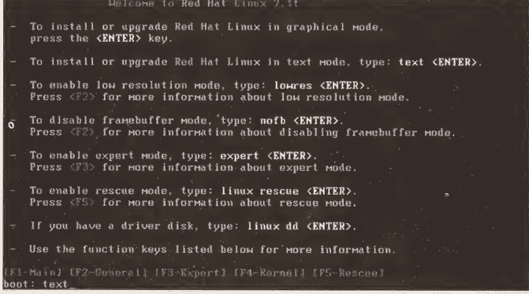

图 1-1 选择安装方法。

## 选择安装语言

在你选择安装界面后（再次假设这里是文本安装），安装过程就开始了。 然后系统会要求你选择安装语言，如图 1-2 所示。

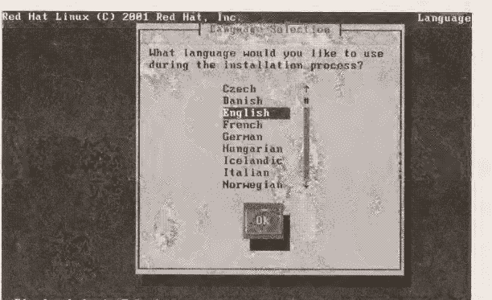

图 1-2 选择你想要的语言。

选择适合你的语言。 由于我选择了英语作为安装语言，其余安装屏幕截图均以英语显示。


## 选择键盘
接下来从列表中选择键盘类型，如图 1-3 所示。

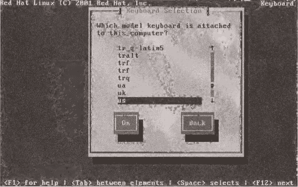

图 1-3 选择键盘类型。

如果您不知道键盘类型，可以保留默认值。选择键盘类型后，您会看到欢迎屏幕，如图 1-4 所示。

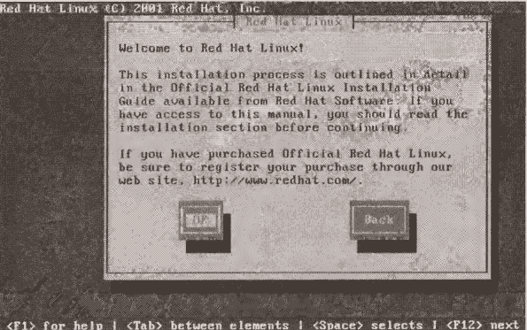

图 1-4 Red Hat Linux 欢迎屏幕。


如果您购买了 Red Hat Linux，请务必在其网站上注册。这样您就可以通过电子邮件获取有关未来更新和错误修复的信息。

## 选择安装类型
安装程序为您提供了一些预定义的安装类型可供选择，例如 Workstation、Server system、Laptop、Custom system 和 Upgrade existing installation，如图 1-5 所示。

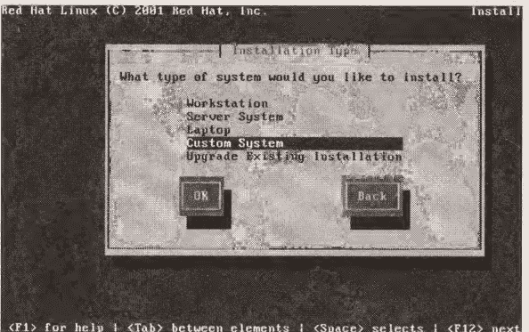

图 1-5 选择安装类型。

预定义的安装类型旨在让 Linux 新手轻松安装 Red Hat Linux。例如，如果您为工作站安装 Red Hat Linux 并选择 Workstation 安装，安装程序会根据您需要的软件做出一些假设并安装该软件。同样，如果您选择 Server system 安装，Linux 会根据服务器需要安装的软件做出假设并进行安装。

如果您急于安装 Linux 且不想了解正在安装的内容，可以选择 Workstation、Laptop 或 Server 等类型。但是，我强烈建议您花点时间（最多几分钟）安装自定义系统，以便您确切知道将安装什么内容。在以下各节中，我假设您选择安装自定义系统。


选择 Server system 安装将擦除整个硬盘以及驻留在其上的任何其他操作系统！

## 分区硬盘
接下来您将被要求分区硬盘。您可以在如图 1-6 所示的两种工具中进行选择。

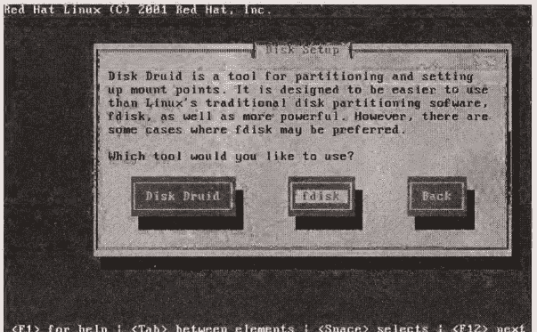

图 1-6 选择磁盘分区工具。

Disk Druid 是一个具有菜单驱动界面的简单工具。对于新手来说，Disk Druid 比 fdisk 更容易使用，但功能不如 fdisk 强大。由于 fdisk 更通用，我假设您选择使用 fdisk 来分区硬盘。

选择 fdisk 作为分区工具后，您将被要求选择要分区的硬盘。如果您只有一个 IDE 硬盘，您将看到与图 1-7 所示类似的列表。

如果您只有一个硬盘，只需选择 Edit 按钮并按 Enter 键即可。如果您有多个驱动器，分区过程与单个驱动器完全相同。在这种情况下，您一次分区一个驱动器，完成一个后会获得分区其他驱动器的机会。只需选择要分区的驱动器并选择 Edit。

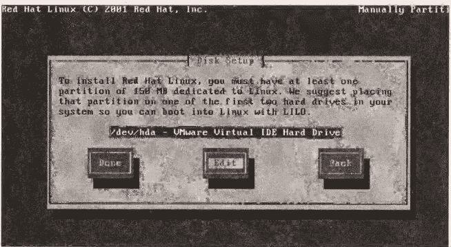

图 1-7 选择要分区的磁盘。

fdisk 显示 Command (m for help): 命令提示符，您可以输入 m 来获取如下帮助屏幕：

```
Command action
  a   toggle a bootable flag
  b   edit bsd disklabel
  c   toggle the dos compatibility flag
  d   delete a partition
  l   list known partition types
  m   print this menu
  n   add a new partition
  o   create a new empty DOS partition table
  p   print the partition table
  q   quit without saving changes
  t   change a partition's system id
  u   change display/entry units
  v   verify the partition table
  w   write table to disk and exit
  x   extra functionality (experts only)
```

要查看所选磁盘中的现有分区，请输入 p，它将以如下表格格式显示所有当前分区：

```
Disk /dev/hda: 33 heads, 63 sectors, 1014 cylinders
Units = cylinders of 2079 * 512 bytes
```

| 设备 | 启动 | 开始 | 结束 | 块 | Id | 系统 |
|---|---|---|---|---|---|---|
| /dev/hda1 |  | 1 | 505 | 524916 | 83 | Linux native |
| /dev/hda2 |  | 506 | 1014 | 529105* | 5 | Extended |
| /dev/hda5 |  | 506 | 886 | 396018 | 83 | Linux native |
| /dev/hda6 |  | 887 | 1011 | 129906 | 82 | Linux swap |

正如您在此处看到的，/dev/hda 磁盘已被分为四个分区，其中第一个分区是 /dev/hda1，从第 1 块开始到第 505 块结束。每个块为 1,024 字节，或 1KB。因此，第一个分区 /dev/hda1 由 524,916 个块组成，或 524,916KB，或大约 512MB。

要逐一删除所有现有分区，请使用 d 命令并输入要删除的分区号。如果您计划将系统与 Windows 操作系统双启动，请确保不要删除 Windows 分区，并且确保 Windows 分区可启动（本节后面将介绍如何为分区打开启动标志的信息）。例如，图 1-8 显示了一个双启动系统，其中第一个分区专用于 Windows 2000（NTFS），其余三个主分区专用于 Linux。

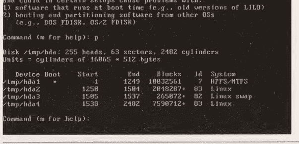

图 1-8 双启动系统分区示例。

删除一个或多个分区后，您可以按如下方式创建新分区：

- 1. Enter n as shown here to add a new partition:
  You get two choices, as shown here. You can create either an extended partition or a primary partition. You need extended partitions only if you want to create more than four partitions. Because you only need /, /usr, /home, and a swap partition to get things going under Linux, you really do not need to create extended partitions.
- 2. Create a primary partition by entering p at the prompt.
- 3. The next prompt asks you to select a partition number:
  Enter 1 for the first partition, 2 for the second, and so on.
- 4. The next prompt asks you to select the starting block number. The range shown in the parentheses is the total blocks available for partitioning. If this is the first partition, you can choose 1 as the starting block as shown here:
- 5. To create a 512MB partition, you can enter the size in bytes, kilobytes, or megabytes. Because a value in megabytes is easy to deal with, I chose +512M for the last cylinder, as shown here:

```
Command (m for help): n
```

```
Command action

e   extended

p   primary partition (1-4)
```

```
Partition number (1-4): 1
```

```
First cylinder (1-1014): 1
```

```
Last cylinder or +size or +sizeM or +sizeK
([1]-1014): +512M
```


> 要创建 GB 大小的分区，请使用 +nGB，其中 n 为该分区中的 GB 数。

要查看分区是否按要求创建，请使用 p 命令查看分区信息：

```
Disk /dev/hda: 33 heads, 63 sectors, 1014 cylinders

Units = cylinders of 2079 * 512 bytes

Device Boot  Start    End    Blocks   Id  System
/dev/hda1         1    505   524916  83  Linux native
```

正如您所见，第一个分区已按要求创建。默认分区类型为 Linux native；如果您想更改此设置，请使用 t 命令切换分区的系统 ID 标志。例如，要将分区的系统 ID 标志切换为 Linux swap，您可以使用以下命令：

```
Command (m for help): t

Partition number (1-4): 1

Hex code (type L to list codes): 82

Changed system type of partition 1 to 82 (Linux swap)
```

```
Command (m for help): p
```

```
Disk /dev/hda: 33 heads, 63 sectors, 1014 cylinders

Units = cylinders of 2079 * 512 bytes

Device Boot  Start    End    Blocks   Id  System
/dev/hda1         1    505   524916  82  Linux swap
```

正如您所见，我首先输入了 t 命令以切换分区的系统 ID，选择了分区，然后输入 82 作为交换分区类型。l 命令可用于列出所有可用的分区类型。

请注意，如果您使用 fdisk 创建分区，必须使 Linux native 分区可启动。例如，要将 /dev/hda1 设为可启动分区，我需要切换启动标志。在提示符下，我可以输入以下命令使第一个分区可启动：

```
Command (m for help): a

Partition number (1-6): 1
```

现在如果我使用 p 命令显示现有分区表，我会看到以下内容：

磁盘 /dev/hda：33 个磁头，63 个扇区，1014 个柱面

单位 = 2079 * 512 字节的柱面

| 设备 | 启动 | 开始 | 结束 | 块 | Id | 系统 |
|---|---|---|---|---|---|---|
| /dev/hda1 | * | 1 | 505 | 524916 | 83 | Linux 原生 |
| /dev/hda2 |  | 506 | 1014 | 529105+ | 5 | 扩展 |
| /dev/hda5 |  | 506 | 886 | 396018 | 83 | Linux 原生 |
| /dev/hda6 |  | 887 | 1011 | 129906 | 82 | Linux 交换 |

如你所见，/dev/hda1 在 Boot 列中有“*”，表示该分区可启动。

在你创建完所有想要的分区并启用至少一个分区作为可启动分区（使用 a 命令）并创建至少一个 Linux 原生（83）分区和一个交换分区（82）之后，你可以使用 verify 命令（v）来验证分区布局。如果收到一条消息称有极少数量（约 62 个）的块未分配，则说明一切正常。如果有大量未分配的块，这意味着由于分区大小不当，你的硬盘空间被浪费了。为了解决这个问题，使用 p 命令检查分区大小，必要时删除并重新创建它们。不要留下未分区的空闲空间。在验证未分配空间非常少后，使用 write（w）命令写入新的分区方案。

如果你有多个磁盘需要分区，将返回到如图 1-7 所示的磁盘选择屏幕。在这种情况下，你将选择下一个磁盘并重复该过程。如果你希望保持它们对 Linux 不可用，则无需对每个磁盘进行分区。

## 分配分区挂载点

完成驱动器分区后，你需要为每个 Linux 分区分配挂载点。你创建的分区将如 Figure 1-9 所示。选择你要在 Linux 下挂载的每个分区，然后单击 Edit 按钮。会出现类似 Figure 1-10 的屏幕。

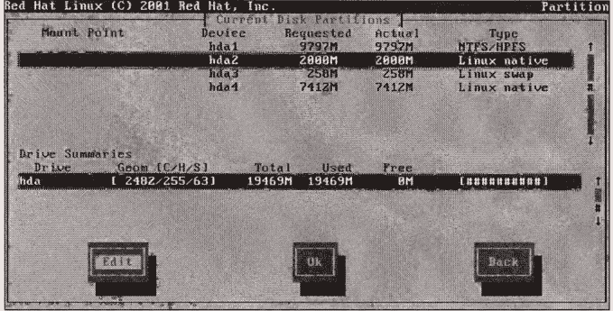

### 图 1-9 分配分区挂载点。

你只能在两个分区上安装 Linux：/（根）和 swap。但对于服务器类型安装，你应该至少有 /（根分区）、/usr 和 swap 分区。在这里我假设你将创建四个分区。因此你需要至少创建 / 和 /usr 挂载点。请注意，如果将包含 /boot 目录的 / 分区放在超过 1024 个柱面的分区中，你可能会收到警告消息，如图 1-11 所示。

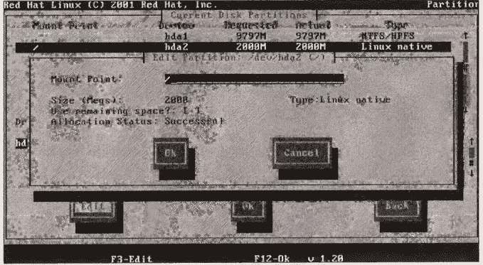

### 图 1-10 编辑分区的挂载点。

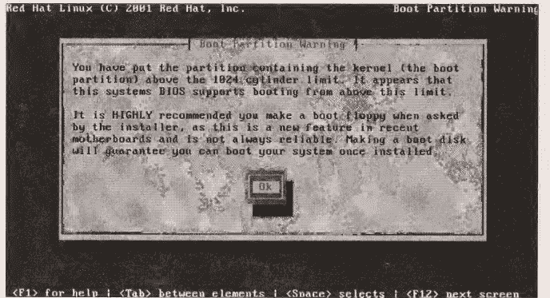

图 1-11 启动分区警告。

如果警告消息指出你的 BIOS 支持此类启动分区，则可以简单地忽略它。然而，如果你后来发现无法从此类分区启动，你将不得不使启动分区非常小，以使其不超过 1024 个柱面，然后重新安装。大多数现代主板 BIOS 支持从大型启动分区启动，因此你应该没问题。

## 选择要格式化的磁盘分区

分配完分区挂载点后，你可以对其进行格式化。我强烈建议你至少格式化 / 和 /usr 分区，如图 1-12 所示。格式化 /（根）和 /usr 分区可确保你不会有旧文件可能与安装混在一起。

如果你使用的是新磁盘，建议在格式化时检查坏块。如果你的硬盘很大（大于 10GB），这会显著减慢安装速度，但对于新硬盘来说是值得的。

## 在启动期间向内核传递额外信息

如果你的系统有一些特殊硬件需要你使用标志告诉 Linux 内核，那么你需要在如图 1-13 所示的屏幕中输入它。大多数系统不需要传递任何内容。

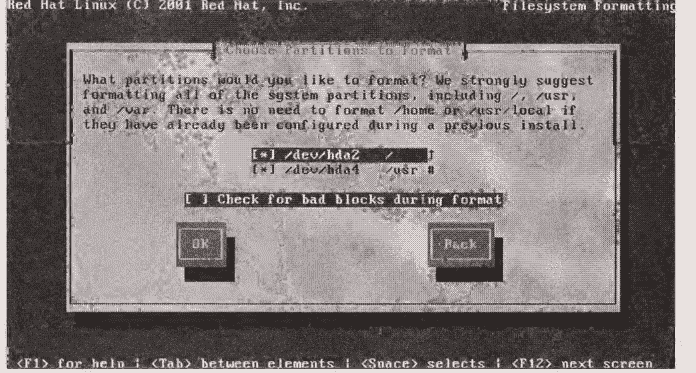

图 1-12 选择要格式化的磁盘分区。

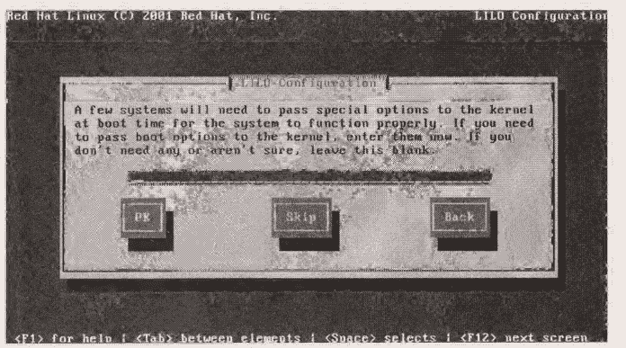

图 1-13 向内核传递启动选项。

## 配置 LILO

接下来将要求你选择要安装 Linux 启动加载程序 LILO 的位置。你有两个选择，如图 1-14 所示。

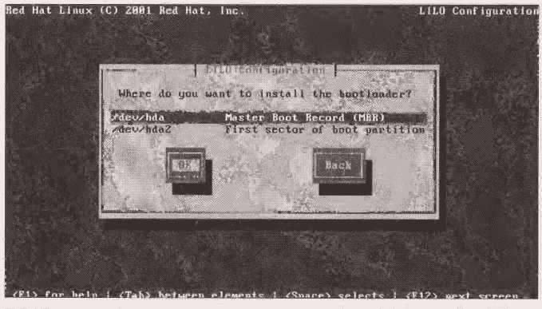

图 1-14 配置 LILO。

只有在没有其他操作系统时，你才能将 LILO 安装在主引导记录（MBR）上。换句话说，如果你不打算将 Linux 与 Windows 2000 或 Windows NT 等其他操作系统双启动，则 MBR 是一个不错的选择。

然而，如果你已安装了其他操作系统，请选择启动分区的第一个扇区。这可确保 LILO 未安装在 MBR 上，而你的其他操作系统（如 Windows）将在其上拥有自己的启动加载程序。

有关如何双启动 Linux 和 Windows 2000/NT 以及 Windows 98 操作系统的详细信息，请参阅第 3 章。

接下来你将看到如图 1-15 所示的屏幕，它会询问你想要启动哪个操作系统。在单启动系统（如图所示）中，除非你想更改默认启动标签，否则无需执行任何操作。如果你确实想将启动标签从“linux”更改为其他名称，请使用 Edit 按钮修改它。或者点击 OK 按钮继续前进。

## 配置你的网络

接下来将要求你配置网络接口（如果有）。如果你没有网络接口，可以跳过本节。网络接口配置屏幕如图 1-16 所示。

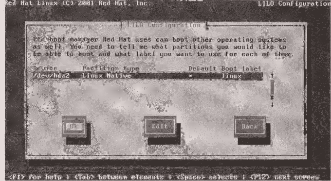

图 1-15 选择要启动的操作系统。

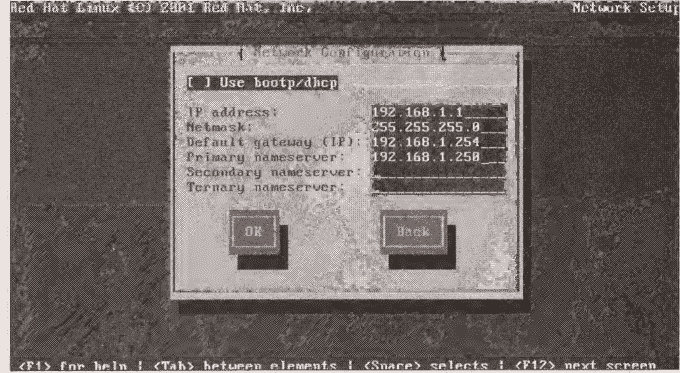

图 1-16 配置网络接口。

如果你想使用动态主机配置协议（DHCP）或 BOOTP 协议在每次启动系统时动态配置网络接口，则从此屏幕中选择此选项。另一方面，如果你有静态 IP 地址，请取消选中 Use bootp/dhcp 选项并输入适当的 IP 地址、子网掩码、默认网关和 DNS 服务器信息，然后继续前进。

接下来你需要为计算机指定一个主机名。此主机名不是任意的，因此不能由任何人随意挑选。此主机名与你在前一个屏幕中分配给系统的 IP 地址相关联。如果你没有主机名并在此处随意编造一个，此名称将无法从其他工作站或服务器使用。为了让其他用户找到你的系统，你在此处输入的主机名必须在它所属的域中具有 A 记录。

例如，图 1-17 显示正在配置的机器的主机名称为 hummer.evoknow.com。evoknow.com 的 DNS 服务器必须在 DNS 配置中具有如下 A 记录。

```
hummer.evoknow.com.  A  192.168.1.1
```

输入适当的主机名。如果你使用 DHCP 或 BOOTP，主机会在系统启动时自动为你配置。

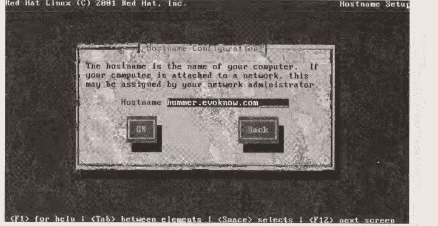

图 1-17 配置主机名。

## 配置防火墙

安装接下来允许你启用和禁用各种被认为易受攻击的服务。在此，如图 1-18 所示，你需要从以下预设防火墙配置中进行选择：

- **High:** 禁用系统上的所有传入远程访问
- **Medium:** 允许通过安全协议如 SSH 进行远程访问，但阻止 FTP、Telnet 以及可以打印远程系统发送文档的服务如打印守护进程
- **No firewall:** 允许所有传入流量，包括 Telnet 和 FTP

更好地自定义防火墙设置，以便你知道正在进行的操作。因此选择 Customize 选项，你将看到类似图 1-18 的屏幕。

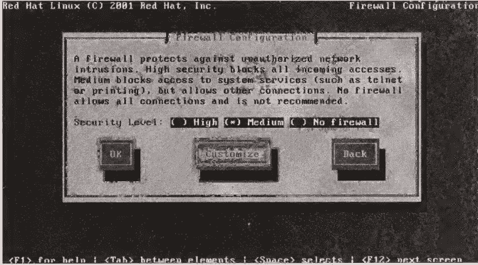

### 图 1-18 自定义防火墙设置。

你可以配置防火墙设置以信任网络接口和/或你可以选择启用或禁用某些网络服务。通过选择你想要启用的服务，如图 1-19 所示，你可以确保它们对你可用。如果你知道此处未列出的服务，可以使用 Other ports 选项以 `service_name:protocol` 的形式添加它。例如，如果你想添加 IMAP 服务，则添加 `imap:tcp`。


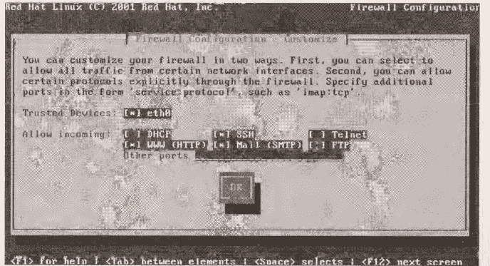

图 1-19 选择防火墙选项。

## 配置鼠标

如果你的系统已连接鼠标，接下来会要求你选择鼠标类型，如图 1-20 所示。

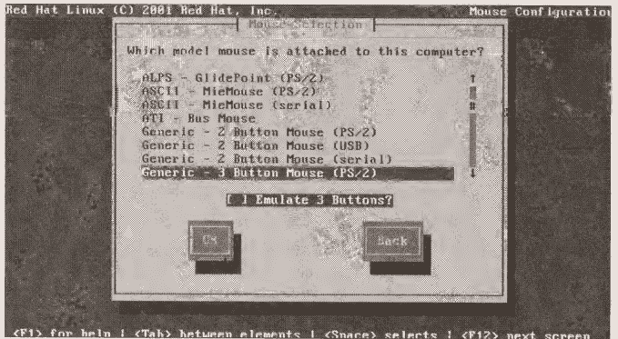

图 1-20 配置鼠标。

选择与你的鼠标最接近的鼠标类型。如果没有三键鼠标，你可以通过选择“模拟 3 个按钮”选项来模拟第三个按钮。你需要同时按住左右鼠标按钮来模拟第三个按钮。

## 配置操作系统的语言

开始安装过程时，你被询问了安装的语言。现在你需要选择操作系统的语言。如图 1-21 所示选择合适的语言。

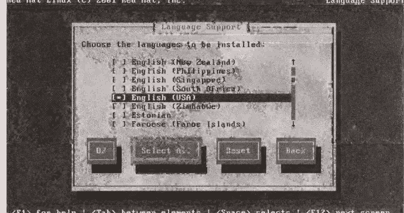

图 1-21 配置你的语言。

## 配置时区

你需要告诉操作系统你的计算机所在的时区，以便它能保持正确的时间。从图 1-22 所示的屏幕中选择时区。

如果你的硬件时钟设置为格林威治标准时间 (GMT)，则可以在此屏幕中选择相应的选项以通知系统。

## 设置 root 密码并创建普通用户

接下来你需要按图 1-23 所示为系统设置 root 密码。

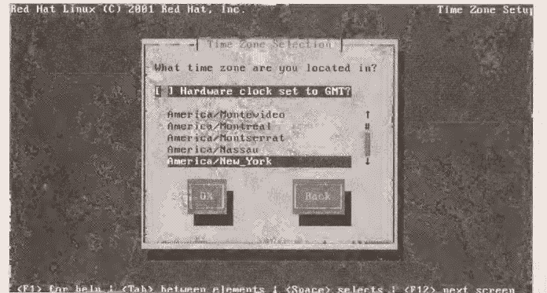

图 1-22 配置你的时区。

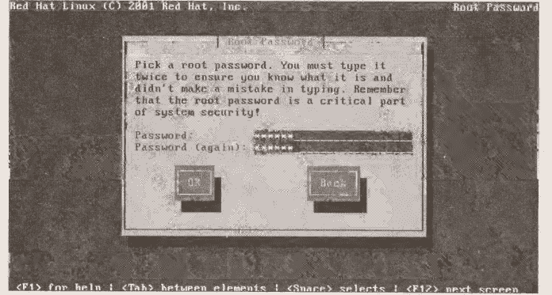

图 1-23 设置 root 密码。


安装完成后，你始终可以使用 passwd 命令（在以 root 身份登录时）更改 root 密码。

设置 root 密码后，你可以创建一个普通用户，以便你可以通过 SSH、Telnet 或 FTP 从远程系统登录到你的系统（如果你在之前的防火墙配置步骤中启用了此类访问）。图 1-24 显示了一个名为 kabir 的用户正在设置密码。

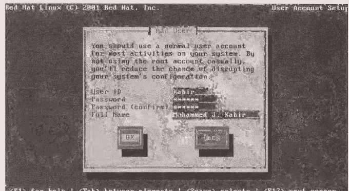

图 1-24 设置普通用户。

添加新用户后，你可以通过点击图 1-25 所示屏幕中的“添加”按钮创建更多用户。你可以创建任意数量的用户。

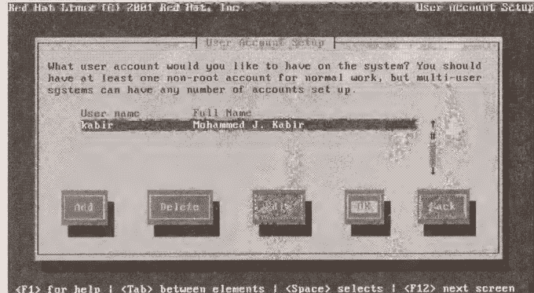

图 1-25 新用户列表。

初始时添加你想要的任意数量的用户。记住你以后随时可以添加新用户。有关如何创建新用户的详细信息，请参阅第 7 章。

## 配置身份验证选项

Red Hat Linux 可以使用标准密码文件 (/etc/passwd) 对用户进行身份验证，或使用影子密码文件 (/etc/passwd 和 /etc/shadow)，或使用远程身份验证服务器进行身份验证，例如网络信息系统 (NIS) 服务器、轻量级目录访问协议 (LDAP) 服务器，甚至 Kerberos 身份验证服务器。图 1-26 显示了你的身份验证配置选项。

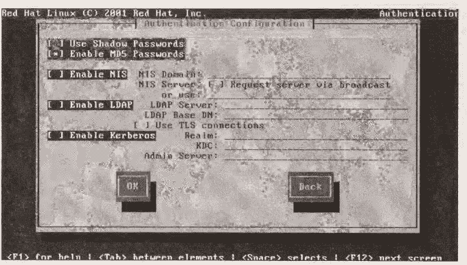

图 1-26 配置身份验证选项。

注意 除非你已设置现有的远程 NIS、LDAP 或 Kerberos 服务器，否则不应启用它们。你一定要使用影子密码支持并启用如图 1-26 所示的基于 MD5 的密码支持。

## 选择要安装的软件包组

现在你可以选择要安装在系统上的软件包组。软件包选择如[content]


图 1-19 选择防火墙选项。

## 配置鼠标

如果你的系统已连接鼠标，接下来会要求你选择鼠标类型，如图 1-20 所示。


图 1-20 配置鼠标。

选择与你的鼠标最接近的鼠标类型。如果没有三键鼠标，你可以通过选择“模拟 3 个按钮”选项来模拟第三个按钮。你需要同时按住左右鼠标按钮来模拟第三个按钮。

## 配置操作系统的语言

开始安装过程时，你被询问了安装的语言。现在你需要选择操作系统的语言。如图 1-21 所示选择合适的语言。


图 1-21 配置你的语言。

## 配置时区

你需要告诉操作系统你的计算机所在的时区，以便它能保持正确的时间。从图 1-22 所示的屏幕中选择时区。

如果你的硬件时钟设置为格林威治标准时间 (GMT)，则可以在此屏幕中选择相应的选项以通知系统。

## 设置 root 密码并创建普通用户

接下来你需要按图 1-23 所示为系统设置 root 密码。


图 1-22 配置你的时区。


图 1-23 设置 root 密码。


安装完成后，你始终可以使用 passwd 命令（在以 root 身份登录时）更改 root 密码。

设置 root 密码后，你可以创建一个普通用户，以便你可以通过 SSH、Telnet 或 FTP 从远程系统登录到你的系统（如果你在之前的防火墙配置步骤中启用了此类访问）。图 1-24 显示了一个名为 kabir 的用户正在设置密码。


图 1-24 设置普通用户。

添加新用户后，你可以通过点击图 1-25 所示屏幕中的“添加”按钮创建更多用户。你可以创建任意数量的用户。


图 1-25 新用户列表。

初始时添加你想要的任意数量的用户。记住你以后随时可以添加新用户。有关如何创建新用户的详细信息，请参阅第 7 章。

## 配置身份验证选项

Red Hat Linux 可以使用标准密码文件 (/etc/passwd) 对用户进行身份验证，或使用影子密码文件 (/etc/passwd 和 /etc/shadow)，或使用远程身份验证服务器进行身份验证，例如网络信息系统 (NIS) 服务器、轻量级目录访问协议 (LDAP) 服务器，甚至 Kerberos 身份验证服务器。图 1-26 显示了你的身份验证配置选项。


图 1-26 配置身份验证选项。

注意 除非你已设置现有的远程 NIS、LDAP 或 Kerberos 服务器，否则不应启用它们。你一定要使用影子密码支持并启用如图 1-26 所示的基于 MD5 的密码支持。

## 选择要安装的软件包组

现在你可以选择要安装在系统上的软件包组。软件包选择如[content]


图 1-19 选择防火墙选项。

## 配置鼠标

如果你的系统已连接鼠标，接下来会要求你选择鼠标类型，如图 1-20 所示。


图 1-20 配置鼠标。

选择与你的鼠标最接近的鼠标类型。如果没有三键鼠标，你可以通过选择“模拟 3 个按钮”选项来模拟第三个按钮。你需要同时按住左右鼠标按钮来模拟第三个按钮。

## 配置操作系统的语言

开始安装过程时，你被询问了安装的语言。现在你需要选择操作系统的语言。如图 1-21 所示选择合适的语言。


图 1-21 配置你的语言。

## 配置时区

你需要告诉操作系统你的计算机所在的时区，以便它能保持正确的时间。从图 1-22 所示的屏幕中选择时区。

如果你的硬件时钟设置为格林威治标准时间 (GMT)，则可以在此屏幕中选择相应的选项以通知系统。

## 设置 root 密码并创建普通用户

接下来你需要按图 1-23 所示为系统设置 root 密码。


图 1-22 配置你的时区。


图 1-23 设置 root 密码。


安装完成后，你始终可以使用 passwd 命令（在以 root 身份登录时）更改 root 密码。

设置 root 密码后，你可以创建一个普通用户，以便你可以通过 SSH、Telnet 或 FTP 从远程系统登录到你的系统（如果你在之前的防火墙配置步骤中启用了此类访问）。图 1-24 显示了一个名为 kabir 的用户正在设置密码。


图 1-24 设置普通用户。

添加新用户后，你可以通过点击图 1-25 所示屏幕中的“添加”按钮创建更多用户。你可以创建任意数量的用户。


图 1-25 新用户列表。

初始时添加你想要的任意数量的用户。记住你以后随时可以添加新用户。有关如何创建新用户的详细信息，请参阅第 7 章。

## 配置身份验证选项

Red Hat Linux 可以使用标准密码文件 (/etc/passwd) 对用户进行身份验证，或使用影子密码文件 (/etc/passwd 和 /etc/shadow)，或使用远程身份验证服务器进行身份验证，例如网络信息系统 (NIS) 服务器、轻量级目录访问协议 (LDAP) 服务器，甚至 Kerberos 身份验证服务器。图 1-26 显示了你的身份验证配置选项。


图 1-26 配置身份验证选项。

注意 除非你已设置现有的远程 NIS、LDAP 或 Kerberos 服务器，否则不应启用它们。你一定要使用影子密码支持并启用如图 1-26 所示的基于 MD5 的密码支持。

## 选择要安装的软件包组

现在你可以选择要安装在系统上的软件包组。软件包选择如[content]


图 1-19 选择防火墙选项。

## 配置鼠标

如果你的系统已连接鼠标，接下来会要求你选择鼠标类型，如图 1-20 所示。


图 1-20 配置鼠标。

选择与你的鼠标最接近的鼠标类型。如果没有三键鼠标，你可以通过选择“模拟 3 个按钮”选项来模拟第三个按钮。你需要同时按住左右鼠标按钮来模拟第三个按钮。

## 配置操作系统的语言

开始安装过程时，你被询问了安装的语言。现在你需要选择操作系统的语言。如图 1-21 所示选择合适的语言。


图 1-21 配置你的语言。

## 配置时区

你需要告诉操作系统你的计算机所在的时区，以便它能保持正确的时间。从图 1-22 所示的屏幕中选择时区。

如果你的硬件时钟设置为格林威治标准时间 (GMT)，则可以在此屏幕中选择相应的选项以通知系统。

## 设置 root 密码并创建普通用户

接下来你需要按图 1-23 所示为系统设置 root 密码。


图 1-22 配置你的时区。


图 1-23 设置 root 密码。


安装完成后，你始终可以使用 passwd 命令（在以 root 身份登录时）更改 root 密码。

设置 root 密码后，你可以创建一个普通用户，以便你可以通过 SSH、Telnet 或 FTP 从远程系统登录到你的系统（如果你在之前的防火墙配置步骤中启用了此类访问）。图 1-24 显示了一个名为 kabir 的用户正在设置密码。


图 1-24 设置普通用户。

添加新用户后，你可以通过点击图 1-25 所示屏幕中的“添加”按钮创建更多用户。你可以创建任意数量的用户。


图 1-25 新用户列表。

初始时添加你想要的任意数量的用户。记住你以后随时可以添加新用户。有关如何创建新用户的详细信息，请参阅第 7 章。

## 配置身份验证选项

Red Hat Linux 可以使用标准密码文件 (/etc/passwd) 对用户进行身份验证，或使用影子密码文件 (/etc/passwd 和 /etc/shadow)，或使用远程身份验证服务器进行身份验证，例如网络信息系统 (NIS) 服务器、轻量级目录访问协议 (LDAP) 服务器，甚至 Kerberos 身份验证服务器。图 1-26 显示了你的身份验证配置选项。


图 1-26 配置身份验证选项。

注意 除非你已设置现有的远程 NIS、LDAP 或 Kerberos 服务器，否则不应启用它们。你一定要使用影子密码支持并启用如图 1-26 所示的基于 MD5 的密码支持。

## 选择要安装的软件包组

现在你可以选择要安装在系统上的软件包组。软件包选择如[content]


图 1-19 选择防火墙选项。

## 配置鼠标

如果系统已连接鼠标，接下来会要求你选择鼠标类型，如图 1-20 所示。


图 1-20 配置鼠标。

选择与你的鼠标最接近的类型。若没有三键鼠标，可通过选择“模拟 3 个按钮”选项来模拟第三个按钮。模拟时需同时按住左右鼠标按钮。

## 配置操作系统的语言

开始安装时已询问安装语言。现在需选择操作系统的语言。如图 1-21 所示选择合适的语言。


图 1-21 配置你的语言。

## 配置时区

需告诉操作系统计算机所在的时区以保持正确时间。从图 1-22 所示屏幕中选择时区。

若硬件时钟设为格林威治标准时间 GMT，则可在本屏幕中选择相应选项通知系统。

## 设置 root 密码并创建普通用户

接下来按图 1-23 所示为系统设置 root 密码。


图 1-22 配置你的时区。


图 1-23 设置 root 密码。


安装完成后，可随时使用 passwd 命令在以 root 登录时更改 root 密码。

设置 root 密码后，可创建普通用户，以便通过 SSH、Telnet 或 FTP 从远程系统登录，前提是防火墙配置步骤中已启用此类访问。图 1-24 显示用户 kabir 正在设置密码。


图 1-24 设置普通用户。

添加新用户后，可在图 1-25 所示屏幕中点击“添加”按钮创建更多用户。可创建任意数量用户。


图 1-25 新用户列表。

按需初始添加用户。日后随时可添加新用户。创建新用户的详细说明见第 7 章。

## 配置身份验证选项

Red Hat Linux 可使用标准密码文件 /etc/passwd，或使用影子密码文件 /etc/passwd 和 /etc/shadow，或使用远程身份验证服务器如网络信息系统 NIS 服务器、轻量级目录访问协议 LDAP 服务器，甚至 Kerberos 身份验证服务器进行身份验证。图 1-26 显示身份验证配置选项。


图 1-26 配置身份验证选项。

注意 若未设置现有的远程 NIS、LDAP 或 Kerberos 服务器，则不应启用它们。应一定使用影子密码支持并启用如图 1-26 所示的基于 MD5 的密码支持。

## 选择要安装的软件包组

现在可选择要安装的软件包组。软件包选择如图 1-27 所示。

选择要安装的软件包。若在工作站系统上安装 Red Hat Linux，需决定是否安装 X Window 系统、打印支持、拨号支持等。选择一个软件包组时会安装一个或多个相关软件包。例如，选择图形处理软件包组时会安装一个或多个图形工具。

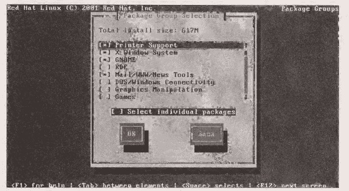

图 1-27 选择软件包组。

若想查看或限制各软件包组内具体安装内容，可启用“选择单个软件包”选项。启用后会要求在各组内逐个选择软件包。若你是 Red Hat Linux 新手，为了解软件包并通过使用学习，不必使用此选项。可稍后挑剔并卸载不喜欢或不需要的软件包。

## 开始你的咖啡休息

回答完安装程序的所有问题后，会提示完整安装日志将创建在 /tmp/install.log 中以便查看系统安装内容。该消息如图 1-28 所示。

点击“确定”按钮继续。安装程序开始格式化选定的硬盘分区，如图 1-29 所示。

此过程可能耗时较长，取决于硬盘大小及是否选择检测坏块。若硬盘较大如 30GB 或以上，可去喝杯咖啡甚至午餐休息。

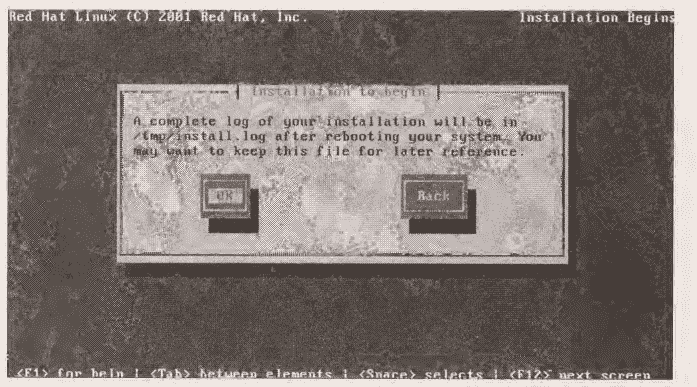

图 1-28 开始安装。

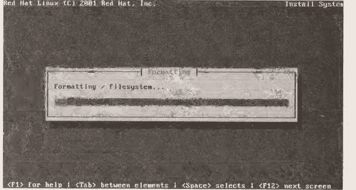

图 1-29 格式化选定的硬盘分区。

格式化完成后，软件包安装开始并显示状态屏幕，如图 1-30 所示。

可通过该状态屏幕提供的信息查看安装预计耗时。

软件包安装完成后会要求创建启动盘，如图 1-31 所示。

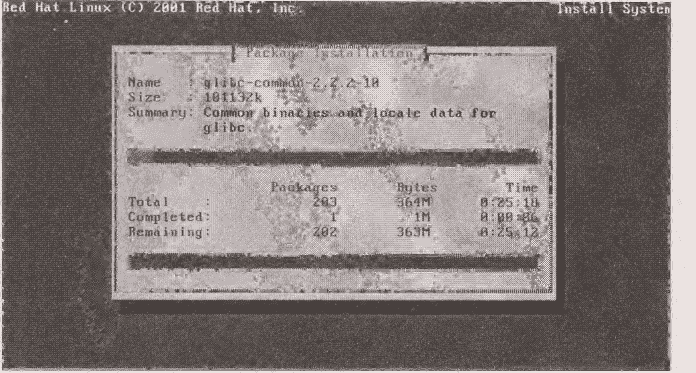

图 1-30 软件包安装状态屏幕。

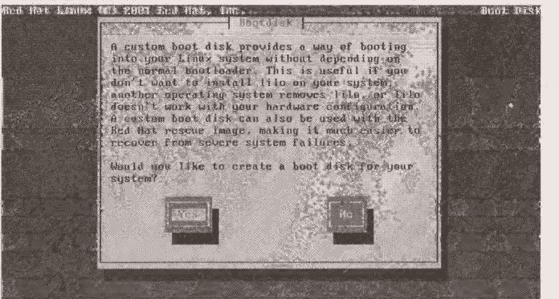

图 1-31 创建启动盘。

强烈建议插入空白软盘并选择“是”选项创建启动盘，磁盘无需格式化。

创建启动软盘后会看到安装完成消息，如图 1-32 所示。

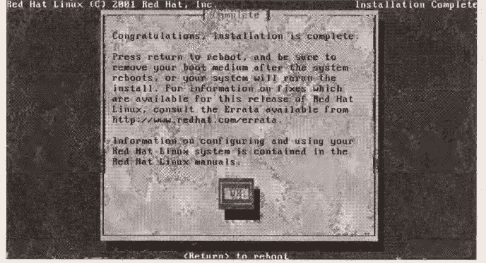

图 1-32 安装完成消息。

按 Enter 键重新启动系统。确保取出启动软盘或 CD-ROM，使系统可从硬盘启动。系统启动完成后应看到登录提示。恭喜！你现在是 Linux 用户，有了本书很快可成为高级用户。享受吧！

## 第 2 章

### 升级 Red Hat Linux

#### 本章内容

- 使用命令行 RPM 命令升级软件
- 使用 Gnome RPM 升级软件
- 使用 Red Hat Network 更新代理升级软件
- 升级 Linux 内核

如同大多数现代软件，Red Hat Linux 随附的软件经常更新，久而久之某些软件包需更新以保持与最新软件兼容。升级 Linux 软件包时有多种安装方法，最流行的是 RPM 二进制软件包和从源代码编译二进制文件。

本章将介绍如何使用 RPM 工具即命令行和图形界面升级 Red Hat Linux 操作系统的现有软件组件，以及如何升级 Linux 内核。

## 升级单个软件包

你在 Red Hat Linux 系统上使用的多数应用程序和实用程序均使用 Red Hat Package Management RPM 软件包打包，二进制或源代码发行。本节介绍如何使用可用的命令行和图形 RPM 工具协助升级软件。

## 使用命令行 RPM 工具升级

命令行 RPM 工具在安装或升级 RPM 软件包方面非常多功能。本节介绍如何使用它进行最常见的管理任务。


在 shell 提示符或 xterm 终端窗口中运行 rpm 会看到许多可用的选项。我强烈建议通过在命令提示符下使用 man rpm 命令阅读 rpm 命令的手册页以了解更多关于此优秀工具的信息。

## 查找系统上安装的所有 RPM 软件包

要查找系统上安装的所有 RPM 软件包，运行 rpm -qa 命令。若行滚动超出屏幕，可使用 rpm -qa | more 命令一次查看一页，阅读完每页后按空格键。

## 查找特定的 RPM 软件包

若要确认特定软件 RPM 软件包是否已安装，运行 rpm -qa | grep package_name 命令。例如，要查找 Perl 的所有 RPM 软件包，运行以下命令：

```
rpm -qa | grep perl
```

前述命令的示例输出如下：

```
perl-5.6.0-12
openssl-perl-0.9.6-3
perl-SGMLSpm-1.03ii-4
```

## 查找特定已安装软件包的信息

要查找软件包信息，可运行 rpm -qip package_name 命令。例如：

```
rpm -qip vlock-1.3-5.i386.rpm
```

此命令会输出有关指定软件包的以下信息：

```
Name          : vlock          Relocations: (not relocateable)
Version       : 1.3            Vendor: Red Hat, Inc.
Release       : 5              Build Date: Thu 13 Jul 2000 11:25:38 AM BDT
Install date: (not installed) Build Host: porky.devel.redhat.com
Group         : Applications/System Source RPM: vlock-1.3-5.src.rpm
Size          : 8857           License: GPL
Packager      : Red Hat, Inc. <http://bugzilla.redhat.com/bugzilla>
Summary       : A program which locks one or more virtual consoles.
Description :
The vlock program locks one or more sessions on the console. Vlock can lock the current terminal (local or remote) or the entire virtual console system, which completely disables all console access. The vlock program unlocks when either the password of the user who started vlock or the root password is typed.
```


如果您想知道此软件包将安装哪些文件，请运行 rpm -qlp package_name 命令。例如：

```
rpm -qlp vlock-1.3-5.i386.rpm
```

此命令显示以下输出：

/etc/pam.d/vlock
/usr/bin/vlock
/usr/share/man/man1/vlock.1.gz

## 查找文件所属的软件包

要查找特定文件所属的软件包，请运行以下命令：

```
rpm -qf path_to_file
```

## 升级软件

如果您拥有要升级的 RPM 软件包，请运行以下命令从硬盘上文件所在的目录升级软件：

```
rpm -U package_name
```

## 从 FTP 站点升级

如果您在 FTP 站点上找到软件包的新版本，可以使用以下命令让 rpm 从该站点获取以升级软件包：

```
rpm -U ftp://ftp_hostname/path_to_RPM_package
```

## 强制软件升级

有时当您尝试使用 rpm -U package_name 命令升级软件包时，软件包可能拒绝升级。如果您无论如何都想升级，可以使用 rpm -U --force package_name 命令强制升级软件包。


> 强制升级不是一件好事，因为您可能会在过程中破坏其他东西。但是，如果您确切知道自己在做什么，了解如何强制升级软件包是很有用的。

您还可以启用 -v 和 -h 选项以启用详细模式和哈希字符，以确保在升级过程中能看到一些输出。例如，以下命令强制升级系统上 gzip 软件包版本 1.3-12：

```
rpm -Uvh --force gzip-1.3-12.i386.rpm
```

上述命令的示例输出如下所示：

```
Preparing... ####################### [100%]
1:gzip   ####################### [100%]
```

## 在升级软件之前先卸载

如果软件包要求您在安装新版本之前卸载旧版本软件，您可以运行 rpm -e old_package_name 命令删除当前版本，然后运行 rpm -ivh new_package_name 命令安装新软件包。

## 验证软件包是否完好

如果您对已安装的软件包有任何疑问并希望验证软件包是否正确安装，请运行 rpm -V package_name 命令。要同时验证系统中所有软件包的完整性，请运行 rpm -Va 命令。

## 使用 Gnome RPM 工具升级

Gnome RPM（或 GnoRPM）是用于管理 RPM 软件包的图形界面，可帮助您轻松安装、升级、卸载、验证和查询 RPM 软件包。要运行 GnoRPM，请单击 GNOME 主菜单按钮并选择 Programs ↪ System ↪ GnoRPM。GnoRPM 主窗口出现，如图 2-1 所示。

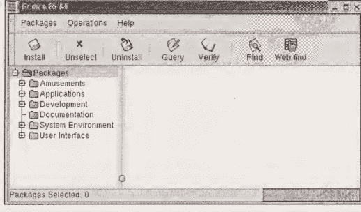

图 2-1 GnoRPM 主窗口。

要从 CD-ROM 安装 RPM 软件包，请将 CD-ROM 插入驱动器并在必要时挂载它（除非您使用 GNOME 控制中心禁用了此选项，否则 GNOME 会自动挂载 CD-ROM）。单击安装图标或从左上角的 Packages 菜单中选择安装选项，将出现类似图 2-2 所示的屏幕。

GnoRPM 读取 CD-ROM 并定位软件包。默认情况下，GnoRPM 仅显示尚未安装的软件包。如果您单击展开树按钮，则所有软件包都会显示出来，如图 2-3 所示。

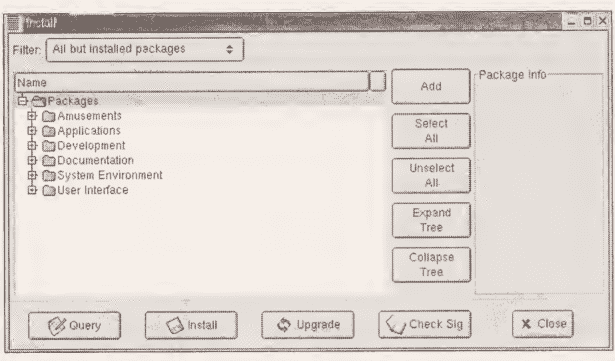

图 2-2 选择要安装的新 RPM。

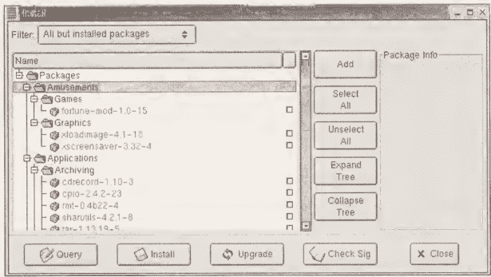

图 2-3 展开软件包树。

选择适当的软件包并单击安装按钮以安装所选软件包。如果您希望使用当前 CD-ROM 升级现有软件包，只需将过滤规则（左上角）更改为“所有软件包”或“仅较新的软件包”，以便更轻松地找到适当的软件包。如果您是从已安装软件包的旧版本升级，请使用升级按钮而不是安装按钮。

要验证现有软件包是否完整，您只需选择该软件包并单击验证按钮。例如，图 2-4 显示 GnoRPM 在已安装的内核软件包中发现了六个问题。

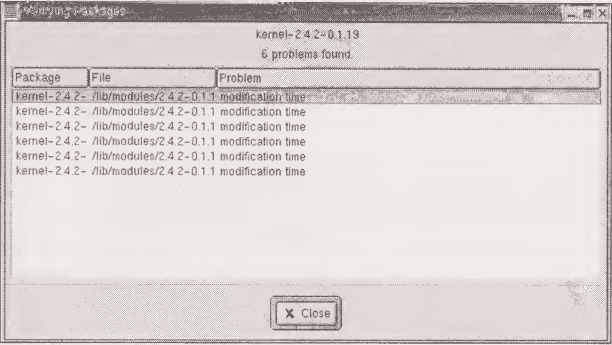

图 2-4 验证软件包。

正如您从图中可以看到的，因为发现的唯一问题是修改日期（我知道是我自己更改的），因此无需重新安装此软件包。但是，如果 GnoRPM 报告已安装软件包的文件丢失，最好重新安装它。

Gnome RPM 程序还可以使用 Web Find 功能通过网络查找您需要的 RPM 软件包。此功能允许您在网络上定位 RPM 软件包并下载它。

## 使用 Red Hat Network 更新代理

Red Hat Network 是 Red Hat Linux 的支持和管理服务。它主要为付费客户（那些在 CD-ROM 上购买了 Red Hat Linux 软件包的人）提供这些服务，他们希望付费更新软件并获得 Red Hat 的支持。Red Hat 为每位客户提供一台机器的免费软件管理器服务访问权限。

Red Hat 更新代理是一个使用 Red Hat Network 查找系统中需要更新的软件包并自动更新它们的工具。要使用 Red Hat 更新代理，您首先需要成为 Red Hat Network 的注册用户，我将在下一节中描述此过程。

## 成为 Red Hat Network 的注册用户

要为单台机器注册试用免费会员，请按照以下步骤操作：

- 1. 从 GUI 环境中的 xterm 或从命令 shell 运行 rhn_register 命令。（在本节中我假设您使用的是 GNOME 桌面环境。）图 2-5 显示了该程序在 GNOME 中显示的第一个窗口。

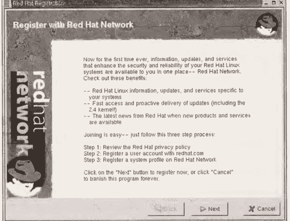

图 2-5 rhn_register 介绍屏幕。

- 2. 单击下一步按钮继续。您需要查看 Red Hat 隐私声明，如图 2-6 所示。阅读该政策。如果您同意该政策，再次单击下一步按钮继续。

- 3. 接下来您将被要求注册或更新现有的 Red Hat Network 账户，如图 2-7 所示。按要求输入信息并继续。然后您将被要求回答更多问题，如图 2-8 所示。填写这些信息并单击下一步继续。

- 4. 接下来您将被要求注册系统的硬件配置文件。如果您不希望 Red Hat 拥有此信息，请取消选中标记为“include information about hardware and network.”的复选框。现在如果您希望包含已安装软件包信息，如图 2-9 所示，则保留复选框选中。无论哪种情况，单击下一步继续。

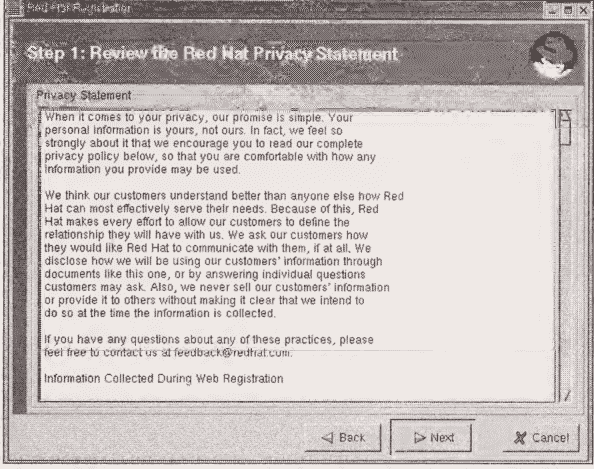

图 2-6 Red Hat 隐私声明窗口。

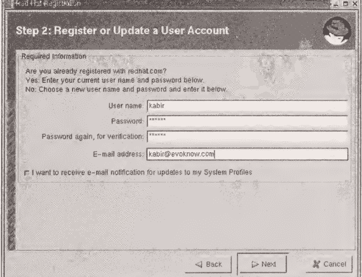

图 2-7 注册或更新用户账户（步骤 1）。


图 2-8 注册或更新用户账户（步骤 2）。

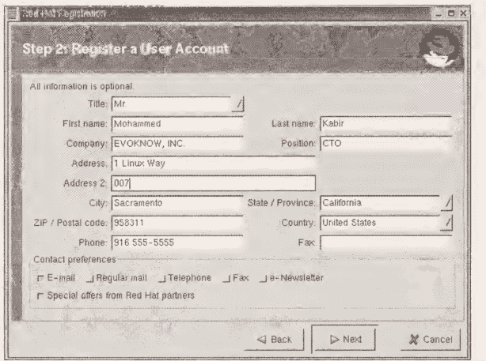

图 2-9 注册或更新用户账户（步骤 3）。

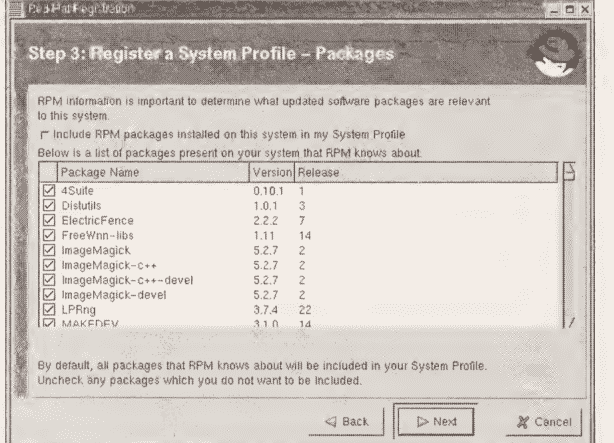

5. 如果您希望将系统配置文件（硬件和已安装的软件包信息）发送到 Red Hat Network，请在确认屏幕上单击“下一步”按钮。成功注册后，您会看到如图 2-10 所示的状态消息。

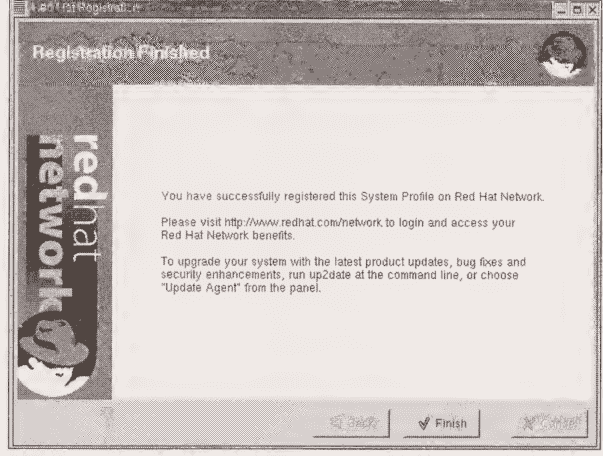

图 2-10 成功注册的确认。

## 在 Red Hat Network 上创建服务级别

按照以下步骤在 Red Hat Network 上创建服务级别：

- 1. 使用已注册的 Red Hat Network 用户账户信息登录 www.redhat.com/network。
- 2. 为您的系统创建服务级别。
- 3. 单击“您的网络”链接
- 4. 单击“分配服务级别”链接
- 5. 在标记为“no service”的未分配系统列表中找到您已注册的系统，并使用“升级”按钮将其移动到右侧的软件管理器列表中。
- 6. 单击右上角的注销按钮。就这样；您已为指定主机启用了软件管理器服务。

## 配置 Red Hat Update Agent

从 GNOME 主菜单中，选择“应用程序 ⇨ 系统 ⇨ 配置更新代理”选项来配置 Red Hat Update Agent。窗口如图所示 2-11 出现。

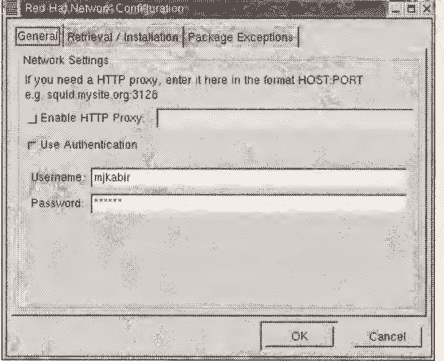

图 2-11 配置常规信息。

在“常规”选项卡中，您可以配置网络设置。如果需要通过 HTTP 代理访问 Red Hat Network，您可以在此处指定代理服务器名称和端口号。选中“使用身份验证”复选框并输入您已注册的用户名和密码，以便代理能够对 Red Hat Network 服务器进行身份验证。

单击“检索 / 安装”选项卡，您将看到如图 2-12 所示的屏幕。

如果您不想在检索后安装软件包，可以在此处禁用该功能。此外，如果您希望在有可用的情况下连同二进制软件包一起检索源 RPM 软件包，也可以在此处启用该选项。

默认情况下，安装后不会保留二进制 RPM 软件包文件；如果您希望保留它们，请在“软件包安装选项”部分启用此选项。请确保保持 GNU Privacy Guard (GPG/GnuPG) 软件包验证选项处于打开状态。您还可以指定软件包要存储的目录名称。对于大多数用户，默认值应该足够。

单击“软件包例外”选项卡以查看如图 2-13 所示的屏幕。

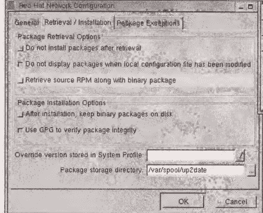

图 2-12 配置检索和安装。

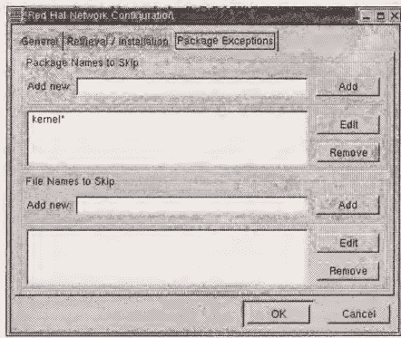

图 2-13 配置软件包例外。

如果某些软件包的自动更新可能非常敏感，或者您只是不习惯 Update Agent 自动更新某些内容，您可以将这些软件包添加到例外列表中。默认情况下，任何内核软件包都被视为例外。毕竟，如果内核更新开始以奇怪的方式运行，您可能无法访问系统。

## 运行 Red Hat Update Agent

要从 GNOME 环境运行 Red Hat Update Agent，请单击“主菜单”按钮并选择“应用程序 ⇨ 系统 ⇨ 更新代理”。

第一次运行 Update Agent 时，它会显示如图 2-14 所示的屏幕。该屏幕说明您在 GPG 密钥环中没有 Red Hat 公钥，因此需要添加它。您可以单击“是”立即添加它。接下来您将看到如图 2-15 所示的欢迎屏幕。

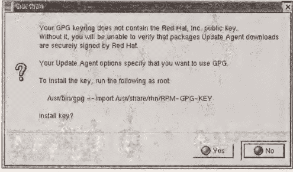

图 2-14 安装公钥。

单击“下一步”继续。Update Agent 会显示您例外列表中的软件包，如图 2-16 所示。

如果您希望查看其中任何软件包的公告，请选择该软件包并单击“查看公告”按钮。示例公告如图 2-17 所示。

根据公告的严重程度，您可能会决定是否更新该软件包。您也可以通过选中“选择所有软件包”复选框来决定包含例外列表中的所有软件包。安装程序会检索需要更新的软件包，如图 2-18 所示。

更新完成后，您会看到“全部完成”消息，如图 2-19 所示。

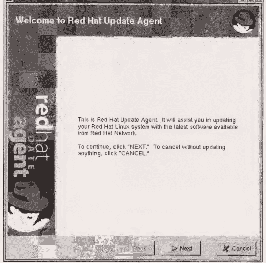

图 2-15 Update Agent 欢迎屏幕。

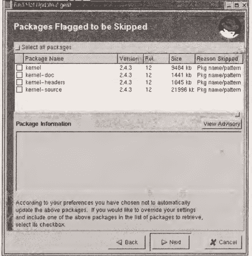

图 2-16 Update Agent 显示将被忽略的软件包。

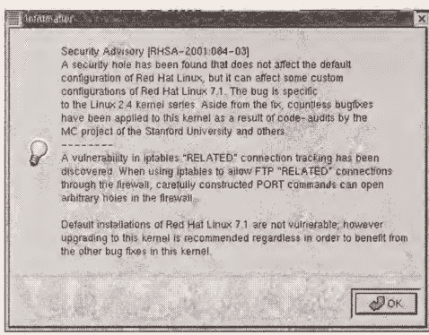

图 2-17 Update Agent 显示软件包的公告。

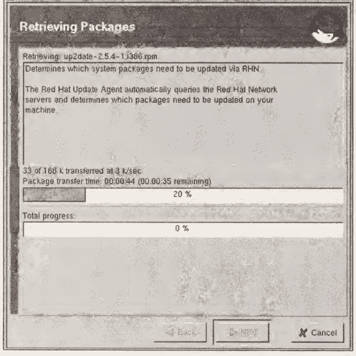

图 2-18 Update Agent 正在检索软件包。


图 2-19 全部完成！

## 升级 Linux 内核

更新 Linux 内核是一个有点棘手的过程，应谨慎操作。如果操作失误，您可能无法启动系统。在执行任何操作之前，请确保您有启动磁盘或可启动 CD-ROM，例如第一张（#1）官方 Red Hat Linux CD-ROM。本节向您展示如何升级 Linux 内核。

### 制作启动软盘

要为当前内核创建启动磁盘，请运行以下命令：

```
mkbootdisk --device /dev/fd0 version_number_of_current_kernel
```

例如，如果您的 /boot/vmlinuz 指向 /boot/vmlinuz-2.4.2-2，则您的内核版本为 2.4.2-2。要为 2.4.2-2 内核创建启动磁盘，您将运行以下命令：

```
mkbootdisk --device /dev/fd0 vmlinuz-2.4.2-2
```

### 编译新的升级内核

我强烈建议您从 www.redhat.com 或 www.kernel.org 下载最新的内核源代码并编译新内核，如第 11 章所述。保留旧的内核映像以及模块。按照第 11 章所述安装新内核。

### 配置 LILO 以启动新旧内核

使用 vi 等文本编辑器编辑当前的 /etc/lilo.conf 文件。下面列出了示例 /etc/lilo.conf：

```
boot=/dev/hda
map=/boot/map
install=/boot/boot.b
prompt
timeout=50
message=/boot/message
linear
default=linux

image=/boot/vmlinuz-2.4.2-2
    label=linux
    read-only
    root=/dev/hda1
```

在前面的示例中，只定义了一个内核（/boot/vmlinuz-2.4.2-2），其标签名为“linux”，也是默认值。现在在 /etc/lilo.conf 中添加以下配置行（请记住用要安装的新内核的适当版本号替换 version_number，并用适当的根设备分区名称替换 device_partition）。

```
image=/boot/vmlinuz-version_number
    label=newos
    read-only
    root=/dev/device_partition
```

对于之前的 /etc/lilo.conf 和版本为 2.4.7-1 的新内核，完整的 /etc/lilo.conf 文件将如下所示：

```
boot=/dev/hda
map=/boot/map
install=/boot/boot.b
prompt
timeout=50
message=/boot/message
linear
default=linux

image=/boot/vmlinuz-2.4.2-2
    label=linux
    read-only
    root=/dev/hda1

image=/boot/vmlinuz-2.4.7-1
    label=newos
    read-only
    root=/dev/hda1
```

运行 /sbin/lilo 命令以让 LILO 知道 /etc/lilo.conf 文件的更改。此时，您已在 /etc/lilo.conf 中定义了两个内核。默认情况下，系统仍将启动原始内核，因为 default=linux 仍设置为原始内核。要启动新内核，您需要在 LILO 提示符下输入或选择“newos”。

### 重启系统

要重启系统，请以 root 身份运行 shutdown -r now 命令。当 LILO 提示符出现时，选择或输入“newos”以使用新内核启动。如果您正确编译并安装了内核，系统将启动新内核。


## 验证正在运行的内核版本

如果内核版本号与你刚刚升级到的版本号相符，那就成功了！你已经升级了 Linux 内核。恭喜！

如果你启动的是旧内核并看到旧版本，则应重新检查内核安装过程，并确保 /boot 中的链接和文件反映了更新。为了验证系统使用哪个内核启动，你可以运行 uname -r 命令。同时检查是否已运行 /sbin/lilo 命令。你可以再次运行它以确保，然后重新启动系统，并选择合适的 LILO 标签来启动新内核。

在新内核成功启动后，修改 /etc/lilo.conf 使新内核标签成为默认项，在我们之前的示例中即为 default=newos。更好的做法是为新内核标记（使用 label=linux）并为旧内核标记（使用 label=old_linux），然后运行 /sbin/lilo。

## 第 3 章

### 使用 Windows 双启动 Red Hat Linux

#### 本章内容

- 使用 Windows NT/2000 双启动 Linux
- 使用 Windows 98 双启动 Linux
- 使用 VMware 在 Linux 中启动 Windows

双启动系统是一台安装了两个操作系统的计算机，可以随时启动其中任意一个操作系统。双启动系统在希望使用 Windows 专属应用程序或游戏的 Linux 用户中最为常见。在本章中，我将向你展示如何将 Red Hat Linux 与 Windows 2000、Windows NT 和 Windows 98 操作系统进行双启动，这些是最常见的双启动场景。我还讨论了名为 VMware 的商业工具，它允许你在另一个操作系统内部启动第二个操作系统！

## 使用 Windows NT/2000 双启动

在本书撰写时，Windows 2000 是微软最新发布的专业版和服务器级操作系统版本。Windows 2000 基于 Windows NT 技术构建。将 Linux 与 Windows 2000 或 Windows NT（我称之为“Windows”）进行双启动需要相同的流程，这将在本章后面的章节中讨论。在本书中，我使用 NT/2000 表示 Windows 2000 和 Windows NT。


Windows XP Professional 在本书出版时应该已经发布，它基于 Windows 2000。大多数情况下，Windows XP Professional 用户可以使用 Windows NT/2000 的说明。

### 双启动 Linux 和 Windows NT/2000 的前提条件

你必须在第一块硬盘的第一个分区上安装 Windows NT/2000。


在本节中，我假设你使用的是 IDE 硬盘（/dev/hda）并且至少有两个分区（/dev/hda1 和 /dev/hda2）。如果你使用的是 SCSI 硬盘，此处提供的说明仍然适用，只需将所有 hda 实例替换为 sda，即系统中的第一块 SCSI 硬盘。

在 /dev/hda1 上安装 Windows NT/2000 后，操作系统由名为 NTLoader 的 Windows NT/2000 启动加载程序加载。该程序安装在系统上第一个可启动硬盘的主引导记录（MBR）上，即 /dev/hda。

你可以通过两种方式在系统上启用双启动：

- 使用 LILO 作为启动加载程序；你可以使用名为 LILO 的 Linux 启动加载程序来启动任一操作系统。在此过程中，你会看到如图 3-1 所示的基于 Linux 的 LILO 生成的启动选项屏幕。它也比另一个选项更容易实现。


你也可以使用 GRUB，这是一个 GNU 启动加载程序工具，来将 Linux 与 Windows NT/2000 双启动。你可以在 www.gnu.org/directory/grub.html 了解有关 GRUB 的信息。


图 3-1 LILO 生成的启动选项屏幕。

- 你也可以使用名为 NTLoader 的 Windows NT/2000 启动加载程序来加载任一操作系统。此过程将显示 NTLoader 生成的启动选项屏幕。这适用于以 Windows NT/2000 为主的环境，在该环境中用户比熟悉 Linux 更熟悉 Windows。

### 使用 LILO 双启动

要使用 LILO 作为启动加载程序在系统启动时启动 Windows NT/2000 或 Linux，在已存在 Windows NT/2000 安装的系统上安装 Red Hat Linux 时，必须执行以下任务：

- 如果你不是使用可启动 CD-ROM 来安装 Red Hat Linux，则必须在安装过程中创建启动软盘。


你必须选择自定义安装类别，而不是安装过程中提供的 Workstation、Server 或 Laptop 类别。选择除自定义安装之外的任何选项都会覆盖 NTLoader 所在的 MBR，并且在没有该操作系统的适当救援或启动磁盘的情况下将无法启动 Windows NT/2000。


如果你操作失误并将 Linux 启动加载程序安装到 MBR，必须使用 Windows NT/2000 恢复磁盘重新启动系统并选择 Recover。接下来，切换到命令行模式，以 Administrator 身份登录，并运行 fixboot 和 fixmbr 命令以重新安装 Windows NT/2000 启动加载程序到 MBR。

- 在安装过程中，系统会询问你是否希望在系统上安装启动加载程序。LILO 或 GRUB 等启动加载程序仅在双启动系统上需要。单启动 Linux 系统不需要此类程序。由于你希望将 Linux 与 Windows NT/2000 双启动，因此必须选择安装启动加载程序；在本例中为 LILO。
- 选择根磁盘分区的第一个扇区，通常为 /dev/hda2，作为 LILO 的安装位置，以避免覆盖 Windows MBR。
- 你需要为现有的 Windows NT/2000 操作系统编写一个标签名。任何名称都可以；我通常使用 win2k 或 winnt 作为标签来在启动菜单中标识操作系统，如图 3-1 所示。
- 然后系统会要求你选择一个操作系统作为默认项。根据需要选择 Linux 或 Windows。
- 最后，按常规方式安装 Red Hat Linux。

安装 Red Hat Linux 后，使用新创建的 Linux 启动磁盘来启动 Red Hat Linux。如果你使用的是可启动 CD-ROM，请在 LILO 提示符下使用 linux rescue 命令启动 Linux。在这里我假设你使用的是可启动 CD-ROM 并以救援模式启动 Linux。启动 Linux 后，你需要修复 /etc/lilo.conf 文件。

在救援模式下，根文件系统挂载在 /mnt/sysimage，可以从 shell 提示符访问。你也可以通过运行 chroot /mnt/sysimage 命令将其挂载为 /。使用 /dev/hda1 用于 Windows NT/2000 且 /dev/hda2 用于 Red Hat Linux 的双启动系统的 /etc/lilo.conf 文件如列表 3-1 所示。

### 列表 3-1 /etc/lilo.conf 文件

```
boot=/dev/hda
map=/boot/map
install=/boot/boot.b
prompt
timeout=50
message=/boot/message
linear
default=linux

image=/boot/vmlinuz-2.4.7-0.1.19
    label=linux
    read-only
    root=/dev/hda2

other=/dev/hda1
    optional
    label=win2k
```

前面的第一行告诉 LILO 启动设备是 /dev/hda（第一个 IDE 硬盘）。下一行设置映射文件路径，其后一行设置安装文件路径。prompt 行告诉 LILO 提示用户选择操作系统；如果没有这一行，则由 default=linux 行指定的默认操作系统可以自动加载。timeout=50 行将超时值设置为 5 秒（显示为 50，因为它是按十分之一秒计算的）。当用户在 LILO 提示符下未手动选择不同的操作系统时，由 default=label 行标识的默认操作系统将被加载（列表中为 default=linux）。

image= 行定义了在按 label=linux 行指示启动标记为 linux 的操作系统时要启动的 Linux 内核映像。操作系统从 root= 行设置的根设备（例如前述列表中的 root=/dev/hda2）以只读模式启动。根分区在启动期间仅为只读，后续进入读写模式。

other=/dev/hda1 行说明了使用 label=win2k 标记为 win2k 的替代操作系统所在的位置。


如果您正在设置双启动系统，其中 /dev/hda1 包含 Windows NT/2000 操作系统，而 /dev/hda2 包含 Linux 操作系统，请确保您的 /etc/lilo.conf 与上面所示一致。编辑 lilo.conf 文件后，请确保运行 /sbin/lilo 以查看 LILO 是否喜欢该配置文件。

如果您收到一条错误消息，指出 “linear” 行存在问题，请将该行更改为 lba32，该选项用于使用逻辑块寻址访问磁盘，然后重新运行 /sbin/lilo。当 LILO 满意时，它会显示如下行：

```
* Added linux
* Added win2k
```

现在您应该通过运行 /sbin/shutdown -r now 重启系统，并从启动菜单中选择其中一个操作系统。确保测试启动到两个操作系统，以确保您能够成功将系统双启动到 Linux 或 Windows。

## 使用 NTLoader 双启动

使用 Windows NT/2000 启动加载程序 – NTLoader – 进行双启动与使用 LILO 相比并无技术优势。然而，如果您将 Linux 作为辅助操作系统使用并希望保持低调，您可能希望改用 NTLoader 而不是 LILO。NTLoader 通常在 Windows NT/2000 环境中使用，用户已熟悉 NTLoader。在使用 NTLoader 双启动 Linux 和 Windows NT/2000 之前，您必须确保满足以下先决条件：

- Windows NT/2000 必须安装在第一块磁盘的第一个分区上。这里我假设您使用的是 IDE 磁盘，因此 Windows NT/2000 安装在 /dev/hda1 上（对于 SCSI，相当于 /dev/sda1）。
- Windows NT/2000 已在 MBR 中安装了 NTLoader，这是 Windows NT/2000 安装程序默认执行的操作。
- 您已准备好 Windows NT/2000 恢复磁盘。
- Linux 安装在除第一块磁盘第一个分区之外的任何磁盘的任何分区上。这里我假设您已将 Linux 安装在 /dev/hda2 上。请注意，您也可以将 Linux 安装在不同的硬盘分区上，例如 /dev/hdb1，即第二块 IDE 硬盘的第一个分区，或其他位置。


如前所述，极其重要的是您不要将 Linux 安装在 MBR 上。如果您操作失误并将 Linux 启动加载程序安装在 MBR 上，则必须使用 Windows NT/2000 恢复磁盘或 Windows NT/2000 可启动 CD-ROM 重启系统，选择恢复选项并切换到恢复控制台模式。然后，以管理员身份登录并运行 fixboot 和 fixmbr 命令，以重新安装 Windows NT/2000 启动加载程序到 MBR。

- 您必须拥有提供救援选项的 Linux 启动磁盘或可启动 Linux CD-ROM，该选项可在官方 Red Hat Linux CD-ROM #1 中获得。
- 您需要一个 MS-DOS 格式的空白软盘。如果您没有软盘驱动器，则必须具有对远程 FTP 站点的写入权限，以便临时保存文件。或者您需要一个有效的电子邮件帐户，以便发送附件。
- 请确保您使用 MS-DOS 或 Windows 连接选项安装了 Linux，以便安装 mcopy 程序。请注意，如果您不打算使用软盘，可以忽略此要求。

在确保满足上述先决条件后，您可以按照以下步骤使用 NTLoader 双启动 Linux 和 Windows NT/2000：

- 1. 因为 NTLoader 尚未配置为启动 Linux，所以您必须使用 Linux 启动磁盘将系统启动到 Linux。如果您没有启动磁盘，可以使用可启动 Linux CD 进入救援模式，在 LILO 提示符下输入 linux rescue。
- 2. 使用 dd if=/dev/linux_boot_device bs=512 count=1 of=linux_bs.bin 命令复制您的 Linux 安装的启动扇区。例如，如果您已将 Linux 安装在 /dev/hda2 上，则该命令如下：

```
dd if=/dev/hda2 bs=512 count=1 of=linux_bs.bin
```

dd 命令允许您将 /dev/hda2 设备上的前 512 字节复制到名为 linux_bs.bin 的文件中。

- 3. linux_bs.bin 文件需要在硬盘的 Windows NT/2000 分区中。如果您有软盘驱动器和空白 MS-DOS 格式软盘，可以在 Linux 下使用 mount -t msdos /dev/fd0 /mnt/floppy 命令将其挂载。挂载软盘后，切换到保存文件的目录，并使用 mcopy linux_bs.bin a: 命令将 linux_bs.bin 文件复制到软盘。如果您已将此文件存储在软盘上，请跳过下一步。
- 4. 如果您没有软盘驱动器或软盘，可以通过 FTP 或电子邮件将 linux_bs.bin 文件发送到远程 FTP 站点或您的电子邮件帐户。这假设您已在 Linux 下设置了网络或 Internet 连接。


> 有关如何设置网络或 Internet 连接的更多信息，请参阅第 6 章。

在将文件存储在远程 FTP 站点或通过电子邮件发送给自己后，您必须从 Windows NT/2000 端检索它。这也假设您已为 Windows NT/2000 配置了网络和/或 Internet 连接。有关如何在 Windows 上设置网络和/或 Internet 连接的信息，请参阅适当的用户手册。

- 5. 在 Linux 中使用 shutdown -r now 命令重新启动机器，并以管理员用户身份登录 Windows NT/2000。
- 6. 将 linux_bs.bin 文件复制到 Windows NT/2000 安装的 C:\ 目录中，可以从软盘获取，或从远程 FTP 站点获取，或从电子邮件附件下载。
- 7. 通过单击“开始”→“运行”并在打开位置输入 explorer 运行 Windows 资源管理器（不是 Internet Explorer）。启动资源管理器后，选择“工具”→“文件夹选项”，然后单击“文件夹选项”对话框窗口的“查看”选项卡。在“隐藏文件和文件夹”部分下启用“显示隐藏文件和文件夹”选项，然后先单击“应用”，再单击“确定”按钮以激活您的更改。
- 8. 在资源管理器窗口中，输入 C:\ 作为地址位置，或使用文件夹导航树定位您的 Windows NT/2000 硬盘。您应该在 C:\ 目录中看到一个名为 boot.ini 的文件。双击此文件以在默认文本编辑器（记事本）中打开它，其内容应类似于以下内容：

```
[boot loader]

timeout=30

default=multi(0)disk(0)rdisk(0)partition(1)\WINDOWS

[operating systems]

multi(0)disk(0)rdisk(0)partition(1)\WINDOWS="Microsoft Windows 2000 Professional" /fastdetect
```

上面显示的最后两行实际上是一行，用于显示 Microsoft Windows 2000 Professional 启动选项。

- 9. 使用文本编辑器在 c:\boot.ini 中添加新行 c:\linux_bs.bin="Red Hat Linux"，然后保存文件。
- 10. 使用 Windows 资源管理器，选择 linux_bs.bin 文件，单击鼠标右键并从上下文菜单中选择“属性”以查看文件的属性。您也可以单击文件，然后在资源管理器中选择“文件”⇨“属性”。
- 11. 在文件属性窗口中，通过在文件“属性”窗口的属性部分下选中适当的复选框，为 linux_bs.bin 文件打开只读标志。
- 12. 重新启动 Windows NT/2000，您应该在 NTLoader 显示的启动菜单中看到“Red Hat Linux”作为启动选项。选择该列表以启动 Linux，或选择 Windows 选项以启动 Windows。

## 使用 Windows 98 双启动 Linux

与启动 Linux 和 Windows NT/2000 系统相比，与 Windows 98 并排启动 Red Hat Linux 并不复杂。与 Windows NT/2000 不同，Windows 98 不带 NTLoader 等启动加载程序，因此需要 LILO 或 GRUB。使用 LILO 设置 Windows 98 和 Linux 双启动时，请注意以下事项：

- 在安装 Red Hat Linux 之前，先将 Windows 98 安装在第一块硬盘的第一个分区上。请确保您有第二个分区或第二块磁盘用于安装 Linux。
- 安装 Linux 有两种选择：Workstation 类或 Custom 类。如果您使用 Workstation 安装（有关详细信息，请参阅第 1 章），在 Linux 安装期间您需要做的事情较少。如果您使用 Custom 安装，则必须确保将 LILO 安装在 MBR 上。Workstation 安装会自动为您将 LILO 安装在 MBR 上。
- 在 Linux 安装完成且 LILO 安装在 MBR 后，您可以在下次重新启动时从 LILO 启动任一操作系统。

## 使用 VMware 在 Linux 中启动 Windows

VMware 产品是令人惊叹的虚拟机解决方案，允许您在运行一个操作系统的同时启动另一个操作系统。例如，您可以在 Linux 上运行 VMware for Linux 在 Linux 桌面上运行 Windows NT/2000。同样，您可以在 Windows NT/2000 上运行 VMware 并在 Windows 桌面上加载 Linux。

VMware 虚拟机是商业产品，您可以从 www.vmware.com 自由评估。评估产品需要许可证文件，因此在下载评估版时，请务必填写评估表格，以便通过电子邮件向您发送临时许可证文件。

使用 VMware 时，您实际上是在机器内部设置一台机器。换句话说，您是在运行的计算机内创建一个虚拟计算机。VMware 要求您单击按钮打开虚拟计算机的电源，然后它甚至会进行标准的 BIOS 开机自检（POST）过程、硬件检测等等。


VMware 是一个有趣且可能有用的场景，在这种场景下，您需要从 Windows 访问 Linux 应用程序，或者在 Linux 中工作时需要访问 Windows 应用程序。VMware 使用诸如 *主机操作系统* 之类的术语，这是指运行 VMware 产品的操作系统，以及 *客户操作系统*，这是指在 VMware 本身下运行的操作系统的术语。VMware 甚至允许您以全屏模式运行客户操作系统，以及通过按 Ctrl+Alt+Esc 切换回窗口模式的能力。

## 第4章
### 启动和关闭
#### 本章内容
- 了解启动过程的工作原理
- 了解运行级别及其在启动过程中的作用
- 启动您的系统
- 关闭您的系统
- 重新启动您的系统
- 配置 init 进程
- 管理 init 脚本

Red Hat Linux 使用高度可配置的启动和关闭过程，每个 Linux 系统管理员都需要理解。启动过程中涉及许多配置选项和文件，使您可以微调系统启动到的运行级别（单用户、多用户、图形）、启动哪些程序、如何配置网络等等。在本章中，您将了解启动和关闭过程。

### 了解启动过程
当您打开 Linux 系统（或 *启动* 它）时，Linux 会查找各种文件和程序——尤其是 `init` 程序和 `/etc/inittab` 文件——以获取有关如何加载系统、启动哪些服务（以及不启动哪些服务）、是否启动 X Window System 等的说明。init 命令高度可定制；使用 init，您可以选择哪些程序和服务作为启动过程的一部分运行。init 将在本章后面的部分详细介绍，但在您深入研究 init 之前，您应该对 LILO 和 init 如何协同工作以启动计算机有一个基本的了解。以下列表讨论了每次启动 Linux 系统时发生的基本过程。

- 1. Red Hat Linux 内核（内核是核心操作系统）通常存储在硬盘上的压缩文件中。当您第一次打开计算机时，内核由 LILO 或 GRUB 等引导加载程序启动。
- 2. 在 LILO 启动后，内核自行解压缩，初始化显示设备，并开始检查连接到计算机的其他硬件。
- 3. 当 Linux 找到硬盘、软盘驱动器、网卡等时，它会加载适当的设备驱动程序模块。在此过程中，它会在控制台屏幕上打印出文本消息。


如果您在启动系统时位于控制台，您可以按 Shift+PageUp 向后滚动显示以查看启动消息。您也可以在系统启动后随时通过运行 dmesg 程序查看启动消息。/var/log/messages 文件也会包含许多启动消息。

- 4. 内核将根文件系统（/）以只读方式挂载并对文件系统进行检查。
- 5. 如果一切检查正常，根文件系统通常随后以读写方式挂载。如果出现问题并且内核无法挂载根分区或发现其中存在严重问题，内核会恐慌并停止系统。如果磁盘由于某种原因损坏，内核可能会为您提供从受限 shell 运行文件系统检查程序（如 fsck.ext2）的选项。
- 6. 在根文件系统挂载后，内核启动一个名为 init 的程序。init 随后启动用户登录系统所需的所有其他程序，包括登录程序。在 init 启动所有必要程序后，系统即可运行并完成启动过程。

### 了解运行级别
Linux 系统在任何给定时间都运行在已知状态或级别，这称为运行级别。表 4-1 显示了可能的运行级别列表。例如，运行级别 0 指的是系统已停止的状态，运行级别 1 是单用户状态，在此状态下 Linux 的网络或多用户功能均不可用。

表 4-1 Linux 系统中可能的运行级别

| 运行级别 | 描述 |
|---|---|
| 0 | 停止 – 用于停止系统。切勿将系统默认运行级别设为此项，否则您将无法启动系统。 |
| 1 | 单用户 – 用于将系统设置为适合单个用户的最小配置。 |
| 2 | 未使用。 |
| 3 | 多用户 – 用于将系统设置为支持多用户的配置。 |
| 4 | 未使用。 |
| 5 | 用于通过 /etc/X11/prefdm 脚本启动 X Window System 以及 xdm、kdm 或 gdm 程序。 |
| 6 | 重新启动 – 用于重新启动系统。 |
| S 或 s | 由在运行级别 1 中运行的脚本内部使用。 |
| a, b, c | 按需运行级别 – 通常不使用。 |

init 程序允许您从一个运行级别切换到另一个运行级别。它将在本章后面的“配置 init”部分进行讨论。

### 启动系统
在启动过程中，init 首先运行 rc.sysinit 脚本，然后运行默认运行级别的脚本。您可以通过更改 /etc/inittab 文件中的行来在 /etc/inittab 中设置默认运行级别：

```
id:3:initdefault:
```

这里默认运行级别设置为 3，意味着 init 运行将系统置于多用户模式所需的脚本。

如果您再次查看 /etc/inittab，您会注意到以下行指定了为运行级别 3 需要运行的 rc 脚本。

```
13:3:wait:/etc/rc.d/rc 3
```

rc 脚本以 3 作为参数运行。如前所述，此脚本运行 /etc/rc.d/rc3.d 目录中名称以“S”开头的所有脚本。它还向每个以“S”开头的脚本提供“start”作为参数。当所有“S”脚本运行完毕后，rc 脚本结束，系统在默认运行级别下可用。

### 启动到单用户模式
启动到单用户模式通常在紧急情况下是必要的，例如当您需要修复损坏的磁盘或重置忘记的 root 密码时。不管原因如何，您有两种方法以单用户模式启动。

如果您已登录系统并希望切换到单用户模式，您可以运行以下命令：

```
init 1
```

这告诉 init 将运行级别切换到 1，即单用户模式。但是，如果您计划在系统实际启动时以单用户模式访问系统，则在 LILO 提示符下输入：

```
linux single
```

这将 Linux 启动到单用户模式。


> 如果您使用的是图形 LILO 提示符，您可以按 Ctrl+X 调出文本 LILO 提示符，然后可以从中输入上述命令。

### 以救援模式启动
如果您的 Linux 系统由于某种原因无法启动，并且您希望尝试救援系统，如果您拥有官方 Red Hat CD-ROM，则可以以救援模式启动系统。

按以下步骤操作：

- 1. 将您购买的 Red Hat CD-ROM 插入 CD-ROM 驱动器，并确保计算机的 BIOS 已设置为首先从 CD-ROM 启动。如果尚未为此设置，只需重新启动系统并进入 BIOS 实用程序，将启动设备选项设置为首先从 CD-ROM 启动。然后在 CD-ROM 驱动器中放入官方 Red Hat CD-ROM 后重新启动机器。
- 2. 系统以彩色文本显示初始 Linux 安装屏幕后，通过在 LILO 提示符下输入 `linux rescue` 选择救援模式。
- 3. 然后系统会要求您选择语言。选择英语或您使用的任何语言，然后按 Enter 继续。系统将挂载在 `/mnt/sysimage` 下，然后您可以按 Enter 调出 shell 提示符。
- 4. 在 shell 提示符下，您可以使用 `/sbin` 或 `/usr/bin` 目录中可用的工具执行任何必要的救援操作。例如，如果您的密码文件 (`/mnt/sysimage/etc/passwd`) 意外被删除，您可以尝试从旧版本中恢复它，通过将 `/mnt/sysimage/etc/passwd` 复制到 `/mnt/sysimage/etc/passwd` 或您拥有的任何其他备份。如果磁盘问题导致系统失败，并且您想知道如何访问磁盘分区，请先运行 `cat /etc/mtab` 或 `cat /proc/mounts`，以查看磁盘的哪个分区挂载在 `/mnt/sysimage` 下的哪个目录。然后您可以在适当的分区上执行诸如 `fsck` 之类的磁盘命令。例如，如果常规系统上的 `/usr` 分区导致系统无法启动，您可以在救援模式下运行 `fsck /mnt/sysimage/usr` 以隔离磁盘问题并尝试修复它。
- 5. 在提示符下输入 `exit` 退出 shell 提示符后，系统会自动重新启动。


## 关闭系统

关闭 Linux 系统很简单，但并不像直接关掉电脑那样简单。你绝不应在未关闭 Linux 本身的情况下关掉运行 Linux 的计算机。本节我将向你展示如何正确关闭系统。

### 使用 shutdown 命令关闭系统

shutdown 命令是关闭系统的最典型方法。shutdown 会向所有已登录用户广播一条警告消息，告知系统正在更改运行级别。shutdown 命令指示 init 将系统的当前运行级别更改为 halt（运行级别 0）或 reboot（运行级别 6）。例如，以下命令会指示 init 立即将系统切换到运行级别 0（halt）：

```
shutdown -h now
```


shutdown 也可通过将前述命令中的 -h 选项替换为 -r 选项来重启系统。-r 选项将在本章后面的“Rebooting Your System”部分讨论。

shutdown 命令还提供了一个选项，可将关机事件安排在稍后时间。例如，以下命令将在 10 分钟后停止系统：

```
shutdown -h +10
```

所有已登录用户都会收到一条消息，告知系统即将停止运行，让他们有时间完成工作并保存文件。


当你使用本节所述的延迟关机命令时，已登录用户会看到一条警告消息，告知系统即将关机。然而，shutdown 并不会阻止在关机倒计时期间有人登录，而在此期间登录的任何人都不会收到警告。为了防止在 shutdown 命令待处理时出现新的登录，你可以创建一个名为 /etc/nologin 的文本文件，其中包含一条适当的说明，指出系统关机已安排，请稍后再尝试登录。不要忘记在重启后重命名或删除 /etc/nologin 文件。如果你远程重启服务器，请务必在实际关机前删除或重命名此文件。当此文件存在时，除 root 外的任何用户账户都不允许登录。实际上，你可能希望在 /etc/rc.local 脚本末尾添加 rm -f /etc/nologin，并在运行级别 3 结束时确保 init 运行它。

### 使用 init 关闭系统

你可以运行 init 手动停止系统。例如，以下命令会立即停止系统：

```
init 0
```

如果你正在多用户模式（运行级别 3）下运行，此命令并不是最佳方法，因为它不会通知系统上的用户系统即将停止。相反，你可以使用本章前面“使用 shutdown 命令关闭系统”部分所述的 shutdown 命令来停止服务器。

### 取消关机

shutdown 命令使你能够在稍后时间安排关机事件（如本章前面“使用 shutdown 命令关闭系统”部分所述）。然而，在系统实际关机之前，可能需要取消关机事件；此时你可以发出带有 -c 选项的另一个 shutdown 命令来取消任何已安排的关机事件，如下所示：

```
shutdown -c
```

### 断电时自动关机

如果你使用不间断电源（UPS）为系统提供备用电源，并且它使用基于串口的 UPS 监控软件（通常由 UPS 厂商提供），你可以使用 init 在 UPS 电量几乎耗尽时优雅地关闭系统。默认的 /etc/inittab 包含以下行：

```
pf::powerfail:/sbin/shutdown -f -h +2 "Power Failure; System Shutting Down"
```

此行指示 init 在断电情况下运行 shutdown。powerfail 动作会被激活，当 UPS 程序或 powerd（电源监控守护进程）向 init 发送 SIGPWR 信号时。默认设置允许系统在停止前以 UPS 电源运行两分钟。如果你的 UPS 能够维持更长或更短的时间，你应该通过将 +2 改为所需分钟数来修改此值。例如，要将其更改为五分钟，请将 +2 改为 +5。

如果你在 UPS 电量完全耗尽前恢复了主电源，你可以调用 init 来取消之前安排的关机事件。你可以通过在 /etc/inittab 中添加以下行来实现：

```
pr:12345:powerokwait:/sbin/shutdown -c "Power Restored; Shutdown Cancelled"
```

当 init 收到 SIGPWR 信号且名为 /etc/powerstatus 的文件包含“OK”字符串时，powerokwait 动作会被激活，关机将被中止。

## 重启系统

除了运行 init 命令停止系统（init 0）之外，你也可以手动运行 init 使用以下命令重启系统：

```
init 6
```

就像使用 init 命令重启一样，如果你正在多用户模式（运行级别 3）下运行，此命令并不是最佳方法，因为它不会通知系统上的用户系统即将重启。相反，你可以使用 shutdown 命令重启服务器。例如，要立即重启，可以运行以下命令：

```
shutdown -r now
```

或者，你可以为将来某个时间安排重启。例如，以下命令将在 10 分钟后重启服务器：

```
shutdown -r +10
```

所有已登录用户都会收到一条消息，告知系统即将重启。这给了他们时间完成工作并保存文件。


shutdown 命令不会阻止在重启待处理时有新用户登录系统。请参阅本章前面“使用 shutdown 命令关闭系统”部分，了解如何（非常谨慎地）使用 /etc/nologin 文件来防止用户在此期间登录。

### 使用 Ctrl+Alt+Delete 重启

如果你位于系统控制台，可以使用传统的 Ctrl+Alt+Del 键组合重启系统。这是因为 /etc/inittab 中有以下行：

```
ca::ctrlaltdel:/sbin/shutdown -t3 -r now
```

此行允许 init 捕获 Ctrl+Alt+Del 键组合并调用 shutdown 脚本立即重启。


任何能物理访问你系统控制台的人都可以通过按下 Ctrl+Alt+Delete 键来关闭系统。为了防止此类关机，你可以创建一个名为 /etc/shutdown.allow 的文件，其中包含允许关机的用户列表（每行一个用户名）。root 账户无需列在此文件中。

## 配置 init

如本章前面所述，init 是内核在启动序列结束时运行的第一个程序。init 程序主要有两个版本：类 UNIX System V 的 init 和类 BSD 的 init。这两种 init 的区别在于 System V 类型的 init 使用运行级别，而 BSD 类型的 init 不使用。


Red Hat Linux 随附 UNIX System V 版本的 init，因此本章中关于 init 的所有讨论仅限于此版本。

### /etc/inittab：init 配置文件

因为 init 是内核在启动时运行的第一个程序，其进程 ID（PID）为 1。当 init 启动时，它会读取一个名为 /etc/inittab 的配置文件。清单 4-1 显示了典型 Red Hat Linux 系统中的 /etc/inittab 文件。

### 清单 4-1 一个典型的 /etc/inittab 文件

```
#
# inittab - This file describes how the INIT
#           process should set up the system in
#           a certain runlevel.
#
# Author: Miquel van Smoorenburg,
#         <miquels@drink...>
#
# Modified for RHS Linux by Marc Ewing and
# Donnie Barnes
#
# Default runlevel. The runlevels used by RHS are:
#   0 - halt (Do NOT set initdefault to this)
#   1 - Single-user mode
#   2 - Multi-user, without NFS (The same as 3, if you
#       do not have networking)
#   3 - Full multi-user mode
#   4 - unused
#   5 - X11
#   6 - reboot (Do NOT set initdefault to this)
#
id:3:initdefault:
```


```
# System initialization.
si::sysinit:/etc/rc.d/rc.sysinit

10:0:wait:/etc/rc.d/rc 0
11:1:wait:/etc/rc.d/rc 1
12:2:wait:/etc/rc.d/rc 2
13:3:wait:/etc/rc.d/rc 3
14:4:wait:/etc/rc.d/rc 4
15:5:wait:/etc/rc.d/rc 5
16:6:wait:/etc/rc.d/rc 6

# Things to run in every runlevel.
ud::once:/sbin/update

# Trap CTRL-ALT-DELETE
ca::ctrlaltdel:/sbin/shutdown -t3 -r now

# When our UPS tells us power has failed, assume we have
# a few minutes of power left. Schedule a shutdown for
# 2 minutes from now.
#
# This does, of course, assume you have powerd installed and your
# UPS connected and working correctly.
#
pf::powerfail:/sbin/shutdown -f -h +2 "Power Failure; \
System Shutting Down"

# If power was restored before the shutdown kicked in, cancel it.
pr:12345:powerokwait:/sbin/shutdown -c "Power Restored; \
Shutdown Cancelled"
```

## 列表 4-1 继续

```
# Run gettys in standard runlevels
1:12345:respawn:/sbin/mingetty tty1
2:2345:respawn:/sbin/mingetty tty2
3:2345:respawn:/sbin/mingetty tty3
4:2345:respawn:/sbin/mingetty tty4
5:2345:respawn:/sbin/mingetty tty5
6:2345:respawn:/sbin/mingetty tty6

# Run xdm in runlevel 5
# xdm is now a separate service
x:5:respawn:/usr/bin/X11/prefdm-nodaemon
```

/etc/inittab 文件定义了 init 在服务器启动或关闭事件期间的行为。让我们更仔细地查看此文件的结构。

init 程序会忽略 /etc/inittab 文件中的所有空白行和注释行（即以 “#” 符号开头的行）。带有冒号分隔字段的行是 init 配置行。这种行的语法如下：

```
ID:runlevels:action:process [arguments]
```

第一个字段（ID）是用于在文件中标识条目的唯一标签字段。ID 的长度可以为 2 到 4 个字符。第二个字段（runlevels）定义此行适用于哪些运行级别。第三个字段（action）定义要执行的操作，最后一个字段（process）定义要运行的进程。您可以在此第四个字段中选择性地为进程指定命令行参数。

请注意，您可以在单个 init 配置行中指定多个运行级别。例如，如果您希望 init 为单用户模式和多用户模式都运行一个进程，您可以指定如下行：

```
id:13:action:process [arguments]
```

action 字段说明 init 如何运行 process 字段中命名的进程。表 4-2 显示了可能的动作。进程可以是任何程序。

## 表 4-2 特定运行级别的可能操作

| 操作 | 描述 |
|---|---|
| Respawn | 进程终止时重新启动。 |
| Wait | 进程运行一次，然后 init 等待其终止。 |
| Once | 进程运行一次。 |
| Boot | 进程在系统启动期间运行，init 忽略运行级别字段。 |
| Bootwait | 进程在系统启动期间运行，init 等待进程终止。 |
| Off | 不执行任何操作。您可以使用 off 来禁用配置行而不删除它。但是，您也可以通过在行首添加 “#” 字符来注释掉该行。 |
| Ondemand | 仅在运行级别为 a、b 或 c 时有用。只要使用三种按需运行级别之一调用 init，进程就会运行。通常不使用。 |
| initdefault | 设置系统的默认运行级别。进程字段被忽略。请勿将默认运行级别设置为 0 或 6。 |
| sysinit | 进程在系统启动期间运行一次。sysinit 操作优先于 boot 或 bootwait 操作。 |
| powerwait | 当 init 收到 SIGPWR 信号时进程运行。通常，不间断电源 (UPS) 监控软件检测到电源问题并向 init 发出此类信号。在这种情况下 init 等待进程终止。 |
| powerfail | 与 powerwait 相同，但 init 不等待进程完成。 |
| powerokwait | 当 init 收到 SIGPWR 信号且名为 /etc/powerstatus 的文本文件包含 “OK” 字符串时，进程运行。通常，UPS 监控程序会创建此文件并向 init 发送 SIGPWR 信号以指示电源问题已修复。 |
| ctrlaltdel | 当 init 收到 SIGINT 信号时进程运行。 |
| kbrequest | 当 init 从键盘处理程序收到信号 1 时进程运行。 |

System V 版本的 init（即 Red Hat Linux 使用的 init 版本）使用了以下目录结构（每个项目的说明在括号中）：

```
/etc (dir)
  +-rc.d (dir)
    +-init.d (dir)
    +-rc0.d (dir)
```
```
+--rc1.d  (dir)
+--rc2.d  (dir)
+--rc3.d  (dir)
+--rc4.d  (dir)
+--rc5.d  (dir)
+--rc6.d  (dir)
+--rc.sysinit  (script)
+--rc.local  (optional script, supplied with Red Hat Linux)
+--rc.serial  (optional script)
+--rc (script)
```

## /etc/rc.d/rc.sysinit

如本章前面所述，当 Red Hat Linux 系统启动时，内核运行 init 程序。init 随后在处理目标运行级别的任何其他脚本之前运行 /etc/rc.d/rc.sysinit 脚本。init 在其他任何事情之前运行此脚本，这是因为 /etc/inittab 文件中存在以下行：

```
si::sysinit:/etc/rc.d/rc.sysinit
```


请注意，前一行中的运行级别字段为空。这是因为 init 将 sysinit 识别为系统初始化操作。

rc.sysinit 脚本执行许多操作，包括设置主机名、启用交换分区、检查文件系统、加载内核模块等。通常，您不需要修改此脚本。

## /etc/rc.d/init.d

init.d 子目录存储所有运行级别所需的所有脚本。将这些脚本保存在一个位置使其更易于管理。每个脚本启动或停止特定服务——域名服务 (DNS)、Web 服务或类似服务。所有这些脚本都遵循特殊的命令行参数语法。例如，要启动网络文件系统 (NFS) 服务，您可以运行以下脚本：

/etc/rc.d/init.d/nfs start

要停止同一服务，您可以按如下方式运行同一脚本：

/etc/rc.d/init.d/nfs stop

正如您所见，nfs 脚本接受 start 和 stop 作为参数。这适用于此目录中的所有脚本，它们会根据需要符号链接到 rc[0-6].d 目录。

## /etc/rc.d/rc

当 init 更改运行级别时，它会运行 /etc/inittab 文件中以下各行之一指定的脚本：

```
10:0:wait:/etc/rc.d/rc 0
11:1:wait:/etc/rc.d/rc 1
12:2:wait:/etc/rc.d/rc 2
13:3:wait:/etc/rc.d/rc 3
14:4:wait:/etc/rc.d/rc 4
15:5:wait:/etc/rc.d/rc 5
16:6:wait:/etc/rc.d/rc 6
```

正如您所见，对于每个运行级别（0-6），都会运行一个名为 /etc/rc.d/rc 的脚本，并将运行级别号作为脚本的参数。此脚本负责启动和停止目标运行级别的所有服务。例如，假设 init 被告知将运行级别更改为 3。在这种情况下，init 会以 3 作为参数运行 /etc/rc.d/rc 脚本，命令行类似于以下内容：

/etc/rc.d/rc 3

此脚本主要执行以下操作：

- 1. 它检查参数指定的运行级别是否存在子目录。换句话说，如果脚本以 3 作为参数运行，它会检查 /etc/rc.d/rc3.d/ 目录是否存在。如果存在，脚本将继续下一步。
- 2. 接下来，脚本确定是否已有任何应该在新运行级别中运行的程序（通常称为服务）正在运行。如果服务已在运行，脚本会终止该服务，以便在下一步中重新启动它。要终止正在运行的服务，脚本会使用 “stop” 参数运行必要的 “K” 脚本。K 脚本将在下一节中讨论。
- 3. 在此最后一步中，rc 脚本使用 “start” 参数运行所有 “S” 脚本。S 脚本将在下一节中讨论。

## /etc/rc.d/rc[0-6].d

rc0.d 到 rc6.d 子目录用于运行级别 0 到 6。这些目录包含指向 /etc/rc.d/init.d 目录中脚本的符号链接。例如，如果您查看 Red Hat Linux 系统中的 rc3.d 目录，您会注意到来自 /etc/rc.d/init.d 目录的脚本以两种方式链接。一些脚本链接为：

```
K{two-digit_number}{script_name}
```

例如，K99httpd 是一个链接到 /etc/rc.d/init.d/httpd 脚本的脚本。其他脚本链接为：

```
S{two-digit_number}{script_name}
```

例如，S99httpd 是一个链接到 /etc/rc.d/init.d/httpd 脚本的脚本。所有以字母 “K” 为前缀的脚本都使用 “stop” 参数运行，所有以字母 “S” 为前缀的脚本都使用 “start” 参数运行。两位数字用于设置执行顺序。因此，名为 S01foo 的脚本在 S10bar 之前运行。/etc/rc.d/rc 脚本运行 “S” 和 “K” 脚本。

rc 脚本完成后，init 执行的处理也完成，系统在新的运行级别中可用。

## /etc/rc.d/rc.local

rc.local 脚本通常在运行级别 2、3 和 5 结束时执行一次。您可以在此文件中添加需要在每次启动时运行一次的任何内容。只需使用文本编辑器在文件末尾附加您想要运行的命令，您添加的命令将在每次启动系统时运行一次。


## /etc/rc.d/rc.serial

与 rc.local 脚本类似，rc.serial 通常在运行级别 1 或 3 结束时运行一次，以初始化串行端口。

## Managing init Files

管理 init 文件

随 Red Hat Linux 提供的 init 版本使用了大量文件、符号链接和目录。本节讨论了一些更常用的工具，它们有助于简化 init 文件的管理。

## Managing run levels with chkconfig

使用 chkconfig 管理运行级别

chkconfig 实用程序使您能够维护在运行级别中启动或停止服务所需的各种符号链接。chkconfig 可以管理 /etc/rc.d/init.d 目录中所有脚本的运行级别配置。以下各节将向您展示如何使用 chkconfig。

## Listing manageable services

列出可管理的服务

要查看在每个运行级别中将启动或停止的服务以及它们在哪个运行级别启动或停止，请运行以下命令

```
chkconfig --list
```

此命令列出您可以使用 chkconfig 管理的所有服务，并告诉您在每个运行级别中哪些服务将被启动（打开）或停止（关闭）。您还可以通过从命令行指定服务名称（即 /etc/rc.d/init.d 中的脚本名称）来检查特定服务的运行级别配置。例如：

```
chkconfig --list httpd
```

前述命令显示了我 Red Hat Linux 服务器的以下输出：

```
httpd 0:off 1:off 2:off 3:on 4:on 5:on 6:off
```

正如您所见，httpd 服务在运行级别 3、4 和 5 中处于开启状态，在 0、1、2 和 6 中处于关闭状态。

## Adding a new service

添加新服务

如果您刚刚在 /etc/rc.d/init.d 目录中添加了新脚本，并且希望使其提供的服务可用于特定运行级别，可以按如下方式运行 chkconfig 命令：

```
chkconfig --add service_name [--level runlevel]
```

例如，以下命令将名为 named 的服务添加到当前运行级别：

```
chkconfig --add named
```

换句话说，前述命令在当前运行级别目录中创建一个符号链接，该链接以 S {two-digit number} 为前缀，指向 /etc/rc.d/init.d/named 脚本。如果您想将服务添加到除当前运行级别之外的运行级别，可以使用 --level 选项指定所需的运行级别。例如，以下命令将 named 服务添加到运行级别 4：

```
chkconfig --level 4 --add named
```

## Deleting an existing service

删除现有服务

要从运行级别中删除现有服务，请使用以下命令：

```
chkconfig --del service_name [--level run_level]
```

例如，以下命令从当前运行级别中删除 named 服务：

```
chkconfig --del named
```

要从除当前运行级别之外的运行级别中删除服务，请使用 --level 选项。例如，以下命令从运行级别 5 中删除 named 服务：

```
chkconfig --del named --level 5
```

## Managing run levels with ntsysv

使用 ntsysv 管理运行级别

ntsysv 实用程序使您能够通过简单的菜单界面在任何运行级别中打开或关闭各种服务。当您不带任何参数运行该命令时，它会显示一个菜单屏幕。此可滚动菜单屏幕显示当前运行级别中所有服务的状态。要打开服务，您需要选择它；要关闭服务，只需取消选择它。完成所有更改后，您可以通过单击 OK 按钮保存更改，或通过单击 Cancel 按钮放弃更改。如果您想处理不同的运行级别配置，只需使用 --level 选项运行 ntsysv 命令并指定运行级别。例如，以下命令让您处理运行级别 1 的配置：

```
ntsysv --level 1
```

## Managing run levels with Linuxconf

使用 Linuxconf 管理运行级别

您还可以使用 Linuxconf 实用程序来配置运行级别。为此，请执行以下步骤：

- 1. 选择 Control ↩ Control Panel ↩ Control Service 活动选项。
- 2. 启用或禁用一个或多个服务。
- 3. 接受更改。
- 4. 在退出 Linuxconf 之前激活更改。

## Creating a new service for a run level

为运行级别创建新服务

如果您从知名厂商安装服务器软件包，最有可能的是它们会为您提供一个不错的 RPM 包，其中还包括放入 /etc/rc.d/init.d 的必要服务脚本。然而，有时您会发现一些有用的软件不带易于使用的安装程序和所有花哨的功能，您最终不得不自定义软件或至少修改其在系统上的工作方式。在这种情况下，您可能需要为新软件创建服务脚本。

在本节中，我将向您展示如何轻松创建新的服务脚本以放入 /etc/rc.d/init.d 目录。首先，查看 /etc/rc.d/init.d 目录中的现有服务脚本。列表 4-2 显示了这样一个名为 httpd 的脚本，用于启动和停止 Apache Web 服务器。

## Listing 4-2 An example /etc/rc.d/init.d/httpd script

列表 4-2 一个示例 /etc/rc.d/init.d/httpd 脚本

```
#!/bin/sh
#
# Startup script for the Apache Web Server.
#
# chkconfig: 345 85 15
# description: Apache is a World Wide Web server. \
#               It is used to serve HTML files and CGI.
# processname: httpd
# pidfile: /var/run/httpd.pid
# config: /etc/httpd/conf/httpd.conf

# Source function library.
. /etc/rc.d/init.d/functions

# See how we were called.
case "$1" in
    start)
        echo -n "Starting httpd: "
        daemon httpd
        echo
        touch /var/lock/subsys/httpd
        ;;
    stop)
        echo -n "Shutting down httpd: "
        [ -f /var/run/httpd.pid ] && {
            kill `cat /var/run/httpd.pid`
            echo -n httpd
        }
        echo
        rm -f /var/lock/subsys/httpd
        rm -f /var/run/httpd.pid
        ;;
    status)
        status httpd
        ;;
    restart)
    $0 stop
    $0 start
    ;;
    reload)
        echo -n "Reloading httpd: "
        [ -f /var/run/httpd.pid ] && {
            kill -HUP `cat /var/run/httpd.pid`
            echo -n httpd
        }
        echo
        ;;
    *)
        echo "Usage: $0 {start|stop|restart|reload|status}"
        exit 1
esac

exit 0
```

前述 sh 脚本实际上是一个简单的 case（条件）语句。以下列表向您展示了如何从现有服务脚本创建新服务脚本的示例。假设您的新服务名为 webmonitor，并且可执行文件存储在 /usr/sbin/webmonitor 中。根据需要为自己的脚本更改这些值。


> 使用相同的名称作为脚本和可执行程序是标准做法。

以下是如何从 /etc/rc.d/init.d 目录中的现有脚本创建 /etc/rc.d/init.d/webmonitor 脚本：

- 1. 从 /etc/rc.d/init.d 复制现有脚本作为 /etc/rc.d/init.d/webmonitor。为简单和易于理解，我假设您复制了列表 4-2 中显示的 /etc/rc.d/init.d/httpd 脚本。
- 2. 使用您喜欢的文本编辑器（如 vi），搜索并将所有 “httpd” 实例替换为字符串 “webmonitor”。
- 3. 如果您将可执行文件保存在 `/sbin`、`/usr/sbin`、`/bin` 或 `/usr/bin` 以外的任何目录中，请更改 daemon webmonitor 行以反映 webmonitor 可执行文件的路径。例如，如果您将可执行文件保存在 `/usr/local/web/bin` 目录中，您必须将 daemon webmonitor 行更改为 daemon `/usr/local/web/bin/webmonitor`。
- 4. 如果 `/usr/sbin/webmonitor` 未创建 PID 文件（`/var/run/webmonitor.pid`），您必须将 kill `cat /var/run/webmonitor.pid` 行替换为 killproc webmonitor 并删除 rm -f `/var/run/webmonitor.pid` 行。
- 5. 运行 chmod 750 `/etc/rc.d/init.d/webmonitor` 以更改文件权限，使 root 用户可以读取、写入和执行脚本。
- 6. 使用 chkconfig、ntsysv 或 Linuxconf 实用程序将此新服务添加到所需的运行级别，如本章前面各节所述。

## Chapter 5

第 5 章

### Configuring the X Window System

配置 X Window 系统

#### IN THIS CHAPTER

本章内容

- Knowing what XFree86 is
- Preparing your system for XFree86
- Installing XFree86
- Configuring XFree86

- 了解 XFree86 是什么
- 为 XFree86 准备系统
- 安装 XFree86
- 配置 XFree86

X Window 系统是一个硬件无关的客户端/服务器窗口系统，为 GNOME 和 KDE 等图形用户界面（GUI）提供基础平台。使用 GUI，您甚至可以使用 WINE 等软件模拟器在 X Window 系统下运行 Microsoft Windows 应用程序。

X Window 系统是斯坦福大学、施乐公司和麻省理工学院（MIT）等许多著名计算机研究机构研究和开发的最终成果。MIT 于 1984 年作为名为 Athena 的项目的一部分发布了 X Window 系统的一个版本。X Window 系统目前由 Open Group 开发和分发。X Window 系统通常被称为 X Windows，或简称为 X。本章中我使用了这两个术语。

在本章中，我讨论了如何在 Red Hat Linux 系统上设置 X。我还向您展示如何安装和配置 XFree86，它是 X Window 系统最常用的版本，也是通常与 Red Hat Linux 一起使用的版本。我还将向您展示如何使用各种工具自定义和个性化 X Window 环境。


## 什么是 XFree86？

XFree86 是 X Window System 的可自由分发的实现。它由非营利组织 XFree86 Project, Inc. 开发。尽管 XFree86 基于 Open Group 的 X Window System，但它有自己的开发目标。传统上，XFree86 是为 Intel x86 系列处理器开发的，但现在它也可以运行在其他平台上，例如 Compaq/Digital Alpha 处理器等。官方 XFree86 网站位于 http://www.xfree86.org/。官方 Red Hat Linux 附带最新的 XFree86 发行版，因此本章讨论的就是该版本的 X。

## 为 X 准备系统

XFree86 X Window 包需要大量的系统资源才能舒适使用。尽管你可以在仅有 4MB RAM 的 Intel 486 上运行 XFree86，但此类系统的用途会受到限制。以下各节讨论在任何系统上安装 XFree86 之前需要考虑的系统要求。

## RAM 要求

RAM 是一种永远不嫌多的资源。在像 Red Hat Linux 这样的多用户系统上，拥有充足的 RAM 有助于你所做的几乎所有事情。根据我的个人经验，在常规运行 XFree86 的 Red Hat Linux 系统上，拥有 64MB RAM 和 128MB 交换空间可以提供非常舒适的用户体验。然而，如果你想在运行 Apache Web 服务器提供网页服务并提供 NFS 或 Samba 文件共享服务的同时运行 XFree86，则所需的 RAM 量取决于服务器在高峰时段的负载情况。在最低配置方面，我建议安装 128MB RAM 和 256MB 交换空间；随着负载增加，你可以随时添加更多 RAM 来提高服务器性能。

## 显卡要求

并非所有显卡都受 XFree86 支持，因此不要忘记查看 XFree86 网站上的支持显卡列表。我建议使用至少 4MB 显存的品牌 PCI 显卡。在当今时代，这样的卡几乎就是最低配置。显存越多（有些卡高达 32MB 或更高），你的 X 体验就越好。


> 为了追求最新硬件，你可能会考虑购买最新款的显卡。不要这样做。XFree86 开发者可能没有机会在最新最好的视频硬件一上市就进行调试，因此坚持使用比昨天刚发布的那款稍旧一些的基于 S3 或 ATI 的显卡是明智的做法。

在安装 XFree86 之前，你应该注意显卡上的显存大小以及使用的芯片组。你还需要品牌和型号信息。

## 显示器要求

一台好的显示器和一台好的显卡可以让你的 XFree86 用户体验变得极佳。我建议使用大屏幕、品牌、高分辨率的显示器。尽管大尺寸显示器——19 英寸、21 英寸或更大——价格相当昂贵，但它们极大地增强了你日常的 X 体验。可用屏幕面积越大越好。不幸的是，大型品牌显示器的价格往往超过高端 PC。

## 磁盘空间要求

对于包含所有好东西（应用程序、实用工具、游戏等等）的完整 XFree86 安装，预计需要大约 400-500MB 的硬盘空间。

现在你已经了解了先决条件，下面的章节将开始安装。

## 安装 X

当你从官方 CD-ROM 安装 Red Hat Linux 时，你有机会安装和配置 XFree86。如果你还没有这样做，可以使用 CD-ROM 上的 RPM 包非常轻松地安装 XFree86。要从 Red Hat Linux CD-ROM 的 RPMS 目录安装 XFree86，请运行以下命令：

```
rpm -ivh XFree86*.rpm
```

这将从 CD-ROM 安装所有 XFree86 包。现在继续进行 XFree86 配置。

## 配置 X

在为系统配置 XFree86 之前，你需要知道以下信息：

- 你有多少显存
- 你的显卡使用什么类型的芯片组
- 你的显示器支持的最大分辨率
- 你显示器的品牌和型号
- 你显示器的水平和垂直刷新率

如果你不知道显卡的信息，可以运行 SuperProbe 实用程序来确定它。SuperProbe 随 XFree86 提供。你可以用以下命令运行它：

```
/usr/X11R6/bin/SuperProbe
```

以下是 SuperProbe 输出的示例：

```
WARNING - THIS SOFTWARE COULD HANG YOUR MACHINE.
READ THE SuperProbe.1 MANUAL PAGE BEFORE
RUNNING THIS PROGRAM.

INTERRUPT WITHIN FIVE SECONDS TO ABORT!

First video: Super-VGA
Chipset: S3 Trio64V+ (Port Probbed)
Memory: 2048 Kbytes
RAMDAC: Generic 8-bit pseudo-color DAC
(with 6-bit wide lookup tables (or in 6-bit mode))
```


正如输出中的警告信息清楚地指出的那样，此程序可能使系统无响应，因此在运行它之前应阅读 SuperProbe 手册页。

在获得有关硬件的信息后，你需要决定如何配置 XFree86。你有以下三种工具选择：

- **Xconfigurator:** 一个全屏、菜单驱动的实用程序
- **xf86config:** 一个命令行、提示式配置实用程序
- 你可以手动创建 XF86 配置文件。

XF86Config 文件是创建 XFree86 中可用 X Window 环境所需的主要配置文件，以上所有方法都涉及配置此文件。XF86Config 文件通常位于 `/etc/X11` 目录中，通常会有一个符号链接（`/usr/X11R6/lib/X11/XF86Config`）指向 `/etc/X11/XF86Config`。由于 Xconfigurator 是标准选择，本章仅讨论该工具。

## 使用 Xconfigurator 创建 XF86Config 文件

Xconfigurator 实用程序可以让你非常轻松地创建 XF86Config 文件。你可以通过以下步骤运行该程序：

1. 运行以下命令启动 Xconfigurator：
   `/usr/X11R6/bin/Xconfigurator`
   该实用程序会出现一个如图所示的屏幕。如开屏提示所示，你应该阅读 `/usr/X11R6/lib/X11/doc/README.Config` 文件以了解文件结构的最新详细信息。
2. 连续点击两次 OK 继续。你将看到如图 5-2 所示的 PCI 探测结果。


AGP 显卡显示为 PCI 显卡。


图 5-1 Xconfigurator 的开屏界面。

3. 再次点击 OK 继续。该实用程序将探测你的显示器，并将探测结果显示为如图 5-3 所示。


图 5-2 PCI 探测结果。

4. 如果你的显示器未被正确检测，你可以选择 NO 并手动选择显示器。使用上下箭头键在前后滚动以找到你的显示器品牌和型号。如果你能在列表中找到显示器，请选择它并按 OK 继续。图 5-4 显示我已将 Viewsonic PS775 选择为显示器品牌和型号。


图 5-3 *显示器探测结果。*

然而，你的显示器可能未在此列出。在这种情况下，你需要选择 Custom 显示器并按 OK 继续。然后你会看到一个需要指定显示器垂直刷新率和水平同步率的屏幕。你应首先查阅显示器手册以找到这些数值。


图 5-4 *按品牌名称选择显示器。*


如果你丢失或扔掉了显示器手册，你可能能够在厂商网站上找到有关显示器的信息。如果你仍然无法找到显示器的信息，请检查 `/usr/X11R6/share/Xconfigurator/`

MonitorsDB 文件用于提供有关显示器的信息。大多数品牌显示器都列在此文件中。

5. 单击“确定”以继续显示器规格设置。会出现如图 5-5 所示的屏幕。

6. 从列表中选择最适合显示器的分辨率和水平刷新率。如果您不知道这些设置应为多少，请联系显示器或计算机厂商以获取此信息。

> 除非您不太在意显示器的健康状况，否则不要尝试这些设置。如果您为 XFree86 提供错误的显示器设置，很可能会损坏显示器。


图 5-5 为显示器指定分辨率和水平刷新率。

7. 在指定分辨率和水平刷新率后，您可以单击“确定”继续指定垂直刷新率，如图 5-6 所示。

如果 Xconfigurator 无法确定显卡的视频内存大小，它会要求您指定拥有的视频 RAM 数量，如图 5-7 所示。此外，Xconfigurator 可能会要求您指定显卡使用的时钟芯片。请使用推荐的“无时钟芯片设置”选项，除非您确切知道显卡时钟芯片信息。


图 5-6 为显示器指定垂直刷新率。


图 5-7 指定您的视频 RAM。

8. 再次单击“确定”，您将看到一个对话框，提示 Xconfigurator 现在使用所选的 X 服务器探测您的显卡。

9. 再次单击“确定”以继续。如果您选择了“自定义显示器”，则会被要求选择视频芯片组，如图 5-8 所示。除非您知道该设置并且能在提供的列表中找到它，否则建议使用默认设置“无时钟芯片设置”。


图 5-8 为自定义显示器选择芯片组。

10. 再次单击“确定”以继续并等待探测完成。如前一个对话框窗口所警告的那样，屏幕在探测过程中可能会闪烁几次。探测完成后（希望没有问题），您会看到如图 5-9 所示的屏幕。该屏幕显示 8 位（256 色）、16 位（65,536 色）和 24 位（16,777,216 色）模式的手动默认视频模式选择选项。

11. 使用上、下箭头键，通过按空格键为每种颜色模式选择合适的分辨率。您也可以使用空格键切换选择。选择完每种颜色模式的所有默认视频模式后，单击“确定”完成此步骤并继续下一步。


图 5-9 手动选择默认视频模式。

12. 对话框确认 XF86Config 文件的创建。在启动 X 服务器之前，您可以查看 XF86Config 文件以了解配置。了解此配置文件的人可以使用简单的文本编辑器更改文件中的设置，这通常比使用 Xconfigurator 等 GUI 工具更快。下一节将帮助您理解所看到的内容。

## 理解 XF86Config 文件

与任何典型的 Unix 配置文件一样，XF86Config 文件会忽略空白行，以及以开头的“#”字符开头的行（被视为注释）。XF86Config 文件分为多个部分，每个部分为 X 服务器提供特定类型的信息。每个部分以 Section "Name_of_the_section" 行开始，以 EndSection 行结束。以下各节描述了文件中的每个部分。

### Files 部分

本节用于指定字体和颜色数据库路径。以下是 Files 部分的示例：

```
Section "Files"

RgbPath    "/usr/X11R6/lib/X11/rgb"
FontPath   "/usr/X11R6/lib/X11/fonts/TrueType"
FontPath   "unix/:7100"

EndSection
```

以下列表描述了前面 Files 部分中显示的选项：

- **RgbPath:** 此选项指定 rgb 文件的路径。您无需更改它。
- **FontPath:** 如果您向系统添加新字体，可以使用此选项指定已安装字体的目录。

### Server flags 部分

本节用于为 X 服务器指定通用选项。以下是 ServerFlags 部分的示例：

```
Section "ServerFlags"

# Uncomment this to cause a core dump at the
# spot where a signal is received. This may leave
# the console in an unusable state, but may provide
# a better stack trace in the core dump to aid in debugging
#NoTrapSignals

# Uncomment this to disable the <Ctrl><Alt><BS>
# server abort sequence This allows clients to receive
# this key event.
#DontZap

# Uncomment this to disable the
# <Ctrl><Alt><KP_+>/<KP_-> mode switching sequences.
# This allows clients to receive these key events.
#DontZoom

EndSection
```

以下列表描述了前面 ServerFlags 部分中显示的选项：

- **NoTrapSignals**: 只有在您是 X Window 系统开发者并且知道自己在做什么时，才应通过删除开头的“#”符号（即注释字符）来启用此选项。
- **DontZap**: 禁用使用 Ctrl+Alt+Backspace 终止 X Window 服务器的功能。如果您有需要此键序列的 X 应用程序，可以取消注释 DontZap 行，以便将此键序列传递给应用程序。
- **DontZoom**: 禁用使用 Ctrl+Alt+小键盘加号和 Ctrl+Alt+小键盘减号（即键盘右侧小键盘上的 + 和 - 键）在不同屏幕分辨率之间切换的功能。如果您有需要这些键序列的 X 应用程序，可以取消注释 DontZoom 行，以便将这些键序列传递给应用程序。

本节中可以添加的其他常用选项列于表 5-1 中。

**表 5-1 XF86Config 的 Files 部分的附加选项**

| 选项 | 用途 |
|---|---|
| AllowNonLocalXvidtune | 允许 xvidtune 程序从远程主机连接 |
| DisableVidMode | 禁用 xvidtune 程序使用的某些视频模式扩展 |
| AllowNonLocalModInDev | 允许远程 X 客户端更改键盘和鼠标设置 |
| DisableModInDev | 禁用某些通常可以动态设置的输入设备扩展 |
| AllowMouseOpenFail | 允许 X 服务器在没有鼠标的情况下启动 |

### Keyboard 部分

使用本节设置键盘设备。以下是 Keyboard 部分的示例：

```
Section "Keyboard"

    Protocol  "Standard"

    # when using XQUEUE, comment out the above line,
    # and uncomment the following line
    #Protocol  "Xqueue"

    AutoRepeat  500 5

    LeftAlt     Meta
RightAlt      Meta
ScrollLock    Compose
RightCtl      Control

XkbRules      "xfree86"
XkbModel      "pc101"
XkbLayout     "us"

EndSection
```

以下列表描述了前面 Keyboard 部分中显示的选项：

- **Protocol**: 指定键盘选项，应为所有 Linux 系统设置为 Standard。
- **AutoRepeat**: 设置自动重复延迟（第一个参数）和速率（第二个参数）。
- **LeftAlt, RightAlt, ScrollLock, and RightCtl**: 这些选项使您可以将左 Alt 键、右 Alt 键、滚动锁定键和右 Ctrl 键映射到 Meta、Compose 或 Control 值。
- **XkbModel**: 如果您使用的是非美国 102 键键盘，可以使用此选项将其设置为 pc102。同样，如果您使用的是 Microsoft Natural Keyboard，可以将 XkbModel 设置为 Microsoft。
- **XkbLayout**: 如果您使用除美国英语以外的任何语言，可以使用此选项通过两位语言代码设置语言。例如，要将键盘语言设置为法语，可以使用 fr 作为 XkbLayout 选项。默认值为 us。
- **XkbOptions**: 如果您习惯使用 Sun Microsystems 键盘，其将 Ctrl 键放在普通键盘的 Caps Lock 键位置，可以使用此选项在普通键盘上交换这些键（即 Caps Lock 变为 Ctrl）。例如，以下选项交换 Caps Lock 与 Ctrl：
```
XkbOptions "ctrl:swapcaps"
```
默认情况下保持键不变。


- **XkbRules:** 你可以指定此选项来指定键盘规则文件。默认规则文件是 `xfree86`。

其他可在本节中添加的常用选项列于表 5-2。

### 表 5-2 XF86Config 键盘部分的附加选项

| 选项 | 说明 |
|---|---|
| XkbTypes | 设置键盘类型。默认值为 "default"；其他可能的值有 basic、cancel、complete、iso9995、mousekeys、nocancel、pc。 |
| XkbCompat | 设置键盘兼容性。默认值为 "default"；其他可能的值有 accessx、basic、complete、group_led、iso9995、japan、keypad、misc、mousekeys、norepeat、pc、pc98、xtest。 |
| XkbSymbols | 设置键盘符号。默认值为 "us"；其他可能的值有 amiga、ataritt、be、bg、ca、cs、ctrl、czsk、de、de_CH、digital、dk、dvorak、en_US、es、fi、fr、fr_CH、fujitsu、gb、group、hu、iso9995-3、it、jp、keypad、lock、nec、no、pc104、pl、pt、ru、se、sgi、sony、sun、th。 |
| XkbGeometry | 设置键盘几何参数。默认值为 "pc"；其他可能的值有 amiga、ataritt、dell、digital、everex、fujitsu、keytronic、kinesis、Microsoft、nec、northgate、sgi、sony、sun、winbook。 |
| XkbKeycodes | 设置键盘键码。默认值为 "xfree86"；其他可能的值有 amiga、ataritt、digital、fujitsu、hp、ibm、sgi、sony、sun。 |

## 指针部分

使用本节设置指针设备，通常是鼠标。以下是一个 Pointer 部分的示例：

```
Section "Pointer"

    Protocol    "Microsoft"
    Device      "/dev/mouse"

EndSection
```

以下列表描述了前面 Pointer 部分中显示的选项：

- **Protocol:** 设置指针设备的协议。协议可以是 Auto、BusMouse、GlidePoint、GlidePointPS/2、IntelliMouse、IMPS/2、Logitech、Microsoft、MMHitTab、MMSeries、Mouseman、MouseManPlusPS/2、MouseSystems、NetMousePS/2、NetScrollPS/2、OSMouse、PS/2、SysMouse、ThinkingMouse、ThinkingMousePS/2 或 Xqueue。如果不确定适合你新型指针设备的协议，请尝试将协议设置为 Auto。
- **Device:** 指定设备路径。如果使用鼠标作为指针设备且其连接到串口 1（cua0）或串口（cua1），你可以分别指定 /dev/cua0 或 /dev/cua1。然而，最佳方法是创建一个名为 /dev/mouse 的符号链接，使其指向你的串口设备（cua0 或 cua1），并将设备设置为 /dev/mouse。这样，如果你更改端口，只需重新调整链接，而无需修改配置文件。

其他可在本节中添加的常用选项列于表 5-3。

### 表 5-3 XF86Config 指针部分的附加选项

| 选项 | 说明 |
|---|---|
| BaudRate | 设置指针设备的波特率。 |
| Port | 与 Device 选项相同。 |
| Button | 设置按钮数量。 |
| Emulate3Buttons | 用双按钮鼠标模拟三按钮鼠标。当你同时按下两个按钮时，会得到第三个按钮应有的操作。 |
| Emulate3Timeout | 设置三按钮模拟的超时时间（以毫秒为单位）。当你同时按住两个按钮时，X 服务器会等待指定的毫秒数来判断是否按下了第三个按钮。 |

## 显示器部分

显示器部分是最常被修改的部分。使用本节描述你的显示器。以下是一个 Monitor 部分的示例：

```
Section "Monitor"

Identifier  "My Monitor"
VendorName  "Unknown"
ModelName   "Unknown"
HorizSync   31.5 - 82.0
VertRefresh 50-100

# This is a set of standard mode timings.
# Modes that are out of monitor spec
# are automatically deleted by the server
# (provided the HorizSync and VertRefresh lines
# are correct), so there's no immediate need to
# delete mode timings (unless particular mode timings
# don't work on your monitor). With these modes,
# the best standard mode that your monitor
# and video card can support for a given resolution
# is automatically used.

# 640x400 @ 70 Hz, 31.5 kHz hsync
Modeline "640x400" 25.175 640 664 760 800 400 409 411 450

# 640x480 @ 60 Hz, 31.5 kHz hsync
Modeline "640x480" 25.175 640 664 760 800 480 491 493 525

# 800x600 @ 56 Hz, 35.15 kHz hsync
ModeLine "800x600" 36 800 824 896 1024 600 601 603 625

# 640x480 @ 72 Hz, 36.5 kHz hsync
Modeline "640x480" 31.5 640 680 720 864 480 488 491 521
```

```
# 800x600 @ 60 Hz, 37.8 kHz hsync
Modeline "800x600" 40 800 840 968 1056 600 601 605 628 +hsync +vsync

# 1024x768 @ 60 Hz, 48.4 kHz hsync
Modeline "1024x768" 65 1024 1032 1176 1344 768 771 777 806 -hsync -vsync

# 1024x768 @ 70 Hz, 56.5 kHz hsync
Modeline "1024x768" 75 1024 1048 1184 1328 768 771 777 806 -hsync -vsync

# 1024x768 @ 76 Hz, 62.5 kHz hsync
Modeline "1024x768" 85 1024 1032 1152 1360 768 784 787 823

# 1280x1024 @ 61 Hz, 64.2 kHz hsync
Modeline "1280x1024" 110 1280 1328 1512 1712 1024 1025 1028 1054

# 1280x1024 @ 74 Hz, 78.85 kHz hsync
Modeline "1280x1024" 135 1280 1312 1456 1712 1024 1027 1030 1064

# 1280x1024 @ 76 Hz, 81.13 kHz hsync
Modeline "1280x1024" 135 1280 1312 1416 1664 1024 1027 1030 1064
```

EndSection

以下列表描述了前面部分中显示的选项：

- **Identifier:** 设置显示器的唯一标识符。每个显示器都需要有一个唯一的标识符，可在 Screen 部分中引用。
- **VendorName and ModelName:** 使用这些选项指定显示器的厂商名称和型号。
- **HorizSync:** 使用此选项设置水平刷新（同步）频率，单位为千赫兹（KHz）。如果想以兆赫兹或赫兹指定该频率，请在行尾加上 MHz 或 Hz。
- **VertRefresh:** 使用此选项设置垂直刷新（同步）频率，单位为赫兹（Hz）。如果想以兆赫兹或千赫兹指定该频率，请在行尾加上 MHz 或 KHz。
- **ModeLine 选项:** 使用这些选项指定视频模式。每个 ModeLine 选项具有以下格式：

```
ModeLine mode clk_rate Horizontal_timing
Vertical_timing Flags
```

这里，*clk-rate* 是该模式的像素时钟速率。此数字是一个单一的正（整数）数。*Horizontal_timing* 和 *Vertical_timing* 是四组时序（整数）数字。使用可选的 *Flags* 指定模式的额外特性。你可以单行书写 ModeLine，也可以使用 mode 选项将其写成多行。例如：

```
ModeLine "1024x768i" 45 1024 1048 1208 1264 768 776 784 817 Interlace
```

与以下内容相同：

```
Mode "1024x768i"
DotClock      45
HTimings      1024 1048 1208 1264
VTimings      768 776 784 817
Flags         "Interlace"
EndMode
```

## 图形设备部分

Graphics 部分用于设置显卡的选项。以下是一个 Graphics 部分的示例：

```
# Device configured by Xconfigurator:

Section "Device"
    Identifier  "Trio32/Trio64"
    VendorName  "Unknown"
    BoardName   "Unknown"

EndSection
```

以下列表描述了前面部分中显示的选项：

- **Identifier:** 使用此选项为显示器设置唯一的标识符。每个显示器都需要有一个唯一的标识符，可在 Screen 部分中引用。
- **VendorName and BoardName:** 这些选项指定显卡的厂商名称和名称。

## 屏幕部分

使用屏幕部分指定 X 服务器应如何使用视频硬件（显示器和显卡）。以下是一个 Screen 部分的示例：

```
Section "Screen"
    Driver      "accel"
    Device      "Trio32/Trio64"
    Monitor     "My Monitor"

    Subsection "Display"
        Depth       8
        Modes       "640x480" "800x600" "1024x768" "1280x1024"
        ViewPort    0 0
        Virtual     1280 1024
    EndSubsection

    Subsection "Display"
```

```
Depth 16
Modes "640x480" "800x600" "1024x768"
ViewPort 0 0
Virtual 1024 768
EndSubsection

Subsection "Display"
  Depth 32
  Modes "640x480" "800x600"
  ViewPort 0 0
  Virtual 800 600
EndSubsection

EndSection
```

以下列表描述了前面部分中显示的选项：

- Driver: 此选项设置驱动程序名称。支持的驱动程序名称有 accel、mono、svga、vga2 和 vga16。
- Device: 此选项设置要使用的显卡名称。
- Monitor: 设置要使用的显示器名称。
- Display 子部分：display 子部分指定特定显示类型的参数集。屏幕部分可以有多个显示部分，每个显示部分都包括以下选项：
  - Depth: 设置颜色深度
  - Modes: 设置视频模式或分辨率
  - ViewPort: 设置初始显示的左上角
  - Virtual: 指定虚拟视频分辨率


你可以在运行 X Window 会话时通过按 Ctrl+Alt+Keypad-Plus 和 Ctrl+Alt+Keypad-Minus 键在各种视频分辨率之间切换。


## 启动 X

你可以通过多种方式启动 X Window。第一种方法是运行 xinit，它启动 X 服务器然后运行第一个 X 客户端应用程序。它运行的客户端应用程序取决于用户主目录中的 .xinitrc 脚本。例如，如果你以 root 身份运行 xinit，则使用 ~root/.xinitrc 脚本来确定 X 服务器启动并运行后需要启动哪个 X 客户端应用程序。如果命令行中未指定客户端应用程序，或者 ~user_home_directory/.xinitrc 文件不存在，xinit 将使用以下命令作为默认值：

```
xterm -geometry +1+1 -n login -display :0
```

上述命令以唯一的客户端应用程序身份启动一个 xterm 会话。当此客户端应用程序退出时，X 服务器也会终止。

为了提供更好的用户控制以决定启动什么内容，发布了一个名为 startx 的 shell 脚本。你可以在不带任何参数的情况下运行 startx 来启动 X 服务器。该脚本实际上是 xinit 程序的前端。

默认情况下，startx 脚本会在用户主目录中查找 .xserverrc，如果找不到此类文件，则会在 /usr/X11R6/lib/X11/xinit 目录中查找系统范围的 xserverrc 文件。~user_home_directory/.xserverrc 文件或 /usr/X11R6/lib/X11/xinit/xserverrc 文件用于确定需要启动哪个 X 服务器。该脚本还会查找用户主目录中的 .xinitrc，如果找不到此类文件，则会在 /usr/X11R6/lib/X11/xinit 目录中查找系统范围的 xinitrc 文件。~user_home_directory/.xinitrc 或 /usr/X11R6/lib/X11/xinit/xinitrc 文件用于确定 X 服务器启动后将运行哪些客户端应用程序。


> 你可以提供命令行参数来更改这些文件中找到的默认设置。然而，如果你一直覆盖默认值，不如将你选择的设置放在这些文件中，这样你每次运行此脚本时就不必每次都输入它们。

如果你愿意，可以通过在命令行中指定颜色模式来以不同的颜色模式启动 X。例如：

```
startx -- -bpp 8
```

这将以 256 色模式启动 X Windows。要以真彩色模式启动 X Window，请使用以下命令：

```
startx -- -bpp 32
```


双破折号是必需的，以便将参数直接传递给 xinit 程序。

当你第一次运行 startx 时，你的主目录可能没有预安装的 .xinitrc 文件，因此会使用系统范围的 xinitrc 文件。要创建自己的 .xinitrc 文件，请运行 locate xinitrc 命令以在 /usr/X11R6/lib/X11/xinit 或 /etc/X11/xinit 中定位该文件副本。通过将其重命名为以句点作为第一个字符，将此文件复制到你的主目录，使最终名称为 .xinitrc。下一节将向你展示如何配置此文件来自定义你的 X 环境。

## 配置 .xinitrc

如前所述，.xinitrc 脚本用于根据用户的偏好启动客户端应用程序。当在用户主目录中找到此类脚本时，startx 会运行它；当 .xinitrc 脚本退出时，它会终止 X Window 服务器。因此你必须在脚本中调用一个客户端应用程序，以便控制不会落到脚本底部（导致其退出），直到你终止该客户端应用程序。通常，你通过在后台运行除最后一个客户端程序之外的所有程序来实现这一点。最后一个客户端程序通常是 X Window 管理器。清单 5-1 显示了一个示例 .xinitrc 文件。

### 清单 5-1 一个示例 .xinitrc 文件

```
#
# Example .xinitrc
#

# start xclock (in the background)
xclock -geometry 50x50-1+1 &
```

### 清单 5-1 继续

```
# start two xterms (in the background)
xterm -geometry 80x50+494+51 &
xterm -geometry 80x20+494-0 &

#
# now start a window manager in
# the foreground
#

# If my favorite GNOME is there, start it
if [ -f /usr/bin/gnome-session ]; then
    exec gnome-session

# Ok, no GNOME, try KDE
elif [ -f /usr/bin/startkde ]; then
    exec startkde

# Ok, no GNOME or KDE, try just twm
else
    exec twm
fi
```

正如你所见，xclock 和 xterm 等 X 应用程序的实例使用 “&” 运算符在后台执行。只有 X 窗口管理器应用程序在前台运行。你应该从前面这样的简单 .xinitrc 文件开始，并修改它以包含你需要默认启动的 X 应用程序。

你可以通过直接运行 xinit 来决定在没有窗口管理器的情况下运行 X Window；然而，大多数人会发现窗口管理器是在 X Window 下工作的必备工具。流行的 X Window 管理器包括 fvwm2、fvwm、afterstep、twm、wmaker 和 wmx 等。每个窗口管理器都有自己的外观和感觉，因此对不同用户提供不同的吸引力。我建议你通过安装必要的 RPM 文件来安装流行的窗口管理器并试用它们。

由于窗口管理器数量众多，充分利用它们需要了解每个包，而这反过来又需要你花费大量时间。几乎似乎你需要一个窗口管理器的管理器。

## 自定义客户端应用程序的外观和感觉

当你运行 xterm 或计算器（xcalc）等 X 客户端应用程序时，应用程序的默认外观和感觉通常来自 /usr/X11R6/lib/X11/app-defaults 中的一个文件。例如，xcalc 计算器的默认外观和感觉来自 /usr/X11R6/lib/X11/app-defaults/XCalc 文件。你可以修改这些默认值，为你和/或你的用户提供自定义的外观和感觉。请务必备份你要修改的每个文件。

如果你只对为自己更改几个应用程序的外观和感觉感兴趣，你可以在主目录中创建一个 .Xresources 文件，并使用以下语法添加行：

```
application_and_resource_key: resource_value
```

例如，在下面的示例中，我通过将此行放在我的 .Xresources 文件中更改了 xcalc 程序数字显示的默认背景颜色（黑色）：

```
XCalc*bevel.Background: red
```

为了确定哪个资源负责更改此特定颜色，我首先查看了 /usr/X11R6/lib/X11/app-defaults/XCalc 文件。在我找到资源（bevel.Background）后，我在 .Xresources 文件中创建了上述行，该行以应用程序名称（XCalc）作为资源名称的前缀。如果你使用主目录中的 .xinitrc 文件，你应该在加载任何客户端应用程序之前在其中放入 xrdb -merge $HOME/.Xresources。任何时候你在 .Xresources 文件中添加或修改资源，你都可以从命令行运行此命令以将资源更改集成到当前的 X 环境中。

## 使用 xdm，X 显示管理器

如果你已安装 Red Hat Linux 并选择了适当的复选框以启用图形登录，你无需手动设置 xdm。在这种情况下你可以跳过本节。如果你想提供基于 GUI 的用户身份验证界面，X Display Manager，即 xdm，就是你的答案。使用 xdm，你可以通过图形登录屏幕对用户进行身份验证，并直接将他们带到其 X Window 环境。该程序的目的是提供类似于 getty 和 login 的服务。你可以按如下方式启动显示管理器：

```
xdm &
```

xdm 配置文件位于 /usr/X11R6/lib/X11/xdm 目录中。文件 xdm-config 用于配置登录屏幕对用户显示的方式，而 Xsetup_0 用于告诉 xdm X 启动时应启动哪些程序。默认的 Xsetup_0 如下所示：

```
#!/bin/sh
# Xsetup for Red Hat Linux
# Copyright (c) 1999, 2000 Red Hat, Inc.

pidof -s kdm > /dev/null 2>&1
if [ $? -eq 0 -a -x /usr/bin/kdmdesktop ]; then
    /usr/bin/kdmdesktop
else
    /usr/X11R6/bin/xsetroot -solid "#356390"
fi

# only set the background if the xsri program is installed
if [ -x /usr/bin/xsri ]; then
    /usr/bin/xsri -geometry +5+5 -avoid 300x250 -keep-aspect \
        /usr/share/pixmaps/redhat/redhat-transparent.png
fi
```

当用户经过身份验证时，此文件启动 xconsole 和 xbanner 程序。对于大多数用户来说，这些几乎毫无用处。因此你应该将其修改为适当的内容。例如，你可能会使用 xv 程序将 X 环境的背景设置为适合你组织的背景。或者你也许可以启动一些大多数用户通常运行的应用程序，例如 xmailbox。


The xdm can be run automatically after boot by changing the default run level to 5. To change the run level of your system to 5, modify the following line in the /etc/inittab file:

```
id:3:initdefault:
```

To change the default run level, simply replace the 3 with 5. And make sure that you have the following lines in the same file:

```
# Run xdm in runlevel 5
# xdm is now a separate service
x:5:respawn:/etc/X11/prefdm -nodaemon
```

## 第 6 章

### 设置网络

#### 本章内容

- 手动配置网络接口卡（NIC）
- 使用 netcfg 配置 NIC
- 了解默认网关
- 将网络划分为子网

很可能，如果你想使用 Red Hat Linux 系统连接到任何网络，你需要网络功能。 你的网络可能很简单，例如将一台系统连接到 Internet，或者你的网络可能非常庞大，覆盖多个位置和数百名用户。 在本章中，我将向你展示如何让 Linux 在网络上运行。

## 配置网络接口

大多数管理员可能需要将 Linux 计算机连接到以太网。 这样的以太网可以是你自己的局域网（LAN），也可以是 ISP 处的局域网（例如，共置服务器）。 在本节中，我假设你已经安装了一张与 Red Hat Linux 兼容的以太网适配器卡（即网络接口卡，或 NIC）。 要了解哪些 NIC 与你的 Red Hat Linux 版本兼容，请参阅 Red Hat 网站的硬件兼容性部分。 总体而言，大多数流行的 NIC 卡都能很好地与 Red Hat Linux 配合使用。


你可能在 Red Hat Linux 安装阶段已经配置了网络，但我仍然建议你阅读本节，因为你以后可能需要更改网络配置。

你可以通过多种方式配置网络。 首先我将讨论命令行方法，因为它是功能最强大的（在不需要依赖除你喜欢的文本编辑器之外的任何特殊工具的意义上），然后我将讨论网络配置器（或简称为 netcfg），这是一个 GUI 工具，可用于更轻松地创建网络接口。


使用传统方法或 netcfg 方法设置网络接口时，你必须提供默认网关 IP 地址。 在下一节中，我将讨论为什么需要默认网关。

### 手动配置网络接口卡

配置 NIC 的传统方法是手动从命令行界面进行操作。 这是我进行各种配置的最喜欢的方法，因为它迫使我确切地知道配置某事物所需的条件。 我的座右铭是： 一旦你知道如何以“老式”方式做事，你就可以以任何方式做事。

### 配置新的网络接口

在做任何事情之前，运行 dmesg 程序（或查看 /var/log/dmesg 文件）以确定当前 Linux 内核是否识别你的网卡。 如果没有，请阅读第 2 章中的模块配置部分。 如果 Linux 内核确实识别了你的卡，你应该会在 dmesg 输出中看到一些与内核发现你的网络设备相关的行。 例如，当我在具有通用（NE2000 兼容）以太网卡的 Red Hat Linux 系统上运行 dmesg | grep -i eth 命令时，我得到以下输出：

```
NE2000 ethercard probe at 0x340: 00 c0 f6 98 37 37
eth0: NE2000 found at 0x340, using IRQ 5.
```

此输出告诉我内核已找到我的 NE2000 兼容网卡，并为其使用中断请求线（IRQ）5，并且 I/O 地址空间从 0x340 开始。 还请注意，此设备称为 eth0（即以太网设备 0）。

在确认内核识别你的网络设备后，你就可以配置它了。 在此示例中，我假设你想要配置第一个以太网设备 eth0，并且想要一个持久配置。 持久配置是指每次启动计算机时使用的配置。 你可以使用 /etc/rc.d/init.d/network 脚本来完成此操作。 当此脚本从默认运行级别目录（可能是 /etc/rc.d/rc3.d）符号链接（其中链接的名称为 Sxxnetwork，xx 为任意数字）时，/etc/rc.d/init.d/network 脚本将在启动时运行。 此脚本使用存储在 /etc/sysconfig 目录中的文件加载网络接口。 下一节将向你展示如何配置 eth0 以便在系统启动时自动启动。

### 配置 eth0 在系统启动时启动

配置 eth0 在系统启动时启动的第一个需要修改的文件是 /etc/sysconfig/network 文件。 清单 6-1 显示了此文件的示例。

### 清单 6-1 /etc/sysconfig/network 文件示例

```
NETWORKING=yes
FORWARD_IPV4=yes
HOSTNAME=picasso.evoknow.com
DOMAINNAME=evoknow.com
GATEWAY=206.171.50.49
GATEWAYDEV=eth0
```

NETWORKING=yes 行表示你想要启用网络支持。

FORWARD_IPV4=yes 应该设置为 yes，如果你希望允许转发 IP 数据包到和来自你的 Red Hat Linux 服务器。 这仅在 Red Hat Linux 计算机将作为网络的网关或路由器（将在后面的章节中讨论）时才需要。 例如，如果你计划在计算机上安装代理服务器软件以允许 LAN 上的其他计算机进行 Web 访问，则应将 FORWARD_IPV4 选项设置为 yes。 另一方面，如果你只是计划将此计算机用作 ISP 网络上的共置 Web 服务器，则可以通过将此选项设置为 no 来关闭 IP 转发。

接下来的两行指定计算机的主机名和网络的域名。 你在此处指定的主机名必须包含 DOMAINNAME 行中指定的域名。 换句话说，不要指定使用与 DOMAINNAME 行中声明的名称不同的域名的主机名。

接下来的两行指定了确定计算机默认网关所需的信息。 默认网关是传输到和来自你的计算机的数据包的计算机（或路由器）。 例如，如果你打算将 Red Hat Linux 计算机连接到 LAN，其中有一个 ISDN 路由器将 LAN 连接到 Internet，请指定 ISDN 路由器网络接口的 IP 地址作为默认网关。

GATEWAYDEV 很重要，当你有多个网络接口时。 如果你只有一个以太网设备，则应始终将其设置为 eth0。 如果你有多个以太网设备（eth0、eth1 等），则必须使用连接到默认网关的接口名称。

配置 /etc/sysconfig/network 文件后，你就可以在 /etc/sysconfig/network-scripts 目录中创建网络接口文件了。 网络接口文件使用 ifcfg-interface 作为命名约定。 例如，eth0 的网络接口文件名是 ifcfg-eth0。 此文件的示例显示在清单 6-2 中。

### 清单 6-2 /etc/sysconfig/network-scripts/ifcfg-eth0 文件示例

```
DEVICE=eth0
IPADDR=206.171.50.50
NETMASK=255.255.255.240
NETWORK=206.171.50.48
BROADCAST=206.171.50.63
ONBOOT=yes
BOOTPROTO=static
```

在配置此文件中的信息之前，你必须从 Internet 服务提供商处获取网络地址、网络掩码、主机上网络接口的 IP 地址以及广播地址。 （我将在后面的章节中进一步讨论网络掩码和广播地址。）

此文件中的第一行指定设备名称。 第二行指定网络掩码（netmask）号码。 第三行指定网络的 IP 地址。 第五行指定广播地址。 如果你希望网络接口在启动后处于“up”（即启动）状态，请将第六行所示的 ONBOOT 选项设置为 yes。 BOOTPROTO 行可以设置为 static（静态 IP 地址的网卡）、dhcp（从 DHCP 服务器获取 IP 的网络接口）或 bootp（从 BOOTP 服务器获取 IP 地址的网络接口）。

## 启动网络

配置 /etc/sysconfig/network 和 /etc/sysconfig/network-scripts/ifcfg-eth0 文件后，你就可以启动网络了。 启动刚刚配置的接口的最简单方法是运行以下命令：

```
/etc/sysconfig/network-scripts/ifup eth0
```

ifup 脚本以设备名称作为参数并启动它，同时为网络创建默认路由。 运行此命令后，你可以使用 ifconfig 程序查看接口是否已启动并运行。 要查看设备 eth0 是否已启动，请运行：

```
ifconfig eth0
```

你应该会看到类似以下内容的输出：

```
eth0 Link encap:Ethernet HWaddr 00:C0:F6:98:37:37
inet addr:206.171.50.50  Bcast:206.171.50.63
Mask:255.255.255.240
UP BROADCAST RUNNING MULTICAST  MTU:1500  Metric:1
RX packets:9470 errors:0 dropped:0 overruns:0 frame:0
TX packets:7578 errors:0 dropped:0 overruns:0 carrier:0
collisions:0
Interrupt:5 Base address:0x340
```

在前面的输出中，ifconfig 报告网络接口设备 eth0 的 Internet 地址（inet addr）为 206.171.50.50，广播地址（Bcast）为 206.171.50.63，网络掩码为 255.255.255.240。 其余信息显示以下内容：此接口迄今为止接收了多少数据包（RX packets）；此接口迄今为止传输了多少数据包（TX packets）；迄今为止发生了多少种不同类型的错误；此设备使用什么中断地址线；使用什么 I/O 地址基址；等等。


你可以在不带任何参数的情况下运行 ifconfig 以获取所有已启动网络设备的完整列表。请注意，ifup 脚本使用 ifconfig 来启动接口。例如：

```
ifconfig eth0 206.171.50.50 netmask 255.255.255.240 \
 broadcast 206.171.50.63
```

前面的命令使用 IP 地址 206.171.50.50 启动 eth0。你也可以使用 ifconfig 命令快速关闭接口。例如，以下命令关闭 eth0 接口：

```
ifconfig eth0 down
```

## 测试接口

接口启动并运行后，你应该尝试联系网络中的一台计算机。你可以使用 ping IP_address 命令来确定是否可以使用新接口联系同一网络上的主机。

如果在安装期间 /etc/resolv.conf 文件未正确设置，你将无法通过主机名成功 ping 主机。/etc/resolv.conf 文件如下所示：

```
search evoknow.com
nameserver 206.171.50.50
```

此文件在 Red Hat Linux 安装期间设置。如果为名称服务器指定了无效的 IP 地址，则你的计算机无法联系名称服务器。因此，如果你的网络接口已启动但无法通过主机名成功 ping 主机，请尝试使用主机的 IP 地址（即网络接口地址）。如果可以 ping 网络上的其他主机，则你的接口设置正确；只需通过修复名称服务器的 IP 地址来更正 nameserver 行即可。

但是，如果你无法通过 IP 地址或主机名成功 ping 主机，则可能存在路由问题。如果未使用前面所示的 ifup 脚本，而是使用 ifconfig 启动接口，则需要手动创建到网络的默认路由和默认网关。要为你的网络创建默认路由，请按如下方式使用 route 命令：

```
route add -net network_address netmask device
```

例如，要为 206.171.50.48 网络创建默认路由，网络掩码为 255.255.255.240，接口为 eth0，可以运行以下命令：

```
route add -net 206.171.50.48 255.255.255.240 eth0
```

要设置默认网关，可以按如下方式运行 route 命令：

```
route add default gw gateway address device
```

例如，要将默认网关地址设置为 206.171.50.49，我可以运行以下命令：

```
route add default gw 206.171.50.49 eth0
```

你可以通过使用以下命令来验证网络路由和默认网关是否已正确设置在路由表中：

```
route -n
```

以下是前述命令输出的示例：

内核 IP 路由表
| 目标 | 网关 | 掩码 | 标志 | 度量 | 引用 | 使用 | 接口 |
|---|---|---|---|---|---|---|---|
| 206.171.50.48 | 0.0.0.0 | 255.255.255.240 | U | 0 | 0 | 6 | eth0 |
| 127.0.0.0 | 0.0.0.0 | 255.0.0.0 | U | 0 | 0 | 5 | lo |
| 0.0.0.0 | 206.171.50.49 | 0.0.0.0 | UG | 0 | 0 | 17 | eth0 |

此时，你应该使用 ping 程序 ping 网络内部和外部的主机。如果成功，则你的网络已启动。如果仍然没有收到 ping 尝试的回复，你应返回本节开头并确保已按照建议完成所有步骤。

## 使用单个网络接口别名多个 IP 地址

在前面的章节中，我讨论了如何配置网络接口以使其关联单个 IP 地址。如前所述，每个接口必须有自己的唯一 IP 地址，但你可以使用 Linux 内核的 IP 别名模块将多个 IP 地址关联到单个接口。那么 IP 别名有什么用处呢？以下是 IP 别名的一些实际用途。

- 假设你有两台提供 Web 服务的机器，突然其中一台机器因某些问题变得不可用。或者，也许你想将机器停机几天进行升级工作。在任何一种情况下，你都可以使用 IP 别名来服务不可用机器的 IP 地址。你只需添加虚拟网站来服务在损坏或不可用系统上托管的网站，直到系统恢复功能为止。
- 许多较旧的 Web 浏览器不使用基于名称的虚拟主机功能（参见第 12 章）。在这种情况下，你可以使用 IP 别名创建基于 IP 的虚拟网站。

按照以下步骤为 eth0 设备创建别名：

- 1. 将现有的 `/etc/sysconfig/network-scripts/ifcfg-eth0` 文件复制到 `/etc/sysconfig/network-scripts/ifcfg-eth0:0`。这将创建一个名为 eth0:0 的别名设备。
- 2. 修改文件，使其行与列表 6-3 中的类似。当然，你的网络、网络掩码和 IP 地址会有所不同。请确保只更改 DEVICE 和 IPADDR 行。你应将 DEVICE 行设置为 eth0:0，将 IPADDR 设置为你希望用作 eth0 已分配地址别名的 IP 地址。

### 列表 6-3 /etc/sysconfig/network-scripts/ifcfg-eth0:0 文件示例

```
DEVICE=eth0:0
USERCTL=no
ONBOOT=yes
BOOTPROTO=
BROADCAST=206.171.50.63
NETWORK=206.171.50.48
NETMASK=255.255.255.240
IPADDR=206.171.50.58
```

- 3. 要启动别名设备，运行 `ifconfig eth0:0`，你应该会看到类似以下的输出：

```
lo Link encap:Local Loopback
  inet addr:127.0.0.1  Bcast:127.255.255.255  Mask:255.0.0.0
  UP BROADCAST LOOPBACK RUNNING  MTU:3584  Metric:1
  RX packets:501 errors:0 dropped:0 overruns:0 frame:0
  TX packets:501 errors:0 dropped:0 overruns:0 carrier:0
    collisions:0
```

```
eth0 Link encap:Ethernet  HWaddr 00:C0:F6:98:37:37
  inet addr:206.171.50.50  Bcast:206.171.50.63  Mask:255.255.255.240
  UP BROADCAST RUNNING MULTICAST  MTU:1500  Metric:1
  RX packets:2 errors:0 dropped:0 overruns:0 frame:0
  TX packets:2 errors:0 dropped:0 overruns:0 carrier:0 collisions:4
  Interrupt:5 Base address:0x340
```

```
eth0:0 Link encap:Ethernet  HWaddr 00:C0:F6:98:37:37
  inet addr:206.171.50.58  Bcast:206.171.50.63  Mask:255.255.255.240
  UP BROADCAST RUNNING  MTU:1500  Metric:1
  RX packets:9 errors:0 dropped:0 overruns:0 frame:0
  TX packets:9 errors:0 dropped:0 overruns:0 carrier:0 collisions:0
```

从前面的输出可以看出，eth0:0 设备已启动并运行。你可以用相同的方式为任何其他以太网设备创建别名。

## 使用 netcfg 配置网络接口卡

要使用网络配置程序或 netcfg，你的机器上必须运行 X Window 系统。此程序允许你配置基本网络配置的所有方面。


> 尽管与上一节所述的手动方法步骤相比，使用 netcfg 可能更容易，但我强烈建议学习手动方法——网络管理员必须从内部了解事物的工作原理。

## 使用 netcfg 添加网络接口

你必须在 GNOME 等图形环境中以超级用户（如 root）身份运行 netcfg。图 6-1 所示的初始窗口显示当前主机名、域名和名称服务器配置。


图 6-1 网络配置程序的“名称”选项卡。

要更改主机名、域名或名称服务器，请单击“名称”选项卡。只需修改值并单击“保存”。


程序在单击“保存”时不会显示任何状态消息，这最初可能会有点令人困惑。另请注意，程序中显示的域名来自 /etc/resolv.conf 文件中的搜索列表（列表中的第一项）。如果在此文件中未设置任何搜索列表，netcfg 不会显示域名。

要添加、修改或删除网络接口，请单击“接口”选项卡。此选项卡如图 6-2 所示，显示当前网络接口。

要使用网络配置程序添加新的网络接口，请按照以下步骤操作：

- 1. 单击“添加”以调出如图 6-3 所示的对话框。


图 6-2 网络配置器的接口标签页。

2. 单击 Ethernet 以创建新的以太网网络接口配置。单击“确定”，您将看到类似图 6-4 所示的对话框。


图 6-3 添加新的网络接口。


图 6-4 输入新接口的信息。

3. 输入新设备的 IP 地址和网络掩码。`netcfg` 程序会根据您提供的信息自动计算网络地址和广播地址。如果希望此接口在启动时处于活动状态，请选择“启动时激活接口”选项。应将“允许任何用户（停用）激活接口”选项保持未选中状态，因为允许任何人激活/停用您的网络接口在安全方面确实是个坏主意。如果您不使用 DHCP 或 BOOTP 服务器为此接口动态分配 IP 地址，请将接口配置协议选择为“无”。单击“完成”以完成配置；系统会提示您确认是否要保存配置。通过单击“确定”保存配置。新的接口将在下一屏幕的接口列表中出现。

4. 如果您想立即激活接口，请单击“激活”。屏幕应将接口状态更新为活动状态。然而，`netcfg` 可能显示接口处于活动状态，而实际上并非如此。这发生在您尝试配置不存在的网卡时。检查接口最简单的方法之一是从命令行运行 `ifconfig interface_name` 命令，以查看哪些接口已启动并运行。

## 设置默认网关

激活新接口后，您需要按照以下步骤设置默认网关（将在后面的章节中讨论）：

- 1. 单击“路由”以打开图 6-5 所示的窗口。
- 2. 输入默认网关 IP 地址。网关设备名称应为您刚刚配置的设备。
- 3. 如果您希望将此设备设置为转发网络上计算机的 IP 数据包，请设置“网络数据包转发（IPV4）”选项。
- 4. 保存新设置并退出程序。


图 6-5 配置默认网关。

## 测试接口

配置新接口后，您必须设置默认网关。通过使用 ping IP address 命令 ping 网络上的计算机来测试新接口。如果可以 ping 到远程主机，则说明您已成功配置了新接口。

要修改现有网络接口，请按照以下步骤操作：

- 1. 单击“接口”标签页。双击现有的网络接口行。按需进行更改。
- 2. 在进行并保存更改后，先停用接口，然后重新激活它。


如果您使用远程终端上的 X Window 系统运行 netcfg 程序，请不要停用为终端提供网络连接的接口。换句话说，如果您停用了远程 X 连接所需的接口，您的 X 会话将无法工作，并且您将无法在没有本地访问的情况下激活该接口。

## 删除接口

要删除现有网络接口，请按照以下步骤操作：

- 1. 单击“接口”。选择现有的网络接口。
- 2. 单击“删除”以完成该过程。前述“注意”中的说明在此适用。

## 为什么使用默认网关？

请看图 6-6。它显示了两个网络：网络 A（192.168.1.0）和网络 B（192.168.2.0）。

网络 A 192.168.1.0


网络 B 192.168.2.0


图 6-6 两个不同的 IP 网络。

这两个网络完全独立。任一网络中的计算机都可以很好地看到同一网络中的主机。网络 A 中使用 192.168.1.1 计算机的用户可以通过其网络接口 IP 地址 ping 其他两台计算机。然而，他或她无法访问网络 B 上的任何主机计算机。为什么？网络 A 中的数据包无法到达网络 B。这些两个网络如何连接？您猜对了——使用网关计算机或路由器。图 6-7 显示了我们如何做到这一点。


图 6-7 由网关连接的两个不同的 IP 网络。

网络中的新计算机是网关计算机。它有两个网络接口。连接到 A 网络的网络接口的 IP 地址为 192.168.1.100，而连接到 B 网络的接口的 IP 地址为 192.168.2.100。该计算机被设置为在两个网络之间转发 IP 数据包。例如，当 192.168.1.1 计算机想要向 192.168.2.1 发送数据包时，它会将 IP 数据包转发给 192.168.1.100 网关计算机。该网关机器将其另一个接口（192.168.2.100）上的数据包修改版本放置，使其可供目标计算机使用。当目标计算机想要响应时，它遵循类似的过程，以便网关计算机能够将数据包发送到网络 A 上的源计算机。

只有当您想要与两个不同的网络通信时才需要网关计算机。请注意，网关计算机不必是 PC 或工作站；它可以是路由器等专用计算机硬件。

现在您知道了如何使用网关连接两个不同的网络，下一个章节将向您展示如何通过创建子网络或子网来分割网络。

## 将网络划分为子网

请看图 6-8 中的网络。


网络/网络掩码：192.168.1.0/255.255.255.0

图 6-8 100 个用户共享的大型网络。

该网络有 100 台主机计算机连接到单个网络 192.168.1.0。由于所有计算机共享同一条物理网络电缆，因此在高峰时段流量负载可能相当重。例如，如果市场部所有人员与工程部的工程师同时开始使用网络，情况会变得非常缓慢，因为每个主机都必须共享网络带宽。那么解决方案是什么？子网络。现在请看图 6-9。

在这里，我们将 192.168.1.0 网络划分为两个网络——192.168.1.0 和 192.168.1.128。这两个子网络都使用具有两个网络接口的网关（或路由器）相互连接。当我们正确配置这两个网络上的每台主机计算机时，我们将这些网络之间的网络流量分开。例如，当市场部的用户想要与同一部门的另一台计算机通信时，这两台计算机之间的网络流量仍保留在其网络中。工程部门也是如此。然而，当不同部门的用户想要相互通信时，这是允许的。网关计算机转发此类网络间流量。结果是网络速度更快，因为用户不再都在同一个大型网络上。现在看看您如何实现这样的解决方案。


图 6-9 将大型网络划分为子网络。

当像 192.168.1.0 这样的完整网络需要划分为子网时，计算机需要一种方法来确定哪个 IP 地址属于哪个网络。例如，市场部门中网络接口为 192.168.1.1 的计算机需要知道 192.168.1.129 是否在同一网络中，或者是否应将发往 192.168.1.129 的数据包发送到网关计算机以进行进一步转发。判断 IP 地址是否属于其自身子网的方法是使用一种称为网络掩码或 netmask 的掩码。

在从网络创建子网之前，您需要了解如何创建网络掩码。例如，假设您想要确定网络 192.168.1.0 的网络掩码。该地址的二进制格式如下：

```
11000000.10101000.00000001.00000000
```

因为这是一个 C 类地址，网络位是前 24 位（3 字节）。要创建掩码，您必须将这些位设置为 1，而将剩余的（主机接口）位设置为 0。因此，网络掩码如下所示：

```
11111111.11111111.11111111.00000000
```


在十进制格式中，这看起来像 255.255.255.0。创建子网掩码时，你只需要记住网络位全为 1，主机位全为 0。例如，A 类网络 10.0.0.0 的子网掩码是 255.0.0.0，类似地，B 类网络 129.1.0.0 的子网掩码是 255.255.0.0。

在 TCP/IP 网络中，当计算机想要向某个 IP 地址发送数据包时，它会通过执行按位 AND 操作来判断该 IP 地址是否属于本地。例如，要判断 192.168.1.1 是否属于子网掩码为 255.255.255.0 的网络，主机计算机执行以下操作：

```
Binary.                  Decimal
11000000.10101000.00000001.00000001 => 192.168.1.1
AND 11111111.11111111.11111111.00000000 => 255.255.255.0
----------------------------------------
11000000.10101000.00000001.00000000 => 192.168.1.0
```

如你所见，按位 AND 操作返回了 IP 地址 192.168.1.1 的网络地址（192.168.1.0）。由于主机计算机知道自己属于哪个网络，因此它可以非常容易地确定如何处理此类 IP 地址的数据包。

由于你很可能会经常处理 C 类网络，我在这一节的所有示例中都使用此类。

当 C 类网络保持完整时，子网掩码为 255.255.255.0。要将网络划分为子网，你需要创建一个新的子网掩码。你可以通过将默认类子网掩码（255.255.255.0）的主机接口部分中的一个或多个位设为 1 来实现。考虑正在进行的示例 C 类网络——192.168.1.0。通过将地址的主机接口号部分中最显著的位设为 1，我们得到以下结果：

```
11111111.11111111.11111111.10000000 => 255.255.255.128
```

这是一个新的子网掩码，将该类一分为二。192.168.1.0 到 192.168.1.127 之间的所有 IP 地址都属于 192.168.1.0 网络，其余 IP 地址 192.168.1.128 到 192.168.1.255 属于 192.168.1.128 网络。两个网络都使用 255.255.255.128 子网掩码。例如，要确定名为 192.168.1.10 的 IP 地址属于哪个网络，我们可以执行以下按位 AND 操作：

```
Binary                     Decimal
    11000000.10101000.00000001.00001010 => 192.168.1.10
AND 11111111.11111111.11111111.10000000 => 255.255.255.128
    -----------------------------
    11000000.10101000.00000001.00000000 => 192.168.1.0
```

如你所见，子网掩码 255.255.255.128 告诉我们给定的 IP 地址属于 192.168.1.0 网络。现在看看名为 192.168.1.200 的 IP 地址属于哪个网络：

```
Binary                     Decimal
    11000000.10101000.00000001.11001000 => 192.168.1.200
AND 11111111.11111111.11111111.10000000 => 255.255.255.128
    -----------------------------
    11000000.10101000.00000001.10000000 => 192.168.1.128
```

如你再次所见，相同的子网掩码为给定的 IP 地址提供了不同的网络地址（192.168.1.128）。使用此子网掩码，你有效地将 192.168.1.0 网络分离为两个子网——192.168.1.0 和 192.168.1.128。

由于完整的 C 类网络有 256 个可能的 IP 地址，单独的子网有 128 个 IP 地址。然而，并非所有这些地址都可作为主机（接口）IP 地址使用。在像 192.168.1.0（子网掩码为 255.255.255.0）这样的完整 C 类网络中，我们使用 192.168.1.0 作为网络地址，使用 192.168.1.255 作为广播地址。我们使用广播地址与网络中的所有主机计算机通信，因此这两个地址在某种意义上是保留的。因此，在完整的 C 类网络中，你有 254（255 – 网络 IP 地址 – 广播 IP 地址）个可能的 IP 地址。类似地，当网络被细分时，每个子网都会获得一个网络地址和一个广播地址；因此，当 C 类网络被划分为两个子网时，有四个 IP 地址变得无法用于主机寻址。在我们的示例中，这看起来如下：

```
Network: 192.168.1.0
Netmask: 255.255.255.128
First usable host IP address: 192.168.1.1
Last usable host IP address: 192.168.1.126
Broadcast address: 192.168.1.127
```

```
Network: 192.168.1.128
Netmask: 255.255.255.128
First usable host IP address: 192.168.1.129
Last usable host IP address: 192.168.1.254
Broadcast address: 192.168.1.255
```

你可能会想知道可以从完整的 A 类、B 类或 C 类网络中创建多少个子网。公式如下：子网数量 = 2^(主机位 – 1)。

例如，C 类网络的主机位数为 8（最后一个字节），因此从技术上讲，你可以从单个 C 类网络创建 2^7（128）个大小相等子网。然而，由于 IP 地址的损失（作为网络地址和广播地址），大多数网络管理员不会从 C 类网络中创建超过 16 个子网。

如果你对子网概念还不熟悉，你可能会发现 ipcalc 工具非常有用。例如，假设你想确保你的子网计算符合预期。你可以使用此工具来确认你的数字是否正确。假设你想确认图 6-9 中使用的子网是否正确。你可以向 ipcalc 提供 192.168.1.1–254 范围内的任意 IP 地址以及子网掩码，以确定 IP 地址属于哪个网络。以下是两个示例：

```
ipcalc --broadcast --network 192.168.1.1 255.255.255.128

BROADCAST=192.168.1.127

NETWORK=192.168.1.0
```

```
ipcalc --broadcast --network 192.168.1.129 255.255.255.128

BROADCAST=192.168.1.255

NETWORK=192.168.1.128
```

在第一个示例中，ipcalc 程序被告知显示使用 255.255.255.128 子网掩码的 IP 地址 192.168.1.1 的广播地址（使用 --broadcast 参数）和网络地址（使用 --network 参数）。它返回广播地址为 192.168.1.127，网络地址为 192.168.1.0。这是对的。在第二个示例中，程序被要求显示属于网络另一半的 IP 的相同信息，并且它显示了正确的地址。

现在你已经相当了解如何创建子网，请查看创建图 6-9 中示例子网所涉及的内容。

## 网关计算机配置

图 6-9 中的网关计算机必须有两个网络接口。其中一个接口必须连接到每个子网。该计算机的 /etc/sysconfig/network 文件如清单 6-4 所示。

### 清单 6-4 一个示例 /etc/sysconfig/network 文件

```
NETWORKING=yes
FORWARD_IPV4=yes
HOSTNAME=gateway.nitec.com
DOMAINNAME=nitec.com
```

这里最重要的设置是 FORWARD_IPV4=yes，它在内核中启用 IP 转发。


> 你必须在内核中内置 IP 转发支持。你可以使用 cat /proc/sys/net/ipv4/ip_forward 命令来查看正在运行的内核中是否启用了 IP 转发。如果输出为 1，则表示 IP 转发已设置；值为 0 表示 IP 转发已关闭。你还可以通过使用 echo n > /proc/sys/net/ipv4/ip_forward 命令推送值 1 或 0 来打开或关闭它，其中 n 为 1 或 0。

清单 6-5 和 6-6 显示了两个接口（eth0 和 eth1）文件。

### 清单 6-5 一个示例 /etc/sysconfig/network-scripts/ifcfg-eth0 文件

```
DEVICE=eth0
IPADDR=192.168.1.126
NETMASK=255.255.255.128
NETWORK=192.168.1.0
BROADCAST=192.168.1.127
ONBOOT=yes
```

### 清单 6-6 一个示例 /etc/sysconfig/network-scripts/ifcfg-eth1 文件

```
DEVICE=eth1
IPADDR=192.168.1.254
NETMASK=255.255.255.128
NETWORK=192.168.1.128
BROADCAST=192.168.1.255
ONBOOT=yes
```

配置这些文件并使接口处于运行状态（通过重新启动或使用 ifup 命令）后，你需要使用以下 route 命令为两个网络创建两个默认路由：

```
route add --net 192.168.1.0  255.255.255.128 eth0
route add --net 192.168.1.128 255.255.255.128 eth1
```

前述两个 route 命令确保发往指定网络的数据包通过指定的接口设备传输。

## 主机计算机配置

你必须配置每个子网上的主机计算机，以便每台主机计算机都知道网络地址、本地子网掩码和网关信息。例如，假设所有主机计算机也是 Linux 工作站，并且每台计算机只有一个以太网接口设备（eth0），则 192.168.1.0 网络上任意主机计算机的 /etc/sysconfig/network 文件将如下所示清单 6-7 所示。

### 清单 6-7 /etc/sysconfig/network 文件

```
NETWORKING=yes
FORWARD_IPV4=yes
HOSTNAME=marketing-1.nitec.com
DOMAINNAME=nitec.com
GATEWAY=192.168.1.126
GATEWAYDEV=eth0
```

该计算机上的接口文件如下清单 6-8 所示的示例。


## Listing 6-8 /etc/sysconfig/network-scripts/ifcfg-eth0 文件

```
DEVICE=eth0
IPADDR=192.168.1.1
NETMASK=255.255.255.128
NETWORK=192.168.1.0
BROADCAST=192.168.1.127
ONBOOT=yes
```

类似地，你需要设置 192.168.1.128 网络中的计算机。该网络中的每台计算机在 /etc/sysconfig/network 文件中包含 GATEWAY=192.168.1.254 行，并在其 /etc/sysconfig/network-scripts/ifcfg-eth0 文件中使用 NETWORK=192.168.1.128 和 BROADCAST=192.168.1.255。


> 当然，如果其中任何一台计算机是非 Linux 系统，如 Windows 9x/2000 或 NT 系统，你必须使用适当的网络配置工具来设置这些值。

在每个网络中设置好网关计算机和至少一台主机后，你就可以测试子网了。测试子网最简单的方法是使用 ping 程序。以下是简单的测试和故障排除流程。

为了排除测试中的所有与 DNS 相关的问题，我建议你在网络测试期间仅使用 IP 地址，如下所示：

- 1. 首先，使用 ping 程序 ping 同一子网中的一台主机计算机。例如，从 192.168.1.1 计算机运行 ping 192.168.1.2。如果没有收到 ping 回复，请检查网络配置文件（/etc/sysconfig/network 和 /etc/sysconfig/network-scripts/ifcfg-eth0）。纠正你注意到的任何问题，然后通过先使用 ifconfig eth0 down 命令将其关闭，再使用 /etc/sysconfig/network-scripts/ifup eth0 命令将其启动来重启接口。一旦你能够 ping 同一子网中的主机，请继续下一步。
- 2. 在确保你可以在两个子网中都从同一子网中的另一台计算机 `ping` 到主机后，从每个子网 `ping` 网关计算机。如果无法执行此操作，请检查网关计算机的网络配置文件并纠正任何错误或拼写错误。一旦你能从每个子网 `ping` 到网关计算机，请继续下一步。
- 3. 现在尝试 `ping` 另一个子网中的主机。如果无法 `ping` 另一个子网中的主机，请尝试使用 `traceroute IP address` 命令来确定数据包是否到达了网关机器。如果 `traceroute` 显示数据包到达了网关但未转发到目标，则问题出在网关。你应确保 IP 转发已开启。在网关计算机上运行 `cat /proc/sys/net/ipv4/ip_forward` 以查看返回的值是 1 还是 0。如果不是 1，则 IP 转发在 `/etc/sysconfig/network` 文件中是关闭的或在内核中未启用。在这种情况下，修复问题并重试。

此时，你应该能够从两个子网中的任何一个发送 `ping` 请求。一旦为真，你就拥有两个正常工作的子网。

## 第二部分
### 入门

在本部分中，你将学习如何管理用户账户、处理文件和目录权限、运行和控制程序、使用 GNOME 桌面以及自定义你的 Red Hat Linux 内核。

- 章节
- 7 管理用户
- 8 处理文件和目录
- 9 运行程序
- 10 使用 GNOME 桌面
- 11 配置内核

## 第 7 章
### 管理用户
#### 本章内容

- 管理 root 账户
- 允许普通用户使用 sudo 执行 root 任务
- 管理用户和组
- 为用户实施磁盘配额

通常，Red Hat Linux 系统用作多用户服务器。存在不同类型的用户：root（或其他超级用户）和普通用户。用户管理是管理 Linux 系统的重要部分。本章向你介绍各种工具，允许你管理 root 用户（和其他超级用户）或普通用户。

### 成为 Root

有两种方法可以登录 Red Hat Linux 系统成为 root（也称为超级用户）：你可以以该用户身份登录 Linux 机器，或在登录 Linux 系统时使用 su 命令将当前（非 root）用户 ID 更改为 root。

以 root 身份登录时，你只需在登录屏幕上输入 root 作为用户名，然后输入该账户的相应密码。


出于安全原因，不建议通过 Telnet 或其他不安全的远程访问方法允许直接 root 登录。首选方法是先以普通用户身份登录系统，然后运行 su 命令成为 root。此外，你应仅在需要 root 权限的任务时才成为 root。

### 使用 su 成为 root

只要你以普通用户身份登录系统，你就可以运行 su 命令成为另一个用户。例如，运行 su username 命令允许你将用户 ID（UID）和组 ID（GID）更改为由 username 参数指示的账户。如果你不是 root 用户并且使用用户名参数运行 su 命令，将会要求你输入指定账户的密码。在提供适当密码后，你将成为该用户。

当 su 命令不带用户名使用时，程序假定你想成为 root 用户并提示你输入 root 账户的密码。成功输入适当密码后，你可以成为 root。

如果你使用 - 参数运行 su 命令，例如 su - 或 su - username，则甚至可以加载用户的默认 shell 设置。

### 创建多个超级用户

许多新手系统管理员认为 root 用户是唯一的 root 或超级用户账户，但事实并非如此。用户名“root”并不是使账户成为超级用户的因素；用户 ID 和组 ID 共同执行此功能。请查看以下来自示例 /etc/passwd 文件的行：

```
root:dcw12Y6bSUfyo:0:0:root:/root:/bin/tcsh
bin:*:1:1:bin:/bin:
daemon:*:2:2:daemon:/sbin:
kabir:.HoiviYBP4/8U:0:0:Mohammed
sheila:gTwD/qLMFM9M.:501:501::/home/sheila:/bin/tcsh
apache:!!:502:502::/usr/local/apache:/bin/false
```


 /etc/passwd 文件具有以下格式：

```
username:password:UID:GID:fullname:home-dir:shell
```

在前面的密码文件中，root 账户的 UID（用户 ID）和 GID（组 ID）字段都设置为 0。如果你查看看起来普通的 user kabir 的行，你会看到他的 UID 和 GID 也设置为 0。这就是将用户转变为超级用户的原因；换句话说，任何 UID 和 GID 为 0 的用户都等同于 root 用户。

正如你所见，你可以轻松地将任何普通用户账户转变为超级用户账户。在有多名系统管理员在同一系统上工作的组织中，有时会使用多个超级用户账户，以帮助确保多管理员环境中的责任归属。例如，如果上面描述的密码文件中的 kabir 和 root 账户属于两位不同的系统管理员，那么通过查看各种日志文件来判断谁以超级用户身份做了什么会比两位系统管理员共享默认的 root 账户更容易。

不过，在大多数情况下，你不应拥有多个超级用户账户，因为多个超级用户账户可能意味着额外的安全风险。下一节讨论使用多个超级用户的最大风险：黑客。

### 被虚假超级用户入侵

恶意人员可以利用多个超级用户账户入侵你的系统。在这种情况下，黑客创建一个普通用户账户，然后通过在 /etc/passwd 文件中将该账户的 UID 和 GID 值设置为 0 使其成为超级用户账户。该账户除了 UID 和 GID 值外看起来就像普通账户，允许黑客重新登录并在不知道 root 用户密码的情况下成为超级用户。

现实中，没有系统管理员有时间（在真正的盈利组织背景下）每天监控黑客，因此在这种情况下你可能希望使用一些脚本作为助手。例如，以下小脚本使用几个标准命令检查 /etc/passwd 文件中 UID 和 GID 值设置为 0 的用户：

```
/bin/grep '0:0' /etc/passwd | \
awk 'BEGIN {FS=":"} {print $1}' | \
mail -s "`date +"%B %dT"`" root
```

如果你将此脚本放在 /etc/cron.daily 中每天运行一次，你每天都会收到一封来自它的电子邮件，其中列出所有具有超级用户访问权限的用户。你可以检查 cron 实用程序发送给你的每日电子邮件，以确保只有有效账户拥有超级用户权限。当然，聪明的黑客能够修改脚本来向你提供虚假信息。然而，大多数黑客行为都是由寻求刺激的人进行的，他们只是在互联网上找到一个黑客程序，编译并运行它以获取访问权限；这些所谓的黑客通常缺乏突破像这样由细心的系统管理员可能部署的安全措施的技能。

现在，仅因为任何用户账户都可以被转变为超级用户账户，并不意味着黑客可以在不费吹灰之力的情况下登录到 Red Hat Linux 系统。Red Hat Linux 系统默认使用可插拔认证模块 (PAM) 进行登录认证，该模块要求仅允许从被认为安全的终端进行超级用户访问。默认情况下，用于登录的 PAM 配置文件 /etc/pam.d/login 包含如下一行：

```
auth    required    /lib/security/pam_securetty.so
```

这一行说明在允许登录之前，必须满足 pam_securetty.so 模块强制执行的安全限制。该特定模块仅在登录尝试来自 /etc/securetty 文件中列出的 TTY（或终端）时，才认为超级用户登录尝试是令人满意的。因此，即使黑客将普通用户转变为超级用户并尝试通过 Telnet（它将使用伪 TTY 设备）登录，他们也无法登录，因为在这种情况下 Telnet 不被视为安全终端。如果你真的想这样做，可以通过将伪 TTY 设备（通常为 ttyp1 到 ttyp12）添加到 /etc/securetty 文件中轻松更改此设置。然而，这样做不被推荐，因为它会带来安全风险。相反，如果出于管理和问责原因必须使用多个超级用户账户，请执行以下操作：

- 1. 创建多个超级用户账户。
- 2. 为每个超级用户创建一个普通用户账户。
- 3. 指示每个超级用户以普通用户身份登录系统，然后使用 su 命令切换到其超级用户账户。


请记住，超级用户（UID = 0，GID = 0）可以访问系统中的所有内容，因此这些是非常敏感的账户，仅在必要时才应使用。

## 使用 sudo 让普通用户执行 root 任务

sudo 命令使普通用户能够执行通常由超级用户运行的命令。作为其有用性的示例，假设你是组织的首席系统管理员，刚刚获得了两位新的助理系统管理员，你希望将一些例行管理任务委托给他们。虽然你可以为新管理员创建两个新的超级用户账户并将 UID 和 GID 设置为 0，但是否这样做取决于你对他们在作为最终用户工作时能否像你一样谨慎的信心程度。因为信任需要一定的时间来建立，所以你可能只想允许这些新管理员访问他们需要访问的内容。为此，你需要配置 sudo 命令，该命令允许 /etc/sudoers 文件中指定的用户运行超级用户命令。例如，一个被允许通过 sudo 运行超级用户命令的普通用户可以运行以下命令来修改 /etc/passwd 文件：

```
sudo vi /etc/passwd
```

sudo 程序非常可配置，因此你可以自定义 /etc/sudoers 中列出的普通用户可以或不可以执行的操作。/etc/sudoers 文件具有以下类型的行：

- - **空白行和注释行（以 # 开头）。** 此信息仅供人工阅读。sudo 程序会忽略这些行。
- - **可选的主机别名行。** 用于为主机列表创建简短名称。主机别名行必须以 Host_Alias 关键字开头，列表中的主机必须用逗号分隔。例如，在以下行中，wormhole 和 blackhole 是两个可以称为 REDHAT 的主机：
- 
-       Host_Alias REDHAT=wormhole,blackhole

- - **可选的用户别名行。** 用于为用户列表创建简短名称。用户别名行必须以 `User_Alias` 关键字开头，列表中的用户必须用逗号分隔。例如：
-     ```
-     User_Alias ASSISTANTS=mike,brian
-     ```
- - **可选的命令别名行。** 用于为命令列表创建简短名称。命令别名必须以以下内容开头：
-     ```
-     Cmnd_Alias CMDS=/bin/rm, /bin/chmod, /bin/chown
-     ```
- - **可选的 run-as 别名行。** 用于为用户列表创建简短名称。此类别名可用于指示 sudo 以其中一个别名用户身份运行命令。例如：
-     ```
-     Runas_Alias OP=root,operator
-     ```
- - **必需的用户访问规范行。** 用户访问规范的语法如下：
-     ```
-     user host=[run_as_user] command_list
-     ```
-     你可以指定一个真实的用户名作为 `user`，或使用 `User_Alias` 指定一个列表。同样，你可以使用真实的主机名或 `Host_Alias` 作为 `host`。默认情况下，通过 sudo 执行的所有命令都以 root 身份运行。如果你想使用不同的用户运行命令，可以指定用户名（或 `Runas_Alias`）。你也可以指定命令（或 `Cmnd_Alias`）；例如，以下命令允许用户 kabir 在名为 wormhole 的主机上运行 `/sbin/shutdown` 命令：
-     ```
-     kabir wormhole=/sbin/shutdown
-     ```


**注意** 你可以在命令或命令别名前插入 !（感叹号）以拒绝（或关闭）该命令或命令别名。


**提示** 可以在一行中定义多个别名；例如：
```
User_Alias ASSISTANTS=mike,brian:INTERNS=joe,
robert,steve
```

定义了两个别名（ASSISTANTS 和 INTERNS）在一行中，其中别名定义由冒号分隔。这种相同的语法也适用于其他别名类型。

sudo 存在两个特殊关键字：ALL 和 NOPASSWD。ALL 用于表示“一切”，NOPASSWD 用于说明不需要密码。

### 清单 7-1 一个示例 /etc/sudoers 文件

```
# sudoers file.
#
# This file MUST be edited with the 'visudo'
# command as root.
#
# See the man page for the details on how to
# write a sudoers file.
#
# Host alias specification
# User alias specification
User_Alias  SENIORADMIN=kabir
User_Alias  ASSISTANTS=mike,john
# User privilege specification

SENIORADMIN ALL=ALL
ASSISTANTS  ALL=ALL
```

此 /etc/sudoers 文件定义了两个用户别名，SENIORADMIN 和 ASSISTANTS，前者只有一个用户（kabir），后者有两个用户（mike 和 john）。用户权限规范说明如下：

- - 用户别名 SENIORADMIN 中列出的用户可以在所有主机上以 root 身份运行 sudo 并可以运行所有命令。由于用户 kabir 是该组中唯一的成员，这实际上说明 kabir 可以通过 sudo 运行所有命令。换句话说，用户 kabir 可以做用户 root 能做的任何事情。
- - 第二个用户规范说明用户别名 ASSISTANTS 中列出的用户被允许与第一个规范中相同的访问权限。

回到第一个示例场景，假设你有两个助理，他们还不需要完全的超级用户访问权限，假设你（用户 ID = yourid）希望这两个用户（sysad1、sysad2）仅具有运行 shutdown 命令的权限。在这种情况下，你的 /etc/sudoers 文件可能如下所示：

```
# User alias specification
User_Alias  SENIORADMIN=yourid
User_Alias  ASSISTANTS=sysad1,sysad2

# User privilege specification
SENIORADMIN ALL=ALL
ASSISTANTS  ALL=/sbin/shutdown
```

在同一场景中，假设过了一段时间后你确信这两个用户可以以负责任的方式处理其他超级用户权限，因此你希望给予他们完全访问权限，除了运行 su 命令的权限。此时 /etc/sudoers 文件将如下所示：

```
# User alias specification
User_Alias  SENIORADMIN=yourid
User_Alias  ASSISTANTS=sysad1,sysad2

# User privilege specification
SENIORADMIN ALL=ALL
ASSISTANTS  ALL=ALL,!/bin/su
```

从 ASSISTANTS 的用户规范可以看出，他们被允许通过 sudo 运行除 /bin/su 命令之外的所有命令。

## 管理普通用户和组

Red Hat Linux 附带了一组命令行和图形工具，可用于创建、修改和删除普通用户。这些工具将在以下各节中讨论。


本节向您展示使用各种命令行工具管理用户的传统方法。与任何命令行工具一样，您可以通过简单的基于文本的远程 shell（例如 Telnet 或 ssh 连接）运行这些工具。


> 图形工具需要 X Window System 的支持，以及一个窗口管理器。

## 创建新用户账户

从命令行创建新用户账户非常容易：只需运行 useradd 命令即可。例如，要创建名为 newuser 的用户，运行以下命令：

```
useradd newuser
```

其中 newuser 是您要添加的用户的名称。这会在 /etc/passwd 文件中（如果使用 shadow 密码则在 /etc/shadow 中）为用户 newuser 添加一个新条目，使用系统默认值。例如，在 Red Hat Linux 系统上运行前面的命令后，/etc/passwd 文件会显示如下的新行：

```
newuser::!!:506:506::/home/newuser:/bin/bash
```

如果您记得前面讨论中提到的 /etc/passwd 字段（请参阅本章前面“创建多个超级用户”部分中的注释图标），您会看到密码（第二个）字段被设置为 !!。这意味着该密码未设置，newuser 尚无法登录。因此，您需要通过运行 passwd 命令为该用户创建密码，如下所示：

```
passwd newuser
```

系统会要求您两次输入密码。密码被接受后，它会被加密并添加到 /etc/shadow 文件中用户条目里。

UID 和 GID 值将由 useradd 自动选择。基本上，useradd 只是将 /etc/passwd 中最后一个 UID 增加 1，并将 /etc/group 中最后一个 GID 增加 1，从而分别为新用户创建 UID 和 GID。您也可以分别使用命令行开关 -u 和 -g 手动设置 UID 和 GID。newuser 的主目录在默认的顶级主目录（通常为 /home）中创建，登录 shell 也同样从系统默认值中选择。账户创建后更改这些默认值的流程在本章后面的“修改现有用户账户”部分中有说明。


运行 man useradd 命令以了解更多关于可用但不常用的命令行选项。

如果您在创建账户时想要覆盖系统默认值，请指定一个命令行选项。要覆盖默认主目录，您使用 -d new_directory 选项（其中 new_directory 是您的目录名称）。例如，以下命令创建一个新用户（称为 newuser）并将用户的主目录设置为 /www/newuser：

```
useradd newuser -d /www/newuser
```


useradd 只会创建最后一级目录，而不是整个路径。例如，如果您指定 -d /some/new/dir/myuser 作为选项，useradd 只有在 /some/new/dir/ 已存在的情况下才会创建 myuser。

当新主目录创建时，/etc/skel 目录中的文件会被复制到新主目录。这些文件通常是默认 shell 的点配置文件。例如，如果默认 shell 是 /bin/bash，您应该在 /etc/skel 目录中拥有 .bashrc、.bash_profile 和 .bash_login 的默认版本，以便新用户的主目录能够自动使用这些文件进行设置。

Red Hat Linux 附带的 useradd 实用程序会为用户创建一个与用户名同名的私有组。例如，如果您运行 useradd kabir，则会在 /etc/passwd 文件中创建一个名为 kabir 的新用户，并在 /etc/group 文件中创建一个名为 kabir 的新组。这种方法允许新用户完全与其他用户隔离，从而确保用户有更大的隐私。无论何时新用户创建新文件，由于这个私有组，该文件只能由新用户访问。用户必须显式更改文件权限才能允许他人查看该文件。

然而，如果您的用户账户理念与这种私有组想法冲突，您可以通过使用 -g group 选项（其中 group 是您的组名）来覆盖它。例如，以下命令强制 useradd 创建用户 kabir，并将默认组设置为 users 组：

```
useradd kabir -g users
```


> 您可以使用 groups username 命令来查找哪个用户属于哪个组。

如果您希望将新用户设为系统上其他组的成员，请使用 -G 以逗号分隔的组列表选项。例如，以下命令将用户 kabir 添加到 /etc/group 文件中的 wheel 和 admins 组：

```
useradd kabir -G wheel,admins
```

## 创建新组

要创建新组，请使用 groupadd 命令。例如，以下命令在 /etc/group 文件中（如果使用 shadow 密码则在 /etc/gshadow 文件中）添加一个名为 mygroup 的新组：

```
groupadd mygroup
```

默认情况下，groupadd 程序会创建 GID 大于 499 的组，因为 0 到 499（大致）保留给系统级账户，如 root、bin 和 mail。因此，如果您的 /etc/group 文件中最后一个组的 GID 设置为 511，则使用此程序创建的新组将具有 512 的 GID，以此类推。如果您想专门设置新组的 GID，请使用 -g GID 选项。此外，如果您想创建 GID 在 0 到 499 范围内的组，请使用 -r 选项与 -g GID 选项一起使用，以强制 groupadd 将新组创建为系统组。请注意，如果您尝试在程序中使用的组或 GID 已在 /etc/group 中使用，您将收到错误消息并且命令会失败。

## 修改现有用户账户

处理忘记的用户密码是系统管理员最常见的任务。本节解释如何更改用户账户的各种详细信息。

### 更改密码

要更改或设置用户的密码，请使用 passwd 命令。例如，以下命令可让您更改用户 kabir 的密码：

```
passwd kabir
```

然后系统会要求您两次输入密码以确认。


为您的用户选择良好的密码，或训练他们为自己选择良好的密码。不要使用使用常见字典单词且易于记住的简单密码。

passwd 程序也可以由用户运行以更改他/她自己的密码。当普通用户运行 passwd 程序时，不需要用户名参数，因为程序只允许他们更改自己的密码。

### 更改 shell

如果默认 shell 不适合某个用户，您可以将其更改为 /etc/shells 中列出的任何 shell。使用 chsh 命令更改用户的 shell。例如，以下命令可让您更改用户 brian 的当前 shell：

```
chsh brian
```

系统会要求您提供新的 shell 路径。如果您指定任何不在 /etc/shells 中的 shell 或程序名称，用户将无法登录。请注意，用户可以使用此命令更改自己的 shell。普通用户无需指定用户名作为参数，因为他们只能更改自己的 shell。


您也可以使用 usermod 命令按如下方式修改 shell 信息：

```
usermod -s new_shell_path username
```

其中 new_shell_path 和 username 为正确的值。

### 更改主目录

要更改现有用户的主目录，请按如下方式运行 usermod 命令，其中 new_home_directory 和 username 为正确的值：

```
usermod -d new_home_directory username
```

例如，如果名为 keller 的用户的主目录为 /home/keller，而您想将其移动到 /home2/keller，您将按如下方式运行 usermod 命令：

```
usermod -d /home2/keller keller
```

这将新目录设为 keller 的主目录。如果您想将用户现有主目录的内容移动到新位置，请使用 -m 选项。对于用户 keller，命令如下：

```
usermod -d -m /home2/keller keller
```

### 更改 UID

要更改用户的 UID，请按如下方式运行 usermod 命令，其中 UID 和 username 为正确的值：

```
usermod -u UID username
```

例如，以下命令将用户 mrfrog 的 UID 更改为 500：

```
usermod -u 500 mrfrog
```

mrfrog 主目录内用户拥有的所有文件和目录将自动反映 UID 更改。然而，如果用户在自己的主目录之外拥有文件，您将必须使用 chown 命令手动更改所有权。

### 更改默认组

要更改用户的默认组，请按如下方式运行 usermod 命令，其中 group_name_or_GID 和 username 为正确的值：

```
usermod -g group_name_or_GID username
```

例如，以下命令将用户 mrfrog 的默认组更改为 777：

```
usermod -g 777 mrfrog
```

## 更改账户过期日期

如果您使用的是 shadow 密码，可以使用 usermod 命令按如下方式更改用户账户的过期日期：

```
usermod -e MM/DD/YY username
```

其中 MM/DD/YY 和 username 为正确的值。

例如，以下命令将用户 kabir 的账户过期日期重置为 12/31/99：

```
usermod -e 12/31/99 kabir
```

## 更改 finger 信息

如果您允许用户使用 finger 程序相互查找，或运行 finger 守护进程让外部人员查询您的用户账户，您还可以更改 finger 信息，例如全名和电话号码。运行 chfn 命令来更改用户的 finger 信息。例如，以下命令允许您更改用户 jennifer 的 finger 信息，该信息存储在 /etc/passwd 文件中：

```
chfn jennifer
```

用户也可以使用此程序自行更改自己的 finger 信息。用户还可以在其主目录中创建一个名为 .plan 的文本文件，该文件的内容将被附加到 finger 程序显示的信息中。

## 修改现有组

要修改现有组名或 GID，请使用 groupmod 命令。要将组重命名为新名称，请使用以下语法：

```
groupmod -n new_group_name current_group_name
```

例如，以下命令将现有的 novices 组重命名为 experts：

```
groupmod -n experts novices
```

要更改 GID，请使用 -g new_GID 选项。例如，以下命令将 troublemakers 组的当前 GID 更改为 665：

```
groupmod -g 665 troublemakers
```

## 删除或禁用用户账户

要删除现有用户，请使用 userdel 命令。例如，以下命令删除名为 snake 的用户：

```
userdel snake
```

如果您想删除用户的主目录及其所有内容，请使用 -r 选项。请注意，如果用户当前已登录，userdel 不会删除任何内容。可以通过发送写消息（write username）请用户注销，如果这样做不可行，请使用 killall username 命令终止与该用户关联的所有进程，然后再运行 userdel 命令。

如果您想暂时禁用用户账户，可以执行以下任一操作：

- 使用 `usermod -s new_shell username` 命令将 shell 更改为 `/bin/false`（请确保新 shell 已列在 `/etc/shells` 文件中）。这样会禁止用户登录系统。编辑 `/etc/shells` 文件，在其中新起一行添加新 shell。
- 如果您使用的是 shadow 密码，请使用 `usermod -e MM/DD/YY username` 命令使用户账户过期。之后您可以返回并延长过期日期以重新启用账户。

如果您想暂时禁用所有用户账户访问，可以创建一个名为 /etc/nologin 的文件，并附上说明为何不允许访问的消息。只要该文件存在，login 程序就不会允许任何非 root 账户登录系统。


> 如果您通过 Telnet 或其他远程方式（如安全 shell（ssh）访问）管理服务器，请不要创建 /etc/nologin，因为您将无法登录到系统。这是因为，默认情况下，root 或其他超级用户账户不允许直接从非安全 TTY（即未在 /etc/securetty 中指定的任何 TTY）登录，因此您无法先以普通用户登录然后再 su 到特权用户账户。

## 创建默认用户设置

使用 useradd 创建新用户的默认设置来自 /etc/default/useradd。Listing 7-2 显示了此文件的示例。

### Listing 7-2 /etc/default/useradd 文件示例

```
# useradd defaults file
GROUP=100
HOME=/home
INACTIVE=-1
EXPIRE=
SHELL=/bin/bash
SKEL=/etc/skel
```

以下是此文件中各条目的说明：

- **GROUP=100.** 指定默认 GID 为 100。此值仅在您使用 -n 选项禁用默认私有组（与新用户同名的组）时使用。您也可以指定组名而不是数值。此行中指定的值必须存在于 /etc/group 中。您可以按如下方式更改此值，其中 new_group_name 和 GID 为正确的值：
  
  `useradd -D -g new_group_name or GID`
  
- **HOME=/home.** 指定新用户的默认顶级主目录。例如，当您创建名为 joe 的新用户时，默认主目录为 /home/joe。您可以根据需要更改此设置。请确保该目录已存在。您可以使用以下命令更改此值：
  
  `useradd -D -d directory`
  
- **INACTIVE=-1.** 指定密码过期后（以天为单位）账户何时变为非活动状态。这仅在您使用 shadow 密码时才有用。默认值 -1 表示账户永不非活动。您可以按如下方式更改此值：

```
useradd -D -f number_of_days
```

**EXPIRE=.** 指定账户应何时被禁用。这仅在您使用 shadow 密码时才有用。默认情况下，账户永不被禁用。您可以按如下方式更改此值：

```
useradd -D -e MM/DD/YY
```

创建新用户时使用的默认值来自 /etc/login.defs 文件。（Listing 7-3 显示了此文件的示例。）

**SHELL=/bin/bash.** 指定默认登录 shell 路径。您可以按如下方式更改此值：

```
useradd -D -s /bin/tcsh
```

请注意，useradd 程序不会检查您指定的路径是否为有效 shell，甚至不会检查它是否存在。因此，请确保您指定的路径是有效 shell 并且已列在 /etc/shells 文件中。

**SKEL=/etc/skel.** 指定存放各种用户配置文件目录的位置，例如 shell、X Window System 等的点文件。此目录中的文件会被复制到新用户账户的新主目录中。通常，您不希望将此路径更改为其他目录。另一方面，如果您确实想更改它，则必须使用文本编辑器修改 /etc/default/useradd 文件，或简单地创建指向所需目录的符号链接 /etc/skel。

如果您使用 shadow 密码，则在创建用户账户时还会使用另一个默认配置文件 /etc/login.defs。Listing 7-3 显示了此文件的示例。

### Listing 7-3 /etc/login.defs 文件示例

```
# *REQUIRED*
#   Directory where mailboxes reside, _or_ name
#   of file, relative to the home directory.
#   If you _do_ define both, MAIL_DIR takes precedence.
#   QMAIL_DIR is for Qmail
#
```

### Listing 7-3 继续

```
#QMAIL_DIR  Maildir
MAIL_DIR  /var/spool/mail

#MAIL_FILE  .mail
# Password aging controls:
#
#   PASS_MAX_DAYS  Maximum number of days a
#                  password may be used.
#
#   PASS_MIN_DAYS  Minimum number of days allowed
#                  between password changes.
#
#   PASS_MIN_LEN  Minimum acceptable password length.
#
#   PASS_WARN_AGE  Number of days warning given before
#                  a password expires.
#
PASS_MAX_DAYS  99999
PASS_MIN_DAYS  0
PASS_MIN_LEN  5
PASS_WARN_AGE  7

#
# Min/max values for automatic uid
# selection in useradd
#
UID_MIN  500
UID_MAX  60000

#
# Min/max values for automatic gid
# selection in groupadd
#
GID_MIN  500
GID_MAX  60000
```

```
#
# Require password before chfn/chsh can make
# any changes.
#
CHFN_AUTH  yes

#
# Don't allow users to change their "real name"
# using chfn.
#
CHFN_RESTRICT  yes

#
# If defined, this command is run when removing a user.
# It should remove any at/cron/print jobs etc. Owned by
# the user to be removed (passed as the first argument).
#
#USERDEL_CMD  /usr/sbin/userdel_local

#
# If useradd should create home directories for
# users by default on RH systems, we do. This option is
# ORed with the -m flag on useradd command line.
#
CREATE_HOME  yes
```

由于此文件中的注释足以解释配置细节，这里不再进一步讨论。

## 使用磁盘配额节省磁盘空间

多用户系统上的磁盘空间可能非常稀缺。我的经验是，只要您插入一个空间很大的新驱动器，用户往往会迅速用完它。所以，您添加的空间越多，需要的空间就越多！确保系统有足够磁盘空间的最佳方法是强制执行磁盘配额。以下各节将说明如何操作。


## 安装磁盘配额软件

官方 Red Hat CD-ROM 附带配额软件。例如，要为兼容 Intel 的 x86 机器安装配额软件，请从 CD-ROM 的 /RedHat/RPMS 目录运行以下命令：

```
rpm -ivh quota-version.i386.rpm
```

安装配额软件后，您就可以配置它了。如果没有官方 Red Hat CD-ROM，您可以从 RPM 网站（例如 www.rpmfind.net）下载配额软件 RPM。

## 配置系统以支持磁盘配额

要为磁盘配额配置系统，首先确定要纳入磁盘配额的分区。通常，这些是用户主目录和 Web 空间的分区。您还必须决定是否按用户、按组或两者同时执行配额。本文假设您希望为 /home 和 /www 分区启用磁盘配额，并且只对 /home 分区执行按用户磁盘配额，对 /www 分区执行按组磁盘配额。它还假设您的 /etc/fstab 文件如下所示：

/dev/sda1  /home  ext2  defaults  1 2
/dev/sda5  /www  ext2  defaults  1 2

要在 /home 上强制执行用户级磁盘配额，请按如下方式修改第一行：

/dev/sda1  /home  ext2  defaults,usrquota  1 2

前一行挂载选项字段中的新选项是启用用户磁盘配额所必需的。同样，要在 /www 上启用组级磁盘配额，请按如下方式修改第二个 fstab 行：

/dev/sda5  /www  ext2  defaults,grpquota  1 2


如果您计划同时对用户和组执行配额，也可以对单个分区同时使用 usrquota 和 grpquota。

完成这些修改后，在 /etc/rc.d/rc.local 脚本中添加以下行：

```
# Check quota and then turn quota on.
if [ -x /sbin/quotacheck ]; then
    echo "Checking quotas. This may take some time..."
    /sbin/quotacheck -avug
    echo " Done."
fi
if [ -x /sbin/quotaon ]; then
    echo "Enabling disk quota .."
    /sbin/quotaon -avug
    echo " Done."
fi
```

当文件系统加载后运行此脚本时，它会启用配额检查，然后打开磁盘配额功能。

接下来，您需要为置于配额控制下的每个文件系统创建配额文件。按如下方式创建配额文件：

```
touch /home/quota.user
touch /www/quota.group
```


确保这两个文件仅对 root 用户具有读和写权限。

现在您已完成系统级配额配置；在下一节所述继续进行用户和组的配额分配之前，请重新启动系统。这将运行 quotacheck 程序，该程序在配额文件中创建磁盘使用信息。

## 为用户和/或组分配磁盘配额

使用新的配额配置重新启动系统后，您就可以为每个用户分配磁盘配额了。要按用户分配磁盘配额，请使用 edquota 命令。例如，要为名为 kabir 的用户分配磁盘配额，请按如下方式运行 edquota：

```
edquota -u kabir
```

这将打开默认文本编辑器（如 vi 或 $EDITOR 环境变量中设置的编辑器），内容类似于以下内容：

```
Quotas for user kabir:
/dev/sda5: blocks in use: 0, limits (soft = 0, hard = 0)
    inodes in use: 0, limits (soft = 0, hard = 0)
```

在这里，用户 kabir 在磁盘分区 /dev/sda5（在 usrquota 控制下）上迄今已使用 0 个块（以 K 为单位），并且限制（软限制或硬限制）尚未设置。同样，该用户尚未拥有任何文件（索引节点），并且尚未设置任何限制（软限制或硬限制）。

正如您所见，您可以同时设置用户可消耗的空间量（以块为单位）的限制，并控制用户可以拥有的文件数量。软限制指定用户在文件系统上可以拥有的最大磁盘空间（块）或文件（索引节点）数量。硬限制是用户可以拥有的磁盘空间（以块为单位）或文件（索引节点）的绝对数量。

例如，假设您希望允许用户 kabir 的磁盘空间软限制为 1MB（1,024K），硬限制为 4MB（4,096K）。此外，假设您希望允许该用户的文件/目录（索引节点）软限制为 128，硬限制为 512。使用 edquota -u kabir 按如下方式设置配额限制：

```
Quotas for user kabir:
/dev/sda5: blocks in use: 0, limits (soft = 1024, hard = 4096)
    inodes in use: 0, limits (soft = 128, hard = 512)
```

保存配置后，用户将无法超过硬限制。如果用户尝试超过这两个限制（磁盘空间和索引节点数）中的任何一个，将显示错误消息。例如，在下面，用户 kabir 尝试在 /home 中创建新目录，但此配额的配额限制已被超过，因此显示错误消息：

```
[kabir@picasso /home]$ mkdir eat_space
mkdir: cannot make directory `eat_space': Disk quota exceeded
```

如果您有许多用户需要分配配额，以上方法可能非常耗时。为帮助您处理这种情况，edquota 程序包含 -p 原型用户选项，允许您将原型用户的磁盘配额配置复制给其他用户。例如，假设您希望使用刚刚为用户 kabir 创建的配额配置为另外三个用户（sheila、jennifer 和 mrfrog）设置相同的配置。为此，运行以下命令：

```
edquota -p kabir -u sheila jennifer mrfrog
```

现在，这三个用户都具有与用户 kabir 相同的配额配置。

将组置于磁盘配额控制下与用户过程非常相似。配置组配额要求的 edquota 语法如下：

```
edquota -g group_name
```

要强制执行用户或组配额的软限制，您需要使用 edquota -t 命令配置宽限期。运行此命令时，编辑器将显示类似于以下内容的输出：

```
Time units may be: days, hours, minutes, or seconds
Grace period before enforcing soft limits for users:
/dev/sda5: block grace period: 0 days, file grace period: 0 days
```

您可以以天、小时、分钟甚至秒为单位指定宽限期。例如，在下面，磁盘空间限制（以块为单位）的宽限期为 7 天，而文件数量（索引节点）的宽限期仅为 5 小时：

```
Time units may be: days, hours, minutes, or seconds
Grace period before enforcing soft limits for users:
/dev/sda5: block grace period: 7 days, file grace period: 5 hours
```

## 监控磁盘使用情况

要了解特定用户使用了多少磁盘空间，请使用 -u 选项（u 表示用户）运行 quota 命令。quota 命令的语法如下：

```
quota -u username
```

以下示例显示了对用户 kabir 进行配额检查的命令及 resulting 输出：

```
quota -u kabir
Disk quotas for user kabir (uid 500):
Filesystem blocks quota limit grace files quota limit grace
/dev/sda5 0 1024 4096 1 128 512
```

您可以使用 -g（g 表示“组”）选项按如下方式运行相同命令来监控组的磁盘使用情况：

```
quota -g group
```

当您发现超过限制的用户或组时，您可以与他们合作（也许通过电子邮件），以确保磁盘使用量降至可接受的限制。

## 第 8 章

### 使用文件和目录

#### 本章内容

- 了解 Linux 文件层次结构
- 访问文件和目录
- 设置文件和目录权限

当您使用计算机时，您会处理文件。其中一些文件是可执行程序，一些是程序所需的数据文件，还有一些文件是用户创建的数据的存储。文件和目录是计算机中最常用的对象。在 Linux 中，这些对象只能由具有相应权限的人操作。因此，非常重要的是要了解文件和目录在 Linux 下的工作方式。在本章中，我讨论使用 Linux 文件系统，以及如何控制网络上谁有权访问什么：权限。

## 了解 Linux 文件层次结构

文件结构是指定义文件存储位置的模式。Red Hat Linux 符合由 FHS 组织制定的文件层次结构（FHS）标准。FHS 标准维护在协作文档中，该文档规定了标准名称和位置的

诸如 Red Hat Linux 之类的操作系统的许多文件和目录。FHS 标准的优势在于与其他 FHS 兼容系统的兼容性。例如，如果软件开发人员希望同时支持 Red Hat Linux 和另一个 FHS 兼容的 Linux 发行版，他或她只需让安装程序使用标准目录来安装软件即可。这让软件的开发人员和用户都更轻松。FHS 标准的详细信息可在 www.pathname.com/fhs 获取。

FHS 系统的顶级目录如表 8-1 所示。

## 表 8-1 FHS 系统的顶级目录

| 目录 | 用途 |
|---|---|
| / | 根目录。 |
| /bin | 包含必要的命令二进制文件。 |
| /boot | 包含引导加载程序文件。 |
| /dev | 包含设备文件。 |
| /etc | 包含系统配置文件。 |
| /lib | 包含内核模块和共享库文件。 |
| /mnt | 通常用于存储可移动媒体（如 CD-ROM、软盘驱动器等）的挂载点目录。 |
| /opt | 包含第三方应用程序。 |
| /sbin | 包含系统二进制文件。 |
| /tmp | 所有用户的临时空间。 |
| /usr | 这是其自身独立的目录结构。将在表 8-2 中讨论。 |
| /var | 程序用于存储日志、spool 等的可变数据空间。 |

/usr 目录结构非常重要，因为它（通常）对所有用户在整个文件系统中可用。/usr 目录结构如表 8-2 所示。

## 表 8-2 /usr 目录结构

| 目录 | 其中的内容 |
|---|---|
| /usr/bin | 用户可执行程序保存在此处。 |
| /usr/doc | /usr/bin 程序的各种文档。 |
| /usr/etc | /usr/bin 中程序的配置文件。 |
| /usr/games | 愚蠢的游戏。 |
| /usr/include | 编译其他软件所需的 C 头文件（include 文件）。 |
| /usr/kerberos | Kerberos 认证相关的二进制文件和其他文件。 |
| /usr/lib | 许多程序所需的库文件。 |
| /usr/libexec | 许多程序所需的小型程序。 |
| /usr/local | 该目录是其自身的一个层次结构。专用于本地编译或开发的程序。通常它具有以下子目录：/bin（用于二进制文件）、/doc（用于文档）、/etc（用于配置）、/lib（用于库文件）、/src（用于源代码）。 |
| /usr/man | 许多程序的在线手册页。 |
| /usr/sbin | 系统管理程序。 |
| /usr/share | 共享文档和其他非架构特定的文件。 |
| /usr/src | /usr 层次结构中许多程序的源代码。 |
| /usr/X11R6 | X Window System 特定的文件和目录。 |

## 访问文件和目录

本节向您展示如何使用在 Red Hat Linux 系统上可用的一些常用文件和目录命令。如果您使用的是 GUI，可以从 shell 提示符或 xterm 会话中访问这些命令。

### 使用 cd 更改目录

cd 命令实际上是一个内置的 shell 命令。要使用 cd 命令，只需按如下方式运行命令，其中 directory 是您要更改到的目录的名称：

```
cd directory
```

请注意，如果您要更改到的目录不是当前工作目录的子目录，则需要指定该目录的完整路径。唯一的例外是 cd .. 命令，它会将您向上移动一个目录。


> 如果您未提供目录名作为参数，cd 命令会将您返回到当前使用的用户账户的主目录。任何时候您不确定自己在文件系统中的位置，请使用 pwd 命令，它会显示您当前目录的名称。

### 使用 ls 列出目录中的文件

ls 程序可能是任何 Unix 或类 Unix 平台上使用最广泛的程序。ls 通常作为独立命令使用，不带任何选项。然而，您可以通过使用选项轻松自定义 ls 命令的输出。ls 最常用的选项列于表 8-3。

## 表 8-3 常用 ls 选项

| 选项 | 用途 |
|---|---|
| -l | 长列表，显示文件权限、上次修改日期和时间、所有者名称、组名称等。 |
| -a | 所有文件，包括以句点开头的文件名（这些通常称为隐藏点文件） |
| -1 | 单列、仅文件名列表 |
| -R | 递归列表 |

### 使用 mkdir 创建新目录

使用 mkdir 命令创建新目录。mkdir 命令的语法是 mkdir new_directory_name。例如，要创建一个名为 newsoftware 的新目录，请运行以下命令：

```
mkdir /newsoftware
```

如果您想在一个命令中创建类似 /dir1/dir2/dir3 的目录路径，请运行如下命令（将目录名称替换为您自己的）：

```
mkdir -p /dir1/dir2/dir3
```

如果它们尚不存在，这将创建全部三个目录。

### 查找文件和目录

您可以使用各种命令来定位文件。以下各节简要讨论更受欢迎的文件定位命令：which、locate 和 find。

### 使用 which 定位程序的路径

要定位程序的确切路径，请使用 which 命令。例如，如果 httpd 程序位于 $PATH 环境变量包含的目录中，则以下命令会显示其完全限定路径名：

```
which httpd
```


一些 shell 具有内置的 which 命令，而其他 shell 则使用 /usr/sbin/which。

### 使用 locate 定位文件或目录

您可以使用 locate 程序通过部分或完整名称定位文件或目录。例如，以下命令查询 updatedb 文件名数据库并返回 netpr.pl 文件的所有出现位置：

```
locate netpr.pl
```


为了使 locate 正常工作，您必须设置一个 cron 作业以每天运行 updatedb，以便在查询时数据库是最新的。默认的 Red Hat 安装会自动设置此类作业。

### 使用 find 查找文件或目录

您也可以使用 find 程序来定位文件或目录。例如，要定位当前目录及其所有子目录中的所有 HTML 文件，请按如下方式运行 find：

```
find . -type f -name "*.html"
```

## 访问常用可移动设备

存储在 CD-ROM 或软盘驱动器等可移动媒体中的文件和目录，只有在操作系统挂载设备后才能访问。本节我将向您展示如何挂载常见的设备（如 CD-ROM 或软盘驱动器）并访问其内容。

### 从命令行挂载 CD-ROM

挂载 CD-ROM 非常简单。如果您在文本模式环境中工作（即使用远程 shell 或控制台），您可以按以下方式挂载 CD-ROM：

- 1. 将 CD-ROM 插入 CD-ROM 驱动器。
- 2. 以 root 身份运行 mount /mnt/cdrom 命令来挂载 CD-ROM。现在您应该能够从 /mnt/cdrom 目录访问插入的 CD-ROM。


mount /mnt/cdrom 命令默认应该可以工作，因为 Red Hat Linux 在 /etc/fstab 文件中包含以下配置行，以便使用上述命令挂载 CD-ROM。

```
/dev/cdrom /mnt/cdrom iso9660 noauto,owner,kudzu,ro 0 0
```

如果此命令对您不起作用，您可以改用 mount -t iso9660 /mnt/cdrom /dev/cdrom 命令。

- 3. 当您需要弹出 CD-ROM 时，应使用 `umount /mnt/cdrom` 命令卸载它，然后运行 `eject /mnt/cdrom` 命令将其弹出。

### 从图形环境挂载 CD-ROM

如果您使用的是 X Window System，在将 CD-ROM 插入 CD-ROM 驱动器后，您应该能够访问 CD-ROM。单击桌面上的 CD-ROM 图标以访问内容。您可以通过右键单击 CD-ROM 图标并选择“弹出设备”选项随时弹出 CD-ROM，这将自动卸载 CD-ROM。

如果 X 在插入驱动器时未自动挂载您的 CD-ROM（如 root 用户时），您需要执行以下操作：

- 1. 通过单击面板上的工具箱图标运行 GNOME 控制中心程序，或单击主菜单按钮并选择程序 → 设置 → GNOME 控制中心，然后从左侧树菜单中选择外设 → CD 属性。
- 2. 在“数据 CD”部分下选择“插入时自动挂载 CD”选项。


> 如果您只想在需要时挂载 CD-ROM，可以禁用自动挂载选项，然后只需右键单击桌面上的 CD-ROM 图标并选择“挂载设备”选项即可挂载它。

- 3. 如果您希望自动播放音频 CD，请在“音频 CD”部分下选择“插入 CD 时运行命令”选项。您也可以在命令行输入框中指定音频 CD 播放器命令，如果您愿意的话，尽管默认的 `gtcd` 播放器工作得相当好。

### 挂载软盘

挂载软盘非常简单。如果您正在运行远程 shell 或终端窗口，请插入软盘并运行 `mount /mnt/floppy`

command to mount it. You should be able to access the floppy from the /mnt/floppy directory. If you're using the X Window System and are utilizing a graphical environment such as GNOME, simply insert the disk into the disk drive and double-click the floppy disk icon to view the contents of the floppy disk.

## 使用 file 确定文件类型

与 Windows 不同，Linux 不依赖文件扩展名来确定文件类型。在 Linux 中，您使用 file 命令来确定文件类型。例如，以下命令显示 /usr/bin/file（其本身）是什么类型的文件：

```
file /usr/bin/file
```

这是该命令输出的示例：

```
/usr/bin/file: ELF 32-bit LSB executable, Intel 80386, \
version 1, dynamically linked, not stripped
```

## 使用 stat 查看文件或目录的访问统计信息

您可以使用 stat 命令获取文件或目录的统计信息。stat 命令的语法是 stat file_or_directory_path。例如，以下命令显示 /tmp 目录的统计信息：

```
stat /tmp
```

这是其输出的示例：

```
File: "/tmp"

    Size: 2048      Filetype: Directory

    Mode: (1777/drwxrwxrwt)     Uid: (  0/ root)   Gid: (  0/ root)

Device: 3,0   Inode: 16321      Links: 22

Access: Sun Feb  7 02:00:35 1999(00000.00:01:11)

Modify: Sun Feb  7 02:01:01 1999(00000.00:00:45)

Change: Sun Feb  7 02:01:01 1999(00000.00:00:45)
```

## 使用 cp 复制文件和目录

使用 cp 命令将文件从一个位置复制到另一个位置。例如，以下命令将名为 important.txt 的文件从 /some 目录复制到 /new/place 目录：

```
cp /some/important.txt /new/place/
```


如果需要，您还可以通过在命令中将新文件名添加到目标路径末尾来指定新的目标文件名。

要将文件复制到已存在同名文件的位置，您可以使用 -f 选项强制 cp 覆盖现有文件。例如，以下命令即使 /new/place 目录中已存在该名称的文件也会复制 important.txt 文件：

```
cp -f /some/important.txt /new/place/
```

要连同其所有文件和子目录一起复制目录，请使用 -r 选项递归复制目录。命令的语法是 cp -r source_directory destination_directory。例如，以下命令将 /tmp/foo 目录连同目录本身的内容和所有子目录一起复制到 /zoo/foo 目录：

```
cp -r /tmp/foo /zoo/foo
```

## 使用 mv 移动文件和目录

要移动文件或目录，请使用 mv 命令。mv 的语法是 mv original_path new_path。例如，以下命令将 /file1 移动到 /tmp/file2：

```
mv /file1 /tmp/file2
```

同样，您可以递归地连同其所有内容一起移动目录。为此，请使用 -r 选项使用 cp 将目录复制到新的文件系统，然后从当前位置删除该目录（请参阅下一节）。


mv 不会在不同的文件系统之间移动目录。当您需要将目录从一个文件系统移动到另一个文件系统时，请使用 -r 标志使用 cp 命令复制目录，如上所述，然后您可以使用 rm 命令删除旧目录，如下所述。

## 使用 rm 删除文件和目录

要删除文件或目录，请使用 rm 命令。rm 命令的语法是 rm file_or_directory_name。例如，以下命令删除名为 letter.txt 的文件：

```
rm letter.txt
```

要递归删除目录的内容，您需要指定 -r 选项。您可以使用 -f 选项强制删除。例如，以下命令删除指定目录内的所有文件和子目录：

```
rm -rf directory
```


您可以按如下方式设置名为 rm 的别名：

```
alias rm 'rm -i'
```

在这种情况下，-i 选项告诉命令在实际删除任何内容之前提示您。

## 处理权限

权限允许在多用户系统上实现安全性。在本节中，我讨论权限的基础知识以及可以更改权限的一些常用工具。我还为您提供一些示例权限策略，您可以按原样使用或根据需要进行自定义。

### 了解文件和目录权限

Linux 将文件或目录与用户和组关联，就像所有其他 Unix 和类 Unix 操作系统一样。术语权限指的是决定谁有权读取、写入和执行（对于可执行文件）文件的方面。

默认情况下，文件的权限属于文件的所有者。当创建新文件时，文件所有者是文件创建者，组是所有者的默认组。在 Red Hat Linux 中，当用户创建文件或目录时，其组也设置为用户的默认组，该组恰好是一个与用户名相同的私有组。

作为普通用户，您无法将文件或目录的所有权重新分配给其他人。例如，我不能以用户 kabir 创建文件并将其所有权重新分配给名为 sheila 的用户。这种严格的权限结构的原因是安全。如果允许普通用户将文件所有权重新分配给其他人，有人可能会创建一个删除文件的恶意程序，将程序的所有权更改为超级用户，然后擦除整个文件系统。因此，只有超级用户（如 root 用户）可以重新分配文件或目录所有权。

您可以使用 ls -l 命令检查文件或目录的权限。例如，要检查 milkyweb.txt 文件的权限，您将使用 ls -l milkyweb.txt 命令。例如，如果用户 sheila 登录到 Red Hat Linux 系统并使用 ls -l milkyweb.txt 命令，则会出现以下输出（或类似）：

```
-rw-rw-r-- 1 sheila intranet 512 Feb 6 21:11 milkyweb.txt
```

从前面的输出中可以看出以下内容：

- milkyweb.txt 文件由名为 sheila 的用户拥有。
- 作为文件的所有者，sheila 是唯一可以更改此文件访问权限的普通用户。唯一可以更改权限的其他用户是超级用户。
- 该文件的组是 intranet。
- 属于 intranet 组的任何用户都可以根据当前组权限设置（由所有者设置）访问（即读取、写入或执行）该文件。

查看表 8-4 如何逐段分解上述输出。

### 表 8-4 示例 ls -l 命令的输出

| ls 输出 | 信息类型 |
|---|---|
| -rw-rw-r-- | 文件访问权限 |
| 1 | 链接数 |
| sheila | 用户（文件所有者） |
| intranet | 组 |
| 512 | 文件大小（字节） |
| Feb 6 | 最后修改日期 |
| 21:11 | 最后修改时间 |

### 管理文件和目录权限

以下各节向您展示如何使用一些更常见的命令行工具轻松管理权限。

### 更改文件或目录所有权

作为 root（或另一个超级用户），您可以使用 chown 命令更改文件或目录的所有权。要更改文件或目录的所有权，请按如下方式运行命令：

```
chown newuser file_or_directory
```

例如，以下命令使用户 sheila 成为文件 kabirs_plans.txt 的新所有者

```
chown sheila kabirs_plans.txt
```

作为 root（或其他超级用户），您可以在更改文件或目录所有权的同时使用 chown 命令更改文件或目录的组，如下所示：

```
chown newuser.newgroup file_or_directory_name
```

例如，以下命令不仅使 sheila 成为新所有者，还将文件组重置为 admin：

```
chown sheila.admin kabirs_plans.txt
```

要更改给定目录下所有文件或目录的用户和/或组所有权，超级用户（如 root）可以使用 -R 选项以递归模式运行 chown 命令。例如，以下命令更改 /home/kabir/plans 目录及其所有文件和子目录的用户和组所有权：

```
chown -R sheila.admin /home/kabir/plans/
```

### 更改文件或目录的组所有权

虽然您必须成为超级用户才能更改文件的所有权，但您仍然可以使用 chgrp 命令作为普通用户更改文件或目录的组。chgrp 命令允许您更改文件或目录的所有者，只要您也是新组的一部分。

换句话说，您只能在同时属于旧组和新组或您是超级用户时更改组。例如，如果您运行以下命令来更改目录中所有 HTML 文件的组，您还必须是 httpd 组的一部分：

```
chgrp httpd *.html
```

您可以通过不带任何参数使用 groups 命令来了解您所属的组。


与 chown 命令类似，chgrp 也使用 -R 递归更改一个或多个文件或目录的组名。

### 使用八进制数字设置权限

虽然使用八进制数字是我设置文件或目录权限的最喜欢的方法，但我必须警告您，这涉及 1 和 0。如果您觉得自己在数学方面有挑战，请跳到下一节，该节解释如何使用更简单的访问字符串设置相同的权限。


尽管基于八进制数字的权限起初看起来有点困难，但通过练习，其使用会变得自然而然。

*八进制数制* 使用八个数字，而与之相对的是十进制系统常用的十个数字。八进制数字为 0 到 7，每个数字可以用 3 位（在二进制系统中）表示。表 8-5 显示了每个八进制数字的二进制等价。

## 表 8-5 八进制到二进制转换

| 八进制 | 二进制 |
|---|---|
| 0 | 000 |
| 1 | 001 |
| 2 | 010 |
| 3 | 011 |
| 4 | 100 |
| 5 | 101 |
| 6 | 110 |
| 7 | 111 |

在确定所需权限后，要构造每个八进制数字，可以使用表 8-6 中的数字。

## 表 8-6 八进制数字

| 八进制数字 | 其代表含义 |
|---|---|
| 1 | 执行权限。具有此权限的用户可以执行文件，如果它是可执行的话。例如，su 命令通常仅对 root 用户具有可执行权限，因为 su 允许普通用户成为 root，这是一种危险的功能。 |
| 2 | 写权限。具有写权限的用户可以写入，即更改文件并保存它。没有这些权限，用户无法以任何方式更改文件。 |
| 4 | 读权限。具有读权限的用户可以做到这一点：读取文件。如果没有同时具有写或可执行权限，用户就无法做更多的事情，只能读取文件。 |
| 3, 5, 6, 7 | 权限组合。例如，数字 3 授予可执行加写权限（1 + 2），5 授予执行和读权限（1 + 4），6 授予读和写权限（4 + 2），7 授予读、写和可执行权限（4 + 2 + 1）。 |

八进制权限值基于包含四个八进制数字的数字。图 8-1 显示了如何将权限可视化为四个八进制数字。这里，第一个八进制数字是最左边或最高位的数字。


图 8-1 使用四个八进制数字的权限图。

正如图 8-1 所演示的那样，第一个八进制数字用于设置特殊权限，第二位数字用于设置文件所有者的权限，第三位数字用于设置组的权限，第四位数字用于设置其他所有人的权限。所有者和组权限在本章前面的部分中讨论过，而“其他所有人”仅指除文件组或所有者之外的所有人。特殊权限有点奇怪；选择特殊权限涉及决定是否需要 set-UID、set-GID 或粘滞位。以下列表解释了这些概念。

- **set-UID（设置用户 ID）：** 当具有 set-UID 权限的可执行文件运行时，进程以文件所有者的身份运行。换句话说，如果文件是 set-UID 且由用户 gunchy 所有，那么每次运行时，正在运行的程序都享有用户 gunchy 的权限。因此，如果文件由 root 所有，并且也被设置为 set-UID，任何可以运行该文件的人本质上就拥有超级用户的权限。


如果 set-UID root 文件可以被除 root 之外的任何人修改，这就是一个重大的安全漏洞。设置 set-UID 位时务必非常小心。

- **set-GID（设置组 ID）：** 与 set-UID 类似，当具有 set-GID 的可执行文件被执行时，它本质上拥有该文件所属组的所有权限。
- **粘滞位：** 这个不常用的功能告诉操作系统即使程序退出后仍保留可执行程序的映像在内存中。这是减少大型程序启动时间的一种外部尝试。与其设置粘滞位，不如在可能的情况下尝试重新编码应用程序以获得更好的性能。要查看八进制权限值如何工作的一些示例，请参阅表 8-7，其中显示了一些示例权限值。请参阅本章稍后“使用 chmod 更改权限模式”部分，了解如何使用八进制和 chmod 命令设置权限的信息。


当权限值的四个数字中的任何一个被省略时，它被视为 0。例如，400 等同于 0400。

## 表 8-7 示例权限值

| 权限值 | 说明 |
|---|---|
| 0400 | 仅授予文件所有者读 (r) 权限。这等同于 400，其中缺失的八进制数字被视为前导 0。 |
| 0440 | 文件所有者和组中的用户均具有读 (r) 权限。这等同于 440。 |
| 0444 | 每个人都有读 (r) 权限。这等同于 444。 |
| 0644 | 文件所有者具有读 (r) 和写 (w) 权限。其他人只能读取文件。这等同于 644；数字 6 是通过 4 (r) 加 2 (w) 得出。 |
| 0755 | 文件所有者具有读 (r)、写 (w) 和执行 (x) 权限，其他人具有读 (r) 和执行 (x) 权限。这等同于 755；数字 7 是通过 4 (r) + 2 (w) + 1 (x) 得出。 |
| 4755 | 与上一个示例中的 755 相同，只是该文件是 set-UID。 |
| 2755 | 与 755 类似，但也设置了 set-GID 位。 |
| 1755 | 与 755 类似，但也设置了粘滞位，正式名称为保存文本模式。 |

## 使用访问字符串设置权限

设置权限的访问字符串方法（据说）比前一节讨论的数字方法更简单。图 8-2 显示了权限图的访问字符串版本。

| 特殊 | 用户 (u) | 组 (g) | 其他 (o) |
|---|---|---|---|
| set-UID (s) | 读 (r) | 读 (r) | 读 (r) |
| set-GID (s) | 写 (w) | 写 (w) | 写 (w) |
| 粘滞位 (t) | 执行 (x) | 执行 (x) | 执行 (x) |

全部 (a)

图 8-2 使用访问字符串的权限图。

使用此方法，每种类型的权限都用一个字符（在括号中）表示。要创建权限字符串，您需要指定以下内容：

- **它影响的对象。** 您的选择是 u（用户）、g（组）、o（其他）或 a（全部）。
- **需要设置的权限类型。** 您的选择是 r（读）、w（写）、x（执行）、s（set-UID 或 set-GID）或 t（粘滞位）。有关这些选项的更多信息，请参阅前一节。
- **操作类型。** 指示您是设置权限还是移除权限。设置权限时，您需要指定 + 表示添加，– 表示移除。

例如，要允许文件所有者读取文件，您需要指定类似 u+r 的权限字符串。要允许每个人读取和执行文件，您需要类似 a+rx 的权限字符串。同样，要使文件成为 set-UID，您需要 u+s；要将其设置为 set-GID，您需要 g+s。请参阅下一节，了解如何使用 chmod 命令使用此方法更改权限的信息。

## 更改权限模式：chmod

chmod 实用程序允许您更改权限模式，因此被称为 chmod。您可以使用此便捷的实用程序使用八进制或字符串方法。例如，以下命令更改以扩展名 .pl 结尾的文件的权限：

```
chmod 755 *.pl
```

每个 perl（.pl）文件由所有者设置为读、写和执行（7 = 4 [读] + 2 [写] + 1 [执行]）。文件也由组和其他人设置为可读和可执行（5 = 4 [读] + 1 [执行]）。

您可以使用字符串方法按如下方式实现相同的结果：

```
chmod a+rx,u+w *.pl
```

在此命令中，a+rx 用于允许所有人 (a) 具有读 (r) 和执行 (x) 权限，而 u+w 用于允许文件所有者 (u) 写 (w) 文件。请注意，当需要使用多个访问字符串时，每个字符串对需要用逗号分隔，如前例所示。另外，请注意权限字符串之间不允许有空格。

如果您想更改目录中所有文件和子目录的权限，请使用 -R 选项执行递归权限操作。例如，以下命令将 750 八进制权限应用于 /www/mysite 目录的所有文件和子目录。

```
chmod -R 750 /www/mysite
```


使用 chmod 时使用 -R 选项时务必非常小心。你可能会更改子目录的权限并可能造成安全问题。

## 有关目录权限的一些说明

目录的权限设置与普通文件类似，但并不完全相同。以下是关于目录权限需要注意的一些事项：

- 对目录的只读访问不允许你 cd 进入该目录；要做到这一点，需要执行权限。
- 仅执行权限允许你在知道文件名称并且有权限读取文件的情况下访问目录内的文件。
- 要使用 ls 等程序列出目录内容，或 cd 进入目录，需要同时具有读和执行权限。
- 如果你对目录具有写权限，即使文件或子目录由他人拥有，你也可以创建、删除或修改该目录内的任何文件或子目录。

## 覆盖默认文件权限掩码

权限掩码称为 umask，是 shell 用于设置默认文件权限的数字。系统管理员可以在你使用的 shell 的全局资源文件中设置默认权限掩码。例如，如果你使用的是 /bin/tcsh shell，系统管理员可以通过 umask 命令在 /etc/csh.cshrc 文件中为你设置默认文件权限。


如果你使用的是 bash shell（bash 是 Red Hat Linux 中的默认 shell），请修改 /etc/profile 而不是 /etc/csh.cshrc 文件。

然而，如果你想覆盖默认权限掩码，可以从命令行运行 umask 来更改默认掩码。例如，以下命令将默认权限掩码设置为所有人只读：

```
umask 222
```

换句话说，它关闭了用户、组和其他人的写权限。这也会覆盖你 shell 的系统默认值。然而，此更改是临时的；当你注销并重新登录时，系统默认值会再次生效。如果你不喜欢系统的权限掩码，请将适当的 umask 命令放在你的 shell 资源文件中。例如，如果你希望掩码始终为 222 并且使用 /bin/tcsh 作为 shell，你可以将此命令放在 ~/.cshrc 文件中，这样每次登录时 umask 命令都会覆盖系统的默认值。

## 使用 chattr 保护你的文件

ext2 文件系统（Red Hat Linux 中使用）允许你使文件对 root 用户也不可变——或不可更改——以防止涉及文件的事故。为此，你使用带有 -i 选项的 chattr 命令。例如，以下命令设置 ext2 文件系统中文件的 i 属性：

```
chattr +i filename
```

当为文件设置此属性时，该文件无法被任何人修改、删除或重命名，也无法添加任何链接指向此文件。此属性只能由 root 用户设置或清除。当你需要清除该属性时，运行以下命令：

```
chattr -i filename
```


> 因为此属性不会显示在 ls 输出中，很容易忘记你之前使用 chattr 设置了文件的不可变属性。要查看哪些文件具有哪些 ext2 属性，只需使用文件名作为参数运行 lsattr 命令即可。

## 管理符号链接的权限

除了常规文件和目录之外，你还会经常遇到另一种类型的文件——链接。链接是指向其他文件的文件。链接允许你为单个文件或目录创建多个名称。链接有两种类型：硬链接和软（符号）链接，通常称为 symlink。本节讨论使用链接时出现的特殊权限问题。

### 更改硬链接的权限或所有权

如果你更改硬链接的权限设置或所有权，你也会更改原始文件的权限。例如，查看以下 ls -l 输出：

```
-rw-r--r--  1 root          21 Feb  7 11:41 todo.txt
```

现在，如果 root 用户创建了一个名为 plan 的硬链接（使用命令行 ln todo.txt plan）指向 todo.txt，ls -l 输出如下所示：

```
-rw-r--r--  2 root          21 Feb  7 11:41 plan
-rw-r--r--  2 root          21 Feb  7 11:41 todo.txt
```

如你所见，硬链接 plan 和原始文件 todo.txt 具有相同的大小（显示在第四列），并且共享相同的权限和所有权设置。现在，如果 root 用户运行 chown sheila plan 将硬链接的所有权赋给名为 sheila 的用户，它会像往常一样工作吗？查看此命令后的 ls -l 输出：

```
-rw-r--r--  2 sheila  root     21 Feb  7 11:41 plan
-rw-r--r--  2 sheila  root     21 Feb  7 11:41 todo.txt
```

chown 命令更改了 plan 的所有权，但 todo.txt（原始文件）的所有权也发生了变化。

### 更改软链接的权限或所有权

更改软（符号）链接的所有权与更改硬链接的所有权不同。例如，查看以下 ls -l 输出：

```
lrwxrwxrwx  1 sheila  root  8 Feb  7 11:49 plan -> todo.txt
-rw-r--r--  1 sheila  root  21 Feb  7 11:41 todo.txt
```

plan 文件是指向 todo.txt 的符号链接。现在，假设 root 用户按如下方式更改符号链接的所有权：

```
chown kabir plan
```

ls -l 输出显示：

```
lrwxrwxrwx  1 kabir  root  8 Feb  7 11:49 plan -> todo.txt
-rw-r--r--  1 sheila  root  21 Feb  7 11:41 todo.txt
```

如你所见，plan symlink 的权限已从用户 sheila 更改为用户 kabir，但 todo.txt 仍由 sheila 拥有。因此，除非存储这些文件的目录由用户 kabir 拥有，否则 kabir 不能使用 plan 符号链接写入 todo.txt。然而，如果你更改软链接的权限设置，软链接指向的文件会继承新的设置。例如，以下命令更改 todo.txt 文件的权限：

```
chmod 667 plan
```

执行上述权限命令后执行 ls -l 命令，结果如下所示：

```
lrwxrwxrwx  1 kabir  root  8 Feb  7 11:49 plan -> todo.txt
-rw-rw-rwx  1 sheila  root  21 Feb  7 11:41 todo.txt
```

## 创建权限策略

Unix 和类 Unix 系统上用户遇到的大多数问题都与文件权限有关。如果昨天还能正常工作的事情突然停止工作，你首先应该怀疑是权限问题。以下部分讨论了你可能想要实施的几个权限策略，特别是在单个系统上有许多用户时，以将权限混乱降到最低。


最常见的权限问题原因之一涉及 root 账户的误用。许多经验不足的系统管理员经常通过 root 账户访问文件和程序。当程序使用 root 用户账户运行时，该程序创建的文件通常设置为 root 所有权，有效地禁止非 root 用户使用该程序。

### 设置用户配置文件权限

每个用户的 home 目录都包含一些文件名以句点（或点）开头的部分隐藏文件。这些文件通常被称为点文件，常用于在用户登录时执行命令。例如，用户可用的所有 shell（csh、tcsh、bash 等）都会从点文件（如扩展名为 .cshrc 或 .bashrc 的文件）读取其设置。如果用户不注意保持文件权限设置正确，另一个不太友好的用户可能会给新手用户造成问题。例如，如果一个用户的 .cshrc 文件可被第二个用户写入，后者可以玩一个愚蠢的把戏，比如在 .cshrc 文件开头放置一个 logout 命令，这样第一个用户一登录就会被注销。当然，恶意者可以用更糟糕的愚蠢把戏来伤害你的系统。为了避免此类隐私问题，你应该确保在多用户系统上密切关注此类情况。以下是你可以这样做的方法：

- 如果你有大量用户，你可以运行 COPS 程序，一个安全分析工具（www.fish.com/cops/），来检测许多权限问题。
- 如果你只有少数几个用户，你也可以快速执行简单的检查，例如以下：

```
find /home -type f -name "*.rc" -exec ls -l {} \;
```

此命令生成 /home 目录层次结构中所有以 rc 结尾的点文件（.cshrc、.bashrc 等）的权限列表。如果你的用户 home 目录保存在 /home 中，这可以快速显示哪些用户可能存在权限问题。例如，上述命令的示例输出如下所示：

```
-rw-r--r-- 1 kabir kabir 124 Jul 4 18:02 /home/kabir/.bashrc
-rw-r--r-- 1 kabir kabir 3728 Jul 4 18:02 /home/kabir/.screenrc
-rw-r--r-- 1 webcam httpd 124 Aug 7 20:57 /home/webcam/.bashrc
-rw-r--r-- 1 webcam httpd 3728 Aug 7 20:57 /home/webcam/.screenrc
```

## 为用户设置默认文件权限

作为系统管理员，您可以为系统上的所有用户文件定义默认权限设置。要为新文件设置默认权限，请使用 umask 命令，如下所示：

```
umask mask
```

作为 umask 工作原理的示例，假设 umask 设置为 022。当创建新文件时，通常文件创建函数——open 会请求 0666 的权限设置。然而，在这种情况下，文件的最终权限设置由系统派生，如图 8-3 所示。

如图 8-3 所示，所请求的权限 0666 与当前掩码的补码进行与运算（即 022 变为 755），因此结果为 0644，这允许文件所有者读写访问，但只给其他人读访问权限。

要创建文件权限的默认掩码，您可以将 umask 命令嵌入到 /etc 中的全局 shell 资源文件中，这样当用户登录并运行 shell 时，该 shell 的全局资源文件将被执行。这反过来会执行 umask 命令并为用户会话提供默认掩码。例如，如果您的用户使用 /bin/csh 或 /bin/tcsh shell，您可以将期望的 umask 命令放在 /etc/csh.cshrc 文件中用于此目的。对于 bash 用户，umask 在 /etc/profile 文件中设置。

## 设置可执行文件权限

可以由普通用户运行的程序文件绝不应为除所有者之外的任何人设置写权限。例如，/usr/bin 中的程序文件应具有这样的权限设置：只有 root 可以读取、写入和执行，而其他人只能读取和执行这些文件。允许其他人写入程序文件可能会造成严重的漏洞。作为此类漏洞的示例，如果除 root 用户之外的某人被允许写入诸如 /usr/bin/zip 之类的程序，则恶意用户可以

用特洛伊木马程序替换真正的 Zip 程序，从而破坏系统安全并随意损坏文件和目录。


图 8-3 系统如何使用 umask。

为了避免此类安全问题，始终检查以确保系统上的程序文件具有适当的权限。经常运行 COPS 以检测与权限相关的问题。

## 为 FTP 设置默认文件权限

如果服务器上的许多用户通过 FTP 上传文件，您可以控制 FTP 服务器的默认 umask 设置，以确保一个用户的文件无法被另一个用户访问。例如，如果您希望设置权限，使只有用户及其组可以通过 FTP 上传到 Web 服务器的文件可读，您可以修改 /etc/xinetd.d/ wu-ftpd 文件中的 server_args 行。该行默认如下所示：

```
server_args			= -l -a
```

要为通过 FTP 上传的所有文件设置默认 umask，您需要添加 -u 参数并使用适当的 umask 值。例如，要为每个上传的文件设置 640（rw-r-----）权限，您可以将 umask 设置为 026。为此，请按如下方式更改前一行：

```
server_args			= -l -a -u026
```

然后重新启动 inetd 服务器（killall -USR1 xinetd）并通过用户帐户 FTP 一个文件，以查看权限是否按预期设置。这对于充当许多不同客户端的 Web 服务器的系统非常方便。如果您不希望一个客户端看到另一个客户端的文件，您可以结合特殊的拥有者设置使用此选项。例如，假设您将所有 Web 客户端文件保存在 /www 分区或目录中，其中每个客户端站点都有自己的目录（例如，/www/myclient1、/www/myclient2 等）。您可能已经为每个客户端提供了一个 FTP 帐户，以便将文件上传到这些目录。为了阻止客户端查看另一个客户端的文件，请按上述描述使用 umask 与 FTP 服务器，然后按如下方式重置每个客户端站点的所有权：

```
chown -R client.webserveruser /www/clientdir
```

例如，如果您以 httpd 运行 Web 服务器并且有一个名为 myclient 的客户端用户，则前面的命令将如下所示：

```
chown -R myclient.httpd /www/myclient
```

这会将 /www/myclient 目录及其所有子目录和文件的所有权更改为 myclient 用户和 httpd 组，允许客户端用户拥有、修改和删除她的文件，并允许 Web 服务器读取目录中的文件。要禁止其他所有人，您必须按如下方式更改权限：

```
chmod -R 2770 /www/clientdir
```

对于当前示例，实际命令如下：

```
chmod -R 2770 /www/myclient
```

这将 /www/myclient 的所有文件和子目录权限设置为 2770，这允许文件和目录由所有者（myclient）和 Web 服务器用户（httpd）可读、可写和可执行，并且还确保在创建新文件时，其权限设置为允许 Web 服务器用户读取文件。这是通过使用 set-GID（2）位完成的。

## 运行程序

#### 本章内容

- 从命令行学习 Linux
- 从命令行启动程序
- 停止正在运行的程序
- 更改程序的优先级
- 监控和记录正在运行的程序
- 使用 at 和 cron 调度程序

Linux 主要是一个命令行操作系统，也能够运行一个非常丰富的图形用户界面（GUI）称为 X Window 系统。然而，与大多数 Unix 系统一样，Linux 的强大之处在于命令本身。因此，了解如何运行、监控、记录和调度命令对于成为 Linux 专家非常重要。在本章中，您将学习如何做到这一点。

## 从 Linux 命令行工作

您使用 Linux 的大部分工作将包括一个接一个地输入和执行命令。这些命令遵循公认的规则，通常称为命令行语法。如果您没有正确遵循语法，命令可能会执行错误，从而导致问题。

命令在 Linux 命令提示符下输入，当您登录到 Linux 且未运行 X 或 a
图形界面时可以找到该提示符，或从图形环境中的终端窗口（通常称为 xterm）中输入。当您键入命令时，您键入命令的名称，可能后跟其他信息。程序名称后面的项目称为参数。程序负责确定如何使用参数。

Linux 命令的一般语法是：

```
command_name options parameters
```

例如，在以下命令中，有两个参数，-l 和 doc.txt：

```
wc -l doc.txt
```


在命令行输入命令时，请记住参数区分大小写，就像 Unix 中的文件名一样。

参数有两种类型：选项和参数。选项紧跟在程序名称之后，通常以破折号（-）为前缀。参数跟在选项之后。在前面的示例中，-l 是一个选项，告诉 wc 命令计算 doc.txt 文件（参数）中的行数。


最常见的是，您一次使用一个命令。然而，您可以通过用分号分隔命令将多个命令堆叠到一个命令行中。例如，您可以使用以下命令在一行命令中清除屏幕然后列出当前目录的内容：

```
clear; ls
```

## 使用通配符节省输入

当您使用目录和文件命令时，您可以使用称为通配符的特殊字符来指定文件名模式。通配符使选择多个项目变得容易。例如，要列出当前目录中以 .c 结尾的所有文件，您将使用以下命令：

```
ls *.c
```


在此命令中，shell 将 * 符号解释为通配符，并列出所有以 .c 结尾的文件名。

你还可以使用通配符来避免输入长文件名。例如，Mozilla（基于 Netscape Communicator 代码的开源项目）的一个当前版本的文件名为 embed-gcc295-i68-pc-linux-gnu.tar.gz。没有人愿意输入整个文件名。使用 * 通配符，如果目录中只有一个文件以字母 e 开头，你就可以用 e*.tar.gz 替换命令中前面的文件名。如果目录中有两个文件以相同的字母、词或其他字符组合开头，并且你想使用 * 通配符指定其中一个，你必须输入足够的文件名以告诉 shell 你指定的目录中的哪个文件。例如，如果目录中有两个以 e 开头的文件，比如 email_to_mother.txt 和 email_to_sister.txt，你至少必须输入 e*m*.txt。

表 9-1 显示了最常用的通配符，而表 9-2 显示了一些通配符用法的示例。

### 表 9-1 常用通配符字符

| 通配符 | 含义 |
|---|---|
| * | 匹配一个或多个字符的任意序列 |
| ? | 匹配任意单个字符 |
| [ ] | 匹配其中一个被包含的字符或范围 |

### 表 9-2 通配符使用示例

| 示例 | 含义 |
|---|---|
| Jo* | 以 Jo 开头的文件 |
| Jo*y | 以 Jo 开头并以 y 结尾的文件 |
| Ut*1*s.c | 以 Ut 开头、包含 1 并以 s.c 结尾的文件 |
| ?.h | 以单个字符开头后跟 .h 的文件 |
| Doc[0-9].txt | 文件名为 Doc0.txt、Doc1.txt、...、Doc9.txt 的文件 |
| Doc0[A-Z].txt | 文件名为 Doc0A.txt、Doc0B.txt、...、Doc0Z.txt 的文件 |

## 使用正则表达式指定模式

正则表达式提供了一种方便且一致的方式来指定要匹配的模式。正则表达式与通配符类似，但功能更强大，提供更广泛的模式选择范围。多个不同的 Linux 命令使用正则表达式，包括 ed、sed、awk、grep，以及在一定程度上 vi 和 emacs。

表 9-3 中的特殊字符是正则表达式的典型特征。一旦你理解了这些特殊字符，就只需在出现时学习少量变体即可。

### 表 9-3 正则表达式的特殊字符

| 符号 | 含义 |
|---|---|
| . | 匹配除换行符外的任意单个字符。 |
| * | 匹配前一个字符的零个或多个。 |
| ^ | 匹配行的开头。 |
| $ | 匹配行的结尾。 |
| \< | 匹配单词的开头。 |
| \> | 匹配单词的结尾。 |
| [ ] | 匹配其中一个被包含的字符或字符范围 |
| [^] | 匹配未被包含的任意字符 |
| \ | 将下一个符号视为字面意思 |

在正则表达式中，任何没有特殊含义的字符都代表其本身。例如，要在文件 data.txt 中搜索包含单词“foo”的行，你可以使用以下命令：

```
grep foo data.txt
```

要仅搜索 data.txt 中以单词“foo”开头的行，请改用以下命令：

```
grep '^foo' data.txt
```


使用单引号告诉 shell 不要处理这些字符并将它们传递给程序。只要使用任何特殊字符，就需要单引号。

美元符号表示你希望在行尾匹配一个模式。例如，在以下命令中，以单词“hello”结尾的任何行都会使用前面的正则表达式匹配：

```
grep 'hello$' data.txt
```

要查找以单词开头的模式，请使用 \<。例如，以下命令在文件 data.txt 中搜索以“ki”开头的单词：

```
grep '\<ki' data.txt
```

要查找模式“wee”，但仅在单词结尾时使用：

```
grep 'wee\>' data.txt
```

在表 9-3 中，请注意句点匹配除换行符外的任何单个字符（即 ASCII 字符值 x10）。例如，如果你要搜索包含字母“C”后跟两个字母并以“s”结尾的所有行，这时正则表达式为：

```
grep 'C..s' data.txt
```

该表达式在文件 data.txt 中匹配诸如“Cats”、“Cars”和“Cris”等模式。

如果你想指定字符范围，请使用连字符分隔范围的开始和结束。指定范围时，顺序必须与 ASCII 代码中的顺序相同。例如，要搜索包含“B”后跟任意单个小写字母的所有行，请使用以下命令：

```
grep 'B[a-z]' data.txt
```

你还可以在同一模式中指定多个字符范围。例如，以下命令选择包含字母“B”后跟大写或小写字母的所有行。

```
grep 'B[A-Za-z]' data.txt
```

## 运行程序

在大多数情况下，从控制台、shell 或 xterm 运行进程时，程序在前台运行。当进程在前台运行时，你必须等待它完成才能做其他事情。然而，与其等待进程完成，你可以通过在命令行末尾指定“&”字符在后台运行进程。当你运行一个需要很长时间才能完成的进程并且希望在它工作时做些有用的事情时，这种能力非常方便。例如，假设你想使用 du 命令了解系统中哪些文件占用了最多的磁盘空间。你可以使用以下命令在后台运行 du：

```
du &
```

如果你不想 du 的输出在你处理其他事情时打扰你，可以将命令的输出重定向到文件，以便在方便时查看。例如，要将前面 du 命令的输出重定向到名为 du.out 的临时文件，命令如下：

```
du > /tmp/du.out &
```


如果你想在注销 shell 会话后让程序在后台继续运行，可以使用 nohup 程序，它使命令免受 SIGHUP 信号（即 hup 或中断请求）的影响，并允许进程在没有登录 shell 的情况下继续运行。有关详细信息，请参阅 nohup 手册页。

## 终止正在运行的程序

如同所有类 Unix 系统一样，Linux 提供了向进程发送各种信号的方法。一个 *信号* 通常用于告诉进程做一些与平常不同的事情。例如，如果你需要终止一个进程，可以向其发送信号以终止。向进程发送信号的命令称为 kill。


kill 这个名字令人困惑，因为你可以使用 kill 发送任何有效信号，而不仅仅是发送终止进程的信号。

### 使用 kill 终止正在运行的程序

kill 是许多流行 shell（如 bash、csh 和 tcsh）的内置 shell 命令。然而，还有一个外部 kill 程序，通常位于 /bin 目录中。两个版本的工作方式相同。该命令可以按如下方式运行：

```
kill [-numeric_signal_number] [ -short_signal_name] PID
```

你可以使用数字信号编号或信号的简写名称发送到指定的进程 ID（PID）。例如：

```
kill -1 12345
```

此示例 kill 命令向 ID 为 12345 的进程发送信号 1（SIGHUP）。同样，kill -HUP 12345 向同一进程发送相同的信号。表 9-4 显示了可用信号的列表。最常用的信号是 SIGHUP 和 SIGKILL。

### 表 9-4 可用信号

| 信号 | 名称（短名称） | 描述 |
|---|---|---|
| 1 | SIGHUP (HUP) | 挂断。此信号通常用于指示进程重新加载配置文件。 |
| 2 | SIGINT (INT) | 中断。 |
| 3 | SIGQUIT (QUIT) | 退出。 |
| 4 | SIGILL (ILL) | 非法指令。 |
| 5 | SIGTRAP (TRAP) | 跟踪陷阱。 |
| 6 | SIGIOT (IOT) | IOT 指令。 |
| 7 | SIGBUS (BUS) | 总线错误。 |
| 8 | SIGFPE (FPE) | 浮点异常。 |


## 表 9-4 继续

| 信号 | 名称（简称） | 描述 |
|---|---|---|
| 9 | SIGKILL (KILL) | 终止。此信号无法被捕获（即在进程中处理）、阻塞或忽略。当此信号发送给进程时，进程会立即终止。此信号应在紧急情况下谨慎使用。 |
| 10 | SIGUSR1 (USR1) | 用户定义信号 1。 |
| 11 | SIGSEGV (SEGV) | 段错误。 |
| 12 | SIGUSR2 (USR2) | 用户定义信号 2。 |
| 13 | SIGPIPE (PIPE) | 向无人读取的管道写入。 |
| 14 | SIGALRM (ALRM) | 闹钟。 |
| 15 | SIGTERM (TERM) | 软件终止信号。在发出 KILL 信号之前通常会发送此信号。这允许进程捕获此信号并准备退出。 |
| 16 | SIGSTKFLT | 协处理器上堆栈故障。 |
| 17 | SIGCHLD (CHLD) | 子进程状态已更改。 |
| 18 | SIGCONT (CONT) | 在 STOP 信号后继续。此信号无法被阻塞。 |
| 19 | SIGSTOP (STOP) | 停止。此信号无法被捕获（即在进程中处理）、阻塞或忽略。 |
| 20 | SIGTSTP (TSTP) | 从键盘生成的停止信号，通常通过使用 Ctrl+Z。 |
| 21 | SIGTTIN | 从控制终端尝试后台读取。 |
| 22 | SIGTTOU | 尝试向控制终端进行后台写入。 |
| 23 | SIGURG | 套接字上存在紧急情况。 |
| 24 | SIGXCPU | CPU 时间限制超出。请参阅 man setrlimit (2)。 |
| 25 | SIGXFSZ | 文件大小限制超出。请参阅 man setrlimit (2)。 |
| 26 | SIGVTALRM | 虚拟时间报警。请参阅 man setitimer (2)。 |
| 27 | SIGPROF | 分析计时器报警。请参阅 man setitimer (2)。 |
| 28 | SIGWINCH | 窗口大小更改。 |
| 29 | SIGIO | 描述符上可以进行 I/O。请参阅 man fcntl (2)。 |
| 30 | SIGPWR | 电源故障。 |
| 31 | UNUSED | 未使用。 |

## 使用 killall 终止命令的所有实例

这个方便的实用程序允许您通过名称终止进程。例如，如果您有一个名为 infiniteloop.pl 的进程，并且想在不输入其 PID 的情况下终止它，您可以按如下方式运行 killall 命令：

```
killall --KILL infiniteloop.pl
```

如果您未提供信号名称，killall 会自动发送 SIGTERM 信号。然而，使用 killall 时要小心；它会终止指定命令的所有实例。从这个角度来看，有时无需知道 PID 的便利性可能会适得其反。例如，请看下面的 ps 输出：

```
PID TTY STAT TIME COMMAND
1246 p8 S 0:00 -tcsh
2160 p6 S 0:00 -tcsh
2365 p1 S 0:00 -bash
2459 p6 S 0:00 vi bar.txt
2460 p8 S 0:00 vi foo.txt
2463 p1 R 0:00 ps
```

假设由于某种原因，您想终止用于编辑 foo.txt 文件的 vi 进程。如果您运行 killall vi foo.txt 期待它仅终止此 vi 实例，您会惊讶地发现您所有的 vi 会话都已终止。这是因为 killall 将命令名称作为参数，并向名为程序的所有实例发送信号。因此，如果您知道有多个使用相同命令的进程正在运行，则必须使用 PID 才能停止其中一个实例。


以 root（或其他超级用户）身份运行 killall 命令时务必极其谨慎，因为它会从整个系统（包括所有用户）中删除指定命令的每个实例。

## 优先调度程序

Linux 为每个进程关联两个优先级数字。例如，如果您运行 ps -l，您会看到两个字段，PRI 和 NI。PRI 字段显示实际的进程优先级，操作系统会动态计算。操作系统在计算和更新 PRI 数字时，会考虑其他因素，其中包括 NI 数字。NI 数字通常称为 nice 数字或请求的进程执行优先级数字。所有者或超级用户可以设置此数字以影响实际的执行优先级数字（PRI）。您可以使用 /bin/nice 实用程序更改 NI 数字。进程优先级的有效范围为 -20 到 20，其中 -20 是最高的 NI 优先级，20 是最低的。nice 实用程序的功能通常内置于流行的 shell 中，例如 /bin/bash、/bin/csh、/bin/tcsh 等。


默认情况下，nice 实用程序只允许用户降低进程优先级。只有 root 等超级用户才允许提高进程的优先级。

在设置进程优先级之前，运行 which nice 以确定您将运行的是内置 shell 版本的 nice 还是 /bin/nice 实用程序。这是因为这两个版本的语法有所不同。例如，假设您想以最低优先级（20）运行名为 foo.pl 的 Perl 脚本。适当的 nice 命令的 shell 版本是：

```
nice +10 foo.pl
```

但同一命令的 /bin/nice 版本是：

```
/bin/nice -10 foo.pl
```


为确保您的优先级更改生效，您可以运行 ps -l 以确定 NI 字段的值。

另一个例子，如果您是超级用户并且想将 foo.pl 脚本的优先级提高到 -10，命令的内置 shell 版本是：

```
nice -10 foo.pl
```

而同一命令的 /bin/nice 版本是：

```
/bin/nice -10 foo.pl
```

如果 nice 对您来说太 confusing，您可以使用 snice 实用程序来处理进程优先级的升级或降级。在使用 snice 之前，先使用 ps 命令找到您想要更改优先级的进程的 PID。


与 nice 一样，任何用户都可以降低其拥有的进程的优先级，但只有超级用户才能提高进程的优先级。

使用 ps 找到您想要更改优先级的进程的 PID。要使用 snice 升级命令的优先级，命令语法是 snice -n PID，其中 n 是新的优先级数字。例如，以下命令将进程 1234（进程的 PID）的优先级提高 5：

```
snice -5 1234
```

要使用 snice 降低进程的优先级，命令语法是 snice +n PID，其中 n 是新的优先级数字。例如，以下命令将进程 1234（进程的 PID）的优先级降低 5：

```
snice +5 1234
```

与 snice 一样，您可以使用 renice 实用程序更改进程的优先级。上述针对 snice 的说明也适用于 renice。

## 监控和记录程序

Linux 上有大量工具可以帮助您衡量和监控系统性能。在本节中，我讨论了一些易于使用且非常适合入门的工具。

### 运行 ps 以监控系统性能

ps 实用程序允许您监控系统上正在运行的进程，并让您查看每个进程使用多少内存或 CPU 带宽、每个进程的所有者用户以及其他信息。下面显示了 ps 命令的示例输出：

```
PID TTY TIME CMD
4406 pts/1 00:00:00 su
4407 pts/1 00:00:00 bash
4480 pts/1 00:00:00 ps
```

在上面的输出中，ps 报告当前用户 ID 下有三个程序正在运行：su、bash 和 ps（是的，ps 甚至跟踪它自己）。如果您想获取系统上运行的所有进程的列表，您可以运行 ps aux，所有进程都将被列出。此命令输出的缩短示例如下：

```
USER PID %CPU %MEM VSZ RSS TTY STAT START TIME COMMAND
root 1 0.1 0.1 1324 532 ? S 10:58 0:06 init [3]
root 2 0.0 0.0 0 0 ? SW 10:58 0:00 [kflushd]
root 3 0.0 0.0 0 0 ? SW 10:58 0:00 [kupdate]
root 4 0.0 0.0 0 0 ? SW 10:58 0:00 [kpiod]
root 5 0.0 0.0 0 0 ? SW 10:58 0:00 [kswapd]
root 6 0.0 0.0 0 0 ? SW< 10:58 0:00 [mdrecoveryd]
root 45 0.0 0.0 0 0 ? SW 10:58 0:00 [khubd]
root 349 0.0 0.1 1384 612 ? S 10:58 0:00 syslogd -m 0
root 359 0.0 0.1 1340 480 ? S 10:58 0:00 klogd
rpc 374 0.0 0.1 1468 576 ? S 10:58 0:00 portmap
[Additional lines deleted]
```


表 9-5 解释了 ps 的常见输出字段的含义。

## 表 9-5 ps 的输出字段

| 字段 | 说明 |
|---|---|
| USER or UID | 进程所有者的用户名。 |
| PID | 进程 ID。 |
| %CPU | 进程的 CPU 利用率。由于计算所依据的时间基准各不相同，因此该值可能超过 100%。 |
| %MEM | 进程使用的内存百分比（以千字节为单位）。 |
| SIZE | 进程使用的虚拟内存大小（以千字节为单位）。 |
| RSS | 常驻集大小 – 进程使用的实际内存大小（以千字节为单位）。 |
| TTY | 与进程关联的终端（称为 tty）。通常 tty 名称会被缩短。例如，p7 用于表示 /dev/ttyp7。 |
| STAT | 进程的状态。进程状态由字符表示，例如 D（磁盘等待）；I（空闲）；N（nice 降低优先级）；P（分页等待）；R（运行或准备运行）；S（睡眠）；T（终止）；W（交换出）；Z（僵尸）；<（超级用户提高执行优先级），等等。 |
| START | 进程启动时间或日期。 |
| TIME | 进程使用的总 CPU 时间。 |
| COMMAND | 正在执行的命令行。 |
| NI | nice 优先级数字。 |
| PRI | 进程的优先级数字。 |
| PPID | 父进程的进程 ID（PID）。 |
| WCHAN | 进程睡眠时所在的内核函数名称。该名称从 /boot/System.map 文件中获取。 |
| FLAGS | 与进程关联的数字标志。 |

ps 实用程序还接受多个命令行参数。表 9-6 显示了常用的选项。

## 表 9-6 常用 ps 选项

| 选项 | 显示内容 |
|---|---|
| A | 属于所有用户的进程。 |
| E | 显示进程环境信息。 |
| L | 以长格式显示输出。 |
| U | 显示用户名和进程启动时间。 |
| W | 以宽格式显示输出。如果不使用此选项，输出在无法在一行内容纳时会被截断。 |
| Txx | 显示与 xx 终端（tty）设备关联的进程。 |
| X | 显示没有控制终端（tty）的进程。 |

为了帮助你真正了解 ps 的多功能性，以下各节讨论了一些如何将一些更常用的 ps 选项组合使用的示例。

## 自定义你的进程显示

使用 -a 和 -u 选项与 ps 命令一起使用，会指示命令显示所有进程（不包括未关联任何控制 tty 的进程）。例如，要了解特定用户拥有哪些进程，你可以运行以下命令，将 username 替换为实际用户名：

```
ps au | grep username
```

例如，ps au | grep sheila 命令显示由用户 sheila 运行的所有交互式进程（即与 tty 关联的进程）。通常，普通用户不允许运行守护进程或与 tty 无关的进程。但是，如果你只是想查找是否存在任何此类进程，可以运行以下命令：

```
ps aux
```

在 -a 和 -u 选项中添加 -x 选项会指示 ps 列出从终端分离的进程。你可以通过查看 TTY 字段来识别这些进程，该字段显示 "?" 字符而不是 tty 设备（如 p7（/dev/ttyp7））的缩短名称。

## 查找进程父进程的 PID

要查找进程父进程的 PID，你可以运行以下命令，其中 PID 为进程 ID：

```
ps l PID
```

例如，如果你想查找 PID 为 123 的进程的父进程，可以运行 ps l 123 命令。父进程的 PID 将在报告的 PPID 字段中列出。

## 显示环境信息

了解程序的环境信息通常是确定错误和配置问题的好方法。要确定进程可用的初始环境变量，可以运行以下命令，该命令将环境信息附加到生成的 ps 报告的 COMMAND 字段：

```
ps e
```


普通（非超级用户或 root）用户不能使用 -e 选项查看其他用户进程的环境信息。这是安全特性。只有 root 或其他超级用户才能查看所有进程的环境信息。

## 随时间监控进程

有时你会发现需要运行 ps 在一定时间内监控特定进程。例如，假设你安装了一个新的 sendmail 邮件服务器补丁，并且想要确保服务器正在运行并确定它是否使用过多的系统资源。在这种情况下，你可以按如下方式组合几个 Linux 命令：

```
watch --interval=n "ps auxw | grep process_you_want_to_monitor"
```

例如，你可以运行 watch --interval=30 "ps auxw | grep sendmail" 通过每 30 秒运行一次 ps 程序来查看 sendmail 使用了多少资源。

## 以树结构查看进程

你可以运行 pstree 来显示系统中所有正在运行的进程的树结构。下面显示了 pstree 命令的示例输出。

```
init-+-apmd
    |-atd
    |-crond
    |-identd---identd---3*[identd]
    |-kflushd
    |-khubd
    |-klogd
    |-kpiod
    |-kswapd
    |-kupdate
    |-lockd---rpciod
    |-lpd
    |-mdrecoveryd
    |-6*[mingetty]
    |-named
    |-nmbd
    |-portmap
    |-rhnsd
    |-rpc.statd
    |-safe_mysqld---mysqld---mysqld---mysqld
    |-sendmail
    |-smbd---smbd
    |-sshd-+-sshd---bash---su---bash---man---sh---sh-+-groff---
grotty
        |
        |               `-less
        |   `-sshd---bash---su---bash---pstree
    |-syslogd
    |-xfs
    `-xinetd
```

你可以从上述输出中得知以下信息：

- 所有进程的父进程是 `init`。这一点不会改变。
- 树中的一个分支由 `safe_mysqld` 创建，它本身已生成三个 `mysqld` 守护进程。
- 树的另一个分支是 `sshd` 分支。`sshd` 守护进程已 fork 出两个子守护进程，然后打开了 `bash` shell 并启动了后续的其他进程。请注意，`pstree` 输出是由 `sshd` 守护进程的一个子分支生成的。
- 输出显示我使用 `sshd` 连接到我的 Linux 系统，登录后将 `bash` 切换为我的 shell，使用 `su` 将用户切换为 root（而不是直接以 root 登录，这既有风险通常也不必要），然后运行了 `pstree` 命令。

## 运行 top 以监控系统活动

top 实用程序允许你以交互方式监控系统活动。当你从 shell 窗口或 xterm 运行 top 时，它会显示所有活动进程并使用用户可配置的间隔更新屏幕。示例 top 会话显示在列表 9-1 中。

### 列表 9-1 一个示例 top 会话

```
12:13pm up 1:15, 2 users, load average: 0.05, 0.07, 0.01

48 processes: 47 sleeping, 1 running, 0 zombie, 0 stopped

CPU states: 1.1% user, 2.1% system, 0.0% nice, 96.7% idle

Mem: 387312K av, 96876K used, 290436K free, 27192K shrd, 36040K buff

Swap: 265064K av, 0K used, 265064K free 34236K cached

PID USER PRI NI SIZE RSS SHARE STAT %CPU %MEM TIME COMMAND
6748 kabir 15 0 1032 1032 832 R 0.9 0.2 0:00 top
1 root 0 0 532 532 468 S 0.0 0.1 0:06 init
2 root 0 0 0 0 0 SW 0.0 0.0 0:00 kflushd
3 root 0 0 0 0 0 SW 0.0 0.0 0:00 kupdate
4 root 0 0 0 0 0 SW 0.0 0.0 0:00 kpiod
```

### 列表 9-1 继续

```
5 root 0 0 0 0 0 SW 0.0 0.0 0:00 kswapd
6 root -20 -20 0 0 0 SW< 0.0 0.0 0:00 mdrecoveryd
45 root 0 0 0 0 0 SW 0.0 0.0 0:00 khubd
349 root 0 0 612 612 512 S 0.0 0.1 0:00 syslogd
359 root 0 0 480 480 408 S 0.0 0.1 0:00 klogd
374 rpc 0 0 576 576 484 S 0.0 0.1 0:00 portmap
390 root 0 0 0 0 0 SW 0.0 0.0 0:00 lockd
391 root 0 0 0 0 0 SW 0.0 0.0 0:00 rpciod
401 rpcuser 0 0 768 768 656 S 0.0 0.1 0:00 rpc.statd
416 root 0 0 524 524 460 S 0.0 0.1 0:00 apmd
470 nobody 0 0 720 720 608 S 0.0 0.1 0:00 identd
477 nobody 0 0 720 720 608 S 0.0 0.1 0:00 identd
478 nobody 0 0 720 720 608 S 0.0 0.1 0:00 identd
480 nobody 0 0 720 720 608 S 0.0 0.1 0:00 identd
482 nobody 0 0 720 720 608 S 0.0 0.1 0:00 identd
489 daemon 0 0 576 576 500 S 0.0 0.1 0:00 atd
504 named 0 0 1928 1928 1152 S 0.0 0.4 0:00 named
535 root 0 0 1040 1040 832 S 0.0 0.2 0:00 xinetd
550 root 0 0 1168 1168 1040 S 0.0 0.3 0:00 sshd
571 lp 0 0 888 888 764 S 0.0 0.2 0:00 lpd
615 root 0 0 1480 1480 1084 S 0.0 0.3 0:00 sendmail
650 root 0 0 744 744 640 S 0.0 0.1 0:00 crond
657 root 0 0 912 912 756 S 0.0 0.2 0:00 safe_mysqld
683 mysql 0 0 1376 1376 1008 S 0.0 0.3 0:00 mysqld
696 xfs 0 0 2528 2528 808 S 0.0 0.6 0:00 xfs
704 mysql 0 0 1376 1376 1008 S 0.0 0.3 0:00 mysqld
```

默认情况下，top 每秒更新一次屏幕。你可以使用 d seconds 选项更改此间隔。例如，要每 5 秒更新一次屏幕，你将运行 top d 5 命令。如果让 top 每秒更新屏幕，该程序将在其自身的输出中显示为主要资源消耗者。因此，使用 5 秒或 10 秒的间隔进行屏幕更新是个好主意。


top 还允许你对进程执行交互式任务。例如，如果在 top 运行期间按下 H 键，你将看到以下输出屏幕：

```
Proc-Top Revision 1.2
Secure mode off; cumulative mode off; noidle mode off
```

交互命令如下：

| 键 | 描述 |
|---|---|
| space | 更新显示 |
| ^L | 重新绘制屏幕 |
| f/F | 添加和删除字段 |
| o/O | 更改显示字段的顺序 |
| h or ? | 打印此列表 |
| S | 切换累计模式 |
| i | 切换空闲进程的显示 |
| I | 在 Irix 和 Solaris 视图之间切换（仅 SMP） |
| c | 切换命令名称/行的显示 |
| l | 切换负载平均值的显示 |
| m | 切换内存信息的显示 |
| t | 切换摘要信息的显示 |
| k | 终止任务（使用任意信号） |
| r | 修改任务的优先级 |
| N | 按 PID 排序（数值） |
| A | 按年龄排序 |
| P | 按 CPU 使用率排序 |
| M | 按常驻内存使用量排序 |
| T | 按时间/累计时间排序 |
| u | 仅显示特定用户 |
| n or # | 设置要显示的进程数 |
| s | 设置更新间隔（秒） |
| W | 写入配置文件 ~/.toprc |
| q | 退出 |

按任意键继续

使用前面输出中列出的键盘选项，你可以控制 top 如何显示其输出，甚至在有权限的情况下终止进程（或任务）。

## 使用 vmstat 监控 I/O 活动

vmstat 实用程序还提供有关进程、内存、I/O 和 CPU 活动的有趣信息。当不带任何参数运行此实用程序时，输出类似于以下内容：

```
procs      memory           swap   io  system   cpu
r b w  swpd free  buff cache  si so bi bo in cs us sy id
0 0 0    8 8412 45956 52820  0  0  0  0 104 11 66  0 33
```

上述第一行的字段在表 9-7 中有描述。

### 表 9-7 vmstat 字段

| 字段 | 显示内容 |
|-------|------------------|
| System | 每秒中断数（in）和上下文切换数（cs）。 |
| Procs | 等待运行时间的进程数（r）、被阻塞的进程数（b）以及被换出到交换区的进程数（w）。 |
| Memory | 交换、空闲、缓冲和缓存内存的量（以千字节为单位）。 |
| Swap | 从磁盘换入（si）的内存量（以千字节/秒或 Kbps 为单位）以及换出（so）到磁盘的内存量。 |
| Io | 每秒向块设备发送（bi）和接收（bo）的块数。 |
| Cpu | CPU 总时间的百分比，按用户（us）、系统（sy）和空闲（id）时间划分。 |


如果你希望 vmstat 自动更新信息，可以运行 vmstat nsec，其中 nsec 是 vmstat 在下次更新前等待的秒数。

## 记录程序生成的消息

进程日志是系统管理员的最佳助手。日志文件可以提供有关特定进程正在发生情况的许多线索。几乎所有广泛使用的服务器软件包——sendmail、Apache、named 等——都会写入日志。在日志写入方面有两种趋势。一些服务器程序写入自定义日志文件，而另一些则使用名为 syslog 的设施，该设施由 syslogd 守护进程本身提供。通常，init 在运行级别 3（多用户状态）启动 syslogd。syslog 设施为希望写入日志的进程提供集中式日志环境。

## 配置 syslog

通常，大多数系统上 syslog 已配置好。默认的 Red Hat 安装会安装 syslogd 及其 /etc/syslog.conf 配置文件，该文件在列表 9-2 中显示。默认的 syslogd 配置将日志文件写入 /var/log 目录。

### 列表 9-2 /etc/syslog.conf 文件示例

```
# Log all kernel messages to the console.
# Logging much else clutters up the screen.
kern.*  /dev/console

# Log anything (except mail) of level info or higher.
# Don't log private authentication messages!
*.info;mail.none;authpriv.none  /var/log/messages

# The authpriv file has restricted access.
authpriv.*  /var/log/secure

# Log all the mail messages in one place.
mail.* /var/log/maillog

# Everybody gets emergency messages.
*.emerg *
```

### 列表 9-2 继续

```
# Save mail and news errors of level err and
#higher in a special file.
uucp,news.crit  /var/log/spooler
```

syslog.conf 实际上相当简单。空白行和以“#”开头的行将被忽略。syslogd 配置行的结构如下：

```
facility.priority  destination
```

其中 facility 可以是以下关键字之一：auth、authpriv、cron、daemon、kern、lpr、mail、news、syslog、user、uucp 以及 local0–local7。priority 可以是按严重程度升序排列的以下关键字之一：debug、info、notice、warning、err、crit、alert、emerg、none。你也可以使用“*”作为 facility 或 priority 的通配符，分别表示所有设施或所有优先级。你可以在一行中使用逗号分隔的多个具有相同优先级的设施列表。例如：

```
uucp,news.crit  /var/log/spooler
```

这里，来自 uucp 和 news 设施的 critical（crit）优先级日志条目（通常称为消息）被写入 /var/log/spooler 文件。

你也可以使用分号分隔的多个 facility 和 priority 对列表，为每对指定单个目标。例如，使用以下命令，所有设施的 informative（info）日志条目都写入 /var/log/messages 文件，除了来自 mail 和 authpriv 设施的 informative 消息：

```
*.info;mail.none;authpriv.none  /var/log/messages
```

## 使用 tail 监控日志

如果服务器进程出现问题，请查明该进程是否写入日志文件。如果它写入自己的日志文件或使用 syslog 设施，你可以在进程运行时使用 tail 实用程序监控日志文件。tail 通过查看文件的最后一部分来监控不断增长的日志文件。例如，要监控 /var/log/messages 文件，可以运行以下命令：

```
tail -f  /var/log/messages
```

此命令允许你在新条目写入文件时查看文件。如果你想限制看到的行数，请使用 --lines number 选项。例如，要仅查看与上例相同文件的最后三行，可以运行 tail -f --lines 3 /var/log/messages。

请注意，在活跃的系统中，由 syslogd 产生的日志文件可能会变得非常大。因此，使用 logrotate 设施轮换日志文件非常重要。实际上，默认情况下，syslogd 的 RPM 包会在 /etc/logrotate.d 目录中安装一个名为 syslog 的 logrotate 配置文件。logrotate 设置每周轮换日志文件，并保留备份日志的压缩备份。

## 调度程序

与所有其他形式的 Unix 和其他类 Unix 操作系统一样，Red Hat Linux 为你提供了两种流行的进程调度设施：at 和 cron。在以下各节中，我将向你展示如何使用这两个服务。

## 使用 at 排队命令

at 实用程序允许你将命令排队以便在稍后时间执行。例如，要在晚上 8:40 运行名为 du 的磁盘使用情况汇总生成器实用程序，可以按如下方式运行 at：

```
at 20:40
```

at 命令显示 at> 提示符，你可以在其中输入 du 命令，如下所示：

```
at> du -a > /tmp/du.out
```

这里，du 的输出被定向到一个文件。在输入命令（本例中为 du 命令）后，at 会再次显示提示符。你可以按 Ctrl+D 退出。退出后，你将看到类似以下的消息：

```
at> <EOT>
warning: commands will be executed using /bin/sh
job 1 at 2001-12-06 20:40
```

这意味着 at 已安排 at 守护进程（atd）在 2001 年 12 月 6 日晚上 8:40 运行 du -a > /tmp/du.out 作业。请注意，你可以使用多种时间格式指定执行时间。例如，除了使用 at 20:40，还可以使用 at 8:40 p.m.。你也可以在时间中指定日期。例如，8:40 p.m. feb 23、10 a.m. + 5 days、明天 12:30 p.m、午夜和中午都是有效的时间说明。

要验证你的作业是否在作业队列中，运行 atq 命令，该命令显示队列中当前调度的作业。所有已调度的作业都存储在 /var/spool/at 目录中。


> 如果你是系统的 root 用户，你可以通过检查 /var/spool/at spool 目录中的文件来查看已安排运行的命令。

如果你想停止已调度的作业，可以运行 atrm 命令来删除你的作业。你需要知道作业序列号才能使用 atrm 删除作业。要查找你已调度的作业，运行 atq 命令，然后你可以使用 atrm job# 删除任何作业。例如，要删除作业 #1，你需要指定 atrm 1。

已调度的作业通过 atd 守护进程运行，该进程由 init 在运行级别 3（多用户模式）启动。如果你想限制 at 设施的使用，可以创建 /etc/at.allow 文件并列出你希望允许运行它的所有用户（该文件每行只能包含一个用户名）。此允许文件中未列出的任何用户都无法访问 at 实用程序。另一方面，如果你只想拒绝少数用户而允许其余用户，可以创建一个名为 /etc/at.deny 的类似文件。该文件中的所有用户名都将被拒绝访问 at。

尽管 at 为你提供了进程调度功能，但另一个名为 cron 的实用程序比 at 更广泛使用，因为它提供了更结构化的方法来为重复任务创建无人值守的进程执行计划。cron 在下一节中讨论。

## 使用 cron 调度任务

作为系统管理员，你可能需要在 Linux 系统中定期安排许多任务（进程）以便无人值守执行。


例如，要轮换 syslogd 创建的日志文件，或从 /tmp 目录中删除旧文件，您可以选择每天或每周运行一个进程。cron 设施允许您创建重复的任务计划。事实上，并不是很久以前就没有 atd 守护进程了，所有 at 作业都是通过名为 atrun 的程序运行的，而 atrun 又是通过 cron 设施运行的。

cron 设施包括 init 进程启动的 crond 守护进程。crond 从 /etc/crontab 以及 /var/spool/cron 目录中的文件读取任务计划。后者目录存储允许运行 cron 作业的普通用户的计划文件（通常称为 crontab 或 cron 表）。作为超级用户，您可以在 /etc/cron.allow 文件中指定允许运行 cron 作业的用户列表。同样，您可以通过在 /etc/cron.deny 文件中指定其名称来明确拒绝用户使用 cron。两个文件都使用简单的格式，每行一个用户名。如果允许用户运行 cron 作业，他们可以使用 crontab 实用程序创建作业计划；例如，他们可以运行 crontab -e 来创建和编辑其 cron 作业条目。cron 作业规范具有以下格式：

```
minute(s) hour(s) day(s) month weekday username command argument(s)
```

## 表 9-8 cron 时间指定字段

| 字段 | 描述 | 范围 |
|---|---|---|
| 分钟(s) | 小时中的一个或多个分钟。您可以指定以逗号分隔的分钟列表。 | 0-59 |
| 小时(s) | 一天中的一个或多个小时。您可以指定以逗号分隔的小时列表。 | 0-23，其中 0 为午夜 |
| 日(s) | 一个月中的一天或多天。您可以指定以逗号分隔的天数列表。 | 1-31 |
| 月(s) | 一年中的一个或多个月份。您可以指定以逗号分隔的月份列表。 | 1-12 |
| 星期几(s) | 一周中的一天或多天。您可以指定以逗号分隔的天数列表。 | 1-7，其中 1 为星期一 |

对于表 9-8 中的任何字段，您都可以使用“*”作为通配符。例如，以下命令说明 /some/script 每小时的每一分钟、每天、每月、每周都运行：

```
01 * * * * root /some/script
```

前面的脚本以 root 用户身份运行。要每 10 分钟运行一次此脚本，您可以定义如下 cron 作业：

```
0,10,20,30,40,50 * * * * root /some/script
```

要仅每月运行一次相同的脚本，您可以按如下方式安排 cron 作业：

```
01 1 1 * * root /some/script
```

在此命令中，脚本在每个月的第一天凌晨 1:01 运行。

系统的默认 cron 作业是 /etc/crontab，其中包含一些有趣的 cron 作业条目，例如以下内容：

```
SHELL=/bin/bash
PATH=/sbin:/bin:/usr/sbin:/usr/bin
MAILTO=root

# run-parts
01 * * * * root run-parts /etc/cron.hourly
02 4 * * * root run-parts /etc/cron.daily
22 4 * * 0 root run-parts /etc/cron.weekly
42 4 1 * * root run-parts /etc/cron.monthly
```

您使用这些 cron 作业在 /usr/bin 目录中运行 run-parts 脚本。此脚本使用前述列表中的四个 cron 作业规范每小时、每天、每周和每月运行一次。run-parts 脚本将目录名作为参数并运行指定目录中的所有脚本或程序。例如，考虑前述列表中的第一个 cron 条目，它说明 run-parts 脚本应每小时的第一分钟为 /etc/cron.hourly 目录运行。由于脚本运行此目录中的所有文件，因此整个过程实际上相当于将 /etc/cron.hourly 目录中的所有文件都设置为 cron 作业。此技巧允许您将新文件放入 /etc/cron.hourly 目录并使其自动按小时安排运行。同样，另外三个 cron 条目允许您仅通过将程序放在 /etc/cron.daily、/etc/cron.weekly 或 /etc/cron.monthly
目录中即可按每日、每周或每月运行任何程序。这使得无需配置 cron 条目即可轻松为几乎所有内容创建 cron 作业。

例如，假设您希望每天与远程时间服务器同步系统时间。您决定使用 rdate 实用程序通过 Internet 设置时间。需要运行的命令是：

/usr/bin/rdate --s time.server.host.tld

由于默认的 /etc/crontab 包含一个 cron 条目，允许您通过简单地将脚本或程序放在 /etc/cron.daily 目录中来安排每日 cron 作业，因此您可以创建如下所示的简单 shell 脚本并将其放在 /etc/cron.daily 目录中以运行 rdate 实用程序：

```
#!/bin/sh
/usr/bin/rdate --s time.server.host.tld
```

您的任务完成了。每天凌晨 4:02，您的脚本将与其他脚本和程序一起在 /etc/cron.daily 目录中运行。


正如您所见，设置 cron 作业比使用 at 命令排队重复任务更系统化，因此，当您需要反复按固定计划运行某项内容时，cron 比 at 更受青睐。我建议仅将 at 用于一次性调度作业。

## 第 10 章
### 使用 GNOME 桌面
#### 本章内容
- 在系统上安装 GNOME
- 使用 GNOME 桌面环境
- 配置 GNOME
- X Window 系统和管理

GNOME 项目的主要目的是提供一个完整的、用户友好的桌面环境，仅使用开源的自由分发软件。该项目的官方网站位于 www.gnome.org。

在本章中，我将向您展示如何在安装过程中未安装 GNOME 时安装 GNOME，如何使用 GNOME 桌面环境，以及如何使用一些更常见的 GNOME 管理工具。

### 安装 GNOME

官方的 Red Hat Linux CD-ROM 附带了使用 GNOME 桌面环境所需的软件。您也可以从 www.gnome.org 或您附近的一个镜像站点下载最新的 RPM 包。由于 GNOME 正在快速开发中，我强烈建议您访问该网站以了解最新版本并下载它。

您可以在 Red Hat Linux 安装期间通过选择 X Windows 并在安装选项中稍后选择 GNOME 来安装 GNOME。但是，如果您在 Linux 安装期间未安装 GNOME，您仍然可以手动安装 GNOME。

在您安装 GNOME 相关的 RPM 包之前，您需要确保已从 Red Hat Linux CD-ROM 安装了 guile-scheme、xscreensaver 和 guile 包。要查找是否已安装 guile-scheme 包，请运行以下命令：

```
rpm -q guile-scheme
```

如果一个或多个这些先决条件包未安装，您可以从 Red Hat Linux CD-ROM 安装它们。安装这些包后，您可以从 Red Hat Linux CD-ROM 的 gnome 目录运行以下命令来安装 GNOME 软件：

```
rpm -ivh gnome-*.rpm
```

如果您没有 Red Hat Linux CD-ROM，则可以从 GNOME 网站 www.gnome.org 下载 RPM 包。

### 使用 GNOME 桌面环境

安装 GNOME 包后，您可以运行您喜欢的窗口管理器并通过运行以下命令加载 GNOME 桌面：

```
gnome-session &
```

如果您希望默认加载 GNOME 桌面，请修改您的 .xinitrc 文件并在加载窗口管理器之前添加以下行：

```
exec gnome-session
```

当您第一次启动 GNOME 时，Help Browser 窗口和 GNOME Panel 会出现，如图 10-1 所示。


图 10-1 GNOME 环境。

您在图底部左侧看到的风格化脚图标是主菜单按钮。此菜单嵌入在 Panel 中，Panel 是 GNOME 界心的核心。Panel 容纳应用程序、小程序和主菜单。您可以通过单击主菜单按钮并选择所需内容来启动任何预加载的应用程序。图 10-1 显示了第一级菜单选项，可通过选择其中一个菜单选项进行扩展。

> TIP
> 主菜单按钮旁边的脚图标左侧的左箭头按钮或 Panel 右下角的右箭头按钮可让您将 Panel 缩小到按钮本身。您还可以使用鼠标中键配置 Panel 使其自动隐藏或移动到屏幕的不同边缘。

Panel 可以通过主菜单中 Panel 菜单下的选项进行配置。如果需要，您还可以向桌面添加新的面板。您使用 GNOME 越多，就越会发现它高度可配置且用户友好。下一节将向您展示如何做到这一点。


## 配置 GNOME

要按您的需要配置 GNOME 环境，您需要运行控制中心程序（`/usr/bin/wm-properties-capplet`）。您可以通过点击 GNOME 主菜单按钮并从主菜单的程序菜单的设置子菜单中选择其项目来打开 GNOME 控制中心。打开后，您应该会看到如图 10-2 所示的屏幕。


图 10-2 GNOME 控制中心。

GNOME 控制中心使您能够自定义桌面、文档处理程序、多媒体、外设、窗口管理器和用户界面。以下各节将向您展示如何使用 GNOME 控制中心配置桌面的各个方面。

## 选择窗口管理器

默认情况下 GNOME 使用如图 10-3 所示的 Sawfish 窗口管理器。您可以使用 Red Hat CD-ROM 上找到的适当 RPM 包或从互联网下载来安装其他窗口管理器，例如 fvwm95、fvwm、AnotherLevel 或其他窗口管理器。要选择新的窗口管理器程序，请在 GNOME 控制中心窗口左侧的树菜单中点击桌面下的窗口管理器选项。可用窗口管理器程序的列表会出现，如图 10-3 所示。


图 10-3 选择窗口管理器。

在 Red Hat Linux 默认安装中发现的另一个窗口管理器是 TWM，这是一种非常老式的窗口管理器，我个人不推荐使用。但是，您始终可以尝试其他窗口管理器并找到您喜欢的那个。

## 配置您的窗口管理器

Sawfish 窗口管理器可以在 GNOME 控制中心内部进行配置。点击树菜单中的 Sawfish 窗口管理器选项以展开所有选项，如图 10-4 所示。

您可以通过点击相应的选项来配置窗口管理器的各种外观相关功能。因为自定义窗口是个人喜好的问题，所以在更改它们时没有对错之分。尝试不同的选项并找出您喜欢的。然而，如果您从 Microsoft Windows 世界迁移过来，工作区这一功能可能对您来说是一个新概念。工作区是一个非常强大的功能，使您能够在单个显示器屏幕上创建称为工作区的虚拟“桌面”。


图 10-4 配置 Sawfish 窗口管理器。

图 10-5 显示了典型 X Window System 桌面的主 GNOME 面板。请注意屏幕右下角的四个矩形。这些矩形中的每一个都代表一个工作区窗口。如果您点击这些矩形中的任何一个，您将自动切换到该工作区。在工作区中，您可以运行诸如 Netscape Navigator、xterms 等多个客户端程序，以按您喜欢的方式组织屏幕空间。


图 10-5 GNOME 面板。

如果六个工作区不够，您可以使用 GNOME 控制中心应用程序按如下方式创建更多工作区：

- 1. 从树菜单中点击 Sawfish 窗口管理器选项下的工作区选项。您会看到一个与图 10-6 所示类似的窗口。
- 2. 输入所需的工作区数量，如果愿意，还可以为每个工作区分配名称。
- 3. 点击确定，您应该会在右下角面板中看到工作区以矩形形式出现。点击这些矩形中的任何一个都会带您进入相应的工作区。


图 10-6 配置您的 workspace。

## 为专家模式设置会话选项

随着您越来越多地使用 GNOME 控制中心，您会成为其中的专家。成为专家用户的一个副作用是，一些例行事项，例如启动闪屏、提示或建议、一次又一次地启动相同的程序、“确定吗”类型的提示等，会变得非常无聊。您可以使用会话子树下可用的会话配置选项来消除这些烦恼。在本节中我向您展示我使用的会话设置。

点击树菜单中的会话选项，您会注意到启动提示、启动程序等选项。点击启动提示选项，您会看到如图 10-7 所示的屏幕。


图 10-7 禁用启动提示。

要禁用可能令人讨厌的启动提示，请确保未选中“启用登录提示”选项。

现在点击树菜单中的启动程序选项，您会看到如图 10-8 所示的屏幕。

现在请确保“登录时显示启动画面”选项已禁用。如果您不想在注销时收到确认提示，请确保“注销时提示”选项已禁用。您还可以通过启用“自动保存会话更改”选项来选择自动保存与会话相关的更改。

如果您希望每次启动 GNOME 时都启动一个程序，您可以使用非会话管理的启动程序选项下的添加选项将其添加。例如，要在每次启动 GNOME 时运行终端窗口，只需使用添加按钮添加“xterm”即可。如果您希望在启动时运行多个程序，您可以使用添加操作期间可用的优先级编号方案来控制运行顺序。


图 10-8 禁用启动画面和提示。

## 使用 X Window 进行管理

一些 X Window 应用程序可以使执行某些系统管理任务变得稍微容易一些。我将在以下各节中讨论一些非常有趣的应用程序。

## 使用 Gnome RPM

GnoRPM 实际上是一个用于管理 RPM 包的图形界面，使您能够非常轻松地安装、升级、卸载、验证和查询 RPM 包。要运行它，请点击主菜单按钮并选择程序系统选项 GnoRPM。GnoRPM 出现，如图 10-9 所示。


图 10-9 *GnoRPM 屏幕。*

要从 CD-ROM 安装 RPM 包，请插入 CD-ROM 并挂载它（除非使用 GNOME 控制中心禁用此选项，否则 GNOME 会自动挂载 CD-ROM）。点击安装图标或在包菜单（左上角）下选择安装选项。窗口应如下图 10-10 所示。


图 10-10 *安装新的 RPM。*

GnoRPM 读取 CD-ROM 并定位包。默认情况下，GnoRPM 仅显示尚未安装的包。如果您点击展开树按钮，所有包都将可见，如图 10-11 所示。


图 10-11 展开包树。

选择适当的包并点击安装按钮以安装所选包。

如果您希望使用当前 CD-ROM 升级现有包，只需将过滤规则（左上角）更改为“所有包”或“仅较新的包”，以便更轻松地找到适当的包。如果您是从已安装包的旧版本升级，请使用升级按钮而不是安装按钮。

要验证现有包是否完整，您只需选择该包并点击验证按钮即可。例如，图 10-12 显示 GnoRPM 在已安装的内核包中发现了六个问题。


图 10-12 验证包。

如图所示，因为发现的唯一问题是我已知已更改的修改日期，因此无需重新安装此包。然而，如果 GnoRPM 报告已安装的包缺少文件，最好重新安装它。

Gnome RPM 程序还可以通过使用 Web 查找功能通过网络找到您需要的 RPM 包。

## 使用 GNOME 系统监视器（Gtop）

GNOME 系统监视器或 Gtop 使您能够感受到系统的心跳。Gtop 是 top 实用程序的非常华丽的版本，对于有兴趣了解其系统如何花费 CPU 时间、磁盘使用量和 RAM 等资源的管理员来说，这可能是一大享受。图 10-13 显示了运行 Gtop 的系统的示例窗口。


图 10-13 运行 Gtop。


Gtop 允许你按任意列排序。例如，你可以通过单击 CPU 列标题按 CPU 使用率对所有正在运行的进程进行排序，或通过单击 User 列按所有者（用户）排序。驻留内存使用信息单独显示。单击 Memory Usage (resident) 选项卡以查看与图 10-14 所示类似的屏幕。


图 10-14 查看驻留内存使用情况。

## 使用时间工具

要设置系统时间和日期，请使用 Time Tool。这是一个非常简单的工具，可让你更改系统的时间或日期。界面如图 10-15 所示。


图 10-15 时间工具。

## 使用 netcfg

有关使用 netcfg 的详细信息，请参阅第 6 章。

## 使用 printtool

有关使用 printtool 的详细信息，请参阅第 15 章。

## 使用内核配置工具

有关使用内核配置工具的详细信息，请参阅第 11 章。

## 使用帮助搜索工具

控制面板运行的帮助搜索工具称为 helptool，它搜索在线文档，包括手册页、info 文件以及 /usr/doc 和 /usr/local/doc 目录中的随机文档，以查找您指定的关键字的匹配项。

## 使用 Red Hat Network 更新代理

Red Hat Update Agent 是一个图形化工具，它使用 Red Hat Network 查找系统中需要更新的软件包并自动更新它们。有关详细信息，请参阅第 2 章。

## 第 11 章

### 配置内核

#### 本章内容

- 了解内核升级的需求
- 为内核升级做准备
- 安装新内核
- 从源码编译自定义内核
- 修补内核源代码
- 使用 `kernelcfg` 设置内核

Linux 可能是唯一经常开发新内核的操作系统。一般来说，你可以期望每两到三个月从 Red Hat 获得一个新内核。这说明了该平台的开发工作有多繁重。在本章中，您将学习如何升级、配置、编译和安装自定义内核。

Linux 运行在许多硬件架构上，例如 x86（Intel）、PowerPC、Alpha 和 Sparc 等。在一章中讨论所有平台的内核问题几乎是不可能的，因此我假设像大多数 Red Hat Linux 用户一样，你使用的是基于 x86（Intel）的系统。但是，如果你在基于强大的 Alpha 处理器的系统上运行 Red Hat Linux，你可以在 www.alphalinux.org/ 找到有用的内核相关信息。此外，对于所有架构，你都可以访问 www.kernel.org/。

## 为什么需要更新的内核？

升级内核最常见的原因是利用新的设备驱动程序来处理特定设备。例如，假设你有一个花哨的 SCSI 控制器，其驱动程序非常基础，而你发现某个厂商发布了一个新模块，或者某个驱动程序专家编写了一个模块，允许你更好地自定义 SCSI 控制器，或使用基础驱动程序无法使用的功能。另一个可能想要升级 Linux 内核的原因是修补内核或模块中的安全漏洞。你应监控以下网站以获取更新的软件包：

```
www.redhat.com/corp/support/errata/index.html
```

当然，许多人（也许是那些时间充裕的人）只是想站在 Linux 革命的最前沿而升级。如果你是这样的 Linux 信徒，我唯一的建议是不要将最新最好的 Linux 内核用于任何生产服务器。在个人工作站上玩最新的开发级 Linux 内核，对于那些“喜欢它”的人来说可能是一项相当有趣的任务。本章向你展示如何升级和自定义你的内核。

## 查找你拥有的 Linux 内核版本

在做任何其他事情之前，先确定系统中当前内核的版本。例如，你可以运行以下命令：

```
rpm -q kernel \
    kernel-headers \
    kernel-ibcs \
    kernel-pcmcia-cs \
    kernel-source > /current-kernel-pkgs.txt
```

current-kernel-pkgs.txt 文件包含与内核相关的软件包的版本信息。你还需要知道以下软件包的版本号：
mkinitrd（用于创建初始 ramdisk 映像）、SysVinit（init 软件包）以及 initscripts（/etc/rc.d 脚本）软件包，这些软件包通常会随着新内核而变化。你可以运行以下命令将这些软件包的版本信息添加到 current-kernel-pkgs.txt 文件中。

```
rpm -q mkinitrd SysVinit initscripts > /current-kernel-pkgs.txt
```

通过运行上述 rpm 命令，你已为完整内核升级所需的所有典型软件包放置了版本信息。表 11-1 列出了这些软件包的名称和 RPM 描述。

## 表 11-1 内核升级所需的典型软件包

| 软件包 | RPM 中找到的描述 |
|---|---|
| kernel-2.x.xx-x.i386.rpm | 该软件包包含用于启动和运行系统的 Linux 内核。它包含很少的特定硬件设备驱动程序。启动后加载的模块支持大多数硬件。 |
| kernel-headers-2.x.xx-x.i386.rpm | 这些是 Linux 内核的 C 头文件，定义了在 Linux 下构建大多数标准程序以及重建内核所需的结构和常量。 |
| kernel-ibcs2-2.x.xx-x.i386.rpm | 该软件包允许你在 iBCS2（Intel 二进制兼容标准，版本 2）及相关可执行格式中运行程序。你可以从 www.rpmfind.net 下载此软件包。 |
| kernel-pcmcia-cs-2.x.xx-x.i386.rpm | 许多笔记本电脑（以及其他一些设备）支持用于扩展的 PCMCIA 卡。也称为“信用卡适配器”，PCMCIA 卡是用于 SCSI 支持到调制解调器等各种用途的小卡。它们支持热插拔（你可以在不重新启动系统的情况下更换它们）且非常方便。该软件包包含各种 PCMCIA 卡的支持，并提供一个允许热插拔的守护进程。 |
| kernel-source-2.x.xx-x.i386.rpm | 这是 Linux 内核的源代码。构建大多数 C 程序需要它，因为 C 程序依赖于此处定义的常量。你还可以构建一个更适合你的硬件的自定义内核。源代码随官方 Red Hat Linux 发行版的第二张 CD-ROM 提供。 |

## 表 11-1（续）

| 软件包 | RPM 中找到的描述 |
|---|---|
| `mkinitrd-x.x-x.rpm` | 你可以构建通用内核，而无需为将 SCSI 驱动程序作为模块加载的任何 SCSI 适配器提供驱动程序。你使用初始 `ramdisk` 来解决内核在无法寻址 SCSI 适配器的情况下读取模块的问题。操作系统加载器（如 `LILO`）加载 `ramdisk`，并且在加载后立即可供内核使用。该映像负责加载适当的 SCSI 适配器并允许内核挂载根文件系统。此程序使用 `/etc/conf.modules` 中的信息创建此类 `ramdisk` 映像。源代码随官方 Red Hat Linux 发行版的第二张 CD-ROM 提供。 |
| `SysVinit-x.xx-x.rpm` | SysVinit 是 Linux 内核在系统启动时启动的第一个程序，控制所有其他程序的启动、运行和关闭。 |
| `initscripts-x.xx-x.rpm` | 该软件包包含用于启动系统、更改运行级别以及干净关闭系统的脚本。它还包含激活和停用大多数网络接口的脚本。 |

要了解用于启动系统的内核，请查看你的 /etc/lilo.conf 文件。例如，我的 Red Hat Linux 7 系统上的 /etc/lilo.conf 有以下行：

```
boot=/dev/hda
map=/boot/map
install=/boot/boot.b
prompt
timeout=50
message=/boot/message
linear
default=linux

image=/boot/vmlinuz-2.2.16-21
    label=linux
    read-only
    root=/dev/hda2
```


正如你所见，我使用的是单个 Linux 内核映像（/boot/vmlinuz-2.2.16-21）标记为“linux”，我的当前内核是 /boot/vmlinuz-2.2.16-21。如果您升级了 Linux 内核，您可能在 /etc/lilo.conf 文件中定义了多个标签。在这种情况下，您需要识别用于启动系统的内核（image=/boot/vmlinuz-2.x.xx-x.x）。只需找到您用来启动系统的 LILO 标签，并找到对应的 image=/boot/vmlinuz-2.x.xx-x.x 行。记下您的内核版本号，您将在后面的章节中需要它来创建紧急启动盘。

## Preparing for a Kernel Upgrade

在升级内核之前，您需要获取必要的 RPM 包，并创建一个带有现有内核的启动盘。这些任务将在以下章节中讨论。

## Getting new packages

Red Hat Linux 更新的官方 FTP 站点是 ftp://updates.redhat.com/。除非是在非常奇怪的时间比如凌晨 3 点或更晚，我从来无法进入该站点。您最好的选择是找到附近的镜像站点。您可以在 www.redhat.com/mirrors.html 找到您所在区域附近的镜像。

在找到更新的内核 RPM 包的镜像站点后，连接到该站点并比较您之前存储在 /current-kernel-pkgs.txt 文件中的包的版本。

下载新包以替换之前创建的 /current-kernel-pkgs 文件中的包。如果您在 /current-kernel-pkgs.txt 文件中的某个包看不到新包，就忽略它；新包尚未可用。

## Making a boot disk

我强烈建议您在此阶段创建一个紧急启动软盘，以防内核升级出现问题。创建启动盘后，使用该盘重新启动系统，以确保紧急启动盘确实有效。

要创建独立的启动软盘，将格式化的软盘插入软盘驱动器，并运行以下命令：

```
mkbootdisk 2.x.xx-x.x
```

不要忘记将 2.x.xx-x.x 替换为您当前的内核版本。此外，如果您有多个软盘驱动器并且不想使用默认软盘设备（/dev/fd0），您可以使用 --device 选项指定您选择的软盘设备。例如，以下命令使用内核映像版本 2.0.36-0.7 在 /dev/fd1 上创建紧急启动软盘：

```
mkbootdisk --device /dev/fd1 2.0.36-0.7
```

## Installing the New Kernel

在测试紧急启动盘后，您就可以安装新内核了。使用 rpm 安装您下载的所有包。我通常将所有新包下载到临时空间中的新目录，例如 /tmp/new-kernel-pkgs 并运行以下命令：

```
rpm -ivh /tmp/new-kernel-pkgs/*.rpm
```


> 如果您不打算编译内核，可以跳过 kernel-headers-2.x.xx-x.i386.rpm 和 kernel-source-2.x.xx-x.i386.rpm 包，因为您仅在编译自定义内核时才需要它们。

在升级新内核及相关包后，您需要创建内核启动系统所需的初始 ramdisk 映像文件。初始 ramdisk 映像文件允许内核访问诸如磁盘驱动程序之类的模块，而您又需要这些模块来访问驻留在根文件系统上的其余模块。

## Creating the initial ramdisk

您使用 mkinitrd 命令创建初始 ramdisk。将 2.x.xx-x 替换为您新内核的版本号，运行以下命令：

```
mkinitrd /boot/initrd-2.x.xx-x.img 2.x.xx-x
```

这将创建 /boot/initrd-2.x.xx-x.img 初始 ramdisk 映像文件。使用 ls 工具确认该文件位于 /boot 目录中。

创建初始 ramdisk 后，您需要修改 /etc/lilo.conf 文件以配置 LILO 以使用新内核。

## Configuring LILO

配置 LILO 对您的内核安装至关重要，在按照本文所述重新配置 LILO 之前，您不得重新启动系统。使用您喜欢的文本编辑器，向 /etc/lilo.conf 文件添加如下所示的新配置段：

```
image=/boot/vmlinuz-2.x.xx-x
    label=new-linux
    root=/dev/hda1
    initrd=/boot/initrd-2.x.xx-x.img
    read-only
```

请记住将 image= 和 initrd= 行中的 2.x.xx-x 替换为适当的内核版本号。label= 行应设置为您选择的任意字符串。root= 行应指向您的根磁盘分区。例如，如果您的当前根分区是 /dev/sda1，您应确保 root= 行设置为该分区。在修改并保存 /etc/lilo.conf 文件后，运行以下命令：

```
/sbin/lilo
```

这将使 LILO 读取新的配置文件并更新相应根分区的引导扇区。您可以使用 -v 选项使前面的命令输出更详细。在运行 LILO 后，您就可以重新启动系统了。

## Booting with the new kernel

使用 shutdown -r now 命令像往常一样重新启动系统。在 LILO 提示符下，按 Tab 键查看您的选项。您为旧内核和新内核输入的标签（在 label= 行中）会显示在屏幕上。在 LILO 提示符下输入新内核的标签（在上一节的示例中，该标签为 new-linux）以使用新内核启动系统。

下一步在很大程度上取决于您告诉 LILO 启动新内核后的面部表情。如果您发现自己在微笑，那么您的新内核已经运行起来。另一方面，如果您发现自己没有微笑而是在尖叫，因为系统无法启动，请不要惊慌。您还记得旧内核在软盘上吗？

如果系统死锁，按 Ctrl+Alt+Del，或执行硬重启。再次获得 LILO 提示符后，输入旧内核的标签名。系统应像往常一样启动。在这种情况下，您需要检查已采取的步骤，尤其是 /etc/lilo 配置文件。确保您已正确设置新配置。然后重新运行 /sbin/lilo 并尝试使用新内核启动系统。如果问题仍然存在，您需要将问题的详细信息（例如尝试启动新内核时控制台上显示的内容）发布到专门针对 Linux 的 comp.linux 新闻组。如果您的软件许可允许，您也可以联系 Red Hat 寻求帮助。

在大多数情况下，新安装应顺利进行且无事故。为确保您正在运行新内核，运行以下命令：

```
uname -a
```

这将显示内核版本号和其他信息。在新内核运行后，您应使用本章前面所述的 mkbootdisk 命令创建新的启动盘。

## Customizing the Kernel

您可以按照自己的喜好自定义内核的唯一方法是通过自定义编译。要在 Red Hat Linux 服务器系统上编译内核，您需要内核头文件和源 RPM 包。如果您尝试自定义的内核不是生产级别，可能没有可用的 RPM 版本。在这种情况下，您必须以压缩 tar 格式（.tar.gz）下载源代码。检查官方 Red Hat 网站以了解内核源代码和头文件 RPM 包的可用性。如果找不到 RPM 包，请从官方 www.kernel.org/ 站点（或其任何镜像）下载 .tar.gz 发行版。在本节中，我假设您想要自定义最新的 2.2.2 内核，并且已从上面提到的站点下载了 linux-2.4.7.tar.gz 源发行版。

## Installing Linux kernel source

通过输入 tar xvzf linux-2.4.7.tar.gz 命令在 /usr/src 目录中提取 linux-2.4.7.tar.gz 发行版。源发行版存储在 /usr/src 中的名为 linux-2.4.7 的子目录中。Linux 内核传统上存储在 /usr/src/linux 中（实际上，/usr/src/linux 是指向 /usr/src/linux-x.x.xx 目录的符号链接）。使用 rm /usr/src/linux 删除符号链接；然后使用以下命令创建新的符号链接：

```
ln -s /usr/src/linux-2.4.7 /usr/src/linux
```

您需要运行以到达此阶段的命令序列可能如下所示：

```
cd /usr/src
tar xzvf linux-2.4.7.tar.gz
rm -f /usr/src/linux
ln -s linux-2.4.7 linux
```


> 当我在 /usr/src 目录中提取源发行版时，它创建了一个 linux 子目录，因此符号链接是不必要的。但是，如果您计划尝试各种内核，我建议您将特定源发行版保留在 /usr/src/linux-x.x.xx 目录中，并始终将符号链接（linux）指向您当前正在处理的内核。

虽然刚下载的源发行版不会有陈旧的目标文件，但为以防万一运行以下命令清理此类文件是明智的：

```
make mrproper
```

现在您可以配置（自定义）内核了。您有多种选择来自定义内核。

## Configuring the kernel the old-fashioned way

要以传统方式从命令行配置内核，您需要从 /usr/src/linux 目录运行以下命令：

```
make config
```


使用 make config 配置内核是一个相当漫长的过程，也有点繁琐；然而，如果你恰好通过 Telnet 连接在远程服务器上配置内核，它就非常合适。基于行的界面可能并不优雅，但它适用于大多数场景，当下面两种方法（make menuconfig 和 xconfig）不可用时，你应将其视为默认的配置方法。

make config 是配置内核最简单的方法；然而，它可能不是初学内核黑客最合适的选择。本节及以下小节我将讨论使用 make config 方法的一个示例内核配置会话。但你应该知道，随着 Linux 不断添加对各种设备的特性和支持，make config 显示的确切步骤也会发生变化。因此，你在下面看到的内容可能与你在系统上运行 make config 时看到的内容不完全相同。我在此讨论主要决策点。如果你运行 make config 时遇到新的配置问题，只需在提示符下输入 ? 即可了解更多信息，或选择使用默认值。


你可以通过按 Enter 键来选择默认答案。另请注意，默认答案始终以大写字母表示。

## 代码成熟度级别选项

本节中，你会被询问是否希望对实验性功能进行提示。如果你为这样一个系统配置内核，在该系统中实验、停机和崩溃是乐趣的一部分而不是负担，你可以选择查看（并可能使用）这些实验性功能。提示如下：

```
Prompt for development and/or incomplete code/drivers (CONFIG_EXPERIMENTAL)
[Y/n/?]
```

默认答案（Y）是可以的。

## 可加载模块支持

Linux 内核使用一种创新的方法来保持低调：它使用作为外部模块实现的特性和驱动程序。这些模块根据需要动态加载和卸载。这使得内核所需的内存更少，并变得更具硬件独立性。通常，你使用名为 kerneld 的程序加载模块，而 kerneld 又使用另一个名为 modprobe 的程序来管理可用模块。模块可以是设备驱动程序、文件系统、二进制可执行格式等等。本节中，你会被询问是否需要模块相关支持。第一个问题如下：

```
Enable loadable module support (CONFIG_MODULES) [Y/n/?]
```

这真的不应该是一个选项——在几乎所有场景下，你肯定希望拥有可加载模块支持。默认值是可以的。

```
Set version information on all symbols for modules (CONFIG_MODVERSIONS) [Y/n/?]
```

当你编译带有版本信息的模块时，可以在无需从头编译的情况下将其与新内核一起重用。然而，首选方法是与新内核一起编译模块以消除兼容性问题。因此首选答案是否（即输入 n）。

```
Kernel module loader (CONFIG_KMOD) [Y/n/?]
```

Linux 可以使用 kerneld 守护进程加载模块。此提示询问你是否希望在内核内部使用内核模块加载器以避免使用 kerneld 守护进程。因为 kerneld 使用 System V 进程间通信（SysV IPC）代码编写，而许多程序员认为这种代码并不十分可靠，因此最好避免使用 kerneld 并用内核模块作为替代。默认答案（Y）已足够。

## 处理器类型、内存模型和特性

本节中，你会被询问处理器家族、内存模型、数学协处理器、多处理器和其他处理器特定问题。以下是第一个提示：

```
Processor family (386, 486, 586/K5/5x86/6x86/6x86MX, Pentium-Classic, Pentium-MMX, Pentium-Pro/Celeron/Pentium-II, Pentium-III/Celeron(Coppermine), Pentium-4, K6/K6-II/K6-III, Athlon/Duron/K7, Crusoe, Winchip-C6, Winchip-2, Winchip-2A/ Winchip-3, CyrixIII/C3) [Pentium-III/Celeron(Coppermine)]
```

如果默认的处理器架构不正确，你应该选择其中一个列出的选项。在我的情况下，默认值是错误的，所以我输入 Pentium/ K6/TSC 作为处理器家族。

接下来你会被询问是否希望如下面所示配置内核以支持东芝笔记本电脑：

```
Toshiba Laptop support (CONFIG_TOSHIBA) [N/y/m/?]
```

如果你为此类笔记本电脑制作此内核，默认答案（N）是可以的。

```
/dev/cpu/microcode - Intel IA32 CPU microcode support (CONFIG_MICROCODE) [N/y/m/?]
```

如果你希望能够在 Intel 发布时更新你的 Intel IA32（Pentium Pro、PII、PIII、Pentium 4、Celeron、Xeon 等）处理器的微代码，请在此处回答 yes（y）。要了解更多信息，请访问 www.urbanmyth.org/microcode/。大多数 Linux 用户不需要此功能。

```
/dev/cpu/*/msr - Model-specific register support (CONFIG_X86_MSR) [N/y/m/?]
```

如果你希望允许系统程序访问 x86 模式特定寄存器（MSRs），请输入 y 或接受默认值。

```
/dev/cpu/*/cpuid - CPU information support (CONFIG_X86_CPUID) [N/y/m/?]
```

如果你希望允许程序访问 Intel CPU 中可用的 CPU 标识，请在此处回答 yes（y）。启用此功能将创建一个名为 /dev/cpu/CPU_number/cpuid 的设备，用于显示 CPU 标识信息。例如 /dev/cpu/0/cpuid 显示系统第一个 CPU 的信息。


> 如果你有两个 CPU，你将拥有 /dev/cpu/0/cpuid 和 /dev/cpu/1/cpuid 设备。

如果你拥有少于 4GB 的 RAM，可以接受默认值（关闭），否则如果有 4GB 物理 RAM，请输入 4GB，如果高于 4GB，可以在此处输入 64GB。

```
defined CONFIG_M686
```

```
Math emulation (CONFIG_MATH_EMULATION) [N/y/?]
```

除非你有一台（非常老旧的）处理器内置数学协处理器，否则你应该在此处按 Enter 选择默认值。

```
MTRR (Memory Type Range Register) support (CONFIG_MTRR) [N/y/?]
```

这可能是在你（除非你是 x86 CPU 设计专家）和大多数初学内核黑客看来不太合理的问题。那么你可以在这里选择什么？默认选项通常对大多数情况是正确的。此外，你可以通过在提示符下输入 ? 字符来了解 Memory Type Range Register（MTRR）支持的含义。你将得到如下所示的帮助屏幕：

```
CONFIG_MTRR:
```

```
On Intel Pentium Pro and Pentium II systems the Memory Type Range
Registers (MTRRs) may be used to control processor access to memory ranges. This
is most useful when you have a video (VGA) card on a PCI or AGP bus. Enabling
write-combining allows bus write transfers to be combined into a larger transfer
before bursting over the PCI/AGP bus. This can increase performance of image
write operations 2.5 times or more. This option creates a /proc/mtrr file which
may be used to manipulate your MTRRs. Typically the X server should use this.
This should have a reasonably generic interface so that similar control
registers on other processors can be easily
supported.

Saying Y here also fixes a problem with buggy SMP BIOSes which only set the
MTRRs for the boot CPU and not the secondary CPUs. This can lead to all sorts of
problems.

You can safely say Y even if your machine doesn’t have MTRRs, you’ll just add
about 3k to your kernel.

See Documentation/mtrr.txt for more information.
```

如你所见，这非常有帮助。因为我为服务器配置此内核，我不太关心视频，所以我在此处选择“N”。

```
Symmetric multi-processing support (CONFIG_SMP) [Y/n/?]
```

如果你的系统上有多个处理器并且希望启用对称多处理支持，请选择默认值。在我的情况下，我没有多处理器主板；因此，我选择拒绝 SMP 支持。

## 通用设置

本节中，你配置通用选项。

```
Networking support (CONFIG_NET) [Y/n/?]
```

也许有少数人希望运行 Linux 而不使用网络支持，但对于大多数用户来说，默认值是必须的。

```
SGI Visual Workstation support (CONFIG_VISWS) [N/y/?]
```

如果你没有使用 SGI 系统，请选择默认值。

```
PCI support (CONFIG_PCI) [Y/n/?]
```

除非你使用的是只有 ISA 总线的非常老旧的 x86 系统，否则默认值是可以的。


> 在 Sparc 系统上，如果你只有 sbus 卡，可能不需要 PCI 支持。

```
PCI access mode (BIOS, Direct, Any) [Any]
```

默认选项允许内核使用直接方法检测 PCI 配置；如果失败，它将从系统 BIOS 获取 PCI 配置，因此默认值是可以的。

```
PCI device name database (CONFIG_PCI_NAMES) [Y/n/?]
```

默认情况下，内核会在完成启动并完成 /proc/pci 和 /proc/ioports 条目的构建之前存储所有已知的 PCI 设备名称。默认答案是可以接受的。

```
EISA support (CONFIG_EISA) [N/y/?]
```


除非你有扩展工业标准架构（EISA）总线设备，否则可以选择默认答案。

```
MCA support (CONFIG_MCA) [N/y/?]
```

除非你使用基于 IBM PS/2 微通道架构（MCA）的系统，否则不需要 MCA 支持。

```
Support for hot-pluggable devices (CONFIG_HOTPLUG) [Y/n/?]
```

如果你有可在系统运行时插入或拔出的设备，可以接受默认答案。

```
PCMCIA/CardBus support (CONFIG_PCMCIA) [Y/m/n/?]
```

如果你的系统中有 PCMCIA 或 PC 卡设备，选择默认答案；否则在此选择否。如果选择默认答案，你将需要为以下项目选择答案：

```
CardBus support (CONFIG_CARDBUS) [Y/n/?]
```

```
i82365 compatible bridge support (CONFIG_I82365) [N/y/?]
```

```
Databook TCIC host bridge support (CONFIG_TCIC) [N/y/?]
```

在大多数情况下，默认值应该是可以接受的。

```
System V IPC (CONFIG_SYSVIPC) [Y/n/?]
```

许多程序需要进程间通信（IPC）；因此，默认设置是必须的。

```
BSD Process Accounting (CONFIG_BSD_PROCESS_ACCT) [N/y/?]
```

这允许程序要求内核转储有关进程的信息，例如进程所有者的 UID、创建时间和内存统计信息。这不是必需的；任选其一即可。

```
Sysctl support (CONFIG_SYSCTL) [Y/n/?]
```

此选项允许在不重新启动或重新编译内核的情况下，通过 /proc 文件系统动态更改各种内核参数。对所有系统而言都是必须的。

```
Kernel core (/proc/kcore) format (ELF, A.OUT) [ELF]
```

此选项允许你设置内核核心的二进制格式。默认的 ELF 强烈推荐使用，而 A.OUT 是一个已弃用的格式。

```
Kernel support for a.out binaries (CONFIG_BINFM_AOUT) [Y/m/n/?]
```

传统上，A.OUT 格式用于创建可执行程序和库；然而，新的可执行与可链接格式（ELF）已使用了一段时间。你可能希望将其作为模块保留，而不是作为内核的一部分。因此，选择 “m” 选项以作为模块。

```
Kernel support for ELF binaries (CONFIG_BINFM_ELF) [Y/m/n/?]
```

ELF 支持是必须的；因此默认设置即可。

```
Kernel support for MISC binaries (CONFIG_BINFM_MISC) [Y/m/n/?]
```

如果你计划使用解释器运行 Java 或 DOS 可执行文件，可能希望将杂项二进制支持作为模块。

```
Power Management support (CONFIG_PM) [Y/n/?]
```

大多数现代主板都具有电源管理功能，因此默认答案应该没问题。

```
ACPI support (CONFIG_ACPI) [N/y/?]
```

你应该选择默认答案，因为在当前内核中 ACPI 支持仍处于实验阶段。

```
Advanced Power Management BIOS support (CONFIG_APM) [N/y/?]
```

如果你不关心节能，默认设置即可。

```
Memory Technology Device (MTD) support (CONFIG_MTD) [N/y/m/?]
```

如果你的系统有闪存卡或其他存储设备，可以启用 MTD 支持或选择默认答案（N）。

```
Parallel port support (CONFIG_PARPORT) [N/y/m/?]
```

如果你计划将打印机或其他并行端口设备连接到 Linux 系统，选择 “y” 将支持添加到内核，或选择 “m” 以作为模块提供支持。

## 即插即用支持

根据我的个人经验，即插即用更应该叫做即插即求（不知道是谁最先说的）。我强烈建议不要在像 Linux 这样优秀的系统上启用 PNP。

```
Plug and Play support (CONFIG_PNP) [N/y/?]
```

你应该知道此提示的答案。如果你有一张仅在 PNP 模式下工作的卡，很可能会遇到问题。最好的做法是购买具有关闭 PNP 选项的硬件。

## 块设备

在本节中，你将被询问有关磁盘驱动器的问题。

```
Normal PC floppy disk support (CONFIG_BLK_DEV_FD) [Y/m/n/?]
```

因为大多数系统都有软盘驱动器，因此应将其设置为是。

```
XT hard disk support (CONFIG_BLK_DEV_XD) [N/y/m/?]
```

现代 PC 已不再使用 XT 硬盘，因此除非你确实有 XT 硬盘，否则应选择默认答案。

```
Compaq SMART2 support (CONFIG_BLK_CPQ_DA) [N/y/m/?]
Compaq Smart Array 5xxx support (CONFIG_BLK_CPQ_CISS_DA) [N/y/m/?]
Mylex DAC960/DAC1100 PCI RAID Controller support (CONFIG_BLK_DEV_DAC960) [N/y/m/?]
Loopback device support (CONFIG_BLK_DEV_LOOP) [N/y/m/?]
Network block device support (CONFIG_BLK_DEV_NBD) [N/y/m/?]
Multiple devices driver support (RAID and LVM) (CONFIG_MD) [N/y/?]
```

## 网络选项

网络是其中最重要的部分之一。在这里，你决定各种网络相关问题。

```
Packet socket (CONFIG_PACKET) [Y/m/n/?]
```

如 tcpdump 等应用程序使用 Packet 协议；因此，你应接受默认答案。

```
Kernel/User netlink socket (CONFIG_NETLINK) [N/y/?]
```

如果你想将系统用作防火墙，或想使用 arpd 守护进程维护内部 ARP 缓存，请在此处选择是。

```
Network firewalls (CONFIG_FIREWALL) [N/y/?]
```

如果你希望将系统用作数据包过滤防火墙，请选择是。

```
Network aliasing (CONFIG_NET_ALIAS) [N/y/?]
```

如果你的系统有多个网络接口，请选择是。

```
Socket Filtering (CONFIG_FILTER) [N/y/?]
```

此功能允许程序向套接字附加过滤器并控制数据如何通过套接字。除非你使用此类程序，否则默认答案即可。

```
Unix domain sockets (CONFIG_UNIX) [Y/m/n/?]
```

套接字是建立和访问网络连接的标准 Unix 机制。因此，默认答案即可。

```
TCP/IP networking (CONFIG_INET) [Y/n/?]
```

这是不言而喻的：是。

```
IP: multicasting (CONFIG_IP_MULTICAST) [N/y/?]
```

通常，你使用 IP 组播传输大量数据，例如使用大带宽连接的实时、广播质量视频。除非你有此类需求，否则默认设置即可。

```
IP: advanced router (CONFIG_IP_ADVANCED_ROUTER) [N/y/?]
```

如果你打算主要将 Linux 系统作为路由器运行（即转发和重新分发网络数据包的计算机），请选择是。

```
IP: kernel level autoconfiguration (CONFIG_IP_PNP) [N/y/?]
```

这可在内核启动期间，基于内核命令行提供的信息或 BOOTP 或 RARP 协议，自动配置设备的 IP 地址和路由表。

```
IP: optimize as router not host (CONFIG_IP_ROUTER) [N/y/?]
```

一些 Linux 网络驱动程序使用称为复制和校验和的技术来优化主机性能。然而，如果你的机器大部分时间充当路由器并将大多数数据包转发给另一台主机，这就会浪费空间，因此你可以选择默认答案。

```
IP: tunneling (CONFIG_NET_IPIP) [N/y/m/?]
```

隧道是指将一种协议的数据封装在另一种协议中，并通过理解封装协议的通道发送。此特定隧道驱动程序实现 IP 在 IP 内的封装，这听起来有点无意义，但在你希望使你的（或其他）机器出现在与物理连接不同的网络上，或使用移动 IP 功能（允许笔记本电脑在不更改 IP 地址的情况下无缝切换网络）时可能很有用。

```
IP: GRE tunnels over IP (CONFIG_NET_IPGRE) [N/y/m/?]
```

GRE（通用路由封装）允许在现有 IPv4 基础设施上封装 IPv4 或 IPv6。

```
IP: multicast routing (CONFIG_IP_MROUTE) [N/y/?]
```

如果你正在设置组播路由器，请启用此项，否则选择默认答案。

```
IP: TCP Explicit Congestion Notification support (CONFIG_INET_ECN) [N/y/?]
```

如果你正在设置 Linux 路由器并希望使用显式拥塞通知（ECN）向网络客户端通知网络拥塞状态，请输入 y 启用；否则，选择默认设置。

```
IP: aliasing support (CONFIG_IP_ALIAS) [N/y/?]
```

如果你希望将多个 IP 地址附加到单个网络接口，请在此处选择是。

```
IP: TCP syncookie support (disabled per default) (CONFIG_SYN_COOKIES) [N/y/?]
```

普通的 TCP/IP 网络容易受到称为 SYN 洪泛的攻击。这种拒绝服务（DoS）攻击会阻止合法远程用户在攻击进行期间连接到你的计算机，并且攻击者只需付出很少的工作即可进行攻击，攻击者可以从互联网上的任何地方操作。SYN cookies 可提供对此类攻击的保护。如果你在此处选择是，TCP/IP 栈将使用加密挑战协议

被称为 SYN cookies 以使合法用户即使在机器受到攻击时也能继续连接。合法用户无需更改其 TCP/IP 软件，但 SYN cookies 在服务器过载时可能会阻止客户端的正确错误报告。如果这种情况经常发生，您最好将其关闭。如果您在此处选择 Y，请注意默认情况下未启用 SYN cookies；您可以通过在下面选择“是”启用 /proc 文件系统支持和 Sysctl 支持，然后执行以下命令来启用它们：

```
echo 1 >/proc/sys/net/ipv4/tcp_syncookies
```

在 /proc 文件系统挂载后于启动时执行。

## IPv6 协议（实验性）（CONFIG_IPV6）[N/y/m/?]

如果您希望支持下一代 IP 协议（IPv6；当前版本为 IPv4），则启用此选项，否则选择默认答案。

## 内核 httpd 加速（实验性）（CONFIG_KHTTPD）[N/y/m/?]

如果您希望使用内核级 HTTP 守护进程，该守护进程仅提供静态页面并将所有其他请求重定向到您的 Apache Web 服务器（或您运行的任何其他 Web 服务器），则启用此选项。


启用此模块后，您可以使用以下行从 /etc/rc.d/rc.local 启动它：

```
echo 1 > /proc/sys/net/khttpd/start
```

## 异步传输模式（ATM）（实验性）（CONFIG_ATM）[N/y/?]

如果您计划在 Linux 系统中使用 ATM 网络技术，则选择 yes；否则选择默认答案。

## IPX 协议（CONFIG_IPX）[N/y/m/?]

除非您需要 Novell 网络支持，否则默认答案即可。

## Appletalk DDP（CONFIG_ATALK）[N/y/m/?]

除非您需要 AppleTalk 网络支持，否则默认答案即可。

```
DECnet Support (CONFIG_DECNET) [N/y/m/?]
```

除非您需要 DECnet 网络支持，否则默认答案即可。

```
802.1d Ethernet Bridging (CONFIG_BRIDGE) [N/y/m/?]
```

如果您希望将 Linux 系统作为以太网桥，使其连接到以太网网络段并使它们看起来像一个以太网段，则启用此选项；否则，选择默认答案。

```
CCITT X.25 Packet Layer (EXPERIMENTAL) (CONFIG_X25) [N/y/m/?]
```

除非您想使用 Linux 系统配合帧中继硬件，否则您很可能不需要 X.25 协议支持。

```
LAPB Data Link Driver (EXPERIMENTAL) (CONFIG_LAPB) [N/y/m/?]
```

除非您想使用链路访问规程、平衡型（LAPB），它是用于帧中继的 X.25 协议的一部分，否则选择默认答案。

```
802.2 LLC (EXPERIMENTAL) (CONFIG_LLC) [N/y/?]
```

再次，如果您不使用 X.25 协议，则选择默认答案。

```
Frame Diverter (EXPERIMENTAL) (CONFIG_NET_DIVERT) [N/y/?]
```

如果您希望在混杂模式下分流数据包，则可以启用此选项。您很可能不需要这样做。

```
Acorn Econet/AUN protocols (EXPERIMENTAL) (CONFIG_ECONET) [N/y/m/?]
```

您很可能不需要处理此协议。选择默认答案。

```
WAN router (CONFIG_WAN_ROUTER) [N/y/m/?]
```

如果您没有将 Linux 系统设置为广域网（WAN）路由器，则可以选择默认答案。

```
Fast switching (read help!) (CONFIG_NET_FASTROUTE) [N/y/?]
```

如果您希望在网卡之间启用高速数据传输，则启用此项。


如果启用此项，您将无法执行网络数据包过滤。

```
Forwarding between high speed interfaces (CONFIG_NET_HW_FLOWCONTROL) [N/y/?]
```

如果您希望在快速网络中启用基于网络硬件的带宽限制，则启用此项。

```
QoS and/or fair queueing (CONFIG_NET_SCHED) [N/y/?]
```

如果您希望在网络流量高峰期间启用公平队列方案来控制服务质量（QoS），则应打开此选项。启用此项将允许您在处理不过来时选择不同的算法来优先处理不同类型的数据包。我建议启用它。如果您确实启用它，您将必须从以下选择中选择调度程序选项：

- CBQ 数据包调度程序（CONFIG_NET_SCH_CBQ）[N/y/m/?]（NEW）
- CSZ 数据包调度程序（CONFIG_NET_SCH_CSZ）[N/y/m/?]
- 最简单的 PRIO 伪调度程序（CONFIG_NET_SCH_PRIO）[N/y/m/?]（NEW）
- RED 队列（CONFIG_NET_SCH_RED）[N/y/m/?]（NEW）
- SFQ 队列（CONFIG_NET_SCH_SFQ）[N/y/m/?]（NEW）
- TEQL 队列（CONFIG_NET_SCH_TEQL）[N/y/m/?]（NEW）
- TBF 队列（CONFIG_NET_SCH_TBF）[N/y/m/?]（NEW）
- GRED 队列（CONFIG_NET_SCH_GRED）[N/y/m/?]（NEW）
- Diffserv 字段标记（CONFIG_NET_SCH_DSMARK）[N/y/m/?]（NEW）
- 速率估算器（CONFIG_NET_ESTIMATOR）[N/y/?]（NEW）
- 数据包分类器 API（CONFIG_NET_CLS）[N/y/?]（NEW）

使用 ? 选项了解不同的调度程序，并使用您认为最适合您网络的那个。

## 电话选项

如果您希望启用电话支持，请在此处选择 yes。大多数用户不需要启用电话设备支持。

```
Linux telephony support (CONFIG_PHONE) [N/y/m/?]
```

## 附加块设备

接下来您将被询问是否希望支持 ATA、IDE 硬盘。如果您未使用 IDE 硬盘，则对以下问题回答 no（n）并跳过本节。

```
ATA/IDE/MFM/RLL support (CONFIG_IDE) [Y/m/n/?]
```

如果您回答 yes（默认），那么您将被询问是否想要 EIDE 支持，如下所示：

```
Enhanced IDE/MFM/RLL disk/cdrom/tape/floppy support (CONFIG_BLK_DEV_IDE) [Y/m/n/?]
```

如果您使用非 SCSI 硬盘，它很可能是 EIDE 类型，因此您应选择默认答案。

```
Use old disk-only driver on primary interface (CONFIG_BLK_DEV_HD_IDE) [N/y/?]
```

除非您计划使用旧的仅磁盘驱动程序，否则应接受此问题的默认值。

```
Include IDE/ATA-2 DISK support (CONFIG_BLK_DEV_IDEDISK) [Y/m/n/?]
```

您应为上述问题选择默认答案，因为大多数较新的 EIDE 型驱动器使用 ATA-2 技术。

```
Use multi-mode by default (CONFIG_IDEDISK_MULTI_MODE) [Y/n/?]
```

默认答案适用于大多数较新的硬盘。选择默认答案。

```
PCMCIA IDE support (CONFIG_BLK_DEV_IDECS) [N/y/m/?]
```

如果您正在设置带有 PCMCIA IDE 驱动器的 Linux 系统，则启用此选项；否则，选择默认答案。

```
Include IDE/ATAPI CDROM support (CONFIG_BLK_DEV_IDECD) [Y/m/n/?]
```

如果您使用 IDE/ATAPI CD-ROM，选择默认答案。

```
Include IDE/ATAPI TAPE support (CONFIG_BLK_DEV_IDETAPE) [N/y/m/?]
```

如果您使用 IDE/ATAPI 磁带驱动器，选择默认答案。

```
Include IDE/ATAPI FLOPPY support (CONFIG_BLK_DEV_IDEFLOPPY) [N/y/m/?]
```

如果您使用 IDE/ATAPI 软盘驱动器，选择默认答案。

```
SCSI emulation support (CONFIG_BLK_DEV_IDESCSI) [N/y/m/?]
```

这对大多数用户没有用；选择默认答案。

## IDE 芯片组支持/错误修复

在本节中，您将被询问一系列关于芯片组支持和错误修复的问题。您应根据主板选择合适的芯片组。如果您不知道主板中的芯片组，您应接受默认值，这在大多数情况下有效。

## SCSI 支持

如果您有 SCSI 磁盘、CD-ROM、磁带驱动器或其他 SCSI 设备，本节允许您配置此类设备的支持。您应根据可用的 SCSI 硬件回答以下问题：

```
SCSI support (CONFIG_SCSI) [Y/m/n/?]
```

```
SCSI disk support (CONFIG_BLK_DEV_SD) [Y/m/n/?]
```

```
SCSI tape support (CONFIG_CHR_DEV_ST) [N/y/m/?]
```

```
SCSI CD-ROM support (CONFIG_BLK_DEV_SR) [N/y/m/?]
```

```
SCSI generic support (CONFIG_CHR_DEV_SG) [N/y/m/?]
```

```
Probe all LUNs on each SCSI device (CONFIG_SCSI_MULTI_LUN) [Y/n/?]
```

除非您有具有多个逻辑单元号（LUN）的 SCSI 设备，否则在此处选择 no。

```
Verbose SCSI error reporting (kernel size +=12K)
(CONFIG_SCSI_CONSTANTS) [Y/n/?]
```

如果您在此处选择 yes，有关 SCSI 硬件的错误消息更容易理解。

```
SCSI logging facility (CONFIG_SCSI_LOGGING) [N/y/?]
```

这会打开一个日志设施，您可以使用它来调试许多 SCSI 相关问题。如果您选择 yes，您必须在 /etc/rc.d/rc.local 中使用以下命令启用日志记录。

```
echo "scsi log token [level]" > /proc/scsi/scsi
```


这里，token 可以是 error、scan、mlqueue、mlcomplete、llqueue、llcomplete、hlqueue 或 hlcomplete。level 控制日志的详细程度，可以是任意正数，包括 0。

其余 SCSI 部分的问题特定于 SCSI 主机适配器。你应仅为已安装的适配器选择支持。

## Firewire 和 I2O 支持

如果您有 Firewire 或 I2O 设备，应为它们选择支持选项。


> 这两种类型的设备均使用实验性驱动程序支持，因此目前还不是非常可靠。

## 网络设备支持

在本节中，您配置各种网络设备功能。

```
Network device support (CONFIG_NETDEVICES) [Y/n/?]
```

如果您想要网络设备，必须对前一个问题回答 yes。

```
ARCnet support (CONFIG_ARCNET) [N/y/m/?]
```

除非您有 ARCnet 网络接口卡，否则默认设置即可。

```
Dummy net driver support (CONFIG_DUMMY) [M/n/y/?] ?
```

接下来您将被询问有关网络卡的问题。根据网络卡厂商，您需要为该卡选择支持。如果找不到与卡相关的查询，很可能是您使用的是通用卡，默认设置即可正常工作。例如，如果您有一张无品牌名称的 PCI NE2000 兼容卡，可以在被问及以下问题时启用其支持：

```
PCI NE2000 support (CONFIG_NE2K_PCI) [N/y/m/?]
```

仅在您确定拥有 PCI 卡但不是品牌卡（可能具有专有且不受支持的模块）时才选择上述选项。

```
Wireless LAN (non-hamradio) (CONFIG_NET_RADIO) [N/y/?]
```

如果您有无线局域网，则在此选择 yes 以启用其支持。请注意，大多数无线接入点（WAP）具有可连接到系统的常规以太网接口，因此在这种情况下您不需要无线局域网支持。

```
Token Ring driver support (CONFIG_TR) [N/y/?]
```

如果您使用令牌环网络，则在此启用其支持；否则，选择默认答案。

```
Fibre Channel driver support (CONFIG_NET_FC) [N/y/?]
```

如果您有光纤通道设备，则需要启用此支持；否则，选择默认答案。

```
Red Creek Hardware VPN (EXPERIMENTAL) (CONFIG_RCPCI) [N/y/m/?]
```

如果您没有 Red Creek 硬件，选择默认答案。

```
Traffic Shaper (EXPERIMENTAL) (CONFIG_SHAPER) [N/y/m/?]
```

如果您希望控制传出网络流量，则通过选择 yes 启用此实验性支持。

```
Wan interfaces support (CONFIG_WAN) [N/y/?]
```

如果您有广域网卡，通过选择 yes 启用 WAN 支持；否则，选择默认答案。

```
PCMCIA network device support (CONFIG_NET_PCMCIA) [Y/n/?]
```

如果您有 PCMCIA 网络卡，通过选择 yes 启用 PCMCIA 网络设备支持；否则，选择默认答案。

## 业余无线电、IrDA、ISDN 和旧 CD-ROM 支持

我假设您不会使用业余无线电、IrDA（红外）、ISDN 或旧 CD-ROM 支持；因此，以下问题的默认答案已足够：

```
Amateur Radio support (CONFIG_HAMRADIO) [N/y/?]
IrDA subsystem support (CONFIG_IRDA) [N/y/m/?]
ISDN support (CONFIG_ISDN) [N/y/m/?]
Support non-SCSI/IDE/ATAPI CD-ROM drives (CONFIG_CD_NO_IDESCSI) [N/y/?]
```


> 如果您计划使用 ISDN 卡为服务器提供互联网连接，我强烈建议您购买 ISDN 路由器而不是内部卡。我尝试过几款知名品牌的 ISDN 卡，它们工作得并不好。除了还要处理另一张卡的问题（PC 上的 IRQ 和 I/O 地址资源有限）之外，内部卡与外部 ISDN 路由器之间的价格差异并不显著。

## 输入核心支持

如果您有基于 USB 的人机接口设备（HID），则通过在下方回答 yes (y) 启用其支持：

```
Input core support (CONFIG_INPUT) [N/y/m/?]
```


> 如果您想启用操纵杆支持，请在此启用输入核心支持。

## 字符设备

在本节中，您将被询问终端配置。

```
Virtual terminal (CONFIG_VT) [Y/n/?]
```

此功能允许您拥有虚拟终端。除非您在嵌入式 Linux 系统中安装内核，否则需要默认答案。

```
Support for console on virtual terminal (CONFIG_VT_CONSOLE) [Y/n/?]
```

此功能允许您将虚拟终端转变为系统控制台。出于与上一个答案相同的原因，这是必需的。

```
Support for console on serial port (CONFIG_SERIAL_CONSOLE) [N/y/?]
```

如果您希望使用计算机的串行端口作为系统控制台，请在此选择 yes。

```
Extended dumb serial driver options (CONFIG_SERIAL_EXTENDED) [N/y/?]
```

除非您在上一个问题中将串行端口启用为系统控制台，否则在此选择默认答案。

```
Unix98 PTY support (CONFIG_UNIX98_PTYS) [Y/n/?]
```

此功能提供对 UNIX 98 伪终端编号约定的支持，该约定优于传统的 Linux 伪终端编号约定。您应选择默认答案。

如果您选择默认答案，系统将询问以下问题以设置系统可使用的 UNIX 98 PTY 的最大数量：

```
Maximum number of Unix98 PTYs in use (0-2048) (CONFIG_UNIX98_PTY_COUNT) [256]
```

对于大多数情况，默认值应足够。

## 鼠标支持

如果您的系统连接了鼠标，则在以下提示中选择默认答案是推荐的：

```
Mouse Support (not serial mice) (CONFIG_MOUSE) [Y/n/?]
```

## 操纵杆支持

如果您想启用操纵杆支持，则启用输入核心支持。

## 磁带驱动器支持

如果您有 QIC-02 磁带，可以在此选择添加其支持。

```
QIC-02 tape support (CONFIG_QIC02_TAPE) [N/y/m/?]
```

## 看门狗卡支持

如果您希望创建看门狗计时器以便在故障时重启系统，请在此回答 yes。

```
Watchdog Timer Support (CONFIG_WATCHDOG) [N/y/?]
```

如果您启用此功能，您必须使用 mknod 程序创建一个名为 /dev/watchdog 的特殊设备（major,minor=130,10）。然后，您可以使用看门狗守护程序每分钟向此特殊设备写入数据。如果内核检测到守护程序一分钟未向设备写入数据，则会重启系统。

```
/dev/nvram support (CONFIG_NVRAM) [N/y/m/?]
```

此功能允许您创建特殊设备 /dev/nvram 以对实时时钟中的非易失性存储器进行读写访问。除非您知道自己在做什么，否则选择默认答案。

```
Enhanced Real Time Clock Support (CONFIG_RTC) [N/y/?]
```

此功能允许您创建特殊设备 /dev/rtc，您可以使用它访问系统中的实时时钟。除非您知道自己在做什么，否则选择默认答案。

## Ftape、软盘磁带、视频和杂项设备支持

如果您有基于软盘控制器的磁带驱动器，需要在此选择添加其支持。

```
Ftape (QIC-80/Travan) support (CONFIG_FTAPE) [N/y/m/?]
```

```
/dev/agpgart (AGP Support) (CONFIG_AGP) [Y/m/n/?]
```

AGP（加速图形端口）支持将允许您启用高级 AGP 视频卡功能。如果您有 AGP 视频卡，请选择默认答案。

```
Direct Rendering Manager (XFree86 DRI support) (CONFIG_DRM) [Y/n/?]
```

如果您使用 X Windows 系统（使用 Xfree86），则选择默认答案以启用 Direct Rendering Infrastructure（DRI）支持，该支持通过为视频卡提供安全性、同步和直接内存访问（DMA）传输来增强您的 X 体验。如果您启用此功能，您将需要选择适合您视频卡的模块。

目前支持的卡包括 3dfx Banshee/Voodoo3+、3dlabs GMX 2000、ATI Rage 128、ATI Radeon、Intel I810 以及 Matrox G200/G400。

```
PCMCIA serial device support (CONFIG_PCMCIA_SERIAL_CS) [N/y/m/?]
```

如果您没有 PCMCIA 串行设备，请选择默认答案。

```
Video For Linux (CONFIG_VIDEO_DEV) [N/y/m/?]
```

如果您有视频采集设备，通过选择 yes 启用此选项；否则，选择默认答案。

## 文件系统

在本节中，您为内核配置各种文件系统特定功能。

```
Quota support (CONFIG_QUOTA) [N/y/?]
```

如果您希望内核内置磁盘配额支持，请在此选择 yes。

```
Kernel automounter support (CONFIG_AUTOFS_FS) [Y/m/n/?]
```

如果您希望远程文件系统（如 NFS 文件系统）自动挂载和卸载，请在此选择添加 automounter 的直接或基于模块的支持。此外，对以下问题回答 yes (y)：

```
Kernel automounter version 4 support (also supports v3) (CONFIG_AUTOFS4_FS) [Y/m/n/?]
```

```
Reiserfs support (CONFIG_REISERFS_FS) [N/y/m/?]
```

如果您希望启用日志文件系统支持，请在此选择 yes (y)。

```
ADFS file system support (CONFIG_ADFS_FS) [N/y/m/?]
```

如果您希望支持 Acorn 磁盘文件系统，请启用此选项。

```
Amiga FFS file system support (EXPERIMENTAL) (CONFIG_AFFS_FS) [N/y/m/?]
```

如果您希望支持 Amiga FFS 文件系统，请启用此选项。

```
Apple Macintosh file system support (EXPERIMENTAL) (CONFIG_HFS_FS) [N/y/m/?]
```


如果您希望支持 Apple Macintosh 文件系统，请启用此选项。

```
BFS file system support (EXPERIMENTAL) (CONFIG_BFS_FS) [N/y/m/?]
```

如果您希望支持 BFS 文件系统，请启用此选项。

```
DOS FAT fs support (CONFIG_FAT_FS) [N/y/m/?]
```

如果您希望支持 DOS 文件系统，请启用此选项。

```
EFS file system support (read only) (EXPERIMENTAL) (CONFIG_EFS_FS) [N/y/m/?]
```

如果您希望支持 EFS 文件系统，请启用此选项。

```
Virtual memory file system support (former shm fs) (CONFIG_TMPFS) [Y/n/?]
```

如果您希望创建将所有文件保存在虚拟内存中的 Tmpfs 文件系统，请通过选择默认答案来启用此选项。与 RAM 磁盘不同，Tmpfs 文件系统不是固定大小的。

```
Simple RAM-based file system support (CONFIG_RAMFS) [N/y/m/?]
```

如果您希望将文件保存在 RAM 中，请使用 Tmpfs 而不是简单的基于 RAM 的文件系统。推荐使用默认选项。

```
ISO 9660 CD-ROM file system support (CONFIG_ISO9660_FS) [Y/m/n/?]
```

这将启用标准 CD-ROM 文件系统支持，并且应在大多数系统上启用；推荐使用默认答案。

```
Microsoft Joliet CD-ROM extensions (CONFIG_JOLIET) [N/y/?]
```

Joliet 文件系统是 ISO9660 的 Microsoft 扩展，仅应在计划使用刻录为 Joliet 文件系统的 CD-ROM 媒体的用户启用。

```
Minix fs support (CONFIG_MINIX_FS) [N/y/m/?]
```

Minix fs 是 Linux 原生文件系统（ext2）的前身；您很可能不需要此支持。

```
FreeVxFS file system support (VERITAS VxFS(TM) compatible) (CONFIG_VXFS_FS) [N/y/m/?]
```

大多数系统不需要 FreeVxFS 文件系统支持，因此默认答案很可能合适。

```
NTFS file system support (read only) (CONFIG_NTFS_FS) [N/y/m/?]
```

如果您计划以只读模式在 Linux 系统上挂载 Windows NT/2000 文件系统（NTFS），请启用其支持，否则选择默认答案。

```
OS/2 HPFS file system support (CONFIG_HPFS_FS) [N/y/m/?]
```

如果您计划在 Linux 系统上挂载 IBM OS/2 HPFS 文件系统，则启用其支持，否则选择默认答案。

```
/proc filesystem support (CONFIG_PROC_FS) [Y/n/?]
```

/proc 文件系统是任何现代 Linux 系统必备的；因此强烈推荐使用默认答案。

```
/dev file system support (EXPERIMENTAL) (CONFIG_DEVFS_FS) [N/y/?]
```

如果您希望使用 devfs 文件系统代替传统的 /dev 目录，则应在此处启用它。由于 /dev 对 Linux 操作至关重要，而 devfs 尚未成熟，我建议您在 devfs 成为标准之前选择默认答案。

```
/dev/pts filesystem for Unix98 PTYs (CONFIG_DEVPTS_FS) [Y/n/?]
```

如果您选择添加对 UNIX 98 伪终端的支持，则需要在此处添加 /dev/pts 文件系统支持。

```
QNX4 file system support (read only) (EXPERIMENTAL) (CONFIG_QNX4FS_FS) [N/y/m/?]
```

如果您计划在 Linux 系统上使用 QNX4 文件系统，请通过选择“是”来启用其支持；否则，选择默认答案。

```
ROM filesystem support (CONFIG_ROMFS_FS) [N/y/m/?]
```

大多数系统不需要此类文件系统。

```
Second extended fs support (CONFIG_EXT2_FS) [Y/m/n/?]
```

Extended fs 是 Linux 的主要文件系统；因此，默认答案是必须的。

```
System V and Coherent filesystem support (CONFIG_SYSV_FS) [N/y/m/?]
```

对于此问题，默认答案应适用于大多数系统：

```
UDF file system support (read only) (CONFIG_UDF_FS) [N/y/m/?]
```

如果您计划在 Linux 系统上使用 UDF 文件系统，则启用其支持；否则选择默认答案。

```
UFS filesystem support (CONFIG_UFS_FS) [N/y/m/?]
```

请注意，如果您选择挂载由其他操作系统（如 Solaris x86 或 BSD）创建的磁盘分区，则需要 UFS 文件系统支持。

## 网络文件系统

在本节中，您为高级网络文件系统配置内核。

```
Coda filesystem support (advanced network fs) (CONFIG_CODA_FS) [N/y/m/?]
```

Coda 文件系统尚未流行到足以推荐，我不建议将其添加到内核中；您可以选择将其作为模块添加。

```
NFS filesystem support (CONFIG_NFS_FS) [Y/m/n/?]
```

如果您计划使用 NFS，请选择默认答案。在这种情况下，您还必须在下面选择是否要支持 NFS 版本 3 客户端：

```
Provide NFSv3 client support (CONFIG_NFS_V3) [N/y/?]
```

由于 NFS 版本 3 相当新，您应该启用它以体验其优势。

如果您希望将 Windows 9x/NT 文件系统作为 SMB 文件系统挂载到 Linux 系统上，则需要选择“是”或将此功能设为模块。

```
NCP filesystem support (to mount NetWare volumes) (CONFIG_NCP_FS) [N/y/m/?]
```

除非您计划在 Linux 系统上挂载 NetWare 卷，否则选择默认答案。

## 分区类型

如果您希望支持基于 BSD、Macintosh、Solaris 等的磁盘分区，请相应地回答以下问题：

```
BSD disklabel (BSD partition tables) support (CONFIG_BSD_DISKLABEL) [N/y/?]
```

```
Macintosh partition map support (CONFIG_MAC_PARTITION) [N/y/?]
```

```
SMD disklabel (Sun partition tables) support (CONFIG_SMD_DISKLABEL) [N/y/?]
```

```
Solaris (x86) partition table support (CONFIG_SOLARIS_X86_PARTITION) [N/y/?]
```

在大多数情况下，默认答案已足够。

## 控制台驱动程序

在本节中，您可以设置以下内容：

```
VGA text console (CONFIG_VGA_CONSOLE) [Y/n/?]
```

如果您希望拥有 VGA 文本控制台，请选择默认答案。

```
Video mode selection support (CONFIG_VIDEO_SELECT) [N/y/?] ?
```

如果您希望在内核启动时指定文本模式，请选择“是”以启用此选项，或选择默认答案。

```
MDA text console (dual-headed) (EXPERIMENTAL) (CONFIG_MDA_CONSOLE) [N/y/m/?]
```

您很可能不使用 MDA 或单色 Hercules 显卡，因此默认设置对大多数情况应该是合适的。

```
Support for frame buffer devices (EXPERIMENTAL) (CONFIG_FB) [N/y/?]
```

帧缓冲是一个编程接口，可用于许多视频设备，使图形开发非常便携。如果您的视频硬件支持帧缓冲，请启用此选项。

## 声音

如果您正在设置工作站，那么您很可能有一块声卡。在这种情况下，您应以下面回答“是”：

```
Sound card support (CONFIG_SOUND) [N/y/m/?]
```

从上述之后列出的特定厂商声卡问题列表中选择合适的声卡硬件支持。

## USB 支持

大多数现代 PC 都具有 USB 支持，因此您应选择以下问题的默认答案：

```
Support for USB (CONFIG_USB) [Y/m/n/?]
```

系统会询问您是否希望为 USB 硬件启用详细调试消息。选择默认答案。

```
USB verbose debug messages (CONFIG_USB_DEBUG) [N/y/?]
```

## 内核 Hacking

本节中唯一的选项是 Magic SysRq 键的支持。如果您通过对以下问题回答“是”来启用此键的支持，您将能够在系统崩溃时按下 SysRq+Alt+PrintScreen 来转储状态信息。

```
Magic SysRq key (CONFIG_MAGIC_SYSRQ) [N/y/?]?
```

这仅对内核开发人员有用，因此如果您不是开发人员，请在此处选择“否”。

在您回答完所有这些问题后，配置脚本将在 /usr/src/linux 目录中创建 .config 文件。您可能希望查看此文件的内容，以确保所有功能都按您认为的方式配置。


> 如果您对如何进一步配置内核不感兴趣，但已准备好编译内核，请跳过接下来的两个部分，并继续进行“编译、安装和启动新内核。”


## 使用 make menuconfig 配置内核

使用基于 make config 的配置脚本的一个主要问题是，如果你犯了错误，就无法在不重新开始的情况下修复它。此外，除非你使用文本编辑器手动查看 /usr/src/linux/.config 文件，否则无法审查你的选择。为了弥补这些不足（至少对于初学内核黑客而言），请使用 make menuconfig 实用程序。这会运行一个菜单驱动的配置工具，其用户友好程度远高于 make config 脚本。主菜单屏幕如图 11-1 所示。


图 11-1 make menuconfig 脚本的主菜单。

如你所见，用户界面相当简单易于导航。然而，配置问题与我在上一节中讨论的基于 make config 的配置完全相同（请参阅该部分以获取如何回答这些问题的帮助）。make menuconfig 还允许你保存和加载配置文件。换句话说，你可以创建具有不同设置的多个配置文件，并使用这些配置文件来尝试新内核的各种功能。


尽管 make menuconfig 非常用户友好，但它对远程内核配置提出了额外的要求。例如，如果你计划通过 Telnet 连接到远程服务器来配置和编译内核，你必须确保你这边 Telnet 客户端程序能够进行良好的终端仿真，这对于全屏菜单应用程序是必需的。另外请注意，make menuconfig 并不是配置内核最精美的方式。这一头衔归 make xconfig 脚本所有，该脚本将在下一节中描述。

## 使用 make xconfig 配置内核

正如你从脚本名称可能猜到的那样，make xconfig 需要 X Window System。在安装了 X 的系统上，这是内核配置的首选方法。图 11-2 显示了 Linux 内核配置窗口，当从运行 X 的 GUI 运行 make xconfig 脚本时会出现该窗口。


图 11-2 Linux 内核配置窗口。

你可以点击任何按钮打开一个对话框，在其中配置整个配置的特定部分。例如，图 11-3 显示了处理器类型和功能对话框。

如你所见，这是一个相当用户友好的界面。该界面的另一个优点是，你可以通过点击适当的按钮打开多个部分。例如，如果你在配置分区类型部分，并想确认你在文件系统部分已启用 UFS 文件系统支持，你可以点击这两个部分的按钮并验证你的选择。


图 11-3 处理器类型和功能对话框。

## 编译、安装和启动新内核

现在你需要编译、安装和启动新配置的内核。方法如下：

- 1. 在编译内核之前，你需要运行以下命令以确保源代码中的所有依赖项都已正确设置：
  
      `make dep`
  
      这应该在没有错误的情况下返回，除非内核源代码本身存在问题。
  
- 2. 要编译并创建压缩的 Linux 内核，请运行以下命令：
  
      `make bzImage`
  
- 3. 如果你在配置期间将内核的任何部分配置为模块，你需要运行以下命令来编译模块：
  
      `make modules`
  
- 4. 编译模块后，使用以下命令将它们安装到 /lib/modules/2.x.x 目录中：
  
      `make modules_install`

- 5. 现在你需要按如下方式将新内核复制到 /boot 目录：
  ```
  cp /usr/src/linux-2.x.x/arch/i386/boot/bzImage /boot/vmlinuz-2.x.x
  ```
- 6. 还按如下方式复制并重命名新的 System.map 文件到 /boot 目录：
  ```
  cp /usr/src/linux-2.x.x/System.map /boot/System.map-2.x.x
  ```
- 7. 现在按如下方式删除 System.map 的现有符号链接：
  ```
  rm -f /boot/System.map
  ```
- 8. 最后，按如下方式创建名为 /boot/System.map 的新符号链接：
  ```
  ln -s /boot/System.map-2.x.x /boot/System.map
  ```
- 9. 你还需要按如下方式创建新的初始 ramdisk：
  ```
  mkinitrd /boot/initrd-2.x.x.img 2.x.x
  ```
- 10. 在启动新内核之前，最后一步是为新内核准备 LILO。有关如何在 /etc/lilo.conf 中为新内核创建新的配置段的详细信息，请参阅本章前面“配置 LILO”部分。在修改 /etc/lilo.conf 文件并运行 /sbin/lilo 后，你可以重新启动系统并尝试使用新内核，如本章前面“使用新内核启动”部分所述。

如果一切顺利，从现在开始你将拥有一个全新的、自定义配置的内核运行你所有喜爱的 Linux 应用程序。


不要忘记使用 mkbootdisk --device /dev/fd0 2.x.x 命令制作新的启动软盘。

## 修补内核

你可能会遇到整个内核代码没有改变，只有小部分改变的情况。在这种情况下，你需要知道如何修补内核源代码并创建新内核。需要修补现有内核以使其按你想要的方式工作的情况并不少见。你可以从 /usr/src 目录使用以下命令修补内核源代码：

```
gzip -cd patchXX.gz | patch -p0
```


如果内核有多个补丁可用，请按顺序应用补丁。换句话说，先应用 patch01.gz，然后再应用 patch02.gz，依此类推。

作为替代方案，你可以使用 patch-kernel 脚本来自动化此过程。将补丁文件存储在 /usr/src 目录中，并从 /usr/src 目录运行以下命令：

```
./linux/scripts/patch-kernel
```

修补内核后，请按照本章前面讨论的编译和安装新内核的说明进行操作。

## 使用 kernelcfg 设置内核参数

由于现代 Linux 内核支持可通过 kerneld 守护进程自动加载和卸载的模块，你可能需要为这些模块正常工作配置一个或多个参数。你可以使用 kernelcfg 来完成这项工作。图 11-4 显示了主内核配置器窗口。


图 11-4 使用内核配置器配置模块。

如你所见，你可以使用内核配置器添加、删除或修改模块配置信息。所有模块配置信息都存储在 /etc/conf.modules 中。你可以手动修改此文件，也可以使用内核配置器（kernelcfg）工具。要了解如何配置模块，请查看以下示例 /etc/conf.modules 文件，这是 kernelcfg 工具管理的。

```
alias scsi_hostadapter ncr53c8xx
alias eth0 ne
options ne io=0x340 irq=5
```

要添加新的模块配置，请点击添加按钮，并从下拉菜单中选择模块名称，如图 11-5 所示。


图 11-5 为 kerneld 添加新的模块配置。

在从可用模块列表中选择模块名称后，你可以点击确定继续。如果模块需要任何参数，你可以在下一个屏幕中添加它们，如图 11-6 所示。


图 11-6 为新的模块配置添加参数。

在添加参数并在参数输入窗口中点击确定按钮后，新模块配置会出现在主窗口中。你也可以使用界面上的相应按钮编辑或删除现有模块配置。

完成更改后，你应该通过点击“重新启动 kerneld”按钮来重新启动 kerneld 守护进程。


## 第三部分
### 配置服务

在本部分，我将向您展示如何在 Linux 中配置最常用的服务，包括 Apache Web 服务器、Sendmail SMTP 邮件服务器、POP 邮件服务器、Wu-FTPD FTP 服务器、BIND DNS 服务器和 Samba 文件服务器。

- 章节
- 12 Apache Web 服务器
- 13 配置电子邮件服务
- 14 配置 FTP 服务
- 15 配置 DNS
- 16 与 Windows 共享文件和打印机

## 第12章
### Apache Web 服务器
#### 本章内容

- 安装 Apache Web 服务器
- 设置 Apache
- 控制 Apache
- 创建虚拟网站
- 验证 Web 用户
- 监控 Apache 并记录访问

Apache Web 服务器比世界上任何其他 Web 服务器软件都更受欢迎。事实上，Apache 约占世界上所有网站的 60%。Apache Web 服务器支持多个平台，包括 Linux。在本章中，我将讨论如何在 Red Hat Linux 上安装、配置和管理 Apache Web 服务器。

### Apache 系统要求

如果您计划从源代码构建 Apache，我强烈推荐这样做，因为自行编译会让服务器更精简、更高效，那么您需要确保您的系统满足表 12-1 中所述的要求。

### 表 12-1 从源代码构建 Apache 的要求

| 资源 | 是否必需 | 要求 |
|---|---|---|
| 磁盘空间 | 必需 | 编译和安装 Apache 源分发大约需要 12MB 磁盘空间。但是，如果您添加了许多不属于标准源分发的模块，空间需求会增加。安装后，Apache 只需要大约 5MB 磁盘空间。但是，我强烈建议您在读完本章之前不要删除源分发。 |
| ANSI C 编译器 | 必需 | 需要 ANSI C 编译器。对于大多数系统，强烈推荐使用自由软件基金会的 GNU C 编译器（GCC）。您应使用的版本为 2.7.2 或更高。GCC 可在 www.gnu.org 找到。 |
| Perl 5 解释器 | 推荐 | 编译 Apache 不需要 Perl，但源分发支持子目录中的一些支持脚本，如 apxs、split-logfile、log_server_status 和 dbmmanage，都是 Perl 脚本。只有在计划使用这些脚本时才需要 Perl。我强烈建议您在系统上安装 Perl。Perl 版本 5.003 或更高版本即可正常工作。 |
| 动态共享对象（DSO）支持 | 可选 | 而不是将模块编译到 Apache 二进制文件本身，您可以创建可在启动时通过 httpd.conf 文件加载的称为 DSO 的动态模块。DSO 模块使您能够比将所有内容编译到 httpd 中更自由地尝试模块和配置。目前，Linux 可用 DSO 支持。 |

请注意，使用 DSO 模块的 Apache 服务器在启动时可能慢约 20%，运行期间慢约 5%。此外，DSO 并非在所有平台上都可用。因此，我不建议在生产环境中使用 DSO。然而，DSO 对于在开发或暂存环境中尝试模块非常有用。

在 Web 服务器上显示 Powered by Apache 标志之前，您希望确保 Web 服务器有足够的“能力”来运行它。幸运的是，Apache 运行不需要庞大的计算资源：它在具有 5 至 12MB 硬盘空间和 8MB RAM 的 Linux 系统上运行良好。但是，如果您想运行 Apache 来提供网页、启动 CGI 进程并利用网络提供的所有精彩功能，您需要有足够的磁盘空间和 RAM 来满足负载需求。您可以采用两种方法：您可以询问使用 Apache 运行类似站点的人，了解他们使用哪种系统资源，或者在您在系统上安装 Apache 后尝试确定您的实际需求。

在后一种情况下，您可以使用系统实用程序如 ps、top 等来显示 Apache 进程的内存使用情况。然后，您可以通过将单个进程的内存使用量乘以要运行的 Apache 进程数来确定所需的总内存，这应该能为您提供 Apache 的合理 RAM 需求估计。如果您计划在 Apache 服务器上运行多个 CGI 程序，您还必须确定这些程序的内存使用情况，并将此额外需求考虑在内。确定 CGI 程序内存需求的一种方法是运行 CGI 程序并使用 top 实用程序查看其占用多少内存，然后将该数量乘以您希望同时处理的 CGI 请求数。

对于大多数系统而言，Apache 源代码或二进制文件的磁盘需求不应成为问题，因为 Apache 二进制文件占用不超过 1MB 空间，源文件约为 5MB。然而，您确实应该注意 Apache 创建的日志文件，因为每个日志条目占用约 80 字节磁盘空间。例如，如果您预计每天约有 100,000 次访问，您的 Apache 访问日志文件可能为 8,000,000 字节。

最后，考虑您是否拥有运行 Web 服务器的适当带宽。估计带宽需求并非易事，但您可以通过做一些数学计算来得出大致数字。您需要以下内容：

- 您网站的平均网页大小。您可以在文档根目录中运行以下命令来了解网页的平均大小。

```
find path_to_doc_root  -type f -name "*.html" -ls |
\
awk 'BEGIN{ FILECNT = 0; T_SIZE = 0;} \
    { T_SIZE += $7; FILECNT++} \
    END{print "Total Files:", FILECNT, \
        "Total Size:", T_SIZE, \
        "Average Size:", T_SIZE /
FILECNT;}'
```


不要忘记将 _path_to_doc_root_ 替换为您网站的实际文档根目录。例如，对于文档根目录为 /www/mysite/htdocs 的网站，上述脚本返回以下输出：

```
Total Files: 332 Total Size: 5409725 Average Size:
16294.4
```

现在确定在假设 Apache 本身没有瓶颈且完全忽略入站请求带宽利用率的情况下，您可以提供多少个平均大小的页面。例如，假设您有一个 ISDN（128Kbps）互联网连接，平均文件大小为 16KB。因为 128 Kbps = 128/8 Kbps = 16 Kbps，您每秒可以发送一个平均大小的文件。如果包括其他开销，例如入站请求流量所需的带宽，您可能无法每秒处理一个请求。在这种情况下，如果您想允许 N（其中 N > 1）个同时用户连接到您的网站，您的网络将成为一个大瓶颈。例如，如果您有 ISDN 连接并且希望在平均文件大小为 16K 时每秒服务 12 个同时用户，您需要 12 × ISDN（128 Kbps）连接，即 T-1（1.53 Mbps）。

### 下载软件

在首次下载 Apache 软件之前，您应注意以下几点。您很可能会发现有两种 Apache 版本可用：一种是官方发布版本，另一种是具有最新代码和功能的测试版。例如，如果您看到 Apache 版本 2.0.2 和一个名为 2.3b3 的版本，则第一个版本是官方发布版，第二个是测试版。像 2.3b3 这样的第三个测试版可能很稳定，因为 2.3b1 和 2.3b2 在它之前发布过，但不建议在生产 Web 服务器上使用测试版。要下载您想要的版本，请访问 www.apache.org/dist/httpd/。


> 要找到地理位置最接近您的 Apache 镜像服务器，请运行位于 www.apache.org/dyn/closer.cgi 的镜像 Apache 查找脚本。

这是 Apache 软件的分发目录。在这里，您会找到以多种压缩包形式发布的软件的发布版和测试版。以下是用于分发源代码的各种压缩格式的几个示例：

```
httpd_2.0.4.tar.Z
httpd_2.0.4.tar.gz
httpd_2.0.4.zip

httpd_2.3b3.tar.gz
httpd_2.3b3_win32.exe
```

通常在 Red Hat Linux 上，您只需要 tar、gunzip 或 gzip 实用程序即可解压缩文件。例如，要在 Red Hat Linux 系统上解压缩 httpd_version.tar.gz 文件（其中 version 是您下载的版本，例如 2.0.4），您可以使用 tar xvzf httpd_version.tar.gz 命令。您也可以使用 gzip -d httpd_version.tar.gz ; tar xvf httpd_version.tar 命令，这将解压缩并提取所有文件到子目录中，同时保持每个文件的相对路径不变。

二进制文件通常保存在不同的目录中，每个操作系统都有自己的子目录。


> 如果您决定下载预编译的 Apache 二进制版本，可以跳到本章后面的“从二进制包安装 Apache”部分。


## 安装 Apache

您有两种安装 Apache 的选项，包括从二进制文件安装或自行配置 Apache 源代码。二进制安装更快更简单，但从源代码安装可以让您更自由地根据需要自定义 Apache。以下各节将讨论这两种选项。

### 从源代码安装 Apache

从源代码发行版安装 Apache 是首选方法，因为它允许您根据需要配置服务器。您下载的任何二进制安装都带有他人的配置，即使 Apache 具有高度可配置性，您也可能无法自行更改。例如，如果您下载并安装了一个已配置 CGI 支持的二进制文件，即使您永远不会运行 CGI 程序，也必须接受 CGI 支持。当然，如果 CGI 模块被配置为动态共享模块，您可以非常轻松地禁用它，但如果模块是静态构建到二进制文件中，则不行。所以，要编译精简高效的 Apache 服务器，您应该从源代码发行版安装 Apache，您必须从官方 Apache 网站或指定的镜像站点下载它。

### 安装前配置 Apache 源代码

Apache 源代码发行版附带 configure 脚本，允许您在编译和安装二进制文件之前配置源代码树。从 Apache 源代码发行版目录，您可以按如下方式运行此脚本：

```
./configure --prefix=apache_installation_dir
```

--prefix 选项告诉 Apache 将二进制文件和其他必要的配置和支持文件安装在 apache_installation_dir 中。例如，以下命令配置 Apache 源代码，以便将所有二进制文件和支持文件安装在 /usr/local/apache 目录中：

```
./configure --prefix=/usr/local/apache
```

您可以使用 configure 脚本的选项有很多。表 12-2 显示了可用的常见配置选项。

### 表 12-2 Configure 脚本的常见选项

| 选项 | 含义 |
|---|---|
| --help | 打印此消息 |
| --version | 打印创建 configure 的 autoconf 版本 目录和文件名。 |
| --prefix=prefix | 在 prefix 中安装与体系结构无关的文件 [/usr/local/apache2] |
| --disable-feature | 不包含 FEATURE（与 --enable-FEATURE=no 相同） |
| --enable-feature[=arg] | 包含 feature[arg=yes] |
| --with-package[=arg] | 使用 package [arg=yes] |
| --without-package | 不使用 package（与 --with-package=no 相同） |
| --enable-modules=module-list | 启用一个或多个命名模块 |
| --enable-mods-shared=module-list | 以共享模块的形式启用一个或多个命名模块 |
| --disable-access | 基于主机的访问控制 |
| --disable-auth | 基于用户的访问控制 |
| --disable-include | 服务器端包含 (SSI) |
| --disable-http | HTTP 协议处理 |
| --disable-mime | 文件扩展名到 MIME 的映射 |
| --disable-log-config | 日志配置 |
| --enable-vhost-alias | 批量托管模块 |
| --disable-negotiation | 内容协商 |
| --disable-dir | 目录请求处理 |
| --disable-imap | 内部图像映射 |
| --disable-actions | 请求上的操作触发 |
| --enable-speling | 修正常见的 URL 拼写错误 |
| --disable-userdir | 用户请求的映射 |
| --disable-alias | 请求的翻译 |
| --enable-rewrite | 启用 URL 重写规则 |
| --disable-so | DSO 功能 |
| --enable-so | DSO 功能 |

### 表 12-2 继续

| 选项 | 含义 |
|---|---|
| --disable-env | 清除/设置 ENV 变量 |
| --enable-mime-magic | 自动确定 MIME 类型 |
| --enable-cern-meta | CERN 类型元文件 |
| --enable-expires | Expires 头控制 |
| --enable-headers | HTTP 头控制 |
| --enable-usertrack | 用户会话跟踪 |
| --enable-unique-id | 每个请求的唯一 ID |
| --disable-setenvif | 基于头的 ENV 变量 |
| --enable-tls | TLS/SSL 支持 |
| --with-ssl | 使用特定的 SSL 库安装 |
| --with-mpm=MPM | 选择 Apache 使用的进程模型：MPM={beos threaded prefork mpm_os2 perchild} |
| --disable-status | 进程/线程监控 |
| --disable-autoindex | 目录列表 |
| --disable-asis | 原样文件类型 |
| --enable-info | 服务器信息 |
| --enable-suexec | 为生成的进程设置 UID 和 GID |
| --disable-cgid | CGI 脚本 |
| --enable-cgi | CGI 脚本 |
| --disable-cgi | CGI 脚本 |
| --enable-cgid | CGI 脚本 |

这些选项中的大多数对于大多数站点来说不是必需的。通常，您只需要指定 --prefix 选项以及启用或禁用一个或多个模块的任何选项。例如，假设您不想在系统上安装 CGI 模块。您可以使用 --disable-cgi --disable-cgid 选项运行 configure 脚本以禁用 CGI 支持。同样，要禁用服务器端包含 (SSI) 支持，您可以使用 --disable-include 选项。

### 初始配置后配置 Apache 源代码

在使用 configure 脚本配置 Apache 之后，您可以使用 config.status 脚本代替 configure 来满足任何后续配置需求。通过使用 config.status 脚本，您可以重用之前的配置并添加或减去新选项。

例如，假设您使用以下命令配置了 Apache：

```
./configure --prefix=/usr/local/apache --disable-cgi --disable-cgid
```

然后，几天后您决定禁用 SSI。您现在可以使用以下命令：

```
./config.status --disable-include
```

当您重新编译 Apache 时，CGI 模块将不会被包含，因为 ./config.status 存储了您之前使用 configure 脚本指定的选项。

### 编译和安装 Apache

在使用 configure 脚本配置 Apache 源代码后，请按照以下步骤编译和安装 Apache：

- 1. 运行 make 命令编译源代码。
- 2. 运行 make install 命令将 httpd 和支持文件安装到您使用 --prefix 选项指定的目录中。您可以在本章稍后“Apache 目录结构”部分看到 Apache 设置的目录结构。

### 从二进制包安装 Apache

您可以从 www.apache.org/dist/httpd/binaries 目录下载适用于您系统的 Apache 二进制文件。下载最新版本并将压缩文件提取到临时目录。要确定如何在特定平台上安装二进制文件，您必须阅读 INSTALL.bindist 文件，该文件包含在每个二进制发行版中。

如果您希望为 Linux 系统安装 Apache RPM（代表 Red Hat Package Manager）包，请执行以下操作：

- 1. 转到 http://rpmfind.net 并搜索字符串 Apache 以定位 Apache RPM 包。从搜索结果中，找到二进制 Apache RPM 发行版的最新版本并下载它。
- 2. 以 root 身份运行 `rpm -ivh apache_rpm_package.rpm` 命令安装包。例如，要为 Red Hat Linux（Intel）系统安装 `apache-2.0.4-i386.rpm`，请运行 `rpm -ivh apache-2.0.4-i386.rpm` 命令。

请参阅下一节以查看 Apache 的基本目录结构。

### Apache 目录结构

安装 Apache 后，您可以更改到安装 Apache 的目录并浏览新目录，以了解 Apache 的设置方式。例如，如果在源代码树配置期间使用 `--prefix=/usr/local/apache` 与 `configure` 脚本，make install 将创建以下目录结构：

```
/usr/local/apache
|
+---include
+---lib
+---bin
+---conf
+---htdocs
|   |
|   +--manual
|       |
|       +--developer
|       +--howto
|       +--images
|       +--misc
|       +--mod
|       +--platform
|       +--programs
|       +--search
```
```
|   +--vhosts
| 
+---icons
|   |
|   +---small
| 
+---logs
+---cgi-bin
```

以下列表简要描述了 Apache 目录结构中的每个目录：

- `/include` — 包含所有 C 头文件（include 文件），仅在您开发与 Apache 集成的 Web 应用程序时需要，或在您想使用需要头文件的第三方软件与 Apache 集成时需要。在生产服务器上，您可以在安装后删除此目录。
- `/lib` — 存放 Apache 可移植运行时间（APR）库文件。这些文件对于运行 Apache 以及其他支持实用程序（如 ab）是必需的。
- `/bin` — 包含表 12-3 中显示的程序。
- `/conf` — 存放 Apache 的配置文件，列在表 12-4 中。
- `/htdocs` — 主 Apache 服务器的默认文档根目录。httpd.conf 文件将 DocumentRoot 指令设置为此目录。默认情况下，htdocs 目录还将在子目录中安装完整的 Apache 手册。
- `/icons` — 用于存储显示目录列表所需的各种 Apache 图标。
- `/logs` — 用于存储 Apache 服务器日志、CGI 守护进程套接字（cgisock）和 PID 文件（httpd.pid）。
- `/cgi-bin` — 默认 CGI 脚本目录，由 httpd.conf 中的 ScriptAlias 指令设置。默认情况下，Apache 附带两个简单的 CGI 脚本 — printenv 和 test-cgi。每个脚本在通过 http://server_name/cgi-bin/script_name URL 请求时都会打印出 CGI 环境变量。


## 表 12-3 bin 目录中的 Apache 程序

| Apache 程序 | 用途 |
|---|---|
| Ab | ab 是 ApacheBench 的缩写。此程序可让您对 Apache 服务器进行基准测试。 |
| Apachectl | 一个方便的脚本，可让您启动、重启和停止 Apache 服务器。有关此脚本的更多信息，请参阅第 3 章。 |
| Apxs | 用于构建和安装 Apache 扩展模块的工具。此程序允许您使用 mod_so 模块构建可在 Apache 中使用的 DSO 模块。有关此程序的更多信息，请参阅 http://your_server_name/manual/programs/apxs.htm. |
| Htdigest | 在使用消息摘要（MD5）身份验证时创建和更新用户身份验证信息。有关此程序的更多信息，请参阅 http://your_server_name/manual/programs/htdigest.html. |
| Htpasswd | 创建和更新用于基本 HTTP 身份验证的用户身份验证信息。 |
| Httpd | Apache Web 服务器程序。 |
| Logresolve | 将日志文件中的 IP 地址转换为主机名（解析）。 |
| Rotatelogs | 当 Apache 日志文件达到一定大小时进行轮转。 |

## 表 12-4 Apache config 目录内容

| 配置文件 | 用途 |
|---|---|
| httpd.conf | Apache 配置文件。 |
| httpd-std.conf | httpd.conf 文件的示例副本，Apache 不需要此文件。对于新的 Apache 用户，此文件可作为恢复默认 httpd.conf 的手段。 |
| highperformance.conf | 一个示例配置文件，提供有关为高性能配置 Apache 的一些提示。 |
| highperformance-std.conf | highperformance.conf 文件的示例副本，Apache 不需要此文件。 |
| Magic | 此文件存储 mod_mime_magic Apache 模块的数据，该模块用于猜测文件的 MIME 类型 |
| mime.types | 此文件决定为给定文件向 Web 客户端发送哪些 MIME 类型头。 |

有关 MIME 类型的更多信息，请阅读 RFC（Request for Comments；描述技术或协议的标准文档）2045、2046、2047、2048 和 2077。Internet 媒体类型注册表位于 ftp://ftp.iana.org/in-notes/iana/assignments/media-types.


这些脚本适用于测试 CGI 配置是否对您有效。然而，我强烈建议您在 CGI 配置正常工作后删除这些脚本。让一个脚本随意放置并向世界上任何人显示您的系统环境信息并不是一个好主意。您向世界透露的关于系统工作原理或系统上可用的内容越少，系统就越安全。

## 配置服务器

默认情况下，Apache 读取一个名为 httpd.conf 的单一配置文件。每个 Apache 源代码发行版都附带一组示例配置文件。在标准的 Apache 源代码发行版中，conf 目录包含带有 -dist 扩展名的示例配置文件。


在修改此文件之前，请创建原始文件的备份副本。您永远不知道什么时候可能想重新从头开始。

httpd.conf 文件包含两种类型的信息：注释和服务器指令。以 # 字符开头的行被视为开发人员的注释，在服务器解析文件时会被忽略。

除了注释和空行外，服务器将所有其他行视为完整或部分的指令。指令就像服务器的命令；它告诉服务器以特定方式执行某项任务。在编辑 httpd.conf 文件时，您需要就希望服务器如何行为做出某些决定。在以下各节中，我将向您展示这些指令的含义以及如何使用它们来自定义服务器。

### 为 Apache 配置全局环境

本节讨论的指令为 Apache 服务器创建全局环境。以下各节按其在 `httpd.conf` 文件中出现的顺序讨论指令。

### ServerRoot

第一个指令仅设置 ServerRoot 的目录，即 Web 服务器的顶级目录。

这是所有服务器相关文件的父目录。ServerRoot 的默认值设置为使用 `configure` 脚本进行源配置期间为 `--prefix` 选项选择的内容。默认情况下，在服务器安装期间执行的 `make install` 命令会将所有服务器二进制文件复制到 `ServerRoot/bin`，服务器配置文件复制到 `ServerRoot/conf`，等等。


只有当您手动将整个目录从安装时所在的位置移动到另一个位置时，才应更改此指令的值。例如，如果您运行 `cp -r /usr/local/apache /home/apache` 并希望 Apache 从新位置工作，请将此指令更改为 `ServerRoot /home/apache`。请记住更改其他直接引用以反映新位置。另请注意，每当您在配置文件中看到相对目录名时，Apache 会将 ServerRoot 指定的目录前缀添加到路径以构建实际路径。您将在 PidFile 指令中看到此示例。

### PidFile

PidFile 指令设置 PID（进程 ID）文件路径。默认情况下，PidFile 设置为 `logs/httpd.pid`，这相当于 `ServerRoot/logs/httpd.pid`（即 `/usr/local/apache/logs/httpd.pid`，假设您的服务器根目录为 `/usr/local/apache`）。每当您想查找作为 root 运行并生成子进程的主 Apache 进程的 PID 时，您可以运行以下命令（将 ServerRoot 替换为适当的目录值）：

```
cat ServerRoot/logs/httpd.pid
```


如果您更改 PidFile 以指向不同的位置，请确保 httpd.pid 文件所在的目录只能由 root 用户写入。

### ScoreBoardFile

此指令用于指向用于在 Apache 进程之间交换运行时状态信息的文件。ScoreBoardFile 指令使用 <IfModule> 容器封装在 if 条件中，如下所示：

```
<IfModule !perchild.c>
    ScoreBoardFile logs/apache_runtime_status
</IfModule>
```

这告诉 Apache 仅在您选择了除 perchild 之外的多处理模块（MPM）时，才将 ScoreBoardFile 指令设置为 ServerRoot/logs/apache_runtime_status 文件。由于 Linux 的默认 MPM 是 threaded 而不是 perchild，if 条件将为真，Apache 将设置 ScoreBoardFile 指令。如果您有 RAM 磁盘，可以考虑将此文件放在 RAM 磁盘中以略微提高性能。在大多数情况下，您应保持不变。

### Timeout

Timeout 设置服务器超时（以秒为单位）。应保留默认值。

### KeepAlive, MaxKeepAliveRequests, and KeepAliveTimeout

这些指令用于控制服务器的 keep-alive 行为。您无需更改它们。

### <IfModule> containers

根据您选择的多处理模块（MPM），Apache 将使用接下来三个 <IfModule> 容器中的一个。例如，如果您在 Linux 系统上使用默认 MPM 模式（threaded）配置了 Apache，则将使用以下 <IfModule> 容器：

```
<IfModule threaded.c>
    StartServers      3
    MaxClients        8
    MinSpareThreads   5
    MaxSpareThreads   10
    ThreadsPerChild   25
    MaxRequestsPerChild 0
</IfModule>
```

另一方面，如果您在源配置期间使用 --with-mpm=prefork，则将使用以下 <IfModule> 容器：

```
<IfModule prefork.c>
    StartServers      5
    MinSpareServers   5
    MaxSpareServers   10
    MaxClients        20
    MaxRequestsPerChild 0
</IfModule>
```

同样，--with-mpm=perchild 选项强制 Apache 使用如下所示的最后一个 <IfModule> 容器：

```
<IfModule perchild.c>
    NumServers        5
    StartThreads      5
    MinSpareThreads   5
    MaxSpareThreads   10
    MaxThreadsPerChild 20
    MaxRequestsPerChild 0
</IfModule>
```

由于默认的 threaded MPM 最适合 Red Hat Linux，您需要关注 StartServers、MaxClients、MinSpareThreads、MaxSpareThreads、ThreadsPerChild、MaxRequestsPerChild。这些指令将在以下各节中讨论。

### StartServers

StartServers 默认设置为 3，这告诉 Apache 在启动时启动三个子服务器。您可以启动更多服务器，但 Apache 是

根据负载按需增加子进程数量表现相当不错。因此，无需更改此设置。

## MaxClients

在默认的线程化 MPM 模式下，Apache 能处理的并发请求总数为 MaxClients x ThreadsPerChild。因此，并发请求的默认最大值为 8 x 25 = 200（你可以在本章前面的“<IfModule> 容器”部分看到这些指令的默认设置）。如果使用预派生 MPM 模式，则最大请求数受限于 MaxClients。200 个并发请求的默认最大值对于大多数站点来说应该工作良好，因此你可以保留默认值。

## MinSpareThreads

MinSpareThreads 指令指定空闲线程的最小数量；保持默认值（5）不变。

## MaxSpareThreads

MaxSpareThreads 指令指定空闲线程的最大数量；保持默认值不变。在默认线程模式下，Apache 会终止子进程以控制最小和最大线程数。

## ThreadsPerChild

该指令定义每个子进程创建的线程数（默认为 25）。


因为在 Windows 上只有一个子进程且它拥有所有线程，如果你在 Windows 系统上运行 Apache，应将 ThreadsPerChild 设置为你希望处理的并发请求的最大数量。

## MaxRequestsPerChild

该指令设置子进程在被终止前可以服务的请求数。默认值 0 使子进程永久服务请求。我不喜欢默认值，因为它允许 Apache 进程在出现故障的 mod_perl 脚本甚至有缺陷的第三方 Apache 模块泄漏内存时缓慢消耗大量内存。如果你不打算运行任何第三方 Apache 模块或 mod_perl 脚本，可以保留默认设置，否则将其设置为一个合理数值。设置为 30 可确保子进程在处理 30 个请求后被终止。当然，子进程会根据需要创建。

## Configuring the main server

主服务器配置适用于 Apache 所服务的默认网站。这就是你在运行 Apache 并在 Web 浏览器中使用服务器的 IP 地址或主机名时出现的站点。

### Port

httpd.conf 文件本节的第一个指令是 Port 指令，它设置 Apache 监听连接的 TCP 端口。默认值 80 是标准的 HTTP 端口。如果你将其更改为 8080 等其他数字，只能使用类似 http://hostname:8080/ 的 URL 访问服务器。如果服务器运行在非标准端口，必须在 URL 中指定端口号。


> 运行 Apache 在非标准端口上有许多原因，但我能想到的唯一合理的理由是你没有权限在标准 HTTP 端口上运行 Apache。作为非 root 用户，你只能在 1024 以上的端口上运行 Apache。

在决定在某个端口上运行 Apache 后，你需要设置 User 和 Group 指令来告诉 Apache 使用的用户和组名。这两个指令对安全非常重要。当主 Web 服务器进程启动子服务器进程以满足请求时，它会根据这些指令设置的值更改子进程的 UID 和 GID。如果子进程作为 root 用户进程运行，这会使你的服务器暴露于黑客攻击之下。我强烈建议你以权限非常低的用户和属于权限非常低的组来运行子服务器进程。在 Red Hat Linux 中，用户 nobody（通常 UID = -1）和组 nogroup（通常 GID = -1）权限很低，非常适合此用途。你应查阅 /etc/group 和 /etc/passwd 文件以验证这些设置。

通过将主 Web 服务器作为非 root（普通）用户运行的预防措施，服务器将无法更改子进程的 UID 和 GID，因为只有 root 用户进程才能更改其他进程的 UID 或 GID。因此，如果你以名为 ironsheik 的用户和名为 sheiks 的组运行主服务器，所有子进程都将具有 ironsheik 和 sheiks 组的相同权限。


如果你计划对用户和/或组 ID 使用数字格式，需要在数字值前插入 # 符号。你可以在 /etc/passwd 和 /etc/group 文件中找到数字 ID。

### ServerAdmin

ServerAdmin 定义服务器生成错误页面时显示的电子邮件地址。将其设置为你的电子邮件地址或你想要指定的管理员的地址。

### ServerName

现在你需要使用 ServerName 指令设置服务器的主机名。该指令默认被注释掉，因为 Apache 安装无法猜测系统应使用什么主机名。因此，如果你的主机名为 www.domain.com，请相应地设置 ServerName 指令。但是，请确保你在此处输入的主机名具有指向你的服务器机器的正确域名服务器（DNS）记录。

### DocumentRoot

与所有其他 Web 服务器一样，Apache 需要知道存放网页的顶级目录的路径。该目录通常称为文档根目录。DocumentRoot 指令指示服务器将提供的目录视为所有文档的根目录。


小心你指定的目录；这是一个非常重要决定。例如，如果指令设置为 /（根）目录，系统上的每个文件都可被 Web 服务器访问。当然，你可以通过提供适当的文件权限设置来保护文件，但将文档根目录设置为系统的物理根目录绝对是一个重大的安全风险。

将 DocumentRoot 指令指向文件系统的特定子目录是最好的做法。如果你在使用 --prefix=/usr/local/apache 选项配置 Apache 源代码时，该指令将设置为如下：

```
DocumentRoot "/usr/local/apache/htdocs"
```


仅仅因为你的文档根目录指向某个特定目录，并不意味着 Web 服务器无法访问文档树之外的目录。你可以使用符号链接（具有适当的文件权限）或使用别名轻松启用它。从组织和安全角度考虑，我不建议使用大量符号链接或别名来访问文档树之外的文件和目录。尽管如此，有时有必要将某些类型的信息保留在文档树之外，即使你需要定期让服务器访问此类目录的内容——只要小心不要无意中为系统打开后门。如果你必须向文档树之外的其他目录位置添加符号链接，请确保在备份文件时，备份程序能够正确备份符号链接。

### Option and AllowOverride

Option 和 AllowOverride 指令被包含在 <Directory> 容器中，如下所示：

```
<Directory />
    Options FollowSymLinks
    AllowOverride None
</Directory>
```

所包含指令的作用域仅限于指定的目录（及其子目录）；然而，你只能使用在目录上下文中允许的指令。

在此指令中，Options 和 AllowOverride 指令适用于 DocumentRoot，即主网站的顶级目录。因为目录容器中包含的指令适用于指定目录的所有子目录，所以这些指令适用于 DocumentRoot 内的所有目录及其所有子目录。

Options 指令设置为 FollowSymLinks，这告诉 Apache 允许自身遍历 DocumentRoot 内的任何符号链接。因为 Options 指令仅设置为跟随符号链接，所以 DocumentRoot 内的任何目录都不可用其他选项。因此隐式地，Options 指令如下：

```
Options FollowSymLinks -ExecCGI -Includes -Indexes -MultiViews
```

然而，请放心，Options 指令如此严格的默认值背后的主要思想是创建一个非常封闭（即安全）的服务器。因为只允许符号链接遍历，所以你必须按目录显式启用其他所需选项。从安全角度来看，这是一件非常好的事情。下一个目录容器打开 DocumentRoot 目录，如下所示：

```
<Directory "/usr/local/apache/htdocs">
    Options Indexes FollowSymLinks MultiViews
    AllowOverride None
    Order allow,deny
    Allow from all
</Directory>
```

如果你的 DocumentRoot 不同，请更改指定的目录路径。上述配置对 Apache 的含义如下：

- 指定的目录及其子目录可以被索引。如果存在索引文件，将显示它；如果没有，服务器会为该目录创建动态索引。Options 指令指定了这一点。
- 指定的目录及其所有子目录可以拥有服务器可以跟随（即用作路径）以访问信息的符号链接。Options 指令也指定了这一点。
- 指定的目录及其所有子目录可以参与内容协商。Options 指令的 MultiViews 选项设置了这一点。例如，当如上所示在 DocumentRoot 目录中启用给定的 Options 指令时，对 www.domain.com/ratecard.html 的请求可以由名为

ratecard.html.bak，或 ratecard.bak、ratecard.old 等，如果 ratecard.html 缺失。这可能是否可取，取决于你的需求。

-   此处未指定的选项不能被本地访问控制文件（由 httpd.conf 中的 AccessFileName 指令指定；默认是 .htaccess）覆盖。这是通过 AllowOverride 指令指定的。
-   Allow 指令在 Deny 指令之前被评估。默认情况下拒绝访问。任何不匹配 Allow 指令或匹配 Deny 指令的客户端都将被拒绝访问服务器。
-   允许所有人访问。

默认设置对于这些指令来说应该足够。


如果你的服务器要部署在互联网上，你可能希望从 Options 指令行中移除 FollowSymLinks 选项。保留此选项会造成潜在的安全风险。例如，如果网站中的某个目录没有索引页面，服务器会显示一个自动生成的索引，其中显示该目录中可能存在的任何符号链接。这可能导致敏感信息被意外显示给网页浏览者，或允许任何人运行位于疏忽链接目录中的可执行文件。

## UserDir

The UserDir directive tells Apache to consider UserDir as document root (~username/UserDir) of each user of the Web site. This only makes sense if you have multiple users on the system and want to allow each one to have his very own Web directory. The default setting is

```
UserDir public_html
```

这意味着如果将你的 Web 服务器名称设置为 www.company.com，并且有两个用户（比如 joe 和 bob），他们的个人网站 URL 将如下所示：

```
http://www.company.com/~joe Physical directory: ~joe/public_html
http://www.company.com/~bob Physical directory: ~bob/public_html
```

请注意，在 Red Hat Linux 系统上，~（波浪号）会扩展为用户的 home 目录。UserDir 指令指定的目录位于每个用户的 home 目录中，并且 Apache 必须具有读取和执行权限才能读取 public_html 目录内的文件和目录。这可以通过在 Red Hat Linux 系统上使用以下命令来实现：

```
chown -R user.Apache_server_group ~user/dir_assigned_in_UserDir
chmod -R 770 ~user/dir_assigned_in_UserDir
```

例如，如果用户名是 joe，Apache 的组名为 httpd，并且 UserDir 指令中指定了 public_html，则上述命令将如下所示：

```
chown -R joe.httpd ~joe/public_html
chmod -R 2770 ~joe/public_html
```

第一个命令 chown 将 public_html 目录中所有文件和目录的完全所有权赋予用户 joe 和组 httpd。下一个命令 chmod 将访问权限设置为 2770（即只有用户 joe 和组 httpd 在 public_html 及其下所有文件和子目录中具有完全的读、写和执行权限。这也确保当在 public_html 目录中创建新文件或子目录时，新创建的文件会设置组 ID，从而使 Web 服务器能够在无需用户干预的情况下访问新文件。

如果通过脚本（例如 Linux 系统上的 /usr/sbin/adduser 脚本）在系统上创建用户帐户，你可能希望将网站创建过程纳入此脚本。只需添加一个 mkdir 命令来创建默认的 public_html 目录（如果你将其分配给 UserDir 指令）以创建 Web 目录。添加 chmod 和 chown 命令以授予 Web 服务器用户读取和执行此公共目录下文件和目录的权限。

## DirectoryIndex

接下来，你需要配置 DirectoryIndex 指令，其语法如下：

```
DirectoryIndex [filename1, filename2, filename3, ... ]
```

该指令指定 Apache 服务器应将哪个文件视为所请求目录的索引。例如，当请求类似 www.yourcompany.com/ 的 URL 时，Apache 服务器确定

这是对网站 /（文档根目录）目录的访问请求。如果 DocumentRoot 指令设置为如下

```
DocumentRoot "/www/www.yourcompany.com/public/htdocs"
```

则 Apache 服务器会查找名为 /www/www.yourcompany.com/public/htdocs/index.html 的文件；如果找到该文件，Apache 通过将文件内容返回给请求 Web 浏览器来响应请求。然而，如果 DirectoryIndex 被分配为 welcome.html 而不是默认的 index.html，Web 服务器将改为查找以下站点：

```
/www/www.yourcompany.com/public/htdocs/welcome.html
```

如果文件不存在，Apache 会通过创建动态 HTML 页面返回目录列表。

你可以在 DirectoryIndex 指令中指定多个索引文件名。例如：

```
DirectoryIndex index.html index.htm welcome.htm
```

告诉 Web 服务器应检查这三个文件中的任何一个是否存在，并且如果找到其中任何一个，则应将其返回给请求 Web 客户端。

## AccessFileName

AccessFileName 指令定义每个目录访问控制配置文件名称。默认名称 .htaccess 以句点开头以将其隐藏在普通目录列表之外。更改名称的唯一原因是使用晦涩的名称来提高安全性，这并不是很大的安全优势。然而，如果你确实将文件名更改为其他名称，请确保将正则表达式 ^\.ht 更改为 ^\.whatever，其中 .whatever 是你为 AccessFileName 设置的第一个字符。

以下 <Files ...> 容器告诉 Apache 禁止访问以 .ht 开头的任何文件（例如 .htaccess 或 .htpasswd）。这对应于默认的 AccessFileName。

```
<Files "~^\\.ht">
    Order allow,deny
    Deny from all
</Files>
```

## UseCanonicalName

UseCanonicalName 通常设置为 On，告诉 Apache 使用 ServerName:Port 格式创建所有自引用 URL。保持开启是个好主意。

## TypesConfig

TypesConfig 指令指向位于默认 conf 目录中的 MIME 配置文件 mime.types。除非你将此文件移至其他位置，否则无需更改此指令。

## DefaultType

DefaultType 指令为无法从文件扩展名确定 MIME 类型的任何文件设置 Content-Type 头。例如，如果你有一个文件 DocumentRoot/myfile，Apache 使用 DefaultType 设置，即 text/plain，作为该文件的 content type。这意味着当 Web 浏览器请求并接收到此类文件作为响应时，它会以与显示纯文本文件相同的方式显示内容。但例如，如果你认为大多数未知文件内容应被视为 HTML，你可以使用 text/html 代替 text/plain。

下一个 <IfModule ...> 容器告诉 Apache 如果存在则启用 MIME magic 模块（mod_mime_magic）并使用 MIMEMagicFile 作为识别文件 MIME 类型所需的 magic 信息（字节模式）。除非你想更改 magic 文件的路径，否则应保持默认设置不变。

```
<IfModule mod_mime_magic.c>
    MIMEMagicFile conf/magic
</IfModule>
```

### HostnameLookups

HostnameLookups 指令告诉 Apache 如果此指令设置为 On，则为每个请求启用 DNS 查找。然而，默认设置是 Off，因此处理请求时不会执行 DNS 查找，从而加快响应时间。对繁忙服务器而言，将 IP 地址解析为主机名的 DNS 查找是一项耗时的操作，应仅使用 logresolve 实用程序执行。保持默认设置不变。

## ErrorLog

ErrorLog 指令非常重要；它指向专门用于记录服务器错误的日志文件。默认值 logs/errors 翻译为 ServerRoot/logs/error_log，除非你想将日志写入其他位置，否则应能正常工作。通常最好创建一个日志分区来保存日志；最好日志分区位于一个或多个专用日志磁盘上。如果有此类硬件配置，你可能希望更改指令以指向新的日志路径。

## LogLevel

LogLevel 指令设置将执行的日志记录级别。默认值 warn 足以开始使用。LogFormat 指令决定记录什么内容以及格式。CustomLog 指令设置访问日志的路径，该日志存储服务器访问次数。默认情况下它使用在 LogFormat 指令中定义的通用（CLF）格式，该格式在下文“创建日志文件”部分中讨论。考虑将日志保存在自己的磁盘和分区上的建议，然后根据需要更改路径。


> 对于所有日志的一些通用建议：无论你将日志保存在哪个目录中，请确保只有主服务器进程在该目录中具有写访问权限。这是一个重大的安全问题，因为允许其他用户或进程写入日志目录可能会使未经授权的人接管你的主 Web 服务器进程 UID，该 UID 通常是 root 帐户。

## ServerSignature

ServerSignature 指令在服务器生成的页面（如动态目录索引页面、错误页面等）中显示服务器名称和服务器版本号。如果你不希望轻易向所有人显示服务器信息，请将其设置为 Off。我也是这样做的。

## Alias

Alias 指令定义了一个名为 /icons/ 的新目录别名，指向 /usr/local/apache/icons/（即 ServerRoot/icons/）。图标

此目录中存储的图像用于在该目录中未找到 DirectoryIndex 指定的文件时显示动态目录列表。 除非您更改了图标目录的路径，否则应保持别名不变。 别名定义之后跟随的目录容器设置此图标目录的权限。 我不喜欢它通过将 Options 设置为 Indexes 来允许目录浏览（即动态目录索引）的想法，因此我建议您将 Options Indexes 改为 Options -Indexes。

## ScriptAlias

ScriptAlias 指令用于设置常用的 CGI 脚本别名目录 `/cgi-bin/`，使其指向 `/usr/local/apache/cgi-bin/`（即 `ServerRoot/cgi-bin/`）。 如果您计划从主服务器使用 CGI 脚本，请保留它，否则删除此指令。 或者，如果您想将 CGI 脚本目录移动到其他位置，请更改指令中给出的物理路径以匹配您的路径。


> 切勿将 CGI 脚本路径设置为文档根目录内的目录（即 `DocumentRoot/somepath`），因为将 CGI 脚本保留在文档根目录下会使其面临各种潜在的安全问题。 将您的 CGI 脚本路径和 DocumentRoot 设置在同一级别。 例如，如果您将 DocumentRoot 设置为 `/a/b/c/htdocs`，则将 ScriptAlias 设置为指向 `/a/b/c/cgi-bin`，而不是 `/a/b/c/htdocs/cgi-bin` 或 `/a/b/c/htdocs/d/cgi-bin` 等。

接下来，`<Directory ...>` 容器对 ScriptAlias 目录施加限制，以确保不允许目录级选项。 在这里，Options 指令被设置为 None（这意味着 ScriptAlias 的内容不可浏览），ScriptAlias 目录内的符号链接不会被跟随，等等。

## Other directives

其余指令对于启动运行并不重要，因此我现在将忽略它们。 它们包括 IndexOptions、AddIconByEncoding、AddIconByType、AddIcon、DefaultIcon、ReadmeName、HeaderName、IndexIgnore、AddEncoding、AddLanguage、AddCharset、BrowserMatch、AddType。

然而，如果需要，您可能需要考虑更改的这两项其他指令是 LanguagePriority 和 AddDefaultCharset。

默认情况下，LanguagePriority 指令将默认语言设置为 en（英语），这可能不适合世界上的每个人。 因此，如果得到支持，您可能希望将默认语言更改为您自己的母语（支持许多语言，但并非全部）。 AddDefaultCharset 也应设置为最适合您本地需求的字符集。 如果您不知道应使用什么字符集，可以保留默认值，稍后再查明所需字符集并进行更改。

现在保存 httpd.conf 中的配置更改。

## Starting and Stopping the Server

在您自定义了 httpd.conf 后，您就可以运行服务器了。 我假设您已将 Apache 安装在 /usr/local/apache 目录中。 如果您未将 Apache 安装在此目录中，请确保在以下讨论中将 /usr/local/apache 的所有引用替换为您适当的目录。

## Starting Apache

运行 `/usr/local/apache/bin/apachectl start` 命令以启动 Apache Web 服务器。 如果 apachectl 抱怨一个或多个语法错误，您应该修复 httpd.conf 文件中的错误并重试。

同时检查 ErrorLog 日志文件（即 `/usr/local/apache/logs/error_log`）是否有错误消息（如果有）。 如果您在日志文件中看到错误，则需要先修复它们。 一些最常见的错误是：

- **未以 root 用户身份运行服务器。** 您必须以 root 用户身份启动 Apache。 一旦 Apache 启动，它将生成子进程，这些子进程将使用 User 和 Group 指令中指定的 UID 和 GID。 大多数人对这个问题感到困惑，并尝试使用 User 指令中指定的用户帐户启动服务器。
- **端口设置不正确。** 如果 Apache 抱怨无法“绑定”到地址，则要么另一个进程已在使用您配置 Apache 使用的端口，要么您以普通用户身份运行 httpd，但尝试使用 1024 以下的端口（如默认端口 80）。
- **缺少日志文件路径。** 确保 ErrorLog 和 CustomLog 路径都存在，并且只有 Apache 服务器可以写入。
- **配置拼写错误。** 只要您更改 httpd.conf 配置文件，您就可以运行 `/usr/local/apache/apachectl configtest` 来验证配置文件的语法是否正确。

检查服务器是否正在运行的最快方法是尝试以下命令：

```
ps auxw | grep httpd
```

此命令使用 ps 实用程序列出进程队列中的所有进程，然后将此输出通过管道传输到 grep 程序，后者搜索输出中与关键字 httpd 匹配的行并显示每条匹配行。 如果您看到一行中包含单词 root，则该行就是您的主 Apache 服务器进程。 请注意，服务器启动时，会创建多个子进程来处理请求。 如果您以 root 用户身份启动 Apache，父进程将继续以 root 身份运行，而子进程将更改为 httpd.conf 文件中指定的用户。

您可以创建如清单 12-1 所示的脚本并将其保存在 /etc/rc.d/init.d/ 目录中。

## Listing 12-1 The httpd script

```
#!/bin/sh
#
# httpd  This shell script starts and stops the Apache server
# It takes an argument 'start' or 'stop'
# to respectively start and stop the
# server process.
#
# Notes: You might have to change the
# path information used
# in the script to reflect your
# system's configuration.
#
```

## Listing 12-1 Continued

```
APACHECTL=/usr/local/apache/bin/apachectl

[ -f $APACHECTL ] || exit 0

# See how the script was called.
case "$1" in
    start)
        # Start daemons.
        echo -n "Starting httpd: "
        $APACHECTL start
        touch /var/lock/subsys/httpd
        echo
        ;;
    stop)
        # Stop daemons.
        echo -n "Shutting down httpd: "
        $APACHECTL stop

        echo "done"
        rm -f /var/lock/subsys/httpd
        ;;
    *)
        echo "Usage: httpd {start|stop}"
        exit 1
esac
exit 0
```

要使 Apache 在重新启动后自动启动，只需运行以下命令一次：

```
ln -s /etc/rc.d/init.d/httpd /etc/rc.d/rc3.d/S99httpd
```

此命令在 /etc/rc.d/rc3.d（运行级别 3）目录中创建一个名为 S99httpd 的特殊链接，该链接指向 /etc/rc.d/init.d/httpd 脚本。 当系统启动时，此脚本将使用 start 参数执行，Apache 将自动启动。

要在系统重新启动时自动终止 Apache，请运行以下命令一次：

```
ln -s /etc/rc.d/init.d/httpd /etc/rc.d/rc3.d/K99httpd
```

这可确保在系统关闭时使用 stop 参数运行 httpd 脚本。

## Stopping a standalone Apache server

要停止 Apache 服务器，请运行 /usr/local/apache/bin/apachectl stop 命令。 Apache 还使您方便地找到 root Web 服务器进程的 PID（进程 ID）。 PID 被写入分配给 PidFile 指令的文件中。 此 PID 用于主 httpd 进程。 请勿尝试手动杀死子进程——父进程会根据需要重新创建它们。

停止 Apache 服务器的另一种方法是运行以下命令：

```
kill -TERM `cat /usr/local/apache/logs/httpd.pid`
```

此命令使用 kill 命令并使用 -TERM 信号（即 -9）针对 cat /usr/local/apache/logs/httpd.pid（即 cat PidFile）命令返回的进程 ID。

## Restarting a standalone Apache server

要停止 Apache 服务器，请运行 /usr/local/apache/bin/apachectl restart 命令。

您可以使用 kill 命令，如下所示：

```
kill -HUP `cat /usr/local/apache/logs/httpd.pid`
```

使用 apachectl restart 重新启动或使用 kill 命令配合 HUP 信号时，以 root 用户身份运行的父 Apache 进程会杀死所有子进程，读取配置文件，并根据需要重新启动新一代子进程。 这种类型的重启对当时由存活的子进程提供服务的 Web 客户端来说是突然的，因此您可能希望考虑使用 apachectl 的 graceful 而不是 restart 选项，并使用 kill 命令配合 WINCH 信号而不是 HUP 信号。


这在繁忙的网站上可能需要一些时间。


## 测试 Apache

启动 Apache 服务器后，可通过 Web 浏览器使用适当的主机名访问它。例如，如果你在服务器本身上运行 Web 浏览器，则使用 http://localhost/ 访问服务器。然而，如果你想从远程主机访问服务器，请使用服务器的完全限定主机名。例如，要访问名为 apache.pcnltd.com 的服务器，请使用 http://apache.pcnltd.com。


> 如果你将 Port 指令设置为非标准端口（即不是 80），不要忘记在 URL 中包含 :port。例如，http://localhost:8080 将访问端口 8080 上的 Apache 服务器。

如果你没有对默认的 htdocs 目录做任何更改，你会看到随 Apache 发行版提供的默认页面；这需要用你自己的内容替换。

最后，你需要确保日志文件能正确更新。要检查日志文件，进入日志目录并运行以下命令：

```
tail -f /path/to/access_log
```

指定 -f 选项后，tail 工具可让你查看正在增长的文件。现在，使用 Web 浏览器访问站点，或者如果你已在站点中，只需重新加载浏览器当前显示的页面。你应该会在屏幕上的列表中看到一条新条目。再次按几次 Reload 按钮，以确保访问文件相应更新。如果看到更新的记录，则表示你的访问日志文件工作正常。按 Control+C 退出 tail 命令会话。如果在文件中看不到任何新记录，你应检查日志文件及其所在目录的权限设置。

另一个需要检查的日志是错误日志文件。使用以下命令查看错误日志条目：

```
tail -f /path/to/error_log
```

只需在 Web 浏览器上请求不存在的资源（例如你没有的文件），你就会看到条目被添加。如果观察到这种情况，则错误日志文件配置正确。

如果所有这些测试都成功，则你已成功配置了 Apache 服务器。恭喜！

## 主机虚拟网站

Apache 的 httpd.conf 配置文件使用 <VirtualHost> 容器将虚拟主机配置与主服务器配置分离。例如，查看以下 httpd.conf 文件：

```
# httpd.conf file

ServerName main.server.com
Port 80
ServerAdmin mainguy@server.com
DocumentRoot "/www/main/htdocs"

ScriptAlias /cgi-bin/ "/www/main/cgi-bin/"
Alias /images/ "/www/main/htdocs/images/"

<VirtualHost 192.168.1.100>
ServerName vhost1.server.com
ServerAdmin vhost1_guy@vhost1.server.com
DocumentRoot "/www/vhost1/htdocs"
ScriptAlias /cgi-bin/ "/www/vhost1/cgi-bin/"
</VirtualHost>

<VirtualHost 192.168.1.110>
ServerName vhost2.server.com
ServerAdmin vhost2_guy@vhost2.server.com
DocumentRoot "/www/vhost2/htdocs"
ScriptAlias /cgi-bin/ "/www/vhost2/cgi-bin/"
Alias /images/ "/www/vhost2/htdocs/images/"
</VirtualHost>
```

在前面的文件中，两个虚拟网站 vhost1.server.com 和 vhost2.server.com 在各自的 <VirtualHost> 容器中定义。每个 <VirtualHost> 容器中包含的指令仅适用于其服务的虚拟主机。因此，当 Web 浏览器请求 http://vhost1.server.com/index.html 时，Apache Web 服务器会在 /www/vhost1/htdocs 目录中查找 index.html 页面。同样，当 Web 浏览器请求 http://vhost2.server.com/cgi-bin/hello.pl 时，脚本将从 /www/vhost2/cgi-bin 目录运行。

然而，主服务器配置中的许多指令（即 <VirtualHost> 容器之外的任何指令）仍适用于未覆盖它们的虚拟主机。例如，注意上面的示例中 vhost1.server.com 没有为 /images/ 目录别名设置 Alias 指令。因此，当 Web 浏览器请求 http://vhost1.server.com/images/pretty_pic.gif 文件时，图片将从 /www/main/htdocs/images 目录提供。因为 vhost2.server.com 用自己的设置覆盖了 /images/ 别名，类似的请求将改为从 /www/vhost2/htdocs/images 目录提供。

正如你所见，你可以允许虚拟主机从主服务器继承配置，这使得在大型安装中虚拟主机配置易于管理，在这些安装中某些内容可以共享。例如，如果你决定只使用一个中央 CGI 仓库并允许虚拟主机使用其中存储的脚本，就无需在每个虚拟主机容器中创建 ScriptAlias 指令。只需在主服务器配置中使用一个 ScriptAlias 指令即可。每个虚拟主机都可以像其自身配置的一部分一样使用该别名。

## 如何使用基于名称的虚拟主机

这种创建虚拟主机的方法是最推荐的，因为它只需一个 IP 地址即可托管数百个甚至更多的虚拟网站。基于名称的虚拟主机唯一的微小问题是它不适用于不支持 HTTP/1.1 协议的 Web 浏览器。然而，只有非常早期的 Web 浏览器，如 Microsoft IE 1.x 或 Netscape Navigator 1.x，不支持 HTTP/1.1，因此这现在已不是大问题。大多数人使用的是 3.x 或更高版本的主要 Web 浏览器，它们都兼容基于名称的虚拟主机技术。

现在，让我们看一个例子。假设你有一个 IP 地址 192.168.1.100，想在同一台服务器上托管 vhost1.domain.com 和 vhost2.domain.com。你可以这样做：

- 1. 在你的 DNS 服务器上创建适当的 DNS 记录，将 vhost1.domain.com 和 vhost2.domain.com 指向 192.168.1.100。

- 2. 在 httpd.conf 文件中创建以下配置段：

```
NameVirtualHost 192.168.1.100

<VirtualHost 192.168.1.100>
    ServerName vhost1.domain.com
    ServerAdmin someone@vhost1.domain.com
    DocumentRoot "/www/vhost1/htdocs"

    #
    # Any other directives you need
    # can go here
    #

</VirtualHost>

<VirtualHost 192.168.1.100>
    ServerName vhost2.domain.com
    ServerAdmin someone@vhost2.domain.com
    DocumentRoot "/www/vhost2/htdocs"

    #
    # Any other directives you
    # need can go here
    #

</VirtualHost>
```

不要忘记在需要时创建文档根目录。此外，如果需要在每个虚拟主机配置中添加更多指令，也可以这样做。

- 3. 使用 /usr/local/apache/apachectl restart 命令重启 Apache，并使用 http://vhost1.domain.com 和 http://vhost2.domain.com 访问每个虚拟主机。

从上面的示例配置可以看出，两个虚拟主机容器都使用相同的 IP 地址（192.168.1.100）。那么当请求通过 192.168.1.100 IP 地址到达时，Apache 如何知道正在请求哪个虚拟站点？事实证明，HTTP/1.1 要求 Web 浏览器向 Web 服务器发出的每个请求中都必须包含一个名为 Host 的新头部。例如，以下是 Web 浏览器向运行在 rhat.domain.com 上的服务器发出的 HTTP 请求的头部转储：

```
GET / HTTP/1.1
Host: rhat.domain.com
Accept: text/html, text/plain
Accept: postscript-file, default, text/sgml, */*;q=0.01
Accept-Encoding: gzip, compress
Accept-Language: en
User-Agent: Lynx/3.0.0dev.9 libwww-FM/2.14
```

当 Apache 看到 Host: rhat.domain.com 头部时，它就可以立即使用具有匹配 ServerName 的适当虚拟主机来处理请求。

## 如何使用基于 IP 的虚拟主机

基于 IP 的虚拟主机是 Apache 支持的两种虚拟主机类型之一。在这种设置中，每个虚拟主机都被分配一个唯一的 IP 地址。例如：

```
<VirtualHost 192.168.1.1>
    ServerName vhost1.server.com
    # Other directives go here
</VirtualHost>

<VirtualHost 192.168.1.2>
    ServerName vhost2.server.com
    # Other directives go here
</VirtualHost>
```


```
<VirtualHost 192.168.1.3>
    ServerName vhost3.server.com
    # Other directives go here
</VirtualHost>
```

这些 IP 地址中的每一个都必须绑定到服务器上的相应以太网接口。例如，上述配置要求托管上述站点的系统在其 DNS 服务器配置文件中具有以下 DNS 记录：

```
; Address Records
vhost1.server.com.  IN  A 192.168.1.1
vhost2.server.com.  IN  A 192.168.1.2
vhost3.server.com.  IN  A 192.168.1.3

; Reverse DNS records
1                   IN  PTR vhost1.server.com.
2                   IN  PTR vhost2.server.com.
3                   IN  PTR vhost3.server.com.
```

这些地址中的每一个都必须绑定到服务器上的一个或多个以太网接口。通常，在 Linux 系统上，可以使用 IP 别名技术绑定多个 IP 地址。例如：

```
/sbin/ifconfig eth0   192.168.1.1 up
/sbin/ifconfig eth0:0 192.168.1.2 up
/sbin/ifconfig eth0:1 192.168.1.3 up
```

这里，全部三个 IP 地址都绑定到以太网接口 eth0 及其两个别名 eth0:0 和 eth0:1。现在系统将响应这些 IP 地址中的每一个。

## 如何将多个主服务器用作虚拟主机

仅在需要（通常由于非技术原因）维护不同的 httpd.conf 文件时，才建议使用多个主服务器作为虚拟主机。


在实际采用此方法之前，请仔细考虑是否可以避免创建多个主服务器实例，而只需使用 <VirtualHost> 容器即可。

例如，假设你有 16 个 IP 地址，并且希望为 16 个不同的客户端（或部门）提供各自的 httpd.conf 文件，以便每个实体可以自行管理所有内容；他们甚至可以通过在其自己的 httpd.conf 文件中使用 <VirtualHost> 容器来创建自己的虚拟主机。

清单 12-2 显示了 httpd.conf 的一个简化版本（称为 httpd-100.conf），它使用 Listen 指令告诉 Apache 仅为运行它的系统关联的 192.168.1.100 IP 地址提供服务。

### 清单 12-2 httpd-100.conf 文件

```
ServerType standalone
ServerRoot "/usr/local/apache"
PidFile /usr/local/apache/logs/httpd-192.168.1.100.pid
ScoreBoardFile /usr/local/apache/logs/httpd-192.168.1.100.scoreboard
Timeout 300
KeepAlive On
MaxKeepAliveRequests 100
KeepAliveTimeout 15
MinSpareServers 60
MaxSpareServers 100
StartServers 50
MaxClients 200
MaxRequestsPerChild 0
Port 80
Listen 192.168.1.100:80
User prod
Group prod
ServerName prod.domain.com
ServerAdmin kabir@prod.domain.com
DocumentRoot "/www/prod/htdocs"
```

请注意，Listen 指令还接受端口号作为参数。在上面的示例中，Apache 被告知在端口 80 上监听给定的 IP 地址。Port 指令仍然是必要的，因为其值用于 Apache 生成的自引用 URL 中。

清单 12-3 显示了另一个名为 httpd-101.conf 的简化 httpd.conf 文件，它告诉 Apache 仅监听 192.168.1.101 地址。

### 清单 12-3 httpd-101.conf 文件

```
ServerType standalone
ServerRoot "/usr/local/apache"
PidFile /usr/local/apache/logs/httpd-192.168.1.101.pid
ScoreBoardFile /usr/local/apache/logs/httpd-192.168.1.101.scoreboard
Timeout 300
KeepAlive On
MaxKeepAliveRequests 100
KeepAliveTimeout 15
MinSpareServers 5
MaxSpareServers 10
StartServers 5
MaxClients 10
MaxRequestsPerChild 0
Port 80
Listen 192.168.1.101:80
User stage
Group stage
ServerAdmin lance@stage.domain.com
DocumentRoot "/www/stage/htdocs"
```

使用上述配置文件运行两个主 Apache 服务器的系统必须具备以下条件：

- 一个或多个响应命名 IP 地址的以太网接口。例如，在 Linux 系统上，你可以使用以下 IP 别名命令将以太网接口 eth0 同时绑定到 192.168.1.100 和 192.168.1.101：

```
/sbin/ifconfig eth0 192.168.1.100 up
/sbin/ifconfig eth0:0 192.168.1.101 up
```

当然，如果系统具有多个以太网接口，并且你希望为每个接口使用一个主服务器，则无需使用 IP 别名。

- IP 地址必须与其关联主机名。对于上述配置文件，`192.168.1.100` 与 `prod.domain.com` 关联，而 `192.168.1.101` 与 `stage.domain.com` 关联。

具有此类 IP 地址绑定到其接口的系统现在可以通过使用以下命令运行两个主 Apache 守护进程：

```
/usr/local/apache/bin/httpd -f conf/httpd-100.conf
/usr/local/apache/bin/httpd -f conf/httpd-101.conf
```

如果你运行 `ps auxww | grep httpd | grep root | grep conf` 命令，你将看到两个作为 root 用户运行的主 Apache 服务器。

## 对用户进行身份验证和授权

mod_auth 模块是 Apache 的默认身份验证模块。该模块允许你对凭据存储在文本文件中的用户进行身份验证，通常文本字段包含用户名和加密密码。你还可以使用文本文件创建用户组，可用于创建授权规则。


> 我建议你仅对少量用户使用基于 mod_auth 的身份验证，比如几百个用户左右。我的个人经验表明，当文本文件达到即使是低至几千个（1K-3K）用户名时，查找性能会急剧下降。因此，如果你有非常大的用户群，我不建议使用此模块。

该模块默认已编译到 Apache 中。你可以使用 `/usr/local/apache/bin/httpd -l` 来验证此模块是否已编译到你的 Apache 二进制文件中。如果没有，你必须使用 configure 脚本中的 `--enable-module=auth` 选项重新编译并安装你的 Apache 发行版。我假设你默认已编译 mod_auth。

## 了解 mod_auth 指令

mod_auth 模块提供了 Apache 指令 AuthUserFile、AuthGroupFile 和 AuthAuthoritative。以下各节将更详细地介绍这些指令以及使用该模块的一些示例。

### AuthUserFile

此指令设置包含用于基本 HTTP 身份验证的用户名和密码的文本文件的名称。你必须提供要使用文件的完全限定路径。

语法：AuthUserFile filename

上下文：Directory，per-directory access control file

覆盖：AuthConfig

例如，以下文件通常使用名为 htpasswd 的实用程序创建，该实用程序作为标准 Apache 发行版中的支持程序提供：

```
AuthUserFile /www/mobidac/secrets/.htpasswd
```

此文件的格式非常简单。每一行包含一个用户名和一个加密密码。密码使用标准的 crypt() 函数进行加密。


很重要的一点是，AuthUserFile 指定的文件必须位于网站文档树之外。将它放在可通过 Web 访问的目录中可能会允许某人下载它。

### AuthGroupFile

此指令指定用于基本 HTTP 身份验证的用户组列表的文本文件。文件名是组文件的绝对路径。

语法：AuthGroupFile filename

上下文：Directory，per-directory access control file

覆盖：AuthConfig

你可以使用任何文本编辑器创建此文件。此文件的格式如下：

```
groupname: username username username ...
```

例如，以下命令创建一个名为 startrek 的组，其中包含四个用户：kirk、spock、picard 和 data：

```
startrek: kirk spock picard data
```

AuthUserFile 部分中的 Caution 图标也适用于此指令。

### AuthAuthoritative

如果你对同一目录使用多个身份验证方案，可以将此指令设置为 Off，以便当用户名/密码对在第一个方案中失败时，它会被传递到下一个（较低）级别。

语法：AuthAuthoritative On | Off

默认设置：AuthAuthoritative On

上下文：Directory，per-directory access control file

覆盖：AuthConfig

例如，如果你使用 mod_auth_mysql 和标准的 mod_auth 模块提供身份验证服务，并且用户名/密码对在其中一个模块中失败，则下一个模块将被用来尽可能地对用户进行身份验证。当用户名/密码对在所有模块中均失败时，服务器会重新发出 401 状态头并发送 WWW-Authenticate 响应头以进行重新身份验证。但是，如果某个模块成功验证了用户名/密码对，则较低级别的模块永远不会收到该用户名/密码对。

我建议你保留默认值，因为你不应设计一种逐级递减的身份验证方案，在该方案中用户可能在一个方案中失败而在另一个方案中通过。


## 在网站中创建仅限成员的区域

使用 mod_auth 指令，您可以在网站上创建需要用户名/密码身份验证的仅限成员区域。例如，假设您想创建一个名为 http://your_server_name/memberonly 的仅限成员区域。方法如下：

- 1. 确定您要限制访问的物理目录。大多数人使用 DocumentRoot 指定的目录内的目录，但只要 Apache 用户（由 User 指令设置）被允许读取目录内容，您可以使用任何目录。在此我假设您的 DocumentRoot 设置为 /www/mysite/htdocs，并且您希望限制对名为 /www/mysite/htdocs/memberonly 的目录的访问。请根据您自己的 DocumentRoot 设置和文件名相应地进行更改。
- 2. 修改 httpd.conf 文件以创建名为 /memberonly/ 的新别名，如下所示：
```
Alias /memberonly/ "/www/mysite/htdocs/memberonly/"
```
- 3. 在 httpd.conf 文件中添加以下指令，将 /memberonly/ 设置为需要用户身份验证的受限区域。
```
<Location /memberonly/>
    AuthName "Member-Only Access"
    AuthType Basic
    AuthUserFile /www/secrets/.members
    Require valid-user
</Location>
```

在上述内容中，AuthName 指令仅创建一个标签，该标签会由 Web 浏览器显示给用户。此标签应具有意义，以便用户知道请求的内容。请确保如上所示使用双引号。AuthType 始终设置为 Basic，因为 HTTP 默认仅支持 Basic 身份验证。AuthUserFile 指向名为 .members 的密码文件。require 指令表示只有有效用户才允许访问。

- 4. 使用 htpasswd 实用程序创建密码文件。假设您已将 Apache 安装在 /usr/local/apache 中，htpasswd 命令仅在首次使用时应按如下方式运行：
```
/usr/local/apache/bin/htpasswd -c path_to_password_file username
```
-c 选项仅在创建文件时需要，并且只需使用一次。例如，要为上述 /memberonly/ 配置创建名为 mrbert 的第一个用户，请运行以下命令：
```
/usr/local/apache/bin/htpasswd -c /www/secrets/.members mrbert
```
- 5. 为确保用户已创建在密码文件中，请使用文本编辑器查看其内容。还请确保只有 Apache 用户（使用 User 指令设置）可以访问此文件。例如，如果您以 httpd 用户运行 Apache，您可以运行
```
chown httpd:httpd /www/secrets/.members && chmod 750 /www/secrets/.members
```
命令以确保只有 httpd 用户（和组）可以读取此文件。
- 6. 使用 /usr/local/apache/bin/apachectl restart 命令重启 Apache 服务器。

现在使用 http://your_server_name/memberonly/ 访问仅限成员的区域，您将被提示输入用户名和密码。您应该在显示的对话框中看到 AuthName（"Member-Only Access"）的值。输入无效的用户名和密码，您应该会看到拒绝消息。最后，输入使用 htpasswd 实用程序创建的有效用户名和密码。您应该可以访问受限区域。


如果您使用默认的通用日志格式记录访问，您将在日志文件中看到已登录的用户名。

## 使用 .htaccess 文件创建仅限成员的区域

在上一节中我讨论了如何使用 httpd.conf 文件中的配置创建仅限成员的区域。这种配置不适合 Internet Service Providers（ISP）或在同一 Web 服务器上运行多个虚拟网站的各个部门的大型公司等组织。在这些情况下，在 httpd.conf 中添加仅限成员的配置可能无法很好地管理，因为您必须在各种用户（在 ISP 设置的情况下）请求此类更改时添加或删除配置。在这种环境中，最佳方法是使用基于 .htaccess 的身份验证。

使用基于 .htaccess 的身份验证时，您可以允许用户或部门在无需您参与的情况下创建任意多个仅限成员的区域——这对繁忙的系统管理员来说是一大福音。如果您希望使用 .htaccess 文件进行仅限成员的身份验证，请按照以下步骤操作：

- 1. 在 httpd.conf 文件中添加以下指令：
```
AccessFileName .htaccess
```
- 2. 将以下默认配置更改：
```
<Directory />
Options FollowSymLinks
AllowOverride None
</Directory>
```
为
```
<Directory />
Options FollowSymLinks
AllowOverride AuthConfig
</Directory>
```
这允许在 .htaccess 文件中使用授权指令（AuthDBMGroupFile、AuthDBMUserFile、AuthGroupFile、AuthName、AuthType、AuthUserFile、Require 等）。
- 3. 使用 `/usr/local/apache/bin/apachectl restart` 命令重启 Apache 服务器。


> 如果您只想为某个虚拟主机启用基于 .htaccess 的身份验证，则将此指令添加到适当的 <VirtualHost> 容器中。

- 4. 现在您可以在任何可通过 Web 访问的目录中创建 .htaccess 文件并控制对其的访问。您需要在 .htaccess 文件中具有以下指令：
```
AuthName "Enter Label Here"
AuthType Basic
AuthUserFile user_password_file
Require valid-user
```
例如，如果您有一个名为 /www/mysite/htdocs/asb 的目录，并且希望将对该目录的访问限制为列在 /www/mysite/secrets/users.pwd 中的用户，则您将使用以下配置：
```
AuthName "ASB Member Only Access"
AuthType Basic
AuthUserFile /www/mysite/secrets/users.pwd
Require valid-user
```
- 5. 确保 .htaccess 文件只能由 Apache 用户（使用 User 指令设置）读取。例如，如果您以 httpd 运行 Apache，则从您保存文件的目录运行 chown httpd:httpd .htaccess && chmod 750 .htaccess 命令。


> 创建或修改 .htaccess 文件不需要重启 Apache 服务器，因此您可以尝试网站的受限区域，查看身份验证过程是否正常工作。

## 对不同 Web 区域进行受限访问的用户分组

如果您需要允许不同用户访问网站的不同部分，您有几种选择。不要使用 require valid-user，这会为所有有效用户打开受限区域，您可以使用特定的用户名。例如，在以下指令中，只有 cgodsave 和 jolson 可以访问 /financial 部分，而 esmith 和 jkirk 可以访问 /sales 部分：

```
<Location /financial>
    AuthName "Members Only"
    AuthType Basic
    AuthUserFile /www/mysite/secrets/.users.pwd
    Require cgodsave jolson
</Location>
```

```
<Location /sales>
    AuthName "Members Only"
    AuthType Basic
    AuthUserFile /www/mysite/secrets/.users.pwd
    Require esmith jkirk
</Location>
```

然而，在配置中命名所有用户是一项繁琐且通常难以管理的任务。另一种方法是创建单独的密码文件，以便上述配置段如下所示：

```
<Location /financial>
    AuthName "Members Only"
    AuthType Basic
    AuthUserFile /www/mysite/secrets/.financial-team.pwd
    Require valid-user
</Location>
```

```
<Location /sales>
    AuthName "Members Only"
    AuthType Basic
    AuthUserFile /www/mysite/secrets/.sales-team.pwd
    Require valid-user
</Location>
```

现在仅将应添加到 /www/mysite/secrets/.financial-team.pwd 的用户（在这种情况下为 cgodsave 和 jolson）添加进去，并对应添加到 /www/mysite/secrets/.sales-team.pwd 的用户（esmith 和 jkirk）执行相同操作。

然而，如果维护多个密码文件对您来说不具吸引力，您可以使用另一种方法。例如，请看以下配置段：

```
<Location /financial>
    AuthName "Members Only"
    AuthType Basic
    AuthUserFile /www/mysite/secrets/.members.pwd
    AuthGroupFile /www/mysite/secrets/.groups
    Require group financial
</Location>
```

```
<Location /sales>
    AuthName "Members Only"
    AuthType Basic
    AuthUserFile /www/mysite/secrets/.members.pwd
    AuthGroupFile /www/mysite/secrets/.groups
    Require group sales
</Location>
```

这里对两个位置使用的是同一个 .members.pwd 密码文件，但每个位置使用不同的组。组文件是共用的，因为组文件可以包含多个组。组文件 /www/mysite/secrets/.groups 是一个简单的文本文件，对于上述示例，其内容如下所示：

```
financial: cgodsave jolson
sales: esmith jkirk
```

现在向任何组添加新用户都不需要更改 httpd.conf 文件（或者如果您使用的是 .htaccess 文件，则无需 <Location> 容器）。您只需在创建用户账户后，使用本章前面所示的 htpasswd 命令将用户添加到组文件中的相应组即可。

## 通过主机名或 IP 地址授权访问

在此授权方案中，访问由主机名或主机的 IP 地址控制。当对某个资源发出请求时，Web 服务器会检查请求主机是否被允许访问该资源，然后根据检查结果采取适当的措施。

标准的 Apache 发行版包含一个名为 mod_access 的模块，该模块可实现基于 Web 客户端的 Internet 主机名的访问控制。主机名可以是完全限定域名（FQDN），例如 blackhole.mobidac.com，也可以是 IP 地址，例如 192.168.1.100。该模块使用以下 Apache 指令提供此访问控制支持：Allow、Deny、Order、Allow from env=variable 和 Deny from env=variable。

### Allow 指令

此指令使您可以定义允许访问某个目录的主机列表（包含一个或多个主机或 IP 地址）。

- **Syntax:** `Allow from host1 host2 host3 ...`
- **Context:** `<Directory>`, `<Location>`, per-directory access control file
- **Override:** Limit

当指定多个主机或 IP 地址时，应使用空格字符分隔。表 12-5 显示了该指令的可能值。

表 12-5 allow 指令的可能值

| 值 | 示例 | 描述 |
|---|---|---|
| 全部 | Allow from all | 此保留字允许所有主机访问。示例显示了如何使用此选项 |
| 主机的完全限定域名（FQDN） | Allow from wormhole.mobidac.com | 只有具有指定域名 FQDN 的主机才允许访问。示例中的 allow 指令仅允许访问 wormhole.mobidac.com。请注意，这比较的是整个组件；toys.com 不会匹配 etoys.com。 |

### 表 12-5 继续

| 值 | 示例 | 描述 |
|---|---|---|
| 主机的部分域名 | Allow from .mainoffice.mobidac.com | 只有匹配部分主机名的所有主机才允许访问。示例允许 .mainoffice.mobidac.com 网络中的所有主机访问站点。例如，developer1.mainoffice.mobidac.com 和 developer2.mainoffice.mobidac.com 可以访问站点。然而，developer3.baoffice.mobidac.com 不允许访问。 |
| 主机的完整 IP 地址 | Allow from 192.168.1.100 | 只有指定的 IP 地址才允许访问。示例显示了一个完整的 IP 地址（IP 的全部四个八位组均存在），192.168.1.100，允许访问。 |
| 部分 IP 地址 | Example 1: Allow from 192.168.1 Example 2: Allow from 130.86 | 当 allow 指令中没有 IP 地址的全部四个八位组时，部分 IP 地址将从左到右匹配，并且具有匹配的 IP 地址模式（即属于同一子网）的主机将被允许访问。在第一个示例中，所有 IP 地址在 192.168.1.1 到 192.168.1.255 范围内的主机均可访问。在第二个示例中，网络中的所有主机均允许访问。 |
| 网络/网络掩码对 | Allow from 192.168.1.0/255.255.255.0 | 这使您可以使用网络和网络掩码地址指定 IP 地址范围。示例仅允许 IP 地址在 192.168.1.1 到 192.168.1.255 范围内的主机访问。 |
| 网络/nnn CIDR 指定 | Allow from 206.171.50.0/24 | 与上一项类似，只是网络掩码由 nnn 个高位 1 位组成。示例等效于允许从 206.171.50.0 到 255.255.255.0。 |

### Deny

此指令与 allow 指令完全相反：它使您可以定义被拒绝访问指定目录的主机列表。

**Syntax:** `Deny from host1 host2 host3 ...`

**Context:** `<Directory>`, `<Location>`, per-directory access control file

**Override:** Limit

与 Allow 指令一样，Deny 可以接受表 12-5 中显示的所有值。

### Order

此指令控制 Apache 如何评估 allow 和 deny 指令。

**Syntax:** `order deny, allow | allow, deny | mutual-failure`

**Default setting:** `order deny, allow`

**Context:** `<Directory>`, `<Location>`, per-directory access control file

**Override:** Limit

例如，以下示例拒绝主机 myboss.mycompany.com 访问，并允许所有其他主机访问目录：

```
<Directory /mysite/myboss/rants>
    Order Deny, Allow
    Deny from myboss.mycompany.com
    Allow from all
</Directory>
```

order 指令的值是一个用逗号分隔的列表，表示哪个指令具有优先权。通常，影响所有主机的指令会被赋予最低优先级。在前面的示例中，由于 allow 指令影响所有主机，因此它被赋予较低的优先级。

尽管 Allow、Deny 和 Deny、Allow 是 order 指令最常用的值，但您可以使用另一个值 mutual-failure，表示只有同时出现在 allow 列表中但未出现在 deny 列表中的主机才会被授予访问权限。请注意，在所有情况下，每个 Allow 和 Deny 指令都会被评估。

### Allow from env=variable

此指令是 allow 指令的一个变体，当指定的环境变量被设置时允许访问。

**Syntax:** `Allow from env=variable`
**Context:** `<Directory>`, `<Location>`, per-directory access control file
**Override:** Limit

这只有在您使用 BrowserMatch 等其他指令设置环境变量时才有用。例如，假设您希望允许 Microsoft Internet Explorer 6.01，即 Internet Explorer 的最新版本，访问您存储了包含嵌入式 VBScript 的 HTML 文件的目录。由于另一款领先的 Web 浏览器 Netscape Navigator 不直接支持 VBScript，您不希望 Navigator 用户进入该目录。在这种情况下，您可以使用 BrowserMatch 指令在检测到 Internet Explorer 6.01 时设置环境变量。该指令如下所示：

```
BrowserMatch "MSIE 6.01" ms_browser
```

现在您可以使用 `<Directory>` 容器按如下方式指定 Allow 指令：

```
<Directory /path/to/vbscript_directory >
    Order Deny,Allow
    Deny from all
    Allow from env=ms_browser
</Directory>
```

这里 Apache 服务器为所有在 user-agent 标识符中提供 “MSIE 6.01” 字符串的浏览器设置 ms_browser 环境变量。Allow 指令将只允许 ms_browser 变量被设置的浏览器。

### Deny from env=variable

此指令是 deny 指令的一个变体，拒绝为指定环境被设置的所有主机的访问能力。

**Syntax:** `Deny from env=variable`

**Context:** `<Directory>`, `<Location>`, per-directory access control file

**Override:** Limit

例如，如果您想拒绝使用 Microsoft Internet Explorer 浏览器的所有主机的访问，您可以使用 BrowserMatch 指令在浏览器以字符串 “MSIE” 将自身标识给服务器时设置一个名为 ms_browser 的变量。

```
BrowserMatch "MSIE" ms_browser
```

现在您可以使用 <Directory> 容器按如下方式指定 Deny 指令：

```
<Directory /path/to/vbscript_directory >
    Order Deny,Allow
    Allow from all
    Deny from env=ms_browser
</Directory>
```

如果您有兴趣阻止对特定 HTTP 请求方法（如 GET、POST 和 PUT）的访问，您可以使用 <Limit> 容器来实现。例如，以下内容仅在 yourdomain.com 域中的主机发出请求时才允许对 cgi-bin 目录的 POST 请求：

```
<Location /cgi-bin>
    <Limit POST>
        Order Deny,Allow
        Deny from all
        Allow from yourdomain.com
    </Limit>
</Location>
```

换句话说，如果 yourdomain.com 有一些通过 HTTP POST 方法发送用户输入数据的 HTML 表单，只有 yourdomain.com 中的用户才能有效地使用这些表单。通常，CGI 应用程序存储在 cgi-bin 目录中，许多站点都具有使用 POST 方法将数据转储到 CGI 应用程序的 HTML 表单。使用前述基于主机的访问控制配置，站点可以允许任何人运行 CGI 脚本，但仅允许特定站点（在本例中为 yourdomain.com）实际向一个或多个 CGI 脚本发布数据。


这使得此类站点中的 CGI 访问带有一点只读特性。也就是说，每个人都可以运行生成输出而无需用户输入的应用程序，但只有特定域的用户才能提供输入。

## 结合认证和授权

mod_auth 中的基本 HTTP 用户认证支持和 mod_access 中的访问授权支持可以结合起来实现实际的访问控制问题。例如，假设你希望只允许一组用户在通过 AOL 连接浏览网站时访问网站的 /aolbuddies/ 部分。以下是可以在 httpd.conf 中添加的配置（在适当替换路径和文件名后）：

```
Alias /aolbuddies/ "/path/to/aolbuddies/"

<Location /aolbuddies/>
    Deny from all
    Allow from .aol.com
    AuthName "AOL Buddies Only"
    AuthType Basic
    AuthUserFile /path/to/.myusers.pwd
    AuthGroupFile /path/to/.mygroups
    Require group aolbuddies
    Satisfy all
</Location>
```

你必须将所有 AOL 好友作为用户添加到 /path/to/.myusers.pwd 中，并也在 /path/to/.mygroups 中创建一个名为 aolbuddies 的组，其中列出所有 AOL 好友（你在 /path/to/.aol 中添加的那些用户）。当 AOL 用户通过 AOL 连接到 http://your_server/aolbuddies/ 时，她将被提示输入用户名和密码。如果她输入的用户名属于 aolbuddies 组并且密码正确，她将被允许访问。Satisfy all 指令告诉 Apache 仅允许通过身份验证和授权测试的用户访问。

## 监控和日志记录 Apache

Apache 使你能够通过 Web 监控以下两种类型的信息：

- 服务器配置信息
- 服务器状态（正常运行时间、已处理的请求总数、总数据传输量、资源使用情况）

服务器配置信息是静态的。然而，能够快速访问正在运行服务器的配置信息非常有用。另一方面，服务器状态信息是动态的。利用 Apache 的基于 Web 的服务器状态监控功能，你可以监控服务器的正常运行时间、已处理的请求总数、总数据传输量、子进程状态和系统资源使用情况等状态信息。这两种信息都很有价值，因此我在以下各节中同时讨论它们，首先介绍如何监控配置信息。

## 访问配置信息

你可以使用 mod_info 模块访问配置信息。该模块提供服务器配置的全面概述，包括配置文件中的所有已安装模块和指令。该模块包含在 mod_info.c 文件中。它默认未编译到服务器中。你必须使用 configure 脚本中的 --enable-info 选项编译它。例如：

```
./configure --prefix=/usr/local/apache \
    --with-mpm=prefork \
    --enable-info
```

此命令将 Apache 配置为安装在 /usr/local/apache 目录，配置源代码以作为预派生服务器运行，并启用 mod_info 模块。

在服务器中编译此模块后，你可以通过向 httpd.conf 文件添加以下配置，通过 Web 查看服务器配置信息：

```
<Location /server-info>
    SetHandler server-info
    Order deny,allow
    Deny from all
    Allow from 127.0.0.1 .domain.com
</Location>
```

这允许 localhost（127.0.0.1）和域上的每个主机访问服务器信息。不要忘记将 .domain.com 替换为你的顶级域名。例如，如果你的网站是 www.evoknow.com，你需要添加：

```
Allow from 127.0.0.1 .evoknow.com
```

域名前的点允许域中的任何主机访问服务器信息。但是，如果你希望将其限制为单个主机 sysadmin.domain.com，则将 Allow from 行更改为：

```
Allow from 127.0.0.1 sysadmin.domain.com
```

服务器配置并重新启动后，可以通过访问 http://localhost/server-info 从 localhost（即在服务器本身上运行 lynx 等 Web 浏览器）获取服务器信息。

这会返回服务器及其所有模块的完整配置页面。如果你希望从其他位置访问它，请使用完全限定的服务器名称代替 localhost。例如，如果你的 Web 服务器名为 www.evoknow.com，你可以使用 http://www.evoknow.com/server-info 访问服务器信息。

mod_info 模块还提供了一个名为 AddModuleInfo 的指令，其语法如下：

```
AddModuleInfo module_name descriptive_text
```

此指令使你能够在 mod_info 模块提供的模块列表中添加描述性文本。描述性文本可以是任何内容，包括 HTML 文本。例如：

```
AddModuleInfo mod_info.c
'See <a href="http://localhost/manual/mod/mod_info.html">man mod_info</a>'
```

这会在 mod_info.c 的列表旁边显示一个 HTML 链接，如下所示。

```
Module Name: mod_info.c
Content handlers: (code broken)

Configuration Phase Participation: Create Server Config, Merge Server Configs

Module Directives:

AddModuleInfo - a module name and additional information on that module

Current Configuration:

AddModuleInfo mod_info.c 'man mod_info'

Additional Information:

Man mod_info
```

此“man mod_info”链接提供了一种快速获取 Apache 在线手册中有关该模块的更多信息的方式。

你还可以限制屏幕上显示的信息。例如，仅查看服务器配置时，使用：http://server/server-info?server，这将显示以下信息：

```
Server Version: Apache/2.0.14 (Unix)
Server Built: Dec 14 2001 12:12:28
API Version: 20010224:1
Hostname/port: rhat.evoknow.com:80
Timeouts: connection: 300 keep-alive: 15
MPM Information: Max Daemons: 20 Threaded: no Forked: yes
Server Root: /usr/local/apache
Config File: conf/httpd.conf
```

要查看单个模块的配置，请使用 http://server/server-info?module_name.c。例如，仅查看 mod_cgi 模块的信息，运行 http://server/server-info?mod_cgi.c，这将显示以下信息：

```
Module Name: mod_cgi.c

Content handlers: (code broken)

Configuration Phase Participation: Create Server Config, Merge Server Configs

Module Directives:

ScriptLog - the name of a log for script debugging info
ScriptLogLength - the maximum length (in bytes) of the script debug log
ScriptLogBuffer - the maximum size (in bytes) to record of a POST request
Current Configuration:
```

要查看当前编译的模块列表，请使用：http://server/server-info?list，这将显示 Apache 中编译的模块。

## 启用状态页面

mod_status 模块使 Apache 管理员能够通过 Web 监控服务器。会创建一个包含服务器统计信息的 HTML 页面。该模块还生成另一个可机器读取的页面。两个页面上显示的信息包括：

- 服务器系统上的当前时间
- 服务器上次重启的时间
- 服务器运行以来的经过时间
- 到目前为止处理的访问总数
- 到目前为止传输的总字节数
- 正在处理请求的子进程数量
- 空闲子进程的数量
- 每个子进程的状态、该子进程执行的请求数以及该子进程提供的总字节数
- 提供每秒请求数、每秒提供字节数以及每个请求的平均字节数的平均值
- 每个子进程和 Apache 总体当前使用的 CPU 百分比
- 当前正在处理的 hosts 和请求


上述部分信息只有在使用 ExtendedStatus 指令启用它们时才可用，该指令将在本节后面讨论。

与 mod_info 模块一样，该模块在标准 Apache 发行版中也未默认编译，因此你需要使用 configure 脚本中的 --enable-status 选项，然后编译并安装 Apache。

## 查看状态页面

在将 mod_status 模块编译并构建到你的 Apache 服务器后，你需要为 Apache 定义一个 URL 位置来显示信息。换句话说，你需要告诉 Apache 哪个 URL 会在你的 Web 浏览器上显示服务器统计信息。


例如，假设你的域名是 domain.com，并且你想使用以下 URL：

```
http://www.domain.com/server-status
```

使用 <Location ...> 容器，你可以告诉服务器你希望它通过 mod_status 模块中提供的 server-status 处理程序来处理此 URL。以下配置即可实现：

```
<Location /server-status>
    SetHandler server-status
    Order deny,allow
    Deny from all
    Allow from 127.0.0.1 .domain.com
</Location>
```

这里，SetHandler 指令为前面提到的 URL 设置处理程序（server-status）。在 httpd.conf 中添加配置后，重启服务器并从浏览器访问该 URL。上述 <Location> 容器使你能够从域中的任何主机或服务器本身访问状态信息。不要忘记将 .domain.com 替换为你的真实域名，并且也不要忘记保留前导点。

要查看扩展状态信息，请在服务器配置上下文中添加 ExtendedStatus On 指令。例如，你在 httpd.conf 中的整个与服务器状态相关的配置可能如下所示：

```
ExtendedStatus On
<Location /server-status>
    SetHandler server-status
    Order Deny, Allow
    Deny from all
    Allow from 127.0.0.1 .domain.com
</Location>
```

你还可以使用 http://server/server-status?refresh=n URL 让状态页面自动更新，每 n 秒刷新一次页面。

## 简化状态显示

该模块显示的状态页面提供了额外信息，使其不适合用作任何数据分析程序的数据文件。例如，如果你想使用电子表格程序从服务器状态数据创建图表，你需要手动清理数据；然而，该模块提供了一种方法，通过在同一 URL 后添加 ?auto 来创建可机器读取的输出，如 http://server/server-status?auto。

## 存储服务器状态信息

Apache 附带了一个 Perl 脚本（可在源代码发行版的 support 目录中找到），名为 log_server_status，可用于定期将服务器状态信息（使用 auto 选项）存储到纯文本文件中。

你可以将此脚本作为 cron 作业运行，以在所需的时间频率上抓取状态信息。但是，在使用脚本之前，你可能需要编辑脚本源代码以修改 $wherelog、$port、$server 和 $request 变量的值。默认值如下：

```
$wherelog = "/var/log/graph/";  # Logs path
$server = "localhost";          # Name of server
$port = "80";                   # Port on server
$request = "/status/?auto";     # Request to send
```

对于大多数站点，以下配置应该可行：

```
$wherelog = "/var/log/apache";
$server  = "localhost";
$port    = "80";
$request = "/server-status?auto"
```

将 $wherelog 的值更改为你希望存储脚本创建的文件的路径。确保该路径已存在，否则使用 mkdir -p pathname 创建它。例如，mkdir -p /var/log/apache 确保所有目录（/var、/var/log、/var/log/apache）按需创建。$port 变量值应为你想要监控的服务器的端口号。如果你的服务器运行在标准 HTTP 端口上，默认值 80 是可以的。$server 变量应分配你的服务器的主机名。如果脚本和服务器运行在同一系统上，默认值 localhost 是可以的。如果服务器在另一台机器上，则指定完全限定主机名（例如，www.mydomain.com）作为值。$request 变量应设置为你在 <Location> 指令中使用的内容加上 ?auto 查询字符串。

如果你不喜欢脚本使用的记录格式，可以修改以下行以满足你的需求：

```
print OUT "$time:$requests:$idle:$number:$cpu\n";
```

脚本使用套接字连接向 Apache 服务器发送 URL 请求；因此，你需要确保 Perl 有套接字支持。例如，在 Linux 系统上，Perl 套接字代码位于 socket.ph 中。你可以使用 locate socket.ph 命令确保此文件存在于你的系统中。

## 创建日志文件

了解服务器的状态和配置信息有助于管理服务器，但了解谁或什么正在访问你的网站也很重要，而且也很有趣。你可以通过使用 Apache 服务器的日志功能来了解这些信息。在本节中，我讨论了日志的工作细节以及如何充分利用 Apache 日志模块。

随着 Web 服务器软件开始出现在市场上，许多 Web 服务器日志分析程序也开始出现。这些程序成为许多 Web 管理员日常工作生活的一部分。随之而来的是日志文件不兼容的时代，这使得日志分析变得困难和繁琐；单一的分析程序不能用于所有日志文件。然后出现了通用日志格式（CLF）规范，它使所有 Web 服务器能够以相当相似的方式写入日志，从而使从一台服务器到另一台服务器的日志分析变得更容易。

默认情况下，标准 Apache 发行版包含一个名为 mod_log_config 的模块，负责基本日志记录，并且默认写入 CLF 日志文件。你可以使用 LogFormat 指令更改此行为。然而，CLF 涵盖了大多数环境中的日志记录需求。CLF 日志文件中每一行的内容解释如下。

CLF 日志文件为每个请求包含单独的一行。一行由多个由空格分隔的标记组成：

```
host ident authuser date request status bytes
```

如果标记没有值，则用连字符（-）表示。标记的含义如下：

- **host** — 客户端的完全限定域名，或其 IP 地址。
- **ident** — 如果 IdentityCheck 指令已启用并且客户端机器运行 identd，则这是客户端报告的身份信息。
- **authuser** — 如果请求的 URL 需要成功的 Basic HTTP 身份验证，则此标记的值为用户名。
- **date** — 请求的日期和时间。
- **request** — 来自客户端的请求行，用双引号（"）括起来。
- **status** — 返回给客户端的三位 HTTP 状态码。
- **bytes** — 返回给客户端的对象中的字节数，不包括所有 HTTP 标头。


请参阅附录 B 获取所有 HTTP/1.1 状态码的列表。

日期字段可以具有以下格式：

```
date = [day/month/year:hour:minute:second zone]
```

例如：

```
[03/Jul/2001:00:22:01 -0800]
```

字段大小在表 12-6 中给出。

### 表 12-6 日期字段大小

| Fields | Value |
|---|---|
| day | 2 digits |
| month | 3 letters |
| year | 4 digits |
| hour | 2 digits |
| minute | 2 digits |
| second | 2 digits |
| zone | ('+' | '-') 4*digit |

现在来看一下可与 mod_log_config 一起使用的指令。此模块中有四个指令，如以下各节所述。

## TransferLog 指令

此指令设置日志信息将被发送到的日志文件或程序的名称。默认情况下，日志信息采用通用日志文件（CLF）格式。

**Syntax:** `TransferLog filename | "| path_to_external_program"`
**Default setting:** None
**Context:** Server config, virtual host

此格式可使用 LogFormat 指令自定义。请注意，当 TransferLog 指令在虚拟主机容器内找到时，日志信息将使用上下文中最后找到的 LogFormat 指令进行格式化。但是，如果在同一上下文中未找到 LogFormat 指令，则使用服务器的日志格式。

TransferLog 指令将日志文件路径或指向外部程序的管道作为参数。日志文件名假定相对于 ServerRoot 设置，如果未找到前导 / 字符。例如，如果 ServerRoot 设置为 /etc/httpd，则以下内容告诉 Apache 将日志信息发送到 /etc/httpd/logs/access.log 文件：

```
TransferLog logs/access.log
```

当参数是向外部程序的管道时，日志信息将被发送到外部程序的标准输入（STDIN）。


如果 VirtualHost 从主服务器继承 TransferLog，则不会为其启动新程序。如果使用程序，则它将在启动 httpd 的用户下运行。这将是 root

如果服务器由 root 启动，则以该账户运行。请确保程序是安全的。

## LogFormat 指令

该指令设置由 TransferLog 指令命名的默认日志文件的格式。如果你在指令行中包含格式的昵称，你可以在其他 LogFormat 和 CustomLog 指令中使用它，而不必重复整个格式字符串。

**语法:** LogFormat format [nickname]

**默认设置:** LogFormat "%h %l %u %t \"%r\" %>s %b"

**上下文:** Server config, virtual host

定义昵称的 LogFormat 指令不会做其他事情；也就是说，它仅定义昵称，并不会实际应用该格式。

## CustomLog 指令

与 TransferLog 指令类似，该指令使你能够将日志信息发送到日志文件或外部程序。与 TransferLog 指令不同的是，它使你能够使用可指定为参数的自定义日志格式。

**语法:** CustomLog file | pipe [format | nickname] [env=[!]environment_variable]

**上下文:** server config, virtual host

例如：

```
CustomLog logs/access.log "%h %l %u %t \"%r\" %>s %b"
```

access.log 文件中的每一行都将使用给定的格式说明符写入。格式指定日志文件每一行的格式。格式可用的选项与 LogFormat 指令参数的选项完全相同。如果格式包含空格（几乎所有情况下都会如此），应将其用双引号括起来。代替实际的格式字符串，你可以使用 LogFormat 指令定义的格式昵称。例如：

```
LogFormat "%h %t \"%r\" %>s" myrecfmt
CustomLog logs/access.log myrecfmt
```

这里 access.log 中的行将采用 myrecfmt 格式。
此外，请注意 TransferLog 和 CustomLog 指令可以在每个服务器中使用多次，以使每个请求都记录到多个文件。例如：

```
CustomLog logs/access1.log common
CustomLog logs/access2.log common
```

这里服务器为每个请求创建两个日志条目，并将每个条目分别存储在 access1.log 和 access2.log 中。除非为每个日志使用不同的格式并且出于不同原因需要每种格式，否则这真的没什么用。

最后，如果你使用 mod_setenvif（默认安装）或 URL 重写模块（mod_rewrite，默认未安装）根据请求 URL 设置环境变量，你可以使用 CustomLog 指令中的 env=[!]environment_variable 选项创建条件日志记录。例如，假设你允许人们下载 PDF 白皮书，并且希望在通常的日志目录中将所有下载记录到名为 whitepaper.log 的日志文件中。以下是必要的配置：

```
SetEnvIf Request_URI \.pdf$ whitepaper
CustomLog logs/whitepaper.log common env=whitepaper
CustomLog logs/access.log common env=!whitepaper
```

在前面的配置中，第一行在请求 URL 以 .pdf 扩展名结尾时设置环境变量 whitepaper。然后在记录条目时，Apache 使用第一个 CustomLog 指令的 env=whitepaper 设置来确定它是否已设置。如果已设置，则使用 common 格式的日志条目会写入 logs/whitepaper.log 文件。当 whitepaper 环境未设置时，日志条目会像往常一样写入 logs/access.log 文件。

## 自定义日志文件

尽管默认的 common 日志格式满足大多数日志需求，有时能够自定义日志数据还是很有用的。例如，你可能想要记录访问你网站的浏览器类型，以便你的 Web 设计团队确定使用何种浏览器特定的 HTML。或者，你可能想知道哪些网站正在发送（即引用）访问者到你的网站。所有这些在 Apache 中都很容易实现。默认日志模块 mod_log_config 支持自定义日志记录。

自定义格式通过该模块的 LogFormat 和 CustomLog 指令设置。LogFormat 和 CustomLog 的格式参数是一个字符串。该格式字符串可以同时包含文字字符和特殊的 % 格式说明符。当在此字符串中使用文字值时，它们会被复制到每个请求的日志文件中。% 说明符 however 会被替换为相应的值。特殊的 % 说明符如表 12-7 所示。

### 表 12-7 日志条目的特殊 % 说明符

| % 说明符 | 描述 |
|---|---|
| %a | 客户端的 IP 地址。 |
| %A | 服务器的 IP 地址。 |
| %B | 发送的字节数，不包括 HTTP 头部，无字节发送时为 0。 |
| %b | 发送的字节数，不包括 HTTP 头部，无字节发送时为 -。 |
| %c | 响应完成时的连接状态。如果客户端在响应完成前中止连接，则写入 'X' 字符。如果客户端使用 keep-alive 协议，则写入 '+' 表示响应后连接在超时前保持活动。写入 '-' 表示响应后连接已关闭。 |
| %{mycookie}C | cookie 名称为 mycookie 的内容。 |
| %D | 完成响应所需的时间（以微秒为单位）。 |
| %{myenv}e | 环境变量 myenv 的内容。 |
| %f | 请求的文件名。 |
| %h | 发出请求的远程主机。 |
| %H | 请求协议（例如，HTTP 1/1）。 |
| %{IncomingHeader}i | IncomingHeader 的内容；即发送到服务器的请求中的头部行。末尾的 i 字符表示这是一个客户端（传入）头部。 |
| %l | 如果启用了 IdentityCheck 指令并且客户端机器运行 identd，则这是客户端报告的身份信息。 |
| %m | 请求方法（GET、POST、PUT 等）。 |
| %{ModuleNote}n | 来自其他模块的 note ModuleNote 的内容。 |
| %{OutgoingHeader}o | OutgoingHeader 的内容；即回复中的头部行。末尾的 o 字符表示这是一个服务器（传出）头部。 |
| %p | 提供请求的端口。 |
| %P | 处理请求的子进程的进程 ID。 |
| %q | 查询字符串。 |
| %r | 请求的第一行。 |
| %s | 服务器对请求返回的状态。注意，当请求被重定向时，此格式说明符的值仍为原始请求状态。如果要存储重定向请求的状态，请改用 %>s。 |
| %t | 请求的时间。时间格式与 CLF 格式相同。 |
| %{format}t | 时间，以 format 给出的形式。你还可以查看 `strftime` 函数的手册页。 |
| %T | 提供请求所需的时间，以秒为单位。 |
| %u | 如果请求的 URL 需要成功的 Basic HTTP 身份验证，则此格式说明符的值为用户名。如果服务器在身份验证尝试后返回 401 状态（身份验证 required），该值可能无效。 |
| %U | 请求的 URL 路径。 |
| %v | 请求所来的服务器或虚拟主机的名称。 |
| %V | 根据 UseCanonicalName 指令的服务器名称。 |

可以在每个前述说明符中包含条件信息。条件可以是某些 HTTP 状态码的存在（或不存在）。例如，假设你想记录所有指向不存在页面的引用 URL。在这种情况下，服务器会生成 404 状态（未找到）头部。因此，要记录引用 URL，你可以使用格式说明符：

```
'%404{Referer}i'
```

类似地，要记录导致异常状态的引用 URL，你可以使用以下说明符：

```
'%!200,304,302{Referer}i'
```

注意使用 ! 字符表示服务器状态列表的缺失。

类似地，要在 CLF 格式说明符末尾包含额外信息，你可以扩展 CLF 格式，其由格式字符串定义：

```
"%h %l %u %t \"%r\" %s %b"
```

例如：

```
"%h %l %u %t \"%r\" %s %b \"%{Referer}i\" \"%{User-agent}i\""
```

此格式规范记录 CLF 格式数据，并在每个日志条目中添加客户端提供头部中的 Referer 和 User-agent 信息。

本节向你展示了在日志文件中添加自定义字段的方法，但如果需要将此数据存储在多个日志文件中怎么办？在下一节中，我将讨论如何使用多个日志文件。

## 使用错误日志

如果不记录错误，你将无法确定 CGI 脚本或目录或文件权限出了什么问题以及错误发生的位置。由于错误日志记录是必须的，因此它在 Apache 服务器的核心中得到支持，而不是在 mod_log_config 等模块中。

ErrorLog 指令使你能够记录 Apache 遇到的所有类型的错误。在本节中，我们将介绍如何将 Apache 错误日志合并到广泛使用的 syslog 设施中。syslog 是记录由守护进程（服务器进程）发送的消息的传统方式。你可能会问：“Apache 是一个守护进程，为什么它不能写入 syslog？”实际上可以。

你需要做的就是用以下内容替换 httpd.conf 配置文件中的现有 ErrorLog 指令

```
ErrorLog syslog
```

然后重启 Apache。使用 Web 浏览器访问 Web 服务器上不存在的页面，并查看 syslog 日志文件，看看是否显示 httpd 条目。你应该查看 /etc/syslog.conf 文件，以了解 httpd 消息会出现在哪里。

例如，列表 12-4 显示了 /etc/syslog.conf。


## 清单 12-4 /etc/syslog.conf 文件

```
/etc/syslog.conf
# Log all kernel messages to the console.
# Logging much else clutters up the screen.
#kern.*								/dev/console

# Log anything (except mail) of level
# info or higher.
# Don't log private authentication messages!
*.info;mail.none;authpriv.none	/var/log/messages

# The authpriv file has restricted access.
authpriv.*					/var/log/secure

# Log all the mail messages in one place.
mail.*						/var/log/maillog

# Everybody gets emergency messages,
# plus log them on another machine.
*.emerg						*

# Save mail and news errors of level
# err and higher in a special file.
uucp,news.crit				/var/log/spooler

# Save boot messages also to boot.log
local7.*						/var/log/boot.log
```

在本清单中，有两行（就 Apache 而言）很重要。它们是：

```
*.info;mail.none;authpriv.none	/var/log/messages
*.emerg						*
```

第一行告诉 syslog 将所有 info 类型的消息（除邮件和私有认证外）写入 /var/log/messages 文件，第二行说明所有紧急消息应写入所有日志文件。使用 LogLevel 指令，你可以指定 Apache 应向 syslog 发送的消息类型。例如：

```
ErrorLog syslog
LogLevel debug
```

这里，Apache 被指示将调试消息发送到 syslog。如果想通过 syslog 将调试消息存储到不同的文件，则需要修改 /etc/syslog.conf。例如：

```
*.debug          /var/log/debug
```

在 /etc/syslog.conf 中添加此行并重启 syslogd（kill -HUP syslogd_PID）和 Apache，即可将所有 Apache 调试消息存储到 /var/log/debug 文件。以下是几个日志级别设置：

- Emerg — 紧急消息
- Alert — 警告消息
- Crit — 严重消息
- Error — 错误消息
- Warn — 警告
- Notice — 通知消息
- Info — 信息消息
- Debug — 在调试级别记录的消息还将包含消息生成的源文件和行号，以帮助调试和代码开发。

如果你想在日志发生时查看 syslog 或其他日志文件的更新，可以使用 tail 工具。例如，如果你想在发生时查看名为 /var/log/messages 的日志的更新，请使用以下命令：

```
tail -f /var/log/messages
```

## 日志维护

通过启用日志记录，你可能能够节省大量工作。然而，日志本身也会增加你的额外工作：它们需要维护。在访问率高或拥有多个虚拟域的 Apache 站点上，日志文件可能在很短时间内变得巨大，这很容易导致磁盘空间危机。当日志文件变得非常大时，你应该轮转它们。

你有两种轮转日志的选项：你可以使用 Apache 自带的名为 rotatelog 的工具；或者你可以使用 logrotate，这是一个在大多数 Linux 系统上都可用的设施。

## 使用 rotatelog 轮转日志文件

Apache 附带了一个名为 rotatelog 的支持工具，可让你轮转日志文件。你可以按如下方式使用此程序：

```
TransferLog "| path_to_rotatelogs logfile rotation_time_in_seconds"
```

例如，如果你想每 86,400 秒（即 24 小时）轮转一次访问日志，请使用以下行：

```
TransferLog "| /path/to/rotatelogs /var/logs/httpd 86400"
```

你将每天的访问日志信息存储在名为 /var/logs/httpd.nnnn 的文件中，其中 nnnn 代表一个长数字。

## 使用 logrotate 轮转日志文件

logrotate 工具会轮转、压缩和邮件发送日志文件。它旨在简化日志文件的系统管理，并能够按每日、每周或每月，或按大小基准自动轮转、压缩、删除和邮件发送日志文件。通常，logrotate 作为每日 cron 作业运行。阅读 logrotate 的 man 手册以了解更多信息。

你应该创建一个名为 /etc/logrotate.d/apache 的脚本，如清单 12-5 所示，以自动轮转 Apache 日志。

## 清单 12-5 /etc/logrotate.d/apache 文件

```
# Note that this script assumes the following:
#
# a. You have installed Apache in /usr/local/apache
# b. Your log path is /usr/local/apache/logs
# c. Your access log is called access_log (default in Apache)
# d. Your error log is called error_log (default in Apache)
```

### 清单 12-5 继续

```
# e. The PID file, httpd.pid, for Apache is stored in the log
#   directory (default in Apache)
#
# If any of the above assumptions are wrong, please change
# the path or filename accordingly.
#
/usr/local/apache/logs/access_log {
    missingok

    compress
    rotate 5
    mail webmaster@yourdomain.com
    errors webmaster@yourdomain.com
    size=10240K

    postrotate
        /bin/kill -HUP \
        `cat /usr/local/apache/logs/httpd.pid 2>/dev/null` \
        2> /dev/null || true
    endscript
}

/usr/local/apache/logs/error_log {
    missingok

    compress
    rotate 5
    mail webmaster@yourdomain.com
    errors webmaster@yourdomain.com
    size=10240K

postrotate
    /bin/kill -HUP \
    `cat /usr/local/apache/logs/httpd.pid 2>/dev/null` \
    2> /dev/null || true
endscript
}
```

此配置指定 Apache 的访问日志和错误日志文件将在每个文件增长超过 10MB（10240K）大小时进行轮转，并且旧日志文件在经过五次轮转后会被压缩并邮件发送给 webmaster@yourdomain.com，而不是被删除。处理日志文件时发生的任何错误都会被邮件发送给 root@yourdomain.com。

## 使用 logresolve 将 IP 地址解析为主机名

出于性能原因，你应该通过将 HostNameLookups 指令设置为 Off 来禁用主机名查找。这意味着你的日志条目显示远程客户端的 IP 地址而不是主机名。在分析日志时，拥有主机名有助于更轻松地确定谁来自何处。例如，以下是我的 /usr/local/apache/logs/access_log 文件中的几个示例日志条目：

```
207.183.233.19 - - [15/Mar/2001:13:05:01 -0800] "GET /book/images/back.gif
HTTP/1.1" 304 0

207.183.233.20 - - [15/Mar/2001:14:45:02 -0800] "GET /book/images/forward.gif
HTTP/1.1" 304 0

207.183.233.21 - - [15/Mar/2001:15:30:03 -0800] "GET /book/images/top.gif
HTTP/1.1" 304 0
```

如果你打开了 HostNameLookups，Apache 将把客户端 IP 地址 207.183.233.19、207.183.233.20 和 207.183.233.21 解析为适当的主机名。当 HostNameLookups 设置为 On 且默认 LogFormat 指令设置为如下所示时

```
LogFormat "%h %l %u %t \"%r\" %>s %b" common
```

并且你使用 CustomLog logs/access_log common 使用通用格式进行日志记录时，这些示例日志条目将如下所示：

```
nano.evoknow.com - - [15/Mar/2001:13:05:01 -0800] "GET /book/images/back.
gif HTTP/1.1" 304 0

rhat.evoknow.com - - [15/Mar/2001:14:45:02 -0800] "GET /book/images/forward.gif
HTTP/1.1" 304 0

r2d2.evoknow.com - - [15/Mar/2001:15:30:03 -0800] "GET /book/images/top.
gif HTTP/1.1" 304 0
```

由于打开 DNS 查找会导致 Apache 服务器在完成响应时花费更多时间，因此广泛建议应单独使用名为 logresolve 的工具执行主机名查找，该工具可在你的 Apache bin 目录（/usr/local/apache/bin）中找到。log_resolver.sh 脚本，如清单 12-6 所示，使用 logresolve 工具执行主机名查找。

## 清单 12-6 一个示例 log_resolver.sh 文件

```sh
#!/bin/sh

#
# Make sure you change the pathnames according to
# your Apache installation
#

# Fully qualified path name (FQPN) of the
# log resolver utility
LOGRESOLVER=/usr/local/apache/bin/logresolve

# Statistic file generated by the utility
STATFILE=/tmp/log_stats.txt

# Your Apache Log file
LOGFILE=/usr/local/apache/logs/access_log

# New log file that has IP addressed resolved
OUTFILE=/usr/local/apache/logs/access_log.resolved
```


```
# Run the command
$LOGRESOLVER -s $STATFILE < $LOGFILE > $OUTFILE
```

```
exit 0;
```

当此脚本从命令行或作为 cron 作业运行时，它会创建一个名为 /usr/local/apache/logs/access_log.resolved 的文件，其中将包含解析为各自主机名的所有 IP 地址。此外，脚本还会生成一个名为 /tmp/log_stats.txt 的统计文件，其中显示缓存使用信息、总解析 IP 地址以及解析器实用程序报告的其他信息。以下是此类统计文件的示例：

```
logresolve Statistics:
Entries: 3
    With name  : 0
    Resolves   : 3
Cache hits  : 0
Cache size  : 3
Cache buckets  :     IP number * hostname
130   207.183.233.19 - nano.evoknow.com
131   207.183.233.20 - rhat.evoknow.com
132   207.183.233.21 - r2d2.evoknow.com
```

请注意，由于它解析的三个 IP 地址（对于上面显示的示例日志条目）都是唯一的，因此该实用程序无法利用缓存。但是，如果日志文件中有来自同一主机的 IP 地址，则缓存将被用于解析它们，而不是盲目地进行 DNS 请求。

如果你认为可以使用此脚本，我建议将其作为 cron 作业运行。例如，在我的 Linux 上的 Apache Web 服务器上，我只需将脚本添加到 /etc/cron.daily 以便每天创建日志的解析版本。

## 第13章
### 配置电子邮件服务
#### 本章内容
- 为电子邮件服务配置 DNS 记录
- 使用 `sendmail` 创建 SMTP 邮件服务
- 测试 `sendmail` 配置
- 保护 `sendmail`
- 创建 POP 邮件服务
- 设置 SMTP 和 POP 邮件客户端

电子邮件是现代通信的先决条件。每天有数百万封电子邮件在数百万人之间发送。在本章中，我将讨论如何使用 SMTP 和 POP 邮件服务器设置电子邮件服务。

## 为邮件服务设置 DNS

在 Red Hat Linux 服务器上运行自己的 SMTP 服务器之前，你需要为电子邮件传递创建适当的 DNS 配置。方法如下。你可以使用邮件交换（MX）记录在域的 DNS 配置中标识 SMTP 邮件服务器资源。


请参阅第 15 章了解有关 MX 记录的详细信息。

假设你想将名为 mail.yourdomain.com 的主机指定为 yourdomain.com 域的 SMTP 邮件服务器。yourdomain.com 的起始授权（SOA）记录必须包含如下一行：

```
IN MX preference_value mail_server_hostname.
```

上述中，preference_value 是一个正整数，仅在你拥有多个 SMTP 邮件服务器时才有用。如果只有一个 SMTP 邮件服务器，此数字可以是任意值。例如：

```
IN MX 5 mail.yourdomain.com.
```

这里单个 SMTP 邮件服务器 mail.yourdomain.com 已设置为优先级 5。以下是多服务器场景的示例：

```
IN MX 10 fast-mail-server.ad-engine.com.
IN MX 20 slow-mail-server.ad-engine.com.
```

在此示例中，偏好号码起着至关重要的作用。当互联网上的任何人使用 SMTP 邮件服务器希望向 someone@ad-engine.com 发送邮件时，它首先执行 DNS 查询以查找 ad-engine.com 的 MX 记录。返回给 SMTP 邮件服务器的 MX 记录将类似于前面代码中显示的内容。然后 SMTP 邮件服务器选择 fast-mail-server.ad-engine.com 作为首选邮件服务器进行投递，因为它在两个可用服务器中具有更高的优先级（即更低的偏好号码）。然后 SMTP 邮件服务器尝试使用端口 25 与 fast-mail-server.ad-engine.com 计算机建立 SMTP 连接。如果 fast-mail-server.ad-engine.com 服务器因任何原因不可用，则会选择 slow-mail-server.ad-engine.com 服务器进行投递。拥有多个 MX 记录可为你的邮件投递系统提供冗余，这对于电子邮件是组织关键部分的情况非常重要。


> 在 MX 记录中始终使用具有自己的 A 记录的主机名。换句话说，不要在 MX 记录中使用主机别名。有关详细信息，请参阅 RFC 1123。

在使用适当的 MX 记录设置 DNS 后，通过 nslookup -q=mx yourdomain 命令测试配置。如果正确配置了 DNS，你将看到刚刚创建的 MX 记录。完成此操作后，你就可以设置 SMTP 邮件服务了。

## 设置 SMTP 邮件服务

设置 SMTP 服务的第一步是决定要为 Red Hat Linux 系统使用哪个 SMTP 邮件服务器。有许多 SMTP 邮件服务器产品可用。然而，由于其悠久的全球部署历史，sendmail 在众多产品中脱颖而出。sendmail 也是 Red Hat Linux 的默认 SMTP 邮件服务器，因此在本章中我使用 sendmail 作为 SMTP 服务器。

你可以从 Linux 系统运行 `telnet localhost 25` 命令来查看端口 25 上是否已安装 `sendmail` 服务器。如果可以使用上一个命令连接到邮件服务器，你可以按 Ctrl+C 断开连接，然后跳过以下各节中讨论的安装部分。

### 安装 sendmail

与你在 Red Hat 系统上安装的任何其他服务器软件一样，sendmail 也以 RPM 包的形式提供。然而，你需要安装多个 RPM 包；它们是：

- `sendmail-version.architecture.rpm` — 主要发行版
- `sendmail-cf-version.architecture.rpm` — sendmail 邮件配置文件发行版
- `sendmail-config-version.architecture.rpm` — 辅助配置文件发行版
- `sendmail-doc-version.architecture.rpm` — 文档发行版

前三个 RPM 包可以在官方 Red Hat CD-ROM 1 和 2 上找到。最后一个文档包可以从 www.rpmfind.net 下载。

安装这些包非常简单；只需运行 `rpm -ivh package_name` 来安装每个包即可。


如果你在 Red Hat Linux 安装期间安装了旧版本的 sendmail，请在安装新版本之前删除 sendmail 包；它们可能不完全兼容。要卸载 RPM 包，请使用 rpm -e package_name 命令。你还可以使用 rpm -q partial_package_name 命令查找 RPM 包的确切包名。

安装包后，你就可以配置 sendmail 了。sendmail 的主要配置文件是 /etc/sendmail.cf。

### 配置 sendmail 监听网络接口

默认情况下 sendmail 仅监听 127.0.0.1 接口，即回环接口，这意味着你无法在本地邮件服务器系统之外发送或接收邮件。对于大多数场景来说这并不理想，因为你希望与其他机器之间发送和接收邮件——这正是电子邮件的全部意义所在。在这种情况下，请按照以下步骤启用 sendmail 接受所有主机的连接：

1. 以 root 身份，从 /etc/mail/sendmail.mc 文件中删除以下行：
2. 将你的 /etc/sendmail.cf 文件备份到 /etc/sendmail.cf.good。
3. 运行 m4 /etc/mail/sendmail.mc > /etc/sendmail.cf 以创建新的 /etc/sendmail.cf 文件，其中已删除或注释掉网络接口限制。

```
DAEMON_OPTIONS(`Port=smtp,Addr=127.0.0.1, Name=MTA')
```


如果你希望将该行保留为注释，只需在行前添加 dnl，使其如下所示：

```
dnl DAEMON_OPTIONS(`Port=smtp,Addr=127.0.0.1, Name=MTA')
```

4. 使用 `/etc/rc.d/init.d/sendmail restart` 命令重启 sendmail。

现在 sendmail 将监听你的非回环网络接口以及回环接口。

### 启动和停止 sendmail

虽然你尚未配置 sendmail 服务器，但仍可以运行它。要手动启动 sendmail，可以运行以下命令：

```
/usr/sbin/sendmail -qqueue_processing_interval
```

你必须用时间替换 queue_processing_interval。通常，时间以分钟或小时为单位指定。例如，要使 sendmail 每 15 分钟处理一次邮件队列，可以使用 -q15m；或者，另一个例子，要每小时处理一次队列，可以使用 -q1h。你还可以指定秒（s）、天（d）或周（w）。例如，你可以指定 -q1h30m，以便 sendmail 每一个半小时处理一次查询。


> 如果你没有全天候的互联网连接，你可以使用 /usr/sbin/sendmail -bd -o DeliveryMode=d 以延迟模式启动 sendmail，这会避免在下次通过 /usr/sbin/sendmail -q 再次运行之前使用 DNS。如果定期连接，你可以将 /usr/sbin/sendmail -q 放入 cron 作业中，这样当你的连接建立时，队列会自动处理。

如果你希望 sendmail 在每次启动后自动启动，请确保从默认运行级别目录到 /etc/rc.d/init.d/sendmail 脚本创建一个符号链接（以 Sxx 开头，其中 xx 为数字）。例如，要在多用户系统（运行级别 3）每次启动后运行 sendmail，我可以创建以下符号链接：

```
ln -s /etc/rc.d/init.d/sendmail /etc/rc.d/rc3.d/S85sendmail
```

此符号链接确保 sendmail 在每次启动后自动启动。如果你查看此脚本，你会看到 sendmail 是使用 -bd 选项启动的，这会将其作为守护进程、后台进程启动。你可能希望修改 /etc/rc.d/init.d/sendmail 脚本来反映你站点对队列间隔的要求。你可能

也希望在脚本中 (daemon /usr/sbin/sendmail -bd) 行之前添加以下代码，以便在启动时自动运行 newaliases 和 makemap 处理配置文件：

```
newaliases
for i in virtusertable access domaintable mailertable
do
    if [ -f /etc/mail/$i ] ; then
        echo "Making $i database for sendmail..."
        makemap hash /etc/mail/$i < /etc/mail/$i
        sleep 1
    fi
done
sleep 1
```

这确保了每次启动服务器进程时，所有配置数据库都会被重建。

你也可以使用 /etc/rc.d/init.d/sendmail 脚本来很方便地启动、停止和重启 sendmail。要停止 sendmail，请运行以下命令：

/etc/rc.d/init.d/sendmail stop

要重启 sendmail，请运行以下命令：

/etc/rc.d/init.d/sendmail restart

你也可以通过使用 -q 选项强制 sendmail 立即处理其队列。例如：

/usr/sbin/sendmail -q

此命令强制立即处理整个队列。如果你希望部分处理队列，可以使用 -qSstring 选项仅处理发件人地址包含指定字符串的邮件。例如，以下命令强制 sendmail 处理发件人为 kabir 的所有排队邮件：

/usr/sbin/sendmail -qSkabir

此功能在队列中有大量邮件等待时非常有用。你也可以使用 -QRstring 强制 sendmail 处理收件人地址包含指定字符串的邮件。


> 你可以运行 mqueue 命令来识别当前队列中的邮件。

## 理解和配置 /etc/sendmail.cf

/etc/sendmail.cf 文件并不是为人类准备的。它是为 sendmail 守护进程准备的，因此语法也是为守护进程优化的。如果你是 sendmail 的新手，配置文件可能会吓到你，正如它多年来吓到过许多管理员一样。/etc/sendmail.cf 配置文件被认为是一个 Unix 管理员在其职业生涯中必须处理的最高级配置文件。我同意。

一本完整的书籍可以（并且已经）写关于 /etc/sendmail.cf 中的配置。然而，并非每个管理员都需要了解 /etc/sendmail.cf 配置的所有细节；事实上，在大多数情况下你甚至不需要修改此配置文件，因为它已配备了常用的配置。

在本节中，我提供 /etc/sendmail.cf 配置文件的简要概述，帮助你了解文件中各项的设置方式，并使你能够按照 sendmail 网站（www.sendmail.org）上的说明根据需要实现某些功能。本章中的信息足以让你开始使用 sendmail，并提供足够的知识来遵循清晰的说明进行配置更改。你在这里不会学到如何创建自己的配置规则；此过程需要对 sendmail 配置的内部工作原理有深入的了解。

sendmail.cf 文件包含以下类型的配置信息：

-   空行将被忽略。
-   以开头的 "#" 符号标记的注释行也将被忽略。
-   以 C、D、F、H、O、P、V、K、M、S 或 R 开头的行是配置行。
-   以前导空白字符开头的行是续行。

在以下各节中，我简要讨论各种配置，以便你了解各自的作用。

### S 和 R：地址重写规则

“S” 行用于标记新重写规则的开始。此类行的语法为 S rule，其中 rule 是规则名称或编号。例如，S3 标记规则集 3 的开始。

“R” 行定义地址重写规则。重写规则可以简单地理解为如下语句：

```
If (current e-mail address matches rule’s left-hand-side pattern) then
Replace current address
    with the rule’s right-hand-side pattern
end
```

其语法如下：

```
R LHS RHS optional_comments
```

这里，LHS 是规则的左侧模式，RHS 是右侧模式。例如：

```
R$* < $* > $* <@>    $: $1 < $2 > $3
```

这里，左侧模式为 $* < $* > $* <@>，右侧模式为 $: $1 < $2 > $3。左右两侧模式均由各种元符号组成，例如 $*、$+、$-、$=x 和 $~x。

重写规则相当复杂，在大多数情况下你无需进行任何更改。然而，如果你计划编写自己的重写规则，你应该阅读随 sendmail 文档捆绑的 Sendmail 安装和操作指南，该指南可使用 info sendmail 命令阅读。

### D：定义宏

“D” 行定义宏。语法如下：

```
D macro_name string
```

例如：

```
DP someword
```

这与 $P = someword 相同，每当在其他地方引用 $P 时，它会扩展为 someword。

通常，你无需添加、删除或移除任何“D”宏定义。

### C 和 F：定义类

“C” 行与“D”行类似。此类行的语法如下：

```
C class_name string1 string2 . . .
```

例如：

```
CA str1 str2 str3
```

这里 A 类是 str1、str2 和 str3 字符串的列表。

“F” 行与“C”行相同，只是“F”行用于指定从文件中读取的类。例如：

```
Fw /etc/mail/sendmail.cw
```

这里，w 类是 /etc/mail/sendmail.cw 文件中所有域名列表。该文件必须每行包含一个条目。你在 sendmail.cf 文件中注意到的另一个“F”行是：

```
FR-o /etc/mail/relay-domains
```

这里类 R 是 /etc/mail/relay-domains 中所有域名的列表。请注意 -o 选项，它使该行成为可选的。换句话说，如果此文件为空，sendmail 不会报错。通常你无需在此处进行任何更改。然而，如果你希望在未定义中继域时 sendmail 报错，可以从前面的 FR 行中删除 -o 选项。

### M：定义邮件传输代理

“M” 行用于创建邮件传输代理定义。语法如下：

```
M mailer name field = value, field = value, . . .
```

例如，在以下示例中正在定义邮件传输代理 SMTP：

```
Msmtp,  P=[IPC], F=mDFMuX, S=11/31, R=21/31, E=\r\n, L=990,
        T=DNS/RFC822/SMTP
```

通常，你无需对标准邮件传输代理定义进行任何更改。

### H：定义头

“H” 行用于创建头定义。语法如下：

```
H[?flags?]<header name>: <header template>
```

例如，以下每个“H”行都定义了一个邮件头：

```
H??Return-Path: <$g>
HReceived: $?sfrom $s $.$?_($??s$|from $.$_)
    $.by $j ($v/$Z)$?r with $r$. id $i$?u
    for $u; $| 
    $. $b
H?D?Resent-Date: $a
H?D?Date: $a
H?F?Resent-From: $?x$x <$g>$|$g$.
H?F?From: $?x$x <$g>$|$g$.
H?x?Full-Name: $x
H?M?Resent-Message-Id: <$t.$i@$j>
H?M?Message-Id: <$t.$i@$j>
```

你不应对头定义进行任何更改。

### O：设置选项

“O” 行用于为 sendmail 设置全局选项。语法如下：

```
O option name = value
```

表 13-1 显示了 sendmail 最新版本（8.9.x）中所有可用的选项。

### 表 13-1 sendmail 选项

| 选项 | 说明 |
|---|---|
| AliasFile=/etc/mail/aliases | 设置别名数据库文件的名称。仅当你将别名数据库保存在 /etc/mail/aliases 以外的其他位置时才更改此项。 |
| AliasWait=30m | 设置别名在启动时加载的默认超时时间（以分钟为单位）。请勿更改。 |
| AutoRebuildAliases=True | 如果设置为 True，sendmail 会在必要且可能的情况下尝试重建别名数据库。请勿更改。 |
| BlankSub=. | 设置空白替换字符。请勿更改。 |
| CheckAliases=False | 如果设置为 True，会检查别名数据库中别名右侧的有效性。默认设置为 False。不建议更改。 |
| ClassFactor=1800 | 用于计算邮件的优先级。请勿更改。 |
| ConnectionCacheSize=2 | 任何时候将被缓存的打开连接的最大数量。 |
| ConnectionCacheTimeout=5m | 缓存连接在空闲期间保持打开的最大时间（以分钟为单位）。 |
| ConnectionRateThrottle=20 | 允许每秒最多指定的守护进程数处理传入连接。将此设置为 0 将允许无限（即受系统资源允许的）数量的守护进程每秒。 |
| DefaultUser=8:12 | 邮件传输代理的默认用户和组。UID 8 是 /etc/passwd 中用户 mail 的默认值，GID 12 是 /etc/group 文件中组 mail 的默认值。不建议更改。 |
| DeliveryMode=background | 在后台运行 sendmail。无需更改。 |
| EightBitMode=pass8 | 设置 8 位数据如何处理。保留默认值。 |
| ForkEachJob=FALSE | 设置为 TRUE 时，会为队列中的每条消息派生一个单独的进程进行处理。无需更改。 |
| ForwardPath=$z/.forward. $w+$h: $z/.forward+$h:$z/.forward.$w: $z/.forward | 设置搜索每个用户的 .forward 文件的路径。无需更改。 |
| HelpFile=/usr/lib/sendmail.hf | 设置帮助文件的位置。 |


## 表 13-1 继续

| 选项 | 说明 |
|---|---|
| HoldExpensive=False | 当设置为 True 时，使用 F=e 标志（在邮件传输代理的 "M" 行中标记）标记的昂贵邮件传输代理不允许立即连接。保持默认值。 |
| HostStatusDirectory=.hoststat | 设置主机状态信息的目录名称。默认值将目录设置为 /var/spool/mqueue/.hoststat。无需更改。 |
| HostsFile=/etc/hosts | 设置主机文件名称。无需更改。 |
| LogLevel=8 | 设置默认日志级别。无需更改。 |
| MatchGECOS=False | 当此选项设置为 True 时，sendmail 会在 /etc/passwd 文件中执行模糊搜索，以在每个密码条目的 GECOS 字段中查找相似的用户名。建议使用默认值。 |
| MaxDaemonChildren=40 | 任何时候分叉的子进程最大数量。 |
| MaxHopCount=30 | 消息在被拒绝前可被处理的最大次数。 |
| MaxMessageSize=5000000 | 消息的最大大小（字节）。大于此大小的消息将被拒绝接收。 |
| MeToo=False | 当别名包含发件人本人时，sendmail 会自动从展开结果中移除发件人。如果将此选项设置为 True，则在这种情况下发件人仍会收到邮件。你可能希望将其设置为 True，因为这可以减少一些技术支持电话，这些电话来自希望即使邮件源自他们本人也仍收到邮件的用户。 |
| MinFreeBlocks=100 | sendmail 在接受消息前必须存在的最小空闲块数。这可确保有人无法通过邮件轰炸（即向服务器发送大量邮件消息的多个副本）来耗尽你的磁盘空间。你可能希望将此数字增加到高于默认值。 |
| MinQueueAge=10m | 消息必须在队列中至少停留指定分钟数后才会被处理。 |
| NoRecipientAction=add-to-undisclosed | 当消息不包含适当的收件人标头时，将执行指定的操作。默认值会创建 To: undisclosed-recipients 标头。 |
| OldStyleHeaders=True | 切换旧/新标头格式。无需更改。 |
| OperatorChars=.:% @ ! ^ / [ ] + | 标记分隔符字符列表。无需更改。 |
| PrivacyOptions=needvrfyhelo, restrictmailq, restrictqrun,goaway | 有关详细信息，请参阅本章后面关于确保隐私的“保护 sendmail”部分。 |
| QueueDirectory=/var/spool/mqueue | 队列目录的完全限定路径名。 |
| QueueLA=8 | 当系统负载平均值超过指定数字时，不要发送消息，而是将其排队。 |
| QueueSortOrder=Host | 设置队列排序顺序。默认值允许 sendmail 使用收件人的主机名对队列进行排序。你可以将其更改为 Priority 以使用优先级标头对邮件进行排序，或者将其设置为 Time 以按提交时间排序。 |
| RecipientFactor=30000 | 此值用于惩罚具有大量收件人的消息的优先级。 |
| RefuseLA=12 | 当系统负载平均值超过指定值时，拒绝传入连接。 |
| RetryFactor=90000 | 此值用于降低消息重试优先级。不建议更改。 |
| RunAsUser=mail | 此值设置 sendmail 为其所有子进程使用的用户名。换句话说，为处理实际请求而分叉的 sendmail 子进程不会以超级用户身份运行；因此增强了安全性。不建议更改。 |
| SendMimeErrors=True | 当设置为 True 时，错误消息使用 MIME 格式设置。无需更改。 |
| SevenBitInput=False | 当设置为 True 时，消息将被转换为 7 位数据。不要更改默认值。 |
| O SmtpGreetingMessage=$j Sendmail $v/$Z; $b | 设置 sendmail 在建立连接时发出的问候消息。如果你不喜欢向世界透露你使用的 sendmail 版本，请从此行中删除 $v/$Z 变量。这可能会为试图利用任何安全漏洞的人提供更少的线索。 |
| StatusFile=/var/log/sendmail.st | 状态文件的完全限定路径名。 |
| SuperSafe=True | 切换超级安全模式。建议使用默认设置。 |
| TempFileMode=0600 | 设置队列中临时文件的默认模式。 |
| Timeout.command=30m | SMTP 命令的默认超时值。 |
| Timeout.connect=3m | 连接的默认超时值。 |
| Timeout.data=1h | 数据块的默认超时值。 |
| Timeout.datafinal=1h | 数据中最终 "." 的默认超时值。 |
| Timeout.datainit=5m | DATA 命令的默认超时值。 |
| Timeout.fileopen=60s | 打开 .forward 和 :include: 文件的默认超时值。 |
| Timeout.helo=5m | HELO 命令的默认超时值。 |
| Timeout.hoststatus=10m | 在指定超时期后主机变为陈旧。 |
| Timeout.initial=5m | 初始问候消息的默认超时值。 |
| Timeout.mail=10m | MAIL 命令的默认超时值。 |
| Timeout.misc=2m | NOOP 或 VERB 命令的默认超时值。 |
| Timeout.queuereturn.non-urgent=7d | 指定在将非紧急消息退回发件人之前经过的时间。 |
| Timeout.queuereturn.normal=5d | 指定在将普通消息退回发件人之前经过的时间。 |
| Timeout.queuereturn.urgent=2d | 指定在将紧急消息退回发件人之前经过的时间。 |
| Timeout.queuereturn=5d | 指定在将消息退回发件人之前经过的时间。 |
| Timeout.queuewarn.non-urgent=12h | 指定在就尚未投递的非紧急消息向发件人发送警告之前经过的时间。 |
| Timeout.queuewarn.normal=6h | 指定在就尚未投递的普通消息向发件人发送警告之前经过的时间。 |
| Timeout.queuewarn.urgent=2h | 指定在就尚未投递的紧急消息向发件人发送警告之前经过的时间。 |
| Timeout.queuewarn=6h | 指定在就尚未投递的消息向发件人发送警告之前经过的时间。 |
| Timeout.quit=2m | QUIT 命令的默认超时值。 |
| Timeout.rcpt=30m | RCPT 命令的默认超时值。 |
| Timeout.rset=5m | RSET 命令的默认超时值。 |
| UnixFromLine=From $g $d | 定义 Unix 风格 From 行使用的格式。不要更改默认值。 |
| UnsafeGroupWrites=True | 当设置为 True 时，当文件（如 .forward 和 :include:）可被组写入时，被视为不安全。不要更改默认值。 |
| UseErrorsTo=False | 当设置为 True 且发生错误时，sendmail 将使用 ErrorsTo 标头（如果可用）来报告错误。不要更改默认值。 |

## P：优先级定义

“P” 行用于设置 Precedence: 标头字段的值。此类行的语法如下：

```
Pfield name = value
```

例如：

```
Pfirst-class=0
```

## V：配置版本级别

“V” 行用于与旧版本配置保持兼容。你无需对此类行进行任何更改。

## K：键文件声明

“K” 行用于定义映射。此类行的语法如下：

```
Kmap name mapclass arguments
```

例如：

```
Kaccess hash -o /etc/mail/access.db
```

## 配置 /etc/mail/* 文件

本节中我讨论在 /etc/mail 目录中找到的 sendmail 配置文件。

## 使用 /etc/mail/access 限制对 sendmail 服务器的访问

此配置文件可用于为 sendmail 服务器创建访问限制数据库。你可以根据每个域、子域、IP地址或网络来控制对 sendmail 服务器的访问。此文件中配置行的格式如下：

```
host_or_user  access_control_option
```

这里，主机会用户可以是完全或部分限定的主机名、域名、IP地址、网络地址或电子邮件地址，例如 wormhole.evoknow.com、.com、192.168.1.10、192.168.1.0、spammer@somewhere.com 或其他。可用配置选项在表 13-2 中显示。

## 表 13-2 /etc/mail/access 数据库的配置选项

| 选项 | 说明 |
|---|---|
| OK | 即使其他配置规则希望拒绝来自指定主机或用户的邮件，也接受邮件。 |
| RELAY | 作为指定主机的 SMTP 邮件中继。换句话说，接受发往指定域上用户的邮件，并允许指定域上的用户通过服务器发送邮件。即使其他规则希望你这样做，也不要拒绝来自指定域的邮件。 |
| REJECT | 拒绝指定域的所有（传入/传出）邮件。 |
| DISCARD | 使用 $#discard 邮件传输代理完全丢弃消息。被丢弃的消息会被接受但静默地保持未投递，因此发件人认为它们已被投递。 |
| 501 <message> | 如果发件人地址部分或完全匹配指定的 user@host，则不接受邮件。 |
| 553 <message> | 如果发件人地址不包含主机名，则不接受邮件。 |
| 550 <message> | 不接受发往指定域名 的邮件。 |

以下是 /etc/mail/access 配置示例：

```
Any-spam-maker.com    REJECT
client-domain.com     RELAY
annoying-company.com  DISCARD
dumbguy@dumb-net.com  501 You can't use this mail server.
```


在这里，所有来自 any-spam-maker.com 的邮件将被拒绝；所有发往和来自 client-domain.com 的进出邮件将被中继；所有来自 annoying-company.com 的邮件将被接受但静默丢弃，并且任何来自 dumbguy@dumb-net.com 的邮件将被拒绝，并显示 “You can’t use this mail server” 消息。

注意 sendmail 并不会直接使用 /etc/mail/access 配置文件。它使用该文件的一个 DBM 数据库版本。要为你的 /etc/mail/access 文件创建必要的 DBM 文件，请运行以下命令：

```
makemap hash /etc/mail/access < /etc/mail/access
```

该命令会在同一目录下创建必要的 DBM 数据库文件（如 /etc/mail/access.db）。你每次修改此文件时都不需要重启 sendmail 守护进程。

## 使用 /etc/mail/aliases 为用户创建别名

此配置文件可让你为用户创建别名数据库。例如，假设你想为名为 carol 的用户创建一个名为 carol.godsave 的别名。你可以使用此配置文件来实现，其格式如下：

```
alias_name: comma-separated_list_of_users
```

要创建 carol.godsave 别名，你可以在此配置文件中添加如下一行：

```
carol.godsave: carol
```

当 sendmail 收到发往 carol.godsave@yourdomain.com 的邮件时，它将被投递到邮件服务器上的 carol 账户。别名的常见用途之一是创建本地组。例如：

```
web-developers: keith, cynthea, jason
```

前一行定义了一个别名 web-developers，可用于向指定用户发送电子邮件。

默认的 /etc/mail/aliases 文件已包含一组默认别名。请确保根据需要更改它们。另请注意，如果你有一个与别名同名的用户，电子邮件将被发送到别名中指定的用户。例如：

```
root: kabir
```

当邮件发送到 root@evoknow.com 时，即使邮件服务器上存在名为 root 的用户账户，邮件仍将被发送给用户 kabir。你也可以链式使用别名。例如：

```
root: kabir
kabir: mohammed
```

这里别名 root 解析为别名 kabir，而别名 kabir 解析为用户名 mohammed。因此，在上述别名配置下，发送到系统上 root@localhost 的邮件可以进入名为 mohammed 的用户的邮箱。

注意 sendmail 并不会直接使用 /etc/mail/aliases 配置文件。它使用该文件的一个 DBM 数据库版本。要为你的 /etc/mail/aliases 文件创建必要的 DBM 文件，请运行以下命令：

```
newaliases
```

该命令会在同一目录下创建必要的 DBM 数据库文件（如 /etc/mail/aliases.db）。你每次修改此文件时都不需要重启 sendmail 守护进程。


> 运行 newaliases 等同于运行 sendmail -bi 命令。

## 使用 /etc/mail/domaintable 映射域名

此配置文件可用于创建如下的域名映射数据库：

```
Yet-another-domain.com yourdomain.com
```

这里 yet-another-domain.com 已被映射到 yourdomain.com。因此当收到发往 user@yet-another-domain.com 的邮件时，它将被转换为 user@yourdomain.com。请注意，目标域名（yourdomain.com）必须是完全限定域名。另请注意，域表中域名的映射会反映到邮件头中；即此操作在规则集 3 中完成。

注意 sendmail 并不会直接使用 /etc/mail/domaintable 配置文件。它使用该文件的一个 DBM 数据库版本。要为你的 /etc/mail/domaintable 文件创建必要的 DBM 文件，请运行以下命令：

```
makemap hash /etc/mail/domaintable < /etc/mail/domaintable
```

该命令会在同一目录下创建必要的 DBM 数据库文件（如 /etc/mail/domaintable.db）。你每次修改此文件时都不需要重启 sendmail 守护进程。

## 使用 /etc/mail/mailertable 重定向域名的邮件

此配置文件可用于创建数据库以覆盖某些域名的默认邮件路由。该文件的格式如下：

```
source_domain mailer:replacement_domain or user@host
```

例如：

```
visitor-01.mydomain.com local:visitor1
```

当邮件发往 visitor-01.mydomain.com 时，它将被重定向到本地用户 visitor1。请注意，你只能使用在 /etc/sendmail.cf 文件中使用 “M” 行指定的邮件传输代理。快速查看 /etc/sendmail.cf 文件可知 qsmtp、procmail、smtp、esmtp、smtp8、relay、usenet、uucp、uucp-ol、suucp、uucp-new、uucp-om、uucp-u uom、local 和 prog 被定义为邮件传输代理。

请注意，你也可以将部分域名指定为源域名。例如：

```
.mydomain.com smtp:mail-hub.mydomain.com
```

这里，*.mydomain.com 主机的邮件将通过 SMTP 邮件传输代理中继到 mail-hub.mydomain.com 服务器。


源域名必须有适当的 MX 记录，否则邮件永远无法投递。详情请参阅第 15 章。

再考虑另一个示例：

```
ad-engine.com smtp:kabir@integrationlogic.com
```

只要 ad-engine.com 列在 /etc/mail/sendmail.cw 文件中，这里所有发往 ad-engine.com 的邮件都将通过 SMTP 邮件传输代理投递给用户 kabir@integrationlogic.com。

注意 sendmail 并不会直接使用 /etc/mail/mailertable 配置文件。它使用该文件的一个 DBM 数据库版本。要为你的 /etc/mail/mailertable 文件创建必要的 DBM 文件，请运行以下命令：

```
makemap hash /etc/mail/mailertable < /etc/mail/mailertable
```

该命令会在同一目录下创建必要的 DBM 数据库文件（例如 /etc/mail/mailertable.db）。你每次修改此文件时都不需要重启 sendmail 守护进程。

## 使用 /etc/mail/relay-domains 设置邮件中继

sendmail 的最新版本（v 8.9.x）默认拒绝未经授权的邮件中继。换句话说，如果 sendmail 未被明确告知接受发往其他域的邮件，它将拒绝这样做。例如，假设你在名为 mail.mydomain.com 的主机上运行 sendmail 的最新版本。如果有人从任何地方尝试使用 mail.mydomain.com 将邮件投递到另一台 SMTP 服务器，你的 sendmail 服务器默认会拒绝此类请求。这是为了消除发送未经请求的电子邮件的人的邮件中继滥用。

要允许合法域名将你的 sendmail 服务器用作中继，你需要在此文件中指定它们。你应该添加自己的域名以及任何你希望允许中继操作的友好域名。例如：

```
evoknow.com
integrationlogic.com
ad-engine.com
```

你也可以使用网络地址或完整 IP 的形式使用 IP 地址。要测试中继配置，请运行：

```
echo '$=R=' | sendmail -bt
```

该命令应显示所有允许的域名。

## 设置本地投递目标：/etc/mail/sendmail.cw

你可以使用此文件指定 sendmail 服务器将接收电子邮件的主机和域名名称。下面展示了此文件的一个示例：

```
evoknow.com
ad-engine.com
classifiedworks.com
```

这里，每一行指定 sendmail 服务器服务的域名。

## 使用 /etc/mail/virtualtable 创建虚拟邮件服务器

如果你想为多个域名提供邮件支持，可以使用 sendmail 设置虚拟邮件服务。例如，假设你想为名为 yourclient.com 的域名提供虚拟邮件服务。方法如下：

- 1. 在 /etc/mail/sendmail.cw 文件中添加该域名（yourclient.com），以便 sendmail 接受此主机的邮件。
- 2. 在 /etc/mail/relay-domains 文件中添加该域名（yourclient.com），以便 sendmail 为该域名中继消息。

要将虚拟域用户映射到一个或多个本地账户，请按如下方式使用 /etc/mail/virtusertable 文件：

```
virtual_e-mail address  real_e-mail_address
```

以下是一些示例：

```
webmaster@yourclient.com  mike
mike@yourclient.com      mike
info@yourclient.com     jason
jason@yourclient.com    jason
```

在前面的示例中，发往 webmaster@yourclient.com 和 mike@yourclient.com 等虚拟电子邮件地址的邮件都将发送给本地用户 mike，类似地，发往 info@yourclient.com 和 jason@yourclient。

邮件会被发送到另一位本地用户 jason。这为 yourclient.com 提供了他们原本没有的邮件服务器。对外界来说，看起来 yourclient.com 拥有一个邮件服务器。如果你还为该域名提供 yourclient.com 域名的 DNS 服务，可以通过以下操作让整个过程看起来非常专业：

- 在 yourclient.com 域名的 DNS 中添加一条 A 记录，指向你的 sendmail 服务器。例如，如果你的 sendmail 服务器主机的 IP 地址是 192.168.1.10，你可以在 yourclient.com 域名的 DNS 配置文件中添加以下行。
- 在 yourclient.com 域名的 SOA 记录中添加一条 MX 记录，指向 mail.yourclient.com。例如：

```
mail.yourclient.com. IN A 192.168.1.10
```

```
yourclient.com. IN MX 5 mail.yourclient.com.
```

这使得其他（毫不知情的）世界认为 yourclient.com 拥有一个真正的邮件服务器，只要你已按照前面讨论的虚拟配置设置好 sendmail。

ISP 的网站客户经常请求虚拟邮件服务。换句话说，付费让 ISP 进行网站托管（www.client-domain.com）的人或公司也经常请求虚拟邮件服务。在这种情况下，创建一个单一的 /etc/mail/virtusertable 通常难以管理。例如，如果你托管数百个域名，每当你或你的助理管理员修改该文件时，/etc/mail/virtusertable 就会成为人为错误的来源。在这种情况下，你可以创建一个更易管理的解决方案。例如，假设你需要为两个名为 client-a.com 和 client-b.com 的客户提供两个虚拟邮件服务。以下是操作步骤：

- 为每个域名创建单独的虚拟电子邮件映射文件。使用 domain.ftr 之类的命名约定（.ftr 是 fake-to-real 的缩写）。
- 创建一个 /etc/mail/client-a.ftr 文件，其中包含通常会放入该域名 /etc/mail/virtusertable 中的内容。例如，该文件可能如下所示：

```
user1@client-a.com client1
webmaster@client-a.com unix@home-town-isp.com
@client-a.com client1
```

在此示例文件中，user1@client-a.com 地址已被映射到本地账户 client1，webmaster@client-a.com 已被映射到远程 ISP 账户，而该域名的所有其他可能的电子邮件地址均被映射到本地账户。最后一条条目非常有用且经常被请求。它允许 client-a.com 域名在其网站或其他商业出版物和广告中使用他们想要的任何电子邮件地址，同时仍能将邮件正确投递。例如，如果 www.client-a.com 发布了一个名为 info@client-a.com 的电子邮件地址，任何发送到该账户的邮件都会愉快地由 client1 用户处理。

- 现在为第二个客户创建 /etc/mail/client-b.ftr 文件。该文件可能与前一个示例类似，但假设 client-b.com 的所有者希望所有电子邮件地址自动映射到她在本地 ISP 邮件服务器中已有的账户。在这种情况下，该映射文件将如下所示：

```
@client-b.com $1@home-town-isp.com
```

- 现在你有了两个虚拟用户映射文件，可以使用以下命令创建最终的 /etc/mail/virtusertable 文件：

```
touch /etc/mail/virtusertable
```

```
cat *.ftr > /etc/mail/virtusertable
```

这里，第一条命令如果文件尚不存在则创建 /etc/mail/virtusertable 文件。第二条命令将所有 .ftr 文件连接至 /etc/mail/virtusertable。这有效地创建了最终的 /etc/mail/virtusertable。

- 现在你可以运行 makemap 程序按如下方式创建文件的数据库版本：

```
makemap hash /etc/mail/virtusertable < /etc/mail/virtusertable
```

正如前面的示例所示，创建多个虚拟用户映射文件可以帮助你非常轻松地跟踪各个域名。任何时候你想要更改特定域名的映射，只需修改该域名的 ftr 文件，然后使用此处讨论的技术创建最终的 /etc/mail/virtusertable 文件即可。

由于大多数邮件客户端程序允许用户将发件人 From: 行设置为他们想要的任何内容，你可能不需要对虚拟站点的外发流量进行任何映射。但是，如果你希望确保虚拟邮件站点用户的外发邮件被转换为其虚拟域名，可以使用 /etc/mail/genericstable 文件。

例如，假设有一个名为 classifiedworks.com 的虚拟邮件站点，你有一个类似 /etc/mail/classifiedworks.ftr 的 .ftr 文件，其中包含以下行：

```
sales@classifiedworks.com  sheila
```

这里，sales@classifiedworks.com 地址被映射到名为 sheila 的本地用户。现在当 sheila 使用 sendmail 服务器发送邮件时，你希望她的邮件显示为 sheila@classifiedworks.com 而不是 sheila@yourdomain.com。在这种情况下，创建一个包含以下行的 /etc/mail/genericstable 文件：

```
sheila  sales@classifiedworks.com
```

正如你在此处所见，我们正在反转 virtusertable 文件的内容。为了保持域名特定信息的分离，你可能希望为每个域名创建一个单独的反向映射文件。假设该文件的扩展名为 .rtf。在为你提供虚拟邮件服务的每个域名创建此类文件后，你可以按如下方式创建合并的 /etc/mail/genericstable 文件：

```
touch /etc/mail/genericstable
cat *.rtf > /etc/mail/genericstable
```

现在运行 makemap 程序以创建此文件的数据库版本：

```
makemap hash /etc/mail/genericstable < /etc/mail/genericstable
```

总之，对于每个虚拟邮件域名，创建一个将假电子邮件地址映射到真实地址的 .ftr 文件，并再创建一个将真实地址映射到假电子邮件地址的文件。创建这些文件后，将它们合并以创建 /etc/mail/virtusertable（用于 *.ftr）和 /etc/mail/genericstable 文件（用于 *.rtf）。然后按上面所示运行 makemap 以创建这些文件的数据库版本。只要你已将每个虚拟域名列在 /etc/mail/sendmail.cw 和 /etc/mail/relay-domains 文件中，过程就完成了。

## 测试你的 sendmail 配置

正如你所见，要让 sendmail 按你想要的方式工作，你需要处理相当多的配置文件。由于配置内容很多，很可能会出现某些功能无法完全按预期工作。因此我建议你执行以下操作：

- 在进行任何更改之前，始终备份你的配置。
- 每次对 sendmail 配置进行更改时，在继续进行之前先对其进行测试。

在以下各节中，我将向你展示一些如何测试典型配置问题的示例。

### 测试 sendmail 地址重写规则

你可以测试 sendmail 规则的行为。要执行此类测试，请按如下方式运行 sendmail：

```
sendmail -bt
```

此命令以地址模式运行 sendmail，并为你提供一个提示以与其交互。在提示符下，你可以输入如下测试命令：

```
rewrite_rule #s test_address
```

例如，要查看 sendmail 的重写规则 0 对 kabir@evoknow.com 会做什么，请运行以下命令：

```
0 kabir@evoknow.com
```

我的 sendmail 系统上的输出如下所示：

```
ADDRESS TEST MODE (ruleset 3 NOT automatically invoked)
Enter <ruleset> <address>
> 0 kabir@evoknow.com
rewrite: ruleset 0 input: kabir @ evoknow . com
rewrite: ruleset 199 input: kabir @ evoknow . com
rewrite: ruleset 199 returns: kabir @ evoknow . com
```

```
rewrite: ruleset  98  input: kabir @ evoknow . com
rewrite: ruleset  98 returns: kabir @ evoknow . com
rewrite: ruleset 198  input: kabir @ evoknow . com
rewrite: ruleset 198 returns: $# local $: kabir @ evoknow . com
rewrite: ruleset  0 returns: $# local $: kabir @ evoknow . com
```

正如你所见，kabir@evoknow.com 地址使用本地邮件程序投递。考虑另一个示例。假设你有以下 /etc/mail/domaintable 映射：

```
ad-engine.com evoknow.com
```

任何发往 ad-engine.com 的邮件都应重定向到 nitec.com。以下是测试：

```
ADDRESS TEST MODE (ruleset 3 NOT automatically invoked)

Enter <ruleset> <address>

> 3,0 kabir@nitec.com

rewrite: ruleset  3  input: kabir @ evoknow . com
rewrite: ruleset  96  input: kabir < @ evoknow . com >
rewrite: ruleset  96 returns: kabir < @ ad-engine . com . >
rewrite: ruleset  3 returns: kabir < @ ad-engine . com . >
rewrite: ruleset  0  input: kabir < @ ad-engine . com . >
rewrite: ruleset 199  input: kabir < @ ad-engine . com . >
rewrite: ruleset 199 returns: kabir < @ ad-engine . com . >
rewrite: ruleset  98  input: kabir < @ ad-engine . com . >
rewrite: ruleset  98 returns: kabir < @ ad-engine . com . >
rewrite: ruleset 198  input: kabir < @ ad-engine . com . >
rewrite: ruleset  90  input: < ad-engine . com > kabir < @ ad-engine . com . >
rewrite: ruleset  90  input: ad-engine . < com > kabir < @ ad-engine . com . >
rewrite: ruleset  90 returns: kabir < @ ad-engine . com . >
rewrite: ruleset  90 returns: kabir < @ ad-engine . com . >
rewrite: ruleset  95  input: < > kabir < @ ad-engine . com . >
rewrite: ruleset  95 returns: kabir < @ ad-engine . com . >
rewrite: ruleset 198 returns: $# esmtp $@ ad-engine . com . $: kabir < @ ad-engine . com . >
rewrite: ruleset  0 returns: $# esmtp $@ ad-engine . com . $: kabir < @ ad-engine . com . >
```


这里地址 kabir@nitec.com 被重写为 kabir@ad-engine.com，并且 sendmail 显示它将通过 ESMTP（Extended SMTP）邮件传输程序投递，因为 ad-engine.com 未列在 /etc/mail/sendmail.cw 中。如果它在列表中，前面的测试将显示以下输出：

```
ADDRESS TEST MODE (ruleset 3 NOT automatically invoked)
Enter <ruleset> <address>
> 3,0 kabir@ad-engine.com
rewrite: ruleset  3  input: kabir @ ad-engine . com
rewrite: ruleset  96  input: kabir < @ ad-engine . com >
rewrite: ruleset  96 returns: kabir < @ ad-engine . com . >
rewrite: ruleset  3 returns: kabir < @ ad-engine . com . >
rewrite: ruleset  0  input: kabir < @ ad-engine . com . >
rewrite: ruleset 199  input: kabir < @ ad-engine . com . >
rewrite: ruleset 199 returns: kabir < @ ad-engine . com . >
rewrite: ruleset  98  input: kabir < @ ad-engine . com . >
rewrite: ruleset  98 returns: kabir < @ ad-engine . com . >
rewrite: ruleset 198  input: kabir < @ ad-engine . com . >
rewrite: ruleset 198 returns: $# local $: kabir
rewrite: ruleset  0 returns: $# local $: kabir
```

请注意，我使用了 3,0 作为规则集，因为规则集 3 参与 domaintable 翻译，而规则集 0 参与地址解析。

## 测试 /etc/mail/* 数据库文件

只要你修改了 /etc/mail/access、/etc/mail/aliases、/etc/mail/domaintable、/etc/mail/mailertable、/etc/mail/virtusertable 等文件，就应确保 sendmail 能正确执行查找。例如，假设你刚刚在 /etc/mail/aliases 文件中创建了以下别名：

```
root: kabir
```

运行 newaliases 命令后，你想知道 sendmail 是否能进行适当的别名查找。要测试数据库查找，运行 sendmail -bt，并在地址测试模式提示符下输入以下内容：

/map database name key

例如，要测试 /etc/mail/aliases 数据库中 root 别名，我可以运行以下命令

```
/map aliases root
```

其显示以下输出：

```
map_lookup: aliases (root) returns kabir
```

## 使用 sendmail 详细查看 SMTP 事务

你也可以使用 sendmail 来查看它如何将消息投递到目的地。例如：

```
sendmail -vt
```

这里 -vt 选项告诉 sendmail 以详细模式运行并扫描输入中的 To:、From:、Cc: 和 Bcc: 头部。运行上述命令后，它会等待用户输入。此时你可以输入类似以下内容：

```
To: kabir@integrationlogic.com
From: someone@somewhere.com
Subject: Testing sendmail

This is a test.

.
```

输入如上所示的简短消息后，按 Ctrl+D 退出消息输入模式。sendmail 然后会显示类似以下所示的 SMTP 事务：

```
kabir@integrationlogic.com... Connecting to mail.integrationlogic.com. via esmtp...
220 wormhole.integrationlogic.com ESMTP Sendmail 8.10.1/8.10.1; Sun, 21 Feb 1999 19:57:00 -0500
>> EHLO picaso.nitec.com
250-wormhole.integrationlogic.com Hello picaso.evoknow.com [206.171.50.50], pleased to meet you
250-EXPN
250-VERB
250-8BITMIME
250-SIZE
250-DSN
250-ONEX
250-ETRN
250-XUSR
250 HELP
>> MAIL From:<kabir@picaso.evoknow.com> SIZE=77
250 <kabir@picaso.evoknow.com>... Sender ok
>> RCPT To:<kabir@integrationlogic.com>
250 <kabir@integrationlogic.com>... Recipient ok
>> DATA
354 Enter mail, end with "." on a line by itself
>> .
250 TAA16439 Message accepted for delivery
kabir@integrationlogic.com... Sent
(TAA16439 Message accepted for delivery)
Closing connection to mail.integrationlogic.com.
>> QUIT
221 wormhole.integrationlogic.com closing connection
```

以 >> 开头的行是由本地 sendmail 服务器（picaso.nitec.com）发送到远程 sendmail 服务器（mail.integrationlogic.com）的。

## 使用 sendmail 调试标志

你可以使用 -dX 选项（其中 X 为调试级别）与 -bv 结合使用，以查看 sendmail 对特定地址采取什么操作。例如：

```
sendmail -bv -d0 kabir@evoknow.com
```

这在我的 sendmail 服务器上产生以下输出：

```
Version 8.10.1
    Compiled with: MAP_REGEX LOG MATCHGECOS MIME7TO8 MIME8TO7 NAMED_BIND NETINET NETUNIX NEWDB NIS QUEUE SCANF SMTP USERDB XDEBUG

============ SYSTEM IDENTITY (after readcf) ============
    (short domain name) $w = picaso
    (canonical domain name) $j = picaso.evoknow.com
    (subdomain name) $m = evoknow.com
    (node name) $k = picaso.evoknow.com
==========================================================

kabir@evoknow.com... deliverable: mailer local, user kabir
```

如你所见，-d0 选项会导致 sendmail 显示有关 sendmail 本身的各种信息。前述输出中的最后一行显示 sendmail 将如何处理给定的地址。如果你指定 -d 而不带任何调试级别数字，你将看到所有你想要的调试信息。

## 使用测试配置文件

当你在 sendmail.cf 上试验时，最好创建 /etc/sendmail.cf 文件的测试版本并仅修改测试副本。这样，你不会丢失任何正在工作的配置。以下是如何测试新配置的方法。

-   创建 /etc/sendmail.cf 的副本并使用新名称。这里我假设你将测试配置命名为 /etc/sendmail-test.cf。
-   要使用新的测试配置文件运行 sendmail，请使用 -C 选项。例如，/usr/sbin/sendmail -Csendmail-test.cf 使用 /etc/sendmail-test.cf。
-   如果你想为测试配置使用不同的队列（即不同于 `/var/spool/mqueue`），请使用 `-oQ` 选项。例如，`/usr/sbin/sendmail -Csendmail-test.cf -oQ/var/spool/test-mqueue` 使用 `/var/spool/test-mqueue` 目录作为测试配置。

此时，你应该已按要求配置了 `sendmail`。以下部分讨论有关你的 `sendmail` 配置的几个安全问题。

## 保护 sendmail

作为最古老的邮件服务器之一，`sendmail` 曾出现过不少安全漏洞并受到指责。最新版本的 `sendmail` 是在严格的安全考虑下发布的。

## 保护你的配置文件

从 8.9.x 版本开始，`sendmail` 已收紧了配置文件权限的限制。例如，如果我运行 `chmod -R 664 /etc/mail/*` 来更改配置文件的权限，然后尝试重启 sendmail，我会收到以下错误消息：

```
Starting sendmail: /etc/sendmail.cf: line 93: fileclass: cannot open /etc/mail/sendmail.cw: Group writable directory

WARNING: Group writable directory /etc/mail
/etc/mail/virtusertable.db: could not create: Permission denied

WARNING: Group writable directory /etc/mail
/etc/mail/access.db: could not create: Permission denied

WARNING: Group writable directory /etc/mail
/etc/mail/domaintable.db: could not create: Permission denied

WARNING: Group writable directory /etc/mail
/etc/mail/mailertable.db: could not create: Permission denied
```

总的来说，你应执行以下操作以确保 sendmail 在你的系统上安全运行：

-   确保 `/etc/sendmail.cf` 和 `/etc/mail/*` 文件和目录仅可由 root 用户或你在 `/etc/sendmail.cf` 文件中 `RunAsUser` 行指定的用户名读取。所有这些文件和目录应仅可由 root（或其他超级用户）写入。
-   不要为任何配置文件、目录或 sendmail 需要读取的任何其他文件启用组写权限。

在任何情况下都不应为任何配置文件启用组写访问。虽然 sendmail 允许你使用 `DontBlameSendmail` 选项禁用与文件权限和所有权相关的安全功能，但我强烈建议你修复权限/所有权问题，而不是禁用 sendmail 中的检查。如果你想保持安全检查不变，请确保存放 `.forward` 文件的用户主目录不被任何组写入。`.forward` 文件本身应具有 644（rw-r--r--）权限设置。你还应确保 sendmail 读取的任何文件的路径中的目录均已禁用组写访问。如果你必须使用 `DontBlameSendmail` 选项引入安全漏洞，请阅读 sendmail 提供的文档以了解如何使用此功能。

在你确保文件/目录级别的权限设置正确，并且 sendmail 因文件和目录的权限/所有权而不会输出任何警告或错误消息后，你还应确保日志记录已正确启用。默认情况下，sendmail 将通过 syslogd 写入日志，因此你应在 `/etc/syslog.conf` 文件中写入以下行。

```
mail.*          /var/log/maillog
```

你可以根据喜好更改日志文件名；通常此文件命名为 maillog 或 mail.log。另请确保在 `/etc/logrotate.d/syslog` 文件中有类似以下条目。


```
/var/log/maillog {
    postrotate
        /usr/bin/killall -HUP syslogd
    endscript
}
```

此命令在 logrotate 处理 /var/log/maillog 文件后重启 syslogd。

## 确保更严格的运行模式和隐私

你可以强制 sendmail 在客户端连接到服务器时更严格地遵守 SMTP 协议，并且还可以控制用户如何与 sendmail 交互。这是通过如下所示的选项行完成的：

```
O PrivacyOptions=needvrfyhelo,restrictmailq,restrictqrun,goaway
```

PrivacyOptions 的取值在表 13-3 中显示。

表 13-3 sendmail 的 PrivacyOptions

| Option | Explanation |
|---|---|
| public | 允许开放访问。 |
| needmailhelo | 客户端在发出 MAIL 命令之前必须使用 HELO 或 EHELO。 |
| needexpnhelo | 客户端在发出 EXPN 命令之前必须使用 HELO 或 EHELO。 |
| noexpn | 客户端不能使用 EXPN 命令。 |
| needvrfyhelo | 客户端在发出 VRFY 命令之前必须使用 HELO 或 EHELO。 |
| novrfy | 客户端不能使用 VRFY 命令。 |
| noetrn | 客户端不能使用 ETRN 命令。 |
| noverb | 客户端不能使用 VERB 命令。 |
| restrictmailq | 限制 mailq 命令的使用。当设置此选项时，只有 root 用户以及队列目录的所有者和组用户可以运行 mailq 命令。 |
| restrictqrun | 限制 -q 选项。当设置此选项时，只有 root 用户和队列目录的所有者可以使用此选项。 |
| noreceipts | 成功时不返回成功代码。 |
| goaway | 不允许 SMTP 状态查询。 |
| authwarnings | 在消息中插入 X-Authentication-Warning: 头部。 |

## 设置 POP 邮件服务

邮局协议（POP）广泛用于检索由 SMTP 服务器存储的邮件。与 SMTP 一样，此协议也很简单。

## 它是如何工作的？

考虑 POP 客户端如何从 POP 服务器检索邮件。我将使用 Telnet 客户端来演示这一点，就像我对 SMTP 所做的那样，如下列表所示：

- 1. 因为 POP 服务器监听 TCP 端口 110，所以我可以按如下方式 Telnet 到我的 POP 服务器 blackhole.evoknow.com：
```
telnet blackhole.evoknow.com 110
```
我收到了来自 POP 服务器的以下消息：
```
+OK POP3 blackhole.evoknow.com v4.47 server ready
```
- 2. 然后我输入以下 POP 命令来告诉服务器我想要打开哪个用户的邮箱：
```
USER kabir
```
它回复以下消息：
```
+OK User name accepted, password please
```
- 3. 然后我使用以下 POP 命令输入用户 kabir 的密码：
```
PASS mypwd1
```

POP 服务器回复以下消息：

```
+OK Mailbox open, 3 messages
```

如你所见，服务器上有三条消息。

- 4. 接下来，我使用以下 POP 命令列出消息：
```
LIST
```
POP 服务器回复如下：
```
+OK Mailbox scan listing follows
1 1387
2 588
3 590
```
- 5. 要检索其中一条消息（#3），我输入以下 POP 命令：
```
RETR 3
```
服务器返回消息并附带以下响应代码：
```
+OK 590 octets
Return-Path: <kabir@evoknow.com>
Received: from evoknow.com (picaso.evoknow.com [206.171.50.51])
  by blackhole.evoknow.com (8.8.7/8.8.7) with ESMTP id
KAA01647
        for <sales@evoknow.com>; Wed, 08 Aug 2001 10:05:39 -0800
Message-ID: <36D19B4D.969597E6@evoknow.com>
Date: Mon, 22 Feb 1999 10:00:45 -0800
From: Mohammed Kabir <kabir@evoknow.com>
X-Mailer: Mozilla 4.5 [en] (WinNT; I)
X-Accept-Language: en
MIME-Version: 1.0
To: sales@evoknow.com
Subject: TEST 2
```
```
Content-Type: text/plain; charset=us-ascii
Content-Transfer-Encoding: 7bit
Status:

THIS IS TEST 2
.
```

如你所见，整个 POP 事务非常简单。在下一节中，我将向你展示如何为系统设置 POP 支持。


> 阅读请求评论（RFC）1939 文档以了解有关 POP3 的更多信息。你可以在 http://rfc.net/rfc1939.html 访问 RFC 文档。

## 安装 POP3 服务器

POP 协议的最新版本是 3，因此你需要安装 POP3 服务器。Red Hat CD-ROM 中包含的 IMAP 包包含一个 POP3 服务器。要安装 POP3，只需使用通常的 rpm -ivh package_name 命令安装 IMAP 包即可。

## 配置 POP3 服务

安装服务器后，你需要修改 /etc/inetd.conf 文件，使其包含如下行：

```
pop-3 stream tcp nowait root /usr/sbin/tcpd ipop3d
```

如果你有 pop-2 行，可以将其注释掉，因为 POP2 并未广泛使用，而大多数最新的 POP 客户端都支持 POP3。在 /etc/inetd.conf 中设置上述行后，你需要检查 /etc/services 文件以确保包含以下行：

```
pop-3 110/tcp # PostOffice V.3
pop 110/tcp # PostOffice V.3
```

检查这两个文件后，你可以使用 killall -HUP inetd 重启 inetd 守护进程，使其在 TCP 端口 110 监听 POP3 请求。当系统收到 POP3 连接请求时，
inetd 守护进程将启动 ipop3d 守护进程来处理请求。你的 POP3 服务器现在已准备好提供服务。

## 配置 SMTP/POP 邮件客户端

在配置好 SMTP 和 POP3 服务器后，你需要为用户设置邮件客户端软件。如果用户通过 Telnet 登录邮件服务器访问邮件，你需要安装一个或多个邮件客户端包，例如 mail、pine 和 procmail。使用 Telnet 访问邮件的人可以非常轻松地使用邮件转发功能。

例如，如果用户希望将邮件发送到不同的账户或另一台邮件服务器，她可以在主目录中添加一个 .forward 文件，使 sendmail 将邮件投递到请求的地址。.forward 文件的格式非常简单。要将名为 mrfrog 的用户的所有邮件转发到 mrfrog@freemail-domain.net，你编辑 ~mrfrog/.forward，使 mrfrog@freemail-domain.net 地址单独占一行。还请确保 .forward 的文件权限只允许所有者读写；其他人应只有只读访问权限。

然而在大多数情况下，用户通过运行 POP3 客户端的 Windows 机器访问邮件。为了使用户能够配置典型的 Windows POP3/SMTP 邮件客户端，你只需向每个用户提供以下信息：

- 用户名
- 密码
- 接收 POP3 邮件服务器 IP 或主机名
- 外发 SMTP 邮件服务器 IP 或主机名

请注意，你必须允许此类客户端将你的 sendmail 服务器用作中继，否则客户端将无法发送邮件。例如，如果你的邮件服务器通过 America Online 访问，你必须将 aol.com 添加到你的 /etc/mail/relay-domains 文件中。

## 第 14 章

### 配置 FTP 服务

#### 本章内容

- 设置 FTP 服务
- 设置匿名 FTP 站点
- 配置访客 FTP 账户
- 设置虚拟 FTP 站点
- 成为高效的 FTP 用户

Red Hat Linux 附带 wuarchive-ftpd，它是默认的 FTP 服务器。更亲切地称为 wu-ftpd，它是由华盛顿大学开发的 FTP 服务器守护进程。互联网上最流行的 FTP 服务器 wu-ftpd 被世界各地数千个 FTP 站点使用。

如果你在 Red Hat Linux 安装期间选择安装 FTP 服务，wu-ftpd 服务器将默认安装。但是，如果你不确定是否已安装 wu-ftpd 服务器，你可以按如下方式查询已安装包的 RPM 数据库：

```
rpm -qa | grep wu-ftpd
```

rpm -qa 命令列出所有已安装的 RPM 包，而管道 grep wu 命令匹配 rpm 命令输出的包名中的 wu-ftpd 模式，从而使你能够查看是否有任何包的名称包含 wu-ftpd 字符串模式。例如，上述命令在我的 Red Hat Linux 机器上显示 wu-ftpd-2.6.1-16。你的系统上的版本号会有所不同，因为随着 Red Hat Linux 的后续版本发布，可能会随附 wu-ftpd 的新版本。


如果您对前面的命令没有任何输出，则目前尚未安装 wu-ftpd 服务器，需要按照以下各节所述继续进行安装。另一方面，如果您看到已安装的 wu-ftpd 版本，则可以跳过安装部分，直接进入“配置 FTP 服务”部分。

## 安装 wu-ftpd 服务器

关于安装 wu-ftpd 服务器，您有两个选择：安装预编译的 wu-ftpd RPM 包版本，或从 URL ftp://ftp.academ.com/pub/wu-ftpd/private/ 获取源代码并自行编译。由于 Red Hat 提供的 wu-ftpd RPM 包对大多数人来说相当适用，我不描述第二个需要自行编译的过程。

> 我强烈建议您使用 wu-ftpd RPM 包，除非您有非常特殊的原因需要从源代码编译并安装。在后一种情况下，请务必仔细阅读随附的文档。

### 从您的 Red Hat CD-ROM 安装

要从您的 Red Hat CD-ROM 安装 wu-ftpd，请按照以下步骤操作：

- 1. 以 root 身份挂载您的 Red Hat CD-ROM 并将目录更改为 RedHat/RPMS。
- 2. 运行以下命令以定位 wu-ftpd 服务器的 RPM 包：
- 3. 定位到 wu-ftpd 的 RPM 包文件名后，您可以运行以下命令来安装该包：

```
ls | grep wu-ftpd
```

```
rpm -ivh name of the wu-ftpd package
```

例如，以下命令为 Intel 80x86 计算机安装 wu-ftpd 的 2.6.1-16 版本（您的版本号和系统架构可能有所不同）：

```
rpm -ivh wu-ftpd-2.6.1-16.i386.rpm
```

### 从 Red Hat FTP 服务器安装

如果您没有 Red Hat CD-ROM 或想通过 Internet 安装最新版本，您可以运行以下命令：

```
rpm -ivh URL
```

例如，要从名为 ftp://ftp.cdrom.com/ 的匿名 FTP 服务器安装 wu-ftpd-version.i386.rpm 包，该服务器镜像了 Red Hat 发行版，我运行以下命令：

```
rpm -ivh ftp://ftp.cdrom.com/pub/linux/redhat/redhat-7.1/i386/RedHat/RPMS/wu-ftpd-version.i386.rpm
```

如果您想从此类服务器安装，请务必先通过 Web 浏览器浏览该站点以确定正确的 URL。URL 会因您的系统架构（i386、Alpha、Sparc 或其他）以及 Red Hat Linux 和 wu-ftpd 软件的版本而有所不同。

还请注意，如果您尝试在保留旧版本的同时安装更新版本的 wu-ftpd，则必须在 rpm 命令行中提供 --force 选项。

### 配置 FTP 服务

在您安装了 wu-ftpd 或确认其作为 Red Hat 安装的一部分已安装后，您就可以配置新的 FTP 服务器了。您的 FTP 服务器配置由以下文件组成：

- /etc/services
- /etc/xinetd.d/wu-ftpd
- /etc/ftpaccess
- /etc/ftpconversions
- /etc/ftpgroups
- /etc/ftphosts
- /etc/ftpusers

wu-ftpd 服务器像许多其他基于 TCP/IP 的服务器一样，通过名为 xinetd 的 Internet 超级服务器运行，后者侦听端口 21 上的 FTP 连接。当检测到此类连接请求时，它会启动 wu-ftpd 服务器。启动时，xinetd 会查看两个文件以确定哪个服务（端口）与服务器关联。这两个文件是 /etc/services 和 /etc/xinetd.d/wu-ftpd。

### /etc/services

如您可能已知的，/etc/services 文件描述了 Linux 服务器上可用的 TCP/IP 服务。以下行对 FTP 服务器配置很重要：

```
ftp-data      20/tcp
ftp           21/tcp
```

这两行分别告诉 xinetd 为 FTP 服务的数据和命令功能使用哪些端口。默认端口声明是标准的，不应更改。


> FTP 规范（RFC 765）规定 FTP 数据端口（20）比命令端口（21）小一。数据端口值实际上并非源自 /etc/services 中的声明。然而，在 /etc/services 文件中包含数据端口声明可以防止其被意外用于其他用途。

前面的行告诉 xinetd 哪些端口属于 FTP 服务，但它仍需要知道哪个服务器软件负责该服务。这是在 /etc/xinetd.d 目录中保存的文件中定义的。FTP 服务在 /etc/xinetd.d/wu-ftpd 文件中定义。

### /etc/xinetd.d/wu-ftpd

该文件的默认版本如下所示：

```
# default: on
# description: The wu-ftpd FTP server
# serves FTP connections.
# It uses normal, unencrypted usernames and passwords
# for authentication.
```

```
service ftp
{
    socket_type      = stream
    wait             = no
    user             = root
    server           = /usr/sbin/in.ftpd
    server_args      = -l -a
    log_on_success   += DURATION USERID
    log_on_failure   += USERID
    nice             = 10
    disable          = yes
}
```

在这里，service ftp 与名为 in.ftpd 的服务器软件绑定，后者是 wu-ftpd 可执行文件的名称。

-l 和 -a 服务器参数默认指定。-l 选项指定每个 FTP 会话通过 syslog 设施进行记录，而 -a 选项指定在 /etc/ftpaccess 中指定的访问控制配置被启用。这两个参数非常有用，不应删除。要启用 FTP 服务，您必须在此文件中将 disable = yes 改为 disable = no。有关其他选项，请参阅 ftpd 手册页。


如果您对 /etc/xinetd.d/wu-ftpd 或 /etc/services 进行了任何更改，请确保通过发送 SIGUSR1 信号按如下方式通知 xinetd 重新加载配置：

```
kill -USR1 PID_of_xinetd
```

or

```
killall -USR1 xinetd
```

### /etc/ftpaccess

该文件是 FTP 服务器的主要配置文件，并以以下格式包含配置信息：

```
keyword  one_or_more_options
```

默认的 /etc/ftpaccess 文件在列表 14-1 中显示。

#### 列表 14-1 默认的 /etc/ftpaccess 文件

```
class all real,guest,anonymous *

email root@localhost

loginfails 5

readme README* login
readme README* cwd=*

message /welcome.msg login
message .message cwd=*

compress yes all
tar yes all
chmod no guest,anonymous
delete no guest,anonymous
overwrite no guest,anonymous
rename no guest,anonymous

log transfers anonymous,real inbound,outbound

shutdown /etc/shutmsg

passwd-check rfc822 warn
```

该文件是服务器最重要的配置文件，我将在以下各节中对其进行详细讨论。您可以在此文件中指定五种类型的配置信息，即访问配置、信息配置、日志配置、权限配置和杂项配置。这些配置选项将在下面的各节中讨论。

### 访问配置

您可以使用 `class`、`deny`、`limit`、`nor etrieve`、`loginfails`、`private`、`autogroup` 和 `guestgroup` 关键字指定访问配置。

```
class
Syntax: class classname typelist addrglob
Default: class all real,guest,anonymous *
```

`class` 关键字用于定义类名并指定属于该类的用户类型。它还指定类成员可以从中访问 FTP 服务器的 IP 地址或域名。参数如下：

- *类名* 是类的任意名称。
- *类型列表* 是用户类型的以逗号分隔的列表。可用的三种用户类型有：`real`、`anonymous` 和 `guest`。真实用户是指在 `/etc/passwd` 或 `/etc/shadow` 文件中具有有效用户名和密码的人。匿名和访客账户将在本章后面详细讨论。
- *地址通配* 可以是主机的 IP 地址、带通配符的部分 IP 地址（如 `206.171.50.*`）、主机名如 `blackhole.evoknow.com`，或带通配符的部分域名（如 `*.evoknow.com`）。

默认的 `/etc/ftpaccess` 文件包含一个名为 `all` 的类定义，指定类型为 `real`、`guest` 和 `anonymous` 的用户可以从任何地方访问 FTP 服务器。通配符 `*` 用于表示“任何地方”。现在考虑以下示例：

```
class all real 206.171.50.*
```

在这里，仅授予从 206.171.50.0 网络访问服务器的真实用户的 FTP 访问权限。请注意，您也可以使用域名代替 IP 地址。例如：

```
class all real *.evoknow.com *.ad-engine.com
```


前面的类定义允许真实用户从 evoknow.com 和 ad-engine.com 域中的任何机器登录。


如果您不打算在 FTP 服务器上允许匿名或访客账户，可以从 all 类的默认 typelist 中删除“guest”和“anonymous”关键字。

## deny
此关键字用于拒绝与指定的 IP 地址或域名匹配的主机的 FTP 服务。

Syntax: deny addrglob message_file

例如，以下指令告诉 FTP 服务器拒绝从美国大学尝试访问服务器的任何人：

```
deny *.edu
```

这里是另一个示例：

```
deny *.com /etc/goaway.msg
```

此配置拒绝 .com 域中的任何人进行 FTP 访问，并同时显示 /etc/goaway.msg 文件。

## limit
此关键字限制指定类的同时用户登录数。

Syntax: limit class n times message_file

limit 的参数如下：

- n 是允许访问的用户数。
- times 是限制应适用的时间。时间可以用 24 小时制格式指定。例如，0700–1700 是一个覆盖上午 7 点到下午 5 点的范围。时间格式也可以包含天数，如表 14-1 所示。

## Table 14-1 The Time Format for limit

| Keyword | What It Means |
|---|---|
| Any | 任何时间 |
| Wk | 任何工作日 |
| Sa | 星期六 |
| Su | 星期日 |
| Mo | 星期一 |
| Tu | 星期二 |
| We | 星期三 |
| Th | 星期四 |
| Fr | 星期五 |

您也可以组合天数。例如，SaSu07–17 涵盖周末从上午 7 点到下午 5 点。这里是一个设置访问限制的示例配置：

```
class  local  real      *.evoknow.com
class  remote anonymous  *
```

```
limit local  200 Any /etc/msgs/msg.toomany
limit remote 100 Any /etc/msgs/msg.toomany
```

前面的配置允许 evoknow.com 域中的最多 200 个用户随时登录。同时它只允许最多 100 个匿名用户随时访问系统。

## noretrieve
此关键字拒绝 FTP 用户检索命名文件的能力。

Syntax: noretrieve filename filename ...

例如，以下行拒绝任何人检索 /etc/passwd 文件的能力：

```
noretrieve /etc/passwd
```

会显示一条类似 /etc/passwd 已标记为不可检索 的消息。请注意，如果文件名不包含完全限定的路径名，则所有具有此类名称的文件都将被标记为不可检索。例如，以下行阻止任何人从任何目录检索名为 passwd 或 core 的任何文件：

```
noretrieve passwd core
```

请注意，您不能在文件名中使用通配符。

## loginfails
此关键字定义用户在断开连接前可以尝试登录的次数。当用户在指定次数内未能输入有效的用户名/密码组合进行登录时，会记录错误消息并断开用户连接。

```
Syntax: loginfails number
```

```
Default: loginfails 5
```

## private
wu-ftpd 服务器提供了一组扩展的非标准 FTP 命令。其中一个命令称为 SITE。此命令被认为是一个安全风险，因此也不推荐使用 private 关键字。事实上，默认情况下随 Red Hat Linux 发行的 wu-ftpd 版本中 SITE 命令是禁用的。您必须自行编译 wu-ftpd 才能启用 SITE，这是不推荐的。

```
Syntax: private yes_or_no
```

## guestgroup
此关键字指定应被视为访客用户账户的用户组。有关更多详细信息，请参阅本章中“创建访客 FTP 账户”部分。

```
Syntax: guestgroup groupname groupname ...
```

## autogroup
如果匿名用户属于一个或多个指定的类，此关键字使您能够更改其有效组 ID。

```
Syntax: autogroup groupname class [class ...]
```

## Informational configuration
您可以使用 banner、email、message 和 readme 关键字指定信息配置。

### banner
您可以使用此关键字显示指定文件的内容。通常，许多系统使用横幅来标识系统并提供用户策略和联系信息。

```
Syntax: banner filename
```


> 如果您使用 banner 关键字在登录前显示文件，一些非标准的 FTP 客户端可能无法登录，因为它们无法处理服务器的多行响应。

### email
此指令设置 FTP 站点管理员的电子邮件地址。

```
Syntax: email user@host
```

```
Default: email root@localhost
```

### message
使用此关键字设置在用户登录系统或使用更改目录命令更改目录时要显示的文件名。

```
Syntax: message path {when {class ...}}
```

```
Default: message /welcome.msg login
```

```
message .message cwd=*
```

例如，前述代码中的第一个默认设置在用户成功登录时显示 /welcome.msg 文件的内容。第二个默认设置在用户更改目录时显示 .message 文件的内容。如果要显示的文件丢失，则不显示任何内容。

要显示的文件可以包含表 14-2 中所示的一个或多个魔术 cookie 字符串。

## Table 14-2 Magic Cookie Strings for Message Files

| Cookies | Replacement Text |
|---|---|
| %C | 当前工作目录 |
| %E | 如 ftpaccess 中定义，维护者的电子邮件地址 |
| %F | CWD 分区中的可用空间（千字节） |
| %L | 本地主机名 |
| %M | 此类允许的最大用户数 |
| %N | 此类中的当前用户数 |
| %R | 远程主机名 |
| %T | 本地时间（格式为 "Thu Nov 15 17:12:42 2000"） |
| %u | 通过 RFC 931 身份验证确定的用户名 |
| %U | 登录时提供的用户名 |

列表 14-2 显示了我为 Red Hat Linux 系统使用的 /welcome.msg 文件。

## Listing 14-2 An example /welcome.msg file

```
Hello %U

Welcome to %L. You are user %N of possible %M users.
You are logging in from %R.

Local time is %T

Feel free to email (%E) if you have
any questions or comments.

Your current directory is %C (Free %F KB)
```


消息文件每个目录只显示一次。此外，如果您计划为匿名访问显示消息文件，请使用匿名 FTP 目录树的基目录的相对路径。

### readme
此关键字与前面讨论的 message 关键字类似。但是，它不是显示命名文件的内容，而是使 FTP 服务器通知用户文件的存在，并告诉用户文件的修改日期和时间。

```
Syntax: readme path {when {class ...} }
```

```
Default: readme README* login
readme README* cwd=*
```

## Logging configuration
您可以使用 log commands 和 log transfers 关键字指定日志配置。

### log commands
此关键字使您能够为一个或多个类型的用户记录 FTP 命令。

```
Syntax: log commands typelist
```

例如，以下指令记录所有匿名用户执行的所有 FTP 命令：

```
log commands anonymous
```

### log transfers
此关键字使您能够记录进出系统的文件传输。默认设置使服务器为匿名用户和真实用户记录入站和出站文件传输。

```
Syntax: log transfers typelist directions
```

```
Default: log transfers anonymous,real inbound,outbound
```

## Permission configuration
以下关键字使您能够控制用户的文件/目录权限设置。

### chmod
此关键字为列表中指定的用户类型启用或禁用 chmod 命令（site chmod）。例如，默认设置会为访客和匿名用户禁用此命令。


语法: chmod yes|no typelist
默认值: chmod no guest,anonymous


chmod 命令默认不可用。

### delete

此关键字启用或禁用 type list 中指定的用户的 delete (del) 命令。例如，默认设置会禁用 guest 和 anonymous 用户的 delete 命令。

语法: delete yes|no typelist
默认值: delete no guest,anonymous

### overwrite

此关键字启用或禁用 typelist 中指定的用户覆盖文件。例如，默认设置会禁用 guest 和 anonymous 用户的文件覆盖。

语法: overwrite yes|no typelist
默认值: overwrite no guest,anonymous

### rename

此关键字启用或禁用 typelist 中指定用户的 rename 命令。例如，默认设置会禁用 guest 和 anonymous 用户的 rename 命令。

语法: rename yes|no typelist
默认值: rename no guest,anonymous

### umask

此关键字启用或禁用 typelist 中指定用户的 umask 命令（site umask）。

语法: umask yes|no typelist


umask 命令默认不可用。

### passwd-check

此关键字定义匿名用户所需的密码类型。默认设置要求匿名访问的密码为电子邮件地址，但在用户未能输入有效电子邮件地址时并不强制执行此规则。服务器仅警告用户密码无效。

**语法:** `passwd-check none|trivial|rfc822 (enforce|warn)`

**默认值:** `passwd-check rfc822 warn`

当您不想进行密码检查时，请按如下方式设置 passwd-check 关键字：

```
passwd-check none
```

如果将检查设置为 trivial，服务器仅检查密码中是否存在 @ 字符。

### path-filter

此关键字使您能够限制某些文件名，具体是指由 typelist 中指定的用户在文件上传时使用的文件名。

**语法:** `path-filter typelist mesg allowed_charset {disallowed regexp . . .}`

### upload

此关键字允许您启用或禁用上传目录。

**语法:** `upload root_dir dirglob yes|no owner group`

例如，以下指令将 /dropbox 目录启用为上传目录，其中文件归 root 所有，组所有权设置为 ftp：

```
upload /home/ftp /dropbox yes root ftp 0600
```

上传的文件权限设置为 0600。请注意，/home/ftp 必须是用户 ftp 的主目录。如果不允许上传者创建 /dropbox 目录下的新子目录，则需要将前面的 upload 行更改为：

```
upload /home/ftp /dropbox yes root ftp 0600 nodirs
```

另一方面，如果允许上传者创建子目录，则可以用 dirs 替换 nodirs。

## 杂项配置

以下关键字允许您控制杂项设置。

### alias
此关键字允许您为目录创建别名。

**语法:** `alias string dir`

例如，以下内容允许用户键入 cd redhat 命令以更改到 /pub/linux/distributions/redhat 目录：

```
alias redhat /pub/linux/distributions/redhat
```

### cdpath
此关键字将指定目录添加到更改目录（cd）命令的搜索路径中。

**语法:** `cdpath dir`

例如：

```
cdpath /pub/linux/redhat
```

现在如果用户输入命令 cd RPMS，服务器首先在用户当前目录中查找名为 RPMS 的目录。如果找不到，则查找名为 RPMS 的别名，如果找不到别名 RPMS，则尝试将目录更改为 /pub/linux/redhat/RPMS。

### compress
此关键字启用或禁用指定类的压缩功能。

**语法:** `compress yes|no class [class ...]`

**默认值:** `compress yes all`

默认设置允许名为 all 的类的压缩功能，该类默认涵盖所有真实、匿名和访客用户。当保留默认值且未修改 ftpconversions 文件时，使用 FTP 服务的所有用户都能够即时压缩文件。例如，想要以压缩文件形式获取目录全部内容的用户可以输入 get directoryname.tar.gz 命令，并下载压缩的 tar 文件。

### tar
此关键字启用或禁用指定类的 tar（磁带归档文件）功能。默认设置允许名为 all 的类的压缩功能，该类默认涵盖所有真实、匿名和访客用户。当保留默认值且未修改 ftpconversions 文件时，使用 FTP 服务的所有用户都能够即时打包 tar 文件。

语法: tar yes|no class [class ...]

默认值: tar yes all

例如，想要以压缩文件形式获取目录全部内容的用户可以输入 get directoryname.tar 命令以下载 tar 文件。

## 关闭

此关键字指定 FTP 服务器不时监控以检测关闭事件的文件。您可以使用 ftpshut 命令创建此文件。

语法: shutdown path

默认值: shutdown /etc/shutmsg

例如，要立即关闭服务器，您运行以下命令：

```
ftpshut now
```

然而，您可以安排关闭，以便已登录的用户在关闭开始前有一定时间。例如，假设当前日期是 1999 年 12 月 13 日星期一，时间为 1600（24 小时制）。要在一小时后关闭系统，您可以使用以下命令：

```
ftpshut -d 30 1700
```

这会按如下方式创建 /etc/shutmsg 文件：

```
1999 11 13 17 00 0010 0030
System shutdown at %s
```

第一行的格式如下：

```
YYYY MM DD HH MM HHMM HHMM
```

YYYY 是年份，MM 是月份（0-11），DD 是日期（1-31），HH 是小时（0-23），MM 是分钟（0-59）。第一个 HHMM 对是拒绝新连接的时间偏移，第二个 HHMM 对是断开当前连接的时间偏移。正如您所见，-d 30 选项将示例文件中最后的 HHMM 对设置为 0030。默认情况下，新连接的拒绝偏移为 10 分钟，但您可以使用 -l 选项更改它。另请注意，您可以使用表 14-3 中显示的一个或多个 magic cookies 提供比默认的 System shutdown at %s 更自定义的警告消息。

## 表 14-3 FTPSHUT 警告消息的魔法 Cookie

| 魔法 Cookie | 替换文本 |
|---|---|
| %s | 系统将要关机的时间 |
| %r | 新连接将被拒绝的时间 |
| %d | 当前连接将被断开的时间 |

除了这些 cookie 外，您还可以使用表 18-2 中显示的所有 cookie。要创建此类消息，请按如下方式运行 ftpshut 命令：

```
ftpshut -d MM -l MM HHMM "Shutdown at %s. Be done by %d."
```

不要忘记用适当的值替换 MM、HHMM 等。另请注意，当您准备好重新启动 FTP 服务时，必须删除 /etc/shutmsg 文件。

### virtual
如果您的 Linux 系统有多个 IP 地址并且希望提供虚拟 FTP 服务，您可以使用此关键字。有关详细信息，请参阅本章后面的“创建虚拟 FTP 站点”部分。

```
Syntax: virtual address root|banner|logfile path
```

## /etc/ftpconversions

/etc/ftpconversions 文件存储 FTP 服务器的转换数据库。此文件的默认配置足以满足几乎所有安装。如果需要更多信息，请参阅 ftpconversions 的 man 手册。

## /etc/ftpgroups

只有在允许非标准 SITE 命令时，/etc/ftpgroups 文件才重要。随 Red Hat Linux 发行的 wu-ftpd 包默认禁用 SITE 命令。这是出于安全考虑，因为 SITE 命令在服务器早期版本中已知会造成安全漏洞。出于完整性考虑，我描述了此文件的用途，但我强烈不建议使用它。

当不太懂安全的 FTP 管理员启用 SITE 命令时，她需要按如下方式设置 /etc/ftpgroups 文件：

```
groupname:encrypted password:realgroup
```

通常，SITE GROUP 和 SITE GPASS 命令用于允许已登录的 FTP 用户升级其组权限。/etc/ftpgroups 文件提供了当使用 SITE GPASS 命令输入有效密码时，将 groupname 用户升级为 realgroup 所需的映射。另请注意，realgroup 必须是 /etc/group 文件中的一个组。

## /etc/ftphosts

/etc/ftphosts 文件用于控制从各种主机对特定帐户的 FTP 访问。要允许用户从一个或多个主机登录，请使用如下行：

```
allow username addrglob [addrglob...]
```

此命令允许指定用户从指定主机登录。例如：

```
allow joegunchy *.evoknow.com
```

这里用户 joegunchy 允许从 evoknow.com 域中的任何机器登录。要拒绝用户从一个或多个主机登录到服务器，您可以使用以下行：

```
deny username addrglob [addrglob...]
```

例如，要防止 joegunchy 从 206.171.50.0 网络登录到服务器，您可以使用以下命令：

```
deny joegunchy 206.171.50.*
```


## /etc/ftpusers

文件 /etc/ftpusers 指定了不允许访问 FTP 服务器的用户列表。默认的 /etc/ftpusers 文件包含以下用户：

- root
- bin
- daemon
- adm
- lp
- sync
- shutdown
- halt
- mail
- news
- uucp
- operator
- games
- nobody

这些账户不允许登录，因为它们不是真实的用户账户。如果需要阻止某个真实用户通过 FTP 访问服务器，可以将用户名写入此文件。

到目前为止，你已经了解了运行 FTP 服务器所需的所有配置文件。在下面的章节中，我将讨论一些常见的 FTP 服务器配置问题。


> 因为提供适当的 FTP 服务需要大量配置，你可能希望不时验证配置文件。你可以用一个名为 ftpck 的工具来完成此操作，你可以从以下 FTP 站点下载它： ftp://ftp.landfield.com/wu--ftpd/ftpck/.

## Creating an Anonymous FTP Site

拥有匿名 FTP 站点可能是有利有弊的。它可以成为分发需要广泛传播的文件的绝佳媒介。事实上，你可以从互联网上下载的所有免费软件包（包括 Red Hat Linux 发行版）都存储在世界各地众多的匿名 FTP 站点中。试想一下，如果你需要为互联网上的每个 FTP 服务器创建账户才能访问免费软件，那将是多么可怕。显然这不切实际。匿名 FTP 服务解决了这个问题。


> 匿名 FTP 服务也是黑客入侵系统的常见入口，因此在决定创建匿名 FTP 服务器之前请三思。

在下面的章节中，我将向你展示如何安装和配置匿名 FTP 服务器。

### Installing an anonymous FTP server

假设你已经决定创建匿名 FTP 服务器，因为你确实需要它，本节将介绍创建它所需的内容。幸运的是，Red Hat 使创建匿名 FTP 服务器变得非常容易。你只需要 anonftp RPM 包。首先，查询你的 RPM 数据库以确定是否已安装 anonftp 包。运行以下命令：

```
rpm -qa | grep anonftp
```

此命令会显示包名，例如 anonftp-4.0-4，如果你已在 Red Hat Linux 安装过程中安装了 anonftp 包。如果没有，则前述命令没有任何输出。在这种情况下，从你的 Red Hat CD-ROM 获取最新的 anonftp 包并运行以下命令：

```
rpm -ivh anonftp-version.i386.rpm
```


如果你不知道版本号，从官方 Red Hat CD-ROM 的 RPMS 目录运行 ls -l anonftp*.rpm 命令。这将显示 RPM 包名。

如果你想从 Red Hat 镜像站点安装最新版本，运行以下命令：

```
rpm -ivh ftp://ftp.cdrom.com/pub/linux/redhat/redhat-\
7.0/i386/RedHat/RPMS/anonftp-version.i386.rpm
```

请注意，你的 anonftp 包名会根据系统架构和 anonftp 版本而有所不同。另请注意，如果你尚未安装 wu-ftpd 等 FTP 服务器，则 anonftp 包无法安装。

安装 anonftp 包后，你就拥有了一个可运行的匿名 FTP 服务器。


在使用匿名 FTP 服务之前，请确保在 /etc/passwd 文件中存在名为 ftp 且没有密码的用户账户。你 /etc/passwd 中的 FTP 用户账户行应类似于：ftp:*:14:50: FTP User:/home/ftp:/bin/true。

### Checking out the installation contents

如果你好奇想查看安装内容，运行以下命令即可查看该包安装的文件：

```
rpm -qlp anonftp-3.0-6.i386.rpm
```

请注意，所有文件都已安装在 ~ftp 目录下（即 ftp 账户的家目录——参见 /etc/passwd 文件）。现在详细查看这些文件。

切换到 ~ftp 目录并输入 ls -l。你会看到以下目录：

```
[kabir@picasso ~ftp]# ls -l
total 4
```

```
d-x-x-x      2 root  root  1024 Nov  5 19:29 bin
d-x-x-x      2 root  root  1024 Nov  5 19:29 etc
drwxr-xr--x  2 root  root  1024 Nov  5 19:29 lib
dr--xr--sr-x 2 root  ftp   1024 Sep 10 17:21 pub
```

现在切换到 bin 子目录并像之前一样运行 ls -l；你会看到类似以下内容：

```
[kabir@picasso ~ftp/bin]# ls -l
total 313
---x-x-x 1 root root 15236 Nov  5 20:02 compress
---x-x-x 1 root root 46356 Nov  5 20:02 cpio
---x-x-x 1 root root 45436 Nov  5 20:02 gzip
---x-x-x 1 root root 29980 Nov  5 20:02 ls
---x-x-x 1 root root 62660 Nov  5 20:02 sh
---x-x-x 1 root root 110668 Nov  5 20:02 tar
lrwxrwxrwx 1 root root     4 Nov  5 20:02 zcat -> gzip
```

这些是你提供匿名 FTP 服务所需的实用程序。ls 实用程序用于提供目录列表，而压缩实用程序用于提供即时压缩/解压缩功能。

如果你想知道这些文件为何在此，答案是当有人访问匿名 FTP 服务器时，服务器会对 ~ftp 目录执行 chroot。chroot 程序是一个实用程序，允许服务器将 ~ftp 目录视为系统的根目录。换句话说，当匿名 FTP 用户登录服务器时，服务器会 chroot 到 ~ftp，从而隐藏真实的文件系统，仅显示 ~ftp 目录下的内容。这就是为什么你需要包含极少量文件的 etc、bin 和 lib 目录的副本。lib 目录包含 bin 目录中程序所需的操作系统库文件。~ftp/pub 目录是你应存放可公开分发文件的位置。

### Adding an incoming or dropbox directory

如果你需要一个 incoming 或 dropbox 目录让匿名用户上传文件，请按以下步骤操作：

1. 在 ~ftp 目录中为上传创建子目录。该目录通常称为 incoming，因此我在此使用此名称。

2. 在你的 /etc/ftpaccess 文件中添加以下行：
```
upload /home/ftp /incoming yes root ftp 0600 nodirs
```

3. 确保将 /home/ftp 更改为适当的目录。例如，如果你的 ~ftp 实际上是 /data/ftp，则在前一行中将 /home/ftp 更改为 /data/ftp。此外，如果你希望允许匿名用户在 ~ftp/incoming 下创建子目录，请在前一行中删除 nodirs 选项。

4. 运行以下命令：
```
chown -R root.ftp ~ftp/incoming
chmod -R 1733 ~ftp/incoming
```
chown 命令将 root 设置为 incoming 目录的所有者，ftp 设置为组。chmod 命令更改 incoming 目录权限，使 root 具有读、写和执行（rwx）权限，而组和其他用户具有写和执行（wx）权限。它还为该目录及其所有文件设置了粘滞位。有关粘滞位的更多信息，请参阅附近的侧边栏。

5. 最后，确保在 /etc/ftpaccess 文件的至少一个类定义中列出了 anonymous 用户类型。默认情况下，real、guest 和 anonymous 都包含在默认的“all”类中，因此除非你修改了默认的类定义，否则无需执行任何操作。

### "Hand me one of them sticky bits..."

粘滞位可防止普通用户删除文件。通常当目录对所有人设置了写和执行权限时，系统的任何用户都可以删除该目录中的文件。粘滞位通过仅允许文件创建者删除文件来阻止这种情况。由于 FTP 服务器写入文件时将 root 设置为所有者，因此只有 root 才有权删除上传的文件。


在完成这些步骤后，你应该以匿名用户身份通过 FTP 连接到服务器，并确保只能在指定的目录中上传文件。因为你对 `~ftp/incoming` 目录没有读取权限，所以你不应该能够使用 `ls` 命令看到你上传的文件。但是，如果你提供正确的文件名，你仍然能够下载已上传的文件。

## 安全性和匿名 FTP

创建匿名 FTP 站点本身就是一种安全风险，而拥有可上传目录则增加了更多风险。然而，许多组织多年来成功运行了匿名 FTP 服务器，因此不要过于气馁：只需谨慎即可。以下是增强匿名 FTP 服务器安全性的一些指导原则：

- 确保 `/etc/passwd` 中的 ftp 账户使用无效密码。例如，你在 passwd 文件中的 ftp 账户条目应如下所示：
  
  ```
  ftp:*::14:50:FTP User:/home/ftp:/bin/true
  ```
- `~ftp/bin` 目录应由 root 所有，而不是 ftp 账户。`~ftp/bin` 目录中你拥有的二进制文件如 `ls`、`compress` 和 `tar` 也必须由 root 用户拥有。`~ftp/bin` 目录及其内容应仅可执行，不应有更多权限。你可以运行以下命令以确保 `~ftp/bin` 目录中的所有文件仅可执行：
  
  ```
  chown -R root.root ~ftp/bin; chmod -R 111 ~ftp/bin
  ```
- `~ftp/etc` 目录应由 root 用户拥有，并且必须仅可执行。你可以使用以下命令来实现：
  
  ```
  chown -R root.root ~ftp/etc; chmod 111 ~ftp/etc
  ```
- `~ftp/etc` 目录的内容必须仅可读且由 root 拥有。运行以下命令以确保权限设置正确：
  
  ```
  chown -R root.root ~ftp/etc; cd ~ftp/etc; chmod 444 *
  ```
- 切勿将你的 `/etc/passwd` 或 `/etc/group` 文件复制到 `~ftp/etc` 目录中。`~ftp/etc/passwd` 和 `~ftp/etc/group` 文件是虚拟文件，由于服务器将 `~ftp` chroot 为根目录，运行在 `~ftp` 下的程序查找它们时需要这些文件。
- 最后，作为一般安全规则，确保 `~ftp` 中的任何文件或目录都不由 `ftp` 用户拥有。

## 创建访客 FTP 账户

访客 FTP 账户是一个具有真实用户名和密码的真实账户。然而，访客与真实 FTP 之间的唯一区别是，当访客用户访问 FTP 服务器时，她看不到自己主目录之外的任何内容。当访客用户登录 FTP 服务器时，服务器会对访客用户的主目录执行 chroot 操作，从而使访客用户的主目录看起来像整个文件系统。最大的优势是用户无法看到其他任何内容，例如系统文件和其他用户目录。这一安全特性值得花费时间来配置访客用户账户。除了配置访客账户所需的额外工作外，另一个牺牲是磁盘空间的冗余使用。就像匿名 FTP 用户一样，每个访客用户都必须拥有自己的二进制文件集，用于 ls、gzip 和 tar 等简单操作。然而，考虑到磁盘空间的成本每天都在降低，也许磁盘空间对大多数人来说并不是真正的问题。

最简单的方法是使用 anonftp 软件包来设置访客账户，即使你不想提供匿名 FTP 服务。只需临时安装该软件包以创建单个访客账户即可。以下各节将向你展示创建访客账户的步骤。

### 步骤 1：创建访客用户账户

以 root 身份登录并像创建真实用户账户一样创建访客用户账户。我假设此访客用户账户名为 mrfrog，并且它已使用通常的 useradd 命令创建如下：

```
useradd mrfrog
```

现在使用以下命令为 mrfrog 设置所需的密码：

```
passwd mrfrog
```

### 步骤 2：停止 Telnet 访问

现在使用以下命令将 mrfrog 的默认 shell 更改为 /bin/true：

```
chsh mrfrog
```

当提示输入新的 shell 路径时，输入 /bin/true。此命令禁止 mrfrog 通过 Telnet 登录系统并浏览其他用户文件或系统文件。毕竟，当此用户通过 FTP 服务器访问系统时，我们禁止所有这些操作。

现在编辑 /etc/passwd 文件并在现有主目录路径后附加 /./。例如，如果 /etc/passwd 文件中有一行如下：

```
mrfrog:1dev33vylewv.:516:519::/home/mrfrog:/bin/true
```

则将其更改为

```
mrfrog:1dev33vylewv.:516:519::/home/mrfrog/./:/bin/true
```

/./ 序列决定了 chroot() 函数执行的位置。

现在编辑 /etc/shells 文件并在文件末尾添加 /bin/true。此更改使 /bin/true 程序成为有效的 shell 选项。请注意，/bin/true 程序不执行任何操作，并在运行后立即退出。此特性使其成为需要验证但拒绝用户任何操作然后退出的 shell 的良好候选者。因为退出 shell 会注销用户，所以在尝试 Telnet 连接时，用户永远没有机会做任何事情。

### 步骤 3：安装 anonftp 软件包

如果你的系统上已安装 anonftp 软件包，请跳过此步骤并进入下一步。如果未安装，请获取最新的 anonftp 软件包并通过运行 rpm 命令进行安装：

```
rpm -ivh anonftp-3.0-6.i386.rpm
```

你的 anonftp 软件包名称根据系统架构和 anonftp 版本而有所不同。另请注意，如果你没有已安装的 FTP 服务器（如 wu-ftpd），则 anonftp 软件包不会安装。

### 步骤 4：将 anonftp 软件包文件复制到访客用户的主目录

将目录更改为 ~ftp 并使用以下命令将所有文件和目录复制到例如 ~mrfrog：

```
tar cvf - * | ( cd ~mrfrog ; tar xvf - )
```

mrfrog 真正需要的只是 ~ftp/bin、~ftp/etc 和 ~ftp/lib 目录。你可以删除 ~ftp/pub 目录或从你的 ~ftp 目录中删除任何其他目录。

### 步骤 5：更新 ~mrfrog/etc/passwd 和 ~mrfrog/etc/group 文件

现在编辑 ~mrfrog/etc/passwd 文件并删除 ftp 用户的行。从 /etc/passwd 文件中附加 mrfrog 的确切密码行。但是，删除 mrfrog 的密码并将其替换为 * 以使其无效。例如：

```
mrfrog:1dev33vylewv.:516:519::/home/mrfrog/./:/bin/true
```

将此行复制到 ~mrfrog/etc/passwd 并替换密码，使该行如下所示：

```
mrfrog:*:516:519::/home/mrfrog/./:/bin/true
```

现在，修改 ~mrfrog/etc/group 文件并添加在 /etc/group 中找到的 mrfrog 行。


我假设你没有以某种方式禁用 Red Hat 的默认功能，即为与新用户同名的用户自动创建私有组。换句话说，当你使用 useradd 程序创建用户时，它会自动为该用户创建同名的私有组。因此，当你
创建 mrfrog 时，你也应该自动创建了一个名为 mrfrog 的组在 /etc/passwd。如果你更改了 useradd 程序的默认行为或手动创建了用户，请确保为该用户创建组并将其添加到 ~mrfrog/etc/group 文件中。此外，从 ~ftp/etc/group 文件中删除 ftp 组。

### 步骤 6：设置目录和文件权限

按如下方式更改目录/文件权限：

```
chown mrfrog.mrfrog ~mrfrog
chmod 750 ~mrfrog
```

chown 命令将用户和组所有权设置为 mrfrog 的用户和组。第二个命令使 ~mrfrog 目录仅对 mrfrog 用户和组可访问。

```
chown -R root.root ~mrfrog/etc ~mrfrog/bin ~mrfrog/lib
```

此命令将 ~mrfrog 下的 etc、bin 和 lib 子目录的所有权更改为 root 用户和组。

```
cd ~mrfrog
chmod -R 111 *
```

第一个命令将目录更改为 ~mrfrog，第二个命令使所有文件和目录仅对所有人可执行。

```
cd etc; chmod 444 *
```

这些命令将目录更改为 ~mrfrog/etc 目录并将文件权限更改为对所有人只读。

### 步骤 7：在 /etc/ftpaccess 中设置 guestgroup

因为我们希望真实用户 mrfrog 成为访客用户，所以我们需要将 mrfrog 的组（也称为 mrfrog）添加到 guestgroup 组

列表。例如，/etc/ftpaccess 文件中的以下行允许 mrfrog 组（在 /etc/group 中找到）的任何成员成为访客用户：

```
guestgroup mrfrog
```

换句话说，FTP 服务器执行 chroot 操作。对于 mrfrog 用户，FTP 服务器将根目录更改为 /home/mrfrog。

## 第 8 步：测试账户

现在通过 FTP 连接到服务器并以 mrfrog 身份登录。如果一切设置正确，你只能看到该用户的 home 目录。尝试上传文件或创建目录。你应该被允许执行这些操作。然而，mrfrog 是否被允许删除、覆盖或重命名文件取决于 /etc/ftpaccess 中对这些操作的设置。例如，默认的 /etc/ftpaccess 文件包含以下行：

```
chmod      no  guest,anonymous
delete     no  guest,anonymous
overwrite  no  guest,anonymous
rename     no  guest,anonymous
```

这些行禁止访客账户执行 chmod、delete、overwrite 或 rename 操作。如果你希望允许访客账户执行这些操作，你必须从这些行中的默认 typelist 中移除 guest，并将它们改为以下行：

```
chmod      no  anonymous
delete     no  anonymous
overwrite  no  anonymous
rename     no  anonymous
```

最后，如果你不想保留 anonftp 包或不希望在 FTP 服务器上拥有 anonftp 功能，你可以从适当的 (/ftp) 目录中删除包文件，或直接运行以下命令：

```
rpm -e anonftp-3.0-6.i386.rpm
```

不要忘记使用适当的文件名，因为你的版本或架构可能与本行中的描述不同。

## 创建虚拟 FTP 站点

如果你有多个域名并且需要支持独立的 FTP 服务器（ftp.domain-1.com、ftp.domain-2.com 等），你可以使用虚拟 FTP 服务。虚拟 FTP 服务使你能够为多个域名共享单一服务器系统。你可以通过至少两种不同方式配置 wu-ftpd 服务器以支持虚拟 FTP 服务。本文将讨论这两种方法。因为这两种方法都要求在系统上设置 IP 地址别名，所以我先讨论 IP 别名方法。

## 创建 IP 别名

为了拥有虚拟 FTP 服务器，首先你需要为每个 FTP 主机设置适当的 DNS 记录。你需要多个 IP 地址（每个 FTP 服务器主机一个）路由到你的 FTP 服务器机器。使用 IP 别名技术，你必须为所有 IP 地址创建虚拟以太网接口。例如，假设我需要在名为 ftp.evoknow.com 的 FTP 服务器上创建两个虚拟 FTP 服务器（ftp.client-01.com 和 ftp.client-02.com）。另外假设我已经为每个域名设置了 DNS 记录，使得以下行成立：

```
; In client-01.com DNS database
ftp.client-01.com. IN A 206.171.50.51

; In client-02.com DNS database
ftp.client-02.com. IN A 206.171.50.52

; In evoknow.com DNS database
ftp.evoknow.com. IN A 206.171.50.50
```

在 ftp.evoknow.com 机器上设置 IP 别名和路由后（按照第 6 章中的说明），如果我运行以下命令

```
cat /proc/net/aliases
```

我会看到以下 IP 别名：

| 设备 | family | 地址 |
| eth0:0 | 2 | 206.171.50.51 |
| eth0:1 | 2 | 206.171.50.52 |

现在来看创建虚拟主机最简单的方法。

## 创建有限的虚拟 FTP 服务

此方法比另一种方法更简单，但也相当受限。虽然你将拥有虚拟 FTP 服务，但无法像那样进行太多自定义。如果你想要一个完全可定制的服务（如主 FTP 服务器），请跳到“创建完整的虚拟 FTP 服务”部分。

要创建此有限版本的虚拟 FTP 服务，你需要制作 anon-ftp 包创建的文件/目录结构的多个副本。只需安装 anonftp 包并为每个虚拟主机制作其副本。对于前面的示例，我创建两个虚拟 FTP 站点目录（/home/client1/ftp 和 /home/client2/ftp）并复制 /home/ftp 文件和目录的所有内容。制作 /home/ftp 的精确副本最简单的方法之一是运行以下命令：

```
cd /home/client1/ ; cp -a /home/ftp .
cd /home/client2/ ; cp -a /home/ftp .
```

这些命令将 /home/ftp 文件/目录结构复制到虚拟站点目录中。现在编辑 /etc/ftpaccess 文件以添加 virtual 关键字，如下所示：

```
virtual 206.171.50.51 root    /home/client1/ftp
virtual 206.171.50.51 banner  /home/client1/ftp/banner.msg
virtual 206.171.50.51 logfile /home/client1/ftp/xferlog

virtual 206.171.50.52 root    /home/client2/ftp
virtual 206.171.50.52 banner  /home/client2/ftp/banner.msg
virtual 206.171.50.52 logfile /home/client2/ftp/xferlog
```

不要忘记用你之前选择的 IP 地址和目录路径替换它们。你现在应该为每个主机修改 banner.msg 文件，以反映你想要显示的任何站点特定信息。此外，你的虚拟 FTP 站点不需要 pub 子目录，因此可以从每个站点中删除它。

在创建上述配置后，你的虚拟 FTP 服务器即可进行测试。通过 FTP 连接到每个虚拟 IP 地址，注意每个主机的横幅文件有何不同。虽然创建起来相当容易，但此虚拟设置缺乏完全自定义服务器外观和感觉的能力。例如，你不能在 /etc/ftpaccess 中使用 email 关键字指向适用于虚拟站点的不同电子邮件地址。

请注意，标准 wu-ftpd 提供的 ftpshut 命令不支持虚拟站点的关闭，因为它仅将关闭消息文件写入 /etc/ftpaccess 文件中 shutdown 关键字指定的单个位置。此外，当需要重启服务器时，你需要手动删除关闭消息文件。为了解决这个麻烦，你可能想从以下网站获取替换的 ftpshut/ftprestart 实用程序：

```
www.landfield.com/wu-ftpd/restart
```

你需要自行编译和构建这些实用程序。

## 创建完整的虚拟 FTP 服务

创建完整的虚拟 FTP 服务是托管虚拟 FTP 服务器的更完整方法。此方法要求你自行修补 wu-ftpd 源代码并编译它。

按照以下步骤创建虚拟 FTP 服务：

- 1. 下载 wu-ftpd 源代码。你可以从 www.wu-ftpd.org/ 下载它。
- 你还需要从以下 FTP 站点获取补丁文件：
- ftp://ftp.meme.com/pub/software/wu-ftpd-version/
- 2. 阅读随补丁 tar-ball 文件提供的 README 文件，并将补丁应用到你之前下载的 wu-ftpd 源代码上。
- 3. 根据 wu-ftpd 源包提供的说明编译并安装修补后的 wu-ftpd。将新的 FTP 服务器安装到默认位置 /usr/sbin/in.ftpd。

新修补的 wu-ftpd 程序（in.ftpd）现在接受 -a 选项的参数。通常，-a 告诉服务器你希望它读取 /etc/ftpaccess 文件。现在修补后的版本允许服务器为 ftpaccess 文件指定不同的路径。因此，此选项允许新服务器查看创建虚拟 FTP 站点所需的不同的 ftpaccess 配置文件。

- 4. 现在修改 /etc/xinetd.d/wu-ftpd 文件，使 FTP 服务定义如下：

```
service ftp
{
    flags           = REUSE NAMEINARGS
    socket_type     = stream
    wait            = no
    user            = root
    server          = /usr/sbin/tcpd
    server_args     = /usr/sbin/in.ftpd
    log_on_success += DURATION USERID
    log_on_failure += USERID
    nice            = 10
    disable         = no
}
```

此文件通过 TCP wrapper（tcpd）调用 FTP 服务器。现在为每个 FTP 服务器（即主服务器和所有虚拟 FTP 服务器）修改 /etc/hosts.allow 文件，使其行类似于以下内容：

```
# For the primary server
ftpd@206.171.50.50 : ALL : twist exec \
/usr/sbin/in.ftpd -l -a /etc/ftp/ftpaccess
```
```
# For the virtual FTP server
ftpd@206.171.50.51 : ALL : twist exec \
/usr/sbin/in.ftpd -l -a /etc/ftp/client1.ftpaccess
```
```
# For the second virtual FTP server
ftpd@206.171.50.52 : ALL : twist exec \
/usr/sbin/in.ftpd -l -a /etc/ftp/client2.ftpaccess
```

- 5. 现在创建 /etc/ftp 目录并将 /etc/ftpaccess 文件移入该目录。
- 6. 复制 /etc/ftp/ftpaccess 文件两份，使你拥有 /etc/ftp/client1.ftpaccess 和 /etc/ftp/client2.ftpaccess 文件。
- 7. 从用于邮件 FTP 服务器的 /etc/ftp/ftpaccess 文件中删除任何 virtual 关键字。
- 8. 修改 client1.ftpaccess 文件，使其包含如下行：
  virtual 206.171.50.51 root /home/client1/ftp
- 9. 同样地，修改 client2.ftpaccess 文件，使其包含如下行：
  virtual 206.171.50.52 root /home/client2/ftp
  不要忘记用你自己的 IP 地址和目录路径替换。
- 10. 现在将 anonftp 文件复制到 /home/client1/ftp 和 /home/client2/ftp 目录中。
- 11. 使用以下命令重启 xinetd 服务器：
  killall -USR1 xinetd
  就这样！现在你有两个虚拟 FTP 站点，可以通过各自的主机名或 IP 地址访问。

## 监控传输日志

日志记录对于 FTP 服务非常重要，因为你想知道谁在对你的文件进行什么操作。wu-ftpd 服务器在 xferlog 文件中记录传输，该文件通常位于 /var/log 目录中。你可以使用前面讨论过的 log 命令和 log transfers 关键字来自定义日志记录。

如果你有兴趣定期监控 xferlog，可以尝试 Dump xfer。你可以从以下 FTP 地址下载此软件包：

```
ftp://ftp.microimages.com/tools/dump_xfer.1.2.tar.gz
```

## 成为高效的 FTP 用户

本节我将向你展示如何有效地使用 FTP 服务从 FTP 服务器下载或上传文件。

## 使用命令行 FTP 客户端

几乎所有现代操作系统默认都提供命令行 FTP 客户端。是的，甚至较新的 Windows（98 或更新版本）也内置了命令行 FTP 客户端。有趣的是，各种流行操作系统上的几乎所有 FTP 客户端的行为都非常相似。因此，如果你知道如何使用 Linux FTP 客户端，你应该能够在 Windows 下甚至 Mac OS X（基于 FreeBSD）下使用它。

## 连接到 FTP 服务器

要从任何具有命令行 FTP 客户端的机器 FTP 到名为 ftp.domain.com 的站点，请从 Linux shell 或 X Window 系统下的 xterm 窗口运行 ftp ftp.domain.com 命令，或其等效命令。例如，在 Windows 下从 DOS shell 窗口运行此命令。

在 shell 窗口运行此命令后，FTP 客户端尝试连接到 FTP 站点。一旦连接成功，你将看到用户名和密码提示。输入适当的用户名和密码。如果你想以匿名用户身份访问远程 FTP 站点，可以输入 anonymous 或 ftp 作为用户名，然后输入你的电子邮件地址作为密码。

## 浏览 FTP 站点

登录后，你可以使用 cd 命令浏览目录，并使用 dir 或 ls 命令查看目录列表。任何时候你想知道当前正在浏览哪个目录，都可以输入 pwd 命令查看目录路径。

## 设置传输模式

默认情况下，大多数 FTP 客户端将传输模式设置为二进制，这应该适用于所有情况。如果在会话期间没有看到有关传输模式的消息，你可以通过输入 bin 或 binary 命令将其设置为二进制。如果出于某种原因需要切换到文本模式传输，可以输入 text 更改为文本模式。

## 下载文件和目录

要从站点下载文件，可以输入 get filename 命令。文件将被下载到本地系统的当前目录。要从目录获取多个文件，可以使用 mget filename1 filename2 filename3 [filenameN] 命令。

你也可以使用通配符，例如 mget *.file_extension 来下载具有特定扩展名的文件。例如，mget *.gif *.jpeg 允许你从远程 FTP 站点的当前目录下载本地系统当前目录中的所有 GIF 和 JPEG 文件。

使用 mget 命令时，你会注意到 FTP 客户端会在每个文件下载前提示你。如果你希望它在不逐个询问的情况下下载这些文件，只需使用 prompt 命令切换提示模式，然后运行 mget 命令即可。此外，如果你希望看到文件下载的视觉指示，可以输入 hash 命令在下载过程中切换 # 字符的显示。


> 对于非常大的下载，显示 # 是无用的，因为你会得到很多满屏的 #。

如果你从 Linux FTP 服务器下载到 Linux FTP 客户端系统，你可以利用一个特殊功能，该功能通常也存在于其他基于 Unix 的 FTP 服务器中，允许你通过指定 get directory_name 命令下载整个目录。你甚至可以压缩传输，从而加快下载速度。例如，要以压缩模式下载名为 pub 的目录，可以输入 get pub.gz 命令。请注意，此类命令仅在 FTP 服务器允许此操作时才有效。

## 重新启动失败的下载

如果你的下载会话因系统或网络问题而失败，你可以在再次登录 FTP 服务器后发出 reget filename 命令重新启动下载。这是恢复大文件失败下载传输的绝佳技术。例如，如果你已下载了 30MB 文件中的 10MB 并因网络问题或系统错误而中断，可以再次连接到 FTP 服务器并为同一文件名发出 reget 命令。这将节省你的时间和减少带宽浪费。

## 上传文件

上传文件的先决条件是拥有向 FTP 服务器上传的适当权限。未经许可切勿向他人的 FTP 服务器上传文件；这可能被视为严重的刑事活动。

假设你有权限向已连接的 FTP 服务器上传文件，运行 put filename 命令即可从本地系统的当前目录上传指定文件。如果文件位于不同目录，可以使用 lcd 命令更改本地系统的当前目录。例如，如果你从 /tmp 目录启动 FTP 客户端，并且在 FTP 客户端提示符下想要从 /root/myfiles 目录上传文件，可以运行 lcd /root/myfiles 将本地系统的当前目录设置为 /root/myfiles。然后你可以运行 put 命令上传文件。

如果你想上传多个文件，可以运行 mput filename1 filename2 ... [filenameN] 命令，或使用通配符如 mput *.file_extension 上传特定扩展名的文件。

如果你有权限在 FTP 站点中创建/删除目录，可以分别使用 mkdir directory 和 rmdir directory 命令执行此操作。此外，如果你想在服务器上重命名文件，使用 rename filename 命令。

## 转到当前 shell

当你连接到 FTP 站点时，仍可以通过在 FTP 命令提示符下输入 ! 暂时转到当前 shell 窗口。你可以通过在 shell 提示符下输入 exit 命令返回到 FTP 会话。

## 中止文件传输

开始上传或下载传输后，你可以通过按住 Ctrl+C 键序列几秒钟来中止它。上传传输会立即中止；下载传输可能需要几秒钟或更长时间。

## 关闭 FTP 连接

完成上传或下载任务后，只需输入 quit 命令即可终止 FTP 连接。

## 使用 .netrc 自动执行 FTP 会话

如果你从一个或多个 FTP 站点执行常规下载或上传任务，可以通过在主目录中创建 .netrc 文件来节省输入。Linux FTP 客户端会自动读取此文件，以查找其当前连接的主机名的匹配记录。例如，列表 14-3 显示了主机名为 ftp.domain.com 的示例 .netrc 文件。

### 列表 14-3 一个示例 .netrc 文件

```
machine ftp.domain.com
login your_username
password your_password
macdef init
bin
prompt
cd /some/path
get filename
quit
```

每当你连接到 ftp.domain.com 时，此示例 .netrc 文件将从你的主目录（即 ~/.netrc）读取，并且 FTP 客户端

将使用 your_username 和 your_password 作为密码登录。macdef init 行定义了一个初始化宏，它只是一系列你希望客户端程序自动执行的命令列表。这里第一个命令是 bin，用于设置二进制传输模式；下一个命令切换提示模式；cd /some/path 命令更改 FTP 服务器上的路径，然后使用 get filename 命令下载文件，最后使用 quit 命令终止连接。


> 请注意，最后一个命令（quit）之后有两个空行；这表示该宏在此结束。

你可以添加多个机器记录，以便对常用的 FTP 服务器自动化 FTP 上传或下载。


> 你必须将 .netrc 文件权限设置为 600，以便只有文件所有者可以读取或写入该文件。你可以运行 chmod 600 ~/.netrc 命令来设置此权限。

尽管上述权限设置确保除所有者之外无人可以读取 .netrc 文件，但如果你不希望将密码保存在仅通过权限设置保护的文本文件中，你可能希望删除密码行。这样你仍然可以使用 .netrc 提供的自动化功能，只是例外情况是你将被提示一次输入密码。

当 FTP 客户端找不到要连接的 FTP 服务器的匹配机器记录时，它会查找要使用的默认设置。例如，你可以将以下行作为 .netrc 文件中的最后一行添加：

```
default login anonymous password your@email_address
```

现在，每当你尝试连接 .netrc 中没有机器记录的 FTP 站点时，它将使用默认登录（anonymous）。


> 如果你连接了许多非匿名 FTP 站点并且不希望在 .netrc 文件中添加它们，这可能并不理想。

## 第 15 章
### 配置 DNS
#### 本章内容
- 理解 DNS 配置
- 将 Red Hat Linux 系统设置为 DNS 客户端
- 设置 BIND DNS 服务器
- 使用 bindconf 配置 DNS 服务器
- 管理 DNS 服务器
- 为虚拟域设置 DNS
- 使用 Dlint 验证 DNS 配置
- 保护 DNS

域名系统（DNS）使互联网更易于使用。DNS 背后的基本思想是允许主机名转换为 IP 地址。在本章中，我将向你展示如何将 Red Hat Linux 系统配置为 DNS 客户端，以及如何使用最广泛使用的 DNS 服务器软件 BIND 在你的系统上设置 DNS 服务器。我还将向你展示如何验证你的 DNS 配置并增强其安全性。

## 配置 DNS 客户端

如果你计划从 Red Hat Linux 系统访问其他互联网主机计算机，你需要将其配置为 DNS 客户端系统。DNS 的客户端部分称为解析器。解析器是 C 库中的一组例程，允许任何程序执行 DNS 查询。解析器随 Red Hat Linux 标准提供。在本节中，你将学习如何配置解析器。

通常，Red Hat 安装程序会询问你的 DNS 服务器并自动配置必要的解析器配置文件。然而，经常需要更改解析器配置以反映你使用的 DNS 服务器的任何更改。例如，如果你在 Red Hat 安装期间配置了解析器，后来更改了你的 ISP，你需要手动重新配置它。本节将向你展示如何操作。

如果你计划使用 ISP 的 DNS 服务器来解析名称和 IP 地址，请向你的 ISP 询问其 DNS 服务器的主机名和 IP 地址。获得所需信息后，你可以配置解析器。

首先你需要修改名为 /etc/resolv.conf 的解析器配置文件。列表 15-1 显示了名为 evoknow.com 的域的典型 /etc/resolv.conf 文件。

### 列表 15-1 一个示例 /etc/resolv.conf 文件

```
# Default Domain
domain evoknow.com

# Default search list
search evoknow.com

# First name server
nameserver 206.171.50.50

# Second name server
nameserver 206.171.50.55
```

像许多其他常见的 Linux 配置文件一样，此文件具有非常简单的格式。任何空行或以 # 开头的行都被忽略。唯一有意义的行是带有 domain、search 或 name server 指令的行。

domain 指令使你能够指定系统的默认域名。如果你没有将此行设置为系统的域名，默认域名将自动从系统的主机名中提取。

search 指令用于影响解析器如何搜索未完全限定的主机名。例如，如果我想在具有前面解析器配置文件的系统上的 shell 中输入 ping www 命令，ping 程序会要求解析器解析 www。因为 www 是一个部分主机名，解析器使用搜索列表创建一个完整主机名（例如 www.evoknow.com）并尝试为该主机解析 IP。例如，如果我将前面的列表中的 search 指令设置为 integrationlogic.com 并发出相同的 ping 请求，解析器将返回 www.integrationlogic.com 的 IP 地址。如果你没有提供 search 指令，当需要解析部分主机名时，默认域名将自动应用。

name server 指令指定解析器应用于查询的域名服务器。你可以在配置文件中（并且应该）指定多个 name server 指令。每个域名服务器按配置文件中出现的顺序进行查询。例如，如果程序要求解析器解析名为 www.ad-engine.com 的主机名，解析器首先尝试使用 206.171.50.50 域名服务器将名称解析为 IP。如果 206.171.50.50 域名服务器未能返回响应（即查询超时），则会联系第二个域名服务器 206.171.50.55。目前，你只允许在配置文件中列出三个 name server 指令。一般来说，最好至少设置两个 name server 指令指向两个不同的名称服务器。


你可以将 name server 指令设置为互联网上任何域名服务器的 IP 地址。然而，你应该只使用最近的域名服务器 IP 地址以减少域名解析的延迟。此外，切勿在未经许可的情况下在解析器配置文件中使用他人的域名服务器 IP 地址。这被认为是不礼貌的，如果你的解析器给某人的名称服务器带来沉重负载，可能会产生法律后果。

到目前为止，你已经学习了如何配置系统上的 DNS 解析器以使用远程 DNS 服务器。也可以在 /etc/hosts 文件中将一个或多个 IP 地址硬编码到其各自的主机名中。此文件具有非常简单的格式如下：

```
IP address hostname short_cut hostname
```

以下是 /etc/hosts 文件的示例：

```
206.171.50.50 picaso.evoknow.com picaso
127.0.0.1 localhost localhost
```

当远程 DNS 服务器不可用时，解析器可以使用此文件解析地址。此外，如果你有一个小型网络并且不想运行本地 DNS 服务器，你可以使用此文件解析本地主机名。然而，当远程 DNS 服务器和 /etc/hosts 文件都可用时，解析器需要知道以何种顺序处理 DNS 查询。你可以使用 /etc/host.conf 文件中的 order 指令设置顺序。例如：

```
order hosts,bind
```

如果你的 /etc/host.conf 文件具有此 order 指令，则解析器首先尝试使用 /etc/hosts 文件为查询提供服务。如果文件中不包含可用的条目，则使用 /etc/resolv.conf 文件中指定的 DNS 服务器。


如果你有大量用户，可以通过使用本地 DNS 服务器而不是 /etc/hosts 文件来提高与 DNS 相关的性能，因为每次新的 DNS 请求时读取文件可能非常慢。

设置完上面描述的文件后，你的 DNS 解析器配置就完成了。测试 DNS 配置最简单的方法是尝试 ping 互联网上的计算机。如果 ping 程序因未知主机名而失败，请仔细检查你的 DNS 解析器配置是否有拼写错误。

运行自己的 DNS 服务器有相当多的管理优势。例如，如果你拥有一个或多个互联网域名，你可以根据需要添加、删除或修改 DNS 记录。在下一节中，你将学习如何在 Red Hat Linux 系统上设置 DNS 服务器。

## 安装 BIND DNS 服务器

Red Hat Linux 附带 Berkeley Internet Name Domain（BIND）服务器软件。如果你没有在操作系统

安装阶段，您可以安装软件的 RPM 版本。例如，要安装适用于 Intel x86 平台的 BIND 软件 9.1.0-10 版本，我在 Red Hat Linux CD-ROM 的 RPMS 目录中找到了 bind-9.1.0-10.i386.rpm 包并运行了以下命令：

```
rpm -ivh bind-9.1.0-10.i386.rpm
```

刚才描述的 BIND 软件的 RPM 包包含三个程序：/usr/sbin/named（名称服务器本身）、/usr/sbin/named-xfer（名称服务器的附属程序）、/usr/sbin/ndc（用于控制名称服务器的程序），以及 /usr/doc/bind-8.2.2/named-bootconf.pl（用于将旧配置文件的附属 Perl 脚本转换为新格式）。安装完 BIND 软件后，您就可以配置 DNS 了。

## 理解 DNS 配置的基础知识

BIND 域名服务器守护进程 named 的主要配置文件是 /etc/named.conf。启动时，named 服务器读取此配置文件以确定其应如何运行。

## /etc/named.conf 文件

该文件由注释、语句和空白行组成，如以下各节所述。

## 注释

注释行可以是单行，以两个正斜杠字符开头。例如：

```
// This is a comment line in named.conf
```

或者它可以是以 # 字符开头的行，如下所示：

```
# This is a comment line in named.conf
```

或者它可以是多行注释，以 /* 开始并以 */ 结束。例如：

```
/*
    This is a multiline comment in named.conf
*/
```

除了被 named 忽略的注释和空白行之外，真正的配置行称为语句，其语法如下：

```
keyword {
    // details of the statement
};
```

named 可以使用多种类型的语句。我在这里只讨论最常用的。

## Options 语句

options 语句使您能够为名称服务器设置全局选项。您应在 named.conf 文件中使用且仅使用一个 options 语句。如果未指定 options 语句，则会使用每个选项都设置为其默认值的默认 options 语句。许多选项可以放在用 {} 括起的 options 语句块内。常用的选项如下：

```
options {
    directory path_name;
    statistics-interval number;
    forwarders { [ in_addr ; [ in_addr ; ... ] ] };
    forward ( only | first );
};
```

directory 选项使您能够指定名称服务器的工作目录路径。如果未指定目录，则工作目录默认为“.”，即服务器启动所在的目录。指定的目录应为绝对路径。另请注意，当您在另一个语句块中指定相对目录时，相对目录被假定为相对于工作目录。

statistics-interval 选项允许您控制名称服务器产生的统计信息的频率。默认情况下，名称服务器每小时将统计信息写入默认日志（使用 /var/messages 中的 syslogd）。如果您想更改此默认行为，请添加此选项并以分钟为单位指定统计日志记录之间的所需间隔。如果您发现统计信息不足以定期报告，并且希望稍微减小日志文件大小，请将数字设置为零以禁用此功能。

如果您希望名称服务器将 DNS 查询转发到其他名称服务器，可以使用 forwarders 选项设置远程名称服务器的 IP 地址列表。例如：

```
forwarders { 206.171.50.10; 206.177.175.10; };
```

这里列出了两个不同名称服务器的两个 IP 地址。每对 IP 地址需要用分号分隔。默认的转发器列表为空，因此不执行转发；所有查询均由名称服务器本身回答。

forward 选项只有在 forwarders 列表不为空时才有用。此选项控制名称服务器的行为。如果将此选项设置为 first（默认值），则名称服务器会将所有查询发送到转发器。如果转发器超时或无法回答查询，则名称服务器会尝试自行执行查找。

如果将 forward 选项设置为 only，则名称服务器仅查询转发器，不会尝试自行查找答案。

对于大多数站点，options 语句看起来会像以下这样：

```
options {
    directory "/var/named"
};
```

换句话说，options 语句最常见的用途只是指定服务器的工作目录。（工作目录是您存放所有特定于域或区域的文件的位置。）

## Zone 语句

除了 options 语句之外，zone 语句是您在几乎任何站点的 named.conf 配置中都能找到的唯一其他类型的语句。要为 Internet 域设置名称服务，您需要在 /etc/named.conf 文件中创建 zone 语句。三种常用的 zone 语句如下所示：

```
zone domain_name {
    type master;
    file path_name;
};
```

```
zone domain_name {
    type slave;
    masters { ip_addr; [ ip_addr; ... ] };
    file path_name;
};
```

```
zone "." {
    type hint;
    file path_name;
};
```

第一个 zone 语句用于主（主）区域。例如，如果您希望名称服务器成为特定域的权威名称服务器，则应设置主区域。例如：

```
zone "ad-engine.com" {
    type master;
    file "ad-engine.db";
};
```

这里，名称服务器被配置为 ad-engine.com 域的主名称服务器。请注意，file 选项用于指定区域或域特定配置的文件名。如果您在此处指定的文件名相对于服务器的工作目录，则它必须位于工作目录内。

如果您为特定域设置多个名称服务器，则只能使用 type master 选项将其中一个设置为主或权威名称服务器。其余名称服务器（任意数量）必须设置为从名称服务器。例如：

```
zone "ad-engine.com" {
    type slave;
    masters { 206.171.50.10; };
    file "ad-engine.db";
};
```

这里，当前名称服务器被设置为 ad-engine.com 域的从名称服务器。masters 列表指定一个或多个 IP 地址，从服务器会联系这些地址来更新其区域副本。如果指定了 file 选项，则区域配置的副本将写入该文件。

> TIP file 的使用是推荐的，因为它通常可以加快服务器启动速度。

您可以在 /etc/named.conf 文件中指定所需的任意数量的 zone 语句。但是，您永远不应为每个区域或域指定多个区域配置。例如，您不应将名称服务器设置为同一区域的主名称服务器和从名称服务器。

最后，另一种常用的 zone 语句是第三种：特殊 zone 语句。域名为 .，名称服务器类型为 hint 或 cache。此特殊区域用于指定一组根名称服务器。名称服务器启动时，会使用此列表（提示）来查找根名称服务器并获取最新的根名称服务器列表。

现在让我们看看区域或域特定配置，如下一节所述。

## 域或区域特定配置

对于每个 Internet 域或区域，您需要两个配置文件。一个配置文件用于设置正向 DNS（主机名到 IP）转换，另一个用于设置反向 DNS（IP 到主机名）转换。例如：

```
zone "ad-engine.com" {
    type master;
    file "ad-engine.db";
};
```

```
zone "50.171.206.in-addr.arpa" {
    type master;
    file "db.206.171.50";
};
```

我在 /etc/named.conf 中有上述两个 zone 语句。这两个 zone 语句将我的名称服务器设置为 ad-engine.com 域的权威主（主）名称服务器。换句话说，ad-engine.com 的所有主机名到 IP 转换（也称为正向 DNS）均由此名称服务器处理。第二个 zone 语句将名称服务器设置为 206.171.50.0 网络的主（主）名称服务器。换句话说，此网络的所有 IP 到主机名转换（也称为反向 DNS）也由此名称服务器处理。第一个 zone 语句指出 ad-engine.com 域的正向区域配置信息保存在 ad-engine.db 文件中，而第二个 zone 语句指出 206.171.50.0 网络的反向 DNS 配置存储在名为 db.206.171.50 的文件中。

这两个文件均由 DNS 资源记录（RR）和可选注释行组成。DNS 资源记录的语法如下：

```
{name}    {TTL}    addr-class    record-type    record-specific-data
```

name 字段始终是域记录的名称，并且必须始终从第 1 列开始。传统上，只有第一个 DNS 资源记录设置 name 字段。对于区域文件中的所有其他资源记录，name 可以留空；在这种情况下，它采用前一个资源记录的名称。第二个字段 TTL 是可选的生存时间字段。它指定此数据在数据库中存储的时间。如果省略此

字段为空表示默认生存时间在起始授权资源记录中指定（见下一节）。第三个字段 addr-class 是地址类别。唯一广泛使用的地址类别是 IN，用于 Internet 地址和其他信息。第四个字段 record-type 表示资源记录的类型。第五个字段 record-specific-data 是第四个字段中记录类型的数据。常用资源记录在下面的文本中讨论。

## SOA：Start of Authority

SOA 或起始授权记录用于指示区域的开始。SOA 记录的语法如下：

```
@  IN  SOA  nameserver.  contact_e-mail_address (
    serial_number   ; Serial
    refresh_number  ; Refresh
    retry_number    ; Retry
    expire_number   ; Expire
    minimum_number )  ; Minimum
```

第一个字段是名称字段（在上一节中讨论过）。该字段始终设置为 @，并且在同一文件中的其他资源记录中无需重复。其他字段及其描述如下：

- **名称服务器** — 该字段指定当前名称服务器的主机名。
- **联系电子邮件地址** — 该字段指定域的系统管理员的电子邮件地址。SOA 记录其余特定数据用于设置序列号和各种其他默认值。
- **序列号** — 该字段指定此区域文件的版本号。虽然你可以使用任何正整数作为序列号，但常见做法是使用 YYYYMMDDNNN 格式的数字。这里，YYYY 是四位年份，MM 是两位月份，DD 是月份中的两位日期，NNN 是三位数字。因此，像 20010215001 这样的序列号告诉你区域文件上次修改时间是 2001 年 02 月 15 日，并且在该日期进行了两次修订（000-001）。每次更新区域文件时，都必须递增序列号，否则更改不会生效。
- **刷新数** — 指示辅助名称服务器多久，以秒为单位，与主名称服务器检查是否需要更新。注意，如果你在主名称服务器上更新主（或主）区域文件而未更新序列号，辅助名称服务器将不会更新其区域信息的副本。
- **重试数** — 该字段指示辅助服务器在因外部问题导致区域传输失败后，应等待多长时间（以秒为单位）再重试。
- **过期数** — 辅助名称服务器在数据过期前可使用区域数据的秒数上限。
- **最小数** — 该字段指定在区域文件中未指定的资源记录的 Time to Live（*TTL*）字段所使用的限制（以秒为单位）。如果在区域中的某些资源记录（RR）中指定了 *TTL*，它也是对 *TTL* 的强制最小值。

每个区域必须恰好有一个 SOA 记录。以下是名为 ad-engine.com 的域的示例 SOA 记录：

```
@  IN  SOA  ns.ad-engine.com.  kabir.ad-engine.com.
(
                20010201000   ; Serial
                7200          ; Refresh - 2 hours
                3600          ; Retry  - 1 hour
                43200         ; Expire - 12 hours
                3600 )        ; Minimum - 1 hour
```

以下是前述示例的说明：

- ad-engine.com 的名称服务器主机名为 ns.ad-engine.com，联系电子邮件地址为 kabir@ad-engine.com。注意，SOA 记录中电子邮件地址的 @ 部分被替换为句点。
- 第一个数字是序列号字段。它指定此区域文件的版本号。在此示例中，序列号告诉我们记录最后更新于 2001 年 2 月 1 日。
- 刷新率设置为 7,200 秒（两小时）。因此，ad-engine.com 的辅助名称服务器将轮询主服务器以查看区域的序列号是否增加。常用的值范围为 2 到 12 小时，具体取决于你更改区域配置的频率。
- 重试率设置为 3,600 秒（一小时）。这意味着如果网络故障导致辅助名称服务器在刷新周期结束时（本例中为每两小时）无法联系主服务器，辅助服务器应在重试与主服务器通信前再等待一小时。
- 过期率设置为 43,200 秒（12 小时）。如果无法联系主服务器，这允许辅助服务器将其区域数据的副本视为有效 12 小时。如果你在不同网络上设置了辅助 DNS，此值尤其重要。你应将其设置得足够高，以便在主名称服务器或其网络出现故障时，辅助服务器能够在最长的停机期间提供 DNS 服务。在此示例中，辅助名称服务器将在未能与主服务器通信后提供 12 小时的 DNS 服务，并在指定时间后停止该区域的 DNS 服务。但是，它仍会定期尝试与主名称服务器通信。
- 最小经过时间是资源记录的默认 TTL 值。这指定资源记录在名称服务器缓存中保持有效的时间。例如，当名称服务器查询 ad-engine.com 名称服务器以获取某个 DNS 记录时，它会将查询的答案保留在缓存中 3,600 秒（1 小时）。如果你经常更改 DNS 信息，应将此值设为较低数字；否则，设为较高数字。

## NS：Name Server

名称服务器记录用于指定负责域的名称服务器。语法如下：

```
IN NS name_server_hostname.
```

请注意，资源记录的名称和 TTL 字段未指定，因为名称仅需在 SOA 记录中使用 @ 字符指定，TTL 值也使用 SOA 记录中的最小数字指定。例如：

```
IN NS ns.ad-engine.com.
```

此资源记录指定 ns.ad-engine.com 是当前区域文件的名称服务器。你可以指定多个 NS 记录。事实上，你应该至少有两个 NS 记录（一个用于主服务器，一个用于从服务器）。还请注意名称服务器主机名末尾的句点。你必须在区域文件中的所有完整主机名后插入句点。

## A：Address

地址记录为特定主机名指定 IP 地址。A 记录（Address record 的缩写）将主机名转换为 IP 地址。语法如下：

```
hostname IN A IP-address
```

例如：

```
www.ad-engine.com. IN A 206.171.50.51
```

每个主机应至少有一个 A 记录。你也可以使用主机名的简写。例如，

```
www IN A 206.171.50.51
```

如果区域是 ad-engine.com，则与之前的 A 记录相同。换句话说，如果你未指定完整主机名，则域名会附加到短名称。因此 www 变为 www.ad-engine.com。

## PTR：Domain Name Pointer

域名指针记录用于将 IP 地址转换为主机名。这也称为反向域名服务。PTR 记录的语法如下：

```
IP-address IN PTR hostname.
```

例如：

```
206.171.50.51 IN PTR www.ad-engine.com.
```

这里 IP 地址 206.171.50.51 与主机 www.ad-engine.com 相关联。你也可以使用缩写版本如下：

```
51 IN PTR www
```

通常，ISP 会为网络执行主要的反向 DNS。

## CNAME：Canonical Name

规范名称记录 CNAME 为规范（官方）主机名指定别名（主机名）。语法如下：

```
alias IN CNAME canonical_hostname.
```

例如：

```
webserver.ad-engine.com. IN CNAME www.ad-engine.com.
```

这里，webserver.ad-engine.com 是 www.ad-engine.com 的别名。缩写版本如下：

```
webserver IN CNAME www
```

请注意，当需要将 webserver.ad-engine.com 解析为 IP 地址时，将返回 www.ad-engine.com 的 IP 地址。因此，你必须确保规范主机名至少存在一个 A 记录。

## MX：Mail Exchange

邮件交换记录用于指定设置为域的 SMTP 邮件服务器的主机名。语法如下：

```
IN MX preference_value mail_server_hostname.
```

例如：

```
IN MX 0 mail.ad-engine.com.
```

优先级数字只有在你拥有多个邮件服务器时才有用。例如：

```
IN MX 10 fast-mail-server.ad-engine.com.
```

```
IN MX 20 slow-mail-server.ad-engine.com.
```

这里，优先级数字越低表示优先级越高。现在你已经学习了 DNS 资源记录的基础知识，可以准备创建主、辅和仅缓存的 DNS 服务器了。

## 使用 bindconf 配置 DNS 服务器

通常不建议在服务器上安装 X Window 系统，因为管理服务器并不需要这样的图形用户界面，而且 X 会使系统更容易受到黑客攻击，因为许多 X 程序不断被发现存在漏洞。然而，如果你必须在 DNS 服务器上使用 X Window 系统，你也可以利用 Bind 配置工具（bindconf）来配置 DNS 服务器（BIND）。如果你没有在服务器上安装 X，这也是我的建议，那么你可以跳到下一节。


> 如果你决定使用 bindconf，你绝不能手动修改 /etc/named.conf 文件，因为 bindconf 每次使用时都会重新创建该文件。也就是说，如果你手动修改此文件，你的更改将在下次使用 bindconf 时丢失！

当你从 xterm 窗口运行 bindconf 时，会出现类似图 15-1 的窗口。

默认情况下，bindconf 会创建一个名为 localhost 的主区域，并具有适当的反向 DNS 配置。这在主菜单窗口中显示。此配置仅用于回环地址。


图 15-1 bindconf 主屏幕。

## 为域名创建正向主 DNS 区域

假设你想为名为 evoknow.com 的新域名创建一个正向主区域。请执行以下操作：

- 1. 在主 bindconf 窗口中单击 Add 按钮，你将看到如图 15-2 所示的屏幕。选择 Forward Master Zone 选项并在名称输入区域输入适当的域名，然后单击 OK 继续。


图 15-2 选择区域类型。

- 2. 你将看到如图 15-3 所示的屏幕。你可以将联系地址更改为比 root@localhost 更合适的地址。


图 15-3 名称到 IP 翻译窗口。

如果你想设置区域生命周期信息，请单击 Time Settings 按钮，这将打开如图 15-4 所示的屏幕。将刷新率、重试率、过期率、最小时间等设置为所需的任何设置。在大多数情况下，默认值是可以的。


图 15-4 区域生命周期信息窗口。

- 3. 现在你必须为此域名添加一个名称服务器（NS）记录。在添加 NS 记录之前，请确保你已为名称服务器主机定义了 A（地址）记录。单击图 15-3 所示窗口中 Records 下的 Add 按钮会打开如图 15-5 所示的屏幕。选择 Host 作为资源记录类型并为此 A 记录输入主机名和 IP 地址。


图 15-5 添加 A（地址）记录。

以相同的方式为此域名添加任意数量的主机。在此示例中，我添加了 ns1.evoknow.com 和 mail.evoknow.com。

- 4. 从图 15-3 所示的窗口中，选择域名（evoknow.com）并单击 Edit 按钮以打开如图 15-6 所示的域设置窗口。在 Name Servers 部分下，单击 Add 按钮并输入名称服务器主机的名称，在此示例中为 ns1.evoknow.com。同样，如果你为邮件服务器设置了主机，可以在 Mail Exchangers 部分下添加它，如本示例所示。邮件交换机优先级是一个任意数字。如果设置了多个邮件服务器，编号最低的邮件服务器将被视为最高优先级的邮件服务器。单击 OK 返回主菜单。


图 15-6 为新域名添加名称服务器和邮件服务器。

- 5. 在为新域配置添加了至少一个名称服务器后，你可以在主菜单屏幕中选择 File ⇨ Apply，然后将为所选域名（本例中为 evoknow.com）创建新的 /etc/named.conf，其中包含适当的 master 配置。此外，还将在 /var/named 目录中创建一个名为 evoknow.com.zone 的新区域文件，其中包含区域的主配置数据。

## 为域名创建反向主区域配置

假设你想为名为 evoknow.com 的新域名创建一个反向主区域。请执行以下操作：

- 1. 确保你已按照上一节所述创建了正向主区域。
- 2. 在主 bindconf 窗口中单击 Add 按钮，你将看到类似图 15-7 所示的屏幕。选择 Reverse Master Zone 选项并在 IP 地址输入区域输入网络的 IP 地址的前三个八位组。单击 OK 继续。


图 15-7 添加反向区域。

- 3. 在 IP 到名称翻译屏幕（如图 15-8 所示）中，你应该添加名称服务器以及你希望提供反向 DNS 的任何其他主机。
- 4. 在添加所有主机后，你应该单击 OK 并返回主菜单，其中应显示你的正向和反向


图 15-8 在反向 DNS 配置中添加名称服务器和其他主机。

区域配置名称。选择 File ⇔ Apply 以应用你的配置，创建必要的反向区域文件，更新 /etc/named.conf。

## 手动配置 DNS 服务器

如果不使用基于 X Window 系统的 bindconf 工具，你必须通过使用 vi 等文本编辑器手动编辑和创建配置文件来手动配置 DNS 服务器。

## 配置主（主用）DNS 服务器

本节中的说明假设我在 ns.evoknow.com 主机上运行一个 DNS 服务器（named），并且我刚刚在 Internic 注册了一个名为 classifiedworks.com 的域名。现在我想在 ns.evoknow.com 上设置 DNS 以为新域名提供主名称服务。方法如下。

- 1. 首先，我需要在 /etc/named.conf 文件中创建以下区域语句：

```
zone "classifiedworks.com" {
    type master;
    file "classifiedworks.db";
};
```

此语句指定我的名称服务器是 classifiedworks.com 域的主名称服务器。

- 2. 现在我需要在名称服务器的工作目录（由 options { directory path }; 语句指定）中创建一个名为 classifiedworks.db 的区域文件。列表 15-2 是 classifiedworks.com 域的此类区域文件的示例。

### 列表 15-2 一个示例区域文件

```
@   IN  SOA  ns.evoknow.com. kabir.evoknow.com. (
        1999020100  ; Serial
        7200        ; Refresh - 2 hours
        3600        ; Retry  - 1 hour
        43200       ; Expire - 12 hours
        3600 )      ; Minimum - 1 hour

IN NS ns.evoknow.com.
IN MX 10 mail.evoknow.com.

www IN CNAME www.evoknow.com.
ftp IN A 206.171.50.55
```

在这里，我设置了 SOA 和 NS 记录，说明 ns.evoknow.com 是 classifiedworks.com 域的名称服务器。

- 3. 因为我想在此域的邮件在 mail.evoknow.com 主机上接收，所以我设置了一个 MX 记录来实现这一点。

- 4. 我设置了一个名为 `www.classifiedworks.com` 的别名，指向 `www.evoknow.com`。
- 5. 最后，我为 `ftp.classifiedworks.com` 设置了一个 A 记录，使其指向 206.171.50.55。

使用各种资源记录，你可以根据需要配置区域文件。区域文件配置并存储在 DNS 服务器的工作目录中后，该域的主名称服务器配置即完成。

## 配置从（辅助）DNS 服务器

配置从或辅助 DNS 服务器非常简单。你唯一需要手动更新的文件是 `/etc/named.conf` 文件。例如，假设我想使用名为 ns2.evoknow.com 的 DNS 服务器作为 classifiedworks.com 域的辅助名称服务器。我需要做的第一件事是在 ns2.evoknow.com named 服务器的 `/etc/named.conf` 文件中创建如下的区域语句：

```
zone "classifiedworks.com" {
    type slave;
    file "classifiedworks.db";
};
```

因为这是一个从或辅助服务器，所以我不需要手动创建 classifiedworks.db 文件。我可以使用名为 named-xfer 的程序从 classifiedworks.com 域的主名称服务器获取该文件，该程序随 named 发行版提供。因为我知道 classifiedworks.com 域的主名称服务器名为 ns.evoknow.com，所以我可以按如下方式运行 named-xfer 命令：

```
named-xfer -z classifiedworks.com -f classifiedworks.db \
-s 0 ns.evoknow.com
```

这里 -z 选项指定区域名称，-f 选项指定区域文件名，-s 选项指定信息当前所在的名称服务器。


运行此程序后，当前目录下会创建一个名为 classifiedworks.db 的文件。 在我将该文件移动到 ns2.evoknow.com 机器上 named 服务器的工作目录后，classifiedworks.com 域的辅助 DNS 配置就完成了。

## 配置反向 DNS 服务器

如果你拥有自己的网络 IP 地址，就必须为它们做反向 DNS。 例如，如果你拥有一个名为 206.171.50.0 的 IP 网络，并在名为 evoknow.com 的域的正向 DNS 配置中使用它，就必须为该网络设置反向 DNS 区域。 方法如下。

- 1. 首先，按如下方式修改 /etc/named.conf 文件以包含一个新的区域：
- 2. 现在你需要在 named 服务器的工作目录中创建 db.206.171.50。 请注意，反向 DNS 区域的文件名可以是任意的，但通常使用 db.network-address 名称。 该文件与我迄今为止展示的其他区域文件类似；唯一的区别是它将包含 PTR 记录而不是 A、CNAME 等。 清单 15-3 显示了 db.206.171.50 文件的示例。

```
zone "50.171.206.in-addr.arpa" {
    type master;
    file "db.206.171.50";
};
```

请注意前述区域配置中使用的特殊区域名称 (50.171.206.in-addr.arpa)。 要创建反向 DNS 区域名称，必须反转你的网络号码，并在名称末尾附加 in-addr.arpa。

清单 15-3 反向 DNS 区域文件示例 (db.206.171.50)

```
@   IN  SOA ns.evoknow.com. kabir.evoknow.com. (
        1999020100  ; Serial
        7200        ; Refresh - 2 hours
3600      ; Retry  - 1 hour
43200     ; Expire - 12 hours
3600 )    ; Minimum - 1 hour
```

```
IN NS ns.evoknow.com.
```

```
51.50.171.206.in-addr.arpa.  IN PTR ns.evoknow.com.
52.50.171.206.in-addr.arpa.  IN PTR mail.evoknow.com.
53.50.171.206.in-addr.arpa.  IN PTR www.evoknow.com.
```

这里，PTR 记录用于将三个不同的 IP 地址映射到三个不同的主机名。 你也可以按如下方式以缩短形式指定前面的 PTR 记录：

```
51  IN  PTR ns.evoknow.com
52  IN  PTR mail.evoknow.com
53  IN  PTR www.evoknow.com
```

在大多数情况下，你的网络的 IP 地址由你的 ISP 拥有，ISP 应该准备提供主反向 DNS 服务。 然而，有一个特殊的网络你必须提供反向名称服务：127.0.0，它用于本地回环接口 IP (127.0.0.1)。 由于没有人对这个回环网络有管辖权，每个人都必须自行提供反向 DNS 服务。 这就是为什么你总需要在 /etc/named.conf 文件中有一个如下所示的特殊区域语句：

```
zone "0.0.127.in-addr.arpa" {
    type master;
    file "named.local";
};
```

- 3. 你还必须在名称服务器的工作目录中拥有 named.local 区域文件。 该文件在清单 15-4 中显示。

## 清单 15-4 named.local 文件

```
@  IN  SOA  localhost.  root.localhost. (
    1999020100  ; Serial
    7200        ; Refresh - 2 hours
    3600        ; Retry  - 1 hour
    43200       ; Expire - 12 hours
    3600 )      ; Minimum - 1 hour

    IN  NS  localhost.

1   IN  PTR  localhost.
```

## 配置仅缓存的从 DNS 服务器

从技术上讲，所有 DNS 服务器都启用了缓存；也就是说，DNS 服务器默认使用缓存。 然而，如果你不想为任何 Internet 域提供 DNS 服务，而只想提高网络的 DNS 查询性能，你可以运行一个仅缓存的 DNS 服务器。 这样的服务器将具有如清单 15-5 所示的 /etc/named.conf 文件。

## 清单 15-5 /etc/named.conf 文件示例

```
zone "." {
    type hint;
    file "named.ca";
};

zone "0.0.127.in-addr.arpa" {
    type master;
    file "named.local";
};
```

第一个区域语句指定名称服务器在启动时使用 named.ca 文件来确定根名称服务器名称。 第二个区域语句为本地回环网络提供反向名称服务。 这就是创建仅缓存名称服务器所需的一切。

## 控制 DNS 服务器

named 发行版附带一个名为 ndc 的实用程序，它为控制名称服务器提供了一个简单的命令行界面。 使用此工具你可以启动和停止名称服务器；重新加载 DNS 配置文件，并查看统计信息。

## 启动名称服务器

你的名称服务器应在启动时自动启动。 如果它没有自动启动，你需要执行以下步骤：

- 1. 以 root 身份登录你的名称服务器系统并更改目录到 `/etc/rc.d/init.d`。 确保在此目录中有一个名为 named 的脚本。 如果缺少此脚本，你应该从 Red Hat CD-ROM 重新安装 BIND 发行版 RPM。
- 2. 在确认你拥有 `/etc/rc.d/init.d/named` 脚本后，切换到你的默认系统运行级别的（参见 `/etc/inittab`）rc 目录。 对于大多数系统，默认运行级别是 3；如果你的也是如此，请更改目录到 `/etc/rc.d/rc3.d/`。
- 3. 创建一个名为 SXXnamed 的符号链接，指向 `/etc/rc.d/init.d/named` 脚本。 将 SXXnamed 中的 XX 替换为 55 或 85 等较大数字，以确保系统不会在网络接口正确设置之前尝试启动名称服务器。 例如，要创建一个名为 S55named 的符号链接指向 named 脚本，你可以运行以下命令：

```
ln -s /etc/rc.d/init.d/named S55named
```

在创建此链接后，你的系统每次启动时都会启动名称服务器。 然而，如果你更喜欢手动运行名称服务器，可以按如下方式使用 ndc 程序：

```
ndc start
```

## 重新加载新的名称服务器配置

在修改任何区域文件或 /etc/named.conf 文件后，你必须重新启动名称服务器才能使更改生效。 你可以按如下方式强制名称服务器重新加载新配置：

```
ndc reload
```

不要忘记修改你修改的任何区域文件的 SOA 记录中的序列号，否则名称服务器将不会加载新配置。 要先终止名称服务器然后重新启动，可以在前一行中使用 restart 代替 reload。

## 停止名称服务器

如果出于任何原因需要停止名称服务器，只需按如下方式运行 ndc 命令：

```
ndc stop
```

## 查看名称服务器统计信息

你可以使用 ndc 程序在名称服务器的工作目录中生成各种名称服务器统计信息。 运行以下命令：

```
ndc stats
```

此命令将在名称服务器的工作目录中创建一个名为 named.stats 的文件。 此统计文件将显示各种信息，包括每个资源记录的查询次数。

## 测试你的 DNS 服务器

每次修改你的 DNS 信息时，不要忘记使用名称服务器查询工具测试配置。 在本节中，我将讨论如何使用 dig 实用程序测试你的名称服务器配置。


有许多工具可用于手动查询名称服务器，包括 dig。 如果你想要一些常用的查询工具，请从 Red Hat CD-ROM 安装 bind-utils RPM 发行版。 bind-utils 发行版附带 dig、dnsquery、host、nslookup 等。

假设你刚刚在 Internic 注册了一个新域名，并且已经在你的名称服务器上设置了必要的 DNS 配置。 在重新启动名称服务器后，你想通过 dig 测试配置。 你可以使用以下语法运行 dig：

```
dig @nameserver domain [query_type]
```

nameserver 可以是 DNS 服务器的主机名或 IP 地址。 如果你在要测试的 DNS 服务器同一台机器上运行 dig，只要你的 /etc/resolv.conf 中有一行使目标 DNS 服务器成为该机器的默认名称服务器，就无需使用 @nameserver 指定 DNS 服务器。 上述语法中的 domain 是你想要查找类型为 query_type 的 DNS 记录的域名或主机名。 默认情况下 query_type 设置为 A（地址）记录。 例如：

```
dig @ns.aminews.com evoknow.com ns
```

这里要求 DNS 服务器 ns.aminews.com 查找 evoknow.com 域的 NS 记录。 再看另一个例子：

```
dig www.evoknow.com A
```

这里要求默认 DNS 服务器（即在 /etc/resolv.conf 中设置的那个）查找名为 www.evoknow.com 的主机名的 A（地址）记录。

如你所见，你可以通过将 dig 指向正确的名称服务器并请求你想要检查的查询类型，很容易地挖掘你的 DNS 配置。


## 管理虚拟域的 DNS

单个名称服务器可以为多个域提供名称服务。此功能允许单个系统托管大量 Internet 域。事实上，大多数 Internet 服务提供商（ISP）公司就是这样为客户提供网站的。因为此类域托管在另一个域上（例如 ISP 自己的域），因此它们被称为 *虚拟域*。虚拟域如今非常常见。几乎感觉我认识的每个人都有自己的域。

## 使用 makesite 脚本自动化虚拟域

如果你需要在日常工作中为客户创建大量虚拟域，你可能希望尽可能自动化该过程。列表 15-6 显示了一个名为 makesite 的 Perl 脚本，我经常用它来创建虚拟域。

### 列表 15-6 makesite 脚本

```perl
#!/usr/local/bin/perl -w

use strict;

#
# Purpose: makesite creates virtual sites.
# It uses a set of templates to create DNS, and HTTPD
# configurations files.
#
# Note: this is a very *simple* script.
#
########################################

use Time::localtime;

my $site = $ARGV[0] or &syntax;
my $MAKESITE_DIR = '/scratch/dns/makesite';
my $USER = 'httpd';
my $GROUP = 'httpd';
my $PERMISSION = '2770';
my $BASE_DIR = '/tmp';
my $HTDOCS = 'htdocs';
my $CGIBIN = 'cgi-bin';
my $NAMED_PATH = '/var/named';
my $NAMED_FILE_EXT = '.db';
my $NAMED_TEMPLATE = "$MAKESITE_DIR/named.template";
my $NAMED_CONF = '/etc/named.conf';
my $HTTPD_CONF = '/usr/local/apache/etc/httpd.conf';
my $VHOST_TEMPLATE = "$MAKESITE_DIR/httpd.template";
my $LOG_FILE = "$BASE_DIR/makesite.log";

my $dir = $site;

my @domain_types = qw(com net org edu);
my ($domain_ext, $thesite_dir, $public_dir,
    $htdocs_dir, $cgibin_dir, $named_file,
    $dir_len, $temp_len);

my $tm = localtime(time);
my $date = sprintf("%s-%02s-%02s-%02d", $tm->year+1900,
                   $tm->mon+1,
                   $tm->mday,
                   $tm->hour,
                   $tm->min);

my $serial = sprintf("%s%02d%02d000",
                     $tm->year+1900,
                     $tm->mon+1,
                     $tm->mday);

$site =~ y/[A-Z]/[a-z]/;

# Get the length with the EXT
$dir_len = length($dir);

foreach $domain_ext (@domain_types){ $dir =~ s/\.$domain_ext//g; }

# Get the new length without the EXT
$temp_len = length($dir);

# If the user has not entered an extension then show syntax.
&syntax if($temp_len == $dir_len);

$named_file = $NAMED_PATH . '/' . $dir . $NAMED_FILE_EXT ;
$thesite_dir = $BASE_DIR . '/' . $dir;
$htdocs_dir = $BASE_DIR . '/' . $dir . '/' . $HTDOCS;
$cgibin_dir = $BASE_DIR . '/' . $dir . '/' . $CGIBIN;

die "$thesite_dir already exist! Aborted!\n" if(-e $thesite_dir);

system("mkdir $thesite_dir");
system("mkdir $htdocs_dir");
system("mkdir $cgibin_dir");

&createNamedFile($named_file,$site,"$dir$NAMED_FILE_EXT");
&createIndexFile($htdocs_dir,$site);
&createVirtualHostConf( domain=>$site,
                    website=>"www.$site",
                    cgibin=>$cgibin_dir,
                    htdocs=>$htdocs_dir);

system("chown -R $USER.$GROUP $thesite_dir");
system("chmod -R $PERMISSION $thesite_dir");

open(FP,">$LOG_FILE") || die "Can't write to log file.\n";
print FP "$date created www.$site [$htdocs_dir] site.\n";
close(FP);

exit 0;

sub createNamedFile{
    my $file = shift;
    my $domain = shift;
    my $database = shift;
    my $line;

    open(OUT,">$file") || die "Can't write $file\n";
    open(FP,$NAMED_TEMPLATE) || die "Can't open $NAMED_TEMPLATE\n";
    while($line=<FP>){
        $line =~ s/<DOMAIN>/$domain/g;
        $line =~ s/<SERIAL>/$serial/g;
        print OUT $line;
    }
    close(FP);
    close(OUT);

    open(FP,">$NAMED_CONF") || die "Can't open $NAMED_CONF\n";
    print FP <<ZONE;

// $domain was created on $date
zone "$domain" {
    type master;
    file "$database";
};
ZONE
    close(FP);
}

sub createIndexFile{
    my $htdocs = shift;
    my $domain = shift;

open(FP,">$htdocs/index.html") || die "Can't write index.html \n";
print FP <<INDEX_PAGE;

<HTML>

<HEAD> <TITLE> $domain </TITLE> </HEAD>

<BODY BGCOLOR="white">

<CENTER>

This is $domain Web site

<p> It was created on $date </p>

</CENTER>

</BODY>

</HTML>
INDEX_PAGE

close(FP);
}

sub createVirtualHostConf{

my $params = @_;

my $line;

open(OUT,">$HTTPD_CONF") || die "Can't open $HTTPD_CONF $!\n";

open(FP,$VHOST_TEMPLATE) || die "Can't open $VHOST_TEMPLATE $!\n";
while($line=<FP>){
    $line =~ s/<DOMAIN>/$params{domain}/g;
    $line =~ s/<CGI-BIN-DIR>/$params{cgibin}/g;
    $line =~ s/<HTDOCS-DIR>/$params{htdocs}/g;
    $line =~ s/<WWW-SITE>/$params{website}/g;
    print OUT $line;

}
close(FP);
close(OUT);
}

sub syntax{
    print <<SYNTAX;

    makesite <virtual Internet domain>
    Example: makesite evoknow.com

SYNTAX
    exit 0;
}
```

## makesite 的工作原理

该 Perl 脚本的目的是让我能够在无需进行大量文件编辑任务的情况下创建具有正确 DNS 和 Apache Web 服务器配置的虚拟网站。例如，假设我想创建一个名为 www.newdomain.com 的新网站。如果我手动完成所有操作，我需要执行以下操作：

- 1. 在 `/etc/named.conf` 文件中为 newdomain.com 添加新的区域语句。
- 2. 在名称服务器的工作目录中为 newdomain.com 添加新的区域文件。我必须从头创建它或复制并修改现有的域文件。
- 3. 在服务器的适当 Web 空间中为该域创建网站文档根目录和 CGI 脚本目录。
- 4. 修改 Apache 服务器配置文件，以便 Apache 将 www.newdomain.com 视为新的网站。

由于手动配置这些重要文件容易出错，我决定编写 makesite 脚本来执行所有这些步骤。例如，要使用正确的 DNS 和 Apache 配置创建 www.newdomain.com 站点，我可以运行以下命令：

```
makesite newdomain.com
```

该命令在 `/etc/named.conf` 文件中添加如下所示的区域语句：

```
// newdomain.com was created on 1999-02-03-13-30

zone "newdomain.com" {
    type master;
    file "newdomain.db";
};
```

该语句在 /var/named（我的名称服务器的工作目录）中创建 newdomain.db 文件，其内容如列表 15-7 所示。

### 列表 15-7 /var/named/newdomain.db 文件

```
@ IN SOA newdomain.com. hostmaster.newdomain.com. (
    19990206000    ; serial YYYYMMDDXXX
    7200           ; refresh
    3600           ; (1 hour) retry
    1728000        ; (20 days) expire
    3600)          ; (1 hour) minimal TTL

; Name Servers
IN NS ns.evoknow.com.
IN MX 10 mail.evoknow.com.

; CNAME records
www IN CNAME www.evoknow.com.
```

然后，脚本将以下行追加到 Apache 服务器配置（httpd.conf）文件的末尾，如下所示：

```
#
# Domain Configuration for www.newdomain.com
#

<VirtualHost www.newdomain.com>
    ServerName www.newdomain.com
    ServerAdmin webmaster@newdomain.com

    DocumentRoot /tmp/newdomain/htdocs
    ScriptAlias /cgi-bin/ /tmp/newdomain/cgi-bin/

ErrorLog logs/www.newdomain.com.error.log
TransferLog logs/www.newdomain.com.access.log

</VirtualHost>

#
# End of Domain Configuration for www.newdomain.com
#
```

最后，脚本创建以下目录结构以及网站的 index.html 页面：

```
/www/newdomain
/www/newdomain/htdocs—the document root for the Web site
/www/newdomain/cgi-bin—the cgi-bin directory
```

index.html 页面存储在 /www/newdomain/htdocs/ 目录中。脚本还设置了网站目录的权限，以便只有指定的用户和组具有读写权限。

由于脚本完成了所有繁琐的工作，我可以在不必不断担心配置问题的情况下创建许多虚拟站点。最后，当我完成站点创建后，我可以重新启动名称服务器和 Web 服务器以使所有站点上线。这确实是一个简单而有用的工具。makesite 脚本将域名作为参数，并使用两个文本模板文件来创建名称服务器和 Web 服务器的配置信息。列表 15-8 显示了用于创建名称服务器配置的 named.template 文件。

### 列表 15-8 named.template 文件

```
@  IN SOA <DOMAIN>.  hostmaster.<DOMAIN>. (
    <SERIAL>  ; serial YYYYMMDDXXX
    7200      ; refresh
    3600      ; (1 hour) retry
    1728000   ; (20 days) expire
    3600)     ; (1 hour) minimal TTL
; Name Servers
```


### Listing 15-8 继续

```
IN NS ns.evoknow.com.
IN MX 10 mail.evoknow.com.

; CNAME records
www IN CNAME www.evoknow.com.
```

仔细观察的话，你会看到这个模板文件中出现了两个特殊标签（<DOMAIN> 和 <SERIAL>）。makesite 脚本读取此模板并用适当的信息替换这些标签。由于目的是创建一个具有正确 DNS 配置的虚拟网站，因此无需创建任何 A 记录。例如，前述配置说明 www.<DOMAIN>（例如 www.newdomain.com）是 www.evoknow.com 的别名。如果需要更改 IP，使用 A 记录会使维护多个虚拟网站变得耗时。我使用 CNAME 记录，这样如果 www.evoknow.com 主机的 IP 需要更改，就完全不需要修改虚拟域的配置文件。

清单 15-9 显示了用于创建 Apache 服务器配置的 httpd.template 文件。

### Listing 15-9 The httpd.template file

```
#
# Domain Configuration for <WWW-SITE>
#

<VirtualHost <WWW-SITE>>
    ServerName <WWW-SITE>
    ServerAdmin webmaster@<DOMAIN>

    DocumentRoot <HTDOCS-DIR>
    ScriptAlias /cgi-bin/ <CGI-BIN-DIR>/

    ErrorLog logs/<WWW-SITE>.error.log
    TransferLog logs/<WWW-SITE>.access.log

</VirtualHost>

#
# End of Domain Configuration for <WWW-SITE>
#
```

与之前的模板一样，你可能会注意到此文件中使用了几个自定义标签。这些标签也会被替换为适当的信息。

## 将 makesite 修改为自己的用途

要在自己的环境中使用此 Perl 脚本，请按照以下步骤操作：

- 1. 修改脚本开头中的以下行：
  `my $MAKESITE_DIR = '/usr/local/src/makesite';`
  通过将目录路径更改为 makesite 文件的位置。
- 2. 如果你使用另一个用户 ID（如 nobody）运行 Apache Web 服务器，请更改用户名。
  `my $USER = 'httpd';`
- 3. 如果你使用另一个组（如 ‘nobody’ 或其他）运行 Apache Web 服务器，请更改组名：
  `my $GROUP = 'httpd';`
- 4. 按需更改权限值（此值仅允许 $USER 和 $GROUP 在网站目录中拥有完全访问权限）：
  `my $PERMISSION = '2770';`
- 5. 将 $BASE_DIR 变量的值更改为所有网站的基础目录：
  `my $BASE_DIR = '/www';`
- 6. 将 $HTDOCS 变量的值更改为 httpd.conf 文件的文档根目录的相对名称。当前设置将 $BASE_DIR/<sitename>$HTDOCS（默认：/www/<sitename>/htdocs）创建为网站的文档根目录：
  `my $HTDOCS = 'htdocs';`
- 7. 如果你不希望 Apache ScriptAlias 指令设置为 $BASE_DIR/<sitename>/$CGIBIN（默认：/www/<sitename>/cgi-bin），请将 $CGIBIN 变量的值更改为相对目录名：
  ```
  my $CGIBIN = 'cgi-bin';
  ```
- 8. 将 $NAMED_PATH 变量的值更改为名称服务器的工作目录：
  ```
  my $NAMED_PATH = '/var/named';
  ```
- 9. 如果你不希望在基础目录中写入 makesite 日志文件，请将 $LOG_FILE 变量的值指向其他位置（例如，你可以将其设置为 "/tmp/makesite.log" 以写入 /tmp 目录）：
  ```
  my $LOG_FILE = "$BASE_DIR/makesite.log";
  ```
- 10. 将 $HTTPD_CONF 变量的值指向你的 Web 服务器的 httpd.conf 文件：
  ```
  my $HTTPD_CONF = '/usr/local/apache/etc/httpd.conf';
  ```
- 11. 在完成上述更改后，你应按需修改 named.template 和 httpd.template 文件，并将这两个文件存储在存放 makesite 脚本的目录中。
- 12. 最后，确保脚本可执行，并且 Perl 解释器行（#! bang 行）设置正确。

希望这能为你节省一些工作。如果你懂 Perl 编程，可以随时根据自己的环境对脚本进行精细调整。

## 使用 DNS 服务器平衡服务器负载

管理多个虚拟域的组织通常拥有多台服务器。在本节中，我将向你展示如何使用 DNS 技巧在多台服务器上平衡负载。主要思想是在同类多台服务器之间共享负载，这是一种通常用于在多台 Web 服务器之间平衡 Web 负载的做法。这种技巧称为轮询 DNS。

假设你有两台 Web 服务器 www1.yourdomain.com（192.168.1.10）和 www2.yourdomain.com（192.168.1.20），并且你希望使用轮询 DNS 在这两台服务器上平衡 www.yourdomain.com 的负载。在你的 yourdomain.com 区域文件中添加以下行：

```
www1 IN A 192.168.1.10
www2 IN A 192.168.1.20
```

```
www IN CNAME www1
www IN CNAME www2
```

重启你的名称服务器并 ping www.yourdomain.com 主机。你将在 ping 输出中看到 192.168.1.10 地址。停止并重新开始 ping 同一主机，现在你会看到第二个 IP 地址被 ping。这是由于前述配置指示名称服务器循环遍历 www 的 CNAME 记录。换句话说，www.yourdomain.com 主机既是 www1.yourdomain.com 也是 www2.yourdomain.com。

现在当有人输入 www.yourdomain.com 时，名称服务器会先给出第一个地址，然后在下一个请求中给出第二个地址，并不断在这两个地址之间循环。

轮询 DNS 技巧的一个缺点是名称服务器无法知道哪个系统负载很重哪个不重；它只是盲目循环。如果其中一台服务器崩溃或因某种原因不可用，轮询 DNS 仍会定期返回故障服务器的 IP。这可能会非常混乱，因为有些人可以访问站点，而有些人则不能。

如果你的负载需要更好的管理并且检查服务器健康状况很重要，你最好的选择是采用硬件解决方案，使用诸如 Web Director（www.radware.com/）、Ace Director（www.alteon.com/）或 Local Director（www.cisco.com/）等新硬件产品。

## 理解 DNS 欺骗

当 DNS 服务器被欺骗接受并随后使用来自恶意 DNS 服务器的错误、非权威信息时，该 DNS 服务器已被 *spoofed*。欺骗攻击可能导致易受此类攻击的 DNS 服务器出现严重的安全问题，例如导致用户被导向错误的互联网站点，或电子邮件被路由到未经授权的邮件服务器。

有许多方法可以欺骗 DNS 服务器。其中一种方法称为缓存中毒，这意味着恶意黑客操纵 DNS 查询以在未受保护的 DNS 服务器缓存中插入数据。这种中毒数据随后会在响应客户端查询时提供。此类数据可以将客户端导向运行特洛伊木马 Web 服务器或邮件服务器的主机，以从用户那里获取有价值的信息。

另一种类型的欺骗攻击使用 DNS ID 预测方案。每个 DNS 数据包都有一个关联的 16 位 ID 号，DNS 服务器用它来确定原始查询是什么。恶意黑客通过放置递归查询来攻击名为 FOO 的 DNS 服务器，这反过来使 FOO 对远程 DNS 服务器 bar 进行查询，其信息将被欺骗。通过对 FOO 执行拒绝服务（DoS）攻击使其响应变慢并预测 DNS ID 序列，黑客可以在 BAR 实际响应之前将查询响应放置到 FOO。这种攻击更难实施但并非不可能，因为 ID 空间只有 16 位，而且 DoS 攻击工具如今已是常见的黑客工具。

如何保护你的 DNS 服务器免受欺骗攻击？好吧，首先要确保你运行的是最新版本的 DNS 服务器软件，并且保持 DNS 配置安全且正确。

运行最新的稳定版 DNS 服务器很简单，只需从服务器厂商获取软件的源代码或二进制发行版并安装即可。大多数人运行的是伯克利互联网名称域（BIND）服务器。BIND 的最新版本可以在 www.isc.org/products/BIND 找到。保持 DNS 配置正确和安全是挑战所在。

下一节将介绍一个工具，帮助你保持 DNS 配置正确。


## 使用 Dlint 检查 DNS 配置

配置不当的 DNS 服务器可能带来巨大的安全风险，因为它们很容易被利用。你可以使用一个名为 Dlint 的免费工具来分析任何 DNS 区域，并对下面列出的许多常见配置问题生成报告：

- 主机名如果有 A 记录也必须有 PTR 记录。DNS 配置中如果有 A 记录但没有对应的 PTR 记录，则希望对主机执行反向 DNS 查找的服务器无法验证。Dlint 将检查配置中发现的任何 A 记录是否缺少 PTR 记录。
- in-addr.arpa 区域中的每个 PTR 记录都应有等效的 A 记录。PTR 记录缺少的 A 记录将被报告。
- Dlint 将递归遍历子域（子区域）并查找其中的配置问题。
- 常见的拼写错误或放置不当的注释可能会导致配置不正确；Dlint 试图捕获此类错误。

现在让我们看看如何在系统上安装 Dlint。

## 获取 Dlint

你可以从 www.domtools.com/dns/dlint.shtml 下载 Dlint。截至本文撰写时，Dlint 的最新版本是 1.3.2。你也可以在 www.domtools.com/cgi-bin/dlint/nph-dlint.cgi 使用 Dlint 的在线版本。然而，在线版本有时间限制，因此仅建议用于尝试该工具。我强烈建议你在线尝试并下载源代码以在系统上安装它。

## 安装 Dlint

Dlint 需要 dig 和 Perl 5。dig 是 BIND 发行版中包含的 DNS 查询实用程序。很可能你已经安装了它。运行 `dig localhost any` 命令查看系统上是否有 dig。如果没有，你可以从 www.isc.org/bind.html 获取 dig。我假设你的 Linux 系统上已安装 dig 和 Perl 5。

要安装 Dlint，请执行以下操作：

- 1. 以 root 身份在合适的目录中提取 Dlint 源代码包。我使用 `tar xvf dlint1.4.0.tar` 命令在 `/usr/src/redhat/SOURCES` 目录中提取了 `dlint1.4.0.tar` 包。提取源代码分发时将创建一个新的子目录。切换到新目录，在我的例子中是 `dlint1.4.0`。请确保在本文档中给出的所有说明中替换为你下载的源代码分发包的适当 Dlint 版本号。
- 2. 运行 `which perl` 命令查看 Perl 解释器安装在何处。
- 3. 运行 `head -1 digparse` 命令查看 Dlint 使用的 `digparse` Perl 脚本的第一行。如果 `#!` 字符后显示的路径与 `which perl` 命令显示的路径匹配，则无需更改它。如果不匹配，请使用文本编辑器修改此文件，并将 `#!` 后的路径替换为你的 Perl 解释器的路径。
- 4. 运行 `make install` 命令安装 Dlint，这将把 `dlint` 和 `digparse` 脚本安装到 `/usr/local/bin` 中。

## 运行 Dlint

Dlint 包中的主脚本称为 dlint。你可以使用以下命令运行此脚本：

/usr/local/bin/dlint domain | in-addr.arpa-domain

例如，要为名为 evoknow.net 的域运行 dlint，你可以执行 `/usr/local/bin/dlint evoknow.net`。清单 15-10 显示了示例输出。

### 清单 15-10 dlint 的示例输出

```
;; run starting: Sat Dec 29 13:34:07 EST 2001
;; =============================================================
```

```
;; Now linting domain.com
;; Checking serial numbers per nameserver
;;      2001122901 ns2.domain.com.
;;      2001122901 ns1.domain.com.
;; All nameservers agree on the serial number.
;; Now caching whole zone (this could take a minute)
;; trying nameserver ns1.domain.com.
;; 3 A records found.

ERROR: "ns1.domain.com. A 172.20.15.1", but the PTR record for
    1.15.20.172.in-addr.arpa. is "k2.domain.com."

One of the above two records are wrong unless the host is a name server
or mail server.

To have 2 names for 1 address on any other hosts, replace the A record
with a CNAME record:
ns1.domain.com. IN      CNAME   k2.domain.com.

ERROR: "ns2.domain.com. A 172.20.15.1", but the PTR record for
    1.15.20.172.in-addr.arpa. is "k2.domain.com."

One of the above two records are wrong unless the host is a name server
or mail server.

To have 2 names for 1 address on any other hosts, replace the A record
with a CNAME record:
ns2.domain.com. IN      CNAME   k2.domain.com.

;; ==============================================
;; Now linting domain.com.
;; Checking serial numbers per nameserver
;;      2001122901 ns1.domain.com.
;;      2001122901 ns2.domain.com.
;; All nameservers agree on the serial number.
;; Now caching whole zone (this could take a minute)
```

### 清单 15-10 继续

```
;; trying nameserver ns1.domain.com.
;; 3 A records found.

ERROR: "ns1.domain.com. A 172.20.15.1", but the PTR record for
    1.15.20.172.in-addr.arpa. is "k2.domain.com."

One of the above two records are wrong unless the host is a name
server or mail server.

To have 2 names for 1 address on any other hosts, replace the A record
with a CNAME record:
ns1.domain.com. IN     CNAME   k2.domain.com.

ERROR: "ns2.domain.com. A 172.20.15.1", but the PTR record for
    1.15.20.172.in-addr.arpa. is "k2.domain.com."

One of the above two records are wrong unless the host is a name
server or mail server.

To have 2 names for 1 address on any other hosts, replace the A record
with a CNAME record:
ns2.domain.com. IN     CNAME   k2.domain.com.

;; no subzones found below domain.com., so no recursion will take place.
;; ==============================================================
;; dlint of domain.com. run ending with errors.
;; run ending: Sat Dec 29 13:34:09 EST 2001
;; ==============================================================
;; dlint of domain.com run ending with errors.
;; run ending: Sat Dec 29 13:34:09 EST 2001
```

如你所见，dlint 输出非常详细。以分号开头的行被视为注释。所有其他行都是警告或错误。这里，domain.com 有一组问题。ns1.domain.com 有一个 A 记录，但 PTR 记录指向 k2.domain.com 而不是 ns1.domain.com。同样，ns2.domain.com 主机也有相同的问题。换句话说，domain.com 配置有以下行：

```
ns1      IN      A      172.20.15.1
ns2      IN      A      172.20.15.1
k2       IN      A      172.20.15.1
```

它还具有以下 PTR 记录：

```
1      IN      PTR      k2.evoknow.net.
```

dlint 程序建议使用 CNAME 记录来解决此问题。换句话说，配置应为：

```
ns1    IN  A    172.20.15.1
ns2    IN  CNAME  ns1
k2     IN  CNAME  ns1
```

PTR 记录应为：

```
1      IN      PTR      ns1.evoknow.net.
```

在 domain.com 的相应配置 DNS 文件中修复错误后，执行 /usr/local/bin/dlint domain.com 命令会产生以下输出。

```
;; run starting: Fri Dec 29 13:38:00 EST 2000
;; ==============================================
;; Now linting domain.com
;; Checking serial numbers per nameserver
;;     2001122901 ns2.domain.com.
;;     2001122901 ns1.domain.com.
;; All nameservers agree on the serial number.
;; Now caching whole zone (this could take a minute)
;; trying nameserver ns1.domain.com.
;; 1 A records found.
;; ==============================================
;; Now linting domain.com.
;; Checking serial numbers per nameserver
;;     2001122901 ns1.domain.com.
;;     2001122901 ns2.domain.com.
;; All nameservers agree on the serial number.
;; Now caching whole zone (this could take a minute)
;; trying nameserver ns1.domain.com.
;; 1 A records found.
;; no subzones found below domain.com., so no recursion will take place.
;; ==============================================
```

```
;; dlint of domain.com. run ending normally.
;; run ending: Fri Dec 29 13:38:01 EST 2000
;; ==============================================
;; dlint of domain.com run ending normally.
;; run ending: Fri Dec 29 13:38:01 EST 2000
```

如前所述，未报告任何错误信息。当然，dlint 不能捕获配置中的所有错误，但它是在创建、更新或删除 DNS 配置信息时执行质量控制的绝佳工具。

## 保护 BIND

BIND 9.x 由一支庞大的专业软件开发团队编写，以支持下一代 DNS 协议演进。新的 BIND 支持后端数据库、授权和事务安全功能、基于 SNMP 的管理、IPv6 功能等。新的 BIND 的代码库经过审计，并以支持任何感兴趣的人频繁审计的方式编写。

新的 BIND 现在支持 DNSSEC 和 TSIG 安全标准。

## 使用事务签名 (TSIG) 进行区域传输

事务签名 (TSIG) 可用于验证和验证 DNS 数据交换。这意味着你可以使用 TSIG 来控制你管理的域的区域传输。

通常，区域传输发生在主名称服务器到辅助名称服务器之间。在以下主名称服务器的 named.conf 段中，访问控制列表 (ACL) dns-ip-list 中列出的 IP 地址仅允许传输 yourdomain.com 域的区域信息。

```
acl "dns-ip-list" {
    172.20.15.100;
    172.20.15.123;
};
```


```
zone "yourdomain.com" {
    type master;
    file "mydomain.dns";
    allow-query  { any; };
    allow-update  { none; };
    allow-transfer { dns-ip-list; };
};
```

不幸的是，恶意黑客可以利用 IP 欺骗技巧诱骗 DNS 服务器执行区域传输。这种潜在的灾难现在可以通过使用事务签名来避免。假设你想将名为 yourdomain.com 的域的区域传输限制为两个辅助名称服务器，其 IP 地址为 172.20.15.100（ns1.yourdomain.com）和 172.20.15.123（ns2.yourdomain.com）。


> 你必须确保参与基于 TSIG 的区域传输身份验证的 DNS 服务器保持时间同步。你可以创建一个 cron 作业条目，使用 rdate 或 ntp 工具将每台机器与远程时间服务器同步

以下步骤展示了如何使用 TSIG 来确保 IP 欺骗技巧无法在你的 DNS 服务器和黑客的 DNS 服务器之间强制进行区域传输。

- 1. 生成一个共享密钥，用于对区域传输进行身份验证。切换目录到 /var/named。使用 /usr/local/sbin/dnssec-keygen 命令按如下方式生成一组公钥和私钥：

```
dnssec-keygen -a hmac-md5 -b 128 -n HOST zone-xfr-key
```

公钥文件名为 Kzone-xfr-key.+157+08825.key，私钥文件名为 Kzone-xfr-key.+157+08825.private。如果查看私钥文件的内容，你会看到类似以下的内容：

```
Private-key-format: v1.2
Algorithm: 157 (HMAC_MD5)
Key: YH80nz5x0/twQnvYPyh1qg==
```

这里的密钥是 YH80nz5x0/twQnvYPyh1qg== 字符串。使用该字符串会在 ns1.yourdomain.com 和 ns2.yourdomain.com 系统的 named.conf 文件中创建以下语句。

```
key zone-xfr-key {
    algorithm hmac-md5;
    secret "YH80nz5x0/twQnvYPyh1qg==";
};
```


不要忘记使用你在生成的文件中找到的密钥字符串。换句话说，不要使用此示例中的密钥。

- 2. 现在在 ns1.yourdomain.com 服务器的 /etc/named.conf 文件中添加以下语句

```
server 172.20.15.123 {
    keys { zone-xfr-key; };
};
```

- 3. 同样地，在 ns2.yourdomain.com 服务器的 /etc/named.conf 文件中添加以下语句。

```
server 172.20.15.100 {
    keys { zone-xfr-key; };
};
```

yourdomain.com 区域的完整 /etc/named.conf 配置段，针对主 DNS 服务器 ns1.yourdomain.com，显示在清单 15-11 中。

## 清单 15-11 主 DNS 服务器的示例配置

```
acl "dns-ip-list" {
    172.20.15.100;
    172.20.15.123;
};
```

```
key zone-xfr-key {
    algorithm hmac-md5;
    secret "YH80nz5x0/twQnvYPyh1qg==";
};

server 172.20.15.123 {
    keys { zone-xfr-key; };
};

zone "yourdomain.com" {
    type master;
    file "mydomain.dns";
    allow-query  { any; };
    allow-update  { none; };
    allow-transfer { dns-ip-list; };
};
```

yourdomain.com 区域的完整 /etc/named.conf 配置段，针对辅助 DNS 服务器 ns2.yourdomain.com，显示在清单 15-12 中。

## 清单 15-12 辅助 DNS 服务器的示例配置

```
acl "dns-ip-list" {
    172.20.15.100;
    172.20.15.123;
};

key zone-xfr-key {
    algorithm hmac-md5;
    secret "YH80nz5x0/twQnvYPyh1qg==";
};

server 172.20.15.100 {
    keys { zone-xfr-key; };
};
```

### 清单 15-12 继续

```
zone "yourdomain.com" {
    type master;
    file "mydomain.dns";
    allow-query  { any; };
    allow-update  { none; };
    allow-transfer { dns-ip-list; };
};
```

- 4. 在两个系统上重启 named。

这就是确保给定主机之间的区域传输现在以安全方式进行所需做的全部。要测试共享 TSIG 密钥是否用于区域传输身份验证，你可以执行以下操作：

- 1. 在辅助 DNS 服务器（ns2.yourdomain.com）上删除 yourdomain.com 域的区域文件。
- 2. 重启辅助名称服务器。

辅助 DNS 服务器应从主 DNS 服务器传输缺失的区域文件。你应该会在适当目录中看到区域文件被创建。如果由于某种原因该文件未被创建，请查看 /var/log/messages 中的错误；修复错误并重新执行此验证过程。

请注意，如果你在两个主机中的任何一个上将共享 TSIG 密钥更改一个字符，区域传输将无法进行。你将在 /var/log/messages 中收到错误消息，指出 TSIG 验证因密钥错误而失败。另请注意，由于两台机器上的 named.conf 文件现在包含密钥，你应确保该文件不可被普通用户读取。


> 如果你希望在请求使用 TSIG 密钥签名时允许 DNS 配置的动态更新，则可以使用 allow-update { key keyname; }; 语句。例如，本示例中的 allow-update { key zone-xfr-key; }; 语句将允许此处讨论的主机之间进行动态更新。例如，假设密钥名为 zone-xfr-key 的公钥和私钥文件位于 /var/named/keys 目录中，你可以运行 /usr/local/bin/nsupdate -k /var/named/keys:zone-xfr-key 来更新 yourdomain.com 域的 DNS 区域信息。

## 以非 root 用户运行 BIND

在 Linux 内核大于 2.3.99 的系统上，你可以使用 -u 选项以非 root 用户运行 BIND。例如，/usr/local/sbin/named -u nobody 命令以 nobody 用户启动 BIND。

## 隐藏 BIND 版本号

由于软件漏洞与特定版本的软件相关联，版本信息就成为恶意黑客的重要信息。通过查明你运行的 BIND 版本，他可以弄清楚针对它的有哪些漏洞（如果有的话）并尝试入侵。例如：

```
dig @nameserver bind.version TXT chaos
```

该命令试图揭示 named DNS 服务器的 BIND 版本号。最好不要主动提供版本号。你可以通过在 options 部分添加 version 语句来简单地覆盖 BIND 提供的信息。例如，以下配置段告诉 named 在请求版本信息时显示“Unsupported on this platform”：

```
options {
    # other global options go here
    version "Unsupported on this platform";
};
```


与版本号一样，你也不希望泄露主机信息。为了让潜在攻击者的工作更困难，我建议你在 DNS 配置文件中不要使用 HINFO 或 TXT 资源记录。

## 限制查询

Internet 上大多数 DNS 服务器可以被任何人用来执行查询。对于安全环境来说，这绝对不可接受。DNS 欺骗攻击通常依赖于这一事实：攻击者可以要求你的 DNS 服务器解析一个它（你的服务器）无法提供权威答案的查询。换句话说，典型的欺骗技术是要求你的服务器解析一个查询，而你的服务器最终可能会从黑客自己的 DNS 服务器获取数据。例如，假设黑客为 id10t.com 域运行 DNS 服务器，而你的 DNS 服务器对 yourdomain.com 域具有权威性。现在，如果你允许任何人查询你的服务器的任何内容，黑客可以要求你的服务器解析 gotcha.id10t.com。你的 DNS 服务器最终会从黑客的机器获取数据，这时黑客会施展他的欺骗技巧来污染你的 DNS 缓存。

现在假设你的网络地址是 192.168.1.0。为了确保网络外部的任何人不能查询你的 DNS 服务器除其管理的域之外的任何内容，你需要以下语句：

```
options {
    allow-query { 192.168.1.0/24; };
};
```

allow-query 指令确保 192.168.1.0 网络中的所有主机可以查询 DNS 服务器。现在如果你的 DNS 服务器对 yourdomain.com 区域具有权威性，你可以有以下 /etc/named.conf 段：

```
options {
    allow-query { 192.168.1.0/24; };
};
```

```
zone "yourdomain.com" {
    type master;
    file "yourdomain.com";
    allow-query { any; };
};
```


```
zone "1.168.192.in-addr.arpa" {
    type master;
    file "db.192.168.1";
    allow-query { any; };
};
```

这确保了任何人从任何地方都可以查询 yourdomain.com 的 DNS 服务器，但只有 192.168.1.0 网络中的用户才能查询 DNS 服务器的任何内容。

此外，您不应允许网络外的任何人执行递归查询。要禁用除您网络外的所有人的递归查询，请在全局选项部分添加以下内容：

```
allow-recursion { 192.168.1.0/24; };
```

您也可以使用以下选项在全局选项部分完全禁用所有人的递归。

```
recursion no;
```


> 如果其他名称服务器将其用作转发器，则无法在名称服务器上禁用递归。

理想情况下，您应设置权威名称服务器以不执行递归。只有负责为内部网络解析 DNS 查询的名称服务器才应执行递归。这种类型的设置称为拆分 DNS 配置。

例如，假设您有两个名称服务器——ns1.yourdomain.com（主服务器）和 ns2.yourdomain.com（辅助服务器）——它们负责一个名为 yourdomain.com 的单个域。同时您有一个名为 ns3.yourdomain.com 的 DNS 服务器，负责解析您 192.168.1.0 网络的 DNS 查询。在拆分 DNS 配置中，您可以设置 ns1 和 ns2 服务器对 yourdomain.com 以外的任何域都不使用递归，并通过前面讨论的 allow-recursion 语句允许 ns3 进行递归。

## 关闭胶水获取

当 DNS 服务器返回域的名称服务器记录（NS）并且没有 NS 记录的 A 记录时，它会尝试检索一个。这称为胶水获取，可被欺骗攻击者滥用。关闭胶水获取只需在 /etc/named.conf 的全局选项部分添加以下语句即可。

```
options no-fetch-glue
```

## 为 DNS 服务器设置 chroot

BIND 的 9.x 版本使为 DNS 服务器创建 chroot jail 变得非常容易。以下是为 BIND 创建 chroot jail 的方法。

- 1. 以 root 身份，通过运行 `useradd dns -d /home/dns` 命令创建一个名为 dns 的新用户。
- 2. 运行 `mkdir -p /home/dns/var/log /home/dns/var/run /home/dns/var/named /home/dns/etc` 命令以创建所有必要的目录。
- 3. 通过运行 `cp /etc/named.conf /home/dns/etc/` 命令复制 `/etc/named.conf` 文件。
- 4. 使用 `cp -r /var/named/* /home/dns/var/named/` 命令将 `/var/named` 中的所有内容复制到 `/home/dns/var/named`。
- 5. 运行 `chown -R dns:dns /home/dns` 命令以确保 named 所需的所有文件和目录都由 dns 用户及其名为 dns 的私有组拥有。请注意，如果您计划以 root 身份运行 named，请在此命令中使用 `root:root` 而不是 `dns:dns` 作为用户名:组名。
- 6. 现在通过执行 `/usr/local/sbin/named -t /home/dns -u dns` 命令运行名称服务器。


如果您计划以 root 身份运行 named，请不要指定 -u dns 选项。

## 使用 DNSSEC（签名区域）

DNSSEC（DNS 安全扩展的简称）是一种基于公钥加密的身份验证模型，它引入了两种新的资源记录类型——KEY 和 SIG——以允许解析器和名称服务器对任何 DNS 数据的来源进行加密身份验证。换句话说，DNS 客户端现在可以证明它从 DNS 服务器收到的响应是真实的。不幸的是，直到 DNSSEC 使用变得广泛，其好处无法实现。在这里，我将向您展示如何为名为 domain.com 的域创建必要的 DNSSEC 配置。

- 1. 首先，您必须为 domain.com 域创建一个公钥和私钥对。从 `/var/named` 目录运行 `/usr/local/sbin/dnssec-keygen -a DSA -b 768 -n ZONE domain.com` 命令。此命令创建一个 768 位基于 DSA 的私钥和公钥对：一个名为 `Kdomain.com.+003+29462.key` 的公钥文件和一个名为 `Kdomain.com.+003+29462.private` 的私钥文件。请注意，29462 这个数字称为 *密钥标签* 并且会有所不同。您应该在区域文件 (`domain.com.db`) 的开头插入一行来插入公钥：
- 2. 下一步是使用 `/usr/local/sbin/dnssec-makekeyset -t 3600 -e now+30 Kdomain.com.+003+29462` 命令创建密钥集。此命令创建一个生存时间 (*TTL*) 值为 3600 秒（即 1 小时）的密钥集，并且该集合将在 30 天后过期。此命令创建一个名为 `domain.com.keyset` 的文件。
- 3. 接下来，使用 `/usr/local/sbin/dnssec-signkey domain.com.keyset Kdomain.com.+003+29462` 命令对密钥集进行签名。此命令创建一个名为 `domain.com.signedkey` 的签名密钥文件。

```
$INCLUDE /var/named/Kdomain.com.+003+29462.key
```

- 4. 在密钥集签名后，您需要使用 `/usr/local/sbin/dnssec-signzone -o domain.com domain.db` 命令对区域文件进行签名，其中 `domain.db` 是 `/var/named` 目录中区域文件的名称。此命令创建一个名为 `domain.db.signed` 的签名区域文件。
- 5. 最后，您需要在 `/etc/named.conf` 文件中替换 `domain.com` 的区域文件名。例如，下面 `/etc/named.conf` 配置段显示了 `domain.com` 的区域声明：

```
zone "domain.com" IN {
    type master;
    file "domain.db.signed";
    allow-update { none; };
};
```

## 第 16 章

### 与 Windows 共享文件和打印机

#### 本章内容

- 从 RPM 包安装 Samba
- 配置 Samba
- 使用基于 Web 的工具管理 Samba
- 为您的 Windows 用户提供文件服务
- 在 Linux 上访问 Windows 文件
- 保护您的 Samba 服务器

Samba 服务器允许您通过网络将 Linux 磁盘空间和打印机提供给 Windows 系统。同样，它允许您从 Linux 访问 Windows 磁盘和打印机。Samba 的典型用途是使 Linux 磁盘空间可供 Windows 用户或其他 SMB 兼容（SMB 是 Samba 使用的协议）系统使用。在本章中，您将学习如何在 Red Hat Linux 系统上安装、配置和保护 Samba 服务器。

## 安装 Samba

如果您在 Red Hat Linux 安装期间选择 MS-DOS/Windows 兼容性选项，则 Samba RPM 包已自动安装。但是，如果您在安装期间未安装 Samba 包，您始终可以使用 rpm 命令安装它们。例如，

要为 x86 Red Hat Linux 系统安装 Samba 客户端/服务器包，我从官方 Red Hat CD-ROM 的 /RedHat/RPMS 目录运行了以下命令：

```
rpm -ivh samba*.i386.rpm
```

使用此命令安装 Samba 包时，请不要忘记将 samba-version.i386.rpm 替换为实际的包文件名。

## 配置 Samba

安装 Samba RPM 包时，它会在您的 /etc/samba 目录中安装一个名为 smb.conf 的配置文件。列表 16-1 显示了默认的 /etc/samba/smb.conf，进行了一些小的格式更改。

## 列表 16-1 默认的 /etc/samba/smb.conf 文件

```
/etc/samba/smb.conf
# This is the main Samba configuration file.
# You should read the smb.conf(5) manual page in
# order to understand the options listed
# here. Samba has a huge number of configurable
# options (perhaps too
# many!) most of which are not shown in this example
#
# Any line which starts with a ; (semi-colon) or a
# (hash) is a comment and is ignored. In this example
# we will use a for commentary and a;
# for parts of the config file that you
# may wish to enable
#
# NOTE: Whenever you modify this file you should
# run the command "testparm" to check that you
# have not many basic syntactic errors.
#
#======Global Settings ==================
[global]
```

```
# workgroup = NT-Domain-Name or Workgroup-Name
    workgroup = MYGROUP

# server string is the equivalent of the NT
# Description field
    server string = Samba Server

# This option is important for security.
# It allows you to restrict connections to machines
# which are on your local network. The following
# example restricts access to two C class networks and
# the "loopback" interface. For more examples of
# the syntax see
# the smb.conf man page
;   hosts allow = 192.168.1. 192.168.2. 127.

# if you want to automatically load your printer list rather
# than setting them up individually then you'll need this
    printcap name = /etc/printcap
    load printers = yes

# It should not be necessary to spell out the print system type unless
# yours is non-standard. Currently supported print systems include:
# bsd, sysv, plp, lprng, aix, hpux, qnx
    printing = lprng

# Uncomment this if you want a guest account, you must add this to /etc/passwd
# otherwise the user "nobody" is used
;   guest account = pcguest

# this tells Samba to use a separate log file for each machine
# that connects
    log file = /var/log/samba/%m.log
```


## 清单 16-1 续

```
# Put a capping on the size of the log files (in Kb).
    max log size = 0

# Security mode. Most people will want user level security. See
# security_level.txt for details.
    security = user
# Use password server option only with security = server or
# security = domain
;   password server = <NT-Server-Name>

# Password Level allows matching of _n_ characters of the password for
# all combinations of upper and lower case.
;   password level = 8
;   username level = 8

# The following is needed to keep smbclient from
# spouting spurious errors when Samba is built with
# support for SSL.
ssl CA certFile = /usr/share/ssl/certs/ca-bundle.crt

# You may wish to use password encryption. Please read
# ENCRYPTION.txt, Win95.txt and WinNT.txt in the Samba documentation.
# Do not enable this option unless you have read those documents
;   encrypt passwords = yes
;   smb passwd file = /etc/samba/smbpasswd

# The following are needed to allow password changing from Windows to
# update the Linux system password also.
# NOTE: Use these with 'encrypt passwords' and 'smb passwd file' above.
# NOTE2: You do NOT need these to allow workstations to change only
#            the encrypted SMB passwords. They allow the Unix password
#            to be kept in sync with the SMB password.
;   unix password sync = Yes
;   passwd program = /usr/bin/passwd %u
```

```
; passwd chat = *New*UNIX*password* %n\n *ReType*new*UNIX*password* %n\n
*passwd:*all*authentication*tokens*updated*successfully*

# Unix users can map to different SMB User names
; username map = /etc/samba/smbusers

# Using the following line enables you to customize your configuration
# on a per machine basis. The %m gets replaced with the netbios name
# of the machine that is connecting
; include = /etc/samba/smb.conf.%m

# Most people will find that this option gives better performance.
# See speed.txt and the manual pages for details
socket options = TCP_NODELAY SO_RCVBUF=8192 SO_SNDBUF=8192

# Configure Samba to use multiple interfaces
# If you have multiple network interfaces then you must list them
# here. See the man page for details.
; interfaces = 192.168.12.2/24 192.168.13.2/24

# Configure remote browse list synchronization here
# request announcement to, or browse list sync from:
# a specific host or from / to a whole subnet (see below)
; remote browse sync = 192.168.3.25 192.168.5.255
# Cause this host to announce itself to local subnets here
; remote announce = 192.168.1.255 192.168.2.44

# Browser Control Options:
# set local master to no if you don't want Samba to become a master
# browser on your network. Otherwise the normal election rules apply
; local master = no

# OS Level determines the precedence of this server in master browser
# elections. The default value should be reasonable
; os level = 33
```

## 清单 16-1 续

```
# Domain Master specifies Samba to be the Domain Master Browser. This
# allows Samba to collate browse lists between subnets. Don't use this
# if you already have a Windows NT domain controller doing this job
;   domain master = yes

# Preferred Master causes Samba to force a local browser election on startup
# and gives it a slightly higher chance of winning the election
;   preferred master = yes

# Enable this if you want Samba to be a domain logon server for
# Windows95 workstations.
;   domain logons = yes

# if you enable domain logons then you may want a per-machine or
# per user logon script
# run a specific logon batch file per workstation (machine)
;   logon script = %m.bat
# run a specific logon batch file per username
;   logon script = %U.bat

# All NetBIOS names must be resolved to IP Addresses
# 'Name Resolve Order' allows the named resolution mechanism to be specified
# the default order is "host lmhosts wins bcast". "host" means use the unix
# system gethostbyname() function call that will use either /etc/hosts OR
# DNS or NIS depending on the settings of /etc/host.config, /etc/nsswitch.conf
# and the /etc/resolv.conf file. "host" therefore is system configuration
# dependent. This parameter is most often used to prevent DNS lookups
# in order to resolve NetBIOS names to IP Addresses. Use with care!
# The example below excludes use of name resolution for machines that are NOT
# on the local network segment
# - OR - are not deliberately to be known via lmhosts or via WINS.
; name resolve order = wins lmhosts bcast

# Windows Internet Name Serving Support Section:
# WINS Support - Tells the NMBD component of Samba to enable its WINS Server
```

```
; wins support = yes

# WINS Server - Tells the NMBD components of Samba to be a WINS Client
#       Note: Samba can be either a WINS Server, or a WINS Client, but NOT both
; wins server = w.x.y.z

# WINS Proxy - Tells Samba to answer name resolution queries on
# behalf of a non WINS capable client, for this to work there must be
# at least one      WINS Server on the network. The default is NO.
; wins proxy = yes

# DNS Proxy - tells Samba whether or not to try to resolve NetBIOS names
# via DNS nslookups. The built-in default for versions 1.9.17 is yes,
# this has been changed in version 1.9.18 to no.
    dns proxy = no

# Case Preservation can be handy - system default is _no_
# NOTE: These can be set on a per share basis
; preserve case = no
; short preserve case = no
# Default case is normally upper case for all DOS files
; default case = lower
# Be very careful with case sensitivity - it can break things!
; case sensitive = no

#========================== Share Definitions ==========================
[homes]
    comment = Home Directories
    browseable = no
    writable = yes

# Un-comment the following and create the netlogon directory for Domain Logons
; [netlogon]
;   comment = Network Logon Service
```

## 清单 16-1 续

```
; path = /home/netlogon
; guest ok = yes
; writable = no
; share modes = no

# Un-comment the following to provide a specific profile share
# the default is to use the user's home directory
;[Profiles]
; path = /home/profiles
; browseable = no
; guest ok = yes

# NOTE: If you have a BSD-style print system there is no need to
# specifically define each individual printer
[printers]
    comment = All Printers
    path = /var/spool/samba
    browseable = no
# Set public = yes to allow user 'guest account' to print
    guest ok = no
    printable = yes

# This one is useful for people to share files
;[tmp]
; comment = Temporary file space
; path = /tmp
; read only = no
; public = yes

# A publicly accessible directory, but read only, except for people in
# the "staff" group
;[public]
; comment = Public Stuff
; path = /home/samba
```

```
; public = yes
; writable = yes
; printable = no
; write list = @staff

# Other examples.
#
# A private printer, usable only by fred. Spool data will be placed in fred's
# home directory. Note that fred must have write access to the spool directory,
# wherever it is.
;[fredsprn]
; comment = Fred's Printer
; valid users = fred
; path = /homes/fred
; printer = freds_printer
; public = no
; printable = yes

# A private directory, usable only by fred. Note that fred requires write
# access to the directory.
;[fredsdir]
; comment = Fred's Service
; path = /usr/somewhere/private
; valid users = fred
; public = no
; writable = yes
; printable = no

# a service which has a different directory for each machine that connects
# this allows you to tailor configurations to incoming machines. You could
# also use the %u option to tailor it by user name.
# The %m gets replaced with the machine name that is connecting.
;[pchome]
; comment = PC Directories
; path = /usr/pc/%m
```

## 清单 16-1 续

```
; public = no
; writable = yes

# A publicly accessible directory, read/write to all users. Note that all files
# created in the directory by users will be owned by the default user, so
# any user with access can delete any other user's files. Obviously this
# directory must be writable by the default user. Another user could of course
# be specified, in which case all files would be owned by that user instead.
;[public]
; path = /usr/somewhere/else/public
; public = yes
; only guest = yes
; writable = yes
; printable = no

# The following two entries demonstrate how to share a directory so that two
# users can place files there that will be owned by the specific users. In this
# setup, the directory should be writable by both users and should have the
# sticky bit set on it to prevent abuse. Obviously this could be extended to
# as many users as required.
;[myshare]
; comment = Mary's and Fred's stuff
; path = /usr/somewhere/shared
; valid users = mary fred
; public = no
; writable = yes
; printable = no
; create mask = 0765
```

如果从默认的 /etc/samba/smb.conf 文件中删除所有注释行，则该文件中仅定义了三个特殊的配置段。接下来将对其进行讨论。


## 设置 [global] 参数

[global] 部分定义了适用于所有其他配置部分（即它们定义的服务）的 Samba 参数。默认的 [global] 配置如下：

```
[global]
    workgroup = MYGROUP
    server string = Samba Server
    printcap name = /etc/printcap
    load printers = yes
    printing = lprng
    log file = /var/log/samba/%m.log
    max log size = 0
    security = user
    socket options = TCP_NODELAY \
                  SO_RCVBUF=8192 \
                  SO_SNDBUF=8192
    dns proxy = no
```

以下各节将向您展示如何配置这些参数中的每一个。

### 工作组

将此参数设置为您希望 Samba 作为节点参与的 Windows 工作组或 Windows NT/2000 域名。例如，我使用 EVOKNOW 作为 Windows NT/2000 域名，因此可以将 workgroup 设置为 EVOKNOW。当我的网络上的 Windows 9x 或 Windows NT/2000 系统浏览网络邻居时，它会在 EVOKNOW Windows NT/2000 域下看到 Samba 服务器。将此设置为适合您局域网的工作组或域名。

### 服务器字符串

设置此参数以提供 Samba 服务器的描述。此描述将对 Samba 客户端（例如 Windows 9x 机器）可见。

### printcap 名称

使用此参数设置 printcap 文件路径。默认值 /etc/printcap 应该适合您。/etc/printcap 文件用于描述打印机功能。如果您有一台或多台打印机连接到 Linux 服务器，并且希望将所有打印机提供给局域网上的 Windows 系统，请设置此参数以及 load printers 参数。

### 加载打印机

使用此参数告诉 Samba 自动将本地打印机提供给网络上任何 SMB 客户端计算机。如果您想启用此功能，请将其设置为 yes；如果您希望在各个配置部分中指定打印机配置，请将其设置为 no。

### 打印

printing 参数用于设置打印命令。默认值 lprng 告诉 Samba 使用 lpr 命令。

### 日志文件

使用此参数设置 Samba 日志文件的名称。默认设置会为每个客户端写入一个日志文件。这是通过 %m 宏实现的，该宏会扩展为客户端名称。例如，如果您保持 log file 设置不变，并从名为 r2d2 的 Windows 机器访问 Samba 服务器，将会创建名为 /var/log/samba/r2d2.log 的日志文件。

### 最大日志大小

使用此参数控制日志文件的最大大小，以千字节为单位。

### 安全

security 参数是所有全局参数中最重要的。使用它来告诉 Samba 如何执行客户端身份验证。以下是 security 的四个可能值，以及 Samba 服务器在 security 设置为每个值时所执行的操作的描述：

- **user.** Samba 服务器会要求客户端提供用户名/密码对进行身份验证。如果您在 Windows 系统和 Linux 系统上使用相同的用户名/密码对，请将 security 参数设置为 user。例如，如果您在 Windows NT/2000 Server 上有一个名为 joe 的用户，并且在 Samba 服务器上也有相同密码的相同用户，请将此参数设置为 user。
- **share.** Samba 服务器期望每次服务请求都附带密码。不需要用户名。如果您的 Windows 系统和 Linux Samba 服务器没有相同的一组用户名/密码对，请使用此设置。
- **server.** Samba 服务器会要求客户端提供用户名/密码对，就像将此参数设置为 user 时一样，但 Samba 服务器本身不会验证用户名/密码对。它使用另一台 SMB 服务器对用户进行身份验证。因此，当您将 security 设置为 server 时，还必须设置 password server 参数，该参数用于命名将负责身份验证的 SMB 服务器。如果您希望将 SMB 活动的用户名/密码集中在 Windows NT/2000 服务器上，请将 password server 参数指向 Windows NT/2000 服务器。


如果您使用 Windows NT/2000 作为密码服务器来为 Samba 执行所有身份验证，请确保您没有在 Windows NT/2000 系统上启用访客帐户。如果启用了访客帐户，只要用户名/密码对因密码错误而失败，Windows NT/2000 仍会向 Samba 服务器提供有效响应，因为 Windows NT/2000 只会将访客权限分配给失败的身份验证尝试并向 Samba 服务器返回成功响应。

- **Domain.** Samba 服务器使用域控制器对用户进行身份验证。密码必须以加密格式传输，因此 encrypted passwords 选项需要设置为 yes。

security 的默认设置是 user，这意味着客户端必须提供明文密码以及用户名。Samba 服务器通过使用 /etc/passwd 文件来验证此用户名/密码对。然而，后期的 Windows 9x 和 Windows NT/2000 默认不使用明文（也称为 clear-text）密码。微软决定将其作为操作系统服务包升级的一部分使用加密密码。由于这些 Windows 客户端不提供明文密码，因此无法验证；因此，Samba 服务器会拒绝为其提供服务。为了解决此问题，您有两个选择：

- 在 Windows 系统上启用明文密码。如果满足以下任何条件，此选项是可以接受的：
  - 您已允许 Windows 机器与 Red Hat Linux 服务器之间使用基于明文的服务，例如 FTP 和 Telnet。
  - 您的网络未连接到 Internet，因此使用明文密码不会对您的组织构成很大威胁。
  - 您只想先让 Samba 工作，然后再处理加密密码或计划在长期内将所有身份验证任务委托给 Windows NT/2000 系统。
- 使用加密密码进行身份验证。

您可能会选择第一个选项，因此接下来会进行描述。本章最后一节提供了使用加密密码进行身份验证的详细信息。

如果您使用的是 Windows 98、带有 Service Pack 3 或更高版本的 Windows 95，或带有 Service Pack 3 或更高版本的 Windows NT，请按照以下步骤启用明文密码：

1. 通过单击“开始”按钮，选择“运行”，在命令字段中输入 regedit，然后单击“确定”来运行名为 RegEdit 的 Windows 注册表编辑器程序。
2. 对于 Windows 9x，定位以下注册表项：

```
/HKEY_LOCAL_MACHINE
/System
/CurrentControlSet
/Services
/VxD
/VNETSUP
```

对于带有 Service Pack 3 或更高版本的 Windows NT/2000，定位以下注册表项：

```
/HKEY_LOCAL_MACHINE
/SYSTEM
/CurrentControlSet
/Services
/Rdr
/Parameters
```

3. 在注册表树中找到 VNETSUP 分支（适用于 Windows 9x）或 Parameters 分支（适用于 Windows NT/2000）后，选择 编辑 → 新建 并选择创建一个新的 DWORD 值。
4. RegEdit 将在注册表中插入一个名为 New Value #1 的新 DWORD 值。将此新值重命名为 EnablePlainTextPassword 并双击此新名称。
5. 弹出一个对话框，使您能够为刚刚创建的 EnablePlainTextPassword 设置值。输入 1 作为值并像往常一样关闭 RegEdit。
6. 重启您的 Windows 系统。

这可确保您的 Windows 系统能够为 SMB 身份验证使用明文密码。

### socket 选项

默认情况下，全局配置部分中的 socket options 参数设置为 TCP_NODELAY SO_RCVBUF=8192 SO_SNDBUF=8192，这可在某些平台上增强 Samba 性能。保持此参数不变。

### dns 代理

此参数会影响 Samba 套件内置的 Windows Internet 名称服务器（nmbd）在 Windows 系统名称（NetBIOS

name) 无法解析为 IP 地址。如果将此参数设为 yes，nmbd 服务器会将 NetBIOS 名称视为 Internet 域名并尝试使用 DNS 协议解析它。保持默认设置。

## 设置 [homes] 参数
[homes] 部分是一个特殊的配置部分，允许您从 Windows 系统设置主目录访问。换句话说，在 Red Hat 系统上具有有效用户名/密码的用户可以从 Windows 系统访问其在 Linux 系统上的主目录。默认的 [homes] 配置如下：

```
[homes]
    comment = Home Directories
    browseable = no
    writable = yes
```

以下是您可以更改这些参数的方法：

- **注释.** 正如其名称所示。将其设置为您想要的任何内容。
- **可浏览.** 控制主目录是否在浏览器列表中可见（例如“网络邻居”）或从 Windows 命令提示符使用 NET VIEW 命令时是否可见。根据需要将其设为 yes 或 no。
- **可写.** 控制用户是否可以写入自己的主目录。对于大多数实际用途，此项应设为 yes。如果将其设为 no，用户将只能以只读方式访问自己的主目录。

## 设置 [printers] 参数
[printers] 部分只有在您的 Red Hat Linux 系统上连接了一个或多个打印机时才相关。默认的 [printers] 配置如下：

```
[printers]
    comment = All Printers
    path = /var/spool/samba
    browseable = no
    guest ok = no
    printable = yes
```

以下是您可以更改这些参数的方法：

- **注释.** 正如其名称所示。将其设置为您想要的任何内容。
- **路径.** 将其设置为打印机数据文件将被 spool 的目录。如果有很多用户打印大文件，请确保该目录有足够的磁盘空间。
- **可浏览.** 默认情况下，打印机在浏览器中不可见（如“网络邻居”）或 NET VIEW 命令输出中不可见。要更改此行为，请将其设为 yes。
- **guest ok.** 默认情况下，打印机服务对没有密码的访客用户不可用。要更改此行为，请将其设为 yes。
- **可打印.** 默认情况下，此参数允许打印。如果将其设为 no，打印将被完全禁用。

默认配置包含许多已注释的配置参数和附加部分。仔细检查这些选项并启用您想要使用的任何功能。但是，如果您第一次使用 Samba，请先使用默认配置使其正常工作。

## 通过 Web 管理 Samba
使用随 Samba 提供的新的基于 Web 的配置工具 SWAT，您可以使用标准 Web 浏览器管理 Samba。以下是如何使用 SWAT。

- 1. 验证您的 /etc/services 文件是否包含以下行：
  ```
  swat            901/tcp
  ```
  如果上述行不存在，请添加此行并保存 /etc/services 文件。
- 2. 验证您的 /etc/xinetd.d/swat 文件是否包含以下行：
  ```
  disable = no
  ```
  如果上述行缺失、被注释或设为 yes，请添加或取消注释，使 disable 设为 no。在这种情况下，使用 killall -USR1 xinetd 命令重新配置 xinetd 守护进程。
- 3. 接下来，运行您喜欢的 Web 浏览器以访问您的 Samba 服务器。输入以下 URL：
  
  `http://your-samba-server:901/`
  
- 4. 系统会要求您输入用户名和密码。将 root 作为用户名和密码输入。如果您输入了合适的用户名/密码组合，您将看到 SWAT 欢迎屏幕。
  
- 5. 单击可用的链接以管理 Samba 的各个方面。

## 测试 /etc/samba/smb.conf 配置
只要您更改 Samba 配置文件，请运行随 Samba 包提供的 testparm 实用程序。当您从命令行运行这个方便的实用程序时，它会检查 /etc/samba/smb.conf 文件的语法并提供有用的警告和错误消息。由于配置错误的 /etc/samba/smb.conf 文件可能成为安全漏洞，请在每次修改此文件时使用此实用程序。

## 启动、停止和重启 Samba 服务
在确保 /etc/samba/smb.conf 文件无误后，您就可以启动 Samba 了。Samba 包包含两个守护进程。smbd 守护进程是 Samba 服务器，nmbd 守护进程是 NetBIOS 名称服务器。要启动守护进程，请以 root 身份运行以下命令：

```
/etc/rc.d/init.d/smb start
```

然后您可以从 Windows 计算机开始访问 Samba 服务器。要停止 Samba 服务器，请使用 stop 参数运行相同的命令。您也可以使用 restart 参数运行相同的命令来重启守护进程。

如果您想在启动时启动 Samba 服务，请按如下方式创建符号链接：

```
ln -s /etc/rc.d/init.d/smb  /etc/rc.d/rc3.d/S91smb
```

这将在您的 Red Hat Linux 服务器进入运行级别 3 时启动 Samba 服务，运行级别 3 是所有多用户系统的默认运行级别。

如果您使用基于 X Window 系统的登录（使用 XDM）并希望自动启动 Samba，请创建以下链接：

```
ln -s /etc/rc.d/init.d/smb  /etc/rc.d/rc5.d/S91smb
```

## 在 Windows 上使用 Linux 文件服务器
在 Windows 上使用 Linux 文件服务器可能是 Linux/Windows 环境中的 Linux 管理员考虑使用 Samba 的最常见原因。例如，假设您想将名为 intranet 的 Linux 分区（或目录）提供给您局域网上的 Windows 用户组（john、jennifer 和 chad）。以下是您需要执行的操作：

- 1. 如果您将 [global] 配置部分中的 security 参数设为 user 或 share，请在 Linux 系统上创建三个用户帐户（john、jennifer 和 chad）。这些用户帐户需要设置成每个帐户的密码与其 Windows 对应项匹配。例如，如果 jennifer 在其 Windows 系统上的密码设为 tsk#tsk，那么您必须将其 Linux 帐户设为相同的密码。此外，在 /etc/group 中创建一个名为 intranet 的组，其中仅包含用户 john、jennifer 和 chad。
- 2. 修改 /etc/samba/smb.conf 文件以添加以下内容：

```
[Intranet]
    comment = Intranet Directory
    path = /intranet
    public = no
    writable = yes
    write list = @intranet
    printable = no
```

前面的 [Intranet] 配置指定 /intranet 不可公开访问，并且为 intranet 组授予写权限。在运行 testparm 确保 /etc/samba/smb.conf 文件没有语法错误后，您可以重启 Samba 服务。

现在您可以让 john、jennifer 和 chad 从他们的 Windows 机器访问 /intranet 分区或目录。如果您想创建一个只读文件服务器，请将 writable 参数设为 no 并从前面的配置中删除 write list 参数。要强制此共享分区（或目录）中的文件权限保持不变，请使用 force create mode 参数。例如

```
force create mode 0750
```

确保共享空间中创建的所有文件对所有者具有完全访问权限（读、写和执行），对组中的每个人具有读和执行访问权限。组外的人员将无法访问这些文件。

## 在 Linux 系统上使用 Windows 文件服务器
如果您有一个 Windows 文件服务器想要提供给 Linux 用户，请使用 smbfs（SMB 文件系统）将 Windows 磁盘和目录挂载到 Linux 系统上。例如，要将名为 PLUTO 的 Windows NT/2000 服务器的默认驱动器（C:\ 驱动器）挂载到 Linux Samba 服务器上，请执行以下操作：

- 1. 在 Windows NT/2000 系统上，双击“我的电脑”图标打开“我的电脑”窗口。选择 C:\ 驱动器图标然后右键单击它。在显示的弹出窗口中，选择“共享”选项。这将打开“属性”对话框，其中“共享”选项卡处于选中状态。
- 2. 单击“共享为”单选按钮并从下拉的“共享名”列表中为共享选择一个名称。在此示例中，共享名为 C。写一行注释以帮助在从其他计算机浏览时识别共享。
- 3. 单击“应用”并退出窗口。


您刚刚为 C:\ 驱动器启用了 SMB 共享。现在，只需在 Linux 系统上挂载此共享即可。smbfs 文件系统附带一个名为 smbmount 的命令，可用于挂载 SMB 共享。通用语法如下所示：

```
smbmount //WINDOWS_SERVER/path /mount_point \
-o username=WindowsUser,password=WindowsUserPassword
```

//WINDOWS_SERVER 是具有共享（path）的 Windows 系统；/mount_point 是 Linux 系统上的挂载目录；WindowsUser 是在 Windows 系统上具有至少读取共享访问权限的用户；WindowsUserPassword 是该用户的密码。如果您的 Windows NT/2000 设置正确，只有 Administrator 用户（或等效用户）应具有对整个驱动器的完全访问权限。因此，此示例使用 Administrator 用户来挂载 C 驱动器。以下是 smbmount 的示例，它从 PLUTO 挂载 C:\ 驱动器：

```
smbmount //PLUTO/c /mnt/pluto-c \
-o username=Administrator,password=gowent
```

如果在运行上述命令的版本时收到错误消息，请确保您已输入正确的密码。另外，尝试使用 -I 选项指定 Windows NT/2000 服务器的 IP 地址，以防它未[content]
您刚刚为 C:\ 驱动器启用了 SMB 共享。现在，只需在 Linux 系统上挂载此共享即可。smbfs 文件系统附带一个名为 smbmount 的命令，可用于挂载 SMB 共享。通用语法如下所示：

```
smbmount //WINDOWS_SERVER/path /mount_point \
-o username=WindowsUser,password=WindowsUserPassword
```

//WINDOWS_SERVER 是具有共享（path）的 Windows 系统；/mount_point 是 Linux 系统上的挂载目录；WindowsUser 是在 Windows 系统上具有至少读取共享访问权限的用户；WindowsUserPassword 是该用户的密码。如果您的 Windows NT/2000 设置正确，只有 Administrator 用户（或等效用户）应具有对整个驱动器的完全访问权限。因此，此示例使用 Administrator 用户来挂载 C 驱动器。以下是 smbmount 的示例，它从 PLUTO 挂载 C:\ 驱动器：

```
smbmount //PLUTO/c /mnt/pluto-c \
-o username=Administrator,password=gowent
```

如果在运行上述命令的版本时收到错误消息，请确保您已输入正确的密码。另外，尝试使用 -I 选项指定 Windows NT/2000 服务器的 IP 地址，以防它未[content]
您刚刚为 C:\ 驱动器启用了 SMB 共享。现在，只需在 Linux 系统上挂载此共享即可。smbfs 文件系统附带一个名为 smbmount 的命令，可用于挂载 SMB 共享。通用语法如下所示：

```
smbmount //WINDOWS_SERVER/path /mount_point \
-o username=WindowsUser,password=WindowsUserPassword
```

//WINDOWS_SERVER 是具有共享（path）的 Windows 系统；/mount_point 是 Linux 系统上的挂载目录；WindowsUser 是在 Windows 系统上具有至少读取共享访问权限的用户；WindowsUserPassword 是该用户的密码。如果您的 Windows NT/2000 设置正确，只有 Administrator 用户（或等效用户）应具有对整个驱动器的完全访问权限。因此，此示例使用 Administrator 用户来挂载 C 驱动器。以下是 smbmount 的示例，它从 PLUTO 挂载 C:\ 驱动器：

```
smbmount //PLUTO/c /mnt/pluto-c \
-o username=Administrator,password=gowent
```

如果在运行上述命令的版本时收到错误消息，请确保您已输入正确的密码。另外，尝试使用 -I 选项指定 Windows NT/2000 服务器的 IP 地址，以防它未通告其 IP 地址。当命令成功时，您将在 df 列表中看到 /mnt/pluto-c，并且能够访问 Windows 系统的 C:\ 驱动器上的所有文件。如果您希望以仅 Linux 系统上的某些用户和组可以访问驱动器的方式挂载 C:\ 驱动器，请使用 uid=UID 和 gid=GID 选项，如以下示例所示：

```
smbmount //PLUTO/c /mnt/pluto-c \
-o username=Administrator,password=gowent,\
uid=root,gid=admin
```

在这里，只有 root 以及 admin 组中的任何人都可访问挂载在 Linux 系统 /mnt/pluto-c 下的 PLUTO 的 C:\ 驱动器。
另外，请注意，如果您希望自动挂载 Samba 文件系统（smbfs），可以在 /etc/fstab 文件中添加如下行。

```
//WINDOWS-SERVER/path /mount_point smbfs \
username=WinUser,password=WinUserPasswd,uid=UID,gid=GID
```

这里 //WINDOWS_SERVER/path 是 Windows 系统下的物理文件系统，/mount-point 是 Windows 文件系统将在其上挂载的挂载点，smbfs 是文件系统类型，username 和 password 参数是访问远程 Windows 文件系统所需的凭据，而 uid 和 gid 参数是 Linux 需要用来确定哪些本地用户和组可以访问已挂载文件系统的参数。例如：

| 设备 | 挂载点 | 类型 | 选项 | 转储 | 校验 |
|---|---|---|---|---|---|
| LABEL=/ | / | ext2 | defaults | 1 | 1 |
| /dev/fd0 | /mnt/floppy | auto | noauto,owner | 0 | 0 |
| LABEL=/usr | /usr | ext2 | defaults | 1 | 2 |
| LABEL=/opt | /www | ext2 | defaults | 1 | 2 |
| none | /proc | proc | defaults | 0 | 0 |
| none | /dev/pts | devpts | gid=5,mode=620 | 0 | 0 |
| /dev/hda2 | swap | swap | defaults | 0 | 0 |
| /dev/cdrom | /mnt/cdrom | iso9660 | noauto,owner,kudzu,ro | 0 | 0 |
| //eclipse/c$ | /mnt/eclipse | smbfs | username=winguy,password=ld1Ot,uid=admin,gid=root | 0 | 0 |

这里显示了一个示例 /etc/fstab，允许用户将名为 eclipse 的 Windows 系统的 C 驱动器（c$）挂载到 /mnt/eclipse 挂载点。此文件系统可以在 Linux 启动时自动挂载，也可以使用 mount /mnt/eclipse 像其他 Linux 文件系统一样挂载它。

要从 Linux 系统卸载或移除 SMB 文件系统，请运行 smbumount 命令。例如，以下命令将 //PLUTO/c 共享从 Linux 系统卸载：

```
smbumount /mnt/pluto-c
```

## 在 Linux 和 Windows 之间共享打印机

共享打印机是局域网环境中的常见好处。使用 Samba，您可以在 Linux 和 Windows 之间共享打印机。

### 与 Linux 共享 Windows 打印机

在连接打印机的 Windows 系统上，创建一个可以不需密码使用打印机的账户。例如，在 Windows NT/2000 工作站或服务器上，按以下步骤创建此类账户：

- 1. 使用 User Administrator 程序创建一个名为 `printeruser` 的账户。不要为该用户分配任何密码，并仅将用户分配到普通用户组。
- 2. 从“我的电脑”文件夹中选择您的打印机并右键单击以打开打印机属性窗口。选择“安全”选项卡并单击“权限”。如果“Everyone”具有打印访问权限，您无需执行任何操作。如果“Everyone”没有打印访问权限，请将 `printeruser` 添加到列表中，并授予其对所选打印机的打印权限。配置 Windows NT/2000 账户以进行打印后，您就可以对其进行测试。
- 3. 从 Linux 系统，使用 `smbclient` 程序连接到打印机，如下所示：
```
smbclient //WINDOWS_SYSTEM/SharedPrinter -U
printeruser -N -P
```
将 *WINDOWS-SYSTEM* 替换为您 Windows 系统的名称，并将 *SharedPrinter* 替换为打印机名称。如果名称中包含空白字符，应对打印机名称加双引号。例如，如果您的打印机共享名为 HP4100 PS，请使用 `//WINDOWS_SYSTEM/"HP4100 PS"`。`-N` 和 `-P` 选项用于指示 `smbclient` 程序在连接时使用空密码。
- 4. 在 `smbclient` 程序提示符下，输入 `printmode text` 命令将打印模式设置为文本，并输入类似 `print /path/to/a/linux/textfile` 的命令来打印文件。如果打印机打印出文件，您就完成了一半。

```
smbclient //WINDOWS_SYSTEM/SharedPrinter -U
printeruser -N -P
```

- 5. 配置 Linux 端。配置基于 SMB 的打印机最简单的方法是使用随 Red Hat Linux 提供的 X-based printtool 实用程序。从 xterm 运行 printtool 并单击“添加”。在出现的对话框中，选择“SMB/Windows 9x/NT Printer”选项。您会看到一条关于远程 SMB/Windows 打印机可能需要用户名/密码的警告消息。警告窗口会建议，如果您的远程打印机需要用户名/密码，应确保所使用的账户不是真实的用户账户。换句话说，为打印机使用 SMB/Windows 服务器上的一个非特权用户账户。单击“确定”继续。
- 6. 如果这是您的第一台打印机，名称将被设置为 lp，您可以将其更改为您想要的任何名称。此名称由打印命令（如 lpr）用来标识此打印机。spool 目录也应设置为 /var/spool/lpd/lp。如果您更改打印机名称，请确保同时更改 spool 目录路径以反映名称更改。File Limit 选项应保持原样，除非您在用户可以发送大文件的环境中设置打印机。在这种情况下，使用合理的限制，例如 2048K（2MB）。打印机的主机名应设置为打印机所连接的 Windows NT/2000。此主机的 IP 地址是可选的。打印机名称是您为打印机创建的共享名称。用户名应为您之前创建的打印机用户（printeruser）。密码字段应保持空白，因为您未为该用户分配密码。
- 7. 单击“Input Filter Select”以修改输入过滤器。会出现“Configure Filter”对话框。选择适当的打印机类型和打印机选项。单击“确定”完成过滤器配置，然后单击“确定”添加新打印机。
- 8. 测试打印机。从 Red Hat Linux Print System Manager 屏幕中，选择新创建的打印机，然后单击“Tests”菜单并选择一个测试选项来测试打印机。如果打印机有输出，您的配置正在工作。但是，如果输出基本上是乱码，请返回“Input Filter”配置对话框并进行更改以获得更好或更合适的输出。

如果您在上一步成功测试打印，您就完成了打印机配置，可以从 Linux 应用程序中使用打印机。例如，要从命令行使用打印机打印文本文件，请使用 lpr 命令如下：

```
lpr -Pprintername /path/to/file
```

如果打印机名称为 lp 并且您想打印 /etc/samba/smb.conf 文件，请使用以下命令：

```
lpr -Plp /etc/samba/smb.conf
```

使用 lpq 命令查看打印队列，并使用 lprm 命令从队列中移除打印作业。请注意，当文件被传输到 Windows 打印 spooler 时，其状态将不再对您可用。

### 与 Windows 共享 Linux 打印机

要与 Windows 共享 Linux 打印机，请按如下方式修改您的 /etc/samba/smb.conf 文件：

- 1. 在 [global] 配置部分，设置以下内容：
  - `printcap name = /etc/printcap`
  - `load printers = yes`
- 2. 在您的 [printers] 配置部分，设置以下内容：
  - `comments = All Printers`
  - `path = /var/spool/lpd`
  - `writable = no`
  - `printable = yes`
  - `browseable = no`
  - `guest ok = no`

如果您希望打印机列表出现在浏览器列表中，请在上述配置中将 browseable 参数设置为 yes。同样，如果您希望允许访客账户使用打印机，请在 [printers] 配置中将 guest ok 设置为 yes。


这就是设置所有打印机所需的全部内容。然而，如果您希望将一台或多台打印机私下提供给一个或多个用户，您可以为这些用户中的每个用户指定一个单独的节。例如，如果我想为名为 bigboss 的用户创建私有打印机（fancyjet）访问权限，我可以创建如下配置：

```
[fancyjet]
comment = Big Boss Only Printer
valid users = bigboss
path = /home/bigboss/fancyjet
guest ok = no
browseable = no
writable = no
printable = yes
```

valid users 参数使您能够指定一个由空格分隔的用户列表，这些用户可以访问打印机。

修改并测试 /etc/samba/smb.conf 文件后，重新启动 Samba 服务，您应该能够从 Windows 计算机访问 Linux 打印机。

## 使用交互式 Samba 客户端

smbclient 还使您能够交互式地访问 Samba 资源。例如，如果您想从 Linux 系统访问 Windows 系统上的磁盘共享，请按如下方式使用 smbclient：

```
smbclient //WINDOWS-SERVER/resource -U username -P password
```

在下面的示例中，smbclient 用于以用户 kabir 的身份访问 PLUTO 上的 C:\ 驱动器：

```
smbclient //PLUTO/c -U kabir -P foobar
```

如果身份验证成功（换句话说，PLUTO 允许连接），smbclient 会显示类似 FTP 客户端的提示，并允许您执行许多 FTP 客户端命令。随时键入 help 或 ? 可提供有关命令的更多信息。

您可以使用 smbclient 列出远程计算机上可用的 Samba 资源。在下面的示例中，-L 选项指定使用用户名 kabir 对 Samba 服务器进行查询：

```
smbclient -L reboot -U kabir
```

示例输出如清单 16-2 所示。

### 清单 16-2 smbclient 的示例输出

```
Server time is Mon Jul 30 19:48:03 2001

Timezone is UTC-8.0

Password:

Domain=[EVOKNOW] OS=[Windows NT/2000 4.0] Server=[NT LAN Manager 4.0]
security=user

Server=[REBOOT] User=[] Workgroup=[EVOKNOW] Domain=[]
```

| Sharename | Type | Comment |
| --- | --- | --- |
| ADMIN$ | Disk | 远程管理 |
| C | Disk | PLUTO 上的 C 驱动器 |
| C$ | Disk | 默认共享 |
| F | Disk |  |
| home | Disk |  |
| IPC$ | IPC | 远程 IPC |
| Okidata0 | Printer | Okidata OL-600e |
| print$ | Disk | 打印机驱动程序 |
| sheila | Disk |  |
| TEMP | Disk |  |

该机器有一个浏览列表：

| Server | Comment |
| --- | --- |
| PICASO | Picaso Samba 服务器 |

### 清单 16-2 继续

```
PLUTO

R2D2          EVOKNOW Laptop (r2d2)
REBOOT

This machine has a workgroup list:
```

| Workgroup | Master |
|---|---|
| EVOKNOW | PLUTO |

正如您所见，smbclient 程序可用于确定其他 Samba 兼容系统共享哪些资源。

smbclient 程序还允许您向已启用此服务的 Windows 计算机发送 Windows 弹出消息。例如，当您运行

```
smbclient -M reboot
```

smbclient 使您能够输入文本消息，并在目标 Windows 计算机上将其显示为弹出消息。

## 保护您的 Samba 服务器

如果使用正确，Samba 可以将混合环境（Linux/Windows）转变为更顺畅的计算环境。然而，像任何其他有用的服务一样，当 Samba 配置错误时，它可能成为安全漏洞的潜在来源。如果您的 Samba 服务器连接到 Internet，则尤其如此。我建议您不要将 Samba 服务器连接到 Internet 或通过 Internet 启用 Samba 服务。本节讨论了一些您可以采取的安全措施，以降低涉及 Samba 的风险。

请参阅本章前面的“设置 [global] 参数”部分，了解如何在 Windows 9x 和 Windows NT/2000 系统的后期版本上启用明文密码。这对这些系统效果很好，但在存在非法 TCP/IP 数据包嗅探器风险的 LAN 或 WAN 环境中可能不合适。换句话说，如果您认为您的网络可能容易受到数据包嗅探器的攻击，请实施加密密码。SMB 协议允许的基于加密密码的身份验证永远不会在 Samba 客户端和服务器之间传输任何密码。这确保了更高程度的安全性，因此在安全和保密性至关重要的高风险场景中非常理想。有两种使用加密密码的方法，接下来都将描述。

### 使用 Windows NT/2000 服务器作为密码服务器

Windows NT/2000 服务器默认可以提供加密密码服务。因此，如果您的网络上有 Windows NT/2000 服务器，请考虑将其作为您的密码服务器。您可以将所有用户帐户集中在 Windows NT/2000 服务器上，以便使用加密密码启用 Samba 服务。要将 Windows NT/2000 服务器用作加密密码服务器，请执行以下操作：

- 1. 为每个需要 Samba 访问权限的用户创建一个 Windows NT/2000 服务器帐户。
- 2. 修改 /etc/samba/smb.conf 文件，使 password server 参数设置为 Windows NT/2000 服务器的名称。另请将 security 参数设置为 server。
- 3. 运行 testparm 命令，以确保 /etc/samba/smb.conf 文件中的所有配置行在语法上正确。
- 4. 重新启动 Samba 服务。

要测试新配置，请使用其中一个 Windows NT/2000 服务器用户帐户访问 Samba 服务器。

### 在 Samba 服务器上使用加密密码

Red Hat 提供的 Samba 软件包已预编译了加密密码支持，因此您无需下载 Samba 源代码并使用加密密码支持进行编译。要启用加密密码，请执行以下步骤：

- 1. 使用 Samba 软件包提供的 mksmbpasswd.sh 脚本来为 /etc/passwd 创建一个替换密码文件。运行以下命令：

```
cat /etc/passwd | /usr/bin/mksmbpasswd.sh >
/etc/samba/smbpasswd
```

这将创建一个特殊密码文件，其中包含如下行：

```
root:0:XXXXXXXXXXXXXXXXXXXXXXXXXXXXXXX:XXXXXXXXXXXX
XXXXXXXXXXXXXXXXXXXXXX:root:/root:/bin/tcsh: [U
]:LCT-00000000:root
```

- 2. 使用 smbpasswd 程序为每个用户创建加密的 Samba 密码。例如，要为名为 sheila 的用户创建加密的 Samba 密码，请运行以下命令：
- `smbpasswd sheila`
- 3. 修改 /etc/samba/smb.conf 文件，使以下行出现在 [global] 配置部分：
- `encrypt passwords = yes`
- 4. 通过运行 testparm 程序测试新配置；如果测试成功，重新启动 Samba 服务。另一方面，如果 testparm 显示错误，请根据需要检查并修改配置。

从您的 Windows 系统测试 Samba 服务。如果您已修改 Windows 注册表以使用明文密码，请删除您创建的注册表项，以便可以使用加密密码。

## 第四部分

### 附录

附录将向您介绍最常用的命令行 Linux 命令、IP 网络基础知识以及可用于 Linux 的 USENET 新闻组、网站和邮件列表等 Internet 资源。我还将向您展示如何使用 Red Hat Linux CD-ROM 从系统崩溃中恢复。

- 附录
- A  常用 Linux 命令
- B  IP 网络基础
- C  Linux 的 Internet 资源
- D  从系统崩溃中恢复

## 附录 A

### 常用 Linux 命令

Red Hat Linux 在命令行工具和图形工具方面非常丰富。然而，与其他 Unix 或 Unix 类系统一样，Red Hat Linux 的强大之处仍然在于命令行工具。在本附录中，我将向您展示许多您可以经常使用的命令行工具的常见用法。

在学习工具之前，您应该知道如何从 Red Hat Linux 获取有关任何工具的在线帮助信息。Red Hat Linux 系统附带在线手册页（简称为 *man pages*），您可以使用 man 命令访问。手册页分为不同的章节，如表 A-1 所示。

表 A-1 手册页的章节

| Section | Topic |
|---|---|
| 1 | Executable programs or shell commands |
| 2 | System calls (functions the kernel provides) |
| 3 | Library calls (functions within system libraries) |
| 4 | Special files (usually in /dev) |
| 5 | File formats (that is, /etc/passwd) |
| 6 | Games |
| 7 | Miscellaneous information |
| 8 | Maintenance commands |


The man command allows you to view the online manuals. The syntax for this command is as follows:

```
man [-k] [section] keyword
```

The keyword is usually the name of the program, utility, or function. The default action is to search in all of the available sections following a predefined order and to show only the first page found, even if the keyword exists in several sections.

Because commands may appear in several sections, the first page found might not be the man page you are looking for. The command printf is a good example.

Say you are writing a program and would like to know more about the ANSI C library function printf(). Just by typing

```
man printf
```

you get information about printf. However, the man pages for this printf are for the shell command printf. Obviously, this is the wrong information. A reasonable solution is to list all of the sections covering printf (if it exists in multiple sections) and to select the correct one. You can search the keywords of the man pages with the -k option:

```
man -k printf
fprintf    printf (3)    - formatted output conversion
fprintf    printf (3)    - print formatted output
printf     printf (1)    - write formatted output
printf     printf (3)    - formatted output conversion
printf     printf (3)    - print formatted output
```

The printf you are interested in this example is a library function that can be found in section 3 (from Table B-4) or, more specifically, in section 3b or 3s (as you can see from the preceding output). To specify a particular section of a man page, you pass it to man at the command line to find the correct information you are looking for:

```
man 3b printf
```

## 通用文件和目录命令

在本节中，你将学习有关文件和目录特定命令的知识，这些命令你很可能会在日常使用中用到。

### cat

**语法：** `cat file [> | >>] [destination_file]`

cat 命令将文件的内容显示到标准输出，使你能够检查文件的内容。你传递给 cat 的参数是你想要查看的文件。要查看名为 name 的文件的全部内容，你可以使用以下命令（命令下方显示示例输出）：

```
cat name
Kiwee
Joe
Ricardo
Charmaine
```

cat 也可以将多个现有文件合并为一个：

```
cat name1 name2 name3 > allnames
```

此示例将文件 name1、name2 和 name3 合并以生成最终文件 allnames。你通过在命令行输入文件的顺序来确定合并的顺序。

使用 cat，你可以将一个文件追加到另一个文件。例如，如果你在上一个命令中忘记添加文件 name4，你可以通过执行以下命令将其添加到 allnames 文件中：

```
cat name4 >> allnames
```

### chmod

**语法：** `chmod [-R] permission_mode file_or_directory`

使用此命令更改文件或目录的权限模式。权限模式指定为三位或四位八进制数。例如：

```
chmod 755 myscript.pl
```

上述命令将 myscript.pl 脚本的权限更改为 755 (rwxr-xr-x)，这允许文件所有者读取、写入和执行，而其他人只有读取和执行权限。以下是另一个示例：

```
chmod -R 744 public_html
```

上述命令将 public_html 目录及其所有内容（文件和子目录）的权限更改为 744 (rwxr--r--)，这是在使用 Apache 服务器通过 http://server/~username URL 访问个人 Web 目录时典型的权限设置。-R 选项告诉 chmod 递归地更改指定目录下所有文件和目录的权限。

### chown

```
Syntax: chown [ -f h R ] owner [ :group ] { file . . . | directory . . . }
```

chown 命令将 File 参数指定的文件的拥有者更改为 Owner 参数指定的用户。Owner 参数的值可以是 /etc/passwd 文件中的用户 ID 或登录名。可选地，你还可以指定一个组。group 参数的值可以是 /etc/group 文件中的组 ID 或组名。

只有 root 用户可以更改文件的拥有者。你只能在你是 root 用户或拥有该文件时更改文件的组。如果你拥有该文件但不是 root 用户，你只能将其组更改为你所属的组。表 A-2 讨论了 chown 选项的细节。

### 表 A-2 chown 选项

| 选项 | 描述 |
|---|---|
| -f | 仅抑制使用信息之外的所有错误消息。 |
| -h | 更改遇到的符号链接的拥有权，但不更改该符号链接指向的文件或目录的拥有权。 |
| -R | 递归遍历目录，更改每个文件的拥有权。当遇到符号链接且链接指向目录时，该目录的拥有权会被更改，但不会进一步遍历该目录。 |

以下示例将文件的拥有者更改为另一用户：

```
chown bert hisfile.txt
```

### clear

语法: clear

clear 命令清除你的终端并将命令行提示符返回到屏幕顶部。

### cmp

语法: cmp [-ls] file1 file2

此命令比较两个文件的内容。如果两个文件之间没有差异，cmp 默认保持沉默。

为了演示，假设 file1.txt 包含以下内容：

```
this is file 1
the quick brown fox jumps over the lazy dog.
```

而 file2.txt 包含以下内容：

```
this is file 2
the quick brown fox jumps over the lazy dog.
```

两个文件之间的唯一区别是第一行的最后一个字符。在一个文件中，该字符是“1”，而另一个文件中有“2”。现在使用 cmp 按如下方式比较文件：

```
cmp file1.txt file2.txt
file1.txt file2.txt differ: char 14, line 1
```

如前所述，cmp 的结果正确地将字符 14、第 1 行识别为两个文件之间不相等字符。-l 选项打印每个文件的字节编号和不同的字节值。

```
cmp -l file1.txt file2.txt
14 61 62
```

前述示例的结果显示字节 14 不同，第一个文件为八进制 61，第二个文件为八进制 62。最后，-s 选项不显示任何内容。-s 选项仅返回指示文件相似性的退出状态。如果文件相同，则返回 0 (zero)，如果文件不同，则返回 1。最后，当发生错误时，-s 选项返回一个 number >1 (greater than 1) 的数字。

### cp

**语法：** `cp [-R] source_file_or_directory file_or_directory`

使用 cp 命令制作文件的精确副本。cp 命令至少需要两个参数：第一个参数是你想要复制的文件，第二个参数是新文件的位置或文件名。如果第二个参数是现有目录，cp 会将源文件复制到该目录中。

```
cp main.c main.c.bak
```

上述示例复制现有文件 main.c file 并在同一目录中创建一个名为 main.c.bak 的新文件。这两个文件在位上完全相同。

### cut

语法: cut [-cdf list] file

cut 命令提取数据列。数据可以是文件中每一行的字节、字符或字段。例如，一个名为 names 的文件包含一群人的信息。每一行包含一个人的数据：

```
Fast Freddy:Sacramento:CA:111-111-1111
Joe Smoe:Los Angeles:CA:222-222-2222
Drake Snake:San Francisco:CA:333-333-3333
Bill Steal:New York:NY:444-444-4444
```

要列出文件中所有个人的姓名和电话号码，请按如下方式使用 -f 和 -d 选项：

```
cut -f 1,4 -d : names
Fast Freddy:111-111-1111
Joe Smoe:222-222-2222
Drake Snake:333-333-3333
Bill Steal:444-444-4444
```

-f list 选项指定你选择显示的字段。-d 选项定义每个字段。在前面的示例中，-d : 表示冒号分隔每个字段。使用 : 作为字段分隔符使字段 1 和 4 成为姓名和电话号码字段。

要显示特定列的内容，请使用 -c list 选项。以下示例显示如何列出文件名 names 中的第 1 到第 5 列，而不显示其他内容：

```
cut -c 1-5 names
Fast
Joe
Drake
Bill
```

## diff

语法: diff [-iqb] file1 file2

你可以使用 diff 命令来确定文件和/或目录之间的差异。diff 命令与 cmp 命令比较文件的方式不同。diff 命令用于逐行报告两个文件之间的差异。cmp 命令则是逐字符报告两个文件之间的差异，而不是逐行。因此，它比 diff 更适用于比较二进制文件。默认情况下，如果文件相同，diff 不会产生任何输出。

对于文本文件，cmp 主要在你只想知道两个文件是否相同的情况下才有用。

为了说明逐字符考虑更改与逐行考虑更改之间的区别，想象一下如果在文件开头添加一个换行符会发生什么。如果将该文件与一个除开头缺少换行符外完全相同的其他文件进行比较，diff 会报告文件添加了一行空白，而 cmp 会报告两个文件在几乎每个字符上都不同。

正常输出格式由一个或多个差异块组成；每个块显示文件不同的一个区域。正常格式的差异块如下所示：

```
change-command
< from-file-line
< from-file-line. . .
--
> to-file-line
> to-file-line. . .
```

有三种类型的更改命令。每种命令都由第一个文件中的行号或逗号分隔的行范围、指示要进行何种更改的单个字符，以及第二个文件中的行号或逗号分隔的行范围组成。所有行号都是每个文件中的原始行号。更改命令的类型如下：

- ‘l a r’ — 在第一个文件的第 l 行之后添加第二个文件中范围 r 的行。例如，‘8a12,15’ 表示将文件 2 的第 12–15 行追加到文件 1 的第 8 行之后；或者，如果将文件 2 改为文件 1，则删除文件 2 的第 12–15 行。
- ‘f c t’ — 用第二个文件中范围 t 的行替换第一个文件中范围 f 的行。这类似于组合的添加和删除，但更紧凑。例如，‘5,7c8,10’ 表示将 file1 的第 5–7 行更改为读取为 file2 的第 8–10 行；或者，如果将 file2 改为 file1，则将 file2 的第 8–10 行更改为读取为 file1 的第 5–7 行。
- ‘r d l’ — 从第一个文件中删除范围 r 中的行；行 l 是如果未删除它们，它们将在第二个文件中出现的行。例如，‘5,7d3’ 表示删除文件 1 的第 5–7 行；或者，如果将文件 2 改为文件 1，则将文件 1 的第 5–7 行追加到文件 2 的第 3 行之后。

例如，a.txt 包含

```
a
b
c
d
e
```

而 b.txt 包含

```
c
d
e
f
g
```

diff 命令产生以下输出：

```
1,2d0
< a
< b
5a4,5
> f
> g
```

diff 命令产生的输出显示文件有何不同以及需要做什么才能使文件相同。首先，注意 ‘c’ 是两个文件之间的第一个共同字符。第一行读作 1,2d0。这被解释为删除第一个文件的第 1 行和第 2 行，即 a 和 b。接下来，第三行读作 5a4,5。‘a’ 表示追加。如果将第二个文件的第 4 行到第 5 行追加到第一个文件的第 5 行，文件将相同。

diff 命令有一些常用选项。-i 选项忽略大小写更改。diff 认为大写和小写字符相等。-q 选项提供信息的摘要。简单来说，-q 选项报告文件是否有所不同。

```
```
diff -q a.txt b.txt
Files a.txt and b.txt differ
```
```

-b 选项忽略空白更改。短语 “the foo” 等同于 “the foo” 如果你使用 -b 选项。

## du

语法: du [-ask] filenames

该命令汇总磁盘使用情况。如果指定目录，du 会报告该目录及其包含的任何目录的磁盘使用情况。如果未指定文件名或目录，du 假定为当前目录。du -a 会分解总数并显示每个目录和文件的大小。-s 选项只会打印总数。另一个有用的选项是 -k 选项。该选项以千字节为单位打印所有文件大小。以下是各种选项的一些示例：

```
```
du -a
247    ./util-linux_2.9e-0.1.deb
130    ./libncurses4_4.2-2.deb
114    ./slang1_1.2.2-2.deb
492    .

du -s
492    .
```
```

## fgrep

fgrep 命令旨在成为一个快速搜索程序（与 grep 相反）。然而，它只能搜索确切的字符，而不能搜索一般规范。名称 fgrep 代表“固定字符 grep”。

如今，计算机和内存如此之快，以至于几乎不需要 fgrep。

## file

语法: file filename

file 命令确定文件的类型。如果文件不是常规文件，此命令会识别其文件类型。它将文件类型目录、FIFO、块特殊和字符特殊识别为此类。如果文件是常规文件且文件长度为零，此命令会将其识别为空文件。

如果文件似乎是文本文件，file 会检查前 512 字节并尝试确定其编程语言。如果文件是可执行的 a.out，file 会打印版本戳，前提是它大于 0。

```
file main.c
main.c:          c program text
```

## find

语法: find [path] [-type fdl] [-name pattern] [-atime [+ -]number of days] [-exec command {} \;] [-empty]

find 命令查找文件和目录。例如：

```
find . -type d
```

find 命令返回当前目录下所有子目录名称。-type 选项通常设置为 d（目录）或 f（文件）或 l（链接）。以下是你可以使用 find 执行的一些操作：

- 在当前目录及其所有子目录中查找所有文本文件（以 .txt 扩展名结尾）：
  ```
  find . -type f -name "*.txt"
  ```
- 在当前目录及其所有子目录中搜索所有文本文件（以 .txt 扩展名结尾）中关键字“magic”，并返回其名称（因为使用了 -l 与 grep）：
  ```
  find . -type f -name "*.txt" -exec grep -l 'magic' {} \;
  ```
- 查找过去 24 小时（一日）内访问过的所有 GIF 文件，并使用 ls -l 命令显示其详细信息。
- 显示当前目录层次结构中的所有空文件。

```
find . -name "*.gif" -atime -1 -exec ls -l {} \;
```

```
find . -type f -empty
```

## grep

语法: grep [-viw] pattern file(s)

grep 命令允许你搜索一个或多个文件中的特定字符模式。每个文件中包含该模式的每一行都会在终端上显示。grep 命令在你有很多文件并且想要找出哪些文件包含特定单词或短语时很有用。

使用 -v 选项，你可以显示模式的反向。也许你想选择 data.txt 中不包含单词“the”的行，你可以使用以下命令：

```
grep -vw 'the' data.txt
```

如果你未指定 -w 选项，任何包含“the”的单词都会匹配，例如“toge[the]r”。-w 选项指定模式必须是整个单词。最后，-i 选项在搜索模式时忽略大写和小写字母之间的差异。

grep 的很大灵活性来自于你可以指定不仅是确切字符，而且是更一般的搜索模式。为此，使用你所描述的“正则表达式”。


有关正则表达式的详细信息，请参阅第 9 章。

## head

**语法:** `head [-count | -n number] filename`

此命令显示文件的开头几行。默认情况下，它显示文件的前十行。但是，你可以使用前面的选项指定不同的行数。以下示例说明如何查看文本文件 doc.txt 的前两行。

```
head -2 doc.txt
# Outline of future projects
# Last modified: 02/02/99
```

## ln

**语法:** `ln [-s] sourcefile target`

ln 创建两种类型的链接：硬链接和软链接。将链接视为同一文件的两个名称。创建链接后，你无法将其与原始文件区分开。你不能在删除所有链接之前从硬盘驱动器中删除具有硬链接的文件。你在不使用 -s 选项的情况下创建硬链接。

```
ln ./www ./public_html
```

然而，硬链接确实有限制。硬链接不能链接到另一个目录，并且硬链接不能链接到另一个文件系统上的文件。使用 -s 选项，你可以创建软链接，从而消除这些限制。例如，以下命令在文件系统 2 上的目录 www 和文件系统 1 上新创建的文件 public_html 之间创建软链接：

```
ln -s /dev/fs02/jack/www /dev/fs01/foo/public_html
```

## locate

**语法:** `locate keyword`

locate 命令查找特定文件或命令的路径。locate 查找完全匹配或子字符串匹配。例如：

```
locate foo
/usr/lib/texmf/tex/latex/misc/footnpag.sty
/usr/share/automake/footer.am
/usr/share/games/fortunes/food
/usr/share/games/fortunes/food.dat
/usr/share/gimp/patterns/moonfoot.pat
```

locate 的输出包含绝对路径中关键字“foo”，或没有输出。

## ls
语法： ls [-laRl] file or directory

ls 命令允许你在目录中列出文件（和子目录）。它是 Linux 中最受欢迎的程序之一。下面的表 A-3 显示了 ls 的一些更受欢迎的选项。

### 表 A-3 ls 的常用选项

| 选项 | 显示内容 |
| -1 | 仅显示当前目录中的文件和目录名称 |
| -l | 长列表，包含文件和目录权限信息、大小、修改日期等 |
| -a | 当前目录中的所有文件和目录（包括名称以句点开头的文件） |
| -R | 递归显示子目录（如果有）的内容 |

## mkdir
语法： mkdir directory . . .

要创建目录，请使用 mkdir 命令。选择目录名时只有两个限制：（1）文件名最长可达 255 个字符，（2）目录名可以包含除 / 之外的任何字符。例如，以下示例在当前目录中创建三个子目录：

```
mkdir dir1 dir2 dir3
```

## mv
语法： mv [-if] sourcefile targetfile

使用 mv 命令移动或重命名目录和文件。该命令根据目标文件是否为现有目录来执行移动或重命名操作。为说明，假设你想将名为 foo 的目录改名为 foobar。

```
mv foo foobar
```

因为 foobar 不存在为目录，所以 foo 变为 foobar。如果你执行以下命令

```
mv doc.txt foobar
```

并且 foobar 是一个已存在的目录，你执行的是移动操作。文件 doc.txt 现在位于 foobar 目录中。

-f 选项会删除已存在的目标文件且从不提示用户。-i 选项会提示用户是否覆盖每个已存在的目标文件。如果响应不以“y”或“Y”开头，则文件将被跳过。

## pico
语法： pico [filename]

这个全屏文本编辑器非常用户友好，非常适合从 Windows 或 MS-DOS 环境迁移过来的用户。

## pwd
语法： pwd

此命令打印当前工作目录。显示的目录显示绝对路径。显示的目录中没有硬链接或软符号链接。

```
pwd
/home/usr/charmaine
```

## rm
**语法：** `rm [-rif] directory/file`

要删除文件或目录，请使用 rm 命令。以下是一些示例：

```
rm doc.txt
rm ~/doc.txt
rm /tmp/foobar.txt
```

使用 rm 删除多个文件时，可以使用通配符或逐个输入文件。例如，

```
rm doc1.txt doc2.txt doc3.txt
```

等价于：

```
rm doc[1-3].txt
```

rm 是一个功能强大的命令，如果使用不当会造成混乱。例如，假设你花了六个月时间完成的论文保存在当前工作目录中。你决定删除目录中的所有文档，以为自己在另一个目录中。在发现备份文件不存在（并且你不再否认）之后，你会想知道是否有什么办法可以防止这种情况发生。

rm 命令具有 -i 选项，可使 rm 交互式运行。这会告诉 rm 在删除每个文件之前征求你的许可。例如，如果你输入：

```
rm -i *.doc
rm: remove thesis.doc (yes/no)? n
```

-i 选项为你提供了一个降落伞。是否拉开绳索（回答 no）或承受后果（回答 yes）取决于你。-f 选项完全相反；-f（强制）选项告诉 rm 删除你指定的所有文件，而不管文件权限如何。只有在你 100% 确定要删除正确的文件（们）时才使用 -f 选项。

要删除目录及其内部的所有文件和目录，请使用 -r 选项。rm -r 将删除整个子树，如下所示：

```
rm -r documents
```

如果你不确定自己在做什么，请将 -r 选项与 -i 选项结合使用，如下所示：

```
rm -ri documents
```

上述示例在删除每个文件和目录之前会征求你的许可。

## sort
语法： sort [-rnd u] [-o outfile] [infile/sortedfile]

该命令执行的明显任务是对文件进行排序。然而，sort 还可以合并文件。sort 命令读取包含已排序数据的并将它们合并为一个大的已排序文件。使用 sort 的最简单方法是排序单个文件并在屏幕上显示结果。如果文件 a.txt 包含以下内容：

```
b
c
a
d
```

对 a.txt 进行排序并将结果显示到屏幕：

```
sort a.txt
a
b
c
d
```

要保存排序结果，请使用 -o 选项：sort -o sorted.txt a.txt 将排序后的 a.txt 文件保存到 sorted.txt 中。要使用 sort 合并已存在的已排序文件并将输出保存到 sorted.txt 中，请使用以下命令：

```
sort -o sorted.txt a.txt b.txt c.txt
```

该命令的 -r 选项会反转排序顺序。因此，如果使用 -r 选项，包含字母表字母的文件将按 z 到 a 的顺序排序。

-d 选项按字典顺序对文件进行排序。sort 命令仅考虑字母、数字和空格，忽略其他字符。

-u 选项查找相同的行并抑制除一行外的所有行。因此，sort 只产生唯一的行。

## stat
语法： stat file

此程序显示文件或目录的各种统计信息。例如：

```
stat foo.txt
```

此命令显示以下输出：

```
File: "foo.txt"
Size: 4447232      Filetype: Regular File
Mode: (0644/-rw-r--r--)  Uid: ( 0/root)  Gid: (0/root)
Device: 3,0  Inode: 16332      Links: 1
Access: Mon Mar  1 21:39:43 1999(00000.02:32:30)
Modify: Mon Mar  1 22:14:26 1999(00000.01:57:47)
Change: Mon Mar  1 22:14:26 1999(00000.01:57:47)
```

你可以看到以下内容被显示：文件访问时间；修改时间；更改日期；大小；所有者和组信息；权限模式；等等。

## strings
语法： strings filename

strings 命令打印至少四个字符长的字符序列。你主要使用此实用程序来描述非文本文件的内容。

## tail
**语法：** tail [-count | -fr] filename

tail 命令显示文件的末尾。默认情况下，tail 显示文件的最后 10 行。要显示文件 doc.txt 的最后 50 行，请执行以下命令：

```
tail -50 doc.txt
```

-r 选项以相反顺序显示输出。默认情况下，-r 显示文件中的所有行，而不仅仅是 10 行。例如，要以相反顺序显示文件 doc.txt 的全部内容，请使用以下命令：

```
tail -r doc.txt
```

要以相反顺序显示文件 doc.txt 的最后 10 行，请使用以下命令：

```
tail -10r doc.txt
```


-f 选项在监视文件时很有用。有了此选项，tail 会等待其他程序将新数据写入文件。当其他程序向文件添加新数据时，tail 会在屏幕上显示数据。要停止 tail 监视文件，请按 Ctrl+C（中断键），因为 tail 命令不会自行停止。

## touch
**语法：** touch file or directory

此命令更新文件或目录的时间戳。如果指定的文件不存在，touch 会将其创建为空文件。

## umask
请参阅第 4 章中关于用户默认文件权限的部分。

## uniq
**语法：** `uniq [-c] filename`

uniq 命令比较相邻行并仅显示一个唯一行。当与 -c 选项一起使用时，uniq 会计算出现次数。例如，一个具有以下内容的文件

```
a
a
a
b
a
```

使用 uniq 时会产生以下结果：

```
uniq test.txt

a
b
a
```

注意相邻的 a 被删除了，但文件中并非所有的 a 都被删除。这是使用 uniq 时需要记住的一个重要细节。如果你想找到名为 test.txt 的文件中的所有唯一行，可以运行以下命令：

```
sort test.txt | uniq
```

此命令对 test.txt 文件进行排序并将所有相似的行放在彼此相邻的位置，使 uniq 只能显示唯一的行。例如，假设你想快速找到有多少唯一访客访问你的网站；你可以运行以下命令：

```
awk '{print $1}' access.log | sort | uniq
```

这会显示 CLF 日志文件中的唯一 IP 地址，而 Apache Web 服务器使用 CLF 日志文件来记录访客。

## vi
vi 程序是一个功能强大的全屏文本编辑器，你可以在几乎所有 Unix 系统上找到它。vi 编辑器不需要太多...

利用其功能所需资源。除了基本编辑功能外，vi 还可以搜索、替换和连接文件。vi 甚至拥有自己的宏语言，除此之外还有许多其他功能。

vi 中有两种模式。了解并理解这些模式非常重要；掌握它们会让你的生活轻松很多。第一种模式是输入模式。在输入模式下，文本会输入到文档中。你可以插入或追加文本。第二种模式是命令模式。当 vi 处于命令模式时，你可以在文档中移动、合并行、搜索等等。你可以从命令模式执行 vi 的所有功能，除了输入文本。你只能在输入模式下输入文本。

典型的 vi 新手假设自己处于输入模式并开始键入文档。他期望看到自己键入的文本，但他看到的却是当前文档被弄乱了，因为他处于命令模式。

vi 启动时处于命令模式。你可以通过按 I 从命令模式进入输入模式。要返回命令模式，按 Esc 键正常退出，或按中断键（Ctrl+C 键序列）异常结束。表 A-4 显示了命令模式下常见 vi 命令及其效果的汇总。

## 表 A-4 常见 vi 命令汇总

| 命令 | 效果 |
|---|---|
| Ctrl+D | 向下移动窗口半屏 |
| Ctrl+U | 向上移动窗口半屏 |
| Ctrl+F | 向前移动窗口一屏 |
| Ctrl+B | 向后移动窗口一屏 |
| K or up arrow | 向上移动光标一行 |
| J or down arrow | 向下移动光标一行 |
| L or right arrow | 向右移动光标一个字符 |
| H or left arrow | 向左移动光标一个字符 |
| Enter | 移动光标到下一行开头 |
| - (minus) | 移动光标到上一行开头 |
| w | 移动光标到下一个词开头 |
| b | 移动光标到上一个词开头 |
| ^ or 0 | 移动光标到当前行开头 |

## 表 A-4 继续

| 命令 | 效果 |
|---|---|
| $ | 移动光标到当前行末尾 |
| A | 在光标后立即插入文本 |
| o | 在当前行后立即打开新行 |
| O (注意这是一个大写字母 O，不是零) | 在当前行前立即打开新行 |
| x | 删除光标下的字符 |
| dw | 删除一个词（包括其后的空格） |
| D or d | 从光标删除到行尾 |
| d^ | 从行首删除到光标左侧的空格或字符 |
| dd | 删除当前行 |
| U | 撤销上次更改（注意两次撤销会撤销撤销操作；也就是说，什么都不会改变） |
| :w | 写入当前文件的更改并继续编辑 |
| :q! | 不保存任何更改退出 vi |
| :ZZ | 保存当前文件并退出 vi |

## WC

**语法：** `wc [-lwc] filename`

wc（词数统计）命令统计行数、字符数和词数。如果你不使用任何选项使用 wc 命令，输出会显示文件的全部统计信息。文件 test.txt 包含以下文本：

```
the quick brown fox jumps over the lazy dog
wc test.txt
      1       9      44 test.txt
```

这些结果告诉我们文件 test.txt 中有一行，包含九个词，共 44 个字符。要仅显示行数，使用 -l 选项。-w 选项仅显示词数。最后，-c 选项仅显示字符总数。

## whatis

语法：whatis keyword

此命令为命令行中输入的关键字显示一行描述。whatis 命令等同于键入 man -f。

例如，如果你想显示时间但不确定使用 time 还是 date 命令，输入

```
whatis time date
```

以获得如下结果：

```
time time (1) - time a simple command
```

```
date date (1) - print the date and time
```

查看结果，你可以看到你想要的命令是 date。time 命令实际上测量程序或命令执行所需的时间。

## whereis

whereis 命令定位指定文件的源代码/二进制文件和手册部分。该命令首先剥离提供的名称中前导路径组件和任何（单个）字符文件扩展名，例如 .c、.h 等。

```
whereis ls
```

```
ls: /bin/ls /usr/man/man1/ls.1.gz
```

## which

语法：which command

which 命令显示任何有效可执行命令的路径和别名。

```
which df
```

```
/usr/bin/df
```

前面的示例显示 df 命令位于 /usr/bin 目录中，也会显示有关 shell 命令的信息。

```
which setenv
setenv: shell built-in command.
```

## 文件压缩和归档专用命令

在使用任何类型的文件时，在某个时候你可能想要使文件变小（例如，以便更轻松地通过互联网发送它们），以归档形式备份它们，或将其打包以便更易于安装。我在本节中讨论的命令都涉及压缩、归档和打包文件。

### compress

语法：compress [-v] file(s)

compress 命令尝试使用自适应 Lempel-Ziv 编码算法减小文件的大小。具有 .Z 扩展名的文件会替换未压缩的文件。使用任何类型的压缩对文件都很重要，因为较小的文件大小会增加可用磁盘空间。此外，通过网络传输较小的文件可减少网络拥塞。

-v（详细）选项会显示你压缩的每个文件的减少百分比，并告诉你新文件的名称。以下是使用 compress 命令的示例：

```
ls -alF inbox
```

以下是输出结果：

```
-rw---- 1 username cscstd 194261 Feb 23 20:12 inbox
compress -v inbox
inbox: Compression: 37.208--replaced with inbox.Z
ls -alF inbox.Z
-rw---- 1 username cscstd 121983 Feb 23 20:12 inbox.Z
```

有关如何解压缩压缩文件，请参阅 uncompress。

### gunzip

语法：gunzip [-v] file(s)

要将文件解压缩到原始形式，请使用 gunzip 命令。gunzip 尝试解压缩以以下扩展名结尾的文件：.gz、-gz、.z、-z、_z、.Z 或 tgz。

-v 选项在解压缩文件时显示详细输出。

```
gunzip -v README.txt.gz
README.txt.gz:          65.0%-replaced with README.txt
```

有关如何压缩可由 gunzip 解压缩的文件，请参阅 gzip。

### gzip

语法：gzip [-rv9] file(s)

gzip 命令是一种压缩程序，以具有最佳压缩比之一而闻名，但代价是：gzip 可能相当慢。用 gzip 压缩的文件会被替换为具有 .gz 扩展名的文件，可以用 gunzip 命令解压缩（在上一节中讨论）。

-9 选项可获得最佳压缩，但牺牲速度。-v 选项是详细选项：每个文件的大小、总数和压缩比都会列出。此外，-r 选项会递归遍历每个目录，并在途中压缩文件。

```
ls -aIF README.txt
-rw-r--r--  1 root     root          16213 Oct 14 13:55 README.txt
```

```
gzip -9v README.txt
README.txt:          65.0%-replaced with README.txt.gz
```

```
ls -aIF README.txt.gz
-rw-r--r--  1 root     root           5691 Oct 14 13:55 README.txt.gz
```

有关如何解压缩已用 gzip 压缩的文件，请参阅 gunzip。

## rpm

语法：rpm -[ivhq ladefUV] [-force] [-nodeps] [-oldpackage] package list

这是 Red Hat Package Manager 程序。它允许你管理 RPM 包，使安装和卸载软件变得非常容易。

例如，要安装名为 precious-software-1.0.i386.rpm 的新 RPM 包，运行以下命令：

```
rpm -i precious-software-1.0.i386.rpm
```

你可以通过使用 -ivh 而不是仅 -i 选项使 rpm 更详细一些。如果你已安装该包并且出于某种原因想再次安装它，你需要使用 --force 选项强制 rpm。

如果你正在升级软件包，应使用 -U 选项。例如：

```
rpm -Uvh precious-software-2.0.i386.rpm
```

此命令将 precious-software 包的先前版本升级到 2.0 版。但是，如果你已安装更新的版本并想返回到先前版本，rpm 会检测到此情况并显示错误消息，指出已安装的版本比你尝试安装的版本更新。在这种情况下，如果你决定仍要继续，请使用 -U 选项与 --oldpackage 选项一起使用，以强制 rpm 降级你的软件。

要卸载 sendmail 等包，运行：

```
rpm -e sendmail
```

如果你发现删除包或程序会破坏其他程序，因为它们依赖于它或其文件，你必须决定是否要破坏这些程序。如果你决定删除包或程序，可以使用 -e 选项与 --nodeps 选项一起使用，以强制 rpm 卸载该包。

你会发现 rpm 命令的其他常见用途包括：

- **查找系统中安装的所有可用包列表：**
  `rpm -qa`
- **查找 sendmail 等程序属于哪个包：**
  `rpm -q sendmail`

这会返回您用来安装 sendmail 的 RPM 包名。

-   **查明特定文件（如 /bin/tcsh）属于哪个包：**
  `rpm -qf /bin/tcsh`
  这会显示指定文件的包名。
-   **查找随文件提供的文档：** 使用 -d 选项与 -qf 选项一起使用。
-   **列出与程序或包（如 sendmail）关联的所有文件，使用 -l 选项：**
  `rpm -ql sendmail`
-   **确保已安装的包未以任何方式被修改：** 使用 -v 选项。此选项在您得知自己或他人可能损坏了一个或多个包时变得非常有用。例如，要验证所有已安装的包是否处于原始状态，请运行以下命令：
  `rpm -Va`

## tar

```
Syntax: tar [c] [x] [v] [z] [-f filename] file_or_directory_names
```

tar 命令允许您将多个文件和目录归档到单个 .tar 文件中。它还允许您从此类归档文件中提取文件和目录。例如：

```
tar cf source.tar *.c
```

此命令创建一个名为 source.tar 的 tar 文件，其中包含当前目录中所有 C 源码文件（以 .c 为扩展名）。

```
tar cvf source.tar *.c
```

在这里，v 选项允许您查看 tar 正在归档哪些文件。

```
tar cvzf backup.tar.gz important_dir
```

在这里，名为 important_dir 的目录下的所有文件和子目录都被归档到名为 backup.tar.gz 的文件中。请注意，z 选项正在压缩此文件；因此，您应为结果文件加上 .gz 扩展名。通常，许多用户会将 .tar.gz 扩展名缩短为 .tgz。

要提取名为 backup.tar 的归档文件，您可以运行以下命令：

```
tar xf backup.tar
```

要提取压缩的 tar 文件（如 backup.tgz 或 backup.tar.gz），您可以运行以下命令：

```
tar xzf backup.tgz
```

## uncompress

语法：uncompress [-v] file(s)

当您使用 compress 命令压缩文件时，文件不再处于原始形式。要将压缩文件恢复到原始形式，请使用 uncompress 命令。


uncompress 命令期望找到带有 .Z 扩展名的文件，因此命令行“uncompress inbox”等同于“uncompress inbox.Z”

-v 选项会产生详细输出。

```
uncompress -v inbox.Z
```

```
inbox.Z: -replaced with inbox
```

## unzip

语法：unzip file(s)

此命令解压缩带有 .zip 扩展名的文件（Windows 上最流行的压缩格式）。您可以使用 unzip 命令、Phil Katz 的 PKZIP 或任何其他 PKZIP 兼容程序来压缩这些文件。

## uudecode

**语法：** `uudecode file`

uudecode 命令将 uuencoded 文件转换回其原始形式。uudecode 使用 uuencode 命令指定的“target_name”创建文件，您也可以在 uuencoded 文件的第一行识别该名称。

要将以下条目的 uuencoded 文件转换回其原始形式：

```
uudecode a.out.txt
```

结果，您从文本文件 a.out.txt 创建可执行文件 a.out。

## uuencode

**语法：** `uuencode in_file target_name`

uuencode 命令将二进制文件转换为可读形式。您通过将二进制文件转换为 ASCII 可打印字符来实现此操作。uuencode 的众多用途之一是通过电子邮件传输二进制文件。您 uuencoded 的文件会作为一封大型电子邮件消息出现。收件人随后可以保存该消息并使用 uudecode 命令检索其二进制形式。

target_name 是您使用 uuencode 时创建的二进制文件的名称。

以下示例对可执行程序 a.out 进行 uuencode。uudecode 创建的目标名称是 b.out。您将 a.out 的 uuencoded 版本保存在文件 a.out.txt 中。

```
uuencode a.out b.out > a.out.txt
```

## zip

**语法：** `zip [-ACDe9] file(s)`

此压缩实用程序以更流行的格式压缩文件，从而实现与 VMS、MS-DOS、OS/2、Windows NT、Minix、Atari、Macintosh、Amiga 和 Acorn RISC OS 等系统的兼容性。这主要是因为 zip 与 Phil Katz 的 PKZIP 程序兼容。使用 zip 压缩的文件具有 .zip 扩展名。

zip 命令有一系列可通过其开关切换的选项。此命令可以创建自解压文件，为 ZIP 文件添加注释，从归档中删除文件，并对归档进行密码保护。

这些是 zip 支持的其中一些功能。有关更详细的描述，请参阅本地 zip 手册页。

## 文件系统 – 特定命令

我在本节中讨论的命令涉及文件系统。使用这些命令您可以创建和格式化文件系统、检查磁盘使用情况等等。

## dd

语法：dd if=input file [conv=conversion type] of=output file [obs=output block size]

此程序允许您转换 ASCII 和 EBCDIC（IBM）文件格式。例如：

```
dd if=/tmp/uppercase.txt  conv=lcase of=/tmp/lowercase.txt
```

此命令读取 /tmp/uppercase.txt 文件并写入名为 /tmp/lowercase.txt 的新文件，并将所有字符转换为小写（lcase）。要执行相反操作，您可以使用 conv=ucase 选项。然而，dd 最广泛用于将引导映像文件写入 mkfs 已创建文件系统的软盘。例如：

```
dd if=/some/boot.img  conv=lcase of=/dev/fd0 obs=16k
```

此命令以 16K 块将 /some/boot.img 文件写入第一块软盘（/dev/fd0）。

## df

语法：df [-k] FileSystem | File

df 命令汇总系统中已挂载驱动器的可用磁盘空间。硬盘空间是计算机中的重要资源，您应仔细监控它。硬盘空间管理不当会导致计算机运行缓慢并导致一些不满意的用户。

```
df
```

| 文件系统 | 512-块 | 空闲 | %使用 | Iused | %Iused | 挂载点 |
|---|---|---|---|---|---|---|
| /dev/hd4 | 49152 | 25872 | 48% | 2257 | 19% | / |
| /dev/hd2 | 1351680 | 243936 | 82% | 19091 | 12% | /usr |
| /dev/hd9var | 49152 | 12224 | 76% | 2917 | 48% | /var |
| /dev/hd3 | 57344 | 52272 | 9% | 125 | 2% | /tmp |
| /dev/lv00 | 57344 | 55176 | 4% | 19 | 1% | /tftpboot |
| /dev/hd1 | 163840 | 16976 | 90% | 1140 | 6% | /home |
| /dev/fs01 | 8192000 | 6381920 | 23% | 20963 | 3% | /home/fs01 |
| /dev/fs02 | 8192000 | 1873432 | 78% | 72 | 1% | /home/fs02 |

要查看当前文件系统的磁盘空间摘要：

```
df .
```

| 文件系统 | 512-块 | 空闲 | %使用 | Iused | %Iused | 挂载点 |
|---|---|---|---|---|---|---|
| /dev/fs01 | 8192000 | 6381920 | 23% | 20963 | 3% | /home/fs01 |

请注意，df 输出以 512 字节块打印。如果您习惯于 1K 块，或更精确地说是 1,024 字节块，考虑这种大小的块可能会显得奇怪。-k 选项改为以 1,024 字节块显示摘要：

```
df -k .
```

| 文件系统 | 1024-块 | 空闲 | %使用 | Iused | %Iused | 挂载点 |
|---|---|---|---|---|---|---|
| /dev/fs01 | 4096000 | 3190960 | 23% | 20963 | 3% | /home/fs01 |

考虑到 -k 选项，结果会大不相同。如果您错误地解释输出，您可能会比预期更早地用完磁盘空间。

## edquota

有关详细信息，请参阅第 7 章中关于向用户分配磁盘配额的部分。

## fdformat

语法：fdformat  floppy-device

此程序对软盘设备进行低级格式化。例如，以下命令将第一块软盘（/dev/fd0）格式化为高密度 1.44MB 磁盘：

```
fdformat /dev/fd0H1440
```

## fdisk

有关 fdisk 的详细信息，请参阅第 2 章。

## mkfs

语法：mkfs  [-t  fstype]  [-cv]  device-or-mount-point [blocks]

此命令允许您创建新的文件系统。例如，以下命令在第一块 IDE 硬盘的 /dev/hda3 分区上创建 ext2 类型文件系统：

```
mkfs -t ext2  /dev/hda3
```

-c 选项允许您指示 mkfs 在构建文件系统之前检查坏块；-v 选项会产生详细输出。

## mkswap

有关 mkswap 的详细信息，请参阅第 2 章。

## mount

语法：mount -a [-t fstype] [-o options] device  directory

此命令挂载文件系统。通常，常用文件系统的挂载选项存储在 /etc/fstab 中。例如：

```
/dev/hda6  /intranet  ext2  defaults 1 2
```


如果前一行在 /etc/fstab 中，你可以按如下方式挂载存储在分区 /dev/hda6 中的文件系统：

```
mount  /intranet
```

你也可以按如下方式挂载同一个文件系统：

```
mount  -t ext2 /dev/hda6 /intranet
```

你使用 -t 选项来指定文件系统类型。要挂载 /etc/fstab 中指定的所有文件系统，请使用 -a 选项。例如：

```
mount  -a -t ext2
```

前面的命令挂载所有 ext2 文件系统。-o 选项的常用选项有 ro（只读）和 rw（读写）。例如：

```
mount  -t ext2 -o ro /dev/hda6 /secured
```

前面的命令将 /dev/hda6 以只读文件系统的方式挂载到 /secured 上。

## quota

有关详细信息，请参阅第 7 章中关于监控磁盘使用情况的部分。

## quotaon

请参阅第 7 章中关于配置系统以支持磁盘配额的部分了解详细信息。

## swapoff

语法：swapoff -a

此命令允许你禁用交换设备。-a 选项允许你禁用 /etc/fstab 中指定的所有交换分区。

## swapon

语法：swapon -a

此命令允许你启用交换设备。-a 选项允许你启用 /etc/fstab 中指定的所有交换分区。

## umount

语法：umount -a [-t fstype]

此命令将文件系统从当前系统卸载。例如：

```
umount /cdrom
```

前面的命令卸载挂载点为 /cdrom 的文件系统，其挂载点详细信息在 /etc/fstab 中指定。

-a 选项允许你卸载 /etc/fstab 文件中指定的所有文件系统（proc 文件系统除外）。你也可以使用 -t 选项指定要卸载的特定文件系统类型。例如，以下命令卸载所有 iso9660 类型的文件系统，通常是 CD-ROM：

```
umount -a -t iso9660
```

## DOS 兼容命令

如果需要从 Linux 系统访问 MS-DOS 文件，你需要安装 Mtools 软件包。Mtools 以 RPM 软件包的形式随 Red Hat Linux 提供，因此安装起来非常简单。有关如何安装 RPM 软件包的详细信息，请参阅 rpm 命令。

Mtools 是一组实用程序，允许你读取、写入和移动 MS-DOS 文件。它还支持 Windows 95 风格的长文件名、OS/2 Xdf 磁盘和 2m 磁盘。以下部分介绍 Mtools 软件包中的常用实用程序。


> 在使用下面讨论的命令时，请不要在路径名中使用 Windows 风格的反斜杠 (\ )。请改用正斜杠 (/)。

### mcopy

语法：mcopy [-tm] source_file_or_directory destination_file_or_directory

你使用 mcopy 实用程序在 MS-DOS 和 Linux 之间复制文件。例如：

```
mcopy /tmp/readme.txt b:
```

前面的命令将 /tmp 目录中的 readme.txt 文件复制到 b: 驱动器。-t 选项使你能够自动将 MS-DOS 文本文件中的回车/换行符对转换为换行符。-m 选项允许你保留现有文件的修改时间。

### mdel

语法：mdel MS-DOS_file

此实用程序允许你在 MS-DOS 文件系统上删除文件。

### mdir

语法：mdir [-/] MS-DOS_file_or_directory

此实用程序允许你查看 MS-DOS 目录。-/ 选项允许你同时查看所有子目录。

### mformat

语法：mformat [-t cylinders] [-h heads] [-s sectors]

此实用程序允许你格式化软盘以容纳最小的 MS-DOS 文件系统。


> 我发现使用 MS-DOS 机器格式化磁盘比使用 mformat 并指定柱面、磁头、扇区等要容易得多。

### mlabel

**语法：** `mlabel [-vcs] drive:[new label]`

此实用程序显示指定驱动器的当前卷标（如果有），并在命令行中在 drive: 之后未输入新标时提示输入新标。-v 选项打印指定驱动器引导扇区的十六进制转储；-c 选项清除现有卷标，-s 显示驱动器的现有标。

## 系统状态 – 特定命令

本节讨论的命令处理系统资源的状态信息。在这里你可以了解启动时内核消息、可用内存空间、系统信息，例如系统自上次重新启动以来运行的时间等。

### dmesg

**语法：** `dmesg`

此程序打印内核在启动期间显示的状态消息。

### free

**语法：** `free`

此程序显示内存使用统计信息。输出示例如下所示：

```
    total   used   free   shared buffers cached
Mem:    127776 124596 3180   30740   2904    107504
-/+ buffers/cache: 14188  113588
Swap:   129900  84     129816
```

### shutdown

语法：shutdown [-r] [-h] [-c] [-k] [-t seconds] time [message]

此命令允许超级用户或 /etc/shutdown.allow 文件中列出的普通用户关闭系统以进行重新启动或停止。要立即重新启动计算机，请运行以下命令：

```
shutdown -r now
```

要在此关机后停止系统，请将 -r 替换为 -h。-k 选项允许你模拟关机事件。例如，以下命令向所有用户发送虚假的关机消息：

```
shutdown -r -k now System going down for maintenance
```

-t 选项允许你指定警告消息与实际关机事件之间的延迟秒数。在这种情况下，如果你决定中止关机，请再次运行 shutdown 并使用 -c 选项取消它。

请注意，你可以使用 HH:MM 格式指定时间。例如：

```
shutdown -r 12:55
```

这将在 12:55 重新启动系统。你也可以使用 +minutes 指定时间。例如：

```
shutdown -r +5
```

这将在你打印警告消息后五分钟开始关机过程。

### uname

语法：uname [-m] [-n] [-r] [-s] [-v] [-a]

此命令显示有关当前系统的信息。例如：

```
uname -a
```

此命令显示如下行：

```
Linux picaso.evoknow.com 2.0.36 #1 Tue Oct 13 22:17:11 EDT 1998 i586 unknown
```

-m 选项显示系统架构（例如 i586）；-n 选项显示主机名（例如 picaso.evoknow.com）；-r 选项显示操作系统的发行版本（例如 2.0.36）；-s 选项显示操作系统名称（例如 Linux）；-v 选项显示操作系统的本地构建版本（例如 #1 Tue Oct 13 22:17:11 EDT 1998）。

### uptime

语法：uptime

此命令显示当前时间、系统自上次重新启动以来运行的时间、连接到服务器的用户数以及过去 1、5 和 15 分钟的系统负载。

## 用户管理命令

本节讨论的命令处理用户管理。使用此命令你可以添加、修改、删除用户，或更改用户的 finger 信息、默认 shell、组隶属关系、密码等。

### chfn

请参阅第 7 章中关于修改现有用户帐户的部分。

### chsh

请参阅第 7 章中关于修改现有用户帐户的部分。

### groupadd

请参阅第 7 章中关于创建新组的部分。

### groupmod

请参阅第 7 章中关于修改现有组的部分。

### groups

语法：groups [username]

此命令显示指定用户当前所属的组列表。如果未指定用户名，此命令显示当前用户的组。

### last

语法：last [-number] [username] [reboot]

此命令显示自 /var/log/wtmp 创建以来登录的用户列表。例如，以下命令显示用户 julie 自上次创建 /var/log/wtmp 以来登录的次数：

```
last julie
```

此命令仅显示 julie 最后 10 次登录：

```
last -10 julie
```

此最后一条命令显示自 /var/log/wtmp 文件创建以来系统重新启动的次数：

```
last reboot
```

### passwd

语法：passwd username

此命令允许你更改用户的密码。只有超级用户可以指定用户名；其他人必须在不带任何参数的情况下输入 passwd，这允许用户更改自己的密码。超级用户可以使用此程序更改任何人的密码。


### su
语法：su [-] [username]

你可以使用 su 命令切换到另一个用户。例如：

```
su john
```

此命令允许你在知道 john 的密码并且该账户在你使用的服务器上存在的情况下，以用户 john 的身份操作。

此命令最常见的用途是成为 root。例如，如果你在不带任何用户名参数的情况下运行此命令，它会假定你想要成为 root 并提示你输入 root 密码。如果你输入了正确的 root 密码，su 会使用 root 的 UID（0）和 GID（0）运行一个 shell。这使你实际上可以成为 root 用户并执行管理任务。


如果只有 Telnet 访问服务器，此命令非常有用。你可以以普通用户身份 telnet 到服务器，然后使用它成为 root 以执行系统管理任务。如果你提供 – 选项，新 shell 将被标记为登录 shell。一旦你成为 root 用户，你就可以在不输入任何密码的情况下 su 到其他用户。

### useradd
参见第 7 章中关于创建新用户账户的部分。

### userdel
参见第 7 章中关于删除或禁用用户账户的部分。

### usermod
参见第 7 章中关于修改现有用户账户的部分。

### who
语法：who

此命令显示当前登录到系统的用户的信息。你也可以使用 w 命令达到相同目的。

### whoami
语法：whoami

此命令显示你当前的用户名。

## 访问网络服务的用户命令
我在本节讨论的命令允许你访问各种网络服务。你可以使用这些工具获取用户的 finger 信息、传输文件、浏览网页、阅读和发送电子邮件、Telnet 到其他系统等等。

### finger
语法：finger user@host

此程序允许你查询指定主机上的 finger 守护进程。例如，以下命令请求连接到 blackhole.integrationlogic.com 服务器上运行的 finger 守护进程：

```
finger kabir@blackhole.integrationlogic.com
```

如果指定主机不允许 finger 连接，此尝试将失败。成功后，finger 请求会显示指定用户的信息。如果用户在主目录中有 .plan 文件，大多数传统的 finger 守护进程会显示此文件。由于 finger 已被黑客用于造成安全问题，大多数系统管理员会在其域之外禁用 finger 服务。

### ftp
语法：ftp hostname or IP address

这是默认的 FTP 客户端程序。你可以使用它通过 FTP 连接到 FTP 服务器。例如：

```
ftp ftp.cdrom.com
```

这会打开到 ftp.cdrom.com 的 FTP 连接并提示你输入用户名和密码。如果你知道用户名和密码，你可以登录 FTP 服务器并上传或下载文件。一旦你在 FTP 提示符下，你可以输入 help 或 ? 来获取 FTP 命令的帮助。

### lynx
语法：lynx [-dump] [-head] [URL]

这是最受欢迎的交互式基于文本的 Web 浏览器。例如，以下命令显示该站点的顶页：

```
lynx http://www.integrationlogic.com/
```

这是一个非常实用的程序。例如，假设你想快速找出站点使用何种 Web 服务器，而不想询问 Web 管理员。你可以运行以下命令：

```
lynx -head http://www.integrationlogic.com/
```

这会显示 lynx 浏览器从 Web 服务器接收到的 HTTP 头部。输出示例如下所示：

```
HTTP/1.1 302 Moved
Date: Tue, 02 Mar 1999 06:47:27 GMT
Server: Apache/1.3.3 (Unix)
Location: http://www.integrationlogic.com/index.shtml
Connection: close
Content-Type: text/html
```

正如你所见，此头部显示 www.integrationlogic.com 运行在 Unix 平台上的 Apache 1.3.3 Web 服务器上。注意，并非所有网站都会提供其 Web 服务器平台信息，但大多数会提供。如果你想避免交互模式，可以使用 -dump 选项将页面转储到屏幕上。例如，

```
lynx -dump -head http://www.integrationlogic.com/
```

这会将头部转储到屏幕上。-dump 功能非常方便。例如：

```
lynx -dump -head http://webserver/new.gif > new.gif
```

这允许你将 Web 服务器主机上的 new.gif 保存到本地名为 new.gif 的文件。

交互模式（即不使用 -dump）允许你以相当不错的方式浏览适合文本浏览器的站点。

### mail
**语法：** `mail user@host [-s subject] [< filename]`

这是默认的 SMTP 邮件客户端程序。你可以使用此程序从系统发送或接收邮件。例如，如果你在不带任何参数的情况下运行此程序，它会显示一个 & 提示符并通过编号列表显示当前未读邮件消息。要阅读消息，输入索引号即可显示邮件。要了解有关 mail 的更多信息，在 & 提示符下使用 ? 命令。

例如，要向名为 kabir@evoknow.com 的用户发送主题为“About your Red Hat book”的消息，你可以运行：

```
mail kabir@evoknow.com -s "About your Red Hat book"
```

然后你可以输入邮件内容并按 Ctrl+D 结束消息。在撰写模式下，你可以通过在行首输入 ~v 切换到默认文本编辑器。如果你已在文件中准备好邮件消息，可以使用如下命令发送：

```
mail kabir@evoknow.com -s "About your Red Hat book" <<
feedback.txt
```

这会发送一封具有给定主题行的消息；消息内容为 feedback.txt 文件的内容。

### pine
语法：pine

这是一个全屏 SMTP 邮件客户端，使用起来非常友好。如果你通常通过 telnet 使用邮件客户端，你应该务必试试这个程序。由于其用户友好的界面，它适合尚未熟悉 Linux 的 Linux 用户。

### rlogin
语法：rlogin [-l username] host

此命令允许你远程登录到主机。例如，要登录到名为 shell.myhost.com 的主机，你可以运行：

```
rlogin shell.myhost.com
```

-l 选项允许你指定用于身份验证的用户名。如果你想在不输入密码的情况下远程登录到主机，请在用户的主目录中创建 .rhosts 文件。添加用于发出 rlogin 请求的计算机的主机名或 IP 地址。


由于 rlogin 不安全，我建议你仅在封闭的局域网环境中使用它。

### talk
语法：talk username [tty]

如果你需要向另一用户发送消息，电子邮件就足够了。但如果你需要像电话通话一样与另一用户实时通信，请使用 talk 命令。

要与已登录的另一用户交谈，使用以下命令：

```
talk ronak@csus.edu
```

你请求的用户的接受你的 talk 请求。一旦用户接受你的 talk 请求，你们就可以开始交谈（或互相输入）。当任一方按下 Ctrl+C（程序中断键组合）时，talk 程序会终止。此外，请注意，如果用户多次登录，你必须指定 tty 设备名称以与用户登录的特定实例交谈。你可以运行 w 或 who 命令来查找每个用户登录的 tty 名称。

### telnet
语法：`telnet hostname_or_IP_address [port]`

这是默认的 Telnet 客户端程序。你可以使用此程序连接到 Telnet 服务器。例如：

```
telnet shell.myportal.com
```

此命令如果指定主机运行 Telnet 服务器，则会打开到 shell.myportal.com 系统的 Telnet 连接。一旦连接打开，命令会提示你输入用户名和密码，并在成功登录后允许你访问 Telnet 服务器上的本地用户账户。

### wall
语法：`wall`

此命令允许你向每个人的终端发送文本消息，只要他们没有通过 mesg n 命令禁用对 tty 的写访问。在你输入 wall 之后，你可以输入单行或多行消息，然后按 Ctrl+D 发送。

## 网络管理员命令
我在本节讨论的命令允许你收集有关网络服务和网络本身的信息。使用这些命令你可以根据 IP 获取主机名、显示或设置你所在系统的主机名、配置网络接口、执行网络查询等等。


## host

**语法：** `host [-a] host IP address`

默认情况下，此程序允许您快速检查主机的 IP 地址。如果使用 -a 选项，它会返回有关指定主机或 IP 地址的各种 DNS 信息。

## hostname

**语法：** `hostname`

此程序显示系统的主机名。

## ifconfig

**语法：** `ifconfig [interface] [up | down] [netmask mask]`

此程序允许您配置网络接口。您也可以使用此程序查看接口的状态。例如，如果您已为 Red Hat Linux 配置了网络，并且有一个预配置的网络接口设备 eth0，您可以运行以下命令：

```
ifconfig eth0
```

您应该会看到类似以下的输出：

```
eth0 Link encap:Ethernet HWaddr 00:C0:F6:98:37:37
inet addr:206.171.50.50  Bcast:206.171.50.63  Mask:255.255.255.240
UP BROADCAST RUNNING MULTICAST  MTU:1500  Metric:1
RX packets:9470 errors:0 dropped:0 overruns:0 frame:0
TX packets:7578 errors:0 dropped:0 overruns:0 carrier:0 collisions:0
Interrupt:5 Base address:0x340
```

这里 ifconfig 报告网络接口设备 eth0 具有 Internet 地址（inet addr）206.171.50.50、广播地址（Bcast）206.171.50.63 和网络掩码（255.255.255.240）。其余信息显示以下内容：该接口已接收的包数（RX packets）；该接口已发送的包数（TX packets）；迄今为止发生的各种类型的错误数；该设备使用的中断地址线；正在使用的 I/O 地址基址；等等。

您可以不带任何参数运行 ifconfig 以获取所有已启动并运行的网络设备的完整列表。

您可以使用 ifconfig 启动接口。例如：

```
ifconfig eth0 206.171.50.50 netmask 255.255.255.240 broadcast 206.171.50.63
```

前面的命令使用 IP 地址 206.171.50.50 启动 eth0。您也可以使用 ifconfig 命令快速关闭接口。例如，以下命令关闭 eth0 接口：

```
ifconfig eth0 down
```

## netcfg

请参阅第 9 章中有关使用 netcfg 配置网络接口卡的部分。

## netstat

语法： netstat [-r] [-a] [-c] [-i]

此程序显示本地系统进出网络连接的状态。例如，以下命令显示本地系统上的所有网络连接：

```
netstat -a
```

要显示路由表，请使用 -r 选项。要持续显示网络连接状态，请使用 -c 选项。要显示所有网络接口的信息，请使用 -i 选项。

## nslookup

语法： nslookup [-query=DNS record type] [hostname or IP] [name server]

此命令允许您执行 DNS 查询。您可以以交互方式查询 DNS 服务器，也可以立即查找信息。例如，以下命令立即返回 integrationlogic.com 域的 MX 记录：

```
nslookup -query=mx evoknow.com
```

以下命令执行相同的操作，但不是使用 /etc/resolv.conf 文件中指定的默认名称服务器，而是使用 ns.evoknow.com 作为名称服务器。

```
nslookup -query=mx evoknow.com ns.evoknow.com
```

您也可以使用 -q 代替 -query。例如：

```
nslookup -q=a www.evoknow.com
```

此命令返回指定主机名的 IP 地址（地址记录）。

您也可以以交互模式运行 nslookup。只需不带任何参数运行命令，即可看到 nslookup 提示符。在 nslookup 提示符下，您可以输入“?”以获取帮助。如果您计划一次执行多个 DNS 查询，交互模式会非常有帮助。例如，要查询 evoknow.com 和 mobidac.com 等多个域的 NS 记录，您可以输入以下命令：

```
set query=ns
```

一旦将查询类型设置为 ns，您只需输入 evoknow.com 并等待回复；收到回复后，您可以尝试下一个域名；依此类推。如果您想在 nslookup 提示符下更改名称服务器，请使用 server 命令。例如：

```
server ns.evoknow.com
```

这将使 nslookup 使用 ns.evoknow.com 作为名称服务器。要退出交互模式并返回到 shell 提示符，请在 nslookup 提示符下输入 exit。

## ping

**语法：** `ping [-c count] [-s packet size] [-I interface]`

这是网络管理员最常使用的程序之一。您使用 ping 来查看远程计算机是否可以通过 TCP/IP 协议访问。技术上讲，此程序向远程主机发送 Internet 控制消息协议（ICMP）回显请求。由于该协议要求对回显请求做出响应，远程主机必须发送回显响应。这使得 ping 程序能够计算将数据包发送到远程主机所需的时间。例如：

```
ping blackhole.evoknow.com
```

此命令会持续向 blackhole.evoknow.com 主机发送 ping 消息。要停止 ping 程序，请按 Ctrl+C，这会导致程序显示一组统计信息。以下是前述命令生成的 ping 请求输出示例：

```
PING blackhole.evoknow.com (209.63.178.15): 56 data bytes
64 bytes from 209.63.178.15: icmp_seq=0 ttl=53 time=141.5 ms
64 bytes from 209.63.178.15: icmp_seq=1 ttl=53 time=162.6 ms
64 bytes from 209.63.178.15: icmp_seq=2 ttl=53 time=121.4 ms
64 bytes from 209.63.178.15: icmp_seq=3 ttl=53 time=156.0 ms
64 bytes from 209.63.178.15: icmp_seq=4 ttl=53 time=126.4 ms
64 bytes from 209.63.178.15: icmp_seq=5 ttl=53 time=101.5 ms
64 bytes from 209.63.178.15: icmp_seq=6 ttl=53 time=98.7 ms
64 bytes from 209.63.178.15: icmp_seq=7 ttl=53 time=180.9 ms
64 bytes from 209.63.178.15: icmp_seq=8 ttl=53 time=126.2 ms
64 bytes from 209.63.178.15: icmp_seq=9 ttl=53 time=122.3 ms
64 bytes from 209.63.178.15: icmp_seq=10 ttl=53 time=127.1 ms
-- blackhole.evoknow.com ping statistics --
11 packets transmitted, 11 packets received, 0% packet loss
round-trip min/avg/max = 98.7/133.1/180.9 ms
```

前面的输出显示了对 blackhole.evoknow.com 主机的 10 次 ping 请求。由于程序在第 11 次请求后被中断，统计信息显示 ping 已传输 11 个数据包并且也收到了所有数据包，因此未发生数据包丢失。这很好：数据包丢失是 ping 请求方与 ping 响应方之间网络状况不佳的迹象。其他有趣的统计信息是往返最小（min）时间、平均（avg）时间和最大（max）时间。这些数字越低，相关主机之间的路由越好。例如，如果您 ping 同一局域网上的主机，您应该会看到往返时间在 1 毫秒范围内。

如果您希望 ping 在传输一定数量的数据包后自动停止，请使用 -c 选项。例如：

```
ping -c 10 blackhole.evoknow.com
```

这会向指定主机发送 10 次 ping 请求。默认情况下，ping 发送 64 字节（56 数据字节 + 8 头字节）的数据包。如果您还想控制发送的数据包大小，请使用 -s 选项。例如：

```
ping -c 1024 -s 1016 reboot.evoknow.com
```

此命令向远程主机发送长度为 1,024（1016 + 8）字节的数据包。


通过向运行弱操作系统的远程主机发送大包（你知道它们是什么），您可能会导致该主机对远程主机上的用户（们）变得非常不可用。许多系统管理员会将此视为攻击，因此在世界大多数地区这很可能是非法的。所以，在开始使用 ping 实验并操作他人计算机时，请务必非常小心。

## route

- 语法 1： route add -net network_address netmask dev device
- 语法 2： route add -host hostname_or_IP dev device
- 语法 3： route add default gw hostname_or_IP

此命令允许您控制计算机的进出路由。例如，要为您的网络创建默认路由，请按如下方式使用 route 命令：

```
route add -net network_address netmask device
```

要为具有 255.255.255.240 网络掩码和 eth0 作为接口的 206.171.50.48 网络创建默认路由，您可以运行以下命令：

```
route add -net 206.171.50.48 255.255.255.240 eth0
```

设置默认网关时，您可以按如下方式运行 route 命令：

```
route add default gw gateway_address device
```

例如，要将默认网关地址设置为 206.171.50.49，您可以运行以下命令：

```
route add default gw 206.171.50.49 eth0
```

您可以使用以下命令验证网络路由和默认网关是否已在路由表中正确设置：

```
route -n
```

以下是前述命令输出的示例：

内核 IP 路由表

| 目标 | 网关 | 掩码 | 标志 | 度量值 | 引用 | 使用 | 接口 |
|---|---|---|---|---|---|---|---|
| 206.171.50.48 | 0.0.0.0 | 255.255.255.240 | U | 0 | 0 | 6 | eth0 |
| 127.0.0.0 | 0.0.0.0 | 255.0.0.0 | U | 0 | 0 | 5 | lo |
| 0.0.0.0 | 206.171.50.49 | 0.0.0.0 | UG | 0 | 0 | 17 | eth0 |


确保在 /etc/sysconfig/network 中以及内核中打开 IP 转发，以便允许在两个不同的网络接口之间路由数据包。

## tcpdump

语法：tcpdump expression

这是一个很棒的网络调试工具，允许您在低级别调试网络问题。如果您在使用两个主机之间的服务时遇到问题，可以使用 tcpdump 来识别问题。例如，要跟踪 brat.evoknow.com 和 reboot.evoknow.com 之间所有的数据包，可以使用以下命令：

```
tcpdump host brat.evoknow.com and reboot.evoknow.com
```

此命令使 tcpdump 监听这两个计算机之间的数据包。如果 reboot.nitec.com 开始向 brat.nitec.com 发送 ping 请求，输出看起来类似于以下内容：

```
tcpdump: listening on eth0
09:21:14.720000 reboot.evoknow.com> brat.nitec.com: icmp: echo request
09:21:14.720000 brat.evoknow.com> reboot.nitec.com: icmp: echo reply
09:21:15.720000 reboot.evoknow.com> brat.nitec.com: icmp: echo request
09:21:15.720000 brat.evoknow.com> reboot.nitec.com: icmp: echo reply
09:21:16.720000 reboot.evoknow.com> brat.nitec.com: icmp: echo request
09:21:16.720000 brat.evoknow.com> reboot.nitec.com: icmp: echo reply
09:21:17.730000 reboot.evoknow.com> brat.nitec.com: icmp: echo request
09:21:17.730000 brat.evoknow.com> reboot.nitec.com: icmp: echo reply
```

如果您在连接到 FTP 服务器时遇到问题，可以在您的局域网网关系统上使用 tcpdump 来查看发生了什么。例如：

```
tcpdump port ftp or ftp-data
```

这会显示源自您网络并到达您网络的与 FTP 相关的包。

## traceroute

语法：traceroute host or IP address

此程序允许您定位网络路由问题。它通过欺骗主机之间的网关对 ICMP TIME_EXCEEDED 请求做出响应来显示两个主机之间的路由。以下是从我的本地系统到 blackhole.evoknow.com 主机的 traceroute 示例：

```
traceroute to blackhole.evoknow.com (209.63.178.15), 30 hops max, 40 byte packets
1 router (206.171.50.49) 4.137 ms 3.995 ms 4.738 ms
2 PM3-001.v1.NET (206.171.48.10) 32.683 ms 33.295 ms 33.255 ms
3 HQ-CS001.v1.NET (206.171.48.1) 42.263 ms 44.237 ms 36.784 ms
4 ix.pxbi.net (206.13.15.97) 106.785 ms 63.585 ms 101.277 ms
5 ix.pxbi.net (206.13.31.8) 86.283 ms 64.246 ms 69.749 ms
6 ca.us.ixbm.net (165.87.22.10) 71.415 ms 72.319 ms 85.183 ms
7 mae.exli.net (198.32.136.128) 101.863 ms  80.257 ms  67.323 ms
8 y.exli.net (207.173.113.146) 71.323 ms  104.685 ms  110.935 ms
9 z.exli.net (207.173.113.217) 69.964 ms  137.858 ms  85.326 ms
10 z1.exli.net (207.173.112.251) 81.257 ms  107.575 ms  78.453 ms
11 209.210.249.50 (209.210.249.50) 90.701 ms  91.116 ms  109.491 ms
12 209.63.178.15 (209.63.178.15) 83.052 ms  76.604 ms  85.406 ms
```

每一行代表一个跳数；跳数越多，路由通常越差。换句话说，如果源和目标之间只有几个网关，那么这两个主机之间的数据包很可能会以相当快的速度传输。然而，这并不总是正确的，因为只需要一个缓慢的网关就会破坏传输时间。使用 traceroute，您可以定位数据包的去向以及它们可能卡住的地方。在定位问题点后，您可以联系相关部门解决路由问题。

## 进程管理命令

本节中讨论的命令向您展示如何管理进程，即系统中的正在运行的程序。使用这些命令您可以将进程发送到后台或前台，查询正在运行的后台作业，向正在运行的进程发送信号，等等。

### bg

语法：bg

此内置 shell 命令存在于流行的 shell 中，允许您将挂起的进程放入后台。例如，假设您决定运行 du -a / | sort -rn > /tmp/du.sorted 来列出系统中的所有文件和目录，按磁盘使用量（大小）顺序排列，并将结果放入名为 /tmp/du.sorted 的文件中。根据系统中的文件数量，这可能需要一段时间。在这种情况下，您只需使用 Ctrl+Z 暂停命令并输入 bg 即可将命令行中涉及的所有命令发送到后台，从而返回 shell 提示符供其他使用。


如果您希望从开始就将命令在后台运行，只需在命令行的末尾附加“&”即可。

要了解后台正在运行哪些命令，请输入 jobs，您将看到后台命令行列表。要将命令从后台带回前台，请使用 fg 命令（在下一节中讨论）。

### fg

语法：fg [%job-number]

此内置 shell 命令存在于流行的 shell 中。此命令允许您将后台进程置于前台。如果您在不带任何参数的情况下运行此命令，它会调出您最后放入后台的命令。如果您有多个命令在后台运行，您可以使用 jobs 命令找到作业编号，并可以将此编号作为 fg 的参数提供以将其带到前台。例如，如果 jobs 显示您有两个后台命令，您可以使用以下命令调出您首先放入后台的命令：

```
fg %1
```

### jobs

语法：jobs

此内置 shell 命令存在于流行的 shell 中，允许您查看在后台运行或当前挂起的进程列表。

### kill

参见第 8 章中有关向正在运行的进程发出信号的章节。

### killall

参见第 8 章中有关向正在运行的进程发出信号的章节。

### ps

参见第 8 章中有关使用 ps 获取进程状态的章节。

### top

参见第 8 章中有关监控进程和系统负载的章节。

## 任务自动化命令

本节中讨论的命令向您展示如何运行无人值守任务。使用这些命令您可以安排程序在稍后时间运行。

### at

参见第 8 章中有关调度进程的章节。

### atq

参见第 8 章中有关调度进程的章节。

### atrm

参见第 8 章中有关调度进程的章节。

### crontab

参见第 8 章中有关调度进程的章节。

## 生产力命令

本节中讨论的命令可以帮助您提高生产力。

### bc

**语法：** `bc`

这是一个交互式计算器，也实现了特定于计算器的语言。个人而言，我对学习该语言并不是特别感兴趣，但我发现这个工具在进行快速计算时非常有用。当您不带任何参数运行命令时，它会接收您的输入并将其解释为计算器编程语句。例如，要将 1,024 乘以 4，您只需输入 1024*4，结果就会显示出来。您可以使用句点字符重用当前结果。例如，如果您想将上一个结果（4096）乘以 10，您只需输入 .*10。

### cal

**语法：** `cal [month] [year]`

这个巧妙的程序会显示命令行中指定的月份或年份的格式良好的日历。如果您未指定任何参数，则会显示当前月份的日历。要查看整年的日历，请输入 1–9999 范围内的年份。例如，cal 2001 显示 2001 年的以下日历：

### ispell

**语法：** `ispell filename`

此程序允许您以交互方式纠正文本文件中的拼写错误。如果文件中存在拼写错误，程序会建议拼写并提供将其替换为正确拼写单词的选项。这是文本文件的拼写检查器。

### mesg

**语法：** `mesg [y | n]`

此程序允许您启用或禁用对终端的公共写访问。例如，以下命令启用对您的

终端，以便同一系统上的其他用户可以使用 write 命令向你发送文本消息：

```
mesg y
```

n 选项允许你禁用写访问。如果你不希望任何时候被任何人打扰，你可以将 mesg n 添加到你主目录中的登录脚本（.login）文件中。

## write

语法：write username tty

此程序允许你向指定用户发送文本消息，前提是他或她没有禁用对其 tty 的写访问。例如：

```
write shoeman
```

此命令允许你在屏幕上输入文本消息，当你通过按下 Ctrl+D 结束消息时，该消息会显示在用户 shoeman 的终端上。如果用户登录次数超过一次，你还必须指定终端名称。例如：

```
write shoeman ttyp0
```

这允许你向 shoeman 写入并将消息显示在终端 ttyp0 上。如果有人打开了多个终端，你可能需要运行 w 或 who 命令来查看哪个 tty 最合适。

## Shell 命令

在本节中，你将找到一些非常基本的 shell 命令。这些命令允许你为其他命令创建别名、召回当前会话中之前执行过的命令、设置和查看环境信息等等。

### alias

语法：alias 别名名称 = 命令

这是在大多数流行 shell 中可用的内置 shell 命令，可让你为命令创建别名。例如，以下命令为 ls -l 命令创建了一个名为 dir 的别名：

```
alias dir = ls -l
```

要查看整个别名列表，请在不带任何参数的情况下运行 alias。

### history

语法：history

这是在大多数流行 shell 中可用的内置 shell 命令。history 会显示你在命令行最近输入的命令列表。history 显示的命令数量受名为 history 的环境变量限制。例如，如果你在主目录中的 .login 文件中添加 set history = 100，每次登录时，你允许 history 命令记住最多 100 条命令行。你可以通过输入感叹号加索引号轻松重新运行 history 中看到的命令。例如，假设你在输入 history 命令时看到以下列表：

```
1  10:25  vi irc-bot.h
2  10:25  vi irc-bot.c
3  10:26  which make
```

要再次运行 vi irc-bot.c 命令，你只需在命令行输入 !2 即可。

### set

语法：set 变量 = 值

这是在大多数流行 shell 中可用的内置 shell 命令，允许你为环境变量设置特定值。例如，在以下命令中，一个新的环境变量 foo 被设置为值为 bar：

```
set foo = bar
```

要查看所有环境变量的列表，只需单独运行 set。要查看特定环境变量的值，例如 path，运行：

```
echo $path
```

这会显示所命名环境变量的值。如果你经常使用此命令来设置几个特殊环境变量，你可以将其添加到 .login 或 .profile 或你主目录中的 shell 的点文件中，以便在登录时自动设置特殊环境变量。

### source

语法：source 文件名

这是在大多数流行 shell 中可用的内置 shell 命令。此命令允许你在当前 shell 环境中读取并执行来自指定文件中的命令。

### unalias

语法：unalias 别名名称

这是在大多数流行 shell 中可用的内置 shell 命令，可让你为命令删除别名。例如，以下命令删除一个名为 dir 的别名：
unalias dir
要删除所有别名，请使用“*”作为参数。

## 打印专用命令

本节讨论帮助你从 Linux 系统打印的命令。使用这些命令你可以查看打印队列状态、打印文件或从当前打印队列中删除打印作业。

### lpq

语法：lpq [-al] [-P 打印机]

lpq 命令列出打印机状态。如果你不带任何参数输入 lpq，将显示默认打印机信息。

```
lpq
Printer: lp@rembrandt  'Generic dot-matrix printer entry'
Queue: no printable jobs in queue
Status: server finished at 21:11:33
```

-P 选项指定特定打印机信息。-a 选项返回所有打印机状态。使用 -l 选项时，lpq 报告作业标识号、请求打印作业的用户名、源主机、队列中的排名、作业描述以及作业大小。

### lpr

语法：lpr [-i 缩进列] [-P 打印机] [文件名]

此命令将文件发送到打印 spool 以便打印。如果不提供文件名，则假定数据来自标准输入。-i 选项允许从特定列开始打印。要指定特定打印机，可以使用 -P printer 选项。

```
lpr main.c
```

前面的示例尝试打印文件 main.c。

### lprm

语法：lprm [-a] [作业ID] [全部]

lprm 命令向打印守护进程 lpd 发送请求以从打印队列中删除一项。你可以通过作业 ID 或用户名指定要删除的打印作业，或通过指定 all 选项删除所有打印作业。

要删除所有打印队列中的所有作业：

```
lprm -a all
```

要在打印机 p1 上删除用户 kiwee 的所有作业：

```
lprm -P p1 kiwee
```

## 附录 B

### IP 网络基础

目前，互联网上使用的是 IPv4（使用 32 位 IP 地址）。32 位 IP 地址分为两部分：网络前缀和主机号。传统上，每个 IP 地址都属于一个 IP 类。类别划分由每个 IP 地址中的自编码键标识。例如，如果 IP 地址的第一个位设为 0，则被视为 Class A IP 地址；如果前 2 位为 10，则被视为 Class B IP 地址，类似地，如果前 3 位为 110，则被视为 Class C IP 地址。

### Class A IP 网络

每个 Class A 网络地址的最高位设为 0，后跟 7 位网络号和 24 位主机号。Class A 网络现在被称为 /8 网络。

由于只有前 8 位用于定义网络前缀，可能的 Class A（/8）网络最大数量为 128。然而，0.0.0.0（整个 IP 空间或默认路由）和 127.0.0.0（环回网络）是特殊地址，需要从有效 Class A（/8）网络列表中排除。这意味着只有 126（2⁷ − 2）个 Class A（/8）网络可用。

每个 Class A 网络可以有 2²⁴ 个主机。然而，我们需要排除 x.0.0.0 和 x.255.255.255 主机地址，其中 x 是第一个位设为 0 的 8 位网络前缀。所有 0 的地址被视为网络地址，所有 1 的地址被视为广播地址。因此，每个 Class A（/8）网络可用的主机地址总数为 16,777,214（2²⁴ − 2）。

### Class B IP 网络

每个 Class B 网络地址的两个最高有效位设为 10。网络前缀长 14 位，主机号长 16 位。Class B 网络被称为 /16 网络。Class B 中可能的网络总数为 16,384（2¹⁴），每个此类网络可能的 hosts 数量为 65,534（2¹⁶ − 2）。

### Class C IP 网络

每个 Class C 网络地址的三个最高有效位设为 110。网络前缀长 21 位，主机号长 8 位。Class C 网络被称为 /24 网络。Class C 中可能的网络总数为 2,097,152（2²¹），每个此类网络有 254（2⁸ − 2）个主机。

这些类别中的每一个都可以总结如下表 B-1 所示。

表 B-1 IP 类网络

| 地址类别 | 起始 IP 地址（十进制点分表示法） | 结束 IP 地址（十进制点分表示法） |
|---|---|---|
| A (/8) | 1.xxx.xxx.xxx | 126.xxx.xxx.xxx |
| B (/16) | 128.0.xxx.xxx | 191.255.xxx.xxx |
| C (/24) | 192.0.0.xxx | 223.255.255.xxx |

### IP 网络子网划分

每个 IP 类别（A、B 或 C）都可以划分为更小的网络，这些网络称为子网。当你将任何 IP 类别划分为子网时，你实现了两件事：（a）有助于最小化最外层路由器的路由表，并隐藏你的网络组织的细节。例如，假设你有一个 Class B 网络 130.86.32.0。你的互联网路由器负责接收此整个网络的所有 IP 数据包。然而，一旦数据包进入你的网络，你就可以使用多个子网将 IP 数据包路由到组织的不同部门。


在没有子网划分的情况下，你要么使用一个大的 B 类网络，要么使用多个 C 类网络来支持组织的多个部门。在后一种情况下，你的路由表中的路由数量会增加，这将有效地降低网络性能。

要创建子网，你需要将 IP 地址的主机号部分划分为子网号和新的主机号。因此，子网是从两级类层次结构向三级子网层次结构的转变。让我们来看一个对名为 192.168.1.0 的 C 类网络进行子网划分的示例。假设我们想为该网络创建六个子网，其中最大的子网有 20 个主机。

第一步是确定从主机号部分（为 8 位）创建六个子网所需的位数。因为每个位可以是 1 或 0，所以你必须沿二进制边界划分子网。因此，可能的子网数为 2（2¹）、4（2²）、8（2³）、16（2⁴）、32（2⁵）、64（2⁶）和 128（2⁷）。因为我们需要六个子网，对我们来说最好的选择是 8（2³），这为我们未来提供了两个额外的子网。如果我们使用 3 位子网号，则在新的主机号中剩下 5 位。因此，最大子网掩码为 255.255.255.224，或以二进制表示为 11111111.11111111.11111111.11100000。现在，最后的子网掩码 255.255.255.224 也可表示为 /27，这称为扩展网络前缀。在这里，我们使用 /27（3 位扩展）对 C 类（/24）网络进行了子网划分。表 B-2 显示了该网络的所有子网。

## 表 B-2 192.168.1.0/24 网络的子网

| 网络（子网） | 子网掩码（点分十进制表示法） | 子网掩码（二进制） | 最大主机数 |
|---|---|---|---|
| 192.168.1.0/27 | 255.255.255.224 | 11111111.11111111.11111111.11100000 | 30 |
| 192.168.1.32/27 | 255.255.255.224 | 11111111.11111111.11111111.11100000 | 30 |
| 192.168.1.64/27 | 255.255.255.224 | 11111111.11111111.11111111.11100000 | 30 |
| 192.168.1.96/27 | 255.255.255.224 | 11111111.11111111.11111111.11100000 | 30 |
| 192.168.1.128/27 | 255.255.255.224 | 11111111.11111111.11111111.11100000 | 30 |
| 192.168.1.160/27 | 255.255.255.224 | 11111111.11111111.11111111.11100000 | 30 |
| 192.168.1.192/27 | 255.255.255.224 | 11111111.11111111.11111111.11100000 | 30 |
| 192.168.1.224/27 | 255.255.255.224 | 11111111.11111111.11111111.11100000 | 30 |

## 附录 C

## Linux 的 Internet 资源

本附录为你提供一份 Linux 资源列表。互联网上有许多面向 Linux 的新闻组、邮件列表和网站。虽然随着时间的推移以及 Linux 流行度的提高，你可能会发现更多新的 Linux 资源，但以下资源很可能始终保持良好运行。我几乎每天都会使用这些资源。

## Usenet 新闻组

以下 Usenet 新闻组是了解 Linux 进展、参与 Linux 特定讨论以及找到你可能有的问题的答案的好地方。

## comp.os.linux 层级结构

Linux 有自己的一套 Usenet 新闻组层级结构。这些组严格限于 Linux。在任何这些新闻组（或任何 Usenet 新闻组）中发布文章或问题之前，请确保你了解该组的章程。特别是，当你在寻找问题的答案或问题的解决方案时，请确保你已阅读可用的常见问题解答、man 手册和 HOW-TO 文档。如果你发布的问题已在 FAQ 或 HOW-TO 文档中得到解答，那么该组中的一些参与者可能不会对此感到高兴。此外，在希望增加获得答案机会的情况下，请注意不要在多个组中发布相同的问题（称为交叉发布）。只要你的帖子与该组相关，你就应该没问题。

## comp.os.linux.advocacy（未审核）

该新闻组用于讨论 Linux 与其他操作系统相比的优势。

## comp.os.linux.announce（已审核）

该新闻组用于所有 Linux 特定公告。你将在此找到有关新 Linux 软件、错误和安全警报以及用户组信息的信息。

## comp.os.linux.answers（已审核）

Linux FAQ、HOW-TO、README 和其他文档在此新闻组中发布。如果你对 Linux 有疑问，请在任何 Linux 新闻组中发布问题之前先查看此新闻组。

## comp.os.linux.development.apps（未审核）

该新闻组用于希望与其他人讨论开发问题的 Linux 开发者。

## comp.os.linux.hardware（未审核）

该新闻组用于硬件特定讨论。如果你对正在尝试与 Linux 一起使用的硬件有疑问，请在此寻求帮助。

## comp.os.linux.m68k（未审核）

该新闻组用于摩托罗拉 68K 架构特定的 Linux 开发。

## comp.os.linux.alpha（未审核）

该新闻组用于 Compaq/Digital Alpha 架构特定讨论。

## comp.os.linux.networking（未审核）

该新闻组用于网络相关讨论。

## comp.os.linux.x（未审核）

该新闻组用于与 X Window System（版本 11）相关的讨论，以及在 Linux 下运行的兼容软件，如服务器、客户端、库和字体。

## comp.os.linux.development.system（未审核）

该新闻组用于内核黑客和模块开发者。在这里你会发现有关 Linux 操作系统本身开发的持续讨论：内核、设备驱动程序、可加载模块等。

## comp.os.linux.setup（未审核）

该新闻组用于安装和系统管理问题的讨论。

## comp.os.linux.security（未审核）

该新闻组用于讨论 Linux 安全问题。

## comp.os.linux.powerpc（未审核）

该新闻组用于讨论 Linux 在 PowerPC 平台上的情况。

## comp.os.linux.misc（未审核）

这是 comp.os.linux 层级结构的位桶。任何不适合该层级结构中其他新闻组的话题都将在此讨论。

## 杂项 Linux 新闻组

以下新闻组是主流 Linux 新闻组。其中大多数按地理区域划分，通常用于 Linux 用户组会议和活动的本地 Linux 相关公告。

- alt.uu.comp.os.linux.questions
- aus.computers.linux
- dc.org.linux-users
- de.alt.sources.linux.patches
- de.comp.os.linux.misc
- de.comp.os.linux.networking
- de.comp.os.x
- ed.linux
- fido.linux-ger
- fj.os.linux
- fr.comp.os.linux
- hannet.ml.linux
- hannet.ml.linux.680x0
- it.comp.linux
- it.comp.linux.setup
- it.comp.linux.development
- it.comp.linux.annunci
- no.linux
- okinawa.os.linux
- tn.linux
- tw.bbs.comp.linux
- ucb.os.linux
- umich.linux

## Unix 安全新闻组

以下新闻组是主流 Unix 安全新闻组。它们经常讨论可能也适用于 Linux 的当前安全问题。

- comp.security.announce
- comp.security.misc
- comp.security.pgp.announce
- comp.security.ssh
- comp.security.unix

## 邮件列表

邮件列表提供了一种将信息直接发送到你的电子邮件账户的好方法。如果你对 Linux 新闻、公告和其他讨论感兴趣，邮件列表会很有帮助。这对于提供摘要选项的邮件列表尤其如此。此类邮件列表会将每日或每周所有消息的摘要发送到你的电子邮件地址。

## 通用列表

以下 Linux 邮件列表提供良好的 Linux 新闻一般讨论以及对初学 Linux 用户有帮助的信息。

## linux-announce

订阅 Linux-Announce，请发送电子邮件至 linux-announce-request@redhat.com，并在消息主题行中使用单词“subscribe”。

## linux-list

要订阅，请发送电子邮件至 linux-list-request@ssc.com，并在消息正文中包含单词“subscribe”。

## linux-newbie

要订阅，请发送电子邮件至 majordomo@vger.rutgers.edu，并在消息正文中包含单词“subscribe linux-newbie”。

## linuxusers

要订阅，请发送电子邮件至 majordomo@dmu.ac.uk，并在消息正文中包含单词“subscribe linux users”。

## 安全警报列表

以下邮件列表涉及 Linux 和计算机安全问题。

## bugtraq

虽然 BugTraq 并非特定于 Linux，但它是一个很棒的错误警报资源。要订阅，请发送电子邮件至 listserv@netspace.org 并带有

以下作为消息正文：“SUBSCRIBE bugtraq your_firstname your_lastname。”


我强烈建议你立即订阅 bugtraq 邮件列表。

## linux-security

Red Hat Software, Inc. 主办此邮件列表。要订阅，请发送电子邮件至 linux-security-request@redhat.com，并在主题行中写上“subscribe linux-security”。

## Special lists

以下邮件列表涉及两个问题：Linux 作为服务器平台和 Linux 作为桌面平台。

## SERVER-LINUX

要订阅，请发送电子邮件至 listserv@netspace.org，并在主题行中写上“subscribe SERVER-LINUX”。

## WORKSTATION-LINUX

要订阅，请发送电子邮件至 listserv@netspace.org，并在主题行中写上“subscribe WORKSTATION-LINUX”。

## Web Sites

许多网站提供面向 Linux 的信息。以下是一些不错的网站。

## Red Hat Network

Red Hat Network 位于 www.redhat.com/products/network，是获取最新错误修复、软件包增强和安全警报信息的好网站。

## General resources

以下网站属于通用类型。大多数这些网站充当门户网站：

- www.redhat.com/
- www.linux.com/
- www.linuxresources.com/
- linuxcentral.com/
- www.linuxcare.com/

## Publications

以下网站是各种 Linux 出版物的官方网站：

- www.linuxworld.com/
- www.linuxgazette.com/
- www.linuxjournal.com/

## Software stores

以下网站提供商业 Linux 软件：

- www.linuxmall.com/
- www.cheapbytes.com/
- www.lsl.com/

## Security resources

以下网站涉及计算机安全：

- www.cert.org/
- www.securityfocus.com/
- www.rootshell.com/

## User Groups

一个本地的 Linux 用户组可能是你查找 Linux 信息所需的帮助。你可以在以下网站找到或甚至在你所在地区注册自己的新用户组：

```
www.linuxresources.com/glue/index.html
```

## Appendix D

### Recovering from a System Crash

官方 Red Hat CD-ROM（光盘 1）可作为大多数具有可从 CD-ROM 启动的 BIOS 的现代 PC 的可启动应急磁盘。它包含用于应急系统管理的系统文件工具。使用此光盘你可以尝试从与文件系统相关的崩溃中恢复。

当你的系统因停电或其他严重原因崩溃时，你可能会发现文件系统已损坏，并且 Red Hat Linux 可能无法正常启动。在这种情况下请执行以下操作：

1. 将官方 Red Hat CD-ROM（光盘 1）插入你的 CD-ROM 并启动计算机。
2. 系统从 CD-ROM 开始启动后，你会看到显示启动提示的屏幕。在启动提示处输入 linux rescue 以使系统进入救援模式启动。
3. 系统会要求你选择语言，默认值为英语。选择适当的语言并按 OK 继续。
4. 系统会要求你选择键盘类型，默认值为 us（美国）。选择适当的键盘类型并按 OK 继续。
5. Linux 指出救援模式将尝试在 /mnt/sysimage 目录下挂载你的现有分区。你应该选择 Skip 按钮，因为你正在尝试修复文件系统问题（出于安全原因，大多数文件系统工具无法在已挂载的文件系统上工作）。

6. 一旦到达 shell 提示符，运行 `fsck partition_name` 命令以对你的硬盘执行文件系统检查。例如，要检查你的第一块 IDE/EIDE 磁盘的第一分区，运行 `fsck /dev/hda1` 命令。同样，要检查你的第一块 SCSI 磁盘的第一分区，运行 `fsck /dev/sda1` 命令。这将显示 `fsck` 程序在指定分区中发现的错误并要求你采取行动。如果你不想对一个或多个文件系统错误进行提示，并且希望 `fsck` 程序修复它能修复的所有内容，你可以运行此命令并加上 `-p` 选项。例如，`fsck -p /dev/hda1` 命令在第一块 IDE/EIDE 硬盘分区上运行 `fsck` 程序并尝试修复它能修复的所有内容。

7. 如果你的磁盘有坏块，你可以通过运行 `badblocks device_name` 命令来定位磁盘中的坏块。例如，要在第一块 IDE/EIDE 磁盘的第二分区上查找坏块，运行 `badblocks /dev/hda2` 命令。

8. 重复前面的步骤，根据需要检查所有文件系统分区。


> 如果你无法访问分区，请尝试 `rescuept device_name` 命令来恢复分区。

9. 按 Ctrl+Alt+Del 重新启动系统，并确保取出 CD-ROM，以便你的系统可以从硬盘启动。

## RHCE

128 位加密工作安全

Red Hat 将世界领先的 Linux® 培训和认证带给你。

让自己变得不可或缺。获得 RHCE™，这是一个基于绩效的认证，证明实际能力，并获得与 IT 专业人士及其雇主选择相伴的技能、工作保障和信心。

### Local classes available:

- Linux Fundamentals
- Linux System Administration
- Linux Networking and Security Administration
- RHCE Rapid Track Course (including RHCE exam)

RHCE 的平均收入比其非认证同事高出近 15%，并且是认证技术专业人员中薪酬最高的五大类别之一。

(Computer Reseller News)

TO REGISTER: Call 866-2REDHAT ext. 6515 or visit www.redhat.com/explore/regional train


TO REGISTER: Call 866-2REDHAT ext. 6515 or visit www.redhat.com/explore/regional train


By Mohammed J. Kabir
744 pages • CD-ROM
0-7645-4754-2 • $49.99


By Mohammed J. Kabir
650 pages
0-7645-3631-1 • $39.99


By Paul Sery
650 pages • CD-ROM
0-7645-4788-7 • $49.99

Exciting new books from Red Hat Press and Hungry Minds—whether you're configuring Red Hat Linux at home or at the office, optimizing your Red Hat Linux Internet Server, or building the ultimate Red Hat defensive security system, we have the books for you!

Available wherever books are sold, or go to www.hungryminds.com


Hungry Minds™

## Index

+   A
+   访问可移动设备，
+   172–174
+   Ace Director, 475
+   alias 命令, 581–582
+   别名, 123–125, 147–150, 176,
+   373–374, 425–426
+   anonftp, 415–416, 421–422,
+   424–425
+   anonymous FTP sites
+   检查安装内容，
+   416–417
+   guest FTP 帐户, 420–425
+   incoming or dropbox 目录
+   for, 417–419
+   安装服务器, 415–416
+   安全问题, 419–420
+   用途, 415
+   ANSI C 编译器, 282
+   Apache 指令
+   AccessFileName, 304
+   AddDefaultCharset, 308
+   Alias, 306–307
+   Allow, 329–330
+   Allow from env=variable, 332
+   AllowOverride, 300–302
+   AuthAuthoritative, 322
+   AuthGroupFile, 321–322
+   AuthUserFile, 321
+   CustomLog, 344–345
+   DefaultType, 305
+   Deny, 331

+   Deny from env=variable,
+   332–334
+   DirectoryIndex, 303–304
+   DocumentRoot, 299–300
+   ErrorLog, 306
+   KeepAlive, 295
+   KeepAliveTimeout, 295
+   LanguagePriority, 308
+   LogFormat, 344
+   LogLevel, 306
+   MaxClients, 297
+   MaxKeepAliveRequests, 295
+   MaxRequestsPerChild,
+   297–298
+   MaxSpareThreads, 297
+   MinSpareThreads, 297
+   mod_auth 指令, 321–322
+   mod_log_config 指令,
+   343–345
+   Options, 300–302
+   Order, 331
+   PidFile, 294–295
+   Port, 298–299
+   ScoreBoardFile, 295
+   ScriptAlias, 307
+   ServerAdmin, 299
+   ServerName, 299
+   ServerRoot, 294
+   ServerSignature, 306
+   StartServers, 296–297
+   ThreadsPerChild, 297
+   Timeout, 295

Apache 指令（续）
TransferLog, 343-344
TypesConfig, 305
UseCanonicalName, 305
UserDir, 302-303
Apache 日志文件, 341-355
% 条目说明符, 346-348
地址解析, 353-355
通用格式, 345
创建, 341-345
自定义, 345-348
磁盘需求, 283
ErrorLog, 308-309, 348-350
/etc/syslog.conf 文件,
348-350
维护, 350-355
mod_log_config 指令,
343-345
轮换, 351-353
Apache Web 服务器
访问配置信息, 335-338
对 Apache 用户进行身份验证,
320-328, 334
授权访问, 328-334
测试版, 284-285
/bin 目录程序, 292
结合身份验证和授权, 334
config 目录内容, 292
配置, 293-308
目录结构, 290-293
下载软件, 284-285
ErrorLog, 308-309, 348-350
全局环境, 294-298
为受限访问分组用户, 326-328
托管虚拟网站, 313-320
.htaccess 文件, 324-326

httpd-100.conf 文件,
318-319
httpd-101.conf 文件,
319-320
httpd 脚本, 85-87,
309-311, 470-471
httpd.conf 文件, 313, 315, 323
<IfModule> 容器,
295-296
安装, 286-290
日志文件, 283, 308-309, 312,
341-355
主服务器配置, 298-308
仅限成员部分, 323-326
mod_auth 指令, 321-322
监控和日志记录, 335-341
重新启动, 311
启动, 85-87, 308-311
状态页面, 338-341
停止, 85-87, 311
系统要求, 281-284
测试, 312
虚拟域和, 470-471
at 命令, 217-218
身份验证
Apache 用户, 320-328, 334
Red Hat Linux 选项, 30
TSIGs, 482-487
自动关机, 73-74
B
后台执行, 200
带宽, 283-284
bc 命令, 580
bg 命令, 577-578
二进制到八进制转换, 180


## B
BIND（Berkeley Internet Name Domain）DNS 服务器。另见 DNS 服务器
- 用于 chroot jail，490
- 使用 bindconf 配置，450–455
- DNSSEC（签名区域），491–492
- 隐藏版本号，487
- 安装，438–439
- 限制查询，488–489
- 获取最新版本，476
- 以非 root 用户运行，487
- 保护，482–492
- 事务签名（TSIG），482–487
- 关闭胶水获取，490

bindconf，450–455
- /etc/named.conf 文件及，450
- 正向主区域创建，451–454
- 反向主区域配置，454–455

bind-utils 发行版，463

BIOS，笔记本电脑的，8

/boot 目录，分区大小，19

boot disk
- 用于崩溃恢复，597–598
- 创建，32–33，51，241–242

boot loader
- 作为 GRUB，56，58，64
- 作为 LILO，56，57–60
- 作为 NTLoader，57，60–63

可启动分区，17–18，21–22

启动。另见 与 Windows 双启动 Linux
- 启动过程概述，67–69
- 定义，67
- 新内核，243–244，274–275
- 传递内核选项，20–21
- rc.sysinit 脚本及，69–70
- 重启，53，62，69，72，74–75
  - 在救援模式下，58，70–71
- 运行级别，69
- 选择要启动的操作系统，22，23
- 进入单用户模式，70
- 启动时启动 eth0，119–121
- 查看启动消息，68
- 在 Linux 中启动 Windows，64–65

boot.ini 文件，63

BOOTP 协议，23

## C
cal 命令，580

取消。另见 禁用
- 关闭，73
- 终止程序，200–204

cat 命令，527

cd 命令，169–170

CD-ROM 驱动器，内核配置，259

CD-ROM，172–173。另见 Red Hat CD-ROM

chattr 命令，186

chfn 命令，156

chgrp 命令，179

chkconfig 工具，83–84

chmod 命令，184–185，527–528

chown 命令，178–179，528–529

chroot 命令，58，490

chsh 命令，154，421

Class A、B 和 C IP 网络，585–587

clear 命令，529

cmp 命令，529–530

颜色模式，108–109，110–111

command-line FTP 客户端，430–433
- 中止文件传输，433
- 关闭 FTP 连接，433
- 连接到 FTP 服务器，430
- 下载文件和目录，431–432
- 转到 shell，433
- 浏览 FTP 站点，431
- 重新启动失败的下载，432
- 设置传输模式，431
- 上传文件，432

命令行 RPM 工具。另见 rpm 命令

命令行语法，195–196

commands
- DOS 兼容，558–560
- 文件和目录特定，527–548
- 文件压缩和归档特定，548–554
- 文件系统特定，554–558
- 网络管理员，569–577
- 网络服务访问，565–569
- 在线手册，525–526
- 打印特定，583–584
- 进程管理，577–579
- 生产力，579–581
- 重定向输出，200
- 使用正则表达式，198–199
- 后台运行，200
- shell，581–583
- 系统状态特定，560–562
- 用于任务自动化，579
- 终止，200–204
- 用户管理，562–565
- 使用通配符，196–197

兼容性问题，8，117

编译器，Apache，282

编译，52，244–275

compress 命令，548–549

复制文件，175

cp 命令，175，176，530

CPU 要求，5，6，248

崩溃恢复，597–598

cron 设施，218–221

crond 守护进程，219

cut 命令，531

## D
dd 命令，61–62，554

默认网关，123，128–129，130–131

延迟重启，74–75

延迟关机，72–73

删除。另见 取消；禁用
- anonftp 软件包，424–425
- 文件和目录，176
- 从 MBR 删除 Linux 启动加载器，58
- 网络接口，130
- 使用 fdisk 删除分区，15
- 从运行级别删除服务，84
- 用户账户，157
- 用户主目录，157

桌面工作站，5–6，12

df 命令，555

DHCP（动态主机配置协议），23

diff 命令，532–534

dig 命令，463，477

directories
- Apache，290–293
- 更改所有权，178–179
- 使用 cd 更改，169–170
- 复制，175
- 使用 mkdir 创建，170–171
- 删除，176
- FHS 概述，167–169
- 查找，171–172
- 主目录，155
- incoming 或 dropbox，417–419
- init 目录结构，79–80
- 移动，175–176
- 权限，185
- 在可移动设备上，172–174
- 顶层，在 FHS 系统中，168
- /usr 目录结构，169
- 查看访问统计，174

disabling
- Ctrl+Alt+Backspace，100
- Ctrl+Alt+小键盘加号或减号，100–101
- 胶水获取，490
- GNOME 启动画面和提示，229–231
- 用户账户，157

Disk Druid，13

磁盘配额，161–166，266

将网络划分为子网，132–140

Dlint，477–482
- 安装，477–478
- 获取，477
- 概述，477
- 运行，478–482
- 示例输出，478–482

dmesg 程序，68，118–119，560

DNS（域名服务）配置
- A 记录，24，448，452–453，457，477，480，490
- 用于仅缓存从服务器，460
- 使用 Dlint 检查，477–482
- CNAME 记录，449，472，475，481
- 用于 DNS 客户端，435–438
- 域或区域特定，443–450
- /etc/hosts 文件，437–438
- /etc/named.conf 文件，439–443，444
- /etc/resolv.conf 文件，122，436
- 正向主区域创建，451–454
- 安装 BIND DNS 服务器，438–439
- 用于邮件服务，357–359
- 手动服务器配置，455–460
- 用于主服务器，455–457
- MX 记录，357–358，449–450，456
- NS 记录，448，452，456，490
- PTR 记录，449，458–459，477，480–481
- 重新加载，462
- 资源记录（RR），444–445
- 反向主区域配置，454–455
- 用于反向服务器，458–460
- 轮询 DNS，475
- 保护 BIND，482–492
- 用于从服务器，457–458
- SOA 记录，445–447，456
- 使用 bindconf，450–455

DNS 安全扩展（DNSSEC），491–492

DNS 服务器。另见 BIND（Berkeley Internet Name Domain）DNS 服务器
- 用于平衡服务器负载，474–475

DNS 服务器。（续）
- 使用 bindconf 配置，450–455
- 仅缓存从服务器，460
- 安装 BIND，438–439
- 限制查询，488–489
- 手动配置，455–460
- 主服务器，455–457
- 重新加载配置，462
- 反向服务器，458–460
- 从服务器，457–458
- 欺骗，476，483–487
- 启动，461
- 停止，462
- 测试，462–463
- 关闭胶水获取，490
- 查看统计信息，462
- 虚拟域，464–474

DNS 欺骗，476，483–487

DNSSEC（签名区域），491–492

DOS 兼容命令，558–560

DSO（动态共享对象）支持，282

du 命令，534

与 Windows 双启动 Linux，55–65
- 在 Linux 中启动 Windows，64–65
- LILO 安装及，22
- 先决条件，56–57
- 使用 GRUB，56，58，64
- 使用 LILO，56，57–60，64
- 使用 NTLoader，57，60–63
- Windows 98，63–64
- Windows NT/2000，55–63
- Windows XP Professional，56

动态主机配置协议（DHCP），23

动态共享对象（DSO）支持，282

## E
eduquota 命令，164–165，556

电子邮件服务，357–393。另见 sendmail
- 配置客户端，393
- DNS 设置，357–359
- POP 服务设置，390–393
- 保护 sendmail，387–390
- SMTP 服务设置，359–380
- 测试，381–387

/etc/default/useradd 文件，158–159

/etc/fstab 文件，162

/etc/ftpaccess 文件，399–412
- 访问配置，401–404
- 默认文件，400
- email 指令，405
- 格式，399
- 信息配置，405–407
- 日志配置，407
- 杂项配置，410–412
- 权限配置，407–409

/etc/ftpconversions 文件，412

/etc/ftpgroups 文件，413

/etc/ftphosts 文件，314

/etc/ftpusers 文件，414

/etc/hosts 文件，437–438

/etc/inittab 文件，69–70，74，76–80

/etc/lilo.conf 文件，52–53，54，58–60

/etc/login.defs 文件，159–161

/etc/logrotate.d/apache 文件，351–353

/etc/mail/* 文件，371–380
- /etc/mail/access，372–373
- /etc/mail/aliases，373–374
- /etc/mail/domaintable，374-375
- /etc/mail/mailertable，375-376
- /etc/mail/relay-domains，376-377
- /etc/mail/sendmail.cw，377
- /etc/mail/virtualtable，377-380
- 保护，387-389
- 测试，383-384

/etc/named.conf 文件，439-443
- bindconf 及，450
- 用于仅缓存从 DNS 服务器，460
- 注释行，440-441
- 用于主（主）DNS 服务器，456
- options 语句，440-441
- 用于反向 DNS 服务器，458-459
- 用于从（次）DNS 服务器，457
- 用于虚拟域，469-470
- zone 语句，442-443，444，456-460，469-470

/etc/nologin 文件，73

/etc/passwd 文件，30，71，144-145，147

/etc/rc.d/init.d 子目录，80-81，85-88，461

/etc/rc.d/rc[0-6].d 子目录，82

/etc/rc.d/rc 脚本，81-82

/etc/rc.d/rc.local 脚本，82，163

/etc/rc.d/rc.serial 脚本，83

/etc/rc.d/rc.sysinit 脚本，80

/etc/resolv.conf 文件，122，436

/etc/Samba/smb.conf 文件，494-509
- 用于加密密码，522
- [global] 参数，503-508
- [homes] 参数，408
- 列表，494-502
- [printers] 参数，508-509
- 用于与 Windows 共享 Linux 打印机，517-518
- 测试，510
- 用于在 Windows 上使用 Linux 文件服务器，511-512
- 用于 Windows NT/2000 密码服务器，521

/etc/sendmail.cf 文件，363-371
- C 和 F：定义类，365
- D：定义宏，364-365
- H：定义头，366
- K：文件声明，371
- M：定义邮件传输代理，365-366
- O：设置选项，366-371
- 概述，363-364
- P：优先级定义，371
- S 和 R：地址重写规则，364
- 保护，387-389
- 测试文件，386-387
- V：版本级别，371

/etc/services 文件，398

/etc/shadow 文件，30

/etc/sudoers 文件，147-150

/etc/sysconfig/network 文件，119-120，137，138

/etc/sysconfig/network-scripts 文件，120-121，124-125，137，138，139

/etc/sysconfig/network-scripts/ifup eth0 命令, 121
/etc/syslog.conf 文件, 215–216, 348–350
/etc/xinetd.d/wu-ftpd 文件, 398–399
eth0
  别名设置, 124–125
  启动, 121–122
  开机时启动, 119–121
可执行文件权限, 190–191
## F
fdformat 命令, 556
fdisk 命令, 13–18
fg 命令, 578
fgrep 命令, 534–535
file 命令, 174, 535
文件压缩和归档专用命令, 548–554
文件层次结构 (FHS), 167–169
文件管理
  访问可移动设备, 172–174
  更改目录, 169–170
  更改文件所有权, 178–179
  更改组所有权, 179
  复制文件和目录, 175
  创建目录, 170–171
  删除文件和目录, 176
  文件和目录命令, 527–548
  文件系统专用命令, 554–558
  文件类型判定, 174
查找文件和目录, 171–172
init 程序, 83–88
列出文件, 170
移动文件和目录, 175–176
查看访问统计, 174
文件服务器
  在 Windows 上使用 Linux 文件服务器, 511–512
  在 Linux 上使用 Windows 文件服务器, 512–514
文件共享。参见与 Windows 共享文件和打印机
文件系统
  FHS, 167–169
  内核配置, 266–269
  网络, 269–270
find 命令, 172, 535–536
查找
  命令信息
    在线, 526
  文件和目录, 171–172
  软件包信息, 36–37
  软件包, 36, 37
  进程父进程的 PID, 209
finger 命令, 156, 565–566
防火墙，配置, 24–26
Firewire 设备, 261
软盘, 173–174, 253
字体，X Windows 配置, 99
强制软件升级, 38
free 命令, 560–561
fsck 程序, 71
ftp 命令, 566
FTP 服务器
  默认文件权限, 191–193
  安装 wu-ftpd, 397
FTP 服务, 395–434
匿名 FTP, 415–420
自动化会话, 433–434
检查是否已安装, 395–396
命令行 FTP 客户端, 430–433
配置, 397–414
高效使用, 430–434
/etc/ftpaccess 文件, 399–412
/etc/ftpconversions 文件, 412
/etc/ftpgroups 文件, 413
/etc/ftphosts 文件, 314
/etc/ftpusers 文件, 414
/etc/services 文件, 398
/etc/xinetd.d/wu-ftpd 文件, 398–399
访客 FTP 账户, 420–425
安装 anonftp, 415–416
安装 wu-ftpd, 396–397
虚拟 FTP 站点, 425–430
FTP 站点
匿名, 415–420
用于 Red Hat Linux 更新, 241
Red Hat 站点, 9
从...升级软件包, 38
虚拟, 425–430
## G
网关，默认, 123, 128–131
网关计算机, 137–138
gdm 程序, 69
GID（组 ID）, 144, 145, 156
glue fetching, 490
GNOME 桌面, 223–236
  配置, 226–231
  专家模式设置, 229–231
  安装, 223–224
  使用, 224–225
  窗口管理器, 226–229
  工作区配置, 228–229
Gnome RPM (GnoRPM) 工具, 39–41, 231–234
GNOME 系统监视器 (Gtop), 234–235
grep 命令, 536
组 ID (GID), 144, 145, 156
groupadd 命令, 153
groupmod 命令, 156
groups 命令, 153, 563
GRUB 启动加载器工具, 56, 58, 64
Gtop (GNOME 系统监视器), 234–235
访客 FTP 账户, 420–425
  将文件复制到访客的主目录, 422
  /etc/ftpaccess 文件, 423–424
  访客用户账户, 420–421
  安装 anonftp, 421–422
  概述, 420
  设置权限, 423
  停止 Telnet 访问, 421
  测试, 424–425
  更新密码和组, 422–423
gunzip 命令, 549
gzip 命令, 276, 549
## H
黑客攻击
  通过虚假超级用户, 145–147
  内核黑客攻击, 271
  欺骗, 476, 483–487
硬盘
  Apache 空间需求, 282, 283
  崩溃恢复, 597–598
硬盘（续）
  专用于日志记录, 7
  磁盘配额, 161–166, 266
  内核配置, 253, 259
  监控使用情况, 165–166
  分区, 13–18, 19, 270
  配额, 161–166
  服务器安装类型，警告, 13
  服务器需求, 7
  工作站需求, 5
  XFree86 空间需求, 91
head 命令, 537
helptool, 236
history 命令, 582
主目录, 155, 157
host 命令, 570
子网的主机计算机, 138–140
主机名, 23–24
主办虚拟网站, 313–320
  主服务器作为虚拟主机, 317–320
  使用基于 IP 的虚拟主机, 316–317
  使用基于名称的虚拟主机, 314–316
  <VirtualHost> 容器, 313–314
hostname 命令, 570
.htaccess 文件, 324–326
httpd-100.conf 文件, 318–319
httpd-101.conf 文件, 319–320
Apache 的 httpd 脚本, 85–87, 309–311, 470–471
httpd.conf 文件, 313, 315, 323
httpd.template 文件, 472–473
## I
I2O 设备, 261
I/O
  硬盘需求及, 7
  监控活动, 214
IDE 配置, 260
ifconfig 命令, 121–122, 570–571
ifup 脚本, 121
init 程序
  用于自动关机, 74
  启动过程及, 67–69
  配置, 75–83
  目录结构, 79–80
  /etc/inittab 文件, 69–70, 74, 76–80
  /etc/rc.d/init.d 子目录, 80–81
  /etc/rc.d/rc[0–6].d 子目录, 82
  /etc/rc.d/rc 脚本, 81–82
  /etc/rc.d/rc.local 脚本, 82
  /etc/rc.d/rc.serial 脚本, 83
  /etc/rc.d/rc.sysinit 脚本, 80
  管理 init 文件, 83–88
  使用其重启, 74
  使用其关机, 73
  使用其切换运行级别, 69
  版本, 75–76
安装应用程序
  匿名 FTP 服务器, 415–416, 421–422
  Apache Web 服务器, 286–290
  BIND DNS 服务器, 438–439
  磁盘配额软件, 162
  Dlint, 477–478
  GNOME, 223–224
  POP3 服务器, 392
  sendmail, 359–360
  wu-ftpd 服务器, 396–397
  XFree86, 91–92
安装 Linux（全新系统）, 3–34
  分配挂载点, 18–20
  身份验证选项, 30
  启动盘创建, 32–33
  从 CD-ROM 安装, 4, 9–34
  完成安装, 33–34
  通过下载发行版, 4
  防火墙配置, 24–26
  格式化分区, 20, 21
  安装日志, 31
  安装类型, 12–13
  安装程序进程, 31–32
  界面, 9–10
  键盘选择, 11
  语言, 10
  LILO 配置, 21–22
  鼠标配置, 26–27
  网络配置, 22–24
  操作系统语言, 27
  要启动的操作系统, 22, 23
  普通用户创建, 28–29
  通过网络, 4
  软件包组选择, 30–31
  分区硬盘, 13–18
  向内核传递启动选项, 20–21
  注册, 12
  root 密码设置, 27–28
  安装源, 4
  开始安装, 9
  系统需求, 4–8
  时区配置, 27, 28
安装新内核。参见升级内核
install.log 文件, 31
Internet 资源, 589–596
IP 地址
  别名, 123–125, 425–426
  在 Apache 日志中, 353–355
IP 网络基础, 585–587
ispell 命令, 580
## J
jobs 命令, 578
## K
kdm 程序, 69
Kerberos 服务器, 30
内核
  启动过程及, 68–69
  使用新内核启动, 243–244
  自定义编译, 244–275
  定义, 68
  安装 Linux 内核源代码, 244–245
  安装新内核, 242–244
  LILO 配置, 243
  升级所需软件包, 239–240
  使用 kernelcfg 设置参数, 276–277
  传递启动选项, 20–21
  补丁, 275–276
  升级准备, 241–242
  升级原因, 238
  升级, 51–54, 238–244
  版本信息, 238–241
内核配置
  业余无线电支持, 263
  块设备, 253, 259–260
  字符设备, 263–264
  代码成熟度级别选项, 246
  从命令行, 245–271
  控制台驱动程序, 270
  文件系统, 266–269
内核配置（续）
  Firewire 或 I2O 设备, 261
  软盘驱动器, 253
  通用设置, 250–252
  硬盘, 253, 259
  IDE 芯片组, 260
  输入核心支持, 263
  IrDA 支持, 263
  ISDN 支持, 263
  操纵杆支持, 264
  内核黑客攻击, 271
  可加载模块支持, 247
  make menuconfig, 272–273
  make xconfig, 273–274
  鼠标支持, 264
  网络设备支持, 261–263
  网络文件系统, 269–270
  网络选项, 253–258
  旧 CD-ROM 支持, 263
  分区类型, 270
  即插即用支持, 253
  处理器类型、内存模块和功能, 247–250
  SCSI 支持, 260–261
  声音卡, 271
  磁带驱动器, 259–260, 264
  电话选项, 258
  USB 支持, 271
  看门狗卡支持, 265–266
kernelcfg（内核配置器）, 276–277
键盘, 11, 101–103
kill 命令, 201, 311
killall 命令, 203–204
## L
语言
  用于安装, 10
  用于操作系统, 27
  用于 X Windows 键盘, 102
笔记本电脑, 8, 12
last 命令, 563
轻量级目录访问协议 (LDAP) 服务器, 30
LILO 加载程序
  启动选项屏幕, 56–57
  启动过程及, 68
  配置, 21–22, 52–53, 243
  用于双启动, 56, 57–60, 64
  安装到 MBR, 22, 64
  从 MBR 移除, 58
  linux rescue 命令, 58
Linux 用户组, 596
linux_bs.bin 文件, 62
Linuxconf 实用工具, 85
ln 命令, 537
可加载模块支持, 247
Local Director, 475
locate 命令, 171, 537–538
登录
  图形化，xdm 用于, 113–115
  关机及, 73
logresolve 实用工具, 354–355
log_resolver.sh 脚本, 354–355
logrotate 实用工具, 351
日志和记录。另见监控
  Apache 日志文件, 283, 308–309, 341–355
  配置 syslog, 215–216
  /etc/ftpaccess 文件, 407
  专用于日志记录的硬盘, 7
  安装日志, 31


- 使用 tail 监控日志，216–217，312
- 程序生成的消息，215–217
- 虚拟 FTP 站点的传输日志，430
- log_server_status 脚本，340–341
- lpq 命令，583–584
- lpr 命令，517，584
- lprm 命令，584
- ls 命令，170，177–178，538
- lynx 命令，566–567

## M
- mail 命令，567–568
- 邮件列表，593–594
- make config 命令，245–271
- make menuconfig 工具，272–273
- make xconfig 工具，273–274
- makesite 脚本
  - httpd.conf 文件，470–471
  - httpd.template 文件，472–473
  - 列表，464–469
  - 修改以满足您的需求，473–474
  - named.template 文件，471–472
  - 概述，469–473
  - /var/named/*.db 文件，470
- man 命令，525–526
- 手册页，525，526
- 管理用户，143–166
  - 成为 root，143–150
  - 默认设置，158–161
  - 删除或禁用账户，157
  - 磁盘配额，161–166
  - 修改账户，154–156
  - 修改组，156
  - 新账户，151–153
  - 新组，153
- 在线手册，525–526
- 主引导记录 (MBR)，22，56，57，58，64
- mcopy 命令，559
- mdel 命令，559
- mdir 命令，559
- 内存 (RAM)，5，6–7，90，249，283
- mesg 命令，580–581
- 消息
  - 延迟重启及，74–75
  - 延迟关机及，72–73
  - 程序生成的，215–217
- mformat 命令，559–560
- Microsoft Windows。另请参见与 Windows 双启动 Linux；与 Windows 共享文件和打印机
  - 与 Windows 双启动 Linux，55–65
  - 在 X Windows 下运行应用程序，89
  - 与其共享 Linux 打印机，517–518
  - 与 Linux 共享 Windows 打印机，514–517
  - 在其上使用 Linux 文件服务器，511–512
  - 在 Linux 上使用 Windows 文件服务器，512–514
- mkbootdisk 命令，51，241–242
- mkdir 命令，170–171，538
- mkfs 命令，556
- mkinitrd 命令，242
- mksmbpasswd.sh 脚本，521–522
- mkswap 命令，556
- mlabel 命令，560
- 监控。另请参见日志和记录
- Apache，335–341
- 自定义进程显示，208
- 显示环境信息，209
- 查找进程父级的 PID，209
- 硬盘使用情况，165–166
- 使用 vmstat 的 I/O 活动，214
- 使用 tail 的日志，216–217
- 随时间的进程，209
- 系统活动，211，234–235
- 系统性能，206–209
- 查看进程，210–211
- 虚拟 FTP 站点，430
- 监视器
- Red Hat 要求，6，8
- X Windows 配置，94–97，105–107，108–109
- XFree86 要求，91
- mount 命令，172，173，556–557
- 挂载点分配，18–20
- 挂载
- CD-ROM，172–173
- 软盘，173–174
- 鼠标
- 安装时配置，26–27
- 内核配置，264
- 模拟三键，26–27
- 工作站要求，6
- X Windows 配置，101，103–104
- 移动文件和目录，175–176
- mv 命令，175–176，539

## N
- 名称服务器。另请参见 DNS 服务器
- named.local 区域文件，459–460
- named.template 文件，471–472
- named-xfer 命令，457
- ndc 命令，461–462
- netcfg 命令，125–130，571
- 子网掩码，133–136
- .netrc 文件，433–434
- netstat 命令，571
- 网络。另请参见子网
- BOOTP 协议，23
- 启动，121–122
- 安装时配置，22–24
- 默认网关，123，128–129，130–131
- 默认路由，122–123
- DHCP 协议，23
- 分割为子网，132–140
- 文件系统支持，269–270
- 防火墙配置，24–26
- 网关计算机，137–138
- 主机计算机，138–140
- 主机名，23–24
- IP 基础，585–587
- 内核配置选项，253–258，261–263
- 子网掩码，133–134
- 验证路由和默认网关，123
- 网络管理员命令，569–577
- 网络配置器 (netcfg)，125–130，571
- 网络设备内核配置，261–263
- 网络文件系统 (NFS) 服务，80–81
- 网络信息系统 (NIS) 服务器，30
- 网络接口卡 (NICs)
- IP 地址别名，123–125
- 启动网络，121–122
- 兼容性，117
- 安装时配置，22–24
- 手动配置，118–125
- 使用 netcfg 配置，125–130
- 默认网关，123，128–129，130–131
- 删除接口，130
- 新接口配置，118–119，126–128
- 服务器要求，7–8
- 系统启动时启动 eth0，119–121
- 测试内核对 NIC 的识别，118–119
- 测试接口，122–123，129
- 每台服务器两个，8
- 网络服务
- 访问命令，565–569
- 添加到防火墙，25
- NFS (网络文件系统) 服务，80–81
- nice 命令，204，205
- NICs。另请参见网络接口卡 (NICs)
- NIS (网络信息系统) 服务器，30
- nslookup 命令，571–572
- NTLoader，56，57–58，60–63
- ntsysv 工具，84–85

## O
- 八进制数，179–183
- 在线手册，525–526
- 所有权，178–179，187–188

## P
- 软件包
- bind-utils，463
- 查找，36
- 强制升级，38
- 信息，36–37
- 用于内核升级，239–240
- 获取更新，241
- 安装时选择，30–31
- 用于 sendmail，359
- 升级前卸载软件，38–39
- 使用命令行 RPM 工具升级，36–39
- 使用 Gnome RPM 工具升级，39–41
- 使用 Update Agent 升级，41–51
- 验证完整性，39，40–41
- 分区硬盘
- /boot 分区大小，19
- 可启动分区，17–18，21–22
- 更改系统 ID，17
- 创建新分区，16–18
- 删除分区，15
- Disk Druid 与 fdisk 对比，13
- 安装时，13–18
- 内核配置，270
- 主分区，16–17
- 交换分区指定，17
- 使用 fdisk，13–18
- 查看可用类型，17
- 查看分区，14–15，17–18
- passwd 命令，151，154，421，563–564
- 密码
- 身份验证，30
- 为用户更改，154
- 为新用户创建，151
- /etc/passwd 文件，30，71，144–145，147
- /etc/shadow 文件，30
- root，27–28
- Samba，521–522
- 修补内核，275–276
- 性能
- 监控，206–211
- 与 RAM，5，6–7
- 与 SCSI 硬盘，7
- 每台服务器两个 NIC，8
- Perl，Apache 要求，282
- 权限，176–193
- 访问字符串，183–184
- 更改模式，184–185
- 更改所有权，178–179
- 目录，185
- /etc/ftpaccess 文件，407–409
- 示例值，182–183
- 用于访客 FTP 账户，423
- 八进制数，179–183
- 覆盖默认 umask，185–186
- 概述，176–178
- 策略创建，188–193
- 保护文件，186
- 用于配额文件，163
- set-GID，182
- set-UID，181–182
- 粘滞位，182
- 用于符号链接，187–188
- umask，185–186，190，191–193
- 权限策略，188–193
- 可执行文件，190–191
- FTP 服务器，191–193
- 用户配置文件，189–190
- 用户文件，190
- pico 命令，539
- 进程父级的 PID，209
- pine 命令，568
- ping 命令，122，139–140，437，572–574
- 即插即用支持，253
- POP (邮局协议) 邮件服务，390–393
- 断电
- 崩溃恢复，597–598
- 在其上关机，73–74
- 上电自检 (POST) 过程，VMware 及，64
- 先决条件
- Apache Web 服务器，281–284
- 双启动，56–57，60–61
- Linux 要求，4–8
- XFree86 配置，92–93
- XFree86 安装，90–91
- 主分区，16
- 打印机共享。另请参见与 Windows 共享文件和打印机
- 打印专用命令，583–584
- printtool 工具，516
- 优先处理程序，204–205
- 隐私，sendmail，389–390
- 进程管理命令，577–579
- 生产力命令，579–581
- ps 命令，204–205，206–209
- pstree 命令，210–211
- pwd 命令，539

## Q
- quota 命令，165–166，557
- quota 软件，161–166，266
- quotaon 命令，557

## R
- RAM，5，6–7，90，249，283
- ramdisk，创建初始，242–243
- 重启，53，62，69，72，74–75
- 从崩溃中恢复，597–598
- Red Hat CD-ROM
- 从其启动救援模式，58，70–71
- 使用其崩溃恢复，597–598
- 从其安装 Linux，4，9–34
- 从其安装软件，91–92，162，224，396，493–494
- 从其升级软件包，39–41
- Red Hat Network，41–45
- Red Hat 软件包管理。另请参见软件包
- Red Hat Update Agent
- 配置，46–47
- 描述，236
- 运行，48–51
- 使用其升级软件包，41–51
- 查看软件包公告，48，50
- 将输出重定向到文件，200
- 注册
- Red Hat Linux，12
- 作为 Red Hat Network 用户，41–45
- 正则表达式，198–199
- 访问可移动设备，172–174
- renice 命令，205
- 救援模式，58，70–71
- rhn_register 命令，42
- rlogin 命令，568
- rm 命令，176，540–541
- root ID。另请参见超级用户
- root 分区，19–20，21
- root 密码，27–28
- rotatelog 工具，351
- 轮询 DNS，475
- route 命令，122–123，574–575
- rpm 命令
- 检查已安装的软件包，395–396，416–417
- 查找内核版本信息，238–239
- 查找软件包和软件包信息，36–37
- 强制升级，38
- 安装应用程序，92，162，224，359，397，421–422，493–494
- 安装内核，242
- 概述，36–39，550–551
- 升级前卸载软件，38–39
- 升级软件包，36–39
- 验证软件包完整性，39
- RPM 软件包。另请参见软件包
- RPM 工具。另请参见 Gnome RPM (GnoRPM) 工具；rpm 命令
- 运行级别
- 添加服务，84
- chkconfig 工具，83–84
- 创建服务脚本，85–88
- 默认，设置，69–70
- 描述，69
- /etc/inittab 规范，69–70，78–79


### 运行级别（续）
- /etc/rc.d/init.d
  - 用于脚本的子目录，80–81
- /etc/rc.d/rc[0–6].d
  - 子目录，82
- /etc/rc.d/rc 脚本，81–82
- init 版本及，75
- Linuxconf 实用程序，85
- 列出其中的服务，83
- ntsysv 实用程序，84–85
- 概述，69
- 从中移除服务，84
- 切换，69
- 打开和关闭服务，84–85

### 运行程序
- 在后台，200
- 命令行语法，195–196
- 监控和记录程序，206–217
- 优先级设置，204–205
- 重定向输出，200
- 调度，217–221
- 终止，200–204
- 使用正则表达式，198–199
- 使用通配符，196–197

## S

### Samba
- 配置，494–509
- /etc/Samba/smb.conf 文件，494–509, 510
- 安装，493–494
- 交互式客户端，518–520
- 通过 Web 管理，509–511
- 密码，521–522
- 安全问题，520–522

### 在 Linux 和 Windows 之间共享打印机，514–518
### 启动、停止和重启，510–511
### SWAT 配置工具，509–510
### 在 Windows 上使用 Linux 文件服务器，511–512
### 在 Linux 上使用 Windows 文件服务器，512–514

### Sawfish 窗口管理器，226, 227–229

### 调度程序，217–221
- 排队命令，217–218
- 任务调度，218–221

### SCSI 支持，260–261

### 安全。另见权限
- 匿名 FTP，419–420
- BIND，482–492
- DNS 欺骗，476, 483–487
- 伪超级用户及，145–147
- 防火墙配置，24–26
- 邮件列表，593–594
- Samba 服务器，520–522
- sendmail，387–390
- 每台服务器两个 NIC 及，8
- Unix 新闻组，592
- Web 资源，595

### sendmail。另见 SMTP 服务
- 用户别名，373–374
- 检查是否已安装，359
- 为网络接口配置，360–361
- 调试标志，386
- DNS 设置，357–358
- /etc/mail/* 文件，371–380
- /etc/sendmail.cf 文件，363–371, 386–387
- 安装，359–360
- 本地投递，377
- 邮件中继，376–377
- 映射域，374–375
- 选项，367–371
- PrivacyOptions，389–390
- 为域重新路由邮件，375–376
- 限制服务器访问，372–373
- 安全问题，387–390
- 启动和停止，361–363
- 测试，381–387
- 详细事务，384–385
- 虚拟邮件服务器，377–380

### 服务器。另见特定类型
- 平衡服务器负载，474–475
- 描述，6
- 安装类型，12–13
- 远程身份验证服务器，30
- Linux 要求，6–8

### set 命令，582–583

### set-GID 权限，182

### set-UID 权限，181–182

### shadow 密码，30, 157, 159–161

### 与 Windows 共享文件和打印机，493–522
- 配置 Samba，494–509
- 文件共享，511–514
- 安装 Samba，493–494
- 交互式 Samba，518–520
- 管理 Samba，509–511
- 打印机共享，514–518
- 保护 Samba 服务器，520–522

### shell，更改用户，154

### shell 命令，581–583

### shutdown 命令，53, 62, 72–75, 561

### 关闭系统，72–74

### 信号，201, 202–203

### 已签名区域，491–492

### 单用户模式，69, 70

### smbclient 程序，515, 518–520

### smbmount 命令，513

### smbpasswd 程序，522

### SMTP 服务。另见 sendmail
- 配置客户端，393
- DNS 设置，357–358
- 保护 sendmail，387–390
- 设置，359–390
- 测试 sendmail，381–387

### nice 命令，205

### sort 命令，541–542

### 声音卡，6, 8, 271

### source 命令，583

### 特殊字符
- 用于正则表达式，198–199
- 用于通配符，196–197

### 欺骗，476, 483–487

### startx 脚本，110–111

### stat 命令，174, 542

### 状态页面，338–341

### sticky bit 权限，182

### strings 命令，542

### su 命令，144, 564

### 子网
- 将网络划分为，132–137
- 网关计算机，137–138
- 主机计算机，138–140
- IP 网络，586–587
- 子网掩码，134–136
- 可能的数量，136
- 测试，139–140

### sudo 程序，147–150

### SuperProbe，92–93

### 超级用户，143–150

### swap 分区，17, 19

### swapoff 命令，557

### swapon 命令，558

### SWAT 工具，509-510

### 符号链接，187-188, 245, 361-362, 461

### 语法
- 命令行语法，195-196
- 配置行，78

### syslog 设施，215-216, 348-350

### 系统管理，231-236

### 系统崩溃恢复，597-598

### 系统要求。另见先决条件

### 系统状态特定命令，560-562

## T

### tail 命令，216-217, 312, 543

### talk 命令，568-569

### 磁带驱动器，259-260, 264

### tar 命令，422, 551-552

### 任务自动化命令，579

### tcpdump 命令，575-576

### 电话选项，258

### telnet 命令，569

### 终止程序，200-204

### 测试
- Apache Web 服务器，312
- DNS 服务器，462-463
- /etc/Samba/smb.conf，510
- 访客 FTP 账户，424-425
- 内核识别 NIC，118-119
- 网络接口，122-123, 129
- sendmail，381-387
- 子网，139-140

### Time Tool，235-236

### 时区，配置，27, 28

### /tmp/log_stats.txt 文件，355

### top 命令，211-214

### Torvalds, Linus，3

### touch 命令，543

### traceroute 命令，576-577

### 流量问题，7, 8

### 事务签名 (TSIG)，482-487

## U

### UID（用户 ID），143, 144, 145, 155

### umask，185-186, 190, 191-193。另见权限

### umask 命令，190, 191

### umount 命令，173, 558

### unalias 命令，583

### uname 命令，54, 244, 562

### uncompress 命令，552

### 升级前卸载软件，38-39

### 不间断电源 (UPS)，73-74

### uniq 命令，544

### unmask 命令，543

### unzip 命令，552

### Update Agent。另见 Red Hat Update Agent

### 升级单个软件包，35-51
- 从 CD-ROM，39-41
- 从文件，38
- 强制升级，38
- 从 FTP 站点，38
- 使用 Gnome RPM，39-41
- 使用 rpm，36-39
- 使用 Update Agent，41-51

### 升级内核，51-54。另见内核配置
- 启动新内核，243-244
- 编译，52, 244-275
- 配置 LILO，52-53
- 安装内核源代码，244-245
- 安装新内核，242–244
- 制作启动软盘，51
- 将新内核设为默认，54
- 所需软件包，239–240
- 参数设置，276–277
- 准备工作，241–242
- 原因，238
- 重启系统，53
- 验证版本，54
- 版本信息，238–241

### UPS（不间断电源），73–74

### uptime 命令，562

### USB 支持，271

### Usenet 新闻组，589–592

### 用户管理命令，562–565

### 用户组
- 添加用户，152–153
- 分配配额，163–165
- 更改默认值，155
- 更改所有权，179
- 创建，153
- 修改，156
- 监控磁盘使用情况，166
- 用于受限访问，326–328

### 用户 ID（UID），143, 144, 145, 155

### useradd 命令，151–153, 158–159, 420

### userdel 命令，157

### usermod 命令，154–156, 157

### 用户
- 账户过期日期，156
- 分配配额，163–165
- 身份验证选项，30
- 配置文件权限，189–190
- 创建账户，151–153
- 安装时创建，28–29
- 默认文件权限，190
- 默认设置，158–161
- 删除或禁用账户，157
- 主目录，155, 157
- 管理，143–166
- 监控磁盘使用情况，165–166
- 网络服务命令，565–569
- 密码，154
- root 任务，147–150
- shell，154
- 超级用户，143–150
- 切换 ID，144

### /usr 目录结构，169

### /usr 分区，19–20, 21

### uudecode 命令，553

### uuencode 命令，553

## V

### /var/log/messages 文件，68

### /var/named/*.db 文件，470

### vi 命令，544–546

### 显卡
- 服务器要求，8
- SuperProbe 获取信息，92–93
- 工作站要求，5–6
- X Windows 配置，96–98, 99, 107–109
- XFree86 要求，90–91

### 查看。另见查找
- 访问统计，174
- Apache 状态页面，338–339
- 启动消息，68
- 使用 ls 查看文件列表，170
- 名称服务器统计，462
- 软件包公告，48, 50
- 可用分区类型，17
- 分区，14–15, 17–18
- 权限，177–178
- 程序环境信息，209


- 虚拟域, 464–474
- 虚拟 FTP 站点, 425–430
- 虚拟主机, 313–320
- 虚拟邮件服务器, 377–380
- vmstat 命令, 214
- VMware, 64–65

### W
- wall 命令, 569
- watch 命令, 209
- 看门狗卡支持, 265–266
- wc 命令, 546
- Web Director, 475
- 网站
  - Ace Director, 475
  - BIND, 476
  - dig, 477
  - Dlint, 477
  - 通用资源, 595
  - GRUB 信息, 56
  - Linux 出版物, 595
  - Local Director, 475
  - Red Hat Network, 594
  - 安全资源, 595
  - 软件商店, 595
  - VMware, 64
  - Web Director, 475
  - XFree86, 90
- webmonitor 脚本示例, 87–88
- whatis 命令, 547
- whereis 命令, 547
- which 命令, 171, 547–548
- who 命令, 565
- whoami 命令, 565
- 通配符, 196–197
- 窗口管理器, 112–113, 226–229
- Windows。参见 Microsoft Windows；X Window System
- Windows NT/2000 启动加载程序, 56, 57–58, 60–63
- Windows NT/2000 密码服务器, 521
- WINE 仿真器, 89
- 工作站, 5–6, 12
- write 命令, 581
- wu-ftpd 服务器, 396–397

### X
- X 显示管理器 (xdm), 69, 113–115
- X 服务器, 100–101
- X Window System。另见 XFree86
  - 编译、安装和启动, 274–275
  - 配置 XFree86, 92–115
  - 描述, 89
  - 安装 XFree86, 91–92
  - 内核配置, 273–274
  - 外观和感觉, 113
  - 挂载 CD-ROM, 173
  - 准备, 90–91
  - 运行级别, 69
  - 在其下运行 MS Windows 应用程序, 89
  - 启动, 110–111
  - 使用系统管理, 231–236
  - 系统要求, 90–91
  - 窗口管理器, 112–113
  - 工作站要求, 5–6
- X 显示管理器, 113–115
- .xinitrc 文件, 111–113
- Xconfigurator
  - 使用其创建 XF86Config 文件, 93–98
  - 自定义监视器配置, 95–97
  - 手动选择监视器, 94–95
  - 监视器探测结果, 94, 95
  - 打开屏幕, 93, 94
  - PCI 探测结果, 93–94
  - 启动, 93
  - 视频卡规格, 96–98, 99
- xdm 程序, 69, 113–115
- xdm-config 文件, 114
- XF86Config 文件
  - 创建, 93–98
  - Files 部分, 99
  - Graphics 部分, 107–108
  - Keyboard 部分, 101–103
  - Monitor 部分, 105–107
  - 概述, 98–109
  - Pointer 部分, 103–104
  - Screen 部分, 108–109
  - ServerFlags 部分, 100–101
  - 创建工具, 93
  - xf86config 实用程序, 93
- XFree86。另见 X Window System
  - 配置, 93–98
  - 开发, 90
  - 安装, 91–92
  - 外观和感觉, 113
  - 先决条件, 92–93
  - 启动, 110–111
  - 系统要求, 90–91
- XF86Config 文件概述, 98–109
  - .xinitrc 文件, 111–113
- xinit, 110
- .xinitrc 文件, 110, 111–113, 224
- .Xresources 文件, 113
- xvidtune 程序, 101

### Z
- zip 命令, 553–554


经 Red Hat 专家审阅并批准，这本实用参考书提供了您在工作或家庭中设置 Red Hat Linux 系统所需的必备信息。从安装、升级和双启动的异常清晰的说明开始，Linux 专家 Mohammed Kabir 逐步向您展示如何

使用 Red Hat Linux 工作站或服务器开始运行。从设置网络和运行程序到配置 X Window System 和建立 Web 服务，这本实用指南是您应对典型挑战并开始工作的全部所需。

## 关于设置 Red Hat Linux 系统的权威建议

- 以独立系统或双启动系统的方式安装或升级 Red Hat Linux
- 配置 X Window System 并使用 GNOME 桌面
- 运行程序、管理用户以及处理文件和目录
- 根据需要自定义 Linux 内核
- 设置 Apache Web 服务器、sendmail 邮件服务器、Wu-FTPD FTP 服务器和 BIND DNS 服务器
- 使用 Samba 和 NFS 服务器与其他计算机共享文件和打印机
- 在实用的附录中查找常见的 Linux 命令和基本 IP 信息

MOHAMMED J. KABIR 是 Evoknow, Inc. 的创始人兼首席执行官，该公司专门从事客户关系管理软件的开发。他的著作包括 Red Hat Linux 7 Server、Red Hat Linux Administrator's Handbook、Red Hat Linux Security and Optimization 和 Apache Server 2 Bible。

## 经 Red Hat 专家审阅并批准

| 读者级别 | 归类类别 | 价格 |
|---|---|---|
| 初级到高级 | 操作系统/ Linux | $39.99 USA<br>$59.99 Canada<br>£29.99 UK |
