# Red Hat Linux 系统管理 完全掌握 (CD-ROM)


本书的核心提供了系统管理员需要了解的信息，以便管理包含 Caldera OpenLinux 的系统，包括

- 在 NT、NetWare 和 UNIX 环境中的网络
- 文件系统和磁盘管理
- 备份和灾难恢复
- 配置 X Window 系统
- Shell 和脚本
- 系统监控和调优
- Internet 服务

## Authoritative Advice
## 权威建议

采纳专家作者 Thomas Schenk 的建议，以满足您所有的 Red Hat Linux 系统管理需求


由 Internet Archive 于 2022 年数字化，资金来自 Kahle/Austin Foundation


ASSOCIATE PUBLISHER
副出版人
Michael Stephens
Michael Stephens

EXECUTIVE EDITOR
执行编辑
Rosemarie Graham
Rosemarie Graham

DEVELOPMENT EDITOR
开发编辑
Jeff Durham
Jeff Durham

MANAGING EDITOR
管理编辑
Matt Purcell
Matt Purcell

PROJECT EDITOR
项目编辑
George E. Nedeff
George E. Nedeff

COPY EDITOR
校对编辑
Kim Cofer
Kim Cofer

INDEXER
索引员
Heather McNeill
Heather McNeill

PROOFREADERS
校对员
Julie Cook
Julie Cook
Tony Reitz
Tony Reitz

TECHNICAL EDITORS
技术编辑
Jason Carlyle
Jason Carlyle
Rick Crella
Rick Crella
Max Kupiak
Max Kupiak


### 31 Shell 925
- 开始使用 Shell .................... 926
- Shell 之间的差异 .................... 926
- 为交互使用选择 Shell .................... 927
- 交互模式和非交互模式 .................... 928


- bash，Bourne Again Shell ........................................ 928
  - bash 的特性 ........................................ 929
  - 通配符 ........................................ 929
  - 别名 ........................................ 931
  - 命令行补全 ........................................ 932
  - 管道 ........................................ 932
  - 输入输出重定向 ........................................ 933
  - 历史记录 ........................................ 934
  - 命令行编辑 ........................................ 936
  - 作业控制 ........................................ 937
  - 内建命令 ........................................ 939
  - 交互式会话启动 ........................................ 940
  - 非交互式会话启动 ........................................ 941
  - 引号 ........................................ 942
  - bash 变量 ........................................ 942
  - 修改命令提示符 ........................................ 944
  - bash 的优点和缺点 ........................................ 945
- tcsh，增强型 C Shell ........................................ 945
  - tcsh 的特性 ........................................ 945
  - 通配符 ........................................ 946
  - 别名 ........................................ 947
  - 命令行补全 ........................................ 948
  - 拼写校正 ........................................ 949
  - 管道 ........................................ 950
  - 输入输出重定向 ........................................ 950
  - 历史记录 ........................................ 951
  - 作业控制 ........................................ 952
  - 内建命令 ........................................ 955
  - 键绑定 ........................................ 957
  - 交互式会话的启动和关闭 ........................................ 959
  - 自动、周期性和定时事件 ........................................ 960
  - 变量 ........................................ 960
  - 编辑命令提示符 ........................................ 962
  - tcsh 的优点和缺点 ........................................ 963
- 其他 Shell ........................................ 964
  - Z Shell ........................................ 964
  - 公共领域 Korn Shell ........................................ 964
- 摘要 ........................................ 965
- 32 Shell 脚本编写 967
  - Shell 脚本简介 ........................................ 968
  - Shell 脚本的重要性 ........................................ 968
  - Shell 脚本定义 ........................................ 968
  - 解释型与编译型 ................. 969
  - 选择脚本 Shell ................. 970
  - 脚本标准化 ................. 972
  - 使用 bash 进行 Shell 脚本编写 ................. 972
  - bash 语法 ................. 972
  - 创建和使用变量 ................. 974
  - 表达式 ................. 978
  - 控制结构 ................. 983
  - 内置命令 ................. 990
  - 解析命令行参数 ................. 999
  - 使用函数 ................. 1001
  - 一些 bash 脚本示例 ................. 1003
  - 调试 Shell 脚本 ................. 1005
  - perl 脚本编写 ................. 1007
  - perl 的特性 ................. 1007
  - 开始使用 perl ................. 1008
  - perl 控制结构 ................. 1009
  - 其他 perl 资源 ................. 1010
  - 其他语言 ................. 1010
  - Tcl/Tk ................. 1010
  - Python ................. 1012
  - Eiffel ................. 1013
  - 编程工具 ................. 1014
  - Make ................. 1014
  - RCS ................. 1015
  - CVS ................. 1015
  - 摘要 ................. 1016

### 33 自动化 1017
- 管理混乱 ................. 1018
- 自动化任务 ................. 1019
- 自动化常规任务 ................. 1020
- 使用 at 执行一次性任务 ................. 1021
- at 实用程序 ................. 1022
- 使用 at 的示例 ................. 1024
- batch 实用程序 ................. 1027
- atq 实用程序 ................. 1028
- atrm 实用程序 ................. 1028
- atrun 实用程序 ................. 1028
- at 守护进程 ................. 1029
- 指定哪些用户可以使用 at ................. 1030
- 使用 cron........................................ 1031
- cron 启动....................................... 1031
- 有效使用 crontab........................... 1033
- crontab 条目的结构....................... 1034
- 全局 cron 文件................................... 1038
- 指定哪些用户可以使用 cron.................. 1038
- 使用 cron 的示例............................... 1039
- 调试 cron 作业................................. 1040
- 捕获输出.................................... 1040
- 将 printf 和 echo 用作调试工具............. 1040
- 检查日志文件.............................. 1042
- 摘要............................................. 1042

## PART X 系统调优和内核构建 1045
### 34 调优 Linux 系统 1047
- 调优的一般领域............................. 1049
- 具体的调优方面和问题................ 1049
- 权衡成本与收益.......................... 1052
- 硬件成本...................................... 1053
- 系统需求和需要........................ 1053
- 性能增强............................. 1054
- 理解性能测量技术...... 1055
- 基于控制台的工具.................................. 1055
- 图形实用程序.................................. 1062
- 实时与收集的性能数据............ 1064
- 进程管理................................... 1065
- 理解网络性能.................... 1067
- 基准测试和网络测试.................. 1067
- 内存和交换空间................................ 1068
- 确定需要多少 RAM....................... 1068
- 计算实际 RAM 需求...................... 1069
- 交换空间优先级................................ 1071
- 计算交换空间............................... 1071
- 分配交换空间................................. 1072
- 交换分区与交换文件.................... 1074
- 交换文件........................................... 1074
- 交换分区...................................... 1075
- /proc 中的可调内核参数.................... 1075
- 为什么要修改内核?............................... 1075
- 理解 /proc.................................. 1076
- 使用 echo 修改系统行为................... 1078
- 理解反 Ping 设置................... 1078
- 摘要............................................. 1079

### 35 自定义 Linux 内核 1081
- 使用源代码 ................................................ 1082
- 为什么要重新编译？重新编译的原因........................ 1082
- 获取源代码........................................... 1084
- Red Hat 提供的内核源代码和补丁................ 1087
- 内核源代码布局...................................... 1089
- 修补内核源代码..................................... 1091
- 官方与非官方补丁 ............................ 1092
- 获取补丁的位置 ....................................... 1093
- 内核可加载模块 ....................................... 1094
- 模块化内核的优点 ................................. 1095
- 启用模块支持........................................ 1096
- 模块实用程序 .......................................... 1097
- 何时不使用模块 ....................................... 1099
- 内核构建 ............................................... 1100
- 配置 Linux 内核 .................................. 1100
- 调整 Makefile ......................................... 1126
- 处理内核的多个版本 ...................... 1127
- 自定义安装脚本 ................................... 1131
- 运行 make .................................................. 1132
- 摘要 ........................................................ 1133

### 36 Centennial 学区，波特兰，俄勒冈州 1135
- Centennial 背景....................................... 1136
- Bynari 如何参与........................................ 1137
- 从达拉斯到波特兰........................................ 1137
- Connie 的书面需求............................... 1138
- 项目团队的关注点................................... 1138
- 总结 Centennial 的资源............................. 1140
- 组织倡议..................................... 1141
- Centennial 选择 Red Hat..................................... 1141
- 挑战.................................................. 1142
- Linux 和 Red Hat 6.0 登场.................................. 1142
- 课程的互联网.................................... 1143
- Red Hat 6.0 帮助 Centennial 满足需求................. 1143
- Red Hat 6.0 与互联网................................... 1144
- 定义其他需求.................................... 1144
- 约束..................................................... 1145
- 技术专长和专业管理............... 1145
- 项目规范......................................... 1145
- 短期和长期目标................................ 1146
- 项目计划............................................... 1146
- Web 服务器...................................................... 1147


- 安全访问应用程序 ........................................ 1147
- 使用 Samba 进行网络身份验证、访问和用户管理 .............................................................. 1148
- Samba 在 Centennial 的异构环境中 ........................... 1149
- 培训 Centennial 团队 ............................................. 1149
- 回到 Samba ............................................................ 1150
- 使用 Samba 的全局打印服务 ..................................... 1151
- 使用 Samba 从 Windows PC 访问 Red Hat 6.0 系统 ....................................................... 1152
- 在 Linux 环境中联网 Macintosh 计算机 .................. 1152
- 对网络的有限管理控制和访问 ................. 1153
- Centennial 的进展 .................................................. 1154
- Internet 访问 .......................................................... 1155
- 使用 IP 伪装 .................................................... 1155
- 使用 IP 伪装的优势 ...................................... 1155
- Linux 2.2.x 内核 ...................................................... 1155
- 分发生产力应用程序 ................................ 1156
- 电子邮件 .......................................................... 1156
- 示例：sendmail.cf 文件 ............................................... 1157
- 系统管理 .................................................... 1158
- 管理用户和组 ............................................... 1159
- 不同用户账户管理场景 .............................. 1159
- 使用 TCP Wrappers 进行内容管理 ................................... 1161
- 使用 FTP 服务器下载文件 .................................... 1162
- 摘要 ................................................................. 1163

索引 1165

## 关于主要作者

**Thomas Schenk** 是 VA Linux 专业服务部门的系统工程师，在那里他担任 VA Linux 客户在系统管理、工具编程和大型 Linux 安装管理方面的顾问。此前他曾担任 Deja.com 的高级系统管理员，负责管理互联网上最大的 Linux 基础网站之一。他在 Deja.com 的主要职责包括跟踪 Linux 社区的新发展，维护 Deja.com 服务器上使用的操作系统模板，并帮助建立与 Linux 开发者和供应商的关系。他经常可以在 Linux Kernel、Linux SMP 和 Linux Net 邮件列表中潜水，并在力所能及时总是乐于伸出援手。Tom 与 Linux 的结缘始于 1992 年，当时他在德克萨斯农工大学科珀斯克里斯蒂分校工作时，下载了 0.12 版本的启动和根软盘，并用它们在一台 386SX-16 个人电脑上搭建了他的第一台 Linux 系统。除了 Linux，他还管理过 Sun、IBM、SGI、HP、DEC 和 SCO 的大多数商业 UNIX 版本，并且运行或尝试过大多数可用的自由 UNIX 系统。除了担任系统管理员，Tom 还喜欢用 Perl 编程并开发系统管理工具。

在不工作或在家中网络上实验时，Tom 和他的妻子 E.J. 忙于抚养他们的两个孩子 Nicholas 和 Nia。Tom 和 E.J. 都是学校和课外活动的积极志愿者，包括 PTA、PIPS 篮球、奥斯汀儿童合唱团和舞蹈课，仅举几例。Tom 除计算之外兴趣包括听各种类型的音乐、阅读科幻和奇幻小说、原始露营以及烹饪（尤其是辣椒）。

## 关于贡献作者

**Derek Barber** 是居住在加拿大温哥华的计算机顾问。他曾在多家公司担任程序员和系统管理员。Derek 四年前发现了 Linux，此后一直深度参与 Linux 及其他自由软件项目。他目前全职受雇于一家电子商务公司担任编程负责人，该公司专门部署基于 Linux 的电子商务解决方案。Derek 也是 32BitsOnline 杂志的系统管理员和程序员，同时也是在线编程杂志 hex20 的编辑。除了计算机培训之外，Derek 还在攻读音乐学位，并对开发音乐软件感兴趣。

Derek Murphy 是加拿大安大略省卡纳塔 R.E. Gilmore Investments Corp. 的系统管理员。自 1996 年以来，他一直在该生产环境中实施关键任务的 Linux 服务器和工作站，该网络目前拥有超过 300 台计算机，每周传输超过三太字节的数据。

Elliot Turner 是 MimeStar, Inc. 的创始人，该公司是一家总部位于弗吉尼亚州布莱克斯堡的安全软件开发公司。他是 SecureNet PRO 的作者，这是一款适用于各种 UNIX 平台的企业级可扩展网络入侵检测和响应系统。他早期的活动包括受 Secure Networks, Inc. 委托从事 Ballista 网络安全审计系统的工作，以及受雇于 VTLS, Inc. 协助 Virtua 图书馆自动化系统的开发。他通过提交源代码补丁和错误报告参与了 Glade（一个 Gtk GUI 构建器）项目。他也是 ThreeD 的作者，这是一款适用于 MS-DOS 和各种 UNIX 平台的多用途 3D 图形 API。ThreeD 支持超过 45 种不同的光栅化技术、分层 3D 场景管理、实时 3D 网格变形以及地形生成和变形。Elliot 的其他工作包括利用神经网络技术的光学字符识别系统，以及 KASIE，一个上下文无关的专家系统/发现引擎。KASIE 使用通用知识表示语法，因此可以在无需源代码更新的情况下参与不同类型的仿真活动。

Neil Brown 曾担任 Bell Atlantic 的 UNIX（Solaris 和 HP/UX）和网络管理员，目前担任 Aston Brooke Corporation 的高级顾问，从事客户项目的开发工作。Neil 自 SoftLanding 软盘发行版早期以来就一直将 Linux 作为其首选家庭平台，并且是 Linux 在工作场所的热情支持者。业余时间，他喜欢用 C++ 开发娱乐软件并让自己的系统保持在支持硬件列表的最前沿。

Robert Haig 使用计算机已有 15 多年。他 10 年前开始使用 UNIX，并在过去 8 年里管理着某种类型的 UNIX 机器。他于 1992 年使用 Slackware 发行版开始运行 Linux，目前在家中经营一个小型网站托管服务以支付所需的带宽。Robert 运行 Usenet 新闻服务器已有约 5 年时间。其中三年他负责运行 IBM 的新闻服务器，该服务器在一段时间内是 IBM 连接到 Usenet 其余部分的唯一链接。该服务器被列为 IBM US 首选的新闻服务器，供阅读客户端连接。目前他是 Deja.com 的 Usenet 新闻管理员和 Linux 管理员。Deja.com 每天从所有新闻源接收约 40GB 的新闻。Robert 目前在德克萨斯州奥斯汀的 pre-IPO 公司 NowDocs 工作，从事系统编程和系统管理。

**Jaron Rubenstein** 于 1999 年与 Michael Cohn 共同创立了 Logicept Corporation。作为执行副总裁，Jaron 管理 Logicept 的财务和技术运营。作为技术总监，Jaron 主导新技术的研究与开发，并管理其在客户项目中的实施。Jaron 还负责 Logicept 的 Linux 系统集成服务并管理公司的内部系统。Jaron 曾在洛克希德·马丁公司和路透社信息技术公司担任技术职位，并为美国国家公共广播电台、The New Piper Aircraft Company、Dell Manufacturing、Cadaret Grant、Porter Novelli、Hill & Knowlton、Worth Publishers 以及许多其他组织提供软件和系统咨询服务。通过这些经历，Jaron 精通高效且易于使用的关键任务软件的设计与实施。

**Aaron Crane** 担任系统管理员已有七年，并从事专业编程工作七年。在此期间，他生活和计算于其祖籍英格兰（曼彻斯特和伦敦）以及科罗拉多州博尔德，并即将搬到爱丁堡攻读计算机科学博士学位。他目前是研究语音学在自动语音识别中应用的公司的系统经理。

**Ido Dubrawsky** 早在 1987 年就在德克萨斯州休斯顿的 IBM 联邦系统部门实习时开始使用 UNIX 系统。当时他在德克萨斯大学奥斯汀分校攻读航空航天工程学士学位。1992 年 5 月完成硕士学位后，Ido 被加利福尼亚州帕萨迪纳的喷气推进实验室导航系统部门聘用。Ido 在那里担任伽利略项目的机动分析师。由于他是少数了解 UNIX 的用户之一，他被分配了助理系统管理员的任务。在 JPL 工作近一年半后，他回到 UT 奥斯汀攻读分子生物学博士学位。在等待进入分子生物学研究生项目期间，他在空间研究中心担任系统/网络管理员。在那里，他运行了 HP-UX、AIX、SunOS 4.1.3、Solaris 2.2、Linux、Ultrix、IRIX 和 VMS 系统的混合体。硬件平台从 RS/6000 到 SPARCstation 10，再到 HP 9000/800 系列服务器、PC 和 Macintosh。三年后，他离开了博士项目，并被聘为物理系的系统管理员。该职位要求他使用运行 Red Hat Linux 的 PC、运行 x86 版 Solaris 2.5.1 的 Compaq Proliants 以及 Sun Enterprise 450 服务器。1999 年 4 月，他被 Deja.com 聘用从事系统管理问题以及基础设施开发工作。Ido 目前在 Globeset 工作，担任 UNIX 和网络服务经理。

**Raphael Mankin** 拥有数学和计算机科学学位，以及工程学博士学位。他在南安普顿从事编译器和操作系统的设计工作。离开大学后，他从事各种语言的编译器和翻译器工作，包括大量源代码转换。大约在 1980 年，他安装并维护了

英国首个商业 UNIX 系统。约在 1982 年，他设计并编写了英国首个商业 RDBMS 应用。随后几年，他在各种工作中兼顾操作系统、编译器、数据库和网络。今天，他是一家 Web 服务公司的技术总监。

## Jason Fink

自 12 岁起就开始接触技术，当时他在 1982 年烧坏了第一块（也是众多之一）电源供应器，随后进入职业电子专业学习，专攻微处理器架构和汇编编程。高中毕业后，Jason 加入美国海军，在那里工作于大型机系统。在海军期间 Jason 学习了 CMS-2Y 编程，并将其用于诊断编写。正是在服役期间，Jason 第一次接触到 UNIX，更具体地说是在 SUN 和 HP 系统上。此外，Jason 还开始了他似乎终生的事业——攻读大学学位。离开海军后，Jason 进入洛克希德·马丁技术公司，为弗吉尼亚州沃洛普斯岛的海军试验设施提供支持，在那里他几乎完全从事 UNIX 系统工作。在沃洛普斯岛，Jason 学习了 Shell 编程以及系统和网络管理的要领。正是在这段时间里他对 Linux 产生了兴趣，并获得了 Slackware 1.0.13，从第一次登录以来，他一直在家中和工作中使用 Linux。Jason 目前是 Ipsos-ASI 的首席 UNIX 系统管理员，“市场研究公司”。他仍在攻读学位，并选择了美国计算机科学学院的计算机科学学士到硕士项目（http://www.aics.edu/），以便保持流动并拥有稳定的学位路径。在非学习/工作时间，Jason 在 Diverge.Org 域名（http://www.diverge.org/）上维护自己的 Web 服务器，并担任《UNIX 和 LINUX 计算期刊》（http://www.diverge.org/ulcj/）的编辑、设计师和主要作者。他还为《Linux Gazette》（http://www.linuxgazette.com/）和《Linux Today》（http://www.linuxtoday.com/）做出过贡献。除了管理工作外，Jason 还使用 C、C++ 和 Perl 等多种语言进行底层编程。他对 Linux 和 UNIX 的兴趣更多地偏向工程和架构（据说在 Ipsos-ASI 看到最危险的事情就是 Jason Fink 扛着一堆 Linux 和 GNU CD-ROM、一桶硬件和一把螺丝刀）。当他不写作、研究、学习或工作时——这种情况很少见——Jason 会去冲浪并在家中享受安静时光。

## Tom Adelsin

是 Bynari International 的联合创始人，这是一家专注于 Linux 的全球咨询公司。Tom 的职责包括业务发展和为公司识别技术机会。他在技术领域的职业生涯始于 EDP 审计员，最终晋升为合伙人。1979 年，他在一家会计师事务所创办了 IT 咨询部门，在那里取得了许多成就，包括组织开发了 CAS，该软件是微处理器系统首个综合会计软件包，他将其出售给了 Moore Business Systems。Tom 对 Linux 的参与始于 1994 年，当时一位朋友告诉他有关一种“免费”的 UNIX 操作系统。Bynari 是 Tom 的第四次创业。他的先前企业包括 1987 年被 HSN 收购的互动股票经纪公司。1982 年，他创立了 Equity Management Corporation 的投资银行部门，在那里自动化了尽职调查和资产收购。虽然 Tom 主修商业，但他的同事认为他在功能、商业和技术领域都很有能力。Tom 喜欢卷起袖子亲手参与项目。他的研究生学习严格专注于技术主题。当他不工作或写作时，Tom 喜欢与妻子 Yvonne 一起进行户外活动，Yvonne 是一名前大学田径明星和古董商。这对夫妇喜欢进行长距离跑步，几乎每个晚上都能在健身房找到他们。他们还一起学习编剧。

## Gene Wilburn

自 1978 年起使用 UNIX 系统。自 1981 年起担任系统/网络管理员，并在加拿大和美国的计算机出版物中频繁投稿。他目前是加拿大多伦多皇家安大略博物馆新媒体资源部的助理主任，在那里他管理着一小群 Linux 和 FreeBSD 服务器。当不管理 UNIX 系统和编写 Perl 脚本时，他在六弦和十二弦吉他以及原声贝斯上演奏民谣音乐。

## 致献

*献给我的妻子 Eun Joung，以及我们的孩子 Nicholas 和 Nia。*

—Tom

## 致谢

当我开始撰写这本书时，我没有意识到这需要投入多少时间和研究。作为一名新手作者，我准备不足，我要感谢 Sams Publishing 的工作人员，尤其是我的收购编辑 Don Roche 和 Rosemarie Graham，在整个过程中给予我的鼓励和耐心。

这里介绍的大部分信息都是在资深系统管理员的指导下学到的，我要特别感谢 Rami El-Charif 和 Theo Krenek 收留了我，帮助我走到今天。

我特别要感谢我的妻子 E.J. 在整个过程中的耐心。我还要感谢她教会了我一个重要的教训。拥有做成伟大事情的潜力，加上坚持不懈的鼓励，就是成功的关键。感谢你提供的鼓励。

我还要感谢我的高中微积分老师 James Seal 先生，他最初激发了我对个人电脑的兴趣。正是在他的课堂上，我对电脑着迷。

最后，我要感谢 Linus Torvalds 和 Linux 社区的其他成员创造了 Linux。正是因为 Linux，我才得以了解 UNIX 并获得撰写本书所需的技能。我希望通过这本书，我能为那个社区做出一些有用的回报。

—Tom

## 告诉我们你的想法！

作为本书的读者，*你*是我们最重要的批评者和评论者。我们重视你的意见，想知道我们做得对的地方、可以做得更好的地方、你希望我们出版的领域，以及你愿意分享的任何其他智慧。

作为 Sams Publishing 的出版人，我欢迎你的评论。你可以通过传真、电子邮件或直接写信给我，让我知道你喜欢或不喜欢这本书的内容——以及我们可以如何让我们的书籍更强。

*请注意，我无法帮助你解决与本书主题相关的技术问题，并且由于我收到的邮件数量很大，我可能无法回复每一条信息。*

写信时，请务必包括本书的标题和作者，以及你的姓名和电话或传真号码。我会仔细审阅你的评论，并与本书的作者和编辑分享。

传真：317-581-4770
电子邮件：michael.stephens@macmillanusa.com
邮件：
Michael Stephens
出版人
Sams Publishing
201 West 103rd Street
Indianapolis, IN 46290 USA

## 那么你想成为系统管理员

如果你像许多系统管理员一样，你并没有选择这个职业，而是这个职业选择了你。与计算机行业的许多其他领域，如软件工程和集成电路设计不同，几乎没有学校提供 UNIX 系统管理作为学位选择。许多最好的管理员都是自学的。我曾与拥有心理学、经济学和工商管理学位的系统管理员共事，也有人完全没有学位。这些人共同的特点是，对系统有敏锐的兴趣，并且能够迅速从一个紧急情况跳到下一个。他们是靠中断生存的人，对压力的耐受度高于常人。我认为这种态度就是系统管理员与其他计算机行业人员的区别。我的一位同事曾准确地描述了我们工作场所的紧张程度，他说：“如果我想找一份低压力的工作，我会去当空中交通管制员。”所以系好你的寻呼机，点一些外卖中式食物，为你即将进入的 Linux 系统管理的疯狂做好准备。

## 本书的预期读者是谁？

本书面向被要求管理 Linux 系统的中级到经验丰富的计算机用户。它不是一本入门书——它最适用于已经担任其他网络操作系统，如 UNIX、Windows NT 和 Netware 系统管理员的人。如果你准备在 Linux 知识上更进一步，这本书适合你。

## 阅读本书前需要了解什么？

本书假定你至少对 Linux 或 UNIX 命令有一定熟悉程度，能够使用命令行 Shell，并且对网络有超过基础的知识。它还假定即使你不是 Linux 专家，你也熟悉可以用来获取帮助的命令，例如 man。


## 你将从本书中学到什么？

本书涵盖了广泛的主题，从用户管理到系统安全。你将通过示例学习如何将 Linux 系统集成到 TCP/IP 网络中以及如何设置 Internet 服务。你还将学习如何使用 Samba 和 netatalk 等工具与网络上的其他操作系统共享资源。本书不仅仅是一本技术参考书；它还讨论了用户管理的方法以及如何使系统对用户更有用。

## 需要什么软件？

本书假定你可以使用运行 Red Hat Linux 的联网 Linux 系统。不需要其他特殊软件。

## 本书的组织结构

本书分为十个部分，每个部分涉及 Linux 管理的不同方面。这些部分可以按你选择的任何顺序阅读。十个部分是

- 第一部分：Linux 系统管理导论——本部分的两章讨论系统管理员的工作、职责、工具以及在履行这些职责时有用的信息来源。
- 第二部分：Linux 基础——本部分由四章组成，涵盖所有 Linux 管理员所需的信息。这包括安装策略的信息以及系统路线图，涵盖文件系统布局以及如何查看进程和设备。还涵盖了启动和停止 Linux 系统的信息，以及系统崩溃时应采取的措施。
- 第三部分：文件系统和磁盘管理——本部分由四章组成，首先介绍分区策略、文件系统管理以及空间管理问题。讨论随后继续介绍在系统中添加和更换磁盘以及相关问题，例如设备命名约定和 SCSI。接下来深入探讨 RAID 主题，包括软件和硬件，最后介绍可移动媒体设备，如 CD-ROM 和 Zip 驱动器。
- 第四部分：备份与恢复——本部分章节致力于确定备份什么、如何备份以及恢复问题。
- 第五部分：网络——本部分首先讨论 TCP/IP 网络基础，包括路由和名称服务。随后继续讨论共享资源（如文件和打印服务）的问题，重点是与其它 Linux/UNIX 系统共享。还涵盖了网络分析和调优，本部分最后介绍如何使用 Samba、NetWare 仿真器和 netatalk 使 Linux 系统能够与 Windows NT 和其他网络操作系统共享资源并进行交互。
- 第六部分：Internet 服务——本部分由七章组成。内容包括 telnet、R 命令和 ssh 等基本服务。随后介绍电子邮件和邮件列表。接下来是三大服务——FTP、Apache 和 Usenet——然后介绍 Internet 电话和会议工具。本部分以安全原则和制定安全策略的指南讨论结束。
- 第七部分：安全与防火墙——这是本书最重要的部分之一。它首先介绍防火墙策略，然后转向安全管理员可用的资源，包括安全工具和信息来源。本部分以关于处理系统入侵的讨论结束。
- 第八部分：用户管理与交互——本部分有两章介绍向系统添加用户和组、通过使用组委派权限的方法，以及如何有效地处理用户。它包括设置帮助台以管理与用户交互的讨论。
- 第九部分：Shell、脚本和自动化——本部分的三章讨论使用 Linux 提供的命令 shell、shell 脚本以及如何通过自动化使工作更轻松。
- 第十部分：系统调优与内核构建——本部分深入探讨系统调优和构建定制内核的“黑魔法”。它还包括 Linux 在俄勒冈州波特兰学区使用的案例研究。

## 本书使用的约定

本书中使用以下排版约定：

- 代码行、命令、语句、变量以及你在屏幕上输入或看到的任何文本均以等宽字体显示。粗体等宽字体通常用于表示用户输入。
- 语法描述中的占位符以斜体等宽字体显示。将占位符替换为实际的文件名、参数或其代表的任何元素。
- 斜体用于在定义时突出技术术语。
- [↩] 图标用于在代码行前表示该行实际上是前一行的延续。有时一行代码太长，无法在一页上作为单行显示。如果你在代码行前看到 [↩]，请记住它是紧接其上方的那一行的一部分。
- 本书还包含注释、提示和警告，以帮助你更快地发现重要或有用的信息。其中一些提供了有助于提高工作效率的快捷方法。

## Linux 系统管理导论

## 第一部分

### 本部分内容

- 1 什么是系统管理员？ 7
- 2 系统管理员的必备工具 17

### 第 1 章

## 什么是系统管理员？

### 本章内容

- Linux 系统管理员 8
- 所需背景和技能 11
- 系统管理员职责与责任 13

请向一群信息系统经理询问系统管理员角色的定义，你可能会得到各种各样的答案，描述看似无关的工作。这在很大程度上是由于该角色由系统管理员负责维护的系统的性质所定义。

例如，考虑两位系统管理员 Tom 和 Janet。Tom 在一家小型产权公司工作，系统由系统集成商安装。除了操作系统外，集成商还安装了文档管理系统并设置了内部电子邮件。这些是系统运行的唯一应用程序，Tom 是唯一的管理员。他的职责是保持系统正常运行、管理用户账户并备份系统。另一方面，Janet 在一家软件开发公司工作。他们为各种 UNIX 平台创建产品，并在 Internet 上开展大量业务。Janet 是系统管理团队的成员，她的专长是网络管理。她的职责包括防火墙、Web 服务器和 FTP 站点的维护。这除了在几种不同类型的 UNIX 上进行网络规划和正常管理任务之外。显而易见，Tom 和 Janet 需要非常不同的技能集，但他们都是系统管理员。

那么如何定义 Linux 系统管理员的角色呢？为了解答这个问题和其他问题，本章探讨了 Linux 系统管理员的定义。它还探讨了管理员可能具备的技能以及一些常见职责。

### Linux 系统管理员

本书专门针对运行 Red Hat Linux 操作系统的中小型计算机网络的 Linux 系统管理员。此类网络的特征是 50 台或更多客户端系统由多个服务器提供服务。其目的是涵盖与此环境独特相关的话题，而非小型站点或单用户工作站。以下部分首先给出 Linux 系统管理员的定义。

### 简单定义

Linux 系统管理员是负责公司内使用的 Linux 系统维护和正常运行的人员。这通常包括从选择安装系统的硬件、安装和初始配置，到对构成系统的硬件和软件进行持续维护等各个方面。正如你所见，这个定义可以根据公司的需求宽泛或狭窄。这也是提供给系统管理员薪资范围广泛的一个原因

系统管理员，正如 InformationWeek Research 1999 年全国 IT 薪酬调查结果所示。根据该调查，系统管理员的年薪预计在 $40,000 美元至 $70,000 美元之间。决定薪资的因素包括

- 专业技能，例如网络或安全
- 工作年限
- 你所在的行业
- 地理位置

例如，我们在小型产权公司工作的系统管理员 Tom 可能获得的薪资远低于在软件开发公司工作的系统管理员 Janet。系统管理员工作职能上的这种差异导致了 USENIX 的 SAGE 组的成立。

## SAGE 定义

为解决对系统管理员更健全定义的需要，系统管理协会（SAGE）作为 USENIX 的一个任务组成立。该工作组设立的目的是定义成为 UNIX 系统管理员所需的技能。为此，SAGE 已发布了新手、初级、中级和高级系统管理员级别的职位描述。本节将研究这些级别以及各自所需的技能。事实上，这些定义也适用于 Linux。

> **注意**
>
> 这些职位描述只是通过 SAGE 可获得的信息的示例，可在 USENIX 网站 http://www.usenix.org/sage 上找到。SAGE 会员资格在许多方面都很有用，包括在网上完全访问他们的出版物，以及参加 USENIX 赞助的活动（如 LISA 会议）时享受折扣。

SAGE 定义的最低级别是新手管理员。其技能包括良好的沟通技巧和良好的沟通能力。这包括能够口头或书面解释如何执行简单任务和流程的能力。新手管理员能够很好地遵循指示，并在用户级别熟悉 UNIX。这是系统管理的入门级别，此级别的适当任务包括在更有经验的系统管理员直接监督下的第一线支持活动和系统维护。

SAGE 定义的下一个级别是初级管理员。该级别的管理员作为系统管理员已有 1 至 3 年的经验，并具备新手管理员的所有技能。此外，初级管理员能够培训用户和新手管理员，并拥有高度发展的 UNIX 技能。这些技能包括

- 启动和关闭系统的能力
- 管理用户账户
- 备份系统
- 对诸如作业控制等 UNIX 概念的理解
- 对文件系统语义的实用知识
- 对内核进程和用户进程之间区别的理解

初级系统管理员的理想技能还包括能够编写简单的 shell 脚本以及熟悉网络概念。初级管理员应具备单独维护 1 至 10 个系统的站点，或在更高级别管理员或系统经理的一般监督下协助维护更大站点的技能。

在 3 至 5 年工作经验时，SAGE 定义了中级到高级系统管理员。在此级别，管理员的 UNIX 技能包括对设备和设备驱动程序、交换和分页、安全基础以及安装和配置问题的理解。中级管理员应能够设置电子邮件系统、定义打印机以及构建和安装软件包。此人还应牢固掌握网络，包括设置 NFS、NIS 和域名服务，以及编写脚本并进行至少一些 C 程序基础调试的能力。在此级别，管理员应表现出主动性，并成为能够在最少监督下为中型到大型站点的管理做出贡献的自发者。在此级别的管理员通常在采购流程中拥有一定的影响力，通常通过评估新产品并推荐产品采购来实现。

SAGE 定义的最高级别是高级系统管理员。当系统管理员拥有超过五年的经验时通常会达到此级别。高级系统管理员拥有卓越的 UNIX 技能，并理解管理大型网络系统的各个方面。高级管理员拥有与供应商和公司管理层互动所需的人际交往技能，以及领导经验较少管理员团队所需的监督技能。高级管理员能够将任务从问题陈述的定义带到解决方案的设计和实施。正是在这一级别，管理员通常会被授予采购权限，并有责任证明这些采购的合理性。

除了这些技能外，一些系统管理员成为安全、数据库管理、网络管理、系统分析和调优或编程等领域的专家。这些专家通常在承包公司找到，并从一个项目转移到另一个项目，无论何时需要他们的技能。专业化的另一种选择是进入管理角色并承担管理系统管理员团队的责任。在管理层级，参与信息技术战略和政策的制定并不罕见。

## 所需背景和技能

并非所有熟悉 Linux 的人都有成为优秀系统管理员所需的条件。本节探讨成为有效 Linux 系统管理员所需的特定技能和特质。这些特质可分为三个基本领域：

- 强大的 Linux/UNIX 技能
- 以客户服务为导向的心态
- 在混乱中茁壮成长的能力

### Linux 专家

首先，有效的系统管理员必须拥有非常强大的 Linux/UNIX 技能。衡量这一点的最好标准就是在公司里被称为“the Linux guy”。这是当他们有 Linux 问题时，无论是关于如何使用特定命令完成任务还是如何在系统中配置新设备，其他人都会来找的人。Linux 专家是不怕深入源代码查看事物如何完成的人。虽然 hack 内核的能力不是必需的，但 Linux 专家通常至少对从源代码构建内核所需的内容、如何安装自定义构建的内核以及在源代码树中查找构成内核的各种子系统和驱动程序的位置有所了解。此外，Linux 专家通常也是传教士，并乐于花数小时谈论 Linux 相对于其他操作系统的优势。Linux 专家所特有的具体技能包括有效使用 shell 的能力，包括输入和输出重定向、shell 元字符，以及如何将多个命令通过管道连接起来完成任务。

### 以客户服务为导向

任何优秀系统管理员的一个关键特征是以客户服务为导向。这意味着要知道用户不是需要处理的麻烦，而是你存在的目的。优秀的系统管理员能够在平衡用户群的需求和愿望与保持系统正常运行并执行其指定任务的要求之间取得平衡。这种以客户服务为导向并不意味着给客户他们要求的一切，而是愿意倾听，如果用户的请求不可行则告知他们。另一方面，如果请求是可能的，你应该能够判断它是否也可行并且符合公司的最佳利益。只有在完成所有这些步骤后，才应批准用户请求。

适用于系统管理员的客户服务另一个方面是文档记录。正如客户服务代表必须保留与客户互动的书面记录一样，系统管理员应跟踪其与系统的互动。这可能就像保留系统日志一样简单，无论是纸质还是电子形式，记录问题和解决方案。这本日志不仅能让你跟踪对系统所做的更改，还能帮助你的团队成员或继任者。

适用于成为优秀系统管理员的客户服务的另一个方面是跟进问题并记录系统更改，以便在出现问题时你的同事系统管理员可以看到做了什么以及何时做的。

### 善于应对挑战

系统管理对许多人来说具有挑战性的另一个方面是在中断和变化是常态而非例外的环境中茁壮成长的能力。这一特征将优秀的系统管理员与其他人区分开来。系统管理的这种中断驱动方面让许多人对这份工作望而却步，因为不断在任务之间切换会相当有压力。正如一位系统管理员同行曾经告诉我，“If I wanted a lower stress job, I would have become an air traffic controller.” 不喜欢在一天中不断在任务之间切换的人可能无法应对成为系统管理员的压力。除了用户中断外，当系统运行顺畅时，系统管理员的工作往往被忽视。人们唯一知道你存在的时候就是出现问题时。因此，系统管理员必须能够应对除出现问题时的隐匿挑战。


## 系统管理员职责和责任

系统管理员的职责和责任可以分为很多类别，但其中有三项会占据你大部分时间。它们是用户管理、硬件和软件维护以及网络管理。当然，这些还可以进一步细分为子类别，而本书正是要这样做。但首先，以下各节将简要讨论这三项，并给出一些属于其中的任务示例。

### 用户管理

任何系统管理员面临的最耗时任务之一就是处理用户。从他们的账户创建之日起，他们就会要求你做各种事情以使他们使用系统更方便。这有时会导致认为用户是系统的祸害，应该如此对待的观点。这是错误的态度，只要有适当的培训和明确定义的沟通渠道，用户及其请求的管理就会变得容易得多。

用户管理下有许多子类别，用户的需求和关注点会影响你在通常不被认为与用户管理相关领域的政策和决策过程。以下是通常与在 Linux 系统上管理用户相关的一些任务列表：

- 添加和删除用户账户
- 创建组
- 培训用户
- 建立可接受使用政策
- 设置帮助台系统以处理用户问题
- 设置文件系统配额
- 创建电子邮件别名

这当然不是一个全面的列表，但它让你了解在阅读本书的过程中你将学习到的一些内容。其中大多数主题在第 29 章“用户和组”以及第 30 章“帮助用户”中有所涵盖。如果用户管理是你的主要职责之一，那些章节可能是开始的好地方。

### 硬件和软件维护

系统管理员的另一项主要职责是维护硬件和软件。经验丰富的系统管理员对螺丝刀和键盘一样感到自如，在许多环境中，硬件维护是系统管理员职责的重要组成部分。属于此类别的一些任务包括以下内容：

- 安装和配置操作系统
- 文件系统和磁盘管理
- RAID 管理
- 内核调优和定制
- 设备驱动程序安装
- 系统故障诊断和恢复
- 在系统上添加和移除硬件

这个列表可以继续下去，但你已经明白了。同样，本书后面会涵盖这些主题中的每一个，并探讨与这些领域相关的各种问题。还包括了各种技术的演示以及在 Linux 系统上管理硬件和软件问题的一些可能解决方案。

### 网络管理

任何系统管理员的主要职责之一，尤其是在互联网爆炸式增长的近年来，就是网络的管控和管理。自 Linux 发展早期以来，Linux 就支持网络，并不总是很好，但确实支持。网络任务可以分为两个主要子类别。其中第一个与为局域网设置服务有关。以下是可能属于此类别的一些任务示例：

- 安装和配置网络接口卡
- 将 Linux 主机连接到集线器和交换机
- 将 Linux 主机连接到路由器
- 将 Linux 主机配置为路由器
- 使用 NFS 设置网络打印和文件共享
- 使用 NIS 和 DNS 建立命名服务
- 将你的 Linux 系统与其他操作系统集成

自然地，另一个主要子类别与互联网服务有关。系统管理员需要知道如何做到这一点；然而，将这类任务外包给网络专家并不少见。这些专家通常受雇于设计系统并帮助初始实施，但维护通常仍由本地系统管理员工负责。以下是与此类别相关的一些示例任务：

- 设置电子邮件服务器和客户端
- 安装和配置 Web 服务器
- 配置和运行新闻服务器
- 设置防火墙并建立安全策略
- 为你的网络提供远程访问
- 处理入侵系统的企图

这些只是你在担任 Linux 系统管理员时将面临的一些任务。本书后面会涵盖其中每一个，并提供大量示例来帮助你掌握每个任务。

### 总结

正如你所见，Linux 系统管理员的工作是复杂的工作，需要多种技能和个性特征。你必须能够平衡用户需求和愿望与你工作的组织所陈述的目标。你必须能够处理多个有时相互冲突的优先事项。你需要大量的专业知识，并且必须努力保持这些知识的最新。本书的目标是提供一个工具，让你能够实现这些目标中的每一个。它应该是那些希望提高知识的人的教学工具，也是那些已经具备被称为 Linux 系统管理员所需的技能和知识的人的参考资料。

### CHAPTER 2

## 系统管理员的必备工具

### 本章内容

- 超级用户的高级工具 18
- 管理员的网络资源 36
- 其他信息来源 41

作为 Red Hat Linux 系统的管理员，你需要对 Linux 的掌握程度超出普通 Linux 用户。你的 Linux 命令知识十分广泛，你是每个人在 Linux 问题上寻求答案的专家。本章是对那些不属于普通用户常用范围但在履行系统管理员职责时非常宝贵的命令的回顾。本章首先讨论超级用户应了解的命令和概念。然后继续介绍在你的 Red Hat Linux 系统上可用的系统管理与配置工具。这包括对 control-panel、linuxconf 以及各种配置实用程序如 sndconfig 的介绍。

### 超级用户的高级工具

除了基本的 Linux 命令集之外，还有大量供高级用户使用的工具，作为系统管理员你应该了解。本节介绍其中一些工具，并给出其使用示例。然而，在充分利用这些工具之前，你必须理解几个概念。一旦这些概念得到介绍，我们将继续讨论区分普通 Linux 用户和高级用户的命令。

### 高级用户的 UNIX 命令

在开始讨论每个系统管理员都应掌握的命令之前，有几个概念你必须理解才能充分利用这些命令。其中第一个是正则表达式的概念，它被 awk、sed 和 grep 等命令广泛用于模式匹配。它们也是掌握 perl 和 tcl 等脚本语言的关键。另一个关键概念是文件名替换，或称为 globbing，由各种用户 shell 执行。如果不能掌握这两个概念，就意味着你没有充分利用可用命令，这将限制你作为管理员的有效性。

### 正则表达式

正则表达式是一种指定要匹配字符串的方式。grep 命令就是一个例子。正则表达式由片段组成，这些片段是要匹配的一个或多个字符的字符串。它们还可能包含特殊元字符，这些字符充当通配符，匹配零个或多个字符。还有位置匹配字符，可以指示字符串的开始或结束，以及分组字符，可用于指定要匹配或排除的字符范围或组。表 2.1 显示了通配符和位置字符及其含义。


## 表 2.1 正则表达式元字符

| 元字符 | 含义 |
|---|---|
| . | 匹配任意单个字符。 |
| + | 匹配前一个字符 1 次或多次。 |
| * | 匹配前一个字符 0 次或多次。 |
| ? | 匹配前一个字符 0 次或 1 次。 |
| ^ | 从字符串开头开始匹配。 |
| $ | 匹配字符串的结尾。 |
| \| | 或运算符。 |

通过使用这些通配符以及一些字符串，你可以构造一些简单的正则表达式。为了演示正则表达式的使用，我们将从包含以下行的文件开始：

```
tschenk:x:500:100:Thomas Schenk,Rm 164,502-2663,:/home/tschenk:/bin/bash
eunjoung:x:501:100:E.J. Schenk,Rm 503,503-1467,:/home/eunjoung:/bin/bash
nicholas:x:502:100:Nick Schenk,Rm 503,503-1465,:/home/nicholas:/bin/tcsh
nia:x:503:105:Nia Schenk,Rm 104,502-6514,:/home/nia:/bin/bash
bob:x:504:105:Robert Smith,Rm 504,503-1465,:/home/bob:/bin/ksh
bkreed:x:505:100:Bob Reed,Rm 504,503-1467,:/home/bkreed:/bin/bash
chuck:x:506:100:Charles Brown,Rm 104,502-4158,:/home/chuck:/bin/bash
chucky:x:507:105:Chuck Jones,Rm 564,503-1465,:/home/chucky:/bin/zsh
diane:x:508:100:Diane Wilson,Rm 104,502-4156,:/home/diane:/bin/bash
dwilson:x:509:100:Dwight Wilson,Rm 504,503-1466,:/home/dwilson:/bin/tcsh
ashley:x:510:105:Ashley Waters,Rm 504,503-1468,:/home/ashley:/bin/tcsh
bashton:x:511:100:Bill Ashton,Rm 100,502-6105,:/home/bashton:/bin/zsh
```

如你所见，这是一份密码文件的一部分，为我们的示例目的，我们将称之为 passwd。使用此文件，我们将尝试使用 egrep 和一些简单的正则表达式来找到以下问题的答案：

- 1. passwd 文件中有多少用户的姓氏是 Schenk？
- 2. 有多少用户的名字是 Bob 或 Robert？
- 3. 用户 chuck 的全名是什么？
- 4. 有多少用户使用 bash 作为其 shell？

要回答第一个问题，我们需要了解 passwd 文件的结构。在 passwd 文件中，姓氏前面有一个空格，后面跟着一个逗号。有了这个知识，我们可以发出以下命令来找出 passwd 文件中有多少人的姓氏是 Schenk。

```
egrep " Schenk," passwd
```

可以认为在这种情况下，逗号和空格并不是获得正确答案所必需的。然而，尽可能详细地描述你正在搜索的字符串是良好的实践。所示的正则表达式不包含特殊字符。它由一个简单的字符字符串组成。这个正则表达式的含义是“一个空格，后跟单词 Schenk，后跟一个逗号。”以下是你在命令行上看到的命令输出：

```
tschenk:x:500:100:Thomas Schenk,Rm 164,502-2663,:/home/tschenk:/bin/bash
eunjoung:x:501:100:E.J. Schenk,Rm 503,503-1467,:/home/eunjoung:/bin/bash
nicholas:x:502:100:Nick Schenk,Rm 503,503-1465,:/home/nicholas:/bin/tcsh
nia:x:503:105:Nia Schenk,Rm 104,502-6514,:/home/nia:/bin/bash
```

有多少用户的名字是 Bob 或 Robert？这个问题与第一个类似。要回答这个问题，我们可以发出以下 egrep 命令，它演示了 | 运算符在正则表达式中的使用。| 是一个或运算符，用于指定你正在搜索 | 符号左侧的字符串或右侧的字符串。它还演示了圆括号在正则表达式中的一种用法。

```
egrep ':(Bob|Robert) ' passwd
```

在这个例子中，正则表达式可以翻译为“一个冒号，后跟字符串 Bob 或字符串 Robert，后跟一个空格。”请注意包围字符串 Bob 和 Robert 的圆括号。这些是分组运算符的例子。此命令的输出将如下所示：

```
bob:x:504:105:Robert Smith,Rm 504,503-1465,:/home/bob:/bin/ksh
bkreed:x:505:100:Bob Reed,Rm 504,503-1467,:/home/bkreed:/bin/bash
```

我们第三个问题是，“用户 chuck 的全名是什么？”这需要使用其中一个位置元字符来获取包含正确答案的单行。它还要求你知道 passwd 文件的格式。如果不考虑 passwd 文件的结构，可能会导致你发出以下命令：

```
egrep 'chuck' passwd
```

这将导致以下输出，其中包含正确的行以及一个 id 为 chucky 的用户的错误行。此外，如果 passwd 文件包含用户 id of upchuck 或 woodchuck，这些也会被返回。

```
chuck:x:506:100:Charles Brown,Rm 104,502-4158,:/home/chuck:/bin/bash
chucky:x:507:105:Chuck Jones,Rm 504,503-1465,:/home/chucky:/bin/zsh
```

用于回答此问题的最正确的正则表达式将指定匹配的行以字符串 chuck 后跟冒号开头。使用此正则表达式的 egrep 命令如下所示：

```
egrep "^chuck:" passwd
```

此命令将返回以单词 chuck 后跟冒号开头的单行，并给出第三个问题的答案：Charles Brown。

最后的问题，“有多少用户使用 bash 作为其 shell？”需要使用另一个位置元字符来避免获取额外数据。乍一看，似乎以下这样的简单命令会给出正确答案：

```
egrep "bash" passwd | wc -l
```

这将导致答案为六，这是错误的，因为结果中包含了用户 id bashton。再次，知识 passwd 文件的结构是制定正确正则表达式所必需的，如此命令所示，它返回正确的答案为五：

```
egrep "bash$" passwd | wc -l
```

除了此处显示的正则表达式元字符外，还有其他元字符，包括指定字符范围或集合的方式，称为括号表达式。表 2.2 显示了括号表达式的示例及其含义。

## 表 2.2 括号表达式

| 正则表达式 | 含义 |
|---|---|
| [A-Z] | 匹配当前字符集排序序列中范围 A-Z 的所有字符。 |
| [13579] | 匹配括号间指定的所有字符。 |
| [^a-z] | 匹配当前字符集排序序列中不在范围 a-z 的所有字符。 |
| [:alpha:] | 匹配 ctype(3) 中定义的 alpha 类中的所有字符。 |
| [*?+|] | 匹配字符 "*”、“?”、“+”、“|”。 |

除了此处涵盖的之外，还有其他形式的正则表达式，但对其的完整讨论超出了本书的范围。power user 工具箱中的许多命令都依赖于对正则表达式的了解，诸如 perl 和 tcl 之类的脚本语言也是如此。

## 文件名替换

文件名替换，或 globbing，让许多用户感到困惑，因为它使用了许多与正则表达式相同的元字符，但它们具有不同的含义。表 2.3 显示了常见的 globbing 字符及其含义。这些适用于 Bourne Again Shell（bash）和 tcsh，后者是 Berkeley C-shell 的增强版本，是 Linux 系统上两个最流行的 shell。

### 表 2.3 文件名替换元字符

| Globbing 字符 | 含义 |
|---|---|
| ? | 匹配文件名中的任意单个字符。 |
| * | 匹配文件名中的零个或多个字符。 |
| [...] | 匹配括号之间的任意字符。 |
| [^...] | 匹配括号中未指定的任意字符。 |
| {aaa,bbb,ccc} | 按顺序展开为 aaa、bbb 和 ccc。 |
| ~ | 如果它是模式中的第一个字符，则展开为当前用户的主目录。 |

为了更好地理解文件名替换的概念，我们将假设以下目录内容并演示使用各种 shell 命令，如 ls 和 echo。

```
BUGS               config.h.in      interfaces.c      sudo.pod
CHANGES            config.log        interfaces.o      sudo_setenv.c
COPYING            config.status     lex.yy.c          sudo_setenv.o
FAQ                config.sub        lex.yy.o          sudoers
HISTORY            configure         logging.c         sudoers.cat
INSTALL            configure.in      logging.o         sudoers.man
INSTALL.configure  dce_pwcnt.c       lsearch.c         sudoers.pod
Makefile           emul              mkinstalldirs     testsudoers.c
Makefile.in        find_path.c       options.h         tgetpass.c
OPTIONS            find_path.o       parse.c           tgetpass.o
PORTING            fmmatch.3         parse.lex         utime.c
README             fmmatch.c         parse.o           version.h
RUNSON             getspuid.c        pathnames.h       visudo*
TODO               getspuid.o        parse.yacc        visudo.c
TROUBLESHOOTING    getwd.c           putenv.c          visudo.cat
acsite.m4          goodpath.c        sample.sudoers    visudo.man
aixcrypt.exp       goodpath.o        strdup.c          visudo.o
aloca.c            indent.pro        sudo              visudo.pod
check.c            ins_2001.h        sudo-lex.yy.c     y.tab.c
check.o            ins_classic.h     sudo.c            y.tab.h
compat.h           ins_csops.h       sudo.h            y.tab.o
config.cache       ins_goons.h       sudo.h
```


```
config.guess   install-sh   sudo.man
config.h       insults.h    sudo.o
```

这是 sudo 命令源代码和目标代码生成的目录列表。以此目录列表为示例，我们将使用 echo 和 ls 命令来生成所需输出，从而回答以下问题。

- 1. 哪些文件以字母 "I" 开头？
- 2. 目录中哪些文件包含字符 "y"？
- 3. 如何将所有以 ".c" 或 ".h" 结尾的文件名分配给 shell 变量 FOO？
- 4. 如何将所有以 "y." 开头的文件复制到你的主目录？
- 5. 如何列出所有以 "visudo." 开头的文件，但排除以 ".c" 或 ".o" 为扩展名的文件？
- 6. 如何列出所有以字母 "s" 开头并以单个字符扩展名结尾的文件？

第一个问题要求我们列出所有以字母 "I" 开头的文件。此示例将演示使用 "*" 通配符字符。回答此问题时，我们将发出以下命令，输出如下所示。

```
[tschenk@quicksilver sudo.v1.5.3]$ ls I*
INSTALL
INSTALL.configure
```

下一个问题也需要使用 "*" 通配符字符。请记住，此字符匹配零个或多个字符，因此以下命令中使用的 "*y*" 表达式表示“零个或多个字符后跟字母 'y' 后跟零个或多个字符”。这意味着输出将包括以 'y' 开头和结尾的文件，以及中间包含 "y" 的文件。以下是命令及其输出：

```
[tschenk@quicksilver sudo.v1.5.3]$ ls *y*
sixcrypt.exp  lex.yy.o  sudo-lex.yy.c  y.tab.h
lex.yy.c      parse.yacc  y.tab.c  y.tab.o
```

在下一个示例中，我们将使用 echo 命令将所有以 ".c" 或 ".h" 结尾的文件分配给 shell 环境变量 FOO。这将演示文件名替换中使用方括号。

```
[tschenk@quicksilver sudo.v1.5.3]$ FOO=`echo *.[ch]`
[tschenk@quicksilver sudo.v1.5.3]$ echo $FOO
allocca.c check.c compat.h config.h doe_pwent.c find_path.c fnmatch.c
getspuid.c getwd.c goodpath.c ins_2001.h ins_classic.h ins_csops.h
ins_goons.h insults.h interfaces.c lex.yy.c logging.c lsearch.c options.h
parse.c pathnames.h putenv.c strdup.c sudo-lex.yy.c sudo.c sudo.h
```

```
sudo_setenv.c testsudoers.c tgetpass.c utime.c version.h visudo.c y.tab.c y.tab.h
(newlines inserted to improve readability)
```

下一个示例要求我们将所有以 "y." 开头的文件复制到当前用户的主目录。这将使用 "~" 或波浪号运算符实现。请注意，此展开只有在 "~" 字符位于字符串开头并后跟 "/" 字符时才会发生。

```
[tschenk@quicksilver sudo.v1.5.3]$ ls y.*
y.tab.c y.tab.h y.tab.o
[tschenk@quicksilver sudo.v1.5.3]$ cp y.* ~
[tschenk@quicksilver sudo.v1.5.3]$ ls ~/y.*
/home/tschenk/y.tab.c /home/tschenk/y.tab.h /home/tschenk/y.tab.o
```

示例五要求我们列出所有以 "visudo." 开头的文件。除外那些以 ".c" 或 ".o" 扩展名结尾的文件。这实际上比乍看之下更棘手。看一下下面的列表，你会看到它实际上需要结合使用带否定运算符的方括号、"*" 运算符和大括号展开才能实现所需的结果。

```
[tschenk@quicksilver sudo.v1.5.3]$ ls visudo.*
visudo.c visudo.cat visudo.man visudo.o visudo.pod

[tschenk@quicksilver sudo.v1.5.3]$ ls visudo.[!co]
ls: visudo.[!co]: No such file or directory

[tschenk@quicksilver sudo.v1.5.3]$ ls visudo.[!co]*
visudo.man visudo.pod

[tschenk@quicksilver sudo.v1.5.3]$ ls visudo.{[!co]*,cat}
visudo.cat visudo.man visudo.pod
```

最后一个示例是一个非常简单的示例，演示了使用 "?" 或单个字符通配符。看一下下面如何获得所需结果，即列出所有以字母 "s" 开头并以单个字符扩展名结尾的文件。

```
[tschenk@quicksilver sudo.v1.5.3]$ ls s*.?
strdup.c sudo-lex.yy.c sudo.c sudo.h sudo.o
sudo_setenv.c sudo_setenv.o
```

## Power Commands for Power Users

## 为高级用户提供的强大命令

在 Linux 系统上可用的命令有数百个，普通用户可能永远学不会全部。事实上，大多数用户只会学习完成工作所需的最小命令集。这就是他们与高级用户的区别，后者渴望知识，会去学习完成任何任务的最有效方法。

以下命令集允许高级用户执行普通用户可能认为不可能完成的任务。至少，它简化了普通用户所知的少数基本命令的复杂组合。本节涵盖以下命令并给出其使用的一些示例：

- find
- awk
- sed

你可能会看上面的列表并认为这些命令并不特别强大。然而，以下示例将表明，这些命令在使用其众多选项或相互结合时是相当强大的，并且可以让你完成普通用户会惊叹的任务。让我们从一个真正强大的命令开始——find 命令。

## find

find 命令顾名思义，用于在文件系统中查找文件。一般来说，find 命令的形式为命令名，后跟开始搜索的路径，后跟由选项、测试和操作组成的表达式。在最简单的形式中，find 命令从当前目录开始并执行 -print 操作。以下是显示此默认操作的示例。

```
[nia@quicksilver nia]$ find
.
./.Xdefaults
./.bash_logout
./.bash_profile
./.bashrc
./.screenrc
./.bash_history
./.kde
./.kde/share
./.kde/share/applnk
./.kde/share/apps
./.kde/share/apps/kdehelp
./.kde/share/apps/kdisknav
./.kde/share/apps/kfm
./.kde/share/apps/kfm/bookmarks
./.kde/share/apps/kfm/desktop
./.kde/share/apps/kfm/tmp
./.kde/share/apps/kpanel
./.kde/share/apps/kpanel/applnk
./.kde/share/config
./.kde/share/config/desktop0rc
./.kde/share/config/kcmdisplayrc
./.kde/share/config/kfmrc
./.kde/share/config/kpanelrc
./.kde/share/config/kvtrc
./.kde/share/icons
./.kde/share/icons/mini
./.kde/share/mimelnk
./.kderc
./Desktop
./Desktop/.directory
./Desktop/Autostart
./Desktop/Printer.kdelnk
./Desktop/Templates
./Desktop/Templates/Device.kdelnk
./Desktop/Templates/Ftpurl.kdelnk
./Desktop/Templates/MimeType.kdelnk
./Desktop/Templates/Program.kdelnk
./Desktop/Templates/URL.kdelnk
./Desktop/Templates/WWWUrl.kdelnk
./Desktop/Trash
./Desktop/cdrom.kdelnk
./Desktop/floppy.kdelnk
./.xauth
```

现在如果 find 命令只能做到这一点，那将不会很有用。表 2.4 查看了 find 命令可用的一些选项及其含义。

表 2.4 find 命令的命令行选项

| 选项 | 含义 |
|---|---|
| -daystart | 从当天开始而不是 24 小时前计算时间。与 -atime、-ctime 和 -mtime 测试一起使用。例如，find /tmp -daystart -atime 1 -print 将列出自今天开始以来在 /tmp 中访问过的所有文件。 |

## 表 2.4 继续

| 选项 | 含义 |
|---|---|
| -depth | 在处理目录本身之前处理目录中的文件。如果处理顺序很重要，例如在删除目录中的所有文件后需要删除目录，则此选项很有用。 |
| -follow | 处理符号链接引用的文件，而不是符号链接本身。如果将 find 命令的输出通过管道传递给 tar 或 afio 等备份命令，并且希望存储实际文件而不是符号链接，则此选项可能很有用。 |
| -maxdepth N | 最多下降到命令行路径部分指定的目录下 N 个目录层级。 |
| -mindepth N | 不要对深度小于 N 的文件应用测试和操作。 |
| -noleaf | 此选项关闭一个优化，该优化告诉 find 假设子目录数比硬链接计数少两个。当搜索不遵循 Linux 语义的文件系统（如 MS-DOS 文件系统）时需要此选项。 |
| -xdev, -mount | 这两个选项是同义词。它们指示 find 不进入起始目录所在文件系统之外的文件系统上的目录。这在按 inode 搜索时很有用，或者如果你想从搜索中排除网络文件系统。 |

正如你所见，使用适当的选项，find 的默认行为可以被修改以提供更多实用性。除了表 2.4 中列出的选项外，你还可以为 find 命令找到的文件指定任意数量的测试。这些包括检查文件关联的各种时间、权限、所有者、文件类型等的测试。有关可用测试的完整列表，请参阅 find 手册页。为了了解其中一些测试如何有用，让我们看几个示例。

对于我们的第一个示例，我们想要找到目录中的所有可执行文件。为此，我们将使用 -maxdepth 选项将搜索限制在当前目录。我们还将使用 -perm 和 -type 测试来指定具有任意可执行位设置的常规文件。

```
[tschenk@nomad ppp]$ ls -l
total 5
-rw------- 1 root daemon 78 Apr 9 22:33 chap-secrets
-rwxr-xr-x 1 root root 265 Sep 16 1997 ip-down*
-rwxr-xr-x 1 root root 349 May 7 1998 ip-up*
-rw-r--r-- 1 root daemon 5 Apr 9 22:33 options
-rw------- 1 root daemon 77 Apr 9 22:33 pap-secrets

[tschenk@nomad ppp]$ find . -perm -111 -type f
./ip-down
./ip-up
```


现在假设我们想要遍历 /usr/sbin 目录树中的所有文件，并找出设置了 setuid 位且由 root 拥有的文件。为此，我们使用 find 命令并指定 -user 和 -perm 测试。但与默认的 -print 操作不同，我们将指定 -ls 选项以获取类似 ls 的列表。

```
[tschenk@nomad /usr]$ find sbin -user root -perm -4000 -ls
143415  6 -rwsr-xr-x 1 root root 5736 Apr 19 14:39 sbin/usernetctl
143500 293 -rwsr-xr-x 1 root root 299364 Apr 19 15:38 sbin/sendmail
143537 17 -rwxr-xr-x 1 root bin 16488 Mar 22 14:53 sbin/traceroute
143541 11 -rwsr-xr-x 1 root root 10708 Apr 12 10:29 sbin/userhelper
143566 19 -rwsr-xr-x 1 root root 18576 Apr 1 06:52 sbin/fping
```

除了像 -print 和 -ls 这样的简单操作外，还有其他操作，其中最强大的就是 -exec 操作。通过此操作，你可以指定对找到的每个文件执行任意操作。稍加思考即可看出，这可以成为一个极其强大的工具。例如，假设你想要运行一个每日脚本，对系统上所有 setuid root 程序执行 md5sum，以便将其与前一天记录的内容进行比较以检测更改。这样的脚本可能如下所示：

```
#!/bin/sh

# Start by running the find command to locate the setuid programs and
# execute the md5sum program against them.

if [ -f /var/local/setuid.log ]; then
    FIRSTTIME=false
    mv /var/local/setuid.log /var/local/setuid.log.OLD
else
    FIRSTTIME=true
fi

find / -perm -4000 -exec md5sum {} \; > /var/local/setuid.log

if [ "$FIRSTTIME" = "false" ]; then
    cd /var/local
    diff -u setuid.log.OLD setuid.log | mail -s "Setuid Report" root
fi

exit 0
```

### 警告

这只是 find 可以做到的事情的一个示例，而随着这种能力的增强，也伴随着一些警告。首先，在按下回车键之前，务必反复检查你的语法。这在你使用 -exec 操作并执行破坏性操作，例如删除文件时尤其重要。其次，find 命令可能非常消耗资源，应谨慎使用。这有几个原因。首先，find 的本质是必须检查指定起始目录下的每个文件，并可选地对其执行某些测试。其次，使用 -exec 操作时，你可以指定对找到的任何文件运行任意命令或脚本。因此，你必须考虑正在运行的命令或脚本的资源使用情况。没有比格式错误的 find 命令配合资源占用型操作更危险的了。

## awk

另一个你作为高级用户会发现有用的命令是 awk 命令。该命令实际上是一种功能强大的脚本语言，其主要功能是生成报告。事实上，awk 的许多报告生成功能影响了 perl 中的类似功能。许多管理员发现 awk 在简单的单行命令或作为简单 shell 脚本的一部分时最有用。例如，以下命令行：

```
ps auxw | awk 'NR > 1 { print $1 }' | sort | uniq
```

此命令行执行以下操作：

- 取 ps 的输出
- 跳过第一行
- 截取用户名
- 对用户名进行排序
- 对排序后的列表运行 uniq

这将生成当前系统上正在运行进程的所有用户 ID 的列表。

这只是 awk 的一个非常简单的用法，但正如所说，awk 主要是一个文本处理和报告生成工具。以下命令序列演示了这种能力。此命令从 passwd 文件的第 5 个字段获取 GECOS 信息，并生成用户名、办公室号码和办公室电话的报告。

```
[tschenk@nomad redhat]$ awk -F ':' \
'BEGIN { printf "%-15s%-15s%-10s\n\n", "FULL NAME", "OFFICE NO.", "PHONE" }
{ split($5, f, ","); 
printf "%-15s%-15s%-10s\n", f[1], f[2], f[3] }' passwd
```

| 全名 | 办公室号码 | 电话 |
|---|---|---|
| Thomas Schenk | Rm 164 | 502-2603 |
| E.J. Schenk | Rm 503 | 503-1467 |
| Nick Schenk | Rm 503 | 503-1465 |
| Nia Schenk | Rm 104 | 502-6514 |
| Robert Smith | Rm 504 | 503-1465 |
| Bob Reed | Rm 504 | 503-1467 |
| Charles Brown | Rm 104 | 502-4158 |
| Chuck Jones | Rm 504 | 503-1465 |
| Diane Wilson | Rm 104 | 502-4156 |
| Dwight Wilson | Rm 504 | 503-1466 |
| Ashley Waters | Rm 504 | 503-1468 |
| Bill Ashton | Rm 100 | 502-6195 |

现在，你可能认为 perl 可以更轻松地完成此操作。但请考虑以下几点：在这种情况下，awk 有时是更好的选择，因为它是一个更轻量级的进程，没有 perl 的启动开销。这种开销差异是熟悉 awk 成为有用技能的原因之一。awk 脚本语言允许你生成报告、进行计算并执行其他任务，就像 perl 一样。另一方面，perl 是一种更通用的脚本语言。由于其对扩展模块的支持，perl 可用于构建超出 awk 能力范围的非常复杂的系统。然而，即使 perl 是一种功能更丰富的脚本语言，对于小型任务，awk 可能是更好的选择。如果你把 awk 和 perl 想象成锤子，awk 是木匠的钢丝钳锤，perl 是五磅重的铁锤；你使用哪一个取决于钉子的大小。

## sed

我们接下来要介绍的命令是流编辑器 sed。该命令主要用于快速的搜索和替换操作。通过为 sed 编写简单的脚本文件，你可以对文件执行多次更改。这种能力在脚本文件中非常有用。

这里有一个 sed 用得上的例子，可以节省与公司名称和标志更改相关的大量输入。此示例利用 sed 命令以及 find 命令的文件定位功能。将两者结合使用可以让你做两件事：

- 1. 替换旧的公司名称。
- 2. 将对旧标志文件名的引用替换为对新标志文件名的引用。

```
[root@nomad html]# cat /tmp/sedscript
s/Widget Makers/Widget.com/g
s/widgetlogo.gif/widgetlogo2.gif/g
[root@nomad html]# cat /tmp/rename.sh
#!/bin/bash

FNAME=$1

mv ${FNAME} ${FNAME}.OLD

sed -f /tmp/sedscript ${FNAME}.OLD > ${FNAME}
[root@nomad html]# find . -name "*.html" -exec /tmp/rename.sh {} ;
```

这只是 sed 的众多用途之一，但正如你所见，这个简单的脚本为某人节省了大量输入。无需使用编辑器访问公司网站上的每个 HTML 文件来更改公司名称和标志，脚本为我们完成了工作。这意味着可能需要花费数小时的人工任务可以更快地完成。有关 sed 命令可用选项的更详细描述，请参阅手册页。

我们刚刚介绍的几个命令并不是你在担任 Linux 系统管理员角色时唯一会发现有用的命令，但将这三个命令与你选择的 shell 的掌握相结合使用，你可以完成他人无法完成的任务。

## Linuxconf、Control-Panel 和配置实用程序

除了 find、awk 和 sed 等工具，你可以用它们构建其他工具来使系统管理更轻松外，Red Hat Linux 发行版还提供了一些工具来帮助你作为系统管理员。其中包括 Linuxconf、control_panel 程序以及用于配置诸如声音支持、网络等内容的多个配置实用程序。本节简要讨论这些工具中的每一个，并描述如何启动它们。它还讨论了一些功能，但不会深入其功能，因为这在本书的其他部分有介绍。

### Linuxconf 系统

Linuxconf 系统是一个功能强大的管理工具，可在文本和图形模式下使用。它可用于执行 Linux 系统上的许多配置任务。

- 网络配置
- 用户账户管理
- 文件系统管理
- 启动加载器管理

除了这些任务外，Linuxconf 还可用于归档配置信息，创建可在此后在它们之间切换的配置配置文件。例如，这些配置文件在笔记本系统上可能很有用，该系统必须能够在工作网络上工作，但你也希望它在家庭网络上工作。通过存储与每个网络交互所需的网络配置的配置文件，你可以通过更改配置文件轻松地从一个环境移动到另一个环境。它还可以管理文件系统的挂载和卸载，关闭 Linux 系统，并控制 PPP、SLIP 和 PLIP 链接。图 2.1 是 Linuxconf 图形版本的屏幕截图，显示了顶级菜单选项。

图 2.1
Linuxconf 图形模式。


如前所述，Linuxconf 也有非图形模式，它使用相同的基于树的结构。我们的讨论仅限于 Linuxconf 的图形版本，然而菜单结构是相同的，如果你更喜欢使用 Linuxconf 的文本版本，以下讨论同样适用。正如你所见，Linuxconf 使用树形菜单系统将类似的任务归为一组。如果你点击 Networking 词旁边带加号的块，你会看到它展开为三个子标题：

- 1. 客户端任务
- 2. 服务器任务
- 3. 杂项

如果你点击 Client tasks 旁边的框，你会看到它也展开为与在客户端系统上配置网络相关的众多任务。这包括管理 /etc/hosts 文件、指定要连接的名称服务器、路由和网关信息、管理主机名搜索路径（这会编辑 /etc/nsswitch.conf 文件），以及其他几个选项。如果你展开所有子菜单，你会看到 Linuxconf 允许你在不触碰命令行的情况下执行大量常见的管理任务。此外，Linuxconf 与 Linux 可用的一些其他系统管理工具不同的一个特点是，你不仅可以更改配置信息，还可以立即激活你的更改。

Red Hat Linux 提供的另一项帮助管理员的工具是 control-panel。control-panel 作为其他配置实用程序的简单启动器提供。默认情况下，它包含按钮让你执行以下操作：

- 启动运行级别编辑器
- 设置系统时间和日期
- 配置打印机
- 配置网络
- 配置调制解调器
- 管理 kerneld 和 /etc/conf.modules
- 搜索在线帮助
- 启动 Linuxconf

正如你所见，control-panel 模块与 Linuxconf 之间存在一些重复，但这让你可以选择自己偏好的工具。这种重复的最大例子是网络配置模块。此外，一些模块功能很少，例如调制解调器配置模块，它会询问你的调制解调器在哪个 COM 端口上，然后从该设备创建到 /dev/modem 的符号链接。这并不意味着 control-panel 没有用处。

例如，使用 control-panel 配置 PPP 通常相当简单，涉及以下步骤：

- 1. 使用调制解调器配置工具配置你的调制解调器。
- 2. 从图 2.2 所示的 control-panel 中选择网络配置器。这将调出图 2.3 所示的对话框。
- 3. 点击 Interfaces 选项卡，然后点击 Add 按钮。这将呈现一个用于指定接口类型的对话框。
- 4. 选择类型 PPP 并点击 OK 按钮。
- 5. 会呈现一个最终对话框，允许你指定要拨号的电话号码、你的 PPP 登录名、相关密码以及是否使用 PAP 认证。输入适当的值。
- 6. 如果你愿意，还可以点击 Customize 按钮设置选项，例如是否设置默认路由、接口是否应在启动时启动、如果 PPP 连接失败是否应重新启动连接、自定义用于登录服务提供商的聊天脚本等等。
- 7. 保存配置信息后，点击 Activate 按钮进行测试，你就全部设置好了。

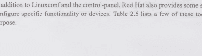

除了 Linuxconf 和 control-panel，Red Hat 还提供一些简单的工具来配置特定功能或设备。表 2.5 列出了其中一些工具及其用途。

## 图 2.3
网络配置器对话框。

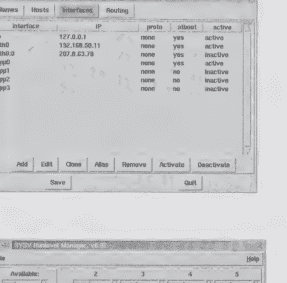

## 图 2.4
运行级别编辑器。

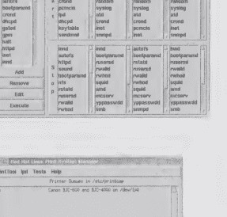

## 图 2.5
Red Hat 打印机工具。


## 表 2.5 Red Hat Linux 配置工具

| 命令 | 功能 |
| --- | --- |
| authconfig | 允许你指定使用 NIS、shadow 和/或 MD5 密码。 |
| mouseconfig | 为你列出可供选择的鼠标类型并创建 /dev/mouse 链接。也可从 Xconfigurator 调用以设置 X 的鼠标类型。 |
| sndconfig | 配置并测试声卡设置。 |
| kbdconfig | 配置系统启动时使用的键盘类型。 |
| timeconfig | 允许你指定所在的时区以及系统时钟是否设置为 UTC。 |

## 管理员的网络资源

Linux 诞生于互联网，正是因为互联网，Linux 才成长到今天的程度。这种增长的例子可以在 Linux 内核的几乎每个部分和各种发行版中找到。如果没有互联网作为媒介，就不可能有来自世界各地的人们贡献的丰富代码。也无法进行构建发行版并将其交付给今天全球估计 700 万至 1000 万 Linux 用户所需的协作。正因如此，互联网上一般以及特别是在万维网上有大量资源可供 Linux 用户使用。本节介绍一些对 Linux 系统系统管理员将有极大帮助的资源。这里选用的网站只是其中一小部分。要了解更多关于网络上的 Linux 资源，请查看你喜欢的搜索引擎，或查看此处描述的网站上的链接页面。

### Linux 文档项目

所有系统管理员都应该熟悉的一个网站是位于北卡罗来纳大学的 Linux 文档项目网站，网址为 http://metalab.unc.edu/LDP/。Linux 文档项目，简称 LDP，是一项旨在制作可通过互联网自由分发的 Linux 文档的项目，就像 Linux 本身一样自由分发。LDP 有志愿者创建诸如《Linux 安装和入门指南》、《网络管理员指南》、《系统管理员指南》以及几乎任何可想象主题的丰富 howto 文档。从选择兼容硬件到设置 PPP，甚至设置系统以中文显示信息，都由那些花时间学习某项流程步骤的人记录下来。通过这样做，其他人受益

于他们的经验。此外，LDP 还维护 Linux 手册页、常见问题列表和 Linux Gazette。

图 2.6
Linux 文档项目主页。

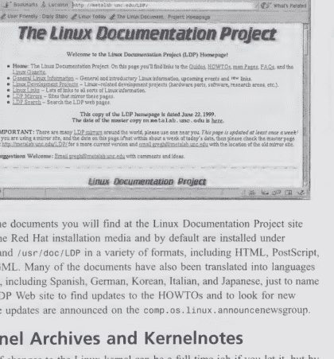

你在 Linux 文档项目网站上找到的大多数文档都可在 Red Hat 安装介质上获得，默认安装在 /usr/doc/HOWTO 和 /usr/doc/LDP 下，格式包括 HTML、PostScript、DVI、文本和 SGML 等。许多文档还已被翻译成英语以外的语言，包括西班牙语、德语、韩语、意大利语和日语，仅举几例。访问 LDP 网站以查找 HOWTO 的更新并寻找新的翻译。这些更新会在 comp.os.linux.announce 新闻组上宣布。

### Linux 内核归档和 Kernelnotes

如果任由其发展，跟上 Linux 内核的变化可能是一项全职工作，但通过利用以下两个网站，你可以及时了解变化的发生情况，并在查找 Linux 信息时拥有一个有用的起点。

在网络上查找新内核发布的权威地点是 Linux 内核归档，网址为 http://www.kernel.org/（见图 2.7）。这是 Linus Torvalds 的内核新版本发布的官方网站。但内核源代码并不是你在这里找到的信息的全部。你还可以找到指向 Linux 内核国际密码学补丁的链接、Linux 的定义，以及最多


最重要的是，Linux 内核源代码的镜像站点列表。我之所以说最重要，是因为当发布新内核版本时，由于流量高，几乎不可能连接到网站。幸运的是，Linux 源代码的镜像非常多，如果你愿意等待一天左右，就能轻松获取最新的补丁。

## 图 2.7
Linux 内核档案。

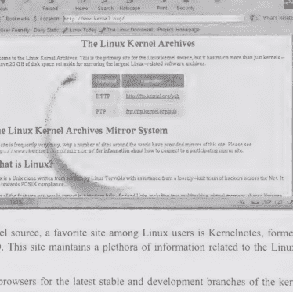

除了内核源代码之外，Linux 用户中很受欢迎的站点是 Kernelnotes，前身为 LinuxHQ。该站点维护了大量与 Linux 内核相关的信息，包括

- 用于内核最新稳定版和开发分支的源代码浏览器
- 描述有哪些新奇特功能的补丁摘要
- 指向尚未进入主流内核的补丁的补丁仓库指针

还有大量指向其他信息来源的链接，包括 Alan Cox 作为旧稳定源代码树维护者的主页；Linux 文档项目页面的镜像；以及各种 Linux 邮件列表的存档，包括 linux-kernel，所有关键内核开发者都在那里。你可以在 http://kernelnotes.com/ 访问这个精彩的网站（见图 2.8）。

## 图 2.8
Kernelnotes.org 站点。

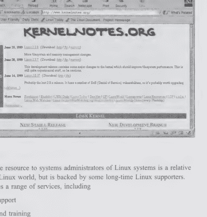

## Linuxcare

Linux 系统系统管理员的另一个宝贵资源是 Linux 世界中的相对新来者，但由一些长期 Linux 支持者支持。Linuxcare 提供一系列服务，包括

- 技术支持
- 教育与培训
- 咨询
- 开源开发

除此之外，Linuxcare 还维护一个可搜索的 Linux 知识库。他们还将为你的开源项目提供问题跟踪，并提供你可以参与的 Linux 论坛。更不用说，Linuxcare 是一个 Linux 门户网站，提供最新的 Linux 新闻和信息。最后，你可以找到戴尔、康柏和 IBM 等主要厂商认证可运行 Linux 的硬件信息。你可以在网上找到他们，网址为 http://linuxcare.com/（见图 2.9）。

## 图 2.9
Linuxcare 主页。


## Linux Today

Web 上另一个 Linux 资源是 Linux Today 站点。该站点为你做了大部分的网页浏览工作。它从整个网络的新闻来源收集信息，包括关于 Linux 的文章、安全公告和内核的新版本。除了新闻发布之外，你还可以阅读 Linux Today 员工的原创社论，并利用反馈选项与 Linux 社区互动。如果你正在寻找关于谁在做什么与 Linux 相关的最新消息，Linux Today 是最佳去处。除了突发新闻之外，Linux Today 还提供查找或发布与 Linux 相关的职位的地方。通过其姊妹站点 Linux PR，你可以找到关于 Linux 相关产品或支持 Linux 的公司的新闻稿。Linux Today 可在网上找到，网址为 http://linuxtoday.com，Linux PR 可在 http://linuxpr.com 找到。在 Linux Today 可以找到的信息类型的示例可在图 2.10 中看到，其中显示了其主页。

## 图 2.10
Linux Today 主页。


## 其他感兴趣的网站

已经提到的站点只是系统管理员可能用得上的众多站点中的一小部分。还有大量其他站点，既有通用目的的，也有针对 Linux 特定方面的。这些站点太多无法一一列举，但以下是我的一些个人最爱：

- http://www.slashdot.org/ Slashdot 是开发者和系统管理员可以来讨论当天技术新闻的地方。
- http://www.linux.com/ 这是一个门户站点，包含对管理员在系统调优方面特别感兴趣的部分。
- http://www.freshmeat.org/ Freshmeat 是一个优秀的站点，可以在那里找到最新的开源软件并与开发者讨论。

## 其他信息来源

除了在网上找到的资源之外，互联网为 Linux 社区提供了更多内容。其中一些资源包括携带 Linux 软件的 FTP 站点、开发者可以在其中相互交流并开发 Linux 最新功能的邮件列表，以及任何人都可以提问并分享他们对 Linux 的热情的新闻组。以下是其中一些资源的简要介绍。

## 邮件列表

如果你想与 Linux 开发人群，尤其是内核开发者交往，聚集地就是 Linux 用户可用的各种邮件列表。涵盖从硬核内核开发到将 Linux 作为商业解决方案推广等主题，Linux 邮件列表是一种订阅服务，你可以根据心情加入或离开，前提是你遵守列表所有者的规则。与新闻组和网络不同，每个人都可以按自己意愿参与，邮件列表限制稍多一些。这样做是为了保持高信噪比。列表所有者或版主可以自行决定将你从列表订阅中移除。下表列出了一些邮件列表及其提交地址：

| 邮件列表 | 提交地址 |
|---|---|
| linux-kernel | linux-kernel@vger.rutgers.edu |
| linux-smp | linux-smp@vger.rutgers.edu |
| linux-net | linux-net@vger.rutgers.edu |
| linux-gcc | linux-gcc@vger.rutgers.edu |
| linux-raid | linux-raid@vger.rutgers.edu |
| linux-scsi | linux-scsi@vger.rutgers.edu |

要订阅这些由 Majordomo 管理的列表，请发送电子邮件至 <listname>-request@vger.rutgers.edu，并在邮件正文中写上 subscribe。例如，要订阅 linux-kernel 邮件列表，你可以发出以下命令：

```
echo subscribe | mail linux-kernel-request@vger.rutgers.edu
```

除此之外，还有许多通过 Rutgers 的邮件列表服务器管理的 Linux 列表，以及大多数主要项目和发行版的邮件列表。Red Hat Linux 也不例外。你可以订阅 Red Hat 的多个列表，包括以下：

| 邮件列表 | 提交地址 |
|---|---|
| redhat-announce-list | redhat-announce-list@redhat.com |
| redhat-devel-list | redhat-devel-list@redhat.com |
| redhat-list | redhat-list@redhat.com |

要订阅任何 Red Hat 列表，格式与 Rutgers 管理的列表略有不同。你必须发送电子邮件至 <listname>-request@redhat.com，主题为 'subscribe'，如下面的命令行所示，该命令将订阅者订阅到 redhat-announce-list：

```
mail -s 'subscribe' redhat-announce-list@redhat.com </dev/null
```

## FTP 档案

随着系统的增长，你经常会需要为 Linux 系统寻找 Red Hat 发行版媒体上未提供的软件。这就是 FTP 档案派上用场的地方。自 Linux 早期以来，就有多个 Linux 软件存储库可用。表 2.6 列出了一些最大和最受欢迎的 Linux 用户软件档案以及你在那里可以找到的软件描述。

表 2.6 流行的 Linux FTP 档案

| FTP 站点 | 描述 |
|---|---|
| tsx-11.mit.edu | 位于麻省理工学院的原始 Linux 档案站点之一。XFree86 for Linux 的新版本、GNU C 编译器以及 Linux 系统的许多其他软件包的良好来源。 |
| metalab.unc.edu | 前身为 sunsite.unc.edu，该存储库位于北卡罗来纳大学，可能是世界上最知名的 Linux 档案馆。如果它可用于 Linux，很可能你可以在这里找到它的副本。 |
| ftp.*.kernel.org | Linux 内核源代码的镜像站点系统，你用国家代码替换星号，例如美国为 us。 |
| ftp.redhat.com | 主要的 Red Hat FTP 站点，你可以在这里找到最新的官方发行版。 |
| updates.redhat.com | 当 Red Hat 发行版的更新发布时，它们会被上传到该站点。 |
| developer.redhat.com | Red Hat 开发者社区有许多受信任的开发者作为 Red Hat 贡献网络的一部分将内容上传到该站点。 |
| contrib.redhat.com | 任何能够制作 RPM 的人都可以上传打包软件产品的站点。 |

## 新闻组

除了网络和邮件列表之外，还有大量 Usenet 新闻组专门用于 Linux 操作系统。表 2.7 是一些主要新闻组及其关注点的部分列表。


## 表 2.7 与 Linux 相关的 USENET 新闻组

| 新闻组名称 | 描述 |
|---|---|
| comp.os.linux.advocacy | 致力于推广 Linux 操作系统，并回答问题“为什么 Linux 是自切片面包以来最伟大的事物？” |
| comp.os.linux.announce | 有关 Linux 应用程序、新发行版以及 Linux 社区感兴趣的一般事项的公告在此发布，需经版主批准后方可发布。 |
| comp.os.linux.answers | 如果您正在寻找 Linux 的 FAQ 或 HOWTO，都会在此发布。受版主监管的新闻组。 |
| comp.os.linux.development.apps | 这是一个面向 Linux 操作系统应用程序软件开发人员的论坛，该新闻组是提问、寻求开发帮助或寻找测试人员的理想场所。 |
| comp.os.linux.development.system | 该新闻组是系统程序员讨论希望添加到内核的新功能并发布实现代码的场所。 |
| comp.os.linux.hardware | 如果您需要确认 Acme NetRocket 网络接口卡是否适用于 Linux，这里是提问的地方。 |
| comp.os.linux.misc | 当您的问题似乎不适合任何其他类别时，这里是提问的地方。 |
| comp.os.linux.networking | 本组每天的主题是 Linux 网络设置或网络代码开发的讨论。 |
| comp.os.linux.portable | 对于希望将 Linux 带出门的人来说，该新闻组可用于了解哪些 PCMCIA 设备适用于 Linux、如果可能如何使其工作，以及应避免哪些笔记本系统。 |
| comp.os.linux.security | Linux 系统的安全性，包括如何实施防火墙的讨论、获取安全补丁的位置以及 Linux 安全问题的公告，是本新闻组的主题。 |
| comp.os.linux.setup | 如果您刚刚入门并需要帮助设置 Linux 系统，这里是提问的地方。 |

您可以通过 Internet 服务提供商阅读这些以及许多其他新闻组，但如果您的 ISP 不提供新闻组，请不要绝望。您可以使用 Web 浏览器订阅这些以及许多其他新闻组。只需访问 Deja.com 并注册 My Deja.com 即可。您不仅可以阅读新闻组，而且 Deja.com 还提供 Internet 上最大的 Usenet 文章存档以及强大的搜索引擎。

## 摘要

在您担任系统管理员的角色中，您被期望具备超出普通用户的技能。本章回顾了一些概念和实用工具，作为高级用户您应该了解的内容。它还研究了随 Red Hat Linux 发行版提供的系统管理实用工具。最后，您了解了 Linux 管理员在 Internet 上可用的资源，包括网站、邮件列表、FTP 档案和 Usenet 新闻组。所有这些工具都可用于使您的工作更轻松。学习使用它们并加以利用是您自己的责任。

## Linux 基础

## 第二部分

### 本部分内容

- 3 安装策略 49
- 4 我在哪里可以找到...？ 81
- 5 启动和关闭 111
- 6 系统故障诊断与恢复 141

## 安装策略

### 本章内容

- 默认安装与定制方法 50
- 克隆安装 56
- 基于模板的方法 69

### 3

## 章节

在您作为系统管理员的经验中，您一定曾执行过 Linux 操作系统的安装。本章讨论在多台计算机上进行安装时涉及的问题。它不详细介绍 Red Hat 安装程序，而是讨论如何使安装系统尽可能高效和简单。虽然 Red Hat 安装程序对经验丰富的管理员来说已经相当简单，但它可能非常耗时。如果使用 Red Hat 提供的默认安装方法，就会浪费本可更好地利用的时间。

## 默认安装与定制方法

许多用户会质疑使用除 Red Hat 提供的默认安装方法之外的任何安装方法的必要性。毕竟，Red Hat 已投入大量时间使安装尽可能简单。然而，如果您发现自己花费的时间比希望的更多来安装操作系统，本章将提供一些可能引起您兴趣的替代安装方法。本节讨论使用默认安装与使用其他方法的一些利弊，并展示一些您可能选择的安装策略示例。

### 单个安装

在处理单个安装或您安装的 Linux 系统非常少的情况下，开发或使用替代安装方法几乎没有动力。Red Hat 安装已经变得非常简单，只要稍作准备即可相当快速地完成。在配备 CD-ROM 驱动器的现代机器上，安装可能只需从启动到完成 15 到 20 分钟，而其他安装方法如 FTP 或 HTTP 网络安装则可能需要更长的时间，因为数据在网络上传输的开销。在所有情况下，Red Hat Linux 6.1 提供了五种安装方法。这些方法为

- Local CD-ROM
- Hard drive
- NFS install
- FTP install
- HTTP install

本节检查这些方法并讨论每种方法的一些优点和缺点，以及您可能遇到的一些问题。

### Local CD-ROM

从本地 CD-ROM 驱动器安装 Red Hat 无疑是最简单的方法。此方法具有快速、无需网络连接且无需在硬盘上占用空间的优点。此外，此方法由随 Red Hat 提供的启动软盘支持，除非您的 CD-ROM 驱动器连接到 PCMCIA 卡。在这种情况下，您需要 PCMCIA 启动软盘，可在安装介质的 images 目录中找到。要通过此方法安装，您需要一个受支持的 CD-ROM 驱动器。该驱动器可以是 ATAPI 驱动器、SCSI 驱动器或受支持的专用驱动器之一。此外，如果您的系统支持从 CD-ROM 驱动器启动，您甚至不需要软盘驱动器即可开始。要从本地 CD-ROM 开始安装，请从 Red Hat 默认启动软盘启动或直接从 CD-ROM 驱动器启动。您将回答有关使用哪种语言和您拥有什么类型键盘的几个问题，然后会显示一个对话框，询问从何处安装，如图 3.1 所示。

图 3.1
选择
CD-ROM 安装。

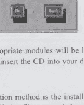

如有需要，将加载适当的模块以支持您的 CD-ROM 驱动器，您将被提示将 CD 插入驱动器，然后安装将照常进行。

### Hard Drive

另一种快速的安装方法是硬盘安装。要完成此安装，安装文件被复制到不会被安装到的硬盘分区，例如现有的 Windows 或 MS-DOS 分区。此安装方法具有无需网络连接且无需受支持的 CD-ROM 的优点。与 CD-ROM 安装一样，它由随盒装套件提供的启动软盘支持。然而，如果您想将整个硬盘专用于 Linux，它就不是很有用，尽管这并不妨碍您在确实希望整台机器专用于 Linux 时使用此安装方法。要使用此安装方法，您需要足够的硬盘空间来容纳来自安装 CD 或 FTP 站点的 Red Hat 目录的内容。您还需要从安装 CD 上的 images 目录或 Red Hat FTP 站点上的 boot.img 文件创建启动软盘。此安装方法如图所示 3.2 所选。一旦您选择此选项，您将被要求指定

从中安装的硬盘分区以及包含 Red Hat 安装文件的目录，如图 3.3 所示。

图 3.2
选择硬盘安装。

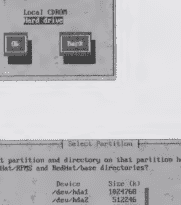

图 3.3
硬盘安装选项对话框

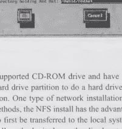

## NFS 安装

如果您没有受支持的 CD-ROM 驱动器，并且没有足够的空间将安装文件复制到硬盘分区以进行硬盘安装，则可以选择进行网络安装。网络安装的一种类型是 NFS 安装。在网络安装方法中，NFS 安装的优势在于速度最快，因为文件无需先传输到本地系统即可安装。与其他网络安装方法一样，它也有需要网络连接的缺点。

执行此类型的安装要求您已连接到网络，并且该网络上的服务器包含导出文件系统，其中包含 Red Hat 安装文件。此网络连接可以是连接到局域网，也可以是连接到互联网，例如通过调制解调器的 PPP 连接。如果您通过局域网连接，最简单的方法是将安装 CD 挂载到一台机器上并导出 CD 的挂载点。另一种替代方案是将 CD 内容复制到硬盘并导出适当的分区。NFS 安装的速度
受您网络带宽的限制，仅比硬盘安装稍慢。除了要求 Red Hat 安装文件位于导出文件系统上之外，此安装方法还要求您从安装 CD 上的 bootnet.img 文件创建不同的启动磁盘。此启动软盘可以在另一台 Linux 系统上使用以下命令创建：

```
[root@nomad images]# dd if=bootnet.img of=/dev/fd0 bs=512
2880+0 records in
2880+0 records out
```

如果您没有其他 Linux 系统可用，您可以在 Windows 下使用 rawrite 实用程序创建网络启动软盘，该实用程序也可在安装 CD 上找到。此安装看起来与正常安装一样，只是不会显示从本地 CD-ROM 或硬盘安装的选项对话框，而是会显示一个对话框，询问您是否要从 NFS 映像、FTP 站点或 HTTP 安装，如图 3.4 所示。如果您选择此安装方法，然后会显示如图 3.5 所示的对话框，您可以在其中指定 NFS 服务器和包含 Red Hat 安装文件的目录。

图 3.4
选择 NFS 安装。

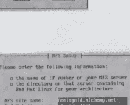

图 3.5
NFS 安装选项对话框。


如果您经常在没有 CD-ROM 驱动器的机器上安装 Linux，例如笔记本电脑，NFS 安装选项可能是一个值得考虑的好选择。

## FTP 安装

下一个网络安装方法是 FTP 安装，您可以从菜单中选择，如图 3.6 所示。此安装方法的优点是不需要您拥有安装 CD 或网络上可用的安装文件映像，但缺点是速度慢。如果您通过互联网使用 Red Hat 镜像站点进行安装，速度可能尤其慢。但是，如果您没有 FTP 服务器或不想设置一个，您可以通过在运行 FTP 服务器的任何机器上挂载 CD-ROM 来使用 FTP 安装。在这种情况下，您可以使用非匿名 FTP，如果您在流量很少的隔离网络段上使用此方法，则此安装方法速度相当快。使用非匿名 FTP 的选项以及要使用的 FTP 服务器的指定如图所示 3.7。即使您必须通过代理才能访问 FTP 服务器，FTP 安装也能正常工作。

图 3.6
选择 FTP 安装。

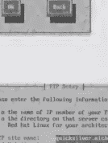

图 3.7
FTP 安装选项对话框。

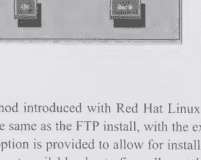

## HTTP 安装

随 Red Hat Linux 6.0 引入的一种新的安装方法是 HTTP 安装。此方法本质上与 FTP 安装相同，只是用于检索文件的协议不同。提供此选项是为了允许在由于防火墙或其他限制而无法使用其他安装方法的情况下进行安装。
此安装方法具有与 FTP 安装相同的优点和缺点。此安装方法的选择如图所示 3.8。一旦您选择了此安装方法，您将看到如图 3.9 所示的对话框。在这里，您输入要安装的 HTTP 服务器的名称或 IP 地址、包含 Red Hat 安装文件的目录，以及在连接到服务器时是否使用代理服务器。

图 3.8
选择 HTTP 安装。

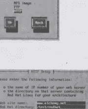

图 3.9
HTTP 安装选项对话框。

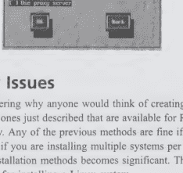

## 可扩展性问题

您可能会想知道为什么有人会想到创建另一种安装方法，考虑到上面描述的所有可用于 Red Hat 的方法。对此的一个可能答案是可扩展性。如果您不经常安装系统，以前的任何方法都可以；但是，如果您每周安装多个系统，等待这些安装方法中的任何一种所花费的时间变得很重要。下一节介绍一种安装 Linux 系统的替代方法。

## 克隆安装

为了解决可扩展性问题，通常很有用的是创建一个标准安装映像，并在需要时将其克隆到新机器上。除了初始设置之外，这可以导致安装速度明显更快，并且由于所有系统都完全相同，因此维护系统所需的工作更少。本节介绍克隆系统的几种方法——一种是自建解决方案，另一种由 Red Hat 提供。

### 自制方法

安装 Linux 系统的一种简单方法是按您想要的方式安装一个，创建安装的映像，然后在需要时将该映像复制到新机器。创建此映像的一种简单方法是使用 afio 或 cpio 等归档实用程序来创建包含要在新系统上重新创建的每个文件系统内容的<|message|>。 这里概述的方法使用了这个想法，并展示了如何通过以下简单步骤将系统从未安装状态带到完全功能状态：

- 1. 使用软盘启动待安装系统。
- 2. 建立网络连接。
- 3. 远程分区磁盘并创建文件系统。
- 4. 在新分区的磁盘上安装操作系统映像。
- 5. 进行必要的最小自定义。
- 6. 安装引导加载程序并重新启动。

这种方法假设您的系统基本上都相同，对于大多数公司来说这是合理的，因为您通常会找到一个硬件供应商并在他们提供良好服务和合理价格的情况下坚持使用他们。基本上相同的意思是，要安装的系统都基于同一系列的处理器，并且都使用类似的硬件。例如，我管理的大多数系统都是基于 Intel 的、双处理器系统，具有大容量 SCSI 或 IDE 硬盘，以及一个或多个网卡。如果您的系统不符合基本上相同的标准，您可能不会很好地使用此安装方法。让我们逐步检查这种方法，展示所需的工具以及如何将它们组合起来，以最少的工作量从原始系统到完全安装的系统。

### 从软盘启动系统

为了使这种方法发挥作用，您必须首先创建一套软盘，以便系统能够启动并连接到网络。一个有用的软件包是 YARD，它代表 Yet Another Rescue Disk。YARD 不随 Red Hat 提供，但搜索 http://freshmeat.net/ 或 http://linuxapps.com/ 将帮助您找到它。


本软件包可帮助您构建启动盘和根软盘，您可以用它们启动系统，并利用 RAM 磁盘，包含足够的工具使系统连接到网络。软盘集中包含哪些内容由您决定，只要以下文件存在且正常工作即可：

- `in.rshd`
- `in.rexecd`
- `in.rlogind`
- `sfdisk`
- `mke2fs`
- `mkswap`
- `afio`
- `gzip`
- `mount`
- `umount`
- `sync`
- `rm`
- `lilo`

## 建立网络连接

在安装到启动盘和根软盘的文件中，其中一个是为 root 提供的 .bashrc 文件，其中包含名为 setup 的函数的定义。该函数会提示用户输入要安装机器使用的主机名，然后执行配置具有该名称和相关 IP 地址的以太网接口所需的步骤。完成后，它会为需要访问的网络建立路由，并启动 inetd 和 syslog 守护进程。此函数的定义是网络特定的，因此使用我使用的那个对您没有帮助，但通过检查该函数所采取的步骤，您可以轻松地将其修改为适用于您的网络。列表 3.1 中的代码显示了我启动软盘上 .bashrc 的内容，其中实现了 setup 函数。

### 列表 3.1 /root/.bashrc 中 setup 函数的实现

```
# defines the setup function used to establish network connectivity

setup () {
# Function to set up network connectivity for installation

# Prompt the user for the type of NIC to use
echo "Drivers are available for the following NICS:"
echo " 1 -- 3Com 509 10Mbit (3c509)"
echo " 2 -- Kingston KNE100TX or Digital DE500 (de4x5)"
echo " 3 -- Intel EtherExpress Pro/100+ (eepro100)"
echo -n "Enter the number for the appropriate driver to load  "
read nic

echo ""
case $nic in
1)    echo -n "Loading 3c509 module..."
      /sbin/insmod 3c509
      LOADED=`/sbin/lsmod | grep 3c509`
      if [ "$LOADED" != "" ]; then
          echo "done."
      else
          echo "failed...aborting."
          return
      fi
      ;;
2)    echo "Loading de4x5 module..."
      /sbin/insmod de4x5
      LOADED=`/sbin/lsmod | grep de4x5`
      if [ "$LOADED" != "" ]; then
          echo "done."
      else
          echo "failed...aborting."
          return
      fi
      ;;
3)    echo "Loading eepro100 module..."
      /sbin/insmod eepro100
      LOADED=`/sbin/lsmod | grep eepro100`
      if [ "$LOADED" != "" ]; then
          echo "done."
      else
          echo "failed...aborting."
          return
      fi
      ;;
*) echo "Invalid response...exiting"
return
;;

DONE=N

while [ "$DONE" != "Y" ]; do
# Now that the module is loaded, prompt for the hostname to use
echo ""
echo -n "Enter the fully qualified hostname to use: "
read hname

HNAME=`echo $hname | cut -d . -f1`
HIP=`grep "$HNAME" /etc/hosts | cut -f1`

if [ "$HIP" = "" ]; then
echo ""
echo -n "$hname not found in /etc/hosts...use anyways (y/n)? "
read ans

if [ "$ans" = "y" -o "$ans" = "Y" ]; then
echo -n "Enter the IP address for $hname: "
read HIP
fi
else
echo ""
echo -n "$HIP found for $hname...is this correct (y/n)? "
read ans
fi

if [ "$ans" = "y" -o "$ans" = "Y" ]; then
DONE=Y
fi
done

# We now have a hostname and IP address. Determine from them the
# appropriate routes to setup and start the inetd.
hostname $hname
echo $hname >>/etc/HOSTNAME

export HOSTNAME=$hname

DEV="192.168.50"

ATO_DEV=`echo $HIP | grep $DEV`

if [ "$ATO_DEV" != "" ]; then
ifconfig eth0 $HIP broadcast 192.168.50.255 netmask 255.255.255.0
route add -net 192.168.50.0 netmask 255.255.255.0 dev eth0
route add default gw 192.168.50.2 metric 1 dev eth0
echo ""
echo "Verify network setup by pinging quicksilver."
/usr/sbin/inetd
return
fi

echo "Unfamiliar network...establish network connectivity manually"
}
```

此 setup 函数对其必须位于启动软盘上的实用程序有自己的要求。所需命令如下

- hostname
- cut
- grep
- insmod
- lsmod
- ifconfig
- route
- inetd

这些命令用于加载网络卡的适当模块，根据用户提供的主机名确定机器的 IP 地址，并配置以太网接口以准备通过网络接收连接。

## 分区磁盘并创建文件系统

现在您已接入网络，其余工作可以远程完成。由于您已在启动软盘上包含 sfdisk，并且当前未使用硬盘，您现在可以对启动磁盘进行分区并创建继续安装所需的文件系统和交换空间。这是通过列表 3.2 中的脚本实现的，该脚本连接到您从软盘启动的机器，运行 sfdisk 命令在目标主机启动驱动器上创建分区，然后运行 mke2fs 在新分区上创建文件系统。此外，如果您指定创建交换分区，脚本将运行 mkswap 来初始化它。

### 列表 3.2 使用 sfdisk 远程分区硬盘的脚本

```perl
#!/usr/bin/perl

use Getopt::Std;
use Net::Ping;

$USAGE = "Usage: dprepare -t host -p pfile -b bdev [-c]\n"
    . "or dprepare -h\n\n"
    . "  -t host    host to partition and create filesystems on\n"
    . "  -p pfile   name of file containing partition information\n"
    . "  -b bdev    device name of boot drive\n"
    . "  -c         check for badblocks when creating filesystems\n"
    . "  -h         print this usage statement\n";

# Parse the arguments
getopts('t:p:b:ch');

# Give the usage statement if the ask for it
if (defined $opt_h) {
    print $USAGE;
    exit 1;
}

# Print a usage statement if required arguments are missing
if ((!defined $opt_t) || (!defined $opt_p) || (!defined $opt_b)) {
    print "No target, partition file or boot device specified.\n";
    print $USAGE;
    exit 1;
}

# Check for the existence of the partition file
if ( ! -f $opt_p ) {
    print "Partition file not found\n";
    print $USAGE;
    exit 1;
}

# Verify that we can reach the target host and if not abort.
if (! pingable($opt_t)) {
    print 'Unable to ping target host $opt_t...aborting.\n';
    exit 1;
}

# Next check to see if the boot device exists on the target host.
if ($opt_b =~ /^sd/) {
    $avail = `rsh $opt_t 'cat /proc/scsi/scsi/' | grep -A2 'Id: 00\'
        | grep Direct-Access' ;
    chomp $avail;
} else {
    $avail = `rsh $opt_t 'cat /proc/ide/$opt_b/media'`;
    chomp $avail;
    if ($avail ne "disk") {
        $avail = "";
    }
}

if ( $avail eq "" ) {
    print 'Unable to verify $opt_b on $opt_t...aborting.\n';
    exit 1;
}

# Now we open the partition definition file, read it one line at a time
# and for each line depending on the type, store the command we will use
# to create either a swap device or filesystem on the partition.
open(PFILE, "$opt_p");
open(SFILE, ">/tmp/sfdisk.in");
$i = 1;
while (<PFILE>) {
    ($dnum,$size,$type,$active,$mntpt,$mntorder) = split(/,/ , $_);
    chomp $mntorder;

    $checkbad = (defined $opt_c) ? "-c" : undef;

    if (($type eq "L") || ($type eq "83")) {
        $device = "/dev/$opt_b$dnum";
        $fscmd[$i] = "mke2fs $checkbad $device";
        $i++;
    } elsif (($type eq "S") or ($type eq "82")) {
        $device = "/dev/$opt_b$dnum";
        $fscmd[$i] = "mkswap $checkbad $device";
        $i++;
    }

    print SFILE "$dnum,$size,$type,$active\n";
}
close(SFILE);
close(PFILE);

# We have the commands we need to create the desired filesystems and
# swap spaces, so now lets actually partition the disk, sync the disk,
# and then create them.
$cmd = "cat /tmp/sfdisk.in | rsh $opt_t '/sbin/sfdisk -uM /dev/$opt_b ; /bin/sync'";
system($cmd);
$i = 1;
while ($i <= $i_max) {
    if ($fscmd[$i] ne "") {
        print "Executing $fscmd[$i]\n";
        system($fscmd[$i]);
    }
    $i++;
}

exit 0;

################ SUBROUTINES ################

# Check to see if the target host is alive
sub pingable {
    my $target = shift;

    my $p = Net::Ping->new("icmp");
    return $p->ping($target);
}
```


分区文件的语法对于此脚本的正常运行至关重要。此文件用于构建 sfdisk 命令的输入文件。每行包含设备名称、起始点、分区大小（以兆字节为单位）、分区类型、指示分区是否应标记为活动的一个标志，最后是最终的挂载点以及指示应挂载顺序的序列号。以下是示例分区文件。请注意，在此文件中，您指定了 /dev/sda4 分区，但未为其提供任何值。这是满足 sfdisk 命令的要求。

```
1,1024,L,*,/,1
2,128,S,,,
3,,E,,,
4,,,
5,1024,L,/,usr,2
6,,L,,/var,3
```

上面的示例文件在 /dev/sda1 上创建了一个 1024 兆字节的分区，分区类型为 L（代表 Linux 原生），并将其标记为活动。然后在 /dev/sda2 上创建一个类型为 S 的交换分区，大小为 128 兆字节。下一个分区类型为 E，即扩展分区，由于未指定大小，因此占用磁盘剩余空间。现在您指定 /dev/sda4，其大小、起始位置或类型均无值。此分区实际上不存在，但必须指定以满足 sfdisk。下一个真实分区是 /dev/sda5，它是一个类型为 L 的逻辑驱动器，大小为 1024 兆字节。最后一个分区是 /dev/sda6，它也是类型 L，并占用扩展分区的剩余空间。使用此示例分区文件和第 3.2 节中的脚本会生成以下输出：

```
[root@quicksilver chapter3]# ./dprepare -t nomad -b hda -p partfile

Disk /dev/hda: 128 heads, 63 sectors, 785 cylinders

Old situation:
Units = megabytes of 1048576 bytes, blocks of 1024 bytes, counting from 0
```

| 设备 | 启动 | 开始 | 结束 | MB | #块 | Id | 系统 |
|---|---|---|---|---|---|---|---|
| /dev/sda1 |  | 0* | 1536- | 1536- | 1572448* | b | Win95 FAT32 |
| /dev/sda2 | * | 1535+ | 3027- | 1493- | 1528128 | 83 | Linux |
| /dev/sda3 |  | 3027+ | 3090- | 63 | 64512 | 82 | Linux swap |
| /dev/sda4 |  | 0 | - | 0 | 0 | 0 | Empty |

新情况：
单位 = 1048576 字节的兆字节，1024 字节的块，从 0 开始计数

| 设备 | 启动 | 开始 | 结束 | MB | #块 | Id | 系统 |
|---|---|---|---|---|---|---|---|
| /dev/sda1 | * | 0+ | 1027- | 1028- | 1052351* | 83 | Linux |
| /dev/sda2 |  | 1027+ | 1157- | 130- | 133056 | 82 | Linux swap |
| /dev/sda3 |  | 1157+ | 3090- | 1934- | 1978212 | 5 | Extended |
| /dev/sda4 |  | 0 | - | 0 | 0 | 0 | Empty |
| /dev/sda5 |  | 1157+ | 2185- | 1028- | 1052351+ | 83 | Linux |
| /dev/sda6 |  | 2185+ | 3699- | 906- | 927359+ | 83 | Linux |

执行 mke2fs /dev/sda1
执行 mkswap /dev/sda2
执行 mke2fs /dev/sda5
执行 mke2fs /dev/sda6

## 安装操作系统映像

现在您有一些可用的文件系统，您可以挂载它们并使用之前创建的安装映像，通过网络将操作系统传输到新系统。映像是一个 afio 归档文件，安装过程只是将归档文件解包到标准输出，然后通过管道传递给 rsh 命令，该命令将数据写入远程系统上准备好的分区上。脚本如第 3.3 节所示，使用与上一个脚本相同的分区文件并接受相同的参数。

## 列表 3.3 osinst 安装脚本

```perl
#!/usr/bin/perl

use Getopt::Std;
use Net::Ping;

# Parse the argument list.

$USAGE = "Usage: osinst -t host -p pfile -b bdev\n" . " or osinst -h\n\n" . " -t host    host to install the operating system on\n" . " -p pfile   name of file containing partition information\n" . " -b bdev    device name of boot drive\n" . " -h         print this usage statement\n";

# Parse the arguments
getopts('t:p:b:h');

# Give the usage statement if the ask for it
if (defined $opt_h) {
    print $USAGE;
    exit 1;
}

# Print a usage statement if required arguments are missing
if ((!defined $opt_t) || (!defined $opt_p) || (!defined $opt_b)) {
    print "No target, partition file or boot device specified.\n";
    print $USAGE;
    exit 1;
}

# Check for the existence of the partition file
if ( ! -f $opt_p ) {
    print 'Partition file not found\n';
    print $USAGE;
    exit 1;
}

# Verify that we can reach the target host and if not abort.
if ( ! pingable($opt_t) ) {
    print "Unable to ping target host $opt_t...aborting.\n";
    exit 1;
}

# Next check to see if the boot device exists on the target host.
if ($opt_b =~ /sd/) {
    $avail = `rsh $opt_t 'cat /proc/scsi/scsi' | grep -A2 'Id: 00\*' | grep 'Direct-Access'`;
    chomp $avail;
} else {
    $avail = `rsh $opt_t 'cat /proc/ide/$opt_b/media'`;
    chomp $avail;
    if ($avail ne "disk") {
        $avail = "";
    }
}

if ( $avail eq "" ) {
    print "Unable to verify $opt_b on $opt_t...aborting.\n";
    exit 1;
}

# Now we open the partition definition file, read it one line at a time
# and for each line determine if a mount point is specified and if so,
# mount that partition on the remote system.
open(PFILE, "$opt_p");
while (<PFILE>) {
    ($dnum,$size,$type,$active,$smpt,$smttorder) = split(/,/,$_);
    chomp $smpt;

    if ($smpt ne "") {
        $device = "/dev/sd".$opt_b.$dnum;
        $cmd[$smttorder] = "rsh $opt_t 'mkdir -p /inst/".$smpt."' ; mount $device /inst".$smpt.";";
    }
}

close(PFILE);

for ($i = 1; $i <= scalar @cmd; $i++) {
    print "Executing $cmd[$i]";
    system($cmd[$i]);
}

# Now that the partitions are mounted in the correct order, we can copy
# our template to it.
$tmplt = "/var/lib/OStemplate.afio.gz";
$instcmd = 'cat $tmplt | rsh $opt_t "cd /mnt ; gzip -dc ; afio -i -z /proc/self/fd/0"';

system($instcmd);

exit 0;

################ SUBROUTINES ################

# Check to see if the target host is alive
sub pingable {
    my $target = shift;

    my $p = Net::Ping->new("icmp");
    return $p->ping($target);
}
```

此脚本可以增强以执行诸如检查挂载分区上是否有足够的空间来容纳模板等操作。这留给读者作为练习。

## 对已安装映像进行主机特定自定义

一旦操作系统映像已安装，就需要进行最少的自定义以使系统功能正常。这种自定义包括设置正确的网络设置，特别是 IP 地址和主机名。这可以使用脚本轻松完成，也可以通过登录系统并手动编辑文件来完成。所需的自定义程度取决于多个因素，包括网络的复杂性、是否使用动态 IP 地址分配以及其他因素。如何自定义由您决定。

## 安装引导加载程序

安装不会运行 X Windows 系统的系统的最后一步是安装引导加载程序。这只是针对已安装操作系统映像的一部分的 lilo.conf 文件运行 lilo 的问题。假设您已将已安装的映像挂载为 /mnt，可以通过发出以下命令轻松完成此操作：

```
/mnt/sbin/lilo -r /mnt -v -v
```

完成此操作后，您就可以重新启动新安装的系统。根据您在此过程中添加的自动化程度，您可以使新系统的安装变得简单，只需从软盘启动、连接到网络并从包含操作系统模板的主机发出脚本。我已经使用此方法一段时间，取得了巨大的成功。从软盘启动后安装系统的时间不到五分钟。

这里描述的自制方法只是其中一种方法。如果您不倾向于使用它，还有替代方案，包括来自 Red Hat 的一种方法，称为 kickstart。

## 使用 Kickstart 文件和 RPM

如果前面描述的安装方法听起来工作量很大，那是因为它确实如此。安装多个系统且几乎无需麻烦的一种替代方法是使用 Red Hat 提供的 kickstart 功能。kickstart 方法是通过创建指定安装程序询问的问题的答案的文件来完成的。此文件可以复制到启动软盘上，也可以放在网络上，其名称取决于您选择的这两个选项中的哪一个。有关使用 kickstart 方法的详细信息，请参阅随 Red Hat Linux 软件一起提供的安装指南。使用 kickstart 文件，您可以消除安装程序所需的大部分交互，并预定义要在系统上安装的一组软件包。此方法

允许你使用 Red Hat 支持的任何安装方法，但不必回答所有问题。与前面刚描述的自建方法相比的主要区别在于，即使使用 kickstart 文件，Red Hat 也没有提供使用网络推送模型的安装方法。

## 基于模板的方法

到目前为止描述的方法如果你的机器基本相同则很有用，但如果你的网络由多个类别的机器组成，那么考虑以下系统安装管理方法可能会很有用。这种方法依赖于这样一个事实：所有系统在某种程度上必须具有共同的核心软件才能在网络上运行。这个核心成为你的基础模板，你可以将其安装到所有机器上，作为将新机器上线到网络的第一步。为本次讨论的目的，我们假设你的网络分为两个部分。第一部分是你的管理网络，公司日常工作在此进行，机器分为四个基本类别。它们是开发工作站、开发服务器、管理服务器和管理工作站。网络的第二部分是生产网络，由 Web 服务器、数据库服务器和邮件服务器组成。

## 建立安装模板

根据前一节描述的网络，你将开始创建安装模板。安装模板将有两种类型——一种是面向生产网络的极简模板，另一种是面向管理网络的更功能丰富的模板。让我们从生产模板的讨论开始。

## 生产模板

由于生产服务器不用于交互式使用，因此它们的安装模板不会包含你在 Red Hat 系统上通常会找到的几项内容。生产模板中将明确排除的一些项目包括以下内容：

- X Windows 软件
- 编译器
- 个人生产力软件
- 办公应用程序
- 文档
- 游戏
- 文字出版软件

事实上，生产模板将只包含完成以下任务所需的最低限度软件：

- 启动系统
- 连接到网络
- 运行脚本和程序

第一个任务是通过安装位于 /bin 和 /sbin 中的基本 Linux 实用程序以及 /dev 目录中的设备支持和 /etc 和 /var 中找到的配置数据来完成的。/usr 中通常找到的大多数软件不需要，除了 /usr/bin 中找到的一些实用程序以及 /usr/share 和 /usr/lib 中的支持文件。一个确切的文件列表在此未列出，因为它会占用数页，但确定所需文件的一个良好起点可以在文件系统层次结构标准中找到，该标准在第 4 章“Where Do I Find...?”中描述。

接下来，你添加网络连接支持。这些文件主要是位于 /usr/bin 中的客户端和位于 /usr/sbin 中的守护进程。这包括诸如 telnet 守护进程和客户端、支持远程命令（如 rcp、rsh 和 rlogin）的守护进程，以及其他网络相关文件，如 /etc/services、/etc/protocols 和 /etc/inetd.conf。它还将包括保护系统所需的文件，如 tcpd、ipchains，以及如果需要代理软件。建立网络连接所需的最小文件集与本章前面关于创建启动软盘的讨论中描述的相同。

最后，还有程序运行时支持所需的文件，例如共享库和支持系统上将使用的任何脚本语言（如 perl 或 tcl）及其支持文件所需的文件。

所有这些文件都可以从 Red Hat 安装介质中获得，并且经过仔细修剪后可以使其占用不到 200 兆字节的磁盘空间，并留有增长空间。这自然不包括像 /var 或 /tmp 这样的增长文件系统的空间，但通过审慎规划，你可以拥有一个精简的服务器系统基础，可以根据需要进行定制。列表 3.4 指定了我用来满足此处指定标准的软件包列表。这组软件包大约需要 175 兆字节的硬盘空间，但可以通过消除手册页、info 文件和其他对系统操作非必需的数据进一步精简。

## 列表 3.4 薄型服务器安装的软件包列表

- setup
- filesystem
- basesystem
- ldconfig
- glibc
- chkconfig
- mktemp
- termcap
- libtermcap
- bash
- apmd
- ncurses
- info
- fileutils
- grep
- ash
- at
- authconfig
- bash2
- bc
- bdflush
- bind
- bind-utils
- binutils
- bzip2
- caching-nameserver
- sed
- console-tools
- e2fsprogs
- rmt
- cpio
- cracklib
- cracklib-dicts
- crontabs
- textutils
- shadow-utils
- dev
- diffutils
- ed
- eject
- emacs
- emacs-nox

## 列表 3.4 继续

- etcskel
- file
- findutils
- ftp
- gawk
- gd
- gdb
- gdbm
- getty_ps
- glib
- gmp
- gpm
- groff
- gzip
- hdparm
- initscripts
- ipchains
- isapnptools
- ispell
- joe
- kbdconfig
- kernel
- kernel-pcmcia-cs
- kernel-smp
- ld.so
- losetup
- libc
- libstdc++
- lilo
- pwdb
- pam
- sh-utils
- redhat-release
- linuxconf
- logrotate
- losetup
- lsof
- ltrace
- mailcap
- mailx
- make
- MAKEDEV

## 列表 3.4 继续

- man
- man-pages
- mingetty
- mkbootdisk
- mkinitrd
- #mk kickstart
- modutils
- mount
- mouseconfig
- mt-st
- mtools
- nc
- ncompress
- net-tools
- netkit-base
- newt
- ntsysv
- passwd
- perl
- portmap
- procmail
- procps
- psmisc
- pump
- quota
- raidtools
- rdist
- readline
- redhat-logos
- rhs-hwdiag
- rootfiles
- rpm
- rsh
- rsync
- sash
- screen
- sendmail
- sendmail-cf
- setconsole
- setserial
- setuptool
- slang

## 列表 3.4 继续

- slocate
- ssh
- ssh-clients
- ssh-extras
- ssh-server
- stat
- strace
- sudo
- syslogd
- SysVinit
- tar
- tcp_wrappers
- tcpdump
- tcsh
- telnet
- time
- timeconfig
- tmpwatch
- traceroute
- ucd-snmp
- ucd-snmp-utils
- unzip
- utempter
- util-linux
- vim-common
- vim-minimal
- vixie-cron
- wget
- which
- words
- wu-ftpd
- XFree86-libs
- xntp3
- zip
- zlib

## 管理模板

管理模板的要求在几个重要方面有所不同。在一个正常的管理网络中，你通常会有共享资源，通过网络文件系统或 NFS 使其可供连接到网络的所有系统使用。此外，这些系统每天用于交互式工作，因此需要软件来尽可能提高在系统上花费的时间的生产力。为了减少维护这些系统所需的工作量，通常希望将需要频繁更新的软件放在共享文件系统上。这样，你可以一次安装一个软件包，并立即使其对网络上的所有用户可用。你可能希望以这种方式安装的软件示例包括 X Windows 软件、TeX、编译器、图形用户界面如 KDE 或 Gnome，以及办公套件。管理模板的基础要求在生产模板的基础上增加了以下附加功能：

- 访问共享文件系统的软件
- 个人生产力软件
- 文档
- 文字出版软件

网络上的共享资源可能包括支持该处四种类型系统不同功能的软件。例如，管理工作站将从管理服务器访问网络功能型办公套件和其他软件。开发工作站和服务器将共享编译器和解释器等软件。两种情况下工作站和服务器的主要区别在于服务器的计算能力和资源密集型应用程序（如数据库）的可用性。

## 基于类别的定制

这种安装策略最困难的部分是根据机器所属的类别开发机器定制系统。在我们的示例网络中，我们已经确定了管理网络上的四个系统类别和生产网络上的三个系统类别。实现将通用系统定制为特定类别系统所需定制的一种方法是维护一个类别模板，可以在基本操作系统之上安装。此外，你还可以拥有一个基于功能的模板，以便每个功能都是可以在基本系统之上安装以添加特定功能的软件包。让我们逐一查看每个类别，并讨论如何将包含基础模板的系统转换为能够执行特定功能的系统，从管理网络开始。


## 管理网络

网络上的管理工作站是用于通常与办公管理、财务和会计、人力资源以及管理部门人员相关任务的系统。它们共同需要能够访问办公套件、个人生产力软件（如日历和电子邮件软件）以及通常安装这些应用程序的管理服务器。此类系统的定制包括配置客户端软件以访问网络上的共享管理资源。构建管理工作站的公式是基础操作系统模板加上对 fstab 的更改以挂载管理服务器上的共享文件系统。

管理服务器是网络上包含由管理工作站访问的共享管理资源的系统。自然地，可以有多个这样的服务器。将安装了基础模板的系统定制为管理服务器所需的定制是配置网络文件系统服务器软件，配置 DNS、SMTP 以及 POP 或 IMAP 等服务。此外，管理服务器很可能也是公司内部网服务器所在的位置，例如内部 Web 服务器。管理服务器通常不是生产网络中描述的精简服务器，而更可能在单个服务器上包含多个服务。构建管理服务器的公式是基础操作系统模板加上提供共享管理资源的导出文件系统加上一些服务集合，例如内部网 Web 服务器、邮件服务器或 DNS 服务器。

开发工作站与管理工作站类似，需要的定制很少，除了配置客户端软件以访问网络上可用的共享开发资源之外。区别在于工作站需要访问的资源类型。开发工作站需要访问系统文档、开发工具如编译器和解释器。此外，由于开发通常由从事业务管理方面的人员驱动，他们也需要访问办公套件和个人生产力软件等工具。开发工作站由基础模板加上对 fstab 的更改以访问开发服务器加上对 fstab 的更改以访问管理服务器的共享软件组成。

这些服务器包含开发工作站所需的共享资源并运行特定的资源密集型应用程序，例如开发数据库服务器、测试框架和类似进程。与管理服务器一样，开发服务器需要配置以共享文件系统和其他服务，并且同样不太可能是生产网络的精简服务器。开发服务器是通过首先安装基础操作系统模板、添加供开发工作站访问的导出文件系统以及添加资源密集型应用程序来制作的。

## 生产网络

生产网络背后的思想与管理网络相同，只是基础模板更精简。这使您能够以最少的工作创建生产网络的各种精简服务器。

例如，Web 服务器只需采用生产服务器的基础模板并添加 Web 服务软件和要提供的文档即可。您还可以添加配置限制以将此类机器的访问限制为仅端口 80。

生产网络上的其他类别也适用，例如数据库服务器和邮件服务器。通过创建类模板，您可以在基础操作系统模板之上混合搭配服务，从而减少安装时间并使维护变得更加容易。

## 实现示例

实现如所述的基于类的模板方案并不像听起来那么困难。以下是实现此类方案所需的步骤：

- 1. 创建基础模板和安装方法。
- 2. 创建类模板。
- 3. 创建类模板的分发方法。

本计划的第一步可以使用本章前面描述的自制方法来实现。有了这种方法，战斗就已经赢了一半以上。

第二步是创建类模板。一种方法是创建如列表 3.5 所示的目录层次结构。

### 列表 3.5 基于类模板的示例目录层次结构

```
|-- Db
|   |-- etc
|   |   |-- rc.d
|   |   |   |-- init.d
|   |   |   |   |-- database
|   |   |-- rc5.d
|   |   |   |-- K01database -> ../init.d/database
|   |   |   |-- S99database -> ../init.d/database
|-- services
|-- usr
```

### 列表 3.5 继续

```
| |-- local
| | |-- bin
| | |-- dbengine
| |-- data
| | |-- table1.dat
| |-- table1.ndx
| |-- var
| | |-- local
| | |-- lib
| | |-- db.conf
| | |-- db.msg
| |-- Mail
| | |-- etc
| | |-- aliases
| |-- sendmail.cf
| |-- var
| | |-- spool
| | |-- mqueue
| |-- Web
| | |-- etc
| | |-- rc.d
| | |-- init.d
| | |-- httpd
| |-- rc5.d
| | |-- K30httpd -> ../init.d/httpd
| |-- S70httpd -> ../init.d/httpd
| |-- usr
| | |-- sbin
| |-- apache
| |-- var
| | |-- www
| | |-- cgi-bin
| |-- conf
| | |-- access.conf
| | |-- httpd.conf
| |-- srm.conf
| |-- htdocs
| |-- index.html
```

### 列表 3.5 继续

```
... logs
| -- access_log
| -- error_log
... server_log
```

还可以使用其他同样有效的替代方法。其中一种方法是在基础操作系统模板与将基础系统转变为专用系统所需的定制文件之间维护差异。这种方法的一个问题是它对二进制文件处理得不是很好。另一种方法，也是我推荐的方法，是使用像 rdist 或 rsync 这样的软件来安装缺失的文件或与基础模板不同的文件。使用其中两种软件包的优势在于，它们不仅可以用于最初安装定制安装所需的文件，还可以在安装后用于使系统保持同步。

最后一步则是为每个类创建一个分发文件，可以提供给 rdist 或 rsync 命令，该命令会将类模板中包含的文件添加到基础操作系统以创建专用系统。此文件可以手工创建，或者如果您愿意，也可以创建一个程序或脚本为您创建此分发文件。

通过利用本节所述的原则，您可以创建一个系统，以便以最少的精力安装和维护系统。我试图做的事情不是指定特定的产品或产品集，而是描述安装系统的组件。如何实现这些组件中的每一个由您决定。无论您使用自制方法安装基础系统，还是使用 kickstart 之类的系统都无关紧要。重要的是要安装一个基础系统，然后可以使用您选择的分发方法对其进行定制以满足特定需求。

## 摘要

尽管 Red Hat Linux 有多种安装方法可让您具有很大的灵活性，但各种安装方法的可扩展性存在问题。本章讨论了可以由系统管理员构建并充分利用的几种替代方法。这些方法可以节省大量时间。通过使用 Red Hat 安装介质上提供的工具，可以创建快速、易于维护的大量机器安装系统。这里描述的自制方法还展示了一种网络推送安装方法，允许系统管理员在运行简单的网络设置脚本将新系统连接到网络后远程安装系统。


## 我在哪里可以找到...？

## 本章内容

- 请递给我那张地图 82
- 检查进程 90
- 设备命名方案 107

## 第4章

许多阅读本章的人是 Red Hat Linux 的长期用户，会发现这里涵盖的内容他们都已了解。如果是这种情况，您可能想跳过阅读。如果另一方面，您是从其他 UNIX 变种或 Windows 背景转向 Linux，那么请继续阅读。本章旨在帮助可能熟悉其他 Linux 或 UNIX 变种的管理员在您的系统上定位系统文件。我们还将了解一下 Linux 使用的设备命名方案。此外，我们还将介绍文件系统层次结构标准，这是一个针对 Linux 系统和其他 UNIX 系统的拟议标准，规定了各种类型的文件应位于何处，并附有放置理由。

### 请递给我那张地图

如果您不熟悉 Red Hat Linux，定位系统文件（尤其是配置文件）可能会很困难。如果您是 UNIX 和 Linux 的新手，并且习惯于 Windows 世界，则尤其如此。本节讨论 Red Hat 和其他 Linux 发行商用作文件系统布局基础的标准，然后具体说明 Red Hat Linux 发行版以及在哪里查找各种类型的文件。

### 文件系统层次结构标准

文件系统层次结构标准是来自互联网各地的贡献者的成果。它旨在为发行商、应用程序开发人员和其他人提供指南，规定操作系统各个部分及相关软件的标准位置。虽然主要由 Linux 社区的人推动，但该标准也由其他操作系统提出，包括商业 UNIX 厂商和其他自由可用的 UNIX 系统，如 FreeBSD、OpenBSD 和 NetBSD。

标准化文件系统的努力始于 Linux 社区的一个项目，以应对日益增多的发行版数量。该想法是为不同发行版提供一定的兼容性。这样做可以让遵循标准的系统受益于他人的工作，也允许开发人员创建一个包，将事物放在所有发行版的正确位置。

工作始于 1993 年秋季，被称为文件系统标准，或 FSSTND。该标准的首次公开发布于 1994 年 2 月情人节进行。对这一 Linux 特定标准的开发一直持续到 1995 年初，当时该组的重点转向不仅包括 Linux，还包括其他类 UNIX 系统，如 FreeBSD。在该社区成员的支持下，进行了扩大 FSSTND 范围的努力，以关注适用于所有类 UNIX 系统的问题，并且在那时，名称被改为文件系统层次结构标准（FHS）。

该标准的目的是为系统集成商、应用程序开发人员和其他人指定目录布局以及该布局中文件的位置。标准的某些目标是简化必须处理多个操作系统的系统管理员、应用程序开发人员和文档编写人员的工作。通过在所有符合标准的系统上标准化系统文件的位置，系统管理员始终可以在同一位置找到配置文件。应用程序开发人员知道在哪里可以找到系统文件，例如 /tmp 和邮件 spool 目录，并且为一个符合标准的系统编写的文档可以轻松地适应另一个符合标准的系统。这些文件、命令和设备的<|message|>位置是通过标准的贡献者之间达成共识得出的。导致这一共识的讨论在 FHS 邮件列表上进行，可以通过向 fhs-discuss@ucsd.edu 发送电子邮件，并在正文中写上命令 "ADD fhs-discuss" 来订阅，如以下命令所示。

```
echo 'ADD fhs-discuss' | mail -s '' listsrv@ucsd.edu
```

在您加入列表并开始提出如何更改标准的建议之前，建议您做以下四件事：

- 阅读当前标准和可在 http://www.pathname.com/fhs/ 找到的理由。
- 阅读常见问题列表。
- 阅读列表的存档帖子。
- 在列表上潜水一段时间以了解列表政治。

通过遵循这些准则，列表的信噪比保持高水平，您也不会因提出重复话题而被指责。肯定会激怒老牌列表成员的良好例子是邮件 spool 目录的位置以及将 X11R6 树集成到 /usr 层次结构中。

现在您知道如何加入列表以及如何为该标准的开发做出贡献，让我们看看文件系统是如何定义的，从一些定义开始。

**实现**—实现是一个软件包、操作系统发行版或一组数据文件。

**完全符合**—如果实现中的所有文件都位于标准指定的位置，则该实现是完全符合的。实现必须主要或完全在标准指定的位置查找标准指定的文件。

**部分符合**—仅适用于完整发行版，*部分符合* 意味着发行版中的重要子集文件位于标准指定的位置。部分符合系统应提供一份可用列表，定义实现与标准之间的差异。该列表必须提交给 FHS 邮件列表以供报告。

**完全兼容**—如果实现中的所有文件都可以在标准指定的位置找到，即使这不是该实现中文件的真实位置，则该实现是 *完全兼容* 的。完全兼容的实现必须在指定位置查找标准指定的文件，但也可能在其他地方查找。

**部分兼容**—这再次仅适用于完整发行版，意味着发行版中的很大一部分文件位于标准指定的位置。与完全兼容的实现一样，此位置不必是文件的真实位置，实现也不受限制只能在标准位置查找标准指定的文件。

现在这些术语已定义，我们可以开始查看标准指定的布局。

### 根目录

由于标准旨在可被各种描述的系统使用，它建议您将根文件系统文件保持在最小限度。保持根文件系统较小的原因有很多。其中之一是保持启动序列简短。另一个原因是，通过将根分区限制为启动和恢复备份所需的文件，您可以更轻松地从其他文件系统（如 /usr）的损坏中恢复。以下树状图显示了为根文件系统定义的结构以及每个部分 supposed 包含的内容。

```
/ 
|-- bin    对系统操作至关重要的命令二进制文件
|-- boot   启动加载程序使用的文件
|-- dev    设备特殊文件
|-- etc    特定于此主机的系统配置文件
|-- home   系统用户的主目录
|-- lib    必需的共享库和内核模块
|-- mnt    临时挂载文件系统的挂载点
|-- opt    用于存放系统附加应用程序的目录
|-- root   系统管理员的主目录
|-- sbin   启动系统所必需的系统二进制文件
|-- tmp   临时文件空间
|-- usr   次级层次结构的基目录
|-- var   包括系统日志的可变系统数据
```

对根目录施加的一些限制是，不允许应用程序在根目录中创建或需要特殊文件，并且根目录的内容应保持在最小限度。随着我们检查根文件系统中找到的每个目录，这一点变得更加清晰。

前一列表中的第一个目录是 /bin 目录，其中包含对系统操作至关重要的命令。FHS 包含应在此找到的文件列表。这些命令分为三类：

- 通用命令
- 恢复命令
- 网络命令

第一类包括诸如 ls、cp、mv 和 rm 之类的命令。它还包括 Bourne 和 C shell 或其等效物，如 ash、bash 或 tcsh。基本命令是系统初始化脚本使用的命令以及系统启动后访问其他文件系统（如 /usr 和 /var）所需的命令。

第二类命令松散地定义为恢复系统其他部分所需的最小集合，例如 tar、gzip 或备份系统使用的其他命令。

最后一类命令是网络命令，包括 hostname、domainname、netstat 和 ping。无论类别如何，这些都是 root 和普通用户可能需要运行的命令，而与仅用于管理用途的命令（如 /sbin 中找到的命令）相对。图表中的下一个目录是 /boot，其中包含启动加载程序程序所需的文件。文件可能包括映射文件、内核映像和其他通常不手动编辑的数据。创建启动加载程序映射所需的命令应位于 /sbin 中，而启动加载程序的配置文件应保存在 /etc 目录中。此目录的物理位置可能存在限制，例如在基于 Intel i386 系列处理器的某些个人计算机上，要求这些文件位于柱面 1024 以下，或对这些文件所在文件系统类型的其他限制。在这种情况下，文件名可以更改以符合相关文件系统的限制。

与 Windows 和其他流行操作系统不同，Linux 和其他 UNIX 系统上可用的每个设备都由一个特殊文件表示，您可以使用正常的文件语义访问它。/dev 目录包含这些设备特殊文件。除了这些文件之外，该目录还可能包含一个名为 MAKEDEV 的程序或脚本，用于创建

这些设备特殊文件。也可能存在一个名为 MAKEDEV.local 的脚本或程序，用于创建本地所需的设备文件。Red Hat Linux 在 /dev 中包含 MAKEDEV 脚本，您可以在设备文件损坏或受损时使用它来创建标准设备文件。

特定于本地主机的配置文件包含在 /etc 目录中。这些文件包括主机名文件、X Windows 配置文件以及任何在系统之间不可共享的其他文件。这些文件的示例包括 lilo.conf、syslog.conf、motd、issue、passwd、ld.so.conf 和 shells。这里还包含许多网络配置文件，例如 hosts.equiv、hosts.allow、hosts.deny、printcap、resolv.conf 等。X Windows 配置文件包含在一个名为 X11 的子目录中，包括 XF86Config 等文件、全系统 xinitrc 文件以及 xdm 程序及其相关程序的配置文件。

/home 目录包含用户主目录，通常是单独文件系统的挂载点或指向此类文件系统的符号链接。

下一个目录是 /lib，其中包含命令和系统二进制文件所需的共享库，并包含一个名为 modules 的子目录，其中包含可加载的内核模块。根目录的另一个子目录是 /mnt，用于临时挂载文件系统。某些系统会在此目录中创建与可移动媒体设备相对应的子目录，例如 CD-ROM 驱动器和软盘驱动器。

根目录中的主要层次挂载点之一位于 /opt。此目录用于存放应用程序附加包。这些附加包通常自包含在子目录中，该子目录包含 bin、lib、man 等，模仿根目录的子目录。/opt 中还有名为 bin、lib、man 等的子目录，供本地管理员使用。

系统管理员或 root 用户的主目录称为 /root。该目录与其他主目录分开，因为用户的主目录通常位于与根文件系统不同的文件系统上，该文件系统在启动时可能不可用。通过将 /root 主目录作为根文件系统上的真实目录，只要根文件系统保持完好，它就可用。应用程序在运行期间通常需要一个空间来创建临时文件。/tmp 目录就是为此目的而设计的。此目录中创建的文件严格用于临时使用，对这些文件寿命的任何期望都是无效的。

系统二进制文件包含在 /sbin 目录中。这些系统二进制文件按功能分为四个类别。这些类别是
- 通用命令
- 关机命令
- 文件系统管理命令
- 网络命令

FHS 标准中详细说明了每个类别的具体示例。通用类别包括命令 such as getty、init、update 和 clock。关机类别包括 shutdown、halt 和 reboot。文件系统管理类别包括 fsck、fsck 和 mkfs，网络类别包括 ifconfig 和 route。

标准中指定的最后两个目录是 /usr 和 /var，每个目录都包含许多专用子目录。首先，让我们看看 /usr 层次结构。该标准为 /usr 层次结构定义了以下子目录。

```
/usr
|-- X11R6      X Windows Version 11 Release 6 files
|-- X386       X Windows Version 11 Release 5 files for iX86 systems
|-- bin        the majority of available user commands
|-- games      games and tutorials
|-- include    system header files required by C and C++ compilers
|-- lib        libraries
|-- local      a local hierarchy
|-- sbin       non-essential system binaries
|-- share      architecture independent data, such as man pages
|-- src        source code, including the kernel source
```

X11R6 和 X386 层次结构由 XFree86 组织定义，并整体纳入其中。与这些层次结构相关且位于其外部的唯一文件是本地配置文件，例如 XF86Config、xinitrc 和 xdm，它们位于 /etc/X11 中。

/usr/bin 目录是系统大多数用户级命令所在的位置。这些包括 /bin 中找不到的所有标准 Linux 实用程序，例如 find、grep 以及任何其他非必需命令。

/usr/games 目录包含游戏可执行文件。除游戏外，此目录还可能包含教程程序。

/usr/include 目录包含 C 和 C++ 编译器在编译程序时使用的头文件。此目录中包含指向内核头文件、X Windows 头文件和 C++ 头文件的子目录或符号链接。

用于编译其他程序的库以及 tcl 和 perl 等解释型语言的例程库位于 /usr/lib 目录中。该目录传统上是 sendmail 二进制文件的存放位置，但由于该二进制文件现已移至 /usr/sbin，可能存在指向 sendmail 的兼容性链接。

/usr/local 层次结构的结构是 /usr 层次结构的镜像，唯一例外是 local 目录本身。在发行版初始安装后，此层次结构应为空，其使用保留给本地系统管理员。

非必需的系统二进制文件，例如网络守护进程，位于 /usr/sbin。这里您可以找到 in.telnetd、syslogd、sendmail 和 inetd 程序等文件。此处包含的文件列表取决于系统上可用的服务。

/usr 下的另一个大型层次结构位于 /usr/share。此目录保留用于架构无关文件，例如手册页、词典文件、文档、terminfo 定义、国家语言支持文件和时区信息文件。标准中包含此层次结构的更完整定义。

标准中定义的 /usr 中的最后一个目录是 /usr/src，其中包含源代码，包括内核源代码。

位于顶层的最后一个大型层次结构是 /var，其中包含可变数据，包括正在运行应用程序的状态数据。以下是 /var 下定义的目录结构：

/var
|--account   process accounting logs, if supported
|--cache     application cache data
|--crash     crash dumps generated by the system, if supported
|--games     variable game data, such as high score files
|--lock      device and application lock files
|--log       system log files
|--mail      user mail spool files
|--opt       variable data for packages in /opt
|--run       files relevant to running processes, such as pid files
|--spool     application spool data
|--state     variable state information
|--tmp       temporary files preserved between system reboots
|--yp        NIS database files
```

其中许多目录不言自明。有关其用途的完整描述，请参阅标准文档。其中一些值得在此提及，因为它们包含系统管理员日常使用的信息。

其中之一是 /var/log 目录，其中包含由 syslogd 和 klogd 守护进程创建的系统日志文件。

另一个在系统日常操作中经常使用的目录是 /var/run 目录，主要用于存储 pid 文件。这些 pid 文件有助于确定系统守护进程的进程 ID。如果您想使用 kill 命令向这些守护进程发送信号，则需要此信息。

设备和应用程序锁文件存储在 /var/lock 中，如果需要删除阻止程序运行的锁定文件，您可以在此处查找。

我们重要目录列表中的下一个目录是用户邮件 spool 目录 /var/mail。这是诊断用户邮件问题时需要查看的地方之一。

我们关注的 /var 下的最后一个目录是 /var/yp 目录，用于存储网络信息系统或 NIS 守护进程的数据库文件。

## Red Hat 文件系统布局

Red Hat Linux 系统部分符合文件系统层次结构标准。标准与 Red Hat 文件系统布局之间的差异很小。最明显的变化是用户邮件 spool 文件的位置，在 Red Hat Linux 6.0 系统中位于 /var/spool/mail 目录。另一个主要差异区域是手册页和其他系统文档的位置，它们位于 /usr/doc 和 /usr/man，而不是标准中指定的 /usr/share/man。本节的其余部分描述了一些对 Red Hat Linux 系统管理员感兴趣的目录。

## /etc/sysconfig 目录

/etc/rc.d 中初始化脚本使用的系统配置变量的大部分在 /etc/sysconfig 目录中包含的文件中定义。此目录中的文件包括名为 init、mouse、keyboard、soundcard 和 network 的文件。这些定义了与这些系统或设备配置相关的变量。其中的一个主要子目录是 network-scripts 目录，其中包含启动各种配置网络接口所需的脚本。它包含实际启动和关闭各种接口的脚本和更多配置文件，使用 /etc/sysconfig 目录中定义的许多配置变量。

## /etc/rc.d 目录

Red Hat Linux 使用略有修改的 System V 风格的系统初始化脚本。对于 Solaris 或 HP/UX 系统的用户来说，这种结构看起来相当自然。主要区别在于，初始化脚本目录不是位于 /etc，而是与运行级别特定目录一起位于更低一级的 /etc/rc.d 中。


## Apache Web 服务器的文件

因为 Apache Web 服务器被视为 Red Hat Linux 操作系统不可分割的一部分，Red Hat 选择将其配置文件存储在 /etc 下名为 httpd 的子目录中。该目录包含配置文件，例如 php3.ini 文件，以及 conf 目录中的文件——access.conf、httpd.conf 和 srm.conf。这符合文件系统层次标准。日志文件的存放位置也符合标准，位于 /var/log/httpd，其中包含 access_log 和 error_log。对于习惯将所有 Apache 文件存储在单一位置的人来说，这可能有些令人困惑。更令人困惑的是，默认的 htdocs 树位于 /home/httpd 的子目录 html 中，默认的 cgi-bin 目录也位于那里。如果你想使从官方源发行版升级 Apache 变得更容易，可以删除 Red Hat 分发的 Apache 软件包，并在 /usr/local/apache 下安装所有文件。或者，你也可以使用 Apache 的源 rpm 中的信息，以 Red Hat 的方式配置 Apache。

## 文档

Red Hat Linux 系统的文档非常丰富，如果已安装，可以在系统中的多个位置找到。以下表格描述了可用的文档以及在系统上查找它们的位置。

| Documentation Type | Format | Location |
|---|---|---|
| 系统手册页 | nroff | /usr/man/man* |
| GNU info 页面 | info | /usr/info |
| LDP HOWTO 文档 | text | /usr/doc/HOWTO |
| LDP 手册 | html | /usr/doc/LDP/* |
| Red Hat 安装指南 | html | /usr/doc/rh1-install-guide-en-6.0 |
| Red Hat 入门指南 | html | /usr/doc/rh1-getting-started-guide-en-6.0 |
| Apache 手册 | html | /home/httpd/html/manual |
| rpm 的 README 文件 | text | /usr/doc/<package-name> |

## 检查进程

本节介绍在 Red Hat Linux 系统上运行进程的可用方法。这包括经典方法如 ps 和 top，以及通过直接检查 proc 伪文件系统中的文件来确定文件系统状态的方法。开始之前，我们将查看 Red Hat Linux 提供的工具。

## proc 文件系统

Linux 的一个更有趣的特性，与其他现代 UNIX 实现（如 Solaris）共享的是 proc 文件系统。这个文件系统并不是以你可以创建此类文件系统来存储文件的意义上的文件系统。它是一个抽象机制，允许你使用 cat 等简单工具通过查看文件的内容来检查内核内存的各个部分。让我们看看通过检查 proc 文件系统可以提取哪些类型的信息。

## 编号目录

在挂载在 /proc 的 proc 文件系统中，你可以找到一些以数字命名的目录。这些数字是进程 ID。在每个编号目录中，你可以找到有关每个进程的信息，包括

- 当前工作目录
- 打开的文件描述符数量以及与每个描述符关联的文件或进程
- 共享内存区域
- 进程运行的环境
- 启动它的命令行

让我们看一下这些目录中的一个，看看可以从中推导出哪些类型的信息。以下是在进程 ID 为 32233 的进程的 proc 文件系统中的目录列表。

```
tschenk@quicksilver:/proc/32233 [1106]$ ls -l
total 0
-r--r--r-- 1 tschenk users 0 Jul 1 23:55 cmdline
lrwx------ 1 tschenk users 0 Jul 1 23:55 cwd -> /home/tschenk/
-r--r--r-- 1 tschenk users 0 Jul 1 23:55 environ
lrwx------ 1 tschenk users 0 Jul 1 23:55 exe -> /usr/lib/netscape/netscape-communicator*
dr-x------ 2 tschenk users 0 Jul 1 23:55 fd/
-r--r--r-- 1 tschenk users 0 Jul 1 23:55 maps
-rw------- 1 tschenk users 0 Jul 1 23:55 mem
lrwx------ 1 tschenk users 0 Jul 1 23:55 root -> /
-r--r--r-- 1 tschenk users 0 Jul 1 23:55 stat
-r--r--r-- 1 tschenk users 0 Jul 1 23:55 statm
-r--r--r-- 1 tschenk users 0 Jul 1 23:55 status
```

从这个简单的目录列表中，我们已经可以了解到该目录描述的进程的以下信息：

- 从 cwd 符号链接，我们可以确定进程是从 /home/tschenk 目录调用的。
- 从 exe 符号链接，我们可以知道可执行文件的名称为 /usr/lib/netscape/netscape-communicator。
- 从 root 符号链接，我们可以知道在执行此命令之前我们没有 chroot。

从一个简单的目录列表中就能获得如此多的信息。现在让我们看看可以从该目录获得的其他一些信息。考虑以下命令及其输出。

```
tschenk@quicksilver:/proc/32233 [1118]$ more cmdline
(dns helper)
```

从命令以及 exe 符号链接显示的可执行文件名称，我们可以看到该进程作为 dns_helper 被调用，它是由 netscape-communicator 启动的子进程，用于进行名称服务器查找。

```
tschenk@quicksilver:/proc/32233 [1120]$ more environ | tr '\000' '\n'
USERNAME=tschenk
HISTSIZE=1000
HOSTNAME=quicksilver.alchemy.net
LOGNAME=tschenk
HISTFILESIZE=1000
INIT_VERSION=sysvinit-2.74
VISUAL=/usr/local/bin/vi
MAIL=/var/spool/mail/tschenk
PAGER=less
WWW_HOME=http://www.deja.com
notify=1
TERM=linux
HOSTTYPE=i386
PATH=/home/tschenk/bin:/home/tschenk/Office50/bin:/opt/Corel/wpbin:
  /bin:/usr/bin:/usr/bin/mh:/sbin:/usr/sbin:/usr/local/sbin:/usr/X11R6/bin:
  /usr/openwin/bin:/usr/local/bin:/usr/local/bin/X11:/usr/games:
  /usr/local/games
CONSOLE=/dev/console
KDEDIR=/usr
PRINTER=lp
HOME=/home/tschenk
```

```
MAILBOX=/var/spool/mail/tschenk
INPUTRC=/etc/inputrc
HOSTFILE=/etc/hosts
PREVLEVEL=N
RUNLEVEL=5
SHELL=/bin/bash
XAUTHORITY=/home/tschenk/.Xauthority
LOCALARCH=linux
PLATFORM=linux
HOSTCONTROL=ignoredups
MORE=-c
USER=tschenk
GDM_LANG=C
AUTOBOOT=YES
GROUP=users
LESS=-Ce
BOOT_IMAGE=RedHat6
DISPLAY=:0
OSTYPE=Linux
cdable_vars=1
NNTPSERVER=news.realtime.com
GDMSESSION=KDE
SHLVL=1
ORGANIZATION=Deja News, Inc., Austin, Texas, USA
LOCALHOST=quicksilver.alchemy.net
```

这里我们模拟了 printenv 命令的输出，使用 more 命令和 tr 将空字符转换为换行符。对此结构的了解在编写 shell 脚本或如果你有兴趣编写自己的实用程序时可能很有用。

在接下来的两个示例中，我们查看文件描述符信息并确定有多少个打开的文件描述符以及每个描述符的用途。

```
tschenk@quicksilver:/proc/32233 [1148]$ ls -l fd | wc -l
6
```

```
tschenk@quicksilver:/proc/32233 [1148]$ ls -l fd
total 0
lr-x------ 1 tschenk users 64 Jul 2 00:10 0 ->
pipe:[93306]
lrwx------ 1 tschenk users 64 Jul 2 00:10 1 ->
pipe:[93307]
lrwx------ 1 tschenk users 64 Jul 2 00:10 2 ->
/home/tschenk/.xsession-errors
lr-x------ 1 tschenk users 64 Jul 2 00:10 3 ->
pipe:[93306]
lrwx------ 1 tschenk users 64 Jul 2 00:10 4 ->
/dev/zero
lrwx------ 1 tschenk users 64 Jul 2 00:10 6 ->
pipe:[93307]
```

如以下代码所示，可以从 status 文件中获得有关进程的额外可读信息。其中包括进程 ID、父进程 ID、程序以谁的身份运行、当前状态、内存使用信息以及诸如接收到的信号和与进程相关的功能信息等其他信息。

```
tschenk@quicksilver:/proc/32233 [1152]$ cat status
Name: netscape-commun
State: S (sleeping)
Pid: 32233
PPid: 32223
Uid: 500 500 500 500
Gid: 100 100 100 100
FDSize: 32
Groups: 100
VmSize: 16712 kB
VmLck: 0 kB
VmRSS: 3644 kB
VmData: 580 kB
VmStk: 12 kB
VmExe: 10976 kB
VmLib: 2448 kB
SigPnd: 0000000000000000
SigBlk: 0000000000000200
SigIgn: 0000000000000a87
SigCgt: 0000000000000840
CapInh: 00000000fffffffeff
CapPrm: 0000000000000000
CapEff: 0000000000000000
```

编号目录中还有其他信息，例如 maps 管道，它可以显示进程在内存中映射了哪些共享库和其他可加载模块。这对于包含可加载模块方案以添加功能的程序（如 Apache）非常有用。


tschenk@quicksilver:/proc/642 [1007]$ cat maps
00848000-00870000 r-xp 00000000 08:02 143375
→/usr/sbin/httpd
00870000-00871000 rw-p 00027000 08:02 143375
→/usr/sbin/httpd
00871000-00886000 r-xp 00000000 08:00 0
40000000-40012000 r-xp 00000000 08:02 30722
→/lib/ld-2.1.1.so
40012000-40013000 rw-p 00011000 08:02 30722
→/lib/ld-2.1.1.so
40013000-40014000 r-xp 00000000 08:00 0
40014000-40015000 rw-p 00000000 08:00 0
40015000-40016000 r-xp 00000000 08:02 178204
→/usr/lib/apache/mod_env.so
40016000-40017000 rw-p 00000000 08:02 178204
→/usr/lib/apache/mod_env.so
40017000-40018000 r-xp 00000000 08:02 178211
→/usr/lib/apache/mod_log_agent.so
40018000-40019000 rw-p 00000000 08:02 178211
→/usr/lib/apache/mod_log_agent.so
4001a000-40035000 r-xp 00000000 08:02 30740
→/lib/libm-2.1.1.so
40035000-40036000 rw-p 0001a000 08:02 30740
→/lib/libm-2.1.1.so
40036000-4003b000 r-xp 00000000 08:02 30731
→/lib/libcrypt-2.1.1.so
4003b000-4003c000 rw-p 00004000 08:02 30731
→/lib/libcrypt-2.1.1.so
4003c000-4003d000 rw-p 00000000 08:00 0
4003d000-4009b000 r-xp 00000000 08:02 30733
→/lib/libdb-2.1.1.so
4009b000-4009d000 rw-p 00037000 08:02 30733
→/lib/libdb-2.1.1.so
4009d000-4009f000 r-xp 00000000 08:02 30738
→/lib/libdl-2.1.1.so
4009f000-400a0000 rw-p 00001000 08:02 30738
→/lib/libdl-2.1.1.so
400a0000-400a1000 r-xp 00000000 08:00 0
400a1000-400b7000 r-xp 00000000 08:02 30729
→/lib/libc-2.1 (deleted)
401b7000-401dc000 rw-p 00065000 08:02 30729
→/lib/libc-2.1 (deleted)
401dc000-401df000 rw-p 00000000 08:00 0
4016f000-40191000 r-xp 00000000 08:02 178212
→/usr/lib/apache/mod_log_config.so
40191000-40193000 rw-p 0001000 08:02 178212
→/usr/lib/apache/mod_log_config.so
40193000-40194000 r-xp 00000000 08:02 178213
→/usr/lib/apache/mod_log_referer.so
40194000-40195000 rw-p 00000000 08:02 178213
→/usr/lib/apache/mod_log_referer.so
40195000-40197000 r-xp 00000000 08:02 178214
→/usr/lib/apache/mod_mime.so
40197000-40198000 rw-p 00000000 08:02 178214
→/usr/lib/apache/mod_mime.so
40198000-4019d000 r-xp 00000000 08:02 178217
→/usr/lib/apache/mod_negotiation.so
4019d000-4019e000 rw-p 00000000 08:02 178217
→/usr/lib/apache/mod_negotiation.so
4019e000-401a1000 r-xp 00000000 08:02 178221
→/usr/lib/apache/mod_status.so
401a1000-401a2000 rw-p 00000000 08:02 178221
→/usr/lib/apache/mod_status.so
401a2000-401a5000 r-xp 00000000 08:02 178210
→/usr/lib/apache/mod_info.so
401a5000-401a6000 rw-p 00000000 08:02 178210
→/usr/lib/apache/mod_info.so
401a6000-401ac000 r-xp 00000000 08:02 178209
→/usr/lib/apache/mod_include.so
401ac000-401ad000 rw-p 00000000 08:02 178209
→/usr/lib/apache/mod_include.so
401ad000-401b1000 r-xp 00000000 08:02 178198
→/usr/lib/apache/mod_autoindex.so
401b1000-401b3000 rw-p 00000000 08:02 178198
→/usr/lib/apache/mod_autoindex.so
401b3000-401b4000 r-xp 00000000 08:02 178203
→/usr/lib/apache/mod_dir.so
401b4000-401b5000 rw-p 00000000 08:02 178203
→/usr/lib/apache/mod_dir.so
401b5000-401b7000 r-xp 00000000 08:02 178201
→/usr/lib/apache/mod_cgi.so
401b7000-401b8000 rw-p 0001000 08:02 178201
→/usr/lib/apache/mod_cgi.so
401b8000-401b9000 r-xp 00000000 08:02 178194
→/usr/lib/apache/mod_asis.so
401b9000-401ba000 rw-p 00000000 08:02 178194
→/usr/lib/apache/mod_asis.so
401ba000-401bd000 r-xp 00000000 08:02 178208
→/usr/lib/apache/mod_imap.so
401bd000-401be000 rw-p 00002000 08:02 178208
→/usr/lib/apache/mod_imap.so
401be000-401bf000 r-xp 00000000 08:02 178192
→/usr/lib/apache/mod_actions.so
401bf000-401c0000 rw-p 00000000 08:02 178192
→/usr/lib/apache/mod_actions.so
401c0000-401c1000 r-xp 00000000 08:02 178223
→/usr/lib/apache/mod_userdir.so
401c1000-401c2000 rw-p 00000000 08:02 178223
→/usr/lib/apache/mod_userdir.so
401c2000-401d0000 r-xp 00000000 08:02 178190
→/usr/lib/apache/libproxy.so
401d0000-401d1000 rw-p 0000d000 08:02 178190
→/usr/lib/apache/libproxy.so
401d1000-401d3000 r-xp 00000000 08:02 178193
→/usr/lib/apache/mod_alias.so
401d3000-401d4000 rw-p 00001000 08:02 178193
→/usr/lib/apache/mod_alias.so
401d4000-401de000 r-xp 00000000 08:02 178218
→/usr/lib/apache/mod_rewrite.so
401de000-401df000 rw-p 00009000 08:02 178218
→/usr/lib/apache/mod_rewrite.so
401df000-401e0000 r-xp 00000000 08:02 178191
→/usr/lib/apache/mod_access.so
401e0000-401e2000 rw-p 00000000 08:02 178191
→/usr/lib/apache/mod_access.so
401e2000-401e4000 r-xp 00000000 08:02 178195
→/usr/lib/apache/mod_auth.so
401e4000-401e5000 rw-p 00001000 08:02 178195
→/usr/lib/apache/mod_auth.so
401e5000-401e6000 r-xp 00000000 08:02 178196
→/usr/lib/apache/mod_auth_anon.so
401e6000-401e7000 rw-p 00000000 08:02 178196
→/usr/lib/apache/mod_auth_anon.so
401e7000-401e8000 r-xp 00000000 08:02 178197
→/usr/lib/apache/mod_auth_db.so
401e8000-401e9000 rw-p 00000000 08:02 178197
→/usr/lib/apache/mod_auth_db.so
401e9000-401eb000 r-xp 00000000 08:02 178202
→/usr/lib/apache/mod_digest.so
401eb000-401ec000 rw-p 00001000 08:02 178202
→/usr/lib/apache/mod_digest.so
401ec000-401ed000 r-xp 00000000 08:02 178206
→/usr/lib/apache/mod_expires.so
401ed000-401ee000 rw-p 00000000 08:02 178206
→/usr/lib/apache/mod_expires.so
401ee000-401ef000 r-xp 00000000 08:02 178207
→/usr/lib/apache/mod_headers.so
401ef000-401f0000 rw-p 00000000 08:02 178207
→/usr/lib/apache/mod_headers.so
401f0000-401f1000 r-xp 00000000 08:02 178224
→/usr/lib/apache/mod_usertrack.so
401f1000-401f2000 rw-p 00000000 08:02 178224
→/usr/lib/apache/mod_usertrack.so
401f2000-401f3000 r-xp 00000000 08:02 178219
→/usr/lib/apache/mod_setenvif.so
401f3000-401f4000 rw-p 00000000 08:02 178219
→/usr/lib/apache/mod_setenvif.so
401fa000-40202000 r-xp 00000000 08:02 30760
→/lib/libnss_files-2.1.1.so
40202000-40203000 rw-p 00007000 08:02 30760
→/lib/libnss_files-2.1.1.so
40203000-40204000 rwxp 00000000 00:00 0
bfffb000-c0000000 rwxp ffff c000 00:00 0

正如你所见，此输出不仅显示了 apache 使用的模块和共享库，还显示了它们的位置。这些信息在调试时非常有用。maps 文件的完整细节可在 proc 手册页中找到，可通过以下命令获取：

```
man 5 proc
```

## 进程状态工具

检查系统状态的标准方法是通过使用 procps 包中包含的进程状态工具。这些工具包括 ps、top、vmstat、free、uptime、w 等。它们各自都使用 proc 伪文件系统来收集 Linux 系统的数据，而非使用 /dev/kmem 或通过直接映射读取内核内存的旧方法。这使得这些工具的维护变得更加容易。

对于喜欢使用图形化工具监控系统状态的人来说，你的 Red Hat 系统中提供了几种工具。如果你偏好 KDE 桌面环境，可以使用 ktop，如图 4.1 所示。另一方面，如果你更喜欢 GNOME，gtop，如图 4.2 所示，提供类似的功能。两者各有略微不同的特性，使其比命令行版的 top 更易于使用，如果你大部分时间都在图形环境中工作，两者都值得了解。

### 图 4.1

Ktop—Top 工具的 KDE 版本。

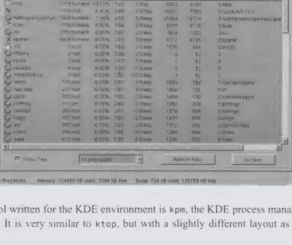

另一个为 KDE 环境编写的图形化工具是 kpm，即 KDE 进程管理器，如图 4.3 所示。它与 ktop 非常相似，但布局略有不同，如图所示。

另一个用于检查系统状态非常有用的命令是 procinfo，如图 4.4 所示。该命令可以以一次性命令或类似于 top 命令的全屏模式呈现信息摘要，例如内存利用率、运行时间、中断和负载平均值。

### 图 4.2

Gtop—Top 工具的 GNOME 版本。

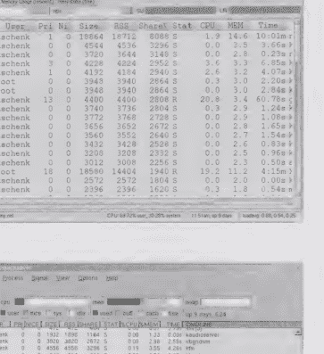

### 图 4.3

kpm—KDE 进程管理器。

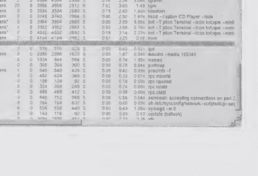

### 图 4.4

全屏模式下的 procinfo。

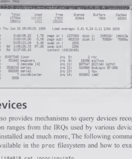

## 检查设备

proc 文件系统还提供了查询 Linux 内核识别的设备的机制。这些信息范围从各种设备使用的 IRQ 到已安装的磁盘驱动器的类型和数量等等。以下命令演示了 proc 文件系统中可用的信息类型以及如何检查它。

```
tschenk@quicksilver:~ [1040]$ cat /proc/cpuinfo
processor : 0
vendor_id : GenuineIntel
cpu family : 5
model : 2
model name : Pentium 75 - 200
stepping : 12
cpu MHz : 167.047402
fdiv_bug : no
hlt_bug : no
sep_bug : no
f00f_bug : yes
fpu : yes
fpu_exception : yes
cpuid level : 1
wp : yes
flags : fpu vme de pse tsc msr mce cx8
bogomips : 66.56
```

要确定 Linux 系统的处理器类型，你可以如图所示操作并检查 /proc/cpuinfo 文件的内容。前面的示例显示该系统识别出一个 Pentium 166MHz 处理器。它还显示该处理器不是 MMX 处理器，以及该处理器容易受到的各种 Pentium 错误。不幸的是，除非正在运行的内核已编译为支持多处理器

无法确定系统有多少个处理器。如果你在内核中包含了多处理器支持，这一事实将在 /proc/cpuinfo 文件以及启动消息中反映出来。

## 注意

请注意，从以下输出中无法推断该系统是否是一个多处理器系统。此输出仅表明正在运行的内核只识别一个处理器。如果这是一个多处理器系统，但运行的是未编译 SMP 支持的内核，你将得到如前例所示的输出。

```
tschenk@quicksilver:~ [1038]$ cat /proc/devices
Character devices:
1 mem
2 pty
3 ttyp
4 ttyS
5 cua
7 vcs
10 misc
14 sound
29 fb
36 netlink
128 ptm
136 pts

Block devices:
1 ramdisk
2 fd
3 ide0
7 loop
8 sd
9 md
11 sr
```

/proc/devices 文件是查看 Linux 内核支持哪些设备的良好起点。该文件列出了在运行内核中可用驱动程序的字符设备和块设备，以及它们的主设备号。

```
tschenk@quicksilver:~ [1042]$ cat /proc/interrupts
CPU0
0: 80221572 XT-PIC timer
1: 358387 XT-PIC keyboard
2: 0 XT-PIC cascade
3: 2532364 XT-PIC serial
4: 692835 XT-PIC serial
5: 7 XT-PIC soundblaster
6: 2 XT-PIC rtc
9: 18096 XT-PIC aic7xxx
11: 697549 XT-PIC DC21140 (eth0)
12: 502952 XT-PIC BusLogic BT-958
13: 1 XT-PIC fpu
14: 868012 XT-PIC ide0
NMI: 0
```

```
tschenk@quicksilver:~ [1043]$ cat /proc/dma
1: SoundBlaster8
4: cascade
5: SoundBlaster16
```

```
tschenk@quicksilver:~ [1044]$ cat /proc/ioports
0000-001f : dma1
0020-003f : pic1
0040-005f : timer
0060-006f : keyboard
0070-007f : rtc
0080-008f : dma page reg
00a0-00bf : pic2
00c0-00df : dma2
00f0-00ff : fpu
01f0-01f7 : ide0
0220-022f : soundblaster
0278-02ff : serial(auto)
0330-0333 : MPU-401 UART
03b0-03df : vga+
03e8-03ef : serial(auto)
03f6-03f6 : ide0
03f8-03ff : serial(auto)
0620-0623 : sound driver (AWE32)
0a20-0a23 : sound driver (AWE32)
0e20-0e23 : sound driver (AWE32)
6000-60be : aic7xxx
6400-6403 : BusLogic BT-958
6600-667f : DC21140 (eth0)
f000-f007 : ide0
f008-f00f : ide1
```

前面三个命令显示了该系统中各种设备的 IRQ、DMA 和 I/O 范围。例如，我可以从输出中确定系统中使用 IRQ 7、DMA 通道 1 和 5 以及多个 I/O 端口范围的 Soundblaster AWE 32 卡。我还可以看到每个设备已产生的中断次数。

```
tschenk@quicksilver:~ [1052]$ cat /proc/pci
PCI devices found:
Bus 0, device 0, function 0:
  Host bridge: Intel 82439HX Triton II (rev 3).
    Medium devsel. Master Capable. Latency=32.
Bus 0, device 7, function 0:
  ISA bridge: Intel 82371SB PIIX3 ISA (rev 1).
    Medium devsel. Fast back-to-back capable. Master Capable. No bursts.
Bus 0, device 7, function 1:
  IDE interface: Intel 82371SB PIIX3 IDE (rev 0).
    Medium devsel. Fast back-to-back capable. Master Capable. Latency=32.
    I/O at 0xf000 [0xf000].
Bus 0, device 17, function 0:
  SCSI storage controller: BusLogic MultiMaster (rev 8).
    Fast devsel. IRQ 12. Master Capable. Latency=32. Min Gnt=8. Max Lat=8.
    I/O at 0x6400 [0x6401].
    Non-prefetchable 32 bit memory at 0xe1804000 [0xe1804000].
Bus 0, device 18, function 0:
  VGA compatible controller: Matrox Millennium II (rev 0).
    Medium devsel. Fast back-to-back capable. IRQ 12. Master Capable.
    Latency=32.
    Prefetchable 32 bit memory at 0xe0000000 [0xe0000000].
    Non-prefetchable 32 bit memory at 0xe1800000 [0xe1800000].
    Non-prefetchable 32 bit memory at 0xe1000000 [0xe1000000].
Bus 0, device 19, function 0:
  SCSI storage controller: Adaptec AIC-7850 (rev 1).
    Medium devsel. Fast back-to-back capable. IRQ 9. Master Capable.
    Latency=32. Min Gnt=4. Max Lat=4.
    I/O at 0x6000 [0x6001].
    Non-prefetchable 32 bit memory at 0xe1805000 [0xe1805000].
Bus 0, device 20, function 0:
  Ethernet controller: DEC DC21140 (rev 34).
    Medium devsel. Fast back-to-back capable. IRQ 11. Master Capable.
    Latency=96. Min Gnt=20. Max Lat=40.
I/O at 0x6600 [0x6601].
Non-prefetchable 32 bit memory at 0xe1806000 [0xe1806000].
```

/proc/pci 文件包含有关系统中各种 PCI 设备的[content]
无法确定系统有多少个处理器。如果你在内核中包含了多处理器支持，这一事实将在 /proc/cpuinfo 文件以及启动消息中反映出来。

## 注意

请注意，从以下输出中无法推断该系统是否是一个多处理器系统。此输出仅表明正在运行的内核只识别一个处理器。如果这是一个多处理器系统，但运行的是未编译 SMP 支持的内核，你将得到如前例所示的输出。

```
tschenk@quicksilver:~ [1038]$ cat /proc/devices
Character devices:
1 mem
2 pty
3 ttyp
4 ttyS
5 cua
7 vcs
10 misc
14 sound
29 fb
36 netlink
128 ptm
136 pts

Block devices:
1 ramdisk
2 fd
3 ide0
7 loop
8 sd
9 md
11 sr
```

/proc/devices 文件是查看 Linux 内核支持哪些设备的良好起点。该文件列出了在运行内核中可用驱动程序的字符设备和块设备，以及它们的主设备号。

```
tschenk@quicksilver:~ [1042]$ cat /proc/interrupts
CPU0
0: 80221572 XT-PIC timer
1: 358387 XT-PIC keyboard
2: 0 XT-PIC cascade
3: 2532364 XT-PIC serial
4: 692835 XT-PIC serial
5: 7 XT-PIC soundblaster
6: 2 XT-PIC rtc
9: 18096 XT-PIC aic7xxx
11: 697549 XT-PIC DC21140 (eth0)
12: 502952 XT-PIC BusLogic BT-958
13: 1 XT-PIC fpu
14: 868012 XT-PIC ide0
NMI: 0
```

```
tschenk@quicksilver:~ [1043]$ cat /proc/dma
1: SoundBlaster8
4: cascade
5: SoundBlaster16
```

```
tschenk@quicksilver:~ [1044]$ cat /proc/ioports
0000-001f : dma1
0020-003f : pic1
0040-005f : timer
0060-006f : keyboard
0070-007f : rtc
0080-008f : dma page reg
00a0-00bf : pic2
00c0-00df : dma2
00f0-00ff : fpu
01f0-01f7 : ide0
0220-022f : soundblaster
0278-02ff : serial(auto)
0330-0333 : MPU-401 UART
03b0-03df : vga+
03e8-03ef : serial(auto)
03f6-03f6 : ide0
03f8-03ff : serial(auto)
0620-0623 : sound driver (AWE32)
0a20-0a23 : sound driver (AWE32)
0e20-0e23 : sound driver (AWE32)
6000-60be : aic7xxx
6400-6403 : BusLogic BT-958
6600-667f : DC21140 (eth0)
f000-f007 : ide0
f008-f00f : ide1
```

前面三个命令显示了该系统中各种设备的 IRQ、DMA 和 I/O 范围。例如，我可以从输出中确定系统中使用 IRQ 7、DMA 通道 1 和 5 以及多个 I/O 端口范围的 Soundblaster AWE 32 卡。我还可以看到每个设备已产生的中断次数。

```
tschenk@quicksilver:~ [1052]$ cat /proc/pci
PCI devices found:
Bus 0, device 0, function 0:
  Host bridge: Intel 82439HX Triton II (rev 3).
    Medium devsel. Master Capable. Latency=32.
Bus 0, device 7, function 0:
  ISA bridge: Intel 82371SB PIIX3 ISA (rev 1).
    Medium devsel. Fast back-to-back capable. Master Capable. No bursts.
Bus 0, device 7, function 1:
  IDE interface: Intel 82371SB PIIX3 IDE (rev 0).
    Medium devsel. Fast back-to-back capable. Master Capable. Latency=32.
    I/O at 0xf000 [0xf000].
Bus 0, device 17, function 0:
  SCSI storage controller: BusLogic MultiMaster (rev 8).
    Fast devsel. IRQ 12. Master Capable. Latency=32. Min Gnt=8. Max Lat=8.
    I/O at 0x6400 [0x6401].
    Non-prefetchable 32 bit memory at 0xe1804000 [0xe1804000].
Bus 0, device 18, function 0:
  VGA compatible controller: Matrox Millennium II (rev 0).
    Medium devsel. Fast back-to-back capable. IRQ 12. Master Capable.
    Latency=32.
    Prefetchable 32 bit memory at 0xe0000000 [0xe0000000].
    Non-prefetchable 32 bit memory at 0xe1800000 [0xe1800000].
    Non-prefetchable 32 bit memory at 0xe1000000 [0xe1000000].
Bus 0, device 19, function 0:
  SCSI storage controller: Adaptec AIC-7850 (rev 1).
    Medium devsel. Fast back-to-back capable. IRQ 9. Master Capable.
    Latency=32. Min Gnt=4. Max Lat=4.
    I/O at 0x6000 [0x6001].
    Non-prefetchable 32 bit memory at 0xe1805000 [0xe1805000].
Bus 0, device 20, function 0:
  Ethernet controller: DEC DC21140 (rev 34).
    Medium devsel. Fast back-to-back capable. IRQ 11. Master Capable.
    Latency=96. Min Gnt=20. Max Lat=40.
I/O at 0x6600 [0x6601].
Non-prefetchable 32 bit memory at 0xe1806000 [0xe1806000].
```

/proc/pci 文件包含有关系统中各种 PCI 设备的[content]
无法确定系统有多少个处理器。如果你在内核中包含了多处理器支持，这一事实将在 /proc/cpuinfo 文件以及启动消息中反映出来。

## 注意

请注意，从以下输出中无法推断该系统是否是一个多处理器系统。此输出仅表明正在运行的内核只识别一个处理器。如果这是一个多处理器系统，但运行的是未编译 SMP 支持的内核，你将得到如前例所示的输出。

```
tschenk@quicksilver:~ [1038]$ cat /proc/devices
Character devices:
1 mem
2 pty
3 ttyp
4 ttyS
5 cua
7 vcs
10 misc
14 sound
29 fb
36 netlink
128 ptm
136 pts

Block devices:
1 ramdisk
2 fd
3 ide0
7 loop
8 sd
9 md
11 sr
```

/proc/devices 文件是查看 Linux 内核支持哪些设备的良好起点。该文件列出了在运行内核中可用驱动程序的字符设备和块设备，以及它们的主设备号。

```
tschenk@quicksilver:~ [1042]$ cat /proc/interrupts
CPU0
0: 80221572 XT-PIC timer
1: 358387 XT-PIC keyboard
2: 0 XT-PIC cascade
3: 2532364 XT-PIC serial
4: 692835 XT-PIC serial
5: 7 XT-PIC soundblaster
6: 2 XT-PIC rtc
9: 18096 XT-PIC aic7xxx
11: 697549 XT-PIC DC21140 (eth0)
12: 502952 XT-PIC BusLogic BT-958
13: 1 XT-PIC fpu
14: 868012 XT-PIC ide0
NMI: 0
```

```
tschenk@quicksilver:~ [1043]$ cat /proc/dma
1: SoundBlaster8
4: cascade
5: SoundBlaster16
```

```
tschenk@quicksilver:~ [1044]$ cat /proc/ioports
0000-001f : dma1
0020-003f : pic1
0040-005f : timer
0060-006f : keyboard
0070-007f : rtc
0080-008f : dma page reg
00a0-00bf : pic2
00c0-00df : dma2
00f0-00ff : fpu
01f0-01f7 : ide0
0220-022f : soundblaster
0278-02ff : serial(auto)
0330-0333 : MPU-401 UART
03b0-03df : vga+
03e8-03ef : serial(auto)
03f6-03f6 : ide0
03f8-03ff : serial(auto)
0620-0623 : sound driver (AWE32)
0a20-0a23 : sound driver (AWE32)
0e20-0e23 : sound driver (AWE32)
6000-60be : aic7xxx
6400-6403 : BusLogic BT-958
6600-667f : DC21140 (eth0)
f000-f007 : ide0
f008-f00f : ide1
```

前面三个命令显示了该系统中各种设备的 IRQ、DMA 和 I/O 范围。例如，我可以从输出中确定系统中使用 IRQ 7、DMA 通道 1 和 5 以及多个 I/O 端口范围的 Soundblaster AWE 32 卡。我还可以看到每个设备已产生的中断次数。

```
tschenk@quicksilver:~ [1052]$ cat /proc/pci
PCI devices found:
Bus 0, device 0, function 0:
  Host bridge: Intel 82439HX Triton II (rev 3).
    Medium devsel. Master Capable. Latency=32.
Bus 0, device 7, function 0:
  ISA bridge: Intel 82371SB PIIX3 ISA (rev 1).
    Medium devsel. Fast back-to-back capable. Master Capable. No bursts.
Bus 0, device 7, function 1:
  IDE interface: Intel 82371SB PIIX3 IDE (rev 0).
    Medium devsel. Fast back-to-back capable. Master Capable. Latency=32.
    I/O at 0xf000 [0xf000].
Bus 0, device 17, function 0:
  SCSI storage controller: BusLogic MultiMaster (rev 8).
    Fast devsel. IRQ 12. Master Capable. Latency=32. Min Gnt=8. Max Lat=8.
    I/O at 0x6400 [0x6401].
    Non-prefetchable 32 bit memory at 0xe1804000 [0xe1804000].
Bus 0, device 18, function 0:
  VGA compatible controller: Matrox Millennium II (rev 0).
    Medium devsel. Fast back-to-back capable. IRQ 12. Master Capable.
    Latency=32.
    Prefetchable 32 bit memory at 0xe0000000 [0xe0000000].
    Non-prefetchable 32 bit memory at 0xe1800000 [0xe1800000].
    Non-prefetchable 32 bit memory at 0xe1000000 [0xe1000000].
Bus 0, device 19, function 0:
  SCSI storage controller: Adaptec AIC-7850 (rev 1).
    Medium devsel. Fast back-to-back capable. IRQ 9. Master Capable.
    Latency=32. Min Gnt=4. Max Lat=4.
    I/O at 0x6000 [0x6001].
    Non-prefetchable 32 bit memory at 0xe1805000 [0xe1805000].
Bus 0, device 20, function 0:
  Ethernet controller: DEC DC21140 (rev 34).
    Medium devsel. Fast back-to-back capable. IRQ 11. Master Capable.
    Latency=96. Min Gnt=20. Max Lat=40.
I/O at 0x6600 [0x6601].
Non-prefetchable 32 bit memory at 0xe1806000 [0xe1806000].
```

/proc/pci 文件包含有关系统中各种 PCI 设备的[content]
无法确定系统有多少个处理器。如果你在内核中包含了多处理器支持，这一事实将在 /proc/cpuinfo 文件以及启动消息中反映出来。

## 注意

请注意，从以下输出中无法推断该系统是否是一个多处理器系统。此输出仅表明正在运行的内核只识别一个处理器。如果这是一个多处理器系统，但运行的是未编译 SMP 支持的内核，你将得到如前例所示的输出。

```
tschenk@quicksilver:~ [1038]$ cat /proc/devices
Character devices:
1 mem
2 pty
3 ttyp
4 ttyS
5 cua
7 vcs
10 misc
14 sound
29 fb
36 netlink
128 ptm
136 pts

Block devices:
1 ramdisk
2 fd
3 ide0
7 loop
8 sd
9 md
11 sr
```

/proc/devices 文件是查看 Linux 内核支持哪些设备的良好起点。该文件列出了在运行内核中可用驱动程序的字符设备和块设备，以及它们的主设备号。

```
tschenk@quicksilver:~ [1042]$ cat /proc/interrupts
CPU0
0: 80221572 XT-PIC timer
1: 358387 XT-PIC keyboard
2: 0 XT-PIC cascade
3: 2532364 XT-PIC serial
4: 692835 XT-PIC serial
5: 7 XT-PIC soundblaster
6: 2 XT-PIC rtc
9: 18096 XT-PIC aic7xxx
11: 697549 XT-PIC DC21140 (eth0)
12: 502952 XT-PIC BusLogic BT-958
13: 1 XT-PIC fpu
14: 868012 XT-PIC ide0
NMI: 0
```

```
tschenk@quicksilver:~ [1043]$ cat /proc/dma
1: SoundBlaster8
4: cascade
5: SoundBlaster16
```

```
tschenk@quicksilver:~ [1044]$ cat /proc/ioports
0000-001f : dma1
0020-003f : pic1
0040-005f : timer
0060-006f : keyboard
0070-007f : rtc
0080-008f : dma page reg
00a0-00bf : pic2
00c0-00df : dma2
00f0-00ff : fpu
01f0-01f7 : ide0
0220-022f : soundblaster
0278-02ff : serial(auto)
0330-0333 : MPU-401 UART
03b0-03df : vga+
03e8-03ef : serial(auto)
03f6-03f6 : ide0
03f8-03ff : serial(auto)
0620-0623 : sound driver (AWE32)
0a20-0a23 : sound driver (AWE32)
0e20-0e23 : sound driver (AWE32)
6000-60be : aic7xxx
6400-6403 : BusLogic BT-958
6600-667f : DC21140 (eth0)
f000-f007 : ide0
f008-f00f : ide1
```

前面三个命令显示了该系统中各种设备的 IRQ、DMA 和 I/O 范围。例如，我可以从输出中确定系统中使用 IRQ 7、DMA 通道 1 和 5 以及多个 I/O 端口范围的 Soundblaster AWE 32 卡。我还可以看到每个设备已产生的中断次数。

```
tschenk@quicksilver:~ [1052]$ cat /proc/pci
PCI devices found:
Bus 0, device 0, function 0:
  Host bridge: Intel 82439HX Triton II (rev 3).
    Medium devsel. Master Capable. Latency=32.
Bus 0, device 7, function 0:
  ISA bridge: Intel 82371SB PIIX3 ISA (rev 1).
    Medium devsel. Fast back-to-back capable. Master Capable. No bursts.
Bus 0, device 7, function 1:
  IDE interface: Intel 82371SB PIIX3 IDE (rev 0).
    Medium devsel. Fast back-to-back capable. Master Capable. Latency=32.
    I/O at 0xf000 [0xf000].
Bus 0, device 17, function 0:
  SCSI storage controller: BusLogic MultiMaster (rev 8).
    Fast devsel. IRQ 12. Master Capable. Latency=32. Min Gnt=8. Max Lat=8.
    I/O at 0x6400 [0x6401].
    Non-prefetchable 32 bit memory at 0xe1804000 [0xe1804000].
Bus 0, device 18, function 0:
  VGA compatible controller: Matrox Millennium II (rev 0).
    Medium devsel. Fast back-to-back capable. IRQ 12. Master Capable.
    Latency=32.
    Prefetchable 32 bit memory at 0xe0000000 [0xe0000000].
    Non-prefetchable 32 bit memory at 0xe1800000 [0xe1800000].
    Non-prefetchable 32 bit memory at 0xe1000000 [0xe1000000].
Bus 0, device 19, function 0:
  SCSI storage controller: Adaptec AIC-7850 (rev 1).
    Medium devsel. Fast back-to-back capable. IRQ 9. Master Capable.
    Latency=32. Min Gnt=4. Max Lat=4.
    I/O at 0x6000 [0x6001].
    Non-prefetchable 32 bit memory at 0xe1805000 [0xe1805000].
Bus 0, device 20, function 0:
  Ethernet controller: DEC DC21140 (rev 34).
    Medium devsel. Fast back-to-back capable. IRQ 11. Master Capable.
    Latency=96. Min Gnt=20. Max Lat=40.
I/O at 0x6600 [0x6601].
Non-prefetchable 32 bit memory at 0xe1806000 [0xe1806000].
```

/proc/pci 文件包含有关系统中各种 PCI 设备的[content]
无法确定系统有多少个处理器。如果你在内核中包含了多处理器支持，这一事实将在 /proc/cpuinfo 文件以及启动消息中反映出来。

## 注意

请注意，从以下输出中无法推断该系统是否是一个多处理器系统。此输出仅表明正在运行的内核只识别一个处理器。如果这是一个多处理器系统，但运行的是未编译 SMP 支持的内核，你将得到如前例所示的输出。

```
tschenk@quicksilver:~ [1038]$ cat /proc/devices
Character devices:
1 mem
2 pty
3 ttyp
4 ttyS
5 cua
7 vcs
10 misc
14 sound
29 fb
36 netlink
128 ptm
136 pts

Block devices:
1 ramdisk
2 fd
3 ide0
7 loop
8 sd
9 md
11 sr
```

/proc/devices 文件是查看 Linux 内核支持哪些设备的良好起点。该文件列出了在运行内核中可用驱动程序的字符设备和块设备，以及它们的主设备号。

```
tschenk@quicksilver:~ [1042]$ cat /proc/interrupts
CPU0
0: 80221572 XT-PIC timer
1: 358387 XT-PIC keyboard
2: 0 XT-PIC cascade
3: 2532364 XT-PIC serial
4: 692835 XT-PIC serial
5: 7 XT-PIC soundblaster
6: 2 XT-PIC rtc
9: 18096 XT-PIC aic7xxx
11: 697549 XT-PIC DC21140 (eth0)
12: 502952 XT-PIC BusLogic BT-958
13: 1 XT-PIC fpu
14: 868012 XT-PIC ide0
NMI: 0
```

```
tschenk@quicksilver:~ [1043]$ cat /proc/dma
1: SoundBlaster8
4: cascade
5: SoundBlaster16
```

```
tschenk@quicksilver:~ [1044]$ cat /proc/ioports
0000-001f : dma1
0020-003f : pic1
0040-005f : timer
0060-006f : keyboard
0070-007f : rtc
0080-008f : dma page reg
00a0-00bf : pic2
00c0-00df : dma2
00f0-00ff : fpu
01f0-01f7 : ide0
0220-022f : soundblaster
0278-02ff : serial(auto)
0330-0333 : MPU-401 UART
03b0-03df : vga+
03e8-03ef : serial(auto)
03f6-03f6 : ide0
03f8-03ff : serial(auto)
0620-0623 : sound driver (AWE32)
0a20-0a23 : sound driver (AWE32)
0e20-0e23 : sound driver (AWE32)
6000-60be : aic7xxx
6400-6403 : BusLogic BT-958
6600-667f : DC21140 (eth0)
f000-f007 : ide0
f008-f00f : ide1
```

前面三个命令显示了该系统中各种设备的 IRQ、DMA 和 I/O 范围。例如，我可以从输出中确定系统中使用 IRQ 7、DMA 通道 1 和 5 以及多个 I/O 端口范围的 Soundblaster AWE 32 卡。我还可以看到每个设备已产生的中断次数。

```
tschenk@quicksilver:~ [1052]$ cat /proc/pci
PCI devices found:
Bus 0, device 0, function 0:
  Host bridge: Intel 82439HX Triton II (rev 3).
    Medium devsel. Master Capable. Latency=32.
Bus 0, device 7, function 0:
  ISA bridge: Intel 82371SB PIIX3 ISA (rev 1).
    Medium devsel. Fast back-to-back capable. Master Capable. No bursts.
Bus 0, device 7, function 1:
  IDE interface: Intel 82371SB PIIX3 IDE (rev 0).
    Medium devsel. Fast back-to-back capable. Master Capable. Latency=32.
    I/O at 0xf000 [0xf000].
Bus 0, device 17, function 0:
  SCSI storage controller: BusLogic MultiMaster (rev 8).
    Fast devsel. IRQ 12. Master Capable. Latency=32. Min Gnt=8. Max Lat=8.
    I/O at 0x6400 [0x6401].
    Non-prefetchable 32 bit memory at 0xe1804000 [0xe1804000].
Bus 0, device 18, function 0:
  VGA compatible controller: Matrox Millennium II (rev 0).
    Medium devsel. Fast back-to-back capable. IRQ 12. Master Capable.
    Latency=32.
    Prefetchable 32 bit memory at 0xe0000000 [0xe0000000].
    Non-prefetchable 32 bit memory at 0xe1800000 [0xe1800000].
    Non-prefetchable 32 bit memory at 0xe1000000 [0xe1000000].
Bus 0, device 19, function 0:
  SCSI storage controller: Adaptec AIC-7850 (rev 1).
    Medium devsel. Fast back-to-back capable. IRQ 9. Master Capable.
    Latency=32. Min Gnt=4. Max Lat=4.
    I/O at 0x6000 [0x6001].
    Non-prefetchable 32 bit memory at 0xe1805000 [0xe1805000].
Bus 0, device 20, function 0:
  Ethernet controller: DEC DC21140 (rev 34).
    Medium devsel. Fast back-to-back capable. IRQ 11. Master Capable.
    Latency=96. Min Gnt=20. Max Lat=40.
I/O at 0x6600 [0x6601].
Non-prefetchable 32 bit memory at 0xe1806000 [0xe1806000].
```

/proc/pci 文件包含有关系统中各种 PCI 设备的[content]
无法确定系统有多少个处理器。如果你在内核中包含了多处理器支持，这一事实将在 /proc/cpuinfo 文件以及启动消息中反映出来。

## 注意

请注意，从以下输出中无法推断该系统是否是一个多处理器系统。此输出仅表明正在运行的内核只识别一个处理器。如果这是一个多处理器系统，但运行的是未编译 SMP 支持的内核，你将得到如前例所示的输出。

```
tschenk@quicksilver:~ [1038]$ cat /proc/devices
Character devices:
1 mem
2 pty
3 ttyp
4 ttyS
5 cua
7 vcs
10 misc
14 sound
29 fb
36 netlink
128 ptm
136 pts

Block devices:
1 ramdisk
2 fd
3 ide0
7 loop
8 sd
9 md
11 sr
```

/proc/devices 文件是查看 Linux 内核支持哪些设备的良好起点。该文件列出了在运行内核中可用驱动程序的字符设备和块设备，以及它们的主设备号。

```
tschenk@quicksilver:~ [1042]$ cat /proc/interrupts
CPU0
0: 80221572 XT-PIC timer
1: 358387 XT-PIC keyboard
2: 0 XT-PIC cascade
3: 2532364 XT-PIC serial
4: 692835 XT-PIC serial
5: 7 XT-PIC soundblaster
6: 2 XT-PIC rtc
9: 18096 XT-PIC aic7xxx
11: 697549 XT-PIC DC21140 (eth0)
12: 502952 XT-PIC BusLogic BT-958
13: 1 XT-PIC fpu
14: 868012 XT-PIC ide0
NMI: 0
```

```
tschenk@quicksilver:~ [1043]$ cat /proc/dma
1: SoundBlaster8
4: cascade
5: SoundBlaster16
```

```
tschenk@quicksilver:~ [1044]$ cat /proc/ioports
0000-001f : dma1
0020-003f : pic1
0040-005f : timer
0060-006f : keyboard
0070-007f : rtc
0080-008f : dma page reg
00a0-00bf : pic2
00c0-00df : dma2
00f0-00ff : fpu
01f0-01f7 : ide0
0220-022f : soundblaster
0278-02ff : serial(auto)
0330-0333 : MPU-401 UART
03b0-03df : vga+
03e8-03ef : serial(auto)
03f6-03f6 : ide0
03f8-03ff : serial(auto)
0620-0623 : sound driver (AWE32)
0a20-0a23 : sound driver (AWE32)
0e20-0e23 : sound driver (AWE32)
6000-60be : aic7xxx
6400-6403 : BusLogic BT-958
6600-667f : DC21140 (eth0)
f000-f007 : ide0
f008-f00f : ide1
```

前面三个命令显示了该系统中各种设备的 IRQ、DMA 和 I/O 范围。例如，我可以从输出中确定系统中使用 IRQ 7、DMA 通道 1 和 5 以及多个 I/O 端口范围的 Soundblaster AWE 32 卡。我还可以看到每个设备已产生的中断次数。

```
tschenk@quicksilver:~ [1052]$ cat /proc/pci
PCI devices found:
Bus 0, device 0, function 0:
  Host bridge: Intel 82439HX Triton II (rev 3).
    Medium devsel. Master Capable. Latency=32.
Bus 0, device 7, function 0:
  ISA bridge: Intel 82371SB PIIX3 ISA (rev 1).
    Medium devsel. Fast back-to-back capable. Master Capable. No bursts.
Bus 0, device 7, function 1:
  IDE interface: Intel 82371SB PIIX3 IDE (rev 0).
    Medium devsel. Fast back-to-back capable. Master Capable. Latency=32.
    I/O at 0xf000 [0xf000].
Bus 0, device 17, function 0:
  SCSI storage controller: BusLogic MultiMaster (rev 8).
    Fast devsel. IRQ 12. Master Capable. Latency=32. Min Gnt=8. Max Lat=8.
    I/O at 0x6400 [0x6401].
    Non-prefetchable 32 bit memory at 0xe1804000 [0xe1804000].
Bus 0, device 18, function 0:
  VGA compatible controller: Matrox Millennium II (rev 0).
    Medium devsel. Fast back-to-back capable. IRQ 12. Master Capable.
    Latency=32.
    Prefetchable 32 bit memory at 0xe0000000 [0xe0000000].
    Non-prefetchable 32 bit memory at 0xe1800000 [0xe1800000].
    Non-prefetchable 32 bit memory at 0xe1000000 [0xe1000000].
Bus 0, device 19, function 0:
  SCSI storage controller: Adaptec AIC-7850 (rev 1).
    Medium devsel. Fast back-to-back capable. IRQ 9. Master Capable.
    Latency=32. Min Gnt=4. Max Lat=4.
    I/O at 0x6000 [0x6001].
    Non-prefetchable 32 bit memory at 0xe1805000 [0xe1805000].
Bus 0, device 20, function 0:
  Ethernet controller: DEC DC21140 (rev 34).
    Medium devsel. Fast back-to-back capable. IRQ 11. Master Capable.
    Latency=96. Min Gnt=20. Max Lat=40.
I/O at 0x6600 [0x6601].
Non-prefetchable 32 bit memory at 0xe1806000 [0xe1806000].
```

/proc/pci 文件包含有关系统中各种 PCI 设备的[content]
无法确定系统有多少个处理器。如果你在内核中包含了多处理器支持，这一事实将在 /proc/cpuinfo 文件以及启动消息中反映出来。

## 注意

请注意，从以下输出中无法推断该系统是否是一个多处理器系统。此输出仅表明正在运行的内核只识别一个处理器。如果这是一个多处理器系统，但运行的是未编译 SMP 支持的内核，你将得到如前例所示的输出。

```
tschenk@quicksilver:~ [1038]$ cat /proc/devices
Character devices:
1 mem
2 pty
3 ttyp
4 ttyS
5 cua
7 vcs
10 misc
14 sound
29 fb
36 netlink
128 ptm
136 pts

Block devices:
1 ramdisk
2 fd
3 ide0
7 loop
8 sd
9 md
11 sr
```

/proc/devices 文件是查看 Linux 内核支持哪些设备的良好起点。该文件列出了在运行内核中可用驱动程序的字符设备和块设备，以及它们的主设备号。

```
tschenk@quicksilver:~ [1042]$ cat /proc/interrupts
CPU0
0: 80221572 XT-PIC timer
1: 358387 XT-PIC keyboard
2: 0 XT-PIC cascade
3: 2532364 XT-PIC serial
4: 692835 XT-PIC serial
5: 7 XT-PIC soundblaster
6: 2 XT-PIC rtc
9: 18096 XT-PIC aic7xxx
11: 697549 XT-PIC DC21140 (eth0)
12: 502952 XT-PIC BusLogic BT-958
13: 1 XT-PIC fpu
14: 868012 XT-PIC ide0
NMI: 0
```

```
tschenk@quicksilver:~ [1043]$ cat /proc/dma
1: SoundBlaster8
4: cascade
5: SoundBlaster16
```

```
tschenk@quicksilver:~ [1044]$ cat /proc/ioports
0000-001f : dma1
0020-003f : pic1
0040-005f : timer
0060-006f : keyboard
0070-007f : rtc
0080-008f : dma page reg
00a0-00bf : pic2
00c0-00df : dma2
00f0-00ff : fpu
01f0-01f7 : ide0
0220-022f : soundblaster
0278-02ff : serial(auto)
0330-0333 : MPU-401 UART
03b0-03df : vga+
03e8-03ef : serial(auto)
03f6-03f6 : ide0
03f8-03ff : serial(auto)
0620-0623 : sound driver (AWE32)
0a20-0a23 : sound driver (AWE32)
0e20-0e23 : sound driver (AWE32)
6000-60be : aic7xxx
6400-6403 : BusLogic BT-958
6600-667f : DC21140 (eth0)
f000-f007 : ide0
f008-f00f : ide1
```

前面三个命令显示了该系统中各种设备的 IRQ、DMA 和 I/O 范围。例如，我可以从输出中确定系统中使用 IRQ 7、DMA 通道 1 和 5 以及多个 I/O 端口范围的 Soundblaster AWE 32 卡。我还可以看到每个设备已产生的中断次数。

```
tschenk@quicksilver:~ [1052]$ cat /proc/pci
PCI devices found:
Bus 0, device 0, function 0:
  Host bridge: Intel 82439HX Triton II (rev 3).
    Medium devsel. Master Capable. Latency=32.
Bus 0, device 7, function 0:
  ISA bridge: Intel 82371SB PIIX3 ISA (rev 1).
    Medium devsel. Fast back-to-back capable. Master Capable. No bursts.
Bus 0, device 7, function 1:
  IDE interface: Intel 82371SB PIIX3 IDE (rev 0).
    Medium devsel. Fast back-to-back capable. Master Capable. Latency=32.
    I/O at 0xf000 [0xf000].
Bus 0, device 17, function 0:
  SCSI storage controller: BusLogic MultiMaster (rev 8).
    Fast devsel. IRQ 12. Master Capable. Latency=32. Min Gnt=8. Max Lat=8.
    I/O at 0x6400 [0x6401].
    Non-prefetchable 32 bit memory at 0xe1804000 [0xe1804000].
Bus 0, device 18, function 0:
  VGA compatible controller: Matrox Millennium II (rev 0).
    Medium devsel. Fast back-to-back capable. IRQ 12. Master Capable.
    Latency=32.
    Prefetchable 32 bit memory at 0xe0000000 [0xe0000000].
    Non-prefetchable 32 bit memory at 0xe1800000 [0xe1800000].
    Non-prefetchable 32 bit memory at 0xe1000000 [0xe1000000].
Bus 0, device 19, function 0:
  SCSI storage controller: Adaptec AIC-7850 (rev 1).
    Medium devsel. Fast back-to-back capable. IRQ 9. Master Capable.
    Latency=32. Min Gnt=4. Max Lat=4.
    I/O at 0x6000 [0x6001].
    Non-prefetchable 32 bit memory at 0xe1805000 [0xe1805000].
Bus 0, device 20, function 0:
  Ethernet controller: DEC DC21140 (rev 34).
    Medium devsel. Fast back-to-back capable. IRQ 11. Master Capable.
    Latency=96. Min Gnt=20. Max Lat=40.
I/O at 0x6600 [0x6601].
Non-prefetchable 32 bit memory at 0xe1806000 [0xe1806000].
```

/proc/pci 文件包含有关系统中各种 PCI 设备的[content]
无法确定系统有多少个处理器。如果你在内核中包含了多处理器支持，这一事实将在 /proc/cpuinfo 文件以及启动消息中反映出来。

## 注意

请注意，从以下输出中无法推断该系统是否是一个多处理器系统。此输出仅表明正在运行的内核只识别一个处理器。如果这是一个多处理器系统，但运行的是未编译 SMP 支持的内核，你将得到如前例所示的输出。

```
tschenk@quicksilver:~ [1038]$ cat /proc/devices
Character devices:
1 mem
2 pty
3 ttyp
4 ttyS
5 cua
7 vcs
10 misc
14 sound
29 fb
36 netlink
128 ptm
136 pts

Block devices:
1 ramdisk
2 fd
3 ide0
7 loop
8 sd
9 md
11 sr
```

/proc/devices 文件是查看 Linux 内核支持哪些设备的良好起点。该文件列出了在运行内核中可用驱动程序的字符设备和块设备，以及它们的主设备号。

```
tschenk@quicksilver:~ [1042]$ cat /proc/interrupts
CPU0
0: 80221572 XT-PIC timer
1: 358387 XT-PIC keyboard
2: 0 XT-PIC cascade
3: 2532364 XT-PIC serial
4: 692835 XT-PIC serial
5: 7 XT-PIC soundblaster
6: 2 XT-PIC rtc
9: 18096 XT-PIC aic7xxx
11: 697549 XT-PIC DC21140 (eth0)
12: 502952 XT-PIC BusLogic BT-958
13: 1 XT-PIC fpu
14: 868012 XT-PIC ide0
NMI: 0
```

```
tschenk@quicksilver:~ [1043]$ cat /proc/dma
1: SoundBlaster8
4: cascade
5: SoundBlaster16
```

```
tschenk@quicksilver:~ [1044]$ cat /proc/ioports
0000-001f : dma1
0020-003f : pic1
0040-005f : timer
0060-006f : keyboard
0070-007f : rtc
0080-008f : dma page reg
00a0-00bf : pic2
00c0-00df : dma2
00f0-00ff : fpu
01f0-01f7 : ide0
0220-022f : soundblaster
0278-02ff : serial(auto)
0330-0333 : MPU-401 UART
03b0-03df : vga+
03e8-03ef : serial(auto)
03f6-03f6 : ide0
03f8-03ff : serial(auto)
0620-0623 : sound driver (AWE32)
0a20-0a23 : sound driver (AWE32)
0e20-0e23 : sound driver (AWE32)
6000-60be : aic7xxx
6400-6403 : BusLogic BT-958
6600-667f : DC21140 (eth0)
f000-f007 : ide0
f008-f00f : ide1
```

前面三个命令显示了该系统中各种设备的 IRQ、DMA 和 I/O 范围。例如，我可以从输出中确定系统中使用 IRQ 7、DMA 通道 1 和 5 以及多个 I/O 端口范围的 Soundblaster AWE 32 卡。我还可以看到每个设备已产生的中断次数。

```
tschenk@quicksilver:~ [1052]$ cat /proc/pci
PCI devices found:
Bus 0, device 0, function 0:
  Host bridge: Intel 82439HX Triton II (rev 3).
    Medium devsel. Master Capable. Latency=32.
Bus 0, device 7, function 0:
  ISA bridge: Intel 82371SB PIIX3 ISA (rev 1).
    Medium devsel. Fast back-to-back capable. Master Capable. No bursts.
Bus 0, device 7, function 1:
  IDE interface: Intel 82371SB PIIX3 IDE (rev 0).
    Medium devsel. Fast back-to-back capable. Master Capable. Latency=32.
    I/O at 0xf000 [0xf000].
Bus 0, device 17, function 0:
  SCSI storage controller: BusLogic MultiMaster (rev 8).
    Fast devsel. IRQ 12. Master Capable. Latency=32. Min Gnt=8. Max Lat=8.
    I/O at 0x6400 [0x6401].
    Non-prefetchable 32 bit memory at 0xe1804000 [0xe1804000].
Bus 0, device 18, function 0:
  VGA compatible controller: Matrox Millennium II (rev 0).
    Medium devsel. Fast back-to-back capable. IRQ 12. Master Capable.
    Latency=32.
    Prefetchable 32 bit memory at 0xe0000000 [0xe0000000].
    Non-prefetchable 32 bit memory at 0xe1800000 [0xe1800000].
    Non-prefetchable 32 bit memory at 0xe1000000 [0xe1000000].
Bus 0, device 19, function 0:
  SCSI storage controller: Adaptec AIC-7850 (rev 1).
    Medium devsel. Fast back-to-back capable. IRQ 9. Master Capable.
    Latency=32. Min Gnt=4. Max Lat=4.
    I/O at 0x6000 [0x6001].
    Non-prefetchable 32 bit memory at 0xe1805000 [0xe1805000].
Bus 0, device 20, function 0:
  Ethernet controller: DEC DC21140 (rev 34).
    Medium devsel. Fast back-to-back capable. IRQ 11. Master Capable.
    Latency=96. Min Gnt=20. Max Lat=40.
I/O at 0x6600 [0x6601].
Non-prefetchable 32 bit memory at 0xe1806000 [0xe1806000].
```

/proc/pci 文件提供了系统中各种 PCI 设备的[content]
无法确定系统有多少个处理器。如果在内核中包含多处理器支持，这一事实会反映在 /proc/cpuinfo 文件和启动消息中。

## 注意

请注意，无法从以下输出推断该系统是否多处理器。此输出仅表示运行的内核只识别一个处理器。若多处理器系统运行未编译 SMP 支持的内核，将得到如前例所示的输出。

```
tschenk@quicksilver:~ [1038]$ cat /proc/devices
Character devices:
1 mem
2 pty
3 ttyp
4 ttyS
5 cua
7 vcs
10 misc
14 sound
29 fb
36 netlink
128 ptm
136 pts

Block devices:
1 ramdisk
2 fd
3 ide0
7 loop
8 sd
9 md
11 sr
```

/proc/devices 文件是查看 Linux 内核支持哪些设备的起点。该文件列出运行内核中可用驱动的字符设备和块设备及其主设备号。

```
tschenk@quicksilver:~ [1042]$ cat /proc/interrupts
CPU0
0: 80221572 XT-PIC timer
1: 358387 XT-PIC keyboard
2: 0 XT-PIC cascade
3: 2532364 XT-PIC serial
4: 692835 XT-PIC serial
5: 7 XT-PIC soundblaster
6: 2 XT-PIC rtc
9: 18096 XT-PIC aic7xxx
11: 697549 XT-PIC DC21140 (eth0)
12: 502952 XT-PIC BusLogic BT-958
13: 1 XT-PIC fpu
14: 868012 XT-PIC ide0
NMI: 0
```

```
tschenk@quicksilver:~ [1043]$ cat /proc/dma
1: SoundBlaster8
4: cascade
5: SoundBlaster16
```

```
tschenk@quicksilver:~ [1044]$ cat /proc/ioports
0000-001f : dma1
0020-003f : pic1
0040-005f : timer
0060-006f : keyboard
0070-007f : rtc
0080-008f : dma page reg
00a0-00bf : pic2
00c0-00df : dma2
00f0-00ff : fpu
01f0-01f7 : ide0
0220-022f : soundblaster
0278-02ff : serial(auto)
0330-0333 : MPU-401 UART
03b0-03df : vga+
03e8-03ef : serial(auto)
03f6-03f6 : ide0
03f8-03ff : serial(auto)
0620-0623 : sound driver (AWE32)
0a20-0a23 : sound driver (AWE32)
0e20-0e23 : sound driver (AWE32)
6000-60be : aic7xxx
6400-6403 : BusLogic BT-958
6600-667f : DC21140 (eth0)
f000-f007 : ide0
f008-f00f : ide1
```

前面三个命令显示了本系统各设备的 IRQ、DMA 和 I/O 范围。例如可确定系统中有使用 IRQ 7、DMA 通道 1 和 5 以及多个 I/O 端口范围的 Soundblaster AWE 32 卡。也可看到各设备产生的中断次数。

```
tschenk@quicksilver:~ [1052]$ cat /proc/pci
PCI devices found:
Bus 0, device 0, function 0:
  Host bridge: Intel 82439HX Triton II (rev 3).
    Medium devsel. Master Capable. Latency=32.
Bus 0, device 7, function 0:
  ISA bridge: Intel 82371SB PIIX3 ISA (rev 1).
    Medium devsel. Fast back-to-back capable. Master Capable. No bursts.
Bus 0, device 7, function 1:
  IDE interface: Intel 82371SB PIIX3 IDE (rev 0).
    Medium devsel. Fast back-to-back capable. Master Capable. Latency=32.
    I/O at 0xf000 [0xf000].
Bus 0, device 17, function 0:
  SCSI storage controller: BusLogic MultiMaster (rev 8).
    Fast devsel. IRQ 12. Master Capable. Latency=32. Min Gnt=8. Max Lat=8.
    I/O at 0x6400 [0x6401].
    Non-prefetchable 32 bit memory at 0xe1804000 [0xe1804000].
Bus 0, device 18, function 0:
  VGA compatible controller: Matrox Millennium II (rev 0).
    Medium devsel. Fast back-to-back capable. IRQ 12. Master Capable.
    Latency=32.
    Prefetchable 32 bit memory at 0xe0000000 [0xe0000000].
    Non-prefetchable 32 bit memory at 0xe1800000 [0xe1800000].
    Non-prefetchable 32 bit memory at 0xe1000000 [0xe1000000].
Bus 0, device 19, function 0:
  SCSI storage controller: Adaptec AIC-7850 (rev 1).
    Medium devsel. Fast back-to-back capable. IRQ 9. Master Capable.
    Latency=32. Min Gnt=4. Max Lat=4.
    I/O at 0x6000 [0x6001].
    Non-prefetchable 32 bit memory at 0xe1805000 [0xe1805000].
Bus 0, device 20, function 0:
  Ethernet controller: DEC DC21140 (rev 34).
    Medium devsel. Fast back-to-back capable. IRQ 11. Master Capable.
    Latency=96. Min Gnt=20. Max Lat=40.
I/O at 0x6600 [0x6601].
Non-prefetchable 32 bit memory at 0xe1806000 [0xe1806000].
```

/proc/pci 文件提供了系统中各种 PCI 设备的[content]
无法判断系统有多少个处理器。若内核包含多处理器支持，该信息会体现在 /proc/cpuinfo 文件和启动信息中。

## 注意

请注意，以下输出不能说明系统是否多处理器。它仅表示当前内核只识别一个处理器。若多处理器系统运行未启用 SMP 的内核，输出会如前例所示。

```
tschenk@quicksilver:~ [1038]$ cat /proc/devices
Character devices:
1 mem
2 pty
3 ttyp
4 ttyS
5 cua
7 vcs
10 misc
14 sound
29 fb
36 netlink
128 ptm
136 pts

Block devices:
1 ramdisk
2 fd
3 ide0
7 loop
8 sd
9 md
11 sr
```

/proc/devices 是查看 Linux 内核支持设备的起点。该文件列出运行内核中可用驱动的字符设备和块设备及其主号。

```
tschenk@quicksilver:~ [1042]$ cat /proc/interrupts
CPU0
0: 80221572 XT-PIC timer
1: 358387 XT-PIC keyboard
2: 0 XT-PIC cascade
3: 2532364 XT-PIC serial
4: 692835 XT-PIC serial
5: 7 XT-PIC soundblaster
6: 2 XT-PIC rtc
9: 18096 XT-PIC aic7xxx
11: 697549 XT-PIC DC21140 (eth0)
12: 502952 XT-PIC BusLogic BT-958
13: 1 XT-PIC fpu
14: 868012 XT-PIC ide0
NMI: 0
```

```
tschenk@quicksilver:~ [1043]$ cat /proc/dma
1: SoundBlaster8
4: cascade
5: SoundBlaster16
```

```
tschenk@quicksilver:~ [1044]$ cat /proc/ioports
0000-001f : dma1
0020-003f : pic1
0040-005f : timer
0060-006f : keyboard
0070-007f : rtc
0080-008f : dma page reg
00a0-00bf : pic2
00c0-00df : dma2
00f0-00ff : fpu
01f0-01f7 : ide0
0220-022f : soundblaster
0278-02ff : serial(auto)
0330-0333 : MPU-401 UART
03b0-03df : vga+
03e8-03ef : serial(auto)
03f6-03f6 : ide0
03f8-03ff : serial(auto)
0620-0623 : sound driver (AWE32)
0a20-0a23 : sound driver (AWE32)
0e20-0e23 : sound driver (AWE32)
6000-60be : aic7xxx
6400-6403 : BusLogic BT-958
6600-667f : DC21140 (eth0)
f000-f007 : ide0
f008-f00f : ide1
```

前三个命令显示了本系统各设备的 IRQ、DMA 和 I/O 范围。例如可看出系统有一块使用 IRQ 7、DMA 1 和 5 以及多个 I/O 范围的 Soundblaster AWE 32 卡。也可看到各设备产生的中断数。

```
tschenk@quicksilver:~ [1052]$ cat /proc/pci
PCI devices found:
Bus 0, device 0, function 0:
  Host bridge: Intel 82439HX Triton II (rev 3).
    Medium devsel. Master Capable. Latency=32.
Bus 0, device 7, function 0:
  ISA bridge: Intel 82371SB PIIX3 ISA (rev 1).
    Medium devsel. Fast back-to-back capable. Master Capable. No bursts.
Bus 0, device 7, function 1:
  IDE interface: Intel 82371SB PIIX3 IDE (rev 0).
    Medium devsel. Fast back-to-back capable. Master Capable. Latency=32.
    I/O at 0xf000 [0xf000].
Bus 0, device 17, function 0:
  SCSI storage controller: BusLogic MultiMaster (rev 8).
    Fast devsel. IRQ 12. Master Capable. Latency=32. Min Gnt=8. Max Lat=8.
    I/O at 0x6400 [0x6401].
    Non-prefetchable 32 bit memory at 0xe1804000 [0xe1804000].
Bus 0, device 18, function 0:
  VGA compatible controller: Matrox Millennium II (rev 0).
    Medium devsel. Fast back-to-back capable. IRQ 12. Master Capable.
    Latency=32.
    Prefetchable 32 bit memory at 0xe0000000 [0xe0000000].
    Non-prefetchable 32 bit memory at 0xe1800000 [0xe1800000].
    Non-prefetchable 32 bit memory at 0xe1000000 [0xe1000000].
Bus 0, device 19, function 0:
  SCSI storage controller: Adaptec AIC-7850 (rev 1).
    Medium devsel. Fast back-to-back capable. IRQ 9. Master Capable.
    Latency=32. Min Gnt=4. Max Lat=4.
    I/O at 0x6000 [0x6001].
    Non-prefetchable 32 bit memory at 0xe1805000 [0xe1805000].
Bus 0, device 20, function 0:
  Ethernet controller: DEC DC21140 (rev 34).
    Medium devsel. Fast back-to-back capable. IRQ 11. Master Capable.
    Latency=96. Min Gnt=20. Max Lat=40.
I/O at 0x6600 [0x6601].
Non-prefetchable 32 bit memory at 0xe1806000 [0xe1806000].
```

/proc/pci 文件提供了系统中各种 PCI 设备的[content]
无法判断系统有多少个处理器。若内核包含多处理器支持，该信息会体现在 /proc/cpuinfo 文件和启动信息中。

## 注意

请注意，以下输出不能说明系统是否多处理器。它仅表示当前内核只识别一个处理器。若多处理器系统运行未启用 SMP 的内核，输出会如前例所示。

~~~
tschenk@quicksilver:~ [1038]$ cat /proc/devices
Character devices:
1 mem
2 pty
3 ttyp
4 ttyS
5 cua
7 vcs
10 misc
14 sound
29 fb
36 netlink
128 ptm
136 pts

Block devices:
1 ramdisk
2 fd
3 ide0
7 loop
8 sd
9 md
11 sr
~~~

/proc/devices 是查看 Linux 内核支持设备的起点。该文件列出运行内核中可用驱动的字符设备和块设备及其主号。

~~~
tschenk@quicksilver:~ [1042]$ cat /proc/interrupts
CPU0
0: 80221572 XT-PIC timer
1: 358387 XT-PIC keyboard
2: 0 XT-PIC cascade
3: 2532364 XT-PIC serial
4: 692835 XT-PIC serial
5: 7 XT-PIC soundblaster
6: 2 XT-PIC rtc
9: 18096 XT-PIC aic7xxx
11: 697549 XT-PIC DC21140 (eth0)
12: 502952 XT-PIC BusLogic BT-958
13: 1 XT-PIC fpu
14: 868012 XT-PIC ide0
NMI: 0
~~~

~~~
tschenk@quicksilver:~ [1043]$ cat /proc/dma
1: SoundBlaster8
4: cascade
5: SoundBlaster16
~~~

~~~
tschenk@quicksilver:~ [1044]$ cat /proc/ioports
0000-001f : dma1
0020-003f : pic1
0040-005f : timer
0060-006f : keyboard
0070-007f : rtc
0080-008f : dma page reg
00a0-00bf : pic2
00c0-00df : dma2
00f0-00ff : fpu
01f0-01f7 : ide0
0220-022f : soundblaster
0278-02ff : serial(auto)
0330-0333 : MPU-401 UART
03b0-03df : vga+
03e8-03ef : serial(auto)
03f6-03f6 : ide0
03f8-03ff : serial(auto)
0620-0623 : sound driver (AWE32)
0a20-0a23 : sound driver (AWE32)
0e20-0e23 : sound driver (AWE32)
6000-60be : aic7xxx
6400-6403 : BusLogic BT-958
6600-667f : DC21140 (eth0)
f000-f007 : ide0
f008-f00f : ide1
~~~

前三个命令显示了本系统各设备的 IRQ、DMA 和 I/O 范围。例如可看出系统有一块使用 IRQ 7、DMA 1 和 5 以及多个 I/O 范围的 Soundblaster AWE 32 卡。也可看到各设备产生的中断数。

~~~
tschenk@quicksilver:~ [1052]$ cat /proc/pci
PCI devices found:
Bus 0, device 0, function 0:
  Host bridge: Intel 82439HX Triton II (rev 3).
    Medium devsel. Master Capable. Latency=32.
Bus 0, device 7, function 0:
  ISA bridge: Intel 82371SB PIIX3 ISA (rev 1).
    Medium devsel. Fast back-to-back capable. Master Capable. No bursts.
Bus 0, device 7, function 1:
  IDE interface: Intel 82371SB PIIX3 IDE (rev 0).
    Medium devsel. Fast back-to-back capable. Master Capable. Latency=32.
    I/O at 0xf000 [0xf000].
Bus 0, device 17, function 0:
  SCSI storage controller: BusLogic MultiMaster (rev 8).
    Fast devsel. IRQ 12. Master Capable. Latency=32. Min Gnt=8. Max Lat=8.
    I/O at 0x6400 [0x6401].
    Non-prefetchable 32 bit memory at 0xe1804000 [0xe1804000].
Bus 0, device 18, function 0:
  VGA compatible controller: Matrox Millennium II (rev 0).
    Medium devsel. Fast back-to-back capable. IRQ 12. Master Capable.
    Latency=32.
    Prefetchable 32 bit memory at 0xe0000000 [0xe0000000].
    Non-prefetchable 32 bit memory at 0xe1800000 [0xe1800000].
    Non-prefetchable 32 bit memory at 0xe1000000 [0xe1000000].
Bus 0, device 19, function 0:
  SCSI storage controller: Adaptec AIC-7850 (rev 1).
    Medium devsel. Fast back-to-back capable. IRQ 9. Master Capable.
    Latency=32. Min Gnt=4. Max Lat=4.
    I/O at 0x6000 [0x6001].
    Non-prefetchable 32 bit memory at 0xe1805000 [0xe1805000].
Bus 0, device 20, function 0:
  Ethernet controller: DEC DC21140 (rev 34).
    Medium devsel. Fast back-to-back capable. IRQ 11. Master Capable.
    Latency=96. Min Gnt=20. Max Lat=40.
I/O at 0x6600 [0x6601].
Non-prefetchable 32 bit memory at 0xe1806000 [0xe1806000].
~~~

/proc/pci 文件提供了系统中各种 PCI 设备的[content]
无法判断系统有多少个处理器。若内核包含多处理器支持，该信息会体现在 /proc/cpuinfo 文件和启动信息中。

## 注意

请注意，以下输出不能说明系统是否多处理器。它仅表示当前内核只识别一个处理器。若多处理器系统运行未启用 SMP 的内核，输出会如前例所示。

```
tschenk@quicksilver:~ [1038]$ cat /proc/devices
Character devices:
1 mem
2 pty
3 ttyp
4 ttyS
5 cua
7 vcs
10 misc
14 sound
29 fb
36 netlink
128 ptm
136 pts
Block devices:
1 ramdisk
2 fd
3 ide0
7 loop
8 sd
9 md
11 sr
```

/proc/devices 是查看 Linux 内核支持设备的起点。该文件列出运行内核中可用驱动的字符设备和块设备及其主号。

```
tschenk@quicksilver:~ [1042]$ cat /proc/interrupts
CPU0
0: 80221572 XT-PIC timer
1: 358387 XT-PIC keyboard
2: 0 XT-PIC cascade
3: 2532364 XT-PIC serial
4: 692835 XT-PIC serial
5: 7 XT-PIC soundblaster
6: 2 XT-PIC rtc
9: 18096 XT-PIC aic7xxx
11: 697549 XT-PIC DC21140 (eth0)
12: 502952 XT-PIC BusLogic BT-958
13: 1 XT-PIC fpu
14: 868012 XT-PIC ide0
NMI: 0
```

```
tschenk@quicksilver:~ [1043]$ cat /proc/dma
1: SoundBlaster8
4: cascade
5: SoundBlaster16
```

```
tschenk@quicksilver:~ [1044]$ cat /proc/ioports
0000-001f : dma1
0020-003f : pic1
0040-005f : timer
0060-006f : keyboard
0070-007f : rtc
0080-008f : dma page reg
00a0-00bf : pic2
00c0-00df : dma2
00f0-00ff : fpu
01f0-01f7 : ide0
0220-022f : soundblaster
0278-02ff : serial(auto)
0330-0333 : MPU-401 UART
03b0-03df : vga+
03e8-03ef : serial(auto)
03f6-03f6 : ide0
03f8-03ff : serial(auto)
0620-0623 : sound driver (AWE32)
0a20-0a23 : sound driver (AWE32)
0e20-0e23 : sound driver (AWE32)
6000-60be : aic7xxx
6400-6403 : BusLogic BT-958
6600-667f : DC21140 (eth0)
f000-f007 : ide0
f008-f00f : ide1
```

前三个命令显示了本系统各设备的 IRQ、DMA 和 I/O 范围。例如可看出系统有一块使用 IRQ 7、DMA 1 和 5 以及多个 I/O 范围的 Soundblaster AWE 32 卡。也可看到各设备产生的中断数。

```
tschenk@quicksilver:~ [1052]$ cat /proc/pci
PCI devices found:
Bus 0, device 0, function 0:
  Host bridge: Intel 82439HX Triton II (rev 3).
    Medium devsel. Master Capable. Latency=32.
Bus 0, device 7, function 0:
  ISA bridge: Intel 82371SB PIIX3 ISA (rev 1).
    Medium devsel. Fast back-to-back capable. Master Capable. No bursts.
Bus 0, device 7, function 1:
  IDE interface: Intel 82371SB PIIX3 IDE (rev 0).
    Medium devsel. Fast back-to-back capable. Master Capable. Latency=32.
    I/O at 0xf000 [0xf000].
Bus 0, device 17, function 0:
  SCSI storage controller: BusLogic MultiMaster (rev 8).
    Fast devsel. IRQ 12. Master Capable. Latency=32. Min Gnt=8. Max Lat=8.
    I/O at 0x6400 [0x6401].
    Non-prefetchable 32 bit memory at 0xe1804000 [0xe1804000].
Bus 0, device 18, function 0:
  VGA compatible controller: Matrox Millennium II (rev 0).
    Medium devsel. Fast back-to-back capable. IRQ 12. Master Capable.
    Latency=32.
    Prefetchable 32 bit memory at 0xe0000000 [0xe0000000].
    Non-prefetchable 32 bit memory at 0xe1800000 [0xe1800000].
    Non-prefetchable 32 bit memory at 0xe1000000 [0xe1000000].
Bus 0, device 19, function 0:
  SCSI storage controller: Adaptec AIC-7850 (rev 1).
    Medium devsel. Fast back-to-back capable. IRQ 9. Master Capable.
    Latency=32. Min Gnt=4. Max Lat=4.
    I/O at 0x6000 [0x6001].
    Non-prefetchable 32 bit memory at 0xe1805000 [0xe1805000].
Bus 0, device 20, function 0:
  Ethernet controller: DEC DC21140 (rev 34).
    Medium devsel. Fast back-to-back capable. IRQ 11. Master Capable.
    Latency=96. Min Gnt=20. Max Lat=40.
I/O at 0x6600 [0x6601].
Non-prefetchable 32 bit memory at 0xe1806000 [0xe1806000].
```

/proc/pci 文件提供了系统中各种 PCI 设备的[content]
无法判断系统有多少个处理器。若内核包含多处理器支持，该信息会体现在 /proc/cpuinfo 文件和启动信息中。

## 注意

请注意，以下输出不能说明系统是否多处理器。它仅表示当前内核只识别一个处理器。若多处理器系统运行未启用 SMP 的内核，输出会如前例所示。

```
tschenk@quicksilver:~ [1038]$ cat /proc/devices
Character devices:
1 mem
2 pty
3 ttyp
4 ttyS
5 cua
7 vcs
10 misc
14 sound
29 fb
36 netlink
128 ptm
136 pts
Block devices:
1 ramdisk
2 fd
3 ide0
7 loop
8 sd
9 md
11 sr
```

/proc/devices 是查看 Linux 内核支持设备的起点。该文件列出运行内核中可用驱动的字符设备和块设备及其主号。

```
tschenk@quicksilver:~ [1042]$ cat /proc/interrupts
CPU0
0: 80221572 XT-PIC timer
1: 358387 XT-PIC keyboard
2: 0 XT-PIC cascade
3: 2532364 XT-PIC serial
4: 692835 XT-PIC serial
5: 7 XT-PIC soundblaster
6: 2 XT-PIC rtc
9: 18096 XT-PIC aic7xxx
11: 697549 XT-PIC DC21140 (eth0)
12: 502952 XT-PIC BusLogic BT-958
13: 1 XT-PIC fpu
14: 868012 XT-PIC ide0
NMI: 0
```

```
tschenk@quicksilver:~ [1043]$ cat /proc/dma
1: SoundBlaster8
4: cascade
5: SoundBlaster16
```

```
tschenk@quicksilver:~ [1044]$ cat /proc/ioports
0000-001f : dma1
0020-003f : pic1
0040-005f : timer
0060-006f : keyboard
0070-007f : rtc
0080-008f : dma page reg
00a0-00bf : pic2
00c0-00df : dma2
00f0-00ff : fpu
01f0-01f7 : ide0
0220-022f : soundblaster
0278-02ff : serial(auto)
0330-0333 : MPU-401 UART
03b0-03df : vga+
03e8-03ef : serial(auto)
03f6-03f6 : ide0
03f8-03ff : serial(auto)
0620-0623 : sound driver (AWE32)
0a20-0a23 : sound driver (AWE32)
0e20-0e23 : sound driver (AWE32)
6000-60be : aic7xxx
6400-6403 : BusLogic BT-958
6600-667f : DC21140 (eth0)
f000-f007 : ide0
f008-f00f : ide1
```

前三个命令显示了本系统各设备的 IRQ、DMA 和 I/O 范围。例如可看出系统有一块使用 IRQ 7、DMA 1 和 5 以及多个 I/O 范围的 Soundblaster AWE 32 卡。也可看到各设备产生的中断数。

```
tschenk@quicksilver:~ [1052]$ cat /proc/pci
PCI devices found:
Bus 0, device 0, function 0:
  Host bridge: Intel 82439HX Triton II (rev 3).
    Medium devsel. Master Capable. Latency=32.
Bus 0, device 7, function 0:
  ISA bridge: Intel 82371SB PIIX3 ISA (rev 1).
    Medium devsel. Fast back-to-back capable. Master Capable. No bursts.
Bus 0, device 7, function 1:
  IDE interface: Intel 82371SB PIIX3 IDE (rev 0).
    Medium devsel. Fast back-to-back capable. Master Capable. Latency=32.
    I/O at 0xf000 [0xf000].
Bus 0, device 17, function 0:
  SCSI storage controller: BusLogic MultiMaster (rev 8).
    Fast devsel. IRQ 12. Master Capable. Latency=32. Min Gnt=8. Max Lat=8.
    I/O at 0x6400 [0x6401].
    Non-prefetchable 32 bit memory at 0xe1804000 [0xe1804000].
Bus 0, device 18, function 0:
  VGA compatible controller: Matrox Millennium II (rev 0).
    Medium devsel. Fast back-to-back capable. IRQ 12. Master Capable.
    Latency=32.
    Prefetchable 32 bit memory at 0xe0000000 [0xe0000000].
    Non-prefetchable 32 bit memory at 0xe1800000 [0xe1800000].
    Non-prefetchable 32 bit memory at 0xe1000000 [0xe1000000].
Bus 0, device 19, function 0:
  SCSI storage controller: Adaptec AIC-7850 (rev 1).
    Medium devsel. Fast back-to-back capable. IRQ 9. Master Capable.
    Latency=32. Min Gnt=4. Max Lat=4.
    I/O at 0x6000 [0x6001].
    Non-prefetchable 32 bit memory at 0xe1805000 [0xe1805000].
Bus 0, device 20, function 0:
  Ethernet controller: DEC DC21140 (rev 34).
    Medium devsel. Fast back-to-back capable. IRQ 11. Master Capable.
    Latency=96. Min Gnt=20. Max Lat=40.
I/O at 0x6600 [0x6601].
Non-prefetchable 32 bit memory at 0xe1806000 [0xe1806000].
```

/proc/pci 文件列出 PCI 设备信息。


## 表 4.1 继续

| 设备类型 | 主设备号 | 类型 | 设备名称 |
|---|---|---|---|
| 并行端口 ATAPI 磁盘设备 | 96 | 块 | /dev/pft* (6) |
| 并行端口 ATAPI 磁带设备 | 96 | 字符 | /dev/ptp[0-9] and /dev/npt[0-9] (2) |
| 软件 RAID 设备 | 9 | 块 | /dev/md[0-9]* |
| 并行打印机 | 6 | 字符 | /dev/lp* |
| 虚拟控制台 | 4 | 字符 | /dev/tty[0-9]* |
| 串行端口（呼入） | 4 | 字符 | /dev/ttyS* |
| 串行端口（呼出） | 5 | 字符 | /dev/cua* (7) |

(1) IDE 设备允许每个磁盘最多 4 个主分区和 59 个逻辑分区，对应于控制器上第一个设备的次设备号 1-63，第二个设备为 65-127。次设备号 0 应用于第一个设备的整体，64 应用于第二个设备的整体。

(2) 以 n 开头的磁带设备名称如 /dev/nst0 指的是在设备关闭时不回带的设备。

(3) SCSI 磁盘设备每个磁盘最多限制为 16 个分区，每个分区由范围为 1-f 的十六进制数字引用，0 保留用于整个磁盘。

(4) SCSI CDROM 设备有时使用命名方案 /dev/sr[0-9]。

(5) 并行端口 IDE 驱动器与 SCSI 驱动器一样最多限制为 16 个分区。

(6) 并行端口 ATAPI 磁盘设备指的是软盘驱动器，而不是硬盘驱动器，并且遵循与常规软盘设备类似的命名方案。

(7) Red Hat 仍然包含呼出设备，即使其使用已被 2.2.x 内核弃用。

## 一种替代的设备管理方案

当前设备命名和管理方案存在若干限制，尤其是在处理 SCSI 和 IDE 驱动器时。具体来说，将名称分配给非不可变的设备，而是基于检测到多少个设备之前而变化的概念，可能导致许多问题。请考虑以下示例。

SCSI 驱动器连接到 SCSI 控制器时分配的名称与其分配的 SCSI id 相关。随着 SCSI 控制器扫描总线，它会将第一个磁盘名称 /dev/sda 分配给 SCSI id 最低的磁盘。这会导致在更改 SCSI 驱动器的 id 时、在向系统添加或移除磁盘时，或磁盘发生故障时出现问题。假设你有一个系统上有两个 SCSI 磁盘，其 SCSI id 分别设置为 0 和 3。其中第一个将被命名为 /dev/sda，第二个将被命名为 /dev/sdb。如果你决定向系统添加第三个磁盘，其 SCSI id 设置为 1，那么这个新设备现在将被识别为 /dev/sdb，而 id 为 3 的设备现在将被识别为 /dev/sdc。其影响是，你必须确保任何引用 SCSI id 为 3 的磁盘为 /dev/sdb 的配置文件，例如 /etc/fstab，必须更改为引用 /dev/sdc。 现在假设新磁盘发生故障。在该磁盘被修复或更换之前，你又必须将 SCSI id 为 3 的设备引用为 /dev/sdb。在单个系统上这可能看起来不是什么大问题，但当你开始谈论由数百个系统组成的网络时，你会发现这可能成为维护的噩梦。

解决此问题的一种建议方案是使用一种命名方案，只要设备的 ID 保持不变，设备的名称就永远不会改变。这与 Solaris 等其他操作系统的做法类似。为了在 Linux 下实现此功能，一个名为 devfs 的补丁可在其作者 Richard Gooch 的网站上获得，网址为 http://www.atnf.csiro.au/~rgooch/linux/kernel-patches.html。除了解决设备的命名问题外，该补丁还有其他好处，包括基于内核检测到的设备进行动态设备分配。该补丁计划纳入未来的内核版本，可能在 2.3.x 开发周期的早期。

## 摘要

与其它操作系统一样，能够管理系统的很大一部分在于知道在哪里找到配置信息以及如何检查正在运行系统的状态。本章介绍了通过查看标准并了解 Red Hat 如何偏离该标准，来查找各种类型的文件的位置，既包括配置文件也包括可执行文件。还介绍了检查正在运行的 Linux 系统状态所需的某些工具，以及 proc 文件系统中的信息来源。最后，介绍了设备命名，既包括 Red Hat 使用的标准方案，也包括你可以自行选择的替代系统。希望你现在能够在 Linux 系统中游刃有余，并且能够确定有效管理它所需的大部分配置信息。

### 第 5 章

## 启动和关闭

### 本章内容

- Linux Boot Loaders 112
- The Linux Boot Process and System Initialization Scripts 128
- Shutting Down 137

与今天常用的其它操作系统不同，Red Hat Linux 系统的启动和关闭过程对系统管理员来说并不是黑魔法。管理员必须在选择使用哪些引导加载程序方面做出选择，并知道如何配置所选的引导加载程序。管理员还必须知道在哪里查找以修改和更新系统初始化脚本。最后，他或她必须知道如何正确关闭系统，并了解不当关闭的后果。

本章介绍 Linux 可用的一些引导加载程序，描述其操作，并演示如何配置它们。一旦我们涵盖了启动 Linux 系统的过程，我们将继续讨论内核引导过程发生的情况，并查看系统初始化脚本。我们还将了解如何自定义它们以满足系统的特定需求。最后，我们将介绍如何正确关闭 Linux 系统。

## Linux Boot Loaders

首先，让我们看看启动 Linux 系统涉及什么。这个过程取决于体系结构，但与其尝试涵盖 Linux 可用的所有体系结构，我们将把讨论集中在 Intel x86 平台上。此外，我们将把讨论限制在从硬盘启动，因为不太可能你的 Linux 服务器会从软盘启动。

### Boot Loader Overview

在深入了解引导加载程序的细节之前，了解硬盘的布局是有用的。图 5.1 显示了一个示例硬盘布局。

前面的图显示了一块被划分为两个主分区和一个包含四个逻辑分区的扩展分区的磁盘。每个分区表的开始处包含一个扇区，称为引导扇区。整个磁盘的引导扇区称为主引导记录，或 MBR。

引导过程始于主引导记录，它是磁盘的第一个扇区，包含引导加载程序代码。在引导序列期间，执行以下步骤：

- 1. 引导加载程序代码加载到内存中。
- 2. 通过加载程序相关机制，引导加载程序选择要引导的分区。
- 3. 一旦选择了分区，引导加载程序就会将控制权传递给分区的引导扇区，后者加载操作系统。

图 5.1
包含六个分区的示例硬盘布局。

|  |  |
|---|---|
| 分区表 | /dev/hda |
| 分区 1 | /dev/hda1 |
| 分区 2 | /dev/hda2 |
| 扩展分区 | /dev/hda3 |
| 扩展分区表 |  |
| 分区 3 | /dev/hda5 |
| 扩展分区表 |  |
| 分区 4 | /dev/hda6 |
| 扩展分区表 |  |
| 分区 5 | /dev/hda7 |
| 扩展分区表 |  |
| 分区 6 | /dev/hda8 |

这当然是对所发生事情的非常简化的版本，但对于本次讨论来说已经足够了。现在让我们看看什么代码可以加载到这个主引导记录中。

如果你的系统正在运行 DOS 或其后继产品如 Windows，主引导记录很可能是一个 DOS 风格的 MBR。这种类型的 MBR 包含一个通过在分区表中搜索标记为活动的主分区并将控制权传递给该活动分区引导扇区中包含的代码的加载程序，后者反过来加载操作系统。这不是唯一可能的方法，但它是基于 x86 平台的大多数个人计算机的默认设置。差异发生是因为有许多引导加载程序程序可用于 x86 平台，包括我们接下来要谈论的那个。

### LILO, The Linux Loader

对于运行纯 Linux 系统的用户来说，最受欢迎的引导加载程序是名为 LILO 的 Linux 加载程序。该加载程序具有广泛的功能集，可以以多种不同的方式安装。本节检查一些示例设置并讨论每个设置的优点和缺点。

在介绍这些示例设置之前，我们必须首先区分 LILO 加载程序和 /sbin/lilo，映射安装程序。LILO 是写入磁盘引导扇区的程序，用于加载操作系统并启动其执行。映射安装程序 /sbin/lilo 是一个解析配置文件 /etc/lilo.conf 的实用程序。它安装到此引导扇区并创建包含执行此操作所需信息的映射文件。


## 纯 Linux 系统示例

对于第一个示例，让我们从一个仅运行 Linux 且只有一个可能内核的系统开始。对每个示例，我们将使用图 5.2 中所示的硬盘布局。硬盘总共有五个分区。前两个是主分区，另外三个是包含在单个扩展分区内的逻辑分区。

### 图 5.2
为 Linux 准备的示例硬盘布局。

| 项目 | 设备 |
|---|---|
| 分区表 | /dev/hda |
| 分区 1 | /dev/hda1 |
| 分区 2 | /dev/hda2 |
| 扩展分区 | /dev/hda3 |
| 扩展分区表 | |
| 分区 3 | /dev/hda5 |
| 扩展分区表 | |
| 分区 4 | /dev/hda6 |
| 扩展分区表 | |
| 分区 5 | /dev/hda7 |

该系统按经典 Linux 风格设置，如下所述：

- 根分区是设备 `/dev/hda1` 上的分区 1。
- `/usr` 分区位于分区 2，`/dev/hda2`。
- 分区 3 包含交换分区 `/dev/hda5`。
- `/home` 位于分区 4，`/dev/hda6`。
- `/var` 位于分区 5，`/dev/hda7`。

第一个需要回答的问题是安装 LILO 的位置。鉴于刚刚描述的设置，我们有四个选择。这四个选择对应于 Linux 文件系统分区。唯一不能安装 LILO 的分区是位于 `/dev/hda5` 的 Linux 交换分区。其他任何分区都可用于安装 LILO。这可能与你过去的做法相悖，并且受制于一些注意事项，但它仍然是一个真实的陈述。话虽如此，通常将 LILO 安装在两个位置之一。其中之一是包含 Linux 根分区的分区的引导扇区，在我们的示例中为 `/dev/hda1`。该引导序列如图 5.3 所示，其中加载 DOS MBR，搜索活动分区（`/dev/hda1`），然后该处的引导扇区将 Linux 内核加载到内存中并执行它。

### 图 5.3
DOS MBR 引导序列。

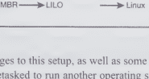

该设置有一些优点，也有缺点。一个优点是，如果机器将来被重新分配运行另一个操作系统，摆脱 LILO 所需的唯一操作就是重新分区硬盘。另一方面，使用此方法也有一些缺点。首先是系统必须使用 Windows 或 DOS 安装才能将 DOS MBR 写入硬盘。或者，你可以使用带 /MBR 开关的 DOS FDISK 命令创建主引导记录。另一个小缺点是，你必须使安装 LILO 的分区处于活动状态，以便 DOS MBR 能够找到它。

另一个选项是将 LILO 安装在主引导记录中，替换 DOS MBR。这导致如图 5.4 所示的引导序列。由于这是一个纯 Linux 系统，这可能是更自然的设置，但缺点是如果将来从该系统上移除 Linux，你需要有一种方法来替换 MBR 上的 LILO。它不需要先用 DOS 或 Windows 准备磁盘，并且 LILO 不使用活动标志来确定要引导哪个分区。

### 图 5.4
LILO MBR 引导序列。

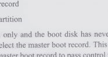

那么如何确定 LILO 应该安装在哪里？如果你使用 Red Hat 安装介质安装所有系统，你将得到两个选择：

- 主引导记录
- 第一个 Linux 分区

如果你的系统仅为 Linux 且引导盘从未用 DOS 或 Windows 分区，你应该选择主引导记录。这是因为主引导记录中目前没有加载引导加载程序来将控制权传递给 LILO。如果你的系统最初包含 DOS 或 Windows，或你的系统将为双启动，你可以任选其一。请记住，如果你选择第一个 Linux 分区，你必须将其标记为活动，以便主引导记录中的加载程序可以找到它。一旦你做出选择，安装程序会为你构建合适的 lilo.conf 文件并运行

/sbin/lilo，即映射安装程序。自然地，系统安装后你也可以手动完成，通过编辑 lilo.conf 文件并在命令行运行 /sbin/lilo。

> **注意**
> 
> 学习如何操作 lilo.conf 文件并使用映射安装程序 /sbin/lilo 强烈推荐。LILO 提供了大量可供选择的配置选项。Red Hat 安装程序仅构建最基本的配置文件。本章后面 “LILO 技巧和窍门” 部分描述了一些更有趣的可用选项。

以下列表显示了在 Linux 根分区上安装 LILO 所需的 lilo.conf 文件。

```
#
# General section
#
boot = /dev/hda1
install = /boot/boot.b
verbose = 2
prompt

# After 5 seconds, boot the default image
timeout = 50

#
# Boot my Linux 2.2.5 kernel
#

image = /boot/vmlinuz-2.2.5
    label = linux
    root = /dev/hda1
    read-only
    initrd = /boot/initrd.gz
```

前述文件中主要关注的行是 boot = /dev/hda1。该行告诉 LILO 将自身安装到何处。通过按以下文件列表所示更改此行，LILO 将改为加载到主引导记录中。

```
#
# General section
#
boot = /dev/hda
install = /boot/boot.b
verbose = 2
prompt

# After 5 seconds, boot the default image
timeout = 50

#
# Boot my Linux 2.2.5 kernel
#

image = /boot/vmlinuz-2.2.5
    label = linux
    root = /dev/hda1
    read-only
    initrd = /boot/initrd.gz
```

## 双操作系统系统

一个稍微复杂一些的示例涉及引导其他操作系统。例如，如果你有一个系统希望在 Windows 和 Linux 之间双启动，LILO 也能实现这一点。回到我们定义的分区，假设这次 Windows 安装在第一个分区。我们将按如下方式设置：

- Windows—位于第一个分区，/dev/hda1
- Linux 根—位于第二个分区，/dev/hda2

剩余分区用于其他 Linux 文件系统。在这种情况下，我们将把 LILO 安装在主引导记录中，即使这意味着如果我们决定卸载它，就必须重新处理重建主引导记录。请考虑以下 lilo.conf 文件：

```
#
# General section
#
boot = /dev/hda
install = /boot/boot.b
verbose = 2
prompt

# After 5 seconds, boot the default image
timeout = 50

#
# Boot my Linux 2.2.5 kernel
#
image = /boot/vmlinuz-2.2.5
label = linux
root = /dev/hda2
read-only
initrd = /boot/initrd.gz

#
# Boot Windows on the first partition
#
other = /dev/hda1
label = windows
table = /dev/hda
```

在此文件中，我们引入了关键字 other，用于指定包含其他操作系统的分区。我们还看到了 table 关键字的首次使用，它指定了此操作系统的分区表信息所在位置。在这种情况下的引导序列如图 5.5 所示。

### 图 5.5
以 LILO 作为 MBR 的双启动。

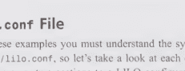

## /etc/lilo.conf 文件

要完全理解这些示例，你必须了解 LILO 配置文件 /etc/lilo.conf 的语法，因此让我们查看每个可用关键字及其含义。LILO 配置文件有两个部分。第一个是全局关键字部分。在此处指定关键字不是必需的，但通常这样做是为了避免不必要的重复。表 5.1 显示了全局部分的关键字及其含义。

### 表 5.1 LILO 全局部分关键字

| 关键字语法 | 描述 |
|---|---|
| backup=filename | 当运行 lilo 时，正在写入的引导扇区的备份会被复制到指定文件中。 |
| boot=boot_dev | 将 lilo 将写入引导加载程序代码的分区命名。 |


## 表 5.1 继续

| 关键字语法 | 描述 |
|---|---|
| compact | 请求进行优化以减少加载时间并使映射文件更小。 |
| default=name | 指定默认加载的映像。如果省略此关键字，则使用第一个定义的映像。 |
| delay=n | 在启动默认映像前等待 n/10 秒。此选项在您希望有更多时间中断启动序列时很有用。 |
| fix-table | 允许 LILO 调整分区表条目，使分区的第一个和最后一个扇区的线性地址与扇区/磁头/柱面地址匹配。使用时请谨慎。 |
| force-backup=filename | 这与 backup 类似，但会覆盖名为 /lilo.map 的现有文件，而 backup 则不会。 |
| ignore-table | 忽略损坏的分区表并按配置文件中指定的方式安装 LILO。 |
| install=boot_sector | 指定用作新引导扇区的文件。默认值为 /boot/boot.b。 |
| linear | 使用线性寻址模式而不是使用扇区/磁头/柱面方法寻址磁盘。如果指定了 compact，则可能无法工作。 |
| map=filename | 使用指定文件作为映射文件。默认为 /boot/map。 |
| message=filename | 指定一个文件在引导提示符之前显示。您可以使用此文件向用户显示消息或可用映像列表。 |
| prompt | 在无需用户干预的情况下呈现引导提示符。如果存在此关键字而 timeout 关键字不存在，则无法进行无人值守重启。 |
| timeout=n | 如果在 n/10 秒内未收到用户输入，则启动默认映像。 |
| verbose=level | level 指定运行 lilo 时打印的信息量。有效级别为负数，表示仅显示警告和错误，以及范围为 0-5 的数字，每个数字提供更多信息。 |

这些并非所有关键字，但它们是最有可能使用的关键字。除了全局关键字外，还有许多每映像关键字可用。其中一些每映像关键字也可以在全局部分中指定，以作为所有定义映像的默认值。表 5.2 定义了一些最常见的每映像关键字。星号表示那些可以作为每映像关键字或全局关键字指定的关键字。

### 表 5.2 LILO 每映像关键字

| 关键字语法 | 描述 |
|---|---|
| alias=name | 指定当前映像的次要名称。 |
| fallback=command_line * | 如果当前映像正在运行且系统崩溃，则在下次启动时将指定的命令行传递给 LILO。 |
| label=name | 为当前映像命名。 |
| lock * | 允许您无论其在映射中的位置如何都重新启动到当前映像。当前映像成为默认值，直到被用户输入覆盖为止。 |
| password=password * | 在启动此映像之前提示用户输入密码。如果使用此选项，您必须确保 lilo.conf 文件不可被 root 用户以外的人读取，因为密码未加密。 |
| restricted | 此选项仅在 password 选项使用时有效。它修改密码行为，使密码挑战仅在用户在引导提示符处指定命令行参数时才进行。 |
| single-key * | 设置此选项后，如果您定义了单键别名或标签，则可以使用单次按键（无需按 Enter）激活映像。 |

最后的关键字集，描述于表 5.3 中，仅适用于 Linux 内核的引导。

### 表 5.3 LILO Linux 内核关键字

| 关键字语法 | 描述 |
|---|---|
| append=string | 将指定的字符串添加到内核命令行。 |
| initrd=filename | 指定包含要加载到初始 RAM 磁盘映像中的文件。 |
| ramdisk=size | 指定可选 RAM 磁盘的大小，默认值从内核映像中读取。将 size 设置为零表示不应创建 ramdisk。 |
| read-only | 当内核映像启动时，根文件系统将以只读方式挂载，以便使用 fsck 检查然后重新挂载。 |
| read-write | 根文件系统将以读写方式挂载。 |
| root=device | 指定的设备包含根文件系统。 |
| vga=mode | VGA 文本模式基于指定的模式设置，其中 mode 为 normal (80x25)、extended (80x50)、ask 或数字之一。有效数字可通过首先指定 ask 来确定，ask 会给出检测到的模式列表，然后用所呈现的数字之一替换 ask。 |

## /sbin/lilo 的命令行选项

除了配置文件中所有可用的选项外，还有许多命令行选项可以改变 LILO 的行为。其中许多会导致行为模仿配置文件关键字。这些选项显示在表 5.4 中。

### 表 5.4 LILO 命令行选项

| 命令行选项 | 配置文件关键字 |
|---|---|
| -b boot_dev | boot = boot_dev |
| -c | compact |
| -d N | delay = N |
| -D name | default = name |
| -i boot_sector | install = boot_sector |
| -l | linear |
| -m file | map = file |
| -P fix | fix-table |
| -P ignore | ignore-table |
| -s filename | backup = filename |
| -S filename | force-backup = filename |
| -v | verbose = level |

其他可与映射安装程序一起使用的 lilo 选项包括查询映射文件、为下次重启填充命令行或指定不同的配置文件名的选项。表 5.5 显示了这些选项及其含义。

### 表 5.5 更多 LILO 命令行选项

| 命令行选项 | 描述 |
|---|---|
| -C filename | 使用 filename 作为配置文件而不是默认的 /etc/lilo.conf。 |
| -q | 查询映射文件以获取映像列表。 |
| -r directory | 在执行命令之前 chroot 到 directory。这在从修复磁盘启动时很有用。 |
| -R string | 将此字符串存储在映射文件中，以用作下次重启的命令行。这可以在测试时临时更改默认内核。此命令行在使用后会从映射文件中删除。 |
| -t | 仅测试模式。这会执行命令行和配置文件中指定的所有操作，但不会安装新的映射。 |
| -u [device_name] | 恢复指定设备引导扇区的备份副本。验证是通过检查时间戳来执行的。 |
| -U [device_name] | 与 -u 相同，但不执行验证。 |

## LILO 技巧和窍门

现在我们已经初步了解，让我们看一个更复杂的示例。在此示例中，我们安装了多个操作系统，并希望 LILO 启动它们全部。以下列表描述了构建 /etc/lilo.conf 文件所需的数据。

- 第一个分区，/dev/hda1，包含 Windows
- 分区 2 包含 Fred 的 Linux 0.5
- 分区 3 包含 Red Hat Linux
- 分区 4 是 Linux 交换分区
- 分区 5 包含 FreeBSD

出于各种原因，我们希望 Fred 的 Linux 和 Red Hat 完全独立于彼此。此外，这是一台现代机器，不会因大驱动器而出现 1024 柱面问题。现在问题参数已经定义，请参阅清单 5.1 查看 lilo.conf 文件的样子。

## 清单 5.1 /etc/lilo.conf

```
#
# General section
#
boot = /dev/hda
compact
install = /boot/boot.b
message = /etc/lilo.msg
verbose = 2
lock

# After 10 seconds, boot the default image
prompt
timeout = 100

#
# Boot my Linux 2.2.5 kernel from /dev/hda5
# This kernel requires a password to boot if you specify any
# kernel command options.
#
image = /boot/vmlinuz-2.2.5
    label = Red Hat
alias = 1
root = /dev/hda5
read-only
password = s0l@r$
restricted
initrd = /boot/initrd.gz

#
# Boot my experimental Linux 2.3.8 kernel from /dev/hda5.
# This kernel requires a password to be specified.
#
image = /boot/vmlinuz-2.3.8
label = Testing
alias = 2
root = /dev/hda5
read-only
password = d9j+@01
initrd = /boot/initrd-2.3.8.gz
fallback = Red Hat

#
# Boot Windows from /dev/hda1.
#
other = /dev/hda1
label = Windows
alias = 3
single-key
table = /dev/hda

#
# Boot Fred's Linux from /dev/hda2.
#
other = /dev/hda2
label = Fred
alias = 4
single-key
table = /dev/hda

#
# Boot FreeBSD from /dev/hda7.
#
other = /dev/hda7
```


## 列表 5.1 继续

```
label = FreeBSD
alias = 5
single-key
table = /dev/hda
```

让我们拆解这个示例，通过检查所使用的选项来了解它的作用。你可能会对允许的控制程度感到惊讶，以及使用 LILO 可以做的一些有趣的事情。

全局部分首先出现，正如从 boot 选项可以看出，LILO 将安装在主引导记录的位置。预计 LILO 会优化加载过程。

接下来，我们指定用作引导扇区的文件。此行在此示例中可以省略，因为所使用的值是默认值。

现在我们来看 message 选项。在我们的示例中，它被设置为 /etc/lilo.msg。下面是该文件的内容，正如你所见，它包含一个简单的菜单以及向用户说明该怎么做的信息：

```
+....! Select The OS To Run !....+

1. Red Hat Linux 6.0

2. Experimental Kernel 2.3.6
   (Password Required)

3. Windows 95

4. Fred's Linux

5. FreeBSD 3.0

Defaults to system booted
most recently after 10 seconds

Enter the number of the OS you
wish to start.
```

该文件以换页字符开头。此字符使用 vi 生成，方法是键入 Ctrl+V 然后立即键入 Ctrl+L。此字符会导致 LILO 在显示文件其余内容之前清除屏幕，其余内容仅包含无颜色的纯 ASCII 文本。

### 提示

> 有针对 LILO 的补丁，允许你创建精美的彩色屏幕，并包含可在 Web 上获得的绘图字符，网址为 http://www.stack.nl/~stilgar/lilocolors.html。

下一个关键字用于在运行 lilo map 安装程序时显示有关标签、别名和其他诊断信息。可以使用此关键字调整消息级别，此处的 2 值只是我的个人偏好。

接下来，你会找到一个许多人在测试新内核时觉得很有用的关键字。通过指定 lock 关键字，LILO 会记住你上次启动的映像，并且只要当前启动的映像未指定 fallback 关键字且你没有导致系统崩溃，LILO 就会一直启动该映像，直到你明确请求不同的映像为止。

接下来的两个关键字是我几乎总是在 lilo.conf 中包含的。它们是 prompt 和 timeout 关键字。指定 prompt 后，LILO 会等待用户输入，而无需用户通过按键中断引导序列。timeout 关键字是一个故障安全机制，因此如果用户在指定的十分之一秒数内未做出响应，引导过程仍会继续，从而允许无人值守重启。

这涵盖了指定的通用关键字。现在我们可以查看每个已定义的映像，并了解在每个映像的基础上使用 LILO 关键字可以做些什么有趣的事情。

## LILO 按映像的关键字

我们的示例配置文件以对 Linux 内核映像的定义开始该映像定义，使用内核文件 /boot/vmlinuz-2.2.5。使用 label 和 alias 关键字，此内核在映射文件中被赋予 Red Hat 和 1 两个名称。root 关键字指定此内核的根文件系统为 /dev/hda5。当此内核启动时，该文件系统最初将以只读方式挂载，并从 /boot/initrd.gz 中的映像加载初始 RAM 磁盘。最后，如果用户尝试在内核命令行上传递任何内容，将提示用户输入密码。这意味着启动到单用户模式需要密码，虽然这种措施并非万无一失，但可以阻止一些潜在的黑客。

接下来，定义了一个使用包含在 /boot/vmlinuz-2.3.8 中的实验内核的映像，称为 Testing，别名为 2。根文件系统与前一个内核相同，并且与之前的内核定义一样，指定了初始 RAM 磁盘，根文件系统最初以只读方式挂载。此内核与前一个内核的两个不同之处在于，此映像始终需要密码，并且如果系统在运行时崩溃，系统将重新启动到 Red Hat 内核，而不管之前定义的 lock 关键字。

接下来定义的映像用于将系统引导到 Windows。通过使用 other 关键字，很容易判断我们将此视为一个外部操作系统。此关键字定义 LILO 应在此操作系统查找的位置。在此情况下，外部操作系统位于 /dev/hda1，即第一块 IDE 硬盘上的第一个分区。为此映像定义的关键字使其名称为 Windows，别名为 3。用户只需键入数字 3 即可选择此映像，此操作系统所需的分区表信息可以在 /dev/hda 上找到。正如你所见，这非常简单。

下一个定义的映像迄今为止是最有趣的一个，因为看起来我们并未正确定义它。你可能想知道为什么我们没有指定内核映像文件和其他正常的内核选项。要回答这些问题，我们只需查看我们指定的问题的定义即可。在其中我们说明希望 Fred’s Linux 完全独立于 Red Hat 安装。如果我们像对其他两个内核映像那样指定映像引导文件的路径，我们就会共享这些映像所在的分区，从而违反问题的规定参数。为克服这一点，Fred’s Linux 被当作任何其他来宾操作系统对待。唯一的问题是我们仍然没有包含 Fred’s Linux 的分区的引导扇区。此问题通过为 Fred’s Linux 创建一个简单的 lilo.conf 文件来解决，该文件将 lilo 安装到其所在的引导扇区中，并只允许引导 Fred’s Linux。此简单的 lilo.conf 文件看起来可能像这样：

```
#
# General section
#
boot = /dev/hda2
install = /boot/boot.b
delay = 50
verbose = 2

#
# Boot my Linux 2.2.5 kernel
#
image = /boot/vmlinuz-2.3.8
label = linux
root = /dev/hda2
read-only
initrd = /boot/initrd.gz
```

正如你所见，未指定 prompt 和 timeout 选项，这导致 Fred's Linux 除非被用户按键中断，否则会立即启动。包含 delay 的主要原因是允许传递命令行选项，例如 single 以启动到单用户模式。

定义的最后一个映像与用于引导 Windows 的映像相同，只是它引导的是 FreeBSD。由前述配置给出的引导序列在图 5.6 中说明。

## 图 5.6
使用 LILO 作为 MBR 的多操作系统。

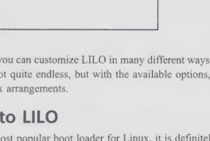

正如你所清楚看到的，你可以根据需要以多种不同的方式自定义 LILO。组合并非无穷无尽，但凭借可用的选项，你可以设计出非常复杂的安排。

## LILO 的替代方案

尽管 LILO 是 Linux 最流行的引导加载程序，但它绝对不是唯一可用的引导加载程序。有许多引导加载程序，既有商业的也有非商业的，能够加载 Linux。本节列出了其中一些以及你可以在哪里获得它们。

如果你不喜欢更改系统驱动器的引导扇区的想法，引导 Linux 的选项之一是 LOADLIN，它是一个 DOS 程序，能够加载并执行 Linux 内核。该软件的最新增添包括对 bZImages 和初始 RAM 磁盘的支持。包含文档的软件可通过 FTP 从 Linux 档案获取，地址为 ftp://metalabs.unc.edu/pub/linux/system/boot/dualboot/。

另一个可用于替换主引导记录并呈现可用操作系统菜单的引导加载程序是 bootactv 程序。该程序包含在 pfdisk 包中，可通过 FTP 从 ftp://ftp.funet.fi/pub/Linux/tools/ 获取。该软件包有效，但似乎自 1992 年以来未再更新。

SYSLINUX 是 Linux 的引导加载程序，允许你从 DOS 软盘启动，并被一些发行版用作其安装软盘。该程序主要用于创建引导软盘，并非旨在作为通用引导加载程序。SYSLINUX 可通过 FTP 从 ftp://metalabs.unc.edu/pub/linux/system/boot/loaders/ 获取。

与 SYSLINUX 位于同一位置的另外两个引导加载程序是 GRUB 和 CHOS。这两者都是通用引导加载程序，它们向用户提供交互式菜单，允许他们以类似于 OS/2 引导管理器的方式启动所选操作系统。

System Commander* Deluxe 是 V Communications 提供的一项商业产品，能够引导 Linux。System Commander 不仅仅是一个引导加载程序，它管理新操作系统的整个安装过程。它保护现有操作系统免受正在安装的新操作系统的侵害，调整分区以腾出空间供新操作系统使用，等等。该公司网站 http://www.v-com.com 上提供了有关功能和定价的完整信息。

这绝不是一个详尽的清单。如果你对 LILO 不满意，一个简单的网络搜索可能会找到更适合你需求的程序。

## Linux 引导过程和系统初始化脚本

一旦引导加载程序加载了 Linux 内核，接下来会怎样？本节讨论内核的加载过程，包括设备初始化，以及将控制权移交给 init 进程，后者启动使 Linux 系统真正有用的许多进程。

### 内核启动和设备初始化

启动 Linux 内核与启动任何其他操作系统类似，一切都始于引导扇区代码。正如前面讨论的，引导扇区代码负责将操作系统内核加载到内存中并执行它。对于 Linux，这会导致以下事件序列：

- 加载和解压缩内核
- 检测和配置设备
- 交接给 init 进程

这个过程的第一部分涉及引导加载程序。LILO 或其他引导加载程序将 Linux 内核加载到内存中并启动它运行。为了开始运行，Linux 会自行解压缩并从系统 BIOS 中收集其运行所需的一些信息。一旦收集到所有必需的信息，它就会丢弃 BIOS。请记住，除了已经收集到的信息之外，BIOS 服务不再可用。

现在硬件检测过程开始。首先内核检测的是可用处理器类型、控制台设置以及系统可用的内存量。内存检测并不总是像听起来那么简单，这就是为什么引导加载程序传递的最常见信息之一是系统中安装的物理 RAM 数量。这在现代系统上不太常见，但在旧系统上几乎总是需要知道你是否有超过 64 MB 的物理内存。随着系统继续启动，会检测到你有驱动程序可用的设备（要么编译到系统中，要么作为从初始 ramdisk 加载的模块可用），并向控制台打印各种初始化消息。此信息可以在系统准备就绪后使用 dmesg 命令查看。它存储在内核的环形缓冲区中，但正如名称所示，此缓冲区不会无限增长。如果你的系统生成大量内核消息，你可能会很快丢失有关设备初始化的信息。为防止这种情况，Red Hat 在 /etc/rc.d 中的启动 rc.sysinit 脚本中添加了一行以在启动期间捕获消息：

```
dmesg > /var/log/dmesg
```

这将在 /var/log 中创建一个名为 dmesg 的文件，其中包含内核启动消息和在 rc.modules 中加载的模块生成的任何内核消息。这些信息在调试问题和确定检测到哪些设备以及检测顺序时非常有用。除了捕获启动消息外，dmesg 命令随时都可用于检查内核环形缓冲区的內容。有关此命令的完整详细信息可在 dmesg(8) 手册页中找到。

一旦所有设备都被检测到并且各种内核子系统（如 VFS）已启动，根目录将被挂载并将控制权传递给 init 程序。init 程序随后负责通过使用初始化脚本启动系统的其余部分，通常位于 /etc/rc.d 及子目录中。

## /etc/inittab 和 rc 脚本

init 进程是接管内核控制并启动系统上所有必需进程以使其准备使用的程序。在你的 Linux 系统上，init 进程始终具有进程 ID 1。init 负责跟踪当前运行级别并管理运行级别之间的转换。init 可以采用两种基本模型来实现所有这些。

其中之一是基于 BSD 发行版的大多数 UNIX 变体使用的模型。此模型使用最少的启动文件，称为 rc 脚本，通常位于 /etc 目录中，名称如 rc、rc.local 等。Red Hat 以及大多数其他 Linux 发行版不使用此模型。相反，它们选择使用 System V Release 4 风格的初始化脚本。这些脚本存储在通常称为 init.d 的目录中，对于每个定义的运行级别，都有一个名为 rcN.d 的目录，其中 N 是运行级别，其中包含指向 init.d 中脚本的系列符号链接。在 System V 基于的系统（如 HP/UX 和 Solaris）上，这些目录通常位于 /etc；然而，在你的 Red Hat Linux 系统上，这些目录存储在 /etc/rc.d 目录下更深一层。

为了了解 init 的工作，让我们来看看它所依赖的配置文件：/etc/inittab。此文件定义了 init 基于运行级别所需的操作。以下是从 Red Hat Linux 系统的 /etc/inittab 中找到的行描述。

inittab 中定义的第一件事是默认运行级别，设置为 5。在 Red Hat 系统上，5 定义为 X Windows 系统为默认接口且登录通过 gdm 接口执行的级别，该接口向用户呈现图形登录屏幕。这行看起来像这样：

```
id:5:initdefault:
```

在默认运行级别定义之后是启动脚本的定义。每个定义由一个 id 组成，后跟此操作应采取的运行级别，后跟应采取的操作，最后是应执行的进程。操作字段决定这些脚本执行的顺序。操作为 sysinit 的脚本最先运行。

在此示例中，第一个要运行的脚本是名为 booterd 的脚本。此脚本绘制 Red Hat 使用的花哨启动屏幕。接下来，以 default 参数运行模块初始化脚本 rc.modules。随后，rc.serial 脚本运行以初始化我们系统上的串行端口。一旦所有操作为 sysinit 的脚本运行完毕，init 就会运行操作为 boot 或 bootwait 的脚本。这两种操作的区别在于，对于 bootwait，init 会等待指定进程完成后再继续，而对于 boot 则不会。我们的示例 inittab 文件包含一个具有 sysinit 操作的单行，该行执行 rc.boot 脚本。以下是执行启动过程中的这些步骤的行：

```
s1::sysinit:/etc/rc.d/rc.sysinit
```

为了实现期望的 System V 风格启动，我们需要为每个运行级别提供一行来定义如何进入该运行级别。inittab 中接下来的九行正是这样做的。在每个级别，rc 脚本都以运行级别作为参数运行。

```
10:0:wait:/etc/rc.d/rc 0
11:1:wait:/etc/rc.d/rc 1
12:2:wait:/etc/rc.d/rc 2
13:3:wait:/etc/rc.d/rc 3
14:4:wait:/etc/rc.d/rc 4
15:5:wait:/etc/rc.d/rc 5
16:6:wait:/etc/rc.d/rc 6
```

这些行中有两个值得注意的地方是被调用的 rc 脚本，以及作为故障安全机制提供的最后一行，以防更改到运行级别 6（重新启动系统）失败。rc 脚本背后的基本思想是执行以下操作：

- 更改目录到 /etc/rc.d/rcN.d，其中 N 是指定的运行级别。
- 运行所有以字母 K 开头的脚本，并带上 stop 参数。顺序由文件名决定。
- 运行所有以字母 S 开头的脚本，并带上 start 参数。

当然，实际情况比这更复杂，但大致就是这样。

在这些行之后是一行指定在每个运行级别运行的进程。此行在每次运行级别转换时运行一次 update 实用程序。

```
ud::once:/sbin/update
```

我们 inittab 文件中的下一行定义了用户按下 Ctrl+Alt+Del 时运行的进程。此行说明在任何运行级别，按下此键序列将导致系统使用 shutdown 命令重新启动。

```
ca::ctrlaltdel:/sbin/shutdown -t3 -r now
```

init 包的一个相对较新的功能是能够定义一个特殊的键序列，触发 init 进程的操作。Red Hat 的默认 inittab 文件不包含此示例，但通过添加以下行，该行除了向控制台回显一条消息外什么也不做，你可以自行实现此功能。如果你想利用此功能，请参阅 inittab 的手册页。

```
kb::kbrequest:/bin/echo "Keyboard Request--edit /etc/inittab to let this work."
```

init 程序还能够解释来自智能 UPS 的信号。这通常通过有一个监控 UPS 状态的守护进程来实现，并基于该状态向 init 进程发送信号。可以为这些类型的事件指定的有三种操作：

- powerfail — 发生了电源故障，我们正在使用电池供电。
- powerfailnow — 电源已故障且电池电量低。
- powerokwait — 电源已恢复。

我们的示例 inittab 文件显示了可以采取的处理这些事件的操作类型：

```
pf::powerfail:/sbin/shutdown -h +5 "Power Failure; System Shutting Down"
pr:12345:powerokwait:/sbin/shutdown -c "Power Restored; Shutdown Cancelled"
```

我们示例 inittab 中的下一组行负责管理虚拟控制台上的 getty 进程。类似的条目将用于在串行设备上运行 getty，但我们的示例不包含此类行。

```
1:2345:respawn:/sbin/mingetty tty1
2:2345:respawn:/sbin/mingetty tty2
3:2345:respawn:/sbin/mingetty tty3
4:2345:respawn:/sbin/mingetty tty4
5:2345:respawn:/sbin/mingetty tty5
6:2345:respawn:/sbin/mingetty tty6
```

这些 getty 行的语法高度依赖于你在系统上选择的可用 getty 版本。因此，始终有必要参考你运行的 getty 版本的手册页以确定正确的语法。如果你决定更改 getty 版本，最好在确定新版本工作正常之前至少保留一个虚拟控制台在旧版本下运行。

我们示例 inittab 文件中的最后一行用于启动 X Windows 系统的图形登录程序。有几种可供选择。随 XFree86 发行版一起提供的传统程序是 xdm。此外，KDE 桌面环境有自己的版本称为 kdm，GNOME 也有一个称为 gdm。由于 KDE 和 GNOME 都是 Red Hat 安装的标准部分，我们的示例包含对 prefdm 的调用，它是符号链接到 kdm 或 gdm，具体取决于系统管理员的偏好。

```
x:5:respawn:/etc/X11/prefdm -nodaemon
```

现在，让我们把所有内容放在一起并添加注释以提高清晰度。以下是我们 Red Hat Linux 系统的 /etc/inittab 文件。


#
# inittab	本文件描述 INIT 进程应如何设置
#		 系统在特定运行级别。
#
# 作者：	Miquel van Smoorenburg, <miquels@drinkel.nl.mugnet.org>
#		由 Marc Ewing 和 Donnie Barnes 修改用于 RHL Linux
#
# RHL 使用的运行级别如下：
# 0 - 停止（不要将 initdefault 设置为此）
# 1 - 单用户模式（包括网络接口的初始化，
#     如果你有网络的话）
# 2 - 多用户，（不含 NFS-Server 等）
#     （基本上与 3 相同，如果没有网络）
# 3 - 完整多用户模式
# 4 - 未使用
#     （目前应与 3 相同）
# 5 - X11
# 6 - 重启（不要将 initdefault 设置为此）
#
# 默认运行级别。
id:5:initdefault:
# 系统初始化。
si::sysinit:/etc/rc.d/rc.sysinit
10:0:wait:/etc/rc.d/rc 0
11:1:wait:/etc/rc.d/rc 1
12:2:wait:/etc/rc.d/rc 2
13:3:wait:/etc/rc.d/rc 3
14:4:wait:/etc/rc.d/rc 4
15:5:wait:/etc/rc.d/rc 5
16:6:wait:/etc/rc.d/rc 6
# 捕获 CTRL-ALT-DELETE
ca::ctrlaltdel:/sbin/shutdown -t3 -r now
# 对特殊按键操作（ALT-上箭头）。
kb::kbrequest:/bin/echo "Keyboard Request -- edit /etc/inittab to let this work."
# 当我们的 UPS 通知我们电源已失效时，假设我们还有几分钟
# 的电量剩余。安排在 2 分钟后关机。
# 这当然假设你已安装 powerd 且你的
# UPS 已连接并正常工作。
pf::powerfail:/sbin/shutdown -h +5 'Power Failure; System Shutting Down'

# 如果在关机开始前电源已恢复，则取消它。
po:12345:powerokwait:/sbin/shutdown -c 'Power Restored; Shutdown Cancelled'

# 在标准运行级别运行 gettys
1:12345:respawn:/sbin/mingetty tty1
2:2345:respawn:/sbin/mingetty tty2
3:2345:respawn:/sbin/mingetty tty3
4:2345:respawn:/sbin/mingetty tty4
5:2345:respawn:/sbin/mingetty tty5
6:2345:respawn:/sbin/mingetty tty6

# 在运行级别 5 运行 kdm
x:5:respawn:/etc/X11/prefdm -nodaemon

## 关于运行级别的更多信息

现在你已经了解了 init 命令，我们可以介绍一下在检查 inittab 文件时我们简要提及的一个主题。我们将研究运行级别以及管理在每个定义的运行级别下运行的进程。

如前所述，Red Hat Linux 使用 System V 风格的启动脚本。这种风格与 BSD 风格不同之处在于，每个由系统自动启动的守护进程或功能都由一个脚本控制，该脚本至少接受两个可能的參數——start 和 stop。

例如，要启动系统上的 Web 服务器，可以创建一个名为 httpd、web 或 apache 的控制脚本，该脚本根据传递给脚本的参数执行启动或停止服务器所需的所有操作。通过将每个服务或功能分离到单独的脚本中，更容易定义运行级别。你只需决定在该运行级别下应运行哪些服务和功能，然后使用它们的控制脚本启动它们。为此，每个运行级别在 /etc/rc.d 中都有一个名为 rcN.d 的目录，其中 N 是运行级别，（rc3.d 包含在此级别需要运行的脚本集合）。为了进一步简化，所有脚本都收集到一个中央目录 /etc/rc.d/init.d 中。

让我们看一下这些目录中的一个，以了解其实际工作原理。以下是 /etc/rc.d/rc1.d 的目录列表，它定义了我们 Red Hat 系统的单用户模式：

```
[root@quicksilver rc1.d]# ls -lo

total 0

lrwxrwxrwx 1 root 19 Jun 19 09:38 K00linuxconf -> ../init.d/linuxconf*
lrwxrwxrwx 1 root 14 Jun 19 09:29 K05innd -> ../init.d/innd*
lrwxrwxrwx 1 root 18 Jun 19 09:14 K05keytable -> ../init.d/keytable*
lrwxrwxrwx 1 root 16 Jun 19 09:13 K08autofs -> ../init.d/autofs*
lrwxrwxrwx 1 root 13 Jun 19 09:15 K10xfs -> ../init.d/xfs*
lrwxrwxrwx 1 root 13 Jun 19 09:26 K15gpm -> ../init.d/gpm*
lrwxrwxrwx 1 root 15 Jun 19 09:13 K15httpd -> ../init.d/httpd*
lrwxrwxrwx 1 root 15 Jun 19 09:46 K15Sound -> ../init.d/sound*
lrwxrwxrwx 1 root 20 Jun 19 09:13 K20bootparamd -> ../init.d/bootparamd*
lrwxrwxrwx 1 root 13 Jun 19 09:36 K20nfs -> ../init.d/nfs*
lrwxrwxrwx 1 root 16 Jun 19 09:46 K20rstatd -> ../init.d/rstatd*
lrwxrwxrwx 1 root 17 Jun 19 09:46 K20rusersd -> ../init.d/rusersd*
lrwxrwxrwx 1 root 16 Jun 19 09:46 K20rwald -> ../init.d/rwald*
lrwxrwxrwx 1 root 15 Jun 19 09:46 K20rwhod -> ../init.d/rwhod*
lrwxrwxrwx 1 root 15 Jun 19 09:48 K25squid -> ../init.d/squid*
lrwxrwxrwx 1 root 13 Jun 19 09:12 K26amd -> ../init.d/amd*
lrwxrwxrwx 1 root 16 Jun 19 09:38 K30mscerv -> ../init.d/mscerv*
lrwxrwxrwx 1 root 18 Jun 19 09:47 K30sendmail -> ../init.d/sendmail*
lrwxrwxrwx 1 root 19 Jun 19 10:04 K34ypasswdd -> ../init.d/ypasswdd*
lrwxrwxrwx 1 root 15 Jun 19 09:17 K35dhcpcd -> ../init.d/dhcpcd*
lrwxrwxrwx 1 root 15 Jun 19 09:13 K45named -> ../init.d/named*
lrwxrwxrwx 1 root 14 Jun 19 09:40 K50inet -> ../init.d/inet*
lrwxrwxrwx 1 root 15 Jun 19 09:56 K50nmpd -> ../init.d/nmpd*
lrwxrwxrwx 1 root 16 Jun 19 09:46 K55routed -> ../init.d/routed*
lrwxrwxrwx 1 root 13 Jun 19 09:13 K60atd -> ../init.d/atd*
lrwxrwxrwx 1 root 15 Jun 19 09:14 K60crond -> ../init.d/crond*
lrwxrwxrwx 1 root 13 Jun 19 09:38 K60lpd -> ../init.d/lpd*
lrwxrwxrwx 1 root 15 Jun 19 09:20 K75gated -> ../init.d/gated*
lrwxrwxrwx 1 root 14 Jun 19 09:42 K80nsd -> ../init.d/nsd*
lrwxrwxrwx 1 root 15 Jun 19 09:14 K85netfs -> ../init.d/netfs*
lrwxrwxrwx 1 root 16 Jun 19 10:04 K88ypserv -> ../init.d/ypserv*
lrwxrwxrwx 1 root 17 Jun 19 09:43 K89portmap -> ../init.d/portmap*
lrwxrwxrwx 1 root 17 Jun 19 09:14 K90network -> ../init.d/network*
lrwxrwxrwx 1 root 14 Jun 19 09:13 K92apmd -> ../init.d/apmd*
lrwxrwxrwx 1 root 16 Jun 19 09:34 K96pcmcia -> ../init.d/pcmcia*
lrwxrwxrwx 1 root 16 Jun 19 09:14 K99syslog -> ../init.d/syslog*
lrwxrwxrwx 1 root 16 Jun 19 09:14 S00single -> ../init.d/single*
lrwxrwxrwx 1 root 18 Jun 19 09:14 S20random -> ../init.d/random*
```

如你所见，此目录中的所有条目都是指向 /etc/rc.d/init.d 目录中脚本的符号链接。请注意，这些链接的命名约定为 K 或 S 后跟两位数字，然后是链接指向的脚本名称。

例如，指向 /etc/rc.d/init.d 中 nis-client 脚本的符号链接名为 K79nis-client。这种命名方案很重要，因为它决定了启动哪些服务、停止哪些服务以及这些操作发生的顺序。如你所记，当进入一个运行级别时，init 会使用运行级别作为参数运行 /etc/rc.d/rc 脚本。rc 脚本进入运行级别目录——在本例中为 rc1.d——首先使用 stop 参数运行所有以字母 K 开头的文件，然后使用 start 参数运行所有以字母 S 开头的脚本。

你现在可以看到，为了从默认运行级别 5 转换到单用户模式或运行级别 1，必须关闭所有网络服务和守护进程，只保留必要的硬件服务处于活动状态。

你可能会认为管理这个符号链接集合太复杂和困难。幸运的是，Red Hat 提供了更好的管理方式。如果你以 root 登录，你可以访问图 5.7 所示的控制面板应用程序，其中包含一个按钮来调用运行级别编辑器。

## 图 5.7
控制面板。


这将启动一个实用程序，允许你选择在每个运行级别下希望自动启动的服务和守护进程。你也可以通过运行以下命令直接调用运行级别编辑器实用程序：

```
wish /usr/X11R6/bin/tksysv
```

图 5.8 显示了此程序的外观。

此实用程序消除了维护 /etc/rc.d 层次结构中数十个符号链接的全部工作。此系统仍然要求你了解如何手动维护目录，但要容易得多。如果你确实想手动管理，这里是你必须采取的步骤。


## 图 5.8

运行级别编辑器。

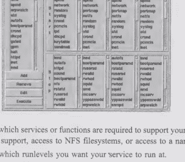

- 1. 确定支持新服务所需的服务或功能，例如网络支持、访问 NFS 文件系统或访问名称服务器。
- 2. 确定你希望服务在哪些运行级别下运行。
- 3. 创建你的控制脚本并将其放置在 /etc/rc.d/init.d 中。最简单的方法是复制该目录中已有的脚本并修改它以适用于你的服务。
- 4. 创建适当的符号链接以在适当的运行级别启动你的服务并将其关闭。

> 提示
> 
> 如果你选择修改现有脚本，请注意你应仔细检查脚本开头指定的任何参数。其中一些可以删除或修改以在你的脚本中使用，你可能需要添加额外的参数。使用此策略的优点是，如果你在向系统添加服务，你的脚本将为你节省大量时间。

## 关闭系统

关闭你的 Linux 系统并不是像关闭 DOS 系统那样简单的操作。由于 Linux 系统的多用户、多处理特性，你在关闭系统时应始终小心。未能做到这一点可能会导致文件系统损坏和意外行为。

## 更改运行级别

Linux 下定义了多个运行级别。 使用 Red Hat Linux 以及包含的 System V init 包，有 10 个定义的运行级别。其中两个保留用于关闭系统。本节介绍这些运行级别及其用途。

运行级别零和六用于关闭系统。 两者的区别在于，零用于完全停止并断电，而六用于系统重启。

你可以与系统交互的最低运行级别是运行级别一，有时称为单用户模式。该运行级别通常由系统管理员用于维护任务，例如检查文件系统一致性或其他维护任务，这些任务会因系统对多个用户可用而受损。该运行级别的别名是运行级别 S。

下一个可用的运行级别是运行级别二，它允许多个用户访问并提供网络服务，但可能不包括 Web 服务器或 NFS 文件系统等可选服务。

不启动图形界面的系统的默认运行级别是运行级别三。在此级别，系统的所有服务都可用，多个用户可以访问系统。对于 Red Hat 系统，此运行级别等同于运行级别四。

启动时立即启动图形界面的系统的默认运行级别是运行级别五。此运行级别与运行级别三的唯一区别在于，在此级别会启动 xdm 或等效的图形登录程序。在安装了 KDE 桌面的 Red Hat 系统上，其等效项是 kdm，而在 GNOME 上则是 gdm。

除了这些预定义的运行级别外，还有三个用户定义的运行级别可用。它们定义为运行级别 A、B 或 C，每个运行级别发生的情况完全取决于本地系统管理员。

要在 Red Hat Linux 之间切换运行级别，你有两个选择。第一个是 init 命令本身，你通过为其提供要更改到的运行级别作为参数来运行它。另一个选项是 telinit 命令，它与 init 的不同之处在于，你可以指定在更改运行级别时通常发生的 SIGTERM 和 SIGKILL 信号发送之间的时间间隔。

## shutdown 命令

有多种方法可以确保 Linux 系统的正确关闭。最常见的是 shutdown 命令，其使用仅限于超级用户。调用 shutdown 命令的一般形式如下：

```
shutdown [-t secs] [options] time [message to users]
```

直接调用 shutdown 命令并不是关闭 Linux 系统的唯一方法。然而，在介绍关闭系统的替代方法之前，让我们先看看如表 5.6 所示的 shutdown 命令的选项。

表 5.6 shutdown 命令行选项

| 选项 | 描述 |
|---|---|
| -r | 此选项告诉 init 在所有进程关闭后重新启动系统。 |
| -h | 在所有进程关闭后停止系统。 |
| -k | 并未真正关闭，只是向用户发送警告消息。 |
| -c | 取消正在运行的 shutdown 命令。 |
| -t secs | 告诉 init 在发送 SIGTERM 信号和 SIGKILL 信号之间延迟指定的秒数。 |
| -f | 在重启时跳过文件系统检查。 |
| -F | 在重启时强制进行文件系统检查。 |
| time | 执行关闭的时间。时间可以指定为 hh:mm 格式的绝对时间，或为 +N，其中 N 为距当前时间的分钟数。你也可以将时间指定为 "now"，它是 +0 分钟的别名。 |
| message | 可选地，你可以使用 wall 命令向系统用户发送消息。 |

关闭 Red Hat Linux 系统的替代方法之一是根据你是否想停止或重启系统，将运行级别更改为零或六。你也可以使用 Ctrl+Alt+Del 键序列关闭系统，前提是你已在 /etc/inittab 中包含如前例所示的一行。

可用于关闭系统的三个替代命令是 halt、reboot 和 poweroff。这些命令实际上会调用 shutdown，除非运行级别已为零或六，这使得它们在任何运行级别下使用都是安全的。

## 摘要

在本章中，我们介绍了启动和关闭 Red Hat Linux 系统的正确程序，包括对引导加载程序、内核引导过程以及可运行 Linux 系统的不同运行级别的讨论。特别强调了 LILO 引导加载程序以及 Red Hat 用于启动使系统成为有用服务器所需的所有进程和服务的结构。

## 系统故障诊断与恢复

### 本章内容

- 内核 Oops 142
- 硬件错误 144
- 诊断工具 147
- 构建和使用救援磁盘 152
- 系统日志分析 160
- 定位内核错误的来源 163
- 寻求帮助 169

### 第 6 章

Linux 尽管稳定，但偶尔会发生系统故障。与其他操作系统相比，Linux 令人印象深刻地可靠，系统故障是例外而非规则，但当故障发生时，作为系统管理员，你的任务是追踪导致系统故障的原因并解决它。

故障可能由多种原因引起，包括硬件问题；新内核；实验性、不成熟的驱动程序；配置错误的初始化文件；或损坏的可执行文件。本章介绍了一些更常见的诊断问题的方法，并研究创建和使用救援磁盘。

用于系统诊断的图形程序非常少。这是传统命令行实用程序和服务占主导地位的领域之一。几乎所有系统故障诊断都是在标准终端会话中的命令行完成的。了解 Linux 文本编辑器以及如何在 Linux 系统中移动并根据需要发出适当命令，是任何系统管理员必备的技能。

## 内核 Oops

在最根本的层面上，Linux 内核通过其 printk() 函数向系统其他部分传达消息。如果消息被认为很重要，printk() 将在系统控制台上显示该消息，并将副本交给 klogd 守护进程以记录到磁盘。显示这些消息到控制台并记录它们的原因是为了允许在磁盘故障等严重情况下，消息可能无法记录到磁盘而丢失。

Linux 内核被编程为在检测到内核错误时抛出“oops”条件——一种“刚刚发生了不好的事情，这里就是发生的地方”消息。内核 oops，或保护故障，通常发生在内核代码取消引用结构指针时，该指针具有空值或无效地址。它会尝试在可能的情况下记录该条件并为你提供一些信息以帮助调试问题。

内核 oops 在生产系统上并不常见遇到（生产系统是为最大稳定性而设置的重要系统）。Oops 条件更可能出现在你使用实验性内核和实验性驱动程序设置测试系统时，或在你重建内核并对其某些方面配置错误时，或在存在硬件问题时出现。

在 Red Hat 系统上，内核 oops 消息通常由 klogd 通过 syslogd 设施记录到 /var/log/messages。稍后，本章将更详细地介绍如何解码这些消息以及如何在“定位内核错误的来源”一节中使用它们提交错误报告。


## Kernel Panic

在 Linux 系统中，令人不安的事情之一是内核检测到错误并停止执行。这种安全阀功能实际上是内核通信过程的正常组成部分。

如果内核遇到致命条件，例如尝试使用不再可用的内存地址，它会发出“kernel panic。”内核将停止运行，printk() 会在控制台上显示错误信息，然后等待有人前来记录信息并重新启动系统。对于无人值守的系统，有时最好让系统记录信息然后自动重新启动（如果可能）。这可以通过在 /etc/lilo.conf 的相应段中添加以下行来实现：

```
panic=30
```

这指示系统在遇到 oops 条件后三十秒尝试自行重启。

### Tip

> 用于故障排除的一个 LILO 技巧有时很有用，即提高内核 printk() 在控制台上显示的消息阈值。默认情况下记录大于 DEBUG 级别的内容。如果你要在 /etc/lilo.conf 中添加 debug 选项（或在 LILO 提示符下手动以 linux debug 启动系统），它会将控制台日志级别更改为 DEBUG 级别，从而在控制台上显示所有内核消息。

有些情况过于严重，系统无法继续，例如启动过程找不到要挂载的 Linux 文件系统。在这种情况下，printk() 会在系统控制台上显示内核恐慌，提示你进一步调查情况。在最坏的情况下，系统可能会无任何解释地挂起。这是解决起来最困难的类型问题。当发生严重问题时，首先要寻找的是硬件错误。

## Hardware Errors

对于任何 Intel 或兼容 Intel 的计算机，硬件错误可能由多种情况引起，包括硬件中断冲突、故障设备驱动程序、系统板 BIOS 问题或硬件组件故障。诊断硬件错误遵循一个久经考验的模式：首先寻找明显问题，如果无果，则深入寻找更微妙的原因。

首先检查所有明显的东西，例如内部和外部电缆、电源、电源线、网络活动指示灯、电源排插开关和 UPS 开关。对物理环境的例行但仔细检查通常可以节省浪费的精力。花大力气恢复硬盘，只是在几个小时后发现问题仅仅是一个松动的连接器，这会是自相矛盾的。

硬件问题最可能发生的两个时间是：
- 当你首次在 Intel PC 上构建 Red Hat 系统时，以及
- 当你添加或更改硬件时。

如果你的系统一直运行正常且未做任何更改，则可能现有硬件组件已损坏或驱动程序已损坏。

### Identifying Hardware Errors at Startup

Red Hat 6 在启动时提供大量帮助来识别硬件错误。启动消息会标识已成功探测的硬件设备。如果你处于控制台，可以使用 Ctrl-PageUp 向后滚动，以检查已滚动过去的消息。在成功探测的端口上，Red Hat 6 会在彩色显示器上以绿色显示 OK 消息。

如果为时已晚，无法回滚控制台监视器，Red Hat 提供另外两种查看启动消息的方法。你可以通过输入 /bin/dmesg（如下一章所示）重放这些消息，Red Hat 还提供另一个文件 /var/log/boot.log，可扫描以获取额外的诊断信息：

```
[root@wallace /root]# less /var/log/boot.log

Aug 26 15:20:37 wallace fsck: /dev/hda4: clean, 64978/499712 files, 1061324/1992060 blocks
Aug 26 15:20:37 wallace rc.sysinit: Checking root filesystem succeeded
Aug 26 15:20:37 wallace isapnp: Board 1 has Identity 61 10 00 4b 14 51 00 0c 0e:
CTL0051 Serial No 268454676 [checksum 61]
Aug 26 15:20:37 wallace isapnp: CTL0051/268454676(){Audio}: Ports 0x220 0x330 0x388; IRQ5 DMA1 DMA5 ... Enabled OK
Aug 26 15:20:37 wallace isapnp: CTL0051/268454676[2](Game): Ports 0x200; ... Enabled OK
Aug 26 15:20:37 wallace rc.sysinit: Setting up ISA PNP devices succeeded
```

该文件是 /var/log/dmesg 的变体，它提供了另一个查找可能有助于诊断硬件问题的信息的地方。它提供来自 isapnp 等进程的信息，isapnp 是一个尝试设置 Plug-and-Play 设备的程序。

遇到硬件问题时需要警惕的经典情况是“last change syndrome。”你最后更改或添加的硬件部件很可能是罪魁祸首。这些更改可能很微妙，例如用 3Com 905B 网卡替换 3Com 905 网卡。除非你的设备驱动程序足够新以支持 905B，否则网卡将停止工作，并且卡初始化失败将在启动消息中显示。

如果你添加了第二个驱动器，并在 LILO 启动期间收到“Kernel panic: VFS: Unable to mount root fs ...”消息，请检查电缆连接。如果你在 EIDE 驱动器上意外地将主驱动器内部电缆插入次要控制器，你的 /dev/hda 驱动器将被视为 /dev/hdc，Linux 将无法启动。将电缆恢复到原始系统板连接器将解决问题。

## BIOS Problems

Linux 部署在各种 Intel 兼容硬件上，有时特定的系统板 BIOS 会导致问题。如果遇到古怪、间歇性的硬件故障，请尝试关闭系统 BIOS 中的任何特殊功能。你也可以查看制造商的网站，看看是否有 BIOS 升级。升级已知可以解决某些系统板与 Linux 的不兼容问题。

## Plug-and-Play (PnP) Devices

即插即用是一种规范，旨在为驱动程序和硬件分配四个特定资源：I/O 地址、IRQs、DMA 通道（仅 ISA 总线）和内存区域。一些 BIOS 在检测和配置 PnP 设备方面做得很好，而一些则不行。如果 BIOS 未正确调整设备，设备可能会处于禁用状态。

如果你尝试安装 Linux 未检测到的 ISA PnP 卡，请检查是否可以用 DOS 实用程序禁用即插即用。即插即用卡通常包含一张可用于调整卡设置的 DOS 实用程序软盘。如果 DOS 实用程序丢失或遗失，该实用程序通常可在制造商网站上获得。当即插即用顽固不运行时，手动配置卡通常比让即插即用工作更容易。然而，在某些情况下，你可能不想这样做。例如，如果你有一个 Linux/Windows 双启动系统，Windows 可能依赖于卡的即插即用设置，或者你可能无法访问关闭即插即用所需的 DOS 实用程序。某些卡仅为即插即用，不提供禁用此功能的选择。

另外，你可以尝试使用 Linux isapnp 实用程序调整设置。这在下一章的“Diagnostic Tools”部分中讨论。

## PCI Devices

偶尔，新款 PCI 设备无法被正确识别和初始化。如果发生这种情况，你会看到以下内核消息：

```
Warning : Unknown PCI device (8086:7100). Please read include/linux/pci.h
```

这可能是由系统板芯片组 PCI-CPU 桥或 PCI-ISA 桥引起的。你首先要尝试找出哪个 PCI 设备导致了问题。检查 /proc/pci 以获取信息，看看是否有任何明显线索。以下列表显示如何显示 /proc/pci 的内容：

```
[root@wallace /root]# cat /proc/pci
PCI devices found:
Bus 0, device 7, function 0:
  Host bridge: Intel 82439HX Triton II (rev 1).
    Medium devsel.  Master Capable.  Latency=32.
Bus 0, device 7, function 0:
  ISA bridge: Intel 82371SB PIIX3 ISA (rev 0).
    Medium devsel.  Fast back-to-back capable.  Master Capable.  No bursts.
Bus 0, device 7, function 1:
  IDE interface: Intel 82371SB PIIX3 IDE (rev 0).
    Medium devsel.  Fast back-to-back capable.  Master Capable.  Latency=32.
    I/O at 0xffa0 [0xffa1].
Bus 0, device 17, function 0:
  VGA compatible controller: Matrox Millennium II (rev 0).
    Medium devsel.  Fast back-to-back capable.  IRQ 11. Master Capable.
    Latency=32.
    Prefetchable 32 bit memory at 0xf0000000 [0xfd000008].
    Non-prefetchable 32 bit memory at 0xfffac000 [0xfffac000].
    Non-prefetchable 32 bit memory at 0xfff00000 [0xfff00000].
```


```
Bus 0, device 20, function 0:
Ethernet controller: DEC DC21140 (rev 34).
Medium devsel. Fast back-to-back capable. IRQ 3. Master Capable.
Latency=32. Min Gnt=20. Max Lat=40.
I/O at 0xec80 [0xec81].
Non-prefetchable 32 bit memory at 0xffafb00 [0xffafb00].
```

如果您无法解决该问题，应将问题的描述发送给 Linux 硬件信息维护人员。有关如何提交报告的说明可在位于 /usr/doc/HOWTO 的 Linux 硬件兼容性 HOWTO 中找到。您可能还需要搜索 Internet 资源以查找该设备的更新驱动程序位置。

前面的列表（针对 /proc/pci）提供了 Linux /proc 文件系统如何用作诊断工具的示例。下一节探讨 /proc 的其他用途。

## Diagnostic Tools

Linux 提供了许多有用的诊断工具来协助故障排除。其中包括 /proc 文件系统、isapnp、ifconfig 和网卡诊断程序。本节介绍如何使用这些工具排查硬件问题。

### Using /proc for Diagnosis

除了 /var/log/dmesg 和 /var/log/boot.log 之外，Linux 中最有用的诊断工具之一是 /proc 文件系统，其在第 4 章“Where Do I Find...?” 中有所介绍。正如 PCI 信息的情况所示，它提供了可用于诊断系统问题的信息。

例如，中断冲突可能会阻止硬件设备正常工作。您可以通过检查 /proc/interrupts 来检查中断状态。要检查此文件，请键入 cat /proc/interrupts，如以下列表所示：

```
[root@wallace /root]# cat /proc/interrupts

CPU0
0: 518188 XT-PIC timer
1: 15017 XT-PIC keyboard
2: 0 XT-PIC cascade
3: 339652 XT-PIC eth0
4: 61197 XT-PIC serial
5:      1      XT-PIC soundblaster
8:      2      XT-PIC rtc
13:     1      XT-PIC fpu
14:    64681   XT-PIC ide0
NMI:   0
```

在此示例中，一块 PCI 网卡已选择 IRQ 3，这可能导致与旧的固定 IRQ ISA 卡发生潜在冲突。

同样，/proc 可用于查看 ISA 注册 DMA 通道的状态，其中声卡和 ISA SCSI 卡可能发生冲突。键入 cat /proc/dma，如以下列表所示，以检查 DMA 通道分配：

```
[root@wallace /root]# cat /proc/dma
1: SoundBlaster8
4: cascade
5: SoundBlaster16
```

例如，在此示例系统上，较旧的手动设置的 ISA SCSI 适配器必须进行调整以避免 DMA 通道 1 和 5。一般来说，PCI 设备不再使用 DMA 通道，因此 DMA 冲突主要发生在 ISA 卡上。

随着 Linux 中使用可加载模块而不是将驱动程序编译到 Linux 内核中的趋势日益增强，检查 /proc/modules 以查看您期望看到的模块是否确实已加载也是有用的：

```
[root@wallace /root]# cat /proc/modules
nfsd          150936   8 (autoclean)
lockd         30856    1 (autoclean) [nfsd]
sunrpc        52356    1 (autoclean) [nfsd lockd]
tulip         25252    1 (autoclean)
opl3          11208    0
sb            33204    0
uart401       5968     0 [sb]
sound         57208    0 [opl3 sb uart401]
soundlow      300      0 [sound]
soundcore     2372     6 [sb sound]
```

此列表显示了 NIC 驱动程序（tulip）和 Sound Blaster 驱动程序（sb）在系统启动时已加载。如果预期驱动程序未列出，则将故障排除缩小为涉及设备模块化支持的问题。

### The isapnp Program

isapnp 程序将执行 /etc/isapnp.conf 文件中的指令来配置 ISA PnP 卡。该程序检查资源是否可用，并在发生冲突时生成诊断消息。它使用相应的文件 /etc/isapnp.gone 来跟踪不可用但未被 /proc 文件系统如此跟踪的资源。isapnp 工具集的一部分是程序 pnpdump，它探测 ISA PnP 卡并将结果发送到标准输出：

```
[root@wallace /root]# /sbin/pnpdump > /etc/isapnp.conf.new
```

此输出的编辑版本可用于创建 /etc/isapnp.conf 文件。默认情况下，新文件中的所有条目都被注释掉。您必须删除注释并调整要控制的任何新设备的设置。

isapnp 程序通常在启动时运行以配置 ISA PnP 设备。调整 /etc/isapnp.conf 文件需要对 PnP 有扎实的理解，而 isapnp 工具集文档并未提供。您需要在尝试配置此文件之前学习位于 /usr/doc/HOWTO 的 Linux Plug-and-Play HOWTO。

## Network Interface Card (NIC) Diagnostics

Linux 支持大量网络接口卡，即 NIC。当 NIC 似乎无法正常工作时，有多种方法可以排查问题，从 ifconfig 程序到 NIC 特定诊断程序。

### ifconfig

当服务器或工作站似乎未在网络上响应，且网络驱动程序似乎已加载时，您可以在以 root 登录时使用 ifconfig 实用程序快速测试设置，如以下列表所示：

```
[root@wallace /root]# /sbin/ifconfig
eth0      Link encap:Ethernet  HWaddr 00:E0:29:0C:6C:7F
          inet addr:192.168.168.100  Bcast:192.168.168.255 Mask:255.255.255.0
          UP BROADCAST RUNNING MULTICAST  MTU:1500  Metric:1
          RX packets:24351 errors:0 dropped:0 overruns:0 frame:0
          TX packets:228487 errors:0 dropped:0 overruns:0 carrier:0
          collisions:142 txqueuelen:100 
          Interrupt:3 Base address:0xec80

lo        Link encap:Local Loopback
          inet addr:127.0.0.1  Mask:255.0.0.0
          UP LOOPBACK RUNNING  MTU:3924  Metric:1
          RX packets:48 errors:0 dropped:0 overruns:0 frame:0
          TX packets:48 errors:0 dropped:0 overruns:0 carrier:0
          collisions:0 txqueuelen:0
```

在活动网络上重复几次此命令应显示 RX（接收）数据包和 TX（传输）数据包数量稳步增加。如果没有这种情况，请更换网络电缆，以防电缆出现故障。如果仍然没有显示数据包活动的增加，请同时检查硬件和网络配置。

如果同一系统中的第二块网卡 eth1 在此处未显示，则未正确初始化。请在 /etc/lilo.conf 或 /etc/conf.modules 中检查中断冲突和模块配置。有时，第二块 NIC 需要在 /etc/lilo.conf 启动段中明确初始化，例如：

```
append="ether=10,0x300,eth1"
```

如果 ifconfig 报告 EAGAIN 错误，则表示存在中断冲突。该消息意味着在中断冲突清除后重试。为了解决问题，请将 ifconfig 报告的中断请求与 /proc/interrupts 的内容进行比较，以确定哪些设备冲突。PCI 设备使用的 IRQ 也在 /proc/pci 中报告。

如果 ifconfig 为 PCI NIC 报告 IRQ 为 0 或 255，则表示卡尚未分配 IRQ。这是由 BIOS 没有足够的线路供 PCI 设备使用（它们都分配给 ISA 设备而不是 PnP）或 BIOS 具有必须禁用的“PnP OS”或“Windows 9x support”选项引起的。

如果 PCI NIC 请求有效的 IRQ，但该中断已被另一块 PCI 设备使用，最简单的解决方案是通过系统 BIOS 将冲突设备放在另一个 IRQ 线上。PCI 卡无法自行设置 IRQ 线。这是在启动时由 PC BIOS 完成的。

### NIC Diagnostic Programs

如果您的 NIC 设备驱动程序正在加载且 IRQ 正常，但仍然有些问题，您可以从 Donald Becker 的“Linux at CESDIS”网站：http://cesdis.gsfc.nasa.gov/linux/linux.html at NASA 下载许多流行 NIC 的诊断实用程序的源代码。

使用源代码末尾提供的说明编译与您的 NIC 对应的程序，并以 root 身份运行它们以获取诊断信息。对于许多厂商 OEM 的流行的 Digital DC21040“tulip”系列，诊断实用程序称为 tulip-diag。编译程序的读出如下所示：

```
[root@wallace diag]# /usr/local/bin/diag/tulip-diag -m
tulip-diag.c:v1.12 7/31/99 Donald Becker (becker@cesdis.gsfc.nasa.gov)
Index #1: Found a Digital DS21140 Tulip adapter at 0xec80.
Port selection is MII, half-duplex.
Transmit started, Receive started, half-duplex.
```

Rx 进程状态为 'Waiting for packets'。
Tx 进程状态为 'Idle'。
传输阈值为 128。
在地址 3 找到 MII PHY，状态为 0x786d。
MII PHY #0 收发器寄存器：

```
3100 786d 2000 5c01 01e1 0021 0000 0000
0000 0000 0000 0000 0000 0000 0000 0000
0000 0000 0000 0000 0000 0000 0001 0000
8020 0c63 0000 3000 a3b9 0000 6505 001b
```

CESDIS 网站上的另一个有用工具是通用 pci-config 程序，它可以显示系统上所有 PCI 设备的读数。在前述 Digital Tulip 网卡的 PCI 设备号 4 上运行 pci-config 会得到以下结果：

```
[root@wallace diag]# ./pci-config -# 4
pci-config.c:v1.06 7/24/99 Donald Becker (becker@cesdis.gsfc.nasa.gov)
Device #4 at bus 0 device/function 20/0.
00091811 02600117 02000222 00002068 0000c81f ffaff80 00000000 00000000
00000000 00000000 200110b8 ffa80000 00000000 28140103
00000000 00000000 00000000 00000000 00000000 00000000 00000000
00000000 00000000 00000000 00000000 00000000 00000000 00000000
00000000 00000000 00000000 00000000 00000000 00000000 00000000
00000000 00000000 00000000 00000000 00000000 00000000 00000000
00000000 00000000 00000000 00000000 00000000 00000000 00000000
00000000 00000000 00000000 00000000 00000000 00000000 00000000
Base Address 0: I/O at 0000c8b0.
Base Address 1: Memory at ffaff80.
```

pci-config 实用程序可用于使设备进入睡眠、唤醒设备、将其设置为 Wake-on-LAN 模式，或显示 PCI 寄存器，如前面的列表所示。这些实用程序的文档位于源代码中。

## DOS 诊断

即使在专用的 Linux 服务器上，包含一个可启动的 DOS 分区以存储和执行 DOS 实用程序也是有用的。许多品牌 PC，例如 Dell、Compaq 和 IBM，都包含专有的基于 DOS 的诊断工具，可使硬件故障排除更容易。还有一些商业 DOS 实用程序在测试硬件组件和压力测试内存芯片方面做得特别好。

在 DOS 分区中保留一个最小的 Windows 95（或更高版本）安装也可能很有用。其控制面板、系统、设备读数对于检查卡设置非常方便，特别是如果卡在 Windows 端工作但在 Linux 端不工作。读数可能会提供否则可能被遗漏的线索。Windows 95 分区也可以作为 Linux 的紧急存储来使用。

诊断程序对于硬件设备的初始配置很有用，但在系统运行良好后出现意外情况，例如硬件组件故障时，系统管理员的关注点会从设置转变为紧急救援。为此你需要一些救援工具。

## 构建和使用救援磁盘

尽管计算机系统变得越来越可靠，但组件有时仍会发生故障。硬盘驱动器作为机械设备，其故障率高于其他组件。当硬盘发生完全故障时，很少有系统管理员会尝试恢复驱动器上的任何数据。除非你使用 RAID，否则正常程序是插入新驱动器，从头开始构建基本操作系统，然后从备份中恢复所有重要文件和设置。

对于 Linux 系统而言，良好的备份程序的重要性怎么强调都不为过。备份是你最终的安全网。确保你的系统定期备份，并且定期通过从备份媒体中恢复随机选择的文件来测试备份磁带或其他媒体。

然而，许多磁盘故障并非完全故障。硬盘可能会出现坏点。Linux 在启动时通过在挂载分区之前使用 fsck 对每个分区的文件系统进行快速完整性检查来尝试监视逐渐出现的问题。在每几次重启期间，fsck 将对文件系统执行更彻底的检查。

当出现坏点时，它可能会破坏一些文件，损坏文件、目录结构或 inode 编号。这可能会影响整个子树，使其无法访问。更糟糕的是，它可能导致损坏的结构通过正常文件操作传播，破坏的数据比原始坏点所在的数据更多。

并非所有文件损坏都是由故障硬件造成的。作为系统管理员，出现人为错误并不罕见，例如意外擦除系统密码文件、设置后忘记 root 密码、安装新内核并忘记运行 lilo 创建新的引导信息，或错误编辑 /etc/fstab，导致系统无法启动。

当这些事情发生时，就该从你的工具包里取出 Linux 救援磁盘集了。救援系统是一张或一套软盘，允许你启动一个驻留在 RAM 中的非常小的 Linux 操作系统版本。一旦你在救援模式下联机，救援磁盘包含足够的基础工具，允许你尝试修复你的 Red Hat Linux 系统，或在严重恶劣的情况下尽可能恢复尽可能多的文件。

## 构建救援磁盘

显然，在需要时手边有救援磁盘比在危机中学习如何创建它更方便。救援磁盘应该是你在设置系统后创建的第一件事之一。

Red Hat 在其 CD-ROM 和其网站上提供预先制作的救援磁盘映像。如果你使用 Red Hat 系统的标准 CD-ROM 挂载点，救援磁盘映像将位于 /mnt/cdrom/images/rescue.img，你可以将它传输到软盘。

要从 Linux 创建救援磁盘，请插入 Red Hat CD-ROM 并将其挂载，并插入一张新的 1.44Mb 3.5 英寸空白软盘。以 root 身份输入以下命令（假设你的 1.44Mb 磁盘驱动器是 /dev/fd0 并且它是高密度 1.44Mb 驱动器）：

```
[root@wallace /root]# fdformat /dev/fd0H1440
Double-sided, 80 tracks, 18 sec/track. Total capacity 1440 kB.
Formatting ... done
Verifying ... done
[root@wallace /root]# mount /dev/cdrom /mnt/cdrom
[root@wallace /root]# cd /mnt/cdrom/images
[root@wallace images]# dd if=rescue.img of=/dev/fd0
2880+0 records in
2880+0 records out
```

你也可以从 DOS 创建救援磁盘。将格式化的 DOS 磁盘插入 DOS A: 驱动器并输入以下内容（如果你的 CD-ROM 驱动器不是 E:，请替换为你的 CD-ROM 驱动器字母）：

```
C:\>cd e:
E:\>cd dosutils
E:\DOSUTILS>rawrite
The image file is ..\images\rescue.img
The destination is a:
```

这会创建一个 Red Hat 救援磁盘。它设计为与 Red Hat 引导磁盘一起使用。如果你没有 Red Hat 引导磁盘，可以使用 Red Hat mkbootdisk 实用程序创建一个。

要查看是否具有 mkbootdisk 实用程序，请输入 rpm -q mkbootdisk。你还需要知道你的内核版本，它作为参数传递给 mkbootdisk。你可以使用 uname -r 确定它。再次插入一张新的 1.44Mb 3.5 英寸软盘并输入以下命令：

```
[root@wallace /root]# rpm -q mkbootdisk
mkbootdisk 1.2-2
[root@wallace /root]# fdformat /dev/fd0H1440
Double-sided, 80 tracks, 18 sec/track. Total capacity 1440 kB.
Formatting ... done
Verifying ... done
[root@wallace /root]# mount /dev/cdrom /mnt/cdrom
[root@wallace /root]# cd /mnt/cdrom/images
[root@wallace images]# uname -r
2.2.5-15
[root@wallace images]# mkbootdisk --device /dev/fd0 2.2.5-15
Insert a disk in /dev/fd0. Any information on the disk will be lost.
Press <Enter> to continue or ^C to abort:
```

## 启动救援会话

要启动救援会话，请插入你的 Red Hat 引导磁盘并启动系统。当 LILO 提示出现时输入 rescue 并按 Enter。当系统到达行 “VFS: Insert root floppy disk to be loaded into RAM disk and press ENTER” 时，插入你的 Red Hat 救援磁盘并按 Enter。

你将在屏幕上看到以下内容：

```
RAMDISK: Compressed image found at block 0
VFS: Mounted root (ext2 filesystem) readonly
change_root: old root has d_count=1
Trying to unmount old root ... okay
Freeing unused kernel memory: 60k freed

This is the Red Hat rescue disk. Most of the basic system commands are in /bin

Type exit to halt the system.
#
```


## 救援磁盘工具包

救援磁盘提供了一个故障排除环境。您可以根据需要和对 Linux 的了解执行简单或复杂的操作。当您在 `#` 提示符下输入 ls 时，您会看到一个熟悉的目录结构：

```
# ls
bin      etc      lost+found  proc     tmp
dev      lib      mnt         sbin     usr
```

更有趣的是 /bin 中列出的工具：

```
# cd /bin
# ls
ash      df       init      modprobe  rm       tac
badblocks e2fsck   insmod    mount     route    tail
cat      fdisk    ln        mt        rpm      tar
chmod    grep     ls        mv        sed      traceroute
chroot   gunzip   lsm       open      sh       umount
cp       gzip     mkdir     pico      swapoff
cpio     head     mke2fs    ping      swapon
dd       ifconfig mknod     ps        sync
#
```

此环境中仅包含足够多的工具来执行许多修复和调整操作。请注意，所包含的编辑器是 Pico，即来自 Pine 邮件阅读器的迷你编辑器。其中一个关键实用程序是 e2fsck，它允许您尝试修复损坏的分区。

## 重建 LILO

让我们考虑一个常见问题。在双启动系统上，您使用全新重新安装或升级来升级 Windows 分区，而 LILO 消失了。这是因为 Windows 会覆盖 LILO 所在的 master boot record，即使它本身并不使用 MBR。

要重新安装 LILO，您需要知道哪个分区保存着您的 Linux 根文件系统。在下面的救援示例中，根文件系统位于 /dev/hda4 上：

```
# mount -t ext2 /dev/hda4 /mnt/image
# chroot /mnt/image
bash# /sbin/lilo
Added linux *
Added dos
bash# exit
```

```
# cd /
# umount /mnt/image
```

有更简单的方法可以做到这一点（例如，使用启动软盘启动，以 root 身份登录并输入 lilo），但使用救援磁盘解决此问题是进行更严重紧急会话的良好练习。在这个简单示例中，我们将 Linux 文件系统挂载到 /mnt/image，然后 chroot 到 /mnt/image 使该目录成为我们的根目录。它还启动了一个 bash shell。从那里，简单地执行 /sbin/lilo 命令就会将 LILO 重新写入 MBR。

此技术也可用于修复另一个常见问题：构建新内核但忘记运行 /sbin/lilo 将新的引导信息写入 MBR。这种情况通常会阻止您完全启动 Linux，需要进行救援操作来恢复系统的使用。

## 重写配置文件

救援模式下可以轻松修复配置文件的简单错误配置。假设我们在编辑 /etc/fstab 时不小心输入了错误，导致无法进入系统。我们本打算在第一行写入 /dev/hda4 作为要挂载的关键分区，但键盘弹跳导致我们输入了 /dev/hda44 而未注意到，现在 Linux 无法启动。

返回救援模式，如前所述挂载 /dev/hda4，编辑 /etc/fstab 文件，保存它，然后重新启动，放心：

```
# mount -t ext2 /dev/hda4 /mnt/image
# pico -w /mnt/image/etc/fstab
# umount /mnt/image
```

## 修复分区

Linux 启动时，fsck 会尝试修复在完整性检查期间未干净启动的任何分区。这通常发生在非正常关机后，系统在关机程序完成之前就被断电，例如在停电期间或因意外关闭计算机而发生的非故意关机。

救援磁盘集可用于手动运行 e2fsck 以检查并尝试修复磁盘损坏。

```
# e2fsck -f /dev/hda4
e2fsck 1.14, 9-Jan-1999 for EXT2 FS 0.5b, 95/08/09
Pass 1: Checking inodes, blocks, and sizes
Pass 2: Checking directory structure
Pass 3: Checking directory connectivity
```

```
Pass 4: Checking reference counts
Pass 5: Checking group summary information
/dev/hda4: 68381/499712 files (0.7% noncontiguous), 1367942/1992060 blocks
#
```

修复严重损坏的文件系统可能需要您按顺序多次运行 e2fsck，直到所有问题清除。

## 紧急文件复制

如果硬盘损坏程度超出 e2fsck 完全修复的能力，但其中部分仍可访问，则可以使用救援磁盘集尝试复制重要文件。如果没有单独的 Linux 分区可挂载和复制，则可以使用软盘。以下是一个紧急文件复制过程的示例，其中软盘被格式化并使用 Linux 文件系统初始化，并将损坏硬盘上的选定配置文件复制到软盘：

```
# fdformat /dev/fd0H1440
# mke2fs /dev/fd0
mke2fs 1.14, 9-Jan-1999 for EXT2 FS 0.5b, 95/08/09
Linux ext2 filesystem format
Filesystem label=
360 inodes, 1440 blocks
72 blocks (5.00%) reserved for the super user
First data block=1
Block size=1024 (log=0)
Fragment size=1024 (log=0)
1 block group
8192 blocks per group, 8192 fragments per group
360 inodes per group

Writing inode tables: done
Writing superblocks and filesystem accounting information: done
# mount -t ext2 /dev/hda4 /mnt/image
# mount -t ext2 /dev/fd0 /mnt/floppy
# cd /mnt/floppy
# cp /mnt/image/etc/*.conf .
# cp /mnt/image/etc/conf.modules .
# ls
conf.modules inett.conf logrotate.conf nsswitch.conf resolv.conf
dosemu.conf isapnp.conf lost+found ntp.conf smb.conf
gpmroot.conf ld.so.conf mtools.conf pine.conf syslog.conf
host.conf lilo.conf named.conf pwdb.conf yp.conf
# cd /mnt
```

```
# umount floppy
# umount image
#
```

此过程可重复用于 passwd 文件、用户文件、httpd 文件——简而言之，任何仍可恢复的文件。可以初始化并挂载额外的软盘，对除大文件之外的所有文件重复该过程。

## 提示

尽管 Red Hat 救援磁盘集很有用，但它包含的工具不如一些也可以用于救援任务的“Linux on a floppy”发行版那么多。例如，Red Hat 救援集没有 vi 或 emacs 模拟器，也不支持 vfat 和 fat32 DOS/Windows 分区的文件。

一种非常流行的单盘 Linux 是 tomsrtbt，可在 http://www.toms.net/rb/ 获得。这种极其多功能的工具将惊人的数量的程序和设备驱动程序打包到单个压缩的 1.7Mb 3.5 英寸软盘上。以下来自 tomsrtbt 网站的列表显示了包含的程序和驱动程序：

## 3) 内容

Stuff（模块、manpages、脚本、二进制文件、内核）：

```
2.0.36 3c589_cs BusLogic CVF DEC_ELCP EEXPRESS EEXPRESS_PRO
EL2 EL3 EXT2 FAT FAT32 FD IDE IDECU IDEFL... IDETAPE ISQ9600 JOLIET LOOP MATH EMULATION MINIX MSDOS
NE2000 NFS PROC RAM SD SERIAL SLIP SMC SR TR ULTRA VFAT
VORTEX W0B3x aha152x_cs aha152x aha1542 aic7xxx ash awk
badblocks bdfblk bzip2 bzip2 cardbus cardmgr cat ce ce.help chatr
chgrp chmod chown chroot clear cmp cp cpio cut date dd ddate
debugfs df dirname dmseg dmesg dosfs ds du dump2fs util udevsck
eata echo egrep elvis emacs extend false fdflush fdformat
fdisk fdomain filesize find fmt fsck.ext2 fsck.msdos fsatab
grep gzip halt head hexedit hostname i82365 ifconfig ifport
ile init initatab insmod kill killall ksyms length less
libc.so.4.5.13 lilo lilo.conf in loadlin login losetup ls
lsattr mawk memtest mingetty mips mtr mkdir mkdosfs mk2fs
mkfifo mkfs.msdos mklist mknod mknod mknod mknod mount more
mt nv nc rcs... etc.
```

```
sort split stty swapoff swapon sync tail tar tcio telnet
test touch tune2fs umount update vi vi.help wc
```

磁盘甚至包含 man 页面。使用 tom'srtbt，您可以使用 DOS/Windows 分区（如果有的话）来复制文件，如果您是从严重损坏的 Linux 分区救援文件的话。这比将关键文件复制到软盘要高效得多，并且如果需要重新格式化 Linux 分区，它还提供了一个方便的位置来将文件复制回新的 Linux 设置中。这也是在 Linux 系统上维护一个适度大小的 DOS 分区的又一个原因。

## 提示

使用已启动的 tom'srtbt 进行文件救援任务如下所示：

```
# mkdir /mnt/image
# mkdir /mnt/dos
# mount -t ext2 /dev/hda4 /mnt/image
# mount -t vfat /dev/hda1 /mnt/dos
# mkdir /mnt/dos/rescuefiles
# cd /mnt/dos/rescuefiles
/mnt/dos/rescuefiles# cp /mnt/image/etc/*.conf .
/mnt/dos/rescuefiles# ls
dosemu.conf   isapnp.conf   mtools.conf   pine.conf     syslog.conf
gpm-root.conf ld.so.conf    named.conf    pwdb.conf     yp.conf
host.conf     lilo.conf     nsswitch.conf resolv.conf
inetd.conf    logrotate.conf ntp.conf      smb.conf
/mnt/dos/rescuefiles# cd /mnt
/mnt# umount dos ; umount image
/mnt#
```

与 Red Hat 救援会话相比，此会话在彩色显示器上以彩色显示文件，在提示符处显示路径名，并包含命令行历史记录。作为系统管理员，您会惊叹于 tom'srtbt 的多功能性，并会发现许多其他用途。将其保留在工具包中。您可以用它将几乎任何 Intel PC 变成一台即时、 albeit 有限的 Linux 计算机。


## 恢复已删除文件

在大多数实际用途中，Linux 中已删除的文件无法恢复——消失的东西就消失了。删除后，硬盘上文件的块会被释放，下一次创建文件的请求可能会占用它们。这就是为什么备份如此重要，原因之一，而且在使用诸如 rm 之类的命令时必须格外小心。一个放错位置的星号，例如用 "rm * ~" 而不是 "rm *~" 来删除 emacs 备份文件，可能带来令人沮丧的后果，尤其是在关键系统目录中由超级用户执行时。

然而，对于极其坚定的人来说，有时文件恢复是可能的。如果系统不是太繁忙（即没有创建大量新文件），原始数据尚未被覆盖并且可能可以恢复，就有一定的机会。通过使用名为 debugfs 的实用程序，您可能能够读取原始文件数据并将其写入安全位置。

debugfs 程序是 e2fsprogs 实用程序的一部分，可从 http://web.mit.edu/tytso/www/linux/e2fsprogs.html 下载。进行艰巨的文件恢复任务的说明在位于 /usr/doc/HOWTO/mini 的 Linux Ext2fs Undelete mini-HOWTO 中概述。总体而言，从备份恢复要容易得多。

幸运的话，救援任务和硬件问题诊断应该是偶尔发生而不是常规活动。相比之下，分析 Linux 系统日志文件是一项持续的长期承诺。下一节介绍系统管理最核心的方面之一：检查和分析系统日志文件。

## 系统日志分析

Linux 系统管理的核心在于分析系统日志。无论是为了安全目的、编译网站访问统计数据还是诊断系统问题，分析日志文件都是维护 Linux 系统人员的主要职责之一。

Linux 与其基于的 UNIX 一样，记录其几乎每个方面的操作信息。其主要目录是 /var/log。消息由 syslogd 程序发布到 /var/log/messages，该程序使用 /etc/syslog.conf 作为其初始化文件。内核消息由 kerneld 捕获并传递给 syslogd 发布。典型的 /var/log 目录看起来像这样：

```
[root@wallace log]# ls /var/log
boot.log   httpd   messages   secure   spooler.2  xferlog.1
cron       lastlog messages.1 secure.1 spooler.3 xferlog.2
cron.1     lastlog.1 messages.2 secure.2 spooler.4 xferlog.3
cron.2     maillog messages.3 secure.3 squid     xferlog.4
cron.3     maillog.1 messages.4 secure.4 uucp
cron.4     maillog.2 netconf.log sendmail.st wtmp
dmesg      maillog.3 netconf.log.1 spooler    wtmp.1
htmlaccess.log maillog.4 samba spooler.1 xferlog
```

扩展名 .1、.2、.3 和 .4 来自 logrotate 程序，该程序按每周周期轮换日志，每次轮换时丢弃之前的 .4。这种轮换很重要，因为如果没有它，磁盘很容易被日志文件填满。专用应用程序日志，例如 Apache、Samba 或 Squid 的日志，位于 /var/log 下的目录中——例如 /var/log/httpd 和 /var/log/samba。

包含系统故障诊断有用信息的日志文件是 boot.log、dmesg、cron 和 messages。boot.log 和 dmesg 文件包含启动和关闭信息，仅此而已。它们对于查看过去几次启动和关闭是否有任何异常记录很有用。

cron 文件通常与系统诊断没有直接关联，但 cron 作业可能会触发硬件错误。因此，cron 文件错误消息有时是对即将发生故障的有用警报。

## 解释日志消息

用于检查系统问题的首要日志文件是 /var/log/messages 文件——一个包含内核消息等内容的通用收集文件。你可以通过以 root 身份输入 grep kernel /var/log/messages 来快速查看记录的正常内核消息示例：

```
[root@wallace log]# grep kernel /var/log/messages
Aug 31 17:50:27 wallace kernel: hdb: ATAPI TX CDROM drive, 120kB Cache
Aug 31 17:50:27 wallace kernel: Uniform CDROM driver Revision: 2.54
Aug 31 17:50:27 wallace kernel: Floppy drive(s): fd0 is 1.44M
Aug 31 17:50:27 wallace kernel: FDC 0 is a post-1991 82077
Aug 31 17:50:27 wallace kernel: md driver 0.90 MAX_MD_DEVS=256, MAX_REAL=12
Aug 31 17:50:27 wallace kernel: raid5: measuring checksumming speed
Aug 31 17:50:27 wallace kernel: 8regs : 168.402 MB/sec
Aug 31 17:50:27 wallace kernel: 32regs : 148.209 MB/sec
Aug 31 17:50:27 wallace kernel: using fastest function: 8regs (168.402 MB/sec)
Aug 31 17:50:27 wallace kernel: scsi : 0 hosts.
Aug 31 17:50:27 wallace kernel: scsi : detected total.
Aug 31 17:50:27 wallace kernel: md: size of (mdp_super_t) = 4096
Aug 31 17:50:27 wallace kernel: Partition check:
Aug 31 17:50:27 wallace kernel: hda: hda1 hda2 hda3 hda4
Aug 31 17:50:27 wallace kernel: autodetecting RAID arrays
Aug 31 17:50:27 wallace kernel: autorun ...
Aug 31 17:50:27 wallace kernel: ... autorun DONE.
Aug 31 17:50:27 wallace kernel: VFS: Mounted root (ext2 filesystem) readonly.

Aug 31 17:50:27 wallace kernel: Freeing unused kernel memory: 60k freed

Aug 31 17:50:27 wallace kernel: Adding Swap: 136548k swapspace (priority -1)
```

请注意文件格式。每个条目以日期开头，然后是时间，然后是主机名，然后是提供消息的进程，最后是消息本身。尽管这些都是来自内核的看起来正常的全部信息，这里是从一个出现间歇性 SCSI 问题系统的部分读出（请特别注意列表中的中止命令行）：

```
[root@darwin /root]# grep kernel /var/log/messages ; more
Aug 31 02:30:22 darwin kernel: scsi : aborting command due to timeout : pid 15077, scsi0, channel 0, id 0, lun 0 Read (6) 04 6b 83 02 00
Aug 31 02:30:42 darwin kernel: scsi : aborting command due to timeout : pid 15077, scsi0, channel 0, id 0, lun 0 Read (6) 04 6b 83 02 00
Aug 31 02:30:42 darwin kernel: scsi : aborting command due to timeout : pid 15078, scsi0, channel 0, id 0, lun 0 Write (6) 06 70 0f 02 00
Aug 31 02:31:02 darwin kernel: scsi : aborting command due to timeout : pid 15077, scsi0, channel 0, id 0, lun 0 Read (6) 04 6b 83 02 00
Aug 31 02:31:02 darwin kernel: scsi : aborting command due to timeout : pid 15078, scsi0, channel 0, id 0, lun 0 Write (6) 06 70 0f 02 00
Aug 31 02:31:22 darwin kernel: scsi : aborting command due to timeout : pid 15077, scsi0, channel 0, id 0, lun 0 Read (6) 04 6b 83 02 00
```

作为系统管理员，您希望将此系统离线进行一些适配器诊断和磁带设备诊断，并检查所有 SCSI 电缆和终端。如果问题继续出现在日志中，可能需要考虑更换 SCSI 适配器或磁带机。请注意一天中的时间——02:30。此错误发生在夜间磁带备份期间。备份程序本身未报告任何异常。

定期扫描 /var/log/messages 中的内核消息为您提供一定程度的主动系统监控。例如在前面的示例中，尽管备份正在完成，SCSI 设置并不一切正常。尽早发现此类问题可以防止以后出现更严重的问题。

## 定位内核错误的来源

系统管理员在生产系统上使用 Linux 内核的稳定版本，而在生产系统上生成的系统日志消息往往是常规的。然而，在使用最新内核版本的实验系统上，系统管理员可以预期会遇到 Linux 内核本身的故障。

下一节解释如何处理内核报告的错误消息。

Linux 内核正在以非常快的速度开发，大多数系统管理员需要不时更新其系统内核，无论是为了安全原因还是为了增加功能支持。对于生活在内核开发前沿的任何人——内核开发人员和为设备驱动程序做出贡献的人来说，升级内核是一项频繁的活动。

内核支持如此广泛的硬件，包括新设备的新驱动程序，因此有时会出现内核级问题。除了可能导致内核恐慌的严重内核问题外，其他导致内核 oops 的内核问题会被记录到 /var/log/messages 中（并且通常会显示在您的控制台上）。已知程序和驱动程序的实验版本会创建内核 oops 条件。

Linux 内核维护人员指出，如今真正的内核 oops 很少见，尽管有时会发生。大多数内核 oops 消息实际上是内核软件（如驱动程序）中的错误。错误与真正的 oops 略有不同，尽管错误可能会触发 oops 消息。遇到 oops 消息时最重要的一步是确定在什么条件下可以触发错误行为以及是否可重现。

当遇到疑似 oops 条件时，在 /var/log/messages 上 grep “kernel” 并查找类似这样的模式：

```
Aug 29 09:51:01 blizzard kernel: Unable to handle kernel paging request at
virtual address f15e97cc
Aug 29 09:51:01 blizzard kernel: current->tss.cr3 = 0062d000, %cr3 = 0062d000
Aug 29 09:51:01 blizzard kernel: *pde = 00000000
Aug 29 09:51:01 blizzard kernel: Oops: 0002
Aug 29 09:51:01 blizzard kernel: CPU: 0
Aug 29 09:51:01 blizzard kernel: EIP: 0010:[<oops+16/3868>]
Aug 29 09:51:01 blizzard kernel: EFLAGS: 00010212
Aug 29 09:51:01 blizzard kernel: eax: 315e97cc ebx: 003a6f80 ecx: 001be77b
edx: 00237c0c
```


```
Aug 29 09:51:01 blizzard kernel: esi: 00000000 edi: bffffdb3 ebp: 00589f90
=>esp: 00589f8c
Aug 29 09:51:01 blizzard kernel: ds: 0018 es: 0018 fs: 002b gs: 002b
=>ss: 0018
Aug 29 09:51:01 blizzard kernel: Process oops_test (pid: 3374, process nr: 21,
=>stackpage=00589000)
Aug 29 09:51:01 blizzard kernel: Stack: 315e97cc 00589f98 0100b0b4 bffffed4
=>0012e3be 00240c64 003a6f00 00000001
Aug 29 09:51:01 blizzard kernel: 00000000 00237810 fffffff0 0010a7fa
=>00000003 00000001 00000000 bfffff00
Aug 29 09:51:01 blizzard kernel: bffffdb3 bffffe4d fffffffda 000002b
=>0007002b 000002b2 000002b 0000036
Aug 29 09:51:01 blizzard kernel: Call Trace: [oops:_oops_ioctl+48/80]
=>_sys_ioctl+254/272] [_system_call+82/128]
Aug 29 09:51:01 blizzard kernel: Code: c7 00 05 00 00 00 eb 08 90 90 90 90 90
=>90 90 90 89 ec 5d c3
```

这个示例取自位于 /usr/src/linux/Documentation 中的文件 oops-tracing.txt。对于处理 oops 消息的任何系统管理员来说，该文件是必读材料。

内核 oops 本质上是一种保护性故障，而 oops 消息旨在帮助内核维护人员和设备驱动程序作者定位问题的来源。当发生 oops 条件时，klogd 守护进程会将内核日志消息中的重要内存地址翻译为其符号等价物。该翻译后的消息随后从 klogd 转发到 syslogd，在 Red Hat 系统上，它默认记录到 /var/log/messages。

klogd 守护进程提供创建 oops 条件的模块名称，并尽可能提供符号信息。klogd 执行两种类型的地址解析：静态和动态。静态翻译使用 System.map 文件，在 Red Hat 系统上位于 /boot/System.map。

对于内核可加载模块需要动态地址翻译。这些模块的内存是从内核的动态内存池分配的，因此模块及其函数和符号没有固定位置。对于动态地址，klogd 利用系统调用来确定哪些模块已加载以及它们在内存中的位置，建立可用于调试可加载内核模块保护性故障的符号表。

## 解码内核错误

在大多数情况下，从 oops 消息的原始状态中可以获得的唯一即时有用信息是识别哪个程序或驱动程序导致了问题。Linux 内核维护人员开发了一套系统来解码 oops 消息的结果并将其报告回维护人员。这包括运行 ksymoops 解码 oops 消息，将输出保存到报告文件，并连同可能有用的任何系统特定信息一起提交报告。

## ksymoops

用于解码 oops 消息的程序是 ksymoops，如果在自定义安装期间选择“Kernel development”，它会在 Red Hat 6 系统上加载。要使用 ksymoops，你需要先编译它，然后将 /var/log/messages 中的 oops 消息复制到单独的文件中并通过 ksymoops 运行。

在使用 ksymoops 之前，你需要为你的系统编译它：

```
[root@wallace /root]# cd /usr/src/linux/scripts/ksymoops
[root@wallace ksymoops]# make
```

ksymoops 的文档是 /usr/src/linux/scripts/ksymoops/README。它不会创建 man 页面，但基本选项是

```
Usage: ksymoops
[-v vmlinux] Where to read vmlinux
[-V] No vmlinux is available
[-o object_dir] Directory containing modules
[-O] No modules is available
[-k ksyms] Where to read ksyms
[-K] No ksyms is available
[-i lsmod] Where to read lsmod
[-L] No lsmod is available
[-m system.map] Where to read System.map
[-M] No System.map is available
[-s save.map] Save consolidated map
[-c code_bytes] How many bytes in each unit of code
[-f] One shot toggle (exit after first Oops)
[-d] Increase debug level by 1
[-h] Print help text
```

ksymoops 的目的是为调试 oops 提供跟踪信息。例如在之前的 oops 消息中，使用文本编辑器从日志文件提取并复制原始 oops 消息到文件 /tmp/oops.txt。你然后可以按如下方式通过 ksymoops 运行它：

```
[root@wallace /root]# cd /usr/src/linux/ksymoops/ksymoops
[root@wallace ksymoops]# ./ksymoops < /tmp/oops.txt > /tmp/ksymoops.rpt
```

## ksymoops 报告示例

一旦创建了 ksymoops 报告，就可以检查其中任何即时有用的信息。典型的 ksymoops 报告看起来与发布到 linux-kernel 邮件列表的此示例类似：

```
ksymoops -v /usr/src/linux-2.3.12/vmlinux -K -m
=>/usr/src/linux-2.3.12/System.map crash.txt
ksymoops 0.7c on i686 2.2.11. Options used
-v /usr/src/linux-2.3.12/vmlinux (specified)
-K (specified)
-l /proc/modules (default)
-o /lib/modules/2.2.11/ (default)
-m /usr/src/linux-2.3.12/System.map (specified)

No modules in ksyms, skipping objects
No ksyms, skipping lsmod
Oops: 0000
CPU: 0
EIP: 0010:<c01c72cb>
Using defaults from ksymoops -t elf32-i386 -a i386
EFLAGS: 00010202
eax: 04b02824 ebx: 00000000 edx: df24fe4c
esi: c0081f800 edi: 00a1af00 ebp: c0081c00 esp: df24fdd8
ds: 0018 es: 0018 ss: 0018
Process ifconfig (pid: 235, stackpage=df24f000)
Stack: 00000000 00000005 e0004000 00000000 0000250 0000014e e0004000 c025bfa0
c010b078 00000005 c025bf0c df24fe4c 00000050 c0b6290 00000005 df24fe44
c0110f1a 00000005 df24fe4c c06a920 df24fe4c 00000278 c0040a00 c010b1e3
Call Trace: [<c0040a00>] [<c0040a00>] [<c010b078>] [<c0110f1a>] [<c0040a00>]
[<c010b1e3>]
[<c010921b>]
[<c004010>] [<c0040a00>] [<c0004010>] [<c000001b>] [<c01c66da>]
=>[<c01c6f4f>]
[<c0040a00>] [<c016c3d0>]
[<c016fca8>] [<c016c16>] [<c016d51f>] [<c018538c>] [<c0168565>]
=>[<c0136c51>]
[<c010917c>]
Code: 8b 40 5c 01 86 bc 05 00 0b 8b 14 2b f0 ff 4a 70 df 94 c0 84
```

```
>>EIP; c01c72cb <speedo_interrupt+1e3/35c> <=====
Trace; c0004000 <END_OF_CODE=1fd4d0f0/????>
Trace; c0004000 <END_OF_CODE=1fd4d0f0/????>
Trace; c010b078 <handle_IRQ_event+50/80>
Trace; c0101fa <do_level_ioapic_IRQ+62/a8>
Trace; c0004000 <END_OF_CODE=1fd4d0f0/????>
Trace; c010b1e3 <do_IRQ+3b/5b>
Trace; c1090218 <ret_from_intr+0/20>
Trace; c0004010 <END_OF_CODE=1fd4e600/????>
Trace; c0004000 <END_OF_CODE=1fd4d0f0/????>
Trace; c0004010 <END_OF_CODE=1fd4e600/????>
Trace; c0004010 <END_OF_CODE=1fd4e600/????>
Trace; c0004018 <END_OF_CODE=1fd4e600/????>
Trace; c01c66da <mdio_read+3e/5c>
Trace; c01c68f4 <speedo_open+19c/1a8>
Trace; c0004000 <END_OF_CODE=1fd4d0f0/????>
Trace; c01c63d0 <dev_open+25/7c>
Trace; c01c6cf8 <dev_change_flags+54/110>
Trace; c01c6c10 <devinet_ioctl+22e/510>
Trace; c01c651f <dev_ioctl+17b/2cc>
Trace; c018838c <inet_ioctl+138/17c>
Trace; c0168565 <sock_ioctl+1d/24>
Trace; c0136c51 <sys_ioctl+1e1/240>
Trace; c010917c <system_call+34/38>
Code; c01c72cb <speedo_interrupt+1e3/35c>
00000000 <EIP>:
Code; c01c72cb <speedo_interrupt+1e3/35c> <=====
0: 8b 40 5c movl 0x5c(%eax),%eax <=====
Code; c01c72ce <speedo_interrupt+1e6/35c>
3: 01 c6 86 bc 05 00 00 addl %eax,0x5bc(%esi)
Code; c01c72d4 <speedo_interrupt+1ec/35c>
9: 8b 14 2b movl (%ebx,%ebp,1),%edx
Code; c01c72d7 <speedo_interrupt+1ef/35c>
c: f0 ff 4a 70 lock decl 0x70(%edx)
Code; c01c72db <speedo_interrupt+1f3/35c>
10: 0f 94 c0 sete %al
Code; c01c72de <speedo_interrupt+1f6/35c>
13: 84 00 testb %al,(%eax)
```

可以连同此 ksymoops 报告和有关你设置的其它信息一起向 linux-kernel@vger.rutgers.edu 报告内核错误。 但是请注意，在向极其繁忙的 linux-kernel 邮件列表发送报告之前，你应该先检查你的问题是否已知。 查看 /usr/src/linux/REPORTING-BUGS 以了解如何提交错误报告的说明。

## 使用 System.map 文件

当你编译内核（或安装全新系统）时，该过程会创建通常位于 /boot/System.map 的内核 System.map。 实验性内核默认情况下其映射位于 /usr/src/linux/System.map。 System.map 是特定内核版本的静态地址符号表。 ksymoops 程序尝试在其报告中将内存地址与 System.map 中的信息进行匹配。 因此，出于正确匹配的目的，内核 oops 消息必须在创建 oops 条件的机器上进行解码。

典型的 System.map 包含以下类型的信息：

```
c01be29c t cdrom_ioctl
c01bef30 T cdrom_sysctl_info
c01bf328 t cdrom_procs_modcount
c01bf32c t cdrom_sysctl_register
c01bf364 T pci_find_slot
c01bf398 T pci_find_device
c01bf3d4 T pci_find_class
c01bf3f8 T pci_read_config_byte
c01bf424 T pci_read_config_word
c01bf450 T pci_read_config_dword
c01bf47c T pci_write_config_byte
c01bf4a8 T pci_write_config_word
c01bf4d0 T pci_write_config_dword
c01bf504 T pci_set_master
c01bf594 t proc_bus_pci_lseek
c01bf5f0 t proc_bus_pci_read
c01bf820 t proc_bus_pci_write
c01bfac0 T get_pci_dev_info
c01bfb38 T pci_proc_attach_device
c01bfbdc T pci_proc_detach_device
c01bfc18 t pci_lookup_dev
c01bfc74 t pci_strclass
c01c0130 t pci_strvendor
c01c0cec t pci_strdev
c01c0d10 t sprint_dev_config
```

c01c11b8 T get_pci_list
c01c1260 T pcibios_find_class
c01c12b4 T pcibios_find_device
c01c131c T cursor_timer_handler

如果你习惯于阅读寄存器和符号信息，你有时可以通过阅读输出并将其关联到系统特定部分，自己排查 ksymoops 输出。

## Seeking Assistance

毫无疑问，帮助你诊断和恢复系统故障的最佳信息来源之一是 Linux 本身附带的文件。Linux HOWTO 指南（位于 /usr/doc/HOWTO）是最易获取的信息来源之一。klogd 和 syslogd 的手册页提供了宝贵的见解。同样，散布在 /usr/src/linux 各处的 README 文件和其他文本文件（.txt）提供了重要信息。

有许多互联网服务可以提供额外帮助。linux-kernel 邮件列表常见问题解答位于 http://www.tux.org/lkml/ ，有用的新闻组包括 comp.os.linux.hardware、comp.os.linux.admin、comp.os.linux.setup 和 comp.os.linux.misc。优秀的 Red Hat 特定帮助可以在 Red Hat 邮件列表中找到。有关订阅信息，请参阅 www.redhat.com/support/ 。

## Summary

系统管理中没有比系统故障更令人沮丧的部分，但硬件组件故障和偶尔的系统错误是任何计算机系统的生活事实。虽然 Linux 是一个复杂的操作系统，但它提供了一套良好的诊断和修复问题的工具，从 /proc 文件系统到紧急修复磁盘。

通过学习如何使用这些工具，你将能够隔离问题的根源并经常能够快速修复它们。通过定期扫描系统日志，你将成为计算机专业人员中的瑰宝：主动、关心的系统管理员。

## Filesystem and Disk Management

## PART III

### In This Part
- 7 文件系统 173
- 8 添加或更换磁盘 211
- 9 Linux 与 RAID 227
- 10 可移动媒体设备 271

## Filesystems

### In This Chapter
- 磁盘和分区的物理层面 174
- 文件系统创建和管理 187
- 文件系统类型 197
- 空间管理与配额 198

### 第 7 章

我经常从刚开始使用 Linux 的人那里听到的问题之一是如何分配空间和管理文件系统。其原因之一是，与大多数 Windows 系统不同，后者将所有文件都包含在名为 C: 驱动器的单个驱动器分区中，Linux 文件系统通常分布在多个分区中。选择这些分区的正确大小可能很困难。本章试图回答这个问题。我们将首先查看磁盘分区的工具，以及何时多块磁盘比单块磁盘更有优势。接下来，我们将讨论创建和修复文件系统的工具。然后我们将查看 Linux 安装中使用的主要文件系统类型，并讨论各自的优缺点。最后，我们将讨论磁盘空间管理和使用配额。让我们开始吧。

## 磁盘和分区的物理层面

在查看创建和管理文件系统的工具之前，我们将先了解磁盘和分区的物理层面，首先介绍一些关于何时使用多块磁盘比单块磁盘更有优势的指导原则。之后，将检查 Red Hat 提供的磁盘分区工具，并对一些分区方案进行比较和对比。

### 单磁盘与多磁盘

随着磁盘驱动器的尺寸不断增大且价格持续下降，如今的系统出厂时配备十 gigabyte 或更大的启动磁盘已很常见。这与几年前的系统形成对比，当时超过一 gigabyte 的磁盘驱动器很少见。随着大容量磁盘可用性的变化，不再要求你必须有多块磁盘才能安装操作系统并仍为 /home、/var 和 /usr/local 等增长文件系统留出空间。这在个人工作站尤其如此，在大多数情况下单块磁盘是常态。单块磁盘也可能适用于单用途服务器，如 DNS 服务器或小型 Web 服务器，其磁盘空间需求很小。既然如此，为什么你会在系统中使用多块磁盘呢？

想要在系统中使用多块磁盘的首要且最明显的原因是你需要的空间超过了单块磁盘的可用空间。在分析满足空间需求对多块磁盘的需求时，有几个因素需要考虑。其中两个因素是服务器机箱内的物理空间以及电源容量和散热能力。未能遵守这些预防措施将导致可避免的服务器故障和驱动器寿命缩短。另一个考虑因素是该空间是否将用于共享文件系统。

根据将共享该资源<|message|>客户端的数量和类型以及所需的存储容量，你的文件存储需求可能更适合由专用文件服务器提供服务。经常被忽视的最后一点考虑是，你的备份解决方案是否具有处理你添加的磁盘存储量的能力。

使用多块磁盘的第二个原因是提高性能。例如，如果你有多个交换分区，将它们分布在多个磁盘上可以提高交换性能。然而，这并不总是正确的，这是由于个人计算机硬件的限制，例如 IDE 控制器。由于 IDE 设备的特性，如果你将两块驱动器连接到同一控制器并在每块驱动器上放置交换空间，你不会看到太多性能优势。然而，如果你将驱动器连接到不同的控制器，则应获得性能提升。这种考虑不仅限于交换空间。拥有多块磁盘的系统提高性能的另一种方式是根据使用它们的应用程序的性质来调整文件系统。这可能像使用 noatime 选项挂载邮件 spool 目录这样简单。或者可能更复杂，例如调整块大小、每个 inode 的字节数和扇区预读，以匹配将访问文件系统的应用程序的读写行为。当然，这种第二种调整需要彻底的分析和对文件系统用途的深入理解。然而，所实现的性能提升可能非常显著。

### 分区策略

无论你使用单块磁盘还是多块磁盘，你都需要创建一个或多个分区来包含构成 Linux 安装的文件。然而，你需要的分区数量和大小是存在争议的主题。对此有两种基本流派，各有其优点，因此我将在此处描述它们，让你自行决定哪种最适合你的情况。

### 为每个文件系统单独分区

经典的流派通常规定为根文件系统、/usr 文件系统、/home 文件系统、/usr/local、/opt、/boot、/var，有时还有 /tmp 分别设置独立分区。这种安排的主要论点是文件系统的损坏对其他文件系统的影响最小，并且 /home、/tmp 或 /var 填满不会像根文件系统填满那样产生相同的负面影响。这种划分的另一个原因是根文件系统可以保持很小，只包含启动系统所需的部件，从而允许你使用旧的小型磁盘。例如，假设你有一个系统包含三块磁盘，两块 250 兆字节的驱动器 /dev/hda 和 /dev/hdb，以及一块大小为四 gigabyte 的第三块磁盘 /dev/hdc。

采用为系统的每个部分分配独立文件系统的策略，你可以创建以下分区方案。

对于第一块磁盘 /dev/hda，你可以创建根文件系统并分配 175 兆字节空间，创建一个 11 兆字节的 /boot 分区来存放内核映像，并使用剩余的 64 兆字节作为交换分区。对于第二块磁盘，你可以为 /var 预留 125 兆字节，为 /tmp 预留 61 兆字节，并设置一个 64 兆字节的第二个交换分区。这使得四千兆字节的磁盘可以存放 /usr，对于 Red Hat 的完整安装大约需要一千兆字节，并允许你将剩余的三千兆字节在 /home、/usr/local 和 /opt 之间分配。每个分区的大小由你将进行的本地定制量、系统上的用户数量以及你可能安装的商业软件包数量的估计来决定。

这种设置的优点是，如果你以后决定共享其中任何一个文件系统，它们都是可以轻松导出的独立实体。然而这并不是很大的优势，因为 Linux NFS 不仅可以导出文件系统挂载点，还可以导出这些挂载点的子目录。并非所有 UNIX 变体都如此，有些人喜欢假装这种功能不存在。这种设置的缺点是，如果你的某个文件系统空间用完，你必须添加更多磁盘空间并将曾经的逻辑单元，例如 /usr，拆分为不太有用的部分，例如 /usr 和 /usr/X11R6。这使得导出变得更加复杂。众多分区方案的另一个缺点是，你最终会产生挂载它们的顺序依赖性，如果可能应避免这种情况。

## 保持分区数量最小化

近年来备受青睐的一种替代策略是保持分区数量最小化。一个例子就是我通常在服务器系统上使用的分区策略。对于一块九千兆字节的磁盘，我通常总共创建六个分区，分配如下：

- 用于存放整个 Red Hat 安装的 1.5 千兆字节分区。
- 用于存放紧急恢复用的极简 Red Hat 安装的 200 兆字节分区。
- 两个各为 128 兆字节的交换分区。
- 两个大小相等且占用磁盘剩余空间的分区。

实际使用的布局是两个主分区、一个扩展分区以及扩展分区内的四个逻辑驱动器。第一个分区包含整个安装，除了 /var 层级、/home、/opt、/tmp 和 /usr/local。在这些文件系统层级中，留在本地系统上的有 /var 和 /tmp。

其他所有都是驻留在文件服务器上的共享资源。这种策略背后的理由是 /var 和 /tmp 是可变大小的文件系统，需要与根文件系统分离，以免填满它。由于 /usr 未与其他系统共享，因此不遵循传统的将 /usr 与根文件系统分离的做法。如果你在大第一个分区中开始向 /usr 或其他子目录添加软件，你可以通过向系统添加磁盘并将系统的一部分移动到新磁盘来在此时将其分离。例如，你可以将 /usr/X11R6 移动到单独的分区，并在清理后将该分区挂载到旧的 /usr/X11R6 目录。然而，如果你遵循文件系统层次结构标准中概述的标准，你永远不必这样做，因为所有本地添加的软件最终都会进入 /usr/local 或 /opt 层级。

这种分区方案的一个有趣方面是极简分区。该分区包含最小的 Red Hat 安装加上网络支持。该分区是一个替代根分区，允许系统启动并包含恢复系统任何其他部分所需的所有工具。这种策略的美妙之处在于，可以编写系统初始化脚本，使得在根文件系统损坏的情况下，系统可以从维护分区启动。如果你的系统是远程维护的，这尤其有用。使用维护根目录允许你通过网络访问系统，并且你可以从不同的分区修复系统的其余部分。它不需要诸如从救援软盘启动或访问控制台之类的手动干预。

## 使用 fdisk 分区

你的 Linux 系统提供了多种用于分区硬盘的工具。其中最古老且至今仍是最受欢迎之一的是位于 /sbin 目录下的 fdisk 命令。这是一个可在几乎任何类型终端上工作的命令行工具。该 fdisk 程序的命令行选项非常少，因为它主要用于交互式使用。正常调用需要你指定要操作的设备，默认设置在编译时确定。可用的命令行选项在表 7.1 中描述。

## 表 7.1 fdisk 命令行选项

| 选项 | 描述 |
|---|---|
| -v | 打印版本号并退出。 |
| -l [device] | 打印指定设备的分区表。如果未给出设备，则打印前四个 IDE 驱动器 (/dev/hd[a-d])、前八个 SCSI 驱动器 (/dev/sd[a-h])、连接到 DAC RAID 控制器第一通道的前八个驱动器 (/dev/rd/c0d[0-7]) 以及连接到 Compaq Smart2 智能磁盘阵列控制器前八个驱动器的分区表 (/dev/ida/c0d[0-7])。 |
| -u | 以扇区而不是柱面显示大小。 |
| -s partition | 以块为单位显示指定分区的大小。 |

命令行选项稀少的原因是 fdisk 主要用于交互式使用而不是脚本使用。当你使用设备名作为参数调用 fdisk 时，你会看到一个提示符，在此你可以输入命令来添加、删除、打印或以其他方式修改该设备的分区表。以下会话记录显示了可用命令并演示了其中几个非破坏性的命令。

```
[root@madmax /root]# fdisk /dev/hda
Command (m for help): m
Command action
a toggle a bootable flag
b edit bsd disklabel
c toggle the dos compatibility flag
d delete a partition
l list known partition types
m print this menu
n add a new partition
o create a new empty DOS partition table
p print the partition table
q quit without saving changes
s create a new empty Sun disklabel
t change a partition's system id
u change display/entry units
v verify the partition table
w write table to disk and exit
x extra functionality (experts only)

Command (m for help): a
Partition number (1-4): 1
```

```
Command (m for help): p

Disk /dev/hda: 64 heads, 63 sectors, 1024 cylinders
Units = cylinders of 4032 * 512 bytes

Device Boot Start End Blocks Id System
/dev/hda1 * 1 991 1997824* 83 Linux
/dev/hda2 992 1024 66528 82 Linux swap

Command (m for help): a
Partition number (1-4): 1

Command (m for help): p

Disk /dev/hda: 64 heads, 63 sectors, 1024 cylinders
Units = cylinders of 4032 * 512 bytes

Device Boot Start End Blocks Id System
/dev/hda1 * 1 991 1997824* 83 Linux
/dev/hda2 992 1024 66528 82 Linux swap

Command (m for help): u
Changing display/entry units to sectors

Command (m for help): p

Disk /dev/hda: 64 heads, 63 sectors, 1024 cylinders
Units = sectors of 1 * 512 bytes

Device Boot Start End Blocks Id System
/dev/hda1 63 3895711 1997824* 83 Linux
/dev/hda2 3995712 4128767 66528 82 Linux swap

Command (m for help): u
Changing display/entry units to cylinders

Command (m for help): p

Disk /dev/hda: 64 heads, 63 sectors, 1024 cylinders
Units = cylinders of 4032 * 512 bytes

Device Boot Start End Blocks Id System
/dev/hda1 1 991 1997824* 83 Linux
```

| 设备 | 启动 | 起始 | 结束 | 块 | ID | 系统 |
|---|---|---|---|---|---|---|
| /dev/hda1 | * | 1 | 991 | 1997824* | 83 | Linux |
| /dev/hda2 |  | 992 | 1024 | 66528 | 82 | Linux 交换 |

| 设备 | 启动 | 起始 | 结束 | 块 | ID | 系统 |
|---|---|---|---|---|---|---|
| /dev/hda1 | * | 1 | 991 | 1997824* | 83 | Linux |
| /dev/hda2 |  | 992 | 1024 | 66528 | 82 | Linux 交换 |

| 设备 | 启动 | 起始 | 结束 | 块 | ID | 系统 |
|---|---|---|---|---|---|---|
| /dev/hda1 |  | 63 | 3895711 | 1997824* | 83 | Linux |
| /dev/hda2 |  | 3995712 | 4128767 | 66528 | 82 | Linux 交换 |

| 设备 | 启动 | 起始 | 结束 | 块 | ID | 系统 |
|---|---|---|---|---|---|---|
| /dev/hda1 |  | 1 | 991 | 1997824* | 83 | Linux |


/dev/hda2  992  1024  66528  82 Linux 交换

命令（m 表示帮助）：x

专家命令（m 表示帮助）：m

## 命令操作

- b 移动分区中数据的开头
- c 更改柱面数
- d 打印分区表中的原始数据
- e 列出扩展分区
- g 创建 IRIX 分区表
- h 更改磁头数
- m 打印此菜单
- p 打印分区表
- q 不保存更改而退出
- r 返回主菜单
- s 更改扇区数
- v 验证分区表
- w 将表写入磁盘并退出

专家命令（m 表示帮助）：d

设备：/dev/hda

```
0x000: FA EB 6C 00 00 4C 49 4C 4C 4F 01 00 14 00 5A 00
0x010: 00 00 00 00 24 DD 77 37 29 32 00 01 2A 32 80
0x020: 01 02 26 32 00 01 01 00 32 00 00 01 00 3A 32 0C
0x030: 32 32 02 01 3B 32 01 01 39 32 01 00 01 3A 32
0x040: 80 01 01 32 3B 32 00 01 01 3C 32 00 01 01 3D 32 80
0x050: 01 01 3E 32 00 01 01 3F 32 00 01 00 01 00 00 00
0x060: 00 00 00 00 00 00 00 00 00 00 00 00 00 00 00 00
0x070: 00 C0 07 8E DB 8C 06 6A 0A B9 36 36 89 1E 6C 6C
0x080: 88 16 16 00 8B 00 9A 8E C0 89 00 01 29 F6 29 FF
0x090: FC F3 A5 EA 98 00 9A FA 8E B6 8C BC 00 00 00 00
0x0A0: BB 00 90 00 8B FB FB 00 8B E8 5B 0A 8C A6 56
0x0B0: 80 4C E8 51 00 BE 34 00 BB 00 00 BE C0 31 DB FC
0x0C0: AD 89 C1 AD 89 C2 89 C9 74 20 46 8B 43 40 72 05
0x0D0: C1 81 00 00 E2 EA 50 00 20 E8 2A 58 88 EE 80 EB
0x0E0: 12 00 31 00 BB C2 13 CD EB 00 49 E8 17 00 EA
0x0F0: 00 00 00 5B 50 C0 EB F0 01 00 54 29 4F 04 3A
0x100: 3C 3A 72 02 04 70 3F FF B4 6E CD 10 C3 5A 59 5B
0x110: C3 BF C6 40 74 54 80 E2 BF 53 51 52 4B 8B CD 13
0x120: 72 87 88 F0 5A 88 16 77 01 88 F2 30 F5 51 86 CD
0x130: D0 C5 D0 C5 80 E5 83 99 0E 75 01 59 93 E1 3F F6
0x140: E1 01 C8 93 58 F7 F3 92 F6 F1 FE C4 88 26 78 01
```

```
0x150: 92 88 D6 BA 16 77 01 3B 06 75 01 77 13 86 C4 D0
0x160: CB 0C C6 0A 78 01 89 C1 5B BB 01 92 CD 13 C3
0x170: 58 31 C0 F9 C3 00
0x180: 00 00 00 00 00 00 00 00 00 00 00 00 00 00 00 00
0x190: 00 00 00 00 00 00 00 00 00 00 00 00 00 00 00 00
0x1A0: 00 00 00 00 00 00 00 00 00 00 00 00 00 00 00 00
0x1B0: 00 00 00 00 00 00 00 00 00 00 00 00 00 00 00 01
0x1C0: 01 00 83 3F FF DE 3F 00 00 01 F8 3C 00 00 00 00
0x1D0: C1 DF 82 3F FF FF 4B F8 3C C0 07 82 00 00 00 00
0x1E0: 00 00 00 00 00 00 00 00 00 00 00 00 00 00 00 00
0x1F0: 00 00 00 00 00 00 00 00 00 00 00 00 55 AA
```

专家命令（m 表示帮助）：r

命令（m 表示帮助）：q

正如你所见，fdisk 使用起来相当简单。如果您需要比 m 命令提供的简要描述更详细的信息，请参考手册页。

## 使用 cfdisk 进行分区

如果您喜欢类似 MS-DOS fdisk 实用程序的屏幕定向分区工具，请尝试 cfdisk。该实用程序提供了与 fdisk 大致相同的功能，但使用 curses 在全屏显示中显示信息，如图 7.1 所示。

与 cfdisk 交互非常简单。您可以使用上、下箭头键选择要操作的分区，并使用单字母命令（您可以使用 Help 选项显示）或使用左右箭头键选择屏幕底部显示的命令之一来选择要对其执行的操作。

如图 7.1 所示，cfdisk 是一个交互式命令，因此与 fdisk 实用程序一样，它只有很少的命令行选项。然而，可用的命令行选项在表 7.2 中有描述。

### 图 7.1 cfdisk 主屏幕。

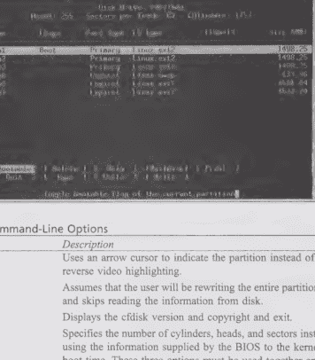

### 表 7.2 cfdisk 命令行选项

| 选项 | 描述 |
|---|---|
| -a | 使用箭头光标指示分区，而不是反向视频高亮。 |
| -z | 假定用户将重写整个分区表并跳过从磁盘读取信息。 |
| -v | 显示 cfdisk 版本和版权信息后退出。 |
| -c cylinders | 指定柱面数、磁头数和扇区数，而不是使用 BIOS 在启动时提供给内核的信息。这三个选项必须一起使用，并且非常危险。请极其谨慎使用。 |
| -h heads | 指定柱面数、磁头数和扇区数，而不是使用 BIOS 在启动时提供给内核的信息。这三个选项必须一起使用，并且非常危险。请极其谨慎使用。 |
| -s sectors | 指定柱面数、磁头数和扇区数，而不是使用 BIOS 在启动时提供给内核的信息。这三个选项必须一起使用，并且非常危险。请极其谨慎使用。 |
| -P opt | 以 opt 参数指定的格式显示信息，opt 可以是 r 表示原始数据格式，s 表示扇区顺序格式，或 t 表示原始格式。有关这些格式的完整描述，请参阅 cfdisk 手册页。 |

## 使用 sfdisk 进行分区

正如你所见，fdisk 和 cfdisk 实用程序交互使用都很简单，但如果您需要在脚本中分区磁盘，它们就用处不大。这就是又一个分区实用程序 sfdisk 存在的理由。此工具与另外两个不同，具有如表 7.4 所示的丰富命令行选项，并从标准输入获取输入，使其适合作为管道的目标或与 here-document 一起使用。它可以
特别有用，如果您想在多个磁盘上快速创建一个单一的大分区。例如，以下代码示例。此简单的 for 循环将在四个 SCSI 驱动器 /dev/sdb、/dev/sdc、/dev/sdd 和 /dev/sde 上创建一个由整个磁盘组成的单个分区。

### 注意

here-document 指的是脚本中代表通常通过标准输入或从文件接收的信息的行。here-document 以 I/O 重定向运算符 << 后跟分隔符词开始。here-document 以仅包含分隔符词的行终止。在以下示例中，here-document 以 <<EOF 开始并以 EOF 结束。

```bash
/bin/cat >foo.sh <<EOF
#!/bin/sh
echo 'This is a test'
exit 0
EOF
```

此命令创建 foo.sh 文件，其中包含 <<EOF 与 EOF 之间的 here-document 中的所有内容。

```bash
for f in sdb sdc sdd sde; do
echo ",,," | /sbin/sfdisk /dev/$f
done
```

### 警告

与许多其他 Linux 实用程序一样，强大的功能伴随着增加的风险。例如，一个简单的输入错误，例如输入 sda 而不是 sdd，将导致您的第一个 SCSI 驱动器的分区表被覆盖，这意味着如果您拥有仅 SCSI 系统，您将破坏您的启动驱动器。

sfdisk 实用程序从标准输入读取以确定如何创建分区。它读取的行包含分区的起始柱面、分区大小（以柱面为单位）、分区 ID（类型）、活动标志，以及可选地，分区开始和结束的柱面、磁头和扇区。这些最后两个字段很少使用，应极其谨慎使用。这些输入字段的描述、可接受值和默认值在表 7.3 中描述。

### 表 7.3 sfdisk 输入字段

| 字段 | 描述 |
|---|---|
| start_cylinder | 分区的第一个柱面。默认为第一个可用柱面。 |
| size | 分区的柱面大小。默认为磁盘上剩余的柱面数。 |
| id | 分区 ID 或类型。可接受的值为十六进制 ID 或字母 L、E、S 或 X，分别表示 Linux 原生 (83)、扩展 (5)、Linux 交换 (82) 或 Linux 扩展 (85)。 |
| active flag | 该字段是标志，指示是否将分区标记为活动。可接受的值为活动时为星号 (*)，非活动时为连字符 (-) 。 |
| c,h,s | 开始分区的柱面、磁头和扇区。 |
| c,h,s | 结束分区的柱面、磁头和扇区。 |

虽然这种格式比 fdisk 的交互式版本需要更多的工作来掌握，但这绝对值得付出努力。此分区实用程序是唯一一个可以通过 rsh 轻松使用的实用程序，并且与前面讨论的其他分区工具不同，具有许多命令行选项，如表 7.4 中所述。

### 表 7.4 sfdisk 命令行选项

| 选项 | 描述 |
|---|---|
| -v --version | 打印 sfdisk 版本号并立即退出。 |
| -? --help | 打印使用信息并立即退出。 |
| -T --list-types | 打印已识别的分区类型。 |
| -s --show-size | 列出分区的大小。 |
| -g --show-geometry | 列出内核对指定磁盘几何结构的理解。 |
| -l --list | 列出设备的分区。 |
| -d | 以可作为 sfdisk 输入的格式转储设备的分区。 |
| -V --verify | 测试分区是否正确。 |
| -i --increment | 从 而不是 0 开始对柱面编号。 |
| -N number | 仅更改指定的单个分区。 |
| -A number | 使指定的分区（们）处于活动状态，其他分区均处于非活动状态。 |
| -c --id number [Id] | 如果未给出 Id 参数：打印指定分区的分区 Id。如果存在 Id 参数：更改指定分区的类型（Id）为给定值。 |
| -U S -u B -u C -u M | 以扇区（块、柱面、兆字节，分别）为单位接受或报告。默认值为柱面，至少在已知几何结构时如此。 |
| -x --show-extended | 在输出中还列出非主扩展分区，并在输入时期望它们的描述符。 |


表 7.4 继续

| 选项 | 描述 |
|---|---|
| -C cylinders | 指定柱面数，可能覆盖内核的判断。 |
| -H heads | 指定磁头数，可能覆盖内核的判断。 |
| -S sectors | 指定扇区数，可能覆盖内核的判断。 |
| -f --force | 按我说的做，即使它很愚蠢。 |
| -q --quiet | 抑制警告信息。 |
| -L --Linux | 不对与 Linux 无关的事情抱怨。 |
| -D --DOS | 为 DOS 兼容性：浪费一点空间。 |
| --IBM --leave-last | 告诉 sfdisk 不要分配最后一个柱面。 |
| -n | 完成所有操作，但实际上不写入磁盘。 |
| -R | 仅执行 BLKRRPART ioctl（使内核重新读取分区表）。 |
| --no-reread | 抑制对已挂载或正在使用的设备的检查。 |
| -O file | 在写入新分区之前，将将被覆盖的扇区输出到 file。 |
| -I file | 使用 file 恢复旧的分区表，该文件必须使用 -O 选项创建。 |

## Disk Druid

在安装 Red Hat Linux 发行版时，您还有另一种分区磁盘的选项：Disk Druid。该程序是一个全屏分区编辑器和文件系统管理器，仅在安装过程中可用。它包含许多分区管理器中通常找不到的功能，例如为 NFS 文件系统添加挂载点的能力。图 7.2 所示的 Disk Druid 主屏幕分为三个主要部分：当前分区部分、驱动器摘要部分以及执行各种可用操作的按钮/功能键部分。许多人不喜欢 Disk Druid，因为它有些不灵活。例如，Disk Druid 只会创建一个主 Linux 分区，并将您指定的所有其他分区作为扩展分区内的逻辑驱动器。这可能非常受限，尤其是在双启动系统上会遇到麻烦。为了获得最大灵活性，我推荐使用其他可用的分区工具，如 fdisk。

### 图 7.2
Disk Druid 主屏幕。

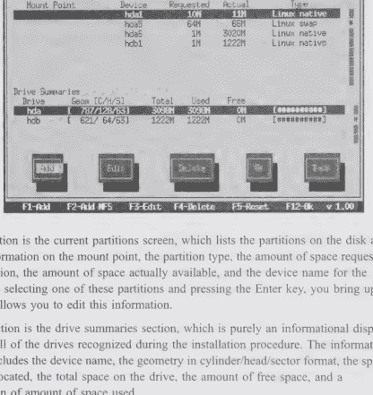

第一部分是当前分区屏幕，列出磁盘上的分区，并包括挂载点、分区类型、分区请求的空间量、实际可用的空间量以及分区的设备名称等信息。通过选择其中一个分区并按 Enter 键，您会弹出一个对话框，允许您编辑这些信息。

下一部分是驱动器摘要部分，这是一个纯信息显示，显示安装过程中识别到的所有驱动器。显示的信息包括设备名称、以柱面/磁头/扇区格式的几何结构、当前分配的空间、驱动器的总空间、可用空间以及已使用空间的表示。

Disk Druid 屏幕的底部部分是按钮/功能键部分，包含用于添加、编辑和删除分区的按钮以及相应的功能键。此外，还有一个 Ok 按钮用于提交所做的更改，以及一个 Back 按钮返回到安装过程中的上一步。两个没有按钮对应的功能键是 F5 重置功能，以及用于添加 NFS 文件系统挂载点的 F2 键。

如果您需要有关使用 Disk Druid 的进一步信息，可以参考随 Linux 发行版提供的 Red Hat Linux 安装指南，即书籍或在线版本，位于 `/usr/doc/rhl-install-guide-en-6.0/manual1`。

## 文件系统创建和管理

现在我们已经了解了磁盘和分区，我们可以讨论文件系统的创建以及维护所需工具。本节涵盖文件系统创建和维护实用程序，介绍几种为文件系统分配空间的策略，并展示如何随着用户群的扩展和系统增长来估算增长。

### 文件系统工具

在 Linux 系统上创建文件系统的标准工具是 mkfs 命令。此实用程序实际上是多个文件系统特定的 mkfs 命令的前端，这些命令命名为 mkfs.<fstype>，其中 <fstype> 是您为 mount 命令的 -t 选项指定的文件系统类型。

### 对所有文件系统类型通用的 mkfs 选项

使用 mkfs 命令可以创建的所有文件系统都有一些通用选项。这些选项在表 7.5 中指定。

表 7.5 对所有文件系统通用的 mkfs 选项

| 选项 | 描述 |
|---|---|
| -V | 生成详细输出。此选项可多次指定，但如果多次指定，则命令会显示本应发生的情况，但不执行。 |
| -v | 生成详细输出。 |
| -t fstype | 通过启动 mkfs.<fstype> 命令创建指定类型的文件系统。 |
| -c | 在其上创建文件系统之前检查设备的坏块。 |
| -l filename | 从 filename 读取坏块列表。 |

所有其他选项都会传递给文件系统特定的 mkfs 命令。您的 Red Hat 系统附带了其中三个命令；一个用于第二扩展文件系统（mkfs.ext2），一个用于 Minix 文件系统（mkfs.minix），一个用于 MS-DOS 文件系统（mkfs.msdos），每个命令都有自己的选项集。

如果未使用 -t 选项向 mkfs 命令指定文件系统类型，则默认文件系统类型为扩展类型 2，通常称为 ext2。有关此命令的许多选项在 mkfs.ext2 手册页中有详细说明，最常用的选项在表 7.6 中描述。

表 7.6 扩展类型 2 文件系统特定的 mkfs 选项

| 选项 | 描述 |
|---|---|
| -b block_size | 指定块大小（字节）。默认为 1024。 |
| -i bytes_per_inode | 指定字节/索引节点比率。默认为 4096。 |
| -m integer | 指定为 root 用户保留的磁盘空间百分比。默认为 5%。 |
| -q | 以静默模式运行。 |
| -v | 以详细模式运行。 |

为了使文件系统获得最佳性能而平衡这些选项，需要大量考虑将使用它们的应用程序的性质。最常见的是调整块大小和字节到索引节点比率的调整，但也可能包括减少为超级用户保留的空间量。

### 使用 fsck 进行文件系统修复和维护

创建文件系统后，您需要能够维护它们并在损坏时修复它们。为此，您使用 fsck 实用程序。与 mkfs 命令一样，fsck 是一个前端，运行文件系统特定的 fsck 版本并并行运行它们，以减少将系统启动所需的时间。

与 mkfs 命令一样，前端接受许多命令行选项，其余选项传递给文件系统特定的 fsck 版本。fsck 前端接受的选项在表 7.7 中描述。

表 7.7 fsck 命令行选项

| 选项 | 描述 |
|---|---|
| -A | 检查 /etc/fstab 中的所有文件系统，从根文件系统开始。通常在系统启动时使用。 |
| -R | 与 -A 选项一起使用，检查除根文件系统外的所有文件系统。 |
| -T | 启动时不显示标题。 |
| -N | 不执行，仅显示本应执行的操作。 |
| -P | 与其他分区并行运行根分区的检查，而不是先检查。用于 -A 选项。 |
| -s | 序列化文件系统检查，而不是并行运行检查。 |
| -V | 详细输出。 |

表 7.7 继续

| 选项 | 描述 |
|---|---|
| -t fstype | 指定要检查的文件系统类型。您指定的 fstype 会附加到前缀 "fsck."，然后执行 resulting 命令。 |

正在努力标准化文件系统特定的 fsck 实用程序的选项；然而，仍然存在差异。但是，表 7.8 中的选项是其中大多数的通用选项。

表 7.8 通用 fsck.<fstype> 选项

| 选项 | 描述 |
|---|---|
| -a | 对所有问题都假设回答为 yes。请谨慎使用。 |
| -r | 交互式修复文件系统。 |

文件系统检查器实用程序的统一前端确保 fsck 的返回代码一致，此返回代码可用于系统初始化脚本中，以自动尝试从 fsck 失败中恢复。以下是从 /etc/rc.d/ rc.sysinit 的代码片段，显示了 fsck 的返回代码处理。

```sh
if [ ! -f /fastboot ]; then
  STRING="Checking root filesystem"
  echo $STRING
  initlog -c "fsck -T -a $fsckoptions /"
  rc=$?

  if [ "$rc" = "0" ]; then
    success "$STRING"
    echo
  elif [ "$rc" = "1" ]; then
    passed "$STRING"
    echo
  fi

  # A return of 2 or higher means there were serious problems.
  if [ $rc -gt 1 ]; then
    failure "$STRING"
    echo
    echo
    echo "*** An error occurred during the file system check."
    echo "*** Dropping you to a shell; the system will reboot"
    echo "*** when you leave the shell."
```

```
PS1="(Repair filesystem) \W"; export PS1
sulogin

echo "Unmounting file systems"
umount -a
mount -n -o remount,ro /
echo "Automatic reboot in progress."
reboot
elif [ "$rc" = "1" ]; then
_RUN_QUOTACHECK=1
fi
```

## 解析 fsck 返回码

fsck 的可能返回码分为三类。第一类由返回码 0 表示，表示未发现文件系统错误。下一结果类别由返回码 1 表示，表示发现并已纠正文件系统错误。如果系统意外失败且文件系统未干净卸载，则此返回码很常见。最后一结果类别由返回码 2 或更大表示。此级别在大多数情况下需要系统管理员手动干预。在前述 rc.sysinit 代码的情况下，引导过程被挂起，并提示用户输入 root 密码并手动执行维护，或通过按 Ctrl+D 继续。无论如何，如果您无法轻松访问控制台，这可能是一件坏事。这是上述维护 root 分区试图缓解的情况。通过将 rc.sysinit 片段中对 sulogin 的调用替换为以下代码，系统将自行重新启动到维护 root，从而为您提供远程登录并纠正常规 root 文件系统或系统需要处理的任何其他部分的机会。

```
# A return of 2 or higher means there were serious problems.
if [ $rc -gt 1 ]; then
failure "$STRING"
echo
echo
echo "*** An error occurred during the file system check."
echo "*** The system will reboot to the maintenance root"
echo "*** partition unless you press Ctrl-D within 5 sec."
/sbin/pause 5
rc=$?
if [ $rc -eq 0 ]; then
/sbin/lilo -R maint
else
  sulogin

echo "Unmounting file systems"
umount -a
mount -n -o remount,ro /
echo "Automatic reboot in progress."
reboot
elif [ "$rc" = "1" ]; then
  _RUN_QUOTACHECK=1
fi
```

在此示例中，用户被给予一个超时时间，在此期间他可以按 Ctrl+D 进入 sulogin 会话。如果用户无操作，lilo 将使用对应维护分区的映像名称调用，系统将被重新启动。-R 选项以及使此类脚本成为可能的 lilo 的许多其他选项在第 5 章“启动和关闭”中进行了介绍。

## 注意

前述代码示例中调用的 pause 程序是一个简单的 C 程序，它接受秒数作为参数，如果用户在给定秒数内未按 Enter 或控制字符，程序将以零返回码退出。在此给定超时内按 Enter 或控制字符会导致程序以非零返回码退出。pause 程序的源代码可在列表 7.1 中找到。

## 列表 7.1 pause 程序 (pause.c)

```
#include <stdio.h>
#include <sys/types.h>
#include <sys/time.h>
#include <fcntl.h>
#include <termios.h>
#include <unistd.h>

int
main(int argc, char** argv)
{
```

### 列表 7.1 继续

```
fd_set rset;                /* used for select() call */
struct timeval tv;          /* structure used to set the timeout */
int retval = 0;             /* the value returned by select() */
int timeout = 30;           /* the default timeout is 30 seconds */
int count = 0;              /* the number of characters pending */
int val;                    /* FLAGS to set with fcntl */
char *buffer;               /* buffer to hold characters read */
struct termios term;        /* used to set noecho mode */
struct termios termsave;    /* used to restore terminal state */

/* Zero the fd_set and then set a watch on STDIN */
FD_ZERO(&rset);
FD_SET(STDIN_FILENO, &rset);

fprintf(stderr, "argc = %d\n", argc);
switch (argc) {
case 1: {
    break;
}
case 2: {
    if (isdigit(argv[1][0])) {
        timeout = atoi(argv[1]);
    } else {
        fprintf(stderr, "Usage: %s [nnn]\n", argv[0]);
        fprintf(stderr, " where nnn is the number of seconds\n");
        fprintf(stderr, " to wait for input. (default is 30)\n");
        exit(-1);
    }
    break;
}
default: {
    fprintf(stderr, "Usage: %s [-e] [nnn]\n", argv[0]);
    fprintf(stderr, " where nnn is the number of seconds\n");
    fprintf(stderr, " to wait for input. (default is 30)\n");
    exit(-1);
}
}

/* set the timeout for the select call */
tv.tv_sec = timeout;
tv.tv_usec = 0;
```

### 列表 7.1 继续

```
/*
 * Set nonblocking mode for STDIN, so that if the user types anything
 * other than a return or control character, the program won't pause
 * indefinitely.
 */
val = fcntl(STDIN_FILENO, F_GETFL, 0);
val |= O_NONBLOCK;
fcntl(STDIN_FILENO, F_SETFL, val);

/*
 * Set noecho mode for the terminal so that no characters are echoed
 * to the screen while we are waiting.
 */
tcgetattr(STDIN_FILENO, &term);
termsave = term;
term.c_lflag &= ~ECHO;
tcsetattr(STDIN_FILENO, TCSANOW, &term);

retval = select((STDIN_FILENO + 1), &rset, NULL, NULL, &tv);

/*
 * If the user typed a return or a control D character, retval will be
 * non-zero and we can read whatever they typed in to clear the input
 * buffer. If not, simply flush the buffer.
 */
if (retval) {
    if ((ioctl(STDIN_FILENO, FIONREAD, &count) == 0)) {
        buffer = (char *)malloc(count + 1);
        read(STDIN_FILENO, buffer, count);

        if (buffer[count - 1] == '\n') {
            buffer[count - 1] = '\0';
        }

        /* free buffer before exiting if*/
        free(buffer);
    }
} else {
    tcflush(STDIN_FILENO, TCIOFLUSH);
}
```

### 列表 7.1 继续

```
/* reset the terminal state */
tcsetattr(STDIN_FILENO, TCSANOW, &termsave);

/* Exit with a 1 if retval was set, otherwise exit with a zero. */
exit(retval);
}
```

## 使用 mount 访问文件系统

我们已介绍如何分区驱动器并在创建的分区上创建文件系统。现在我们将查看用于将它们添加到文件系统层次结构并从中移除的实用程序：mount 和 umount。Linux 的 mount 命令与任何其他 UNIX 变体类似，只有一个显著例外。此例外是允许普通用户挂载和卸载文件系统的能力。此能力通常被授予以允许访问可移动媒体设备，例如软盘驱动器和 CD-ROM 驱动器。此能力在第 10 章“管理可移动媒体设备”中有详细讨论。

mount 命令的标准形式采用两个参数。第一个是挂载的设备，例如 /dev/hda1，第二个是挂载文件系统的目录。当然有许多可用的命令行选项会影响 mount 命令的行为。表 7.8 显示了 mount 命令的选项。

表 7.8 mount 命令行选项

| 选项 | 描述 |
|---|---|
| -V | 显示版本并退出。 |
| -h | 打印使用说明并退出。 |
| -v | 以详细模式执行。 |
| -a | 挂载 fstab 中提到的所有文件系统（指定类型）。 |
| -F | 为每个设备派生一个新的 mount 实例。 |
| -f | 执行所有操作除实际系统调用。 |
| -n | 挂载时不写入 /etc/mtab。 |
| -s | 忽略文件系统类型不支持的挂载选项。 |
| -r | 以只读方式挂载文件系统。别名为 -oro。 |
| -w | 以读写方式挂载文件系统。这是默认值。别名为 -o rw。 |
| -L label | 挂载具有指定标签的分区。 |
| -U uuid | 挂载具有指定 uuid 的分区。 |
| -t vfstype | 将文件系统挂载为类型 vfstype 的一种。要求内核支持该类型文件系统。 |

**表 7.8 继续**

| 选项 | 描述 |
|---|---|
| -o | 选项通过 -o 标志指定，后跟逗号分隔的选项字符串。完整的可选选项列表可在 mount 手册页中找到。 |

mount 命令可用的完整选项列表相当 extensive，并且除了适用于所有文件系统类型的通用选项外，还有许多文件系统特定的选项。一些更常用的选项及其作用在表 7.9 中描述。

**表 7.9 mount 选项**

| 选项 | 描述 |
|---|---|
| async | 所有对文件系统的 I/O 应异步完成。 |
| auto | 可使用 -a 选项挂载。 |
| defaults | 使用默认选项：rw、suid、dev、exec、auto、nouser 和 async。 |
| dev | 解析文件系统上的字符或块特殊设备。 |
| noatime | 不更新此文件系统上的 inode 访问时间（例如，为加快新闻服务器访问速度而加快新闻 spool 的访问）。 |
| noauto | 只能显式挂载（即 -a 选项不会导致文件系统被挂载）。 |
| nodev | 不解析文件系统上的字符或块特殊设备。 |
| noexec | 不允许在已挂载文件系统上执行任何二进制文件。 |
| nosuid | 不允许 setuid 或 setgid 位生效。 |
| remount | 尝试重新挂载已挂载的文件系统。 |
| ro | 以只读方式挂载文件系统。 |
| rw | 以读写方式挂载文件系统。 |
| sync | 所有对文件系统的 I/O 应同步完成。 |
| user | 允许普通用户挂载文件系统。此选项隐含 noexec、nosuid 和 nodev 选项。 |

mount 命令的互补命令当然是 umount 命令。此命令从文件系统层次结构中移除文件系统，并使用单个参数调用，该参数可以是卸载的设备文件或其挂载点。应注意，Linux umount 命令缺少在大多数其他 UNIX 变体中实现的一个关键选项。这是在强制卸载设备时使用的 -f 选项。


## 空间分配策略与增长估算

空间分配是所有系统管理员都面临且没有简单答案的问题。然而，通过规划并了解 Linux 文件系统的各个部分是如何使用的，你可以成功地为你的文件系统分配空间。分配文件系统空间时需要考虑许多因素。其中一些因素包括

-   文件系统是否包含增长文件，例如日志或数据库文件？
-   文件系统是否像 /home 文件系统那样可由用户写入？
-   文件系统是否 intended 用于系统添加，如 /opt 或 /usr/local？
-   文件系统在近期不太可能发生变化吗？

回答这些问题将帮助你识别可能需要最多磁盘空间的文件系统。它们也将帮助你确定在为构成系统的各个分区分配空间时应采取的正确策略。

### 空间分配

考虑一台连接到网络的典型 Linux 系统，其中 /home、/usr/local 和 /opt 文件系统是驻留在 NFS 服务器上的共享资源。这台典型的 Linux 系统有一块单块九千兆字节的磁盘驱动器，并且仅由单个用户使用。在这种特定情况下，由于除 /var 之外的所有增长文件系统都位于 NFS 服务器上，我们面临着如何为 /var 与根文件系统和所需的交换空间分配空间的决定。我会采用如下策略。首先，由于所有本地可定制区域都位于 NFS 服务器上，必须安装在工作站上的数据变得通用。因此，将 /usr 和根文件系统分开是没有用的。我会创建一个大分区来容纳这两个层级。对于 Red Hat Linux 6.1，这大约需要一千兆字节，具体取决于你安装了多少额外软件。

### 配置文件增长与系统包升级

为了允许配置文件增长和系统包升级，并留出一点缓冲空间，我们可以再给该文件系统多一半的空间，总计为 1.5 千兆字节。在剩余的 7.5 千兆字节中，256 兆字节将分配给交换空间，0.75 千兆字节将用于 /var 层级。此外，/tmp 将被移除并替换为指向 /var/tmp 的符号链接，从而从根文件系统中消除一个潜在的问题区域。这仍然剩下 6.5 千兆字节的空间未使用。该空间可以保持未分配并为未来增长保留；然而，我通常喜欢为工作站用户在其主目录上提供一个写入文件的空间。我可以将剩余的全部 6.5 千兆字节都给本地用户，但我更可能给用户剩余空间的一半或大约 3.25 千兆字节。这种空间分配允许用户拥有一个从互联网下载文件、写入其 Netscape 缓存目录以及通常只是存储杂物而不 clutter NFS 服务器上的其主目录的地方。这剩下 3.25 千兆字节未分配，我会将其保留以备未来需要扩展时使用。这结束了我们对空间分配的讨论。我们准备好继续讨论 Linux 支持的文件系统类型。

## 文件系统类型

Linux 在异构网络环境中成为一种很好的胶水操作系统的首要原因之一是它支持许多文件系统类型。这些包括 Linux 原生，如 extended、extended 2 和 xiafs；非原生，如 MS-DOS、NTFS 和 BSD 文件系统；以及网络，如 NFS、SMB 和 Coda 文件系统。本节介绍一些最常见的 Linux 原生文件系统，并讨论何时适合使用它们。

### Minix 文件系统

Linux 支持的最古老的文件系统类型是 Minix 文件系统。该文件系统是对 Minix 操作系统所使用文件系统的独立实现，最初之所以选择它是因为 Minix 是引导 Linux 所必需的。Minix 文件系统在 2.2 内核中仍然是一个选项，但很少使用。有许多原因，包括文件名长度限制为 30 个字符以及每个文件系统大小限制为 64 兆字节。这并不是说它没有用，但由于这些限制和其他缺陷，它通常不被使用。Minix 文件系统仍然有用的地方之一是在可启动软盘集上，在那里空间非常宝贵。该文件系统在创建临时 ramdisk 时也很有用，或者如果你想在普通文件上创建文件系统并通过 loop 设备机制挂载它时也很有用。

使用 Minix 文件系统的一个优点是磁盘上存储的文件系统结构开销更少。Minix 文件系统的另一个优点是速度。Minix 文件系统开销更小，因此许多文件系统操作在对其运行时速度更快。Minix 文件系统的主要缺点是文件名长度有限。

当按照第 35 章“定制 Linux 内核”中所述定制你的内核时，通常明智的选择是作为模块包含对 Minix 文件系统的支持，并将其用作 RAM 磁盘、启动软盘和你的 initrd 的文件系统类型。

### Extended 2 文件系统

今天主要使用的 Linux 文件系统类型是 extended 2 文件系统。extended 2 文件系统是一个 Linux 原生文件系统，因为它专门为 Linux 创建，而不是从另一个操作系统移植而来。该文件系统没有 Minix 文件系统所具有的文件名限制或文件系统大小限制，尽管它也有自己的限制。extended 2 文件系统是一种功能齐全的文件系统类型，支持长达 256 个字符的长文件名、最高达两太字节的文件系统大小以及单个文件最高达两千兆字节。最后这个限制仅适用于 32 位版本的 Linux，例如 Intel 平台，并且可以通过应用内核补丁来超过。自然地，这个限制不适用于 64 位版本的 Linux，例如 Alpha 端口。

你构建的每个内核都应包含对 extended 2 文件系统的支持，将其编译为模块的实用性值得怀疑。这一规则的唯一例外可能是仅用于启动软盘集的内核，在这种情况下，将 extended 2 文件系统作为模块包含可能是非常值得的节省空间的方法。

### 其他文件系统类型

除了 Minix 和 extended 2 文件系统类型之外，Linux 2.0 内核还包括对原始 extended 文件系统和 xia 文件系统类型的支持。这两种文件系统现在都被认为已过时，并且在随 Red Hat Linux 6.1 提供的 2.2 内核等内核中已删除了对它们的支持。除了这些 Linux 原生类型之外，还支持许多其他文件系统类型。其中一些文件系统是支持特殊设备（如 CD-ROM 或 DVD 驱动器）所必需的。其他是其他操作系统使用的文件系统，包括 MS-DOS、Windows、Windows NT 和 BSD UNIX，你可能想要访问它们。还有网络文件系统，如 SMB 文件系统、NFS 和 Coda。最后，还有像 proc 文件系统和 /dev/pts 文件系统这样的专用文件系统，用于支持特定的内核功能。正如你所见，Linux 支持的文件系统种类繁多，并且还在不断增加。我们现在准备好查看相关的空间管理和配额主题。

## 空间管理与配额

系统管理员面临的最烦人的任务之一是确保文件系统不会填满，并且单个用户在共享文件系统（如用户主目录）中不会使用不合理的空间。这是一项重要的任务，原因有很多，并且有不同的处理方法，有些更容易，有些更

比其他更受欢迎。本节探讨了这个问题，并通过提供监控方法来帮助减轻任务负担。它还探讨了如何使用配额来管理文件系统，并确保用户不会通过填满文件系统来滥用其权限。

## 监控空间使用情况

监控空间使用的一种简单方法是使用定期运行 df 并在空间低于用户定义阈值时通知你的脚本。这些脚本可以非常简单，也可能非常复杂，正如以下示例所示。列表 7.2 包含我用于监控我维护的多个系统磁盘空间使用情况的脚本。该脚本用 Perl 编写，旨在从 cron 作业每小时运行一次，或根据需要更频繁地运行。它使用随 Red Hat Linux 提供或可从本地 CPAN 镜像获取的模块。

### 列表 7.2 checkspace.pl
```
#!/usr/bin/perl
#
# $Id: 755907.txt,v 1.5 1999/09/17 11:43:34 tschenk Exp $
#
# checkspace.pl - perl script to check for filesystems that are nearing 100%
#                 utilization
#
use Sys::Hostname;
use Getopt::Std;
use POSIX;
use strict;
#use vars qw($SystemLevels $ENotify $PNotify);

########
# MAIN
########

# -*-perl-*-
# This hash contains the notification levels and is keyed by the hostname
# and filesystem to check.  The filesystems with default as the hostname
# are checked on every host that this script runs on.
my %SystemLevels = (
    'nomad:/v/v10'  =>  'b:94:97:99',
    'nomad:/v/v12'  =>  'b:94:97:99',
    'quicksilver:/usr/local'  =>  'b:94:97:99',
    'quicksilver:/home'  =>  'b:94:97:99',
    'wizard:/opt' => 'i:94:97:99',
    'wizard:/usr/local' => 'i:94:97:99',
);

# The list of people to notify by e-mail at each level, separated by colons.
# There should be one entry here for each entry in the SystemLevels hash
# with a matching key.
my %ENotify = (
'nomad:/v/v10' => 'tschenk:siteops:siteops',
'nomad:/v/v12' => 'tschenk:siteops:siteops',
'quicksilver:/usr/local' => 'tschenk:siteops:siteops',
'quicksilver:/home' => 'tschenk:siteops:siteops',
'wizard:/opt' => 'tschenk:siteops:siteops',
'wizard:/usr/local' => 'tschenk:siteops:siteops',
);

# The list of people to notify by pager at each level, separated by colons.
# There should be one entry here for each entry in the SystemLevels hash
# with a matching key.
my %PNotify = (
'nomad:/v/v10' => 'tschenk-page:meb-page:tschenk-page,bmcfarla-page',
'nomad:/v/v12' => 'tschenk-page:meb-page:tschenk-page,bmcfarla-page',
'quicksilver:/usr/local' => 'tschenk-page:meb-page:tschenk-page,bmcfarla-page',
'quicksilver:/home' => 'tschenk-page:meb-page:tschenk-page,bmcfarla-page',
'wizard:/opt' => 'tschenk-page:meb-page:tschenk-page,bmcfarla-page',
'wizard:/usr/local' => 'tschenk-page:meb-page:tschenk-page,bmcfarla-page',
);

# Parse the command line options
my $options = &parse_cmd_line;

if (defined($options{Error})) {
    print STDERR "Options{Error}\n";
    &print_usage;
    exit(1);
}

# Perform the checks
my $hostname = hostname();
$hostname =~ s/\.alchemy.net//;

foreach my $value (keys(%SystemLevels)) {
    my ($host, $filesystem) = split(/:/, $value);

    if (($host eq $hostname) or ($host eq 'default')) {
        &checkspace($hostname, $filesystem, $SystemLevels{$value},
            $ENotify{$value}, $PNotify{$value});
    }
}

# Exit
exit(0);

#############
# SUBROUTINES
#############

sub print_usage {
    my $USAGE = "Usage: $0 [options]
where options are:
    -n    Run the script, but don't actually send notifications
    -v    Be verbose in your reporting
    -h    Print this usage statement\n";

    print STDERR $USAGE;
}

sub parse_cmd_line {
    my %opts;

    getopts('nvh');

    $opts{Dryrun} = (defined($::opt_n) ? $::opt_n : 0);
    $opts{Verbose} = (defined($::opt_v) ? $::opt_v : 0);

    if ((scalar(@ARGV) > 0) || (defined($::opt_h))) {
        &print_usage;
        exit(1);
    }

    return %opts;
}

sub checkspace {
    my $host = shift;
    my $fs = shift;
    my $levelstr = shift;
    my $emailstr = shift;
    my $pagestr = shift;

    my @levels = split(/:/, $levelstr);
    my $checktype = undef;
    my @email = split(/:/, $emailstr);
    my @pager = split(/:/, $pagestr);

    $levels[0] == 'i' ? $checktype = '-i' : $checktype = undef;
    shift @levels;

    my $level;
    for ($level = (scalar(@levels) - 1); $level >= 0; $level--) {
        if ($options{Verbose}) {
            print "Checking space on $fs.\n";
        }
    }

    my $used = `df $checktype $fs | tail -1 | awk '{print $5}' |
 sed -e 's/%//' `;
    chomp $used;
    my $fsname = $fs;
    $fsname =~ tr/:/_/;
    my $lockfile = '/tmp/checkspace_' . $fsname . '_' . $levels[$level]
        . '.lock';

    if (-f $lockfile) {
        if ($used < $levels[$level]) {
            if ($options{Dryrun}) {
                print "Removing lockfile $lockfile.\n";
            } else {
                unlink($lockfile);
            }
        } else {
            last;
        }
    } else {
        if ($used >= $levels[$level]) {
            open(LOCKFILE, ">$lockfile");
            print LOCKFILE $$;
            close(LOCKFILE);
            if ($email[$level] ne "none") {
                &notify_email($hostname,$fs,$level,$used,$email[$level]);
            }
            if ($pager[$level] ne "none") {
                &notify_pager($hostname,$fs,$level,$used,$pager[$level]);
            }
            last;
        }
    }
}

sub notify_email {
    my $host = shift;
    my $fs = shift;
    my $level = shift;
    my $used = shift;
    my $recipients = shift;

    my @subjstr = ("[WARNING]", "[CRITICAL]", "[CRISIS]");

    my $msg = `df $fs`;

    if ($options{Verbose}) {
        print "Sending e-mail notification to $recipients.\n";
    }
    if (! $options{Dryrun}) {
        open(SENDMAIL, "|/usr/sbin/sendmail $recipients");
        print SENDMAIL <<EOF;
Subject: $subjstr[$level] $host:$fs $used% full

Notification from checkspace.pl:

$msg

EOF
        close(SENDMAIL);
    } else {
        print "$msg\n";
    }
}

sub notify_pager {
    my $host = shift;
    my $fs = shift;
    my $level = shift;
    my $used = shift;
    my $recipients = shift;

    my @subjstr = ("[WARNING]", "[CRITICAL]", "[CRISIS]");

    if ($options{Verbose}) {
        print "Sending pager notification to $recipients.\n";
    }
    if (!$options{Dryrun}) {
        open(SENDMAIL, '|/usr/sbin/sendmail $recipients');
        print SENDMAIL <<EOF;
Notification from checkspace.pl: $subjstr[$level] $host:$fs $used% full

EOF
        close(SENDMAIL);
    } else {
        print "$subjstr[$level] $host:$fs $used% full\n";
    }
}
```

该脚本非常灵活，包含基于三个使用级别的两种通知方法，即寻呼和电子邮件。此外，你可以让脚本检查 inode 耗尽而不是磁盘块消耗，并且通过调整配置参数，可以消除其中一种通知方法。

## 本地与共享文件系统

管理磁盘空间的另一个方面是决定在网络上共享哪些文件系统，哪些保留本地。其极端情况是无盘工作站，其中所有文件都物理位于网络服务器上，工作站从软盘或 bootrom 启动。另一极端是独立工作站，它已连接网络，但根本不共享任何文件系统。然而，最常见的情况介于两者之间，其中 /opt、/usr/local 和 /usr/share 等文件系统位于网络文件服务器上并在系统之间共享。

你可能会想知道网络文件系统与管理空间有什么关系。答案是共享文件系统通过减少需要担心磁盘填满或有扩展空间的系统数量，从而降低了管理磁盘空间的行政开销。有关设置共享文件系统资源的信息，请参阅第 15 章“共享资源（打印和文件服务）”。

## 建立文件系统配额

管理服务器磁盘空间的一种方法是使用文件系统配额。大多数用户对配额的想法感到厌恶，因为他们认为这是一种不必要的限制，旨在让他们的生活更困难。另一方面，许多系统管理员认为配额是文件系统管理所必需的一部分。用户的不便是一个小代价，换来的是安心，因为你知道没有一个用户会占用文件系统的所有空间。

在 Linux 下，配额主要有两种类型：用户级配额和组级配额。要在 Linux 系统上使用配额，你必须首先在内核配置中启用对它们的支持，并注意配额仅适用于扩展 2 文件系统类型。因此，在配置内核时，你必须对配额支持问题和扩展 2 文件系统回答“是”。Red Hat Linux 包含利用此内核支持所需的工具，但如果你想自己构建它们或查看是否存在新版本，可以从 ftp.funet.fi 获取最新的配额工具，网址为 ftp://ftp.funet.fi/pub/Linux/PEOPLE/Linus/subsystems/quota/all.tar.gz。该工具集包含五个实用程序，其用途在表 7.10 中描述。

### 表 7.10 配额实用程序

| 工具 | 描述 |
|---|---|
| quotaon | 打开配额核算。 |
| quotaoff | 关闭配额核算。 |
| quotacheck | 扫描文件系统以获取当前磁盘使用情况，并使用最新的使用统计信息更新 quota.user 和 quota.group 文件。 |
| repquota | 生成格式化的磁盘空间使用报告。 |
| edquota | 用于修改用户或组配额的工具。 |

一旦你在内核中启用了配额支持并确保已安装配额工具，现在就可以开始设置配额了。在进入实现细节之前，以下部分回顾了一些在讨论配额时使用的概念，需要理解这些概念才能有效地使用它们。


## 理解配额的概念

第一个需要理解的概念是配额本身以及实现配额意味着什么。文件系统配额是一种机制，通过它可以限制用户或一组用户在特定文件系统中可使用的空间量。基本上，他们使用的空间量会被监控，如果超过分配量，首先会收到警告。如果他们继续超出配额，则不再允许向文件系统添加文件。

## 硬限制和软限制

这就引出了限制的概念。关于配额有两种类型的限制。其中第一种是软限制，即分配给用户在特定文件系统上的磁盘空间量。如果不允许宽限期，则这是绝对限制，用户不允许超过它。如果允许宽限期，即用户被允许超过其配额的一段时间，软限制就成为用户被警告其超出配额的临界点。他们可以在宽限期内超出此配额，但有一个例外：硬限制。硬限制是在定义宽限期的情况下用户绝对不能超过的限制。最后，你还应该记住，配额可以设置在单个用户账户或组上，并且用户和组配额的信息存储在文件系统的根目录下，文件名为 quota.user 和 quota.group。

## 实现配额

有了这些概念，让我们来看一下如何在系统上实现配额。这将涉及多个步骤，从修改系统初始化脚本开始。Red Hat 默认包含对配额的支持，并且为支持配额而对系统初始化脚本的修改已经到位。/etc/rc.d/rc.sysinit 脚本中有三个部分涉及检查配额。如下所示的第一个段运行 quotacheck 对根分区进行检查以更新 quota.user 和 quota.group 文件。

```
# Update quotas if fsck was run on /
if [ X"$RUN_QUOTACHECK" = X1 -a -x /sbin/quotacheck ]; then
    action "Checking root filesystem quotas" /sbin/quotacheck -v /
fi
```

此代码仅检查根文件系统。完成此操作后，在其他本地文件系统挂载并检查一致性之后，如以下代码块所示，将对剩余文件系统运行类似的命令。

```
elif [ "$src" = "1" -a -x /sbin/quotacheck ]; then
    action "Checking filesystem quotas" /sbin/quotacheck -v -R -a
fi
```

在此代码示例中，quotacheck 使用 -a 和 -R 选项调用，这表示命令应针对 /etc/fstab 文件中提到的除根文件系统之外的所有具有配额的文件系统运行。一旦 quotacheck 运行完毕，就该按 rc.sysinit 中的以下段所示打开配额核算。

```
if [ -x /sbin/quotaon ]; then
    action "Turning on user and group quotas for local filesystems" \
    /sbin/quotaon -a
fi
```

此次调用 quotaon 表示它应针对 /etc/fstab 中定义的所有具有配额的文件系统运行。如何在 /etc/fstab 中定义具有配额的文件系统？嗯，这里有一个示例，首先显示一个文件系统 /home，其上启用了用户级配额，另一个 /vol/00，其上启用了组配额，以及第三个 /usr/local，其上同时启用了用户和组配额。

```
/dev/hda3   /home      ext2   defaults,usrquota     1 1
/dev/hda5   /vol/00    ext2   defaults,grpquota     1 1
/dev/hda7   /usr/local ext2   defaults,usrquota,grpquota 1 1
```

设置好 /etc/fstab 文件后，我们现在准备为每个文件系统创建 quota.user 和 quota.group 文件。继续按 /etc/fstab 文件中所示的示例，我们需要以 root 身份发出以下命令来执行此操作：

```
for f in /home /vol/00 /usr/local; do
    cd $f
    touch quota.user
    touch quota.group
    chmod 600 quota.{user,group}
    cd -
done
```

下一步是重新启动系统以测试启动脚本是否正确执行。一旦系统重新启动并再次运行，你就可以继续按需设置用户和组限制。

用于设置用户限制的命令是 edquota 命令。此命令可在你的 Red Hat 系统的 /usr/sbin 中找到。edquota 没有很多选项，但选项及其用途如表 7.11 所示。

### 表 7.11 edquota 选项

| Options | Description |
|---|---|
| -u | 编辑指定用户的用户配额。 |
| -g | 编辑指定组的组配额。 |
| -p prototype_user | 使用 prototype_user 的配额作为指定用户的默认值。 |
| -t | 编辑每个文件系统的软限制。软限制的默认值可在 /usr/include/linux 中的 quota.h 文件中找到。 |

## 一些选项示例

尽管了解选项很重要，但看到一些示例通常更有用。在下面的示例中，我们将继续本章前面开始的同一示例，并在 /usr/local 和 /vol/00 上设置配额。在第一个示例中，我们将对组 cdwriter 运行 edquota 命令并使用 -g 选项针对 /vol/00。此文件系统是用户可以存储任何不合理保存在其主目录中的内容的文件系统，在我的系统上也是音频文件在写入 CD-RW 驱动器之前可以存储的空间。

```
[root@wizard /root]# edquota -g cdwriter
```

此命令会导致为指定用户计算当前磁盘使用情况，同时从文件中读取其配额限制并在编辑器中以如下方式显示：

```
Quotas for group cdwriter:
/dev/hda7: blocks in use: 497, limits (soft = 10000, hard = 15000)
inodes in use: 1, limits (soft = 2500, hard = 3000)
/dev/hda2: blocks in use: 169560, limits (soft = 300000, hard = 305000)
inodes in use: 31, limits (soft = 7500, hard = 8000)
```

正如你从此示例中看到的，cdwriter 组被限制在 /dev/hda7 (/usr/local) 上使用 10,000 个块，其中目前使用 497 个块。此外，在 /dev/hda2 (/opt) 上，该组的成员被限制额外使用 300,000 个块。现在让我们看看已定义的宽限期。这是通过组合使用 edquota 命令的 -g 和 -t 选项完成的。在这种情况下，使用 EDITOR 环境变量定义的编辑器启动编辑会话。

```
Time units may be: days, hours, minutes, or seconds
Grace period before enforcing soft limits for users:
/dev/hda7: block grace period: 7 days, file grace period: 7 days
```

在每种情况下，配额信息都会从内核检索，然后转换为可读格式。要更改配额信息，只需编辑文件，按需更改数字。当你保存文件时，信息会被解析，转换回内核的格式，并存储在文件系统根目录的 quota.group 文件中。

你应该做的最后一件事是定期运行 quotacheck 命令以保持配额信息最新。这可以通过创建运行 quotacheck 的 cron 作业来实现，可能至少每月一次。以下内容就足够了：

```
0 2 * * * /sbin/quotacheck -augv
```

此 crontab 条目即使 Red Hat 提供了运行系统配额所需的一切，也不会默认包含。考虑是否实施配额时要记住的重要一点是，花时间考虑设置配额的管理开销是否比担心和管理填满的文件系统所花费的时间更昂贵。作为凌晨 3:00 收到文件系统填满警报的人，你可以猜到我的投票会投向哪里。

## 摘要

在本章中，我们研究了几个主题，从分区方案和用于分区磁盘的工具开始。我们还讨论了磁盘应如何分区的几种不同策略。文件系统的创建和维护已涵盖，最后，涵盖了空间管理技术，包括对文件系统配额的讨论。与这些主题相关的另外几个信息来源包括文件系统层次结构标准，该标准讨论了空间分配问题以及他们建议如何分区磁盘以容纳 Linux 文件系统，以及 Quota mini-howto。这些文档可以在互联网上的以下网址找到：

Filesystem Hierarchy Standard: http://www.pathname.com/fhs/2.0/fhs-toc.html

Quota Mini-Howto: http://linuxdoc.org/HOWTO/mini/Quota.html


### 添加或替换磁盘

### 本章内容
- IDE 设备命名 212
- 管理 /etc/fstab 文件 214
- SCSI 相关问题 217
- 其他设备 225

无论您是构建新服务器还是升级现有服务器，磁盘存储很可能在 Linux 服务器的管理中发挥重要作用。

过去十年中，磁盘存储成本从每兆字节几美元降至几美分。随着存储变得更加经济实惠，应用程序开始利用更大的存储空间来存放程序文件和数据。Linux 服务器应用程序也不例外，通常比其他应用程序使用更多的存储资源，因为它们通常为多个用户提供服务。

本章讨论在 Linux 服务器系统上添加或替换硬盘的基础知识。首先描述集成驱动电子设备（IDE）接口及其在 Linux 下的配置。然后转向更高级的小型计算机系统接口（SCSI），并讨论其复杂的硬件要求和 Linux 配置。

## IDE 设备命名

IDE 硬盘驱动器是当今最常见的硬盘驱动器之一。IDE 磁盘的容量超过 24 千兆字节（GB），可以提供现代服务器所需的海量存储。此外，与竞争的非线性存储技术相比，其每兆字节存储的成本极低。

### IDE 磁盘设备接口

IDE 磁盘设备的接口采用块设备文件形式，存储在 /dev 目录中。Red Hat Linux v6.0 已在 /dev 目录中预先创建了 136 个 IDE 设备文件。每个设备的 filename 由三部分组成——前缀、驱动设备规范和可选的分区号（参见图 8.1）。IDE 磁盘设备以前缀 hd 开头。设备文件名的下一部分指的是驱动器本身。IDE 磁盘接口每个 IDE 通道最多可支持两个磁盘（主盘和从盘）。IDE 规范不允许在系统中安装超过四个 IDE 通道，从而将系统限制为最多八个 IDE 设备。大多数现代主板都内置了 IDE 控制器，通常有两个通道，在不添加任何额外控制器卡的情况下允许使用多达四个设备。表 8.1 显示了 IDE 设备的标准命名约定。

### 图 8.1
Linux IDE 设备接口文件命名方案。

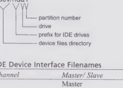

### 表 8.1 Linux IDE 设备接口文件名

| IDE 控制器通道 | 主/从 | IDE 设备名称 |
|---|---|---|
| 1 | 主 | hda |
| 1 | 从 | hdb |
| 2 | 主 | hdc |
| 2 | 从 | hdd |
| 3 | 主 | hde |
| 3 | 从 | hdf |
| 4 | 主 | hdg |
| 4 | 从 | hdh |

这些设备名称指的是整个磁盘或整个 CD-ROM。经常需要指定 IDE 设备上的特定分区（例如，在挂载该分区时）。IDE 设备分区是通过将分区名称附加到磁盘设备名称来指定的。例如，第一个控制器上主 IDE 驱动器的第一个分区将命名为 hda1。有关 IDE 设备命名的更多示例，请参阅表 8.2。

### 表 8.2 IDE 分区示例设备接口文件名

| 设备名称 | 指定设备 |
|---|---|
| hda1 | IDE 端口 1 上的主 IDE 驱动器的第一个分区 |
| hdd3 | IDE 端口 2 上的从 IDE 驱动器的第三分区 |
| hdc2 | IDE 端口 2 上的主 IDE 驱动器的第二分区 |
| hdb16 | IDE 端口 1 上的从 IDE 驱动器的第十六分区 |

磁盘分区号的意义因硬件架构而异。在 Intel 硬件架构上，Linux 分区 1 至 4 为主分区，分区号为 5 及以上的为逻辑分区。在任何情况下，只要您的操作仅适用于磁盘上的一个分区，通常都需要指定该分区。

IDE 硬盘驱动器、IDE CD-ROM 驱动器、Iomega IDE Zip 驱动器以及其他 IDE 设备在 Linux 下都共享相同的命名方案。如果您拥有使用较旧驱动控制器技术（如 MFM 或 RLL）的驱动器接口，则连接到这些控制器的驱动器将使用与 IDE 驱动器相同的设备文件命名方案。

如果您需要的设备文件在 /dev 目录中不存在，请参阅第 4 章“Where Do I Find...?”中关于设备命名方案以及设备的 Major 和 Minor 号码的信息，以创建自己的 IDE 设备文件。

下一节讨论这些 IDE 设备在 Linux 下的系统配置。

## 管理 /etc/fstab 文件

/etc/fstab 文件包含有关 Linux 系统可用的文件系统及其对应设备的描述性信息。每个文件系统在文件中单独一行描述。

### /etc/fstab 文件格式

fstab 文件中的每一行由六个字段组成：文件设备名称或远程文件系统、挂载点、文件系统类型、挂载选项、dump 指定和 fsck 遍历编号。文件设备名称只是文件系统所代表的设备的名称（例如，/dev/hda3）。挂载点表示文件系统将在目录树中挂载的默认位置（例如，/home）。文件系统类型告诉挂载实用程序指定设备上包含的文件系统（例如，ext2）。下一个字段包含在挂载文件系统时使用的选项。这些选项形成一个以逗号分隔的列表，可能包括任何有效的 mount(8) 选项。请参阅表 8.3，了解最常用的挂载选项列表（可在查看 mount(8) 手册页时找到其他挂载选项）。您还应注意，某些文件系统在挂载时有自己的一组唯一选项可以应用。dump 指定字段由 dump(8) 命令用来确定文件系统是否需要转储（字段为 1）或不需要转储（字段为 0）。

fstab 文件中的最后一个字段，即 fsck 遍历编号，由 fsck(8) 命令用来确定在启动时检查文件系统的顺序。在启动时，fsck 由系统初始化脚本运行以检查文件系统是否存在错误。遍历编号设置允许管理员指定 fsck 应首先、并行或根本不运行于特定文件系统。正确指定此参数将确保磁盘完整性，同时最大限度地减少启动时 fsck 系统所需的时间。根文件系统应始终设置为 1，这指定它应首先被检查。其他重要文件系统（/usr、/home 等）应设置为 2，这允许在根文件系统检查后由 fsck 并行检查它们。可移动文件系统（如 CD-ROM 或 JAZ 驱动器上的文件系统）应设置为 0，这可确保它们在启动时不会被 fsck 检查。

### 表 8.3 常用 mount(8) 选项

| 选项 | 描述 |
|---|---|
| async | 文件系统 I/O 应异步执行 |
| auto | 在启动时自动挂载此文件系统 |
| defaults | 默认选项：async、auto、dev、exec、nouser 和 rw |
| dev | 在系统上解释字符或块设备 |
| noauto | 仅显式挂载（启动时不挂载） |
| nouser | 不允许用户挂载/卸载此文件系统 |
| ro | 只读 |
| rw | 读写 |
| noexec | 不允许在此文件系统上执行任何文件 |
| user | 允许用户挂载/卸载此文件系统 |

### 剖析文件系统配置文件（/etc/fstab）

更全面地理解文件系统配置文件的一种方法是逐行剖析真实的 /etc/fstab 文件。以下是 /etc/fstab 文件的示例及其内容的逐行剖析。行号仅供参考；它们不是文件的一部分。

```
1: /dev/hda1   /          ext2   defaults   1 1
2: /dev/hda2   /usr       ext2   defaults   0 2
3: /dev/hda3   /home      ext2   defaults   0 2
4: /dev/hda4   swap       swap   defaults   0 0
5: /dev/fd0    /mnt/floppy ext2   noauto     0 0
6: /dev/cdrom  /mnt/cdrom iso9660 noauto,ro  0 0
7: none        /proc      proc   defaults   0 0
```

### 行 1：/dev/hda1

文件的第一行包含根或“/”挂载点的指定，并指定 /dev/hda1 包含 ext2 文件系统，以默认设置挂载，需要转储，并在启动时进行检查（通过 fsck）。

### 行 2：/dev/hda2

此行包含 /usr 分区的指定，并指定 /dev/hda2 包含 ext2 文件系统，以默认设置挂载，无需转储，并且在启动时无需通过 fsck 检查。


## 第 3 行: /dev/hda3

本行包含与第 2 行相同的设置，但指定将 /dev/hda3 设备挂载到 /home 挂载点。

## 第 4 行: /dev/hda4

该分区包含有关交换文件系统的信息，并使用 swapon(8) 命令而不是 mount(8) 命令启用。swapon 命令通常由系统的初始化脚本调用，系统管理员不会使用它。大多数 Linux 服务器至少有一个交换分区。

## 第 5 行: 软盘

/etc/fstab 文件的这一行指定将软盘设备 (/dev/fd0) 挂载到 /mnt/floppy，且类型为 ext2。在 Red Hat Linux 下，默认情况下将此文件系统规范更改为类型 vfat 是常见做法。这将允许默认挂载 Microsoft Windows（和 DOS）磁盘。此行上的 noauto 挂载选项指定磁盘不应在启动时自动挂载。在启动时挂载软盘驱动器意义不大，因为大多数情况下在启动时软盘驱动器中可能没有插入任何磁盘。然而，通过在 fstab 文件中添加此条目，系统管理员可以使用简化的 mount /mnt/floppy 命令挂载软盘（无需指定其他选项）。

## 第 6 行: CD-ROM

这一行与软盘条目具有类似的目的。这两条目之间的主要区别是文件系统类型（iso9660 指的是 ISO 9660 CD-ROM 文件系统规范）和额外的选项 ro。ro 选项是 read-only 的缩写，表示文件系统应以只读方式挂载，就像 CD-ROM 所期望的那样。请注意，设备规范 /dev/cdrom 很可能是一个指向真实 CD-ROM 设备（通常是 IDE 设备，例如 /dev/hdb，或 SCSI 设备，例如 /dev/scd0）的符号链接。

## 第 7 行: Proc 文件系统

fstab 文件的最后一行根本没有指定设备，而是指定了一种特殊类型的文件系统，称为 /proc 文件系统。/proc 文件系统为内核中的内部数据结构提供接口。此文件系统在编写监视（或分析）内核运行时数据的脚本和应用程序时可能非常宝贵。内核数据结构通常可以以标准文件格式查看（尽管这些结构根本不是文件，而是内核内存空间中的内存位置）。

在了解了 /etc/fstab 配置的基础知识后，下一个部分开始研究 SCSI 文件系统及其配置。

## SCSI 相关问题

随着服务器存储需求的增加，使用高性能 SCSI 硬盘变得更具吸引力。一般来说，SCSI（读作“scuzzy”）磁盘是为服务器级计算市场设计和制造的。虽然越来越多的高端台式机配备 SCSI 硬盘，但 SCSI 仍然主要是一个服务器级组件。使用 SCSI 接口的硬盘通常比其 IDE 对应产品具有更大的容量，并且通常具有更快的转速（硬盘盘片本身旋转的速度）。

## 为什么选择 SCSI？

有许多因素使 SCSI 成为服务器的理想选择。SCSI 接口允许连接到 SCSI 控制器卡的所有设备上的磁盘访问操作（读取、写入等）并行进行，使其成为多任务 Linux 服务器环境的理想选择。当服务器有多个用户（或多个服务）需要访问磁盘的不同部分或系统中的不同磁盘时，SCSI 允许命令排队并并行执行。大多数 SCSI 主机适配器具有板载处理器，可将存储处理从系统的 CPU 卸载。这使系统在数据从存储设备存储（或检索）时可以处理其他任务。大多数 IDE 控制器位于主板上，并使用系统的处理器处理所有数据存储/检索操作。SCSI 还允许连接比 IDE 更多的设备。

## SCSI 链

连接到特定 SCSI 控制器的设备集合通常称为 SCSI 链或 SCSI 通道（参见图 8.2）。不同的 SCSI 技术提供不同的功能。窄 SCSI 链最多可包含七个设备（实际上是八个设备，但 SCSI 控制器本身算作一个设备）。SCSI 的更新版本 Wide SCSI 允许单个 SCSI 链上多达 15 个设备（16 减去控制器一个）。当前可用的 SCSI 技术提供高达 80MB/秒的磁盘传输速率。一些现代 SCSI 主机适配器能够支持两个或多个 SCSI 通道，每个通道具有七个或 15 个设备的容量。

## 图 8.2
SCSI 链的示意图。

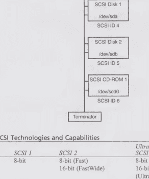

## 表 8.4 SCSI 技术和功能

|  | SCSI 1 | SCSI 2 | Ultra SCSI | Ultra2 SCSI |
|---|---|---|---|---|
| 总线宽度 | 8-bit | 8-bit (Fast)
16-bit (FastWide) | 8-bit (Ultra)
16-bit (UltraWide) | 16-bit |
| 数据传输速率 | 10MB/sec | 10MB/sec (Fast)
20MB/sec (FastWide) | 20MB/sec (Ultra)
40MB/sec (UltraWide) | 80MB/sec |
| 每通道设备数 | 7 | 7 (Fast)
15 (FastWide) | 7 (Ultra)
15 (UltraWide) | 15 |

## 选择控制器

在决定在系统中使用 SCSI 驱动器后要做出的第一个硬件决策是选择 SCSI 主机适配器。选择哪种主机适配器最好几乎与选择操作系统本身一样是宗教之争。虽然 Linux 社区广泛使用多种控制器，但有两个品牌特别受欢迎：Mylex 和 Adaptec。Mylex（BusLogic），现由 IBM 所有，是第一批通过为其卡提供完全支持的 Linux 驱动程序而完全拥抱 Linux 的 SCSI 硬件制造商之一。由于其卡的高质量和可靠的驱动程序支持，这些卡在 Linux 下使用时高度推荐。第二受欢迎的 SCSI 卡品牌是 Adaptec——并非由于其对 Linux 的官方支持（直到最近之前根本没有），而是由于其在硬件市场上的流行。直到最近，Adaptec 才拒绝透露编写其 SCSI 卡驱动程序所需的信息。在没有这些信息的情况下，Linux 开发人员对设备进行了逆向工程，并构建了 Linux 内核中最稳定的驱动程序之一。大多数 Adaptec SCSI 主机适配器现在在 Linux 下得到很好的支持。

## 支持的 SCSI 设备

Red Hat 将硬件分为四个支持类别，从完全支持且可靠到不兼容不等。表 8.5 列出了 Red Hat 完全支持并被视为“Tier 1 支持”设备的 SCSI 设备。此列表中的控制器已由 Red Hat 测试用于 Red Hat Linux v6.0，并与操作系统完全兼容。要获取 Red Hat Linux v6.0 官方支持的 SCSI 控制器的详尽列表，请参阅“Red Hat Linux 硬件兼容性列表 for Intel/6.0。”

## 列表 8.5 Red Hat Tier 1 支持的 SCSI 控制器

Mylex（又名 BusLogic）MultiMaster 和 FlashPoint 适配器

- FlashPoint 系列 PCI 主机适配器：
- - FlashPoint LT (BT-930) Ultra SCSI-3
- - FlashPoint LT (BT-930R) Ultra SCSI-3 with RAIDPlus
- - FlashPoint LT (BT-920) Ultra SCSI-3 (BT-930 without BIOS)
- - FlashPoint DL (BT-932) Dual Channel Ultra SCSI-3
- - FlashPoint DL (BT-932R) Dual Channel Ultra SCSI-3 with RAIDPlus
- - FlashPoint LW (BT-950R) Wide Ultra SCSI-3 with RAIDPlus
- - FlashPoint DW (BT-952) Dual Channel Wide Ultra SCSI-3
- - FlashPoint DW (BT-952R) Dual Channel Wide Ultra-SCSI-3 with RAIDPlus

- MultiMaster "W" 系列主机适配器：
- - BT-948 PCI Ultra SCSI-3
- - BT-958 PCI Wide Ultra SCSI-3

## 列表 8.5 继续

BT-956D PCI Wide Differential Ultra SCSI-3;

## MultiMaster "C" 系列主机适配器：

- - BT-946C PCI Fast SCSI-2,
- - BT-956C PCI Wide Fast SCSI-2,
- - BT-956CD PCI Wide Differential Fast SCSI-2,
- - BT-445C VLB Fast SCSI-2,
- - BT-747C EISA Fast SCSI-2,
- - BT-757C EISA Wide Fast SCSI-2,
- - BT-757CD EISA Wide Differential Fast SCSI-2,
- - BT-545C ISA Fast SCSI-2,
- - BT-540CF ISA Fast SCSI-2;

## MultiMaster "S" 系列主机适配器：

- - BT-445S VLB Fast SCSI-2,
- - BT-747S EISA Fast SCSI-2,
- - BT-747D EISA Differential Fast SCSI-2,
- - BT-757S EISA Wide Fast SCSI-2,
- - BT-757D EISA Wide Differential Fast SCSI-2,
- - BT-545S ISA Fast SCSI-2,
- - BT-542D ISA Differential Fast SCSI-2,
- - BT-742A EISA SCSI-2 (742A revision H),
- - BT-542B ISA SCSI-2 (542B revision H);

## MultiMaster "A" 系列主机适配器：

- - BT-742A EISA SCSI-2 (742A revisions A - G),
- - BT-5428 ISA SCSI-2 (5428 revisions A - G);
- - some AMI FastDisk Host Adapters

## AdvanSys

ABP510, ABP5150, ABP5140, ABP5142, ABP902, ABP915, ABP920, ABP930, ABP930U, ABP930UA, ABP960, ABP960U, ABP960UA, ABP742, ABP842, ABP940, ABP940U, ABP940UA, ABP970, ABP970U, ABP940UW, ABP970UW, ABP752, ABP852, ABP950, ABP950UW, ABP980, ABP980U, ABP980UA

## Adaptec

AHA-274x - EISA, AHA-284x - VLB, AHA-29xx - PCI, AHA-394x - PCI, AHA-398x - PCI RAID,

## 列表 8.5 继续

AHA-274x, AHA-274xT, AHA-2842,
AHA-2910B, AHA-2920C, AHA-2930/U/U2,
AHA-2940/U/UW/UA/U2/U2W/U2B/U280EM,
AHA-2940D/WO/UD/UND,
AHA-2950U2/W/B,
AHA-3940/U/UW/AUM/U2W/U2B,
AHA-3950U2D, AHA-3985/U/W/UW,
AIC-777x, AIC-785x, AIC-786x,
AIC-787x, AIC-788x, AIC-789x,
AIC-3860

### ICP 磁盘阵列控制器

GDT6111RP, GDT6121RP, GDT6511RP, GDT6521RP, GDT5117RP, GDT6127RP,
GDT6517RP, GDT6527RP, GDT6537RP, GDT6557RP

> **注意**
>
> 许多其他 SCSI 适配器作为 Tier 2 或 Tier 3 支持设备，或通过第三方补丁得到支持。请查阅 Red Hat 网站以获取最新的硬件兼容性信息。

## 布线要求

SCSI 布线问题是安装 SCSI 系统时问题的头号原因。购买高质量 SCSI 电缆并确保连接电缆时遵循 SCSI 规范所增加的费用是值得的。不同 SCSI 技术之间的 SCSI 布线要求差异很大。请查阅 SCSI 适配器的用户手册，以确保您的 SCSI 电缆质量足够且符合卡片的要求。这些要求包括 SCSI 链缆线的最大长度、链上设备的最大数量以及所需的终止类型（见表 8.6）。连接外部 SCSI 设备到链时，电缆的最大长度变得更加重要。

**表 8.6 各种 SCSI 技术的最大电缆长度**

| 技术 | 速度 | 被动终止 | 主动终止 |
|---|---|---|---|
| SCSI 2 | 10MB/sec | 3m | 25m |
| Ultra | 20MB/sec | 1.5m | 25m |
| Ultra2 | 40MB/sec | n/a | 12m |

> **注意**
>
> Ultra2 SCSI 标准规定 Ultra2 SCSI 链只能使用主动终止。

## 设备终止和 SCSI ID

如果布线问题是最可能的 SCSI 问题原因，那么 SCSI 设备终止和 ID 设置紧随其后。花时间正确设置设备编号并正确终止 SCSI 总线将消除未来大量故障排除的需要。

SCSI 终止和 SCSI 设备编号其实相当简单。SCSI 使用一种总线架构，贯穿所有 SCSI 设备和主机适配器。此总线之前被称为 SCSI 链或 SCSI 通道。总线通常由一根 SCSI 电缆（或几根菊花链连接的电缆）组成，一端用被动（或主动）终结器终止，另一端连接到 SCSI 主机适配器，中间连接到所有设备。每个 SCSI 设备都有一个 SCSI ID，可将其与链上其他设备区分开。由于设备 ID 设置在设备本身上，硬件技术人员必须确保每个设备都设置为唯一的 SCSI ID。不同设备设置 SCSI ID 的方法不同，但 ID 范围为窄 SCSI 的 0 到 7，宽 SCSI 的 0 到 15。通常，SCSI 控制器本身配置为 SCSI ID 7，将其他 ID 留给设备使用。SCSI ID 的顺序通常表示设备的启动顺序，以及设备文件的命名（例如 sda 等）。

## 被动和主动 SCSI 终结器

SCSI 终止是必需的，以防止 SCSI 总线两端出现反射。SCSI 终结器可以有两种形式：被动或主动。被动终结器由一对电阻组成，用来结束总线。主动终结器由一对电阻组成，这些电阻连接到一个公共的稳压电源。表 8.6 中不同 SCSI 技术允许的 SCSI 总线长度的差异显示了选择哪种类型的终结器如何影响链的能力。一些设备可能提供内部自动终止功能，从而消除外部终止的需求。由于这种自动终止因设备而异，并且可能与所有 SCSI 主机适配器不完全兼容，请在启用此功能之前查阅您的用户手册。

一旦确定了布线要求，就需要将驱动器相互连接并连接到主机适配器以形成 SCSI 链。内部设备（主服务器机箱内的设备）通常使用一根长的 SCSI 平带电缆连接，一端有终结器，另一端是主机适配器（参见图 8.2）。外部设备可能更复杂一些，因为它们通常以菊花链方式连接，并在最后一个 SCSI 设备机箱处终止（见图 8.3）。请注意，大容量 SCSI 设备机箱，尤其是硬件 RAID 机箱，通常在内部终止，不需要额外终止。请查阅设备机箱用户手册以了解硬件的具体要求。

Figure 8.3
外部 SCSI 设备的菊花链连接。

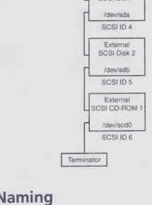

## SCSI 设备命名

SCSI 磁盘设备使用与 IDE 磁盘类似的命名方案。所有 SCSI 磁盘设备都以前缀 sd（SCSI 磁盘）开头，并存储在 /dev 目录中。

Red Hat Linux v6.0 已在 /dev 目录中预先创建了 256 个 SCSI 设备文件（前 16 个 SCSI 磁盘）。设备名称的下一部分指的是设备文件所指的物理驱动器设备。对于大于 26 的磁盘编号，使用两个字母来指定物理磁盘（sdaa、sdab 等，直到 sddx）。通常，SCSI 链上的第一个磁盘设备是 sda，第二个是 sdb，以此类推。与 IDE 设备一样，SCSI 设备的特定分区是通过在设备文件名后附加分区号来指定的（例如，/dev/sda4 是第一个 SCSI 磁盘的第四个分区）。每个 SCSI 设备最多可有 15 个分区（编号为 1-15）。

与 IDE CD-ROM 设备不同，SCSI CD-ROM 设备遵循与 SCSI 硬盘略有不同的命名约定。SCSI CD-ROM 以前缀 scd 表示，后跟 CD-ROM 驱动器编号（例如，/dev/scd0 是第一个 SCSI CD-ROM 设备）。CD-ROM 文件系统没有分区，因此设备名称后不附加分区号。请注意，在某些较旧的 Linux 系统上，SCSI CD-ROM 的设备前缀是 sr。

由于每个控制器上的 SCSI 控制器可能有多个通道，并且系统可以放置多个 SCSI 控制器，因此 Linux 支持多达 128 个 SCSI 设备。如果您需要比 /dev 目录中当前创建的更多的设备文件，请按照表 8.7 确定要创建设备的设备主号和次号。您可以使用 mknod(1) 命令创建这些设备（有关更多信息，请参阅第 4 章）。整个磁盘设备（即 sda）的设备次号由表中列出的数字决定（例如，sda 为 0，sdc 为 32，以此类推）。指定分区的设备文件（即 sda1）的次号是通过将分区号（1-15）加到该磁盘的次号上确定的（例如，sda1 为 1，sdb1 为 17）。

**表 8.7 大量磁盘的 SCSI 磁盘设备命名**

| 磁盘设备 | 设备文件名 | 设备主号 | 设备次号 |
|---|---|---|---|
| 0-15 | sda - sdp | 8 | 0, 16, 32, ..., 240 |
| 16-31 | sdq - sdf | 65 | 0, 16, 32, ..., 240 |
| 32-47 | sdaq - sdav | 66 | 0, 16, 32, ..., 240 |
| 48-63 | sdaw - sdb1 | 67 | 0, 16, 32, ..., 240 |
| 64-79 | sdbm - sdbc | 68 | 0, 16, 32, ..., 240 |
| 80-95 | sdcc - sdcr | 69 | 0, 16, 32, ..., 240 |
| 96-111 | sdcs - sddh | 70 | 0, 16, 32, ..., 240 |
| 112-127 | sddi - sddx | 71 | 0, 16, 32, ..., 240 |

其他类型的 SCSI 设备（扫描仪、磁带驱动器、媒体更换器、RAID 阵列等）在 Linux 下也得到支持，但使用不同的设备命名约定。有关更多信息，请查阅内核文档或 Red Hat 在线帮助。其他设备在下一节中讨论。

## 其他设备

随着时间的推移，您的存储需求可能会增加。尽管 SCSI 是当前服务器存储的主导技术，但 Fibre Channel 很可能在长期内取代 SCSI。Fibre Channel 存储通常部署在存储区域网络（SAN）中，是一种千兆互连技术，可为超大规模存储需求提供存储容量。目前，Red Hat Linux 官方不支持任何 Fibre Channel 设备。然而，作为 GFS 项目的一部分，提供了几个不受支持的 Fibre Channel 主机适配器驱动程序（http://www.globalfilesystem.com）。随着该技术在服务器级硬件中变得更加普及，这些设备的支持将会增加。

SCSI 技术也有进步，导致实现了符合 Ultra3 SCSI 标准的卡。Adaptec 已经有一个受 Linux 支持的产品，称为 Ultra160/m，提供高达 160MB/秒的传输速率，并包括确保 SCSI 数据传输可靠性的多项改进。

## 摘要

本章讨论了在 Red Hat Linux 系统上管理存储的细节。涵盖了 IDE 和 SCSI 接口及其配置的细节。请记住，存储需求只会随着时间的推移而增加——请确保添加尽可能多的容量磁盘。通过掌握本章中的磁盘配置信息，添加（或更换）硬盘存储变得成为服务器维护的一个简单组成部分。


### Linux 与 RAID

### 本章内容

- Linux RAID 支持的历史 228
- RAID 概述 228
- Linux 软件 RAID 234
- 硬件 RAID 与 Linux 266
- 其他信息来源 269

任何现代操作系统作为服务器使用所需的功能之一是对廉价磁盘冗余阵列（Redundant Arrays of Inexpensive Disks，简称 RAID）的支持。Red Hat Linux 也不例外，RAID 在 Linux 下通过软件和硬件两种方式得到支持。

本章首先概述 RAID 概念。然后描述 Linux 软件 RAID，包括对 RAID 工具的介绍以及在根文件系统上使用 RAID 的部分。最后，介绍 Linux 对硬件 RAID 控制器的支持，包括向内核添加对其支持所需的配置选项。

## Linux RAID 支持的历史

软件 RAID 支持首次于 1996 年 2 月随内核版本 1.3.69 的发布被纳入 Linux 内核。该支持由 Marc Zyngier 编写，当时支持仅限于线性模式 md 设备（通常称为串联驱动器）和 RAID 级别 0，即条带化。不久之后，Gadi Oxman、Ingo Molnar、Miguel de Icaza 等人开始进行支持更多软件 RAID 级别的工作，并在 1997 年 11 月，将对 RAID 级别 1、4 和 5 的支持添加到 2.1.63 开发内核版本中。该支持最终于 1998 年 7 月被回溯移植到 2.0.x 稳定发布分支，当时被添加到 2.0.35 内核版本中。Linux 还以对 RAID 控制器以及连接到 SCSI 或 IDE 控制器甚至并行端口的 RAID 设备的支持形式支持硬件 RAID。

## RAID 概述

在讨论 Linux 软件和硬件 RAID 的细节之前，了解 RAID 是什么以及为什么要使用它至关重要。RAID 最早在题为“廉价磁盘冗余阵列（RAID）案例”的论文中被描述，该论文由加州大学伯克利分校的 Patterson、Garth 和 Katz 于 1987 年发表。自引入以来，RAID 已在硬件和软件中实现，或两者结合。1987 年 RAID 论文中描述了 RAID 的三个主要目标。这些是数据存储成本降低、性能提高和可靠性提高。让我们检查每个目标以及 RAID 如何实现它们。

### RAID 的目标

第一个目标是为大量存储空间降低成本。重要的是要记住，在 1987 年 RAID 论文撰写时，大型文件系统通常使用单个、大型且昂贵的磁盘（SLEDs）实现，这些磁盘专属于每个硬件制造商。相比之下，你可以用个人电脑中使用的商品化驱动器等形式以更低的成本购买等量的存储。降低成本的目标是通过使用这些廉价的商品化驱动器代替 SLEDs 实现的。由于专有磁盘驱动器子系统的使用已不再普遍，尤其是在 PC 市场，RAID 这个缩写现在通常被定义为独立磁盘冗余阵列，而不是廉价磁盘冗余阵列。此外，随着硬盘成本的下降以及大容量驱动器和小容量驱动器每兆字节成本差异不大，成本通常不是决定是否实施 RAID 存储解决方案的重要考虑因素。

可靠性，或更准确地说，数据可用性，是 RAID 实现的另一个目标。可靠性通过在阵列上与数据一起存储数据的多个副本、奇偶校验信息或校验和来实现，具体方法由所实现的 RAID 级别决定。例如，在 RAID 级别 1 实现中，通过镜像方案实现冗余，其中数据在构成 RAID 阵列的各个磁盘上的多个位置被复制。在 RAID 级别 2、3、4 和 5 的实现中，使用存储在 RAID 设备上的可用于在发生故障时重建丢失数据的奇偶校验或校验和数据。数据可用性的要求通常是决定使用 RAID 存储阵列的主要因素。可靠性的其他方面包括 RAID 阵列在磁盘故障时自动纠正自身的能力，以及诸如热插拔失败磁盘之类的 RAID 功能。*热插拔*指的是无需关闭系统即可从阵列中移除磁盘的能力。

RAID 论文中描述的最后一个目标是性能。通过利用阵列中独立驱动器的主轴和读写磁头数量的增加以及控制器机制，可以实现更好的性能。RAID 实现中常见的其他性能措施包括缓存机制或算法以及输入/输出优化，以利用多个控制器和读写磁头。

例如，RAID 级别 1 的实现。该 RAID 级别通过将所有数据两次写入阵列来实现冗余，一次写入数据磁盘，一次写入镜像磁盘。由于数据存储在两个或多个物理设备集上，当读取数据时，所有物理设备上的读磁头可同时用于读取数据块。这是否重要取决于硬件或软件实现的有效性。然而，由于计算奇偶校验或校验和信息开销，或为实现冗余而使用的多次写入，使用 RAID 并非总是能实现性能增强。在硬件 RAID 解决方案中，这通常通过板载缓存内存和缓存方案（如写回缓存）来解决。在软件 RAID 中，驱动程序作者有责任尽可能优化输入/输出功能，以利用可用机制和操作系统功能。可能影响性能的其他因素包括条带大小、文件系统块大小以及使用 RAID 的应用程序的读写特性。与可靠性一样，RAID 性能通常是在决定实施 RAID 存储解决方案时需要考虑的重要因素。

### RAID 级别

使用的 RAID 级别的选择取决于这三个目标中每个目标对你的重要性。每个 RAID 级别都有其独特的优点和缺点，你在决定使用哪个时必须考虑。这部分描述了每个级别的特征以及其可能适用的应用。它还查看了每个 RAID 级别的某些优点和缺点。

1987 年 RAID 论文中定义的真正的最低 RAID 级别是 RAID 级别 1，通常称为镜像（参见图 9.1）。在镜像方案中，需要两个或更多存储容量相等的磁盘集，这使得该 RAID 级别在磁盘硬件方面最昂贵。

例如，如果你想要一个 8Gb 的文件系统并带有一个镜像（总共两个磁盘集），你需要 16Gb 的原始磁盘空间。这是 RAID 级别 1 的缺点之一。另一个缺点是写入镜像的写入速度。当发生写入时，RAID 子系统会使数据冗余写入，以便数据在每个磁盘集上被镜像或复制。这意味着在单向镜像中，应用程序的每次写入会导致 RAID 子系统进行两次写入。在多向镜像中，应用程序的每次写入会导致 RAID 子系统进行 N 次写入，其中 N 为镜像数加一。然而，读操作通常会得到改善，因为对数据的多个请求可以从任何磁盘集读取，这意味着在单向镜像中读取性能可以提高两倍，或在 N 向镜像中提高 N 加一倍。该方案还使故障情况下的恢复变得非常简单，因为恢复所需的一切就是将数据从未损坏的磁盘集复制到发生故障的磁盘集。

RAID 级别 1 是在软件中实现的最简单的 RAID 形式，除了能够进行失败磁盘的热交换之外。实现该 RAID 级别最佳的方法是使用能够进行并行读写并包含缓存机制以减少写入惩罚的硬件。镜像非常适合任何需要极高可用性的应用程序，例如工资单、会计和其他金融应用程序。Linux 软件 RAID 驱动程序支持 RAID 级别 1，大多数硬件 RAID 控制器也支持该级别的 RAID。参见图 9.1 以了解 1 向镜像的概念图。


## 图 9.1

RAID 1 级阵列（又称 1 路镜像）。

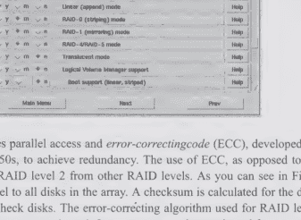

RAID 2 级利用并行访问和由 R. W. Hamming 在 1950 年代开发的纠错码（ECC）来实现冗余。与奇偶校验相比，使用 ECC 是 RAID 2 级与其他 RAID 级别不同的原因。如图 9.2 所示，数据会并行发送到阵列中的所有磁盘。数据的校验和会被计算出来并存储在多个校验磁盘上。RAID 2 级使用的纠错算法最初是为纠正大型机内存中的错误而开发的，后来被改编用于 RAID。由于多种原因，该 RAID 级别很少被实现，其中最主要的原因是大多数现代磁盘都实现了硬件级 ECC，使得 RAID 2 级的安全性与始终干净关闭的带电池备份的文件系统相差无几。该 RAID 级别最适合于顺序访问大量数据的应用，例如科学数据分析。Linux 软件 RAID 不支持 RAID 2 级。Linux 硬件对 RAID 2 级的支持取决于所选的控制器或外部 RAID 设备。

## 图 9.2

RAID 2 级阵列。

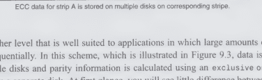

条带 A 的 ECC 数据存储在对应条带的多个磁盘上。

RAID 3 级是另一个非常适合顺序访问大量数据的应用的级别。在该方案中，如图 9.3 所示，数据被条带化到多个磁盘上，并使用异或函数计算奇偶校验信息并存储在单独的磁盘上。初看之下，RAID 3 级和 RAID 4 级之间几乎没有区别。两者主要区别在于，RAID 3 级使用最小可能的条带大小，这抵消了多输入/输出操作的优势，并且 RAID 3 级要求驱动器主轴同步。这一最后的要求是该 RAID 级别很少被实现的原因之一。现代驱动器缺乏主轴同步功能。与 RAID 2 级类似，级别 3 最适合于顺序访问大量数据的应用，例如科学数据分析。与 RAID 2 级类似，Linux 软件 RAID 未实现 RAID 3 级，且该级别的硬件支持取决于所选硬件。

## 图 9.3
RAID 3 级或 4 级阵列

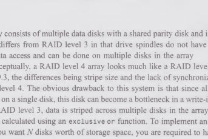

RAID 4 级阵列由多个数据磁盘和一个共享的奇偶校验磁盘组成，与 RAID 3 级类似。它与 RAID 3 级的不同之处在于驱动器主轴无需同步，并且可以在阵列中的多个磁盘上同时进行数据访问。从概念上讲，RAID 4 级阵列看起来与图 9.3 所示的 RAID 3 级阵列非常相似，其区别在于条带大小以及 RAID 4 级中驱动器缺乏同步。该系统的明显缺点是，由于所有奇偶校验信息都存储在单个磁盘上，该磁盘在写入密集型环境中可能成为瓶颈。与 RAID 3 级类似，数据在阵列中的多个磁盘上进行条带化，奇偶校验信息使用异或函数计算。要实现这种类型的阵列，如果你想要 N 个磁盘的存储空间，则需要在阵列中拥有 N+1 个磁盘。RAID 4 级的可靠性与镜像相当，但由于硬件要求较低，在许多情况下更受青睐。RAID 4 级最适合不经常更新但经常读取的数据，有时用于满足此标准的数据库环境。RAID 4 级由 Linux 软件 RAID 实现的 RAID 5 模块支持。

最灵活的 RAID 级别之一是 RAID 5 级。如图 9.4 所示，RAID 5 级阵列像 RAID 4 级一样将数据存储在多个磁盘上，但重建失败阵列所需的奇偶校验信息分布在多个磁盘上，从而消除了单个奇偶校验磁盘瓶颈。该 RAID 级别非常适合可靠性至关重要的许多不同应用，但速度会受到影响，并且重建可能非常复杂。与 RAID 1 级一样，良好的 RAID 5 级实现需要高效的缓存来抵消向阵列写入数据所需的时间。RAID 5 级的推荐用途包括数据库服务器、文件和应用服务器以及互联网服务器，例如新闻、电子邮件和 Web 服务器。Linux 支持 RAID 5 级的软件和硬件实现。

## 图 9.4

RAID 5 级阵列。

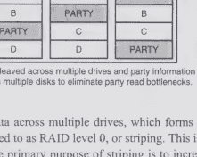

数据在多个驱动器之间交错，奇偶校验信息存储在多个磁盘上以消除奇偶校验读取瓶颈。

将数据在多个驱动器之间交错的想法构成了其他 RAID 级别的基础，被称为 RAID 0 级或条带化。这并不是真正的 RAID，因为没有冗余。条带化的主要目的是提高性能。阵列中的磁盘被分成块（如图 9.5 所示），数据以这样的方式写入：连续的数据块存储在多个磁盘上。对阵列的读写非常快，因为它们可以并行执行，同时利用阵列中的多个磁盘。将数据条带化到多个磁盘上的这一想法是 RAID 的性能特性之一，也是所有其他 RAID 级别的基础，但本身并不能提高可靠性。

## 图 9.5

RAID 0 级（又称条带化）。

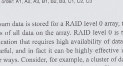

数据写入顺序：A1、A2、A3、B1、B2、B3、C1、C2、C3

由于 RAID 0 级阵列不存储奇偶校验或校验和数据，阵列中磁盘的丢失会导致阵列上所有数据的丢失。因此，RAID 0 级不推荐用于任何需要数据高可用性的应用。这并不意味着 RAID 0 级没有用，事实上，在通过其他方式实现冗余的应用中，它可能非常有效。例如，考虑一个数据库主机集群，所有主机都包含相同的数据。可以在包含数据库表的文件系统上使用 RAID 0 级来提高性能，同时通过集群中每个主机的复制来实现冗余。RAID 0 级阵列的一些常见用途是捕获流数据或需要非常高带宽的应用，如视频编辑和制作或图像处理。RAID 0 级是 Linux 软件 RAID 中实现的最早的 RAID 级别之一。

未在伯克利 RAID 论文中描述的其他 RAID 级别也有可用，包括硬件 RAID 中对镜像集的条带化支持，有时称为 RAID 10 级，以及对条带化集的镜像支持，也称为 RAID 0/1。这些 RAID 级别的组合是非标准的，而且命名约定因厂商而异。Linux 软件 RAID 仅支持其中一种非标准 RAID 级别，即条带化阵列的镜像。这些组合可用于提高性能和可靠性。

## Linux 软件 RAID

Linux 开发人员从 1994 年开始着手实现软件 RAID，当时有两个独立的项目。这两个项目都始于将多个物理设备连接成单个逻辑设备的简单愿望。存活下来的那个被称为多设备驱动程序，或 md 驱动程序。md 驱动程序经过多次修订，并在 1996 年 2 月随着内核 1.3.69 的发布而成为开发内核源代码树的一部分。此时，实现了两种模式：线性模式和真正的软件 RAID。

线性模式允许将多个物理驱动器连接成单个逻辑驱动器，并且由于磁盘不是并行访问，因此没有性能提升。线性模式的唯一目的是将多个物理设备附加到单个逻辑设备以允许更大的文件系统。此版本还实现了 RAID 0 级或条带化，这可以大大提高性能，但不能提高可靠性。

此后不久，另一组开发人员开始使用 md 驱动程序作为起点实现真正的软件 RAID。来自稳定内核分支 2.2 的当前 Linux 内核支持软件 RAID 级别 0、1、4 和 5，可以构建到内核中或作为动态模块加载。随着 Red Hat 6.0 的发布，Linux 的 RAID 支持得到了极大改进，包括内核能够利用空闲 CPU 周期和在创建 RAID 阵列时添加到 RAID 阵列的备用磁盘来重建损坏的阵列。它还包括内核在启动时自动检测 RAID 阵列的能力，以及在运行的 RAID 阵列中添加和删除物理设备的能力。本节描述了创建和管理软件 RAID 阵列所需的 RAID 工具，并讨论了如何实现 Linux 软件 RAID 驱动程序支持的每个 RAID 级别。


## RAID 工具

Red Hat Linux 6.0 中可用的 RAID 支持并非原版内核中的支持。Red Hat 已将 RAID 软件驱动程序和 RAID 工具升级为比原始内核源代码中当前所见更新的版本。

> **Note**
> 
> 若要查看应用到原始 Linux 源代码树上的完整补丁集，请检查内核的源 RPM。 要安装此 SRPM，请在 Red Hat FTP 站点或随 Red Hat 发行版提供的 SRPM CD-ROM 上查找 `kernel-2.2.5-15.src.rpm`。 安装此 RPM 后，您可以通过查看 `/usr/src/redhat/SOURCES` 目录来检查应用的所有内核补丁。

Red Hat Linux 随附 RAID 工具的 0.90 版本。 这些命令与前辈相比有显著不同，并包含支持内核源代码中提供的更新 RAID 驱动程序所提供的额外功能所需的特性。 RAID 命令集位于 `/sbin` 目录中，由表 9.1 中的工具组成。

### 表 9.1 RAID 命令及其功能

| 命令 | 功能 |
|---|---|
| mkraid | 初始化 RAID 设备阵列 |
| raidstart | 在内核中配置 RAID 设备并激活它们 |
| raidhotadd | 向正在运行的 RAID 阵列添加备用设备 |
| raidhotremove | 从正在运行的 RAID 阵列中移除设备 |
| raidstop | 取消配置 RAID 设备阵列 |

要考虑的第一个命令是 `mkraid` 命令。 `mkraid` 命令用于初始化 RAID 设备，适用于 Linux 软件 RAID 驱动程序支持的所有 RAID 级别。 `mkraid` 命令在功能上类似于用于创建文件系统的 `mkfs` 命令，因为它是为 RAID 阵列准备接收数据的第一步。 在正常使用中，此命令仅在创建 RAID 阵列期间使用，因为与 `mkfs` 命令一样，此命令会破坏 RAID 阵列上的数据。 它从配置文件中读取，要么是你使用 `-c` 命令行选项指定的文件，要么是默认的 `/etc/raidtab`，以确定每个 RAID 设备的具体信息。 `mkraid` 命令的选项在手册页和表 9.2 中描述。

### 表 9.2 mkraid 的命令行选项

| 选项 | 描述 |
|---|---|
| -v, --version | 显示简短的版本信息，然后退出。 |
| -h, --help | 显示用法说明。 |
| -c, --configfile file | 使用 file 作为配置文件，而不是 /etc/raidtab。 |
| -f, --force | 即使阵列似乎已初始化，也初始化阵列。 |
| -o, --update | 而不是初始化阵列中的每个设备，此选项会使 mkraid 将存储在 RAID 阵列上的版本信息更新为当前内核的版本，尽管它是非破坏性的，但仍应谨慎使用。 |

在描述 RAID 工具集的其他命令之前，让我们检查 RAID 配置文件 /etc/raidtab。 raidtab 段包括 RAID 级别、构成阵列的分区数量和名称，以及取决于所实现 RAID 级别的其他必需信息。 /etc/raidtab 文件格式的详细说明可在本章后面找到，并附有软件 RAID 驱动程序支持的每个 RAID 级别的示例。 你必须根据 raidtab 手册页和表 9.3 中描述的严格语法创建此配置文件。

### 表 9.3 /etc/raidtab 关键字及其含义

| 关键字 | 含义 |
|---|---|
| raiddev device | 此行在 RAID 配置文件中开始一个段落，并指定分配给 RAID 的设备名称。 |
| raid-level integer | 分配给此关键字的整数值指定当前 raiddev 的 RAID 级别。可用的值有 -1、0、1、4 和 5，分别对应 linear、RAID-0、RAID-1、RAID-4 和 RAID-5。线性模式也可以使用单词 linear 而不是整数值来指定。 |
| nr-raid-disks count | 阵列中的磁盘分区数。 |
| nr-spare-disks count | 阵列中可由内核在损坏阵列的自动重建中使用备用磁盘的数量。 |
| device device file | 要添加到阵列的设备文件名称。每个定义的 RAID 阵列将有多个 device 条目。device 条目的数量必须等于 nr-raid-disks 参数给出的数量。 |
| raid-disk index | 从 0 开始，最近定义的设备在活动磁盘阵列中的位置。 |
| spare-disk index | 从 0 开始，最近定义的设备在备用磁盘阵列中的位置。 |
| parity-disk index | 从 0 开始，最近定义的设备在奇偶校验磁盘阵列中的位置。 |

### 表 9.3 继续

| 关键字 | 含义 |
|---|---|
| parity-algorithm which | 当前阵列使用的 RAID 级别 5 奇偶校验算法。此参数的可能值为 left-asymmetric、right-asymmetric、left-symmetric 或 right-symmetric。 |
| chunk-size size | 条带的 K 字节大小。 |
| persistent-superblock bool | 如果设置为 1，则会在阵列中的每个物理设备上写入一个特殊超级块，内核读取它而不是 /etc/raidtab 文件来配置 RAID 设备。如果希望能够从 RAID 设备启动，则需要值为 1。 |

与 RAID 工具集的早期版本不同，Red Hat 6.0 中包含的 RAID 工具不包含 ckraid 命令。 此命令以前是必需的，用于检查 RAID 设备阵列中的不一致并选择性地纠正。 此功能现在由内核线程处理，该线程使用空闲 CPU 周期对配置的 RAID 设备执行任何所需的更正。 重建状态现在通过检查 /proc/mdstat 文件来确定。

我们将要介绍的下一个命令统称为 RAID 管理实用程序。 这些命令适用于所有 RAID 级别，包括线性模式和 RAID 级别 0 阵列。 这些命令是 raidstart、raidhotadd、raidhotremove 和 raidstop。 实际上它们都是同一个命令，raidhotadd、raidhotremove 和 raidstop 只是 raidstart 命令的链接。 通过以不同的名称调用此命令，可以实现不同的功能。

### 注意

创建 RAID 设备阵列取决于两件事。 其中之一是内核中的 RAID 驱动程序支持，另一个是 /dev 中的适当设备文件。 md 设备的 major 号码为 9，minor 号码从 0 开始，并为每个 RAID 设备递增 1。 如果你的 /dev 目录中没有设备条目，这里是创建 md 设备驱动程序支持的默认四个 md 设备所需的命令：

```
/sbin/mknod b 9 0 /dev/md0
/sbin/mknod b 9 1 /dev/md1
/sbin/mknod b 9 2 /dev/md2
/sbin/mknod b 9 3 /dev/md3
```

虽然你可以配置你创建的任何 RAID 设备以便在启动序列期间由内核自动检测，但如果你愿意，也可以手动启动和停止它们。 你可能希望手动启动 RAID 阵列以缩短系统启动所需的时间。 此外，你可能需要在启动某些其他系统软件之前确保 RAID 完全功能。 你可能还希望即使 RAID 失败也能继续启动系统。

要手动启动 RAID 阵列，你将使用 raidstart 命令。 此命令检查 RAID 配置文件，如果提供了 -a 选项，它将激活其中描述的所有 RAID 设备。 如果没有 -a 选项，你需要指定一个对应于你想要启动的阵列的设备文件。 此一个命令取代了旧 RAID 工具集中的 raidadd 和 raidrun 命令。 你必须在 RAID 阵列上创建文件系统或交换设备、挂载现有文件系统或以任何方式访问阵列上的文件系统或交换设备之前执行 raidstart 命令。 该套件中的相反命令是 raidstop 命令，它使 RAID 阵列中的驱动器非激活并在内核中取消配置它们。 你应该仅在阵列上的所有打开文件已关闭并且 RAID 设备已卸载后才运行此命令。 这两个命令都读取默认配置文件 /etc/raidtab 或使用 -c 选项指定的配置文件。 这些命令可用的完整选项集在 raidstart 手册页和表 9.4 中描述。

### 表 9.4 raidstart 的命令行选项

| 选项 | 描述 |
|---|---|
| -a, --all | 对配置文件中指定的所有设备运行命令。 |
| -c, --configfile file | 使用 file 作为配置文件。默认值为 /etc/raidtab。 |
| -h, --help | 显示简短的用法说明然后退出。 |
| -V, --version | 显示 RAID 工具的版本号然后退出。 |

RAID 管理命令集中的另外两个命令是 raidhotadd 和 raidhotremove。 这些命令用于向正在运行的阵列添加或移除物理设备。 这允许向阵列添加备用磁盘并从阵列中移除死磁盘。 如前所述，这些命令实际上只是 raidstart 命令的链接，因此从 RAID 配置文件中读取所需的信息。


## 警告

对 RAID 数组的热重建支持是一个新功能，根据作者所述，其仍非生产级别代码。强烈建议在利用这些命令为关键数据创建存储之前，先进行实验以确定阵列的稳定性。并且一如既往，保持良好的备份。

现在 RAID 数组的命令已经介绍完毕，我们可以开始了解创建 Linux 内核支持的各种类型 RAID 数组所需的内容。我们将从线性 md 设备和 RAID 0 级数组开始，然后再进行更复杂的 RAID 级别。

## 支持的 RAID 级别

创建 RAID 数组要求内核支持 md 设备驱动程序和适当的 RAID 级别驱动程序。此支持可以编译到内核中，也可以作为可根据需要加载和卸载的模块构建。为本次讨论的目的，假设您已将 md 驱动程序代码编译到内核中，并将各种 RAID 级别代码构建为可动态加载的内核模块。本节展示了创建每种类型数组所需的 RAID 配置文件中相应条目的示例。

让我们从线性 md 数组开始。构建线性数组时首先要考虑的是构成数组的分区。线性数组的正常用途是将多个小磁盘组合起来创建足够有用的存储空间。这通常意味着每个驱动器上有一个使用整个磁盘的分区，或者您将多个小分区组合成一个更大的分区。在下面的示例中，我们将系统中的第一个 SCSI 驱动器上创建其他文件系统后剩余的小分区与另外两个小型 SCSI 驱动器组合起来。以下是 /etc/raidtab 中的示例条目：

```
raiddev       /dev/md0
raid-level     linear
nr-raid-disks  3
nr-spare-disks 0
chunk-size     4
device         /dev/sda3
raid-disk      0
device         /dev/sdb1
raid-disk      1
device      /dev/sdc1
raid-disk   2
```

线性设备只是多个设备的简单连接，并按顺序访问。如果像示例中那样将设备 /dev/sda3、/dev/sdb1 和 /dev/sdc1 添加到数组中，数据将写入 /dev/sda3 直到填满，然后继续写入 /dev/sdb1 直到所有数据写入完毕。有些人会声称使用线性数组有性能优势，但由于 ext2 文件系统的特性，其设计目的是避免文件碎片，因此这些说法最多也只是值得怀疑。使用线性设备的最大缺点是它们实际上增加了数据丢失的可能性，因为任何一个组件磁盘驱动器的丢失都会导致数组上所有数据的丢失。因此，通常不建议使用线性数组来存储关键数据。线性数组的一个好用途是创建镜像数组的组件部分。例如，如果您有两个 100Mb 磁盘和一个 200Mb 磁盘，您可以将两个 100Mb 磁盘组合成线性数组，并将结果设备用作 200Mb 磁盘的镜像。

> **注意**
> 
> 您会注意到线性 md 数组的示例条目中指定了 chunk-size。这与 raid 工具的文档相矛盾。然而，未指定 chunk-size 将导致无法创建数组。

下一个示例是 RAID 0 级数组。此类数组的 raidtab 条目与线性数组非常相似。唯一的区别是您必须将 raid-level 指定为 0 而不是 -1，并且必须提供 chunk-size 参数。在 RAID 0 级数组中，磁盘被划分为用户指定大小的块，并且写入在数组中的所有磁盘上交错进行，从而带来性能优势。这种性能优势源于数组中所有驱动器的读写磁头可以并行使用。这种性能优势的程度取决于许多因素，包括在数组上创建的文件系统的块大小、读写数据的应用程序的输入/输出特性以及所选的块大小。

> **注意**
> 
> 如果数组由同一硬盘的多个分区组成，则无法实现 RAID 0 级数组的性能优势。优势来自于能够同时使用多个磁盘驱动器的磁头。

以下是使用三个磁盘分区在 /etc/raidtab 中 RAID 0 级数组的示例条目：

```
raiddev    /dev/md0
raid-level 0
nr-raid-disks 3
chunk-size 64
device     /dev/sdb1
raid-disk 0
device     /dev/sdc1
raid-disk 1
device     /dev/sdd1
raid-disk 2
```

## 注意

> 由于条带化方式的原因，希望 RAID 0 级数组的组件部分具有相同的几何结构。不遵守此规则可能会影响数组的性能。例如，假设您使用 /dev/sda2 上的 100Mb 分区和 /dev/sdb1 上的 150Mb 分区创建 RAID 0 级数组。在这种情况下，所有空间将被划分为用户指定的条带大小，并且对结果 250Mb 数组中前 200Mb 的所有访问都将在两个设备之间交错，从而提高性能。对数组最后 50Mb 的访问物理上位于单个磁盘上，无法利用两个设备的多个读写磁头，因此与访问单个磁盘一样快。它甚至可能更慢，因为访问现在必须同时经过 RAID 代码层以及常规文件系统层。

线性设备和 RAID 0 级数组可在内核中编译了此支持的情况下用于根文件系统。

RAID 1 级数组是 Linux 软件 RAID 驱动程序支持的真正 RAID 数组的最低级别。为了创建镜像数组或 RAID 1 级数组，条目非常简单。事实上，它看起来与 RAID 0 设备的条目非常相似。以下是 /etc/raidtab 中简单单向镜像段的示例。在此示例中，只有两个磁盘。要创建 N 路镜像，您可以修改条目并简单地增加 raid 磁盘的数量和设备条目的数量。

## 注意

术语 N 路镜像指的是在不计原始数据的情况下维护 N 份数据副本的镜像。例如，4 路镜像意味着原始数据加上 4 份数据副本被维护。

由 N+1 个大小为 S 的磁盘组成的 N 路镜像中的可用空间为 S。例如，如果您使用三个 4Gb 磁盘驱动器创建双向镜像，可用空间将为 4Gb。这意味着就原始磁盘空间需求而言，RAID 1 级是最昂贵的。

```
raiddev /dev/md0
raid-level 1
nr-raid-disks 2
chunk-size 64
device /dev/sdc1
raid-disk 0
device /dev/sdd1
raid-disk 1
```

## 警告

构成镜像的设备应全部为相同大小。不遵守此规则不会影响性能，然而镜像各部分大小的差异将成为浪费的空间。

RAID 4 级数组由 RAID 5 级模块支持，并且 RAID 4 级数组与 RAID 5 级数组的 /etc/raidtab 条目之间的唯一区别是缺少 parity-algorithm 关键字。此关键字描述了奇偶校验信息如何在磁盘上存储以及奇偶校验磁盘的定义。确定大小为 S 的 RAID 4 级数组所需的物理磁盘数量的公式为 (S/N) + 1 = D。在此公式中，N 指数组中磁盘驱动器的大小，S 指所需的可用空间，D 为物理磁盘的数量。或者，要确定由五个 9Gb 磁盘组成的 RAID 4 级数组中的可用空间，您将使用公式 S = N(D-1)。将 9 代入 N，即每个磁盘的大小，将 5 代入 D，即物理磁盘的数量，我们发现 S，即可用空间，将为 9(5-1) 或 36Gb。在以下示例中，如果指定的每个设备大小均为 2Gb，则数组上可用的总空间将为 6Gb。这是一个由 4 组成的 RAID 4 级数组的示例

磁盘。在此配置中，三个设备被条带化并用于存储数据，一个用于存储奇偶校验信息，该信息是通过对条带中的数据应用异或函数计算得出的。

```
raiddev      /dev/md0
raid-level   4
nr-raid-disks 4
nr-spare-disks 0
chunk-size   64
device       /dev/sda3
raid-disk    0
device       /dev/sdb1
raid-disk    1
device       /dev/sdc1
raid-disk    2
device       /dev/sdd1
parity-disk  0
```

RAID 级别 5 数组与 RAID 级别 4 数组类似，但奇偶校验信息分布在数组中的所有磁盘上，并且计算物理设备需求的公式相同。要将之前的条目转换为 RAID 级别 5 条目，必须更改三件事。首先是 raid-level，当然应将其更改为 5。接下来是添加 parity-algorithm 关键字和值，最后是删除 parity-disk 关键字。这样条目看起来如下所示。如果 /dev/sdb1、/dev/sdc1 和 /dev/sdd1 表示的分区各为 4Gb，则该数组的总大小为 8Gb 的可用存储空间。

```
raiddev      /dev/md0
raid-level   5
nr-raid-disks 3
nr-spare-disks 0
parity-algorithm left-symmetric
chunk-size   64
device       /dev/sdb1
raid-disk    0
device       /dev/sdc1
raid-disk    1
device       /dev/sdd1
raid-disk    2
```

最复杂示例是实现由多个条带数组组成的镜像所需的示例。在此示例中，四个大小相等、为 S 的磁盘将用于创建大小为 2 * S 的数组。请注意在 /etc/raidtab 文件中声明数组的顺序。由于解析器的设计方式，此顺序至关重要。

```
raiddev    /dev/md0
raid-level 0
nr-raid-disks 2
chunk-size 64
device     /dev/sdb1
raid-disk 0
device     /dev/sdc1
raid-disk 1
```

```
raiddev    /dev/md1
raid-level 0
nr-raid-disks 2
chunk-size 64
device     /dev/sdd1
raid-disk 0
device     /dev/sde1
raid-disk 1
```

```
raiddev    /dev/md2
raid-level 1
nr-raid-disks 2
nr-spare-disks 0
chunk-size 64
device     /dev/md0
raid-disk 0
device     /dev/md1
raid-disk 1
```

## 实现软件 RAID

现在你已经了解了用于构建和管理 Linux 软件 RAID 的工具，我们可以演示其用法并实际构建一些 RAID 数组。以下示例涵盖构建 Linux 软件 RAID 数组所需的每个步骤。我们将从介绍支持 Linux 软件 RAID 所需的内核模块和选项开始。添加此内核支持后，我们将给出构建每种受支持类型的数组的具体示例。当你掌握了各个命令后，我们将把它们全部放在一起构建一个 RAID 构建脚本。

首先，让我们考虑配置任何 RAID 数组的步骤。这些步骤对于每个 RAID 级别来说基本相同。一旦我们定义了这些步骤，我们将详细讨论它们，演示构建 RAID 数组所需的特定命令。这些步骤是

- 1. 加载适当的内核模块以支持所需的 RAID 级别。
- 2. 在 `/etc/raidtab` 文件中创建适当的条目。
- 3. 向内核定义 RAID 设备。
- 4. 激活 RAID 数组。
- 5. 在数组上创建文件系统并挂载它。

第一步是加载适当的内核模块以支持所需的 RAID 级别。这意味着 RAID 支持已编译到内核中。如果不是这种情况，请继续阅读。如果你的内核已具有适当的支持，可以跳过下一段。

更改目录到内核源树的顶层，通常为 `/usr/src/linux`。使用 `make` 调用其中一个内核配置 make 目标，例如 `xconfig` 或 `menuconfig`，以开始配置内核。RAID 支持选项位于顶层菜单的块设备选项下。RAID 支持所需的支持选项是多设备驱动程序支持，该选项不能作为模块编译。一旦你选择了此选项，你就可以选择要支持的 RAID 级别。可用的选项是

- Linear (append) mode
- RAID-0 (striping) mode
- RAID-1 (mirroring) mode
- RAID-4/RAID-5 mode

所有这些都可以编译为模块，根据需要加载和卸载。但是，如果你想要线性模式或 RAID 级别 0 根分区，必须将你想要的编译到内核中，然后选择 Boot Support (linear, striped) 选项。一旦你编译并安装了新的内核，在继续执行下一步之前必须加载适当的 RAID 模块（参见图 9.6）。有关如何自定义 Linux 内核的更详细描述，请参阅第 34 章“调整你的 Linux 系统”，该章详细介绍了此主题。

## FIGURE 9.6
使用 make xconfig 的内核配置软件 RAID 选项

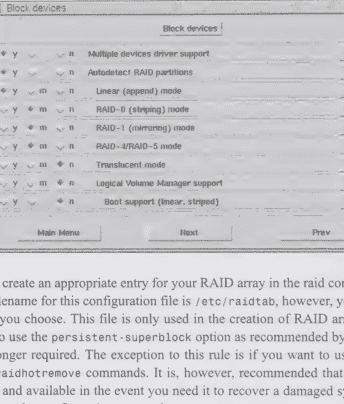

下一步是在 raid 配置文件中为你的 RAID 数组创建适当的条目。此配置文件的默认文件名是 /etc/raidtab，然而，你可以按你选择的名称调用此文件。此文件仅用于创建 RAID 数组，如果你选择了驱动程序作者推荐的 persistent-superblock 选项，则不再需要它。此规则的例外情况是如果你想使用 raidhotadd 和 raidhotremove 命令。但是，建议你保持此文件最新并可用，以防你需要恢复损坏的系统或想在另一系统上重新创建配置。

在继续下一步之前，让我们定义我们的测试系统。此测试系统是一个服务器级系统，由双处理器、1Gb RAM 和一个连接了五个 9Gb 驱动器的 SCSI 控制器组成。第一个 SCSI 驱动器保留用于操作系统安装，其余四个驱动器将用于构建 RAID 数组。

对于我们的第一个示例，我们将创建一个由两个 9Gb 驱动器 /dev/sdb 和 /dev/sdc 组成的线性 md 设备。以下是实现此目的所需的 raidtab 条目：

```
# Linear md device
raiddev       /dev/md0
raid-level    linear
nr-raid-disks 2
persistent-superblock 1
chunk-size    4
device        /dev/sdb1
raid-disk     0
device        /dev/sdc1
raid-disk     1
```

一旦创建了此条目，我们就可以为自动检测和激活准备磁盘。使用 fdisk 命令，在 /dev/sdb 和 /dev/sdc 上创建单个大分区。一旦创建这些分区，将分区类型设置为 FD。以下是使用 fdisk 在 /dev/sdb 上执行此步骤的示例会话，以及使用单个命令在 /dev/sdc 上执行相同步骤的示例会话：

```
[root@hqtest18 /root]# fdisk /dev/sdb
```

该磁盘的柱面数设置为 1106。

这没什么问题，但它大于 1024，在某些设置中可能会导致问题：

- 1) 在启动时运行的软件（例如，LILO）
- 2) 其他操作系统的启动和分区软件（例如，DOS FDISK、OS/2 FDISK）

```
Command (m for help): p

Disk /dev/sdb: 255 heads, 63 sectors, 1106 cylinders
Units = cylinders of 16065 * 512 bytes

| Device | Boot | Start | End | Blocks | Id | System |
|---|---|---|---|---|---|---|
| /dev/sdb1 |  | 1 | 1106 | 8883913+ | 83 | Linux |
```

```
Command (m for help): d
Partition number (1-4): 1

Command (m for help): n
Command action
  e   extended
  p   primary partition (1-4)
p
Partition number (1-4): 1
First cylinder (1-1106, default 1): 1
Last cylinder or +size or +sizeM or +sizeK (1-1106, default 1106): 1106
```

```
Command (m for help): p

Disk /dev/sdb: 255 heads, 63 sectors, 1106 cylinders
Units = cylinders of 16065 * 512 bytes

| Device | Boot | Start | End | Blocks | Id | System |
|---|---|---|---|---|---|---|
| /dev/sdb1 |  | 1 | 1106 | 8883913+ | 83 | Linux |
```

命令（m 获取帮助）：t
分区号（1-4）：1
十六进制代码（输入 L 列出代码）：fd
分区 1 的系统类型已更改为 fd（未知）

命令（m 获取帮助）：p

磁盘 /dev/sdb: 255 个磁头，63 个扇区，1106 个柱面
单位 = 16065 * 512 字节的柱面

| 设备 | 启动 | 开始 | 结束 | 块 | Id | 系统 |
|---|---|---|---|---|---|---|
| /dev/sdb1 |  | 1 | 1106 | 8883913+ | fd | 未知 |

命令（m 获取帮助）：w
分区表已被更改！

调用 ioctl() 重新读取分区表。
同步磁盘。

警告：如果您创建或修改了任何 DOS 6.x 分区，请参阅 fdisk 手册页以获取更多信息。

```
[root@qtest18 /root]# echo ",,fd," | sfdisk /dev/sdc
Checking that no-one is using this disk right now ...
OK
```

磁盘 /dev/sdc: 255 个磁头，63 个扇区，1106 个柱面
旧情况：
单位 = 8225280 字节的柱面，1024 字节的块，从 0 开始计数

| 设备 | 启动 | 开始 | 结束 | #cyls | #blocks | Id | 系统 |
|---|---|---|---|---|---|---|---|
| /dev/sdc1 | 0 | 1105 | 1106 | 1 | 8883944+ | fd | 未知 |
| /dev/sdc2 | 0 | - | 0 | 0 | 0 |  | 空 |
| /dev/sdc3 | 0 | - | 0 | 0 | 0 |  | 空 |
| /dev/sdc4 | 0 | - | 0 | 0 | 0 |  | 空 |

新情况：
单位 = 8225280 字节的柱面，1024 字节的块，从 0 开始计数

| 设备 | 启动 | 开始 | 结束 | #cyls | #blocks | Id | 系统 |
|---|---|---|---|---|---|---|---|
| /dev/sdc1 | 0 | 1105 | 1106 | 1 | 8883944+ | fd | 未知 |
| /dev/sdc2 | 0 | - | 0 | 0 | 0 |  | 空 |
| /dev/sdc3 | 0 | - | 0 | 0 | 0 |  | 空 |
| /dev/sdc4 | 0 | - | 0 | 0 | 0 |  | 空 |


警告：没有主分区被标记为可启动（活动）
这对 LILO 来说无关紧要，但 DOS MBR 将无法启动该磁盘。
成功写入新的分区表

重新读取分区表 ...

如果你创建或更改了 DOS 分区，例如 /dev/foo7，那么使用 dd(1) 将前 512 字节清零：dd if=/dev/zero of=/dev/foo7 bs=512 count=1
（参见 fdisk(8)。）

现在我们可以使用 mkraid 命令初始化阵列。为了本示例的目的，我们将分别创建每个设备，但请注意，如果在 /etc/raidtab 文件中定义了多个设备，可以通过指定 mkraid 命令的 --all 选项一次性全部创建。以下会话记录显示了根据上述 /etc/raidtab 条目定义的设备的创建过程，以及一些用于显示每一步效果的命令。

```
[root@hqtest8 /root]# cat /proc/mdstat
Personalities : [raid0]
read_ahead not set
unused devices: <none>

[root@hqtest8 /root]# mkraid /dev/md0
handling MD device /dev/md0
analyzing super-block
disk 0: /dev/sdb1, 8889913kB, raid superblock at 8883840kB
disk 1: /dev/sdc1, 8889913kB, raid superblock at 8883840kB

[root@hqtest8 /root]# cat /proc/mdstat
Personalities : [linear] [raid0]
read_ahead 1024 sectors
md0 : active linear sdc1[1] sdb1[0] 17767680 blocks 32k rounding
unused devices: <none>

[root@hqtest8 /root]# mke2fs -b 4096 -i 262144 /dev/md0
mke2fs 1.14, 9-Jan-1999 for EXT2 FS 0.5b, 95/08/09
Linux ext2 filesystem format
Filesystem label=
69632 inodes, 4441920 blocks
222096 blocks (5.0%) reserved for the super user
First data block=0
Block size=4096 (log=2)
Fragment size=4096 (log=2)
136 block groups
32768 blocks per group, 32768 fragments per group

512 inodes per group

Superblock backups stored on blocks:

32768, 65536, 98304, 131072, 163840, 196608, 229376, 262144, 294912, 327680, 360448, 393216, 425984, 458752, 491520, 524288, 557056, 589824, 622592, 655360, 688128, 720896, 753664, 786432, 819200, 851968, 884736, 917504, 950272, 983040, 1015808, 1048576, 1081344, 1114112, 1146880, 1179648, 1212416, 1245184, 1277952, 1310720, 1343488, 1376256, 1409024, 1441792, 1474560, 1507328, 1540096, 1572864, 1605632, 1638400, 1671168, 1703936, 1736704, 1769472, 1802240, 1835008, 1867776, 1900544, 1933312, 1966080, 1998848, 2031616, 2064384, 2097152, 2129920, 2162688, 2195456, 2228224, 2260992, 2293760, 2326528, 2359296, 2392064, 2424832, 2457600, 2490368, 2523136, 2555904, 2588672, 2621440, 2654208, 2686976, 2719744, 2752512, 2785280, 2818048, 2850816, 2883584, 2916352, 2949120, 2981888, 3014656, 3047424, 3080192, 3112960, 3145728, 3178496, 3211264, 3244032, 3276800, 3309568, 3342336, 3375104, 3407872, 3440640, 3473408, 3506176, 3538944, 3571712, 3604480, 3637248, 3670016, 3702784, 3735552, 3768320, 3801088, 3833856, 3866624, 3899392, 3932160, 3964928, 3997696, 4030464, 4063232, 4096000, 4128768, 4161536, 4194304, 4227072, 4259840, 4292608, 4325376, 4358144, 4390912, 4423680

Writing inode tables: done

Writing superblocks and filesystem accounting information: done

```
[root@hqtest18 /root]# mkdir -p /raid
[root@hqtest18 /root]# mount /dev/md0 /raid
[root@hqtest18 /root]# df
```

| 文件系统 | 1K 块 | 已用 | 可用 | 使用% | 挂载于 |
|---|---|---|---|---|---|
| /dev/sda2 | 2035636 | 81695 | 1848718 | 4% | / |
| /dev/sda7 | 6172833 | 974808 | 4977534 | 17% | /usr |
| /dev/md0 | 17756256 | 52 | 16867820 | 0% | /raid |

```
[root@hqtest18 /root]# ls /raid
lost+found

[root@hqtest18 /root]# umount /raid
[root@hqtest18 /root]# raidstop /dev/md0
```

现在我们已经了解了如何创建线性 md 设备，让我们继续介绍 RAID 0 级阵列和简单的 RAID 1 镜像。在本示例中我们将使用同一组磁盘，因此必须首先修改 /etc/raidtab 并创建以下条目：

```
# RAID-0 array example
raiddev       /dev/md0
raid-level    0
persistent-superblock 1
chunk-size    32
nr-raid-disks 2
nr-spare-disks 0
device        /dev/sdb1
raid-disk     0
device        /dev/sdc1
raid-disk     1
```

```
# RAID-1 array example
raiddev       /dev/md1
raid-level    1
persistent-superblock 1
chunk-size    32
nr-raid-disks 2
nr-spare-disks 0
device        /dev/sdd1
raid-disk     0
device        /dev/sde1
raid-disk     1
```

该条目将使用 /dev/sdb1 和 /dev/sdc1 创建一个 RAID 0 级阵列，使阵列的大小等于这两个分区的总和。在我们的示例中，它们大小相同。同样，要实例化此 RAID 阵列，只需运行 mkraid 命令即可。如下所示：

```
[root@hqtest18 /root]# cat /proc/mdstat
Personalities : [linear] [raid0]
read_ahead 1024 sectors
unused devices: <none>
```

```
[root@hqtest18 /root]# mkraid /dev/md0
handling MD device /dev/md0
analyzing super-block
disk 0: /dev/sdb1, 8889913kB, raid superblock at 8883840kB
disk 1: /dev/sdc1, 8889913kB, raid superblock at 8883840kB
```

```
[root@hqtest18 /root]# cat /proc/mdstat
Personalities : [linear] [raid0]
read_ahead 1024 sectors
md0 : active raid0 sdc1[1] sdb1[0] 17767680 blocks 32k chunks
unused devices: <none>
```

```
[root@hqtest18 /root]# mkraid /dev/md1
handling MD device /dev/md1
analyzing super-block
disk 0: /dev/sdd1, 8889913kB, raid superblock at 8883840kB
disk 1: /dev/sde1, 8889913kB, raid superblock at 8883840kB
```

```
[root@hqtest18 /root]# cat /proc/mdstat
Personalities : [linear] [raid0] [raid1]
read_ahead 1024 sectors
md1 : active raid1 sde1[0] 8883840 blocks [2/2] [UU]
resync=0% finish=21.6min
md0 : active raid0 sdc1[1] sdb1[0] 17767680 blocks 32k chunks
unused devices: <none>
```

```
[root@hqtest18 /root]# mkdir -p /raid1
[root@hqtest18 /root]# mkdir -p /raid2
```

```
[root@hqtest18 /root]# mke2fs -b 4096 -i 262144 /dev/md0
mke2fs 1.14, 9-Jan-1999 for EXT2 FS 0.5b, 95/08/09
Linux ext2 filesystem format
Filesystem label=
69632 inodes, 4441920 blocks
222896 blocks (5.00%) reserved for the super user
First data block=0
Block size=4096 (log=2)
Fragment size=4096 (log=2)
136 block groups
32768 blocks per group, 32768 fragments per group
512 inodes per group
Superblock backups stored on blocks:
32768, 65536, 98304, 131072, 163840, 196608, 229376, 262144, 294912,
327680, 360448, 393216, 425984, 458752, 491520, 524288, 557056,
589824,
622592, 655360, 688128, 720896, 753664, 786432, 819200, 851968,
884736,
917504, 950272, 983040, 1015808, 1048576, 1081344, 1114112, 1146880,
1179648, 1212416, 1245184, 1277952, 1310720, 1343488, 1376256,
1409024,
1441792, 1474560, 1507328, 1540096, 1572864, 1605632, 1638400,
1671168,
1703936, 1736704, 1769472, 1802240, 1835008, 1867776, 1900544,
1933312,
1966080, 1998848, 2031616, 2064384, 2097152, 2129920, 2162688,
2195456,
2228224, 2260992, 2293760, 2326528, 2359296, 2392064, 2424832,
2457600,
2490368, 2523136, 2555904, 2588672, 2621440, 2654208, 2686976,
2719744,
2752512, 2785280, 2818048, 2850816, 2883584, 2916352, 2949120,
2981888,
3014656, 3047424, 3080192, 3112960, 3145728, 3178496, 3211264,
3244032,
3276800, 3309568, 3342336, 3375104, 3407872, 3440640, 3473408,
3506176,
3538944, 3571712, 3604480, 3637248, 3670016, 3702784, 3735552,
3768320,
3801088, 3833856, 3866624, 3899392, 3932160, 3964928, 3997696,
4030464,
4063232, 4096000, 4128768, 4161536, 4194304, 4227072, 4259840,
4292608,
4325376, 4358144, 4390912, 4423680

Writing inode tables: done

Writing superblocks and filesystem accounting information: done

```
[root@hqtest18 /root]# mke2fs -b 4096 -i 262144 /dev/md1
mke2fs 1.14, 9-Jan-1999 for EXT2 FS 0.5b, 95/08/09
Linux ext2 filesystem format
Filesystem label=
34816 inodes, 2220960 blocks
111048 blocks (5.00%) reserved for the super user
First data block=0
Block size=4096 (log=2)
Fragment size=4096 (log=2)
68 block groups
32768 blocks per group, 32768 fragments per group
512 inodes per group
Superblock backups stored on blocks:
32768, 65536, 98304, 131072, 163840, 196608, 229376, 262144, 294912,
327680, 360448, 393216, 425984, 458752, 491520, 524288, 557056,
589824,
622592, 655360, 688128, 720896, 753664, 786432, 819200, 851968,
884736,
917504, 950272, 983040, 1015808, 1048576, 1081344, 1114112, 1146880,
1179648, 1212416, 1245184, 1277952, 1310720, 1343488, 1376256,
1409024,
1441792, 1474560, 1507328, 1540096, 1572864, 1605632, 1638400,
1671168,
1703936, 1736704, 1769472, 1802240, 1835008, 1867776, 1900544,
1933312,
1966080, 1998848, 2031616, 2064384, 2097152, 2129920, 2162688,
2195456

Writing inode tables: done

Writing superblocks and filesystem accounting information: done

```
[root@hqtest18 /root]# mount /dev/md0 /raid1
[root@hqtest18 /root]# mount /dev/md1 /raid2
```

```
[root@hqtest18 /root]# df
```

| 文件系统 | 1K 块 | 已用 | 可用 | 使用% | 挂载于 |
|---|---|---|---|---|---|
| /dev/sda2 | 2035638 | 81721 | 1848692 | 4% | / |
| /dev/sda7 | 6172033 | 974808 | 4877534 | 17% | /usr |
| /dev/md0 | 17756256 | 52 | 16867820 | 0% | /raid1 |
| /dev/md1 | 8878400 | 52 | 8434156 | 0% | /raid2 |


[root@qhtest18 /root]# ls /raid1
lost+found

[root@qhtest18 /root]# ls /raid2
lost+found

[root@qhtest18 /root]# cat /proc/mdstat
Personalities : [linear] [raid0] [raid1]
read_ahead 1024 sectors
md1 : active raid1 sde1[0] sdd1[0] 8883840 blocks [2/2] [UU]
resync=9% finish=20.8min
md0 : active raid0 sdc1[1] sdb1[0] 17767680 blocks 32k chunks
unused devices: <none>

[root@qhtest18 /root]# umount /raid2
[root@qhtest18 /root]# umount /raid1
[root@qhtest18 /root]# raidstop /dev/md0
[root@qhtest18 /root]# raidstop /dev/md1
[root@qhtest18 /root]# cat /proc/mdstat
Personalities : [linear] [raid0] [raid1]
read_ahead 1024 sectors
unused devices: <none>

在我们卸载文件系统并使用 raidstop 停用阵列后，我们就可以创建更复杂的镜像。在本例中，我们将创建一个由两个 RAID 0 级阵列组成的镜像。这需要在 /etc/raidtab 中使用三个段落，并且在这种情况下，条目的顺序至关重要。/etc/raidtab 文件是顺序解析的，因此我们必须先定义两个 RAID 0 级阵列，然后再定义镜像。下面是其外观：

# 由两个条带阵列组成的镜像
raiddev    /dev/md0
raid-level 0
persistent-superblock 0
chunk-size 32
nr-raid-disks 2
nr-spare-disks 0
device     /dev/sdb1
raid-disk  0
device     /dev/sdc1
raid-disk  1

raiddev    /dev/md1
raid-level 0
persistent-superblock 0
chunk-size 32
nr-raid-disks 2
nr-spare-disks 0
device     /dev/sdd1
raid-disk  0
device     /dev/sde1
raid-disk  1

raiddev /dev/md2
raid-level 1
persistent-superblock 0
chunk-size 32
nr-raid-disks 2
nr-spare-disks 0
device /dev/md0
raid-disk 0
device /dev/md1
raid-disk 1

这种设置的一个优点是，对镜像组件的写入可以获得 RAID 0 级的性能优势，同时镜像在读操作上也有性能优势。这种组合在网络上一些 Linux RAID 文档中被错误地称为 RAID 10。实际上它与 RAID 10 正好相反，RAID 10 是由两个 RAID 1 级阵列组成的 RAID 0 级阵列。下面是创建此配置的外观：

[root@qtest18 /root]# cat /proc/mdstat
Personalities : [linear] [raid0] [raid1]
read_ahead 1024 sectors
unused devices: <none>

[root@qtest18 /root]# mkraid /dev/md0
handling MD device /dev/md0
analyzing super-block
disk 0: /dev/sdb1, 8889313kB, raid superblock at 8883640kB
disk 1: /dev/sdc1, 8889313kB, raid superblock at 8883640kB

[root@qtest18 /root]# mkraid /dev/md1
handling MD device /dev/md1
analyzing super-block
disk 0: /dev/sdd1, 8889313kB, raid superblock at 8883640kB
disk 1: /dev/sde1, 8889313kB, raid superblock at 8883640kB

[root@hqtest18 /root]# cat /proc/mdstat
Personalities : [linear] [raid0] [raid1]
read_ahead 1024 sectors
md1 : active raid0 sde1[1] sdd1[0] 17767808 blocks 32k chunks
md0 : active raid0 sdc1[1] sdb1[0] 17767808 blocks 32k chunks
unused devices: <none>

[root@hqtest18 /root]# mkraid /dev/md2
handling MD device /dev/md2
analyzing super-block
disk 0: /dev/md0, 17767808KB, raid superblock at 17767744KB
disk 1: /dev/md1, 17767808KB, raid superblock at 17767744KB

[root@hqtest18 /root]# cat /proc/mdstat
Personalities : [linear] [raid0] [raid1]
read_ahead 1024 sectors
md2 : active raid1 md1[1] md0[0] 17767808 blocks [2/2] [UU]
resync=0% finish=38.6min
md1 : active raid0 sde1[1] sdd1[0] 17767808 blocks 32k chunks
md0 : active raid0 sdc1[1] sdb1[0] 17767808 blocks 32k chunks
unused devices: <none>

[root@hqtest18 /root]# mke2fs -b 4096 -i 262144 /dev/md2
mke2fs 1.14, 9-Jan-1999 for EXT2 FS 0.5b, 95/08/09
Linux ext2 filesystem format
Filesystem label=
69632 inodes, 4441952 blocks
222097 blocks (5.00%) reserved for the super user
First data block=0
Block size=4096 (log=2)
Fragment size=4096 (log=2)
136 block groups
32768 blocks per group, 32768 fragments per group
512 inodes per group
Superblock backups stored on blocks:
32768, 65536, 98304, 131072, 163840, 196608, 229376, 262144, 294912,
327680, 368448, 393216, 425984, 458752, 491520, 524288, 557056,
589824
622592, 655360, 688128, 720896, 753664, 786432, 819200, 851968,
884736,
917504, 958272, 983040, 1015808, 1048576, 1081344, 1114112, 1146880,
1179648, 1212416, 1245184, 1277952, 1310720, 1343488, 1376256,
1409824,
1441792, 1474560, 1507328, 1540096, 1572864, 1605632, 1638400,
1671168,
1703936, 1736704, 1769472, 1802240, 1835008, 1867776, 1900544,
1933312,
1966080, 1998848, 2031616, 2064384, 2097152, 2129920, 2162688,
2228224, 2260992, 2293760, 2326528, 2359296, 2392064, 2424832,
2457600,
2490368, 2523136, 2555904, 2588672, 2621440, 2654208, 2686976,
2719744,
2752512, 2785280, 2818048, 2850816, 2883584, 2916352, 2949120,
2981888,
3014656, 3047424, 3080192, 3112960, 3145728, 3178496, 3211264,
3244032,
3276800, 3309568, 3342336, 3375104, 3407872, 3440640, 3473408,
3506176,
3538944, 3571712, 3604480, 3637248, 3670016, 3702784, 3735552,
3768320,
3801088, 3833856, 3866624, 3899392, 3932160, 3964928, 3997696,
4030464,
4063232, 4096000, 4128768, 4161536, 4194304, 4227072, 4259840,
4292608,
4325376, 4358144, 4390912, 4423680

Writing inode tables: done
Writing superblocks and filesystem accounting information: done

[root@hqtest18 /root]# mount /dev/md2 /raid

[root@hqtest18 /root]# df

| 文件系统 | 1K 块 | 已用 | 可用 | 使用% | 挂载点 |
|---|---|---|---|---|---|
| /dev/sda2 | 2085638 | 81745 | 1846668 | 4% | / |
| /dev/sda7 | 6172033 | 974808 | 4877534 | 17% | /usr |
| /dev/md2 | 17756384 | 52 | 16867944 | 0% | /raid |

[root@hqtest18 /root]# ls /raid
lost+found

[root@hqtest18 /root]# umount /raid

[root@hqtest18 /root]# raidstop /dev/md2

[root@hqtest8 /root]# raidstop /dev/md1

[root@hqtest8 /root]# raidstop /dev/md0

[root@hqtest8 /root]# cat /proc/mdstat
Personalities : [linear] [raid0] [raid1]
read_ahead 1024 sectors
unused devices: <none>

再次，让我们卸载我们创建的文件系统并使用 raidstop 停用阵列。我们现在准备创建下一个类型的 RAID 阵列，即 RAID 4 级阵列。对于此阵列，我们将使用三块磁盘作为数据盘，第四块磁盘作为奇偶校验盘，且不使用热备。下面是为此示例创建的 /etc/raidtab 条目：

# RAID-4 阵列示例
raiddev	/dev/md0
raid-level	4
persistent-superblock	0
chunk-size	32
nr-raid-disks	4
nr-spare-disks	0
device	/dev/sdb1
raid-disk	0
device	/dev/sdc1
raid-disk	1
device	/dev/sdd1
raid-disk	2
device	/dev/sde1
parity-disk	0

以下会话记录显示了阵列的创建、阵列上文件系统的创建以及 /proc 中 md 状态文件的内容。如您所见，即使阵列尚未完全初始化，在其向内核注册后也可以立即开始使用。虽然这是可能的，但建议您在初始化完成之前不要开始向阵列写入数据。您可以通过查看进程表并检查 /proc/mdstat 来确定何时完成。

[root@hqtest8 /root]# cat /proc/mdstat
Personalities : [linear] [raid0] [raid1]
read_ahead 1024 sectors
unused devices: <none>

[root@hqtest8 /root]# mkraid /dev/md0
handling MD device /dev/md0
analyzing super-block
disk 0: /dev/sdb1, 8889313KB, raid superblock at 8883840KB
disk 1: /dev/sdc1, 8889313KB, raid superblock at 8883840KB
disk 2: /dev/sdd1, 8889313KB, raid superblock at 8883840KB
disk 3: /dev/sde1, 8889313KB, raid superblock at 8883840KB

[root@qtest18 /root]# cat /proc/mdstat
Personalities : [linear] [raid0] [raid1] [raid5]
read_ahead 1024 sectors
md0 : active raid5 sde1[3] sdd1[2] sdc1[1] sdb1[0] 2665712 blocks
level 4, 32k chunk, algorithm 0 [4/4] [UUUU] resync=0% finish=47.8min
unused devices: <none>

[root@qtest18 /root]# mke2fs -b 4096 -i 262144 /dev/md0
mke2fs 1.14, 9-Jan-1999 for EXT2 FS 0.5b, 95/08/09
Linux ext2 filesystem format
Filesystem label=
104448 inodes, 6662928 blocks
333146 blocks (5.00%) reserved for the super user
First data block=0
Block size=4096 (log=2)
Fragment size=4096 (log=2)
204 block groups
32768 blocks per group, 32768 fragments per group
512 inodes per group
Superblock backups stored on blocks:
32768, 65536, 98304, 131072, 163840, 196608, 229376, 262144, 294912,
327680, 360448, 393216, 425984, 458752, 491520, 524288, 557056,
589824,
622592, 655360, 688128, 720896, 753664, 786432, 819200, 851968,
884736,
917504, 950272, 983040, 1015808, 1048576, 1081344, 1114112, 1146880,
1179648, 1212416, 1245184, 1277952, 1310720, 1343488, 1376256,
1409024,
1441792, 1474560, 1507328, 1540096, 1572864, 1605632, 1638400,
1671168,
1703936, 1736704, 1769472, 1802240, 1835008, 1867776, 1900544,
1933312,
1966080, 1998848, 2031616, 2064384, 2097152, 2129920, 2162688,
2195456,
2228224, 2260992, 2293760, 2326528, 2359296, 2392064, 2424832,
2457600,
2490368, 2523136, 2555904, 2588672, 2621440, 2654208, 2686976,

2719744,
2752512, 2785280, 2818048, 2850816, 2883584, 2916352, 2949120,
2981888,
3014656, 3047424, 3080192, 3112960, 3145728, 3178496, 3211264,
3244032,
3276800, 3309568, 3342336, 3375104, 3407872, 3440640, 3473408,
3506176,
3538944, 3571712, 3604480, 3637248, 3670016, 3702784, 3735552,
3768320,
3801088, 3833856, 3866624, 3899392, 3932160, 3964928, 3997696,
4030464,
4063232, 4096000, 4128768, 4161536, 4194304, 4227072, 4259840,
4292608,
4325376, 4358144, 4390912, 4423680, 4456448, 4489216, 4521984,
4554752,
4587520, 4620288, 4653056, 4685824, 4718592, 4751360, 4784128,
4816896,
4849664, 4882432, 4915200, 4947968, 4980736, 5013504, 5046272,
5079040,
5111808, 5144576, 5177344, 5210112, 5242880, 5275648, 5308416,
5341184,
5373952, 5406720, 5439488, 5472256, 5505024, 5537792, 5570560,
5603328,
5636096, 5668864, 5701632, 5734400, 5767168, 5799936, 5832704,
5865472,
5898240, 5931008, 5963776, 5996544, 6029312, 6062080, 6094848,
6127616,
6160384, 6193152, 6225920, 6258688, 6291456, 6324224, 6356992,
6389760,
6422528, 6455296, 6488064, 6520832, 6553600, 6586368, 6619136,
6651904

写入 inode 表：完成
写入超级块和文件系统会计信息：完成

```
[root@hqtest8 /root]# mount /dev/md0 /raid
```

```
[root@hqtest8 /root]# df
```

| 文件系统 | 1K 块 | 已用 | 可用 | 使用% | 挂载点 |
|---|---|---|---|---|---|
| /dev/sda2 | 2035638 | 81769 | 1848644 | 4% | / |
| /dev/sda7 | 6172033 | 974008 | 4877534 | 17% | /usr |
| /dev/md0 | 26634576 | 52 | 25301940 | 0% | /raid |

```
[root@qtest18 /root]# ls /raid
lost+found

[root@qtest18 /root]# umount /raid

[root@qtest18 /root]# raidstop /dev/md0

[root@qtest18 /root]# cat /proc/mdstat
Personalities : [linear] [raid0] [raid1] [raid5]
read_ahead 1024 sectors
unused devices: <none>
```

我们最后的示例是最常用的一个，即 RAID 5 级阵列。该 RAID 级别经常被选中，因为它提供了 RAID 1 和 4 级的冗余优势，而没有镜像的写入惩罚，也没有 RAID 4 级的奇偶校验瓶颈。让我们来看一下此示例的 /etc/raidtab 条目。

```
# RAID-5 array example with one spare
raiddev		/dev/md0
raid-level		5
persistent-superblock	0
chunk-size		32
parity-algorithm	left-symmetric
nr-raid-disks		3
# nr-spare-disks	1
device		/dev/sdb1
raid-disk	0
device		/dev/sdc1
raid-disk	1
device		/dev/sdd1
raid-disk	2
# device	/dev/sde1
# spare-disk	0
```

您将在上面的条目中注意到添加了一个关键字，parity-algorithm。此条目控制用于确定每个切片中哪个磁盘将用于存储奇偶校验数据的算法。您还将注意到 nr-spare-disks 条目和将 /dev/sde1 定义为热备的条目已被注释掉，因此对于以下会话，此定义导致创建的文件系统大小为 16Gb。

计算 RAID 5 级阵列大小的公式为 (N - 1) * S，其中 N 是 nr-raid-disks 的值，S 是在阵列创建过程中使用的最小设备的大小。在此示例中，使用四个相同的 9 Gb 磁盘，这是 (3 - 1) * 9Gb 或在阵列上创建的文件系统的 18Gb 空间。

```
[root@hqtest18 /root]# cat /proc/mdstat
Personalities : [linear] [raid0] [raid1] [raid5]
read_ahead 1024 sectors
unused devices: <none>
```

```
[root@hqtest18 /root]# mkraid /dev/md0
handling MD device /dev/md0
analyzing super-block
disk 0: /dev/sdb1, 8883913kB, raid superblock at 8883840kB
disk 1: /dev/sdc1, 8883913kB, raid superblock at 8883840kB
disk 2: /dev/sdd1, 8883913kB, raid superblock at 8883840kB
```

```
[root@hqtest18 /root]# mke2fs -b 4096 -i 262144 /dev/md0
mke2fs 1.14, 9-Jan-1999 for EXT2 FS 0.5b, 95/08/09
Linux ext2 filesystem format
Filesystem label=
69632 inodes, 4441952 blocks
222097 blocks (5.00%) reserved for the super user
First data block=0
Block size=4096 (log=2)
Fragment size=4096 (log=2)
136 block groups
32768 blocks per group, 32768 fragments per group
512 inodes per group
Superblock backups stored on blocks:
32768, 65536, 98304, 131072, 163840, 196608, 229376, 262144, 294912,
327680, 360448, 393216, 425984, 458752, 491520, 524288, 557056,
589824,
622592, 655360, 688128, 720896, 753664, 786432, 819200, 851968,
884736,
917504, 950272, 983040, 1015808, 1048576, 1081344, 1114112, 1146880,
1179648, 1212416, 1245184, 1277952, 1310720, 1343488, 1376256,
1409024,
1441792, 1474560, 1507328, 1540096, 1572864, 1605632, 1638400,
1671168,
1703936, 1736704, 1769472, 1802240, 1835008, 1867776, 1900544,
1933312,
1966080, 1998848, 2031616, 2064384, 2097152, 2129920, 2162688,
2195456,
2228224, 2260992, 2293760, 2326528, 2359296, 2392064, 2424832,
2457600,
2490368, 2523136, 2555904, 2588672, 2621440, 2654208, 2686976,
2719744,
2752512, 2785280, 2818048, 2850816, 2883584, 2916352, 2949120,
2981888,
3014656, 3047424, 3080192, 3112960, 3145728, 3178496, 3211264,
3244032,
3276800, 3309568, 3342336, 3375104, 3407872, 3440640, 3473408,
3506176,
3538944, 3571712, 3604480, 3637248, 3670016, 3702784, 3735552,
3768320,
3801088, 3833856, 3866624, 3899392, 3932160, 3964928, 3997696,
4030464,
4063232, 4096000, 4128768, 4161536, 4194304, 4227072, 4259840,
4292608,
4325376, 4358144, 4390912, 4423680

Writing inode tables:  done
Writing superblocks and filesystem accounting information:  done
```

```
[root@hqtest18 /root]# cat /proc/mdstat
Personalities : [linear] [raid0] [raid1] [raid5]
read_ahead 1024 sectors
md0 : active raid5 sdd[2] sdc[1] sdb[0] 17767808 blocks level 5, 32k chunk, algorithm 2 [3/3] [UUU] resync=0% finish=80.0min
unused devices: <none>
```

```
[root@hqtest18 /root]# mount /dev/md0 /raid
```

```
[root@hqtest18 /root]# df
```

| 文件系统 | 1K 块 | 已用 | 可用 | 使用% | 挂载点 |
|---|---|---|---|---|---|
| /dev/sda2 | 2635638 | 81777 | 1848636 | 4% | / |
| /dev/sda7 | 6172833 | 974808 | 4877534 | 17% | /usr |
| /dev/md0 | 17756384 | 52 | 16867944 | 0% | /raid |

```
[root@hqtest18 /root]# ls /raid
lost+found
```

现在我们有一个可工作的 RAID 5 级阵列，让我们通过添加一个在磁盘故障时可用于热重建的备用磁盘使其更加健壮。为此，我们必须修改 /etc/raidtab 条目，通过取消注释 nr-spare-disks 条目和将 /dev/sde1 定义为备用磁盘的条目，从而得到如下所示的 raidtab 条目：

```
# RAID-5 array example with one spare
raiddev		/dev/md0
```

```
raid-level      5
persistent-superblock  0
chunk-size      32
parity-algorithm        left-symmetric
nr-raid-disks   3
nr-spare-disks  1
device  /dev/sdb1
raid-disk       0
device  /dev/sdc1
raid-disk       1
device  /dev/sdd1
raid-disk       2
device  /dev/sde1
spare-disk      0
```

一旦完成这些更改，我们运行如下所示的 raidhotadd 命令将此备用磁盘添加到阵列中：

```
[root@hqtest18 /root]# raidhotadd /dev/md0 /dev/sde1
```

```
[root@hqtest18 /root]# cat /proc/mdstat
Personalities : [linear] [raid0] [raid1] [raid5]
read_ahead 1024 sectors
md0 : active raid5 sde1[3] sdd1[2] sdc1[1] sdb1[0] 17767808 blocks
level 5, 32K chunk, algorithm 2 [3/3] [UUU] resync=3% finish=48.8min
unused devices: <none>
```

正如您所见，sde1 设备现在已成为 RAID 阵列的一部分，并且阵列的构建正在进行中。这是 Linux 软件 RAID 的一项重要新功能，此前版本中缺乏此功能。

关于 Linux 软件 RAID 的最后一个主题是从 RAID 设备启动。使用 Red Hat 6.0，此过程变得容易得多，除了安装之外。Red Hat 启动映像目前不支持安装到 RAID 设备，这意味着您必须先在普通分区上安装，然后将安装复制到您创建的 RAID 阵列中。

实际上有多种方法可以从 RAID 阵列启动。原始方法记录在 Michael A. Robinton 编写的一份名为“Root RAID HOWTO cookbook”的 HOWTO 文档中。此文档可以在您的 Red Hat 安装的 /usr/doc/HOWTO 目录中找到，前提是您在设置系统时包含了它，文件名为 Root - RAID - HOWTO。此方法非常复杂，并且对于 2.2 系列内核来说完全没有必要。另一种从 RAID 启动的方法在内核源代码树中简要记录，在 Documentation 目录中的 md.txt 中。此方法

涉及在内核中包含从 RAID 启动的支持，并在启动时通过 LILO 或 Loadlin 将 RAID 配置信息传递给内核。关于从 RAID 启动的最终且最新方法记录在 /usr/doc/raidtools-0.90/Software-RAID-Howto.txt 中。此方法允许您设置镜像并从中启动。结合本文提供的信息以及这些文档中的任何内容，您就可以按需从 RAID 启动。

## 硬件 RAID 与 Linux

除了对软件 RAID 的支持外，Linux 还支持硬件 RAID 实现。在决定选择硬件 RAID 还是软件 RAID 时，有三个基本考虑因素。这些考虑因素是成本、性能以及 Linux 内核是否支持它。

让我们从成本开始。如果您曾经为 RAID 硬件定过价，您可能会认为在这一类别中 Linux 软件 RAID 毫无疑问胜出。然而，当您将每种解决方案相关的所有成本都考虑在内时，您可能需要重新考虑。您在成本计算中需要考虑的一些项目包括从磁盘故障中恢复所需的时间、培训管理员使用所选硬件或软件解决方案的成本，以及除硬件本身成本之外的其他因素。例如，对于软件 RAID，您可能需要考虑监控邮件列表和 Linux 新闻组所需的时间，以便您了解 RAID 维护人员的最新进展。您可能还需要考虑重新编译内核以利用驱动程序中新功能的成本。对于硬件解决方案，您可能需要考虑重新启动系统以使用尚未为 Linux 提供的设备管理工具所需的时间。在实施 RAID 解决方案之前，请花时间确定完整的成本。

性能是另一个考虑因素。RAID 解决方案的性能取决于许多因素。其中一些包括驱动程序代码的优化、所用驱动器的速度、总线速度、缓存等。硬件并不总是胜出。如果您有一个支持不佳的 RAID 控制器或板载缓存不足的控制器，软件 RAID 有时可以胜过硬件 RAID。自行执行基准测试是衡量此点的少数方法之一。

Linux 内核是否支持解决方案也是一个考虑因素。如果您需要 RAID 级别 3 阵列，Linux 下的软件 RAID 是不可能的。有与 Linux 配合使用的硬件 RAID 解决方案实现了该级别。对 Linux 中特定解决方案的支持通常有两种形式。第一种形式是对看起来像受支持设备的设备的支持。一个例子是外部 RAID  enclosure，通过 SCSI 控制器连接到 Linux 主机。另一种形式是 Linux 内核中对 RAID 控制器的驱动程序支持。

## RAID 控制器驱动程序

随 Red Hat 6.0 发行的 Linux 内核支持来自多个制造商的 RAID 控制器。这些制造商包括 Mylex、DPT、IBM、American Megatrends、IPC 以及大量克隆制造商。本节介绍可编译到内核中的每个驱动程序以及它们支持的控制器。查看 Linux 内核中支持的 RAID 控制器时，您可以问自己的一些问题如下：

- 实现了哪些 RAID 级别？
- 配置管理软件是否在控制器固件中可用或可在 Linux 下原生使用？
- 可以连接多少个设备？
- 控制器有多少个 SCSI 通道？
- 可用缓存有多少？
- 缓存内存是否可升级，升级是否需要非标准内存模块？
- 驱动程序支持是否稳定？

第一个驱动程序是 DAC960 驱动程序，由 Leonard Zubkoff 编写，用于支持 Mylex 的 RAID 控制器。您必须选择以包含对该控制器支持的配置选项是 CONFIG_BLK_DEV_DAC960，可在内核配置的块设备部分下访问。将此驱动程序包含在您的内核中可为您提供对 eXtremeRAID 1100、AccelERAID 150、200 和 250 以及围绕 Intel 960 RISC 处理器构建的多个 RAID 控制器的支持。与其他硬件 RAID 控制器不同，此驱动程序的一个区别是它不依赖于内核 SCSI 子系统。这使 DAC960 驱动程序具有性能优势。有关此驱动程序的详细文档，包括支持的型号列表、驱动程序功能和使用说明，可在内核源代码树 drivers/block 目录下的 README.DAC960 文件中找到。

Linux 内核中提供的另一个驱动程序是 EATA/DMA 驱动程序，它支持 DPT 的 SmartRAID 系列控制器。这些控制器支持 RAID 级别 0、1 和 5。该控制器的一个缺点是缺乏可在 Linux 下工作的管理工具。要更改参数、重建损坏的阵列并执行其他维护任务，您必须重新启动系统并使用随硬件提供的软件工具。这可能有问题，在决定是否使用此控制器时应予以考虑。

内核中的一个最新添加是 AMI MegaRAID 控制器的支持。这些控制器在 OEM 厂商中很受欢迎，例如 Dell 在其 PowerEdge 系列服务器中使用它们。支持这些控制器的一个因素是 AMI 宣布对 Linux 的支持，包括其管理工具。另一个因素是内置于控制器 BIOS 中的集成管理功能，这消除了为管理阵列而启动到不同操作系统的需求。

## 外部 RAID 设备

Linux 支持时间最长的 RAID 设备类型是外部 RAID 设备。这些设备通常有自己的机箱，其中包含实现 RAID 所需的所有硬件和固件。其中许多设备能够连接到标准 SCSI 控制器并作为单个设备出现在操作系统中。这些设备通常成本很高，但当您考虑维修时间、支持需求以及热插拔驱动器等功能时，它们实际上可能非常具有成本效益。考虑购买外部 RAID 设备时应寻找的内容如下：

- 是否需要加载任何特殊驱动程序？
- 设备是否支持热插拔驱动器？
- 设备是否有单个或多个设备通道？
- 设备如何连接到主机系统（SCSI、光纤通道）？
- 主机系统需要什么类型的控制器？
- 此类控制器是否受 Linux 内核支持？
- 实现了哪些 RAID 级别？
- 驱动器容量是否可扩展？
- 设备如何配置？

还有其他考虑因素，但这些问题是一个良好的起点。良好的硬件解决方案将在出现时解决这些顾虑。

## 其他信息来源

Linux 的 RAID 支持不断发展，跟上它可能成为一项全职工作。了解最新进展的最有用手段之一是 linux-raid 邮件列表。其他 RAID 采用者以及软件 RAID 工具的开发人员和硬件 RAID 控制器的驱动程序作者经常访问此列表。Majordomo 管理此列表，订阅地址是 linux-raid-request@vger.rutgers.edu。要订阅，请向此地址发送一封正文为 subscribe 的邮件。

## 摘要

本章涵盖了 Linux 下软件和硬件 RAID 支持的大量信息。它查看了随 Red Hat 一起提供的软件 RAID 的具体实现以及 Linux 内核中 RAID 的硬件支持。在继续其他主题之前，让我们最后一次比较两者。

Linux 下的软件 RAID 已成熟到可以信赖其保护关键任务数据的程度，并提供以下优点：

- 它易于实现。
- 在硬件方面成本低廉。
- 最新版本提供热重建。
- 它支持大多数流行的 RAID 级别。

另一方面，在决定是否实施软件 RAID 时，您需要考虑一些缺点。其中一些是

- 在创建和维护方面成本高昂，需要培训。
- 性能通常低于硬件实现。
- 高级功能如热插拔和热重建相对年轻且未经充分测试。

将其与 Linux 硬件 RAID 支持进行比较。在此领域，一些关键优点包括

- 实现 Linux 内核软件 RAID 模块中未包含的多个 RAID 级别。
- 在有足够缓存内存和驱动程序支持的情况下，性能通常优于软件 RAID。


这些优势被与硬件 RAID 相关的一系列劣势所抵消：

- Linux 内核中的许多硬件 RAID 驱动程序尚不成熟。
- RAID 厂商的支持有限（尽管这种情况正在缓慢改变）。
- 需要昂贵的硬件。

如你所见，RAID 问题中的每种解决方案都有其优缺点。作为系统管理员，你必须仔细权衡这些因素，并在实施决策时保持高度谨慎。希望通过对不同 RAID 级别的解释以及在软件和硬件中实现它们的示例，本章已为你做出这一决策做好了准备。

### 第 10 章 管理可移动媒体设备

### 本章内容

- 可移动媒体设备 272
- 并行端口存储设备 285
- 授予用户访问权限 289

对于来自 Microsoft 操作系统世界的用户而言，在这些系统中用户对系统上的每个设备都有完全控制权，坐到 Linux 系统上却无法使用软盘驱动器或 CD-ROM 驱动器可能会感到相当震惊。本章介绍 Linux 支持的一些可移动媒体设备，包括通过并行端口连接的设备，如 Zip 和 Jaz 驱动器。它涵盖了使用工具通过 CD-R 和 CD-RW 驱动器创建自己的数据和音频 CD 的方法。它还介绍了如何在不因此交出系统控制权的情况下为用户授予这些设备的访问权限。

### 可移动媒体设备

本节首先介绍 Linux 对标准可移动媒体设备的支持，从软盘驱动器开始，然后是 CD-ROM 驱动器，接着是可写和可重写 CD 驱动器。它还介绍了对较新设备（如 DVD-ROM 驱动器）的当前支持状态。

### 软盘驱动器

Linux 支持最多两个软盘驱动器控制器上的最多四个软盘驱动器，总共八个驱动器，编号为 0-7。这些驱动器可以是标准 5.25 英寸或 3.5 英寸驱动器，具有多种不同的容量。软盘的容量由用于访问它的设备决定。表 10.1 列出了 Red Hat 发行版中包含的软盘设备特殊文件及其容量。

### 表 10.1 支持的软盘驱动器设备名称

| 设备文件 | 描述 |
|---|---|
| /dev/fd0 | 控制器 1，驱动器 1 自动检测 |
| /dev/fd0360 | 5.25" 360K 驱动器中的 360K |
| /dev/fd0h360 | 5.25" 1200K 驱动器中的 360K |
| /dev/fd0h720 | 5.25" 1200K 驱动器中的 720K |
| /dev/fd0h1200 | 5.25" 1200K 驱动器中的 1200K |
| /dev/fd0D360 | 3.5" 360K 双密度 |
| /dev/fd0H360 | 3.5" 360K 双密度 |
| /dev/fd0H720 | 3.5" 720K 双密度 |
| /dev/fd0h720 | 3.5" 720K 双密度 |
| /dev/fd0H1440 | 3.5" 1440K 高密度 |
| /dev/fd1 | 控制器 1，驱动器 2 自动检测 |
| /dev/fd1D360 | 5.25" 360K 驱动器中的 360K |
| /dev/fd1h360 | 5.25" 1200K 驱动器中的 360K |
| /dev/fd1h720 | 5.25" 1200K 驱动器中的 720K |
| /dev/fd1h1200 | 5.25" 1200K 驱动器中的 1200K |
| /dev/fd1h360 | 3.5" 360K 双密度 |
| /dev/fd1h360 | 3.5" 360K 双密度 |
| /dev/fd1h720 | 3.5" 720K 双密度 |
| /dev/fd1h720 | 3.5" 720K 双密度 |
| /dev/fd1h1440 | 3.5" 1440K 高密度 |

devices.txt 文件中描述了其他设备；然而，表中列出的设备是随 Red Hat 发行版一起提供的。

### 注

Red Hat 使用软盘设备命名的旧格式，而不是当前命名方案。官方命名方案在 /usr/src/linux/Documentation/devices.txt 中有描述，其中包含以下说明：
"注意：设备名称中的字母（d、q、h 或 u）表示驱动器类型：5.25" 双密度、5.25" 四密度（q）、5.25" 高密度（h）或 3.5"（任何型号，u）。对于 3.5 英寸型号，使用大写字母 D、H 和 E 已被弃用，因为这些设备的驱动器类型无关紧要。"

软盘驱动可以作为内核的一部分包含在内，也可以作为模块包含在内，并且有大量选项可供在你的系统上使其工作。这些选项在第 35 章《定制 Linux 内核》中进行了描述。

### CD-ROM 驱动器

Linux 内核支持的另一种可移动媒体设备是 CD-ROM 驱动器，它已成为大多数现代个人计算机的标准部件。随着软件的爆炸性增长，CD-ROM 驱动器变得必不可少，以最大限度地降低软件包的运输成本。例如，考虑 Star Office 这样的办公套件。如果该软件仅通过 3.5 英寸软盘分发，大约需要三十五张才能容纳该软件包。如果我们假设 3.5 英寸软盘每张花费 0.08 美元，那么仅媒体成本就是 2.80 美元，更不用说额外重量带来的运输成本了。将此与每张不到 1 美元、容量为 650M 的 CD-ROM 的成本相比，你可以看到使用 CD-ROM 技术如何能在软件包装和运输成本上产生实质性差异。

标准 CD-ROM 驱动器长期以来一直得到 Linux 内核的支持，从索尼等厂商首次推出的专有驱动器开始，一直延续到现代个人计算机上出现的 IDE 和 ATAPI 驱动器。此外，CD-ROM 驱动器还通过 SCSI 子系统得到支持，最近还支持通过并行端口连接的驱动器。

内核对 CD-ROM 设备的支持超出了硬件范围。它包括 ISO9660 文件系统，这是 CD 的标准文件系统。这使得为 DOS 创建的 CD 可以被 Linux 读取。此外，还支持对 ISO9660 文件系统的 Rock Ridge 扩展，这允许使用 Linux 等使用的长文件名支持。最近的一项新增功能是对 Joliet 文件系统的支持，该文件系统由最近版本的 Microsoft Windows NT 使用。除了这些 CD 原生文件系统之外，你还可以访问使用内核支持的任何其他文件系统创建的 CD，尽管这种类型的 CD 极为罕见。

### CD-R 和 CD-RW 驱动器

除了 Linux 支持的普通 CD-ROM 驱动器外，CD-ROM 支持还包括对可记录 CD 驱动器（即 CD-R）和可重写 CD 驱动器（即 CD-RW）的支持。就像普通 CD-ROM 驱动器一样，此支持包括 ATAPI/IDE、SCSI 以及连接到并行端口的外部设备。选择此类驱动器时需要考虑的一个标准是计划将其连接到系统的速度，以及该系统将运行的其他任务。当前用于向 CD-R 或 CD-RW 驱动器写入数据的软件对写入速率很敏感。未能以恒定速率提供数据可能导致缓冲区欠载，从而导致媒体数据损坏。另一个可能影响此问题的因素是驱动器本身缓冲区的大小（如果有）以及驱动器的接口。尽管存在成本溢价，但大多数 CD-R 和 CD-RW 驱动器的重度用户更喜欢连接到 SCSI 控制器的驱动器，而这些驱动器也是支持最好的。

### 使用 Linux 软件创建 CD

尽管有几个软件包可用于在你的 Red Hat Linux 系统上创建 CD，但 Red Hat 6.0 媒体上仅包含所需部分的一部分。这部分是 mkisofs 命令，它用于创建可写入 CD-R 或 CD-RW 媒体的 ISO9660 文件系统映像。用于将此映像写入媒体的命令是缺失的。然而，这一缺陷在 Red Hat Linux 6.1 版本中得到了纠正，该版本包含了刻录你自己的 CD 所需的所有软件。本节演示了如何从文件系统创建数据 CD，以及如何在具有 CD-ROM 驱动器和可记录驱动器的系统上复制 CD。

创建 CD 的第一步是创建 ISO9660 映像。这当然假设你想要创建一个可在多个操作系统上读取的 CD。为了本示例的目的，我们将创建一个包含 Linux 源代码树的 CD。这是一个人为的例子，因为解压后的源代码树大小远小于 CD 的容量，但为了演示 mkisofs 命令的使用，它就足够了。在开始之前，我们先来看看 mkisofs 命令的一些命令行选项。这只是命令行选项的一个子集，其完整内容在手册页中有描述。这些命令行选项在表 10.2 中有描述。

### 表 10.2 mkisofs 命令行选项

| 选项 | 描述 |
|---|---|
| -b boot_image | 使用 boot_image 作为使用 El Torito 格式制作可引导 CD 时的引导映像。 |
| -c last_sess_start, next_sess_start | 在创建多会话 CD 时使用。此选项采用最后一个会话的扇区号和下一个会话开始的扇区号。与 -M 一起使用。数字对可通过使用带有 -msinfo 选项的 cdrecord 获得。 |
| -c boot_catalog | 指定在相对于源路径制作 El Torito 可引导 CD 时要使用的引导目录的路径名。 |
| -f | 生成文件系统时跟随符号链接。 |
| -J | 除常规 ISO9660 文件名外，还生成 Joliet 目录记录。 |
| -log_file log_file | 将所有错误、警告和信息性消息重定向到 log_file 而不是标准错误。 |
| -m glob | 排除 glob 被写入 CD-ROM。 |
| -M path or -M device | 指定要合并为多会话 CD 映像的现有 ISO9660 映像的路径。 |
| -o filename | 输出 ISO9660 文件系统映像的名称。 |
| -R | 使用 Rock Ridge 协议生成 SUSP 和 RR 记录，以进一步描述 ISO9660 文件系统上的文件。 |
| -r | 这与 -R 选项类似，但文件上的 uid 和 gid 设置为零，并且所有读位都设置为 true，以便文件和目录在客户端上具有世界权限。如果为文件或目录设置了任何执行位，则设置所有执行位，并清除所有写位。还删除 setuid 或 setgid 位。 |
| -T | 在 CD-ROM 上的每个目录中生成一个文件 TRANS.TBL，可在非 Rock Ridge 兼容系统上使用，以帮助确定正确的文件名。 |
| -V volid | 指定要写入主块的卷 ID。 |
| -v | 详细执行。 |


这些选项的更详细说明可以在手册页中找到。然而，就我们示例的目的而言，这些信息已足够。以下会话记录演示了使用 mkisofs 命令从 Red Hat 内核源代码树创建 ISO9660 文件系统映像的过程。

```
[root@madmax src]# ls
linux linux-2.2.5 redhat typescript
```

```
[root@madmax src]# cd linux-2.2.5
```

```
[root@madmax linux-2.2.5]# mkisofs -r -m *.o -m *.a -m vmlinux -m System.map -m Image -b bzImage -e core -V "RedHat 6.0 Kernel Source" -o ../ksource.img ./
```
Using SEMAPHOR.000;1 for ./include/asm-i386/semaphore.h (semaphore-helper.h)
Using UMSDOS_F.000;1 for ./include/linux/umsdos_fs_i.h (umsdos_fs.h)
Using SYSV_FS.000;1 for ./include/linux/sysv_fs_sb.h (sysv_fs_i.h)
Using ROMFS_FS.000;1 for ./include/linux/romfs_fs_sb.h (romfs_fs_i.h)
Using ROMFS_FS.001;1 for ./include/linux/romfs_fs_i.h (romfs_fs.h)
Using QNX4_FS.000;1 for ./include/linux/qnx4_fs_sb.h (qnx4_fs_i.h)
Using NTFS_FS.000;1 for ./include/linux/ntfs_fs_sb.h (ntfs_fs_i.h)
Using MSDOS_FS.000;1 for ./include/linux/msdos_fs_sb.h (msdos_fs_i.h)
Using MSDOS_FS.001;1 for ./include/linux/msdos_fs_i.h (msdos_fs.h)
Using MINIX_FS.000;1 for ./include/linux/minix_fs_sb.h (minix_fs_i.h)
Using MINIX_FS.001;1 for ./include/linux/minix_fs_i.h (minix_fs.h)
Using HPFS_FS.000;1 for ./include/linux/hpfs_fs_sb.h (hpfs_fs_i.h)
Using EXT2_FS.000;1 for ./include/linux/ext2_fs_sb.h (ext2_fs_i.h)
Using AFFS_FS.000;1 for ./include/linux/affs_fs_sb.h (affs_fs_i.h)
Using ADFS_FS.000;1 for ./include/linux/adfs_fs_sb.h (adfs_fs_i.h)
Using PARPORT.000;1 for ./include/linux/modules/parport_probe.ver ->(parport_init.ver)
Using PARPORT.001;1 for ./include/linux/modules/parport_probe.stamp ->(parport_init.stamp)
Using IP_MASQ.000;1 for ./include/linux/modules/ip_masq_mod.ver ->(ip_masq_app.ver)
Using IP_MASQ.001;1 for ./include/linux/modules/ip_masq_mod.stamp ->(ip_masq_app.stamp)
Using FBCON-CF.000;1 for ./include/linux/modules/fbcon-cfb8.ver ->(fbcon-cfb32.ver)
Using FBCON-CF.001;1 for ./include/linux/modules/fbcon-cfb8.stamp ->(fbcon-cfb32.stamp)
Using FBCON-CF.002;1 for ./include/linux/modules/fbcon-cfb32.ver ->(fbcon-cfb24.ver)
Using FBCON-CF.003;1 for ./include/linux/modules/fbcon-cfb32.stamp ->(fbcon-cfb24.stamp)
Using FBCON-CF.004;1 for ./include/linux/modules/fbcon-cfb24.ver ->(fbcon-cfb16.ver)
Using FBCON-CF.005;1 for ./include/linux/modules/fbcon-cfb24.stamp ->(fbcon-cfb16.stamp)
Using W83977AF.000;1 for ./include/net/irda/w83977af.ir.h (w83977af.h)
Using IRLPT_SE.000;1 for ./include/net/irda/irlpt_server_fsm.h ->(irlpt_server.h)
Using IRLPT_CL.000;1 for ./include/net/irda/irlpt_cli_fsm.h (irlpt_cli.h)
Using FBCON-IP.000;1 for ./include/video/fbcon-iplan2p8.h (fbcon-iplan2p8.h)
Using FBCON-IP.001;1 for ./include/video/fbcon-iplan2p24.h (fbcon-iplan2p2.h)
Using FBCON-CF.000;1 for ./include/video/fbcon-cfb4.h (fbcon-cfb4.h)
Using FBCON-CF.001;1 for ./include/video/fbcon-cfb4.h (fbcon-cfb32.h)
Using FBCON-CF.002;1 for ./include/video/fbcon-cfb32.h (fbcon-cfb24.h)
Using FBCON-CF.003;1 for ./include/video/fbcon-cfb24.h (fbcon-cfb2.h)
Using FBCON-CF.004;1 for ./include/video/fbcon-cfb2.h (fbcon-cfb16.h)
Using JOYSTICK.000;1 for ./Documentation/joystick.txt (joystick-parport.txt)
Using JOYSTICK.001;1 for ./Documentation/joystick-parport.txt ->(joystick-api.txt)
Using SMP.000;1 for ./Documentation/smp.txt (SMP.txt)
Using SYS_SPAR.000;1 for ./arch/sparc64/kernel/sys_sparc32.c (sys_sparc.c)
Using README.000;1 for ./drivers/char/README.cyclomY (README.cycladesZ)
Using ZFTAPE-R.000;1 for ./drivers/char/ftape/zftape/zftape-rw.h ->(zftape-read.h)
Using ZFTAPE-R.001;1 for ./drivers/char/ftape/zftape/zftape-rw.c ->(zftape-read.c)
Using PARPORT.000;1 for ./drivers/misc/parport/parport_share.c (parport_procfs.c)
Using PARPORT.001;1 for ./drivers/misc/parport/parport_procfs.c (parport_pc.c)
Using PARPORT.002;1 for ./drivers/misc/parport_pc.c (parport_init.c)
Using PARPORT.003;1 for ./drivers/misc/parport_init.c (parport_ieee1284.c)
Using PARPORT.004;1 for ./drivers/misc/parport_ieee1284.c (parport_eex_ax.c)
Using PARPORT.005;1 for ./drivers/misc/parport_ax.c (parport_arc.c)
Using SMC_ULTRA.000;1 for ./drivers/net/smc_ultra32.c (smc-ultra.c)
Using BAYCOM_S.000;1 for ./drivers/net/hamradio/baycom_ser_hdx.c ->(baycom_ser_fdx.c)
Using SM_AFSK2.000;1 for ./drivers/net/hamradio/soundmodem/sm_afsk2666.c ->(sm_afsk2400_8.c)
Using SM_AFSK2.001;1 for ./drivers/net/hamradio/soundmodem/sm_afsk2400_8.c -> (sm_afsk2400_7.c)
Using QLOGICPTI.000;1 for ./drivers/scsi/qlogicpti.asm.c (qlogicpti.c)
Using QLOGICIS.000;1 for ./drivers/scsi/qlogicisp.asm.c (qlogicisp.c)
Using QLOGICFC.000;1 for ./drivers/scsi/qlogicfc.asm.c (qlogicfc.c)
Using EATA_PIO.000;1 for ./drivers/scsi/eata_pio_proc.c (eata_pio.c)
Using EATA_DMA.000;1 for ./drivers/scsi/eata_dma_proc.h (eata_dma.h)
Using EATA_DMA.001;1 for ./drivers/scsi/eata_dma_proc.c (eata_dma.c)
Using CYBERSTO.000;1 for ./drivers/scsi/cyberstormII.h (cyberstorm.h)
Using CYBERSTO.001;1 for ./drivers/scsi/cyberstormII.c (cyberstorm.c)
Using AIC7XXX.000;1 for ./drivers/scsi/aic7xxx_seq.c (aic7xxx.c)
Using README.000;1 for ./drivers/scsi/README.ncr53c8xx (README.ncr53c7xx)
Using SEQUENCE.000;1 for ./drivers/sound/sequencer_sysms.c (sequencer.c)
Using AWE_COMP.000;1 for ./drivers/sound/lowlevel/awe_compat.h -> (awe_compat-linux.h)
Using AWE_COMP.001;1 for ./drivers/sound/lowlevel/awe_compat-linux.h -> (awe_compat-fbsd.h)
Using FONT_SUN.000;1 for ./drivers/video/font_sun8x16.c (font_sun12x22.c)
Using FBCON-IP.000;1 for ./drivers/video/fbcon-iplan2p8.c (fbcon-iplan2p4.c)
Using FBCON-IP.001;1 for ./drivers/video/fbcon-iplan2p4.c (fbcon-iplan2p2.c)
Using FBCON-CF.000;1 for ./drivers/video/fbcon-cfb4.c (fbcon-cfb4.c)
Using FBCON-CF.001;1 for ./drivers/video/fbcon-cfb32.c (fbcon-cfb24.c)
Using FBCON-CF.002;1 for ./drivers/video/fbcon-cfb24.c (fbcon-cfb2.c)
Using FBCON-CF.003;1 for ./drivers/video/fbcon-cfb2.c (fbcon-cfb16.c)
Using FBCON-CF.004;1 for ./drivers/video/fbcon-cfb16.c (fbcon-cfb16.c)
Using BINFM_T_E.000;1 for ./fs/binfmt_em86.c (binfmt_elf.c)
Using NLS_ISO8.000;1 for ./fs/nls/nls_iso8859-9.c (nls_iso8859-8.c)
Using NLS_ISO8.001;1 for ./fs/nls/nls_iso8859-8.c (nls_iso8859-7.c)
Using NLS_ISO8.002;1 for ./fs/nls/nls_iso8859-7.c (nls_iso8859-6.c)
Using NLS_ISO8.003;1 for ./fs/nls/nls_iso8859-6.c (nls_iso8859-5.c)
Using NLS_ISO8.004;1 for ./fs/nls/nls_iso8859-5.c (nls_iso8859-4.c)
Using NLS_ISO8.005;1 for ./fs/nls/nls_iso8859-4.c (nls_iso8859-3.c)
Using NLS_ISO8.006;1 for ./fs/nls/nls_iso8859-3.c (nls_iso8859-2.c)
Using NLS_ISO8.007;1 for ./fs/nls/nls_iso8859-2.c (nls_iso8859-15.c)
Using NLS_ISO8.008;1 for ./fs/nls/nls_iso8859-15.c (nls_iso8859-1.c)
Using NLS_CP86.000;1 for ./fs/nls/cp866.c (nls_cp866.c)
Using NLS_CP86.001;1 for ./fs/nls/cp866.c (nls_cp866.c)
Using NLS_CP86.002;1 for ./fs/nls/cp865.c (nls_cp864.c)
Using NLS_CP86.003;1 for ./fs/nls/cp864.c (nls_cp863.c)
Using NLS_CP86.004;1 for ./fs/nls/cp863.c (nls_cp862.c)
Using NLS_CP86.005;1 for ./fs/nls/cp862.c (nls_cp861.c)
Using NLS_CP86.006;1 for ./fs/nls/cp861.c (nls_cp860.c)
Using NLS_CP85.000;1 for ./fs/nls/nls_cp857.c (nls_cp855.c)
Using NLS_CP85.001;1 for ./fs/nls/nls_cp855.c (nls_cp852.c)
Using NLS_CP85.002;1 for ./fs/nls/nls_cp852.c (nls_cp850.c)
Using AX25_STD.000;1 for ./net/ax25/ax25_std_timer.c (ax25_std_subr.c)
Using AX25_STD.001;1 for ./net/ax25/ax25_std_subr.c (ax25_std_in.c)
Using AX25_DS.000;1 for ./net/ax25/ax25_ds_timer.c (ax25_ds_subr.c)
Using AX25_DS.001;1 for ./net/ax25/ax25_ds_subr.c (ax25_ds_in.c)
Using IP_MASQ.000;1 for ./net/ipv4/ip_masq_vdolive.c (ip_masq_user.c)
Using IP_MASQ.001;1 for ./net/ipv4/ip_masq_user.c (ip_masq_radio.c)
Using IP_MASQ.002;1 for ./net/ipv4/ip_masq_radio.c (ip_masq_quake.c)
Using IP_MASQ.003;1 for ./net/ipv4/ip_masq_quake.c (ip_masq_portfw.c)
Using IP_MASQ.004;1 for ./net/ipv4/ip_masq_portfw.c (ip_masq_mod.c)
Using IP_MASQ.005;1 for ./net/ipv4/ip_masq_mod.c (ip_masq_mfw.c)
Using IP_MASQ.006;1 for ./net/ipv4/ip_masq_mfw.c (ip_masq_irc.c)
Using IP_MASQ.007;1 for ./net/ipv4/ip_masq_irc.c (ip_masq_ftp.c)
Using IP_MASQ.008;1 for ./net/ipv4/ip_masq_ftp.c (ip_masq_cuseme.c)
Using IP_MASQ.009;1 for ./net/ipv4/ip_masq_cuseme.c (ip_masq_autofw.c)
Using IP_MASQ.00A;1 for ./net/ipv4/ip_masq_autofw.c (ip_masq_app.c)
Using IRLAN_PR.001;1 for ./net/irda/irlan/irlan_provider_event.c -> (irlan_provider.c)
Using IRLAN_CL.001;1 for ./net/irda/irlan/irlan_client_event.c -> (irlan_client.c)
Using IRLPT_SR.000;1 for ./net/irda/irlpt/irlpt_srvr_fsm.c (irlpt_srvr.c)
Using IRLPT_CL.000;1 for ./net/irda/irlpt/irlpt_cli_fsm.c (irlpt_cli.c)
Using CLS_RSVP.000;1 for ./net/sched/cls_rsvp6.c (cls_rsvp.c)
Using SERIAL_C.000;1 for ./pcmcia/cs-3.0.9/clients/serial_cs.c (serial_cb.c)
Using MEMORY_C.000;1 for ./pcmcia/cs-3.0.9/clients/memory_cs.c (memory_cb.c)
Using IFLASH2.000;1 for ./pcmcia/cs-3.0.9/clients/iflash2_mtd.c -> (iflash2_mtd.c)
Using DUMP_CIS.000;1 for ./pcmcia/cs-3.0.9/debug-tools/dump_cisreg.c -> (dump_cis.c)
Using MEMORY_C.000;1 for ./pcmcia/cs-3.0.9/man/memory_cs.4 (memory_cb.4)
18.51% done, estimate finish Sat Sep 25 11:48:35 1999
36.96% done, estimate finish Sat Sep 25 11:48:40 1999
55.46% done, estimate finish Sat Sep 25 11:48:38 1999
73.91% done, estimate finish Sat Sep 25 11:48:36 1999
92.41% done, estimate finish Sat Sep 25 11:48:43 1999
Total extents actually written = 27061
Total translation table size: 0
Total rockridge attributes bytes: 338222
Total directory bytes: 73136
Path table size(bytes): 2600
Max brk space used 18e000


```
27061 extents written (52 Mb)

[root@madmax linux-2.2.5]# mount -t iso9660 -o loop=/dev/loop0,ro ../ksource.img /mnt/cdrom

[root@madmax linux-2.2.5]# cd /mnt/cdrom

[root@madmax cdrom]# ls -a
.  MAINTAINERS  Rules.make  include  mm
..  Makefile  arch  init  modules
COPYING  README  drivers  ipc  net
CREDITS  README.kernel.sources  fs  kernel  pcmcia-cs-3.0.9
Documentation  REPORTING-BUGS  ibcs  lib  scripts

[root@madmax cdrom]# cd

[root@madmax /root]# umount /mnt/cdrom
```

正如你所见，内核源代码树中的长文件名已被转换为 ISO9660 标准规定的 8.3 格式。然而，由于我们指定了 -r 选项，并且 Linux 支持 ISO9660 的 Rock Ridge 扩展，当映像被挂载时，文件名显示起来就像原始源代码树中一样。通常最好挂载你创建的映像以验证文件系统映像是否正确创建。你可以通过使用 loop 设备和 mount 命令的 loop 选项来实现这一点。另一个有趣的选项是使用多个 -m 选项来排除对象文件、库存档以及如果在源代码树中构建了内核就会存在的其他文件。

现在映像已经创建，你可以使用 cdwrite 或 cdrecord 命令将映像传输到 CD-R 或 CD-RW 介质。这两个命令中，只有 cdrecord 包含在 Red Hat 安装介质中。选择使用这两个命令中的哪一个取决于你，选择取决于对硬件和其他你可能需要的功能的支持。请注意 cdrecord 正在积极维护，而 cdwrite 则没有。如果没有你需要的特定功能仅在 cdwrite 中受支持，我建议你坚持使用 cdrecord。如果想从源码构建，这些软件包可从以下 FTP 站点获取，或者如果你更喜欢预编译的二进制文件，也可以从 Red Hat contrib 镜像获取：

ftp://ftp.fokus.gmd.de/pub/unix/cdrecord/ (cdrecord)
ftp://sunsite.unc.edu/pub/Linux/utils/disk-management/ (cdwrite)

确保获取适合你的硬件的相应命令。为了我们的示例，我们将使用 cdrecord 命令，因为它支持 ATAPI 以及 SCSI 设备。cdrecord 命令支持大量命令行选项，其中一些最常见的选项在表 10.3 中描述。选项类型指示选项可能出现在命令行上的位置。所有通用选项必须在任何轨道选项或轨道文件名之前指定。

## 表 10.3 cdrecord 命令行选项

| 选项 | 类型 | 描述 |
|---|---|---|
| -version | 通用 | 打印 cdrecord 版本信息并退出。 |
| -v | 通用 | 增加通用详细程度级别 1。 |
| -V | 通用 | 增加 SCSI 命令传输详细程度 1。 |
| -debug | 通用 | 打印额外的调试信息。 |
| -dummy | 通用 | 在激光关闭的情况下执行刻录的所有步骤。 |
| -multi | 通用 | 允许创建多会话 CD。此选项必须用于磁盘的所有会话中，除最后一个外。 |
| -msinfo | 通用 | 以适合 mkisofs 命令与 -c 选项一起使用的格式检索多会话信息。 |
| -toc | 通用 | 显示 CD 的目录或 PMA 信息。 |
| -fix | 通用 | 仅固定磁盘。 |
| -nofix | 通用 | 不固定磁盘。用于分步创建音频盘。 |
| speed=# | 通用 | 将写入过程的速度因子设置为 #。 |
| blank=type | 通用 | 擦除 CD-RW 磁盘并退出，或在写入前擦除磁盘。要获取擦除类型列表，将 type 设置为 help。 |
| dev=target | 通用 | 写入由 target 指定的设备。target 的格式为 devicename:scsibus, scsid, lun。可缩短为唯一标识驱动器所需的部分。（示例：dev=0,2,0 表示总线 0，ID 2，Lun 0） |
| -checkdrive | 通用 | 检查当前驱动器的驱动程序是否存在并退出。退出状态 0 表示成功。 |
| -scanbus | 通用 | 显示总线上所有 SCSI 设备的查询字符串。 |
| -inq | 通用 | 显示设备查询信息并退出。 |

### 表 10.3 继续

| 选项 | 类型 | 描述 |
|---|---|---|
| -prcap | 通用 | 显示 SCSI-3/mmc 驱动器的驱动能力。 |
| -audio | 轨道 | 所有后续轨道以 CD-DA 音频格式写入磁盘。 |
| -data | 轨道 | 所有后续轨道以 CD-ROM 模式 1 格式写入磁盘。 |
| -mode2, -xa1, -xa2, -cdi | 轨道 | 所有后续轨道以指定格式写入磁盘（CD-ROM 模式 2、CD-ROM XA 模式 1、CD-ROM XA 模式 2 或 CDI 格式）。 |
| -swab | 轨道 | 假定音频数据为字节交换（小端）顺序。 |
| -isosize | 轨道 | 使用 ISO9660 文件系统大小作为下一个轨道的大小。 |

为了继续我们的示例，我们现在将使用 cdrecord 将使用 mkisofs 创建的映像写入 CD-R 磁盘。由于刻录过程的敏感性，最好在机器相对空闲时执行此操作。此过程需要持续的数据流，如果设备总线负载或系统负载中断此流，将发生缓冲区欠载。然后正在写入的磁盘将变得无用，除非你碰巧正在创建移动或类似金色的杯垫。以下是将我们的 ISO9660 映像写入磁盘然后挂载并验证写入是否成功的命令示例。

```
[root@wizard src]# cdrecord -scanbus
Cdrecord release 1.8a17 Copyright 1995-1998 Jörg Schilling
scsibus0:
0) *
1) *
2) * 'CD-R/RW RW7040S ' '1.10' Removable CD-ROM
3) *
4) *
5) *
6) *
7) *
```

```
[root@wizard src]# cdrecord -dummy -v -isosize speed=4 dev=2,0 ksource.img
Cdrecord release 1.8a17 Copyright 1995-1998 Jörg Schilling
TOC Type: 1 = CD-ROM
scsidev: '2,0'
scsibus: 0 target: 2 lun: 0
atapi: 0
```

```
Device type : Removable CD-ROM
Version : 2
Response Format: 2
Capabilities :
Vendor_info :
Identifikation : 'CD-R/RW RW7040S '
Revision : '1.10'
Device seems to be: Generic mmc CD-RW.
Using generic SCSI-3/mmc CD-R driver (mmc_cdr).
Driver flags : SWABAUDIO
Track 01: data 52 MB
Total size: 60 MB (06:00.84) = 27063 sectors
Lout start: 61 MB (06:02/63) = 27063 sectors
Current Secsize: 2048
ATIP info from disk:
Indicated writing power: 4
Is not unrestricted
Is not erasable
ATIP start of lead in: 23276 (15:39/01)
ATIP start of lead out: 72226 (116:05/01)
Disk type unknown
Manufacturer unknown (not in table)
Blocks total: 333226 Blocks current: 333226 Blocks remaining: 306163
Starting to write CD/DVD at speed 4 in dummy mode for single session.
Last chance to quit, starting dummy write in 1 seconds.
Waiting for reader process to fill input-buffer ... input-buffer ready.
Starting new track at sector: 0
Track 01: Track 01: 52 of 52 MB written (fifo 100%).
Track 01: Total bytes read/written: 55420928/55420928 (27061 sectors).
Writing time: 93.369s
Fixating...
WARNING: Some drives don't like fixation in dummy mode.
Fixating time: 0.013s
cdrecord: fifo had 1602 puts and 1692 gets.
cdrecord: fifo was 0 times empty and 1530 times full, min fill was 96%.
```

```
[root@wizard src]# cdrecord -v -isosize speed=4 dev=2,0 ksource.img
Cdrecord release 1.8a17 Copyright 1995-1998 Jörg Schilling
TOC Type: 1 = CD-ROM
scsidev: '2,0'
scsibus: 0 target: 2 lun: 0
atapi: 0
Device type : Removable CD-ROM
```

```
Version : 2
Response Format: 2
Capabilities :
Vendor_info :
Identifikation : 'CD-R/RW RW7040S '
Revision : '1.10'
ATIP info from disk:
Indicated writing power: 4
Is not unrestricted
Is not erasable
ATIP start of lead in: 23276 (15:39/01)
ATIP start of lead out: 72226 (116:05/01)
Disk type unknown
Manufacturer unknown (not in table)
Blocks total: 333226 Blocks current: 306013 Blocks remaining: 278956
Starting to write CD/DVD at speed 4 in write mode for single session.
Last chance to quit, starting real write in 1 seconds.
Waiting for reader process to fill input-buffer ... input-buffer ready.
Starting new track at sector: 0
Track 01: 52 of 52 MB written (fifo 100%).
Track 01: Total bytes read/written: 55420928/55420928 (27061 sectors).
Writing time: 94.725s
Fixating...
Fixating time: 61.882s
cdrecord: fifo had 1692 puts and 1692 gets.
cdrecord: fifo was 0 times empty and 1473 times full, min fill was 94%.
```

```
[root@wizard src]# mount -t iso9660 /dev/scd0 /mnt/cdrom
mount: block device /dev/scd0 is write-protected, mounting read-only

[root@wizard src]# cd /mnt/cdrom

[root@wizard cdrom]# ls
COPYING README drivers ipc net
CREDITS README.kernel-sources fs kernel pcmcia-cs-3.0.9
Documentation REPORTING-BUGS ibcs lib scripts
MAINTAINERS Rules.make include mm
Makefile arch init modules

[root@wizard src]# umount /mnt/cdrom

[root@wizard src]# eject scd0
```


为了构建合适的 ISO 命令行，我们首先使用 -scanbus 选项发出 cdrecord 命令。这为我们提供了要使用的适当设备条目。然后我们指定写入磁盘的写入速度。在本例中，附带的刻录机以 4 倍速写入，因此我们指定速度为 4。如果在刻录图像时机器完全空闲，有时可以将速度设置为高于设备指定的速度。然而，在实际刻录 CD-R 光盘之前，您可能希望使用 -dummy 选项先尝试一下，看看是否可行。-dummy 选项会执行刻录 CD-R 的所有步骤，只是不会激活激光。它是一个非常有用的调试工具，可以帮您避免制造太多金色 coaster。其他选项指定您想要详细输出并使用 ISO9660 文件系统大小作为下一轨道的大小。刻录完成后，您接下来应该做的是验证写入是否成功。为此，您只需挂载创建的 CD 并尝试从中读取即可。

现在您已经知道如何在 Linux 下向 CD-R 和 CD-RW 驱动器写入数据，您可以出于各种目的使用这些知识。其中一个用途可以是创建内核或其他软件构建的备份。其他用途包括专用备份；例如，您必须保留但不足以写入磁带的网站日志文件，或您希望快速访问的文件。另一个变得流行的用途是创建您不经常使用但在需要时希望快速访问的软件包映像。现在我们已经介绍了 CD 的创建，我们可以继续讨论其他可移动媒体设备，从连接到系统并口的设备开始。

## 并口存储设备

最近变得相当流行的其他可移动媒体设备是经由并口连接到计算机的存储设备。这些设备包括 Iomega 的驱动器，如 Zip 和 Jaz 驱动器，它们使用驱动程序使它们在 Linux 中表现为 SCSI 设备，以及 SyQuest 和 MicroSolutions 等其他制造商的 ATAPI/IDE 设备。本节将介绍为这些类型的设备向内核添加支持所需的条件，然后特别介绍 Zip 驱动器，因为它们是这些设备中较为流行的一种。本讨论仅涉及连接到并口的 Zip 驱动器。如果您的 Zip 驱动器连接到 IDE 控制器或 SCSI 控制器，它应作为另一个 SCSI 或 IDE 设备出现在系统中。

## 向内核添加支持

为并口存储设备向内核添加支持的第一步是确定您需要哪个驱动程序。基本上共有三种选择。其中第一个是 ppa 驱动程序，适用于较旧的并口 Zip 驱动器。对于较新的 Zip 驱动器，如 ZIP Plus 和 250 兆字节 Zip 驱动器，请使用 imm 驱动程序（Iomega MatchMaker）。这两个驱动程序都是 Linux SCSI 支持的一部分，并在内核配置中配置为低级 SCSI 驱动程序。对于并口 ATAPI 或 IDE 设备，有一个名为 paride 的驱动程序。该驱动程序适用于通过并口连接的多种外部存储设备，包括以下内容：

- MicroSolutions 背包 CD-ROM
- MicroSolutions 背包 PD/CD
- MicroSolutions 背包硬盘
- MicroSolutions 背包 8000t 磁带驱动器
- SyQuest EZ-135、EZ-230 & SparQ 驱动器
- Avatar Shark
- Imation Superdisk LS-120
- Maxell Superdisk LS-120
- FreeCom Power CD
- Hewlett-Packard 5GB 和 8GB 磁带驱动器
- Hewlett-Packard 7100 和 7200 CD-RW 驱动器

为 ppa 或 imm 驱动程序添加支持的步骤与为任何其他类型的 SCSI 设备添加支持的步骤相同。您必须首先选择 SCSI 设备的支持，然后选择特定类型的 SCSI 设备（磁盘、CD、磁带和通用），最后选择控制器的特定低级驱动程序。在低级驱动程序级别，您选择 ppa 或 imm 驱动程序。这些选项根据它们支持的 Zip 驱动器类型明确标记，如果您对哪个驱动程序合适还有进一步疑问，内核配置帮助包含有价值的信息。

paride 支持配置选项位于内核配置的块设备部分。您必须首先回答并口 IDE 设备支持问题，使用 M 构建为模块或 Y 编译到内核中。然后您将被提示选择要支持的设备类型，与 SCSI 设备配置类似。完成此操作后，您需要根据要支持的设备类型选择一个或多个协议模块。再次强调，配置帮助在这里是您的朋友，如果不确定，您可以启用所有协议作为模块，让驱动程序自行判断。

假设您使用的是 Red Hat 6.1 发行版提供的内核，并且使用的是随附的 2.2.12 内核，则无需执行上述任何步骤。内核已配置好，并将 ppa、imm 和 paride 驱动程序以及相关协议作为模块支持。

## Zip 驱动器

假设您使用的是默认的 Red Hat 内核，或已成功重新构建内核以支持第 35 章所述的您拥有的 Zip 驱动器类型，您实际上如何使用该驱动器？涉及两个基本步骤：

- 1. 加载适当的驱动模块。
- 2. 装入 Zip 磁盘并使用它。

加载模块只需使用 insmod 或 modprobe 并指定正确的驱动程序。为本示例的目的，我们假设使用 imm 驱动程序的现代 ZIP Plus 驱动器。在这种情况下，您将发出的命令和示例输出如下

```
[root@wizard root]# modprobe -a imm
imm: Version 2.0.03 (for Linux 2.0.0)
imm: Found device at ID 6, Attempting to use EPP 32 bit
imm: Communication established with ID 6 using EPP 32 bit
scsi0 : Iomega VP12 (imm) interface
scsi : 1 host.
Vendor: IOMEGA   Model: ZIP 100        Rev: J.67
Type: Direct-Access  ANSI SCSI revision: 02 Detected scsi removable disk sda
at scsi0, channel 0, id 6, lun 0
SCSI device sda: hdwr sector= 512 bytes, Sectors= 196608 [96 MB] [0.1 GB]
sda: Write Protect is off
sda: sda4
```

您可能会注意到驱动器中的 Zip 磁盘被检测为 /dev/sda，并且它有一个单独的分区 sda4。分区编号为 4 的原因存在争议；然而，到目前为止最好的解释是 Macintosh 用于 Zip 驱动器的工具要求如此，并且所有磁盘都以这种方式分区以实现兼容性。

现在驱动程序已加载且磁盘已被识别，是时候开始实际使用磁盘了。这里有三种情况。第一种是您将使用预先格式化为 Windows 的 Zip 磁盘。在这种情况下，您必须创建挂载点，然后使用以下命令挂载磁盘并开始使用：

```
mkdir /mnt/zip; mount -t vfat /dev/sda4 /mnt/zip
```

磁盘上的文件系统现已挂载，您可以像访问任何其他已挂载的 vfat 分区一样访问它，使用标准 Linux 命令如 ls、cp、mv 和 rm。如果您更喜欢在 Zip 磁盘上使用 Linux 文件系统，可以使用以下命令在磁盘上创建 Linux 分区和文件系统：

```
echo ",," | /sbin/sfdisk /dev/sda ; mk2fs /dev/sda1
```

这会在磁盘上创建一个占用整个磁盘的单个 Linux 分区 /dev/sda1，然后在其上创建文件系统。完成此操作后，您可以挂载新创建的 ext2 文件系统，并像对待任何其他磁盘一样对待它。

## 并口 ATAPI/IDE 设备

连接到系统并口的其他设备，例如 Imation SuperDisk LS-120 或任何 MicroSolutions 背包设备，也得到支持。

这些设备使用的是 Linux 2.2.x 内核的一部分的 paride 驱动程序。与 Zip 驱动器支持一样，使用这些设备只需加载适当的模块，然后通过适当的设备名称访问设备，前提是您已配置内核以支持它们。在这种情况下，需要加载的模块分为三类：

- 提供并口的注册表和基本控制的 paride 模块。
- 用于已连接设备的协议模块。
- 用于特定设备类型的上层模块，例如磁盘驱动器、CD 驱动器或软盘驱动器。

例如，如果您将 SyQuest EZ135A 驱动器连接到系统，您需要的模块是 paride 模块、epat 协议模块和 pd 磁盘模块。在这种情况下，安装这些模块后产生的输出可能如下所示：

```
[root@wizard etc] insmod paride
paride: version 1.0 installed

[root@wizard etc] insmod epat
paride: epat registered as protocol 0

[root@wizard etc] insmod pd
```

```
pd: pd version 1.0, major 45, cluster 64, nice 0
pda: Sharing parport1 at 0x378
pda: ep at 1.0, Shuttle EPAT chip c3 at 0x378, mode 5 (EPP-32), delay 1
pda: SyQuest EZ135A, 262144 blocks [128M], (512/16/32), removable media
pda: pda1
```

要访问此设备，您必须在 /dev 目录中创建适当的设备特殊文件。这些设备应该已经存在于您的 Red Hat 系统上；然而，如果不存在，文件 /usr/src/linux/Documentation/paride.txt 中有一个脚本可以为您创建它们。一旦这些设备创建完成，它们就像其他 ATAPI/IDE 设备一样被访问，只是设备名称除外。现在我们已经了解了 Linux 可用的各种类型的可移动媒体设备，让我们继续讨论授予用户访问权限的话题。

## 授予用户访问权限

在不授予 root 访问权限的情况下允许访问系统上的可移动媒体设备有多种方法。本节介绍其中两种选项，一种专门针对 DOS 文件系统，另一种是让用户能够挂载可移动媒体而不损害系统安全的方法。它还介绍了使用自动挂载程序挂载可移动媒体以及这样做的一些优点和缺点。请注意，您可能不希望将可移动媒体设备的访问权限授予服务器系统上的用户。这里描述的方法最适合工作站。

## mtools 软件包

在 Linux 下授予对可移动设备的访问权限的一种方法是使用 mtools 软件包。该软件包包含许多与 DOS 命令相对应的命令，用于访问 DOS 文件系统类型，例如 FAT 和 VFAT。表 10.4 显示了一些最常见的 mtools 命令、其 DOS 对应项（如果存在）以及它们的作用。

表 10.4 mtools 命令

| mtools 命令 | DOS 命令 | 描述 |
|---|---|---|
| mattrib | attrib | 设置文件上的 DOS 文件属性。 |
| mbadblocks |  | 扫描磁盘上的坏块并标记它们。 |
| mcd | cd | 在 DOS 文件系统上更改目录。 |

### 表 10.4 继续

| mtools 命令 | DOS 命令 | 描述 |
|---|---|---|
| mcopy | copy | 将文件复制到 DOS 文件系统或从其中复制。 |
| mdel | del | 从 DOS 文件系统删除文件。 |
| mdeltree | deltree | 删除目录及其下的所有文件。 |
| mdi | rdir | 显示目录列表。 |
| mdu |  | 显示 DOS 文件系统的磁盘空间使用情况。 |
| mformat | format | 对指定设备执行最小的 DOS 格式化。 |
| mlabel | label | 在 DOS 文件系统上设置卷标。 |
| mmd | md | 在 DOS 文件系统上创建目录。 |
| mmove | move | 在 DOS 文件系统上移动或重命名文件或目录。 |
| mrd | rd | 从 DOS 文件系统删除目录。 |
| mren | ren | 在 DOS 文件系统上重命名文件。 |
| mtype | type | 显示 DOS 文件系统上的文本文件。 |
| mzip |  | 发出 Zip 磁盘专用命令。允许您弹出、写保护、移除写保护等。 |

这些命令访问可能包含 DOS 文件系统的各种设备的能力由 /etc/mtools.conf 文件决定。在默认的 Red Hat 安装中，该文件如下所示：

/etc/mtools.conf

```
# Example mtools.conf files. Uncomment the lines which correspond to
# your architecture and comment out the "SAMPLE FILE" line below

# Linux floppy drives
drive a: file="/dev/fd0" exclusive 1.44m
drive b: file="/dev/fd1" exclusive 1.44m

# First SCSI hard disk partition
#drive c: file="/dev/sda1"

# First IDE hard disk partition
#drive c: file="/dev/hda1"

# # dosemu floppy image
# drive m: file="/var/lib/dosemu/diskimage"

# dosemu hdimage
drive n: file="/var/lib/dosemu/hdimage" offset=8832

# Atari ramdisk image
# drive o: file="/tmp/atari_rd" offset=136

# ZIP disk for Solaris:
# Drive X is ZIP-100 at target 5
# drive X: file="/dev/rdsk/c0t5d0s2" partition=4 scsi=1 nodelay

# ZIP disk for SunOS:
# Zip drive is at target 5, which default kernel calls tape st1 !!
# drive Y: file="/dev/rdsk/c0t5d0s2" partition=4 scsi=1 nodelay

# autoselect zip drive/floppy on HP-UX 9/10
# drive a: file="/dev/rdsk/c0t0d5s0" exclusive partition=4
# drive a: file="/dev/rdsk/c0t0d5s0" exclusive partition=4
# drive a: file="/dev/rfloppy/c0t0d5s0" exclusive

#
# A/UX target 5 on 1st scsi bus jaz or zip
# drive X: file="/dev/rdsk/c0t5d0s31" partition=4

# Some examples for BeOS.
# floppy drive. hardcoded in devices.c, so no real need to define it here
#drive a: file="/dev/floppy_disk" exclusive
# ZIP drive on SCSI ID 6
#drive z: file="/dev/scsi_disk_060" offset=16384 fat_bits=16

# SCO Unix 3.2v4
# # Floppy disk drives
#
# drive a: file="/dev/install" exclusive
# drive b: file="/dev/install1" exclusive
#
# SCSI hard disk partitions
#
# drive c: file="/dev/dsk/0sC"
# drive d: file="/dev/dsk/0sD"
# drive e: file="/dev/dsk/0sE"
# drive f: file="/dev/dsk/0sF"
# drive g: file="/dev/dsk/0sG"
# drive h: file="/dev/dsk/0sH"

# # uncomment the following line to display all file names in lower
# # case by default
# mtools_lower_case=1
```

文件中的注释描述了每个条目的用途，而 mtools 的手册页则更详细地描述了如何向此文件添加条目。此外，mtools 套件最详细的文档可以通过在您的 Red Hat 系统上发出命令

`info mtools`

或使用 Emacs 的 info 模式查找 mtools 来访问。

mtools 套件明显的缺点是它仅适用于 DOS 文件系统。除此之外，mtools 套件可能是解决让用户访问可移动设备问题的一个简单解决方案。如果其主要目的是实现“ Sneakernet ”文件传输，这可能就足够了。

## 授予用户挂载权限

系统管理员可用的另一个选项是通过 mount 命令的特殊选项授予用户挂载软盘和 CD-ROM 驱动器等可移动设备的权限。现代 mount 版本都支持此选项，启用它包括两个步骤。第一步是为可移动媒体设备创建挂载点，第二步是修改 `/etc/fstab` 以设置适当的挂载选项以允许用户访问。让用户能够挂载软盘或 CD-ROM 等可移动媒体并不是一个轻率的决定。然而，它可能是有用的，以便用户可以在未联网的系统之间传输文件。

## 创建挂载点

创建挂载点听起来可能是一个微不足道的练习，但以下是一些可能有帮助的建议：

- 为挂载点使用描述性名称，例如 /mnt/dosa 代表 Windows 或 DOS 中的 A 驱动器。
- 为不同文件系统类型创建多个挂载点，以便用户不必学习挂载选项。

举例来说，考虑以下情况。用户工作站都只有一个软盘驱动器和一个可作为 /dev/cdrom 访问的 IDE CD-ROM 驱动器。您希望允许用户挂载用于 Linux（扩展 2 文件系统）或 DOS/Windows 格式的软盘以及数据 CD。在这种情况下，我会创建的挂载点为：

- /mnt/dosA 用于 DOS/Windows 格式的软盘
- /mnt/fd0 用于 Linux 格式的软盘
- /mnt/cdrom 用于数据 CD

如果我后来在系统上添加一个 Zip 驱动器并希望允许用户在其上挂载 DOS 或 Linux 格式的磁盘，我会添加额外的挂载点：

- /mnt/zip 用于 Linux 格式的 Zip 磁盘
- /mnt/zipdos 用于 DOS/Windows 格式的磁盘

## 修改 /etc/fstab

为了支持这些类型的驱动器的用户挂载，您必须修改文件系统表 /etc/fstab。以下是此文件中的一个示例行，演示了您必须指定的两个选项以允许普通用户挂载文件系统：

### /etc/fstab 条目

```
/dev/fd0  /mnt/fd0  ext2  noauto,nosuid,user,rw  1  0
```

在此条目中，我们指定了多个选项。其中第一个是 noauto 选项，表示此文件系统不应自动挂载（即使用 mount -a 选项）。这在启动时尤其重要，因为您很可能没有软盘在磁盘驱动器中，并且您不希望等待软盘设备超时。下一个选项是 nosuid 选项，这是一个重要的安全考虑因素，禁止从软盘执行 setuid 和 setgid 程序。user 选项是允许用户挂载此文件系统的关键。此选项只能在 /etc/fstab 文件中设置，它告诉 mount 程序禁用当前用户是否为 root 的检查。这意味着普通用户现在只需发出命令即可将软盘设备挂载到挂载点 /mnt/fd0

```
mount /mnt/fd0
```


这种方式挂载后，只有执行挂载的用户或超级用户才能卸载它。

为延续前面的示例，以下是 /etc/fstab 中所需的条目，以便普通用户可以挂载 DOS 软盘、Linux 软盘、CD 和 Zip 磁盘：

```
# For mounting Linux formatted floppies
/dev/fd0   /mnt/fd0   ext2   noauto,nosuid,user,rw   1   0

# For mounting DOS/Windows formatted floppies
/dev/fd0   /mnt/dosA  vfat   noauto,nosuid,user,rw   1   0

# For mounting CD-ROM disks
/dev/cdrom /mnt/cdrom iso9660 noauto,nosuid,user,ro 1 0

# For mounting Linux formatted ZIP disks
/dev/sda1 /mnt/zip ext2 noauto,nosuid,user,rw 1 0

# For mounting DOS/Windows formatted ZIP disks
/dev/sda4 /mnt/zipdos vfat noauto,nosuid,user,rw 1 0
```

## 可移动媒体的自动挂载

处理可移动媒体的另一种选择是配置 Linux autofs，以便在用户只需插入媒体并访问相应目录时即可支持这些设备。默认情况下，只要安装了 autofs 支持，Red Hat Linux 就为 CD 驱动器支持此功能。使用此默认设置，用户可以通过将 CD 放入驱动器并将目录更改为 /misc/cd 来访问 CD 驱动器。用户使用完 CD 后，他只需将目录更改到 CD 文件系统之外的其他位置，然后等待 60 秒的超时时间到期后再从驱动器中卸载 CD 即可。

设置此支持所需的配置文件是 /etc/auto.master，即主 autofs 配置文件，以及由其指定的包含可移动媒体条目的文件。为延续上一节的示例，以下是需要创建以支持自动挂载的必需配置文件：

```
/etc/auto.master

# Sample auto.master file
# Format of this file:
# mountpoint map options
# For details of the format look at autofs(8).
```

```
# An entry for mountpoint /misc, which is used for mounting removable
# media devices as defined in the map file /etc/auto.misc. These
# devices will be unmounted following an inactivity timeout of 30
# seconds.
/misc    /etc/auto.misc    -timeout 30

/etc/auto.misc

# Allow the mounting of CD-ROM disks on /misc/cdrom
cdrom    -fstype=iso9660,ro    :/dev/cdrom

# For mounting Linux formatted floppies
fd0      -fstype=ext2,nosuid    :/dev/fd0

# For mounting DOS/Windows formatted floppies
dosA     -fstype=vfat,nosuid    :/dev/fd0

# For mounting Linux formatted ZIP disks
zip      -fstype=ext2,nosuid    :/dev/sda1

# For mounting DOS/Windows formatted ZIP disks
zipdos   -fstype=vfat,nosuid    :/dev/sda4
```

有了这些配置文件，并且在启动时运行 /etc/rc.d/init.d 中的 autofs 脚本，用户将能够访问系统上的软盘驱动器、Zip 磁盘和 CD。他们可以通过将目录更改为 misc 下对应于 auto.misc 文件中某个键的目录来实现。

允许访问的这种方法有许多优点。其中之一是用户无需学习任何特殊命令即可使用它们。此外，auto.master 和 auto.misc 文件可以纳入 NIS 设置中，从而消除了在您希望授予访问权限的每台主机上修改 fstab 文件的需要。缺点是，超时参数可能成为一个问题，尤其是在用户缺乏耐心的情况下。他们可能不喜欢必须等待 30 秒才能取出媒体的想法。

有关配置和使用 autofs 以及使用 amd、Berkeley automount 守护进程的信息，请参阅第 15 章“共享资源（打印和文件服务）”，其中更详细地描述了它们的使用。

## 混合方法

授予对可移动媒体访问权限的另一种潜在方法是采用混合方法。在这种方法中，您可能会配置 mtools 以允许访问 DOS 格式的软盘和 zip 磁盘，并使用 autofs 或用户挂载方法来允许访问 Linux 格式的文件系统和 CD-ROM 驱动器。这种方法体现了使用合适工具完成工作的原则。再次需要指出的是，不应随意授予用户对可移动媒体设备的访问权限，在做出决定时应考虑安全问题。

## 摘要

本章介绍了 Linux 支持的一些可移动媒体设备，包括软盘驱动器、CD-ROM、CD-R、CD-RW 以及连接到并行端口的设备，如 Zip 驱动器和便携式 ATAPI/IDE 设备。它详细介绍了使用 CD-R 和 CD-RW 驱动器创建自己的 CD 数据盘以及这些设备的一些用途。它还简要介绍了如何通过并行端口将 Zip 驱动器连接到系统，并介绍了使用 paride 驱动程序支持其他类型的设备（如 MicroSolutions 背包设备）的信息。最后，本章介绍了几种允许用户访问这些可移动设备的方法，而无需授予他们 root 访问权限或损害安全性。您可以在 Red Hat 系统的以下文件中找到更多信息来源：

- `/usr/src/linux/Documentation/paride.txt`
- `/usr/doc/HOWTO/mini/ZIP-Drive`

### 备份和恢复

## 第四部分

## 本部分内容

- 11 如何备份以及备份什么 .299
- 12 媒体选择与存储 333
- 13 数据丢失恢复 345

### 11
章节

## 如何备份以及备份什么

## 本章内容

- 文件系统内容 301
- 查找新文件 303
- 备份策略 305
- 部分备份 309
- 将新的 Red Hat Linux 系统上线 310
- 备份类型 313
- 制定轮换计划 315
- 开发备份脚本 323

你一定听说过墨菲定律，其最简单的形式表述为：“凡是可能出错的，终会出错。” 我并不是第一个观察到这种自然现象的人，但我确实观察到了。反复如此。当处理计算机时尤其如此。

在某个时间点，我保证，你将有一份或多份文件因某种原因变得完全无法读取。原因可能是硬件故障、火灾、水灾、地震、静电、用户手指问题，甚至是太阳黑子（别笑——根据天文学家的说法，2000 年将是太阳黑子活动的一年。查看 NASA 的网页 http://wwws1.msfc.nasa.gov/newhome/headlines/ast190ct98_1.htm。你已被警告！）硬盘和软盘驱动器都有活动部件，而活动部件最终会磨损。

如果发生任何上述情况，你和你的用户会非常感激有备份。在廉价存储媒体的今天，没有备份是不可原谅的。作为系统管理员，你的首要任务是保持系统运行。备份排在第二位。对“备份什么，如何备份？”这一问题的简短回答是系统管理员可能被问到的几乎任何计算机问题的最受欢迎的单一答案。那就是，当然，“视情况而定。” 你即将学习它取决于什么，以便你能用终极的系统管理员武器——知识——来应对你的特定需求。

正确实施备份所需的知识可分为四个大类：

- 要备份的内容（文件系统内容）
  确定需要备份什么以及不需要备份什么，可以让你在任何资源上都能做出最佳利用。
- 备份到哪里（备份设备）
  有些备份设备在每台计算机上都可用。其他设备则只有少数人才能使用。
- 如何备份（备份命令）
  用于执行备份的程序种类越来越多，但“老牌”命令仍然和以前一样有用。
- 何时备份（站点策略）
  备份的频率和彻底程度取决于许多因素，包括数据价值与备份成本之间的权衡。


## 文件系统内容

本节描述文件系统的内容如何归入一个（或多个）三个通用类别。这些类别是系统配置文件、用户文件和任务导向文件。

## 系统配置文件

大多数系统配置文件位于 /etc 及其子目录中，尽管还有一些散布在整个目录树中。

其中一些是始终在计算机上运行的各种进程的配置文件，例如守护进程 inetd、syslogd、klogd 和 crond。其他文件包含在系统启动时执行的程序的配置信息，例如您是否选择了图形或文本初始登录屏幕。同一类别中的其他文件则告知内核在启动时应加载哪些模块；哪些用户在此机器上有账户；系统初始化期间应启动哪些守护进程等等。没有这些文件，您的 Red Hat Linux 系统将无法正常运行。

其中一些文件需要经常更改，以便计算机按您想要的方式精确运行。另一些文件一旦配置好，很少会被触及。

## 用户文件

用户文件是使用您系统的个人的个人文件。通常，这些文件位于用户的家目录中，因为大多数用户没有权限写入其他位置。当您创建一个新用户时，大约有 17 个文件会从 /etc/skel 移动到新的家目录中。除了这些文件之外，文件 /etc/passwd、/etc/shadow 和 /etc/group 也会被修改。为该用户名在 /var/log/cron 和 /var/spool 中创建文件。一旦用户登录，就会创建、删除和更改更多文件。

其中一个用户将是您，或者应该是。良好的安全实践规定，即使您是系统的唯一用户，也不应在非必要时以 root 用户登录。作为 root，一个简单的打字错误或鼠标误点几乎可以瞬间破坏文件和子目录。典型的用户账户无法损害系统，因为它没有必要的权限来影响任何系统文件。root 账户则拥有这种权力。

## 任务导向文件

任务导向文件是计算机上特定程序使用的配置和数据文件，超出操作系统本身。通常，所讨论的计算机主要用于一个或多个特定目的——也许是新闻服务器、邮件服务器、数据库服务器或其他。所有 Linux 计算机都有某些进程在运行，例如 init、inetd、syslogd 等，以便正常运行。大多数计算机都会运行 sendmail 或其他邮件传输代理（MTA）以便投递邮件。事实上，MTA 可以被视为系统配置的一部分，因为许多进程会向 root 用户邮件发送错误，或者特定机器上的 MTA 可能会针对运行整个公司的电子邮件系统而进行高度优化。很少有机器会运行 Internet News 守护进程 INN。运行它的机器会发现配置文件位于目录 /etc/news 中，而数据文件（通常）位于 /var/spool/news/articles 中。成功配置 INN 后，您很少需要再次访问这些文件。其他常见任务包括诸如 postgresql 之类的数据库、诸如 bind 之类的名称服务器、诸如 Gnumeric 之类的电子表格程序以及诸如 Apache 之类的 Web 服务器。如果这些程序的数据或配置文件被破坏或损坏，您将不得不重新创建它们，除非您能够从最新的备份中恢复。从备份副本中恢复要容易得多。

配置文件通常与程序生成的数据文件相比非常小。通常，任何给定程序的配置文件都可舒适地容纳在一张软盘上。数据文件则可能完全不同。INN 用于完整新闻源的数据文件以每天数 GB 的速度增长。仅包含 Linux 组的新闻服务器在一周内就需要超过 500 MB 的磁盘存储空间，并且文件数量将达到数万个。数据库和电子表格的大小可以从数千字节到数千兆字节不等，具体取决于使用情况。

这些数据文件可能占据整个硬盘或多 GB 的 RAID 存储设备。特定程序可能仅使用单个文件，也可能在一个目录中使用数百个文件。它们可能位于本地文件系统上，也可能从房间另一侧、走廊另一端或地球另一侧的机器上通过 NFS 挂载。它们可能每分钟都在变化，可能根据人类用户的偏好而变化，也可能永久保持不变。作为系统管理员，您所要做的就是确保所有现有的数据和配置文件以及可能创建的任何新文件都已备份，并且这些备份在需要时可以随时使用。如果您知道文件名称，找到现有文件很容易；找到安装后修改的文件或不是您直接创建的文件则具有稍大的挑战性。

## 查找新文件

在您能够找到新文件之前，您必须先决定什么是旧文件。一个容易观察到的分界线是安装日期。比该日期旧的文件是带有时间戳完整复制的分发版的一部分。比该日期新的文件必须是已添加或修改的文件。

## 安装后添加的文件

为了生成安装后立即存在且不属于分发版的所有文件的列表，请在安装完成后首次重新启动全新系统时尝试以下命令。我不得不在本章中打破此命令行和其他命令行，以便适应本书的页面宽度。Linux 命令行限制比这里能在一行或您的屏幕上打印的要长得多。代码续行字符（►）用于指示代码行的继续。

```
find / -path '/tmp' -prune -o -path '/proc' -prune -o -path '/var/lock'
►-prune -o -path '/var/run' -prune -o -type f -mtime -1
```

这些行指示 find 命令搜索整个文件系统，除列出的子目录外，并仅打印小于一天大的文件名称。根据硬盘和 CPU 的速度，这可能需要相当长的时间才能执行。要创建可编辑的列表，请通过在命令末尾添加 > filename 将此命令的输出重定向到文件。

此命令行出于特定原因排除了子目录 /tmp、/proc、/var/lock 和 /var/run。/tmp 中的文件通常是各种程序使用的临时文件。规则的例外是文件 /tmp/install.log，该文件在您安装 Red Hat Linux 时创建。您不能真正以通常的意义“备份”/proc 子目录。尽管该目录的内容看起来像文件和子目录，但它们不是。这些看似文件和子目录的条目实际上是运行内核内部数据结构的接口。例如，看起来名为 kcore 的文件是所有内存的映像。剩余的文件和子目录由当前运行的进程使用。/proc 系统的详细信息记录在文件 proc.txt 中，您可以在 /usr/src/linux/Documentation 目录中找到它。

那些相同的当前运行进程创建了 /var/run 和 /var/lock 中的大多数文件。备份它们是毫无意义的（在某些情况下是不可能的），因为只有那些运行的进程才需要它们，而它们不会在备份介质上运行！我没有排除 /var/log 中的日志文件；但是，您可能希望这样做。

当我运行此命令时，列出了 260 个文件名，其大小小于 24 小时。这些文件不存在于安装介质上，但对我的计算机是唯一的。它们是由我对安装问题的特定回答生成的。此列表包括为 root 用户能够使用 X 创建的文件（就我而言，我安装了所有 KDE、Gnome、FVWM 和 Enlightenment 窗口管理器），以及我想要运行的守护进程的系统配置文件、我的网络信息等等。我不想逐个寻找它们——那将是一项枯燥、乏味、重复的任务。做枯燥、乏味、重复的任务是计算机擅长的，所以我使用计算机来完成“苦力”工作，即查找安装完成后更改的文件。

## 确定可用的备份设备

现在您需要决定将备份到哪个设备上，以便知道需要发送备份命令到哪里。您使用的是第一个软盘驱动器 /dev/fd0 吗？您使用的是磁带驱动器吗？如果您要使用磁带驱动器，您知道它的真实名称吗？

如果您使用的是磁带驱动器，您需要知道每个磁带驱动器都有两个不同的设备名称与之关联。一个设备名称是“自动倒带”名称。在向其发送的任何命令完成后，设备会自动将磁带倒回到开头，准备接收下一个命令。另一个设备名称“非倒带设备”不会自动倒带磁带；您必须自己操作，通常使用 mt 程序。使用非倒带版本可以让您在单个磁带上存储多个备份会话，这对于将多个小型增量备份存储到同一磁带上非常方便。使用倒带设备，定位磁带不是一个选项。非倒带设备在写入（或读取）完成后会停止，等待进一步指示。

第一个 SCSI 磁带驱动器可以称为 /dev/nst0 或 /dev/nrst0 分别用于倒带和非倒带。我怀疑名称代表“非倒带 scsi 磁带零”，但谁知道呢？软盘控制器上的磁带驱动器称为 /dev/ftape 和 /dev/nftape 或 /dev/rft0 和 /dev/nrft0。同样，可能不是“非倒带软盘磁带零”。

可写 CD-ROM 以驱动器名称为标识：/dev/sg0 是我的 SCSI CD-ROM 刻录机。您必须确定您特定备份设备的适当设备名称。这将是该特定硬件安装的一部分。

您用于备份的设备将由可用性决定——将文件备份到不存在的设备上几乎是不可能的！


现在你已经对需要备份的内容以及备份到何处有了一定的了解，接下来需要决定的只是备份的频率以及保留备份文件的时间长短。这就是所谓的备份策略。

## Backup Strategies

备份策略

如果仔细思考，你可以制定一个让生活更轻松的计划。作为系统管理员，你依法必须懒惰（第一条计算机定律是“THINK！”——它是用来抵消墨菲定律的努力）。一个好的系统管理员会花两天时间思考以节省三次击键——至少这是我的借口！

一旦你知道自己需要什么，决定备份策略其实相当容易。

在现实世界中，没有一种正确的备份实现方式，因此也没有一种适用于所有人的理想备份策略。最接近理想情况的是不断备份每个文件，使得原始文件与备份之间的差异仅为几秒钟，或许是几分钟。高可用性系统需要不惜一切代价实施这种特定策略。这通常是通过使用硬件 RAID 5（级别 5 的独立磁盘冗余阵列）来实现的。引用自 Software-RAID Mini-Howto（如果您安装了文档，此文档可在您的 Red Hat Linux 文件系统下的 `/usr/doc/HOWTO/mini` 中找到）：

> > Q：什么是 RAID？
> > A：RAID 代表“廉价磁盘冗余阵列”，其目的是将单个磁盘组合成一个快速可靠的磁盘驱动子系统。在 PC 世界中，“I” 已被理解为“Independent 独立”，其中市场力量继续区分 IDE 和 SCSI。在其原始含义中，“I” 表示“与冰箱大小的主机 3380 DASD 相比便宜”，这些怪物驱动器让漂亮的房子看起来很廉价，让钻石戒指看起来像小玩意。

硬件 RAID 由一个特殊的硬盘控制器和多个硬盘组成。数据独立于操作系统放置在硬盘上，使用系统管理员选择的一系列方案之一。这些被称为 RAID 级别。有多种 RAID 级别，每种都有其自身的优缺点。

RAID-0 是条带化——就像使用多个硬盘作为一个更大的硬盘一样。

RAID-1 是镜像——两个硬盘上具有完全相同的数据。

更高级别的 RAID 包含奇偶校验盘以及低级别功能的组合（条带化、镜像、奇偶校验等）。软件 RAID 可以工作，但不如基于硬件的 RAID 快或可靠。

RAID-5（或大多数 RAID 级别）对于大多数用户来说并不是真正需要的，因为获取和配置设备的成本。对于高可用性的更多信息，请将您喜欢的 Web 浏览器指向 http://metalab.unc.edu 目录 /pub/Linux/ALPHA/linux-ha/ 中的名为 High-Availability-HOWTO.htm 的文档。

确定你的备份策略在很大程度上取决于你是谁（学生、大型系统系统管理员、小企业主等）；你将这台特定计算机用于什么（一般用途、特定服务器、企业资源等）；以及你认为计算机上的信息有多有价值。信息越有价值，备份就越迫切，你也应该更愿意花时间和金钱来保护它。

## Full Backups as a Strategy

作为策略的全备份

最简单的备份策略是定期将硬盘上的每个文件复制到你喜欢的存储介质上。这也被称为全备份，因为你备份的是整个系统（看，有些计算机术语确实有意义！）。如果出现问题，只需要最新的副本，你就可以回到制作该副本时的状态。Red Hat Linux 附带了多个工具，可以让你完成这项工作，所以我们现在就快速了解一下它们。

### The dd command

dd 命令

```
dd if=/dev/hda2 of=/dev/nst0
```

此示例命令将第二个 IDE 硬盘分区映像写入连接到本地计算机软盘磁带控制器的不可倒带流式磁带设备。对于 SCSI 磁带驱动器，输出设备将是 /dev/nst0。无论输出设备如何（dd 甚至可以创建一个可通过 loop 设备挂载的文件！），所有内容都在那里，但只是作为一个必须作为单个实体恢复的庞大数据块。无法仅选择特定文件或目录。这是一种全有或全无的程序。乍一看这似乎没什么用，但请考虑这一点：如果硬盘发生故障，带有 dd 命令的启动盘可以用以下单个命令恢复此分区的全部内容：

```
dd if=/dev/nst0 of=/dev/hda2
```

如果将此特定磁带恢复到任何其他计算机的硬盘上，它将成为原始文件的逐文件精确副本。

### The dump command

dump 命令

```
/sbin/dump -0u -f /dev/nst0 /
```

此命令与 dd 命令具有相同的效果——整个根分区被保存。使用 dump 命令的优点是相应的恢复能够从磁带中选择特定文件和/或目录。额外好处是，dump 可用于备份单个子目录而不是整个磁盘，而 dd 仅适用于文件。

### The tar command

tar 命令

```
tar cvf /dev/nst0 -X /proc/* /
```

仅当没有其他人员或程序修改文件系统中的文件时，才应进行完整转储。如果在 tar 备份时修改了文件，它们可能无法正确存储在归档中，在这种情况下你将无法在需要时恢复它们。此外，你需要指定应跳过 /proc 子目录，否则你的 tar 进程将永远不会完成！

### The cpio command

cpio 命令

```
find / -path '/proc' -prune -o -path '/dev' -prune -o
-print | cpio -ov > /dev/nst0
```

除了无法备份 /proc 目录外，cpio 程序对 /dev 子目录中设备的备份处理也不好。恢复时的默认行为是 cpio 不创建目录或覆盖现有文件。

## Full Backup to a Remote Machine

远程机器的全备份

这些示例都显示备份是在连接到软盘磁带控制器的本地磁带驱动器上完成的，但它们同样可以轻松地在远程计算机上的磁带驱动器或任何其他设备上完成。为了备份到远程机器，涉及的两个机器必须使用远程登录程序进行配置以允许此操作。这些通常被称为“r 程序”的程序在安装到连接互联网的机器上时可能构成巨大的安全风险，因此如果你所在政府关于加密软件的法规允许，你应考虑使用 ssh 之类的东西（主页在 http://www.cs.hut.fi/ssh/）。无论如何，要使名为 clarence 的一台机器能够将文件备份到另一台名为 felix 的机器上物理位于的磁带单元，你需要执行以下操作，替换正确的 IP 地址和主机名：

每台机器在 /etc/hosts 中都有对方的条目。两行将类似于

```
192.168.45.16  clarence.ntsc.ca  clarence
192.168.45.5   felix.ntsc.ca    felix
```

带磁带的机器 felix 在 /etc/hosts.equiv 中为允许其进行备份的所有主机都有一个条目。

```
clarence.ntsc.ca root
```

备份主机 felix 在 /root/.rhosts 中也为所有这些允许的主机都有一个条目（实际上，在我的例子中，文件名是 /root/.shosts，因为我几年前养成了使用 ssh 的习惯）。

```
clarence.ntsc.ca
```

文件 .rhosts（或 .shosts！）的权限必须设置为 600（仅所有者可读/写），并且所有者必须设置为 root。

如果使用 ssh，felix 上的 /etc/ssh_known_hosts 文件必须为 clarence 的公钥有一个条目。（此机器所知的全部名称都附加在 clarence 上文件 /etc/ssh_host_key.pub 中找到的单行值之前。）我已截断了以以下行开头的冗长密钥值：

```
clarence.ntsc.ca,clarence 1024 37 114660556[truncated]
```

备份命令与本地命令相同，只是备份设备名称前面加上了其所在机器的名称和冒号。例如，在 clarence 上给出的此命令

```
dd if=/dev/hda2 of=felix:/dev/nst0
```

导致 clarence 第一块硬盘上的第二个分区映像被备份到 felix 上的 SCSI 磁带驱动器。类似地，

```
tar xvf felix:/dev/nftape netscape-v202-export.1486-unknown-linux.tar.gz
```

导致从连接到 felix 软盘磁带控制器的磁带驱动器读取一个非常旧的流行 Web 浏览器的副本，并将其放置到 clarence 的当前目录中。

## Full Backup Disadvantages

全备份的缺点

对于大多数系统来说，由于所需的时间和存储空间，完整备份整个硬盘并不总是可行的。如果备份是在网络上进行的，带宽也可能会受到影响。此外，在备份进行时，你会注意到被备份机器的性能下降，也许备份主机也会如此。


## 部分备份

如果你不能每次都备份整个系统，那么只备份最有价值的信息是合理的。信息的价值可以用替换它所需的美元、信息不可用期间的收入损失美元，或信息缺失带来的简单不便来衡量。如果你的博士论文在提交前一天丢失了，你会给它标什么价？当你花时间恢复丢失的数据而不是做其他事情时，你的时间值多少钱？

在某些情况下，没有备份可能只被视为暂时的挫折。其他情况则可能导致破产。

你必须决定对你来说什么是重要的，以及它有多有价值；我只能给你一些提示，告诉你该注意什么。

### 部分备份的一般准则

你如何决定怎么做？有一些通用准则可以帮助你做出决策，关于你的策略可能是什么，部分基于你认为你的计算机属于哪个类别。

在古代（在 Linus Torvalds 编写 Linux 之前……），UNIX 计算机通常是为特定任务购买、安装和配置的。它可能是企业数据库、一个 WAIS、GOPHER 或 FTP 服务器、一个 CAD 工作站，或诸如此类。系统管理员会安装操作系统（无论是哪一个），然后安装和配置所需的应用程序(s)。在把机器交给用户“温柔的怜悯”之前，最后一步是执行整个系统的备份。这个备份很可能在磁带机上完成，要么在那台机器上，要么在网络上的某处。日常备份将根据系统管理员认为有必要保护该机器用户本地信息的程度来执行，依据管理层制定的组织既定程序。

这种策略仍然是完全有效的，并且在世界各地的许多站点中仍在使用。然而，它并不是唯一可能的选择。

仅偶尔连接网络的独立计算机（例如，使用拨号访问互联网进行电子邮件和网页浏览）的备份需求，与实现企业数据存储库或处理多个用户拨入访问账户的计算机的需求不同。

## 让新的 Red Hat Linux 主机上线

将新的 Red Hat Linux 主机上线可以被视为由三个不同的阶段组成；每个阶段都提供了一个实施略有不同备份策略的机会，具体取决于特定计算机的预期最终用途。这些阶段将在以下各节中介绍。

### 备份原始操作系统

有些人喜欢在安装完成后首次启动后备份整个操作系统。我通常不这样做。

我的理由是，如果整个驱动器出现故障，我无论如何都需要重新安装操作系统，以便能够运行备份恢复工具本身。此外，当我重新安装 O/S 时，它很可能比旧版本更新，并且某些配置文件可能已更改格式。毕竟 Linux 是一个不断变化的目标，Red Hat 随其发行版提供的许多应用程序，或你可能从互联网上获得的应用程序也是如此。基本安装文件始终可从原始介质获得。安装介质上没有的配置文件（网络配置文件最容易让网络系统管理员想起，原因不明）可以通过重新安装该特定软件包轻松重新创建。在首次重启时，服务器/工作站上没有任何东西是无法轻松替换的。完整备份完成可能需要比全新安装更长的时间，而我通常可以接受这种权衡。

话虽如此，我曾有过将整个基本安装备份到磁带上的情况（我喜欢使用 dump 命令，原因稍后会显现），然后将该介质和启动盘带到另一台相同硬件的计算机上，并以恢复速度尽可能快地恢复一个完全相同的开箱即用副本。我也在此时创建磁带，原因正是该机器预计会遭受虐待，可能在一天内多次发生。从磁盘映像重新安装到相同硬件上非常方便。只需从软盘启动，输入一个命令，然后离开即可。你需要给用户唯一的指示是：“当提示再次出现时，取出磁盘和磁带并按下复位按钮。下次你弄坏它时再打电话给我。”

这样做的另一个优点是你不必一遍又一遍地回答所有安装问题。当然，新机器在每个细节上都是原始机器的精确副本，包括机器名称和 IP 地址。这在你升级硬盘或同时配置多台机器时非常有用。如果你为了教学目的运行一个计算机实验室，在每门课程开始时以这种方式将机器恢复到原始状态，将比再次进行安装程序节省大量时间。

### 使用 tar 命令

此时出现的另一个机会是使用 tar 命令存储所有子目录，当然除了 /proc 和 /tmp。（请记住，名为 /proc/kcore 的文件实际上是所有内存的映像，不能使用 tar 或 cpio 备份它。至于 /tmp，那里应该没有任何你需要担心的内容。）这将为你提供运行系统中所有文件的已知良好基线。tar 中的任何文件都可以在需要时随时提取，无论是单独还是批量。

### 在安装应用程序后备份

安装和配置该特定计算机所需的所有应用程序是系统管理员的工作。在系统目录中安装程序需要 root 访问权限，而系统管理员就是 root。为了使系统完全可用，各种程序需要更改其配置文件以实现最高效率。例如，INN 有点难以完全正确配置。sendmail 是我个人最喜欢的，我喜欢按我想要的方式配置它。我在构建自己的定制内核版本后， invariably 在新系统上安装 ssh。如果你必须配置调制解调器，它将包含电话号码、登录 ID、调制解调器初始化字符串等的文件。这些更改需要时间来实现。几个月后重新创建相同的更改可能不如用单个命令一次性恢复所有更改方便。

如果这台机器要用于单一目的（例如任务导向的机器，如新闻、邮件、防火墙/网关或 Web 服务器），在此之后进行的完整备份允许尽可能快地将整个文件系统（或其任何部分）恢复到原始状态。

如果这台机器要作为备份服务器，你已在上面安装了第三方备份程序（有很多可供选择，正如你很快就会看到的），或者如果你刚刚配置了 Red Hat Linux 发行版中包含的备份程序之一，那么在该阶段完成后就是进行整个系统完整备份的完美时机。一个 pleasant 的好处是，你也可以通过恢复一两个文件来验证所有硬件是否正常工作，仅为能够做到这一点。

## 备份日常操作

每次你或任何人使用你的计算机时，某些地方总会发生变化——编辑器首选项、桌面颜色、万维网书签、命令历史记录，等等。试图辨别并记住所有这些是可行的，但耗时。我从未见过不缺时间的系统管理员。因此，你希望有一些持续的、定期安排的备份程序在运行。除非，当然，你希望每次发生灾难时都从头开始……

在这三个阶段中，日常操作是唯一没有有限时间框架的阶段，尤其是在 Linux 操作系统下，其真实运行时间可达数百天。除了用户在其主目录中创建、删除和修改文件外，系统管理员升级系统实用程序（例如更新版本的内核）很可能会在系统级别做出更改。这些更改不在安装介质上，也不在首次启动备份中。这些系统程序的新版本不断发布，随着系统和用户空间级别的改进。

### 通过文本编辑器进行的更改

手动进行的更改（使用你喜欢的文本编辑器，无论是 emacs、vi、pico、gedit 还是其他）很容易跟踪。买一个活页夹，每当你更改任何文件时，就在最后一页记录文件名。这将成为即时的备份清单。完成后，将更改的文件复制到你选择的备份介质上，就完成了。完整恢复涉及安装操作系统并添加你更改的文件。当然，有些文件比其他文件更改得更频繁；~/.bash_history 文件在每次退出登录 shell 时都会更改。/etc/passwd 文件在每次添加用户时都会更改，而 /etc/shadow 文件在任何人更改密码时都会更改。你确实坚持要求所有用户，包括你自己，定期更改密码，对吧？

### 通过图形工具进行的更改

使用图形工具进行的更改手动跟踪起来有点困难。RPM 查询命令会告诉你特定程序的文档文件在哪里，而文档文件会告诉你配置文件位于何处。手动跟踪很尴尬，但系统管理员付出一些努力是可以做到的。幸运的是，有办法自动化整个过程。


## 制定站点策略

无论工具是复杂的备份实用程序还是简单的脚本，只要你知道它是什么，就能自动化你的备份策略。因此，第一步是决定你的站点策略是什么。只要你需要的内容在需要时可以获取，就没有错误的答案。站点策略是为特定站点需要遵循的备份程序和规则的列表，无论它由一台机器还是100台机器组成。

你的备份策略将包括回答以下问题：

- 需要备份哪些文件？
- 它们多久变化一次，需要重新备份？
- 它们将占用多少存储空间？
- 可用多少存储空间？
- 这些文件可用性有多重要？
- 在任何给定的时间段内，你能没有这些文件吗？
- 从无到可用需要多长时间？

一旦你回答了这些问题，就像只有你能为你的系统做到那样，你就可以开始实施适合你需求的策略了。该策略将指导你何时、如何、何物以及在何处备份你的文件。

## 备份类型

有三种基本的备份类型，足以通过各种可能的变体来应对每一种情况。有完全备份，其中计算机上的每个文件都保存到备份介质。有部分备份，其中仅备份某些文件，通常列在某个文件里。最后但同样重要的是增量备份。增量备份处理自上次备份以来发生变化的文件。每种都有其自身的优点和缺点，如你将看到的。

## 完全备份

传统上，“完全备份”一词用于描述将特定计算机关联的所有文件保存的过程，通常保存到磁带。只需进行完全恢复即可将计算机恢复到进行完全备份时的状态。进行完全备份的问题在于它可能需要很长时间，具体取决于备份介质的速度，并且可能占用该备份介质上的大量空间。将完全备份到两 gigabyte 的存储设备上并不像尝试将同样的备份到软盘上那么烦人。默认完全安装的 Red Hat i386 系统的完全备份大约为 1.2 gigabyte，未压缩。压缩后，它将占用大约 560 兆字节，这大约与用于安装它的原始 CD-ROM 的存储量相同。

## 部分备份

部分备份涉及特定文件。恢复过程非常简单——只需从最新的备份介质中恢复文件（s），就完成了。

部分备份的问题在于，如果你没有备份现在需要的某个文件，它就不存在。完全恢复系统可能需要比可接受的时间更长的时间。部分备份尤其容易受到墨菲定律的影响。小心！

## 增量备份

增量备份表示只有部分文件被保存——那些自上次备份以来发生变化的文件，无论是完全备份还是增量备份，且级别相同或更高。要从无恢复到上次增量备份时的状态，你必须恢复上次完全备份，然后依次应用所有增量备份，按它们被制作的相同顺序。增量备份不需要像完全备份那样花费很长时间（Linux 系统上的大多数文件不会发生变化，除非你经常升级软件包），也不需要占用那么多空间。增量备份的问题在需要进行完全恢复时显现——自上次完全备份以来进行了多少次增量备份？然后，你只需对自上次增量备份以来对文件（s）所做的任何更改进行处理，一切就恢复到你需要开始此程序之前的样子了。（这是简短版本。就像所有其他与计算机相关的事情一样，此程序可以以多种方式更改。）

## 增量备份级别

增量备份级别只是系统管理员任意分配的数值。这些级别的值范围从 0 到 9，其中 0（最高优先级）为完全备份，9 为最低优先级。每个级别-n 增量备份都会备份自上次相同或更高编号级别备份以来更改的所有文件。这允许每周进行一次级别-2 备份以捕获自每月级别-0 以来完成的所有文件，即使每晚都进行了级别-7 备份。级别的使用不是必需的；如果你想要一个，级别号必须被明确指定。如果你不指定特定级别，大多数软件假定级别-0 为默认值。但是，如果你使用了上面提到的级别-7/级别-2 方法，那么该恢复只需要所有级别-2 磁带，然后是自上次级别-2 以来完成的级别-7 磁带，以及相同的手动最终干预。这可以显著减少所需的恢复介质数量和完成恢复本身所需的时间。

如果你对原始安装进行了完全备份，此后只做了增量备份，恢复程序可能需要很长时间。为了最大限度地减少此时间，你需要为备份设置一个轮换计划。以这种方式使用不同级别的备份导致了轮换计划的想法。奇怪的是，这在接下来会介绍。

## 制定轮换计划

“轮换计划”一词指的是信息如何被备份（通常使用不同级别的增量备份）以及备份介质的数量、位置和重复使用。备份介质可以是磁带、磁带盒、可（重）写 CD-ROM、Zip 磁盘、Jaz 驱动器、可移动硬盘、软盘或你想要使用的任何其他东西。一次写入介质可用于备份，但它们无法重新插入备份池。备份池是指可用于备份的项目（磁带、磁盘等）数量的术语。

制定轮换计划的目的是使系统管理员（你）能够以最少的努力和浪费的时间恢复特定文件。作为额外的好处，当已删除的文件（s）像变魔术一样重新出现在系统上时，你的用户会称你为英雄。你如何让他们表达感激（读作：贿赂）当然是你的问题——也是他们的！

你如何决定一个可行的轮换计划？这取决于……你开始讨厌这个词了吗？基本标准之一将是存储介质预算。在任何给定的时间段内，你愿意为保护数据支付多少钱？这将决定备份介质的类型和备份池的大小。需要备份多少数据？该数据在多长时间内将占用多少备份介质？以下各节说明了轮换计划的示例。

## 休闲家庭用户

仅用于电子邮件和偶尔网页浏览的简单家庭系统不需要像包含公司所有财务记录的系统那样频繁备份。典型家庭用户主要在周末使用计算机的一种可能轮换计划如下：

- 星期一：完全（级别-0）备份
- 星期二-星期五：级别-3 增量
- 星期六：级别-2 增量
- 星期日：级别-2 增量

## 备份原理

完全备份是在每个人都在工作/上学时进行的。整个备份需要适合单个存储设备（例如磁盘或磁带），以便完全无人值守运行。如果需要两个存储介质，请在星期日睡前开始备份，并在星期一离开家前更换到下一个。是的，更换介质很麻烦。唯一的简单方法是将备份到能够容纳系统可能包含的所有内容的介质上。另一个替代方案是将安装介质视为你的级别-0 备份，并在星期一进行级别-1 备份。这将显著减少存储需求。

星期二至星期五显示为级别-3 的原因是，典型的家庭用户由于其他承诺，例如上学或工作，在工作日不会大量使用计算机，但系统确实会使用一些。

星期六和星期日通常是使用量较大的日子。这些备份将比级别-3 备份生成的备份更大，并且也将包括该数据。如果需要恢复，任一备份都可以在一次恢复会话中提供所需的文件。这些级别-2 备份在两天都进行，是因为人们常归因于墨菲定律的一个有趣观察：坏事往往发生在你大量使用机器时。

这是来自一个有过经历、做过、拿到过 T 恤、妻子在它穿旧时把它扔进垃圾桶的人的建议。永远不要对完全备份和增量备份使用相同的介质。始终保留至少一个你知道是好的完全备份。这意味着备份介质的绝对最少数量为三个：一个用于上次制作的级别-0，一个用于中间的增量备份，一个用于下一个级别-0。只要你没有至少一个已知的好的级别-0 作为储备，就不要覆盖级别-0 备份。所有这些都假设所有信息都适合一个介质，当然。

如果你想使用原始 CD 作为你的级别-0 备份，那么轮换计划需要稍作修改，以便星期一的级别-1 备份对你有用。备份软件必须被欺骗，让它认为它已将原始安装文件用作级别-0 备份的一部分。然后，在星期一，不要执行级别-0 备份，这将备份整个文件系统——改用级别-1。这指示你的软件包含自上次级别-0 或更高级别备份以来修改过的所有文件，并忽略级别-0 文件。优点是，在重新安装 Linux 之后，级别-1 备份上的文件都是自级别-0 备份以来更改过的文件，无论那是在多久以前。


## 配置 dump 以将安装视为 Level-0

要配置 dump 程序执行此操作，你基本上有两个选择。

系统配置完成后，执行以下命令

```
/sbin/dump -0u -f /dev/null -B 8192000 /
```

为了在 /etc/dumpdates 中创建条目，声明现在为最后一次 level-0 dump 的时间。（这被称为 epoch——时间的起点。）这基本上是在告诉 dump，“在设备 /dev/null (-f /dev/null) 上创建 level-0 备份 (-0u)（这会丢弃生成的 文件），备份我整个 8 GB 硬盘 (-B 8192000)，从根目录 (/) 开始。”

如果系统已经运行了一段时间，你可能需要使用第二个选择，即手动编辑文件 /etc/dumpdates 以反映安装时间。参见本章后面“Developing Backup Scripts”一节，获取一两个提示，了解如何在不记得的情况下追溯确定安装日期。/etc/dumpdates 中的一行看起来像这样：

/dev/hda2 0 Sat Jul 31 20:31:16 1999

创建 dump 程序开始的初始状态。后续的增量 dump 会像这样将其信息添加到 /etc/dumpdates 文件中（我展示的是 level-1，在用户添加后立即完成）：

/dev/hda2 1 Sat Jul 31 20:47:01 1999

程序永远不会知道从未进行过真正的 dump。是的，我们刚刚欺骗了计算机，但别担心。真正的系统管理员为了完成工作经常这样做。真正的操作系统会让你欺骗它们，但你最好有一个非常好的理由，并且是对的！

在用户添加后、Internet 连接建立、电子邮件和 Web 客户端配置完成，并且一切都令你满意后，从基本安装以来所做的所有更改都将通过 level-1 备份进行备份。要从重大灾难中恢复，安装操作系统，然后恢复此 level-1 备份，你就可以重新上线。加上最新的定期 level 2-9 增量备份，你可以保持尽可能最新的状态，而无需存储数百（或可能数千）兆字节的数据。

使用这种备份策略，我只需稍加巧思，就可以用我旧的基于软盘驱动器控制器的每盘 40 MB 的磁带驱动器备份我的 8 GB Red Hat Linux 硬盘。实际上，它让我能够以最少的麻烦定期备份我家庭网络中的所有机器。我的一些机器现在更改足够多，以至于 level-1 备份需要多盘磁带，但当旧设备工作良好时，我不愿购买新的磁带机。如果我确实购买了更大、新的磁带机，这种策略无需修改即可使用。然而，随着信息的积累，我只需要向我的磁带池中添加更多磁带。

## 一个典型的 Workstation

一个包含难以替换的数据的工作站（也许是应付账款）很可能会采用与家庭用户不同的轮换计划。备份程序可用的资源可能比家庭用户更多。基本原则（Backup! Backup! Backup!）是相同的，但失败的后果可能更为严重。

一个示例备份方案可以这样实现：

- 星期日：完整（level-0）备份
- 星期二至星期六：level-3 增量备份

## 备份原理

完整备份在星期日进行，此时机器最不忙。完整备份耗时最长、占用存储空间最多，因此在机器最不忙时进行是有意义的。如果这台机器处于生产环境中，它需要工作，不能在工作时间内长时间不可用。你最好有一个足够大的存储设备来处理完整备份，如果可能的话。否则，将备份安排在星期日早晨，并准备好在当天晚些时候到办公室查看。

从星期二到星期六，进行增量备份。只保存每天更改的文件。如果星期日发生灾难，恢复上一个星期日的完整备份，然后依次应用星期二至星期六的增量备份，你就可以恢复业务。取决于备份介质的存储容量，整个增量备份集可能存储在一盘上。现在有磁带可容纳每个 30 GB。容纳它们的驱动器成本不到 $500。到你阅读本文时，这些价格无疑会更低。

星期一没有安排备份，因为如果备份在清晨运行（我在备份脚本中经常看到 3:00 a.m. 这个时间——我不知道为什么大家都选 3:00 a.m.，但我见过好几个这样做的），自星期日完整备份以来什么都不会改变。

## 将增量备份与完整备份存储在同一磁带上

千万不要、永远不要将增量备份存储在与完整备份相同的磁带上！坏主意。一点小缺陷或轻微事故就会使磁带完全无用。

第一个星期结束后，引入新介质（我们称之为 set-2），并重复备份过程。第三周，set-2 被 set-3 替换。然后，set-4 出现。你现在拥有四个完整的备份集，覆盖整个上一个月。当备份进行时，系统中的每个文件都在那里，随时可以恢复。一些文件只存在于四个完整备份中。其他文件只出现在各种增量磁带中的一盘上。

## 确定集合容量

你不断添加集合，直到足够为止。多少才算足够？取决于你想要多少归档容量。如果能负担得起介质成本，就没有太多之说。另一个需要考虑的因素是数据的预期寿命。文件需要追溯多远？有人会需要上个月某个文件的版本吗？或者需要上周二时每天更改的文件的版本？还是上周星期日的版本更好？集合的数量（也称为池）将决定你的数据可以追溯多远。

当你保存了足够大的归档后，原来的 set-1 重新进入写入过程，此循环会重复进行，直到对任何给定磁带的写入次数安全为止。当你决定 set-1 已达到最大写入次数限制时，退役的 set-1 然后进入归档。如果需要维护完整的永久归档副本，则磁带永远不会被回收。使用过的磁带，在验证后，当然会在循环到达时移至归档。

示例工作站备份介质轮换计划

| 周 | 集合 | 星期日 | 星期二 | 星期三 | 星期四 | 星期五 | 星期六 |
|------|-----|-----|-----|-----|-----|-----|-----|
| 第 1 周 | set-1 | 完整 | 增量 | 增量 | 增量 | 增量 | 增量 |
| 第 2 周 | set-2 | 完整 | 增量 | 增量 | 增量 | 增量 | 增量 |
| 第 3 周 | set-3 | 完整 | 增量 | 增量 | 增量 | 增量 | 增量 |
| 第 4 周 | set-4 | 完整 | 增量 | 增量 | 增量 | 增量 | 增量 |
| ... | ... | ... | ... | ... | ... | ... | ... |
| 第 X 周 | set-1 | 完整 | 增量 | 增量 | 增量 | 增量 | 增量 |

这种策略将为你提供过去 X 周（少一天）的文件，最少取决于你的池中有多少介质（磁带）。最后三组介质通常被称为 Son（最新版本）、Father（Son 的前一个版本）和 Grandfather（Father 的前一个版本）。如果每天使用单独的介质，即使在第 5 周开始时进行回收，你也会保留几乎整整一个月的数据，如果你为每周的完整备份使用一盘磁带，为所有增量备份使用一盘磁带，那么五周循环所需的八盘磁带将允许完整归档三周。所需的介质数量取决于你需要保留的数据量。

根据墨菲定律的基本原则，如果你有备份，你永远不需要它们。你只有在存储该文件的磁带被回收后，才真正需要备份文件。

## 恢复单个文件

从这些归档中恢复单个文件，只需插入正确的介质并恢复该特定文件即可。如果不知道该文件的最后更新时间，则必须回溯到每个前一天的备份，直到找到它。最坏的情况是，你需要回溯搜索直到遇到上一个完整备份磁带，在本例中总共六盘磁带。

完整恢复涉及恢复最近的完整备份，然后依次恢复其后的每个备份，直到最后一个。最后一次备份后所做的任何更改都会丢失，并且必须手动输入。

前一节中的示例工作站备份介质轮换计划显示 set-1 介质被重新用于第 X 周。当然，通常不能重复使用 CD-ROM，但根据定义，你可以重复使用任何可重写介质。从系统管理员的角度来看，重要的问题是：“重复使用其中一个是安全的次数是多少？” 这是标准计算机答案（再次！）：取决于。它取决于你使用的存储介质。它取决于你愿意对数据承担多少风险。它取决于你能投入多少资金用于介质。

你使用的是磁带吗？一些系统管理员声称任何磁带最多可以使用 10 次。其他人声称 20 次是神奇的数字。还有人坚持认为任何给定磁带只能使用一次，然后放入归档。一些磁带制造商会在新磁带的包装上印上自己的建议。你相信谁呢？“相信你的感觉，卢克！” 与任何答案一样好。个人而言，我会使用任何特定磁带，只要其上的数据可以验证为正确，除非备份对我特别重要，在这种情况下，一次是神奇的数字。专业上，我只使用磁带一次，旧的磁带存放在我从未去过的安全地点、我从未见过的防火保险库中。我也从未需要让其中一盘磁带返回给我以检索文件，但我们确实保留超过一年的旧数据。永远不要重复使用你当前正在备份其上唯一已知良好版本的文件的磁带。如果磁带在上次写入时达到其限制并在

尝试写入此备份，你的文件唯一副本就是历史记录。你不希望的是，当你需要磁带上的某些数据时，刚刚使用的磁带变得无法读取。务必亲自手动验证备份。一旦向磁带写入数据失败，就丢弃该磁带，换用另一盘，并重新备份。

## A Backup Case Study

一个真实的备份故事：（我不会在下面的故事中指认“他们”。可能是我，但不是。这一次。）

他们已连续18个月、每晚都忠实地进行备份。他们保存着所有内容的归档，存放在许多、许多磁带上，整齐地贴上标签，放在后屋的定制存储架中，安全地远离了手上脏兮兮的用户，以及口袋里可能带有磁性回形针的人。然后，在一个漆黑暴风雨的夜晚，他们需要恢复一个系统文件。将前一晚的磁带放入驱动器后，他们发现它无法读取。看起来是空白的。他们插入了再前一晚的磁带，结果相同。他们没有惊慌。他们以艰难的方式创建了缺失文件的版本，通过手工修改另一台服务器上的文件。然后，他们逐盘检查了整个磁带归档库。据说总共有大约500盘磁带，检查每一盘都花了非常长的时间，但系统管理员是一个非常有条理的人。也很坚持。他们发现没有任何一盘磁带存储了第一个字节。后续调查显示，磁带机从一开始就有缺陷，出厂即坏，而他们使用的备份软件的 Verify 选项由于此硬件缺陷未能捕捉到错误。同时还发现，这是任何人第一次尝试从这些磁带中恢复文件。

他们现在使用不同的磁带驱动器。初级系统管理员每天的职责之一是在将前一晚的磁带纳入轮换之前，从中恢复任意三个文件。以防万一。有趣的是，自那以后他们从未需要恢复过任何东西，但如果他们将来确实需要恢复文件，他们知道恢复会成功。

## Writable CD-ROM Usage

可写 CD-ROM 能使用多少次？通常的答案是一次，但你的刻录机可能具有多会话功能。无论如何，你都拥有一个半永久的归档副本。我说半永久是因为 CD-ROM 介质的实际寿命尚未确定。在适当的存储条件下（这仅仅意味着传统的阴凉、黑暗的地方），一张 CD 无疑可以保存 50 年左右。这可能远超你的归档需求，也可能不。 使用 CD-ROM 进行写入的问题在于，一张盘的存储量仅限于约 660 兆字节。

更新的、可重写 CD-ROM 可以多次使用，但同样，在介质退化之前能用多少次？至少几次。目前可重写 CD-ROM 的存储容量也仅限于约 660 兆字节，但他们一直在发明新版本的硬件。

## Other Media Options

你是否使用磁盘进行备份？软盘虽然对大备份来说很繁琐，但可以多次重复使用。（让我们算一下：500 兆字节的备份文件除以每张磁盘 1.44 兆字节，再乘以填充每张数据所需的一分钟左右，等于我不想坐那么久的时间……但，如果你只有这些，就用它们吧！你无疑会想非常挑剔地选择备份内容，但要做！不过，你可能想考虑购买一台磁带驱动器。存储介质的类型在第 12 章“Media Selection and Storage.”中讨论。）不过，当软盘损坏时，它们很少会发出即将失效的警告。备用硬盘是一个可考虑的选项，除非它与原始硬盘同时被损坏。

Zip 驱动器和 Jaz 磁盘分别可容纳约 100 和 1000 兆字节。这些以及其他可移动磁盘式介质都是可重写的。不过它们需要妥善存放，例如“Nowhere near electrical equipment such as computer monitors.”需要时，其中的数据可以轻松恢复。并口版本比基于 IDE 或 SCSI 总线的版本慢得多，但它们的容量足以使备份成为可能。

如果这一切听起来像是我在偏爱磁带存储用于备份，那很可能确实如此。对不起。磁带价格合理。驱动器本身虽然不算极便宜，但价格合理，而且通常相当可靠。由于磁带软件的特性，当某盘磁带到达末尾时插入另一盘磁带并继续操作通常是微不足道的。这对于其他类型的存储介质并不总是如此。

到目前为止我大量使用了“磁带”这个词，并且会继续使用，但请随意在脑海中将其替换为你选择的介质。我曾尝试（并惨败）不让自己对磁带的偏好显露出来，但至少我承认我有偏好。我工作的地方的主要磁带库在满载时可容纳 1.6 太字节数据——80 盘 20 千兆字节磁带。备份软件管理两组 42 块 9 千兆字节硬盘的单元，每组均以硬件 RAID 5 配置。其中一个磁盘机箱是另一个的备份，因为需要始终运行。由于我们需要考虑的数据量巨大，对我们来说没有真正的磁带备份存储替代方案。磁带有多长？只要不断添加卷，直到足够满足你的需求为止。

现在你已经决定要备份什么。你知道将数据备份到哪个设备。你已经确定了备份策略和轮换计划。到目前为止，重点一直放在交互式备份上——那些通常只运行一次或在需要为特定目的进行备份时才运行的备份。接下来我们将研究自动化任务，因为所有系统管理员都工作过度，无法每次都手动执行此类操作。或者，也许我们只是太懒，不想每次都输入所有那些命令？不，一定是工作过度。

## Developing Backup Scripts

进行备份的脚本可能性，简直是无限的。没有两个执行相同任务的脚本会完全相同，仅仅因为没有两个编写它们的人完全相同。所以，拿我即将展示的内容尽情修改。只要确保最终的结果满足你的需求即可。

## Using tar for Backups

完全可以使用 tar 命令作为系统上唯一的备份机制，无论该系统是简单的家庭系统、工作站还是全职服务器。其机制可以相当简单。按定期计划进行一次完整备份（这通常被称为“level-0”），随后进行后续的定期增量备份。

## A Backup Scenario Using tar

Linux 已安装，包含网络、拨号访问本地互联网服务提供商、用户账户、电子邮件和网页浏览器。一切都很完美。由于其他承诺，到达这一步花了一些时间。如果出现问题，你希望系统能够以最少的停机时间恢复，因为用户包括操作员——你。

要确定自原始安装以来哪些文件已更改，你只需要知道原始安装是在何时进行的。如果你忘记了，有一些线索可供使用。如果查看 /bin 和 /sbin 中的符号链接的日期，你会注意到其中许多具有安装 Red Hat Linux 时的时间戳。The command

```
find /bin -type l -exec ls -l {} ;
```

将显示 /bin 目录中所有链接的列表。最旧的时间戳将在安装时由设置脚本创建。如果你自安装以来没有修改时区（即在配置时得到了正确答案），你会发现 Red Hat 配置做的最后一件事之一是创建链接 /etc/localtime。


如果自安装以来你没有更改 X 服务器，那么链接 /etc/X11/X（它指向你使用的特定 X 服务器，例如 XF86_Mach64 或 XF86_FBDev）是安装过程中创建的最后几个符号链接之一。指向 xwrapper 的链接 /usr/X11R6/bin/X 会早几分钟，因为它是在安装早期创建的。文件 /boot/map 上的时间戳也是一个不错的候选，除非当然你重新编译过内核。

使用 tar 命令是备份文件最快也最简单的方法之一。它存在于你能找到的每一次 Linux 安装中（以防你需要在另一台机器上恢复文件），以及我见过的太阳底下所有的 UNIX（包括，他一本正经地说，Sun 的）。GNU tar 以外的变体通常不支持 gzip 压缩，因此请注意不要在想要导出到这些变体的文件上使用 -z 选项。

以下命令将备份最近两天内更改过的所有文件，除 /dev、/var/lock、/var/spool、/tmp 和 /proc 子目录中的文件外，并将其保存到名为 changed.tar 的文件中：

```
find / -path '/dev' -prune -o -path '/var/lock' -prune -o
  -path '/var/spool' -prune -o -path '/tmp' -prune -o
  -path '/proc' -prune -o -type f -mtime 2
  -print0 | tar --null -cvf changed.tar --files-from -
```

另外，如果你先执行命令

```
touch -t 07120000 sentinel
```

来创建一个名为 sentinel 的文件，其时间戳为 7 月 12 日 00:00 小时（我的测试系统于 7 月 11 日傍晚安装），你可以使用：

```
find / -path '/var/log' -prune -o -path '/proc' -prune -o
  -path '/tmp' -prune -o -path '/dev' -prune -o
  -type f -newer sentinel -print0
| tar --null -cvf changed.tar --files-from -
```

添加 -g SNAPSHOT-FILE-NAME 选项会创建一个文件，使增量备份（-G 选项）能够知道哪些文件在哪个级别被备份。该文件包含上次备份的日期，以及每个被备份文件的信息，每行一个。它可能会变得相当大。

## 使用 dump 和 restore 实现完整备份和恢复

如果整个文件系统（即整个磁盘驱动器）或整个目录需要备份，dump 和 restore 程序也是可用的。dump 程序内置支持“dump-levels”。这个“dump-level”与 tar 程序使用的相同：任何 dump-level 都会备份自相同或更高编号的级别执行以来已更改或添加的文件。Level-0 为最高，level-9 为最低，因此 level-1 包含 1 到 9 级，但不包括 level-0。

此命令创建一个子目录的 level-0 备份：

/sbin/dump -0u -f /dev/nst0 /usr/src

所有文件都会被备份，在本例中备份到连接到软盘驱动器控制器的磁带单元。增量备份可以任意指定 1 到 9 的 dump-level；如果你始终使用相同的值，你将获得自上次相同级别或更高编号的增量备份以来修改过的文件。

命令

/sbin/dump -3u -f /dev/nst0 /usr/src

仅会在自上次 level-3 或更高编号的备份运行以来被修改的情况下，才备份 /usr/src 树中的更改文件。

要恢复使用 dump 命令备份的文件、目录或文件系统，请使用 restore 命令。当使用 -i 选项时（如 restore -if /dev/nst0），可以恢复特定的文件或子目录。例如，恢复我已修改的文件 /etc/cron.daily/logrotate，输出如下：

```
[root@clarence /root]# /sbin/restore -if /dev/nst0
restore > ls
.:
dev/ etc/ root/ tmp/ usr/ var/

restore > cd etc
restore > ls
./etc:
cron.daily/ dumpdates

restore > add cron.daily
restore > ls cron.daily
./etc/cron.daily:
*logrotate

restore > extract
You have not read any tapes yet.
Unless you know which volume your file(s) are on you should start
with the last volume and work towards the first.
Specify next volume #: 1
set owner/mode for '.'? [yn] n
restore > quit
[root@clarence /root]# ls ./etc
cron.daily
[root@clarence /root]# ls ./etc/cron.daily/
logrotate
```

此特定实现的 restore 如果我直接给出命令 add etc/cron.daily/logrotate 而不先添加 cron.daily 子目录，就会产生核心转储。我不太确定原因，但由于我有源代码，我可以查看并修复该特定错误。或者我可以给作者发送一份错误报告。或者我可以像这里这样做，绕过它。restore 对 etc/cron.daily 子目录的列表在 logrotate 名称前有一个星号，表示它已被添加到提取列表。你会注意到提取相对于我当前的工作目录恢复了中间的 etc/ 子目录。这使我能够恢复因升级而可能已损坏的系统文件，并只复制我想要的内容。关于“指定下一个卷”的提示在 dump 占用多盘磁带且你知道所需特定文件所在位置时非常有用。

## 使用 cpio 快速归档

另一个快速归档的候选是 cpio 程序，尤其是在你需要从一种机器移动到另一种机器时。cpio 默认不创建目录或覆盖现有文件这一事实，具体取决于当时的需求而是好是坏。

存在许多变体；请查阅 dump、find、tar 和 cpio 的 man 和 info 页面（info dump, info tar, info find, info cpio, man tar, man find, man cpio）以查看更多示例。

这些命令中的任何一个都可以放入脚本文件并通过 cron 执行。先从命令行运行脚本始终是一个非常好的主意，这样你就可以在让它运行之前查看输出中是否有任何错误。如果你的脚本在 STDOUT 上生成输出（这是系统管理员的说法，意思是“脚本中某个地方有 echo 行”），cron 作业的所有者将会收到邮件，内容为本应打印到屏幕的内容——也许最后一行类似：

```
echo The backup script completed on `date`.
```

这样你就会知道是时候更换磁带了。

## 可能的备份问题和替代方案

使用其中一种方法作为唯一的备份方法存在一个小问题：如何确定哪个 tar 文件包含你需要的特定文件？如何知道特定文件何时被备份？你需要跟踪备份了什么、何时发生的以及文件在哪里。这个文件，或可能这些文件，将构成所谓的索引。GNU tar 程序具有 -g filename 选项，它会将运行的日期放入名为 filename 的文件中。-G 选项会生成一个被备份到 tar 中的文件列表。添加一个或两个（或七个）自定义脚本，你就拥有了一个你完全了解细节的备份系统——如果你有时间和能力做所有这些。如果没有，请考虑替代方案。

## 专用备份软件

一种替代方案是获取专门用于备份的软件。专用备份软件来自多个来源。有些以 GNU 公共许可证发布并且免费；其他则是商业专有产品。你如何在 Linux 下找到可供使用的产品？当然要去通常的地方。快速查看 Linux Applications and Utilities Page at http://www.chariot.com/linapp2.html 显示了五个商业产品和六个免费产品。查看 LinuxBerg at http://www.linuxberg.com 显示了 18 个控制台备份应用程序和三个专门为 X 编写的应用程序。Linux Links 站点 at http://linuxlinks.com 提供了备份部分 34 个条目的列表，但其中也包括一个用作备份实用程序的刻录 CD-ROM 程序。到你阅读本文时，我怀疑会有更多程序来自更多地方。

如果你使用特定软件包来实现备份，作者通常会有自己的跟踪磁带内容的实现。他们甚至可能决定将信息存储在只有他们的程序才能理解的格式中。其他程序将使用基于文本的索引文件并将数据存储在标准格式之一中，例如 tar 或 cpio。你选择哪一个？如果你猜测答案是“视情况而定”，那么你就开始掌握这整个系统管理员的事情了。

在你承诺（以及你的整个组织）使用任何备份程序之前，你应该非常仔细地评估它，以查看它是否满足你的需求，而不是作者的需求或销售它的公司的需求。你的需求。如果它不做你需要的事情，你会在某个时间点非常后悔——通常是在人们依赖备份来拯救他们免受不愉快的事情时。


## 评估备份软件

和其他事物一样，在实际使用一段时间之前，没有一种方法可以确定某款特定的备份软件包是否适合你。希望如果它因某种原因不适合你，你也不会丢失任何数据。你不想告诉别人文件已安全备份，但世界上唯一能将数据取回的程序却不可用，因为你拥有的该程序的唯一副本就在磁带上。或者，当你尝试备份文件时，程序破坏了原始数据，然后保存了那个损坏的版本，所以你只能拿回这个。

不过，在备份软件中还是有一些你应该关注的东西。列表中的第一项是可靠性。会定期失败的备份程序比无用更糟，因为你以为有备份时实际上没有。如果有缺陷的程序在任何备份完成之前就损坏了你想要备份的原始数据，你不会受任何人欢迎，包括你自己。如何判断备份程序是否可靠？绝对最好的方法是让它在一段时间内处理你能承受丢失的数据。对于多长时间测试备份软件才合适？如果你的数据增长速度很快，那个试用期可能永远不会结束，尽管在完成第二次轮换计划后你应该已经有相当好的了解。评估备份软件的另一种方法是，在你做出承诺之前，与正在使用它的人交谈。

如果软件是专有的，销售人员应该能够让你联系上他们认为你应该交谈的人——很可能是一位满意的客户。弄清楚该客户在文件数量和存储需求方面是否与你相同（或相似）。缺点是你可能无法与不满意的客户交谈，了解程序的一些缺点。不要自欺欺人，所有软件都有一些缺点。诀窍是在你知道它们是什么之后，选择你能够接受的缺点。

另一方面，开源软件通常有一个邮件列表，你可以在做出承诺之前订阅。有些有用户和开发者的独立邮件列表；其他只有一张列表。无论哪种情况，作者通常都是积极参与者。好坏都是典型的讨论话题。

对于专有软件包来说，很可能你永远不会知道它是谁编写的，也无法就程序本身提出技术问题。开源软件允许任何人检查代码是否存在潜在问题。

备份软件中需要关注的其他事项列表会因人而异。如果你每天尝试备份占用数百 GB 的数十万个文件，你的需求不会与只关心几十或几百个文件的人相同。

你应该考虑易用性。这款软件是否需要一个技术娴熟的人来设置？现有员工现在就能运行这款软件吗，还是为了让它按你想要的方式工作需要特殊培训？

还可能存在与现有备份软件归档兼容性的问题。如果你从基于 tar 的系统迁移到专有格式，然后再迁移回来，如果你需要访问其中的内容，专有格式的归档会怎样？

软件获取起来容易吗？如果你使用特定的程序备份系统，并在网络中添加不同的操作系统，该软件是否支持它？如果不直接支持，你能否间接支持？例如，你能否轻松备份非本地的 NFS 挂载目录？你将如何恢复这些文件？

## A Backup Software Evaluation Sample

作为我如何评估备份软件的示例，让我们考虑程序 taper。taper 与 Red Hat Linux 一起分发，由 Yusuf Nagree 编写。主页位于 http://www.jugos.si/delo/taper/index.html。安装程序将其列在 applications/backup 下。它安装起来相当容易。首次运行时，它会给出一个相当晦涩的消息：

```
[root@clarence /root]# /usr/sbin/taper
Set tape drive using -T option
```

快速阅读位于 /usr/doc/taper-6.9 的文档会揭示大量信息。（作为系统管理员，你会阅读大量文档。否则你会经常破坏你的系统。选择权在你。我强烈建议阅读文档。RTFM 是系统管理员的标准回答。它可以代表 Read The FAQ and Manual。FAQ 代表常见问题。邮件列表、Usenet 群组和应用程序主页通常提供 FAQ，其中回答了常见问题的常见答案。）

作者认为该程序为 Beta，因为他只知道它在自己的系统上有效。我在上面尝试的配备软盘磁带的机器上使用它工作得很好。

它是考虑到软盘控制器磁带驱动器而编写的，因为作者只有那种设备。我怀疑在 SCSI 磁带设备上使用此程序不会有问题，但我需要在确定之前测试它。我是系统管理员——偏执是先决条件！

-T 选项用于指定连接到此计算机的磁带驱动器类型。给出的列表包括 SCSI 以及软盘控制器设备、IDE 驱动器、软盘和文件。

除非你有大量物理内存，否则文件数量限制约为 30,000 个。在不查看源代码（可获得）的情况下，我不确定大量是多少。备份完整的 Red Hat 安装需要超过 130,000 个文件。

一旦指定了磁带设备（或文件），taper 就通过基于文本的菜单进行控制。

taper 需要知道备份将保存在何处，以及索引文件保存在何处。你想做的第一件事是设置你的偏好——例如存储介质（根据文档，该程序支持磁带、文件、磁盘和网络介质）。你能够指定备份设备的大小，例如，如果你使用 40Mb 磁带并且需要备份 50Mb 数据时就需要。如果不记得特定操作的按键，按下 "?" 键会显示按键列表。然后，选择你想要备份的文件或子目录（使用 "s"），完成后，"f" 键开始操作。它速度快且似乎可靠。它会自动跳过 /proc 子目录。

为了将文件恢复到另一台计算机，需要将索引文件以及程序一起移动过去。没有安装 man 手册页，但 /usr/doc/taper-6.9 中的文档非常清晰。它允许无人值守的全量和增量备份（通过 cron），并且索引在程序内完全可浏览，以便你可以恢复特定文件。

从我的角度来看，一个主要的缺点是数据似乎以只有 taper 能理解的格式存储，并且该格式与早期版本相比已更改。我的内部网络上有一些机器从未更新，原因是它们目前已足够胜任其任务。由于它们位于内部专用网络上，安全性不是问题。

我的结论：这不是我选择的程序。我需要可移植的备份文件——它们可以恢复到任意多台机器上。它可能是你完美的备份程序，也可能不是。如果不是，那就看看其他程序——也许 kdat 就是适合你的备份程序。

## kdat

kdat 是另一款备份程序，也随 Red Hat Linux 提供（如果你安装了 KDE 窗口管理器就会安装它）。它可以在 KDE 菜单、实用程序、磁带备份工具下找到。它不支持远程磁带驱动器，而这正是我的一项先决条件。然而，它确实使用标准的 tar 命令将数据保存到磁带。它被设计为使用 tar 程序和本地磁带驱动器的图形前端。它不符合我的要求，因为我有几台机器需要备份到同一台磁带单元上，但它可能正是你正在寻找的东西。


## 摘要

本章我介绍了大量信息。我真心希望这对你获取有关备份系统更多知识的探索有所帮助。基本步骤涉及做出以下决策：

- 需要备份什么？整个硬盘？特定的子目录？仅某些文件？
- 需要多久备份一次？每天？每月？
- 备份到哪里？磁带？CD-ROM？磁盘？本地设备还是远程设备？
- 实际备份如何执行？特定的程序？自定义编写的脚本文件？
- 需要保留多少归档数据？最近一周（或一个月、季度或一年）的一切？还是仅在特定时间段结束时的全部内容？

以下是一些你可能会觉得有用的网址：

Linux 软件 RAID How-To
file://usr/doc/HOWTO/mini/Software-RAID

Linux 高可用性 How-To
http://metalab.unc.edu/pub/Linux/ALPHA/linux-ha/High-Availability-HOWTO.htm

SSH—安全 Shell
http://www.cs.hut.fi/ssh

Linux 应用程序和实用程序页面
http://www.chariot.com/linapp2.html

LinuxBerg
http://www.linuxberg.com

Linux 链接
http://linuxlinks.com

### 12
章
### 媒体选择与存储

### 本章内容

- 备份媒体 334
- 磁带驱动器接口 339
- 存储问题 341

### 备份媒体

在决定备份什么以及如何实施备份之后，下一个决策重点在于备份所使用的媒体。过去，备份媒体的唯一选择是磁带。然而在当今市场，选择已不再是使用磁带、软盘、CD 还是 DVD，而是使用何种类型的磁带或何种类型的软盘。在过去几年中，备份媒体变得比以往任何时候都更加多样化。当今用于备份系统的媒体包括 WORM 驱动器、磁光驱动器、SCSI 磁带设备、IDE 磁带设备、软盘磁带设备、DVD 驱动器和 CD 刻录机。虽然可用于备份的媒体选择差异很大，但本章专门聚焦于磁带媒体。设备选择首先介绍，其次是媒体选择、可用磁带驱动器接口，最后是存储问题。

### 磁带备份信息来源

有大量网页专门介绍备份和特定厂商的设备。自然地，由于这些页面上的信息由特定厂商提供，明智的做法是对那些关于可靠性或媒体寿命夸大其词的信息持保留态度。有几个网站专门聚焦于备份，在你做出备份和备份媒体决策时可能会感兴趣：

- Backup Central，网址为 http://www.backupcentral.com
- Exabyte Corporation，网址为 http://www.exabyte.com

此外，还有一些 Usenet 新闻组也可能有用。例如，新闻组 comp.os.linux.hardware 可能是一个不错的起点。你可以使用这个新闻组向其他 Linux 用户咨询有关 Linux 兼容磁带驱动器、其性能、可靠性以及选择备份媒体硬件方面的其他信息。另一个可能感兴趣的组是 comp.periphs.scsi，你可以在那里了解 SCSI 外设，包括磁带驱动器。如果你正在寻找有关特定类型媒体或磁带驱动器的具体信息，你可以在 Deja.com 上进行搜索，看看是否有人在讨论该产品。

### 设备选择标准

在选择用于备份系统的设备时，你应考虑多个因素，其中最少不了的是成本。这不仅包括备份设备的成本，还包括媒体的成本以及你将花费在配置系统以支持所选设备上的时间。然而，成本不应是方程中的主要因素。其他需要考虑的标准包括以下内容：

- 所选设备受 Linux 内核支持
- 所选备份软件对该设备的支持
- 媒体的数据存储容量
- 备份设备的数据传输速率

在这些因素中，我首先会考虑的是该设备是否原生受 Linux 内核支持。你可能会找到一个价格低廉、数据存储容量足以满足需求的备份解决方案，并且能找到无论是免费软件、共享软件还是商业软件的备份软件可与该设备配合使用，但如果你的 Linux 内核版本不支持该设备，你就无能为力了。

下一个考虑因素是所选备份软件是否与设备兼容。例如，如果你的备份软件是你自己开发的自定义包并且使用 dump 命令，则使用可记录 CD 驱动器作为媒体不是一个选项。

媒体的数据存储容量是另一个必须仔细考虑的因素。例如，在 DOS 的早期，当 20 兆字节的硬盘被认为足以满足桌面系统需求时，使用软盘备份系统并不罕见。事实上，这当时是为数不多的备份媒体选择之一。然而现在，系统配备 8、10 或 14 千兆字节驱动器时，任何考虑将系统备份到软盘的人可能都会被送进精神病院。因此，非常重要的是要考虑你所考虑设备的媒体数据容量。

最后，也是仅次于 Linux 内核支持 arguably 最重要的决策因素，是向设备写入数据的传输速率。你可能会发现有几种可实施的解决方案，但如果备份整个系统需要一周时间，那么拥有受支持且价格低廉的备份设备有什么用呢？

### 自动装载器问题

评估备份设备时需要考虑的另一个方面是是否购买带自动装载机制的设备。随着磁盘越来越大（而且数据似乎永无止境地填满它们），将单台机器备份到单个磁带上的能力变得越来越困难。解决方案是为单台机器准备多盘磁带。然而，将一台机器备份到多盘磁带上通常意味着必须有人在场更换磁带。仅使用单个磁带驱动器备份大量数据绝非易事。然而，使用自动装载器，这项任务变得微不足道，因为自动装载器（配合备份软件）会在磁带装满时负责将新磁带插入磁带驱动器。自动装载器重新提供了夜间无人值守备份的能力。

自动装载机制可容纳从六盘到数百盘磁带不等。这使得大型站点可以备份从数千兆字节到数太字节不等的数据。然而，自动装载器最重要的特点是它们恢复了无人值守备份的能力。

在将自动装载机制作为备份解决方案的一部分进行考虑时，再次需要谨慎。这个谨慎的词是支持。你考虑的备份软件是否支持自动装载机制？这并不是你想象中那么平常的担忧。如果你想自行实现备份软件，你需要确定你考虑的设备是否包含访问自动装载器的机制。一个完美的例子是可用的 14 个磁带盒 DLT 库。这些库大多数包括两个磁带驱动器并连接到 SCSI 控制器，这意味着 Linux 支持是存在的。问题在于找到激活自动装载器所需的软件可能是一个问题。

### 自动装载器控制

如果你决定使用自动装载器，在需要时控制它有几个选项。其中之一是从 Leonard Zubkoff 在 http://www.dandelion.org/ 的网站上获取免费软件 mtx 命令。该程序使用 SCSI 通用驱动程序向自动装载器发送命令。不幸的是，如果你的库包含多于一个磁带驱动器，mtx 命令对你没有任何帮助。在这种情况下的另一个选项是使用 Gerd Knorr 编写的免费软件 SCSI 更换器设备驱动程序，可在其网站 http://www.in-berlin.de/User/kraxel/linux.html 上获得。这个选项是一个内核补丁，实现了 SCSI-3 介质更换器命令集。它附带模块的源代码以及用于装载、卸载以及以其他方式操作更换器的通用实用程序的代码。使用此设备驱动程序，你的选项将增加到包括一系列都带自动装载机器人的设备。

### 媒体选择标准

开发备份解决方案的另一个方面是选择要使用的磁带媒体。有多种不同类型的磁带可供选择。当今最常见的磁带格式包括 4mm DAT（也称为 DDS）、8mm 和 DLT。其他磁带格式包括 QIC 格式，例如在许多较旧的 SCSI 系统上使用的 QIC 150，以及通过软盘控制器连接到 Linux 系统的磁带驱动器使用的 QIC 格式。


其中一些，例如 QIC 150，正在慢慢消失；然而，QIC 磁带驱动器和磁带仍然存在。需要指出的是，自从 Conner 收购 Archive 以来，QIC 150 磁带驱动器的生产已停止，因此市场最终将完全消失。

决定备份使用何种介质主要取决于需要备份的数据量以及介质的成本。对于数据量在 TB 级别的站点，DLT 磁带提供了最灵活的解决方案。对于小型站点，8mm 和 4mm 也能为任何备份计划提供足够的灵活性，同时成本较低。8mm 磁带的成本约为每盘 4 美元，而 4mm 磁带通常每盘成本在 3 美元到 14 美元之间，具体取决于购买的磁带类型（即 DDS-2 或 DDS-3）。DLT 磁带每盘可花费 70 美元至 80 美元。以下各节将更详细地讨论各种磁带格式。

## 4mm DDS
4mm 数字数据存储（DDS）磁带驱动器最初源于 90 年代初引入立体声市场的数字音频磁带格式。由于这种磁带格式未能在消费市场取代传统盒式磁带，磁带制造商意识到由于其高保真度，这种技术非常适合作为计算机行业的备份介质。

典型的 4mm DDS 磁带容量从 2GB（DDS-1，90m 长度）到 24GB（DDS-3，125m 长度，压缩）不等。显然，DDS-3 磁带和驱动器比 DDS-1 磁带和驱动器更昂贵。然而，与 QIC 磁带驱动器一样，DDS-1 驱动器变得越来越难以找到。幸运的是，目前市场上大多数 DDS-3 磁带驱动器都向下兼容，因此如果最适合备份需求，可以继续使用 DDS-1 介质。存储每 GB 的成本取决于磁带长度，但在当前市场价格下范围为 1.06 美元至 2.16 美元，使 DDS 格式相当受欢迎。

4mm 磁带驱动器在市场上低端取代了 QIC 磁带驱动器，并在 8mm 格式上取得了显著进展。与其更大的兄弟一样，4mm 驱动器小巧安静。同样与 8mm 驱动器一样，这些设备由于两种格式都使用螺旋扫描，磁头寿命相对较短。螺旋扫描是指这些磁带驱动器中用于读写磁带的旋转磁头方法，也用于录像机。这种介质的一个问题是其可靠性不如 8mm 格式。

## 8mm Exabyte
正如前面所述，8mm 磁带驱动器使用与 VCR 完全相同的机构。这些驱动器由 Exabyte Corporation 于 1987 年开发，是最常见的 SCSI 磁带设备之一。8mm 磁带驱动器可靠、安静且非常方便。磁带本身价格低廉且易于存储。8mm 磁带驱动器的主要缺点是磁头和磁带寿命相对较短。这是因为磁头之间相对运动速率很高。由于数据使用 VCR 的螺旋扫描方法记录在磁带上，磁头相对于介质的位置约为 6 度。磁带缠绕在容纳磁头的线轴周围约 3/4，线轴旋转时磁带在上面上下滑动。这种运动导致磁带上数据密度高，紧密排列的磁道从磁带一侧斜向另一侧。

8mm 介质制造商生产多种 8mm 磁带等级。这些等级在成分、研磨性、厚度和长度上可能有所不同。录像带制造的信息密度低于数据级磁带。这是因为录像机不需要像数据记录那样高的精度。此外，录像带不设计用于长期存储，而这正是备份系统所实现的。由于这些问题，切勿在 8mm 磁带驱动器中使用视频级磁带。它会缩短线轴和磁头的寿命，备份的可靠性将受到严重质疑。

8mm 驱动器的传输速率范围从较旧的 8mm 磁带驱动器型号（如 Exabyte 8200）的 250-500 kb/s 到较新驱动器（如 Exabyte Eliant 820）的 1-2 mb/s。

8mm 磁带可存储 2.5-25GB 的数据。考虑到 8mm 磁带的价格从 6 美元到 90 美元，8mm 格式的每 GB 成本约为 2.40 美元至 3.72 美元。

## DLT
数字线性磁带（DLT）与 4mm 和 8mm 磁带系统不同之处在于只有一个线轴，即位于数据盒内的供应线轴。盒式磁带有一个摆动门，由驱动机构打开以提取磁带引线。磁带引线上有个椭圆形孔，驱动器用它来“挂住”磁带。

在 DLT 中，数据与磁带运动平行写入，同时写入两条磁道。这种方法导致磁带与磁头之间相对运动水平低，从而导致磁头寿命更长。DLT 磁带能够承受超过 100,000 次读写操作并不罕见，这使得 DLT 不仅是可用容量最大的磁带介质之一，也是最可靠的之一。

DLT 的数据吞吐量平均约为 1.5MB/s-5MB/s 的持续原生（即未压缩）传输速率。磁带容量可从每盘 10-70GB 不等。DLT 的唯一缺点是介质成本。磁带每盘可花费 80 美元或更多。这听起来可能非常昂贵，然而考虑到单个盒式磁带可容纳 35GB 未压缩数据（和 70GB 压缩数据），DLT 磁带的每 GB 成本约为 1 美元至 2 美元/GB，相当经济。

## 8mm/AIT
磁带市场的新来者是 8mm/AIT（高级智能磁带）。这些磁带可存储从 50GB（原生）以 6MB/s 写入到 100GB（压缩）以 12MB/s 写入。这些磁带驱动器是使用螺旋扫描方法写入磁带的 8mm 格式磁带驱动器的下一代。这些更新的磁带比旧的 8mm 磁带更昂贵，驱动器也显著更昂贵。然而，如果需要巨大的存储容量，这些是唯一能够与 DLT 相媲美的磁带系统。

8mm/AIT 磁带的成本略高于普通 8mm 磁带，约为每 GB 2.10 美元。这些磁带的使用寿命约为 30,000 次。

## Tape Driver Interfaces
当大多数人想到磁带驱动器时，他们想到的是 20 世纪 80 年代末 PC 爆炸时期流行的软盘磁带设备，或是大多数 UNIX 系统上可用的 SCSI 设备。本节介绍磁带设备可能以何种方式连接到 Linux 主机。

### Floppy Tape Devices
软盘磁带驱动器就是这样——连接到计算机主板上软盘驱动器控制器的磁带驱动器。Ftape 本身不是程序，而是一个驱动程序。Ftape 支持有限数量的驱动器。驱动器应符合 QIC-117 以及 QIC-40、QIC-80、QIC-3010 或 QIC-3020 中的一个标准。此外，ftape 驱动程序还支持 Ditto 2GB、Ditto Max 和 Colorado Tracker 并行端口磁带驱动器以及基于 Micro Solutions Inc Backpack 接口的并行端口磁带驱动器。Ftape 不支持 ATAPI 或 SCSI 驱动器。这些分别通过内核 IDE 和 SCSI 驱动器访问。

一些支持 ftape 驱动器的免费/共享软件备份软件包括 amanda、tob、afbackup、taper 和 KBackup 1.2.10。BRU 和 PerfectBACKUP+ 是支持 ftape 驱动器的两个商业备份程序。

为了使用这些类型的设备，您必须确保内核支持它们。这是通过在内核配置脚本中选择各种可用的 ftape 驱动程序选项来实现的。有关 Linux 内核对这些类型设备的支持的更多信息，请参阅 /usr/src/linux/Documentation 中的 ftape.txt 文件以及随 Linux 安装介质提供的 Ftape-HOWTO。

### ATAPI Tape Drives
ATAPI 是 AT Attachment Packet Interface（AT 附件数据包接口）的缩写。原始 ATA 接口用于旧的 286/386 计算机。IDE 与 ATA 同义，代表 Integrated Drive Electronics（集成驱动电子）。

ATAPI 是基于 ATA-2（EIDE，增强型 IDE）规范构建的新协议，与 SCSI 协议类似。对于 ATA/IDE，每个磁带驱动器都有内置控制器。这些类型的驱动器几乎直接连接到主板的 ISA 总线。与 SCSI 不同，没有单一的控制器卡来管理设备与 CPU 之间的吞吐量。

ATAPI 磁带驱动器的主要优点是成本。通常，这些是市场上成本最低的驱动器。然而，这些磁带驱动器的缺点是由于没有控制器来管理这些设备与 CPU 之间的通信，当它们需要关注时，CPU 必须处理其请求。因此，在具有 ATAPI 设备的机器上，磁带备份可能需要更长时间，因为其他 ATAPI 设备可能会在 CPU 与磁带设备通信时中断 CPU。

与软盘磁带设备一样，Linux 包含对连接到 ATAPI 接口的磁带驱动器的内核支持。有关如何重新编译内核以包含对这些类型设备的支持的详细信息，请参阅第 35 章 "Customizing the Linux Kernel"。

### SCSI Tape Devices
SCSI 代表 Small Computer System Interface（小型计算机系统接口）。它是将外设连接到计算机系统的标准接口。SCSI 接口定义提供了用于与连接外设通信的标准 SCSI 命令。目前使用最广泛的 SCSI 版本可能是 SCSI-2。SCSI-3 正在慢慢在受欢迎程度上超过 SCSI-2，但目前仍有点新奇。

IDE 接口每个通道只能容纳两个驱动器，每个系统两个通道。这导致总共四个设备。另一方面，SCSI 可以容纳超过四个设备。SCSI 总线上的设备数量范围从七个（窄 SCSI）到 15 个（宽 SCSI）。此外，与 ATAPI 设备不同，SCSI 设备通信

使用 SCSI 控制器，然后与系统 CPU 通信。这增强了系统从设备到 CPU 再返回的吞吐量。ATAPI 设备在传输数据时会占用 CPU。最后，ATAPI 真正支持磁盘和 CD-ROM。对磁带的支持有限。

SCSI 因其控制器的吞吐量能力而非常适合磁带驱动器。SCSI 控制器使用 DMA 传输数据，从而释放 CPU 用于其他任务。此外，性能最高的设备通常都提供 SCSI 版本。因此，最大、最快的磁带驱动器更可能采用 SCSI 格式。这仅仅是因为在备份单台服务器或整个网络时，SCSI 最能体现性能优势。

对 SCSI 磁带驱动器的内核支持要求你首先在总体上包含 SCSI 支持，其次选择 SCSI 磁带支持，该支持可以包含在内核中，也可以单独作为模块构建。此外，如果你的磁带设备配备了你想以随机访问模式使用的自动装载器，你可能还需要包含 SCSI 通用支持。

一旦备份设备和介质选定，下一个需要考虑的话题就是备份介质的存储。

## 存储问题

一旦备份计划选定并实施，保护数据的下一步涉及将备份介质存放在安全的地方。这听起来像是其中最简单的步骤，但在本节中，你会看到这个决定可能没有你最初想象的那样简单明了。

### 本地存储

虽然非常诱人，但本地存储并不是确保公司备份磁带存活的最佳方式。如果公司所在建筑物以及备份磁带存放处遭遇火灾或其他任何灾难，就有可能备份磁带也会丢失。

在采取适当预防措施的情况下，可以将备份介质存放在本地。这种存储方法需要购买防火、防水的存储柜。虽然这种柜子在面对其他类型的灾难（地震、龙卷风等）时并不能确保介质存活，但它有助于防范更常见的火灾/水/烟雾损坏威胁。

将备份介质存放在本地的主要好处是可以随时取出一盘磁带并从中恢复文件。

### 异地存储

异地存储涉及为备份介质准备一个安全存放地点。这主要的问题是不方便需要前往存储地点。此外，选择不当的存储地点可能面临犯罪风险。异地存储绝不应是员工的家或公寓。一种良好的异地存储方法是将磁带存放在银行的保险箱中。这不仅能提供防盗、破坏或火灾的安全保障，还能提供受控环境，有助于延长备份介质的保质期。

### 多份拷贝

虽然备份的含义涉及对相关数据的复制，但很多时候备份已运行并不意味着数据完全安全。介质错误是最常见会危及备份完整性的问题。如果可能，最好在额外的磁带上重复备份——尤其是在所涉数据至关重要时。这有助于确保备份已完成到一盘良好的磁带上。这并不意味着仅使用额外磁带就能消除介质错误毁坏备份的可能性。如有必要，可以使用多于一盘的额外磁带。这里的关键概念是，将同一备份重复到多盘磁带上可以降低介质错误毁坏备份的可能性。此外，将备份重复到多盘磁带然后将这些磁带存放在不同位置，会增加灾难发生时能够恢复的可能性。

在处理备份时需要强调的另一点是备份的验证。系统管理员经常只是把磁带放入磁带驱动器，然后回家，第二天回来，再把磁带从驱动器中取出放回其存放处。备份从未被验证过。这导致了虚假的安全感。如果不验证磁带是否可以读取，备份就不能确保安全。

创建备份的多个副本的另一个优点是，现在将一份副本保存在本地变得更安全。即使原件受损，你仍可使用次要副本进行恢复。

### 磁带托管服务

当今许多公司采用的一种选择是使用磁带托管服务。磁带托管服务提供在安全、恒温控制的异地设施中存储备份介质。当需要特定磁带时，这种服务的便利性就体现出来了。无需翻找大量磁带，只需联系托管服务，提供所需磁带的信息，短时间内快递员就会送来所请求的磁带。

磁带托管服务负责存储问题（环境控制、安全等）。它还提供磁带的取送服务。从本质上讲，磁带托管服务负责备份磁带的日常管理。对于终端用户而言，磁带托管服务就像一个黑洞——磁带进去，而与黑洞不同的是，按需时磁带会出来。

使用磁带托管服务的决定通常是安全的。然而，请注意这些服务可能花费大量金钱，除非你创建了大量磁带，否则自行在银行异地存储磁带可能更便宜，如前所述。

### 总结

在当今可用于备份的介质选择中，决策变得越来越困难。幸运的是，这些介质格式似乎短期内不会像恐龙一样消失，因此选择其中一种将确保今天制作的备份在未来需要时仍可使用。

本章探讨了在备份解决方案中选择适当介质类型和设备时涉及的一些问题。它研究了驱动器类型、不同类型的磁带介质，以及涉及的一些存储问题。希望有了这些信息，你现在可以做出明智的决定，确保公司宝贵的数据现在和未来都得到良好保护。

### 数据丢失恢复

### 本章内容

- 某些数据丢失场景 346
- 数据恢复成本 362
- 灾难恢复规划 364

由于计算机的目的是处理数据，数据的丢失可能对公司造成灾难。在几乎所有情况下，丢失的数据在某种程度上意味着收入损失。这种收入损失可能是直接的，例如因库存数据库丢失而导致销售损失，或是间接的，例如用户和系统管理员花费时间恢复数据而不是执行其正常工作职能。因此，了解可能的数据丢失场景并采取预防措施以最大程度降低数据丢失风险，几乎总是值得花费的时间。

从系统管理员的角度来看，很少有什么事情比恢复丢失数据更快地毁掉你的日子。这在很大程度上是由于你的用户会施加压力要求你迅速找回数据。很少有用户意识到这需要多少工作以及数据恢复相关的成本。更糟的是，丢失数据的人在公司层级越高，你承受的压力就越大，要求你放下所有事情专注于恢复。

本章探讨了与丢失数据及其恢复相关的多个主题，包括

- 常见数据丢失场景
- 数据恢复相关成本
- 灾难恢复规划

此外，本章还涵盖了一些可用于最大程度降低数据丢失风险并使恢复丢失数据不那么繁琐的技术。

### 某些数据丢失场景

数据丢失的方式不计其数，但归根结底，作为系统管理员，你必须准备好应对每一种情况。本节介绍一些最常见的数据丢失场景，即：

- 用户错误
- 病毒和其他破坏性软件
- 系统黑客和恶意人员
- 硬件故障

数据丢失还有其他方式，但这些是最常见的几种。通过为这些场景做好准备，你可以使数据恢复过程不那么令人紧张。我们将从由用户错误引起的数据丢失开始。


## 用户错误

迄今为止，最令人恼火的数据丢失原因是用户造成的错误。比处理这种情况更令人恼火的是，要听他们为自己的错误找的各种借口。我把这种错误称为“我的狗吃了我的主目录”的情况。听用户解释他们是如何丢失文件的，让我理解了老师在问学生作业怎么了时的感受。然而这是不可避免的，发脾气只会让事情更糟。所以让我们来看看用户最常犯的一些错误，以及你可以采取的措施来尽量减少它们发生的几率。

### 输入错误的命令

我已经记不清有多少次需要恢复因用户输入 rm、cp 或 mv 命令错误而丢失的文件。以下是其中最常见的错误之一：

```
$ rm foo *
```

用户在尝试删除以 foo 开头的所有文件时，不小心在匹配字符串和通配符（星号）之间放了一个空格，该通配符匹配文件名中的零个或多个字符。这会导致如果存在名为 foo 的文件，连同当前目录中的所有其他文件一起被删除的不期望结果。

请考虑以下命令序列。用户正在尝试清理包含正在处理的代码的目录，并在 rm 命令产生如列表 13.1 所示的输出时意识到自己的错误。

### 列表 13.1 显示误放通配符字符结果的示例

```
[tschenk@marcanthony work]$ ls -l
total 96
-rw-r--r-- 1 tschenk staff 14849 Mar 9 00:18 Makefile
-rw-r--r-- 1 tschenk staff 35522 Mar 9 00:18 README
drwxr-xr-x 2 tschenk staff 4096 Mar 9 00:18 docs
-rw-r--r-- 1 tschenk staff 1176 Mar 9 00:21 foobar
-rw-r--r-- 1 tschenk staff 870 Mar 9 00:21 foobar~
-rw-r--r-- 1 tschenk staff 82 Mar 9 00:19 foobaz
drwxr-xr-x 4 tschenk staff 4096 Mar 9 00:22 lib
-rw-r--r-- 1 tschenk staff 866 Mar 9 00:19 line.c
-rw-r--r-- 1 tschenk staff 5956 Mar 9 00:20 main.c
-rw-r--r-- 1 tschenk staff 2230 Mar 9 00:20 page.c
-rw-r--r-- 1 tschenk staff 6371 Mar 9 00:20 parse.c

[tschenk@marcanthony work]$ rm foo *

rm: cannot remove 'foo': No such file or directory
rm: docs: is a directory
rm: lib: is a directory
[tschenk@marcanthony work]$ ls -l
total 8
drwxr-xr-x 2 tschenk staff 4096 Mar 9 00:10 docs
drwxr-xr-x 4 tschenk staff 4096 Mar 9 00:22 lib
```

用户现在开始惊慌失措，并跑来向你求救。如果用户幸运的话，文件自上次备份以来未被修改。在这种情况下，你检索适当的备份介质并从中提取文件。如果用户不幸，所有文件都是在上次备份后创建的，或者位于未备份的文件系统上，它们就必须手工重新创建。更常见的情况是文件自最近一次备份以来已被修改。在这种情况下，你将从备份介质中恢复文件的最新副本，用户需要做工作将其更新到最新状态。无论情况如何，这都意味着系统管理员或不幸用户的额外工作。

### 输出重定向和管道错误

用户陷入麻烦的另一种方式是通过输出重定向和管道。输出重定向字符 ">" 是一种将本应打印到终端的数据重定向到文件或可能设备的手段。当使用正确时，这是一种非常有用的技术；然而，如果使用不当，也可能导致灾难。管道，或使用 "|" 运算符将一系列命令串联起来，是另一种有用的技术，也可能被误用。列表 13.2 是输出重定向与管道结合导致意外结果的完美示例。

### 列表 13.2 管道和重定向错误的示例

```
[tschenk@marcanthony foo]$ ls -l
total 4
-rw-r--r-- 1 tschenk staff 912 Mar 13 23:09 fstab
[tschenk@marcanthony foo]$ cat fstab
/dev/hda1 / ext2 defaults 1 1
/dev/hda5 /home ext2 defaults 1 2
/dev/cdrom /mnt/cdrom iso9660 noauto,owner,ro 0 0
/dev/hda11 /opt ext2 defaults 1 2
/dev/hda9 /tmp ext2 defaults 1 2
/dev/hda6 /usr ext2 defaults 1 2
/dev/hda7 /usr/local ext2 defaults 1 2
/dev/hda10 /var ext2 defaults 1 2
/dev/hda8 swap swap defaults 0 0
/dev/fd0    /mnt/floppy    ext2    noauto,owner    0 0
none        /proc          proc    defaults        0 0
none        /dev/pts       devpts  gid=5,mode=620  0 0
[tschenk@marcanthony foo]$ cat fstab | sed 's/ext2/ext3/' > fstab
[tschenk@marcanthony foo]$ ls -l
total 0
-rw-r--r-- 1 tschenk staff   0 Mar 13 23:09 fstab
```

用户试图在不创建临时文件的情况下将 fstab 文件中所有 ext2 的出现替换为 ext3。然而，正如你所见，与预期结果即简单地将字符串 ext2 替换为 ext3 不同，它最终破坏了文件的内容。这并非每次都会发生，而是取决于调度程序如何处理管道中两个命令的运行。与 Windows 不同，在 Windows 中管道中的命令按顺序执行，在 Linux 下管道中的命令是并行执行的。在前述情况下，sed 命令获得了第一个时间片，导致 sed 命令的输出文件 fstab 在 cat 命令读取原始文件之前就被创建了。

### 具有 root 访问权限的用户

虽然这些类型的错误及其导致的数据丢失很糟糕，但请考虑如果用户拥有像你作为系统管理员那样的 root 权限会糟糕多少。在这种情况下，格式错误的 rm 命令或错误的管道可能产生灾难性后果。例如，考虑前文讨论中输入错误的 rm 命令。如果你在当时以 root 身份登录并且该命令在 /lib 中执行，此错误可能导致系统无法使用。对于格式错误的管道也是如此。如果 sed 命令针对 /etc/passwd 文件运行并且该文件丢失，你将阻止所有用户访问系统。而且如果没有备份，情况可能会变得更糟。因此，在按下 Enter 键之前始终仔细检查你的命令非常重要。此外，你可以实施一些简单的预防措施来帮助避免这些错误。

### 避免用户错误的简单预防措施

一些用户错误是可以避免的。有一些简单的技术可以降低这种数据丢失的可能性。其中一些技术包括

- 使用别名来要求对破坏性命令进行验证。
- 使用 RCS 来跟踪重要文件的更改。
- 在夜间 cron 作业中创建个人备份集。
- 使用 sudo 来限制用户 root 访问。

让我们看看应用这些简单的预防措施如何帮助用户轻松恢复或避免前面讨论的类似错误。

### 使用别名防止数据丢失

你可以采用的最简单技术之一是为导致用户丢失数据的某些命令创建别名。以下是在 Red Hat 系统上默认对 root 用户采用的示例：

```
# .bashrc

# User specific aliases and functions

alias rm='rm -i'
alias cp='cp -i'
alias mv='mv -i'

# Source global definitions
if [ -f /etc/bashrc ]; then
    . /etc/bashrc
fi
```

请注意 .bashrc 文件中针对 rm、cp 和 mv 的三个别名。这些命令的 -i 选项要求用户在执行破坏性操作前进行确认。在这种情况下，破坏性操作将是使用 rm 删除文件，或使用 mv 或 cp 覆盖它。列表 13.3 显示了如果这些别名生效，列表 13.1 中的命令行会话会是什么样子。

### 列表 13.3 显示 rm 别名如何防止数据丢失的示例输出

```
[tschenk@marcanthony work]$ ls -l
total 96
-rw-r--r-- 1 tschenk staff 14849 Mar 9 00:37 Makefile
-rw-r--r-- 1 tschenk staff 35522 Mar 9 00:37 README
drwxr-xr-x 2 tschenk staff 4096 Mar 9 00:18 docs
-rw-r--r-- 1 tschenk staff 1176 Mar 9 00:37 foobar
-rw-r--r-- 1 tschenk staff 670 Mar 9 00:37 foobar~
-rw-r--r-- 1 tschenk staff 82 Mar 9 00:37 foobaz
drwxr-xr-x 4 tschenk staff 4096 Mar 9 00:22 lib
-rw-r--r-- 1 tschenk staff 866 Mar 9 00:37 line.c
-rw-r--r-- 1 tschenk staff 5956 Mar 9 00:37 main.c
```


## 列表 13.3 继续

```
-rw-r--r-- 1 tschenk staff 2230 Mar 9 00:37 page.c
-rw-r--r-- 1 tschenk staff 6371 Mar 9 00:37 parse.c
[tschenk@marcanthony work]$ rm foo *
rm: cannot remove 'foo': No such file or directory
rm: remove '-Makefile'?
```

启用 rm 别名后，用户在文件实际被删除之前会收到提示，从而能够意识到自己的错误，而不必承受数据丢失的后果。你不会被打断，生活很美好。不幸的是，许多用户觉得删除文件的提示很烦人，于是关闭了这些别名。我总是尝试鼓励用户保留这些别名，因为我自己也多次被这种简单技巧拯救过。

## 使用 RCS 跟踪文件

另一种用户可以采用来保护重要文件的方法是使用 RCS 或 CVS 等版本控制系统。版本控制系统允许用户跟踪文件的更改，通常通过存储原始文件然后使用增量来跟踪更改。在列表 13.4 中，你可以看到使用 RCS 如何让用户从管道和重定向示例中发生的 fstab 文件丢失中恢复过来。

### 列表 13.4 使用 RCS 防止数据丢失的简单示例

```
[tschenk@marcanthony foo]$ ls -l
total 4
-rw-r--r-- 1 tschenk staff 912 Mar 14 01:13 fstab
[tschenk@marcanthony foo]$ mkdir RCS
[tschenk@marcanthony foo]$ ci -u fstab
RCS/fstab,v <-- fstab
enter description, terminated with single '.' or end of file:
NOTE: This is NOT the log message!
>> Filesystem table
>> .
initial revision: 1.1
done
[tschenk@marcanthony foo]$ ls -l
total 8
drwxr-xr-x 2 tschenk staff 4096 Mar 14 01:14 RCS
-r--r--r-- 1 tschenk staff 912 Mar 14 01:15 fstab
[tschenk@marcanthony foo]$ co -u fstab
RCS/fstab,v --> fstab
revision 1.1 (unlocked)
done
```

### 列表 13.4 继续

```
[tschenk@marcanthony foo]$ ls -l
total 8
drwxr-xr-x 2 tschenk staff 4096 Mar 14 01:14 RCS
-rw-r--r-- 1 tschenk staff 912 Mar 14 01:15 fstab
[tschenk@marcanthony foo]$ cat fstab | sed 's/ext2/ext3/' > fstab
[tschenk@marcanthony foo]$ ls -l
total 4
drwxr-xr-x 2 tschenk staff 4096 Mar 14 01:14 RCS
-rw-r--r-- 1 tschenk staff 0 Mar 14 01:15 fstab
[tschenk@marcanthony foo]$ co -l fstab
RCS/fstab,v --> fstab
revision 1.1 (locked)
writable fstab exists; remove it? [y/n]: y
done
[tschenk@marcanthony foo]$ ls -l
total 8
drwxr-xr-x 2 tschenk staff 4096 Mar 14 01:18 RCS
-rw-r--r-- 1 tschenk staff 912 Mar 14 01:18 fstab
```

在这个示例中，用户在当前目录下创建了一个名为 RCS 的目录，并使用 ci 命令签入文件的当前版本。为了随后对文件进行操作，用户使用带 -l 选项的 co 命令签出并锁定文件。用户现在像在列表 13.2 中那样运行 sed 命令，结果相同。然而，这次用户只需再次使用 co -l 命令从 RCS 中签出当前修订版，并在提示时回答 yes 即可恢复文件内容。这会将文件恢复到原始状态，我们就可以再次尝试替换，这次使用临时文件来避免错误。这看起来可能工作量很大，但除了能够恢复丢失的文件外，它还有其他优点。通过使用 RCS 或 CVS 保存重要文件，并在签入文件时输入有意义的日志消息，可以使用另一个 RCS 命令 rlog 轻松确定文件的更改情况。使用 RCS 还可以轻松确定是否有人不当更改了文件，因为它提供了 rcsdiff 命令来比较文件与最新签入的修订版。这假设你始终在对文件进行操作时正确签出文件，并在完成后签入更改。

## 创建个人备份

另一种用户可以采用的简单技术是为了防止因我们一直在讨论的此类错误而导致数据丢失而创建个人备份。这些备份可以通过一个简单的 shell 脚本来实现，该脚本从夜间 cron 作业运行，创建要保护的重要文件的 tar 归档。列表 13.5 就是这样一个脚本的示例，它会备份用户主目录中过去 24 小时内更改的任何文件，并将它们存储在用户定义的目录中的文件中。

### 列表 13.5 使用 tar 的简单个人备份脚本

```bash
#!/bin/bash

# First create a basename for the tar file consisting of the username
# and the current date.
TODAY=`date +%Y%m%d`
ARCHNAME="${USER}_${TODAY}"

# Specify a list of directories under my home directory to backup.
BACKUPDIRS="Mail projects docs"
STORAGE=${HOME}/.archives

# Loop through our list of backup directories and for each one, create
# an incremental backup of all files modified within the last two days
# so that each file resides in at least two different backup files.
for DIR in ${BACKUPDIRS}; do
  ARCHNAME="${ARCHNAME}_${DIR}"

  /usr/bin/find $HOME/$DIR -mtime -2 -print \
    | /bin/tar cvzf ${STORAGE}/${ARCHNAME}.tar.gz -T -

done

exit 0
```

用户只需修改 BACKUPDIRS 变量和 STORAGE 变量的定义以满足其需求，然后创建 crontab 条目使其每晚运行一次即可使用此脚本。使用这种方法，用户可以在向系统管理员请求从系统备份中恢复之前，先尝试从个人备份中恢复文件。这对于你的系统来说可能是一个好选择，也可能不是，取决于工作站的磁盘空间或用户可能尝试存储备份文件的共享文件系统的磁盘空间。

## 使用 sudo 限制 root 访问

这些措施可应用于普通用户以及具有 root 访问权限的用户。然而，还可以采取另一项额外措施：使用 sudo 限制对 root 权限的访问。对于用户出于正当理由需要以 root 权限访问系统的那些情况，使用 sudo 授予此访问权限，并将访问权限限制为用户执行其工作所需的命令。给普通用户系统 root 权限通常不是一个好主意。然而，通过使用 sudo，你不仅限制了访问，还获得了用户正在执行的命令的日志记录的好处。当用户尝试执行你未授予其作为 root 执行的操作时，你还会收到警告。有关 sudo 用法的更多信息可在第 27 章“安全管理员工具箱”中找到。

现在我们已经介绍了可能导致数据丢失的常见用户错误，我们可以继续讨论我们作为系统管理员必须处理的下一个数据丢失场景：病毒、特洛伊木马和其他破坏性软件。

## 病毒和其他破坏性软件

尽管因误输入命令和其他原因导致的用户错误可能会考验你的耐心，但无论是有意还是由于逻辑错误而破坏数据的软件可能更麻烦。本节讨论了一些防止破坏性软件破坏数据的措施。

### 病毒

与 Windows 不同，用户可以完全控制整个系统，Linux 系统内置了安全功能。这使得恶意程序的传播变得更加困难，这也是 Linux 系统上病毒如此之少的关键原因之一。病毒是一种附加到另一个可执行文件的程序，并在执行时尝试将其自身传播到其他可执行文件。除了这种行为外，病毒通常还会执行其他操作，范围从良性，如显示消息，到破坏性，如破坏你的分区表内容。

### 特洛伊木马

另一种恶意程序被称为特洛伊木马。特洛伊木马是一种伪装成另一个程序的程序。特洛伊木马可能被设计成像它所替换的程序一样工作，并执行诸如捕获密码并将其发送给特洛伊木马创建者之类的操作。它也可能执行更具破坏性的操作，如删除关键文件或目录。特洛伊木马的破坏性取决于谁执行了该程序。

### 蠕虫

蠕虫是一种利用系统弱点将自身传播到其他系统的程序。蠕虫通常被设计为寻找网络中的弱点，通常并不具有破坏性。蠕虫的问题在于，它们可能导致服务拒绝，因为它们试图移动到其他系统。


## 其他破坏性软件

除了故意破坏的软件之外，还有其他程序，由于设计缺陷，可能造成的破坏性相同甚至更大。软件开发机构必须特别注意这个问题并做好应对后果的准备。例如，假设贵组织中的一名软件开发人员设计了一个程序，该程序基于某种老旧算法，从数据库目录中删除旧文件。该程序会查阅一个配置文件，其中包含文件位置以及文件应保留的时间。用于确定是否应删除文件的算法中的错误可能导致数据丢失。在这种情况下，软件并非故意破坏，但编程错误仍可能导致数据丢失。因此，在关键系统上使用此类软件之前，彻底测试是明智的预防措施。

## 防止破坏性软件的措施

与前一类错误一样，作为管理员，您可以采取一些步骤来最大程度地降低因病毒和其他破坏性软件导致数据丢失的风险。其中一些措施包括

- 病毒扫描软件
- 用于软件测试和开发的受害主机
- 用于验证已安装软件完整性的软件
- 用于降低风险的环境设置

以下各节简要介绍这些措施，并讨论它们在防止数据丢失方面的优点。

### 病毒扫描软件

尽管 Linux 系统上的病毒并不常见，但仍存在风险。为应对这些风险，病毒扫描软件已被开发出来，可用于您的 Linux 系统。病毒扫描程序会检查系统上的可执行文件，查找已知的病毒特征，并在发现时发出警告。更高级的病毒扫描软件还可以识别与已知病毒相似的模式，并将这些文件标记为需要检查。即使您不担心 Linux 系统的病毒感染，为您的电子邮件系统配备病毒扫描软件也是一个好主意，特别是如果您有通过 Linux 主机接收邮件的 Windows 或 Macintosh 客户端。病毒扫描程序应使用的另一个实例是在导出到 Windows 或 Macintosh 客户端的文件系统上。如果您运行 Samba 或其他用于与这些类型的客户端共享文件的系统，尤其是在应用服务器角色中，使用病毒扫描程序可以帮助防止感染程序的传播。

### 受害主机

您还可以采取的另一项保护系统措施是设置多台受害主机以测试新软件。受害主机是指在软件系统测试和开发过程中预计会被损坏的主机。这些主机应尽可能与开发服务器和生产主机隔离，通常不进行备份。如果系统文件因故意行为或恶意软件而损坏，它们也应相对容易从头重建。这些主机在防止因软件无意错误导致的数据丢失方面特别有效。它们也是在将外部来源的新软件安装到关键主机之前进行测试的好地方。

### 软件完整性检查器

除了病毒扫描软件之外，检测病毒和特洛伊木马存在的另一种预防方法是称为完整性检查器的一类软件。其中最受欢迎的是 Tripwire，可在 http://www.tripwire.com/ 进行评估。完整性检查器是一种记录系统上安装的文件信息的软件，并将其保存在数据库中。它会定期检查以确保文件未以任何方式更改，如果更改则会发出警报。这在查找特洛伊木马和病毒方面特别有效，因为这类软件会导致系统二进制文件发生变化。完整性检查器可以购买，如 Tripwire 的情况，也可以内部编写。在您的 Red Hat 系统上，您可以使用 rpm 工具的功能，通过运行带 -verify 选项的 rpm 并查找输出中的异常来实现简单的完整性检查器。完整性检查器的一个额外好处是它们可以提醒您系统上的入侵者。

### 环境设置

与默认情况下将当前目录包含在路径中的 DOS 和 Windows 系统不同，在 Linux 系统上，如果您希望包含它，则必须明确包含它。话虽如此，更重要的是确保它不被包含。特洛伊木马和病毒依赖于许多系统管理员懒惰的事实，他们宁愿将当前目录添加到路径中，也不愿输入要执行的程序的路径。这种懒惰可能导致执行破坏系统的程序，因此您必须做出选择。您是宁愿多花几秒钟输入要执行的程序的路径，还是花费数小时从病毒或特洛伊木马造成的破坏中恢复？

现在我们已经介绍了破坏性软件，我们准备进入下一个数据丢失场景，破坏性人员。

## 系统破解者和不满者

数据丢失的另一个可能原因是恶意人员的行为，无论是入侵您系统的系统破解者，还是在组织内部怀有怨恨的人。本节介绍这两种类型的人以及如何将他们行为导致的数据丢失风险降至最低。

### 系统破解者

许多系统管理员最担心的事情之一就是系统会被外部人员入侵。这些系统破解者出于各种原因入侵系统，从好奇心到破坏您系统的愿望。我使用破解者一词而不是更常见的黑客一词，因为破解者是更正确的术语。黑客是指为热爱计算机和获得同行的认可而编程或摆弄计算机的人。另一方面，破解者是通过各种方式，其中许多是非法的，试图访问他人计算机系统的人。他们这样做的动机各不相同。有些人是为了突破您可能实施的安全措施的刺激而这样做，一旦获得访问权限，就会失去兴趣并转向新系统。不幸的是，系统破解者可能有更恶意的意图，即使他们没有破坏文件，在此类入侵之后，您可能仍被迫重新安装系统，以确保您系统上的敏感数据得到保护。当然，最坏的情况是破解者不仅获得对您系统的访问权限，还对在那里找到的数据进行破坏而感到变态的愉悦。

### 不满者

您需要小心的人的另一种类型是我喜欢称之为不满者的人。不满者通常是最危险的破坏性用户类型，因为他们已经可以访问您的系统。这些人会为了弥补真实或想象中的冒犯而故意破坏数据。这些人最常在离开组织时暴露本性，但并非总是如此。自然地，不满者对您系统的访问级别越高，风险就越大。对您系统来说没有比不满的系统管理员更大的风险了。

## 防止破坏性人员的措施

处理恶意用户和系统破解者可能是一个困难的问题。尤其是对于拥有合法系统访问权限的用户而言。然而，可以采取措施来帮助防止因其行为导致的数据丢失。

### 阻止系统破解者

防止系统破解者导致数据丢失的关键是首先阻止他们访问您的系统。这意味着制定和实施有效的<|message|>

## 硬件故障

如果您长时间运行计算机，肯定会遇到硬件故障。最常见的硬件故障类型是磁盘驱动器故障。然而，还有其他类型的硬件故障可能导致数据丢失。本节介绍一些硬件故障模式以及如何处理它们。

## 硬盘故障

毫无疑问，最常见的硬件故障类型是硬盘故障。幸运的是，这类故障大多会在完全故障前出现内核消息，指示访问驱动器上存储的数据时出现问题。例如，SCSI 驱动器在完全故障前通常会报告读取或写入错误。因此，监控系统日志并警惕此类错误非常重要。这种行为在 IDE 驱动器上也同样适用；然而，IDE 驱动程序通常比 SCSI 驱动程序输出的信息少。

## 内存错误

另一种较少见的故障是系统内存故障。这些故障会导致系统崩溃或当损坏内存中的数据被刷新到磁盘时导致数据丢失。不幸的是，内存故障前几乎没有任何警告，而且数据损坏很难被发现，除非你专门寻找它。除了做好良好的备份准备外，很难预防此类错误。

## 预防和恢复方法

从硬件故障中恢复可能是一项昂贵的任务。因此，尽可能及早发现即将发生的硬件故障非常重要。如果及早发现，硬件故障的影响可以降到最低。本节讨论一些您可以采取的措施，以便警惕即将发生的硬件故障，以及在发生此类故障时如何恢复丢失的数据。

## 数据冗余措施

避免因硬件故障导致数据丢失的常见步骤之一是使用廉价磁盘冗余阵列（Redundant Arrays of Inexpensive Disks，RAID）技术。RAID 按定义存储信息，使阵列上存储的数据即使在硬盘故障的情况下也能恢复。例如，在 RAID 5 阵列中，对于每个数据块都会存储一个校验和，即使磁盘丢失也能恢复数据。有关 Linux 系统上可用的 RAID 选项的完整描述，可在第 9 章“Linux 和 RAID”中找到。本章不仅介绍如何在 Linux 下实现 RAID，还定义了不同的 RAID 级别以及它们如何保护您的数据免于丢失。

## 系统日志监视器

由于硬盘故障是最常见的硬件故障类型，因此您可以采取措施来提醒您即将出现问题的迹象。其中一种方法是使用系统日志监视器。日志监视器会监视系统日志中由系统管理员指定的模式。一旦匹配发生，就会发送警告，通常还会通过寻呼机或电子邮件通知系统管理员。您可以实现的一种此类系统日志监视器称为 Swatch。您可以通过在 http://www.freshmeat.net/ 进行搜索找到该软件。Swatch 使用配置文件来指定要监视的正则表达式以及匹配发生时要采取的操作。虽然 Swatch 最初是作为安全工具开发的，但它足够通用，也可以监视系统日志中报告的硬件错误。这些操作包括发送电子邮件的能力，这意味着可以通过电子邮件到寻呼机网关发送寻呼信息。

## 从磁带备份恢复

如果硬盘或内存故障发生，您被迫恢复系统上的数据，最好的情况是拥有一个最近的可用的备份以便恢复。一旦故障硬件被更换，您现在面临从这些备份中恢复的任务。确切的程序当然取决于您采用的备份方法，但通常涉及以下步骤：

- 恢复最近的完整备份
- 应用自最近完整备份以来所做的增量备份

如果您有兴趣了解更多关于备份策略的信息，请参阅第 11 章“要备份什么以及如何备份”。

## 使用 dd 进行数据恢复

如果您没有良好的备份，也并非一切都丢失了。如果您有足够的磁盘空间和时间投入恢复，并且故障硬盘仍可被 Linux 访问，您可能能够从中恢复一些数据。如果是这种情况，您可以使用 dd 命令从损坏的驱动器读取原始块并将输出存储到另一磁盘上的文件中。例如，如果您将损坏的磁盘驱动器安装为系统中的 /dev/hdb，您可以使用以下命令将该驱动器第一个分区的內容复制到一个文件以供分析：

```
$ dd if=/dev/hdb1 of=hdimage bs=1024
```

使用此方法，如果硬盘分区非常大，您可能会遇到最大文件大小限制。此命令将以 1024 字节的块从磁盘读取数据块并写入名为 hdimage 的文件。一旦您从损坏的磁盘中读取了尽可能多的数据，您有两个选择。第一个选项是尝试使用 loop 设备挂载该文件。这只有在使用 dd 命令将整个分区完整地放入单个文件时才有效。执行此操作的命令如下所示：

```
$ mount -o loop=/dev/loop0,ro hdimage /mnt/recover
```

此命令指定您希望以只读方式在挂载点 /mnt/recover 挂载文件 hdimage。如果成功，您就可以将数据从 hdimage 复制到健康的磁盘，甚至可以使用 fsck 之类的工具修复可能发生的檔案系统损坏。如果不成功，您有第二个选择：使用编辑器检查 hdimage 并查找可识别的模式以恢复。此方法的最大缺点是它可能非常耗时，并且依赖于磁盘驱动器被 Linux 识别。

## 硬盘无尘室恢复

如果您没有硬盘数据的可用备份，并且驱动器无法被操作系统访问，一切并不一定都丢失了。您可以采用的一种选择是利用数据恢复公司。这些公司专门从无法通过正常方式读取的磁盘中恢复数据。典型方法涉及在无尘室环境中从硬盘取出盘片并读取可恢复的磁盘上的所有数据，然后寄回给您。正如您所料，这并不便宜。费用取决于恢复的数据量和所需的工作量，可能从软盘数据恢复的 100 美元到大型硬盘数据恢复的 15,000 美元或更多不等。

## 其他灾难场景

迄今为止所涵盖的数据丢失场景并不是导致您丢失数据的唯一原因。然而，它们是一些常见的原因。其他原因包括火灾、洪水或其他自然灾害造成的损失。您还可能因盗窃或破坏而丢失数据。在这些事件中，唯一的补救措施是更换受损或被盗的系统，并希望您的备份策略成功保护了您的数据。

现在我们已经了解了一些可能导致数据丢失的方式，让我们来看看恢复的成本。


## 数据恢复的成本

无论数据丢失是由于用户错误、硬件故障还是自然灾害造成的，恢复都会产生成本。这些成本可以分为两大基本类别：直接成本和间接成本。本节探讨其中一些成本。重要的是确保您的组织管理层了解这些成本。如果他们了解恢复的成本，作为系统管理员，您将更容易证明我们已经讨论过的预防措施的合理性。

## 直接成本

与恢复丢失数据相关的第一类成本是直接成本。这些是您可以通过发票和采购订单轻松量化的成本。这些包括更换故障硬件的成本以及与备份解决方案相关的成本。

## 硬件更换

与恢复最常相关的成本是更换受损或丢失硬件的成本。如果磁盘驱动器故障，更换它有固定的成本。更换丢失或受损系统的情况也一样。重要的是保留此类成本的记录，并定期分析收集的数据，以便制定现实的数据恢复计划。

## 备份成本

另一个直接成本是实施备份解决方案的成本。这包括备份硬件、软件和存储介质的成本，以及备份的异地存储成本。这些成本通常可能相当昂贵，但与丢失数据相关的其他成本相比，它们是完全合理的。

## 间接成本

与数据恢复相关的其他成本较难量化；然而，它们同样重要需要考虑。其中一些间接成本包括

- 系统管理员进行恢复所花费的时间。
- 系统管理员正在进行的项目延误。
- 系统停机时间，这可能相当于收入损失或收入机会损失。

尽管这些成本难以量化，但在计算数据恢复成本时仍很重要。


## 系统管理员时间
从系统管理员的角度来看，这是与数据恢复相关最沉重的成本。如果被迫使用备份磁带，你必须确定使用哪盘备份磁带，可能需要从异地存储位置取回，然后等待通常较慢的磁带设备将数据恢复到系统中。此操作可能需要数小时甚至数天，具体取决于需要恢复的数据量。由于用于数据恢复的时间本可用于完成项目，因此在确定成本是否合理时必须权衡这一点。例如，假设用户错误导致该用户丢失了一些电子邮件，而包含该电子邮件的备份介质已被送至异地存储设施。系统管理员及其管理层需要判断花费在取回备份介质和恢复文件上的时间是否合理。通常让用户请求邮件发送者重新发送邮件会更容易。

## 项目延迟
与系统管理员时间成本直接相关的另一个间接成本是延迟系统管理员正在进行的其他项目的成本。如果系统管理员正在从事一个对实现组织目标至关重要的高调项目，中断该工作以恢复部分丢失数据可能不符合组织的最佳利益。这再次取决于所恢复数据的重要性以及延迟恢复对项目工作造成干扰的影响。你可以通过向请求者提出几个简单问题来确定立即恢复此数据的重要性：

- 1. 恢复此数据是否比我正在进行的项目的完成更重要？
- 2. 你愿意向我的经理为此辩护吗？
- 3. 如果此次恢复不更重要，恢复的可接受时间范围是什么？

如果用户对第一个问题的回答是否，那么第三个问题的答案可用于确定恢复请求的优先级。如果对第一个问题的回答是肯定的，那么只有在第二个问题的回答也是肯定的情况下，系统管理员才应延迟其项目以满足恢复请求。

## 系统停机
最后需要考虑的成本是由于数据丢失导致的系统停机成本。根据组织的业务性质以及受影响系统的关键程度，系统停机可能给公司带来重大成本。例如，如果受影响的系统是电子商务网站唯一的数据库服务器后端，系统停机可能意味着收入损失，有时以每小时甚至每分钟数千美元计。在这种情况下，必须尽快恢复相关数据，尽可能快。另一方面，如果丢失的数据已在其他系统上复制，则将查询重定向到备份数据库服务器可能会为你争取时间以正常速度进行恢复。这通常应由组织的管理层决定。此外，此类系统应在任何灾难恢复计划中涵盖，并且恢复程序应得到明确定义。

在了解了数据恢复的直接和间接成本后，我们现在准备转向灾难恢复规划主题。

## 灾难恢复规划
从本章所述的数据丢失场景中成功恢复的关键之一是在损失发生前制定计划。规划将确保组织的管理层了解可能的数据丢失场景、相关成本以及应采取哪些预防措施以最大限度地降低风险。本节首先介绍如何制定灾难恢复计划，然后介绍如何维护该计划，使其不会沦为政策和程序手册中某个地方的又一份无用文件。

## 计划制定
制定灾难恢复计划是一项经常被忽视的任务，尤其是在小型组织中。只有在发生数据丢失场景时，人们通常才会开始思考如何恢复，而缺乏良好计划，有些人无法恢复。正如安全一样，应对数据丢失的计划的重要性至关重要，因为问题不是是否会丢失关键数据，问题是何时。因此，让我们看看创建有效的灾难恢复计划应包含的元素。我将提供一个示例，说明每个部分应包含的信息类型。该示例并非完整的灾难恢复计划，但应能让你大致了解此类计划的实施方式。

## 概述数据丢失场景
恢复计划应做的第一件事之一是概述计划将涵盖的数据丢失场景。这些包括本章开头所述的场景以及你认为需要涵盖的任何其他场景。例如，如果你的组织位于加利福尼亚的圣安德烈亚斯断层附近，你可能需要一个与系统地震损坏相关的部分。另一方面，如果你位于墨西哥湾沿岸，可能应包括飓风造成的损失部分。在制定本节时，尽可能详细描述每个场景相关的风险非常重要，为计划的下一部分做好准备：灾难恢复成本。

## 数据丢失场景示例
以下是你可能在此计划部分包含的信息类型的示例。此示例计划适用于一家虚构公司 TLS Enterprises，该公司维护由多个 Web 服务器组成的大型网站。该网站位于名为 Xunil 的托管设施，公司最近在另一个地点设立了小型二级站点。

## 灾难场景：Xunil 设施火灾
组织面临的主要风险是 Xunil 托管设施发生火灾。在此事件中，由于硬盘故障和系统丢失，数据可能会丢失。此外，收入损失的可能性非常严重，因为最近建立的替代站点目前无法承受当前的流量水平。

## 估算恢复成本
一旦确定了计划将处理的数据丢失场景，就应尝试估算每个场景相关的成本。这些成本估算应涵盖直接和间接成本，例如
- 硬件更换成本（如有）
- 恢复时间
- 与数据丢失相关的潜在收入损失

如果有多种恢复方法可用于处理特定数据丢失场景，则应连同其相关成本一起列出，以便组织管理层在灾难发生时确定适当的行动方案。

## 灾难恢复成本分析示例
本节在前例的基础上继续，并展示了托管设施火灾灾难场景的成本分析。

## Xunil 火灾恢复成本分析
Xunil 托管设施火灾的恢复将包括以下项目：
- 1. 硬件系统更换。更换所有当前系统至少花费 $1,350,000。此成本包括服务器、网络硬件和其他杂项设备（机架、工具和布线）。
- 2. 维修期间的停机。停机成本估计为 $25,000 每天的收入损失，这是由于二级站点可处理的流量减少所致。
- 3. 系统管理员时间。更换丢失服务器所需的工作量，包括安装和配置，估计为 10 人天以将二级站点的容量提升至与主站点相匹配，以及 2 人月以重建主站点。这些估计从更换设备的交付日期计算。

## 概述预防措施
如果已实施预防措施以最大限度地降低数据丢失风险，例如使用 RAID 或异地备份存储，则这些措施也需要在计划中明确说明。这些措施需要记录，因为它们会影响恢复方式以及相关成本。

## 预防措施部分示例
本节展示了文件中概述为降低我们一直在讨论的灾难场景风险而采取的预防措施的部分。

## Xunil 设施火灾预防措施
为了最大限度地降低与此场景相关的风险，已实施以下预防措施：
- 1. 关键服务器的数据每小时从主网站复制到二级网站。这是通过一种流式处理实现的，该处理从主站点向二级站点发送事务，由 cron 作业运行。这意味着最多会丢失一小时的数据。
- 2. 所有生产主机的配置数据都存储在开发总部的存储库中，使因火灾丢失的任何系统都能快速重建。
- 3. Xunil 托管设施配备了 Halon 灭火系统。
- 4. 可用二级站点可在紧急情况下处理主站点 60% 的容量。


## 发布计划

一旦您已涵盖数据丢失的场景、恢复相关的成本以及为最大程度降低风险所采取的措施，计划应提交给管理层审批。一旦获得批准，计划应发布，以便公司其他人员可以访问。这引出了下一个主题：计划维护。

## 计划维护

那么您现在已经制定了数据恢复计划并已发布它。现在怎么办？计划的实用性现在将取决于维护得如何好。一个制定后直到需要时才查看的计划很可能已过时且不太有用。因此，您应准备好维护计划，不仅按计划进行，而且在对可能影响计划的系统进行更改时也应进行。以下是一些保持计划最新的指南，以便在灾难发生时它会很有用。

## 计划定期审查

每当您作为系统管理员创建计划、策略或程序时，应始终制定审查时间表。这将确保文档保持最新。您审查计划的频率由您决定，但我建议至少每年安排两次审查。审查应涉及三件事：

- 1. 数据丢失场景是否仍然相关？
- 2. 是否已实施新的预防措施？
- 3. 成本估算是否仍然有效？

通过解决这些项目，您可以确保您的计划不仅仅是一份积灰的文档，而是在需要时实际上会很有用。

## 更新以反映系统变更

除了定期审查外，您还应将灾难恢复规划作为所有改变系统工作方式的项目的一部分。例如，将新的关键系统添加到您的网络中、更改异地备份存储程序，或实施新的预防措施（如高可用性功能）。这些都会影响您的灾难恢复计划，并应导致审查。通过将灾难恢复纳入项目规划，您可以确保在灾难发生时做好准备，并迫使人们思考可以采取的措施以最大程度地降低数据丢失的风险。

## 摘要

本章涵盖了您作为系统管理员可能遇到的一些常见数据丢失场景。它还探讨了一些可以采取的预防措施，以最大程度地减少数据丢失的可能性，以及在发生数据丢失时可用的一些恢复方法。还涵盖了与丢失数据和灾难恢复计划制定相关的一些成本。这些知识至关重要，有助于确保您在不可避免的情况发生时能够恢复。

## 网络

## 第 V 部分

## 本部分内容

- 14 TCP/IP 和以太网 371
- 15 共享资源（打印和文件服务） 409
- 16 网络监控 435
- 17 与 Windows NT 网络集成 461
- 18 与其他网络操作系统集成 493

### TCP/IP 和以太网

## 本章内容

- 网络层 372
- IP 地址 375
- 在以太网上运行 TCP/IP 377
- 添加以太网接口 382
- 路由 383
- 名称服务 397

从前，计算机无一例外都是孤立的设备。它们之间的通信涉及将笨重的可移动介质从一个系统物理运输到另一个系统。共享数据的需求导致了计算机网络的发展，最初是相对简单的串行和模拟电信链路。互联网源于这些简单的网络，发展成为计算机之间共享数据的高速度全球路径。互联网协议，也称为 TCP/IP，并不是唯一使用的网络标准，尽管进入二十一世纪时，它们无疑是最广泛部署的。它们源于 ARPA（美国国防部高级研究计划署）在 1969 年委托进行的分组交换网络研究。由此开发的 ARPANET 网络于 1975 年投入运行。

为什么互联网协议如此广泛使用？最可能的原因是，与其他由单个厂商开发或在定义时未充分考虑现实世界因素的网络标准不同，互联网协议是根据实际系统定义的。的确，一个互联网标准（RFC，即征求意见稿）只有在开发出两个独立实现后才会被正式采用。这种方法在某种程度上类似于自由软件或开源的“给我看源代码”伦理——如果意见基于实际运行的程序，则对软件设计和实现的看法会得到更多重视。同样，只有描述了实际系统的提议互联网标准才会被考虑。

本章描述了如何使用以太网为 Red Hat Linux 系统设置使用 TCP/IP 进行网络连接的基本要求。所涵盖的部分内容并非 Linux 或 UNIX 特有，但对技术背景的详细了解对于全面理解问题很重要。前面两个部分分别描述了网络层和 IP 地址，它们共同构成了整个互联网的工作基础。随后讨论了使用以太网连接 TCP/IP 主机时的与操作系统无关的考虑。本章还讨论了如何为 Red Hat Linux 系统添加以太网接口，并描述了在 Red Hat Linux 下如何执行路由和提供名称服务。

## 网络层

所有网络通信都组织成一系列层，最低层是物理链路。网络事务由应用程序发起，通信在运行该应用程序的系统上向下经过各层。然后当数据到达接收系统时，通信过程被逆转：信息从物理层向上移动到应用层，事务随后完成。

TCP/IP 协议被描述为四个这样的层的堆栈：网络访问层、互联网层、传输层和应用层。网络层的概念在开放系统互连参考模型（OSI）中得到了更详细的阐述，该模型描述了七层。虽然 OSI 是数据通信原理的更完整描述，但 TCP/IP 模型可以被视为 OSI 设计标准的实际实现。将网络通信分解为层使开发人员能够处理特定问题，而不必关心通信的整体流。

TCP/IP 的四个层各自处理小单位的数据；这些单位在各层中名称不同，尽管有时统称为数据包。在 TCP/IP 的最高层，每个单位有两个名称，原因稍后会变得清楚。表 14.1 列出了各种网络层的数据单元名称。

表 14.1 TCP/IP 网络层中的数据单元名称

| 数据单元名称 层 | TCP |  | UDP |
|---|---|---|---|
| 应用 | 流 |  | 消息 |
| 传输 | 段 |  | 数据包 |
| 网际 |  | 数据报 |  |
| 网络访问 |  | 帧 |  |

以下各节从下往上讨论各层。

### 网络访问层

TCP/IP 协议套件中的网络访问层处理通过链路物理发送数据帧的细节——铜线、光纤电缆，甚至无线网络的无线电或红外。在大多数组织中，最广泛使用的链路类型当属使用铜线的以太网；其他常见类型包括 FDDI 和 RS232C。TCP/IP 本身并不定义物理网络标准，更倾向于利用现有技术。这是因为互联网层足够通用，能够处理许多不同的物理链路。

### 互联网层

互联网层包含 IP，即互联网协议。IP 是无连接的（源系统和目标系统之间不需要同步或握手）且不可靠的（意味着它不提供错误检测或恢复）。面向连接的通信以及错误处理在 TCP/IP 堆栈的更高层提供。


当前流行的 TCP/IP（IPv4）实现允许在 IP 数据报中使用 32 位源地址和目的地址。目的地址由路由器和网关用来确定数据报应发送到何处。

IP 的一个关键特性是它提供了数据报的分片和重组。物理网络在单个帧中可包含的数据量方面存在差异；该数量称为 MTU，或最大传输单元。例如，FDDI 的 MTU 为 4500 字节，但对于以太网仅为 1500 字节。当数据报从具有较大 MTU 的网络转发到具有较小 MTU 的网络时，IP 会将数据报拆分为多个分片数据报，每个分片都可放入物理网络上的单个帧中。然后，接收系统上的 IP 实现使用转发系统插入到 IP 头中的控制信息将分片数据重组为单个数据报。这种可靠地分片数据报的能力是像 IP 这样可以使用多种不同物理链路的网络协议的要求。

Internet 层还包括 ICMP，即 Internet 控制消息协议。ICMP 使用 IP 数据报传递设施发送作为网络元数据的消息。也许 ICMP 最常见的用途是 Echo Request/Echo Reply 功能，通常由 ping 程序访问，它本质上检查给定系统是否已启动并连接到网络。其他 ICMP 消息类型有 Source Quench（一种简单的流量控制形式）、Destination Unreachable 和 Redirect。

## 传输层

传输层（或更准确地说主机到主机传输层）提供可供应用使用的通信协议。对于 TCP/IP，这些协议是 UDP（用户数据报协议）和 TCP（传输控制协议）。

UDP 为应用程序提供一种无连接、不可靠的数据报导向协议，开销最小。UDP 还将 IP 使用的 32 位源/目的地址扩展为 16 位源和目的端口号。端口号的使用允许系统上运行多个基于 UDP 的应用程序，同时确保每个应用程序仅看到发给它的数据。

TCP 是一种可靠的面向连接的协议，为应用程序提供简洁的字节流模型。TCP 通信的可靠性通过要求接收系统确认数据成功接收来保证；如果发送系统没有收到确认，它会重传数据。TCP 通信在成对系统之间采用逻辑连接：应用程序被呈现出在两个通信端点之间存在物理电路的假象。该逻辑连接由初始的三次握手（之所以称为三次握手是因为握手需要三个 TCP 段来建立）以及附加到每个方向流中每个字节的序列号来建立和维护。与 UDP 一样，TCP 为源和目的提供 16 位端口号。正如你可能想象的那样，跟踪 TCP 连接序列所涉及的错误检查与 UDP 相比会带来额外的开销。然而，对于许多应用程序来说，可靠的数据流是必需的，因此这种开销是不可避免的。

## 应用层

应用层包括通常被认为是网络服务的协议。这些协议构建在 TCP 流或 UDP 消息之上。例如，HTTP，即支撑万维网的超文本传输协议，是一种通常通过 TCP 发送的面向流的协议，而 NTP，即网络时间协议，则是一种通过 UDP 发送的面向消息的协议。此类协议通常还指定服务器上的默认端口号，客户端应连接到该端口。例如，HTTP 默认使用 TCP 端口 80，而 NTP 使用 UDP 端口 123。应用级服务在本书其他地方有更详细的描述。

到目前为止，我们一直在讨论通信端点的“地址”，但尚未提到这些地址的形式。由于其精确的性质稍后会很重要，以下各节将详细描述它们。

## IP 地址

IPv4，即当前的 IP 标准，为每个 Internet 主机使用 32 位数字地址。（下一代标准 IPv6 使用 128 位地址。）这些地址通常写成点分四段——一系列四个在 0 到 255 范围内的数字，用句点分隔。IP 地址还编码了一些结构化信息：它们被划分为网络部分和主机部分。这些部分的长度各不相同，网络部分的长度由地址类别或子网掩码确定。

## 地址类别

地址类别是将 IP 地址空间划分为少量固定长度结构的方式。它们在很大程度上已被更通用的可变长度子网掩码机制所取代，但术语仍然被广泛使用。三个主要的地址类别（类 A、类 B 和类 C）由点分四段中的第一个八位组落入的几个范围中的哪一个来区分，如表 14.2 所示。

表 14.2 IPv4 中的地址类别

| 类别 | 范围 | 注释 |
|-------|-------|----------|
| A | 0 到 127 | <128 个网络，>1600 万个主机 |
| B | 128 到 191 | >16000 个网络，>65000 个主机 |
| C | 192 到 223 | >200 万个网络，254 个主机 |
| D | 224 到 239 | 多播地址 |
| E | 240 到 255 | 保留，未分配地址 |

地址类别 D 和 E 与其他类别相当不同：类 D 用于多播（在单个数据报中寻址多个主机），类 E 保留用于实验用途且没有分配地址。

每个地址类别提供一个或多个私有网络，可在本地使用而无需经过官方注册程序。在类 A 中，网络 10.0.0.0 可用；在类 B 中，是从 172.16.0.0 到 172.31.255.255 的所有网络；在类 C 中，从 192.168.0.0 到 192.168.255.255 的网络可用。

两个重要的类 A 网络不是按通常方式分配的。网络 127.0.0.0 是回环网络，它允许本地主机以与远程主机相同的方式寻址；这大大简化了一些网络应用程序。网络 0.0.0.0 不用作网络号；相反，它标识路由表中的默认路由（参见本章后面“Routing”部分）。

这种地址类别方案并非没有问题。最重要的问题是这些固定长度类别非常不灵活。每个类别对于许多用途来说都太大了；因此，在无法使用其所有地址但网络又太大而无法使用主机地址更少的地址类别的组织中，大部分地址空间被浪费了。在某些情况下，组织可以使用多个较小的网络，但这会增加路由器负载。

## 无类别 IP 地址

到 1990 年代初，很明显地址类别施加的固定大小结构在扩展到更大的 Internet 时表现不佳——事实上，似乎存在类 B 地址空间很快就会耗尽的真正可能性。开发的临时解决方案称为 CIDR（读作 cider），或无类别域间路由。它被认为是临时解决方案，因为从长远来看，预计网络将切换到 IPv6。

CIDR 的核心思想是使用可变长度网络掩码来区分 IP 地址的网络部分和主机部分，而不是在地址本身中编码掩码的长度。网络掩码的位模式被视为解释 IP 地址的模板：对于网络掩码中设置的每个位，对应的 IP 地址位被视为网络部分而不是主机部分。网络掩码分为两个连续的部分：全为 1 的前缀和全为 0 的后缀。

孤立的网络掩码通常像 IP 地址一样写成点分四段。例如，允许主机部分使用八位的网络掩码为 255.255.255.0。还有一种方便的缩写语法用于一起写 IP 地址及其网络掩码：IP 地址后跟斜杠（/）和网络掩码中 1 的位数。例如，网络掩码 255.255.0.0 可应用于网络地址 192.168.0.0；它可以写成 192.168.0.0/16，而该网络中的单个主机可能是 192.168.17.42/16。此过程（将小型网络聚合为比地址类别结构自然掩码所指示更大的网络）称为超网。

## 子网划分

正如超网涉及在地址的主机部分中使用自然掩码会分配给网络部分的某些位一样，子网划分涉及在网络部分中使用主机部分的位。这增加了可以寻址的网络数量，以每个网络中允许的主机更少为代价。假设我们有网络地址 172.16.0.0，其自然掩码为 255.255.0.0。使用子网掩码 255.255.240.0 给我们网络 172.16.0.0/20，其中有 16 个子网，每个子网包含超过四千个主机地址。

我们现在已经讨论了 TCP/IP 网络的基础，尽管没有涉及特定的硬件或软件实现。下一节描述以太网，这是一种用于物理网络连接的非常广泛使用的标准。

## 在以太网上运行 TCP/IP

IP 地址实际上表示网络上的网络接口而不是主机；这使得单个系统可以存在于多个物理网络上并在它们之间转发数据包。


局域网 (Local Area Network) 上的典型工作站将有两个接口。第一个是回环接口（当然这只是 TCP/IP 实现中的一个抽象构造，而非实际的物理接口），第二个是位于局域网本身上的接口。常见的情况是局域网接口位于以太网段上，本章讨论的就是这种情况。

## 以太网卡和电缆

以太网接口通常为大多数系统设计为 ISA 或 PCI 卡，尽管笔记本电脑常使用 PCMCIA 以太网卡，且少数系统的以太网接口直接集成在主板上。以太网卡常被称为 NICs，即 Network Interface Cards，网络接口卡。

常用的以太网网络有三种物理介质：10Base-2、10Base-T 和 100Base-T。这些名称中的“10”或“100”部分表示理论最大数据传输速度，以兆比特每秒 (Mbps) 计。（千兆以太网系统已经开发出来，但尚未广泛普及。）许多以太网卡支持多于一种的物理介质类型。所谓的“Combo”卡同时提供 10Base-2 和 10Base-T，还有双速卡（可使用 10Base-T 或 100Base-T）。

10Base-2 以太网使用带 BNC 连接器的同轴电缆。它需要主干或总线拓扑（见图 14.1）：10Base-2 以太网上的所有节点必须直接连接到本质上是一段 50 欧姆细同轴 (coax) 电缆上。该电缆必须在两端由电阻终端，并且被 T 连接器打断。每个节点都插入其中一个 T 连接器。

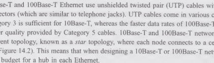

10Base-T 和 100Base-T 以太网使用带 RJ45 连接器的非屏蔽双绞线 (UTP) 电缆（类似于电话插孔）。UTP 电缆有各种类别；Category 3 对于 10Base-T 已足够，而 100Base-T 更快的数据速率需要 Category 5 电缆提供的更高质量。10Base-T 和 100Base-T 网络使用不同的拓扑，称为星型拓扑，其中每个节点连接到中央集线器（见图 14.2）。这意味着在设计 10Base-T 或 100Base-T 网络时，你必须为每个以太网预算一个集线器。

Figure 14.2
10Base-T 网络使用星型拓扑。

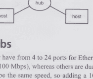

## 以太网集线器

以太网集线器通常有 4 到 24 个以太网连接端口。有些集线器仅运行一种速度（10 或 100 Mbps），而另一些为双速。较便宜的双速集线器会强制所有端口使用相同速度，因此在原本为 100 Mbps 的网络中添加一个 10 Mbps 以太网接口会大幅降低网络性能。然而，大多数现代双速集线器会为每个端口单独自动检测正确的连接速度；这些称为自动感应集线器。有些集线器可堆叠，这意味着一个或多个端口可用于连接第二个集线器。显然，可堆叠集线器在网络最初安装后提供了更多扩展机会。

## 交换机

以太网的一个区别特征称为 CSMA/CD，即 Carrier Sense Multiple Access with Collision Detection，载波侦听多路访问/冲突检测。CSMA/CD 是一种方法，用于决定当以太网上多于一个设备同时尝试发送数据帧时该怎么做（因为在任何给定时刻只能有一个帧处于活动状态）。每个设备都会检测到这种“冲突”。此时，设备必须能够在不同时间重新发送其帧，而无需相互通信或使用任何外部仲裁。以太网采用的方法是让每个设备在重新发送帧之前等待随机长度的时间。

在正常操作下，这完全足够。然而，如果网络负载很重，性能会严重下降，因为以太网设备花费的时间越来越多来等待冲突情况得到解决。网络变得饱和。

以太网交换机解决了这个问题。它们的行为与集线器类似，但集线器将多个独立电缆组合成一个以太网，而交换机本质上将每个端口置于单独的以太网，并在这之间传输（或交换）帧。你可以在交换机的每个端口上放置网络集线器。或者，你可以直接连接单个主机；这对于许多其他主机必须通信的重用服务器很有用。

交换机还可以降低网络对某些安全问题的脆弱性。交换机某端口上的主机或集线器处于其自己的以太网中；这使得企图攻击者使用跟踪工具窃听传输的数据变得困难得多。此类数据可能包括密码或其他敏感数据等。显然，如果使用集线器将多个主机置于交换式以太网段上，这种方法的优势是有限的，但交换机对于多用户机器仍然特别有益。

### 使用交换机

何时应使用交换机？在许多环境中，交换式以太网增加的灵活性是不必要的，会被浪费。然而，如果你开始在网络上看到许多冲突，仔细检查情况是值得的。在 Linux 下，你可以使用 ifconfig 命令检查网络上检测到的冲突数量。清单 14.1 显示了一些示例输出。

### LISTING 14.1 使用 ifconfig 检查以太网冲突

```
$ ifconfig eth0
eth0 Link encap:Ethernet HWaddr 00:E0:98:04:37:59
inet addr:192.168.1.1 Bcast:192.168.1.255 Mask:255.255.255.0
UP BROADCAST RUNNING MULTICAST MTU:1500 Metric:1
RX packets:455299 errors:6 dropped:0 overruns:0 frame:25
TX packets:403376 errors:14 dropped:0 overruns:0 carrier:14
collisions:7004 txqueuelen:100
Interrupt:10 Base address:0x300
```

在这种情况下，已发生 7004 次冲突，传输的 403,376 个数据包 (TX) 中，冲突率略低于 2%。根据经验，我知道该速率对于此网络来说明显高于正常水平。在这种情况下，这是直接由于运行多个并发 flood-pings（即尽可能快地发送 ICMP Echo Request 数据包）以获取有关以太网冲突的有趣数据而造成的。一般来说，冲突率低于 5% 无需担心。如果在网络上广泛采样主机中持续看到冲突率高于 5%，那么可能需要考虑使用交换机分割网络。

## 选择以太网介质

设置新网络时应选择哪种物理以太网介质？每种类型都有优缺点。

### 基于同轴电缆或基于 UTP 的以太网

基于同轴电缆的以太网成本低于替代方案，主要因为无需使用集线器，也因为 10Base-2 NIC 通常便宜。（有人会说，最便宜的 10Base-2 卡物有所值。）与基于 UTP 的以太网相比，对于相同数量的主机，它们使用更少的电缆。（此外，根据集线器相对于主机的物理位置，基于 UTP 的网络总体可能需要更多电缆。）同轴网络也非常简单设置。

10Base-2 最大的问题正是要求所有节点通过单一主干连接。如果主干电缆任何一点出现故障，整个网络都会瘫痪。这也使得在需求变化时相对难以扩展它们。这使得很难推荐 10Base-2 网络用于大多数新安装；然而，家庭用户可能会发现 10Base-2 以太网是连接几台机器的理想廉价且简单机制。

### 10Base-T 或 100Base-T UTP 以太网

就 UTP 介质类型而言，10Base-T 与 100Base-T 之间的主要区别显然是速度。当然，这样的差异是有代价的：100Base-T 部件比 10Base-T 相当部件更贵，尤其是高质量组件。然而，价格差异正在缩小，从长远来看，最初选择 100Base-T 可能更便宜，而不是先使用 10Base-T，后来才发现实际上需要 100 Mbps 网络。

我通常会建议即使对于 10Base-T 网络也投资 Category 5 电缆，因为重新布线网络是一项昂贵且耗时的操作。使用 Category 5 用于 10Base-T 除非连接大量机器，否则不太可能 prohibitively 昂贵。一旦铺设了 Category 5 电缆，从 10Base-T 升级到 100Base-T 只需安装双速集线器；然后可在适当时将单个主机升级到 100 Mbps 以太网卡。的确，在某些情况下，即使网络上最初没有主机具有可运行 100Mbps 的 NIC，也值得一开始就购买双速集线器。

现在我们已经描述了以太网的工作原理以及它如何与 TCP/IP 配合，下一步是实际在 Red Hat Linux 下使以太网接口工作。下一节讨论如何实现这一点。


## 添加以太网接口

安装硬件后，配置新的以太网接口通常可以分为两部分：一方面是内核级（硬件驱动）配置，另一方面是网络软件的配置。然而，在 Red Hat 6 中，使用完全模块化的内核构建意味着这两个步骤都可以通过同一个系统管理工具——Linuxconf 来执行。图 14.3 显示了 Gnome 版本的 Linuxconf 中用于添加以太网接口的基本主机配置对话框。

图 14.3
使用 Gnome-Linuxconf 添加以太网接口。

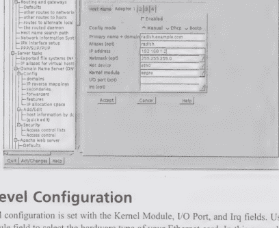

## 内核级配置

内核级配置通过 Kernel Module、I/O Port 和 Irq 字段设置。使用 Kernel-module 字段选择以太网卡的硬件类型。在此示例中，正在配置的卡是 Intel EtherExpress Pro。如果使用 Gnome 接口，会有一个以太网卡类型的下拉菜单，但如果使用基于终端的接口，你必须知道可以驱动它的内核模块名称。如果你想查看可用模块的列表，可以运行

```
ls /lib/modules/$(uname -r)/net
```

尽管该目录也包含一些非以太网模块。

在大多数情况下，你可以让内核模块探测正确的 I/O 端口号和 IRQ，但如果你使用的是少数几种无法准确探测的卡类型，则需要指定这些值。此外，如果一台机器中有多张相同类型的卡，你必须一次性为所有卡配置 I/O 端口和 IRQ。这是因为驱动模块对两张卡只加载一次。例如，如果一张卡运行在 I/O 端口 0x300、IRQ 10 上，而另一张相同类型的卡运行在 I/O 端口 0x320、IRQ 11 上，你应该将第一个卡的 I/O 端口字段设置为“0x300,0x320”，并将 IRQ 字段设置为“10,11”。

## 软件级配置

此对话框中的其他字段与软件级配置相关。其中可能最重要的是 Config Mode。它决定了其他参数的设置方式。在 Manual config 模式下，管理员在此对话框中手动设置它们。其他两种配置模式允许在接口启动时（通常在启动时）自动配置接口。有两种协议允许这样做；BOOTP（Bootstrap Protocol）和更新的 DHCP（Dynamic Host Configuration Protocol），它基于 BOOTP。

如果你手动配置接口，剩余的参数按顺序为：接口的完全限定名称、它可能拥有的别名名称、接口的 IP 地址以及该接口的网络掩码。在此实例中，eth0 接口位于私有网络 192.168.1.0/24 上。其名称为 radish.example.com，并有一个别名 radish。

一旦你的 Red Hat Linux 系统拥有一个可工作的以太网接口，下一步要考虑的是它将如何向更广阔的互联网传输和接收数据。此过程称为路由，是下一节的主题。

## 路由

从某种意义上说，IP地址是一种非常抽象的机制。尽管它们唯一地区分所有可直接寻址的互联网接口，但它们不包含任何关于其位置的信息。互联网是一个网络的网络，这意味着任意一对可直接寻址的主机位于同一物理网络上的可能性极小。

那么，如何可能将 IP 数据报从一个地方的系统发送到可能远在数千英里之外的远程站点呢？最简单地说，IP 数据报从一个网络传输到另一个网络，直到最终到达包含目标主机的网络。一些被称为网关或路由器的系统存在于多个网络上，因此它们可以根据需要将数据报从一个网络转发到另一个网络。术语路由器有时保留给独立设备，而网关则用于描述执行此角色的计算机系统，通常作为众多功能之一。然而，这种用法并不一致。

尽管专用路由硬件通常比占用通用计算机的性能更好，但完全可以使用类 UNIX 系统（无论是 UNIX 品牌系统还是 Linux 等克隆系统）来执行路由，在某些情况下它可能允许更大的灵活性。本书只讨论使用 Red Hat Linux 系统执行路由。

## 路由网关

网关在多个网络之间路由数据，但单个主机也必须做出路由决策。在简单情况下，即主机只有回环接口和一个物理接口时，路由决策相当简单。如果数据报的地址是回环网络上的接口，则发送到回环接口。否则，如果它被寻址到本地物理网络上的主机，则发送到物理接口。否则，它必须被寻址到远程网络上的主机，并发送到本地物理网络上的网关以便适当转发。

## 配置路由

给定系统的路由可以以多种方式配置，但可以基本区分静态路由和动态路由。管理员必须手动配置静态路由。它适用于网关数量有限的网络，尤其是只有一个网关的网络。静态路由还可以帮助消除基于 IP 地址进行身份验证的应用程序中的安全漏洞，因为它可以避免 IP 欺骗。小型局域网，尤其是家庭用户运行的网络，是这种环境的理想示例。

另一方面，动态路由应在存在多条到达同一目的地的可能路径的网络上使用。一般情况下，在多个网络之间路由数据包是一项困难的任务。对于互联网来说尤其如此，因为规模和可靠性问题意味着路由知识必须分布：没有任何系统或系统组能知道所有存在的路由。此外，路由器必须尽力通过最短的可能路径引导数据报。没有路由器之间的通信，现实中无法做到这一点。这种通信由 routed 和 gated 守护进程完成，通过这种方式获得的信息会自动用于配置路由决策。

## 路由表

在 UNIX 和 Linux 系统上，如何引导数据报的信息存储在称为路由表的内核结构中。正是这个路由表必须被操作以配置路由决策，基于管理员提供的固定信息（用于静态路由），或通过边界网关协议获得的可达性信息（用于动态路由）。

## 检查路由表

路由表可以用 netstat -r 命令检查，如列表 14.2 所示。

## 列表 14.2 使用 netstat 显示路由表

```
$ netstat -r -n
```
内核 IP 路由表

| 目标 | 网关 | 掩码 | 标志 | MSS | Window | irtt | 接口 |
|---|---|---|---|---|---|---|---|
| 192.168.1.2 | 0.0.0.0 | 255.255.255.255 | UH | 0 | 0 | 0 | eth0 |
| 192.168.1.0 | 0.0.0.0 | 255.255.255.0 | U | 0 | 0 | 0 | eth0 |
| 127.0.0.0 | 0.0.0.0 | 255.0.0.0 | U | 0 | 0 | 0 | lo |
| 0.0.0.0 | 192.168.1.1 | 0.0.0.0 | UG | 0 | 0 | 0 | eth0 |

在 Linux 系统上，你也可以使用 route 代替 netstat -r，但由于其他系统不允许这样做，最好养成使用 netstat -r 的习惯。你可以给 netstat -r 加上 -e 选项，使其使用与 route 相同的输出格式，或者给 route 加上 -e 选项，使其使用与 netstat -r 相同的输出格式。给任一程序加上 -ee 会使它们使用相同的输出格式，并包含其他格式的合并信息；这种格式的输出行非常长。

netstat 或 route 的 -n 选项会阻止它们尝试将数字 IP 地址解析为名称。正如手册所指出的，这个开关在调试到名称服务器的路由问题时很有用——但在其他情况下也很有用。我在这里使用它是为了使网络结构清晰可见。

netstat -r -ee 的输出字段含义如下：

- **目标**—这标识了此路由被视为适用的目标 IP 地址。
- **网关**—这给出将为这些目标转发数据包的接口（如果有）的 IP 地址。如果不需要转发网关，这里会出现 0.0.0.0 地址，或如果你省略 -n 参数则为 *。
- **掩码**—这是用于目标地址的网络掩码。


-   **Flags**—这表示有关路由的各种细节。最重要的标志是 U（路由处于活动状态）、G（应为此路由使用指定的网关）以及 H（路由针对的是主机，而不是网络）。D（动态安装）、M（已修改）和 R（已恢复）标志表示路由是由路由守护进程创建或操作，或在遇到 ICMP 重定向消息后创建的。! 标志表示拒绝路由。
-   **Metric**—这是路由的质量评级。通常仅在动态路由中有用。
-   **Ref**—Linux 内核不使用，但对于其他系统，它表示对该路由的引用次数。
-   **Use**—报告此路由的查找次数。
-   **MSS**—通过此路由的 TCP 连接的默认最大段大小。
-   **Window**—通过此路由的 TCP 连接的默认窗口大小。
-   **Irtt**—初始往返时间。内核使用此值在无需等待远程主机可能缓慢的响应时选择某些 TCP 参数的值。

Listing 14.2 中的 netstat -r 输出显示系统具有以下目标的路由：

-   **127.0.0.0**—这是环回网络的路由。对于 2.2.x 系列或更高版本的 Linux 内核，此路由实际上并非必要。内核已经知道如何路由到环回网络。但即使 Red Hat 6.0 随附的是 2.2.5 内核，启动过程也会添加此路由。
-   **192.168.1.2**—此 IP 地址实际上附加到该系统自己的 eth0 接口。同样，此路由并非必要，但在 Red Hat 启动过程中会创建它。
-   **192.168.1.0**—这是 eth0 接口所连接网络的路由。无需网关。
-   **0.0.0.0**—这是默认路由；它用于未被其他路由捕获的任何数据报。如果省略 -n 参数，则会显示单词 "default" 而不是零。此路由指定数据报应发送到网关系统 192.168.1.1 以转发到其他网络。

## 添加和删除静态路由

在 Red Hat 6 下添加和删除静态路由的最简单方法是使用 Linuxconf。然而，在复杂工具不可用的紧急情况下，有时需要尝试修复网络。这使得学习手工操作、使用 route 命令变得值得，并且在使用配置工具时发生的情况也会变得显而易见。

route 的第一个参数应为 add 或 del 之一，以分别表示由剩余参数描述的路由正在被添加或删除。

剩余参数的语法取决于要添加的路由类型。最简单的情况是添加默认路由。此命令如下所示

```
route add default gw gateway
```

其中 gateway 是将转发数据包的主机的 IP 地址。请注意，要使此路由可用，必须已存在 gateway 的路由（通常是静态路由）。网关可以用主机名指定，但通常使用数字 IP 地址。这是因为静态路由通常在启动时添加，此时可能没有名称服务运行。

对于添加非默认路由，第二个参数通常是 -net 或 -host 之一，以指示路由是针对网络还是主机。然而，如果路由是针对主机，则可以省略此参数。

-net 或 -host 之后的参数是目标 IP 地址（作为主机名或数字地址）。其后应跟随单词 netmask，然后是用于此路由的实际网络掩码。如果网络掩码与目标地址的自然掩码匹配，则可以省略。

最后，必须有一些指示要为此目标采用的路由。如果目标可以直接访问，请使用 dev 关键字，后跟要使用的设备（如 eth0）。如果这是命令行最后一部分，则可以省略 dev 关键字。如果此目标的路由必须由网关转发，请使用 gw 关键字并提供网关系统的 IP 地址（名称或数字）。与默认路由一样，必须存在通往网关系统的现有路由。

也可以添加拒绝路由。在 route 命令末尾添加单词 reject 会安装拒绝路由，这会强制路由查找失败。它用于在使用默认路由之前屏蔽网络。

一旦可以添加路由，删除路由就很简单。要删除路由，只需给出添加路由的命令行，将单词 add 替换为 del。命令行中的一些参数可以删除，但提供所有已设置的参数始终有效。如果提供的参数不足，典型的响应是消息 SIOCADDRT: Invalid argument。

## 添加路由的示例命令

以下是对添加路由的命令的一些示例。前两个可用于添加在列表 14.2 中出现的路由，重复在此处作为列表 14.3。

### 列表 14.3 示例路由表

$ netstat -r -n
内核 IP 路由表
| 目标 | 网关 | 掩码 | 标志 | MSS | Window | irtt | 接口 |
|---|---|---|---|---|---|---|---|
| 192.168.1.2 | 0.0.0.0 | 255.255.255.255 | UH | 0 | 0 | 0 | eth0 |
| 192.168.1.0 | 0.0.0.0 | 255.255.255.0 | U | 0 | 0 | 0 | eth0 |
| 127.0.0.0 | 0.0.0.0 | 255.0.0.0 | U | 0 | 0 | 0 | lo |
| 0.0.0.0 | 192.168.1.1 | 0.0.0.0 | UG | 0 | 0 | 0 | eth0 |

-   `route add -net 192.168.1.0 netmask 255.255.255.0 dev eth0`
  这为 192.168.1.0/24 网络通过 eth0 设备添加路由，该设备据推测在该网络上有一个 IP 地址。
-   `route add default gw 192.168.1.1`
  这使 192.168.1.1 成为默认路由转发数据包的网关。
-   `route add -net 127.0.0.0 netmask 255.255.0.0 lo`
  这是添加环回网络路由的正确语法。即使在最近的内核下此路由是不必要的，我也包含此示例，因为 route 的手册写错了。
-   `route add -net 10.0.0.0 netmask 255.0.0.0 gw 192.168.1.17`
  这添加了到 10.0.0.0/8 网络的路由，使用 IP 地址为 192.168.1.17 的系统作为网关。在这种情况下，网络掩码是不必要的，因为它与目标网络的自然掩码匹配。

为了澄清这里发生的情况，图 14.4 显示了这些路由可能适用的网络布局。具有这些路由的主机是 192.168.1.2，位于图表左侧。

一旦你能像这样手工添加路由，使用 Linuxconf 作为添加路由和编辑配置文件的[content]
-   **Flags**—这表示有关路由的各种细节。最重要的标志是 U（路由处于活动状态）、G（应为此路由使用指定的网关）以及 H（路由针对的是主机，而不是网络）。D（动态安装）、M（已修改）和 R（已恢复）标志表示路由是由路由守护进程创建或操作，或在遇到 ICMP 重定向消息后创建的。! 标志表示拒绝路由。
-   **Metric**—这是路由的质量评级。通常仅在动态路由中有用。
-   **Ref**—Linux 内核不使用，但对于其他系统，它表示对该路由的引用次数。
-   **Use**—报告此路由的查找次数。
-   **MSS**—通过此路由的 TCP 连接的默认最大段大小。
-   **Window**—通过此路由的 TCP 连接的默认窗口大小。
-   **Irtt**—初始往返时间。内核使用此值在无需等待远程主机可能缓慢的响应时选择某些 TCP 参数的值。

Listing 14.2 中的 netstat -r 输出显示系统具有以下目标的路由：

-   **127.0.0.0**—这是环回网络的路由。对于 2.2.x 系列或更高版本的 Linux 内核，此路由实际上并非必要。内核已经知道如何路由到环回网络。但即使 Red Hat 6.0 随附的是 2.2.5 内核，启动过程也会添加此路由。
-   **192.168.1.2**—此 IP 地址实际上附加到该系统自己的 eth0 接口。同样，此路由并非必要，但在 Red Hat 启动过程中会创建它。
-   **192.168.1.0**—这是 eth0 接口所连接网络的路由。无需网关。
-   **0.0.0.0**—这是默认路由；它用于未被其他路由捕获的任何数据报。如果省略 -n 参数，则会显示单词 "default" 而不是零。此路由指定数据报应发送到网关系统 192.168.1.1 以转发到其他网络。

## 添加和删除静态路由

在 Red Hat 6 下添加和删除静态路由的最简单方法是使用 Linuxconf。然而，在复杂工具不可用的紧急情况下，有时需要尝试修复网络。这使得学习手工操作、使用 route 命令变得值得，并且在使用配置工具时发生的情况也会变得显而易见。

route 的第一个参数应为 add 或 del 之一，以分别表示由剩余参数描述的路由正在被添加或删除。

剩余参数的语法取决于要添加的路由类型。最简单的情况是添加默认路由。此命令如下所示

```
route add default gw gateway
```

其中 gateway 是将转发数据包的主机的 IP 地址。请注意，要使此路由可用，必须已存在 gateway 的路由（通常是静态路由）。网关可以用主机名指定，但通常使用数字 IP 地址。这是因为静态路由通常在启动时添加，此时可能没有名称服务运行。

对于添加非默认路由，第二个参数通常是 -net 或 -host 之一，以指示路由是针对网络还是主机。然而，如果路由是针对主机，则可以省略此参数。

-net 或 -host 之后的参数是目标 IP 地址（作为主机名或数字地址）。其后应跟随单词 netmask，然后是用于此路由的实际网络掩码。如果网络掩码与目标地址的自然掩码匹配，则可以省略。

最后，必须有一些指示要为此目标采用的路由。如果目标可以直接访问，请使用 dev 关键字，后跟要使用的设备（如 eth0）。如果这是命令行最后一部分，则可以省略 dev 关键字。如果此目标的路由必须由网关转发，请使用 gw 关键字并提供网关系统的 IP 地址（名称或数字）。与默认路由一样，必须存在通往网关系统的现有路由。

也可以添加拒绝路由。在 route 命令末尾添加单词 reject 会安装拒绝路由，这会强制路由查找失败。它用于在使用默认路由之前屏蔽网络。

一旦可以添加路由，删除路由就很简单。要删除路由，只需给出添加路由的命令行，将单词 add 替换为 del。命令行中的一些参数可以删除，但提供所有已设置的参数始终有效。如果提供的参数不足，典型的响应是消息 SIOCADDRT: Invalid argument。

## 添加路由的示例命令

以下是对添加路由的命令的一些示例。前两个可用于添加在列表 14.2 中出现的路由，重复在此处作为列表 14.3。

### 列表 14.3 示例路由表

$ netstat -r -n
内核 IP 路由表
| 目标 | 网关 | 掩码 | 标志 | MSS | Window | irtt | 接口 |
|---|---|---|---|---|---|---|---|
| 192.168.1.2 | 0.0.0.0 | 255.255.255.255 | UH | 0 | 0 | 0 | eth0 |
| 192.168.1.0 | 0.0.0.0 | 255.255.255.0 | U | 0 | 0 | 0 | eth0 |
| 127.0.0.0 | 0.0.0.0 | 255.0.0.0 | U | 0 | 0 | 0 | lo |
| 0.0.0.0 | 192.168.1.1 | 0.0.0.0 | UG | 0 | 0 | 0 | eth0 |

-   `route add -net 192.168.1.0 netmask 255.255.255.0 dev eth0`
  这为 192.168.1.0/24 网络通过 eth0 设备添加路由，该设备据推测在该网络上有一个 IP 地址。
-   `route add default gw 192.168.1.1`
  这使 192.168.1.1 成为默认路由转发数据包的网关。
-   `route add -net 127.0.0.0 netmask 255.255.0.0 lo`
  这是添加环回网络路由的正确语法。即使在最近的内核下此路由是不必要的，我也包含此示例，因为 route 的手册写错了。
-   `route add -net 10.0.0.0 netmask 255.0.0.0 gw 192.168.1.17`
  这添加了到 10.0.0.0/8 网络的路由，使用 IP 地址为 192.168.1.17 的系统作为网关。在这种情况下，网络掩码是不必要的，因为它与目标网络的自然掩码匹配。

为了澄清这里发生的情况，图 14.4 显示了这些路由可能适用的网络布局。具有这些路由的主机是 192.168.1.2，位于图表左侧。

一旦你能像这样手工添加路由，使用 Linuxconf 作为添加路由和编辑配置文件的[content]
-   **Flags**—这表示有关路由的各种细节。最重要的标志是 U（路由处于活动状态）、G（应为此路由使用指定的网关）以及 H（路由针对的是主机，而不是网络）。D（动态安装）、M（已修改）和 R（已恢复）标志表示路由是由路由守护进程创建或操作，或在遇到 ICMP 重定向消息后创建的。! 标志表示拒绝路由。
-   **Metric**—这是路由的质量评级。通常仅在动态路由中有用。
-   **Ref**—Linux 内核不使用，但对于其他系统，它表示对该路由的引用次数。
-   **Use**—报告此路由的查找次数。
-   **MSS**—通过此路由的 TCP 连接的默认最大段大小。
-   **Window**—通过此路由的 TCP 连接的默认窗口大小。
-   **Irtt**—初始往返时间。内核使用此值在无需等待远程主机可能缓慢的响应时选择某些 TCP 参数的值。

Listing 14.2 中的 netstat -r 输出显示系统具有以下目标的路由：

-   **127.0.0.0**—这是环回网络的路由。对于 2.2.x 系列或更高版本的 Linux 内核，此路由实际上并非必要。内核已经知道如何路由到环回网络。但即使 Red Hat 6.0 随附的是 2.2.5 内核，启动过程也会添加此路由。
-   **192.168.1.2**—此 IP 地址实际上附加到该系统自己的 eth0 接口。同样，此路由并非必要，但在 Red Hat 启动过程中会创建它。
-   **192.168.1.0**—这是 eth0 接口所连接网络的路由。无需网关。
-   **0.0.0.0**—这是默认路由；它用于未被其他路由捕获的任何数据报。如果省略 -n 参数，则会显示单词 "default" 而不是零。此路由指定数据报应发送到网关系统 192.168.1.1 以转发到其他网络。

## 添加和删除静态路由

在 Red Hat 6 下添加和删除静态路由的最简单方法是使用 Linuxconf。然而，在复杂工具不可用的紧急情况下，有时需要尝试修复网络。这使得学习手工操作、使用 route 命令变得值得，并且在使用配置工具时发生的情况也会变得显而易见。

route 的第一个参数应为 add 或 del 之一，以分别表示由剩余参数描述的路由正在被添加或删除。

剩余参数的语法取决于要添加的路由类型。最简单的情况是添加默认路由。此命令如下所示

```
route add default gw gateway
```

其中 gateway 是将转发数据包的主机的 IP 地址。请注意，要使此路由可用，必须已存在 gateway 的路由（通常是静态路由）。网关可以用主机名指定，但通常使用数字 IP 地址。这是因为静态路由通常在启动时添加，此时可能没有名称服务运行。

对于添加非默认路由，第二个参数通常是 -net 或 -host 之一，以指示路由是针对网络还是主机。然而，如果路由是针对主机，则可以省略此参数。

-net 或 -host 之后的参数是目标 IP 地址（作为主机名或数字地址）。其后应跟随单词 netmask，然后是用于此路由的实际网络掩码。如果网络掩码与目标地址的自然掩码匹配，则可以省略。

最后，必须有一些指示要为此目标采用的路由。如果目标可以直接访问，请使用 dev 关键字，后跟要使用的设备（如 eth0）。如果这是命令行最后一部分，则可以省略 dev 关键字。如果此目标的路由必须由网关转发，请使用 gw 关键字并提供网关系统的 IP 地址（名称或数字）。与默认路由一样，必须存在通往网关系统的现有路由。

也可以添加拒绝路由。在 route 命令末尾添加单词 reject 会安装拒绝路由，这会强制路由查找失败。它用于在使用默认路由之前屏蔽网络。

一旦可以添加路由，删除路由就很简单。要删除路由，只需给出添加路由的命令行，将单词 add 替换为 del。命令行中的一些参数可以删除，但提供所有已设置的参数始终有效。如果提供的参数不足，典型的响应是消息 SIOCADDRT: Invalid argument。

## 添加路由的示例命令

以下是对添加路由的命令的一些示例。前两个可用于添加在列表 14.2 中出现的路由，重复在此处作为列表 14.3。

### 列表 14.3 示例路由表

$ netstat -r -n
内核 IP 路由表
| 目标 | 网关 | 掩码 | 标志 | MSS | Window | irtt | 接口 |
|---|---|---|---|---|---|---|---|
| 192.168.1.2 | 0.0.0.0 | 255.255.255.255 | UH | 0 | 0 | 0 | eth0 |
| 192.168.1.0 | 0.0.0.0 | 255.255.255.0 | U | 0 | 0 | 0 | eth0 |
| 127.0.0.0 | 0.0.0.0 | 255.0.0.0 | U | 0 | 0 | 0 | lo |
| 0.0.0.0 | 192.168.1.1 | 0.0.0.0 | UG | 0 | 0 | 0 | eth0 |

-   `route add -net 192.168.1.0 netmask 255.255.255.0 dev eth0`
  这为 192.168.1.0/24 网络通过 eth0 设备添加路由，该设备据推测在该网络上有一个 IP 地址。
-   `route add default gw 192.168.1.1`
  这使 192.168.1.1 成为默认路由转发数据包的网关。
-   `route add -net 127.0.0.0 netmask 255.255.0.0 lo`
  这是添加环回网络路由的正确语法。即使在最近的内核下此路由是不必要的，我也包含此示例，因为 route 的手册写错了。
-   `route add -net 10.0.0.0 netmask 255.0.0.0 gw 192.168.1.17`
  这添加了到 10.0.0.0/8 网络的路由，使用 IP 地址为 192.168.1.17 的系统作为网关。在这种情况下，网络掩码是不必要的，因为它与目标网络的自然掩码匹配。

为了澄清这里发生的情况，图 14.4 显示了这些路由可能适用的网络布局。具有这些路由的主机是 192.168.1.2，位于图表左侧。

一旦你能像这样手工添加路由，使用 Linuxconf 作为添加路由和编辑配置文件的

- **RIP**— 路由信息协议是 UNIX 系统上最常用的内部协议。它仅基于将距离向量算法应用于路由度量或跳数的结果来做出路由决策。它配置简单，对于大多数中小型网络来说足够使用。

RIP 在大规模使用方面存在一些严重的不足。它将网络直径限制为 15 跳。它表现出 *慢收敛*——如果之前正确的路由变得无效，路由表可能需要长达 180 秒才能反映新的情况。此外，它不知道无类别 IP 地址——所有 RIP 路由都必须使用其自然掩码的地址。

- **RIP-2**— 这是路由信息协议版本 2。它是 RIP 的向后兼容版本，使用 RIP 数据包中为未来扩展保留的字段。RIP-2 修复了 RIP 大多数问题，并增加了诸如路由信息认证等功能。

- **OSPF**— 与 RIP 一样，开放最短路径优先是一种内部协议，但它在很大程度上有所不同，因为它是一种 *链路状态协议*。RIP 路由器与其邻居共享有关整个 AS 的信息，而 OSPF 路由器则将有关其邻居的信息与整个 AS 共享。这使它们能够构建整个网络的模型，并使用 Dijkstra 的广为人知的最短路径算法来确定最佳路由。

- **BGP**— 边界网关协议是互联网上使用最常见的外部路由协议。BGP 支持基于策略的路由；也就是说，在做出路由决策时使用非技术性考虑因素，例如安全性、成本和组织事项。BGP 学习路由的整个端到端路径，以确保不会发生路由环路。

## 杂项协议

其他协议在其他地方使用过，但并不常见。它们包括 Hello 协议（曾用于原始 56 kbps NSFNET 主干网）和 IS-IS，即中间系统到中间系统协议（曾用于 NSFNET T1 主干网）。这两种都是内部协议。外部网关协议曾是一种常见的外部协议，但它依赖于中央机构来确定“最佳”路由，因此在互联网指数级增长面前扩展性很差。因此，如今很少使用。

尽管存在许多路由协议，但在任何给定情况下通常很容易选择合适的协议。对于局域网，RIP 或 RIP-2 仍然是最常见的选择，而且其简单性往往使其成为明智的选择。OSPF 中更复杂的算法使其适用于更大的网络。

很少有系统需要运行外部协议：只有当一个 AS 必须与另一个 AS 交换路由信息时才需要。大型互联网服务提供商是少数需要外部协议的环境之一。当需要外部协议时，使用的路由协议几乎没有选择：如果另一个 AS 已经运行，其管理员几乎肯定已经选择了路由协议，并且自治系统必须运行相同的协议才能交换路由信息。

## 路由守护进程

在类 UNIX 系统上运行的两个主要路由守护进程是 routed（发音为“route-dee”）和 gated（“gate-dee”）。其中，routed 更容易配置，但由于年代较老，也存在灵活性不足的问题——它只能处理 RIP。gated 守护进程可以处理 RIP、RIP-2、OSPF 和 BGP，以及 Hello 和 EGP。

要在 Red Hat 下启用 routed，您必须先安装相关的 RPM 包。然后要安排它在启动时启动，您可以使用 Linuxconf 中的控制服务活动对话框，或手动运行等效命令：

```
chkconfig routed on
```

要在启动或关闭时间之外启动或停止服务，请运行以下其中一个命令：

```
/etc/rc.d/init.d/routed start
/etc/rc.d/init.d/routed stop
```

可以使用 Linuxconf 对 routed 进行一些配置，如图 14.7 所示。

Red Hat 默认配置是 routed 监听其他系统通告的路由，但不自行通告路由；这是通过使用 -q 开关启动 routed 实现的。此对话框中的另一个选项决定 routed 是否应通告其默认路由（-g 开关）。这用于通往互联网的网关，或使用其他路由协议且其路由未通告给其他本地路由器的网关。此设置默认为关闭。

routed 守护进程在启动时读取 /etc/gateways 文件并使用其中的信息来配置路由表。使用此文件不是必需的，因为从其他路由器接收到的 RIP 消息足以让 routed 构建可用的路由表。但在某些情况下它很有用：也许用初始默认路由补充 RIP 信息，或提供不通告其路由的网关的信息。

## 图 14.7
使用 Linuxconf 配置 routed。

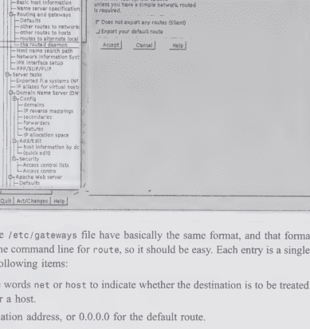

/etc/gateways 文件中的所有条目基本上具有相同的格式，该格式与 route 的命令行非常相似，因此应该很容易。每个条目是一行，包含以下项目：

1. net 或 host 中的一个词，以指示目标应被视为网络还是主机。
2. 目标地址，或默认路由的 0.0.0.0。
3. 词 gateway。
4. 网关的地址。
5. 词 metric。
6. 路由的数值度量值。这可以在添加静态路由时用 route 指定，但在那种情况下基本上毫无意义。RIP 将度量用作路由的成本，因此更喜欢度量值较低的路由。对于 RIP，度量应表示数据到达给定目标必须经过的网关数量，但实际上是管理员选择的任意值。如果到给定目标只有一条路由，该路由的度量应为 1。
7. 关键字 active、passive 或 external 中的一个。被动路由实际上成为永久静态路由：它们不会被 RIP 删除，也不会包含在传输的 RIP 信息中。另一方面，活动路由由 RIP 通告和更新。如果在给定时间内未收到活动路由的更新，它将被从路由表中删除。外部路由与被动路由类似，但 routed 不会将它们添加到路由表中。外部声明表示其他某个路由协议将为相关目标安装路由，并且 routed 不应为同一目标安装替代路由。

## 复杂路由场景

更复杂的路由场景必须由更灵活的程序 gated 处理。正如您已经看到的，gated 可以处理多个路由协议。它结合从不同协议学习到的路由信息并选择可用的最佳路由。它可以在外部协议上通告由内部协议发现存在的路由，因此外部通告的可达性信息可以根据内部路由的变化动态调整。它支持路由策略来控制路由的接受和通告。

对管理员来说最方便的是 gated 从单个文件 (/etc/gated.conf) 配置，具有一致的语法。还有一个组织，Gated Consortium（http://www.gated.org），积极维护它，因此您可以期望错误会被修复并添加新功能。

## 运行 gated

当 gated 运行 时，它从多个协议获取路由信息；如果它从不同协议接收到到同一目标的路由，它会尝试选择最佳路由。这不是一项简单的任务，因为不同协议使用的度量不是直接可比较的。gated 采用的解决方案是使用可配置的偏好。管理员可以使用这些偏好来优先选择一个接口而不是另一个接口的路由，或一个协议而不是另一个协议的路由，或一个远程网关而不是另一个远程网关的路由。

在 Red Hat 下启用 gated 与启用 routed 非常相似。您可以从 Linuxconf 中的控制服务活动对话框启用它，或运行

```
chkconfig gated on
```

手动运行（作为 root）。要在启动或关闭时间之外启动或停止服务，请运行以下其中一个：

```
/etc/rc.d/init.d/gated start
/etc/rc.d/init.d/gated stop
```


## 配置 /etc/gated.conf

/etc/gated.conf 文件包含若干配置语句，这些语句分为多个类别。每种类型的语句必须组合在一起，并且类型必须按特定顺序呈现。使用顺序错误的语句会在 gated 解析文件时导致错误。

gated 守护进程有许多配置选项——远超过本书所能容纳的范围。如果你需要了解 gated 提供的所有可能性，你需要阅读其参考手册。然而，展示一些示例配置将为你介绍它能做什么。

### 主机路由配置

gated 的主机路由配置实际上相当简单。这很合适，因为需要完成的工作也相当简单。列表 14.4 给出了一个示例。

### LISTING 14.4 gated 的主机路由配置

```
# Enable RIP
rip yes {
  # Don't broadcast your own RIP updates
  nobroadcast ;
  interface 192.168.1.17
  # Use RIP-2
  version 2
  # Transmit updates via multicast to reduce load
  # on RIP-1 systems
  multicast ;
};
```

此示例展示了配置文件的基本结构，包括以 # 符号引入的注释、以分号结束的语句以及使用大括号进行语句分组。

### 内部网关配置

内部网关配置只复杂一点。假设一个名为 igw 的网关互连子网 192.168.5.0 和 192.168.17.0，并且子网 192.168.17.0 有一个通往互联网的网关。igw 网关具有接口 192.168.5.1 和 192.168.17.3。它向子网 5 上的主机宣告自己为默认网关，因为它是通往外部世界的网关。它使用 RIP-2 在子网 5 上宣告路由。在子网 17 上，igw 使用 OSPF 宣告自己为通往子网 5 的网关。列表 14.5 显示了配置。

### LISTING 14.5 gated 的内部路由配置

```
# Don't let subnet 5 time out, because this is the only path to
# that subnet.
interfaces {
    interface 192.168.5.1 passive ;
};

# Define an OSPF router id; we use the address of the interface
# that speaks OSPF. The default is the address of the first
# interface encountered by gated
routerid 192.168.5.1 ;

# Enable RIP-2 and announce OSPF routes to subnet 5 with a cost
# of 5. The cost is low because this is an internal route.
rip yes {
    # Broadcast RIP-2 updates
    broadcast ;
    # The cost
    defaultmetric 5 ;
    interface 192.168.5.1
        version 2
        multicast ;
};

# Enable OSPF on the backbone area, subnet 17
ospf yes {
    backbone {
        interface 192.168.17.3 {
            # Use a fairly low priority to increase the
            # probability this will be elected as the
            # designated router.
            priority 5 ;
        } ;
    } ;
};
```

配置 gated 时需要记住的一点是，/etc/gated.conf 中的语法错误会阻止其正常启动。然而，你可以使用程序本身自动检查语法。假设你正在编辑位于 /tmp/gated.conf.new 的 gated.conf 副本。你可以用以下命令测试它

gated -c -f /tmp/gated.conf.new /tmp/gated.trace

这会在不实际进行路由的情况下检查语法，并将跟踪信息写入 /tmp/gated.trace。在将新配置文件移动到 /etc/gated.conf 之前，你可以先检查跟踪信息中的错误。我建议你在更改配置时无论更改多小都始终这样做。然后你可以让正在运行的 gated 进程重新加载其配置，方法是执行

```
/etc/rc.d/init.d/gated reload
```

## 名称服务

从机器的角度来看，路由 IP 数据报是互联网运行的核心。但人类很难处理数字 IP 地址——很简单，很少有人有足够好的记忆力记住他们想要使用的每个主机的四个三位数。解决这个问题的方法是为人类提供符号名称，但安排在机器必须处理它们时查找并将这些符号名称翻译成数字地址。例如，如果你想查看 Red Hat 的网站，记住 www.redhat.com 作为正确位置比 206.132.41.203 要容易得多——尤其是因为这个数字地址随时可能更改。提供此类符号名称的查找和转换功能的系统称为名称服务器，本节描述如何操作和使用名称服务器。

### 历史背景

在互联网早期，所有主机名注册都列在中央官方网络信息中心（NIC）主机表中。每次主机表更改时，每个互联网站点都需要更新其本地副本。随着互联网的增长，这很快变得不可行，因此寻求自动化解决方案。这种搜索导致了域名服务（Domain Name Service）的创建，这是互联网的“原生”名称服务。

大多数系统仍在有限程度上使用静态主机表。当 DNS 未运行时，例如系统启动期间或出现严重网络问题时，需要表中的信息。所有主机都应具有静态主机表，其中至少包含该主机和 localhost 的条目，很可能还包含网络上的网关和服务器。主机信息很少更改的非常小的站点可能会发现静态主机表已足够，尤其是如果由互联网服务提供商提供的异地名称服务器补充互联网主机名。

静态主机表具有非常简单的格式。注释以井号（#）开头。非注释行包含由空白分隔的字段。每行上的第一个字段是数字 IP 地址，第二个是该地址的常用名称。后续字段（如果有）指定别名。列表 14.6 显示了一个示例最小的 /etc/hosts 文件，仅包含 localhost 和系统本身的条目。

### LISTING 14.6 一个最小的 /etc/hosts 文件示例

```
# Table of IP addresses and host names

127.0.0.1    localhost
192.168.1.2  radish.example.com radish
```

### DNS

互联网的原生名称服务器称为 DNS，即域名服务。它使用分布式记录数据库，这些记录会自动分发给需要它们的人。如果 DNS 服务器收到有关其没有信息的 hosts 的查询，它会将请求传递给授权服务器（即负责维护有关所讨论域的准确信息的服务器）。然后服务器会缓存从授权服务器接收到的信息，并使用缓存版本来回答未来的等效查询。

DNS 使用的层次结构与 UNIX 文件系统中的文件名层次结构相似。在层次结构的顶部有一个 DNS 根域，由一组称为根服务器的 DNS 域服务器提供服务。

### 地理和组织域

直接在根域下的是顶级域。这些分为两类：地理和组织。地理域为每个国家/地区存在，并以通常（但不总是）对应 ISO-3166 两字母代码的两字母代码命名。（例如，存在一个名为 UK 的顶级域用于英国，但 ISO-3166 代码是 GB。）组织域的成员资格基于系统所属的组织类型。类别如表 14.3 所示。

### TABLE 14.3 DNS 组织域的成员资格

| 域 | 描述 |
|---|---|
| com | 商业组织 |
| edu | 美国教育机构 |
| gov | 美国政府机构 |
| mil | 美国军事组织 |
| net | 网络支持组织 |
| int | 国际政府或准政府组织 |
| org | 其他类型的组织，包括非营利组织 |


组织域由一家名为 InterNIC 的公司管理。你可以通过向 InterNIC 申请并支付年费来注册二级域名。你还必须告诉 InterNIC 至少两个主机的 IP 地址，这些主机将成为新域的权威名称服务器。当 InterNIC 批准请求时，它会配置其 DNS 服务器以将你的名称服务器广告为新域的权威服务器。现在当根服务器接收到针对新域的查询时，查询会被转交给你的名称服务器。

对于地理域，二级域的分配由国家机构完成。在许多地理域中，插入了另一个层次结构层，类似于组织顶级域。例如，澳大利亚在其顶级 au 域内拥有自己的二级 com、net 和 edu 域。

一旦域分配给组织，该域内的任何子域完全由域管理员自行决定。另外请注意，域与网络无关。给定的域可以包含位于地理上分散位置的子域。

域层次结构反映在域名中。域名从最具体（主机名）到最不具体（顶级域）书写，各部分用点分隔。根域由单个点标识。

## 在 UNIX 和 Linux 系统上的名称服务

目前使用最广泛的 UNIX DNS 服务器软件是 Berkeley Internet Name Daemon（BIND），由著名程序员 Paul Vixie 开发，他也参与了 DNS 的规范制定。Red Hat 6 使用 BIND 的 8.2 版本；8.x 版本在操作上，尤其是配置上，与早期的 4.9.x 版本有所不同。

最近启动了一个新项目来开发一个替代 DNS 服务器，名为 Dents (http://www.dents.org)，采用 GNU 通用公共许可证授权。一些人认为在 BIND 未来版本许可条款可能发生变化的情况下，这一点尤为重要，这些变化可能导致 BIND 不能被归类为开源或自由软件。Dents 还被设计为模块化、灵活且安全。然而，Dents 尚未完成，更不用说广泛部署了，因此目前很难推荐它。

并非所有系统都需要运行名称服务器。应用程序能够执行名称查找所需的一切只是一个解析器——一个可以向名称服务器发送正确查询的库。依赖其他机器提供名称服务器的主机称为仅解析器系统。

对于运行自己的名称服务器的系统，BIND 服务器作为一个名为 named（读作“name-dee”）的独立进程运行。名称服务器可以根据配置方式分为三类。

- **主服务器**—域的主服务器是从中派生该域所有数据的服务器。这些数据由管理员提供。主服务器对其域具有权威性。BIND 的早期版本使用术语 *主* 而不是 master。
- **从服务器**—与主服务器类似，从服务器拥有有关域的所有信息。区别在于，主服务器直接从管理员提供的文件中获取数据，而从服务器则从主服务器获取数据。从服务器对其域也具有权威性。BIND 的早期版本使用术语 *次* 而不是 slave。
- **仅缓存**—仅缓存服务器不必保存任何域的全部信息，实际上它很少会这样做。它会缓存查询结果，就像大多数名称服务器一样，但它没有构建域名数据库的其他方法。缓存服务器是非权威的：其信息是二手且不完整的，尽管通常是准确的。

许多服务器会结合一种或多种角色的元素。特别是，BIND 文档实际上指的是主区域和从区域而不是服务器，其中一个服务器可以提供任意数量的区域。

## 解析器库

所有 UNIX 和 Linux 系统都有一个解析器库。解析器有一个配置文件 `/etc/resolv.conf`，允许你指定它将查询的名称服务器（如果有）。

`/etc/resolv.conf` 可能包含以下指令：

- **名称服务器**—最多可以有三个 nameserver 指令，每个指令指定一个要查询的服务器。服务器应指定为点分四段的 IP 地址。如果未从之前的服务器收到响应，则会查询第一个之后的服务器。如果没有 nameserver 指令（或没有 `/etc/resolv.conf` 文件），则查询本地主机。如果你明确指定了 nameserver 并且希望查询本地主机，则应给出其官方 IP 地址而不是回环地址。仅解析器配置永远不需要指向本地主机的 nameserver 指令。
- domain—domain 指令定义默认域名。对该域内名称的查询可以使用相对于本地域的短名称。如果未给出 domain 指令，则取自本地主机名，或如果本地主机名不包含域名，则假定为根域。
- search—search 指令允许你指定一系列域，当查找不包含点的主机名时将搜索这些域。最多可以指定六个域，使用最多 256 个字符。列表默认为本地域名。如果这些域不是本地的，这可能会产生大量网络流量。

列表 14.7 和 14.8 包含示例解析器配置。

### 列表 14.7 仅解析器示例配置

```
# The default domain name
domain example.com
# Two name servers elsewhere on the network
nameserver 192.168.1.1
nameserver 10.0.0.42
```

### 列表 14.8 一个示例解析器配置

```
# The default domain name
domain example.org
# First try this host
nameserver 192.168.1.2
# Next try the other two name servers on the network
nameserver 192.168.1.1
nameserver 10.0.0.42
```

如果你确实需要在 Red Hat 系统上运行名称服务器（而不是使用仅解析器配置），你应该安装 bind 和 caching-nameserver 包。你可以通过以下命令安排 named 在启动时启动

```
chkconfig named on
```

并且可以通过以下命令启动它

```
/etc/rc.d/init.d/named start
```

## 配置 BIND

像 gated 一样，BIND 是一个庞大而复杂的程序，涵盖其所有配置选项将占用一整章。因此我只介绍最重要的选项概述和一些示例配置，并将你引导至随 BIND 提供的 extensive 文档以供参考。

配置 BIND 可以分为两个方面：BIND 配置本身，以及包含实际名称/号码映射的区域文件。配置通常存储在 /etc/named.conf 中。它使用结构化语法，以分号结束语句，并使用大括号对相关项进行分组。

大多数 /etc/named.conf 文件中的第一个语句将是 options 语句，它确定 BIND 的全局选项。最多只能有一个 options 语句；后续的语句将生成警告。options 语句采用以大括号分隔的选项列表，以分号结束。最重要的选项如下：

- directory—它接受一个双引号字符串，命名服务器的工作目录。没有前导斜杠的文件名被解释为相对于此目录。/var/named 目录是此项的常见选择。
- forwarders—它接受以大括号分隔的 IP 地址列表，以分号结束。每个 IP 地址用作 BIND 转发查询的名称服务器，而不是尝试自行查找答案。转发器在连接到更广阔的互联网带宽有限但与连接更好的 DNS 服务器（如 ISP 提供的）连接良好的网络上很有用。
- forward—除非也有 forwarders 选项，否则此选项无意义。它只接受一个关键字（表示 BIND 永远不应尝试自行查找答案——这称为从配置）或 first（表示应先检查转发器，但如果没有给出答案，则 BIND 应自行查找）。

几乎所有 /etc/named.conf 文件也需要包含一个或多个 zone 语句，实际定义一个区域。BIND 区域有四种类型：master、slave、stub 和 hint。（早期版本使用 primary、secondary 和 cache 而不是 master、slave 和 hint。）hint 区域指定一组初始根名称服务器。当 BIND 启动时，它使用根提示（在 Red Hat 上通常称为 /var/named/named.ca，但在某些其他系统上 /var/named/named.root 很常见）来查找根名称服务器并获取最新的根名称服务器列表。master 区域包含区域的权威数据；这些数据存储在 BIND 启动时读取的区域文件中。slave 区域是 master 区域的副本，通过网络更新。你可以为 slave 区域指定一个区域文件，以便 BIND 将副本的拷贝写入该文件。这将降低未来启动时间

instances of BIND, and will also help preserve bandwidth. A stub zone is like a slave zone, except that instead of replicating the entire master zone, it replicates only its NS (name server) records.

A zone statement consists of the word zone, the double-quoted name of the zone, an optional zone class, and a brace-delimited list of options. Important options for zones include the following:

- **type**—此选项对所有区域都是必需的。它指定区域的类型，后面应跟随 master、slave、stub 或 hint 中的一个词。
- **file**—它接受一个双引号的文件名，该文件名相对于工作目录进行解释（请参阅前面的列表中的 directory 选项）。这是区域文件本身。对于 master 和 hint 区域，这是必需的；对于 slave 和 stub 区域则是可选的。
- **masters**—对于 slave 和 stub 区域是必需的，而对于 master 和 hint 区域则禁止使用。它后面跟随一个用大括号分隔的数字 IP 地址列表。slave 将联系这些地址中的每一个来更新其区域副本。

清单 14.9 显示了一个仅缓存名称服务器的示例配置，该服务器尝试将请求转发到 hopefully 连接更好的服务器。

### LISTING 14.9 仅缓存名称服务器的 Sample named.conf 示例

```
# Set basic options for named
options {
  directory "/var/named";
  forward first;
  forwarders {
    10.17.42.1;
    10.17.42.2;
  };
};

# Hint zone for the root name servers
zone "." {
  type hint;
  file "named.ca";
};

# Master zone for localhost
zone "localhost" {
  type master;
  file "named.local";
}
# Master reverse lookup zone for localhost
zone "127.in-addr.arpa" {
    type master;
    file "named.revlocal";
}
```

Red Hat 在 caching-nameserver 包中提供了 named.ca 和 named.local 文件，但它不提供 named.rev-local 文件，该文件指定了 localhost 域的反向映射。清单 14.10 提供了一个可供使用的示例。

### LISTING 14.10 Sample named.rev-local 反向映射示例

```
; Zone file for local loopback interface reverse lookups
;
@ IN SOA localhost.root.localhost. (
    1       ; Serial
    604800  ; Refresh
    86400   ; Retry
    2419200 ; Expire
    604800 ) ; Default TTL
;
@ IN NS localhost.
1.0.0 IN PTR localhost.
```

这引出了区域文件的主题，区域文件存储域数据库信息。区域文件由 RFC 1033 及其他标准中定义的资源记录（RR）序列组成。标准 RR 类型在表 14.4 中显示。

### TABLE 14.4 DNS 区域的标准资源记录类型

| Type | 名称 | 用途 |
|------|------|---------|
| SOA | 授权起始 | 表示区域数据的开始，并定义影响整个区域的参数。 |
| NS | 名称服务器 | 列出为域提供名称服务的机器的名称。 |
| A | 地址 | 将主机名映射到地址。 |
| PTR | 指针 | 将地址映射到主机名。 |
| MX | 邮件交换 | 标识将接受并中继该域电子邮件的机器。 |
| CNAME | 正规名称 | 表示昵称的正式名称。 |
| HINFO | 主机信息 | 描述主机的硬件和操作系统。 |
| WKS | 已知服务 | 广告在机器上运行的网络服务。 |
| TXT | 文本 | 存储任意文本字符串。 |

DNS 资源记录按以下顺序由以下项目组成。

- **Name**—这是此 RR 引用的主机或域的名称。除非它以点结束，否则它相对于当前域进行处理。它可以省略，在这种情况下，记录适用于最后一个命名的域对象。这允许为同一域指定多个记录而最大程度地减少重复。
- **Time-to-live (TTL)**—这是此 RR 中的信息应保存在远程缓存中的时间长度，以秒为单位。它通常留空，在这种情况下，使用 SOA 记录中设置默认 TTL。
- **Class**—这通常是 IN，表示 Internet。
- **Type**—标识 RR 的类型。通常是上表中列出的标准类型之一。
- **Data**—这是为此记录存储的实际信息。例如，在 A 记录中，这是数字 IP 地址，而在 PTR 记录中，这是对应于该地址的名称。

## 网络信息服务

网络信息服务，或 NIS，是由 Sun Microsystems 开发的管理数据库系统。它以前称为 YP（Yellow Pages 的缩写），尽管由于商标冲突被迫更名，但缩写 YP 仍然可见。NIS 允许重要管理文件集中控制，并自动在局域网中分发。

NIS 允许对数据库进行网络查询，这些数据库包含通常保存在标准 UNIX 文件中的数据；这些数据库称为 NIS 映射。NIS 持有映射的文件包括 /etc/hosts 和 /etc/networks。NIS 与 DNS 类似，因为它们都提供了一种克服网络范围静态主机表限制的方法，但 NIS 并不是 Internet 主机的 DNS 替代品。因此，很少有系统会在不使用 DNS 进行 Internet 名称服务的情况下使用 NIS。

NIS 由在存储映射的服务器上运行的 ypserv 进程组成。然后客户端系统可以通过远程查询这些映射，这些客户端系统使用 ypbind 程序来定位服务器。

NIS 服务器及其客户端构成一个 NIS 域，由 NIS 域名标识。在同时使用 NIS 和 DNS 的网络上，每当存在歧义可能时，区分 NIS 域和 DNS 域非常重要。然而，建议的做法是为 NIS 域和等效的 DNS 域使用相同的名称。NIS 使用域名在 /var/yp 中创建目录来存储映射。因此，如果我们有一个 DNS 域名 example.com，并且我们将为 NIS 域使用相同的名称，那么目录 /var/yp/example.com 将被使用。

## 以 NIS 客户端运行 Red Hat

使用 Red Hat 作为 NIS 客户端相对简单。首先，您需要安装相关软件包。这些是 ypbind，用于提供客户端守护进程，以及 yp-tools，用于提供检查和操作 NIS 映射的用户级工具。

安装软件包后，您需要指定 NIS 域名。这可以通过编辑 /etc/sysconfig/network 使其包含类似以下设置的设置来完成

```
NISDOMAIN="example.com"
```

通常，ypbind 可以侦听网络广播以确定哪个主机是 NIS 服务器，但有时必须显式配置。如果需要，您可以在 /etc/yp.conf 中设置服务器。假设 nismaster.example.com 是 example.com 域中的 NIS 服务器。那么 /etc/yp.conf 将包含以下行

```
ypserver nismaster.example.com
```

接下来，您必须确保 ypbind 在启动时启动：

```
chkconfig ypbind on
```

最后，您可以启动 ypbind：

```
/etc/rc.d/init.d/ypbind start
```

这些步骤可以从 Linuxconf 执行。将 ypbind 设置为在启动时运行是通过 Control Service Activity 对话框完成的，就像我们对其他服务所做的那样。还有一个网络信息系统（NIS）对话框用于配置 NIS 域和可选服务器。

您可以使用 ypwhich（它告诉您哪个 NIS 服务器为您的客户端提供服务）和 ypcat（它是通过网络从映射中实际获取数据的最简单的命令行界面）来检查一切是否正常运行。

```
$ ypwhich
nis master.example.com
$ ypcat hosts | grep nismaster
192.168.1.105 nismaster.example.com nismaster
```

您可以运行 ypcat -x 以了解服务器上有哪些映射可用。

## 以 NIS 服务器运行 Red Hat

NIS 服务器是 Red Hat 6 中 Linuxconf 没有配置模块的少数组件之一，因此无法使用 Linuxconf 进行配置。然而，在 Red Hat 下的流程与在其他系统下基本相同。

第一步是确保系统正在运行 shadow 密码和 shadow 组密码。如果需要，您可以运行 pwconv 将明文密码转换为 shadow 密码，并运行 grpconv 对 /etc/group 文件执行相同的操作，尽管您几乎总是在机器上安装操作系统时启用 shadow 密码。您还需要确保 /etc/networks 和 /etc/netgroup 文件存在。

其次，必须安装 ypserv 软件包。它提供 ypserv 守护进程，以及允许 NIS 客户端上的用户在服务器上更改其密码的 yppasswd 守护进程。

第三，您还应按照上述方式将服务器配置为客户端。

下一步是实际构建 NIS 映射。进入 /var/yp 目录并运行 make：

```
cd /var/yp
make
```

这将为 NIS 域（在我们的例子中为 example.com）创建一个目录并用映射文件填充它。每当映射文件提供的数据发生变化时，您需要在服务器上执行此步骤。

最后一步是安排服务器在启动时启动并现在启动它，如常。

```
chkconfig ypserv on
chkconfig yppasswd on
/etc/rc.d/init.d/ypserv start
/etc/rc.d/init.d/yppasswd start
```

## 配置名称查找

由于大多数使用 NIS 的系统也需要运行 DNS，因此在查找名称时必须对搜索可能的信息源进行排序。名称服务转换文件 /etc/nsswitch.conf 用于定义此排序。尽管其名称，

所有 NIS 数据库均由此文件覆盖。清单 14.11 包含来自 nsswitch.conf 文件的一个示例片段。

### LISTING 14.11 一个示例 /etc/nsswitch.conf 片段

```
hosts: nis dns files
networks: nis [NOTFOUND=return] files
```

第一个条目说明主机名查找首先传递给 NIS；如果 NIS 服务器无法找到匹配项，则查找随后传递给 DNS，最后将 /etc/hosts 文件用作最后手段。第二个条目说明网络名称使用 NIS 进行查找。[NOTFOUND=return] 表示对查找过程的精细控制。在这种情况下，如果查找工作正常（即 NIS 正在运行）但未找到名称（NOTFOUND），则查找应立即返回失败指示（=return）。这意味着只有在 NIS 宕机时才会检查 /etc/networks 文件。

## 摘要

在本章中，您已了解到网络对于现代计算机设施至关重要，并且 TCP/IP 是部署最广泛的网络系统。TCP/IP 允许使用多种物理介质类型，其中最常见的一种是 Ethernet。交换机可以减轻拥塞的 Ethernet 网络的负担，并可减少一些安全漏洞。

TCP/IP 使用 32 位 IP 地址来区分系统；这些地址具有可变长度的网络部分和主机部分。一个称为路由的过程使数据能够发送到正确的地址。静态配置的路由对于简单网络来说足够，但具有冗余路由的大型安装需要动态路由。UNIX 和 Linux 系统使用路由表来控制路由。routed 和 gated 守护进程通过操作此路由表执行动态路由。

TCP/IP 使用的数字地址对人类来说不方便。称为名称服务器的程序可以将符号化的、易于记忆的名称转换为数字地址。BIND（named 守护进程）是一个 Internet 域名服务器。NIS 提供全站名称查找服务，但不能对 Internet 主机执行相同的操作。

### 资源共享（打印和文件服务）

### 本章内容

- 网络就是关于共享 410
- 设置打印队列 411
- 网络文件服务 418
- Automount 守护进程和 Autofs 427

### 网络就是关于共享

网络计算机与独立系统之间的主要区别在于网络提供了在所有连接的计算机之间共享通用资源的机会。这使您可以降低个人工作站的成本，通过更小的磁盘空间需求、共享昂贵的资源例如激光打印机，并通过允许应用程序共享并为用户相互交互提供简单方式来降低管理成本。本章介绍几个具体的资源共享领域，即打印机和文件。首先提供 Linux 和 UNIX 系统共享资源的方式的概述，以及 Linux 如何与其他操作系统共享。然后介绍共享打印机和文件资源的某些具体细节。

### 与 Linux/UNIX 主机共享

Linux 就像 UNIX 一样，长期以来一直具有与同类系统共享资源的能力，这是这些操作系统的优势之一。Linux 下的网络打印机支持通过使用 Berkeley 行式打印机守护进程 lpd（随 Red Hat Linux 包含）或功能更强大的 LPRng 套件（您可以自行安装）来实现。LPRng 套件本文未描述；但是，如果您有兴趣了解其功能，可以访问 LPRng 主页 at http://www.astart.com/lprng/LPRng.html。此外，Linux 通过传统的网络文件系统 NFS 或诸如 Coda 和 AFS 之类的新型分布式文件系统支持与其他 Linux 和 UNIX 系统的文件共享。NFS 和 Coda 支持均包含在 Red Hat 提供的 Linux 内核中。AFS 系统是 Transarc 为您的 Linux 系统提供的商业产品，网址为 http://www.transarc.com/。

### 与其他操作系统共享

Linux 的优势之一是它不仅可以与其他 Linux 和 UNIX 系统共享资源，还可以与包括 Windows、NetWare 和 MacOS 在内的其他操作系统共享资源。这种共享可以采取两种形式之一。第一种是通过为这些其他操作系统提供的软件包来实现 Linux 原生的共享协议。这些软件包允许外来操作系统通过为运行在 Linux 系统上的打印机守护进程提供客户端来访问 NFS 文件系统并访问打印队列。另一种方法是 Linux 实现其他操作系统使用的协议。一个例子是使用 Samba 将您的 Linux 系统集成到 Windows 网络中。本主题在第 17 章“与 Windows NT 网络集成”中有更详细的介绍。另一个例子是 Linux 对 NetWare 或 AppleTalk 服务器的仿真，这也在第 17 章中介绍。

### 设置打印队列

考虑到激光打印机的成本，为网络上的每台工作站配备自己的打印机将是一项非常昂贵的提议。尤其是考虑到耗材成本，或如果需要提供彩色打印时更是如此。共享这些打印资源更有意义，这样您就不必在单独的打印机上花费巨资，而是可以用更少的钱获得打印资源的更多功能。

请考虑以下示例。您有一个由四台服务器和 25 台用户工作站组成的网络。其中三台工作站由市场部使用，需要彩色功能来制作营销材料。两台工作站由技术写作者使用，他们需要 PostScript 激光质量来打印产品手册的母版。其余 20 台具有正常的打印需求，从激光质量到简单的行式打印机不等。为了满足这些需求，您需要三台彩色激光打印机、两台 PostScript 激光打印机以及供其余工作站和服务器使用的 24 台标准打印机。按当前价格，仅打印机一项就可能花费您近两万美元。幸运的是，由于可以共享打印机资源，您可以大幅减少需求。共享使您可以使用一台彩色激光打印机供市场部使用，一台高速 PostScript 打印机供技术写作者使用，以及几台标准打印机，费用约为五千美元，这是如果打印机不可共享时的总成本的 25%。此外，维护成本和耗材成本也大大降低。

本节介绍在本地机器上设置打印机的步骤，如何向网络上的其他用户授予访问权限，以及如何配置没有打印机的系统以便跨网络打印。

### 设置本地打印机

在 Red Hat Linux 系统上设置打印机通常相当容易，前提是您有一台来自流行制造商且具有 GhostScript 驱动程序的打印机。GhostScript 是一个软件包，实现了 PostScript 语言，其中包含许多流行打印机的驱动程序。随 Red Hat Linux 6.0 安装提供的可用打印机驱动程序列表包含在表 15.1 中。

### 表 15.1 GhostScript 支持的打印机

| GhostScript 驱动程序 | 打印机名称 |
|---|---|
| djet500 | HP DeskJet 500 |
| cdj500 | HP DeskJet 400/500C/520/540C |
| cdj550 | HP DeskJet 550C/560C/6xxC series |
| pj | HP PaintJet |
| pjxl | HP PaintJet XL |
| pjx1300 | HP PaintJet XL300 and DeskJet 1200C |
| declj250 | DEC LJ250 (Alt) |
| dnj650c | HP DesignJet 650C |
| lj4dith | HP LaserJet 4—dithered |
| bjc600 | Canon BJC-600 and BJC-4000 |
| deskjet | HP DeskJet/DeskJet Plus |
| laserjet | HP LaserJet |
| laserjetplus | HP LaserJet Plus |
| ljet2p | HP LaserJet IID/IIP/III* with TIFF compression |
| ljet3 | HP LaserJet III* with Delta Row Compression |
| ljet3d | HP LaserJet III* with duplex capability |
| ljet4 | HP LaserJet 4/5/6 series |
| st800 | Epson Stylus 800 & ESC/P 2 printers |
| ap3250 | Epson AP3250 & ESC/P 2 printers |
| jetp3852 | IBM 3853 JetPrinter |
| r4081 | Ricoh 4081 laser printer |
| t4693d2 | Tek 4693d color printer, 2-bit mode |
| t4693d4 | Tek 4693d color printer, 4-bit mode |
| t4693d8 | Tek 4693d color printer, 8-bit mode |
| m8510 | C.Itoh M8510 |
| appledmp | Apple Dot Matrix |
| iwlo | Apple Imagewriter, low-resolution |
| iwhi | Apple Imagewriter, high-resolution |
| iwlq | Apple Imagewriter, letter quality |
| bj10e | Canon BJ-10e |
| bj200 | Canon BJ-100/200/210/240 |
| cp50 | Mitsubishi CP50 |
| epsonc | Epson Color Dot Matrix, 9 pin |
| epsonc | Epson Color Dot Matrix, 24 pin |
| epson | Epson Dot Matrix, 9 pin |
| epson | Epson Dot Matrix, 24 pin |
| eps9mid | Epson Dot Matrix, 9 pin, med-res |
| eps9high | Epson Dot Matrix, 9 pin, hi-res |
| imagen | Imagen ImPress |
| lbp8 | Canon LBP-8II |
| lips3 | Canon LIPS III |


## 表 15.1 继续

| GhostScript 驱动 | 打印机名称 |
|---|---|
| ln03 | DEC LN03 |
| la50 | DEC LA50 点阵式 |
| la70 | DEC LA70 点阵式 |
| la75 | DEC LA75 点阵式 |
| la75plus | DEC LA75 Plus 点阵式 |
| necp6 | NEC P6/P6+/P60 |
| oki182 | Okidata Microline 182 |
| lj250 | DEC LJ250 |
| sj48 | StarJet 48 |
| tek4696 | Tektronix 4695/4696 喷墨绘图仪 |
| xes | Xerox XES 打印机 |
| POSTSCRIPT | PostScript 打印机 |
| TEXT | 仅文本打印机 |
| uniprint | Canon BJC-610 (UP) |
| uniprint | HP DeskJet 550C (UP) |
| uniprint | NEC Printwriter 2X (UP) |
| uniprint | Epson Stylus Color (UP) |

如果您的打印机在前面的列表中或与其中之一兼容，您可以使用 printtool 实用程序创建适当的 printcap 条目以及 Red Hat 打印过滤系统使用的配置文件。printtool 通常从控制面板调用，并包含对话框，允许您指定打印机是本地还是网络打印机、打印机类型以及各种其他选项。图 15.1 是 printtool 运行时的屏幕截图，图 15.2 是打印过滤器对话框的屏幕截图，可让您从打印机列表中进行选择。

### 图 15.1
printtool 对话框。


### 图 15.2
打印过滤器对话框。

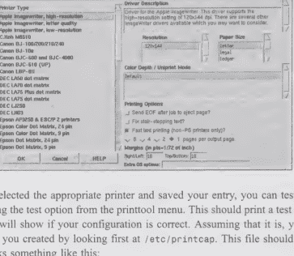

选择适当的打印机并保存条目后，您可以通过从 printtool 菜单中选择测试选项来测试打印机。这应该在您的打印机上打印测试页，以显示您的配置是否正确。如果配置正确，您可以通过首先查看 /etc/printcap 来检查您创建的文件。该文件应包含类似如下的条目：

```
#
# Please don't edit this file directly unless you know what you are doing!
# Be warned that the control-panel printtool requires a very strict format!
# Look at the printcap(5) man page for more info.
#
# This file can be edited with the printtool in the control-panel.

##PRINTTOOL## LOCAL bjc600 360x360 letter {} BJC600 24 {}
lp0:
:sd=/var/spool/lpd/lp0:\
:mx#0:\
:sh:\
:lp=/dev/lp0:\
:if=/var/spool/lpd/lp0/filter:
```

此条目指定打印队列的名称 lp0，后跟其他信息，包括 spool 目录 (sd)、打印机设备 (lp) 和输入过滤器 (if)。printcap 文件的格式在手册页中有文档说明。

除了 printcap 条目之外，printtool 还会创建许多其他文件。其中第一个是输入过滤器，它位于 spool 目录中，名为 filter。此过滤器是一个 shell 脚本，用于确定正在打印的文件类型，将其转换为 PostScript，然后使用 GhostScript 解释器和指定的驱动程序打印到定义的打印机设备。创建的其他文件是 textonly.cfg、general.cfg 和 postscript.cfg。这些文件包含变量定义，用于由过滤器脚本更改调用将输入转换为 PostScript 所使用的各种实用程序。过滤器脚本使用的一些实用程序包括

- dvips—将 TeX 的输出转换为 PostScript
- grog—将 nroff 输出转换为 PostScript
- pnmtops—将 pnm 图像转换为 PostScript
- mpage—将 ASCII 转换为 PostScript

此外，还有一些实用程序可将其他图形格式转换为 pnm 或便携式任意图格式，然后可将其转换为 PostScript。以下是与 printcap 条目中定义的打印机关联的这些文件的内容：

```
[tschenk@nomad lp0]$ cat general.cfg
#
# General config options for printing on this queue
# Generated by PRINTOOL, do not modify.
#
export DESIRED_TO=ps
export PAPERSIZE=letter
export PRINTER_TYPE=LOCAL
export ASCII_TO_PS=NO
```

```
[tschenk@nomad lp0]$ cat postscript.cfg
#
# configuration related to postscript printing
# generated automatically by PRINTOOL
# manual changes to this file may be lost
#
GSDEVICE=bjc600
RESOLUTION=360x360
COLOR=-dBitsPerPixel=24
PAPERSIZE=letter
EXTRA_GS_OPTIONS=""
REVERSE_ORDER=
PS_SEND_EOF=NO
```

```
#
# following is related to printing multiple pages per output page
#
NUP=1
RTLFTMAR=18
TOPBOTMAR=18
```

```
[tschenk@nomad lpd]$ cat textonly.cfg
#
# text-only printing options for printing on this queue
# Generated by PRINTOOL, do not modify.
#
TEXTONLYOPTIONS=
CRLFTRANS=
TEXT_SEND_EOF=NO
```

当然，配置打印机还有其他替代方法，使用 printtool 方法。其中一种替代方法是手工创建 printcap 条目并手动创建调用打印机驱动程序的过滤器脚本。但是，除非您的打印机不受 Red Hat 附带的驱动程序之一支持，否则 printtool 方法更容易。

## 授予他人访问权限

在定义了打印机后，您现在可以授予他人通过网络访问它的权限。这可以通过两种方式之一实现。第一种方法是通过 /etc/hosts.equiv 文件中的条目。该文件包含允许访问本地系统服务的系统的主机名。该文件不仅用于授予对本地行式打印机守护进程的访问权限，因此如果您决定使用此方法，应谨慎操作。事实上，大多数安全专家建议根本不要使用此方法，因为它不是打印机特定的。

授予本地行式打印机守护进程访问权限的替代方法是 在 /etc/hosts.lpd 文件中创建条目。该文件特定于打印系统，因此不被视为与 /etc/hosts.equiv 文件相同的[content]
## 表 15.1 继续

| GhostScript 驱动 | 打印机名称 |
|---|---|
| ln03 | DEC LN03 |
| la50 | DEC LA50 点阵式 |
| la70 | DEC LA70 点阵式 |
| la75 | DEC LA75 点阵式 |
| la75plus | DEC LA75 Plus 点阵式 |
| necp6 | NEC P6/P6+/P60 |
| oki182 | Okidata Microline 182 |
| lj250 | DEC LJ250 |
| sj48 | StarJet 48 |
| tek4696 | Tektronix 4695/4696 喷墨绘图仪 |
| xes | Xerox XES 打印机 |
| POSTSCRIPT | PostScript 打印机 |
| TEXT | 仅文本打印机 |
| uniprint | Canon BJC-610 (UP) |
| uniprint | HP DeskJet 550C (UP) |
| uniprint | NEC Printwriter 2X (UP) |
| uniprint | Epson Stylus Color (UP) |

如果您的打印机在前面的列表中或与其中之一兼容，您可以使用 printtool 实用程序创建适当的 printcap 条目以及 Red Hat 打印过滤系统使用的配置文件。printtool 通常从控制面板调用，并包含对话框，允许您指定打印机是本地还是网络打印机、打印机类型以及各种其他选项。图 15.1 是 printtool 运行时的屏幕截图，图 15.2 是打印过滤器对话框的屏幕截图，可让您从打印机列表中进行选择。

### 图 15.1
printtool 对话框。


### 图 15.2
打印过滤器对话框。


选择适当的打印机并保存条目后，您可以通过从 printtool 菜单中选择测试选项来测试打印机。这应该在您的打印机上打印测试页，以显示您的配置是否正确。如果配置正确，您可以通过首先查看 /etc/printcap 来检查您创建的文件。该文件应包含类似如下的条目：

```
#
# Please don't edit this file directly unless you know what you are doing!
# Be warned that the control-panel printtool requires a very strict format!
# Look at the printcap(5) man page for more info.
#
# This file can be edited with the printtool in the control-panel.

##PRINTTOOL## LOCAL bjc600 360x360 letter {} BJC600 24 {}
lp0:
:sd=/var/spool/lpd/lp0:\
:mx#0:\
:sh:\
:lp=/dev/lp0:\
:if=/var/spool/lpd/lp0/filter:
```

此条目指定打印队列的名称 lp0，后跟其他信息，包括 spool 目录 (sd)、打印机设备 (lp) 和输入过滤器 (if)。printcap 文件的格式在手册页中有文档说明。

除了 printcap 条目之外，printtool 还会创建许多其他文件。其中第一个是输入过滤器，它位于 spool 目录中，名为 filter。此过滤器是一个 shell 脚本，用于确定正在打印的文件类型，将其转换为 PostScript，然后使用 GhostScript 解释器和指定的驱动程序打印到定义的打印机设备。创建的其他文件是 textonly.cfg、general.cfg 和 postscript.cfg。这些文件包含变量定义，用于由过滤器脚本更改调用将输入转换为 PostScript 所使用的各种实用程序。过滤器脚本使用的一些实用程序包括

- dvips—将 TeX 的输出转换为 PostScript
- grog—将 nroff 输出转换为 PostScript
- pnmtops—将 pnm 图像转换为 PostScript
- mpage—将 ASCII 转换为 PostScript

此外，还有一些实用程序可将其他图形格式转换为 pnm 或便携式任意图格式，然后可将其转换为 PostScript。以下是与 printcap 条目中定义的打印机关联的这些文件的内容：

```
[tschenk@nomad lp0]$ cat general.cfg
#
# General config options for printing on this queue
# Generated by PRINTOOL, do not modify.
#
export DESIRED_TO=ps
export PAPERSIZE=letter
export PRINTER_TYPE=LOCAL
export ASCII_TO_PS=NO
```

```
[tschenk@nomad lp0]$ cat postscript.cfg
#
# configuration related to postscript printing
# generated automatically by PRINTOOL
# manual changes to this file may be lost
#
GSDEVICE=bjc600
RESOLUTION=360x360
COLOR=-dBitsPerPixel=24
PAPERSIZE=letter
EXTRA_GS_OPTIONS=""
REVERSE_ORDER=
PS_SEND_EOF=NO
```

```
#
# following is related to printing multiple pages per output page
#
NUP=1
RTLFTMAR=18
TOPBOTMAR=18
```

```
[tschenk@nomad lpd]$ cat textonly.cfg
#
# text-only printing options for printing on this queue
# Generated by PRINTOOL, do not modify.
#
TEXTONLYOPTIONS=
CRLFTRANS=
TEXT_SEND_EOF=NO
```

当然，配置打印机还有其他替代方法，使用 printtool 方法。其中一种替代方法是手工创建 printcap 条目并手动创建调用打印机驱动程序的过滤器脚本。但是，除非您的打印机不受 Red Hat 附带的驱动程序之一支持，否则 printtool 方法更容易。

## 授予他人访问权限

在定义了打印机后，您现在可以授予他人通过网络访问它的权限。这可以通过两种方式之一实现。第一种方法是通过 /etc/hosts.equiv 文件中的条目。该文件包含允许访问本地系统服务的系统的主机名。该文件不仅用于授予对本地行式打印机守护进程的访问权限，因此如果您决定使用此方法，应谨慎操作。事实上，大多数安全专家建议根本不要使用此方法，因为它不是打印机特定的。

授予本地行式打印机守护进程访问权限的替代方法是 在 /etc/hosts.lpd 文件中创建条目。该文件特定于打印系统，因此不被视为与 /etc/hosts.equiv 文件相同的[content]
## 表 15.1 继续

| GhostScript 驱动 | 打印机名称 |
|---|---|
| ln03 | DEC LN03 |
| la50 | DEC LA50 点阵式 |
| la70 | DEC LA70 点阵式 |
| la75 | DEC LA75 点阵式 |
| la75plus | DEC LA75 Plus 点阵式 |
| necp6 | NEC P6/P6+/P60 |
| oki182 | Okidata Microline 182 |
| lj250 | DEC LJ250 |
| sj48 | StarJet 48 |
| tek4696 | Tektronix 4695/4696 喷墨绘图仪 |
| xes | Xerox XES 打印机 |
| POSTSCRIPT | PostScript 打印机 |
| TEXT | 仅文本打印机 |
| uniprint | Canon BJC-610 (UP) |
| uniprint | HP DeskJet 550C (UP) |
| uniprint | NEC Printwriter 2X (UP) |
| uniprint | Epson Stylus Color (UP) |

如果您的打印机在前面的列表中或与其中之一兼容，您可以使用 printtool 实用程序创建适当的 printcap 条目以及 Red Hat 打印过滤系统使用的配置文件。printtool 通常从控制面板调用，并包含对话框，允许您指定打印机是本地还是网络打印机、打印机类型以及各种其他选项。图 15.1 是 printtool 运行时的屏幕截图，图 15.2 是打印过滤器对话框的屏幕截图，可让您从打印机列表中进行选择。

### 图 15.1
printtool 对话框。


### 图 15.2
打印过滤器对话框。


选择适当的打印机并保存条目后，您可以通过从 printtool 菜单中选择测试选项来测试打印机。这应该在您的打印机上打印测试页，以显示您的配置是否正确。如果配置正确，您可以通过首先查看 /etc/printcap 来检查您创建的文件。该文件应包含类似如下的条目：

```
#
# Please don't edit this file directly unless you know what you are doing!
# Be warned that the control-panel printtool requires a very strict format!
# Look at the printcap(5) man page for more info.
#
# This file can be edited with the printtool in the control-panel.

##PRINTTOOL## LOCAL bjc600 360x360 letter {} BJC600 24 {}
lp0:
:sd=/var/spool/lpd/lp0:\
:mx#0:\
:sh:\
:lp=/dev/lp0:\
:if=/var/spool/lpd/lp0/filter:
```

此条目指定打印队列的名称 lp0，后跟其他信息，包括 spool 目录 (sd)、打印机设备 (lp) 和输入过滤器 (if)。printcap 文件的格式在手册页中有文档说明。

除了 printcap 条目之外，printtool 还会创建许多其他文件。其中第一个是输入过滤器，它位于 spool 目录中，名为 filter。此过滤器是一个 shell 脚本，用于确定正在打印的文件类型，将其转换为 PostScript，然后使用 GhostScript 解释器和指定的驱动程序打印到定义的打印机设备。创建的其他文件是 textonly.cfg、general.cfg 和 postscript.cfg。这些文件包含变量定义，用于由过滤器脚本更改调用将输入转换为 PostScript 所使用的各种实用程序。过滤器脚本使用的一些实用程序包括

- dvips—将 TeX 的输出转换为 PostScript
- grog—将 nroff 输出转换为 PostScript
- pnmtops—将 pnm 图像转换为 PostScript
- mpage—将 ASCII 转换为 PostScript

此外，还有一些实用程序可将其他图形格式转换为 pnm 或便携式任意图格式，然后可将其转换为 PostScript。以下是与 printcap 条目中定义的打印机关联的这些文件的内容：

```
[tschenk@nomad lp0]$ cat general.cfg
#
# General config options for printing on this queue
# Generated by PRINTOOL, do not modify.
#
export DESIRED_TO=ps
export PAPERSIZE=letter
export PRINTER_TYPE=LOCAL
export ASCII_TO_PS=NO
```

```
[tschenk@nomad lp0]$ cat postscript.cfg
#
# configuration related to postscript printing
# generated automatically by PRINTOOL
# manual changes to this file may be lost
#
GSDEVICE=bjc600
RESOLUTION=360x360
COLOR=-dBitsPerPixel=24
PAPERSIZE=letter
EXTRA_GS_OPTIONS=""
REVERSE_ORDER=
PS_SEND_EOF=NO
```

```
#
# following is related to printing multiple pages per output page
#
NUP=1
RTLFTMAR=18
TOPBOTMAR=18
```

```
[tschenk@nomad lpd]$ cat textonly.cfg
#
# text-only printing options for printing on this queue
# Generated by PRINTOOL, do not modify.
#
TEXTONLYOPTIONS=
CRLFTRANS=
TEXT_SEND_EOF=NO
```

当然，配置打印机还有其他替代方法，使用 printtool 方法。其中一种替代方法是手工创建 printcap 条目并手动创建调用打印机驱动程序的过滤器脚本。但是，除非您的打印机不受 Red Hat 附带的驱动程序之一支持，否则 printtool 方法更容易。

## 授予他人访问权限

在定义了打印机后，您现在可以授予他人通过网络访问它的权限。这可以通过两种方式之一实现。第一种方法是通过 /etc/hosts.equiv 文件中的条目。该文件包含允许访问本地系统服务的系统的主机名。该文件不仅用于授予对本地行式打印机守护进程的访问权限，因此如果您决定使用此方法，应谨慎操作。事实上，大多数安全专家建议根本不要使用此方法，因为它不是打印机特定的。

授予本地行式打印机守护进程访问权限的替代方法是 在 /etc/hosts.lpd 文件中创建条目。该文件特定于打印系统，因此不被视为与 /etc/hosts.equiv 文件相同的[content]
## 表 15.1 继续

| GhostScript 驱动 | 打印机名称 |
|---|---|
| ln03 | DEC LN03 |
| la50 | DEC LA50 点阵式 |
| la70 | DEC LA70 点阵式 |
| la75 | DEC LA75 点阵式 |
| la75plus | DEC LA75 Plus 点阵式 |
| necp6 | NEC P6/P6+/P60 |
| oki182 | Okidata Microline 182 |
| lj250 | DEC LJ250 |
| sj48 | StarJet 48 |
| tek4696 | Tektronix 4695/4696 喷墨绘图仪 |
| xes | Xerox XES 打印机 |
| POSTSCRIPT | PostScript 打印机 |
| TEXT | 仅文本打印机 |
| uniprint | Canon BJC-610 (UP) |
| uniprint | HP DeskJet 550C (UP) |
| uniprint | NEC Printwriter 2X (UP) |
| uniprint | Epson Stylus Color (UP) |

如果您的打印机在前面的列表中或与其中之一兼容，您可以使用 printtool 实用程序创建适当的 printcap 条目以及 Red Hat 打印过滤系统使用的配置文件。printtool 通常从控制面板调用，并包含对话框，允许您指定打印机是本地还是网络打印机、打印机类型以及各种其他选项。图 15.1 是 printtool 运行时的屏幕截图，图 15.2 是打印过滤器对话框的屏幕截图，可让您从打印机列表中进行选择。

### 图 15.1
printtool 对话框。


### 图 15.2
打印过滤器对话框。


选择适当的打印机并保存条目后，您可以通过从 printtool 菜单中选择测试选项来测试打印机。这应该在您的打印机上打印测试页，以显示您的配置是否正确。如果配置正确，您可以通过首先查看 /etc/printcap 来检查您创建的文件。该文件应包含类似如下的条目：

```
#
# Please don't edit this file directly unless you know what you are doing!
# Be warned that the control-panel printtool requires a very strict format!
# Look at the printcap(5) man page for more info.
#
# This file can be edited with the printtool in the control-panel.

##PRINTTOOL## LOCAL bjc600 360x360 letter {} BJC600 24 {}
lp0:
:sd=/var/spool/lpd/lp0:\
:mx#0:\
:sh:\
:lp=/dev/lp0:\
:if=/var/spool/lpd/lp0/filter:
```

此条目指定打印队列的名称 lp0，后跟其他信息，包括 spool 目录 (sd)、打印机设备 (lp) 和输入过滤器 (if)。printcap 文件的格式在手册页中有文档说明。

除了 printcap 条目之外，printtool 还会创建许多其他文件。其中第一个是输入过滤器，它位于 spool 目录中，名为 filter。此过滤器是一个 shell 脚本，用于确定正在打印的文件类型，将其转换为 PostScript，然后使用 GhostScript 解释器和指定的驱动程序打印到定义的打印机设备。创建的其他文件是 textonly.cfg、general.cfg 和 postscript.cfg。这些文件包含变量定义，用于由过滤器脚本更改调用将输入转换为 PostScript 所使用的各种实用程序。过滤器脚本使用的一些实用程序包括

- dvips—将 TeX 的输出转换为 PostScript
- grog—将 nroff 输出转换为 PostScript
- pnmtops—将 pnm 图像转换为 PostScript
- mpage—将 ASCII 转换为 PostScript

此外，还有一些实用程序可将其他图形格式转换为 pnm 或便携式任意图格式，然后可将其转换为 PostScript。以下是与 printcap 条目中定义的打印机关联的这些文件的内容：

```
[tschenk@nomad lp0]$ cat general.cfg
#
# General config options for printing on this queue
# Generated by PRINTOOL, do not modify.
#
export DESIRED_TO=ps
export PAPERSIZE=letter
export PRINTER_TYPE=LOCAL
export ASCII_TO_PS=NO
```

```
[tschenk@nomad lp0]$ cat postscript.cfg
#
# configuration related to postscript printing
# generated automatically by PRINTOOL
# manual changes to this file may be lost
#
GSDEVICE=bjc600
RESOLUTION=360x360
COLOR=-dBitsPerPixel=24
PAPERSIZE=letter
EXTRA_GS_OPTIONS=""
REVERSE_ORDER=
PS_SEND_EOF=NO
```

```
#
# following is related to printing multiple pages per output page
#
NUP=1
RTLFTMAR=18
TOPBOTMAR=18
```

```
[tschenk@nomad lpd]$ cat textonly.cfg
#
# text-only printing options for printing on this queue
# Generated by PRINTOOL, do not modify.
#
TEXTONLYOPTIONS=
CRLFTRANS=
TEXT_SEND_EOF=NO
```

当然，配置打印机还有其他替代方法，使用 printtool 方法。其中一种替代方法是手工创建 printcap 条目并手动创建调用打印机驱动程序的过滤器脚本。但是，除非您的打印机不受 Red Hat 附带的驱动程序之一支持，否则 printtool 方法更容易。

## 授予他人访问权限

在定义了打印机后，您现在可以授予他人通过网络访问它的权限。这可以通过两种方式之一实现。第一种方法是通过 /etc/hosts.equiv 文件中的条目。该文件包含允许访问本地系统服务的系统的主机名。该文件不仅用于授予对本地行式打印机守护进程的访问权限，因此如果您决定使用此方法，应谨慎操作。事实上，大多数安全专家建议根本不要使用此方法，因为它不是打印机特定的。

授予本地行式打印机守护进程访问权限的替代方法是 在 /etc/hosts.lpd 文件中创建条目。该文件特定于打印系统，因此不被视为与 /etc/hosts.equiv 文件相同的[content]
## 表 15.1 继续

| GhostScript 驱动 | 打印机名称 |
|---|---|
| ln03 | DEC LN03 |
| la50 | DEC LA50 点阵式 |
| la70 | DEC LA70 点阵式 |
| la75 | DEC LA75 点阵式 |
| la75plus | DEC LA75 Plus 点阵式 |
| necp6 | NEC P6/P6+/P60 |
| oki182 | Okidata Microline 182 |
| lj250 | DEC LJ250 |
| sj48 | StarJet 48 |
| tek4696 | Tektronix 4695/4696 喷墨绘图仪 |
| xes | Xerox XES 打印机 |
| POSTSCRIPT | PostScript 打印机 |
| TEXT | 仅文本打印机 |
| uniprint | Canon BJC-610 (UP) |
| uniprint | HP DeskJet 550C (UP) |
| uniprint | NEC Printwriter 2X (UP) |
| uniprint | Epson Stylus Color (UP) |

如果您的打印机在前面的列表中或与其中之一兼容，您可以使用 printtool 实用程序创建适当的 printcap 条目以及 Red Hat 打印过滤系统使用的配置文件。printtool 通常从控制面板调用，并包含对话框，允许您指定打印机是本地还是网络打印机、打印机类型以及各种其他选项。图 15.1 是 printtool 运行时的屏幕截图，图 15.2 是打印过滤器对话框的屏幕截图，可让您从打印机列表中进行选择。

### 图 15.1
printtool 对话框。


### 图 15.2
打印过滤器对话框。


选择适当的打印机并保存条目后，您可以通过从 printtool 菜单中选择测试选项来测试打印机。这应该在您的打印机上打印测试页，以显示您的配置是否正确。如果配置正确，您可以通过首先查看 /etc/printcap 来检查您创建的文件。该文件应包含类似如下的条目：

```
#
# Please don't edit this file directly unless you know what you are doing!
# Be warned that the control-panel printtool requires a very strict format!
# Look at the printcap(5) man page for more info.
#
# This file can be edited with the printtool in the control-panel.

##PRINTTOOL## LOCAL bjc600 360x360 letter {} BJC600 24 {}
lp0:
:sd=/var/spool/lpd/lp0:\
:mx#0:\
:sh:\
:lp=/dev/lp0:\
:if=/var/spool/lpd/lp0/filter:
```

此条目指定打印队列的名称 lp0，后跟其他信息，包括 spool 目录 (sd)、打印机设备 (lp) 和输入过滤器 (if)。printcap 文件的格式在手册页中有文档说明。

除了 printcap 条目之外，printtool 还会创建许多其他文件。其中第一个是输入过滤器，它位于 spool 目录中，名为 filter。此过滤器是一个 shell 脚本，用于确定正在打印的文件类型，将其转换为 PostScript，然后使用 GhostScript 解释器和指定的驱动程序打印到定义的打印机设备。创建的其他文件是 textonly.cfg、general.cfg 和 postscript.cfg。这些文件包含变量定义，用于由过滤器脚本更改调用将输入转换为 PostScript 所使用的各种实用程序。过滤器脚本使用的一些实用程序包括

- dvips—将 TeX 的输出转换为 PostScript
- grog—将 nroff 输出转换为 PostScript
- pnmtops—将 pnm 图像转换为 PostScript
- mpage—将 ASCII 转换为 PostScript

此外，还有一些实用程序可将其他图形格式转换为 pnm 或便携式任意图格式，然后可将其转换为 PostScript。以下是与 printcap 条目中定义的打印机关联的这些文件的内容：

```
[tschenk@nomad lp0]$ cat general.cfg
#
# General config options for printing on this queue
# Generated by PRINTOOL, do not modify.
#
export DESIRED_TO=ps
export PAPERSIZE=letter
export PRINTER_TYPE=LOCAL
export ASCII_TO_PS=NO
```

```
[tschenk@nomad lp0]$ cat postscript.cfg
#
# configuration related to postscript printing
# generated automatically by PRINTOOL
# manual changes to this file may be lost
#
GSDEVICE=bjc600
RESOLUTION=360x360
COLOR=-dBitsPerPixel=24
PAPERSIZE=letter
EXTRA_GS_OPTIONS=""
REVERSE_ORDER=
PS_SEND_EOF=NO
```

```
#
# following is related to printing multiple pages per output page
#
NUP=1
RTLFTMAR=18
TOPBOTMAR=18
```

```
[tschenk@nomad lpd]$ cat textonly.cfg
#
# text-only printing options for printing on this queue
# Generated by PRINTOOL, do not modify.
#
TEXTONLYOPTIONS=
CRLFTRANS=
TEXT_SEND_EOF=NO
```

当然，配置打印机还有其他替代方法，使用 printtool 方法。其中一种替代方法是手工创建 printcap 条目并手动创建调用打印机驱动程序的过滤器脚本。但是，除非您的打印机不受 Red Hat 附带的驱动程序之一支持，否则 printtool 方法更容易。

## 授予他人访问权限

在定义了打印机后，您现在可以授予他人通过网络访问它的权限。这可以通过两种方式之一实现。第一种方法是通过 /etc/hosts.equiv 文件中的条目。该文件包含允许访问本地系统服务的系统的主机名。该文件不仅用于授予对本地行式打印机守护进程的访问权限，因此如果您决定使用此方法，应谨慎操作。事实上，大多数安全专家建议根本不要使用此方法，因为它不是打印机特定的。

授予本地行式打印机守护进程访问权限的替代方法是 在 /etc/hosts.lpd 文件中创建条目。该文件特定于打印系统，因此不被视为与 /etc/hosts.equiv 文件相同的[content]
## 表 15.1 继续

| GhostScript 驱动 | 打印机名称 |
|---|---|
| ln03 | DEC LN03 |
| la50 | DEC LA50 点阵式 |
| la70 | DEC LA70 点阵式 |
| la75 | DEC LA75 点阵式 |
| la75plus | DEC LA75 Plus 点阵式 |
| necp6 | NEC P6/P6+/P60 |
| oki182 | Okidata Microline 182 |
| lj250 | DEC LJ250 |
| sj48 | StarJet 48 |
| tek4696 | Tektronix 4695/4696 喷墨绘图仪 |
| xes | Xerox XES 打印机 |
| POSTSCRIPT | PostScript 打印机 |
| TEXT | 仅文本打印机 |
| uniprint | Canon BJC-610 (UP) |
| uniprint | HP DeskJet 550C (UP) |
| uniprint | NEC Printwriter 2X (UP) |
| uniprint | Epson Stylus Color (UP) |

如果您的打印机在前面的列表中或与其中之一兼容，您可以使用 printtool 实用程序创建适当的 printcap 条目以及 Red Hat 打印过滤系统使用的配置文件。printtool 通常从控制面板调用，并包含对话框，允许您指定打印机是本地还是网络打印机、打印机类型以及各种其他选项。图 15.1 是 printtool 运行时的屏幕截图，图 15.2 是打印过滤器对话框的屏幕截图，可让您从打印机列表中进行选择。

### 图 15.1
printtool 对话框。


### 图 15.2
打印过滤器对话框。


选择适当的打印机并保存条目后，您可以通过从 printtool 菜单中选择测试选项来测试打印机。这应该在您的打印机上打印测试页，以显示您的配置是否正确。如果配置正确，您可以通过首先查看 /etc/printcap 来检查您创建的文件。该文件应包含类似如下的条目：

```
#
# Please don't edit this file directly unless you know what you are doing!
# Be warned that the control-panel printtool requires a very strict format!
# Look at the printcap(5) man page for more info.
#
# This file can be edited with the printtool in the control-panel.

##PRINTTOOL## LOCAL bjc600 360x360 letter {} BJC600 24 {}
lp0:
:sd=/var/spool/lpd/lp0:\
:mx#0:\
:sh:\
:lp=/dev/lp0:\
:if=/var/spool/lpd/lp0/filter:
```

此条目指定打印队列的名称 lp0，后跟其他信息，包括 spool 目录 (sd)、打印机设备 (lp) 和输入过滤器 (if)。printcap 文件的格式在手册页中有文档说明。

除了 printcap 条目之外，printtool 还会创建许多其他文件。其中第一个是输入过滤器，它位于 spool 目录中，名为 filter。此过滤器是一个 shell 脚本，用于确定正在打印的文件类型，将其转换为 PostScript，然后使用 GhostScript 解释器和指定的驱动程序打印到定义的打印机设备。创建的其他文件是 textonly.cfg、general.cfg 和 postscript.cfg。这些文件包含变量定义，用于由过滤器脚本更改调用将输入转换为 PostScript 所使用的各种实用程序。过滤器脚本使用的一些实用程序包括

- dvips—将 TeX 的输出转换为 PostScript
- grog—将 nroff 输出转换为 PostScript
- pnmtops—将 pnm 图像转换为 PostScript
- mpage—将 ASCII 转换为 PostScript

此外，还有一些实用程序可将其他图形格式转换为 pnm 或便携式任意图格式，然后可将其转换为 PostScript。以下是与 printcap 条目中定义的打印机关联的这些文件的内容：

```
[tschenk@nomad lp0]$ cat general.cfg
#
# General config options for printing on this queue
# Generated by PRINTOOL, do not modify.
#
export DESIRED_TO=ps
export PAPERSIZE=letter
export PRINTER_TYPE=LOCAL
export ASCII_TO_PS=NO
```

```
[tschenk@nomad lp0]$ cat postscript.cfg
#
# configuration related to postscript printing
# generated automatically by PRINTOOL
# manual changes to this file may be lost
#
GSDEVICE=bjc600
RESOLUTION=360x360
COLOR=-dBitsPerPixel=24
PAPERSIZE=letter
EXTRA_GS_OPTIONS=""
REVERSE_ORDER=
PS_SEND_EOF=NO
```

```
#
# following is related to printing multiple pages per output page
#
NUP=1
RTLFTMAR=18
TOPBOTMAR=18
```

```
[tschenk@nomad lpd]$ cat textonly.cfg
#
# text-only printing options for printing on this queue
# Generated by PRINTOOL, do not modify.
#
TEXTONLYOPTIONS=
CRLFTRANS=
TEXT_SEND_EOF=NO
```

当然，配置打印机还有其他替代方法，使用 printtool 方法。其中一种替代方法是手工创建 printcap 条目并手动创建调用打印机驱动程序的过滤器脚本。但是，除非您的打印机不受 Red Hat 附带的驱动程序之一支持，否则 printtool 方法更容易。

## 授予他人访问权限

在定义了打印机后，您现在可以授予他人通过网络访问它的权限。这可以通过两种方式之一实现。第一种方法是通过 /etc/hosts.equiv 文件中的条目。该文件包含允许访问本地系统服务的系统的主机名。该文件不仅用于授予对本地行式打印机守护进程的访问权限，因此如果您决定使用此方法，应谨慎操作。事实上，大多数安全专家建议根本不要使用此方法，因为它不是打印机特定的。

授予本地行式打印机守护进程访问权限的替代方法是 在 /etc/hosts.lpd 文件中创建条目。该文件特定于打印系统，因此不被视为与 /etc/hosts.equiv 文件相同的[content]
## 表 15.1 继续

| GhostScript 驱动 | 打印机名称 |
|---|---|
| ln03 | DEC LN03 |
| la50 | DEC LA50 点阵式 |
| la70 | DEC LA70 点阵式 |
| la75 | DEC LA75 点阵式 |
| la75plus | DEC LA75 Plus 点阵式 |
| necp6 | NEC P6/P6+/P60 |
| oki182 | Okidata Microline 182 |
| lj250 | DEC LJ250 |
| sj48 | StarJet 48 |
| tek4696 | Tektronix 4695/4696 喷墨绘图仪 |
| xes | Xerox XES 打印机 |
| POSTSCRIPT | PostScript 打印机 |
| TEXT | 仅文本打印机 |
| uniprint | Canon BJC-610 (UP) |
| uniprint | HP DeskJet 550C (UP) |
| uniprint | NEC Printwriter 2X (UP) |
| uniprint | Epson Stylus Color (UP) |

如果您的打印机在前面的列表中或与其中之一兼容，您可以使用 printtool 实用程序创建适当的 printcap 条目以及 Red Hat 打印过滤系统使用的配置文件。printtool 通常从控制面板调用，并包含对话框，允许您指定打印机是本地还是网络打印机、打印机类型以及各种其他选项。图 15.1 是 printtool 运行时的屏幕截图，图 15.2 是打印过滤器对话框的屏幕截图，可让您从打印机列表中进行选择。

### 图 15.1
printtool 对话框。


### 图 15.2
打印过滤器对话框。


选择适当的打印机并保存条目后，您可以通过从 printtool 菜单中选择测试选项来测试打印机。这应该在您的打印机上打印测试页，以显示您的配置是否正确。如果配置正确，您可以通过首先查看 /etc/printcap 来检查您创建的文件。该文件应包含类似如下的条目：

```
#
# Please don't edit this file directly unless you know what you are doing!
# Be warned that the control-panel printtool requires a very strict format!
# Look at the printcap(5) man page for more info.
#
# This file can be edited with the printtool in the control-panel.

##PRINTTOOL## LOCAL bjc600 360x360 letter {} BJC600 24 {}
lp0:
:sd=/var/spool/lpd/lp0:\
:mx#0:\
:sh:\
:lp=/dev/lp0:\
:if=/var/spool/lpd/lp0/filter:
```

此条目指定打印队列的名称 lp0，后跟其他信息，包括 spool 目录 (sd)、打印机设备 (lp) 和输入过滤器 (if)。printcap 文件的格式在手册页中有文档说明。

除了 printcap 条目之外，printtool 还会创建许多其他文件。其中第一个是输入过滤器，它位于 spool 目录中，名为 filter。此过滤器是一个 shell 脚本，用于确定正在打印的文件类型，将其转换为 PostScript，然后使用 GhostScript 解释器和指定的驱动程序打印到定义的打印机设备。创建的其他文件是 textonly.cfg、general.cfg 和 postscript.cfg。这些文件包含变量定义，用于由过滤器脚本更改调用将输入转换为 PostScript 所使用的各种实用程序。过滤器脚本使用的一些实用程序包括

- dvips—将 TeX 的输出转换为 PostScript
- grog—将 nroff 输出转换为 PostScript
- pnmtops—将 pnm 图像转换为 PostScript
- mpage—将 ASCII 转换为 PostScript

此外，还有一些实用程序可将其他图形格式转换为 pnm 或便携式任意图格式，然后可将其转换为 PostScript。以下是与 printcap 条目中定义的打印机关联的这些文件的内容：

```
[tschenk@nomad lp0]$ cat general.cfg
#
# General config options for printing on this queue
# Generated by PRINTOOL, do not modify.
#
export DESIRED_TO=ps
export PAPERSIZE=letter
export PRINTER_TYPE=LOCAL
export ASCII_TO_PS=NO
```

```
[tschenk@nomad lp0]$ cat postscript.cfg
#
# configuration related to postscript printing
# generated automatically by PRINTOOL
# manual changes to this file may be lost
#
GSDEVICE=bjc600
RESOLUTION=360x360
COLOR=-dBitsPerPixel=24
PAPERSIZE=letter
EXTRA_GS_OPTIONS=""
REVERSE_ORDER=
PS_SEND_EOF=NO
```

```
#
# following is related to printing multiple pages per output page
#
NUP=1
RTLFTMAR=18
TOPBOTMAR=18
```

```
[tschenk@nomad lpd]$ cat textonly.cfg
#
# text-only printing options for printing on this queue
# Generated by PRINTOOL, do not modify.
#
TEXTONLYOPTIONS=
CRLFTRANS=
TEXT_SEND_EOF=NO
```

当然，配置打印机还有其他替代方法，使用 printtool 方法。其中一种替代方法是手工创建 printcap 条目并手动创建调用打印机驱动程序的过滤器脚本。但是，除非您的打印机不受 Red Hat 附带的驱动程序之一支持，否则 printtool 方法更容易。

## 授予他人访问权限

在定义了打印机后，您现在可以授予他人通过网络访问它的权限。这可以通过两种方式之一实现。第一种方法是通过 /etc/hosts.equiv 文件中的条目。该文件包含允许访问本地系统服务的系统的主机名。该文件不仅用于授予对本地行式打印机守护进程的访问权限，因此如果您决定使用此方法，应谨慎操作。事实上，大多数安全专家建议根本不要使用此方法，因为它不是打印机特定的。

授予本地行式打印机守护进程访问权限的替代方法是 在 /etc/hosts.lpd 文件中创建条目。该文件特定于打印系统，因此不被视为与 /etc/hosts.equiv 文件相同的[content]
## 表 15.1 继续

| GhostScript 驱动 | 打印机名称 |
|---|---|
| ln03 | DEC LN03 |
| la50 | DEC LA50 点阵式 |
| la70 | DEC LA70 点阵式 |
| la75 | DEC LA75 点阵式 |
| la75plus | DEC LA75 Plus 点阵式 |
| necp6 | NEC P6/P6+/P60 |
| oki182 | Okidata Microline 182 |
| lj250 | DEC LJ250 |
| sj48 | StarJet 48 |
| tek4696 | Tektronix 4695/4696 喷墨绘图仪 |
| xes | Xerox XES 打印机 |
| POSTSCRIPT | PostScript 打印机 |
| TEXT | 仅文本打印机 |
| uniprint | Canon BJC-610 (UP) |
| uniprint | HP DeskJet 550C (UP) |
| uniprint | NEC Printwriter 2X (UP) |
| uniprint | Epson Stylus Color (UP) |

如果您的打印机在列表中或与其中之一兼容，可使用 printtool 实用程序创建适当的 printcap 条目以及 Red Hat 打印过滤系统使用的配置文件。printtool 通常从控制面板调用，包含对话框可让您指定打印机是本地还是网络打印机、打印机类型及各种其他选项。图 15.1 是 printtool 运行时的屏幕截图，图 15.2 是打印过滤器对话框的屏幕截图，可让您从打印机列表中选择。

### 图 15.1
printtool 对话框。


### 图 15.2
打印过滤器对话框。


选择适当打印机并保存条目后，可通过 printtool 菜单的测试选项测试打印机。这应打印测试页以显示配置是否正确。若正确，可先查看 /etc/printcap 检查创建的文件。该文件应包含类似如下条目：

```
#
# Please don't edit this file directly unless you know what you are doing!
# Be warned that the control-panel printtool requires a very strict format!
# Look at the printcap(5) man page for more info.
#
# This file can be edited with the printtool in the control-panel.

##PRINTTOOL## LOCAL bjc600 360x360 letter {} BJC600 24 {}
lp0:
:sd=/var/spool/lpd/lp0:\
:mx#0:\
:sh:\
:lp=/dev/lp0:\
:if=/var/spool/lpd/lp0/filter:
```

此条目指定打印队列名 lp0，后跟 spool 目录 sd、打印机设备 lp 和输入过滤器 if 等信息。printcap 格式在手册页中有说明。

除 printcap 条目外，printtool 还创建其他文件。第一个是位于 spool 目录名为 filter 的输入过滤器。该过滤器是 shell 脚本，用于判断打印文件类型，将其转为 PostScript，再用 GhostScript 解释器和指定驱动打印到定义设备。其他文件为 textonly.cfg、general.cfg 和 postscript.cfg，包含过滤器脚本使用的变量定义以改变转换输入为 PostScript 所用工具的调用。过滤器脚本使用的工具包括

- dvips—将 TeX 输出转为 PostScript
- grog—将 nroff 输出转为 PostScript
- pnmtops—将 pnm 图像转为 PostScript
- mpage—将 ASCII 转为 PostScript

此外还有若干工具可将其他图形格式转为 pnm 或便携式任意图格式，再转为 PostScript。以下是 printcap 条目中打印机关联文件的[content]
## 表 15.1 继续

| GhostScript 驱动 | 打印机名称 |
|---|---|
| ln03 | DEC LN03 |
| la50 | DEC LA50 dot matrix |
| la70 | DEC LA70 dot matrix |
| la75 | DEC LA75 dot matrix |
| la75plus | DEC LA75 Plus dot matrix |
| necp6 | NEC P6/P6+/P60 |
| oki182 | Okidata Microline 182 |
| lj250 | DEC LJ250 |
| sj48 | StarJet 48 |
| tek4696 | Tektronix 4695/4696 inkjet plotter |
| xes | Xerox XES printers |
| POSTSCRIPT | PostScript printer |
| TEXT | Text-only printer |
| uniprint | Canon BJC-610 (UP) |
| uniprint | HP DeskJet 550C (UP) |
| uniprint | NEC Printwriter 2X (UP) |
| uniprint | Epson Stylus Color (UP) |

如果您的打印机在前面的列表中或与其中之一兼容，您可以使用 printtool 实用程序创建适当的 printcap 条目以及 Red Hat 打印过滤系统使用的配置文件。printtool 通常从控制面板调用，并包含对话框，允许您指定打印机是本地还是网络打印机、打印机类型以及各种其他选项。图 15.1 是 printtool 运行时的屏幕截图，图 15.2 是打印过滤器对话框的屏幕截图，可让您从打印机列表中进行选择。

### 图 15.1
printtool 对话框。


### 图 15.2
打印过滤器对话框。


选择适当的打印机并保存条目后，您可以通过从 printtool 菜单中选择测试选项来测试打印机。这应该在您的打印机上打印测试页，以显示您的配置是否正确。如果配置正确，您可以通过首先查看 /etc/printcap 来检查您创建的文件。该文件应包含类似如下的条目：

```
#
# Please don't edit this file directly unless you know what you are doing!
# Be warned that the control-panel printtool requires a very strict format!
# Look at the printcap(5) man page for more info.
#
# This file can be edited with the printtool in the control-panel.

##PRINTTOOL## LOCAL bjc600 360x360 letter {} BJC600 24 {}
lp0:
:sd=/var/spool/lpd/lp0:\
:mx#0:\
:sh:\
:lp=/dev/lp0:\
:if=/var/spool/lpd/lp0/filter:
```

此条目指定打印队列的名称 lp0，后跟其他信息，包括 spool 目录 sd、打印机设备 lp 和输入过滤器 if。printcap 文件的格式在手册页中有文档说明。

除了 printcap 条目之外，printtool 还会创建许多其他文件。第一个是位于 spool 目录中名为 filter 的输入过滤器。该过滤器是 shell 脚本，用于确定正在打印的文件类型，将其转换为 PostScript，然后使用 GhostScript 解释器和指定的驱动程序打印到定义的打印机设备。其他文件为 textonly.cfg、general.cfg 和 postscript.cfg，包含过滤器脚本使用的变量定义以改变调用。过滤器脚本使用的工具包括

- dvips—将 TeX 输出转换为 PostScript
- grog—将 nroff 输出转换为 PostScript
- pnmtops—将 pnm 图像转换为 PostScript
- mpage—将 ASCII 转换为 PostScript

此外还有若干工具可将其他图形格式转换为 pnm 或便携式任意图格式，再转为 PostScript。以下是与 printcap 条目中定义的打印机关联的文件内容：

```
[tschenk@nomad lp0]$ cat general.cfg
#
# General config options for printing on this queue
# Generated by PRINTOOL, do not modify.
#
export DESIRED_TO=ps
export PAPERSIZE=letter
export PRINTER_TYPE=LOCAL
export ASCII_TO_PS=NO
```

```
[tschenk@nomad lp0]$ cat postscript.cfg
#
# configuration related to postscript printing
# generated automatically by PRINTOOL
# manual changes to this file may be lost
#
GSDEVICE=bjc600
RESOLUTION=360x360
COLOR=-dBitsPerPixel=24
PAPERSIZE=letter
EXTRA_GS_OPTIONS=""
REVERSE_ORDER=
PS_SEND_EOF=NO
```

```
#
# following is related to printing multiple pages per output page
#
NUP=1
RTLFTMAR=18
TOPBOTMAR=18
```

```
[tschenk@nomad lpd]$ cat textonly.cfg
#
# text-only printing options for printing on this queue
# Generated by PRINTOOL, do not modify.
#
TEXTONLYOPTIONS=
CRLFTRANS=
TEXT_SEND_EOF=NO
```

当然还有其他配置打印机的方法。其中一种是手工创建 printcap 条目并手动创建调用打印机驱动程序的过滤器脚本。但除非打印机不受 Red Hat 附带的驱动支持，否则 printtool 方法更易。

## 授予他人访问权限

定义打印机后，可授予他人通过网络访问权限。可通过两种方式实现。第一种是通过 /etc/hosts.equiv 文件中的条目。该文件包含允许访问本地系统服务的系统主机名。该文件不仅用于授予本地行式打印机守护进程访问权限，使用时需谨慎。事实上大多数安全专家建议不要使用此方法，因为它不是打印机特定的。

另一种方法是 在 /etc/hosts.lpd 文件中创建条目。该文件特定于打印系统，因此安全风险与 /etc/hosts.equiv 不同。此文件中的条目由可访问本地主机行式打印机守护进程的机器名组成。

## 设置远程打印机

在服务器上创建打印队列并创建 /etc/hosts.equiv 或 /etc/hosts.lpd 条目以允许客户端主机访问后，可在客户端上定义远程打印机完成设置。远程打印机是指未物理连接到计算机但可通过网络访问的打印机。

第一步与创建本地打印队列相同，即运行 printtool 实用程序。这次的区别是指定远程打印机而非本地打印机。就这么简单。查看前面定义的远程打印机的 printcap 条目，可见区别不大。条目如下：

```
/etc/printcap

#
# Please don't edit this file directly unless you know what you are doing!
# Be warned that the control-panel printtool requires a very strict format!
# Look at the printcap(5) man page for more info.
#
# This file can be edited with the printtool in the control-panel.

##PRINTOOL3## REMOTE bjc600 360x360 letter {} BJC600 24 0
lp:
:sd=/var/spool/lpd/lp:\
:mx#0:\
:sh:\
:rm=quicksilver:\
:rp=lp0:\
:lf=/var/spool/lpd/lp/filter:
```

如您所见，除以下例外外，大多数条目与本地打印机相同。首先，有一个额外条目用于指定行式打印机守护进程运行的主机，即 rm= 条目，本例值为 quicksilver，即我网络上的一台主机。其次，本地打印队列示例中的 lp= 条目被指定远程系统打印队列名的条目取代 rp=lp0。

只要远程服务器的 hosts.lpd 文件条目正确且本地 printcap 文件准确定义远程打印机，您就可以像从服务器本身一样轻松地从客户端主机打印到服务器上的打印机。使用 printtool 时，可通过菜单选项打印测试页来测试新打印机定义。

如您所见，使用提供的工具在 Red Hat Linux 系统上设置打印相当简单。问题通常源于通过手动操作 /etc/printcap 和过滤器脚本等各种文件来设置。若无法使用默认打印机系统，应参考随打印软件提供的文档。现在我们准备继续讨论网络提供的另一个常见服务，即文件服务。


## 网络文件服务

除了打印机之外，网络上最常共享的资源是文件系统，而在 Linux 系统上执行此操作的标准方法是使用 NFS。在 Linux 的早期版本中，NFS 是使用在用户空间运行的守护进程实现的。这种设计虽然可行，但效率低下且容易出错，这使得 Linux 成为 NFS 服务器的糟糕选择的名声。这种低效率促使开发人员寻找更好的解决方案，并在 2.1 内核的开发阶段，一组包括 Olaf Kirch、H.J. Lu、Rick Sladkey、Linus 等在内的程序员实现了内核空间 NFS。自然而然地，过程中出现了一些问题，但该实现改变了人们对 Linux 下 NFS 的看法。内核空间 NFS 支持比用户空间守护进程好得多。它更高效，并且更符合 NFS 规范。随着此 NFS 实现的推出，首次实现了一个锁定守护进程，这解决了将 Linux 用作 NFS 服务器的最大缺点。随着 2.2 内核（例如随 Red Hat Linux 6 提供的内核）的发布，Linux NFS 大大改进，并且一直在不断改进。

本节介绍设置 Linux 作为 NFS 服务器所需的条件，检查 /etc/exports 文件，并介绍使用 Linux 作为 NFS 客户端是多么简单。最后，本节末尾还介绍了 Linux 可用的另外几种网络文件系统，或更准确地说，分布式文件系统（AFS 和 Coda），并将其功能与 NFS 进行比较和对比。

## NFS 服务器配置

在决定在 Linux 下设置 NFS 服务器时，第一个决定是使用旧的用户空间 NFS 实现还是使用内核 NFS 支持。默认情况下，Red Hat 将使用更新的内核空间 NFS 守护进程。但是，如果你是从旧版本的 Linux 迁移而来，可以继续使用用户空间 NFS 实现。不使用内核空间 NFS 的缺点是你将没有 lockd 支持。如果你选择使用用户空间 NFS 方法，可以参考 Linux 文档项目中的 NFS-Howto，其尚未更新以涵盖新的 NFS 实现。

## 安装 NFS 相关软件

假设你在安装 Red Hat 服务器时选择了 NFS 服务器支持，那么设置 NFS 服务器时无需安装任何软件。但如果没有，你将需要安装以下 RPM 软件包才能开始：

- knfsd
- knfsd-clients
- portmap

安装这些软件包后，你需要确保内核包含对网络和 NFS 文件系统类型的支持。运行内核空间 NFS 服务器有两个相关选项，首先是 CONFIG_NFSD。此选项不是必需的，如果你只是运行用户空间 NFS 守护进程，但如果你想使用内核 NFS 守护进程支持，则绝对必须启用。你可能选择设置的一个附加选项是模拟 Sun NFS 服务器的行为。此选项为 CONFIG_NFSD_SUN，你可以根据需要设置或不设置。配置内核时，可通过帮助选项获得此选项的说明。做出适当的内核配置选择后，必须重建并安装新的内核。内核配置和构建在第 35 章“Customizing the Linux Kernel”中讨论，如果你需要帮助。自然地，新的内核意味着需要重新启动以激活它。

## 完成 NFS 设置

现在内核已配置好，你可以继续进行设置 NFS 服务器的剩余步骤。这些步骤中的第一步是决定要通过网络共享哪些文件系统。这听起来似乎很容易，但你还必须对其他系统上的用户在访问共享文件系统时拥有的功能做出几个决定。这些决定包括以下内容：

- 客户端系统是否需要对文件系统具有写访问权限？
- 用户是否能够运行驻留在文件系统上的 setuid 程序？
- 用户是否能够运行驻留在共享文件系统上的任何程序？
- 客户端系统上的 root 用户在访问文件系统时是否应具有 root 权限？

这些问题的答案非常重要，因为它们对系统的安全性有重大影响。这是因为 NFS 文件系统本质上是一个安全风险。未考虑这些问题可能意味着你无意中在系统中打开了安全漏洞。让我们看几个例子以及我们将如何为每个例子回答这些问题。

> 注意
> 
> 你可能在问我为什么说 NFS 本质上是一个安全风险。这有几个原因，但主要原因是客户端与 NFS 服务器交互不需要也不支持身份验证。这意味着，如果你将文件系统导出给网络上的客户端并且未将访问限制在特定系统集，则网络上任何具有 NFS 客户端的系统都可以访问文件系统中的文件。这与 AFS 等其他网络文件系统形成对比，AFS 使用 Kerberos 在授予访问权限之前对用户进行身份验证。

## 共享 /home 文件系统

我们想要共享的第一个文件系统是 /home 文件系统。共享 /home 文件系统允许用户从网络上的所有机器访问其个人文件，这是大多数网络的期望功能。关于客户端系统是否需要对文件系统具有写访问权限的第一个问题的答案显然是肯定的，因为没有它，用户的主目录将不会很有用。下一个问题的答案也显而易见。/home 文件系统是从中运行 setuid 二进制文件的不安全位置，尤其是在电子邮件附件特洛伊木马和其他来源不明的互联网二进制文件泛滥的情况下。这就引出了第三个问题。这个问题不太明确，并且在某种程度上取决于你的用户群。如果你的所有用户都是非技术人员，你可能可以避免允许在 /home 文件系统上执行程序。然而，如果你有更复杂的用户群，他们不可避免地会有自己喜欢的脚本和程序，希望从个人二进制目录运行。最后的问题是客户端机器上的 root 用户在访问 /home 文件系统时是否应具有 root 权限。这个问题的答案通常取决于客户端系统的角色。例如，如果客户端系统是系统管理员的工作站，你可能希望该系统上的 root 等同于 NFS 服务器系统上的 root。另一方面，如果客户端系统供接待员使用，你可能不希望该客户端上的 root 在挂载的文件系统上具有 root 权限。

## 共享 /usr/local 文件系统

现在让我们看看另一个你可能想在网络上共享的文件系统，/usr/local。与 /home 目录不同，客户端系统需要对文件系统具有读写访问权限，在这种情况下，只有少数系统需要这种类型的访问。默认选项是客户端以只读方式挂载它。由于情况如此，并且文件系统可能包含系统管理员安装的大量二进制文件，因此你可以更安全地在此文件系统中安装 setuid 二进制文件，并且执行二进制文件的选项是必须的。最后的问题与之前一样回答，只有少数客户端系统被允许以 root 权限访问挂载的文件系统，而大多数不允许。

## /etc/exports 文件

配置 NFS 服务器的下一步是设置 /etc/exports 文件。此文件定义了许多内容，首先是使客户端在网络上可用的文件系统。除此之外，该文件中的条目还定义了可以访问这些共享文件系统的客户端以及这些客户端允许的访问类型。

为了更好地理解此文件的格式，请为之前讨论的 /home 和 /usr/local 文件系统创建条目。为本示例的目的，假设有四个客户端需要访问这些文件系统：gold、silver 和 platinum，它们是非技术用户使用的普通工作站，以及 titanium，即系统管理员的工作站。以下是 我将在 /etc/exports 文件中为这两个文件系统做的条目：

/etc/exports
/home (rw,root_squash) titanium(rw,no_root_squash)
/usr/local (ro,root_squash) titanium(rw,no_root_squash)

如你所见，格式非常简单。包含 /home 的行翻译为 /home 被导出给所有人（默认情况下，因为未指定主机）具有读写能力，禁止 setuid 二进制文件，并且 root 在客户端访问 /home 文件系统时映射为用户 nobody。它也被导出到工作站 titanium，具有相同的选项，唯一例外是 titanium 上的 root 在访问 /home 文件系统时保留 root 权限。下一行定义 /usr/local 为导出的文件系统，被导出为对所有人只读，并且 root 对网络上所有系统映射为 nobody，titanium 除外，titanium 被允许读写访问和 root 等效。

## 为导出的文件系统设置选项

你应该问的下一个问题是可以在 /etc/exports 文件中指定的导出的文件系统上设置哪些选项。最常用的选项及其含义在表 15.2 中描述


## 表 15.2 /etc/exports 选项

| 选项 | 描述 |
|---|---|
| ro | 允许以只读方式访问文件系统。 |
| rw | 允许以读写方式访问文件系统。 |
| noaccess | 禁止访问导出的树中的特定分支。 |
| secure | 要求请求源自安全端口（< 1024 范围内的端口）。这是默认值。要禁用此选项，请指定 insecure。 |
| map_daemon | 通过使用 ugid 映射守护进程在客户端和服务器系统之间映射不同的 id。 |
| map_static=file | 通过使用作为选项参数指定的文本文件在客户端和服务器系统之间映射不同的 id。 |
| map_nis=nisdomain | 通过执行 NIS 查找在客户端和服务器系统之间映射不同的 id。 |
| no_root_squash | 允许客户端系统上的 root 以 root 权限访问文件系统。默认是 root_squash。 |
| all_squash | 将所有 id 映射到匿名用户。这与默认操作相反。 |
| anonuid=uid | 如果指定了 root_squash 或 all_squash 选项，则用户帐户映射到的 id。默认是 nobody 用户（65534）。 |
| anongid=gid | 如果设置了 root_squash 或 all_squash 选项，则用户帐户映射到的组 id。默认是 nogroup 组（65534）。 |

现在你已经有了一个 /etc/exports 文件格式的示例，并且列出了可用的选项，我们可以查看文件的其余部分的语法规则。文件的每个条目由三部分组成：主机规范、文件系统规范和选项列表。主机规范可以采用几种形式中的一种。第一种形式是单个主机名。对于一般规则的例外情况来说这是可以的，但如果你需要指定大型网络的每个主机，就会变得相当繁琐。指定主机的另一种方法是使用 NIS 网络组规范，以 @group 的形式给出。在这种情况下，netgroup 成员的主机部分会被提取并添加到访问列表中，除非主机部分仅由一个连字符组成。如果你在运行 NIS，此形式可以为你节省大量输入。下一个形式是通配符形式，在其中你可以使用诸如 *.dejanews.com 这样的条目来指定 dejanews.com 域中所有形如 host.dejanews.com 的主机。请注意，这将不包括形如 host.subdomain.dejanews.com 的主机。exports 文件还接受的另一种形式是 IP 网络形式，在其中你可以指定一个 IP/网络掩码对以授予与该规范匹配的所有系统访问权限；例如，192.168.50.0/255.255.255.0 用于匹配类 C 网络 192.168.50.0 上的所有地址。这些几种形式在以下示例 /etc/exports 文件中显示：

/etc/exports

#
# /etc/exports
#
/home @workstations(rw) @admins(rw,no_root_squash)
/opt *.dejanews.com(ro) admin(rw,no_root_squash)
/opt/private (noaccess)
/vol/00 192.168.50.0/255.255.255.0(rw) 10.16.0.0/255.255.0.0(rw)

现在你已经确保安装了适当的网络守护进程，决定了要导出哪个文件系统以及使用什么选项，并且已经构建了 /etc/exports 文件，你就可以实际在网络上使文件系统可用了。这可以通过 exportfs 命令完成。该命令只有几个选项，如表 15.3 所定义。

## 表 15.3 exportfs 选项

| 选项 | 描述 |
|---|---|
| -a | 导出或取消导出所有目录。 |
| -o options | 指定与 /etc/exports 文件中类似的导出选项列表。 |
| -r | 重新导出所有目录并将 /etc/exports 与 /var/lib/nfs/xtab 同步。 |
| -u | 取消导出一个或多个目录。 |
| -v | 详细标志。 |

此命令是 Linux 的新命令，最初随内核 NFS 守护进程实现一起包含。在此之前，文件系统是通过手动杀死并重新启动 mount 守护进程和 nfs 守护进程来导出或重新导出的，例如当你使用 restart 选项运行 /etc/rc.d/init.d/nfs 脚本时就会发生这种情况。如果你愿意，仍然可以这样做，但使用 exportfs 命令要容易得多，对连接的客户端的干扰也更小，因为它不会像脚本那样停止 NFS 守护进程。下面是一个示例，展示了从具有 exports 文件的服务器到 Linux NFS 服务器的过渡：

```
[root@quicksilver /etc]# showmount -e
Export list for quicksilver.alchemy.net:

[root@quicksilver /etc]# cat /etc/exports
/mnt/cdrom 192.168.50.0/255.255.255.0(ro,root_squash)
/home wizard(rw,no_root_squash)
/usr/local *.alchemy.net(ro,root_squash)
```

```
[root@quicksilver /etc]# exportfs -a
```

```
[root@quicksilver /etc]# showmount -e
Export list for quicksilver.alchemy.net:
/usr/local *.alchemy.net
/mnt/cdrom 192.168.50.0/255.255.255.0
/home wizard.alchemy.net
```

正如你所见，服务器 quicksilver 现在正在导出文件系统 /mnt/cdrom、/home 和 /usr/local。下一节将介绍 NFS 客户端系统的设置。

## NFS 客户端配置

在设置了服务器之后，你现在可以查看设置 NFS 服务器客户端所需的条件。这实际上相当容易。你必须做的第一件事是验证你的内核是否内置了对 NFS 的支持。这可以通过检查 /proc/filesystems 文件并找到 NFS 的条目，或通过验证内核模块目录中是否存在 nfs.o 模块来完成。假设你已在内核中包含对 NFS 文件系统类型的支持，为了访问通过 NFS 共享的文件系统，你必须做三件事。这些事情是

- 确保你有权访问该资源，如果没有则请求它。
- 修改 /etc/fstab 文件以包含你想要挂载的文件系统的信息。
- 创建适当的挂载点并挂载文件系统。

你可以使用最初用于验证文件系统是否已导出的同一命令 showmount 来确保你有权访问该资源。这次的区别是你将把 NFS 服务器的名称作为参数传递给 showmount 命令。这看起来会像这样：

```
[root@wizard /etc]# showmount -e quicksilver
Export list for quicksilver.alchemy.net:
/usr/local *.alchemy.net
/mnt/cdrom 192.168.50.0/255.255.255.0
/home wizard.alchemy.net
```

从 showmount 输出中，你可以看到你正在设置的客户端机器 wizard，其 IP 地址为 192.168.50.20 并且是 alchemy.net 域的一部分，应该能够访问 quicksilver 上的所有已导出文件系统。既然如此，你现在可以继续进行第二步。如果不是这种情况，你将向 quicksilver 的管理员请求访问权限，或者如果你自己管理它，

只需修改 quicksilver 上的 /etc/exports 文件以添加 wizard 并使用命令重新导出所有文件系统

```
exportfs -r -a
```

第二步是在 wizard 上修改你的 /etc/fstab 文件。你之前对挂载文件系统应具有哪些特征所做的决定在这里再次发挥作用，特别是关于 setuid 二进制文件和程序执行的问题。这些问题的答案在设置 /etc/fstab 文件中的选项字段时使用。适用于 NFS 文件系统的最常见选项的一些示例显示在表 15.4 中。

## 表 15.4 NFS 挂载选项

| 选项 | 描述 |
|---|---|
| bg | 如果初始挂载 NFS 文件系统尝试失败，则在后台重试。 |
| fg | 如果初始挂载 NFS 文件系统尝试失败，则在前台继续重试。（默认值） |
| soft | NFS 操作发生严重超时会导致向应用程序返回 I/O 错误。 |
| hard | 严重超时会导致持续重试。 |
| rsize=n | 设置 NFS 读取操作的字节数。默认值为 1024。 |
| wsize=n | 设置 NFS 写入操作的字节数。默认值为 1024。 |
| intr | 允许文件操作被信号中断。这不是默认值。 |
| nosuid | 不允许文件系统上二进制文件的 setuid 或 setgid 位生效。 |
| noexec | 不允许在挂载的文件系统上执行程序或脚本。 |

为了继续示例，你将修改 wizard 上的 /etc/fstab 文件并挂载 /home 和 /usr/local 文件系统。/home 文件系统将以读写方式挂载，禁止 setuid 和 setgid 二进制文件，并且客户端系统上的 root 映射到服务器上的 root。/usr/local 文件系统将以读写方式挂载，并且客户端系统上的 root 映射到服务器上的 root。这些选项允许 wizard 作为这些文件系统的管理客户端。如果你想让 wizard 成为一个简单的客户端，你将从 /home 的挂载选项中删除 no_root_squash 选项，并从 /usr/local 的挂载选项中删除 no_root_squash 和读写选项。要实现这一点，这里是从 /etc/fstab 为这两个文件系统的条目：

```
/etc/fstab
```

```
quicksilver:/home   /home   nfs bg,hard,intr,nosuid,rw,no_root_squash 1 0
quicksilver:/usr/local /usr/local nfs bg,hard,intr,nosuid,rw,no_root_squash 1 0
```

正如你所见，这些条目与普通条目不同之处在于，与其指定文件系统所在设备文件，你指定服务器，后跟冒号和导出的目录。除此之外，唯一的其他区别是指定的类型为 nfs，以及挂载选项，对于本地文件系统，这些选项通常设置为关键字 defaults。

创建这些条目后，你现在必须创建目录作为网络文件系统的挂载点。最后一步是实际挂载文件系统。这是通过发出挂载命令完成的，如启动脚本 /etc/rc.d/init.d/netfs 中所示。此挂载命令是

```
mount -a -t nfs
```

此挂载命令表示挂载 /etc/fstab 文件中描述的所有文件系统，其文件系统类型为 nfs。

## AFS 和 Coda

除了 NFS 网络文件系统外，在 Linux 下共享文件系统还有其他替代方案。其中两种替代方案是 AFS，Transarc 的商业文件系统，以及 Coda，一个自由可用的文件系统，支持 AFS 的许多功能。这两者都是分布式文件系统，与 NFS 有显著不同，但与 NFS 共同的目标是在网络间共享数据。

AFS 最初是在 MIT 的 Andrew 项目中开发的，后来由 Transarc 商业化。有关 Linux 上 AFS 的信息可从 http://www.umiug.umd.edu/linuxafs 获取，这是 Linux AFS FAQ 的主页。该 FAQ 解释了 AFS 在 Linux 上的移植状态，讨论了你可以使用 Linux 客户端的条款，提供设置信息，并提供故障排除提示。此外，还有一个专门用于 Linux 上 AFS 的邮件列表。要订阅此邮件列表，你可以发出以下命令：

```
echo "subscribe linux-afs" | mail linux-afs-request@mit.edu
```

Coda Howto，涵盖了在你的 Linux 系统上设置 Coda 所需的一切。不幸的是，Coda 还没有完全准备好投入主流使用，不建议在生产环境中使用。它目前的主要用途是测试可用功能并通过测试改进它们。

现在我们已经介绍了 Linux 可用的一些分布式文件系统选项，让我们来看看如何使从客户端系统访问它们变得更容易。

## 自动挂载守护进程和 Autofs

现代 UNIX 系统的一个特性是支持在尝试访问文件系统时自动挂载文件系统。这种功能在 Linux 系统中有两种不同的形式——通过使用 BSD automounter 或通过使用 Linux autofs。本节将介绍如何设置这两种系统并比较各自的特性，从两者中较旧的 BSD automount 守护进程开始。

### BSD 自动挂载守护进程

如果你以前从未使用过 automount 守护进程，你可能会想知道它是什么以及为什么要在网络上实现它。在大型网络环境中，通常有许多文件系统需要在网络上的系统之间共享。此外，其中一些文件系统并不总是需要，或者提供文件系统的系统并不总是可用。为了解决这个问题，实现了 automount 守护进程，或称 amd，以提供一种机制，使文件系统在有人尝试访问时被挂载，并在连接空闲时卸载。使用 amd 的主要优势在于它减少了开销并提高了性能。除了为 NFS 文件系统提供此功能外，amd 还可用于自动挂载和卸载可移动媒体设备上的文件系统，例如软盘或 CD-ROM 驱动器。

### 配置自动挂载守护进程

现在你已经了解了 automount 守护进程的作用，让我们来看看如何配置和使用它。设置 automount 守护进程的第一步是确保你想要访问的文件系统已正确导出。这是通过本章前面讨论的文件系统导出过程完成的，在 NFS 服务器配置部分。再次，我们将使用本章中一直使用的示例，并使用 showmount 命令验证文件系统是否已导出。

```
[tschenk@wizard chapter15]$ showmount -e quicksilver
Export list for quicksilver:
/usr/local      *.alchemy.net
/mnt/cdrom 192.168.56.0/255.255.255.0
/home          wizard.alchemy.net
```

下一步是确保 automount 守护进程软件已安装。Red Hat 系统的软件包名称为 am-utils，如果尚未安装则必须安装。快速方法是使用 rpm 命令：rpm -q am-utils，如果已安装则会返回软件包名称，否则会显示未安装的消息。如果未安装，你必须从安装介质或 Red Hat ftp 站点安装它。

现在你已经确保 automount 守护进程已安装，你必须对其进行配置。automount 守护进程的配置信息包含在文件 /etc/amd.conf 中。这是一个按行组织的配置文件，其中每一行都是配置参数、注释或段落标题，且不提供行续行功能。下面是 Red Hat 附带的默认 amd.conf 的示例：

```
/etc/amd.conf

/defaults fs=${autodir}/$(rhost)/root/$(rfs);opts=nosuid,nodev
* rhost=${key};type=host;rfs:-/
```

这个 amd.conf 文件相当简单，允许你通过切换到 /net/<hostname>/exported_filesystem 目录来自动挂载你有权限的任何已导出文件系统。例如，根据 showmount 命令前面显示的 quicksilver 导出的挂载点，你只需访问 /net/quicksilver/usr/local 即可访问 quicksilver 上的 /usr/local 中的文件。例如，如果 afio 命令已安装在 quicksilver 上的 /usr/local/bin 中，你可以从 wizard 通过调用命令 /net/quicksilver/usr/local/bin/afio 来运行它。此挂载会一直保持，只要文件系统正在被访问，并在一段非活动时间后或直到你使用 umount 命令明确卸载为止。看过这个简单的 amd.conf 文件后，这里有一个更复杂的示例：

```
/etc/amd.conf

# Set the default mount options is not overridden by another entry.
# This entry also specifies the default path on the local machine to
# access in order to mount the remote filesystem.
```

```
/defaults   fs=${autodir}/$(host)/root/$(rfs);opts=nosuid,nodev
```

```
# This entry is for manual pages. All manual pages for all architectures
# are stored on a file server, dumptruck, which stores them in a platform
# specific directory under /usr/share.
```

```
man
    arch=pa-risc;fs:=/usr/share/man;type=nfs; \
    rhost=dumptruck;rfs:=/usr/share/$(arch) \
    arch=sunos;fs:=/usr/share/man;type=nfs; \
    rhost=dumptruck;rfs:=/usr/share/$(arch) \
    arch=linux;fs:=/usr/share/man;type=nfs; \
    rhost=dumptruck;rfs:=/usr/share/$(arch) \
    arch=freebsd;fs:=/usr/share/man;type=nfs; \
    rhost=dumptruck;rfs:=/usr/share/$(arch) \
    arch=solaris;fs:=/usr/share/man;type=nfs; \
    rhost=dumptruck;rfs:=/usr/share/$(arch)
```

```
# This final entry is for a replicated database, that is available on three
# different servers. The database is identical on each server so that if 1
# of them is unavailable, we simply connect to one of the others.
```

```
inventory   fs:=/data/inventory;type=nfs;rfs=/inventory; \
    rhost=invdb1;rhost=invdb2;rhost=invdb3
```

请注意，正如前面所述，/etc/amd.conf 文件中不允许使用续行字符。前述列表中的 \ 字符仅用于可读性。在实际文件中，整个条目需要在单行中输入。这些示例展示了你使用 automount 守护进程可以实现的一些功能。有关 amd.conf 文件语法的更完整描述，请参阅 Linux 手册页第 5 节中的 amd.conf 手册页。

### 启动自动挂载守护进程

现在你已经按自己的满意度设置了 /etc/amd.conf 文件，你就可以启动 automount 守护进程了。此守护进程 amd 位于标准 Red Hat 安装的 /usr/sbin 中，通常通过运行 /etc/rc.d/init.d/amd 脚本启动。该脚本首先读取位于 /etc/sysconfig 中的配置文件，令人惊讶的是它也叫 amd，该文件定义了脚本使用的一些变量。此文件中可以设置三个变量。第一个是 ADIR，它定义了用于缓存远程文件系统挂载的临时目录。默认情况下，在 Red Hat 系统上它被设置为 /.automount。下一个变量是 MOUNTPOINTS，它指定目录，Red Hat 默认情况下为 /net，作为所有自动挂载文件系统的根目录，以及映射名称，即 /etc/amd.conf 文件的另一个名称。最后一个可以设置的变量是

AMDOpts 中，你可以指定任何你选择的传递给 amd 的选项。此变量的一个良好用途示例是指定 /etc/amd.conf 文件中使用的标签的值。例如，为了使前面 manual pages 的 amd.conf 文件条目生效，你需要将 AMDOpts 设置为 -Tarch=linux 的值。在为你的环境设置了这些变量的适当值后，你现在可以通过发出以下命令启动 automount 守护进程：

```
/etc/rc.d/init.d/amd start
```

## 在系统启动时启动 Automount 守护进程

唯一剩下的步骤是确保 automount 守护进程在启动时启动，通过从运行级别目录创建适当的链接来启动和停止 amd。请注意 amd 依赖于 NFS 处于活动状态，因此在尝试运行 automount 守护进程之前，必须确保 NFS 已先启动。相反，在关闭 NFS 之前，先关闭 automount 守护进程是明智的。你可以手动创建适当的符号链接，或者如果你愿意，可以使用控制面板的一部分的运行级别编辑器为你创建它们。

最后，在转向 Linux autofs 之前，让我们先看看前面提到过的 amq 实用程序。此实用程序是 am-utils 软件包的一部分，是 automounter 查询工具。它与 automount 守护进程通信，并且可以根据提供的命令行选项执行许多有用的功能。表 15.5 显示了一些更常用的选项及其作用。

表 15.5 amq 选项

| 选项 | 描述 |
|---|---|
| -f | 请求 automounter 刷新内部缓存。 |
| -m | 打印已挂载文件系统的列表以及每个文件的引用数。 |
| -p | 打印本地运行的 amd 的 pid。 |
| -s | 打印系统范围的挂载统计信息。 |
| -u directory | 尝试卸载指定的目录。 |

amq 实用程序还有其他选项，有关文档请参阅 amq 的手册页。

## Linux Autofs

Linux autofs 包含 Berkeley automount 守护进程的大多数功能；然而，它是在内核空间中实现，而不是像 automount 守护进程那样在用户空间中实现。这意味着必须将 autofs 的支持编译到你的内核中。此外，你必须安装 automount 实用程序，它们包含在 Red Hat 安装介质上的 am-utils-6.0 rpm 软件包中。

假设你已将 autofs 支持编译到内核中并安装了适当的 am-utils 软件包，你可以开始配置 autofs 的任务。autofs 使用的配置文件没有 amd 的那么复杂，但有些相似。首先要考虑的配置文件是 /etc/auto.master 文件，即主配置文件。该文件由每个条目包含三个字段组成。第一个字段指定用于在映射文件中指定的文件系统的目录根，映射文件的名称在第二个字段中给出，而第三个字段指定的超时值用于确定何时卸载自动挂载的文件系统。下面是 Red Hat 附带的默认 auto.master 文件：

```
/etc/auto.master

# $Id: 755915.txt,v 1.7 1999/09/23 05:35:36 tschenk Exp $
# Sample auto.master file
# Format of this file:
# mountpoint map options
# For details of the format look at autofs(8).
/misc    /etc/auto.misc    --timeout 60
```

该文件指定将使用 /misc 作为挂载根目录，用于 /etc/auto.misc 中定义的文件系统，并且挂载在 60 秒不活动后超时。下面是随 Red Hat Linux 提供的 auto.misc 文件：

```
/etc/auto.misc

# $Id: 755915.txt,v 1.7 1999/09/23 05:35:36 tschenk Exp $
# This is an automounter map and it has the following format
# key [ -mount-options-separated-by-comma ] location
# Details may be found in the autofs(5) manpage

kernel    -ro,soft,intr    ftp.kernel.org:/pub/linux
cd        -fstype=iso9660,ro    :/dev/cdrom

# the following entries are samples to pique your imagination
#floppy    -fstype=auto    :/dev/fd0
#floppy    -fstype=ext2    :/dev/fd0
#ezfloppy  -fstype=ext2    :/dev/fd0
#jaz       -fstype=ext2    :/dev/sdc1
```

这些映射中的条目由三个字段组成，其中第一个称为 key。此 key 通常也是你将访问的子目录的名称，以使第三个字段中指定的设备或文件系统被挂载。正如你可能猜到的那样，第二个字段是要传递给 mount 程序的以逗号分隔的选项列表。具体来说，key 为 kernel 的行指定，如果用户尝试访问目录 /misc/kernel，automounter 将尝试以只读方式将由 ftp.kernel.org:/pub/linux 指定的 NFS 文件系统挂载到本地挂载点 /misc/kernel 上。下一行指定对 /misc/cd 的访问尝试将导致 automount 程序将本地设备 /dev/cdrom 以文件系统类型 iso9660 且只读访问的方式挂载。文件中的其余行是注释，但它们演示了如何使用 automounter 允许用户仅通过访问特定目录即可在没有 root 访问权限的情况下自动挂载可移动设备，例如软盘驱动器和 JAZ 驱动器。

假设条目如上所示，你可以通过运行位于 /etc/rc.d/init.d/autofs 的 autofs 脚本并使用 start 选项来激活 autofs 支持。完成此操作后，你现在可以像任何用户一样轻松访问 CD-ROM 驱动器和软盘驱动器。这里所示设置中唯一出现的问题是超时值相当长。/etc/auto.misc 中定义的所有文件系统指定的超时值为 60 秒。这意味着如果你将 CD-ROM 放入驱动器并 cd 到 /misc/cd，你必须 cd 离开此目录并等待 60 秒后才能卸载 CD-ROM。除非你有能力以 root 用户身份向 automount 程序发送信号。使用 sudo 的功能，你可以使用 killall 程序向 automount 程序发送 USR1 信号，这将导致它尝试立即卸载其已挂载的所有文件系统。

## 摘要

本章首先讨论了在网络上共享资源的一些原因，以及最常共享的两种资源是文件和打印机服务。它研究了如何使用 Red Hat 下的工具设置打印队列，如何向网络上的其他人授予打印机访问权限，以及如何从客户端系统访问这些共享打印机资源。然后它继续介绍 NFS 服务器和客户端的设置和配置，使用 Linux 内核 NFS 支持。本章还简要介绍了 Linux 下可用的两种替代网络文件系统 AFS 和 Coda，两者都是分布式文件系统，具有其他文件系统类型中没有的许多有趣功能。最后，它介绍了 Berkeley automount 守护进程，以及 Linux autofs 功能，这些功能使网络文件系统的管理变得更容易，并通过让用户在不授予 root 访问权限的情况下访问本地可移动媒体（如软盘、CD-ROM 驱动器和 JAZ 驱动器）来增强用户能力。

### 网络监控

### 本章内容

- 为何监控？ 436
- 监控系统 437
- 嗅探器 444
- 流量分析器 451

Linux 操作系统以其高度的网络集成而广为人知。Red Hat Linux 发行版开箱即用即提供完整的网络支持，包括文件、邮件和 Web 服务器等软件。然而，这种高水平的网络可用性是有代价的。联网服务器将自己暴露给外部世界，大大增加了系统攻击成功的可能性。此外，联网计算机系统可能难以正确配置。配置错误可能导致网络瓶颈、服务中断和各种其他问题。由于网络集成在 Linux 操作系统如此基础的层面上，因此诊断此类问题有时会非常困难。

网络监控允许你深入了解主机之间的低级事务。这样的功能对于计划管理联网 Linux 主机的任何个人来说都极其宝贵。本章介绍了网络监控软件和部署技术。你将了解执行网络监控的好处，如何执行此类活动，以及如何使用网络嗅探器和流量分析器。

### 为何监控？

当今的网络是复杂且动态的实体，容纳了多种不同类型的计算机系统和嵌入式电子设备。妥善管理这些不同的网络资源，确保良好的数据传输性能水平，并在联网设备之间保持良好的安全水平，可能是一项相当大的任务。使用一种称为网络监控的技术，管理员可以获得对其计算机网络活动的“内部视图”，以便快速、正确地诊断问题、全面审计安全问题并修复传输瓶颈。

*网络监控是从网络适配器设备捕获和检查原始数据包的过程。它绕过了监控计算机的协议栈，直接执行所有捕获和分析活动。数据包在进行任何形式的包验证或校验之前直接从线路上抓取。这允许监控软件执行各种活动，例如损坏的数据包检测、网络配置错误问题诊断等等。如果数据包在到达监控软件之前被允许通过监控系统的网络栈和数据包验证程序，这些事情是不可能完成的。*

监控还提供了宝贵的优势，即允许你检查网络上所有主机之间流动的数据流量，而不仅仅是专门发往执行监控活动的主机的流量。这是通过在监控系统的网络接口设备上启用一个称为 *promiscuous mode* 的功能来实现的。此功能允许网络设备看到穿越网络线路的所有流量。诸如网络瓶颈和 IP 地址冲突等问题只能

如果网络监控实用程序能够从混杂模式接口捕获数据，则可以被诊断。

能够查看所有网络数据包数据的能力也可用作安全审计和系统使用监控的良好工具。使用网络监控技术，您可以检测易猜密码的使用、网络用户带宽利用率违规以及 SYN 洪水和 Smurf 攻击等拒绝服务攻击。

## 监控系统

为了正确部署和使用网络监控系统，了解系统的工作原理以及良好监控系统的要求非常重要。网络监控系统由几个关键组件组成，如图 16.1 所示。

图 16.1 网络监控系统的布局。

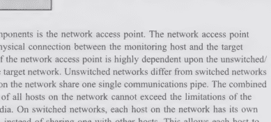

其中第一个组件是网络访问点。网络访问点提供监控主机与目标网络之间的实际物理连接。网络访问点的放置高度取决于目标网络的非交换/交换性质。非交换网络与交换网络不同，因为网络上的主机共享一条单一的通信管道。网络上所有主机的综合带宽利用率不能超过物理传输介质的限制。在交换网络上，网络上的每个主机都有自己的通信管道，而不是与其他主机共享一条管道。这使得每个主机都能充分利用物理传输介质的限制，从而使网络的整体综合带宽利用率远高于物理传输介质的限制。

例如，8 端口 100Mbps 交换机可允许每个端口使用高达 100Mbps 的带宽，使最大整体综合带宽利用率达到 800Mbps。

网络访问点的放置还非常取决于网络本身的整体结构。在简单的单段网络中，访问点的放置是一项简单的任务。然而，对于大型分段网络，必须对访问点的放置进行更多思考。本章“网络监控系统部署”部分进一步讨论了网络访问点放置的主题。

流经网络访问点的原始数据流量由网络监控系统的第二个组件捕获：监控主机的低级数据捕获机制。Red Hat Linux 可以支持两种不同的网络数据捕获技术。它们是 SOCK_PACKET 接口和 Linux TurboPacket 接口。图 16.2 说明了 SOCK_PACKET 接口。

### 图 16.2 Linux SOCK_PACKET 接口。

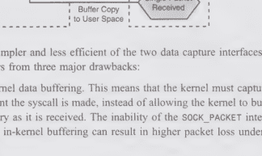

SOCK_PACKET 是 Linux 下支持的两种数据捕获接口中更简单、效率更低的一种。它存在三个主要缺点：

- 缺乏内核内数据缓冲。这意味着内核必须在发出 syscall 的瞬间捕获网络数据，而不是允许内核在接收数据时将数据包数据缓冲到内存中。SOCK_PACKET 接口无法执行内核内缓冲的能力可能导致在网络负载较重时数据包丢失增加。
- 每次 syscall 只能捕获一个数据包。在 Linux 下，syscall 在系统资源使用方面代价昂贵。每次监控系统执行 syscall 时，都需要从用户空间到内核空间的操作系统上下文切换。在传输大量小数据包的网络条件下，可能会发生严重的数据包丢失。
- 每个数据包都需要内核空间到用户空间的内存复制。SOCK_PACKET 接口必须将内核数据包捕获机制接收到的数据包数据从内核空间缓冲区复制到用户空间缓冲区。这种额外的内存复制可能会进一步降低数据包捕获性能水平。

图 16.3 说明了 Linux TurboPacket 接口。

### 图 16.3 Linux TurboPacket 接口。

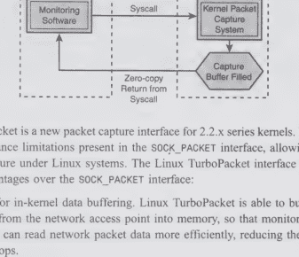

Linux TurboPacket 是面向 2.2.x 系列内核的新数据包捕获接口。它解决了 SOCK_PACKET 接口中存在的所有性能限制，允许在 Linux 系统下进行高速数据捕获。Linux TurboPacket 接口相对于 SOCK_PACKET 接口具有以下优点：

- 支持内核内数据缓冲。Linux TurboPacket 能够将从网络访问点接收到的数据缓冲到内存中，以便监控系统进程更高效地读取网络数据包数据，减少数据包丢失的可能性。
- 每次 syscall 可捕获多个数据包。
- 零拷贝数据包捕获机制。

Linux TurboPacket 接口尚未成为官方 Linux 内核源代码树的一部分。相反，它必须作为补丁应用，并且必须从源代码重新构建 Linux 内核。目前，Linux TurboPacket 补丁仅适用于 Linux 内核 v2.2.4。可能需要进行源代码修改以允许补丁与不同内核版本成功运行。

要为 Linux TurboPacket 接口修补您的 Linux 内核，您必须执行以下操作：

- 1. 从以下位置下载 TurboPacket 包：
  `ftp://ftp.inr.ac.ru/ip-routing/lbl-tools/kernel-turbopacket.dif.gz`
- FTP 镜像站点：
  `ftp://ftp.funet.fi/pub/mirrors/ftp.inr.ac.ru/ip-routing/lbl-tools/`
  `ftp://ftp.src.uchicago.edu/pub/linux/ip-routing/lbl-tools/`
  `ftp://ftp.crc.ca/pub/systems/linux/ip-routing/lbl-tools/`
- 2. 将当前工作目录更改为 Linux 内核源代码树的目录，并使用以下命令将补丁应用到源代码树：
  ```
  # patch < kernel-turbopacket.dif
  ```
  > **Note**
  > 如果 kernel-turbopacket 补丁位于内核源代码树以外的目录中，请务必在命令行中包含补丁文件的路径。
- 3. 如果您尚未以 root 身份运行，请使用 su 命令切换为 root，以便内核能够正确安装。
- 4. 编译并安装新内核。
- 5. 重启。

大多数网络监控系统不会直接访问内核数据包捕获机制，而是使用数据包捕获 API。API 为监控系统提供对捕获数据包数据的便捷访问，屏蔽内核数据包捕获机制的低级细节。这使得网络监控软件能够使用不同的内核数据包捕获机制，而无需更改实际监控系统的源代码。Linux 可用的标准数据包捕获 API 是 libpcap，它是由 Lawrence Berkeley 国家实验室网络研究组创建的系统无关的数据包捕获接口。

要为您的系统添加 libpcap 支持，您必须执行以下操作：

- 1. 下载 libpcap 包和任何所需的补丁（取决于您想要使用的内核数据包捕获机制）。
  libpcap:
  ftp://ftp.ee.lbl.org/libpcap-0.4.tar.gz
  SOCK_PACKET 接口所需补丁：
  None.
  Linux TurboPacket 接口所需补丁：
  ftp://ftp.inr.ac.ru/ip-routing/lbl-tools/kernel-turbopacket.dif.gz
  ftp://ftp.inr.ac.ru/ip-routing/lbl-tools/libpcap-0.4.current.dif.gz
  镜像：
  ftp://ftp.funet.fi/pub/mirrors/ftp.inr.ac.ru/ip-routing/lbl-tools/
  ftp://ftp.src.uchicago.edu/pub/linux/ip-routing/lbl-tools/
  ftp://ftp.crc.ca/pub/systems/linux/ip-routing/lbl-tools/
- 2. 将当前工作目录更改为 libpcap 源代码树的目录，并使用以下命令将任何所需的补丁应用到该树：
  ```
  # patch < _patch_file
  ```
  > **Note**
  > 如果补丁文件位于 libpcap 源代码树以外的目录中，请务必在命令行中包含补丁文件的路径。
- 3. 如果您尚未以 root 身份运行，请使用 su 命令切换为 root，以便 libpcap 能够正确安装。
- 4. 使用以下命令序列编译并安装 libpcap 包：
  ```
  # ./configure
  # make
  # make install
  ```

监控主机的包捕获机制将收集到的网络数据传递给网络监控系统的第三个组件：分析引擎本身。数据包分析引擎执行网络协议解码，并在某些情况下执行网络会话重建。统计信息收集和趋势检查等任务也由网络分析引擎处理。

监控系统执行协议解码，以便从捕获的数据包数据中提取信息。在解码活动发生之前，数据包是原始无形式的数据。使用协议模板，该模板允许将原始数据映射到数据包头和数据有效负载，之前无用的数据包数据提供了关于网络活动的丰富信息。高级监控系统允许创建自定义用户定义协议模板，从而允许解码和分析几乎无限数量的传输协议。


网络监控系统的分析引擎使用系统的第四个组件——数据记录机制，将收集到的数据（包括统计信息、趋势历史和实际捕获的报文数据）存储到磁盘上。这些机制的复杂程度从简单的文本输出到先进的缓冲数据库存储技术不等。无论使用何种数据存储方法，速度始终被视为一个非常重要的问题。如果网络监控系统无法以足够快的速度记录数据，它将无法存储捕获的数据和统计信息，从而变得毫无用处。

要使网络监控系统真正有用，它收集的信息必须以易于理解的格式呈现。这一任务由网络监控系统的第五个组件处理：用户界面。良好的用户界面将允许显示不同类型的网络统计信息，包括网络利用率信息、活动网络主机列表、协议统计信息等。输出信息应采用人类可读的格式，并可选择将数据写入文件以供第三方应用程序处理。

一个良好的网络监控系统必须满足以下几个关键要求才能得到正确使用：

- 网络监控系统硬件可移植性。
- 与一种或多种网络拓扑的兼容性。
- 能够以线速或接近线速进行监控。
- 能够存储大量捕获的数据/统计信息。
- 能够在多个协议栈层上解码网络流量。

其中第一个是可移植性。在复杂的分段网络中，监控系统必须能够轻松地从一个段移动到另一个段。这使得在网络问题出现并需要立即诊断时能够快速部署。

下一个要求是监控系统能够与目标网络上使用的所有物理传输介质接口。例如，如果一个网络由通过 FDDI 主干连接的 100Mbps 以太网段组成，那么合适的网络监控系统应能够从以太网和 FDDI 接口捕获数据。能够以线速或接近线速监控报文数据是一项重要要求，如果网络监控系统要真正有用。丢弃了大量网络报文的系统将无法提供准确的数据，使系统毫无用处。

良好的网络监控系统还需要能够快速存储大量捕获的报文数据和/或网络统计信息。这意味着系统必须能够访问大量可用磁盘空间，并且存储介质支持良好的写入速度。例如，将捕获的报文数据直接记录到磁带备份驱动器或 CD 烧录机上是个坏主意，因为这两种介质都不支持非常快的访问速度。

网络监控系统的最后一个要求是它能够在协议栈的多个层上检查捕获的报文数据。协议栈对网络报文数据应用智能，允许以数据报和流连接的形式与其他主机的协议栈交换消息。现代协议栈以多层处理数据，允许不同形式的通信通过较低的传输层发送。为了使网络监控系统在网络故障诊断和数据事务监控方面真正有用，它必须能够解码捕获的报文数据并在这些协议栈层的每一层上检查它。

部署网络监控系统必须经过仔细的思考和规划，否则从监控操作中获得的信息将几乎没有实际用途。这是因为现代计算机网络可能极其复杂，除非监控系统连接到适当的网络接入点，否则它将无法成功捕获所需用于分析的数据流量。目前存在几种部署方法，列举如下：

| 部署方法 | 描述 |
|---|---|
| 非交换式监听 | 监控流经非交换式网络集线器的所有通信。 |
| 端口监听 | 监控交换机上特定端口的进出所有通信。 |
| 电路监听 | 监控交换机上两个特定端口之间的所有通信。 |
| 交换机监听 | 监控流经交换机的所有通信。 |

在交换式网络段上执行监控操作时，某些网络集线器比其他集线器更适合此工作。最好使用支持监控端口功能的集线器。监控端口是一种专用网络接入端口，可以配置为接收发往另一端口的流量或流经集线器的所有流量。

以下是具有监控端口功能的几个交换式集线器：

- 3Com SuperStack LinkSwitch 2200.
- 3Com LANplex 2016, 2500, and 6000.
- SMC EliteSwitch ES/1 and ES/1 ATX.
- Bay Networks Model 28000.
- Bay Networks Model 3000 with the 3328 host module.
- Cisco Catalyst 5000 (software version 2.1 or greater).
- Cisco Catalyst 1200 (software version 3.0 or greater).
- Cisco EtherSwitch EPS-2115M.
- Cisco Catalyst 1700.

## 嗅探器

嗅探器是一种网络监控系统，可捕获网络会话和数据报传输的实际内容。嗅探器是极其强大的实体，因为它们允许存储和分析网络上发生的协议和应用层活动。这意味着嗅探器能够监控特定用户或应用程序网络会话的协议信息和内容，暴露诸如拒绝服务攻击尝试、密码传输、网络或应用程序配置错误等信息，等等。

嗅探器通过根据特定过滤条件捕获网络报文数据并提取接收报文的有效载荷内容来工作。高级嗅探器支持一种称为网络会话重建的技术，该技术允许跨越多个报文的数据传输被重新组装成单一连贯的通信流。

图 16.4 说明了 tcpdump，目前是 Linux 平台中最流行的网络嗅探器。Tcpdump 显示了从活动网络嗅探到的已解码数据报文。

图 16.4
tcpdump 网络嗅探器。


Tcpdump 是一种可用于网络监控和数据采集目的的网络嗅探器。它解码并打印捕获报文的协议头信息，也可用于提取网络会话的实际内容。Tcpdump 是劳伦斯伯克利实验室网络研究组的产品（该小组也是 libpcap 报文捕获 API 的开发组）。它最初基于 Sun Microsystems Incorporated 编写的 etherfind 实用程序。tcpdump 程序最初由 Van Jacobson 作为研究项目的一部分编写。后来由 Steven McCanne 重写，删除了 etherfind 实用程序中的所有代码片段。使用了洁净室编程技术，以确保重写的 tcpdump 版本基于 100% 免费的非专有源代码，且不存在可能的许可证冲突问题。

要将 tcpdump 安装到您的系统，您必须执行以下操作：

- 1. 从以下位置下载 tcpdump 包：
  `ftp://ftp.ee.lbl.gov/tcpdump-3.4.tar.Z`
- 2. 如果您尚未以 root 身份运行，请使用 su 命令切换为 root，以便 tcpdump 能够正确安装。
- 3. 使用以下命令序列编译并安装 tcpdump 包：
  ```
  # ./configure
  # make
  # make install
  ```

### 注意

tcpdump 包也作为预编译的二进制 RPM 包含在 Red Hat 6.0 发行版中。您可以通过执行以下命令（以 root 身份）安装 tcpdump 二进制文件：

`rpm -Uvh /[RedHat_6.0_Mount_Point]/RedHat/RPMS/tcpdump-3.4-10.1386.i386.rpm`

由于 tcpdump 需要使用需要 root 权限才能访问的内核级报文捕获设施，因此它以 setuid root 安装。该程序还被设置为仅可由 "wheel" 组执行，以防止普通用户执行网络嗅探操作。Tcpdump 的执行方式如下：

`# tcpdump command-line-options`


## 注

tcpdump 包默认安装在 /usr/local/sbin 目录中。请确保该目录已列在您的执行路径中，或在命令行中显式指定该目录。

tcpdump 程序的命令行选项在相关手册页和表 16.1 中有描述。

## 表 16.1 Tcpdump 命令行选项

| 选项 | 描述 |
|---|---|
| -c count | 处理 count 个数据包后终止程序执行。 |
| -d | 将任何编译后的数据包过滤代码转储到 stdout 文件描述符并终止程序执行。 |
| -e | 对每个被捕获和处理的数据包，打印其关联的链路层头。 |
| -f | 不对外部 Internet 地址执行地址解析。 |
| -F file | 使用 file 中列出的任何表达式对捕获的数据包进行过滤。需要注意的是，使用此选项会导致命令行中给出的任何过滤选项被忽略。 |
| -i interface | 从特定网络接口设备捕获数据包。如果未给出此选项，tcpdump 将尝试自动查找活动网络接口，如果存在多个活动接口，则使用编号最低的设备。 |
| -l | 强制程序输出进入行缓冲模式。如果将输出数据通过管道传输到另一个正在运行的程序中，并希望允许逐行处理打印的数据，则此选项很有用。 |
| -n | 不将系统主机地址或端口号解析为字母数字符号名称。 |
| -N | 打印已解析的主机名时，不打印其域名限定信息。 |
| -O | 防止运行数据包过滤代码优化器。此选项通常永远不会使用，除非怀疑代码优化器例程存在错误。 |
| -p | 在程序执行时不强制网络接口设备进入混杂模式。需要注意的是，使用此选项并不能保证混杂模式会被禁用；它只是防止运行中的 tcpdump 实例显式打开该模式。 |

## 表 16.1 继续

| 选项 | 描述 |
|---|---|
| -q | 输出每个数据包的更少详细的数据包解码信息。 |
| -r file | 处理存储在 file 中的数据包数据，而不是从实时网络接口捕获数据。如果 file 指定为 "-"，则 stdin 文件描述符用作输入源。 |
| -s length | 捕获每个处理的数据包最多 length 字节的数据。此选项允许通过防止主机的数据包捕获例程检索不需要的数据来优化网络嗅探性能。仅捕获分析任务所需的数据有助于在监控高速网络时防止数据包丢失。如果由于此选项导致捕获的数据包中包含的协议信息被截断，则会输出 [|proto|] 指示符，其中 proto 是发生数据截断的数据包的协议层。如果未给出此命令行选项，tcpdump 默认捕获每个接收数据包 68 字节的数据。 |
| -S | 打印传输的 TCP 序列号的真实值。如果未设置此选项，tcpdump 将尝试跟踪 TCP 虚拟电路的序列号状态信息，相对于 0 打印序列号信息。 |
| -t | 禁用每个捕获数据包的时间戳信息输出。 |
| -tt | 为每个捕获的数据包输出未格式化的时间戳。 |
| -v | 以更高详细程度输出协议解码信息。 |
| -vv | 以最高可用详细程度输出协议解码信息。 |
| -w file | 将捕获的二进制数据包数据写入 file。此选项的使用将阻止解码协议信息的输出。如果 file 指定为 "-"，则二进制数据包信息输出到 stdout。 |
| -x | 以十六进制格式输出接收到的数据包数据，不包括链路层协议头。 |
| expression | 根据 expression 过滤捕获的数据包。仅当 expression 评估为 true 时，数据包才会被处理和显示。有关如何过滤传入流量的详细信息，请参阅本章的“分析流量类型”部分。 |

## 嗅探器的用途

嗅探器是检测网络错误配置、执行协议分析和监控用户活动极其有价值的工具，因为它们执行的是应用级协议分析。由于它们能够捕获网络会话的实际内容，而不仅仅是协议头信息，因此可以提供对网络活动的极其深入的视图。

拒绝服务攻击会使网络服务器瘫痪。管理员可以使用嗅探器检测何时对网络上的主机发起拒绝服务攻击。快速检测可以更快、更有效地从攻击中恢复。tcpdump 的协议解码能力可用于实时检测攻击。

以下是常见网络拒绝服务攻击的类型以及如何使用 tcpdump 检测它们：

- **SYN 洪泛**—SYN 洪泛是一种常见的拒绝服务攻击类型，涉及向目标主机发送大量无效连接请求。目标主机的连接队列最终会填满，进一步的连接请求（包括合法请求）将被拒绝。可以使用以下 tcpdump 命令检测到特定 IP 地址的 SYN 洪泛：

```
# tcpdump tcp host ip_address
```

Tcpdump 将输出主机 ip_address 的解码 tcp 协议信息。极大量的 TCP SYN 数据包（在输出协议信息中由 S 标志指定）可能表明 SYN 洪泛攻击。

- **Ping of Death**—Ping of Death 是一种利用许多主机 TCP/IP 网络栈中分片数据包重组子系统缺陷的攻击。它涉及向易受攻击的主机发送超大分片数据包，当重组后，会导致数据包长度标识符溢出为负值。处理此类数据包通常会导致易受攻击机器的 TCP/IP 栈崩溃。可以使用以下 tcpdump 命令检测到特定主机的 Ping of Death 攻击：

```
# tcpdump dst host ip_address
```

Tcpdump 将输出发往主机 ip-address 的解码协议信息。组合偏移长度大于 65,535 的 IP 分片表明 Ping of Death 攻击。

- **Smurf**—Smurf 涉及向网络的广播地址发送 ICMP ping 请求。在易受 smurf 攻击的网络上，接收到 ping 请求的每个活动主机都会生成响应。这可能导致生成极高的网络负载条件。可以使用以下 tcpdump 命令检测 Smurf 攻击：

```
# tcpdump icmp dst host broadcast-address
```

Tcpdump 将输出发往指定网络广播地址的解码 ICMP 协议信息。任何 ICMP ping 请求通常表明 smurf 攻击。

嗅探器也是诊断网络错误和错误配置的极其有价值的工具。许多这些问题否则难以或不可能检测到，因为它们发生在受影响主机的低级网络栈中。tcpdump 程序允许在最低可能的级别检查网络对话，从而轻松诊断此类问题。

以下是常见网络问题的列表以及如何使用 tcpdump 检测它们：

- **重复的 IP**—如果怀疑网络上有两个主机使用相同的 IP 地址，则可以通过发出以下 tcpdump 命令检测此类活动：

```
# tcpdump -e host ip-address
```

Tcpdump 将输出指定 IP 地址的解码协议信息，以及每个捕获数据包的链路层头。输出信息必须检查是否两个不同的 MAC 地址试图使用相同的 IP 地址。

- **ARP 错误**—可以通过发出以下 tcpdump 命令检测 ARP 错误和错误配置：

```
# tcpdump arp
```

Tcpdump 将输出从网络捕获的任何解码 ARP 信息。过多的“who-has”请求可能表明 ARP 错误配置问题。

- **路由问题**—可以使用以下 tcpdump 命令检测数据路由问题：

```
# tcpdump icmp
```

Tcpdump 将输出从网络捕获的任何解码 ICMP 协议信息。ICMP 错误消息例如主机不可达可能表明路由错误配置或其他网络可达性问题。


## 嗅探器的危险

网络嗅探器是功能强大的工具，可让网络数据包和会话轻松被检查。如同其他任何形式的权力一样，这也可能被滥用。黑客和其他恶意个人可以使用嗅探器进行网络监视、间谍活动和协议级攻击。嗅探技术还可用于破坏个人隐私。用户进行的任何网络活动都可能被嗅探器监控；这包括电子邮件、聊天会话、网页浏览活动以及任何其他形式的网络通信。

了解在非交换式网络环境中，任何用户都能够执行与管理员相同的监控活动是很重要的。因此，任何在您的非交换式网络上拥有主机管理员级访问权限的用户都能够执行网络监视。主机不必是功能强大的 UNIX 工作站才能执行监控活动，因为几乎所有网络功能操作系统都存在嗅探软件。能够进行此类监控活动的人员会对网络的安全性和整体稳定性构成严重威胁。帐户密码可能会被捕获，从而允许未经授权访问网络服务器，敏感信息（如传输的文件和电子邮件）可能被窃取，而被捕获的信息可用于协助协议级攻击。

使用嗅探技术也会带来与个人隐私相关的问题。因为嗅探器会捕获网络传输的实际内容，因此所有用户活动都可能被监控和记录。过度使用这些功能会创建一个“老大哥”类型的网络环境，在许多情况下这是相当不期望的。

了解使用网络嗅探器相关的法律危险是很重要的。美国政府认为使用嗅探器是一种窃听形式。未经授权的嗅探活动构成严重犯罪，并且还存在在用户不知情的情况下嗅探用户活动的问题。美国司法部、总诉讼和法律咨询处、刑事司建议网络管理员事先通知所有用户可能会发生监控活动。可能进行的监控活动的通知通常通过使用文本横幅给出。可能的横幅示例如下：

This system is for the use of authorized users only. Individuals using this computer system without authority, or in excess of their authority, are subject to having all of their activities on this system monitored and recorded by system personnel.

In the course of monitoring individuals improperly using this system, or in the course of system maintenance, the activities of authorized users may also be monitored.

Anyone using this system expressly consents to such monitoring and is advised that if such monitoring reveals possible evidence of criminal activity, system personnel may provide the evidence of such monitoring to law enforcement officials.

管理员应根据其网络监控指南的具体情况调整使用的任何横幅。

由于嗅探器在网络安全和用户隐私方面可能带来非常重大的危险，因此制定保护策略是很重要的。目前最常用的有两种保护策略：

- 加密
- 交换式网络

加密允许网络流量被混淆，以便只有经过适当身份验证的接收者才能查看其真实内容。在非交换式环境中，加密可以快速且经济地防止未经授权的嗅探。它不需要对网络布局或设备进行任何更改，因此可以仅作为软件解决方案实现。

交换式网络也可用于防止未经授权的嗅探活动。它只允许特定目的地为网络主机或广播给所有主机的流量通过相关的网络接入点传输。这使得嗅探其他主机的网络流量变得不可能。

## 流量分析器

流量分析器是网络问题诊断和解决以及性能优化的宝贵工具。它们提供对网络活动的清晰视图，显示计算机网络上正在发生什么以及未发生什么。在没有流量分析器的帮助下，一些网络问题（如瓶颈和协议级错误配置）将极难甚至不可能检测到。

流量分析器通过捕获在网络上传输的数据包，随后执行协议解码和/或统计收集来工作。管理员可以使用从流量分析器收集的信息执行基线和趋势分析操作，以便优化网络性能并解决问题。

图 16.5 说明了 ntop，这是一款在 Linux 平台中流行的网络流量分析器。

Ntop 是一种流量分析器，其报告网络使用的方式类似于 UNIX 命令 top。它由意大利比萨大学 Centro SERRA 的 Luca Deri 编写。Ntop 最初基于 pcap 程序，但已从其原始代码库进行了大量修改和扩展。

### 图 16.5

ntop 网络流量分析器。

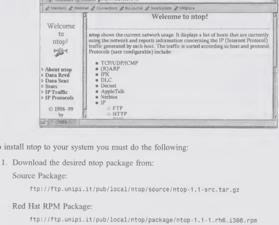

要将 ntop 安装到您的系统，您必须执行以下操作：

- 1. 从以下位置下载所需的 ntop 软件包：
  源代码包：
  ftp://ftp.uni.pi.it/pub/local/ntop/source/ntop-1.1-src.tar.gz
  Red Hat RPM 软件包：
  ftp://ftp.uni.pi.it/pub/local/ntop/package/ntop-1.1-1.rh6.1386.rpm
- 2. 如果您尚未以 root 身份运行，请使用 su 命令成为 root，以便 ntop 能够正确安装。
- 3. 使用以下命令序列编译并安装 ntop 软件包：
  源代码包：
  # ./configure
  # make
  # make install
  Red Hat RPM 软件包：
  # rpm -Uvh ntop-1.1-1.rh6.1386.rpm

Ntop 的执行方式如下：

```
# ntop command-line-options
```

### 注意

ntop 软件包默认安装在 /usr/local/sbin 目录中。请确保此目录已列在您的执行路径中，或在命令行中显式指定该目录。

ntop 程序的命令行选项在相关手册页和表 16.2 中有描述。

### 表 16.2 Ntop 命令行选项

| 选项 | 描述 |
|---|---|
| -r delay | 在每次 ntop 更新之间暂停 delay 秒。如果 ntop 设置为输出到文件，则每隔 delay 秒写入一次数据。如果未指定此选项，则默认延迟期为 3 秒。 |
| -d | 以守护进程模式运行 ntop。这允许 ntop 从其控制终端分离，以便即使用户已注销后仍可在后台继续运行。此选项仅在同时指定 -w 选项时可用。 |
| -f file | 允许 ntop 从 tcpdump 数据包捕获文件读取，而不是从活动网络接口读取。 |
| -n | 不对系统主机地址进行解析为字母数字符号名称。 |
| -p proto_list | 设置 ntop 将监控并输出统计数据的协议列表。此选项还允许为监控的协议设置自定义显示标签。proto_list 的格式如下：label_service_list,label=service_list label 指定 ntop 用于标识 service_list 中列出的协议的显示标签。service_list 指定要监控的一组协议。其格式如下：service;service;service service 是与 /etc/services 文件中的条目匹配的文本标识符。它指定 ntop 应监控的特定协议。 |
| -i interface | 从特定网络接口设备捕获数据包。如果未给出此选项，ntop 将尝试自动查找活动网络接口，如果存在多个活动网络接口，则使用编号最低的设备。 |
| -w port | 强制 ntop 以 Web 模式输出网络统计信息。Ntop 使用其内置的 Web 服务器为客户端请求提供服务。该 Web 服务器将在 port 上监听客户端请求。对 ntop Web 服务器的身份验证通过 ~/.ntop 配置文件处理。该文件格式如下：username password |


### 表 16.2 继续

| 选项 | 描述 |
|---|---|
| -m subnet_list | 指定 ntop 应根据 subnet_list 视为本地网络的子网。subnet_list 的格式如下：network_address/subnet_mask, network_address/subnet_mask |
| -l log_delay | 强制 ntop 将网络数据记录到文件 ntop.log 中。 |
| -F expr_list | 允许 ntop 根据 expr_list 为特定网络流量组生成统计信息。这些统计信息只有在 ntop 以 Web 模式运行时才可查看。expr_list 的格式如下：label=expression,label=expression label 指定 ntop 用于标识 expression 指定的流量流的显示标签。expression 指定用于标识网络流量的流量过滤表达式。有关创建过滤表达式的信息，请参阅本章“分析流量类型”部分。 |
| expression | 根据 expression 过滤捕获的数据包。只有当 expression 评估为 true 时，数据包才会被处理和显示。有关如何过滤传入流量的详细信息，请参阅本章“分析流量类型”部分。 |

ntop 程序可以在两种不同的执行模式之一下运行。其中第一个是交互模式，它允许程序输出实时显示在终端窗口中。此执行模式如图 16.6 所示。

### 图 16.6
ntop 交互式执行模式。

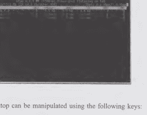

在交互模式下使用时，ntop 可使用以下键进行操作：

- q — 强制 ntop 退出程序执行。
- n — 更改输出主机地址的模式。支持以下模式：
  - **IP Address** — 一个数字 IP 地址。
  - **Symbolic Hostname** — 如 `/etc/hosts` 文件中指定或从 DNS 服务器解析的符号主机名。
  - **MAC Address** — 一个以太网 MAC 地址。
  - **Board Manufacturer** — 指定每个网络主机使用的网络接口硬件制造商的文本标识符。
- p — 更改输出流量信息的模式。支持以下模式：
  - **Percentage** — 以发送的总流量的百分比形式显示流量信息。
  - **Absolute** — 以表示发送数据量的绝对值形式显示流量信息。
  - **Throughput** — 以每秒发送的数据量格式显示流量信息吞吐量。
- l — 更改 ntop 输出信息的类型。支持以下类型：
  - **local** — 显示被归类为位于本地网络内部的主机的网络信息。
  - **remote** — 显示被归类为位于远程网络内部的主机的网络信息。
- d — 设置 ntop 按空闲时间或发送/接收的数据量对主机进行排序。
- t — 设置 ntop 按发送或接收的数据对主机进行排序。
- y — 设置 ntop 按其关联的协议标识符对主机进行排序。
- `<space>` — 在额外列中切换显示额外的网络流量信息。

ntop 支持的第二个执行模式是 Web 模式；它允许多个本地或远程用户通过 Web 浏览器监控程序输出。ntop Web 模式如图 16.7 所示。

在 Web 模式下使用时，ntop 可通过从 HTML 浏览器显示窗口左侧框架中选择若干不同的流量视图进行操作。这些提供了在 ntop 交互模式下不可用的额外信息。表 16.3 列出了可用的视图。

### 图 16.7
ntop Web 执行模式。

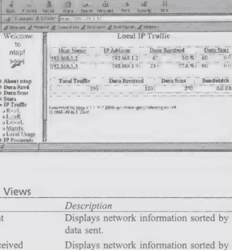

### 表 16.3 ntop 流量视图

| 视图名称 | 描述 |
|---|---|
| 按发送数据排序流量 | 按发送的数据量对网络信息进行排序显示。 |
| 按接收数据排序流量 | 按接收的数据量对网络信息进行排序显示。 |
| 流量统计 | 显示总体流量统计信息。 |
| 活动主机列表 | 显示在网络上活动发送或接收数据的的 主机列表。 |
| 远程到本地 IP 流量 | 显示从远程网络主机流向本地网络主机的流量的网络信息。 |
| 本地到远程 IP 流量 | 显示从本地网络主机流向远程网络主机的流量的网络信息。 |
| 本地到本地 IP 流量 | 显示从本地网络主机流向本地网络主机的流量的网络信息。 |
| 活动 TCP 会话列表 | 显示当前在网络上活动的 TCP 会话列表。 |
| IP 协议分布统计 | 显示 ntop 识别的 IP 协议的流量分布统计信息。 |
| IP 协议使用情况 | 显示 ntop 识别的 IP 协议的使用信息。 |
| IP 流量矩阵 | 以表格格式显示流量流信息矩阵。 |

## 确定网络瓶颈

网络瓶颈是两台联网主机之间路径中的一个点，在该点可用带宽受到相当大的限制。瓶颈通常会导致严重的网络性能下降问题。瓶颈可能由多种不同因素引起，包括网络配置错误、硬件错误和超负荷的服务器。流量分析器是检测网络瓶颈的有价值工具，因为它们允许查看和分析流量流统计信息以发现异常。

ntop 流量分析器是检测网络瓶颈的有用工具，因为它通过易于使用的界面向管理员提供各种统计流量流信息。它还通过使用数据流过滤表达式，使追踪网络瓶颈的来源变得更容易。这些允许为匹配特定用户定义过滤条件的的数据包流收集统计信息。

在尝试检测网络瓶颈时，ntop 工具在以 Web 模式执行时最有用。ntop Web 模式提供了交互模式下不可用的许多类型的网络统计信息。此额外信息有助于分析网络流量和检测瓶颈状况。

表 16.4 是在尝试检测网络瓶颈时可能有用的 ntop 信息查看模式列表。

### 表 16.4 用于检测瓶颈的 ntop 流量视图

| 视图名称 | 描述 |
|---|---|
| 按接收数据排序流量 | 允许显示发送或接收数据最多的主机。这些模式在尝试确定网络服务器是否因客户端请求而过载时可能很有用。 |
| 按发送数据排序流量 |  |
| 远程到本地 IP 流量 | 显示本地网络主机之间、流向远程网络或从远程网络流出的流量的统计信息。这些模式在尝试确定网络瓶颈位于内部网络还是外部网络时可能很有用。 |
| 本地到远程 IP 流量 |  |
| 本地到本地 IP 流量 |  |
| IP 协议分布统计 | 这些模式显示有关 IP 协议使用情况的信息。它们在尝试确定网络上使用最多带宽的协议时可能很有用。 |
| IP 协议使用情况 |  |
| IP 流量矩阵 | 以表格格式显示 IP 流量流信息。允许并排比较流统计信息，以便检测异常。 |

ntop 输出的统计信息也可用于执行基线操作以帮助检测未来的网络瓶颈。基线涉及定期捕获流量流统计信息以生成基线值，以便将未来的流采样与之进行比较。如果未来的采样不落在基线值的合理范围内，它们可能表明发生了瓶颈。

## 分析流量类型

Tcpdump 和 ntop 可用于通过过滤表达式分析特定类型的网络流量。只有当过滤表达式评估为 true 时，捕获的数据包才会被处理和显示。

过滤表达式由一个或多个过滤命令组成，也称为原语。原语组可通过使用逻辑运算符进行评估，以允许复杂的包过滤活动。

一个原语由以下组件组成：

```
[Qualifier Group] [Primitive ID]
```

限定符组由一个或多个限定符元素组成，每个元素用于限制捕获的流量的类型。这些限定符元素还设置了在过滤操作期间与原语 ID 一起使用的上下文。

表 16.5 列出了支持的限定符类型。

### 表 16.5 网络流量过滤限定符

| 限定符类型 | 描述 |
|---|---|
| type | 类型限定符。这些为其关联的原语 ID 分配特定数据类型以用于过滤比较。以下类型限定符可用：host, net, port |
| direction | 数据流方向限定符。这些允许为过滤比较指定特定方向。以下方向限定符可用：src, dst |
| protocol | 传输协议限定符。这些允许将捕获的数据流量限制为特定协议类型。以下协议限定符可用：ether, fddi, ip, arp, rarp, decnet, lat, moprc, mopdl, tcp, udp |

原语 ID 是一个数值或字母数字名称，与其关联的限定符元素一起用于创建完整的过滤语句。原语 ID 可以表示主机名、IP地址、端口号和其他过滤值。


复杂的过滤语句可以通过使用与逻辑运算符和带括号的表达式组合在一起的原语来构建。

逻辑运算符允许以比较的方式检查多个过滤原语。表 16.6 列出了受支持的逻辑运算符。

## 表 16.6 网络流量过滤运算符

| Operator | Description |
|---|---|
| !, not | 否定运算符。只有当其关联的原语语句返回 false 时，这些运算符才求值为 true。 |
| &&, and | 串联运算符。这些运算符需要两个原语语句，如果两个原语都返回 true，则求值为 true。 |
| ||, or | 选择运算符。这些运算符需要两个原语语句，如果一个或两个原语返回 true，则求值为 true。 |

逻辑运算符的使用方式如下：

```
[Primitive] [Operator] [Primitive]
```

示例：port ftp && host 192.168.1.5

带括号的表达式允许将一组过滤表达式作为单个“虚拟”原语一起求值。然后此“虚拟”原语可用于更高级别的过滤求值。带括号的表达式的使用方式如下：

```
( [Expression] )
```

示例：( port ftp )

原语、逻辑运算符和带括号的表达式可以组合使用，以实现极其复杂的分层数据包过滤活动。这些元素组合的示例为

```
( port ftp ) || ( port http ) && host 192.168.1.4
( port http ) || ( port http )
```

使用过滤表达式使监控特定类型的网络流量变得容易。它们提供复杂的内核空间数据包分析功能，将任何过滤活动从需要在用户空间网络监控系统中进行的情况中卸载。这提供了更快的性能水平并简化了监控软件源代码，因为监控系统本身不必担心任何数据包过滤任务。

使用本节概述的表达式编写技术，可以捕获并检查网络上传输的任何类型的数据流量。这些表达式提供了几乎无限的过滤功能。

## 摘要

网络监控可以成为检测对活动主机的攻击、确定网络瓶颈以及提供对网络上发生的活动的深入总体视图的有力工具。本章所述的技术将使您能够在计算机网络上成功部署和使用此类监控系统。

### 与 Windows NT 网络集成

### 本章内容

- 按 Windows 方式联网 462
- 在 NT 环境中使用 Linux 和 Samba 464

随着 Linux 在企业网络环境中日益普及，与现有网络操作系统的互操作性至关重要，而 Linux 在这方面做得很好。本章介绍 Linux 和 Windows 如何使用当今 Linux 上最令人兴奋的软件产品之一 Samba 相互通信。我们首先回顾 Windows 网络的基本要素及其描述中使用的术语，然后介绍如何设置 Linux 和 Samba 以充当 Windows 网络中的客户端或服务器。

## 按 Windows 方式联网

Windows 98 和 Windows NT 中包含的网络支持是多年演进的结果，其始于个人计算早期由 IBM 开发的 NetBIOS 文件共享协议。这一简单协议在多年中不断增强，最终演变为会话消息块，即 SMB 协议，并最终演变为通用 Internet 文件系统，即 CIFS。为了更好地理解 Windows 网络的工作方式，让我们从一些定义开始，然后再看一个使用 Windows NT 为 Windows 98 客户端提供文件和打印服务的简单网络设置。

### 术语说明

理解任何技术的关键之一是理解该技术从业者使用的术语。本节定义了描述 Windows 网络时使用的一些术语。目的不是让你精通 Windows 网络的语言，而只是介绍设置 Samba 时需要了解的几个术语。

工作组或域是指网络上查询共享资源公共浏览数据库的一组机器。工作组和域的主要区别在于域共享安全信息，而工作组不共享。每个 Windows 网络都由一个或多个工作组或域组成，并且你的设置必须为 Samba 定义一个域或工作组。

浏览是指通过操作系统提供的任何接口访问公共数据库的行为。对于 Windows 98 和 Windows NT，此接口通常是 Windows 资源管理器。OS/2 的浏览接口是 Workplace Shell，Linux 的是 smbclient。

主浏览器是域或工作组中维护其他组成员浏览的共享资源数据库的机器。主浏览器有两种类型：

- *域主浏览器* 持有整个域的主浏览数据库，该域可能跨一个或多个子网。
- *本地主浏览器* 持有本地子网的主浏览数据库，并查询域主浏览器以获取其他子网上资源的信息。

### 一个简单的 NT 网络

为了更好地理解 Linux 和 Samba 如何集成到你的网络中，让我们先检查一个简单的 Windows 网络，查看每个部分以及它们如何组合在一起。我们的网络将由单个域组成。Windows 域由以下部分组成：

- 一个主域控制器（PDC）
- 一个或多个备份域控制器（BDC）
- 一个或多个资源服务器
- 参与客户端

为了我们的示例目的，我们的网络将以充当主域控制器（PDC）的 Windows NT 服务器为中心。PDC 负责验证用户登录域并维护中央用户数据库。它也是安全策略数据库的维护者，并且是网络的管理单元。除了这些角色外，该系统也可以是资源服务器，与网络上的客户端系统共享文件系统、打印机或其他资源。

我们网络中的下一台机器是另一台充当备份域控制器（BDC）的 Windows NT 服务器。BDC 也维护用户数据库和安全策略数据库的副本，这些副本从 PDC 复制，并分担用户身份验证任务。其目的是在 PDC 不可用时提供冗余。与主域控制器一样，备份域控制器也可以是网络的资源服务器。

我们网络中还有另一台服务器，它严格来说是资源服务器。它是文件和打印服务器、电子邮件服务器，也是企业内部网 Web 服务器。通常希望将主域控制器和备份域控制器的功能与资源共享功能分开，以便资源服务器出现问题时不会阻止人们登录网络。该机器不直接处理用户身份验证，而是将身份验证请求传递给主域控制器。该机器提供的一些共享资源是两台网络打印机。即使这些打印机未直接连接到服务器，出于记账目的，打印机访问也是通过它管理的。

该网络上的大多数机器是运行 Windows 98 或 Windows NT Workstation 的客户端系统，以及少数 OS/2 系统。图 17.1 说明了这一点

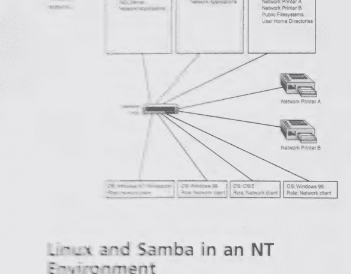

## 在 NT 环境中使用 Linux 和 Samba

[由于图像模糊，文本不清晰]


## Samba 概述

像大多数现代开源项目（包括 Linux）一样，Samba 源于其开发者 Andrew Tridgell 的需求。这个需求是能够将位于其 UNIX 服务器上的文件与他的 DOS 个人计算机共享，虽然他有一个可用的解决方案，但稳定性不佳，这促使他开发自己的解决方案。使用数据包嗅探器，Andrew 着手逆向工程 NetBIOS 协议，并提出了一个基于服务器的解决方案，使他的 PC 能够访问 UNIX 文件系统，而无需在机器上设置 NFS 并降低稳定性。这个最初的项目于 1992 年发布，解决了他的即时问题，由于还有其他事情要做，他将其搁置。在近两年的中断后，连接 Windows PC 到他的 Linux 系统的愿望使该项目重新活跃，Samba 诞生了。发现他正在实现的协议现在比他开始时有更详尽的文档，Andrew 在其他人的帮助下开始改进产品。从那时起，Samba 已发展成为一个涉及开发团队的跨国项目，并被广泛认为是当今世界上最成功的开源项目之一。

现在我们对 Samba 的历史有了一些了解，让我们来看看 Samba 是做什么的。Samba 是 UNIX 及其他操作系统上四种基本 CIFS 服务的实现。这四种服务是
- 文件和打印服务
- 身份验证和授权
- 名称解析服务
- 浏览服务

这些 CIFS 服务由两个关键程序实现。其中第一个是 Session Message Block 守护进程（smbd），它处理 CIFS 的文件和打印服务以及身份验证和授权部分。第二个是 NetBIOS 名称管理守护进程（nmbd），它处理 CIFS 的名称解析和浏览部分。除了这些守护进程之外，Samba 还包括多个实用程序，允许您在 Windows 网络中访问服务。最常用的实用程序及其功能如表 17.1 所示。

### 表 17.1 SAMBA 包中的实用程序

| 实用程序 | 用途 |
|---|---|
| nmblookup | 该实用程序用于查询 NetBIOS 名称并将其映射到 IP 地址。 |
| smbclient | 一个类似 ftp 的客户端，允许您访问网络上 SMB/CIFS 资源。 |
| smbmount | 用于在 UNIX 系统上挂载 SMB/CIFS 共享文件系统的专用挂载命令。 |
| smbumount | 一个 umount 命令，允许普通用户卸载他们已挂载的 SMB/CIFS 文件系统。 |
| smbpasswd | 用于更改本地或远程 SMB 密码的密码更改客户端。 |
| smbprint | 一个精简版的 smbclient，允许向 SMB 共享打印机资源打印。 |
| smbstatus | 用于列出当前 SMB 连接的实用程序。 |
| smbtar | 用于将 SMB 共享文件系统备份到 UNIX 主机上的磁带驱动器的 shell 脚本。 |

Samba 包中还包含其他脚本和实用程序，其文档可以在您的 Red Hat 系统的 /usr/doc/samba-2.0.3 目录中找到。

在 Samba 随附的实用程序中，最有可能被广泛使用的就是 smbclient。既然如此，让我们更仔细地研究它，以及可用的命令行选项和交互式命令集。

smbclient 程序允许 Linux 用户访问网络资源服务器上位于的 SMB 资源。这些资源服务器通常是 Windows 机器，如果是这样，您将通过包括 FTP、NFS 和 r-commands（如 rcp）在内的方法访问文件。

smbclient 实用程序提供类似 FTP 的界面，允许用户在计算机与运行 SMB 服务器的另一台计算机上的网络共享之间传输文件。这意味着 smbclient 是一个交互式界面，旨在临时访问共享资源。对于对 SMB 服务器上文件系统的更永久连接，您将使用内核提供的 smbfs 和 Samba 套件中的 smbmount 实用程序。

smbclient 实用程序提供命令行选项来查询服务器上可用的共享目录或交换文件。表 17.2 显示了一些最常见的命令行选项。有关所有命令行选项的更多信息，请参阅 smbclient 的手册页。

### 表 17.2 smbclient 的命令行选项

| 选项 | 描述 |
|---|---|
| -N name | 使用 name 作为本地机器的 NetBIOS 名称。默认为本地机器的主机名。 |
| -I ipaddr | 连接到 IP 地址为 \ipaddr 的服务器。 |
| -U username | 使用 username 指定的用户账户连接到 SMB 服务。默认值为 USER 或 LOGNAME 环境变量的值（如果设置），如果两者均未设置，则使用用户名 GUEST。 |
| -L | 列出服务器可用的资源。服务器可以在命令行中按名称指定，也可以使用 -I 选项按 IP 地址指定。 |
| -W workgroup | 连接到 workgroup 而不是 smb.conf 文件中指定的工作组。 |

为了说明这些命令行选项的一些用法，让我们尝试使用 smbclient 的几个命令并查看生成的输出。

```
[tschenk@nomad tschenk]$ smbclient -L quicksilver -U tschenk
Added interface ip=192.168.50.25 bcast=192.168.50.255 netmask=255.255.255.0
Password:
Domain=[ALCHEMY] OS=[Unix] Server=[Samba 2.0.3]

  Sharename       Type      Comment
  ---------       ----      -------
  public          Disk      Public Stuff
  IPC$            IPC       IPC Service (Samba Server)
  lp              Printer
  tschenk         Disk      Home Directories

  Server          Comment
  ---------       -------
  QUICKSILVER     Samba Server

  Workgroup       Master
  ---------       -------
  ALCHEMY         QUICKSILVER
```

此命令显示了使用 -L 选项列出在主机 quicksilver 上运行的 Samba 服务器上可供 SMB 用户 tschenk 使用的共享的结果。

```
[tschenk@nomad tschenk]$ smbclient //quicksilver/tschenk -U \
tschenk%password -c "get MB030.doc"
Added interface ip=192.168.50.25 bcast=192.168.50.255 netmask=255.255.255.0
Domain=[ALCHEMY] OS=[Unix] Server=[Samba 2.0.3]
getting file MB030.doc of size 108544 as MB030.doc (602.272 kB/s)
...(average 602.273 kB/s)
```

在前面的示例中，用户以用户 tschenk 的身份使用密码 passwd 连接到服务器 quicksilver 上的名为 tschenk 的共享，并发出命令 get MB030.doc，将文件从服务器传输到本地机器。以下示例显示了如何交互式使用 smbclient 来完成相同的任务。

```
[tschenk@nomad tschenk]$ smbclient //quicksilver/tschenk -U tschenk
Added interface ip=192.168.50.25 bcast=192.168.50.255 netmask=255.255.255.0
Password:
Domain=[ALCHEMY] OS=[Unix] Server=[Samba 2.0.3]
smb: \> get MB030.doc
getting file MB030.doc of size 108544 as MB030.doc (630.952 kb/s)
...(average 630.952 kb/s)
smb: \> quit
[tschenk@nomad tschenk]$
```

前面的命令演示了 smbclient 的类似 FTP 的界面。如您所见，一旦输入密码，就会出现以下提示：

```
smb: \>
```

在此提示下您可以输入命令。从此命令行，您可以发出表 17.3 中所示的命令来传输和操作文件。

### 表 17.3 smbclient 的交互式命令

| 命令 | 描述 |
|---|---|
| ? or help [command] | 提供有关命令的帮助信息，或在未指定命令时提供一般帮助信息。 |
| ! [shell command] | 执行指定的 shell 命令或将用户切换到 shell 提示符。 |
| cd [directory] | 切换到服务器机器（不是本地机器）上指定的目录。如果未指定目录，smbclient 会报告当前工作目录。 |
| lcd [directory] | 切换到本地机器上指定的目录。如果未指定目录，smbclient 会报告本地机器上的当前工作目录。 |
| del [files] | 如果用户有权限，则删除服务器上指定的文件。文件可以包含通配符。 |
| dir or ls [files] | 列出指示的文件。您也可以使用命令 ls 获取文件列表。 |
| exit or quit | 退出 smbclient 程序。 |
| get [file] [local name] | 检索指定的文件并将其保存到本地服务器。如果指定了 local name，复制的文件将使用此文件名保存，而不是远程服务器上的文件名。 |
| mget [files] | 将所有指示的文件（包括匹配任何通配符的文件）复制到本地机器。 |


## 表 17.3 继续

| 命令 | 描述 |
|---|---|
| md or mkdir [directory] | 在远程机器上创建指定的目录。 |
| rd or rmdir [directory] | 删除远程机器上的指定目录。 |
| put [file] [remotename] | 将指定的文件从本地机器复制到服务器，如果指定则重命名为 remotename。 |
| mput [files] | 将所有指定的文件从本地机器复制到服务器。 |
| print [file] | 在远程机器上打印指定的文件。 |
| queue | 显示远程服务器上排队的全部打印作业。 |

如表所示，smbclient 工具的命令集与 ftp 命令的命令集非常相似，对用户来说应该相当自然。与 ftp 命令的主要区别在于，客户端正常工作需要 smb.conf 文件存在。因此，下一个部分将介绍可用的配置选项。

另外两个对用户可能很有用的相关实用程序是 smbmount 和 smbumount 命令。如果将这些实用程序更改为 setuid root，非 root 用户就可以使用它们来挂载共享文件系统。然而，将这些实用程序设为 setuid root 的决定不应轻率做出，因为它们可能对系统构成安全风险。此外，如果用户持续挂载网络上的共享资源，这很可能是添加到系统启动脚本（如 rc.local）中的一个好候选。

无论你是否决定让用户具有挂载和卸载共享的能力，了解 smbmount 命令的语法都是有用的。该命令是 smbclient 代码的精简版本，其唯一目的是将共享文件系统纳入 Linux 文件系统树。下面是一个示例，它将服务器 quicksilver 上的 public 共享挂载到名为 /win 的挂载点：

```
smbmount //quicksilver/public -U tschenk -c 'mount /windows -u 500 -g 500'
```

如果成功，该命令将导致名为 quicksilver 的服务器上的 public 共享被挂载到 /windows，并看起来像 Linux 文件系统的其他任何部分。mount 命令的 -u 和 -g 参数表示所有文件都映射到 userid 500 和 groupid 500。此时需要记住的是，在 Linux 客户端上创建并存储在已挂载共享区域中的任何文本文件都将使用客户端操作系统的行尾格式。在这种情况下，所使用的行尾协议将与 Linux 相同，使得文件在 Windows 下难以阅读。

如果你以后想使共享文件系统不可用，你将使用 smbumount 命令。该命令的语法与普通 mount 命令非常相似。以下是卸载先前挂载的共享的示例：

```
smbumount /windows
```

除了 Samba 套件之外，Linux 中还有另一部分可以使运行 Linux 的客户端访问 Windows 网络上的文件系统共享。这部分是 smbfs 支持，你可以将其编译到内核中。smbfs 是基于 Samba 代码的 SMB 协议的实现。它允许你以类似于 NFS 导出文件系统的方式挂载 SMB 共享。要使用 Linux 内核的此功能，你必须从 Samba 包中安装 smbmount 命令；然而，你不需要运行 smbd 或 nmbd 守护进程。Red Hat 更进一步，它为 smbmount 程序提供了一个名为 /sbin/mount.smb 的 shell 脚本包装器，该包装器将以标准 mount 语法给出的 mount 命令转换为适当的 smbmount 命令。以下是此功能运行的示例：

```
[root@nomad /root]# mount -t smbfs //quicksilver/public /mnt2
[root@nomad /root]# Added interface ip=192.168.50.25
bcast=192.168.50.255 netmask=255.255.255.0
Server time is Wed Jul 14 23:35:57 1999
Timezone is UTC-5.0
Password:
Domain=[ALCHEMY] OS=[Unix] Server=[Samba 2.0.3]
connected as guest security=user
```

```
[root@nomad /root]# df
Filesystem 1k-blocks Used Available Use% Mounted on
/dev/hda2 1478572 1133273 268893 81% /
 //QUICKSILVER/PUBLIC 1072672 214176 658496 20% /mnt2
```

```
[root@nomad /root]# ls -l /mnt2
total 3
-rwxr-xr-x 1 root root 261 Jul 14 00:00 README
drwxr-xr-x 1 root root 512 Jul 13 23:57 accounting
drwxr-xr-x 1 root root 512 Jul 13 23:57 development
drwxr-xr-x 1 root root 512 Jul 13 23:57 humanresources
drwxr-xr-x 1 root root 512 Jul 14 00:00 miscellaneous
drwxr-xr-x 1 root root 512 Jul 13 23:57 techops
```

```
[root@nomad /root]# umount /mnt2
```

```
[root@nomad /root]# ls -l /mnt2
total 0
```

我们将讨论的 Samba 用户可用的最后一个工具是 Samba Web 管理工具，称为 SWAT。顾名思义，这是一个基于 Web 的 Samba 管理工具。SWAT 曾是一个独立的产品，现在已包含在标准 Samba 包中。

SWAT 的目的是使 Samba 服务器的管理更轻松，并且它出色地完成了这一任务。要开始使用 SWAT，你必须首先确保系统已配置为运行它。首先要检查的是 /etc/services 文件。为了使 SWAT 正常工作，你应该在此文件中有一行如下所示：

```
swat 901/tcp
```

该行表示 SWAT 使用 TCP 协议并在端口 901 上监听。下一个要检查的文件是 /etc/inetd.conf 文件。SWAT 作为由 inetd 启动的服务运行，就像 ftpd 守护进程和其他服务一样。为了使 SWAT 正常工作，你的 /etc/inetd.conf 文件应包含如下所示的一行：

```
swat stream tcp nowait root /usr/sbin/swat swat
```

假设这些行存在，你就可以开始使用 SWAT 了。如果不存在，你必须添加它们、取消注释它们，或向 inetd 发送信号使其重新读取 inetd.conf 文件。为此，你必须使用 kill 命令向 inetd 发送 HUP 信号，如以下命令行所示：

```
kill -HUP `cat /var/run/inetd.pid`
```

或者，你可以使用位于 /etc/rc.d/init.d 的 inetd 脚本来重启 inetd 超级服务器。为此，你将发出以下命令：

```
/etc/rc.d/init.d/inetd restart
```

## 注意

与任何其他服务一样，运行 SWAT 为外部攻击者提供了访问系统的另一个潜在途径。鉴于 SWAT 的配置能力，应注意确保运行 SWAT 的系统受到防火墙的保护。

完成这些步骤后，你可以通过调用浏览器并连接到 URL http://localhost:901/ 来开始使用 SWAT。这将弹出一个登录对话框，你可以用 root 身份登录。登录后，你将进入 SWAT 主屏幕，如图 17.2 所示。

## 图 17.2
SWAT 主屏幕。

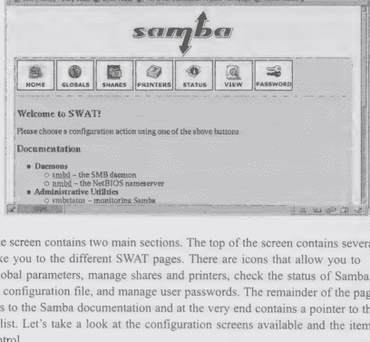

SWAT 主屏幕包含两个主要部分。屏幕顶部包含多个图标，可带你进入不同的 SWAT 页面。有图标允许你配置全局参数、管理共享和打印机、检查 Samba 状态、查看 Samba 配置文件以及管理用户密码。页面的其余部分包含指向 Samba 文档的链接，并在最后包含指向 Samba 邮件列表的链接。让我们看看可用的配置屏幕以及它们允许你控制的项目。

第一个 SWAT 屏幕图标是 Globals 图标，它允许你操作 smb.conf 文件中的 globals 特殊部分。点击该图标将显示如图 17.3 所示的页面。

对于属于 globals 部分的每个配置参数，你可以输入值、请求帮助并将值重置为默认值。编辑完成后，点击 Commit Changes 按钮将其写入 smb.conf 文件。

## 图 17.3
SWAT Globals 屏幕。

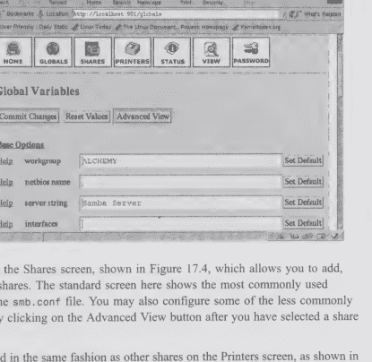

下一个屏幕是 Shares 屏幕，如图 17.4 所示，它允许你添加、修改或删除共享。此处的标准屏幕显示了来自 smb.conf 文件的最常用参数。在选择要检查的共享后，通过点击 Advanced View 按钮，你还可以配置一些不太常用的参数。

打印机在 Printers 屏幕上以与其它共享相同的方式处理，如图 17.5 所示。

要检查 Samba 软件的状态，请点击 Status 图标以调出 SWAT 状态屏幕（见图 17.6）。该屏幕不仅显示软件是否正在运行，还允许你启动和停止 Samba 守护进程以及查看到 Samba 服务器的活动连接。

你可以通过点击 View 图标来检查 smb.conf 文件的内容。这将为你显示 smb.conf 文件的内容，如图 17.7 所示。它允许你使用 Normal View 作为默认值来查看已设置的参数及其值。如果你想查看所有可用变量及其值的列表（如果有），请点击 Full View 按钮。

最后一个屏幕是 Password 屏幕，你可以通过点击 Password 图标来选择它。这将调出密码管理屏幕，允许你更改本地用户帐户和主域控制器上的帐户（见图 17.8）。


## 图 17.4

SWAT 共享屏幕。

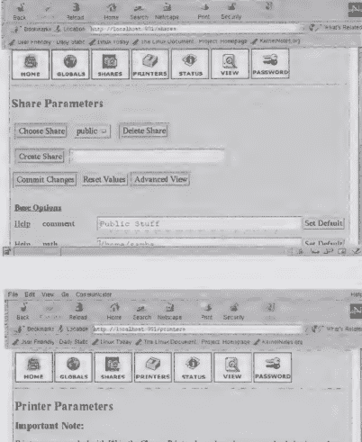

## 图 17.5

SWAT 打印机屏幕。

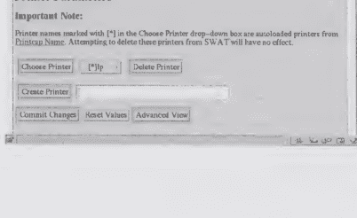

## 图 17.6

SWAT 状态屏幕。


## 图 17.7

SWAT 查看屏幕。


## 图 17.8

SWAT 密码屏幕。


## 警告

如果你希望 /etc/smb.conf 文件充满解释每个条目用途的注释或维护变更历史，请不要使用 SWAT 接口。SWAT 不保留注释，并且会写入一个非常紧凑的配置文件。

## 分析 Samba 配置文件

在开始研究 Linux 在 Windows 网络中的具体角色之前，让我们先看看 Samba 配置文件。该文件提供了众多选项，完整涵盖这些选项超出了本书的范围。然而，我们将介绍初学者在使用 Samba 时可能用到的常见选项，然后提供一些使用 Samba 作为客户端和服务器的 Linux 具体示例。

在 Red Hat Linux 系统中，Samba 配置文件的默认位置在 /etc 目录下，文件名为 smb.conf。Red Hat 自带的 smb.conf 文件可作为起点，除了更改 workgroup 名称外，它就是在之前的 smbclient 演示中所使用的文件。

## 注意

对 smb.conf 文件的更改需要重新启动 Samba 服务器 smbd。实现此重启的最简单方法是使用位于 /etc/rc.d/init.d 的 smb 脚本。重启 Samba 服务器的命令是 $ /etc/rc.d/init.d/smb restart

smb.conf 文件的语法相当简单。它由一系列以名称括在方括号中表示的命名段组成，例如 [global]。每个段包含若干参数，由键/值对构成。注释可以用井号（#）或分号（;）表示。这两种注释字符可以互换，不过通常的做法是用分号注释掉参数，而用井号进行普通注释。下面是一个简短的示例，展示这种语法：

```
# This line is a comment
[section]
key1 = value1
# The following parameter is commented out
; key2 = value2
key3 = value3
```

Samba 配置文件包含三个特殊段和零个或多个可选自定义段。特殊段为 [global]、[homes] 和 [printers]。

## 警告

在对配置文件进行更改之前，始终建议先备份原始配置文件。一种做法是使用 RCS，并在每次更改后在提交修订前进行测试。

为便于测试，请确保测试客户端上的用户名，无论该客户端是 Windows 机器还是 Linux 客户端，都存在于运行 Samba 的机器上。如果两个系统之间没有共同的用户，请使用 adduser 和 passwd 命令创建一个。

> 注意
> 
> Samba 仅在网络正常运行的情况下才能工作。为避免挫败感，最好先确保你将要工作的客户端和服务器系统能够相互通信。现在使用 ping 和其他网络工具进行一些简单测试，将在以后为你节省数小时的抓头发时间。

## [global] 部分

[global] 段指定整个 SMB 服务器的参数。该段还为其他段提供默认值。

此处显示的前两个参数指定你的计算机所属的工作组以及服务器在被客户端查询时如何标识自己。

除了指定机器所属的工作组外，它还指定在参数 security = domain 被指定时使用的域名。workgroup 参数指定的名称应限制在九个字符以内，不得包含空格，并且应全部以大写字符输入。

server string 参数是一个人类可读的字符串，用于在 SMB 客户端查询时标识你的服务器。

```
[global]
    workgroup = MYGROUP
    server string = Samba Server
```

在 Red Hat 自带的默认配置文件中，hosts allow 行被注释掉了。如果取消此行的注释，访问 Samba 服务器将被限制为指定的主机或网络。在以下示例中，访问仅限于网络 192.168.1.0/24、192.168.2.0/24 以及 localhost。多个网络用空格分隔，并且允许使用简写语法。C 类子网有三个数字和三个点，B 类有两个数字和两个点，A 类有一个数字和一个点。

```
hosts allow = 192.168.1. 192.168.2. 127.
```

接下来的几个参数与打印有关。随 Red Hat Linux 系统提供的 smb.conf 文件中的默认设置会将 /etc/printcap 中定义的所有打印机作为共享资源提供给网络上的 SMB 客户端。在 Red Hat Linux 服务器上，printing 参数通常不需要。

```
# if you want to automatically load your printer list rather
# than setting them up individually then you'll need this
```

```
printcap name = /etc/printcap
load printers = yes
```

```
# It should not be necessary to spell out the print system type unless
# yours is non-standard. Currently supported print systems include:
# bsd, sysv, plp, lprng, aix, hpux, qnx
; printing = bsd
```

smb.conf 文件中的下一项是必需的，如果你想为 Samba 服务器上的服务指定一个访客账户进行匿名访问。这不是必需的，默认情况下，访客访问是通过 nobody 账户允许的。

```
# Uncomment this if you want a guest account, you must add this to
# /etc/passwd, otherwise the user 'nobody' is used
; guest account = pcguest
```

偶尔需要排查 Windows 客户端连接问题。以下两个条目指定在匹配用户名和密码时比较的字符数。对此数量字符的比较是不区分大小写的。只有在积极调试问题时才应取消这两个条目的注释。

```
# Password Level allows matching of _n_ characters of the password for
# all combinations of upper and lower case.
; password level = 8
; username level = 8
```

从 Windows 95 OSR2 及以后版本开始，包括当然的 Windows NT，密码默认是加密的。在此版本之前，密码以明文形式传递。然而，如果使用随 Red Hat 提供的 smb.conf 文件，Samba 服务器的密码加密默认是未启用的，如以下行所示：

```
# You may wish to use password encryption. Please read
# ENCRYPTION.txt, Win95.txt and WinNT.txt in the Samba documentation.
# Do not enable this option unless you have read those documents
; encrypt passwords = yes
; smb passwd file = /etc/smbpasswd
```

这意味着你必须决定是否支持此功能。你有几种处理此情况的选项。下面描述了其中两种。

```
smbpasswd -a userid
```

另一个选项，也是需要你付出更多努力的，是在 Windows 客户端上禁用加密密码。这项工作所需的工作量当然取决于你必须更改的客户端数量。此外，由于该过程涉及在每个客户端上编辑注册表，因此此过程更容易出错。以下是涉及的步骤。

> **警告**
> 
> 如果你可以在 Samba 服务器上更改设置，这比更改 Windows 客户端更可取。编辑注册表可能导致数据丢失或操作系统无法运行。

- 1. 在你的 Windows 客户端上，运行注册表编辑器 regedit 并导航到条目 [HKEY_LOCAL_MACHINE\System\CurrentControlSet\Services\VxD\VNetsup]。
- 2. 如果此处已存在名为 EnablePlainTextPassword 的对象，它的值将为 0 或 1。
- 3. 值 0 表示系统正在使用加密密码。要禁用此功能，请将值设置为 1。
- 4. 如果对象不存在，请将其创建为 DWORD 并将值设置为 1。
- 5. 保存更改，退出 regedit 并重新启动 Windows 系统以使此更改生效。

Samba 可以通过 smb.conf 文件中的以下条目配置为域服务器。这将允许你的 Linux 机器对网络上的 Windows 客户端进行身份验证。你还可以设置每台机器的登录脚本以及每个用户的登录批处理文件。默认情况下，这些条目在你的 Red Hat 系统上被注释掉了。

```
# Enable this if you want Samba to be a domain logon server for
# Windows98 workstations.
; domain logons = yes

# if you enable domain logons then you may want a per-machine or
# per user logon script
# run a specific logon batch file per workstation (machine)
; logon script = %m.bat

# run a specific logon batch file per username
; logon script = %U.bat
```


## [homes] 部分

smb.conf 文件的下一个特殊部分是 [homes] 部分，它允许客户端在无需为每个用户单独显式指定情况下访问服务器上的用户主目录。当向 Samba 服务器发出服务请求时，服务器会搜索 smb.conf 中具有指定名称的自定义服务，如果未找到，则会搜索 [homes] 部分。如果该特殊部分存在，则请求服务名称会与用户账户名称进行比较，如果找到匹配项，则用户的主目录将在网络上共享。

以下是 [homes] 特殊部分的示例：

```
[homes]
    comment = Home Directories
    browseable = no
    read only = no
    preserve case = yes
    short preserve case = yes
    create mode = 0750
```

这与 Red Hat Linux 自带的默认设置略有不同。让我们逐一查看每个参数及其含义。

comment 参数是一个人类可读的标识字符串，将显示给浏览 Samba 服务器的客户端。请注意，此 comment 参数类似于 server string 参数，但后者仅在 [global] 特殊部分中有效。

browseable 参数设置为 no。该参数指定服务器显示的共享将不会称为 homes，而是客户端有权访问的用户目录的名称。

read only 参数控制用户在通过网络共享目录时是否可以创建和更改文件。指定此行为的两种替代方法是使用 writable 参数，将其设置为 yes，或使用 write ok 参数，也将其设置为 yes。preserve case 和 short preserve case 参数指示服务器保留写入服务器的任何新文件的大小写。这很重要，因为 Windows 文件名通常不区分大小写，而 Linux 文件名则区分。是否设置这些参数取决于文件系统主要由 Windows 客户端使用还是主要由 Linux 或 UNIX 客户端使用。

### 注意

Linux 和 Windows 在文本文件中使用不同的行尾序列。通过 Samba 编辑文件时，文本文件协议由客户端的操作系统决定。这意味着如果同一文件由两个操作系统的客户端编辑，可能会导致损坏。

最后一条条目设置在共享目录中创建的任何文件的默认文件权限。

## [printers] 部分

Samba 使打印机可供网络使用有两种方法。一种方法为 printcap 中要共享的每台打印机创建特定的共享部分。另一种方法是在 /etc/printcap 文件中使用 [printers] 特殊部分，以便共享其中定义的所有打印机。

### 注意

本节多次提及 /etc/printcap、printcap 和 printcap 打印机。/etc/printcap 是定义 Linux 系统所有打印机的文件。printcap 打印机是在 /etc/printcap 中按名称定义的打印机。

可以使用文本编辑器创建 /etc/printcap 条目，但在您的 Red Hat Linux 系统上，首选方法是使用 printtool。printtool 通过易于使用的图形界面创建本地和远程打印机。

以下是 [printers] 特殊部分的示例。它共享 printcap 文件中定义的所有打印机，并允许除访客账户外的任何人打印。

```
[printers]
comment = All Printers
browseable = no
create mode = 0700
path = /var/spool/samba
printable = yes
public = no
writable = no
```

[printers] 部分定义了如果在 smb.conf 文件中未找到特定条目时打印服务如何不受控制。与 [homes] 部分一样，如果未找到打印服务的特定条目，Samba 将使用 [printers] 部分（如果存在），允许用户连接到 /etc/printcap 中定义的任何打印机。

comment、browseable 和 create mode 参数在这里的含义与在 [homes] 部分中相同。

path 参数指定在打印前文件被复制到的 spool 目录。此 spool 目录的目录权限通常设置为允许读写，就像 /tmp 目录一样。

一个新条目是 printable 参数，它在 [printers] 特殊部分中是可选的。如果这是特定打印机的定义，则需要此条目。

下一个条目是 public 参数，在示例中设置为 no。这就是限制访客账户打印的行。要允许访客账户打印，请将此参数的值更改为 yes。

最后的参数 writable 设置为 no，这表示仅允许打印作业写入指定的 spool 目录。

## 创建自定义部分

自定义部分是 smb.conf 文件中的段落，以非通用方式共享特定的打印机或目录。这些部分通常用于为特定用户组共享目录或创建所有用户可写的公共共享目录。您也可以使用这些部分在不共享所有打印机时共享系统上的特定打印机。

以下是可供组使用的共享的示例。此条目定义了一个名为 acct 的文件系统资源，可供 accounting 组 acct 的成员使用。

```
[acct]
comment = Accounting Department Shared Directory
path = /home/acct
browseable = yes
writable = yes
printable = no
valid users = @acct
```

前述条目具有以下特征。它从目录 /home/acct 创建一个文件系统共享。此共享可由 SMB 客户端浏览，并由 comment 字符串标识。它不是打印服务，因此 printable 参数设置为 no。此列表中的新项目是 valid users 参数，它将对此目录的访问限制为组 acct 的成员。

作为下一个示例，考虑专用打印机共享的情况。此条目非常简单，由三个参数组成。其中第一个是 print ok 参数，如果您想能够打印，则必须将其设置为 yes。下一个条目指定来自 printcap 文件的打印机名称，而 path 指定 spool 目录。此 spool 目录必须可由希望使用此服务打印的人写入。

```
[exec_lp]
    print ok = yes
    printer name = exec_lp
    path = /var/spool/samba
```

在专用打印共享中，print ok 参数（或 printable 同义词）是必要的。还必须使用 printer name 行命名打印机。[printers] 的意图是让所有具有有效 ID 的用户都可以访问。专用打印机的意图通常是限制对用户或组的访问，这意味着在专用打印机共享中添加 valid users 参数行是个好主意。除此之外，[printers] 部分和专用打印共享的功能基本相同。

## Linux 和 Samba 作为客户端操作系统

Linux 和 Samba 集成到现有 Windows 网络的一种方式是作为客户端。在此角色中，Samba 不与其他系统共享任何资源；它仅访问网络资源服务器上的共享资源。为此，我们将研究使用 smbclient 程序、使用 smbmount 以及内核的 smbfs 选项以及如何使用它来访问 SMB 共享文件系统。

## 设置 smb.conf 文件

虽然您不需要运行 smbd 或 nmbd 程序即可作为客户端在 Windows 网络上运行，但您确实需要创建 smb.conf 文件，因为它是由 Samba 实用程序（如 smbclient 和 smbmount）必需的。然而，由于您不会与网络共享任何资源，因此该文件可以是最小的。以下是最小化的 smb.conf 文件示例，可使我们的 Linux 客户端被视为 ALCHEMY 域的一部分。

```
[global]
    workgroup = alchemy
```

## 从 Linux 测试配置

我们对 Linux 客户端的第一次测试将是从网络上的服务器获取服务列表。对于此测试，我们将使用带有 -L 命令行选项的 smbclient 命令。

```
[tschenk@nomad tschenk]$ smbclient -L quicksilver -U tschenk
Added interface ip=192.168.50.25 bcast=192.168.50.255 nmask=255.255.255.0
Password:
Domain=[ALCHEMY] OS=[Unix] Server=[Samba 2.0.3]

Sharename   Type      Comment
---------   ----      -------
public      Disk      Public Stuff
IPC$        IPC       IPC Service (Samba Server)
lp          Printer
tschenk     Disk      Home Directories

Server      Comment
---------   -------
QUICKSILVER Samba Server

Workgroup   Master
---------   -------
ALCHEMY     QUICKSILVER
```

此测试为我们提供了服务器 quicksilver 上用户 tschenk 可用的共享列表。输出显示有一个名为 public 的共享公共目录、一台名为 lp 的打印机以及用户 tschenk 的主目录。

知道这些信息后，让我们尝试访问公共目录并查看其中保存了什么。这次我们将再次使用 smbclient 实用程序来浏览共享。

```
[tschenk@nomad tschenk]$ smbclient //quicksilver/public -U tschenk
Added interface ip=192.168.50.25 bcast=192.168.50.255 nmask=255.255.255.0
Password:
Domain=[ALCHEMY] OS=[Unix] Server=[Samba 2.0.3]
smb: \> dir
miscellaneous          D       0   Wed Jul 14 00:00:52 1999
techops                 D       0   Tue Jul 13 23:57:41 1999
development             D       0   Tue Jul 13 23:57:48 1999
accounting              D       0   Tue Jul 13 23:57:34 1999
```


```
humanresources          D   0 Tue Jul 13 23:57:36 1999
README                  261 Wed Jul 14 00:00:45 1999

33521 blocks of size 32768. 27022 blocks available
smb: \> quit
```

如你所见，我们能够使用 smbclient 命令连接到公共共享目录，并能够查看其中包含的目录和文件。

现在假设用户 tschenk 想将服务器上的主目录挂载到他的本地 Linux 客户端上。为此，他将使用 smbmount 和 smbumount 命令。

```
[tschenk@nomad tschenk]$ smbmount //quicksilver/tschenk -c 'mount -samba \
-u 500 -g 500'
Added interface ip=192.168.50.25 bcast=192.168.50.255 netmask=255.255.255.0
Server time is Wed Jul 14 00:14:57 1999
Timezone is UTC-5.0
Password:
Domain=[ALCHEMY] OS=[Unix] Server=[Samba 2.0.3]
security=user
```

```
[tschenk@nomad tschenk]$ cd samba
```

```
[tschenk@nomad samba]$ ls -l*
lilo-colors.tar.gz  limp_penguin_ai.zip  linux-1.3.0.tar.gz  ljf.quote
limp_penguin.ai    linux-1.0.tar.gz     linux-2.0.tar.gz    lodlin16.tgz
limp_penguin.eps   linux-1.1.0.tar.gz   linux-2.1.0.tar.gz
limp_penguin.jpg   linux-1.2.0.tar.gz   linux-2.2.0.tar.gz
```

```
[tschenk@nomad samba]$ cd ..

[tschenk@nomad tschenk]$ smbumount samba

[tschenk@nomad tschenk]$ ls samba
```

如你所见，用户 tschenk 能够将服务器上的共享主目录挂载到名为 samba 的目录上，然后再次卸载它。

## 注意

为了让普通用户以这种方式挂载和卸载共享，smbmount 和 smbumount 命令必须设置为 setuid root。对于 Samba 的 Red Hat RPM 来说，它们并非以这种方式安装。

作为最后一次测试，我们将尝试在连接到服务器的打印机上打印一个文件。为此，我们将再次使用 smbclient 命令。如图所示：

```
[tschenk@nomad tschenk]$ smbclient //quicksilver/lp -U tschenk%password \
-c 'print invite.ps'

Added interface ip=192.168.50.25 bcast=192.168.50.255 netmask=255.255.255.0
Domain=[ALCHEMY] OS=[Unix] Server=[Samba 2.0.3]
putting file invite.ps as invite.ps (average 383.479 kB/s)
```

如你所见，将 Linux 设置为 Windows 网络上的客户端并不困难，如果运气好，一切都会顺利进行。当然，如果你在尝试这里所示的任何示例时遇到问题，你可能在问自己，现在怎么办？幸运的是，Samba 包包含了一些可以帮助你诊断问题的文档。这些文档位于你的 Red Hat Linux 系统中的 /usr/doc/samba-2.0.3/docs。此外，Deja.Com 网站是一个寻求帮助的好地方。访问他们的网站并使用 Usenet 搜索引擎搜索关于 Samba 的新闻组信息，或向其中一个 Samba 新闻组发布你的问题。

## Linux 和 Samba 作为服务器操作系统

在你的 Windows 网络上，Linux 和 Samba 更有趣的角色是作为资源服务器。在前面描述的示例网络中，一个适合由 Linux 主机替换的良好候选者是共享公共目录、用户主目录和两台打印机的资源服务器。通过在此处替换 Linux 系统，你可以大幅节省网络成本，因为你不需要 NT 许可证。除了与网络其他部分共享资源外，你还可以使用该系统处理电子邮件、运行 DNS 服务器并为你的内联网设置 Web 服务器。你可以以更低的成本做到这一切，因为所使用的机器可以比等效的 NT 服务器弱得多。

## 设置 smb.conf 文件

资源服务器配置所需的 smb.conf 文件自然比之前的更复杂，正如你可能猜到的那样。以下是我在为本书测试 Samba 时使用的配置文件：

```
##=========================== Global Settings ===========================
[global]
workgroup = ALCHEMY
server string = Samba Server
hosts allow = 192.168.50. 127.
printcap name = /etc/printcap
```

```
load printers = yes
print command = lpr -P %p %s ; rm %s
log file = /var/log/samba/log.%m
max log size = 50
security = user
encrypt passwords = yes
smb passwd file = /etc/smbpasswd
socket options = TCP_NODELAY
dns proxy = no

#========================== Share Definitions ==========================

[homes]
comment = Home Directories
browseable = no
writable = yes
create mode = 0750

# NOTE: If you have a BSD-style print system there is no need to
# specifically define each individual printer
[printers]
comment = All Printers
path = /var/spool/samba
browseable = no
guest ok = no
writable = no
printable = yes

[public]
comment = Public Stuff
path = /home/samba
public = yes
writable = yes
printable = no
write list = @staff
```

此配置文件使我的 Samba 服务器上的所有打印机只要是有效用户就可以供网络使用。它还共享主目录以及 staff 组成员的公共空间。一旦创建此文件，需要重新启动服务器，并通过运行以下命令完成：

/etc/rc.d/init.d/smb restart

## 从 Windows 测试你的配置

对我的 Samba 服务器进行的首次测试中，我尝试从 Windows 98 客户端访问 Samba 服务器上的公共目录。为此，我以用户 tschenk 登录，该用户也在 Samba 服务器上存在，并单击了“网络邻居”图标。如图 17.9 所示，这就是我第一次成功迹象的地方。

图 17.9
显示我的 SAMBA 服务器的网络邻居窗口。


然后我单击了“整个网络”图标，并看到了图 17.10 所示的屏幕，其中显示我的 ALCHEMY 域已被识别。

图 17.10
显示 ALCHEMY 工作组的网络邻居窗口。


进一步深入，我看到了网络上实现 SMB 协议且对网络可见的主机（见图 17.11）。

图 17.11
显示 ALCHEMY 域中主机的网络邻居窗口。


我再次通过单击代表主机 Quicksilver 的图标进行深入，并看到了图 17.12 所示的屏幕，其中显示了我试图从 Samba 服务器共享的资源。

图 17.12
Quicksilver 共享资源。


最后一次深入显示，我确实成功共享了我在 smb.conf 文件中指定的资源。图 17.13 显示了公共目录的内容。

## 图 17.13

公共共享目录。


我的最后一次测试是查看是否可以向我的 Samba 服务器上的 lp 打印机打印。为此，我只需单击 lp 图标，经历配置对话框使用适当的驱动程序配置此打印机，然后打印测试页，结果正如预期一样正常工作。

自然地，一切如此顺利部分是运气使然。但这也是因为我花了大量时间阅读 Samba 附带的文档，以便了解 Windows 网络的行为方式，以及查阅 Samba 的手册页。

## Samba 帮助来源

如果你在设置 Samba 时运气不佳，仍然可以获得帮助，如果你礼貌地请求，甚至可能获得 Samba 开发人员的帮助。让我们看一下几个 Samba 帮助来源。

## Samba 邮件列表

有许多邮件列表涉及 Samba 的各个方面，从开发到支持。一些列表面向终端用户，也面向开发人员。表 17.4 是可用邮件列表的部分列表。

表 17.4 SAMBA 邮件列表

| 列表名称 | 讨论重点 |
|---|---|
| samba | Samba 软件套件的一般讨论。 |
| samba-announce | 新版本或其他 Samba 社区感兴趣事项的公告。 |
| samba-docs | 关于 Samba 文档项目的讨论。 |
| samba-technical | 开发人员关于 Samba 相关技术问题的讨论。 |


你可以通过发送电子邮件按照以下命令所示订阅这些列表中的任何一个：

```
echo 'subscribe listname your full name' | mail listproc@samba.org
```

当然，你需要将命令中显示的 listname 替换为列表的名称，例如 samba-technical。

## Samba 新闻组

另一个信息来源是 Usenet 新闻组，特别是新闻组 comp.protocols.smb。另一个寻求帮助的资源是 Deja.com 上的 Usenet 档案，它允许你按关键字搜索新闻组。你可以通过网页在 http://www.deja.com/ 阅读新闻组或搜索它们。

## Samba 主页

关于 Samba 的一个优秀信息来源是网页上的 Samba 主页 http://www.samba.org/。该网站包含随源代码分发而来的所有文档，以及指向其他信息来源的链接，包括有关调整 Samba 性能的信息。如果你在让 Samba 运行方面遇到任何问题，请务必去那里看看。

## 摘要

本章介绍了 Windows 网络的构成，包括设置域的要求。我们还检查了 Samba 配置文件，并通过在 Windows 网络上将 Linux 设置为客户端系统来测试所学内容。我们测试了连接性，然后将 Linux 设置为服务器，并从 Windows 主机测试了对其的连接。最后，我们查看了可以进一步了解 Samba 的地方，Samba 是 Linux 工具库中最有用的工具之一。

### 与其他网络操作系统集成

### 本章内容

- 与邻居相处融洽 494
- Linux 在 NetWare 环境中 495
- Linux 在 AppleTalk 环境中 513

## 与邻居相处融洽

正如你在对 Samba 的考察中所看到的，该内容在第 17 章“与 Windows NT 网络集成”中有所介绍，Linux 的优势之一是其与其他网络操作系统交互的能力。这不仅适用于各种 UNIX 和 Windows 版本，也适用于 NetWare 和 AppleTalk 网络。本章探讨了一些允许 Linux 与这些其他网络操作系统通信的工具，以及如何配置 Linux 以便与其共享资源。它首先对 Linux 和 NetWare 进行考察，查看 Linux 作为服务器和客户端的角色，然后介绍允许 Linux 在 AppleTalk 网络中共享资源的可用工具。在由多家厂商的系统组成的异构网络时代，与其他网络操作系统互操作的能力至关重要。公司在网络上有大量投资，与这些网络的互操作性意味着在添加 Linux 时不会损失这项投资。

### 使用合适的工具

Linux 经常被要求与其他网络操作系统一起工作的原因之一是互联网的爆炸性增长。随着企业认识到连接的需求，它们也看到虽然当前的网络操作系统非常适合其企业网络，但它们可能需要为互联网服务寻找其他选择。这正是 Linux 大放异彩的地方，因为一台配备邮件传输代理、Web 服务能力、名称服务以及所有其他标准互联网功能的 Linux 服务器是一种经济高效的连接方式。事实上，在小型办公环境中，单台 Linux 服务器可以提供公司连接所需的所有服务，而无需花费过高的费用，这也解释了基于 Linux 的互联网设备（如 Cobalt Cube）的市场。

有了 Linux 进入此类环境的机会，你可能会想，为什么还要费心让 Linux 与这些其他网络操作系统互操作，而它们提供的绝大多数功能 Linux 也能提供。为什么不直接用 Linux 系统替换其他系统，采用全 Linux 解决方案呢？不这样做的原因有很多。其中一些原因如下

- 转换成本，无论是时间和金钱都太高。
- 所需功能仅在现有网络操作系统上可用。
- 公司使用的应用程序可能在 Linux 上不可用，也没有合适的替代品。
- 再培训的成本和再培训期间损失的时间成本过高。

这些原因中的任何一个或全部都足以不替换现有系统，再加上流传已久的格言：“如果它没有坏，就不要修它。”这也可能只是使用合适工具的问题，而且与许多 Linux 倡导者告诉你的相反，无论我们多么希望如此，Linux 并非总是合适的工具。

另一方面，替换现有系统在某些情况下可能是有意义的。
其中一些原因如下

- 维护现有系统的成本高于实施新系统。
- 找到并培训使用该新系统的人员的能力有限。
- 现有系统的功能在新系统中以更稳健或更安全的方式得到复制。

替换现有操作系统从来都不是一个容易的决定，这也不是本章的重点。本章介绍如何使你的 Linux 系统成为现有 NetWare 或 AppleTalk 网络的一部分，从 NetWare 开始。

## Linux 在 NetWare 环境中

Red Hat Linux 在安装介质上提供了与 NetWare 网络互操作所需的一切。必须安装的相关软件包如下

- mars-nwe-0.99pl15-3
- ncpfs-2.2.0.12-5
- ipxutils-2.2.0.12-5

这些软件包中包含的工具包括设置 Linux 系统充当 NetWare 文件和打印服务器或充当 NetWare 客户端所需的工具。假设你已安装了这些软件包，让我们来看看如何配置它们。

### NetWare 互操作选项

尽管 Red Hat 附带了 mars_nwe 软件包，但 Linux 还有其他可用选项。其中一个选项是 lwared，它执行与 mars_nwe 相同的许多功能。关于如何使用该软件包的完整说明，包括源代码和二进制文件的位置，可以在你的 Red Hat 系统上位于 /usr/doc/HOWTO/IPX-HOWTO 的 IPX-HOWTO 中找到。

另一个选项，以前由 Caldera 提供，是 NetWare for Linux。这是一个与 NetWare-4.1 兼容的 Linux 软件包，允许 Linux 提供 NetWare 服务器可以提供的所有服务。虽然你仍然可以从 Caldera FTP 站点获得该软件包，但自 Red Hat 5.1 发布以来它就没有更新，不推荐使用。此外，它需要 Linux 的 streams 实现，而主要开发者都同意这永远不会包含在内核源代码树中，从而限制了你跟踪内核开发的能力。

### 为内核添加 IPX 协议支持

为了实现与 NetWare 的互操作，你必须配置内核以支持 IPX 协议。该协议是 Novell 使用的协议，其功能与 TCP/IP 网络中使用的 IP 协议类似。为了配置内核充当 NetWare 客户端或服务器，你必须设置选项 CONFIG_IPX，通过回答配置提示“IPX networking”为 yes 来设置。此外，为了能够挂载 NetWare 文件系统卷，你还必须设置 CONFIG_NCP_FS 选项，通过说 yes 于“NCP filesystem support”配置选项。关于支持 mars_nwe 和 ncps 软件包所需的更完整内核配置说明，你可以再次参考 IPX-HOWTO。

为了更好地理解 Linux 如何与 NetWare 通信，了解 NetWare 网络的工作原理的基本知识很重要。以下描述试图涵盖这一点，但不涵盖你可能在大型 Novell 网络中发现的规则的例外情况。

### NetWare 网络概念

IPX 网络中的关键概念是所使用的编号网络方案。在此上下文中，网络是指在同一 LAN 段上使用相同帧类型的设备集合。帧类型是指用于在网络上传输 IPX 数据报的实际协议，通常是四种常见类型中的一种。这些类型是 Ethernet_II、802.3、802.2 和 SNAP。了解这些帧类型之间的差异对于本次讨论的目的并不重要；然而，你应该知道你的网络使用哪一种，因为你需要此信息来在 Linux 下配置 mars_nwe。同一 LAN 上的不同设备组可以使用不同的帧类型，即使它们连接到同一 LAN 段，也被视为处于不同的网络中。每个网络都被分配一个唯一的网络号，在整个互联网中用于标识。分配通常由 NetWare 服务器执行，但如果配置为这样做，你的 Linux 系统也可以执行此任务。IPX

客户端在启动时会被分配此号码，此号码及其帧类型是它们访问网络服务所需了解的全部信息。IPX 网络中的路由由服务器执行，服务器通常为其服务的每个网络配备一块网卡。服务器之间通过使用 RIP 协议周期性广播路由信息来共享路由信息。使用此协议，服务器在启动后不久即可了解网络拓扑结构。

## Linux 作为 NetWare 客户端

一旦将内核编译为支持 IPX 协议，您就可以准备并设置 Linux 系统作为 NetWare 客户端。这涉及以下步骤：

- 1. 加载 ncpfs 模块。
- 2. 使用 IPX 工具获取您的网络号码。
- 3. 在网络上查找服务器。
- 4. 挂载 NetWare 卷。
- 5. 配置系统以使用 NetWare 打印机。

第一步不言自明，只需按如下方式发出 insmod 命令：

```
insmod ncpfs
```

完成此操作后，您就可以使用 IPX 工具从服务器获取网络号码。这是通过 ipx_configure 命令完成的。对于大多数安装，您将使用的命令如下：

```
ipx_configure --auto_interface=on --auto_primary=on
```

如果此操作成功，您现在可以使用 slist 命令查询网络上的服务器列表。此命令在网络上进行广播并报告来自 NetWare 服务器的任何响应。如果您知道服务器的名称，可以通过使用服务器的完整名称或与服务器名称匹配的模式发出 slist 命令来验证其是否可访问。例如，如果您的服务器名称为 Grumpy，您可以发出以下命令：

```
slist G*
```

如果 slist 在网络上找不到任何服务器，它将以相应的消息作出响应。

一旦您知道服务器名称，并通过 slist 验证可以看到它，您就可以在 Linux 客户端上挂载 NetWare 卷。为此，您需要四项信息。如下所示：

- 文件服务器名称
- 卷名称
- 服务器上的登录 ID 和密码
- 卷应挂载的挂载点

例如，假设在服务器 Grumpy 上有一个名为 ACCT01 的卷，您希望以 guest 用户身份访问它，该用户没有密码。此卷的挂载点将为 /nw/acct01。这意味着您需要发出以下命令：

```
ncp mount -S Grumpy -U guest -n V ACCT01 /nw/acct01
```

您现在可以像访问 Linux 系统上的任何其他文件系统一样访问 NetWare 卷上的文件。

一旦您在网络上配置完成，您可以执行其他操作，包括使用 nsend 命令向 NetWare 用户发送消息，以及打印到 NetWare 打印机。打印通常使用 nprint 命令完成，但如果您希望与打印机建立更持久的连接并想使用标准打印实用程序，您可以使用控制面板的 PrintTool 部分为您配置打印机，并将构建一个发出适当 nprint 命令的过滤器。就像访问 NetWare 服务器上的卷一样，为此您必须知道服务器的名称、队列名称、具有打印权限的服务器上的登录 ID 和密码，以及所连接打印机的类型。

## Linux 作为 NetWare 服务器

如果您选择让 Linux 作为 NetWare 服务器运行，在 Red Hat 下您希望运行 mars_nwe 或 lward。这两种产品都允许 Linux 向 IPX 客户端网络提供 NetWare 文件和打印服务。这两者中，这里介绍的是随 Red Hat 发行版一起提供的那个，即 mars_nwe，也称为 Martin Stover 的 NetWare 仿真器。

mars_nwe 包实现了 Novell NCP 协议的子集，用于文件、打印和基于磁盘的绑定服务。这使得 Linux 可以向 IPX 客户端显示为 NetWare 服务器。假设您已按前面所述安装了软件包，让我们来看看 Red Hat 提供的默认配置。mars_nwe 的配置文件位于 /etc 目录中，名为 nwserv.conf。如您所见，它包含大量注释。列表 18.1 包含此配置文件的部分内容，并穿插了解释，旨在帮助您完成 mars_nwe 包的配置。

### LISTING 18.1 /etc/nwserv.conf 文件中的第 1 部分 — 卷配置

```
# ============================================================================
# Section 1: volumes (required)
#
# In this section you list all Linux-directories accessible via mars_nwe.
#
# To be more precise: a mapping from Linux-directories to mars_nwe-volumes
# is done. (Volumes are the beasts you can map to drive letters under DOS
# using map.exe ).
#
# Linux-directory          mars_nwe-volume   map.exe      DOS-Drive
# /var/local/nwe/SYS  ......> SYS          ............> W:
#
# More than one entry is allowed in this section.
# The maximum number of volumes is a compile-time option that must be
# specified in 'config.h' before compiling mars_nwe.
#
# Please note that at least the volume SYS must be defined and it must
# contain the following sub-directories: LOGIN, PUBLIC, SYSTEM, MAIL.
# See the installation-instructions in the doc-directory for more infos.
#
# ...................................................................
#
# Syntax:
#   1        VOLUMENAME      DIRECTORY          OPTIONS
#
# VOLUMENAME:  the name of the mars_nwe-volume (max. 8 characters)
# DIRECTORY:   the directory on your Linux-system associated with that
#              volume; use the special name ~ to refer to the users
#              individual home-directory
#
# OPTIONS:     none or some of the following characters (without a seperator)
# k            allow lowercase-filenames (if you don't set this, all
#              files must be upper-case)
# m            removable volume (e.g. cd-roms)
# r            volume is read-only and always reports "0 byte free"
#              (this is intended for copies of CD-ROMs on harddisks)
# o            volume has only one filesystem/device/namespace
#              this is for filesystems with high inode > 0xFFFFFFF.
```

```
# because for namespace services mars_nwe normally use the
# first 4 bit of 32 bit inode for distinguish
# between several devices/namespaces for one volume.
# p 'PIPE' filesystem. All files are pipe commands.
# See 'doc/PIPE-FS'.
#
# O + OS/2 namespace.
# N + NFS namespace.
# .................................................
#
# Examples:
# 1 SYS /var/local/nwe/SYS k
# 1 HOME - k
# Use /var/netware for the SYS volume, and make it read-only
1 SYS /var/mars_nwe/sys rk
1 CDROM /mnt/cdrom kmr
# 1 SYS /u3/SYS/ k
```

配置文件的第 1 部分将 SYS 卷定义为只读卷，位于 Linux 服务器的 /var/mars_nwe/sys 上，并且允许文件名中使用小写字符。它还定义了一个 CDROM 卷，该卷也是只读的，允许小写文件名，并被标记为可移动介质。如果您想定义一个与 Linux 机器上远程用户主目录相对应的 HOME 卷，您可以创建如列表 18.1 所示示例中包含单词 HOME 的条目。

在配置文件第 1 部分完成卷配置后，我们现在可以继续第 2 部分（见列表 18.2）。在本节中，我们将配置在 Linux 下运行的 NetWare 仿真器使用的服务器名称。

### LISTING 18.2 /etc/nwserv.conf 文件中的第 2 部分 — 服务器名称配置

```
# ===============================================================
# Section 2: servername (optional)
#
# The servername is the name under which this server will show up when
# using tools like "slist" (server-list).
#
# If you don't supply an entry for this section, the hostname of your
# Linux machine will be converted to all-uppercase and used as the servername.
#
# ---------------------------------------------------------------
# Syntax:
```


## 列表 18.2 继续

```
# 2 SERVERNAME
#
# SERVERNAME: a name for this nw-server
# ........................................................
#
# Example:
# 2 MARS # name of the server would be MARS
```

如注释所述，由于本节未定义名称，因此使用默认名称。此默认值为 Linux 主机的名称，全部大写。例如，如果我在名为 madmax 的系统上使用此设置，则分配的 NetWare 服务器名称将为 MADMAX。如果不想使用此默认值，只需按照列表 18.2 中的示例创建条目并指定要使用的名称即可。

在下一节中，如列表 18.3 所示，你可以配置 NetWare 仿真器使用的网络号码。默认值是使用 auto 关键字，这会导致网络号码由软件自动生成。

## 列表 18.3 /etc/nwsrv.conf 文件第 3 节—网络号码配置

```
# ===============================================================
# Section 3: Number of the internal network (required)
#
# If you have dealt with the TCP/IP-configuration of your Linux-Box, the term
# "ip-address" may be familiar to you. It's a number that uniquely
# identifies your machine in the internet.
# As you might already expect, even the IPX-people use a unique number to
# identify each other. Addresses in the IPX-world always consist of a
# 4-byte "network-number" plus a 6-byte "node-number" (remember the
# ip-addresses also use 4-bytes).
#
# The numbering-rule for ipx-clients is easy: their "address" is the
# external-network of the server they are connected to plus the
# hardware-address of their own ethernet-card (6 bytes). As a result of this
# rule, the clients can determine their address automatically (by listening
# to the server and looking at their own ethernet-hardware) and no
# configuration-files on the clients-side have to be maintained. (It would
# really be a nasty thing if you think of very many DOS clients [remember:
# DOS is an OS where ordinary users can screw up the configuration files].)
#
# For internal routing purposes, a netware-server has an "internal network"
#
```

## 列表 18.3 继续

```
# As there is no organisation which regulates the use of network-numbers
# in the IPX-world, you have to run 'slist' (under DOS or Linux) to
# determine a number that isn't already used by another server on your
# net. You better double-check and ask the other network administrators
# before using a random value because not all servers might be on-line when
# you 'listen' to the net.
#
# A reasonable choice for the internal net-number of your mars_nwe-server
# could be the ip-address of your Linux-Box. It is reasonable because
# ip-addresses are unique and if every nw-administrator uses only this unique
# value, potential conflicts will be minimized. Of course this choice is
# no guarantee.
#
# Please note that you have to specify the address of your "internal
# ipx-network" in hexadecimal format (the leading "0x" indicates it).
#
#
# ...............................................................
# Syntax:
# 3 INTERNAL_NET [NODE]
#
# INTERNAL_NET: the hexadecimal value of your "internal ipx-network". Use
# "0x0" or "auto" to refer to your ip-addresses (it's a kind of
# automagically setup)
# NODE: use 1 if you don't know what this entry is for (optional)
# ...............................................................
# Example:
# 3 auto 1 # automatic setup
3 auto 1
```

你没有理由更改内部网络号码的设置，除非你的网络上的 Novell 管理员希望你使用其他内部网络号码。

下一节，如列表 18.4 所示，是 IPX 设备节。此处的条目用于设置内置于 mars_nwe 程序中的路由器或单独的 nwrouted 程序。这些行由网络号码、帧类型、网络设备和 ticks 参数组成。这些都在注释中进行了描述。

## 列表 18.4 /etc/nwsrv.conf 文件第 4 节—IPX 设备配置

```
# =================================================================
# Section 4: IPX-devices (strongly recommended)
#
# This section contains information for the ipx-router built into mars_nwe
# and/or the external program "nwrouted".
#
# Both processes exchange the ipx-packets between your machine and the rest
# of the world (in other words: their functionality is essential). Of
# course, to use one of both is already sufficient.
#
# Note for people with other IPX/NCP servers on the net:
# - choose the same frame-type as the other servers use
# - make sure your network-number is not already in use by another
# server (see the output of slist under Linux or DOS)
#
# Under Linux, it is possible to let the kernel detect all values
# automatically for you. This is only possible (and only makes sense then)
# if there are other IPX/NCP servers on the same net which are setup
# correctly.
#
# .......................................................................
#
# Syntax:
# 4 NET_NUMBER DEVICE FRAME TICKS
#
# NET_NUMBER: this number is determined by the router of the physical
# network you're attached to. Use '0x0' to let the
# linux-kernel determine your network number by listening
# on the local network
# DEVICE: the network-interface associated with the NET_NUMBER. Use
# a "*" (star) to automatically setup all devices at once.
# FRAME: the frame-type of the data-packets on your local network.
# Possible values are:
# ethernet_ii
# 802.2
# 802.3 (default)
# snap
# token
# auto automatic detection of the frame-type used
# in your ipx-environment
# TICKS: the time data-packets need to get delivered over a
# certain interface. If your connection goes through several
# routers, the shortest path can be determined by summing up
#
```

## 列表 18.4 继续

```
#  all ticks for every route and compare the results.
#  (1 tick = 1/18th second)
#  ...............................................................
#
# Examples:
#  4      0x0    *      AUTO    1      # automatic setup
#  4      0x10   eth0   802.3   1      # manual setup
#
#  4      0x10   eth0   802.3   1
#  4      0x0    *      802.3   1
```

在第 4 节中，你定义使用的帧类型，正如前面所述，它定义了在你的局域网段中哪些机器被视为同一网络的一部分。如果你的 NetWare 仿真器是网络上唯一的服务器，你可以通过使用示例中的自动设置行来允许软件自行配置。如果它不是网络上唯一的服务器，你应咨询你的 NetWare 管理员以确定正确的值。

/etc/nwsrv.conf 文件的第 5 节，如列表 18.5 所示，是一个布尔标志，告诉服务器是否在服务器软件的每次调用之间保存路由信息。

## 列表 18.5 /etc/nwsrv.conf 文件第 5 节—保存 IPX 路由标志

```
# ==============================================================
# Section 5: Saving of ipx-routes (required)
#
# This entry controls if the information regarding the ipx-routes should be
# saved beyond the lifetime of the server.
#
# ...............................................................
#
# Syntax:
#     5      SAVE_FLAG
#
# SAVE_FLAG:
#  0      don't save routes (default)
#  1      do save routes
# ...............................................................
#
5  0
```

同样，除非你的 NetWare 网络上有特别复杂的路由方案，否则可能没有理由更改第 5 节参数的值。

/etc/nwsrv.conf 文件的第 6 节确定我们将仿真的 NetWare 版本。本节如列表 18.6 所示。

## 列表 18.6 /etc/nwsrv.conf 文件第 6 节—版本欺骗

```
# ==================================================
# Section 6: version-"spoofing"
#
# Some clients work better if the server tells that it is a 3.11 Server,
# although many calls (namespace services) of a real 3.11 Server are
# missing yet.
# To test the namespace calls, this entry must be set to > 0 and `config.h`
# must be altered before compiling "mars_nwe".
#
# ............................................................
#
# Syntax:
# 6 SERVER_VERSION
#
# SERVER_VERSION: the version-number reported to DOS-clients
# 0 Version 2.15 (default)
# 1 Version 3.11
# 2 Version 3.12 (not implemented yet)
# ............................................................
#
6 0
```

你在第 6 节中设置的值有助于向客户端定义你的功能。如列表 18.6 所示，默认值是最安全的选择；然而，如果你遵循 IPX-HOWTO 中的示例，你将把此参数的值设置为 1 以使用 3.11 版本。

配置文件中如列表 18.7 所示的下一节设置密码处理策略。语法是节号后跟一个数字标志，该标志指定 DOS 客户端的密码将如何处理。列表中的注释解释了可能数值值的含义。


## 列表 18.7 /etc/nwserv.conf 文件的第 7 节—DOS 客户端密码处理

```
# ==============================
# Section 7: password handling of DOS-clients (required)
#
# When changing your "mars_nwe"-password from a DOS-client, this client
# (think of "LOGIN.EXE", "SYSCON.EXE" or "SETPASS.EXE") can encrypt your
# password before sending it to the "mars_nwe"-server (this improves
# security a little bit).
# In this section you can enforce encryption of user-passwords or allow
# not-encrypted sending of passwords over the net.
#
# On the Linux-side, passwords will only be stored in encrypted format.
#
#
# ---------------------------------------------------------------
# Syntax:
# 7 FLAG
#
# FLAG:
# 0 enforce encryption of _all_ passwords by the DOS-client
# (default)
# 1 as "0", but allow the non-encrypted version of the
# change password-routine.
# 7 allow all non-encrypted stuff but no empty nwe passwords.
# 8 allow all non-encrypted stuff and also allow empty
# nwe-passwords.
# 9 use all non-encrypted calls + "get crypt" key will always fail
# so the login program will use the old unencrypted calls.
# this will "not" work with all clients !! (OS/2 client)
# ---------------------------------------------------------------
7 0
```

再次，这里在 Red Hat 提供的示例（见列表 18.7）与 IPX-HOWTO 之间存在差异。HOWTO 建议此参数的值为 1，而示例文件指定为零。在我进行的所有实验中，我将其设置为零，并且它按预期工作。

下一个感兴趣的章节是第 10 节，见列表 18.8。第 8 节和第 9 节目前未使用。在第 10 节和第 11 节中，您指定一个非特权用户和组，DOS 客户端在登录服务器之前会使用它们。

## 列表 18.8 /etc/nwserv.conf 文件的第 10 节—非特权用户的用户和组 ID

```
# Section 10: UID and GID with minimal rights
# =================================================================
#
# When loading the netware-drivers in the "autoexec.bat" of your
# DOS-client, you automatically "attach" to a netware-server.
# As a result, a new drive-letter is accessible under DOS, usually
# containing the programs "login.exe" and "slist.exe".
# Because you haven't logged in, nothing else of the netware-server
# will be visible to you. All actions requested from the DOS-client
# will be done with the following UID and GID on the Linux-side in this
# case.
#
# To achieve some level of security, the user/group associated with
# the UID and GID should only have _read_ rights on the files visible,
# _nothing_ else.
#
# .......................................................................
#
# Syntax:
#       10          GID
#       11          UID
#
# GID  numeric number of the group
# UID  numeric number of the user
#
# .......................................................................
#
# Example:
#       10          65534
#       11          65534
#
        10          99
        11          99
```

用户编号 99 和组编号 99 对应 nobody 用户和 nobody 组，出于安全考虑，这是最佳设置。此用户账户应仅具有查看 LOGIN 目录中文件的权限。

下一节，见列表 18.9，定义了服务器的超级用户登录。此条目是必需的，并将传统上称为 SUPERVISOR 的 NetWare 超级用户账户与 Linux 系统上的登录账户关联起来。

## 列表 18.9 /etc/nwserv.conf 文件的第 12 节—超级用户登录

```
# ==============================================================
# Section 12: supervisor-login (required)
#
# The "supervisor" of a nw-server is much like "root" on the Linux-side.
#
# Specify a Linux-user that should be mapped to the supervisor of this
# mars_nwe.server.
# To improve security, don't use "root" for this purpose but create a
# seperate administrative account (under Linux) called "nw-adm" or similar.
#
# The nw-user defined in this section will have the mars_nwe internal UID
# "1" (remember even under Linux "root" must have the special UID "0"), so
# it is not possible to define a supervisor in section 13 (the users
# defined there will get random UIDs).
# You can define a user with name "SUPERVISOR" in section 13, but he
# won't really be the "local god" on the "mars_nwe" server.
# And of course you can define a supervisor with name "GOD" or "ROOT"
# in this section, which would only break the traditional naming-scheme
# of the netware-world.
#
#
# ---------------------------------------------------------------
# Syntax:
# 12      NW_LOGIN      LINUX_LOGIN      [PASSWORD]
#
# NW_LOGIN:      the login-name for the "mars_nwe" server (traditionally,
#                this is "SUPERVISOR")
# LINUX_LOGIN:   the account on the Linux-side associated with the NW_LOGIN
# PASSWORD:      the password for the NW_LOGIN. It must be clear-text but
#                will be encrypted and permanent stored in the
#                bindery-files, so it (the password or the whole section, at
#                your option) can be deleted after the first start of
#                "nwserv".
#
#
# Make sure this file is not world-readable as long
# as the password stands here.
#
#
# If you leave this field blank when starting "mars_nwe" the
# first time, the supervisor-login will be completely
# disabled. In other words: there is no way to supply the
# supervisor with no password ("null-password").
# ---------------------------------------------------------------
```

## 列表 18.9 继续

```
#
# Example:
# 12      SUPERVISOR    nw-adm    top-secret

12 SUPERVISOR adm *
```

关于第 12 节的设置有两个注意事项：您可以将 NetWare SUPERVISOR 账户映射到 Linux root 账户；但是，如果这样做，您必须在首次启动 nwserv 守护进程之前以明文形式暴露 root 密码。因此，不建议这样做。另一个注意事项是，Red Hat 附带的配置文件中的条目没有用处。您应在首次启动 mars_nwe 时定义一个密码，然后删除 nwserv.conf 文件中的条目或将其更改为星号，如图所示。

配置文件的第 13 节用于将 NetWare 用户账户与 Linux 系统上的账户映射。此文件部分见列表 18.10，且为可选。此部分的语法与第 12 节相同。

## 列表 18.10 /etc/nwserv.conf 文件的第 13 节—用户登录

```
# ===================================================
# Section 13: user-logins (optional)
#
# You can provide mappings from the regular login-names of your Linux-Box
# to "mars_nwe"-logins here.
# Every "mars_nwe"-user _must_ have a login-name on the Linux side (even
# if he can't log in into the account associated with the login-name,
# because you locked it with a "*") in order to 'own' files.
# If you specify a Linux-login that doesn't exist (one could think of a
# typo), the user will only have the minimal rights defined in
# sections 10/11.
#
# See section 12 for a description of the syntax.
#
# Unlike in section 12, you can define users with no password.
#
# Example:
# 13      MARTIN        martin
```

在第 13 节中，您可以允许将 NetWare 用户名映射到 Linux 名称，并且强烈建议这样做。这是因为我接下来要描述的自动映射选项无法使用 Linux 密码，如果启用自动映射，您将为所有用户使用一个通用密码。

如果您选择使用 NetWare 用户名到 Linux 用户名的自动映射，您需要使用配置文件中的第 15 节，见列表 18.11。

## 列表 18.11 /etc/nwserv.conf 文件的第 15 节—NetWare 用户到 Linux 用户的自动映射

```
# ===========================================================================
# Section 15: automatic mapping of logins (decision required)
#
# If you have a large number of accounts on your Linux-machine, you may
# want to map all Linux-logins automatically to "mars_nwe"-logins.
#
# At this stage this section is only a quick hack to make life a bit
# easier for the administrator.
#
# WARNING: as there is no algorithm to convert the encrypted
# "Linux-passwords" into the encrypted format used by the DOS-clients (and
# therefore "mars_nwe"), you have to supply a common password for all
# automatically mapped users. This is a big security concern and you
# should never make this common password public (and, of course you
# should choose a sufficient 'secure' (read: difficult) password).
# Type the common password to grant access to the users login and the
# command "setpass" instead of telling the password to the user.
#
# Only those Linux-logins will be handled automatically that don't have a
# "x" or "*" as their encrypted password.
#
#
# ===========================================================================
# Syntax:
# 15 FLAG DEFAULT_PASSWORD
#
# FLAG:
#
# 0 DON'T map the Linux-logins automatically to
# "mars_nwe"-logins (default)
#
# 1 YES, DO the automatic mapping and provide every login
# created this way with the common password given with
# "DEFAULT_PASSWORD"
#
# 99 re-read the logins from /etc/passwd and overwrite even the
```


### 列表 18.11 继续

```
#           already existing logins from the bindery (this will also
#           reset all the passwords to "DEFAULT_PASSWORD")
#
# DEFAULT_PASSWORD: the common password for all automatically created
# logins (only needed if FLAG is not "0"); everything about
# password in section 12 applies to this.
#
# .....................................................................

15  99  top-secret
```

第 15 节用于指定 Linux 用户到 NetWare 用户的自动映射。随附的 Red Hat 配置文件会导致每次重启 mars_nwe 服务器时都进行用户映射。从注释中你还可以了解到，密码每次都会重置为提供的默认密码。这远非最优，建议将标志值从 99 改为 0，如 IPX-HOWTO 中推荐的那样。

mars_nwe 服务器可以配置为在启动时执行一系列健全性检查。列表 18.12 显示了配置文件中的这一节，在 Red Hat 提供的文件中，该标志已设置。

### 列表 18.12 /etc/nwserv.conf 文件第 16 节—启动时健全性检查

```
# ====================================================
# Section 16: Tests on startup
#
# If you want some sanity checks at startup, set this flag to 1.
# "mars_nwe" will try to create missing directories (with the "right"
# permissions, of course) if you enable this.
#

16  1
```

是否启用此选项取决于个人喜好。如果你习惯服务器在运行时为你创建缺失的目录，则打开启动测试。如果你宁愿让系统失败并强制你纠正情况，则将其设为零。

第 21 节是大多数管理员感兴趣的配置文件的最后一节。本节在列表 18.13 中显示，定义了你希望 IPX 客户端能够访问的任何打印机。语法相当基础，如注释中所述。

### 列表 18.13 /etc/nwserv.conf 文件第 21 节—打印队列定义

```
# =================================================================
# Section 21: print queues (optional)
#
# Which of the printers connected to your Linux-box should be accessible
# from the DOS-clients?
# Multiple entries are allowed.
#
# .................................................................
#
# Syntax:
#
#   21      QUEUE_NAME      QUEUE_DIR      PRINT_COMMAND
#
# QUEUE_NAME: the name of the print queue on client-side (to make it
#             perfectly clear: _not_ the Linux-queue)
# QUEUE_DIR: spooling directory for the print-jobs; this directory must
#            exist before printing (_not_ the spooling-directories of
#            the Linux-lpd)
# PRINT_COMMAND: command used for serving the print-jobs under Linux
#                 (see "man lpr" and "man magicfilter" for details)
#
# Examples:
#   21      LASER      SYS://PRINT/L      lpr -Plaser
#   21      OCTOPUSS   SYS://PRINT/O      lpr -Php_deskjet
# .................................................................
21   LP   SYS://PRINT/LP   lpr
```

配置文件中还有许多其他部分，然而其中大部分与本讨论无关。它们在 /etc/nwserv.conf 文件的注释中有所描述，我鼓励你研究它们。这些部分定义了软件使用的各种文件的路径、调试选项以及服务器运行的其他方面。

## 启动 mars-nwe 服务器

现在你有了配置文件，可以准备启动服务器了。在你的 Red Hat 系统上，你可以通过使用位于 /etc/rc.d/init.d 的 mars-nwe 脚本按如下方式执行：

```
/etc/rc.d/init.d/mars-nwe start
```

假设没有发出错误消息，你应该通过尝试从网络上的 IPX 客户端连接来测试你的服务器。假设连接成功，你还应该从同一 IPX 客户端创建打印捕获并测试打印。此测试可以通过多种方式进行。最简单的方法之一是使用本章前面关于将 Linux 用作 NetWare 客户端的信息来尝试连接到你的 mars_nwe 服务器。另一个选项，如果你将 Linux 用作现有 NetWare 环境中的额外 NetWare 服务器，则可以尝试从已配置适当 NetWare 客户端软件的客户端连接。如果两者都不可行，你必须从头开始配置客户端。执行此操作的细节应包含在你的客户端软件文档中，超出了本文的范围。

必须记住，使 Linux 能够在 NetWare 环境中充当客户端或服务器的软件仅使用绑定模式。如果你的 NetWare 环境基于 Novell 目录服务（NDS）实现服务，这通常适用于围绕 Novell 版本 4 或更高版本构建的网络，这里描述的实用程序将无法工作。然而，如果你只需要客户端服务，并非一切都丢失，因为 Caldera 为 Linux 提供了一套支持 NDS 的 NetWare 客户端。有关于此客户端软件的更多信息，请访问 Caldera 网站 http://www.caldera.com/。

在从客户端和服务器两个角度介绍了 NetWare 环境中的 Linux 后，我们现在可以转向本章涵盖的另一个网络操作系统环境，AppleTalk。

## Linux 在 AppleTalk 环境中

与 NetWare 连接软件不同，与 AppleTalk 网络共享资源所需的软件包未包含在 Red Hat 发行版 CD 上，但可从 Red Hat contrib ftp 站点获得。你需要的软件包是

```
ftp://contrib.redhat.com/libc6/i386/netatalk-1.4b2+asun2.1.0-5.1386.rpm
```

你可以使用以下命令安装它：

```
rpm -i netatalk-1.4b2+asun2.1.0-5.1386.rpm
```

netatalk 软件包是由密歇根大学研究系统 Unix 小组开发的 AppleTalk 协议套件的实现。它可在多种 UNIX 系统以及 Linux 上运行。有关更多信息、补丁以及访问该软件包开发人员的途径，请参阅 netatalk 主页 http://www.umich.edu/~rsug/netatalk/。

本节介绍与网络上的 AppleTalk 客户端共享资源的先决条件，首先是内核所需的修改，然后是配置文件和打印服务的步骤。

## 配置内核 AppleTalk 支持

如果你运行的是随 Red Hat 6.0 安装介质提供的默认内核，则无需修改内核，因为尽管 Red Hat 未包含 netatalk 软件包，但他们已编译了 AppleTalk 协议的支持。你可以通过检查 /lib/modules/2.2.5-15/misc 目录下是否存在 appletalk.o 模块来验证此支持是否可用。然而，如果你已更新内核，则需要自行添加 AppleTalk 支持。

这是通过回答配置问题“Appletalk DDP”为“是”来完成的，这会导致在你的内核 .config 文件中设置 CONFIG_ATALK 变量。此代码可以集成到内核中，也可以作为模块构建，后者是首选方法，因为它允许根据需要加载或卸载支持。假设你将 AppleTalk 支持作为模块构建，然后你可以使用 insmod 命令加载它：

```
insmod appletalk
```

这应导致记录一条消息，说明已加载的 AppleTalk 驱动程序的版本。

## 在 Linux 上配置 AppleTalk 服务

确保你的内核中具有 AppleTalk 支持并已安装 netatalk rpm 后，你现在可以开始配置希望在 Linux 系统上为网络上的 AppleTalk 客户端提供的服务。这将涉及五个文件的工作，其中四个特定于 netatalk 软件包，第五个是 /etc/services 文件。因为它是最容易处理的文件，我们将从 /etc/services 开始。

为了让 AppleTalk 客户端连接到你的系统，你必须在 /etc/services 文件中定义多个服务。默认情况下，这些服务已存在，你只需验证它们即可。列表 18.14 显示了确保你的 /etc/services 文件正确设置以支持 netatalk 的步骤。

### 列表 18.14 确保系统文件中对 AppleTalk 服务的支持

```
[tschenk@madmax chapter18]$ cd /etc

[tschenk@madmax /etc]$ grep ddp /etc/services
rtmp 1/ddp # Routing Table Maintenance Protocol
nbp 2/ddp # Name Binding Protocol
echo 4/ddp # AppleTalk Echo Protocol
zip 6/ddp # Zone Information Protocol

[tschenk@madmax /etc]$ grep 548 /etc/services
```


### 列表 18.14 继续

```
afpovertcp 548/tcp      # AFP over TCP
afpovertcp 548/udp      # AFP over UDP
```

如果按所示发出命令并且没有得到这六个条目，则必须自行将它们添加到 /etc/services 中。为此，您可以将文件 /usr/doc/netatalk-1.4b2+asun2.1.3/services.atalk 追加到 /etc/services 文件的末尾，或者您可以手动编辑该文件并按上述所示添加条目。

## netatalk 配置文件

在 /etc/services 设置正确后，您可以开始处理 netatalk 配置文件。其中第一个是 atalkd.conf 文件，netatalk rpm 将其安装在 /etc/atalk 中。netatalk 包安装的文件在实质上是空的，因为它只包含注释。这对于大多数安装来说应该足够；但是，如果不够，您可以参考已安装的文件，了解应放入其中的内容。此配置文件由 atalkd 使用，它是类 AppleTalk 内核接口。此守护进程充当 netatalk 包的经典 AppleTalk 功能与您加载到内核中的 AppleTalk 模块之间的链接。

## afpd.conf 文件

我们接下来关注的文件是 afpd.conf 文件，用于设置经典 AppleTalk 和 AppleShare IP 服务器选项。在最简单的形式下，此文件也是空的，就像 atalkd.conf 文件一样。然而，此文件比 atalkd.conf 文件具有更多选项，如果您需要比默认设置更复杂的配置，可以参考 afpd 手册页和已安装文件中的注释来指导设置。

到目前为止听起来很简单。在尝试启用 AppleTalk 服务之前，我们将处理的最后两个文件是 AppleVolumes.default 和 AppleVolumes.system 文件。这些文件定义了在网络上向 AppleTalk 客户端宣传的服务。其中第一个是 AppleVolumes.system 文件。该文件的功能类似于用户主目录中 found 的 .mailcap 文件，因为它提供了文件类型到应用程序关联的信息。文件的格式相当简单，包括扩展名、文件类型、与创建文件关联的程序，以及双击文件时运行的程序。列表 18.15 是包含在 netatalk 包中的 AppleVolumes.system 文件。如您所见，它包含相当多的条目。

### 列表 18.15 /etc/atalk/AppleVolumes.system

```
# Last Updated July 8, 1999
# Use at your own risk. No guarantees express or implied.
#
# Try to use MacPerl script 'ICDumpSuffixMap' included in /usr/doc
# to download file mapping list from your Internet Config Preference.
#
# inoue@ma.ns.musashi-tech.ac.jp.
#
.
"TEXT"  "*txt"   ASCII Text          SimpleText
text/plain
.mf  "TEXT"  "*MF*"  Metafont           Metafont
.sty "TEXT"  "*TEX" TeX Style          Textures
.psd "8BPS" "8BIM"  PhotoShop Document Photoshop
.pxr "PXR"  "8BIM"  Pixar Image        Photoshop
.sea "APPL" "????" Self-Extracting Archive Self Extracting Archive
.apd "TEXT" "ALD3" Aldus Printer Description Aldus PageMaker
.pm3 "ALB3" "ALD3" PageMaker 3 Document PageMaker
.pm4 "ALB4" "ALD4" PageMaker 4 Document PageMaker
.pt4 "ALT4" "ALD4" PageMaker 4 Template PageMaker
.pm5 "ALB5" "ALDS" PageMaker 5 Document PageMaker
.pt5 "ALT5" "ALDS" PageMaker 5 Template PageMaker
.pdx "TEXT" "ALDS" Printer Description PageMaker
.ppd "TEXT" "ALDS" Printer Description PageMaker
.dl  "DL  " "AnWv" DL Animation        MacAnim Viewer
.gl  "GL  " "AnWv" GL Animation        MacAnim Viewer
.url "AURL" "Arch" URL Bookmark       Anarchie
message/external-body
.zoo "Zoo " "Booz" Zoo Archive        MacBooz
.pdf "PDF " "CARO" Portable Document Format Acrobat Reader
application/pdf
.h   "TEXT" "CWIE" C Include File     CodeWarrior
.hp  "TEXT" "CWIE" C Include File     CodeWarrior
.hpp "TEXT" "CWIE" C Include File     CodeWarrior
.c   "TEXT" "CWIE" C Source           CodeWarrior
.cp  "TEXT" "CWIE" C++ Source         CodeWarrior
.cpp "TEXT" "CWIE" C++ Source         CodeWarrior
.class "Clss" "CWIE" Java Class File  CodeWarrior
.java "TEXT" "CWIE" Java Source File  CodeWarrior
.p   "TEXT" "CWIE" Pascal Source      CodeWarrior
```

### 列表 18.15 继续

| 扩展名 | 代码1 | 代码2 | 描述 | 应用程序 |
|---|---|---|---|---|
| .pas | "TEXT" | "CWIE" | Pascal 源代码 | CodeWarrior |
| .cvs | "drw2" | "DAD2" | Canvas 绘图 | Canvas |
| .arj | "BINA" | "Darj" | ARJ 压缩包 | DArj |
| .evy | "EVYD" | "ENVY" | Envoy 文档 | Envoy |
| .fm | "FMPR" | "FMPR" | FileMaker Pro 数据库 | FileMaker Pro |
| .dbf | "COMP" | "FOX+" | DBase 文档 | FoxBase+ |
| .mif | "TEXT" | "Fram" | FrameMaker MIF | FrameMaker |
application/x-framemaker
| .arr | "ARR" | "GKON" | Amber ARR 图像 | GraphicConverter |
| .iff | "ILBM" | "GKON" | Amiga IFF 图像 | GraphicConverter |
| .lbm | "ILBM" | "GKON" | Amiga IFF 图像 | GraphicConverter |
| .ilbm | "ILBM" | "GKON" | Amiga ILBM 图像 | GraphicConverter |
| .ani | "ANI!" | "GKON" | 动画 NeoChrome | GraphicConverter |
| .pcs | "PICS" | "GKON" | 动画 PICT | GraphicConverter |
| .pc1 | "Dega" | "GKON" | Atari Degas 图像 | GraphicConverter |
| .pc2 | "Dega" | "GKON" | Atari Degas 图像 | GraphicConverter |
| .pc3 | "Dega" | "GKON" | Atari Degas 图像 | GraphicConverter |
| .pi1 | "Dega" | "GKON" | Atari Degas 图像 | GraphicConverter |
| .pi2 | "Dega" | "GKON" | Atari Degas 图像 | GraphicConverter |
| .pi3 | "Dega" | "GKON" | Atari Degas 图像 | GraphicConverter |
| .ic1 | "IMAG" | "GKON" | Atari 图像 | GraphicConverter |
| .ic2 | "IMAG" | "GKON" | Atari 图像 | GraphicConverter |
| .ic3 | "IMAG" | "GKON" | Atari 图像 | GraphicConverter |
| .neo | "NeoC" | "GKON" | Atari NeoChrome | GraphicConverter |
| .pac | "STAD" | "GKON" | Atari STAD 图像 | GraphicConverter |
| .spc | "Spec" | "GKON" | Atari Spectrum 512 | GraphicConverter |
| .tny | "TINY" | "GKON" | Atari TINY 位图 | GraphicConverter |
| .pm | "PMap" | "GKON" | 来自 xv 的位图 | GraphicConverter |
| .scg | "RIX3" | "GKON" | ColoRIX | GraphicConverter |
| .sci | "RIX3" | "GKON" | ColoRIX | GraphicConverter |
| .scp | "RIX3" | "GKON" | ColoRIX | GraphicConverter |
| .scr | "RIX3" | "GKON" | ColoRIX | GraphicConverter |
| .scu | "RIX3" | "GKON" | ColoRIX | GraphicConverter |
| .cgm | "CGMm" | "GKON" | 计算机图形元文件 | GraphicConverter |
| .vff | "VFFt" | "GKON" | DESR VFF 灰度图像 | GraphicConverter |
| .cut | "Halo" | "GKON" | Dr Halo 图像 | GraphicConverter |
| .art | "ART " | "GKON" | First Publisher | GraphicConverter |
| .fts | "FITS" | "GKON" | 灵活图像传输 | GraphicConverter |
| .fit | "FITS" | "GKON" | 灵活图像传输 | GraphicConverter |
image/x-fits
| .gem | "GEM-" | "GKON" | GEM 元文件 | GraphicConverter |
| .img | "IMGg" | "GKON" | GEM 位图图像/XIMG | GraphicConverter |

### 列表 18.15 继续

```
.grp    "GRPp"   "GKON"    GRP Image                GraphicConverter
.hpg    "HPGL"   "GKON"    HP GL/2                  GraphicConverter
.plt    "HPGL"   "GKON"    HP GL/2                  GraphicConverter
.ief    "IEF "   "GKON"    IEF image                GraphicConverter
image/ief
.scc    "MSX "   "GKON"    MSX picture              GraphicConverter
.msp    "MSP"    "GKON"    Microsoft Paint          GraphicConverter
.pcx    "PCXx"   "GKON"    PC PaintBrush            GraphicConverter
.pbm    "PPGM"   "GKON"    Portable Bitmap          GraphicConverter
image/x-portable-bitmap
.pgm    "PPGM"   "GKON"    Portable Graymap         GraphicConverter
image/x-portable-graymap
.ppm    "*PPM"   "GKON"    Portable Pixmap          GraphicConverter
image/x-portable-pixmap
.shp    "SHPp"   "GKON"    Printmaster Icon Library GraphicConverter
.qdv    "QDVf"   "GKON"    QDV image                GraphicConverter
.rif    "RIFF"   "GKON"    RIFF Graphic             GraphicConverter
.rle    "RLE "   "GKON"    RLE image                GraphicConverter
.raw    "BINA"   "GKON"    Raw Image                GraphicConverter
.bw     "SGI "   "GKON"    SGI Image                GraphicConverter
.rgb    "SGI "   "GKON"    SGI Image                GraphicConverter
image/x-rgb
.rgba   "SGI "   "GKON"    SGI Image                GraphicConverter
image/x-rgb
.six    "SIXE"   "GKON"    SIXEL image              GraphicConverter
.ct     ".CT "   "GKON"    Scitex-CT                GraphicConverter
.dcx    "DCXx"   "GKON"    Some PCX Images          GraphicConverter
.sup    "SCRN"   "GKON"    StartupScreen            GraphicConverter
.sr     "SUNn"   "GKON"    Sun Raster Image         GraphicConverter
.sun    "SUNn"   "GKON"    Sun Raster Image         GraphicConverter
.targa  "TPIC"   "GKON"    Truevision Image         GraphicConverter
.tga    "TPIC"   "GKON"    Truevision Image         GraphicConverter
.clp    "CLPp"   "GKON"    Windows Clipboard        GraphicConverter
.icn    "ICO "   "GKON"    Windows Icon             GraphicConverter
.ico    "ICO "   "GKON"    Windows Icon             GraphicConverter
.wmf    "WMF "   "GKON"    Windows Metafile         GraphicConverter
.wpg    "WPGf"   "GKON"    WordPerfect Graphic      GraphicConverter
.xbm    "XBM "   "GKON"    X-Windows Bitmap         GraphicConverter
image/x-xbm
.x10    "XWDd"   "GKON"    X-Windows Dump           GraphicConverter
image/x-xwd
.x11    "XWDd"   "GKON"    X-Windows Dump           GraphicConverter
```

## 列表 18.15 继续

/image/x-xwd
.xwd "XWD" "GKON" X-Windows 转储 GraphicConverter
/image/x-xwd
.xpm "XPM" "GKON" X-Windows 位图 GraphicConverter
/image/x-xpm
.m2v "MPG2" "MPQ2" MPEG-2 IPB 视频流 MPEG2decoder
.for "TEXT" "MPS" Fortran 源代码 MPW Shell
.htm "TEXT" "MSIE" 超文本 Internet Explorer
text/html
.html "TEXT" "MSIE" 超文本 Internet Explorer
text/html
.wri "WDN" "MSWD" MS Write/Windows Microsoft Word
.mcw "WDN" "MSWD" Mac Word 文档 Microsoft Word
.rtf "TEXT" "MSWD" 富文本格式 Microsoft Word
application/rtf
.doc "WDN" "MSWD" Word 文档 Microsoft Word
application/msword
.dot "SDN" "MSWD" Word for Windows 模板 Microsoft Word
.mw "MWZD" "MWII" MacWrite 文档 MacWrite II
application/macwriteii
.mwii "MWZD" "MWII" MacWrite 文档 MacWrite II
application/macwriteii
.pl "TEXT" "McPL" Perl 源代码 MacPerl
.asf "ASF" "Ms01" Netshow Player Netshow Server
video/x-ms-asf
.asx "ASX" "Ms01" Netshow Player Netshow Server
video/x-ms-asf
.oda "ODIF" "ODA" ODA 文档 MacODA XTND
转换器 application/oda
.latex "TEXT" "OTEX" Latex OzTeX
application/x-latex
.texi "TEXT" "OTEX" TeX 文档 OzTeX
.tex "TEXT" "OTEX" TeX 文档 OzTeX
application/x-tex
.texinfo "TEXT" "OTEX" TeX 文档 OzTeX
application/x-texinfo
.diz "TEXT" "R*Ch" BBS 描述性文本 BBEdit
.ml "TEXT" "R*Ch" ML 源代码 BBEdit
.mak "TEXT" "R*Ch" Makefile BBEdit
.m2 "TEXT" "R*Ch" Modula 2 源代码 BBEdit
.i3 "TEXT" "R*Ch" Modula 3 接口 BBEdit
.m3 "TEXT" "R*Ch" Modula 3 源代码 BBEdit

| 扩展名 | Code1 | Code2 | 描述 | 应用 |
|---|---|---|---|---|
| .prn | "TEXT" | "R*Ch" | 打印机输出文件 | BBEdit |
| .rtx | "TEXT" | "R*Ch" | 富文本 | BBEdit |
| text/richtext |  |  |  |  |
| .rpl | "FRL!" | "REPI" | Replica 文档 | Replica |
| .rib | "TEXT" | "RINI" | Renderman 3D 数据 | Renderman |
| .rsc | "rsrc" | "RSED" | 资源文件 | ResEdit |
| .rsrc | "rsrc" | "RSED" | 资源文件 | ResEdit |
| .pdb | "TEXT" | "RSMl" | Brookhaven PDB 文件 | RasMac |
| .mol | "TEXT" | "RSMl" | MDL 摩尔文件 | RasMac |
| .bar | "BARF" | "S89!" | Unix BAR 归档 | SunTar |
| .aif | "AIFF" | "SCPL" | AIFF 声音 | SoundApp |
| audio/x-aiff |  |  |  |  |
| .aiff | "AIFF" | "SCPL" | AIFF 声音 | SoundApp |
| audio/x-aiff |  |  |  |  |
| .aifc | "AIFC" | "SCPL" | AIFF 压缩声音 | SoundApp |
| audio/x-aiff |  |  |  |  |
| .al | "ALAW" | "SCPL" | ALAW 声音 | SoundApp |
| .8svx | "BSVX" | "SCPL" | Amiga 8 位声音 | SoundApp |
| .svx | "BSVX" | "SCPL" | Amiga IFF 声音 | SoundApp |
| .med | "STrk" | "SCPL" | Amiga MED 声音 | SoundApp |
| .8med | "STrk" | "SCPL" | Amiga OctaMed 音乐 | SoundApp |
| .mod | "STrk" | "SCPL" | MOD 音乐 | SoundApp |
| .nst | "STrk" | "SCPL" | MOD 音乐 | SoundApp |
| .okt | "OKTA" | "SCPL" | Oktalyser MOD 音乐 | SoundApp |
| .wve | "BINA" | "SCPL" | PSION 声音 | SoundApp |
| .snd | "BINA" | "SCPL" | 各类声音 | SoundApp |
| .hcom | "FSSD" | "SCPL" | SoundEdit 声音 ex SOX | SoundApp |
| .voc | "VOC " | "SCPL" | VOC 声音 | SoundApp |
| .sf | "IRCM" | "SDHK" | IRCAM 声音 | SoundHack |
| .pkg | "HBSF" | "SITx" | AppleLink 包 | Stuffit Expander |
| .hqx | "TEXT" | "SITx" | BinHex | Stuffit Expander* |
| application/mac-binhex40 |  |  |  |  |
| .sithx | "TEXT" | "SITx" | BinHexed Stuffit 归档 | Stuffit Expander |
| application/mac-binhex40 |  |  |  |  |
| .cpt | "PACT" | "SITx" | Compact Pro 归档 | Stuffit Expander |
| .taz | "ZIVU" | "SITx" | 压缩磁带归档 | Stuffit Expander |
| application/x-compress |  |  |  |  |
| .gz | "SIT!" | "SITx" | Gnu ZIP 归档 | Stuffit Expander |
| application/x-gzip |  |  |  |  |
| .tgz | "Gzip" | "SITx" | Gnu ZIP 压缩磁带归档 | Stuffit Expander |
| application/x-gzip |  |  |  |  |
| .lha | "LHA " | "SITx" | LHArc 归档 | Stuffit Expander |

| 扩展名 | Code | SIT | 描述 | 应用 |
|---|---|---|---|---|
| .lzh | "LHA" | "SITx" | LHArc 归档 | Stuffit Expander |
| .mime | "TEXT" | "SITx" | MIME 消息 | Stuffit Expander |
| message/rfc822 |  |  |  |  |
| .bin | "SITx" | "SITx" | MacBinary | Stuffit Expander |
| application/macbinary |  |  |  |  |
| .arc | "MArc" | "SITx" | PC 归档 | Stuffit Expander |
| .zip | "ZIP" | "SITx" | PC ZIP 归档 | Stuffit Expander |
| application/zip |  |  |  |  |
| .pit | "PIT" | "SITx" | PackIt 归档 | Stuffit Expander |
| .pf | "CSIT" | "SITx" | 私有文件 | Stuffit Expander |
| .sit | "SIT!" | "SITx" | Stuffit 1.5.1 归档 | Stuffit Expander |
| application/x-stuffit |  |  |  |  |
| .uu | "TEXT" | "SITx" | UUEncode | Stuffit Expander |
| .uue | "TEXT" | "SITx" | UUEncode | Stuffit Expander |
| .Z | "ZIVU" | "SITx" | Unix Compress 归档 | Stuffit Expander |
| application/x-compress |  |  |  |  |
| .tar | "TARF" | "SITx" | Unix 磁带归档 | Stuffit Expander |
| application/x-tar |  |  |  |  |
| .669 | "669R" | "SNPL" | 669 MOD 音乐 | PlayerPro |
| .xm | "XM" | "SNPL" | FastTracker MOD 音乐 | PlayerPro |
| .mtm | "MTM" | "SNPL" | MultiMOD 音乐 | PlayerPro |
| .s3m | "S3M" | "SNPL" | ScreamTracker 3 MOD | PlayerPro |
| .com | "PCFA" | "SWIN" | MS-DOS 可执行文件 | SoftWindows |
| .exe | "PCFA" | "SWIN" | MS-DOS 可执行文件 | SoftWindows |
| .obj | "PCFL" | "SWIN" | 对象 (DOS/Windows) | SoftWindows |
| .ovl | "PCFL" | "SWIN" | 覆盖层 (DOS/Windows) | SoftWindows |
| .dll | "PCFL" | "SWIN" | Windows DLL | SoftWindows |
| .dxf | "TEXT" | "SWVL" | AutoCAD 3D 数据 | Swivel Pro |
| .avi | "WfV" | "TVOD" | AVI 电影 | QuickTime Player |
| video/avi |  |  |  |  |
| .fli | "FLT" | "TVOD" | FLI 动画 | QuickTime Player |
| .flc | "FLT" | "TVOD" | FLIC 动画 | QuickTime Player |
| .mid | "Midi" | "TVOD" | MIDI 音乐 | MoviePlayer |
| .midi | "Midi" | "TVOD" | MIDI 音乐 | MoviePlayer |
| .mpe | "MPEG" | "TVOD" | MPEG 电影（某种） | MoviePlayer |
| video/mpeg |  |  |  |  |
| .mpeg | "MPEG" | "TVOD" | MPEG 电影（某种） | MoviePlayer |
| video/mpeg |  |  |  |  |
| .mpg | "MPEG" | "TVOD" | MPEG 电影（某种） | MoviePlayer |
| video/mpeg |  |  |  |  |
| .mtv | "MTV" | "TVOD" | MPEG-1 IPB 视频流 | MoviePlayer |
| video/mpeg |  |  |  |  |

.m1a "MPEG" "TVOD" MPEG-1 音频流 MoviePlayer
audio/x-mpeg
.mp2 "MPEG" "TVOD" MPEG-1 音频流 MoviePlayer
audio/x-mpeg
.mpa "MPEG" "TVOD" MPEG-1 音频流 MoviePlayer
audio/x-mpeg
.m1s "MPEG" "TVOD" MPEG-1 系统流 MoviePlayer
.ul "ULAW" "TVOD" Mu-Law 声音 MoviePlayer
audio/basic
.mov "Moov" "TVOD" QuickTime 电影 MoviePlayer
video/quicktime
.mov "Moov" "TVOD" QuickTime 电影 MoviePlayer
video/quicktime
.qt "Moov" "TVOD" QuickTime 电影 MoviePlayer
video/quicktime
.au "ULAW" "TVOD" Sun 声音 QuickTime Player
audio/basic
.wav "WAVE" "TVOD" Windows WAV 声音 MoviePlayer
audio/x-wav
.sha "TEXT" "UnSh" Unix Shell 归档 UnShar
application/x-shar
.shar "TEXT" "UnSh" Unix Shell 归档 UnShar
application/x-shar
.wpm "WP1" "WPC2" WordPerfect Mac WordPerfect
.wp4 "WP4" "WPC2" WordPerfect PC 4.2 文档 WordPerfect
.w51 "WPS" "WPC2" WordPerfect PC 5.1 文档 WordPerfect
application/wordperfect5.1
.wp "WP5" "WPC2" WordPerfect PC 5.1 文档 WordPerfect
application/wordperfect5.1
.wp5 "WP5" "WPC2" WordPerfect PC 5.x 文档 WordPerfect
application/wordperfect5.1
.wp6 "WP6" "WPC2" WordPerfect PC 6.x 文档 WordPerfect
.csv "TEXT" "XCEL" 逗号分隔变量 Excel
.dif "TEXT" "XCEL" 数据交换格式 Excel
.xlc "XLC" "XCEL" Excel 图表 Excel
.xlm "XLM" "XCEL" Excel 宏 Excel
.xl "XLS" "XCEL" Excel 电子表格 Excel
.xls "XLS" "XCEL" Excel 电子表格 Excel
.xlw "XLW" "XCEL" Excel 工作区 Excel
.wks "XLBN" "XCEL" Lotus 电子表格 r1.x Excel
.wk1 "XLBN" "XCEL" Lotus 电子表格 r2.1 Excel
.slk "TEXT" "XCEL" SYLK 电子表格 Excel

.syk "TEXT" "XCEL" SYLK 电子表格 Excel
.sylk "TEXT" "XCEL" SYLK 电子表格 Excel
.tsv "TEXT" "XCEL" 制表符分隔值 Excel
text/tab-separated-values
.qxd "XD0C" "XPR3" QuarkXPress 文档 QuarkXPress
.qxt "XTMP" "XPR3" QuarkXPress 模板 QuarkXPress
.img "0Img" "dsk3" Apple DiskCopy 图像 Disk Copy
.etx "TEXT" "ezVu" SEText Easy View
text/x-setext
.out "BINA" "hDmp" 输出文件 HexEdit
.binary "BINA" "hDmp" 未类型化二进制数据 HexEdit
application/octet-stream
.gif "GIFf" "ogle" GIF 图片 PictureViewer
image/gif
.jfif "JPEG" "ogle" JFIF 图像 PictureViewer
.jpeg "JPEG" "ogle" JPEG 图片 PictureViewer
image/jpeg
.jpeg "JPEG" "ogle" JPEG 图片 PictureViewer
image/jpeg
.jpg "JPEG" "ogle" JPEG 图片 PictureViewer
image/jpeg
.pntg "PNTG" "ogle" Macintosh 绘画 PictureViewer
.bga "BMP0" "ogle" OS/2 位图 PictureViewer
.vga "BMP0" "ogle" OS/2 位图 PictureViewer
.pict "PICT" "ogle" PICT 图片 PictureViewer
image/x-macpict
.mac "PICT" "ogle" PICT 图片 PictureViewer
image/x-pict
.pct "PICT" "ogle" PICT 图片 PictureViewer
image/x-pict
.pic "PICT" "ogle" PICT 图片 PictureViewer
image/x-pict
.png "PNG " "ogle" 便携式网络图形 PictureViewer
.sgi ".SGI" "ogle" SGI 图像 PictureViewer
.tif "TIFF" "ogle" TIFF 图片 PictureViewer
image/tiff
.tiff "TIFF" "ogle" TIFF 图片 PictureViewer
image/tiff
.bmp "BMP0" "ogle" Windows 位图 PictureViewer
.tx0 "TEXT" "ttxt" 8 位 ASCII 文本 SimpleText
.asc "TEXT" "ttxt" ASCII 文本 SimpleText


## 列表 18.15 继续

```
.ascii  "TEXT"  "ttxt"  ASCII Text  SimpleText
→text/plain
.text  "TEXT"  "ttxt"  ASCII Text  SimpleText
→text/plain
.txt  "TEXT"  "ttxt"  ASCII Text  SimpleText
→text/plain
.faq  "TEXT"  "ttxt"  ASCII Text  SimpleText
→text/x-usenet-faq
.a  "TEXT"  "ttxt"  Assembly Source  SimpleText
.asm  "TEXT"  "ttxt"  Assembly Source  SimpleText
.bas  "TEXT"  "ttxt"  BASIC Source  SimpleText
.boo  "TEXT"  "ttxt"  BOO encoded  SimpleText
.bib  "TEXT"  "ttxt"  BibTeX Bibliography  SimpleText
.bst  "TEXT"  "ttxt"  BibTeX Style  SimpleText
.info  "TEXT"  "ttxt"  Info Text  SimpleText
application/text
.bat  "TEXT"  "ttxt"  MS-DOS Batch File  SimpleText
.cmd  "TEXT"  "ttxt"  OS/2 Batch File  SimpleText
.me  "TEXT"  "ttxt"  Text Readme  SimpleText
.rme  "TEXT"  "ttxt"  Text Readme  SimpleText
.1st  "TEXT"  "ttxt"  Text Readme  SimpleText
application/text
.readme  "TEXT"  "ttxt"  Text Readme  SimpleText
application/text
.ini  "TEXT"  "ttxt"  Windows INI File  SimpleText
.ps  "TEXT"  "vgrd"  PostScript  LaserWriter 8
application/postscript
.eps  "EPSF"  "vgrd"  Postscript  LaserWriter 8
application/postscript
.epsf  "EPSF"  "vgrd"  Postscript  LaserWriter 8
application/postscript
.dvi  "ODVI"  "xdvi"  TeX DVI Document  xdvi
application/x-dvi
```

正如你所见，这个文件相当全面，你可能不需要手工编辑它，除非你想为此处尚未包含的新文件类型添加支持。

## AppleVolumes.default

最后需要考虑的文件是 AppleVolumes.default，它随 netatalk 包一起提供，其中包含一行未注释的波浪字符。这个波浪字符表示用户主目录应对连接到此服务器的 AppleTalk 客户端可用。虽然这很有用，但如果不够，你可以使用文件本身中的信息以及 afpd 手册页来使其他文件系统对 AppleTalk 客户端可用。

## 启动 Netatalk 服务器

最后我们迎来了关键时刻，现在是启动 netatalk 服务器并确定它们是否正常工作的时候了。为了启动服务器，建议使用 netatalk 包安装在 /etc/rc.d/init.d 中的 atalk 脚本。这是一个标准的 System V 风格脚本，要启动 AppleTalk 服务，你需要发出以下命令：

```
/etc/rc.d/init.d/atalk start
```

如果没有错误信息，你可以通过在网络上的 Mac 客户端上操作，打开选择器并点击 AppleShare 来验证服务器是否正在工作。如果你已正确配置一切，应该能够看到你的 Linux 系统。点击你的服务器名称应会弹出密码提示，你可以使用任何具有 shell 且密码长度为八个字符或更少的非 root 用户登录。

## 摘要

本章简要介绍了 Linux 如何在网络中为 NetWare 和 AppleTalk 客户端提供服务。你还看到了 Linux 如何用作 NetWare 客户端。Linux 能够与多种网络操作系统互操作的这一能力是 Linux 如此受欢迎的重要原因之一。而使 Linux 能够与其他网络操作系统互操作的开发工作仍在继续。其例子包括将诸如 DecNET 之类的协议添加到 Linux 的项目。如果最喜欢的网络协议尚未得到支持，请继续关注。

## Internet 服务

## 第六部分

## 本部分内容

- 19 设置 Internet 服务 529
- 20 电子邮件 553
- 21 FTP 和匿名 FTP 609
- 22 Web 服务 637
- 23 新闻服务 671
- 24 Internet 电话和会议 713
- 25 安全原则 739

### 设置 Internet 服务

## 本章内容

- 选择要提供的服务 530
- Internet 服务器 inetd 531
- 使用 TCP-Wrappers 534
- 将 xinetd 作为 inetd 的替代方案 538
- 标准服务：远程登录、执行和文件复制 541

本章讨论如何在 Red Hat Linux 系统上设置 Internet 服务。它集中于最基本的服务：远程登录、远程命令执行和远程文件复制功能。它还讨论了与提供这些服务相关的访问控制和安全问题。

## 选择要提供的服务

决定提供哪些 Internet 服务是系统管理员职责的重要组成部分。如果用户无法访问所需的服务，他们将无法完成自己的工作；然而提供不必要的服务会增加管理员的工作量，并可能损害系统安全。

在决定提供哪些服务时，区分内部用户和外部用户非常重要，尤其是在允许外部用户从 Internet 上的任何地方连接时。在典型的组织中，内部用户是指被明确书面授权使用所提供设施的人，例如员工，而外部用户本质上是普通公众。然而，并非所有用户都这么容易分类；例如，不同的组织可能需要以不同的方式对远程办公人员进行分类。

不可否认的是，一些外部潜在用户怀有恶意。在授予服务访问权限之前，很难验证外部用户的身份，而且追踪攻击系统的人可能更困难。内部用户具有更高的问责程度——很可能包括合同条款，其中未经授权的使用构成解雇的理由——因此可以被赋予更大的责任。（当然，这并不意味着内部用户总是完全可信的。）在大多数情况下，外部用户仅提供有限范围的信息服务；本章所述的服务通常保留给已知具有更高责任的用户。

## 低层服务

机器上运行的服务可以大致分为若干组。最低层的服务提供实际网络系统的基础。它们包括第 14 章“TCP/IP 和 Ethernet”中描述的路由协议和名称服务，如果一切正常，这些对用户来说是不可见的。更高一级的是构成网络基础设施的服务——第 15 章“共享资源”中讨论的打印和文件共享服务，以及与其它系统和网络（包括 Windows、NetWare 和 AppleTalk）的互操作性，见第 17 章“与 Windows NT 网络集成”和第 18 章“与其他网络操作系统集成”。本章主题的 Internet 服务构成了下一个更高层级。

## Internet 服务

几乎每个系统都需要一些 Internet 服务。其中一种服务是电子邮件，在大多数站点都是必需的，即使只是为了本地传递 Cron 作业等产生的警告消息。的确，在许多组织中，电子邮件将是内部沟通的基本方式之一。使用 SMTP、POP 和 IMAP 等标准协议的 Internet 电子邮件在第 20 章“电子邮件”中讨论。

## 远程登录服务

同样，几乎所有站点都需要某种形式的远程登录或远程执行服务。在 UNIX 系统上，通常的选择是在 Telnet、Rsh/Rlogin 和 SSH 之间；这些服务在本章中都有详细描述。我还将讨论远程登录和远程执行设施的特别严格的安全要求。

## 其他 Internet 服务

大多数其他常见的 Internet 服务可以大致归类为提供信息。FTP、Usenet 新闻和万维网服务是最常见的服务之一，每种服务都在本书的独立章节中介绍：见第 21 章“FTP 和匿名 FTP”、第 22 章“Web 服务”和第 23 章“新闻服务”。特别是 Web 服务器对于向内部和外部用户分发静态和动态信息变得越来越重要。FTP 档案和 Usenet 新闻的需求不会那么广泛，尤其是作为必须向外部用户提供的服务。

一旦你决定提供哪些服务，下一步就是使这些服务可用。这是本章剩余部分的主题。

## Internet 服务器 inetd

提供许多网络服务的守护进程可以由所谓的 Internet 超级服务器 inetd（读作“eye-net dee”）运行。该守护进程侦听某些网络端口上的连接；具体哪些端口取决于本地配置方式。当它接收到连接时，它会调用一个程序来处理该连接，同样使用本地配置来决定运行哪个程序。本质上，inetd 将多个守护进程复用为一个，以简化配置并降低系统负载。它还使程序员编写网络守护进程变得更容易，因为它完成了侦听和接受连接的工作。


并非所有网络服务都设计为使用 inetd。通常以独立方式运行的服务是指那些预期接受非常大量的连接，或持续处于繁忙状态，或两者兼有的服务。在这些情况下，为每个传入连接运行一个新进程的开销过高；让每个连接由独立的守护进程服务处理本身可以避免产生这种成本。例如，Web 服务器通常以独立方式运行，邮件传输代理也是如此。然而，许多邮件传输代理也可以选择从 inetd 运行。这对于必须处理相对较低邮件量的小型站点可能很有用。

## /etc/inetd.conf 文件

inetd 守护进程通过 /etc/inetd.conf 文件进行配置。此文件中的每一行指定一个将处理传入连接的服务。例如，标准 Red Hat 6 /etc/inetd.conf 文件中有一个 FTP 服务的条目。（FTP 服务的配置在第 21 章中讨论。）此条目如下所示：

```
ftp stream tcp nowait root /usr/sbin/tcpd in.ftpd -l -a
```

每个条目由若干个由空白分隔的字段组成，如下所示：

```
ftp 21/tcp
```

- **Name**—这是服务的名称，如 /etc/services 文件中所列。此文件提供了从人类可读的服务名称到该服务所使用的端口号和流类型的映射。在前面的示例条目中，服务名称为 ftp。/etc/services 文件包含条目 ftp 21/tcp，因此服务将使用端口 21。
- **Type**—这是服务的“socket type”或“data delivery service type”。通常的类型有 stream（由 TCP 提供的字节流交付服务）、dgram（由 UDP 提供的报文交付服务；术语 dgram 是 datagram 的缩写，在描述 UDP 时常被用作 packet 的替代词，尽管在技术上是不正确的）以及 raw（用于直接 IP 数据报服务）。这些术语在第 14 章中有更详细的描述。前面的示例条目表明 FTP 服务使用流套接字。
- **Protocol**—这是协议的名称，如 /etc/protocols 文件中所列。此文件将人类可读的协议名称转换为协议号。/etc/inetd.conf 中 FTP 的条目使用 tcp，因为 FTP 使用 TCP 作为其传输层。
- **Wait-status**—此字段应为 wait 或 nowait。通常情况下，dgram 服务需要 wait，而 stream 服务需要 nowait，但也有一些例外。对于 wait 服务，inetd 会等待其启动的服务器程序释放网络套接字后，才开始在该套接字上监听进一步的连接请求。对于 nowait 服务，inetd 在启动服务器程序后立即继续监听进一步的连接请求。FTP 是标准的流服务，因此以 nowait 运行。

你也可以在此字段后附加一个点和一个数字。这表示在 60 秒内将启动的该类型服务器的最大数量。如果未提供此类最大值，则默认为 40。例如，如果你想在 60 秒内允许 100 个 FTP 连接，可以将此字段设置为 nowait.100。
- User—服务器在此用户名下运行。许多服务器以 root 运行，这意味着由于它们可以做任何事情，在处理来自潜在恶意、不受信任来源的数据时必须格外小心。其他服务器可能以无特权用户运行，例如 daemon 或 nobody。前面的示例条目中的 FTP 服务以 root 运行。

你可以选择通过在用户名后附加一个点和组名来指定组；服务器将以该组 id 运行。例如，Talk 服务通常以用户 nobody 运行，组为 tty，因此在此字段中有 nobody.tty。如果未指定组，服务器将以其用户在 /etc/passwd 中指定的主组运行。
- Daemon—这是为此类连接要运行的程序的绝对路径。如下一节“使用 TCP-Wrappers”所述，出于安全考虑，这几乎总是应该是 /usr/sbin/tcpd，如前面的示例条目所示。

此字段也可以是单个单词 internal，用于 inetd 内置的几个主要用于测试的简单服务。这些服务有 echo（简单地回显所有接收到的数据）、chargen（持续生成字符流）、discard（丢弃所有接收到的数据）、daytime（打印出当前时间的易读版本）以及 time（发送机器可读的时间，以自 1900 年 1 月 1 日午夜以来的秒数表示）。对于内部服务，后续字段可以留空。
- Arguments—任何剩余字段都作为参数传递给启动的程序。第一个这样的参数用作 argv[0]——程序接收为其自身名称的字符串——并且必须始终存在。后续字段为普通参数。在前面的示例中，/usr/sbin/tcpd 守护进程被赋予名称 in.ftpd，并以 -l 和 -a 作为进一步参数。tcpd 最终将运行此程序；它在编译时指定的目录中查找它，对于 Red Hat 版本为 /usr/sbin。如果要运行的守护进程不在该目录中，可以指定绝对路径。

如果不使用 /usr/sbin/tcpd，名称应为正在运行的程序的基本名称。例如，如果你想在不使用 /usr/sbin/tcpd 的情况下运行 FTP 服务，你将使用 /usr/sbin/in.ftpd 作为守护进程字段，并且参数将以 in.ftpd 开始。

由于 /etc/inetd.conf 中的每一行对应一个要提供的服务，你也可以通过删除或注释掉对应该服务的行来禁用现有服务。/etc/inetd.conf 中的注释以井号（#）开头并延伸到行尾。

同样，如果某个服务在 /etc/inetd.conf 中已有被注释掉的条目，你可以通过移除井号来启用该服务。

当你对 /etc/inetd.conf 进行更改时，除非 inetd 重启，或接收到 SIGHUP 信号（这会强制它重新读取文件），否则更改不会生效。你可以通过以下命令执行此操作

```
kill -HUP $(cat /var/run/inetd.pid)
```

或者你可以使用 inetd 的 init 脚本（通常是首选）：

```
/etc/rc.d/init.d/inetd reload
```

## 使用 TCP-Wrappers

inetd 是处理 Internet 服务的一种非常方便的方式，但它并非以安全作为主要目标设计。它不提供记录连接尝试或控制对服务的访问的可能性。许多系统通过使用由 UNIX 安全专家 Wietse Venema 编写的名为 TCP-Wrappers 或 tcpd 的软件包来解决这些问题。大多数 Linux 发行版，包括 Red Hat 6，开箱即用时已配置为使用 tcpd。

TCP-Wrappers 将记录连接尝试，并且具有灵活的访问控制机制，可以按服务为基础允许或拒绝连接。访问控制方案可以使用主机名、netgroups 或 IP 地址的模式匹配。它还可以运行外部程序以提供更复杂的访问控制——或出于任何其他目的。此外，TCP-Wrappers 还可以执行客户端用户名查找，并可以检测冒充具有另一主机主机名或 IP 地址的主机。

TCP-Wrappers 通过安排自己成为 inetd 实际启动的程序来实现这一切，并在执行实际提供相关服务的程序之前执行所有访问控制和日志记录。一旦它执行了真正的服务器，tcpd 就会消失。这种方法的优点是它适用于任何可能期望由 inetd 启动的服务器程序，并且 tcpd 的使用对授权的外部用户是不可见的。缺点对于一旦启动就接受并为许多客户端连接提供服务的服务器是显而易见的；在这些情况下，tcpd 仅知道最初导致服务器进程启动的连接尝试。


本节的其余部分将详细介绍 tcpd 的运行方式及其配置方法。我们将介绍 tcpd 如何记录连接尝试、如何决定是否授予访问权限、tcpd 配置文件的语法，以及如何测试 tcpd 的新配置。

## Logging

TCP-Wrappers 使用 syslog 守护进程记录其处理的所有连接；在 Red Hat 下，它使用 authlog syslog 设施，因此默认情况下其日志消息会写入 /var/log/secure。连接尝试以如下形式的[content]
本节的其余部分将详细介绍 tcpd 的运行方式及其配置方法。我们将介绍 tcpd 如何记录连接尝试、如何决定是否授予访问权限、tcpd 配置文件的语法，以及如何测试 tcpd 的新配置。

## Logging

TCP-Wrappers 使用 syslog 守护进程记录其处理的所有连接；在 Red Hat 下，它使用 authlog syslog 设施，因此默认情况下其日志消息会写入 /var/log/secure。连接尝试以如下形式的[content]
本节的其余部分将详细介绍 tcpd 的运行方式及其配置方法。我们将介绍 tcpd 如何记录连接尝试、如何决定是否授予访问权限、tcpd 配置文件的语法，以及如何测试 tcpd 的新配置。

## Logging

TCP-Wrappers 使用 syslog 守护进程记录其处理的所有连接；在 Red Hat 下，它使用 authlog syslog 设施，因此默认情况下其日志消息会写入 /var/log/secure。连接尝试以如下形式的[content]
本节的其余部分将详细介绍 tcpd 的运行方式及其配置方法。我们将介绍 tcpd 如何记录连接尝试、如何决定是否授予访问权限、tcpd 配置文件的语法，以及如何测试 tcpd 的新配置。

## Logging

TCP-Wrappers 使用 syslog 守护进程记录其处理的所有连接；在 Red Hat 下，它使用 authlog syslog 设施，因此默认情况下其日志消息会写入 /var/log/secure。连接尝试以如下形式的[content]
本节的其余部分将详细介绍 tcpd 的运行方式及其配置方法。我们将介绍 tcpd 如何记录连接尝试、如何决定是否授予访问权限、tcpd 配置文件的语法，以及如何测试 tcpd 的新配置。

## Logging

TCP-Wrappers 使用 syslog 守护进程记录其处理的所有连接；在 Red Hat 下，它使用 authlog syslog 设施，因此默认情况下其日志消息会写入 /var/log/secure。连接尝试以如下形式的[content]
本节的其余部分将详细介绍 tcpd 的运行方式及其配置方法。我们将介绍 tcpd 如何记录连接尝试、如何决定是否授予访问权限、tcpd 配置文件的语法，以及如何测试 tcpd 的新配置。

## Logging

TCP-Wrappers 使用 syslog 守护进程记录其处理的所有连接；在 Red Hat 下，它使用 authlog syslog 设施，因此默认情况下其日志消息会写入 /var/log/secure。连接尝试以如下形式的[content]
本节的其余部分将详细介绍 tcpd 的运行方式及其配置方法。我们将介绍 tcpd 如何记录连接尝试、如何决定是否授予访问权限、tcpd 配置文件的语法，以及如何测试 tcpd 的新配置。

## Logging

TCP-Wrappers 使用 syslog 守护进程记录其处理的所有连接；在 Red Hat 下，它使用 authlog syslog 设施，因此默认情况下其日志消息会写入 /var/log/secure。连接尝试以如下形式的[content]
本节的其余部分将详细介绍 tcpd 的运行方式及其配置方法。我们将介绍 tcpd 如何记录连接尝试、如何决定是否授予访问权限、tcpd 配置文件的语法，以及如何测试 tcpd 的新配置。

## Logging

TCP-Wrappers 使用 syslog 守护进程记录其处理的所有连接；在 Red Hat 下，它使用 authlog syslog 设施，因此默认情况下其日志消息会写入 /var/log/secure。连接尝试以如下形式的[content]
测试
[/content]

That works? Let's try.

[content]
测试


编译 xinetd 本地将使你能够针对 tcpd 用于执行访问控制的 libwrap 库进行构建。当它针对 libwrap 构建时，它会在执行自己的访问控制之前检查传入连接是否符合 /etc/hosts.allow 和 /etc/hosts.deny。 在 Red Hat 6 中，libwrap 库可在 tcp_wrappers 包中使用。

## Configuring xinetd

xinetd 使用自己的 /etc/xinetd.conf 文件进行配置，其语法与 inetd 不同。RPM 包和源代码都提供了示例配置文件，还有一个程序 itox，可以将现有的 /etc/inetd.conf 文件翻译成 xinetd 所需的语法。 （Red Hat 包将此程序重命名为 inetd2xinetd。）你可以这样写

```
itox < /etc/inetd.conf > xinetd.conf.generated
```

生成一个有效的 xinetd.conf 文件，其中包含你现有配置，可供编辑和调整。

/etc/xinetd.conf 文件包含一系列多行条目。格式如下：

```
service service-name
{
    attribute = value ...
    ...
}
```

每个条目对应一个服务，由 service-name 标识。服务可以有多个属性，每个属性都可以用赋值运算符和新值（或一组值）进行调整。实际上有三种赋值类型：“=”、“-=”和“+=”。大多数属性仅支持简单的“=”赋值运算符，但那些实际上是一组值的属性使用“-=”从集合中移除一项，使用“+=”添加新项。

与正常的 /etc/inetd.conf 中的字段相对应的属性如下。

- socket_type — 可以取值为 stream、dgram 或 raw，就像 /etc/inetd.conf 中等价字段一样。
- protocol — 来自 /etc/protocols 的协议名称，如同 /etc/inetd.conf 中的情况。可以省略，在这种情况下将使用服务的默认协议。
- wait — 可以是 yes 或 no，分别相当于 /etc/inetd.conf 中的 wait 或 nowait。
- **instances** — 此属性指定要运行的给定服务器的最大实例数。与 `/etc/inetd.conf` 不同，它不附加到 wait-status 字段。
- **user** — 这是要以其身份运行的用户，默认为 root。
- **group** — 如果需要指定组名，必须在自己的属性中设置，而不是像 `/etc/inetd.conf` 中那样附加到用户名。
- **server** — 这是要运行的服务器的绝对路径。由于 xinetd 具有相当于 tcpd 的功能，通常指定服务器守护进程本身。与 inetd 一样，xinetd 在内部提供一些服务；对于这些服务，应不指定服务器路径，而是在这些服务的条目中指定 `type = INTERNAL`。内部服务为 echo、time、daytime、chargen 和 discard，就像 inetd 一样。
- **server_args** — 服务器的参数。这不應包含服务器名称，不像 `/etc/inetd.conf` 中的等价项。

/etc/xinetd.conf 中针对上一节 inetd 中讨论的 FTP 服务的条目如下所示：

```
service ftp
{
  socket_type = stream
  protocol = tcp
  wait = no
  user = root
  server = /usr/sbin/in.ftpd
  server_args = -l -a
}
```

xinetd 的配置文件使用 only_from 属性执行访问控制。此属性的值是一组 IP 地址规范列表，每项可采用以下形式之一：

- 点分四段表示法中的数字 IP 地址。对于地址中的任何尾随零，在比较之前会将客户端地址的等效部分置零。例如，192.168.1.0 匹配该 C 类网络上的所有地址。
- 来自 `/etc/networks` 的网络名称。
- 完全限定的主机名。
- CIDR 地址/网络掩码对，例如 192.168.1.0/24。

你也可以使用 no_access 属性并使用类似的值来指定要拒绝访问的主机。

日志记录使用 log_on_success 和 log_on_failure 属性进行配置。每个的值都是在成功或失败时要记录的项目集合。以下项目有效。

- **HOST** — 记录远程主机的地址。
- **USERID** — 如果可能，记录远程用户的用户 ID，由 RFC931/ RFC1413 Ident 协议获得。
- **PID** — 记录已启动的服务器进程的进程 ID。仅对 log_on_success 有意义。
- **EXIT** — 记录服务器的退出状态。仅对 log_on_success 有意义。
- **DURATION** — 记录连接处于活动状态的时间长度。仅对 log_on_success 有意义。
- **ATTEMPT** — 记录已进行失败连接尝试的事实。仅对 log_on_failure 有意义。
- **RECORD** — 如果服务器无法启动，则记录来自远程主机的信息。仅对 log_on_failure 有意义。

## Standard Services: Remote Login, Execution, and File-Copy

本节描述最重要的 Internet 服务——提供远程登录、远程命令执行和远程文件复制功能的服务。这些服务分别由 Telnet、由一组源自 UNIX 的命令统称为 R-commands 的命令，以及 SSH 安全 Shell 服务提供。

### Telnet

Telnet 是标准的 Internet 远程登录协议。它最初在 ARPANET 早期设计，并在 1983 年以其当前形式标准化。该协议非常灵活且可扩展，很好地适应了设计时不存在的需求。

这种灵活性意味着 Telnet 获得了从用户角度来看非常理想的功能。特别是，它与 X Window System 配合良好。存在一个标准协议，允许客户端通知服务器用户的当前 X 显示；这使得服务器能够安排从远程登录中运行的 X 应用程序使用适当的显示。还有一个标准协议可以处理大小可以实时更改的终端；显然，在 Telnet 会话在用户可以轻松调整大小的窗口中运行的环境中，这很有用。

Telnet 最大的问题是所有数据都以明文传输，包括密码。这意味着 Telnet 连接容易受到数据包嗅探攻击——如果入侵者能够拦截包含 Telnet 连接数据的包，他们很可能能够在数据流中找到密码。即使数据仅在内部网络上传输，在许多情况下这也是不可忽视的安全风险。对于跨越更广 Internet 的 Telnet 会话，风险明显更高，因为 Internet 的容错性意味着你永远无法确切知道哪些中间网关会传输数据。

Telnet 通常运行在端口 23。Telnet 服务由 telnetd 守护进程 /usr/sbin/in.telnetd 提供。telnetd 由 inetd 运行；Red Hat 的 /etc/inetd.conf 文件包含一个通过 tcpd 运行 telnetd 的条目。一旦 telnetd 收到连接，它会向客户端发送 /etc/issue.net 的内容，并在以百分号开头的某些代码上执行替换。这些代码显示在表 19.1 中。

### Table 19.1 Substitution Codes for /etc/issue.net

| Code | Substitution |
|------|--------------|
| %t | 当前终端的名称 |
| %h | 完全限定主机名 |
| %D | NIS 域名 |
| %d | 当前日期和时间 |
| %s | 操作系统名称（Linux） |
| %m | CPU 架构 |
| %r | 内核发行版编号 |
| %v | 内核编译版本 |
| %% | 一个百分号字符 |

许多站点使用 /etc/issue.net 来显示服务使用条件。

一旦 /etc/issue.net 横幅发送完毕，telnetd 然后调用 /bin/login 来验证远程用户并提供登录服务。

### The R-Commands

类 UNIX 系统通常包含一组统称为 R-commands 的命令，源自 BSD 系统。这些命令有用于远程登录设施的 rlogin；用于远程 shell 命令执行的 rsh 和 rexec；以及用于远程文件复制的 rcp。就此而言，它们类似于 Telnet 和 FTP，但不同之处在于即使它们现在在某些其他系统上可用，它们最初是 UNIX 专用的。

rexec 命令使用基于用户名和密码的身份验证机制。rlogin、rsh 和 rcp 命令通常使用基于客户端方特权端口号的身份验证机制，以及客户端和服务器之间全面的信任关系。接下来的两个部分分别讨论 rexec 和基于信任的 R-commands。

### The Rexec Service

Rexec 服务通常运行在端口 512（exec 服务）上，由 rexecd 守护进程 /usr/sbin/in.rexec 提供。此守护进程由 inetd 运行，但标准 Red Hat /etc/inetd.conf 已将该条目注释掉。要启用它，只需取消该文件中相关行的注释并重新加载 inetd 配置：

```
/etc/rc.d/init.d/inet reload
```

Rexec 根据通过网络以未加密方式发送的用户名和密码授予或拒绝访问。它始终拒绝 root 的访问、没有密码的用户以及列在 /etc/ftpusers 文件中的用户（参见第 21 章）。

Rexec 使用的身份验证方法被认为是一个严重的安全漏洞，以至于当前的 BSD 手册页称其为“如何不做事的例子”。它默认未启用，而且几乎没有如果有的话情况是明确启用它合适的。

### Trust-Based R-Commands

Rlogin 通常运行在端口 513（login 服务）上，Rsh 运行在端口 514（shell 或 cmd 服务）上。服务由 rlogind 和 rshd 守护进程 /usr/sbin/in.rlogind 和 /usr/sbin/in.rshd 提供。这些守护进程由 inetd 运行；Red Hat 的 /etc/inetd.conf 文件包含每个的条目。Rcp 服务实际上由 Rshd 处理：在客户端运行 rcp 将使用 Rsh 协议在服务器上运行另一个 rcp 实例，并且两个实例将通信以执行请求的文件复制。请注意，由于 rcp 命令不知道如何提示输入密码，因此它只能在具有信任关系的主机之间使用。


Rlogin 对与 X Window System 的互操作提供了一定支持，但其表现并不如更灵活的 Telnet 协议。Rlogin 可以将窗口大小的更改从客户端传达给服务器，但不会通知服务器用户 X 显示的位置。

## 基于信任的 R 命令的身份验证

对 R 命令的正确理解需要了解其基于信任的身份验证的工作原理。以 rlogind 为例。当它由 inetd 和 tcpd 启动时，rlogind 首先检查客户端使用的 TCP 端口是否在 512 到 1023 范围内（含）。此检查之所以进行，是因为在 UNIX 系统上，只有 root 拥有的进程才能使用这些端口。接下来，它确定客户端的 IP 地址，并查找该 IP 地址的主机名。如果地址和主机名不匹配，则断开连接。然后它从连接中读取客户端用户名的名称，随后读取服务器上期望的用户名。

接下来它尝试对客户端提供的用户名进行身份验证，以便无密码访问指定账户；此身份验证过程的细节以及如何配置它在下一节“Configuring Trust for the R-Commands”中描述。其最后的操作是启动 login 以实际允许用户登录。如果身份验证成功，则使用 -f 参数调用 login；否则，login 将像往常一样提示输入密码。

显然，R 命令使用的身份验证方案依赖于客户端机器和通信媒介都是可信的。特别要注意的是，UNIX（以及包括 Linux 在内的类似操作系统）在限制低编号 TCP 端口的使用方面是不寻常的；其他操作系统，例如 MacOS 和 Microsoft Windows，通常不施加此类限制。R 命令也特别容易受到伪造主机名或地址的攻击，尽管从 tcpd 运行它们在此方面有所帮助。此外，即使用户不依赖 R 命令允许无密码登录的意愿，仍然存在以明文传输密码的通常漏洞。

允许系统相互信任会带来一定的风险；如果一个系统被渗透，任何信任它的其他系统也变得脆弱。事实上，由于无法证明其他系统未被入侵，管理员必须假设它们已被入侵。这意味着如果网络使用 R 命令，任何安全漏洞都需要在所有进入信任关系的网络主机上进行清理活动（例如重新安装操作系统）。

此外，信任关系是传递性的。假设主机 radish.example.com 信任 cucumber.example.com 但不信任 pumpkin.example.com。cucumber 的管理员比 radish 的管理员更不注意信任关系，因此 cucumber 确实信任 pumpkin。现在，如果 pumpkin 被渗透，即使 radish 不直接信任它，攻击者也可以利用 cucumber 作为中介来入侵 radish。显然，大型网络可能存在许多信任关系，这使得确定哪些主机传递性地信任其他主机变得更加困难——尤其是在主机由不同的人管理的情况下。

R 命令旨在在机器之间存在信任关系的环境中运行，从而允许用户无需输入密码即可访问网络服务。过去，互联网的使用几乎完全限于学术机构，在这种情况下，以这种方式信任用户通常被认为合理且有帮助。近年来互联网的更广泛使用基本上消除了此类环境，现在可能唯一明智地依赖信任的情况是所有用户都是已知的，并且网络未连接到更广的互联网。

## 为 R 命令表达信任关系

一旦你决定允许两个系统相互信任，下一个问题是如何配置 R 命令来表达这种信任。如你所见，R 命令向受信任主机上的受信任用户授予无密码访问权限。系统假定不同机器上同名账户由同一用户拥有。因此，受信任主机也称为等效主机：在一台主机上具有某种访问级别的用户应在另一台主机上具有等效的访问级别。

Red Hat Linux 使用可插拔身份验证模块（PAM）进行身份验证，因此配置细节与传统 UNIX 系统略有不同。然而，本质是相同的。R 命令使用系统范围的配置文件 /etc/hosts.equiv，以及存储在 $HOME/.rhosts 中的每用户文件。PAM 配置使用 /etc/pam.d 中的文件：对于 R 命令，相关文件是 /etc/pam.d/rsh 和 /etc/pam.d/rlogin。这些文件包含如下行

```
auth sufficient /lib/security/pam_rhosts_auth.so
```

你可以在此行的末尾添加选项以改变身份验证的工作方式。

## 授予主机和用户的信任

/etc/hosts.equiv 文件定义了被授予对系统上 R 命令受信任（无密码）访问的主机和用户。此文件中的条目包含一个主机名，可选择在其前面（无间隔空白）加上一个加号。命名主机即授予其受信任状态：该主机上的任何用户都允许访问服务器上同名账户。主机名可选择跟随一个或多个受信任用户名，以空白分隔，每个用户名可选择在其前面加上加号。主机上的受信任用户允许无密码访问服务器上的所有账户（root 账户除外）。

/etc/hosts.equiv 中的主机名和用户名也可以在其前面加上减号而不是加号，以明确拒绝受信任状态。如果主机以这种方式不受信任，则该主机上的用户必须提供密码才能获得访问权限；同样，如果用户不受信任，则该主机上的该用户必须提供密码。（有关更多详细信息，请参阅“Creating an .rhosts File”部分。）

条目也可以仅由单个加号组成。这允许来自世界任何主机的访问。这显然是一个重大的安全漏洞，因此 PAM 实现默认禁用此功能。你可以通过在 /etc/pam.d/rsh 和 /etc/pam.d/rlogin 中的 pam_rhosts_auth 模块行中添加选项“promiscuous”来启用它。

一些示例将阐明情况。

- pumpkin—授予 pumpkin 上任何用户对同名账户的受信任访问。
- -pumpkin—拒绝 pumpkin 上任何用户对服务器上账户的受信任访问。
- pumpkin arc—拒绝 pumpkin 上名为 arc 的用户对受信任访问。
- pumpkin arc—授予 pumpkin 上名为 arc 的用户对服务器上所有非 root 账户的受信任访问。
- + arc—授予世界任何主机上名为 arc 的用户对服务器上所有非 root 账户的受信任访问。

## 每用户 .rhosts 文件

用户可以在其主目录中创建 .rhosts 文件。作为安全措施，除非该文件只能由其所有者写入，并且由 root 或其主目录所属的用户拥有，否则该文件将被忽略。设置 pam_rhosts_auth 模块的 privategroup 选项 additionally 允许它在组所有者与用户名相同且用户是该组唯一成员的情况下以组可写方式存在。

.rhosts 文件中的条目使用与 /etc/hosts.equiv 相同的格式。它们的行为几乎完全相同，只是它们仅授予或拒绝对该用户账户的访问。请考虑以下条目：

```
pumpkin arc
```

如果此条目位于 /etc/hosts.equiv 文件中，它将授予用户 arc 对服务器上所有账户的受信任访问。但如果它位于名为 bob 的用户的 .rhosts 中，它仅允许对 bob 账户的受信任访问。


必须认识到，个人可以使用其 .rhosts 文件覆盖 /etc/hosts.equiv 中的系统范围设置。例如，假设 /etc/hosts.equiv 包含以下条目

```
-pumpkin
```

用于拒绝该主机上用户的受信任访问。即便如此，如果用户 arc 有一个 .rhosts 条目

```
pumpkin arc
```

将获得对服务器上账户的受信任访问权限。唯一禁用此方法的方法是关闭所有基于 .rhosts 的检查；这可通过在 PAM 配置中添加 no_rhosts 选项来实现。同样，/etc/hosts.equiv 的使用可通过 PAM 选项 no_hosts_equiv 禁用。

## 使用 .rhosts 文件的账户级等价

个人经常使用其 .rhosts 文件在他们使用的所有机器之间建立账户级等价。也有一些情况需要使用 .rhosts 文件来拒绝等价。假设 radish 上有一个名为 aaron 的用户，而使用该账户的个人在 cucumber 上也有一个账户。然而，当他的账户在 cucumber 上创建时，已存在一个名为 aaron 的用户，因此在该机器上他的账户名为 arc。如果 radish 和 pumpkin 之间存在机器级等价，aaron@cucumber 可以访问 aaron@radish 的账户。解决方案是让 aaron@radish 在他的 .rhosts 中添加以下条目：

```
cucumber arc
cucumber -aaron
```

第一个条目授予 arc@cucumber 的访问权限，该账户由同一个人控制。第二个条目拒绝 aaron@cucumber 的受信任访问。

## SSH，安全 Shell 服务

Telnet 和 R 命令提供的功能虽然足够，但存在诸多问题。本节讨论这些问题，并介绍 SSH，一种可以提供解决方案的程序。

## Telnet 和 R 命令的安全性

Telnet 和 R 命令都远非安全。R 命令使用的基于信任的 rhosts 身份验证机制尤其危险；因为它依赖源 IP 地址来识别用户，很容易被伪造。使用 tcpd 或 xinetd 检测伪造尝试并拒绝连接可以消除该方法中的部分风险，但它们并非万无一失。

Telnet 不至于那么糟糕，因为它在授予访问权限前始终需要密码，但它也存在另一个缺陷，该缺陷也为 R 命令所共有：由于密码像所有其他数据一样以明文形式通过网络发送，因此很容易受到数据包嗅探攻击。这种方法带来的风险对于机密数据来说可能也是不可接受的。

从用户角度来看，Telnet 和 Rlogin 也存在诸多问题。远程文件复制不够方便。FTP 可被视为 Telnet 的文件传输机制，但它相当笨重且难以脚本化。Rcp 使用简单，但在用户在机器之间授予账户级等价之前它根本无法工作。

## 使用 Telnet 和 R 命令处理 X11 连接

对用户来说更大的问题可能是 X11 连接的处理。Telnet 和 Rlogin 都对在 X11 环境中运行的用户提供一定支持，但远非完美。Rlogin 尤其糟糕：正如你所见，它甚至无法通知远程系统正在使用哪个 X11 显示。更大的问题与 X11 对远程连接尝试的身份验证有关：默认情况下，X11 会拒绝来自远程主机的客户端连接。许多用户通过运行 xhost + 来应对此问题——即禁用所有 X11 身份验证——这显然会导致安全性显著下降。

## 安全 Shell 可以提供解决方案

安全 Shell 服务 SSH 很好地尝试解决所有这些问题。其主要优势之一是使用强加密来传输数据，因此即使攻击者能够监听传输的数据，密码和其他数据也不会被窃取。加密的使用还可防止入侵者进入现有连接并双向更改数据的攻击。这类攻击可用于向登录会话添加命令，即使登录会话是由安全的单次密码进行身份验证的。SSH 使用其他加密技术来执行主机和客户端的强身份验证。这意味着你可以非常确信只有授权用户才被允许连接。SSH 也注重易用性，并完全支持通过加密、经过身份验证的通道运行 X11 应用程序。

## SSH 连接过程

当客户端连接到 SSH 服务器时，它会验证服务器确实是其想要连接的机器。客户端和服务器交换加密密钥（以防止窃听者获知密钥的方式进行）。然后服务器对客户端进行身份验证，使用 rhosts 机制、传统的基于密码的身份验证，或（最安全地）RSA 身份验证。一旦客户端通过身份验证，服务器将按客户端请求启动一个 shell 或运行命令。

如果在客户端设置了 $DISPLAY 环境变量，客户端和服务器还会安排执行 X 转发。SSH 服务器创建一个虚拟 X 服务器，并将 $DISPLAY 设置为指向该虚拟 X 服务器。在 SSH 服务器上运行的 X 应用程序连接到虚拟 X 服务器。SSH 服务器将来自虚拟 X 服务器的 X 协议数据复用到安全加密通信通道中，并将其发送到 SSH 客户端。SSH 客户端将数据转发到真正的 X 服务器。SSH 协议也负责处理任何 X 授权数据；但它避免在网络上传输真实的授权数据。

## RSA 身份验证方法

SSH 使用的 RSA 身份验证方法依赖于公钥加密，也称为非对称加密。公钥加密依赖于一对非对称密钥的存在：公钥和私钥。这两个密钥相关，但如果不对整个密钥空间进行暴力搜索，就无法从公钥推导出私钥。公钥用于加密，私钥用于解密。私钥必须保密，但公钥可以自由地通过不安全的通信通道广播。远程代理可以使用公钥加密应保持私密的数据流；只有拥有正确私钥的代理才能读取加密数据。

SSH 还使用 RSA 身份验证来验证客户端和服务器主机的身份。这消除了基于通过伪造 DNS、路由或 IP 地址来伪造主机身份的所有攻击。

## 安排安全的无密码访问

与 Telnet 等服务相比，R 命令的一个重要优势是身份验证不需要用户输入密码；然而，R 命令提供此功能的方式对安全性造成了严重损害。SSH 允许用户为自己安排安全的无密码访问。以下为流程，适用于 radish 上的用户 arc 希望安全无密码访问 pumpkin：

- 1. 在 radish 上运行 ssh-keygen 创建密钥对。私钥存储在 `$HOME/.ssh/identity` 中，公钥在 `$HOME/.ssh/identity.pub` 中。
- 2. 使用 SSH 连接到 pumpkin：`ssh pumpkin`。如果这是用户首次通过 SSH 连接到 pumpkin，将会请求确认。用户也需要输入密码，但由于通信通道是加密的，因此是安全的。
- 3. 使用 scp 从 radish 复制公钥：`scp radish:.ssh/identity.pub radish.id.pub`。再次，用户需要确认连接并输入密码。然而，不再需要输入密码。一旦公钥在服务器上，其内容应添加到 `$HOME/.ssh/authorized_keys` 中，该文件权限应为 0600。
- 4. 在 `$HOME/.shosts` 中添加授权条目。该文件格式与 `.rhosts` 相同，因此合适的条目为

```
radish arc
```

此时，用户可以关闭所有网络连接，之后从 radish 通过 SSH 到 pumpkin 的尝试将不再需要输入密码。这适用于 SSH 的登录、执行和文件复制。用户可以对希望无密码访问的所有主机重复步骤 2、3 和 4。

SSH 套件能够在不损害安全性的前提下提供易于使用、无密码的访问，这意味着大多数站点应将其作为常规做法用于大多数甚至全部远程登录、远程执行和远程文件复制目的。一些管理员可能会认为，除了 SSH 之外还提供 Telnet 和 R 命令，只是邀请新手用户打开系统以供渗透，因此应将其删除甚至禁用。我倾向于认同这一观点：SSH 已知与替代方案一样易于使用且同样安全，因此似乎没有理由不专门使用它。

SSH 守护进程 sshd 不是从 inetd 运行的；相反，它在启动时启动并在 TCP 端口 22 上接受自己的连接。它可以通过如下命令按需启动和关闭

```
/etc/rc.d/init.d/sshd start
/etc/rc.d/init.d/sshd stop
```

用户运行 ssh 命令进行远程登录和远程执行；如果 ssh 被赋予远程主机名但未指定在远程主机上执行的命令，则执行远程登录。scp 命令执行远程文件复制。


## 安装安全 Shell

不幸的是，SSH 未随 Red Hat Linux 6 提供。这是因为美国现行的出口管制将使用超过 40 位的密钥视为军火。（作为背景说明，40 位密钥可使用专用硬件在数分钟内通过暴力破解。）由于 Red Hat 总部位于美国，如果他们在其操作系统中包含 SSH，就无法合法出口该系统。然而，将密码学软件进口到美国是合法的，因此加拿大、欧洲、大洋洲等地以及其他地方的许多站点提供密码学软件供下载。

荷兰的 ZedZ Consultants, Inc.（前身为 Replay Associates）为 Red Hat Linux 提供了 SSH 的 RPM 包（以及其他密码学和安全相关软件）。它们可以从 ftp://ftp.zedz.net/pub/replay/pub/linux/redhat/1.3.86 下载。完整的 SSH 功能需要多个包，并且该目录实际上包含每个包的两个版本。这源于对 RSA 加密系统的专利主张。专利持有者要求在美国必须使用 RSAREF 库才能获得免费用许可。（RSAREF 的使用可能还有其他条件，例如要求非商业用途。）在美国境外，RSA 不受专利保护，而除 RSAREF 之外的实现被认为更好。

最终，这意味着有一个仅供美国使用的包版本，另一个可在任何地方使用的版本。截至本文撰写时，美国包最新版本的 文件为

- ssh-1.2.27-7us.i386.rpm
- ssh-clients-1.2.27-7us.i386.rpm
- ssh-extras-1.2.27-7us.i386.rpm
- ssh-server-1.2.27-7us.i386.rpm

国际使用的包为

- ssh-1.2.27-7i.i386.rpm
- ssh-clients-1.2.27-7i.i386.rpm
- ssh-extras-1.2.27-7i.i386.rpm
- ssh-server-1.2.27-7i.i386.rpm

通常需要全部四个包。最小安装只需 ssh 包以及 ssh-clients 或 ssh-server 包之一。安装基础 ssh 包会为主机生成一个密钥对，这意味着在安装相关包后即可使用客户端或服务器。

## 摘要

决定提供哪些 Internet 服务是一个必须根据本地需求以及安全考虑而做出的选择。许多站点需要提供远程登录、远程命令执行和远程文件复制功能。

许多 Internet 服务由 inetd 运行，即 Internet 超级服务器。虽然 inetd 本身无法记录连接或对连接尝试进行访问控制，但它可以与 tcpd，即 TCP-Wrappers，一起使用以执行这两个功能。inetd 和 tcpd 的组合可以用 xinetd 替代，后者是一个内置日志记录和访问控制的超级服务器。

Telnet 和 rlogin 提供远程登录服务；rexec 和 rsh 提供远程命令执行，而 rcp 提供远程文件复制。这些服务在不同程度上都不安全，即使只是因为它们以未加密的方式传输数据。R 命令的安全保障尤其薄弱：它们要么使用明文用户名/密码对进行身份验证，要么依赖传递关系来授予访问权限。

SSH 通过安全加密的通信通道提供远程登录、远程执行和远程文件复制，并具有对用户和主机的强密码学身份验证。它也与 X Windows System 交互良好。

### 电子邮件

### 本章内容

- MTAs、MUAs 和 MDAs 554
- POP 和 IMAP 服务 556
- 配置邮件收集 556
- 选择 MTA 558
- 巧妙之处 563
- Exim 577
- 邮件处理辅助程序 579
- Fetchmail 579
- 支持多个电子邮件客户端 581
- 流行的 Linux 电子邮件客户端 583
- 别名 585
- 使用 majordomo 的邮件列表 588
- 是否归档 590
- 配置仅摘要列表 591
- 选择和安装 MTA 606
- 特定 MTA 606
- 反垃圾邮件措施 607

发送和接收电子邮件涉及许多处理步骤和相当多的程序。我们需要一个程序来接收新撰写的邮件并将其传输到电子邮件系统；一个程序来显示收到的邮件；一个程序在机器和网络之间传输邮件；以及一些用于一般管理和将各部分粘合在一起的程序。

还有其他服务，它们与电子邮件本身没有内在关系，但使用电子邮件作为传输机制。由列表服务器管理的讨论组和通过电子邮件的 FTP 就是例子。

本章介绍这些软件组件以及它们如何协同工作。

### MTAs、MUAs 和 MDAs

关于电子邮件的参考文档是从使用三个概念软件元素的角度编写的。这些元素是邮件传输代理（MTA）、邮件用户代理（MUA 或客户端）和邮件分发代理（MDA）。在任何特定设置中，这些可能并不作为独立的物理软件存在。特别是，MUA 或客户端经常会承担其他两个方面的功能。整体流程如下。

发送邮件时，用户坐在他的 MUA（客户端）程序前撰写消息。当他准备发送消息时，MUA 将其传递给 MTA，后者负责实际将消息传输到其目的地。在 Linux 下，这种“传递”可以通过两种方式之一实现：MUA 可以将消息通过管道传输到 MTA，或者将其写入 spool 目录，由 MTA 稍后从中提取以便传输。在其他操作系统（如 MS Windows）下，可能只有后一种方法可行。

然后 MTA 会将消息分类为本地和远程。在此上下文中，“本地”指本地机器或隐私域内的局域网。“远程”是指必须超出本地邮件处理程序控制范围的任何内容。本地投递的消息将被写入收件人的邮箱，可能使用 procmail、deliver 或 mail.local 等辅助程序。如果消息用于远程投递，MTA 将通过网络联系收件人的 MTA 并将消息传递过去。在某些情况下，MTA 可能无法或选择不直接联系目标 MTA，而是使用中继 MTA。中继链可能任意长，你可以通过查看任何邮件消息中的 Received 头来调查它。

接收消息时，用户 MUA 从收件箱中检索消息并向用户呈现以供阅读。MUA 如何检索消息取决于 MUA 以及邮箱所在位置。如果邮箱位于 MUA 运行的同一台机器上，则可以直接读取邮箱。如果它位于远程机器上，例如 ISP 的服务器或公司的邮件中心，MUA 可能会使用邮箱机器上的 POP 或 IMAP 服务器等 MDA。

### SMTP 服务

几乎所有电子邮件现在都通过 SMTP（简单邮件传输协议）或 ESMTP（扩展 SMTP）传输。uucp 和 X400 协议几乎已灭绝。如果你确实需要处理非 SMTP 流量，请找一个友好的中继主机，让它为你完成所有脏活并把责任推给它。通常，你的 ISP 会为你提供这种中继服务。

SMTP 在 RFCs 821 和 822 中有描述。该协议构建在 TCP/IP 之上，最初仅 intended for 文本消息。随着近年来电子邮件流量的巨大增长，以及传输图像等非文本数据的需求，多用途互联网邮件扩展（MIME）标准应运而生。这在 RFCs 1521、1522 和 1523 中有描述。

虽然阅读这些 RFC 很感兴趣，但对于大多数用途，你不需要了解协议的细节。然而，了解基本的 SMTP 命令是有用的，因为这样你就可以使用 telnet 通过手动连接到 MTA 的监听端口来测试你的设置。大多数情况下，做类似以下操作就足够验证连接是否正常了

```
telnet some.host.domain smtp
HELO another.host.domain
QUIT
```

就足以验证连接是否正常。尝试使用 localhost。

### SMTP 的原始用途

SMTP 最初是为永久连接到互联网的机器设计的。然而，大多数邮件服务器会将发往断开连接的计算机的邮件存储数天。因此，如果你使用拨号连接，你可以使用 SMTP 进行所有邮件传输，完全忽略 POP 和 IMAP 协议，前提是你能以相当规律的间隔连接到你的 ISP。

话虽如此，如果你正在运行邮件服务器，你很可能有只用 POP 或 IMAP 读取、只用 SMTP 发送的客户端。

对于 MTA 到 MTA 的通信，SMTP 是你需要关心的全部内容。


## POP 与 IMAP 服务

POP 和 IMAP 属于 MDA 协议的范畴；它们用于在相对本地的服务器和客户端之间传输邮件。一般来说，它们仅用于读取邮件，而 SMTP 用于发送；然而，两者也可以用于发送。

## Post Office Protocol (POP)

POP 在 RFC 1460 中有描述。它适用于拨号或其他间歇性链路的客户端。其行为与邮局的 *poste restante* 服务非常相似。服务器的 MTA 将客户端的邮件投递到本地邮箱。就 MTA 而言，邮件现已完全投递。当客户端上线时，它可以从服务器的邮箱中取回邮件。虽有一些附加功能，但基本上只能进行批量下载。

## Interactive Mail Access Protocol (IMAP)

IMAP 在 RFCs 1203 和 1176 中有描述。其功能与 POP 有一定重叠，但适用于略有不同的环境。RFCs 详细说明了协议以及客户端和服务器机器如何通信。阅读起来相当晦涩，仅对编写邮件处理程序的人感兴趣。

IMAP 适用于所有邮件由中央服务器处理的局域网环境。然而，用户可能在局域网的任何地方登录并希望阅读和发送邮件。IMAP 使 MUA 能够对服务器上的用户邮箱进行读写访问。其目的是避免用户必须登录到特定工作站，减少网络流量，并避免因对同一邮箱的多次访问而产生的[content]
## POP 与 IMAP 服务

POP 和 IMAP 属于 MDA 协议的范畴；它们用于在相对本地的服务器和客户端之间传输邮件。一般来说，它们仅用于读取邮件，而 SMTP 用于发送；然而，两者也可以用于发送。

## Post Office Protocol (POP)

POP 在 RFC 1460 中有描述。它适用于拨号或其他间歇性链路的客户端。其行为与邮局的 *poste restante* 服务非常相似。服务器的 MTA 将客户端的邮件投递到本地邮箱。就 MTA 而言，邮件现已完全投递。当客户端上线时，它可以从服务器的邮箱中取回邮件。虽有一些附加功能，但基本上只能进行批量下载。

## Interactive Mail Access Protocol (IMAP)

IMAP 在 RFCs 1203 和 1176 中有描述。其功能与 POP 有一定重叠，但适用于略有不同的环境。RFCs 详细说明了协议以及客户端和服务器机器如何通信。阅读起来相当晦涩，仅对编写邮件处理程序的人感兴趣。

IMAP 适用于所有邮件由中央服务器处理的局域网环境。然而，用户可能在局域网的任何地方登录并希望阅读和发送邮件。IMAP 使 MUA 能够对服务器上的用户邮箱进行读写访问。其目的是避免用户必须登录到特定工作站，减少网络流量，并避免因对同一邮箱的多次访问而产生的[content]
## POP 与 IMAP 服务

POP 和 IMAP 属于 MDA 协议的范畴；它们用于在相对本地的服务器和客户端之间传输邮件。一般来说，它们仅用于读取邮件，而 SMTP 用于发送；然而，两者也可以用于发送。

## Post Office Protocol (POP)

POP 在 RFC 1460 中有描述。它适用于拨号或其他间歇性链路的客户端。其行为与邮局的 *poste restante* 服务非常相似。服务器的 MTA 将客户端的邮件投递到本地邮箱。就 MTA 而言，邮件现已完全投递。当客户端上线时，它可以从服务器的邮箱中取回邮件。虽有一些附加功能，但基本上只能进行批量下载。

## Interactive Mail Access Protocol (IMAP)

IMAP 在 RFCs 1203 和 1176 中有描述。其功能与 POP 有一定重叠，但适用于略有不同的环境。RFCs 详细说明了协议以及客户端和服务器机器如何通信。阅读起来相当晦涩，仅对编写邮件处理程序的人感兴趣。

IMAP 适用于所有邮件由中央服务器处理的局域网环境。然而，用户可能在局域网的任何地方登录并希望阅读和发送邮件。IMAP 使 MUA 能够对服务器上的用户邮箱进行读写访问。其目的是避免用户必须登录到特定工作站，减少网络流量，并避免因对同一邮箱的多次访问而产生的[content]
## POP 与 IMAP 服务

POP 和 IMAP 属于 MDA 协议的范畴；它们用于在相对本地的服务器和客户端之间传输邮件。一般来说，它们仅用于读取邮件，而 SMTP 用于发送；然而，两者也可以用于发送。

## Post Office Protocol (POP)

POP 在 RFC 1460 中有描述。它适用于拨号或其他间歇性链路的客户端。其行为与邮局的 *poste restante* 服务非常相似。服务器的 MTA 将客户端的邮件投递到本地邮箱。就 MTA 而言，邮件现已完全投递。当客户端上线时，它可以从服务器的邮箱中取回邮件。虽有一些附加功能，但基本上只能进行批量下载。

## Interactive Mail Access Protocol (IMAP)

IMAP 在 RFCs 1203 和 1176 中有描述。其功能与 POP 有一定重叠，但适用于略有不同的环境。RFCs 详细说明了协议以及客户端和服务器机器如何通信。阅读起来相当晦涩，仅对编写邮件处理程序的人感兴趣。

IMAP 适用于所有邮件由中央服务器处理的局域网环境。然而，用户可能在局域网的任何地方登录并希望阅读和发送邮件。IMAP 使 MUA 能够对服务器上的用户邮箱进行读写访问。其目的是避免用户必须登录到特定工作站，减少网络流量，并避免因对同一邮箱的多次访问而产生的[content]
## POP 与 IMAP 服务

POP 和 IMAP 属于 MDA 协议的范畴；它们用于在相对本地的服务器和客户端之间传输邮件。一般来说，它们仅用于读取邮件，而 SMTP 用于发送；然而，两者也可以用于发送。

## Post Office Protocol (POP)

POP 在 RFC 1460 中有描述。它适用于拨号或其他间歇性链路的客户端。其行为与邮局的 *poste restante* 服务非常相似。服务器的 MTA 将客户端的邮件投递到本地邮箱。就 MTA 而言，邮件现已完全投递。当客户端上线时，它可以从服务器的邮箱中取回邮件。虽有一些附加功能，但基本上只能进行批量下载。

## Interactive Mail Access Protocol (IMAP)

IMAP 在 RFCs 1203 和 1176 中有描述。其功能与 POP 有一定重叠，但适用于略有不同的环境。RFCs 详细说明了协议以及客户端和服务器机器如何通信。阅读起来相当晦涩，仅对编写邮件处理程序的人感兴趣。

IMAP 适用于所有邮件由中央服务器处理的局域网环境。然而，用户可能在局域网的任何地方登录并希望阅读和发送邮件。IMAP 使 MUA 能够对服务器上的用户邮箱进行读写访问。其目的是避免用户必须登录到特定工作站，减少网络流量，并避免因对同一邮箱的多次访问而产生的[content]
## POP 与 IMAP 服务

POP 和 IMAP 属于 MDA 协议的范畴；它们用于在相对本地的服务器和客户端之间传输邮件。一般来说，它们仅用于读取邮件，而 SMTP 用于发送；然而，两者也可以用于发送。

## Post Office Protocol (POP)

POP 在 RFC 1460 中有描述。它适用于拨号或其他间歇性链路的客户端。其行为与邮局的 *poste restante* 服务非常相似。服务器的 MTA 将客户端的邮件投递到本地邮箱。就 MTA 而言，邮件现已完全投递。当客户端上线时，它可以从服务器的邮箱中取回邮件。虽有一些附加功能，但基本上只能进行批量下载。

## Interactive Mail Access Protocol (IMAP)

IMAP 在 RFCs 1203 和 1176 中有描述。其功能与 POP 有一定重叠，但适用于略有不同的环境。RFCs 详细说明了协议以及客户端和服务器机器如何通信。阅读起来相当晦涩，仅对编写邮件处理程序的人感兴趣。

IMAP 适用于所有邮件由中央服务器处理的局域网环境。然而，用户可能在局域网的任何地方登录并希望阅读和发送邮件。IMAP 使 MUA 能够对服务器上的用户邮箱进行读写访问。其目的是避免用户必须登录到特定工作站，减少网络流量，并避免因对同一邮箱的多次访问而产生的[content]
## POP 与 IMAP 服务

POP 和 IMAP 属于 MDA 协议的范畴；它们用于在相对本地的服务器和客户端之间传输邮件。一般来说，它们仅用于读取邮件，而 SMTP 用于发送；然而，两者也可以用于发送。

## Post Office Protocol (POP)

POP 在 RFC 1460 中有描述。它适用于拨号或其他间歇性链路的客户端。其行为与邮局的 *poste restante* 服务非常相似。服务器的 MTA 将客户端的邮件投递到本地邮箱。就 MTA 而言，邮件现已完全投递。当客户端上线时，它可以从服务器的邮箱中取回邮件。虽有一些附加功能，但基本上只能进行批量下载。

## Interactive Mail Access Protocol (IMAP)

IMAP 在 RFCs 1203 和 1176 中有描述。其功能与 POP 有一定重叠，但适用于略有不同的环境。RFCs 详细说明了协议以及客户端和服务器机器如何通信。阅读起来相当晦涩，仅对编写邮件处理程序的人感兴趣。

IMAP 适用于所有邮件由中央服务器处理的局域网环境。然而，用户可能在局域网的任何地方登录并希望阅读和发送邮件。IMAP 使 MUA 能够对服务器上的用户邮箱进行读写访问。其目的是避免用户必须登录到特定工作站，减少网络流量，并避免因对同一邮箱的多次访问而产生的[content]
## POP 与 IMAP 服务

POP 和 IMAP 属于 MDA 协议的范畴；它们用于在相对本地的服务器和客户端之间传输邮件。一般来说，它们仅用于读取邮件，而 SMTP 用于发送；然而，两者也可以用于发送。

## Post Office Protocol (POP)

POP 在 RFC 1460 中有描述。它适用于拨号或其他间歇性链路的客户端。其行为与邮局的 *poste restante* 服务非常相似。服务器的 MTA 将客户端的邮件投递到本地邮箱。就 MTA 而言，邮件现已完全投递。当客户端上线时，它可以从服务器的邮箱中取回邮件。虽有一些附加功能，但基本上只能进行批量下载。

## Interactive Mail Access Protocol (IMAP)

IMAP 在 RFCs 1203 和 1176 中有描述。其功能与 POP 有一定重叠，但适用于略有不同的环境。RFCs 详细说明了协议以及客户端和服务器机器如何通信。阅读起来相当晦涩，仅对编写邮件处理程序的人感兴趣。

IMAP 适用于所有邮件由中央服务器处理的局域网环境。然而，用户可能在局域网的任何地方登录并希望阅读和发送邮件。IMAP 使 MUA 能够对服务器上的用户邮箱进行读写访问。其目的是避免用户必须登录到特定工作站，减少网络流量，并避免因对同一邮箱的多次访问而产生的[content]
With today's fast modems, for dial-up users, the choice between POP and IMAP depends largely on whether you have to pay connect-time charges. IMAP requires more online time than POP, but it causes less network traffic—especially if you delete some messages without actually reading them.

Although POP and IMAP are intended for clients remote from their servers, there is no prohibition on using them on a single machine setup. It may well help to avoid file locking and contention problems if you are using a carelessly coded mail client.

## Configuring Mail Collection

Both IMAP and POP have daemons that can be run by `inetd`. Create a regular Linux user for each *host* or *sub-domain* that is to use these services. The user needs neither the home directory nor login shell—just an entry in the password file. Your MTA should be set up to deliver mail for these users to a regular mailbox, normally in `/var/spool/mail/username`.

All mail for the particular host or sub-domain will go into the one mailbox; it is up to the final recipient to separate out the streams. MS Exchange does this, for instance.

When the user connects to the POP or IMAP daemon with username and the correct password, he will be given access to his mail.

If you are handling mail for a domain other than your primary domain, you must have an MX record pointing to your server.

The only other chores are to ensure that /etc/hosts.allow permits access to the services, and that they are enabled in /etc/inetd.conf, and, of course, to check that the daemon programs are actually installed.


值得查看 http://www.sendmail.org，该网站提供了代码的最新版本和最新的文档。

所有配置源文件将存放在你放置 sendmail 发行版的位置，通常像 /usr/src/sendmail/cf/cf/ 这样。同样将你自己的定制文件放在那里。注意 m4 宏中使用成对的反引号和正引号，以及每个命令后使用 dnl。

如果你有一个名为，例如 hub.mc 的配置源文件，然后运行

```
make hub.cf
```

以构建最终的配置文件。然后可以将其复制到合适的位置。曾经，sendmail 二进制文件位于 /usr/lib（它并非 intended for direct execution by end users）并且控制文件分布在 /usr/lib 和 /etc 之间。后来，二进制文件移至 /usr/bin，控制文件移至 /usr/lib 和 /etc。现在，控制文件的标准位置似乎是 /etc/mail，但仍可能是 /usr/lib 或 /etc。如果你安装了预编译的二进制文件，文档应该会告诉你；否则，检查生成的 sendmail.cf 并在二进制文件上运行 strings 以查看它们期望的内容。最好的办法是从源代码自行构建软件包，这样你可以精确控制。

## 设置 sendmail 的各种配置

本节介绍上一节提到的四种配置类型。对于每种配置，都有一个 .mc 文件的 m4 宏，需要将其转换为 .cf 文件，如上一节所述。

### 具有永久互联网连接的独立计算机

以下代码片段说明了永久互联网连接耦合到独立机器的情况。

```
VERSIONID(`@(#)standalone-LAN-linux.mc 8.9.3/23/96')
OSTYPE(linux)dnl
DOMAIN(generic)dnl
MAILER(local)dnl
MAILER(smtp)dnl
```

你可能更喜欢通过你的 ISP 路由所有邮件，而不是直接联系远程主机。在这种情况下，添加：

```
define(`SMART_HOST', `my.isp.com')dnl
```

### 使用拨号线路的独立计算机

这与之前的配置类似，但你必须考虑到用户不想拨号超出必要范围——你希望降低电话费用。使用此配置时，你可能更喜欢从 pppd 的 ip-up 脚本运行邮件队列，并使用其他触发器拨号，而不是让 sendmail 成为拨号的触发器。

```
VERSIONID(`@(#)standalone-dialup-linux.mc 8.9.3/23/96')
OSTYPE(linux)dnl
DOMAIN(generic)dnl
MAILER(local)dnl
MAILER(smtp)dnl
```

你可能还想延迟实际投递邮件直到对你方便的时间，因此添加：

```
define(`confDELIVERY_MODE', `queueonly')dnl
```

通过 ISP 路由所有邮件也更快、更便宜，而不是挂在可能很慢的远程站点链路上：

```
define(`SMART_HOST', `my.isp.com')dnl
```

如果你拨号的频率不是很高，可以添加以下内容以更改邮件在输出队列中允许保留的时间长度，然后才会发出警告或完全被拒绝：

```
define(`confMESSAGE_TIMEOUT', `5d/2d')dnl
```

配置完成后，你可能会发现 sendmail 出现超时，因为你的拨号脚本花费了 sendmail 认为过长的时间。如果发生这种情况，请查看 sendmail.cf 文件，看看是否包含 DialDelay 设置。它将出现在类似这样的行中

```
O DialDelay=10s
```

行首不应有哈希号。如果没有合适的 DialDelay 参数，添加

```
define(`confDIAL_DELAY', `10s')
```

到你的 .mc 文件中并重建并重新安装 .cf。将 10 秒调整为适合你的时间。

### LAN 上的工作站

此配置用于与下一个配置配合使用，即中央邮件服务器。

```
VERSIONID(`@(#)workstation-linux.mc 8.9.3/23/96')
OSTYPE(linux)dnl
FEATURE(`null_client', `my.mailhub.com')dnl
```

如果你不想在工作站上进行别名处理，而希望全部在集线器上完成，添加以下行：

```
undefine(`ALIAS_FILE')dnl
```

此选择取决于工作站用户是否拥有 root 权限。如果你确实实现别名处理，它可能仅限于将 root 邮件路由到更方便的地方——比如你自己的邮箱。

### 中央邮件服务器

在此配置中，所有邮件都发送到并存储在中央服务器上。外发邮件被伪装，使其看起来来自服务器而不是单个工作站。工作站通过 IMAP 或 POP 访问其邮箱。

```
VERSIONID(`@(#)hub-linux.mc 8.9.3/23/96')
OSTYPE(linux)dnl
DOMAIN(generic)dnl
MAILER(local)dnl
MAILER(smtp)dnl
FEATURE(`virtusertable', `hash /etc/mail/sendmail_virtusers')dnl
FEATURE(masquerade_entire_domain)dnl
```

如果你要处理除主域名之外的其他域名，你需要以下内容：

```
FEATURE(limited_masquerade)dnl
MASQUERADE_DOMAIN_FILE(filename)dnl
```

若要更改邮件允许留在输出队列中的时间，使用类似

```
define(`confMESSAGE_TIMEOUT', `5d/2d')dnl
```

你还需要以下两行之一来处理来自外围工作站的邮件。第二行是必需的，如果你处理的不仅仅是主域名：

```
FEATURE(relay_entire_domain)dnl
FEATURE(relay_based_on_MX)dnl
```

前述配置仍然会暴露邮件服务器的主机名。邮件看起来将源自该特定主机，所有回复也将发送到它。你也可以隐藏服务器的主机名，使所有邮件看起来都源自域名。为此，你应该为你的域名设置 MX 记录，而不仅仅是邮件集线器。这将使发送到域名 user@mydomain.com 的邮件以及发送到 user@mailhub.mydomain.com 的邮件都能正确投递。如果你添加行 MASQUERADE_AS(`mydomain.com')dnl 则所有外发邮件看起来都将来自域名而不是特定的邮件集线器。

## 巧妙之处

sendmail 除了在个人用户和机器之间基本发送邮件外，还有许多其他功能。其中包括对多个域名的邮件处理（域名是否伪装），垃圾邮件保护，以及使用虚拟用户表进行名称转换。

### 多个域名

你可能想要添加的第一个额外功能是为其他域名（也许是你的客户）缓冲和转发邮件。你只需要 DNS 设置中有适当的 MX 记录，以及 .mc 文件中有 FEATURE(relay_based_on_MX)。客户域名的所有邮件都将被自动转发。

如果你的客户不是通过 SMTP 连接，而是通过 POP 或 IMAP 连接，请按照本章前面关于 POP 和 IMAP 的部分所述为他创建一个本地用户。你还必须在本地主机表和虚拟用户表中创建条目。

本地主机表是 /etc/mail/sendmail.cw。它告诉 sendmail 这些主机的邮件应本地处理，而不是仅留在 spool 目录中以便后续传输。其内容是主机名列表，每行一个。

虚拟用户表，我们将其放在 /etc/mail/sendmail_virtusers 中，告诉 sendmail 对这些额外主机的邮件该怎么做。它包含两种类型的行：一种用于单个用户，另一种用于整个主机。单个用户的行如下所示：

```
user@client.com    localuser
```

这告诉 sendmail user@client.com 的邮件应改为发送给 localuser。目标不一定是本地用户名，但在示例中是这样。

若要路由主机的所有邮件，使用如下行：

```
@client.com    localuser
```

同样，目标不一定是本地的，但在示例中是这样。

这两种类型的行可以自由混合；sendmail 如果可能，会尝试精确匹配用户名，否则如果存在则使用主机目标。虚拟用户表还有更高级的用法。例如，形式如下的行

```
bogus@mydomain.com error:nouser No such user here
```

将完全退回一条消息。

你也可以进行一定程度的模式匹配。例如

```
@somedomain.com info@%1.otherdomain.com
```

将取提供的用户名 %1 并用它在重定向的消息上生成主机名，尽管我有点找不到这些功能的实际实用用途。

### 声明虚拟用户表

现在，在我们的示例配置文件中，我们已将虚拟用户表声明为哈希文件，因此在使用之前你必须执行

```
cd /etc/mail
makemap hash sendmail_virtusers < sendmail_virtusers
```

这将创建 /etc/mail/sendmail_virtusers.db。

作为 Web 服务提供商，当我为客户设置 Web 服务器时，我也会收集并将他的邮件重定向到他的邮件账户实际所在的位置。在这种情况下，我为他设置了 MX 记录、本地主机表条目，以及一组将他的邮件直接路由到正确位置的虚拟用户条目。这些目标并不在我的机器本地。虚拟用户表的第三种用途是当你充当某种 ISP 时。在这种情况下，你的所有客户的邮件都将被发送到 user@client.yourdomain.com。在这种情况下，不要使用 masquerade_entire_domain：你希望每个客户的邮件都能正确地收到回复。你仍然需要为每个子域设置 MX，以及如前所述的本地主机表和虚拟用户表条目。对于这种操作，你可能希望使用两个域名：一个用于你自己的邮件和机器，另一个用于客户。你将伪装自己的域名，而客户的域名不会被伪装。这是通过同时使用 masquerade_entire_domain 和 limited_masquerade 功能实现的。access_db 功能提供了对你将接受哪些消息的控制级别，无论是用于投递还是中继。它与虚拟用户表的使用方式类似，即你添加一行

```
FEATURE(`access_db', `hash -o /etc/mail/access')dnl
```


在你的 .mc 文件中添加并创建一个类似虚拟用户表的 /etc/mail/access 文件。

例如，它可能包含以下行

```
pest@spammer.org REJECT
```

然后来自指定发件人的所有邮件将被退回。就像虚拟用户表一样，access 数据库必须通过以下方式构建为二进制文件

```
cd /etc/mail
makemap hash access < access
```

## 测试和运行 sendmail

在你的 /etc/rc.d/ 文件中，网络启动后应有如下形式的命令

```
/usr/bin/sendmail -bd -q15m
```

这是 sendmail 监听守护进程。它在端口 25 上监听传入邮件（-bd 选项），并每 15 分钟扫描一次队列以处理任务（-q15m 选项）。只要你的 ISP 或其他上游连接通过 SMTP 发送邮件给你，这就足够了。如果你的上游链路只能通过 POP 或 IMAP 发送邮件给你，你还必须运行一个支持 POP 或 IMAP 的 MUA，或者运行类似 fetchmail 的工具将邮件下载到你的 spool 区域。

每当你的主邮件别名文件发生变化时，你还需手动运行 newaliases 来更新数据库。

你也可以通过使用诊断命令行选项来运行它来测试 sendmail 的功能。

要检查邮件的去向，请使用

```
sendmail -bv user@domain.com
```

这将处理别名、虚拟用户表和其他数据库，并告诉你 sendmail 认为你的邮件将去往何处。你可以通过添加 -v 标志获得更多信息：

```
sendmail -v -bv user@domain.com
```

添加 -d 可以获得更多信息：

```
sendmail -v -d -bv user@domain.com
```

这将给出 sendmail 内部规则的跟踪，虽然有趣，但可能相当令人不知所措。

## Smail

我们接下来考虑的 MUA 是 smail。由于它诞生于邮件协议已基本稳定的时期，因此其界面比 sendmail 简单得多，但它并不提供 sendmail 的所有功能。

根据其文档判断，smail 最初是为 uucp 市场编写的。它与 SMTP 配合得相当好，但这并不是其文档的重点。你可以以二进制形式或源代码形式获取它并自行构建。该程序适用于工作站和仅为一个域名提供服务的邮件集线器。它不会执行 sendmail 所提供的任何花哨的伪装和中继控制功能。

该软件包附带大量示例配置，你可以自行定制。它有一些相当花哨的操作可用于路由控制。这种精细控制对于 uucp 邮件绝对必要，但对于 SMTP 来说则在很大程度上是多余的。

## Smail Transports, Directors, and Routers

Smail 在其控制机制中使用传输、主管和路由器等概念。

传输是在 MTA 决定邮件去向后，将消息物理传递到目的地的手段。传输包括 SMTP、appendfile 和 pipe。

主管操作本地地址。它查找别名和转发文件，应用过滤器，然后将其交给适当的传输。尽管主管总是被赋予本地地址，别名和转发可能会导致生成非本地地址。

路由器接收非本地地址并决定下一步将其发送到哪个主机。这涉及对 MX 和 A 记录的 DNS 查找。在特殊情况下，看似远程的地址最终可能属于本地域。被调用的传输通常是 SMTP。

对于本地投递，你可以在 transports 文件中有两种驱动程序可供选择。appendfile 驱动程序会直接将邮件写入用户的邮箱，或 pipe 驱动程序会调用 procmail 来完成工作。后者是首选，因为它还会查看 ~/.procmailrc 文件并在适当时执行必要的过滤和分发。不过，一般来说，只要 procmail 安装在 smail 预期的位置，你就无需对其进行任何配置。

Smail 是我最初出于配置更简单的考虑而优先于 sendmail 使用的邮件程序。然而，由于需要处理多个域名，我被迫改用其他方案。由于无需通过 uucp 路由，并且 sendmail 有 m4 配置可用，我现在认为 sendmail 实际上更容易使用。然而，如果你需要路由 FIDO 或 uucp 邮件，smail 就是你的选择——它的 maps 和 directors 文件提供了你所需的控制。

对于简单的 SMTP 设置，smail 和 sendmail 基本上可以相互替换。一般来说，对于纯 SMTP 站点，exim（本章后面会讨论）可能是一个更好的选择。

## Smail Configuration

大部分 smail 配置是随代码编译的。如果你从源代码构建自己的版本，可以在构建阶段对其进行定制。你可能想要做的主要事情是将所有 uucp 传输替换为 SMTP。smail 的作者建议，如果你不需要更改配置文件，就不要有该文件。另一方面，你可能更喜欢在控制文件中明确显示所有内容，而不是依赖二进制文件中的隐式信息。

directors、routers 和 transports 文件相当冗长。然而，基于发行版附带的示例，它们相当直接易于创建。

smart path 是一个“将责任推给何处”的规范。在局域网中，本地主机可以直接寻址，但发往远程主机的邮件应通过邮件集线器。同样，在拨号链路上，所有邮件都应通过 ISP 中继。

## Smail Configuration Files

smail 配置文件将包含一些针对你特定配置的定制参数。它应仅包含你的覆盖设置，而不是从发行版复制的完整副本，以防你意外覆盖任何操作系统特定的参数。你需要查看的字段如表 20.1 所示。

**表 20.1 Smail 配置参数**

| 字段 | 描述 |
|---|---|
| smart_path | 应指向你的上游源 |
| smart_transport | SMTP |
| visible_name | 如果你想伪装整个域名则使用 |

directors 文件可能只需要编辑别名部分。你必须在为别名使用线性文本文件、类似 sendmail 的数据库或 NIS 之间做出选择。如果你有任何内容，必须包含完整的 directors 文件。同样，routers 文件只需要检查它是否使用 SMTP 而不是 uucp 作为其 smart_transport。你还必须在为解析主机名使用 gethostname 或 bind 之间做出选择。

transports 文件可能只需要编辑以反映你是用 bind 还是 gethostbyname 来解析主机名。

## Workstation Configuration

无论是在局域网还是拨号链路上，此配置都非常相似。主要区别在于你是否有自己的可见主机名，还是使用组织的域名。

## Configuration Files

## Stand-alone Workstation with Its Own Visible Host

```
visible_domains = myhost.mydomain.com
# set hooks in the smartsuser and smarthost drivers
smart_user = $user@myhost.mydomain.com
# default new_user for
# smartsuser
smart_path = mailhub.myISP.com   # default path for
# smarthost
smart_transport = smtp   # get to gateway using
# smtp
# There is no transport special
# transport file, so don't look for
# one
-transport_file
```

## A Workstation on a LAN with a Masqueraded Domain

```
visible_domains = mydomain.com
# set hooks in the smartsuser and smarthost drivers
smart_user = $user@myhost.mydomain.com   # default new_user for smartsuser
smart_path = mailhub.mydomain.com   # default path for smarthost
smart_transport = smtp      # get to gateway using smtp
# There is no transport special transport file, so don't
# look for one
-transport_file
```

## The Mail Hub's Config

```
# mode for all of the log files:
log_mode = 0644
message_log_mode = 0644
```


```
# all of our gateway names (as opposed to proper host names):
more_hostnames=mailhub.mydomain.com:mydomain.com

# If something is wrong with the aliases file, use "pat" as postmaster:
postmaster_address = pat

# Allow smail spool files to overrun into alternate filesystem:
spool_dirs = /usr/spool/smail:/u2/spool/smail

# Disallow any group or other access to spool files:
spool_mode = 0600

# mailhub is under the following domains:
visible_domains = mydomain.com

# We are the gateway for the entire domain. We hide the network
# topology (by default) in outgoing addresses:
visible_name = mydomain.com
```

## Director 文件

以下文件的主要功能是整理别名和转发。工作站可能会使用 NIS（也称为 YP）来访问主别名文件，而邮件中继服务器可能会直接引用主文件，从而偶然避免依赖 NIS。

此文件纯属样板内容。你可能不想更改它，除非可能扩展“unsecure”列表。

```
# the following two directors are magic for accessing mailing
# list literal addresses supplied by the 'aliasfile' driver and
# the 'forwardfile' driver respectively.

# aliasinclude - expand ":include:filename" addresses produced
# by alias files
aliasinclude:
driver = aliasinclude,   # use this special-case
# driver
nobody;                 # associate nobody user
# with addresses when mild
# permission violations
# are encountered

copysecure,        # get permissions from
# alias director
copyowners          # get owners from alias
# director

# forwardinclude - expand ":include:filename" addrs produced by
# forward files
forwardinclude:
    driver = forwardinclude,    # use this special-
    # case driver
    nobody;
    copysecure,                 # get perms from forwarding
    # director
    copyowners                  # get owners from
    # forwarding director

# get aliases from /private/usr/lib/smail/aliases, which is
# optional. This is not present on the mail hub.
private_aliases:
    owner=owner-$user,
    driver=aliasfile;
    file=/private/usr/lib/smail/aliases,
    optional,
    proto=lsearch               # straight text ASCII file

# aliases - search for alias expansions stored in a database
aliases:
    driver = aliasfile,         # general-purpose
    # aliasing director
    owner = owner-$user;        # problems go to an
    # owner address
    file = mail.aliases,        # use this for YP
    proto = yp                  # use this for YP

# forward - search for forward expansions stored in a database
forward:
    driver = aliasfile,         # general-purpose
    # aliasing director
    sender_okay,                # sender can be in
    # the list
    owner = postmaster@mydomain.com; # problems to
    # forward maintainers

    file = mail.forward,        # use this for YP
    proto = yp                  # use this for YP

# dotforward - expand .forward files in user home directories
dotforward:
driver = forwardfile,      # general-purpose
# forwarding director
owner = Postmaster,        # problems go to the
# Postmaster
nobody,
sender_okay;               # sender never
#removed from
# expansion
file = ~/.forward,         # .forward file in
#home directories
checkowner,                # the user can own
# this file
owners = root,             # or root can own the
#file
modemask = 002,            # it should not be
# globally writable
caution = daemon:root,     # don't run things as
# root or daemon
# be extra careful of remotely accessible home directories
unsecure = '~:ftp:uucp:nuucp:/tmp:/usr/tmp'

# forwardto - expand a "Forward to " in user mailbox files
#
# This emulates the V6/V7/System-V forwarding mechanism which
# uses a line of forward addresses stored at the beginning of
# user mailbox files prefixed with the string "Forward to "
forwardto:
driver = forwardfile,
owner = real-$user, nobody, sender_okay;

file = /usr/spool/mail/${lc:user},   # point at user
# mailbox files
forwardto,                 # enable "Forward to "
#                       # function
checkowner,                # the user can own this
# file
owners = root,             # or root can own the file
modemask = 0022,           # only owner should be able
                           # to write
caution = daemon:root      # don't run things as root
# or daemon

# user - match users on the local host with delivery to their
# mailboxes
user:  driver = user;        # driver to match usernames

transport = local          # local transport goes to mailboxes

# real_user - match usernames when prefixed with the string "real-"
#
# This is useful for allowing an address which explicitly
# delivers to a user's mailbox file. For example, errors in a
# .forward file expansion can be delivered here, or forwarding
# loops between multiple machines can be resolved by using a
# real-username address.
real_user:
  driver = user;
  transport = local,
  prefix = "real-"        # for example, match real-root

# let users put mailing lists on their local machines
private_lists:
  caution,
  owner=owner-$user,
  driver=forwardfile;
  file=/private/usr/lib/smail/lists/${lc:user}

# lists - expand mailing lists stored in a list directory
#
# mailing lists can be created simply by creating a file in the
# /usr/lib/smail/lists directory.
lists:  driver = forwardfile,
  caution,
  # flag all addresses with
  # caution
  nobody,                 # and then associate the
  # nobody user
  owner = owner-$user;

# map the name of the mailing list to lower case
file = lists/${lc:user}

# smart_user - a partially specified smartuser director
#
# If the config file attribute smart_user is defined as a string
# such as "$user@domain-gateway" then users not matched otherwise will be sent off to the host 'domain-gateway'.
#
# If the smart_user attribute is not defined, this director is
# ignored.
smart_user:
driver = smartuser;      # special-case driver

# do not match addresses which cannot be made into valid
# RFC822 local addresses without the use of double quotes.
well_formed_only
```

## Router 文件

路由器文件在工作站和邮件中继服务器之间略有不同。

由于 smail 默认假设使用 uucp 传输，这些路由器文件只是强制所有内容通过 IP 链路使用 SMTP。两个文件唯一的区别在于工作站配置使用 smarthost 路由，但中继服务器期望能够连接到消息的真实目的地。

### 工作站路由器文件

```
# inet_addrs - match domain literals containing literal IP
# addresses. The library routine gethostbyaddr(3N) will be
# called to see if a reverse mapping to the canonical hostname
# is available.
inet_addrs:
driver = gethostbyaddr,    # router to match IP domain
# literals
transport = smtp;          # deliver using SMTP over
# TCP/IP

fail_if_error,             # fail malformed domain
# literal addrs
check_for_local            # see if this is really the
# local host

# paths - force some routes using the YP network path database
paths:  driver = pathalias,    # general-use paths router
transport = smtp;             # for matches, deliver over
# SMTP
file = mail_paths,    # database containing path info
proto = yp,           # look in yp database

# inet_hosts - match hostnames with gethostbyname(3N) or bind
inet_hosts:
    driver = gethostbyname,   # match hosts with the
    # library function
    # driver=bind,            # Alternative for DNS
    transport = smtp;
    domain = mydomain.com

# smart_host - a partially specified smarthost director
#
# If the config file attribute smart_path is defined as a path
# from the local host to a remote host, then hostnames not
# matched otherwise will
# be sent off to the stated remote host. The config file
# attribute smart_transport can be used to specify a different
# transport.
#
# If the smart_path attribute is not defined, this router is
# ignored.
smart_host:
    driver = smarthost,       # special-case driver
    transport = smtp          # by default deliver over SMTP
```

### 邮件中继服务器的路由器文件

邮件中继服务器的路由器文件并没有本质上的不同。主要区别在于它可能没有定义 smart_path，因为它期望能够访问整个互联网，而不仅仅是一个上游邮件服务器。此文件已删除所有 uucp 路由。

```
# match_inet_addrs - match literal Internet-family addresses
#
# This director will match hostnames such as [192.2.12.200],
# which are literal addresses on a TCP/IP network. This form
# should only be used when the actual hostname cannot be found
# in the network databases, or to get around a "forces" file
# that reroutes mail to a host listed in the databases for the
# TCP/IP network.
Match_inet_addrs:
    driver=gethostbyaddr,    # match inet domain
    # literal addrs
        transport=smtp;      # delivery is over
```


```
# smtp/tcp
    fail_if_error,        # non-inet literals are
# errors
    check_for_local       # check for local host

# match-inet-hosts - match hosts in the TCP/IP network database
#
# On the mail hub we always want to use bind for host lookup
match-inet-hosts:
    driver=bind,          # match hosts on network
    transport=smtp;       # delivery is over smtp/tcp
    domain = mydomain.com # strip trailing domain
# before lookup
```

## 传输文件

smail 文档描述了传输配置文件。然而，在纯 SMTP 环境中，你几乎永远不需要它。

## 运行 smail

smail 实现了与 sendmail 相同的许多命令行选项。这是作者的刻意政策，以便其他程序，例如 majordomo，不必知道正在运行的是哪个 MTA。

## Qmail

Qmail 旨在作为 sendmail+MH 的更小、更简单的替代品。因为运行 MH 或 fetchmail 之类的额外复杂性通常是不必要的，所以 qmail 在某种程度上是在攻击一个已不存在的目标。

### Qmail 邮件投递选项

Qmail 有自己的方式将邮件投递给本地用户。实际上有三种不同的处理方式。MAILDIR 格式将邮件放在 ~/Mail/ 中，每个邮件单独一个文件。从避免文件锁定问题的角度来看，这是一件好事，但从 MUA 的角度来看，这是一件坏事，因为 MUA 必须打补丁才能识别这种格式。许多流行 MUA 的补丁都可用。第二种格式是 MAILFILE。这里的邮件全部放在用户主目录中的一个文件中，例如 ~/mbox。许多 MUA 只需一个命令行选项来告诉它们去哪里查找即可读取此格式，但如果同时运行两个或多个 MUA，则会出现竞争问题。如果你的 MUA 使用 POP 或 IMAP 访问邮件，则竞争问题显然会消失。第三种格式是 SPOOLDIR，它将邮件放在 /var/spool/mail/$USER 中——就像传统的 sendmail 一样。qmail 的作者认为这种选项不安全， presumably 因为每个人的邮件都存放在同一个目录中。

### Qmail 消息处理

Qmail 处理消息的特有方式也有好处，即它可以与其他 MTA 协同运行，而它们不会互相干扰。这在处理多个域名、运行级联邮件处理程序以及其他更晦涩的情况下很有用。我只发现过一种情况，这样做实际上是有用的。

与 sendmail 一样，qmail 可以处理虚拟域名。然而，它不具备 sendmail 对虚拟用户和中继进行精细控制的能力。除非安装某些可选组件，否则 qmail 也不会使用中央别名文件 /etc/aliases。在这方面，它也与其他 MTA 相当不同。

Qmail 总是立即投递邮件。因此它不是拨号用户或所有邮件都通过集线器或中继路由的最佳选择。然而，据说它能很好地处理高邮件负载。因此它在与 majordomo 等列表服务器配合使用方面具有竞争力。Qmail 还提供了一个 sendmail 包装器，以便其他程序无需知道它们运行的不是真正的 sendmail 而只是一个纸板仿制品。

如果你有一台 majordomo 流量非常大的机器，你可以考虑对传入邮件使用 sendmail，对传出邮件使用 qmail。只要在安装 qmail 时注意不要创建 sendmail 包装器即可。

### Qmail 用户 ID 和配置文件

Qmail 为其进程使用多个 Linux 用户 ID。这些 ID 在从 rpm 安装 qmail 时创建，同时也会创建所有必要的目录。

配置文件位于 /var/qmail/control/。与仅有一个或很少几个控制文件的其他 MTA 不同，qmail 将每个参数或参数组保存在单独的文件中。唯一必不可少的文件是 me，其中包含完全限定的本地主机名。如果你想将所有传出邮件通过邮件集线器或你的 ISP 路由，你还需要一个 smtp 路由文件。它应包含一行

```
:mailhub.myISP.net
```

这将导致所有非本地邮件通过指定的邮件集线器中继。对于更复杂的路由，你可以在控制文件中放入多行。这可能很有用，特别是对于邮件集线器，如果你有某些域名希望通过专用网络路由。

你可以在 qmail 网站 http://www.qmail.org 上获取大量补充工具和文档。

## Exim

Exim是我将要考虑的最后一个 MTA，也是最现代的 MTA，它是基于对 MTA 应做什么的清晰认识而设计的。相比之下，sendmail 的原始作者在很大程度上是在摸索前进。

Exim 受 smail 启发，风格非常相似，但仅处理 SMTP。它简化了 smail 的许多概念，并具有良好的清晰文档，可能是我见过的任何 MTA 中最好的。同时，exim 在没有 sendmail 复杂性的情况下提供了 sendmail 的许多虚拟域和中继功能。

Exim 还提供了其他 MTA 中没有的一些队列控制。

队列中的邮件可以在操作员控制下被“冻结”和“解冻”。

本地邮件可以立即投递，而远程邮件可以批量处理以便稍后传输。

有一个队列监控实用程序，以便操作员可以了解情况如何。

与 smail 一样，exim 使用传输、主管和路由器的概念。它还实现了许多 sendmail 命令行选项，因此在大多数用途上它是一个即插即用的替代品。

### Exim 配置

Exim 在工作站上基本可以直接使用。你可能想要调整一些次要配置参数。只有一个配置文件位于 /usr/exim/configure。它有几个部分，并且在安装时注释很多，因此编辑起来应该没有问题。

在 local_delivery: 驱动程序中，你可能想将

```
file = /var/mail/${local_part}
```

改为

```
file = /var/spool/mail/${local_part}
```

取决于你的 MUA 期望用户邮箱位于何处。

### Exim 工作站

要将所有邮件通过你的邮件集线器或 ISP 路由，请使用 smart_route 路由器：

```
smart_route:
 driver = domainlist
 transport = remote_smtp
 route_list = "* mailhub.myISP.com bydns_a"
```

这应位于默认配置中 lookuphost: 路由器之前。

### 邮件集线器

Exim 默认关闭所有中继。你需要为自己的域内的主机启用它。为此设置

```
local_domains = mydomain.com:foobar.com
 relay_domains = *.mydomain.com:*.foobar.com
```

local_domains 变量将把这些域视为本地；即不涉及中继。relay_domains 将导致接受发往这些子域的邮件。

从自己的工作站发出的中继通过以下方式启用

```
host_accept_relay = localhost:*.mydomain.com
```

### 反垃圾邮件保护

Exim 为传入消息提供用户和系统过滤器。用户过滤器位于 ~/.forward。一个过滤器 .forward 与普通 .forward 的区别在于其第一行为

```
# Exim filter
```

大小写和空白不重要。

最简单的垃圾邮件过滤器类型是

```
if $(reply_address) contains "@spamsite.com" and
  $(reply_address) does not contain "postmaster@"
then
  seen finish
endif
```

这将简单地丢弃该邮件。

使用形式为 $header_headername 的名称——例如 $header_bcc 或 $header_reply_to。

你可以采取的其他操作包括将邮件转发到其他位置、写入日志文件、将邮件保存到文件等等。文档 ./exim.*/doc/filter.txt 中的说明非常清晰全面。

使用系统过滤器可以在邮件进入系统时立即应用规则。要启用它，请添加以下内容：

```
central_filter:
  driver = forwardfile
  file = /usr/exim/filters/${local_part}
  no_check_local_user
  no_verify
  filter
  allow_system_actions
```

设置 allow_system_actions 允许在过滤器文件中使用 freeze 和 fail。这些命令在用户过滤器中完全不可用。

文件规范中使用 $local_part 允许系统管理员为每个本地用户设置单独的过滤器集。当然，你也可以通过将文件规范设为固定字符串来为所有人设置一个全局过滤器集。

## 邮件处理的辅助程序

本章的其余部分介绍了一些辅助程序。Fetchmail 是一个支持程序，有助于通过拨号链路收集邮件。相比之下，Majordomo 提供了全新的功能，使用电子邮件作为传输媒介的讨论组。

### Fetchmail

Fetchmail 更像是一个半 MTA 而不是完整的 MTA。正如其名称所示，它从服务器读取邮件，但不写入邮件。这可能看起来很奇怪，但有时这样的程序是必要的。

如果你拥有完整的 Internet 连接，你不需要 fetchmail。在这种情况下，你在 25 端口上的正常邮件监听器就能满足你的所有需求。如果你 ISP 通过 SMTP 发送邮件并识别新连接以启动邮件，你也不需要 fetchmail

以下。你如果你的 MUA 支持 POP，则也不需要 fetchmail，尽管在这种情况下你可能仍想运行 fetchmail 以利用其多用户分发功能。

你需要 fetchmail 如果你的 ISP 仅通过 POP 或 IMAP 发送邮件，或不自动检测新连接以启动 SMTP 发送。我所知的所有情况下，从工作站到 ISP 的外发邮件都通过 SMTP 进行。

Fetchmail 从指定的服务器读取邮件并将其转发到其他目的地。它本身并不真正投递邮件。在正常使用中，你会要求 fetchmail 将邮件转发到本地机器上的 25 端口，或运行 procmail 来执行实际的投递到用户邮箱。

Fetchmail 可以由单个用户运行，也可以作为守护进程运行。

为了完成工作，Fetchmail 需要提供几条信息：

- 要轮询哪些服务器
- 何时轮询它们
- 使用哪种协议
- 要使用的用户 ID 和密码，或其他身份验证方式
- 它读取的邮件应丢弃到何处
- 是否从服务器删除邮件

## 运行 Fetchmail

最简单的方法是以 root 守护进程的方式运行 fetchmail，从 /etc/rc.d 启动。为此你必须满足两个要求：

- 你的 ISP 或邮件中继可以经由 SMTP 向你发送邮件。
- 你在 25 端口运行着 SMTP 监听器。

要启动 fetchmail，在 /etc/rc.d/ 的适当位置添加以下内容：

```
/usr/bin/fetchmail -d 3600 -f /etc/fetchmailrc
```

这将以守护进程方式运行 fetchmail，轮询间隔为一小时，并从 /etc/fetchmailrc 读取其命令。你仍需告诉程序该做什么。

通常，你只会轮询一个邮件服务器，但规范可以重复任意多次。

示例配置将以

```
poll mail.myISP.com protocol ETRN
```

开头

这将从服务器下载所有人的邮件到此工作站。

如果另一方面你只能使用 POP 或 IMAP 进行邮件下载，以 root 守护进程运行是不安全的。由于邮件列表邮件的处理方式，存在邮件永远无法投递的危险。因此，每个用户必须运行自己的 fetchmail 守护进程。在这种情况下，配置存储在每个用户的 ~/.fetchmailrc 中：

```
poll mail.myISP.net protocol POP3 username myname password mypassword
```

这告诉 fetchmail 要登录哪个邮件服务器，使用哪种协议，以及在服务器上使用什么用户 ID 和密码。这些用户 ID 和密码与本地机器上的完全没有任何关联。

你还必须告诉 fetchmail 从邮箱中提取哪些用户的邮件。如果以 root 守护进程运行，可能只会提取 root 的邮件。所以添加

```
to myname here
```

如果你通过多个名称接收邮件，可以写

```
to myfirstname myothername here
```

现在，fetchmail 对邮件该做什么？两个最简单的答案是投递给指定的一个用户，或投递给 To: 头部中的名称。要投递给一个用户，添加

```
mda "/usr/bin/procmail -d myname"
```

另外，要投递给 To: 头部中指定的用户，添加

```
mda "/usr/bin/procmail -d %T"
```

你必须确保所有这些用户确实存在于本地机器上，否则邮件会被退回。如果 To: 头部包含多个收件人，也存在危险——你的邮件会到处乱跑，你会变得非常不受欢迎。

## 支持多个邮件客户端

你可以在系统上安装并同时运行任意数量的邮件客户端，只要你或你的用户喜欢。唯一真正的问题是你的用户会期望你对它们的所有细节都非常熟悉。

例如，在某个站点我同时运行两个邮件客户端。它们从不同的服务器收集邮件，将它们存储在不同的位置，并在不同的窗口中显示。这样，我可以将收到的两大类消息分开，以便在准备处理之前忽略不太重要的消息。在一个客户端中使用“邮件过滤器”也是实现相同目的的另一种方法。这只是取决于什么更方便。

邮件传输分为 MUA 和 MTA 的固有问题是，有两个程序试图访问邮箱。这显然会导致冲突。另一种冲突，虽然较少见，是用户可能同时运行两个邮件客户端，可能在不同的工作站上。

## 队列访问

对输出队列区域的访问通常不是问题。你的 MUA 要么将消息通过管道传递给 MTA 并把责任推给它，要么会小心地使用临时名称创建其控制文件，只有在所有内容安全写入后才将其重命名为 MTA 所期望的名称。

同样地，当 MTA 从输出队列中提取作业时，它会在执行任何操作之前重命名控制文件，以防止另一个实例尝试处理同一作业。

## 锁定问题

MTA 和一个或多个 MUA 对邮箱的访问比对输出队列区域的访问更成问题。通常，MTA 和 MUA 来自不同的厂商；重要的是要检查它们能否正确协同工作并使用兼容的锁定机制。

如果运行两个实例，一些 MUA 也会变得混乱。我见过 Sun 的 mailtool 和 mail 互相混淆的问题。

如果你有时间，最好获取你的 MTA 和所选 MUA 的源代码，并检查它们是否使用兼容的锁定。还要检查 MUA 在多个实例运行时是否安全。例如 xfmail 这类程序会将你的所有消息从输入邮箱移动到私有工作区。因为所有 xfmail 实例都使用相同的私有区域，所以当运行多个实例时会产生问题。

使用 IMAP 和 POP 缓解了邮箱锁定问题，但并未解决 MUA 使用的私有工作区问题。

然而，通常问题很少见。

## 流行的 Linux 邮件客户端

本节介绍三个客户端。其中一个是老式的命令行程序，它随原始 UNIX 在遥远的黑暗年代出现。第二个是字符模式、全屏、菜单驱动的程序，第三个基于 X。每个都有其用途。

从功能上看，它们之间唯一的真正区别是 X 客户端可以处理附件，或更优雅地处理它们。

邮件客户端的选择，就像编辑器的选择一样，很大程度上是个人品味的问题，所以如果这里描述的内容不符合你的口味，请尝试其他选择。选择很多。

## Mail/mailx

Mail 和 mailx 是同一程序的两个变体。Mail 是在 VDU 之前的日子里编写的，它假定使用打印终端。Mailx 稍微更复杂，并将输出通过管道传递，以便更舒适地查看。如果你安装了 mailx，它也应该被别名为 mail。

你可能主要在脚本中使用 mail，以便从中发送消息。一般用法是

```
mail -s 'subject' user1 user2 ... << %%
Body of message
%%
```

要用 mail 读取邮件，你的邮箱必须是本地文件。该程序对 IMAP 或 POP 一无所知。

该程序有三种模式：菜单、邮件阅读和邮件撰写。

在菜单模式下，mail 识别单字符命令，其中一些需要参数。这些显示在表 20.2 中。

表 20.2 Mail 命令

| 命令 | 描述 |
|---|---|
| h [number] | 显示从指定消息编号开始的消息头。 |
| x | 不更新邮箱即退出。 |
| q | 退出并更新邮箱，将已读消息标记为已读，并删除已删除的消息。 |
| d [number] | 删除指定消息，或当前消息。 |
| w file | 将消息写入文件。 |
| p [number] | 打印（即显示）指定消息。请记住该程序是为打印终端设计的 |
| m user | 撰写新邮件。 |
| r [number] | 回复一条消息。有些 mail 版本会自动包含原文，有些则不包含。不过这可以通过 ~/.mailrc 文件进行控制。 |

在消息撰写模式下，mail 识别一些波浪号转义。消息以 ~D 或单独一行上的点结束。主要的波浪号转义是

- ~r file—读入文件
- ~e—调用 ex 编辑器
- ~v—调用 vi 编辑器

启动时，mail 读取 ~/.mailrc 以获取私有别名并设置各种选项。因为你可能只会以非常简单的方式使用该程序，所以了解 .mailrc 的内容并不重要。Man mail 会告诉你所有想知道的内容。

## Elm/Pine

Elm 是一个全屏、字符模式编辑器，由单字母命令控制。Pine 是 elm 的发展。虽然两者现在完全分离，但它们有家族相似性。

Elm 在屏幕中间的滚动区域中显示你的消息头，并在底部提醒菜单选项。它易于使用，你不需要记住其命令。还有一个版本可用于 MS-DOS。


Elm 和 Pine 都适合在慢速拨号链接上使用，如果你必须在远程机器上访问邮件并且无法配置本地邮件客户端使用 POP 或 IMAP。只需 telnet 到远程机器并启动你的邮件客户端即可。

Pine 会处理并显示 MIME 附件。如果在 X 下运行，它甚至可以处理图形。

## Xfmail

Xfmail 是一个 X 客户端。它提供了你期望的现代图形界面程序的常规功能。早期版本有点脆弱，但我使用的 1.3 版本增强很多且相当稳健。我发现 1.4 版本不如 1.3——图标不够清晰，使用复制粘贴时又有点脆弱。

Xfmail 可处理本地邮箱、POP 和 IMAP 输入，并可读取任意数量的邮件来源。我的设置有三个：一个本地邮箱和两个 POP 来源。规则可让你将邮件过滤并分发到文件夹、其他用户或丢弃等位置。附件可以发送和显示。邮件可以通过直接 SMTP、通过管道传输到 MTA 或通过 POP 发送。总之，它是一款现代邮件工具。

## Aliases

邮件别名允许你将一个助记名称扩展为一个或多个真实的电子邮件地址。大多数邮件系统也允许别名的目标是一个命令管道。

别名集合有时被称为地址簿。此类集合可能由单个用户或系统拥有。一般来说，你的 MUA 会查看外出邮件中的收件人并展开其识别的任何别名。然后系统的 MTA 会根据其别名列表重新处理收件人列表。

MTA 也会对传入邮件进行别名展开。MUA 通常不会。

## Managing Aliases

别名存储在两个地方：由系统管理员管理并由 MTA 检查的全局文件，以及由每个用户管理并由 MUA 检查的私有文件。目前我们只关心前者。

别名可以扩展为任意长的名称列表，尽管某些 MTA 可能会对最终长度设置限制。一般来说，别名扩展也可以包含其他别名。MTA 可以毫无问题地处理这些递归别名。

## Alias Master File Locations

不同的 MTA 将别名主文件保存在不同的位置。最常见的是 /etc/aliases 和 /usr/lib/aliases，尽管 /etc/alias（注意：单数）和 /etc/mail/aliases 也被使用。为了保持选择开放，只需将其放在你选择的<|message|>... 为了保持选择开放，只需将其放在你选择的路径并将其链接到其他位置。一般来说，此文件然后必须由名为 newalias 或 newaliases 的程序根据你的 MTA 转换为某种二进制形式。随后二进制数据库被冻结，除非再次运行 newaliases，否则 MTA 不会看到源文件的更改。

大多数 MTA 也允许你使用 include 命令读取补充列表。然而，此功能存在安全隐患，使其使用受限。

别名的目标不一定是电子邮件地址。大多数 MTA 也允许它是一个文件或命令管道。文件的使用在关于垃圾邮件的讨论中已举例说明。管道和 include 文件的使用将在关于 majordomo 的讨论中出现。

## Structuring Aliases

使用别名有几个原因。

登录名通常限制为八个字符。在大型组织中，这些登录名可能非常晦涩。邮件更方便地使用每个人的正式姓名收件，因此我在各地的电子邮件地址类似于 MankinR@domain.com 或 mailto:Raphael.Mankin@domain.com。

经常很方便为某个项目、组或部门的所有成员设置一个别名。大型邮件列表，特别是经常变动的列表，更适合由 majordomo 管理。

自动回复器，如 ftp-by-mail、列表处理器等，需要使用命令管道作为别名的目标。

作为反垃圾邮件措施提到的位桶别名，通常是很有必要的。

别名通常用于工作职能。标准的有 postmaster、hostmaster 和 webmaster。其他工作职能，如大型软件项目中的配置管理员，也可以通过别名收件。如果负责人变更，只需更改别名；用户无需被打扰。

不同 MTA 使用的别名文件格式相似，但差异足以令人烦恼。它们都期望一序列行，别名名称从第 1 列开始，后面跟扩展。一般来说，以空白开头的行被视为上一行的续行。一般来说，以井号开头的行也是注释。

现在是令人烦恼的部分。有时别名名称与其扩展之间用冒号分隔，有时用等号，有时用空白。多个目标有时用逗号分隔，有时用空白。格式之间转换不是大问题，但很麻烦。如果各种 MTA 的作者都遵循相同格式就好了——它们之间没有功能差异。

出于安全原因，别名文件应仅由邮件管理员可写。MTA 通常以 root 运行，别名可能指向文件或命令管道。如果外部人员能篡改别名文件，他可以创建别名来写入计算机中的任何其他文件，并运行任意程序。因此，include 文件的使用受限。它们必须像主别名文件一样受到保护，因此邮件管理员几乎无法将部分工作下放给部门主管（参见本章后面“别名的分布式管理”部分）。

## Mandatory Aliases

每个别名文件必须包含某些条目。这些是

- root—系统管理员。
- postmaster—负责邮件管理、垃圾邮件消除以及与邮件相关的所有其他职责的人员。
- hostmaster—如果你运行 DNS，这就是 DNS 管理员。
- webmaster—如果你运行 Web 服务器，这就是负责它的人。
- newsmaster—如果你运行新闻服务器，这就是其管理员。
- nobody—这是一个位桶。只需指向 /dev/null。并非严格强制，但非常有用。

在许多组织中，当然所有这些工作都由一个人完成，因此所有别名都指向同一目的地。然而，外部人员可能依赖这些别名的存在。

## Aliases Versus Mailing Lists

别名文件的每次更改都必须由邮件管理员手动完成。对于相对静态的列表，这不是很大负担；对于动态变化的列表，最好使用由列表处理器（如 majordomo）控制的邮件列表。这样文件更新会随着人们订阅或取消订阅邮件列表而自动进行。

经验法则是，几乎任何成员列表每年都会有 25% 的变动。在大型组织中，将部门邮件列表下放给列表处理器而不是作为别名维护可能是值得的。

列表服务器的另一个好处是其列表可以设为封闭。即只有列表成员可以向列表发帖。别名始终是公开的。

## Distributed Management of Aliases

如前所述，别名的 include 文件存在相当大的安全风险。不同 MTA 处理这些风险的方式各不相同。

只要 include 文件的权限为 0644 或更严格，sendmail 在处理它时会将其 uid 从 root 改为文件所有者的 uid。别名可能造成的任何损害，都不会比文件所有者本可以造成的更糟。如果源文件为组或世界可写，sendmail 将发出诊断信息，除非你在配置中设置了 dont_blame_sendmail 选项。

## Mailing Lists with majordomo

邮件列表最简单地说就是一个动态邮件别名。它与邮件别名的区别在于，列表成员通常可以在无需系统管理员干预的情况下自行添加或移除自己。最受欢迎的列表服务器之一是 majordomo，我们将在本节中检查其功能和配置。

majordomo 的基本功能是接收单个列表成员的消息并将其分发给所有列表成员。还添加了各种辅助功能。这些包括列表审核、归档、列表摘要和隐私。

每个列表都有一个所有者或审核员，负责列表上的各种管理问题。由于 Linux 相对受限的文件所有权模型，该所有者通常需要是具有 root 访问权限的人。然而，对于许多目的，列表所有者无需调用其 root 权限。

列表通过向两个用户之一发送消息来操作。控制消息，如订阅、取消订阅、归档访问和批准，发送到邮件别名 majordomo。用于分发到列表的消息发送到列表名称；这是一个别名，将消息通过管道传输到 majordomo 的 Perl 脚本。


## 备注

该程序称为 majordomo。发送管理请求的邮件别名也称为 majordomo。然而，由于 Linux 用户名限制为八个字符，因此关联的用户名为 majordom（没有最后的 o），其主目录通常为 /usr/local/majordomo。

Majordomo 假定您使用 sendmail 作为 MTA。如果您运行的是其他软件，则可能需要对 majordomo 文档中所述的内容以及 majordomo.cf 文件中的某处进行调整。

以下各节将更详细地介绍 majordomo 的功能。

## 经审核与未经审核的列表

经审核的列表是指所有消息在分发给成员之前都会先提交给审核员。审核员可以原样批准消息、编辑后批准，或完全拒绝。

在未经审核的列表中，所有消息都会直接发送给成员，无需任何人干预。

列表也可以进行摘要处理。也就是说，会定期创建自上次摘要以来发布的所有消息的摘要。通常，有些人只想接收摘要（消息较少但较大），有些人则希望立即接收消息。摘要实际上是一个完全独立的列表，尽管其名称通常与主列表相关。要设置它，请将摘要脚本添加为主列表邮件别名的目标。摘要实际上是通过向 majordomo 发送 mkdigest 命令生成的。这通常是从 crontab 条目中完成的。

摘要脚本做什么由您决定。majordomo 提供的标准脚本只是将所有消息串联成一个大文件。正是这个大文件作为摘要发送出去。

也可以创建仅摘要列表。在这种情况下，所有要求订阅主列表的人都会被订阅到摘要列表中。

## 开放与封闭列表

Majordomo 有三种订阅选项。封闭列表是指订阅必须由列表所有者批准。开放列表是指订阅会自动处理，无需干预。自动列表是指任何人都可以为他人订阅，而与开放列表中只能为自己订阅不同。

## 隐私与安全

隐私控制同时在列表处理器和单个列表级别运行。

向列表发布消息可以是开放的，也可以限制为成员。要将发布限制为成员，只需将 restrict_post 选项设置为指向（已存在的）成员列表即可。

lists 命令会告诉请求者特定安装中存在哪些列表。某个特定列表是否出现在此类索引中由其配置文件中的 advertise 选项控制。

同样，还有 private_index、private_info、private_which、private_get 和 private_who 选项，用于控制对归档、订阅者列表以及有关列表的各种信息片段的访问。

## 是否归档

每个列表相关的一个选项是归档。在这种情况下，每条消息的副本都会保存在指定的归档目录中。通常，摘要会被归档，但简单列表可能不会。您也可以将希望人们能够检索的任何其他文件放在归档目录中。归档不一定是单个目录；它可以是整个树。当您从 majordomo 归档中请求文件时，列表服务器会通过电子邮件将文件发送给您，通常作为 MIME 附件。

您可以通过向 majordomo 发送 get 消息来访问归档。消息的格式为

```
get listname pathname
```

请注意，listname 和文件名之间是一个空格，而不是斜杠。使用斜杠是一个常见错误，因此列表管理员会收到很多“为什么我的 GET 没有工作？”的查询。

归档的另一个用途是运行没有关联列表的归档。如果您希望使某些文件普遍可用，但不能或不希望打开机器的 FTP 访问，例如在拨号连接上，这很有用。

## 归档与 FTP

您可能希望将 majordomo 归档对匿名 FTP 以及列表处理器获取开放。在这种情况下，您必须将归档目录放在 FTP 树中。仅在那里创建符号链接是不够的，因为 FTP 守护进程会执行 chroot，无法访问它。实际目录必须位于 ~ftp 下，然后可以将其符号链接回 ~majordom 树中。

需要注意的一点是，majordomo 无法从其归档中提供二进制文件。如果您需要分发此类文件，例如文字处理器文件或图像，则必须使用 FTP。

## 配置仅摘要列表

majordomo 文档非常好，发行版中包含一个示例列表。要设置自己的普通列表，只需复制并修改示例即可。摘要的处理并不那么清楚，因此以下是仅摘要列表的示例。列表的名称为 digestonly-sample。

实现涉及两个列表。用户实际发布的主要列表实际上是一个虚拟列表——它接收所有传入的帖子，但只是将其存储起来供摘要脚本处理。所有工作都在摘要列表中完成，称为 digestonly-sample-digest。因此有两个邮件别名集和两个配置文件。

需要注意的是，majordomo 中存储密码有两种方式。一种是直接将它们放在配置文件中，另一种是将它们放在配置文件注释中提到的补充文件中。在任何一种情况下，您都必须确保文件不可被所有人读取。

首先是邮件别名；两组，一组用于列表本身，一组用于摘要：

```
# 'digestonly-sample' uses 'resend' to validate and
# semi-moderate the messages
digestonly-sample: myuser@mydomain.com, "|/usr/local/majordomo/wrapper resend -l
digestonly-sample -h myhost.mydomain.com -m '-odq' digestonly-sample-digestify'
# 'digestonly-sample-outgoing' is the real list membership
digestonly-sample-outgoing: digestonly-sample-digestify
owner-digestonly-sample: digestonly-sample-owner
# 'digestonly-sample-request' tells users to send to
# 'majordomo' instead.
Digestonly-sample-request: "|/usr/local/majordomo/wrapper request-answer
digestonly-sample"
Owner-digestonly-sample-request: digestonly-sample-owner
Digestonly-sample-owner: approval@mydomain.com,
Digestonly-sample-approval: digestonly-sample-owner,

# These lines are for the digestonly-sample-digest list
digestonly-sample-digestify: "|/usr/local/majordomo/wrapper digest -r -C -l
digestonly-sample-digest: digestonly-sample-digest"
# 'digestonly-sample' uses 'resend' to validate and
# semi-moderate the messages
digestonly-sample-digest: "|/usr/local/majordomo/wrapper resend -l
digestonly-sample-outgoing"
# 'digestonly-sample-digest-outgoing' is the real list
# membership
digestonly-sample-digest-outgoing: :include:
/usr/local/majordomo/lists/digestonly-sample
owner-digestonly-sample-digest: digestonly-sample-owner,
# 'digestonly-sample-request' tells users to send to
# 'majordomo' instead.
Digestonly-sample-digest-request: "|/usr/local/majordomo/wrapper request-answer
digestonly-sample"
digestonly-sample-digest-approval: digestonly-sample-owner,\
```

前面的一些别名纯粹是 majordomo 本身使用的样板。有些需要为您的配置设置。以下是它们的使用方式：

- digestonly-sample 是主列表的邮件别名。所有消息都发布到它。由于这不是一个真正的列表，它所做的只是将消息转发给摘要生成器，并抄送给列表所有者，以便他可以保持关注。
- digestonly-sample-outgoing 通常是列表成员的 include。在这种情况下它实际上是一个虚拟的。
- digestonly-sample-owner 和 digestonly-sample-approval 指向将处理此列表管理请求的人员。
- digestonly-sample-digestify 实际构建摘要文件。当 mkdigest 在适当的时候运行时，摘要将被发布到 digestonly-sample-digest-outgoing。
- digestonly-sample-digest-outgoing 实际发送消息。请注意，它命名的成员列表是主列表的成员列表。通常不会这样，但这是一个仅摘要列表。


其他别名可能永远不会被使用。它们是为了完整性和作为安全网而包含的。

要使用摘要，必须创建额外的目录：

/usr/local/majordomo/digests/listname-digest/

在我们的例子中，该目录名为 digestonly-sample-digest/。此外，还必须在 /usr/local/majordomo/digests/ 中创建一些可选文件，在我们的例子中将分别命名为 digestonly-sample-digest.header 和 digestonly-sample-digest.trailer。这些文件包含在生成摘要时要添加到每个摘要前后的文本。所有文件和目录都应由用户 majordomo 拥有并可写入。

> **注意**
> 
> 邮件列表的密码可以明文写在配置文件中，也可以存储在单独的文件中。文档对于应该放在哪里并没有说得很清楚。

以下是主列表的配置文件。这是一个开放的、未经审核的列表。其成员列表不会直接使用，而是由子摘要列表获取。文件相当长，大多是样板内容。你可能只想更改密码以及其他安全和隐私相关项目。

```
# The configuration file for a majordomo mailing list.
# Comments start with the first # on a line, and continue to the
# end of the line. There is no way to escape the # character.
# The file uses either a key = value for simple (i.e. a single)
# values, or uses a here document
# key << END
# value 1
# value 2
# [ more values 1 per line]
# END
# for installing multiple values in array types. Note that the
# here document delimiter (END in the example above) must be the
# same at the end of the list of entries as it is after the <<
# characters.
# Within a here document, the # sign is NOT a comment character.
# A blank line is allowed only as the last line in the here
# document.
#
# The values can have multiple forms:
#
# absolute_dir -- A root anchored (i.e. begins with a /)
# directory
# absolute_file -- A root anchored (i.e. begins with a /) file
# bool -- choose from: yes, no, y, n
# enum -- One of a list of possible values
# integer -- an integer (string made up of the digits 0-9,
# no decimal point)
# float -- a floating point number with decimal point.
# regexp -- A perl style regular expression with
# leading and trailing '/s.
# restrict_post -- a series of space or : separated file
# names in which to look up the sender's address
# (restrict-post should go away to be replaced by
# an array of files)
# string -- any text up until a \n stripped of
# leading and trailing whitespace
# word -- any text with no embedded whitespace
#
# A blank value is also accepted, and will undefine the
# corresponding keyword.
# The character Control-A may not be used in the file.
#
# A trailing _array on any of the above types means that that
# keyword will allow more than one value.
#
# Within a here document for a string_array, the '..' sign takes
# on a special significance.
#
# To embed a blank line in the here document, put a '..' as
# the first and ONLY character on the line.
#
# To preserve whitespace at the beginning of a line, put a .
# on the line before the whitespace to be preserved
#
# To put a literal '..' at the beginning of a line, double
# it.
#
# The default if the keyword is not supplied is given in ()'s
# while the type of value is given in [], the subsystem the
# keyword is used in is listed in <>'s. (undef) as default value
# means that the keyword is not defined or used.

# admin_passwd    [word] (digestonly-sample.admin)
# <majordomo>
# (Default is specified in the file <listname>.passwd) The
# password for handling administrative tasks on the list.
admin_passwd    = mypassword

# administrivia   [bool] (yes) <resend>
# Look for administrative requests (e.g.
# subscribe/unsubscribe) and
# forward them to the list maintainer instead of the list.
administrivia   = yes

# advertise       [regexp_array] (undef) <majordomo>
# If the requestor email address matches one of these
# regexps, then the list will be listed in the output of a
# lists command. Failure to match any regexp excludes the
# list from the output. The regexps
# under noadvertise override these regexps.
advertise       << END

END

# approve_passwd  [word] (digestonly-sample.pass)
# <resend>
# Password to be used in the approved header to allow
# posting to moderated list, or to bypass resend checks.
approve_passwd  = digestonly-sample.passwd

# archive_dir     [absolute_dir] (undef) <majordomo>
# The directory where the mailing list archive is kept.
# This item does not currently work. Leave it blank.
archive_dir     =

# comments        [string_array] (undef) <config>
# Comment string that will be retained across config file
# rewrites.
comments        << END

END

# date_info        [bool] (yes) <majordomo>
# Put the last updated date for the info file at the top of
# the info file rather than having it appended with an info
# command. This is useful if the file is being looked at by
# some means other than majordomo (e.g. finger).
date_info     =  yes

# debug        [bool] (no) <resend>
# Don't actually forward message, just go through the
# motions.
debug     =  no

# description    [string] (undef) <majordomo>
# Used as description for mailing list when replying to the
# lists command. There is no quoting mechanism, and there
# is only room for 50 or so characters.
description   ="Sample digest-only list"

# digest_archive [absolute_dir] (undef) <digest>
# The directory where the digest archive is kept. This item
# does not currently work. Leave it blank.
digest_archive =

# digest_issue   [integer] (1) <digest>
# The issue number of the next issue
digest_issue   = 1

# digest_name    [string] (digestonly-sample) <digest>
# The subject line for the digest. This string has the
# volume and issue appended to it.
digest_name   =  digestonly-sample

# digest_rm_footer [word] (undef) <digest>
# The value is the name of the list that applies the header
# and footers to the messages that are received by digest.
# This allows the list supplied headers and footers to be
# stripped before the messages are included in the digest.
# This keyword is currently non operative.
digest_rm_footer =

# digest_rm_fronter [word] (undef) <digest>
# Works just like digest_rm_footer, except it removes the
# front material. Just like digest_rm_footer, it is also
# non-operative.
digest_rm_fronter =

# digest_volume    [integer] (1) <digest>
# The current volume number
digest_volume  = 1

# digest_work_dir  [absolute_dir] (undef) <digest>
# The directory used as scratch space for digest. Don't
# change this unless you know what you are doing
digest_work_dir =

# maxlength        [integer] (40000) <resend,digest>
# The maximum size of an unapproved message in characters.
# When used with digest, a new digest will be automatically
# generated if the size of the digest exceeds this number
# of characters.
maxlength       = 40000

# message_footer   [string_array] (undef) <resend,digest>
# Text to be appended at the end of all messages posted to
# the list. The text is expanded before being used. The
# following expansion tokens are defined: $LIST - the name
# of the current list, $SENDER the sender as taken from
# the from line, $VERSION, the version of majordomo. If
# used in a digest, no expansion tokens are provided
message_footer  << END

END

# message_fronter  [string_array] (undef) <resend,digest>
# Text to be prepended to the beginning of all messages
# posted to the list. The text is expanded before being
# used. The following expansion tokens are defined: $LIST -
# the name of the current list, $SENDER - the sender as
# taken from the from line, $VERSION, the version of
# majordomo. If used in a digest, only the expansion token
# $SUBJECTS is available, and it expands to the list of
# message subjects in the digest
message_fronter << END

END

# message_headers   [string_array] (undef) <resend,digest>
# These headers will be appended to the headers of the
# posted message. The text is expanded before being used.
# The following expansion tokens are defined: $LIST the
# name of the current list, $SENDER - the sender as taken
# from the from line, $VERSION, the version of majordomo.
message_headers  << END

END

# moderate          [bool] (no) <resend>
# If yes, all postings to the list  must be approved by the
# moderator.
moderate          =  no

# mungedomain       [bool] (no) <majordomo>
# If set to yes, a different method is used to determine a
# matching address. When set to yes, addresses of the form
# user@domain.ain.com are considered equivalent to addresses
# of the form user@ain.com. This allows a user to subscribe
# to a list using the domain address rather than the
# address assigned to a particular machine in the
# domain. This keyword affects the interpretation of
# addresses for subscribe, unsubscribe, and all private
# options.
mungedomain       =  no

# noadvertise       [regex_array] (undef) <majordomo>
# If the requestor name matches one of these regexps, then
# the list will not be listed in the output of a lists
# command. Noadvertise overrides advertise.
noadvertise       << END

END

# precedence        [word] (bulk) <resend,digest>
# Put a precedence header with value <value> into the
# outgoing message.
precedence        =  bulk

# private_get       [bool] (yes) <majordomo>
# If set to yes, then the requestor must be on the mailing
```


# 列出以获取文件。
private_get      = yes

# private_index    [bool] (no) <majordomo>
# 如果设置为 yes，则请求者必须在邮件
# 列表中才能获取文件索引。
private_index    = yes

# private_info      [bool] (no) <majordomo>
# 如果设置为 yes，则请求者必须在邮件
# 列表中才能使用 info <list> 命令。
private_info     = no
# private_which     [bool] (no) <majordomo>
# 如果设置为 yes，则请求者必须在邮件
# 列表中才能获取该列表的 which 信息。
private_which    = no

# private_who       [bool] (no) <majordomo>
# 如果设置为 yes，则请求者必须在邮件
# 列表中才能使用 who 命令。
private_who      = yes

# purge_received    [bool] (no) <resend>
# 在转发消息之前删除所有已接收行。
purge_received   = no

# reply_to          [word] () <resend,digest>
# 将带有值 <value> 的 reply-to 头部放入
# 外发消息中。如果使用令牌 $SENDER，则
# 发送者的地址将用作 reply-to 头部的值
# 这是 reply-to 头部的值，用于
# 摘要列表。
reply_to         =

# resend_host       [word] (undef) <resend>
# 附加到所有地址字符串的主机名
# 指定用于 resend。
resend_host      =

如果要限制发帖，文件列表应为主要列表和摘要列表的成员列表。在这种情况下，使用的值为 /usr/local/majordomo/lists/listname:/usr/local/majordomo/lists/listname-digest。

# restrict_post   [restrict_post] (undef) <resend>
# 如果定义，则只有在其中一个文件中列出的地址（以冒号
# 或空格分隔）才能向邮件列表发帖。这
# 看起来似乎很有用，但实际上用处不大，因为没有
# 办法在没有访问权限的情况下创建这些文件
# 运行 resend 的机器。此机制将
# 在 majordomo/resend 的未来版本中被替换。
restrict_post   =

# sender          [word] (owner-digestonly-sample) <majordomo,resend>
# 转发邮件的信封和发件人地址。此
# 字符串附加了 "%e" 和 resend_host 的值
# 以构成完整地址。对于 majordomo，它提供
# 订阅命令生成欢迎邮件消息的发件人地址
# 作为订阅命令的一部分。
sender          = owner-digestonly-sample

# strip           [bool] (yes) <majordomo>
# 将地址添加到列表时，剥离所有注释
# 等，并仅将原始地址放入列表文件。在
# 除了关键字之外，如果文件 <listname>.strip
# 存在，则与指定 yes 值相同。该
# yes 值会被此关键字的取值覆盖。
strip           = yes

# subject_prefix  [word] (undef) <resend>
# 如果主题中尚未存在，此词将被加前缀到主题行
# 。文本在使用前会进行扩展
# 。定义了以下扩展令牌：
# $LIST - 当前列表的名称，$SENDER -
# 从 from 行获取的发件人，$VERSION，版本
# 为 majordomo。
subject_prefix  =

# subscribe_policy [enum] (open) <majordomo>
# /open;closed;auto/
# 三个可能值之一：open、closed、auto。Open
# 允许人们自行订阅列表。Auto
# 允许任何人无需维护者批准即可订阅任何人到列表
# 。文件
# <listname>.auto 的存在与指定值 auto 相同。
# Closed 需要维护者批准所有订阅
# 请求到列表。此外，除了关键字之外，如果
# 文件 <listname>.closed 存在，则与
# 指定值 closed 相同。此关键字的取值
# 会覆盖任何存在文件提供的取值。
subscribe_policy = open

最后，以下是摘要的配置文件。这是一个封闭列表；实际上，从不允许任何人订阅它。这将是一项毫无意义的练习，因为其成员列表永远不会被使用。

仅显示与主列表的更改。大多数配置是相同的。

# description    [string] (undef) <majordomo>
# 用于在回复时对邮件列表的描述
# lists 命令。没有引用机制，并且
# 只有大约 50 个字符的空间。
description  = 'Sample digest-only list (digest)'

# digest_archive  [absolute_dir] (undef) <digest>
# 摘要归档保存的目录。此项
# 目前不起作用。留空。
digest_archive  =

摘要问题将由 mkdigest 自动更新。摘要卷必须手动更新。

# digest_issue    [integer] (1) <digest>
# 下一期的期号
digest_issue    = 23

# digest_name     [string] (digestonly-sample-digest)
# <digest> 摘要的主题行。此字符串
# 附加了卷号和期号。
digest_name  = Sample Digest

# digest_volume   [integer] (1) <digest>
# 当前卷号
digest_volume   = 1

# digest_work_dir  [absolute_dir] (undef) <digest>
# 用于摘要的临时空间目录。不要
# 在你知道自己在做什么之前更改此设置
digest_work_dir  =

# message_footer  [string_array] (undef) <resend,digest>
# 将附加到发布到所有消息末尾的文本
# 列表。
message_footer  << END

END

# message_fronter  [string_array] (undef) <resend,digest>
# 将前置到所有消息开头的文本
# 发布到列表。文本在使用前会进行扩展。
# 定义了以下扩展令牌：$LIST -
# 当前列表的名称，$SENDER - 发件人作为
# 从 from 行获取，$VERSION，版本
# 为 majordomo。如果在摘要中使用，则只有扩展令牌
# $_SUBJECTS 可用，它会扩展为
# 摘要中消息主题的列表
message_fronter  << END

END

# message_headers  [string_array] (undef) <resend,digest>
# 这些头部将被附加到
# 发布消息的头部。文本在使用前会进行扩展。
# 定义了以下扩展令牌：$LIST -
# 当前列表的名称，$SENDER 发件人作为
# 从 from 行获取，$VERSION，majordomo 的版本。
message_headers  << END

END

由于从不应该有人向摘要列表发帖，我们将其设置为 moderated，并在配置中 moderate=yes。

# moderate        [bool] (no) <resend>
# 如果为 yes，则列表的所有帖子必须由
# 版主批准。
moderate         =  yes

# private_get  [bool] (yes) <majordomo>
# 如果设置为 yes，则请求者必须在邮件
# 列表中才能获取文件。
private_get  = yes

# private_index  [bool] (no) <majordomo>
# 如果设置为 yes，则请求者必须在邮件
# 列表中才能获取文件索引。
private_index  = yes

# private_info  [bool] (no) <majordomo>
# 如果设置为 yes，则请求者必须在邮件
# 列表中才能使用 info <list> 命令。
private_info  = no

# private_which  [bool] (no) <majordomo>
# 如果设置为 yes，则请求者必须在邮件
# 列表中才能获取该列表的 which 信息。
private_which  = no

# private_who  [bool] (no) <majordomo>
# 如果设置为 yes，则请求者必须在邮件
# 列表中才能使用 who 命令。
private_who  = yes

# purge_received  [bool] (no) <resend>
# 在转发消息之前删除所有已接收行。
purge_received  = no

任何后续帖子都应发送到主列表，而不是摘要列表。只有发送到主列表的消息才会被传递到摘要脚本。尽管我们设置别名的方式，任何直接发送到摘要的内容都会自动重新路由回主列表。

# reply_to  [word] (digestonly-sample)
# <resend,digest>
# 将带有值 <value> 的 reply-to 头部放入
# 外发消息中。如果使用令牌 $SENDER，则
# 发送者的地址将用作 reply-to 头部的值
# 这是 reply-to 头部的值，用于
# 摘要列表。
reply_to  = Digestonly-sample@majordomo-host.mydomain.com

```
# resend_host    [word] (undef) <resend>
# The host name that is appended to all address strings
# specified for resend.
resend_host      =
```

设置 restrict_post 为 /dev/null 可阻止任何人直接向摘要发布。

```
# restrict_post  [restrict_post] (undef) <resend>
# If defined only address listed in one of the files (colon
# or space separated) can post to the mailing list. This is
# less useful than it seems it should be since there is no
# way to create these files if you do not have access to
# the machine running resend. This mechanism will be
# replaced in a future version of majordomo/resend.
restrict_post    = /dev/null
```

```
# sender         [word] (owner-digestonly-sample-digest) <majord>
# The envelope and sender address for the resent mail. This
# string has "@" and the value of resend_host appended to
# it to make a complete address. For majordomo, it provides
# the sender address for the welcome mail message generated
# as part of the subscribe command.
sender           = owner-digestonly-sample
```

```
# strip          [bool] (yes) <majordomo>
# When adding address to the list, strip off all comments
# etc, and put just the raw address in the list file. In
# addition to the keyword, if the file <listname>.strip
# exists, it is the same as specifying a yes value. That
# yes value is overridden by the value of this keyword.
strip            = yes
```

```
# subject_prefix [word] (undef) <resend>
# This word will be prefixed to the subject line, if it is
# not already in the subject. The text is expanded before
# being used. The following expansion tokens are defined:
# $LIST - the name of the current list, $SENDER - the
# sender as taken from the from line, $VERSION, the version
# of majordomo.
subject_prefix   =
```

通常，摘要列表可能采用开放的订阅策略。然而，对于仅摘要列表，应将其关闭。

```
# subscribe_policy [enum] (open) <majordomo> /open;closed;auto/
# One of 3 possible values: open, closed, auto. Open
# allows people to subscribe themselves to the list. Auto
# allows anybody to subscribe anybody to the list without
# maintainer approval. The existence of the file
# <listname>.auto is the same as specifying the value
# auto. Closed requires maintainer approval for all
# subscribe requests to the list. In addition to the
# keyword, if the file <listname>.closed exists, it is the
# same as specifying the value closed. The value of
# this keyword overrides the value supplied by any existent
# files.
subscribe_policy = closed
```

每当创建摘要时，它都会存储在 ~majordomo/archives/digestonly-sample/（即在主列表名称下），并发送给主列表的所有订阅者。

## 参考文献

《蝙蝠书》：Costales B 和 Allman E，《Sendmail》；O'Reilly。请查阅最新版本。

RFC 可从许多 FTP 档案库中获取。例如，对 RFC822 进行 Web 或档案搜索，应能提供许多获取位置。

1523 Borenstein, N. 文本/enriched MIME 内容类型。1993 年 9 月；15 页。 (Format: TXT=32692 bytes)

1522 Moore, K. MIME（多用途互联网邮件扩展）第二部分：非 ASCII 文本的消息头扩展。1993 年 9 月；10 页。 (Format: TXT=22503 bytes) (Obsoletes 1342)

1521 Borenstein, N.; Freed, N. MIME（多用途互联网邮件扩展）第一部分：指定和描述互联网消息正文格式的机制。1993 年 9 月；81 页。 (Format: TXT=187425 PS=393670 bytes) (Obsoletes RFC 1341)

1176 Crispin, M. 交互式邮件访问协议：版本 2。1990 年 8 月；30 页。 (Format: TXT=67330 bytes) (Obsoletes RFC 1064)

1056 Lambert, M. PCMail：个人计算机的分布式邮件系统。1988 年 6 月；38 页。 (Format: TXT=85368 bytes) (Obsoletes RFC 993)

822 Crocker, D. ARPA 互联网文本消息格式标准。1982 年 8 月 13 日；47 页。 (Format: TXT=109200 bytes) (Obsoletes RFC 733; Updated by RFC 1327, RFC 1148, RFC 1138)

821 Postel, J. 简单邮件传输协议。1982 年 8 月；58 页。 (Format: TXT=124482 bytes) (Obsoletes RFC 788)

## 选择和安装 MTA

这些站点提供有关选择和配置 MTA 的信息。它们是 Linux 文档项目（LDP）的一部分。

- http://www.linux-howto.com/LDP/HOWTO/mini/Mail-Queue.html
- http://www.linux-howto.com/LDP/HOWTO/Mail-HOWTO.html
- ftp://metalab.unc.edu/pub/Linux/docs/HOWTO/mini/Qmail+MH

## 特定 MTA

这些是下载 MTA 的源代码和编译代码及其文档的主要站点。

- http://www.sendmail.org/
- http://www.qmail.org/
- http://www.exim.org/
- http://www.rge.com/pub/mail/exim/
- ftp://ftp.uu.net/networking/mail/smail/

## 反垃圾邮件措施

从这些站点您将获得各种处理垃圾邮件的信息：技术、黑名单和软件。

http://www.sendmail.org/m4/anti-spam.html

http://maps.vix.com/

http://www.imrss.org/dssl/

## 摘要

电子邮件通常通过 IP 网络上的 SMTP 传输。过去曾使用其他协议，但这些协议已基本消失。

邮件由三个软件组件处理，MUA 处理消息的撰写和显示；MTA 在机器之间传输消息；MDA（并非总是需要）将消息从服务器下载到客户端。

在 MTA 中，sendmail 是最古老且最复杂的。它也是最灵活的。Smail 更偏向于 uucp 传输，而非 SMTP，其功能相当有限。Qmail 可处理非常大的邮件量。Exim 是其中最现代且文档最完善的。

MUA 在很大程度上取决于个人喜好。Netscape 包含一个相当糟糕的邮件客户端。对于在 X 下使用，xfmail 可能更可取。对于字符模式终端，pine 使用简单。在脚本中使用 mail。

邮件列表和简单的文件档案可以用 majordomo 管理。

### 21

## 章节

### FTP 和匿名 FTP

### 本章内容

- 允许访问服务器的 FTP 611
- 安全和法律问题 621

网络文件交换是现代计算机网络最常用的功能之一。Linux 支持多种不同的文件共享设施，每种设施都有各自的优点和功能。本章探讨了如何在 Red Hat Linux 系统上利用文件传输协议（FTP）。您将了解如何在主机上配置 FTP、应采取哪些步骤为用户提供匿名 FTP 访问，以及在保护 FTP 服务器时应遵循的准则。

文件传输协议（FTP）是一种用于跨网络交换文件的协议标准。它是当今互联网上最广泛支持的文件交换网络协议之一。FTP 是一个成熟的协议实现，自 1971 年由麻省理工学院（MIT）首次实现以来经历了许多变化和改进。近三十年后，文件传输协议仍然是网络文件交换的事实标准。

文件传输协议的设计从一开始就考虑了以下几个关键目标：

- 促进文件和其他计算机数据的共享。
- 促进对远程计算机资源的间接使用。
- 屏蔽终端用户免受文件系统实现复杂性的影响。
- 允许文件数据可靠高效地传输。

FTP 为远程计算机系统上的文件资源提供便捷访问，使用户能够在广阔的距离上相互共享信息，而无需担心数据传输的可靠性。这种能力促进了用户之间的信息交换，因为它使此类活动变得简单。文件传输协议允许通过使用利用 FTP 实现的软件程序以间接方式访问计算机资源。这种间接使用能力使用户只需在其本地计算机系统上运行程序即可访问远程资源。用户不会接触到文件传输协议的内部结构；他们仅通过此类软件程序以间接方式与其交互。

FTP 还起到屏蔽远程计算机文件系统实现复杂性的作用，进一步简化了通过网络共享文件和其他信息。文件传输协议提供了一种标准化的通信方法，供主机之间相互传递文件信息。这使用户能够以统一的方式访问使用截然不同的文件系统实现的主机上的文件资源。最后，FTP 允许数据在主机之间可靠高效地传输。这一重要功能是任何信息交换协议实现不可或缺的，因为不可靠或缓慢的系统对终端用户几乎毫无用处。


所有 FTP 实现都使用两种不同类型的连接在主机之间中继信息。这些在表 20.1 中进行了概述。

## 表 20.1 FTP 连接类型

| 类型 | 描述 |
|---|---|
| 控制 FTP 控制连接 | 用于在服务器上执行基本操作。这些包括但不限于登录 FTP 服务器、在远程目录树中导航、对存储在服务器上的文件执行操作等等。可以通过 telnet 到用于控制连接的端口直接与 FTP 服务器交互，但此类活动通常使用客户端软件包间接完成。 |
| 数据 FTP 数据连接 | 用于在服务器和客户端之间传输信息。此数据包括目录列表信息和实际文件数据。 |

文件传输协议实现的完整细节可在其相关的 RFC（征求意见稿）中找到：RFC 959 和 1579。

这些 RFC 可从以下 WWW 位置检索：

- http://www.faqs.org/rfcs/rfc959.html
- http://www.faqs.org/rfcs/rfc1579.html

RFC 文档通常会被更新的 RFC 取代，这些 RFC 包含协议澄清和功能扩展。FTP 也不例外（该协议最初在 RFC 114 中指定），多年来已多次进行此类更新。因此，可能需要查看是否存在该协议标准的最新更新 RFC。如果您担心某个特定 RFC 存在更新版本，可以搜索活跃 RFC 文档的在线数据库。以下是可搜索的 RFC 文档 Web 数据库：http://www.faqs.org/rfcs/index.html。

## 允许服务器使用 FTP

允许 Red Hat 6 服务器使用文件传输协议访问是一个简单的任务。FTP 访问通过安装在主机系统上的软件守护进程进行控制。该守护进程通常以两种不同模式之一执行，如表 20.2 所示。

## 表 20.2 FTP 守护进程执行模式

| 模式 | 描述 |
|------|-------------|
| 前台 | FTP 服务器进程在前台运行。stdin/stdout 文件描述符用于输入/输出，而不是套接字。此模式用于服务器通过 inetd 执行时。 |
| 后台 | FTP 服务器进程作为独立守护进程在后台运行。在此模式下，FTP 服务器直接绑定到 ftp 控制连接端口，独立监听连接，而不是依赖 inetd 等外部程序。 |

在前台模式下运行 FTP 守护进程时，必须确保 inetd 已正确配置以监听 FTP 连接。inetd 的配置信息存储在 /etc/inetd.conf 配置文件中。Red Hat Linux 包含一个预配置的 inetd.conf 文件，其中包含 FTP 服务所需的条目。然而，根据 Red Hat 安装过程中指定的选项，您可能需要取消注释 FTP 配置条目以启用传入连接。inetd.conf 文件中的注释使用前导 # 字符指定。通过删除 FTP 配置条目行上的任何前导 # 字符，即可启用 FTP。

如果 inetd.conf 配置文件不包含 FTP 配置条目，则必须编辑文件并添加包含所需配置信息的新行。这可以按以下方式完成：

```
ftp stream tcp nowait /usr/sbin/tcpd ftp_daemon opts
```

上一行指定通过 TCP 流协议到 ftp 服务的连接应路由到 tcp-wrapper tcpd，然后路由到 FTP 守护进程 ftp_daemon。命令行选项 opts 在其执行时传递给 FTP 服务器。

WUarchive-ftpd，也称为 wu-ftpd，是一种流行的文件传输协议守护进程。Brian D. O'Connor 最初在华盛顿大学开发了它。然而，原作者不再维护该项目。相反，开源社区正在维护它。

Wu-ftpd 目前是互联网上使用最广泛的 ftp 守护进程，支持各种硬件和软件平台，并且完全基于免费源代码。它根据 GPL（GNU 公共许可证）许可。

要在系统上安装 wu-ftpd，您必须执行以下操作：

- 1. 如果尚未成为 root，则切换为 root。
- 2. 安装 WU-FTPD RPM。您可以在 Red Hat 安装阶段进行此操作，或使用以下命令（从 Red Hat 6 CD-ROM 的 RPMS 目录执行）：`# rpm -Uvh wu-ftpd-2.4.2vr17-3.i386.rpm`。

Wu-ftpd 支持多个命令行配置选项，这些选项会影响其整体行为。这些选项可以直接通过从 shell 提示符或 inetd 进程执行 FTP 守护进程来传递。

wu-ftpd 程序的命令行选项在相关手册页和表 21.3 中进行了描述。

## 表 21.3 命令行选项

| 选项 | 描述 |
|---|---|
| -a | 启用 ftpaccess 配置文件的使用。此选项默认情况下处于禁用状态。 |
| -A | 禁用 ftpaccess 配置文件的使用。此选项默认情况下处于启用状态。 |
| -d | 启用将调试信息记录到 syslog。 |
| -i | 启用对 FTP 守护进程接收的文件进行日志记录。信息写入守护进程的 xferlog 文件。此选项可通过使用 ftpaccess 配置文件进行覆盖。 |
| -l | 通过 syslog 启用 FTP 会话信息的日志记录。 |
| -L | 通过 syslog 启用发送到 FTP 守护进程的命令的日志记录。 |
| -o | 启用对 FTP 守护进程发送的文件进行日志记录。信息写入守护进程的 xferlog 文件。此选项可通过使用 ftpaccess 配置文件进行覆盖。 |
| -pport | 设置 FTP 守护进程将接受控制连接的端口。此选项仅在 FTP 服务器作为独立守护进程在后台运行时可用。 |
| -Pport | 设置 FTP 守护进程将启动数据连接的端口。如果未指定此选项，则使用主机 /etc/services 文件中的 ftp-data 条目。如果 ftp-data 服务条目不可用，则使用 FTP 控制连接端口之前的端口进行数据连接。 |
| -q | 通过使用 PID 文件启用限制可同时访问 FTP 服务器的用户数量。此选项默认情况下处于启用状态。 |
| -Q | 禁用限制可同时访问 FTP 服务器的用户数量。此选项默认情况下处于禁用状态。 |

### 表 21.3 继续

| 选项 | 描述 |
|---|---|
| -rroot_dir | 强制 FTP 守护进程在执行时 chroot 到 root_dir。 |
| -s | 在前台运行 FTP 守护进程。 |
| -S | 在后台运行 FTP 守护进程。 |
| -tdelay | 将非活动超时时间设置为 delay 秒。非活动超时期间无响应的会话将自动终止。需要注意的是，FTP 客户端可能请求不同的超时时间，最长不超过允许的最大非活动时间。非活动超时时间的默认值是 15 分钟。 |
| -Tmax_delay | 将允许的最大非活动超时时间设置为 delay 秒。会话不得请求大于此值的时间。默认值为 2 小时。 |
| -umask | 设置 ftp 守护进程将使用的默认 umask。 |
| -v | 启用将调试信息的详细日志记录到 syslog。 |
| -w | 启用将 FTP 用户登录信息记录到 wtmp 文件。此选项默认情况下处于启用状态。 |
| -W | 禁用将 FTP 用户登录信息记录到 wtmp 文件。此选项默认情况下处于禁用状态。 |
| -X | 强制 -i 和 -o 命令行选项的任何输出写入 syslog 而不是 xferlog 文件。 |

安装 wu-ftpd 服务器后，通常希望对其进行自定义以匹配安装的系统。此类自定义选项包括设置 FTP 站点管理员的电子邮件地址、应显示的横幅等。以下自定义选项通过使用 ftpaccess 配置文件支持：

- greeting full;brief;terse;text [message]—配置用户登录 FTP 服务器时给出的问候类型。full 选项会向客户端打印服务器主机名和 FTP 守护进程版本。brief 选项仅打印服务器主机名。terse 选项打印语句 FTP server ready。text 选项允许管理员指定自己的自定义问候。message 选项仅与 text 参数一起使用，因此不被 full、brief 或 terse 参数支持。此配置设置的默认值是 full。
- banner [banner-file]—允许向连接到 FTP 服务器的客户端显示横幅。横幅在连接到服务器时显示，在用户登录之前。banner-file 参数指定指向要显示的横幅文件的绝对路径名（相对于 FTP 服务器的真实根目录）。


-   **主机名 [host-name]**—指定 FTP 服务器要使用的默认主机名。host-name 参数是所要使用 的主机名。此值如果为同一台机器上的虚拟 FTP 服务器设置主机名则可以被覆盖。如果未使用主机名命令字符串，FTP 服务器将默认为其安装所在机器的主机名。

-   **电子邮件 [email-address]**—指定 FTP 站点管理员的电子邮件地址。email-address 参数是所要使用的电子邮件地址。

-   **别名 [alias-name][directory]**—指定 FTP 服务器上目录的别名。别名允许指定逻辑目录，可以从 FTP 服务器上的任何其他目录进入。别名只能由 cwd（更改工作目录）FTP 命令利用。

-   **关闭 [shutdown-file]**—允许定义一个文件来指定 FTP 服务器何时应自动关闭。使用关闭文件可在计划关闭前指定的时间间隔内拒绝服务器的新入站连接，并终止现有连接。关闭文件的格式如下：

[year] [month] [day] [hour] [minute] [deny-offset]
[term-offset [message]]—year 参数可以是 1970 年之后任意年份。month 参数可以是 0 到 11 的任意月份。day 参数可以是 0 到 30 的任意日期。hour 参数可以是 0 到 23 的任意小时。minute 参数可以是 0 到 59 的任意分钟。deny-offset 参数指定在服务器关闭前拒绝新入站连接访问的时间偏移量。其格式为 HHMM（2 位小时，2 位分钟）。term-offset 参数指定在服务器关闭前断开现有 FTP 连接的时间偏移量。其格式为 HHMM（2 位小时，2 位分钟）。message 参数指定在 FTP 服务器关闭时要向用户显示的消息。

wu-ftpd 软件包完全能够在一台主机上支持多个并发的虚拟 FTP 服务器。这可以通过启用 IP 别名（绑定到单个网络设备的额外 IP 地址）来实现。Red Hat Linux 支持多种配置 IP 别名的机制，其中最简单的是 Linuxconf 管理工具。使用此程序，您可以快速为特定网络设备添加 IP 别名。别名也可以通过命令行使用 ifconfig 程序添加。使用 ifconfig 配置别名时，命令的格式如下：

```bash
# ifconfig <interface>:<alias #> <command>
```

示例：ifconfig eth0:1 address 192.168.1.55

一旦您在主机上配置了所需的别名 IP 地址，您就可以通过在 ftpaccess 文件中使用配置指令，在 wu-ftpd 软件包内配置虚拟 FTP 服务器。这些指令允许 FTP 守护进程支持多个虚拟 FTP 站点，每个站点都有自己的横幅和目录层次结构。ftpaccess 文件支持以下与虚拟 FTP 服务器配置相关的选项：

-   **虚拟 [address] 根 [root-dir]**—允许指定特定虚拟 FTP 服务器的根目录。address 参数指定其根目录被设置的虚拟服务器，root-dir 参数是绝对路径名，指向用作虚拟服务器根目录的目录。
-   **虚拟 [address] 横幅 [banner-file]**—允许向连接到特定虚拟 FTP 服务器的客户端显示横幅。横幅在连接到服务器后、用户登录前显示。address 参数指定其横幅被设置的虚拟 FTP 服务器。banner-file 参数指定绝对路径名（相对于 FTP 服务器机器的实际根目录），指向要显示的横幅文件。
-   **虚拟 [address] 日志文件 [log-file]**—指定用于存储特定虚拟 FTP 服务器生成的日志数据的文件。这允许系统上的每个虚拟服务器将其日志数据输出到单独的文件。address 参数指定其日志文件被设置的虚拟 FTP 服务器。log-file 参数指定绝对路径名，指向要记录到的日志文件。
-   **虚拟 [address] 主机名 [host-name]**—指定系统上托管的特定虚拟 FTP 服务器要使用的主机名。address 参数指定其选项被修改的虚拟服务器。host-name 参数是所要使用 的主机名。
-   **虚拟 [address] 电子邮件 [email-address]**—指定系统上托管的特定虚拟 FTP 服务器的 FTP 站点管理员的电子邮件地址。address 参数指定其选项被修改的 FTP 服务器。email-address 参数是所要使用的电子邮件地址。
-   **虚拟 [address] 允许 [username] [...]**—允许将对特定虚拟 FTP 服务器的访问授予系统上的单个真实用户或访客用户。通常，真实用户和访客用户被拒绝访问托管其用户账户的系统上运行的虚拟服务器。当用户被视为访客并且被 chroot 到虚拟服务器的根目录时，或当用户通过 allow 指令被明确允许访问时，则并非如此。username 参数指定被授予虚拟服务器访问权限的用户。可以给出多个 username 参数，或使用用户名 '*' 来授予系统上所有用户的虚拟服务器访问权限。

-   **虚拟 [address] 拒绝 [username] [...]**—允许拒绝系统上单个真实用户或访客用户对特定虚拟 FTP 服务器的访问。此语句通常用于在通过 allow * 语句授予所有用户访问权限后，撤销特定用户的访问权限。username 参数指定被授予虚拟服务器访问权限的用户。如有必要，可以给出多个 username 参数。
-   **虚拟 [address] 私有**—允许禁用对特定虚拟 FTP 服务器的匿名访问。使用此命令字符串不会影响账户和真实用户的访问。

多个 wu-ftpd 相关信息的互联网资源可供 wu-ftpd 社区使用。这些包括电子邮件列表和 WWW 站点。

要订阅 wu-ftpd 邮件列表，请执行以下操作：

1.  向 listproc@mail.wustl.edu 发送电子邮件消息。
2.  此消息的主题字段应为空。
3.  此消息的主体字段应包含以下文本：
    `SUBSCRIBE WU-FTPD your-full-name`

要取消订阅 wu-ftpd 邮件列表，请执行以下操作：

1.  向 listproc@mail.wustl.edu 发送电子邮件消息。
2.  此消息的主题字段应为空。
3.  此消息的主体字段应包含以下文本：
    `UNSUBSCRIBE WU-FTPD`

要向订阅 wu-ftpd 邮件列表的所有用户发送邮件，请执行以下操作：

1.  向 wu-ftpd@mail.wustl.edu 发送电子邮件消息。
2.  此消息的主题和正文字段由用户自行决定。

wu-ftpd 邮件列表也以归档摘要格式通过 FTP 和 WWW 提供。

-   WWW Archive:
    `http://landfield.com/wu-ftpd/mail-archive`
-   WWW Archive Search Engine:
    http://www.landfield.com/wu-ftpd/mail-archive/search.html
-   FTP Archive:
    ftp://ftp.landfield.com/wu-ftpd/mail-archive

还有多个 wu-ftpd 信息的互联网资源。它们是

-   Kent Landfield's wu-ftpd site:
    http://www.landfield.com/wu-ftpd/
-   Academ wu-ftpd page:
    http://www.academ.com/academ/wu-ftpd/
-   CERT (Computer Emergency Response Team) guidelines for systems that allow anonymous FTP access:
    ftp://ftp.cert.org/pub/tech_tips/anonymous_ftp_config

## 使用 WU-FTPD 配置匿名 FTP

您可以通过安装单个 RPM 的简单过程，在 Red Hat 6 Linux 上使用 wu-ftpd 服务器允许匿名 FTP 访问。但是，在投入使用之前，必须正确保护任何新创建的匿名 FTP 服务器。

要配置 FTP 服务器以允许匿名访问，请执行以下操作：

1.  如果尚未成为 root，请成为 root。
2.  安装 anonftp RPM。这可以在 RedHat 安装阶段完成，也可以使用以下命令（从 RedHat 6 CD-ROM 的 RPMS 目录执行）：

```
# rpm -Uvh anonftp-2.8.1-1386.rpm
```

在某些情况下，可能需要一个 incoming 目录，以便用户可以将文件上传到 FTP 服务器。此类可写目录通常不被需要，因为它们可能为 warez 活动（盗版受版权保护的计算机软件）和其他非法软件交易活动提供可能性。如果绝对有必要创建 incoming 目录，建议以这样的方式设置目录权限，即匿名用户即使可以写入目录，也无法查看目录的内容。这有助于防止非法活动的发生，但不是 100% 万无一失的技术。要按上述方式创建 incoming 目录，请执行以下操作：


- 1. 如果你尚未成为 root，请切换为 root。
- 2. 将当前工作目录更改为匿名 FTP 服务器账户的目录。这通常是 /home/ftp。
- 3. 执行以下命令创建 incoming 目录并设置其权限：
    # mkdir incoming
    # chmod 333 incoming

应谨慎对待任何托管可写 incoming 目录的站点，以确保不会发生非法活动。有关防止此类活动的策略的更多信息，请参阅本章“Dealing with Warez D00dz”部分。

## 替代 FTP 服务器

专业 FTP 守护进程，另称为 ProFTPD，是另一款公开可用的流行 FTP 服务器。ProFTPD 基于全新代码库，未使用 wu-ftpd 等现有守护进程的遗留代码。

它旨在创建高度可配置的 FTP 服务器，提供与 Apache Web 服务器类似的定制功能。ProFTPD 完全基于自由代码，并以 GPL（GNU 公共许可证）授权。

ProFTPD 软件包提供许多其他 FTP 服务器中不常见的先进功能。其中包括使用按目录的 .ftpaccess 配置文件的能力，以及为匿名 FTP 服务器使用任何期望的目录结构的选择。ProFTPD 相较于其他 FTP 守护进程也有几个安全优势，因为它可以作为非特权用户运行以防止可能的 root 权限泄露，并且它不依赖任何外部软件二进制文件执行。

要在系统上安装 ProFTPD 软件包，必须执行以下操作：

- 1. 从以下位置下载 ProFTPD RPM：
    ftp://rhcn.redhat.com/pub/rhcn/RPMS/i386/proftpd-rhcn-1.2.0pre3-1.i386.rpm
- 2. 使用以下命令安装 RPM：
    # rpm -Uvh proftpd-rhcn-1.2.0pre3-1.i386.rpm
- 3. 要安装 ProFTPD RPM，必须先移除 wu-ftpd 和 anonftp 包。
- 4. 编辑 ProFTPD 配置文件以匹配所需的 FTP 服务器配置。ProFTPD 配置文件位于以下目录：
    /etc/proftpd.conf

### 注意

如果从源代码编译 ProFTPD 包，配置文件可能存储在不同的位置，例如 `/usr/local/etc`。

ProFTPD 配置文件支持许多与通用 FTP 服务器配置、虚拟 FTP 服务器设置、安全/日志选项等相关的选项。本文件中支持的所有选项都超出了本章的范围，因为它们本身就值得单独一章的讨论。

然而，存在多个互联网资源提供有关 ProFTPD 服务器的额外信息。其中包括电子邮件列表和 WWW 站点。邮件列表主要用于开发目的，但也提供有限的技术支持。

要订阅 ProFTPD 邮件列表，请执行以下操作：

- 1. 向 majordomo@evcom.net 发送电子邮件。
- 2. 该邮件的主题字段应为空。
- 3. 该邮件的正文字段应包含以下文本：
    `subscribe proftpd-l`

要取消订阅 ProFTPD 邮件列表，请执行以下操作：

- 1. 向 majordomo@evcom.net 发送电子邮件。
- 2. 该邮件的主题字段应为空。
- 3. 该邮件的正文字段应包含以下文本：
    `unsubscribe proftpd-l`

要向所有订阅 ProFTPD 邮件列表的用户发送邮件，请执行以下操作：

- 1. 向 proftpd-l@evcom.net 发送电子邮件。
- 2. 该邮件的主题和正文字段可由用户自行定义。

ProFTPD 邮件列表也可通过 WWW 归档以归档摘要格式获取，网址为 http://www.proftpd.org/proftpd-l-archive/。

## 安全和法律问题

由于文件传输协议允许远程用户检索并可能存储在您网络连接服务器上的信息，因此它带来了几个重要的安全和法律问题。在允许任何启用 FTP 的主机接入网络之前，必须仔细审查所有这些问题。

在设置文件传输协议服务器时需要特别注意的一个极其重要的问题是关于站点内容的法律立场。美国联邦法律规定站点确实对其内容负责。这意味着 FTP 服务器上包含的任何非法文件或数据都可能导致该站点所有者面临法律后果。由于这可能导致站点运营者因非法内容类型而面临严重的法律麻烦，在设置任何 FTP 服务器之前应进行大量规划和思考。本章“Dealing With Warez D00dz”部分提供了对此问题的帮助。

管理员还应注意运营 FTP 站点相关的安全问题。文件传输协议服务器通常以 root 权限运行，如果攻击者能够攻破易受攻击或配置不当的服务器，则可能导致整个系统被入侵。

许多流行的 FTP 服务器包中经常发现安全漏洞，这使站点暴露于此类风险。应注意妥善保护您的 FTP 服务器，并监控安全社区的输出，以了解影响所使用任何软件包的漏洞。

## 保护您的 FTP 服务器

有许多可用选项可以帮助保护 FTP 服务器。本节重点介绍运行 WU-FTPD 的 Red Hat 6 系统可用的选项。然而，需要注意的是，其他 FTP 服务器包可能也支持此处列出的相同配置方法。

这是因为其他产品可能是 WU-FTPD 系统的衍生产品，或者可能只是共享类似的选项和功能。

在保护 FTP 服务器时，根据远程客户端的 IP 地址限制访问可能是可取的。这可以成为保护服务器的有价值但并非万无一失的工具。基于地址的访问控制可通过网络欺骗技术轻松被欺骗。因此，这种访问控制方法只能被视为补充性而非主要的安全措施。FTP 服务器访问可使用 ftphosts 配置文件根据源 IP 地址对特定用户账户进行限制。该文件支持以下选项：

- **允许 [username] [address_list]**—仅允许从 address_list 中一个主机地址连接的客户端通过账户 username 访问 FTP。address_list 参数是一个由一个或多个互联网地址组成的空白分隔组，格式为数字 IP、数字 IP/CIDR 或数字 IP/Netmask。
- **拒绝 [username] [address_list]**—拒绝从 address_list 中一个主机地址连接的客户端通过 username 账户访问 FTP。address_list 参数的格式与 allow 配置选项相同。

ftpaccess 配置文件支持许多在保护 FTP 服务器时有用的选项。使用这些选项，管理员可以根据多种标准启用细粒度的访问控制措施，包括源 IP 地址、ftp 账户 UID/GID、用户类别和时间。以下访问控制功能受支持：

- **allow-gid [gid-range] [...]**—允许特定 GID 或 GID 范围访问 FTP 服务器。gid-range 参数可以是单个 GID 或 GID 范围。GID 值可以使用其分配的名称（来自 /etc/group 文件）或其实际数值指定。所有数值 GID 值应以 “%” 字符为前缀以标识它们。
- **allow-uid [uid-range] [...]**—允许特定 UID 或 UID 范围访问 FTP 服务器。uid-range 参数可以是单个 UID 或 UID 范围。UID 值可以使用其分配的名称（来自 /etc/passwd 文件）或其实际数值指定。所有数值 UID 值应以 “%” 字符为前缀以标识它们。
- **defaultserver allow [username] [...]**—允许将 FTP 访问授予特定用户账户。username 参数可以是分配的名称（来自 /etc/passwd 文件）或 “*” 字符，表示默认应向所有用户授予 FTP 访问。当向所有用户授予访问权限时，您可以使用 defaultserver deny 命令字符串显式撤销个别用户的访问权限。
- **defaultserver deny [username] [...]**—允许拒绝特定用户账户的 FTP 访问。username 参数可以是分配的名称（来自 /etc/passwd 文件）或 “*” 字符，表示默认应拒绝所有用户的 FTP 访问。当撤销所有用户的访问权限时，您可以使用 defaultserver allow 命令字符串显式授予个别用户的访问权限。


-   `defaultserver private`—允许禁用对 FTP 服务器的匿名访问。使用此命令字符串不会影响访客账户和真实用户的访问。

-   `deny [address-data] [message-file]`—允许拒绝来自与 address-data 参数指定的地址之一匹配的主机连接的客户端访问 FTP 服务器。此参数的格式可能如下：
    -   `[ip_address]`—单个 IP 地址。
    -   `[ip_address]:[netmask]`—带网络掩码的 IP 地址。
    -   `[ip_address]/[cidr]`—带 CIDR 数据的 IP 地址。
    -   `[nameserver]`—一个标识符，用于拒绝无法通过名称服务器解析为有效主机名的任何主机的访问。
    -   `@/[file-name]`—包含更多 address-data 参数的文本文件的绝对路径；每行一个。

    “message-file” 参数是横幅文件的绝对路径，当用户因此命令字符串而被拒绝访问 FTP 服务器时，该文件将被显示给用户。

-   `deny-email [email-address]`—允许 FTP 服务器将与 email-address 参数匹配的电子邮件地址视为无效。如果服务器上启用了 passwd-check 选项，这将阻止具有匹配电子邮件地址的用户登录 FTP 服务器。

-   `deny-gid [gid-range] [...]`—允许特定 GID 或 GID 范围被拒绝访问 FTP 服务器。gid-range 参数可以是单个 GID 或 GID 范围。GID 值可以使用其分配的名称（来自 /etc/group 文件）或其实际数值指定。所有数值 GID 值前面应加上 “%” 字符以标识它们。

-   `deny-uid [uid-range] [...]`—允许特定 UID 或 UID 范围被拒绝访问 FTP 服务器。uid-range 参数可以是单个 UID 或 UID 范围。UID 值可以使用其分配的名称（来自 /etc/passwd 文件）或其实际数值指定。所有数值 UID 值前面应加上 “%” 字符以标识它们。

-   `guestserver [hostname] [...]`—仅允许在此命令字符串中列出的主机进行匿名 FTP 访问。可以指定多个主机名，从而允许对多个主机进行匿名访问。如果未指定 hostname 参数，则拒绝所有连接主机的匿名 FTP 访问。

-   `limit [class-name] [max-users] [times] [message-file]`—允许在一天中的特定时间限制特定访问类中的同时用户数。class-name 参数指定正在限制的访问类。max-users 参数设置给定访问类的最大同时用户数。times 参数使用与 UUCP sys 文件中 times 相同的格式。message-file 将显示给因此命令字符串而被拒绝访问 FTP 服务器的用户。

-   `passwd-check none|trivial|rfc822 enforce|warn`—允许配置 FTP 服务器使用的密码检查级别。此命令字符串中的第一个参数指定应使用的密码检查类型。支持以下密码检查方法：
    -   none—禁用密码检查。
    -   trivial—密码必须包含 “@” 字符。
    -   rfc822—密码必须为符合 RFC822 的电子邮件地址。

    此命令字符串中的第二个参数指定当密码检查机制报告无效密码时应采取的操作。此选项可以设置为 warn，仅通知用户密码使用无效但允许其登录 FTP 服务器，或 enforce，通知用户密码无效并禁止访问服务器。

    ftpaccess 文件支持多种日志机制，在进行事后安全审计时很有用。这些日志机制的输出也可以作为自动化基于主机的入侵检测系统的输入。支持以下日志功能：

-   `loginfails [count]`—允许将重复登录失败消息日志的阈值设置设为用户可定义的值。此阈值值的默认设置是 5。这意味着当 FTP 客户端在一次特定会话中登录 FTP 服务器失败超过四次时，将向系统日志设施记录一条消息。

-   `log commands [keyword-list]`—允许将 FTP 用户发送的命令记录下来以供后续分析。keyword-list 参数是一个逗号分隔的关键字列表，允许为特定类型的 FTP 用户定义日志记录。支持 anonymous、guest 和 real 关键字。anonymous 关键字使此命令字符串仅适用于匿名 FTP 登录，guest 参数仅适用于访客账户，而 real 参数适用于登录 FTP 服务器的实际系统用户。

-   `log transfers [keyword-list] [direction-list]`—允许将 FTP 用户的文件传输记录下来以供后续分析。keyword-list 参数是一个逗号分隔的关键字列表，允许为特定类型的 FTP 用户定义日志记录。支持 anonymous、guest 和 real 关键字。anonymous 关键字使此命令字符串仅适用于匿名 FTP 登录，guest 参数仅适用于访客账户，而 real 参数适用于登录 FTP 服务器的实际系统用户。direction-list 参数是一个逗号分隔的方向关键字列表，允许此命令字符串应用于传入、传出或所有文件传输。支持的方向关键字为 incoming 和 outgoing。

-   `log security [keyword-list]`—允许将 FTP 用户违反系统安全规则的任何行为记录下来以供后续分析。keyword-list 参数是一个逗号分隔的关键字列表，允许为特定类型的 FTP 用户定义日志记录。支持 anonymous、guest 和 real 关键字。anonymous 关键字使此命令字符串仅适用于匿名 FTP 登录，guest 参数仅适用于访客账户，而 real 参数适用于登录 FTP 服务器的实际系统用户。

-   `log syslog`—将文件传输日志消息重定向到 syslog 设施而不是 xferlog 文件。这在尝试进行集中式日志存储以及将日志信息用作基于主机的入侵检测系统的输入时很有用。

    FTP 服务器上的用户访问级别和站点权限可以使用 ftpaccess 文件支持的选项进行控制。这些选项可用于创建用户类，每个用户类都有自己的可定义访问权限、受限文件/目录，甚至受限命令。

    支持以下权限选项：

-   `allowretrieve absolute;relative class=[class-name] [...] [file-name] [...]`—允许在原本会被标记为不可检索时，将 FTP 服务器上的文件指定为可由特定用户检索。此选项可用于允许用户下载特定文件，或与给定 file-name 参数匹配的所有文件。它会覆盖任何会导致指定文件无法访问的先前 noretrieve 语句。此命令字符串中可以指定多个 file-name 参数，格式如下：
    -   `filename`—指定服务器上名称与 filename 匹配的任何文件。
    -   `/path/filename`—使用目录和文件名说明符指定服务器上的特定文件。
    -   `/path/`—指定服务器上特定目录的内容。

    此命令字符串中的 absolute|relative 参数是可选设置，可用于指定指定的路径名应被视为绝对路径，还是相对于连接 FTP 客户端的 chroot 文件系统的路径。

    此命令字符串中的 class= 参数也是可选设置，可用于将文件下载访问权限授予特定用户类，而不是 FTP 服务器上的所有用户。可以给出多个 class= 参数，也可以不给出任何参数（导致所有用户都受 allowretrieve 命令字符串影响）。

-   `anonymous-root [directory] [user-class] [...]`—允许为特定用户类指定根目录。与此命令字符串中列出的任何类匹配的用户在登录 FTP 服务器时将自动被 chroot 到 directory。如果未指定用户类，则命令字符串用于指定未被赋予显式根目录指定的匿名用户的根目录。

-   `autogroup [group-name] [class-name] [...]`—允许在此命令字符串中指定的任何访问类中的用户自动将其有效组 ID 设置为与 group-name 参数匹配的 GID。这在基于组 ID 限制匿名用户的文件访问时很有用。

-   `byte-limit raw|in|out|total [max-bytes] [class-name]`—对 user-class 中的用户可传输的字节数应用限制。此限制可以设置为应用于发送的字节、接收的字节或两者。raw 参数是可选设置，允许使用此命令字符串限制原始流量而不是仅发送/接收的数据文件。如果未指定 user-class 参数，此设置将适用于未明确指定 byte-limit 配置设置的所有用户类。

-   `chmod yes|no [keyword-list]`—允许为特定用户类或用户类组授予或撤销 chmod 命令权限。keyword-list 是一个逗号分隔的关键字列表，允许为特定类型的 FTP 用户控制 chmod 访问。支持 anonymous、guest 和 real 关键字。anonymous 关键字使此命令字符串仅适用于匿名 FTP 登录，guest 参数仅适用于访客账户，而 real 关键字适用于登录 FTP 服务器的实际系统用户。

-   `class [class-name] [type-list] [address-data] [...]`—允许根据登录 FTP 服务器的用户类型和用户的源 IP 地址指定特定用户类。这在定义用户访问级别和权限时提供了高度的可配置性。此命令字符串中的 class-name 参数是用于标识用户类以便进一步应用选项的字母数字文本标识符。keyword-list 参数是一个

逗号分隔的关键字列表可将此类语句限制为特定类型的 FTP 用户。支持 anonymous、guest 和 real 关键字。anonymous 关键字使此命令字符串仅适用于匿名 FTP 登录，guest 参数仅适用于访客账户，而 real 参数适用于登录 FTP 服务器的实际系统用户。address-data 参数指定只有从特定源主机连接的用户才会被考虑在给定的用户类别中。可以提供多个 address-data 参数，格式如下：

- [ip_address]—单个 IP 地址。
- [ip_address]:[netmask]—带网络掩码的 IP 地址。
- [ip_address]/[cidr]—带 CIDR 数据的 IP 地址。
- ![address-data]—否定标识符，指定不匹配给定地址参数的主机将被评估为真。
- /[file-name]—包含更多 address-data 参数的文本文件的绝对路径；每行一个。

- `compress yes|no [class-name] [...]`—允许为特定用户类别或用户类别组授予或撤销文件压缩权限。可以在命令字符串中指定多个类别。
- `delete yes|no [keyword-list]`—允许为特定用户类别或用户类别组授予或撤销删除命令权限。keyword-list 是逗号分隔的关键字列表，可用于控制特定类型 FTP 用户的删除访问。支持 anonymous、guest 和 real 关键字。anonymous 关键字使此命令字符串仅适用于匿名 FTP 登录，guest 参数仅适用于访客账户，而 real 关键字适用于登录 FTP 服务器的实际系统用户。
- `file-limit [raw] [in|out|total] [files-count] [class-name]`—限制 class-name 中用户可传输的文件数量。此限制可设置为适用于发送、接收或两者文件。raw 参数是可选设置，允许使用此命令字符串限制原始流量而不是发送/接收的数据文件数量。如果未指定 class-name 参数，此设置将适用于尚未明确赋予 file-limit 配置设置的全部用户类别。
- `guestgroup [group-name] [...]`—允许任何其组与此命令字符串中指定的组名之一匹配的用户作为访客用户进行身份验证。
- guestuser [user-name] [...]—允许 FTP 服务器将特定用户或用户组归类为访客用户，而他们本应作为真实用户进行身份验证。
- limit-time * |anonymous|guest [minutes]—允许限制用户会话连接到 FTP 服务器的时间。此选项不影响系统上的“real”用户，您可以使用此选项限制匿名或访客用户在单次会话期间连接到 FTP 服务器的时间。需要注意的是，任何用户在新会话中重新连接到服务器后，其全部分配时间将被恢复。
- noretrieve absolute|relative class=[class-name] [...] [file-name] [...]—允许将 FTP 服务器上的文件指定为对特定用户不可检索。此选项可防止用户下载特定文件或与给定文件名参数匹配的所有文件。可以在此命令字符串中指定多个文件名参数，格式如下：
  - filename—指定服务器上名称与 filename 匹配的任何文件。
  - /path/filename—使用目录和文件名说明符指定服务器上的特定文件。
  - /path/—指定服务器上特定目录的内容。
  此命令字符串中的 absolute|relative 参数是可选设置，可用于指定指定的路径名应被视为绝对路径，还是相对于连接 FTP 客户端的 chroot 文件系统路径。
  此命令字符串中的 class= 参数也是可选设置，可用于撤销特定用户类别的文件下载访问权限，而不是 FTP 服务器上的所有用户。可以给出多个 class= 参数，也可以不给出任何参数（导致所有用户都受 noretrieve 命令字符串影响）。
- overwrite yes|no [keyword-list]—允许为特定用户类别或用户类别组授予或撤销文件覆盖权限。keyword-list 是逗号分隔的关键字列表，可用于控制特定类型 FTP 用户的删除访问。支持 anonymous、guest 和 real 关键字。anonymous 关键字使此命令字符串仅适用于匿名 FTP 登录，guest 参数仅适用于访客账户，而 real 关键字适用于登录 FTP 服务器的实际系统用户。
- **realgroup [group-name] [...]**—允许任何其组与此命令字符串中指定的组名之一匹配的用户作为真实用户进行身份验证，而他们本应作为访客用户进行身份验证。
- **realuser [user-name] [...]**—允许 FTP 服务器将特定用户或用户组归类为真实用户，而他们本应作为访客用户进行身份验证。
- **restricted-gid [gid-range] [...]**—允许在给定 GID 范围内的用户受到限制，使其只能访问其特定的主目录。gid-range 参数可以是单个 GID 或 GID 范围。GID 值可以使用其分配的名称（来自 /etc/passwd 文件）或其实际数值指定。所有数值 GID 值应以 “%” 字符为前缀以标识它们。此命令字符串中可以指定多个 GID 范围参数。
- **restricted-uid [uid-range] [...]**—允许在给定 UID 范围内的用户受到限制，使其只能访问其特定的主目录。uid-range 参数可以是单个 UID 或 UID 范围。UID 值可以使用其分配的名称（来自 /etc/passwd 文件）或其实际数值指定。所有数值 UID 值应以 “%” 字符为前缀以标识它们。此命令字符串中可以指定多个 UID 范围参数。
- **rename yes|no [keyword-list]**—允许为特定用户类别或用户类别组授予或撤销文件重命名权限。keyword-list 是逗号分隔的关键字列表，可用于控制特定类型 FTP 用户的删除访问。支持 anonymous、guest 和 real 关键字。anonymous 关键字使此命令字符串仅适用于匿名 FTP 登录，guest 参数仅适用于访客账户，而 real 关键字适用于登录 FTP 服务器的实际系统用户。
- **tar yes|no [class] [...]**—允许为特定用户类别或用户类别组授予或撤销 tar 权限。可以在此命令字符串中指定多个类别。
- **unrestricted-gid [gid-range] [...]**—允许在给定 GID 范围内的用户访问 FTP 服务器上在其特定主目录之外的区域。gid-range 参数可以是单个 GID 或 GID 范围。GID 值可以使用其分配的名称（来自 /etc/passwd 文件）或其实际数值指定。所有数值 GID 值应以 “%” 字符为前缀以标识它们。此命令字符串中可以指定多个 GID 范围参数。
- **unrestricted-uid [uid-range] [...]**—允许在给定 UID 范围内的用户访问 FTP 服务器上在其特定主目录之外的区域。`uid-range` 参数可以是单个 UID 或 UID 范围。UID 值可以使用其分配的名称（来自 `/etc/passwd` 文件）或其实际数值指定。所有数值 UID 值应以 “%” 字符为前缀以标识它们。此命令字符串中可以指定多个 UID 范围参数。
- **umask yes|no [keyword-list]**—允许为特定用户类别或用户类别组授予或撤销 umask 命令权限。`keyword-list` 是逗号分隔的关键字列表，可用于控制特定类型 FTP 用户的 umask 命令访问。支持 `anonymous`、`guest` 和 `real` 关键字。`anonymous` 关键字使此命令字符串仅适用于匿名 FTP 登录，`guest` 参数仅适用于访客账户，而 `real` 关键字适用于登录 FTP 服务器的实际系统用户。
- **upload yes|no [keyword-list]**—允许为特定用户类别或用户类别组授予或撤销上传权限。`keyword-list` 是逗号分隔的关键字列表，可用于控制特定类型 FTP 用户的上传访问。支持 `anonymous`、`guest` 和 `real` 关键字。`anonymous` 关键字使此命令字符串仅适用于匿名 FTP 登录，`guest` 参数仅适用于访客账户，而 `real` 关键字适用于登录 FTP 服务器的实际系统用户。

除通过 ftpaccess 配置文件启用安全措施外，建议正确设置 FTP 服务器目录树中所有文件和目录的权限以阻止未经授权的访问。也可以考虑从 FTP 服务器目录树中删除任何不必要的文件。

您可以修改 FTP 服务器目录树及其内容的权限以确保更高的系统安全性。以下命令（从 FTP 服务器目录树的根目录执行）可用于保护基本 anonftp 目录配置：

```
# chmod 111 bin etc lib bin/*
# chmod 444 etc/*
# chmod 555 lib/*
```


添加到 FTP 服务器的额外文件和目录必须出于安全考虑设置其文件权限。应使用以下文件权限修改命令：

```
Files:
# chmod 444 [file-name]

Directories:
# chmod 555 [directory-name]
```

Red Hat 6 CD-ROM 上的 anonftp RPM 还会根据 FTP 服务器配置安装一些可能不需要的文件。建议出于安全目的将任何不需要的文件从站点中移除。以下文件在许多 FTP 服务器上通常是不必要的：

- /bin/cpio
- /bin/sh
- /bin/zcat
- /etc/ld.so.cache

## 处理 Warez D00dz

允许匿名访问的文件传输协议站点经常成为 warez 活动的受害者。这类站点是明显的目标，因为 FTP 访问不需要有效的系统账户。如果站点上存在可写目录，它就有可能成为盗版软件、色情内容和其他不良材料的储存库。制定检测和防止 warez 相关活动发生的策略非常重要。

良好的 warez 防范策略包括对该活动的检测计划、发生时如何处理该活动以及如何防止再次发生。如果这些计划未制定并执行，您的 FTP 服务器可能会面临危险；互联网链路可能会因盗版软件传输而堵塞，并且站点可能因其内容而陷入法律麻烦。互联网连接服务器上的 warez 活动是一个严重问题，应予以认真对待。

可以使用多种技术来协助检测 FTP 服务器上的 warez 活动，其中包括

- 服务器流量基线分析和异常检测
- 磁盘空间使用分析
- 服务器内容检查

所有这些技术在尝试检测 warez 相关活动发生时都可能具有很大价值。

服务器流量基线允许检查从 FTP 服务器发送或接收的数据量是否存在异常活动。异常高的流量水平通常是服务器成为 warez 活动受害者的指标。基线建立是一个易于执行的工作，因为许多网络流量分析软件包会自动执行此操作。其中一个程序是流行的实用程序 ntop，可用于收集 FTP 流量统计信息以便执行基线活动。该程序的使用在第 16 章“网络监控”中进行了说明。

匿名 FTP 服务器使用的磁盘空间量通常可以作为非法活动发生的早期警告。管理员应定期监控站点磁盘空间使用情况，查找任何异常活动。warez 相关活动的指标包括在短时间内磁盘空间使用量迅速增加。可用的空闲空间减少通常发生在站点被用作盗版软件储存库时。盗版应用程序通常占用极大的内存量。您可以使用流行的 du 命令监控其 FTP 服务器的磁盘空间使用情况，该命令显示特定目录层次结构的磁盘使用信息。如果要对 warez 活动进行监控有用，则应经常记录和分析此类信息。

分析实际服务器内容是检测 FTP 服务器上是否进行 warez 交易活动的最有效方法之一。大多数 warez 仓库共享相似的特征，可以利用这些特征使其检测更容易。这些相似之处包括特定的目录名称、层次结构和文件名。有关每项的更多信息见表 21.4。

### 表 21.4 Warez 仓库文件系统特征

| 内容类型 | 描述 |
|---|---|
| [目录] | Warez 网站经常使用相似的目录名称，或符合特定风格标准的目录名称。参与 warez 交易活动的人在 FTP 服务器上创建目录时经常遵循“elite speak”写作风格。本节后面将提供有关“elite speak”的更多信息。示例：`/warez/,/gamez/,/utilz/, /uploadz/,/mp3/,/gifz/, sitez, /pr0n, /0day` |
| `[隐藏目录]/[目录]` | 为了将 warez 仓库从普通用户和系统管理员那里隐藏起来，非法内容通常隐藏在隐藏目录的层次结构中。隐藏目录通常通过在目录名称前加上前导“.”字符来标记。目录也可以通过在其文件名末尾附加额外空格来使其看起来像系统“.”和“..”目录。示例：`/incoming/.warez/` `uploadz/pub/uploads/./warez-site incoming/./utilz/` `pub//gamez` |
| `[特洛伊目录]/[目录]` | 特洛伊目录名称也用于将 warez 仓库从用户和系统管理员那里隐藏起来。这些目录名称的构造方式使其看起来像是系统中本应存在的无害文件。示例：`/incoming/index.txt/warez/` `/incoming/gifs/Starscape.GIF/Filez/` `pub/uploads/gcc.tar.gz/gamez` |
| `[文件名]` | 存储在 warez FTP 站点上的数据的文件名通常包含许多相似之处，可用于帮助检测 warez 相关活动。Warez 交易团体通常使用易于识别的标准文件命名技术。文件名通常包含实际的 warez 团体名称、商业软件产品的名称等。包含几种流行的归档/压缩扩展名的文件也可以作为 warez 相关活动的指标。包含此类扩展名的文件不应自动被视为非法内容，而应仅检查其他可能指向非法活动的线索。示例：`*.zip`, `*.arj`, `*.mp3`, `*.nfo` |

**注意**

如上所述，包含这些扩展名的文件名不应自动被视为非法内容。上述扩展名在合法和非法软件交易社区中都很流行。因此，在做出其法律地位的判断之前，必须仔细检查实际内容。

“Elite speak”是指 warez 交易者中流行的交流方式。虽然并非所有 warez 交易者都实际使用 elite speak 进行交流，因为许多人认为这是一种幼稚的交流方式，但他们在构建 warez FTP 站点的目录结构时经常使用它。Elite speak 也可能用于存储在这些站点上的盗版软件的实际文件名中。Elite speak 可以具有以下特征的任意组合：

- 使用俚语，单词通常以音译方式拼写。
  - 示例：
  - warez（发音为“w-ay-r-z”）
  - w herd（发音为“w-er-duh”）
- 元音可以用模仿其外观的数字替换。
  - 示例：
  - war3z（warez）
  - ellte（elite）
- 短语可能包含在 warez 社区中广为人知的流行术语。
  - 示例：
  - k-rad
  - elite
  - w herd
  - 0-day

由于其奇特的语法，Elite speak 在普通文本中很容易辨认。这对管理员在尝试定位 FTP 服务器上的 warez 站点时是有利的。

如果在 FTP 服务器上检测到 warez 活动，了解如何处理非常重要。必须定义适当的策略，以便迅速和妥善地处理此类事件。至少，您的站点必须清除所有非法材料，并采取适当的安全措施以防止任何未来事件。采取额外措施（如向有关部门报告违规方）可能是明智的。此类部门包括执法机构、软件出版商协会（SPA）以及 CERT 等安全团队。此外，您可能还想联系违规方连接的站点的管理员。

SPA 调查盗版活动并可能提供帮助。他们提供基于网络的事件报告表格和电话盗版热线。您可以在以下位置向 SPA 报告事件：

网页表单： http://www.spa.org/piracy/ireport.htm

电话： 202-452-1600

如果您想向联邦调查局国家计算机犯罪中队报告事件，您可以通过以下地址联系他们：

FBI National Computer Crimes Squad
华盛顿特区
202-324-9164

CERT（Computer Emergency Response Team）是一个致力于计算机安全和事件响应的组织。向 CERT 报告发生的任何事件可能是一个好主意。为此，请填写 CERT/CC 事件报告表并返回。该表格可从以下位置获取：

ftp://info.cert.org/pub/incident_reporting_form

CERT 提供了一份有用的指南，可在您尝试联系软件盗版者连接的机器的站点管理员时提供帮助。该指南可在以下位置通过网络获取：

http://www.cert.org/tech_tips/finding_site_contacts.html

在检测到并从 FTP 服务器中清除 warez 相关活动后，确保此类情况今后不再发生非常重要。必须采取措施确保适当的站点安全机制到位，包括检查站点内容的文件权限、从 FTP 服务器目录层次结构中删除不必要的系统二进制文件以及实施适当的用户访问限制。有关如何保护 FTP 服务器的信息，请参阅本章的“保护您的 FTP 服务器”部分。

警告横幅通常有助于防止 FTP 服务器上未来 warez 活动的再次发生。如果匿名用户在登录 FTP 服务器或进入特定目录时看到警告横幅，他们将被告知站点管理员过去已检测到 warez 活动。Warez 交易者不太可能再次尝试使用此类站点，原因如下：

- FTP 站点管理员之前已检测到 warez 活动，因此将更密切地监控站点内容。
- FTP 站点管理员可能正在与执法机构合作，以逮捕试图进一步使用服务器进行 warez 交易的个人。
- 互联网上存在许多有潜力成为 warez 站点的匿名 FTP 服务器。只需要一个允许匿名用户写入和上传访问的目录即可。Warez 交易者更有可能转到一个新站点，而不是尝试拯救已被发现的站点。

显然，警告横幅不应被视为任何形式的万无一失的安全措施。它们仅有助于遏制未来非法活动的爆发。横幅应与适当的安全措施结合使用，而不应单独使用。

## 摘要

文件传输协议是网络主机之间交换文件资源的一种强大机制。它是当今互联网上最广泛的文件交换形式，并且几乎在所有 Linux 发行版中都得到支持。本章概述的技术将使您能够在 Linux 主机上正确配置 FTP。还提供了有关设置匿名 FTP 服务、保护 FTP 服务器以及防止 warez 攻击的信息。

## 第 22 章 Web 服务器

### 本章内容

- Web 服务器简介 638
- Apache 638
- Squid 665
- 其他 Web 服务器 667

## Web 服务器简介

过去几年见证了互联网的惊人增长。十年前，互联网仅被一小群专业人士使用；今天它已家喻户晓，并对整个社会产生了重大影响。随着互联网的增长，Web 服务器也明显增长。现在有大量 Web 服务器可供使用，既有商业的也有免费的。

虽然 Linux 操作系统具有诸多优点，是许多计算解决方案的首选平台，但越来越多的人将 Linux 作为 Web 服务器平台使用。Red Hat Linux 开箱即用即可作为 Web 服务器运行，显然还有更多功能。在本章中，我们将研究使用 Red Hat Linux 作为 Web 服务器；特别是我们将详细研究 Apache Web 服务器。Apache 是随 Red Hat Linux 6.1 提供的默认 Web 服务器。我们还将快速浏览一下 Linux 上可用的其他 Web 服务器，包括 Boa、dhttpd、fhttpd、ghttpd、Roxen、thttpd 和 WN。

## Apache

随 Red Hat Linux 6.1 以及许多其他 Linux 发行版一起提供的默认 Web 服务器是 Apache。Apache 目前是互联网上最流行的 Web 服务器，并且可在除 Linux 之外的许多不同架构上运行；包括 Solaris、HPUX、SVR4、SunOS 4.x、A/UX、BSD 系列，甚至 Windows NT。由于其低成本和稳定性，Linux 绝对是运行 Apache 的最受欢迎的平台之一。

Apache 项目与 Linux 一样，是另一个自由软件的成功案例；其目标是创建功能齐全、稳健、商业级的 Web 服务器。多年来，有许多人为 Apache 项目贡献了代码、想法和资金，并帮助 Apache 取得了今天的成功。有一个来自世界各地的志愿者核心团队被称为 Apache 团队；他们帮助协调 Apache 的持续开发。在本节中，我们将详细了解 Apache 的起源、如何开始使用 Apache，以及如何调整和配置它以实现您想要的功能。

### 关于 Apache 项目

几年前的最流行的 HTTP 服务器是 NCSA httpd。1994 年中，NCSA httpd 的主要开发者离开了该项目，使世界各地的许多网站管理员不得不自行修改 httpd 的代码。最终，为 httpd 开发了许多增强功能和错误修复；这些更改以源代码补丁的形式分发。不久，补丁的数量变得难以管理，标准分发的需求变得越来越重要。就在这个时候，一群网站管理员开始合作，催生了 Apache 项目。创立 Apache 项目的初始团队由八名核心成员组成，其初始项目服务器的带宽由 HotWired 捐赠。Apache 服务器的首次正式公开发布是在 1995 年 4 月，版本号为 0.6.2。用作基础的 NCSA httpd 版本是 1.3，所有已知的 httpd 补丁都被应用到该版本以创建 Apache。Apache 这个名字来源于最初它不过是 NCSA httpd 的“A Patchy”发布。

在 1995 年全年，Apache 的开发继续迅速进行，全年发布了许多版本。最后，1995 年 12 月 1 日发布了 Apache 1.0 版本。1.0 版本发布后不久，到 1997 年 1 月，Apache 成为互联网上最流行的 Web 服务器，超过 NCSA httpd 成为第一名服务器。至今，Apache 仍是互联网上最流行的 Web 服务器，这得益于其低成本和卓越性能。虽然有一些商业 Web 服务器在性能上略优于 Apache，但 Apache 是所有免费 Web 服务器中最快、最功能齐全的。Apache 还可以处理大量的访问而不会出现任何问题，并且非常稳定。由于 Apache 的开放式开发，它还受益于来自世界各地开发人员和用户的严格测试。当发现问题时，Apache 的开放式开发确保修复程序尽快发布。

在本节中，我们将详细了解 Apache 的基础知识，包括：

- 安装 Apache
- 启动和停止 Apache
- 配置 Apache
- 各种配置技术
- 安全提示
- Apache 模块
- 虚拟主机
- Comanche
- Apache 插件


## 安装 Apache

根据你安装 Red Hat Linux 时所选的安装时选项，Apache 可能已经为你安装好，也可能没有。如果你不确定 Apache 是否已安装，请使用以下 rpm 命令来确认：

```
$ rpm -q apache
package apache is not installed
$ rpm -q apache
apache-1.3.6-7
```

上述命令将告诉你已安装的 Apache 版本号，或者告知你 Apache 尚未安装。如果你没有安装 Apache，则需要获取 Apache 的 rpm 归档包，并使用 rpm 命令进行安装。Apache 的 rpm 归档包位于你的 Red Hat Linux 6.0 CD-ROM 上。找到它之后，请确保你具有 root 权限，然后输入以下命令进行安装：

```
# rpm -i apache-1.3.6-7.i386.rpm
```

输入上述命令时，请确保将 `apache-1.3.6-7.i386.rpm` 文件名替换为你实际 Apache rpm 包的确切文件名，因为版本可能略有不同。

如果你计划进行任何 Apache 开发工作，例如编写自定义的 Apache 模块，最好也安装 `apache-devel` rpm 文件。

## 启动和停止 Apache

默认的 rpm 安装会将 Apache 作为独立服务器安装，因此要启动和停止 Apache，可以使用位于 `/etc/rc.d/init.d/` 目录下的 httpd 脚本。所有系统启动脚本都保存在 `/etc/rc.d/` 目录中。init.d 目录包含许多 Linux 守护进程的启动脚本，并且 init.d 目录中的内容会在系统启动时执行。

若要手动启动 Apache 服务器，你可以以 root 身份输入以下命令：

```
# /etc/rc.d/init.d/httpd start
```

或者，若要手动停止 Apache 服务器，可以输入以下命令：

```
# /etc/rc.d/init.d/httpd stop
```

如果你修改了一些配置参数并希望 Apache 读取这些更改，只需使用以下命令重启 httpd 守护进程即可：

```
# /etc/rc.d/init.d/httpd restart
```

在启动 httpd 时，还可以向其传递多个命令行选项。

以下是更常见的参数：

- `-d serverroot` — 用于设置 ServerRoot 变量的初始值，该值可被配置文件中的 ServerRoot 指令的值覆盖。如果未指定，默认值为 `/usr/local/etc/httpd`。
- `-f filename` — 指定 Apache 启动时要读取的文件，并执行该文件的内容。应指定文件名的完整路径，否则将被视为相对于 ServerRoot 变量值的路径。此选项的默认值是 `conf/httpd.conf`。
- `-x` — 用于以单进程模式启动 Apache，这仅用于内部调试目的，不应在正常的 Web 服务器使用场景下使用。这会导致 Apache 守护进程不从终端分离，也不创建任何子进程。
- `-v` — 打印 httpd 的版本并退出。
- `-h` — 输出所有指令及其预期参数的列表。它还指出每个指令可以在哪里使用。
- `-l` — 输出编译到 Apache 中的所有模块列表。
- `-V` — 显示编译设置列表。
- `-S` — 显示解析后的设置列表。
- `-h` — 显示所有可用的配置指令列表。
- `-t` — 对所有配置文件进行语法检查，这是一个非常实用的选项。在对 Apache 配置文件进行任何更改后，应运行此检查以确保没有错误。
- `-?` — 显示所有可用的命令行选项列表。

很多时候你不需要使用 httpd 的命令行参数。但是，它们可以提供非常有用的信息，并协助配置 Apache，因此花些时间熟悉它们以了解每个参数的作用是很有好处的。

## 配置 Apache

如果你从 Red Hat rpm 归档包安装 Apache，那么你的 Apache 配置文件将保存在 `/etc/httpd` 目录中。该目录中通常有几个文件，但你只需要知道其中三个主要的配置文件。这三个 Apache 配置文件分别命名为 `access.conf`、`httpd.conf` 和 `srm.conf`。Apache 的主要配置文件是 `httpd.conf`；Apache 开发组建议仅使用 `httpd.conf` 文件来配置 Apache，尽管 Red Hat Linux 6.1 仍然使用所有三个文件。由于 Red Hat 6.1 在默认的 Apache rpm 中使用了所有三个配置文件，我们将介绍如何使用这三个文件来配置 Apache。要编辑这些配置文件，你可以使用任何文本编辑器，例如 vi 或 pico。

### access.conf

`access.conf` 文件定义了所有访问条件，`httpd.conf` 是主服务器配置文件，而 `srm.conf` 文件用于设置服务器的请求处理服务。当你开始使用 Apache 时，应该非常熟悉这三个文件。如果你希望遵循 Apache 开发组的建议，将所有指令移至 `httpd.conf` 中，保持 `access.conf` 和 `srm.conf` 为空，你可以这样做。但是，这可能会在你决定升级 Red Hat 版本时带来后续问题。

### 覆盖配置文件

你可以覆盖每个配置文件的使用方式，并告知 Apache 使用不同的文件。可以通过在启动 Apache 时命令行使用 `-f` 选项来覆盖 `httpd.conf` 文件名。可以通过使用 `ResourceConfig` 指令来覆盖 `srm.conf` 文件名。可以通过使用 `AccessConfig` 指令来覆盖 `access.conf` 文件名。

Apache 配置文件背后的主要思想是配置指令，每个指令都指示 Web 服务器执行特定操作。Apache 拥有相当多的可用配置指令；我们将在本节的后面部分查看其中的一些。你也可以在配置文件中添加注释，Apache 将以注释形式处理任何以井号（#）开头的行。在修改文件后，必须在更改生效之前重启 Apache。

编辑 `httpd.conf` 时，请记住它分为三个主要部分。这些部分如下：

- **全局指令** — 针对整个 Apache 服务器进程全局有效的指令。
- **主指令** — 定义主 Apache 服务器的指令，所有虚拟主机都使用这些设置作为其默认操作。
- **虚拟主机设置** — 任何虚拟主机的设置。

当 Apache 首次启动时，它首先处理 `/etc/httpd/httpd.conf` 文件的内容。随后，处理 `/etc/httpd/srm.conf` 文件，最后处理 `/etc/httpd/access.conf` 文件。如前所述，Apache 的配置可以仅使用 `httpd.conf` 文件设置，这是推荐的做法，尽管在 Red Hat Linux 中，三个配置文件都会使用。

在配置文件中指定路径时，最好对任何文件使用完整路径名。如果文件名不以 “/” 开头，则 Apache 将假设该路径是相对于 ServerRoot 值的。

## 使用指令配置 Apache

Apache 使用称为指令的命令进行配置。在配置 Apache 时，有一组庞大的可用指令。在本节中，我们将介绍各种 Apache 配置选项，并探讨许多更常见的指令。建议在你阅读本节时，查看你的 `httpd.conf`、`access.conf` 和 `srm.conf` 文件，因为每个指令都在这些文件中有文档记录。你也可以查看随 Apache 提供的在线文档，因为每个指令在那里都有详细说明。

### 配置入门

在进行初始 Apache 配置时，你应该了解一些基本指令。

### ServerAdmin

你首先应该确保 `ServerAdmin` 指令设置正确。`ServerAdmin` 指令用于指定 Web 服务器管理员的电子邮件地址，通常位于 `httpd.conf` 文件中。给予 `ServerAdmin` 指令的值将显示在任何包含错误信息的页面上。以下是使用此指令的一个示例：

```
ServerAdmin webmaster@test.com
```

### ServerName

另一个你可能想要设置的重要指令是 `ServerName` 指令；这用于指定你服务器的主机名。此指令默认情况下通常是注释掉的，因为 Apache 可以简单地从机器的 IP 地址推断出主机名。

设置一些默认目录对于 Apache 正常运行也很重要。有两个用于此目的的相关指令——`DocumentRoot` 和 `ServerRoot`。

### DocumentRoot

`DocumentRoot` 指令用于设置提供文件的基础目录。因此，如果你的服务器名称是 `www.test.com`，那么当任何人访问你的服务器的基础 URL 时，他们将访问由以下指定的目录中包含的文件


DocumentRoot。如果访问您服务器的用户未指定任何文件名，则将访问默认文件名，通常是 index.html。

## ServerRoot
ServerRoot 指令用于指定存放服务器所有配置文件所在的目录。在 Red Hat Linux 下的默认值是 /etc/httpd。

两个您可能想要配置的其他重要指令是 User 和 Group 指令。User 指令指定服务器响应请求时使用的用户 ID，而 Group 指令用于指定服务器响应请求时使用的组 ID。User 和 Group 指令只有在 Apache 由 root 启动时才会生效。以下是同时使用 User 和 Group 的示例：

```
User nobody
Group nobody
```

您可以在 User 和 Group 指令中指定任何有效用户或组；然而，出于安全目的，通常使用 nobody。

使用这些基本指令，您可以启动并运行一个基本的 Apache 服务器。事实上，很多时候在您安装并启动 Apache 后它就能立即工作。然而，让 Apache 按您想要的方式运行的关键在于正确配置它。我们所介绍的指令只是搭建一个可工作的 Apache 服务器的最低要求。

## 设置基于目录的指令
Apache 配置很大程度上涉及为特定目录设置访问控制指令，因此就有了 Directory 指令来完成此任务。使用 Directory 指令，您可以设置一组仅适用于特定目录的指令。通过 Directory 指令应用的任何指令也适用于父目录的任何子目录。

Directory 指令的语法如下：

```
<Directory dir_name>
Directive
Directive
...
</Directory>
```

指定 dir_name 时，您可以提供目录的完整路径，也可以使用通配符字符串。通配符字符如下：

- ? — 匹配单个字符
- * — 匹配任意数量的字符
- [...] — 匹配方括号内包含的任意一个字符

使用通配符时，请务必记住通配符不会匹配 / 字符。

在 Directory 指令内部，您可以使用多种不同的指令。其中最常见的是 Options 指令。Options 指令用于指定在指定目录中应启用哪些服务器选项，其语法如下：

```
Options [+|-]option [+|-]option ...
```

您可以在 Options 指令后指定任意数量的选项，加号 (+) 将启用指定的选项，而减号 (-) 将禁用指定的选项。可用的选项有多种，包括以下内容：

- All — 涵盖除 MultiViews 之外的所有选项。
- ExecCGI — 允许执行 CGI 脚本。
- FollowSymLinks — 如果服务器遇到符号链接，它将跟随该链接。
- Includes — 允许使用服务器端包含。
- IncludesNOEXEC — 允许使用服务器端包含，但排除 #exec 和 #include 命令。
- Indexes — 如果客户端请求某个目录时该目录不包含 index.html 文件，则会向客户端输出目录列表。
- MultiViews — 允许使用内容协商的 MultiViews。
- SymLinksIfOwnerMatch — 当服务器遇到符号链接时，只有当链接的目标由与链接相同的用户 ID 拥有时才会跟随它。

如果未指定任何选项，则默认选项 All 将被启用。

另一个常用于 Directory 指令中的指令是 AllowOverride 指令，它允许您指定在目录内部可以从服务器默认值覆盖哪些指令。当您希望在服务器上的各个目录内以不同方式配置特定指令时，这很有用。

## 设置基于文件的指令
您还可以根据文件名定义访问控制指令。这与 Directory 指令非常相似，称为 Files 指令。正如您所知，Directory 指令允许您根据目录以不同的方式设置指令；Files 指令的工作方式相同，只是基于文件而不是目录。事实上，您甚至可以将 Files 指令与 Directory 指令嵌套，以进一步限制指令的作用范围。Files 指令的语法如下：

```
<Files filename>
Directive
Directive
...
</Files>
```

filename 参数应由文件名组成，不过它也可以包含通配符。正则表达式也允许使用。请记住，与 Directory 指令不同，Files 指令不能在 .htaccess 文件中使用。

在 Files 指令内部，您可能也会使用 Options 和 AllowOverride 指令。

## 条件指令
您可以拥有仅基于条件语句才适用的指令。这称为条件指令，它允许您设置仅在某个参数为真时才会设置的指令。为此，您可以使用 IfDefine 指令。测试会传递给 IfDefine 指令，其内容只有在测试返回 true 时才会被处理。语法如下：

```
<IfDefine [!]parameter_name>
Directive
Directive
...
</IfDefine>
```

测试由以下两种形式之一组成：

- parameter_name
- !parameter_name

对于第一种形式，如果指定的 parameter_name 已定义，则 <IfDefine>...</IfDefine> 指令的内容将被处理。第二种形式则相反：只有在指定的 parameter_name 未定义时内容才会被处理。

parameter_names 在 httpd 启动时通过命令行使用 -D 选项传递来定义。

## 设置日志
运行 Web 服务器的一个关键部分是对其发生的活动进行日志记录。Apache 允许您对日志记录方式进行很大程度的控制，从 LogLevel 指令开始。

LogLevel 指令用于指定您希望 Apache 执行的日志记录量。Apache 可以运行多种不同的日志级别。此指令允许您精确指定希望 Apache 执行的日志记录量。以下是可用的日志级别：

- emerg — 仅记录紧急情况。
- crit — 仅记录严重问题。
- alert — 任何警报条件都会被记录。
- error — 记录所有错误——默认级别。
- warn — 记录所有错误和警告。
- notice — 任何重要情况都会被记录。
- info — 记录所有服务器信息。
- debug — 记录调试消息。

指定日志级别时，请记住它也会打开所有次要重要级别的日志记录。因此，将日志级别指定为 warn 也会打开 notice、info 和 debug。

您还需要指定错误将被记录到的文件名。这是通过 ErrorLog 指令完成的。例如：

```
ErrorLog logs/error_log
```

在此示例中，所有服务器错误都将记录到位于 logs 目录中的名为 error_log 的文件中。

每当对您的 Web 服务器发出任何请求时，Apache 都会在传输日志中记录这些请求。您可以使用 TransferLog 指令指定传输日志使用的文件名。以下是示例：

```
TransferLog logs/access_log
```

最后，当 httpd 启动时，它会将父 httpd 进程的进程 ID 存储到文件 logs/httpd.pid 中。您可以使用 PidFile 指令更改 pid 文件的名称。这是一个非常重要的文件，因为当您想要重启或终止 Apache 时，必须知道父进程 ID。以下是设置此文件的示例：

```
PidFile logs/httpd.pid
```

请务必记住，在配置虚拟主机时，您可以为每个虚拟主机指定不同的错误日志和传输日志。

## 错误处理
错误处理是管理 Apache 的重要部分。Apache 有多个错误代码，每个代码都有不同的含义。以下是常用错误代码：

- 400 — 坏请求
- 401 — 需要授权
- 403 — 禁止访问
- 404 — 未找到
- 500 — 内部服务器错误

设置 Apache 处理错误的方式有多种。默认设置只是让 Apache 显示一个包含发生错误代码以及相应错误消息的页面。

## 自定义错误处理
然而，您可以自定义 Apache 的错误处理功能。最简单的方法是使用 ErrorDocument 指令。ErrorDocument 指令用于将错误消息分配给特定错误代码。ErrorDocument 指令保存在 srm.conf 文件中。以下是使用自定义错误消息的示例：

```
ErrorDocument 403 "I'm sorry, you do not have access to this directory"

ErrorDocument 404 "I'm sorry but what you are looking for cannot be found"
```

请注意，在错误代码后只使用一个引号，错误消息末尾不需要闭合引号。


另一种自定义 Apache 错误处理的方式是将用户重定向到各种错误的自定义 HTML 错误页面。同样，你使用 ErrorDocument 指令，不过这次你指定的是文件名而不是错误信息。以下是这样做的示例：

```
ErrorDocument 403 /error_forbidden.html
```

```
ErrorDocument 404 /error_notfound.html
```

Apache 会从 DocumentRoot 指令指定的值开始查找你指定的文件名。或者，如果你想将用户重定向到外部网站，你也可以指定一个 URL，如下所示。以下是示例：

```
ErrorDocument 403 http://www.error.com
```

最后，你还可以将用户重定向到各种脚本，例如 CGI 或 php3 脚本。如果你的脚本可以记录错误代码并向用户显示友好的消息，这非常有用。以下是使用脚本重定向的示例：

```
ErrorDocument 403 /cgi-bin/forbidden.cgi
```

```
ErrorDocument 404 /cgi-bin/notfound.cgi
```

正如你所见，在 Apache 下处理错误的方式有很多。你可以使用所有默认设置，一切仍然可以正常工作；然而，花一点时间和精力，你也可以创建脚本来记录所有不同的错误并让你分析这些错误发生的原因。有足够的数据后，你也许能够改进你的网站，从而避免将来出现此类错误。

## Various Configuration Techniques

本节中，我们将介绍 Apache 管理员执行的几个常见任务，包括密码保护目录、服务器端包含以及 CGI 脚本配置。

### Password protecting Directories

Apache 允许你对 Web 服务器上的任何目录进行密码保护。Apache 使用两个文件来设置目录的密码保护——.htaccess 和 .htpasswd。任何包含你想要设为私有的文件的目录都需要在这两个文件都创建在其中。请记住，对目录进行密码保护不适用于任何子目录的内容；因此，你还必须在每个想要安全保护的子目录中创建 .htaccess 和 .htpasswd 文件。

实际上你可以告诉 Apache 使用除 .htaccess 之外的不同文件名；这是通过 AccessFileName 指令完成的。该指令通常出于安全原因使用。通过将访问信息存储在非标准文件名中，你使 Web 服务器更难被攻破。你也可以使用不同的文件名。你所需要做的就是在 AccessFileName 指令之后指定它们，如以下示例所示：

```
AccessFileName .htaccess .private
```

在此示例中，Apache 在任何安全目录中都会搜索 .htaccess 和 .private。

.htaccess 文件包含授权指令，限制目录访问仅限于指定用户。以下是 .htaccess 文件的示例：

```
<Limit GET POST>
Require valid-user
</Limit>

AuthType Basic
AuthName a_protected_area
AuthUserFile /home/httpd/html/secure_stuff/.htpasswd
```

在此示例中，Limit 指令用于设置目录中将使用何种访问控制。在本例中，我们希望对所有 GET 和 POST 请求使用 valid-user 访问控制，这将提示输入用户名和密码。然后我们指定将使用的授权类型，在本例中为 Basic。我们还为受保护的目录命名，为 a_protected_area。最后，我们指定将包含用户名和密码的文件；对此我们指定 /home/httpd/html/secure_stuff/.htpasswd。

现在你还必须创建一个包含所有有权访问该目录的用户名称和密码的 .htpasswd 文件。要创建 .htpasswd 文件，你可以发出以下命令：

```
htpasswd -c .htpasswd username
```

然后你需要为指定的用户名输入密码两次。你指定的用户名以及密码的加密版本将被存储在 .htpasswd 文件中。-c 选项仅在你想要创建 .htpasswd 文件时才需要——如果文件已存在，则不应使用该选项。

现在，要让 Apache 处理目录中的 .htaccess 文件，你必须为指定目录设置 AllowOverride 指令。AllowOverride 指令告诉 Apache .htaccess 文件中的哪些指令可以覆盖已加载到服务器中的先前设置。要设置 /home/httpd/html/secure_stuff 目录读取其 .htaccess 文件，可以使用以下示例：

```
<Directory /home/httpd/html/secure_stuff>
AllowOverride AuthConfig
</Directory>
```

现在，当用户访问 /home/httpd/html/secure_stuff 目录时，服务器应提示输入用户名和密码。AllowOverride 指令还接受其他参数，包括以下内容：

- None—No directives will be allowed, the server will not even read the file.
- All—All directives will be allowed.
- AuthConfig—Allows any of the authorization directives to be used.
- FileInfo—Allows any of the document-controlling directives to be used.
- Indexes—Allows any of the directory controlling directives to be used.
- Limit—Allows any of the host access controlling directives to be used.
- Options—Allows any directives that control directory settings to be used.

### Disabling the Use of the .htaccess File

因此，要在 /home/httpd/html/secure_stuff 目录中禁用 .htaccess 文件的使用，请使用以下示例：

```
<Directory /home/httpd/html/secure_stuff>
AllowOverride None
</Directory>
```

你现在应该对如何在 Apache 下设置私有区域有一个大致的了解。如果想了解更多关于 Apache 授权指令的信息，请查阅在线 Apache 文档。

### Server-Side Includes

服务器端包含（SSI）是你可以放入 HTML 文件中的特殊指令，这些指令在文件被读取时由 Apache 解析。包含 SSI 指令的 HTML 文件使用 .shtml 扩展名而不是 .html。

由于安全问题，SSI 默认是禁用的。要为整个 Apache 服务器启用服务器端包含，你必须在 Apache 配置文件中取消注释几行。在 srm.conf 文件中，取消注释以下两行：

```
AddType text/html .shtml
AddHandler server-parsed .shtml
```

现在，在 access.conf 文件中，确保在 <Directory/> 部分的 Options 指令中指定了 Includes 选项，并且该行未被注释。例如，你的 access.conf 文件中应有如下所示的部分：

```
DocumentRoot "/home/httpd/htdocs"

<Directory />
Options Indexes FollowSymLinks Includes
AllowOverride None
</Directory>
```

此外，你只能在特定目录中启用 SSI。为此，你必须编辑或在该目录中创建 .htaccess 文件，并且它必须包含以下行：

```
AddType text/x-server-parsed-html .shtml
```

现在你还必须确保该目录已指定 Includes 选项。例如，如果你想启用 SSI 的目录是 /home/httpd/htdocs/ssi_stuff，你应该在 access.conf 文件中添加以下行：

```
<Directory /home/httpd/htdocs/ssi_stuff>
Options Indexes Includes
AllowOverride None
</Directory>
```

服务器端包含非常有用并且提供许多有趣的功能；然而，使用时要小心，因为它们可能成为安全隐患，并且也可能显著降低 Apache 的性能。

### CGI Configuration

CGI 脚本是 Apache 的一个非常流行的功能。然而，要使用它，你必须确保它已启用并正确配置。默认的 Apache 设置已关闭 CGI 脚本，但启用它非常容易。

要使 Apache 执行 CGI 脚本，你必须设置 ScriptAlias 指令，该指令位于 srm.conf 文件中。ScriptAlias 指令用于指定哪些目录包含 CGI 脚本以及它们如何从服务器的根 URL 访问。


这里有一个示例，设置 /home/httpd/htdocs/cgi-bin 目录以能够执行 CGI 脚本，并且它可通过服务器根 URL 的子目录 /cgi-bin/ 访问：

```
ScriptAlias /cgi-bin/ /home/httpd/htdocs/cgi-bin
```

另一个必须正确设置的指令是 AddHandler 指令，它必须设置用于处理 .cgi 文件。你应该在 srm.conf 文件中添加以下行：

```
AddHandler cgi-script .cgi
```

CGI 脚本目录还必须使用 Directory 指令进行设置。这是在 access.conf 文件中完成的，大致如下：

```
<Directory /home/httpd/htdocs/cgi-bin>
AllowOverride None
Options None
</Directory>
```

如你所见，设置 Apache 处理 CGI 脚本并不太难。请记住，你只能在专门为此目的设置的目录中使用 CGI 脚本。在前面的示例中，服务器上唯一可以执行 CGI 脚本的目录是 /home/httpd/htdocs/cgi-bin 目录。

还请记住，CGI 脚本必须设置为可执行才能运行。使用 chmod 命令更改 CGI 脚本的权限，使其可执行。

## Apache 安全提示

Linux 系统的安全性完全取决于你的意愿。它可以对全世界完全开放，也可以完全封闭且非常安全，或者介于两者之间。显然，在 Linux 系统上正确实施安全措施需要知识。Apache 也是如此。成为一名优秀的 Apache 网站管理员需要时间和耐心。你必须准备好花费数小时研读 Apache 文档和配置文件。然而，有一些提示你可以立即使用，有助于提高 Apache 的安全性。

首先，查看你的 Apache 服务器是以什么用户和组运行的。确保它不是以任何管理员用户（如 root、daemon、bin 或 lp）运行。默认情况下，Apache 配置为以 nobody 用户和 nobody 组运行，这是可以的。只要你更改其中任何设置时要小心。如果你的服务器恰好以超级用户运行，如果有人对 Apache 成功实施攻击，他们可能能够获得你机器的超级用户访问权限，这可能是一个大问题。

保持 Apache 服务器平稳运行的关键是了解其运行状况。确保你定期检查服务器日志是否有任何异常情况，并注意查看 Linux 系统的其他系统日志文件。特别重要的是查看服务器产生的错误；你可能会在 Apache 的错误日志中找到一些有趣的内容。

服务器端包含可能存在安全风险，如前所述。请务必谨慎使用。不要在整个网站上启用它——仅在需要的地方启用。建议不要在允许用户输入 HTML 标签的页面上使用任何 SSI，因为他们可能会尝试输入一些 SSI 内容。

现在，显而易见的安全提示是定期备份。这再怎么强调也不为过，然而人们仍然不这样做。如果你的服务器曾经被入侵，你最好希望你有最近的备份，因为你很可能需要从头重新安装整个系统。即使入侵者没有破坏系统，你也不知道他们为未来攻击留下了什么后门；因此，在发生此类事件后，你应始终重新安装整个系统。

## Apache 模块

模块是 Apache 的一个非常强大的功能，它使添加新功能变得非常容易。你只需告诉 Apache 加载模块即可。Apache 默认自带大量模块，如果你想为 Apache 添加更多功能，添加额外模块也非常容易。例如，只需获取 php 模块并告诉 Apache 加载它，就很容易为 Apache 添加 PHP 支持。

## 添加新模块

要向 Apache 添加新模块，你必须使用两个指令——LoadModule 指令和 AddModule 指令。LoadModule 指令首先使用，它将指定模块的适当对象文件或库文件链接到一个名称。以下是 LoadModule 指令的语法：

```
LoadModule filename
```

你必须首先指定模块在 Apache 配置中将使用的名称，然后指定对象或库文件的名称。

还有 AddModule 指令，用于告诉 Apache 启动时加载哪些模块。AddModule 指令的语法如下：

```
AddModule module1 module2 ...
```

如你所见，你可以在指令名称后列出许多模块，但通常每个模块单独占一行。

以下是使用 LoadModule 和 AddModule 指令为 Apache 添加 PHP3 支持的示例：

```
LoadModule php3_module    modules/libphp3.so

AddModule mod_php3.c
```

还有一个指令可以清除活动模块列表：ClearModuleList 指令。清除模块列表后，你可以使用 AddModule 指令将模块重新添加到列表中。

## 基于模块的条件指令

Apache 有一个指令，当你想根据特定模块是否已加载到 Apache 中有条件地执行某些指令时可以使用。它称为 IfModule 指令。测试会传递给 IfModule 指令，只有当测试结果为真时，其中的条件指令才会被处理。以下是语法：

```
<IfModule [!]module_name>
Directive
Directive
...
</IfModule>
```

如果测试失败，则 <IfModule> 和 </IfModule> 之间的任何指令都会被忽略。测试的格式可以是以下两种之一：

- module_name
- !module_name

在第一种情况下，只有在指定的模块名称已加载到 Apache 中时，<IfModule> 内的指令才会被处理。在第二种情况下，只有在指定的模块未加载到 Apache 中时，才会处理指定的指令。

## 默认 Apache 模块

Apache 默认自带一些模块。在本节中，我们将查看每个模块并简要介绍每个模块的作用。每个模块都有实现 Apache 各种功能的例程。

以下是标准 Apache 发行版自带的完整模块列表：

- core—包含核心 Apache 功能。
- mod_access—包含访问控制例程。
- mod_actions—用于基于文件类型/方法脚本执行的例程。
- mod_alias—具有处理别名和重定向的例程。
- mod_asis—支持 .asis 文件的处理。
- mod_auth—基于文本文件授权用户的例程。
- mod_auth_anon—授权匿名用户的例程。
- mod_auth_db—基于 Berkeley DB 文件授权用户的例程。
- mod_auth_dbm—使用 DBM 文件授权用户的例程。
- mod_auth_digest—执行 MD5 用户身份验证的例程。
- mod_autoindex—提供目录列表功能。
- mod_cern_meta—HTTP 头部元文件的例程。
- mod_cgi—用于调用 CGI 脚本的模块。
- mod_digest—使用 MD5 的身份验证。
- mod_dir—目录处理例程。
- mod_env—用于向 CGI 脚本传递环境设置的例程。
- mod_example—演示 Apache API 用法的示例模块。
- mod_expires—包含过期头部例程。
- mod_headers—包含 HTTP 头部例程。
- mod_imap—处理图像映射的例程。
- mod_include—处理服务器解析文档的模块。
- mod_info—提取服务器配置信息的例程。
- mod_log_agent—用户代理日志记录例程。
- mod_log_config—日志配置模块。
- mod_log_referer—文档引用日志记录例程。
- mod_mime—根据文件扩展名确定文档类型的例程。


-   mod_mime_magic—用于使用“magic numbers.”确定文档类型的例程。
-   mod_mmap_static—将文件映射到内存中的例程，提高提供这些页面的速度。
-   mod_negotiation—执行内容协商的模块。
-   mod_proxy—执行代理缓存的例程。
-   mod_rewrite—将 URL 映射到文件名。
-   mod_setenvif—设置环境变量的例程。
-   mod_so—运行时模块加载例程。
-   mod_spelling—用于纠正 URL 中拼写错误的拼写校正例程。
-   mod_status—报告服务器状态的例程。
-   mod_userdir—用户主目录管理。
-   mod_unique_id—用于为每个请求生成唯一请求标识符。
-   mod_usertrack—通过 cookies 跟踪用户的例程。
-   mod_vhost_alias—支持动态配置的大规模虚拟主机的例程。

还有许多 Apache 可用的模块并不随核心发行版提供。要了解有哪些模块可用，您可以查看 Apache 模块注册表，其位于 http://modules.apache.org。我相信您会在那里找到一些非常有趣且有用的模块。

## 配置虚拟主机

虚拟主机允许您从单台机器托管多个域名。Apache 支持两种不同类型的虚拟主机：基于 IP 的虚拟主机和基于名称的虚拟主机。现在让我们分别看看它们。

### 基于 IP 的虚拟主机

基于 IP 的虚拟主机用于单台机器具有多个不同 IP 地址，并且您希望在每个 IP 地址上运行一个虚拟主机时。将多个 IP 地址分配给一台机器称为 IP Aliasing，您可以使用 ifconfig 命令来配置 IP 接口。

### 设置基于 IP 的虚拟主机

在 Apache 下设置基于 IP 的虚拟主机有两种不同的方法。第一种方法是为每个虚拟主机运行一个单独的 httpd 守护进程，第二种方法是配置单个 httpd 守护进程来处理所有虚拟主机。第二种方法是首选方法，尽管在某些情况下应使用第一种方法。运行单独的 httpd 守护进程的主要原因是在不同的 User、Group、Listen 或 ServerRoot 设置下运行每个进程。除非您有充分的理由为每个虚拟主机运行单独的 httpd 守护进程，否则建议您坚持使用单个 httpd 守护进程。

要使用多个 httpd 守护进程设置虚拟主机，您可以为每个虚拟主机安装单独的 Apache 副本，也只需创建多个配置文件，并在启动 Apache 时使用 -f 选项告诉 httpd 使用哪些配置文件。在每个虚拟主机的 httpd.conf 文件中，您可以使用 Listen 指令指定它应使用的 IP 地址和端口。然后您可以启动每个 Apache 守护进程并测试您的配置。最好只安装一个 Apache 副本，然后使用 -f 选项在启动每个 Apache 实例时创建新的配置文件集、服务器根目录和文档根目录。

要仅使用单个 httpd 守护进程设置虚拟主机，您只需要一次 Apache 安装。在 httpd.conf 文件中，您必须使用 VirtualHost 指令设置每个虚拟主机。在每个 VirtualHost 指令内部，您可以为 ServerAdmin、ServerName、DocumentRoot、ErrorLog、TransferLog 和 CustomLog 指令设置值，具体取决于该特定虚拟主机。以下是两个不同虚拟主机的示例配置，两者都在不同的 IP 地址上：

```
Port 80
ServerName www.example.com

<VirtualHost 192.168.2.50>
    ServerAdmin problems@example.com
    ServerName www.example.com
    DocumentRoot /home/example/html
    ErrorLog /home/example/logs/error_log
    CustomLog /home/example/logs/custom_log
</VirtualHost>

<VirtualHost 192.168.2.55>
    ServerAdmin problem@test.com
    ServerName www.test.com
    DocumentRoot /home/test/html
    ErrorLog /home/test/logs/error_log
    CustomLog /home/test/logs/custom_log
</VirtualHost>
```

还有另一种设置这两个虚拟主机的方法。您可以将其中一个虚拟主机设置为默认域，该名称应与实际服务器的主机名相同。因此，如果您的服务器主机名是 www.example.com，并且 www.example.com 的 IP 地址是 192.168.2.50，您可以使用以下设置：

```
Port 80
DocumentRoot /home/example/html
ServerName www.example.com
```

```
<VirtualHost 111.22.33.55>
    ServerAdmin problem@test.com
    ServerName www.test.com
    DocumentRoot /home/test/html
    ErrorLog /home/test/logs/error_log
    CustomLog /home/test/logs/custom_log
</VirtualHost>
```

### 基于名称的虚拟主机

基于 IP 虚拟主机最大的问题是您需要为每个虚拟主机分配一个单独的 IP 地址，随着您从机器上托管越来越多的域名，这可能会变得非常麻烦。解决此问题的方法是基于名称的虚拟主机；它们允许您从单个 IP 地址托管许多虚拟主机。基于名称的虚拟主机也比基于 IP 的虚拟主机更容易管理——对许多系统管理员来说是种解脱。使用基于名称的虚拟主机的唯一真正缺点是客户端的 Web 浏览器必须能够支持它，这是一个问题正在迅速消失，因为今天使用的几乎所有 Web 浏览器都支持它。

### 设置 NameVirtualHost 指令的值

配置基于名称的虚拟主机在运行单个守护进程时看起来与配置基于 IP 的虚拟主机非常相似。配置的额外部分是您需要设置 NameVirtualHost 指令的值，该值设置为将托管域的 IP 地址。让我们看一下基于名称的虚拟主机的示例配置：

```
Port 80
ServerName www.server.com
NameVirtualHost 192.168.2.50
```

```
<VirtualHost 192.168.2.50>
    ServerAdmin problems@example.com
    ServerName www.example.com
    DocumentRoot /home/example/html
    ErrorLog /home/example/logs/error_log
    CustomLog /home/example/logs/custom_log
</VirtualHost>
```

```
<VirtualHost 192.168.2.50>
ServerAdmin problem@test.com
ServerName www.test.com
DocumentRoot /home/test/html
ErrorLog /home/test/logs/error_log
CustomLog /home/test/logs/custom_log
</VirtualHost>
```

正如您所见，使 www.example.com 和 www.test.com 两个域使用相同 IP 地址并没有改变太多。您必须记住为两个域配置 DNS 服务，以便它们都指向相同的 IP 地址。在上述设置中，www.server.com 仅设置为在 localhost 上接收请求，而 www.example.com 由于在配置文件中首先出现而承担了主服务器的职责。

### ServerAlias 指令

您可以在 VirtualHost 指令内部使用的另一个非常有用的指令是 ServerAlias 指令。让我们看一下之前的示例，这次也使用 ServerAlias 指令：

```
Port 80
ServerName www.server.com
NameVirtualHost 192.168.2.50
```

```
<VirtualHost 192.168.2.50>
ServerAdmin problems@example.com
ServerName www.example.com
ServerAlias *.example.com
DocumentRoot /home/example/html
ErrorLog /home/example/logs/error_log
CustomLog /home/example/logs/custom_log
</VirtualHost>
```

```
<VirtualHost 192.168.2.50>
ServerAdmin problem@test.com
ServerName www.test.com
ServerAlias *.test.com
DocumentRoot /home/test/html
ErrorLog /home/test/logs/error_log
CustomLog /home/test/logs/custom_log
</VirtualHost>
```

这里，ServerAlias 指令用于告诉 Apache 如果它收到带有 domain example.com 的任何请求，无论附加的主机名如何，它都将使用指定的 VirtualHost 来响应请求。因此，要连接到该站点，我可以输入 www.example.com，也可以只输入 example.com。两者都将解析到 192.168.2.50 上的 VirtualHost。

您还可以设置 Apache 对同一域中的不同主机做出不同的响应。例如，如果您只有一个域，您可以设置各种虚拟主机，它们都具有相同的域名，但不同的子域。以下是一个示例：

```
Port 80
ServerName www.server.com
NameVirtualHost 192.168.2.50
```

```
<VirtualHost 192.168.2.50>
    ServerAdmin problems@example.com
    ServerName www.example.com
    DocumentRoot /home/example/html
</VirtualHost>
```

```
<VirtualHost 192.168.2.50>
    ServerAdmin problems@example.com
    ServerName www.dev.example.com
    DocumentRoot /home/example.dev/html
</VirtualHost>
```

```
<VirtualHost 192.168.2.50>
    ServerAdmin problems@example.com
    ServerName www.test.example.com
    DocumentRoot /home/example.test/html
</VirtualHost>
```

除了简单地配置 Apache 对不同的 IP 地址做出不同的响应之外，您还可以告诉 Apache 对同一 IP 地址上的不同端口做出不同的响应。例如，以下设置将在客户端连接到默认端口 80 时将其发送到默认区域；但是，如果客户端连接到端口 443，他将被发送到安全服务器区域。端口 443 是处理安全 HTTP 连接的默认端口。

```
Listen 80
Listen 443
```


```
ServerName www.server.com
NameVirtualHost 192.168.2.50
```

```
<VirtualHost 192.168.2.50:80>
ServerAdmin problems@example.com
ServerName www.example.com
DocumentRoot /home/example/html
</VirtualHost>
```

```
<VirtualHost 192.168.2.50:443>
ServerAdmin problems@example.com
ServerName www.example.com
DocumentRoot /home/example-ssl/html
</VirtualHost>
```

此设置将在用户通过 80 端口连接时从 /home/example/html 目录提供用户文档，或如果客户端通过 443 端口连接，则将从 /home/example-ssl/html 目录提供文档。

希望你现在对虚拟主机的工作原理有了大致了解，并且理解基于 IP 和基于名称的虚拟主机的区别。虚拟主机是 Apache 的一项非常强大的功能，为网站管理员在配置网站时提供了相当大的灵活性。将额外域名添加到 Apache 配置中与添加另一个 VirtualHost 条目一样简单。你可以创建的虚拟主机数量几乎没有限制。

## Comanche

Red Hat 6.1 还附带了一个名为 Comanche 的 Apache 图形化配置工具。Comanche 是 Apache GUI 项目的一部分，该项目的目标是提供一个高质量的跨平台图形工具，用于配置和管理 Apache Web 服务器及其相关软件。名称 Comanche 是 Configuration MANager for apaCHE 的缩写。

### Installing Comanche

你可能已在默认的 Red Hat Linux 安装中安装了 Comanche。如果没有，你可以随时使用 rpm 工具安装 Comanche。只需挂载你的 Red Hat CD-ROM 并找到 Comanche rpm 文件。然后以 root 身份使用 rpm 命令安装该 rpm 归档文件。

## Apache Add-ons

有许多附加程序和模块未随默认的 Apache 发行版提供，但确实值得研究。我们将在本节中查看其中一些对 Apache 的增强。

### Apache-SSL

Apache-SSL 服务器是使用 SSLeay 提供安全套接层（SSL）的 Apache 安全版本。Apache-SSL 以补丁集的形式分发，可应用于现有的 Apache 源代码发行版。由于 Apache-SSL 的高度安全性，你只能在美国境内免费用于非商业用途。在世界其他地区，你可以免费将 Apache-SSL 用于商业和非商业用途。如果需要在美国商业使用 Apache-SSL，你应考虑 Stronghold 或 Raven，它们是 Apache 的商业 SSL 实现。

### Apache Interface to OpenSSL (mod_ssl)

mod_ssl 模块提供了使用 Apache 设置安全服务器的另一种选择；它同时支持安全套接层和传输层安全协议。mod_ssl 的基础来自 SSLeay，并且具有作为 Apache 模块编译的优势。适用于 Apache-SSL 的相同限制也适用于 mod_ssl。

### Covalent Raven SSL Module for Apache

Covalent Raven SSL Module for Apache 是 Apache-SSL 和 mod_ssl 的商业替代方案。它使用 RSA 加密引擎，从而提供非常强大的加密功能。由于 Raven SSL 模块的高加密能力，它仅在美国和加拿大提供。

### mod_php

PHP 是一种相当新的服务器端脚本语言，可嵌入 HTML 文件中。有一种可为 Apache 编译的模块称为 mod_php，可为 Apache 添加 PHP 支持。PHP 正在迅速成为编写动态网页的非常流行的语言，并且以其出色的数据库支持而闻名。

PHP 的语法是 C、C++ 和 Perl 的混合体，非常容易学习。如果你有其中任何一种语言的编程背景，你很可能在几天内就能熟练使用 PHP。

就功能而言，PHP 与 ASP 和 ColdFusion 相似；然而，由于它是自由软件，PHP 正在迅速成为许多 Web 开发人员的首选服务器端脚本语言。PHP 的另一个优势是它不受任何特定平台或 Web 服务器的限制。它可在许多 UNIX 版本、Linux 甚至 Windows NT 下运行。就 Web 服务器而言，除了 Apache 外，PHP 还可在 Microsoft IIS 和 Netscape Enterprise Server 下运行。

要了解更多关于这种强大的 Web 开发语言的信息，请查看 PHP 主页，网址为 http://www.php.net。

### mod_perl

Perl 编程语言是当今 Web 上最流行的脚本语言之一。许多网站将自己的成功归功于 Perl 的强大功能和灵活性。有名为 Apache/Perl 集成项目的项目，致力于将 Perl 与 Apache 集成。

有一个名为 mod_perl 的模块可用，可让 Apache 模块用 Perl 编写。实际上，mod_perl 模块将 Perl 运行时库直接链接到 Apache 中。这与用 Perl 编写的 CGI 程序相比具有显著的速度优势，并且还允许程序员使用 Perl 进入 Apache 的内部。在 mod_perl 之前，所有 Apache 模块都必须用 C 编写。现在 Perl 也是一个有效的替代方案。

Apache/Perl 集成项目的主页位于 http://perl.apache.org。建议你访问该网站以了解更多信息。

### mod_jserv

mod_jserv 模块是一个 100% 纯 Java servlet 引擎，完全符合 JavaSoft Java Servlet API 版本 2.0 规范。Java Servlet API 是 Java 平台的扩展，允许 Java Web 应用程序开发人员为 Web 服务器添加功能。mod_jserv 模块类似于 Java 小程序，只是其接口通过 API 提供，而不是通过 GUI 接口。

你可以在支持版本 1.1 Java 虚拟机的任何平台上使用 mod_jserv，Red Hat Linux 6.0 支持该版本。此模块可在支持 servlet API 的 Web 服务器之间实现完全的平台兼容性。要获取有关 mod_jserv 的更多信息，请查看 The Java Apache 项目主页 http://java.apache.org。

正如你所见，有许多可用于 Apache 的附加组件，每一个都进一步增强了 Apache 的功能集。由于 Apache 开发是一个持续进行的努力，请务必查看官方 Apache 网站（www.apache.org）以了解最新的 Apache 增补。

## Squid

Squid 是一种可在 Linux 下使用的代理缓存服务器，以其出色的性能和广泛的功能集而闻名。Squid 支持所有流行的 Internet 协议，包括 FTP、gopher 和 HTTP。Squid 基于 ARPA 资助的名为 Harvest 的项目。“squid”这个名字最初只是该项目的代号，但它保留下来足够长的时间以成为官方名称。

Squid 是一个自由软件项目，因此是许多人努力的结晶。该项目的首席开发人员来自国家应用网络研究实验室，该实验室是一个由国家科学基金会资助的项目。

Red Hat Linux 6.1 附带了一个 squid rpm，可能已安装在你的系统上，也可能未安装。rpm 名称为 squid-2.2.STABLE1-1.1386.rpm，因此如果你尚未安装，可以从 Red Hat Linux CD-ROM 上获取并使用 rpm 命令安装它。

### Features of Squid

squid 背后的主要思想是缓存 Internet 对象。Internet 对象由可通过标准 Internet 协议包括 HTTP、FTP 和 gopher 获取的数据组成。缓存是在比源更靠近客户端的机器上完成的，从而减少接收数据所需的时间并减少带宽。

Squid 还具有许多补充其 Internet 对象缓存的功能，包括以下内容：

- 缓存在 RAM 中的元数据和主机对象
- 缓存 DNS 查找
- 实现失败请求的负缓存
- 与许多其他缓存服务器不同，它在单个进程中处理所有请求
- 支持 SSL
- 使用轻量级 Internet 缓存协议
- 完整的请求日志记录

正如你所见，squid 是一种极其强大且功能齐全的缓存服务器。squid 发行版包含多个程序，包括 squid，即主服务器程序，以及 dnsserver，一个 DNS 服务器查找程序。


## 启动 Squid

实际的 squid 可执行文件用于启动和停止 squid。然而，通常你不想直接运行 squid 可执行文件；相反，你可能运行的是调用 squid 可执行文件的脚本。如果你愿意，也可以直接调用 squid 可执行文件，所以让我们来看一下 squid 的命令行选项：

- a port — 用于指定 HTTP 端口号。
- d — 打开向标准错误输出的调试。
- x — 打开完整调试。
- f file — 使用指定的文件作为配置文件，而不是 /etc/squid.conf。
- h — 打印帮助信息。
- N — 禁用守护进程模式。
- V — 启用虚拟主机 httpd-accelerator。
- k — 向当前 squid 服务器发送信号并退出。可用的信号有 reconfigure、rotate、shutdown、interrupt、kill、debug 和 check。
- s — 打开 syslog 日志记录。
- u port — 用于指定 ICP 端口号。
- v — 显示 squid 的版本。
- z — 为交换文件创建目录。
- C — 忽略致命信号。
- D — 关闭初始 DNS 检查。
- F — 执行前台快速存储重建。
- Y — 在快速重建期间，仅返回 UDP_HIT 或 UDP_MISS_NOFETCH。

当 squid 服务器程序启动时，它首先生成可配置数量的 dnsserver 进程。每个 dnsserver 进程可以执行一次 DNS 查找。

## 配置 Squid

squid 的主配置文件名为 squid.conf，位于 /etc 目录中。你必须为 squid 配置的主要项目包括 HTTP 端口号、ICP 请求端口号、进出请求、防火墙访问信息和超时信息。

如果你打开 /etc/squid.conf 文件，你会发现它相当大。然而，只需配置几项即可获得一个可工作的 squid 服务器。

- cache_peer — cache_peer 设置用于指定父缓存（如果存在）。如果使用父缓存，请在此处填写父缓存信息。
- cache_mem — 在此处必须填写你希望用于缓存的 RAM 数量。
- cache_dir — 在此处填写你希望用于存储缓存文件的目录，以及你想要使用的硬盘空间大小。
- acl, http_access, icp_access — 这三个配置参数用于设置允许访问 squid 缓存的确切主机。
- cache_mgr — 在此处填写 squid 管理员的电子邮件地址。
- cache_effective_user — squid 将以此用户身份运行。
- visible_hostname — 缓存将具有的主机名。

配置完所有这些项目后，你必须停止并重新启动 squid 才能使更改生效。/etc/squid.conf 文件中还有其他项目可以设置，但前面列出的选项足以获得一个基本可用的缓存。你应该阅读 /etc/squid.conf 文件的全部内容以了解所有可用选项。

Squid 是一个复杂的程序，我们无法在此涵盖所有配置可能性，因此如果你想了解更多，请务必查阅随 squid 提供的文档。

## 其他 Web 服务器

在本节中，我们将了解一下 Linux 下可用的其他一些 Web 服务器。虽然 Apache 是一个优秀的选择，但也有替代方案，在某些情况下，某些替代方案可能比 Apache 更合适。Apache 非常通用，在某些条件下，你可能会发现专用于特定目的的 Web 服务器是更好的选择。

### Roxen Challenger

Roxen Challenger 是一个免费的 Web 服务器，采用 GPL 分发，并提供商业附加组件和支持。它由瑞典一家名为 Idonix 的公司开发。Roxen Challenger Web 服务器提供使用 SSL3 的 128 位和 164 位加密，并具有许多诱人功能，包括平台独立性、内置脚本语言 RXML 和图形控制中心。

有多个商业附加包可供选择，包括以下内容：

- Roxen Sitebuilder — 一个网站创建和管理工具
- Roxen LogView — 一个 Web 服务器日志文件分析程序
- Roxen Intraseek — 一个功能非常强大的搜索引擎
- Roxen database API pro — 一个 Web 到数据库接口 API

要了解有关 Roxen Challenger 及其相关产品的更多信息，请访问网站 http://www.roxen.com。

### Red Hat Secure Server

Red Hat Software 销售一个与 Red Hat Linux 完全集成的 Apache 安全版本。它使用 RSA 加密方案，因此仅在美国或加拿大境内销售。

### Stronghold

Stronghold Web 服务器是基于 Apache 的另一种安全服务器替代方案。它也使用 SSL 并提供商业支持。

### IBM HTTP Server Powered by Apache

IBM 销售一个支持 SSL V2 和 V3 并提供商业支持的 Apache 安全版本。IBM 的 HTTP Server 与 IBM WebSphere Application Server 捆绑提供。

### Boa

Boa 是一个免费的 Web 服务器，专为高性能设计，采用 GPL 分发。Boa 开发的两个主要目标是设计一个快速且安全的 Web 服务器。Boa 的功能远不如一些其他 Web 服务器；例如，它不支持服务器端包含。另一方面，Boa 通常可以获得比大多数其他 Web 服务器更好的性能。如果你需要大量功能，你可能想尝试 Boa 以外的其他东西。然而，如果你想要一个非常快的 Web 服务器，那么 Boa 很有前景。

Boa 与其他 Web 服务器的主要区别之一是 Boa 仅作为单个进程运行。虽然大多数其他 Web 服务器为每个客户端连接派生进程，但 Boa 不这样做。相反，Boa 在内部处理所有连接，只会为 CGI 进程派生。

boa 主页位于 www.boa.org。

### dhttpd

与 Boa 类似，dhttpd 专为速度和效率而设计。然而，dhttpd 比 Boa 更为极简，甚至不支持 CGI 程序。因此，dhttpd 并非适用于所有 Web 服务用途，但可用于特殊用途。例如，你可以设置 dhttpd 仅为特定网站提供所有图形图像，从而加快图形加载时间。你可以使用 Apache 处理其他所有任务。

dhttpd 的网站位于 http://uts.cc.utexas.edu/~foxx/dhttpd/index.html。

### fhttpd

fhttpd Web 服务器专为处理文件传输而设计。名称 fhttpd 代表 file/hypertext transfer protocol daemon。它是一个功能相当齐全的 Web 服务器，支持 HTTP 0.9 和 1.0，1.1 支持正在开发中。它可以处理 CGI 脚本、服务器端包含，甚至虚拟服务器。

尽管 fhttpd 仍缺少一些重要功能，例如 HTTP 1.1 和使用 PUT 请求的发布，但它看起来很有前景。

fhttpd 的主页位于 http://www.fhttpd.org/。

### ghttpd

ghttpd 是一个快速高效的 HTTP 服务器，具有 CGI 支持。ghttpd 内存占用小，能够处理数千个并发连接。它适用于大型和小型的网站。配置非常简单，如果需要更改，只需更改几个选项即可。由于其非常简单的配置文件和安装程序，你可以在两分钟内轻松让 ghttpd 运行。ghttpd 可在大多数 UNIX 系统上运行。ghttpd 甚至支持虚拟主机和 inetd。ghttpd 主页位于 http://www.gaztek.co.uk/ghttpd/index.html。

### thttpd

thttpd 代表 tiny/turbo/throttling HTTP daemon。它是一个非常小、简单、快速且安全的 Web 服务器，同时也具有相当不错的功能集。thttpd 支持 HTTP/1.1，并且比许多更流行的 Web 服务器更好地处理高负载。thttpd 还具有一个其他 Web 服务器目前没有的特殊功能，称为基于 URL 流量的节流。thttpd 非常适合低端服务器，因为它使用的资源远少于大多数其他可用的 Web 服务器。


要了解更多信息，请访问主页 http://www.acme.com/software/thttpd/。

## WN

WN 是一个功能非常齐全的 Web 服务器，根据 GPL 免费分发。它支持 HTTP/1.1，并且还具有一些通常只有在 CGI 程序下才可用的非常先进的功能。WN 的设计考虑了以下三个目标：安全性、健壮性和灵活性。

WN 内置了以下高级功能：

- **搜索**— WN 在服务器中内置了出色的导航辅助工具，包括标题搜索、列表搜索、索引搜索、关键字搜索和上下文搜索。
- **解析文本、服务器端包含和包装器**— WN 能够向正在提供服务的文件中插入文本。它还完全支持服务器端包含和包装器。
- **过滤器**— 您可以对 WN 提供服务的任何文件应用过滤器。过滤器可以在文件被提供服务之前解析和修改文件，并且可以完成诸如即时压缩和解压缩之类的操作。
- **范围**— 访问 WN 服务器上的文件时，可以提供一个范围，只有该范围内的行号将被显示。

WN 主页位于 http://hopf.math.nwu.edu/。

## Summary

本章中，我们研究了在 Red Hat Linux 下的 Web 服务。特别是，我们查看了 Apache Web 服务器、Squid 以及 Apache 的一些替代方案。您应该对如何配置 Apache 和 Squid 有一个大致的了解。

本章仅为使用 Linux 作为 Web 服务器入门奠定基础。我相信您探索 Web 服务世界的旅程不会止步于此。有许多书籍和大量在线文档可供您深入探索这一主题。

### News Services

新闻服务

### In This Chapter

本章内容

- 想运行新闻服务器吗？672
- INN 和朋友 676
- 新闻客户端 705
- 提问和寻找答案的地方 711

本章讨论了 Usenet 的一些历史、其工作原理以及运行 Usenet 服务器所需的条件。我们只会讨论其中几种可用于此目的的软件包，但使用任何 Usenet 服务器软件都有多种方式。

## So You Want to Run a News Server?

想运行新闻服务器吗？

Usenet 新闻始于校园对面两个系决定想要交换公告板帖子。他们编写了一些软件来在彼此的服务器之间交换帖子，随着时间的推移，这演变成我们现在所知的 Usenet 新闻。

它是如何工作的？每条消息都有两条信息可以防止消息被重复：Path 头部和 message-id。Path 头部告诉您该文章去过哪里，以便您不会将其发送回来源地。那将是浪费时间和带宽。message-id 是一个伪唯一的邮件标识符。message-id 通常基于时间戳和发布消息的主机。一个典型的 message-id 看起来像 <12345@hostname.domain.com>。每个新闻服务器都会跟踪它拥有或最近看到的 message-id。如果服务器收到一条具有重复 message-id 的消息，服务器会拒绝该文章。一个规模适中的私人服务器通常会在任何给定时间保留一百万到两百万篇文章。典型文章的大小可能差异很大。无论如何，您可以看到新闻服务器将会使用大量资源。

## Capacity Planning

容量规划

思考 Usenet 服务器的容量时，有两件事需要考虑。将作为服务器的系统的磁盘容量是最明显的，但您还必须考虑服务器所在站点的 Internet 连接容量。

### Server Storage Capacity

服务器存储容量

完整的新闻源（我希望你坐下）每天可能超过 30GB。是的，那就是千兆字节！这比一个完整的 T1 的带宽还要多。请注意，这包括所有二进制新闻组和所有没人想读的商业垃圾邮件。过滤掉所有这些之后，数字会变得更易管理——通常每天不到一千兆字节。如果您想承载二进制文件，您将需要更多的磁盘存储。我们将在讨论调整服务器时更详细地谈论这个问题，但无论大小如何，您都应考虑为 Usenet 服务器使用两个或更多磁盘。

现在我们进入正题。你到底需要多少磁盘空间？嗯，这取决于。取决于你想保留新闻多长时间。假设你获得一个基于用户兴趣的源。先从 comp.*、rec.* 和 soc.* 开始。这大约是每天 100-200MB。让我们用 150MB 作为计算的整数。如果您想保留两周的文章（一个合理的时间），您的新闻 spool 将为 2100MB，或约 2.0GB。然而，这只是新闻 spool（文章存储位置）的空间。您还必须为历史数据库分配空间（以便服务器记住它有哪些文章）。一个好的估算方法是为每篇文章分配约 100 字节。此新闻源（comp.*、rec.*、soc.*）的文章应约为平均文章大小，约为 3KB。你算一下就会发现 2GB 的新闻 spool 可容纳约 700,000 篇文章。因此，按每篇文章 100 字节计算，历史文件需要约 70MB。

在规划 Usenet 服务器的磁盘使用时，多多益善，所以对于上述设置，我希望系统至少有 4GB 的磁盘空间仅用于新闻。我可能会将 3GB 用于 spool，其余用于新闻服务器的程序存储、历史数据库和日志文件。请记住，Usenet 每天都在增长，随着增长，流量也在增加。流量的增加也意味着对您而言：您将需要更多的磁盘空间。

我记得读到过一份公告，称完整的新闻源将不再适合通过 2400 波特调制解调器传输。当公告发布时，新闻管理员们有些兴奋，但这与得知完整的新闻源将不再适合通过完整的 T1 传输时所感到的沮丧相比不值一提。正是在那时，我们才看到我们试图驯服的是怎样一种不可预测的野兽。

## Bandwidth

带宽

这就引出了您需要考虑的第二种容量。您的站点有多少带宽？我曾在双通道 ISDN 线路上运行过有限的新闻源（类似于讨论的那种）。有时它会占用我们所有的带宽，但通常不会。如果您仅限于 ISDN 或部分 T1，您可能只想承载部分新闻源。您绝对不想承载 alt.binaries.*。据我估计，alt.binaries 层级占 Usenet 总量的 60% 以上。这些组中发布的文章可能没有其他组多，但平均而言它们大得多，因为其中许多包含编码的二进制文件（图片、字体、声音等）。

实际上有两种类型的新闻源：完整源和基于兴趣的源。我建议除非您想成为 Usenet 中的主要枢纽，否则请从基于兴趣的源开始。弄清楚用户想要什么并提供给他们。从前面概述的小型源开始，并在请求时添加组。完整的新闻源实际上已不再适合通过两条 T1 线路传输。T1 的 100% 大约是每天 16GB 的流量。您永远无法真正获得 100% 的带宽，因此如果假设为 75%，您每天可以获得约 12GB 的新闻。不要忘记您传出的新闻源和用户流量。现在在 T1 上每天大约剩下 10GB。对于完整的新闻源，您需要三条 T1 线路才能勉强跟上。如果您真的想要完整的新闻源，您可能需要考虑将服务器与您的 Internet 站点上游共置。

## Running a News Server

运行新闻服务器

Usenet 非常不可预测，甚至可以被认为是有生命的。它消耗（磁盘），它繁殖（你正在考虑启动一个服务器，否则你不会还在读这一章），它增长（以指数速率），它自我修复（你，当你的服务器宕机时你修复它，但那时你也是它的一部分）。你在使用新闻服务器时遇到的最大问题是它非常饥饿。它会使用大量磁盘空间。一旦服务器启动运行并从对等方接受源，您的日常维护主要就是监控磁盘空间。为了保持可用空间受控，您会发现自己不断调整旧文章被删除前的时长（您的过期时间）。您希望从相对较短的过期时间（几天）开始，随着磁盘容量的增加而扩展。然后就在你认为一切都正确的时候，流量激增就会到来，你不得不将过期时间调回一些。

夜间维护程序产生的每日报告包含大量信息。您应注意磁盘空间以及进出流量。如果您发现自己突然不再向任何对等方发送文章，或不再从任何对等方接受文章，您可能存在问题。如果您发现磁盘空间迅速填满且似乎没有任何内容过期，您肯定存在问题。磁盘空间是您最大的担忧。除了磁盘空间问题外，您的读者会将新闻服务器的大多数其他问题带到您注意中。诸如没有新文章到来或没有传出帖子之类的事情很可能在您在每日报告中注意到之前就被告知您。除了磁盘空间和流量问题外，由于您的 Usenet 服务器，您将有大量邮件需要阅读。所有邮件都会发送到 news 或 usenet@your.domain。您希望将这些别名添加到邮件配置中。有关更多信息，请参阅第 20 章“电子邮件”。其他问题与特定的新闻服务器软件（我们稍后会讨论）或硬件故障有关，而我们对此无能为力。


每日报告由 cron 作业生成（有关 cron 的更多信息，请参阅第 33 章“自动化”），该作业每晚运行以执行自动服务器维护。每日报告会发送给 news 用户。它们包含有关谁在使用您的服务器的信息、控制消息活动（组创建和删除）、磁盘使用情况以及其他服务器使用信息。除了每日报告之外，您还会在邮箱中收到大量控制消息。控制消息正如其名——它们有助于控制 Usenet 新闻源。控制消息有许多类型。您在邮箱中看到的大多是 newsgroup 和 rmgroup 消息。这些消息会根据您选择的处理方式分别创建和删除系统中的新闻组。处理这些消息的方式有自动化的方法，但这些是特定于软件的，将在后面讨论。

## 外包新闻服务

作为自行运行 Usenet 新闻服务器的替代方案，您可能需要考虑将新闻外包给第三方。实现这一目标有几种方法，但它们都实现了同一个主要目标——减少与 Usenet 新闻服务器相关的维护任务。

端口重定向是最简单的解决方案，它正如其名所示。连接到某个端口的连接会被重定向到另一系统（通常是异地）上的指定端口。这些重定向请求的响应会通过重定向器路由，因此客户端程序永远无法区分重定向系统和实际的新闻服务器。这样，您就可以付钱让别人为您运行新闻服务器。您使用的带宽不会超过用户阅读的文章，并且不会有为用户运行另一项服务所带来的麻烦。此外，新闻外包公司通常会提供完整的馈送，并且作为经验丰富的新闻管理员，他们可以提供比您作为初级新闻管理员所能提供的更高水平的服务。用于执行此类端口重定向的软件可以免费获得。其中一个非常好的例子是 redir。http://www.freshmeat.net 是一个不错的查找地点。

然而，如果您想要本地新闻组，纯端口重定向将不是可接受的解决方案。在这种情况下，您可以考虑运行 NNTP Cache。这将让您为本地组拥有本地 Usenet 新闻服务器，同时将其他新闻组的请求重定向到第三方服务器。这类软件还有其他优点，但我们将在讨论 NNTP Cache 时再谈论这些。

## INN 和朋友

在考虑 Usenet 新闻服务器软件时，有几种商业和非商业选项。我们将讨论使用最广泛的非商业软件包。商业软件包更针对大型服务器，如果您对它们感兴趣，我相信在您喜欢的搜索引擎上搜索会找到一些信息。本节讨论 INN（读作 eye-en-en）、NNTPcache 和 Diablo。

INN 是使用最广泛的 Usenet 服务器。它功能最全，设置也可能更复杂。INN 允许您作为新闻管理员对新闻源有更多控制。它提供更多过滤文章的选项，并且由于使用广泛，有许多支持程序和报告脚本为其编写。虽然它们可能需要更多配置工作，但我认为额外的功能是值得的麻烦。然而，并非所有功能都需要配置，因此 INN 的安装可以非常简单。INN 可从 http://www.isc.org/inn.html 获取。

NNTPcache 在本地系统上运行，假装成一个 NNTP 服务器。实际上，它根据各种模式匹配规则将某些 NNTP 命令传递给真正的 Usenet 新闻服务器。NNTPcache 然后获取这些服务器的输出并将其缓存。下一次同一篇文章被另一用户阅读时，先前缓存的文章会直接从缓存发送，而无需咨询远程服务器。NNTPcache 可从 http://www.nntpcache.org/ 获取。

Diablo 最初被设计为简单的管道传输服务器，通常用于完整馈送的两端。Diablo 新闻中转系统旨在取代 Usenet 主干服务器上的 INN。它极其高效，如果您要做的只是从 Usenet 服务器到其他 Usenet 服务器的新闻馈送，那么 Diablo 可能是您想要使用的。

## 安装 INN

设置 INN 有几种方法。您可以使用 RPM 或下载源代码进行编译和安装。如果您是初学者，我建议使用 RPM。它安装了一个功能齐全的服务器，可供您配置。

### 使用 RPM 安装

使用 RPM 安装 INN 时的一个主要区别是配置文件的位置。如图 23.1 所示，RPM 将配置文件分散在系统各处。只要您知道所有文件的位置，这就不是问题。如果您在 RPM 安装中找不到配置文件，rpm -ql inn 将列出该 RPM 中的所有文件供您查看。

### 图 23.1

RPM 安装后配置文件的存放位置。


安装 RPM 后，我更喜欢做一些更改。我更喜欢让 cron 作业直接从 news 用户的 crontab 执行。RPM 安装默认还会运行 rnews。rnews 用于接收 UUCP 馈送；然而，UUCP 馈送几乎已经消失。如果您仍在使用 UUCP 馈送，rnews 手册页和 INN FAQ（可在 http://www.blank.org/innfaq/ 获取）应该能为您提供足够的信息。UUCP 馈送现在如此罕见，我不会再进一步讨论，除了说 rnews cron 作业是不必要的。文件 /etc/cron.daily/inn-cron-expire 包含以下内容：

```
#!/bin/sh
/sbin/chkconfig innd && su - news -c "/usr/bin/news.daily delayrm"
```

一旦移动到 news 用户的 crontab 文件（请参阅第 33 章），您只需要文件中用引号括起来的部分。因此，news 用户的 crontab 文件应如下所示：

```
0 2 * * * /usr/bin/news.daily delayrm
```

这将在每天早上 2 点运行新闻过期进程。您还应将 /etc/cron.hourly/inn-cron-nntpsend 作业添加到 news 用户的 crontab 中。同样，您只需要该行的最后一部分。该文件如下所示：

```
#!/bin/sh
/sbin/chkconfig innd && su - news -c /usr/bin/nntpsend
```

您只需将 /usr/bin/nntpsend 添加到 news 的 crontab 中。此外，nntpsend 应比每小时运行更频繁。更频繁地运行 nntpsend 会向您的对等方发送更多的小批量新闻，而不是几个大批量。运行过于频繁会浪费资源。每 15 分钟运行一次比较合适。因此，news 用户的 crontab 文件现在应如下所示：

```
0 2 * * * /usr/bin/news.daily delayrm
0,15,30,45 * * * /usr/bin/nntpsend
```

这将每 15 分钟运行一次 nntpsend。做出这些更改后，RPM 安装将变得更易于管理。

唯一其他配置更改需要同时应用于 RPM 版本和源码安装版本。如果您使用的是 RPM 版本，可以跳过下一节。

### 从源码安装

在开始解压 INN 的源代码之前，您应确保已安装几个软件包。Perl 是构建和安装 INN 许多子系统的必需条件。虽然 Perl 4 可用于其中一些脚本，但推荐使用 Perl 5。如果您想进行垃圾邮件过滤，则必须使用 Perl 5。这应该不是问题，因为 Red Hat 系统默认已安装 Perl 5。如果未安装，您现在需要安装它。它可作为 Red Hat 发行版的 RPM 提供，或您可以从 http://www.perl.com 获取源代码并编译。

另一个您可能想要安装的软件包是 PGP。PGP 允许您使用 INN 对控制消息进行加密身份验证的支持。PGP 及其信息可在 http://www.cryptography.org 获取。PGP 不是必需的，但当您看到每天会收到多少控制消息后，您会想要自动化处理它们。PGP 可让您安全地执行此操作。

首先，从 ftp.isc.org 的 /isc/inn 目录下载 INN 的源代码。从该目录中选择最新版本的文件。文件名为 inn-<version>.tar.gz。截至本文撰写时，最新版本为 2.2，因此最新文件为 inn-2.2.tar.gz。要从归档文件中提取源代码，请执行以下操作：

```
gunzip -c <inn-src-file> | tar -xf .
```

这将创建一个包含 INN 源代码的目录。

在开始安装之前，您应确保系统上存在名为 news 的用户，并且该用户的主组设置为名为 news 的组。该用户的主目录应设置为您想要安装 INN 的目录（/usr/local/news 是默认值，也是不错的选择）。INN 将作为该用户自行安装

和组。你可以根据需要更改这些设置，但这些是默认值，在新安装中坚持使用它们会更简单。

INN 2.2 使用 GNU configure 程序使配置变得相对轻松。除非你有非常独特的设置，否则 configure 应该能够完全为你配置 INN。如果你想更改默认值，可以使用一个或多个命令行选项启动 configure 脚本。以下列表中描述了最常用的选项。

- `--prefix=PATH`—设置 INN 的安装前缀。默认值为 /usr/local/news。INN 的所有程序和支持文件都安装在此目录下。你应该将其设置为你的 news 用户的主目录（这样会使安装和维护更轻松）。默认为 /usr/local/news。
- `--with-perl`—启用 Perl 支持，允许你安装用 Perl 编写的过滤脚本。强烈推荐，因为许多非常好的垃圾邮件过滤器都是用 Perl 编写的。要启用此选项，你的系统上需要安装 Perl 5.004 或更高版本。
- `--disable-shared`—不创建共享库。
- `--disable-static`—不创建静态库。

如果你想更改其他任何参数，例如你的新闻 spool 位置或历史文件位置，运行 ./configure --help 你将看到可与 configure 一起使用的命令行选项列表。假设你已安装必要的软件，建议的选项集是 ./configure --with-perl。

如果 configure 程序成功运行，你就可以构建发行版了。从 INN 源树的根目录，输入 make。

此时你可以暂时离开电脑，吃点小零食，同时 INN 进行编译。它不应该花费太长时间。在一台速度相当快的系统上，构建最多只需要五到十分钟。在我的工作站（Pentium II 266，128MB RAM）上，大约花了三分钟半。一旦构建成功完成，你就可以安装 INN 了。要安装 INN，你应该以 root 身份登录，然后输入 make install。

这将在安装目录（/usr/local/news）下安装 INN，除非你在 configure 脚本中指定了另一个前缀。你现在可以开始真正有趣的部分了：配置你的 INN 副本！

## 选择文章存储格式

INN 支持三种在你的系统上存储文章的方法。每种方法都有特定的优点和缺点，如以下段落所述。这些存储方法为

- Traditional
- Timehash
- CNFS

Traditional— 这是所有先前 INN 版本使用的存储方法。文章存储为单独的文本文件，其名称与文章编号相同。文章根据新闻组名称分为不同的目录。例如，news.software.nntp 中的文章 12345 将存储在文章 spool 下的路径 news/software/nntp/12345 中。

Advantages: 代码经过长期考验，兼容所有可用的第三方 INN 插件，可让你精细控制文章保留时间，并且可能是最容易理解的。

Disadvantages: 由于文件系统开销，要跟上当前的 Usenet 流量，需要一台快速的计算机和快速的 I/O 系统。流量大的组往往会形成瓶颈，因为在单个目录中存储大量文章文件效率低下。

Timehash— 文章像传统存储方法一样以文件形式存储，但根据到达时间分为不同的目录，以确保没有目录包含足够多的文件而导致瓶颈。

Advantages: 流量大的组不会导致瓶颈；仍然可以精细控制文章保留时间。

Disadvantages: 仍然因文件系统开销而遭受速度下降。

CNFS— CNFS 将文章按顺序存储在预配置的缓冲区文件中。当缓冲区末尾到达时，新文章将从缓冲区开头存储，覆盖旧文章。

Advantages: 极快，因为存储文章不需要创建或删除文件。不需要手动文章过期；当缓冲区太满时，旧文章会被删除以腾出空间给新文章。此外，使用 CNFS 你的服务器永远不会因为 spool 磁盘已满而自我限制，并且你可以将组限制为仅特定的缓冲区文件，这样它们永远不会使用超过你分配给它们的磁盘空间。

Disadvantages: 文章保留时间更难控制，因为旧文章会被自动覆盖。

总的来说，如果你计划承载完整的新闻源并且希望服务器能够跟上流量，你需要使用 CNFS。如果你只想承载部分新闻组，传统存储方法可能更适合你。记住，服务器上一次只能有一种文章存储格式。此外，转换存储格式是一项重大工作。花点时间现在选择你的格式并坚持使用。

## 配置 INN

### 注意

> 本节的大部分内容来自随 INN 源代码分发一起提供的 INSTALL 文件。我对一些陷阱做了一些评论，并对一些对普通人来说不清晰的内容进行了改写。这是一种非常像菜谱的设置方法，应作为指南使用。你可能运行的新闻服务器的配置会与我们在这里讨论的略有不同。

使用源代码进行安装的一个好处是，与新闻相关的一切的默认位置是 /usr/local/news。这使得该目录成为 news 用户主目录的理想位置。当你以 news 用户身份登录时，默认情况下你就在正确的位置。

我们将要调整的所有配置文件都在 /usr/local/news/etc 中（~news/etc，如果你已按我建议的方式设置了 news 用户的主目录。对于本章的其余部分，我们假设你已设置）。现在也是提到 INN 中使用的通配符模式匹配在 Usenet 中被称为“wildmat 语法”的好时机。这些是使用星号 (*) 作为通配符字符的简单通配符匹配，很像 UNIX shell 中使用的简单通配符扩展（但与 UNIX shell 不同，你不能使用完整的正则表达式；仅支持星号）。

在许多情况下，wildmat 模式可以以逗号分隔的列表形式指定，以表示新闻组列表。以这种方式使用时，每个模式依次检查是否匹配，并且行中与组名匹配的最后一个模式将被使用。以“!”开头的模式表示排除匹配该模式的组。例如：

```
*, !comp.*, comp.os.*
```

在这种情况下，我们表示匹配所有内容（*），除了我们不匹配 comp 下的任何内容（!comp.*），除非它实际上位于 comp.os 层级下（comp.os.*）。这是因为非 comp 组只会匹配第一个模式（所以我们想要它们）。comp.os 组会匹配全部三个模式（所以我们也想要它们，因为在这种情况下第三个模式起作用），而其他所有 comp 组会匹配第一个和第二个模式，并将被第二个模式排除。

在大多数 INN 配置文件中，以井号（#）开头的行被视为注释并会被忽略。对此做法的任何偏离都应在该特定文件的描述中注明。

### inn.conf

我们要查看的第一个文件是 inn.conf 文件。就 INN 而言，这是一个“所有配置文件之母”。它说明了其他一切的位置，以及有关服务器的一些重要信息。

列表 23.1 是随源代码分发一起提供的默认 inn.conf。

### 列表 23.1 默认 inn.conf

```
## $Revision: 1.24.2.1 $
## inn.conf -- inn configuration data
## Format:
##     <parameter>:<whitespace><value>
##
## See the inn.conf(5) man page for a full description of each
## of these options
##
## Blank values are allowed for certain parameters
## -------------------------------
# All parameters must exist
#
organization:          A poorly-installed InterNetNews site
server:                localhost
pathhost:              cartman.hackboy.com
moderatorMailer:
domain:
fromhost:
pathalias:
complaints:
mta:                   /usr/sbin/sendmail -oi %s
mailcmd:               /usr/local/news/bin/innmail
checkincludedtext:     false
```


## 列表 23.1 继续

```
maxforks: 10
maxartsize: 1000000
nicekids: 4
nicenewnews: 0
verifycancels: false
logcancelcomm: false
wanttrash: false
remembertrash: true
linecountfuzz: 0
peertimeout: 3600
clienttimeout: 600
allownewnews: true
localmaxartsize: 1000000
logartsize: true
logipaddr: true
logsitename: true
maxconnections: 50
artcutoff: 14
icdsyncount: 10
hiscachesize: 0
readertrack: false
strippostcc: false
status: 0
timer: 0
readerswhenstopped: true
noreader: false
extendeddbz: false
nmrpoverstats: false
storeonxref: true
nmrpdcheckart: true
storesmsgid: true
usecontrolchan: false
mergetogroups: false
backoffauth: false
backoffdb: /usr/local/news/db/backoff
backoffpostfast: 0L
backoffpostslow: 1L
backofftrigger: 10000L
mimeversion:
mimecontenttype:
mimeencoding:
refusecybercancels: false
```

## 列表 23.1 继续

```
activedenable: false
activedupdate: 30
activedport: 1119
nnrperlauth: false
#
#
# These options are unlikely to need changing in most situations
#
chaninacttime: 600
chanretrytime: 300
pauseretrytime: 300
nntplinklog: false
nntpactsync: 200
badiocount: 5
blockbackoff: 120
#
# -----------------------------
# Changing these options can have an effect on the way articles are
# stored and may require recreating the spool and/or database files
#
wireformat: false
xrefslave: false
nnrpdpdhost:
nnrpdpdport: 119
spoolfirst: false
writelinks: true
storageapi: false
articlemap: false
overviewmap: true
bindaddress: all
sourceaddress: any
port: 119
#
## Keywords-in-overview options
## Enabling this without stopping inn and deleting the existing overview
## database and adding will probably confuse a lot of things. You must
## have compiled this support in too.
#
keywords: false
keylimit: 512
keyartlimit: 100000
keymaxwords: 250
```

## 列表 23.1 继续

```
#
# Other options
innflags:
doinwatch: true
innwatchslepttime: 600
pgpverify: true
controlfailnotice: false
logcycles: 3
innwatchpauseload: 1500
innwatchhiload: 2000
innwatchloload: 1000
innwatchpoolspace: 8000
innwatchbatchspace: 800
innwatchlibspace: 25000
innwatchspoolnodes: 200
.
docnfstat: false
#
# ------------------------
# Paths to various aspects of the news system
#
pathnews: /usr/local/news
pathbin: /usr/local/news/bin
pathfilter: /usr/local/news/bin/filter
pathcontrol: /usr/local/news/bin/control
pathdb: /usr/local/news/db
pathetc: /usr/local/news/etc
pathrun: /usr/local/news/run
pathlog: /usr/local/news/log
pathhttp: /usr/local/news/log
pathtmp: /usr/local/news/tmp
pathspool: /usr/local/news/spool
patharticles: /usr/local/news/spool/articles
pathoverview: /usr/local/news/spool/overview
pathoutgoing: /usr/local/news/spool/outgoing
pathincoming: /usr/local/news/spool/incoming
patharchive: /usr/local/news/spool/archive
pathuniover: /usr/local/news/spool/uniover
overviewname: .overview
#
# ------------------------
```

这不是一个小文件，这证明了我们处理的系统有多复杂。请记住，还有许多配置文件。

表 23.1 显示了文件中一些参数。你不需要更改所有参数，因为默认值通常可以正常工作。

## 表 23.1 inn.conf 参数

| 参数 | 说明 |
|---|---|
| Organization | 设置为你希望在所有本地帖子的 Organization: 头部中显示的组织名称。此设置将被 ORGANIZATION 环境变量（如果存在）的值覆盖。如果此参数和环境变量均未设置，则不会添加 Organization: 头部。 |
| Pathhost | 这是你的新闻服务器的名称，你希望它出现在通过你的服务器传输的所有帖子的 Path 头部中（包括本地帖子和你转发到其他站点的传入帖子）。如果未指定 pathhost，则将使用该机器的 FQDN。 |
| Domain | 设置服务器的域名。这通常由 INN 自动确定，但在某些情况下需要手动设置。例如，如果你在 SunOS 系统上运行 NIS 且主机名不是完全限定的（即你的系统命名为 xxxx 而不是 xxxx.domain.com），你需要使用此选项手动设置域名。如有疑问，请将此选项注释掉或完全删除。 |
| maxartsize | 这是服务器通过新闻馈送接受的文章的最大大小。超过此大小的文章将被拒绝。GOTCHA：你可能会认为降低此设置会防止大文章占用带宽。然而，它所做的只是让服务器在完成下载后丢弃超过此大小的文章。降低此参数以防止大文章占用空间并不是一个坏主意。 |
| complaints | 如果存在，此地址用于为所有本地帖子添加 X-Complaints-To: 头部。通常的值类似于 abuse@your.domain 或 postmaster@your.domain。如果未指定，将使用新闻管理员电子邮件地址。 |
| allownewnews | 如果设置为 true，INN 将为新闻阅读器支持 NEWNEWS 命令。这会严重影响服务器性能，强烈建议将其设置为 false。GOTCHA：默认值是 true。更改它。我不知道为什么要这样分发，但这不是一个好主意。 |

## 表 23.1 继续

| 参数 | 说明 |
|---|---|
| localmaxartsize | 这是本地发布文章的最大允许大小。超过此大小的文章将被拒绝。GOTCHA：除非你要向本地新闻组（不分发到整个 Usenet）发布大型帖子，否则默认参数太大。大型文件应通过 http 或 ftp 访问提供，并将链接发布到 Usenet。更改它。合理的大小是 50,000-100,000 字节。 |
| status timer | 确定状态和计时器更新写入日志文件的频率。值以秒为单位指定，值为 0 时禁用日志记录。建议值为 300 秒（5 分钟）。 |
| storageapi | 如果文章应使用 Storage Manager API 存储，则设置为 yes。如果你使用传统文章存储方法，则必须将其设置为 no；如果你使用 timhash 或 CNFS，则设置为 yes。有关更多信息，请参阅“选择文章存储格式”部分。 |
| extendeddbz | 仅在你未为 INN 配置 tagged hash 且使用存储 API 时使用。如果设置为 yes，文章的 overview 偏移信息将存储在 DBZ 历史哈希文件中以及历史文本文件中。这会使哈希文件增大三倍，但应在新闻阅读器检索文章概览信息时提高性能。如果你不介意为历史数据库和内存使用额外 200-300MB 的空间，则应将其设置为 yes。 |
| nnrpd overstats | 如果设置为 yes，nnrpd 将记录在读取文章概览信息的各个阶段花费的时间的统计信息。除非你试图追踪新闻阅读器性能问题，否则不太有用。 |
| hiscachesize | 用于缓存最近使用的历史文件条目的大小（以千字节为单位）。将其设置为 0 可禁用历史缓存。历史缓存可以大大提高服务器每秒处理的文章数量。如果可以节省内存，16384（16MB）是一个不错的选择。 |
| overviewmap | 概览数据被 mmap，读取概览时使用此方法会更快。 |

## 表 23.1 继续

| 参数 | 说明 |
|---|---|
| usecontrolchan | 所有控制消息（取消除外）将由 controlchan 以批处理模式处理。否则，它们将由 innd 的 fork 进程逐一处理。为了减少在短时间内到达大量控制消息时的过载，这是有用的且推荐的。Controlchan 会将其错误记录到 syslog（如果 Sys::Syslog 可用）。否则记录到 errlog。要启用 Sys::Syslog，你需要执行以下操作：# cd /usr/include # h2ph * # cd /usr/include/sys # h2ph * GOTCHA：同样，默认情况下这不是按推荐方式配置的。更改它。而且，按上述方式启用 syslog 也是一个好主意。 |

这些只是你应该查看的一些参数。如果你想要完整描述，请查看 inn.conf 的 man 手册。你可以使用以下命令读取手册页：

```
man /usr/local/news/man/man5/inn.conf.5
```

## 注意

如果 /usr/local/news/man 在你的 MANPATH 中，你只需执行 man inn.conf。留给读者练习。（我讨厌我的教授那样说，所以我很乐意对你说。）

## newsfeeds

newsfeeds 文件决定传入文章如何重新分发给你的对等方和其他 INN 进程。newsfeeds 文件非常通用，包含数十个选项；我们在这里只涉及基础知识。newsfeeds 手册页包含更详细的信息。

newsfeeds 文件由一系列馈送条目组成。每个馈送条目由冒号分隔的四个字段组成。条目可以通过使用反斜杠 (\ ) 跨越多行，以指示下一行是当前行的延续。

```
my-feed-site.domain.com/exclude-list\
:newsgroup-list\
:Tm:innfeed!
```


The first field in an entry is the name of the feed. It must be unique, and for feeds to other news servers it is usually set to the actual hostname of the remote server (this makes things easier). Optionally, a slash and an exclude list can follow the name. If the feed name or any of the names in the exclude list appear in the path line of an article, that article will not be forwarded to the feed because it is assumed that it has passed through that site once already. The exclude list is useful when a news server's hostname is not the same as what it puts in the path header of its articles, or when you don't want a feed to receive articles from a certain source.

The second field specifies a set of desired newsgroups and distribution lists, given as newsgroup-pattern/distribution-list. The distribution list is not described here; see the newsfeeds man page for information. The newsgroup pattern is a wildmat-style pattern list as described earlier, with one minor addition: Patterns beginning with "@" will cause any articles posted to groups matching that pattern to be dropped, even if they match patterns for groups that are wanted. Otherwise, articles that match both "want" and "don't want" patterns are sent.

The third field is a comma-separated list of flags that determines the type of feed entry and sets certain parameters for the entry. See the newsfeeds(5) man page for information on the flag settings.

The fourth field is a multi-purpose parameter. Its usage depends on the settings of the flags in the third field. Again, see the man pages for more information.

Now that we have a rough idea of the file layout, we'll begin to add the actual feed entries. First we'll set up the special ME entry. This entry is required and serves two purposes. First, the newsgroup pattern specified for this entry is prepended to the newsgroup list of all other feeds. Second, the ME entry's distribution pattern determines what distributions your server accepts from remote sites. The default ME entry in the newsfeeds file probably won't suit your tastes; a good starting point would be a subscription pattern of *,!junk,!local* and a distribution list of !local. This means that by default, all sites will receive all groups except the junk group and groups in the !local.* hierarchy. It also means that you will receive all distributions except those marked as "local" (any such articles are probably being leaked out by a misconfigured server).

Next we'll set up special entries for the overchan, innfeed, controlchan (if you set usecontrolchan: true in inn.conf), and (if you're not using cnfs or timehash) crosspost programs. There are already entries for these programs in the default newsfeeds file; you need only uncomment them and edit the pathnames to the programs to match your setup.

## Note

There are two entries for overchan, one for use with the Storage Manager API and one for use without it; uncomment only the one matching your setup.

Assuming you installed INN under the default path of /usr/local/news, the appropriate feed entries will look like the following.

### For traditional storage method:

```
overview!:*Tc,WO:/usr/local/news/bin/overchan

crosspost:*:Tc,Ap,WR:/usr/local/news/bin/crosspost

innfeed:\
!*\
:Tc,Wm*,S16384:/usr/local/news/bin/startinnfeed -y
```

### For CNFS or timehash storage method:

```
overview!:*Tc,Ao,WmR:/usr/local/news/bin/overchan

innfeed:\
!*\
:Tc,Wm*,S16384:/usr/local/news/bin/startinnfeed -y
```

If the server will not be supporting readers (a transit news server only), it's not necessary to run overchan. If you do that, however, and you're using CNFS or timehash, be sure to leave overview.ct1 empty so that INN doesn't generate overview information either. See the section "overview.ct1" later in the chapter.

Finally, you need to add entries for any actual sites to which you will be feeding articles. They will all have the same general format:

```
my-feed-site.domain.com/exclude.list\
:newsgroup.list\
:Tc:innfeed!
```

Set the feed name to the name of the remote site, and if the site uses a name other than its hostname for path headers, put that in the exclude list (if your exclude list is empty, leave out the "/" after the site name as well). The newsgroup list can be left empty if the default newsgroup pattern from your ME entry is sufficient. Otherwise, set the newsgroup pattern appropriately. The last line should not be modified.

As for controlchan, this is useful and it is strongly recommended that you set it up. Processing by controlchan can reduce excessive load if a lot of control messages arrive in a short time. To enable controlchan:

```
controlchan\
:*:control,control.*,!control.cancel\
:Tc,WnSm:/usr/local/news/bin/controlchan
```

## incoming.conf

The incoming.conf file describes what machines are allowed to connect to your host to feed articles. This is an important file because if other servers can't connect to you to feed you news, you're going to have a very lonely news server. The incoming.conf file is not as complex as it seems.

The following is the example from the man page:

```
# Global value applied to all peers that have
# no value of their own.
max-connections: 5

# A peer definition.
peer usenet {
  hostname: usenet1.uu.net
}

peer vixie {
  hostname: gw.home.vix.com
  max-connections: 10 # override global value.
}

# A group of two peers who can open more
# connections than normal
group fast-sites {
  max-connections: 15
}

# Another peer. The `max-connections' value from the
# `fast-sites' group scope is used. The `hostname' value
# defaults to the peer's name.
peer data.ramona.vix.com {
}

peer bb.home.vix.com {
    hostname: bb.home.vix.com
    max-connections: 20 # he can really cook.
}
}
```

There are three types of entries in incoming.conf:

- Key/value
- Peer
- Group

The key/value entries set parameters for the current peer or group entry. If the key/value pair is not in any other entry, it is a global value. In the preceding example, max-connections: 5 is an example of a global value. This says that unless otherwise specified, peers can open at most five connections.

The usenet peer definition is a simple peer entry. This entry allows the host usenet1.uu.net to connect to our news server to feed us news. You can see the vixie entry has an override for the max-connections value. The vixie server can open 10 connections.

The group entry provides a way to simplify the file when you have more than one server with similar characteristics. The group entry acts just like an incoming.conf file within the incoming.conf file. In the fast-sites group, all peers can have 15 connections. This max-connections entry acts just like the global value above, but its effect runs out at the end of the group. You may notice the group data.ramona.vix.com doesn't have a host defined, yet the peer name looks suspiciously like a hostname. If there is no hostname value in a peer entry, the hostname defaults to the peer name.

## cycbuff.conf (Required Only if Using the CNFS Article Storage Method)

CNFS stores articles in logical objects called metacycbuffs. Each of the metacycbuffs is in turn composed of one or more physical buffers called cycbuffs. As articles are written to the metacycbuff, each article is written to the next cycbuff in the list in a round-robin fashion. This is so that you can distribute the individual cycbuffs across multiple physical disks and balance the load between them.

Now you need to decide on the sizes of your cycbuffs and metacycbuffs. You'll probably want to separate the heavy-traffic groups (alt.binaries.* and maybe even the rest of alt.*) into their own metacycbuff so that they don't overrun the server and push out

articles on the more useful groups. If you have any local groups that you want to stay around for a while, you should put them in their own metacycbuff as well.

You now need to determine how many cycbuffs will make up each metacycbuff, the size of those cycbuffs, and where they will be stored. Linux on 32-bit platforms does not support files larger than 2GB, which will force all of your cycbuffs to be less than 2GB. Also, when laying out your cycbuffs, try to arrange them across as many physical disks as possible. You shouldn't use a striped array and put them all on the same filesystem. If you do and you lose one of the disks in the array, you've just lost all your cycbuffs.

For each cycbuff you will be creating, add a line to the cycbuff.conf file like the following:

```
cycbuff:BUFFNAME:/path/to/buffer:SIZE
```

BUFFNAME must be unique and must be no more than eight characters in length. Something simple such as BUFF00, BUFF01, and so on is a decent choice. SIZE is the buffer size in kilobytes (1,000,000KB is approximately one GB, so if you are trying to stay under two GB, cap your sizes at 2,000,000).

Now you need to tell INN how to group your cycbuffs into metacycbuffs. This is similar to creating cycbuff entries:

```
metacycbuff:BUFFNAME:CYCB, CYCBUFF, CYCBUFF
```

BUFFNAME is the name of the metacycbuff and, like cycbuff, names must be unique and no more than eight characters long. These should be a bit more meaningful than the cycbuff names because they will be used in other config files, such as storage.conf. Try to name them after what will be stored in them. For example, if this metacycbuff will hold alt.binaries postings, BINARIES would be a good choice. Finally, the last part of the name is a comma-separated list of all of the cycbuffs that should be used to build this metacycbuff. Each cycbuff should only appear in one metacycbuff line.

## storage.conf (Required Only if Using the CNFS or Timehash Storage Methods)

The storage.conf file maps newsgroups into storage classes, which determine where and how the article is stored. This file has a very simple format; each line defines a storage class for articles. The first matching storage class is used to store the article; if no storage class matches, INN will reject that article.

A storage class is defined as a grouped entry consisting of size, expires, and other parameters:

```
methodname:newsgroup pattern:storage class #:minsize:maxsize:options
```


```
method <methodname> {
  newsgroups: <wildmat>
  class: <storage_class>
  size: <minsize>[,<maxsize>]
  expires: <mintime>[,<maxtime>]
  options: <options>
}
```

组 methodname 是用于在此存储类别中存储文章的存储方法名称。它应设置为 "CNFS"、"timehash" 或特殊存储方法 "trash"（它接受文章但实际上不会将其存储在任何地方）。

### 注意

> 请注意，“traditional” 不是有效的方法名称；存储管理器不支持传统文章存储，如果您使用的是传统方法，则应跳至下一节。

第一个参数

`newsgroups: <wildmat>`

是与 newsfeeds 文件中使用的格式相同的 wildmat 模式，并决定此存储类别接受哪些新闻组。

第二个参数

`class: <storage_class>`

是标识此存储类别的唯一数字，应在 0 到 255 之间。它主要用于控制文章过期。

第三个参数

`size: <minsize>[,<maxsize>]`

可用于仅接受特定大小范围内的文章进入此存储类别。maxsize 为 0 表示没有上限（当然 minsize 为 0 表示没有下限，因为文章长度始终大于零字节）。

第四个参数

`expires: <mintime>[,<maxtime>]`

可用于仅接受特定过期范围内的文章进入此存储类别。maxtime 为 0 表示没有上限（如果文章包含 Expires 头，则非零的 mintime 意味着文章永远不会落入此类。）

第五个参数

```
options: <options>
```

是 options 参数。目前只有 CNFS 使用此字段；它应包含用于在此存储类别中存储文章的 metacybuff 的名称。

对于 CNFS 用户，为您定义的每个 metacybuff 创建一个存储类别，列出要存储在该缓冲区中的新闻组。

对于 timehash，存储类别 ID 用于将文章存储在单独的目录树中，以便可以对每个存储类别应用不同的过期策略。您需要根据希望在这些组中保留文章的时间来划分新闻组，并为每个此类新闻组集合创建一个存储类别。请记录您分配的存储类别 ID，因为稍后编辑 expire.ct1 文件时需要用到它们。

## overview.ct1（仅在使用 CNFS 或 Timehash 存储方法时需要）

overview.ct1 文件决定了每个新闻组的文章概览信息存储位置。概览存储在 0 到 254 之间唯一编号的多个存储文件中。每行由存储文件编号、单个冒号以及要存储在该文件中的新闻组的 wildmat 模式列表组成。与 storage.conf 一样，使用第一个匹配的行。

如果您的服务器不会支持任何读取器（如果仅用于新闻中转），您可以将此文件留空并且不运行 overchan 进程（参见上一节“newsfeeds”）。因此，不会生成任何概览信息，无法从服务器读取，但服务器可能会运行更快。如果您选择这样做，您将无法按新闻组设置过期时间，并且如果使用 timehash，您必须在 expire.ct1 中使用不同的语法。有关详细信息，请参阅 expire.ct1 手册页。

将文章分布到多个概览存储区域的方式并非精确的科学；目标是将访问分散到多个较小的文件中，而不是一个大型文件。作为起点，我建议创建 27 个存储区域；前 26 个将用于新闻组 "*a*" 到 "*z*"，第 27 个用于 "*?"（从而捕获以非字母开头的任何组，其中有几个）。您可以通过修改此文件然后等待每日新闻过期运行来在未来更改布局，在过期过程中概览数据将为您重新排列。

## expire.ctl

expire.ctl 文件控制文章在被删除前在服务器上保留多长时间。如果您使用的是常规新闻文件系统，这也是控制磁盘使用的方法。如果新闻存储区太满，您可能希望使用 du 实用程序查看哪些新闻组占用了最多的空间，并减少其过期时间。最好的方法是 du -kx /usr/local/news/spool | sort -n。这可能需要相当长的时间，因此最好将进程放到后台，并将输出重定向到文件：

```
du -kx /usr/local/news/spool | sort -n > /tmp/spool.du.sorted &
```

以下是默认 expire.ctl 文件的示例：

```
## $Revision: 1.1.1.1 $
## expire.ctl - expire control file
## Format:
## /remember:</keep>
## <patterns><modflag><keep><keep><default>:<purge>
## First line gives history retention; other lines specify expiration
## for newsgroups. Must have a "*A:..." line which is the default.
## <patterns> wildmat-style patterns for the newsgroups
## <modflag> Pick one of M U A - modifies pattern to be only
## moderated, unmoderated, or all groups
## <keep> Minimum number of days to keep article
## <default> Default number of days to keep the article
## <purge> Flush article after this many days
## <keep>, <default>, and <purge> can be floating-point numbers or the
## word 'never'. Times are based on when received unless -p is used;
## see expire.8

## If article expires before 14 days, we still remember it for 14 days in
## case we get offered it again. Depending on what you use for the inn
## -c flag and how paranoid you are about old news, you might want to
## make this 28, 30, etc.
/remember:/14

## Keep for 1-10 days, allow Expires headers to work.
*A:1:10:never

## Some particular groups stay forever.
# Keep FAQ's for a month, so they're always available
*.answers:M:1:35:90
news.announce.*:M:1:35:90
```

```
# Some other recommendations. Uncomment if you want
# .announce groups tend to be low-traffic, high signal.
# *.announce:M:1:30:90
# Weather forecasts
# *.weather:A:1:2:7
# test posts
# *.test*:A:1:1:1
```

```
## Some particular groups stay forever.
# dc.dining*:A:never:never:never
# uunet.*:A:never:never:never
```

该文件在顶部的注释中记录得相当完善，但如果需要，您始终可以查阅手册页寻求帮助。新闻组列表是我们之前讨论过的 wildmat 模式。请记住，使用最后一次匹配，因此您应该在文件顶部从宽泛匹配开始，然后向下移动到更具体的匹配。

值得谈谈 expire 行中的参数。第一个参数是新闻组 wildmat 模式。它决定其余行适用于哪些组。第二个参数说明应匹配哪种类型的组：Moderated（M）、Unmoderated（U）或 All（A）。

第三个参数是保留文章的最小天数。如果文章的过期头将其寿命限制在您想要的以下，则很有用。一些 FAQ 会发布过期头，您可能希望更长时间地保留它们。第四个参数是保留文章的默认时间。文章将在此时间后过期。最后一个字段是清除时间。任何与第一个字段中的模式匹配的文章都将在此天数后被删除，而不管其过期头中的过期时间如何。

这些条目可能不会按其外观执行：

```
comp.*:A:1:3:7
comp.os.linux.misc:A:1:30:60
comp.os*:A:1:7:14
```

它们实际执行的是使所有 comp 新闻组在三天后过期，所有 comp.os.* 在七天后过期。然而，comp.os.linux.misc 文章不会在 30 天后过期，因为文件中的最后一次匹配是 comp.os*:A:1:7:14。

立即使已删除新闻组中的文章过期的一个小技巧是使用

```
*A:0:0:0
*:U:1:10:90
*:M:1:14:90
```

如果您在 alt.foo.bar 中有一篇文章，并且删除了该组，那么从 expire 的角度来看，该文章不再属于任何新闻组。因此，它不属于经过审核或未经审核的组，并且仅匹配第一个模式（标记为任意组）。您可能会认为那里有一个更合适的数字，但请记住，如果文章在服务器上的时间大于所列天数，则会被删除。要使所有文章每晚过期，您必须将过期时间设为 0 天。

> 注意
> 
> 您可以使用小数过期时间（例如 comp.*:A:0.5:2.5:10）。

## 创建文章存储区（仅限 CNFS）

如果您使用实际文件作为 CNFS 缓冲区，则需要使用 UNIX dd 程序预先创建这些文件。对于 cycbuff.conf 文件中的每个 cycbuff，请以 news 用户身份使用以下命令创建缓冲区：

```
dd if=/dev/zero of=/path/to/buffer bs=1k count=BUFFERSIZE
chmod 0664 /path/to/buffer
```

在命令中的适当位置替换缓冲区路径名和缓冲区大小（在 cycbuff.conf 文件中列出）。这将创建一个长度正确、填充零的文件；运行可能需要一段时间，因此请做好等待的准备。所需时间取决于系统和文件大小。监控进度的最佳方法是使用另一个窗口使用 ls -l 观察文件的大小。

一旦创建了所有 cycbuffs，您就可以继续进行安装的下一步。

## 限制读取器

nnrp.access 文件决定哪些机器可以连接到您的系统读取新闻。您应该在默认文件中添加一行，以便本地域的用户可以访问您的服务器（如果您希望他们访问的话）。

以下是默认文件：

```
## $Revision: 1.3.2.1 $
## nnrp.access - access file for on-campus NNTP sites
## Format:
## <host>:<perm>:<user>:<pass>:<groups>
## <host>: </path/file>
```


```
## Connecting host must be found in this file; the last match found is
## used, so put defaults first.
##
## <host>          Wildcard name or IP address
## <perm>          R for read; P to post
## <user>          Username for authentication before posting
## <pass>          Password, for same reason
## <groups>        Newsgroup patterns that can be read or not read
## </path/file>    A second file to scan in the same format as this
## To disable posting put a space in the <user> and <pass> fields, since
## there is no way for client to enter one.
##
## Default is no access, no way to authentication, and no groups.
##*:*:*:*:*:*:*
## Foo, Incorporated, hosts have no password, can read anything.
## Foo.com:Read Post:::*
## Bar, Incorporated have a separate access file that they maintain
# *.bar.com:/news/etc/customers/access.bar.com
stdin:Read Post:::*
localhost:Read Post:::*
127.0.0.1:Read Post:::*
```

如果您想允许对您域名的其余部分访问所有新闻组，请在文件末尾添加行 `*.your.domain.here:Read Post:::*`（当然请替换为您自己的域名）。

## 创建 db 文件

此时您需要设置新闻数据库目录（~news/db）。为了方便起见，您应该 su 到您的 news 用户；否则您创建的文件将归 root 所有，您必须手动更改文件的所有者和组 ID。您还应将工作目录设置为 ~news/db 目录，并且 ~news/bin 应在您的 PATH 中，这样您就可以在不输入完整路径名的情况下执行 INN 支持命令。

首先，您需要当前的 active 和 newsgroups 文件。这些文件可以从以下位置下载：`ftp.isc.org:/pub/usenet/CONFIG`

下载 active 和 newsgroups 文件并将它们放在您的 ~news/db 目录中。

接下来，您需要创建一个空的历史数据库。您可以通过运行以下命令来完成此操作：

```
makehistory -i
```

完成后，您需要将 history.n* 移动到 history.*。最后，设置您刚刚创建的所有文件的权限：

```
chmod 0664 *
```

您的新闻数据库文件现在已准备就绪。

## 设置 News.Daily cron 作业

INN 要求在您的系统上设置一个特殊的 cron 作业来运行 news.daily 脚本，该脚本执行每日服务器维护任务，例如文章过期以及服务器日志的处理和轮转。由于运行期间会减慢服务器速度，因此应在服务器使用量较低的时段运行，例如午夜时分。例如，要在凌晨 3 点运行，请在 news 用户的 crontab 文件中添加以下条目：

```
0 3 * * * /usr/local/news/bin/news.daily expireover lowmark
```

此外，还应设置一个 cron 作业，将已在本地发布并排队等待传输的任何文章传输到您的上游站点；例如：

```
1,11,21,31,41,51 * * * /usr/local/news/bin/nntpsend
```

路径名和用户 ID 是安装默认值；如果您使用了非默认值，请更改它们以匹配您的安装。

前述示例中传递给 news.daily 的参数是最常用（通常也是最有效）的参数。有关这些参数作用的更多信息，请参阅 news.daily 手册页。

## 启动系统

INN 通常通过 shell 脚本 rc.news 启动。这必须以 news 用户而不是 root 身份运行。将以下命令（或类似命令）放入系统启动脚本中：

```
su news -c /usr/local/news/bin/rc.news
```

如果 innd 被停止或杀死，并且您想在不重新运行 rc.news 的情况下重新启动它，请运行 inndstart：

```
/usr/local/news/bin/inndstart
```

如果您在 inn.conf 中向 innflags 变量添加了任何值，如果您手动运行它，则需要将相同的值添加到 inndstart 的命令行中。

## 使用 INN 的垃圾邮件过滤选项

在选择垃圾邮件过滤软件时有几个选项。最受欢迎的三个是

- Cleanfeed
- NoCem (pronounced No-See-Em)
- Spamhippo

Cleanfeed 基本上是一个非常快的过滤器。您可以自定义它以拒绝来自某些地方、用户或服务器的文章。它还会拒绝包含某些字符串的文章（也可配置）。它设置起来相当简单，并且随附的文档非常好。要使用 cleanfeed，您必须在 INN 服务器上启用 Perl。Cleanfeed 可在 http://www.exit109.com/~jeremy/news/cleanfeed.html 获取。

NoCem 是一个根据其他人决定文章是否为垃圾邮件而配置为取消文章的程序。Usenet 上分发 NoCem 消息，此程序接受这些消息并过滤其中列出的文章。它可配置，以便您可以选择是否以及从谁处接受 NoCem 消息。NoCem 可在 http://www.cm.org/ 获取。那里还引用了一个用 C 而不是 Perl 编写的版本。

Spamhippo 根据多个标准过滤消息。最值得注意的是重复发布。Spamhippo 必须在编译 INN 之前安装，因为它会修补 INN 的源代码。Spamhippo 可在 http://www.spamhippo.com/ 获取。

## Diablo

Diablo 是您可能考虑运行的另一台新闻服务器。Diablo，如前所述，是为从一个地方向另一个地方传输大量新闻而设计的（通常是完整馈送）。Diablo 和 INN 之间存在一些差异。Diablo 作为传输系统设计，对阅读新闻组的控制不如 INN 精细，工具也较少。INN 是为处理阅读器而设计的，因此它具有更多工具和支持来处理阅读器和新闻组。

除非您计划运行完整馈送，否则我建议您考虑将 INN 作为主要新闻系统使用。如果您考虑完整馈送并处理阅读器，您可能考虑运行两台服务器。运行一台接受完整馈送并为您的 INN 服务器提供馈送的 Diablo 服务器，后者将是您的阅读器盒。INN 服务器会将您的阅读器发布的帖子反馈到您的 Diablo 系统，并通过您的对等馈送将这些帖子馈送到 Usenet 的其余部分。Diablo 的自动化程度不如 INN。虽然 INN 安装和配置可能更复杂，但我认为从长远来看，它是支持阅读器的最佳选择。

## 使用 nntpcache

如果您想外包大部分新闻，但仍希望保留一些本地新闻组，那么 nntpcache 是您应该研究的内容。

安装 nntpcache 相对简单。只需 untar、configure 和 make。随源代码分发提供的 INSTALL 文件包含一个默认的菜谱配置。如果您将新闻外包给第三方提供商，您可能需要对其进行一些调整。

列表 23.2 中的 nntpcache.servers 文件是您的大部分配置将进行的地方。

### 列表 23.2 nntpcache.servers 文件

```
/*
# This file defines which nntp servers nntpcache uses. The reason for the
# Interface address is that if you're connecting to more than one server it
# probably means you have more than one gateway, which may well mean you
# have more than one IP address, so nntpcache allows you to configure
# which one of them you connect to each server as. A bind address of
# 0.0.0.0 or DEFAULT will select the system default address.

# A timeout of 0 means not to cache anything of that type from the
# specified server. Use this for servers on the same machine or on a
# fast local ethernet or when using nntpcache as a mere proxy.

# As in nntpcache.access, this file is parsed from the general to the
# specific, from the top to the bottom. The LAST MATCH IS DOMINANT
#
#                  /*          timeouts          */
# host:port    Interface    Active  Act.tim Newsg rp Group Xover Arts

# the localhost:120 entry below is for an INN news-server running on
# localhost, port 120. We use this to serve local groups
localhost:120  localhost    30m     24h     24h     10m     0m      0m

# Change this to the name of your main NNTP news feed. We run a
```


## 列表 23.2 继续

```
# multi-homed host, and nntp.world.net won't talk to us unless the
# traffic is emanating from our 198.142.2.24 interface. Unless you are
# running multi-homed (and maybe even then) you will probably want to
# use "DEFAULT" as the interface address for your most/all of your
# servers.
nntp.world.net. 198.142.2.24 4h 24h 2d 30m 60d 60d

# This is the nntpcache.org virtual news server. you *should* have
# this in your configuration, in order to read nntpcache.*
# groups. Make sure it's one of the last entries though! Or
# news.nntpcache.org is hit with all your cache-miss <msgid> lookups!
# (and it gets a lot of traffic as it is)
news.nntpcache.org. DEFAULT 4h 24h 2d 30m 60d 60d

# various additional servers. these are real (and mostly thanks to
# Alan Brown), but no doubt a couple of have fallen to the dark forces
# of entropy by the time you read this
news.turbopower.com. DEFAULT 24h 4d 4d 30m 60d 60d
newsgroups.intel.com. DEFAULT 24h 4d 4d 30m 60d 60d
nntp.net-link.net. DEFAULT 24h 4d 4d 30m 60d 60d
public.news.msn.com. DEFAULT 24h 4d 4d 30m 60d 60d
secnews.netscape.com. DEFAULT 24h 4d 4d 30m 60d 60d
service.symantec.com. DEFAULT 24h 4d 4d 30m 60d 60d

# this line is magic. keep it.
%BeginGroups

# Understand the ordering here! The general instance should come first!

# replace the next line with your 'main' server
* nntp.world.net.

# the next line represents our local groups running on innd on port
# 120 from the same machine, you definitely want to change suburbia.*
# to the name(s) of your local groups
suburbia.* localhost:120

# nntpcache news groups. you *should* keep these here
nntpcache.* news.nntpcache.org.

# additional groups follow
#
#trumpet.*      jazz.trumpet.com.au.

3dfx.*          news.3dfx.com.

#
borland.*       forums.borland.com.

#
corel.*         cnews.corel.com.

#
intel.*         newsgroups.intel.com.

#
linux.*         miriam.fuller.edu.

#
microsoft.*     msnews.microsoft.com.

# microsoft network
msn.*           public.news.msn.com.

#
netscape.* people.*   secnews.netscape.com.
```

文件的第一部分列出了 nntpcache 应从中获取新闻的服务器。将 nntp.world.net 行更改为指向您拥有阅读器账号的提供商新闻服务器。您可能会在服务器配置文件中注意到 localhost:120 服务器。这是您用来提供本地组的 INN 服务器。在该部分底部列出了几个默认服务器。这些是 nntpcache 在必要时可以回退的服务器。保留它们并非必要，但保留也不会有什么坏处。文件的最后一部分列出了不同的新闻组层级以及从哪些服务器获取它们。请注意，它将 suburbia.* 列为位于 localhost:120 服务器上。这是一个托管本地组的示例。如果您不想拥有任何本地组，但仍希望本地缓存新闻，则不必在 120 端口运行 INN 服务器。您可以简单地使用 nntpcache 为您缓存新闻文章。

## 新闻客户端

在阅读新闻方面，您可以为用户安装新闻阅读器，也可以设置新闻到邮件网关。我不推荐新闻到邮件网关。它们维护起来太费工夫了，而且也可能给您的邮件系统带来问题。想象一下，一个用户订阅了一个每天收到 500 篇帖子的组，而这些帖子的平均大小为 4KB。该用户每天除了常规邮件外还会收到 2MB 的邮件。这还不算太糟，但现在想象一下，您的 20 个用户通过新闻到邮件网关订阅了这个组。您现在每天必须处理 40MB 的传入邮件。现在您明白我为什么不建议这样设置了。

如果您决定为用户安装新闻阅读器，应该使用图形化新闻阅读器还是基于文本的阅读器？这将取决于您的用户。我们将在接下来的章节中讨论几种类型的新闻阅读器，然后讨论 news2mail 网关程序，以及您可能考虑使用它的几种情况。

### 文本客户端

我最喜欢的新闻阅读器是 trn，可能因为我是在使用 rn 时接触 Usenet 新闻的。rn 和 trn 之间的区别在于 trn 根据主题和其他文章的引用对文章进行线程化。这对于跟踪讨论非常有用，而没有这种线程功能的阅读器用处不大。正如您在图 23.2 中看到的，打开屏幕列出了我订阅的组以及每个组中我剩余未读文章的数量。我已经很长时间没有在这个账号上阅读新闻了，所以您可以看到我的新闻已经远远落后了。

### 图 23.2
trn 的组选择屏幕。


一旦我进入其中一个组进行阅读，trn 会为我列出不同的线程并显示谁撰写了这些消息。我可以通过按列出线程主题旁边的字母来选择一个线程。在图 23.3 中，我选择了三个主题的线程。您可以通过主题字母旁边的列中的加号来判断哪些主题被选中了。trn 中有许多控件。了解 trn 的最佳方式是通过在线帮助屏幕（按 “h” 键）或通过手册页（输入 man trn）。

### 图 23.3
trn 的线程选择屏幕。


另一个流行的基于文本的客户端是 tin。它也是一个线程新闻阅读器，并且具有 trn 所没有的几个功能。其中最值得注意的是可以选择阅读线程的顺序。然而，tin 的启动时间比 trn 稍长。图 23.4 显示了 tin 的打开屏幕。

### 图 23.4
tin 的组选择屏幕。


此屏幕上主要功能的键标签略好一些。这里可以看到的一个功能是，第一个列出的组旁边的 “M” 表示它是一个受控组。在图 23.5 所示的线程选择屏幕中，您可以看到我选择了相同的三个线程。在 tin 中，所选线程列出待读文章的数量，而不是主题旁边的 +。

### 图 23.5
tin 的线程选择屏幕。


对于 tin 来说，还可以通过手册页或按 “h” 获得更多帮助。有关 trn 和 tin 的更多信息分别可在 http://www.clari.net/~wayne/ 和 http://www.tin.org/ 获取。

### 图形客户端

图形客户端可能对您的用户来说更简单易用。缺点是它们通常比基于文本的客户端更慢且占用更多内存。从未使用过基于文本阅读器的人不会注意到速度问题，而且内存也不应该太糟糕，因为人们阅读新闻时通常不会做其他事情。

我们要讨论的第一个阅读器是 xrn。它存在的时间最长，基本上是 rn 的 X 实现（trn 的较旧、非线程版本）。正如您在图 23.6 和 23.7 中看到的，没有线程选择对话框。您可以选择要阅读的组，然后选择要阅读的文章。我认为如果您尝试 xrn，您会很快放弃它。我之所以提到它，只是因为它随大多数 Linux 发行版一起安装，对于初学新闻用户来说并不是一个坏选择。

### 图 23.6
xrn 的组选择屏幕。


### 图 23.7
xrn 的文章选择屏幕。


如果您想为用户提供线程选项，knows 是一个不错的选择。它的内存占用比 Netscape 小，但允许使用 Netscape 提供的许多线程功能。正如您所见，大多数新闻阅读器在组和线程选择方面外观相似。Knows 也不例外。Knows 还提供了一些更受欢迎的基于文本的阅读器（如 tin 和 trn）的许多功能。参见图 23.8 和 23.9。

Netscape 的新闻阅读器比这里讨论的其他阅读器功能更全面。然而，它也比其他选择使用更多内存，并且往往更慢。好处是您的大多数用户会熟悉 Netscape 的基本界面，这意味着他们不会向您提出那么多关于它的疑问。Netscape 的界面与常规略有不同。正如您在图 23.10 中看到的，组选择对话框与阅读器的其余部分大小相同。


## 图 23.8

knews 的组选择屏幕。


## 图 23.9

knews 的线程选择屏幕。


进入组后，线程选择对话框位于窗口的右上框架中（参见图 23.11）。你还会注意到左上框架中还有另一个组选择对话框。你可以直接从那里切换到另一个组。

## 图 23.10

Netscape 的组选择屏幕。


## 图 23.11

Netscape 的线程选择屏幕。


Netscape 的一个问题是它默认发布 HTML Usenet 文章。Usenet 文章本应为纯文本。

关于这些新闻阅读器的进一步文档可以在以下网站找到。

- http://www.matematik.su.se/users/kjj/knews.html
- http://www.mit.edu/people/jjk/software/xrn.html
- http://www.netscape.com/

## 阅读新闻的替代方案

在某些情况下，用户运行新闻阅读器并不切实际。他可能正在旅行或在外部网络上。不管原因如何，有时最好是将文章通过邮件发送给用户，而不是让他使用新闻客户端连接。这就是 news2mail 的用武之地。News2mail 允许文章自动通过邮件发送。此解决方案最适合各种公告组，因为在这些组中，线程化和跟进功能并不很重要。有关 news2mail 的更多信息可在 http://members.xoom.com/alexsh/news2mail/ 获取。

另一个选项是基于 Web 的新闻服务，例如 Deja.com。该服务归档 Usenet 文章并对其进行索引以便搜索。除非你需要本地组，否则你可能希望将你的 Usenet 爱好用户指向 http://www.deja.com/ 而不是运行新闻服务器。

## 提问和寻找答案的地方

我相信在阅读本章后你仍有几个问题。在提出这些问题之前，你应该做的第一件事是阅读发布到 news.software.nntp 的 FAQ（常见问题解答）列表。你的问题很可能已在其中一个 FAQ 列表中得到解答。

你还可以做的另一件事是在 Deja.com 上搜索你的问题。其他人可能已经发布过相同的问题，通过阅读给他们的答案，你可以避免再次提问。在软件出现问题且有可搜索的错误消息时，搜索 Deja.com 尤其有用。如果仍然找不到问题的答案，请向相关新闻组发布消息。如果问题关于你的新闻服务器软件，你的目的地应该是 news.software.nntp。如果你的服务器尚未运行，你必须通过基于 Web 的新闻服务（如 Deja.com）来发布你的问题。向一个不工作的服务器提问问题不会有什么好处。

## 摘要

请记住，设置新闻服务器最重要的事情是规划。规划你希望为用户提供的组、将使用多少磁盘空间以及将消耗多少带宽。如果你提前考虑所有这些事情，你的工作会更容易。如果你没有规划就安装新闻服务器，你应该在规划下一次安装时利用第一次安装的经验。不要试图做超出需要的事情。从小开始——你以后随时可以扩展服务器。

此外，你的用户可能会提出无尽的问题。准备一个网页，可以将他们指向那里，上面有所有答案。你将拥有自己的 FAQ 列表。你还希望决定支持的新闻阅读器——选择一个你熟悉的。你的读者会问你从未梦想过的问题。查看第 30 章，“帮助用户”，获取更多想法。

### 第 24 章

### 互联网电话和会议

## 本章内容

- 互联网电话简介 714
- Internet Relay Chat（IRC） 721
- ICQ 和克隆 728
- 多媒体会议工具 733

几乎没有人没听说过通过使用互联网降低长途电话费用的可能性——这是互联网电话的基本定义。互联网会议只是这一概念的延伸，使三人或更多人（可能在地理上相距遥远）可以参与讨论。

## 互联网电话简介

最初，“互联网电话”一词指的是通过互联网向另一人发送语音数据的实践——与普通电话呼叫完全类似。然而，当前的定义并不那么精确，具体取决于使用该术语的人，它可能指任何使用互联网作为传输数据手段的人与人之间的通信形式。因此，互联网电话领域涵盖了实时文本聊天、视频会议和共享白板等事物，以及那种老式的与某人交谈的做法。

相对复杂的硬件成本的降低意味着互联网电话和会议的体验可以通过使用实时视频来增强，以便讨论中的每个参与者都能看到其他所有人——就像在现场一样，只是更好！

## ICQ

并非总是需要或可能进行实时音频或视听对话，因此我们使用另一种工具 ICQ，它由 Mirabilis Software（http://www.icq.com）开发。ICQ 允许在两名或更多人之间进行实时基于文本的聊天，其方式类似于 Internet Relay Chat（IRC），只是这些聊天更加私密，并且参与仅限受邀。IRC 当然被认为是原始的会议应用程序。UNIX talk 早在之前就已存在，但使用如此罕见，以至于许多人甚至不知道它的存在。

UNIX talk 逐渐被弃用的原因并不神秘——它最初仅设计用于在单个内联网上的两个用户之间实现文本通信。从未为此开发任何正式协议，因此随着时间的推移，出现了各种不兼容的同一程序版本。

撇开版本不兼容不谈，talk 从未 intended 用于广域网（如例如互联网）上的通信。该应用程序缺乏可靠性和稳定性是导致该程序被弃用的主要因素之一。

虽然这可能不是一个大问题（除非你被其中一个三字母机构通缉），但值得注意的是，使用正确的数据加密软件可以让你进行与军事或三字母机构使用的任何通信一样安全的对话。尽管美国现行法律禁止出口某些类型的数据加密软件，但一些非常安全的软件已在美国以外的地方开发并提供。此外，一些人非法复制了受限出口软件到美国以外的地方。这无疑是执法机构关注的原因，但很难看出对此能做什么。美国境内的用户无需担心此类软件的合法性。

具体来说，在此时，任何实现密钥大于 56 位的加密软件都被完全禁止出口，而实现密钥大于 40 位的加密软件仅在特殊情况下并附带某些限制才被允许。

不幸的是，各种加密软件的讨论超出了本章的范围，但你会发现互联网上存在大量相关信息。使用你喜欢的搜索引擎搜索“encryption software”一词将提供数百个有用的链接。

本章探讨了互联网电话和会议的硬件要求，并讨论了如何获取、安装和使用一些可用的软件。

## 阻碍互联网电话广泛使用的难题

互联网电话仍处于起步阶段，存在许多问题需要解决，如果要被大量人接受和使用的话。

过去五年里，人们投入了大量精力来实现互联网电话的广泛使用，在此期间克服了许多技术障碍。由于剩余的问题在某种程度上与硬件技术的进步紧密相关，因此甚至无法提出一个这些问题将被完全克服的时间框架。我的个人观点是至少还需要五年，但其他人会建议是这个时间的两倍，而另一些人则会建议是一半。


最大的问题就是延迟——即一个人说话与另一个人或多人听到该声音之间的延迟。同样的问题在长途电话的早期就存在，甚至现在在拨打一些欠发达国家时仍可体验到。在延迟较高的网络上进行的对话听起来会断断续续或支离破碎，仿佛说话者在不规则的间隔甚至在单词中间停止说话，而且词语本身往往也不像我们所期望的那样清晰。

## Latency

使用高延迟网络的影响是，虽然我们使用的设备能够进行全双工通信，但大多数对话本质上是半双工的。由于接收对方的话语或视频图像或绘图存在延迟，我们通常必须等到他们完全停止说话后才能回应。

全双工通信是指参与者可以同时发送和接收的任何通信。想想你的家庭电话——如果你愿意，你可以与对方同时说话，你的声音将被传输，即使对方在同一时间也在传输他自己的声音。

半双工通信是一种通信系统，其中一次只有一个人员可以传输。公民频段无线电系统 CB 是半双工通信的一个很好的例子。你在任何给定时间只能传输或接收，但不能同时进行两者。

## Capacity and QoS

相关问题是容量和服务质量 QoS。目前互联网在传输数据方面对我们来说效果很好，因为大多数人使用网页浏览器到达某个位置，然后在继续之前阅读一段时间。人在阅读时的暂停使网络能够处理其他请求。互联网电话需要持续的数据流——与下载网页相比，这在相对较长的时间内完全垄断了网络容量的某个百分比。在某个阶段，整个带宽将被占用，进一步的电话或更传统的用途在某些时间或某些地区之间将变得不可能。如果我们继续坚持要求我们的 ISP 升级其设备和连接，我们将面临成本增加，而这反过来又削弱了互联网电话的优势。

## Usage and Packet Dropping

随着使用量的增加，数据包碰撞和丢包的可能性也随之增加——即使是使用 FTP、电子邮件和网页浏览等传统互联网用途，这也正成为一个越来越严重的问题。使用互联网电话时，由于使用了更大的数据包大小，丢包更有可能发生。由于传输时间，碰撞的可能性更大，由于每个数据包中包含的数据量，错误的可能性也更大。数据包丢失会导致从可忽略的失真到明显可辨的“削波”再到完全丧失意义等各种影响。实时协议 RTP 和资源预留协议 RSVP 结合起来试图解决这些问题。

## Internet Telephony Protocols and Standards

现有互联网电话应用程序的另一个问题是严格要求所有参与者使用完全相同的软件包，通常你必须具体到使用相同软件的相同版本。虽然有一些开源软件包可用，但大多数互联网电话应用程序依赖于专有压缩算法。ITU H.323 建议通过为网络语音 VON 应用程序制定标准来试图消除这一问题。

H.323 规定了一种高效的语音传输算法——详细讨论超出了本章范围——大型软件公司以及私人和小开发商已经开始将其作为标准采用。广泛实施 H.323 建议的效果是使用户无需确保所有互联网电话参与者使用相同的软件包。相反，要求是所有参与者使用任何 H.323-compliant 软件包。

在许多国家，电话服务传统上由高度监管并且通常利润丰厚的垄断企业提供。互联网电话的日益使用威胁到了这种舒适的存在，对垄断企业而言，因此我们迟早可以预期会看到一些反弹。这很可能以新立法的形式出现，尽管在这个阶段很难看出立法者、监管机构和运营商到底能做什么。

## Hardware Requirements

两个或更多人之间进行互联网通信的最低硬件要求只不过是任何旧的 Linux 机器——甚至只能运行文本模式的 386 机器——以及一个互联网连接。有各种基于文本的程序在最低配置的机器上运行得相当不错。

但为什么要在彼此之间打字，而你实际上可以进行实时音频对话呢？好吧，硬件要求首先会提高。486DX 被认为所需的最低处理能力，同时需要 16MB RAM。而仅文本的实时对话可以使用低至 9600bps 的互联网连接速度进行，音频则至少需要 28800bps。当然，你还需要声卡和麦克风。好消息是，你仍然不需要太担心图形——仅文本显示就足够了。

当然，这些是 *最低要求*——正如往常一样，越多越好。按上述描述设置的基本机器可以使用，但质量可能较差。如果你认真对待互联网电话，至少需要 32MB 内存和快速的 Pentium 级处理器。你还需要至少一块 16 位、全双工声卡和中档到高端麦克风。你还应考虑将连接升级到至少 33600bps。

视频和语音传输不能以计算机最初接收的形式通过互联网发送。计算机从你的摄像机和或麦克风接收到的信号需要在发送给接收方之前转换为数字表示形式。

高质量的摄像机和麦克风确保计算机拥有最佳可用信号进行处理。良好的声卡意味着在转换为数字表示形式时可以保留更多信号，而快速的处理器和更多内存意味着转换速度更快。

请注意，这是对该过程的非常简化的描述。如需更详细的信息，你应阅读有关数字-模拟和模拟-数字转换的材料。

视频会议是沟通的终极方式，前提是质量良好。请注意，这里描述的硬件配置性能优于绝对最低要求，但在大多数情况下，没有视频比糟糕的视频更好。要实现视频会议的最佳效果，你应开始考虑 Pentium II 级或更好的处理器。你还需要顶级显卡和不错的 32 位声卡。还需要高质量麦克风——你能负担得起的最好质量。

如果你打算发送图片也接收图片，则需要摄像机。Logitech 以前的 Connectix QuickCam 一直是首选摄像机，主要是因为直到最近，它是唯一可用的具有可靠驱动程序的摄像机。此后已经发布了几个其他产品，它们有 Linux 驱动程序可用。可用的 QuickCam 驱动程序仅支持摄像机的早期版本。如果你想要或需要更高质量，可能需要另寻他处。在决定购买什么产品之前，值得访问 Video 4 Linux 网页 http://roadrunner.swansea.uk.linux.org/v4l.shtml。


连接到多播骨干网（mbone）是理想的但难以找到——越来越多的 ISP 支持 mbone，但它们仍属少数。如果无法连接 mbone，应使用连接到网络良好的（T3 或更好）ISP 的 64K ISDN 连接。小型的 ISP 可能无法提供高质量音视频传输和接收所需的带宽。请注意，要使连接类型产生差异，所有参与者必须连接方式相同——链条的强度取决于最弱的一环。

## 多播骨干网（mbone）

mbone 是互联网电话和会议的未来方式。请注意，以下讨论并非对多播和 mbone 的深入探讨，必然是有所简化的。如果你已经对多播有所了解，请随意跳过这一部分。

mbone 是互联网中专门用于流媒体应用的一部分。流媒体应用是指需要可靠且连续的数据流的应用——例如我们许多人通过网络收听的直播电台。如果你曾通过互联网收听广播，你会注意到质量有些不稳定。有时完美无缺，但更常见的是语音被截断或音量变化。有时广播完全中断，或听起来像调频不当的普通电台（伴有杂音）。这是因为广播是通过“普通”互联网发送的。

## 理解数据流

要理解 mbone 的工作原理，你需要了解互联网上数据流的一些基本知识。当我们通过互联网发送或接收数据时，数据被分成称为数据包的小块发送。数据包由发送方按顺序发出，但可能通过（可能）数百万条不同的路由到达目的地，并且（事实上，很可能）会以完全随机的顺序到达目的地。接收方随后将这些数据包重新按正确顺序排列，并将数据提供给应用程序。

每个数据包除了请求应用程序实际需要的信息外，还包含额外信息。最重要的是，每个数据包都有单独的地址，这样当它到达负责接收方网络的路由器时，路由器就知道将其发送给接收方，而不是转发给另一台路由器。数据包还被赋予生存时间（TTL），以防止它们无限循环并堵塞系统——如果路由器收到的数据包 TTL 为零，路由器会直接丢弃该数据包。

在相对频繁的情况下，这些数据包会丢失或损坏，接收方必须要求发送方重新传输该数据。如果你正在查看网页或下载文件，这影响不大。最多花费几秒钟。但如果你试图获得带唇同步的动态画面（画面实际上是在说出你听到的词语，而不是稍有滞后或提前），这种延迟几乎难以忍受。

如果源计算机被要求满足大量请求，它可能无法向接收计算机发送连续的数据流。这就是为什么网页有时似乎在加载到一半时停止，或文件传输会暂停几秒钟（或更长时间）。连接或计算机本身没有问题，只是源机器需要处理其他请求。同样，在实时交互中这几乎难以忍受。

使用普通互联网，接收计算机最终会收到它想要的数据包——并保留它。那么如果其他人，比如在会议情况下，想要相同的数据怎么办？源计算机必须重新进行计算并将数据传输给该人。这类似于电视台为每个人分配不同的频率并按请求在该频率上广播。没有电视台会这样做，因为我们很快就会用完可用频率，而且维护成千上万甚至数百万个各自使用不同频率的发射机所需的资源是不可承受的。相反，每个电台都被分配一个单一频率进行广播，而想要接收该广播的人只需将接收器调到该频率即可。

## 多播

进入多播。多播是一种确保单个数据包被分发给每个想要它并且有权接收它的接收者的方式。这与电视台使用单一传输到达数百万人完全相同。

请记住，每个数据包都有单独的地址，以便它能找到正确的去处。嗯，多播在此基础上更进一步，并增加了一个第二地址——广播地址（类似于电视台的频率）——这样当数据包被路由器接收时，它就知道向接收方发送数据的副本并将原始数据包传递给另一台路由器。这样，每个调到正确频率的接收方都会收到数据的副本。这大大减少了源计算机和网络本身的负载。为了防止这些数据包无限循环，它们也具有 TTL，并在 TTL 到期时被发送到位桶。由于这个 TTL，仍然偶尔会出现丢包，但与单播相比丢包数量大大减少。

mbone 只不过是一组专门用于多播接收者的 IP 地址。不幸的是，你的 ISP 需要运行特殊软件来识别多播数据包的路由器，而大多数路由器尚未具备此功能。如果你想加入 mbone，最好的开始地方是当地大学和你能找到的最大 ISP。

正如讨论开始时所述，这一解释有所简化，并没有涉及所有繁琐细节——那本身就能填满一本很大的书。网络上有很多资源会详细说明，因此如果你有兴趣进一步阅读，请启动你喜欢的搜索引擎并搜索 +linux +multi-casting。你也可以尝试不带连字符拼写 multi-casting。立即开始阅读的好地方是 http://andrew.triumf.ca/pub/linux/multicast.FAQ 上的多播常见问题解答。

不过，你不必只为远程通信保存视频会议。它提供了一个很好的机会，在家中安装完整的视频安防，监视孩子的房间或游泳池，或任何你能想到的需要实时视频的其他应用。虽然这些应用超出了本章的范围，但这里包含的信息应该能让你设置视频链路以执行所需的任何功能。显然，如果你不打算使用互联网，你只需要一个家庭局域网。

现在我们花时间介绍了互联网电话，我们将开始解释 IRC 及其相关组件。

## 互联网中继聊天（IRC）

IRC 是互联网电话和会议的鼻祖。它提供了一种媒介，让许多人可以实时相互交谈，但仅限于文本。这部分将介绍 Linux 上可用的一些 IRC 客户端软件。

## IRC 的工作原理

IRC 通过让参与者通过其 ISP 联系服务器并加入讨论频道来工作。每个频道都有名称，理论上名称表示正在进行的讨论性质。不过你不能完全依赖频道名称，所以如果听起来有趣就加入频道看看在谈论什么。如果你不喜欢，随时可以离开。

如果你需要有关 IRC 的信息或比这里提供的更多帮助，最好的开始地方是 http://www.irchelp.org/。这里关于 IRC 的信息比你想象的还要多！


可能有比任何其他基于互联网的应用程序都更多的 IRC 客户端软件可供使用。出于显而易见的篇幅原因，我们无法讨论每一个存在的客户端。事实上，即使我们尝试，也很有可能有人、某地正在阅读本文，并因为我们没有提到他们正在使用的客户端而感到不满。

在有源代码可用的情况下，已提及这一点，但在预编译二进制文件不可用的情况下，不会讨论从源代码安装这些程序。一般来说，除非你对 make 文件相当熟悉，否则最好避免从源代码安装。这纯粹是为了方便，而不是出于安全考虑。

话虽如此，你需要意识到你应该只从可信的站点下载二进制文件。如果下载来源的站点并不知名，总是可能有人在二进制文件中植入后门（安全漏洞），而你直到出现异常情况之前都无法发现。事实上，如果使用该后门的人足够聪明，你可能要等到警察上门讨论军事设施最新的计算机安全漏洞时才会发现！

## ircII

这是 IRC 客户端。它可能是 Linux/UNIX 社区中最古老且使用最广泛的 IRC 客户端。与许多其他客户端不同，ircII 没有花哨的图形和有趣的声音。如果你想要或必须仅使用文本，这就是适合你的客户端。

ircII 主页位于 http://www.eterna.com.au/ircII/。

> **注意**
> 
> 发音说明：前三个字母怎么说都可以——明显的方式是 I-R-C 和 irc（可能音译为“erk”）。但在字母“irc”之后，罗马数字始终读作数字二。它永远不是 I-I。

## 获取 ircII

ircII 主页提供了以下内容：

你可以通过以下位置 FTP 获取 ircII：

Main site (Melbourne, Australia)
ftp://ircftp.au.eterna.com.au/pub/ircII
American ftp://ircII.warped.com/pub/ircII
Australia ftp://coombs.anu.edu.au/pub/irc/ircII
Europe ftp://ftp.funet.fi/pub/unix/irc/clients

请注意，美国站点包含加密内容，这些文件应仅由居住在美国的公民访问。

版权与 GNU 公共许可证（GPL）类似。请注意，源代码中有一个部分版权归属于加利福尼亚大学董事会。在分发源代码或二进制代码之前，请务必阅读版权文件。

## 安装 ircII

首先，你需要从前面提到的站点之一下载源代码，然后使用命令 tar -xzf ircII-4.4.tar.gz 解压包。这会在你当前目录下创建一个名为 ircII-4.4 的目录。进入该目录并编译安装代码。

随包附带的 INSTALL 文件描述了编译 ircII 可用的两个选项。建议你使用 “easyinst” 脚本的简单方式。操作前请先阅读该文件。

开始之前，你应该准备好以下信息（这些信息是使用 “easyinst” 脚本时安装问题询问的顺序）：

- 你需要知道一个 IRC 服务器名称或 IP 地址（http://central.austasia.net/info/irc.htm 上有一个相当不错的列表，另一个列表在 http://net.gurus.com/irc/ircservers.html。还有一个庞大的服务器列表在 http://www.geocities.com/~saintslist/）。
- 你是否打算为系统安装 ircII？这是一个是或否的问题。除非你缺乏权限（你必须对安装目录树具有读/写/执行权限——见下一项）或有其他充分理由不为系统安装，否则请回答是。
- 接下来你需要告诉脚本安装的父目录。默认是 /usr/local——该目录由大多数如果不是全部发行版创建，因此通常无需更改它（当然，除非你的系统策略指定了用户安装程序的另一个位置）。只需按 Enter 接受默认值。
- 现在进入细节。 你想将 ircII 二进制文件安装到哪里？如果你在上一个问题中使用了默认值，这里只需按 Enter 接受此默认值。如果你没有使用默认值，请输入系统策略指定的位置。
- 同上，关于库安装的下一个问题。

回答这些问题后，脚本开始安装过程。脚本会打印一条建议你坐下来欣赏表演的消息，但你很可能有时间泡一杯最喜欢的饮料，补个觉，甚至看那部你一直没时间看的视频。

最后一步是输入 make 命令然后 make install。请注意，这两个过程也相当耗时。

## 运行 ircII

ircII 可执行文件称为“irc”，如果按上述讨论接受了默认值并为系统安装，则位于 /usr/local/bin。要开始运行 ircII，只需在命令提示符下输入 irc 即可。

如果你仅为自己安装（即你对“你是否打算为系统安装 ircII？”这个问题回答了否），二进制文件位于 /home/<username>/bin/。如果你安装在非默认位置，二进制文件就在你指定的位置。

在上述两种情况下，该位置默认不会被 shell 在查找可执行文件时搜索，因此你必须执行以下操作之一：

- 移动到该位置并输入 ./irc
- 指定可执行文件的绝对路径并输入 <absolute path>/irc
- 指定可执行文件的相对路径并输入 <relative path>/irc

当 ircII 启动时，它会自动尝试连接到安装过程中指定的服务器。如果成功，你将看到服务器的消息（MOTD），ircII 会耐心等待命令。如果服务器不可用，ircII 会打印错误消息，然后再次耐心等待命令。

由于大多数 IRC 客户端命令对所有客户端都是通用的，我们在查看一些其他客户端软件后会进一步讨论它们。

## Zircon，适用于 IRC 的 X-Windows 程序

Zircon 是一个功能齐全的图形客户端，支持几乎所有 ircII 命令并增加了一些自己的功能。

Zircon 的最新版本是 1.18，使用 tcl 版本 8.0.4 和 tk 版本 8.0.4 开发。出于明显的原因，运行 Zircon 需要一个工作的 X 服务器。

Zircon 主页位于 http://catless.ncl.ac.uk/Programs/Zircon/。

请注意，该程序的版权不是 GPL，尽管看起来很相似。如果你打算分发该程序，请务必仔细阅读版权声明。

## 获取 Zircon 1.18

该程序可通过 FTP 从 ftp://catless.ncl.ac.uk/pub/zircon.tar.gz 获取。根据主页，Zircon 可从世界各地多个存档站点获取，但作者没有提及这些站点的具体位置。

如果您有兴趣对其进行破解或只是想看看其内部构造，可以从 ftp://catless.ncl.ac.uk/zircon.src.rpm 获取 Red Hat 源 RPM。如果你发现预编译的二进制文件在你的系统上无法运行，或者你注重安全，也可能需要源文件。

## 安装 Zircon 1.18

首先，你需要确保已安装正确版本的 tcl 和 tk。两者都应为 8.0.4 或更高版本。如果你没有这些版本，Zircon 根本就不会工作——简单明了。要更新，请访问 http://www.scriptics.com/products/tcltk/ 并获取最新版本（截至本文撰写时为 8.2）。

安装程序需要 X 接口，因此首先启动 X-Windows，然后根据需要从 x-term 工作。下载二进制包并解压它（tar -xzf zircon.tar.gz）。这会创建一个名为 zircon-1.18.224 的目录，你应该 cd 到该目录。阅读 README 文件——本章中给出的说明可能不适用于后续版本。

运行程序 installZircon 开始安装。如前所述，此 Zircon 的版权不是 GPL，尽管很相似，现在是阅读它的好时机。点击 Copying 按钮查看，然后再继续安装。

要完成安装，只需点击 Install 按钮——在 Red Hat 6.0 系统上，默认值完全可以接受。


## 运行 Zircon 1.18

如果你在安装期间接受了默认设置，二进制可执行文件现在位于 /usr/local/bin。每次运行此程序时都会出现一个小的启动画面，但第一次运行时还会出现一个通知窗口，告知你这是一个新版本。请注意，启动画面会遮挡大部分该窗口，因此你需要移动窗口以便能够点击 OK 按钮继续。幸运的是，这只会在安装后的首次执行时发生。

在尝试连接 IRC 服务器之前，你需要设置你的 Ircname 和 Nickname——只需高亮默认数值并覆盖输入即可。然后选择位于灰显的 Server information 按钮上方的按钮，选择 Other，然后输入你想要连接的 IRC 服务器名称。

鉴于 Zircon 具有大量功能，学习如何使用它的最佳方法是启动它并进行实验。实验时显示可能会变得相当繁忙，但最终会自行整理好，你就可以开始聊天了。

## X-Chat

X-Chat 是随 Red Hat 6.0 发行版默认安装的 IRC 客户端。它具有简洁美观的用户界面，并且默认安装了 IRC 服务器列表——当然，你可以根据需要添加、删除或更改此列表。

X-Chat 是一款功能齐全的客户端，它响应多种 ircII 命令，同时还通过界面上的按钮提供大多数命令的等效操作。X-Chat 主页位于 http://xchat.linuxpower.org 并提供额外的文档和信息可用。X-Chat 需要 X11 和 GTK+，可选 GNOME 和 Perl。

X-Chat 在 GPL 下发布。

## 获取 X-Chat

如前所述，X-Chat 已随 Red Hat 6.0 版本发行版默认安装，但对于想要更新或更喜欢自行安装的人来说，RPM 打包的二进制文件可以从 X-Chat 下载页面 http://xchat.linuxpower.org/download/ 获得。源代码也可在该位置获得，形式为 tarred 和 zipped 归档或 SRPM。

## 安装 X-Chat

在撰写本文时，最新版本是 1.2.1。如果你有较早版本（如随 Red Hat 6.0 安装的版本），升级非常值得。X-Chat 1.2.1 提供了改进的用户界面以及其他多项更改。

从下载页面下载 RPM 二进制文件并将其放置到合适的目录中。进入该目录并使用 Red Hat 软件包管理器安装，

```
rpm -ivh xchat-1.2.1-1.1386.rpm.
```

请注意，如果你已安装了 X-Chat 的先前版本，应使用命令

```
rpm -Uvh xchat-1.2.1-1.1386.rpm instead.
```

## 运行 X-Chat

如果你使用 GNOME 界面并且已安装了 X-Chat 的先前版本，可以从 GNOME 菜单运行 X-Chat。它出现在 Internet 子菜单中。

如果你之前未安装 X-Chat 并使用 RPM 安装了最新版本，二进制可执行文件位于 /usr/bin。这是在所有用户的默认 shell 搜索路径中。

当然，如果你从源码安装，需要阅读 makefile，如果你从 tarball 安装，二进制文件通常会出现在 tarball 放置的目录下、与程序同名的目录中。

启动 X-Chat 后，第一件事是选择一个昵称——默认是你的用户名——然后选择要连接的服务器。X-Chat 非常贴心地提供了全面的服务器列表供你选择，因此你不必在 WWW 上查找。如果你知道所需的服务器且列表中没有，可以使用 New Server 按钮添加它。

在选择服务器后点击 Connect 会连接到服务器，你通常会看到每日信息。此时昵称冲突将被提示。

## BitchX

根据主页 (http://www.bitchx.com) 的说法，“BitchX is a modified clone of the popular ircII client, and is available for almost all UNIX OS's...”。

BitchX 是另一款基于控制台的 IRC 客户端，为 ircII 提供了替代方案。因为它是基于控制台的，你不必担心启动 X——只需使用车库里那台只有能显示 80 × 25 的单色显卡的老 386 电脑即可！

请注意，文档未随程序一起安装，但你可以在 http://scripts.bitchx.com/bxf... 找到 FAQ 列表。

## 获取 BitchX

BitchX 可在 http://www.bitchx.com/download/ 以二进制或源码形式下载。像往常一样，我们建议你下载并安装二进制文件以求简单，但下载页面建议你自行下载源代码并编译，因为存在引入安全漏洞的可能性。

## 安装 BitchX

进入放置下载的 tarball 的目录，并使用命令 tar -xzf BitchX-75p3-Linux-glibc2-1386.tgz 解压，以在同一目录中创建二进制可执行文件。在运行它之前，需要为其设置执行位。

## 运行 BitchX

在放置 tarball 的目录中（并且在确保已设置执行位之后），输入 ./BitchX 即可开始！

BitchX 启动时会自动连接到服务器 irc.idle.net。如果你想指定不同的服务器，需要设置环境变量 IRCSERVER。bash shell 命令是 bash: $export IRCSERVER="server1:port1 server2:port2 server3:port3"。请注意，FAQ 给出了错误的命令 (setenv) 和错误的环境变量 (IRCSERVERS)。

## ICQ 和克隆

ICQ (I seek you) 是由 Mirabilis (http://www.icq.com) 开发的软件包，用于在比 IRC 更私密的环境中实现人对人及多方聊天。它还有便于查找他人的优点，并且对许多人来说比 IRC 更易于使用。

克隆，当然是提供与原版相同或类似功能的程序，但并非由原版程序的作者提供或编写。在 Linux 下，除了由 Mirabilis 发布 JavaICQ 之外，所有 ICQ 类型的程序都是克隆。

## ICQ、IP-Masquerading 和防火墙

在 ICQ 网站 http://www3.mirabilis.com/ 上，有关于如何配置防火墙以允许 ICQ 通信的全面讨论。

由于通信的实现方式，防火墙对 ICQ 构成了特定问题。实现需要建立 ICQ 讨论中涉及的各台计算机之间的通信线路。防火墙的目的是阻止这些通信线路的建立，因此需要单独的程序来绕过防火墙，同时尽量降低安全风险。

简而言之，如果你不想立即访问 Mirabilis 网站，过程相当简单。

要配置防火墙，你只需设置规则允许通过一小范围端口（例如 5000-5020）进行传入套接字连接。如何操作取决于防火墙的性质。你应在实施防火墙更改之前阅读并理解 Mirabilis 网站上的信息以及第 26 章，“Firewall Strategies，”中的内容。

## 配置 ICQ 客户端

要配置 ICQ 客户端，你必须告知客户端你正运行在非 socks 防火墙之后，并且可用端口范围如你修改防火墙时所指定。最后，你需要重新启动客户端，使其识别新设置，然后你就可以聊天、发送和接收文件和消息等。

## 来自 Mirabilis 的 JavaICQ

JavaICQ 是 ICQ 的 Java 实现。ICQ 主页位于 http://www.icq.com/。

你需要注意 JavaICQ 的最低要求为 10MB 硬盘空间和 32MB RAM。这是一个总 RAM 要求，因此 16MB 物理 RAM 加上 16MB 交换空间即可满足要求（前提是整个交换空间可供该应用程序使用）。

请注意，普遍的看法是该应用程序不必要地庞大且存在错误。由于这一声誉，许多 Linux 用户被劝阻使用它，但代码正由 Mirabilis 不断审查，改进正在逐步实施。

JavaICQ 的优点在于它由 Mirabilis 编写并发布，因此提供了可用的最大功能。Windows 版 ICQ 用户期望可用的功能在 JavaICQ 中大多可用，而克隆程序不一定实现所有功能。


## 获取 JavaICQ

JavaICQ 仅作为编译好的二进制文件提供，可从 JavaICQ 下载页面 http://www.icq.com/download/step-by-step-java.html 获取。

JavaICQ 0.98a（截至本文撰写时的最新版本）要求您已安装 Java 开发工具包 1.1.4 或更高版本（JDK 1.1.x）。该版本未包含在标准 Red Hat 6.0 发行版中，因此如果您之前未安装，则必须在继续之前先下载它。

## 安装 JDK 1.1.x

您可从 http://www.blackdown.org/ 获取 JDK 二进制文件和源代码。在 JavaICQ 下载页面上，有一个用于下载 Java 的按钮，可直接带您到该位置。在选择了要下载的镜像站点后，您可以下载已压缩并打包的包或 bzip2 压缩包。bzip2 包体积更小，但要求系统上已安装 bzip2。

Kaffe 包中也提供了一个开源版本的 JDK。您可从 http://www.transvirtual.com 获取该包。截至撰写时，我尚未有机会用本文讨论的程序测试该包，因此无法对其适用性发表评论。

您会注意到每个版本都有两种类型的包可供选择：标题中包含单词 native 的一种和不包含的一种。标题中包含 native 的包支持本地线程——如果您使用的是多处理器机器，这就是适合您的版本；否则另一个版本是正确的。

下载最新稳定版本——您可从状态页面 http://www.blackdown.org/java-linux/ports.html 了解最新版本是什么——到 /usr/lib 目录并解包。它将创建一个名为 jdk11x_v_y 的目录，其中 x 用您选择的发行版号替换，y 为更新号。本章中我们选择了 7 版，更新 3，因此目录为 /usr/lib/jdk117_v3/。

## 安装 JavaICQ

将 tarball ICQJava_Preview.tar.gz 下载到您的主目录并解包（tar -xzf ICQJava_Preview.tar.gz）。tarball 将解包到名为 ICQJava 的目录中，该目录在当前目录下创建。

在继续安装之前，您应确保环境变量 JAVA_HOME 已设置并指向 jdk-11x 包的根目录。如果您使用了前面描述的包，则为 /usr/lib/jdk117_v3/。该值可通过 bash 命令 `export JAVA_HOME = "/usr/lib/jdk117_v3/"` 设置，并通过 bash 命令 `echo "$JAVA_HOME"` 检查。

您应阅读 ICQJava 目录中包含的 "install" 文件，以确保变量设置正确。如果您已遵循到此为止的说明和建议，则不应需要任何更改，但检查总是有益的。

启动一个 X-Term 并进入 ICQJava 目录。运行安装脚本，ICQ 将安装到您的计算机上。请注意，可执行文件具有全局执行权限，因此如果这不适合您的站点，您需要更改它。安装完成后，您应运行 ICQ 程序本身并注册。

## 运行 JavaICQ

JavaICQ 可执行文件与安装脚本位于同一目录中。如果该目录不在您的 shell 默认搜索路径中，您将必须指定绝对或相对路径。可执行文件名为 ICQ（注意大写字母）。

## licq

licq 是一个多线程的 ICQ。它是用 C++ 和 Qt 编写的。当前版本 0.76 仍处于 beta 阶段，请据此使用。

licq 主页位于 http://www.licq.com/，提供有关该程序的更多信息。

在此阶段，licq 不提供首次用户注册的功能——您应使用 Mirabilis 的 (Java)ICQ 或 micq（本章后面讨论）来实现此目的。

## 获取 licq

licq 可从主页作为源代码或二进制文件下载。通常在同一位置提供最新版本的 rpm 格式包。licq 使用 qt 共享库实现某些功能，因此您还需要安装 qt 共享库。licq 主页提供了指向下载站点的链接。本章中我们安装了 licq 0.70f 和 qt 1.44.6，两者均可作为 rpm 获取。

## 安装 licq

在尝试安装 licq 之前，您需要先安装 qt。与其他 rpm 包一样，您只需下载到合适的目录并使用 rpm 工具安装即可。

## 运行 licq

licq 可执行文件默认安装到 /usr/bin/licq 目录并具有全局执行权限。该目录位于 Red Hat 6.0 默认搜索路径上，因此您不应需要进行任何更改。

您需要确保在 X 会话中运行 licq。首次运行 licq 时，您需要发出命令 `licq -p qt-gui -s`，之后即可直接调用可执行文件而不带选项。-p 选项指定要使用的插件，-s 告诉 licq 将此插件默认为未来会话的默认插件。

主页上的链接提供了多个可用的 licq 插件和皮肤。

## micq

micq 是一个仅文本、基于控制台的 Linux ICQ 克隆。它是一个小型的功能替代品，不需要在系统上安装任何额外的库。micq 也是极少数允许您注册新用户的 ICQ 克隆之一。不幸的是，在此阶段 micq 未实现聊天功能，但所有其他功能均已存在。

## 获取 micq

micq 主页 http://phantom.iquest.net/micq/ 提供了下载最新版本的链接，并提供了其他链接以便您下载早期版本。截至本文撰写时，最新版本为 0.4.2，且链接仅提供源代码。

## 安装 micq

从 micq 主页下载源 tarball 并将其放置到合适的目录中。解包它（tar -xzf micq-0.4.2.tgz），它将在当前目录下直接创建一个名为 micq-0.4.2/ 的目录。您应 cd 进入该目录并执行 gmake 命令编译程序。可执行文件将与源代码位于同一目录中，名为 micq。

## 运行 micq

运行 micq 时您必须已连接到 Internet。原因不明，micq 在执行时立即尝试连接到 ICQ 网络。如果无法建立连接，程序执行将失败。

如果您未将 micq 放入默认路径中的目录，则必须移动到其安装的目录或提供相对或绝对路径。命令很简单，就是 micq。

micq 首次启动时，会要求您输入现有 UIN 或输入 0（零）以注册新用户。然后会要求您输入该 UIN 的密码，micq 将尝试连接到 ICQ 服务器。

如果连接成功，您将默认设置为“free for chat”模式。

micq 可配置或所需配置很少。源目录中的 README 文件提供了额外的使用和配置信息。

## 多媒体会议工具

多媒体会议工具是指任何基于应用程序的工具，用于利用不同类型的媒体（如音频、视频等）进行通信。

目前有三种不同的人与人之间的语音通信类型可用：

- PC 对 PC
- PC 对电话
- 电话对电话

PC 对 PC 是最古老且最常用的个人通信形式。通常要求发起者和接收者都运行相同的软件包，并且在通话期间都必须连接到 Internet。随着越来越多的开发人员采用 H.323 建议，“相同软件”的要求将逐渐被取消。本章的讨论将集中在 PC 对 PC 电话上，并介绍一些可用于 Linux 的 PC 对 PC 语音通信软件。

PC 对电话通信是 PC 对 PC 电话的下一步发展，仅要求呼叫发起者拥有 Internet 连接和适当的软件。使用 PC 对电话通信联系某人依赖于存在一个中介，该中介可以在接收者本地通话距离范围内接入公共交换电话网络（PSTN）。PC 对电话对话按如下方式进行：

- 拥有 Internet 连接的人发起呼叫。
- 呼叫发起者使用其计算机将数字化语音数据发送给中介。


- 作为互联网与 PSTN 之间网关的计算机接收压缩的数字化数据并将其转换回模拟信号。
- 网关随后将模拟数据发送到 PSTN 上。

当呼叫接收方说话时，网关计算机 simply 反向执行此过程；也就是说，网关计算机通过 PSTN 接收正常的语音，然后将其数字化并压缩。数字数据再次通过互联网路由，直到到达呼叫发起方的计算机，通信软件在那里对其进行解压缩并通过声卡播放。

互联网电话的最新发展是电话到电话通信。在这种情况下，双方都不需要互联网连接；事实上，他们甚至不需要计算机！通过互联网的电话到电话通信的工作方式与 PC 到电话类似，只是中间公司必须连接到双方的 PSTN，并且对双方都应处于本地通话距离之内。中间公司还需要在对话双方进行 analog -> digital / digital -> analog 转换。

不幸的是，Linux 在视频和音视频会议方面相对落后。正如本章开头所述，摄像头的驱动程序可用性是一个大问题，找到快速可靠的软件也是如此。

有一些专门设计用于在 mbone 上运行的应用程序，但鉴于许多人无法访问 mbone 或不需要它，这些工具在此未讨论。如果您考虑 mbone 连接，一个寻找工具的好地方是 http://www-nrg.ee.lbl.gov/vic/。该页面提供有关 vic（视频会议工具）的信息，并提供链接到组成完整的互联网会议套件所需的其他应用程序。

尽管本节旨在为您介绍多媒体会议的世界，但篇幅不允许进行全面讨论，因此我们主要将讨论限制在 Linux 可用的应用程序上。如果您想进一步了解，http://sunsite.utk.edu/video_cookbook/ 上有关于视频会议的全面讨论。

## Speak Freely

Speak Freely 是适用于 Windows 的成熟音频会议工具，最近已可用于 Linux 平台。Speak Freely 主页位于 http://www.speakfreely.org/。

对许多人来说，Speak Freely for Unix 的缺点是目前它是一个基于控制台的应用程序。主页声明不久的将来将发布 beta X Windows 版本。

### Getting Speak Freely

Speak Freely for Unix 可从 Speak Freely for Unix 主页 http://www.fourmilab.ch/speakfree/unix/ 获取。截至本文撰写时，它仅以源代码形式提供。

### Installing Speak Freely

您应该已将源代码下载到自己的目录中并解包 (`tar -xzf speak_freely-latest.tar.gz`)。解包后，您将拥有另一个目录 `speak_freely-7.1`，其中包含源代码和文档。

您必须在尝试编译此程序之前阅读 README 和 Makefile 文件。由于可用的硬件配置太多，不可能创建可靠的通用 makefile（尽管提供的 makefile 已经相当接近）。请务必遵循 makefile 中的建议，先编译一个简单版本，然后再尝试充分利用您的硬件。

使用此程序的完整说明包含在 man 手册页中。要获取这些手册页，请在构建目录中发出命令 `make manpage`。请注意，在执行此操作之前，您必须定义环境变量 PAGER。

制作完手册页后，您应该使用简单的 make 命令来制作程序本身。

### Running Speak Freely

Speak Freely 有多种可能的调用方式，完全取决于您的需求。最好的起点是手册页（尝试 'man sflaunch'）和 Speak Freely for Unix 主页。

## QSeeMe

QSeeMe 是一个集成的音视频会议程序，还允许以类似于 ICQ 的方式聊天。由于 Cu-SeeMe 已不再自由可用，QSeeMe 填补了这一空白。QSeeMe，截至本文撰写时，支持发送灰度视频并接收灰度、M-JPEG 和 H263 视频，以及发送和接收音频和聊天。

### Getting QSeeMe

QSeeMe 可从主页 http://www.pangea.org/~mavilar/qseeme/qseeme.html 获取，仅提供预编译二进制文件。非商业用途分发免费。

### Installing QSeeMe

tarball 将解包到名为 QSeeMe-0.83b 的自己的目录中，并包含三个文件。文件 qseeme.man 应复制或移动到手册页的适当位置（通常在 /usr/local/man/ 下的某个位置）。该文件无需格式化，但请确保将文件扩展名从 .man 更改为 .x，其中 x 是您决定页面所属的手册部分——第 1 节可能是个不错的选择。

文件 qseeme 是可执行二进制文件，qseemerc 是配置文件，在 QSeeMe 执行时复制到位置 ~/.qseemerc。同样，该程序几乎不需要配置，手册页已充分解释了可用的选项。

### Running QSeeMe

QSeeMe 必须在 X 会话中使用命令 qseeme 启动（假设您已将可执行文件移动到默认搜索路径上的位置）。如果您想继续使用启动程序时使用的 X-term，您可以将其作为后台进程运行而不会有任何问题。

该程序完全由鼠标驱动，非常易于理解。

## CU-SeeMe

最初由康奈尔大学开发，这可能是使用最广泛的视频会议软件。不幸的是，康奈尔大学于 1998 年将该程序的全部权利出售给 White Pine Software (http://www.wpine.com)，CU-SeeMe 已不再为 Linux 平台公开可用，反射器软件也是如此。

White Pine 已宣布已为基于 Linux 的系统发布了名为 MeetingPoint 的反射器软件版本。White Pine Software 网站上有完整详细信息。截至本文撰写时，尚无关于 CU-SeeMe for Linux 何时或是否发布的迹象。

CU-SeeMe 和 MeetingPoint 提供广泛的功能，使会议过程尽可能简单愉快。White Pine 主页上有这两个产品的完整描述。

## Summary

本章介绍了互联网电话和会议的主题。关于互联网电话，讨论了术语、协议和标准等主题。关于互联网中继聊天，回顾了 Zircon 和 Xchat 等几种不同的产品。转向多媒体会议工具，讨论了多媒体会议的概念。此外，还讨论了 Speak Freely 和 QSeeMe 等产品，以及安装和配置信息。

### 25
## CHAPTER
### Security
## Principles

## In This Chapter

- 确定您的安全需求  740
- 保护您的 Red Hat 服务器  743
- 安全监控  772
- 制定安全策略  775

安全是设置任何类型的 UNIX 机器时需要考虑的最重要事项之一。适当的<|message|> 安全考虑可以为您节省时间、麻烦，并且根据系统的内容，还可以节省金钱。至少，拥有良好的安全策略会在您将系统暴露于未知外部影响时为您带来安心。保护系统意味着深入了解系统及其用户。为了使安全措施有效，您需要了解您试图保护什么以及潜在的威胁是什么。您需要让好用户留在内部，阻止坏用户进入，并使数据和服务可供应有权访问的人使用。了解系统将如何使用是实践良好安全性的关键。

对于系统管理员来说，系统一词可能意味着多种不同的东西。狭义上，它可能是一台单台计算机，而广义上则是整个网络。监控大型网络可能非常困难。将网络分解为较小的模块可能是掌握整体系统的最佳方法。以这种方式，服务器可以用一套工具进行保护，而工作站可以用其他工具进行保护。了解潜在攻击的来源可以帮助您的安全规划。

本章介绍如何确定您的安全需求、一些常见的攻击类型和安全问题，以及如何保护和监控您的系统。它还讨论了如何在当今的网络环境中制定和实施既可行又可执行的安全策略。

## Determining Your Security Needs

对于每个将暴露于安全风险的系统，您都必须确定要采取的安全措施以及如何执行它们。您需要决定系统的哪些部分最关键。这通常分为两类：服务和数据。如果您设置一台将为特定服务（如 http、DNS 或电子邮件）访问的服务器，您可能会担心尽可能长时间地保持机器运行并可供用户使用。另一方面，如果您的机器将是开发机器或数据库服务器，虽然可用性仍然重要，但机器的内容可能更为关键，保持源代码或数据安全需要成为首要任务。


你应该问自己的一些问题是

- **这台机器将由谁使用？**
  你是否知道将要获得此机器访问权限的人，还是它将是一个公共服务器？你总体上信任他们吗？你能强制他们遵守你制定的规则吗？

- **它是否在网络上？**
  如果是这样，你是否信任网络上的其他机器和用户？如果网络包含互联网，则此问题的答案是“否”。

- **它是什么类型的机器？**
  它是位于锁定的房间中仅通过网络访问的服务器，还是具有用户账户和本地登录的工作站？如果它作为仅提供专用远程服务的服务器运行，请确保普通用户没有登录账户或被阻止登录。如果机器是工作站，你应确保允许登录的用户无法获得超出你授予的权限。

- **它将为你的用户提供什么服务？**
  如果这些服务中断，对用户群体的影响会是什么？是因为用户无法工作而感到烦恼，还是机器宕机会导致在线销售或声誉损失，从而使公司蒙受经济损失？

- **机器上的数据对你或你的公司价值几何？**
  如果有人入侵机器并重新格式化你的驱动器，你在时间和金钱上将损失多少？你的备份策略可能取决于此。如果系统上有大量数据，备份和恢复并非微不足道的任务，可能需要大量时间。

基本上，你越了解你的用户以及他们需要的系统和软件，就越能保护环境，而不会给自己或用户带来重大的麻烦。

## 攻击类型

你的系统可以被以多种不同的方式攻击，了解它们是什么以及如何防止它们就是安全工作的全部内容。对系统的攻击可以分为几个类别，这些类别在以下各节中有所介绍。

## 物理攻击

物理攻击只要有人对你的机器有物理访问权限就可能发生。物理攻击可能是有人坐在你的文件服务器前，从自己的软盘重新启动机器并复制你所有的源代码。也可能是有人进入你的服务器机房，打开机箱并取走所有驱动器。这些类型的攻击通常可以通过一些简单的程序来预防或至少将其降到最低，这些程序在本书后面本章的“Physical Security”部分中进行了描述。

## 拒绝服务攻击

拒绝服务攻击的范围从用连接请求淹没你的网络端口到用垃圾邮件淹没你的邮件服务器。在任何一种情况下，最终结果通常是由于数量庞大，或由于攻击导致服务本身出现某些问题，例如填满 /var/spool/mail 所在的驱动器，从而无法接收发给用户的合法邮件，因此合法的服务请求无法得到处理。这些攻击的肇事者通常很难追踪，因为他们经常使用伪造的 IP 地址或被盗的账户来攻击你的系统。本文档不将服务的物理中断视为拒绝服务攻击，例如有人带着大锤和一对电线钳走进你的服务器机房，尽管最终结果是相同的。

## 权限攻击

权限攻击发生在有人试图获得你未分配给他的系统特权或特权账户的访问权限时。这可能是对系统不满的用户试图获得 root 访问权限以制造麻烦，也可能是有人通过你的网络进入试图访问你的文件。权限攻击可以得到最小化，但注重安全的管理员必须对明显的漏洞以及机器上运行的软件的安全补丁保持警惕。发生的许多安全漏洞本可以通过进行几次简单的安全审计并保持软件为最新状态来避免。

无论攻击的来源如何，你都可以采取多种简单的步骤来保护你的系统免受除最有决心的人之外的所有人的侵害。这些步骤在接下来的几节中介绍。

## 保护你的 Red Hat 服务器

保护网络就像保护你的家或汽车免受盗窃或闯入一样。如果有人真的想进入，他们很可能会找到办法。然而，一些基本项目可以大大增加闯入尝试的难度。希望攻击者会放弃并离开。如果不这样做，你需要捕获足够的信息来识别企图攻击者。

设置良好的网络就像一栋所有门窗都锁好的房子。你需要避免的是给攻击者留下未锁的，更糟糕的是敞开的门让他直接走进去。系统基础知识，如密码、防火墙和物理安全，可以确保用户需要适当的钥匙才能解锁进入你网络的门。

## 密码

密码可以说是 Linux 环境中最重要的安全功能。系统始终需要某种方式来验证用户身份，而在 Linux 中最常见的是密码。用户的 Linux 密码和相关用户信息保存在一个名为 /etc/passwd 的文件中。该文件包含系统本身对用户的了解的大部分内容，从他的数字用户 ID 或 UID 到他的主目录。（有关完整详细信息，请参阅 man 5 passwd，或第 29 章“Users and Groups”。）

## /etc/passwd 文件

/etc/passwd 文件被系统持续使用。许多应用程序使用它来确定所有权，通常是文件或进程的所有权。这意味着 /etc/passwd 文件需要对所有人可读，以便这些应用程序能够工作，否则你将无法执行诸如在 ls 列表中查看文件所有者的用户名等操作。然而，如果文件对所有人可读，将明文密码存储在其中就毫无意义了。为了克服这个小不便，密码使用单向加密算法进行哈希处理，结果存储在 /etc/passwd 中。这意味着你不能仅仅通过读取哈希文本并应用反向算法来重新生成某人的密码。你可以随机选择一个词，对其应用相同的单向哈希，并将其与 /etc/passwd 中的内容进行比较。如果它们匹配，你就猜到了用户的密码。人们开发了程序来采用非常大的词典，对其应用常见的大小写和字符替换，对其进行哈希处理，并将结果与你的整个 passwd 文件进行比较。其中一个程序是 CRACK，它在它所做的事情上非常出色。任何字典单词的密码几乎可以保证被找到。一些系统开始使用更好的哈希算法（如 MD5），但这只会让 CRACK 工作更努力——它并不能消除密码文本以明文形式存在的问题。

## /etc/shadow 文件

许多版本的 Linux 采用的解决方案是使用另一个文件来存储哈希后的密码文本，并且由于大多数应用程序不需要知道用户的密码，无论是否加密，因此这个新文件可以只允许 root 可读。该文件称为 /etc/shadow。它包含用户名、加密的密码以及密码过期等的一些记账字段（请参阅 man 5 shadow）。/etc/passwd 中的密码字段被单个字符“x”替换，以表示密码存储在其他地方，并且身份验证软件被编译为在需要比较密码时检查 /etc/shadow 而不是 /etc/passwd。最终结果是用户仍然可以检查 /etc/passwd 以将 UID 与用户名关联起来，但他们无法访问用户的密码或加密的密码字符串。

> **注意**
> 
> 请确保用户对 /etc/passwd 只有只读访问权限，并且只有 root 对 /etc/shadow 有读访问权限，否则你的密码将暴露于破解尝试。

> **提示**
> 
> 如果你即将安装 Red Hat 系统，安装结束时会被询问是否想要 MD5 加密密码和 shadow 密码。两个都选是！通过在安装时选择是，所有密码将被加密并放置在正确的位置。否则，大部分转换将需要通过手动重置系统中已有的每个密码来完成。
> 
> 如果你之前选择了否，可以使用 pwconv 和 grpconv 程序将你的 passwd 和 group 文件转换为 shadow 密码设置。稍后更改为 MD5 加密则更成问题。它涉及重置所有用户账户的密码并更改 /etc/pam.d 中 passwd、login 和 rlogin 的 PAM 配置。

## /etc/group 文件

/etc/group 文件包含与 /etc/passwd 类似的信息，但它涉及用户组而不是用户本身。在 shadow 配置中，/etc/gshadow 包含哈希后的组密码，而 /etc/group 只包含其他用户

应该能够看到。你应确保 /etc/group 和 /etc/gshadow 的权限分别与 /etc/passwd 和 /etc/shadow 相同。有关 /etc/group 的完整说明可在第 29 章找到。

/etc/shadow 文件包含字段用于按用户配置密码过期信息。这些信息可使用 chage 函数进行更改（详见 man chage）。让密码过期以强制用户更改密码是个好主意。用户使用同一密码的时间越长，别人猜出它的可能性就越大。 如果密码已过期且账户未被访问以更改密码，让账户自动过期也是个好主意。这有助于防止旧账户被滥用。定期清理系统上的旧账户仍需由你负责。密码策略和默认设置的配置在第 29 章中有详细说明。

隐藏密码是好事，但拥有良好的密码并保持其良好同样极其重要。如果有人设法查看你的 /etc/shadow 文件，单个糟糕的密码就能为他们提供进入系统的立足点。由字典单词组成的密码完全不可接受，即使是几个随机小写字符的混杂也不够安全。现代计算机的原始速度加上分布式计算技术，使得对这类密码进行暴力破解（尝试每一种可能的组合）攻击相对容易且迅速。

## 使密码更难破解

那么你应该怎么做才能使密码更难破解？从设置最小长度开始是个不错的选择。密码越长，可能的字符组合越多，因此暴力破解所需的工作量也越大。另一个好主意是使用来自不同字符组的字符，例如大写字母、数字和其他符号（!@#$%^* 等）。使用不同字符组的字符会大大增加密码中可能的组合总数，从而使暴力破解攻击变得困难得多。但是如何在不频繁地对密码文件运行 CRACK 并自行告知用户的情况下强制执行这些规则呢？PAM 可以提供帮助。

## PAM

PAM（可插拔认证模块）是一组代码模块，使系统管理员能够配置需要认证的程序所使用的认证方法。它还允许管理员在无需重建使用它们的应用程序的情况下添加或更新认证方法。Red Hat 带有完整的 PAM 支持，并且预先配置为对用户的密码进行合理性检查。PAM 的密码检查模块使用 cracklib 对密码进行字典检查，以确保它不是直接取自字典的单词。它还可以确保密码具有一定的长度并包含一定比例的不同类型字符（字母、数字、标点符号等）。在 Red Hat 中，PAM 预先安装并使用 /etc/pam.d 存储大部分配置文件。对于每个需要认证的服务都有一个文件，文件名与服务名称相同。每个配置文件内部都列出了 PAM 在需要认证或更改认证参数时应执行的操作。这些行构成了 PAM 为应用程序执行所需认证而执行的任务堆栈。堆栈中的每个步骤执行不同的功能。有些会影响整个堆栈的总体通过/失败结果，有些则仅记录用户在堆栈中进行时的状态信息。该文件由以下格式的几行组成：

```
service-name module-type control-flag module-path arguments
```

service-name 通常是应用程序的常规名称，例如 ftpd、rlogind 等。还有一个特殊的 service-name 用于定义默认认证机制，它称为 other。

目前只有四种可能的 module-type。它们是
- auth—验证用户是否就是他们所声称的人（请求密码）。
- account—限制/允许访问服务。
- session—授予服务给某人之前的预配置，或授予服务给某人之后的后配置。
- password—更新该用户的认证令牌。

与 module-type 参数类似，还有四个可能的 control-flag 参数。它们表示如果某个模块成功或失败时的关注程度。control-flag 关键字是
- required—成功认证所必需。失败不会在所有其他模块完成之前显现给用户。
- requisite—与 required 类似，但模块在失败时立即退出。
- sufficient—满足此模块成功的标准。
- optional—仅在堆栈中其他模块响应不确定的情况下使用。

在 Red Hat 中，模块路径为 /lib/security/<full modulename>，以下是 Red Hat 预装的一些有用模块列表：
- pam_cracklib.so—密码强度检查
- pam_deny.so—自动拒绝（始终失败）
- pam_env.so—设置或取消设置环境变量
- pam_ftp.so—用于匿名 FTP 访问
- pam_group.so—基于 userid/tty 的组设置
- pam_lastlog.so—维护 /var/log/wtmp
- pam_limits.so—设置系统资源限制
- pam_listfile.so—基于用户/tty 设置服务权限
- pam_mail.so—检查用户是否有新邮件
- pam_nologin.so—如果 /etc/nologin 存在，则只有 root 可以登录
- pam_permit.so—始终为模块返回成功
- pam_pwdb.so—管理 /etc/passwd
- pam_radius.so—RADIUS 认证
- pam_rhosts_auth.so—认证 rsh、rlogin、rexec
- pam_rootok.so—root 可以无需密码登录
- pam_securetty.so—管理 /etc/securetty 检查
- pam_shells.so—管理 /etc/shells 检查
- pam_time.so—基于时间限制服务
- pam_warn.so—额外日志记录
- pam_wheel.so—只有 wheel 组成员可以登录

参数特定于模块，并在 PAM 文档中有详细描述。以下部分描述 pam_cracklib.so 模块。

## pam_cracklib 模块

该模块允许 PAM 执行密码强度检查。概念很简单：我们是人类，倾向于以可预测的方式行为。通过将密码与人类习惯进行检查，pam_cracklib 可以帮助防止易于破解的密码被使用。当它存在于 PAM 配置文件中时，它会提示用户输入密码，然后该密码会通过 cracklib（一个外部密码检查例程）。然后，它执行以下检查：

相似性检查—新密码是否与旧密码过于相似？例如，旧：testPass 新：testPast

回文检查—新密码和旧密码是否互为回文？例如，旧：testPass 新：ssaPset

大小写检查—旧密码和新密码是否仅因大小写不同而异？例如，旧：testPass 新：TestpaS

旋转检查—新密码是否是旧密码的旋转版本？例如，旧：testPass 新：estPasst

pam_cracklib 的默认模式是请求一个密码，检查密码的强度，如果通过，则通过再次输入来验证密码。此默认模式可通过使用参数进行修改。这些包括
- debug—此参数导致模块向 syslog 写入额外信息。它不会在那里写入实际密码。
- type=<something>—默认情况下用户会被提示“New UNIX Password”。使用此参数，Linux 将被 <something> 替换，以便当该模块用于验证非 UNIX 账户的密码时，你可以保持其上下文。
- retry=n—当用户的新密码不够强时，用户将被提示重试的次数。（默认值 = 1。）
- difok=n—新密码中不应出现在旧密码中的字符数。（默认值 = 10。注意：如果新密码中有一半字符不在旧密码中，也会被接受。）
- minlen=n—密码被接受所需的最低积分。每个字符授予 1 分积分，并且拥有不同类型字符（小写字母、大写字母、数字和其他）会额外加分。这些积分由 lcredit、ucredit、dcredit 和 ocredit 参数决定。（默认值 = 9。注意：最小值为 6，因为 cracklib 要求密码至少为六个字符长。）
- dcredit=n—密码中包含数字的最大额外积分，每位数字 1 分积分。（默认值 = 1。）
- ucredit=n—密码中包含大写字符的最大额外积分，每个大写字符 1 分积分。（默认值 = 1。）


-   lcredit=n—密码中包含小写字符的最大额外积分，按每个小写字符计 1 分。 (默认值 = 1.)
-   ocredit=n—密码中包含其他字符的最大额外积分，按每个其他字符计 1 分 (!$% 等)。默认值 = 1.

以下是一个 pam_cracklib 模块行的示例：

```
passwd password required pam_cracklib.so difok=5 minlen=16 dcredit=2 ocredit=2
```

正确使用 cracklib 将确保你的密码难以猜测，建议你编辑 /etc/pam.d/passwd 中的 pam_cracklib 行，强制用户使用合理的密码。

## 警惕过于严格的密码策略

制定复杂的密码规则是否有助于锁定系统？看起来是这样，但实际上，安全问题可能会转移到用户的工作场所，而那里更难以监管。如果密码规则过于严格，密码变成毫无意义的字母数字混杂，用户将难以记住它们，反而会写下来。现在密码被记录在纸上，其他人可以阅读或偷走。运气好的话，这张纸会被安全保存，而不是贴在用户显示器上，但我不会指望这一点。

虽然你无法完全阻止用户写下密码，但至少可以让他们记住。放宽密码规则，使用户能够选择他们能记住的密码，同时仍能满足你在系统上的安全需求。增加最小长度是一个好的开始。如果你使用的是 MD5（推荐），密码长度不受八个字符的限制，这允许用户在选择满足密码规则的密码时不必那么晦涩。你可能需要告知用户，他们不必严格选择一个“密码”——允许使用空格，因此可以使用短语。短语可能更容易让用户记住，同时仍能提供你所需的安全性。如果你要鼓励使用高 minlength 的长密码，请确保相应地设置 difok。如果有人输入包含字母表中所有字母的长密码，选择一个具有足够不同字符的新密码将非常困难。

> Note
> 
> 在未使用 MD5 对密码进行加密的系统上输入密码时，用户可能输入超过八个字符的密码。然而，只有前八个字符会被保存并用于密码，系统不会记录错误信息或通知用户。超过八个字符的部分将被完全忽略。

## 系统文件

你系统绝大多数的安全性都包含在系统中的文件内。对这些文件的访问需要限制在适当的用户范围内。显然，程序和流程需要一定程度的访问权限才能正常运行。了解哪些文件用于保护系统并在必要时编辑它们，可以加强一个已经很稳健系统的安全性。接下来的几节将检查多个文件以及可以进行以改善系统安全性的修改。

## /etc 目录

系统范围的配置文件通常存储在 /etc 目录中。由于其中许多文件对系统安全很重要，这里将详细介绍。

## at.allow/at.deny

at 命令使用这些文件来确定哪些用户可以使用 at。at 允许用户在稍后日期或时间无人值守地运行一个或多个程序。详情请参阅 man at。

作为系统管理员，你需要确定是否允许在你的系统上使用这种做法。如果你允许公共 shell 访问，你可能需要考虑限制用户只能在物理登录系统时运行程序以便跟踪。这可以通过使用 shell 脚本结合适当的 cron 作业来实现。

作为预防措施，你应该将所有系统用户添加到 at.deny 文件中，以防止他们能够运行 at 作业。

## cron.allow/cron.deny

这些文件的工作方式与 at.allow 和 at.deny 相同，但它们用于 cron 服务。Cron 允许用户为作业运行设置固定的、循环的计划。

> **Note**
> 
> 由于通过巧妙使用 shell 脚本，cron 可以像 at 一样工作，而 at 也可以像 cron 一样工作，你可能希望将两者配置成相同，允许和拒绝适当的用户权限。这样，拥有其中一个访问权限的人就无法构建脚本从而实质上获得对另一个的访问权限。

## inetd.conf

inetd.conf 控制由 inetd 提供的服务，inetd 是一个守护进程，代表多个其他服务器应用程序响应网络请求。Inetd 充当多个不同端口上传入网络请求的接待员。它使用 /etc/services 文件为其监控的服务提供名称到端口的映射。inetd 所做的一切就是在请求发生时将连接传递给服务器程序。你应该查看此文件并禁用系统不应提供的任何服务。例如，如果你打算仅将此机器用作 Web 服务器，你可能不需要 POP-x 或 IMAP 服务，并且你可能还想禁用 telnet 和 ftp 服务。这将限制机器响应的网络请求数量——越少越好。

你可以通过在服务所在行的开头插入 # 来在 inetd.conf 中禁用服务。以下是 inetd.conf 中的默认条目列表。你可以决定是否允许这些服务在你的系统上。这些是 inetd 本身实现的服务，可以安全地禁用而不影响系统。它们在安装时应自动禁用。

```
#echo stream tcp nowait root internal
#echo dgram udp wait root internal
#discard stream tcp nowait root internal
#discard dgram udp wait root internal
#daytime stream tcp nowait root internal
#daytime dgram udp wait root internal
#chargen stream tcp nowait root internal
#chargen dgram udp wait root internal
#time stream tcp nowait root internal
#time dgram udp wait root internal
```

许多站点会保留接下来的两个服务开放，但如果你的机器不是 FTP 服务器，并且你打算坐在控制台上进行所有管理，你可能可以禁用它们并堵住一些潜在漏洞。

```
ftp stream tcp nowait root /usr/sbin/tcpd in.ftpd -l -a
telnet stream tcp nowait root /usr/sbin/tcpd in.telnetd
```

> **Note**
> 
> 如果你在 inetd.conf 中禁用 telnetd，你将完全无法通过 telnet 进入机器。你要么需要坐在机器前获取 shell 访问权限，要么安装诸如 SSH 之类的东西以提供更安全的远程 shell。

## 其他 inetd 服务

接下来的三个服务分别用于 rsh、rlogin 和 rexec。在允许这些服务在你的机器上运行之前，你应该考虑一些特殊因素。在系统上启用这些服务之前，请阅读 .rhosts 和 hosts.equiv 部分。

```
#shell stream tcp nowait root /usr/sbin/tcpd in.rshd
#login stream tcp nowait root /usr/sbin/tcpd in.rlogind
#exec stream tcp nowait root /usr/sbin/tcpd in.rexecd
```

以下行用于 in.comsat，Red Hat 中默认未安装，并在 inetd.conf 中保持禁用。它与用于邮件通知的 biff 服务相关。由于大多数现代邮件包都有自己的通知系统，通常没有必要安装并启用 comsat。

```
#comsat dgram udp wait root /usr/sbin/tcpd in.comsat
```

接下来的三行用于机器上或其它机器上的用户之间通信。如果启用了这些服务，你可以使用客户端软件与其他用户在机器上或远程机器上聊天。如果你不想允许此服务，请禁用它们。

```
#talk dgram udp wait root /usr/sbin/tcpd in.talkd
#ntalk dgram udp wait root /usr/sbin/tcpd in.ntalkd
#dtalk stream tcp wait nobody /usr/sbin/tcpd in.dtalkd
```


接下来是邮件协议。如果您没有运行邮件服务器，就没有理由让 inetd 监听邮件服务请求。如果不使用它们，请禁用它们。

```
#pop-2 stream tcp nowait root /usr/sbin/tcpd pop2d
#pop-3 stream tcp nowait root /usr/sbin/tcpd pop3d
#imap stream tcp nowait root /usr/sbin/tcpd imapd
```

在许多安装中，Unix 到 Unix 复制协议服务器并非必需，因此在大多数情况下无需启用此服务。

```
#uucp stream tcp nowait uucp /usr/sbin/tcpd /usr/lib/uucp/uucico -1
```

以下行配置 bootpd。bootpd 由需要在启动时获取信息但在重启之间没有存储介质来保存这些信息的设备使用。它通常用于提供无盘工作站和打印机服务。如果您不提供此类信息，可以禁用此服务。

```
#bootps dgram udp wait root /usr/sbin/tcpd bootpd
```

Trivial File Transfer Protocol 由下一行设置。如果没有参数，访问仅限于目录 /tftpboot。如果该目录不存在，则不授予访问权限。任何路径参数都被视为可读目录，因此您应注意确保参数列表中没有不需要的路径。除非需要，否则最好禁用此服务。

```
#tftp dgram udp wait root /usr/sbin/tcpd in.tftpd
```

使用接下来的四个服务风险很大，因为它们会向外界提供有关您系统的信息。如果您需要 finger 类型的服务，应将 inetd.conf 中的行更改为使用 safe_finger 而不是 in.fingerd。safe_finger 会过滤传递给 in.fingerd 的数据，以防止恶意用户发送会破坏它的参数给 in.fingerd。

```
#finger stream tcp nowait root /usr/sbin/tcpd in.fingerd
#cfinger stream tcp nowait root /usr/sbin/tcpd in.cfinger
#systat stream tcp nowait guest /usr/sbin/tcpd /bin/ps -auxwx
#netstat stream tcp nowait guest /usr/sbin/tcpd /bin/netstat -f inet
```

下一行用于 identd 服务。identd 在有人尝试从您的机器连接到它们时由外部服务器使用。它应该返回尝试连接的用户和机器的信息，但出于安全目的会省略某些信息。-o 选项告诉 identd 不要返回操作系统类型。这是个好主意，因为黑客了解您运行的操作系统后能够针对该操作系统定制攻击。-1 选项告诉 identd 使用 syslog 实用程序进行日志记录，而 -e 选项告诉 identd 返回 UNKNOWN_ERROR 而不是更具体的错误消息。许多服务器如果您的机器不返回某种 ident 响应则不会允许连接，因此如果您预计它会与其他服务器通信，则应保留此服务启用。

linuxconf 是 Linux 的配置实用程序，可以由 inetd 在端口 98 收到连接请求时启动。Linuxconf 运行一个小型 Web 服务器，内置了自己的身份验证和连接验证。默认情况下，没有主机可以连接到 linuxconf 服务。如果您想启用它，可以从控制台窗口或在 X Windows 下运行 linuxconf，然后进入 Networking、Misc、Linuxconf Network Access。在那里您可以配置允许从网络访问 linuxconf 的主机。请注意，这通常不是一个好主意，因为 Web 流量不安全，密码可能会在网络中被窃听。除非您有充分理由远程使用 linuxconf，否则最好禁用此功能。如果必须启用它，请使用 tcp wrappers 防止未经授权的访问。（见下文“Tcp Wrappers”部分）。以下是该行的

### inetd 中的 Linuxconf：

Swat 是 Samba Web 管理工具，也由 inetd 启动。它在端口 901 上运行一个小型 Web 服务器，可以由网络上的任何机器连接。同样，发送到此服务器的任何数据包都可能被窃听，包括密码，因此在网络上运行它是个坏主意。如果您确实需要使用 swat，请从本地主机连接。如果您要启用它，为 swat 添加 tcp wrappers 是个好主意。（见下文“Tcp Wrappers”部分。）以下是启用/禁用 inetd 中 swat 的行：

```
#swat    stream  tcp    nowait, 400    root    /usr/sbin/swat swat
```

一旦您完成了注释掉系统中不需要的服务，请务必使用以下命令使用新配置重启 inetd：

```
killall -HUP inetd
```

## Tcp 包装器

您已经精简了 inetd 不需要提供的服务，但如果您希望 inetd 仅向某些地址而不是其他地址提供服务怎么办？您可以使用防火墙（见第 26 章，“防火墙策略”），但如果您不需要防火墙提供的完整保护套件，或者您不想专门为了保护新服务器而设置另一台机器怎么办？也许您只想阻止实验室工作站访问新闻服务器，但允许本地网络上的其他所有人访问。一种快速简便的方法是使用 tcp wrappers。Tcp wrappers 在 inetd 和 inetd 支持的服务之间充当中介。Tcp wrappers 的工作原理是让 inetd 回答传入请求，但将其交给 tcpd 检查源地址/用户 ID，然后再将其传递给实际服务进行处理。

以下是 /etc/inetd.conf 中 FTP 服务的一个示例行。此特定 inetd.conf 未为其 ftp 服务使用 tcp wrappers。

```
ftp stream tcp nowait root in.ftpd -l -a
```

此行将自动将所有针对 FTP 的请求直接传递给 ftp 服务，而完全不进行任何检查。

使用 tcp wrappers 的 /etc/inetd.conf 示例行是

```
ftp stream tcp nowait root /usr/sbin/tcpd in.ftpd -l -a
```

在 inetd.conf 中使用上述行时，当 inetd 在 FTP 端口（来自 /etc/services 的端口 21）收到连接请求时，它会调用 /usr/sbin/tcpd 并将运行真实 ftpd 的命令行作为参数传递，并带上正确的参数。Tcpd 使用 syslog 记录请求，然后检查其访问文件——首先是 /etc/hosts.allow，其次是 /etc/hosts.deny（见下文）。如果尝试连接的主机被允许使用该服务，则 ftpd 将使用传递给 tcpd 的参数执行，并且连接被允许继续。如果主机不允许连接到该服务，则连接请求会以多种方式之一被拒绝。

## hosts.allow/hosts.deny

这些文件由许多与 inetd 相关的服务使用，以确定网络上哪些主机或域受信任，哪些不受信任。文件会被扫描直到匹配——首先是 hosts.allow，然后是 hosts.deny。如果在任一文件中均未找到匹配项，则授予客户端访问权限。

文件遵循以下基本格式：

```
service list : client list : action
```

然而，文件的格式可能变得相当复杂，更详细的解释可在 man 5 hosts_access 和 man 5 hosts_options 中找到。

## 注意

您可以在 hosts.allow 和 hosts.deny 中都使用关键字 allow 和 deny，因此如果您选择，可以在任一文件中指定完整的规则集。

## hosts.deny/hosts.allow 示例

要允许来自 friendly.org 的人使用服务器上的 ftp 但拒绝其他所有人，您可以执行以下操作（注意 .friendly.org 前面的“.”——这被解释为 *.friendly.org 或来自 friendly.org 域的任何机器）：

```
in.ftpd : .friendly.org : ALLOW
ALL : ALL : DENY
```

您还可以将服务或位置分组在一起以按组授予权限。为此，您需要在适当区域每行用空格分隔一个或多个服务或位置。

以下行将允许来自 friendly.com 和 niceguys.com 的 telnet 和 FTP 连接，但不允许来自其他任何人的连接。

```
in.ftpd in.telnetd : .friendly.com .niceguys.com : ALLOW
in.ftpd in.telnetd : ALL : DENY
```

您还可以将另一个有用的命令放入 hosts.allow 或 hosts.deny——twist 命令。这允许您在某些条件下运行程序而不是其中一个 TCP 服务（或不使用标准 I/O 的 UDP 服务）。这对于打印更详细的拒绝消息很有用，供那些尝试从您已拒绝访问的位置访问您的机器的人使用。

```
in /etc/hosts.allow:

in.telnetd : .friendly.com .nice.com : ALLOW
in.telnetd : ALL : twist /bin/echo /etc/rejection_message
```

这将允许来自 .friendly.com 或 .nice.com 域中的机器的任何人通过 telnet 登录到您的机器，但其他任何人在尝试通过 telnet 访问您的机器时都会在屏幕上看到一条消息。

您还可以使用 banners 命令通过在单独目录中为每个服务指定拒绝文件来打印服务的拒绝消息：

```
in.telnetd in.ftpd : ALL : banners /etc/banners : DENY
```

在 /etc/banners 中，将有一个名为 in.telnetd 的文件和一个名为 in.ftpd 的文件，每个文件都包含一条拒绝消息，该消息将打印给任何尝试连接到 telnet 或 ftp 端口的人。您不必使用 banners 命令拒绝访问。您可以使用它打印消息但仍允许某人使用您的服务。


> Note
> 
> banners 选项仅对 TCP 服务有用，而对 UDP 无用。

## tcpdchk 和 tcpmatch

一旦你按照自己的喜好配置了 inetd.conf、hosts.allow 和 hosts.deny 文件，就应该检查它们，看看是否遗漏了任何明显的漏洞或是否输入了错误的关键字。你可以使用 tcpdchk 和 tcpmatch 程序来完成此操作。tcpdchk 会对你的 inetd.conf、hosts.allow 和 hosts.deny 文件进行合理性检查，并报告发现的任何异常。tcpmatch 允许你为 inetd 制定一个请求，并查看你定义的规则集将如何处理它。使用 tcpdchk 和 tcpmatch 将有助于你关闭 tcp wrapper 设置中的任何漏洞。

> Tip
> 
> 如果你想在不影响当前运行方式的情况下调整正在运行系统的 tcpd 配置，可以将 inetd.conf、hosts.allow 和 hosts.deny 文件复制到单独的目录，修改它们，然后使用 -i 和 -d 参数在上面运行 tcpdchk 和 tcpmatch（参见 man 5 tcpdchk 和 man 5 tcpdmatch）。

## hosts.equiv

此文件中列出的机器在远程访问目的上被视为与本地主机等效。rsh、rlogin 和 rexec 等程序使用此文件来确定用户是否具有从特定远程机器使用它们的权限。如果远程主机名出现在此文件中，并且你在 /etc/inetd.conf 文件中启用了这些服务，用户即使禁用了 telnet 也仍可以 rlogin 到本地机器并获得登录提示。甚至如果两台机器上的用户名匹配，他们还可以跳过身份验证。hosts.equiv 中的一行如下所示：

```
[+:-]hostname [+:-]userid
```

```
+ userid
```

这将允许来自任何主机的指定 userid 在本地系统上存在相同 userid 时登录系统。

```
hostname +
```

这将允许来自指定主机的任何用户在 userid 在本地系统上存在时登录系统。

```
hostname -userid
```

上述内容将允许指定主机上的除指定 userid 之外的所有用户登录，前提是该 userid 在本地存在。

这对除 root 之外的所有用户都适用。root 必须在其主目录中有一个 .rhosts 文件（本章后面会解释 ".rhosts"），其中包含远程用户和主机，才能使其工作。

在 hosts.equiv 中有条目可能很危险——如果你的 hosts.equiv 文件中的任何主机被入侵，黑客就可以轻松地在你的系统上获得 shell。如果必须使用 rsh/rexec/login，请确保配置 /etc/pam.d/rexec、/etc/pam.d/rsh 和 /etc/pam.d/rlogin，以确保其中有一行添加 pam_rhosts_auth.so 模块。这将执行一些检查，例如确保用户的 .rhosts 文件只能由所有者写入，并且忽略 hosts.equiv 和 .rhosts 中的 "+" 条目（允许所有访问）。如果你希望系统仅使用 /etc/hosts.equiv 而不使用 .rhosts，请在 pam_rhosts_auth.so 行中添加 no_rhosts 参数。

## ftpusers

ftpusers 存储不能使用 ftpd 服务的本地用户名称。当 inetd/tcpd 因网络请求而调用 ftpd 时，ftpd 会检查此文件以确保用户被允许使用 FTP。至少你应该在此文件中包含 root。不允许 root 使用 FTP 是一个好主意，因为它去除了超级用户账户的另一个潜在入口。你还应该将 /etc/passwd 中存在且永远不应使用 FTP 的所有其他名称放入此文件，例如 bin、sys、daemon、adm 等。此外，一些实际用户可能不需要 ftp，也应将其包含在此文件中。

## ftphosts

这是 ftpd 的另一个访问控制列表。它允许你专门为 ftp 服务的连接设置权限。格式如下

```
allow|deny <userid> <address, address, ...>
<userid> is any user name.
<address> is one of host.domain, IP:netmask, IP/maskbits, or netbits.*
```

## ftpaccess

此文件包含 ftpd 的用户访问和通用设置。你可以在此文件中配置访客组和访客账户，以及 ftp 传输的时间、文件和字节限制。如果你要在机器上提供 ftp 服务，应该考虑定制此文件以尽可能保护你的系统。实施上传限制，以使远程 FTP 用户难以通过上传大量文件并填满硬盘来使你的系统崩溃。下一节将讨论一些重要的 ftpaccess 功能。

## no retrieve

这可用于防止有人检索 ftp 目录中的文件。passwd、core 和 .rhosts 是应用 no retrieve 规则的有用文件。

## upload

这是一个非常有用的功能。它允许你设置一个可写入但不可读的目录。这样，你可以设置一个传入目录供上传使用，但这些文件必须先移动到另一个目录后才能被下载。这使你能够控制流经系统的文件。

## loginfails <number>

设置用户登录尝试失败的次数。如果用户反复登录失败，连接将被终止。默认值是 5。

## throughput

这允许你限制连接或文件列表的吞吐量。当多个用户或主机可能同时连接时，这会很有帮助。使用 throughput，你可以防止一个或多个用户以其他用户或主机的代价使用过多的带宽。

## log commands <userlist>

这启用用户命令的记录。<userlist> 是以下其中一个或多个的逗号分隔列表：real、guest 和 anonymous。real 指系统上的真实账户；guest 和 anonymous 不言自明。在每种情况下，与这些匹配的登录将被记录。

## log transfers <userlist> <direction>

这为匿名用户和/或真实用户启用服务器的进出文件传输记录。<direction> 参数可以包含 inbound、outbound 或 both。

## log security <userlist>

这启用对 <userlist> 的安全规则违规记录。同样适用上述 real、guest 和 anonymous 列表。

## log syslog

这将把上述列出的日志操作重定向到 syslog 服务而不是 xferlog。

这些只是 /etc/ftpaccess 文件中可能设置的几个选项。有关可以指定的所有选项的完整说明，请参阅 man ftpaccess。

## nologin

当此文件存在时，它包含一条消息，该消息会打印给除 root 外尝试登录系统的任何用户。将此文件放在 /etc 目录中将有效地阻止除 root 之外的所有人登录系统。

## sendmail.cf

这是用于配置 sendmail 包的文件之一——一个用于处理 UNIX 邮件服务的包。sendmail 安全性的完整解释超出了本章范围，但如果你选择运行 sendmail，可以立即做一些事情使 sendmail 更安全。禁用 EXPN 和 VRFY 命令。这些命令返回有关系统上有效用户的信息，并且可以通过反复试验来确定系统上存在哪些账户。一旦黑客知道这一点，他就可以尝试使用其他服务尝试这些用户名以试图访问你的系统。

要禁用 EXPN 和 VRFY，请编辑 /etc/sendmail.cf 并添加以下行（你可能希望将它们添加到 sendmail.cf 的 Options 部分以保持一致）：

```
O PrivacyOptions=noexpn
O PrivacyOptions=novrfy
```

然后使用以下命令重启 sendmail 守护进程

```
/etc/rc.d/init.d/sendmail restart
```

## In /etc/security

/etc/security 目录包含系统的安全信息。此目录中的信息很敏感，因此不应可供所有人读取。使用以下命令更改权限

```
chmod o-rwx /etc/security.
```

## access.conf

这是 pam_access 模块的配置文件。它控制哪些用户可以在哪些设备上登录。如果 login 配置为使用 PAM 的此模块，则会检查此文件以查找与当前登录尝试匹配的用户/位置组合的第一行。

该文件由多行组成，每行以冒号分隔，包含三个字段。

第一个字段是 + 表示允许访问，或 - 表示禁止访问。

第二个字段是用户名、组名以及关键字 ALL 或 EXCEPT 的空格分隔列表。

第三个字段是位置的空格分隔列表——机器、域、ttys、网络号码、ALL（任何地方）或 LOCAL，用户/组尝试从此处登录。

例如

```
-:fred:.hacker.net
```

将禁止 *.hacker.net 的任何人使用 userid fred 在本地系统上登录。

```
-: ALL EXCEPT root:console
```

将禁止除 root 之外的所有人通过控制台登录。

```
+root:console
-: ALL: ALL
```

将禁止除 root 之外的所有人登录，类似于在系统上拥有 /etc/nologin。

## console.perms

此文件允许你设置登录到控制台的用户获得的权限，例如软盘设备或声音设备。这允许有人坐在控制台上访问在远程位置登录时不需要访问的设备。该文件规定向用户授予访问哪些设备以及为每个设备授予哪些权限。你可以授予或删除任意多的特权，但要小心

关于授予某些设备的权限。例如，授予控制台用户对原始硬盘设备的权限几乎等同于授予他 root 访问权限。有经验的用户可以打开该设备并为自己写入一个新的 root 密码以登录！最好不要在不完全了解它们在错误的人手中如何被利用的情况下授予权限。

## pam_env.conf

该文件包含一些与 PAM 和 pam_env.so 模块一起使用的环境变量。该模块允许用户根据其 PAM 身份验证设置默认环境变量。（请参阅本章前面关于 PAM 的部分。）

## limits.conf

该文件允许您通过 pam_limits.so 模块按用户或组 basis 设置系统限制。它有助于限制用户可以为自己获取的系统资源量。该文件中的大多数项目都可能被恶意用户利用来填满磁盘空间、内核内存或进程表空间。如果您的系统存在此类滥用的可能性，一些合理的限制可能会在以后为您节省麻烦。在大多数情况下，合理的限制取决于系统、资源和用户。例如，从事小型文字处理任务的秘书可能只需要几十兆字节。然而，从事大型项目的平面设计师或 CAD 设计师可能需要几十千兆字节。

## 注意

> 因为 PAM 是模块化的，并且并非所有模块默认都会加载，您需要在登录堆栈中包含 pam_limits.so 模块。它是使 limits.conf 中的设置生效的模块。在 /etc/pam.d/login 中最后一条 /lib/security/pam_pwdb.so 行之后添加一条 pam_limits.so 行。

## time.conf

这是 pam_time.so PAM 模块的配置文件。它允许您指定某些用户或组可以使用或不能使用服务的时段。（请参阅前面关于 PAM 的部分。）要使该模块正常工作，您需要在 /etc/pam.d/login 中最后一条 pam_pwdb.so 行之后添加一条 pam_time.so 行。

## 用户主目录中的配置文件

用户可以在其主目录中拥有一些配置文件。因为这些文件可能包含敏感信息，如果任何人能够获取它们的副本或除所有者之外的任何用户能够读取它们，则会很危险。根据您想要严格的程度，您可以允许这些文件并密切监视它们，也可以完全阻止用户使用这些文件。如果您要禁止使用它们，您应该在使用条款消息中说明，并适当执行。您可以采取的措施例如在每个用户的主目录中创建 root 拥有的不可写版本的文件，以便用户无法创建或修改文件，或者您可以定期搜索它们并使用以下类似命令自动删除它们：

```
rm -f `find / -name '.rhosts'`
```

## .rhosts

这是 Berkeley remote-hosts 权限文件。像 rsh、rexec 和 rlogin 这样的程序使用此文件进行身份验证。该文件将远程主机上的远程用户 ID 映射到文件所在的主目录中的用户。出现在用户 .rhosts 文件中的用户 ID 和主机组合将允许远程用户登录到本地用户的帐户。例如，在 someserver.goodguys.com 上的 testuser 的主目录中，有一个 .rhosts 文件包含以下行：

```
mainserver.goodguys.com joe
```

如果 mainserver.goodguys.com 上的用户 joe 输入 rlogin aserver.goodguys.com -l testuser，他将被授予访问权限。

请注意类似以下条目

```
+ joe
```

这将授予任何其他系统上的用户 ID joe 在无需密码的情况下访问此帐户的权限。

如果用户通常在网络上的不同机器上有多个帐户，这很方便，但如果您的其中一台机器被黑客入侵，则可能带来问题。如果有人获得了 mainserver.goodguys.com 上 joe 帐户的控制权，他就可以在无需密码的情况下登录到 aserver.goodguys.com 并从 testuser 的帐户造成破坏。幸运的是，您可以通过 PAM 对此进行一些控制。您可以让 PAM 使用其 pam_rhosts_auth.so 库至少确保 .rhosts 文件是安全的。它可以确保当时正在检查的 .rhosts 不会被除所有者之外的任何人写入。它还忽略 .rhosts 中的 “+” 条目，这是通配符让任何人进入的条目。它还可以完全禁用 .rhosts 查找，迫使系统依赖 /etc/hosts.equiv 或根本不依赖任何东西。

## .netrc

此文件由 ftp 和 rexec 用于自动向远程机器进行身份验证。该文件包含格式如下的行：

```
machine <machine name> login <name> password <name> {account <account> }
```

不用说，包含系统名称、用户名和密码的文件不是一个好主意，因此应谨慎对待此文件。确保它不可被组或其他用户读取，否则任何人都可以打开文件并访问其中列出的机器。

## 历史文件

任何 shell 历史文件（例如 .bash_history）都包含用户最近执行的命令列表。如果用户不小心，这可以向外部人员提供大量信息。如果用户在命令行上输入密码，它将被记录在用户的历史文件中。如果历史文件可被他人读取，则用户的密码也对他人可用。确保用户的特定 shell 的历史文件只能由该用户读取是一个好主意。

## 在 /etc 中

系统范围的配置文件通常存储在 /etc 目录中。这些文件通常被许多程序需要。以下是一些重要文件的简要说明。

## exports

此文件告诉内核哪些文件通过 NFS 在网络上共享。exports 文件授予您在网络上对文件系统的访问权限，因此了解此文件中的配置设置非常重要。不小心将目录导出给您不信任的人可能会让他们访问他们不应拥有的数据，或者可能为他们提供有关系统的信息，从而显示出系统中的其他易受攻击部分。用错误的权限导出正确的目录可能会使您的系统完全容易受到攻击。

## motd

每次用户登录时都会显示此文件，出于自身保护，放置系统使用策略在这里是一个好主意。除了其他事项外，您的系统策略应说明该机器仅供授权用户使用。如果您有一个简洁的安全或使用策略，最好将其放在那里。如果没有，请将使用规则和策略放在文件系统中的某个文本文件（/system_usage.txt）中，并在 motd 中放置简要说明如何阅读策略的说明。这样登录的任何人都没有任何借口没有阅读系统策略。

## issue

此文件在任何人登录系统之前与登录提示一起显示。这也是放置登录消息以告知外部人员系统仅供您的员工/学生等使用，并且未经授权的用户应立即注销系统的好地方。参见图 25.1。

## 图 25.1

/etc/issue 文件在用户登录提示时显示。在此例中它显示了系统上运行的 Red Hat 版本。


## login.defs

此文件用于设置各种系统范围的用户信息。在此文件中您可以设置诸如邮件目录位置、密码超时、密码最小长度以及是否需要输入密码来更改您的个人信息（存储在 /etc/passwd 中）等内容。您还可以使用 chfn 程序防止人们更改他们的“真实姓名”。

此文件还包含 useradd 和 groupadd 的一些默认值，例如在添加新用户和组时使用的 UID 和 GID 的最小值和最大值。您还可以通过 userdel 指定在删除用户时运行的特殊脚本以执行诸如删除主目录、删除 cron 和 at 作业等任务。

## securetty

此文件包含 root 可以登录的 TTY 名称列表。名称是实际的设备名称，不带前导“/dev/”。登录例程在尝试 root 登录时会扫描此文件，以确保 root 允许在该设备上登录。通常此文件包含 tty1 到 tty8，以便 root 可以登录到所有虚拟控制台。如果您只希望 root 能够登录到第一个虚拟控制台，此文件应包含一行读取 tty1。您应将此文件中的行限制为本地 tty 设备，不要为 root 包含网络登录访问。如果您需要进行远程管理，您应该使用 SSH 或其他安全链接应用程序，并从另一个帐户 su 到 root。


## Note

如果此文件不存在，root 将能够在任何 TTY 上登录，包括网络 TTY。你应确保此文件存在并且至少包含一行。

## usertty

其目的与 securetty 类似，但能够处理多个用户，此文件允许你定义主机名和 ttys 的 CLASSES、来自 /etc/group 的 GROUPS 以及来自 /etc/passwd 的 USERS。文件包含每个各一个的独立部分，分别以单词 CLASSES、GROUPS 和 USERS 在单独一行开始。

The CLASSES section allows you to group ttys and remote host names/patterns for use in later rules.

```
CLASSES
classone tty1 tty2 tty3 tty4 tty5 tty6
classtwo @.niceguys.com tty1
```

The GROUPS section allows you to define hosts and ttys per UNIX group from /etc/group. This means that users in the given group will be allowed access from the ttys and hosts specified on that group's line in the GROUPS section.

```
GROUPS
ftp tty1 tty2 tty3 @.ftpok.com
users classone tty7
```

The USERS section is used to define rules for particular users or classes of users. It is the default section of usertty if no section headings are given in the file.

```
USERS
testuser tty1 @192.168.200.1/255.255.0.0
usertwo classtwo tty2 tty3
```

到目前为止，安全性是从软件角度讨论的；换句话说，通过程序和模块设置安全配置。安全性的另一个同等重要的方面是物理方面，接下来将介绍。

## Physical Security—Minimizing the Physical Risks

物理安全的一般规则是，如果有人能够获得对你硬件的物理访问，他就能访问你所有的數據，如果你的机器联网，其与其他机器的信任关系可能会被利用。话虽如此，确保机器安全的唯一真正方法是将其放在锁定的房间中并剪断网络和电源线。然而，这会带来一些可用性问题，因此你必须为机器的物理访问选择较不严格的策略。

如果你的新机器将作为新闻、DNS、邮件、Web 等的独立服务器，至少将其放在安全房间中以最大限度地减少对机器的物理访问。只允许有正当理由使用机器的人登录。如果机器作为用户可以登录的工作站运行，或者如果它是一台不在安全位置的服务器，那么总是有可能有人对其进行物理篡改。然而，你可以做一些简单的事情来使人们更难以不当访问你的机器。

## Disable Booting from the Floppy Drive

禁用软盘驱动器启动

如果你的机器有软盘驱动器，你应在系统 BIOS 设置中禁用从其启动，以强制机器每次都从硬盘启动。如今，可启动 CD-ROM 与可启动软盘一样容易制作，因此如果你的 BIOS 支持从 CD 启动，也应禁用它。你还应设置 BIOS 密码，这样就不会有人返回 BIOS、启用软盘启动、从他喜欢的安装软盘启动并挂载你的文件系统。

## Locking Down LILO

锁定 LILO

如果你的机器使用 LILO 启动，你应确保在启动时没有人能向内核传递参数，例如 "single" 以将系统启动到单用户模式，从而绕过所有密码并获得 root 访问权限。你应确保 /etc/lilo.conf 有一些设置以最大限度降低系统风险。

如果用户得到 LILO 提示，他就有机会在启动时向内核传递参数。如果你的机器不是双启动机器，真的没有理由在 LILO 提示处等待参数。通过添加

```
delay=0
```

到 /etc/lilo.conf 文件的主部分（或完全删除 delay= 行），系统在启动时将根本不等待用户输入。如果你的系统配置为双启动，并且需要在启动时延迟以供用户输入要启动的内容，你仍然可以保护自己免受人们向内核传递参数的影响。添加以下行

```
restricted
password=1_good_password1 (or whatever you like)
```

到 /etc/lilo.conf 的 image 部分以保护你想要保护的映像，将要求用户在允许他向内核传递参数之前输入你指定的密码。如果你决定在 lilo.conf 文件中添加密码，请确保更改权限以使用户无法读取你指定的密码。使用 chmod 600 /etc/lilo.conf。

> **提示**
> 
> 如果你想要更安全，可以使用 chattr 并带 +i 标志，这样在不运行 chattr -i 对文件操作的情况下无法对 /etc/lilo.conf 文件进行任何更改。由于只有 root 才能使用 +/-i 选项运行 chattr，因此使某人禁用你的 LILO 更改变得困难得多。

## Backup Media

备份媒体

在考虑机器的安全措施时，经常被忽视的一件事是备份媒体。如果系统以任何方式备份，请不要将备份媒体留在某人可以拿到之处。在许多情况下，拥有整个系统的转储磁带与拥有硬盘一样有价值。即使你的机器只是提供 DNS 或 FTP 等服务，能够从备份磁带中提取所有配置文件可能会使某人获得对你的实时机器的访问权限。将备份媒体保存在安全的地方，最好不要与机器放在同一地点。

## Securing Services

保护服务

我们都已习惯于当今系统上提供的各种服务。有些服务每天使用，而其他服务最好称为“传统”。无论如何，如果这些服务要在当今的网络环境中使用，它们需要是安全的。接下来的几节介绍保护一些更常见服务（如 telnet、ftp 和 finger）的方法。

## telnet

没有别的说法；telnet 不安全！你在 telnet 链接上输入的每一条内容都可能被你与登录的服务器之间的网络上的某人窃听，甚至包括你的密码！因此，不建议使用 telnet 执行任何远程管理任务。如果你必须从远程管理系统，请使用能够加密通信以免被窃听的东西。SSL Telnet 或 SSH 等软件包正是为此目的而提供的。SSH 可在 http://www.ssh.fi 找到，SSL Telnet 可在 ftp://ftp.replay.com 找到。还有一个开源解决方案 OpenSSH。它可在 http://www.openssh.com 找到。

## Anonymous FTP

匿名 FTP

匿名 FTP 是一种方便但危险的服务，可在你的系统上提供。方便之处在于，当偶尔有合法的外部人员需要发送或检索文件时，它提供了这种能力。它可能很危险，因为你永远不知道谁可能会在你的系统上留下不适当或带有病毒的文件。然而，如果你需要向公众提供文件，或任何没有服务器账户的人提供文件，你可能需要启用它。如果不需要人们通过你的匿名 FTP 服务器向你发送文件，那么你相对安全，但如果你有一个匿名用户可以写入的目录，你就面临被他人滥用的风险。在互联网上经常发生的情况是，有人发现你的系统在 FTP 服务器上有一个匿名可写目录。他告诉他的朋友，然后有人登录并创建一个在正常列表中不会显示的目录（即文件名中带有控制字符或空格）。然后他将盗版软件、色情内容或其他不需要的文件放入该目录，并将其存在公布给一群朋友，如果你幸运的话，或者如果不幸的话公布到公共新闻组或网站上。取决于这个新的非法目录获得的宣传，你的机器和连接带宽可能会很快被传入的 FTP 流量消耗掉。至少，持续的下载将消耗你与互联网的连接。有关配置提示，请参阅本章前面“ftppass”部分。

## finger

finger 命令显示有关已登录用户的个人信息，例如姓名和电话号码。因此，finger 通常会被系统管理员禁用，但如果你认为必须运行 finger 服务，请在 /etc/inetd.conf 中将 in.fingerd 替换为 safe_finger 以防止滥用。请注意，任何“fingering”你的机器的人都将能够看到已登录用户的信息，并可能利用它为未来的攻击建立机器上的账户列表。


## sendmail

请参阅本章前面关于禁用 EXPN 和 VRFY 命令的“sendmail.cf”部分。有关 sendmail 的额外信息可以在 ftp://info.cert.org/pub/cert_advisories/CA-93:16.sendmail.vulnerabilities 找到。邮件是最常被攻击的服务之一，因此明智的做法是经常检查 CERT  advisory 并保持您的 sendmail 包为最新。

## DNS

DNS 是域名系统。它是一个分布式数据库，用于将机器名称映射到 IP 地址。如果您已启用 named 服务，应进行一些更改以使其更安全一些。

## Create a New User Called named

named 服务不应以 root 运行。因此，我们需要创建一个用户让它以该用户运行。出于简单起见，用户名应为 named（读作“name-dee”）。

## Create a New Group Called named

如果您未使用私有组，还需要创建一个名为 named 的组，并使 named 用户成为唯一成员。这仅仅是因为每个用户必须至少属于一个组——named 组只是让事情更简单。

## Modify /etc/rc.d/init.d/named

将以下行更改为

```
daemon named
to
daemon named -u named -g named -t <named user's home directory>
```

## Filesystem Security

为您的用户使用配额！

文件系统空间可能很便宜，但无论您有多少，恶意用户如果想填满它总能找到办法。一个创建垃圾文件的简单脚本就足以填满您的驱动器并在机器上造成混乱。文件系统配额可以防止这种情况发生。使用配额，您可以为每个用户或组分配系统上的有限空间。激活配额支持时需要执行多个步骤，这些步骤在以下各节中概述。

## Modify /etc/fstab

您必须为每个希望启用配额支持的文件系统，在挂载选项字段中添加配额选项。将 usrquota 用于基于用户的配额，或将 grpquota 用于基于组的配额（或两者！）添加到以逗号分隔的挂载选项列表末尾。例如，此行已启用用户配额：

/dev/hda1  /  ext2  defaults,usrquota  1 1

## Remount the Partitions You Modified in /etc/fstab

您可以重新启动来执行此操作，或使用 mount -o remount <partition> 即时完成。如果系统上有用户，您可能希望警告他们并进行安全关机。

## Create quota.user and quota.group

对于 /etc/fstab 中添加了配额支持的每个文件系统，您需要根据添加的支持类型创建名为 quota.user 或 quota.group 的文件。该文件应为空且仅 root 可读。使用 chmod 600 设置文件权限。

## Do the Initial Quota Check

您必须填充新的 quota.user 和 quota.group 文件。为此，请使用 /sbin/quotacheck -av。

## Set Quotas with edquota

使用 edquota 程序为每个您想要设置配额的用户或组编辑配额设置。软配额是用户可使用的磁盘空间的最大量。如果宽限期生效，用户在超出软限制后会定期收到警告，直到宽限期到期，之后写入操作将失败。

启用宽限期时使用硬配额。硬限制是在宽限期内用户可使用的绝对块限制，超过后写入文件系统开始失败。

要编辑宽限期，请使用 -t 选项运行 edquota。如果保持默认，宽限期默认为一周。

请参阅第 7 章“文件系统”中的“建立文件系统配额”，以了解 Red Hat 配额系统的更完整说明。

到目前为止，本章已涵盖了多种保护 Red Hat 系统的方法。这些方法包括编辑配置文件、用更新版本替换旧程序，甚至防止物理访问。此时可以认为您已拥有一个相当安全的系统。现在，关键是保持这种状态。这可以通过监控系统活动来实现，这将在下一节中介绍。

## Security Monitoring

仅仅在设置系统时采取安全措施并不能保证它始终保持安全。在您锁定所有已知的漏洞后，仍需要监控系统上发生的情况。监控系统与最初保护它一样重要。如果不进行监控，您可能无法察觉来自外部系统的多次登录失败尝试，或系统进出过大的文件传输。监控系统可以在入侵变得成功之前提醒您入侵尝试。

## Check Your Log Files

许多与安全相关的应用程序和包，例如 PAM，都具有保存其状态和用法信息的能力。您应定期查看这些日志文件，无论是通过自动化辅助还是手动使用 grep。

日志文件有时会为特定应用程序单独保存，但更常见的是通过 syslog 实用程序进行日志记录。Syslog 为应用程序提供通用接口，将日志消息发送到守护进程（syslogd），后者对其进行分类并保存在日志目录中以供以后审查。

Syslog 从 /etc/syslog.conf 文件读取其配置。Syslog.conf 告诉 syslog 应将日志文件写入何处，以及如何对接收到的消息进行分类。Red Hat 预先配置了一些不错的设置，用于拆分 syslog 输出并将日志文件存储在 /var/log 目录中。

您应检查日志文件是否存在系统上不寻常的活动。以下是一些日志文件示例以及需要注意的类型：

- 检查 /var/log/xferlog 是否存在异常文件传输活动
- 检查 /var/messages 是否存在可疑的 ftpd 和 PAM 输出
- 检查 /var/log/secure 是否存在不认识的站点或用户
- 检查 /var/log/maillog 是否存在错误命令或群发邮件
- 使用 last 命令检查 /var/log/lastlog 是否存在任何异常登录

监控日志可能很繁琐且耗时。许多系统管理员编写脚本来检查日志中的可疑活动，但也有可帮助您监控日志文件的软件包。Psionic Logcheck (http://www.resentment.org/abacus/logcheck) 和 WOTS (http://www.vcpc.univie.ac.at/~tc/tools) 就是此类工具。它们都可完全配置，并使日志文件监控变得更加容易。

## Checking Network Interfaces

检查处于调试或混杂模式的网络接口。一些合法的网络监控软件包使用这些模式来收集信息，但如果您未运行这些软件包，处于混杂模式的接口可能表明有人在您的网络上运行数据包嗅探器。您可以使用 ifstatus 等软件包来查找并通知您。ifstatus 可从 ftp://coast.cs.purdue.edu/pub/tools/unix/ifstatus/ifstatus.tar.Z 获取

## Check for New setuid/setgid Files

查找具有 setuid 或 setgid 位设置的新文件。这些文件实际上将以其所有者的身份运行，如果编写不够谨慎，可能使用户随意成为另一个用户，甚至是 root。这是获得系统 root 访问权限的常见方法，因此跟踪 setuid/setgid 文件是个好主意。您可以使用以下命令搜索文件系统中的这些文件

```
find / -perm 4000 -print
find / -perm 2000 -print
```

这将找到系统上任何人拥有的所有 setuid/setgid 文件，而不仅仅是 root 或其他系统用户，但这样做仍然是好主意。如果您为某些用户授予与他人不同的权限，而其中一个限制较少的用户创建了 setuid 脚本，则限制更严格的用户可能运行该脚本并获得不应有的权限。

## Check /var/spool/cron

留意 /var/spool/cron 中的作业。这里保存着每个用户的 crontab，通过检查这些文件，您可以查看黑客是否留下了后门脚本以便日后重新进入系统。

## Check /var/spool/atjobs

出于与检查旧 cron 作业相同的理由，您应检查可能在日后授予访问权限（或对系统进行其他恶意操作）的旧 at 作业。


## 检查系统文件是否被篡改

确保系统上的文件未被篡改。如果黑客入侵你的系统，他可能能够修改你的可执行文件，使其包含特洛伊木马之类的恶意程序。你可以使用像 tripwire 这样的程序对文件系统进行快照（甚至每天一次），并进行比较，以确保没有人篡改了你的系统文件。Tripwire 可以从 ftp://coast.cs.purdue.edu/pub/COAST/Tripwire 获取。

经常运行检查系统漏洞的程序也是一个好主意。Nmap、SAINT 和 COPS 是经常运行以确保系统一切正常的好程序。

## 了解最新威胁

CERT（计算机应急响应小组）会在漏洞出现时提供一系列攻击警告和系统漏洞。CERT 网页是查找公告的绝佳场所（http://www.cert.org），Red Hat 网站则包含有关 Red Hat 本身的安全信息（http://www.redhat.com/cgi-bin/support）。见图 25.2。

图 25.2
Red Hat 网站是了解安全问题的良好场所。


## 保持软件为最新版本

媒体上报道的许多安全漏洞本可以避免，如果被攻击站点的系统管理员安装了服务器软件的最新版本并应用了所有厂商补丁的话。一旦安全漏洞被发现并发布到互联网上，黑客就可以轻松地将该攻击应用于符合目标条件的任何站点，或搜索符合条件的站点。你的站点可能仅仅因为你的 IP 地址落在黑客指定的范围内而成为目标。

你的系统检查软件也容易因版本过旧而受损。一旦发现新的威胁，通常会发布系统扫描工具的新版本，以便正确检测新的问题。密切关注你使用的检查包的版本并确保其为最新版本非常重要。经常检查 http://www.redhat.com/updates 以获取更新的 RPM 包。

现在你已经了解了监控系统安全所涉及的内容，是时候制定一些策略将潜在的安全问题降到最低了。每个安装环境都不同，但存在一些共同主题。接下来将介绍它们。

## 制定安全策略

作为管理员，由你决定机器上的安全级别。在为系统制定安全策略时，安全、便利性和可用性之间存在三者平衡。

设计安全策略时，你应回答以下问题：

- 谁可以获得网络访问权限？如果是企业，是否所有员工都需要访问，还是只有部分员工？
- 谁可以获得物理访问权限？你的系统是否保存在上锁的办公室中，还是位于开放的隔间中？
- 他们何时可以访问？用户是否允许在工作日 9 点到 5 点访问，还是访问是 24/7 的？
- 他们可以获得多少访问权限？每个人都需要互联网访问，还是只需访问网络打印机？
- 他们可以使用哪些服务？是否有人需要访问 ftp？telnet 或 finger 呢？
- 他们可以运行哪些程序？他们需要访问简单的办公工具还是复杂的图形和 CAD 程序？
- 他们可以访问网络上的哪些其他机器？他们应该看到多少台服务器？Web 服务器？会计和工资系统呢？
- 用户可以获得多少文件系统空间？他们需要 100 兆字节还是 10 千兆字节？
- 用户可以获得多少内核空间？他们需要多于或少于 5 兆字节吗？
- 用户密码应有哪些限制？是否有最小长度？他们是否需要每周更改？每月呢？
- 可能存在哪些攻击？某些系统上是否有调制解调器？用户是否需要通过防火墙从外部访问？
- 最有可能出现哪些攻击？你最近是否解雇或开除了了解系统的员工？最近是否发生过成功的入侵？
- 在入侵后恢复，你能承受多少停机时间？你能承受一周的停机时间吗？一天呢？一小时呢？
- 这将花费多少钱？见上文并加上将系统恢复到正常状态所需的人工小时。
- 你的受保护数据对他人价值多少？是公司机密？财务信息？客户记录？
- 遭受公开入侵会损害你公司声誉多少？如果你是金融机构，客户的投资组合信息被泄露会怎样？
- 遭受公开入侵会损害你公司销售多少？你是否依靠良好的名声和安全历史？如果你提供计算机安全服务，而你的系统被入侵会怎样？

## 设置策略

你应决定如何配置机器以实现在你的站点上合理的安保级别。让相似的系统配置保持一致有助于初始设置，并且在后续检测中也有帮助，因为这样可以轻松发现与其它系统不同的配置。

## 维护策略

你应制定系统安全审计计划。这应包括运行文件系统审计软件、网络审计软件和配置审计软件。通常使用 cron 运行这些程序包，输出日志每天会被扫描或发送给管理员。

你还应定期检查你系统上运行的软件的厂商补丁。CERT 公告对此很有用。见 http://www.cert.org。你需要尽快应用补丁以保护系统免受最新攻击。

## 响应策略

你应概述对任何可预测入侵的反应计划。确定从入侵中正确恢复所需的步骤，包括连通性、从备份恢复以及防止进一步入侵。了解应采取什么措施以最大程度减少正在进行或已发生的攻击造成的损害，将节省混乱和更重要的是时间。

## 制定规则

除了安全策略外，你还应为用户在使用系统时遵循的准则制定一套准则。该使用声明将概述你对用户的期望以及系统误用的后果。拥有明确的使用声明也为你在系统上出现问题时提供了法律依据。在使用策略被违反后，你最不需要的就是因为该策略未发布在任何地方而无法证明用户的行为违反了使用策略。

良好的系统使用策略几乎没有解释空间。确保你的用户以及可能尝试使用你的机器或其服务的其他人了解并理解系统规则非常重要。

考虑写入使用声明的一些内容包括

- 系统所有者。这通常是为系统付费的公司或机构。
- 谁可以使用系统。这应包括“授权用户”一词，对于企业而言由员工组成，对于教育机构而言可能还包括学生和教职员工。
- 可接受的使用时间。对于银行或金融机构可能仅限于 9 点到 5 点，对于大学则可能为 24/7。
- 可以使用的服务。这包括用户被授权使用的程序，而不一定是所有已安装的程序。
- 严格禁止的服务。这可能包括存储未经授权的文件，如色情内容或盗版软件，或进行此类交易。
- 系统上禁止的软件。见上文，甚至可能包括计算机支持未批准的合法软件。
- 误用的处罚。这可能包括撤销访问权限和刑事处罚。
- 问题或误用报告的联系信息。通常是计算机服务或支持部门的人员。
- 可获取更多信息的位置。这可能是本地存储的文件，甚至发布在互联网上。

你应将使用声明放在用户可以阅读的地方。在 /etc/issue 中，用户在控制台登录前会看到它，但你可能希望在 hosts.allow 中添加一个 banners 部分（见本章前面的 hosts.allow 部分），以便 telnet 用户也能看到该消息。你可以将适用于任何尝试 telnet 或控制台登录的人员的信息放在 /etc/issue 或 telnet 横幅消息中。如果有信息仅供系统的有效用户查看，请将其放在 /etc/motd（每日消息）中。/etc/motd 在成功登录后打印到 shell，因此每个用户在登录系统时都保证能看到它。对于与 FTP 连接相关的消息，请使用 /etc/ftpaccess 文件中的 banner 设置。有关更多信息，请参阅 man ftpaccess。

## 严格执行合规

执行系统策略合规性最简单且最不具对抗性的方法是让系统尽可能自动执行。这将帮助你避免亲自面对违反策略的用户。如果系统告诉他们违反了规定，这会更不带个人色彩，他们不会将其视为对个人的攻击。密码、登录时间、设备权限和系统资源使用限制都可以由系统监控和执行，如本章前面所述。这也有助于减轻你作为管理员的工作负担。

你应密切关注你的系统和用户。不要允许违反系统使用策略的行为不受惩罚。迅速采取行动，并按照使用条款策略中规定的措施执行。除非你准备对每个人都做出同样的例外，否则不要为任何人对安全策略做出例外。每天监控系统日志以查找违规行为。了解用户如何使用系统是系统管理不可或缺的一部分。


## 处理违规行为

对于那些违反安全策略的人员，应当迅速采取措施。如果违规行为轻微且不具有威胁性（例如用户经常超过其磁盘限额），向用户发出并记录警告是一个很好的初步步骤。你可以通过编辑 `/etc/security/console.perms`、`/etc/security/time.conf` 和 `/etc/security/limits.conf` 文件来限制用户对资源的访问。如果用户持续违规，你可以通过禁用该用户的账户来加重惩罚。

## 禁用账户

禁用用户账户是引起其注意的一种非常快速的方式。用户必须联系你或给你打电话才能重新启用该账户，你可以利用这个机会讨论他的违规行为。你可以使用 `chage` 或 `usermod` 命令来禁用用户账户。使用 `chage` 的方法如下：

```
chage -E <yesterday's date in MM/DD/YYYY form> <userid>
```

或者使用系统日期命令：

```
chage -E `date -d '1 day ago' +%D` <userid>
( the outer ticks are back ticks )
```

使用 `usermod` 的方法如下：

```
usermod -e <yesterday's date in MM/DD/YYYY form> <userid>
```

当用户尝试在控制台上登录时，他会收到如下消息：

> "你的账户已过期；请联系你的系统管理员"

并且会被注销。要重新启用账户，请使用：

```
chage -E 0 <userid>
```

或者：

```
usermod -e 0 <userid>
```

## 限制访问时间

使用 `/etc/security/times.conf` 来限制用户可以登录的时间。你可能希望将用户限制在你可以主动监控其活动的时间段内。

## 限制资源

如果用户经常编写或运行占用大量系统资源（如 CPU 时间、内存或进程表空间）的程序，你可以修改 `/etc/security/limits.conf` 中的参数，以确保用户的使用量低于某些阈值。

## 限制文件系统空间

如果你发现某些用户正在占用大量磁盘空间，你可能需要考虑安装文件系统配额（参见本章前面的“文件系统安全”部分）。

## 限制设备访问

如果用户滥用设备，例如刻录过多 CD 或在工作站上播放 loud 声音影响他人工作，你可以编辑 `/etc/security/console.perms` 中的设置，以限制该用户在控制台登录期间对这些设备的访问。

## 限制程序访问

如果用户通过运行其不应运行的程序，或在不应运行的时间运行程序来滥用其权限，你可以使用组来限制其访问。你可以将有问题的程序的可执行文件设置为组可执行（`chmod g+x`）和世界不可执行（`chmod o-x`）。然后，例如，如果你创建一个名为 `netapp` 的组，并将相关文件的所有权赋予 `netapp` 组，你就可以基于 `netapp` 组的成员资格来限制对这些文件的访问。只有 `netapp` 组的成员才能使用这些程序。

> **注意**
> 
> 如果你的用户足够聪明，当他们成为 `netapp` 组的成员时，他们可能会创建一个 setgid 脚本，以便在将来以 `netapp` 组的身份运行任务，即使他们不再是成员。以这种方式使用组只是一种便利措施，并不安全。如果你使用此方法，请经常搜索新的 setgid 脚本！

你可以将此技术与 `pam_groups` 模块结合使用，以设置用户获得特殊组（如业务时间之后的游戏和聊天软件）访问权限的时间。更多信息请参见 `/etc/security/group.conf` 以及本章前面关于 PAM 的部分。

根据违规的严重程度，你可以禁用账户更长时间，并进一步限制系统资源和应用程序。如果用户持续违反你的安全策略，并且你已经记录了警告和违规情况，那么有时完全删除账户并辞退用户是唯一的选择。然而，务必彻底清理该账户，因为用户可能会怀恨在心，并试图为你“测试”其他安全策略。如果这种情况成为问题，你可能需要就此事寻求法律建议。

## 总结

这就是全部内容——Red Hat 安全的（相当大的）概要。本章从几个不同角度审视了计算机安全。它介绍了如何确定你的安全需求，并提供了在 Red Hat 系统上解决这些需求的实用示例。本章回顾了如何监控系统安全并验证你的安全措施是否有效。最后，它讨论了安全策略，包括它们是什么、应包含什么内容以及谁需要看到它们。实施这些程序需要时间和努力；然而，回报是，当系统被入侵时，被入侵的很可能不是你的系统。但如果是你的系统，你可以放心，总体损失可能很小。

## 安全与防火墙

## 第七部分

## 本部分内容

- 26 防火墙策略 785
- 27 系统管理员的工具箱 819
- 28 我被黑了：现在怎么办？ 841

## 第 26 章

### 防火墙策略

## 本章内容

- 防火墙类型 787
- 防火墙选项 789
- Linux 代理服务 790
- Linux 内核配置 792
- SOCKS 代理服务器 795
- Squid 2 798
- TIS 防火墙工具包 800
- 设置防火墙 805
- 使用 ipchains 设置防火墙 810
- 调试防火墙 817

在建筑行业，防火墙是指放在公寓或房屋部分之间的一堵更厚的墙，旨在帮助防止火势蔓延。在计算机安全术语中，防火墙类似，但网络或计算机防火墙更好的类比可能是中世纪城堡周围的城墙。城墙保护城堡内部的建筑，进入城市的通道是一个经过加固、能够抵御攻击的控制大门。本质上，这就是防火墙的工作方式。

防火墙保护其背后的计算机网络。毕竟，它是一种周边防御。一旦周边防线被突破，防火墙不提供任何保护。所有访问都必须通过控制的大门。对建造精良的防火墙的攻击是昂贵、耗时且危险的……就像中世纪攻打设防城市一样。并且就像中世纪城市周围的城墙一样，防火墙用于允许网络连接到互联网，同时享受防火墙提供的安全益处。

防火墙为网络提供了一定程度的实际安全。它将普通互联网公众与网络隔离开来，并帮助确保专有或机密数据的完整性。安全的一部分涉及将不受欢迎的人员挡在你的网络之外。虽然防火墙不能解决有人对你系统进行物理访问的问题，但它们确实解决了保护你的系统免受网络另一端黑客攻击的问题。《防火墙工具包》的作者、网络飞行记录仪公司总裁兼首席执行官 Marcus Ranum 在防火墙 FAQ 中指出：

> “互联网，和其他任何社会一样，也困扰着那些喜欢用喷漆在别人墙上乱涂、拆掉别人信箱，或者只是坐在街上按汽车喇叭的人。”

防火墙可以限制你对互联网的暴露，强制执行安全策略，并为安全决策提供一个焦点。防火墙无法保护你免受内部恶意人员、病毒或未经过防火墙的连接的影响。设计良好、部署得当的防火墙可以为网络提供大量安全。受保护的网络可能可以或不可以直接从互联网访问，这取决于防火墙的实现方式。

本章介绍了一些可用于保护你网络的不同防火墙模型，以及如何利用可用的 Linux 工具设置其中一些防火墙。在许多方面，Linux 系统可以是设置网络防火墙的最简单方式之一。

## 防火墙类型

有两种基本类型的防火墙：绝对防火墙和代理服务器。在前一种类型的防火墙中，除通过指定的访问点外，不允许任何流量穿越防火墙。在这种情况下，双方都必须先能够连接到防火墙，然后才能跳到另一边。此模型提供了对哪一侧可以使用哪种连接协议进行更严格的控制。在后一种类型中，代理机器代表用户进行连接。在这里，对提供的服务可能存在也可能不存在限制；虽然，为了真正有效，代理服务器还需要运行包过滤器以及代理服务。服务由运行在防火墙上的代理代理程序提供，允许双向流量。在绝对防火墙中，穿过防火墙的访问点数量可能有限。为了使用服务，用户可能必须先连接到防火墙，然后再穿过防火墙。在代理防火墙中，访问权限可能在更广泛的范围内授予，并且不需要单独的访问点。可以使用这些架构的许多变体来创建防火墙。所有架构的共同特征是使用包过滤，以防止未授权的连接进入网络。

## 堡垒主机系统

绝对防火墙最简单的形式是双宿主堡垒主机系统。什么是堡垒主机？术语“堡垒主机”归于 Marcus Ranum，他指出：

> “堡垒……俯瞰防御的关键区域，通常拥有更坚固的城墙、额外的兵营空间，以及偶尔使用滚烫的热油来阻止攻击者。”

理想情况下，堡垒主机是一个高度安全的系统，暴露在互联网中，并且是内部网络用户以及互联网用户的主要接触点。堡垒主机的重点在于“主机级别”的安全。堡垒主机不仅必须加固以抵御来自外部的攻击，也必须加固以抵御来自内部的攻击。使用 Linux 设置防火墙最简单的方法之一是设置一个双宿主堡垒主机。设置防火墙并不需要在主机中有两个网卡。这两种设置可以如图 26.1 和 26.2 所示进行可视化。


## 图 26.1
双宿主堡垒主机。


## 图 26.2
筛选主机。


图 26.1 显示了一个网络防火墙，其中堡垒主机位于网络路由器之外。在这种配置中，主机是所有与 Internet 接触必须通过的“网关”。这也是实现 IP 伪装的非常好的配置；然而，这超出了当前讨论的范围。在这种配置中，可以关闭所有数据包转发，并提供防火墙安全性的合理信心。堡垒主机可以为内部程序提供代理服务，也可以作为简单的包过滤器，要求用户先连接到它，然后才能继续访问内部网络。

图 26.2 显示了一个筛选主机网络防火墙。在这种配置中，提供防火墙保护的主机位于连接内部网络与 Internet 的路由器之后。然而，所有流量都通过该主机路由，以便对 IP 数据包应用防火墙规则。可以提供包过滤器，以有选择地允许企业网络内部的数据包发出，或在两个方向上拒绝所有流量。在这种配置中，堡垒主机是企业网络的一部分，但充当过滤器。

图 26.3 显示了一个筛选子网。这是对筛选主机配置的更复杂版本。在这里，堡垒主机夹在运行包过滤器的两个路由器之间。这允许多台机器充当前端主机，并且要求筛选子网的两侧都连接到它才能相互通信。筛选子网在口语中被称为“非军事区”，或 DMZ。

## 图 26.3
筛选子网。


这些模型各有优缺点。然而，每个模型都实现了保护内部网络的预期目标。

## 防火墙选项

一旦选择了配置，就应考虑防火墙策略。防火墙中有两种基本模型：

- 1. 未明确禁止的即被允许。
- 2. 未明确允许的即被禁止。

规则 #2 比 #1 更具限制性。在第二种模型中，允许的服务被确定，其余一切都被关闭或拒绝。从安全角度来看，该模型更为保守。如果你已经到了需要防火墙的地步，无论是因为你的站点以前曾被入侵，还是你试图阻止潜在的安全问题，最保守的方法可能是在开始时最好的方法。后来，当对防火墙有了“感觉”后，可能可以对防火墙提供的服务稍微宽松一些。

如前所述，防火墙可分为两大类：

- 数据包过滤器——在这种情况下，用户必须先连接到防火墙本身，然后才能访问内部网络。
- 带代理的数据包过滤器——服务通过防火墙提供，因此用户几乎看不出内部网络与防火墙本身之间的区别。

无代理服务的数据包过滤器更容易设置和维护。代理服务器需要更多配置，并且本身可能存在风险。然而，在设置防火墙时，不仅要考虑站点的安全性，还要考虑用户的使用便捷性。如果内部用户认为防火墙太麻烦或实际上阻碍了他们的工作，那么防火墙就毫无价值。只要内部有一个用户找到规避防火墙的方法，就足以暴露你的站点。无论规避方法是在他的电脑上安装调制解调器以便拨号接入，还是提出对防火墙的投诉导致管理层下令放宽防火墙规则，都无关紧要。净效果是相同的。部署防火墙需要用户的参与，以至于他们不会觉得防火墙是被强加给他们的某种行政严苛限制。需要设计规则。

## Linux 代理服务

在防火墙设置期间需要回答的主要问题之一是允许哪些服务通过防火墙。为防火墙两侧的用户提供服务的 easiest 方法之一是最初在欧洲粒子物理研究所（CERN）开发的代理服务器。

什么是代理服务器？代理服务器是位于 Internet 和私有网络之间的系统。通常，代理服务器会将私有网络隐藏起来，使其不被 Internet 看见。它可能实现防火墙，也可能不实现，尽管就本文给出的示例而言，防火墙将与代理服务器一起实现。代理服务器的另一个良好用途是实现 Internet 缓存协议（在 RFC 2186 和 2187 中有详细描述）。无论如何在网络上实现代理服务器，允许哪些服务的问题都至关重要。

允许通过防火墙的服务数量越多，有人突破的可能性就越大。这是一个简单事实。然而，简单地切断 Internet 与私有局域网之间的所有流量是不现实的。用户在局域网内部工作时需要访问 Internet。这些用户在旅行时也可能需要访问他们的账户。无论是为了完成一笔交易还是阅读电子邮件，从外部访问都是必要的。这并不意味着大门应该敞开。对允许什么进行仔细考虑非常重要。

如果用户需要从外部进行终端访问，可以使用 SSH 建立安全连接。那企业 Web 服务器的访问呢？FTP 呢？这些问题推动了对代理服务的需求。通过防火墙提供的服务越多，出现安全问题的可能性就越大。相反，通过防火墙提供的服务越多，用户与防火墙合作而不是对抗防火墙的可能性就越大。

## 代理软件

除了 ipfwadm 或 ipchains 之外，还有三种主要工具可用于在代理服务器上提供代理重定向。这些在表 26.1 中显示。

表 26.1 代理软件

| 软件包 | 最新版本 | FTP 站点 |
|---|---|---|
| transproxy | 0.3 | ftp://ftp.nic.net.au/pub/linux/www |
| squid | 2.2 | http://squid.nlanr.net |
| socks | 4.2b | ftp://metalab.unc.edu/pub/linux/system/network/misc/socks-linux-src.tgz |
| TIS FWTK | 2.2 | ftp.tislabs.com (see "TIS FireWall ToolKit" later in the chapter) |

每个软件包提供不同的功能。我们将逐一讨论并描述如何设置软件包以实现代理服务。然而，首先需要讨论的是内核配置。代理服务器的设置方式取决于所讨论的内核版本是 2.0.X 还是 2.2.X。在 Linux 下，防火墙是一个选项，需要在实现防火墙之前进行内核配置。尽管内核配置超出了本章范围，但我们将讨论配置可实现防火墙的内核所需的选项。

## Linux 内核配置

本节列出了编译能够运行防火墙的 Linux 内核所需的配置选项。

对于 2.2 之前的 Linux 内核版本，带防火墙的代理服务器的配置需要以下设置：

```
Code maturity level options ...>

    [Y] Prompt for development and/or incomplete code/drivers

General Setup ...>

    [Y] Networking support

Networking options ...>

    [Y] Network firewalls
    [Y] TCP/IP networking
    [N] IP: forwarding/gatewaying
    [Y] IP: syn cookies
    [Y] IP: firewalling
    [Y] IP: firewall packet logging
    [Y] IP: masquerading
    [Y] IP: always defragment
    [Y] IP: accounting
    [Y] IP: Drop source routed frames

Network device support ...>

    [Y] Network device support
    <Y> Dummy net driver support
    [Y] Ethernet (10 or 100Mbit)
    Select your particular network card
```

2.2.X 系列的 Linux 内核需要以下设置：

```
General Setup ...>

    [Y] Networking support
```


## 网络选项

- [Y] 内核/用户 netlink 套接字
- [Y] 网络防火墙
- [Y] 套接字过滤
- [Y] TCP/IP 网络
- [Y] IP：防火墙
- [Y] IP：防火墙数据包 netlink 设备
- [Y] IP：始终分片（需要进行伪装）
- [Y] IP：透明代理支持
- [Y] IP：伪装
- [Y] IP：ICMP 伪装
- [Y] IP：伪装特殊模块支持
- [Y] IP：别名支持
- [Y] IP：TCP syncookie 支持（默认未启用）

## 网络设备支持

- [Y] 网络设备支持
- <> 伪网卡驱动支持
- [Y] 以太网（10 或 100Mbit）
- 选择您的特定网络卡

完成内核配置后，执行以下操作

```
make clean, make dep, make zImage (or make bzImage)
```

将新内核安装到 /boot，并编辑 /etc/lilo.conf 以反映新内核。此时，最好不要将新内核设为默认，因为它可能在某些地方存在问题（如错误的以太网设备驱动程序等）。在 lilo 中将其设为默认之前，务必先测试新内核。

## Transproxy

Transproxy 是一个执行从一个端口到另一个端口的请求透明重定向的工具，因此得名 transproxy（透明代理）。该工具非常有用。Transproxy 提供了配置透明代理的能力，而无需重新编译内核或向现有防火墙添加重定向规则。从本质上讲，这个用户空间程序提供了与 ipfwadm 中的重定向规则或 ipchains 中提供的 Jump 链相同的功能。

首先要做的是获取软件的最新版本。它可以在表 26.1 所示的位置找到。文件下载完成后，只需解包并构建：

```
# gzip -dc transproxy_0.3.orig.tar.gz | tar -xvf -
# cd transproxy-0.3
# make
# make install
```

安装完成后，transproxy 可以配置为由 inetd、网络超级守护进程调用运行，或作为独立服务运行。无论哪种方式，都应在 /etc/services 中添加以下行：

```
tproxy    tcp/81    # Transparent Proxy
```

### 安装 Transproxy

要安装在 inetd 下运行的 transproxy，应通过向其中添加以下行来修改 /etc/inetd.conf：

```
tproxy stream tcp nowait nobody /usr/sbin/tcpd in.tproxyd <destination> 8080
```

这告诉 inetd 在端口 81 接受请求并启动 tproxyd，后者将这些请求传递到端口 8080 上的代理服务器目标。例如，假设您在主机 me.foo.com 上运行名为 www.foo.com 的 Web 服务器，但您不想直接在端口 80 上运行服务器，因为它是保留端口且需要以 root 身份运行软件。您可以重新配置 Web 服务器软件使其在端口 8080 上运行，然后将 <destination> 设置调整如下：

```
/etc/services:

    tproxy    tcp/80    # Transparent Proxy

/etc/inetd.conf:

    tproxy stream tcp nowait nobody /usr/sbin/tcpd in.tproxyd me.foo.com 8080
```

因此，每当有人连接到 www.foo.com 时，请求就会自动重定向到 me.foo.com 上的端口 8080。用户看不出区别，也无需知道服务器实际运行在哪个端口。当然，这只是一个可能的示例，事实上，对于 Web 服务器而言，从 inetd 运行 tproxy 并不是最佳配置。好消息是 transproxy 可以作为独立服务运行。在这种情况下，inetd 对 transproxy 服务一无所知，因此每次请求进来时，inetd 都不必启动另一个 tproxyd 守护进程。

要将 transproxy 配置为独立服务，应通过添加前面的示例条目来修改 /etc/services 文件。完成此操作后，需要完成的就是启动 tproxy 服务器。作为 root，输入以下内容（# 字符是 root 提示符，不应输入）：

```
# /usr/sbin/in.tproxyd -s 80 -r nobody me.foo.com 8080
```

现在 tproxy 程序自行运行，监听端口 80（-s 80），用户 ID 为 nobody（-r nobody），并重定向到机器 me.foo.com 上的端口 8080。为了确保每次机器重新启动时 transproxy 守护进程都能启动，请将以下内容添加到 Red Hat 的 /etc/rc.d/rc.local 文件中：

```
#
# Start the transproxy service to redirect port 80 to port
# 8080
#
echo Starting transproxy service: port 80 -> port 8080
/usr/sbin/in.tproxyd -s 80 -r nobody me.foo.com 8080
```

可以使用防火墙规则将端口 80 重定向到端口 81，这样您就不必在端口 80 上实际运行服务。如果您想保留 /etc/services 中的原始端口 80 条目，可以这样做。在本章后面讨论 ipfwadm 和 ipchains 时，将给出此类重定向的示例。Transproxy 不限于 Web 服务器代理——它还可以用于代理其他服务，如 telnet、ftp、SSH 等。

## SOCKS 代理服务器

SOCKS 代理服务器软件包已经存在相当长一段时间了。该软件包附带 SOCKS 服务器守护进程以及一些客户端程序（截至本文撰写时，最新 SOCKS 版本为 4.2beta，并支持以下客户端程序：ftp、telnet、whois 和 finger）。尽管 SOCKS 程序年代久远，但仍可有效地用于为网络提供代理服务。使用 SOCKS，只需设置一个配置文件和一个守护进程即可。守护进程处理所有服务。

### 设置 SOCKS

要编译 SOCKS，请从表 26.1 中列出的 FTP 站点获取 gzipped tarfile。gzipped tarfile 下载完成后，按如下所示解包文件并构建 socks 服务器和客户端：

```
# gzip -dc socks-linux-src.tgz | tar -xvf .
# cd socks42b
```

```
edit the top-level Makefile as well as include/socks.h

# make
# make install.server (this will install the SOCKS server,sockd, into the destination

directory defined in the top-level Makefile, as well as a
config file, test_sockd_conf and
the documentation).
# make install.clients (this will install the SOCKified
clients to the destination
directory defined in the top-level Makefile
```

请注意，您需要在由 SOCKS 代理服务器服务的每台机器上安装客户端。与您构建的任何其他软件包一样，请务必阅读随软件包提供的说明。

服务器安装完成后，编辑文件 /etc/services 并添加以下行：

```
socks 1080/tcp #SOCKS proxy service
```

将以下内容添加到 /etc/inetd.conf：

```
socks stream tcp nowait nobody <path/to/sockd>/sockd sockd
```

### 调整 SOCKS 配置文件

至少有两个，也可能有三个配置文件需要根据您的情况进行调整。如果您有一个双宿主机并且已禁用 IP 转发（直接在内核配置中或通过命令 "echo 0 > /proc/sys/net/ipv4/ip_forward"），您需要编辑 /etc/sockd.conf、/etc/socks.conf 和 /etc/sockd.route 文件。双宿主机具有多个网络接口（物理或逻辑）。如果您有一个只有一个网络接口的主机或已启用 IP 转发（在内核配置中并通过命令 "echo 1 > /proc/sys/net/ipv4/ip_forward"），您只需要 /etc/sockd.conf。

文件 /etc/sockd.conf 决定客户端是否可以访问 sockd 代理服务器。该文件包含两类条目：permit 和 deny。条目的格式为

```
<Identifier Key> <IP address> <Netmask>
```

标识符键有两个值之一：permit 或 deny；IP地址指的是请求客户端的源地址；网络掩码是该特定网络的修饰符。例如，假设您有一个私有网络，其分配的网络范围为 192.168.1.*。要允许网络中的所有系统访问 SOCKS 代理服务器，以下条目应出现在您的代理服务器的 /etc/sockd.conf 中：

```
permit 192.168.1.0 255.255.255.0
```

此条目允许 IP 地址以 192.168.1 开头的任何机器连接到 sockd。最好先放置“permit”条目，然后拒绝所有内容。从本质上讲，这会导致 SOCKS 服务器拒绝除 permit 行中指定的内容之外的所有内容。继续前面的示例，要使 sockd 服务器仅允许 192.168.1.* 网络中的机器访问，sockd.conf 文件可能包含以下条目：

```
permit 192.168.1.0 255.255.255.0
deny 0.0.0.0 0.0.0.0
```

客户端文件 /etc/socks.conf 由 SOCKS 客户端用来确定是否对给定目标使用直接连接或代理连接。与 sockd.conf 文件不同，客户端文件有三个条目：deny、direct 和 sockd。Deny 指定 sockd 服务器应拒绝哪些地址。Direct 指定哪些 IP 地址不需要使用 sockd 服务器。deny 和 direct 的格式与 sockd.conf 文件中的格式相同：

```
<Identifier Key> <IP address> <Netmask>
```

sockd 条目指定运行 sockd 服务器的主机。该条目的格式为

```
sockd @=<serverlist> <IP address> <Netmask>
```

客户端文件的一个简单示例为

```
direct 127.0.0.1 255.255.255.255
direct 192.168.1.0 255.255.255.0
sockd @=<192.168.1.1> 0.0.0.0 0.0.0.0
```

这里环回地址是直接连接的。本地网络（192.168.1.0）上的任何系统也被视为直接连接，因为它在同一局域网上。所有其他地址必须使用主机 192.168.1.1 上的 sockd 代理服务器进行连接。这将所有来自内部网络的连接通过 SOCKS 代理主机进行。

文件 /etc/sockd.routes 由多宿 SOCKS 服务器用来确定使用哪个网络接口到达给定的目标地址。只要... 防火墙同一侧的主机之间的通信就不需要在路由文件中定义

由于内部主机之间不使用代理服务器进行通信（即连接是直接的）。/etc/sockd.route 文件的语法是

```
<interface addr>  <destination addr>  <netmask>
```

最简单的 /etc/sockd.route 只包含一行，其中包含外部网络连接的接口地址。对于内部网络为 192.168.1.0 的示例，假设 SOCKS 服务器有一个第二块以太网连接通向互联网，其地址为 128.10.34.1。为了将网络内部的连接路由到互联网，/etc/sockd.route 应包含以下行

```
128.10.34.1      0.0.0.0      0.0.0.0
```

这告诉监听在地址 192.168.1.1 上的 SOCKS 代理服务器，所有目标为外部网络的连接都应通过地址为 128.10.34.1 的接口路由。

这篇关于 SOCKS 的简要介绍仅触及了该软件可能配置的皮毛。如需更完整的讨论，最好阅读随软件提供的手册页。

## Squid 2

Squid 是 Source Quench Introduced Delay (SQuID) 的缩写。它是一种缓存互联网数据并在请求时提供数据的软件。Squid 是代理软件。Squid 软件支持 FTP、HTTP、GOPHER、ICP 和 WAIS 协议。该软件还支持安全套接层 (SSL)，并缓存 DNS 查找请求。Squid 不支持的一些协议包括 RealAudio、POP 和 NNTP 等。Squid 的优势在于其多功能性。它不仅可以进行缓存，还可以进行重定向。有关 Squid 的更多信息以及下载最新版本，请访问官方 Squid 网站 http://squid.nlanr.net。

## Squid Configuration and Installation

下载最新版本的 Squid 后（截至本文撰写时，最新版本为 2.2），你需要对其进行配置和编译：

```
# gzip -dc squid-2.2.STABLE3-src.tar.gz | tar -xvf .
# cd squid-2.2.STABLE3
# ./configure
# make
# make install
```

如果在 configure 过程中未指定安装目录，软件及其所有相关文件将被安装在 /usr/local/squid 中。你也可以从 ftp://ftp.redhat.com/redhat/current/RedHat/1386/RPMS/squid-2.2.STABLE4-8.i386.rpm 下载打包为 RPM 格式的预编译二进制文件。

安装 RPM 非常简单：

```
# rpm -ivh squid-2.2.STABLE4-8.i386.rpm
```

从 RPM 安装后，Squid 将位于 /usr/sbin/squid，Squid 的配置文件将为 /etc/squid/squid.conf。安装完成后，你需要编辑 squid.conf 文件。这是 Squid 唯一使用的配置文件。对 Squid 配置的完整讨论足以写成一整本书，因此我们将讨论限制在将 Squid 设置为 HTTP 代理（非常常见的用途）。我们不会介绍设置对等缓存。我们将讨论在称为 HTTP accel 模式下设置 Squid 以缓存常用网站。

## The Squid Configuration File

默认情况下，Squid 配置文件将缓存大小定义为 100MB，位于 /usr/local/squid/cache。该缓存与某些 Web 浏览器（尤其是 Netscape）创建的缓存非常相似。首次运行 Squid 时创建的一级目录数为 16；缓存中初始创建的二级目录数为 256。

关于 Squid 最重要的配置选项之一是 http_port。默认情况下，它设置为 3128。要将 Squid 用作系统上运行的 Web 服务器的代理服务器，请将其设置为端口 80：

```
http_port 80
```

此外，取消注释 httpd_accel_host、httpd_accel_port 和 httpd_accel_with_proxy 并将它们设置为以下内容：

```
httpd_accel_host localhost
httpd_accel_port <port which your web server is listening on>
httpd_accel_with_proxy on
```

通常，启用 httpd_accel_host 选项会禁用代理缓存。要重新启用它，需要打开 httpd_accel_with_proxy。

## Creating a Squid Account and Group

完成 Squid 配置后，但在运行 Squid 之前，需要创建一个 Squid 账户和组。可以使用的 nobody 账户和 nogroup 组组合；然而，最好为 Squid 创建单独的账户和组。在 Red Hat 下执行此操作，可以使用控制面板程序调用 linuxconf 或使用 useradd 命令。设置 Squid 账户时，使其成为 squid 组的成员，并将其主目录分配到 /usr/local/squid。首次运行 Squid 时，它将在其主目录中创建缓存目录。为此，使用 -z 选项运行 Squid：

```
# /usr/sbin/squid -z (or /usr/local/squid/bin/squid -z)
```

缓存创建后，使用位于 /usr/local/squid/bin 的 RunCache 脚本运行 Squid：

```
# /usr/local/squid/bin/RunCache &
```

或者，如果你是从 RPM 安装的，只需使用位于 /etc/rc.d/init.d 的脚本：

```
# /etc/rc.d/init.d/squid start
```

有关配置 Squid 的完整详细信息，请同时查阅配置文件 squid.conf，其中包含有关 Squid 所有功能的大量文档，以及随软件提供的文档。如需更完整的信息，请访问 Squid 网站 http://squid.nlanr.net。另一个可用的代理包是来自 Trusted Information Systems (TIS) 的 FireWall ToolKit。

## TIS FireWall ToolKit

Trusted Information Systems (TIS) 的 FireWall ToolKit（以下简称 FWTK）由 TIS 定义为“为促进网络防火墙的构建而设计的一组程序和配置实践”。与 SOCKS 只需安装 sockd 并配置几个文件即可为几乎任何事务协议提供代理服务不同，TIS 的 FWTK 要求为每个协议设置一个守护进程。此外，每个守护进程都有自己的配置文件。完成此操作并设置好防火墙规则后，所有其他事务将被拒绝。使用 SOCKS 时，客户端程序需要经过 SOCKify 才能与代理服务器配合工作。防火墙工具包提供了一个插件守护进程，可用于为工具包未明确涵盖的协议设置守护进程。

## Obtaining FWTK

首先要做的是从 TIS Labs 下载工具包的副本。不幸的是，这并不像简单地去 FTP 站点下载包那样容易。你需要做的第一件事是向 fwtk-request@tis.com 发送一封电子邮件，正文中仅包含单词“SEND”（不带双引号）。一个自动进程将回复一封电子邮件，其中包含其 FTP 站点上包含软件的隐藏目录。该目录仅有效 12 小时，因此一旦收到电子邮件回复，请下载软件。

下载软件后，你需要解压缩并解包：

```
# zcat fwtk2.1.tar.Z | tar -xvf -
# less README (the README file ends up in the current directory, not the fwtk subdirectory)
# cd fwtk
# cp Makefile.config Makefile.config.orig
# cp Makefile.config.linux Makefile.config
# edit firewall.h
# edit Makefile.config (to ensure that it matches your environment)
# make
# make install
```

无需运行随套件提供的 fixmake 程序。默认情况下，FWTK 组件安装在 /usr/local/etc 中。安装后，系统需要重新配置以使用该软件。有三个文件需要修改：

-   `/etc/services`
-   `/etc/inetd.conf`
-   `/usr/local/etc/netperm-table`

## Configuring FWTK

首先应配置的是 /usr/local/etc/netperm-table 文件。该文件包含工具包组件用来确定是否允许连接通过防火墙的规则。为了尽可能安全地配置此项，应要求外部用户向工具包程序标识并进行身份验证。为了允许人们进行身份识别，防火墙使用用户 ID 和密码的数据库。该数据库通过随工具包提供的 authsrv 程序进行管理。authsrv 程序读取 netperm-table 文件中 authsrv 部分的字段。该部分告诉 authsrv 程序数据库的位置为

以及哪些主机被允许连接到运行在数据库上的 authsrv 程序。

```
authsrv:      permit hosts 127.0.0.1
authsrv:      permit hosts 128.83.155.45
authsrv:      database /var/adm/authsrv.db

# clients using the auth server
*: authserver 127.0.0.1 7777
```

默认情况下，只有本地主机能够连接到 authsrv 进程。对于此配置，本地主机以及主机 128.83.155.45 都被允许连接到 authsrv 服务器进程。此外，数据库位于 /var/adm/authsrv.db。要初始化数据库，请以 root 身份运行 authsrv 程序：

```
# ./authsrv
# authsrv# adduser admin "AuthSrv_Admin"
ok - user added initially disabled
authsrv# ena admin
enabled
authsrv# proto admin pass
changed
authsrv# pass admin "r8uT3&4M"
password changed
authsrv# superwiz admin
set wizard
authsrv# adduser ruser "Remote_User"
ok - user added initially disabled
authsrv# group ruser rgroup
ok - user added to group rgroup
authsrv# ena ruser
enabled
authsrv# proto ruser pass
changed
authsrv# pass ruser "L83A47!"
authsrv# list
user  group  longname      ok?  proto  last
.... .... .... .... .... ....
admin rgroup AuthSrv_Admin ena  passw never
ruser rgroup Remote_User   ena  passw never
authsrv# quit
#
```

## 配置 Telnet 代理

这里无法对 netperm-table 文件的配置进行全面讨论。相反，我们将以配置 telnet 代理 tn-gw 为例进行说明。在默认的 netperm-table 文件中，tn-gw 软件的配置如下：

```
# Example telnet gateway rules:
#
#----------------------------------------
tn-gw: denial-msg /usr/local/etc/tn-deny.txt
tn-gw: welcome-msg /usr/local/etc/tn-welcome.txt
tn-gw: help-msg /usr/local/etc/tn-help.txt
tn-gw: timeout 3600
tn-gw: permit-hosts YOURNET.* -passok -xok
# if this line is uncommented incoming traffic is permitted WITH
# authentication required
tn-gw: permit-hosts * -auth
```

如果管理员将远程访问运行 FWTK 的防火墙主机，可以添加一条特殊行，其限制比普通用户更严格：

```
netacl-sshd: permit-hosts YOUR_ADDR -exec /usr/local/sbin/sshd
```

YOUR_ADDR 是管理员将从其连接的机器的地址。

在 /etc/services 文件中，您需要为使用工具包软件启用的任何新服务添加端口定义条目。工具包的核心是 <service>-gw 程序，它们是系统的代理服务器。假设例如，您从外部向网络提供 telnet 访问。为了使用 TIS FWTK，您需要配置 tn-gw 程序，以便 inetd 在每次对防火墙进行 telnet 连接时启动它。然后，根据 netperm-table 中 tn-gw 部分的内容，FWTK 可能会允许或拒绝连接。inetd.conf 需要反映 FWTK 网关程序的使用。列表 26.1 显示了 telnet、ftp、secure shell 和 identd 通过防火墙代理的示例 inetd.conf。

### 列表 26.1 通过 TIS 防火墙工具包代理的示例 inetd.conf

```
#
# See "man 8 inetd" for more information.
#
# If you make changes to this file, either reboot your machine or send the
# inetd a HUP signal:
# Do a "ps x" as root and look up the pid of inetd. Then do a
# "kill -HUP <pid of inetd>".
# The inetd will re-read this file whenever it gets that signal.
#
```

### 列表 26.1 继续

```
# <service_name> <sock_type> <proto> <flags> <user> <server_path> <args>
#
#
# These are standard services.
ftp stream tcp nowait root /usr/local/etc/ftp-gw /usr/local/etc/ftp-gw
telnet stream tcp nowait root /usr/local/etc/tn-gw /usr/local/etc/tn-gw
ssh stream tcp nowait root /usr/local/etc/plug-gw plug-gw sshd
ssh-a stream tcp nowait root /usr/local/etc/netacl sshd
#
# Ident service is used for net authentication
auth stream tcp nowait root /usr/local/etc/plug-gw /usr/sbin/in.identd
#
# End of inetd.conf.
```

plug-gw 文件如下：

```
#
# Secure Shell and identd gateway
#
plug-gw: -port ssh * -plug-to <ssh_server> -port ssh
plug-gw: -port 113 * -plug-to <mail_server> -port 113
```

netperm-table 中的 plug-gw 部分告诉防火墙将端口 22 上的连接转发到安全 shell 服务器的 ssh 端口（即端口 22）。对于 identd，任何 identd 连接都被发送到邮件服务器，因为它是最合乎逻辑的运行 identd 的位置。

现在让我们更仔细地看看 ssh-a 行。这是在防火墙机器上为管理安全 shell 预留的特殊端口。例如，sshd 通常在端口 22 上运行。但是，对于此示例，sshd 将在端口 38 上运行。为了使 inetd 理解这一点，/etc/services 文件需要条目：

```
ssh tcp/38   ssh # Administrative Secure Shell added.
```

设置代理服务器比简单的包过滤防火墙需要更多的工作。然而，代理服务器在使网络更易于访问并使防火墙对用户更易于忍受方面发挥了很大作用。现在我们已经讨论了如何在防火墙上设置代理服务，我们可以把注意力转向设置防火墙本身。

## 设置防火墙

在深入了解如何使用 Linux 机器设置防火墙之前，需要问一个问题：“我需要设置防火墙吗？”如果您想要设置防火墙的机器持续连接到互联网，答案是肯定的。如果您在家中有一个网络，只想伪装您的网络，答案很可能是肯定的。如果所讨论的机器不是持续连接到互联网并且不充当私有网络的网关角色，答案可能是否定的。尽管如此，在当今的互联网上，了解如何设置防火墙是一项必要的技能。入侵和攻击的数量每年都在增加。了解如何保护网络甚至单台机器是非常有价值的。

## 包过滤

每个防火墙基本上都是一个包过滤器。想法是选择性地控制数据的流向和/或来自网络。包过滤器允许或阻止数据包，通常在路由它们的同时进行，可以在路由器级别或主机级别实现。当在路由器中实现时，路由器不仅必须承担将数据包路由到其正确目的地的负担，还必须决定哪些数据包允许通过，哪些数据包被拒绝。

## 使用 Linux 进行包过滤

在 Linux 下，包过滤内置于内核中。过滤器的确切实现取决于您运行的是 2.2.X 内核还是 2.0.X 内核。包过滤首次引入 Linux 内核代码是在 1.3.X 内核中，过滤规则由 Jos Vos 编写的程序 ipfwadm 设置和操作。

当开发内核 2.1.102 发布时，许多人惊讶地发现他们的旧包过滤器不再工作。随着内核 2.1.103 的发布，变更被记录下来。名为 ipchains 的新程序可用，它可与新的包过滤代码一起工作。本节介绍如何使用 ipfwadm 和 ipchains 设置 Linux 包过滤器。始终最好参考随程序提供的文档以全面讨论其功能。此外，始终如一，如果您在手册页中找不到问题的答案，包过滤的内核源代码是权威的。

## 使用 ipfwadm 进行过滤

ipfwadm 最初由 X/OS Systems 的 Jos Vos 编写。构建的 RPM 可以在 ftp://ftp.xos.nl/pub/linux/ipfwadm/ipfwadm-2.3.0-1.i386.rpm 找到。

安装 ipfwadm：

```
# rpm -ivh ipfwadm-2.3.0-6.i386.rpm
ipfwadm ########################################
#
```

程序 ipfwadm 将安装在 /sbin 中。在使用 ipfwadm 之前，您必须重新编译内核以确保防火墙代码已内置。要编译包过滤代码，必须在内核配置中设置以下选项：

```
Code maturity level options ...>

[Y] Prompt for development and/or incomplete code/drivers

General Setup ...>

[Y] Networking support

Networking options ...>

[Y] Network firewalls
[Y] TCP/IP networking
[Y] IP: forwarding/gatewaying
[Y] IP: syn cookies
[Y] IP: firewalling
[Y] IP: firewall packet logging
[Y] IP: always defragment
[Y] IP: accounting
[Y] IP: Drop source routed frames

Network device support ...>

[Y] Network device support
<*> Dummy net driver support
[Y] Ethernet (10 or 100Mbit)
Select your particular network card
```

重新配置内核后，执行 make clean、make dep 和 make zImage。将新内核复制到 /boot 目录，编辑 /etc/lilo.conf 以包含新内核，然后重新启动。


## 开启 IP 转发

新内核安装就位且系统恢复运行后，您需要开启 IP 转发。尽管在内核配置中已选中，默认情况下它是关闭的。要开启数据包转发，请编辑文件 /etc/sysconfig/network 并将参数 FORWARD_IPV4 从 false 改为 true。这样每次重启系统时都会开启 IP 转发。

接下来，需要部署防火墙规则。过滤器需要在系统启动时适当的时机进行定义。启动防火墙的最佳时机是在使用 ifconfig 配置网络设备之前。在 Red Hat Linux 下，接口是在 /etc/rc.d/init.d/network 脚本中配置的。该脚本通常是运行级别 2、3 和 5 中最早执行的脚本之一。在这些运行级别目录中，/etc/rc.d/init.d/network shell 程序的符号链接是 S10network。在接口配置之前设置数据包过滤规则的一种可能方法是创建类似 /etc/rc.d/init.d/firewalls 的 shell 脚本。然后使用以下命令在运行级别目录中创建链接：

```
# for i in rc2.d,rc3.d,rc5.d ; do
# cd /etc/rc.d/$i
# ln -s ../init.d/firewalls S5firewalls
# cd ..
# done
```

这个小 shell 循环切换到 rc2.d、rc3.d 和 rc5.d 每个运行级别目录，并在 /etc/rc.d/init.d/ 中创建指向防火墙 shell 程序的链接，该链接将在网络启动前运行。这防止了网络接口处于活动状态但未受防火墙控制的时间窗口。

shell 程序 /etc/rc.d/init.d/firewalls 是一个简单的 Bourne shell 程序，显示在列表 26.2 中。该脚本假设以下网络拓扑：

防火墙主机: fw1.fwcorp.com
接口: eth0(内部), eth1(外部)
伪装: 否
eth0: 128.83.137.35
eth1: 128.83.155.44

### 列表 26.2 防火墙启动脚本

```
#!/bin/bash
#
# S5firewall - a simple firewall script to setup a packet filter using ipwadm
#
#
```

### 列表 26.2 继续

```
PATH=/sbin:/usr/sbin:/bin:/usr/bin
export PATH

# flush the current rules:
ipfwadm -I -f
ipfwadm -O -f
ipfwadm -F -f
ipfwadm -A -f
# deny everything first, that way we won't have to worry about some crazed
# hacker trying to get into the system before we get a login prompt.
ipfwadm -I -p deny
ipfwadm -O -p deny
ipfwadm -F -p deny

ipfwadm -F -a deny -o -P tcp -S 0.0.0.0/0 -D 128.83.137.0/24
ipfwadm -F -a deny -o -P udp -S 0.0.0.0/0 -D 128.83.137.0/24

# now, allow all traffic within the local network
ipfwadm -F -a accept -P tcp -S 128.83.137.0/24 -D 0.0.0.0/0

# deny all ICMP packets coming in except for type 3, type 8 and type 11
# These rules are tricky. The idea here is we don't want to
# allow all ICMP traffic into the network. However, we do want to
# allow some traffic for possible debugging of firewall rules. The way
# we want it set up is as follows
# 1. Deny ICMP packets by default
# 2. Allow ICMP type 3 (destination-unreachable), type 8 (echo-reply),
# and type 11 (used by traceroute) to come in from the outside
# 3. Deny type 8 (echo-reply) from within our own network -- no responses to
# any pings (not really necessary, but for extra insurance).
ipfwadm -I -a deny -P ICMP -S 0.0.0.0/0
ipfwadm -I -a accept -P ICMP -S 0.0.0.0/0 3
ipfwadm -I -a accept -P ICMP -S 0.0.0.0/0 8
ipfwadm -O -a deny -P ICMP -S 128.83.137.0/24 8

# allow SMTP, ftp, ftp-data, Secure Shell, DNS and WWW
ipfwadm -F -a deny -o -S 127.0.0.1/8 -D 128.83.137.0/24
ipfwadm -F -a reject -o -P tcp -S 0.0.0.0/0 -D 128.83.137.0/24 113
ipfwadm -F -a accept -P tcp -S 0.0.0.0/0 -D 128.83.137.0/24 20 21 22 25 53 80
ipfwadm -F -a accept -P udp -S 0.0.0.0/0 -D 128.83.137.19 53
```

在继续之前，让我们更仔细地查看上面的规则。我们首先执行的是刷新（-f）记账（-A）、转发（-F）、输入（-I）和输出（-O）规则。这提供了一个干净的基础来构建防火墙。一旦您设置了拒绝所有数据包转发的防火墙，您就可以开始允许您想要的服务。

接下来的四个命令将所有规则的默认策略设置为拒绝。这防止传入的数据包被转发到其最终目的地。“deny” 策略特别不向源提供返回响应代码。因此，对于连接的另一端，看起来发送到目的地的包就这样消失了。如果该策略是 “reject”，则会向源返回响应代码，另一端的用户将收到 “连接被拒绝” 类型的消息。

接下来的两个命令设置规则以允许来自内部网络 (128.83.137.*) 的所有流量。以下一系列规则用于控制网络中的 ICMP 流量。具体来说，被过滤掉的 ICMP 数据包类型是类型 8 数据包，也称为 ICMP “echo-request”。这是 ping 程序发送的数据包类型。过滤掉该数据包是可取的，因为 “ping of death” 攻击，即一种拒绝服务攻击，使用这种类型的数据包来实现其目标。另一个需要过滤的数据包类型是 “echo-reply” 或类型 0 ICMP 数据包。这是对类型 8 数据包的响应。该数据包被过滤以防止对类型 8 数据包的任何可能响应。当防火墙外部的某人 ping 防火墙内部的机器时，不会收到响应。就好像该机器不存在一样。过滤掉所有 ICMP 数据包类型是不理想的，因为这也会阻止诊断路由问题的能力。

下一系列防火墙规则设置了防火墙机器将允许的服务。这些服务包括 ftp (20)、ftp-data (21)、secure shell (22)、smtp (25)、DNS (53) 和 www (80)。

## 转发连接

要将网络内部的连接转发到网络的其余部分，ipfwadm 命令有一个简单的格式：

```
ipfwadm -F -a accept -b P <protocol> -S <source addr> -D <destination addr>
```

需要两条规则进行记账而转发只需要一条规则的原因是，转发规则中使用的 -b 标志不是记账规则的有效参数。就这么简单。一件必须谨慎处理的事情是 ICMP 协议。通过拒绝该协议，您将永远无法确定防火墙是否存在问题。这是 ipfwadm 的弱点之一：无法区分一种 ICMP 数据包和另一种 ICMP 数据包。为了解决这个问题以及其他问题，ipchains 是为 2.1.102 之后的内核版本编写的。

## 使用 ipchains 设置防火墙

当内核 2.1.102 发布时，关注开发内核的人发现他们的当前数据包过滤器突然不再工作。目标是通过使设置和控制防火墙变得更容易、更合乎逻辑来改进 Linux 数据包过滤代码。ipchains 对新手来说并不直观，且流量控制是单向的。对新手来说，设置防火墙是一个容易出错的过程，调试防火墙变得困难且耗时；因此，重新编写了数据包过滤代码及其配套的操纵工具。随着新操纵工具 ipchains 的发布，设置防火墙变得更容易了。

ipchains 可以通过 FTP 从 Red Hat 网站下载。RPM 位于目录 ftp://ftp.redhat.com/pub/current/1386/RedHat/RPMS/ipchains-1.3.9-3.1386.rpm。

## 安装 ipchains

要安装 ipchains，请以 root 身份登录并输入以下命令：

```
# rpm -ivh ipchains-1.3.8-3.1386.rpm
ipchains
########################################
#
```

这将在 /usr/sbin 中安装主要实用程序，并在 /usr/doc 中安装文档，并在 /usr/man 中安装手册页。像往常一样，请务必阅读手册页和随软件提供的任何文档。此外，请确保数据包过滤代码已编译到您的内核中。如果对内核配置过程中需要选择的内容有任何疑问，请参阅本章前面的 “Linux Kernel Configuration” 部分。ipchains 软件主要适用于 2.1.102 及更高版本的内核。然而，有补丁可以使其与更早的内核版本一起工作。让 ipchains 在 2.1.102 之前的内核版本上工作是一项非平凡的任务，不建议新手尝试。如果可能，请使用 2.2 系列的内核。

Linux 2.2.X 内核中的数据包过滤规则现在分为四类：

- IP 输入链
- IP 输出链
- IP 转发链
- 用户定义链

与旧版 Linux 数据包过滤代码中的规则类别相比：IP 输入、IP 输出、IP 记账、IP 转发和 IP 伪装。使用 ipfwadm 时，用户只能使用由他人定义的规定集。ipchains 提供了将自定义规定集插入数据包过滤器的能力。

## 理解数据包过滤

在继续介绍如何在更新的 Linux 内核中使用 ipchains 设置数据包过滤器之前，最好先了解一下数据包过滤现在是如何进行的。图 26.4 显示了数据包如何在运行数据包过滤器的 Linux 2.2 内核中遍历。系统中的每条规则都指示哪些数据包匹配该规则以及匹配的数据包的命运如何。当数据包进入系统时，内核使用输入链来决定其命运。然后内核确定数据包要去哪里。最后，在数据包通过接口离开系统之前，内核会将输出链应用于该数据包。

但是，链到底是什么？链是一系列规则，意思是“如果数据包头看起来像这样，那么你就这样处理它。”如果数据包不匹配该规则，则会咨询下一条规则。如果数据包不匹配该规则，则会咨询下一条规则。这会一直持续，直到数据包匹配到某条规则或规则耗尽。如果出现前者，数据包将被发送到下一阶段。如果由于数据包头不匹配而导致规则耗尽，则默认链策略将应用于该数据包。在保守且注重安全的系统中，该策略应为 reject 或 deny。

使用 ipchains 设置防火墙与使用 ipfwadm 设置防火墙并没有太大区别。ipchains 有很多选项，明显多于 ipfwadm。要管理整个链，可应用以下选项：

- -F — 从链中刷新规则
- -N — 创建新链
- -P — 更改内置链的策略
- -X — 删除空链
- -Z — 将链中的数据包和字节计数器清零

要操作链内的单个规则，可用以下选项：

- -A — 向链追加新规则
- -D — 删除链中的规则
- -I — 在链中插入新规则
- -R — 替换链中的规则

### 图 26.4

数据包通过过滤器的遍历。


以下示例显示了在链内操作单个规则的有用性：

```
# ping -c 1 127.0.0.1
PING 127.0.0.1 (127.0.0.1): 56 data bytes
64 bytes from 127.0.0.1: icmp_seq=0 ttl=255 time=0.3 ms

--- 127.0.0.1 ping statistics ---
1 packets transmitted, 1 packets received, 0% packet loss
round-trip min/avg/max = 0.3/0.3/0.3 ms
# which ipchains
/sbin/ipchains
# ipchains -A input -s 127.0.0.1 -p icmp -j DENY
# ping -c 1 127.0.0.1
PING 127.0.0.1 (127.0.0.1): 56 data bytes
```

```
... 127.0.0.1 ping statistics ...
1 packets transmitted, 0 packets received, 100% packet loss
# ipchains -L input
Chain input (policy ACCEPT):
target prot opt source destination ports
DENY icmp ..... localhost anywhere any -> any
```

在此示例中，阻止向本地主机接口发送 ICMP 数据包的规则是通过向输入链追加 (-A) 一条规则来实现的，该规则表示任何源 (-s) 为 127.0.0.1 且协议 (-p) 为 icmp 的数据包都发送到目标 DENY。

目标是一个值，告诉内核如果数据包匹配链中的规则应如何处理它。在前面的示例中，目标是 DENY，其结果与 ipfwadm 策略 "deny" 相同。ipchains 使用六个目标：ACCEPT、REJECT、DENY、REDIRECT、RETURN 和 user-defined。ACCEPT、REJECT、DENY 和 REDIRECT 与 ipfwadm 的 accept、reject、deny 和 redirect 策略相同。RETURN 会导致链策略自动应用于数据包。最后，ipchains 提供了用户定义链。在这种情况下，数据包会跳转到用户定义的链并遍历其中的规则。如果用户定义链中的规则没有决定数据包的命运，它会返回到来源链并继续遍历该链。

为了了解 ipchains 如何用于创建防火墙，我们将重新审视使用 ipfwadm 的防火墙设置。

## 数据包通过 ipchains 过滤器的遍历

本节描述 IP 数据包如何遍历 Linux 内核中通过 ipchains 设置的各种过滤器。下面描述每个步骤。

- 1. 第一步是确定数据包在传输过程中是否以某种方式损坏。对数据包执行校验和检查，如果数据包有问题，则会被拒绝。
- 2. 在数据包到达链之前，它会进行健全性检查，以确保数据包不会混淆规则检查代码。如果健全性检查失败，数据包将被拒绝。
- 3. 一旦数据包通过健全性检查，它将被传递到输入链。如果数据包满足接受条件，则继续处理。否则将被拒绝。
- 4. 通过输入链后，如果数据包是对伪装数据包的响应，则会对其进行去伪装。
- 5. 接下来，检查目标字段以决定数据包应前往哪个接口。这可能导致两种可能的情况之一：

- a. 如果数据包的目标是 lo（环回）接口，它首先经过输出链，然后经过 lo 接口的输入链。
- b. 如果数据包是由防火墙机器上运行的本地进程创建的，则转发链将应用于该数据包。

- 6. 转发链应用于通过机器路由到另一台机器的任何数据包。
- 7. 在离开机器之前，数据包会遍历输出链。

## 防火墙示例

了解数据包遍历内核时发生的事件序列后，有必要给出几个防火墙示例。首先，让我们检查最简单的防火墙类型。

### 示例 1：单用户机器

- 设置：单用户机器
- 到 Internet 的 PPP 连接
- 除 22 端口的 Secure Shell 外不提供服务

在这种情况下，无需担心输出规则，因为目标只是简单地阻止任何不需要的数据包到达机器。为此，ipchains 命令将是：

```
# ipchains -A input -s 0.0.0.0/0 -i ppp0 -j DENY
# ipchains -A input -s 0.0.0.0/0 -d $PPP_ADDR 22 -j ACCEPT
# ipchains -A input -i lo -j ACCEPT
```

这三个命令的意思是：

- 1. 向输入链追加一条规则，任何从外部 (-s 0.0.0.0/0) 通过接口 ppp0 进入的数据包应被拒绝。
- 2. 向输入链追加一条规则，任何从外部 (-s 0.0.0.0/0) 进入且目标为本地 PPP 地址端口 22 的数据包应被接受。
- 3. 向输入链追加一条规则，接受任何从环回接口进入环回接口的数据包。

不必担心在放置防火墙规则时 PPP 接口可能未启动。只要环境变量 $PPP_ADDR 在接口配置期间被定义，防火墙就会工作。就是这么简单。

### 示例 2：网络配置

现在，让我们考虑一个更复杂的网络配置。下一个示例中的网络如图 26.5 所示。

### 图 26.5

示例网络接口。


在此示例中，外部接口仍然是拨号 PPP 链路，其 IP 地址为 210.44.67.99。还有一个内部以太网接口，它是私有网络地址空间 10.16.1.* 的网关。eth0 接口上的所有传入数据包都需要进行伪装才能穿越 Internet。此外，可通过 Secure Shell 从外部访问私有网络。要设置这种配置，ipchains 规则可以是：

```
# ipchains -I input -s 10.0.0.0/8 -i ppp0 -j DENY
# ipchains -I input -s 172.16.0.0/11 -i ppp0 -j DENY
# ipchains -I input -s 192.168.0.0/16 -i ppp0 -j DENY
# ipchains -A input -s 0.0.0.0/0 -d $PPP_ADDR 22 -j ACCEPT
# ipchains -A input -i ppp0 -p ICMP -d $PPP_ADDR 0 -j ACCEPT
# ipchains -A input -i ppp0 -p ICMP -d $PPP_ADDR 3 -j ACCEPT
# ipchains -A input -i ppp0 -p ICMP -d $PPP_ADDR 11 -j ACCEPT
# ipchains -A input -i lo -j ACCEPT
# ipchains -A input -i eth0 -s ! 10.16.1.0/24 -j DENY
# ipchains -A forward -s 10.16.1.0/24 -d 0.0.0.0/0 -j MASQ
# ipchains -A output -s 0.0.0.0/0 -i ppp0 -j DENY
```

规则分为三类：input、output 和 forwarding。对于输入规则，首先要做的是拒绝来自 RFC 1597 中定义的私有网络的任何数据包。这些数据包永远不应该在“野外”出现。如果包含这些源地址的数据包出现在 ppp0 接口上，你可以假设它们是伪造的数据包，因此应记录并丢弃它们。下一步是逐步开放防火墙。要允许 Secure Shell（端口 22），你可以通过添加一条规则来修改输入链，该规则表示任何来自 Internet 且目标为网络地址 $PPP_ADDR 端口 22 的数据包都应被接受。

接下来的三条规则与 ICMP 流量有关。你不想阻止所有 ICMP 流量。虽然 Linux 现在对“死亡 ping”攻击免疫，但内部网络上的某些机器可能不是。最好的做法是防止任何 ICMP 超过防火墙机器。然而，一些 ICMP 数据包类型提供了有用的

信息。类型 0 的 ICMP 数据包是“echo-reply”数据包，作为对 ICMP “echo-request” 或 “ping” 的响应而生成。如果你想确定一台机器是否存活，可以 ping 它，但你需要允许 ICMP “echo-reply” 通过防火墙返回才能看到响应。类型 3 的数据包用于指示 TCP 和 UDP 协议均无法到达目标。类型 11 的数据包由 traceroute 用于验证到目标的路径。允许这些数据包进出非常重要，这样防火墙才能被调试。

接下来，正如前一个示例中所做的那样，应允许环回接口。下一条规则处理来自 eth0 接口的输入。该规则与处理来自 ppp0 接口输入的链中的对应规则类似。在这种情况下，进入 eth0 接口的所有数据包应具有 10.16.1.* 源地址。如果没有，出了问题，最好只是拒绝这些数据包同时记录它们。

最后，最后一条规则是针对转发链的。该规则说明，任何源地址为 10.16.1.* 且目标为互联网的流量都需要进行伪装。这将用 ppp0 IP 地址替换数据包的源地址。

这组规则仅触及 ipchains 的皮毛。该工具比其前身 ipfwadm 更具多功能性和灵活性。ipchains 可用于修改服务类型（TOS）字段。TOS 字段是 IP 头中一组四个比特，影响数据包的处理方式。四个比特分别是“minimum cost”、“minimum delay”、“maximum reliability”和“maximum throughput”，并且在任何给定时间只能设置其中一个。TOS 字段比特可以通过使用 ipchains 的 -t 选项来更改。该选项以两个十六进制值作为参数。第一个与 IP 头中的 TOS 字段进行 AND 操作。然后第二个值与 AND 操作的结果进行 XOR 操作。为了提供一个简短的示例，要使 ftp-data 通过数据包过滤器提供最大吞吐量，可以按如下方式调用 ipchains：

```
# ipchains -A output -p tcp -d 0/0 ftp-data -t 0x01 0x08
```

ipchains HOWTO 文件提供了上述四个比特所需的十六进制值表。防火墙设置完成后，下一步是调试它。部署后防火墙不需要调试和调优的情况很少见。

## 调试防火墙

设置防火墙并不困难。调试防火墙才是问题所在。首先，ICMP 可能是造成大量麻烦的来源。ICMP 数据包用于指示 TCP 和 UDP 等其他协议的失败。阻止 ICMP 数据包会使调试防火墙变得困难。然而，正如所提到的，只有某些 ICMP 数据包类型需要被过滤掉。这些是类型 0（echo，由 ping 使用）和类型 8（echo-reply，由 ping 使用）。

运行防火墙时可能遇到的另一个问题是 FTP。记住，在 /etc/services 文件中有两个 FTP 条目：

```
ftp-data  20/tcp
ftp       21/tcp
```

通常，客户端到 FTP 服务器端口 21 上会打开一个外发 ftp 连接。当数据返回给客户端时，服务器会向客户端打开第二个连接，端口为 20。通过阻止端口 20 的入站连接，FTP 服务器上的 ls 命令结果或文件下载将无法通过。为规避此类问题，防火墙应允许端口 20 的入站连接，或客户端应配置为仅以被动模式运行。在被动模式下，客户端向 FTP 服务器打开第二个连接，然后用于将数据从服务器传回客户端。

## 使用防火墙外部的 DNS 服务器

防火墙可能出现的最后一个陷阱涉及防火墙外部的 DNS 服务器的使用。现代 DNS 使用 UDP 作为传输协议来响应客户端，只要数据包长度小于 512 字节。一旦数据包超过 512 字节长度，服务器将使用 TCP 作为传输协议到客户端。通过无差别地过滤掉 TCP 连接，DNS 看起来有时会工作，只要 DNS 服务器的响应小于或等于 512 字节大小。

## 摘要

设置防火墙不是一项简单的任务。它需要大量的深思熟虑和规划。根据要提供的服务数量，ipfwadm 和 ipchains 中的防火墙规则可以从简单简短到相当复杂冗长不等。防火墙可以是数据包过滤器，仅允许某些服务通过，也可以涉及代理服务器，后者代表请求服务的客户端行事。不管防火墙如何实现，它都提供了保护网络的最佳安全工具之一。

### 安全管理员工具箱

## 本章内容

- 建立你的安全管理员工具箱 820
- 网络上的安全资源 834
- 网络以外的信息来源 836

为了跟上 Linux 安全领域不断变化的情况，每个优秀的安全管理员都必须建立一套工具来保护其负责的系统。这套工具包不仅应包括软件工具，还应包括信息来源，在新风险出现时可以了解它们以及应对技术。像系统管理其他方面一样，安全是一个不断变化的工作，你必须努力跟上系统黑客和入侵者。本章介绍系统管理员作为安全管理员可以使用的一些可用工具。它从软件开始，然后介绍世界范围的网络资源，最后介绍诸如新闻组和邮件列表等其他资源。

## 建立你的安全管理员工具箱

有大量软件工具可帮助系统管理员保护系统。其中一些是具有额外安全功能的标准工具的替代品。其他工具专门设计用于保护系统，例如 TCP Wrappers 套件，或测试系统安全漏洞，例如 SATAN。本节介绍一个工具 sudo，它应该是任何安全管理员工具包的标准组成部分，然后介绍互联网上其他安全工具的一些来源。

## 使用 sudo 授予权限

管理员可用于提高 Linux 系统安全性的最基本工具之一是 sudo 命令。该命令允许你授予用户特定权限，而无需给予他们完全的 root 访问权限。例如，如果你想允许用户在本地工作站上挂载 CD-ROM，你可以配置 sudo 允许他们此权限。sudo 命令通过查阅配置文件工作，该文件指定用户被允许运行的系统和命令。如果用户输入的命令不是他被授予访问权限的命令，则会向系统管理员发送警告消息，指出用户尝试的命令。如果用户有权运行指定命令，他会被提示输入自己的密码，输入后命令将以 root 权限执行。你会认为如此有用的命令会包含在 Red Hat Linux 发行版中；然而，它没有。它可从 Red Hat FTP 服务器和镜像的贡献软件目录中获得，名为 sudo-x.x.x-x.i386.rpm，其中 x.x.x-x 是版本号，目前为 1.6.1-1。你也可以从 sudo 主页 at http://www.courtesan.com/sudo/ 获取 sudo 的最新版本。

该软件包不仅包括 sudo 命令，还包括一个初始 sudoers 文件和 visudo，用于编辑 sudoers 文件的实用程序。sudoers 文件是授予用户权限的机制，应仅使用 visudo 命令进行编辑。本章后面将讨论此文件的语法。为了更好地了解 sudo 能为你做什么，让我们先看看表 27.1 中的一些命令行选项。

## 表 27.1 sudo 命令行选项

| 选项 | 描述 |
|---|---|
| -V | 打印 sudo 版本并退出。 |
| -l | 列出用户被允许运行的命令以及明确禁止的命令。 |
| -h | 打印使用消息并退出。 |
| -v | 更新用户的 timestamp 文件。timestamp 文件提供一种机制，以便一旦你通过身份验证，就有一个超时期限，在此期间你无需重新验证。 |
| -k | 删除用户的 timestamp 文件。这是在用户 .logout 文件中使用的一个好选项。 |
| -b | 在后台运行指定的命令。由于 shell 作业控制无法用于此操作，因此需要此选项。 |
| -p prompt | 用 prompt 指定的密码提示覆盖默认密码提示。 |
| -u username/#uid | 以 username 或数字 uid 指定的用户身份运行指定的命令。 |
| -s | 如果设置了，则运行 SHELL 环境变量指定的 shell，否则运行 /etc/passwd 文件中指定的 shell。 |
| -H | 将 HOME 环境变量设置为 /etc/passwd 中指定的目标用户的主目录。 |
| -- | 强制 sudo 停止处理命令行参数。 |

正如你可能从选项列表中推断的那样，sudo 命令有许多应用场景。立即想到的一个用途是创建操作员菜单脚本。示例操作员菜单脚本显示在列表 27.1 中。此菜单向用户提供运行备份软件、添加新用户、禁用用户账户、重启打印机、重启所有打印机以及退出菜单的选项。它相对粗糙，但经过一点工作后，可用于允许新手操作员执行这些任务，而无需给予他们 root 账户访问权限。通过创建你希望操作员能够运行的命令菜单，并在 sudoers 文件中授予操作员对这些命令的访问权限，你可以让一个非特权账户运行特定的一组特权命令。


## 列表 27.1 示例操作员菜单脚本 opermenu.sh

```bash
#!/bin/bash

trap "" 1 2 3 15

function new_user {
  # Prompt for the desired username
  printf "\nEnter the desired username: "
  read username

  EXISTS=`grep "^$username:" /etc/passwd`
  if [ "$EXISTS" != "" ]; then
    printf "\nUsername requested already exists...exiting.\n"
    sleep 1
    return
  fi

  printf "\n"

  # Prompt for primary group
  printf "\nEnter the primary group for this user (default $username): "
  read group

  if [ "$group" == "" ]; then
    group=`echo $username`
    creategroup=1
  else
    GEXISTS=`grep "^$group:" /etc/group`
    if [ "$GEXISTS" == "" ]; then
      printf "\nGroup $group does not exist...create it (y/n): "
      read yesno

      if [ "$yesno" != "y" ]; then
        printf "\nFATAL USER CREATION ERROR...aborting.\n"
        sleep 1
        return
      else
        creategroup=1
      fi
    fi
  fi
```

## 列表 27.1 继续

```bash
printf "\n"

# Prompt for the users real name
printf "\nEnter the users real name: "
read realname

printf "\n"

# Prompt for the users home directory
printf "\nEnter the users home directory (default /home/$username): "
read homedir

if [ "$homedir" = "" ]; then
    if [ -d /home/$username ]; then
        printf "\nDirectory /home/$username exists...use anyway (y/n): "
        read yesno

        if [ "$yesno" != "y" ]; then
            printf "\nFATAL USER CREATION ERROR...aborting.\n"
            sleep 1
            return 1
        fi
    fi
    homedir=`echo /home/$username`
fi

printf "\n"

# Prompt for the users shell
printf "\nEnter the users shell (default /bin/bash): "
read shell

if [ "$shell" = "" ]; then
    shell="/bin/bash"
else
    if [ -x $shell ]; then
        VALIDSHELL=`grep $shell /etc/shells`
        if [ "$VALIDSHELL" = "" ]; then
            printf "\nInvalid shell for user...aborting.\n"
            return 1
        fi
```

## 列表 27.1 继续

```bash
fi
fi

printf "\n"

# If required, create the group for the user
if [ "$creategroup" = "1" ]; then
/usr/sbin/groupadd $group
fi

# Call the useradd command with the appropriate
# options based on the user responses
/usr/sbin/useradd -d $homedir -g $group -s $shell \
-c $realname $username

# Invoke the passwd command to set a password for the account
passwd $username

}

function disable_user {

# Prompt for the user account to disable
printf "\nEnter the user account to disable: "
read unlucky

EXISTS=`grep "$unlucky:" /etc/passwd`
if [ "$EXISTS" = "" ]; then
printf "\nUser account not found...aborting.\n"
return
else
/usr/sbin/usermod -p "*" $unlucky
fi

}

function restart_queue {

# Check for an argument of "all" and if found, restart all
# print queues.
if [ "$1" = "all" ]; then
```

## 列表 27.1 继续

```
/usr/sbin/lpc restart all
else
# If the first argument is not all, then check the
# number of arguments and if not zero, then restart
# the print queues named by the arguments. If zero,
# then prompt for the name of a queue.
if [ $# -ne 0 ]; then
while [ $# -ne 0 ]; do
/usr/sbin/lpc restart $1
shift
done
else
# Prompt for the queue to restart
printf "\nEnter the name of the print queue to restart: "
read queue

/usr/sbin/lpc restart $queue
fi
fi
}

while true; do
# Clear the screen
clear

# display the menu
printf "
        OPERATOR MENU

1 - Start Daily Backups
2 - Add a New User Account
3 - Disable a User Account
4 - Restart a Print Queue
5 - Restart all Print Queues

0 - Exit

Enter your selection: "
# read the users response
```

## 列表 27.1 继续

```
read ans

# based on their response, run the appropriate script
# from /local/sbin or the corresponding function
case $ans in

1) printf "\n    Executing script: /local/sbin/start_backups.sh\n"
sleep 1
/local/sbin/start_backups.sh &;

2) printf "\n    Executing function: new_user\n"
sleep 1
new_user
sleep 1;;

3) printf "\n    Executing function: disable_user\n"
sleep 1
disable_user
sleep 1;;

4) printf "\n    Executing function: restart_queue\n"
sleep 1
restart_queue
sleep 1;;

5) printf "\n    Executing function: restart_queue all\n"
sleep 1
restart_queue all
sleep 1;;

*) exit 0;
*) printf "\n    ***INVALID OPTION***\n"
sleep 1;;

esac

done

# Exit
exit 0
```

一旦操作员菜单脚本创建完成，你可以将列表 27.2 中显示的行添加到 sudoers 文件中，以允许操作员执行这些任务并腾出你的时间去做更重要的任务。这些条目允许用户 johnd、janed 和 barneyf，其别名为 OPERATORS，在别名为 SERVERS 的机器 earth、venus 和 mars 上运行位于 /local/sbin 的 opermenu.sh 脚本。

## 列表 27.2 /etc/sudoers 中实现操作员菜单的条目

```
# Define an alias for the system operators, John Doe, Jane Doe, and
# Barney Fife
User_Alias   OPERATORS=johnd, janed, barneyf

# Define an alias for the servers on our network
Host_Alias   SERVERS=earth,venus,mars

# Permit the people in the operators alias to run the operator
# menu on the systems defines in the Host Alias SERVERS.
OPERATORS   SERVERS=(ALL) /local/sbin/opermenu.sh
```

当操作员需要调用操作员菜单上的其中一个函数时，他或她将输入以下命令行，并会看到如图 27.1 所示的菜单。

```
tschenk@marcanthony:~ [768]$ sudo menushell.sh
```

## 图 27.1
操作员菜单
menushell.sh


你通过编辑 /etc/sudoers 文件授予权限，这应使用 visudo 命令完成。该命令会调用 EDITOR 环境变量指定的编辑器或 vi 编辑器，并在退出时执行有效性检查，因此只有在文件语法有效时才允许更改文件。此语法在 sudoers 手册页中已完全解释，这里展示了一个示例 /etc/sudoers 文件，其中包含注释来解释每一行或一组行的用途。

```
/etc/sudoers

# sudoers file.
#
# This file MUST be edited with the 'visudo' command as root.
# See the man page for the details on how to write a sudoers file.
#
# Host alias specification. These allow groups of machines to be
# referred to by a single name later on in the file.
Host_Alias SERVERS=quicksilver,wizard
Host_Alias LAPTOPS=nomad,maxmax,feralkid
Host_Alias WRKSTNS=foolsgold,magic

# User alias specification. Define groups of users to be referred to by
# a single alias.
User_Alias SYSADMIN=tschenk,gregc,$wheel
User_Alias NOMADS=eunjoung,nicholas,nia

# Runas alias specification. Specifies users who can be specified using
# the -u option of the sudo command.
Runas_Alias OPER=root,oracle

# Cmd alias specification. Specifies alias for commands to make specifying
# them later easier.
Cmd_Alias SHUTDOWN=/usr/bin/halt,/usr/bin/reboot,/usr/bin/shutdown

# User privilege specification. These are the only lines required. There
# is no requirement for host aliases, user aliases or command aliases, but
# a sudoers file without user privilege specifications does nothing. The
# lines below specify that user tschenk can do anything anywhere, gregc is
# allowed to shutdown servers and members of the group NOMADS are allowed to
# run the shutdown commands on the group of systems aliased by LAPTOPS.
root ALL=(ALL) ALL
tschenk ALL=(ALL) ALL
```

```
gregc    SERVERS=(OPER) SHUTDOWN
NOMADS    LAPTOPS=(ALL) SHUTDOWN
```

你可能会想知道为什么在本章关于安全工具的介绍中选择了这个特定工具。介绍 sudo 命令所要表达的观点是，安全措施并不是黑魔法。它们涉及限制对系统敏感部分的访问，并使用常识性措施只允许人员完成其工作所需的访问权限。当然，这并不是安全性的全部，但这是一个很好的起点。安全还包括学习可以用来识别网络弱点的工具以及可能用来攻击系统的工具，以便在它们出现在系统上时能够识别它们。

## 其他安全工具

除了 sudo 命令之外，任何 Linux 系统都应包含它之外，还有许多流行的工具可以获取，以便开始你的安全工具包。以下各节列出了其中一些工具以及它们功能的简要描述。

### 安全扫描器

你可以用它来扫描系统安全漏洞的工具之一是 COPS，即 Computer Oracle and Password System。该软件包是一个内部扫描器，它查找系统中众所周知的许多安全漏洞并报告找到的漏洞，或者在某些情况下自动纠正漏洞。

另一个扫描器，但它是从外部扫描的，是 SATAN，即 Security Analysis Tool for Analyzing Networks。这是近年来进入安全领域的最知名和最受宣传的工具之一，它通过如图 27.2 所示的 Web 界面进行控制。该工具与 COPS 类似；然而，它设计为从外部针对你的系统运行，以寻找漏洞的方式与系统破解者大致相同。在其首次发布时被广泛宣传，许多人担心 SATAN 的发布，因为它可能被其设计用来警告你的那些人所滥用。由于设置和运行 SATAN 的复杂性，这最终并不是什么大问题。如果你有兴趣获取 SATAN 的副本，可以在 http://www.fish.com/~zen/satan/satan.html 找到。


## 图 27.2

SATAN 主菜单。


与 SATAN 类似的另一种较老且威胁性较小的扫描器是 ISS，即 Internet Security Scanner，它也会针对你的系统运行，以查找诸如 sendmail 漏洞利用、NFS 漏洞等已知问题。ISS 的创建者已将原始的 ISS 软件整合到名为 SAFEsuite 的商业产品中，但如果你想查看原始的免费版本，仍然可以在 ftp://coast.cs.purdue.edu/pub/tools/unix/iss 找到它。COAST 主页显示在图 27.3 中。

## 注意

使用这些及类似工具可以提供有关网络中安全漏洞的重要信息。然而，强烈建议你不要将这些工具用于除自己网络之外的其他网络。你的行为可能被视为敌对行为，并导致扫描目标产生负面后果。

## 命令替换

如前所述，一些安全问题最好通过替换存在漏洞的程序来修复。话虽如此，有许多 readily available 的实用程序和其他软件可用于替换 Linux 系统上的易受攻击命令。

## 图 27.3

COAST 主页。


其中一个这样的命令是 SSH，即 Secure Shell 工具套件。该软件包包括三个命令 ssh、slogin、scp 以及 ssh 守护进程 sshd。该软件包旨在通过互联网提供对系统的安全连接，其中客户端和服务器之间的所有流量都经过加密。ssh、slogin 和 scp 命令可直接用作 rsh、rlogin 和 rcp 的替代品，并使用基本相同的语法。

另一种此类替换命令是 xinetd，它可作为 Internet 超级服务器 inetd 的替代品。它具有更强大的访问控制机制，其中包括服务可用时间的调度概念，并提供广泛的日志记录功能。如果你目前使用带有 TCP Wrappers 软件包的 inetd，如 Red Hat 所附带的那样，xinetd 是一个值得探索的软件包，因为它在一个集成的软件包中提供了类似的功能。xinetd 软件可在 http://www.synack.net/xinetd 获取。

为了替换易受攻击的 Berkeley FTP 守护进程，我们有 WU-FTPD 软件包。该软件包提供更安全的 FTP 守护进程，并由华盛顿大学圣路易斯分校维护。该守护进程正在积极开发中，代码中漏洞的补丁会迅速修复并发布。如果你有兴趣使用更现代的 FTP 守护进程，另一个选择是 ProFTPD，可从 http://www.proftpd.net/ 获取。ProFTPD 是一个相对较新的 FTP 守护进程，它包含 WU-FTPD 的许多功能并增加了许多自己的功能。

## 我在哪里可以找到它们？

有许多来源可以获取我们迄今为止讨论的工具，其中一些由政府机构运行，其他的则由开源社区运行。下一节将介绍其中一些网站。需要记住的关键是，始终检查这些网站维护的链接页面，以获取更多资源和更及时的信息。

## 安全工具来源

你已决定更加努力地保护你的系统，现在需要开始建立你的工具集合以实现这一目标。本节介绍了一些致力于安全和系统破解的网站，以及系统管理员可以用来入门的这些网站上的一些工具。

### 计算机操作、审计和安全技术项目

对于寻找安全工具的任何管理员来说，一个良好的起点是位于 http://www.cs.purdue.edu/coast 的计算机操作、审计和安全技术项目主页。该网站除了托管一个最大的安全相关文档和工具档案之一外，还包含有关互联网上安全资源的丰富信息。可以通过多种方法访问此档案，包括主题索引和作者索引。如需最完整的信息，请使用你喜欢的 FTP 客户端浏览至 COAST FTP 站点 ftp://coast.cs.purdue.edu/pub/。

### ZEDZ 顾问

ZEDZ Consultants 运营的 ZED dot NET 网站 http://www.zedz.net 也是一个同样优秀的安全信息和工具来源，尤其与密码学和隐私相关。与 COAST 不同，该网站和档案主要致力于密码学和隐私工具，如果你正在寻找 ssh、带 128 位加密的 Netscape 以及其他类似工具，这是一个不错的网站。此外，如果你担心隐私问题和互联网，并想了解匿名中继器和其他保护你在互联网上使用时身份的工具，这就是适合你的网站。

### CIAC

另一个优秀的安全工具网站是美国能源部运营的 CIAC，即计算机事件咨询能力网站。该网站不仅维护了互联网上许多最受欢迎和最有效的链接，还设有访问 CIAC 公告和警报、病毒信息、虚假信息以及对安全感兴趣的系统管理员非常有价值的其他信息的部分。换句话说，CIAC 旨在成为网络上安全信息的一站式购物网站。CIAC 网站位于 http://ciac.llnl.gov/ciac/SecurityTools.html。

### NIST

国家标准与技术研究所，即 NIST，也是安全工具的维护者。其档案主页包含工具索引和摘要，网址为 http://cs-www.nist.gov/tools/tools.htm。该档案网站的一个优点是，与 COAST 档案类似，工具已分类以便更容易找到合适的工具。

### DFN-CERT

另一个位于美国境外的安全工具资源是位于德国汉堡的 DFN-CERT 网站。该网站与前面提到的一些美国网站类似，不仅包含大量软件工具，还包含大量其他信息。此外，位于美国境外意味着它不受美国网站对加密软件施加的出口限制。其 URL 为 http://www.cert.dfn.de/eng/ 用于英文页面，http://www.cert.dfn.de/ 用于德文信息。此外，你可以直接访问其 FTP 服务器 ftp://ftp.cert.dfn.de/pub/tools/。

### Rootshell

安全管理员应了解的最后一个工具来源是 http://www.rootshell.org/，该网站记录了各种操作系统和程序中的漏洞利用和漏洞。Rootshell 以提供有关各种系统上有哪些漏洞利用的信息而闻名，同时也提供利用这些漏洞所需的工具和代码。该网站被宣传为仅用于教育目的。每页网页底部都有一条声明，指出通过访问其档案，你同意不使用所收集的任何信息来破解系统或利用其中描述的漏洞。

除了这些安全工具存储库外，安全管理员还可以使用许多其他资源。下一节介绍了一些可以使安全管理员的工作更轻松的网站。

## 网络上的安全资源

近年来网络的爆炸式增长包括大量致力于安全的网站以及大量黑客网站。两种类型的网站都应引起安全管理员的兴趣——前者是为了让你跟上监控工具的最新动态和安全风险公告，后者是为了让你了解敌人的行动。本节讨论一些具体的网站以及它们如何帮助安全管理员保持领先。

### USENIX 网站

USENIX 网站是任何安全管理员开始寻找信息的良好起点。USENIX 是一个高级计算系统专业人士组织，任何想成为会员的人都可以加入。位于 http://www.usenix.org/ 的 USENIX 网站包含其赞助的众多会议的论文集的丰富信息，包括安全会议。加入 USENIX 可让你享受参加这些会议的费用折扣、订阅 USENIX 官方杂志 ;login; 以及其他诸多福利。此外，USENIX 的主要工作组之一是 SAGE，也称为系统管理员协会。SAGE 专注于确保系统管理员能够跟上技能，包括作为安全管理员的技能，并提供每个级别系统管理员工作要求的权威信息。USENIX 和 SAGE 会议都非常出色，几乎总是包括面向计算专业人士的系统安全专题。

### Red Hat 安全信息

Red Hat Linux 提供的一项服务是运营 Red Hat 网站，该网站不仅是其 Linux 发行版的供应商网站，也是通用 Linux 门户网站。除了产品信息外，Red Hat 还提供其产品中发现的安全漏洞以及修复的最新信息。这些信息可在 http://www.redhat.com/corp/support/errata/rh60-errata-general.html 找到，其中包括安全问题的描述以及消除问题的纠正措施。安装系统后，首先查看更新和一般勘误页面非常重要，以便你了解需要替换系统的哪些部分以便保持最新。


## Linux 门户网站

关于 Linux 安全问题的最新和及时的信息来源之一是各种 Linux 门户网站。这些网站监控互联网上关于 Linux 的公告，并提供指向这些丰富信息的指针。本文在此描述其中一些网站。

我个人最喜欢的 Linux 信息资源是位于 http://linuxtoday.com/ 的 Linux Today 网站。该网站不断更新有关 Linux 的信息，包括来自所有主要 Linux 厂商以及许多安全监控机构（如 Bugtraq）的安全公告。该网站最有用的功能之一是可以搜索过去的公告以获取安全信息，以及最近新增的安全公告栏目，它将所有安全相关信息过滤到一个页面中。

另一个值得关注的用于跟踪 Linux 和 Linux 安全问题的网站是位于 http://www.lwn.net/ 的 Linux Weekly News 网站，其中每周简报都包含一个安全栏目。该网站包含与 Linux Today 网站相同的大量信息，然而它每周更新一次，而不是像 Linux Today 那样逐分钟更改。该网站的一个优点是安全页面链接到网络上各种其他安全资源，特别是厂商特定的页面，以及安全存档的链接，例如前面提到的那些。

Linux.com 是 VA Linux 的门户网站，也加入了安全领域，设有专门栏目，不仅提供安全公告，还提供安全管理员的如何操作文章和技巧。该网站位于 http://linux.com/security。

虽然不是专门针对 Linux，但大量与 Linux 和 Linux 安全相关的信息可以在 Slashdot (http://www.slashdot.org/) 和 Freshmeat (http://www.freshmeat.net) 上找到。这些网站在 Linux 社区和黑客社区中都很受欢迎，关于 Linux 发行版漏洞和安全漏洞的信息通常首先在这里出现。这两个网站的额外价值来自讨论论坛，在论坛中新的安全问题会得到详细讨论，通常在公告后数小时内就会出现变通方法或修复方案。

## 除网络外的信息来源

除了万维网上的资源外，互联网上还有许多其他与安全相关信息来源。本节介绍安全管理员可用来及时了解各种监控机构最新安全警报和公告的其中一些常见来源。

### comp.security.announce 及其他 USENET 新闻组

USENET 是一个关于几乎任何可想象主题的讨论组系统，包括计算机安全。以下是与 Linux 和 UNIX 系统安全更相关的一些组。

comp.security.announce 新闻组是一个经过审核的新闻组，专门用于安全公告，包括 CERT-CC 咨询。该组并非旨在作为讨论论坛，而仅仅是来自认可安全组的公告渠道。

comp.security.announce 新闻组的补充组是 comp.security.unix 组，它是系统和安全管理员讨论 UNIX 及类似 Linux 的类 UNIX 操作系统的安全问题的场所。

如果你的兴趣不仅限于 Linux 和 UNIX 安全问题，comp.security.misc 讨论组可能适合你。在这个新闻组中，讨论主题不限于单一操作系统，而是涵盖与系统安全以及网络安全相关的各种主题。

为处理防火墙这一特定主题，建立了 comp.security.firewalls 组。使用此新闻组讨论与防火墙策略、构建防火墙的工具以及防止入侵者进入系统的硬件和软件解决方案相关的问题。

虽然与安全没有直接关系，但病毒是安全管理员经常被要求处理的另一个问题，而新闻组 comp.virus 将让你了解该方面的最新公告。这是一个经过审核的新闻组，只要审核员认为讨论保持在主题且礼貌，就会允许讨论。发布指南可在 http://www.ia.net/CERT/CERT-CC/virus-1/virus-1.README 网上获得，你也可以在 ftp://corsa.ucr.edu/pub/virus-1/virus-1.README 下载它们，如果你愿意的话。

另一个位于 comp 层级之外的新闻组是 alt.security 新闻组，它托管与计算机和网络安全相关的讨论。未经审核且经常被滥用，该新闻组的信噪比可能太低，无法引起许多安全管理员的兴趣。

在尝试制定公司安全政策时，可能有帮助的新闻组是 comp.admin.policy，它除了一般的管理政策讨论外，还包括可用于帮助确定平衡安全政策的信息。这是一个优秀的资源，你可以在这里与同行讨论管理问题。

两个并非专门用于安全但经常包含安全问题讨论的新闻组是 comp.unix.admin 和 comp.unix.wizards。这些组是良好的资源，就像 comp.admin.policy 新闻组一样，你可以在这里与世界各地的管理员讨论安全问题。

最后但绝非不重要的资源是 comp.risks 新闻组，它是 ACM 关于计算机及相关系统使用对公众风险论坛在 USENET 上的等价物。这是一个经过审核的讨论组，致力于探讨计算机和计算机化对社会的风险。

如果你不熟悉 USENET，这些新闻组通常可以通过你的互联网服务提供商使用各种新闻阅读器（字符型和图形型）访问。然而，如果你无法访问新闻服务器，你仍然可以通过访问 Deja.com 网站 http://www.deja.com 并注册 My Deja 服务来阅读这些新闻组。该网站提供大多数 USENET 新闻组的基于 Web 的界面，并允许你使用其新闻组搜索功能搜索这些新闻组直至 1995 年的信息。这对于系统管理员和安全管理员来说都可能是一个无价的资源。

## 安全邮件列表

如果你更喜欢电子邮件列表而不是 USENET 的无政府状态，这里也有一些选择。其中一些只是通过电子邮件发送到 USENET 网关，将新闻组转换为邮件消息，反之亦然。邮件列表的问题通常是你收到的邮件量。很容易被这些列表的信息淹没，如果你还没有发现像 procmail 和 mailagent 这样的邮件过滤工具，你应该学习它们。

这个列表绝不是详尽的。它仅包括与安全以及安全管理员感兴趣的其他主题相关的一些列表。

### Bugtraq

跟踪安全公告最受欢迎的邮件列表之一是 Bugtraq。该列表是讨论安全漏洞、这些漏洞如何被利用以及如果有的话修复方法的论坛。尽管并非有意如此，该列表经常被系统黑客光顾，寻找他们可以利用的新漏洞。仅凭这一点，关注该列表对你就有利。然而需要谨慎，因为这是一个未经审核的列表，过去发布的信息已被证明多次不正确。务必尝试通过独立来源验证你在该列表上听到的任何漏洞。订阅 Bugtraq 的请求应发送至 bugtraq-request@fc.net，邮件正文包含 `subscribe bugtraq`。

> **Caution**
> 
> 这条关于 Bugtraq 列表的警告不仅适用于该列表，也适用于互联网上所有安全资源。永远不要仅仅因为来源而把漏洞新闻当作福音，无论你认为该来源有多好。再次强调，如果可能，请始终通过独立来源验证信息。

### CERT-advisory 邮件列表

CERT-CC 咨询的公告可通过 CERT-advisory 邮件列表获得。这些咨询很少包含有关如何利用其所涉及的安全缺陷的信息，然而它们通常确实包含厂商关于变通方法或解决方案的信息。要订阅此列表，请发送包含 `subscribe cert-advisory` 的邮件至 cert-advisory-request@cert.org。除了邮件列表外，还可通过匿名 FTP 从 CERT FTP 站点 `ftp://info.cert.org/` 或从 COAST 存档的镜像站点 `ftp://coast.cs.purdue.edu/pub/alert/CERT` 获取过去 CERT-CC 咨询的存档。

### CIAC-notes 列表

另一个公告邮件列表是 CIAC-notes 列表，它提供有关各种程序和操作系统安全漏洞的变通方法和解决方案的技术说明。这些说明通常更像是操作指南，与 CERT 咨询一样，旧问题可通过匿名 FTP 获取。这些说明的主要 FTP 站点是 `ftp://ciac.llnl.gov/pub/ciac/notes`，与 CERT 咨询一样，这些说明也在 COAST 存档 `ftp://coast.cs.purdue.edu/pub/alert/CIAC/notes` 中镜像。


要订阅此列表，请发送一封邮件到 ciac-listproc@llnl.gov，邮件正文为 subscribe ciac-notes [yourname]。自然地，将 [yourname] 替换为您的真实姓名，如以下示例所示

```
echo "subscribe ciac-notes Thomas Schenk" | mail ciac-listproc@llnl.gov
```

## Red Hat-announce 邮件列表

RedHat-announce 邮件列表是一个专门针对 Red Hat 的列表，其中包含 Red Hat 的所有安全公告以及修复方法或变通方案。该列表是仅用于公告的审核列表，不是讨论列表。要订阅，请向 majordomo@redhat.com 发送邮件，邮件正文为 subscribe redhat-announce。 该列表的一个良好补充是 Linux-kernel 列表。该列表是那些能够真正修复问题的内核黑客聚集的地方。不过，该列表非常繁忙，有时每天会产生超过一百条消息。因此，如果您不想通过向 linux-kernel-request@vger.rutgers.edu 发送邮件正文为 subscribe linux-kernel 的方式订阅，那么跟进 http://kt.linuxcare.com/ 是一个不错的方法，该网站定期汇总邮件列表并提供指向各个消息的链接，您可以随时阅读。

## 杂项列表

除了用于公告漏洞的列表外，还有关于防火墙等安全相关主题的列表。其中三个是 Academic-firewall 列表，由德克萨斯农工大学主办，用于讨论学术环境中的防火墙；Firewalls，这是一个讨论各种类型防火墙及其优缺点的论坛；以及 FWALL-users，这是一个专门针对 Trusted Information Systems 防火墙工具包 FWTK 用户的列表。要订阅 Academic-firewall 列表，请向 majordomo@net.tamu.edu 发送邮件，邮件正文为 subscribe academic-firewalls。要订阅 Firewalls 列表，订阅地址为 majordomo@greatcircle.com，同样需要邮件正文为 subscribe firewalls。最后，要订阅 FWALL-users 列表，请向 fwall-users-request@tis.com 发送邮件正文为 subscribe fwall-users。

这些列表各自都包含有关 Linux 系统安全性的宝贵信息。然而，由于其中一些列表的邮件量很大，很容易被传入的电子邮件淹没。解决此问题的一种方法是让一组管理员分担这些组，每个人监控一个或多个列表并将相关信息转发给组内其他人。另一种替代策略是从邮件列表创建本地新闻组，以便您可以利用现代新闻阅读软件的过滤和杀死文件功能。

## 摘要

本章介绍了可用于构建安全管理员技能库的一些信息来源和工具，并演示了安全在很大程度上是应用常识性规则的问题。安全不应被视为只有高薪顾问才懂的黑魔法。通过利用本章描述的网站和资源，任何系统管理员都可以获得有关安全的有用知识，并在为其工作的组织提供安全的工作环境和保护资产方面取得重大进展。

这类章节的问题在于互联网是一个不断变化的媒介，尤其是网络，这使得列出此类资源成为一项冒险的提议。然而，如果到您阅读本书时这些链接中至少有一个仍然存在，我相信您会发现该页面会有链接页面，可帮助您找到当前且相关的资源。

### 我被黑了：现在怎么办？

## 本章内容

- 入侵者警报！842
- 确定入侵范围 844
- 从头重新安装操作系统 855

## 入侵者警报！

您登录系统后立即意识到有些不对劲。您知道应该存在的文件不见了，系统上还有一些您知道不属于那里的东西，例如您未创建的账户或未安装的程序。或者您看到某个特定用户通过网络线路多次登录，即使您知道他通常不是远程用户。您该怎么办？关闭系统？断开互联网连接？还是什么都不做？本章探讨了您系统上安全漏洞的问题，介绍了一些您可以采取的措施来确定系统是否受到损害以及采取适当的措施来补救情况。

## 交战规则

当您怀疑入侵者已访问您的系统时，遵循一些简单的交战规则非常重要。以下只是一些通用指南，旨在帮助您有效处理入侵。

## 制定行动计划

您应该做的第一件事是执行处理安全漏洞的计划。什么计划，您问？这是指应作为安全策略一部分的计划，其中概述了此类漏洞发生时必须采取的行动。该计划应包括诸如通知入侵的负责人；确定损害范围的方法（如有）；备份和安装介质的位置和状态（如需要）；以及处理完漏洞后应采取的任何行动，例如向公司官员或客户报告的要求。准备好响应计划将使处理入侵更轻松并让管理层知道您已做好准备。

## 不要惊慌

第二点要记住的是不要惊慌。如果您检测到入侵者并立即关闭系统并将其与网络断开，您已阻止了入侵，但可能会丢失有关该人正在做什么或如何获得访问权限的宝贵证据。如果您能保持冷静，您就可以制定有效的响应措施来处理入侵。未能保持冷静可能导致您犯错，这些错误可能被入侵者注意到并导致他惊慌，从而使您的系统面临更大风险。

## 保持良好的书面记录

您应该做的最后一点是保留有关疑似入侵的所有发现以及您采取的响应措施的书面记录。如果您查看系统日志，请记录该事实，并在可能的情况下将文件复制到另一系统或打印出来。使用 script 命令等命令或使用 emacs 记录您的会话，以便您稍后可以回顾确切地查看您对入侵的响应。这份记录有两个目的。首先，它允许您在处理完入侵后回顾，确定入侵行动计划可能存在的不足并加以改进。其次，它将帮助您回答管理层以及可能希望了解您如何应对危机以及有哪些证据可用的其他人提出的无数问题。

## 收集入侵证据

您应该做的第一件事之一是确定是否有人真正入侵了您的系统，如果是，则尽可能收集尽可能多的证据。这可能比听起来更困难，但在收集入侵证据阶段，您可以寻找许多迹象。

成为一名有效的安全管理员需要您付出额外的勤勉。您必须了解您负责的系统的作用以及这些系统用户的正常活动是什么。您必须有一种跟踪配置文件的方法，并能够轻松确定其中一个是否已更改。最后，您必须保持高度警惕，并拥有处理出现的安全问题的必要工具。

好吧，您说，您可以做到所有这些。您已设置监视器，使用 Tripwire 等工具主动监控系统是否存在入侵迹象。您还有其他监视器扫描日志文件以查找可疑行为，例如 Swatch。最后，您在紧急情况下已在多个位置存储了当前已验证的备份。您还应该担心什么？

尽管所有这些都是很好的措施，但检测入侵可能还需要更多。例如，如果您有一个主要由行政人员使用的系统，他们使用计算机主要是阅读电子邮件和运行有限的应用程序集，如果其中一名用户突然开始使用软件开发工具或脚本语言，您应该开始怀疑。此外，定期扫描系统日志以确定失败登录尝试的数量和频率以及这些尝试针对哪些账户是一个好主意。这样，当用户突然出现数十次失败登录尝试时，就会亮起红旗。其他可能的入侵的间接指标是无法解释的系统缓慢或以特权用户身份运行的进程，而您和

你的员工并未发起。而且，当然，安全漏洞的明显迹象包括你在 /etc/passwd 中未添加的用户账户，或实际上当场抓到入侵者。所有这些事情都必须定期并随机进行监控，以使恶作剧或恶意的系统破解者难以未被察觉地进入。

## 其他入侵迹象

除此之外，其他明显的入侵迹象可能包括对你网站的攻击、威胁入侵的电子邮件，或其他系统管理员关于从你的站点发出异常活动的警告。

当然进行此监控的目的，是能够识别入侵者何时获得了对你系统的访问权限，并在发生入侵时收集支持你入侵理论的证据。一旦你确定发生了入侵，你该怎么做取决于你和你的安全策略；然而，做点什么很重要。一个发现你对他无动于衷的系统破解者会被诱惑走得更远，而起初只是恶作剧的事情可能最终会变成更严重的入侵。再次提醒，在决策过程中，如果你通过关闭系统来反应，你可能会丢失宝贵的证据。此外，如果你的入侵者最终证明是脚本小子或无害的闯入者，让他们知道你已经察觉到他们可能足以促使他们离开，特别是如果你温和地提醒他们他们所做的事情是非法的。

在为处理入侵者制定了基本规则后，我们现在可以进入下一步，确定他们做了什么。这至关重要，因为入侵的程度决定了适当的应对措施。

## 确定入侵的范围

一旦你确信无疑入侵已经发生，你必须确定该入侵的范围。这一过程可能相当复杂，取决于入侵者的技能和他工具的强度，但只要坚持不懈，你通常可以找到有关此人所作所为的证据。本节探讨了一些确定入侵者所作所为以及其活动构成多大威胁的方法。这些信息随后将被用来尝试堵住让入侵者进入的漏洞，并确定对入侵者有访问权限的系统该如何处理。

## 分析系统日志

寻找入侵痕迹的第一个地方之一，自然是系统日志。不幸的是，大多数破解者也知道这一点，通常会尽量确保他们的活动不会被记录，如果被记录了，就会删除它们。对此的一种可能的补救措施是使用内核选项将控制台重定向到串行端口，并在该端口上连接一台简单的行式打印机。这结合对 syslog.conf 文件的更改，以确保所有消息都发送到标准系统日志和控制台，将产生一份字面上的纸质记录，系统破解者无法擦除。（当然，前提是他们不是从你的网络内部发起攻击。）其他替代方案包括同时将日志记录到集中式日志主机以及本地机器。这假设入侵者未能获得 root 访问权限，并且无法更改系统日志记录器的行为。

假设在某个地方存在入侵者无法篡改的日志，你接下来的问题应该是：“我应该寻找什么？”以下是可能表明有人入侵了你的主机的一些事项的简短列表：

- 用户在不寻常时间登录。
- 休假或最近离职的用户登录。
- 无法解释的重启或运行级别更改。
- 系统日志中的空白。
- 无法解释的服务器时间更改。
- 来自系统守护进程（如 ftpd、sendmail 或其他服务器）的异常错误消息。
- 未经授权或过度使用 su 命令。过度使用可能表明有人试图通过以其他用户身份运行进程来掩盖自己的踪迹。未经授权的使用不言自明。
- 用户从不熟悉的位置登录。
- 使用错误密码的过度登录失败。

这些迹象中的每一个不一定意味着你的系统已被入侵，但它们值得注意并值得进行一些调查。监控系统日志中此类活动的一种方法是使用像 Swatch 这样的程序。Swatch 是一个软件包，它修改了几个系统命令的日志行为，然后监视日志文件中的“重要”消息并通知系统管理员。它可从 COAST 安全工具存档获得，其地址可在第 27 章“安全管理员工具箱”中找到。如果你不喜欢修改系统命令的部分，你可以很容易地使用像 Perl 这样的脚本语言创建自己的监控系统。这样的脚本可能的工作方式如下：

- 1. 创建一个命名管道并将 syslog 消息定向到它。
- 2. 让你的程序附加到命名管道并一次读取一行。
- 3. 在读取每一行时，将其与定义你要查找内容的正则表达式列表进行比较。
- 4. 如果匹配其中一个正则表达式，则通过电子邮件或寻呼机通知某人。

自己编写监控软件的优势在于，系统破解者不会知道要查找的程序名称，如果他设法获得了 root 访问权限，也不太可能将其杀掉。

在检查日志中的这些区域时，请确保记录你发现的任何可能表明入侵者如何获得访问权限、使用了哪些账户、入侵者是否获得了你网络上其他系统的访问权限以及其他证据的情况。

## 入侵检测工具

有许多入侵检测工具可供你使用，以确保你不会忽视网络上入侵者的警告迹象。其中一种工具，如前所述，是 Swatch。该工具监视系统日志并查找“重要”消息并将其报告给系统管理员。虽然这类工具很有用，但它们不能替代你定期自行检查系统日志。

## 文件系统扫描器

另一种可以帮助你检查入侵的工具类型是文件系统扫描器。这类工具包括 Tripwire 等软件包。Tripwire 是一种扫描文件系统并为其找到的文件记录数字签名的产品。然后可以定期运行它，将文件与记录的签名进行比较并标记更改。实现类似功能的另一种方法是将所有系统配置文件存储在 CVS 仓库中，并定期执行 CVS diff 并记录你发现的任何更改。其缺点是 CVS 最适合文本文件，因此不适合查找系统二进制文件的差异。另一种可以轻松检测到的重要更改类型是文件权限的更改，特别是 setuid 或 setgid 位。许多版本的 UNIX 包含每天运行的脚本，用于检测 setuid 或 setgid 程序的添加、对 .rhosts 等敏感文件的不正确权限以及其他异常。FreeBSD 就是这样一个系统，其使用的脚本可以很容易地改编为在你的 Red Hat Linux 系统上运行。

## 标准工具：who、top、ls 和 ps

最后，不要低估像 who、top、ls 和 ps 这样的标准工具。虽然这些工具经常被系统破解者篡改，但你可以通过在非标准位置保留这些实用程序的静态链接副本，或更好的是在可移动介质（如 CD-R 光盘）上保留来领先一步。此外，学习显示所需信息的替代方法。例如，假设你想要 ls 命令的替代方案。使用 echo 和 wc 显示的 ls -l 的粗略近似值如列表 28.1 所示。

### 列表 28.1 不使用 ls 近似 ls 输出

```
[tschenk@madmax chapter28]$ ls -al
total 34
drwxrwxr-x  3 tschenk tschenk 1024 Sep 29 09:48 .
drwxrwxr-x 42 tschenk tschenk 1024 Sep 11 19:13 ..
-rw-r--r--  1 tschenk tschenk 13892 Sep 28 22:13 755928.txt
-rw-r--r--  1 tschenk tschenk 13892 Sep 29 08:18 755928.txt.old
drwxrwxr-x  2 tschenk tschenk 1024 Sep 28 07:54 CVS
-rw-r--r--  1 tschenk tschenk   304 Jul 17 15:33 toc.ch28
-rw-r--r--  1 tschenk tschenk     0 Sep 29 09:48 typescript

[tschenk@madmax chapter28]$ for f in .* ; do
> if [ -d $f ]; then
> g=`'d'`
> s=`'....'`
> else
> g=`'-'`
> s=`wc -c $f | awk '{ print $1 }'`
> fi
> echo "$g $s $f"
> done
d ....
d ....
- 13892 755928.txt
- 13892 755928.txt.old
d ....
- 304 toc.ch28
- 0 typescript

[tschenk@madmax chapter28]$
```

如你所见，我能够使用 shell 外的一个程序确定文件与目录、显示点文件并打印常规文件的大小。经过一点思考，我

可能可以改进这一点以获取更多信息。这是一个微不足道的例子，拥有 ls 命令的替代方案可能用处不大。然而，将同样的原则应用于其他命令，例如 ps，就非常有用，因为系统破解者经常会替换可以显示其在系统上存在的命令。就 ls 命令而言，应用这一原则意味着即使破解者篡改了 ls 命令来隐藏目录和文件，他也必须同时篡改我的 shell、awk 和 wc 命令。

关于安全工具的额外信息来源包含在第 27 章中，其中包含许多致力于安全的网站和 FTP 档案的参考。

处理任何入侵的问题在于你不知道系统上受影响的是什么。二进制文件可能已被植入特洛伊木马，并且其日期被改回原始值。tripwire 二进制文件可能已被植入特洛伊木马，shutdown 也是如此。我知道这很粗暴，但我建议当发现入侵时，你立即断电。这会冻结正在进行的入侵并防止进一步损害。如果条件允许，准备一块额外的磁盘，并用 dd 将受损磁盘的副本复制到上面，以便保留一个干净的版本供你实验。现在你可以从软盘启动，例如下一节所述的 Trinux，并检查系统。当然，这可能有些过度，但你需要确定安全策略并坚持执行。你应该（如果你为企业管理） 在定义安全策略时与律师和/或执法官员沟通，以确保你不会做任何可能被视为证据篡改的事情！

## 作为安全工具的 Trinux

系统入侵时可用的非常有用的工具是 Trinux Linux 发行版。这是一个基于软盘的 Linux 发行版，使用 RAM 磁盘在最小的空间内提供大量安全和恢复工具。本节介绍 Trinux 如何帮助你确定入侵的范围并防止再次发生。

使用 Trinux 最有说服力的原因之一是，你可以使用 Trinux 软盘启动受影响的系统并使用包含的工具诊断系统。这允许你在不影响系统状态的情况下进行调查，并绕过系统中可能已被入侵者修改的所有工具。此外，由于 Trinux 从软盘启动，你可以轻松将其带到远程位置。Trinux 的网络支持也意味着，如果你发现无法用包含的工具处理的故障，可以访问网络。

要获取 Trinux 的副本，请访问其网站 http://www.trinux.org 并下载最新的映像和软件包。这些软件包包括诸如数据包嗅探器、网络监视器、网络映射和漏洞扫描器、防火墙和代理等工具以及其他实用程序。有了这些工具，你可以在安全漏洞发生后进行所需的分析，以确定漏洞的来源，同时纠正已知被入侵的系统所遭受的损害。

## 使用 Trinux 补救安全问题

建议的一种涉及 Trinux 的策略是以三个阶段来解决该问题。首先，在连接到网络的笔记本电脑或其他便携式系统上使用 Trinux 来探测遭受入侵的系统。你可以确定系统破解者是如何进入的，并识别损坏系统可能存在的其他进入方式。对于此阶段，你可以使用 Trinux 磁盘上的扫描工具，例如 nmap。nmap 程序是一个网络映射器/端口扫描器，可识别系统上的开放端口，以及系统类型和大量可用于确定可能漏洞的其他信息。然后你可以确定报告为开放的任何服务是否有关于它们的公告和建议修复以消除漏洞，或者你可以简单地关闭相关服务。

第二阶段是使用 Trinux 磁盘启动受攻击的系统，并使用磁盘上的实用程序查找系统更改。这确保了你用于检查差异的工具不是可能已被系统破解者破坏的工具。这非常重要，这样你就不会因为 ls 或 ps 等损坏或被篡改的系统实用程序而遗漏任何内容。

最后阶段是使用 Trinux 工具扫描整个网络，以查找除被攻击主机之外的主机的漏洞。这最好从网络外部进行，以便同时测试防火墙。Trinux 中提供的一个用于此目的的安全工具是 SAINT，它不仅扫描被攻击的主机，还可以以探索模式运行，根据与受损主机的信任关系确定可能存在漏洞的其他主机。

以下各节讨论 Trinux 发行版中提供的一些工具。工具列表按类别划分，每个工具都简要描述。

## 数据包嗅探器

数据包嗅探器是监听网络接口并收集通过该接口传输的数据包信息的工具。Trinux 附带的三款此类实用程序是
- Tcpdump
- Ipgrab
- Ngrep

### Tcpdump

Tcpdump 是随大多数 UNIX 和 Linux 版本一起提供的标准数据包嗅探器。手册页中的描述指出，tcpdump 会打印出与命令行提供的布尔表达式匹配的数据包的头部。该软件包可通过匿名 ftp 从 ftp://ftp.ee.lbl.gov/tcpdump.tar.Z 获取。

### Ipgrab

Ipgrab 是基于 Berkeley 数据包捕获库的另一个数据包嗅探器。它会打印出数据链路、网络和传输层数据包的完整头部信息。由 Mike Borella 编写，可在网页 http://www.xnet.com/~cathmike/MSB/Software/ 上获取。

### Ngrep

该类别中的功能性工具是 ngrep。该实用程序试图在网络层提供类似 GNU grep 的功能。它允许你指定正则表达式和 Berkeley 数据包捕获库所理解的过滤表达式，并打印匹配数据包的信息。该工具可在 http://www.packetfactory.net/ngrep/ 获取。

## 网络监视器

网络监视器用于显示网络上传输流量的统计信息。这类工具可用于确定流量的数量和类型，包括字节数、数据包数量和类型、错误计数等类似信息。以下是 Trinux 分发的两款工具：
- IPTraf
- Ntop

### IPTraf

IPTraf 是一个网络统计软件包，以全屏模式显示一般和详细的接口统计信息，显示数据包计数、大小以及有关网络流量的大量其他信息。它包含一个过滤机制，允许你按协议筛选特定类型的流量。IPTraf 可在 http://cebu.mozcom.com/riker/iptraf/ 获取。

### Ntop

Ntop 是另一个监视软件包，其显示方式类似于 top 实用程序，并且像 top 一样以多种排序方式显示网络使用统计信息。Ntop 可在交互模式或 Web 模式下使用。可从 http://www.serra.unipi.it/~ntop/ 获取。

## 网络映射/漏洞扫描

网络映射和漏洞扫描工具使用多种方法来确定网络的布局。它们探测各种知名服务并使用响应来识别开放端口。或者，通过使用 TCP 指纹识别等技术，它们确定所到达的系统类型。Trinux 包含以下几款此类工具，例如
- Nmap
- Exscan
- SAINT
- QueSO
- Hping
- Firewall
- Cgichk

### Nmap

Trinux 工具集中最有用的工具之一是 nmap。该实用程序探索网络，识别连接的主机类型及其各自可能的漏洞。Nmap 是一个优秀的安全审计工具，应成为任何认真安全管理员工具集的一部分。nmap 实用程序可在 http://www.insecure.org/nmap/index.html 获取。

### Exscan

另一个扫描实用程序是 exscan。该实用程序与 nmap 一样，能够通过使用 TCP 指纹识别来识别被扫描系统的操作系统，这一功能来自于集成 queso。除了此之外，它还能捕获远程系统上各种服务（如 SMTP 和 FTP）的横幅信息，并查询服务器以获取 HTTP 版本和 finger 信息等信息。可在 http://exscan.netpedia.net/exscan.html 获取。

### SAINT

SAINT 是安全管理员集成网络工具。它探测系统寻找漏洞，例如未受保护的端口，并且能够根据系统之间的信任关系检查漏洞。SAINT 在许多方面与 SATAN 相似。SAINT 主页位于 http://www.wdsi.com/。


## QueSO
QueSO 是一个能够扫描网络并通过 TCP 指纹识别来识别与其连接的主机操作系统的实用工具。过去曾用于扫描互联网并统计操作系统，OS counter 项目现已停止，QueSO 主页也已不再可用。

## Hping
Hping 是一个用于执行 TCP/IP 栈审计、发现防火墙策略以及以多种模式扫描 TCP 端口等操作的实用工具。与常规 ping 实用工具不同，hping 执行的是 TCP ping 而非 ICMP。你可以从 http://www.kyuzz.org/antirez/hping2.html 下载 hping。

## Firewall
firewall 实用工具是一种分析工具，类似于 traceroute，它使用系统响应来确定网关访问控制列表。此工具可用于确定诸如路由器等数据包转发设备上生效的过滤规则。完整的技术白皮书以及源代码可在网页 http://www.packetfactory.net/firewall/ 上获取。

## Cgichk
随 Trinux 提供的本类别中的最后一个工具是 cgichk。这是一个简单的扫描器，可在 http://www.rootshell.com/ 获取，它连接到 Web 服务器并检查已知存在漏洞的 CGI 程序。该程序检查的程序是已被确定存在安全缺陷的程序。它查找的一些 CGI 程序包括
- phf
- Count.cgi
- test-cgi
- php.cgi
- handler
- webgais
- websendmail
- webdist.cgi
- faxsurvey
- htmlscript
- pfdisplay.cgi
- perl.exe
- wwboard.pl

所有这些程序都存在已知漏洞，如果发现应从系统中删除。

## Firewalls and Proxies
本类别中的工具允许你设置数据包过滤型防火墙和代理以阻止对系统的 unwanted 入侵。Trinux 中提供了以下三种：
- Ipchains
- Redir
- Tinyproxy

## Ipchains
ipchains 实用工具是随 Red Hat Linux 6.0 提供的标准数据包过滤软件，允许你定义规则集，在数据包被允许进入或离开系统之前必须通过该规则集进行过滤。Red Hat 附带有一份解释其用法的 HOWTO，你可以从 Red Hat 安装介质中获取。

## Redir
本类别中的下一个实用工具是 redir 端口重定向器。它的功能是在特定端口上监听，并在收到连接时将该连接重定向到另一个端口并在两者之间传递数据。这与 ssh 实用工具中提供的功能相同。Redir 可在网页 http://users.qual.net/~sammy/hacks/ 上找到。

## Tinyproxy
最后，我们有 tinyproxy，它是一个小巧但非常高效的 HTTP 代理，在 squid 过于笨重或构成安全隐患的情况下很有用。tinyproxy 主页位于 http://www.flarenet.com/tinyproxy/。

## Miscellaneous
最终的工具类别包括两个非常有用的实用程序。这些实用程序是
- Hunt
- Netcat

hunt 实用程序具有多种有用的用途。其中之一是可以附加到活动连接，例如 telnet 或 rlogin 连接。这不仅允许你查看此会话中正在发生的情况，还可以从建立该会话的用户手中劫持会话。如果怀疑有人连接到你的系统并做着你不希望他们做的事情，此工具非常有用。然而，这并不是 hunt 的唯一用途。hunt 实用程序可用于自动重置连接、收集网络上系统的 MAC 地址，也可作为数据包嗅探器使用。Hunt 绝对值得花时间学习和使用，可在互联网 http://www.cfi.cz/kra/index.html 上获取。

另一个随 Trinux 提供的通用网络实用程序是 netcat 实用程序。Netcat 是一个网络实用程序，允许你使用 TCP 或 UDP 协议通过网络连接读取和写入数据。其最基本的使用是建立到网络端口的连接，然后简单地将标准输入发送到所连接的端口，并将端口上收到的任何输出显示在标准输出上。除了这种通用的客户端模式操作外，netcat 还可以作为服务器运行，监听你喜欢的任何端口，并再次通过已建立的连接来回传输数据。

正如你所见，Trinux 包含大量可用于处理系统入侵的实用工具。

## Cleaning Up After the Unwanted Visitor
如果你发现入侵者曾在你的系统上活动，你可能面临一项艰巨的任务。如果你幸运的话，该人将入侵限制在单个系统上。如果不是，你必须仔细审计入侵者可能访问过的所有系统，并确定该人对你的系统做了哪些更改，如果有的话。这是最需要谨慎的地方，因为你不能信任系统本身的任何内容。除非你在入侵者登录系统后立即发现他并监控他所做的每一步，否则你无法确定系统二进制文件是否未被更改或被特洛伊木马程序替换。你必须检查的一些事项简要列表如下：
- 系统配置文件，例如 hosts.allow、hosts.equiv 以及 /etc 目录中的其他文件。
- 系统二进制文件，例如 ps、ls、login 和 passwd。
- 可能已添加到系统上的新账户。
- 现有账户上更改的密码。
- 调用程序的邮件别名。

此外，你必须尽可能确定入侵者是否访问过网络上的其他系统。此情况最不幸的部分是，由于系统处于未知状态，因此不安全让授权人员使用它，这会影响其生产力。你还应记住，除非能解释所有发现的差异，否则清理阶段尚未完成。

一旦你确定了入侵的范围，你现在面临一个艰难的决定。你必须决定是否可以继续使用清理后的系统，或者是否需要从头开始。

## Reinstalling the Operating System from Scratch
根据入侵者破坏系统的程度，你可能面临一个艰难的决定，即完全审计系统所需的时间是否值得。本节介绍如何决定何时放弃并在从介质完全重新安装后从备份恢复整个系统。

## When to Throw in the Towel
在尝试从系统入侵中恢复时需要考虑的事情之一是系统可以离线多长时间。如果需要立即或尽快恢复在线，你可能被迫放弃并从头开始。这一决定自然是困难的，管理员有责任让管理层了解其影响。做出这一决定时也很重要，安全漏洞必须被绝对识别并关闭，这样你就不会不得不稍后重复此过程。

除了停机时间考虑之外，另一个可能影响决定的因素是系统的用途。例如，如果系统是个别工作站，重新安装可能是将系统恢复到已知良好状态的最快方法。当然，这假设系统上的任何重要内容都已备份或可以从替代来源轻松恢复。另一方面，如果系统是具有重要共享数据的工作组服务器，恢复这些数据需要大量资源，那么从头开始可能是不明智的。在这种情况下，你使用的文件系统布局和分区方案可能对你有利，特别是如果你严格执行操作系统和应用程序文件与本地数据之间的分离。仅对包含操作系统文件和应用程序二进制文件的分区进行选择性重新安装，同时保持本地数据不变，可能就是最好的方法。


在决定是否放弃时需要考虑的最后一个因素是您进行彻底审计的能力，以及您确信一旦完成，所有入侵痕迹都已被清除。如果您对此的信心不足，您可能将被迫重新开始，无论您是否愿意。不幸的是，如果这成为您决策的决定性因素，您可能会发现自己在组织中的地位岌岌可危，因为人们认为您对安全事件缺乏准备，无论这种看法是否属实。

## 信任您的备份

在从安全事件中恢复期间，备份的完整性问题可能会被提出。正因如此，您应尽一切可能确定入侵首次发生的时间。如果您无法做出此判断，从备份恢复就变得危险，因为您无法确定备份上的文件是否包含入侵者植入的后门。从备份恢复时应采用的正确策略是恢复入侵事件之前的最后一个完整备份，然后应用增量备份直到事件发生的时间，以最大限度地减少数据丢失。

> **注意**
> 
> 根据您用于备份系统的方法，备份磁带可能会提供系统被入侵时间的线索。有些备份系统会记录增量备份期间备份的所有文件名称。如果您的备份方法包含此功能，您可以使用这些日志来查明文件何时更改，从而获得系统被入侵时间的线索。

定期测试备份是一种良好的做法，通过随机选择一盘磁带并验证其可以读取并且文件可以恢复到位。在系统恢复期间并不是验证备份是否可读的时机。

## 从介质重新安装

从发行版介质重新安装是从系统入侵中恢复的一种极端措施，但如果您被迫采取此行动，有几件事您应该记住，以免浪费这项工作。

## 保留对系统所做更改的记录

首先要记住的是，您应该保留自初始安装以来对系统所做更改的记录，说明是否有任何软件包已更新。这对于为纠正安全问题而进行的升级尤其重要，但对于从厂商更新的任何软件包都很重要。该记录还应注明您安装的任何未在发行版介质上的软件包。

## 从干净介质重新安装

第二条规则是重新安装应使用入侵者不可能访问的介质，最好是可写保护的可移动介质。此类介质的一个好例子是 Red Hat 发行版 CD。这很重要，因为如果您将安装包从 CD 移动到硬盘以便于通过网络安装，例如，如果入侵者能够访问您的安装服务器，您就有可能安装损坏的软件包。

## 获取更新的新副本

接下来，一旦您从原始介质安装完毕，请获取您可能已安装的任何更新的新副本并安装它们。同样，不要信任之前下载的副本，因为入侵者可能篡改过它们。

## 对系统快照

最后，一旦您重新安装了所有内容，请通过将其备份到磁带或其他介质来对系统进行快照。如果您尚未部署文件系统监控程序，例如 Tripwire，请考虑安装一个。

## 摘要

本章讨论了在其中一个系统发生安全漏洞时您将面临的许多问题。如果您从本章中没有获得其他任何东西，您应该记住处理入侵的交战规则。我还强烈建议您查看 Trinux 以满足您的网络分析和灾难恢复需求。

## 用户管理和交互

## 第八部分

## 本部分内容

- 29 用户和组 861
- 30 帮助用户 895

### 用户和组

## 本章内容

- 向系统添加用户 862
- 向用户授予权限 862
- 建立组 862
- 系统文件 864
- 添加和删除用户账户 869
- 何时删除用户账户 882
- 组的有效使用 884
- 使用组授予权限 887
- newgrp 命令 888
- 与用户和组相关的其他系统命令 888

### 29
章节

## 向系统添加用户

用户和组在 Red Hat 系统的整体功能中发挥着重要作用。因为它们用于确定文件和设备的拥有权和权限，所以用户 ID 和组可用于授予或移除系统几乎每个功能的访问权限。能够正确配置用户和组将帮助您有效地管理系统以及用户对系统资源的访问权限。

如果您的系统将由除您作为 root 之外的其他人使用，您将需要添加一些用户。这可以通过多种方式完成，通常取决于您如何访问系统以及一次想要添加多少个账户。Red Hat 提供了多个工具来帮助您完成用户和组管理任务。在本章中，您将了解与添加和删除用户、将它们分配到组以及授予权限相关的各种任务。此外，您还将考虑用户的现实情况以及保护系统免受不满用户侵害的方法。

## 向用户授予权限

在向系统添加了一些用户后，您需要给予他们访问所需文件和目录的权限。这可以通过几种方式完成。您可以使用 chown 命令将相关文件或目录的所有权授予用户。然而，如果有其他用户可能需要使用该文件或目录，这种方法可能不是最好的，因为在给定时间只能有一个用户拥有文件的所有权。另一种方法是使用 chmod 命令更改文件或目录上的权限位并授予用户所需的权限。然而，如果用户不拥有该文件，您将需要更改“others”权限设置，并且您对该设置所做的任何更改都将适用于所有不拥有该文件的人。如果只有该用户或少数特定用户需要访问它，这种方法也不合适。您可以授予用户文件或目录权限的另一种方式是使用组所有权和权限设置。

## 建立组

组是分配用户权限的有效工具，无需每次更改时都复制文件或为许多用户和文件操作用户权限。如果多个用户需要访问某个文件或目录，您可以让他们都成为一个特殊组的成员，然后使该文件或目录由该特殊组拥有。然后您可以使文件或目录对组可读或可写，以便所有组成员都有所需的访问权限，而不会向系统上的所有用户授予不适当的权限。使用组（见图 29.1）是管理用户权限的更精细化方式，而不是在某些内容更改时必须更新多个权限设置。

图 29.1
用户和组信息可使用 linuxconf 程序访问。


## 共享账户的弊端

出于可管理性和安全性原因，共享账户并不是一个好主意。能够追踪用户行为是系统管理的重要方面，能够辨别哪些用户做了什么也是必要的。如果有 10 个人使用相同的用户 ID 登录您的系统，如果有人违反系统策略，您无法追究其中某一个人的责任，因为您可能无法分辨是哪一个。还有密码的问题——如果 10 个人拥有单个账户的密码，那么外部人员更有可能获知密码、进入您的系统并使用共享账户。然后系统上将有 11 个人使用同一个账户，确定是 11 个还是 10 个用户共享登录，至少是困难的。这也是假设您原来的共享账户成员中没有恶意者。其中一个用户可以轻松使用共享账户给其他用户制造麻烦，如果他或她有此意向。这可能非常 disruptive，且非常难以追踪。


## 在同一目录下多人协作

除安全问题外，多人在同一目录下工作还会产生其他问题。配置文件无法针对用户进行个性化设置，如果所有人都以同一用户登录——每个人都必须使用相同的桌面布局和 shell 别名。因此，任何所做的更改都可能影响共享该账户的其他用户的工作环境。

寄给共享账户的任何邮件都可被使用该账户的任何人读取。希望使用共享账户的人会意识到这一点而不将其用于邮件，但如果他们这样做，他们的邮件将被使用该账户的所有人读取。

## 文件编辑与覆盖

文件编辑和覆盖也是一个问题。两人或多人可以同时访问同一个文件，这意味着最后将文件写出的人会覆盖其他人可能已对文件所做的更改，而他们并不知情。

如果人们没有意识到正在发生的事情并且不采取措施避免互相干扰，这可能会导致很大的困惑和挫败感。

与其让许多人访问一个账户而冒这些问题的风险，不如使用组来让人们访问文件系统的相同区域，同时仍保持独立的登录 ID、配置文件和主目录。虽然在使用文件时仍可能互相干扰，但至少所有用户在编辑文件时都有地方放置文件的副本，而不是将其放在每个人都在工作的同一位置。

希望到现在你已经意识到共享用户账户相关的问题。自行使用，风险自负——你已被警告。相比清理共享账户中单个用户可能意外或恶意留下的混乱，增加和删除用户是简单得多的问题。用户和组管理周围的大部分工作都可以通过编辑几个关键的系统文件来处理。这可以手动、自动或通过脚本完成。首先，让我们看看涉及的文件。

## 系统文件

Linux 中有两个主要文件用于配置和操作系统的用户和组：/etc/passwd 文件和 /etc/group 文件。这些文件包含系统所知道的关于用户 ID 的所有信息。本章不会讨论使用 NIS 以及远程用户信息。

## /etc/passwd 文件

/etc/passwd 是系统中最重要的用户配置文件。它包含有关用户 ID、主目录以及用户登录时将运行哪个命令的信息。该文件被系统上的每个用户访问以确定文件和进程的所有权，因此它必须是世界可读的。文件格式如下：

```
userid:password:UID:GID:GCOS:homedir:shell
```

由于这些项目都很重要，我们将分别介绍它们。

### userid

这是用户在系统或登录名。这是用户登录系统时输入的名称。其他人在查看用户的文件权限时也会看到此名称。

### password

如果你启用了 shadow 密码（如果你在安装系统时回答了对 shadow 密码的肯定），此字段将包含一个 x 以表示密码存储在其他地方。如果由于某种原因你没有使用 shadow 密码，此字段将包含使用 crypt 包编码后的用户密码。

### UID

这是系统的数字用户 ID。它在 /etc/passwd 文件中应该是唯一的。如果不是唯一，文件和进程的所有权可能会在两个用户之间混淆。这是系统在确定文件和进程所有权时内部使用的数字，而不是用户 ID 本身。

### GID

这是用户的数字组 ID。它表示用户所属的主要组。此数字对应于 /etc/group 中的一个条目，不需要唯一，尽管一些管理员为每个用户创建一个单独的组作为其主要组。

### GCOS

此字段包含有关用户的真实文本数据。在 Red Hat Linux 中，该字段以逗号分隔，包含以下字段：真实姓名、办公室位置/号码、办公室电话号码、家庭电话号码。此信息由 finger 服务使用，以提供有关用户 ID 的更多信息。

### homedir

这是用户的主目录。这是用户保存其个人配置和数据文件的位置。它由用户拥有，只有该用户应能够写入此目录。Red Hat 中主目录的默认路径是 /home/<userid>，但你可以将主目录放在可以创建目录的任何位置。

### shell

这是在用户登录系统时执行的程序。它通常是来自 /etc/shells 文件的 shell 程序。shell 是用户与系统交互的方式。Red Hat 中的默认用户 shell 是 bash（Bourne Again SHell）。

## /etc/group 文件

/etc/group 文件包含有关系统上组的信息。组用于提供更精细的方法来授予系统上文件权限和所有权。用户可以成为组的成员，并通过组权限设置获得对文件或资源的使用权限。通过这种方法管理一组用户的权限比单独管理权限要节省得多。

组还使与一组用户共享文件或目录但不与系统上每个人共享的概念成为可能。这在多用户环境中很有用。

/etc/group 文件的格式如下：

```
group_name:password:GID:member_list
```

同样，由于它们的重要性，我们将更仔细地查看每个参数。

### group_name

这是将在文件所有权列表中出现的组的实际名称。出于安全原因，系统管理员通常为每个用户创建一个组作为其主要组，而不是让用户的主要组是全局用户组。用户通常被授予加入全局用户组的成员资格作为次要组而不是主要组。

### password

这是组的密码。大多数组不会有密码，但你可能希望为特定组分配密码，以便通过单个密码授予对某些文件或系统区域的访问权限。

### GID

这是组的数字 ID。系统在分配所有权时将内部使用此数字而不是组名。此 ID 在 /etc/group 文件中应是唯一的。

### member_list

这是系统上属于此组的成员的用户 ID（不是 UID）的逗号分隔列表。

如果系统使用 shadow 密码，则还有两个文件参与其中。它们是 /etc/shadow 和 /etc/gshadow。这些文件只能由 root 读取，包含来自 /etc/passwd 和 /etc/group 文件的加密密码以及一些其他记账信息。通过将密码从 /etc/passwd 和 /etc/group 文件移出并放入只能由 root 读取的文件中，系统安全性得到增强。几乎所有较新的 Linux 发行版都使用 shadow 密码，因为安全性更高。

## /etc/shadow 文件

该文件用于隐藏 /etc/passwd 文件中的密码，后者必须是世界可读的。它包含加密的密码字符串以及一些账户过期信息。/etc/shadow 的格式如下：

```
userid:password:change_days:min_change:max_change:warn_days:
disable_days:disable_time:reserved(leave blank)
```

### userid

这与 /etc/passwd 字段中的 userid 相同。

### password

这是加密的密码字段。最好填写此字段，否则账户将根本没有密码。常见的做法是填入 "*未设置*"，以便明显表明密码未使用加密算法创建。如果你将此字段留空，用户将能够无需密码登录，但任何尝试使用该用户账户的人也都可以。如果你正在设置账户，请使用 passwd 或 chpasswd（仅限 Red Hat）命令将密码设置为你可以告知用户的密码。如果你还使密码过期，用户在首次登录时将被提示更改密码。只需确保你的 disable_days 设置为足够长的时间，以便如果用户在你使密码过期后没有及时尝试登录，账户不会自行禁用。


### change_days

这是自 1970 年 01 月 01 日以来密码最后一次被修改的天数。应将其计算为当前日期（或如果希望账户仍然可用，则为 max_change + disable_days 以前）。

### min_change

这是密码可以在更改之前的天数。如果希望用户能够随时更改其密码，请将此值设置为 0。

### max_change

这是密码必须更改的天数。 如果您不希望密码过期，请将此字段留空。

### warn_days

这是密码过期前用户登录时收到警告消息的天数。 该字段的一个良好值是 7。 一周应该足以让某人被警告其密码即将过期。

### disable_days

这是密码过期后账户过期的天数。 如果账户未被使用，自动使其过期是一个好主意。 账户未被使用的一个良好迹象是没有任何人登录以更改密码。 此值由管理员自行决定，但几天应该足够了。

### disable_time

这是自 1970 年 01 月 01 日以来账户被禁用且用户无法登录的天数。 如果您希望为账户设定特定的生命周期，可以计算适当的天数并在此处输入值。 账户将在您指定的日期不可用。 此字段也可以在需要时立即禁用账户。 将此字段留空是安全的。

## /etc/gshadow 文件

与 /etc/shadow 和 /etc/passwd 一样，有一个名为 /etc/gshadow 的文件，它对 /etc/group 执行相同的功能。 该文件仅 root 可读，并包含组的加密密码以及一些记账信息。 以下是格式：

```
group:password:administrators:members
```

### group

这与 /etc/group 中的相同。

### password

这是加密的组密码。

### administrators

这是一个以逗号分隔的 userid 列表。 这些用户可以向组中添加或删除其他用户。

### members

这是一个以逗号分隔的 userid 列表。 这些是该组的成员。

## /etc/login.defs

此文件包含账户创建和维护的默认信息。 这里保存了 useradd/adduser 和 groupadd 的所有默认值。 它还包含在创建新用户和组时使用的 GID 和 UID 范围的一些设置。

## /etc/skel 目录

此目录包含在创建新账户时使用的默认配置文件。 如果您使用启用了主目录创建的 useradd，放置在此处的任何文件都将被复制到新账户的主目录中。 放置在此处的内容可能是 shell 配置文件、窗口管理器配置文件，或您认为新用户在其主目录中应有的任何其他文件或目录。

现在您已经了解了涉及的主要文件，让我们看看如何在您的 Linux 系统上管理用户和组账户。

## 添加和删除用户账户

如果您的系统上将有用户，操作用户账户很快就会成为您的第二天性。 这不必成为一项负担。 有许多工具可供使用，让管理员的生活更轻松。 为了正确理解在添加和删除用户和组时发生了什么，我们将从基础开始进行账户操作，并从完全不使用工具添加用户开始，逐步过渡到基于 GUI 的工具。

## 手动添加用户

这是添加用户的最繁琐、最耗时的方法，但如果您被迫在没有用户配置工具的情况下操作，了解手动添加用户的步骤是很有用的。

以下各节介绍了在 Red Hat 系统上添加新用户的步骤。

## 修改 /etc/group

如果您使用的是私有组（每个用户一个组），则需要为用户创建一个新组。 只需向 /etc/group 添加一行（见图 29.2），该行具有唯一的 GID 以及与新用户 userid 匹配的组名。 您还可以通过将新 userid 添加到 /etc/group 中每行末尾的以逗号分隔的 userid 列表，使其成为其他组的成员。 将您的新 userid 添加到您认为他或她应成为成员的任何组中。

图 29.2
用户可以通过使用 vi 等文本编辑器手动编辑 /etc/group 文件来添加到组中。


## 注意

您不必让用户成为其初始组的成员，因此如果您为用户创建了私有组，其成员列表应为空。 如果您将用户的初始组设为公共组，只需在新用户的 /etc/passwd 条目中使用该公共组的 GID 即可。

## 创建 /etc/passwd 条目

接下来，只需向 /etc/passwd 添加一行并输入您所拥有的所有信息，除了密码字段，如果您未使用 shadow 密码，则应将其留空，如果使用 shadow 密码，则使用 x。 如果您不确定系统是否使用 shadow 密码，只需查看 root 用户的 /etc/passwd 条目即可。 如果密码字段中有 x 或 !，则您的系统正在使用 shadow 密码。 如果您在第一步为用户创建了私有组，则应使用该 GID 作为用户的初始组。 否则，使用您希望新用户最初所在的组的 GID。

## 修改 /etc/shadow

如果您的系统使用 shadow 密码，则需要在 /etc/shadow 中创建一个条目，对应于您刚刚在 /etc/passwd 中创建的条目。 此条目最终将包含用户的真实密码以及一些记账信息。 有关字段详细信息，请参阅上文的 /etc/shadow 部分。

## 修改 /etc/gshadow

您需要在 /etc/gshadow 中添加一个条目，以匹配您在 /etc/group 中创建的任何内容。 有关字段详细信息，请参阅之前的“Modify /etc/shadow”部分。

## 创建用户的主目录

接下来，您需要为用户创建主目录。 这是用户所有个人文件所在的位置，例如本地邮件文件夹、桌面首选项等。 它也是用户可以存储其数据文件或任何喜欢内容的通用目录。 /home/<userid> 目录是 Red Hat 的标准。 只需在 /home 下创建一个以 userid（不是 UID）作为名称的目录即可。 userid 是用户登录时使用的文本字符串。 它也是用户在 /etc/passwd 文件中行的第一个字段。

## 复制默认配置文件

将 /etc/skel 中的文件复制到用户的主目录，为新用户提供一些默认设置。

## 更改所有权

您应仅向新用户授予其主目录的访问权限。 您需要使用递归选项的 chown 来授予用户对 /home/<userid> 中所有子目录中所有内容的拥有权，如图 29.3 所示。

```
chown -R <userid> /home/<userid>
```

## 图 29.3

几个文件的拥有权可以使用 chown 和 chgrp 命令轻松更改。 -v 选项会导致详细模式，在屏幕上显示进度。


您还应设置组权限。 如果您为每个用户维护一个个人组，请使用以下命令：

```
chgrp -R <groupname> /home/<userid>
```

即使您已设置新用户主目录和配置文件的拥有权，您仍然需要设置文件权限，以便只有用户可以访问其主目录中的文件。 为此，请使用 find 命令配合 chmod：

```
find /home/<userid> -type d -exec chmod 0755 {} \;
find /home/<userid> -type f -exec chmod 0644 {} \;
```

这将允许每个人 cd 到用户的主目录并读取其所有文件。 为了更好的隐私，您可以将可以 cd 进入并读取文件的人限制为用户初始组中的人（如果使用私有组，则仅限用户），分别使用 0750 和 0640。 如果您未使用私有组并且希望只有用户能够 cd 并读取这些文件，请分别使用 0700 和 0600。

> **注意**
> 
> 如果 /etc/skel 中有任何需要保持可执行的可执行文件，您将使用之前的 find 命令丢失执行位。 如果您确实运行了之前的命令，完成后您需要进入用户的主目录并重置任何需要可执行的文件的执行权限。


## 设置密码

你在编辑 /etc/passwd 时创建了一个空白密码，现在应该将其设置为更安全一些的内容。使用 passwd <userID> 为用户设置密码，并自动更新 /etc/passwd 和 /etc/shadow。

## 手动编辑 /etc/passwd 和 /etc/group 的注意事项

在负载很高的系统上，如果手动编辑 /etc/passwd 或 /etc/group，可能会出现问题。例如，如果你在编辑密码文件时，有人运行了 chfn 命令来更新他在系统上的个人信息会怎样？如果你在用户更改后保存了自己的 /etc/passwd 副本，这些更改将被覆盖，旧信息会再次出现在 /etc/passwd 文件中。这可能会引起很大的混乱。vipw 命令被创建用来在 root 手动编辑时有效地锁定密码文件不被更改。锁定机制是通过创建 /etc/ptmp 作为密码编辑的临时文件。当用户尝试更改他的信息且 /etc/ptmp 存在时，他会收到错误信息，提示稍后再试。类似的程序 vigr 用于编辑 /etc/group 文件，并使用 /etc/gtmp 作为其锁文件。如果你打开文件时存在有人更改文件的风险，应该对所有手动密码编辑使用这两个程序。

现在你知道了后端涉及的内容，让我们看看如何以稍微不同且自动化程度更高的方式来操作。

## 使用命令行工具添加用户

知道如何通过编辑文件手动添加用户很方便，但速度不快，容易出现拼写错误，如果需要频繁操作或一次添加多个用户会很繁琐。使用内置命令行工具添加用户要容易得多，因为它为流程增加了一些自动化。Red Hat Linux 附带了多个命令行工具来帮助你进行用户管理。以下各节提供了添加用户的工具简要概述。这些工具的更完整描述可以在手册页中找到。

## useradd Red Hat

此命令是一行命令，完成设置新用户的所有工作。有一个类似的命令 adduser，它是 useradd 的符号链接。如果你一次要添加很多用户，编写一个小型 shell 脚本来批量添加它们可能更容易，而不是将其输入到 GUI 中，甚至每次都输入 useradd 命令行。useradd 参数如下：

- `-c comment` GCOS 信息—全名等。
- `-d home directory` 主目录路径（默认为 /home/<userid>）。
- `-e expiration date (YYYY/MM/DD)` 账户将被停用的日期。
- `-f inactive days` 密码过期后在账户被禁用之前的天数。
- `-g <group>` 初始组列表。
- `-G <group,group,...>` 次要组列表。
- `-M` 强制 useradd 不创建用户的主目录。
- `-m` 创建主目录（默认）。
- `-k <skel path>` 用于复制设置文件的路径。（/etc/skel 为默认值。）
- `-r` 账户为系统账户。除非使用 -m 强制，否则不会创建主目录。
- `-s shell` 登录 shell。
- `-u UID` 指定 UID。此 UID 必须在 /etc/passwd 中唯一。
- `-o` 覆盖 -u 的唯一性指定。
- `-D` 显示来自 /etc/login.defs 文件的当前默认值。你可以修改此文件以更改这些参数。显示的参数为：默认 GID、主目录基路径、非活动天数、到期日期、默认 shell、skel 目录。

如果先使用 -D 选项，你可以在其后指定参数以更新以下字段：

- `-g <default GID>`
- `-b <home directory base>`
- `-f <inactive default>` 密码过期后账户将被设为非活动的天数。0 表示账户将在密码过期后立即过期，-1 表示密码过期后账户永不禁用。
- `-e <default expiration date>` 此账户将过期的日期。你可以以 MM/DD/YYYY 或自 01/01/1970 以来的天数指定此参数。
- `-s <default shell>`

## Linuxconf

Linuxconf（见图 29.4）让管理员的工作变得轻松。它允许快速通过 GUI 或菜单驱动的方式配置大部分 Red Hat 系统。用户和组也可以通过 X Windows 下的表单或文本控制台进行添加、删除或修改。

图 29.4
使用 Linuxconf 在 X Windows 中可以轻松添加用户账户。


如果你正在运行 X Windows，你可以从控制面板或终端窗口启动 Linuxconf。要启动控制面板，输入

```
/usr/bin/control-panel
```

控制面板应用程序窗口应出现，其中包含多个系统配置按钮。将图标列表滚动到底部并单击看起来像指挥家的图标（见图 29.5）。这是 Linuxconf 的图标，其主窗口应该很快弹出。

图 29.5
Linuxconf 可以通过控制面板中的系统配置图标启动。


如果你处于文本模式，或者想跳过控制面板直接进入 Linuxconf，你可以简单地在命令提示符下输入

```
linuxconf
```

Linuxconf 会判断是否可以弹出新窗口运行，或是否应在启动它的 shell 中运行。顶层菜单应类似于图 29.4。Linuxconf 也可在 GNOME 中启动，进入系统菜单并选择系统，LinuxConf。

现在 Linuxconf 已运行，选择可用的选项中的 Users Accounts。这将带你进入图 29.6 所示的用户和组编辑窗口。

图 29.6
Linuxconf 用户组屏幕。其后是用户账户屏幕，可通过单击标签进行选择。


## 注意

你可以通过简单输入以下命令绕过控制面板和顶层 Linuxconf 屏幕，直接进入用户账户配置区域：

```
userconf
```

如果你查看图 29.7 中屏幕顶部的标签，在文本版本中显示为水平条分隔的区域，你会注意到有三个可供选择的标签。Normal 允许你编辑普通组和账户。Special Accounts 允许你编辑 POP、PPP、SLIP 和 UUCP 账户。Policies 允许你设置与账户相关的系统策略。如果你进入 Policies 标签并选择 Password & Account Policies，你将能够编辑所有默认用户创建信息。

## 图 29.7

访问用户和组账户的 GUI 界面。要访问此界面，请在命令行输入 userconf。


在 Policies 标签下，你可以选择 Password & Account policies。在此之下，你会找到设置密码验证规则的参数，如下所示：

- 最小长度
- 非字母字符最小数量—这两个功能用于未使用 PAM 来强制密码更改参数的系统。Red Hat 使用 PAM，因此应忽略这些。对于有关配置 PAM 以检查密码强度的更多信息，请参阅第 25 章“安全原则”。
- 私有组—此设置决定新用户在创建账户时是否创建私有默认组。这对于保护用户免受因用户被放入公共默认组而产生的权限问题很有用。
- 主目录的默认基目录—这是所有用户目录创建所在的目录。通常使用 /home，但你可以随时更改此设置——它只会影响更改后创建的任何新用户。一个原因可能是组的项目目录。如果主目录为 /project，则每个项目成员的主目录将在 /project 下。通常这是通过组管理完成的，但如果你愿意也可以这样做。
- 创建权限—这是账户创建时在其文件和目录上使用的默认权限字符串。格式为八进制数，对应于使用 chmod 命令实现相同目的的数字（即，700 表示用户可读/写/执行，组或其他无权限）。
- 删除账户命令—此处列出的命令将执行以删除账户数据，包括账户的主目录和邮件收件箱文件夹。提供了一个默认命令，但如果需要可以更改。
- 归档账户命令—此命令也提供了默认命令。它将把主目录和邮件收件箱文件夹保存在压缩的 tar 文件中，并存储在 /home/oldaccounts 目录中。
- 创建后命令—每次创建用户账户时，此命令将被执行。未提供默认值。如果你使用此功能，必须提供命令的绝对路径以及任何参数。
- 删除前命令—此命令在创建、删除和归档用户账户时使用。有关传递给此程序的命令行参数的具体细节，请参阅 Linuxconf 文档。

接下来的五个字段只有在系统启用了 shadow 密码时才会出现。它们允许你为新账户创建时 /etc/shadow 中的条目设置默认值。

- 必须保留 # 天—这是密码必须保留的天数。
- 必须在 # 天后更改—这是某人可以保留同一密码的最长时间。
- 在过期前 # 天警告—用户将在密码过期前这么多天收到警告。


- 账户在 # 天后过期—密码过期后账户将过期的天数。
- 标准账户时长—账户保持活跃的时间长度（天）。

> **注意**
> 
> 如有需要，在通过“添加用户”窗口添加用户时，可以逐个覆盖最后五个字段。

选择“Normal”标签页返回到“用户和组维护”屏幕。您会看到一组配置选项：用户账户、组定义和更改 root 密码。

要添加新用户，请转到“用户账户”部分（参见图 29.8）。您将看到一个包含来自 /etc/passwd 的信息的表单。您可以滚动列表并在需要时选择一个用户进行更新。如果您单击列表中的条目，用户添加表单将出现并已填入用户的相关信息。

## 图 29.8

Linuxconf 用户账户配置程序菜单和用户账户菜单。


要添加新用户，请单击表单底部的“添加”按钮。这将调出 Linuxconf 用户账户创建表单（参见图 29.9）。在这里您将输入有关用户的全部信息。这也是在用户账户配置程序菜单中单击名称时使用的相同基本表单。

## 图 29.9
Linuxconf
用户账户创建菜单。


在表单打开后，您可以填写所有已知信息的字段。带有 (opt) 的字段为可选，如果留空将使用系统默认值填充。

在完成用户信息的输入后，查看表单顶部——您可以选择多个其他标签页来配置有关用户的更多信息。Base Info、Params 和 Privileges 都是默认字段。其他标签页，如 Mail Aliases 和 Disk Quota，仅在系统上配置了这些服务时才会出现。

Params 标签页使您能够在不想使用系统默认值时自定义账户过期和密码更改的详细信息。如果使用 shadow 密码，这些是来自 /etc/shadow 的设置。

Privileges 字段使您能够允许用户运行 Linuxconf 来配置系统的某些部分。请谨慎使用此功能——它可以赋予新用户大量权限。

如果系统上启用了适当的邮件服务，Mail Aliases 标签页使您能够为该用户输入电子邮件别名。这样您就可以使用类似 FirstName.Lastname@yourdomain.com 的名称，而不是 userid@yourdomain.com，使邮件地址更易读。

如果启用了磁盘配额，Disk Quota 标签页允许您为每个启用了用户配额的文件系统指定用户的磁盘配额。您可以为文件和磁盘空间输入硬限制、软限制和宽限期。

用户输入屏幕底部有一个“任务”按钮。如果单击此按钮，您将被提示为新用户输入计划任务（使用 cron）。如果您希望按计划运行某些清理任务，这很有用，例如每晚删除所有临时/核心文件。

在对用户条目满意后，单击“接受”，您的新用户将被创建。您现在可以在列表中看到新用户。如果单击用户的条目，表单会再次弹出，您可以进行任何必要的更改。

## 批量模式下操作用户账户

使用 GUI 和命令行工具添加用户很容易，但如果您需要设置和维护大量用户账户，批处理工具可能更高效。

### newusers

newusers 用于以批处理模式向系统添加新用户。它读取一个格式与 /etc/passwd 相同的文件。您可以在文本编辑器中生成新用户文件，或使用更自动化的方式（如您所愿）。文件创建后，按如下方式调用程序：

```
newusers <newusersfile>
```

newusersfile 的布局与 /etc/passwd 相同：

```
userid:password:UID:GID:GECOS:homedir:shell
```

密码字段应包含用户的明文密码。这些密码将被加密并放入 /etc/passwd 文件或 /etc/shadow 文件中，具体取决于 shadow 支持。GID 字段将用于将用户映射到 /etc/group 中的组。如果 /etc/group 中没有具有该 GID 的组，则会创建一个以该数字作为 GID、userid 作为组名的组。主目录如果不存在将被创建，但不会从 /etc/skel 或 /etc/skel.d 复制任何内容到其中。主目录的所有权将设置为新用户的所有权。

### chpasswd

chpasswd 用于以批处理模式更新密码文件。它从标准输入读取用户名:密码对并更新指定用户的密码。

如果密码是明文，则会被加密。但是，如果使用 -e 开关，则假定 stdin 上的密码已处于正确的加密形式，不应由系统加密。

## 禁用用户账户

能够禁用用户账户是有用的管理功能。没有比禁用某人的账户并等待他/她联系您更好的引起用户注意的方法了。如果您使用 shadow 密码，可以使用 chage 命令

```
chage -E YYYY/MM/DD
```

或 usermod 命令

```
usermod -e YYYY/MM/DD
```

其中 YYYY/MM/DD 是昨天的日期。这将阻止用户登录，直到他/她来找您要求重置。

不满的用户会成为系统管理员的麻烦。禁用不满用户的账户是您应该采取的第一步。如果不满用户拥有正确的权限或访问正确的文件，他可以对系统造成很大损害。一个不高兴的开发人员可以用一条命令删除他过去一年一直在工作的所有源代码，您将被迫依赖现有的备份策略来恢复数据。如果您禁用用户的账户，请确保删除该用户拥有的任何 cron 作业或 at 作业。用户可能设置程序使用 cron 或 at 在其账户被禁用后仍让自己访问系统。即使您删除了他的账户和主目录，cron 作业仍会运行，尽管 at 作业在运行前会检查用户的 ID 和主目录是否存在。

禁用账户可以引起用户的注意，但由于各种原因，会有用户账户需要删除的时候。这需要出于安全原因以及简单的 housekeeping。

## 何时删除用户账户

账户清理是系统管理员的重要任务。旧账户可以为黑客提供进入系统的手段和存放可能不会很快被注意到的文件的地方。如果用户主目录中留有文件，未使用的账户也会占用宝贵的存储空间。您应该在确定用户在合理时间内不再使用系统时立即删除用户账户。如果用户将长时间离开但最终会回来，您可能需要考虑备份用户的文件、删除用户账户，并在用户返回时恢复账户。对于删除账户，userdel 是一个非常有用的工具。

### userdel

此命令用于从系统中删除用户。它从 /etc/passwd、/etc/group 和 /etc/shadow 中删除条目。它将旧版本的文件保存为 /etc/passwd-、/etc/group- 和 /etc/shadow-。userdel 将在从 /etc 文件中删除 userid 后运行 /etc/login.defs 中定义的脚本。传递给脚本的第一个参数是正在删除的 userid。该脚本应执行清理任务，例如从 /var/spool 中删除 print、at 和 cron 作业。

要设置删除脚本，请在 /etc/login.defs 中添加以下行：

```
USERDEL_CMD <full path to command to run>
```

-r 标志会删除用户的主目录及其所有内容。但是，它不会删除用户拥有的位于其他位置的文件。那些必须手动清理。

> **注意**
> 
> 如果您使用私有每用户组，则必须编辑 /etc/group 和 /etc/gshadow 以删除您已删除用户对应的组。userdel 不会删除组。

账户删除也可能是处理滥用用户时不幸的结果。删除用户账户应是对持续不当行为的最终惩罚。

在删除账户之前，您可能希望搜索即将删除的用户拥有的所有文件。您可以使用 find 命令来执行此操作，如下所示：

```
find / -user <userid>
```

这将打印出系统上由所讨论的 userid 拥有的每个文件的列表。您必须更改要保留的文件的所有权，因为在从系统中删除用户时它们不会被删除。会发生的情况是文件仍然存在，但当有人尝试 ls -l 文件时，userid 列将被删除用户的数字 UID 替换，因为 ls 命令无法在 /etc/passwd 文件中找到 UID 到 userid 的映射。


## 组的有效使用

组是系统管理员的有用工具。它们允许管理员一次性管理一组用户的权限，而无需操作每个用户的账户。组中的成员可以共享文件并拥有共同区域来交换工作。组还可以被赋予访问系统资源（包括设备和可执行文件）的权限。

Red Hat Linux 提供了相当多的组管理工具。我们将在此介绍其中几个，包括 groupadd、groupdel 和 groupmod。

### groupadd

groupadd 是一个简单的 shell 脚本，可将组添加到 /etc/group。但是请注意，它并不感知 shadow。如果你使用 shadow 组密码，则需要运行 grpconv 来创建 /etc/gshadow 文件。如果你没有任何带密码的组，可以跳过此步骤。

参数 -g <GID> 不是可选的，必须提供。有效值范围约为 101-65535，且必须为非负数。较低的值保留给系统和守护进程组，而 nobody 组的 ID 为 65534。脚本允许你在不报错的情况下指定大于 65535 的值，但该组将不是有效组，如果尝试使用它会引起错误。groupadd 会创建 /etc/group 的备份，名为 /etc/group-，这样你就可以在需要时恢复到旧的 /etc/group 文件。

### groupdel

groupdel 命令是一个简单的 shell 脚本，可从 /etc/group 文件中删除指定的组。它不感知 shadow 支持。如果你要在启用 shadow 支持的情况下使用 groupdel，请务必在运行 groupdel 后运行 grpconv 以清理 /etc/gshadow 文件。

```
groupdel <groupname>
```

groupdel 命令会确保该组存在于 /etc/group 中，然后简单地删除该行。它会创建名为 /etc/group- 的 /etc/group 备份，因此如果你意识到操作有误，可以通过将 /etc/group- 复制到 /etc/group 来“恢复”该组。

### groupmod

此命令用于修改 /etc/group 和 /etc/gshadow 中的条目。groupmod 会分别创建 /etc/group 和 /etc/gshadow 的备份，命名为 /etc/group- 和 /etc/gshadow-。其参数如下：

```
groupmod -g <new_GID> <groupname>
```

如果在 /etc/group 中唯一，则将最后一个参数指定的组的 GID 改为 new_GID。

> **Note**
> 
> 如果你更改组的 GID，则需要手动更改所有原 GID 拥有的文件的组所有权。你可以这样做 with a find command：
> 
> ```
> find / -gid <old_GID> -exec chgrp <new_GID> {} ;
> ```

这会覆盖 -g 选项的唯一性，因此你可以创建多个具有相同 GID 的组（通常不是好主意）。

```
groupmod -n <new_group_name> <groupname>
```

组名将被更改为 <new_group_name>。

### grpck

grpck 用于对 /etc/group 文件进行一致性检查。如果你手动修改 /etc/group，最好运行它以确保没有输入错误。grpck 对 /etc/group 执行以下检查：

- Asks to delete malformed lines in /etc/group.
- Asks to delete malformed lines in /etc/gshadow.
- Asks to delete lines found in /etc/gshadow but not /etc/group. It does not, however, ask to delete lines found in /etc/group but not in /etc/gshadow.
- Asks to delete members of groups who do not exist on the system. It seems to give up if it finds more than two errors on a line, so you may want to run it several times until it finds no errors.

grpck 不检查有效的 GID 值，因此 /etc/group 或 /etc/gshadow 中大于 65535 的任何 GID 值都不会导致错误消息。

### Adding a Group with the GUI Tools

通过 Linuxconf 添加组非常容易。按添加用户的方式操作，但在到达用户账户窗口时，选择组定义而不是用户账户。这将打开一个窗口，显示来自 /etc/group 的组列表，如图 29.10 所示。

图 29.10
Linuxconf 用户组菜单。


如果你在此列表中选择一个条目，将出现该组的组条目窗口，其中包含该组的信息，你可以按需编辑。

要添加新组，请单击组配置菜单底部的添加按钮并填写出现的表单。创建新组只需要组名，但如果你愿意，此时也可以指定 GID 和一些成员。目录选项卡下的信息目前未使用。单击接受，你的新组应出现在列表中。

> Note
> 
> 在系统上创建组时，请务必跟踪组的用途以及组内成员。你应该清楚每个组的用途以及每个组应该和不应该做什么。创建多个专用组比创建更多通用组更好，因为与组成员身份相关的特定权限可以在不赋予用户过多权限的情况下添加，或在不实质上禁用账户的情况下移除。保留系统上需要的组列表以及每个组有权访问的文件和目录。

现在你知道了如何添加组，让我们看看组的一些用途。有效使用组可以简化你作为系统管理员的工作。

## Using Groups to Grant Permissions

授予权限是组最常见的用途之一。在 UNIX 中，系统几乎每个功能都由一个文件或特殊文件（目录、设备等）控制。通过操作文件或设备的组所有权和组权限，你可以按组授予或移除对该文件或设备的访问权限。例如，你可以创建一个名为 net 的组，并使 Netscape、Lynx、irc 以及其他任何网络客户端归 net 组所有，然后仅设置组执行位。这样，只有 net 组的成员才能运行这些程序。

> **Note**
> 
> 这不是完美的解决方案。如果你将 net 组拥有的二进制文件的世界可读标志保留，net 组以外的成员可以简单地将二进制文件复制到自己的主目录，chown 文件为自己所有，然后运行它。虽然这对所有程序都无效（有些程序需要支持文件或 setuid 位才能正常运行），但对某些程序可能有效，因此必须谨慎。

你还可以使用 pam_group 模块配置用户在何时获得对哪些组的访问权限。如果只想在工作时间后或周末允许人们访问 net 组或 games 组，这很有帮助。

> **Note**
> 
> 这也不是很安全。如果用户能一次获得对组的访问权限，他可以创建 setgid 二进制文件，以便在未来任何时间访问该组拥有的文件，无论他是否仍为该组成员。尽可能使用 nosuid 选项挂载用户可写文件系统。

## The newgrp Command

拥有不同组的成员身份是好事，但不断使用 chgrp 来更改文件组所有权很繁琐。如果你与其他用户协作并需要使用共同的组所有权共享文件，能够默认创建由共享组拥有的文件而不是不断使用 chgrp 会更好。你可以使用 newgrp 和 sg 命令来实现这一点。

### newgrp

newgrp 允许你暂时将默认组更改为你所属的另一个组或拥有密码的组。newgrp 在切换组时不会经过登录或更改当前目录。你可以输入 exit 返回到之前的组，也可以不带参数运行 newgrp 命令来实现相同效果。语法是：

```
newgrp <new_group_name>
```

显然，<new group name> 是要切换到的组名。如果留空，将使用 /etc/passwd 中的用户默认组。

## Other System Commands Related to Users and Groups

### chage

/etc/shadow 文件中的所有日期计算可能有些繁琐，因此如果你被迫在没有菜单或 GUI 工具的情况下执行此操作，希望你能使用 chage 功能。chage 的唯一目的是操作 /etc/shadow 中的设置。chage 命令有几个选项：

- -m <min_change>
- Modify the min_change field.
- -M <max_change>
- Modify the max_change field.
- -d change_days
- Modify the change_days field. Can be specified as YYYY-MM-DD.
- -I <inactive>

Modify the expire_date field.

```
-E <expire_date>
```

修改 expire_date 字段。可以指定为 YYYY-MM-DD。

```
-W <warn_days>
```

修改 warn_days 字段。

## chfn

chfn 程序用于更改您的 finger 信息。该程序可让您更改 /etc/passwd 中的 GCOS 字段。如果出于安全原因禁用了 finger，这可能对您不太有用。因为 finger 用于显示用户的信息，例如真实姓名、办公地点和办公电话，如果该服务已启用，这些项目应保持最新。像 chage 一样，chfn 有几个选项：

- `-f <full Name>`
- `-o <Office Location/Number>`
- `-p <Office Phone Number>`
- `-h <home Phone Number>`
- `<userid>`

如果您是 root，可以为其他用户更改此信息。

## chgrp

此命令可让您更改文件的组所有权。chgrp 允许您更改文件、特殊文件或目录的组所有权。在部门重组后或通过合并多个较小的项目形成新项目时可能需要此操作。

```
-c
```

更改时提供更多输出。

```
-f
```

不打印错误信息。

```
--reference=<file>
```

使用 <file> 的所有权，而不是在命令行上指定。

```
-R
```

递归子目录。如果在目录名上给出此参数，组更改将应用于文件系统树中该目录下方的所有文件和目录。

```
-v
```

详细输出。

<new groupname>
将文件(们)的组所有权更改为 <new groupname>。

<file file file ...>
要更改所有权的文件。

## chown

此命令更改文件的所有权。chown 允许您指定给定文件、目录或特殊文件的所有者。随着组织内部的变化，人们离职、新人加入等，文件所有权可能需要调整，以便某人的继任者可以继续处理之前开始的文件。根据情况，组管理可能更有效，或者管理单个文件可能最佳。可以使用 chown 的各种参数如下。

- `-c` 更改时提供更多输出。
- `--dereference` 在符号链接上调用时，将更改应用于其指向的文件而不是链接本身。
- `-f` 不打印错误信息。
- `--reference=<file>` 使用 `<file>` 的所有权，而不是在命令行上指定。
- `-R` 递归子目录。如果在目录名上给出此参数，所有权更改将应用于文件系统树中该目录下方的所有文件和目录。
- `-v` 详细输出。
- `<new owner userid>` 将文件(们)的所有权更改为 `<new owner userid>`。
- `<new groupname>` 将文件(们)的组所有权更改为 `<new groupname>`。
- `<new owner userid>.<new groupname>` 更改文件(们)的所有权和组所有权。
- `<file file file ...>` 要更改所有权的文件。

## chsh

此命令更改您的登录 shell。使用 chsh，您可以设置 /etc/passwd 中的条目，该条目指定登录系统时运行的程序。虽然当今许多用户可能直接进入 GUI shell，但许多经验丰富的用户也可能非常习惯命令行以及特定的 shell。

-s 开关决定使用哪个新 shell。默认情况下，如果 <shell> 不存在于 /etc/shells 中，chsh 将输出警告，但可以通过 PAM 配置为仅允许非 root 用户从 /etc/shells 中选择。请参阅第 24 章“Internet Telephony and Conferencing”中的 PAM 部分。

-l 开关将列出 /etc/shells 中的 shell，如果您是 root，可以更改其他用户的 shell。

## gpasswd

gpasswd 用于管理 /etc/group 和 /etc/gshadow。它允许组管理员和 root 添加和删除用户组，以及更改组的密码。gpasswd 有几个选项：

- `-a <user> <group>` 将 <user> 添加到 <group>。
- `-d <user> <group>` 从 <group> 中删除 <user>。
- `-R <group>` 这禁止通过 newgrp 登录。
- `-A <user,user,...> <group>` 将 <user,user,...> 设为 <group> 的组管理员。这些用户将能够使用 gpasswd 添加和删除该组的用户。这不会使 <user,user,...> 成为该组的成员，因此为了让他们能够 newgrp 到 <group>，他们必须使用 -a 选项自行添加，或者 root 必须添加他们。
- `-M <user,user,...> <group>` 将 <user,user,...> 添加到 <group>。
- `-r` 删除组密码。

<group> 如果单独给出此参数，系统会提示输入新的组密码。如果组未设置密码，则只有组成员才能使用 newgrp 命令切换到该组。

## groups

打印您所属的组。然而，它不会列出您是管理员的组。当与 <userid> 一起使用时，它会打印另一个用户所属的组。

## passwd

此命令更改密码令牌。passwd 用于更改您的密码，如果您是 root，则可更改其他密码。

-u 开关仅更改已过期的密码令牌，并保留未过期的令牌。这仅在具有多个具有不同过期时间的身份验证令牌的复杂 PAM 配置中才有用。（请参阅第 24 章关于 PAM 的讨论。）

当 passwd 与 <username> 结合使用时，它会更改 <username> 的密码。只有 root 可以执行此操作，并且身份验证按原样进行。

## su

su（switch user）用于让一个用户暂时“成为”另一个用户。系统会提示用户输入新用户的密码，如果身份验证成功，将使用新用户在 /etc/passwd 中的 shell 参数生成一个新的 shell。如果 shell 参数不可执行，则使用 /bin/sh。

简单的 - 开关将运行新用户的 shell 初始化脚本以重新初始化环境。如果没有此选项，新的 shell 将使用旧用户的环境，但使用新用户的 ID。-c 开关后跟一个命令将导致命令以新用户身份运行，而不是启动交互式 shell。对于 csh 和 tcsh shell，-f 开关将绕过读取 .cshrc，而对于 bash 和 sh，则会禁用文件名模式扩展。

-p 开关将保留当前环境。HOME、USER、LOGNAME 和 SHELL 环境变量不会被触及。SHELL 中指示的 shell 将运行，而不是新用户的 shell，除非原始用户不是 root 且旧用户的 shell 受限。（不在 /etc/shells 中。）

最后，-s 开关后跟一个 shell 名称将运行指定的 shell，而不是从 /etc/passwd 获取的新用户的 shell。

## usermod

此命令允许您修改 /etc/passwd 和 /etc/shadow 中的用户条目。如果用户已登录，则无法更改其用户名。usermod 有几个参数和选项可供使用。它们包括以下内容：

- `-c <comment>` 更改 `/etc/passwd` 中用户的注释/GCOS 字段。通常使用 chfn 更改。
- `-h <home dir>` 将用户的主目录更改为 `<home dir>`。
- `-e <expire date>` 设置帐户将被禁用的日期。`<expire date>` 的格式为 YYYY-MM-DD。
- `-f <inactive days>` 设置密码过期后帐户将被禁用的天数。0 表示密码过期后立即禁用帐户，-1 表示密码过期时永不禁用帐户。
- `-g <group name/GID>` 这设置用户初始或默认组。
- `-G <group,group,...>` 这设置用户除初始组之外的成员资格。在应用此列表之前，所有组成员资格将被删除。
- `-l <userid>` userid 将更改为 `<userid>`。您可能同时想重命名用户的主目录。如果用户当前已登录，此选项将失败。您还必须更改该用户可能正在运行的 cron 和 at 作业的所有权。
- `-s <shell>` 将用户的 shell 更改为 `<shell>`。空白条目表示系统将使用默认 shell。
- `-u <UID>` 将用户的 UID 更改为 `<uid>`。此值在 `/etc/passwd` 中必须是唯一的。请注意，用户将不再能够访问其旧 UID 拥有的文件。您必须找到具有旧 UID 的文件并将其 chown 到新 UID，以便用户能够像以前一样访问它们。请注意，在更改时确保旧 UID 在系统上不拥有任何进程。
- `-o` 此标志禁用 `-u` 选项的唯一性检查，以便多个用户可以具有相同的 UID。

## Summary

在本章中，我们介绍了几种管理用户和组的不同方法。我们讨论了为什么需要有效地管理用户和组，以及如果用户获得超出适当范围的系统访问权限会发生什么。

除了讨论用户和组管理外，我们还查看了可用于自动化相关任务的工具。这些工具有多种形式。它们包括手动编辑相关文件、命令行程序、批处理例程，甚至是 Linuxconf 工具，该工具同时提供文本格式和 X Windows GUI。

最后，我们查看了几个“utility”命令，这些命令允许用户或 root 在必要时快速轻松地调整用户和组参数。


### 与用户有效互动

### 本章内容
- 用户不是 Lusers 896
- 建立帮助台 903
- 学会如何说“不” 918

### 第30章

他们是你的存在之祸还是你存在的理由？这个问题代表了许多系统管理员对他们维护的系统上的用户态度的极端。你的网络的真相很大程度上取决于你如何管理来自用户的不可避免的中断，以及你如何制定和执行影响他们使用网络资源的规定。本章探讨了管理与用户互动的方式、设立和维护帮助台，以及如何在不制造你与他们对立的环境的情况下对用户请求说“不”并决定何时说“不”。本章介绍的信息并非 Linux 特有，无论你支持什么操作系统都可应用。然而，在深入之前，必须明确，应用这里所述策略的关键在于获得管理层的支持。这种支持至关重要，因为你需要能够执行你制定的政策。如果没有你所在组织的管理的支持，你将无力做任何事情来使你与用户的互动变得可忍受。

### 用户不是 Lusers

使与用户的互动变得可管理可能需要改变的第一件事就是系统管理员的态度。因为系统管理员是 Linux 相关一切事务的驻场专家，用户提出的问题可能显得微不足道或浪费时间。这会导致一种态度，即用户是令人厌烦的干扰，必须处理掉，以便你能回到你的“真正”工作。在这种时候，回想一下你初识 Linux 时的经历和你当时的问题往往很有帮助。这种态度可能不会以言语表达，但如果你持有这种信念，用户会察觉到，你要么会疏远他们，要么会令他们感到畏惧。这种环境不利于良好的用户管理。本节探讨了如何最大程度地减少用户中断的影响以及如何与用户建立良好关系的方法。

### 建立基本规则

管理用户互动的关键之一是建立一套基本规则并坚持执行。这些基本规则定义了用户何时以及如何通知你系统问题、如何请求你代为完成工作，以及如何跟进这些问题报告和请求。此外，你必须遵守的第一条也是最重要的基本规则是绝不偏袒。这听起来可能是一件容易的事，但任何管理过超过少数几个用户的人都会告诉你，这可能是你作为系统管理员工作中最困难的部分之一。这在很大程度上是由于人们的叛逆天性和寻找规则例外情况的倾向。以下是一些让这项工作更轻松并确保用户了解你的立场的建议。

### 口头传达的政策行不通

在我工作过的许多公司中，大多数系统管理政策并未发布，而是多年来由一名 sysadmin 传给另一名 sysadmin。在一家小型公司，例如你和你的朋友创办的互联网初创公司，这种方式可能可行，但一旦公司开始成长，这种口头传达的政策不可避免地会失败。

解决这个问题的办法是记录你制定的每一项政策并获得管理团队的支持。管理层的支持尤其重要，因为往往是不熟悉你政策的新用户会试图挑战它们。如果没有管理团队的支持，你将很难执行它们。

### 发布政策

此类文档的理想存放地是在你的内部网 Web 服务器上。这样，你创建的政策就可以从公司内可以访问内部 Web 服务器的任何桌面上轻松访问。如果你不喜欢创建 HTML 文档，请记住，你始终可以只创建一个文本文件，并在开头加上 <HTML><PRE>，在结尾加上 </PRE></HTML>。如果你的业务刚刚起步，这是一种轻松起步的方式，随着系统管理人员的增长，你可以指派新管理员在审阅政策的同时提升其外观。

### 发布授予例外情况的规则

一旦你制定了政策，你还应发布该政策的原因以及可能授予例外的任何原因。请考虑以下示例：为了让你更容易管理用户账户的创建，所有账户名都是通过取用户名字首字母并附加用户姓氏前七个字符来构建的。这听起来像是无害的政策，但请考虑从 Samuel Crews、Patricia Hart 或 David Arm 等真实姓名构建的账户名。虽然你可能会觉得创建这些账户名很有趣，但我怀疑用户会同意，尤其如果他们与公司外部的人，例如销售和市场营销人员，有定期联系的话。如果没有针对此类情况的明确例外政策，你会发现用户会忽视你最初制定政策的所有良好理由，并不断挑战它。

这可能听起来与之前的关于不要偏袒的规则相矛盾，但如果你只根据已发布的例外政策授予规则的例外，并对提供理由的任何用户都适用此例外政策，你的用户会将其视为政策的延伸。最好在你的例外政策下记录你授予的任何例外及其授予原因，以便在出现问题时，你会有答案。

### 定期审查和修订政策

现在你已经制定了政策和例外情况，并在管理层的批准下发布了它们，接下来是什么？嗯，下一步是为政策安排一个审查期。你为审查政策制定的时间表应足够频繁，以确保政策不会过时，但又不要频繁到让你不断审查政策。我个人的建议是，在政策制定后三个月安排首次审查，此后每六个月审查一次。开始时时间较短的原因是为了确定政策的有效性。三个月通常足以做出此判断。此后每半年进行的审查只是为了确定政策是否仍需要维护。你可能会问为什么有必要，但请考虑以下示例。

在汽车的早期，城市街道上的交通大部分是马拉的交通工具，如马车或货车。拉动它们的马匹经常会被嘈杂的汽车吓到，尤其是在十字路口，行驶更快的汽车可能会突然出现并惊吓马匹。几个州的立法者决定这种情况需要通过政策或法律来解决，以保护乘坐这些马拉交通工具的人。他们制定了一项政策，要求汽车司机在进入十字路口前必须停车、开枪，然后发射火箭以警告附近的马匹他们正在接近。该政策成为法律，随着马匹数量减少、汽车数量增加，它在很大程度上被遗忘，但从未从法典中删除。现在考虑一个来到有此政策的地区的人，他没有意识到该政策不再需要。他第一次来到十字路口，停下来开枪并发射火箭时，他很可能会因在公共场所开枪和在市界内持有烟花而违反政策而被逮捕。他也会纳闷，为什么他因遵循已发布的政策而惹上麻烦。


这与系统管理当然无关，但它确实说明了随着情况变化，定期审查和修订政策的必要性。始终重要的是审查政策，以确保制定这些政策的原因仍然存在，并确保政策之间不会相互冲突。过时或不一致的政策是两种简单的方式，确保你发布的所有政策都会受到质疑或被直接忽视。

## 处理中断

用户的中断是所有系统管理员生活中的事实，你如何处理这些中断会影响你完成所需执行的多项任务的效果。在此上下文中，中断不仅指有人闯入你的办公室要求你的注意，也指有人通过电子邮件或电话轰炸你提问或请求帮助。有多种方法可以最大程度地减少用户中断带来的影响。本节介绍其中几种，并讨论它们的优缺点，以便你能为自己的情况制定出可行的解决方案。

### The "My Door Is Always Open" Strategy

一些新系统管理员犯的一个错误，尤其是如果他们来自客户支持背景，就是养成一种习惯：不论用户请求多么琐碎，都放下手头的工作来处理。虽然这看起来像是建立良好用户关系的好方法，但通常会导致系统管理员正在进行的项目被延迟。系统管理员随后会处于一个尴尬的境地，不得不向他的老板解释项目被延迟是因为要处理用户的非计划中断。这类系统管理员必须学习的一课是如何优先安排工作，以便重要的用户产生的中断能及时处理，而其他中断则在项目时间表和其他时间限制范围内处理。不学习这一课通常会导致系统管理员因未能按时完成项目而丢掉工作，或因同样原因无法在职业上晋升。

这并不意味着你应该与用户隔绝。一个愿意花几分钟帮助陷入困境用户的系统管理员可以获得终生的盟友。只是重要的是让用户知道，如果你正在进行更高优先级的项目，他们的问题可能需要等待。系统管理员重要的是要记住，即使问题只需三十秒解决，处理中断所涉及的总时间包括倾听用户问题、制定解决方案、向用户解释解决方案、实施解决方案，然后恢复被中断时正在做的事情的时间。

### The “Send Me an Email” Strategy

另一极端是那种从未有时间处理用户事务的系统管理员，对任何事情的回应都是给他们发邮件询问或请求。虽然这种策略听起来可能比前一种更好，但它会带来另一整套问题。这些问题之一很可能是与系统用户疏远，他们开始觉得管理员没有时间关心他们。正如对用户过于可及可能成为问题，对用户可及不足也会导致管理层对你产生批评，并损害你职业发展的能力。

虽然你很可能会更少遇到错过项目截止日期的问题，但你的用户群体不会对你提供的服务水平感到满意。这种策略的另一个问题是，你可能会被大量通过电子邮件发来的请求淹没，以至于你发现自己花在阅读邮件上的时间比处理用户问题的时间还多。另一个需要考虑的因素是，虽然电子邮件是沟通的好方式，但与用户简短会面以概述请求的范围然后将请求加入你的日程通常更容易且耗时更少。

这可以避免以下类似的场景：

- User Email 1: My mouse isn't working right.
- Admin Reply 1: Define not working right.
- User Email 2: When I start X, the middle mouse button doesn't work.
- Admin Reply 2: Did it work at some point in the past?
- User Email 3: I just received a new mouse. The old one didn't have 3 buttons.

如果你要求与用户的所有互动都通过电子邮件进行，你会发现你可能花费大量时间试图从他们那里提取信息，而如果只是坐下来与用户花几分钟讨论问题则会花费更少时间。

### The “Scheduled Interrupt Time” Strategy

由于我们试图实现的目标是最大程度地减少用户中断的影响，一些系统管理员试图设立一个时间段，在此期间允许用户中断他们。利用这一想法的办法在一段时间内可能效果很好，尤其是如果你的用户中断大多是琐碎的且用户群体较小。然而，随着用户群体的增长，你经常会发现需要增加安排的中断时间来应对更多用户。处理中断的这种方法的另一个缺陷是，每个用户都倾向于认为自己的问题是紧急的，并在你预留的时间之外寻求你的帮助。这对于管理者尤其如此，他们承受着实现自身目标和截止日期的压力。这对你的职业生涯可能非常有害，因为那些问题落在你安排中断时间之外的人可能会试图责怪你未能满足他们的截止日期。

## 通过培训最大程度地减少中断

试图最大程度地减少用户中断数量的一种方法是为他们提供培训。其理念是教导用户对琐碎任务自给自足，只有在真正危机出现时才来找你。以下章节探讨了一些与培训用户群体相关的想法，可用于帮助最大程度地减少琐碎中断的数量。

### Training Your Users

最令人讨厌的用户之一是那些带着本可通过他们自己做一点工作就能回答的问题来找你的人。未受过培训的用户会占用你大量时间，消除这一问题的关键是让用户接受培训。有很多方法可以处理培训问题，但以下是一些我发现有效的方法。

### Making Training Enjoyable

一种培训方法是将培训尽可能地吸引用户。这可以通过保持培训非正式并提供出席激励来实现。例如，如果你的预算允许，你可以赞助一系列午餐会议，在会上由你或你的用户之一就技术主题授课。如果你有一个房间，用户可以在享受午餐的同时坐下来听你的培训，他们通常更愿意参加。如果你能录像这些午餐培训课程也很实用，这样无法参加的人可以在稍后观看培训。如果你的预算不允许为整个团体买午餐，你可以为他们提供软饮料。

### Start a Training Library

另一种可能适合你的培训方法是建立一个培训书籍和录像带的资料库，用户可以随时借阅。为了鼓励用户使用这些资源，你可以每周安排一些时间，在此期间你可提供解答关于材料的疑问并进行一对一培训。如果你的用户已经有学习动机，这种方法效果最好。

### A Systems Orientation Guide

最起码，开发一份面向用户的系统导向指南是个好主意。系统导向指南是一份文件，为用户列出诸如在网络上查找项目的位置以及如何请求新软件等内容，并描述可使他们工作更轻松的可用工具。系统导向指南的示例目录可能如下所示：

- I 认识你的服务器
  - A. 局域网 Web 服务器
  - B. 电子邮件
  - C. 应用服务器
- II 网络资源
  - A. 打印机
  - B. 共享文件系统
  - C. 专用硬件
    - 1. 扫描仪
    - 2. CD-R 烧录机
- III 系统管理信息
  - A. 可接受使用政策
  - B. 使用帮助台
  - C. 可用培训材料

这份文件不必很长，但通过为用户提供一份快速参考，描述这些项目及其使用方法，你可以免于为每位新员工回答这类问题。你可以将这些信息发布在公司局域网 Web 服务器上，但对于新员工来说，通常最好提供纸质副本，以便他们知道去哪里查找该 Web 服务器。

## 用户互动的组合方法

处理用户中断的方法可能适用于许多情况，就是将前面讨论的三种方法结合起来。建议的组合是在制定截止日期时预留一定量的中断时间以应对紧急情况，并提供一种结合电子邮件和面对面沟通的沟通机制。例如，你可以计划每周花几个小时培训用户使用 Linux 以及网络上可用的资源。通过提供这种培训，你将减少发生的琐碎中断数量，并提高用户以及你自己的生产力。另一个建议是使其成为

养成尽快通过电子邮件回复用户请求并给予确认以及说明何时最有可能处理其请求的习惯。通过向用户提供处理请求的预计时间，你可以设定期望并更高效地管理时间。最后的建议是建立一个带有问题跟踪系统的服务台，以便用户可以在不打扰你的情况下查询请求的进度。建立一个有效的服务台并非易事，因此下一节提供了一些设置建议，甚至讨论了一些可在你的 Linux 系统上运行以便入门的软件。

## Developing a Help Desk

管理用户交互并控制用户中断的最有效方法之一是为他们建立服务台。服务台为用户提供了一个集中地点，当他们遇到问题时可以前往，而不是在你的办公室里守候。良好的服务台可以帮助你跟踪处理用户问题所花费的时间、为解决这些问题所采取的行动，并帮助你跟踪可能需要更多关注的重复性问题。有效的服务台解决方案还能帮助你对问题进行优先级排序，使更重要的问题得到应有的关注，而其他问题不会在繁忙中被遗漏。

建立服务台听起来似乎很简单，但要使服务台有效，它必须被严格使用，而不能成为一个问题被录入却从未清理的倾倒场。本节将介绍一个优秀服务台的特质、一些服务台人员配置策略，以及一个可用于实现自己的服务台的开源软件包。

## Qualities of a Good Help Desk

建立服务台不仅仅是提供报告问题和提问的机制。良好的服务台解决方案具有多项特质。其中包括以下内容：

-   用户输入问题的易用界面
-   明确的反馈机制
-   报告功能
-   优先级机制
-   升级路径

以下各节将探讨这些特质中的每一个以及它们为何对服务台解决方案很重要。

## Easy-to-Use Interface

任何优秀服务台解决方案最重要的特质之一是用户输入问题的易用界面。虽然你作为计算方面的熟练用户可能不在乎界面是否易于操作，但你的用户会在意，如果服务台的界面不够易用，他们会找任何借口不使用它。如果服务台还包括专家界面或输入问题的替代方法，那就更好了。例如，服务台可以为用户提供简单的 Web 界面，同时为专家提供电子邮件或命令行界面。

## A Well-Defined Feedback Mechanism

服务台的下一个要求是明确的反馈机制。如果用户提交了一个问题，他应在该问题被采取行动时收到通知。他还应能够随时查询其问题的状态。问题状态变更最常见的通知方式是电子邮件。理想情况下，用户还应能够查看为解决其问题所采取的行动，前提是查看这些行动不会损害相关系统的安全性。

## Reporting Capabilities

能够提取有关问题类型和频率以及解决所需时间的信息是优秀服务台应具备的另一项关键功能。这些信息至关重要，以便系统管理员了解问题趋势或可能受益于更好用户培训的领域。维护此类报告信息的另一个好处是，你可以利用它创建常见问题解答列表，通过让用户自行解决问题来减轻工作负担。

## Prioritization Capabilities

优先级功能应成为服务台解决方案的一部分，理想的系统应允许用户和管理员为问题设置优先级。通过允许用户设置优先级，系统管理员可以了解该问题对用户的重要性。反之亦然。通过允许系统管理员设置独立于用户设定的优先级的优先级，用户可以看到其请求将获得的关注程度。这种能力还可以向用户指出其请求在系统管理员整体工作量中的相对重要性。

## Escalation Path

优秀服务台解决方案的最后一项必要功能是升级路径，以便问题在老化时可以提高优先级。此功能可确保问题不会在列表中停滞，并得到所需的关注。对用户而言这很重要，对管理员而言也很重要，因为被忽视的问题往往会变得慢性，并随着时间的推移变得更成问题。通过提高对老化问题的认识，它们可以引起管理层的注意，从而判断问题是否需要增加资源来解决。

满足这些要求后，服务台解决方案可以使在网络上支持用户的任务变得可管理，并控制来自用户的中断问题。

## Help Desk Manning Strategies

既然你已经决定需要一个服务台，并且对希望服务台支持的功能有了大致了解，现在是时候开始考虑如何配备人员了。解决这个问题有多种方法。本节讨论其中几种方法以及各自的优缺点。

为服务台配备人员的一个选择是使用初级管理员，以便资深员工有时间从事项目工作。这有释放经验丰富的管理员时间去做更困难工作的优势，同时让用户满意。这种解决方案的缺点是，除非这些初级管理员被分配服务台职责之外的任务，否则他们不会得到专业发展，这种认识很可能导致工作不满和该岗位的高流动率。

为服务台配备人员的另一个选择是使用实习生或大学生，他们的唯一目的是作为调度员为常规系统管理员服务。如果你住在大学校园附近，尤其是设有计算机科学专业的校园，这可能是一个优势，因为你将拥有潜在员工的现成储备。这种人员配置策略的缺点之一是，你很可能需要花费大量时间招聘替代人员。

如果你人手不足，另一个选择是制定时间表，使每位员工都有指定的时段负责处理用户问题。这种方法的好处是，你可以在设定截止日期和优先级时考虑安排的服务台值班时间，并且不会让一个人持续受到中断的困扰。

## An Open Source Solution

既然我们已经定义了期望的功能集并查看了几种人员配置策略，我们就可以来看一个适用于 Linux 系统的特定服务台解决方案。虽然我们将要查看的解决方案并不具备所有期望的功能，但它具备大部分功能，并且由于它在 GNU 公共许可证下发布并附带源代码，如果需要，可以添加缺失的功能。我们即将描述的解决方案中最明显缺失的功能是自动升级功能。

我们将要查看的设置服务台的解决方案称为 WREQ，由杜克大学的 Yunliang Yu 以及来自用户社区的贡献者开发，以满足那里的系统管理员的需求。它包括用户使用的简单基于 Web 的界面，以及专家用户使用的电子邮件和命令行界面。它完全用 Perl 实现，并基于一个名为 REQ 的类似产品。以下各节将探讨该解决方案与我们期望的功能集的契合程度，然后再查看一个示例设置。

## The User Interface

第一个要求是为用户提供简单的用户界面。WREQ 服务台系统的一个优势是它是一个基于 Web 的解决方案；它可以从任何支持 Web 浏览器的操作系统或平台访问。对 Web 浏览器的要求是它支持框架和 JavaScript，后者用于维护状态信息。图 30.1 显示了 WREQ 问题录入屏幕。

WREQ 系统中存在的一项功能使其比同类系统更合适，即能够使用单次安装管理多个输入队列或列表。

除了这个 Web 界面外，WREQ 还包括一个电子邮件界面，允许你在没有 Web 浏览器的情况下处理问题。此电子邮件界面允许你通过遵循主题行的简单语法来执行 Web 界面大多数功能。例如，如果我们设置 WREQ 并定义了一个列表 *help desk*，通过发送主题行如表 30.1 所示的电子邮件，我们可以打开、更新、评论或解决一个问题。


## 图 30.1

WREQ 问题录入屏幕。


## 表 30.1 WREQ 电子邮件接口主题行语法

| 主题行语法 | 结果操作 |
|---|---|
| [helpdesk open] help me | 在帮助台列表中创建一个新问题，主题为 help me。 |
| [helpdesk #5 update] | 使用消息正文更新帮助台问题 #5 已采取的行动。 |
| [helpdesk #5 comment] | 将消息正文作为评论添加到帮助台问题 #5。 |
| [helpdesk #5 resolve] | 将消息正文作为操作添加到帮助台问题 #5 并将其解决。 |
| [helpdesk #6 merge] | 将消息正文中指定的编号问题与问题 #6 合并。 |

这些并非全部命令；然而，它们说明了如何使用电子邮件创建、更新或关闭 WREQ 问题。

## 反馈机制

下一个需求是定义明确的反馈机制。WREQ 通过在问题状态发生变化时向问题发起者发送自动邮件来实现这一点，例如当支持人员更新问题或对其发表评论时。WREQ 还可以将此类信息发送到任意电子邮件地址，并具有订阅机制，允许用户监视与特定 WREQ 列表相关的所有问题。如果大型正在进行中的项目分配了自己的列表，并且通过该列表跟踪与特定项目相关的所有问题，则此功能最有用。

## 报告功能

报告功能是下一个需求，WREQ 通过其统计选项提供了这些功能。统计选项允许您跟踪创建、关闭和仍开放的问题数量，以及其他有助于确定帮助台有效性的信息。使用 WREQ 系统的这一部分需要您下载并安装 GD perl 模块。该模块是 Red Hat Linux 附带的 GD 图形库的 perl 接口。您可从 http://www.genome.wi.mit.edu/ftp/pub/software/www/GD.html 获取 GD perl 模块。统计信息可以以文本形式显示，可选择将其邮件发送到任何电子邮件地址，或以图形形式显示。

## 设置优先级

设置问题的优先级是下一个所需功能。WREQ 允许您执行此操作，但只允许单一优先级，而非更理想的双重优先级。WREQ 的一个不错功能是，系统管理员可以使用 WREQ 的配置功能定义优先级。此外，您可以为 WREQ 维护的每个列表定义不同的优先级。

## 定义的升级路径

最终期望的功能是定义的升级路径。不幸的是，WREQ 不支持此功能，但由于该软件包附带用 perl 编写的完整源代码，如果系统管理员认为它绝对关键，则可以添加此功能。

## 为 Red Hat 设置基于 WREQ 的帮助台

确定 WREQ 满足大多数所述需求后，以下各节将介绍在 Red Hat Linux 系统上设置基于 WREQ 的帮助台所涉及的步骤，从检索所需的源代码开始。

## 检索 WREQ 代码

WREQ 系统的代码可从杜克大学 Web 服务器 http://www.math.duke.edu/~yu/wreq 获取。如前所述，为了使用 WREQ 的报告功能，您还必须从 http://www.genome.wi.mit.edu/ftp/pub/software/WWW/GD.html 检索 GD perl 接口模块并安装它。

## 安装 WREQ

检索 WREQ 代码并安装 GD.pm 后，您可以开始安装 WREQ。此安装的第一步是解包发行版，该发行版包含在名为 wreq.tar.gz 的文件中，并修复权限。以下会话记录演示了此步骤。

```
[root@quicksilver /root]# cd /home/httpd/cgi-bin
[root@quicksilver cgi-bin]# tar xvfz /tmp/wreq.tar.gz
wreq/index.html
wreq/req
wreq/req-common
wreq/req-config
wreq/req-convert
wreq/req-create
wreq/req-list
wreq/req-listfaq
wreq/req-login
wreq/req-mail
wreq/req-misc
wreq/req-newreq
wreq/req-null
wreq/req-search
wreq/req-show
wreq/req-showfaq
wreq/req-socket
wreq/req-status
wreq/req-time
wreq/req-tty
wreq/req-update
wreq/wreq
wreq/data/
[root@quicksilver cgi-bin]# chown -R root.root wreq
[root@quicksilver cgi-bin]# cd wreq
[root@quicksilver wreq]# ls
data    req.config  req-listfaq  req-newreq  req-showfaq  req-tty
index.html  req-convert  req-login  req-null  req-socket  req-update
```

```
req      req-create  req-mail  req-search  req-status  wreq
req-common  req-list  req-misc  req-show  req-time
[root@quicksilver wreq]# chown nobody.nobody data
```

将 data 目录设置为所有者 nobody 且组为 nobody 的原因是，这是 Apache Web 服务器子进程在执行 WREQ cgi 程序时运行的用户。现在您已解包发行版，必须通过编辑以下四个文件进行一些手动配置：

- /home/httpd/cgi-bin/wreq/req
- /home/httpd/cgi-bin/wreq/req-mail
- /home/httpd/cgi-bin/wreq/req-config
- /etc/aliases

req 脚本所需的更改是将第 1 行更改为反映 perl 解释器的位置。在默认的 Red Hat 安装中，这是 /usr/bin/perl。req-mail 脚本也需要此更改。

为了使 req-mail 脚本与默认的 Red Hat 安装一起工作，需要对 req-mail 脚本进行额外更改。此更改是必需的，以便 sendmail 能够执行 req-mail 脚本。从 req-mail 脚本中注释掉第 11 行和第 12 行。这些行内容为：

```
$rcf=$0; $rcf=~s|\-mail\$|/\.config/;
require "$rcf";
```

注释掉这两行后，取消注释第 10 行并将其更改为如下所示：

```
require '/home/httpd/cgi-bin/wreq/req-config';
```

完成这些编辑后，您必须使用 ln 命令按如下方式从 /etc/smrsh/req-mail 创建到 /home/httpd/cgi-bin/wreq/req-mail 的符号链接：

```
[root@quicksilver wreq]# cd /etc/smrsh
[root@quicksilver smrsh]# ln -sf /home/httpd/cgi-bin/wreq/req-mail .
```

如果您使用 smrsh 以便允许 sendmail 代表您调用 req-mail，则需要此符号链接。如果您未使用 smrsh，可以跳过此步骤。

WREQ 将其部分配置变量存储在名为 req-config 的文件中，您必须接下来更改此文件。使 WREQ 在 Red Hat Linux 上运行所需的最小更改在表 30.2 中描述。

## 表 30.2 req.config 中的 WREQ 配置变量

| 变量 | 值 |
|---|---|
| $sendmail | 对于 Red Hat Linux 系统，将其设置为 `/usr/sbin/sendmail` 而不是 `/usr/lib/sendmail` |
| $error_cc | 应接收错误消息副本的人员的 userid（通常是系统管理员）。 |
| $wreq_host | 如果它与邮件服务器不同，请将其设置为运行 WREQ 的机器的名称。 |
| $ph_host | 除非您正在运行电话簿服务器，否则将其设置为空字符串以禁用此功能。 |

如果您完全按照这些说明操作，则不应更改 req.config 文件中的任何其他配置变量。

最后的更改是您的 /etc/aliases 文件。有一个别名将用于所有列表，每个列表还有两个额外的别名。对于我们的示例列表，我们使用名称 helpdesk 作为用户发送邮件以创建问题的别名，以及 helpdesk-dist 用于向所有注册的系统高级用户发送邮件。以下是我的 /etc/aliases 文件中的别名，演示了这些别名是如何定义的：

```
# Aliases required to support the help desk
helpdesk: wreq
wreq: "|/home/httpd/cgi-bin/req_mail"
helpdesk-dist: tschenk,rgreen,bsimpson
```

您现在已完成启动 WREQ 所需的所有初始设置。下一步是配置一些列表，您可以使用 Web 浏览器完成此操作。在此上下文中，列表是指帮助台中输入问题的输入队列。例如，您可以创建一个仅用于处理用户桌面的列表。您还可以创建一个单独的列表来处理与服务器相关的问题。您在创建列表的类型和数量方面仅受创造力的限制。要开始，请将 Web 浏览器指向安装 WREQ 的机器。URL（假设您已在指定目录中安装 WREQ）为 http://wreqhost.domain.com/cgi-bin/wreq/req，其中 wreqhost.domain.com 是您的 Web 服务器的主机名。这应显示一个页面，如图 30.2 所示，提示您配置 WREQ 服务器。

单击单词 configure 将带您进入配置屏幕。在此表单顶部，您可以指定部门名称并创建列表。对于我们的示例，我们将为技术运营组配置一个名为 helpdesk 的列表（见图 30.3）。


## 图 30.2

未配置的 WREQ 服务器的初始界面。


## 图 30.3

WREQ 配置界面。


接下来，由于我们希望能够让用户跟踪其问题（issues）的进度，我们将点击图 30.4 中所示的单选按钮，使列表的默认可见性设置为所有人可见。然后，我们定义用户用于打开问题的电子邮件别名，并设置对提交内容的自动回复，但排除部分系统用户。

## 图 30.4

WREQ 配置界面——设置问题的默认可见性。


### 注意

始终排除您的邮件传输代理（MTA）在退回邮件时使用的地址。这通常是 mailer-daemon@your.domain.com 或类似的地址。如果不这样做，可能会导致 WREQ 和 sendmail 之间出现邮件循环。

接下来需要配置的两项是请求的分发列表和能够处理输入到 WREQ 中的问题的人员列表（见图 30.5）。分发列表通常是一个包含支持团队成员以及可能对查看发往您服务台的请求数量和类型感兴趣的其他人员的别名。

## 图 30.5

WREQ 配置界面——定义服务台特权用户。


接下来的条目允许您通过 IP 地址限制对 WREQ 列表的访问权限，指定其他运行 WREQ FAQ 服务器的主机，以及优先级列表。优先级级别的数量及其定义完全由 WREQ 管理员决定。图 30.6 中显示的优先级是 WREQ 提供的默认值。

您可以为您的 WREQ 安装自定义的最后一组条目是问题分类方法和用于输入问题的 Web 表单模板（见图 30.7）。这允许您自定义问题报告表单的外观，以匹配您的内网设计。

完成这些步骤后，您应该输入一个新密码并按下“发送”按钮以创建您的列表配置。这将导致出现如图 30.8 所示的确认屏幕。

现在，您已准备好开始使用您的新服务台。点击此处的单词将带您进入主要的 WREQ 界面，以进行问题的交互操作，其外观如图 30.9 所示。您可以登录为您在配置阶段指定的特权用户之一，开始处理问题。界面相当直观，这是好事，因为关于 WREQ 使用方法的实际文档并不多。一旦登录，要创建一个问题，您可以点击“添加”选项，这将调出问题输入表单；或者，您可以使用电子邮件界面，向服务台发送邮件。图 30.10 展示了 WREQ 中服务台队列中有几个待处理项的情况。

## 图 30.6

WREQ 配置界面——定义优先级级别。


## 图 30.7

WREQ 配置界面——定义问题分类并自定义 WREQ 屏幕的外观。


## 图 30.8

WREQ 配置界面——设置管理员密码。


## 图 30.9

配置成功屏幕。


## 图 30.10

WREQ 示例，其中有几个未决问题。


要选择要处理的问题，只需点击问题编号即可。这将在底部框架中显示该问题，并允许您更新、合并、接管、移交、解决或删除队列中的问题。如果您使用 WREQ 为多个列表提供服务，还可以在不同队列之间移动问题。

WREQ 仅是可用的众多服务台解决方案之一。还有其他开源和专有的解决方案。在选择服务台解决方案时，重要的是要确保它支持对您最重要的功能。例如，如果问题升级（escalation）在您的重要事项列表中排名很高，WREQ 可能并不合适，因为它目前缺乏此功能。WREQ 的一个替代方案是 Keystone，可在 http://www.stonekeep.com/keystone.php3 获取。请访问该网页以了解价格和功能信息。

既然我们已经讨论了应对用户中断的策略以及如何设置服务台，我们就可以继续学习所有系统管理员都必须掌握的一个较难的课题，即如何对用户说“不”。

## 学习如何说“不”

对于系统管理员来说，尤其是那些具有客户服务背景的管理员，最难掌握的教训之一就是如何对用户的请求说“不”。然而，未能培养这种能力将导致不断的干扰以及对您网络控制权的丧失。本节探讨如何说“不”而不疏远您的用户。它考察了一些需要特别关注的用户类型，以及如何最大限度地减少它们对您日常日程的影响。

## 客户并非总是正确的

您肯定在生命中的某个时刻听说过“顾客永远是对的”这句话。虽然这句话可能适用于销售领域，但它绝对不适用于系统管理员的工作。如果您试图遵循这条规则，您很快就会发现自己被用户接管，任何试图从他们手中夺回控制权的尝试都将遭到激烈的抵抗。这再次强调了制定成文政策以概述您网络上的可接受行为，并让管理层支持这些政策的必要性。

用户接管您对网络控制的最常见方式是他们用来提出请求的方法。用户经常看到一个问题，决定一个解决方案，然后要求您实施该解决方案，而没有完全向您描述问题。例如，一个用户可能需要将 HTML 文件放在服务器上，以便向贵公司的潜在客户展示。这将允许他创建 Web 设计的模型，以在客户现场演示时展示给客户。他知道将文件传输到服务器的一种方法是使用 ftp 客户端，因此他要求您打开防火墙，以便他可以通过 ftp 向 Web 服务器文档目录传输文件。这可能不是唯一的解决方案，甚至不是最好的解决方案，但这是用户知道的解决方案。在这种情况下，如果管理员不回到问题陈述本身，可能会忽略更好的解决方案。培训用户正确提交请求是解决这一特定问题的答案。用户永远不应请求特定的解决方案，而仅仅陈述需要解决的问题。如果他们有关于实施解决方案的想法，当然可以建议，但如果没有合适的问题陈述而只有建议的解决方案，则应以“不”作为回答。解决此问题的一个简单方法是创建一个请求模板，概述做出合理决定所需的信息。这样的请求表单可能如下所示：

### 系统管理行动请求表

**问题陈述：**

在外地出差的销售人员需要一种机制，以便向他们遇到的潜在客户展示他们在外出差期间创建的网页。

**商业理由：**

能够为客户创建可以在网站上查看的模型，极大地增加了成交的机会。

**可能的解决方案：**

提供公司网络外部对 Web 服务器的 FTP 访问权限。

**经理评论：**

此工具将对我们的销售工作产生积极影响。

**需要时间：**

尽快。

请求人：John Doe 签名： 
经理：James Williams 签名： 

## 应对棘手用户

您的大多数用户可能根本不会给您带来任何麻烦。然而，对于每一组用户，总有那些总是需要更多关注的人。这些用户可能在公司任何级别工作，从高级管理层到最资浅的员工，经验丰富的系统管理员通常能立即发现他们。这些用户往往会产生您大部分的干扰，并且最有可能质疑您的政策。以下部分审视了其中一些用户类型，并讨论如何应对他们。

## “我没时间学那”型用户

最令人沮丧的用户类型之一是那些对您提供的有用建议或培训尝试以“我没时间学那个”为回应的人。似乎无论您多么努力使他们对您管理的系统的交互尽可能简单，他们永远没有时间学习。这类用户通常位于管理层职位，因此非常难以应对。


处理这类用户时，你可以使用两种策略，第一种是回应他们同类型的答案。当这类用户向你提出一个请求，而这个请求在经过短暂培训后用户自己就能处理时，他通常会告诉你他没有时间学习你所要教的内容。在这种情况下的一种回应是，列出那些如果由你来替他完成工作就会受影响的项目。问他当这些项目延期时，他愿意承担其中哪一个的责任。当用户开始意识到你会把他的不合作作为错过截止日期的借口时，他有时会接受你的观点。对权力用户来说，这种方法非常有效。他们几乎总是有自我帮助所需的技能，但由于各种原因不愿这样做。为了使这种策略产生最大影响，你在回应请求时应概述为解决该问题所采取的步骤，并确保将此信息发送给用户及其经理。这很重要，因为它让经理知道解决问题所需的努力程度，这样如果用户试图指责你拖慢了他的工作，经理就会知道用户本可以多么容易地自行解决问题。

## “我自己就能做到”的用户

与不愿花时间学习新技能的用户相反，另一类用户希望自己做一切。这类用户会要求在自己的桌面系统上获得管理员权限，然后在系统崩溃时来找你抱怨。这些用户通常拥有足以在你的网络上构成安全风险的知识，因此需要最密切的监视。

对桌面系统 root 权限的请求，几乎总是应该拒绝。在大型网络环境中，一致性是可管理网络的关键。如果每个用户都被允许按自己的意愿更改系统，系统维护的任务几乎不可能完成。为了防范这类用户，通常有必要采用 Tripwire 或其他用于检查系统一致性的系统等措施。

在小型公司环境中，保持这些用户受控的另一个关键是通过请他们协助项目规划或用户培训来讨好他们的自尊心。通过表明你尊重他们的能力，你可以让他们以不威胁网络的方式协助你。如果他们觉得你尊重他们的意见并会倾听他们的关切，他们更有可能遵守你的政策，而不是你对他们采取强硬态度。

对这类用户不应该做的是给予他们有限的权力。权力用户会对你施加的限制感到不满，但如果所有用户在处理系统时都被赋予相同的能力，他们通常会学会在你的边界内生活。一旦你给予他们超出普通用户的特权，他们几乎总是会寻求更多，往往会联合他们的经理向你施压，要求给予他们更多对系统的控制权。一旦这种趋势开始，就几乎不可能停止。

## “我只是有个快速问题”的用户

这类用户之所以最棘手，是因为他出于真正的求知欲来找你。这些用户的问题在于，很多时候问题和答案对于完成他们的工作并不是必需的，而是他们在一天中偶然遇到的。他们倾向于用诸如，“如果你很忙，我可以稍后再来，”或“我只是有个快速问题。”之类的措辞来发起中断。你会被他们的不具攻击性所吸引，并且因为他们有礼貌地询问你是否忙碌，你倾向于想立即帮助他们。这些用户的问题在于，一旦你回答了他们的快速问题，你就会意识到你已经打开了一个相关主题的大门，而解释起来需要花费更长的时间。

我对这些用户的回应是尝试将他们的查询重定向到除我之外的其他信息来源。例如，如果用户对最新 Linux 内核中添加了哪些新功能感兴趣，我会将他引导至一个像 Kernelnotes.Org 这样的网站，在那里他可以在不需要占用我的时间的情况下找到所需的信息。

这些只是几种问题用户类型，以及你如何处理他们在很大程度上取决于你的公司组织方式。处理所有用户的关键是为与他们的互动提供一个结构，并严格遵守该既定结构。

## 不予例外

有句老话说例外证明规则；然而，在处理用户时，例外会破坏规则。这在几个原因下是正确的，最常见的是我喜欢称之为幼儿园抱怨，或“他有，为什么我不能？”无论你的用户群体作为个人多么专业，作为一个整体，他们往往更像一群被宠坏的孩子。这就是为什么任何对政策的允许偏差都必须作为该政策的附录列出。

以用户电子邮件别名的分配为例。我经常看到公司建立的政策是所有用户名都必须遵循首字母缩写、姓氏或名字、姓氏首字母的标准。这通常会导致难以记住的混淆登录名，并且当此政策被执行时，通常会产生对更容易记住的电子邮件别名的请求。这听起来可能无害，但考虑如何处理以名字作为别名的请求。如果没有人共享相同的名字，这可能可行，但考虑一下在 150 人的公司中你可能有多少个 Mikes 或 Toms 或 Bills。谁获得别名 bill？如果你把别名 bill 给了公司邮件管理员，然后你雇佣了一位与他同名的首席执行官怎么办？正如你所猜测的，这可能会迅速演变成一个大问题。解决方案是制定一项禁止单名字别名的政策，并且不予任何例外。

## 摘要

本章试图概述在使用你的系统时出现的一些问题。它谈到了处理问题用户的方法以及处理用户不可避免的中断的一些方法。它探讨了帮助台如何帮助管理这些问题，帮助台应具备支持哪些功能，以及帮助台的人员配置策略。它还为你在 Red Hat Linux 上设置帮助台提供了一个工具的指针。最后，它涵盖了建立政策并坚持执行的重要性。将此信息作为它本意的那样——建议——并为处理你管理的系统的用户制定自己的策略。

## Shells、脚本和自动化

## 第九部分

## 本部分内容

- 31 Shells 925
- 32 Shell 脚本 967
- 33 自动化 1017

### Shells

## 本章内容

- 使用 Shell 入门 926
- bash，Bourne Again Shell 928
- tcsh，增强型 C Shell 945
- 其他 Shell 964

本章介绍 Linux 命令行解释器，即 Shell 的使用。它详细介绍了两种最流行的 Shell，bash 和 tcsh；同时也简要介绍了其他可用的 Shell。

## 使用 Shell 入门

管理 Red Hat Linux 系统的任务涉及能够与该系统通信。虽然有许多图形工具可用于此工作，但管理员的真正强大功能只能通过 Shell 获得。Shell 是一个允许你通过一系列命令与操作系统通信的程序。最初为 UNIX 第一个版本开发的 Shell 被称为 Bourne shell；今天 Bourne shell 以 bash，即 Bourne Again Shell 的形式延续下来。多年来开发了许多不同的 Shell，每个 Shell 都有其独特的功能，同时也遵循允许用户在不同 Shell 之间轻松移动的基本标准。Red Hat Linux 6.0 附带了多个不同的 Shell，包括 ash、bash、pdksh、sash、tcsh 和 zsh。乍一看这些名字可能有点令人生畏，但不要被它们吓到。一旦你掌握了一种 Shell，你几乎可以立即掌握任何其他 Shell。安装在 Red Hat Linux 上的默认 Shell，也是大多数其他 Linux 发行版的默认 Shell，被称为 bash。

如果你以文本模式登录启动，你只需登录即可启动默认 Shell。然而，如果你的系统直接启动到 X Window System（通过 GDM），你将需要打开一个 xterm 来启动默认 Shell。一旦你启动了 Shell，你可以通过打印 SHELL 环境变量的内容来找出你正在运行哪个 Shell。你可以使用以下命令来执行此操作：

```
$ echo $SHELL
```

除非你修改了默认 Shell，否则此命令应输出 /bin/bash。

## Shell 之间的差异

如果你在 Linux 使用过程中决定尝试一些不同的 Shell，你会发现对于几乎所有基本命令，大多数 Shell 的行为都相同。Shell 之间的主要差异在你开始尝试一些更高级的功能时变得明显，尤其是在你开始尝试一些 Shell 编程时。大多数 Shell 都源自 Bourne shell 编程语法或 C shell 编程语法，并且存在一些关键差异。为 Bourne shell 编写的程序可能无法在 C shell 下运行，反之亦然。学习两种 Shell 编程风格是值得的；然而，Bourne shell 风格比 C shell 语法更常见，而且许多人也认为它更容易学习。


每个 shell 都有一个内置命令集合；正是通过这些命令，用户控制 shell。每个 shell 都有其独特的命令集合。然而，几乎每个 shell 都有一些共同的命令。以下是其中一些命令：

- echo—显示传递到标准输出的任何参数。
- cd—将当前工作目录更改为文件系统中的新位置。
- logout—退出 shell。
- set—为 shell 变量分配值。

你可以使用这些命令在 shell 中执行许多任务。你会发现大多数 shell 中相同的其他命令。各种 shell 中找到的一些命令可能语法略有不同，或者从一个 shell 到另一个 shell 拼写略有不同。Shell 还有变量有助于控制和定义 shell 的环境；许多变量在不同 shell 中做同样的事情但名称不同。

除了变量之外，shell 还有包含各种有趣设置的配置文件。这些文件的名称通常对每个 shell 都不同。学习新的 shell 通常只需要学习几个新命令、学习 shell 的变量名称以及了解配置文件叫什么。每个 shell 都有一个 man 手册页，列出 shell 的所有细节。此外，手动页是了解各 shell 之间差异的好地方。要查看手册页，只需使用 man 命令即可。例如，要查看 bash 的手册页，请在命令提示符下输入以下内容：

```
$ man bash
```

bash 的手册页充满了 bash 功能和设置的细节。阅读本章后，请务必查阅手册页以了解有关使用每个 shell 的更多信息。

## 选择交互式使用的 Shell

你的默认 shell 在 /etc/passwd 文件中指定。该文件包含用户列表以及有关每个用户的各种信息。每个用户在文件中占一行，每行包含有关该用户的字段信息，每个字段由冒号分隔。共有七个数据字段，而你的默认 shell 指定在第七个字段中。你可以通过修改用户对应的第七个字段来更改默认 shell。你也可以让 passwd 实用程序为你修改 /etc/passwd 文件中的条目。只需在提示符下输入以下命令：

```
$ passwd -s
```

系统会提示你输入新的 shell，你输入的任何 shell 都会写入 /etc/passwd 文件。下次登录系统时，该 shell 将作为你的默认 shell 启动。

还有另一个命令行实用程序可以让你更改 shell。该实用程序称为 chsh。要更改 shell，请在命令提示符下输入 chsh：

```
$ chsh
```

你应该会看到以下内容：

```
Password: [Type your password here (not shown)]
Changing the login shell for dbarber
Enter the new value, or press return for the default

Login Shell [/bin/bash]: /bin/tcsh
```

我的登录 shell 现在应该是 tcsh，而不是 bash。请确保你输入的是系统上实际安装的 shell。如果输入无效的 shell，chsh 命令会输出错误信息，你的默认 shell 将不会被修改。

## 交互式和非交互式模式

大多数 shell 支持两种使用模式：交互式和非交互式。交互式模式是使用 shell 的标准模式；用户一次输入一个命令并立即收到输出。非交互式模式，也称为批处理模式，涉及编写脚本来自动化一系列任务。然后将脚本传递给 bash，bash 会相应地执行脚本中的命令。非交互式模式可能需要用户输入，也可能不需要。

shell 在交互式或非交互式模式下运行时行为存在一些差异，尽管每个 shell 的处理方式不同。shell 处理交互式和非交互式模式的主要区别通常在于它如何设置环境。两种模式之间的差异将在本章后面更详细地介绍。

## bash，Bourne Again Shell

Bourne Again Shell 是 Red Hat Linux 的默认 shell，也是 Linux 世界中使用最广泛的 shell。bash 源自 Bourne shell，完全向后兼容 Bourne shell，同时提供许多高级功能，例如命令行编辑。bash 由自由软件基金会作为 GNU 项目的一部分开发，并根据 GNU 公共许可证（GPL）分发。

## bash 的特性

就像 Linux 下的许多其他 shell 一样，bash 通过命令行控制。用户输入命令，bash 在发送到操作系统之前接收并处理这些命令。bash 的一些更值得注意的功能包括

- 通配符
- 别名
- 命令行补全
- 管道
- 输入和输出重定向
- 历史记录
- 命令行编辑
- 作业控制

本节涵盖所有这些功能，还介绍启动过程、几个内置命令、常见的 shell 变量以及 bash 的自定义。

## 通配符

bash 具有许多有助于用户在输入命令时节省时间的特性。其中最常用的省时功能之一称为通配符。通配符是特殊字符，允许你在引用文件名时概括命令。你使用通配符指定模式，shell 会填充匹配模式的任何文件。此功能也称为 globbing。你可以在 bash 中使用的通配符有三种：

- *—匹配零个、一个或多个字符。
- ?—仅匹配单个字符。
- [...]—匹配方括号内的任意一个字符。

通配符的常见用途是查找具有相同扩展名的文件。如果你想获取当前目录中以 .tar.gz 扩展名结尾的每个文件的列表，可以使用表达式 *.tar.gz 来实现。要列出所有以 .tar.gz 结尾的文件，可以将该通配符表达式与 ls 命令一起使用：

```
$ ls *.tar.gz
```

通配符可以将数百个命令减少到一两个。例如，假设你有一个装满文件的目录，并且想要删除该目录中以 .old 扩展名结尾的每个文件。你可以列出目录中的所有文件，然后一个一个删除以 .old 结尾的文件。如果只有一两个文件以 .old 扩展名结尾，任务会很简单；然而，如果有一百个文件以 .old 结尾，你将需要大量输入。通配符允许你仅用一个命令删除所有带有 .old 扩展名的文件：

```
$ rm -f *.old
```

填充所有匹配通配符模式的文件的操作称为展开。此展开由 shell 在命令执行前完成。在前面的示例中，假设当前目录中存在以下五个带有 .old 扩展名的文件：file1.old、file2.old、file3.old、file4.old 和 file5.old。命令在执行前将被展开为以下内容：

```
$ rm -f file1.old file2.old file3.old file4.old file5.old
```

使用通配符可以免去你输入那五个文件名的麻烦，因为 shell 会为你完成这项工作。你能让 shell 为你做的工作越多，你的效率就越高。

第二个通配符是问号。此字符匹配一个且仅一个字符。它用于比 * 字符找到更精确的匹配。例如，你可以使用它来查找以三个字符扩展名结尾的每个文件。你可以通过使用以下命令列出这些文件：

```
$ ls * .???
```

此命令告诉 bash 查找当前目录中在点字符前有任意数量字符，然后在该点字符后恰好有三个字符的每个文件。

第三个通配符构造使用方括号字符，并在括号内的任意一个字符上找到匹配。你可以使用方括号来查找当前目录中以 a、b 或 c 字符开头并以 .dat 扩展名结尾的任何文件，使用以下命令：

```
$ ls [abc]*.dat
```

方括号内也可以指定范围。例如，要查找以字符开头、中间有无限数量字符，然后以数字结尾的每个文件，请使用以下命令：

```
$ ls [a-zA-Z]*[0-9]
```


使用 bash 越多，你对通配符的依赖就越强。事实上，一旦你开始定期使用它们，你就不会知道没有它们之前是怎么度过的。

## 别名

别名是 bash shell 中非常有用的功能，它可以节省你的时间，同时还能让你按自己的喜好自定义命令。别名允许你创建自己的命令，以现有命令为基础。有几个使用别名的理由。你可能更喜欢某些命令的替代名称，你可能想缩写命令以节省击键次数，或者你可能总是向某个命令传递某些参数，并希望这些参数能自动传递。

要创建别名，必须使用 alias 命令。例如，要为 ls 创建一个别名，使 -F 选项自动传递，你需要输入以下命令：

```
$ alias ls='ls -F'
```

现在，每当你在命令行调用 ls 时，ls 都会扩展为 'ls -F' 的形式，并执行扩展后的命令。这里的概念与通配符扩展概念非常相似。在这两种情况下，命令的扩展都在幕后进行，用户看不到。然而，扩展发生在命令传递给操作系统之前。

别名一直有效，直到你退出当前 shell 或将其取消别名。unalias 命令用于在无需退出的情况下删除别名。要删除前面命令中使用的 ls 别名，请输入以下内容：

```
$ unalias ls
```

现在 ls 命令将恢复正常，不再扩展为 'ls -F'。

随着你对 bash 使用的越来越熟悉，你很可能会开始定期使用多个别名。你可以通过将它们添加到 bash 启动脚本中，使别名在登录时创建。这些脚本将在本章后面介绍。登录时你可能希望自动设置的常见别名有

- alias ll='ls -l'
- alias la='ls -a'
- alias md='mkdir'
- alias rd='rmdir'
- alias rr='rm -rf'

你可以通过单独输入 alias 命令，不带任何参数，来获取当前设置的所有别名的列表。

## 命令行补全

bash 中最有用且最常用的功能之一被称为命令行补全。

事实上，一旦你习惯定期使用命令行补全，你就不会知道没有它之前是怎么生存下来的。

命令行补全背后的主要思想是，bash 会根据你迄今为止输入的内容以及以此开头的可用命令来尝试补全你的当前命令。执行命令行补全的键是 Tab 键。按一次 Tab 键，bash 会尝试补全你的命令。如果不成功，你可以再次按 Tab 以获取所有符合你迄今为止输入内容的命令列表。

使用命令行补全的主要原因是节省一些击键次数，并在记不清命令确切拼写时找到命令。以下是使用命令行补全的简单示例。

假设你想执行 history 命令以查看所有之前的命令。使用命令行补全，你不必输入每个字母。首先，只需输入 h 然后按 Tab。应该不会发生任何事情。这意味着你的路径中有不止一个以 h 开头的命令。你可以在此时再次按 Tab 以获取这些命令的列表。如果这样做，所有以字母 h 开头的命令都应该出现。现在，继续输入 history 命令中的下一个字符 i。然后再次按两次 Tab。现在搜索范围已缩小到路径中所有以 hi 开头的命令。这些命令的列表应该会显示出来。现在输入 s 并再次按 Tab。这时除了 history 之外，不应该有其他以 his 开头的命令，因此 history 命令的其余部分将自动为你填入命令行。你现在应该有如下的命令行：

```
$ history
```

要执行命令，按 Enter 键。你应该会得到最近命令的列表。

## 管道

UNIX 的基本哲学之一是，较小的进程链应该解决大问题。每个较小的进程都由一个为执行单一任务而构建的实用程序来执行，并且要很好地执行该任务。正是在这种哲学下，创建了 UNIX 用户所依赖的小型、可重用实用程序——例如 sort、less、awk 和 grep 等命令。UNIX 的创建者需要某种东西将所有这些简单命令连接成链，于是管道诞生了。

管道符号是 "|" 字符，其基本含义是 "Take the output from one command and send it as input to the next command." 这样一串简单的命令就可以组合起来执行一些复杂任务。使用管道的一个基本示例是，当某个命令的输出滚动出屏幕，而你希望输出在每个屏幕后暂停，仅在按键后继续时。ls 命令在从包含许多文件的文件夹运行时会滚动出屏幕；然而，你可以通过将 ls 的输出通过管道传递给 more 命令，使 ls 每次只显示一屏数据。你可以尝试输入：

```
$ ls /dev | more
```

这里，/dev 目录的内容一次显示一屏。按空格键向下浏览每个屏幕。

使用管道的更复杂示例是从 /etc/passwd 文件中打印出排序后的用户名列表。要实现这一点，你需要使用多个命令：cat、awk 和 sort。cat 用于打印文件，awk 然后提取所有用户名，最后 sort 对这些名称进行排序。以下是命令：

```
$ cat /etc/passwd | awk -F: '{ print $1 }' | sort
```

你应该会得到系统上所有有账户的用户列表，每行一个用户。

希望你能看到通过使用管道所提供的强大功能。熟悉使用管道需要一种不同的问题解决思路——随着时间和耐心，你会发现使用管道解决问题的一些非常创新的方法。

## 输入输出重定向

bash 的其他非常有用的功能被称为输出重定向和输入重定向。输入重定向允许你使用文件的内容作为命令的输入，而输出重定向允许你将命令的输出存储到文件中。

< 运算符用于输入重定向，> 运算符用于输出重定向。例如，假设你想打印出文件中包含的列表的排序版本。你会将该文件重定向到 sort 命令：

```
$ sort < inputfilename
```

这里文件的内容将被发送到 sort 命令，sort 命令然后显示排序结果。现在，假设你想将该排序的输出重定向到另一个文件而不是标准输出。以下是命令：

```
$ sort < inputfilename > outputfilename
```

运行命令后，你不应看到任何即时输出。相反，你可以通过 cat 命令列出输出文件的内容来查看输出：

```
$ cat outputfilename
```

使用 > 运算符时，执行命令前该文件中原有的任何内容都会被擦除。如果你想保留文件内容并将输出追加到文件末尾，可以改用 >> 运算符。要将当前目录的列表追加到你刚才用 sort 命令创建的文件末尾，请输入以下内容：

```
$ ls >> outputfilename
```

将命令的输出同时重定向到标准输出和标准错误的一个示例是

```
$ ls -lF &> filename
```

或

```
$ ls -lF >& filename
```

执行这两个命令中的任何一个都会导致 ls -lF 命令的输出连同命令产生的任何错误信息一起放入 filename 指定的文件中。

## 历史记录

你输入到命令提示符的每个命令都会保存到称为历史记录的地方。历史记录中的命令列表可以是无限大小的；然而，通常会设置为特定限制。在 bash 中，shell 变量 HISTSIZE 用于指定历史记录列表中存储的最大命令数。你可以使用 history 命令搜索之前的命令并再次执行某些命令。history 命令可用于获取历史记录文件中的所有命令列表。在 shell 提示符下输入 history 命令：

```
$ history
```


你应该会得到一份之前输入命令的列表，并且每个命令都附带一个编号。你也可以向 history 命令传递一个参数来指定要显示的命令数量。例如，命令

```
$ history 50
```

将显示历史列表中的最后五十条记录。history 命令从你主目录中的一个文件获取数据。默认文件名是 .bash_history。shell 变量 HISTFILE 包含用于历史列表的文件名。若要使用 .bash_history 以外的文件，只需更改 HISTFILE 变量的内容即可。每次在 bash 中执行命令时，该命令都会被添加到你的历史列表文件中。

除了查看之前的命令外，bash 还允许你浏览历史列表。要后退一个条目，使用上箭头键；要前进一个条目，使用下箭头键。在浏览之前的命令时，你可以随时按 Enter 键执行它们，也可以在执行前编辑命令。

你也可以使用“bang-bang”命令执行之前的命令。该命令涉及在命令行中输入两个感叹号然后按 Enter。例如，如果你刚刚执行了 ls 命令，然后在下一个提示符下输入 !!，bash 将再次执行 ls 命令。你也可以通过输入单个感叹号后跟该命令对应的历史编号来执行历史列表中的任何命令。历史编号会列在每个命令旁边，当你通过 history 命令获取历史列表时。要执行历史列表中的第 54 条命令，输入以下命令：

```
$ !54
```

还有一些可用的键组合允许你在历史列表中移动。以下是基本操作：

- Ctrl+p—从历史列表中获取上一条命令。
- Ctrl+n—从历史列表中获取下一条命令。
- Alt+<—移动到历史列表中的第一行。
- Alt+>—移动到历史列表中的最后一行。

你也可以在历史列表中进行搜索。以下是相关命令：

- Ctrl+r—从当前行开始向历史列表向上反向搜索。
- Ctrl+s—向前搜索历史。
- Alt+p—非增量反向搜索历史。
- Alt+n—非增量正向搜索历史。

历史列表中的命令也可以通过 fc 命令进行编辑。fc 命令接受以下语法：

```
fc [ -e ename ] [ -nlr ] [ first ] [ last ]
```

-e 参数允许你指定编辑历史文件时使用的文本编辑器。如果不传递此参数，它首先默认为 FCEDIT shell 变量的值，如果未设置 FCEDIT，则默认为 EDITOR 变量。-l 参数使 fc 列出历史文件中的行而不进行编辑。-n 选项仅列出历史命令，这次不带行号。-r 选项再次仅列出历史命令，这次反转行的顺序。

例如，要列出 50 到 100 的历史命令，使用命令

```
$ fc -l 50 100
```

要编辑历史文件中的第 86 条命令，执行命令

```
$ fc 86
```

你的默认编辑器应打开，并在第一行显示第 86 条命令。如果你愿意可以编辑该命令，完成后退出编辑器。退出后，该命令将被执行。如果在不传递任何参数的情况下启动 fc，则默认使用你最后执行的命令。

## 命令行编辑

bash 相对于 Bourne shell 的高级功能之一是命令行编辑。bash 使在命令行上移动并在按 Enter 键之前编辑命令变得非常容易。你可以使用左右箭头键按单个字符的增量向左或向右移动。还有几个键组合允许你在命令行上移动。它们是

- Ctrl+a—移动到当前行的开头。
- Ctrl+e—移动到当前行的末尾。
- Ctrl+f—向前移动一个字符。
- Ctrl+b—向后移动一个字符。
- Alt+f—向前移动一个词。
- Alt+b—向后移动到前一个词的开头（如果存在）。
- Ctrl+l—清除屏幕。
- Ctrl+k—从当前光标位置开始删除当前行。
- Ctrl+x—向后删除至行首。

学习这些快捷键将帮助你更高效地使用命令行。

## 作业控制

在 bash 下执行任何命令时，该命令对 bash 来说被称为一个作业。每个作业都被分配一个唯一的作业 ID。由于 Linux 是一个多任务操作系统，你可以同时运行许多作业。作业还可能具有多种不同的状态：作业可以在前台运行、在后台运行或被挂起。在 bash 中执行命令时，该命令通常在前台运行，并在命令退出前一直保持在前台。当单个命令在前台运行时，在命令退出前你无法在该控制台上执行任何其他操作。许多命令应在前台运行，例如那些提供即时输出或交互式的命令。然而，你可能希望许多其他命令在后台运行。对于可能需要很长时间才能完成的命令，最好在后台启动它们，这样你就可以在命令运行时继续使用 shell。要在后台启动命令，将一个与号附加到命令末尾。例如，要在后台运行 find 命令，请尝试以下操作：

```
$ find / -name core -print > ~/core_files &
```

该命令将搜索你的整个硬盘查找 core 文件，并在找到时将其名称写入你主目录中的一个名为 core_files 的文件。此类操作可能需要一些时间，因此你可以将命令在后台运行，同时继续处理其他事情。

有时你可能在前台启动一个作业，但随后发现它处理时间很长。你可以通过先挂起它然后使用 bg 命令将其移至后台。要挂起当前运行的作业，使用键组合 Ctrl+Z。如果你前台运行了前面的命令然后挂起它，你应该会看到类似以下的消息：

```
[2]+ Stopped find / -name core -print > ~/core_files
```

然后你应该会得到 bash 提示符。此时，在提示符下输入 bg 命令，作业将继续在后台运行。还应输出类似以下的消息：

```
$ bg
[2]+ find / -name core -print > ~/core_files &
```

Ctrl+Y 是另一种可用的挂起操作。Ctrl+Y 执行延迟挂起，仅在当前作业尝试读取输入时才停止它。

除了将作业发送到后台的 bg 之外，还有一个名为 fg 的命令，可将作业带到前台。不带参数运行任一命令都会导致该命令在当前作业上执行。当前作业通常是你最后启动的作业。在前面的示例中，bg 将 find 命令移至后台，因为 find 命令是当前作业。bg 和 fg 也接受作业编号参数，以便你可以将除当前作业之外的作业在前台和后台之间移动。例如，要将作业 4 移至前台，输入以下命令：

```
$ fg 4
```

你可以使用 ps 命令获取所有当前运行进程的列表。如果不带任何参数执行 ps，你将获得你拥有的所有作业的列表。如果你没有做太多事情，你会得到类似以下输出：

```
$ ps
```

| PID | TTY | TIME | CMD |
|---|---|---|---|
| 319 | pts/4 | 00:00:00 | bash |
| 3950 | pts/4 | 00:00:00 | ps |

最左列的数字是作业编号。在这种情况下，bash 的作业 ID 为 319，而我的 ps 命令的作业 ID 为 3950。向 ps 传递几个额外参数可以获得一些非常有趣的信息。ps 的一个非常常见的操作是输出系统上所有正在运行的进程。为此，输入以下内容：

```
$ ps aux
```

你应该会看到该命令输出相当长的列表。该输出包含大量有趣的信息，包括每个进程的作业 ID 以及每个进程的所有者。

现在你知道如何查找每个作业的作业 ID，可以使用该信息来操作作业。一个非常有用的操作是能够终止作业。kill 命令用于执行此类操作，其语法如下：

```
kill [-s signame | -p | -l] [pid | job]
```


这里，-s 参数用于向作业发送特定信号，该信号通过信号名称或信号 ID 号指定。要获取所有信号名称和编号的列表，请使用 -l 选项，它会输出所有可用信号。-p 选项仅打印作业的进程 ID，且不会终止它。你可以将一个数字作为 -n 传递，其中 n 为 1 到 9 之间的数字。数字越大，kill 操作的威力就越强。最后，你必须指定要执行 kill 操作的作业 ID。

另一种获取当前正在运行的所有作业列表的方法是使用 jobs 命令。jobs 命令的语法如下：

```
jobs [-lpn] [jobspec ...]
```

如果传递 -l 选项，jobs 将在常规信息之外显示每个作业的进程 ID。-p 选项会仅列出进程 ID，而不包含其他信息。如果传递 -n 选项，jobs 只会显示自上次调用 jobs 以来状态发生变化的进程信息。你还可以传递 jobspec 参数，这将使 jobs 仅返回有关该单个作业的信息。

另一种引用作业的方法是使用 % 字符。使用 % 字符后跟作业 ID 或作业名称，与在同一作业上使用 fg 命令类似。使用 % 命令的语法如下：

```
%[id | name] [&]
```

在向 % 传递作业名称时可以使用通配符。% 的常见用法是在末尾添加 & 以在后台恢复已停止的作业。例如，如果你挂起作业 34，可以通过键入以下命令将作业重新在前台启动：

```
$ %34 &
```

% 命令还有其他各种用法：%% 和 %+ 都指当前作业，而 %- 指前一个作业。

## 内建命令

bash 有许多内建命令是 shell 的一部分。你经常使用的许多命令实际上并不是 shell 的一部分，而是可执行文件。例如，ls 是一个位于 /bin/ls 的可执行文件，并非 bash 或其他任何 shell 的一部分。

我们已经介绍了一些基本内建命令，例如 alias、jobs、fg 和 history。以下是一些其他可用的命令：

- help—为你提供所有可用 bash 命令的列表，或你传递给它的单个 bash 命令的详细信息。
- pwd—打印出当前工作目录。
- eval—计算传递给它的任何参数并显示结果。
- logout—退出当前 shell。
- umask—用户文件创建掩码被设置为 MODE。如果省略 MODE，或提供 -S，则打印掩码的当前值。-S 选项使输出为符号形式；否则输出八进制数。如果 MODE 以数字开头，则解释为八进制数，否则它是一个类似 chmod 所接受的符号模式字符串。
- exit—以状态 N 退出 shell。如果省略 N，则退出状态为最后执行的命令的退出状态。
- export—将传递给它的任何变量放入环境中。
- set—声明一个变量。
- unset—删除一个变量。

除此之外还有许多命令。请查阅 bash 的手册页以了解所有可用的 bash 命令。

## 交互式会话的启动

在开始交互式会话时，bash 在给出命令行提示符之前会读取多个文件。这些文件用于自定义你的 bash 环境。如果你想设置标准别名或设置各种 shell 变量，bash 启动文件就是合适的位置。bash 启动过程涉及多个文件——bash 读取的第一个文件是 /etc/profile。/etc/profile 是 Linux 系统的全局 bash 启动脚本。每当任何用户登录时，如果他们使用 bash，/etc/profile 就会被执行。/etc/profile 文件是设置标准 bash 环境的理想位置。

读取 /etc/profile 后，bash 然后会在你的主目录中查找多个文件之一。它会按顺序尝试定位以下文件，第一个存在的文件将被执行。这些文件是

- ~/.bash_profile
- ~/.bash_login
- ~/.profile

在这些文件中，单个用户可以自定义其 bash 环境，包括覆盖 /etc/profile 中指定的任何设置。

> **注意**
> 
> 如果在启动时向 bash 传递 -noprofile 选项，可以禁用 bash 的启动文件。

bash 启动后，如果 ~/.bashrc 文件存在，它将读取该文件并执行其内容。

你也可以通过在 -rcfile 选项后指定文件来告诉 bash 执行不同的文件。例如，要告诉 bash 读取 .bash_startup 而不是 .bashrc，请使用以下命令启动 bash：

```
$ /bin/bash -rcfile ~/.bash_startup
```

你也可以通过在启动时向 bash 传递 --norc 选项来告诉 bash 不读取 .bashrc 文件。

启动时可以传递给 bash 的其他参数包括以下内容：

- `-version`—在启动时显示 bash 的版本号。
- `-login`—使 bash 表现得好像被作为登录 shell 调用一样。

你也可以从另一个 shell 或从 bash 本身内部启动 bash。这称为非登录交互式 shell。对于非登录交互式 shell，/etc/profile 文件以及 ~/.bash_profile、~/.bash_login 和 ~/.profile 都会被忽略。这种情况下唯一被读取的启动文件是 ~/.bashrc 文件。同样，这也可以通过传递 --norc 选项给 bash 来禁用，并且你可以通过传递 -rcfile 选项来告诉 bash 使用不同的文件。

有关 bash 启动参数的完整列表，请参阅 bash 的手册页。

## 非交互式会话的启动

在你通常使用 bash 时，你将使用交互模式。然而，bash 还有一种非交互模式，用于执行 shell 脚本等操作。对于非交互模式，在交互模式下读取的所有启动文件都会被忽略。相反，bash 只会查找环境变量 ENV，如果它包含任何文件名，则这些文件将被载入。

与其它环境变量一样，你可以在交互模式启动脚本之一中设置 ENV 的值，然后该文件将在任何 shell 脚本执行之前被执行。

## 引号

在 bash 中，许多字符和单词具有特殊含义。要告诉 bash 忽略这些字符和单词的特殊含义，可以使用一种称为引用的技术。有三种引用方式：

- Escape character ( \ )
- 转义字符 ( \ )
- Single quotes ( ' )
- 单引号 ( ' )
- Double quotes ( " )
- 双引号 ( " )

转义字符用于当你只想保留单个字符的字面值时。使用它，只需在字符前放置反斜杠 (\ )。如果你使用引号，它将失去作为转义字符的特殊含义。转义字符不影响的唯一字符是换行符。如果你用转义字符前缀一个换行符，它只会使 shell 忽略该换行符，且在该位置不会发生换行。

使用单引号是 bash 下可用的第二种引用方法。当你将一组字符放在单引号内时，所有字符的字面值将被保留。即使你在单引号前加上转义字符，在一对单引号内也不能出现额外的单引号。这是因为由于单引号的存在，转义字符的特殊含义丢失了。

第三种也是最后一种引用方法是使用双引号包围你想要引用的字符。这与使用单引号类似，只是少数特殊字符即使在双引号内仍保留其特殊含义。字符 $ 和 ` 在双引号中完全保留其特殊含义，因此你可以在双引号内执行变量插值等操作。反斜杠字符仅部分保留其特殊含义。你只能使用反斜杠字符转义以下字符：$、`、" 和换行符。使用反斜杠字符可以转义双引号字符，以便在外部双引号对内出现额外的双引号。

## bash 变量

在本章中，你已经了解了 shell 变量。本节将更详细地探讨它们。bash 使用了相当多的 shell 变量来控制其外观，通过修改这些变量的内容，你可以自定义 bash 环境。此外，你还可以创建自己的变量。变量只是一个包含数据的标识符，变量中的数据可以随时轻松更改。要访问变量中的数据，只需在变量名前加上 $

字符。例如，要打印出 PATH 变量的内容，输入以下命令：

```
$ echo $PATH
```

这里是 bash 用于控制其环境的几个常见变量：

- PATH—命令的搜索路径。包含 shell 查找命令的目录列表（以冒号分隔）。
- HOME—当前用户的 home 目录。
- PS1—bash 在显示命令行时使用的主提示字符串。
- PS2—次要提示字符串。
- HISTSIZE—命令历史中记住的命令数量。默认值为 500。
- HISTFILE—命令历史保存到的文件名。默认值为 ~/.bash_history。
- HISTFILESIZE—历史文件中包含的最大行数。
- PWD—当前工作目录。
- OLDPWD—上一个工作目录。
- EDITOR—许多程序和实用工具的默认编辑器。

您可以更改任何变量的值，只需输入变量后跟等号以及要放入变量的新值。例如，要将历史文件更改为文件 .my_history_file，输入以下命令：

```
$ HISTFILE=".my_history_file"
```

创建自己的变量时，shell 环境无法立即访问它们；您必须将它们导出到环境中。因此，在创建新变量时，请在变量名前加上 export 命令。例如，要创建一个名为 MY_VARIABLE 且内容为 "bash is really cool" 的新变量，输入以下命令：

```
$ export MY_VARIABLE="bash is really cool"
```

要打印该变量的内容，请尝试以下命令：

```
$ echo $MY_VARIABLE
```

bash 启动脚本是自定义 shell 变量并创建自己的变量的绝佳位置。

## 修改命令提示符

在 bash 下，命令提示符有两层。第一层是 bash 等待您输入命令时看到的内容。这由变量 PS1 控制。默认的 PS1 设置为 $ 字符。第二层提示符在 bash 需要用户进一步输入以完成命令时显示。默认的 PS2 设置为 > 字符。

要更改 PS1 或 PS2，请使用 export 命令，传递变量名后跟等号然后是所需的提示符。要拥有一个显示当前时间然后是当前目录最后跟随 $ 的提示符，请尝试以下操作：

```
$ export PS1 = "\t \w \$ "
```

创建提示符时可以使用以下几个特殊字符：

- \! — 显示命令的历史编号。
- \# — 显示命令的命令编号。
- \$ — 对于普通用户显示 $，当用户为 root 时显示 #。
- \\ — 显示反斜杠。
- \d — 显示当前日期。
- \h — 显示 shell 运行所在的计算机的主机名。
- \n — 打印换行字符。
- \nnn — 显示对应于八进制值 nnn 的字符。
- \s — 显示当前 shell 的名称。
- \t — 显示当前时间。
- \u — 显示当前用户的用户名。
- \W — 显示当前目录的名称。
- \w — 显示通往当前目录的完整路径。

创建有用且有趣的命令提示符的最佳方法就是简单地进行实验。一旦您拥有喜欢的命令提示符，您就可以在 bash 启动脚本中定义它，以便在登录时自动设置。

## bash 的优点和缺点

bash 作为 shell 具有相当悠久的历史，主要是因为它基于 Bourne shell。Bourne shell 是 UNIX 世界中极其常见的 shell，因此广为人知。这种熟悉度使 bash 相对于其他 shell 具有优势，因为了解 Bourne shell 的用户可以立即开始使用 bash。此外，bash 的编程接口基于 Bourne shell，而现存的大多数 shell 脚本都基于 Bourne shell 语法。此外，bash 的高级功能，例如命令行编辑、命令行补全和作业控制，使其成为非常强大的 shell。

即使拥有所有这些优秀功能，bash 仍然存在一些缺点：一些其他 shell 具有 bash 仍不具备的额外功能，例如更改键绑定、拼写检查以及周期性和定时事件处理的能力。一些人也更喜欢 C shell 的编程接口，仅仅因为它与 C 编程语言相似。

在选择 shell 时，bash 完全满足大多数用户的需求。通常，用户会坚持使用他们最初学习的 shell，对于许多刚学习 Linux 的用户来说，那个 shell 就是 bash。

## tcsh，增强型 C Shell

tcsh 是 Berkeley UNIX C shell csh 的增强版本。tcsh 具有一些不错的额外功能，例如文件名补全和命令行编辑。在使用 tcsh 执行基本任务时，您不会注意到 tcsh 和 bash 之间有太大差异。然而，存在一些细微差异。bash 和 tcsh 之间的主要区别在于 tcsh 的编程接口基于 C shell，而 bash 的编程接口基于 Bourne shell。此外，tcsh 下的 shell 变量名与 bash 的变量不同，并且 shell 使用的许多文件在 tcsh 下称为不同的名称。

## tcsh 的功能

tcsh 具有 bash 的许多相同功能，但也包含一些独特功能，包括

- 通配符
- 别名
- 命令行补全
- 拼写校正
- 管道
- 输入和输出重定向
- 历史记录
- 作业控制
- 键绑定
- 自动、周期性和定时事件

tcsh 中的独特功能是拼写校正和键绑定功能。其他功能在 bash 和 tcsh 下都存在；然而，每个 shell 实现这些功能的方式存在差异。

## 通配符

tcsh 支持与 bash 相同的通配符。通配符非常有用，并且在处理 tcsh 时可显著加快许多繁琐任务。它们允许您指定模式，shell 会填充匹配模式的任何文件。此功能也称为 globbing 或扩展。tcsh 下可用的通配符与 bash 下可用的通配符相同。它们是

- *—匹配零个、一个或多个字符。
- ?—仅匹配单个字符。
- [...]—匹配方括号内的任意一个字符。

使用通配符的一个示例是提取当前目录中以 .tar.gz 扩展名结尾的每个文件。.tar.gz 文件是压缩归档，通常包含许多文件。如果您有五十个左右的归档，一个一个提取将非常繁琐。使用通配符，您可以使用单个命令提取所有文件。表达式 *.tar.gz 指的是以 .tar.gz 扩展名结尾的每个文件，通过将其与 tar 命令结合使用，您可以将五十个命令变成一个。以下是提取当前目录中以 .tar.gz 扩展名结尾的所有文件的命令：

```
$ tar zxvf *.tar.gz
```

现在所有这些归档应该已被解压缩和提取。不幸的是，这会留下您不再需要的许多无用的归档。再次，通配符可以用来删除所有这些归档。删除当前目录中以 .tar.gz 结尾的每个文件的命令是

```
$ rm -f *.tar.gz
```

tcsh 处理通配符的有趣之处在于，在命令发送到操作系统之前，所有匹配通配符模式的内容都会在通配符位置展开。bash 也以相同的方式处理进程通配符。如果您执行了前面的命令，并且当前目录中存在以下六个具有 .tar.gz 扩展名的文件：file1.tar.gz、file2.tar.gz、file3.tar.gz、file4.tar.gz、file5.tar.gz 和 file6.tar.gz。

好吧，首先这六个文件名将替换 *.tar.gz，您将得到以下内容：

```
$ rm -f file1.tar.gz file2.tar.gz file3.tar.gz file4.tar.gz file5.tar.gz
file6.tar.gz
```

在前面的展开发生后，命令将被发送到操作系统。了解 shell 执行哪些进程以及操作系统执行哪些进程非常重要。

第二个通配符字符是 ?。当您想要匹配单个字符时使用此通配符。在需要更具体地匹配时使用 ? 通配符。? 通配符的用法示例是列出在点之前有五个字符、之后有三个字符的所有文件。您可以使用以下命令列出这些文件：

```
$ ls ????????.???
```

此命令的输出应列出当前目录中由五个字符后跟三个字符扩展名组成的所有文件

第三个也是最后一个通配符结构涉及使用方括号括起您想要匹配的字符。当 tcsh 处理此通配符时，它将单个字符与方括号内包含的字符之一匹配。使用方括号通配符的一个示例是查找当前目录中以字母 a、b 或 c 开头并以 .dat 扩展名结尾的每个文件。以下是执行此操作的命令：

```
$ ls [abc]*.dat
```

tcsh 也支持与 bash 相同的方式使用方括号中的范围。

## 别名

tcsh 下的别名在很大程度上与 bash 下的别名工作方式相同，尽管存在一些细微差异。别名是 shell 如此强大的工具的另一个原因。shell 中的每个命令都可以使用别名重命名和调整。一些用户可能不认为别名是有用的功能；然而，使用它们有很多原因。其中一个


原因可能很简单，比如希望为某些命令使用替代名称。或者，你可能想缩写一个命令以节省击键次数。或者也许你总是向某个命令传递某些参数，并且希望这些参数能自动传递。

别名使用 alias 命令创建。例如，要为 ls 创建一个别名，使 -l 选项自动传递，你需要输入以下命令：

```
$ alias ls 'ls -l'
```

现在每当你在命令行调用 ls 时，ls 将会被展开为 'ls -l' 的形式，并且展开后的命令将被执行。这里的概念与通配符展开的概念非常相似。在这两种情况下，命令的展开都在幕后进行，用户看不到。你会注意到在 bash 下的 alias 命令有一个细微差别：在 C shell 下为别名赋值时不使用等号。如果你尝试使用等号创建别名，它将不起作用。

别名可以通过注销或使用 unalias 命令来删除。要使用 unalias 命令删除 ls 别名，请输入以下内容：

```
$ unalias ls
```

随着你对 tcsh 使用的越来越熟悉，你很可能会开始定期使用多个别名。你可以通过将它们添加到 tcsh 启动脚本中来设置在登录时创建别名。这些脚本将在本章后面介绍。一些你可能希望在登录时自动设置以帮助加快输入速度的常见别名有

```
alias ll 'ls -l'
alias la 'ls -a'
alias md 'mkdir'
alias rd 'rmdir'
alias rr 'rm -rf'
```

你可以通过单独输入 alias 命令而不传递任何参数来获取当前设置的所有别名的列表。

## 命令行补全

tcsh 最有用且最常用的功能之一被称为命令行补全。tcsh 下的命令行补全与 bash 的命令行补全类似，只是存在一些细微差异。

命令行补全背后的主要思想是：tcsh 会根据部分输入的命令尝试补全你的当前命令。执行命令行补全的键是 Tab 键。如果你键入了命令行的部分命令，按下 Tab 键会告诉 tcsh 根据你已输入内容匹配的可用命令来尝试补全你的命令。在 bash 下，如果有多个命令与你输入的内容匹配，再次按下 Tab 键会显示当前匹配项。不幸的是，tcsh 下没有此功能。

使用命令行补全的主要原因是为了节省击键次数，同时在记不清命令的准确拼写时定位命令。以下是使用命令行补全的简单示例。

假设你想执行 history 命令以查看所有之前的命令。使用命令行补全，你不必输入每个字母。首先，只需输入 h 然后按 Tab。应该不会发生任何事情。这意味着你的路径中有不止一个以 h 开头的命令，因此你需要给 tcsh 更多信息。继续输入 history 命令中的下一个字符 i。现在再次按 Tab。搜索范围已缩小到路径中所有以 hi 开头的命令。如果这次仍然没有任何反应，这意味着你的路径中有不止一个以 hi 开头的命令。你需要下一个字母使命令更具体。输入 s 并再次按 Tab。这时除了 history 之外不应该有其他以 his 开头的命令，因此 history 命令的其余部分将自动填入命令行。你现在应该有如下所示的命令行：

```
$ history
```

现在按 Enter 键，你应该会得到最近命令的列表。

## 拼写校正

拼写校正是 tcsh 的一个非常不错的功能。tcsh 通常可以纠正文件名、命令和变量的拼写错误，以及补全任何部分并列出它们。

拼写校正使用 spell-word 编辑器命令或 spell-line 编辑器命令。spell-word 编辑器命令通常绑定到 Alt+S 和 Alt+s，尽管你可以使用 bindkey 命令更改绑定。拼写校正功能用于纠正单个单词的拼写。键绑定和使用 bindkey 命令将在本章后面介绍。spell-line 编辑器命令通常绑定到 Alt+S，它会校正整个输入缓冲区的拼写。

若干 shell 变量有助于自定义拼写校正功能，包括 correct 变量和 autocorrect 变量。correct 变量可以设置为 cmd 值，这告诉 tcsh 仅校正命令名称中的拼写错误，或设置为 all，这告诉 tcsh 校正整行中的拼写错误。如果设置了 autocorrect shell 变量，tcsh 将在每次补全尝试之前尝试在命令行补全期间纠正拼写错误。

## 管道

Pipes 是 bash 和 tcsh 中都有的另一个功能，再次说明，两种 shell 在大多数情况下对管道的处理方式相同。

## 输入和输出重定向

tcsh 的另一个非常有用的功能，也存在于 bash 中，被称为输出和输入重定向。输入重定向允许你重定向命令输入的来源，输出重定向允许你重定向命令输出的去向。

< 字符用于执行输入重定向。以下是使用输入重定向将文件输入定向到命令的示例：

```
$ command < inputfilename
```

在前一种情况下，文件 inputfilename 中的任何内容都将作为输入发送给 command。命令将从文件中接收数据，就像从键盘接收数据一样。

> 字符用于执行输出重定向。输出重定向通常用于将命令的结果存储到文件中。如果你想将前面命令的结果存储到文件中，可以使用以下命令：

```
$ command < inputfilename > outputfilename
```

运行命令后你不应看到任何即时输出。相反，打开输出文件，所有输出都应该在该文件内部。

使用输出重定向操作符，你定向输出到的任何文件中的所有数据都会被擦除。如果想将命令的输出追加到文件中，可以使用另一个操作符。它由 >> 字符表示。以下是使用它的示例：

```
$ command >> outputfilename
```

命令的输出将被添加到文件 outputfilename 的末尾。追加操作符对于写入日志文件很有用。

## 历史记录

tcsh 也有一个历史记录功能，与 bash 下的历史记录功能类似。你输入到命令提示符的每个命令都会保存到称为“History”的内容中。历史记录存储在主目录中的一个文件中，tcsh 下的默认文件名是 .history。每次你在提示符下执行命令时，该命令都会被添加到你的历史记录文件中。你的历史记录文件名称存储在 shell 变量 histfile 中。如果你想让 tcsh 将历史记录存储在不同的文件中，只需更改 histfile 变量的值。历史记录中存储的命令数量由 shell 变量 savehist 决定；你可能想在你的 .login 文件中将此变量设置为首选数量。历史记录对于回溯查看之前执行的命令以及重新执行任何命令都很有用。

history 命令可用于获取历史记录文件中所有命令的列表。调用 history 命令有两种不同的方法。第一种方法使用以下语法：

```
history [-hrc] [n]
```

-h 选项会导致 history 不输出通常默认输出的行号和时间戳。-r 命令会导致 history 以相反顺序显示你的历史记录，先输出最近的命令。-c 选项会清除你的当前历史记录，允许你重新开始。你也可以通过传递 n 参数来指定要显示的确切命令数。要尝试 history 命令，只需在命令提示符下输入它：

```
$ history
```

你应该会得到之前输入命令的列表。每个命令还应有一个编号和一个时间戳与之关联。现在尝试使用 n 参数的 history 命令来指定要显示的确切命令数。要让 history 只显示最近的五十个命令，请尝试以下操作：

```
$ history 50
```

你应该会在屏幕上看到历史记录列表中的最后五十个条目。

调用 history 命令的另一种方法是使用以下语法：

```
history -SLM [filename]
```

-S 选项将你的历史记录列表写入你为 filename 指定的任何文件。-L 选项将你指定的任何历史记录文件追加到你的当前历史记录列表中。最后，-M 选项用于将你指定的任何历史记录文件与你的当前历史记录列表合并。合并是基于每个命令的时间戳进行的。


除了查看之前的命令，tcsh 还允许你浏览历史记录列表。要后退一个条目，使用上箭头键；要前进一个条目，使用下箭头键。在浏览之前的命令时，你可以随时按 Enter 键执行它们，也可以先编辑命令再执行。

你还可以使用以下几种简写命令来执行历史记录列表中的命令：

- !!—重新执行上一条命令。
- !n—重新执行历史编号为 n 的命令。
- !-n—重新执行历史列表中距离最后一条命令 n 条的命令。
- !expression—重新执行与你指定的表达式匹配的最后一条命令。允许使用通配符。

使用这些命令的一个例子是重新执行历史记录列表中的第 30 条命令。要这样做，请尝试以下操作：

```
$ !30
```

另外，要重新执行以字母 a 开头的最后一条命令，请尝试以下命令：

```
$ !a
```

## Job Control

当你在 tcsh 下执行任何命令时，该命令对 tcsh 来说就是一个作业；与 bash 下一样，每个作业都被分配一个唯一的作业 ID。由于 Linux 是多任务操作系统，你可以同时运行多个作业。作业还可能具有多种不同的状态：作业可以在前台运行、在后台运行，或处于挂起状态。当你在 tcsh 中执行命令时，通常该命令在前台运行，并在命令退出前一直保持在前台。当有单个命令在前台运行时，在该命令退出前你无法在该控制台上执行其他操作。许多命令应该在前台运行，例如提供即时输出或交互式的命令。然而，你可能希望将许多其他命令在后台运行。要在后台启动命令，将 & 符号附加到命令末尾。例如，要在后台运行 find 命令，请尝试以下操作：

```
$ find / -name "*.c" -print > ~/source_files &
```

此命令将搜索整个硬盘查找 C 源码文件，并在找到时将其文件名写入到你主目录下的 source_files 文件中。此类操作可能需要很长时间，这就是将其放在后台启动是明智的原因。你现在可以继续处理其他事情，而命令在幕后进行处理。

有时你想在前台启动命令，但不小心忘记在命令末尾加上 & 符号。你可以通过先挂起它然后使用 bg 命令将该作业移至后台。要挂起当前运行的作业，使用 Ctrl+Z。如果你之前在前台运行了上述命令然后将其挂起，你应该会看到类似以下的消息：

```
[2]+ Stopped find / -name *.c -print > ~/source_files
```

然后你应该会重新获得 tcsh 提示符。此时在提示符下输入 bg 命令，作业将继续在后台运行。还应输出类似以下的消息：

```
$ bg
[2]+ find / -name *.c -print > ~/source_files &
```

使用 bg 命令可以让你将作业发送到后台。然而，你也可以将后台运行的作业带回前台。执行此操作的命令是 fg。不带参数运行 bg 或 fg 将导致命令在当前作业上执行。tcsh 对当前作业的概念是用户最后启动的作业，或因用户干预而最后改变状态的作业。bg 和 fg 也接受作业编号作为参数，这样你就可以将除当前作业之外的其他作业在前台和后台之间移动。例如，要将作业 2 移至前台，输入以下命令：

```
$ fg 2
```

你可以使用 ps 命令获取所有当前运行进程的列表。如果不带任何参数执行 ps，你将获得你拥有的所有作业的列表。如果你没有做太多事情，你会得到类似以下输出：

```
$ ps
PID TTY STAT TIME COMMAND
472 p0 S 00:00 tcsh
2059 p3 S 00:00 ps
```

最左侧列中的数字是作业编号。在本例中，tcsh 的作业 ID 为 472，而 ps 命令的作业 ID 为 2059。向 ps 传递几个额外参数可以获得非常有趣的信息。ps 的一个非常常见的操作是输出系统上所有正在运行的进程。要这样做，输入以下命令：

```
$ ps aux
```

你应该会看到该命令输出相当长的列表。该输出包含大量有趣的信息，包括每个进程的作业 ID 以及每个进程的所有者。

现在你知道如何查找每个作业的作业 ID，你可以使用该信息来操作作业。一个非常有用的操作是能够终止作业。kill 命令用于执行此类操作，命令的语法如下：

```
kill [-s signame | -p | -l] [pid | job]
```

这里，-s 参数用于向作业发送特定信号，该信号通过信号名称或信号 ID 号给出。要获取所有信号名称和编号的列表，使用 -l 选项，它会输出所有可用信号。-p 选项仅打印出作业的进程 ID 且不会终止它。你可以以 -n 的形式向 kill 传递一个介于 1 到 9 之间的数字 n。数字越大，kill 操作就越强大。最后，你必须指定要执行 kill 操作的作业 ID。

获取当前正在运行的所有作业列表的另一种方法是使用 jobs 命令。jobs 命令的语法如下：

```
jobs [-lnp] [jobspec ...]
```

如果你传递 -l 选项，jobs 会显示每个作业的进程 ID 以及常规信息。-p 选项会仅列出进程 ID 而不包含其他信息。如果你传递 -n 选项，jobs 仅显示自上次调用 jobs 以来状态发生变化的进程的信息。你还可以传递 jobspec 参数，这会使 jobs 仅返回有关该单个作业的信息。

引用作业的另一种方法是使用 % 字符。使用 % 字符后跟作业 ID 或作业名称与在同一作业上使用 fg 命令类似。使用 % 命令的语法如下：

```
%[id | name] [&]
```

传递作业名称给 % 时可以使用通配符。% 的常见用法是通过在末尾附加 & 将停止的作业恢复到后台。例如，如果你挂起了作业 34，你可以通过输入以下命令再次在前台启动该作业：

```
$ %34 &
```

% 命令还有其他各种用途。%% 和 %+ 都指当前作业，而 %- 指前一个作业。

tcsh 中用于作业控制的另一个有用的命令是 notify 命令。该命令的语法如下：

```
notify [%job ...]
```

你可以将作业作为数字、作业名称的字符串，或表示作业的简写命令传递，例如 %、%%、%+ 和 %-。如果不传递任何作业参数，则假定为当前作业。

当前正在运行的作业也可以使用 stop 命令停止。stop 命令的语法如下：

```
stop %job|pid ...
```

同样，你可以以 notify 命令接受作业规范的方式传递指定的作业。此外，如果未指定作业，则假定为当前作业。

要挂起你的 shell，可以使用 suspend 命令。这在 shell 在另一个 shell 中启动或使用 su 命令启动时很有用，因为它会使当前 shell 停止并返回到你的前一个 shell。你可以使用 fg 命令再次启动 shell。

这里介绍的最后一个涉及 tcsh 下作业控制的命令是 wait 命令。wait 命令会使 shell 等待所有后台作业完成。当编写 shell 脚本且不希望脚本在它启动的所有作业完成前结束时，此命令更有用。然而，如果在交互式 shell 中启动，用户将无法在所有后台作业完成前输入任何命令。如果你向 wait 命令发送中断 Ctrl+Z，你将重新获得命令提示符的控制权，wait 会打印出仍在后台执行的命令的名称和作业 ID。

## Built-In Commands

tcsh 有许多内置命令是 shell 的一部分。你经常使用的许多命令实际上并不是 shell 的一部分，而是可执行文件。例如，ls 是一个位于 /bin/ls 的可执行文件，并不是 tcsh 的一部分。


一些基本内置命令已经介绍过，例如 alias、jobs、fg 和 history。以下是一些其他可用的命令：

- bindkey—允许你更改与键绑定关联的操作。
- builtins—打印出所有内置命令的名称。
- pwd—打印出当前工作目录。
- exec—以当前 shell 的位置执行指定的命令。
- nice—将 shell 的调度设置为一个数字。数字越高，进程获得的 CPU 越少。
- printenv—打印所有环境变量的名称和值，或者如果传入特定变量名，则只打印该变量的信息。
- eval—评估传递给它的任何参数并显示结果。
- logout—退出当前 shell。
- umask—用户文件创建掩码被设置为 MODE。如果省略 MODE，或提供 -S，则打印掩码的当前值。-S 选项使输出为符号形式；否则输出八进制数。如果 MODE 以数字开头，则解释为八进制数，否则为 chmod 接受的类似符号模式字符串。
- exit—以状态 N 退出 shell。如果省略 N，则退出状态为最后执行的命令的状态。
- set—允许你为 shell 变量设置值。
- unset—删除一个变量。
- cd—将当前工作目录更改为作为参数传递的目录。
- source—读取传递给命令的任何文件的内容并执行这些内容。
- bg—将传递给它的任何作业放入后台，继续任何已停止的作业。引用作业时可以传递数字或字符串。
- fg—将传递给它的作业置于前台。
- where—打印传递给它的任何命令的所有已知信息，包括别名、内置命令和路径中的可执行文件。

## 键绑定

tcsh 的一个非常不错的功能是可以设置自己的键绑定，也可以按自己的喜好更改任何现有的键绑定。tcsh 允许你将键绑定到任何 Linux 命令，并且还可以为命令行编辑启用 vi 或 emacs 键绑定。

你可以使用 bindkey 命令检查和设置所有键绑定。要列出 tcsh 会话下当前设置的所有键绑定，只需在命令行单独输入 bindkey 命令即可：

```
$ bindkey
```

你应该会得到相当详尽的键绑定列表，这能让你了解该功能在 tcsh 下有多强大。

bindkey 有两种不同的语法方法。第一种形式仅用于查看现有的编辑键绑定或将编辑键绑定设置为特定模式：

```
bindkey [-l] [-d] [-e] [-v]
```

-l 选项列出所有编辑命令以及每个命令的简短描述。-d 参数将所有键绑定到默认文本编辑器的绑定。-e 选项将所有键绑定到类似于 GNU emacs 的键绑定。最后，-v 选项将所有键绑定到 vi 标准键绑定。

第二种调用 bindkey 的方法用于显示和修改特定键的键绑定，或创建新的键绑定。以下是命令行语法：

```
bindkey [-a] [-b] [-k] [-r] [-c] [-s] [--] key [command]
```

传递 -a 参数允许你列出或更改 vi 键绑定集中的键绑定。-b 参数告诉 bindkey 将键解释为控制字符。-k 选项用于指定箭头键；其后应跟随 down、up、left 或 right。-r 选项用于删除键绑定。-c 选项告诉 bindkey 将命令视为内置或外部命令而不是编辑器命令。还有 -s 选项，它告诉 bindkey 将传递给它的命令作为字面字符串处理，因此特殊控制字符将被忽略。最后，-- 选项告诉 bindkey 将下一个词视为要绑定的键，即使下一个词以 - 字符开头。

在编写控制字符以指定键绑定时，控制字符（Ctrl）通常使用 ^ 字符指定。因此，Ctrl+A 的键组合写为 ^A。Ctrl 键也可以使用 C 字符指定，例如 C+A。Alt 键通常使用 M 字符指定，因此 Alt+A 写为 M+A。

键和命令也可以包含反斜杠转义序列，例如以下内容：

- \a = 响铃
- \b = 退格
- \e = 转义
- \f = 走纸换页
- \n = 换行
- \r = 回车
- \t = 水平制表符
- \v = 垂直制表符
- \nnn = 对应于八进制数 nnn 的 ASCII 字符

通常，可以使用额外的反斜杠字符来消除反斜杠的特殊意义。因此，要得到一个普通的反斜杠，请使用两个反斜杠。

以下是使用 bindkey 命令的简单示例：

```
$ bindkey ^C clear-screen
```

在这种情况下，我们将 clear-screen 命令绑定到 Ctrl+C 的键组合。现在设置该键绑定后，只要你输入 Ctrl+C，屏幕就会被清除。

这里是另一个示例：

```
$ bindkey ^U upcase-word
```

现在 Ctrl+U 键组合已被绑定到 upcase-word 命令。upcase-word 命令将光标到当前单词末尾之间的所有字母大写。你可以使用 Ctrl+U 键组合将光标所在单词的所有字母大写。

以下是 tcsh 默认定义的一些基本键绑定：

- ^F = forward-char—将光标向前移动一个字符。
- ^B = backward-char—将光标向后移动一个字符。
- ^A = beginning-of-line—将光标移动到命令提示符行的开头。
- ^E = end-of-line—将光标移动到命令提示符行的末尾。
- ^H = backward-delete-char—向后移动一个字符并删除该字符。
- ^K = kill-line—删除整行的内容。
- ^L = clear-screen—清除整个屏幕。
- ^R = redisplay—重新显示屏幕。
- ^N = down-history—移动到历史列表中的下一个命令。
- ^P = up-history—移动到历史列表中的上一个命令。

正如你可能已经开始意识到的那样，tcsh 的键绑定功能相当复杂且非常强大。

## 交互式会话的启动和关闭

当你开始一个交互式 tcsh 会话时，在 tcsh 给你命令行提示符之前，会读取几个文件。这些文件用于自定义你的 tcsh 环境。如果你想设置标准别名或设置各种 shell 变量，tcsh 启动文件就是放置它们的地方。tcsh 启动过程中涉及多个文件。tcsh 读取的第一个文件是 /etc/csh.cshrc 和 /etc/csh.login，它们是 Linux 系统的全局 tcsh 启动脚本。每当任何用户登录系统时，如果使用 tcsh，这两个文件都将被执行。/etc/csh.cshrc 和 /etc/csh.login 文件是设置标准 tcsh 环境的好地方。

在读取 etc 目录中的文件后，tcsh 会在你的主目录中查找几个文件。它按顺序尝试定位以下文件，第一个存在的文件将被执行。文件是 ~/.tcshrc 和 ~/.cshrc。在这些文件中，单个用户可以自定义其环境，包括覆盖在 /etc/csh.cshrc 和 /etc/csh.login 中指定的任何设置。读取其中一个文件后，tcsh 然后读取 ~/.history 文件，其后读取 ~/.login 文件，最后 tcsh 读取 ~/.cshdirs 文件。文件的顺序可以通过编译时选项更改。

可以告诉 tcsh 不要读取其某些启动文件。向 tcsh 传递 -f 选项会导致 tcsh 忽略 ~/.tcshrc 文件。

启动时可以传递给 tcsh 的其他参数包括以下内容：

- `-o name [=value]`—允许你设置名为 name 的环境变量并将其设置为 value。
- `-l`—使 tcsh 表现得好像作为你的登录 shell 被调用一样。


- `-v` — 将 tcsh 设置为详细模式，因此所有输入的命令在历史记录替换后都会被回显。
- `-x` — 导致命令在执行前立即回显到标准输出。

你也可以从另一个 shell 或从 tcsh 本身启动 tcsh。这称为非登录交互式 shell。对于非登录交互式 shell，所有启动文件都被忽略，除了 /etc/csh.cshrc 和 ~/.tcshrc 或 ~/.cshrc。在规划启动文件时，将仅需在每次登录时执行一次的命令放在你的 ~/.login 文件中。应在所有 shell 启动时执行的命令，即使是非登录 shell，也应放入你的 ~/.tcshrc 或 ~/.cshrc 文件中。

当 tcsh 从登录 shell 退出时，首先读取并执行 /etc/csh.logout 文件，然后执行 ~/.logout 文件。

## 自动、周期性和定时事件

在 tcsh 下，有多种方法可以在使用 shell 时设置命令在不同时间运行。多个变量控制此命令自动化。以下是几个示例：

- `autologout` — 将此变量设置为在自动注销前允许无活动经过的分钟数。
- `mail` — 此变量可以设置为自动邮件检查之间的分钟数。
- `rmstar` — 如果设置了此变量，每当用户输入命令 rm * 时，shell 会在执行命令前请求确认。
- `printexitvalue` — 如果设置了此变量，它将打印任何以非零状态退出的命令的退出状态。

## 变量

tcsh 的 shell 变量主题多次被提及。本节将更详细地探讨它们。tcsh 使用一些 shell 变量来控制其外观和环境。你可以通过修改这些变量的内容来自定义 tcsh 环境。变量由名称表示，称为标识符。变量可以包含一个值——set 命令用于分配该值，并且可以通过在变量名前加上美元符号来提取该值。要打印出 shell 变量 path 的内容，只需使用 echo 命令并在变量名前加上美元符号。例如

```
$ echo $path
```

你应该在屏幕上看到你的 path 变量的内容，其中应包含一堆用冒号分隔的目录。

tcsh 拥有相当丰富的 shell 变量集合。tcsh 手册页描述了所有这些变量，你可以通过执行以下命令访问手册页：

```
$ man tcsh
```

以下是一些更常见的 tcsh 变量及其简要说明：

- argv — 包含传递给 shell 的任何参数；$argv[1] 为第一个参数，$argv[2] 为第二个，以此类推。
- color — 如果设置，则此变量为 ls 命令启用彩色显示。
- path — 命令的搜索路径。包含 shell 在其中查找命令的目录列表（用冒号分隔）。
- home — 当前用户的 home 目录。
- prompt — tcsh 在显示命令行时使用的主提示符字符串。
- prompt2 — 次要提示符字符串，用于 shell 需要更多信息时。
- prompt3 — 第三提示符字符串，用于确认自动拼写更正时。
- nobeep — 如果设置，则完全禁用蜂鸣声。
- noclobber — 如果设置，shell 确保在输出重定向操作期间文件不会被意外销毁，并且 ">>" 重定向引用现有文件。
- noglob — 如果设置，则关闭通配符扩展。
- histfile — 保存命令历史的文件名。默认值为 ~/.history。
- history — 要保存的历史事件的最大数量。
- cwd — 当前工作目录。
- edit — 许多程序和实用程序的默认编辑器。
- status — 上一个命令返回的状态。
- version — 包含版本 ID 标记。
- term — 包含终端类型。
- user — 用户的登录名。

变量的值可随时使用 set 命令更改。使用 set 命令时，首先传递变量名后跟等号，然后传递要分配给该变量的新值。例如，如果你想将历史记录中的最大事件数更改为 300，请发出以下命令：

```
$ set history=300
```

尝试使用前述变量——首先尝试使用 echo 命令查看每个变量包含的值。然后开始更改一些变量的值，看看这如何影响你的 tcsh 环境。你还可以通过尝试如下命令将数据添加到变量中的现有内容上

```
$ set path="$path:/usr/local/bin"
```

这里，path 被设置为等于当前 path 变量的全部内容加上值 ":/usr/local/bin"。如果你的之前的 path 变量包含 "/bin:/usr/bin:/usr/local/bin"，你的新 path 变量现在将包含字符串 "/bin:/usr/bin:/usr/local/bin:/usr/local/bin"。

## 编辑命令提示符

就像 bash 一样，tcsh 也有多级命令提示符。然而，与仅有两级不同，tcsh 有三级。第一级是你看到 tcsh 等待你输入命令时的提示。这由变量 prompt 控制。prompt 的默认值只是 % 字符。第二级提示符在 tcsh 需要用户进一步输入以完成命令时显示。这由变量 prompt2 控制。prompt2 的默认值是 %?，其中 %? 是一个特殊字符代码，用于显示 tcsh 解析器的状态。第三级提示符与自动拼写功能一起使用。自动拼写更正发生后，提示符会更改为此。第三级提示符由变量 prompt3 的值控制。prompt3 的默认值是 CORRECT>%? (y|n|e)?

set 命令可用于自定义提示符。以下命令可实现简单的第一级提示符：

```
$ set prompt="%/s "
```

你的第一级提示符现在应设置为你的当前工作目录加上美元符号。prompt2 和 prompt3 也可以以相同的方式更改。

与 bash 提示符一样，tcsh 也支持增强提示符并使其更具吸引力的特殊字符代码。它们是

- %/ — 显示当前工作目录。
- %n — 显示当前用户的登录名。
- %m — 显示你运行 shell 的主机名。
- %y — 显示当前年份。
- %w — 显示当前月份。
- %d — 显示当前星期几。
- %t — 显示当前时间。
- %h 或 %! — 显示当前命令的历史编号。

你也可以对提示符的内容进行简单的文本格式化：

- %B...%b — %B 和 %b 之间的任何内容将被加粗。
- %U...%u — %U 和 %u 之间的任何内容将被下划线。

稍加努力即可创建优雅且信息丰富的提示符。设置提示符的好地方是在你的启动文件中。

除了能够自定义提示符外，tcsh 还具有一项特殊功能，允许用户指定在显示每个提示符之前执行的命令。有一个名为 precmd 的特殊变量，其内容将在每个提示符显示之前作为命令执行。使用 alias 命令创建并定义 precmd 变量。例如，要在每个提示符之前执行 date 命令，请尝试以下命令：

```
$ alias precmd date
```

现在在每个命令提示符之前你应该会看到 date 命令的输出。

## tcsh 的优点和缺点

tcsh 是一个非常先进的 shell，拥有大多数其他 shell 所没有的非常不错的功能，例如拼写更正和更改键绑定功能。如果你是 C shell 用户，你可能希望在 Linux 下将 tcsh 用作默认 shell，特别是如果你有一组在 C shell 下编写的 shell 脚本。

tcsh 也有其缺点。如今，似乎几乎每个人都在使用 bash，因此大多数脚本都是为 bash 编写的。虽然让这些脚本在 tcsh 下工作并不需要太多工作，但这仍然是工作。


## 其他 Shell

除了 bash 和 tcsh 之外，Linux 下还有许多不同的 shell 可用。以下章节将介绍其中两种更受欢迎的 shell，zsh 和 pdksh。

### Z Shell

Z shell，即 zsh，是较新的 shell 之一，具有许多高级功能，尤其作为 shell 脚本语言。Z shell 拥有许多原创功能，同时也融合了许多旧 shell 的最佳特性，包括 bash、ksh 和 tcsh。Z shell 最初是为与 Korn shell 兼容而编写的，事实上，它比任何其他 shell 都更接近 Korn shell。zsh 与 Korn shell 的兼容性随着时间的推移逐渐提高。Korn shell 是最初的 UNIX shell 之一，在当时非常强大。

zsh 的一些功能包括以下内容：

- 命令行编辑
- 高级 glob 模式匹配
- 命名目录
- 全面的整数运算能力
- 数组操作
- 拼写校正

zsh 还拥有极其强大的编程接口——几乎每条命令都可以自定义和增强。在这一领域，没有其他 shell 能像 zsh 那样强大。

zsh 采用标准的 BSD 风格许可证分发。

### 公共领域 Korn Shell

公共领域 Korn shell 由 David Korn 编写。Korn shell 是为 UNIX 编写的第三个主要 shell，排在 Bourne shell 和 C shell 之后，因此它借鉴了其前身两者的特性。不幸的是，Korn shell 是一个商业 shell，不能免费获得。然而，一个名为公共领域 Korn Shell（pdksh）的免费克隆版被创建出来。

公共领域 Korn Shell 支持 bash 和 tcsh 中发现的许多相同功能，例如以下内容：

- 通配符
- 别名
- 命令行补全
- 输入和输出重定向
- 命令历史
- 管道
- 作业控制

如果你是一名 Korn shell 用户，并且正在寻找一个适用于 Linux 的免费替代品，那么 pdksh 是个不错的选择。

### 摘要

本章介绍了 Red Hat Linux 下的 shell，重点是两种最流行的 shell，bash 和 tcsh。系统管理员对 shell 的使用有非常扎实的掌握非常重要，本章应让你体会到 Linux shell 命令行所提供的强大功能。

### Shell 脚本编写

### 本章内容

- Shell 脚本简介 968
- 使用 bash 进行 Shell 脚本编写 972
- Perl 脚本 1007
- 其他语言 1010
- 编程工具 1014

### Shell 脚本简介

Shell 脚本为 Linux shell 增添了全新的维度；它使你能够编程 shell 的解释器。在 shell 中正常工作时，你使用的是 shell 的交互模式，这涉及在 shell 提示符下输入命令，然后 shell 立即执行该命令。Shell 还有另一种模式称为非交互模式，上章已略有提及。非交互模式涉及将一系列命令放入文本文件中，然后告诉 shell 执行该文件中的命令。包含 shell 命令的文本文件称为 shell 脚本，shell 解释器读取脚本并逐行执行其中命令的过程在“使用 bash shell 进行 shell 脚本编写”一节中有详细说明，而 bash 是 Linux 世界中最流行的 shell。它还轻微涉及脚本语言 Perl，该语言已成为许多系统管理员不可或缺的工具。Perl 将 shell 中找到的特性、sed 和 awk 等各种实用程序以及 C 等编程语言的特性结合成一种脚本语言。本章还探讨了 shell 脚本的重要性以及选择脚本 shell，并提供了一些示例脚本。

阅读本章后，你应该能够使用 bash shell 脚本处理许多系统管理任务。你还将对使用 Perl 以及 Tcl/Tk 和 Python 等其他脚本语言有坚实的基础。

### Shell 脚本的重要性

Linux 系统管理员的工作涉及使用 shell 执行许多繁琐、重复的任务。无论你是在执行备份、清理文件系统，还是定期从命令行执行的任何其他任务，shell 脚本都允许你自动化这些任务。一旦脚本编写完成，你只需在命令行中输入脚本名称即可多次运行它。你还可以使用 cron 和 at 等实用程序来自动化脚本的执行。脚本还有一个好处是允许你一次性解决问题，然后无数次利用解决方案的结果。作为系统管理员，学习如何编写 shell 脚本只会让你受益并使生活更轻松。学习如何编程 bash 的初始努力将被你长期获得的好处远远超过。

### Shell 脚本的定义

shell 脚本只是一个普通的文本文件，你可以在其中放入通常在命令提示符下输入的命令。此外，大多数 shell 内置了许多标准编程结构，允许你执行语句的条件执行、多分支程序执行、各种类型的循环，以及将语句模块化为子程序或函数。如果你有 C/C++、Lisp 或 Fortran 等任何语言的编程背景，你会发现你对程序设计和构造的知识将极大地受益。因此，学习 shell 编程只是学习 shell 语法的事，通常可以在几个小时内完成。如果你对编程是新手，不要被学习编程语言的想法吓倒。你学习的最佳方式是尝试本章提供的所有示例并动手操作——添加新功能并按自己的喜好修改程序。在你意识到之前，你将成为编写 shell 脚本的专家。

传统上，有两种主要的 shell 脚本语法风格：源自 Bourne shell 的语法和源自 C-Shell 的语法。由于 Bourne shell 的流行和广泛使用，许多现代 shell，如 bash，采用了 Bourne shell 类型的语法。本章针对所有脚本都专注于 bash shell，因为它是 Linux 世界中使用最广泛的 shell。Linux 社区中你会找到的许多 shell 脚本都是为 bash 编写的。一旦你掌握了 bash 下的 shell 脚本，转向另一个 shell 只需查看新 shell 的手册页并了解其不同之处即可。很可能不同 shell 之间差异很少，尽管这差异很大。

C-Shell 脚本语法至今仍在 tcsh shell 中存活。本章编写的脚本通常在 tcsh 下无法工作。然而，修改脚本以在 tcsh 下运行并不是一项非常困难的任务。如果你想接受挑战，尝试使用 tcsh 运行本章中的脚本，看看是否能使其无错误运行。为 bash 编写的脚本与为 tcsh 编写的脚本之间的主要区别在于可用的内置命令以及可用的编程结构的语法。例如，虽然 bash 和 tcsh 都有一个 if 语句，但在每个 shell 下 if 语句的语法是不同的。

### 解释型与编译型

当 shell 执行 shell 脚本时，它通过一次读取文件中的一行并立即执行该行，然后再继续下一行来实现。这被称为解释型程序执行，因为每一行在执行前立即被解释。如果你的 shell 脚本第 10 行出现语法错误，你要到执行到该行时才会发现错误。解释型程序的好处是开发时间快，因为你无需在执行前编译程序，而编译过程在调试程序时可能非常耗时。此外，当你想为程序添加功能时，解释型语言通常能让你非常快速、轻松地做到这一点。


编译型编程语言采用不同的方法：在执行程序之前必须先将其通过编译器运行。编译器会检查整个程序的语法，然后将其转换为独立于任何解释器的原生二进制格式执行。对于用编译型语言（如 C++）编写的程序，其语法必须正确才能执行。这是一个优点，因为你知道在程序执行到一半时不会遇到任何语法错误。此外，由于在执行前已转换为原生二进制格式，编译型程序运行速度明显更快。尽管编译型程序可以消除语法错误，但它们仍然容易出现逻辑错误，这让许多程序员头疼。

两种程序执行方法各有优势。通常，选择哪种方法取决于具体任务。对于需要快速程序执行的较大应用程序，使用编译型语言通常是最好的方法。至于小型实用程序等，通常会使用解释型语言。对于小型程序和实用程序，你希望开发时间快，而运行速度通常不是关键。

许多较新的语言结合了解释型语言和编译型语言的特性。使用这些语言，程序员可以兼得两者之利，尽管这种方法也有其他弱点。例如 perl 语言就是其中之一，它在执行每个脚本之前都会进行字节编译。字节编译会进行语法检查并将程序编译为原生的 perl 格式，从而加快程序执行速度。字节编译的语法检查确保在执行第一行之前程序中没有语法错误，因此程序执行应无语法错误。

## 选择脚本 Shell

因为 shell 脚本只是一个包含一些命令的纯文本文件，所以你必须能够指定该脚本文件使用的脚本语言。有两种方法指定要使用的脚本解释器：你可以将脚本作为命令行参数传递给解释器，或者在脚本的第一行指定解释器的路径。如果有一个为 bash 编写的脚本文件名为 myscript，要将其传递给 bash，你可以输入以下命令：

```
$ /bin/bash myscript
```

bash 然后会读取 myscript 文件的内容并逐行执行。这种方法有点麻烦，因为你必须记住脚本是用什么解释器编写的。随着脚本库的增长，这可能变得相当具有挑战性。第二种方法是在脚本的第一行放置 bash 可执行文件的完整路径。例如，如果 myscript 的第一行为

```
#!/bin/bash
```

你就可以在不将其传递给 bash 的情况下执行 myscript 脚本。请注意 /bin/bash 前面的两个字符——它们绝对是必要的；# 符号是注释符号，它告诉 bash 这第一行是注释。放置注释很重要；否则 bash 会尝试执行该行，最终只会启动另一个 bash 实例。第二个字符 ! 也是一个特殊字符；它告诉 bash 该行包含解释器的路径，bash 会使用 ! 之后的内容作为脚本的解释器。请务必记住在该行上放置解释器的完整路径，因为它可能不在你的路径中。你也可以在该行上向解释器传递任何命令行参数。

## 使脚本可执行

在命令行上实际执行脚本之前，你必须告诉你使用的 shell 该文件是可执行的。为此，使用 chmod 命令：

```
$ chmod +x myscript
```

这里，你将 myscript 文件的属性更改为可由所有者执行。chmod 命令相当复杂。要了解更多信息，请查看 chmod 手册页。文件可执行后，执行它就很简单——只需输入文件名：

```
$ ./myscript
```

通过输入文件名，你的 shell 首先会检查文件是否可执行。如果是，它将开始尝试执行它。请注意脚本名称前的两个字符 ./。这告诉你的 shell 脚本位于当前目录。通常由于安全原因，当前目录不在你的路径中，如果你不指定脚本位于当前目录，你的 shell 将无法找到它。

## 执行脚本

当脚本执行开始时，shell 会读取第一行，在那里找到用于执行脚本其余部分的解释器的路径。然后它会启动该解释器并将文件的其余内容传递给该解释器。重要的是要记住，你的正常登录 shell 在选择用于执行脚本的 shell 时不起任何作用。你可以使用 tcsh 作为你的正常 shell，并在 tcsh 下编写 bash 脚本。bash shell 脚本也可以在 tcsh 或任何其他 shell 下执行。

## 标准化脚本

标准化是任何类型编程的一个重要方面。由于 Linux 下有许多 shell 可用，每个 shell 的脚本功能和特性之间必然存在差异。最好将所有 shell 编程标准化为仅使用单一 shell 运行。选择 shell 由你决定；然而，推荐的 shell 是 bash。bash 是 Linux 世界中使用最广泛的 shell，几乎可以在每个 Linux 系统上找到。为 bash 编写脚本可以保证它们在所有这些系统上运行；你不能确定每个系统都有 zsh 或 pdksh。

此外，由于你可以在 tcsh 或任何其他 shell 下运行 bash shell 脚本，编写 bash 程序不需要你将常规交互式 shell 更改为 bash。话虽如此，让我们来看一下 bash shell 的脚本编写。

## 使用 bash 进行 Shell 脚本编写

bash（Bourne Again Shell）基于 Bourne shell，因此与 Bourne shell 完全向后兼容。任何为 Bourne shell 编写的脚本都可以在 bash 下运行，bash 是 Red Hat 的默认 shell。本节详细介绍了 bash shell 下的编程。它涉及 bash 语法、变量的创建和使用、表达式、控制结构以及其他几个主题。

阅读本节后，你应该熟悉 bash shell 编程的所有主要特性并能够编写自己的 bash 脚本。要了解更多关于 bash 的信息，你应该阅读 bash 的手册页，其中详细描述了 bash 的所有特性。

## bash 语法

你在 bash 下可以常规执行的操作，都可以放入 shell 脚本并告诉 bash 执行该脚本。脚本逐行读取，每读取一行就立即执行。bash 脚本不像更高级的编程语言那样有 main 函数，但 bash 确实支持控制结构、管道和别名等功能。

## 为脚本添加注释

编写好代码的关键是适当添加注释。任何编程语言，无论多么简单，都应包含注释代码的功能。bash 使用井号字符（#）支持注释，并允许注释出现在程序的任何位置。在程序的一行中放置注释符号会告诉 bash 忽略该行上出现的所有其他内容。以下是带注释的 bash 脚本示例：

```
#!/bin/bash
# This is a bash script written to demonstrate comments
echo This program does nothing  # You can start a comment
# anywhere on a line
# this is the end of the program
```

运行上述脚本时，它所做的只是输出以下行：

```
This program does nothing
```

井号符号后面的所有文本都会被 bash 忽略，正如你所见，井号符号可以从行的任何位置开始。你绝对应该养成在 bash 脚本中定期使用注释的习惯。

## 包含文本块

你可以通过使用 << 运算符后跟一个标识符在 bash shell 脚本中包含文本块。标识符表示文本块的开始和结束。这可用于在 shell 脚本中包含多行注释。以下是多行注释的示例：

```
#!/bin/bash
<< COMMENT
Bash ignores this:
COMMENT
```

你也可以通过在放置 << 符号前包含 cat 命令使用相同的方法输出文本块。例如，以下代码输出欢迎信息：

```
#!/bin/bash
cat << MESSAGE
Welcome to my program
Thank you for running it!
MESSAGE
```

运行上述程序将给出以下输出：
Welcome to my program
Thank you for running it!
当你有大量文本需要输出时，这种方法很有用，因为你不必在每一行开头放置 echo 命令。


## bash 退出代码

任何编程中非常重要的一方面是处理命令和例程的退出代码。在 bash 中，你执行的每个命令都有一个退出状态，并且你的脚本在终止时也会返回一个退出状态。在 bash 下，退出状态为零表示成功，非零退出状态表示失败。

如果命令因致命信号而终止，则会生成信号编号加 128 的退出值。如果 bash 尝试执行命令，但该命令未找到，则返回退出值 127。如果 bash 尝试执行命令但该命令不可执行，则返回退出值 126。

当 bash 脚本退出时，脚本的返回值是最后执行的命令的退出状态。如果脚本在执行期间遇到语法错误，它将以非零值退出，表示错误代码。

## 创建和使用变量

在 bash shell 脚本中创建自己的变量与在命令行上创建它们是相同的。你只需输入变量的名称，后跟等号 (=)，然后是你要分配给变量的值。通用语法如下：

```
name=value
```

这里，变量的名称由 name 表示，值由 value 表示。要将值 10 分配给名为 years 的变量，你需要输入以下内容：

```
years=10
```

在你的 shell 脚本期间，你可以操作和更改你创建的任何变量中包含的值。分配给变量值后，你只需在变量名前加上美元符号即可访问该值。例如，要打印出 years 的值，使用以下语句：

```
echo years = $years
```

当该语句执行时，变量 years 中包含的值将代替 $years 打印出来。如果 years 的值为 10，执行前述语句将生成以下内容：

```
years = 10
```

bash 还有允许你声明和操作变量的命令。以下几个部分将介绍这些命令。

## declare 命令

declare 命令用于声明变量或更改现有变量的属性。简单地调用 declare 而不向其传递变量名将导致 declare 列出当前声明的所有变量。declare 还接受各种参数，允许你指定想要输出的变量类型。

以下是 declare 命令的语法：

```
declare [-firx] [name=value]
```

如你所见，declare 接受多个参数。它们是

- `-f` — 仅显示函数名。
- `-i` — 将变量更改为整数。分配给变量的任何值在分配给变量之前都会进行算术求值。
- `-r` — 将传递给 declare 的任何变量更改为只读。那些变量中包含的值现在将固定，直到只读属性被移除。
- `-x` — 将传递的任何变量更改为导出到环境。

所有这些选项也可以使用加号 (+) 而不是减号 (-) 传递。加号将关闭传递的任何属性，而不是打开它们。declare 命令在成功执行后将返回值为 0。如果传递了未知选项、向只读变量分配值，或根据 shell 变量名非法或未知，则可能出现问题。

## unset 命令

变量声明后，可在 shell 脚本中全程使用。然而，bash 下有一个名为 unset 命令的命令可移除变量。这在你需要禁用函数时，或在较长的脚本中不再需要某个变量时很有帮助。

unset 命令的语法如下：

```
unset [-f] [name ...]
```

unset 命令接受一个选项，后跟要移除的变量名列表。-f 选项告诉 unset 以下名称指的是函数，而不是变量。因此，你可以使用 unset 命令禁用函数。某些特殊变量不能被 unset；它们是 PATH、PPID、PS1、PS2、IFS、EUID 和 UID。如果 unset 其他任何特殊变量，它们将失去其特殊属性，即使在脚本的后面部分为它们分配了值。

如果变量存在且不是特殊的不可 unset 变量，则 unset 的返回值为 true。

## readonly 命令

readonly 命令用于将普通变量转换为其值不可修改的常量变量。readonly 命令的语法如下：

```
readonly [-f] [name ...]
```

向 readonly 传递 -f 选项会告诉 readonly 将传递的任何名称视为函数名。如果 readonly 在没有任何参数的情况下被调用，将打印所有只读变量的列表。如果 readonly 成功执行，它将返回值为 0；如果发生错误，它将返回非零错误代码。

## 访问变量

有几种其他方法可以访问变量的值。这些方法可能用于更新变量或对变量的状态执行简单测试。表 32.1 列出了 bash 下访问变量的所有可用方法。

表 32.1 bash 中访问变量的替代方法

| Method | Description |
|---|---|
| $variable | 将 $variable 替换为 variable 的值。 |
| ${variable} | 将 ${variable} 替换为 variable 的值。此方法用于变量名后立即有其他字符且否则会被解释为变量名的一部分时。 |
| ${variable-word} | 如果 variable 已设置，则将 ${variable-word} 替换为 variable 的值。如果 variable 未设置，则使用 word 的值。 |
| ${variable+word} | 如果 variable 已设置，则将 ${variable+word} 替换为 word 的值。如果 variable 未设置，则忽略该语句。 |
| ${variable=word} | 如果 variable 未设置，则将 word 的值分配给 variable。然后 ${variable=word} 将被替换为 variable 的结果值。 |
| ${variable?word} | 如果 variable 已设置，则将 ${variable?word} 替换为 variable 的值。如果 variable 未设置，则将 word 的值输出到标准错误。 |
| ${#variable} | 将 ${#variable} 替换为 variable 内部值的字符长度。 |
| ${variable#word} | word 的值被展开以生成模式。然后该模式与 variable 中的开头部分进行比较。如果匹配，则 ${variable#word} 被替换为 variable 内部的值，其中最短匹配模式被移除。 |

表 32.1 继续

| Method | Description |
|---|---|
| `${variable##word}` | word 的值被展开以生成模式。然后该模式与 variable 中的开头部分进行比较。如果匹配，则 `${variable##word}` 被替换为 variable 内部的值，其中最长匹配模式被移除。 |
| `${variable%word}` | word 的值被展开以生成模式。然后该模式与 variable 内部值的尾部部分进行比较。如果匹配，则 `${variable%word}` 被替换为 variable 内部的值，其中最短匹配模式被移除。 |
| `${variable%%word}` | word 的值被展开以生成模式。然后该模式与 variable 内部值的尾部部分进行比较。如果匹配，则 `${variable%%word}` 被替换为 variable 内部的值，其中最长匹配模式被移除。 |

## 特殊 bash 变量

bash 的 shell 脚本功能内置了许多特殊变量。表 32.2 详细列出了其中一些。这些特殊变量可用于在脚本和 shell 之间传递参数。

表 32.2 bash 中的特殊变量

| Variable | Description |
|---|---|
| $1-$9 | 这些变量称为位置参数，每个变量包含传递给 shell 脚本的任何参数。第一个参数传递给变量 $1，第二个参数传递给变量 $2，以此类推直到 $9。 |
| $0 | 该变量包含用于执行脚本的命令。 |
| $# | 该变量包含传递给脚本的位置参数的数量。它基本上包含具有内部值的数量的位置参数。如果 $# 包含 3，则意味着 $1、$2 和 $3 都包含在命令行上传递给脚本的值。 |
| $? | 该变量包含最后执行的命令的退出值。如果命令成功，$? 变量将包含值为 0。如果命令不成功，$? 变量将包含非零值。 |
| $$ | 该变量包含当前执行脚本的 shell 的进程 ID 号。该值对于数据的唯一日志记录很有用。 |


表 32.2 继续

| 变量 | 描述 |
|---|---|
| $! | 此变量包含上一次在后台从脚本中运行的命令的进程 ID 号。 |
| $- | 此变量包含在调用时传递给当前 shell 的所有选项。 |
| $* | 此变量包含传递给 shell 的每个参数，以空格分隔。 |
| $@ | 此变量包含传递给 shell 的每个参数，与 $* 相同。然而两者之间存在细微差别。当传递给脚本的参数包含引号时会出现这种情况。在这种情况下，$@ 会保持参数完全如传递给脚本时的原样，而 $* 则会去掉任何引号。 |

## 表达式

表达式是 shell 脚本中的核心概念。简单来说，表达式是一个与其关联的值的语句。该值可用于控制程序流程。表达式可以有两种类型的值：真值或假值。在 bash 下，表达式的示例就是变量的值。未设置的变量在求值时其值为假，而如果该变量包含任何内容，则其值为真。在系统管理环境中，您可能希望跟踪诸如某些或所有用户拥有的文件数量以及使用的磁盘空间量等信息。然后当他们接近预设限制时，您可以警告他们。

测试表达式的值以及表达式组合是 shell 脚本中的常见操作。test 工具用于确定表达式的值，而 bash 提供了用于对文件和字符串执行测试的操作符。

## test 工具

test 工具允许您测试任何表达式的值。它具有以下语法：

```
$ test expression
```

如果表达式求值为真，test 将返回零；如果表达式求值为假，则返回非零值。test 的返回值通常用于控制结构中以实现分支目的。

当向 test 传递多个表达式时，可以使用逻辑操作符将它们组合起来。

可用的逻辑操作符是

- `!`—非运算符。返回表达式的相反值。
- `&&`—与运算符。如果两个表达式都为真则返回 true。
- `||`—或运算符。如果任一表达式为真则返回 true。

有多种方法可以将表达式传递给 test。这是因为程序逻辑可能需要特定的答案，例如当表达式求值为真时返回假，或当单个答案基于两个或多个表达式时。以下是一些常见参数：

- `( expression )`—返回表达式的值。括号会覆盖任何正常的运算符优先级规则。
- `! expression`—返回与 expression 相反的值。如果 expression 为真，则返回 false。
- `( expression1 ) && ( expression2 )`—如果 expression1 和 expression2 的值都为真，则返回 true。需要注意的是，如果 expression1 求值为假，则 expression2 完全被忽略，因为其值不会影响最终结果。
- `( expression1 ) || ( expression2 )`—如果 expression1 或 expression2 的值中任一为真，则返回 true；否则返回 false。需要注意的是，如果 expression1 求值为真，则 expression2 完全被忽略并返回 true 值。
- `!(expression1 && expression2)`—如果 expression1 和 expression2 的值都为真，则返回 false。
- `expression1 -a expression2`—如果 expression1 和 expression2 都为真，则返回 true。
- `expression1 -o expression2`—如果 expression1 或 expression2 中任一为真，则返回 true。

这些是一些基本的表达式组合，您可以组合任意多的表达式。最终，您将得到一个单一值，该值为真或假。

## 文件测试操作符

shell 脚本中执行的一项命令任务是文件操作。在 bash 下有许多操作可用于查找有关文件的信息并对其执行基本测试。作为系统管理员，您的工作可能与您管理系统的存储文件有关。使用脚本以及以下操作符可以轻松跟踪重要文件。例如，您可能会编写一个脚本，在系统配置文件更改时通知您。表 32.3 列出了 bash 下可用的测试。每个测试都需要一个要执行测试的文件名。

表 32.3 bash 文件测试操作符和结果

| 文件测试操作符 | 结果 |
|---|---|
| -a filename | 返回 true 如果名为 filename 的文件存在 |
| -b filename | 返回 true 如果名为 filename 的文件存在并且是块特殊文件。 |
| -c filename | 返回 true 如果名为 filename 的文件存在并且是字符特殊文件。 |
| -d filename | 返回 true 如果名为 filename 的文件存在并且是目录。（请记住，在 Linux 下目录实际上只是一种文件类型。） |
| -e filename | 返回 true 如果名为 filename 的文件存在。 |
| -f filename | 返回 true 如果名为 filename 的文件存在并且是普通文件。 |
| -g filename | 返回 true 如果名为 filename 的文件存在并且设置了组 ID。 |
| -k filename | 返回 true 如果名为 filename 的文件存在并且其“粘滞”位已设置。 |
| -p filename | 返回 true 如果名为 filename 的文件存在并且是有名管道（FIFO）。 |
| -r filename | 返回 true 如果名为 filename 的文件存在并且可读。 |
| -s filename | 返回 true 如果名为 filename 的文件存在并且大小大于零。 |
| -t filename | 返回 true 如果 filename 指代一个用于终端的打开文件描述符。 |
| -u filename | 返回 true 如果名为 filename 的文件存在并且其设置用户 ID 位已设置。 |
| -w filename | 返回 true 如果名为 filename 的文件存在并且可写。 |
| -x filename | 返回 true 如果名为 filename 的文件存在并且可执行。 |
| -O filename | 返回 true 如果名为 filename 的文件存在并且由有效用户 ID 所有。 |
| -G filename | 返回 true 如果名为 filename 的文件存在并且由有效组 ID 所有。 |
| -L filename | 返回 true 如果名为 filename 的文件存在并且是符号链接。 |

**表 32.3 继续**

| 文件测试操作符 | 结果 |
|---|---|
| `-S filename` | 返回 true 如果名为 filename 的文件存在并且是套接字。 |
| `-N filename` | 返回 true 如果名为 filename 的文件存在并且自上次读取以来已被修改。 |
| `filename1 -nt filename2` | 返回 true 如果文件 filename1 比文件 filename2 新（按修改日期指定）。 |
| `filename1 -ot filename2` | 返回 true 如果 filename1 比 filename2 老。 |
| `filename1 -ef filename2` | 返回 true 如果两个文件具有相同的设备和 inode 编号。 |

文件测试操作符非常有用，在您需要查找有关文件的信息或操作某些类型文件时非常方便。

## 字符串测试操作符

使用 shell 脚本执行另一项常见任务是操作字符串。bash 有许多用于测试字符串的操作符。每个操作符都以字符串作为参数并测试该字符串，返回 true 或 false。表 32.4 列出了 bash 下可用的操作符。

**表 32.4 bash 字符串测试操作符和结果**

| 字符串测试操作符 | 结果 |
|---|---|
| `-z string` | 返回 true 如果字符串长度为零。 |
| `-n string` | 返回 true 如果字符串长度非零。 |
| `string` | 返回 true 如果字符串长度非零。 |
| `string1 == string2` | 返回 true 如果两个字符串相等。 |
| `string1 = string2` | 返回 true 如果两个字符串相等。 |
| `string1 != string2` | 返回 true 如果两个字符串不相等。 |
| `string1 < string2` | 返回 true 如果 string1 在排序中位于 string2 之前。 |
| `string1 > string2` | 返回 true 如果 string2 在排序中位于 string1 之前。 |

## 算术操作符

数字运算并不是 bash 的强项；然而，测试整数的基本数字测试是可用的。每个操作符都采用两个整数参数，一个在操作符的每一侧，并返回测试结果。当计算用户拥有的文件数量或查看磁盘使用情况时，这些很有用。表 32.5 列出了可用的算术操作符。


## 表 32.5 bash 算术运算符

| 算术运算符 | 结果 |
|---|---|
| integer1 -eq integer2 | 返回 true 如果两个整数相等。 |
| integer1 -ne integer2 | 返回 true 如果两个整数不相等。 |
| integer1 -lt integer2 | 返回 true 如果 integer1 小于 integer2。 |
| integer1 -le integer2 | 返回 true 如果 integer1 小于或等于 integer2。 |
| integer1 -gt integer2 | 返回 true 如果 integer1 大于 integer2。 |
| integer1 -ge integer2 | 返回 true 如果 integer1 大于或等于 integer2。 |

当 bash 计算算术表达式时，所有计算都使用长整数进行，且不进行溢出检查。任何进行算术运算的 shell 变量都将被强制转换为长整数。如果发生除零错误，该错误将被 shell 捕获并适当标记。bash 实现了以下运算符优先级规则；并且运算符根据优先级规则执行。可以使用括号来覆盖内置的运算符优先级规则。此列表按从最高到最低的优先级排列：

- - + — 一元减号和加号
- ! — 逻辑和按位取反
- * / % — 乘法、除法、余数
- + - — 加法、减法
- << >> — 左移和右移按位移位
- <= >= < > — 比较
- == != — 相等和不相等
- & — 按位与
- ^ — 按位异或
- | — 按位或

bash 还支持所有类型的数字进制，包括八进制、十六进制和二进制。八进制数以前导 0 编写，十六进制数以 0x 或 0X 开头编写。其他数字进制按如下方式编写：

```
[base]#number
```

单词 base 首先编写，其后跟表示进制的数字。该数字可以从 2 到 36。你然后必须放入将要转换为指定进制的实际数字。虽然可以使用所有类型的进制，但这并不是 shell 脚本的常见操作。

## 控制结构

控制程序的流程对于编写复杂的 shell 脚本至关重要。在常见过程语言中可用的所有标准控制结构在 bash 中也可用。这些是必需的，因为你可能希望根据各种参数做不同的事情。例如，如果用户接近其分配的磁盘空间，你可能希望警告他们或增加其配额。本节检查 bash 中可用的所有控制结构，并为每个结构提供示例。

### for 语句

for 语句用于遍历值列表。循环将为列表中的每个值迭代一次。for 循环的语法如下：

```
for name [ in list ]
do
  command list;
done
```

这里，列表变量中的每个值都放入变量 name 中，然后执行命令列表。如果未提供列表，bash 将使用 $0 代替。使用此语句的有用示例如下：

```
#!/bin/bash
for name in name1 name2 name3
do
  echo $name;
done
```

执行时，此程序应输出：

```
name1
name2
name3
```

程序循环三次，每次对应列表中的一个项目。在循环的每次迭代中，列表中其中一个项目的值被放入变量 name 中，然后执行循环体。在这种情况下，循环体是 echo 命令，它打印出 name 变量的内容。因此，该程序的目的是简单地打印出列表中的每个项目。

### case 语句

case 语句用于当需要基于单个字符串的值进行多路分支时。case 语句的语法如下：

```
case expression in
  pattern1 [| pattern2 ])
      command list
      ;;
  pattern3)
      command list
      ;;
  *)
 esac
```

case 语句接受一个求值为字符串的表达式，然后将其与指定的模式进行比较。如果找到匹配的模式，则执行该模式下的命令列表，之后 shell 跳转到 esac 命令。可以通过用管道符号 (|) 分隔模式为单个命令列表指定多个模式。模式中也允许使用通配符。

列表 32.1 显示了在脚本中使用 case 语句的示例。

#### 列表 32.1 在脚本中使用 case 语句的示例

```
#!/bin/bash
echo Bash Menu System
option=0
while test $option -ne 6
do
  cat << MENUHEADER

  Menu Options

  1  => print the name of the current shell
  2  => print out your path
  3,4 => print out your home directory
  5  => print out your present working directory
  6  => quit the menu

MENUHEADER
echo -n 'Option: '
read option
echo
case $option in
```

#### 列表 32.1 继续

```
'1')
echo $SHELL
;;
'2')
echo $PATH
;;
'3'|'4')
echo $HOME
;;
'5')
echo $PWD
;;
'6')
echo Thanks for using the Bash Menu System!
;;
*)
echo Sorry, invalid option
;;
esac
done
```

执行前述脚本的输出如下：

```
Bash Menu System

Menu Options

1 => print the name of the current shell
2 => print out your path
3,4 => print out your home directory
5 => print out your present working directory
6 => quit the menu

Option: 1

/bin/bash

Menu Options

1 => print the name of the current shell
2 => print out your path
3,4 => print out your home directory
5 => print out your present working directory
6 => quit the menu

Option: 3

/home/dbarber

Menu Options

1 => print out the name of the current shell
2 => print out your path
3,4 => print out your home directory
5 => print out your present working directory
6 => quit the menu

Option: 6

Thanks for using the Bash Menu System
```

正如你所见，case 语句非常适合解析单个值并基于该单个值进行多路分支结构。

### if 语句

if 语句用于条件分支。if 语句根据复杂程度有几种形式。if 语句的最简单形式具有以下语法：

```
if list;
then
    command list;
fi
```

这里，list 中的命令被执行。如果 list 中的最后一个命令成功，则执行 command list 中的命令。如果 list 中的最后一个命令失败，则不执行任何操作。以下是使用 if 语句的示例：

```
#!/bin/bash
secretname=John
echo -n 'Please enter your name: '
read name
```

```
if test $name = $secretname
then
echo "John! You made it!"
fi
```

运行前述脚本的输出如下：

```
$ ./secretname
Please enter your name: Derek
$ ./secretname
Please enter your name: John
John! You made it!
$ ./test2
Please enter your name: john
```

正如你所见，只有当用户输入名称 "John" 时，if 语句内部的行才会被执行。if 语句也可以变得更加复杂。以下是 if 语句的完整语法：

```
if list1;
then
    command list
elif list2;
then
    command list;
else
    list;
fi
```

在这种情况下，评估完全相同；然而，如果 list1 评估为 false，shell 将继续测试 list2。如果 list2 为 true，则将执行其命令列表。然而，如果它为 false，则 else 语句下的命令列表将默认执行。这里有一个示例：

```
#!/bin/bash
secretname1=John
secretname2=john
echo -n 'Please enter your name: '
read name

if test $name = $secretname1
then
    echo "John! You made it!"
elif test $name = $secretname2
then
```

```
echo "john! You made it!"
else
echo "Sorry...I don't know you!"
fi
```

现在，以下是前述程序的输出：

```
$ ./secretname2
Please enter your name: Derek
Sorry...I don't know you!
$ ./secretname2
Please enter your name: John
John! You made it!
$ ./secretname2
Please enter your name: john
john! You made it!
```

正如你所见，if-then-else 构造存在多种可能性。可以根据使用的列表和 if 语句的构造轻松测试变量并更改程序流程。

### while 语句

while 语句用于重复执行一系列命令多次。这可能会发生如果您想将一个服务器上的目录内容移动到另一个服务器上。脚本每次运行时，都会检查源目录中的文件并将其移动到目标位置。以下是 while 语句的语法：

```
while list;
do
    command list;
done
```

首先，while 循环执行 list 中包含的命令。如果这些命令成功，则执行 while 语句的主体。如果 list 中的命令失败，则主体不被执行，程序执行继续在 done 语句后的第一行。

让我们看一个使用 while 语句的示例。以下程序会一直询问密码，直到密码输入正确为止。

```
#!/bin/bash
password="openup"
guess=0
while test $password != $guess
do

```
echo -n "Please enter the password to continue: "
read guess
done
```

运行前面的程序会得到以下输出：

Please enter the password to continue: help
Please enter the password to continue: letmein
Please enter the password to continue: openup

while 语句将继续循环，直到输入单词 "openup"。当最终输入 openup 时，脚本立即退出。

## until 语句

until 命令与 while 语句类似，只是 until 会继续循环直到列表中的一系列命令成功。只要列表中的命令失败，循环体就会继续执行。以下是 until 语句的语法：

```
until list;
do
    command list;
done
```

使用 until 语句的示例如下：

```
#!/bin/bash
number=0
until test $number -gt 0
do
    echo -n "Enter a positive number: "
    read number
    if test $number -lt 0 || test $number -eq 0
    then
        echo "You did not enter a positive number!"
        echo;
    fi
done
```

运行该程序时，您应该会得到类似以下的输出：

You did not enter a positive number!

Enter a positive number: -4
You did not enter a positive number!

Enter a positive number: 20

在这种情况下，until 循环将继续循环，直到输入一个大于零的数字。一旦输入正数，脚本就会退出。

## 内置命令

前一节介绍了 bash 下可用的控制结构。它们在控制程序流程方面效果很好，但对访问和操作数据支持有限。为此，您可以使用本节中介绍的 bash shell 中的内置命令。bash shell 具有许多可用于创建 shell 程序的内置命令。本节介绍最有用的可用命令。

## source 命令

source 命令用于在您想要读取并执行另一个文件的内容时使用。该命令在创建大型 shell 脚本时很有用，因为它允许您将程序拆分为单独的文件。它还允许您将许多 shell 脚本中使用的通用例程放入自己的文件中，这样任何需要访问这些例程的程序都可以简单地调用 source 命令来使用它们。

以下是 source 命令的语法：

```
source filename [arguments]
```

正如您所见，source 命令接受文件名作为参数。您还可以传递额外的参数，这些参数将被用作被 source 的文件参数。如果文件名包含斜杠，bash 将尝试根据您传递的确切文件名查找文件。如果文件名不包含斜杠，则传递给 source 的文件将首先在您的 PATH 变量中的所有目录中搜索。如果在那里找不到，source 然后会在当前目录中查找文件。找到文件后，它将被读入并执行，并返回最后一个命令的退出值。如果文件未找到，将返回 false 的退出值。文件名之后提供的任何参数都将成为传递给文件的位置参数。

## dirs 命令

dirs 命令显示系统上找到的目录列表。目录使用 pushd 命令添加到列表中，并使用 popd 命令删除。dirs 命令像栈一样工作——使用 pushd 命令添加的项目放在栈顶，使用 popd 命令删除的项目从栈顶取出。这对系统管理员尤其有用，特别是如果创建了新的和/或未经授权的目录。

dirs 命令的语法如下：

```
dirs [-l] [+/-n]
```

dirs 命令如果执行成功将返回 0 值，否则返回非零值。传递非法选项或无效的 n 值会导致 dirs 失败。dirs 命令还接受一些参数。它们是

- -l—生成包含主目录完整路径的扩展列表。默认列表使用波浪线字符显示主目录。
- +n—仅显示从栈底开始向上计数第 n 个栈中的项目。
- -n—显示从栈顶开始向下到底部第 n 个栈中的项目。

## popd 命令

popd 命令用于从目录栈顶部移除目录。popd 的语法如下：

```
popd [+/-n]
```

如果 popd 不带任何参数调用，栈顶的目录将被移除，命令将当前目录更改为栈上的新顶目录。传递 +n 参数将从栈中移除第 n 个目录，n 从栈底向上计数计算。传递 -n 参数将从栈中移除第 n 个目录，n 从栈顶向下计数计算。

如果 popd 执行成功，它将返回 0 值，否则返回非零值。传递无效参数或传递超出范围的 n 值会导致 popd 失败。如果调用时目录栈为空，也会导致 popd 失败。

移除栈底目录的示例如下：

```
popd +0
```

要移除从底部算起第二个目录，请使用以下命令：

```
popd +1
```

要移除从栈顶算起第三个目录，请使用以下命令：

```
popd -2
```

popd 和 pushd 都可以在脚本中用于搜索目录并检查每个目录中的文件。这些检查可能包括出于安全原因的完整性检查，或简单地检查文件的年龄以备备份之用。

## pushd 命令

pushd 命令用于将指定目录添加到目录栈顶部、旋转栈中的目录，或将当前工作目录添加到栈中。pushd 的语法如下：

```
pushd [+/-n] [dir]
```

不带任何参数调用 pushd 将导致栈中前两个目录相互交换，只要目录栈中至少有两个条目。传递 +n 选项将导致目录栈旋转，使从栈底算起第 n 个项目现在成为顶项。传递 -n 选项也会导致目录栈旋转，将从栈顶算起第 n 个项目移至顶部。向 pushd 命令传递目录将导致该目录被添加到栈顶，shell 将把当前工作目录更改为该目录。

如果 pushd 成功完成，它也会导致 dirs 命令被执行。如果发生任何错误，pushd 将返回非零值，否则返回 0，表示成功。

## break 命令

break 命令用于提前退出任何循环结构，包括 for、while 和 until 循环。break 命令的语法如下：

```
break [n]
```

break 命令接受一个选项参数，用于指定要退出的层数。当您有嵌套循环并且想要退出不仅仅是当前循环时，此参数很有用。如果 break 命令执行成功，它返回 0 值。

使用 break 命令的示例如下：

```bash
#!/bin/bash
for fruit in apple orange pear grape banana
do
    if test $fruit = grape
    then
        break
    else
        echo $fruit
    fi
done
```

这里当程序执行时，会出现以下输出：

apple
orange
pear

您会注意到 grape 和 banana 没有被打印出来，输出在 pear 之后停止。这是由于 break 命令，当 fruit 变量包含单词 grape 时执行 break 命令。当 break 发生时，程序跳转到 done 关键字并退出。

## continue 命令

continue 命令与 break 命令类似。主要区别在于 break 命令完全退出循环，而 continue 命令仅跳过当前循环迭代。下一个循环迭代照常继续。这对于跳过循环体内的代码部分很有用。以下是 continue 命令的语法：

```
continue [n]
```

continue 命令也接受一个参数，指定要跳过的嵌套循环层数并恢复程序执行。如果 continue 命令成功，它将返回 0 值。

以下是使用 continue 命令的示例：

```
#!/bin/bash
for fruit in apple orange pear banana grape apricot
do
    if test $fruit = banana
    then
        continue
    fi
    echo $fruit
done
```

前述程序的输出如下：

apple
orange
pear

```
grape
apricot
```

你会注意到 banana 没有被打印出来。这是因为当 fruit 变量包含单词 banana 时，continue 命令会被执行，程序会跳回到 for 关键字处，并用列表中的下一项继续循环迭代。

## echo 命令

echo 命令正如你所想的那样工作。它接收传递给它的任何内容并将其打印出来，本质上是回显你的输入。

Here is the syntax for the echo command:

```
echo [-neE] [arg...]
```

你可以传递给 echo 的几个参数会修改其行为。这些参数可用于格式化输出，使其对操作员更易读。它们是

- -n — 输出末尾不打印换行字符。
- -e — 打开对反斜杠转义序列的解释。
- -E — 关闭对反斜杠转义序列的解释。

echo 命令识别以下反斜杠转义序列：

- \a — 警报（通常会响铃）
- \b — 退格
- \c — 抑制任何尾随换行字符
- \f — 换页
- \n — 新行
- \r — 回车
- \t — 水平制表符
- \v — 垂直制表符
- \\ — 反斜杠
- \nnn — ASCII 码为 nnn（八进制）的字符

echo 返回的值始终为 0，表示成功。

## eval 命令

eval 命令强制 bash 对传递给它的任何参数进行求值，并返回求值的退出值。如果向 eval 传递多个参数，它会将它们连接成单个命令。

The syntax for eval is as follows:

```
eval [arg...]
```

eval 不接受选项，如果使用空参数或不带任何参数调用，它将始终返回 true 值。

## exec 命令

exec 命令用于在不创建任何新进程的情况下执行外部命令。exec 的语法如下：

```
exec [[-] command [arguments]]
```

exec 命令只接受单个命令，并将提供的任何其他参数传递给该命令。也可以传递单个 - 字符，这会导致 bash 将传递给命令的 $0 变量设为仅为连字符，而不是命令的名称。

如果命令无法执行或未找到，exec 将返回失败状态。否则，将返回成功值。

## hash 命令

hash 命令用于确定并记住传递给它的任何命令的完整路径名。hash 命令的语法如下：

```
hash [-r] [name]
```

如果不带任何参数调用 hash 命令，它会打印出列表中所有的命令路径。传递 -r 选项会使命令路径列表被清除。当向 hash 传递任何命令时，hash 会搜索 PATH 变量中的所有目录，如果找到该命令，就会连同其完整路径一起添加到列表中。

要将命令添加到 hash，请尝试以下命令：

```
$ hash gawk
```

gawk 命令的完整路径现在将在 hash 列表中。要查看列表，只需单独输入 hash 命令即可：

```
$ hash
```

| 命中次数 | 命令 |
|------|---------|
| 4 | /bin/chmod |
| 1 | /bin/mkdir |
| 2 | /usr/bin/man |
| 3 | /usr/bin/pico |
| 0 | /bin/gawk |
| 4 | /bin/ls |
| 1 | /bin/mv |
| 2 | /usr/bin/pine |
| 1 | /bin/rm |
| 1 | /bin/vi |

将两个连字符（--）作为参数传递将关闭对所有其他参数的进一步选项检查。如果 hash 成功，它将返回 0 值，否则将返回非零值。

## let 命令

let 命令用于求值算术表达式。语法如下：

```
let arg [arg ...]
```

对于传递给 let 的每个参数，它都会对其进行算术求值，然后如果最后一个参数求值结果为 0，则返回 1，否则返回 0。

## trap 命令

trap 命令接收一个命令作为参数以及一个信号。然后它会在收到信号时执行该命令。trap 的语法如下：

```
trap [-l] [command] [sigspec...]
```

你可以向 trap 传递多个信号，然后每当收到这些信号中的任何一个时，指定的命令将被执行。如果指定信号值为 0，则在 shell 脚本结束时执行该命令。通过省略命令，已在指定信号上设置的陷阱将被重置为其原始值。如果命令作为空字符串传递，则在遇到信号时会被忽略。通过不带任何参数执行 trap，将输出所有信号及其陷阱设置的列表。向 trap 传递 -l 选项将导致 trap 列出所有信号名称及其对应的编号。

信号可以通过其名称或编号传递。所有可用信号均在 signal.h 文件中定义。

## exit 命令

exit 命令会导致 shell 脚本在遇到该命令时立即退出。exit 的语法如下：

```
exit [n]
```

n 参数允许你指定脚本的退出状态。如果未提供 n，则返回最后执行的命令的退出值。如果已设置在退出时执行的 trap，则在 shell 退出前会执行该命令。

## read 命令

read 命令用于从标准输入读取一行数据并将该数据分配给变量。输入行中的每个单词都放入不同的变量中；第一个单词分配给第一个变量名，第二个单词分配给第二个变量名，以此类推。输入行上的任何额外单词都分配给最后一个变量名。

read 命令的语法如下：

```
read [-r] [name ...]
```

-r 选项告诉 read 处理任何反斜杠-换行对，并将反斜杠视为当前行的一部分。如果未向 read 传递参数，行的值将自动放入 REPLY 变量中。read 的返回值始终为零，除非遇到文件结束字符，这将产生非零错误值。

## printf 命令

来自 C 背景的程序员会熟悉 printf 命令。printf 命令允许在参数被打印出来之前对其进行格式化。printf 命令的语法如下：

```
printf format [arguments]
```

传递给 printf 命令的任何参数都根据 format 参数进行格式化，然后写入标准输出。格式字符串可以包含三类项目：普通字符，按原样复制到标准输出；字符转义序列，被处理后发送到标准输出；以及格式规范。每个格式规范从参数列表中获取下一个参数，并根据格式规范打印出该参数的值。bash printf 命令接受 C 中存在的所有标准 printf 格式，包括一些额外的格式规范。下面是 bash printf 函数下可用的许多格式规范的列表：

- %d — 将参数显示为有符号十进制整数。
- %o — 将参数显示为无符号八进制整数。
- %u — 将参数显示为无符号十进制整数。
- %x — 使用小写字母将参数显示为无符号十六进制整数。
- `%X` — 使用大写字母将参数显示为无符号十六进制整数。
- `%s` — 将参数显示为字符串。
- `-` — 在指定字段内左对齐输出。
- `+` — 在正值前显示加号，在负值前显示减号。
- `0 (zero)` — 用前导零填充字段。
- `\b` — 展开对应参数中的任何反斜杠转义序列。
- `%q` — 以可作为 shell 输入重复使用的格式显示参数。
- `%%` — 显示实际的百分号。

以下是使用 printf 命令的示例：

```
#!/bin/bash
printf "%05d\n" 34
printf "Hello my name is %s\n" Derek
printf "%+d %+d\n" 14 -12
printf "%x %X\n" 250 250
```

现在是前面脚本的输出：

```
00034
Hello my name is Derek
+14 -12
fa FA
```

因为你可以嵌入格式化信息，包括百分号等符号，因此格式化输出字符串的几乎所有工作都可以构建到 printf 命令行中，使其在格式化数据方面非常强大。要了解更多信息，请在命令行输入 man printf。

## wait 命令

wait 命令用于在你希望脚本暂停直到指定进程执行完毕时。wait 的语法如下：

```
wait [n]
```

wait 命令接受一个参数 n，可以是进程 ID 或作业规范。wait 命令将暂停所有脚本执行，直到指定的进程 ID 或作业规范终止，然后返回该进程的状态值。如果不带任何参数调用 wait，它将简单地等待当前进程的所有活动子进程完成，然后返回零状态值。如果向 wait 传递未知进程或作业，它将返回 127 值。


## suspend 命令

suspend 命令用于在 shell 脚本接收到 SIGCONT 信号前暂停其执行。以下是该命令的语法：

```
suspend [-f]
```

你可以向 suspend 传递 -f 选项，这会告诉 suspend 如果调用的 shell 不是登录 shell 则发出抱怨并仍然暂停 shell。suspend 在执行成功时返回值为 0，否则返回非零错误代码。如果在登录 shell 中调用且未传递 -f 选项，suspend 可能失败。

## 解析命令行参数

你可以将命令行参数传递给 shell 脚本。参数会以多个变量的形式进入你的 shell 脚本。每个参数的变量名 simply 为该参数的编号。你的 shell 脚本的名称实际上是第一个参数，因此会传递给变量 $0。其他任何参数都会传递给变量 $1、$2 等等。还有一个特殊的变量称为 $#，它包含传递给你的脚本的命令行参数数量。

下面是一个输出传递给你的脚本的任何参数的示例程序：

```
#!/bin/bash

echo The first argument you passed was $1
echo The total number of arguments you passed was $#
echo All of the arguments you passed were:
for param in $*
do
    echo $param
done
```

运行该程序时，你应该会得到类似于以下内容的输出：

```
$ ./arg how are you doing today?
The first argument you passed was how
The total number of arguments you passed was 5
All of the arguments you passed were:
how
are
you
doing
today?
```

参数是 bash 下 shell 脚本的一个非常有用的特性。它允许你将诸如文件名、开关或数值等参数传递给你的脚本。有几个命令可以帮助操作传递给你的程序的参数。以下各节将介绍这些命令。

## shift 命令

使用 shift 会将命令行参数的值向左移动一个位置。这意味着如果向你的 shell 脚本传递了三个命令行参数——$1、$2 和 $3——在调用 shift 之后，$3 的值将被放入 $2，$2 的值将被放入 $1，而 $1 中的值将被丢失。

shift 命令的语法为：

```
shift [n]
```

向 shift 传递 n 会导致 shift 将第 n+1 个位置参数移动到 $1。如果向 shift 传递零，则什么也不会发生。传递 n 时，它必须是小于或等于 $# 的非负整数。如果向 shift 传递大于 $# 的值，则不会更改任何位置参数。如果 shift 执行成功，它会返回 0 的返回值。

## getopts 命令

getopts 命令为处理传递给脚本的位置参数和参数提供了一个接口。getopts 命令的语法如下：

```
getopts optionstring name [args]
```

optionstring 参数包含可以传递给脚本的任何选项的字母。如果 optionstring 中的任何字母后面跟着冒号，则表示该选项有一个参数，应该在字母之后传递，与字母用空格分隔。指定的 name 参数是用于放置正在解析的当前选项的变量的名称。如果变量不存在，则首先初始化它，然后填充当前参数。每次执行 getopts 时，它都会从命令行获取下一个选项并将其放入 name 指定的变量中，然后将下一个参数的索引放入 OPTIND 变量中。OPTIND 变量在每个 shell 脚本开始时自动初始化为 1。对于具有参数的选项（由冒号指定），该选项的参数会放入 OPTARG 变量中。

getopts 命令还使用 OPTERR 变量，它决定是否显示错误消息。如果 OPTERR 设置为 0，则会抑制错误消息，否则会打印诊断消息。

默认情况下，getopts 解析位置参数中的值；但是，使用 args 参数传递额外参数将导致 getopts 解析这些参数 instead。

## 使用函数

你可以在 bash 下创建自己的函数。你可以使用一个函数或一系列函数来自动化创建新用户或删除旧用户或过期用户的任务。函数定义如下所示：

```
[ function ] name () { list; }
```

函数称为 name，函数体由 { 和 } 字符之间的命令列表表示。每当通过其名称调用函数时，函数体将被执行。函数返回的退出值将是函数体中执行的最后一个命令的退出值。

函数允许你模块化你的 shell 程序。随着脚本变大，你会发现将程序分解为函数会产生更易于开发和维护的代码。函数还导致产生可重用例程，这些例程可以在其他 shell 脚本中再次使用。当函数被执行时，你的 shell 程序会跳转到函数体中的第一行代码并开始执行。然后它会遍历函数体，按行执行代码，直到主体结束或遇到 return 语句为止。需要注意的是，函数的执行不会创建任何新进程。

函数也可以传递参数；调用函数时，你可以通过在函数名后放置参数来传递参数。在函数内部，可以使用位置参数 $1-$9 访问参数，这些参数对函数是局部的（稍后将介绍局部变量）。变量 $#，它包含传递给脚本的参数数量，在函数内部会被更新为包含传递给函数参数的数量。在函数外部，这些值保持不变。但是在函数内部，这些变量包含新的值。

## 命名函数

创建函数时，给它们有意义的名称非常重要。当有人查看你的代码时，他或她应该仅通过查看函数名称就能确切地知道你的程序在做什么。如果有一个函数打印出字符串，请将该函数称为 print_string，而不是 abc。

bash shell 还支持函数的递归调用。函数可以调用自身任意多次，因为 bash 对递归可以有多深没有限制。递归是另一个完全不同的主题；但是，如果你知道如何使用它，请随意在你的 bash shell 程序中实现它。

以下是使用函数的示例：

```
#!/bin/bash

# declare the print_hello function, it prints out a message
function print_hello () {
echo 'Hello...I'm inside a function!'
}

echo "Welcome to this program"
print_hello
echo "Goodbye!"
```

运行前面的程序时，你应该会得到以下输出：

```
Welcome to this program
Hello...I'm inside a function!
Goodbye!
```

正如你所见，程序开始时执行程序中的第 8 行。然后它调用函数，这会导致它跳转到第 5 行并执行该行。之后，程序跳回到第 10 行并执行该行。

以下各节将介绍 return 和 local 命令，这两者在编写自己的函数时都非常有用。

## return 命令

return 命令与函数一起使用，可使函数以特定的返回值退出。return 的语法为：

```
return [n]
```

n 参数是可选的，表示如果提供，函数将以该值退出。如果未提供 n 值，则最后一个执行的命令的返回值将被发送为函数的返回值。

return 命令也可以在函数外部使用。它可以与 source 命令结合使用，如果它存在于由 source 命令调用的脚本中，它将导致 source 在遇到 return 命令时停止执行文件。在这种情况下，return 命令的值将被发送为 source 命令的返回值。

如果 return 命令在常规脚本的主体中使用，它将简单地返回 false 值。


## 本地命令

local 命令用于在函数内部创建局部变量。局部变量特定于该函数的范围，在函数外部不存在。局部变量可以与脚本中其他变量同名，但完全不同。局部变量也可以被从声明该局部变量的函数内部调用的函数访问。

local 命令的语法如下：

```
local [name[=value] ...]
```

如果未向 local 传递选项，它仅输出所有当前局部变量的列表。如果在函数定义之外使用 local 或传递了无效名称，它会返回非零值表示失败。如果 local 成功创建变量，它返回的返回值是 0。

这就结束了我们对 bash 脚本中可用命令和功能的介绍。你已经了解了如何控制程序流程、使用变量以及创建函数。接下来，我们将查看一些在系统环境中使用这些功能的示例。

## 一些示例 bash 脚本

本节详细检查了几个 shell 脚本。这有助于让你更全面地了解如何编写自己的 shell 脚本。本章大部分内容都涉及 bash 编程的各个部分；现在是时候把这些部分组合起来，编写一些真正能做事的程序了。

### 将文件名转换为小写

这里有一个非常有用的脚本，可将指定目录中的所有文件名转换为小写。如果你曾经需要处理来自 DOS/Windows 环境的文件，你会发现其中许多文件名完全是大写的。该程序将有助于处理此类文件。代码如下：

```
1 #!/bin/bash
2 # This script converts all file names in a specified directory
3 # to lower case.
4 # When invoking this script pass the directory in which to
5 # perform the upper->lower case routine on.
6 dir=$1
7
8 for oldname in `ls $dir`
9 do
10 newname= `echo $oldname | tr 'A-Z' a-z`
11 mv $dir/$oldname $dir/$newname
12 done
13 exit 0
```

现在让我们逐行分析脚本。第一行告诉你的 shell 使用 /bin/bash 作为此脚本的解释器。第 2-5 行由注释组成，描述程序的功能以及如何调用程序。第 6 行获取传递给程序的第一个参数并将其分配给 dir 变量。第 8 行开始一个 for 循环，该循环遍历传递给脚本的目录中的所有文件名。每次循环迭代时，当前文件名会被分配给 oldname 变量。第 9-12 行构成循环体，它们首先定义一个名为 newname 的变量，该变量被设置为 oldname 的值，在使用 tr 工具将 oldname 中的所有字母转换为小写之后。最后，oldname 变量中包含的文件名会被移动到 newname 变量中包含的文件名。

### 在文件中查找特定单词

此脚本接受两个参数：文件名和要搜索的单词。然后它在指定文件中搜索该单词。如果找到该单词，它会打印成功消息，否则打印失败消息。

```
1 #!/bin/bash
2 # this script searches a file for a specific word
3 # you need to pass two arguments to this script, the first is the
4 # name of the file to search, the other is the word to search for
5 if test $# -ne 2
6 then
7 echo "Invalid arguments!"
8 else
9 filename=$1
10 word=$2
11
12 if grep $word $filename > /dev/null
13 then
14 echo "The word was found!"
15 else
16 echo "The word was not found."
17 fi
18 fi
19 exit 0
```

现在让我们逐行检查此脚本。第一行指定了 bash 解释器的位置，第 2-4 行是注释，告诉用户程序的功能以及如何调用它。第 5 行测试确保向脚本传递了两个参数。如果测试成功，程序执行继续，否则第 7 行会打印错误消息。程序随后在第 9 行继续，将变量 filename 和 word 分别分配给第一个和第二个参数。第 12 行随后执行 grep 在指定文件名中搜索单词，并将 grep 的所有输出重定向到 /dev/null。如果 grep 命令成功，则输出第 14 行的消息，否则输出第 16 行的消息。

## 调试 Shell 脚本

当你的 shell 脚本包含错误时，找到并消除这些错误可能是一个非常耗时的过程。幸运的是，bash 有一些功能可以帮助调试你的 shell 脚本。有个参数可以传递给 bash，在命令执行时打印出每个命令及其参数。它是 -x 选项。要在你的 shell 脚本中使用它，请将脚本的第一行更改为以下内容：

```bash
#!/bin/bash -x
```

-x 选项会显示程序中任何错误发生的确切位置。

另一个有用的选项是 -e 选项，它使 shell 进入非交互模式，如果任何命令失败则立即退出。向 bash 传递 -v 选项会使其在读取时打印出所有 shell 输入行。再次强调，此选项有助于追踪程序中错误发生的确切位置。bash 还有一个 -n 选项，告诉它仅读取命令而不执行它们。

这里有一个脚本其中包含错误：

```bash
#!/bin/bash
var1=testvar1
var2=testvar2
if [ $var1 = "testvar1" ]
then
    echo var1 is equal to $var1
fi
if [ $var2 = "testvar2" ]
then
echo var2 is equal to $var2
fi
if [ $var3 = "testvar3" ]
then
    echo var3 is equal to $var3
fi
exit 0
```

运行此脚本时，会给出以下输出：

```
var1 is equal to testvar1
var2 is equal to testvar2
./debug: [: ==: unary operator expected
```

这个输出并没有提供太多信息；通过将程序的第一行更改为 #!/bin/bash -x，你可以从 bash 获得更多信息。添加 -x 选项后程序的输出如下：

```
+ [ -f /etc/bashrc ]
+ . /etc/bashrc
++ PS1='[\u@\h \W]$'
+ var1=testvar1
+ var2=testvar2
+ [ testvar1 = testvar1 ]
+ echo var1 is equal to testvar1
var1 is equal to testvar1
+ [ testvar2 = testvar2 ]
+ echo var2 is equal to testvar2
var2 is equal to testvar2
+ [ = testvar3 ]
./debug: [: ==: unary operator expected
+ exit 0
```

现在你可以看到问题的确切位置。问题出在变量 testvar3 上——在测试进行之前它未被定义，因此返回错误。

正如你所见，-x 选项在调试 shell 脚本时非常有帮助，尤其是在脚本变大时。在调试脚本的过程中，向 bash 传递 -x 选项总是有益无害的。

一旦你掌握了 shell 脚本编写，你可能想转向其他类型的脚本/编程。一种与 Linux 系统 commonly 使用的语言是 perl，将在下一节中介绍。

## perl 脚本

perl 与 Linux 一样，是另一个自由软件的成功案例。perl 代表 Practical Extraction and Reporting Language（实用提取和报告语言），尽管其创建者 Larry Wall 也曾称其为“Pathologically Eclectic Rubbish Lister”。Larry Wall 在几年前创建了 perl，当时他发现使用 shell 脚本和各种 UNIX 工具无法实现他想要的功能。他决定创建一个通用脚本语言，其最初的专长是文本和文件操作。Larry 在开放许可下向互联网社区发布了 perl，很快就有世界各地的人改进和增强 perl。截至今天，perl 已发展成为一种极其强大和灵活的语言，被世界各地的许多程序员使用。由于 perl 强大的文本处理能力，它也成为许多互联网网站开发的核心语言。对于系统管理员来说，perl 的文本和文件操作能力非常有帮助。

### perl 的特性

perl 将 shell 中、sed 和 awk 等各种工具中以及 C 等编程语言中的特性结合到一种脚本语言中。因此，perl 能够独立完成许多复杂的任务，而这些任务以前必须使用工具组合来解决。通过将如此多的功能集中到单一工具中，perl 忽略了传统的 UNIX 哲学，即每个工具只执行单一任务。

perl 最适合以下任务：

- 快速原型设计
- 构建软件开发工具
- 构建系统管理工具
- 构建系统实用程序
- 数据库访问
- 网络编程
- 互联网编程

本节快速介绍如何开始用 perl 编程以及接下来应在哪里查找更多信息。


## 使用 perl 入门

perl 是一种解释型语言，就像 bash 一样，因此你创建 perl 脚本的方式与之相同。创建 perl 脚本的主要区别在于，你必须将第一行改为引用 perl 可执行文件，而不是 bash 可执行文件。每个 perl 程序的第一行应如下所示：

```
#!/usr/bin/perl
```

你也可以向 perl 可执行文件传递命令行参数。常用的参数是 -w，它会打开警告。如果传递 -w，你的第一行将如下所示：

```
#!/usr/bin/perl -w
```

与 shell 脚本一样，在运行脚本之前你还必须使其可执行。同样，你使用 chmod 命令：

```
chmod +x scriptname
```

perl 从 shell 脚本语法中借用了注释符号并使用井号（#）。perl 也使用与 shell 脚本相同的结构；没有像 C 语言那样的 "main" 函数。perl 将整个脚本视为要执行的语句集合。

虽然 perl 是一种解释型语言，但它实际上会在执行前完整读取你的脚本，进行语法检查，并将其编译为内部格式。perl 的这一特性非常诱人，因为它结合了编译的语法检查和解释型语言的快速部署。

那么，perl 程序到底是什么样的？以下是标准的 hello world 程序：

```
#!/usr/bin/perl -w
print 'Hello, world!\n';
```

运行程序时，不要忘记使用 chmod 命令使其可执行。运行后你应得到以下输出：

```
Hello, world!
```

在前面的程序中，print 函数用于向屏幕输出数据。在此情况下，输出只是一个字符串。控制字符 \n 告诉 print 输出换行字符。

这里有一个稍微复杂一些的程序，它使用变量并从用户获取输入：

```
#!/usr/bin/perl -w
print "Enter your name: ";
$name = <STDIN>;
chomp($name);
print "Enter your age: ";
$age = <STDIN>;
chomp($age);
print "Well $name, it seems you are $age years old.\n";
```

执行此程序将产生类似以下的输出：

```
Enter your name: Joe Nobody
Enter your age: 25
Well Joe Nobody, it seems you are 25 years old.
```

该程序首先打印一条消息，询问你的姓名。然后它使用 <STDIN> 构造从标准输入获取一行数据并将其放入变量 name 中。随后执行的 chomp 函数会从 name 中移除行尾字符。程序接着询问你的年龄，并将你的回答放入变量 age 中。最后，程序打印一条包含你的姓名和年龄的消息。

## perl 控制结构

perl 支持所有标准控制结构，包括 if...else、while 和 until 循环、for 语句以及许多其他结构。

这里有一个使用其中一些控制结构的程序：

```
#!/usr/bin/perl -w
$age = 0;  # initialize the age variable
until (($age > 0) && ($age < 150)) {
    print "Please enter your age: ";
    chomp($age = <STDIN>);
    if (($age <= 0) || ($age >= 150)) {
        print "Invalid age!\n";
    }
}
if ($age < 20) {
    print "You are young!\n";
} elsif ($age < 60) {
    print "You are getting old!\n";
} else {
    print "You are old!\n";
}
```

如果将此程序保存为名为 age 的文件，输出如下：

```
$ ./age
Please enter your age: 500
Invalid age!
Please enter your age: 20
You are getting old!
$ ./age
Please enter your age: 5
You are young!
```

前面的程序同时使用 until 和 if 构造来控制程序流程。该程序的目的是让你输入年龄，然后根据年龄范围打印一条消息。until 循环用于错误检查。它确保用户输入的年龄不小于 1 也不大于 149。如果用户输入无效年龄，将打印错误消息并继续循环。在输入有效年龄后，将打印一条消息然后程序退出。

## 其他 perl 资源

你现在应该对 perl 是什么以及 perl 代码是什么样子有了一定的了解。如果对学习 perl 感兴趣，有很多关于 perl 的书籍值得阅读。学习 perl 后，你会发现自己花费的时间越来越多在编写 perl 脚本，而编写 shell 脚本的时间越来越少。perl 比任何 shell 脚本语言都更灵活、更强大。

还有许多互联网资源可以帮助学习 perl。最好的起点是 www.perl.com，它提供了大量关于 perl 的文档，包括指向其他 perl 站点的最佳链接。

## 其他语言

在 Red Hat Linux 下还有许多其他语言可供使用，它们能极大地帮助系统管理任务。本节介绍三种更流行的语言：Tcl/Tk、Python 和 Eiffel。

### Tcl/Tk

Tcl（发音为 tickle）代表 Tool Command Language（工具命令语言），它是一种脚本语言，借用了 C 和 csh 的特性，同时也融入了自己的特性。Tk 是一个图形库，最初为 X Window System 编写，提供创建图形用户界面的工具包。从一开始，Tcl 和 Tk 就被编写为相互支持，尽管今天你可以使用 perl 和 Python 等许多其他语言编写基于 Tk 的应用程序。此外，Tcl/Tk 已移植到 Windows 和 Mac 平台，提供跨平台的开发环境。

Tcl/Tk 程序可以在 Linux 上编写，然后你可以在任何具有 Tcl/Tk 解释器的平台上运行该程序，包括 Windows 和 Macintosh 平台。程序还将保留其运行平台的原生外观和感觉，因此在 Windows 下运行的同一程序看起来像 Windows 应用程序，而在 Linux 下运行则具有 Motif 外观。

John Ousterhout 在加州大学伯克利分校担任教授期间最初开发了 Tcl/Tk。如今，John 成立了自己的初创公司 Scriptics，并继续开发免费的核心语言，同时提供增值商业产品和服务。

Tcl/Tk 作为脚本语言具有许多优势，包括

- 它是一种易于学习的语言。
- 它可免费获得。
- 它非常灵活。
- 许多扩展可免费获得。
- 可获得商业支持。
- 它是跨平台的。

使用 Tcl/Tk 只需几行代码就能创建非常强大的应用程序。系统管理任务可以很容易地在 Tcl/Tk 的 GUI 环境中进行脚本化，这可以简化非熟练人员的使用。例如，这里有一个程序在图形窗口中显示文本 "Hello, world!"：

```
button .b -text "Hello, World!" -command exit
pack .b
```

Tcl/Tk 也被广泛使用。在目前可用的所有脚本语言中，Tcl/Tk 似乎在 Windows 开发者市场中产生了最大的影响。许多 Windows 开发者似乎因其对 GUI 应用程序开发的支持而被 Tcl/Tk 吸引。

Tcl/Tk 的另一个非常吸引人的特性是其可扩展性。它允许你在无需学习语言内部结构的情况下扩展语言的功能。如今，有许多扩展可用，因此很可能针对几乎每个常见问题都有 Tcl/Tk 扩展。在编写任何 Tcl/Tk 代码之前，请先检查是否有扩展提供你想要实现的大多数功能。

### Python

Python 是一种较新的语言，最初由 Guido van Rossum 在荷兰 CWI 的 Amoeba 操作系统的一部分中开发。Python 于 1991 年首次在互联网上以开放许可发布，自此支持者数量迅速增长。

就像许多其他脚本语言一样，Python 是一种解释型语言。然而，它的强项是其面向对象的特性，这些特性从一开始就被纳入了语言中。Python 还具有许多其他特性，包括以下内容：

- 模块
- 异常
- 动态类型
- 非常高级的动态数据类型
- 跨平台
- 类
- 非常清晰的语法
- 与许多系统调用和库的接口
- 各种 GUI 工具包

Python 以其高度可扩展和灵活而闻名——它很容易被纳入需要脚本语言的其他程序中。向 Python 添加组件也非常容易，并且此类组件可以根据需要动态加载到解释器中。

Python 也存在一些缺点。就像任何其他语言一样，它并不适用于每种情况。以下是 Python 的一些弱点：

- 不适合编写设备驱动程序
- 浮点运算较慢
- 数据压缩算法较慢
- 不适合编写非常大、单体式的应用程序


Python 目前被广泛用作互联网编程语言。Python 以其处理和格式化 HTML 的能力而闻名，是优秀的 CGI 编程语言。此外，Python 的网络协议实现非常易于使用且功能强大、灵活。Python 的文本处理能力极其强大且速度很快。

Python 已被用于多个重要项目，包括名为 Grail 的 Web 浏览器、多媒体电话会议工具和虚拟现实引擎。加州大学欧文分校的整个学生行政系统 TELE-Vision 就是用 Python 编写的。此外，澳大利亚的墨尔本板球场也用 Python 编写了其记分牌系统。

由于 Python 对面向对象编程的支持更强且语法更简洁，许多人正从 perl 转向 Python，其产生的代码通常比 perl 更易于维护。

## Eiffel

Eiffel 是一种先进的面向对象编程语言，在面向对象原则和概念的实现上非常纯粹。Eiffel 专注于高质量的软件设计与构建，以及组件的可重用性。Eiffel 超越了标准的面向对象语言，不仅提供遵循的语法，还提供完整的软件开发方法论。尽管 Eiffel 的实用性尚未得到充分证明，但它是一种优秀的教学语言，也是学习面向对象编程的优秀语言。

Eiffel 最早由 Bertrand Meyer 于 1985 年在其公司 Interactive Software Engineering (ISE) 在加州戈莱塔开发。Eiffel 的很大一部分源自 Meyer 博士对面向对象编程的研究，以及他对 Simula 的经验，Simula 是一种支持链表和离散过程模拟的面向对象语言。

Eiffel 具有以下优点：

- 它是一种纯面向对象的语言。
- 它模块化程度很高。
- 它强调可靠性。
- 它易于学习。
- 它促进契约式设计。
- 它具有优雅的设计和编程风格。
- 它使设计与编程更紧密结合。
- 它鼓励软件组件的重用。

Eiffel 还具有许多其他语言中不常见的先进特性，包括以下内容：

- 类
- 多重继承
- 多态性
- 静态类型和动态绑定
- 受限和不受限的泛型
- 有纪律的异常机制
- 系统性地使用断言以促进契约式编程
- 用于高级设计和分析的延迟类

有许多 Eiffel 编译器可用，但其中许多是商业的。GNU 项目提供了一个名为 SmallEiffel 的 Eiffel 编译器，可在 GPL 下使用。SmallEiffel 是一个非常快速且体积小的 Eiffel 编译器，可用于包括 Red Hat Linux 在内的许多平台。它是 Linux 下进行任何 Eiffel 开发的推荐编译器。

## Programming Tools

Red Hat Linux 发行版附带了许多编程工具。本节介绍其中三个工具：make、RCS 和 CVS。

## Make

Make 是管理包含多个源代码文件的软件项目的非常强大的工具。Make 是可在 GPL 下获得的标准 GNU 实用程序，其主要目的是跟踪如何构建程序。要使用 make，需要创建一个 Makefile，这是一个文本文件，告诉 make 在编译和链接程序时使用哪些指令。Make 还跟踪源文件之间的依赖关系，因此当更改任何文件时，只有必要的 files 重新编译——这是一种节省时间的特性，在大型项目中尤其明显。如果您正在处理包含多个源代码文件的程序，您肯定会想学习并使用 make。

Make 与语言无关，尽管它通常用于编译语言，因为它提供编译程序的指令。然而，您可以使用 make 执行除编译程序之外的许多其他任务。它是在软件开发过程中自动执行各种常规任务的绝佳工具。要在项目中使用 make，需要创建一个包含 make 实用程序指令的 Makefile。下面是一个示例 Makefile，旨在与 GNU C++ 编译器 g++ 一起使用（Makefile 中的正确缩进和间距非常重要，是正常运行所必需的）：

```
main : main.o support.o
    g++ -o main main.o support.o

main.o : main.cc
    g++ -c main.cc

support.o : support.cc
    g++ -c support.cc

clean :
    rm main main.o support.o
```

要了解有关 make 的更多信息，请访问 GNU 项目的网站 www.gnu.org，在那里您可以阅读 make 手册。由于 Red Hat Linux 也附带 make，您也可以在命令行中输入 man make 来阅读 make 的手册页。

## RCS

RCS 代表 Revision Control System（版本控制系统），用于控制软件创建项目中的软件修订。RCS 由一系列称为 RCS 文件的文件管理，一个 RCS 文件包含源文件的多个修订、更改日志、描述性文本、访问列表和一些控制属性。用户要能够使用 RCS，必须在访问列表中。RCS 还具有源文件锁定功能，有助于多人协作同一项目时。

## CVS

CVS 代表 version control system（版本控制系统），它跟踪源文件版本，并记录对该源文件所做的任何更改日志。它跟踪任何更改的详细信息，包括谁更改了文件、何时更改以及更改的原因。CVS 与 RCS 的主要区别在于 CVS 在称为仓库的层次结构下控制文件。CVS 仓库允许在仓库中创建子目录，文件可以放在仓库树中的任何子目录中。CVS 特别有用，当多个人在单个源代码树上工作时，因为它处理多位作者对源文件的并发编辑并记录对文件的任何更改。如果某些源文件引入了错误，可以检索以前的版本以消除错误。

通常，只要您在涉及单个或多个开发人员的的大型软件项目上工作，就应实施某种形式的版本控制。CVS 通常被认为是 Linux 下可用的最佳版本控制系统之一。

## Summary

本章详细介绍了 shell 脚本编写，特别是使用 bash shell 的脚本编写。它涵盖了 bash shell 编程的所有主要特性，然后查看了一些实际示例。除了 shell 脚本外，它还介绍了 perl、Tcl/Tk 和 Python 等其他几种脚本语言。最后，本章介绍了包括 make、RCS 和 CVS 在内的一些编程工具。

### Automation

## In This Chapter

- 管理混乱 1018
- 使用 at 进行一次性任务 1021
- 使用 cron 1031
- 调试 cron 作业 1040

## 33

## CHAPTER

## Managing Chaos

Red Hat Linux 是一个功能强大的操作系统，系统管理员必须跟踪的各种细节有时会让人感到有点令人生畏。作为一个多任务操作系统，在任何给定时间都可能有任意数量的作业在后台运行。事实上，您可以使用 ps aux 命令查看系统上在给定时间运行的所有进程。以下是使用 Red Hat Linux 6.0 执行该命令的示例输出：

```
$ ps aux
USER       PID %CPU %MEM    VSZ   RSS TTY      STAT START   TIME COMMAND
root         1  0.0  0.0   1096   52 ?        S    Jul09 5:21 init [3]
root         2  0.0  0.0      0    0 ?        SW   Jul09 0:00 [kflushd]
root         3  0.0  0.0      0    0 ?        SW   Jul09 0:00 [kpiod]
root         4  0.0  0.0      0    0 ?        SW   Jul09 0:01 [kswapd]
root       289  0.0  0.1  1272  372 ?        S    Jul09 0:57 syslogd -m 0
root       300  0.0  0.0   1120    ?        SW   Jul09 0:00 [klogd]
daemon     314  0.0  0.0   1112  184 ?        S    Jul09 0:00 /usr/sbin/atd
root       328  0.0  0.0   1284  112 ?        S    Jul09 0:00 crond
root       342  0.0  0.0   1244   68 ?        S    Jul09 0:07 inetd
root       382  0.0  0.0   1860    0 tty1     SW   Jul09 0:00 [mingetty]
root       383  0.0  0.0   1860    0 tty2     SW   Jul09 0:00 [mingetty]
root       384  0.0  0.0   1860    0 tty3     SW   Jul09 0:00 [mingetty]
root       385  0.0  0.0   1860    0 tty4     SW   Jul09 0:00 [mingetty]
root       386  0.0  0.0   1860    0 tty5     SW   Jul09 0:00 [mingetty]
root       387  0.0  0.0   1860    0 tty6     SW   Jul09 0:00 [mingetty]
root       396  0.0  0.0   1952   36 ?        S    Jul09 0:09 update (bdf flush)
root      1010  0.0  0.0   1664    ?        SW   Jul09 0:00 [safe_mysqld]
mysql     1027  0.1  2.0 12748 3204 ?        SN   Jul09 2:58 /usr/sbin/mysqld
mysql     1029  0.1  2.0 12748 3204 ?        SN   Jul09 2:39 /usr/sbin/mysqld
mysql     1030  0.1  2.0 12748 3204 ?        SN   Jul09 5:51 /usr/sbin/mysqld
root      4235  0.0  0.0   1956   52 ?        S    Jul10 4:50 supervise /var/su
root      4238  0.0  0.0   1856   52 ?        S    Jul10 2:20 supervise /var/su
root     25107  1.1  5.5  3960   ?        S    Jul23 0:05 /usr/local/apache
nobody   17265  0.1  1.5  6180 4944 ?        S    11:53 0:00 /usr/local/apache
nobody   17696  0.1  1.6  6296 4200 ?        S    11:53 0:00 /usr/local/apache
nobody   18997  0.1  1.6  6308 4132 ?        S    11:56 0:00 /usr/local/apache
nobody   19006  0.1  2.6  6548 4360 ?        S    11:56 0:01 /usr/local/apache
nobody   20067  0.1  1.5  6648 3900 ?        S    11:58 0:00 /usr/local/apache
nobody   21113  0.1  1.4  5812 3816 ?        S    12:00 0:00 /usr/local/apache
nobody   21125  0.1  1.5  6044 3932 ?        S    12:00 0:00 /usr/local/apache
```


```
nobody 21126 0.3 1.5 5992 3892 ? S 12:00 0:00 /usr/local/apache
nobody 21135 0.0 1.3 5724 3576 ? S 12:00 0:00 /usr/local/apache
nobody 22874 0.0 1.2 5512 3104 ? S 12:04 0:00 /usr/local/apache
mysql 23007 1.0 1.2 12748 3204 ? SN 12:04 0:00 /usr/sbin/mysqld
mysql 23608 0.0 1.2 12748 3204 ? SN 12:04 0:00 /usr/sbin/mysqld
```

从输出中可以看到，有多个进程正在运行，你会注意到每个作业都会列出一个进程 ID（PID 列）。请查看 PID 314，它是 at 守护进程（/usr/sbin/atd）的进程，我们将在本章后面对其进行检查。另一个需要注意的进程是 PID 328，即 cron 守护进程（crond），本章后面也会讨论这个主题。

机器上运行的许多进程都是守护进程，即在需要时等待的后台进程。许多这些守护进程在系统启动时由 init 文件启动。然而，你可以在任何给定时间让进程自动启动，就像凭空出现一样，并执行其职责。实际上，让进程自动启动并没有什么魔法。相反，有两个可用的实用程序可以让你安排作业在预定义的时间或预定义的时间间隔执行。这两个实用程序被称为 at 和 cron。at 实用程序用于安排一次性任务，其工作原理基于作业队列。cron 实用程序比 at 更强大，用于安排定期在预定义间隔执行的作业。

默认情况下，Red Hat Linux 附带了许多预定义的 cron 作业，它们会定期执行，处理各种清理工作。这些任务可以在 cron 文件通常存放的位置找到。我们将在本章后面详细探讨这些位置。

阅读本章后，你应该了解作业自动化为何重要以及在何种情况下应使用它。你还将详细探讨 at 和 cron 实用程序。你应该对这些工具非常熟悉，本章将帮助你开始使用它们。本章的最后一节介绍调试 cron 作业，这是一个非常重要的部分，有助于你找出 cron 作业中出现问题的地方。

## 自动化任务

上一章介绍了 shell 脚本作为一次性解决问题的方法，因为作为系统管理员，你不想重复造轮子。你手头的工作已经够多了；你不需要浪费时间在可以轻松自动化的重复性任务上。本章将问题解决的概念更进一步，介绍了作业自动化。

如果你只解决一次问题，显然你希望尽可能多次利用你的解决方案。上一章介绍的 shell 脚本非常好，因为它允许你将通常在命令行上输入的许多命令放入一个文件中。你放入文件中的所有命令变成一个单一命令；你只需输入文件名，所有命令就会被执行。这种 shell 脚本能力将许多繁琐的任务变成了一行命令。

如果你能更进一步，甚至不需要输入 shell 脚本的名称怎么办？好吧，使用 at 和 cron 进行作业自动化，你就可以做到这一点，只需告诉 at 或 cron 在特定时间执行命令即可。然后你甚至不需要登录系统，你的命令就会被执行。当然，你必须记住，系统必须处于开机状态，cron 和 at 才能执行其工作。

## 自动化常规任务

你可能会想知道哪些任务适合自动化，因为并非所有事情都适合自动化。仍然有一些你需要在系统上执行的操作无法自动化，可能永远也不会。

然而，确实有很多任务可以并且应该被自动化。事实上，如果你发现自己定期执行某个任务，你应该考虑自动化该作业以使生活更轻松。以下是可以轻松自动化的一些任务：

- *从远程服务器获取邮件*—你可以使用 `fetchmail` 命令安排 cron 每隔几分钟从邮件服务器获取你的邮件。
- *更新新闻组*—如果你定期阅读新闻组，你可以让 cron 定期更新你订阅的所有新闻组。
- *删除核心文件*—通过常规系统使用，核心文件确实会积累，尤其是在系统上有许多开发人员的情况下。设置一个 cron 作业定期从文件系统中删除所有核心文件是一件很简单的事情。
- *清理临时文件和日志*—临时文件区域和日志文件可能会被无用信息 clutter，浪费宝贵的磁盘空间。你可以编写一个脚本来清理这些文件，然后让 cron 定期执行该脚本。
- *执行备份*—备份文件是你系统上最重要的工作。你必须定期执行此操作，而 cron 就是自动化此任务的工具。建议你在系统负载较低时执行任何备份，而早上早些时候是很好的时间。

作为系统管理员，控制系统至关重要。需要有一个计划来保持任务井然有序。当你处理许多不同的职责时，你不想忘记执行关键作业。你可以设置作业自动化，以便作业在指定时间执行，从而免去你自己记住执行作业的负担。这就是 at 派上用场的地方。如果你有一个你知道需要在当天稍后执行的作业，就交给 at，你就不必担心它了。

自动化作业的想法可能看起来有点令人生畏，如果你以前从未听说过 at 或 cron。然而，正如你将看到的，安排作业自动执行是一件很简单的事情，通常只需几分钟即可完成。当然，更复杂的作业可能需要更多时间，但如果你已经写好了一个想要自动化的脚本，只需在文本文件中添加一行即可实现自动化。我们将在本章中介绍所有细节，请继续阅读，你很快就会成为作业自动化的专家。

## 使用 at 执行一次性任务

at 实用程序实际上是一个批处理工具，仅用于安排一次性任务。cron 应用于你希望定期执行的任务。我们将在下一节介绍 cron。

at 背后的主要思想是作业队列——你将作业放入特定的队列，然后队列中的作业将在其指定时间执行。你可以使用 at 的队列有多种，不同的队列具有不同的调度优先级。at 下的所有队列都由单个字母组成，涵盖字母表中的所有字母，其中大写和小写字母指的是不同的队列。

许多时候，你会使用 at 来执行在当前天或次日执行的任务，例如在当天结束前完成特殊项目的未计划备份。或者，你可能需要在第二天开始的大量新员工入职时设置账户。当你需要在几个小时内执行一个作业，但那时你不会在电脑前时，你可以使用 at 将作业排队。然后即使你没有登录电脑，它也会自动执行。

本节介绍以下主题：

- at 工具
- 使用 at 的示例
- batch 工具
- atq 工具
- atrm 工具
- atrun 工具
- at 守护进程 atd
- 指定哪些用户可以使用 at

在本节结束时，你应该熟悉使用 at 并能够轻松批处理和操作自己的作业。

## at 工具

at 是一个非常有用的工具，用于排队稍后处理的作业，例如添加新用户或删除旧用户。还有几个其他实用程序与 at 一起工作：batch、atq 和 atrm。我们将在本节中查看这些工具。

调用 at 时可以使用两种不同的语法形式。第一种形式用于向队列添加新作业，而第二种形式用于列出特定作业的详细信息。以下是第一种形式的语法：

```
at [-V] [-q queue] [-f file] [-m|dbv] TIME
```

如你所见，你可以向 at 命令传递多个选项。以下是每个选项的作用概述：

- -V 将 at 的版本号输出到标准错误。
- -q 允许你指定要使用的队列。队列是一个单个字母，可以从 a 到 z 或从 A 到 Z。at 的默认队列是 a，在未指定队列时使用。队列指定的字母越高，该作业获得的 niceness 越大。作业的 niceness 决定了作业的调度优先级——niceness 越大的作业调度优先级越高。还有一个名为 "=" 的特殊队列。它包含当前正在运行的任何作业。你不能直接向 "=" 队列添加作业——at 会在它们开始执行时将它们放入其中。
- -m 告诉 at 在指定作业完成后向用户发送邮件。
- -f File 从指定的文件读取作业命令，而不是从标准输入读取。
- -l 执行与 atq 相同的功能，即列出当前用户任何待处理作业的状态。如果以 root 身份执行，将列出所有用户的所有待处理作业。
- -d 允许你删除特定作业，执行与 atrm 相同的功能。


- `-v` 显示作业将在 at 实用程序执行后立即执行，在此之前不会从标准输入读取任何命令。
- `TIME` 作业要执行的时间。我们将在“at Time Specifications”部分检查可以传递给 at 的允许时间规范。

正如你所见，使用 at 你可以对排队作业拥有高度的控制权。当你向 at 传递命令时，命令可以位于文件中，也可以通过标准输入传递。如你所见，`-f` 选项用于指定读取命令的文件。如果未给出 `-f` 选项，at 默认会从标准输入读取你的命令。在从标准输入读取命令时，at 会将光标置于下一行的开头，然后显示类似 "at>" 的提示符。你可以在提示符后继续输入想要执行的命令，并在每条命令末尾按 Enter 键。当你完成输入命令后，在空白行上放置一个文件结束字符以告知 at 你已完成。按键组合 Ctrl+D 会生成一个 EOF 字符。

在指定作业执行时间时，at 在表示时间的方式上提供了很大的灵活性。at 符合 POSIX.2 标准的时间规范，接受多种不同的时间规范形式。如需详细了解所有可用的时间表示形式，请查看 /usr/doc/at-3.1.7/timespec 文件。

## at 时间规范

让我们看一下 at 接受的几种可能的时间规范。要为当天安排作业，请使用 HH:MM 形式指定作业要执行的小时和分钟。如果指定的时间已经过去，作业将在下一天的指定时间运行。你也可以在 HH:MM 后附加 AM 或 PM，如果你喜欢使用 12 小时制，但 at 默认使用 24 小时制。你也可以使用词语来告诉 at 执行作业。at 认识三种不同的词语，表示一天中的特定时间：midnight、noon 和 teatime（下午 4:00）。因此，与其将时间写成 00:00，你可以使用 midnight；与其使用时间 12:00，你可以使用 noon。

你也可以通过使用以下其中一种形式指定日期来让 at 在未来的任何一天执行作业：MMDDYY、MM/DD/YY 或 DD.MM.YY。日期规范必须放在时间规范之后。例如，要命令 at 在 1999 年 1 月 4 日 15:30 执行，请使用以下时间规范：15:30 010499。你也可以使用其他形式；要么是 15:30 01/04/99，要么是 15:30 01.04.99。

你也可以给 at 相对时间规范。使用 now 这个词，你可以告诉 at 在未来特定数量的分钟、小时、天或周后执行命令。

通过将 now 作为时间规范传递，然后加上加号符号，再加上计数和计数的时量单位，你可以给 at 一个相对时间。at 认识的时量单位有 minutes、hours、days 和 weeks。然而，at 也接受 today 和 tomorrow 这两个词放在时量单位之后，以指定作业应在今天还是明天执行。例如，要在当前时间五小时后于明天执行作业，请使用以下时间规范：now + 5 hours tomorrow。要在未来五分钟执行作业，可以使用时间规范：now + 5 minutes。

## at 的第二种形式

现在你已经检查了 at 的第一种语法形式，让我们来看第二种形式。如前所述，第二种形式不用于安排任何新作业。相反，它用于列出特定作业的详细信息。at 的第二种形式的主要区别在于，你传递 -c 选项，后跟任意数量的作业 ID。你不需要传递任何时间规范——第二种形式仅用于查看等待执行的作业将执行的确切命令。以下是 at 第二种形式的语法：

```
at -c job [job...]
```

这种形式的 at 只有两种类型的参数可以传递给它。以下是两者说明：

- `-c` 告诉 at 将所有列出的作业输出到标准输出。
- `job` 你可以在命令行上向 at 传递任意数量的作业。你传递的任何作业的详细信息都将显示在标准输出上。这在你想要获取特定作业的信息时非常有用。你传递给 at 的每个作业的完整脚本都将被显示。

正如你所见，at 命令对于安排一次性作业非常强大。以下部分展示了使用 at 的一些示例。

## 使用 at 的示例

第一个示例安排一个作业在未来恰好一周的 7:00 a.m. 执行。以下是用于安排作业的命令：

```
$ at 7am + 1 week
at> echo "Hello"
at> <EOT>
warning: commands will be executed using /bin/sh
job 2 at 1999-08-20 07:00
```

正如你所见，未使用 -f 选项，因此 at 显示了其提示符，我输入了 echo 命令。然后我按了 Enter，并在下一行按了按键组合 Ctrl+D 以指定输入结束。然后我被告知将使用 shell /bin/sh 执行命令，并且我的命令的作业编号为 job 2。

指定 -c 选项将导致 at 显示将为作业 2 执行的完整脚本，如下所示：

```
$ at -c 2

#!/bin/sh
# atrun uid=511 gid=511
# mail dbarber 0
umask 2
USERNAME=; export USERNAME
HISTSIZE=1000; export HISTSIZE
HOSTNAME=medullas.com; export HOSTNAME
LOGNAME=dbarber; export LOGNAME
HISTFILESIZE=1000; export HISTFILESIZE
MAIL=/var/spool/mail/dbarber; export MAIL
HOSTTYPE=i386; export HOSTTYPE
PATH=/usr/local/bin:/bin:/usr/bin:/usr/X11R6/bin:/home/dbarber/bin; export PATH
HOME=/home/dbarber; export HOME
INPUTRC=/etc/inputrc; export INPUTRC
PS1='\u@\h:\w\$ '; export PS1
USER=dbarber; export USER
BASH_ENV=/home/dbarber/.bashrc; export BASH_ENV
OSTYPE=Linux; export OSTYPE
SHLVL=1; export SHLVL
cd /var/log || { echo 'Execution directory inaccessible' >&2
    exit 1
}
echo Hello
```

正如你所见，at 在那个简单的 echo 语句周围生成了大量代码。它这样做是为了保留你在排队命令时环境中的设置。

现在为与第一个相同的时间排队另一个作业：

```
$ at 7am + 1 week
at> echo "Goodbye"
at> <EOT>
```

```
warning: commands will be executed using /bin/sh
job 3 at 1999-08-20 07:00
```

该作业被赋予作业编号 3，将于 1999 年 8 月 20 日 7:00 a.m. 执行。

要删除作业 2，请使用以下命令：

```
$ at -d 2
```

此命令没有输出，这意味着操作成功。很多时候，Linux 只有在出现问题时才会显示命令的消息，at 也是如此。

现在尝试稍微不同的时间规范并使用不同的队列。该作业将被安排在 9 月 3 日下午 2:00 执行。命令如下：

```
$ at -q b 2pm Sep 3
at> echo "Looking for core files"
at> find / -name core -print
at> <EOT>
warning: commands will be executed using /bin/sh
job 5 at 1999-09-03 14:00
```

这次，我使用了两行命令，搜索文件系统上的所有 core 文件。注意我如何指定使用队列 b。该作业被赋予 ID 5。

现在尝试另一个时间规范。这次使用包含一些命令的文件，而不是在标准输入上输入。命令如下：

```
$ at -f mycommands 5pm tomorrow
warning: commands will be executed using /bin/sh
job 6 at 1999-08-14 17:00
```

现在你已经排队了作业 6，看看你刚刚排队的作业。要这样做，请按如下所示向 at 传递 -l 选项：

```
$ at -l
```

| 作业 | 日期时间 | 队列 |
|-----|-----------|-------|
| 5 | 1999-09-03 14:00 | b |
| 3 | 1999-08-22 07:00 | b |
| 4 | 1999-08-22 07:00 | a |
| 6 | 1999-08-16 17:00 | a |

正如你所见，你目前有四个作业排队等待执行。它们将执行的执行时间以及队列都已显示。


仅说明 at 如何显示时间格式。默认情况下，显示的时间格式为 "YYYY-MM-DD HH:MM"。但是，如果设置环境变量 POSIXLY_CORRECT，时间将以 "Fri Mar 11 12:25:00 1999" 的格式显示。所有之前的示例均使用默认格式显示。

## The batch Utility

batch 实用程序与 at 非常相似，但它仅在系统负载低于指定值时才执行作业。batch 执行命令的默认系统负载水平低于 0.8，但您可以使用 atrun 命令指定不同的值（将在本章后面“atrn 实用程序”部分介绍）。您可能想要指定不同的数字，因为您的系统比较繁忙，可能达不到默认系统负载，或者您的批处理作业可能需要大量的系统资源，除非有足够的开销可用，否则您不希望加载系统。batch 的语法如下：

```
batch [-V] [-q queue] [-f file] [-m] [-v] [TIME]
```

- -V Prints the version number of at out to standard error.
- -q Allows you to specify which queue to use. The queue syntax that batch accepts is the same as the queue syntax for at. Take a look at the at command section for more details on queues.
- -f file Tells batch to read the job commands from the specified file instead of reading them from standard input.
- -v Displays when the job is scheduled to be executed.
- -m Tells batch to send mail to the user when the specified job has been completed.

向 batch 传递时间规范时，您可以使用与 at 相同的全部格式（请参阅本章前面关于 at 时间格式的讨论）。如“at 时间规范”部分前面所述，可用的格式在 /usr/doc/at-3.1.7/timespec 文件中指定。

对于使用 batch 的示例，请查看前面列出的 at 的示例，因为 batch 使用与 at 相同的选项。所有适用于 at 的示例也应适用于 batch，但使用 batch 时，您无需指定时间。如果您确实指定了时间，则命令将在系统负载低于指定值时执行。

## The atq Utility

atq 实用程序用于输出当前用户的任何待处理作业的状态。如果以 root 身份执行，则会显示所有用户的全部待处理作业。当显示作业时，每个作业有四列信息：作业编号、日期、小时和作业类别。atq 的语法如下：

```
atq [-V] [-q queue]
```

- -V Prints the version number of at out to standard error.
- -q Allows you to specify the exact queue for which to display the status of pending jobs. If -q is not passed, all jobs, regardless of queue, will be displayed.

以下是调用 atq 的示例：

```
$ atq -q a
4        1999-08-22 07:00 a
6        1999-08-16 17:00 a
         1999-08-16 00:00 a
```

正如您所见，此命令列出了队列中所有待处理的作业。

## The atrm Utility

atrm 实用程序用于从队列中删除待处理的作业。其语法为

```
atrm [-V] job [job...]
```

- -V Prints the version number of at out to standard error.
- job You can pass any number of jobs to atrm. Every job passed will be deleted from the queue, as long as it exists.

以下是使用 atrm 实用程序的示例：

```
$ atrm 2
```

只要作业 2 存在，就不应出现输出，这意味着命令已成功完成。执行命令后，作业 2 将从队列中取出，不再按计划执行。

## The atrun Utility

atrun 实用程序可用于更改通过 batch 提交的作业将执行的默认负载平均值。atrun 命令实际上是一个 shell 脚本，它调用 at 守护进程（位于 /usr/sbin/atd），并传递 -s 选项。-s 选项告诉 at 守护进程仅处理一次 at/batch 队列，仅运行队列中的下一个作业。

atrun 命令仅为向后兼容而提供，因为某些旧程序可能会调用它。您应避免使用 atrun，而应直接调用 atd。atrun 命令的语法如下：

```
atrun [-l load_avg]
```

- **-l** Allows you to change to the load average at which batch commands are executed. The default load average at which batch commands are executed is 0.8.

以下是使用 atrun 命令的示例：

```
$ atrun -l 2
```

执行此命令后，批处理命令执行的负载平均值将为 2，而不是 0.8。在从未达到 0.8 负载的繁忙系统上可能需要这样做。

## The at Daemon

控制 at 行为的实际程序称为 at 守护进程。at 守护进程位于 /usr/sbin/atd。atd 的实际目的是运行由 at 排队的作业。这在后台完成，无需用户干预。但是，您可以直接执行 atd 以更改 atd 行为的各种参数。at 守护进程的语法如下：

```
atd [-l load_avg] [-b batch_interval] [-d] [-s]
```

正如您所见，您可以向 atd 传递多个参数；以下是每个参数的说明：

- **-l** Allows you to specify the maximum load factor at which jobs queued by the batch command can be run. As mentioned earlier, the default option for this is 0.8. The current load of the system is determined by the /proc/loadavg file, and so a working /proc filesystem is necessary to make use of this feature.
- **-b** Allows you to specify the minimum time interval (in seconds) between which two batch jobs can be started. The default time interval is 60 seconds.
- **-d** Turns on the verbose debugging feature that outputs all error messages to standard error as opposed to logging all errors using syslog.
- **-s** Tells the at daemon to process the job queue one time. This feature is generally only used by the atrun script and is not particularly useful. Like atrun, the -s parameter is primarily provided only for backward compatibility.

当作业由 at 或 batch 排队时，它们存储在 /var/spool/at 目录中。该目录应为模式 700 且由 daemon 用户拥有。要查看目录的内容，您必须以 root 身份登录，否则将被拒绝。/var/spool/at 目录内有一个名为 spool 的子目录，其中存储所有输出。该目录在检查 at 作业结果时很有用，且模式也为 700，由 daemon 用户拥有。

调用 at 或 batch 时，您必须通过标准输入传递要执行的命令，或指定包含命令的文件。要指定文件，请向 at 或 batch 传递 -f 选项。当通过标准输入向 at 或 batch 传递命令时，您可以使用 EOF 字符（Ctrl+D）结束输入。

当调用 at 或 batch 时，它可以访问除 TERM、DISPLAY 和 _ 之外的所有当前环境变量。它还保留调用 at 的用户的当前工作目录和 umask。如果用户从 su shell 调用 at 或 batch，则保留该用户的真实用户 ID。

当 atd 执行 at 队列中的任何命令时，发送到标准错误或标准输出的任何结果都会通过邮件发送给最初排队命令的用户。用于发送邮件的命令是标准的 /usr/sbin/sendmail。如果您选择安装除 Red Hat 默认的 sendmail 之外的 MTA，请确保将 /usr/sbin/sendmail 保留为指向新 MTA 的符号链接，否则将破坏 atd 的邮件功能。如果用户在 su shell 中调用 at 或 batch，由于保留了该用户的实际用户 ID，命令执行时邮件将发送给实际用户，而不是 root。

## Specifying Which Users Can Use at

您可以完全控制系统上哪些用户可以使用 at 实用程序。系统安全是限制 at 访问的主要原因。允许用户在未登录时启动作业可能存在安全隐患，但最好由系统管理员决定。/etc 目录中有两个文件可让您限制允许使用 at 实用程序的用户。/etc/at.deny 文件允许您指定不允许使用 at 实用程序的用户。用户名每行列出一个。

/etc/at.allow 文件允许您指定确切允许使用 at 的用户。同样，用户名每行列出一个。如果 /etc/at.allow 不存在但 /etc/at.deny 存在，则除 /etc/at.deny 中列出的用户外，所有用户都允许使用 at。如果 /etc/at.allow 存在但 /etc/at.deny 文件不存在，则只有 /etc/at.allow 中列出的用户才允许使用 at。如果两个文件都不存在，则只有超级用户帐户才能调用 at。

at 的默认 Red Hat 6.0 配置带有空白的 /etc/at.deny，因此所有用户开箱即用即可使用 at 和 batch。


我们已经介绍了 at 的所有功能，详细了解了如何使用它，并看到了 at 的工作原理。现在我们将转向 cron，它可用于按固定间隔运行命令。

## 使用 cron

与适用于安排一次性任务的 at 工具不同，cron 非常适合设置在指定时间或间隔定期执行的任务。cron 背后的主要思想是 crontab 文件。crontab 文件是包含 cron 命令的文件，用于设置和配置 cron 任务。本节将探讨有关 cron 的以下所有主题：

- cron 启动
- 有效使用 crontab
- crontab 条目的结构
- 全局 cron 文件
- 指定哪些用户可以使用 cron
- 使用 cron 的示例

在本节结束时，您应该了解如何配置和使用 cron。

### cron 启动

cron 守护进程在系统启动时由 /etc/rc.d/rcN.d/S40crond（其中 N = 2,3, 4 或 5）脚本调用。启动时，cron 守护进程会立即检查 /var/spool/cron 目录是否存在 crontab 文件。Crontab 文件以 /etc/passwd 文件中的用户账户命名，因此每个用户都可以拥有自己的独立 crontab 文件。找到的任何 crontab 文件都会被 cron 处理然后加载到内存中。除 /var/spool/cron 外，/etc/cron.d 中的文件也会在此时被 cron 加载。cron 然后查找 /etc/crontab 文件并加载其内容。以下是 /etc/crontab 文件的默认内容：

```
SHELL=/bin/bash
PATH=/sbin:/bin:/usr/sbin:/usr/bin
MAILTO=root
HOME=/
# run-parts
01 * * * * root run-parts /etc/cron.hourly
02 4 * * * root run-parts /etc/cron.daily
22 4 * * 0 root run-parts /etc/cron.weekly
42 4 1 * * root run-parts /etc/cron.monthly
```

正如您所见，`/etc/crontab` 文件中设置了 `/etc/cron.hourly`、`/etc/cron.daily`、`/etc/cron.weekly` 和 `/etc/cron.monthly` 目录。以下是 `/etc/crontab` 文件对这四个目录设置的说明：

- `/etc/cron.hourly` 目录的内容设置为每小时的第 1 分钟运行一次。
- `/etc/cron.daily` 目录的内容设置为每天第 4 小时的第 2 分钟运行。
- `/etc/cron.weekly` 目录的内容设置为每周日第 4 小时的第 22 分钟运行。
- `/etc/cron.monthly` 目录的内容设置为每月第一天第 4 小时的第 42 分钟运行。

如何从 `/etc/crontab` 文件获得所有这些细节，将在我们详细检查 crontab 文件构成时稍后介绍。这些目录中的所有内容都作为 root 用户运行，因此您必须小心放入这些目录中的脚本类型。放入这些目录的脚本可能会对系统造成损害。

如前所述，cron 在启动时读取 `/etc/cron.d` 目录中文件的内容。默认情况下，Red Hat Linux 在 `/etc/cron.d` 目录中带有一个名为 kmod 的文件。以下是 kmod 文件的内容：

```
# rmmod -a is a two-handed sweep module cleaner
*/10 * * * * root /sbin/rmmod -as
```

再次，您可以在此文件中看到 crontab 语法。您可以在 `/etc/cron.d` 目录中放置任意数量的脚本，cron 启动时将读取它们的所有内容。

cron 启动并完成读取所有 crontab 文件后，它会休眠，每分钟唤醒一次并检查存储的 crontab 中是否有要在当前分钟执行的命令。每个 crontab 的所有者由 crontab 文件的所有权或 crontab 中存在的 MAILTO 环境变量的值决定。

cron 还会检查 `/var/spool/cron`、`/etc/cron.d` 或 `/etc/` crontab 文件中的任何文件是否已更改或是否添加了新文件。如果发生任何更改，受影响的文件将被重新加载。cron 通过检查所有目录和文件的修改时间来确定是否发生更改。此功能确保每次更新 crontab 或添加新 crontab 时都不需要重新启动 cron 守护进程。因此，用户可以在无需超级用户权限重新启动 cron 的情况下添加新的 crontab 或更新 crontab。

### 有效使用 crontab

crontab 命令用于添加和编辑 crontab 文件。每个用户都可以使用 crontab 命令维护其个人 crontab 文件。不应直接编辑 crontab 文件，因为这可能会导致问题，例如当 cron 守护进程尝试读取文件时文件处于打开状态。相反，应使用 crontab 命令对 crontab 文件进行任何更改。crontab 文件为 cron 守护进程提供调度任何 cron 任务的指令。Red Hat Linux 附带的 crontab 命令符合当前的 POSIX 标准，与您可能熟悉的经典 SVR4 语法不同。

使用 crontab 命令可以对 crontab 文件执行四个主要操作：添加新的 crontab 文件、编辑 crontab 文件、删除现有 crontab 文件以及列出现有 crontab 文件的内容。crontab 文件保存在 /var/spool 目录下，crontab 命令允许您管理保存在那里的 crontab 文件。

有两种不同的方式调用 crontab 命令。当您想要安装新的 crontab 文件时使用 crontab 的第一种形式。语法如下：

```
crontab [ -u user ] file
```

- **-u user** 允许您指定用户名为特定用户添加新的 crontab。如果未提供 -u 选项，则使用调用 crontab 命令的用户的用户名。在 su shell 中执行 crontab 时，您应始终使用 -u 选项，因为不这样做可能会使 crontab 命令混淆，并导致一些不可预测的结果。
- **file** 包含您希望放入新 crontab 的命令的文件名。如果您仅将 - 字符作为文件名传递，crontab 将从标准输入读取新 crontab 的内容。使用标准输入指定 crontab 文件内容时，使用 EOF（Ctrl+D）字符停止编辑。

使用 crontab 命令的这种第一种形式时，请记住每个用户只能有一个 crontab 文件。因此，通过安装新的 crontab 文件，您将用新文件替换旧的 crontab 文件。旧 crontab 文件中的任何内容都将被新文件覆盖。

### crontab 的第二种形式

crontab 命令的第二种形式用于对现有 crontab 文件执行操作。以下是第二种形式的语法：

```
crontab [ -u user ] { -l | -r | -e }
```

这种形式的 crontab 语法与前一版本略有不同。它是

- `-u user` 就像 crontab 的第一种形式一样，`-u` 选项允许您指定要修改其 crontab 文件的用户名。如果未提供 `-u` 选项，则使用调用 crontab 命令的用户的用户名。请记住，出于前面列出的原因，在 su shell 中调用 crontab 时应始终使用 `-u` 选项。
- `-l` 此选项使 crontab 将 crontab 文件的内容列出到标准输出。
- `-r` 此选项删除指定用户的 crontab 文件。
- `-e` 此选项用于编辑指定用户的现有 crontab 文件，或在不存在时安装初始 crontab 文件。此操作使用文本编辑器。crontab 将根据 VISUAL 或 EDITOR 环境变量的值调用特定的编辑器。如果您在编辑器中保存修改后的 crontab 文件，修改后的 crontab 文件将立即安装。

### crontab 条目的结构

当您在 crontab 文件中创建条目时，每个条目由单个命令和命令应执行的特定时间和日期组成。cron 会忽略 crontab 文件中的任何空行或前导空格，您可以通过使用井号字符（#）在 crontab 文件中添加注释。与 shell 脚本不同，注释可以与命令出现在同一行，在 crontab 文件中注释行的第一个非空格字符必须是井号字符。因此，注释必须单独成行；您不能在 cron 命令或任何环境变量赋值的同一行上添加注释。

crontab 文件可以包含注释、环境变量赋值或 cron 命令。

crontab 文件中的环境变量赋值与 shell 脚本中的相同。

以下是一般形式：

```
name = value
```

等号（=）周围的空格是可选的，不会影响变量赋值。value 的内容可以包含空格，但是尾随空格将被忽略，除非 value 周围加上引号，在这种情况下，任何前导或尾随空格都会被保留。


当 cron 守护进程启动时，它会默认设置一些环境变量。以下是它设置的变量：

-   **SHELL** 设置为 `/bin/sh`
-   **LOGNAME** 设置为用户名称，取自用户在 `/etc/passwd` 文件中的条目
-   **HOME** 设置为用户的主目录，也取自用户在 `/etc/passwd` 文件中的条目

你可以在 crontab 文件中覆盖 SHELL 和 HOME 的值，但不能覆盖 LOGNAME 的值。如果你脚本适用于不同的 shell，或者需要访问特定的 shell 功能，可能需要更改你的 shell。此外，覆盖主目录可能有助于将 cron 作业的结果与其他项目分开。

cron 还使用环境变量 MAILTO 的值来获取发送邮件给的用户电子邮件地址。从用户 crontab 文件中运行的命令的任何输出都将发送给该特定用户的 MAILTO 变量中指定的用户。如果 MAILTO 已设置但为空（MAILTO=""），则邮件功能被禁用，不发送邮件。如果未设置 MAILTO，则邮件将发送给执行命令的 crontab 的所有者。

如前所述，crontab 文件中可以包含的第三件事是 cron 命令。你可以使用两种不同的 crontab 命令形式；用户 crontab 文件的语法与位于 /etc 目录下的全局 crontab 文件不同。以下章节将介绍这两种 cron 命令格式。

## 用户 crontab 文件的 cron 命令

cron 命令用于设置 cron 作业。它们本质上是做什么以及何时做的列表。在 Red Hat Linux 6.0 下的 cron 命令格式与 V7 标准非常相似，并具有一些向上兼容的新功能。用户 crontab 文件保存在 /var/spool/cron 目录中。用户 crontab 文件中的每个命令都占用一行，由六个字段组成。以下是通用格式：

```
minute hour dayofmonth month dayofweek command
```

上述字段的允许值如下：

-   **minute** 值从 0 到 59。
-   **hour** 值从 0 到 23。
-   **dayofmonth** 值从 1 到 31。
-   **month** 值从 1 到 12 或 jan 到 dec 的名称。
-   **dayofweek** 值从 0 到 6（其中 0 为星期日）或 sun 到 sat 的名称。
-   **command** 在指定时间执行的命令；它可以由一个或多个单词组成。cron 将简单地执行 dayofweek 字段之后直到换行符的行上的一切内容作为命令。除了可以使用换行符指定命令的结束外，你还可以使用未转义的百分号（%）。如果百分号之后行上存在任何数据，它将被作为参数发送给命令。命令会认为这些参数是通过标准输入传递的。

这些日期和时间字段中的任何一个也可以包含星号（*），这将使该字段对所有可能的值都为真。

对于所有日期和时间字段，除了可以指定单个值外，还可以指定值范围。值范围由用连字符分隔的两个值组成。介于这两个值之间（包括这两个值）的所有值对该字段都为真。例如，如果在 month 字段中指定范围 4-6，则当月份为 4、5 或 6 时命令将被执行，这将导致这些作业仅在第二季度发生。类似的情况可能是让作业仅在工作日或周末执行。

时间和日期字段中也允许使用列表。列表是一组用逗号分隔的值；范围也是可接受的列表值。列表的示例是 3, 5, 7-9, 15。如果该列表作为 dayofmonth 字段的值给出，则指定的命令将仅在当月的第 3、5、7、8、9 和 15 天执行。除了简单的值和值范围外，你还可以在列表中使用所谓的“步长值”。步长值放在范围之后，格式为 /number。步长值是一个范围，其中只有特定增量的值才为真。步长值的示例是 0-20/2。对于此范围，只有范围内的每第二个值才为真。你也可以将星号与步长值一起使用。例如，要使命令每两小时执行一次，使用 */2 步长值。

### 指定值

在为 dayofweek 字段或 month 字段指定值时，你也可以使用星期或月份名称的前三个字符代替数字。例如，而不是在 dayofweek 字段中放置 0，你可以放置三个字符 sun 来指定星期日。使用单词代替数字的一个缺点是——在这种情况下你不能使用范围或列表。

对于 crontab 文件中的每个 cron 命令，只要指定的分钟、小时和月份与当前系统值匹配，并且 dayofmonth 或 dayofweek 与当前系统日期值匹配，指定的命令就会被执行。

在夏令时（DST）转换期间，cron 可能会出现问题，这会导致预期匹配失败或出现两次。可以通过不在星期日凌晨 1 点到 3 点之间安排作业来避免这种情况，因为 DST 在凌晨 2 点发生。出于同样的原因，小时作业应安排在每小时的几分钟后。最后，将硬件时钟设置为通用时间可以避免该问题，因为 DST 仅影响本地时间，而不影响通用时间。

如前所述，cron 每分钟整点检查其 crontab 命令的所有值。

## 系统 crontab 文件的 cron 命令

系统 crontab 文件的 cron 命令格式与其用户 crontab 文件对应格式略有不同。系统 crontab 文件保存在 /etc/cron.d/ 目录和 /etc/crontab 文件中。这些文件中的 cron 命令有一个额外的字段，允许你指定命令应在哪个用户账户下运行。以下是系统 crontab 文件中 cron 命令的通用格式：

```
minute hour dayofmonth month dayofweek username command
```

这些字段的允许值如下：

-   **minute** 值从 0 到 59。
-   **hour** 值从 0 到 23。
-   **dayofmonth** 值从 1 到 31。
-   **month** 值从 1 到 12 或 jan 到 dec 的名称。
-   **dayofweek** 值从 0 到 7（其中 0 和 7 均为星期日）或 sun 到 sat 的名称。
-   **username** 命令将被执行的用户名。
-   **command** 在指定时间执行的命令。它可以是多个单词。

用户 crontab 文件中可用的所有其他功能在系统 crontab 文件中也可用。

与用户定义的 crontab 文件一样，对于系统 crontab 文件中的每个 cron 命令，只要指定的分钟、小时和月份与当前系统值匹配，并且 dayofmonth 或 dayofweek 与当前系统日期值匹配，指定的命令就会被执行。唯一的区别是命令现在在指定的用户名下执行，而不是在文件所有者的用户名下执行。

## 全局 cron 文件

如前所述，/etc/crontab 文件在 /etc 目录下设置了几个目录，你可以在其中放置由 cron 定期执行的脚本。有四个这样的目录：/etc/cron.hourly/、/etc/cron.daily/、/etc/cron.weekly/ 和 /etc/cron.monthly/。你可以在这些目录中放置任意数量的脚本，它们可以是任何类型的脚本。只要记住确保它们是可执行的。

如前所述，任何放入 /etc/cron.hourly 目录的脚本都将由 cron 每小时在每小时的第一分钟执行。如果将任何脚本放入 /etc/cron.daily 目录，它们将在第四小时的第二分钟每天执行一次。/etc/cron.weekly 目录中的任何脚本每周执行一次，在星期日，第四小时的第 22 分钟执行。最后，/etc/cron.monthly 目录中的任何脚本将在每个月的第一天，第四小时的第 42 分钟运行。

你想放入 cron 子目录的脚本类型是周期性脚本，对其控制需求不大。使用设置成 crontab 文件的命令可以获得更精细的控制；然而，有某些任务你只是希望它们定期执行，比如每天一次。在这种情况下，更容易简单地创建脚本然后将其复制到 /etc/cron.daily 目录。你甚至不必担心创建 crontab 条目——几乎太容易了。一个例子可能是将系统时钟与通用时间同步（这需要谨慎操作）或在系统中搜索某些类型的文件（病毒、色情内容等）。

## 指定哪些用户可以使用 cron

你可以指定系统上哪些用户可以使用 cron 并添加自己的 crontab 条目。/etc 目录中有两个文件允许你控制对 cron 的访问权限；它们是 /etc/cron.allow 和 /etc/cron.deny。

如果 /etc/cron.allow 文件存在而 /etc/cron.deny 不存在，则只有该文件中列出的用户才允许运行 cron，并且每个用户名必须在文件中单独占一行。如果 /etc/cron.allow 存在并且 /etc/cron.deny 文件也存在，则规则与 /etc/cron.deny 文件不存在时相同。如果 /etc/cron.deny 文件存在但 /etc/cron.allow 文件不存在，则除 /etc/cron.deny 文件中列出的用户外的所有用户都可以使用 cron。

如果 /etc/cron.allow 或 /etc/cron.deny 文件都不存在，则在正常情况下，只有超级用户才能使用 cron 并拥有 crontab 文件。


## 使用 cron 的示例

现在你将查看一些 crontab 文件条目的示例，并弄清楚每个条目具体在做什么。

以下 crontab 命令将导致字符串 "It is 1 am" 每天在凌晨 1:00 输出。这将导致 crontab 文件的所有者每天在凌晨 1:00 收到一封电子邮件，邮件正文中包含 "It is 1 am"。

```
0 1 * * * echo "It is 1 am"
```

下面是一个稍微复杂一点的示例：

```
1 5 10 jul * echo 'It is July 10th'
```

这个 crontab 命令与第一个示例类似，但这次输出的字符串是 "It is July 10th" 而不是 "It is 1 am"。此外，这次命令每年仅在 7 月 10 日凌晨 5:01 执行一次。

看一个使用列表值的示例：

```
* 2,5,15 4,20 * * find / -name core -print
```

此示例将向你发送一封包含系统上每个 core 文件的列表的电子邮件，并在每个月的第 4 天和第 20 天的 2:00、5:00 和 15:00 执行。这里的列表值允许你为单个字段指定多个值。

下面是一个使用范围值与 cron 命令的示例：

```
* 5 4-10 0-3 * find / -name core -print
```

此示例与上一个示例做的事情相同，但这次它在 1 月、2 月、3 月和 4 月的第 4、5、6、7、8、9 和 10 天的 5:00 执行。范围值在你想要匹配一组值时非常有用。

下面是另一个示例，使用了步长值表示法：

```
* */2 * * sat rm -rf /tmp/*
```

在这种情况下，命令 rm -rf /tmp/* 在每周六每隔一小时执行一次。值 */2 在一天中的每隔一小时为真，等同于使用列表 0,2,4,6,8,10,12,14,16,18,20,22。

我们已经涵盖了 cron 工具的所有标准功能和用法。你应该对如何使用 cron 有扎实的理解，并能够使用 cron 实现自动化任务。下一节将介绍调试 cron 作业的过程，并介绍一些确保所有 cron 作业按预期运行的技术。

## 调试 cron 作业

有多种技术可用于调试你的 cron 作业。如果不小心，你的 cron 作业可能会产生非预期的结果，例如意外删除文件。这可能是因为你在搜索 *.tmp 时，没有意识到某个音乐作曲程序将 .tmp 扩展名用于定音鼓文件。因此，学习一些调试 cron 作业的技巧和窍门非常有用。本节将深入探讨这一点，涵盖以下主题：

- 捕获输出
- 使用 printf 和 echo 作为调试工具
- 检查日志文件

### 捕获输出

你可以使用标准输出重定向语法将 cron 作业的输出重定向到特定文件。这非常有用，因为它会在每次 cron 作业运行后创建文件，你可以检查错误并在必要时进行调试。以下是一个 crontab 命令的示例，该命令会将指定命令的所有错误输出到文件：

```
0 1 * * * rm -rf /tmp/* 2>/home/dbarber/del_tmp.cron
```

使用此命令，如果 cron 尝试执行 rm -rf /tmp/* 命令时出现任何错误，它们将被写入 /home/dbarber/del_tmp.cron 文件。每次 cron 作业运行时，它都会用最新 cron 作业的错误覆盖 /home/dbarber/del_tmp.cron 文件的内容。

重定向命令的输出也非常有用，因为它会使该命令的所有输出都进入文件，而不是向你发送电子邮件。如果你发现自己从某个特定的 cron 作业收到大量无用的电子邮件，你可能需要更改该作业的 crontab 条目，将输出重定向到文件。

### 使用 printf 和 echo 作为调试工具

你可以在 crontab 文件中使用 printf 和 echo 命令来打印出 crontab 条目中的命令正在做什么。当 printf 或 echo 显示任何输出时，该输出将被邮件发送给 crontab 文件的用户，以便他或她可以检查其 cron 作业的确切行为。

例如，假设你有一个 shell 脚本，你希望每天在特定时间执行它：

```
#!/bin/sh
rm -rf /home/dbarber/backup/*
cp -r /home/dbarber/files/* /home/dbarber/backup/
```

如果此脚本出现问题，你将收到脚本中命令输出的任何错误消息的电子邮件。然而，如果你每天运行多个此类脚本，仅凭错误消息本身可能实际上会令人困惑，你可能不知道究竟是哪条命令导致了错误。在执行之前打印出每条命令是一个非常好的主意，这样当输出通过电子邮件发送给你时，你将拥有已执行命令的列表。如果出现任何错误，它们将直接出现在命令之后。你将能够立即找出导致错误的命令。

下面是同一个脚本，这次添加了一些 echo 命令输出额外信息：

```
#!/bin/sh
echo Backing up files in /home/dbarber/files to /home/dbarber/backup
echo rm -rf /home/dbarber/backup/*
rm -rf /home/dbarber/backup/*
echo cp -r /home/dbarber/files/* /home/dbarber/backup/
cp -r /home/dbarber/files/* /home/dbarber/backup/
echo end of backup script
```

要让 cron 在每天凌晨 2:00 执行该脚本，请将以下文件添加到你的 crontab 文件中（假设你已将之前的脚本保存为 backup.sh）：

```
0 2 * * * /home/dbarber/backup.sh
```

在 cron 脚本中添加大量输出时要谨慎，如果 cron 脚本每天执行多次，因为每次脚本执行时都会向你发送电子邮件。如果每封电子邮件都有多行输出，你会发现如果不定期删除电子邮件，你的磁盘空间可能会开始消失。这对于以 root 运行的脚本尤其如此，因为你可能好几天都不会以 root 登录，而 cron 发送的电子邮件数量可能会迅速增长。

当然，如果你想专门格式化输出，也可以使用 printf 命令代替 echo。这可能在文件需要导入到数据库或电子表格时需要。然而，在许多情况下，echo 命令已经足够了。

### 检查日志文件

/var/log 目录下有几个文件，cron 会在其中记录它运行的所有命令。这些文件名为 cron、cron.1、cron.2、cron.3 和 cron.4，你必须具有超级用户权限才能查看其内容。以下是 /var/log/cron 文件内容的列表：

```
# cat /var/log/cron
root (08/15-04:22:00-3862) CMD (run-parts /etc/cron.weekly)
root (08/15-05:01:00-3974) CMD (run-parts /etc/cron.hourly)
root (08/15-06:01:00-4003) CMD (run-parts /etc/cron.hourly)
root (08/15-07:01:00-4015) CMD (run-parts /etc/cron.hourly)
root (08/15-08:01:00-4041) CMD (run-parts /etc/cron.hourly)
root (08/15-09:01:00-4069) CMD (run-parts /etc/cron.hourly)
root (08/15-10:01:00-4122) CMD (run-parts /etc/cron.hourly)
root (08/15-11:01:00-4154) CMD (run-parts /etc/cron.hourly)
root (08/15-12:01:00-4338) CMD (run-parts /etc/cron.hourly)
root (08/15-13:01:00-4677) CMD (run-parts /etc/cron.hourly)
root (08/15-14:01:00-4977) CMD (run-parts /etc/cron.hourly)
root (08/15-15:01:00-4957) CMD (run-parts /etc/cron.hourly)
root (08/15-16:01:00-4997) CMD (run-parts /etc/cron.hourly)
root (08/15-17:01:00-5118) CMD (run-parts /etc/cron.hourly)
```

在 /var/log/cron 文件中，你可以看到过去一天 cron 运行的所有时间。如你所见，/etc/cron.weekly 目录的内容在凌晨 4:22 执行，而 /etc/cron.hourly 目录的内容每小时的第 1 分钟执行一次。

文件 cron.1、cron.2 和 cron.3 包含类似的信息，只是比 cron 稍旧。cron 日志文件非常适合检查你的 cron 作业是否在正确的时间执行，或者是否根本在执行。如果你的系统上设置了许多 cron 作业，明智的做法是每隔几天检查一次 cron 日志文件，以确保所有 cron 作业都正常执行。

## 总结

本章详细介绍了作业自动化，具体涵盖了自动化作业的原因以及如何安排作业进行自动化。你应该对作业自动化的概念及其在系统管理职责中的应用有扎实的理解。


The two utilities that allow you to perform job automation under Red Hat Linux were covered in detail; they are the at and cron utilities. You should be able to use either of those utilities to automate jobs, using at for one-time tasks and cron for regular tasks. I believe that you will find both utilities to be very helpful in your system administration duties.

在 Red Hat Linux 下允许你执行作业自动化的两个实用程序已详细讲解；它们是 at 和 cron 实用程序。你应该能够使用其中任一实用程序来自动化作业，使用 at 处理一次性任务，使用 cron 处理定期任务。我相信你会发现这两个实用程序在系统管理职责中非常有帮助。

Finally, this chapter looked at debugging cron jobs, a useful skill for any Red Hat Linux system administrator to master. Things can go wrong with cron jobs and because they execute automatically, it can be difficult to isolate problems.

最后，本章探讨了调试 cron 作业，这对任何 Red Hat Linux 系统管理员来说都是一项需要掌握的有用技能。cron 作业可能会出现问题，而且由于它们会自动执行，因此很难隔离问题。

In closing, I hope you have gained some useful knowledge and skills from this chapter and that you can find new and interesting ways of automating your system administration tasks.

最后，我希望你能从本章获得一些有用的知识和技能，并且能够找到新颖有趣的方式来自动化你的系统管理任务。

## System Tuning and Kernel Building

系统调优与内核构建

### PART X

### PART X

### In This Part
- 34 Tuning Your Linux System 1047
- 35 Customizing the Linux Kernel 1081
- 36 Centennial School District, Portland, Oregon 1135

### 本部分
- 34 调优你的 Linux 系统 1047
- 35 自定义 Linux 内核 1081
- 36 Centennial School District, Portland, Oregon 1135

### Tuning Your Linux System

调优你的 Linux 系统

### In This Chapter
- General Areas of Tuning 1049
- Weighing Costs and Benefits 1052
- Understanding Performance Measurement Techniques 1055
- Understanding Network Performance 1067
- Memory and Swap Space 1068
- Swap Space Priorities 1071
- Swap Partitions Versus Swap Files 1074
- Tunable Parameters in /proc 1075
- Using echo to Alter System Behavior 1078

### 本章中
- 调优的一般领域 1049
- 权衡成本与收益 1052
- 理解性能测量技术 1055
- 理解网络性能 1067
- 内存和交换空间 1068
- 交换空间优先级 1071
- 交换分区与交换文件 1074
- /proc 中的可调参数 1075
- 使用 echo 修改系统行为 1078

Linux systems require a great deal of maintenance and care. Performance tuning is the art of making a Linux system operate at its best possible level. This chapter focuses on performance considerations including techniques, costs and benefits, memory, swap space and priorities, swap partitions, and manipulating the /proc filesystem (the interface to the Linux Kernel).

Linux 系统需要大量的维护和保养。性能调优是让 Linux 系统以最佳可能水平运行的艺术。本章重点关注性能考虑，包括技术、成本和收益、内存、交换空间及优先级、交换分区，以及操作 /proc 文件系统（Linux 内核的接口）。

Among the many chores and tasks a systems administrator must perform, tuning is definitely one of the most rewarding (perhaps second to installation activities). Tuning means that the administrator has taken the time and effort to make sure the system operates at a level of acceptable performance. Most often this can be measured by the user's experience. For example, a terminal user who is on the local network expects immediate response from listing files, whereas a programmer expects a certain time to elapse while compiling a project he is working on. Over time, the administrator will develop an affinity for how the system should perform at different time intervals and periods.

在系统管理员必须执行的众多杂务和任务中，调优绝对是最有回报的（或许仅次于安装活动）。调优意味着管理员花时间和精力确保系统以可接受的性能水平运行。最常可以通过用户体验来衡量。例如，本地网络上的终端用户期望列出文件时立即响应，而程序员则期望在编译正在处理的项目时花费一定的时间。随着时间的推移，管理员将形成对系统在不同时间间隔和时段应如何表现的亲和力。

All systems, including Linux, require some degree of performance tuning. Perhaps not immediately, but it is rare that a system's tasks do not grow to the point where the system's performance must be examined. As the system's functions become more complex, require more processor time, and put more demand on memory and disk I/O, tuning becomes an important factor in the growth and well-being of the system.

所有系统，包括 Linux，都需要一定程度的性能调优。也许不是立即需要，但很少有系统的任务不会增长到必须检查系统性能的地步。随着系统功能变得更加复杂，需要更多的处理器时间，并对内存和磁盘 I/O 提出更高要求，调优成为系统成长和健康的重要因素。

Users are what ultimately matter. Linux provides a strong base to operate from (as do HURD and many commercial versions of UNIX). However, no system will ever operate at the level users expect it to. What users expect and what they receive is very important. Of all people, a systems administrator should expect (and sympathize with) what the user wants. Just because you like Linux does not mean the average user does; you must forget how you perceive the system and see how the users perceive it. Many users outright dislike UNIXish systems. This is where tuning takes its shape, beating what is expected by delivering what is real and giving your system as much power as it can have. This is the essence of performance tuning.

用户才是最终重要的。Linux 提供了强大的运行基础（HURD 和许多商业版 UNIX 也是如此）。然而，没有任何系统能达到用户期望的水平。用户期望什么以及他们实际获得什么非常重要。在所有人中，系统管理员应该期望（并同情）用户想要什么。仅仅因为你喜欢 Linux 并不意味着普通用户也喜欢；你必须忘记你对系统的感知，看看用户如何感知它。许多用户 outright 讨厌类 UNIX 系统。这就是调优发挥作用的地方，通过提供真实的东西超越期望，并让你的系统发挥出尽可能大的能力。这就是性能调优的本质。

Tuning a system sounds great, but what are some of the aspects of tuning, or perhaps more appropriately, where are the aspects of tuning and what does a systems administrator have to take into account when approaching bottlenecks and other performance issues? Let's take that two-part question and address the first half, general areas of tuning.

调优系统听起来很棒，但调优有哪些方面，或者更恰当地说，调优的方面在哪里，系统管理员在处理瓶颈和其他性能问题时需要考虑什么？让我们把这个两部分的问题拿出来并先解决第一部分，一般调优领域。

## General Areas of Tuning

一般调优领域

Problems come in three major areas, two of which (I/O and CPU) are nearly directly related (it is important to note that all three are related in one way or another). The three general areas are

问题主要出现在三个大领域，其中两个（I/O 和 CPU）几乎直接相关（需要注意的是，这三者以某种方式相互关联）。三个一般领域是

- CPU
- I/O (disk writes and reads)
- Memory (excessive paging—related to disk I/O)

- CPU
- I/O（磁盘写入和读取）
- 内存（过度分页——与磁盘 I/O 相关）

Initially, these seem relatively simple. If it is the CPU, how can better load balancing be achieved? Perhaps with another CPU or faster chipset? If it is excessive paging, the answer may be more memory or a change in how swapping is done. If it is I/O, a change in how disks are arranged and formatted may be required. What if it is a specific user or process that is causing performance issues? How do you ascertain whether an I/O problem is in the disks or swapping? Note the use of perhaps, maybe, and if in this paragraph thus far. That is how performance monitoring is—a great deal of “ifs” until the problem is eventually found and rectified.

最初，这些看起来相对简单。如果是 CPU，如何实现更好的负载均衡？也许需要另一个 CPU 或更快的芯片组？如果是过度分页，答案可能是增加内存或改变交换方式。如果是 I/O，可能需要改变磁盘的排列和格式化方式。如果是特定用户或进程导致性能问题怎么办？如何确定 I/O 问题出在磁盘还是交换上？请注意迄今为止本段中 perhaps、maybe 和 if 的使用。这就是性能监控的方式——在问题最终被找到并纠正之前，有大量“如果”。

## Specific Tuning Aspects and Questions

具体调优方面和问题

Well, it gets worse. Along with the aforementioned rudimentary questions you have to take into account when attacking a performance issue, there are a handful of more complex (yet succinctly related) questions that come into play as well.

好吧，情况更糟。除了在处理性能问题时必须考虑的上述基础问题外，还有一些更复杂（但简洁相关）的问题也会出现。

## What Is a Bottleneck?

什么是瓶颈？

Aside from the more obvious portion of a beer bottle, in system’s terms a bottleneck is anything that slows down the system to a point where it is readily apparent (or not so readily apparent).

除了啤酒瓶中更明显的部位外，在系统术语中，瓶颈是指任何使系统减慢到明显（或不那么明显）程度的东西。

A readily apparent bottleneck might be something like users saying they listed a directory and it took two minutes to list ten entries.

一个明显的瓶颈可能是用户说他们列出了一个目录，花了两分钟才列出十个条目。

A not so readily apparent bottleneck (or as I like to call them, “creeping death”) are those that are potential bottlenecks. A case in point might be the gradual increase of use on an ftp server. Although it is still running fast now, after a certain point in time it will become quite apparent that it is too slow.

一个不那么明显的瓶颈（或我喜欢称之为“creeping death”）是那些潜在的瓶颈。一个例子可能是 ftp 服务器使用量的逐渐增加。虽然它现在运行仍然很快，但在某个时间点之后，很明显它会变得太慢。

## Frequency of Bottlenecks

瓶颈频率

How often does a particular bottleneck occur? This is a very big question that pertains mostly to user inquiries. More often than not, you may discover later that there was no cause for alarm because the user was doing something that was not routine or that was a one-time, isolated incident. Some good examples of this are when a user improperly invokes a command or application, when a user is trying a new way of performing some task, or when a user is trying something completely new. This can happen a great deal in very progressive environments where change is the norm. Such an environment, for example, is one in which new systems and methods are being developed and brought online rapidly. Sometimes, users may not even be aware of them until they start wondering why a job is taking so long.

特定瓶颈发生的频率如何？这是一个非常重要的问题，主要涉及用户询问。很多时候，你后来可能会发现没有引起警报的原因，因为用户做的事情不常规或是一次性、孤立的事件。一些很好的例子是用户错误调用命令或应用程序时，用户尝试以新的方式执行某项任务时，或用户尝试完全新事物时。在变化是常态的非常进步的环境中，这可能会经常发生。例如，这样的环境是新系统和方法被快速开发并上线。有时，用户可能甚至不知道它们，直到他们开始想知道为什么一个作业花费这么长时间。

## Bottleneck Location

瓶颈位置

Where exactly is the bottleneck occurring? This will be examined later in this chapter in the section “Performance Measurement Techniques,” but it is worth glancing at now. Is the bottleneck staring at you right now? If so, you may want to investigate it as soon as possible. Prolonged, easily identifiable bottlenecks should at least be made known so that users and/or managers might better understand that there is a problem, that you know what it is, and that you will identify a recourse. Sometimes bottlenecks can mask other bottlenecks or are a result of another bottleneck. Figuring which is happening can be puzzling, especially when you consider it can be only one of three general areas. Where this is seen most often is between paging and disk I/O.

瓶颈到底发生在什么地方？这将在本章“性能测量技术”部分后面进行探讨，但现在值得一看。瓶颈现在正盯着你吗？如果是这样，你可能希望尽快调查它。持续的、易于识别的瓶颈至少应该被告知，以便用户和/或管理人员更好地理解存在问题，你知道问题是什么，并且你将确定补救措施。有时瓶颈会掩盖其他瓶颈或是由另一个瓶颈导致。弄清楚哪种情况正在发生可能会令人困惑，尤其是考虑到它只能是三个一般领域之一时。最常看到这种情况的地方是在分页和磁盘 I/O 之间。

## Bottleneck Duration

瓶颈持续时间

Is the bottleneck sustained? This is a very important and often overlooked factor about performance—a “take it with a grain of salt” issue. When a user complains that the system is sluggish or perhaps you look at a quick snapshot of the CPU and notice high usage, how long does it really last? Is it long enough to become apparent to other users? A prime example of this might be a user compiling a program. Of course, to the user and even to the system it will appear to be very resource-intensive—but how long does it take to finish and what sort of system-level impact is it having?

瓶颈是否持续？这是关于性能的一个非常重要且经常被忽视的因素——一个“要持保留态度”的问题。当用户抱怨系统缓慢或你查看 CPU 的快速快照并注意到高使用率时，它到底持续多久？它持续时间足够长以至于对其他用户变得明显吗？一个典型的例子可能是用户编译程序。当然，对用户甚至对系统来说，它看起来会非常消耗资源——但完成需要多长时间，以及它对系统级有什么影响？


## 通用瓶颈焦点位置

是否在机器内部？这是你必须自问并快速确定的最重要的[content]
## 通用瓶颈焦点位置

是否在机器内部？这是你必须自问并快速确定的最重要的一个问题。是在机器内部还是网络问题？当涉及网络文件传输、系统间数据库事务或多节点内联网时，这也是最令人困惑的问题之一。网络问题常常会掩盖瓶颈所在位置的判断。它甚至可能根本不在你正在检查的系统上，或者可能在网络上或完全是另一台主机上。

还有哪些看似不耗资源的进程在运行？举例来说，假设 Linux 服务器 Larry 上运行作业 X 时，通常只有 100 个用户登录。出于某种原因，在这一特定日子里，有 200 个用户登录。当你扫描 top 监控器（本章后面会提到）时，你没有注意到其他用户，或者看起来他们没有单独消耗资源。这种情况会发生，如果发生了你可能会感到惊讶。

## 调优的重要性

值得吗？下一节“权衡成本与收益”会更详细地讨论这个问题，但它也值得在“注意事项”上下文中提及。用户能忍受吗？你能吗？也许更重要的是，系统能吗？

是否存在风险？头号问题：更改内核参数或更改交换优先级会危及系统吗？这里的改进会不会在那里造成损害？这是一个非常重要且艰难的决定。

> **Note**
> 
> 始终尝试保留一个“测试机”或测试系统，以便查看更改可能会如何影响实时系统。即使系统可能截然不同，至少你能对可能看到的更改有一个“暖暖的感觉”。大多数时候，测试系统上的更改确实能准确反映它们将如何影响实时系统。

即使安装人员对系统将要做什么、将运行哪些服务以及其总体配置非常具体，出厂时也没有任何系统能以峰值效率运行。很可能在某个地方有些东西可以改进，或者（更常见的情况）根本不需要。

> **Note**
> 
> 不必要的服务很少会对 Linux 系统造成负载；然而，其中一些实际上会使系统变得 somewhat 不稳定。

不必要的服务应该是显而易见的。始终查找已启动或已安装但你不需要的不必要服务。除了它们可能给系统带来的明显负载外，运行未使用（随后未受监控）的服务也是安全风险。除了安全问题之外，还有另一个非常重要的问题：启动和/或恢复时间。在多用户环境中（就我而言，高峰时近 500 个用户），启动和恢复时间至关重要。不必要的服务应仅为启动时速度的目的而被消除。这方面的典型例子是 Apache Web 服务器。许多发行版默认开启 Apache；然而，如果你从不打算使用它呢？无论 Apache 进程有多轻量，它都在浪费处理器周期。这也与微观检查系统并更改配置的麻烦有关，如下一节所述。

## 权衡成本与收益

有各种不同的成本，共同的收益是更好的性能。成本以金钱和时间的形式出现。它们包括购买更多硬件所需的资金，系统必须停机的[content]
## 通用瓶颈焦点位置

是否在机器内部？这是你必须自问并快速确定的最重要的一个问题。是在机器内部还是网络问题？当涉及网络文件传输、系统间数据库事务或多节点内联网时，这也是最令人困惑的问题之一。网络问题常常会掩盖瓶颈所在位置的判断。它甚至可能根本不在你正在检查的系统上，或者可能在网络上或完全是另一台主机上。

还有哪些看似不耗资源的进程在运行？举例来说，假设 Linux 服务器 Larry 上运行作业 X 时，通常只有 100 个用户登录。出于某种原因，在这一特定日子里，有 200 个用户登录。当你扫描 top 监控器（本章后面会提到）时，你没有注意到其他用户，或者看起来他们没有单独消耗资源。这种情况会发生，如果发生了你可能会感到惊讶。

## 调优的重要性

值得吗？下一节“权衡成本与收益”会更详细地讨论这个问题，但它也值得在“注意事项”上下文中提及。用户能忍受吗？你能吗？也许更重要的是，系统能吗？

是否存在风险？头号问题：更改内核参数或更改交换优先级会危及系统吗？这里的改进会不会在那里造成损害？这是一个非常重要且艰难的决定。

> **Note**
> 
> 始终尝试保留一个“测试机”或测试系统，以便查看更改可能会如何影响实时系统。即使系统可能截然不同，至少你能对可能看到的更改有一个“暖暖的感觉”。大多数时候，测试系统上的更改确实能准确反映它们将如何影响实时系统。

即使安装人员对系统将要做什么、将运行哪些服务以及其总体配置非常具体，出厂时也没有任何系统能以峰值效率运行。很可能在某个地方有些东西可以改进，或者（更常见的情况）根本不需要。

> **Note**
> 
> 不必要的服务很少会对 Linux 系统造成负载；然而，其中一些实际上会使系统变得 somewhat 不稳定。

不必要的服务应该是显而易见的。始终查找已启动或已安装但你不需要的不必要服务。除了它们可能给系统带来的明显负载外，运行未使用（随后未受监控）的服务也是安全风险。除了安全问题之外，还有另一个非常重要的问题：启动和/或恢复时间。在多用户环境中（就我而言，高峰时近 500 个用户），启动和恢复时间至关重要。不必要的服务应仅为启动时速度的目的而被消除。这方面的典型例子是 Apache Web 服务器。许多发行版默认开启 Apache；然而，如果你从不打算使用它呢？无论 Apache 进程有多轻量，它都在浪费处理器周期。这也与微观检查系统并更改配置的麻烦有关，如下一节所述。

## 权衡成本与收益

有各种不同的成本，共同的收益是更好的性能。成本以金钱和时间的形式出现。它们包括购买更多硬件所需的资金，系统必须停机的[content]
## 通用瓶颈焦点位置

是否在机器内部？这是你必须自问并快速确定的最重要的一个问题。是在机器内部还是网络问题？当网络文件传输、系统间数据库事务或多节点内联网出现时，这也是最令人困惑的问题之一。网络问题常常会掩盖瓶颈所在位置的判断。它甚至可能根本不在你正在检查的系统上，或者可能在网络上或完全是另一台主机上。

还有哪些看似不耗资源的进程在运行？举例来说，假设 Linux 服务器 Larry 上运行作业 X 时，通常只有 100 个用户登录。出于某种原因，在这一特定日子里，有 200 个用户登录。当你扫描 top 监控器（本章后面会提到）时，你没有注意到其他用户，或者看起来他们没有单独消耗资源。这种情况会发生，如果发生了你可能会感到惊讶。

## 调优的重要性

是否值得？下一节“权衡成本与收益”会更详细地讨论这个问题，但它也值得在“注意事项”上下文中提及。用户能忍受吗？你能吗？也许更重要的是，系统能吗？

是否存在风险？头号问题：更改内核参数或更改交换优先级会危及系统吗？这里的改进会不会在那里造成损害？这是一个非常重要且艰难的决定。

> **Note**
> 
> 始终尝试保留一个“测试机”或测试系统，以便查看更改可能会如何影响实时系统。即使系统可能截然不同，至少你能对可能看到的更改有一个“暖暖的感觉”。大多数时候，测试系统上的更改确实能准确反映它们将如何影响实时系统。

即使安装人员对系统将要做什么、将运行哪些服务以及其总体配置非常具体，出厂时也没有任何系统能以峰值效率运行。很可能在某个地方有些东西可以改进，或者（更常见的情况）根本不需要。

> **Note**
> 
> 不必要的服务很少会对 Linux 系统造成负载；然而，其中一些实际上会使系统变得有点不稳定。

不必要的服务应该是显而易见的。始终查找已启动或已安装但你不需要的不必要服务。除了它们可能给系统带来的明显负载外，运行未使用（随后未受监控）的服务也是安全风险。除了安全问题之外，还有另一个非常重要的问题：启动和/或恢复时间。在多用户环境中（就我而言，高峰时近 500 个用户），启动和恢复时间至关重要。不必要的服务应仅为启动时速度的目的而被消除。这方面的典型例子是 Apache Web 服务器。许多发行版默认开启 Apache；然而，如果你从不打算使用它呢？无论 Apache 进程有多轻量，它都在浪费处理器周期。这也与微观检查系统并更改配置的麻烦有关，如下一节所述。

## 权衡成本与收益

有各种不同的成本，共同的收益是更好的性能。成本以金钱和时间的形式出现。它们包括购买更多硬件所需的资金，系统必须停机的时间（最终会花费金钱），或提高系统性能水平所需的人工小时数。

许多性能问题（尤其是与内存相关的问题）只能通过购买更新或额外的硬件来解决。诚然，这在 Linux 系统中经常如此，在其他操作系统中更是如此，但这种情况确实会发生。有时就会出现是否值得花费的问题。不仅硬件成本问题会出现，人工小时也是一个相关的成本。真的值得花数小时、数天甚至数周的时间来寻找更好的解决方案吗？值得你或你部门的人工小时成本吗？在这两者之上还有一个最终的成本加权（也是最沉重）的[content]
## 通用瓶颈焦点位置

是否在机器内部？这是你必须自问并快速确定的最重要的一个问题。是在机器内部还是网络问题？当网络文件传输、系统间数据库事务或多节点内联网出现时，这也是最令人困惑的问题之一。网络问题常常会掩盖瓶颈所在位置的判断。它甚至可能根本不在你正在检查的系统上，或者可能在网络上或完全是另一台主机上。

还有哪些看似不耗资源的进程在运行？举例来说，假设 Linux 服务器 Larry 上运行作业 X 时，通常只有 100 个用户登录。出于某种原因，在这一特定日子里，有 200 个用户登录。当你扫描 top 监控器（本章后面会提到）时，你没有注意到其他用户，或者看起来他们没有单独消耗资源。这种情况会发生，如果发生了你可能会感到惊讶。

## 调优的重要性

是否值得？下一节“权衡成本与收益”会更详细地讨论这个问题，但它也值得在“注意事项”上下文中提及。用户能忍受吗？你能吗？也许更重要的是，系统能吗？

是否存在风险？头号问题：更改内核参数或更改交换优先级会危及系统吗？这里的改进会不会在那里造成损害？这是一个非常重要且艰难的决定。

> **Note**
> 
> 始终尝试保留一个“测试机”或测试系统，以便查看更改可能会如何影响实时系统。即使系统可能截然不同，至少你能对可能看到的更改有一个“暖暖的感觉”。大多数时候，测试系统上的更改确实能准确反映它们将如何影响实时系统。

即使安装人员对系统将要做什么、将运行哪些服务以及其总体配置非常具体，出厂时也没有任何系统能以峰值效率运行。很可能在某个地方有些东西可以改进，或者（更常见的情况）根本不需要。

> **Note**
> 
> 不必要的服务很少会对 Linux 系统造成负载；然而，其中一些实际上会使系统变得有点不稳定。

不必要的服务应该是显而易见的。始终查找已启动或已安装但你不需要的不必要服务。除了它们可能给系统带来的明显负载外，运行未使用（随后未受监控）的服务也是安全风险。除了安全问题之外，还有另一个非常重要的问题：启动和/或恢复时间。在多用户环境中（就我而言，高峰时近 500 个用户），启动和恢复时间至关重要。不必要的服务应仅为启动时速度的目的而被消除。这方面的典型例子是 Apache Web 服务器。许多发行版默认开启 Apache；然而，如果你从不打算使用它呢？无论 Apache 进程有多轻量，它都在浪费处理器周期。这也与微观检查系统并更改配置的麻烦有关，如下一节所述。

## 权衡成本与收益

有各种不同的成本，共同的收益是更好的性能。成本以金钱和时间的形式出现。它们包括购买更多硬件所需的资金，系统必须停机的时间（最终会花费金钱），或提高系统性能水平所需的人工小时数。

许多性能问题（尤其是与内存相关的问题）只能通过购买更新或额外的硬件来解决。诚然，这在 Linux 系统中经常如此，在其他操作系统中更是如此，但这种情况确实会发生。有时就会出现是否值得花费的问题。不仅硬件成本问题会出现，人工小时也是一个相关的成本。真的值得花数小时、数天甚至数周的时间来寻找更好的解决方案吗？值得你或你部门的人工小时成本吗？在这两者之上还有一个最终的成本加权（也是最沉重）的[content]
## 通用瓶颈焦点位置

是否在机器内部？这是你必须自问并快速确定的最重要的一个问题。是在机器内部还是网络问题？当网络文件传输、系统间数据库事务或多节点内联网出现时，这也是最令人困惑的问题之一。网络问题常常会掩盖瓶颈所在位置的判断。它甚至可能根本不在你正在检查的系统上，或者可能在网络上或完全是另一台主机上。

还有哪些看似不耗资源的进程在运行？举例来说，假设 Linux 服务器 Larry 上运行作业 X 时，通常只有 100 个用户登录。出于某种原因，在这一特定日子里，有 200 个用户登录。当你扫描 top 监控器（本章后面会提到）时，你没有注意到其他用户，或者看起来他们没有单独消耗资源。这种情况会发生，如果发生了你可能会感到惊讶。

## 调优的重要性

是否值得？下一节“权衡成本与收益”会更详细地讨论这个问题，但它也值得在“注意事项”上下文中提及。用户能忍受吗？你能吗？也许更重要的是，系统能吗？

是否存在风险？头号问题：更改内核参数或更改交换优先级会危及系统吗？这里的改进会不会在那里造成损害？这是一个非常重要且艰难的决定。

> **Note**
> 
> 始终尝试保留一个“测试机”或测试系统，以便查看更改可能会如何影响实时系统。即使系统可能截然不同，至少你能对可能看到的更改有一个“暖暖的感觉”。大多数时候，测试系统上的更改确实能准确反映它们将如何影响实时系统。

即使安装人员对系统将要做什么、将运行哪些服务以及其总体配置非常具体，出厂时也没有任何系统能以峰值效率运行。很可能在某个地方有些东西可以改进，或者（更常见的情况）根本不需要。

> **Note**
> 
> 不必要的服务很少会对 Linux 系统造成负载；然而，其中一些实际上会使系统变得有点不稳定。

不必要的服务应该是显而易见的。始终查找已启动或已安装但你不需要的不必要服务。除了它们可能给系统带来的明显负载外，运行未使用（随后未受监控）的服务也是安全风险。除了安全问题之外，还有另一个非常重要的问题：启动和/或恢复时间。在多用户环境中（就我而言，高峰时近 500 个用户），启动和恢复时间至关重要。不必要的服务应仅为启动时速度的目的而被消除。这方面的典型例子是 Apache Web 服务器。许多发行版默认开启 Apache；然而，如果你从不打算使用它呢？无论 Apache 进程有多轻量，它都在浪费处理器周期。这也与微观检查系统并更改配置的麻烦有关，如下一节所述。

## 权衡成本与收益

有各种不同的成本，共同的收益是更好的性能。成本以金钱和时间的形式出现。它们包括购买更多硬件所需的资金，系统必须停机的时间（最终会花费金钱），或提高系统性能水平所需的人工小时数。

许多性能问题（尤其是与内存相关的问题）只能通过购买更新或额外的硬件来解决。诚然，这在 Linux 系统中经常如此，在其他操作系统中更是如此，但这种情况确实会发生。有时就会出现是否值得花费的问题。不仅硬件成本问题会出现，人工小时也是一个相关的成本。真的值得花数小时、数天甚至数周的时间来寻找更好的解决方案吗？值得你或你部门的人工小时成本吗？在这两者之上还有一个最终的成本加权（也是最沉重）的[content]
## 通用瓶颈焦点位置

是否在机器内部？这是你必须自问并快速确定的最重要的一个问题。是在机器内部还是网络问题？当网络文件传输、系统间数据库事务或多节点内联网出现时，这也是最令人困惑的问题之一。网络问题常常会掩盖瓶颈所在位置的判断。它甚至可能根本不在你正在检查的系统上，或者可能在网络上或完全是另一台主机上。

还有哪些看似不耗资源的进程在运行？举例来说，假设 Linux 服务器 Larry 上运行作业 X 时，通常只有 100 个用户登录。出于某种原因，在这一特定日子里，有 200 个用户登录。当你扫描 top 监控器（本章后面会提到）时，你没有注意到其他用户，或者看起来他们没有单独消耗资源。这种情况会发生，如果发生了你可能会感到惊讶。

## 调优的重要性

是否值得？下一节“权衡成本与收益”会更详细地讨论这个问题，但它也值得在“注意事项”上下文中提及。用户能忍受吗？你能吗？也许更重要的是，系统能吗？

是否存在风险？头号问题：更改内核参数或更改交换优先级会危及系统吗？这里的改进会不会在那里造成损害？这是一个非常重要且艰难的决定。

> **Note**
> 
> 始终尝试保留一个“测试机”或测试系统，以便查看更改可能会如何影响实时系统。即使系统可能截然不同，至少你能对可能看到的更改有一个“暖暖的感觉”。大多数时候，测试系统上的更改确实能准确反映它们将如何影响实时系统。

即使安装人员对系统将要做什么、将运行哪些服务以及其总体配置非常具体，出厂时也没有任何系统能以峰值效率运行。很可能在某个地方有些东西可以改进，或者（更常见的情况）根本不需要。

> **Note**
> 
> 不必要的服务很少会对 Linux 系统造成负载；然而，其中一些实际上会使系统变得有点不稳定。

不必要的服务应该是显而易见的。始终查找已启动或已安装但你不需要的不必要服务。除了它们可能给系统带来的明显负载外，运行未使用（随后未受监控）的服务也是安全风险。除了安全问题之外，还有另一个非常重要的问题：启动和/或恢复时间。在多用户环境中（就我而言，高峰时近 500 个用户），启动和恢复时间至关重要。不必要的服务应仅为启动时速度的目的而被消除。这方面的典型例子是 Apache Web 服务器。许多发行版默认开启 Apache；然而，如果你从不打算使用它呢？无论 Apache 进程有多轻量，它都在浪费处理器周期。这也与微观检查系统并更改配置的麻烦有关，如下一节所述。

## 权衡成本与收益

有各种不同的成本，共同的收益是更好的性能。成本以金钱和时间的形式出现。它们包括购买更多硬件所需的资金，系统必须停机的时间（最终会花费金钱），或提高系统性能水平所需的人工小时数。

许多性能问题（尤其是与内存相关的问题）只能通过购买更新或额外的硬件来解决。诚然，这在 Linux 系统中经常如此，在其他操作系统中更是如此，但这种情况确实会发生。有时就会出现是否值得花费的问题。不仅硬件成本问题会出现，人工小时也是一个相关的成本。真的值得花数小时、数天甚至数周的时间来寻找更好的解决方案吗？值得你或你部门的人工小时成本吗？在这两者之上还有一个最终的成本加权（也是最沉重）的[content]
## 通用瓶颈焦点位置

是否在机器内部？这是你必须自问并快速确定的最重要的一个问题。是在机器内部还是网络问题？当网络文件传输、系统间数据库事务或多节点内联网出现时，这也是最令人困惑的问题之一。网络问题常常会掩盖瓶颈所在位置的判断。它甚至可能根本不在你正在检查的系统上，或者可能在网络上或完全是另一台主机上。

还有哪些看似不耗资源的进程在运行？举例来说，假设 Linux 服务器 Larry 上运行作业 X 时，通常只有 100 个用户登录。出于某种原因，在这一特定日子里，有 200 个用户登录。当你扫描 top 监控器（本章后面会提到）时，你没有注意到其他用户，或者看起来他们没有单独消耗资源。这种情况会发生，如果发生了你可能会感到惊讶。

## 调优的重要性

是否值得？下一节“权衡成本与收益”会更详细地讨论这个问题，但它也值得在“注意事项”上下文中提及。用户能忍受吗？你能吗？也许更重要的是，系统能吗？

是否存在风险？头号问题：更改内核参数或更改交换优先级会危及系统吗？这里的改进会不会在那里造成损害？这是一个非常重要且艰难的决定。

> **Note**
> 
> 始终尝试保留一个“测试机”或测试系统，以便查看更改可能会如何影响实时系统。即使系统可能截然不同，至少你能对可能看到的更改有一个“暖暖的感觉”。大多数时候，测试系统上的更改确实能准确反映它们将如何影响实时系统。

即使安装人员对系统将要做什么、将运行哪些服务以及其总体配置非常具体，出厂时也没有任何系统能以峰值效率运行。很可能在某个地方有些东西可以改进，或者（更常见的情况）根本不需要。

> **Note**
> 
> 不必要的服务很少会对 Linux 系统造成负载；然而，其中一些实际上会使系统变得有点不稳定。

不必要的服务应该是显而易见的。始终查找已启动或已安装但你不需要的不必要服务。除了它们可能给系统带来的明显负载外，运行未使用（随后未受监控）的服务也是安全风险。除了安全问题之外，还有另一个非常重要的问题：启动和/或恢复时间。在多用户环境中（就我而言，高峰时近 500 个用户），启动和恢复时间至关重要。不必要的服务应仅为启动时速度的目的而被消除。这方面的典型例子是 Apache Web 服务器。许多发行版默认开启 Apache；然而，如果你从不打算使用它呢？无论 Apache 进程有多轻量，它都在浪费处理器周期。这也与微观检查系统并更改配置的麻烦有关，如下一节所述。

## 权衡成本与收益

有各种不同的成本，共同的收益是更好的性能。成本以金钱和时间的形式出现。它们包括购买更多硬件所需的资金，系统必须停机的时间（最终会花费金钱），或提高系统性能水平所需的人工小时数。

许多性能问题（尤其是与内存相关的问题）只能通过购买更新或额外的硬件来解决。诚然，这在 Linux 系统中经常如此，在其他操作系统中更是如此，但这种情况确实会发生。有时就会出现是否值得花费的问题。不仅硬件成本问题会出现，人工小时也是一个相关的成本。真的值得花数小时、数天甚至数周的时间来寻找更好的解决方案吗？值得你或你部门的人工小时成本吗？在这两者之上还有一个最终的成本加权（也是最沉重）的[content]
## 通用瓶颈焦点位置

是否在机器内部？这是你必须自问并快速确定的重要问题。是在机器内部还是网络问题？当网络文件传输、系统间数据库事务或多节点内网出现时，这尤其令人困惑。网络问题常会掩盖瓶颈位置。它可能根本不在你检查的系统上，或在网络或另一台主机上。

还有哪些看似不耗资源的进程在运行？例如，Linux 服务器 Larry 运行作业 X 时通常只有 100 个用户登录。某天却有 200 个用户登录。扫描 top 监控器（本章后文提到）时，你可能没注意到其他用户，或看起来他们未单独消耗资源。这种情况会发生，也可能令人惊讶。

## 调优的重要性

是否值得？下一节“权衡成本与收益”会详细讨论，但在此“注意事项”中也应提及。用户能忍受吗？你能吗？更重要的是，系统能吗？

有无风险？首要问题：更改内核参数或交换优先级会危及系统吗？此处的改进是否会在他处造成损害？这是一个重要且艰难的决定。

> **Note**
> 
> 始终保留一个“测试机”或测试系统，以观察更改对实时系统的影响。即使系统差异很大，至少能对预期变化有“暖暖的感觉”。大多数情况下，测试系统的更改能准确反映对实时系统的影响。

即使安装者对系统用途、服务和配置非常明确，出厂时也从未达到峰值效率。很可能某处可改进，或更常见的是根本不需要。

> **Note**
> 
> 不必要的服务很少给 Linux 系统带来负载；但有些会使系统变得不稳定。

不必要的服务显而易见。始终查找已启动或安装但不需要的服务。除可能带来的负载外，运行未使用且未受监控的服务是安全风险。安全问题之外，启动和/或恢复时间也很重要。在多用户环境中（我这边高峰近 500 用户），启动和恢复时间至关重要。不必要的服务应为提升启动速度而消除。典型例子是 Apache Web 服务器。许多发行版默认开启 Apache；若你从不使用，它仍在浪费处理器周期。这也与下一节所述的微观检查系统并更改配置的麻烦相关。

## 权衡成本与收益

成本各异，收益共同为更好性能。成本体现为金钱和时间，包括购买硬件的资金、系统停机时间、提升性能所需的人工小时。

许多性能问题，尤其是内存相关，只能通过购买更新或额外硬件解决。这在 Linux 中常见，在其他系统更常见，但确实会发生。有时需权衡是否值得花费。不仅硬件成本，人工小时也是成本。花数小时、数天甚至数周找更好方案值得吗？值得你或部门的人工成本吗？在此之上是最终的成本加权问题：整个系统是否瓶颈？是否需要的不止更多内存或缓存？

最终问题是何时必须买硬件，何时可避免。最佳方式是举例。必须买硬件的情形之一是满足最低规格。安装某数据库产品可能需至少 512MB 内存和 1GB 交换空间。为适当扩展可能需 1TB 内存和交换。若未达到所需，很可能需要，否则会面临致命瓶颈。其他情况如磁带机无法按时完成备份或需多盘，导致备份过长拖慢系统。很可能需更快更高密度的设备。

## 硬件成本

硬件成本可能复杂。何时继续为特定架构添加硬件变得不可行？在 RISC 系统上通常容易判断（查硬件文档），在 x86 系统上则很难。原因是 Linux 系统可扩展性极强。很多时候可通过其他成本效益权衡提升性能，如使用资源更少的窗口管理器或不用。此时损失是窗口管理器的视觉效果，收益是纯粹性能。另一成本是完整备份数据并重新分区以改善磁盘 I/O 的时间。最终常归结为更多或更新硬件。可达到系统成为瓶颈的点——升级极限已到，只能购买新系统（在 Linux 中较为罕见）。

> **Note**
> 
> 系统管理员可能觉得“音乐服务器”做法有用。其原理很简单。假设有三台 Linux 系统 Larry、Curly 和 Moe。Larry 是 Web 和 FTP 服务器，Curly 是 mSQL 数据库，Moe 是你的测试机。因 Larry 压力大且硬件可扩展性已用尽，需买新服务器。但新服务器比 Curly 更强，Curly 比 Moe 更强。只需将 Larry 迁移到新系统，再将 Curly 迁移到 Larry，现在你有两台测试机，或 Moe 可用于其他用途（你的个人工作站？）。

## 系统需求与需要

综合症状和成本，最终引出核心问题：这有多大真实需求？有时会发现需求被夸大，或不如你认为的重要。

最大成本之一可能是损坏系统或为增强而面临重大停机的风险。此成本在 Linux 中少见但会发生。也需考虑不确定更改会带来何种副作用。决定进行系统级更改时，做好灾难准备很重要。事情有时会出错，应是首要因素，尤其处理文件系统和内存/缓存等关键问题。成本可能超出预期。这在修改内核和系统参数以提升性能时尤为明显。有时会出现副作用，可能值得。组织内某些流程应优先于其他，因此你可能需牺牲其他流程以提升某服务性能。例如权衡实时数据采集进程与随意浏览文件的用户优先级。实时采集优先级更高。关键是确保不会因“增强”某方面而意外造成系统级损害。虽然罕见，但确实可能发生。

## Note

如后文各章所述，若进行关键性能增强更改，务必保留备份内核和系统快照。

## 性能增强

幸运的是，大多数性能增强无需冒毁灭系统的风险。关闭不必要服务意味着若有人在使用，可重启。许多缓存参数可在不影响整体操作的情况下增大或减小。但需注意更改内容及如何回滚。

所有这些因素在决定如何最好地满足系统性能需求时都必须考虑。系统性能与稳定性和正常运行时间并列。系统若慢到无人能完成工作，有何用处？不多，但通过实践和耐心，看似缓慢的系统可调优至最佳性能，这就引出如何确定问题所在及如何解决。


## 理解性能测量技术

我们已经讨论了性能考虑、成本和收益，但它实际上是如何完成的？总是在某个地方存在瓶颈。但可以达到一个点，在该点上瓶颈对用户并不明显，因为它与你可能刚刚消除的瓶颈相比实际上很小。以下是一个很好的例子：Larry 的 Linux 服务器存在某种明显的内存瓶颈。Larry 需要更多内存和相应的交换空间。身为明智的管理员，你已经为此做好了规划。你为 Larry 添加了内存并相应地增加了交换空间。Larry 现在看起来运行良好。在你日常监控 Larry 的过程中，你注意到磁盘 I/O 现在是瓶颈，但系统看起来运行良好。这就是瓶颈掩盖发挥作用的地方。在这种情况下是可以接受的，但有时你可能会发现存在另一个有问题（或即将出现问题）的瓶颈，该瓶颈因更紧急和紧迫的性能问题而被隐藏。

用于性能监控的工具种类繁多，既有内置的也有现成的。为了简单起见（也许也是现实），本节重点介绍随 Linux 系统提供的工具。首先，我们将检查基于控制台的工具，然后转向大多数 Linux 发行版可用的 X 工具。最后，我们将查看可能未包含在常见发行版中但可以轻松下载并在各种 X Windows 环境下使用的工具。

### 基于控制台的工具

在大多数 UNIX 系统上（Linux 也不例外），管理员最常用的性能监控工具是基于控制台的工具，或者说是从命令行操作的工具。这主要是因为远程访问的原因。管理员可以从家中或通过网络 telnet 进入并快速评估正在发生的事情以及如何修复它。另一个原因是基于控制台的工具往往不会像基于 X Windows 的工具那样给系统带来太多负载。

### 使用 top 进行进程监控

可以说迄今为止最常用的基于控制台的性能监控工具之一是 top，其定义是实时显示 CPU 占用最高的进程。top 显示默认每五秒刷新一次，但可以使用 -d 选项修改为更长或更短的间隔。Top 还提供交互式界面用于修改进程。以下是以默认模式启动 top 的语法：

```
$ top
```

图 34.1 显示了从 xterm 窗口看到的 top 输出示例。

### 图 34.1

top 进程监视器的示例。


### 表 34.1 top 监控字段

| 字段 | 描述 |
|---|---|
| up | 系统运行时间以及三个负载平均值。 |
| processes | 自上次更新以来运行的进程总数，包括运行、等待、睡眠、停止和僵尸任务的计数。 |
| CPU States | CPU 时间在系统、用户、空闲和 nice（仅负值）任务中的百分比平均值。注意：Nice 任务也计入系统和用户时间，因此总和可能超过 100%。 |
| Mem | 内存统计信息，如总计、可用、空闲、已用、共享和缓冲。 |
| Swap | 交换统计信息，包括总分配的交换空间、可用交换空间和已用交换空间。注意：Swap 和 Mem 与稍后文本中讨论的 free 输出相似。 |

### 表 34.2 top 进程字段

| 字段 | 描述 |
|---|---|
| PID | 每个任务的进程 ID。 |
| USER | 任务所有者的用户名。 |
| PRI | 任务的优先级。 |
| NI | 任务的 nice 值。 |

### 表 34.2 继续

| 字段 | 描述 |
|---|---|
| SIZE | 任务的总大小，包括代码、数据加上栈空间，以千字节为单位。 |
| RSS | 任务使用的物理内存量。 |
| SHARE | 任务使用的共享内存量。 |
| STATE | 任务当前的 CPU 状态。状态可以是 S 表示睡眠，D 表示不可中断，R 表示运行中，T 表示停止/跟踪，Z 表示僵尸。 |
| TIME | 任务自启动以来使用的 CPU 时间。 |
| %CPU | 任务自上次更新以来使用的 CPU 时间。 |
| %MEM | 任务占用的物理内存份额。 |
| COMMAND | 任务的命令名。 |

> **注意**
>
> 如果任务仅包含括号中的程序名，则任务的命令名会被截断。

如前所述，top 确实具有可在 top 运行期间调用的交互命令。表 34.3 显示了交互式帮助选项的输出（在 top 运行期间按 h 调用）。

### 表 34.3 交互式 top 命令

| 键 | 功能 |
|---|---|
| space | 更新显示 |
| ^L | 重绘屏幕 |
| f | 添加和删除字段 |
| o | 更改显示字段的顺序 |
| h or ? | 打印此列表 |
| S | 切换 CPU 累计模式 |
| i | 切换空闲进程的显示 |
| c | 切换命令名/行的显示 |
| l | 切换负载平均值的显示 |
| m | 切换内存信息的显示 |

### 表 34.3 继续

| 键 | 功能 |
| --- | --- |
| t | 切换摘要信息的显示 |
| k | 终止任务（使用任意信号） |
| r | 重新设置任务的 nice 值 |
| P | 按 CPU 使用率排序 |

top 还有一些命令行选项，可在启动前修改其默认行为。它们如下：

- -d — 更改屏幕更新之间的延迟
- -q — 使 top 无延迟刷新

> **注意**
>
> 如果以超级用户身份运行，top 将获得最高可能的优先级。

- -S — 指定 CPU 累计模式
- -s — 告诉 top 以安全模式运行

> **注意**
>
> -s 选项禁用可能危险的交互命令。

- -i — 启动 top 时忽略空闲或僵尸进程
- -c — 显示命令行而不是仅命令名

### vmstat

另一个良好的监控实用程序是 vmstat。vmstat 命令提供了大量关于系统状况的信息——它测量 CPU、内存、交换和 I/O 使用情况。vmstat 命令的语法如下：

```
$ vmstat interval [count]
```

间隔为五秒且计数为五次的示例语法如下所示：

```
$ vmstat 5 5
procs memory swap io system cpu
r b w swap free buff cache si so bi bo in cs us sy id
1 0 0 68 5416 2724 25796 0 0 1 0 113 57 1 0 99
0 0 0 68 5424 2724 25796 0 0 0 2 108 28 1 0 99
0 0 0 68 5424 2724 25796 0 0 0 1 106 25 0 1 99
0 0 0 68 5424 2724 25796 0 0 0 0 105 25 0 1 99
0 0 0 68 5424 2724 25796 0 0 0 0 102 25 0 0 99
```

vmstat 输出的第一行是自启动以来的统计平均值（所以不要惊慌）。

vmstat 实际上分为五个部分：procs、memory、swap、io 和 cpu。

每个部分在以下表格中进行了概述。

procs 部分：

| Procs | 描述 |
|---|---|
| r | 等待运行时间的进程数 |
| b | 被中断的睡眠进程数 |
| w | 被换出但可运行的进程数 |

memory 部分：

| Memory | 描述 |
|---|---|
| Swpd | 以千字节为单位使用的虚拟内存量 |
| Free | 以千字节为单位的空闲内存量 |
| Buff | 缓冲区使用的内存量，以千字节为单位 |
| Cache | 缓存中剩余的内存量，以千字节为单位 |

swap 部分：

| Swap | 描述 |
|---|---|
| si | 从磁盘换入的内存量，以千字节为单位 |
| so | 换出到磁盘的内存量 |

io 部分：

| IO | 描述 |
|---|---|
| bi | 发送到块设备的块数，单位为块/秒 |
| bo | 从块设备接收的块数，单位为块/秒 |
| cs | 每秒上下文切换次数 |

cpu 部分：

| CPU | 描述 |
|---|---|
| us | 用于用户任务的 CPU 周期百分比 |
| sy | 用于系统任务的 CPU 周期百分比 |
| id | 未使用的 CPU 周期或空闲时间的百分比 |

### uptime

还有一些简短快速的控制台命令可以显示有关系统负载的有用信息。虽然对于长期分析来说不如 top 或 vmstat 有用，但它们提供了对系统性能方面的短暂一瞥。

其中第一个是 uptime。当调用（或与 top 一起监控）时，uptime 显示三个负载平均值。它们是过去 1、5 和 15 分钟内准备运行的进程的平均数量。

uptime 命令的调用方式如下：

```
$ uptime
```

以下是运行一段时间机器的示例输出：

```
4:29pm up 128:48, 1 user, load average: 0.00, 0.00, 0.00
```

uptime 的字段是当前时间、系统运行时间、当前登录的用户数以及前面提到的三个系统负载平均值。

### free

下一个命令是 free。使用 free，管理员可以查看空闲和已使用的内存。free 的默认语法相当简单：

```
$ free
```

以下是 free 在没有任何选项的情况下的输出示例：

```
total used free shared buffers cached
Mem: 55064 48480 6584 44520 3352 25832
-/+ buffers/cache: 19296 35768
Swap: 137816 68 136948
```

输出的第一行显示物理内存，最后几行显示交换空间的类似信息。表 34.4 显示了 free 输出中每个字段的描述。

## 表 34.4 free 命令输出字段

| 字段 | 描述 |
|---|---|
| total | 用户可用内存总量（不包括内核内存，内核内存通常约为 1MB） |
| used | 已使用内存总量 |
| free | 空闲内存总量 |
| shared | 进程共享内存总量 |
| buffers | 磁盘缓冲区缓存当前大小 |
| cached | 已缓存到磁盘上的内存量 |

free 命令在调用时可以指定一些选项。表 34.5 解释了不同的选项。

## 表 34.5 free 命令选项

| 选项 | 描述 |
|---|---|
| -b | 以字节为单位显示内存量 |
| -k | 以千字节为单位显示内存量（默认） |
| -m | 以兆字节为单位显示内存量 |
| -t | 显示包含总计的行 |
| -o | 禁用“缓冲区调整行”的显示 |
| -s | 以 <delay> 间隔激活连续轮询 |

## time

最后，一种非常简单且有趣的确定给定命令运行所需时间的方法是 time。time 返回包含有关进程信息的字符串值，并与进程一起启动，如下所示：

```
$ time <command_name> [options]
```

该语法的输出如下所示（在 time 之后指定的命令运行后）：

```
0.22user 0.92system 0:02.00elapsed 50%CPU (0avgst+0avgdata 0maxresident)k
0inputs+0outputs (117major+122minor)pagefaults 0swaps
```

尽管这非常底层，但 time 命令可以提供关于特定命令或程序的非常有启发性的信息。

当机会出现时，命令行工具完全可以为易于遵循（且视觉上易于理解）的 GUI 工具让路。

## 图形实用工具

除了基于控制台的实用工具外，Linux 系统还附带了几个默认的图形实用工具。基于控制台的工具和 GUI 工具之间的区别（除了显而易见的外观之外）在于它们传播所见信息的速度以及工具对系统造成的负载。例如，运行长时间的 vmstat 可能难以阅读，但它比 xload 轻得多。以下各节详细介绍了每个 GUI 工具。

## Xosview

Xosview 是一款开销相对较低（几乎为零）的图形监控工具，您可以随时运行。如果您的窗口管理器中有 xosview 的条目，您可以从 X 启动它，或 simply 启动任何终端窗口并输入

```
$ xosview &
```

它应该看起来像图 34.2。


xosview 中有六个字段，下面列表中对其进行了详细解释。

- Load — 负载有两种颜色；第一种颜色是进程的负载平均值，第二种颜色是背景。如果平均值超过 1.0，条形图将变色。
- CPU — CPU 字段有四个颜色指示器；usr、nice、sys 和 free。
- **Mem—** 在本节中，显示了正在使用的全部实际内存。该部分有四种颜色，都有意义。从左开始，used+shar 是用户使用量；buff 显示缓冲区中的数量；cache 是正在缓存的数量；剩余部分是剩余量。需要注意的是，整个条形图都被使用，最右侧部分不是背景。
- **Swap—** 交换部分显示有关交换空间的信息。更具体地说，是有多少数据被交换到磁盘上。已用内存一种颜色，另一种颜色是空闲内存。再一次，整个条形图都被使用。
- **Page—** 页面部分指示有多少数据在内存中进行交换。共有三种颜色：分页入、分页出和空闲。

> **注意**
> 偶尔的分页和交换峰值不应引起警报。这意味着系统正在正常工作。看到其中一个（通常是两者）长时间处于峰值状态可能意味着存在问题。

- **Ints—** ints 显示屏显示中断的使用情况（按 IRQ）。例如，移动鼠标会使相应的中断短暂点亮。

xosview 实用工具非常不错（并非双关语）。将其在系统桌面上保持运行完全无害——这是一种坐下来观察系统性能的好方法。

## Xload

下一个常见的图形实用工具是 xload。xload 是一个简单的系统范围（即所有资源）负载平均值显示实用工具。要在没有 X Window 菜单选项的情况下启动 xload，只需启动终端并输入

```
$ xload &
```

窗口应该看起来像图 34.3。

### 图 34.3
一个 xload 会话示例。


一些 X Windows 管理器内置了 xload，例如图 34.4 所示的 AfterStep 负载监视器。

### 图 34.4
AfterStep 负载监视器。


> 注意
> 其中许多可以在不同的窗口管理器下运行，例如 xosview 和 xload。

## 实时与收集的性能数据

所有图形实用工具，如 xosview 和 xload，都是“实时”的，很难稍后捕获。可以使用 xview 或 GIMP 等工具，但这些似乎不太适合或高效地在特定时间捕获数据。与图形工具不同，本节前面提到的基于控制台的实用工具可用于在特定时间捕获特定测量值。

## 随时间监控的示例

例如，假设 Linux 系统 Larry 在您的内网运行 Apache Web 服务器，用户抱怨说中午 12:00 到 12:30 之间服务器似乎缓慢且迟钝。您确信这不是网络问题。您不想在午餐时在服务器旁。答案很简单——编写一个简短的 shell 脚本来捕获数据，并在 cron 中安排它在中午 12:00 到 12:30 之间多次运行。您可以使用多个命令，但为了简单起见，这里将使用 vmstat。shell 脚本（gather_vmstats）可能如下所示：

```
#!/usr/bin/sh
date >> /root/reports/lunch_bog.txt
vmstat 5 5 >> /root/reports/lunch_bog.txt
```

然后使用 chmod 使脚本可执行：

```
$ chmod /root/scripts/gather_vmstats
```

接下来，为了后世，在 cron 中安排它之前，使用 NULL 清空实用工具将附加到的文件：

```
$ >/root/reports/lunch_bog.txt
```

最后，安排脚本以五分钟间隔运行。cron 条目将如下所示：

```
# temporary cronjob so I can eat out instead of at the vending machine
00 12 * * * /root/scripts/gather_vmstats 2>&1
05 12 * * * /root/scripts/gather_vmstats 2>&1
10 12 * * * /root/scripts/gather_vmstats 2>&1
15 12 * * * /root/scripts/gather_vmstats 2>&1
20 12 * * * /root/scripts/gather_vmstats 2>&1
25 12 * * * /root/scripts/gather_vmstats 2>&1
30 12 * * * /root/scripts/gather_vmstats 2>&1
```

使用 Perl 脚本，您也可以让 vmstat 在循环中以五分钟间隔运行半小时，而不是在 crontab 中每五分钟安排一次。有很多方法可以做到这一点，但您应该能看到这里的可能性。您可以使用 Perl 等语言轻松制作一套格式良好的性能报告。如果您想更进一步，您可以利用 Perl 增强的解析和格式化功能轻松构建一份历史报告参考以便随时查阅。

另一个您可能遇到的情况是系统在很长一段时间内都处于负载过重状态。一种追踪这些时间并进一步识别问题的方法是运行脚本每小时运行一次，持续 24 小时。确定显示高使用率的小时，然后在该小时内多次运行，然后半小时，依此类推。这种方法非常类似于硬件故障排除中的二分法，即消除电路的一半，然后集中精力消除剩余一半的一半，直到问题被定位。

## 进程管理

尽管之前提到过通过 top 实用工具进行进程管理，但从未完全解释过。本节提供了 Linux 操作系统上单进程管理的概述。


## Nice 与 Renice

nice 值表示程序或进程对其他程序有多“友好”。nice 优先级越“友好”（或越高），程序使用资源的速度就越慢；nice 优先级越低（实际上是进程优先级越高），程序对其他程序就越“不友好”，并且会以更快的速度使用资源。

nice 和 renice 命令用于修改程序的优先级。nice 命令与程序的调用一起使用，将其设置为不同于默认值的优先级（在 Red Hat Linux 上默认为 0）。语法如下：

```
$ nice -n (priority) command [command_options]
```

例如，如果我要编译一个程序并想将其 nice 值提高到 5，语法如下：

```
$ nice -n 5 gcc myprog.c
```

这使得任务 gcc myprog.c 的 nice 值为 5。在 Red Hat Linux 上有效范围为 -20 到 20。

有时你有一个正在运行的作业，可能需要更高的优先级，但你不想停止它并以更高优先级重新启动。此时可以使用 renice。使用 renice，可以实时提高进程的优先级。renice 命令的语法如下：

```
renice priority [[-p] pid ...] [[-g] pgrp ...] [[-u] user ...]
```

在下面的示例中，进程的 nice 优先级被更改：

```
$ renice 10 5123
5123: old priority 0, new priority 10
```

> **Note**
> 
> 进程所有者可以提高其优先级；然而，只有 root 才能降低任何进程的 nice 优先级（实际上提高了其系统优先级）。

那么，改变进程的优先级与性能测量到底有什么关系？它主要可由系统管理员用作某些进程的基准测试工具，或作为在找到性能问题的更好解决方案之前的临时措施。

在监控系统时还有其他措施和步骤需要采取。以下章节将介绍其中一些。

## 了解网络性能

性能的下一个方面是网络。判断 Linux 系统的网络接口是否出现瓶颈相对简单。当其他系统访问 Linux 系统或它们在网络上传输数据时，情况变得困难。看似“主机”问题，实际上可能是整体网络带宽问题，也可能是另一台主机。当出现问题时，例如从你的服务器向另一台服务器上传数据库，尝试快速隔离问题，否则你可能会白费力气。尽管本章没有详细讨论解决网络问题的方法（参见第 16 章“网络监控”），但了解这种可能性很重要。

## 基准测试和网络测试

防止瓶颈的最佳方法之一是进行基准测试和测试。系统上出现的并非所有瓶颈都是随机的。大多数时候恰恰相反。在部署之前，对新流程、方法和应用程序进行基准测试非常重要。这属于预防性测量技术范畴。一个很好的例子是实施新的文件共享系统。假设 Linux 服务器 Larry 也需要通过某种机制与 Win32 PC 系统共享文件。最先且最明显的选择是 SAMBA 的 SMB/CIFS 服务。不要简单地将 SMB/CIFS 部署到网络上供所有人使用，先进行测试。看看几名用户会对系统造成多大压力。找到增强其性能的方法，然后部署、基准测试和测试——尤其是文件共享服务——既非常重要也很有回报。从长远来看，它可以节省大量麻烦。

整体系统性能可能没有看上去那么困难。几乎每次出现真正的瓶颈时都会很容易察觉。然而，有时瓶颈难以找到或完全被掩盖。坚持和耐心是在追踪导致问题的系统部分时你最大的优点。只要有一点创造力和巧妙的脚本编写，管理员就可以轻松追踪并识别瓶颈。

## 内存和交换空间

系统管理员的工作之一是为 Linux 系统采购额外的或新的硬件，这可能是一个困难且神秘的过程。在性能方面，关于硬件采购最重要的决定之一是 RAM（随机存取存储器）。RAM 是系统操作、进程和任务在被 CPU 调用之前存储的地方。RAM 还使用交换空间（本节后面会讨论）作为虚拟内存，以防物理 RAM 不足或方便将信息从 RAM 交换到磁盘上。本节的第一部分讨论最初决定需要多少 RAM，第二部分讨论确定现有系统可能需要增加多少 RAM。

## 如何决定需要多少 RAM

确定需要购买多少 RAM 的最佳方法是根据平台类型和应用程序遵循一些通用准则。这意味着某些 Linux 系统可能不需要像其他系统那样多。最好的说明方法是将其分为单用户和多用户两种类型。我们都知道 Linux 系统默认是多用户的。问题是实际有多少用户会使用你正在安装的 Linux 系统？如果只有一个用户、一次一个用户或只有少数几个用户，从单用户角度来看 RAM 是实用的。多用户系统正如我们所知，使用免费操作系统几乎是无限的，但为了论证起见，假设有 200 个并发用户。

## 单用户系统

单用户系统显然是最容易为其购买 RAM 的（在其他条件相同的情况下）。如果控制台环境可以接受，单用户系统上的 16MB RAM 就足够了。否则，如果使用 X Windows，建议使用 32MB 及以上以实现流畅操作。值得一提的是，三种窗口管理器——FVWM、FVWM2 和 Blackbox——都很轻量（其中最轻的是 Blackbox），在 16MB 到 32MB 的 RAM 之间运行良好。单用户系统的下一个考虑因素是其上将运行什么类型的应用程序。是否会大量使用 GIMP 进行图像处理？如果是，请在 16MB 或 32MB 的基础估算之上再增加 8-16MB RAM。是否会不断编译或测试程序？再次，使用与 GIMP 大致相同的 RAM 数量。总体而言，在单用户或少数用户系统上，32-64MB 是安全的选择。在运行轻量级窗口管理器的完全单用户系统上，32MB 就足够了。

## 多用户系统

更大的多用户系统是完全不同的情况。轻松估算用户内存空间虽然并非不可能，但似乎不太可能。最好的做法是始终偏向高估。NFS 和 SAMBA 等文件共享系统需要额外的 RAM 用于通用开销，但在更大的多用户系统上并不需要比基础多很多，该基础对于常规任务应至少为 64MB，对于大量用户（约 200 个左右）的文件和打印共享应为 128MB-512MB。作为“偏向高估”类型的人，我会为大容量文件共享系统选择 0.75 到 1GB。

另一方面，仅提供静态 HTML 页面的 Web 服务器很少需要大量 RAM。虽然 128MB 对于简单的 Web 服务器应该足够，但对于需要执行大量服务器端任务（如 cgi-bin 调用的 Perl 程序或持续动态内容更新）的 Web 服务器，可能需要高达 1GB。

随着 Linux 在主流商业市场的接受度不断提高，在容量规划方面出现了一个新的难题——数据库。数据库正常运行需要大量的 RAM、磁盘和 CPU 功率。大多数商业数据库都发展成为各自的单体系统（事实上，有些数据库正在出现自己的文件系统）。对于 Oracle 8i 等数据库，目前的企业标准是每个处理器 1GB，再加上你的基础 RAM 估算。mSQL 等小型数据库不需要那么多，即使有很多用户——一个安全的选择是在基础内存之外再增加 0.5GB RAM。

## 计算实际 RAM 需求

那么总共需要多少？很简单。假设你需要为最多 200 个并发用户的系统购买 RAM，该系统将运行以下服务/应用程序：

- NFS
- SAMBA
- mSQL
- Apache Web 服务器
- 连接 Web 服务器到 mSQL 数据库的 Perl 前端

首先你决定在系统控制台使用 FVWM 作为窗口管理器。因此你的初始基础 RAM 为 32MB（因为我们总是偏向高估）。接下来，你希望为 NFS 和 SAMBA 服务器额外增加 0.5GB RAM，并为 mSQL 事务再增加 0.5GB。现在 RAM 总量约为 1.032GB。为了简化，升级到 1.5GB RAM——实际上这是一个相当准确的测量值。


总是有（正如一直以来）例外情况。高级用户、程序员和系统管理员都超出了高端服务器范围和家庭黑客系统低端范围。他们都有各自不同的特殊需求。然而，大多数情况下，这三类人通常都有基于经验的相当清晰的想法，知道自己需要什么。对于系统管理员来说，一台至少能够原型化服务器上软件的机器是理想的。通常，服务器内存的一半左右就足以用于测试（因为是你自己在进行测试）。高级用户可能会选择更精美的图形和不同的 X Window 管理器，因此 64MB 的健康内存可能是合适的。Linux 程序员通常需要大约 32–64MB 的 RAM 来运行和编译程序。

## 额外内存
获取额外内存是完全不同的情况。这真的取决于系统当前内存的瓶颈程度。如果系统几乎一直在频繁交换，至少购买两倍的内存来摆脱明显糟糕的状况。否则，采用逐步递增的方式购买额外内存。如果在某些时候出现过度交换，请确保确实是内存导致的问题并购买接近两倍的内存。如果系统只是轻微交换，那可能没问题，但如果你发现它大约在 50% 的情况下持续分页，购买多 20%–30% 的内存以确保安全也不会有坏处。

## 为新系统购买内存
购买额外内存的好处是你有一个基准可以参考。当为全新未使用的系统购买内存时，很不清楚应该买多少。对于将在组织环境中使用的系统，始终倾向于高估。最后一点，当迁移系统时，正常的容量规划是加倍当前系统并在加倍结果上增加大约 20%。虽然该公式通常用于磁盘容量，但我发现它对内存也适用。

总结一下，运行基本 Web 服务器进程的单用户或少数用户系统需要 64MB 的 RAM。超过这个量，考虑 0.5 到 1GB 的内存。差距看起来很奇怪，是的，但并不不现实。它与之前的 UNIX 系统相似，对经验丰富的系统管理员来说不应感到意外。Linux 的好处在于用户进程与 RAM 并非直接成比例。如果你作为单用户需要 32MB 的 RAM，并不意味着多用户系统上的两个用户需要 64MB 的 RAM；事实上，在这种情况下不需要任何更改。

作为免责声明，应该指出的是，有一些系统的内存运行在 terabyte 范围，例如大型联机事务处理系统。Linux 尚未达到这一水平；然而，总有一天会达到。针对此类系统的测量技术与小型到中型系统大不相同。

一旦确定了内存量，下一个显而易见的步骤是交换空间，这将在下一节中介绍。

## 交换空间优先级
RAM 显然不是组装或添加 Linux 系统时唯一的考虑因素。交换空间也是另一个重要优先事项。虽然许多 UNIX 专家会建议使用以下公式：

```
2 * RAM = swap space
```

但有许多替代方案可以帮助你节省磁盘空间并使用实际的交换空间量。

## 计算交换空间
以下是许多 Linux 管理员使用的一种方法，我听说过，它非常实用：

- 1. 估算你的总内存需求。考虑你在任何给定时间需要的最大空间。考虑你将同时运行哪些程序。最简单的方法是设置虚假的交换空间并一次性加载所有将要使用的程序。然后查看使用了多少内存。
- 2. 增加几兆字节作为缓冲，以防遗漏的程序或可能实际使用的程序。
- 3. 从这个总数中减去你拥有的物理内存量。剩余的数量将是在系统满负荷运行时所需的量。
- 4. 如果步骤 3 中的总数是现有物理内存的三倍，你将遇到问题。考虑购买更多 RAM。

如果使用此方法显示你使用的内存少于物理内存，你可能会认为不需要任何交换空间。无论如何你应该添加一些交换空间，因为系统会基于便利性使用它，将未使用的数据交换出去。在这种情况下，创建大约与物理内存相同量的交换空间（或稍低一些）。

当然，交换空间就像 Linux 中的所有其他性能问题一样，当大量用户参与时变得更加复杂。当处理大量用户群体时，为确保系统更完善，应倾向于高估，提供物理 RAM 两倍的交换空间（上面提到的默认方法）。

虽然 Pitt 的方法可用于确定大型系统所需的交换空间，但在大型系统的背景下，使用最大推荐的交换空间以确保用户不会遇到任何问题的做法更为明智。

## 分配交换空间
一旦你决定了实际将使用多少交换空间，分配它的任务就出现了。大多数 Linux 发行版（Red Hat 也不例外）在安装期间提供了设置交换的手段。另一个良好的做法是尝试在系统中的第一个驱动器的第一部分实际创建大部分交换空间。这意味着在分页数据进出 RAM 时，驱动器磁头行进的距离会更小。另一种做法是将交换空间分割以减少 I/O 竞争。同样，建议将交换空间保持在每个物理驱动器的开头附近，以使磁头行进距离最小化。使用多个磁盘时，尽量使分配的交换空间尽可能相等。例如，假设你有三个 8GB 磁盘和 128MB RAM。你已确定实际需要 256MB 交换空间。第一个交换区域应为 86MB，第二块为 85MB，最后一个为 85MB。

> **注意**
> 
> 可能存在不均匀分配交换空间的情况。例如，你可以应用第一种方法并设置第一个（也是最高优先级）交换区域以匹配“预期”使用，然后将剩余部分划分为其他较低优先级的交换区域。

## 交换开启/交换关闭
让我们快速了解一下 swap on/swap off 命令。按定义，swap on 和 swap off 用于指定分页和交换将在其上进行或被禁用的设备。在启动时，swap on 在 /etc/rc 中使用以指定系统的交换区域。swap on 的有趣之处在于你可以用它查看分页活动以及分配优先级和空间。查看活动的语法是：

```
$ swap on -s device_name
```

为了分配交换空间，让我们再次使用前面提到的示例，即第一个交换分区为 86MB，以默认优先级运行（更改或以不同优先级开始将在稍后讨论）。

首先，使用 fdisk 实用程序、disk druid 或其他实用程序，我们在以下位置创建交换分区：

```
/dev/hda6 with a size of 86MB
```

### 注意
命令 mkswap 也可用于设置交换空间。语法是：

```
$ mkswap -c device_filename blocksize
```

接下来，我们告诉系统使用它：

```
$ swapon /dev/hda6
```

### 注意
对于交换文件与分区，我们只需分配文件名：

```
$ swapon /my_swap_file
```

一旦实际交换区域已分配，你可能想要查看交换优先级。例如，使用前面的示例，你可能希望第一个交换区域具有最高优先级，而另外两个具有较低的优先级值。对于示例，假设我们的交换已根据以下列表构建并分配：

```
/dev/hda6 86MB
/dev/hda7 85MB
/dev/hda8 85MB
```

我们希望我们的总体优先级如下所示：

```
/dev/hda6 highest
/dev/hda7 second highest
/dev/hda8 third highest
```

基本前提是必须先耗尽 /dev/hda6 之后才使用 /dev/hda7，以此类推。由于只有三个交换区域，将最高优先级设为 2 是有意义的，并且不为 /dev/hda8 设置优先级（保持在低默认优先级 0）。以下是更改 /dev/hda6 和 7 优先级的语法：

```
$ swapon -p 2 /dev/hda6
$ swapon -p 1 /dev/hda7
```


在以下情况下这就没有意义了：如果您希望分页职责由全部三个物理驱动器平均分担。如果三个驱动器型号相同且位于同一总线上，将交换优先级设置为与默认值不同的优先级就没有什么意义了。然而，如果您知道系统平均使用的交换量，给最快的驱动器分配相当于该值且稍大的交换空间，并赋予其最高优先级，也不会有什么坏处。

最后，要使交换分区或文件永久可用，/etc/fstab 中需要类似以下条目：

/dev/hda8 none swap 0 0 # 交换分区的示例
/my_swap_file none swap 0 0 # 交换文件的示例

正如您所见，交换优先级和交换空间分配可能很棘手，但如果给予充分考虑，精细管理交换空间可以带来显著的性能收益。

交换分区并不是设置交换的唯一方式。下一节将介绍交换分区和交换文件。

## 交换分区与交换文件

Linux 是一个极具可扩展性和先进性的系统。它更强大的能力之一是使用文件系统进行交换，而不是使用专用的交换分区。

使用交换分区还是交换文件（或反之）再次取决于使用情况。在较小且简单的单用户系统上，使用交换文件或一组交换文件是完全可以接受的。在需要高性能的较大系统上，专用、快速的 SCSI 分区更好，因为它们更安全且性能更佳。

## 交换文件

为了简化问题，让我们同时查看两者并权衡各自的利弊。首先我们将讨论交换文件。交换文件应用于 I/O 争用不是问题的低端系统上。明智的做法（但不是必须的）是在不同的分区上放置几个交换文件，以防其中一个意外填满或防止它们填满。

从某种意义上说，您可以通过创建一个分区，将其挂载到某个位置，并在其上创建交换文件且不创建其他内容来制作一个伪交换分区。然而，这在很大程度上违背了拥有交换分区的目的。交换文件的另一个用例是如果您想“平装”一个系统；也就是说，使用一个分区容纳所有内容，包括所有交换（我不提倡的做法）。这种做法应避免，因为它非常危险且性能会更差。毫无疑问，交换文件的最佳实现是临时的。如果您迅速耗尽交换空间且系统出现 thrashing，您可以快速添加一个交换文件来阻止潜在的危险系统锁定。

## 交换分区

交换分区的缺点有两个：它们比交换文件稍难（但也不多）管理，并且其大小受分区限制。交换文件也受分区限制，但您可以随时创建新的文件系统分区，并且通常可以比使用交换分区更轻松地进行“音乐交换文件”。交换分区的优势主要在于性能。系统可以以原始格式对其进行读写，并且在非常精细地设置时，其性能可以优于交换文件。

内存和交换的设置、维护和修改并不困难。熟练地应用位置、优先级和不同的大小可以帮助系统更好地运行并更持久。RAM 和交换空间与 Linux 的许多其他因素一样，相对于系统的使用情况而言。针对用户数量和程序数量应用合适的级别，可以在高性能和缓慢的吞吐量之间产生差异。

## /proc 中的可调内核参数

内核调优并不算是最容易的消遣。在旧的 UNIX 变体中，这几乎是不可能的（更不用说一点也不有趣了）。Linux 以自己的方式将内核和系统调优变成了一种实际上令人愉快的事情。旧的 UNIX 系统会让您运行成千上万个调用、命令和函数来更改最微小的参数，而更现代的系统则实现了类似于 xconfig 的系统（参见第 35 章，“自定义 Linux 内核”）。重新编译内核并不是唯一调优内核参数的方法。实际上，2.2 内核建议至少最初不使用 make 工具可能更好。虽然这在很大程度上取决于偏好和/或技能，但本节讨论了使用 /proc 文件系统更改系统行为的方法。首先我们将通过检查其某些部分来了解 /proc 文件系统是什么，然后我们将重点介绍 /proc 中的两个可调参数，最后看看如何使用控制台回显来修改这些参数。

## 为什么要修改内核？

内核需要被修改的主要原因是更改影响系统运行方式的值。例如，您可以增加系统上可用的 inode 数量，以便为文件使用更多空闲 inode。

## 了解 /proc

互联网上关于 Linux 的一个更有趣的常见问题解答的标题看起来是这样的：“这个文件 /proc/kcore 是什么，为什么它这么大？”

那个特定文件是系统内存的映像。/proc 文件系统的其余部分基本上是整个 Linux 系统的运行快照。每个编号的目录包含进程信息，而其他更明显标记的目录，例如 /proc/net，则包含非常具体的系统信息（/proc/net 包含网络信息）。/proc 也不是“真实”的文件系统，因为它不存储在磁盘上，而是完全在内存中。因此，当您看到不寻常的文件大小时，请不要惊慌。/proc 文件系统提供了一个查看系统上发生的事情的地方，并为内核提供了一个接口。这就是它与许多 UNIX 版本如此不同之处（尽管许多 UNIX 版本有并且使用 /proc 文件系统，就像许多版本没有一样）。某些命令也使用 /proc，例如 ps 命令。ps 不直接查询内核，而是可以简单地遍历 /proc 查找适当的信息。

表 34.6 描述了 /proc 目录中的每个目录和一些更重要的文件。

表 34.6 /proc 目录

| 目录/文件名 | 描述 |
|---|---|
| loadavg | 该文件包含过去 1、5 和 15 分钟的平均系统负载值（由 uptime 和 top 直接读取）。 |
| uptime | 该文件指示自系统启动以来的秒数以及空闲进程使用的时间。 |
| meminfo | 该文件包含总计、空闲和已使用的主内存和交换区的数量。 |
| kmsg | 该文件提供尚未被 syslog 读取的内核消息。 |
| version | 该文件保存有关系统（来自内核参数 linux_banner）的版本信息。 |
| cpuinfo | 该文件包含系统在启动时识别的有关 CPU 的参数。 |
| pci | 该文件包含 PCI 插槽位置和一般信息。 |
| self/ | 该目录包含访问 /proc/ 文件系统的进程的信息。 |
| net/ | 该目录包含有关 Linux 网络层的信息。 |
| scsi/ | 该目录包含有关每个 SCSI 设备的单独文件。 |
| malloc | 该文件用于监视 kmalloc 和 kfree 操作。 |
| kcore | 该文件是内核的核心转储（大小 = 主内存加一个页面大小）。 |

表 34.6 继续

| 目录/文件名 | 描述 |
|---|---|
| modules | 该文件包含系统使用的单个已加载模块的信息。 |
| stat | 该文件包含 Linux 内核的一般统计信息。 |
| devices | 该文件包含已知（已注册）设备驱动程序的信息（例如 mem、pty 和 tty）。 |
| interrupts | 该文件包含 IRQ 分配。 |
| filesystems | 该文件包含现有的文件系统实现。 |
| ksyms | 该文件包含已导出的内核符号。 |
| dma | 该文件包含所有占用的 DMA 通道。 |
| ioports | 该文件包含当前占用的 I/O 端口。 |
| smp | 该文件包含单 CPU 或多 CPU 配置的信息。 |
| cmdline | 该文件包含启动时传递给内核的任何命令行参数。 |
| sys/ | 该目录非常重要。它包含有关内核本身的信息，包括算法、限制和网络信息。 |
| mtab | 该文件包含当前已挂载的文件系统。 |
| md | 该文件包含多设备驱动程序支持的使用统计信息。 |
| rc | 该文件包含实时时钟（RTC）值。 |

/proc 文件系统提供了许多可以更改系统可调参数的位置。虽然我们不会查看每一个，但它们通常很容易找到，而且在很大程度上相当直观。我们将要查看的示例非常直观，因为通过 /proc 操作它们完全有意义；然而，并非所有参数都可以在 /proc 中修改。许多 /proc 文件甚至不可写，而其他文件只是严格的快照。例如，文件 /proc/sys/kernel/hostname 设置为以下权限：-rw-r--r--。这表明它可由 root 可读和可写。但是，它不是永久的。如果您编辑此文件，您的主机名实际上将被更改，直到下次重新启动为止。

正如您所见，/proc 提供了一种强大而灵活的系统调优方式，但代价非常大——您必须小心不要造成任何损害。如果您不确定更改参数会如何影响系统，请先查明或如果有可用测试机请使用它。如果 /proc 中存储的信息有更简单的接口，如 /proc/sys/kernel/hostname 的情况，您可以使用 linuxconf 或 hostname 命令来更改主机名，请使用它。否则，请浏览 /proc 进行精细调优和/或测试内核中某些值的更改。


现在我们已经介绍了 /proc，下一个章节将介绍一些修改 /proc 中文件的方法。

## 使用 echo 修改系统行为

此前我们已经检查了 /proc 及其作用，并介绍了在 /proc 中更改系统值以改变系统运行方式的概念。我们尚未做的是研究如何相对轻松地实现这一点。我们将通过终端回显向系统传递信息的两个示例进行说明。

> **Note**
> 
> 讨论的所有示例是否有效取决于内核的版本。例如，某些参数位置可能不同，甚至可能不存在。

> **Note**
> 
> 这些示例直接取自 http://www.linux.com/tuneup/database.phtml?Kernel/ 和 http://www.nl.linux.org/linuxxperf/。

### 了解反 Ping 设置

第一个示例是反 Ping 设置。为举例说明，假设在你的公司内部网中，有人不断 ping Linux 服务器 Larry 来查看它是否存活，而不是直接浏览 Web 服务器。虽然你很想告诉用户你多么欣赏他的创造力，但你更希望他只是浏览 Larry 的服务器，如果有任何问题你会通知他。当然，他不听。事实上，他已经习惯连续数小时运行 ping。作为临时措施，你希望关闭入站 ping 请求，而不改变其他协议。实现这一点的方法有很多，我们不深入讨论，但最简单的方法就是尝试以下操作：

```
$ echo 1 > /proc/sys/net/ipv4/icmp_echo_ignore_all
```

这将导致系统忽略所有 ping 请求。

不仅可以更改某些运行条件或值，还可以更改一些系统限制。以下是使用 echo 更改最大文件数和最大 inode 计数的方法示例：

```
$ echo NEWVALUE > /proc/sys/fs/file-max
$ echo NEWVALUE > /proc/sys/fs/inode-max
```

例如，将最大 inode 数更改为 65536（出于某种原因，这是一个非常流行的值）如下所示：

```
$ echo 65536 > /proc/sys/fs/inode-max
```

再一次，你应该意识到这里可能存在的危险。虽然像 file-max 和 inode-max 这样的更改并不太危险，但在 /proc 中胡乱操作会让系统陷入麻烦的方式有很多。

## 摘要

性能监控和调优并不是一个轻量级的话题。本章简要介绍了 Linux 系统上的这两种操作；然而，当你拥有多个系统和不断增长的系统时，其内容要多得多。在练习我们讨论的工具和方法后，这应该足以让你开始监控和调优 Linux 系统。

## 35
章节

## 自定义 Linux 内核

### 本章内容

- 使用源代码 1082
- 修补内核源代码 1091
- 内核可加载模块 1094
- 内核构建 1100

当与不熟悉 Linux 的人交谈时，经常听到的一个误解是重新构建 Linux 内核很困难，只有专家用户才应尝试此操作。本章试图消除这种神话。它首先介绍为什么你可能想要编译内核源代码。然后介绍从哪里获取内核源代码以及官方补丁以从一个内核版本更新到下一个版本。接下来，本章介绍对内核源代码的补丁问题以及默认 Red Hat 内核中使用非官方补丁的情况。然后它查看内核源代码树的布局，解释每个目录中包含的内容。一旦布局描述完毕，讨论就转向如何修补 Linux 内核源代码的描述。有一小节专门用于检查模块系统，而本章的最后一部分专门用于解释编译内核时可用的配置选项以及如何使用 make 实际构建内核。

## 使用源代码

Linux 取得爆炸性增长的主要原因之一是几乎系统任何部分的源代码都可获得，包括操作系统内核。这种自由允许来自互联网各地的人根据其编程才能修改或扩展系统的功能。这种自由吸引了一些互联网上最聪明的头脑的关注，他们为使 Linux 成为灵活且稳定的操作系统做出了贡献。

对于系统管理员来说，拥有源代码意味着 Linux 内核可以精简以适应其运行的机器，消除未使用的功能，添加处理器特定的优化，或添加新功能。

本节介绍为什么要重新编译内核源代码、从哪里获取它，以及 Red Hat 分发的内核与 Linus 分发的内核源代码有何不同。

## 为什么要重新编译？重新编译的原因

如果你检查随 Red Hat Linux 系统提供的内核配置，你会发现它尽可能通用，并且通过模块包含了尽可能多的硬件支持。所谓通用，我的意思是它包含对大多数常见硬件的支持，并且没有针对其运行的机器进行专门调优。因为这个内核很可能在你安装它的任何机器上运行，你可能会问为什么要重新编译内核。有几个原因。以下是其中几个：

- 删除未使用或不需要的驱动程序和模块。
- 添加缺失的功能。
- 升级到更新的内核版本。

重新编译内核的一个常见原因是删除内核中未使用或不需要的驱动程序。这可以让内核占用硬盘上的空间更少，并且可能加载更快，因为对你没有的硬件的检查被消除了。考虑到大容量硬盘现在已成为大多数系统的标准且相对便宜，空间问题可能看起来微不足道，但如果你正在制作启动软盘，每个使用的字节都可能产生差异。

添加缺失的功能是重新编译 Linux 内核的另一个原因。Linux 内核有许多选项，并非所有选项都包含在 Red Hat 安装的默认内核中。此外，还有独立于内核源代码的补丁可添加功能。例如，有一种驱动程序可用于 SCSI 更换设备，如磁带库或 CD 更换器中使用的设备。该功能的驱动程序以内核补丁的形式分发，你可以将其添加到你的内核中。另一个例子是 PCMCIA 驱动程序，它们随你的 Red Hat 安装介质提供，可为大多数笔记本电脑使用的 PCMCIA 卡添加支持。

重新编译内核源代码最常见的原因可能是升级到新内核版本。开源开发模式确保内核开发以相当快的速度进行。在 Red Hat 安装介质创建的时间和你阅读本书的时间之间，内核源代码可能已经进行了数十次升级，这些升级可能包括新功能或重要的安全修复。

你可能会想知道应该多久升级一次到新内核版本。答案高度取决于所讨论系统的用途。如果系统是需要 24 小时运行的企业 Web 服务器，你可能只想升级以添加重要新功能或消除特定缺陷。升级的另一个原因是修补安全漏洞。总的来说，你应该只在能获得切实好处时才升级。正如古老的格言所说，“如果它没坏，就不要修它。”

## 获取源代码

自始以来，Linux 内核源代码的发布一直由 Linus Torvalds 控制。Linus 担任 Linux 内核的总架构师，由他发布的内核被认为是官方内核。内核源代码的主要 FTP 站点是 ftp.kernel.org 及其镜像站点。官方镜像站点使用标准的命名约定 ftp.XX.kernel.org，其中 XX 是镜像所在国家的两位国家代码。例如，美国镜像站点是 ftp.us.kernel.org，英国镜像站点是 ftp.uk.kernel.org，等等。镜像站点的完整列表可以在 kernel.org 网站 http://www.kernel.org 上找到。

这些镜像的目录布局在站点之间略有不同，但一旦到达内核目录，布局就很明确。对于每个内核版本，其中内核版本由主版本号和次版本号定义，都有一个名为 vM.N 的目录；M 为主版本号，N 为次版本号。例如，在本书撰写时当前稳定版本，该目录将为 v2.2。该版本的所有各种内核发布和补丁都在此目录中。

> **Note**
> 
> 自 1.0 Linux 内核发布以来，设计了一种内核编号方案以区分稳定内核分支和开发分支。该编号方案规定，次版本号为偶数的内核被认为是稳定分支，对该内核的补丁应仅用于纠正缺陷。另一方面，开发分支内核的次版本号为奇数，可能包含新功能，并允许内核从一个稳定版本演进到下一个稳定版本。

最新版本由该目录中的一个名为 LATEST-IS-M.N.P 的文件指示，其中 M 为主版本号，N 为次版本号，P 为补丁级别。例如，当内核 2.2.5 版本发布时，该文件被更新并命名为 LATEST-IS-2.2.5。清单 35.1 是显示此目录结构的 FTP 会话示例。

### 清单 35.1 到 ftp.us.kernel.org 的 FTP 会话记录

```
[tschenk@quicksilver tschenk]$ ftp ftp.us.kernel.org
Connected to ftp.us.kernel.org.
```


## 清单 35.1 继续

```
220 freesamp.org FTP server (Version wu-2.4.2-academic BETA-16 (1) Thu May 7
23:18:05 EDT 1998) ready.
Name (ftp.us.kernel.org:tschenk): anonymous
331 Guest login ok, send your complete e-mail address as password.
Password:
230 Guest login ok, access restrictions apply.
Remote system type is UNIX.
Using binary mode to transfer files.
ftp> cd pub/linux/kernel
250-Please read the file README
250- it was last modified on Mon Dec 21 00:41:37 1998 - 209 days ago
250 CWD command successful.
ftp> dir
200 PORT command successful.
150 Opening ASCII mode data connection for /bin/ls.
total 141
drwxrwxr-x 14 500 100 1024 May 11 20:01 .
drwxrwxr-x 9 root 100 1024 Dec 31 1998 ..
-r--r--r-- 1 500 100 18458 Dec 21 1998 COPYING
-r--r--r-- 1 500 100 36891 Dec 21 1998 CREDITS
drwxrwxr-x 4 500 100 1024 Dec 17 1998 Historic
-r--r--r-- 1 500 100 12056 Dec 21 1998 README
drwxrwxr-x 2 500 100 1024 Feb 10 1997 SillySounds
lrwxrwxrwx 1 500 100 11 Mar 18 21:23 alan -> people/alan
lrwxrwxrwx 1 500 100 12 Dec 29 1998 daven -> people/daven
lrwxrwxrwx 1 500 100 16 Dec 29 1998 hpa -> people/hpa
drwxrwxr-x 7 500 100 1024 Apr 11 00:45 people
drwxrwxr-x 3 500 100 13312 Jul 16 01:14 testing
drwxrwxr-x 2 500 100 1024 Dec 17 1998 v1.0
drwxrwxr-x 2 500 100 7168 Dec 17 1998 v1.1
drwxrwxr-x 2 500 100 2648 Dec 17 1998 v1.2
drwxrwxr-x 2 500 100 14336 Dec 17 1998 v1.3
drwxrwxr-x 2 500 100 5120 Jun 14 05:18 v2.0
drwxrwxr-x 2 500 100 17408 Jan 26 01:43 v2.1
drwxrwxr-x 2 500 100 2048 Jun 21 02:08 v2.2
drwxrwxr-x 2 500 100 2048 Jul 8 22:56 v2.3
lrwxrwxrwx 1 500 100 13 Dec 29 1998 whawes -> people/whawes
226 Transfer complete.
ftp> cd v2.2
250-Please read the file README
250- it was last modified on Tue Jan 26 01:43:01 1999 - 173 days ago
250 CWD command successful.
ftp> dir
200 PORT command successful.
150 Opening ASCII mode data connection for /bin/ls.
total 148145
drwxrwxr-x   2 500     100        2648 Jun 21 02:08 .
drwxrwxr-x  14 500     100        1824 May 11 20:01 ..
-rw-r--r--   1 500     100           0 Jun 14 05:33 LATEST-IS-2.2.10
-rw-r--r--   1 500     100          27 Jan 26 01:43 README
-rw-r--r--   1 500     100     13080195 Jan 26 01:41 linux-2.2.0.tar.gz
-rw-r--r--   1 500     100         344 Jan 26 01:41 linux-2.2.0.tar.gz.sign
-rw-r--r--   1 500     100     13998205 Jan 28 20:56 Linux-2.2.1.tar.gz
-rw-r--r--   1 500     100         344 Jan 28 20:56 linux-2.2.1.tar.gz.sign
-rw-r--r--   1 500     100     13902979 Jun 14 05:33 linux-2.2.10.tar.gz
-rw-r--r--   1 500     100         344 Jun 14 05:33 linux-2.2.10.tar.gz.sign
-rw-r--r--   1 500     100     13112203 Feb 23 02:58 linux-2.2.2.tar.gz
-rw-r--r--   1 500     100         344 Feb 23 02:58 linux-2.2.2.tar.gz.sign
-rw-r--r--   1 500     100     13228966 Mar  9 00:42 linux-2.2.3.tar.gz
-rw-r--r--   1 500     100         344 Mar  9 00:42 linux-2.2.3.tar.gz.sign
-rw-r--r--   1 500     100     13403132 Mar 23 22:33 linux-2.2.4.tar.gz
-rw-r--r--   1 500     100         344 Mar 23 22:33 linux-2.2.4.tar.gz.sign
-rw-r--r--   1 500     100     13497506 Mar 29 06:54 linux-2.2.5.tar.gz
-rw-r--r--   1 500     100         344 Mar 29 06:54 linux-2.2.5.tar.gz.sign
-rw-r--r--   1 500     100     13588897 Apr 16 21:46 linux-2.2.6.tar.gz
-rw-r--r--   1 500     100         344 Apr 16 21:46 linux-2.2.6.tar.gz.sign
-rw-r--r--   1 500     100     13677325 Apr 28 18:42 linux-2.2.7.tar.gz
-rw-r--r--   1 500     100         344 Apr 28 18:42 linux-2.2.7.tar.gz.sign
-rw-r--r--   1 500     100     13808590 May 11 19:59 linux-2.2.8.tar.gz
-rw-r--r--   1 500     100         344 May 11 19:59 linux-2.2.8.tar.gz.sign
-rw-r--r--   1 500     100     13827947 May 13 23:54 linux-2.2.9.tar.gz
-rw-r--r--   1 500     100         344 May 13 23:54 linux-2.2.9.tar.gz.sign
-rw-r--r--   1 500     100       24433 Jan 28 20:56 patch-2.2.1.gz
-rw-r--r--   1 500     100         344 Jan 28 20:56 patch-2.2.1.gz.sign
-rw-r--r--   1 500     100     317718 Jun 14 05:33 patch-2.2.10.gz
-rw-r--r--   1 500     100         344 Jun 14 05:33 patch-2.2.10.gz.sign
-rw-r--r--   1 500     100       95815 Feb 23 02:58 patch-2.2.2.gz
-rw-r--r--   1 500     100         344 Feb 23 02:58 patch-2.2.2.gz.sign
-rw-r--r--   1 500     100     331290 Mar  9 00:42 patch-2.2.3.gz
-rw-r--r--   1 500     100         344 Mar  9 00:42 patch-2.2.3.gz.sign
-rw-r--r--   1 500     100     684886 Mar 23 22:33 patch-2.2.4.gz
-rw-r--r--   1 500     100         344 Mar 23 22:33 patch-2.2.4.gz.sign
-rw-r--r--   1 500     100      98116 Mar 29 06:54 patch-2.2.5.gz
-rw-r--r--   1 500     100         344 Mar 29 06:54 patch-2.2.5.gz.sign
-rw-r--r-- 1 500 100 443593 Apr 16 21:46 patch-2.2.6.gz
-rw-r--r-- 1 500 100 344 Apr 16 21:46 patch-2.2.6.gz.sign
-rw-r--r-- 1 500 100 303987 Apr 28 18:42 patch-2.2.7.gz
-rw-r--r-- 1 500 100 344 Apr 28 18:42 patch-2.2.7.gz.sign
-rw-r--r-- 1 500 100 489541 May 11 19:59 patch-2.2.8.gz
-rw-r--r-- 1 500 100 344 May 11 19:59 patch-2.2.8.gz.sign
-rw-r--r-- 1 500 100 32992 May 13 23:54 patch-2.2.9.gz
-rw-r--r-- 1 500 100 344 May 13 23:54 patch-2.2.9.gz.sign
226 Transfer complete.
ftp> quit
221 Goodbye.
```

正如你所见，在当前版本目录中，每个补丁级别都有包含完整源代码树的归档文件，以及可以应用到现有源代码树的补丁文件。有时获取整个源代码归档比获取补丁更简单，特别是当你想提升多个补丁级别，或者除了版本补丁外还有大量自定义补丁时。

除了官方镜像站点外，还有许多其他站点镜像 Linux 内核源码。这些站点通常是镜像站点的镜像，或是大型 Linux 归档的镜像。

## Red Hat 提供的内核源码和补丁

所有 Linux 发行版都附带 Linux 内核源码，Red Hat 也不例外。不幸的是，源代码默认不会安装。你必须特别要求安装它，否则你只能获得内核的头文件。为此，请在安装时选择内核源码 RPM，或稍后从 Red Hat 媒体或 Red Hat FTP 站点添加它们。Red Hat 6.0 发行版附带 2.2.5 内核以及若干补丁。

为了提供超出标准内核所提供的额外功能，Red Hat Linux 6.0 发行版包含了一些内核补丁。这些补丁已应用到安装程序所安装的标准内核上，因此如果你想在 Red Hat 系统上重新编译内核，了解在哪里查找以确定已应用了哪些补丁是个好主意。

要了解对标准 Linux 内核应用了哪些补丁，第一步是安装 Linux 内核源码 RPM。我指的是包含 spec 文件的 Linux 内核源码的第二个安装 CD 上的 SRPM。该文件还包含用于构建 Red Hat 安装程序可安装的默认内核的配置文件。安装此文件后，切换到 /usr/src/redhat/SPECS 目录并查看名为 kernel-2.2.spec 的文件（参见清单 35.2）。在此文件中，你会找到在构建 Red Hat 使用的内核之前应用到标准源代码树的补丁列表。

## 清单 35.2 Kernel-2.2.Spec 文件摘录

```
Patch0: linux-2.2.5-sparc.patch
Patch1: aic7xxx-5.1.15-2.2.5.patch.gz
Patch2: l86e-2.2.3-compression.patch
Patch3: linux-2.2.5-randisk.patch
Patch4: linux-2.2.4-DAC960.patch
Patch5: linux-2.2.5-accessSuSv2.patch
Patch6: smart2-0.9.9-for-2.2.3.patch
Patch7: fdset-2.2.4.diff
Patch8: nfsd-2.2.5-file.patch
Patch9: nfsd-2.2.5-1.patch
Patch10: linux-2.2.3-tlan.patch
Patch11: linux-2.2.5-defrag.patch
Patch12: linux-2.2.5-alpha-smp.patch
Patch13: linux-2.2.5-nobang.patch
Patch14: linux-2.2.5-pci2000.patch
Patch15: linux-2.2.5-alan.patch
Patch16: linux-2.2.5-sparc64-aic.patch
Patch17: linux-2.2.5-raid0.90-B.patch
Patch18: linux-2.2.5-alan2.patch
Patch19: linux-2.2.5-aarp.patch
Patch20: linux-2.2.5-dac960include.patch
Patch21: linux-2.2.5-tokenring.patch
Patch25: kernel-2.2.6-alpha.patch
Patch26: kernel-2.2.6-ftruncate.patch
Patch27: kernel-2.2.6-mmap.patch
Patch28: kernel-2.2.6-shm.patch
Patch29: kernel-2.2.6-x86.patch
Patch30: linux-2.2.5-networking.patch
Patch31: linux-2.2.5-silly.patch
Patch40: ibcs-2.1-rh.patch
Patch41: pcmcia-cs-%{pcmciaver}-script.patch
```


如你所见，这个列表相当长，共包含三十一个补丁。其中一些更新了各种设备的驱动程序，包括 Mylex RAID 控制器和 ThunderLAN 网络接口卡。其他补丁则更新了软件 RAID 驱动程序，增加了对动态分配的文件描述符集的支持，并增加了对 PCMCIA 设备的支持。Red Hat 的一个明显疏漏是，这些补丁及其用途以及它们的来源并未在 README 文件中描述。这使得如果你想升级内核，很难再次追踪到它们。

## 内核源代码布局

如果已安装，内核源代码可以在你的 Red Hat 系统的 /usr/src/linux 中找到。这通常是一个指向真实目录的符号链接，该链接指向一个名为 linux-M.N.P 的目录，其中 M 是主版本号，N 是次版本号，P 是补丁级别。该目录包含以下文件和子目录：

| COPYING | README | drivers/ | ipc/ | net/ |
|---|---|---|---|---|
| CREDITS | README.kernel-sources | fs/ | kernel/ | pcmcia-cs-3.0.9/ |
| Documentation/ | REPORTING-BUGS | ibcs/ | lib/ | scripts/ |
| MAINTAINERS | Rules.make | include/ | mm/ |  |
| Makefile | arch/ | init/ | modules/ |  |

让我们看看各个子目录中包含的内容，从 Documentation 开始。Documentation 目录的创建目的是将内核源代码贡献者编写的大部分文档集中到一个地方。这与原始的内核源代码布局不同，在原始布局中，功能文档分散在各处。如果你是 Linux 新手，强烈建议你花一些时间查看 Documentation 目录中的信息。即使你不是 Linux 新手，也应始终查看此目录中的新文件，以便跟上最新的内核发展。

起初，Linux 仅支持 Intel i386 平台。现在它可用于多种不同的平台，包括 PowerPC、Sparc、Alpha、Motorola 68000 系列、ARM 和 Sparc64。用于构建内核的特定于架构的文件位于 /usr/src/linux/arch 目录中。编译完成后，实际的内核映像将位于此层级之下。

## 设备驱动程序

Linux 内核支持的众多设备的设备驱动程序位于 /usr/src/linux/drivers 子目录中，该子目录进一步细分为包含诸如声音驱动程序、SCSI 驱动程序、块驱动程序等内容的子目录。

## 文件系统代码

Linux 下各种文件系统的支持代码包含在 /usr/src/linux/fs 子目录中。该子目录包含实现虚拟文件系统层（VFS）、二进制格式支持代码以及实现特定文件系统类型（如 nfs、msdos、minix 和 ext2）的各种子目录的代码。

## IBCS 支持代码

下一个子目录是 ibcs 子目录。它包含支持 Intel 二进制兼容标准（Intel Binary Compatibility Standard）的代码。此支持允许你运行遵循该标准的其他操作系统的二进制文件，例如 SCO UNIX、适用于 i386 的 Solaris 等。此代码主要对拥有这些系统之一并希望在 Linux 系统上运行为其购买的商业软件的用户感兴趣。此代码不是从内核 FTP 站点分发的内核的一部分，但包含在你的 Red Hat 发行版中。

## include 子目录

另一个顶级子目录是 include 子目录，其中包含构建内核所需的头文件。它包含多个以 asm- 为前缀的特定于架构的目录。这些目录以这些架构的本地汇编方式定义内核结构。此外，在 linux 子目录中还有用于网络特定头文件、SCSI 头文件和其他内核头文件的目录。

## init、ipc、kernel、lib 和 mm 子目录

接下来的五个子目录 init、ipc、kernel、lib 和 mm 包含内核主函数、System V 风格的进程间通信、低级内核接口、调度程序以及非特定于架构的内存管理例程的源代码。这些构成了内核的核心，任何有兴趣了解 Linux 内核中为这些功能实现的特定算法的人都应花时间研究它们。

## modules 子目录

在你构建内核之前，modules 子目录是空的，此时它会被填充为指向你要求作为模块构建的内核源代码各个部分的符号链接。还会有一些文件指示这些模块将被安装到何处。

## net 子目录

内核源代码的另一个大型子树是 net 子目录。它包含内核的网络协议栈，包括 IPv4、IPv6、IPX、X.25 等的实现。对于对网络协议栈感兴趣的人来说，这段代码必读。

## scripts 子目录

最后一个顶级子目录称为 scripts。该子目录包含用于呈现配置对话框的代码，包括基于文本的和 GUI 界面。它还包含一个名为 ksymoops 的 Oops 解码器。此程序允许你解码内核 Oops 以便更轻松地调试。

初看之下，内核源代码树可能令人望而生畏。然而，正如你所见，它按功能划分为各个部分。这种划分使得在源代码树中相对容易找到方向。对于内核源代码的深入研究，你可能希望获取并安装可在 http://lxr.linux.no/ 获取的 Linux Cross Reference 包。该包允许你索引内核源代码并通过 Web 界面浏览它。这在调试问题或查找特定函数或变量的定义位置时尤其有用。

现在你对内核源代码树的布局有了基本了解，我们可以继续讨论修补内核源代码的话题。如果你想为内核添加功能或升级到更高版本，本节将引起你的兴趣。

## 修补内核源代码

一些原教旨主义者认为，用除内核镜像站点上的版本补丁之外的补丁修补内核是个坏主意，因为它们未获 Linus 批准，也没有保证它们将来会被批准。其他人则认为，如果没有人使用除版本补丁之外的补丁，内核将永远不会添加新功能，因为将没有经过测试的候选补丁池。

本节专门探讨这一问题的双方观点。它研究了使用非官方补丁的利弊、一些补丁来源，以及如何在生产系统上最大限度地减少使用非官方补丁的影响。

## 官方补丁与非官方补丁

为了讨论方便，有必要区分官方补丁和非官方补丁。我所说的官方补丁是指两种特定类型的补丁。这些是版本补丁，它们将你的内核从一个版本带到另一个版本，并在内核 FTP 站点发布。可被视为官方的其他补丁是来自驱动程序作者的驱动程序更新，例如 Donald Becker 发布的新网络驱动程序。另一方面，我所说的非官方补丁是指添加尚未被 Linus 采纳到内核源代码树中的新功能或为内核以前不支持的新硬件提供驱动程序的补丁。

## 关于补丁来源的差异

你可能会问补丁的来源有什么区别，或者为什么它没有被纳入标准内核。真正的差异在于，使用非官方补丁，你会面临补丁被放弃的风险。该术语指的是当补丁作者停止维护补丁且没有新的维护者接手继续维护时发生的情况。鉴于 Linux 内核开发的开放性，这一情况是真实存在的问题。例如，假设你是一家软件开发公司，其产品依赖于非官方内核补丁的功能。如果你不自行维护该补丁，就有风险补丁的开发者会停止维护它。由于它不是标准内核发布的一部分，你将被迫要么开始维护该补丁，要么重写产品以不使用它。这两种选择都可能变得相当昂贵。为降低此情况下的风险，有用的是考虑以下问题：

- 谁编写了该补丁？
- 该补丁是在哪里公布的？
- 该补丁是否普遍有用？

让我们探讨为什么这些问题很重要，以及它们的答案如何帮助你决定是否使用某个补丁。

## 补丁作者

首先要考虑的事情之一是补丁的作者。通常，使用来自知名内核开发人员的补丁更安全，例如 Alan Cox、Stephen Tweedie 或 Dave Miller。这些核心 Linux 开发人员为 Linux 内核贡献了大量代码，并且在编写补丁时通常会知道 Linus 是否会接受它纳入内核源代码树。往往正是这些补丁被纳入内核的开发分支，成为下一个稳定分支的基础。


## 补丁公告

另一个需要考虑的事情是补丁的公布地点，以及它是否被广泛公布。关注补丁公告的一个好地方是 linux-kernel 邮件列表。该列表由许多关键的 Linux 开发者频繁访问，许多内核补丁也在此列表上进行讨论以确定其价值。通过关注该列表并查看对补丁公告的回复（如有），你通常可以判断它是否可能成为内核正式部分。你也不应害怕直接提出这个问题：该补丁是否有机会被纳入未来的内核。内核开发者在表达对补丁优缺点看法的时毫不含糊。从未在 linux-kernel 邮件列表上讨论过的补丁通常不太可能成为内核的一部分，但询问补丁作者他是否计划将其提交给 Linus 或邮件列表总是有益的。这些问题的答案是判断作者是否会长期维护，还是该补丁注定会被放弃的一个良好指标。

能够进入正式内核并最终成为官方补丁的一部分的补丁，通常是那些具有普遍用途的补丁。如果补丁解决的问题仅影响极少数安装，或者如果它为高度专业化的硬件实现了驱动程序，那么它进入内核的可能性就会降低。它未能满足普遍用途的标准。例如，一个用于支持将 Apple II+ 的软盘驱动器连接到 PC 的驱动程序。这与为许多系统中可能出现的硬件添加支持的补丁相反，例如 DVD 解码板驱动程序。对于高度专业化且不具普遍用途的补丁来说，确定作者是否可能继续致力于将其与更新的内核保持同步非常重要。如果对此问题的答案是否定的，我会质疑将其用于生产系统的明智性。

为了最大程度降低使用非官方补丁的影响，你应考虑所有这些因素，并根据对这些问题的回答决定是否使用该补丁。

## 获取补丁的位置

你可能在想这些补丁都来自哪里。内核补丁的来源有很多，本节将介绍其中一些较为流行的来源。

### linux-kernel 邮件列表

寻找内核补丁的一个好起点是 linux-kernel 邮件列表的存档。该邮件列表是大多数最终进入内核的补丁被找到并讨论的地方。任何认真跟踪内核开发并想了解未来版本将包含哪些功能的人都应关注此邮件列表。不幸的是，该邮件列表流量非常大，有用的补丁常常淹没在噪音中。为了解决这个问题，以及作为订阅列表的替代方案，你可以通过查看 Kernel Threads 网站来跟进讨论。该网站的维护者总结了邮件列表上发生的各种讨论线程并归档了原始帖子。你可以根据摘要选择感兴趣的线程，然后阅读原始帖子。该网站位于 http://www.kernelthreads.org。

### KernelNotes

寻找内核补丁的另一个优秀起点是位于 http://www.kernelnotes.org/ 的 KernelNotes 网站。该网站包含大量与 Linux 内核的发布和可用补丁相关的信息。这里特别值得注意的是指向补丁存档的链接，这些网站从互联网各地收集补丁，对其进行分类，并跟踪维护者和其他与这些补丁相关的信息。

### ac 补丁

一组值得特别提及的补丁是“ac”补丁，以其维护者 Alan Cox 命名。为了帮助 Linus 管理与潜在开发者的互动量，Alan Cox 收集了许多补丁，并在进行一些清理和测试后，将它们整合为一个补丁。然后他将这些补丁提交给 Linus，以便与官方内核源代码合并。这些补丁通常包含从开发分支移植的功能或特性，可以相对安全地认为这些补丁将成为官方内核的一部分。这些补丁可在所有内核源代码 FTP 站点获得。有关其位置的指针，你可以参考 KernelNotes 网站。

当然，还有许多其他补丁来源，但这三个来源为你提供了一个良好的起点。如果你要在寻找特定功能，而在这些位置中找不到任何内容，你始终可以参考 Deja.com，并在其新闻组存档中搜索，看看是否有人听说过或正在开发符合你需求的补丁。

现在我们已经介绍了官方和非官方的内核补丁，我们准备进入下一个主题，即内核可加载模块。

## 内核可加载模块

从 1.1 开发分支开始，Linux 中增加了对可加载内核模块的支持。可加载内核模块是加载到正在运行的内核中的代码片段，用于实现新功能或为特定硬件提供驱动程序。可加载内核模块通常简称为模块。这两个术语可以互换使用，本章中两者都会使用。这在付出一些额外设置工作的代价下提供了很大的灵活性。尽管大多数现代内核都利用了此功能，但它并非必需。你可以选择将内核中使用的所有驱动程序和功能都包含进去，而完全不使用任何模块。这种类型的内核有时被称为单体内核。话虽如此，很难想象一个不使用模块的现代 Linux 系统。

本节探讨使用模块与将所有内容包含在内核中的优势。它还介绍用于加载、查询和卸载模块的工具，并讨论你可能不想作为模块编译的内核部分。

### 模块化内核的优势

在可加载内核模块出现之前，在内核配置期间选择的所有驱动程序和功能都在编译时成为内核的一部分。这意味着如果你在系统中忘记添加对某块硬件的支持或更换了硬件，你就需要重新编译内核。模块系统意味着你不再需要这样做。如果你的环境与我们类似，你的网络系统上可能有各种各样的以太网卡、声卡、SCSI 控制器和其他硬件。现在假设你需要在所有这些机器上将内核升级到下一个版本。你有两个选择。第一个是前往每台机器，为该机器上找到的硬件构建定制的内核。你的第二个选择是构建一个通用内核，为机器之间不同的各种组件提供模块化支持，并为每台机器加载相应的模块。

使用内核模块的另一个优势是它可以帮助你最小化内核内存占用。考虑以下场景：你有一台系统，其中包含 SCSI 磁带驱动器、SCSI CD-R 驱动器和两块以太网卡。在日常使用中，你只使用一个网络接口，而不使用其他所述设备。每周一天，你配置第二个以太网接口，加载 SCSI 磁带和 SCSI CD-ROM 模块，并进行备份。如果你不使用模块，磁带、CD-ROM 和第二块以太网卡的驱动程序将始终加载并占用内存。另一方面，如果你让内核对这些设备的支持通过模块实现，你就可以在不使用时将它们从内存中移除。

这些只是使用模块与内核配合的一些优势。其他优势还包括模块可以配置为根据需要自动加载和卸载自身，从而确保系统上始终有最大量的内存可用于运行应用程序。


## 启用模块支持

现在你已经了解了使用模块化内核的一些优势，让我们来看看要利用这些优势需要什么。当然，首先是要有一个已配置的内核。这涉及选择以下三个内核配置选项中的一个或多个：

- CONFIG_MODULES
- CONFIG_MODVERSIONS
- CONFIG_KMOD

其中第一个选项是强制性的。如果不将 CONFIG_MODULES 变量设置为 Y 表示 yes，你将无法使用模块。

下一个选项 CONFIG_MODVERSIONS，如果定义，则意味着你可能能够在不同内核版本中使用相同的模块。根据你是否想要这种灵活性，可以对该问题回答 Y 或 N。对于此配置选项来说，稳妥的做法是回答 N，这意味着你构建的模块仅适用于它们所编译的内核。你可能想要对该选项回答 Y 的一个原因是，如果你使用的是由他人构建的模块，例如硬件厂商提供的二进制形式的模块化驱动程序。

本组中的最后一个配置选项是 CONFIG_KMOD，如果设置为 Y，则意味着内核能够根据需要自动加载和卸载模块。无论是否选择此项，模块都能工作。但如果你不对此选项回答 Y，就会失去使用模块的一个优势，即内核按需加载和卸载模块。你几乎总是希望在这里回答 Y。图 35.1 显示了从 make xconfig 对话框中设置这些选项以支持可加载内核模块。

图 35.1
启用内核模块支持。


## 模块实用程序

在启用了模块支持并选择了要作为模块构建的驱动程序和功能后，下一步要求是配置模块实用程序。这些实用程序包含在名为 modutils-2.1.121-14.1386.rpm 的 RPM 包中，是每个安装的标准组成部分。模块实用程序及其功能将在本章后面详细介绍。Red Hat 6.0 发行版附带了适用于默认内核的正确模块实用程序，但如果你更改了内核，则应始终检查内核 Documentation 目录中的 Changes 文件，以了解支持你要构建的内核所需的模块实用程序版本。清单 35.3 是该文件的一个摘录，显示了此信息。

## 清单 35.3 Changes 文件摘录

```
Excerpt from /usr/src/linux/Documentation/Changes

Current Minimal Requirements
Upgrade to at least these software revisions before thinking you've encountered a bug!
If you're unsure what version you're currently running, the suggested command should tell you.
- Kernel modutils      2.1.121          ; insmod -V
- Gnu C                2.7.2.3          ; gcc --version
- Binutils             2.8.1.0.23       ; ld -v
- Linux libc5 C Library 5.4.46          ; ls -l /lib/libc*
- Linux libc6 C Library 2.0.7pre6       ; ls -l /lib/libc*
- Dynamic Linker (ld.so) 1.9.9          ; ldd --version or ldd -v
- Linux C++ Library    2.7.2.8          ; ls -l /usr/lib/libg++.so.*
- Procps               1.2.9            ; ps --version
- Procinfo             16               ; procinfo -v
- Psmisc               17               ; pstree -V
- Net-tools            1.50             ; hostname -V
- Loadlin              1.6a
- Sh-utils             1.16             ; basename --v
- AutoFs               3.1.1            ; automount --version
- NFS                  2.2beta40        ; showmount --version
- Bash                 1.14.7           ; bash --version
- Ncpfs                2.2.0            ; ncpnmount -v
- Pcmcia-cs            3.0.7            ; cardmgr -V
```

## 清单 35.3 继续

- PPP 2.3.5 ; pppd --version
- Util-linux 2.91 ; chsh -v

如果你需要获取新版本的模块实用程序，它们分布在内核 FTP 站点的内核源代码目录中。例如，Changes 文件中提到的模块实用程序，版本 2.1.121，可以在以下 URL 找到：

```
ftp://ftp.us.kernel.org/pub/linux/kernel/v2.1/modutils-2.1.121.tar.gz
```

模块实用程序的版本号与发布时当前的内核版本号相匹配。这并不意味着你必须立即升级到此版本。始终检查 Changes 文件以确定支持你要构建的内核所需的版本。

模块实用程序由多个程序组成。表 35.1 列出了这些实用程序并描述了其功能。有关这些实用程序的使用信息，请参阅手册页。

## 表 35.1 模块实用程序及说明

| Utility | Description |
|---|---|
| lsmod | 列出内核当前加载的模块以及它们是否正在使用。 |
| insmod | 将模块加载到正在运行的内核中。 |
| rmmod | 从正在运行的内核中移除模块。 |
| modprobe | 加载模块(s)并可通过其配置文件处理依赖关系。 |
| depmod | 生成 modprobe 实用程序所需的依赖信息。 |
| kerneld | 内核守护进程，用于根据需要自动加载和卸载模块。 |
| gensyms | 生成模块符号的版本信息。如果配置变量 CONFIG_MODVERSIONS 被设置，则在内核 make 过程中运行。 |
| ksyms | 显示模块符号。 |
| modinfo | 显示有关模块的信息。 |

## 何时不使用模块

内核中通常不应作为模块构建的部分包括这些部分包括根分区使用的文件系统驱动程序、普通硬盘支持、网络支持和 TCP/IP 支持。此外，如果你不想依赖内核的初始 RAM 磁盘功能，则不应在从 SCSI 驱动器启动时编译启动磁盘 SCSI 控制器的驱动程序。所有这些项目都是启动内核所必需的。

前提是你的内核中包含初始 RAM 磁盘支持，你可以选择将其中一些项目作为模块构建。初始 RAM 磁盘由引导加载程序加载，并加载继续启动系统所需的模块。Red Hat 分发的内核包含此支持，并使用初始 RAM 磁盘加载启动系统所需的 SCSI 驱动程序。初始 RAM 磁盘改变了内核的启动方式，导致系统启动分为两个阶段。初始阶段使用最小的一组编译进内核的驱动程序启动内核，将初始 RAM 磁盘加载为根文件系统，然后执行命令以加载完成启动过程所需的额外模块。

## 利用初始 RAM 磁盘支持启动系统

利用初始 RAM 磁盘支持启动系统时的步骤如下：

1. 引导加载程序加载内核并创建初始 RAM 磁盘。
2. 初始 RAM 磁盘被转换为普通 RAM 磁盘，并释放初始 RAM 磁盘使用的内存。
3. 这个新的 RAM 磁盘被挂载为可读写根文件系统。
4. 执行一个名为 /linuxrc 的可执行程序或脚本。该脚本通常用于加载完成系统启动所需的模块。
5. 在 /linuxrc 脚本或程序终止后，根文件系统将被挂载。在这种情况下，根文件系统是内置于内核中的那个。
6. 如果根文件系统上存在名为 /initrd 的目录，则初始 RAM 磁盘将被移动到该目录，否则将被卸载。
7. 然后使用新的根文件系统，通过调用 init 进程开始正常的启动序列。

凭借对模块是什么、何时使用它们以及为什么它们有用的这些基本知识，我们现在准备继续配置 Linux 内核。


## 内核构建

现在我们来到了许多 Linux 新用户认为的黑魔法或高艺术的部分——从源代码构建内核。构建定制内核有很多原因。如本章开头所述，最常见的三个原因是

- 删除未使用或不需要的驱动程序和模块。
- 添加缺失的功能。
- 升级到更新的内核版本。

本节介绍各种配置选项，讨论内核 makefile，介绍如何管理同一内核版本的多个配置，并查看源代码树中对定制安装脚本的支持。为完成本章，我们将查看 make 过程以及构建内核的事件序列。

## 配置 Linux 内核

在开始配置定制内核之前，重要的是要考虑一些事情。例如，内核源代码所在的<|message|> 文件系统中是否有足够的空间来构建新内核？你知道如何修改 lilo.conf 文件以添加新内核吗？如果出现问题，你手边是否有救援磁盘？在开始修改操作系统内核之前，这些都是需要考虑的重要问题。在这些情况下，始终遵循童子军座右铭，“时刻准备着。”

一旦你考虑了这些问题，你几乎就可以实际运行四个可用的配置程序之一了。在此之前，你应该检查 /usr/src/linux/Documentation 中的 Changes 文件，以确保你拥有系统实用程序的所需版本。完成此操作后，你就可以开始配置内核了。这四种方法包括旧式的配置脚本、基于文本菜单的配置程序、使用 tcl/tk 的 GUI 程序，以及一种半自动化的更新方法，该方法基于旧的配置文件构建配置。这些配置方法使用 make 目标进行选择：

```
make config      To use the old configure script
make menuconfig  To use the menu-based program
make xconfig     To use the GUI kernel configurator
make oldconfig   To use the old configuration file method
```

你可能会问自己为什么需要四种不同的配置方法以及哪一种最好。不幸的是，没有哪一种最好，但提供四种方法的理由是为了满足不同用户的需求。考虑到并非所有 Linux 系统都有精美的彩色显示器和运行 GUI 的能力。这就排除了 xconfig 选项。有些系统没有可寻址的文本控制台，无法使用 curses 库，从而排除了 menuconfig 选项，有时，你没有时间或不愿交互式配置新内核，从而排除了 make config 选项。拥有这四个目标使得能够处理所有这些情况成为可能。

尽管如此，我发现最有用且最易于理解的配置方法是 GUI 方法。这种方法要求你正在运行 X Windows，你的 DISPLAY 环境变量已设置，并且你有权连接到正在运行的 X 服务器。如果你不满足这些要求，我下一个推荐的是 menuconfig 选项，该选项需要 ncurses，

## 开始

要开始配置内核，你必须首先更改目录到内核源代码树的顶层。在 Red Hat Linux 系统中，内核源代码的默认位置是 /usr/src/linux，它是 /usr/src/linux-M.N.P-XX 的符号链接，其中 M.N.P 是内核版本。对于 Red Hat 6.0，这将是 linux-2.2.5。进入此目录后，你键入上一节所示的 make 命令之一以启动配置器。

选择 GUI 配置器或基于菜单的配置器时，在配置程序构建期间会有一段简短的活动时间，然后会出现 GUI 或基于菜单的界面。这两种方法的初始屏幕显示在图 35.2 和图 35.3 中。

图 35.2
GUI 内核配置器。


图 35.3
基于菜单的内核配置器。


## 选择配置选项

现在你可以开始检查可以在 Linux 内核上配置的各种选项。我们不会检查所有选项（目前有超过 400 个），但会查看你更可能想要更改的那些选项。如果你看到这里未涵盖的选项，你的第一步始终应该是阅读该选项的帮助文本。它解释了选项并为你提供何时以及是否想要更改它的建议。

> 提示
> 
> 为了回答有关各种内核选项的一些问题，你需要了解计算机的各个部分。你需要知道主板上使用的芯片组，你的并行端口是标准端口还是支持更新的扩展，你拥有的网卡类型，以及有关你的 PC 内部工作原理的许多其他细节。如果你将计算机从 Windows 系统转换为 Linux 系统，你可以通过打印出计算机的硬件配置来获取大量此类信息。你可能还想手头准备好硬件手册以便查阅。

## 代码成熟度级别

Red Hat Linux 6.0 中分发的 2.2 系列内核是被认为是稳定或生产版本内核分支的一部分；然而，其中有一些功能被视为实验性的。这种实验性指定可能意味着它们代表一个标准正在演进的功能。它可能是一个被认为足够重要而包含在发行版中的驱动程序，但测试不足以被认为是坚如磐石。

## 注意

实验性功能之所以被这样指定，是因为它们未经充分测试或可能发生变化或被移除。使用这些功能可能会使你的系统不稳定。这种不稳定性可能导致你的系统崩溃。如果你正在构建需要高可用性的系统，你应该仔细考虑是否应在配置中包含实验性功能。

内核中所有此类功能都已明确标记，你只有在满足需求时才应使用它们。请注意，然而，如果你的系统变得不稳定，在提交错误报告之前，你应首先从内核中删除任何实验性选项，特别是如果你认为错误存在于非实验性功能或驱动程序中。

是否向你展示这些实验性功能由你决定。如果你不感兴趣承担风险，请对该选项说不。我通常说 yes 并尝试一两个实验性选项，以便通过实际测试，它们可以超越实验阶段。

## 处理器类型和特性

你最可能想要更改的内核源代码的一部分是处理器类型和特性的选择，这是由于某些 Linux 发行版分发的内核是为最低公分母编译的，即没有数学协处理器的 Intel 386。

通过指定正确的处理器类型，你的内核将针对该特定处理器打开优化，旨在提高性能。然而，需要记住的是，为高级 CPU 构建的内核可能无法在旧机器上运行，因此，如果你在单个主机上为网络构建所有内核，你应该考虑到这一点来选择处理器类型。

以下摘自 /usr/src/linux/Documentation/Configure.help 文件的摘录描述了此选项的正确设置。

以下是推荐以获得最高速度的设置：

- "*386*" 用于 AMD/Cyrix/Intel 386DX/DXL/SL/SLC/SX、Cyrix/TI 486DLC/DLC2 和 UMC 486SX-S。 只有 "*386*" 内核才能在 386 级机器上运行。
- "*486*" 用于 AMD/Cyrix/IBM/Intel DX4 或 486DX/DX2/SL/SX/SX2、AMD/Cyrix 5x86、NexGen Nx586 和 UMC US0 或 US5。
- "*586*" 用于通用 Pentium CPU，可能缺少 TSC


```
(time stamp counter) register.
'Pentium' for the Intel Pentium/Pentium MMX, AMD K5, K6 and K6-3D.
'PPro' for the Cyrix/IBM/National Semiconductor 6x86MX, MII and Intel Pentium II/Pentium Pro.
```

内存类型范围寄存器（MTRR）支持可在 Pentium II 和 Pentium Pro 系统上选择性包含。这些寄存器通常用于控制处理器对内存范围的访问。选择此选项可启用写合并，允许总线写传输在通过 PCI/AGP 总线突发传输前合并为更大的传输。这可以大幅提升视频图像写入的性能。如果您拥有 Pentium Pro 或更快的系统，尤其是同时启用 SMP 支持时，应设置此选项，因为设置此选项还能修复某些 SMP BIOS 的问题。

您现在可通过配置器设置的另一个处理器特性是多 CPU 或 SMP 支持。在 2.2 内核中，Linux 能够在 Intel 系统上支持多达 16 个处理器。不过此限制可能会很快改变，到您阅读本文时，可能已提供多达 64 个处理器的支持。

2.2 内核中的 SMP 支持不被视为实验性功能，它是自内核 1.3 开发分支开始的一项重要开发工作的成果。此支持在每次内核修订中都在不断改进，现在 Intel SMP 支持已达到此稳定性水平，Linux 支持的其他架构也在为 SMP 系统添加支持。在其他架构中，最成熟的支持是针对 Sparc 和 Sparc64 架构的。

> **Tip**
> 
> 如果您启用 SMP 支持，还需要启用增强型实时时钟支持选项。这是为了以 SMP 安全的方式读取和设置系统中的实时时钟。请注意，通过指定 SMP 支持，您将禁用高级电源管理功能。

编译时带 SMP 支持的内核可能在单处理器系统上运行，但通常会以性能为代价。因此最好不要在单处理器系统上运行 SMP 内核。另请注意，在内核中启用 SMP 支持可能需要您更改 BIOS 设置。强烈建议您阅读并遵循 SMP FAQ 中的建议，该文件可在您的 Red Hat 系统的 /usr/doc/FAQ/txt/SMP-FAQ 中找到。

## 可加载模块支持

如本章前面所述，内核模块支持可使您的系统更通用，增加对各种硬件配置的支持灵活性，并通过动态卸载未使用的模块使内核占用空间更小。很难想象一个现代内核不包含模块支持。

## 通用设置

通用设置包括各种二进制格式、高级电源管理、PCI 选项和并行端口选项。您还可以在此启用网络支持、System V 风格的进程间通信（IPC）支持、进程记账和 sysctl 支持。

## 网络支持

网络支持对于大多数 Linux 系统来说是必不可少的，即使是未连接到网络的系统也是如此，因为某些程序即使在非网络机器上也需要此支持。除非您确定系统不包含此类软件，否则应始终启用网络支持。

## BSD 进程记账支持

通常认为 BSD 进程记账支持是个好主意。此支持允许您通过创建系统活动日志来跟踪系统使用情况，包括创建的进程、其所有者和其他信息。有一个用户级实用程序可用于解析此信息。此选项对 ISP 和希望跟踪系统利用率以进行计费或其他记账目的的其他组织特别有兴趣。

## System V 进程间通信（IPC）

System V 进程间通信（IPC）是一种用于在不同程序之间同步和交换数据的协议，它使用 System V UNIX 模型提供共享内存段、消息队列和信号量。此支持对于许多数据库程序（包括 Oracle）以及 DOS 模拟器 DOSEMU 都是必需的。您最好启用此支持，可以编译到内核中或作为可加载模块。

## 添加 sysctl 支持

添加 sysctl 支持提供了一种修改已在运行的内核行为的方法，可以通过系统调用或，如果启用了 /proc 系统，则通过写入 /proc/sys 目录中的伪文件。它还允许您查询许多内核参数的当前设置。此目录分为几个子目录，管理正在运行内核的不同方面，如表 35.2 所描述。

表 35.2 /proc/sys 的子目录及其用途

| 子目录 | 描述 |
|---|---|
| dev/ | 设备特定信息（dev/cdrom/info）。 |
| fs/ | 允许您查询和设置内核参数的条目，例如最大文件描述符数，并允许您配置杂项二进制支持。 |
| kernel/ | 设置内核调优参数或查询内核状态。 |
| net/ | 网络参数。 |
| sunrpc/ | SUN 远程过程调用（NFS）。 |
| vm/ | 虚拟内存、缓冲区和缓存管理。 |

这些服务提供了灵活性和强大的功能。如果您不知道自己在做什么，它们也非常危险。将内核参数设置为不适当的值可能导致系统无法使用或崩溃。请务必阅读 /usr/src/linux/Documentation/sysctl 中的信息以了解如何使用此接口。通常最好支持此选项。

## 杂项二进制支持

您在此部分可以启用的最有趣的功能之一是杂项二进制支持选项。此选项是较旧的用于支持 Java 二进制的选项的通用版本。通过启用此选项，您可以使 Java、MS-DOS 可执行文件、Windows 程序或其他非本机可执行格式的执行与执行 ELF 二进制或 shell 脚本一样简单。

## 向内核注册新的二进制类型

一旦您在内核中启用了此支持，第一步就是向内核注册新二进制类型的 magic cookie。magic cookie 是唯一标识可执行文件的一种方式，可以是二进制文件的开头几个字节或扩展名。例如，ELF 二进制的 magic cookie 是文件前四个字节中存在以下四个十六进制值：

```
7f 45 4c 46
```

其中 ASCII 为 DEL 字符后跟字母 E、L 和 F。您通过向 /proc 文件系统中的文件 /proc/sys/fs/binfmt_misc/register 回显一个字符串来注册您的 magic cookie。此字符串的格式为：

```
:name:type:offset:magic:mask:interpreter:
```

以下是前面字符串的详细说明：

- Name 是此类型可执行文件的任意标识符。
- Type 是 M 表示 mask，如果您的 magic cookie 是字节序列，或 E 表示 extension，如果您的 magic cookie 基于文件名。
- Offset 是从文件开头开始查找 cookie 的字节计数。如果类型为 E 或字节序列位于文件开头，则留空。
- Magic 是要匹配的字节序列或要匹配的文件扩展名。您可以使用 xDD 的形式指定十六进制值，其中 DD 为十六进制值。
- Mask 是可选的位掩码，其长度必须与 magic 值相同。此位掩码在与 magic cookie 序列比较之前应用于文件的内容。
- Interpreter 是用于运行可执行文件的程序。

## 在启动时启用二进制格式支持

要在启动时启用二进制格式支持，您可以在 `/etc/rc.d/init.d` 中创建一个控制脚本，该脚本加载 `binfmt_misc` 模块（如果您将此支持作为模块选择），然后将二进制格式的字符串回显到 `/proc/sys/fs/binfmt_misc/register`。您也可以直接将 echo 语句添加到 `rc.local`。

您可能希望以这种方式支持的二进制格式示例包括 Java 程序、html 文件中的 Java 小程序，以及可使用 WINE 运行的 Windows 可执行文件。一旦注册它们，您只需设置权限使执行位被设置，并在命令行上像对系统上的任何其他二进制文件一样调用它们即可。

要检查系统上此支持的状态，您可以 cat 文件 `/proc/sys/fs/binfmt_misc/Name` 的内容，其中 Name 是您用于注册二进制格式的字符串中指定的名称。

有关此功能的更多文档，包括指向作者网站的指针，可以在内核源代码 Documentation 目录中的文件 `binfmt_misc.txt` 和 `java.txt` 中找到。

## 并行端口支持

2.2 内核中并行端口支持已随着 parport 模块的引入而发生重大变化。此模块抽象了并行端口的表示，并允许支持除打印机之外的各种设备，例如 Zip 驱动器和其他设备。


探测并口是一项危险的操作，可能导致系统锁定。更安全的做法是通过在启动命令行、lilo.conf 中或加载 parport 模块时指定这些参数来设置端口，例如地址和 IRQ 设置。

parport 模块将并口的控制分为两个模块，其中一个管理与架构无关的端口共享，另一个是与架构相关的模块。这两者中的一个或两个都可以编译为模块。

同样，关于此功能的更多文档可在 Documentation 目录中的 parport.txt 和 paride.txt 文件中找到。

许多现代系统，尤其是笔记本电脑和其他便携设备，都包含对高级电源管理（Advanced Power Management，简称 APM）的支持。支持 APM 的系统能够通过在空闲期间关闭显示器、使硬盘旋转停止并停靠，或完全挂起系统来节省电量。不幸的是，每个厂商对 APM 的实现都不同，使得在内核中支持它变得困难。这些差异还意味着，如果你的内核出现问题，你应首先关闭 APM 支持，然后尝试重现该问题。

对于在系统崩溃时采取行动的看门狗系统，有两个不同的位置提供选项。基于硬件的看门狗系统稍后设置，但在通用选项部分，你可以设置对基于软件的看门狗系统的支持。启用此选项后，内核将监控并定期更新 /dev/watchdog，如果更新未能按时进行，系统将被强制重新启动。此支持非常有用，如果你有远程管理的系统并且在崩溃时必须重新启动。

有关软件和硬件看门狗的更多信息可在内核 Documentation 树中的 watchdog.txt 文件中找到。

## 即插即用支持

在最近的内核中，已添加了一些对即插即用设备的支持，在内核配置的本节中，你可以选择是否包含它。请阅读这些选项的帮助信息并根据需要进行设置。

## 块设备

内核配置的下一个主要细分包含支持各种块设备的选项。这些选项包括对 IDE/ATAPI 设备的支持、并口 IDE 设备支持、各种 PCI 芯片组以及 Linux 软件 RAID 支持，后者在第 9 章“Linux and RAID”中有详细讨论。让我们更详细地了解一下其中一些选项。

块设备中最可配置的驱动程序之一是软盘驱动程序。该驱动程序不仅能够控制软盘驱动器，还能控制备份设备，并且能够运行多个磁盘控制器。可以通过内核命令行或通过 /etc/lilo.conf 文件中的 append 命令将一些命令行参数传递给软盘驱动程序。表 35.3 描述了其中一些选项。

### 表 35.3 软盘驱动程序选项

| Option | Description |
|---|---|
| floppy=daring | 在大多数现代 Pentium 系统上可用，此选项允许进行可加快软盘访问的优化，但不兼容。 |
| floppy=one_fdc | 此选项告诉驱动程序只有一个控制器可用。 |
| floppy=two_fdc or floppy=<address>, two_fdc | 使用两个控制器，第二个位于指定地址。 |
| floppy=thinkpad | 某些 ThinkPad 笔记本电脑需要此选项，因为它们颠倒了磁盘更改线的约定。 |
| floppy=omnibook or floppy=nodma | 防止使用 DMA 进行数据传输。某些 HP Omnibook 系统需要此选项。 |
| floppy=yesdma | 用于强制 DMA 模式。此选项为默认设置。 |
| floppy=nofifo | 如果在使用软盘时从以太网卡或其他设备收到 "Bus master arbitration" 错误，请使用此设置。 |
| floppy=<threshold>, fifo_depth | 设置 DMA 模式的 FIFO 深度。编译为模块允许对该参数进行实验以找到最佳设置。 |
| floppy=<drive>, <type>,cmos | 将指定驱动器的 CMOS 类型设置为给定类型。如果软盘驱动器多于两个，则需要此选项。 |
| floppy=broken_dcl | 避免使用磁盘更改线，并假定在每次重新打开设备时磁盘已被更改。对某些笔记本电脑和旧式 PC 有用。 |
| floppy=L40SX | 防止在接收到意外中断时打印消息。IBM L40SX 笔记本电脑需要此选项以防止视频和软盘控制器冲突。 |
| floppy=<nr>,irq and floppy=<nr>,dma | 设置指定设备的 IRQ 或 DMA 通道。 |
| floppy=slow | 某些步进速率较慢的 PS/2 机器需要此选项。 |

软盘模块选项的完整列表可在 /usr/src/linux/drivers/block 目录中的 README.fd 和 fdutils 软件包中找到。一套软盘驱动程序实用程序，包括增强的 mtools 工具包，可从 ftp://metalab.unc.edu/pub/Linux/system/Misc/ 下载。

### 提示

软盘驱动程序选项的指定方式如前表所示，但与许多其他内核和模块选项不同，你只允许进行一次此类声明。因此，要设置多个选项，必须一次性全部指定。例如，要向软盘模块指定 daring 和 two_fdc，你将发出以下命令：

```
insmod 'floppy="daring two_fdc"'
```

你还可以使用 LILO 配置文件 /etc/lilo.conf 中的 append 行、在内核命令行上或通过旧的环境变量语法将选项传递给软盘驱动程序。

在块设备选项下还选择了 Linux 下的增强 IDE 支持，除了支持多达八个 IDE 驱动器外，还支持 IDE/ATAPI CD-ROM、磁带驱动器和软盘驱动器。2.2 内核中的新驱动程序还包括对 OPTi 芯片组上 PIO 模式的支持、SCSI 主机仿真以及对大量芯片组的支持。

IDE 驱动器的调优使用 hdparm 实用程序完成。有关选项和调优的更多详细信息可在 Documentation 目录中的 ide.txt 文件中找到。

### 注意

如果在将 IDE 驱动程序作为模块加载时需要传递选项，必须在命令行中用分号替换任何逗号。

```
insmod ide.o options="ide0=serialize ide2=0x1e8;0x3ee;11"
```

## 循环设备

循环设备允许你创建文件然后将其作为文件系统处理。例如，你可以创建软盘的映像或从文件系统创建 CD-ROM 映像，然后使用循环设备将其挂载为常规文件系统，并在将映像提交到磁盘或 CD-R 之前进行更改。循环设备还用于一些可用的文件系统加密方案中，如 Loopback Encrypted Filesystem HOWTO 中所述，可在 http://www.linux.com/Loopback-Encrypted-Filesystem-HOWTO.html 找到。为了利用循环设备，你必须拥有最新版本的 util-linux 软件包。要确定支持你的内核的正确版本，请参阅 /usr/src/linux/Documentation 目录中的 Changes 文件。

## 网络块设备支持

在块设备下可以选定的一个实验性选项是对网络块设备的支持。网络块设备允许客户端系统通过 TCP/IP 透明地访问远程系统上的块设备。这与 NFS 或 Coda 不同，因为以这种方式访问的块设备可用于任何类型的文件系统，包括交换设备。

## Linux 软件 RAID

在块设备下可以选定的主要功能之一是对软件 RAID 的支持。该软件 RAID 在第 9 章中与在 Linux 下操作 RAID 阵列所需的实用程序一起进行了完整描述。

## 并口 IDE 设备

这里也包括对并口 IDE 设备的支持。此选项允许你使用通过并口连接到计算机的外部硬盘和其他 IDE/ATAPI 设备。需要注意的是，如果将此选项编译为模块，还必须将 parport 选项编译为模块。

## 网络选项

就像 UNIX 一样，Linux 是一种网络操作系统，独立的 Linux 系统很少见。即使是家庭办公室的工作站，通常也通过 PPP 网络协议连接到 Internet。没有网络服务的 Linux 工作站就像架在支架上的汽车。它拥有强大的引擎和许多很酷的按钮和旋钮，但...

对于大多数仅希望能够参与 TCP/IP 网络的系统来说，设置网络只是选择 TCP/IP 网络支持、选择网络接口设备，然后进行配置的问题。你还可以添加 SMB 协议的支持以与 Windows 网络互操作、添加 IPX/SPX 支持以与 Novell 网络通信，或添加 AppleTalk 支持以与 Macintosh 网络通信，但这些都是可选的。

另一方面，在经验丰富的网络管理员的指导下，这里提供的选项为提供服务和支持协议提供了丰富的选择。这些选项使 Linux 能够充当粘合剂，将你的多操作系统、多协议网络绑定在一起。Linux 就像联合国的大使级翻译，能够说 NetWare、AppleTalk、TCP/IP 和 SMB 网络的原生协议，并在它们之间进行翻译，以实现所有方的共同利益。

其他可选功能包括对 NFS 和 Coda 等网络文件系统的支持，允许你的系统作为客户端或服务器与其它系统共享文件。还有选项可以添加数据包过滤和伪装功能，将系统转变为功能强大且灵活的防火墙，以及可以将 Linux 系统转变为经济实惠但功能强大的路由器的选项。

内核 netlink 套接字支持是一个选项，它通过 /dev 目录中的字符设备在内核服务（如路由和数据包过滤）与用户程序之间提供通信通道。如果你想记录与路由相关的网络行为或从 IP 防火墙代码中记录有关可能攻击的信息，则应启用此选项。如果想使用 arp 守护进程管理 ARP 缓存或想使用 ether tap 支持（允许用户空间程序读取和写入原始以太网帧），也需要此选项。

作为连接到互联网的大型网络的系统管理员，你无疑担心对计算资源发起攻击的可能性，而 Linux 内核在这方面提供了帮助。网络选项标签下可用的选项之一是网络防火墙支持。Linux 内核包含基于数据包的保护选项，允许你根据协议、端口、源地址和目标地址接受或拒绝传入或传出的数据包。该功能在 2.2 内核中进行了更改，比 2.0 内核提供的保护更加稳健。与其他防火墙解决方案（如基于代理的系统）结合使用时，带防火墙支持的 Linux 可以非常有效地阻止人们尝试访问你的系统。有关如何使用此功能的更多信息，请参阅第 26 章，“防火墙策略。”

## 实现 TCP/IP 基于数据包的防火墙

要实现 TCP/IP 基于数据包的防火墙，你应同时包含网络防火墙选项以及 IP 防火墙选项。你可能还想包含 IP 伪装选项和透明代理支持。这些选项允许你通过网关系统为内部网络上的机器隐藏身份的方式向外部世界提供访问。

## IP 伪装、隧道和别名

IP 伪装选项值得多关注一些。此选项允许你做一些有趣的事情。例如，如果你像我一样在家中有小型网络，给每个系统配备自己的电话线和调制解调器是不切实际的。然而，如果不这样做，你最终不得不轮流使用一条电话线，这意味着一次只有一个系统可以访问互联网。一种替代方案是为你的 Linux 系统获取一个连接并设置 IP 伪装。在这种设置中，网络上的所有系统都使用 Linux 系统作为网关，并且对外部世界来说，你的所有系统都表现为单个系统。这意味着你可以为除 Linux 系统之外的所有系统使用私有网络号码。有关此功能的更完整描述，你可以参考在 Red Hat 系统上 /usr/doc/HOWTO/mini/IP-Masquerade 中找到的 IP Masquerading mini-HOWTO。

如果你计划将 Linux 系统用作路由器，则应选择 IP: optimize as router not host 选项，这将关闭对传入 TCP/IP 数据包计算的一些校验和。

IP 隧道是一种将 IP 数据包封装在 IP 数据包中的技术。这可能听起来不太有用，但它是笔记本电脑移动 IP 或虚拟专用网络等技术的基石。

Linux 支持的另一种隧道形式是 GRE 或 IP 上的通用路由封装。此选项在与 Broadcast GRE over IP 选项和 IP 组播路由选项结合使用时可创建广播 WAN。这意味着你可以使用相同的 LAN IP 号码构建网络，这些号码看起来都在本地 LAN 内，但实际上物理上分布在整个互联网上。

对需要多宿主功能的网站管理员来说感兴趣的一个功能是 IP 别名。IP 别名允许你为单个网络接口卡指定多个 IP 地址。此功能在你拥有作为备用使用的机器时也很有用。举例来说，如果你有一个大型网站，有十五台 Web 服务器都通过 DNS 轮询响应名称 www.yoursite.org 的名称。如果由于硬件故障或其他原因丢失一台机器，直到你更换机器之前，你将损失五分之一的流量。为避免这种情况，你可以将崩溃机器的地址 IP 别名到另一台机器，允许一台机器响应两个不同的地址。你也可以使用 IP 别名为系统分配多个名称，并让 Web 服务器监听发往该地址的任何流量。

系统破解者和恶意人员常用的拒绝服务攻击之一是使用 TCP SYN cookies 来占用你的机器资源并阻止合法用户使用它们。打开 IP: TCP syncookie support 选项将有助于检测和防御这种类型的攻击。要使用此选项，你还必须启用稍后提到的 /proc 文件系统和 sysctl 支持。

### 提示

在内核配置中选择此选项不会打开该功能，它只允许你打开该功能。这是通过发出以下命令完成的：

```
echo 1 > /proc/sys/net/ipv4/tcp_syncookies
```

这就是为什么你必须启用 /proc 文件系统和 sysctl 支持才能使用此功能的原因。

## IPX 和 AppleTalk

使 Linux 在混合网络中如此合适的两个选项是支持 IPX 和 AppleTalk 协议的选项。这些协议允许 Linux 使用原生协议参与 NetWare 和 Apple 网络。Linux 可以配置为对 NetWare 客户端看起来像 NetWare 文件和打印服务器。通过使用 netatalk 程序，你可以对 Mac 系统网络做同样的事情。有关设置此支持的详细信息，请参阅第 18 章，“与其他网络操作系统的集成。”

对于企业网络管理员来说，Linux 包括对 X.25 协议的支持，这是一种通过单条物理线路运行多个虚拟电路的机制。此支持不包括专用 X.25 网络卡的支持，但确实为使用 802.2 LLC 或 LAPB 协议的 X.25 服务或普通调制解调器和以太网网络提供了支持。

企业网络管理员感兴趣的另一个选项是 WAN 选项，它允许你将 Linux 系统转变为 WAN 路由器。你还可以为 WAN 添加加密，使用多伦多的 FreeS/WAN 项目的软件，该软件提供免费的加密层，使用 1,024 位密钥和 168 位 Triple-DES 技术。该软件还实现了 IPSEC，或 Internet 协议安全。该软件不受美国进口限制，因为它是在该国以外开发的。


与此选项相关的是在 Linux 下支持帧中继的选项。这一点将在本章后面讨论网络设备时，在“网络设备支持”一节中进一步说明。

由于 Linux 相对于某些其他操作系统而言资源消耗并不高，因此可以用它来延长旧硬件的使用寿命。然而，这可能会导致问题，因为许多这些旧机器可能被繁忙的 10Mb/sec 以太网连接压垮。如果您遇到网络溢出问题，请尝试打开“CPU 太慢无法处理全带宽”选项。

另一个用于调整 TCP/IP 协议栈性能的选项是允许您调整内核这一部分所使用的调度算法的选项。您可以通过选择 QoS 和/或公平队列选项来启用更改调度程序的支持。这使您可以指定用于调度数据包的算法。

## SCSI 支持

虽然 IDE 驱动器在台式 PC 上更为常见，但在服务器上，对更高性能和可靠性的需求决定了使用 SCSI 设备。SCSI 支持也需要用于支持连接到并行端口的某些类型的外部设备，例如 Iomega Zip 驱动器。Linux SCSI 支持包括 SCSI 磁盘、CD 驱动器（只读和读写）、磁带驱动器以及通过 SCSI 通用选项的其他设备的驱动程序。这些其他设备包括扫描仪、SCSI 换带器和合成器。

在选择要支持的设备类型后，您还需要为系统中使用特定的 SCSI 控制器选择驱动程序。这需要您了解自己的硬件。强烈建议您随手备有控制器手册，或对其实配置细节非常熟悉。受支持的适配器数量相当大，而且还在不断增加。

## 网络设备支持

在内核配置的这一部分中，您选择要支持的网络设备类型。这些设备不仅包括以太网卡，还包括其他类型的网络适配器，例如令牌环和 ARCNET。此外，本节还包括 Linux 内核的其他设备和网络功能的选项。如果您将连接到网络，即使只是通过 PPP 或 SLIP，您也需要启用网络设备支持。

您可启用的一项功能称为虚拟网络设备支持。虚拟网络设备不是真实设备，而是用作真实设备的占位符。例如，按需拨号程序 diald 使用虚拟网络设备作为队列数据包的场所，直到 Internet 连接建立，然后再将它们重定向到真实设备。

虽然不太可能对企业网络感兴趣，但 EQL 负载均衡支持允许您将多个调制解调器绑定为同一个 IP 接口，从而有效地增加带宽。此选项可用于按需提供带宽，通过根据需要添加连接，从而提供相当于 ISDN 或 xDSL 线路的带宽。这在您对带宽的需求高于单条拨号线路所能提供的带宽，但高速线路不可用或成本过高的情况下可能很有用。此选项的一个缺点是连接的两端都需要支持 EQL。

## 使用串行设备和并行端口的网络

除了与以太网设备一起使用的传统 TCP/IP 支持外，Linux 还通过 PLIP、SLIP 和 PPP 选项支持通过串行设备和并行端口进行网络连接。PLIP 是一种通过空打印机电缆（例如用于支持 Laplink 的电缆）将两个系统联网的手段，并提供四个或八个并行数据通道。此选项通常对于在没有 CD-ROM 驱动器且没有可用 PCMCIA 插槽用于网络卡的笔记本电脑上安装 Linux 很有用。它也可能用于将笔记本电脑与台式机同步。如果您无法使用 Laplink 电缆，则所需电缆的针脚定义记录在内核源代码的 Documentation 目录的 networking 子目录中的 PLIP.txt 文件中。

SLIP 是一种允许通过串行线路（例如通过调制解调器）传输 IP 数据包的协议。虽然 SLIP 的支持不如以前广泛，但它仍然有用，并且如果您想使用 diald 按需拨号器或想使用 SLiRP，则需要它。

今天广泛使用的用于串行线路上 IP 的较新协议是 PPP。随 Red Hat Linux 6.0 发行版提供的内核默认包含 PPP 支持。

## 无线网络选项

对于无论位置多么偏远都必须保持连接的人来说，Linux 通过业余无线电支持提供短波无线电上的 IP。有关此内容的描述可在 Wireless Papers 主页 http://www.ictp.trieste.it/~radionet/papers 上在网上找到。您还可以访问 Packet Radio 主页 http://www.tapr.org/tapr/html/pkthome.html。

一个相关的选项是 Linux 内核中对无线局域网和 AT&T WaveLAN 的支持。这在 Documentation 目录的 network 子目录中名为 wavelan.txt 的文件中有所记录。还有对一些笔记本电脑用户使用的 MosquitoNet StarMode RadioIP 系统的支持。这在网上 http://mosquitonet.stanford.edu/ 中有描述。

Linux 2.2 的新功能是对红外数据协会协议的支持，通常称为 IrDA。这些协议在最高 4Mbps 的速度下提供笔记本电脑和 PDA 之间的红外通信。选择此选项后，这些设备对网络系统是透明的。有关这些设备以及使用它们所需的实用程序的更多信息，请查看 Red Hat 系统上 /usr/doc/HOWTO 目录中的 IR-HOWTO。

## ISDN 子系统支持

您可以使用两种方式在 Linux 系统中使用 ISDN 服务。第一种是通过 PC 中的 ISDN 卡，这正是内核配置本节所关注的内容。另一种是使用能够管理 ISDN 线路本身的路由器。如果您使用路由器选项，则无需在内核中启用 ISDN 支持。如果您使用内部 ISDN 卡，则必须选择 ISDN 支持选项以及您特定品牌的 ISDN 卡支持。这里的主要区别是成本和管理的简易性。有关 ISDN 支持的更多信息，请参阅 Documentation 目录的 isdn 子目录。在那里您将找到各种受支持 ISDN 调制解调器卡的 README 文件。

> Tip.
> 
> 如果您的系统已通过以太网卡连接到网络，那么使用路由器选项连接到 ISDN 线路可能更容易，因为您无需重新编译内核或担心在 Linux 下配置 ISDN 调制解调器卡。此方法还有一个优点，如果您将服务升级到 T-1 或更高服务，Linux 系统无需更改。

## 旧的 CD-ROM 驱动程序

在 IDE CD-ROM 驱动器出现之前，许多 CD 制造商需要特殊的接口卡来使用其驱动器。这对于 1994 年之前制造的许多 CD 驱动器来说是正确的。如果您的 CD-ROM 驱动器连接到声卡或专用卡，您很可能需要在此处包含对其的支持。如果您拥有现代 PC，您很可能拥有 IDE/ATAPI CD-ROM 驱动器或 SCSI 驱动器，并且不需要本节中任何选项的支持。

## 字符设备

在本节中，您将选择对通过字符流与内核通信的设备的支持。这些设备包括终端、串行端口、打印机等。对于大多数服务器应用程序，您至少需要终端设备支持、并行打印机支持以及 2.2 系列内核的新选项 Unix98 PTY 支持。

本节还允许您选择对多端口串行卡的支持，例如支持多个串行设备的 Stallion 卡或 Rocketport 卡。

在本节下，通常所需的最小支持是配置虚拟终端上的控制台支持和虚拟终端支持。这里还包括对串行终端上控制台的可选支持，这在将显示器连接到系统不方便的情况下通常很有用。

> **Caution**
> 
> 启用串行终端上的控制台选项不足以使此功能正常工作。此外，您必须指定要发送内核消息的设备。这是通过在 LILO 提示符下传递内核命令行选项 `console=/dev/ttyW` 或将此选项添加到 `lilo.conf` 文件中的 append 行来完成的。

Linux 下的串行端口支持不仅包括大多数现代 PC 的 BIOS 支持的标准四个端口，还包括许多多端口串行板的支持，例如用于支持调制解调器池所需的板。此支持对于基于串行的數據采集系统也很重要。还提供对硬件中具有此支持的串行端口之间 IRQ 共享的支持。

如果您曾经在多用户系统上遇到 PTY 用尽的问题，那么 Unix98 PTY 的支持对您来说很重要。与基于 Linux 2.0 内核的系统不同，后者仅限于支持 256 个伪终端，Linux 2.2 内核可支持多达 2048 个。Unix98 支持的工作方式与旧的 BSD 风格支持不同。如果选择此选项，程序将打开一个伪终端多路复用器设备 `/dev/ptmx`，该设备使用 `/dev/pts` 文件系统动态创建关联的从属 tty。正如您可能猜到的那样，这需要在配置的后面包含对此文件系统的支持。


你可能还想支持的另一个字符设备是并行打印机。该设备需要支持前面描述的 parport 设备。此外，如果你的系统有多于一个并行端口，并且你想在其中一个端口上使用打印机之外的设备，则必须在加载模块时指定这一点，或在 LILO 配置文件中使用 append 关键字。

## 鼠标

Linux 支持多种不同类型的鼠标，包括串行和总线。总线鼠标支持包括对 PS/2 风格鼠标的支持，包括触摸板、轨迹点以及笔记本电脑上找到的其他鼠标。此支持可以内置于内核或作为模块。

## 看门狗、NVRAM 和实时时钟设备

对于服务器等系统而言，其中正常运行时间更为重要，Linux 支持看门狗定时器设备。该驱动程序需要创建设备，可使用以下命令创建：

```
mknod /dev/watchdog c 10 130
```

该设备由看门狗守护进程打开，如果在给定间隔内未进行写入，则系统将被重新启动。Linux 可用软件和硬件看门狗。使用硬件看门狗的优点是，其中一些设备不仅提供 /dev/watchdog 接口，还提供温度监控。有关部分看门狗硬件设备的描述可在内核 Documentation 目录中的 watchdog.txt 文件中找到。

Linux 可用的新字符设备是 NVRAM 设备，它提供对 50 字节 CMOS 内存的读写访问。支持此选项所需的设备可使用以下命令创建：

```
mknod /dev/nvram c 10 144
```

所有计算机都有实时时钟，但与许多操作系统不同，Linux 允许你使用它。通过在 Linux 下启用实时时钟选项，你可以生成从 2Hz 到 8kHz 的可靠信号。该时钟还可以被编程为 24 小时闹钟，闹钟响起时会触发 IRQ 8。支持此选项所需的字符设备可使用以下命令创建：

```
mknod /dev/rtc c 10 135
```

有关此选项的描述以及使用实时时钟模块的示例代码位于 /usr/src/linux/Documentation/rtc.txt 中。

## DoubleTalk Speech Synthesizer

这个选项的名字说明了一切。此选项在 Linux 下提供语音合成器的支持。如果你有视力受损的用户，你可能有兴趣查看 Blinux 发行版和 Emacspeak。Linux 是为数不多的几种能够让盲人用户访问其计算机所有功能以及互联网服务的操作系统之一。

## Video4Linux

video4linux 支持源于此前为大量不同无线电和视频设备提供的支持。此选项为音频/视频采集或叠加卡、无线电调谐卡和其他设备提供通用的编程接口。如果你计划使用任何当前 TV/FM 调谐卡或视频会议摄像头，例如 Connectix Quickcam，则需要此支持。有关支持设备及其操作工具的更多信息可在 Web 上 http://roadrunner.swansea.linux.org/v4l.shtml 找到，而 video4linux 感知的应用程序集合可在 ftp://ftp.uk.linux.org/pub/linux/video4linux 找到。

## 操纵杆支持

随着 2.2 内核的发布，Linux 下对操纵杆的支持有了很大改进，并且该支持正在扩展到包括数字、串行和 USB 操纵杆。此外，这些驱动程序的开发人员正在努力加入对力反馈操纵杆的支持。这类似于 Nintendo 64 等流行游戏系统的震动包功能。有关与 2.2 内核兼容的支持设备和应用程序的列表，请在 Web 上查看 http://atrey.karlin.mff.cuni.cz/~vojtech/joystick/。

## 软盘磁带设备驱动程序

如果你需要支持连接到软盘控制器的磁带设备或使用兼容芯片组的专用卡，例如 Ditto 控制器，你可以使用此对话框启用该支持。

## 文件系统

就像网络支持一样，Linux 支持广泛的本地和外来文件系统。2.2 内核支持的 Linux 本地文件系统包括 extended、xiafs 和 extended 2 文件系统。其中，最常用的是 extended 2 文件系统。你必须在内核配置中包含对该文件系统的支持。你很可能还想支持的另一个文件系统是用于 CD-ROM 驱动器的 ISO9660 文件系统。

Linux 还支持来自其他操作系统的许多文件系统。此支持包括 UNIX 文件系统，例如 Minix、System V、Xenix 和 UFS。还可为 Microsoft 操作系统（如 DOS 和 Windows）本地的文件系统提供支持。此支持包括 FAT-16、FAT-32、VFAT 以及对 NTFS 的只读支持。还有来自 Macintosh、Amiga 和 OS/2 的文件系统的支持。这些主要用于双启动系统，以便你可以在安装的不同操作系统之间共享信息。

如图 35.4 所示的文件系统对话框，还包括支持文件系统配额、内核自动挂载支持以及专用文件系统支持的选项，包括 /proc 文件系统和 /dev/pts 文件系统。你应该务必打开对 /proc 文件系统的支持，如果你对 Unix98 PTY 支持回答了是，则还必须包含对 /dev/pts 文件系统的支持。内核自动挂载程序是 BSD automount 守护进程的替代方案。

Linux 内核尚未正式支持的一种文件系统类型是 UDF 文件系统类型。这是 DVD 驱动器使用的文件系统。尽管 Linux 支持 CD-ROM 的 ISO9660 文件系统标准以及 Microsoft Joliet 对 Unicode 文件系统的扩展，如果你想要 DVD 驱动器的支持，则必须修补你的内核。DVD 及其他 UDF 外设的驱动程序可在 Web 上从 http://www.trylinux.com/projects/udf/ 获取。

## 网络文件系统

所有网络文件系统的共同特点是能够将服务器系统的磁盘资源与网络上的其他系统共享。UNIX 和 Linux 系统通常使用由 Sun Microsystems 最初开发的 NFS 文件系统来实现这一点。网络文件系统对话框允许你将此支持添加到你的 Linux 系统。

NFS 是 Linux 和 UNIX 系统下分布式文件系统的当前标准。NFS 在 Linux 下有两种形式：较旧的在用户空间实现的版本，以及较新的基于内核的版本。选择运行哪一个取决于多个因素，例如代码成熟度、开发人员支持水平等。例如，基于内核的 nfsd 更快，然而它不如用户空间的 nfsd 成熟。此外，所有新的 NFS 增强功能都是为基于内核的 nfsd 创建的，而用户空间 nfsd 的开发几乎已停止。

## 图 35.4

内核配置文件系统对话框。


Linux 中的网络文件系统支持不限于 NFS。Linux 还支持 Coda 文件系统。Coda 文件系统类似于旧的 Andrew 文件系统，或 AFS。它是一种分布式文件系统，包含身份验证和加密功能、磁盘复制、缓存，以及为移动计算机用户和远程办公人员提供不连续连接支持。有关 Coda 实现的详细信息，包括客户端程序和其他信息，可在 Coda 主页 http://www.coda.cs.cmu.edu/ 上获取。

Linux 支持的另一种网络文件系统类型是 SMB 文件系统类型，它允许你的 Linux 系统挂载 Windows 共享。如果想与 Windows 系统共享文件系统，则需要此支持。此支持由 Samba 提供，详细描述见第 17 章。

Linux 还支持 Netware 核心协议，或 NCP，它允许 Linux 系统在 Novell Netware 服务器上挂载共享文件系统。就像 SMB 支持一样，此文件系统支持对于 Linux 作为 Netware 服务器来说不是必需的。

由于 Linux 对所有这些文件系统的支持，Linux 非常适合作为包含一个或多个网络操作系统的异构网络的粘合系统。有关如何将你的 Linux 系统集成到 Windows、Netware 和 Appletalk 网络中的描述可在第 17 章和第 18 章中找到。

## 分区类型

Linux 不仅支持其他操作系统的文件系统，还支持其分区方案。目前，Linux 支持 BSD UNIX、SunOS、Solaris 和 Macintosh 的分区格式。此支持主要用于在双启动系统上与其他操作系统交换信息，或交换光盘或 Zip 磁盘等可移动介质。

## 本地语言支持

内核配置的这一部分有点名不副实。这些选项支持不同的文化语言，但仅用于在 Microsoft 文件系统上读取和显示这些字符集。

对于 MS-DOS 和 Windows 文件系统的此支持，你应选择一个或多个可用的代码页选项。对于 VFAT 或 Joliet CD-ROM 文件系统的相同支持，选择一个或多个 NLS 选项。

所有代码页和 NLS 选项都可以作为模块编译，并根据需要加载和卸载。如果你不确定是否需要代码页或 NLS 选项，将其编译为模块始终是安全的选择。

## 控制台驱动程序

在控制台驱动程序对话框中，前两个选项基本不言自明。第一个启用对文本模式下标准 VGA 显卡的支持。除非你的系统是无头系统（即没有显示器连接），你可能希望启用此选项。如果想使用 LILO 设置 vga 模式，则需要第二个选项。

此对话框中剩余的选项不如这两个选项直观。例如，可以选择第三个选项来支持双头系统，其中一个显示器是 VGA 显示器上的 X 兼容显示器，另一个是单色显示适配器，可能只能显示文本。此选项不适用于单色显示适配器为主显示器的系统。


在 2.1 内核开发周期中，为 Linux 内核添加了对由硬件特定帧缓冲支持的图形控制台设备的支持。

为了利用此支持，您需要一个了解帧缓冲的 X 服务器。这在随您的 Red Hat 发行版提供的 XFree86 版本中可用。此功能的文档可在 Linux 源代码树的 Documentation 目录下的 framebuffer.txt 文件中找到。

## 声音

在大多数服务器系统上虽然重要性不大，Linux 声音驱动程序是接下来需要配置的项目之一。声音驱动程序源自 Hannu Savolainen 的 OSS/Free 驱动程序，它是可从 http://www.opensound.com/ 获得的 OSS 驱动程序的自由可用版本。工作正在进行中，以改变声音驱动程序层，使其不再如此，然而，内核中的当前驱动程序是 Red Hat 资助的工作成果。虽然内核声音驱动程序支持大量声卡，但您可能会发现，如果您的声音硬件很冷门或非常新，您需要购买商业 OSS 驱动程序才能在 Linux 下使用该硬件。

声音配置对话框中的第一个选项是一个简单的开关，用于指示是否在内核中启用任何声音支持。如果您对此问题的回答是否定的，则不会获得声音支持。如果您想要声音支持，请回答 yes 或指示将声音作为模块构建。

其余选项涉及特定的声卡，相对直接。您需要了解您特定声卡的 IRQ 编号、DMA 通道和端口地址信息，但如果您选择将声音支持作为模块构建，您可以在模块加载时将其中大部分信息传递给模块。如果您希望构建通用声音支持，通常最好将各种驱动程序作为模块构建。这还有额外的好处，即可以更轻松地使用 Red Hat 提供的 soundcfg 工具配置声音。

如果您的声音硬件属于即插即用类型，您可能需要获取 isapnp 工具并尝试使用它们以使声卡正常工作。如果是这种情况，请务必将声卡驱动程序作为模块构建，否则您将无法在驱动程序加载之前使用 isapnp 正确配置声音硬件。

如果您在声音配置对话框中找不到您特定声卡的某个功能，并非一切都已丢失。内核配置的下一部分是声音配置对话框的扩展，其中包含用于音频硬件子系统的额外驱动程序，例如对 Soundblaster AWE 和 Audio Excel DSP 的支持。

## 内核调试

与 Linux 内核的早期版本不同，2.2 内核已从内核调试对话框中删除了分析支持，唯一保留的选项是启用 SysRQ 中断键。这些键提供了一种在系统运行时获取信息或在紧急情况下关闭系统的方法，例如由于系统崩溃而无法登录到系统。这在您使用开发内核进行实验并且由于某种原因无法登录到机器时尤其有用。表 35.4 包含键绑定列表以及使用它们时获得的操作或信息。要使用这些键命令中的任何一个，您需要按 Alt+SysRq+<command key>。

表 35.4 SysRQ 命令键及其功能

| 命令键 | 描述 |
|---|---|
| r | 关闭键盘原始模式并将其设置为 XLATE。如果 X 服务器或使用 svgalib 的程序挂起或崩溃时很有用。 |
| k | 终止当前虚拟控制台上的所有程序。当 X 挂起或崩溃时也很有用。 |
| b | 使系统立即重新启动，而不同步或卸载磁盘。这可能导致磁盘损坏，应仅作为最后的手段使用。 |
| o | 通过 APM 关闭系统，前提是您使用 APM 支持构建了内核。 |
| s | 尝试同步所有已挂载的文件系统。 |
| u | 尝试将所有已挂载的文件系统重新挂载为只读。 |
| p | 将当前寄存器和标志转储到控制台。有助于调试系统崩溃。 |
| t | 将当前任务列表及其信息转储到您的控制台。这对于调试系统崩溃也很有用。 |
| m | 将当前内存信息转储到您的控制台。 |
| 0-9 | 设置控制台日志级别，控制哪些内核消息会打印到您的控制台。例如，将其设置为 0 将导致仅像 PANIC 或 OOPS 这样的紧急消息显示在控制台上。 |
| e | 向除 init 之外的所有进程发送 SIGTERM。 |
| i | 向除 init 之外的所有进程发送 SIGKILL。 |
| l | 向包括 init 在内的所有进程发送 SIGKILL。 |

正如您所见，其中许多选项可用于关闭系统，您应仔细考虑是否要在用户可以物理访问机器的系统上启用此功能，例如桌面或工作站机器。

## 加载/保存配置

内核配置器上的其余四个选项无需解释。第一个将您的配置保存为 /usr/src/linux 中的 .config 并在告诉您下一步构建内核的操作后退出程序。相反，退出而不保存选项在提示您确认这确实是您想要执行的操作后执行同样的操作。

其余两个选项在您需要构建多个不同配置的内核时很有用。第一个允许您从文件加载配置。例如，如果您安装内核源的源 RPM，您将在 /usr/src/redhat/SOURCES 中找到许多以 .config 结尾的文件。您可以加载其中一个，使您的新内核与随 Red Hat CD 原始安装的内核相匹配。最后一个选项允许您将配置保存到文件并提示您输入要保存的文件名。

## 调整 Makefile

可以在顶层内核 makefile 中进行许多调整，以影响 Linux 内核的构建和安装。这些调整是通过在 makefile 中定义各种变量来实现的，这些变量会导致构建的内核发生修改或更改内核的安装位置。其中第一个是 EXTRAVERSION 变量。此变量可用于区分同一内核的不同配置，并成为 uname 命令报告的内核版本的一部分。如果您有依赖于 uname 输出的内核版本仅由版本、补丁级别和子级别组成的脚本，这可能会有问题，但这些通常很容易解决。

您可能想要更改的下一个变量是 CROSS_COMPILE 变量，您会将其定义为要添加到各种编译命令（如 gcc、ld 和 as）前面的字符串。如果您没有交叉编译内核，请不要触碰此变量。

如果您愿意，可以指定系统根文件系统的设备。这默认为 CURRENT，但可以更改为特定设备。这不是指定此项的唯一方法，而且事实上，您可能不希望更改它，但如果您愿意，您可以更改它。如果您发现错误地设置了此变量，可以使用 rdev 命令将其设置为正确的设备。

INSTALL_PATH 变量指定在您发出 make install、make zilo 或任何其他用于安装新构建内核的 make 目标时放置更新内核和系统映射的位置。如果您使用一台机器为多台机器构建内核，您可能还希望将 INSTALL_MOD_PATH 设置为不会干扰构建系统上内核的路径。

makefile 中您可能想要设置的最后一个变量是 SVGA_MODE。默认情况下它设置为 NORMAL_VGA，通常转换为 80 列乘 25 行，但如果您愿意，可以将其设置为如果您在 /etc/lilo.conf 中指定了 vga=ask，则在启动时通常会按下的相同数字。

您已经注意到，与 2.0 系列内核不同，您不再在 makefile 中指定 SMP 支持。此选项已合并到内核的配置脚本中的常规选项中，如本章前面所述。

## 处理内核的多个版本

除非您有一个非常小的商店，否则您很可能会有多种具有不同硬件配置的机器。管理此问题的方法有很多，但这里有两个您可以考虑的方法：

- 为所有内容构建一个通用内核并使用模块。
- 为每个硬件配置创建克隆树。

让我们看看这两种方法并讨论各自的优点和缺点。

## 构建通用内核

这种处理不同硬件配置的方法的明显优势是您只需要构建一个内核，这意味着您将花费更少的时间进行编译。权衡是您很可能会花费更多时间配置每个单独的系统。这类似于 Linux 发行版采用的方法，尽管 Red Hat 附带了许多不同的内核，并且已安装的内核是为您的处理器类型构建的。这种方法的另一个优势是，如果系统中的某件硬件发生变化，例如以太网卡，您很可能已经为其构建了支持模块。另一方面，您的通用内核可能不会像仅包含特定机器所需驱动程序的内核那样高效。

> **注意**
> 
> 即使您选择为站点上的所有系统使用单一配置，如果您同时拥有 SMP 和单处理器系统，您仍需要维护两个内核。这是因为 SMP 内核并不总是能在单处理器系统上运行，即使能运行，您也会损失性能。


## 创建克隆树

如果你决定构建多个针对站点上系统个体硬件配置进行更好优化的配置，创建克隆树可能是可行的方法。在此上下文中，克隆树指的是与内核源代码树匹配的目录结构，唯一例外是所有源文件实际上都是指向原始源代码的符号链接。我已经使用这种方法一段时间了，其工作原理相当简单。这种方法的第一步是将内核源代码树解压到一个目录中。我通常不会选择 /usr/src/linux 作为此目录，以便构建机器上的内核不会受到我的工作影响。下一步是创建一个克隆脚本，该脚本从原始源创建构建树。列表 35.3 显示了我使用的脚本。

### 列表 35.3 clone_tree.pl 脚本

```perl
#!/usr/bin/perl

# Modules
use POSIX;
use Getopt::Std;
use strict;

use vars qw($opt_s $opt_t $opt_h);

my $scriptdir = "/usr/local/buildkernel/bin";

# Parse the command line arguments
getopts("s:t:h");

if (defined $opt_h) {
    &print_usage;
    exit 0;
}

my $source = (defined $opt_s) ? $opt_s : 'linux';
my $target = (defined $opt_t) ? $opt_t : undef;
my $extraver = undef;

# First, collect the directory structure of the kernel source tree.
open(FPROG, "find $source -type d -print |");
my @dirtree = <FPROG>;
close(FPROG);

# Now reproduce it, changing the top level directory to a different
# name supplied on the command line, (defaults to linux.N where N is
# an integer value starting at 0).
if (!defined $target) {
    my $i = 0;
    while ( -d "linux.$i" ) { $i++ }
    $target = "linux.$i";
    $extraver = "$i";
}

foreach my $dir (@dirtree) {
    chomp $dir;
    $dir =~ s/$source/$target/;
    `mkdir -p $dir`;
}

# Now collect the names of all files in the source tree that are not
# directories and create symbolic links from the clone tree into the
# original source tree.
open (FFPROC, "find $source -type f -print |");
my @srcfiles = <FFPROC>;
close(FFPROC);

my $wd = `pwd`;
chomp $wd;
foreach my $file (@srcfiles) {
    chomp $file;
    my $sfile = "$wd/$file";
    $file =~ s/$source/$target/;
    `ln -sf $sfile $file`;
}

# Make copies of a few special files that we will always be modifying.
# These include the top level Makefile and the install script.
unlink "$target/Makefile";
`cp $source/Makefile $target/Makefile.src`;
unlink "$target/arch/i386/boot/install.sh";
`cp $source/arch/i386/boot/install.sh $target/arch/i386/boot/install.sh.src`;

# Modify the Makefile, setting the INSTALL_PATH and the INSTALL_MOD_PATH.
open (MFILESRC, "<$target/Makefile.src");
open (MFILE, ">$target/Makefile");
while (<MFILESRC>) {
    if ($_ =~ /^#INSTALL_PATH/) {
        print MFILE "INSTALL_PATH=$wd/dist/$target/boot\n";
        print MFILE "INSTALL_MOD_PATH=$wd/dist/$target\n";
    } elsif ($_ =~ /^#EXTRAVERSION/ ) {
        if (defined $extraver) {
            print MFILE 'EXTRAVERSION = -$extraver\n';
        } else {
            print MFILE 'EXTRAVERSION = -$target\n';
        }
    } else {
        print MFILE "$_";
    }
}
close(MFILE);
close(MFILESRC);
unlink "$target/Makefile.src";

open(IFILESRC, "$target/arch/i386/boot/install.sh.src");
open(IFILE, ">$target/arch/i386/boot/install.sh");
while (<IFILESRC>) {
    if ($_ =~ /installkernel/) {
        my $newline = 'if [ -x $scriptdir/installkernel ]; then exec '
            . '$scriptdir/installkernel \"\$@\"; fi';
        print IFILE "$newline\n";
    } else {
        print IFILE "$_";
    }
}
close(IFILE);
close(IFILESRC);
unlink "$target/arch/i386/boot/install.sh.src";

# Create the dist directories for this kernel
if ( -d "$wd/dist/$target" ) {
    rename "$wd/dist/$target", "$wd/dist/$target.old";
}
mkdir -p $wd/dist/$target/{boot,lib/modules} ;

# Exit.
exit 0;

# Subroutines
sub print_usage {
    my $usage = 'Usage: clone_tree -s srcdir -t targetdir\n';
    print $usage;
}
```

我称之为 clone_tree 的此脚本会遍历指定为 -s 参数的内核目录，并创建指定为 -t 参数名称的克隆目录。此克隆目录只是一个符号链接农场，指向源目录中的实际文件，顶层 Makefile 和目录 arch/i386/boot 中的 install.sh 脚本除外。这好的地方在于它占用的空间比真正的源代码树少得多，而且修补操作是正确的。我的意思是，如果你将补丁应用到克隆树，符号链接将被重命名，并在克隆树中创建文件的新版本，以便原始源保持不变。脚本还采用目标名称并将其用于设置内核 Makefile 中的 EXTRAVERSION 变量。

现在你已经创建了克隆树，你可以 CD 到它并执行正常的内核构建，从配置内核开始。然后你将继续 make 过程，其中运行 make 如下：

`make dep; make clean; make bzImage; make modules; make modules_install`

你的下一步是创建自定义安装脚本，这在下一节中描述。一旦完成，你可以执行 make install，并将内核映像、系统映射和相关模块全部放在一个目录中，以便打包并移动到目标系统。

## 自定义安装脚本

大多数网络由许多不同类型的系统组成。有些可能是没有 SCSI 设备的单处理器工作站，而另一些则具有多处理器和全部 SCSI 驱动器。这通常意味着你必须维护多个版本的内核。如果你必须维护多个内核版本或只是想自定义内核安装以匹配你的发行版，你可能希望创建一个自定义安装脚本。Linux 内核源代码对此有相对简单的规定。你只需创建一个名为 installkernel 的脚本并将其放在 /sbin 目录中。此脚本会传递四个参数，如下所示：

- $1—内核版本
- $2—内核映像文件
- $3—内核映射文件
- $4—默认安装路径（如果为根目录则为空）

以下是与前面描述的克隆树方法一起使用的简单 installkernel 脚本：

```
#!/bin/bash

if [ -f $4/vmlinuz-$1 ]; then
  mv $4/vmlinuz-$1 $4/vmlinuz-$1.old
fi

if [ -f $4/System.map-$1 ]; then
  mv $4/System.map-$1 $4/System.map-$1.old
fi

cat $2 > $4/vmlinuz-$1
cp $3 $4/System.map-$1
```

正如你所见，此脚本相当简单。你的脚本可以简单或复杂，视你所愿。

## 运行 make

要实际构建内核，你必须运行一系列 make 命令，将内核源代码转换为可安装在系统上的内核映像文件。有几个 make 目标你应该熟悉，它们按特定顺序运行以完成构建，本节涵盖基本目标。

我们关心的第一个 make 目标是更新构建内核所需依赖信息的目标。为此，我们运行 make，目标为 dep，如下所示：

```
make dep
```

这将检查所有依赖项并相应地更新 .depend 文件。你应该使用的下一个目标是 clean 目标，它将清理创建的任何对象文件并删除可能从之前的构建中遗留的旧内核映像副本。此步骤执行如下：

```
make clean
```

下一步是构建内核映像。这里使用的目标取决于编译后内核映像的大小。如果你配置了一个只有很少选项的极简内核，通常可以使用 zImage 目标，但如果你包含了大量驱动程序或大量模块，你可能需要使用 bzImage 目标。这里有一个快捷方式，尝试使用 zImage 目标进行构建，如果失败则构建 bzImage。

```
make zImage || make bzImage
```

你将使用的接下来的两个目标构建你选择的模块并安装它们。此命令如下所示：

```
make modules; make modules_install
```

> **警告**
> 
> 如果你使用与系统上当前安装的内核相同的版本号构建内核，请小心不要覆盖 /lib/modules/<version> 中的旧模块目录。标准内核源文件中没有将旧模块移开的规定。

这样综合起来，在配置后，你可以发出以下命令来构建和安装新的内核：

```
make dep; make clean; make zImage || make bzImage ; make modules ; make modules_install ; make install
```

## 摘要

本章试图消除内核构建过程中的一些神秘感。虽然你必须对硬件有相当多的了解才能自定义内核，但它不是黑魔法或高雅艺术，只是知道在哪里查找适当信息的问题。构建 Linux 内核与构建任何其他复杂软件包没有更困难，不应引起恐惧。通过采取一些简单的预防措施，你可以安全地修改内核以获得特定需求的最佳性能。


## 36
## 章节
## Centennial学区，波特兰，俄勒冈州
## 本章内容
-   关于Centennial的背景 1136
-   Red Hat 6.0 与互联网 1144
-   Web服务器 1147
-   使用Samba进行网络身份验证、访问和用户管理 1148
-   在Linux环境中联网Macintosh计算机 1152
-   对网络的有限管理控制和访问 1153
-   使用IP伪装 1155
-   电子邮件 1156
-   系统管理 1158
-   管理用户和组 1159
-   使用TCP Wrappers进行内容管理 1161

本案例研究涉及Centennial学区从Novell 4.11域迁移到Linux Enterprise。该学区的计算机资源涵盖了各种Macintosh计算机、Microsoft Windows 95/98计算机和Novell NetWare的异构平台环境。该学区在Michael Richards加入IT部门并说服David Pierce访问波特兰大学的生产Linux部署后决定迁移到Linux。

在大学里，高级系统管理员Kent Thompson提供了充足的证据证明Linux是一个稳定、多功能且易于管理的网络解决方案。他首先演示了他部署的拓扑结构以及Solaris、Windows、Macintosh和DOS平台之间的互操作性。接下来，他向Centennial工程师展示了Centennial网络所缺乏的强大功能、可靠性、安全、远程访问和远程管理。当Kent通过用备用Linux机器替换宕机的 workstation 来演示快速业务连续性时，David和Michael能够在他们的企业中[content]
## 36
## 章节
## Centennial学区，波特兰，俄勒冈州
## 本章内容
-   关于Centennial的背景 1136
-   Red Hat 6.0 与互联网 1144
-   Web服务器 1147
-   使用Samba进行网络身份验证、访问和用户管理 1148
-   在Linux环境中联网Macintosh计算机 1152
-   对网络的有限管理控制和访问 1153
-   使用IP伪装 1155
-   电子邮件 1156
-   系统管理 1158
-   管理用户和组 1159
-   使用TCP Wrappers进行内容管理 1161

本案例研究涉及Centennial学区从Novell 4.11域迁移到Linux Enterprise。该学区的计算机资源涵盖了各种Macintosh计算机、Microsoft Windows 95/98计算机和Novell NetWare的异构平台环境。该学区在Michael Richards加入IT部门并说服David Pierce访问波特兰大学的生产Linux部署后决定迁移到Linux。

在大学里，高级系统管理员Kent Thompson提供了充足的证据证明Linux是一个稳定、多功能且易于管理的网络解决方案。他首先演示了他部署的拓扑结构以及Solaris、Windows、Macintosh和DOS平台之间的互操作性。接下来，他向Centennial工程师展示了Centennial网络所缺乏的强大功能、可靠性、安全、远程访问和远程管理。当Kent通过用备用Linux机器替换宕机的工作站来演示快速业务连续性时，David和Michael能够在他们的企业中可视化Linux。

David和Michael将他们所学的信息带回给网络系统经理Mike Caron和媒体与技术主管Connie Freeman。在这次初步会议中，Michael和David提出了将Linux作为迁移路径的有力商业案例。

在继续通过额外的研究和分析报告验证Linux商业案例的发现的同时，David和Michael访问了Riverdale学区的Paul Nelson。Paul向他们展示了所有Riverdale服务都运行在两台Linux服务器上。他还讨论了他与NetWare和NT服务器遇到的问题，同时展示了他的Linux机器的性能。他向他们展示了他的Linux服务器已连续运行18个月而无需重新启动。David和Michael离开时已确信无疑。

Connie Freeman将部门的商业案例提交给助理学监，后者批准了该举措。Centennial的IT部门获得了迁移到Linux的许可。现在，他们需要的是 know-how。

## 关于Centennial的背景
Centennial学区成立于1976年，由旧的Lynch学区和Centennial高中合并而成，后者此前是邻近Gresham学区的一部分。1993年，该学区增设了Centennial学习中心，一所替代高中。

该学区计算机数量从几台Apple II增长到1998年的约1,600台Mac和PC。1995年，该学区使用通用服务器建立了Novell域。Mike Caron告诉我们，自那以后，所有旧服务器都已更换为Compaq。

技术部门源于几位志愿教师在20世纪80年代初开始使用Apple和IBM个人计算机的努力。随着学区的发展并开始购买额外设备，出现了共享资源的需要。

## Bynari如何参与
在七月，Mike首次联系我们之前，该学区派出了三名技术人员前往犹他州参加为期一周的Linux集训。参加者包括Mike Caron、David Pierce和Michael Richards。在为期一周的时间里，员工们尝到了Linux的味道，但他们并不觉得自己有足够的经验从Novell切换到Linux。

前一个夏天，担任高级技术主管和CNE的David Pierce领导了一个项目，将学区所有服务器从Novell 3.11升级到4.11版，以便学区能够利用新服务器上使用的多个功能。他知道迁移平台所涉及的工作量，他想要帮助。

在接下来的几年里，技术中心因需要管理新服务和与以往不同的一系列问题而变得紧张和压力重重。在访问波特兰大学和Riverdale后得到说服，Mike Caron决定是时候迁移了。

Mike Caron开始寻找顾问来帮助学区迁移。他向Bynari的支持中心放置了一级服务呼叫并询问了额外的服务。

Bynari的技术总监发现Mike Caron是一个令人愉快的人，但他并不觉得自己能够缓解Mike对转向新系统，尤其是与他习惯的Novell世界截然不同的系统的挫败感和焦虑。因此，双方花费了大量时间和多次通话来回答有关迁移到Linux以及如何管理项目的问题。

大约讨论了五个小时后，Mike问Bynari是否有人可以前往波特兰帮助建立Linux测试域并培训他的员工。Bynari的技术经理在知道客户需要专业项目管理帮助的情况下，对派遣培训师前往波特兰感到不安。

## 从达拉斯到波特兰
援助请求在八月下旬到来，当时Mike处于沮丧状态。他两个月前提出了关于Linux的商业案例，他的上级已向上级指挥链获得批准，现在他需要展示成果。

Bynari的技术经理自愿亲自监督该项目，并要求Bynari的资深合伙人之一Nicholas Donovan与他同行。没有时间似乎是合适的。Nick的承诺延伸到遥远的未来。尽管如此，他知道如果不在他的日程中腾出时间，他永远不会腾出时间，而Mike需要他的帮助。

Connie Freeman安排了Bynari顾问的旅行和住宿。她还安排行程在周末进行，这对Bynari的顾问有所帮助。几名Bynari的同事在团队从波特兰返回前承担了额外的责任。

## Connie提供的书面需求
Connie Freeman列出了一份需求清单。她写道：

> 我们希望解决的问题包括：
> -   配置文件类型、用途、位置
> -   安装Red Hat 6.0；应用更新和补丁
> -   讨论与Compaq RAID配置相关的概念
> -   构建两台Compaq服务器（到访前已完成一台）
> -   在两台服务器之间配置离线WAN；讨论路由问题
> -   配置两台Win95客户端
> -   配置DHCP并讨论相关问题
> -   配置IP伪装服务及相关问题
> -   讨论电子邮件管理；安全选项—FTP等。
> -   讨论Macintosh问题

## 项目团队的顾虑
Centennial学区实施团队由网络服务经理Mike Caron、技术经理Dave Pierce、助理系统管理员Michael Richards以及担任管理联络的Connie Freeman组成。Bynari团队由Tom Adelstein和Nicholas Donovan组成。

Centennial独立学区展现了我们在任何大型企业中都能找到的大多数元素。首席技术官在面对企业每天看到的部署障碍的同时建立了出色的企业网络设施。David Pierce在上个夏天升级Novell的经历后，对更换操作系统感到担忧。

Michael Richards担心员工在新平台上需要多少培训。他表达了对支持呼叫和增加工作量的担忧。

Bynari团队到达后，Centennial团队与他们举行了“棕色纸”会议。Bynari的项目经理使用贴在会议室墙上的牛皮纸向每个人讲解项目计划。 within an hour，团队有了方向、时间线、任务、可交付成果和迁移路径。表36.1描绘了“棕色纸”会议的笔记。

## 表36.1 工作分解结构

| 步骤 | 现状 | 目标 | 需求 | 范围 |
|---|---|---|---|---|
| 需求 | Novell 4.11 (NDS) | Linux | 身份验证 | 生产系统 |
| 约束 | 本地服务器 |  | 主目录 | 用户配置文件 (skel) |
| 规格 | 路由器 | 邮件 | 邮件组和用户 | 客户端访问，Windows，Mac，Linux |
| 范围 | T-1接入/帧中继 | 消息传递 | POP3 IMAP SMTP LDAP | 邮件 |
| 文档 | 帧中继 |  |  |  |
| 项目计划 | 10 mbps 集线器 | 调度 |  | 备份 |
| 任务清单 | Groupwise | 网络打印 |  | 用户管理 |
| 里程碑 | Compaq Proliants | 备份 |  | Kick starting |
| 时间线 | 管理工具 | DHCP | Web服务 | 防火墙 |


## 总结 Centennial 的资源

在一封发送给 Bynari 的电子邮件中，Mike Caron 提供了以下信息：

> > Centennial 学区由 1 所高中、1 所初中、6 所小学、1 所另类学校、1 栋行政楼、1 栋维护/运输/餐饮服务楼以及一个技术中心（容纳 Mike Caron 及相关人员）组成。

> > 每栋建筑都拥有一个局域网，由内部光纤主干、CAT 5 以及至少 2 个集线器机架支持（高中有 7 个）。

> > 高中和初中各有一台建筑文件服务器和一台图书馆服务器。小学在其建筑文件服务器上运行图书馆系统。维护楼和技术中心各有自己的服务器。

> > 学区还拥有一个邮件服务器（Novell Groupwise）和一台运行 Novell 网络服务器软件的 Web 服务器。

> > 所有服务器（通常为带 RAID 的 Compaq）均运行 Novell 4.11，唯一例外是 2 台专用图书馆服务器（配备多台 CD 驱动器的 IBM），它们仍使用 3.12。

> > 工作站为办公和行政用途的 Pentium 级 PC，以及供教师、教室和学生实验室使用的各种 Mac。小学实验室通过 Localtalk 连接到实验室 AppleShare 服务器，该服务器运行着通往建筑局域网的以太网网关。

> > Microsoft Office 97 是办公标准套件。

> > 每栋建筑都有一台 Bay Networks 多协议路由器、Kentrox CSU 以及一条通往我们教育服务区的 T1 链路。服务区提供所有 Internet、会计、学生记录和 WAN 服务，包括防火墙。

> > 我们的目标是降低 Novell 产品的高成本和高维护费用。

> > 我们希望用 Linux 替换所有 Novell OS，用 POP3 替换 GroupWise，用 Apache 替换 Novell 的 Web 服务器。用户访问共享应用程序和数据时变化最小。

> > 我们计划从技术中心服务器开始，然后扩展到最近的建筑物及更远的地方。系统地一次改造一栋建筑。

> > Centennial 还计划与 US West 实施 PVC，以建立我们自己的帧云，以便更好地管理 WAN 上的流量。

> "我们有以下服务器清单[见表 36.2]："

### 表 36.2 现有设备

| 数量 | 类型 |
|---|---|
| 2 | ProLiant 800—128MB RAM, Smart 2 SL 控制器, (3) 4GB 硬盘, 4/8GB HP DAT 磁带。 |
| 3 | ProLiant 1200—256MB RAM, Smart 2 SL RAID 控制器, (3) 4GB 硬盘, 12/24GB Compaq DAT 磁带 |
| 8 | ProLiant 1600—256MB RAM, Smart 2 SL RAID 控制器, (3) 4GB 硬盘, 12/24GB Compaq DAT 磁带 |
| 2 | ProLiant 2500—256MB RAM, Smart 2 SL RAID 控制器, (3) 9GB 硬盘, 12/24GB HP DAT 磁带 |
|  | 除少数磁带驱动器外，所有组件均为“纯 Compaq”。 |
|  | LAN/WAN 备份：Seagate Backup Exec，单机和企业版许可证。 |

## 组织倡议

在与 Connie Freeman 的一次访谈中，Bynari 的顾问了解到“The Centennial Independent School District’s primary initiative focuses on improved learning and real world experience which involves communication, research and tapping real world resources. The ability to find real professionals and real world challenges interests us.

> "当技术能够促进该倡议的实现时，学区会为教职员工和学生使用技术。今天，学区认为部署互操作性和通信是最有效和最高效的方式来促进其倡议。"

## Centennial 选择 Red Hat

经过对各种发行版的多次测试后，技术团队将选择范围缩小到 Red Hat 6.0 和 Mandrake 6.0。他们认为 Red Hat 是实施其网络的最佳方式。虽然 Mandrake 与 Red Hat 6.0 兼容，但 David 选择在其 Compaq 服务器上安装 Red Hat。

Red Hat 轻松安装在 Compaq 服务器上，在其 Smart 2 RAID 上创建了可引导分区，并以很少的问题进行条带化。Michael 选择使用 Mandrake，因为它与 Red Hat 类似，并且为他提供了 KDE 办公桌面。

## 挑战

Bynari Systems 于 1999 年 7 月介入该学区，当时 Mike Caron 调查了支持和专业服务的市场。为了测试 Linux 行业的各家公司，他进行了支持电话并要求有人联系他。

Mike 对支持行业中的几种做法表示反对：首先，他无法为长期捆绑的支持事件提出案例。其次，他在使用电话支持时需要立即响应。最后，他希望在做出任何承诺之前亲身体验与支持技术人员的合作。

在许多方面，Bynari 的结构适合他的情况。Bynari 立即开始帮助他进行支持电话。Bynari 按事件收费并保证其工作。换句话说，除非在几分钟内通过电话解决问题，否则他无需付款。

其次，Bynari 接受开放式发票，这意味着它仅在客户使用服务时才向客户开具账单。最后，Bynari 的支持团队不需要超出当前支持电话的承诺。

## 引入 Linux 和 Red Hat 6.0

Centennial 的不成文主题在每项已完成的工作中持续回响。

技术存在是为了教师及其学生的利益。如果技术能够促进能力的提升，那么它就受欢迎。Dave 和 Mike 表示，当他们提供一流服务时，在学生、教职员工和管理员中遇到的阻力很少，支持很大。

Centennial 在 1999-2000 学年的技术预算目标集中于及时分发更可靠的支持物流。在这种情况下，网络通过改进的通信、Intranet 工具和打印共享，Internet 访问只有在促进更好教育时才有价值。

从教育背景来看 Centennial 的项目时，需求变得清晰。如果一个流程没有增加价值，它就不属于这里。

团队问道，“媒体和技术部门需要做什么才能实现学区的目标？”

首先，技术部门必须获得一套生产力套件来取代 Novell 的 Groupwise。替换应用程序需要覆盖每位教职员工和行政人员。每位教师都必须使用其生产力套件有效地帮助推动学生实现更好的教育结构。

一旦教师确定了其班级的需求，他或她就必须找到并使用适当的教学材料。然后每位教师都可以制定自己的课程计划。

## 课程的互联网

教师发现 Internet 提供了满足其需求的高效有效媒介。Centennial 确定他们可以使用高速 Internet 访问来帮助实现其主要倡议。

Centennial 的技术管理员看到了过滤内容并为学生用户提供安全措施的需要。教学界反对限制。

技术部门发现企业级防火墙和过滤软件成本高昂，尤其是当学校教学管理要求免费访问 Internet 时。Linux 防火墙在成本可能成为障碍的情况下提供了真正的替代方案。

## Red Hat 6.0 帮助 Centennial 满足需求

Dave 喜欢 Red Hat 6.0，因为它功能强大且易于安装。学区购买的 Compaq 服务器以及最便宜的计算机都具有与 Red Hat 兼容的硬件。Red Hat 提供了视频驱动程序，使最新的计算机采购能够与 Linux 配合使用。

一旦安装了 Red Hat，性能较慢的计算机的表现超出了每个人的预期。这为原本无法获得计算机课程的学生提供了潜在系统。

在学术上，学习使用 Linux 这种类 UNIX 操作系统对毕业生来说比学习由 Microsoft 和 Novell 专有域网络基础提供的文字处理和电子表格程序更有价值。


## Red Hat 6.0 与 Internet

Linux 的一个关键特性提供了通过防火墙以低成本管理内容和网络访问的解决方案。术语“防火墙”源自汽车上使用的防火墙。防火墙可保护车厢内的乘员免受发动机舱火灾的影响。

网络上的防火墙可保护其后本地网络上的用户和数据免受未经授权的入侵。它还可以用于阻止本地网络用户连接到禁止访问的站点。

Linux 中存在两种防火墙。每种类型都有两个子类型。两种基本类型包括“数据包过滤器”和“代理”防火墙。

数据包过滤防火墙可以是以下类型之一：

- **转发** — 对于这种数据包过滤器，防火墙的决策关系到是否将数据包转发到 Internet。
- **伪装** — 这些防火墙可以重写数据包头中的源地址和目标地址，以防止外部人员获知内部网络的地址和拓扑结构。

代理防火墙可以是以下类型之一：

- **标准** — 对于这种代理防火墙，私有网络上的工作站连接到服务器。工作站的数据包通过一个特殊端口或开口，然后通过另一个端口被重定向出去。
- **透明** — 对于这种防火墙，工作站不使用特殊端口。防火墙软件代理或代表工作站，通过连接透明地发送和返回数据包。

Red Hat 6.0 随附的 Linux 内核已预编译，包含学区利用数据包过滤所需的一切功能。网络管理员通过现代 Linux 内核的功能实现防火墙。Centennial 选择启用 IP Chains 将其私有网络伪装在防火墙之后。他们还选择使用代理服务器来限制对私有网络的访问以及从私有网络的访问。

## 定义其他需求

Centennial 深刻意识到对集中管理、可扩展性、本地网络分离以及业务连续性的需求。

概括而言，技术部门的需求包括

- 1. 部署分布式应用程序
- 2. Internet 连接
- 3. 增强的安全性和内容管理
- 4. 集中管理

## 约束条件

Centennial 在诸多约束条件下工作，并非全部是预算方面的。一些约束与设施有关，以及学生和教职员工以及其他学校员工的计算机素养。Centennial 如同所有学区一样，因资金问题和财政管理而面临预算约束。Internet 内容访问问题尚未解决，阻碍了技术管理部门就内容管理做出决策。

## 技术专长与知情管理

Centennial 面临教职员工、行政人员和学生群体中缺乏计算机人才的问题。技术部门主要由 Dave Pierce、Mike Caron 和 Michael Richards 组成。

该团队必须提供规划、网络管理、应用支持和应用开发。学区管理部门还期望他们提供桌面支持、识别需求、寻找外部资源、提交需要充分论证的采购请求，并维护物理设施。

## 项目规范

将 Centennial 的技术需求与其约束条件结合起来，Mike 可以开始制定规范文档。例如，需求 #1 指出 Centennial 必须部署分布式应用程序。当 Mike 加入稳定可靠、低维护和资源稀缺的约束条件后，规范变为

- 1. 通过网络部署稳定可靠、低维护的应用程序，使用分布式用户界面。
- 2. 使用局域网提供稳定可靠、低维护的 Internet 连接。
- 3. 提供稳定可靠、低维护的内容管理和安全。
- 4. 提供易于使用的集中网络管理。

此时，Centennial 只能从宏观角度看待该计划。完整的规范文档要求有人识别可用的平台，如硬件和操作系统、应用程序、资源和用户界面。

当企业计划的规范被定义后，项目计划可以形象地“从文档中落出”成为任务清单。就 Centennial 而言，技术部门需要处理的领域太多，以至于一份已开始的不完整项目清单就充当了任务清单。

## 短期和长期目标

在尝试了许多操作系统后，Dave 将 Linux 定义为他首选的操作系统。他希望迈出下一步，激活他的网络。

学区的长期目标包括将高级计算机科学引入课堂。俄勒冈州的许多学区已教授计算机科学课程数年。Centennial 教授的第一批课程是文字处理和电子表格。

学区希望在课程中加入系统管理、网络和编程。然而，技术部门担心向可能破坏安全和资源的学生开放其资源。

学术界与网络管理员之间利益冲突的解决，将通过在课堂上引入更高层次的课程，同时允许技术部门管理企业资源来实现。

## 项目计划

学区将本学年的项目定义为部署可管理的网络平台。Dave 简称其为 Linux 项目。

为了完成 Dave 的生产力应用程序并将其分发给教职员工，他需要一个平台中立的图形界面。拥有一个可用的 Web 启用应用程序后，Centennial 需要通过 Web 服务器为每位教职员工提供安全访问。

使用 Internet 技术在内部向用户群交付应用程序意味着 Dave 需要一个内部网。

## Web 服务器

Red Hat 随 Red Hat 6.0 分发 Apache Web 服务器。该服务器默认已安装并配置好。此 Web 服务器用于在 Red Hat 6.0 桌面级别处理在线帮助请求和在线文档。用户还可以部署其 Apache 服务器与本地网络用户共享文档或 Web 应用程序。

本地用户可以从 Apache Web 服务器访问 HTML 文档。他们在 Web 浏览器中指定主机计算机的 IP 地址或本地网站的 URL 以访问文档。

Red Hat 6.0 中最基本但也很重要的服务之一是 Web 服务器。Apache 具有许多可配置的不同功能。对基本 Web 服务器进行的众多修改和扩展提供了一种出人意料的灵活机制。

## 保护应用程序访问

Centennial 在 Apache 上可用的配置修改选项包括

- **授权**—确定客户端是否被允许访问特定网站的过程。
- **访问控制**—基于客户端或用户的授权，允许或阻止访问特定网站对象 的过程。
- **基于主机的授权**—根据客户端的主机名或 IP 地址控制对网站或其部分的访问。
- **基于用户的授权**—根据用户身份控制对 Web 应用程序的访问。
- **身份验证**—确定远程用户身份的过程。在 Red Hat 6.0 中，这涉及让用户提供姓名和密码，只有授权用户才知道。

基于主机的授权提供了一个有吸引力的方面。用户和管理员认为它简单且不具侵入性。使用基于主机的授权，授权客户端的过程对用户完全没有影响。

基于用户的授权要求用户输入姓名和密码以访问网站或目录。基于用户的授权提供最安全可靠的安全性。不幸的是，它需要系统管理员付出额外的工作。


Centennial之所以做出这种权衡，是因为生产力套件所涉及的数据具有敏感性。生产力套件设施的应用程序完整性要求尽可能高的安全性。这确保了数据不会被泄露。

Centennial通过定义用户组以及用户本身来减少管理职责。通过管理用户集合，系统管理员为 Apache 使用定义了一个组文件。这通过将用户放入组定义中消除了定义个人访问权限的需求。

## 使用 Samba 进行网络身份验证、访问和用户管理

为了身份验证服务和网络管理，Centennial 需要使用 smb 协议。Samba 是一个适用于 Linux 的开源软件包，提供对 Windows 95/98 和 Windows NT 使用的协议的支持。

Samba 允许 Windows 客户端以与访问 Windows NT 服务器类似的方式访问 Linux 系统的文件和打印功能。

选择随 Red Hat 6.0 包含的 Samba 包使 Centennial 节省了资金。该学区无需按用户或席位支付许可费即可提供基本的 NT 服务。使用 Samba 的优点包括

- 稳定可靠的解决方案。Linux 上的 Samba 为该学区提供了本应使用 Windows NT 部署的默认服务。同样，Linux 解决方案不需要用户许可费。
- 管理时间更少。

在 Centennial 的主身份验证服务器上，技术部门从 Red Hat 6.0 安装了 Samba 和 sambas rpms。在 2.05 版本下，Samba 可以充当域控制器。在之前的版本中，Samba 不能作为域控制器对用户进行身份验证。Red Hat 通过将此应用程序添加到 Red Hat 6.0 提高了 Red Hat 6.0 的功能。

## Samba 在 Centennial 的异构环境中

Samba 的开发人员创建了一套程序，允许类 UNIX 操作系统如 Linux 与 Microsoft 主机通信。Microsoft 使用一种称为 NetBEUI 的协议，该协议实现了网络通信的服务器消息块。由于 Centennial 的许多工作站运行 Windows 95/98，因此为了使用 Linux，实现 Samba 变得必要。

## 培训 Centennial 团队

为了举例说明 Bynari 如何指导 Centennial 团队，我们将使用 Samba 配置来演示 Bynari 的方法。Mike Caron 解释道：

> > 我们最初在未将服务器设为 NT 域服务器的情况下开始 samba 安装。我们学习了如何创建 Linux 用户，以及如何从现有的 Linux 用户创建 samba 用户。然后我们编辑了 /etc/hosts 文件以包含我们的 samba 客户端的 ip 地址。这是因为我们尚未准备好在测试局域网中实施 DNS 服务。然后编辑 smb.conf 以设置磁盘共享。

> > 以下步骤是我们用于在 Linux 服务器上安装 Samba 并创建 NT 域的一般指南。

- 第一步是下载 Samba 最新稳定的 RPM 然后安装它。`rpm -Uvh <rpm name>`（“U”代表“upgrade”升级）
- 接下来创建一个公共目录，并使用 chmod 使所有用户拥有完全访问权限。
- 我们执行 mkdir /home/pub 然后 chmod /home/pub 777。
- 我们编辑了 /etc/hosts 并为 /home/pub 目录创建了一个公共共享。
- 我们将模板 smb.conf 文件复制到 /etc 目录并根据特定服务器、域名以及任何其他特定设置进行编辑。
- 现在运行 linuxconf 编辑服务器的一些特定网络设置。
- 选择 Browse Master=yes，Local Master=yes，os level=65（稍后 Domain Master=yes，os level=255）
- 选择 Synchronize Linux from SMB passwords（是）
- 创建 Linux 用户，必要时使用 adduser，然后为任何想要访问此 samba 服务器的用户创建 Samba 用户 smbadduser。

> "现在配置 Windows 工作站。将网络邻居属性更改为以下内容："

- Identification 选项卡更改为新的工作组（csd28）
- Access Control 更改为 Share 级访问控制
- Client for Microsoft Networks 属性更改为新工作组（csd28）
- TCP/IP 属性
  - IP Number: 192.168.3.10（最初，任何静态号码）
  - DNS Configuration:
    - Domain: mtc.net
    - Host:
    - DNS Search Order: 最初禁用 稍后添加 192.168.3.15（MTC 代理服务器，它是 ESD 服务器）
    - Gateway: 198.236.3.1
- 打开 File & print sharing
- 在 c:/Windows/LM Hosts 文件末尾添加 192.168.3.15 CSD28（ip & 工作组）
- Reboot"

Bynari 的方法使用渐进式来教管理员如何配置任何服务。在 samba 过程开始时，Centennial 团队只执行了一个功能。他们创建了一个名为 "guest" 的用户，并将该用户添加到 Linux 密码文件和 smbpasswd 文件中。他们还配置了一台 Windows 98 系统以登录到 Samba 服务器。他们将 Windows 信息添加到 Linux "hosts" 文件并对 smb.conf 进行了条目。

一旦团队在简单的 guest 共享上取得成功，他们就增加了功能，直到测试 LAN 具有域身份验证、动态主机配置协议（DHCP）、邮件以及通过 Linux 防火墙浏览互联网的能力。

## 回到 Samba

Samba 2.0 引入了一个程序，可通过 Web 浏览器协助设置和管理 Samba。人们将该程序称为 SWAT，即 Samba Web Administration Tool。有鉴于 Centennial 资源有限，技术部门需要一种简单的方法来为 Microsoft 工作站提供管理。Red Hat 6.0 在其发行版中提供了 SWAT。

为了在 Red Hat 6.0 中启用 SWAT，技术部门使用了“inetd”方法，该方法不需要 Web 服务器。在此方法下，Samba 的各个组件可通过 Web 浏览器进行配置和维护。尽管 Red Hat 6.0 提供了 Samba 和 SWAT，但系统管理员必须对其进行配置。

Samba Web Administration Tool 对相对较新的 Linux 网络管理员提出了相当大的挑战。在安装 Samba 2.05 时，安装程序会自动在系统的 inetd.conf 文件中放置一个条目。

在配置 Samba 时，管理员必须打开配置文件并删除该文件中 SWAT 条目前面的注释符号（#）。删除注释允许在系统启动过程中调用 Samba。

接下来，管理员必须在系统服务文件中将 swat 作为服务输入。该文件的名称 simply 为 services，它位于 /etc 目录中。使用文本编辑器，管理员打开文件并找到端口号允许“900”系列条目的部分。SWAT 在此配置文件中需要的条目是 swat 901/tcp #swat。

一旦条目完成，管理员必须重新启动服务以使更改生效。通过使用命令 /etc/rc.d/inet.d/inetd restart 系统启用 SWAT 以供使用。在 root 用户的命令行提示符下执行此命令时，他或她会看到一系列与启动计算机时看到的类似的条目。然后管理员可以打开他的 Web 浏览器并访问 SWAT 界面。

管理员输入 http://localhost:901，SWAT 界面在浏览器中打开。通常在第一次看到 SWAT 界面时会伴随着惊讶感，在 Centennial 的情况下也是如此。

突然间，在比喻的隧道尽头看到了光明。由 Dave 及其团队组成的小组在前往另一房间的工作站并从远程浏览器访问 SWAT 时，对远程管理可能性产生了更大的兴趣。

一旦管理员在 Centennial 的 Compaq 服务器上配置了 Samba，他们就为其 Windows 工作站启用了打印服务。

## 使用 Samba 的全局打印服务

Linux 管理员在 Samba 服务器上配置了一个 Public 目录。管理员创建了一个公共共享和按用户为基础的私有共享，并使所有用户都能访问由 Samba 服务器控制的共享打印机。这使得一台运行 Linux 操作系统的计算机能够提供共享 Samba 打印以及其他服务，例如安全 Web 服务和用户身份验证以访问网络。


## 使用 Samba 从 Windows PC 访问 Red Hat 6.0 系统

管理员必须为每台 Windows 工作站提供桌面支持。每台 PC 的网络属性都必须手动配置。通过验证 Windows 网络和 TCP/IP 已安装并运行，他们可以开始与 Linux 服务器连接的过程。

管理员使用在 Samba 配置期间使用 Samba 用户名授予访问权限的相同用户名登录 Windows PC。然后他们在 Windows 桌面上打开了网络邻居。

Linux 系统出现在列表中，对 Windows 用户而言看起来像网络上的另一台 Windows 计算机。在 Windows 95/98 网络邻居中右键单击 Linux Samba 服务器图标并选择属性后，标题显示为 Windows Print and File Services。

然后管理员双击 Linux 系统，并在提示时输入 Linux 用户密码。管理员和用户可以根据需要浏览 Linux 文件系统。

现在，用户可以将驱动器映射到特定的 Linux 目录，右键单击该项目并从弹出菜单中进行选择。通过从 Windows 95/98 系统映射网络驱动器，Windows 用户名将与 Red Hat 6.0 机器上的用户名相同。如果目录所有者授予权限，用户可以查看这些文件。

## 在 Linux 环境中联网 Macintosh 计算机

Centennial 使用 AppleTalk 互连协议栈，它允许点对点网络模型，用于其 Macintosh 计算机的文件和打印机共享等功能。每台机器可以同时充当客户端和服务器，并且必要的软件和硬件都包含在每台 Apple 计算机中。

Centennial 使用了所有 Apple Macintosh 计算机和各种打印机上可用的 AppleTalk 网络系统和 TCP/IP。AppleTalk 协议套件包括使用 AppleShare 的高级文件共享、LaserWriter 打印服务和打印后台处理程序，以及低级数据流和简单数据报传输。

尽管 AppleTalk 一词最初既指协议也指连接电缆，但它已在不同介质上可用，因此 LocalTalk 用于描述用于将 Mac 连接到其他 Mac 或打印机的简单屏蔽双绞线电缆。

Centennial 使用以太网上的 EtherTalk，以便 AppleTalk 数据可以在不同的协议中传输，SNAP 和 TCP/IP 都用于封装。

Linux 提供完整的 AppleTalk 网络。Netatalk 是最初为 BSD 衍生系统开发的 AppleTalk 协议套件的内核级实现，包含对 AppleTalk 路由的支持，通过 AFP（AppleShare）提供 UNIX 和 AFS 文件系统服务，提供 UNIX 打印机服务，以及通过 PAP 访问 AppleTalk 打印机。

学区系统管理员希望访问网络上带有 EtherTalk 适配器的 LaserWriter 等 Mac 打印机。Mac 用户希望访问 Linux 可访问的任何打印机。为了在 Linux 下设置此类服务，管理员在两种情况下都使用了相同的程序。

在编译并安装 AppleTalk 软件 netatalk 之后，Dave 使用 /etc 目录中的 rc.atalk 启动了所有守护进程。在尝试配置打印机之前，我们确保 AppleTalk 服务正在工作。

使用命令 /usr/local/atalk/bin/getzones 使管理员能够查看所有 AppleTalk 区域是否对主 Linux 服务器可见。

> 使用命令行选项我们查明了我们所在的区域：

```
root# /usr/local/atalk/bin/getzones -m
Admin
root#
```

本地区域为 Admin。使用 -l 选项获取了所有本地区域的完整列表。

> 我们还找到了打印机名称，以便使 Linux 打印机可供 AppleShare 客户端使用。

现在，Linux 网络容纳了 Windows 95/98 客户端、Macintosh 和 UNIX 计算机，既用作客户端、学习工具，也用于管理。所有协议和服务都存在于单个系统上。

## 有限的网络管理控制和访问

系统管理员也可以从 Red Hat 6.0 访问 Windows PC。当 Windows 用户提供共享资源时，Linux 用户可以通过输入 Red Hat 6.0 命令访问这些资源：

```
$ smbclient //windowshost/resourcename
For example: $ smbclient //username@C_drive
```

当提示时，Linux 用户需要 Windows 密码才能使用此服务。

使用 Samba 客户端服务访问 Windows 工作站时会出现 smb: |> 提示符。smb: |> 提示符是一个类似 FTP 的界面。Linux 用户可以使用 put 和 get 等命令与 Windows PC 交换文件。

初次尝试使用 smbclient 时，我们发现该程序 smbclient 并未使用默认的 Red Hat 6.0 程序安装。通过使用互联网，我们访问了名为 RPMfind.net 的网站。

我们进入了 http://www.rpmfind.net/Linux/RPM 网站，并在那里找到了由 W3C 组织托管的 rpm 文件存储库。他们拥有世界上最大的 RPM 存储库。W3C 为这些程序专门分配了大约一太字节的空间。

我们找到了 Samba 客户端的最新版本 rpm（Red Hat 软件包管理器）并进行了安装。然后我们使用 Kpackage 管理器，并通过右键单击链接，直接从 Kfilemanager 中的 ftp 站点安装程序。

管理员发现使用命令行实用程序既繁琐又耗时。一旦我们要求管理员从 Windows 共享向 Linux 服务器传输文件，他犯了几次打字错误，并发现他没有 bash 的灵活性。这给了我们展示 Linux 灵活性的机会。

我们要求管理员通过 kvt 终端窗口访问 Windows 共享。一旦他建立了连接，我们就要求他列出共享中的文件。然后我们要求他突出显示要传输的文件的文本。

令他惊讶的是，通过单击中间鼠标按钮（或同时单击两个鼠标按钮，模拟三键鼠标），文件显示在 Linux 服务器命令行上。通过在文本前键入“get”并按下 Enter 键，文件立即从 Windows 机器传输。管理员评论说，他们觉得这一过程将加快他们的管理任务，并为 Windows 工作站提供类似 ftp 的访问，而 Windows 工作站按设计默认没有 ftp 服务。

## Centennial 的进展

通过使用 Linux 和 Samba，技术部门可以提供一个集中的打印、文件和应用程序服务器，以便各个局域网之间能够相互通信。

除了 Samba，Linux 还实现了 Apple 计算机的网络协议 AppleTalk。Linux 服务器能够同时为 Centennial 的 Macintosh 计算机提供完整的网络服务，同时为 Microsoft 计算机提供服务。

## Internet 访问

项目计划中的下一个任务涉及为学校内部的私有网络提供 Internet 访问，同时防止 Internet 未经检查地访问学校。这需要防火墙和代理解决方案。

## 使用 IP 伪装

为了允许多台计算机通过防火墙服务器使用单一 Internet 连接，管理员需要在 Red Hat 6.0 中启用 IP 伪装。如果 Linux 主机在启用 IP 伪装的情况下连接到 Internet，则通常连接到同一局域网上的计算机也可以隐形地访问 Internet，即使它们没有正式分配的 IP 地址。

## 使用 IP 伪装的优势

Centennial 在一台 Pentium II 计算机上安装了 Red Hat 6.0，配置为 96 MB 内存和 6.5 GB 硬盘。该 Linux 主机连接到 Internet 并通过现有网络建立连接。只要服务器保持连接，其他运行 TCP/IP 的计算机就可以连接到本地网络上的 Linux 盒子以访问 Internet。

## Linux 2.2.x 内核

Centennial 技术部门尝试使用 IPFWADM 建立防火墙方案，该方案在之前的 Linux 内核上有效。使用 Red Hat 6.0 在线文档中有关 IP 伪装的文档，Centennial 管理员发现了如何实现其防火墙的方法。

他们还发现 IPFWADM 不再是用于操作 2.1.x 和 6.0.x 内核的 IP 伪装规则的防火墙工具。因此，他们使用 IPCHAINS 工具熟悉了 Red Hat 6.0 内核。


The administrators set reserved IP addresses (192.168.x.x) for each internal MASQed computer they wanted to provide with Internet access. The administrators now needed to point each internal client machine to the Linux server providing the Masquerading services, using this server as the default gateway.

The process simply involved the administrators entering the address of the Linux host as the machine's gateway address. The server's networking hardware included two Intel Pro 100 network interface cards. In setting up the network interface card, the administrators assigned an IP address to it. They obtained an IP address for the outside network interface card via DHCP (Dynamic Host Configuration Protocol) from their Internet service provider.

Client machines connected to the server required name resolution services in order to navigate the Web. By running either the ROUTED protocol (on smaller networks), or configuring DNS, the client machines could use the same DNS servers that the Linux server used.

## 分发生产力应用程序

As stated before, Centennial utilized the features and capabilities of the Apache Web server to distribute their productivity application. In addition, the District needed mail, file transfer capabilities, and multi-user access to applications.

### 电子邮件

Red Hat 6.0 includes the sendmail Mail Transfer Agent (MTA). Sendmail allows a Red Hat 6.0 system to complete mail services such as the following:

- SMTP—Simple Mail Transport Protocol. This service allows users to send email over the Internet. When someone configures a mail client on the PC or MAC, he specifies an SMTP server on his ISP's network to provide mail transport. This service is the "send" part of the email process.
- POP3—The POP3 server in sendmail allows users to retrieve their mail from the Internet. So, the sending agent and the receiving agent function on the same server and in the same mail program—sendmail.
- Internal Mail—On the local area networks, clients specify the Linux computer as both their internal and external mail transport agent. This allows seamless mail access internally and externally. Using the Linux computer, the administrator creates an alias in the configuration file that refers to the sendmail server as mail.domain-name.com.

The mail user agents on the local desktop specify the alias as their mail server, which provides all their email services. The user must have a mail client on his desktop that can send and receive standard Internet protocol mail.

Sendmail provided on the Red Hat distribution is a complete mail server and can reside on the same computer as the authentication server and the Samba application.

People have found configuring sendmail challenging. Red Hat provides excellent documentation on configuring sendmail.

Two initial configuration files Centennial used as a guide were provided in the Red Hat 6.0 distribution. These included the /etc/sendmail.cw file and the /etc/sendmail.cf file.

It should be noted as well that there exists a facility called m4, which makes the configuration of sendmail's cryptic configuration files a more manageable task. M4 allows the administrator to produce sendmail configuration files much more easily by converting these simpler text files into actual Sendmail.cf files.

The sendmail configuration Centennial used had a single machine act as a mail gateway for all the machines on the network. For example, the authentication server handled internal mail and acted as the main gateway to the Internet gateway. The Pentium II server handled all Internet mail accounts.

When the administrators added the hostnames of other machines in the District to the configuration file, mail sent to those machines were captured by the main mail server.

Then on the other machines, they edited the /etc/sendmail.cf file to “masquerade” as the main server when sending mail, and to forward any local mail processing to the Samba server. To do this, the administrators found the DH and DM lines in /etc/sendmail.cf and edited them.

## 示例：sendmail.cf 文件

```
# who gets all local e-mail traffic ($A has precedence for unqualified
# who|Masquerade as (null for no masquerading) Centennial.com.
```

With this type of configuration, all mail sent appeared as if it were sent from the main server and any mail sent to the the Pentium II server or the other hosts was delivered to the Dell authentication server.

## 系统管理

Administration tasks on Centennial's Red Hat 6.0 system appeared overwhelming when Dave Pierce began planning for resources. As chief technology supervisor, Dave felt relief to discover the many administration tools available for Linux. For example, Nick Donovan introduced the Centennial team to Cheops—a graphical scanning program that provides a means to see all computers on the network, their operating system, IP address, the tables in routers, and statistics on each machine on the network.

One of the responsibilities of a network administrator is to have an in-depth understanding of how the operating system works. A fundamental building block of that understanding is knowing how the system boots up and initializes itself. This is something we breezed through when assisting the District administrators in understanding their tasks.

The startup process for Red Hat 6.0 is based on the UNIX SystemV initialization system. After the Linux kernel is started by the LILO boot manager or Master Boot program located in the Master Boot Record, the following steps occur, under the control of the Linux kernel:

- 1. The kernel initializes its own internal systems.
- 2. The init program is started.
- 3. The init program reads the `/etc/inittab` file and prepares for the run level defined in that file.
- 4. The `/etc/rc.d/rc.modules` script is executed by init. This loads all auto-loaded kernel modules.
- 5. The `/etc/rc.d/rc.boot` script is executed by init. This processes other system information.
- 6. Depending on the mode of operation (run level) indicated by the inittab file, one of the run-level directories is examined and all of the services listed in that directory are started or stopped. Services that start with an S are started. Services that start with a K are stopped and their associated parent processes killed. For example, if run level 3 is specified, the services in directory `/etc/rc.d/rc3.d` are processed.
- 7. The getty program (terminal startup manager) is started on each of the virtual consoles defined by the inittab file.

Among the programs generally started by the run-level scripts is the inetd super-server, which watches for traffic on the network ports defined by `/etc/services` and starts server programs when a request is received, according to the server specified in `/etc/inetd.conf`.

The virtual consoles defined by /etc/inittab are accessed on Alt+F1 through Alt+F6. These consoles each provide a character-based login, as if you were working from a dumb terminal. You can log in from these consoles using any valid user account, then switch between the consoles using the Alt+F1 through F6 key combinations.

If you are in the graphical system, you can switch to the other virtual consoles by pressing Ctrl+Alt+Fx (Fx is one of the keyboard function keys from F1 to F6, inclusive). Once you are in the character-mode consoles, the user can use Alt+Fx. To switch back to the graphical system, press Ctrl+Alt+F7.

## 管理用户和组

As mentioned previously, Linux is a multi-user operating system. OS multi-usability refers to many requirements that an OS must possess. Among these characteristics are the ability to run applications at the server itself, the underlying object model of request handling, and that multiple users can simultaneously access and use Linux.

Multi-usability is an important requirement for any OS in the enterprise. Not all OS's are multi-user (DOS and Windows are examples of single-user operating systems). Managing users on a multi-user OS such as Open Linux is a critical task for the system administrator.

This section illustrates how to set up and manage multiple user accounts.

To create a new user account on their system, Centennial had a choice of methods:

- Use the command adduser new_user_name
- Use the command useradd new_user_name
- Use the Linuxconf administration tools by selecting Linuxconf, System, Accounts on the KDE main menu
- Use the character-mode lisa tool by entering the command lisa useradd

In each case, the administrators could follow the onscreen prompts to enter information about the user account they wanted to create.

## Different User Account Management Scenarios

When setting up the main server, the tasks become very data entry intensive. In this case, the administrators chose to use Linuxconf because of its simplicity. The less technical members of Dave's staff could enter the user information and allow the other members to attend to the many technical challenges ahead of them.


The utilities passwd and usermod can be used to manage user accounts after they are created. The District can alter passwords, expiration dates of passwords, default shells, and more. Red Hat 6.0 provides manual (internal documentation or help files) pages of each command for more information. If the administrator wants quick help, he or she can simply type the following at the command prompt:

```
#adduser -h
```

(For example) The result should output something similar to the following:

```
usage: adduser [ -u uid][ -g group] [ -G group,...]
          [ -d home] [ -s shell] [ -c comment]
```

The -u in this example, which you will see continuously in Linux documents, means that after you issue a command, the command needs an argument. The minus sign tells the system that an argument has been specified. (Sometimes arguments have two dashes as well.)

The -u argument tells the system that the administrator will be adding a user identification number rather than having the system increment the number for him or her.

Linuxconf does not require the administrator to specify a typical UNIX argument because it provides visual text boxes to enter the data. This is one of the advantages the District had by using the administrative tools included in the Red Hat 6.0 distribution.

The other command-line options for user administration in the quick help (-h) are:

- The -g in the preceding example refers to the administrator specifying the default group that the user will belong to rather than accepting the system default assignment. Linuxconf allows the administrator to easily specify a group or groups that a user will belong to.
- The -G in the preceding example refers to the administrator specifying the supplementary groups that a user will belong to. Again, optional group specifications are easily done in Linuxconf.
- The -d option refers to the directory specification by the administrator rather than accepting the system default for users (that is, /home/username).
- The -s option refers to the default user shell (command environment) that will be issued to the user by the administrator.

The command-line scenario provided remote administration ability by allowing the administrator at Centennial to use the telnet program to log in to a remote computer.

For example, the administrator could telnet to a user's machine in another building. The administrator would enter his or her user identification and password and become a remote user on that machine. He would then obtain administrative privileges and use the command line to issue user administration commands and parameters.

The administrators also had the ability to create a new user account, using the information in the /etc/skel directory. They could copy the contents of skel into the new users home directory. The skel directory contains information such as basic startup scripts and configuration information. This allows the system administrators to enforce various rights and privileges when a new user account is created or modified.

## Content Management Using TCP Wrappers

As a security measure, Red Hat 6.0 network services are managed by a protective program called a TCP Wrapper. The protected services are those listed in the /etc/inetd.conf file that use the /usr/sbin/tcpd program. These services include, for example, FTP and Telnet access.

A sample line from the /etc/inetd.conf file is shown here:

```
ftp stream tcp nowait root /usr/sbin/tcpd in.ftpd -l la
```

This line shows that the FTP service is maintained by the inetd program.

Whenever a request for FTP service arrives on the computer named for FTP in the /etc/services file, the tcpd program starts with in.ftpd, the FTP server program, as a parameter.

By encapsulating (wrapping) network services using tcpd, the District could control access to the service by configuring and maintaining the hosts.allow and hosts.deny files in the /etc directory.

The District found this feature of Red Hat 6.0 invaluable for content management. One concern expressed continually by faculty and administration of the District when discussing Internet Services focused on content management.

The rules contained in the hosts.allow and hosts.deny files included security based on which service was requested, such as

- The IP address of the requesting client
- The domain name of the requesting client

A sample /etc/hosts.allow file, when edited to allow access to services, might look like this:

```
ALL: Centennial.edu

in.talkd: ALL

in.ntalkd: ALL

in.fingerd: ALL

in.ftpd: ALL
```

This configuration allows all connections from Centennial and Centennial.edu machines to use the services. It also allows the services talk, finger, and ftp to accept requests from all machines.

The tcpd program allows much more sophisticated access control, using a combination of the files /etc/hosts.allow and /etc/hosts.deny. The administrators of Centennial learned to use this technique to enable content management.

## Using an FTP Server to Download Files

An FTP server is configured and running after a standard Red Hat 6.0 installation. Users can use anonymous FTP to exchange files on Red Hat 6.0 system via any FTP client, including a Web browser. To demonstrate this capability, the administrators allowed several users to try this by entering their URL from any client that could access the Linux system over a network:

```
ftp://linux_system_name/
```

When using this command, users accessed the directory /home/ftp on the Red Hat 6.0 system. Any files that were placed in the directory /home/ftp/pub were accessible by default to anonymous users who logged in to the system using FTP.

FTP can also be used to access regular user accounts with a URL like this one:

```
ftp://username@linux_system_name/
```

The user gets prompted for a password before he or she can see the files on the Linux system. Several files located in the /etc directory define the configuration of the FTP server running on Red Hat 6.0. Although the default configuration is fairly secure, many system administrators review the configuration files carefully before using FTP openly on an Internet-connected Red Hat 6.0 server.

The following files are relevant to an FTP server:

- `/etc/inetd.conf`: Defines how FTP connection requests are processed by the TCP Wrapper program.
- `/etc/hosts.allow and /etc/hosts.deny`: Define who can access the FTP server.
- `/etc/ftpusers`: Defines regular users on the Red Hat 6.0 system who cannot use FTP (this is intended as a security protection).
- `/etc/ftpaccess`: Defines access rules for all user accounts, including the anonymous user.
- `/var/log/xferlog`: Logs all transfers between FTP clients and the FTP server, both for regular and anonymous users.

Network users find the File Transfer Protocol useful for disseminating information to their public. In this case, Centennial decided to allow incoming and outgoing ftp service to a group of users. In addition to dissemination of materials in electronic format, many users find personal ftp services useful for backing up important files from their workstations to more stable servers.

## Summary

The Centennial Independent School District, like many school districts around the country, exhibited most elements found in medium-size enterprises. Centennial had to deal with a variety of computer platforms and self-generated enterprise applications.

Utilizing Internet protocols such as the Hypertext Transfer Protocol used on the World Wide Web, the District enabled applications that could be used by any computer host with a Web browser.

Dave Pierce, the chief technology officer, built an excellent enterprise solution while facing the kinds of deployment hurdles businesses see daily. In this study, we examined how Red Hat 6.0 helped the District meet and face its challenges.

First, Red Hat 6.0 provided Centennial with file, print, and application services. Using Samba, for example, the District was able to emulate an NT enterprise providing authentication services. Using Netatalk, the administration of AppleTalk print and file services quickly became available.


其次，Red Hat 6.0 为该学区提供了诸如 intranet、telnet 和 ftp 等 Web 服务。Dave 能够使用基于 Web 的界面分发他开发的生产力应用程序。这使他能够快速为其数据库和生产力应用程序提供前端，同时使其平台中立。

Red Hat 6.0 还以防火墙和 IP Masquerading 的形式为学区提供了安全性。这使 Centennial 能够管理内容并访问其网络。它还允许学区提供用户级身份验证，以便生产力应用程序免受入侵。

Red Hat 6.0 为企业带来了具有长期影响的额外好处。通过允许用户从 Microsoft Windows 双启动计算机进入 Linux，学生拥有了一个学习更高层次计算机科学的开发环境。Red Hat 6.0 的开发环境提供了用于学习编程、系统管理和 Web 主管的 GNU 工具。

Red Hat 6.0 还提供了将不同的计算机平台连接起来的粘合剂。Centennial 独立学区中存在的 Intel PC、Apple Macintosh 和 UNIX 系统的异构环境可以相互通信。它们可以共享文件、打印机和其他资源。这使得企业能够真正像企业一样运作。

## 索引

## 符号
- & (与运算符), 979
- \ (反斜杠), 688
- !! 命令, 935, 952
- % 命令, 939, 954
- \% 命令提示符, 944
- \! 命令提示符, 944
- \$ 命令提示符, 944
- \%! 命令提示符, 963
- %/ 命令提示符, 963
- / - 命令行选项 (su 命令), 892
- - 命令行选项 bindkey 命令, 957
- hash 命令, 996
- sudo 命令, 821
- -7 命令行选项 (httpd 脚本), 641
- -? -help 命令行选项 (sfdisk 实用程序), 184
- # (注释符号), 971
- {} (花括号), 1001
- = (等号), 974
- \ (转义字符), 942
- \\ 转义序列 (echo 命令), 994
- ! (解释器路径行符号), 971
- | (非运算符), 979
- > 运算符, 933, 950
- >> 运算符, 934, 950
- || (或) 运算符, 979
- | (管道字符), 932-933, 950
- # (井号符号)
- bash 注释, 972
- Perl 注释, 1008
- (') (单引号), 942
- $1 变量, 978
- $@ 变量, 977
- $# 变量, 977
- $* 变量, 978
- $- 变量, 978
- $2 变量, 977
- $@ 变量, 978
- $0 变量, 977
- * (通配符), 929-930, 946
- ... (通配符), 929
- ? (通配符), 929-930, 946
- 3Com LANPlex 2016, 443
- 3Com LANPlex 2500, 443
- 3Com LANPlex 6000, 443
- 3Com SuperStack LinkSwitch 2200, 443
- 4mm DDS (数字数据存储) 磁带, 337
- 8mm 磁带, 338
- 8mm/AITs (高级智能磁带), 339
- 10Base-2 Ethernet, 378, 381
- 10Base-T Ethernet, 378, 381
- 100Base-T Ethernet, 378, 381

## A
- \a 转义序列, 958, 994
- -a 命令行选项
- bindkey 命令, 957
- cfdisk 实用程序, 182
- exports 命令, 423
- fsck 实用程序, 188-189
- gpasswd 命令, 891
- ipchains 实用程序, 811
- 实现配额, 207
- mount 命令, 194
- -A number 命令行选项 (sfdisk 实用程序), 184
- -a port 命令行选项 (Squid), 666
- 绝对防火墙, 787-789
- AC (Alan Cox) 补丁, 1094
- Academ wu-ftpd Web 页面, 618
- Academic-firewall 邮件列表, 839
- 访问。另请参见 安全性
- Apache, 642
- Centennial School District 案例研究, 1147-1148
- /etc/passwd 文件, 744
- /etc/inetd.conf 文件, 540
- 外部用户, 530
- 文件系统
- mount 命令, 194-195
- unmount 命令, 195
- 内部用户, 530
- Internet, IP 伪装, 1155
- R-commands
- /etc/hosts.equiv 文件, 545-546
- .rhosts 文件, 545-547
- 可移动媒体设备, 289
- 自动挂载, 294-295
- 组合, 296
- 挂载, 292-294
- mtools 软件包, 289-292
- 共享打印机, 416
- 假脱机, 582
- SSH, 549-550
- 系统, 358
- TCP-Wrappers, 534
- 访问控制规则, 536-537
- 配置语言扩展, 537
- 配置, 536-537
- /etc/hosts.allow 文件, 535
- /etc/hosts.deny 文件, 535
- 日志记录, 535
- 进程, 534
- 测试, 538
- Usenet 服务器, 698-699
- 用户, 780-781
- Windows PCs, 1133-1154
- 访问时间, 779

access.conf 文件
Apache 访问, 642
/etc/security 目录, 761
AccessFileName 指令, 650
访问
Red Hat 从 Windows PCs, 1152
变量, 976-977
account 模块类型, 746
accounts (user)
归档, 878
删除, 882-883
禁用, 779, 882
共享, 863
squid, 800
active 终结器, 222-223
Adaptec 控制器, 219
AddHandler 指令, 653
添加
Apache 模块, 654-655
目录, 992
Ethernet 接口, 382-383
kernel-level
配置, 382-383
software-level
配置, 383
组
/etc/group 文件, 884
GUI 工具, 886-887
系统, 862
IPX 协议支持, 496
缺失功能, 1083
并行端口存储设备
kernel 支持, 286-287
配额支持, 771
RAM, 1070
静态路由, 387-389
手动添加用户, 870
默认配置
文件, 871
/etc/group 文件, 870
/etc/gshadow 文件, 871
/etc/passwd 文件, 871
/etc/shadow 文件, 871
组, 891
所有权, 871-872
密码, 873
系统, 862
用户主目录,
创建, 871
使用命令行
工具添加用户, 873
批处理模式, 881
linuxconf, 875-881
useradd 命令,
874-875
AddModule 指令, 654
地址簿, 585
地址类, 375-376
地址 (IP), 375
地址类, 375-376
别名, 615
无类, 376-377
检测重复, 449
子网划分, 377
超网, 377
将数字翻译为
符号名称。参见 name
服务器
写入, 377
adduser 命令 (squid
帐户), 800
ADIR 变量, 429
administrative 网络
administration 服务器安装
自定义, 76
administrative 工作站安装
自定义, 76
development 服务器安装
自定义, 76
development 工作站安装
自定义, 76
安装自定义, 75-76
安装模板, 75
机器类, 69
administrators 参数
(/etc/gshadow 文件), 869
Advanced Power
Management。参见 APM
afio 实用程序, 56
afpd.conf 文件, 515-524
AFS
文件系统共享, 426-427
邮件列表, 426
Web 站点, 410, 426
Alan Cox (AC) 补丁,
1094
alias 命令, 931, 948
别名
bash, 931-932
杀死, 931, 948
tssh, 947-948
防止用户错误,
350-351
aliases (mail), 585
bit-bucket, 586
仅摘要邮件列表,
591-592
分布式管理, 588
邮件列表, 587-588
管理, 585
强制, 587
主文件位置, 586
安全性, 587
分离, 587
结构, 586-587
All 参数
AllowOverride 指令, 651
Options 指令, 645
all squash 选项
(/etc/passwd 文件), 422
allownewnews 参数
(lnn.conf 文件), 686
AllowOverride 指令,
650-651
alt.security 新闻组,
837
altered 系统文件, 774
am-utils 软件包, 428
Amateur Radio Support,
1116
amd 配置文件,
428-429
AMDOpts 变量, 429
AMI MegaRAID RAID
控制器驱动程序, 268
amq 命令, 428-430

分析
网络流量, 458-460
系统日志, 160-163
and 运算符 (&), 979
公告, 1093
anongid 选项
(/etc/exports 文件), 422
anonuid 选项
(/etc/exports 文件), 422
匿名 FTP
配置, 618-619
安全性, 769
anti-ping 设置,
1078-1079
Apache, 638
add-ons, 663
Apache-SSL 服务器, 663
Covalent Raven SSL
模块, 663
Java Servlets, 664
mod ssl 模块, 663
Perl 脚本, 664
PHP 服务器端, 663
Comanche, 662
配置, 641
访问, 642
CGI 脚本, 652-653
条件指令,
646-647
指令, 643-644
基于目录的指令,
644-645
错误处理, 648-649
基于文件的指令, 646
日志记录, 647-648
覆盖配置文件,
642-643
密码保护
目录, 649-651
SSI (Server-Side Includes),
651-652
开发历史, 638-639
错误代码, 648
/etc/httpd 目录, 90
安装, 640
模块注册 Web 站点, 657
模块, 654
添加, 654-655
基于条件指令, 655
默认, 635-657
安全性, 653-654
启动, 640-641
停止, 640
虚拟主机, 657-662
基于 IP, 637-659
基于名称, 659-662
Apache Group, 638
Apache/SSL 服务器, 663
Apache/Perl 集成
项目 Web 站点, 664
APIs, libpcap, 440-441
APM (Advanced Power
Management), kernel
支持, 1108
AppleTalk, 1152
kernel 支持, 1114-1115
netatalk 服务器, 启动, 525
appletalk.o 模块, 514
AppleTalk, 513
kernel 支持, 514
服务
afpd.conf 文件, 515-524
AppleVolumes.default 文件,
524
配置, 514-525
netatalk 配置文件,
515
系统文件支持,
514-515
AppleVolumes.default 文件,
524
AppleVolumes.system 文件,
515-524
Application Layer, 375
应用程序。另请参见
commands; utilities
安装后备份, 311
Centennial School District 案例
研究, 1147-1148
归档, 邮件列表,
590-591
归档
文件, epio 程序, 326
用户帐户, 878
参数。参见 options;
parameters
argv 变量, 961
算术运算符
(表达式), 981-982
ARP 错误, 检测, 449
ARPA (U.S. Department of
Defense Advanced
Research Projects Agency),
372
article 假脱机, 698
articles (news), 680-681
分配交换空间,
1072-1074
非对称加密, 549
asterisk (*) 通配符,
929-930, 946
async 选项, mount
命令, 195
AT Attachment Packet
Interface。参见 ATAPI 驱动器
at 实用程序, 1021-1023
at 守护进程, 1029-1030
 示例, 1024-1027
选项, 1022-1023
语法, 1022, 1024
时间规范, 1023-1024
用户, 1030-1031
AT&T WaveLAN, 1116
at.allow 文件, 750
at.deny 文件, 750
atalkd.conf 文件, 515
ATAPI (AT Attachment
Packet Interface) 驱动器,
288-289, 340
atd (at 守护进程), 1029-1030
atq 实用程序, 1028
atrm 实用程序, 1028
atrun 实用程序, 1028-1029


## B
- 攻击
- 拒绝服务攻击，742
- 检测，448-449
- 死亡之Ping，448
- smurf攻击，448-449
- SYN洪水，448
- 物理的，742
- 特权攻击，742
- warez D00dz，631-636
- -audio命令行选项（cdrecord命令），282
- auth模块类型，746
- authconfig命令，36
- AuthConfig参数（AllowOverride指令），651
- 认证
- Centennial学区案例研究，1148
- INN，678
- PAM，545
- 密码，746
- R命令，543
- rexec，543
- 基于信任的，544-545
- RSA，549
- 作者，1092
- authsrv程序，801-802
- -auto选项（mount命令），195
- 自动感应集线器，379
- auto.master文件，431
- auto.misc文件，431-432
- autocorrect变量，950
- autofs，294，431-432
- 自动日志机制，335-336
- autologout变量，960
- 自动化任务，1019-1020
- atq实用程序，1028
- atrm实用程序，1028
- atrun实用程序，1028-1029
- batch实用程序，1027
- cron。参见cron作业
- 一次性任务。参见at实用程序
- 常规任务，1020-1021
- automount守护进程，427
- 配置，427-429
- 启动，429-430
- awk命令，29-30
- %b命令提示符，963
- \b转义序列，958，994
- -b命令行选项
- atd，1029
- bindkey命令，957
- free实用程序，1061
- sudo命令，821
- -b块大小选项（mkisofs实用程序），188
- -b引导映像命令行选项（mkisofs命令），275
- 反斜杠（\），688
- Backup Central网站，334
- 备份域控制器（BDC），463
- 备份，311
- 归档（快速），326
- 自动化，1020
- 案例研究，321
- 类别，300
- 命令，300
- 配置文件，301
- 成本，362
- 日常操作，312
- 图形工具更改，312
- 站点策略，313
- 文本编辑器更改，312
- 数据恢复，360
- 专用软件，327
- 兼容性，329
- 评估示例，329-330
- 评估，328-329
- kdat程序，330
- 可获得性，329
- 开源，328
- 专有，328
- 可靠性，328
- 设备，300，304-305
- 文件恢复，320-321，324-326
- 文件系统内容，300-301
- 完整，306-307，313-314
- 缺点，308
- dump命令，324-326
- 远程机器，307-308
- 增量，314
- 级别，314-315
- 存储，319
- 媒体，768
- 自动日志机制，335-336
- 数据存储容量，335
- 设备/软件兼容性，335
- 软盘，322
- 信息资源，334
- 内核支持，335
- 多个副本，342
- 异地存储，342
- 现场存储，341
- 可重写CD-ROM，322
- 选择，334-335
- 存储，341
- 磁带护送服务，342-343
- 磁带。参见磁带备份
- 传输速率，335
- 可写CD-ROM，321
- Zip/Jaz驱动器，322
- 操作系统，310-311
- 部分，309，314
- 个人，353
- 问题，327
- Red Hat Linux盒子在线，310
- 应用程序备份，311
- 日常操作备份，312
- 操作系统备份，310-311
- 站点策略，313
- 轮换计划，315
- 休闲家庭用户，315-318
- 工作站，318-321
- 脚本，
- 创建，323
- 个人，353
- 安全漏洞，856
- 设置容量，319-320
- 站点策略，300
- 策略，305-306，313
- tar命令，323-324
- 任务导向文件，302
- 用户文件，301
- 用户错误，防止，353
- backward-char命令，958
- backward-delete-char命令，958
- 带宽，Usenet服务器，673-674
- bang-bang命令，935，952
- banners命令，756
- bash（Bourne Again Shell），926，972
- 优点/缺点，945
- 别名，931-932
- 读取/执行另一个文件的内容，990
- 内置命令，939-940，990
- break，992-993
- continue，993-994
- dirs，990-991
- echo，994
- eval，995
- exec，985
- 在信号上执行，996
- exit，996
- hash，995-996
- let，996
- popd，991-992
- printf，997-998
- pushd，992
- read，997
- source，990
- suspend，999
- trap，996
- wait，998
- 命令路径名，995-996
- 命令提示符自定义，944
- 命令行补全，932
- 命令行编辑，936-937
- 命令行参数，解析，999-1001
- 注释，972-973
- 控制结构，983
- case语句，984-986
- for语句，983
- if语句，986-988
- until语句，989-990
- while语句，988-989
- 数据，读取/分配变量，997
- 调试脚本，1005-1006
- 目录列表
- 添加目录，992
- 从中删除目录，991-992
- 查看，990-991
- 退出代码，974
- 退出，996
- 表达式，978
- 定义，978
- 文件测试操作符，980-981
- 数学操作符，981-982
- 字符串测试操作符，981
- 测试值，978-979
- 外部命令执行，995
- 功能，929
- 文件名，转换为小写，1003-1004
- 打印前格式化，997-998
- 函数，1001
- 退出时带特定返回值，1002
- 局部变量，1003
- 名称，1001-1002
- globbing，22
- 历史列表，934-936
- 命令，936
- 导航，935
- 搜索，935
- 输入/输出重定向，933-934
- 交互式会话启动，940-941
- 作业控制，937-939
- %命令，939
- 正在运行的作业（列表），938-939
- 杀死作业，938
- 将作业移至后台，937
- 将作业移至前台，938
- 在后台启动命令，937
- 挂起作业，937
- 循环
- 退出，992-993
- 跳过迭代，993-994
- 数学表达式，评估，996
- 非交互式会话启动，941
- 选项评估，995
- 暂停，998
- 管道，932-933
- 打印，994
- 引用，942
- 文件中特定单词，
- 查找，1004-1005
- 挂起执行，999
- 语法，972-974
- 文本块，973
- 变量，942-943，974
- 访问，976-977
- 内容，打印，943
- 创建，943，974
- 声明，973
- 删除，975-976
- 只读，976
- 特殊，977-978
- 值，974
- 通配符，929-931
- basher盒子，1051
- bashrc文件，941
- 堡垒主机，787-789
- batch实用程序，881，1027
- Bay Networks Model 3000，444
- Bay Networks Model 28000，444
- BDC（备份域控制器），463
- 行首命令，958
- 基准测试，1067
- Berkeley Internet Name Daemon。参见BIND
- Berkeley行式打印机守护进程。参见lpd
- bg命令
- 将作业移至后台，937，953
- NFS挂载，425
- tesh，956
- BGP（边界网关协议），391
- /bin目录，85-87
- 二进制内核支持，1106-1107
- 启动时支持，1107
- 新二进制类型注册，1106-1107
- BIND（Berkeley Internet Name Daemon），
- 配置，402-405
- 仅缓存名称服务器配置示例，403-404
- DNS区域RR（资源记录），404-405
- 全局选项，402
- 反向映射示例，404
- 区域，402-403
- 绑定键。参见键绑定
- bindkey命令，956-957
- binfmt_misc.txt文件，1107
- BIOS硬件错误，145
- 位桶别名，586
- Bitrix，727-728
- 下载网站，728
- FAQ网站，727
- 查找，728
- 安装，728
- 运行，728
- 网站，727
- blank-type命令行选项（cdrecord命令），281
- 块设备，1108-1110
- Boa，668
- /boot目录，85
- 启动软盘
- CD-ROM Red Hat安装，51
- 克隆安装，56-57
- 硬盘Red Hat安装，51
- rawrite实用程序，53
- 设置功能，57，59-60
- YARD，56
- 引导加载程序，112
- bootactv，128
- CHOS，128
- GRUB，128
- LILO（Linux LOader），113-114
- /sbin/lilo映射安装程序，113，116，121
- 替代方案，127-128
- 启动多个操作系统，122-127
- 命令行选项，121
- 安装，114
- lilo.conf文件，115-127
- 彩色屏幕和绘图字符的补丁，125
- LOADLIN，127
- 操作，112-113
- SYSLINUX，128
- System Commander Deluxe，128
- bootactv程序，128
- booterd系统初始化脚本，130
- 启动
- 二进制格式支持，1107
- 引导加载程序。参见引导加载程序
- 启动软盘
- CD-ROM Red Hat安装，51
- 克隆安装，56-57
- 硬盘Red Hat安装，51
- rawrite实用程序，53
- 设置功能，57，59-60
- YARD，56
- 从RAID设备，265-266
- 物理安全，禁用，系统，430
- 边界网关协议（BGP），391


瓶颈, 457-458, 1049
时长, 1050
焦点位置, 1051
调谐重要性, 1051-1052
频率, 1050
位置, 1050
Bourne Again Shell.
参见 bash
Bourne shell, 926, 807-809
括号表达式, 21
违规（安全）, 842
行动计划, 842
备份, 856
清理, 854-855
证据，查找, 843-844
范围, 844
指标, 843-844
入侵检测工具, 846
文件系统扫描器, 846
who/top/ps 命令, 847-848
重新安装（媒体）, 856-857
保持冷静, 842
系统日志分析, 845-846
Trixium, 848-849
防火墙/代理, 853
hunt 实用程序, 854
ncat 实用程序, 854
网络映射/漏洞扫描, 851-853
网络监视器, 850-851
数据包嗅探器, 849-850
何时从头开始, 855-856
书面记录, 843
break 命令, 992-993
浏览界面, 462
BSD automount 守护进程, 427
配置, 427-429
启动, 429-430

BSD 进程记账, 1105
Bugtraq 邮件列表, 838
内置 bash 命令, 939-940, 990
break, 992-993
continue, 993-994
dirs, 990-991
echo, 994
eval, 995
exec, 995
exit, 996
hash, 995-996
let, 996
popd, 991-992
printf, 997-998
pushd, 992
read, 997
source, 990
suspend, 999
trap, 996
wait, 998
内置 tcsh 命令, 955-956
C
-c 选项（usermod 命令）, 892
\c 转义序列（echo 命令）, 994
-C 命令行选项（Squid）, 666
-c 选项
at 实用程序, 1024
bindkey 命令, 957
chgrp 命令, 889
chown 命令, 890
history 命令, 951
mkfs 实用程序, 187
su 命令, 892
top 实用程序, 1058
useradd 命令, 874

C（编程语言）, 191-194
-c -id number 命令行选项（sfdisk 实用程序）, 184
-c boot catalog 命令行选项（mkisofs 命令）, 275
-c cylinders 命令行选项
cfdisk 实用程序, 182
sfdisk 实用程序, 185
-c filename 操作符, 980
-C last sess start 命令行选项（mkisofs 命令）, 275
-C next sess start 命令行选项（mkisofs 命令）, 275
C-Shell 脚本语法, 969
电缆
Ethernet, 378
SCSI 设备, 221-222
仅缓存服务器, 400
Caldera 网站, 513
容量，Internet 电话, 716
卡，Ethernet, 378
载波侦听多路访问/冲突检测。参见 CSMA/CD
case 语句, 984-986
案例研究（Centennial School District）, 1136
应用程序访问, 1147-1148
身份验证, 1148
背景, 1136-1137
Bynari 参与, 1137
Centennial 团队培训, 1149-1150
挑战, 1142
约束, 1145
内容管理, 1161-1162
电子邮件, 1156-1157
防火墙, 1144
FTP 服务器文件下载, 1162-1163
举措, 1141
Internet 访问, 1155
课程的 Internet, 1143
有经验的管理, 1145
Linux 2.2.x 内核, 1155-1156
Macintosh 网络, 1152-1153
网络管理, 1148
目标, 1146
计划, 1146
生产力应用程序, 1156
项目规范, 1145-1146
项目团队关注点, 1138-1139
从 Windows PC 访问 Red Hat, 1152
Red Hat 优势, 1142-1143
Red Hat 选择, 1141
要求, 1138, 1144
资源, 1140-1141
Samba, 1149-1151
服务器清单, 1141
SWAT, 1151
系统管理, 1158-1159
技术专长, 1145
用户账户管理场景, 1159-1161
用户/组管理, 1159
Web 服务器, 1147
从 Red Hat 访问 Windows PC, 1153-1154
偶尔家庭用户备份轮换计划, 315
安装级别的 dump 程序配置, 317-318
理由, 316
cat 命令, 973

cd 命令
shells, 927
tcsh, 956
CD-R 驱动器, 274-285
CD-ROM 驱动器, 273-274
创建于 1994 年之前, 1117
Red Hat 安装, 51
CD-ROMs
可重写, 322
可写, 321
CD-RW 驱动器, 274-285
-cdi 命令行选项（cdrrecord 命令）, 282
cdrrecord 命令
命令行选项, 281-282
将 ISO9660 文件系统映像传输到 CD-R/CD-RW 介质, 280
将 ISO9660 文件系统映像写入/挂载/验证到磁盘, 282-284
CD，创建, 274-285
cdwrite 命令, 280
Centennial School District 案例研究, 1136
应用程序访问, 1147-1148
身份验证, 1148
背景, 1136-1137
Bynari 参与, 1137
Centennial 团队培训, 1149-1150
挑战, 1142
约束, 1145
内容管理, 1161-1162
电子邮件, 1156-1157
防火墙, 1144
FTP 服务器文件下载, 1162-1163
举措, 1141
Internet 访问, 1155
课程的 Internet, 1143
有经验的管理, 1145
Linux 2.2.x 内核, 1155-1156
Macintosh 网络, 1152-1153
网络管理, 1148
目标, 1146
计划, 1146
生产力应用程序, 1156
项目规范, 1145-1146
项目团队关注点, 1138-1139
从 Windows PC 访问 Red Hat, 1152
Red Hat 优势, 1142-1143
Red Hat 选择, 1141
要求, 1138, 1144
资源, 1140-1141
Samba, 1149-1151
Samba 打印服务, 1151
服务器清单, 1141
SWAT, 1151
系统管理, 1158-1159
技术专长, 1145
用户账户管理场景, 1159-1161
用户/组管理, 1159
Web 服务器, 1147
从 Red Hat 访问 Windows PC, 1153-1154
CERT（计算机应急响应团队）
FTP, 618
安全, 774
warzone 活动, 635, 774
CERT-advisory 邮件列表, 838
cfdisk 实用程序, 181-182
CGI 脚本, 652-653
cgichk 实用程序, 852-853
chains, 811
change 命令
/etc/shadow 文件
自定义, 888
用户账户，禁用, 882
Changes 文件, 1097-1098
change_days 参数（/etc/shadow 文件）, 868
字符设备, 1118-1119
字符模式控制台, 1159
chargen, 533
聊天。参见 Internet telephony
-checkdrive 命令行选项（cdrrecord 命令）, 281
检查
修改的系统文件, 774
设备, 101-107
日志文件, 772-773
网络接口, 773
配额, 771
setgid 文件, 773
setuid 文件, 773
/var/spool/atjobs 文件, 773
/var/spool/cron 文件, 773
checkspace 脚本, 199-204
chfn 命令, 889
chgrp 命令
组所有权, 889
用户/组, 890
chmod 命令
可执行脚本, 971, 1008
用户权限, 862
CHOS, 128
chown 命令
文件所有权, 890
用户权限, 862
用户/组, 890
chpasswd 命令, 881
chsh 命令, 891, 928
CIAC（计算机事件咨询能力）网站, 832
CIAC-notes 邮件列表, 838
CIDR（无类别域间路由）, 376-377
CIFS（通用 Internet 文件系统）, 462
Cisco Catalyst 1200, 444
Cisco Catalyst 1700, 444
Cisco Catalyst 5000, 444
Cisco EtherSwitch EPS-2115M, 444
raid 命令, 237
类（地址）, 375-376
无类别域间路由（CIDR）, 376-377
cleanfeed（垃圾邮件过滤器）, 701
clear-screen 命令, 959
ClearModuleList 指令, 655
客户端
ICQ, 729
IRC
BitchX, 727-728
ircII, 722-725
X-Chat, 726-727
Zircov, 724-726
Linux NetWare, 497-498
NFS, 424-426
时钟，实时时钟, 1119
clone trees, 1128-1131
clones, 728, 732-733
克隆安装, 56
启动软盘, 56-57
自定义 OS 映像, 68
安装 OS 映像, 65-67
kickstart, 68
lilo, 68
过程, 56
远程分区, 61-65
setup 函数, 57-60
克隆脚本（clone trees）, 1128-1131
封闭邮件列表, 590
cmdline 文件, 1077
CNFS 文章存储
文章池, 698
cycbuff.conf 文件, 692-693
INN, 680
newsfeeds 文件配置, 690
overview.cft 文件, 695
storage conf 文件, 693-695
COAST FTP 站点, 832
COAST 网站, 832
同轴电缆 Ethernet, 381
Coda,
文件系统共享, 426-427, 1122
网站, 426, 1122
color 变量（tcsh）, 961
com 域, 398
Comanche, 662
COMMAND 进程字段（top 实用程序）, 1057
命令提示符
自定义
bash, 944
tcsh, 962-963
特殊字符
bash, 944
tcsh, 963
命令行补全
bash, 932
tcsh, 948-949
命令行编辑, 936-937
命令行选项。参见特定选项和命令
命令行实用程序
另请参见 tools
!!, 935, 952
!n, 952
!expression, 952
ln, 952
%, 939, 954
adduser, 800
afio, 56
alias, 931, 948
amq, 428-430
at, 1021-1023
at 守护进程, 1029-1030
示例, 1024-1027

选项，1022-1023
语法，1022, 1024
时间规范，1023-1024
指定用户，1030-1031
atq，1028
atrm，1028
atrun，1028-1029
authconfig，36
awk，29-30
备份，300
backward-char，958
backward-delete-char，958
bang-bang，935, 952
批处理，1021
行首，958
bg
将作业移至后台，937, 953
tcsh，956
bindkey，956-957
内置 bash 命令，939-940, 990
break，992-993
continue，993-994
dirs，990-991
echo，994
eval，995
exec，995
exit，996
hash，995-996
let，996
popd，991-992
printf，997-998
pushd，992
read，997
source，990
suspend，999
trap，996
wait，998
内置 shell，927
内置 tcsh 命令，955-956
cat，973
cd，927, 956

cdrecord，280-284
cdwrite，280
cfdisk，181-182
cgic，852-853
chage，882, 888
chfn，889
chgrp，889-890
chmod
可执行脚本
创建，971, 1008
用户权限，862
chown，890
chpasswd，881
chsh，891, 928
ckraid，237
清屏，959
configure，679
cpio，56, 326
cron
系统 crontab 文件，1037
用户 crontab 文件，1035-1037
crontab，1033-1034
dd
防止数据丢失，360-361
恢复数据，360-361
declare，975
depmod，1098
diald，1115
dirs，991
dump
完整备份，306, 324-326
为安装级别配置，317-318
dvips，415
e2fsprogs，160
echo，927
edquota，205, 208
elm，584-585
end-of-line，958
eval
bash，940
tcsh，956

exec，956
在显示提示符之前执行，963
在信号上执行 (bash)，996
exim，559, 577
配置，577
邮件中继，578
垃圾邮件保护，578-579
工作站，578
exit
bash，940
tcsh，956
export，940
exports，423
exscan，851
fc，936
fdisk，177-181
fg
将作业移至前台，938, 953
tcsh，956
find 命令，25-26
命令行选项，26-27
测试，27-28
警告，29
finger，769, 889
forward-char，958
fssck
命令行选项，188-189
维护/修复文件系统，188-194
返回代码处理，189-190
返回代码解释，190-194
genskysms，1098
getopt，1000
gpasswd，891
grep，415
groupadd，884
groupdel，884
groupmod，885
groups，891

grep，885
halt，139
hdparm，1110
help，939
history，934, 951
history list
bash，934-936
编辑，936
导航，935
搜索，935
tcsh，951-952
ifconfig
Ethernet collision
检查，380
系统故障诊断，149-150
insmod，497, 1098
ipfwadm
转发连接，809
安装，806
数据包过滤，805-806
ipchains，853
链管理，811
链规则，811
过滤器，数据包遍历，813-814
防火墙配置，810
安装，810-811
目标，813
ipgrab，850
IPTraf，850
isapnp，148-149
ixp，配置，497
jobs，939, 954
kbdconfig，36
kdat，330
kerneld，1098
kill，938, 954
kill-line，959
ksymoops，165-168, 1091
ksyms，1098
linuxconf，31-33, 875-879
添加组，886-887
GUI 界面，877
密码验证规则，877-879
启动，876
用户和组维护屏幕，879
添加用户，879-881
logout
bash，940
shells，927
tcsh，956
logrotate，161
ls，847-848
muser，584
mail/mailx，583-584
make，1132-1133
make bzImage，1133
make clean，1132
make dep，1132
make modules，1133
make modules install，1133
make zImage，1133
mattrib，289
mbadblocks，289
mcd，289
mcopy，290
mdel，290
mdeltree，290
mdir，290
mdu，290
mformat，290
mkdosfs，589
mkfs，187-188
mkisofs
命令行选项，275
创建 ISO9660 文件系统映像，276-280
mkraid，235-236
mkswap，1073
mlabel，290
mmod，290
mmove，290
modinfo，1098
modprobe，1098
module，1097-1098

mount，194-195, 426
mouseconfig，36
mspage，415
mrd，290
mren，290
mtools 包，289-290
mtx，336
mtype，290
mzip，290
netstat，385-386
newgrp，888
newusers，881
ngrep，850
nice
进程管理，1066
tcsh，956
nmap，849, 851
notify，955
nprint，498
nsend，498
Ntop，850
passwd，892, 927
pathnames，995-996
pause，191-194
pci-config，151
Perl，30
pfsdisk 包，128
pine，584-585
printops，415
post-create，878
poweroff，139
pre-delete，878
printenv，956
ps
入侵检测，847-848
运行的作业（列表），938, 953
pwd
bash，940
tcsh，956
quotacheck，205
quotaoff，205
quotaon，205

- R-commands，543
- 身份验证，543-545
- /etc/hosts.equiv 文件，545-546
- rcp，543
- rexec，543
- .hosts 文件，545-547
- rlogin，543-544
- rsh，543
- 安全，547-548
- X11 连接，548
- raidadd，238
- raidatod，235-238
- raidhotremove，235-238
- raidrun，238
- raidstart，235-238
- raidstop，235-238
- rawrite，53
- rdev，1126
- readonly，976
- reboot，139
- redir，675, 853
- redisplays，959
- remice，1066
- repquota，205
- restore，324-326
- return，1002
- rmmod，1098
- rpm，356, 428
- sed，30-31
- set
  - bash，940
  - 命令提示符自定义，962
  - shells，927
  - tcsh，956
  - 变量值，960
- setup function，60
- sfdisk
  - 命令行选项，184-185
  - 输入字段，183-184
  - 分区，182-185
- sndconfig，36
- sfdisk，61-64
- shift，1000

- showmount，424
- shutdown，139
- slist，497
- sndconfig，36
- source，956
- 后台启动，937, 952
- stop，955
- su，892
- sudo，820-829
  - 命令行选项，821
  - 操作员菜单实现示例，826-827
  - 操作员菜单脚本示例，822-826
  - 网站，820
- suspend，955
- swapoff，1072-1074
- swapon，1072-1074
- taper，329-330
- tar
  - 备份，323-324
  - 完整备份，307
  - 操作系统备份，311
- tcpdump，850
- tcpdchk，538, 757
- tcpdmatch，538
- tcpdmatch，757
- tcsh 自动化，960
- timeconfig，36
- tinyproxy，853
- tomsrbt，158
- top
  - 命令行选项，1058
  - 交互命令，1057-1058
- 入侵检测，847-848
- 监视字段，1056
- 性能监控，1055-1058

- 进程字段，1056-1057
- 启动，1055
- transproxy，793
- FTP 站点，791
- 安装，794-795
- 独立服务配置，795
- twist，756
- umask
  - bash，940
  - tcsh，956
- unalias，931, 948
- umount，195
- uptime，1060
- unset
  - bash，940, 975-976
  - tcsh，956
- up-history，959
- upcase-word，958
- 用户权限，862
- useradd，874-875
- userdel，883
- usermod，882, 892-893
- users/groups
  - chage，888
  - chfn，889
  - chgrp，889-890
  - chown，890
  - chsh，891
  - gpasswd，891
  - groups，891
  - passwd，892
  - su，892
  - usermod，892-893
- visudo，820
- vmstat，1058-1060
- wait，955
- where，956
- who，847-848
- 注释符号 (#)，971
- comments
  - bash，972-973
  - /etc/inetd.conf 文件，534
  - Perl，1008
- 通用 Internet 文件系统 (CIFS)，462

通信 (Internet)。参见 Internet 电话
comp.admin.policy 新闻组，837
comp.os.linux.hardware 新闻组，334
comp.periphs.scsi 新闻组，334
comp.risks 新闻组，837
comp.security.announce 新闻组，836
comp.security.firewalls 新闻组，836
comp.security.misc 新闻组，836
comp.security.unix 新闻组，836
comp.unix.admin 新闻组，837
comp.unix.wizards 新闻组，837
comp.virus 新闻组，836
兼容性，备份软件，329
编译程序，shell 脚本，970
编译内核源代码，1082-1083
xinetd，539
complaints 参数 (inn.conf 文件)，686
遵守系统策略，强制执行，778
计算机应急响应团队 (CERT) FTP，618
warez 活动，635
条件指令，646-647, 655
会议多媒体工具，733-734
CU-SeeMe，736
MeetingPoint，736
QSeeMe，735-736

Speak Freely，734-735
网站，734
视频，718, 734
CONFIG KMOD 变量，1096
CONFIG MODULES 变量，1096
CONFIG MODVERSIONS 变量，1096
配置对话框，1091
configuration files
Apache，642-643
自动挂载支持，294
备份，301
/etc 目录，764-766
/etc/hosts equiv，545-546
/etc/inetd.conf，532-534
/etc/xinetd.conf，539-541
INN
cycbuff.conf，692-693, 698
expire.cti，696-698
incoming.conf，691-692
inn.conf，682-688
newsfeeds，688-691
nnrp.access，698-699
overview.cti，695
storage.conf，693-695
raidlab 配置文件，236-237
重写，156
shells，927
smb.conf，476-478
自定义部分，483-484
[global] 部分，478-480
[homes] 部分，481-482
[printers] 部分，482-483
设置，484, 487-488
测试，485-489
用户主目录，763-764
configuration tools
autoconfig，36
kbdconfig，36

Linuxconf，32-33
mouseconfig，36
sndconfig，36
timeconfig，36
configure 程序，679
configuring. See also customizing
匿名 FTP，使用 wu-ftpd，618-619
Apache，641
访问，642
CGI 脚本，652-653
条件指令，646-647
配置文件，覆盖，642-643
指令，643-644
基于目录的指令，644-645
错误处理，648-649
基于文件的指令，646
日志记录，647-648
密码保护目录，649-651
SSI (服务器端包含)，651-652
虚拟主机，657-662
AppleTalk 内核支持，514
服务，514-525
automount 守护进程，427-429
BIND，402-405
仅缓存名称服务器配置示例，403-404
DNS 区域 RRs (资源记录)，404-405
全局选项，402
反向映射示例，404
区域，402-403
仅摘要邮件列表，591-605
别名，591-592
摘要配置文件，601-605
目录，593


- 后续发帖, 603
- 发帖限制, 600
- 主列表配置文件, 593-601
- /etc/exports 文件, 421-424
- exim, 577
- gated 守护进程, 395-397
- 主机路由, 395
- 内部网关, 395-396
- ICQ 客户端, 729
- INN, 681-682
- 访问限制, 698-699
- 文章 spool，创建, 698
- cycbuff.conf 文件, 692-693
- 每日维护任务脚本, 700
- expire.ctl 文件, 696-698
- incoming.conf 文件, 691-692
- inn.conf 文件, 682-688
- 新闻数据库目录, 699-700
- newsfeeds 文件, 688-691
- overview.ctl 文件, 695
- storage.conf 文件, 693-695
- IP 别名, 615
- 基于 IP 的虚拟主机, 658-659
- IPX 设备, 502, 504
- 内核, 1100-1101
- APM（高级电源管理）支持, 1108
- 二进制支持, 1106-1107
- 块设备, 1108-1110
- BSD 进程记账支持, 1105
- CD-ROM 驱动器（1994 年前创建）支持, 1117
- 字符设备支持, 1118-1119
- 代码成熟度级别, 1102-1103
- 控制台驱动程序支持, 1123-1124
- doubletalk 语音合成器, 1120
- 文件系统支持, 1120-1121
- 防火墙, 792-793
- 软盘磁带设备驱动程序, 1120
- 黑客攻击, 1125
- ISDN 支持, 1117
- 操纵杆, 1120
- 加载, 1126
- 回环设备, 1111
- makefile, 1126-1127
- 鼠标支持, 1119
- 模块支持, 1105
- 本地语言支持, 1123
- 网络块设备, 1111
- 网络设备支持, 1115-1117
- 网络文件系统支持, 1121, 1123
- 网络选项, 1111-1113
- 网络支持, 1105
- NVRAM 设备支持, 1119
- 选项, 1102
- 并行端口 IDE 设备, 1111
- 并行端口支持, 1107-1108
- 并行打印机支持, 1119
- 分区支持, 1123
- 即插即用支持, 1108
- 处理器类型, 1103-1104
- 实时时钟支持, 1119
- 保存, 1126
- SCSI 支持, 1115
- 串行端口支持, 1118
- 软件 RAID, 1111
- 声音支持, 1124
- sysctl 支持, 1105-1106
- System V 进程间通信支持, 1105
- 终端支持, 1118
- video/Linux, 1120
- 看门狗设备支持, 1119
- 本地打印机, 411-416
- 日志记录, 647-648
- 邮件收集, 556-557
- 名称查找（NIS）, 407-408
- NetWare 打印机, 498
- 网络号码, 501-502
- NFS 客户端, 424-426
- NFS 服务器, 418-419
- /etc/exports 文件配置, 421-424
- 软件安装, 418-419
- 打印队列, 411
- 访问，授予, 416
- 本地打印机, 411-416
- 远程打印机, 416-417
- 打印机, 416-417, 511-512
- 路由, 384
- sendmail 中央邮件服务器, 562-563
- LAN 工作站, 562
- 具有拨号连接的独立计算机, 561
- 具有永久 Internet 连接的独立计算机, 560
- 服务器名称, 500-501
- 小型, 567
- 配置文件, 567-568
- 工作站, 568-569
- SOCKS, 795-796
- Squid, 666-667
- 账户, 800
- 配置文件, 799
- 组, 800
- 系统部件, 880
- TCP-Wrappers, 536-537
- 访问控制规则, 536-537
- 配置语言扩展, 537
- telnet 代理, 803-804
- TIS FWTK, 801-802
- 卷, 499-500
- Windows 工作站, 1150
- WREQ 帮助台, 910-911
- /etc/aliases 文件, 911
- 列表配置, 911-914
- req 脚本, 910
- req-config 文件, 910-911
- req-mail 脚本, 910
- 连接
- 转发，防火墙, 809
- INN, 691-692
- 网络
- 生产网络安装模板, 70
- setup 函数, 57-60
- SSH, 549
- X11, 548
- 控制台驱动程序, 1123-1124
- Console Drivers 对话框, 1123
- 基于控制台的实用程序，性能监控, 1055
- free, 1060-1061
- time, 1061-1062
- top, 1055-1058
- uptime, 1060
- vmstat, 1058-1060
- console.perms 文件, 761-762
- 控制台, 1159
- 咨询，Linuxcare, 39
- continue 命令, 993-994
- 控制字符, 957
- 控制消息, 675
- 控制结构
- bash, 983
- case 语句, 984-986
- for 语句, 983
- if 语句, 986-988
- until 语句, 989-990
- while 语句, 988-989
- Perl 脚本, 1009-1010
- control-flag 参数（PAM）, 746
- control-panel, 31-33
- controlchan 条目（newsfeeds 文件配置）, 691
- 控制器
- RAID
- AMI MegaRAID, 268
- DAC960, 267
- EATA/DMA, 268
- SCSI, 218-219
- cookies, 1114
- COPS（计算机 Oracle 和密码系统）, 829
- 复制
- 克隆安装, 56
- 启动软盘, 56-57
- 自定义 OS 映像, 68
- 安装 OS 映像, 65-67
- kickstart, 68
- lilo, 68
- 过程, 56
- 远程分区, 61-65
- setup 函数, 57-60
- 文件, 157-159
- core 文件，自动删除, 1020
- 正确变量, 950
- 成本
- 数据恢复, 362
- 备份成本, 362
- 硬件更换, 362
- 项目延迟, 363
- sysadmin, 363
- 系统停机时间, 363-364
- 灾难恢复计划, 365-366
- Covalent Raven SSL 模块, 663
- cpio 命令, 307
- cpio 程序, 56, 326
- %CPU 进程字段（top 实用程序）, 1057
- cpu 部分（vmstat 实用程序）, 1060
- CPU States 监视字段（top 实用程序）, 1056
- crackers, 357
- 破解密码, 745-749
- cron 命令
- 系统 crontab 文件, 1037
- 用户 crontab 文件, 1035-1037
- cron 作业, 1019, 1031
- cron 命令
- 系统 crontab 文件, 1037
- 用户 crontab 文件, 1035-1037
- crontab 命令, 1033-1034
- crontab 条目, 1034-1035
- 调试, 1040
- echo 命令, 1040-1041
- 日志文件, 1042
- 输出，重定向, 1040
- printf 命令, 1040-1041
- 示例, 1039
- 全局 cron 文件, 1038
- INN 每日维护任务, 700
- 启动, 1031-1032
- 用户规范, 1038
- cron.allow 文件, 751
- cron.deny 文件, 751
- crontab 命令, 1033-1034
- crontab 文件, 1031
- 条目, 1034-1035
- 示例, 1039
- 系统, 1037
- 用户, 1035-1037
- CROSS_COMPILE 变量, 1126
- CSMA/CD（载波侦听多路访问与冲突检测）, 379
- CU-SeeMe, 736
- 花括号（{}）, 1001
- 自定义安装脚本, 1131-1132
- 自定义安装, 50, 55
- 自定义。另见配置
- Apache 错误处理, 648-649
- 命令提示符
- bash, 944
- tcsh, 962-963
- /etc/group, 885
- /etc/passwd, 892
- /etc/shadow 文件, 888
- 安装模板
- 管理网络模板, 75-76
- 生产网络模板, 77
- 登录 shell, 891
- OS 映像（克隆安装）, 68
- 所有权（用户）, 871-872
- 密码令牌, 892
- 批量模式下的用户账户, 881
- CVS（并发版本系统）, 351-352, 1015-1016
- cwd 变量，tcsh, 961
- cycbuff.conf 文件, 692-693, 698
- cycbuffs, 692
## D
- $ 命令提示符, 944
- % 命令提示符, 963
- -d 命令行选项
- httpd 脚本, 641
- sendmail, 565
- Squid, 666
- 用户管理, 1160
- -d 选项
- at 实用程序, 1022
- atd, 1029
- bindkey 命令, 957
- passwd 命令, 891
- sfdisk 实用程序, 184
- top 实用程序, 1058
- useradd 命令, 874
- -D 选项（ipchains 实用程序）, 811
- D-DOS 命令行选项（sfdisk 实用程序）, 185
- -d 更改天数选项（change 命令）, 888
- -d 主目录选项（useradd 命令）, 874
- d [number] 命令（mail 实用程序）, 584
- DAC960 RAID 控制器驱动程序, 267
- daemons, 1019
- at, 1029-1030
- automount, 427
- 配置, 427-429
- 启动, 429-430
- gated, 392-397
- 主机路由配置, 395
- 内部网关配置, 395-396
- 运行, 394
- inetd
- chargen, 533
- daytime, 533
- discard, 533
- echo, 533
- /etc/inetd.conf 文件, 532-534
- 进程, 331
- 时间, 333
- klogd, 164
- lpd, 410
- routed, 392-394
- 路由, 392-394
- gated, 364
- routed, 392-394
- xinetd
- 优点, 538
- 编译, 539
- 下载, 538
- /etc/xinetd.conf 文件, 539-541
- 每日维护任务（INN）, 700
- 每日操作，备份, 312
- 图形工具更改, 312
- 站点策略, 313
- 文本编辑器更改, 312
- 每日报告, 674-675
- -data 命令行选项（cdrecord 命令）, 282
- 数据流（Internet）, 719-720
- 数据丢失
- 灾难场景, 361
- 丢失场景, 346
- 破坏性软件, 355
- 灾难恢复计划, 365-366
- 硬盘故障, 359
- 恶意分子, 357
- 内存错误, 359
- 拼写错误的命令, 347-348
- 输出重定向和管道错误, 348-349
- root 访问用户, 349
- 系统破解者, 357
- 特洛伊木马, 354


- 用户错误, 347
- 病毒, 354
- 蠕虫, 354
- 恶意分子, 防止, 358
- 防止
- RAID, 359
- 系统日志监视器, 360
- RCS, 防止, 351-352
- 恢复
- 成本, 362-364
- 数据恢复公司, 361
- dd 命令, 360-361
- 计划, 364-367
- 磁带备份, 360
- 系统破解者, 防止, 358
- 数据恢复
- 公司, 361
- 成本, 362
- 备份成本, 362
- 硬件更换, 362
- 项目延迟, 363
- 系统管理员, 363
- 系统停机, 363-364
- 数据库
- 防火墙用户 ID/密码, 801-802
- RAM 要求, 1069
- 白天, 533
- dd 命令, 360-361
- -debug 命令行选项
- cdrecord 命令, 281
- pam_cracklib 模块, 748
- debugfs 程序, 160
- 调试。另见 故障排除
- cron 作业, 1040
- echo 命令, 1040-1041
- 日志文件, 1042
- 输出, 重定向, 1040
- printf 命令, 1040-1041
- 防火墙, 817
- shell 脚本, 1005-1006
- declare 命令, 975
- 解码内核错误, 165-168
- 解压缩。另见 解包
- 专用备份软件, 327
- 兼容性, 329
- 评估示例, 329-330
- 评估, 328-329
- kdat 程序, 330
- 可获得性, 329
- 开源, 328
- 专有, 328
- 可靠性, 328
- 默认 Apache 模块, 655-657
- 默认主目录, 878
- 默认安装, 50
- defaults 选项 (mount 命令), 195
- Deja.com, 711, 837
- 延迟 (项目), 363
- 已删除文件, 恢复, 160
- 删除
- 核心文件自动, 1020
- 目录, 991-992
- 驱动程序, 1083
- 组, 884
- 静态路由, 387-388
- 用户账户, 882-883
- 用户, 878, 891
- 变量, 975-976
- 拒绝服务攻击, 742
- 检测, 448-449
- 死亡之 ping, 448
- smurf 攻击, 448-449
- SYN 洪水, 448
- Dents, 399
- 部署网络监控系统, 443
- depmod 实用程序, 1098
- --dereference 选项 (chown 命令), 890
- 检测
- ARP 错误, 449
- 瓶颈, 457-458
- 重复 IP, 449
- 路由问题, 449
- FTP 服务器上的 warez 活动, 631-636
- 确定安全需求, 740-741
- /dev 目录, 85-86
- -dev 选项 (mount 命令), 195
- -devs 目标命令行选项 (cdrecord 命令), 281
- 开发
- 灾难恢复计划, 364
- 帮助台, 903
- 反馈, 904
- 良好的帮助台质量, 903-905
- 接口, 904
- Keystone, 917
- 优先级设定能力, 904
- 优先级升级路径, 905
- 报告能力, 904
- 选择人员, 905
- WREQ, 906-908
- 安全策略, 775-776
- 设备访问, 780
- 设备驱动程序, 1089
- 设备支持的文件系统, 198
- 设备
- 检查, 101-107, 304-305
- /dev 目录, 85-86
- IDE (集成驱动电子设备), 212
- 接口, 212-214
- 接口文件名, 213
接口文件名用于分区, 213
名称, 212-214
命名方案, 107
替代方案, 108-109
分配的主次要编号, 107-108
SCSI (小型计算机系统接口), 217
主动/被动终结器, 222-223
优点, 217
布线要求, 221-222
控制器选择, 218-219
ID, 222-223
命名, 223-225
SCSI 链, 217-218
支持, 219-221
技术/功能, 218
终止, 222-223
devices 文件, 1077
devices.txt 文件, 107-108
DFN-CERT 网站, 833
httpd, 669
Diablo, 676, 701-704
诊断工具
DOS 诊断, 151-152
ifconfig 实用程序, 149-150
isapnp 程序, 148-149
NIC 诊断程序, 150-151
proc 文件系统, 147-148
diald 程序, 1115
对话框
Console Drivers, 1123
Kernel Configuration Filesystem, 1121
kernel configuration, 1091
difok=n 参数 (pam_cracklib 模块),
digest 配置文件, 601-605
仅摘要邮件列表, 589-605
别名, 591-592
digest 配置文件, 601-605
目录, 593
跟进帖子, 603
发帖限制, 600
主列表配置文件, 593-601
数字线性磁带 (DLTs), 338-339
目录
AccessFileName, 650
AddHandler, 653
AddModule, 654
AllowOverride, 650-651
Apache 配置, 643-644
ClearModuleList, 655
条件 Apache 配置, 646-647
基于模块, 655
Directory, 644
基于目录, 644-645
DocumentRoot, 643
ErrorDocument, 648
ErrorLog, 647
基于文件, 646
Files, 646
IfDefine, 646
IfModule, 655
Limit, 650
LoadModule, 654
LogLevel, 647
NameVirtualHost, 659-660
Options, 645
PidFile, 648
ScriptAlias, 652
ServerAdmin, 643
ServerAlias, 660-662
ServerName, 643
ServerRoot, 644
SSI (服务器端包含), 651-652
TransferLog, 647
VirtualHost, 658
director 文件 (小型), 569-573
目录
添加到目录列表, 992
Apache, 密码保护, 649-651
默认主目录, 878
从目录列表中删除, 991-992
仅摘要邮件列表, 593
目录层次结构 (安装模板实现), 77, 79
文档, 1089
/etc, 750
aliases 文件, 586
at.allow 文件, 750
at.deny 文件, 750
配置文件, 764-766
cron.allow 文件, 751
cron.deny 文件, 751
crontab 文件, 1032
exports 文件, 764
httpd 文件, 90
inetd.conf 文件, 751-760
issue 文件, 765
login.defs 文件, 765
motd 文件, 765
rc.d 目录, 89
security 目录, 761-762
skel 目录, 869
sysconfig 目录, 89
user 文件, 766
/home, 545-547, 878
lsc/inm, 678
linux-M.N.P, 1089
列表
添加目录, 992
从中删除目录, 991-992
查看, 990-991
邮件 spool, 175
majordomo/archives/digestonly-sample, 605
多个用户在, 864
/net, 1076
/news/db, 599-700
/proc, 91-98, 1076-1077, 1106
根目录, 84-85
/bin 目录, 85-87
/boot 目录, 85
/dev 目录, 85-86
/etc 目录, 85-86
/home 目录, 86
/lib 目录, 86
/mnt 目录, 86
/opt 目录, 86
/root 目录, 86
/sbin 目录, 85
/tmp 目录, 86
/usr 目录, 87-88
/var 目录, 88-89
/scsi, 1076
/self, 1076
/sys, 1077
用户主目录, 763-764
创建, 871
/etc/passwd 文件, 866
usr
/usr/exim/configure, 577
/usr/lib/aliases, 586
/usr/local/majordomo, 589
/usr/local/news, INN 安装, 681
/usr/src/linux, 1089-1091
/usr/src/linux/arch, 1089
/usr/src/linux/Documentation/rtc.txt, 1119
/usr/src/linux/drivers, 1089
/usr/src/linux/drivers/block, 1110
/usr/src/linux/fs, 1089
/usr/src/linux/include, 1090
/usr/src/linux/init, 1090
/usr/src/linux/lpc, 1090
/usr/src/linux/kernel, 1090
/usr/src/linux/lib, 1090
/usr/src/linux/mm, 1090
/usr/src/linux/modules, 1090
/usr/src/linux/net, 1091
/usr/src/linux/scripts, 1091
var
/var/log, 160
/var/log/messages, 160
/var/qmail/control, 576
/var/spool/mail/username, 556
directors (电子邮件), 566
Directory 指令, 644
基于目录的指令, 644-645
dirs 命令, 990-991
-disable-shared 选项 (configure 程序), 679
-disable-static 选项 (configure 程序), 679
disable_days 参数 (/etc/shadow 文件), 868
disable_time 参数 (/etc/shadow 文件), 868
禁用
软盘驱动器启动, 物理安全, 767
服务, /etc/inetd.conf 文件, 534
用户账户, 779, 882
灾难恢复计划, 364
数据丢失场景
火灾示例, 365
火灾示例成本分析, 365
火灾示例预防措施, 366
概述, 365
开发, 364
维护, 367
预防措施, 概述, 366
发布, 367
恢复成本, 估算, 365-366
审查, 维护, 367
更新, 维护, 367
discard, inetd, 533
Disk Druid, 分区, 185-186
磁盘配额, 用户, 880
磁盘
软盘, 322
Jaz, 322
分区, 175
cfdisk 实用程序, 181-182
Disk Druid, 183-186
fdisk 实用程序, 177-181
最小化, 176-177
每个文件系统的分区, 175-176
sfdisk 实用程序, 182-185
RAM, 1099
救援, 152-153
创建, 153-154
紧急文件复制, 157-159
映像, 153
重建 LILO, 153-156
恢复已删除文件, 160
修复分区, 156-157
救援会话, 154
重写配置文件, 156
工具包, 155
单/多, 比较 174-175
Zip, 322
DLTs (数字线性磁带), 338-339
DMA 通道分配, 148
dma 文件, 1077
-Dname 选项 (tcsh 启动), 959
- DNS (域名服务), 398
- BIND, 399
- 仅缓存名称服务器配置示例, 403-404
- 配置, 402-405
- 全局选项, 402
- 反向映射示例, 404
- 区域, 402-403
- Dents, 399
- 地理/组织域, 398-399
- 组命名, 保护, 770
- 层次结构, 398
- 保护, 770
- 服务器, 817
- 用户名命名, 保护, 770
- 区域 RRs (资源记录), 404-405
- 文档
- 记录策略
- 例外, 897-898, 922
- 局域网发布, 897
- 书面文档, 897
- FTP 归档, 43
- Linux 文档项目, 36
- 位置, 90
- 系统导向指南, 902
- Documentation 目录, 1089
- DocumentRoot 指令, 643
- domain 指令, 401
- 域名服务。另见 DNS
- Domain 参数 (inn.conf 文件), 686
- 域, 462
- 仅缓存服务器, 400
- com, 398
- edu, 398
- gov, 398
- int, 398
- 主服务器, 400
- mil, 398
- net, 398
- org, 398
- 组织, 398-399
- root, 398
- 从服务器, 400
- Donald Becker's Linux at CESDIS 网站, 150
- DOS
- 创建救援磁盘, 153
- 诊断, 151-152
- 文件系统, 289-292
- 点分四段, 375
- DoubleTalk 语音合成器, 1120
- down-history 命令, 959
- 下载
- 文件, FTP 服务器, 1162-1163
- GD perl 模块, 908-909
- Keystone 帮助台, 917
- SSH, 551
- TIS FWTK, 801
- xinetd, 538
- drgram sockets, 532
- 驱动程序
- 控制台, 1123-1124
- 删除, 1083
- DVD/UDF 外设网站, 1121
- 软盘, 1109-1110, 1120
- flape, 339
- imm (Iomega Matchmaker), 286
- paride, 286
- ppa, 286
- RAID 控制器驱动程序, 267
- AMI MegaRAID, 268
- DAC960, 267
- EATA/DMA, 268
- SCSI 更换设备, 336
- 驱动器
- 4mm DDS, 337
- 8mm, 338
- ATAPI (AT 附件数据包接口), 340
- CD-R, 274-285
- CD-ROM, 273-274, 1117
- CD-RW, 274-285
- 软盘, 272-273
- 软盘磁带, 339-340
- IDE, 1110
- jaz, 322
- SCSI (小型计算机系统接口), 340-341
- 磁带, 304
- Zip, 287-288, 322
- 双宿主堡垒主机, 788
- 双宿主主机, 796
- -dummy 命令行选项 (cdrecord 命令), 281
- dump 命令, 306, 317-318, 324-326
- DVD/UDF 外设
- 驱动程序网站, 1121
- divps 实用程序, 415
- 动态路由, 384
- 动态路由
- 守护进程, 392-394
- gated, 394
- routed, 392-394
- gated 守护进程配置, 395-397
- 主机路由, 395
- 内部网关, 395-396
- 协议, 390-392
- E
- -E 选项 (change 命令), 889
- -e 选项 (usermod 命令), 893


- \e 转义序列，958
- -e 选项
  - bindkey 命令，957
  - chpasswd 命令，881
  - crontab 命令，1034
  - 调试脚本，1005
  - echo 命令，994
  - fc 命令，936
- -e 到期日期选项（useradd 命令），874
- -e 文件名运算符，980
- e2fsprogs 实用程序，160
- EATA/DMA RAID 控制器驱动程序，268
- ECC（纠错码），231
- echo 命令，533，994
  - 反 ping 设置，1078-1079
  - 转义序列，994
  - 选项，994
  - shells，927
- 编辑变量，961
- 编辑
  - 命令行编辑，936-937
- /etc/group 文件，873
- /etc/inetd.conf 文件，534
- /etc/passwd 文件，873
- 宽限期，771
- 历史列表命令，936
- 系统初始化脚本，137
- EDITOR 变量，943
- edquota，205，208，771
- edu 域，398
- 教育资源，Linuxcare，39
- Eiffel，1013-1014
- 精英行话，634
- elm，584-585
- 电子邮件
  - 别名，585
  - 位桶，586
  - 分布式管理，588
  - 邮件列表，587-588
  - 管理，585
  - 强制的，587
  - 主文件位置，586
  - 安全，587
  - 分离，587
  - 结构化，586-587
  - Centennial 学区案例研究，1156-1157
  - 负责人，566
  - elm，584-585
  - exim，559，577
    - 配置，577
    - 邮件中心，578
    - 垃圾邮件防护，578-579
    - 工作站，578
  - fetchmail，579-581
  - IMAP（交互式邮件访问协议），556
  - 邮件收集，配置，556-557
  - mail/mailx，583-584
  - MDA（邮件分发代理），554-555
  - MTA（邮件传输代理），554-555
    - 世代，558
    - 资源，606
    - 选择，558-559
  - MUA（邮件用户代理），554-555
  - 多客户端支持，581-582
    - 锁定，582-583
    - spool 访问，582
  - pine，584-585
  - POP（邮局协议），556
  - qmail，559，575
    - 配置文件，576
    - 投递选项，575-576
    - 消息处理，576
    - 用户 ID，576
    - 网站，577
  - 从远程服务器检索，1020
  - 路由器，566
  - sendmail，558-559
    - 中央邮件服务器
      - 配置，562-563
      - 功能/选项，559-560
    - LAN 工作站
      - 配置，562
    - m4 宏，559
    - 多个域，563-564
    - 具有拨号连接的独立计算机配置，561
    - 具有永久 Internet 连接的独立计算机配置，560
    - 测试，565
    - 虚拟用户表，564-565
    - 网站，560
  - 服务，531
  - smail，559，566
    - 配置，567
    - 配置文件，567-568
    - 负责人文件，569-573
    - 路由器文件，573-575
    - 运行，575
    - transports 文件，575
    - transports/负责人/路由器，566-567
    - 工作站配置，568-569
  - 智能路径，567
  - SMTP（简单邮件传输协议），555
  - 垃圾邮件，557-558，607
  - 用户请求，管理，900
  - xmail，585
- 电子邮件别名，880
- 电子邮件接口（WREQ 帮助台），906-907
- 启用服务，534
- 加密，451
  - MD5 加密密码，744
  - 影子密码，744
  - SSH，548
- 行尾命令，958
- 强制执行系统策略，778
- 增强的 IDE 支持，1110
- 增强（性能），1054
- 环境变量，1035
- 纪元，317
- 等效主机，545
- 纠错码（ECC），231
- ErrorDocument 指令，648
- ErrorLog 指令，647
- 错误。另见故障排除
  - Apache，648-649
  - ARP 错误，检测，449
  - BIOS，145
  - 硬件，144
    - BIOS 错误，145
    - 启动时识别，144-145
    - 最后更改综合征，145
    - PCI 设备，146-147
    - PnP 设备，145-146
  - 内核，163-164
    - 解码，165-168
    - 内核 oops，163-164
    - system.map 文件，168-169
  - 内存，数据丢失场景，359
  - PCI 设备，146-147
  - 管道，数据丢失场景，348-349
  - 管道和重定向，348-349
  - PnP 设备，145-146
  - 重定向，数据丢失场景，348-349
  - 用户
    - 数据丢失场景，347
    - 防止，349-353
- 升级路径（帮助台优先级），905，908
- 转义字符（\），942
- ESMTP（扩展 SMTP），555
- 建立
  - 管理网络机器类别，69
  - 安装模板，69
  - 管理网络模板，75
    - 创建目录层次结构，77-79
    - 实施计划，77-79
  - 生产网络模板，69-74
  - 生产网络机器类别，69
- 估计恢复成本，灾难恢复计划，365-366
- /etc 目录，85-86
  - aliases 目录，586，911
  - at.allow 文件，750
  - at.deny 文件，750
  - 配置文件，764-766
  - cron.allow 文件，751
  - cron.deny 文件，751
  - crontab 目录，1032
  - csh.login 文件，959
  - exports 文件，421-424，764
  - fstab 文件，293-294，425，771
  - group 文件
    - 编辑，873
    - 条目，自定义，885
    - 用户，添加，870
    - 用户/组，866-867
  - gshadow 文件
    - 用户，添加，871
    - 用户/组，868-869
  - gtmp 文件，873
  - hosts.allow 文件（TCP-Wrappers），535
  - hosts.deny 文件（TCP-Wrappers），535
  - hosts.equiv 文件，545-546
  - httpd 目录，90
  - inetd.conf 文件，532-534，751-754
    - ipaccess 文件，759-760
    - iphosts 文件，758
    - ipusers 文件，758
    - hosts.allow/hosts.deny 文件，755-756
    - hosts.equiv 文件，757-758
    - nologin 文件，760
    - sendmail.cf 文件，760
    - tcp wrappers，754-755
    - tcpdchk/tcpdmatch 程序，757
  - issue 文件，765
  - login.defs 文件，765，869
  - mail 文件
    - mail/sendmail virtusers，563-564
    - mail/sendmail.cw，563
  - motd 文件，765
  - passwd 文件
    - 访问，744
    - 编辑，873
    - 条目，自定义，892
    - 用户，添加，871
    - 用户/组，865-866
  - profile 文件，940
  - ptmp 文件，873
  - rc.d 目录，89
  - rc.d/init.d amd 脚本，429
  - services 文件，514-515
  - shadow 文件
    - 自定义，chage 命令，888
    - 条目，自定义，885，892
    - 密码，745
    - 用户，添加，871
    - 用户/组，867-868
  - skel 目录，869
  - sysconfig 目录，89
  - usertty 文件，766
- xinetd.conf 文件，539-541
  - 访问控制，540
  - 字段，539-540
  - 日志记录，541
- etherfind 实用程序，445
- 以太网
  - 10Base-2，378，381
  - 10Base-T，378，381
  - 100Base-T，378，381
  - 卡/电缆，378
  - 同轴电缆，381
  - 碰撞，380
  - CSMA/CD（载波侦听多路访问/冲突检测），379
  - 集线器，379
  - 接口
    - 添加，382-383
    - 内核级
      - 配置，382-383
    - 软件级
      - 配置，383
  - 介质选择，380-381
  - 交换机，379-380
- eval 命令，995
  - bash，940
  - tcsh，956
- 评估备份软件，328-330
- Exabyte Corporation 网站，334
- 例外（策略），897-898，922
- 交换文件。另见共享文件
- exec 命令，956，995
- ExecCGI 参数（Options 指令），645
- 可执行脚本，创建，971，1008
- exim，559，577
  - 配置，577
  - 邮件中心，578
  - 垃圾邮件防护，578-579
  - 工作站，578
- 退出代码，974
- exit 命令，996
  - bash，940
  - tcsh，956
- 退出
  - bash 脚本，996
  - 函数，具有特定返回值，1002
  - 循环，992-993
- 展开，930
- expire.ct1 文件，696-698
- export 命令，940
- exports 命令，423
- exports 文件，764
- expression 命令，952
- 表达式，978
  - 定义，978
  - 文件测试运算符，980-981
  - 数学，981-982，996
  - 字符串测试运算符，981
  - 值，测试，978-979
- exscan 实用程序，851
- extended 2 文件系统，198
- 扩展 SMTP（ESMTP），555
- extended type 2 文件系统，188
- extendedbdb 参数（inn.conf 文件），687
- 扩展，配置语言扩展（TCP-Wrappers），537
- 外部网关协议，391
- 外部命令（bash），执行，995
- 外部路由协议，390
- 外部用户，530
- EXTRAVERSION 变量，1126
## F
- -f 选项（finger 命令），889
- -f 选项（usermod 命令），893
- -f 转义序列，958，994
- -f 命令行选项
  - amq 实用程序，430
  - at 实用程序，1022
  - batch 实用程序，1027
  - chgrp 命令，889
  - chown 命令，890
  - declare 命令，975
  - httpd 脚本，641
  - mkisofs 命令，275
  - mount 命令，194
  - readonly 命令，976
  - Squid，666
  - suspend 命令，999
  - tcsh 启动，959
  - unset 命令，975
- -f 选项（ipchains 实用程序），811
- -f-force 命令行选项（fsdisk 实用程序），185
- -f file 命令行选项（Squid），666
- -f 文件名运算符，980
- -f 非活动天数选项（useradd 命令），874
- 故障（系统），142
  - 诊断工具，147
    - DOS 诊断，151-152
    - fconfig 实用程序，149-150
    - isapnp 程序，148-149
    - NIC 诊断程序，150-151
    - proc 文件系统，147-148
  - 硬件错误，144
    - BIOS 错误，145
    - 启动时识别，144-145
    - 最后更改综合征，145


PCI 设备，146-147
PnP 设备，143-146
内核错误，163-164
解码，165-168
内核 oops，163-164
系统映射文件，168-169
内核 oops，142
内核恐慌，143
新闻组资源，169
救援磁盘，152-153
创建，153-154
紧急文件复制，157-159
映像，153
重建 LILO，155-156
恢复已删除文件，160
修复分区，156-157
启动救援会话，154
重写配置文件，156
工具包，155
资源，169
系统日志分析，160-163
父代（媒体组），319
偏爱，896
FBI，国家计算机犯罪中队，635
fc 命令，936
fdisk 实用程序
命令行选项，178
分区，177-181
fdutils 软件包，1110
联邦调查局，国家计算机犯罪中队，635
反馈机制（帮助台），904，908
fetchmail，579-581
fg 命令
将作业移至前台，938，953
tcsh，956

FHS（文件系统层次结构标准），82
根目录，84-85
/bin 目录，85-87
/boot 目录，85
/dev 目录，85-86
/etc 目录，85-86
/home 目录，86
/lib 目录，86
/mnt 目录，86
/opt 目录，86
/root 目录，86
/sbin 目录，85
/tmp 目录，86
/usr 目录，87-88
/var 目录，88-89
网站，209
ftptpd，669
光纤通道存储，225
-file 选项（crontab 命令），1033
文件共享（FTP），610
连接类型，611
守护进程执行模式，612
inetd.conf 文件，612
法律问题，621
ProFTPD，619-620
RFCs，611
安全，621-631
warez D00dz，631-636
wu-ftpd，612-619
文件系统标准（FSS TND），82
文件测试运算符（表达式），980-981
文件传输协议。参见 FTP
基于文件指令，646
FileInfo 参数（AllowOverride 指令），651
filename 参数（Files 指令），646
文件名替换，18，22
演示，22-24
元字符，22
filename -ef filename2 运算符，981
filename -nt filename2 运算符，981
filename -ot filename2 运算符，981
文件名
转换为小写脚本，1003-1004
IDE 设备接口，213
IDE 分区的 IDE 设备接口，213
文件。另见特定文件
安装后添加，查找，303-304
别名主文件，586
检查已更改的系统文件，774
覆盖 Apache 配置，642-643
归档，326
备份。参见备份
查找常见开头字母，930
查找常见扩展名，929
core，自动删除，1020
已删除，恢复，160
摘要配置，601-605
下载，FTP 服务器，1162-1163
编辑，864
紧急复制，157-159
提取相同扩展名，946
文件系统标准（FSS TND），82
文件系统层次结构标准，82-83，84-89
文件系统，1077
名称服务开关，408
覆盖，864
所有权，890
查找范围，930
恢复，320-321，324-326
查找特定扩展名，930
查找特定单词，1004-1005
任务导向，备份，302
临时，自动清理，1020
Files 指令，646
文件系统配置文件，215-217
文件系统层次结构标准。参见 FHS
文件系统布局，89
文件系统扫描器，846
文件系统空间，用户限制，780
文件系统
访问
mount 命令，194-195
unmount 命令，195
添加配额支持，771
AFS
文件系统共享，426-427
邮件列表，426
网站，410，426
自动挂载，427
autofs，431-432
automount 守护进程，427-430
检查配额，安全，771
Coda，1122
文件系统共享，426-427
网站，426
内容，备份，300-301
配置文件，301
任务导向文件，302
用户文件，301
创建，187-188
DOS，289-292
扩展类型 2，188
增长估算，196-197
内核源代码布局，1090
内核支持，1120-1121
本地，204
维护/修复，188-194
挂载，426
Netware 核心协议，1123
NFS。参见 NFS
每个分区，175-176
proc。参见 proc 文件系统
重新挂载分区，771
安全，770
设置配额，771-772
共享，204，418-421
AFS，426-427
Coda，426-427
NFS 客户端配置，424-426
NFS 服务器配置，418-424
SMB，1122
空间分配，196
空间管理，198
本地/共享文件系统，204
配额，206-209
空间使用，199-204
类型，197
扩展 2，198
内核支持，198
Minix，197
网络，198
原始扩展，198
特殊设备支持，198
xia，198
UDF，1121
filesystems 文件，1077
过滤脚本实用程序，415
过滤器
ipchains，数据包遍历，813-814
垃圾邮件，578

find 命令，25-26
命令行选项，26-27
测试，27-28
警告，29
查找
BitchX，728
文件
常见开头字母，930
常见扩展名，929
范围，930
特定扩展名，930
ircII，723
JavaICQ，730
内核补丁，1093-1094
内核源代码，1084-1087
licq，731
micq，732
新文件，303-304
QSeeMe，736
安全漏洞证据，843-844
安全工具，832
服务器，497
Speak Freely，735
文件脚本中特定单词，1004-1005
X-Chat，726
Zircon，725
finger 命令，769，889
防火墙实用程序，852
防火墙，786
绝对，787-789
Centennial 学区案例研究，1144
调试，817
DNS 服务器，调试，817
示例
网络配置，815-816
单用户机器，814
ICQ，728-729
ipchains 实用程序，810
链管理，811
链规则，811
过滤器，813-814
安装，810-811
目标，813
内核配置，792-793
邮件列表，839
选项，789-790
数据包过滤，790，805，811-813，1144
链，811
连接，809
IP 转发，807-809
ipfwadm 程序，805-806
Linux，805
通过 ipchains 过滤器的数据包遍历，813-814
代理服务，790
代理服务器，787，790-791，1144
程序，791
SOCKS，795-798
squid，798-800
TIS FWTK（Trusted Information Systems FireWall Toolkit），800-804
transproxy，793-795
启动脚本，807-809
防止系统破解者，358
基于 TCP/IP 数据包，1113
Trinux 工具，853
用户 ID/密码数据库，801-802
Firewalls 邮件列表，839
firewalls 新闻组，836
-fix 命令行选项（cdrecord 命令），281
软盘，备份介质，322
启动软盘
CD-ROM Red Hat 安装，51
克隆安装，56-57
硬盘 Red Hat 安装，51
重写实用程序，53
设置函数，57，59-60
YARD，56
软盘驱动实用程序网站，1110
软盘驱动器，272-273，339-340，1120
跟进帖子（仅摘要邮件列表），603
FollowSymLinks 参数（Options 指令），645
for 语句，983
格式，fstab 文件，214-217
表单，用户请求表单，918-919
转发链规则（ipchains），816
forward-char 命令，958
帧类型（NetWare 网络），496
framebuffer.txt 文件，1124
free 实用程序，98，1060-1061
FreeS/Wan 项目，1114
freshmeat 网站，41，56，675，835
fsck 实用程序命令行选项，188-189
维护/修复文件系统，188-194
返回代码处理，189-190
返回代码解释，190-194
fstab 文件，214
格式，214-215
行-by-行剖析，215-217
挂载选项，214-215
磁带驱动器，339
FTP（文件传输协议），610
匿名，769
归档，43
contrib.redhat.com，43
developer.redhat.com，43
fips.*.kernel.org，43
fip.redhat.com，43
metalab.unc.edu，43
tsx-11.mit.edu，43
updates.redhat.com，43
连接类型，611
守护进程执行模式，612
防火墙调试，817
FTP 安装，54
inets.conf 文件，612
irc 站点，723
法律问题，621
邮件列表归档，591
ProFTPD 安装，619-620
邮件列表，620
RFCs，611
安全，621-631
服务器，1162-1163
服务，531
站点
ipfwadm 程序，805
内核源代码，1084
socks，791
squid，791
TIS FWTK，791
transproxy，791
warez D00dz，631-636
wu-ftpd，612
匿名 FTP，618-619
命令行选项，613-614
自定义选项，614-615
faccess 文件，616-617
安装，613
Internet 资源，618
IP 别名，613
邮件列表，617-618
Zircon 站点，725
ftpaccess 文件，759
ftphosts 文件，758
ftpusers 文件，758

完全备份，306-307，313-314
缺点，308
dump 命令，324-326
远程机器，307-308
全双工通信，716
完整提要，674
完全兼容实现，83-84
函数
{}（大括号），1001
bash，1001
以特定返回值退出，1002
ftpaccess 文件
log 命令，759
log 安全，760
log syslog，760
log 传输，759
loginfails，759
noretrieve，759
吞吐量，759
上传，759
本地变量，bash，1003
名称，bash，1001-1002
设置
克隆安装，57，59-60
所需实用程序，60
FWALL-users 邮件列表，839
FWTK（FireWall ToolKit）。参见 TIS FWTK

## G
-g 选项，
useradd 命令，874
usermod 命令，893
-G 选项，
useradd 命令，874
usermod 命令，893
-g 命令行选项，
edquota 命令，208
routed 守护进程，392
用户管理，1160
-g --show-geometry 命令行选项（sfdisk 实用程序），184
-g filename 运算符，980
Gated Consortium 网站，394
gated 守护进程，392-394
配置，395-397
主机路由，395
内部网关，395-396
运行，394
gated.conf 文件，
配置，395-397
主机路由，395
内部网关，395-396
网关，383
内部，配置，395-396
路由，384
收集的性能数据，1064-1065
GCOS 参数（/etc/passwd 文件），865
GD perl 模块，
下载，908-909
general.cfg 文件，415
代际 MTA，558
创建通用内核，1127
通用路由封装（GRE），1113
genksyms 实用程序，1098
地理域，398-399
getops 命令，1000
-g filename 选项（GNU tar 程序），327
GFS 项目网站，225
GhostScript，411-413
ghttpd，669
GID 参数
/etc/group 文件，867
/etc/passwd 文件，865
全局 cron 文件，1038
globbing，18，22。另见通配符
演示，22-24
元字符，22
GNOME 环境，99
gov 域，398
passwd 命令，891
宽限期，771
祖父（媒体组），319
图形新闻阅读器，707-708，710
图形实用程序，性能监控，1062
Xload，1063
Xosview，1062-1063
GRE（通用路由封装），1113
大于运算符（>），933，950
grog 实用程序，415
组 ID
/etc/passwd 文件，865
非特权用户，NetWare，506-507
命名组，770
group 参数（/etc/shadow 文件），869
选项（gpasswd 命令），891
groupadd 命令，884
groupdel 命令，884
groupmod 命令，885
组，862
添加
/etc/group 文件，884
GUI 工具，886-887
系统，862
Centennial 学区案例研究，1159


- 命令
- chage，888
- chfn，889
- chgrp，889-890
- chown，890
- chsh，891
- gpasswd，891
- groups，891
- passwd，892
- su，892
- usermod，892-893
- 删除，884
- /etc/inetd.conf 文件，533
- /etc/skel 目录，869
- 文件编辑/覆盖，864
- ids，867
- 管理工具
- groupadd 命令，884
- groupdel 命令，884
- groupmod 命令，885
- grpck 命令，885
- 同一目录下的多个用户，864
- 名称，866
- 所有权，889
- 密码
- /etc/group 文件，866
- /etc/shadow 文件，867
- 权限，授予，887
- 打印，891
- 私有，878
- 共享账户，863
- 共享文件，888
- squid，800
- 系统文件，864
- /etc/group，866-867
- /etc/gshadow，868-869
- /etc/login.defs，869
- /etc/passwd，865-866
- /etc/shadow，867-868
- 用户，添加/删除，891
- groups 命令，891
- group_name 参数（/etc/group 文件），866
- 增长估算（文件系统），196-197
- grpck 命令，885
- GRUB，128
- gtop，99
- GUI 界面，linuxconf，877
- GUI 工具，886-887

## H
- -h 选项（usermod 命令），892
- h 选项（finger 命令），889
- lh 命令提示符，944
- %h 命令提示符，963
- -h 命令行选项
- history 命令，951
- httpd 脚本，641
- mount 命令，194
- Squid，666
- sudo 命令，821
- -h headers 命令行选项，
- cfdisk 实用程序，182
- sfdisk 实用程序，185
- h [number] 命令（mail 实用程序），584
- 黑客。参见 security，breaches
- 半双工通信，716
- halt 命令，139
- 处理
- 错误。参见 错误处理
- 多个内核版本，1127
- 克隆树，1128-1131
- 通用内核，1127
- 硬盘驱动器，112
- 启动扇区，112
- 故障，359
- 主引导记录（MBR），112-113
- 分区，61-65，112
- Red Hat 安装，51-52
- 硬限制（配额），206
- 硬配额，771
- 硬件
- 错误，144
- BIOS 错误，145
- 启动时识别，144-145
- 最后更改综合征，145
- PCI 设备，146-147
- PnP 设备，145-146
- 互联网电话
- 要求，717-719
- 性能成本，1053
- 可移动媒体设备。参见 可移动媒体设备
- 硬件 RAID，266-267
- 硬件更换，362
- hash 命令，995-996
- hdparm 实用程序，1110
- 头文件，1090
- Hello 协议，391
- 帮助。另请参见 帮助台
- help 命令，939
- 系统导向指南，902
- Usenet 服务器资源，711
- 帮助台。另请参见 帮助
- 反馈机制，904
- 良好的帮助台质量，903-905
- 接口，904
- Keystone，917
- 优先级设定能力，904
- 优先级升级路径，905
- 报告能力，904
- 选择人员，905
- WREQ，906
- 添加请求，914，917
- 配置，910-911
- 下载 WREQ 代码，909
- 电子邮件接口，906-907
- 升级路径，908
- 反馈功能，908
- 列表配置，911-914
- 优先级设定，908
- 设置，908，910-914
- Statistics 选项，908
- 解包 WREQ
- 分发，909-910
- Web 接口，906
- here-documents，183
- 层次结构，DNS，398
- 高可用性（RAID）
- HOWTO 网站，306
- 提示区域（BIND），402
- hiscacheize 参数（inn.conf 文件），687
- HISTFILE 变量，935，951
- bash，943
- tssh，961
- history 命令，934，951
- history 文件，764
- history 列表
- bash，934-936
- 命令
- 编辑，936
- 执行，952
- 导航，952
- 搜索，935
- tssh，951-952
- history 变量，961
- HISTSIZE 变量
- bash，943
- history 列表，934
- /home 目录，86，878
- .rhosts 文件，545-547
- 用户
- 创建，871
- /etc/passwd 文件，866
- HOME 变量
- bash，943
- cron 守护进程，1035
- tssh，961
- 主机路由（gated 守护进程），395
- 主机规范，422
- 主机到主机传输层。参见 Transport Layer
- host.equiv，758
- hostmasters，587
- 主机
- 等效，545
- 受信任，545
- 受害者，356
- hosts.allow 文件，755-756
- hosts.deny 文件，755-756
- hosts.equiv 文件
- inetd.conf 文件，757-758
- 共享打印机访问，416
- hosts.lpd 文件，416
- 热插拔，229
- hping 实用程序，852
- htaccess 文件
- 禁用，651
- 处理，650
- HTML 文件，SSI（服务器端包含），651
- htpasswd 文件，650
- HTTP 安装，54
- httpd 脚本
- 命令行选项，641
- 启动/停止 Apache，640-641
- httpd.conf 文件，642
- httpd.pid 文件，648
- 集线器
- 自动检测，379
- Ethernet，379
- hunt 实用程序，854
- -! 选项（change 命令），889
- -! 选项
- declare 命令，975
- dump 命令，325
- ipchains 实用程序，811
- sfdisk 实用程序，185
- input 实用程序，1058
- -i --increment 命令行选项（sfdisk 实用程序），184
- IBCS（Intel 二进制兼容标准），1090
- -I --leave-last 命令行选项（sfdisk 实用程序），185
- IBM HTTP Server，668
- ICMP（Internet 控制消息协议）数据包，374
- 防火墙调试，817
- 防火墙网络配置，815
- ICQ，714-715，728
- 客户端配置，729
- 防火墙/IP 伪装，728-729
- JavaICQ，729
- 下载网站，730
- 查找，730
- 安装，730-731
- JDK 安装，730
- 运行，731
- licq，731
- 查找，731
- 安装，731
- 运行，732
- 网站，731
- micq，732
- 查找，732
- 安装，732
- 运行，732-733
- 网站，732
- 网站，714，728-729
- IDE（集成驱动电子设备），175，212，288-289
- 驱动器，调优，1110
- 接口，212-214
- 名称，212-214
- ids
- 非特权用户/组，506-507
- SCSI 设备，222-223

## I
- if 语句，986-988
- ifconfig，149-150，380，615
- IfDefine 指令，646
- IfModule 指令，655
- 图像
- ISO9660
- 创建，275-280
- 传输到 CD-R/CD-RW 介质，280
- 写入/挂载/验证到磁盘，282-284
- 内核，1133
- OS。参见 cloning installs
- 救援磁盘，153
- IMAP（交互式邮件访问协议），556
- imm（Iomega MatchMaker）驱动程序，286
- Includes 参数（Options 指令），645
- IncludesNOEXEC 参数（Options 指令），645
- incoming.conf 文件，691-692
- 增量备份，314
- 级别，314-315
- 存储，319
- Indexes 参数
- AllowOverride 指令，651
- Options 指令，645
- inetd
- chargen，533
- daytime，533
- discard，533
- echo，533
- /etc/inetd.conf 文件，532-533
- arguments 条目，533
- 注释，534
- 禁用服务，534
- 编辑，534
- 启用服务，534
- ftpaccess 文件，759-760
- ftp hosts 文件，758
- ftusers 文件，758
- hosts.allow/hosts.deny 文件，755-756
- hosts.equiv 文件，757-758
- name 字段，532-533
- protocol 字段，532
- sendmail.cf 文件，760
- 系统安全，751-754
- tcp wrappers，754-755
- tcpdchk/tcpdmatch 程序，757
- type 字段，532
- user 字段，533
- wait-status 字段，533
- 进程，531
- 时间，533
- inetd.conf 文件
- arguments 条目，533
- 注释，534
- 禁用服务，534
- 编辑，534
- 启用服务，534
- ftpaccess 文件，759-760
- log commands 功能，759
- log security 功能，760
- log syslog 功能，760
- log transfers 功能，759
- loginfails 功能，759
- norestriev 功能，759
- throughput 功能，759
- upload 功能，759
- ftp hosts 文件，758
- ftusers 文件，758
- hosts.allow/hosts.deny 文件，755-756
- hosts.equiv 文件，757-758
- name 字段，532-533
- protocol 字段，532
- sendmail.cf 文件，760
- 系统安全，751-754
- tcp wrappers，754-755
- tcpdchk/tcpdmatch 程序，757
- type 字段，532
- user 字段，533
- wait-status 字段，533
- InformationWeek Research 1999 National IT Salary Survey，8-9
- init 系统初始化脚本，129-132，134
- 初始化脚本。参见 系统初始化脚本
- INN，676
- 文章存储格式，680-681
- 配置，681-682
- 访问限制，698-699
- 文章 spool，698
- cycbuff.conf 文件，692-693
- 每日维护任务脚本，700
- expire.ctl 文件，696-698
- incoming.conf 文件，691-692
- inn.conf 文件，662-668
- news 数据库目录，699-700
- newsfeeds 文件，688-691
- overview.ctl 文件，695
- storage.conf 文件，693-695
- FAQ 网站，677
- 安装，676
- 身份验证，678
- RPM，676-678
- 源代码，678-679
- 垃圾邮件过滤，701
- 启动，700
- 网站，676
- inn.conf 文件，682-688
- 列表，682-686
- 参数，686-688
- 输入字段（sfdisk 实用程序），183-184
- 输入重定向
- bash，933-934
- tssh，950
- 输入规则（ipchains 规则），815


-inq 命令行选项 (cdrecord 命令), 281
insmod 命令, 497, 1098
安装
Apache, 640
自动挂载守护进程, 428
BitchX, 728
CD-ROM Red Hat 安装, 51
克隆安装, 56
启动软盘, 56-57
自定义 OS 映像, 68
安装 OS 映像, 65-67
kickstart, 68
lilo, 68
过程, 56
远程分区, 61-65
setup 函数, 57, 59-60
Comanche, 662
自定义安装, 50, 55
默认安装, 50
FTP 安装, 54
硬盘 Red Hat 安装, 51-52
HTTP 安装, 54
INN, 676
身份验证, 678
RPM, 676-678
源代码, 678-679
安装模板, 69
管理网络模板, 75-76
创建目录层次结构, 77, 79
实施计划, 77-79
生产网络模板, 69-74, 77
ipchains 实用程序, 810-811
ipfwadm 程序, 806
ircII, 723-724
JavaICQ, 730-731
JDK, 730
licq, 731
LILO (Linux 加载器), 114
micq, 732
ncpfs 模块, 497
NFS 安装, 52-53
网络启动软盘, 53
相关软件, 418-419
要求, 52
nttpcache, 702
niop, 452-453
ProFTPD, 619-620
QSeeMe, 736
Samba, 1149
Speak Freely, 735
squid, 798-799
SRPM, 235
SSH, 551
国际软件包, 551
美国软件包, 551
tcpdump, 445-446
transproxy, 794-795
wu-ftpd, 613
X-Chat, 727
Zircon, 725
INSTALL_MOD_PATH 变量, 1126
INSTALL_PATH 变量, 1126
int 域, 398
integer1 -eq integer2 运算符, 982
integer1 -ge integer2 运算符, 982
integer1 -gt integer2 运算符, 982
integer1 -le integer2 运算符, 982
integer1 -lt integer2 运算符, 982
integer1 -ne integer2 运算符, 982
将 Linux 与 Windows 集成, 462
Samba, 465-492
smbfs, 470-471
完整性检查器, 356
Intel 二进制兼容标准 (IBCS), 1090
交互式 bash 会话, 940-941
交互式邮件访问协议 (IMAP), 556
交互模式, 928
交互式 tcsh 会话, 959-960
接口
Ethernet
添加, 382-383
内核级配置, 382-383
软件级配置, 383
帮助台, 904-907
IDE, 212-214
libpcap 接口, 440-441
网络, 检查, 773
SOCK_PACKET 接口, 438
TurboPacket 接口, 438-440
内部网关 (gated 守护进程), 395-396
内部路由协议, 390
中间系统到中间系统协议, 391
内部用户, 530
Internet
访问, IP 伪装, 1155
数据流, 719-720
DNS
地理/组织域, 398-399
层次结构, 398
名称服务器
BIND 配置, 402-405
类别, 400
发展历史, 397-398
NIS (网络信息服务), 405-408
解析器库, 400-401
UNIX/Linux 系统, 399-405
协议, 372
服务
电子邮件, 531
FTP, 531
提供信息, 531
低级, 530
新闻组, 531
远程登录, 531
选择, 530-531
WWW, 531
电话。参见 Internet telephony
Internet 控制消息协议 (ICMP), 374
Internet 层, 373-374
Internet Relay Chat。参见 IRC
Internet 安全扫描器 (ISS), 830
Internet 电话, 714
克隆, 728
全双工通信, 716
半双工通信, 716
硬件要求, 717-719
ICQ, 714-715, 728
客户端配置, 729
防火墙/IP 伪装, 728-729
JavaICQ, 729-731
licq, 731-732
micq, 732-733
网站, 728-729
IRC (Internet Relay Chat), 721
BitchX 客户端, 727-728
ircII 客户端, 722-725
服务器名称/IP 号码列表网站, 723
网站, 721
X-Chat 客户端, 726-727
Zircon 客户端, 725-726
mbone (多播骨干网), 719
数据流, 719-720
多播, 720-721
多媒体会议工具, 733-734
CU-SeeMe, 736
MeetingPoint, 736
QSeeMe, 735-736
Speak Freely, 734-735
问题, 715-716
容量, 716
延迟, 716
丢包, 717
协议, 717
QoS (服务质量), 716
标准, 717
视频会议, 718, 734
Internic, 399
解释型程序 (shell 脚本), 969-970
解释器路径行符号 (!), 971
中断冲突, 147
中断。参见请求 (用户)
intr 选项, NFS 挂载, 425
内联网, 897
入侵检测工具, 846
文件系统扫描器, 846
who/top/ps 命令, 847-848
入侵。参见安全, 漏洞
io 部分 (vmstat 实用程序), 1060
Iomega MatchMaker 驱动程序, 286
ioports 文件, 1077
IP
地址, 375
地址类, 375-376
别名, 615
无类, 376-377
检测重复, 449
子网划分, 377
超网, 377
将数字转换为符号名称。参见名称服务器
名称服务器
编写, 377
别名, 1113
转发, 807-809
伪装, 728-729, 1155
隧道, 1113
虚拟主机, 657-659
ipchains 实用程序, 853
链管理, 811
链规则, 811
过滤器, 数据包遍历, 813-814
防火墙配置, 810
安装, 810-811
目标, 813
ipfwadm 程序
连接, 转发, 809
安装, 806
数据包过滤 (防火墙), 805-806
ipgrab 实用程序, 850
ipTraf 实用程序, 850
ipx configure 命令, 497
IPX
设备, 502, 504
内核支持, 1114-1115
网络, 496-497
支持, 添加, 496
路由标志, 保存, 504-505
IRC (Internet Relay Chat), 714, 721
BitchX, 727-728
下载网站, 728
FAQ 网站, 727
查找, 728
安装, 728
运行, 728
网站, 727
ircII (客户端), 722
查找, 723
安装, 723-724
运行, 724-725
网站, 722
服务器名称/IP 号码列表
网站, 723
网站, 721
X-Chat, 726-727
下载网站, 726
查找, 726
安装, 727
运行, 727
网站, 726
Zircon, 725
查找, 725
安装, 725
运行, 726
网站, 725
ircII, 722
查找, 723
安装, 723-724
运行, 724-725
网站, 722
IS-IS (中间系统到中间系统) 协议, 391
isapnp 程序, 148-149
/usr/inn 目录, 678
ISDN 线路, 1117
ISO9660 映像
创建, 275-280
传输到 CD-R/CD-RW 介质, 280
写入/挂载/验证到磁盘, 282-284
-isosize 命令行选项 (cdrecord 命令), 282
ISS (Internet 安全扫描器), 830
issue 文件, 765
迭代 (循环), 跳过, 993-994
## J
-J 命令行选项 (mkisofs 命令), 275
Java Apache 项目网站, 664
Java Servlets, 664
Java 状态页面网站, 730
JavaICQ, 729
下载网站, 730
查找, 730
安装, 730-731
JDK 安装, 730
运行, 731
Jaz 驱动器, 322
JDK
安装, 730
开源版本网站, 730
JDK 二进制文件网站, 730
作业控制
bash, 937-939
% 命令, 939
正在运行的作业 (列表), 938-939
终止作业, 938
将作业移至后台, 937
将作业移至前台, 938
在后台启动命令, 937
挂起作业, 937
tcsh, 952-955
% 命令, 954
正在运行的作业 (列表), 953-954
终止作业, 954
将作业移至后台, 953
将作业移至前台, 953
notify 命令, 955
在后台启动命令, 932
停止作业, 955
挂起作业, 953, 955
等待所有后台作业完成, 955
-job 选项
at 实用程序, 1024
atrm 实用程序, 1028
作业
% 命令, 939, 954
bash, 937
终止, 938, 954
移至后台, 937, 953
移至前台, 938, 953
notify 命令, 955
运行 (列表), 938-939, 953-954
停止, 955
挂起, 937, 953-955
tcsh, 952
等待所有后台作业完成, 955
jobs 命令, 939, 954
操纵杆, 1120
## K
-k 选项 (useradd 命令), 874
-k 命令行选项
bindkey 命令, 957
free 实用程序, 1061
Squid, 666
sudo 命令, 821
-k filename 运算符, 980
kbconfig 命令, 36
kcore 文件, 1076
kdat 程序, 330
KDE 环境, 99
Kent Landfield's wu-ftpd
网站, 618
内核
APM (高级电源管理) 支持, 1108
AppleTalk 支持, 514
备份介质支持, 335
二进制支持, 1106-1107
块设备, 1108-1110
BSD 进程记账支持, 1105
CD-ROM 驱动器 (1994 年前创建) 支持, 1117
字符设备支持, 1118-1119
代码成熟度级别, 1103-1120
配置, 1100-1101
加载, 1126
保存, 1126
配置选项, 1102
控制台驱动程序支持, 1123-1124
控制台声音支持, 1124
自定义安装脚本, 1131-1132
doubletalk 语音合成器支持, 1120
驱动程序, 删除, 1083
错误, 163-164
kernel oops, 163-164
system.map 文件, 168-169
文件系统支持, 1120-1121
防火墙配置, 792-793
软盘磁带设备驱动程序支持, 1120
FTP 会话目录布局示例, 1084-1087
破解, 1125
映像, 1133
ISDN 支持, 1117
操纵杆支持, 1120
回环设备, 1111
make 命令, 1132-1133
make 目标, 1132
makefile, 调整, 1126-1127
鼠标支持, 1119
缺失功能, 1083
模块, 1094-1095, 1105
优点, 1095
支持, 启用, 1096-1097
实用程序, 1097-1098
何时不使用, 1099
单体, 1095
多版本处理, 1127
克隆树, 1128-1131
通用内核, 1127
本地语言支持, 1123
网络设备支持, 1111, 1115-1117
串行设备/并行端口, 1116
无线网络, 1116
网络文件系统支持, 1121, 1123
网络选项, 1111-1112
IP 别名, 1113
IP 伪装, 1113
IP 隧道, 1113
IPX/AppleTalk 协议, 1114-1115
TCP/IP 数据包防火墙, 1113
TCP/IP 协议栈, 1115
WAN 路由器, 1114
网络支持, 1105
新二进制类型, 注册, 1106-1107
NFS 支持验证, 424
编号方案, 1084
NVRAM 设备支持, 1119
并行端口 IDE 设备, 1111
并行端口存储设备支持, 286-287
并行端口支持, 1107-1108
并行打印机支持, 1119
分区支持, 1123
补丁, 1091
ac (Alan Cox) 补丁, 1094
公告, 1093
应用于标准源代码树 (列表), 1088
作者, 1092
查找, 1093-1094
官方/非官方, 比较, 1092-1093
Red Hat, 1087-1089
来源, 1092
版本, 1092
即插即用支持, 1108
处理器类型, 1103-1104
实时时钟支持, 1119
SCSI 支持, 1115
串行端口支持, 1118
软件 RAID, 1111
源代码, 1082
编译原因, 1082-1083
配置对话框, 1091
默认位置, 1101
设备驱动程序, 1089
文件系统, 1090
查找, 1084-1085, 1087
头文件, 1090
IBCS 支持, 1090
布局, 1089-1091
模块, 1090
网络协议栈, 1091
Red Hat, 1087-1089
sysctl 支持, 1105-1106


System V 进程间通信支持, 1105
终端支持, 1118
调优, 1075-1078
升级, 1083
video4linux 支持, 1120
看门狗定时器设备支持, 1119
内核配置文件系统对话框, 1121
内核 oops, 142, 163-164
内核恐慌, 143
内核空间 NFS, 418
内核支持的文件系统, 198
Kernel Threads 网站, 1094
内核更新
Kernelnotes, 38
Linux 内核档案, 37
kernel-2.2 spec 文件, 1088
kernel.org 网站, 1084
kerneld 实用程序, 1098
Kernelnotes, 38, 1094
键绑定, 957-959
控制字符, 957
默认, 958-959
转义序列, 958
列表的，查看, 957
Keystone（帮助台）, 917
关键字
LILO
全局段关键字, 118-125
用于 Linux 内核, 120
每个映像关键字, 119-120, 125-127
raidtab 配置文件, 236-237
kickstart, 68
kill 命令，作业, 938, 954
kill-line 命令, 959
杀死
别名, 931, 948
作业, 938, 954
klogd 守护进程, 164
kmsg 文件, 1076
knews 新闻阅读器, 708
kpm, 99
ksymoops 实用程序, 165-168, 1091
ksyms 文件, 1077
ksyms 实用程序, 1098
ktop, 99
## L
-l 选项（usermod 命令）, 893
-l 命令行选项 at 实用程序, 1022
atd, 1029
atrun 实用程序, 1029
bindkey 命令, 957
chsh 命令, 891
crontab 命令, 1034
dirs 命令, 991
fc 命令, 936
fdisk 实用程序, 178
history 命令, 951
httpd 脚本, 641
jobs 命令, 939, 954
kill 命令, 939, 954
sudo 命令, 821
tsch 启动, 959
trap 命令, 996
-l Linux 命令行选项（sfdisk 实用程序）, 185
-l list 命令行选项（sfdisk 实用程序）, 184
-l 文件名操作符, 980
-l 文件名选项（mkfs 实用程序）, 187
-l label 命令行选项（mount 命令）, 194
语言
Eiffel, 1013-1014
本地，内核支持, 1123
Perl，参见 Perl 脚本
Python, 1012-1013
Tcl/Tk, 1010-1011
最后更改综合征（硬件错误）, 145
延迟，Internet 电话, 716
劳伦斯伯克利实验室，
libpcap, 440
tcpdump, 445
层，TCP/IP 网络层, 372-373
应用层, 375
数据单元名称, 373
Internet 层, 373-374
网络访问层, 373
传输层, 374-375
布局，内核源代码, 1089-1091
配置对话框, 1091
设备驱动程序, 1089
文件系统, 1090
头文件, 1090
IBCS 支持, 1090
模块, 1090
网络协议栈, 1091
lcrednet=l 参数（pam_cracklib 模块）, 749
LDP（Linux 文档项目）网站, 606
法律问题，FTP, 621
密码长度, 877
小于运算符（>）, 933, 950
let 命令, 996
/lib 目录, 86
libpcap 接口, 440-441
库，培训库, 901
licq, 731-732
LILO（Linux LOader）, 113-114
替代方案, 127-128
启动多个操作系统, 122-127
克隆安装, 68
命令行选项, 121
安装, 114
关键字
用于 Linux 内核, 120
全局段关键字, 118-119, 122-125
每个映像关键字, 119-120, 125-127
lilo.conf 文件, 115, 120
全局关键字段, 118-119, 122-125
每个映像关键字段, 119-120, 125-127
彩色屏幕和绘图字符的补丁, 125
物理安全, 767-768
重建, 155-156
/sbin/lilo map 安装程序, 113, 116, 121
保护, 768
Limit 指令, 650
Limit 参数（AllowOverride 指令）, 651
限制
设备访问, 780
文件系统空间, 780
程序访问, 780-781
limits.conf 文件, 762
Linux
在 Internet 上的发行版, 36
网络优势, 494-495
Linux 应用程序和实用程序网站, 327
Linux 交叉引用包网站, 1091
Linux 文档项目, 36
Linux 内核档案, 37
Linux 链接网站, 327
Linux LOader。参见 LILO
Linux 门户网站, 835
Linux Today, 40, 835
Linux 网站, 41
Linux Weekly News 网站, 835
linux-kernel 邮件列表, 169, 1093-1094
linux-M.N.P. 目录, 1089
Linux.com 网站, 835
LinuxApps 网站，YARD, 56
LinuxBerg 网站, 327
Linuxcare, 39
linuxconf 程序, 31-33, 875-879
组，添加, 886-887
GUI 接口, 877
密码验证规则, 877-879
启动, 876
用户和组维护屏幕, 879
用户，添加, 879-881
LinuxHQ, 38
列表
AppleTalk 服务，系统文件支持, 514-515
AppleVolumes.system 文件, 515-524
仅缓存名称服务器配置示例, 403-404
case 语句示例, 984-985
Changes 文件摘录, 1097-1098
clone tree 克隆脚本, 1128-1131
目录层次结构示例（安装模板实现）, 77-79
以太网冲突检查, 380
防火墙启动脚本, 807-809
FTP 会话内核源代码目录布局示例, 1084-1087
主机路由配置（gated 守护进程）, 395
hosts 文件示例, 398
inetd.conf 通过 TIS FWTK 代理, 803-804
inn.conf 文件, 682-686
安装操作系统映像（克隆安装）, 65-67
内部路由配置（gated 守护进程）, 395-396
kernel-2.2.spec 文件, 1088
LILO（Linux LOader），/etc/lilo.conf 文件, 122-127
ls 命令，入侵检测, 847
放置错误通配符字符, 347-348
nptcache.servers 文件, 702-704
nsswitch.conf 文件示例, 408
nwsrv.conf 文件
自动映射 NetWare/Linux 用户名, 510-511
DOS 客户端密码处理, 505-506
IPX 设备配置, 502-504
IPX 路由标志，保存, 504-505
网络号配置, 501-502
非特权用户/组 ID, 506-507
打印机配置, 511-512
服务器名配置, 500-501
启动健全性检查, 511
主管登录, 507-509
用户登录, 509-510
操作员菜单实现, 826-827
操作员菜单脚本, 822-826
pause 程序, 191-194
使用 tar 的个人备份脚本, 353
管道和重定向错误, 348-349
生产网络安装模板包, 70-74
RCS 防止数据丢失, 351-352
解析器库配置示例, 401
反向映射示例, 404
rm 别名防止数据丢失, 350
路由表示例, 388
路由表，查看, 385-386
setup 函数, 57-60
fdisk 命令，远程分区硬盘, 61-63
空间使用监控脚本, 199-204
listsservers，majordomo, 588-589
归档, 590-591
仅摘要列表, 591-605
摘要列表, 589
受控/不受控列表, 589
开放/封闭列表, 590
密码存储, 591
隐私, 590
安全, 590
可加载内核模块。参见模块
可加载模块，检查是否已加载, 148
loadavg 文件, 1076
加载内核配置, 1126
LOADLIN, 127
LoadModule 指令, 654
local 命令, 1003
本地文件系统, 204
本地主机表, 563
本地打印机, 411-416
局部变量, 1003
localmaxartsize 参数（/nn.conf 文件）, 687
定位瓶颈, 1050
锁定多个电子邮件客户端, 582-583
log commands 函数, 759
日志文件
检查, 772-773
自动清理, 1020
cron 作业，查看, 1042
系统。参见系统日志
log security 函数, 760
log syslog 函数, 760
log transfers 函数, 759
日志监视器, 360
-log-file 命令行选项（mkisofs 命令）, 275
逻辑连接, 374
日志记录
Apache, 647-648
/etc/xinetd.files, 541
级别, 647
TCP-Wrappers, 535
逻辑运算符, 979
login 杂志, 834
-login 选项（bash 启动）, 941
login.defs 文件, 765
loginfails 函数, 759
登录
登录名，字符长度, 586
登录 shell, 891
NetWare 主管, 507-509
NetWare 用户, 509-510
Logitech QuickCam, 718
LogLevel 指令, 647
LOGNAME 变量, 1035
logout 命令
bash, 940
shells, 927
tsch, 956
logrotate 程序, 161
日志。参见日志文件
回环设备, 1111
Loopback 加密文件系统 HOWTO 网站, 1111
循环
退出, 992-993
for, 983
迭代，跳过, 993-994
until, 989-990
while, 988-989
丢失场景, 346
破坏性软件, 355
硬盘故障, 359
恶意内容, 357
内存错误, 359
误输入命令, 347-348
输出重定向和管道错误, 348-349
root 访问用户, 349
系统破解者, 357
特洛伊木马, 354
用户错误, 347
病毒, 354
蠕虫, 354
低级服务, 530
lpd 守护进程, 410
LPRng 套件, 410
ls 命令, 847-848
lsmod 实用程序, 1098
## M
%m 字符（命令提示符），tcsh, 963
-m 选项
amq 实用程序, 430
batch 实用程序, 1027
free 实用程序, 1061
gpasswd 命令, 891
history 命令, 951
userradd 命令, 874
-M device 选项（mkisofs 命令）, 275
-m glob 选项（mkisofs 命令）, 275
-m integer 选项（mkfs 实用程序）, 188
-M path 选项（mkisofs 命令）, 275
m 用户命令（mail 实用程序）, 584
m4 宏, 559
Macintosh 网络, 1152-1153
宏，m4, 559
邮件别名。参见别名（邮件）
邮件分发代理（MDA）, 554-555
邮件集线器, 568, 578
邮件 spool 目录，挂载, 175
邮件传输代理。参见 MTAs
邮件用户代理（MUA）, 554-555
mail 变量, 960
mail/mailx, 583-584
邮件列表, 42-43, 588-589
AFS, 426
别名, 587-588
归档, 590-591
仅摘要, 591-605
别名, 591-592
摘要配置文件, 601-605
目录, 593
后续帖子, 603
发帖限制, 600
主列表配置文件, 593-601
摘要, 589
内核补丁, 1093-1094
linux-kernel, 1093-1094
linux-raid 邮件列表, 269
受控/不受控, 589
开放/封闭, 590
密码存储, 591
隐私, 590
ProFTPD 邮件列表, 620
Red Hat, 169
Samba 邮件列表, 491-492
安全, 590, 837-839
Bugtraq, 838
CERT-advisory, 838
CIAC-notes, 838
防火墙, 839
Red Hat, 839
wu-ftpd 邮件列表, 617-618
MAILTO 环境变量, 1035
维护灾难恢复计划, 367
维护策略, 777
维护报告, 674-675
majordom/archives/digest only-sample 目录, 605
majordomo 列表服务器, 588-589
归档, 590-591
仅摘要列表, 591-605
别名, 591-592
摘要配置文件, 601-605
目录, 593
后续帖子, 603
发帖限制, 600
主列表配置文件, 593-601
摘要列表, 589
受控/不受控列表, 589
开放/封闭列表, 590
密码存储, 591
隐私, 590
安全, 590
make bzImage 命令, 1133
make clean 命令, 1132
make 命令, 1132-1133
make dep 命令, 1132
make modules 命令, 1133
make modules install 命令, 1133
make 目标, 1132
make 工具, 1014-1015
make zimage 命令, 1133
makefile, 1126-1127
malloc 文件, 1076
管理工具
groupadd 命令, 884
grouped 命令, 884
groupmod 命令, 885
grpcp 命令, 885
管理
链，ipchains 实用程序, 811
文件系统空间, 198
本地/共享文件系统, 204
配额硬/软限制, 206
配额, 206-209
空间使用，监控, 199-204
用户请求
电子邮件策略, 900
帮助台。参见帮助台
开放门策略, 899


规划用户
管理方法,
902-903
计划用户请求
时间, 900-901
设置请求表单,
918-919
WREQ 帮助台, 914, 917
用户, 918
态度问题, 896
记录策略, 897
偏袒, 896
内联网策略发布, 897
过于独立的用户,
920-921
策略例外,
897-898, 922
策略审查/修订,
898-899
设置策略, 896
用户问题, 921
抵制培训的用户,
919-920
强制别名, 587
人员配备帮助台, 905
映射守护进程选项
(/etc/exports 文件) 422
映射 nis 选项 (/etc/exports
文件), 422
映射静态选项
(/etc/exports 文件), 422
映射 NetWare/Linux
用户名自动,
510-511
mars-nwe 服务器, 启动,
512-513
mars_nwe 软件包,
nwserv.conf 文件
自动映射
NetWare/Linux 用户名,
510-511
DOS 客户端密码
处理, 505-506
IPX 设备配置, 502-504

IPX 路由标志, 保存,
504-505
网络号码
配置, 501-502

非特权用户/组 ID,
506-507
打印机配置,
511-512
服务器名称配置,
500-501
启动健全性检查, 511
主管登录, 507, 509
用户登录, 509-510
版本欺骗, 505
卷配置,
499-500
Martin Stover 的 NetWare
仿真器。参见 mars_nwe
软件包
掩码, 377
伪装, 558
主引导记录 (MBR),
112-113
主浏览器, 462-463
主服务器, 400
主区域 (BIND), 402
数学表达式, 996
数学运算符
(表达式), 981-982
mattrrib 命令, 289
maxattsize 参数
(/nn.conf 文件), 686
max_change 参数
(/etc/shadow 文件), 868
mbadblocks 命令, 289
mbone (多播骨干网), 719
数据流, 719-720
多播, 720-721
MBR (主引导记录),
112-113
mcd 命令, 289
mcopy 命令, 290
md 驱动程序, 234
md 文件, 1077

MD5 加密密码,
加密, 744
MDA (邮件分发
代理), 554-555
mdel 命令, 290
mdeltree 命令, 290
mdir 命令, 290
mdu 命令, 290
ME 条目, newsfeeds 文件,
689
媒体 (备份)
自动加载机制,
335-336
数据存储容量, 335
设备/软件兼容性,
335
软盘, 322
信息资源, 334
内核支持, 335
可重写 CD-ROM, 322
选择, 334-335
存储, 341
多个副本, 342
异地, 342
现场, 341
磁带托管服务,
342-343
磁带, 322
4mm DDS (数字数据
存储), 337
8mm/AITs (高级
智能磁带),
338-339
ATA/PI (AT 附件
分组接口) 驱动器,
340
自动装载机, 335-336
DLT3 (数字线性
磁带), 338-339
软盘磁带驱动器, 339-340
信息资源, 334
SCSI (小型计算机
系统接口) 驱动器,
340-341
选择, 334-337

传输速率, 335
可写 CD-ROM, 321
Zip/Jaz 驱动器, 322
MeetingPoint, 736
%MEM 进程字段 (top 实用程序), 1057
Mem 监视器字段 (top 实用程序), 1056
members 参数 (/etc/gshadow 文件), 869
member_list 参数 (/etc/group 文件), 867
meminfo 文件, 1076
内存错误, 359
内存部分 (vmstat 实用程序), 1059
内存类型范围寄存器 (MTRR), 1104
内存。参见 RAM
消息 ID, 672
消息
日志, 解释, 161-163
启动, 查看, 144
metacycbuffs, 692
方法, 90
proc 文件系统, 91
检查设备, 101-107
编号目录, 91-98
进程状态工具, 98-99
mformat 命令, 290
mciq, 732-733
麦克风, 互联网电话, 718
mil 域, 398
最小化分区, 176-177
Minix 文件系统, 197
minlen= 参数 (pam_cracklib 模块), 748
min_change 参数 (/etc/shadow 文件), 868

镜像 (RAID), 230
N 路镜像, 241-242
使用多个条带阵列, 243-244
放置通配符错误, 347-348
命令输入错误, 347-348
mkdigest 命令, 589
mkfs 实用程序, 187-188
mksifs 命令, 275-280
mkraid 命令, 235-236
mkswap 命令, 1073
mlabel 命令, 290
mmd 命令, 290
mmove 命令, 290
/mnt 目录, 86
mod jsrv 模块, 664
mod perl 模块, 664
mod php 模块, 663
mod ssl 模块, 663
-mode2 命令行选项 (cdrecord 命令), 282
受控邮件列表, 589
modinfo 实用程序, 1098
modprobe 实用程序, 1098
模块, 1094-1095
优点, 1095
Apache, 654
添加, 654-655
基于条件指令, 655
默认, 655-657
注册表网站, 657
appletalk.o, 514
Covalent Raven SSL, 663
GD perl 模块, 下载, 908-909
内核源代码布局, 1090
可加载, 检查是否已加载, 148
mod jsrv, 664
mod perl, 664

mod php, 663
mod ssl, 663
ncps, 安装, 497
PAM, 747-749
parport, 1108
支持, 1097-1105
实用程序, 1097-1098
何时不使用, 1099
modules 文件, 1077
modutilities-2.1.121-14.1386.rpm 软件包, 1097
监视器字段 (top 实用程序), 1056
监视器端口, 443
监控
网络, 436-437
网络监控系统, 437-458
网络监控系统, 437
混杂模式, 436
性能。参见性能监控
安全, 772
空间使用 (文件系统), 199-204
单片内核, 1095
moth 文件, 765
mount 命令, 194-195, 426
mount 选项, fstab 文件, 214-215
挂载点
创建, 292-293
fstab 文件, 214
挂载
文件系统, 426-427
auto fs, 431-432
automount 守护进程, 427-430
ISO9660 映像到磁盘, 282-284
邮件 spool 目录, 175
NetWare 卷, 498

NFS 选项, 425
可移动媒体设备, 292-294
自动, 294-295
/etc/fstab 文件系统表修改, 293-294
挂载点, 创建, 292-293
MOUNTPTS 变量, 429
mouseconfig 命令, 36
移动作业
后台, 937, 953
前台, 938, 953
mmap 实用程序, 415
mrd 命令, 290
mren 命令, 290
-msinfo 命令行选项 (cdrecord 命令), 281
mtab 文件, 1077
MTAs (邮件传输代理), 554-555
exim, 559, 577
配置, 577
邮件中心, 578
垃圾邮件保护, 578-579
工作站, 578
代际, 558
qmail, 559, 575
配置文件, 576
投递选项, 575-576
消息处理, 576
用户 ID, 576
网站, 577
资源, 606
选择, 558-559
sendmail, 558-559
中央邮件服务器配置, 562-563
功能/选项, 559-560
LAN 工作站配置, 562
m4 宏, 559
多个域, 563-564

具有拨号连接的独立计算机配置, 561
具有永久互联网连接的独立计算机配置, 560
测试, 565
虚拟用户表, 564-565
网站, 560
小型, 559, 566
配置, 567-568
director 文件, 569-573
router 文件, 573-575
运行, 575
transports 文件, 575
transports/directors/ routers, 566-567
工作站配置, 568-569
mtools 软件包, 289-290
mtools.conf 文件, 290-292
MTRR (内存类型范围寄存器), 1104
mtx 命令, 336
mtype 命令, 290
MUA (邮件用户代理), 554-555
-multi 命令行选项 (cdrecord 命令), 281
多播 FAQ 网站, 721
多播 (mbone), 720-721
多用户系统, 1069
多播骨干网。参见 mbone
多媒体会议工具, 733-734
CU-SeeMe, 736
MeetingPoint, 736
QSeeMe, 735-736
Speak Freely, 734-735
网站, 734

多个磁盘, 174-175
多个电子邮件客户端, 581-582
锁定, 582-583
spool 访问, 582
多个安装。参见克隆安装
多个内核版本, 处理, 1127
克隆树, 1128-1131
通用内核, 1127
MultiViews 参数 (Options 指令), 645
音乐服务器, 1053
Mylex 控制器, 218
mzip 命令, 290

## N

l-n 命令, 952
ln 命令, 952
\n 字符 (命令提示符), 944
\n 转义序列, 958, 994
% n 字符 (命令提示符), 963
-N 命令行选项
fck 实用程序, 188
ipchains 实用程序, 811
mount 命令, 194
Squid, 666
-n 选项
调试脚本, 1005
dirs 命令, 991
echo 命令, 994
fc 命令, 936
history 命令, 951
jobs 命令, 939, 954
kill 命令, 939, 954
popd 命令, 991
sfdisk 实用程序, 185
-N -number 命令行选项 (sfdisk 实用程序), 184
-N 文件名操作符, 981

-n 字符串操作符, 981
N 路镜像, 241-242
名称服务器, 397
类别, 400
发展历史, 397-398
DNS。参见 DNS
NIS (网络信息服务), 405-406
名称查找配置, 407-408
作为 NIS 客户端运行, 406-407
作为 NIS 服务器运行, 407
UNIX/Linux 系统, 399-405
BIND 配置, 402-403
解析器库, 400-401
名称服务切换文件, 408
基于名称的虚拟主机, 659-662
NameVirtualHost 指令, 659-660
ServerAlias 指令, 660-662
names 设备, 107
替代方案, 108-109
分配的主次要号码, 107-108
软盘驱动器, 273
功能, 1001-1002
组
/etc/group 文件, 866
/etc/inetd.conf 文件, 533
httpd.pid 文件, 更改, 648
IDE 设备, 212-214
登录, 586
SCSI 设备, 223-225
服务器, 500-501
任务, 1057
用户名, 533, 865

nameserver 指令, 400
NameVirtualHost 指令, 659-660
NASA 太阳黑子活动
网站, 300
国家 IT 薪酬调查, 8-9
本地语言, 内核支持, 1123
导航
命令行, 936
历史列表, 935, 952
NCP (Netware 核心协议), 1123
ncps 模块, 安装, 497
net 域, 398
/net 目录, 1076
Netatalk, 1153
配置文件, 515
软件包, 513
服务器, 启动, 525
网站, 513
netcat 实用程序, 854
netperm-table 文件, 801
.netrc 文件, 764
Netscape 新闻阅读器, 708
netstat 命令, 385-386
NetWare, 495
互操作性选项, 495-496
IPX 协议支持, 添加, 496
Linux 客户端, 497-498
Linux 服务器, 498, 500-512
自动映射用户名, 510-511
DOS 客户端密码处理, 505-506
IPX 设备配置, 502-504
IPX 路由标志, 保存, 504-505
网络号码配置, 501-502

非特权用户/组 ID, 506-507
打印机配置, 511-512
服务器名称配置, 500-501
启动健全性检查, 511
主管登录, 507-509
用户登录, 509-510
版本欺骗, 505
卷配置, 499-500
mars-nwe 服务器, 启动, 512-513
网络概念, 496-497
打印机配置, 498, 511-512
健全性检查, 511
主管登录, 507-509
用户登录, 509-510
用户名, 自动映射到 Linux 用户名, 510-511
版本, 欺骗, 505
Netware 核心协议 (NCP), 1123
NetWare 卷, 挂载, 498
网络访问层, 373
网络文件系统, 198
网络信息中心 (NIC), 397
网络信息服务。参见 NIS
网络安装
FTP 安装, 54
HTTP 安装, 54
NFS 安装, 52-53
网络启动软盘, 53
要求, 52
网络集成, 436
网络接口卡 (NICs), 149-150
网络接口, 773


网络映射 (Trinux),
851-853
网络掩码, 377
网络监控,
436-437
网络监控系统,
437
接入点, 437-438
分析引擎, 441-442
数据捕获, 438-441
部署, 443
要求, 442-443
嗅探器, 444-451
流量分析器, 451-458
用户界面, 442
混杂模式, 436
Trinux, 850-851
网络资源组
libcap, 440
tcpdump, 445
网络 另见 共享
接入点, 437-438
管理
管理服务器
安装自定义, 76
管理
工作站安装
自定义, 76
开发服务器安装
自定义, 76
开发工作站
安装自定义, 76
建立机器
类, 69
安装自定义,
75-76
安装模板, 75
分析引擎, 441-442
AppleTalk, 513, 525
内核支持, 514
服务, 配置,
514-525
块设备, 1111
复杂性, 436

连接
生产网络安装
模板, 70
设置函数, 57, 59-60
数据捕获, 438-441
设备, 1115-1117
文件系统, 1121-1123
防火墙示例, 815-816
防火墙, 786
绝对, 787
Bastion 主机系统,
787-789
调试, 817
DNS 服务器, 817
ipchains 实用程序, 810-814
内核配置,
792-793
网络配置
示例, 815-816
选项, 789-790
数据包过滤, 790,
805-809, 811, 813
数据包通过
ipchains 过滤器,
813-814
代理服务器, 787,
790-791
单用户机器
示例, 814
启动脚本, 807-809
用户 ID/密码
数据库, 801-802
帧类型, 496
IPX, 496-497
内核选项, 1111-1112
IP 别名, 1113
IP 伪装, 1113
IP 隧道, 1113
IPX/AppleTalk 协议,
1114-1115
TCP/IP 基于数据包的
防火墙, 1113
TCP/IP 协议栈,
1115

内核支持, 1105
NetWare, 495-497
互操作性选项,
495-496
IPX 协议支持, 496
Linux 客户端, 497-498
Linux 服务器, 498-512
mars-nwe 服务器, 512-513
数字
配置, 501-502
从服务器检索, 497
性能, 1067
打印机, 482-483
生产
建立机器
类, 69
安装自定义, 77
安装模板, 69-74
协议栈, 1091
服务器, 497
交换网络, 451
TCP/IP 网络层,
372-373
应用层, 375
数据单元名称, 373
互联网层, 373-374
网络访问层, 373
传输层, 374-375
流量, 436
分析, 458-460
瓶颈, 457-458
用户界面, 442
Windows 网络
备份域控制器
(BDC), 463
浏览界面, 462
客户端, 464
域, 462
示例, 463-464
主浏览器, 462-463
主域控制器
(PDC), 463
资源服务器, 463
工作组, 462
无线, 1116

新文件, 查找, 303-304
选项 (chown 命令), 890
newgrp 命令, 888
news 数据库目录, 699-700
news 阅读器, 705
替代方案, 711
图形客户端, 707-710
文本客户端, 705-707
news 服务器. 另见 Usenet 服务器
news.daily 脚本, 700
/news/db 目录, 699-700
news2mail, 711
newsfeeds, 674, 688-691
CNFS 存储, 690
controlchan 条目, 691
ME 条目, 689
站点条目, 690
timeshash 存储, 690
传统存储, 690
新闻组, 43-44
alt.security, 837
备份媒体信息, 334
comp.admin.policy, 837
comp.os.linux.hardware, 334
comp.perlphs.asci, 334
comp.risks, 837
comp.security.announce, 836
comp.security.firewalls, 836
comp.security.misc, 836
comp.security.unix, 836
comp.unix.admin, 837
comp.unix.wizards, 837
comp.virus, 836
映射到存储类, 693-695
Samba 新闻组, 492
安全, 836-837
服务, 531

系统故障, 169
自动更新, 1020
newsmasters, 587
newusers 命令, 881
NFS, 1121
客户端配置, 424-426
安装, 52-53
网络启动软盘, 53
要求, 52
内核空间, 418
内核支持验证, 424
挂载选项, 425
安全, 420
服务器配置, 418-419
/etc/exports 文件配置, 421-424
软件安装, 418-419
软件, 安装, 418-419
ngrep 实用程序, 850
NI 进程字段 (top 实用程序), 1056
NIC (网络信息中心), 150-151, 397
nice 命令
进程管理, 1066
tosh, 956
NICs (网络接口卡), 149-150
NIS (网络信息服务), 405-406
名称查找配置, 407-408
作为 NIS 客户端运行, 406-407
作为 NIS 服务器运行, 407
NIST (国家标准与技术研究所) 网站, 833
nmap 程序, 849-851
nmblookup 实用程序, 465
\n\n 字符 (命令提示符), 944
\n\n 转义序列, 958, 994

nnrp.access 文件, 698-699
nnrp dovstats 参数 (inn.conf 文件), 687
NNTPCache, 675-676, 702-704
安装, 702
nntp 缓存服务器文件列表, 702-704
网站, 676
no root squash 选项 (/etc/exports 文件), 422
-no-reread 命令行选项 (sfdisk 实用程序), 185
noaccess 选项 (/etc/exports 文件), 422
noatime 选项, 175, 195
noauto 选项, 195, 293
nobep 变量, 961
nobody 别名, 587
NoCem (垃圾邮件过滤器), 701
noclobber 变量, 961
node 选项 (mount 命令), 195
noexec 选项
mount 命令, 195
NFS 挂载, 425
-nofix 命令行选项 (cdrecord 命令), 281
nologb 变量, 961
nologin 文件, 760
非字母字符, 877
非交互式 bash 会话, 941
非交互模式, 928
非登录交互式 shell, 941
None 参数 (AllowOverride 指令), 651
-norc 选项 (bash 启动), 941
noretrieve 函数, 759

NORMAL_VGA 变量, 1127
-nosuid 选项
  mount 命令, 195
  挂载可移动媒体设备, 293
  NFS 挂载, 425
not 运算符 (!), 979
笔记本电脑, APM (高级电源管理), 1108
notify 命令, 955
nowait 服务, 532
nprint 命令, 498
nsend 命令, 498
nsswitch.conf 文件, 408
NT 域, 在 Linux 服务器上创建, 1149
ntop, 451, 850
  命令行选项, 453-454
  演示, 457-458
  执行模式, 454
  安装, 452-453
  流量视图, 456-458
NVRAM 设备, 1119
nwserv.conf 文件
  DOS 客户端密码处理, 505-506
  IPX 设备配置, 502-504
  IPX 路由标志, 保存, 504-505
  网络号配置, 501-502
  非特权用户/组 ID, 506-507
  打印机配置, 511-512
  servename 配置, 500-501
  启动健全性检查, 511
  监督员登录, 507, 509
  用户登录, 509-511

## O
o 选项 (finger 命令), 889
-o 选项
  free 实用程序, 1061
  mount 命令, 195
  useradd 命令, 874
  usermod 命令, 893
-O 文件 命令行选项 (sfdisk 实用程序), 185
-o filename 命令行选项 (mkisofs 命令), 275
-O filename 运算符, 980
-o options 选项 (exportfs 命令), 423
ocrediten 参数 (pam_cracklib 模块), 749
官方内核补丁, 1092-1093
异地备份媒体存储, 342
OLDPWD 变量, 943
现场备份媒体存储, 341
开放邮件列表, 590
开放最短路径优先协议 (OSPF), 391
开源备份软件, 328
开源开发
  Freshmeat, 41
  Linuxcare, 39
OpenSSH 网站, 769
操作系统, 备份, 310-311
操作员菜单脚本, 822, 824-826

运算符, 973
  文件测试, 980-981
  逻辑, 979
  数学, 981-982
  优先级, 982
  字符串测试, 981
/opt 目录, 86
选项控制标志参数 (PAM), 746
Options 指令, 645
Options 参数 (AllowOverride 指令), 651
or 运算符 (||), 979
org 域, 398
Organization 参数 (inn.conf 文件), 686
组织域, 398-399
原始扩展文件系统, 198
OS 映像. 另见 cloning installs
OSPF (开放最短路径优先) 协议, 391
OSS 驱动程序 网站, 1124
输出字段 (free 实用程序), 1061
输出重定向
  bash, 933-934
  管道错误, 348-349
  tsch, 950
外包 Usenet 服务器, 675, 702-704
overview.ct1 文件, 695
overviewwmap 参数 (inn.conf 文件), 687
覆盖文件, 864
所有权
  自定义, 871-872
  文件, 890
  组, 889


## P
- p 选项（finger 命令），889
- -p 选项
  - amq 实用程序，430
  - fsck 实用程序，188
  - jobs 命令，939，954
  - kill 命令，939，954
  - su 命令，892
- -P 选项（ipchains 实用程序），811
- -p 文件名 操作符，980
- -P opt 命令行选项（cfdisk 实用程序），182
- -p 提示 命令行选项（sudo 命令），821
- -p 原型用户选项（edquota 命令），208
- p [number] 命令（mail 实用程序），584
- 包
  - am-utils，428
  - fdutils，1110
  - Linux 交叉引用，1091
  - mars_nwe，498-499
  - modularities-2.1.121-14.1386.rpm，1097
- mtools
  - 命令，289-290
  - 可移动媒体设备访问，289-292
- nettalk，513
- PGP，678
- RPM，NFS 服务器，418
- SSH（Secure Shell），831
- 系统，升级，196
- WU-FTPD，831
- xinetd，831
- ypbind，406
- 数据包丢弃，717
- 数据包过滤
  - 链，811
  - 防火墙，790，805，811-813，1144
  - 连接，正向，809
  - IP 转发，807-809
  - ipchains 程序，805-806
  - Linux，805
  - 使用代理服务，790
  - 穿越 ipchains 过滤器，813-814
- Packet Radio 网站，1116
- 数据包嗅探器（Trinux），849-850
- 数据包，373，719
- PAM（可插拔认证模块），545，746-749
- pam_env.conf 文件，/etc/security 目录，762
- pam_cracklib 模块参数
  - debug，748
  - difok=n，748
  - lcredit=n，749
  - minlen=n，748
  - ocredit=n，749
  - retry=n，748
  - type=(something)，748
  - ucredit=n，748
- PAM，545，747-749
- 并行端口 IDE 设备，1111
- 并行端口
  - 内核支持，1107-1108
  - 串行设备组合联网，1116
  - 存储设备，285
  - ATAPI/IDE 设备，288-289
  - 内核支持，添加，286-287
  - Zip 驱动器，287-288
- 并行打印机，1119
- 参数。参见具体
- 参数名称
- paride 驱动程序，286
- parport 模块，1108
- 部分备份，309，314
- 部分兼容的实现，84
- 部分合规的实现，84
- 分区，175
  - cfdisk 实用程序，181-182
  - Disk Druid，185-186
  - fdisk 实用程序，177-181
  - 最小化，176-177
  - 每个文件系统分区，175-176
  - cfdisk 实用程序，182-185
- 分区
  - 克隆安装，61-62，64-65
  - 硬盘 Red Hat 安装，51-52
  - 内核支持，1123
  - 重新挂载，保护文件系统，771
  - 修复，救援磁盘，156-157
  - 交换，1073-1075
- 被动终端，222-223
- passwd 命令，892，927
- 密码模块类型，746
- 密码参数
  - /etc/group 文件，866
  - /etc/passwd 文件，865
  - /etc/shadow 文件，867
- 无密码访问（SSH），549-550
- 密码
  - Apache 目录保护，649-651
  - 认证，PAM，746
  - /etc/group 文件，745
  - /etc/gshadow 文件，869
  - /etc/passwd 文件，743，865
  - /etc/shadow，744-745，867
  - 过期详情，880
  - 文件，批量模式更新，881
  - 组，866
  - ... 877
  - majordomo 邮件列表服务器，591
  - MD5 加密，744
  - NetWare Linux 服务器，505-506
  - 非字母字符 877
  - 策略，749
  - 防止破解，745-749
  - shadow，744
  - 用户，设置，873
  - 验证规则，877-879
- 密码参数（/etc/shadow 文件），869
- 补丁
  - 内核，1091
  - ac（Alan Cox）补丁，1094
  - 公告，1093
  - 应用于标准源代码树
    - （列表），1088
  - 作者，1092
  - 查找，1093-1094
  - 官方/非官方
    - 比较，1092-1093
  - Red Hat，1087-1089
  - 来源，1092
  - 版本，1092
  - LILO（Linux LOader），125
  - 用于原始 Linux 源代码树，235
- Path 头（Usenet 服务器），672
- PATH 变量，943
- Pathname 参数（inn.conf 文件），686
- path 变量，961
- 路径名（bash 命令），995-996
- 路径
  - 升级
    - 帮助台优先级，905
    - WREQ 帮助台，908
  - /etc/inetd.conf 文件，533
- pause 程序，191-194
- 暂停 bash 脚本，998
- PC 到 PC 通信，733
- PC 到电话通信，733
- PCI 设备错误，146-147
- pci 文件，1076
- pci-config 实用程序，151
- PDC（主域控制器），463
- peer 条目，incoming.conf 文件，692
- 性能
  - 瓶颈，1049
  - 时长，1050
  - 焦点位置，1051
  - 频率，1050
  - 位置，1050
  - 时机重要性，1051-1052
  - 成本/收益，1052-1053
  - 增强，1054
  - 硬件成本，1053
  - 音乐服务器，1053
  - 监控。参见性能监控
  - 网络，1067
  - RAM
    - 额外，1070
    - 所需量，1068-1069
    - 购买，1070
    - 需求，计算，1069-1070
    - 交换空间，1071
      - 分配，1072-1074
      - 计算，1071-1072
      - 优先级，1073
      - 交换文件，1074-1075
      - 交换分区，1073-1075
  - 系统需求/需要，1053-1054
  - 调优，1048-1049
  - 不需要的服务，1052
- 性能监控，1055
  - 基于控制台的实用程序，1055
    - free，1060-1061
    - time，1061-1062
    - top，1055-1058
    - uptime，1060
    - vmstat，1053-1060
  - 图形实用程序，1062
    - Xload，1063
    - Xosview，1062-1063
  - 随时间变化示例，1064-1065
  - 进程管理，1065-1066
  - 实时/收集的性能数据比较，1064-1065
- Perl（实用提取和报告语言），1007
  - GD Perl 模块
    - 下载，908-909
  - INN 源安装，678
  - 脚本编写，664，1007
    - 命令行参数，1008
    - 注释，1008
    - 控制结构，1009-1010
    - 可执行脚本
      - 创建，1008
      - 功能，1007
      - 打印，1008
    - 资源，1010
    - 脚本，创建，1008-1009
    - 网站，1010
- perl 命令，30
- Perl/Apache 集成项目网站，664
- 权限
  - 组，887
  - 用户，862，878
- 人与人之间的语音通信，733-734
- 个人备份脚本，353
- 人员，服务台，905
- pdfid 包，128
- PGP 包，678
- PHP 服务器端脚本，663
- PHP 网站，664
- 物理安全，767
  - 备份媒体，768
  - 禁用软盘驱动器启动，767
  - LILO 设置，767-768
- 物理系统攻击，742
- PID 进程字段（top 实用程序），1056
- PidFile 指令，648
- pine，584-585
- ping，1078-1079
- Ping of Death，448
- 管道
  - bash，932-933
  - tcsh，950
- 管道和重定向错误，348-349
- 管道错误，348-349
- 规划
  - 灾难恢复，364
    - 开发，364
    - 估计恢复成本，365-366
    - 火灾示例，365
    - 火灾示例成本分析，363
    - 火灾示例预防措施，366
    - 维护，367
    - 概述数据丢失场景，365
    - 概述预防措施，366
    - 发布，367
  - 安装模板实现，78-79
    - 创建目录层次结构，77-79
    - 示例流程，77
  - 用户管理策略，902-903
- 即插即用设备，145-146，1108
- 可插拔认证模块。参见 PAM
- pnnmtops 实用程序，415
- 策略
  - 记录，897
  - 例外，897-898，922
  - 局域网发布，897
  - 维护，777
  - 反应，777
  - 审查/修订，898-899
  - 安全，开发，775-776
  - 设置，776
  - 系统
    - 强制合规，778
    - 违规，779
    - 安全，777-778
  - 用户管理问题，896
- 池（备份媒体），319
- POP（邮局协议），556
- popd 命令，991-992
- 端口重定向，675
- 位置参数，977
- post-create 命令，878
- 邮局管理员，587
- postscript.cfg 文件，415
- 井号（#），972
- 电源，132
- poweroff 命令，139
- ppa 驱动程序，286
- PPP 协议，1116
- 实用提取和报告语言。参见 Perl
- -prcp 命令行选项（cdrecord 命令），282
- pre-delete 命令（用户账户），878
- 优先级（运算符），982
- precmd 变量，963
- 前缀 cron 作业，1019
- -prefix=PATH 选项（configure 程序），679
- 防止
  - 数据丢失
    - 数据恢复公司，361
    - dd 命令，360-361
    - 恶意人员，358
    - RAID，359
    - RCS，351-352
    - 系统破解者，358
    - 系统日志监视器，360
    - 磁带备份，360
  - 破坏性软件
    - 环境设置，356
    - 软件完整性检查器，356
    - 受害主机，356
    - 病毒扫描软件，355-356
  - 密码破解，745-749
  - 系统访问，358
  - 用户错误，349
    - 备份，353
    - 版本控制系统，351-352
    - 用户别名错误，350-351
- PRI 进程字段（top 实用程序），1056
- 主域控制器（PDC），463
- 主列表（仅摘要邮件列表），593-601
- 打印队列，配置，411
  - 访问，授予，416
  - 本地打印机，411-416
  - 远程打印机，416-417
- printcap 文件，414
- printenv 命令，956
- 打印机
  - GhostScript 支持，411-413
  - 本地，411-416
  - NetWare 配置，498，511-512
  - 网络，482-483
  - 并行，1119
  - 远程，416-417
  - 共享，411
    - 访问，授予，416
    - 本地打印机
      - 配置，411-416
    - 远程打印机
      - 配置，416-417
- printexitvalue 变量，960
- printf 命令，997-998
- 打印
  - bash，943，994，997-998
  - 组，891
  - Perl，1008
  - Samba 服务，1151
  - 变量路径内容，960
- printtool 实用程序
  - 本地打印机，413
  - 远程打印机，417
- 优先级，服务台
  - 升级路径，905
  - 设置优先级能力，904
  - WREQ，908
- 隐私，邮件列表，590
- 私有组，878
- 私钥（RSA 认证），549
- 特权系统攻击，742
- 特权
  - 授予，820-829
    - 操作员菜单实现示例，826-827
    - 操作员菜单脚本示例，822-826
- proc 目录，1076-1077
- proc 文件系统，91，1076-1078
  - 检查设备，101-107
  - 编号目录，91-98
  - 系统故障诊断，147-148
- /proc/filesystems 文件，424
- /proc/interrupts 文件，147
- /proc/modules 文件，148
- /proc/pci 文件，146
- /proc/sys 目录，1106
- 进程字段（top 实用程序），1056-1057
- 进程管理，1065-1066
- 进程状态工具，98
  - gtop，99
  - kpm，99
  - ktop，99
  - procinfo，99
- procs 包，98-99
- procs 部分（vmstat 实用程序），1059
- 生产网络
  - 建立机器类别，69
  - 安装定制，77
  - 安装模板，69-74
    - 网络连接支持，70
    - 包，70-74
    - 运行时支持，70
    - 实用程序，70
- ProFTPD，619，831
  - 安装，619-620
  - 邮件列表，620
- 程序访问，780-781
- 编程工具
  - CVS（并发版本系统），1015-1016
  - make，1014-1015
  - RCS（修订控制系统），1015
- 程序。参见命令行实用程序；软件；工具
- 项目延迟，数据恢复成本，363
- 混杂模式，436
- prompt 变量，961
- prompt2 变量，961
- prompt3 变量，961
- 专有备份软件，328
- 协议
  - Appletalk，1114-1115
  - BGP，391
  - /etc/inetd.conf 文件，532
  - 外部网关，391
  - FTP，54
  - Hello，391
  - HTTP，54
  - ICMP，374
  - IMAP，556
  - Internet，372
  - Internet 电话，717
  - IPX，496，1114-1115
  - IS-IS，391
  - OSP，391
  - POP，556
  - PPP，1116
  - RIP，391
  - RIP-2，391
  - 路由，390-392
  - SLIP，1116
  - SMTP，555
  - TCP，374
  - TCP/IP。参见 TCP/IP
  - Telnet


## Q
## R
- 优点, 541
- 缺点, 542
- 过程, 542
- 安全, 547-548
- 替换代码, 542
- X11 连接, 548
- UDP, 374
- X.25, 1114
- 代理，Trinux 工具, 853
- 代理服务器, 790
- 防火墙, 787, 790-791, 1144
- 程序, 791
- SOCKS, 795-798
- squid, 798-800
- TIS FWTK (受信任信息系统防火墙工具包), 800-804
- transproxy, 793-795
- ps 命令, 98
- 入侵检测, 847-848
- 运行中的作业（列表）, 938, 953
- PS1 变量, 943
- PS2 变量, 943
- PSTN（公共交换电话）, 733
- 公共领域 Korn shell, 964-965
- 公钥（RSA 认证）, 549
- 公共交换电话（PSTN）, 733
- 公钥密码学, 549
- 发布灾难恢复计划, 367
- pushd 命令, 992
- pwd 命令
bash, 940
tosh, 956
- PWD 变量, 943
- Python, 1012-1013
- -q 选项，at 实用程序, 1022
- atq 实用程序, 1028
- batch 实用程序, 1027
- mkfs 实用程序, 188
- routed 守护进程, 392
- top 实用程序, 1058
- -q --quiet 命令行选项（sfdisk 实用程序）, 185
- q 命令（mail 实用程序）, 584
- qmail, 559, 575
- 配置文件, 576
- 交付选项, 575-576
- 消息处理, 576
- 用户 ID, 576
- 网站, 577
- QoS（服务质量）, 716
- QSeeMe, 735-736
- QueSO 实用程序, 852
- 问号（?）, 929-930, 946
- 队列（打印），配置, 411
- 访问，授予, 416
- 本地打印机, 411-416
- 远程打印机, 416-417
- 快速归档, 326
- Quota Mini-Howto 网站, 209
- quota 工具网站, 205
- quotacheck 实用程序, 205
- quotadiff 实用程序, 205
- quotaoff 实用程序, 205
- 配额
- 检查, 771
- 创建, 205
- 硬/软限制, 206, 771
- 实现, 206-208
- 选项示例, 208-209
- 设置，保护文件系统, 771-772
- 支持，添加，保护文件系统, 771
- 引号, 942
- \r 转义序列, 958, 994
- -r 选项
- bindkey 命令, 957
- export 的命令, 423
- fc 命令, 936
- fsck 实用程序, 189
- history 命令, 951
- mkisofs 命令, 275
- -R 选项
- chgrp 命令, 890
- chown 命令, 890
- crontab 命令, 1034
- declare 命令, 975
- fsck 实用程序, 188
- passwd 命令, 891
- hash 命令, 995
- 实现配额, 207
- ipchains 实用程序, 811
- mkisofs 命令, 275
- mount 命令, 194
- read 命令, 997
- sfdisk 实用程序, 185
- useradd 命令, 874
- userdel 命令, 883
- -r 文件名操作符, 980
- r [number] 命令（mail 实用程序）, 584
- R-命令, 543
- 认证, 543
- rexec, 543
- 基于信任的, 544-545
- /etc/hosts.equiv 文件, 545-546
- rep, 543
r exec, 543
rhosts 文件, 545
账户级等价, 547
条目, 546-547
rlogin, 543-544
rsh, 543
安全, 547-548
X11 连接, 548
- RAID（廉价磁盘冗余阵列）, 228, 305
阵列类型
线性阵列, 239-240
RAID 0 级阵列, 240-241
RAID 1 级阵列, 241-242
RAID 4 级阵列, 242-243
RAID 5 级阵列, 242-243
RAID 论文案例, 228
命令, 235
ckraid, 237
mkraid, 235-236
raidadd, 238
raidhotadd, 235-238
raidhotremove, 235-238
raidrun, 238
raidstart, 235-238
raidstop, 235-238
控制器驱动程序, 267
AMI MegaRAID, 268
DAC960, 267
EATA/DMA, 268
数据丢失，防止, 359
设备
添加, 238
启动自, 265-266
配置, 238
创建, 237
外部 RAID 设备, 268
移除, 238
硬件 RAID, 266-267
Linux 支持历史, 228
热重建, 239
热插拔, 229
实现, 244-265
级别, 230
RAID 0 级, 233-234
RAID 0/1 级, 234
RAID 1 级, 230
RAID 2 级, 231
RAID 3 级, 231
RAID 4 级, 231
RAID 5 级, 232
RAID 10 级, 234
邮件列表, 269
md 驱动程序, 234
镜像, 230
使用多个条带阵列, 243-244
N 路镜像, 241-242
目标, 228
性能, 229-230
降低成本, 228-229
可靠性, 229
raidtab 配置文件, 236-237
软件, 1111
条带化, 233-234
raidadd 命令, 238
raidhotadd 命令, 235-238
raidhotremove 命令, 235-238
raidrun 命令, 238
raidstart 命令, 235-238
raidstop 命令, 235-238
raidtab 配置文件, 236-237
RAM（随机存取存储器）, 1068
添加, 1070
所需数量, 1068
多用户系统, 1069
单用户系统, 1068
购买, 1070
磁盘, 1099
需求，计算, 1069-1070
原始套接字, 532
rawrite 实用程序, 53
rc 文件, 1077
rc 脚本, 130-131
rc.news 脚本, 700
-r cfile 选项（bash 启动）, 941
rcp 命令, 543
RCS（修订控制系统）, 351-352, 1015
rdev 命令, 1126
可达性信息, 390
反应策略, 777
只读变量, 976
阅读新闻, 705
图形客户端, 707-710
新闻阅读器替代方案, 711
文本客户端, 705-707
readonly 命令, 976
实时性能监控, 1064-1065
实时时钟, 1119
reboot 命令, 139
重建 LILO, 155-156
恢复数据
成本, 362-366
数据恢复公司, 361
dd 命令, 360-361
已删除文件, 160
计划, 364-367
开发, 364
估算恢复成本, 365-366
火灾示例, 365
火灾示例成本分析, 365
火灾示例预防措施, 366
维护, 367
概述数据丢失场景, 365
概述预防措施, 366
发布, 367
磁带备份, 360
Red Hat 安装指南网站, 186
Red Hat Linux 盒子在线, 310
应用程序备份，安装后, 311
日常操作备份, 312
图形工具更改, 312
站点策略, 313
文本编辑器更改, 312
操作系统备份, 310-311
Red Hat 邮件列表, 169, 839
Red Hat Secure Server, 668
Red Hat 网站, 397, 775, 834
redir 端口重定向器, 853
redir 程序, 675
重定向和管道错误, 348-349
redisplay 命令, 959
廉价磁盘冗余阵列。参见 RAID
-reference 选项（chown 命令）, 890
注册新二进制类型, 1106-1107
正则表达式, 18, 21
括号表达式, 21
演示, 19-21
元字符, 18-19
常规任务，自动化, 1020-1021
重新安装，系统, 856-857
中继, 558
备份软件的可靠性, 328
记住密码, 749
远程登录服务, 531
远程机器，完整备份到, 307-308
远程打印机，配置, 416-417
remount 选项（mount 命令）, 195
重新挂载分区, 771
可移动媒体设备，访问, 289
组合, 296
mtools 软件包, 289-292
CD-R 驱动器, 274-285
CD-ROM 驱动器, 273-274
CD-RW 驱动器, 274-285
软盘驱动器, 272-273
挂载, 292-294
自动, 294-295
/etc/fstab 文件系统表修改, 293-294
挂载点，创建, 292-293
并行端口存储设备, 285-286
ATAPI/IDE 设备, 288-289
内核支持，添加, 286-287
Zip 驱动器, 287-288
renice 命令, 1066
修复
文件系统, 188-194
分区，救援磁盘, 156-157
回复，帮助台反馈机制, 904, 908
报告，帮助台, 904, 908
repquota 实用程序, 205
请求（用户）
管理
电子邮件策略, 900
帮助台。参见帮助台
开放门策略, 899
规划用户管理方法, 902-903
计划用户请求时间, 900-901
开放门策略, 899
设置请求表单, 918-919
必需的控制标志参数（PAM）, 746
先决条件控制标志参数（PAM）, 746
救援磁盘, 152-153
创建, 153-154
已删除文件恢复, 160
紧急文件复制, 157-159
映像, 153
重建 LILO, 155-156
修复分区, 156-157
救援会话，启动, 154
重写配置文件, 156
工具包, 155
救援会话，启动, 154
解析器库, 400-401
资源记录（RRs）, 404-405
资源服务器, 463
资源
备份媒体信息, 334
MTAs, 606
Perl, 1010
安全, 834-836
Linux Portal 网站, 835
邮件列表, 837-839
Red Hat 网站, 834
Usenet 新闻组, 836-837
USENIX 网站, 834
安全工具, 832-833
垃圾邮件, 607
系统故障, 169
Usenet 服务器, 711
用户，限制, 780
restore 命令, 324-326
恢复文件, 320-321
限制访问时间, 779
retry=n 参数（pam_cracklib 模块）, 748
返回代码，fsck 实用程序处理, 189-190
解释, 190-194
return 命令, 1002
审查策略, 898-899
修订策略, 898-899
修订控制系统（RCS）, 351-352, 1015
可重写 CD-ROM, 322
重写配置文件, 156
rexec 命令, 543
.hosts 文件, 545, 763
账户级等价, 547
条目, 546-547
RIP（路由信息协议）, 391
RIP-2（路由信息协议版本 2）, 391
rlogin 命令, 543-544
rm 别名, 350
rmmod 实用程序, 1098
rmstar 变量, 960
ro 选项
/etc/exports 文件, 422
mount 命令, 195
root 访问用户, 349
/root 目录, 84-85
/bin 目录, 85-87
/boot 目录, 85
/dev 目录, 85-86
/etc 目录, 85-86
/home 目录, 86
/lib 目录, 86
/mnt 目录, 86
/opt 目录, 86
/root 目录, 86
/sbin 目录, 85
/tmp 目录, 86
/usr 目录, 87-88
/var 目录, 88-89
root 域（DNS）, 398
root 服务器（DNS）, 398
root 用户, 587
RootShell 网站, 833
轮换计划（备份）, 315
普通家庭用户, 315
dump 程序配置，安装级别, 317-318
理由, 316
工作站, 318
文件，恢复, 320-321
增量备份存储, 319
理由, 318
设置容量, 319-320
route 标志（IPX），保存, 504-505
routed 守护进程, 392-394
路由器文件, 573-575
邮件中心, 574-575
工作站, 573-574
路由器, 384, 566
路由, 383-384
配置, 384
守护进程, 392-394
gated, 394
routed, 392-394
动态, 384, 390
守护进程, 392-394
gated 守护进程, 394
gated 守护进程配置, 395-397
协议, 390-392
routed 守护进程, 392-394
gated.conf 文件配置, 395-397
主机路由, 395
内部网关, 395-396
网关, 384
协议, 390-392
路由表, 385
示例, 388
查看, 385-386
静态路由, 384
添加, 387-389
添加/删除, 388
删除, 387
路由信息协议（RIP）, 391
路由信息协议版本 2（RIP-2）, 391
路由问题，检测, 449
路由表, 385
示例, 388
查看, 385-386
Roxen Challenger, 667-668
rpm 命令, 428
RPM 软件包, 418, 676-678
rpm 实用程序, 356
RRs（资源记录）, 404-405


-   RSA 认证
-   公钥加密，549
-   SSH，549
-   rsh 命令，543
-   rsize 选项，NFS
-   挂载，425
-   RSS 进程字段
-   （top 实用程序），1057
-   规则。参见策略
-   运行级别编辑器，136
-   运行级别，134-139
-   运行
-   BitchX，728
-   fetchmail，580-581
-   gated 守护进程，394
-   ircII，724-725
-   JavaICQ，731
-   licq，732
-   mirc，732-733
-   QSeeMe，736
-   smail，575
-   Speak Freely，735
-   系统作为 NIS 客户端，406-407
-   系统作为 NIS 服务器，407
-   以太网上的 TCP/IP，377
-   以太网卡/电缆，378
-   以太网冲突检查，380
-   以太网集线器，379
-   以太网介质选择，380-381
-   以太网交换机，379-380
-   Usenet 服务器，674-675
-   X-Chat，727
-   Zircon，726
-   运行时支持，70
-   rw 选项
-   /etc/exports 文件，422
-   mount 命令，195
-   5
-   ls 字符（命令提示符），944
-   -s 命令行选项
-   amq 实用程序，430
-   atd，1029
-   bindkey 命令，957
-   csh 命令，891
-   free 实用程序，1061
-   fsck 实用程序，188
-   history 命令，951
-   httpd 脚本，641
-   kill 命令，939，954
-   mount 命令，194
-   Squid，666
-   su 命令，892
-   sudo 命令，821
-   top 实用程序，1058
-   用户管理，1160
-   -s 文件名操作符，980-981
-   -s 分区命令行选项（fdisk 实用程序），178
-   -s sectors 命令行选项
-   cfdisk 实用程序，182
-   fdisk 实用程序，185
-   -s 选项
-   useradd 命令，874
-   usermod 命令，893
-   -s --show-size 命令行选项（sfdisk 实用程序），184
-   SAGE（系统管理员协会），9-11
-   SAINT（安全管理员集成网络工具），851
-   系统管理员薪资，8-9
-   Samba，462，465
-   百年学区案例研究，1148-1151
-   作为客户端操作系统，484-487
-   安装，1149
-   邮件列表，491-492
-   新闻组，492
-   打印服务，1151
-   从 Windows PC 访问 Red Hat，1152
-   作为服务器操作系统，487
-   共享，访问，468
-   smb.conf 配置文件，476-478
-   自定义部分，453-454
-   [global] 部分，478-480
-   [homes] 部分，481-482
-   [printers] 部分，482-483
-   设置，484，487-488
-   测试，485-489
-   实用程序，465-466
-   Samba Web 管理工具（SWAT），471-473，476
-   smbclient，466-469
-   smbmount，469
-   smbmount，469-470
-   Web 地址，492
-   Samba Web 管理工具（SWAT），471-473，476
-   Globals 屏幕，472
-   home 屏幕，472
-   Password 屏幕，473
-   Printers 屏幕，473
-   Shares 屏幕，473
-   Status 屏幕，473
-   View 屏幕，473
-   健全性检查（NetWare），511
-   SATAN（网络分析安全工具），829
-   savehist 变量，951
-   保存
-   IPX 路由标志，504-505
-   内核配置，1126
-   可扩展性问题，55
-   -scanbus 命令行选项（cdrecord 命令），281
-   扫描仪（安全），829-830
-   场景，数据丢失，346
-   破坏性软件，355
-   火灾示例，365-366
-   硬盘故障，359
-   恶意人员，357
-   内存错误，359
-   输入错误命令，347-348
-   概述，365
-   输出重定向和管道错误，348-349
-   root 访问用户，349
-   系统破解者，357
-   特洛伊木马，354
-   用户错误，347
-   病毒，354
-   蠕虫，354
-   计划任务，880
-   调度用户请求时间，900-901
-   筛选主机，789
-   筛选子网，789
-   ScriptAlias 指令，652
-   脚本解释器，970-971
-   脚本语言
-   Eiffel，1013-1014
-   Perl。参见 Perl 脚本
-   Python，1012-1013
-   Tcl/Tk，1010-1011
-   脚本 shell。参见 shell
-   脚本编写
-   脚本
-   autofs，294
-   备份，创建，323
-   完整备份/文件恢复，324-326
-   快速归档，326
-   tar 命令，323-324
-   bash
-   文件名，转换为小写，1003-1004
-   在文件中查找特定单词，1004-1005
-   CGI 脚本编写，652-653
-   checkspace，199-204
-   克隆（克隆树），1128-1131
-   自定义安装，1131-1132
-   调试，1005-1006
-   /etc/rc.d/init.d/ 和，429
-   可执行，971
-   执行，971
-   here-documents，183
-   httpd
-   命令行选项，641
-   启动/停止 Apache，640-641
-   news.daily，700
-   Perl，664
-   创建，1008-1009
-   可执行，1008
-   PHP 服务器端脚本，663
-   rc.news，启动 INN，700
-   标准化，972
-   系统初始化脚本，112，128-129
-   启动，130
-   编辑，137
-   init，129-134
-   rc 脚本，130-131
-   运行级别，134
-   SCSI（小型计算机系统接口）
-   链，217-218
-   更换设备驱动程序，336
-   设备，217，340-341
-   主动/被动终结器，222-223
-   优点，217
-   布线要求，221-222
-   控制器选择，218-219
-   ID，222-223
-   命名，223-225
-   SCSI 链，217-218
-   支持，219-221
-   技术/功能，218
-   终止，222-223
-   内核支持，1115
-   /scsi 目录，1076
-   search 指令，401
-   查找并替换，30-31
-   secure 选项（/etc/exports 文件），422
-   Secure Shell 服务。参见 SSH
-   保护
-   DNS，770
-   文件系统，770-772
-   finger 命令，769
-   LILO，768
-   sendmail，770
-   安全。另见 access；
-   防火墙
-   管理员，820
-   命令替换，830-831
-   操作员菜单实现示例，826-827
-   操作员菜单脚本示例，822-826
-   安全扫描仪，829-830
-   sudo 命令，820-829
-   sudoers 文件示例，828-829
-   工具资源，832-833
-   工具，查找，832
-   别名（邮件），587
-   修改的系统文件，检查，774
-   匿名 FTP，769
-   Apache，653-654
-   漏洞，842
-   行动计划，842
-   备份，856
-   清理，854-855
-   证据，843-844
-   范围，844
-   指标，843-844
-   入侵检测工具，846-848
-   重新安装（媒体），856-857
-   保持冷静，842
-   系统日志分析，843-846
-   Trinux，848-854
-   何时从头开始，855-856
-   书面记录，843
-   CERT，774
-   确定安全需求，740-741
-   FTP，621-631
-   内核黑客，1125
-   日志文件，检查，772-773
-   邮件列表，590
-   维护策略，777
-   监控，772
-   网络接口，773
-   NFS，420
-   物理，767
-   禁用软盘驱动器启动，767
-   LILO 设置，767-768
-   策略，775-776
-   权限
-   授予，820-829
-   操作员菜单实现示例，826-827
-   操作员菜单脚本示例，822-826
-   R-命令，547-548
-   反应策略，777
-   资源，836
-   邮件列表，837-839
-   Usenet 新闻组，836-837
-   安全扫描仪，829-830
-   安全共享账户，863
-   服务器，743
-   setgid 文件，773
-   setuid 文件，773
-   设置策略，776
-   软件，更新，775
-   SSH
-   优点，548
-   连接过程，549
-   下载，551
-   加密，548
-   安装，551
-   国际包，551
-   RSA 认证，549
-   设置安全无密码访问，549-550
-   美国包，551
-   系统
-   /etc 目录，750-760
-   /etc/security 目录，761-762
-   系统攻击，742
-   系统破解者，358
-   系统策略，777-778
-   TCP-Wrappers
-   访问控制规则，536-537
-   配置语言扩展，537
-   配置，536-537
-   /etc/hosts.allow 文件，535
-   /etc/hosts.deny 文件，535
-   日志记录，535
-   过程，534
-   测试，538
-   Telnet，542，547-548，769
-   基于信任的认证（R-命令），544-545
-   /var/spool/atjobs 文件，773
-   /var/spool/cron 文件，773
-   Web 资源，834-835
-   安全管理员集成网络工具（SAINT），851
-   网络分析安全工具（SATAN），829
-   sed 命令，30-31
-   选择
-   备份媒体，334-335
-   备份站点策略，313
-   默认 shell，927
-   帮助台人员，905
-   Internet 服务，530-531
-   内核配置选项，1102
-   APM（高级电源管理）支持，1108
-   二进制支持，1106-1107
-   块设备，1108-1110
-   BSD 进程记账支持，1105
-   CD-ROM 驱动器（1994 年前创建）支持，1117
-   字符设备支持，1118-1119
-   代码成熟度级别，1102-1103
-   控制台驱动程序，1123-1124
-   doubletalk 语音合成器，1120
-   文件系统，1120-1121
-   软盘磁带设备驱动程序，1120
-   黑客，1125
-   ISDN 支持，1117
-   操纵杆，1120
-   加载，1126
-   回环设备，1111
-   鼠标支持，1119
-   模块支持，1105
-   本地语言，1123
-   网络块设备，1111
-   网络设备支持，1115-1117
-   网络文件系统，1121，1123
-   网络支持，1105
-   NVRAM 设备支持，1119
-   并行端口 IDE 设备，1111
-   并行端口支持，1107-1108
-   并行打印机支持，1119
-   分区，1123
-   即插即用支持，1108
-   处理器类型，1103-1104
-   实时时钟支持，1119
-   保存，1126
-   SCSI 支持，1115
-   串行端口支持，1118
-   软件 RAID，1111
-   声音，1124
-   sysctl 支持，1105-1106
-   System V 进程间通信支持，1105
-   终端支持，1118
-   video4linux，1120
-   看门狗定时器设备支持，1119
-   内核网络选项，1111-1112
-   IP 别名，1113
-   IP 伪装，1113
-   IP 隧道，1113
-   IPX/Appletalk 协议，1114-1115
-   TCP/IP 数据包防火墙，1113
-   TCP/IP 协议栈，1115
-   WAN 路由器，1114
-   MTA，558-559
-   脚本解释器，970-971
-   SCSI 控制器，218-219
-   shell，927-928
-   磁带备份，334-337
-   4mm DDS，337
-   8mm，338
-   8mm/AITB（高级智能磁带），339
-   DLTs（数字线性磁带），338-339
-   变量值，960
-   /self 目录，1076
-   sendmail，558-559
-   配置
-   中央邮件服务器，562-563
-   LAN 工作站，562
-   带拨号连接的独立计算机，561
-   带永久 Internet 连接的独立计算机，560
-   功能/选项，559-560
-   m4 宏，559
-   多个域，563-564
-   保护，770
-   测试，565
-   虚拟用户表，564-565
-   Web 站点，560
-   sendmail 垃圾邮件 Web 站点，557
-   sendmail.cf 文件，760
-   序列号，374
-   串行设备，并行端口组合网络，1116
-   串行端口，1118
-   服务器端包含。参见 SSI
-   ServerAdmin 指令，643
-   ServerAlias 指令，660-662
-   ServerName 指令，643
-   ServerRoot 指令，644
-   服务器
-   Apache。参见 Apache
-   备份域控制器（BDC），463
-   仅缓存服务器，400
-   在网络上查找，497
-   FTP，文件下载，1162-1163
-   inetd
-   chargen，533
-   daytime，533
-   discard，533
-   echo，533
-   /etc/inetd.conf 文件，532-534
-   过程，531
-   time，533
-   Linux NetWare，498-512
-   自动映射 NetWare/Linux 用户名，510-511
-   DOS 客户端密码处理，505-506
-   IPX 设备配置，502，504
-   IPX 路由标志，504-505
-   网络号配置，501-502
-   非特权用户/组 ID，506-507
-   打印机配置，511-512
-   服务器名配置，500-501
-   启动健全性检查，511
-   监督员登录，507，509
-   用户登录，509-510
-   版本欺骗，505
-   卷配置，499-500
-   mars-nwe，512-513


名称服务器，397
BIND 配置，402-405
类别，400
开发历史，397-398
DNS。参见 DNS
NIS（网络信息服务），405-408
解析器库，400-401
UNIX/Linux 系统，399-405
名称，配置，500-501
nettalk，启动，525
网络号码，检索，497
news。参见 Usenet 服务器
NFS，418-424
密码，743
破解，防止，745
使用 PAM 防止破解，745-749
/etc/group 文件，745
/etc/passwd 文件，743
/etc/shadow 文件，744
策略，749
主域控制器（PDC），463
proxy。参见 proxy 服务器
资源服务器，463
root，DNS，398
安全，743
从服务器，400
thin，70-74
Usenet，672
带宽，673-674
控制消息，675
每日报告，674-675
Diablo，676
INN。参见 INN
消息 ID，672
NNTP/Cache，676
外包，675
Path 头部，672
端口重定向，675
运行，674-675
服务器存储容量，672-673
软件，676
Web。参见 Web 服务器
xinetd
优点，538
编译，539
下载，538
/etc/xinetd.conf 文件，539-541
服务
AppleTalk
afpd.conf 文件，515-524
AppleVolumes.default 文件，524
配置，514-525
netatalk 配置文件，515
系统文件支持，514-515
禁用，534
启用，534
Internet，530-531
nowait，532
R 命令，543
认证，543-545
/etc/hosts.equiv 文件，545-546
rcp，543
rexec，543
.rhosts 文件，545-547
rlogin，543-544
rsh，543
安全，547-548
X11 连接，548
SSH
优点，548
连接过程，549
下载，551
加密，548
安装，551
国际软件包，551
RSA 认证，549
设置安全无密码访问，549-550
美国软件包，551
Telnet
优点，541
缺点，542
过程，542
安全，547-548
替换代码，542
X11 连接，548
不需要，性能调优，1052
wait，532
Session Message Block（SMB），462
会话模块类型，PAM，746
设置容量（备份），319-320
set 命令
bash，940
命令提示符自定义，962
shell，927
tcsh，956
变量值，960
setgid 文件，773
设置。另见 配置
LILO，物理安全，767-768
策略
文档化，897
例外，897-898，922
intranet 发布，897
审查/修订，898-899
用户管理问题，896
优先级
帮助台，904-905
WREQ 帮助台，908
配额，771-772
SSH，安全无密码访问，549-550
用户请求表单，918-919
WREQ 帮助台，908-914
配置，910-911
下载 WREQ 代码，909
列表配置，911-914
解包 WREQ 分发，909-910
setuid 文件，773
setup 函数
克隆安装，57-60
所需实用程序，60
setup 策略，776
sfdisk 命令，61-64
命令行选项，184-185
输入字段，183-184
分区，182-185
shadow 密码，
加密，744
SHARE 进程字段
（top 实用程序），1057
shares，访问 Samba，468
共享，410
账户，863
文件（FTP），610
连接类型，611
守护进程执行模式，612
inetd.conf 文件，612
法律问题，621
ProFTPD，619-620
RFCs，611
安全，621-631
warez D00dz，631-636
wu.ftpd，612-619
文件系统，204，418
AFS，426-427
Coda，426-427
/home 文件系统，420
NFS 客户端配置，424-426
NFS 服务器配置，418-424
/usr/local 文件系统，420-421
/home 文件系统，420
与 Linux/UNIX 主机，410
与其他操作系统，410
打印机，411
访问，授予，416
本地打印机配置，411-416
远程打印机配置，416-417
shell 程序
/etc/passwd 文件，866
防火墙启动脚本，807-809
shell 脚本，968-969
bash（Bourne Again Shell），972
另一个文件的内容，读取/执行，990
break 命令，992-993
内置命令，990
case 语句，984-986
命令路径名，995-996
命令行参数，解析，999-1001
注释，972-973
continue 命令，993-994
控制结构，983
数据，读取/分配变量，997
目录列表，990-992
dirs 命令，990-991
echo 命令，994
eval 命令，995
exec 命令，995
在信号上执行命令，996
退出代码，974
exit 命令，996
退出，996
外部命令执行，995
文件名，转换为小写，1003-1004
for 语句，983
打印前格式化，997-998
函数，1001-1003
hash 命令，995-996
if 语句，986-988
let 命令，996
循环，992-994
数学表达式，996
选项评估，995
暂停，998
popd 命令，991-992
printf 命令，997-998
打印，994
pushd 命令，992
read 命令，997
source 命令，990
在文件中查找特定单词，1004-1005
suspend 命令，999
挂起执行，999
语法，972-974
文本块，973
trap 命令，996
until 语句，989-990
变量。参见 变量
wait 命令，998
while 语句，988-989
Bourne shell，969
C-Shell 语法，969
编译程序，970
调试，1005-1006
定义，968
重要性，968
解释程序，969-970
脚本解释器，970-971
脚本
可执行，971
执行，971
标准化，972
shell 脚本，700
SHELL 变量，1035
shell，926
bash（Bourne Again Shell），22，926-928
优点/缺点，945
别名，931-932
内置命令，939-940
命令提示符自定义，944
命令行补全，932
命令行编辑，936-937
特性，929
历史列表，934-936
输入/输出重定向，933-934
交互式会话启动，940-941
作业控制，937-939
非交互式会话启动，941
管道，932-933
引号，942
变量，942-943
通配符，929-931
Bourne，926，969
内置命令，927
配置文件，927
默认，选择，927
差异，926-927
文件名替换，18，22
演示，22-24
元字符，22
globbing，18，22
演示，22-24
元字符，22
交互/非交互模式，928
登录，自定义，891
非登录交互，941
公共领域 Korn，964-965
选择，927-928
tcsh，22，945
优点/缺点，963
别名，947-948
内置命令，935-936
命令自动化，960
命令提示符自定义，962-963
命令行补全，948-949
特性，945-946
历史列表，951-952
输入/输出重定向，950
交互式会话启动/关闭，959-960
作业控制，952-955
键绑定，957-959
管道，950
拼写校正，949-950
变量，960-962
通配符，946-947
变量，927
zsh，964
shift 命令，1000
showmount 命令，424
shutdown 命令，139
关闭，112，137
命令，139
Ctrl+Alt+Del 键序列，139
运行级别，138-139
tsh 交互式会话，959-960
简单邮件传输协议。参见 SMTP
单磁盘，与多磁盘比较，174-175
单引号（'），942
单个、大型和昂贵磁盘（SLEDs），228
单用户机器防火墙示例，814
单用户系统，1068
站点策略，300
站点（Web）。参见 Web 站点
SIZE 进程字段
（top 实用程序），1057
Slashdot，41，835
从服务器，400
从区域（BIND），402
SLEDs（单个、大型和昂贵磁盘），228
SLIP 协议，1116
slist 命令，497
small，559，566
配置文件，567-568
director 文件，569-573
router 文件，573-575
邮件中心，574-575
工作站，573-574
运行，575
transports 文件，575
transports/directors/routers，566-567
工作站配置，568-569
具有伪装域的 LAN，568
邮件中心，568
独立工作站，具有可见主机，568
小型计算机系统接口。参见 SCSI
smart 路径，567
SMB（Session Message Block），462，1122
smbclient 浏览界面，462
smbclient 程序，465-469
smbfs，470-471
smbmount 实用程序，466，469
smbpasswd 实用程序，466
smbprint 实用程序，466
smbstatus 实用程序，466
smbtar 实用程序，466
smbmount 实用程序，466，469-470
SMC EliteSwitch ES/1，444
SMC EliteSwitch ES/1 ATX，444
smp 文件，1077
SMTP（简单邮件传输协议），555
smurf 攻击，448-449
快照（系统），857
sndconfig 命令，36
嗅探器，444
危险，450-451
防护，451
tcpdump，444-445
命令行选项，446-447
演示，448-449
安装，443-446
用途，448-449
SOCK PACKET 接口，438
sockd.conf 文件，796
sockd.route 文件，797
套接字
dgram，532
/etc/inetd.conf 文件，532
raw，532
stream，532
SOCKS，795
配置，795-798
FTP 站点，791
socks.conf 文件，797
软限制（配额），206
soft 选项，NFS 挂载，425
软件。另见 工具
管理网络安装模板，75
专用备份，327
兼容性，329
评估示例，329-330
评估，328-329
kdat 程序，330
可获得性，329
开源，328
专有，328
可靠性，328
破坏性
数据丢失场景，355
防止，353-356
NFS 相关，安装，418-419
生产网络安装模板软件包，70-74
安全，更新，775
Usenet 服务器，676
病毒扫描，355-356
软件完整性检查器，356
软件出版商协会（SPA），634-635
软件 RAID。参见 RAID（独立磁盘冗余阵列）
Son（媒体组），319
声音，内核支持，1124
声音卡，718
源代码（内核）。另见 列表
编译原因，1082-1083
配置对话框，1091
默认位置，1101
设备驱动程序，1089
文件系统，1090
查找，1084-1085，1087
头文件，1090
IBCS 支持，1090
布局，1089-1091
模块，1090
网络协议栈，1091
Red Hat，1087-1089
source 命令，956，990
source INN 安装，678-679
Source Quench Introduced Delay。参见 Squid
source RPM，安装，235
SPA（软件出版商协会），634-635
空间分配（文件系统），196
空间管理（文件系统），198
本地/共享文件系统，204
配额，205-206
硬/软限制，206
实现，206-208
选项示例，208-209
空间使用，监控，199-204
spam，557-558
exim 保护，578-579
过滤，INN，701
Web 站点，558，607
spamhippo（spam 过滤器），701
Speak Freely，734-735
特殊 bash 变量，977-978
特殊字符（命令提示符）
bash，944
tcsh，963
语音合成器，1120
speed=# 命令行选项（cdrecord 命令），281
拼写校正（tcsh），949-950
spools，582
spuinfo 文件，1076
方括号 [()]，929-930
Squid（Source Quench Introduced Delay），665，798
账户，800
命令行选项，666
配置文件，799
配置，666-667
FTP 站点，791
组，800
安装，798-799
启动，666

- Squid 网站，798
- squid.conf 文件，666
- SRPM，安装，235
- SSH（Secure Shell service），548，831
- 优点，548
- 连接过程，549
- 下载，551
- 加密，548
- 对远程机器的完整备份，307-308
- 安装，551
- 国际软件包，551
- RSA 认证，549
- 设置安全的无密码访问，549-550
- 美国软件包，551
- 网站，307，769
- SSI（Server-Side Includes），651-652
- SSL/Telnet 网站，769
- 独立服务，795
- 标准
- 文件系统标准（FSSSTD），82
- 文件系统层次结构标准，82-89
- 互联网电话，717
- 启动
- Apache，640-641
- automount 守护进程，429-430
- bash 交互式会话，940-941
- bash 非交互式会话，941
- CD-ROM Red Hat 安装，51
- 命令，后台，937，952
- cron 任务，1031-1032
- INN，700
- ircII，724
- linuxconf，876
- mars-nwe 服务器，512-513
- netatalk 服务器，525
- 救援会话，154
- Squid，666
- bash 交互式会话，959-960
- top 实用程序，1055
- Xload，1063
- Xosview，1062
- 启动
- 启动加载器，112
- bootacy，128
- CHOS，128
- GRUB，128
- LILO（Linux LOader），113-127
- LOADLIN，127
- 操作，112-113
- SYSLINUX，128
- System Commander Deluxe，128
- 硬盘驱动器，112
- 启动扇区，112
- 主引导记录（MBR），112-113
- 分区，112
- 硬件问题
- 识别，144-145
- 消息，查看，144
- 来自 RAID 设备，265-266
- 健全性检查，511
- 系统初始化脚本，112，128-129
- booterd，130
- 编辑，137
- init，129-134
- rc 脚本，130-131
- 运行级别，134
- UPS，132
- stat 文件，1077
- STATE 进程字段（top 实用程序），1057
- 语句（bash）
- case，984-986
- for，983
- if，986-988
- until，989-990
- while，988-989
- 静态主机表，398
- 静态路由，384
- 添加，387-389
- 删除，387-388
- 统计选项（WREQ help desk），908
- 状态计时器参数（inn.conf 文件），687
- 状态变量，961
- stop 命令，955
- 停止
- Apache，640
- 作业，955
- 存储
- 文章格式，680-681
- 文章信息，695
- 光纤通道，225
- IDE 设备，212
- IDE 分区的文件名，213
- 接口，212-214
- 名称，212-214
- SCSI 设备，217
- 优点，217
- 布线，221-222
- 控制器选择，218-219
- ID，222-223
- 命名，223-225
- SCSI 链，217-218
- 支持，219-221
- 终止，222-223
- Ultra3 SCSI 标准，225
- Ultra160/m，225
- Usenet 服务器容量
- 带宽，673-674
- 服务器，672-673
- storage.conf 文件，693-695
- storageapi 参数（inn.conf 文件），687
- 存储
- 备份介质，341
- 多份副本，342
- 异地，342
- 现场，341
- 磁带托管服务，342-343
- 增量备份，319
- 策略（备份），305-306
- 完整备份，306-307
- 缺点，308
- 远程机器，307-308
- 部分备份，309
- 站点，选择，313
- 流套接字，532
- 字符串运算符，981
- 字符串测试运算符（表达式），981
- string1 != string2 运算符，981
- string1 > string2 运算符，981
- string1 = string2 运算符，981
- string1 == string2 运算符，981
- 字符串，233-234
- Stronghold，668
- stub 区域（BIND），403
- su 命令，892
- 子网划分，377
- sudo 命令，820-829
- 命令行选项，821
- 操作员菜单实现示例，826-827
- 操作员菜单脚本示例，822-826
- 网站，820
- sudeos 文件，820，828-829
- 足够的控制标志参数，746
- Sun Microsystems，etherfind 实用程序，445
- 超网，377
- suspend 命令，955，999
- 挂起执行（bash 脚本），999
- 挂起，作业，937，953-955
- SVGA_MODE 变量，1127
- -swap 命令行选项（cdrecord 命令），282
- 交换文件，1074-1075
- Swap 监视字段（top 实用程序），1056
- 交换分区，1075
- swap 部分（vmstat 实用程序），1059
- 交换空间，1071
- 分配，1072-1074
- 计算，1071-1072
- 优先级，1073
- 交换文件，1074-1075
- 交换分区，1073-1075
- swapoff 命令，1072-1074
- swapon 命令，1072-1074
- SWAT（Samba Web Administration Tool），471-472，476
- Centennial 学区案例研究，1151
- Globals 屏幕，472
- home 屏幕，472
- Password 屏幕，473
- Printers 屏幕，473
- Shares 屏幕，473
- Status 屏幕，473
- View 屏幕，473
- Swatch，845
- 系统日志监视器，360
- 网站，360
- 交换式集线器，443
- 交换式网络，451
- SymLinksIfOwnerMatch 参数（Options 指令），645
- SYN 洪水，448
- Synack Corporation 网站，538
- -sync 选项（mount 命令），195
- /sys 目录，1077
- sysadmin（系统管理）时间，数据恢复成本，363
- sysctl，1105-1106
- SYSLINUX，128
- SysRQ 中断键，1125
- 系统管理员
- 职责和责任，13
- 硬件和软件维护，14
- 网络管理，14-15
- 用户管理，13
- 职位描述，9-11
- 所需背景和技能，11-12
- 角色，8
- SAGE，9-11
- 薪资，8-9
- 系统二进制文件，/sbin 目录，86-87
- 系统攻击，742
- System Commander Deluxe，128
- 系统黑客
- 数据丢失，防止，358
- 数据丢失场景，357
- 系统访问，防止，358
- 系统停机时间，数据恢复成本，363-364
- 系统故障，142
- 诊断工具，147
- DOS 诊断，151-152
- cfgconfig 实用程序，149-150
- isapnp 程序，148-149
- NIC 诊断程序，150-151
- proc 文件系统，147-148
- 硬件错误，144
- BIOS 错误，145
- 启动时识别，144-145
- 最后更改综合征，145
- PCI 设备，146-147
- PnP 设备，145-146
## T
- 内核错误，163-164
- 解码，165-168
- 内核 oops，163-164
- 系统映射文件，168-169
- 内核恐慌，143
- 新闻组资源，169
- 救援磁盘，152-153
- 创建，153-154
- 紧急文件复制，157-159
- 映像，153
- 重建 LILO，155-156
- 恢复已删除文件，160
- 修复分区，156-157
- 救援会话，154
- 重写配置文件，156
- 工具包，155
- 资源，169
- 系统日志分析，160-163
- 系统初始化脚本，112，128-129
- booterd，130
- 编辑，137
- init，129-134
- rc 脚本，130-131
- 运行级别，134
- 系统日志监视器，360
- 系统日志
- 安全漏洞后的分析，845-846
- 消息解释，161-163
- 系统软件包，升级，196-197
- 系统策略
- 合规性，执行，778
- 违规，779
- 安全，777-778
- 系统进程，查看，1018-1019
- 系统安全，参见 security
- System V 进程间通信，1105
- system.map 文件，168-169
- 系统管理协会（SAGE），9-11
- 系统管理员
- 职责和责任，13
- 硬件和软件维护，14
- 网络管理，14-15
- 用户管理，13
- 职位描述，9-11
- 所需背景和技能，11-12
- 角色，8
- SAGE，9-11
- 薪资，8-9
- 系统二进制文件，86-87
- $ 字符（命令提示符），944
- 转义序列，958，994
- % 字符（命令提示符），963
- -T 命令行选项
- fack 实用程序，188
- httpd 脚本，641
- mkisofs 命令，275
- -t 选项
- edquota 命令，208
- free 实用程序，1061
- taper 程序，329
- -T --list-types 命令行选项（sfdisk 实用程序），184
- -t filename 运算符，980
- -t ftype 命令行选项
- fsk 实用程序，189
- mkisofs 实用程序，187
- -v fstype 命令行选项（mount 命令），194
- 表，路由，385
- 示例，388
- 查看，385-386
- 磁带备份
- 4mm DDS（数字数据存储），337
- 8mm/AITs（高级智能磁带），338-339
- ATAPI（AT 附件数据包接口）驱动器，340
- 自动装载机，335-336
- 数据，恢复，360
- 数据丢失，防止，360
- DLTs（数字线性磁带），338-339
- 软盘磁带驱动器，339-340
- 信息资源，334
- SCSI（小型计算机系统接口）驱动器，340-341
- 选择，334-337
- 磁带驱动器，304
- 磁带托管服务，342-343
- taper 程序
- 备份软件评估示例，329-330
- 网站，329
- tar 命令
- 备份，323-324
- 完整备份，307
- 个人备份脚本，353
- 操作系统备份，311
- 目标，ipchains 实用程序，813
- 任务导向文件，备份，302

任务
自动执行，1019-1020。
另见 cron 作业
atq 实用程序，1028
atrm 实用程序，1028
atrun 实用程序，1028-1029
batch 实用程序，1027
命令名称，1057
日常维护，700
一次性，自动执行。另见 at 实用程序
定期，自动执行，1020-1021
调度，880
Tcl/Tk（工具命令语言），1010-1011
tcl/tk 网站，725
TCP（传输控制协议），374
TCP SYN cookies，1114
tcp wrappers
Centennial 学区案例研究，1161-1162
inetd conf 文件，754-755
TCP-Wrappers（tcpd），534
访问控制规则，536-537
配置语言
扩展，537
配置，536-537
/etc/hosts.allow 文件，535
/etc/hosts.deny 文件，535
日志记录，535
进程，534
测试，538
TCP/IP
以太网接口
添加，382-383
内核级配置，382-383
软件级配置，383
IP 地址，375
地址类别，375-376
无类别，376-377
子网划分，377
超网，377
编写，377
名称服务器，397
BIND 配置，402-405
类别，400
开发历史，397-398
DNS（域名服务）。另见 DNS
NIS（网络信息服务），403-408
解析器库，400-401
UNIX/Linux 系统，399-405
网络层，373
应用层，375
数据单元名称，373
互联网层，373-374
网络访问层，373
传输层，374-375
基于数据包的防火墙，1113
路由，383-384
配置，384
守护进程，392-394
动态。另见 动态路由
外部协议，390
gated 守护进程，394-397
网关，384
内部协议，390
协议，390-392
routed 守护进程，392-394
路由表，385-386
静态路由，387-389
在以太网上运行，377
以太网卡/电缆，378
以太网冲突检查，380
以太网集线器，379
以太网媒体选择，380-381
以太网交换机，379-380
tcpd。另见 TCP-Wrappers
tcpdchk 程序，538，757
tcpdmatch 程序，538
tcpdump 嗅探器，444-445，850
命令行选项，446-447
演示，448-449
安装，445-446
tcpmatch 程序，757
tcsh，945
优点/缺点，963
别名，947-948
内置命令，955-956
命令自动化，960
命令提示符自定义，962-963
命令行补全，948-949
特性，945-946
globbing，22
历史列表，951-952
输入/输出重定向，950
交互式会话启动/ 关闭，959-960
作业控制，952-955
% 命令，954
运行中的作业（列表），953-954
终止作业，954
将作业移至后台，953
将作业移至前台，953
notify 命令，955
在后台启动命令，952
停止作业，955
挂起作业，953-955
等待所有后台作业完成，953
键绑定，957-959
控制字符，957
默认，958-959
转义序列，958
列表，查看，957
管道，950
拼写校正，949-950
变量，960-962
通配符，946-947
技术支持，
Linuxcare，39
电话到电话
通信，734
Telnet
优点，541
缺点，542
OpenSSH，769
过程，542
安全，547-548，769
SSH，769
SSL，769
替换代码，542
X11 连接，548
telnet 代理，803-804
模板
安装，69
管理网络
模板，75-76
创建目录
层次结构，77-79
实施计划，
77-79
生产网络
模板，69-74，77
用户请求表单，918-919
临时文件，清理
自动执行，1020
term 变量，962
终端，1118
测试系统，1051
test 实用程序，978-979
测试
表达式值，978-979
本地打印机配置，
414
网络性能，1067
sendmail，565
TCP-Wrappers，538
文本块，973
文本编辑器，312
文本新闻阅读器，705-707
textonly.cfg 文件，415
薄服务器，70-74
三次握手，374
吞吐量函数，759
httpd（tiny/turbo/节流 HTTP 守护进程），669
时间
访问，限制，779
at 实用程序规范，
1023-1024
inetd，533
实时时钟，1119
TIME 选项（at 实用程序），
1023
TIME 进程字段
（top 实用程序），1057
生存时间（TTL），719
time 实用程序，1061-1062
time.conf 文件，762
timeconfig 命令，36
timeshash 文章存储
INN，680
newsfeeds 文件配置，
690
overview.clt 文件，695
storage.conf 文件，693-695
tin 新闻阅读器，706-707
tinyproxy 实用程序，853
TIS FW/TK（Trusted Information Systems FireWall ToolKit），800
配置，801-802
下载，801
FTP 站点，791
inetd.conf with proxy
示例，803-804
telnet 代理，803-804
解压缩，801
tk/tcl 网站，725
-toc 命令行选项
（cdrecord 命令），281
tokens（密码），
自定义，892
tomsrbt 工具，158
工具命令语言
（Tcl/Tk），1010-1011
工具。另见 命令行实用程序
authconfig，36
control-panel，31，33
COPS（Computer Oracle and Password System），829
诊断。另见 诊断
工具
组管理
groupadd 脚本，884
groupadd 命令，884
groupmod 命令，885
grpck 命令，885
GUI，312，886-887
入侵检测，846
文件系统扫描器，846
who/top/ps 命令，
847-848
ISS（Internet Security Scanner），830
kbdconfig，36
Linuxconf，31-33
mouseconfig，36
多媒体会议，
733-734
CU-SeeMe，736
MeetingPoint，736
QSeeMe，735-736
Speak Freely，734-735
网站，734
pfdisk 包，128
进程状态工具，98-99
编程
CVS（Concurrent Versions System），
1015-1016
make，1014-1015
RCS（Revision Control System），1015
配额，205
rescue 磁盘工具包，155
sa 工具箱，820
命令替换，830-831
操作员菜单实现示例，826-827
操作员菜单脚本示例，822，824-826
安全扫描器，829-830
sudo 命令，820-829
sudoers 文件示例，828-829
工具资源，832-833
工具，查找，832
Samba，465-466
Samba Web Administration Tool（SWAT），471
smbclient，466-469
smbmount，469
smbmount，469-470
SATAN（Security Analysis Tool for Analyzing Networks），829
安全
查找，832
资源，832-833
嗅探器
危险，450-451
防护，451
tcpdump，444-449
用途，448-449
流量分析器，451-458
Trinux，848-849
防火墙/代理，833
网络映射/漏洞扫描，851-853
网络监视器，850-851
数据包嗅探器，849-850
网站，848
top 实用程序，98
命令行选项，1058
交互命令，1057-1058
入侵检测，847-848
监视字段，1056
性能监控，1055-1058
进程字段，1056-1057
启动，1055
Torvalds，Linus，1084
TOS（服务类型）字段，816
跟踪文件，351-352
传统文章存储
INN，680
newsfeeds 文件配置，690
流量分析器，ntop，451
命令行选项，453-454
演示，457-458
执行模式，454
安装，452-453
流量视图，456-458
培训用户，901
享受程度，901
过于独立的用户，920-921
系统导向指南，902
培训库，901
培训资源，39
抗拒培训的用户，919-920
传输速率，335
TransferLog 指令，647
传输控制协议（TCP），374
传输层，374-375
传输（电子邮件），566
transports 文件，575
transproxy，793
FTP 站点，791
安装，794-795
独立服务配置，795
trap 命令，996
Trinux，848-849
防火墙/代理，853
hunt 实用程序，854
netcat 实用程序，854
网络映射/漏洞扫描，851-853
网络监视器，850-851
数据包嗅探器，849-850
网站，848
Tripwire，356，846
trn 新闻阅读器，705-706
特洛伊木马，354
故障排除。另见 调试；错误
Apache，648
备份，327
cronjobs，1040
echo 命令，1040-1041
日志文件，1042
输出，重定向，1040
printf 命令，1040-1041
硬件错误，144
基于信任的身份验证，544-545
受信任的主机，545
Trusted Information Systems Firewall Toolkit。另见 TIS FW/TK
TTL（生存时间），数据包，719
tulip-diag 实用程序，150
调优性能，1048
瓶颈，1049-1052
成本/收益，权衡，1052-1053
增强，1054
一般区域，1049
硬件成本，1053
IDE 驱动器，1110
内核，1075-1078
系统要求/需求，1053-1054
不需要的服务，1052
trap 命令，996
TurboPacket 接口，438-440
调整内核 makefile，1126-1127
twist 命令，756
服务类型（TOS）字段，816

## U
参数（pam_cracklib 模块），748
-u 选项（usermod 命令），893
\u 字符（命令提示符），944
-u 选项
edquota 命令，208
exportfs 命令，423
fdisk 实用程序，178
passwd 命令，892
用户管理，1160
-u 目录选项
（amq 实用程序），430
-u 文件名操作符，980
-u 端口命令行选项（Squid），666
-u UID 选项（useradd 命令），874
-u username/#uid 命令行选项（sudo 命令），821
-U uuid 命令行选项（mount 命令），194
%u... %u 字符（命令提示符），963
美国国防部高级研究计划署（ARPA），372
-uB 命令行选项（fdisk 实用程序），184
-uC 命令行选项（fdisk 实用程序），184
ucredlen 参数（pam_cracklib 模块），748
UDF 文件系统，1121
UDF/DVD 外设驱动程序网站，1121
UDP（用户数据报协议），374
UID 参数（/etc/passwd 文件），865
Ultra3 SCSI 标准，225
Ultra160/m 存储，225
-UM 命令行选项（fdisk 实用程序），184
umask 命令
bash，940
tcsh，956
unalias 命令，931，948
解压缩 TIS FWtk，801
不间断电源（UPS），132
UNIX
命令
awk，29-30
find，25-29
Perl，30
正则表达式，18-21
sed，30-31
名称服务，399-405
解析器库，400-401
未经审核的邮件列表，589
unmount 命令，195
非官方内核路径，1092-1093
解包 WREQ 发行版，909-910
不需要的服务，性能调整，1052
unset 命令
bash，940
bash 变量，975-976
tcsh，956
未经请求的商业电子邮件（UCE）。另见 spam
untaring，TIS FWtk，801
until 语句，989-990
up 监视字段（top 实用程序），1056
up-history 命令，959
uppercase-word 命令，958
更新
新闻组自动，1020
密码文件批量模式，881
软件，安全，775
升级
内核，1083
系统包，196-197
上传功能，759
UPS，132
uptime，98，1060，1076
-uS 命令行选项（fdisk 实用程序），184
usecntrolchan 参数（inn.conf 文件），688
Usenet 新闻组，836-837
Usenet 服务器，672
带宽，673-674
控制消息，675
每日报告，674-675
Diablo，676，701-704
INN。另见 INN
message-id，672
新闻阅读器，705
替代方案，711
图形客户端，707-710
文本客户端，705-707
NNTP Cache，676
外包，675
Path 头，672
端口重定向，675
资源，711
运行，674-675
服务器存储容量，672-673
软件，676

USENIX
SAGE，9-11
网站，9，834
用户账户，禁用，779
用户数据报协议 (UDP)，374
用户错误
别名，350-351
备份，353
数据丢失场景，347
防止，349
版本控制系统，351-352
用户文件，备份，301
用户 ID
非特权用户，NetWare，506-507
qmail，576
-user 选项
mount 命令，195
挂载可移动媒体
设备，293
USER 进程字段 (top 实用程序)，1056
用户变量，962
useradd 命令，874-875
userdel 命令，883
用户 ID
/etc/passwd 文件，865
/etc/shadow 文件，867
usermod 命令，882，892-893
用户名命名，770
用户名
/etc/netd.conf 文件，533
NetWare/Linux，自动映射，510-511
用户
账户
归档，878
Centennial School District 案例研究，1159-1161
批处理模式中的自定义，881
删除，882-883
禁用，882
手动添加，870
批处理模式，881
默认配置文件，复制，871
/etc/group 文件，870
/etc/gshadow 文件，871
/etc/passwd 文件，871
/etc/shadow 文件，871
所有权，871-872
密码，873
用户主目录，871
使用命令行工具添加，873
linuxconf，875-881
useradd 命令，874-875
从组中添加/删除，891
命令
chage，888
chfn，889
chgrp，889-890
chown，890
chsh，891
gpasswd，891
groups，891
passwd，892
su，892
usermod，892-893
cron 规范，1038
删除，878
设备访问，限制，780
磁盘配额，880
电子邮件别名，880
/etc/skel 目录，869
外部，访问，530
文件系统空间，限制，780
主目录，866，871
信息，查看，889
内部，访问，530
管理，918
态度问题，896
Centennial School District 案例研究，1159
记录策略，897
偏袒，896
intranet 策略发布，897
过于独立的用户，920-921
策略例外，897-898，922
策略审查/修订，898-899
设置策略，896
用户问题，921
抵制培训的用户，919-920
NetWare 登录，509-510
非特权，506-507
密码
/etc/passwd 文件，865
/etc/shadow 文件，867
设置，873
权限，862，878
程序访问，限制，780-781
请求管理
电子邮件策略，900
帮助台：参见帮助台
开放门策略，899
规划用户管理方法，902-903
安排用户请求时间，900-901
设置请求表单，918-919
WREX 帮助台，914，917
资源，限制，780
root，349，587
培训，901
享受程度，901
系统导向指南，902
培训库，901
userty 文件，766
/usr 目录
/usr/exim/configure 目录，577
/usr/lib/aliases 目录，586
/usr/local 文件系统，共享，420-421
/usr/local/majordomo 目录，589
/usr/local/news 目录，INN 安装，681
/usr/src/linux 目录，1089
drivers 子目录，1089
fs 子目录，1090
ibcs 子目录，1090
include 子目录，1090
init/pc/kernel/lib/mm 子目录，1090
modules 子目录，1090
net 子目录，1091
scripts 子目录，1091
/usr/src/linux/arch 目录，1089
/usr/src/linux/Documentation/rtc.txt 目录，1119
/usr/src/linux/drivers 目录，1089
/usr/src/linux/drivers/block 目录，1110
/usr/src/linux/fs 目录，1090
/usr/src/linux/ibcs 目录，1090
/usr/src/linux/include 目录，1090
/usr/src/linux/init 目录，1090
/usr/src/linux/ipc 目录，1090
/usr/src/linux/kernel 目录，1090
/usr/src/linux/lib 目录，1090
/usr/src/linux/mm 目录，1090
/usr/src/linux/modules 目录，1090
/usr/src/linux/net 目录，1091
/usr/src/linux/scripts 目录，1091
实用程序。参见工具；命令行实用程序
-u，用户选项 (crontab 命令)，1033-1034

## V
\v 转义序列，958，994
-v --verify 命令行选项 (sfdisk 实用程序)，184
-v --version 命令行选项 (sfdisk 实用程序)，184
-v 选项
bindkey 命令，957
cfdisk 实用程序，182
cdrecord 命令，281
exports 命令，423
fdisk 实用程序，178
fsck 实用程序，188
htop 脚本，641
mkfs 实用程序，188
mkisofs 命令，275
mount 命令，194
sendmail，565
Squid，666
sudo 命令，821
tcsh 启动，960
-V 选项
at 实用程序，1022-1023
atq 实用程序，1028
atrm 实用程序，1028
batch 实用程序，1027
chgrp 命令，890
chown 命令，890
调试脚本，1005
mkfs 实用程序，187
-v 有效命令行选项 (mkisofs 命令)，275
/var 目录
/var/log，160
/var/log/messages，160-161
/var/qmail/control，576
/var/spool/mail/username，556
变量
ADIR，429
AMDOPTS，429
argy，961
autocorrectn，950
autologout，960
bash，942-943，974
访问，976-977
内容，打印，943
创建，943，974
声明，975
删除，975-976
只读，976
特殊，977-978
值，974
color，961
CONFIG_KMOD，1096
CONFIG_MODULES，1096
CONFIG_MODVERSIONS，1096
correct，950
CROSS_COMPILE，1126
cwd，961
edit，961
EDITOR，943
环境，1035
EXTRAVERSION，1126
HISTFILE，935
bash，943
历史列表，951
tcsh，961
HISTFILESIZE，943
history，961
HISTSIZE
bash，943
历史列表，934
HOME
bash，943
cron 守护进程，1035
tcsh，961
INSTALL_MOD_PATH，1126
INSTALL_PATH，1126
local，1003
LOGNAME，1035
mail，960
MOUNTPOINTS，429
nobee p，961
nolobber，961
noglob，961
NORMAL_VGA，1127
OLDPWD，943
PATH，943
路径内容，打印，960
path，961
precmd，963
printenvvalue，960
prompt，961
prompt2，961
prompt3，961
PS1，943
PS2，943
PWD，943
rmstar，960
savehist，951
SHELL，1035
shells，927
status，961
SVGA_MODE，1127
tcsh，960-962
term，962
user，962
值，选择，960
version，961
验证
ISO9660 映像，282-284
NFS 内核支持，424
-version 选项
bash 启动，941
cdrecord 命令，281
版本控制系统 参见 CVS (Concurrent Versions System)
version 文件，1076
version 补丁，1092
version 变量，961
版本
模块实用程序，1098
多个内核，1127
克隆树，1128-1131
通用内核，1127
NetWare，欺骗，505
受害主机，356
Video 4 Linux 网站，718
视频摄像机，718
视频会议，718，734
video4linux，1120
查看
别名 (列表)，932
命令历史。参见历史列表
cron 作业日志文件，1042
目录 (列表)，990-991
正在运行的作业 (列表)，
938-939，953-954
应用于标准源代码树的内核补丁，1088
键绑定列表，957
路由表，385-386
启动消息，144
系统进程，1018-1019
用户信息，889
虚拟控制台，1159
虚拟主机
Apache 配置，
657-662
基于 IP，657-659
基于名称，659-662
NameVirtualHost 指令，659-660
ServerAlias 指令，660-662
虚拟用户表，563-565
VirtualHost 指令，658
病毒扫描软件，
355-356
病毒，354
病毒新闻组，836
visudo 命令，820
vmstat，98，1058-1060
卷
配置，499-500
NetWare，挂载，498
漏洞扫描工具
(Trinux)，851-853

## W
\W 字符 (命令提示符)，944
%w 字符 (命令提示符)，963
-w 命令行选项
mount 命令，194
Perl 脚本编写，1008
-W 选项 (change 命令)，889
w 文件命令
(mail 实用程序)，584
-w 文件名操作符，980
wait 命令，955，998
wait 服务，532
WAN 路由器，1114
warez DDoS，631-636
warn _days 参数
(/etc/shadow 文件)，868
watchdog 定时器设备，
1119
watchdog.log 文件，1119
Web 界面 (WREQ 帮助台)，906
Web 服务器，638
Apache，638
访问，642
插件，663-664

## Web sites
CGI 脚本编写，652-653
Comanche，662
条件指令，646-647
基于模块的条件指令，653
配置文件，覆盖，642-643
配置，641
默认模块，635-657
指令，643-644
基于目录的指令，644-645
错误处理，648-649
基于文件的指令，646
安装，640
基于 IP 的虚拟主机，657-659
日志记录，647-648
模块，654-655
基于名称的虚拟主机，659-662
密码保护目录，649-651
安全，653-654
SSI (服务器端包含)，651-652
启动，640-641
停止，640
虚拟主机，657-662
Boa，668
Centennial School District 案例研究，1147
dhttpd，669
ftpd，669
ghttpd，669
IBM HTTP，668
RAM 要求，1069
Red Hat Secure，668
Roxen Challenger，667-669
Squid，665-667
Stronghold，668
WN，670
Academ wu-ftpd 页面，618
AFS，410，426
Apache 模块注册表，657
Apache/Perl 集成项目，664
Backup Central，334
BitchX，727
BitchX 下载，728
Caldera，513
CERT，774
cgichk 实用程序，852
CIAC (Computer Incident Advisory Capability)，832
cleanfeed，701
COAST，832
Coda，1122
Code，426
Deja.com，711，837
Dents，399
DFN-CERT，833
dhtpd，669
Donald Becker's Linux at CESDIS，150
DVD/UDF 外围设备驱动程序，1121
e2fsprogs 实用程序，160
Exabyte Corporation，334
exscan 实用程序，851
ftpd，669
文件系统层次结构标准，209
firewalk 实用程序，852
软盘驱动程序实用程序，1110
Freshmeat，41，56，675，835
Gated Consortium，394
GD perl 模块下载，908-909
GFS Project，225
ghttpd，669
高可用性 (RAID) HOWTO，306
hping 实用程序，852
hunt 实用程序，854
ICQ，714，728-729
INN，676
INN FAQ，677
ipgrab 数据包嗅探器，850
IPTraf，850
IRC 信息，721
IRC 服务器名称/IP 号码列表，723
ircII，722
ISS，830
Java Apache 项目，664
Java 状态，730
Java/CQ 下载，730
JDK 二进制文件，730
JDK 开源版本，730
joysticks 2.2 内核兼容性，1120
Kent Landfield's wu-ftpd 站点，618
Kernel Threads，1094
kernel.org，1084
Kernelnotes，38，1094
Keystone 帮助台下载，917
knows，710
LDP，MTA 信息，606
licq，731
Linux，41
Linux 应用程序和实用程序，327
Linux Cross Reference 包，1091
Linux 文档项目，36
Linux 内核档案，37
Linux Links，327
Linux Portal，835
Linux Today，40，835
Linux Weekly News，835
linux-kernel 邮件列表 FAQ，169
Linux.com，835
LinuxApps，YARD，56
LinuxBerg，327
Linuxcare，39
LinuxHQ，38


- 回环加密文件系统 HOWTO, 1111
- LPRng, 410
- micq, 732
- 模块实用工具, 1098
- MTA 信息, 606
- mtx 命令, 336
- 多播 FAQ, 721
- 多媒体会议工具, 734
- NASA 太阳黑子活动, 300
- netatalk, 513
- Netscape, 710
- news2mail, 711
- ngrep, 850
- NIST（国家标准与技术研究院）, 833
- nmap 实用工具, 851
- NNTP 缓存, 676
- NoCem, 701
- Ntop, 851
- OpenSSH, 769
- OSS 驱动程序, 1124
- 分组无线电, 1116
- Perl, 1010
- PGP 软件包, 678
- PHP, 664
- ProFTPD, 831
- qmail, 577
- QSeeMe, 736
- Quota Mini-Howto, 209
- 配额工具, 205
- Red Hat, 397, 775, 834
- Red Hat 安装指南, 186
- Red Hat 邮件列表, 169
- redir 端口重定向器, 853
- RootShell, 833
- Roxen Challenger, 668
- SAINT, 851
- Samba, 492
- SATAN, 829
- SCSI 更换设备驱动程序, 336
- sendmail, 560
- sendmail 垃圾邮件, 557
- Slashdot, 41, 835
- 软件出版商协会, 635
- 垃圾邮件列表, 558
- spamhippo, 701
- Speak Freely, 734-735
- Squid, 798
- ssh, 307
- SSH Telnet, 769
- SSL Telnet, 769
- sudo 命令, 820
- Swatch, 360
- taper, 329
- tcl/tk, 725
- thttpd, 670
- tin, 707
- tinyproxy 实用工具, 853
- tomsrbitt 工具, 158
- Trinux, 848
- TripWire, 356
- USENIX, 9, 834
- V Communications, 128
- 视频会议, 734
- video4linux, 718, 1120
- White Pine Software, 736
- 无线论文, 1116
- WN Web 服务器, 670
- X-Chat, 726
- xinetd 下载, 538, 831
- xm, 710
- ZedZ Consultants, Inc., 551, 832
- Zicron, 725
- 基于 Web 的新闻服务, 711
- 网站管理员, 587
- where 命令, 956
- while 语句, 988-989
- White Pine Software 网站, 736
- who 命令, 847-848
- 通配符, 929
- *, 929-930, 946
- ?, 929-930, 946
- bash, 929-931
- tcsh, 946-947
- ..., 930
- Windows 网络
- 备份域控制器 (BDC), 463
- 浏览界面, 462
- 客户端, 464
- 通用 Internet 文件系统 (CIFS), 462
- 域, 462
- 示例, 463-464
- 集成, 462
- Samba, 465-492
- smbfs, 470-471
- 主浏览器, 462-463
- 主域控制器 (PDC), 463
- 资源服务器, 463
- 会话消息块 (SMB), 462
- 工作组, 462
- Windows PC
- 从 Red Hat 访问, 1153-1154
- Red Hat 访问, 1152
- 工作站配置, 1150
- 无线局域网, 1116
- 无线网络, 1116
- Wireless Papers 网站, 1116
- --with-perl 选项 (configure 程序), 679
- WN Web 服务器, 670
- 工作组, 462
- Workplace Shell 浏览界面, 462
- 工作站
- 备份轮换计划, 318
- 文件，恢复, 320-321
- 增量备份
- 存储, 319
- 理由, 318
- 设置容量, 319-320
- exim, 578
- sendmail, 562

## X

## Y

## Z

smail, 568
使用伪装域的 LAN, 568
独立可见主机, 568
万维网 (WWW), 531. 另请参阅 Web 服务器；Web 网站
蠕虫, 354
WREQ（帮助台）, 906
添加用户请求, 914, 917
电子邮件界面, 906-907
升级路径, 908
反馈功能, 908
优先级, 908
设置, 908-914
配置, 910-911
下载 WREQ 代码, 909
列表配置, 911-914
Statistics 选项, 908
解包 WREQ 分发, 909-910
Web 界面, 906
可写 CD-ROM, 321
写入
IP 地址, 377
ISO9660 映像到磁盘, 282-284
网络掩码, 377
书面政策, 897
wsize 选项，NFS 挂载, 425
wu-ftpd, 612, 831
命令行选项, 613-614
自定义选项, 614-615
ftpaccess 文件, 616-617
安装, 613
Internet 资源, 618
IP 别名, 615
邮件列表, 617-618

wuarchive-ftpd, 612
匿名 FTP, 618-619
命令行选项, 613-614
自定义选项, 614-615
ftpaccess 文件, 616-617
安装, 613
Internet 资源, 618
IP 别名, 615
邮件列表, 617-618
WWW (World Wide Web), 531. 另请参阅 Web 服务器；Web 网站
-x 选项
调试脚本, 1005
declare 命令, 975
httpd 脚本, 641
Squid, 666
tssh 启动, 960
-X 选项 (ipchains 实用工具), 811
-x --show-extended 选项 (sfdisk 实用工具), 184
x 命令 (mail 实用工具), 584
-x filename 运算符, 980
X-Chat, 726-727
下载网站, 726
查找, 726
安装, 727
运行, 727
网站, 726
X.25 协议, 1114
X11 连接, 548
-xa2 命令行选项 (dircrd 命令), 282
-xal 命令行选项 (dircrd 命令), 282
xfmail, 585
xia 文件系统, 198
xinetd
优点, 538

编译, 539
下载, 538
/etc/xinetd.conf 文件, 539-541
访问控制, 540
字段, 539-540
日志记录, 541
xinetd 软件包, 831
Xload 实用工具, 1063
Xosview 实用工具, 1062-1063
xrn 新闻阅读器, 707
%y 字符 (命令提示符), 963
-Y 命令行选项 (Squid), 666
YARD（又一个救援磁盘）, 56
YP（黄页）。另请参阅 NIS ypbinding 软件包, 406
-z 选项
cfdisk 实用工具, 182
Squid, 666
-Z 选项 (ipchains 实用工具), 811
Z shell, 964
-z 字符串运算符, 981
ZedZ Consultants, Inc.
FTP 下载站点, 551
网站, 832
Zip 驱动器, 287-288, 322
Zircon, 725
查找, 725
安装, 725
运行, 726
网站, 725
区域
BIND, 402-403
DNS（资源记录）, 404-405
zsh, 964

## Linux 和 UNIX 安装说明

这些安装说明假定您对 UNIX 命令和机器的基本设置有一定了解。由于 UNIX 有多种变体，仅使用通用命令。如果您对命令有任何问题，请查阅相应的手册页或联系您的系统管理员。

将 CD-ROM 插入 CD 驱动器。

如果您有卷管理器，CD-ROM 的挂载将自动进行。如果没有卷管理器，您可以通过输入以下命令挂载 CD-ROM

```
mount -t iso9660 /dev/cdrom /mnt/cdrom
```

注意：/mnt/cdrom 只是一个挂载点，但在发出挂载命令时必须存在。如果您不想使用 /mnt/cdrom，也可以使用任何空目录作为挂载点。

导航到 CD-ROM 的根目录。如果您的挂载点与上面列出的示例匹配，请输入

```
cd /mnt/cdrom
```

使用 Web 浏览器或 kfm 打开文件 software.htm 以了解 CD-ROM 上的内容。

## WELCOME
TO THE
REVOLUTION


## LINUX
MAGAZINE
THE JOURNAL OF THE REVOLUTION

## I DON'T WANT TO MISS THE REVOLUTION!

WWW.LINUX-MAG.COM

PLEASE SIGN ME UP FOR:

- 1 年（12 期）$34.95
- 2 年（24 期）$64.95

Name
Company
Address
City/State/Zip
Country
Phone
Fax
E mail

- 随附支票
- 请开账单

International Rates:
Canada/Mexico Rates: 1 年（12 期）$59.95
All other countries: 1 年（12 期）$69.95
All non-U.S. orders must be pre-paid in U.S. funds drawn on a U.S. bank. Please allow 8 weeks for processing.


## DON'T MISS AN ISSUE!


**Linux Magazine** 是整个 Linux 社区的月度信息来源。无论您是系统管理员开发者，还是仅仅是 Linux 爱好者，Linux Magazine 每月都会提供您所需的信息和见解

Our feature stories, in-depth interviews, and reviews will help you navigate and thrive in the ever-changing world of Linux Open Source Software. What does Microsoft really think of Linux? What’s the best way to build a Linux machine from scratch? Can you integrate Linux into a Windows-based network? Whatever you are looking for, Linux Magazine is where you will

With regular columns from such Open Source luminaries as Alan Cox, Paul 'Rusty' Russell, Randal Schwartz, and Larry Au you know you can’t go wrong...

So don’t miss an issue. -- Subscribe today to Linux Magazine, "The Chronicle of the Revolution."

Check out our website at www.linux-mag.com


## 打开此软件前请阅读

打开本软件包即表示您同意受以下协议约束：

本产品中包含的部分程序受 GNU 通用公共许可证管辖，该许可证允许重新分发。有关更多信息，请参阅每个产品的许可信息。其他程序经其作者特别许可收录于 CD-ROM 中。

您不得复制或重新分发整个 CD-ROM。CD-ROM 上单个软件程序的复制和重新分发受各版权持有者设定的条款管辖。安装程序和作者提供的代码由出版商和作者享有版权。CD-ROM 上的各个程序和其他项目由其各自的作者或其他版权持有者享有版权。本软件按原样销售，不提供任何形式的保证，无论是明示还是暗示，包括但不限于适销性和特定用途适用性的暗示保证。出版商及其经销商或分销商不对使用本程序产生的任何 alleged 或实际损害承担任何责任。（某些州不允许排除暗示保证，因此该排除可能不适用于您。）

## 解放 Red Hat® Linux® 系统管理的威力

### 终极资源

Unleashed 系列带您超越技术的一般性讨论，提供实用建议和深入报道。通过这些详尽的指南，您将获得技能、理解力和知识广度，从而释放 Red Hat Linux 系统管理的全部潜力。

### 强大软件

- Thomas Oehser 的 Root Boot Rescue Disk；随附的 CD-ROM 可与其救援磁盘一起启动
- nmap 网络映射实用工具
- Radiusd-cistron 拨号认证守护进程

### 权威建议

Thomas Schenk 是 VA Linux 专业服务部门的系统工程师，在那里他担任 VA Linux 客户在系统管理、工具编程和大型 Linux 安装管理方面的顾问。此前，他曾担任 Deja.com 的高级系统管理员，负责监督互联网上最大的 Linux 网站之一的管理工作。他在 Deja.com 的主要职责包括跟踪 Linux 社区的最新发展、维护用于 Deja.com 服务器的操作系统模板，以及帮助建立与 Linux 开发者和供应商的关系。

### 有关如何操作的详细资讯...

- 了解系统管理的方方面面
- 在正确的时间实施正确的 Red Hat Linux 工具
- 创建安装模板
- 诊断并修复系统和硬件组件故障
- 找到有效管理空间使用和配额的方法
- 采用 RAID 技术提高节省、可靠性和性能
- 了解备份什么以及如何备份
- 为您的环境选择最佳的媒体和存储
- 通过制定灾难恢复计划防止长时间停机，或在发生问题时及时恢复数据
- 通过将 Linux 与其他网络操作系统集成来增加您的选择
- 评估并实施适合您公司需求的有效安全程序
- 确定系统被入侵后该怎么做


