# Red Hat Linux 周末速成课程 (CD-ROMs)


由 Internet Archive 数字化
于 2018 年，资金来自
Kahle/Austin Foundation


## 关于 IDG Books Worldwide

欢迎来到 IDG Books Worldwide 的世界。

IDG Books Worldwide, Inc. 是 International Data Group 的子公司，International Data Group 是世界上最大的计算机相关信息出版商，也是信息技术信息服务的全球领先提供商。IDG 由 Patrick J. McGovern 于 30 多年前创立，如今在全球拥有超过 9,000 名员工。IDG 在 75 多个国家出版超过 290 种计算机出版物。每月有超过 9 千万人阅读一份或多份 IDG 出版物。

IDG Books Worldwide 于 1990 年推出，如今是美国畅销计算机图书的第 1 号出版商。我们自豪地获得了计算机新闻协会颁发的八项编辑卓越奖，以及 Computer Currents 首届读者选择奖的三项奖项。我们的畅销书系 ...For Dummies® 系列已印刷超过 5 千万册，翻译成 31 种语言。IDG Books Worldwide 通过与 IDG 的 Hi-Tech Beijing 的合资企业，成为第一家在中华人民共和国出版计算机书籍的美国出版商。在短时间内，IDG Books Worldwide 已成为全球数百万希望学习如何更好地管理其业务的读者的首选。

我们的使命很简单：我们每本书都旨在为读者提供额外的价值和技能培养指导。我们的书籍由了解并关心读者的专家撰写。我们的编辑团队的知识基础来自于出版、教育和新闻业多年的经验——我们利用这种经验来制作迎接新千年的书籍。简而言之，我们关心书籍，因此吸引了最优秀的人才。我们对受众、内部设计、图标和插图等细节给予特别关注。而且由于我们采用高效的作者、编辑和桌面出版电子流程来制作书籍，我们可以花费更多时间确保卓越的内容，而花费更少时间在制作书籍的技术细节上。

您可以信赖我们的承诺，以具有竞争力的价格提供高质量的书籍，涵盖您感兴趣的主题。在 IDG Books Worldwide，我们继续秉承 IDG 超过 30 年的优质传统。您不会找到比 IDG Books Worldwide 出版的书籍更好的同类书籍。

John Kilcullen
董事长兼首席执行官
IDG Books Worldwide, Inc.


IDG 是全球领先的 IT 媒体、研究和展览公司。成立于 1964 年，IDG 在 1997 年的收入为 20.5 亿美元，全球员工超过 9,000 人。IDG 提供最广泛的媒体选择，覆盖 75 个国家，代表全球 IT 支出 95% 的 IT 买家。IDG 多元化的产品和服务组合涵盖六大关键领域，包括印刷出版、在线出版、展览和会议、市场研究、教育培训和全球营销服务。超过 9 千万人每月阅读一份或多份 IDG 的 290 种杂志和报纸，包括 IDG 的全球领先品牌——Computerworld、PC World、Network World、Macworld 和 Channel World 系列出版物。IDG Books Worldwide 是世界上增长最快的计算机图书出版商之一，拥有 36 种语言的 700 多种书目。仅“...For Dummies®”系列就已印刷超过 5 千万册。IDG 通过 IDG.net（http://www.idg.net）为在线用户提供全球最大的技术特定网站网络，该网络在全球 55 个国家拥有超过 225 个目标网站。International Data Corporation（IDC）是全球最大的信息技术数据、分析和咨询提供商，在 41 多个国家设有研究中心，全球拥有超过 400 名研究分析师。IDG World Expo 是在 35 个国家举办超过 168 个全球品牌会议和展览的领先组织者，包括 E3（电子娱乐博览会）、Macworld Expo、ComNet、Windows World Expo、ICE（互联网商务博览会）、Agenda、DEMO 和 Spotlight。IDG 的培训子公司 ExecuTrain 是全球最大的计算机培训公司，在全球拥有超过 230 个地点和 785 个培训中心。IDG Marketing Services 帮助领先的 IT 公司通过 IDG 在全球的印刷、在线和展览产品开发全球整合营销计划，从而建立国际品牌知名度。有关公司的更多信息，请访问 www.idg.com。


## 鸣谢

**收购编辑**
Greg Croy
Laura Lewin

**项目编辑**
Terri Varveris

**技术编辑**
Joseph Riquelme

**文字编辑**
Victoria Lee
Mildred Sanchez

**校样编辑**
Neil Romanosky

**项目协调员**
Joe Shines
Danette Nurse

**版权编辑**
Carmen Krikorian

**媒体开发专家**
Travis Silvers

**媒体开发协调员**
Marisa Pearman

**图形与制作专家**
Robert Bihlmayer
Jude Levinson
Michael Lewis
Victor Pérez-Varela
Ramses Ramírez

**质量控制技术员**
Dina F Quan

**图书设计师**
Evan Deerfield

**插画师**
Danette Nurse

**校对与索引**
York Production Services

## 关于作者

**Naba Barkakati** 是一位专家程序员和成功的计算机书籍作者，拥有从 MS-DOS 和 Windows 到 UNIX 和 X Window System 等各种系统的经验。他在 1984 年获得马里兰大学电气工程博士学位后购买了他的第一台个人电脑——一台 IBM PC-AT。在从事全职工程职业的同时，Naba 梦想为新兴的 PC 软件市场编写软件。命运弄人，他没有像微软那样建立软件帝国，而是最终写出了成功的计算机书籍。

在过去的 12 年里，Naba 写了 25 本计算机书籍，涵盖从 C++ 编程到 Linux 等多个主题。他撰写了多部畅销书，例如 *Waite Group 的 Turbo C++ 圣经*、*C++ 中的面向对象编程*、*X Window 系统编程*、*Visual C++ 开发者指南*，以及 *Borland C++ 4 开发者指南*。他的书籍已被翻译成多种语言，包括西班牙语、法语、德语、波兰语、希腊语、意大利语、中文、日语和韩语。Naba 最新出版的书籍是畅销书 *Red Hat Linux 秘籍，第 3 版*，同样由 IDG Books 出版。

Naba 与妻子 Leha 以及他们的孩子 Ivy、Emily 和 Ashley 一起居住在马里兰州的 North Potomac。

本书献给我的妻子 Leha
以及女儿们 Ivy、Emily 和 Ashley。

## 前言

由于 Linux 越来越受欢迎，许多计算机用户希望快速学习它。Red Hat Linux 是一种占据主导地位的 Linux 发行版，被许多大型企业使用。如果你你在对 Red Hat Linux 感兴趣的组织工作，你需要尽快掌握如何安装、配置、使用和管理 Red Hat Linux 系统。最好的方法就是安装 Red Hat Linux 并通过互动学习其命令和应用程序。无论是初学者还是高级用户，潜在的 Linux 爱好者都需要一套组织良好的课程，在一个周末内教授他们 Red Hat Linux。

本 Red Hat® Linux® Weekend Crash Course™ 就是这样一份教学指南。它提供了 30 个易于使用的课程，每个课程长半小时，逐步提升你的 Linux 技能。参照 IDG Books 的 Weekend Crash Course 系列，这些课程——从周五晚上开始安装 Red Hat Linux，到周日下午结束于几个系统管理主题——旨在让你在一个周末内完成。

速成课程的节奏很快。每个课程都以“Session Checklist”开始——一个简短的主题列表，你将通过动手练习在课程中学习这些主题。每个课程以“Quiz Yourself”部分结束，使你能够通过回答一些问题来测试你的新技能。对于每个主要部分，对应周末中的某个时间，书中还包括 Part Review Questions，涵盖该部分课程中教授的内容。你可以尝试回答 Part Review Questions 并在附录 A 中核对答案。

本书包含附带最新版 Red Hat Linux 的 CD-ROM。你可以通过遵循第 1 至第 3 节的说明安装 Red Hat Linux，然后在本书其余部分中使用它。

## 开始所需

要开始课程，你需要一台可以安装 Red Hat Linux 的 PC。PC 的最低系统要求为 Intel 486 或 Pentium 兼容处理器、32 MB RAM、1 GB 磁盘空间、3.5 英寸软盘驱动器和 CD-ROM 驱动器。对于其他一些课程，你需要以太网网卡、调制解调器和 Internet 访问。你还需要一个完整的周末来完成所有课程。

## 书籍组织

Red Hat Linux Weekend Crash Course 有 30 个课程，分为六个部分。它还包含两个附录。

Part I：周五晚上 指导你完成从本书附带的 CD-ROM 安装 Red Hat Linux 所需的步骤。假设安装程序识别出大部分硬件，你应该能在一个小时左右完成安装。

Part II：周六上午 侧重于快速尝试 Red Hat Linux，探索文件和目录，学习一些 Linux 命令和文本编辑器，并执行一些基本系统管理任务。

Part III：周六下午 展示如何设置网络（假设 PC 具有以太网卡）并将 Linux PC 连接到 Internet（拨号 PPP，但也简要讨论 xDSL 和电缆调制解调器）。一些课程展示了如何在网络环境中将 Linux 系统用作 Internet 服务器（Web、电子邮件）或使用 Samba 的 Windows 文件服务器。

Part IV：周六晚上 教你如何使用 GNOME 和 KDE 桌面以及随 Red Hat Linux 捆绑的一些应用程序。

Part V：周日上午 介绍你各种系统管理任务，例如配置 X、学习 Linux 启动序列、从 RPM 和 tar 文件安装新软件包、构建新内核、安排作业在特定时间运行以及执行系统备份。

Part VI：周日下午 侧重于 Linux 系统管理员应具备的技能。下午从一节关于如何使用编程工具编译和构建新软件包的课程开始。然后涵盖系统性能监控、安全性和获取进一步帮助。

附录 A：Answers to Part Reviews 提供在每个六个部分之后出现的 Part Review Questions 的答案。

附录 B：What’s on CD-ROM? 描述随附 CD-ROM 的内容。

如果你是新用户，应从 Part I 开始，该部分涵盖从 CD-ROM 安装 Red Hat Linux。然后你可以按顺序继续进行课程。如果你已经安装了 Red Hat Linux，请跳到周六上午的 Part II。

## 本书使用的约定

Red Hat Linux Weekend Crash Course 使用简单的符号样式。所有列表、文件名、函数名、变量名、关键字和 Web 地址均以等宽字体排版以便于阅读。新术语和概念的首次出现以斜体显示。我指示你输入的文本以粗体和等宽字体组合显示。

遵循 IDG Books 的 Weekend Crash Course 系列的设计，我使用图标帮助你快速找到有用信息。以下是我的图标设想：


Note 图标标记一般、有趣的事实——我认为你会想知道的事情。


Tip 图标标记你可以遵循的快捷方式或方法，使你的工作更轻松。


Never 图标突出潜在的陷阱。有此图标时，我在告诉你：“当心！这可能会伤害你的系统！”


Cross-Reference 图标指出书中讨论特定主题的其他课程——或 CD-ROM 上可用的特定程序。

每个课程还包含四个时间导向的图标，让你了解自己的进展：


## 侧边栏

偶尔，我会使用侧边栏来突出有趣但非关键的信息。侧边栏解释你可能尚未遇到过的概念，或提供相关主题的一些见解。如果你赶时间，可以安全地跳过侧边栏。另一方面，如果你在书中翻找有趣的信息，我鼓励你阅读侧边栏。

## 联系我们

出版商和我希望得到你的反馈。在你有机会使用本书后，请花点时间在 http://my2cents.idgbooks.com 网站上注册本书。详情列在书后 my2cents 页面。

另外，也欢迎你直接联系我：

naba@ieee.org


## Acknowledgments

我很感谢 Laura Lewin 给我机会撰写 Red Hat® Linux® Weekend Crash Course™ —— 一本在周末教授 Red Hat Linux 的指南。感谢 Greg Croy 在项目中期接手并将其成功完成。作为项目编辑，Terri Varveris 指导我完成了手稿提交流程并保持一切顺利进行。我很感激 Terri 在此项目中给予我的指导和支持。

我谨感谢 Joseph Riquelme 对手稿进行技术准确性审阅。

感谢 IDG Books 的所有人将我的原始手稿改造成这本编辑精良、包装精美的书籍。

当然，如果没有 Linux，这本书就没有存在的理由。对此，我要感谢 Linus Torvalds 以及世界各地的 Linux 开发者大军。还要感谢 Red Hat 为本书提供了 Red Hat Linux 的副本。

最后，也是始终如一的，我最深的感谢献给我的妻子 Leha，感谢她的耐心、理解以及在我撰写本书期间照顾好一切。我的女儿们 Ivy、Emily 和 Ashley 迫不及待地等我完成本书，以便我们开始享受悠闲的夏夜和周末 :-)
感谢你们一直陪伴！


## 第三部分 — 星期六下午 ....................................................130

### 第 11 节–在 Red Hat Linux 中使用调制解调器 ...........................................131
- 将调制解调器连接到 PC ...................................................132
  - 了解串口设备名称 ........................................132
  - 检查 Red Hat Linux 是否检测到串行设备 ...........................133
- 使用 Minicom 外拨 ......................................................134
  - 以 root 用户身份运行 Minicom .............................................135
  - 以普通用户身份运行 Minicom ..........................................137

### 第 12 节–为 Red Hat Linux PC 建立网络 ........................................141
- 设置以太网局域网 ....................................................142
- 配置 TCP/IP 网络 ..................................................144
  - 了解网络设备名称 ...............................................144
  - 运行 Red Hat 的网络配置工具 ...............................145
- 使用 TCP/IP 诊断命令 ...............................................147
  - 检查接口 .....................................................147
  - 检查 IP 路由表 ...............................................147
  - 检查到主机的连通性 .............................................148
- 检查 TCP/IP 配置文件 ...........................................149
  - /etc/hosts ................................................................149
  - /etc/networks ...............................................................150
  - /etc/host.conf .............................................................150
  - /etc/resolv.conf ...........................................................151
  - /etc/hosts.allow ...........................................................151
  - /etc/hosts.deny ............................................................152

### 第 13 节–将 Red Hat Linux PC 连接到互联网 .......................155
- 了解拨号网络基础知识 ......................................156
- 使用 PPP 连接到互联网 ...........................................157
  - 验证 PPP 连接是否已建立 ...........................................158
  - 验证路由表是否正确设置 ..............................159
  - 验证可以访问互联网主机 ......................................159
  - 打开或关闭 PPP 连接 .......................................160
- 使用 IP 伪装共享互联网连接 ..........................160

### 第 14 节–设置互联网服务 ...........................................163
- 了解互联网服务 ...............................................164
- 使用电子邮件服务器 ......................................................166
- 设置 Apache Web 服务器 ..............................................168
- 设置 FTP 服务器 .....................................................170

### 第 15 节–将 Red Hat Linux 用作工作组服务器........................................173
- 使用 NFS 共享文件 ...........................................................174
  - 使用 NFS 导出文件系统...............................................174
  - 挂载 NFS 文件系统....................................................177
- 使用 Samba 将 Linux PC 设置为 Windows 服务器 ...........................177
  - 检查 Samba 是否已安装并安装 Samba ............................178
  - 配置 Samba .............................................................179
  - 访问 Samba 服务器....................................................182
  - 使用 smbclient 访问 Windows 资源 ...................................183

### 第 16 节–从 Red Hat Linux 访问 Windows 和 DOS 文件......................185
- 挂载和访问 DOS/Windows 文件系统 ...............................186
  - 在安装期间挂载 DOS/Windows 文件系统 .......................186
  - 使用 mount 命令挂载 DOS/Windows 文件系统....................187
- 挂载和访问 DOS/Windows 软盘...............................188
- 使用 mtools 访问和使用 DOS/Windows 软盘 ......................190
  - 验证 mtools 是否已安装 ............................................190
  - 检查 /etc/mtools.conf 文件...........................................191
  - 了解 mtools 命令............................................192

## 第四部分 — 星期六晚上........................................................198

### 第 17 节–自定义 GNOME 和 KDE 桌面................................199
- 自定义 GNOME 桌面..................................................199
  - 更改背景......................................................200
  - 选择主题............................................................201
  - 自定义窗口管理器 .............................................202
- 更改默认桌面 .................................................203
- 自定义 KDE 桌面...................................................204
  - 更改背景和主题...........................................204
  - 选择配色方案 ...................................................206
  - 执行其他任务......................................................206

### 第 18 节–使用屏幕保护程序和玩游戏 ..........................209
- 激活屏幕保护程序 .....................................................209
  - 在 GNOME 中设置屏幕保护程序..........................................210
  - 在 KDE 中设置屏幕保护程序............................................211
- 在 GNOME 中玩游戏 .......................................................212
  - 纸牌游戏..................................................................212
  - Gnome-Stones...............................................................213
  - GNOME 麻将 ............................................................214
  - 国际象棋游戏.................................................................214
- 在 KDE 中玩游戏 .........................................................214
  - 扫雷...............................................................215
  - 耐心...................................................................216
  - Shisen-Sho..................................................................216

### 第 19 节–使用多媒体应用程序...................................217
- 配置声卡...................................................217
- 播放音频 CD............................................................219
- 处理图形和图像..............................................220
  - GIMP..................................................................220
  - Ghostscript...............................................................222
  - Ghostview.................................................................224

### 第 20 节–在 Red Hat Linux 中使用办公工具.......................227
- 使用 Gnumeric 电子表格...............................................228
- 使用日历.............................................................229
  - ical 日历.............................................................229
  - GNOME 日历............................................................229
- 使用计算器...........................................................230
  - xcalc 计算器..........................................................230
  - GNOME 计算器..........................................................231
  - KDE 计算器............................................................231
- 使用拼写检查器..................................................232
- 商用办公应用程序...................................233
  - Linux 版 WordPerfect Office 2000.........................................233
  - Applixware Office.........................................................234
  - StarOffice...............................................................234

## 星期日

## 第五部分 — 星期日上午.......................................................240

### 第 21 节–配置 X Window 系统.....................................241
- 设置 X Window 系统..............................................241
  - 了解 X 服务器................................................242
  - 使用 xf86config 程序..............................................243
- 运行和控制 X Window 系统..................................246
  - 使用 Ctrl+Alt+Backspace 中止 X........................................246
  - 使用 Ctrl+Alt+键盘按键切换屏幕模式..........................247

### 第 22 节–了解 Red Hat Linux 如何启动...............................251
- 了解 init 进程..............................................251
  - 检查 /etc/inittab 文件...........................................253
  - 使用 init 命令尝试新的运行级别..........................257
- 了解 Red Hat Linux 启动脚本.............................258


### Session 23–安装软件包 263
使用 Gnome RPM 安装和删除软件包 263
使用 rpm 命令安装和删除软件包 266
理解 RPM 文件名 267
使用 rpm 命令查询 RPM 268
使用 rpm 命令安装 RPM 269
使用 rpm 命令删除 RPM 270
使用 rpm 命令升级 RPM 271
使用 rpm 命令验证 RPM 272

### Session 24–构建新内核 275
安装源文件并重建内核 276
安装内核源文件 277
创建单体与模块化内核 277
配置内核 278
构建和安装内核及模块 280
构建内核 280
构建和安装模块 281
安装新内核并设置 LILO 282
重启系统 284

### Session 25–在 Red Hat Linux 中调度作业 287
调度一次性作业 288
提交一次性作业 288
验证已调度的单次作业 289
取消一次性作业并接收输出 290
调度重复作业 290
提交 cron 作业 291
验证 cron 作业是否已调度 292
为任何用户设置 cron 作业 292

### Session 26–备份和恢复文件 297
选择备份策略和存储介质 297
使用磁带归档程序 — tar — 备份和恢复文件 299
备份和恢复单卷归档 300
备份和恢复多卷归档 301
在磁带上备份 302
执行增量备份 303
执行自动完整和增量备份 304

## 第六部分 — 星期日下午 308

### Session 27–从源文件构建软件包 309
下载和解包软件 309
下载软件 310
解包软件 312

从源文件构建软件并安装 312
构建软件 313
安装软件 314
运行软件 314
基本构建步骤概述 315

### Session 28–监控系统性能 317
使用 top 工具 318
使用 GNOME 系统监视器 319
使用 vmstat 工具 320
检查磁盘性能和磁盘使用情况 322
探索 /proc 文件系统 323

### Session 29–维护系统安全 329
建立安全策略 330
保护系统 331
保护密码 332
保护 Internet 服务 334
监控系统安全 336
日志文件 337
安全新闻和更新 338

### Session 30–从可用资源获取帮助 341
使用帮助查看器 341
GNOME 帮助浏览器 342
KDE 帮助 342
使用 Linux 命令获取帮助 343
man 命令 343
whatis 命令 344
apropos 命令 345
查找在线 HOWTO 文件 345
访问其他 Linux 资源 347
网页 348
Internet 新闻组 348
FTP 归档站点 350
杂志 350

附录 A–各部分复习答案 355
附录 B–CD-ROM 上有什么？ 369
索引 371
GNU 通用公共许可证 401
CD-ROM 安装说明 410

## ☑ 星期五

## 第一部分–星期五晚上
会话 1
准备安装 Red Hat Linux
会话 2
为 Red Hat Linux 腾出空间
会话 3
完成 Red Hat Linux 安装
会话 4
排查 Red Hat Linux 安装问题

## 部分
## I
## 星期五
晚上

- **会话 1**
  *准备安装 Red Hat Linux*
- **会话 2**
  *为 Red Hat Linux 腾出空间*
- **会话 3**
  *完成 Red Hat Linux 安装*
- **会话 4**
  *排查 Red Hat Linux 安装问题*


## 会话


## 准备安装
Red Hat Linux

## 会话清单
- ✓ 清点你的 PC 组件
- ✓ 创建 Red Hat 启动盘


30 分钟。
剩余

在 PC 上安装 Red Hat Linux 后，最好的学习方法是交互式地使用 Linux 命令和应用程序。为此，本晚的会话将指导你完成从本书附带的 CD-ROM 安装 Red Hat Linux 所需的步骤。假设安装程序识别出 PC 上安装的大多数硬件，你应该在一小时左右完成安装。到本晚第三个会话时，你应该已在 PC 上安装了 Red Hat Linux。在本会话中，我将指导你完成收集 PC 硬件信息以及准备在会话 2 中启动安装所需的 Red Hat 启动盘的基本步骤。

## 清点你的 PC 组件

在安装 Red Hat Linux 之前，你必须收集 PC 硬件的信息。与许多其他操作系统一样，Linux 通过称为设备驱动程序的软件组件支持各种类型的硬件。对于每种类型的外设

对于诸如网卡或声卡之类的设备，Linux 需要单独的驱动程序。因为 Linux 可免费获得（或相对便宜），并且世界各地的许多程序员共同合作开发 Linux，所以你不能要求对特定硬件提供支持。你最好的办法是希望能够编写 Linux 驱动程序的人拥有与你相同的硬件。很可能那个人会编写一个驱动程序，最终会进入 Linux 的某个版本；然后你就可以在 Linux 下使用该硬件。Linux 支持新接口可能需要一段时间。

即使某些外设没有可用的 Linux 驱动程序，你也可以安装并运行 Red Hat Linux。然而，至少你必须拥有 Linux 兼容的处理器、总线类型、硬盘、显卡、显示器、键盘、鼠标和 CD-ROM 驱动器，才能从随附的 CD-ROM 安装 Red Hat Linux。如果你想运行 X Window System 以及 GNOME 或 KDE 等图形桌面，还必须确保 XFree86（Linux 的 X Window System）支持鼠标、显卡和显示器。

## 检查 Red Hat Linux 是否支持你的 PC 硬件

要检查 Red Hat Linux 是否支持你的 PC 中的硬件，请执行以下步骤：

- 1. 收集安装在你的 PC 中的所有硬件的品牌、型号和其他技术细节。这就是你的硬件清单。你可以查阅 PC 的手册（如果有的话）。你也可以使用当前的操作系统来查找有关硬件的信息。例如，在 Windows 95/98 下，双击控制面板中的系统图标即可收集其中一些信息。（在系统属性窗口中单击设备管理器选项卡以查看系统中的特定设备信息。）
- 2. 携带你的硬件清单，访问 Red Hat 的网站 http://www.redhat.com/hardware。该网站包含最新版 Red Hat Linux 支持的硬件列表。将你的 PC 硬件与该列表进行核对，并确保 Red Hat Linux 支持关键硬件组件。

## 探索 PC 硬件

以下各节概述了 Red Hat Linux 支持的 PC 硬件。在你继续在 PC 上安装 Red Hat Linux 之前，应尽可能收集有关硬件的尽可能多的信息。

## 处理器

处理器是中央处理器（CPU）——执行 PC 中所有处理的集成电路芯片。至少，你需要 Intel 80386 处理器才能运行 Red Hat Linux。任何 Intel 80386、80486、Celeron 或 Pentium 兼容处理器都可以运行 Linux 操作系统。在兼容处理器中，Red Hat Linux 可以在 AMD K5、K6 和 Cyrix 处理器上运行。Red Hat Linux 还支持具有对称多处理（SMP）Linux 内核的多处理器主板。

## 总线

总线是处理器与其外设之间的标准电气连接。存在几种类型的 PC 总线。最流行的总线是工业标准架构（ISA）总线，以前称为 AT 总线，因为 IBM 于 1984 年在 IBM PC-AT 计算机中引入了它。其他总线包括扩展工业标准架构（EISA）；VESA 局部总线（VL-bus）；微通道架构（MCA）；以及最近的 Peripheral Component Interconnect（PCI）。目前，Red Hat Linux 支持所有常见的 PC 总线。

## 内存

通常称为随机存取存储器或 RAM，内存不是兼容性的因素。然而，你至少需要 32MB 的 RAM 才能获得良好的性能。虽然你可能能够在拥有 16MB RAM 的 PC 上安装并运行 Red Hat Linux，但你无法在该 PC 上运行 X Window System。X Window System 通过 X 服务器管理图形界面，X 服务器是一个大型程序，需要大量内存才能高效运行。


如果你正在购买新 PC，它很可能至少配备 32MB 的 RAM——如果不是 64MB 或更多的话。如果你有一台 RAM 少于 8MB 的旧 PC，你可能需要添加一些内存，使总量达到（至少）16MB。系统拥有的物理内存越多，运行多个程序的效率就越高，因为程序都可以装入内存。虽然 Red Hat Linux 可以使用硬盘的一部分作为虚拟内存，但这种基于磁盘的内存比物理内存慢得多。所需的物理内存量取决于 Linux 操作系统的大小以及你必须始终运行的其他软件，例如 X Window System。

## 显卡和显示器

Red Hat Linux 在文本模式下与所有显卡配合良好。但当涉及到 XFree86——X Window System 的 Linux 版本时，情况就大不相同了。如果 XFree86 没有明确支持你的显卡，你可能需要付出很大努力才能为你的显卡配置 XFree86。

你使用的显示器类型不是特别关键，但它必须能够显示显卡使用的屏幕分辨率。这些分辨率以水平和垂直方向上的像素数（例如 1024×768）表示。

通常，XFree86 对显卡的支持取决于视频芯片组——控制显示器并使显示器显示输出的集成电路。你可以从显卡的文档中查出显卡使用的视频芯片组名称。

如果你在 http://www.redhat.com/support/hardware/ 出现的列表中看不到你的显卡名称，请不要惊慌。大多数流行的显卡使用 Red Hat 网站上列出的视频芯片组之一。事实上，相同的芯片组可以在许多不同的显卡中发挥作用。例如，NVidia RIVA TNT 芯片组被用于许多显卡中，包括 Diamond Viper V550、Hercules TNT、STB Velocity 4400 和 ELSA ERAZOR II。在安装 Red Hat Linux 时，Red Hat Linux 安装程序在设置 X Window System 时会自动检测视频芯片组。


## 硬盘

Red Hat Linux 支持 PC 的基本输入/输出系统（BIOS）支持的任何硬盘。在许多较旧的 386 和 486 PC 中，你必须使用单独的驱动程序来访问大容量硬盘——系统 BIOS 无法处理这些驱动器。你无法在这样的系统上安装 Linux。简而言之，只有当系统 BIOS 在没有任何额外驱动程序的情况下支持硬盘时，Red Hat Linux 才会支持你的硬盘——有一个重要的限制。


要能够从大容量硬盘（任何具有超过 1,024 个磁柱的驱动器）启动 Red Hat Linux，Linux 加载器（LILO）、Linux 内核和 LILO 配置文件必须位于驱动器的前 1,024 个磁柱中。这是因为 Linux 加载器使用 BIOS 加载内核，而 BIOS 无法访问超出前 1,024 个磁柱的磁柱。

对于通过 SCSI（小型计算机系统接口）控制器卡连接到 PC 的硬盘，Red Hat Linux 必须具有使 SCSI 控制器能够访问和使用硬盘的驱动程序。


关于硬盘的唯一剩余决定是其容量。如果你有一台旧 PC，你可能有一块相对低容量的硬盘——可能低至 500MB。虽然你可以在 500MB 内安装 Red Hat Linux 和 X Window System，但这样做不会为 Windows 95/98/2000 留下太多空间。（你需要至少 2GB 的磁盘空间来同时运行 Linux 和 Windows 95/98/2000。）因此，如果你的旧 PC 具有 IDE 接口并且只有一个小型硬盘（500MB 或更少），你可能想要添加第二个硬盘，因为大多数 IDE 控制器可以支持两个。添加第二个硬盘可以防止你弄乱第一个硬盘。如果你有 SCSI 卡，你可以连接多达七个 SCSI 设备。

如果你正在购买新 PC，请记住，完整的 Red Hat Linux 安装（包含所有 Red Hat 软件包）占用超过 1GB 的磁盘空间。除此之外，你还需要一些磁盘空间用于工作。幸运的是，大多数新 PC 的硬盘尺寸范围从 2GB 到 20GB 不等。范围内任何硬盘都足够大，因此你可以将 Windows 保留在一个分区上，然后选择启动 Windows 或 Red Hat Linux。

## 软盘驱动器

正如它们对硬盘所做的那样，Linux 驱动程序使用 PC BIOS 访问软盘驱动器。因此，你的软盘驱动器与 Red Hat Linux 兼容。然而，在安装期间，你必须从软盘驱动器启动 Red Hat Linux。为此，你需要一个高密度 3.5 英寸（容量 1.44MB）软盘驱动器。只要你可以在 MS-DOS 下启动 PC（不是在 Windows 95/98/2000 下的 MS-DOS 窗口），并且可以从 DOS 命令提示符访问 CD-ROM，你就可以避免从软盘启动。

## 键盘和鼠标

Red Hat Linux 支持任何已在你的 PC 上工作的键盘。然而，鼠标需要在 Red Hat Linux 中得到明确支持。如果你想配置和运行 XFree86，即 Linux 的 X Window System，你需要一个鼠标。Red Hat Linux 支持大多数流行的鼠标，包括常见的 PS/2 风格鼠标。


Red Hat Linux 也支持触摸板设备，例如 Alps Glidepoint，只要它们与其中一种受支持的鼠标兼容即可。

## SCSI 控制器
小型计算机系统接口，通常称为 SCSI（发音为 scuzzy），是连接多种类型外围设备到计算机的标准方式。SCSI 用于各种类型的计算机，从高端 UNIX 工作站到 PC。通常，您通过 SCSI 控制器连接硬盘驱动器和 CD-ROM 驱动器。要在您的 PC 上使用 SCSI 设备，您需要一块插入 PC 总线其中一个连接插槽的 SCSI 控制器卡。

单个 SCSI 控制器支持 0 到 7 的设备地址，其中 7 通常分配给控制器本身。这意味着您可以将多达七个 SCSI 设备连接到您的 PC。如果您想在 Linux 下访问和使用 SCSI 设备，您必须确保 Red Hat Linux 支持您的 SCSI 控制器卡。随附 CD-ROM 上的 Red Hat Linux 版本支持许多流行的 SCSI 控制器。

## CD-ROM 驱动器
CD-ROM（只读光盘存储器）驱动器很受欢迎，因为每张 CD-ROM 可容纳多达 650MB 的数据。与软盘相比，这是一个相对较大的存储量。CD-ROM 可靠且制造成本低廉。厂商可以用 CD-ROM 以合理的成本分发大量信息。本书提供 CD-ROM 上的 Red Hat Linux，因此您需要 CD-ROM 驱动器来安装软件。

## 声音卡
使用 Red Hat Linux，您还可以在声卡上播放声音以享受多媒体程序和游戏。如果您有声卡，您可以播放音频 CD。


随附 CD-ROM 上的 Red Hat Linux 版本支持各种各样的声卡。请将您的声卡与 Red Hat 网站（http://www.redhat.com/support/hardware/）上发布的列表进行核对。

## 网卡
只有当您将 Linux PC 连接到局域网（LAN）（通常是 Ethernet 网络）时才需要网卡。Red Hat Linux 支持各种 Ethernet 网卡。Arcnet 和 IBM 的 token-ring 网络也得到支持。您可以在 Windows 95/98 控制面板的系统属性窗口中确定网卡的名称。

如果您有网卡并且您的 Linux PC 是局域网的一部分，您还应收集配置网络所需的以下信息：

- PC 的主机名
- 网络的域名
- Internet 协议（IP）地址的 PC（或，如果 IP 地址由 DHCP 服务器提供，则为服务器的地址）
- 网关地址
- 名称服务器的 IP 地址


如果您计划在家中使用独立 PC 运行 Linux，您可以使用点对点协议（PPP）通过 Internet 服务提供商（ISP）的拨号连接连接到 Internet。

## 创建 Red Hat 启动盘


要首次启动 Red Hat Linux 并启动 Red Hat Linux 安装程序，您需要一个 Red Hat 启动盘。对于此步骤，您应在 A: 驱动器中没有磁盘的情况下打开 PC，然后像往常一样运行 Windows。


如果您可以在 MS-DOS 下启动 PC — 不是 Windows 95 中的 MS-DOS 窗口 — 并从 DOS 命令提示符访问 CD-ROM，则不需要启动盘。如果您运行 Windows 95/98，请在 MS-DOS 模式下重新启动 PC。但是，您可能无法在 MS-DOS 模式下访问 CD-ROM，因为启动文件 — AUTOEXEC.BAT 和 CONFIG.SYS — 可能未正确配置。要从 DOS 访问 CD-ROM，您通常必须在 CONFIG.SYS 中添加 CD-ROM 驱动程序，并在 AUTOEXEC.BAT 中添加一行以运行 MSCDEX 程序。尝试在 MS-DOS 模式下重新启动 PC，看看是否可以访问 CD-ROM。如果成功，则跳过本节并继续进行 Session 2。

与 MS-DOS 启动盘一样，Red Hat 启动盘启动您的 PC 和 Red Hat Linux 安装程序。一旦您安装了 Red Hat Linux，您就不再需要 Red Hat 启动盘（除非您想从 CD-ROM 重新安装 Red Hat Linux）。

Red Hat 启动盘包含一个初始版本的 Red Hat Linux，您用它来启动 Red Hat Linux、准备硬盘并加载其余的 Red Hat Linux。创建 Red Hat 启动盘涉及使用名为 RAWRITE.EXE 的实用程序将名为 Red Hat Linux 启动映像的特殊文件复制到磁盘。要在 Windows 下创建 Red Hat 启动盘，请按照以下步骤操作：

1. 打开一个 MS-DOS 窗口（选择 开始 → 程序 → MS-DOS 提示符）。
2. 在 MS-DOS 窗口中，在 MS-DOS 提示符下输入以下命令。（我的注释在括号中，您的输入为粗体）：
3. 按说明，将格式化磁盘放入 PC 的 A: 驱动器，然后按 Enter。RAWRITE.EXE 将启动映像文件复制到磁盘。

```
d:  (use the drive letter for the CD-ROM drive)
cd \dosutils
rawrite
Enter disk image source file name: \images\boot.img
Enter target diskette drive: a
Please insert a formatted diskette into drive A: and press ENTER:
```

在再次看到 DOS 提示符后，您可以从 A: 驱动器取出 Red Hat 启动盘并（如尚未完成）适当地标记它。


## 回顾
本节课首先概述了 Red Hat Linux 安装过程。然后您了解了安装在 PC 上的硬件以及 Red Hat Linux 如何需要支持此硬件。最后，您准备了一个在想要启动 Red Hat Linux 安装时所需的启动盘。

## 自测
1. 为什么在安装 Red Hat Linux 之前必须收集 PC 硬件的信息？（参见“Taking Stock of Your PC's Components”。）
2. 在哪里可以找到 Red Hat Linux 支持的硬件列表？（参见“Taking Stock of Your PC's Components”。）
3. 什么是 ATAPI CD-ROM 驱动器？（参见“CD-ROM Drive”。）
4. 如果您的 PC 有网卡，您需要配置网络哪些参数？（参见“Network Card”。）
5. 您对 Red Hat 启动盘做什么？（参见“Creating the Red Hat Boot Disk”。）

## SESSION


## 为 Red Hat Linux 腾出空间
## 会话清单
- 使用 FIPS 重新分区硬盘
- 启动 Red Hat Linux 安装
- 为 Red Hat Linux 分区硬盘


在上一节课中，您收集了 PC 硬件的信息并准备了 Red Hat 启动盘。本节课向您展示如何执行另一个准备任务 — 划分磁盘空间。它还演示了下一步：如何使用 Red Hat 启动盘开始 Red Hat Linux 安装，然后再次分区（划分）磁盘 — 这次在 Linux 下 — 以创建必要的 Linux 分区。然后您进入下一节课，该节课向您展示如何完成 Red Hat Linux 的安装。


如果您计划在第二块硬盘上安装 Red Hat Linux，或者您想完全擦除当前磁盘并在上面安装 Red Hat Linux，则无需在 MS-DOS 下重新分区硬盘以为 Red Hat Linux 腾出空间。跳过下一节并继续进行“Starting the Red Hat Linux Installation”部分。

## 使用 FIPS 重新分区硬盘
如果您的 PC 只有一块硬盘驱动器，很可能您在该驱动器上安装了 Microsoft Windows 95/98。如果您的硬盘至少为 1GB，我建议您即使主要想在 Red Hat Linux 中工作，也保留 Windows 安装在系统上。毕竟，您必须在 MS-DOS 或 Windows 下执行部分 Red Hat Linux 安装步骤。此外，您可以从 Red Hat Linux 访问 Windows 文件。基本上，在安装 Red Hat Linux 时保留 MS-DOS 和 Windows，您可以兼得两者之长。


如果您的新 PC 有一块大硬盘（通常大于 2GB），但有两个驱动器 — C: 和 D: — 这意味着磁盘已经有两个分区。在这种情况下，您可能只需将扩展分区（驱动器 D:）用于 Linux。跳过此步骤并继续进行“Starting the Red Hat Linux Installation”部分。

通常，您的 PC 硬盘被设置为一个大驱动器，由驱动器 C: 指定。除非您可以为 PC 找到第二块硬盘，或者您已经有一块第二块磁盘，否则您的首要任务是将唯一的一块硬盘划分以腾出空间给 Red Hat Linux。

重新分区硬盘有两种方法：

- 销毁现有分区并创建两个较小的、新的分区 — 一个用于 Windows，另一个用于 Red Hat Linux。这需要您备份和恢复现有的 Windows 文件。这是重新分区硬盘的困难方法。
- 使用 FIPS（First Nondestructive Interactive Partition Splitting，第一种无损交互式分区拆分）实用程序（包含在随附 CD-ROM 上）调整现有分区的大小并释放空间以创建第二个分区，在其中可以安装 Red Hat Linux。FIPS 将硬盘的未使用部分隔离并在不破坏任何现有数据的情况下将其制作为新分区。您也可以使用商业磁盘分区软件，例如 PowerQuest 的 PartitionMagic（http://www.powerquest.com/partitionmagic/index.html）。


无论您采用哪种方法重新分区硬盘，都不要在备份硬盘当前内容之前执行此步骤。这是为了确保在重新分区出现问题时您的数据安全。

在本节中，我将向您展示如何使用 FIPS 重新分区硬盘（为 Red Hat Linux 创建新分区的最简单方法）。其思路是缩小

现有的 DOS 分区并为 Linux 分区腾出空间。稍后，在 Red Hat Linux 安装期间，你必须将用于 Linux 的分区进一步划分为至少两个部分：一个用于 Linux 根文件系统，另一个用于交换空间。


虽然不能保证 FIPS 能成功分割 DOS 分区，但你仍应考虑使用它来为 Red Hat Linux 腾出空间——尤其是当你有一台全新的 PC，硬盘上仅安装了 DOS 和 Windows 时。在这种情况下，即使 FIPS 出现问题，你也可以重新安装 Windows 和应用程序。

FIPS.EXE 程序及相关文件位于随附 CD-ROM 上的 \DOSUTIL 子目录中。要使用 FIPS，请按照以下步骤操作：

- 1. 要使 FIPS 正常工作，磁盘上的所有已使用区域必须连续——或至少尽可能紧密地排列。你可以通过运行磁盘碎片整理程序为 FIPS 准备磁盘。你如何对硬盘进行碎片整理取决于当前的操作系统。例如，在 Windows 95/98 中，选择 开始 ⇨ 程序 ⇨ 附件 ⇨ 系统工具 ⇨ 磁盘碎片整理程序。


你还应通过运行诸如 MS-DOS 6.0 或更高版本中的 Norton Disk Doctor 之类的程序来检查硬盘是否存在错误（在 Windows 95/98 中，使用 SCANDISK）。

- 2. 在 MS-DOS 6.0 或更高版本中，使用命令 FORMAT A: /S 创建一张可启动磁盘。在 Windows 95/98 中，通过控制面板中的 添加/删除程序 选项创建启动磁盘，然后按照 启动磁盘 选项卡中的说明进行操作。

- 3. 从 CD-ROM 将以下文件复制到已格式化的磁盘上。（以下示例假定 D: 为 CD-ROM 驱动器。）

```
COPY D:\DOSUTIL\FIPS.EXE A:
COPY D:\DOSUTIL\RESTORRB.EXE A:
COPY D:\DOSUTIL\FIPSDOCS\ERRORS.TXT A:
```

FIPS.EXE 是分割分区的程序。ERRORS.TXT 是 FIPS 错误消息的列表。你可以查阅此列表以了解 FIPS 显示的任何错误消息的解释。RESTORRB.EXE 是一个程序，可让你从 FIPS 创建的这些区域的备份中恢复硬盘的某些重要部分。

- 4. 将可启动磁盘留在 A: 驱动器中，并重新启动 PC。PC 将从 A: 启动并显示 A> 提示符。
- 5. 输入 **FIPS**。FIPS 程序运行并显示有关硬盘的信息。FIPS 在继续之前会给你一个机会保存重要磁盘区域的备份副本。之后，FIPS 会显示新分区可以开始的第一个空闲柱面（以及分区以兆字节为单位的大小）。
- 6. 使用左右箭头键调整新分区的起始柱面（即从现有分区分割后得到的部分）以更改分区大小。按右箭头可增加起始柱面号。这会在现有分区中腾出更多空间，并减小你创建的新分区的大小。尝试创建一个 1GB 或更大的新分区。
- 7. 当你对新分区的大小满意时，按 Enter。FIPS 显示修改后的分区表并提示你输入 **C** 继续或 **R** 重新编辑分区表。
- 8. 按 **C** 继续。FIPS 显示有关磁盘的一些信息并询问你是否要将新的分区信息写入磁盘。
- 9. 按 **Y**。FIPS 将新的分区表写入硬盘然后退出。
- 10. 从 A: 驱动器中取出磁盘并重新启动 PC。

系统启动后，你硬盘中的所有内容应保持完好——但 C: 驱动器会变小。你已从旧 C: 驱动器的未使用部分创建了一个新分区。

在 DOS 下你不会对新创建的分区做任何操作。稍后，在 Red Hat Linux 安装期间，你将从这个新分区创建两个或更多 Linux 分区。


## 开始 Red Hat Linux 安装

要开始 Red Hat Linux 安装，请将 Red Hat 启动磁盘放入 PC 的 A: 驱动器并重新启动 PC。（在 MS-DOS 6.0 或更高版本中，按复位按钮或按 Ctrl+Alt+Delete；在 Windows 95/98 中，选择 开始 → 关闭，然后从对话框中选择 重新启动。）PC 会经历正常的启动序列，例如检查内存和运行 ROM BIOS 代码。然后 PC 从启动磁盘加载 Red Hat Linux 并开始运行 Red Hat 安装程序。剩下的安装过程都在安装程序的控制下进行。


当你使用 Red Hat 启动磁盘启动或重新启动 PC 时，请将本书的随附 CD-ROM 放入 CD-ROM 驱动器。这样安装程序就能找到并使用 Red Hat Linux CD-ROM 以图形模式开始安装。否则安装程序最初将以文本模式启动并提示插入 CD-ROM。之后它才会启动 X Window System 并切换到图形安装屏幕。

在启动过程开始几分钟后，会出现一个初始屏幕。该屏幕显示欢迎信息并以 boot: 提示符结束。欢迎信息告诉你可以通过按 F1 到 F5 之一的功能键获取更多信息。

如果你想阅读帮助屏幕，请按对应所需帮助的功能键。如果你一分钟内没有按任何键，启动过程将继续加载 Linux 内核到 PC 的内存中。要立即开始引导 Red Hat Linux，请按 Enter。Linux 内核加载后会自动启动 Red Hat Linux 安装程序。随后启动 X Window System，它为安装提供图形用户界面。

如果你拥有所有配置信息（例如视频卡、显示器、网卡详细信息、TCP/IP 网络配置的 IP 地址和主机名）并且一切顺利，从随附 CD-ROM 在快速的（200MHz 或更好）Pentium PC 上安装 Red Hat Linux 大约需要 30 到 40 分钟。（这假设你选择了几乎所有软件包。）例如，在一台配备 64MB RAM 和一个用于 Red Hat Linux 的 1GB 磁盘分区的 200MHz Pentium PC 上，安装大约需要 35 分钟。在较旧的 486 PC 上，安装过程可能需要更长的时间。


在安装期间，Red Hat 安装程序会探测——尝试确定——特定硬件的存在并据此调整安装步骤。例如，如果安装程序检测到网卡，程序会自动显示可配置 TCP/IP 网络的屏幕。这意味着根据你的特定硬件配置，你可能会看到步骤顺序的一些变化。


如果在安装过程中遇到任何问题，请参阅第 4 节以了解如何排查常见的安装问题。

在准备安装 Red Hat Linux 时，在进入下一节的磁盘设置以及第 3 节中实际安装各种软件包之前，你需要完成以下步骤：

- 1. 假设你在开始安装前已将本书的随附 CD-ROM 放入 CD-ROM 驱动器，安装程序将启动 X Window System 并在图形安装屏幕中显示语言列表。使用鼠标选择你想要的语言，然后单击 下一步 按钮继续下一步。


在图形模式安装中，每个屏幕左侧都有在线帮助。你可以阅读帮助信息以了解在特定屏幕中应选择什么。

- 2. 安装程序会显示键盘类型的列表，如图 2-1 所示。选择与你的 PC 键盘最接近的键盘型号。如果列表中没有你的键盘型号，请选择其中一种通用型号：Generic 101-key PC 或 Generic 104-key PC。（带有 Windows 键的新键盘与此型号匹配。）接下来，选择取决于你语言字符集的键盘布局（例如美国的英语）。最后，如果你选择的语言有特殊字符必须通过按顺序按下多个键来组合，请选择 启用死键 选项。对于英语，你可以安全地选择 禁用死键 选项。

- 3. 安装程序会显示一个屏幕（见图 2-2），可从中配置系统中的鼠标。各种鼠标类型按制造商字母顺序排列在树形结构中。你需要知道你的鼠标类型以及它是否连接到 PC 的串行端口或 PS/2 端口（一个小圆连接器）。如果你的鼠标类型出现在列表中，请选择它。否则，选择一种通用鼠标类型。大多数新 PC 都有 PS/2 鼠标。最后，对于双按钮鼠标，你应选择 模拟 3 个按钮 选项。因为许多 X 应用程序假定你使用 3 按钮鼠标，所以你应继续选择此选项。在典型的双按钮鼠标上，你可以通过同时按下两个按钮来模拟中键单击。在 Microsoft Intellimouse 上，滚轮充当中键。


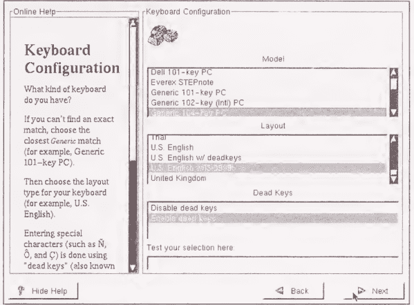

### Figure 2-1

在 Red Hat Linux 安装期间选择键盘类型

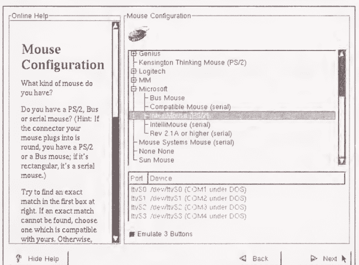

### Figure 2-2

在 Red Hat Linux 安装期间配置鼠标

If you select a mouse with a serial interface, you are asked to specify the serial port where the mouse is connected. For COM1, specify /dev/ttyS0 as the device; for COM2, the device name is /dev/ttyS1.

- 4. The installation program displays a welcome message that provides some helpful information, including a suggestion that you access the online manuals at http://www.redhat.com. Click the Next button to proceed to the next step.
- 5. The installation program displays a screen asking if you want to install a new system or upgrade an older Red Hat installation.

For a new installation, the installation program requires you to select the installation type — Workstation, Server, or Custom. The Workstation and Server installations simplify the installation process by partitioning the disk in a predefined manner. A Workstation-class installation deletes all currently existing Linux-related partitions. A Server-class installation deletes all existing disk partitions, including any existing Windows partitions. For maximum flexibility (so you can specify how the disk is used), select the Custom installation.

The next major phase of installation involves partitioning the hard disk for use in Red Hat Linux.

## Partitioning the Hard Disk for Red Hat Linux

Like MS-DOS, Red Hat Linux requires you to partition and prepare a hard disk before you can install Red Hat Linux. For a new PC, you usually do not perform this step. This is because the vendor normally takes care of preparing the hard disk and installing Windows and all other applications on the hard disk. Because you are installing Red Hat Linux from scratch, however, you have to perform this crucial step yourself. As you see in the following sections, this task is just a matter of following instructions.

The Red Hat Linux installation program runs Disk Druid — a utility program that enables you to partition the disk and, at the same time, specify which parts of the Linux file system you want to load on which partition.

Before you begin to use Disk Druid to partition your disk, you need to know how to refer to the disk drives and partitions in Linux. Also, you should understand the terms mount points and swap partition. In the next three sections, you learn these terms and concepts and then proceed to use Disk Druid.

## Naming disks and devices

The first step is to understand how Red Hat Linux refers to the various disks. Linux treats all devices as files and has actual files that represent each device. In Red Hat Linux, these device files are located in the /dev directory. If you are new to UNIX, you may not yet know about UNIX filenames. But you will learn more as you continue to use Red Hat Linux. If you know how MS-DOS filenames work, you will find that Linux filenames are similar. However, they have two exceptions: they do not use drive letters (such as A: and C:) and they substitute the slash (/) for the MS-DOS backslash (\) as the separator between directory names.

Because Linux treats a device as a file in the /dev directory, the hard disk names start with /dev. Table 2-1 lists the hard disk and floppy drive names that you may have to use.

Table 2-1
Hard Disk and Floppy Drive Names

| Name | Description |
|------|-------------|
| /dev/hda | First Integrated Drive Electronics (IDE) hard drive (the C: drive in DOS and Windows) |
| /dev/hdb |  |
| /dev/sda | First Small Computer System Interface (SCSI) drive |
| /dev/sdb | Second SCSI drive |
| /dev/fd0 | First floppy drive (the A: drive in DOS) |
| /dev/fd1 | Second floppy drive (the B: drive in DOS) |


When Disk Druid displays the list of partitions, the partition names take the form hda1, hda2, and so on. Linux constructs each partition name by appending the partition number (1 through 4 for the four primary partitions on a hard disk) to the disk's name. Therefore, if your PC's single IDE hard drive has two partitions, notice that the installation program uses hda1 and hda2 as the names of these partitions.

## Mounting a file system on a device

In Red Hat Linux, you use a physical disk partition by associating it with a specific part of the file system. This is a hierarchical arrangement of directories — a directory tree. If you have more than one disk partition (you may have a second disk with a Linux partition), you can use all of them in Red Hat Linux under a single directory tree. All you have to do is decide which part of the Linux directory tree should be located on each partition — a process known in Linux as mounting a file system on a device. (The disk partition is a device.)


The term mount point refers to the directory you associate with a disk partition or any other device.

Suppose that you have two disks on your PC, and you have created Linux partitions on both disks. Figure 2-3 illustrates how you can mount different parts of the Linux directory tree (the file system) on these two partitions.

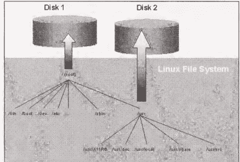

### Figure 2-3
An example of mounting the Red Hat Linux file system on two disk partitions

## Understanding swap partition

Most advanced operating systems support the concept of virtual memory, in which part of your system’s hard disk functions as an extension of the physical memory (RAM). When the operating system runs out of physical memory, it can move (or swap out) the contents of currently unneeded parts of RAM to make
room for a program that needs more memory. When the operating system needs to access anything in the swapped-out data, it has to find something else to swap out and then it swaps in the required data from disk. This process of swapping data back and forth between the RAM and the disk is also known as paging.

Because the disk is much slower than RAM, the system’s performance is slower when the operating system has to perform a lot of paging. However, virtual memory enables you to run programs that you otherwise can’t run.

Red Hat Linux supports virtual memory and can make use of a swap partition. When you create the Linux partitions, you should also create a swap partition. With the Disk Druid utility program, described in the next section, it is simple to create a swap partition. Simply mark a partition type as a swap device and Disk Druid performs the necessary tasks.

## Preparing disk partitions for Red Hat Linux

After you select Custom installation, a screen prompts you for the method you want to use to partition the disk — the choices are the Linux fdisk program or Disk Druid. You should select Disk Druid and click the Next button. You should then see the Disk Druid screen (as shown in Figure 2-4).

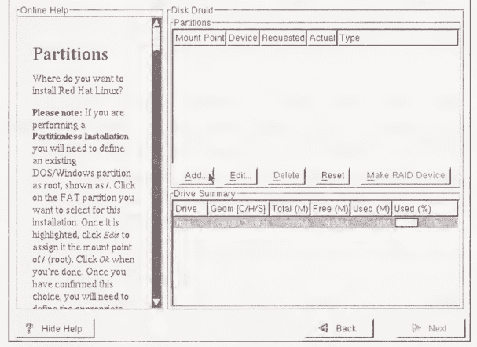

### Figure 2-4
Disk Druid screen from Red Hat Linux installation program

Disk Druid gathers information about the hard drives on your system and displays a list of disk drives in the lower part of the screen and the current partition information for one of the drives in the Partitions list in the upper part. For each partition, Disk Druid shows five fields:

- **Mount Point** indicates the directory where the partition will be mounted. For example, if you have only one partition for the entire Linux file system, the mount point will be the root directory (/). For the swap partition, this field shows <Swap>. If this field appears as <not set>, you have to specify a mount point. To do so, select the partition and click the Edit button.
- **Device** refers to the partition’s device name. For example, hda1 is the first partition on the first IDE drive.
- **Requested** field shows how much space the partition has. For example, if the partition has 256MB of space, this field appears as 256M.
- **Actual** field shows the amount of disk space the partition is using. Usually, the Requested and Actual fields are the same, but they may differ for partitions that can grow in size.
- **Type** field shows the partition’s type, such as Linux Native or DOS.

If there are no partitions defined, the table in the Partitions list is empty. You have to add new partitions by clicking the Add button.

You perform specific disk setup tasks in Disk Druid through the five buttons that run across the middle of the screen. Specifically, the buttons perform the following actions:

- **Add** enables you to create a new partition, assuming there is enough free disk space available. When you click this button, another dialog box appears in which you can fill in information necessary to create a partition.
- **Edit** enables you to alter the attributes of the partition currently highlighted in the Partitions list. You make changes to the current attribute in another dialog box that appears when you click the Edit button.
- **Delete** removes the partition currently highlighted in the Partitions list.
- **Reset** causes Disk Druid to ignore any changes that you may have made.
- **Make RAID Device** sets up a RAID (Redundant Array of Inexpensive Disks) device — a technique that combines multiple disks to improve reliability and data transfer rates. There are several types of RAID configurations. This button is active only if your system has the hardware necessary to support a RAID device.


你在 Disk Druid 中执行的操作取决于 PC 中的硬盘以及它们已有的分区。在本讨论中，我假设你已使用以下其中一种方法为 Linux 创建了必要的硬盘空间：

- 你从一台只有一个分区的单硬盘开始（在 Windows 中仅为 C: 驱动器）。然后使用 FIPS 将该分区拆分为两个。（参见“使用 FIPS 重新分区硬盘”部分。）分区后，你将得到两个 DOS 分区。
- 你的 PC 拥有一块大硬盘（大于 2GB），该硬盘有两个分区（Windows 中的 C: 和 D: 驱动器）。在这种情况下，第二个分区是一个扩展分区，其中包含逻辑驱动器 D:。你希望在以前用作 Windows 中 D: 驱动器的扩展分区上安装 Red Hat Linux。

这两种情况都需要相同的步骤序列，如接下来两个部分所述。

## 设置分区

要为 Linux 准备现有的 DOS 分区，你需要在 Disk Druid 中执行以下步骤：

- 1. 删除你想要用于 Linux 的 DOS 分区。为此，从 Disk Druid 屏幕上的 Partitions 列表中选择该分区（通常是设备名为 hda2 的分区），然后单击 Delete 按钮。在删除分区之前，请记住从 Partitions 列表中记录下该分区的大小。
- 2. 为 Linux 文件系统创建新分区。为此，在 Disk Druid 屏幕上按下 Add 按钮。你应该会看到一个对话框（参见图 2-5），其中可以填写 / 作为挂载点并输入以兆字节为单位的大小。要计算大小，只需从该分区的原始大小中减去交换空间的大小（32MB 或 PC 中的内存量，以较大者为准）。选择 OK 按钮，然后按 Enter 完成此步骤并返回 Disk Druid 屏幕。
- 3. 创建另一个新分区并将其设为 Linux 交换空间。为此，在 Disk Druid 屏幕中单击 Add 按钮（见图 2-4）。在对话框中（见图 2-5），输入分区的大小。单击分区类型列表并使用鼠标选择 Linux Swap 作为类型。执行此操作后，文本 <Swap Partition> 会出现在 Mount Point 字段中。接下来，单击 OK 按钮以定义新分区并返回 Disk Druid 屏幕。

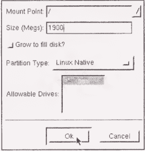

图 2-5
填写新分区属性的对话框

- 4. 如果你想在 Linux 下访问 DOS 分区，请确保为该分区分配一个挂载点。基本上，你为 DOS 分区将出现的 Linux 目录名分配一个名称。例如，你可以使用 /dosc 作为 DOS 分区的挂载点；然后你可以在 Linux 中的 /dosc 目录访问 DOS 文件。这个助记符很好，因为名称 dosc 应该提醒你该驱动器在 DOS 或 Windows 下是 C: 驱动器。要分配挂载点，请选择 DOS 分区（通常在 Partitions 列表中列为设备 hda1）并单击 Edit 按钮以编辑属性。编辑对话框出现。输入挂载点（例如 /dosc）并单击 OK 按钮返回 Disk Druid 屏幕。
- 5. 更改完成后，在 Disk Druid 屏幕中单击 Next 按钮以继续下一步安装。

## 选择要格式化的分区

在 Disk Druid 中指定分区后，Red Hat 安装程序会显示一个屏幕（见图 2-6），列出可能需要为 Linux 使用而格式化的分区。如果 Red Hat Linux 只有一个磁盘分区，则列表中只显示一个分区。

要格式化分区，请单击分区名称旁边的按钮。你还应单击标记为 Check for bad blocks while formatting 的项目旁边的按钮，以便格式化过程标记磁盘上可能物理损坏的任何区域。

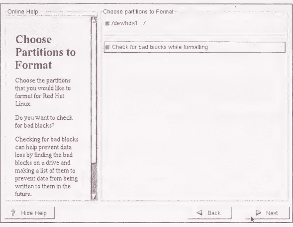

图 2-6
选择要用于 Red Hat Linux 的格式化分区


如果你有多个磁盘分区挂载在 Linux 文件系统的不同目录上，并且正在升级现有安装，则无需格式化你希望保留现有数据的任何分区。例如，如果你将所有用户目录放在挂载在 /home 目录的单独磁盘分区上，则无需格式化该分区。

这完成了安装的磁盘准备阶段。安装程序在询问一些更多配置信息（包括你想要安装的软件包）后执行分区的实际格式化。


## 回顾

本次会话首先向你展示如何为 Red Hat Linux 安装预留磁盘空间。然后你使用上一会话中准备的 Red Hat 启动盘开始安装。通过图形用户界面，你指定了语言、键盘和鼠标，并创建了用于 Red Hat Linux 的磁盘分区。你还学习了诸如交换分区之类的术语的含义以及在磁盘分区上挂载文件系统的意义。

## 自测

- 1. FIPS 是什么，你可以用它做什么？（参见“使用 FIPS 重新分区硬盘”。）
- 2. Red Hat 安装程序使用什么信息来定制安装步骤？（参见“开始 Red Hat Linux 安装”。）
- 3. 挂载文件系统是什么意思？（参见“在设备上挂载文件系统”。）
- 4. Disk Druid 是什么，你应该用它做什么？（参见“为 Red Hat Linux 准备磁盘分区”。）
- 5. 如果你将所有用户目录放在挂载在 /home 目录的单独磁盘分区上，在执行 Red Hat Linux 自定义安装时是否必须重新格式化该分区？（参见“选择要格式化的分区”。）

## 会话


## 完成 Red Hat Linux 安装

## 会话清单

- ✓ 配置 Red Hat Linux
- ✓ 选择要安装的软件包
- ✓ 完成 Red Hat Linux 安装


30 Min.
To Go

在上一会话中，你为 Red Hat Linux 预留了磁盘空间，启动了安装程序，并准备了磁盘分区，包括交换分区。在本次会话中，你完成 Red Hat Linux 的安装。你学习如何配置 Red Hat Linux，选择要安装的软件包，并让安装程序完成剩余的安装任务。

## 配置 Red Hat Linux

在使用 Disk Druid 准备磁盘分区并指定要格式化的分区后，安装程序进入一些配置步骤。典型的配置步骤如下：

- 安装 LILO
- 配置网络
- 设置时区
- 设置 root 密码并添加用户账户
- 配置密码认证

以下各节将指导你完成这些配置步骤。

## 安装 LILO

LILO 代表 Linux Loader — 一个驻留在你的硬盘上并从硬盘启动 Red Hat Linux 的程序。如果你的硬盘上有 Windows 95/98，你也可以配置 LILO 来加载这些操作系统。LILO 也被称为引导加载程序。

Red Hat 安装程序显示 LILO 配置屏幕（见图 3-1），询问你希望将 LILO 安装在何处。对于 Windows 95/98 和 Red Hat Linux 驻留在同一硬盘上的系统，Red Hat 建议将 LILO 安装在主引导记录上。

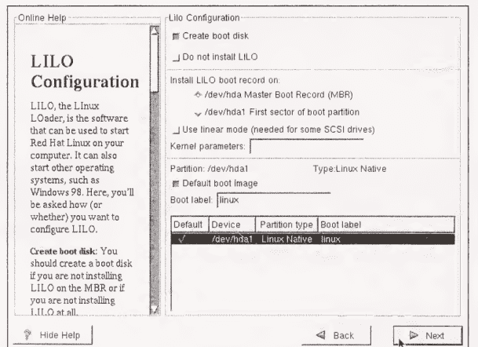

图 3-1
LILO 配置屏幕使你能够指定 LILO 的安装位置以及是否创建启动盘。

此屏幕上的第一个按钮询问你是否要创建启动盘。这与安装启动盘不同；你可以使用此盘在硬盘上的 Linux 内核损坏或 LILO — Linux

Loader — 不工作。Create boot disk 按钮默认被选中，你应保持不变。稍后，安装程序会提示你将一张空白软盘插入 PC 的 A: 驱动器。

你可以使用下一个按钮，标签为 Do not install LILO，来关闭 LILO 安装。如果你选择不安装 LILO，你一定要创建启动盘。否则，在重新启动 PC 时你将无法启动 Red Hat Linux。

LILO Configuration 屏幕的下一部分为你提供了在以下两个位置之一安装 LILO 的选项：

- Master Boot Record (MBR)，位于 PC 硬盘（C: 驱动器）的第一个扇区
- 安装 Red Hat Linux 的分区的第一个扇区

你应将 LILO 安装在 MBR 中，除非你正在使用其他操作系统加载程序，如 System Commander 或 OS/2 Boot Manager。屏幕包含一个标签为 Kernel parameters 的文本字段，可让你输入 Red Hat Linux 启动时可能需要的任何特殊选项。你是否需要特殊选项取决于你的硬件配置。在我的 PC 上，我有一块 3Com 3C503 以太网卡，它通过外部收发器连接到本地以太网。当 Red Hat Linux 加载 3Com 3C503 卡的驱动软件时，我需要指定选项 xcvr=1，以确保驱动程序使用外部收发器。我在 Kernel parameters 文本字段中输入该选项。

LILO Configuration 屏幕的其余部分为你提供了选择要从哪个磁盘分区启动 PC 的选项。然后表格列出 Linux 分区以及可能包含其他操作系统的任何其他分区。如果你的系统有一个 Linux 分区和一个 DOS 分区（该分区实际安装了 Windows 95/98），表格会显示这两个条目。该表格中的每个条目都是 LILO 可以启动的操作系统。

安装 LILO 后，每当你的 PC 从硬盘启动时，LILO 就会运行并显示 boot: 提示。在提示符下，你可以输入要启动的操作系统的名称。（图 3-1 右下部分表格中的 Boot label 列显示了你在 LILO 提示符下可以输入的名称）。如果列表显示两个分别标记为 linux 和 dos 的条目，输入 linux 启动 Linux，输入 dos 从 DOS 分区启动（如果该分区安装了 Windows 95/98，则应启动 Windows 95/98）。如果你在 LILO 提示符下按下 tab，LILO 会显示启动标签。

重新启动 PC 时，如果你在 LILO 提示符下什么都不输入，LILO 会等待几秒钟然后启动默认操作系统。默认操作系统是图 3-1 中 Default 列带有复选标记的那个。在本例中，Linux 是默认操作系统。

以上信息仅供参考。你基本上可以接受此屏幕上的默认选择，然后单击 Next 按钮继续下一步配置。

## 配置网络

假设 Linux 内核检测到网卡，Red Hat 安装程序会显示 Network Configuration 屏幕（见图 3-2），可让你配置 Linux 系统的局域网（LAN）参数。

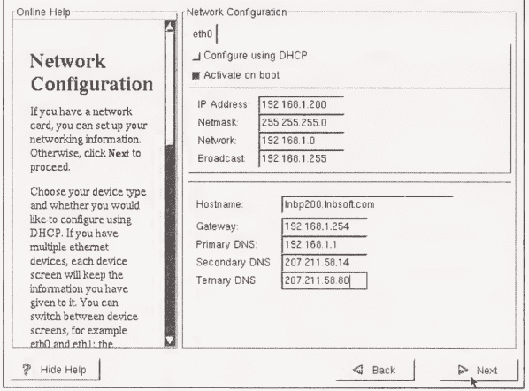

Figure 3-2
Network Configuration 屏幕可让你配置局域网。

此步骤不是用于配置拨号网络。如果你通过以太网卡将 Linux 系统连接到 TCP/IP LAN，则需要执行此步骤。


如果 Red Hat 安装程序未检测到你的网卡，而你的 PC 上已安装网卡，你应重新启动安装并在启动提示符下输入 expert。然后你可以手动选择网卡。有关更多信息，请参阅第 4 节。

Network Configuration 屏幕（图 3-2）显示了选项卡式对话框——为系统上安装并被 Linux 内核检测到的每张网卡各一个。这些选项卡标记为 eth0、eth1 等。如果你的系统只有一个以太网卡，你只能看到 eth0 选项卡。图 3-1 只有一个选项卡。每个选项卡为指定网络接口的 IP（Internet Protocol）地址提供两种选择：

- Use DHCP — 如果你的 PC 从动态主机配置协议（DHCP）服务器获取其 IP 地址和其他网络信息，请单击标签为 Configure using DHCP 的按钮。
- Provide static IP address — 手动填写必要的网络相关信息。

你只有在局域网上运行 DHCP 服务器时才应选择 DHCP。如果你选择 DHCP，你的网络配置会自动设置，你可以跳过本节的其余部分。你应保持 Activate on boot 按钮被选中，以便每次启动系统时网络都会被配置。

要提供静态 IP 地址和其他网络信息，你必须在 Network Configuration 屏幕（参考图 3-2）上出现的文本输入字段中输入 TCP/IP 配置的某些参数。

Network Configuration 屏幕要求以下关键参数：

- 以太网接口的 IP 地址
- 你的 Linux 系统的主机名（对于私有 LAN，你可以自行分配主机名，而不必担心与互联网上任何其他现有系统冲突。）
- 网关的 IP 地址（你可能通过该系统访问任何外部网络）
- 主域名服务器的 IP 地址
- 次要域名服务器的 IP 地址
- 三级域名服务器的 IP 地址

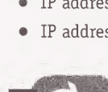

如果你的 LAN 是私有 LAN（未直接连接到互联网），你可以使用为私有用途指定的 IP 地址范围。私有 LAN 的常见 IP 地址为 192.168.1.1 至 192.168.1.254 范围内的地址。第 12 节提供了有关 TCP/IP 网络和 IP 地址的更深入信息。

输入所需参数后，单击 Next 按钮继续下一步配置。


## 设置时区

完成网络配置后，你必须选择时区——本地时间与英国格林威治的当前时间之间的差异，后者是标准参考时间。时区也称为格林威治标准时间（GMT）或 UTC，后者由国际电信联盟（ITU）选定为协调世界时的标准缩写。安装程序会显示 Time Zone Selection 屏幕（见图 3-3），可让你以地理位置或相对于 UTC 的偏移量选择时区。图 3-3 显示了以地理位置选择时区。

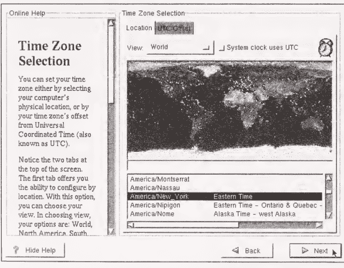

### Figure 3-3

*以地理位置选择时区*

请注意，Time Zone Selection 屏幕上有两个选项卡——Location 和 UTC Offset。最初，屏幕显示 Location 选项卡。此选项卡可让你通过简单地单击地理位置来选择时区。当你在地图上移动鼠标时，当前选定位置的名称会出现在文本字段中。如果你愿意，也可以从国家和地区长列表中选择你的位置。例如，如果你住在美国东海岸，选择 USA/Eastern。当然，最简单的方法是直接在地图上单击美国东部。

如果地图的世界视图对于选择你的位置来说太大，请单击地图顶部的 View 按钮。会出现一个包含多个选择的下拉视图列表。然后你可以单击适合你位置的视图。

设置时区的另一种方法是指定本地时间与 UTC 之间的时间差。单击 UTC Offset 选项卡以这种方式选择时区。

例如，如果你住在美国东部，选择 UTC-05:00 作为时区。此选项卡还可让你激活夏令时，这仅适用于美国。选择时区后，单击 Next 按钮继续下一步配置。

## 设置 root 密码并添加用户账户

完成时区选择后，安装程序会显示 Account Configuration 屏幕（见图 3-4），在其中你可以设置 root 密码并添加一个或多个用户账户。

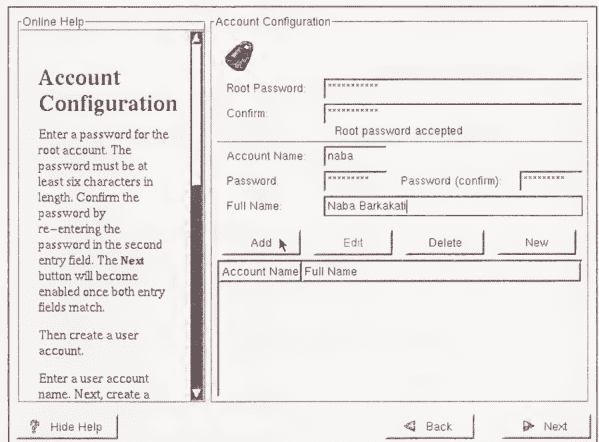

Figure 3-4

设置 root 密码并添加其他用户账户

root 用户是 Linux 中的超级用户。由于超级用户可以在系统中做任何事情，你应分配一个你能记住的密码——但那

others cannot guess easily. Typically, make the password at least eight characters long, include a mix of letters and numbers, and (for good measure) throw in some special characters such as + or *. Remember the password is also case sensitive.

Type the password on the first line and then reenter the password on the next line. Each character in the password appears as an asterisk (*) on the screen. Both entries must match before the installation program accepts the password. The installation program displays a message when it accepts the root password. After you type the root password twice, you might also want to add one or more user accounts.

To add a user account, fill in the Account Name, Password, and Full Name fields and then click the Add button. The new account information then appears in the table underneath the Add button. You do not have to add all the user accounts at this time. Later on, you can use the Linuxconf tool (which comes with Red Hat) to add more user accounts.


You must enter the root password before you can proceed with the rest of the installation. After you do so and add any other user accounts you need, click the Next button to continue with the installation.

## Configure password authentication

The installation program displays a screen from which you can configure the password authentication options. There are several options that you can enable or disable. Of these, the first two are already selected:

- **Enable MD5 passwords:** Select this option to enable users to use long passwords of up to 256 characters instead of the standard password that can be, at most, eight characters long. Note that MD5 refers to Message Digest 5, an algorithm developed by RSA, Inc. to compute the digest of the entire data of a message. Essentially, MD5 reduces a message to a digest consisting of four 32-bit numbers.
- **Enable shadow passwords:** This option causes the /etc/passwd file to be replaced by /etc/shadow, which only the super user (root) can read. This provides an added level of security.

You should use these default settings for increased system security. Click the Next button to proceed to the next configuration step.

## Selecting the Package Groups to Install

After you complete the key configuration steps, the installation program displays a screen from which you can select the Red Hat Linux package groups that you want to install. After you select the package groups, you can take a coffee break and the Red Hat installation program can format the disk partitions and copy all selected files to those partitions.


Red Hat uses special files called *packages* to bundle a number of files that make up specific software. For example, all configuration files, documentation, and binary files for the Perl programming language come in a Red Hat package. You use a special program called *Red Hat Package Manager (RPM)* to install, uninstall, and get information about packages. Session 23 shows you how to use RPM. For now, just remember that a package group is made up of several Red Hat packages.

Figure 3-5 shows the Package Group Selection screen with the list of package groups that you can elect to install. An icon, a descriptive label, and a button prefix identify each package group.

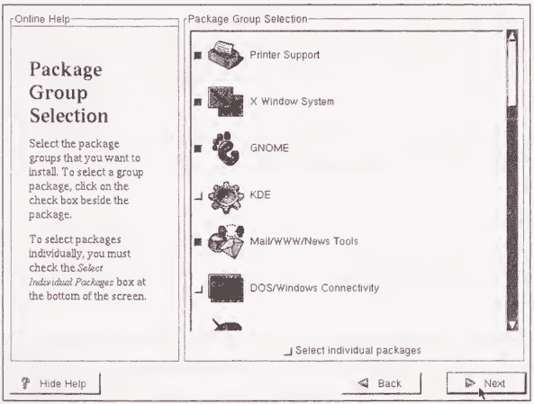

Figure 3-5
GUI screen from which you select the components to install

Some of the components are already selected, as indicated by the pressed-in buttons. These are the minimal set of packages that Red Hat recommends for installation for the class of installation (Workstation, Server, or Custom) you have chosen. You can, however, choose to install any or all of the components. Use the mouse to move up and down in the scrolling list and click the mouse on an entry to select or deselect that package group.


In an actual Red Hat Linux installation, you install exactly those package groups that you need. However, for the purpose of this crash course, choose many different package groups because you need them to go through all the sessions. Each package group requires specific packages to run. The Red Hat installation program automatically checks for any package dependencies and shows you a list of packages that are required but that you have not selected. In this case, you should install the required packages.

Because each package group is a collection of many different Red Hat packages, the installation program also gives you the option to select individual packages. If you select the item labeled Select individual packages that appears below the list in Figure 3-5 and then click the Next button, the installation program takes you to other screens where you can select individual packages. If you are installing Red Hat Linux for the first time, you really do not need to go down to this level of detail to install specific packages. Simply pick the components that you think you need from the screen shown in Figure 3-5. After you select the components you want, click the Next button to continue with the rest of the installation.

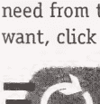

You can always install additional packages later on with the RPM utility program, described in Session 23.


## Completing the Installation

After you complete the key configuration steps and select the components to install, the installation program configures the X Window System. The installation program uses an X server with minimal capability that can work on all video cards. In this step, the installation program prepares the configuration file that the X server uses when your system reboots.

The installation program tries to detect the monitor and displays the X Configuration screen (see Figure 3-6) with the result, whether or not it succeeds.

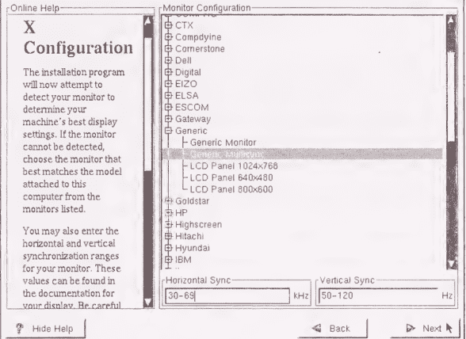

### Figure 3-6

Result of detecting the monitor displayed in the X Configuration screen

If the installation program displays a wrong monitor or a generic one as the choice, you should enter a range of values for the two parameters that appear along the bottom of the screen:

- **Horizontal Sync** — the number of times per second that the monitor can display a horizontal raster line, in kilohertz (kHz). A typical range might be 30–64 kilohertz (kHz).
- **Vertical Sync** — how many times a second the monitor can display the entire screen, in Hertz (Hz). Also known as *vertical refresh rate*, the typical range is 50–90 Hertz (Hz).

Typically, the monitor’s documentation includes all this information. Other places to get information about your monitor include: your Microsoft Windows setup, your system’s Windows driver, your computer vendor’s Web site, or the Norton System Information tool.


Do not specify a horizontal synchronization range that is beyond the capabilities of your monitor. A wrong value can damage the monitor.

After selecting the monitor, the installation program tries to detect the video card and displays the result in a screen. The detected card appears as the selected item in a long list of video cards. If you know the exact name of the video card or the name of the video chipset used in the video card, select that item from the list.

On the same screen where you view and select the video card, you should also turn on the graphical login by clicking the button labeled Use Graphical Login. Then you get a graphical login screen when you reboot the system.

After you finish selecting X configuration options, click the Next button. The installation program displays an informative message telling you that a log of the installation is in the /tmp/install.log file. That file essentially lists all the Red Hat packages that are installed in your system. You can review the install log later on and keep the file for future reference. The content of the install log depends on the exact packages you choose to install.

Click the Next button to proceed with the installation. The Red Hat installation program formats the disk partitions and then installs the packages. As it installs packages, the installation program displays a status screen showing the progress of the installation with information such as the total number of packages to install, the number installed so far, an estimated amount of disk space needed, and an estimated time remaining to install. Formatting and installation both take a while.

After all the packages are installed, the installation program displays a screen that prompts you to insert a blank floppy into your PC's A: drive. This floppy is the emergency boot disk that you can use to start Red Hat Linux if something happens to the hard disk or you do not install the LILO.

Insert a blank floppy into your PC's A: drive and click the Next button. The installation program copies the Linux kernel and some other files to the floppy. After preparing the boot disk, the installation program displays a message informing you that installation is complete.


**When you insert a blank floppy into your PC's A: drive, this destroys all data on the floppy.**


The message goes on to remind you to remove the floppy from drive A: before exiting the installation program. Do so, label the floppy appropriately, and save it for future use. Then click the Exit button to reboot your PC. When it finishes rebooting, you should get the Red Hat Linux graphical login screen. You are now all set to explore and learn Red Hat Linux.


## 回顾

在本节中，您继续进行上一节开始的 Red Hat Linux 安装步骤。安装程序使您能够配置多项内容，包括 Linux 加载器（LILO）、局域网、时区以及 root 用户的密码。然后您选择了要安装的软件包组并配置了 X Window 系统。之后，安装程序接管了操作——它格式化了磁盘分区并将 CD-ROM 上的所有必要文件复制到磁盘上。您还准备了一张启动盘，以在 LILO 无法启动 Red Hat Linux 时应急使用。

## 自测

- 1. LILO 是什么？它有什么作用？（参见“安装 LILO”。）
- 2. root 用户是什么？（参见“设置 root 密码并添加用户账户”。）
- 3. 在网络配置屏幕中需要指定哪些参数？（参见“配置网络”。）
- 4. 如果不选择任何软件包组进行安装会发生什么？（参见“选择要安装的软件包组”。）
- 5. 如果安装程序无法正确检测到您的显示器，需要指定哪些参数？（参见“完成安装”。）

## 会话


## 排查 Red Hat Linux 安装问题

### 会话清单

- ✓ 以文本模式安装 Red Hat Linux
- ✓ 以专家模式安装 Red Hat Linux
- ✓ 配置 X Window 系统
- ✓ 配置打印机


在过去的三个会话中，您已从本书附带的 CD-ROM 安装了 Red Hat Linux。Red Hat Linux 安装程序会尝试自动检测关键硬件组件，例如 SCSI 控制器和网卡。根据检测到的硬件，安装程序会引导您完成一系列步骤来配置检测到的硬件。例如，如果安装程序无法正确检测到网卡，它会跳过网络配置步骤。安装程序还试图通过跳过某些系统配置步骤（例如设置打印机）来简化安装。由于有其他方法可以执行这些任务，因此您可以从大多数安装和配置问题中恢复。本节向您展示了针对一些常见安装和配置问题的几种故障排除方法。

### 以文本模式安装 Red Hat Linux

Red Hat 安装程序尝试使用最小的 X Window 系统（X）来显示图形用户安装屏幕。如果程序无法检测到显卡，X 将无法启动。如果——出于此原因或其他任何原因——X 无法启动，您始终可以退回到旧的文本模式安装程序以手动指定显卡。您也可以在熟悉旧的安装程序时使用文本模式安装。

要使用文本模式安装，在从 Red Hat Linux 启动软盘启动 PC 后，在 boot: 提示符下输入 text。从那时起，基本流程与第 2 节中描述的图形安装类似。然而，许多细节有所不同。您应该能够响应提示并执行安装。

在文本模式下，当安装程序无法检测到显卡时，它会显示显卡列表。从列表中选择一张显卡。由于您帮助选择了显卡，在文本模式下安装时 X 可能可以工作。如果不行，您可以使用本节后面“配置 X”部分中的信息来配置 X。

### 以专家模式安装 Red Hat Linux

如果 Red Hat 安装程序未检测到您的 SCSI 控制器或网卡，您可以通过以专家模式运行安装来手动指定这些设备。在 Linux 内核启动时显示的消息中查找 SCSI 或网络设备的任何迹象。要查看这些启动消息，请按 Ctrl+Alt+F4。这会切换到文本模式虚拟控制台，消息会在其中显示。虚拟控制台是存储在内存中的文本或图形信息屏幕，您可以通过按适当的键序列在物理屏幕上查看它。

要以专家模式运行安装，在 Red Hat Linux 安装期间出现的初始文本屏幕中，在 boot: 提示符下输入 expert。安装程序然后会显示另一个文本屏幕，如果您有驱动盘，则会要求提供驱动盘。

您的硬件供应商提供一张带有 Linux 驱动程序的软盘。您将该软盘插入 A: 驱动器。如果您有该磁盘，请按 Enter，对话框会提示您将磁盘插入 A: 驱动器。完成后，按 Enter，安装程序将加载驱动程序并引导您完成安装驱动程序所需的步骤。

如果您没有驱动盘，请选择取消。安装程序然后会经过另外两个屏幕，在其中选择语言和键盘布局。然后安装程序会提示输入包含要安装软件包的介质。

接下来，安装程序会显示一个对话框，让您有另一个机会添加设备。按 Tab 键突出显示“添加设备”按钮，然后按 Enter。安装程序然后会显示一个对话框，提示设备类型——SCSI 或网络。

如果您有任何 SCSI 设备，例如 SCSI 硬盘，请选择 SCSI 并按 Enter。然后，安装程序会显示 SCSI 控制器列表，您应从中选择系统上的控制器并按 Enter。安装程序然后加载该驱动模块。

SCSI 驱动程序会自动探测并确定 SCSI 控制器的设置，例如中断请求（IRQ）和 I/O 端口地址。如果驱动程序在检测 SCSI 控制器设置时遇到问题，您可以手动指定这些参数。为此，请选择标记为“指定模块参数”的复选框并按 Enter。安装程序然后会提示您输入模块参数。

然后您可以输入类似 aha152x=0x340,11,7 的行来指定驱动模块的参数。有关这些设置的更多信息，请参阅本节后面的侧边栏“指定 SCSI 控制器设置”。

在添加任何 SCSI 控制器后，您将返回到可让您选择设备类型的对话框。您也可以从此对话框添加网卡。在对话框中，从列表中选择网络并按 Enter。安装程序然后会显示网卡列表，您可以从中选择您的网卡。

按 Enter 后，安装程序将加载所选网卡的驱动模块。该驱动程序会探测并确定网卡设置。

返回到选择 SCSI 或网络设备的屏幕后，选择“返回”并按 Enter。这会带您进入询问是否添加设备的对话框。选择“完成”并按 Enter。安装程序然后切换到图形模式，并根据第 2 节和第 3 节概述的内容引导您完成剩余的安装。

### 指定 SCSI 控制器设置

如果您的系统中有 SCSI 控制器，Red Hat 安装程序将为该控制器加载 SCSI 驱动模块。您必须识别 SCSI 控制器的类型（例如 Adaptec 1542 或 Adaptec 2940）。安装程序可以通过探测各种 I/O 端口地址来尝试确定控制器设置，例如 IRQ 和 I/O 端口地址。但是，如果安装程序无法确定 SCSI 控制器设置，您必须将这些参数——IRQ 和 I/O 地址——作为驱动模块的选项指定。这些选项的确切格式因模块而异。例如，Adaptec AHA 152x 卡的驱动程序接受以下格式的选项：

```
aha152x=IOPORT,IRQ,SCSI_ID[,Reconnect,Parity]
```

其中 IOPORT 是 I/O 端口地址，IRQ 是中断请求号，SCSI_ID 是 SCSI 控制器的 SCSI ID。最后两项是可选的。aha152x 模块的典型模块选项可能是：

```
aha152x=0x340,11,7
```

### 配置 X Window 系统


如果安装程序在 X 配置步骤中无法检测到您的显卡，您可以跳过该步骤，并在完成其余安装后配置 X。

安装完成后并重新启动 PC 后，您会看到文本登录屏幕。以 root 身份登录并输入 Xconfigurator 以运行同名实用程序。Xconfigurator 实用程序使您能够创建 X 服务器所需的配置文件。

Xconfigurator 程序以欢迎对话框开始，显示有关 X 配置文件的消息。阅读消息后，按 Enter 继续配置过程。

Xconfigurator 会自动检测显卡使用的芯片组并显示摘要消息，如图 4-1 所示。


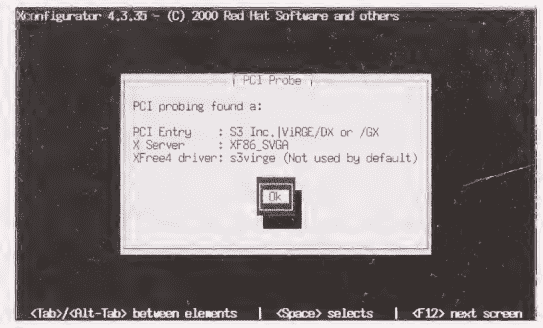

## 图 4-1

Xconfigurator 探测显卡后产生的消息

在这种情况下，Xconfigurator 找到了一块基于 S3 ViRGE/DX（或 /GX）芯片组的显卡，并推荐使用 SVGA X 服务器。事实上，Xconfigurator 的消息有些晦涩。SVGA X 服务器指的是全名为 XF86_SVGA 的 X 服务器程序，该程序安装在 /usr/X11R6/bin 目录中。由于图 4-1 中的对话框仅供参考，请按 Enter 继续进行其余配置。随后会出现一个对话框，允许你从列表中选择显示器。

按上、下箭头键浏览列表。如果找到你的显示器型号，请将光标定位到该显示器上，然后按 Enter。否则，选择 Custom 并按 Enter。如果选择 Custom，Xconfigurator 会显示另一个对话框，在其中你需要提供显示器的两个关键参数：

- 水平同步频率 — 显示器每秒能够显示水平光栅线的次数，以千赫兹（kHz）为单位
- 垂直同步速率或垂直刷新率 — 显示器每秒能够显示整个屏幕的次数

你可以在显示器的手册中找到频率参数。按 Enter 继续。Xconfigurator 显示一个预定义的水平同步范围列表。


通常，列表中的其中一项应与你的显示器规格相匹配。如果你需要猜测显示器的能力，请保守一些。不要指定超出显示器能力的水平同步范围。错误的水平同步频率值可能会损坏你的显示器。

例如，如果显示器手册说明它能够以 60Hz 显示 1,280×1,024 分辨率，那么你应选择与此规格相匹配的项目。选择水平同步能力后，按 Enter。

Xconfigurator 现在会提示你输入显示器的垂直同步速率。选择最接近显示器规格的垂直同步范围，然后按 Enter。

如果 Xconfigurator 无法检测到显卡上的视频内存大小，它会显示一个对话框，提示你从列表中选择视频内存大小。选择最接近显卡内存的容量，然后按 Enter。

Xconfigurator 提示你识别时钟芯片——显卡上的定时设备。你可以安全地按 Enter 接受标记为 No Clockchip Setting（推荐）的默认选择。

Xconfigurator 然后显示一个 Select Video Mode 对话框，其中列出了以像素分辨率为 1,280×1,024 和颜色为每像素 16 位等形式表示的视频模式，如图 4-2 所示。

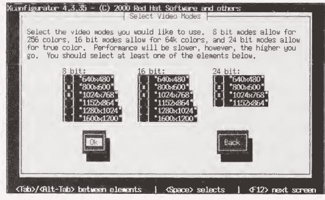

## 图 4-2

选择一个或多个视频模式

按 Tab 将光标移动到视频模式，然后按空格键选择该模式。你可以選擇任意多个模式。然后按 Tab 选择 OK 按钮并按 Enter。

接下来，Xconfigurator 会给你启动 X 以测试配置的选项。你应该按 Enter。图形 X 屏幕出现，Xconfigurator 显示一个对话框询问你是否可以阅读文本。用鼠标单击关闭对话框。

Xconfigurator 然后在 /etc/X11 目录中写入 XF86Config 文件并完成 X 配置。下次重新启动 PC 时，X 应启动，你应获得图形登录屏幕。

## 配置打印机

Red Hat 安装程序不包括打印机配置步骤。然而，只要 Linux 内核能够检测到你的 PC 的并行端口，你就可以从 X 实用程序配置打印机。要查看 Red Hat Linux 是否检测到并行端口，请在终端窗口中输入 dmesg | grep par。以下是该命令的典型输出：

```
dmesg | grep par
parport0: PC-style at 0x378 [SPP,PS2]
parport0: no IEEE-1284 device present.
lp0: using parport0 (polling)
```

在这种情况下，第一行以单词 parport0 开头，这在程序员术语中指的是并行端口零或第一个并行端口。该行基本上表明操作系统已检测到并行端口。

要设置打印机，你必须正在运行 X。从图形登录屏幕以 root 身份登录，并在 GNOME 桌面上选择 主菜单 程序 系统 打印机工具。（如果未以 root 身份登录，请在终端窗口中输入 su，输入 root 密码，然后输入 printtool 运行打印工具。）

打印工具的主窗口正式名称为 Red Hat Linux Print System Manager，出现（如图 4-3 所示）。如果未安装 IPX/Netware Connectivity 软件包组，你会看到一个对话框，提示你名为 ncpfs 的软件包未安装，因此无法打印到 Netware 打印机。你可以单击 Ignore 按钮关闭此对话框并使用打印工具的主窗口。

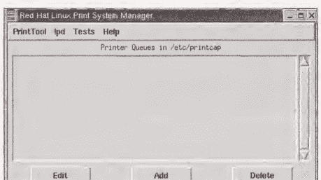

### 图 4-3
打印工具的主窗口使你能够管理打印队列并添加新打印机

你可以通过打印工具实用程序管理打印机队列并添加新打印机。单击 Add 按钮配置新打印机。打印工具显示 Add a Printer Entry 对话框，提示你选择打印机类型，如图 4-4 所示。

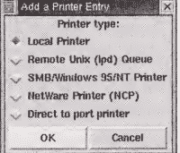

### 图 4-4
选择打印机类型

你可以从五种打印机类型中选择：

- **本地打印机：** 指直接连接到安装 Red Hat Linux 的 PC 的并行或串行端口的打印机
- **远程 Unix（lpd）队列：** 指物理连接到本地网络上另一台 Linux 系统的打印机（lpd 指 Linux 打印机守护进程——管理打印机队列的进程。）
- **SMB/Windows 95/NT 打印机：** 指连接到本地网络上的另一台 PC 且运行 LAN Manager 协议的打印机（通常用于在运行 Windows 95/98 或 Windows NT 的 PC 之间共享磁盘和打印机等资源）
- **NetWare 打印机（NCP）：** 指连接到局域网上的 Novell Netware 服务器的打印机
- **直连端口打印机：** 指网络连接的打印机，打印在特定 TCP/IP 端口接收到的数据（通常为端口号 9100）

你应指定适用于你的配置的打印机连接。就本讨论而言，我假设你将打印机连接到 PC 的并行端口，这意味着你应在 Add a Printer Entry 对话框中选择 Local Printer 按钮。在选择 Local Printer 按钮并单击 OK 后，打印工具会显示一个包含检测到的并行端口信息的对话框。

单击 OK 继续打印机配置。接下来，Edit Local Printer Entry 对话框提示输入本地打印机的各种条目（如图 4-5 所示）。

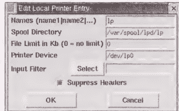

## 图 4-5

提供有关本地打印机的信息

文本字段已填好，你可以照此接受。你必须选择一个输入过滤器，即取决于你连接到并行端口的打印机品牌和型号的打印机驱动程序。为此，单击 Input Filter 文本字段旁边的 Select 按钮。这会打开一个大型对话框（图 4-6），让你选择打印机类型并设置其他参数，如纸张尺寸和打印机分辨率（现代激光打印机通常为每英寸 600×600 点）。你应为所有字段选择适当的值。

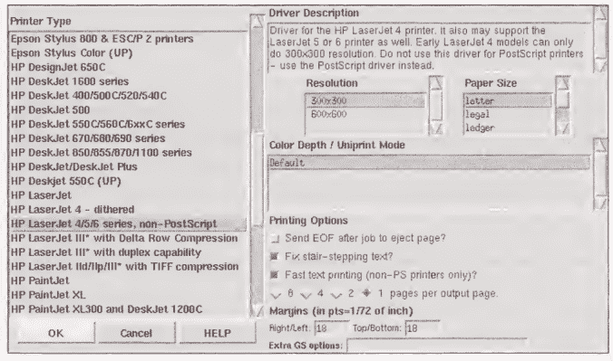

## 图 4-6

选择打印机类型和选项，如纸张尺寸和分辨率

图 4-6 对话框中的一个特定项目是标记为 Fix stair-stepping text 的选项。这指的是当 Red Hat Linux 的文本文件发送到打印机时出现的问题。在 Linux 文本文件中，每行以单个换行符结束；在 DOS 和 Windows 中，每行以回车符后跟

通过换行符。打印机对回车和换行符的反应与老式打字机相同——换行符使光标前进到下一行，而回车则移动到一行的开头。当打印 DOS 文本文件时，行会按预期一个接一个地打印。然而，当打印机打印只有以换行符结束的 Linux 文本文件时，输出看起来像这样：

```
Line 1 ends here
        Line 2 here
                and so on
                        like a staircase.
```

为避免这种阶梯效果，只需在图 4-6 的对话框中勾选标记为“修复文本阶梯状”的复选框，Red Hat Linux 就会在每次打印文本文件时在每个换行符之前发送一个回车来解决此问题。在图 4-6 中选择选项后，依次在后续对话框中单击“确定”，直到返回图 4-3 所示的主打印工具窗口。此窗口现在应显示有关新打印机的信息。从图 4-3 所示的主窗口中，您可以通过从菜单中选择“测试 ⇒ 打印 ASCII 测试页”来打印测试页。


## 回顾

本次课程向您展示了如何通过以不同模式运行安装来克服一些常见的安装问题。您学习了如何使用文本模式安装以及如何使用专家模式来安装安装程序未检测到的设备。最后，您学习了如何配置 X 和打印机。

## 自测

- 1. 如何以文本模式启动安装？（参见“在文本模式下安装”。）
- 2. 如果 Red Hat 安装程序未检测到您的网卡，您会怎么做？（参见“在专家模式下安装”。）
- 3. 在什么情况下您会手动配置 X Window 系统？（参见“配置 X Window 系统”。）
- 4. 如何启动用于配置打印机的实用程序？（参见“配置打印机”。）
- 5. “修复阶梯状文本”是什么意思？（参见“配置打印机”。）

## 部分


## 星期五晚上
部分回顾

- 1. 在开始使用本书附带的 CD-ROM 安装 Red Hat Linux 之前，您如何查找有关 PC 硬件的信息？
- 2. 为什么需要 Red Hat 启动盘来安装 Red Hat Linux？您如何从附带的 CD-ROM 创建 Red Hat 启动盘？
- 3. 为什么在安装 Linux 之前通常必须重新分区硬盘？重新分区硬盘有哪些不同方法？您将使用哪种方法为 Linux 分区在硬盘上腾出空间？
- 4. Red Hat Linux 的安装选项有哪些不同类型？如果选择服务器类安装会发生什么？
- 5. Linux 中 IDE 和 SCSI 磁盘设备的名称是什么？分区名称有哪些？
- 6. Linux 如何使用交换分区？应为 Linux 预留多少交换空间？
- 7. 假设除了交换分区外，您只有一个磁盘分区用于安装 Linux。在 Disk Druid 中，您必须为该分区指定什么挂载点才能安装 Red Hat Linux？
- 8. 在 Red Hat Linux 安装期间，您如何挂载 DOS 分区？
- 9. 假设您的 PC 已安装 Windows 95/98，现在您正在安装 Red Hat Linux。在安装期间，您如何确保 Linux 加载器（LILO）默认启动 Windows？
- 10. 在 Red Hat Linux 安装期间可以添加普通用户账户吗？添加用户账户的数量有限制吗？如何添加用户账户？
- 11. 什么是软件包组？可以在软件包组中选择单个软件包吗？
- 12. 假设您正在一台连接到网络的 PC 上安装 Red Hat Linux，该网络中的动态主机配置协议（DHCP）服务器动态分配 IP 地址。在此 PC 上安装 Red Hat Linux 时，您将如何执行网络配置？
- 13. 在 Red Hat Linux 安装期间，您可以通过哪两种方式指定时区？如何启用夏令时？
- 14. 您将如何使用文本模式界面启动 Red Hat Linux 安装？为什么可能会使用文本模式安装？
- 15. 解释必须使用专家模式安装的情况。您如何开始以专家模式安装 Red Hat Linux？
- 16. 在专家模式安装时，您可能需要为 SCSI 适配器或网卡指定哪些典型参数？请给出 SCSI 适配器参数的示例规范。
- 17. 如果 Red Hat 安装程序未正确检测到显卡，您将如何排除此问题？您会使用什么实用程序？
- 18. 当您配置 X 时，您会指定显示器的水平同步频率和垂直刷新率。这些术语是什么意思？您如何找到显示器这些参数的值？
- 19. 假设您想将打印机连接到 PC 的并行端口并在 Linux 中将其配置为打印。您如何确定 Linux 是否检测到 PC 的并行端口？
- 20. 使用 Red Hat Linux 打印系统管理器可以设置哪些类型的打印机？您能否将 Linux 系统配置为在局域网上连接到 Windows 系统的打印机上打印？如果是，那是什么类型的打印机？

- - [x] 星期五
- - [x] 星期六
- - [ ] 星期日

## 第二部分–星期六上午

## 第 5 节
*首次试用 Red Hat Linux for the First Time*

## 第 6 节
*探索 Linux 文件和目录*

## 第 7 节
*理解 Shell*

## 第 8 节
*学习 Linux 命令*

## 第 9 节
*在 Red Hat Linux 中编辑文本文件*

## 第 10 节
*执行基本系统管理任务*

## 第三部分–星期六下午

## 第 11 节
*在 Red Hat Linux 中使用调制解调器*

## 第 12 节
*联网您的 Red Hat Linux PC*

## 第 13 节
*将您的 Red Hat Linux PC 连接到互联网*

## 第 14 节
*设置互联网服务*

## 第 15 节
*将 Red Hat Linux 用作工作组服务器*

## 第 16 节
*从 Red Hat Linux 访问 Windows 和 DOS 文件*

## 第四部分–星期六晚上

## 第 17 节
*自定义 GNOME 和 KDE 桌面*

## 第 18 节
*使用屏幕保护程序和玩游戏*

## 第 19 节
*使用多媒体应用程序*

## 第 20 节
*在 Red Hat Linux 中使用办公工具*


## 部分

## II

## 星期六
上午

- - **第 5 节**
  *首次试用 Red Hat Linux for the First Time*
- - **第 6 节**
  *探索 Linux 文件和目录*
- - **第 7 节**
  *理解 Shell*
- - **第 8 节**
  *学习 Linux 命令*
- - **第 9 节**
  *在 Red Hat Linux 中编辑文本文件*
- - **第 10 节**
  *执行基本系统管理任务*


## 会话


## 首次试用 Red Hat Linux

## 会话清单

- - 首次启动 Red Hat Linux
- - 探索 GNOME
- - 探索 KDE


现在您已从本书附带的 CD-ROM 安装了 Red Hat Linux，可以开始探索和学习它了。在本节中，您首先学习如何登录、注销和关闭 Linux 系统。然后您再次启动系统，并快速浏览 GNOME 和 KDE 图形用户界面（GUI — 发音为“gooe-ease”）。

## 首次启动 Red Hat Linux

安装完成后，Red Hat Linux 安装程序会自动重新启动系统。PC 会经历正常的启动序列并从 C: 驱动器加载 LILO，然后出现一个屏幕，显示 LILO 可以启动的分区名称。如果您不做任何操作，LILO 将继续从该分区启动

在第 1 节中配置 LILO 时，它被指定为默认项。如果按 Ctrl+X，将出现以下提示：

```
LILO boot:
```

安装 LILO 时，如果将 Linux 分区指定为默认分区，只需等待即可；几秒钟后，LILO 会启动 Linux。


如果要从另一个分区（如 Windows）启动，请按 Tab 键。LILO 会显示可用的可启动分区名称。例如，典型的显示可能为：

```
linux dos
```

然后可以输入要启动的分区的名称，或按 Enter 从第一个分区启动。

LILO 启动 Linux 后，您应该会看到一长串启动信息——包括 Linux 检测到的设备名称。所有信息结束时，您会看到类似图 5-1 中的图形登录屏幕。

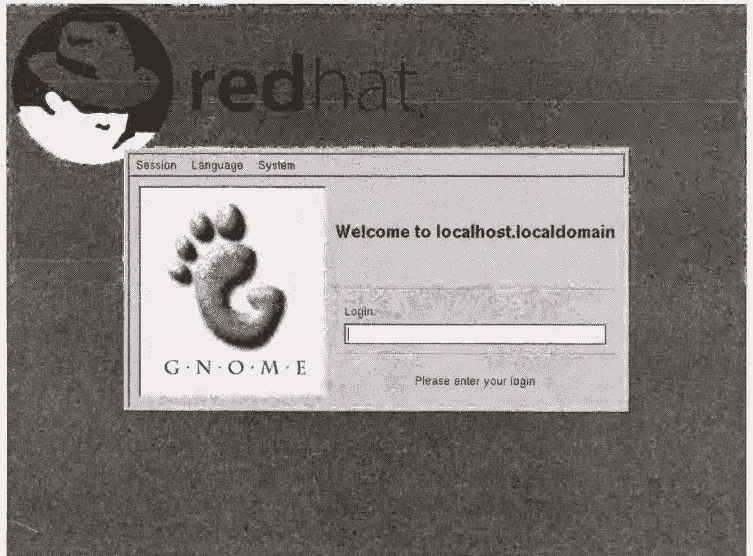

Figure 5-1
Red Hat Linux 中的图形登录屏幕

屏幕中间的窗口显示一条欢迎信息，其中包含系统的主机名——即在配置网络时分配给系统的名称。如果未配置网络，则使用 localhost.localdomain 作为主机名。

您可以使用安装期间定义的任何账户登录，包括 root。例如，要以 root 身份登录，请在文本字段中输入 root（开始输入前将鼠标移至登录窗口），然后按 Enter。随后输入 root 密码（安装时设置的密码）即可以超级用户身份登录。

由于默认 GUI 是 GNOME，GNOME 桌面会出现，同时还会出现来自 GNOME 文件管理器的警告对话框。单击 OK 按钮关闭警告对话框。GNOME 提示窗口出现，您将看到桌面（如图 5-2 所示）。

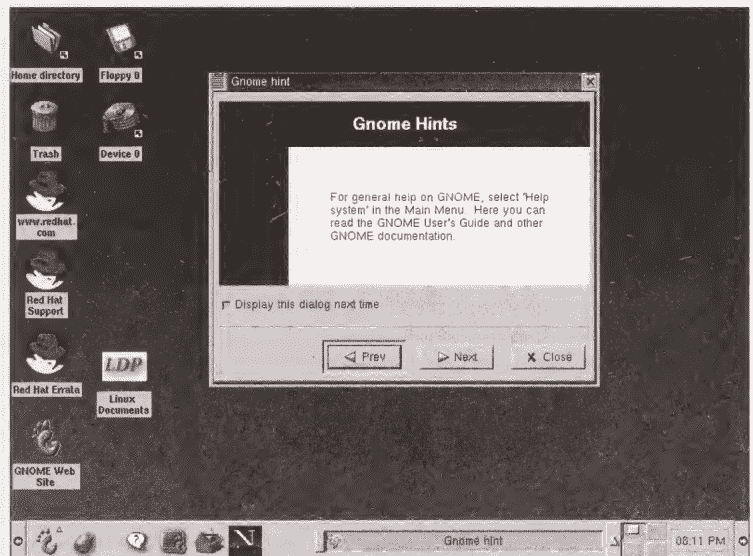

Figure 5-2
以 root 登录后初始的 GNOME 桌面

几分钟后您将探索 GNOME 桌面。现在，我想向您展示如何注销和关闭 Linux 系统。

## 注销

在探索 GNOME GUI 之前，您应该先学习如何注销。要注销，请选择 GNOME 桌面中 GNOME 面板左边缘的 Main Menu——风格化的脚图标（见图 5-2）——然后从菜单中选择 Log Out。屏幕变灰，并弹出对话框询问您是否真的要注销，同时提供停止或重新启动 PC 的选项。单击 Yes 按钮注销。片刻后，图形登录屏幕（图 5-1）出现，以便其他用户（或您再次）登录并使用系统。

## 关闭 Red Hat Linux

当您准备关闭 Red Hat Linux 时，必须有序地进行。即使您是 Linux 系统的唯一用户，后台通常仍在运行多个其他程序。此外，像 Linux 这样的操作系统会尝试优化写入磁盘的方式。由于磁盘访问相对较慢（与访问内存位置所需的时间相比），数据通常保存在内存中并以大块写入磁盘。因此，如果直接关闭电源，就有风险导致某些文件无法正确更新。

任何用户（无需登录）都可以从桌面或图形登录屏幕关闭系统。登录对话框中的 System 菜单提供重新启动或停止系统的菜单选项。要关闭系统，只需在图 5-1 的图形登录屏幕中选择 System ↻ Halt 即可。

另一个对话框会询问您是否真的要停止系统。单击 Yes 按钮。系统随后会有序地关闭。

系统关闭时，您会看到有关进程正在关闭的消息。您可能会惊讶于进程的数量之多——即使没有人明确运行任何程序。如果系统在关闭时不会自动断电，您可以手动关闭电源。


## 探索 GNOME

再次启动 PC，并在出现图形登录屏幕后登录。由于它是默认设置，您应该再次获得 GNOME 桌面。本节中，您将花一些时间探索 GNOME 桌面。

## GNOME 是什么？

GNOME 是 GNU Network Object Model Environment 的缩写；GNU 如您所知，代表 GNU's Not UNIX。GNOME 是一个图形用户界面（GUI）和编程环境。从用户角度来看，GNOME 类似于基于 Motif 的 Common Desktop Environment（CDE）或 Microsoft Windows。在幕后，GNOME 具有许多功能，使程序员能够编写能够很好协作的图形应用程序。在本次会话中，我只指出 GNOME GUI 的一些关键特性，细节留给您自行探索。

您可以通过访问 GNOME 主页 http://www.gnome.org 随时了解 GNOME 的最新信息。


GNOME 显示的确切外观取决于当前会话。会话只不过是一组应用程序（包括窗口管理器）及其状态的集合。GNOME 将会话信息存储在主目录的 .gnome 子目录中的名为 session 的文件中。这是一个文本文件；如果您好奇，可以使用命令 more ~/.gnome/session 浏览该文件。暂时不用担心命令的语法；您将在第 6、7 和 8 节中了解更多关于 Linux 命令的内容。

默认会话描述产生的初始 GNOME 桌面（见图 5-2）与 Windows 95/98/NT/2000 桌面非常相似。它包括 GNOME 面板（类似于 Windows 任务栏）和 Sawfish 窗口管理器，从而产生与图 5-2 所示类似的桌面。

从 GNOME 桌面左侧出现的图标（参见图 5-2）可以看出，GNOME 允许您直接将文件夹和应用程序放置在桌面上。这与您可以在 Windows 95/98/NT/2000 桌面上直接放置图标的方式类似。

您可以像在 Microsoft Windows 中一样移动和调整窗口大小。此外，与 Microsoft Windows 95/98/NT/2000 中的窗口框架一样，标题栏右上角包含三个按钮。最左边的按钮将窗口缩小为图标，中间的按钮最大化窗口以填满整个屏幕，最右边的按钮关闭窗口。

GNOME 桌面的一个关键特性是沿屏幕底部边缘的长条。这被称为 GNOME 面板，或简称为面板。面板是一个独立的 GNOME 应用程序。如图 5-3 所示，它为菜单和小面板小程序提供显示区域。每个面板小程序都是设计在面板内运行的小程序。例如，面板最右侧的时钟小程序显示当前时间。

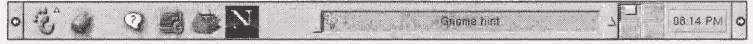

Figure 5-3
GNOME 面板


注意面板左右两端的两个向外指的箭头。单击箭头，您会看到面板滑开，将其显示区域缩小到沿屏幕边缘的一小条。这为窗口释放了更多桌面区域。再次单击箭头，面板就会重新出现。

面板还包括其他几个小程序：

- **The GNOME pager applet:** 它提供一个虚拟桌面，其大小大于系统屏幕的物理尺寸。在图 5-3 中，分页器在小显示区域中显示四个页面。每个页面代表一个与 X 显示屏大小相等的区域。要转到特定页面，请在分页器窗口中单击该页面。GNOME 分页器小程序还为当前虚拟页面中显示的每个窗口显示按钮。
- **Launcher applets:** 这些是脚图标右侧的按钮。每个按钮都显示一个带有该按钮启动的应用程序图标的按钮。单击按钮会启动（启动）该应用程序。尝试单击这些按钮以查看会发生什么。问号（？）按钮启动 GNOME 帮助浏览器；工具箱按钮启动 GNOME 控制中心；终端图标启动终端窗口；带有大 N 图标的图标启动 Netscape Communicator。锁图标启动屏幕保护程序，需要您输入密码才能返回桌面。


-   **主菜单按钮：** GNOME 面板还显示主菜单按钮，其行为类似于 Windows 开始菜单。这是面板左侧的按钮（见图 5-3），上面有风格化脚（GNOME 标志）的图像。那个脚就是主菜单按钮。如同 Windows 95/98/NT/2000 中的开始按钮一样，你可以通过点击脚的左鼠标按钮弹出的菜单启动应用程序。通常，此菜单列出启动应用程序的项目。某些菜单项带有箭头。当你将鼠标指针放在带箭头的项目上时，会出现另一个弹出菜单。

有时间时，你应该探索主菜单中的所有项目，以查看可从此菜单执行的所有任务。此时，选择主菜单（脚）⇨ 注销以注销，以便开始一个 KDE 会话。

## 探索 KDE

要尝试 KDE GUI，你需要在周五的前三个会话中安装 Red Hat Linux 时安装 KDE 软件包。通常，安装程序会将 GNOME 设为默认 GUI。现在，你可以通过从图形登录窗口中选择 会话 ⇨ KDE 来更改下一会话的 GUI。

在第 17 节中，你将学习如何将默认 GUI 从 GNOME 更改为 KDE，反之亦然。

登录后，你应该在此会话中获得 KDE 桌面。下次登录时，系统将恢复为 GNOME（假设这是你的默认 GUI）。

## 什么是 KDE？

> *KDE 代表 K 桌面环境。* KDE 项目始于 1996 年 10 月，旨在为使用 X Window 系统的 UNIX 系统开发通用的 GUI。KDE 的第一个测试版于一年后 1997 年 10 月发布，而 KDE 1.0 版本则于 1998 年 7 月发布。

从用户角度来看，KDE 提供了一个图形桌面环境，其中包括窗口管理器（kwm）、文件管理器（kfm）、用于启动应用程序的面板（kpanel）、帮助系统、配置工具以及许多应用程序，包括图像查看器、PostScript 查看器以及邮件和新闻程序。

从开发人员角度来看，KDE 具有类库和对象模型，可在 C++ 中轻松进行应用程序开发。KDE 本身是一个大型开发项目。

你可以通过访问 KDE 主页 http://www.kde.org/ 随时了解有关 KDE 的最新信息。

在选择 KDE 作为会话的 GUI 并登录后，你会看到一个与图 5-4 所示类似的初始 KDE 桌面。

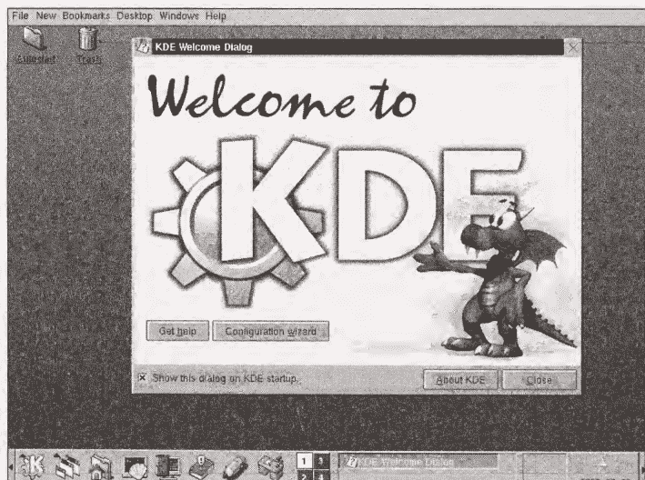

图 5-4
典型用户的初始 KDE 桌面

KDE 易于使用，并且与 Windows 95/98/NT/2000 GUI 有许多相似之处。你可以从类似于 Windows 中开始菜单的菜单启动应用程序。KDE 还允许你将文件夹和应用程序直接放置在桌面上。

沿屏幕底部边缘出现的 KDE 面板用于启动应用程序。面板的左右两端显示向外指的箭头。你可以点击这些箭头隐藏面板，为桌面上的应用程序腾出更多空间。当面板被隐藏时，它仍会显示一个带箭头的小条。要再次查看整个面板，点击该箭头，面板就会滑出。

KDE 桌面还包括沿桌面顶部的一条菜单栏。从该菜单栏的下拉菜单中，你可以执行许多任务，例如注销、配置桌面和获取帮助。你也可以通过 KDE 面板上的 K 按钮执行所有这些任务。

以下是 KDE 面板上一些按钮的列表。如果你不知道某个按钮的作用，只需将鼠标移至该按钮上，一个小弹出窗口就会显示有关该按钮的简短消息。

-   **开始按钮/主菜单：** 面板最重要的组件是面板左侧的 K 按钮。该按钮类似于 Windows 95/98/NT/2000 中的开始按钮。点击 K 按钮后会出现一个弹出菜单。从此菜单中，你可以通过将鼠标移至带右向箭头的项目上来进入其他菜单。你可以从此菜单启动应用程序。这就是为什么 KDE 文档将 K 按钮称为 *应用程序启动器*。
-   **在线帮助：** 要阅读 KDE 的在线帮助，点击带有书图标的按钮。
-   **文件管理器：** 要查看主目录的内容，点击带有文件夹和家庭图标的按钮。
-   **虚拟桌面：** KDE 支持虚拟桌面。默认情况下，你有四个虚拟桌面。你可以点击标有 1、2、3 或 4 的按钮之一切换到特定桌面。你可以使用桌面来组织应用程序窗口。你无需在单个桌面上堆放许多打开的窗口。当桌面变得拥挤时，只需切换到另一个桌面并在那里打开应用程序即可。
-   **终端仿真：** KDE 面板还包括一个带有被外壳覆盖的终端图标的按钮。点击此按钮可运行终端仿真程序并获得终端窗口。你可以在终端窗口的 shell 提示符下输入 Linux 命令。


-   **KDE 控制中心：** 点击带有被电路板覆盖的终端图标的按钮以启动 KDE 控制中心。控制中心使你能够配置 KDE 桌面的各个方面。

要退出 KDE，选择 K → 注销并点击 resulting 对话框上的注销按钮。

## 回顾

你通过登录 Linux 系统开始了本会话。你学习了如何注销和关闭系统。然后你再次启动系统，登录并探索了 GNOME 桌面的关键功能。接下来，你学习了如何将 GUI 选择为 KDE 会话并探索了 KDE 的关键功能。对于两个 GUI，你都发现了如何启动应用程序。特别是，你学会了打开终端窗口，在其中可以输入 Linux 命令。你将在今后的会话中使用这些终端窗口尝试各种 Linux 命令。

## 自测

-   1. Red Hat 安装完成后，安装程序会自动重新启动系统吗？（参见“首次启动 Red Hat Linux”。）
-   2. 为什么必须以有序的方式关闭 Linux 系统？（参见“关闭 Red Hat Linux”。）
-   3. GNOME 中的“脚”是什么？（参见“探索 GNOME”。）
-   4. 如何将你的 GUI 切换到 KDE？（参见“探索 KDE”。）
-   5. 如何在 KDE 中打开终端窗口？（参见“探索 KDE”。）

## 会话


## 探索 Linux 文件和目录

### 会话清单

-   ✓ 了解 Linux 文件系统
-   ✓ 使用 GNOME 文件管理器
-   ✓ 使用 Linux 命令导航和操作文件和目录

在上一会话中，你学习了如何登录、注销和关闭 Linux 系统。本会话向你展示了如何处理文件和目录。本会话首先简要介绍 Linux 文件系统。然后它展示了如何使用 GNOME 文件管理器和几个 Linux 命令来处理文件和目录。

## 了解 Linux 文件系统

像任何其他操作系统一样，Linux 将信息组织在文件和目录中。文件反过来包含在目录中。目录是一种特殊的文件，可以包含其他文件和目录，从而形成层次结构。这种文件层次组织称为文件系统。

Linux 文件系统为系统中的所有存储提供统一的模型。文件系统有一个单一的根目录，用正斜杠（/）表示。然后有一系列文件和目录。文件系统的部分可以驻留在不同的物理介质上，例如硬盘、软盘和 CD-ROM。图 6-1 说明了 Linux 文件系统的概念以及它如何跨越多个物理设备。

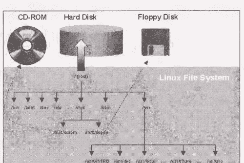

### 图 6-1

Linux 文件系统提供对可能跨越多个驱动器的存储的统一视图。

如果你熟悉 MS-DOS 或 Windows 95/98/NT/2000，你应该注意 UNIX 中没有驱动器号的概念。此外，文件名没有严格的 8.3 名称-扩展名格式。（术语 8.3 文件名来自 MS-DOS 中使用八个字符名称和三个字符扩展名。）在 Linux 中，你可以拥有长文件名（最多 256 个字符），并且文件名区分大小写。通常，UNIX 文件名具有多个扩展名，例如 sample.tar.Z。以下是一些 UNIX 文件名：index.html、Makefile、kernel-2.2.15-2.5.0.i686.rpm、.bash_profile 和 httpd_src.tar.gz。

要定位一个文件，你需要的不只是文件名；你还需要有关目录层次结构的信息。术语路径名指的是定位文件所需的完整规范——通向文件的目录层次结构——以及文件名。图 6-2 显示了文件的典型 Linux 路径名。


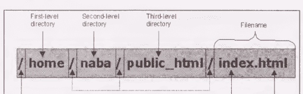

图 6-2
*一个典型的 Linux 路径名*

如图 6-2 所示，Linux 路径名由以下几部分组成：

- 1. 根目录，用正斜杠（/）字符表示
- 2. 目录层级，每个目录名之间用正斜杠（/）字符分隔。最后一个目录名之后也有一个 /。
- 3. 文件名，包含名称和一个或多个可选的扩展名

现在你已经了解了 Linux 文件系统的基础知识，可以探索文件系统了。你可以通过两种方式访问文件和目录：

- 使用 GNOME 或 KDE 桌面中的图形文件管理器
- 在终端窗口或文本控制台中输入适当的 Linux 命令

本节同时涵盖图形文件管理器和 Linux 命令。图形文件管理器类似于 Windows 资源管理器，使用直观。现在花几分钟使用 GNOME 文件管理器探索文件系统。（KDE 文件管理器的工作方式类似，因此这里不予介绍。）

## 使用 GNOME 文件管理器

从图形登录屏幕登录到你的 Red Hat Linux 系统后，你可以通过在桌面上双击文件文件夹图标，使用 GNOME 文件管理器查看你的主目录。图 6-3 显示了主目录的初始显示。

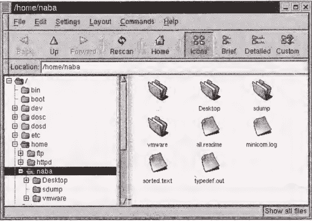

图 6-3
在 GNOME 文件管理器中显示的主目录

### 使用 GNOME 文件管理器查看文件

GNOME 文件管理器的窗口在垂直方向上分为两个窗口。左侧在滚动窗口中显示文件系统的树状视图；右侧使用图标显示当前所选目录中的文件和目录。如树状视图所示，图 6-3 显示的是 /home/naba 目录的内容。标题栏显示当前所选目录的名称。

如果你使用过 Windows 资源管理器，可以以类似的方式使用 GNOME 文件管理器。要查看另一个目录的内容，首先在树状视图中找到该目录。例如，要查看 /etc/X11 目录，请单击 etc 目录旁边的加号（+）。这会导致文件管理器显示 etc 中的子目录，并将该加号更改为减号。现在单击 X11 目录。窗口右侧现在显示 /etc/X11 目录的内容。

GNOME 文件管理器使用图标显示所选目录的内容。每个目录都显示为文件夹，目录名称显示在文件夹图标下方。不同文件有不同的图标。普通文件显示为纸张。目录显示为文件夹。

GNOME 文件管理器窗口具有通常的菜单栏和工具栏。请注意，在图 6-3 中，标记为 Icons 的工具栏按钮处于按下状态。这意味着目录内容使用大图标显示。单击 Brief 按钮；这会导致文件管理器使用较小的图标以列表格式显示内容。

要查看有关每个文件的更多信息，请单击工具栏上的 Detailed 按钮。文件管理器现在显示每个文件或目录的大小以及上次修改的时间。详细视图以表格形式显示目录的内容，包含三个列，分别标记为 Name、Size 和 MTime。如果你单击详细视图顶部的信息标题——Name、Size 或 MTime——文件管理器会根据该信息对列表进行排序。例如，单击 MTime 信息标题。文件管理器现在会根据上次修改时间，即 MTime，对文件和目录列表进行排序。单击 Name 信息标题会按名称字母顺序对文件和目录进行排序。此功能在 Brief 和 Custom 视图中也适用。

最后，你可以通过单击 Custom 按钮查看文件权限。文件管理器随后会显示图标、文件名、大小和文件权限。

目前请忽略权限的含义。你将在下一节中学习它们，当我讨论用于导航文件系统的 Linux 命令时。

### 使用 GNOME 文件管理器执行任务

除了在文件系统中移动和查看目录内容外，你还可以使用文件管理器执行诸如将文件从一个目录移动到另一个目录和删除文件等任务。我不会展示每一步，但你可以花几分钟尝试以下任务：

- 要将文件移动到不同目录，请将文件图标拖放到你想要文件所在的目录上。
- 要将文件复制到新位置，请选择文件图标，然后选择 File → Copy。你也可以在文件图标上右键单击鼠标，从弹出菜单中选择 Copy。对话框会提示你输入文件应复制到的目录名称。
- 要删除文件或目录，请右键单击图标并从弹出菜单中选择 Delete。对话框会询问你是否真的要删除文件或目录。你可以单击 Yes 删除所选项目，或单击 No 取消操作。
- 要重命名文件或目录，请在 Icon 视图中单击名称（参见图 6-3）。然后你可以输入新名称或编辑名称。
- 要创建新目录，请在右侧窗口的空白区域右键单击并从弹出菜单中选择 New Directory。对话框会提示你输入新目录的名称。
- 要查找文件，请从菜单栏中选择 Commands → Find Files。对话框会提示你想要查找的内容以及搜索的起始位置。

输入这些信息后，单击 OK 开始搜索。搜索结果会出现在新窗口中。

## 使用 Linux 命令导航和操作文件和目录

虽然图形文件管理器易于使用，但只有在具有图形登录时才能使用。有时你可能没有图形环境来运行图形文件管理器。例如，你可能通过文本终端登录，或者 X 在你的系统上无法工作。在这些情况下，你必须依赖 Linux 命令来处理文件和目录。好处是你可以始终使用 Linux 命令——即使在图形环境中。只需打开一个终端窗口并输入 Linux 命令即可。单击 GNOME 面板中的终端图标以启动终端仿真程序，显示终端窗口。

### 目录导航

在 Linux 中，当你以 root 登录时，你的主目录是 /root。对于其他用户，主目录通常位于 /home 目录中。我的主目录（当我以 naba 登录时）是 /home/naba。此信息存储在 /etc/passwd 文件中。默认情况下，除了超级用户外，只有你有权在主目录中保存文件，并且只有你可以在主目录中创建子目录以进一步组织你的文件。

Linux 支持当前目录的概念，即所有文件和目录命令操作的目录。例如，登录后，你的当前目录是主目录。要从终端窗口查看当前目录，请输入 pwd 命令。

要更改当前目录，请使用 cd 命令。要将当前目录更改为 /usr/share/doc，请输入以下内容：

```
cd /usr/share/doc
```

然后，要将目录更改为 /usr/share/doc 中的 bash-2.04 子目录，请输入此命令：

```
cd bash-2.04
```

现在，如果你使用 pwd 命令，该命令会显示 /usr/share/doc/bash-2.04 为当前目录。因此，你可以通过两种方式引用目录的名称：

- 绝对路径名（如 /usr/share/doc），指定目录树中的确切目录
- 相对目录名（如 bash-2.04，表示当前目录的 bash-2.04 子目录）

如果你在 /usr/share/doc 中输入 cd bash-2.04，当前目录将更改为 /usr/share/doc/bash-2.04。但是，在 /home/naba 中执行相同命令会尝试将当前目录更改为 /home/naba/bash-2.04，这可能不存在。顺便说一下，不带任何参数输入 cd 命令会将当前目录更改为主目录。

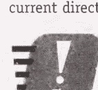

你可以使用快捷方式引用任何用户的主目录。用波浪号（~）为用户的登录名作前缀以引用该用户的主目录。因此，~naba 指用户 naba 的主目录，~root 指 root 用户的主目录。如果你的系统有一个登录名为 emily 的用户，你可以输入 cd ~emily 来更改到 Emily 的主目录。

目录名 . 和 .. 有特殊含义。单个句点（.）表示当前目录，而两个句点（..）表示父目录。例如，如果当前目录是 /usr/share/doc，你可以通过输入以下命令将当前目录更改为 /usr/share：

```
cd ..
```

本质上，此命令将你在文件系统层级中上移一级。

### 目录列表和权限

当你在 Linux 目录中移动时，你可能想知道目录的内容。你可以使用 ls 命令获取目录列表。默认情况下，不带任何选项的 ls 命令以紧凑的多列格式显示当前目录的内容。例如，输入以下命令以查看 /etc/X11 目录的内容。（输入以粗体显示的命令；我省略了命令提示符。）

```
cd /etc/X11
ls
```

```
X  XF86Config-4  applnk  gdm  lbxproxy  proxymngr  twm  xinit
xsm  XF86Config  Xmodmap  fs  kdm  prefdm  restart  xdm  xserver
```

从这个列表中，你无法真正分辨条目是文件还是目录。要区分目录和文件，请使用 -F 选项配合 ls，如下所示：

```
ls -F
X@      Xmodmap  gdm/      prefdm*   twm/      xserver/
XF86Config  applnk/  kdm/      proxymngr/  xdm/      xsm/
XF86Config-4  fs/      lbxproxy/  restart/   xinit/
```

现在目录名后面会加上斜杠（/）。普通文件名保持原样。第一个文件名后面附加的 @ 符号表示该文件实际上是链接到另一个文件（换句话说，这个文件名只是指向另一个文件）。可执行文件后面会附加星号（*）（例如列表中的 prefdm 文件）。

你可以使用 -l 选项查看有关文件和目录的更详细信息。

```
ls -l
```

对于 /etc/X11 目录，ls -l 的典型输出如下所示：

```
total 76
lrwxrwxrwx 1 root root 24 Jul 31 20:32 X -> /usr/X11R6/bin/XF86_SVGA
-rw-r--r-- 1 root root 14549 Jul 31 20:59 XF86Config
-rw-r--r-- 1 root root 1545 Jul 31 20:32 XF86Config-4
-rw-r--r-- 1 root root 491 Jul 14 14:46 Xmodmap
drwxr-xr-x 9 root root 4096 Jul 31 15:29 applnk
```

这个列表显示了每个目录条目的大量信息——它可以是文件或另一个目录。从右列向左看，最右边的列显示目录条目的名称。名称之前的日期和时间显示该文件最后一次被修改的时间。在日期和时间之前是文件的大小，以字节为单位。

文件的组和所有者出现在显示文件大小的列的左侧。左侧下一个数字表示指向该文件的链接数。（链接就像 Windows 中的快捷方式。）最后，最左边的列显示文件的权限设置，决定谁可以读取、写入或执行该文件。权限设置的第一个字母具有以下特殊含义之一：

- 如果第一个字母是 l，则该文件是链接到另一个文件的符号链接。
- 如果第一个字母是 d，则该文件是目录。
- 如果第一个字母是连字符（-），则该文件是普通文件。
- 如果第一个字母是 b，则该文件代表块设备，例如磁盘驱动器。
- 如果第一个字母是 c，则该文件代表字符设备，例如串行端口或终端。

在此第一个字母之后，最左边的列显示一个由九个字符组成的序列，当每个字母都存在时显示为 rwxrwxrwx。每个字母表示特定的权限：读（r）、写（w）和执行（x）。用连字符代替字母表示对文件的特定操作没有权限。因此，字符串 rw- 意味着所有者具有读和写权限，但没有执行权限。将这九个字母视为三个由三个字母组成的组（rwx），解释如下：

- 最左边的 rwx 组控制文件所有者的读、写和执行权限。
- 中间的三个 rwx 字母控制属于该文件组中的任何用户的读、写和执行权限。
- 最右边的 rwx 字母组控制所有其他用户（统称为 world）的读、写和执行权限。

因此，权限设置为 rwx------ 的文件只能由文件所有者访问。同时，权限设置为 rwxr--r-- 使文件可被世界读取。


通常，可执行程序（包括 shell 程序）具有执行权限。然而，对于目录，执行权限相当于使用权限——用户必须对目录具有执行权限才能打开并读取目录的内容。

ls 命令的一个有趣特性是它不会列出任何以句点开头的文件的名称。要查看这些文件，必须使用 -a 选项配合 ls 命令，如下所示：

```
ls -a
```

## 文件操作

你经常可能需要从一个目录复制文件到另一个目录。使用 cp 命令执行此任务。cp 命令会制作文件的新副本并保留原文件不变。要将文件 /usr/X11R6/lib/X11/xinit/Xclients 复制到当前目录（例如你的主目录）中的 Xclients.sample 文件，输入以下内容：

```
cp /usr/X11R6/lib/X11/xinit/Xclients Xclients.sample
```

如果你想将文件复制到当前目录并保留相同的名称，请使用句点（.）作为 cp 命令的第二个参数。因此，以下命令将 /etc/X11 目录中的 XF86Config 文件复制到当前目录（用单个句点表示）：

```
cp /etc/X11/XF86Config .
```

另一个 Linux 命令 mv 会将文件移动到新位置。原始副本消失，并在指定目标处出现新副本。你可以使用 mv 重命名文件。如果你想将 today.list 的名称更改为 old.list，请使用以下 mv 命令：

```
mv today.list old.list
```

另一方面，你可以使用以下命令将 today.list 文件移动到名为 saved 的子目录中：

```
mv today.list saved
```

另一个常见的操作是删除文件。使用 rm 命令删除名为 old.list 的文件，例如输入以下命令：

```
rm old.list
```


请特别注意使用 rm 命令，尤其是在以 root 身份登录时。意外地用 rm 删除重要文件非常容易。

除了复制、重命名和删除文件之外，你可能还想查看文件的内容。使用 more 命令一次一页地查看文本文件。例如，要查看文件 /etc/X11/XF86Config-4，请使用以下命令：

```
more /etc/X11/XF86Config-4
```

more 命令在每页后暂停，因此你必须按空格键移动到下一页。按 Enter 键一次在文件中向前移动一行。要返回上一页，按 b。

另一个有用的 Linux 文件查看命令是 less。（名称是一个文字游戏，因为 less 比 more 功能更多。）

## 目录操作

要在主目录中组织文件，你必须创建新目录。使用 mkdir 命令创建目录。例如，要在当前目录中创建名为 images 的目录，输入以下内容：

```
mkdir images
```

创建目录后，你可以使用 cd images 命令切换到该目录。

当你不再需要目录时，使用 rmdir 命令删除它。只能在目录为空时删除目录。

## 文件和目录查找器

最后，我想向你介绍 find 命令，因为它对于查找符合指定搜索条件的文件（和目录）非常有用。Linux 版本的 find 命令来自 GNU，其选项比标准 UNIX 版本更广泛。我展示标准 UNIX find 命令的语法，因为该语法在 Linux 中有效，你也可以在其他 UNIX 系统上使用相同的格式。

假设你想查找任何名称以 gnome 开头的文件或目录。你可以使用 find 执行此搜索，如下所示：

```
find / -name "gnome*" -print
```

此命令告诉 find 从根目录（/）开始查找匹配 gnome* 的文件名，并显示任何匹配文件的完整路径名。

你可以使用这种简单形式的 find 的变体来定位任何目录中的文件（以及该目录包含的子目录）。如果你忘记了在主目录中存储所有名为 report* 的文件（名称以字符串 report 开头）的位置，可以使用以下命令搜索文件：

```
find ~ -name "report*" -print
```

当你熟悉 find 的这种语法后，可以使用 find 的其他选项。例如，要仅查找特定类型的文件（如目录），请使用 -type 选项。以下命令显示 Linux 系统中的所有顶级目录名称：

```
find / -type d -maxdepth 1 -print
```


前面的示例表示使用 find 命令的简单形式。在典型的 Linux 系统中，你可能不需要使用 find 的复杂形式，但你可以通过使用以下命令查找其余的 find 选项：

```
man find
```

## 复习

本节课首先简要介绍了 Linux 文件系统以及文件命名方式。然后你使用 GNOME 文件管理器浏览文件系统并查看目录的不同视图。你还执行了一些基本操作，例如复制文件、删除文件和创建新目录。接下来，你学习了许多用于浏览文件系统和操作文件和目录的 Linux 命令。

## 自我测验

- 1. 什么是路径名？（参见“了解 Linux 文件系统”。）
- 2. 在 GNOME 文件管理器中，如何按名称按字母顺序对文件和目录列表进行排序？（参见“使用 GNOME 文件管理器”。）
- 3. 你使用什么 Linux 命令快速将当前目录更改为你的主目录？（参见“目录导航”。）
- 4. 你可以使用什么选项与 ls 命令一起使用来查看所有文件并看到目录名以 / 后缀列出？（参见“目录列表和权限”。）
- 5. 什么 Linux 命令可以从 /usr/doc 目录开始查找所有名为 COPYING 的文件？（参见“文件和目录查找器”。）

## 会话


## 了解 Shell

### 课程清单

- ✓ 开始使用 Bash shell
- ✓ 使用 Bash shell


正如在第 6 节中所讨论的，不幸的是，你无法在 GNOME 或 KDE 等图形环境中完成所有操作。在这种情况下，你必须使用 Linux 命令来完成特定任务。第 6 节向你介绍了可从文本终端使用以操作文件和目录的一些 Linux 命令。本节向你介绍 Bash shell——Linux 中的默认命令解释器。在这里，你将学习 shell 执行命令的一些重要特性。

## 开始使用 Bash Shell

如果你使用过 MS-DOS，你可能熟悉 DOS 命令解释器。该程序（名为 COMMAND.COM）显示臭名昭著的 C:\> 提示符。（在 Windows 中，你可以在 MS-DOS 命令窗口中看到此提示符。）Linux 提供了一个类似于 DOS 命令解释器的命令解释器，但正如你可能预期的那样，它的功能比 DOS 命令解释器多得多。Linux 命令解释器被称为 shell。

默认的 Linux shell 称为 Bash，其程序名为 /bin/bash（位于 /bin 目录中）。当你从 GNOME 或 KDE 桌面打开终端窗口或在文本控制台登录时，Bash shell 会提示你输入命令。当你输入命令时，shell 会执行该命令。

除了标准的 Linux 命令外，Bash 还可以执行存储在可执行文件中的任何程序。Bash 还可以执行 shell 脚本，这是一个包含一个或多个命令的文本文件。

在接下来的几分钟里，你可以尝试 Bash shell 的各种功能，从通用命令语法到 shell 编程基础。如果你还没有这样做，请继续打开一个终端窗口，以便使用 shell。

## 使用 Bash Shell

由于 shell 会解释你输入的内容，因此了解 shell 如何处理你输入的文本非常重要。所有 shell 命令都有以下通用格式：

```
command option1 option2 ... optionN
```

单行命令通常称为命令行。在命令行上，你输入命令，后跟一个或多个选项（或参数），称为命令行选项（或命令行参数）。

一个基本规则是，你必须使用空格或制表符将命令与选项分隔开。你还必须用空格或制表符分隔选项。如果你想使用包含嵌入空格的选项，你必须将该选项放在引号内。例如，要在密码文件中搜索我的名字，我输入以下 grep 命令（grep 在文件中搜索文本）：

```
grep "Naba Barkakati" /etc/passwd
```

当 grep 打印包含我名字的行时，它看起来像这样：

```
naba:x:500:500:Naba Barkakati:/home/naba:/bin/bash
```

如果你以自己的名字创建了用户帐户，请继续输入带有你的名字作为参数的 grep 命令。


在 grep 命令的输出中，你可以看到 shell 的名称（/bin/bash）位于最后一个冒号（:）之后。

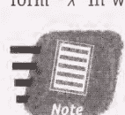

由于大多数 Linux 命令都是由各种 GNU 工具和实用程序实现的，你应该知道 GNU 命令行选项以两个破折号开头，后跟描述性单词。因此，GNU 选项采用 --xxxx 的形式，其中 xxxx 是表示该选项的单词。例如，GNU ls --all 命令显示所有目录条目，包括以句点（.）开头的条目。这与所有 UNIX 系统中的 ls -a 命令相同。

如果命令太长而无法在一行中容纳，你可以按反斜杠（\ ）键，然后按 Enter。然后，在下一行继续输入命令。例如，输入以下命令（在每一行后按 Enter）：

```
cat \
/etc/passwd
```

cat 命令然后显示 /etc/passwd 文件的内容。

你可以在单行上连接几个较短的命令；只需使用分号（;）作为命令之间的分隔符。例如，以下命令

```
cd; ls -F
```

将当前目录更改为你的主目录，然后列出该目录的内容。

## 组合命令

Linux 遵循 UNIX 的哲学，为用户提供许多简单的命令工具箱。然而，你可以将这些简单命令组合起来创建更复杂的命令。假设你想确定设备文件 sbpcd 是否位于系统的 /dev 目录中，因为某些文档告诉你，对于 Sound Blaster Pro CD-ROM 驱动器，你需要该设备文件。你可以使用命令 ls /dev 获取 /dev 目录的目录列表，看看列表中是否出现包含 sbpcd 的任何内容。不幸的是，/dev 目录有许多条目，很难找到名称中包含 sbpcd 的任何项目。然而，你可以将 ls 命令与 grep 结合起来，得到一个完全符合你想要的命令：

```
ls /dev | grep sbpcd
```

shell 将 ls 命令的输出（目录列表）发送到 grep 命令，后者搜索字符串 sbpcd。那个垂直条（|）被称为管道，因为它充当两个程序之间的管道；第一个命令的输出成为第二个命令的输入。


大多数 Linux 命令的设计方式使其能够将一个命令的输出输入到另一个命令中。为此，只需连接命令，并在它们之间放置管道即可。

## 重定向命令输入和输出


为协同工作而设计的 Linux 命令具有一个共同特征——它们始终从标准输入（通常是键盘）读取，并写入标准输出（通常是屏幕）。错误消息发送到标准错误（通常是屏幕）。这三个设备通常分别称为 stdin、stdout 和 stderr。

如果你希望命令从文件读取，可以将标准输入重定向为来自该文件。同样，要将命令的输出保存到文件中，请将标准输出重定向到文件。shell 的这些特性称为输入和输出重定向，或 I/O 重定向。

例如，输入 cd 更改到你的主目录，然后输入以下命令：

```
grep typedef /usr/include/* > typedef.out
```

该命令搜索 /usr/include 目录中所有文件中的字符串 typedef 的出现，然后将输出保存到名为 typedef.out 的文件中。正如该命令所示，大于号（>）将 stdout 重定向到文件。

该命令还说明了 Bash 的另一个特性。当你使用星号（*）时，Bash 会将其替换为指定目录中的所有文件名列表。因此，/usr/include/* 表示 /usr/include 目录中的所有文件。


你还可以重定向 stdin，使命令从文件而不是键盘读取。例如，输入以下命令：

```
sort < /etc/passwd
```

这将显示 /etc/passwd 文件中行的排序列表。在这种情况下，小于号 (<) 重定向 stdin，使 sort 命令从 /etc/passwd 文件读取输入。

## 让 Bash 补全你的命令

许多命令需要文件名作为参数。例如，要浏览名为 /etc/X11/XF86Config 的文件，输入以下命令：

```
more /etc/X11/XF86Config
```

该命令一次显示一屏 /etc/X11/XF86Config 文件的内容。对于需要文件名作为参数的命令，Bash 包含一个功能，允许你输入简短的文件名。你只需输入最少的内容——仅需前几个字符——即可在目录中唯一标识该文件。

要看一个例子，输入 more /etc/X11/XF 但不要按 Enter；改为按 Tab。Bash 会自动补全文件名，使命令变为 more /etc/X11/XF86Config。现在按 Enter 运行命令。

## 使用通配符

避免输入太多文件名的另一种方法是使用通配符——特殊字符，如星号 (*) 和问号 (?)，它们可在字符串中匹配零个或多个字符。如果你熟悉 MS-DOS，你可能使用过诸如 COPY *.* A: 这样的命令来将当前目录中的所有文件复制到 A: 驱动器。Bash 在文件名中接受类似的通配符。事实上，Bash 提供的通配符选项比 MS-DOS 多得多。

Bash 支持三种类型的通配符：

- 星号 (*) 字符可在文件名中匹配零个或多个字符。因此，* 表示目录中的所有文件。
- 问号 (?) 匹配任意单个字符。
- 方括号中的字符集合匹配该集合中的任意单个字符。例如，字符串 [xX]* 匹配以 x 或 X 开头的任何文件名。

通配符在你想对一组文件执行任务时非常方便。例如，要将 /mnt/cdrom 目录中的所有文件复制到当前目录，输入以下内容：

```
cp /mnt/cdrom/* .
```

Bash 用 /mnt/cdrom 目录中所有文件的名称替换通配符 *。命令末尾的句点表示当前目录。

你可以在文件名的其他部分使用星号来选择更具体的[content]
你还可以重定向 stdin，使命令从文件而不是键盘读取。例如，输入以下命令：

```
sort < /etc/passwd
```

这将显示 /etc/passwd 文件中行的排序列表。在这种情况下，小于号 (<) 重定向 stdin，使 sort 命令从 /etc/passwd 文件读取输入。

## 让 Bash 补全你的命令

许多命令需要文件名作为参数。例如，要浏览名为 /etc/X11/XF86Config 的文件，输入以下命令：

```
more /etc/X11/XF86Config
```

该命令一次显示一屏 /etc/X11/XF86Config 文件的内容。对于需要文件名作为参数的命令，Bash 包含一个功能，允许你输入简短的文件名。你只需输入最少的内容——仅需前几个字符——即可在目录中唯一标识该文件。

要看一个例子，输入 more /etc/X11/XF 但不要按 Enter；改为按 Tab。Bash 会自动补全文件名，使命令变为 more /etc/X11/XF86Config。现在按 Enter 运行命令。

## 使用通配符

避免输入太多文件名的另一种方法是使用通配符——特殊字符，如星号 (*) 和问号 (?)，它们可在字符串中匹配零个或多个字符。如果你熟悉 MS-DOS，你可能使用过诸如 COPY *.* A: 这样的命令来将当前目录中的所有文件复制到 A: 驱动器。Bash 在文件名中接受类似的通配符。事实上，Bash 提供的通配符选项比 MS-DOS 多得多。

Bash 支持三种类型的通配符：

- 星号 (*) 字符可在文件名中匹配零个或多个字符。因此，* 表示目录中的所有文件。
- 问号 (?) 匹配任意单个字符。
- 方括号中的字符集合匹配该集合中的任意单个字符。例如，字符串 [xX]* 匹配以 x 或 X 开头的任何文件名。

通配符在你想对一组文件执行任务时非常方便。例如，要将 /mnt/cdrom 目录中的所有文件复制到当前目录，输入以下内容：

```
cp /mnt/cdrom/* .
```

Bash 用 /mnt/cdrom 目录中所有文件的名称替换通配符 *。命令末尾的句点表示当前目录。

你可以在文件名的其他部分使用星号来选择更具体的组文件。假设你想使用 grep 命令在 /usr/include 目录的所有文件中搜索字符串 typedef struct，且满足以下条件：

- 文件名以 s 开头。
- 文件名以 .h 结尾。

通配符规范 s*.h 表示满足这些条件的所有文件名。因此，你可以使用以下命令执行搜索：

```
grep "typedef struct" /usr/include/s*.h
```

该字符串包含 grep 命令要查找的空格，因此你必须用引号将该字符串括起来。这种方法可确保 Bash 不会尝试将字符串中的每个单词解释为单独的命令行参数。

虽然星号 (*) 匹配任意数量的字符，但问号 (?) 匹配单个字符。假设当前目录中有四个文件——image1.pcx、image2.pcx、image3.pcx 和 image4.pcx。要将这些文件复制到 /mnt/floppy 目录，请使用以下命令：

```
cp image?.pcx /mnt/floppy
```

Bash 用任意单个字符替换问号，并将四个文件复制到 /mnt/floppy。

第三种通配符格式——[...]——匹配来自特定集合的单个字符。你可能希望将此格式与其他通配符结合使用，以缩小匹配的文件名范围。要列出 /etc/X11/xdm 目录中以 x 或 X 开头的所有文件名，输入以下命令：

```
ls /etc/X11/xdm/[xX]*
```


如果 Bash 在展开 [...] 通配符格式时找不到任何匹配的文件名，Bash 会保留通配符规范不变。

## 查看命令历史

为了让你轻松重复长命令，Bash 存储多达 500 条旧命令。本质上，Bash 维护一个命令历史记录（旧命令列表）。要查看命令历史，输入 history。Bash 会显示旧命令的编号列表，包括你在以前登录期间输入的命令。该列表可能类似于以下内容：

```
1  cd
2  ls -a
3  more /etc/X11/XF86Config
4  history
```

如果命令列表太长，你可以选择只查看最近的几个命令。要仅查看最后 10 条命令，输入以下命令：

```
history 10
```

要重复 history 命令显示的列表中的某个命令，只需输入感叹号 (!)，后跟该命令的编号。要重复第 3 条命令，输入 !3。

你也可以在不知道命令编号的情况下重复旧命令。假设你一段时间前输入了 more /usr/lib/X11/xdm/xdm-config，现在又想查看该文件。要重复之前的 more 命令，输入以下内容：

```
!more
```

通常，你可能想重复上一个输入的命令——也许稍作修改。例如，也许你使用 ls -l 命令显示了目录内容。要重复该命令，按如下方式输入两个感叹号：

```
!!
```

有时，你可能想重复上一个命令但为其添加额外参数。假设 ls -l 显示的文件太多。只需重复该命令，但将输出通过管道传递给 more 命令，如下所示：

```
!! | more
```

Bash 用上一个命令替换两个感叹号，然后在该命令后附加 | more。


回忆以前命令的一种简便方法是按向上箭头键，这会导致 Bash 在命令列表中向后移动。要在命令历史中向前移动，请按向下箭头键。

## 为命令使用别名

要了解别名的好处，输入以下命令：

```
alias goboot='cd /usr/src/linux/arch/i386/boot'
```

这将 goboot 定义为别名——另一个名称——用于单引号内的文本。该文本是更改当前目录到 /usr/src/linux/arch/i386/boot 的命令。

现在你已定义了别名，在 Bash 提示符下输入以下内容：

```
goboot
```

现在输入 pwd 以确认当前目录确实是 /usr/src/linux/arch/i386/boot。

正如你所见，别名只是一个替代（通常更短）的长命令的名称。Bash 用其定义替换别名并执行等效命令。

如果你不再需要别名，请使用 unalias 命令删除别名。例如，如果你不再想使用 goboot 别名，输入：

```
unalias goboot
```

执行此步骤后，输入 goboot 会导致出现如下错误消息：

```
goboot
bash: goboot: command not found
```

许多用户使用别名功能为常用命令提供更熟悉的名称。如果你是 DOS 用户并使用 md 命令创建目录，你可以简单地将 md 定义为 mkdir 的别名（Linux 创建新目录的命令）。你按如下方式执行此操作：

```
alias md=mkdir
```

现在，你可以输入 md dirname 来创建名为 dirname 的新目录。别名的另一个好用途是重新定义危险的命令，例如 rm，使其更安全。默认情况下，rm 命令删除一个或多个指定的文件。如果你不小心输入 rm *，rm 会删除当前目录中的所有文件。我有一天就是这样学到的，当时我想删除所有以 .xwd 结尾的文件。（这些文件包含我不再需要的旧屏幕图像。）我打算输入 rm *.xwd，但不知怎么的，我输入了 rm * .xwd。我收到了以下消息：

```
rm: .xwd: No such file or directory
```

起初我对该消息感到困惑，所以我输入 ls 再次查看目录内容。当列表显示为空时，我意识到我在 * 和 .xwd 之间多加了一个空格。那目录中的所有文件，当然，永远消失了。

rm 命令提供 -i 选项，该选项在删除文件前会询问确认。要使该选项成为默认值，将以下别名定义添加到你主目录中的 .bash_profile 文件中：

```
alias rm='rm -i'
```

从现在开始，当你使用 rm 删除文件时，命令首先会按如下方式询问确认：

```
rm .bash_profile
rm: remove `.bash_profile'? n
```

按 y 删除文件；否则，按 n。

## 在后台运行命令

当你使用 MS-DOS 时，你别无选择，只能等待每个命令完成后再输入下一个命令。（你可以提前输入一些内容，但 MS-DOS 系统只能在其内部缓冲区中保存少量字符。）Linux，

然而，可以同时处理多个任务。唯一可能遇到的问题是终端或控制台在命令完成之前会被占用。

如果你在终端窗口中工作并且某个命令花费时间过长，你可以打开另一个终端窗口并继续输入其他命令。然而，如果你在文本模式下工作，并且某个命令似乎花费时间过长，你需要其他方式访问系统。

你可以将耗时的命令在后台启动，这意味着 shell 启动对应命令的进程并立即返回以接受更多命令。shell 不会等待命令完成；命令作为独立的后台进程运行。要在后台启动进程，只需在命令行的末尾加上一个与号（&）。

例如，当我想使用 find 命令搜索整个文件系统中的文件时，我通常在后台运行该命令并将输出发送到文件。要尝试在后台使用 find 命令，输入 cd 更改到你的主目录，然后输入以下命令：

```
find / -name "README*.*" -print > all.readme &
```

你应该立即获得 Bash 提示符。你现在可以继续执行其他命令。当 find 命令完成后，搜索结果应出现在你主目录中的文件 all.readme 中。

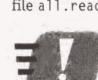

如果某个命令（你没有在后台运行）似乎花费时间过长，按 Ctrl+Z 停止它。然后输入 bg 将该进程放入后台。

## 使用虚拟控制台

Red Hat Linux 带有多个虚拟控制台。即使你的 Red Hat Linux 系统只有一个物理终端或控制台（显示器和键盘的组合称为终端或控制台），它也能让你感觉拥有多个控制台。从图形 X 屏幕（GNOME 或 KDE 桌面）开始，按 Ctrl+Alt+F1 进入第一个虚拟控制台，按 Ctrl+Alt+F2 进入第二个，依此类推。每个虚拟控制台都是一个文本屏幕，你可以在其中登录并输入 Linux 命令执行各种任务。

继续按 Ctrl+Alt+F2 切换到第二个虚拟控制台。然后登录并尝试一些 Linux 命令。你可以通过在 Bash 提示符下输入 exit 注销。要返回图形 X 显示，按 Ctrl+Alt+F7。


## 回顾

在本会话中，你尝试了 Bash shell 的许多关键特性——Linux 命令解释器。其中包括，你学习了命令的语法，如何组合命令，如何在后台运行命令，以及如何使用别名。

## 自测

- 1. shell 是什么以及它做什么？（参见“使用 Bash Shell”。）
- 2. 你将如何将长命令续写到多行？（参见“合并命令”。）
- 3. 如何将 Linux 命令的输出保存到文件中？（参见“重定向命令输入和输出”。）
- 4. 别名是什么以及为什么会使用它们？（参见“使用命令别名”。）
- 5. 要获取第二个虚拟控制台需要按哪些键？（参见“使用虚拟控制台”。）

## 会话


## 学习 Linux 命令

## 会话清单

- 回顾迄今为止学过的命令
- 探索多个 Linux 命令类别：管理进程、设置日期和时间、处理文件以及维护文件系统


30 分钟
剩余

在本会话中，你回顾了先前会话中已学过的命令，并学习了多个新的 Linux 命令类别。然而，由于 Linux 命令数量众多，在半小时的会话中无法真正探索每一条命令。你将在后续会话中尝试更多命令。要开始本会话，请在图形登录屏幕登录并打开一个终端窗口。然后你可以在该终端窗口中输入命令。

## 回顾迄今为止学过的命令

你在先前的会话中已经尝试了不少 Linux 命令。查看表 8-1 并浏览列表。这些是在先前会话中使用的命令。为了刷新你对命令作用的记忆，请按照表 8-1 描述列中显示的说明尝试该命令。为方便起见，我按类别组织了命令。

表 8-1
先前会话中学习过的 Linux 命令

| 命令名称 | 描述 |
|---|---|
| 获取在线帮助 | |
| man | 显示在线帮助信息。输入 man ls 可获取 ls 命令的帮助。 |
| 使命令更易用 | |
| alias | 为长命令定义缩写（快捷方式）。单独输入 alias 可查看所有当前定义的别名。输入 alias topdir='cd /' 然后输入 topdir 可将目录更改为根目录（/）。 |
| unalias | 删除使用 alias 定义的缩写。输入 unalias topdir 以取消定义 topdir 缩写。 |
| 管理文件和目录 | |
| cd | 更改当前目录。输入 cd /usr 更改到 /usr 目录。 |
| chmod | 更改文件权限。输入 chmod +x filename 使该文件可执行（将 filename 替换为现有文件名称）。 |
| cp | 复制文件。输入 cd 更改目录到你的主目录。然后输入 cp /etc/X11/XF86Config 将文件复制到你的主目录。 |
| ls | 显示目录内容。输入 ls -F 查看当前目录内容。 |
| mkdir | 创建目录。输入 cd 更改到你的主目录然后输入 mkdir temp 创建名为 temp 的目录。 |
| mv | 重命名文件以及将文件从一个目录移动到另一个目录。输入 mv filename1 filename2 更改文件名称（对 filename1 使用现有文件名称）。 |
| rm | 删除文件。语法为 rm filename。（请谨慎使用，因为文件将被删除。） |
| rmdir | 删除目录。输入 rmdir ~/temp 删除主目录中名为 temp 的目录（参见 mkdir 命令）。 |
| pwd | 显示当前目录。输入 pwd 查看当前目录名称。 |
| 查找文件 | |
| find | 根据名称、大小等指定条件查找文件。输入 find /usr -name "README*" -print 尝试此命令。 |
| 处理文件 | |
| cat | 在标准输出上显示文件（可将多个文件连接成一个大文件）。输入 cd 进入主目录然后输入 cat .bash_profile 查看该文件内容。 |
| grep | 在文本文件中搜索正则表达式。输入 cd 进入主目录然后输入 grep BASH .b* 查看在某些文件中搜索字符串 BASH 的结果。 |
| more | 一页一页地显示文本文件。输入 more /etc/inittab 一页一页地查看内容。（按空格键前进或输入 q 退出。） |
| 管理进程 | |
| printenv | 显示当前环境变量。输入 printenv 查看环境变量列表。 |
| 管理用户 | |
| passwd | 更改密码。输入 passwd 并按照提示更改密码。 |
| su | 成为另一个用户或 root（无参数调用时）。输入 su 并在提示时输入 root 密码。请注意你所做的操作，因为现在你是超级用户。输入 exit 返回普通用户。 |

以下各节涵盖先前会话中未涉及的新命令（按类别划分）。


## 管理进程的命令

每当 shell 对你输入的命令采取行动时，它都会启动一个进程。shell 本身就是一个进程，shell 执行的任何脚本或程序也是进程。你可以使用 ps 命令查看进程列表。例如，输入 ps x 时，Bash 会显示当前进程集。以下是 ps x 命令的部分输出。（我还加入了 --cols 132 选项以确保你能完整看到每个命令）：

```
ps x --cols 132
  PID TTY   STAT TIME COMMAND
    1 ?     S   0:05 init [5]
  325 ?     S   0:00 syslogd -m 0
  335 ?     S   0:00 klogd
  480 ?     S   0:00 crond
  511 ?     S   0:00 xinetd -reuse -pidfile /var/run/xinetd.pid
  580 ?     S   0:00 sendmail: accepting connections
  596 ?     S   0:00 gpm -t imps2
  849 ?     S   0:01 /usr/bin/gnome-session
  893 ?     S   0:00 gnome-smproxy --sm-client-id default0
  901 ?     S   0:02 sawfish --sm-client-id=default2
  967 ?     S   8:36 magicdev --sm-client-id=default12
  985 ?     S   0:00 gnome-name-service
  994 ?     S   0:01 panel --sm-client-id default7
 1001 ?     S   0:00 gmc --nowindows --sm-client-id default8
21437 ?     S   0:00 gnome-terminal --use-factory --start-factory-server
21443 ?     S   0:00 gnome-pty-helper
21444 pts/1 S   0:00 bash
21455 pts/0 R   0:00 ps x --cols 132
```

在输出中，COMMAND 列显示创建进程的命令。此列表显示 bash shell 和 ps 命令作为进程。其他进程包括 shell 在图形登录屏幕登录并启动 GNOME 会话时启动的所有程序。特别是，列表包括 sawfish（窗口管理器）进程和 gnome-terminal（终端窗口）进程。

默认的 ps x 命令不会提供 Linux 系统上运行的所有进程。ps x 显示的是你直接或通过登录时自动运行的 shell 脚本间接启动的命令。要查看完整的进程集合，请使用 ps 命令的 a 选项与 x 选项一起使用，如下所示：

```
ps ax
```


如果你研究 ps 命令的输出，会发现第一列的标题是 PID，并且它为每个进程显示一个数字。PID 代表进程 ID（标识），是 Linux 内核分配的顺序号。如果查看 ps ax 命令的输出，你应该会看到 init 命令是第一个进程；它的 PID 或进程号为 1。这就是为什么 init 被称为所有进程之母。

## 日期和时间命令

你可以使用 date 命令显示当前日期和时间或设置新的日期和时间。在 shell 提示符下输入 date，你会得到类似以下的结果：

```
date
Wed Aug 16 18:34:10 EDT 2000
```

你也可以格式化日期或时间的显示方式。例如，要仅查看日期（不带当前时间），请尝试以下命令：

```
date "+%A %B %d %Y"
Wednesday August 16 2000
```

格式规范采用包含以百分号（%）为前缀的单个字母的文本字符串的形式——类似于 C 和 C++ 编程语言中指定格式的方式。在此示例中，格式字符的含义如下：

- %A 显示星期几的全名
- %B 显示月份的全名
- %d 显示月份中的日期
- %Y 使用四位数字显示年份

要设置日期，请以 root 身份登录，然后使用 date -s 后跟日期和时间，格式为 MMDDhhmmYYYY，其中每个字符都是数字。例如，要将日期和时间设置为 2001 年 12 月 31 日晚上 10:30，请输入：

```
date -s 123122302001
```

如你所见，日期和时间规范的含义如下：

- MM    月份的两位数字（01 至 12）
- DD    月份中的两位日期（01 至 31）
- hh    24 小时制中的两位小时（00 为午夜，23 为晚上 11:00）
- mm    分钟的两位数字（00 至 59）
- YYYY  四位年份（如 2001）

另一个有趣的与日期相关的命令是 cal。如果不带任何选项输入 cal，它会打印当前月份的日历。如果在 cal 后输入一个数字，cal 会将该数字视为年份并打印该年的日历。要查看特定年份的特定月份的日历，请提供月份编号（1 = 一月，2 = 二月，以此类推），后跟年份。因此，要查看 2001 年 1 月的日历，请输入以下内容：

```
cal 1 2001
    January 2001
    Su Mo Tu We Th Fr Sa
      1  2  3  4  5  6
    7  8  9 10 11 12 13
    14 15 16 17 18 19 20
    21 22 23 24 25 26 27
    28 29 30 31
```

## 文件处理命令


你已经了解如何使用 grep 命令在文本文件中搜索，以及如何使用 more 命令逐屏查看文本文件。Red Hat Linux 包含许多更多处理文件的实用程序——大多数处理文本文件，但一些命令也可以处理任何文件。

### 统计文本文件中的字符、单词和行数

例如，你可以使用 wc 命令显示文本文件的字符、单词和行数。尝试以下操作：

```
wc /etc/inittab
    57      244      1756 /etc/inittab
```

这会使 wc 显示 /etc/inittab 文件的行数（57）、单词数（244）和字符数（1756）。如果你只想查看文件中的行数，可以使用 -l 选项，如下所示：

```
wc -l /etc/inittab
57 /etc/inittab
```

在这种情况下，wc 只显示行数。如果未指定文件名，wc 命令会期望从标准输入接收输入。你可以使用 shell 的管道功能将另一个命令的输出传递给 wc。有时这很有用。假设你想粗略统计系统中运行的进程数。你可以使用 ps ax 命令获取所有进程的列表；但与其手动计数行数，不如将 ps 的输出通过管道传递给 wc 来粗略计数，如下所示：

```
ps ax | wc -l
61
```

这意味着 ps 命令产生了 61 行输出。由于第一行只是表格列的标题，你可以估计系统上大约有 60 个进程正在运行。（当然，这个计数可能还包括运行 ps 和 wc 命令本身所使用的进程，但谁在计数呢？）

### 排序文本文件

你可以使用 sort 命令对文本文件中的行进行排序。要了解 sort 命令的工作原理，首先输入 more /etc/passwd 查看 /etc/passwd 文件的当前内容。现在输入 sort /etc/passwd 查看按字母顺序排序的行。如果你想对文件进行排序并将排序后的版本保存到另一个文件，你必须使用 Bash shell 的输出重定向功能，如下所示：

```
sort /etc/passwd > ~/sorted.text
```

此命令对 /etc/passwd 文件中的行进行排序，并将输出保存到主目录中名为 sorted.text 的文件中。

### 将任意文件拆分为多个较小文件

split 命令在你想将文件复制到软盘但文件太大无法放入单张软盘时非常有用。然后你可以使用 split 命令将文件拆分为多个较小的文件，每个文件都可以放入软盘。

默认情况下，split 将每 1,000 行放入一个文件。文件以字母组命名，如 aa、ab、ac 等。你可以为文件名指定前缀。例如，要将名为 huge file.tar 的大文件拆分为可放入几张高密度 3.5 英寸软盘的较小文件，请按如下方式使用 split：

```
split -b 1440k huge file.tar part.
```

此命令将 huge file.tar 文件拆分为 1440K 的块，以便每个块都可以放入软盘。该命令创建名为 part.aa、part.ab、part.ac 等的文件。

要将拆分的文件合并回单个文件，请使用 cat 命令，如下所示：

```
cat part.?? > huge file.tar
```

在此命令行中，每个问号匹配一个字符。因此，Bash shell 将 part.?? 扩展为文件名，例如 part.aa、part.ab、part.ac 等。

## 文件系统维护命令

假设你想访问本书附带 CD-ROM 上的文件。为此，你必须先将 CD-ROM 驱动器的文件系统挂载到 Red Hat Linux 文件系统中的特定目录。要尝试 mount 命令，请以 root 身份登录，将 CD-ROM 插入 CD-ROM 驱动器，然后输入以下命令：

```
mount /dev/cdrom /mnt/cdrom
mount: block device /dev/cdrom is write-protected, mounting read-only
```

此命令将名为 /dev/cdrom（CD-ROM）的设备上的文件系统挂载到 Linux 文件系统中的 /mnt/cdrom 目录（也称为挂载点）。mount 命令的响应表明 CD-ROM 以只读文件系统方式挂载。mount 命令成功完成后，你可以通过将 /mnt/cdrom 目录视为 CD-ROM 的顶级目录来访问 CD-ROM 中的文件。换句话说，要查看 CD-ROM 中 RedHat 目录的内容，请输入：

```
ls -F /mnt/cdrom/RedHat
RPMS/  TRANS.TBL  base/
```

你实际上可以将设备挂载到 Linux 文件系统上的任何目录。本质上，挂载点不必是 /mnt/cdrom；它可以是任何空目录。例如，如果你喜欢将 CD-ROM 驱动器称为 /cd，首先使用 mkdir /cd 命令创建 /cd 目录，然后使用以下 mount 命令：

```
mount /dev/cdrom /cd
```

在尝试此命令之前，你必须使用以下 umount 命令“卸载”CD-ROM：

```
umount /dev/cdrom
```

只有这样你才能再次将 CD-ROM 挂载到 Linux 文件系统中的另一个目录。

我向你展示了 mount 命令的较长语法，其中显式指定设备名称和挂载点，但 Red Hat Linux 在 /etc/fstab 文件中包含一行，使你能够通过以下其中一个命令挂载 CD-ROM：

```
mount /mnt/cdrom
mount /dev/cdrom
```

通常将设备挂载到 /mnt 目录中的目录。Red Hat Linux 附带两个预定义目录：用于挂载 CD-ROM 的 /mnt/cdrom 和用于挂载软盘的 /mnt/floppy。

除了 mount 和 umount 之外，你还应该知道另外两个命令——df 和 du——它们可以让你检查磁盘空间使用情况。这些命令使用起来很简单。df 命令显示所有已挂载设备的磁盘空间使用情况摘要，如以下示例所示：

```
df
```

| 文件系统 | 1k-块 | 已用 | 可用 | 使用% | 挂载点 |
|---|---|---|---|---|---|
| /dev/hda2 | 2000236 | 1103852 | 794776 | 59% | / |
| /dev/hda1 | 2096160 | 1833600 | 262560 | 88% | /dosc |
| /dev/hdc | 656560 | 656560 | 0 | 100% | /mnt/cdrom |

输出是一个表格，显示设备、总千字节存储量、已使用量、可用量、使用百分比和挂载点。例如，在我的系统上，/dev/hda2 设备（磁盘分区）挂载在 Linux 文件系统的根目录（/）上。它大约有 2GB 空间，其中 1.1GB（或 59%）已使用，794MB 可用。同样，你可以从最后一行看出 CD-ROM 大约有 656MB 的存储空间在使用。


另一个命令——du——用于查找目录占用了多少空间。例如，输入以下命令以查看 /var/log 目录（包含各种错误日志）中所有目录的内容：

```
du /var/log
4          /var/log/httpd
4          /var/log/news/OLD
8          /var/log/news
4          /var/log/vbox
4          /var/log/samba
4          /var/log/sa
120        /var/log
```

每个目录名称前都有一个数字——该数字表示该目录使用的磁盘空间的千字节数。因此，/var/log 目录整体使用 120K 磁盘空间，而 /var/log/httpd 子目录使用 4K。如果您只想知道目录（包括其中包含的所有文件和子目录）使用的总磁盘空间，请使用 -s 选项，如下所示：

```
du -s /var/log
120        /var/log
```

请注意，-s 选项会使 du 仅打印 /var/log 目录的汇总信息。


## 回顾

本会话开始时，您回顾了在之前会话中遇到的 Linux 命令。然后您在几个重要类别中尝试了许多 Linux 命令——进程管理、日期和时间，以及文件系统维护。

## 自测

- 1. 如何查看当前定义的所有别名或快捷方式的列表？（参见“回顾迄今为止学到的命令”。）
- 2. 如何查找进程的进程 ID（PID）？（参见“进程管理命令”。）
- 3. 您使用什么命令打印 2001 年 8 月的日历？（参见“日期和时间命令”。）
- 4. 如何查出 Linux 系统上当前正在运行的进程数？（参见“在文本文件中计数字符、单词和行”。）
- 5. 您需要做什么才能访问本书附带的 CD-ROM 上的文件？（参见“文件系统维护命令”。）


## 会话


## 在 Red Hat Linux 中编辑文本文件

## 会话清单

- ✓ 在 GNOME 和 KDE 中使用 GUI 文本编辑器
- ✓ 使用 ed 和 vi 文本模式文本编辑器


30 分钟
剩余

在本会话中，您将学习使用文本编辑器——GUI 编辑器以及 ed 和 vi 文本模式编辑器。文本编辑是所有操作系统的重要组成部分，包括 Red Hat Linux，因为许多系统配置文件都是文本文件。在 Red Hat Linux 中，您可能需要创建和编辑各种文本文件，例如：系统配置文件，包括 /etc/fstab、/etc/hosts、/etc/inittab 和 /etc/X11/XF86Config；用户文件，例如 .newsrc 和 .bash_profile；邮件消息和新闻文章；shell 脚本文件；Perl 和 Tcl/Tk 脚本；以及 C 或 C++ 程序。

## 使用 GUI 文本编辑器进行文本编辑

Linux 的两个图形桌面——GNOME 和 KDE——都附带 GUI 文本编辑器（具有图形用户界面的文本编辑器）。

要尝试 GNOME 文本编辑器 gEdit，请从 GNOME 桌面选择 主菜单 ↩ 程序 ↩ 应用程序 ↩ gEdit。您可以通过单击工具栏上的打开按钮来打开文件。这会弹出打开文件对话框。然后您可以更改目录并通过单击确定按钮选择要编辑的文件。

gEdit 编辑器随后在窗口中加载文件。您可以打开多个文件并在编辑文件时在它们之间切换。图 9-1 显示了使用 gEdit 的典型编辑会话。

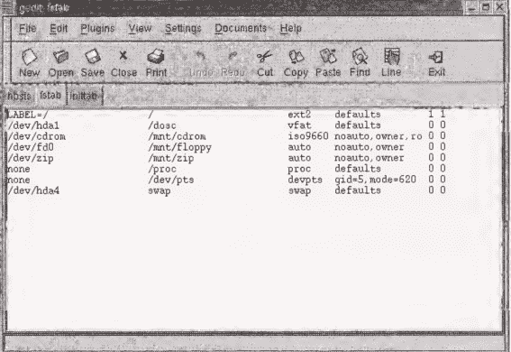

图 9-1
使用 gEdit 编辑多个文本文件

在这种情况下，编辑器打开了三个文件——hosts、fstab 和 inittab（均来自 /etc 目录）——进行编辑。文件名显示为编辑器窗口工具栏下方的选项卡。您可以通过单击带有文件名的选项卡在文件之间切换。

其余的文本编辑步骤很直观。要输入新文本，请单击定位光标并开始输入。您可以使用文本编辑区域上方工具栏上的按钮选择文本、复制、剪切和粘贴。

从 KDE 桌面，您可以通过选择 K ↩ 应用程序 ↩ 文本编辑器 来启动 KEdit（KDE 文本编辑器）。要打开文本文件，请从菜单中选择 文件 ↩ 打开。会出现一个对话框。从此对话框中，您可以进入正确的目录，选择要打开的文件，然后单击确定按钮。KDE 文本编辑器随后打开 /etc/fstab 文件并在窗口中显示其内容。

## 使用 ed 和 vi 进行文本编辑

所有 UNIX 系统，包括 Linux，都附带两个文本模式文本编辑器：

- ed，一个面向行的文本编辑器
- vi，一个全屏文本编辑器，支持名为 ex 的早期编辑器的命令集

尽管图形文本编辑器易于使用，但 ed 和 vi 可能比其他——更图形化的——文本编辑器更晦涩。您应该学习 ed 和 vi 的基本编辑命令，因为有时这两种可能是唯一可用的编辑器。例如，当您遇到系统问题且 Linux 拒绝从硬盘启动时，您可能需要从软盘启动。在这种情况下，您必须使用 ed 编辑器编辑系统文件，因为该编辑器足够小，可以放入软盘中。正如接下来的两个部分所示，学习 ed 和 vi 的基本文本编辑命令并不难。

## 使用 ed

ed 文本编辑器使用缓冲区——一个内存存储区域，实际文本驻留在其中，直到您显式将文本存储到文件中。通常，您只有在从最小版本的 Linux（例如从启动软盘）启动并且系统不支持全屏模式时才需要使用 ed。在所有其他情况下，您可以使用在文本模式全屏下工作的 vi 编辑器。

正如您在以下使用 ed 编辑器的示例中看到的，您在命令模式或文本输入模式下工作：

- 命令模式是默认模式。在此模式下，您输入的任何内容都被解释为命令。ed 文本编辑器具有简单的命令集，其中每个命令由一个或多个字符组成。
- 文本输入模式使您能够将文本输入缓冲区。您可以使用命令 a（追加）、c（更改）或 i（插入）进入输入模式。输入多行文本后，您可以通过单独一行输入句点（.）来退出输入模式。

要练习编辑文件，请使用以下命令将 /etc/fstab 文件复制到您的主目录：

```
cd
cp /etc/fstab .
```

现在您应该在主目录中有一个名为 fstab 的文件。键入以下命令开始在 ed 中编辑文件：

```
ed -p: fstab
608
:
```

此示例使用 -p 选项将提示符设置为冒号字符（:）并打开 fstab 文件（在当前目录中，应为您的主目录）进行编辑。ed 编辑器打开文件，报告文件中的字符数（608），并显示提示符（:），然后等待命令。


使用 ed 编辑时，您可能会发现使用 -p 选项始终打开提示字符很有帮助。如果没有提示，很难判断 ed 是否处于输入模式或命令模式。

ed 打开文件进行编辑后，当前行是文件的最后一行。要查看当前行号（当前行是 ed 应用命令的行），请使用 .= 命令：

```
:.=
8
```

此输出告诉您 fstab 文件有八行。（您的系统的 /etc/fstab 文件可能有不同数量的行，在这种情况下您会看到不同的数字。）

您可以使用 1,$p 命令查看文件中的所有行，如以下示例所示：

```
:1,$p
LABEL=/                 /               ext2    defaults        1 1
/dev/hda1               /dos c          vfat    defaults        0 0
/dev/cdrom              /mnt/cdrom      iso9660 noauto,owner,ro 0 0
/dev/fd0                /mnt/floppy     auto    noauto,owner    0 0
/dev/zip                /mnt/zip        auto    noauto,owner    0 0
none                    /proc           proc    defaults        0 0
none                    /dev/pts        devpts  gid=5,mode=620  0 0
/dev/hda4               swap            swap    defaults        0 0
:
```

要转到特定行，请键入行号：

```
:8
/dev/hda4               swap            swap    defaults        0 0
:
```

The editor responds by displaying that line.

Suppose you want to delete the line that contains cdrom. To search for a string, type a slash (/) followed by the string that you want to locate:

```
:/cdrom
/dev/cdrom          /mnt/cdrom          iso9660 noauto,owner,ro 0 0
:
```

The editor locates the line that contains the string and then displays it. That line becomes the current line.

To delete the current line, use the d command as follows:

```
:d
:
```

To replace a string with another, use the s command. To replace cdrom with the string cd, for example, use this command:

```
:s/cdrom/cd/
:
```

To insert a line in front of the current line, use the i command:

```
:i
    (type the line you want to insert)
.   (type a single period to indicate you're done)
:
```

You can enter as many lines as you want. After the last line, enter a period (.) on a line by itself. That period marks the end of text-input mode, and the editor switches to command mode. In this case, you can tell that ed switched to command mode because you see the prompt (:).

When you are happy with the changes, you can write them to the file with the w command. If you want to save the changes and exit, type wq to perform both steps at the same time:

```
:wq
632
```

The ed editor saves the changes in the file, displays the number of saved characters, and exits. If you want to quit the editor without saving any changes, use the Q command.

The sample session gives you an idea of how to use ed commands to perform the basic tasks of editing a text file. Table 9-1 lists some of the commonly used ed commands.

## 表 9-1
*常用的 ed 命令*

| 命令 | 含义 |
|---|---|
| !command | 执行 shell 命令（例如，!pwd 显示当前目录） |
| $ | 转到缓冲区中的最后一行 |
| % | 将后面的命令应用于缓冲区中的所有行（例如，%p 打印所有行） |
| + | 转到下一行 |
| +n | 转到第 n 行之后的下一行（n 为数字） |
| , | 将后面的命令应用于缓冲区中的所有行（例如，,p 打印所有行）；与 % 类似 |
| - | 转到前一行 |
| -n | 转到第 n 个前一行（n 为数字） |
| . | 指缓冲区中的当前行 |
| /text/ | 向前搜索指定文本 |
| ; | 指行范围：从当前行到缓冲区中的最后一行 |
| = | 打印行号 |
| ?text? | 向后搜索指定文本 |
| ^ | 转到前一行；另请参阅 - 命令 |
| ^n | 转到第 n 个前一行（其中 n 为数字）；另请参阅 -n 命令 |
| a | 在当前行后追加 |
| c | 更改指定行 |
| d | 删除指定行 |
| i | 在当前行前插入文本 |
| n | 转到行号为 n 的行 |

| 命令 | 含义 |
|---|---|
| newline | 显示下一行并使该行成为当前行 |
| q | 退出编辑器 |
| Q | 不保存更改退出编辑器 |
| r file | 读取文件内容并在当前行后插入 |
| s/old/new/ | 将旧字符串替换为新字符串 |
| u | 撤消上一个命令 |
| W file | 将缓冲区内容追加到指定文件的末尾 |
| w file | 将缓冲区保存到指定文件中（如果未命名文件，则保存到默认文件 — ed 当前正在编辑的文件内容） |

## 使用 vi

vi 编辑器是一个全屏文本编辑器，可让您一次查看文件的几行。大多数 UNIX 系统，包括 Red Hat Linux，都自带 vi。因此，如果您学习 vi 的基本功能，您几乎可以在任何 UNIX 系统上编辑文本文件。

与 ed 编辑器一样，vi 使用缓冲区。当 vi 编辑文件时，它将文件读入缓冲区 — 一块内存 — 并允许您更改缓冲区中的文本。vi 编辑器在编辑过程中也使用临时文件，但原始文件要等到您使用特定的 vi 命令保存更改后才会被更改。

在启动诸如 vi 之类的全屏文本编辑器之前，您必须将 TERM 环境变量设置为终端类型（例如 vt100 或 xterm）。例如，键入 export TERM=vt100 将终端类型设置为 VT100。vi 编辑器使用终端类型来控制全屏模式下的终端。

当您运行 X 和 GNOME 或 KDE 等图形用户界面时，可以在终端窗口中使用 vi。终端窗口的终端类型是 xterm。（要验证这一点，请在命令提示符下键入 echo $TERM。）当您启动终端窗口时，它会自动将 TERM 环境变量设置为 xterm。因此，您应该能够在 xterm 窗口中使用 vi，而无需显式设置 TERM 变量。

要启动编辑器，请使用 vi 名称后跟可选的文件名。您可以在文件名之外提供其他参数。但是，大多数情况下 vi 仅以文件名作为唯一参数启动，如下所示：

```
vi /etc/hosts
```


启动 vi 的另一种常见方法是立即跳转到特定的行号。例如，要从文件 /etc/X11/XF86Config 的第 296 行开始编辑，请使用以下命令：

```
vi +296 /etc/X11/XF86Config
```

这种启动 vi 的方式在编译器报告特定行号的错误后编辑源文件时很有用。

当您使用 vi 编辑文件时，编辑器将文件加载到缓冲区中，在全屏窗口中显示文件的前几行，并将光标定位在第一行。例如，当您在终端窗口中键入命令 vi /etc/fstab 时，您会得到一个全屏文本窗口。

最后一行显示有关文件的信息，包括文件中的行数和字符数。稍后，此区域用作命令输入区域。其余行显示文件。如果文件包含的行数少于窗口，vi 会在第一列用波浪号 (~) 显示空行。

当前行由光标标记，光标显示为一个小黑色矩形。光标出现在字符上方。

在 vi 中，您在三种模式之一中工作：

- *视觉命令模式* 是默认情况下获得的模式。在此模式下，您键入的任何内容都被解释为适用于包含光标的行命令。vi 命令与 ed 命令类似。
- *冒号命令模式* 允许您读取或写入文件、设置 vi 选项并退出。所有冒号命令都以冒号 (:) 开头。当您输入冒号时，vi 将光标定位在最后一行并允许您键入命令。按下 Enter 时命令生效。
- *文本输入模式* 允许您将文本输入缓冲区。您可以使用命令 a（在光标后插入）、A（在行尾追加）或 i（在光标后插入）进入输入模式。输入多行文本后，您必须按 Esc 退出输入模式并重新进入视觉命令模式。

所有这些模式的一个问题是您无法轻松判断 vi 的当前模式。开始键入然后才意识到 vi 不在输入模式中，这令人沮丧。相反的情况也经常发生 — 您可能在想要输入命令时正在键入文本。如果您想确保 vi 处于命令模式，只需按几次 Esc 即可。（按多次 Esc 不会造成伤害。）


要在命令模式下查看 vi 的在线帮助，请键入 :help。键入 :q 退出帮助屏幕并返回您正在编辑的文件。

vi 编辑器最初将光标定位在第一个字符上。您需要学习的第一件事之一是如何移动光标。尝试以下命令。只需键入字母，vi 就会响应。

| 命令 | 描述 |
|---|---|
| j | 将光标向下移动一行 |
| k | 将光标向上移动一行 |
| h | 将光标向左移动一个字符 |
| l | 将光标向右移动一个字符 |
| w | 将光标向前移动一个词 |
| b | 将光标向后移动一个词 |
| Ctrl+D | 向下移动半屏 |
| Ctrl+U | 向上滚动半屏 |


幸运的是，您也可以使用箭头键移动光标。如果您记不住 j k h l 字符的含义，只需使用箭头键在文件中移动即可。

您可以在任何时候转到特定的行号。这时冒号命令就派上用场了。例如，要转到第 1 行，请键入以下内容然后按 Enter：

```
:1
```

当您键入冒号时，vi 会在屏幕最后一行显示冒号。从那时起，vi 将您键入的文本用作命令。您必须按 Enter 将命令提交给 vi。在冒号命令模式下，vi 接受 ed 编辑器接受的所有命令 — 还有更多。

要搜索字符串，首先键入斜杠 (/)。vi 编辑器会在屏幕最后一行显示斜杠。键入搜索字符串然后按 Enter。vi 编辑器会定位该字符串并将光标定位在该字符串的开头。因此，要在文件 /etc/fstab 中定位字符串 cdrom，请键入：

/cdrom

要删除包含光标的行，请键入 dd（两个小写 d）。vi 编辑器删除该行文本并使下一行成为当前行。

要在光标前开始输入文本，请键入 i（单独的小写 i）。vi 编辑器切换到文本输入模式。现在您可以输入文本。完成输入后，按 Esc 返回视觉命令模式。


编辑完文件后，您可以使用 :w 命令保存文件中的更改。要在不保存任何更改的情况下退出编辑器，请使用 :q! 命令。如果您想保存更改并退出，可以输入 :wq 同时执行这两个步骤。vi 编辑器会保存文件中的更改并退出。您也可以通过按 Shift+zz（按住 Shift 键并按两次 z）来保存更改并退出编辑器。

除了示例会话中说明的几个命令之外，vi 还接受大量命令。表 9-2 列出了按任务组织的某些常用 vi 命令。要尝试这些命令，请将 /etc/X11/XF86Config 等文件复制到您的主目录，并使用以下命令用 vi 编辑该文件：

```
cd
cp /etc/X11/XF86Config .
vi XF86Config
```

在编辑文件时，请尝试表 9-2 中显示的命令。由于熟练的 vi 技能在所有 UNIX 系统中都有用，包括 Red Hat Linux，您应该花几分钟时间熟悉表 9-2 中的一些命令。

Table 9-2
常用 vi 命令

| Command | Meaning |
|---|---|
| *插入文本* | |
| a | 在光标后插入文本 |
| A | 在当前行末尾插入文本 |
| I | 在当前行开头插入文本 |
| i | 在光标前插入文本 |
| *删除文本* | |
| D | 删除至当前行末尾 |
| dd | 删除当前行 |
| dw | 从光标删除到下一个单词末尾 |
| x | 删除光标所在字符 |


| Command | Meaning |
|---|---|
| **更改文本** | |
| C | 将当前行至末尾更改 |
| cc | 更改当前行 |
| J | 将当前行与下一行合并 |
| r x | 用 x（x 为任意字符）替换光标下的字符 |
| **移动光标** | |
| h | 向左移动一个字符 |
| j | 向下移动一行 |
| k | 向上移动一行 |
| L | 将光标移动到屏幕末尾 |
| l | 向右移动一个字符 |
| w | 移动到下一个单词开头 |
| **滚动文本** | |
| Ctrl-d | 向前滚动半屏 |
| Ctrl-u | 向后滚动半屏 |
| **刷新屏幕** | |
| Ctrl-l | 重绘屏幕 |
| **剪切和粘贴文本** | |
| P | 将 yank 的行放在当前行上方 |
| p | 将 yank 的行放在当前行下方 |
| yy | 将当前行 yank（复制）到未命名缓冲区 |
| **冒号命令** | |
| :!command | 执行 shell 命令 |
| :q | 退出编辑器 |
| :q! | 不保存更改退出 |
| :r filename | 读取文件并在当前行后插入 |

Table 9-2 Continued

| Command | Meaning |
|---|---|
| `:w filename` | 将缓冲区写入文件 |
| `:wq` | 保存更改并退出 |
| **搜索文本** | |
| /string | 向前搜索 *string* |
| `?string` | 向后搜索 *string* |
| **杂项** | |
| `u` | 撤销上一个命令 |
| `Esc` | 结束输入模式并进入视觉命令模式 |
| `U` | 撤销对当前行的最近更改 |


## 复习

本会话向您展示了如何在 GNOME 和 KDE 中使用图形文本编辑器编辑文件。图形文本编辑器使用起来很直观，但有时您可能需要在没有图形登录的情况下编辑文本文件。对于这些情况，您练习了使用文本模式编辑器编辑文本文件：ed 和 vi。

## 自测

- 1. 如何启动 GNOME 文本编辑器？（参见“使用 GUI 文本编辑器进行文本编辑”。）
- 2. 使用 ed 编辑器编辑时，如何查看文件的全部行？（参见“使用 ed”。）
- 3. 使用 ed 编辑器编辑文件时，您使用什么命令来定位包含字符串 monitor 的行？（参见“使用 ed”。）
- 4. vi 编辑器的三种模式是什么？（参见“使用 vi”。）
- 5. 如何在不保存任何更改的情况下退出 vi 编辑器？（参见“使用 vi”。）

## 会话


## 执行基本系统管理任务

### 会话清单

- ✓ 了解 Linux 系统和网络管理
- ✓ 使用 Linuxconf 添加用户账户
- ✓ 探索 Linuxconf 执行的其他任务


本次周六上午的最后一次会话向您介绍 Linux 系统和网络管理。然后您学习使用 Linuxconf 执行一些系统管理任务，Linuxconf 是随 Red Hat Linux 提供的一个图形系统管理工具。具体来说，您学习如何添加用户账户，然后探索 Linuxconf 使您能够执行的其他任务。Linuxconf 的这一概述应有助于您在需要时执行其他系统管理任务。

### 了解 Linux 系统和网络管理

系统管理是指您必须执行以保持计算机系统正常运行的任务。现在几乎所有计算机都是联网的，因此需要另一组任务来保持网络正常运行。这些任务统称为 *网络管理*。拥有许多计算机的站点可能有一名全职的 *系统管理员* 来处理所有系统和网络管理任务。非常大的站点可能有单独的系统管理和网络管理人员。如果您在家庭 PC 或小型公司中的几台系统上运行 Red Hat Linux，您可能同时承担系统管理员和网络管理员的职责。

正如下面对系统和网络管理任务的描述所示，您可以使用 Linuxconf 工具执行这些任务——这是一个 X Window 应用程序，使您能够在无需手动编辑配置文件或输入晦涩命令的情况下执行大多数系统和网络管理任务。在系统和网络管理概述之后，您将学习如何使用 Linuxconf。

### 系统管理任务

作为系统管理员，您典型的任务（您可以使用 Linuxconf 执行）包括以下内容：

- *安装、配置和升级操作系统及各种实用程序。* 您在之前的会话中学习了如何安装 Red Hat Linux。
- *添加和删除用户。* 在本会话的后面，您将学习如何使用 Red Hat 的图形 Linuxconf 工具添加新的用户账户。如果用户忘记密码，您也可以使用 Linuxconf更改密码。
- *安装新软件。* 对于典型的 Linux 软件，您以源代码形式获取，此任务涉及使用诸如 `gunzip`（解压缩软件）、`tar`（解包归档文件）和 `make`（构建可执行程序）等工具。对于 Red Hat 以 Red Hat Package Manager（RPM）文件形式分发的软件，您必须使用 `rpm` 命令安装软件。


第 23 节向您展示如何安装 RPM 包。在第 27 节中，您将学习如何使用诸如 `tar` 和 `make` 等工具构建软件包。

- *制作备份。* 您可以使用 tar 或 cpio 程序归档一个或多个目录，并将归档文件复制到软盘（如果归档文件足够小）或磁带（如果您有磁带驱动器）。
- *挂载和卸载文件系统。* 例如，当您想要访问 CD-ROM 上的文件时，您必须将该 CD-ROM 的文件系统挂载到 Linux 文件系统的某个目录上。您必须使用 mount 命令完成此任务。您也可以使用 Linuxconf 挂载文件系统。（稍后本节中会出现一个示例。）
- *监控系统的性能。* 您必须使用一些实用程序，例如 top（查看处理器花费大部分时间的位置）和 free（查看系统中空闲和已用内存量）。
- *启动和关闭系统。* 尽管启动系统通常只涉及打开 PC 的电源，但在您想要关闭 Linux 系统时，您仍需谨慎。您应该使用 shutdown 命令在关闭 PC 电源开关之前停止所有程序。如果您的系统设置为图形登录屏幕，您可以通过从登录屏幕中选择菜单项来执行关机操作。


在第 26 节中，您将学习如何备份和恢复文件。


挂载内容在第 8 节中介绍。


您将在第 28 节中学习如何使用实用程序监控系统性能。


## 网络管理任务

使用 Linuxconf 可以执行的典型网络管理任务包括以下内容：

- *维护网络配置文件。* 在 Linux（以及其他 UNIX 系统）中，TCP/IP 网络是通过几个文本文件配置的，您可能需要编辑这些文件以使网络工作。Linuxconf 使您能够配置网络。
- *设置 PPP 和 SLIP。* 您可以使用 Linuxconf 设置 PPP 和 SLIP 连接。
- *监控网络状态。* 您必须使用诸如 netstat（查看活动网络连接的信息）、/sbin/ifconfig（检查各种网络接口的状态）以及 ping（确保连接正常工作）之类的工具。


您将在第 12 节学习 TCP/IP 配置文件。


您将在第 13 节学习 TCP/IP 配置文件。


第 12 节向您介绍监控网络状态所需的工具。

## 使用 Linuxconf 添加用户账户


20 分钟。
剩余

当您安装 Red Hat Linux 时，其中一个步骤会给您机会设置除 root 之外的其他用户账户。如果您在安装期间未添加其他用户账户，您现在可以这样做。如果您希望其他用户能够访问和使用系统，您也必须执行此步骤。

创建除 root 之外的其他用户账户是个好主意。即使您是系统的唯一用户，以权限较低的用户登录也是良好的做法；这样，您就不会无意中损坏任何重要的系统文件。根据需要，您可以以 root 身份登录并执行任何系统管理任务。

要从 Red Hat Linux 中的 GNOME 主菜单启动 Linuxconf，请选择 主菜单（Foot） ⇨ 程序 ⇨ 系统 ⇨ LinuxConf。

初始 Linuxconf 窗口显示三个选项卡 — Config、Control 和 Status（见图 10-1）。每个选项卡都包含树形菜单，用于组织您可以使用 Linuxconf 执行的任务。当您单击树形菜单中的特定项目时，该项目的配置选项会出现在树形菜单右侧的选项卡式对话框中。

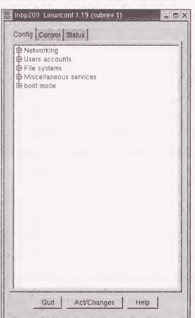

图 10-1
初始 Linuxconf 窗口

要将自己添加为新用户，我按以下步骤操作：

- 1. 单击 User accounts 按钮旁边的加号，然后单击 Normal 下显示的 User accounts 项目。这会导致 Linuxconf 显示 Users Accounts 对话框，如图 10-2 所示。

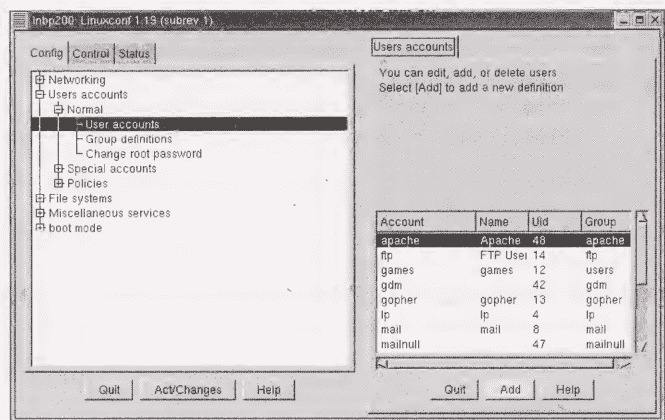

### 图 10-2

Linuxconf 中的 Users Accounts 选项卡

- 2. 在图 10-2 的 Users Accounts 选项卡中单击 Add 按钮。这会打开用户账户创建选项卡。
- 3. 填写所需信息。特别是，您必须输入登录名和主目录。对于我的账户，我使用 /home/naba 作为主目录。您也可以为自己的账户使用类似的主目录。填写完所有字段后，我单击 Accept 按钮。如果 /home/naba 目录不存在，Linuxconf 会创建该目录。
- 4. Linuxconf 工具显示 Changing password 对话框，您在其中输入新账户的密码并单击 Accept 按钮。然后工具要求您重新输入密码以确认。请注意，如果密码是可以在字典中找到的单词组合，Linuxconf 会拒绝您的密码。输入密码后，单击 Users Accounts 对话框中的 Quit 按钮。
- 5. 要退出 Linuxconf，请在主窗口中单击 Quit 按钮。Linuxconf 工具会显示 Status of System 对话框，询问您是否要激活更改。单击 Activate the Changes 按钮以完成任务并退出 Linuxconf。

## Linuxconf 执行的其他任务

在这里，您将探索 Linuxconf 可以执行的各种任务的选项卡和按钮。然而，本节对 Linuxconf 的介绍远非完整。要全面介绍 Linuxconf 的功能并解释其可以执行的每项任务，需要更多页面的篇幅。

Linuxconf 在网络上拥有自己的主页，网址为 http://www.solucorp.qc.ca/linuxconf/。访问主页以了解有关 Linuxconf 的最新消息并阅读在线文档。

Linuxconf 在主 Linuxconf 窗口中包含一个 Help 按钮。此 Help 按钮提供 Linuxconf 的概述。单击 Help 按钮时会出现 Help 窗口。

大多数 Linuxconf 窗口也包含 Help 按钮，提供上下文相关帮助 — 与您正在执行的任务相关的信息（例如，见图 10-2）。按最近的 Help 按钮阅读有关当前任务的一些相关信息。在某些情况下，Linuxconf 可能会显示一条消息，说明该项目的帮助文件尚未编写。

在初始 Linuxconf 窗口中（见图 10-1），您应注意有三个选项卡：Config、Control 和 Status。Config 选项卡使您能够配置各种系统服务，而 Control 选项卡包含用于启动和停止服务以及控制 Linuxconf 的各种功能的树形菜单。Status 选项卡包含一个树形菜单，使您能够查看各种消息日志，例如 Red Hat Linux 系统启动时 Linux 内核显示的消息。

要探索 Config、Control 和 Status 按钮，请单击每个选项卡，然后单击树形菜单项目以查看会发生什么。您应该花几分钟时间探索 Linuxconf 中的全部三个选项卡，以便了解使用此工具可以执行的系统和网络管理任务类型。

## 回顾

本节首先概述了 Linux 系统管理和网络管理任务。然后您使用 Linuxconf 添加了一个或多个用户账户。最后，您探索了 Linuxconf 中的选项卡，以了解使用 Linuxconf 可以执行的系统管理和网络管理任务类型。

## 自测

- 1. 一些典型的 Linux 系统管理任务有哪些？
  （见“理解 Linux 系统和网络管理”。）
- 2. 在 Linuxconf 中，添加新用户账户时应单击哪个按钮？
  （见“使用 Linuxconf 添加用户账户”。）
- 3. 您可以在哪里获取有关 Linuxconf 的最新信息？（见“Linuxconf 执行的其他任务”。）
- 4. Linuxconf 主窗口中的三个选项卡是什么？（见“Linuxconf 执行的其他任务”。）
- 5. 您能否从 Linuxconf 查看消息日志，如果可以，哪个选项卡使您能够执行此任务？（见“Linuxconf 执行的其他任务”。）

## 第二部分

## 星期六上午

### 部分回顾

- 1. GNOME 和 KDE 是什么？您是否必须二选一？您可以在一次会话中切换到其中一个吗？如果是，如何操作？
- 2. 解释为什么必须以有序的方式关闭 Linux 系统。如何从图形登录屏幕执行关机？
- 3. 为什么您可能要在 GNOME 或 KDE 中打开终端窗口？
- 4. Linux 文件系统是什么？文件系统的部分可以存储在不同的硬盘或不同的分区上吗？
- 5. 您会使用什么 Linux 命令将目录更改为您的主目录，然后列出所有文件（包括名称以句点开头的文件）的详细信息？
- 6. 您会使用什么 Linux 命令来查找 /usr/doc 目录树中名称以 README 开头的所有文件？
- 7. 如何在一行中输入多个 Linux 命令？在多行上继续一个命令的语法是什么？
- 8. 给出一个使用一个命令的输出作为另一个命令输入的示例。
- 9. shell 的“I/O 重定向”功能是什么？
- 10. 别名是什么以及如何定义别名？如何获取所有当前已定义别名的列表？定义别名 docdir 以更改目录到 /home/httpd/html。如何取消定义 docdir 别名？
- 11. 您的系统日期和时间不正确。显示您将用于将日期和时间设置为 2001 年 12 月 31 日晚上 10:30 的命令行。


12. 显示你用来查找名称中包含 gnome 的所有进程的 Linux 命令行。
13. 你想终止 gpm 进程。解释执行此任务的步骤。
14. 假设你想将一个 4MB 文件分成四等份，以便复制到四个软盘上。你会使用什么命令来执行此任务？又如何重新组合这些部分？
15. 为什么学习如何在 Linux 中编辑文本文件很重要？在文本控制台工作时你会使用什么文本编辑器？
16. 你正在使用 ed 文本编辑器编辑 /etc/inittab 文件。显示以冒号 (:) 作为命令提示符启动编辑会话的命令。解释你如何在第 16 行前输入一行文本，然后保存文件并退出。
17. 解释你如何使用 vi 编辑器编辑 /etc/inittab 文件。你会按什么键转到第 16 行并输入新行文本？如何保存文件并退出？
18. 如何在 vi 中剪切一行文本？你会使用什么 vi 命令将剪切的文本粘贴到当前行下方？
19. 什么是 Linuxconf 以及如何从 GNOME 桌面启动它？提及你可以用 Linuxconf 执行的一些任务。
20. 在 Linuxconf 中添加新用户账户时需要提供哪些信息？Linuxconf 是否会检查密码是否使用容易猜到的词？

## PART III
## 星期六下午

- **Session 11**
  *在 Red Hat Linux 中使用调制解调器*
- **Session 12**
  *联网你的 Red Hat Linux PC*
- **Session 13**
  *将你的 Red Hat Linux PC 连接到互联网*
- **Session 14**
  *设置 Internet 服务*
- **Session 15**
  *将 Red Hat Linux 用作工作组服务器*
- **Session 16**
  *从 Red Hat Linux 访问 Windows 和 DOS 文件*


## SESSION


## 在 Red Hat Linux 中使用调制解调器

## 会话清单

- [x] 将调制解调器连接到 PC
- [x] 使用 Minicom 拨号


30 分钟
剩余

星期六下午的会话重点介绍使用调制解调器或以太网局域网 LAN 进行数据通信。本次首个会话将介绍可通过其将调制解调器连接到 Linux 系统的串口。如果你在家或办公室使用 Red Hat Linux，你可能出于以下一个或多个原因想要使用调制解调器：拨号连接到另一台计算机（如公告板系统）或其他 UNIX 系统；让其他人拨号进入并使用你的 Linux 系统；或使用点对点协议 PPP 的拨号网络通过 Internet 服务提供商 ISP 连接到 Internet。本次会话涵盖调制解调器的首次使用：从你的 Red Hat Linux PC 拨号。


会话 13 涵盖使用 PPP 的拨号网络。

## 将调制解调器连接到 PC

当你从本书的附带 CD-ROM 安装 Red Hat Linux 时，你会自动安装一些可用于使用调制解调器从 Linux 系统拨号的工具。然而，在你能够拨号之前，你必须确保调制解调器已正确连接到 PC 的一个串口，并且串口的 Linux 设备已正确设置。确保调制解调器已正确连接到电源，并且调制解调器也已连接到电话线。

如果你的调制解调器是外置的，请购买合适的电缆将调制解调器连接到 PC。你需要一根直通串行电缆将调制解调器连接到 PC。电缆两端的连接器取决于 PC 上的串口类型。调制解调器端的电缆需要一个公 25 针连接器。PC 端的电缆通常是母 9 针连接器。你可以在大多数电脑商店买到调制解调器电缆。9 针母 - 25 针公调制解调器电缆通常以“AT Modem Cable”标签出售。


如果你的 PC 有内置调制解调器，你只需将电话线连接到内置调制解调器卡背面的电话插孔即可。

## 学习串口设备名称

PC 通常有两个串口，在 MS-DOS 用语中称为 COM1 和 COM2。 （大多数具有通用串行总线的较新 PC 只有一个串口。）PC 还可以支持另外两个串口：COM3 和 COM4。由于这些端口名称，串口通常被称为 COM 端口。

像其他设备一样，串口需要中断请求 IRQ 号码和 I/O 端口地址。两个 IRQ —— 3 和 4 —— 在四个 COM 端口之间共享。表 11-1 列出了分配给四个串口的 IRQ 和 I/O 端口地址。像 Linux 中的其他设备一样，/dev 目录中的设备文件代表串口设备。表 11-1 显示了对应于 PC 的 COM 端口的串行设备名称。

表 11-1
串口设备名称

| COM 端口 | 设备名称 | IRQ | I/O 地址 |
|----------|-------------|-----|-------------|
| COM1 | /dev/ttyS0 | 4 | 0x3f8 |
| COM2 | /dev/ttyS1 | 3 | 0x2f8 |
| COM3 | /dev/ttyS2 | 4 | 0x3e8 |
| COM4 | /dev/ttyS3 | 3 | 0x2e8 |

如果你从本书的附带 CD-ROM 安装 Red Hat Linux，所有这些设备都应已在你的系统中。如果检查 /dev 目录，你应该找到 /dev/ttyS* 设备，其中 * 为 0、1、2 和 3。从终端窗口输入 ls -l /dev/ttyS* 以查看这些设备文件的列表。

## 检查 Red Hat Linux 是否检测到串行设备

当你按照会话 1 至 3 中的说明从本书的 CD-ROM 安装 Red Hat Linux 时，必要的 Linux 串行设备会自动为你创建。你应该拥有用于通过调制解调器拨入和拨出的 /dev/ttyS* 设备。

要验证 Linux 是否正确检测到串口，请使用 dmesg 命令检查启动消息：

```
dmesg | grep ttyS*
```

如果看到如下消息，Linux 检测到 PC 中的串口：

```
ttyS01 at 0x02f8 (irq = 3) is a 16550A
```

在这种情况下，该消息表示 Linux 检测到第二个串口 COM2。它显示 I/O 地址 0x2f8 和 IRQ 3。消息的最后一部分 —— 16550A —— 指的是通用异步收发器 UART 芯片的识别号，该芯片是所有串行通信硬件的核心。 （UART 将每个字节转换为一系列一和零的流，并在需要时再转换回字节。）

启动消息也存储在 /var/log/messages 文件中。因此，你可以使用 grep 命令在 /var/log/messages 文件中搜索串口的名称，如下所示：

```
grep ttyS /var/log/messages
```

你也可以使用 setserial 命令检查串口。输入以下命令以查看串口的详细信息：

```
setserial -g /dev/ttyS*
```

问题的明显迹象是 setserial 的消息显示 UART 为未知，如以下示例所示：

```
/dev/ttyS0, UART: unknown, Port: 0x03f8, IRQ: 4
```

如果 UART 显示为未知，则 Linux 未检测到串口。


Red Hat Linux 未检测到串口通常是因为你的 PC BIOS 设置为期望即插即用 PnP 操作系统。重新启动 PC，并在开机时按一个键 通常是功能键，如 F2，但确切的键取决于你的 PC BIOS 进入 BIOS 设置。在设置屏幕中，找到即插即用操作系统选项 通常标记为“Plug & Play O/S” 并关闭该选项。然后保存 BIOS 设置并退出。这会导致 PC 重新启动。这次，当 Red Hat Linux 启动时，内核应该能够正确检测 PC 的串口。


## 使用 Minicom 拨号

在完成调制解调器的物理安装并验证必要的 Linux 设备文件存在后，你可以尝试通过调制解调器拨号。最佳方法是使用本书 CD-ROM 上 Red Hat Linux 发行版中包含并安装在 /usr/bin 目录中的 Minicom 串行通信程序。Minicom 程序是一种具有基于文本界面的串行通信程序，模拟 VT102 终端。Minicom 与你在 MS-DOS 或 Windows 下可能使用过的 Procomm 或 Crosstalk 等其他通信软件类似。


## 以 root 用户身份运行 Minicom

运行 Minicom 时，在终端窗口或虚拟控制台的 shell 提示符下输入 minicom。如果以普通用户（非 root）身份运行 Minicom，Minicom 会显示以下错误消息并退出（除非系统管理员已为普通用户设置好 Minicom）：

```
minicom
minicom: there is no global configuration file /etc/minirc.dfl
Ask your sysadm to create one (with minicom -s).
```

以 root 身份登录，然后输入

```
minicom -s
```

Minicom 启动并显示一个对话框（见图 11-1），其中包含一个设置菜单，可让你配置 Minicom 的各个方面，包括串行端口以及调制解调器和拨号命令。要输入调制解调器初始化命令，请使用箭头键突出显示 Modem and dialing 项目（如图 11-1 所示）。

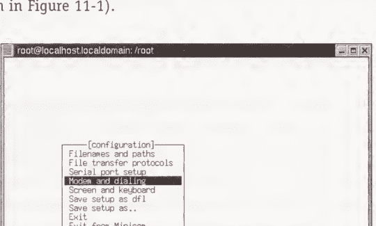

图 11-1
Minicom 设置菜单

将 Modem and dialing 条目突出显示后，按 Enter。Minicom 显示另一个菜单（见图 11-2），列出可更改的设置。Minicom 将光标放在第一行，如图 11-2 所示。按 A 以更改调制解调器初始化字符串。

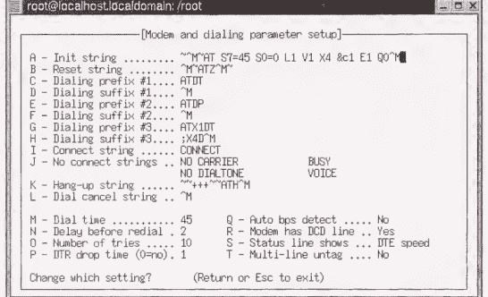

### 图 11-2
在 Minicom 中设置调制解调器和拨号参数

然后你可以使用 Backspace 键编辑该行并输入用于初始化调制解调器所需的 AT 命令。例如，我有一台 56K 调制解调器，我用以下 AT 命令对其进行初始化：

```
AT &F1 E1 V1
```

输入调制解调器初始化字符串后，按 Enter 返回顶级菜单。


顺便说一下，AT 命令是指可用于控制调制解调器并执行诸如拨号、打开或关闭调制解调器扬声器以及设置调制解调器应答来电等任务的命令。这些命令以两个字符开头：AT（attention 的缩写）。当通信软件很原始，软件所做的只是将你输入的内容发送给调制解调器时，可以使用 AT 命令。

如果没有更多更改，使用上下箭头键突出显示标记为 Save as dfl（意为保存为默认）的项目，然后按 Enter。Minicom 将设置保存到 /etc/minirc.dfl 文件中——这是 Minicom 的默认配置文件。之后，你可以通过选择 Exit from Minicom 并按 Enter 来退出 Minicom。

## 以普通用户身份运行 Minicom

在任何用户能够运行 Minicom 之前，还需要执行以下操作：

- 在文本编辑器中打开文本文件 /etc/minicom.users 并验证其中是否有一行包含单词 ALL。（这使所有用户都能访问 Minicom 的默认配置文件。）如果没有，请添加一行包含单词 ALL。
- 假设你希望所有用户都可以使用调制解调器拨号，请允许任何用户读取和写入调制解调器连接的串行端口。例如，如果调制解调器位于 COM1（/dev/ttyS0）上，输入 chmod o+rw /dev/ttyS0 以授予每个人对该设备的写权限。
- 在 /dev/modem 与调制解调器连接的串行端口设备之间建立链接。如果调制解调器位于 COM1（/dev/ttyS0）上，你应输入以下命令：

```
ln -s /dev/ttyS0 /dev/modem
```

之后，你可以以普通用户身份运行 Minicom。Minicom 第一次运行时会重置调制解调器。图 11-3 显示了在终端窗口中运行 Minicom 的结果。

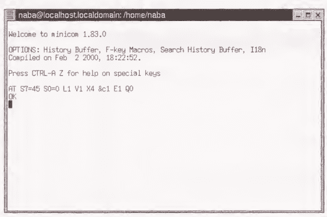

图 11-3
终端窗口中的初始 Minicom 屏幕

按 Ctrl+A 以获取 Minicom 程序的注意。然后如果按 Z，一个帮助屏幕会以文本窗口的形式出现（如图 11-4 所示）。

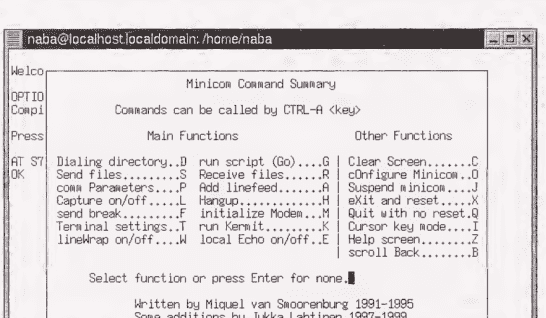

### 图 11-4
Minicom 帮助屏幕

在帮助屏幕中，你可以获取有关其他 Minicom 命令的信息。从帮助屏幕按 Enter 返回在线模式。在在线模式下，你可以使用调制解调器的 AT 命令拨号。特别是，你可以使用 ATDT 命令拨打另一台调制解调器的电话号码（例如，你的 Internet 服务提供商的计算机或工作中的系统），如图 11-5 所示。一旦收到登录提示，你可以像平常一样登录并使用远程系统。

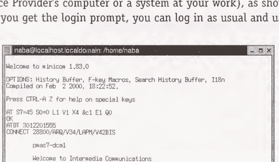

### 图 11-5
使用 Minicom 拨号到远程系统

当你从另一系统注销并想要退出 Minicom 时，按 Ctrl+A 然后输入 X 退出程序。再次按 Enter 以响应 Minicom 提示。


## 回顾

你通过学习 Red Hat Linux 中串行端口的设备名称开始了本课。你使用 Minicom 串行通信程序通过调制解调器拨号。在拨号过程中，你学习了用于控制调制解调器的多个 AT 命令。

## 自测

1. 第二个串行端口（COM2）的设备名称是什么？
   （参见“Learning the Serial-Port Device Names in Linux”。）
2. 如何检查 Linux 是否检测到 PC 中的任何串行端口？
   （参见“Checking if Red Hat Linux Detects the Serial Devices”。）
3. 你可以使用什么程序通过调制解调器拨号？
   （参见“Dialing out with Minicom”。）
4. 你使用什么 AT 命令让调制解调器拨打电话号码？
   （参见“Running Minicom as an Ordinary User”。）
5. 你必须做什么才能在 /dev/modem 与调制解调器连接的串行端口设备之间建立链接？
   （参见“Running Minicom as an Ordinary User”。）


## 为你的 Red Hat Linux PC 建立网络

### 课程清单

- ✓ 设置以太网局域网
- ✓ 在 Linux 中配置 TCP/IP 网络
- ✓ 在 Linux 中使用 TCP/IP 诊断命令
- ✓ 检查 TCP/IP 网络配置文件


Red Hat Linux 包含广泛的内置网络功能。特别是，Red Hat Linux 支持通过多种物理接口（如以太网卡、串行端口和并行端口）进行 TCP/IP（传输控制协议/网际协议）网络。（TCP/IP 是一套用于在 Internet 上进行信息交换的网络协议。你不需要了解 TCP/IP 的细节即可在 Red Hat Linux 系统上设置和使用 TCP/IP 网络。）你通常使用以太网为本地局域网（LAN）。通过串行端口的 TCP/IP 网络使你能够通过调制解调器拨号连接到其他网络。

本课程重点介绍以太网局域网。你将学习如何设置、配置和监控以太网 TCP/IP 网络。你学到的许多内容也适用于通过拨号调制解调器的 TCP/IP 网络，这是下一课程的重点。

## 设置以太网局域网

Ethernet 是在连接到单根电缆的两个或多个计算机之间传输数据包的标准方法。要设置以太网局域网，每个 PC 都需要一块以太网卡。Linux 支持 PC 的各种以太网卡。

Ethernet 是物理数据传输机制的良好选择，因为它是一种经过验证的低成本技术，提供良好的数据传输速率——通常为每秒 1000 万位（10 Mbps），尽管现在已有 100 Mbps 甚至千兆以太网。

在以太网局域网中，计算机通过电缆连接到网络。如今，有两种流行的以太网电缆形式。第一个选项是 ThinWire 或 10Base2，使用细而柔韧的同轴电缆。另一种更新且更受欢迎的替代方案是通过非屏蔽双绞线（UTP）电缆的以太网，称为 10BaseT。

要设置 10BaseT 以太网，你需要一个以太网集线器——一个带有 RJ-45 接口的硬件盒子。你通过从每台 PC 的以太网卡铺设双绞线（通常是五类或 Cat5 电缆）到该集线器来构建网络。如今，你可以以约 50 美元（美国）购买一个 8 端口 10BaseT 集线器。图 12-1 显示了你在小型办公室或家中可能设置的小型 10BaseT 以太网局域网。

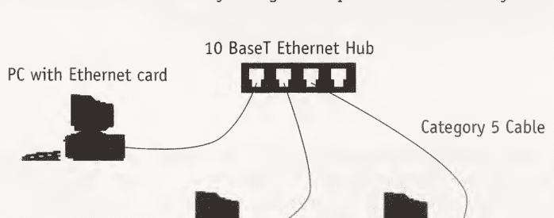

图 12-1
带集线器的 10BaseT 以太网局域网

ThinWire 以太网不需要集线器，这使其对拥有多台 PC 的小型办公室或家庭办公室具有吸引力。你可以简单地将 ThinWire 电缆从一台 PC 串联到另一台 PC 并构建一个小型以太网局域网，如图 12-2 所示。


如图 12-2 所示，您需要在 PC 中安装以太网卡。这些卡应具有 ThinWire 连接器，称为 *BNC 连接器*。您还需要 ThinWire 电缆段（技术上称为具有 50 欧姆阻抗的 RG-58 薄同轴电缆）。对于每个以太网卡的 BNC 连接器，您需要一个 BNC *T 连接器*（之所以这样称呼是因为连接器看起来像 T 字形），并且您需要两个 50 欧姆终端，分别用于以太网网络的两个端点。然后，您只需按照图 12-2 所示的方式连接部件，即可完成自己的以太网 LAN。我用这种方法在家用办公室中连接了几台 PC 和一台工作站。

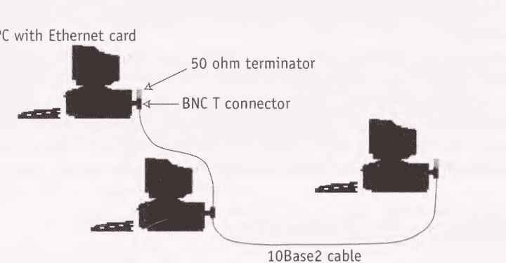

## 图 12-2
*一个小型 ThinWire 以太网 LAN*

ThinWire 设置起来很容易，但用这种方式连接大量 PC 并不是很方便。一个问题是，电缆的任何断裂都会导致整个网络崩溃。

您还可以使用具有一个 10Base2 端口和多个 10BaseT 端口的集线器将 10Base2 LAN 与 10BaseT LAN 连接起来。

您不能简单地用一根电缆将两个以太网卡连接起来。请记住，即使您只是在 10Base2 LAN 上连接两台 PC，也必须使用 BNC T 连接器和 50 欧姆终端。

当您从本书的附带 CD-ROM 在连接到以太网 LAN 的 PC 上安装 Red Hat Linux 时，只要安装程序成功检测到以太网卡，安装程序就应为该卡安装适当的驱动程序。否则，您可以按照第 4 节所述以专家模式安装 Linux。

正确安装后，Linux 在每次启动时都应加载以太网卡的驱动程序。要验证以太网驱动程序是否已加载，请按如下方式使用 dmesg 命令：

```
dmesg | grep eth0
```

此命令会在启动消息中搜索包含字符串 eth0 的任何行。（正如本节后面所讨论的，eth0 是 Linux 系统中第一块以太网卡的设备名称。）我的 PC 上安装了 3Com 3C503 以太网卡。当我在系统上输入 dmesg | grep eth0 时，得到以下输出：

```
eth0: 3c503 at i/o base 0x300, node 02 60 8c 8e c6 a9, using internal xcvr.
eth0: 3c503-PIO, 16kB RAM, using programmed I/O (REJUMPER for SHARED MEMORY).
```

您应该会看到类似的内容，显示以太网卡的名称和其他相关参数。如果 dmesg 命令未显示任何以太网设备，请键入 grep eth0 /var/log/messages 以在存储在 /var/log/messages 文件中的启动消息中查找 eth0 设备名称。

## 配置 TCP/IP 网络

在 Red Hat Linux 中，TCP/IP 设置与其他几乎所有内容一样，是准备一批配置文件（可以用任何文本编辑器编辑的文本文件）的问题。其中大多数配置文件位于 /etc 目录中。Red Hat Linux 包含一个网络配置实用程序，可用于配置网络。首先，您需要学习如何引用网络设备。

### 学习网络设备名称

对于大多数设备，Linux 使用 /dev 目录中的文件。然而，网络设备具有在内核内部定义的名称；/dev 目录（或任何目录）中都不存在这些设备的任何文件。以下是 Linux 中常见的网络设备名称：

- lo — 回环设备。该设备有效地处理从系统发送到自身（例如，当 X 客户端与同一系统上的 X 服务器通信时）的网络数据包。
- eth0 — 第一块以太网卡。如果您有更多以太网卡，它们将获得设备名称 eth1、eth2，依此类推。
- ppp0 — 使用点对点协议（PPP）配置为与另一台计算机点对点链接的第一个串行端口。如果您有更多配置为 PPP 网络的串行端口，它们将被分配设备名称 ppp1、ppp2，依此类推。
- sl0 — 配置为使用串行线路互联网协议（SLIP）网络的第一个串行端口。SLIP 建立到 TCP/IP 网络的点对点链接。如果您使用第二个串行端口进行 SLIP，它将获得设备名称 sl1。


无论您是否有任何网络，您始终都有一个回环设备（lo）。它在无需外出到网络的情况下将数据从一个进程传递到另一个进程。事实上，只要通信进程在同一系统上，回环设备就能使网络应用程序正常工作。

如果您想查看系统上安装的网络设备名称，请以 root 身份登录并键入以下命令：

```
cat /proc/net/dev
```

此命令显示当前安装的网络设备名称，以及特定设备的发送和接收数据包数量的统计信息。

### 运行 Red Hat 的网络配置工具

在 Red Hat Linux 安装期间设置 TCP/IP 网络时，安装程序会使用您提供的信息准备所有适当的配置文件。然而，Red Hat Linux 附带了 netcfg 图形网络配置工具，您可以使用它来添加新的网络接口或更改名称服务器和主机名等信息。

要启动网络配置工具，请以 root 身份登录并在终端窗口中键入 netcfg 以启动该程序。网络配置工具会显示一个对话框，如图 12-3 所示。

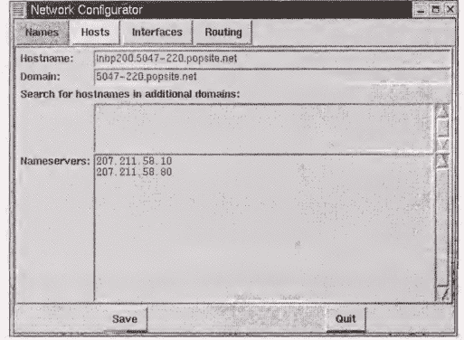

## 图 12-3

*使用 netcfg 网络配置工具配置 TCP/IP 网络*

您可以通过对话框顶部的四个按钮配置网络的各个方面。单击每个按钮以探索可以添加或编辑的条目。具体来说，这些按钮使您能够执行以下操作：

- *Names.* 允许您输入系统的主机名并输入名称服务器的 IP 地址。名称服务器地址存储在 `/etc/resolv.conf` 文件中。主机名存储在 `/etc/sysconfig/network` 文件中的一个变量中。
- *Hosts.* 显示 `/etc/hosts` 文件的当前内容，并允许您添加、删除或编辑条目。该文件包含每个主机的主机名和相应的 IP 地址。
- *Interfaces.* 允许您添加新的网络接口，指定接口的 IP 地址并激活接口。这些信息存储在 `/etc/sysconfig` 目录中的各种文件中。
- *Routing.* 允许您添加静态路由（每条路由列出用于到达指定网络的网关）。


要配置网络接口，您需要为每个接口分配 IP 地址。如果您运行的是私有网络，您可以使用 192.168.0.0 到 192.168.255.255 范围内的 IP 地址。（还有其他范围的地址保留用于私有网络，但此范围应足以满足大多数需求。）例如，我使用 192.168.1.0 地址用于小型私有网络。

## 使用 TCP/IP 诊断命令

假设网络已配置，您应检查网络是否已启动并运行，以及 Red Hat Linux 系统是否已正确配置为 TCP/IP 网络。当然，您可以使用 TELNET 和 FTP 等网络应用程序来验证网络是否已启动并运行，但 Red Hat Linux 还包含许多实用程序，可帮助您监视和诊断问题。

### 检查接口

键入 /sbin/ifconfig 命令以查看当前配置的网络接口。ifconfig 命令还在系统启动期间配置网络接口（将 IP 地址与网络设备关联）。但是，如果您在没有任何命令行参数的情况下运行 ifconfig，该命令将显示有关当前网络接口的信息。以下是 ifconfig 典型调用的结果：

```
/sbin/ifconfig
eth0      Link encap:Ethernet  HWaddr 02:60:8C:8E:C6:A9
          inet addr:192.168.1.200  Bcast:192.168.1.255  Mask:255.255.255.0
          UP BROADCAST RUNNING MULTICAST  MTU:1500  Metric:1
          RX packets:3007  errors:0  dropped:0  overruns:0  frame:0
          TX packets:1140 errors:0  dropped:0  overruns:0  carrier:0
          collisions:0 txqueuelen:100
          Interrupt:5  Base address:0x300

lo        Link encap:Local Loopback
          inet addr:127.0.0.1  Mask:255.0.0.0
          UP LOOPBACK RUNNING  MTU:3924  Metric:1
          RX packets:54 errors:0 dropped:0 overruns:0 frame:0
          TX packets:54 errors:0 dropped:0 overruns:0 carrier:0
          collisions:0 txqueuelen:0
```

此输出显示两个接口——回环接口（lo）和以太网卡（eth0）——当前在此系统上处于活动状态。对于每个接口，您可以看到 IP 地址，以及发送和接收数据包的统计信息。对于以太网卡，ifconfig 还报告 IRQ（显示为 Interrupt: 5）和基 I/O 端口地址（0x300）。如果 Red Hat Linux 系统的拨号 PPP 链接已启动并运行，您还会在输出中看到 ppp0 接口的项目。

### 检查 IP 路由表

另一个网络配置命令 /sbin/route，在您在没有任何命令行参数的情况下运行它时，也会提供状态信息。如果您正在

如果在检查到另一台主机（你用 IP 地址指定）的连接时遇到问题，请检查 IP 路由表，看看是否指定了默认网关。然后检查网关的路由表，确保通往外部网络的路径出现在该路由表中。

从 `/sbin/route` 命令的典型输出如下所示：

/sbin/route
内核 IP 路由表

| 目标 | 网关 | 掩码 | 标志 | 度量 | 引用 | 使用 | 接口 |
|---|---|---|---|---|---|---|---|
| 192.168.1.200 | * | 255.255.255.255 | UH | 0 | 0 | 0 | eth0 |
| 192.168.1.0 | * | 255.255.255.0 | U | 0 | 0 | 0 | eth0 |
| 127.0.0.0 | * | 255.0.0.0 | U | 0 | 0 | 0 | lo |
| default | 192.168.1.1 | 0.0.0.0 | UG | 0 | 0 | 0 | eth0 |

正如该路由表所示，本地网络使用 eth0 以太网接口，默认网关也是该以太网接口。默认网关是一个路由设备，处理发往 Linux 系统所在网络之外的任何网络的数据包。在本例中，发往除以 192.168.1 开头的网络地址之外的任何网络地址的数据包都会发送到网关 — 192.168.1.1 —，网关会将这些数据包转发到其他网络（当然，前提是网关已连接到另一个网络）。

## 检查主机连通性

要检查到特定主机的网络路径，请使用 ping 命令。ping 命令是一种广泛使用的 TCP/IP 工具，它使用一系列 Internet 控制消息协议（ICMP，常读作 eye-comp）消息。ICMP 提供了 Echo 消息，每台主机都会对其作出响应。利用 ICMP 消息及其回复，ping 可以确定另一系统是否存活，然后计算与该系统通信的往返延迟。

以下示例展示了我如何运行 ping 来查看网络上某台系统是否存活：

```
ping 192.168.1.50
PING 192.168.1.50 (192.168.1.50): 56 data bytes
64 bytes from 192.168.1.50: icmp_seq=0 ttl=32 time=2.2 ms
64 bytes from 192.168.1.50: icmp_seq=1 ttl=32 time=1.2 ms
64 bytes from 192.168.1.50: icmp_seq=2 ttl=32 time=1.2 ms
64 bytes from 192.168.1.50: icmp_seq=3 ttl=32 time=0.8 ms

--- 192.168.1.50 ping statistics ---
4 packets transmitted, 4 packets received, 0% packet loss
round-trip min/avg/max = 0.8/1.3/2.2 ms
```

在 Red Hat Linux 中，ping 会一直运行，直到你按 Ctrl+C 停止它；然后它会显示汇总统计信息，显示在两台系统之间发送数据包的典型时间。在某些系统上，ping 只是报告远程主机是否存活。但是，你仍然可以通过适当的命令行参数获取时序信息。


## 检查 TCP/IP 配置文件

在安装期间配置网络或运行 Red Hat 网络配置工具可能足以在系统上配置 TCP/IP，但你也应该了解配置文件，以便在必要时进行编辑。例如，你可以通过网络配置工具指定名称服务器，但假设你想添加一个备用名称服务器。为此，你可以直接将这些名称添加到 `/etc/resolv.conf` 文件中——该配置文件存储名称服务器的 IP 地址。

在本节的剩余部分，你将熟悉基本的 TCP/IP 配置文件。这些配置文件都是文本文件，你可以使用 cat 或 more 命令查看，并使用任何文本编辑器进行编辑。

### /etc/hosts

`/etc/hosts` 配置文本文件包含本地网络的 IP 地址和主机名列表。如果没有名称服务器，系统上的任何网络程序都会查阅此文件以确定与主机名对应的 IP 地址。输入 cat /etc/hosts 命令以查看此文件的内容。

以下是我的系统中的 `/etc/hosts` 文件，显示了 LAN 上其他主机的 IP 地址和名称：

```
127.0.0.1      localhost      localhost.localdomain
# Other hosts on the LAN
192.168.1.100  lnb486
192.168.1.50   lnb133
192.168.1.200  lnb200
192.168.1.233  lnb233
192.168.1.40   lnb400
192.168.1.60   lnb600
192.168.1.25   mac      lnbmac
192.168.1.1    lnb75
```

正如示例所示，文件中的每一行都以 IP 地址开头，后跟该 IP 地址的主机名。一个 IP 地址可以有多个主机名。

### /etc/networks

`/etc/networks` 配置文件是另一个文本文件，其中包含网络的名称和 IP 地址。这些网络名称通常在路由命令 (`/sbin/route`) 中使用，以按名称而不是 IP 地址指定网络。

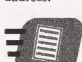

如果你的 Linux PC 没有 `/etc/networks` 文件也不必惊慌。没有此文件，TCP/IP 网络也能正常工作。事实上，Red Hat Linux 安装程序不会创建任何 `/etc/networks` 文件。

### /etc/host.conf

`/etc/host.conf` 配置文本文件指定 Linux 如何获取与主机名对应的 IP 地址。输入 cat /etc/host.conf 以查看此文件的内容。通常，此文件包含以下行：

```
order hosts, bind
multi on
```

`/etc/host.conf` 文件中的条目告诉解析器库使用哪些服务以及按什么顺序解析名称。

order 选项表示服务的顺序。示例条目指定解析器库应首先查阅 `/etc/hosts` 文件，然后检查名称服务器以解析名称。名称服务器列在 `/etc/resolv.conf` 文件中，你接下来会检查该文件。

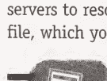

multi on 选项指定 `/etc/hosts` 文件中列出的主机可以有多个 IP 地址。具有多个 IP 地址的主机称为多宿主，因为存在多个 IP 地址意味着主机有多个网络接口（换句话说，主机“同时存在于多个网络中”）。

### /etc/resolv.conf

`/etc/resolv.conf` 配置文件是解析器使用的另一个文本文件——一个确定主机名 IP 地址的库。输入 cat /etc/resolv.conf 以查看此文件的内容。

以下是 `/etc/resolv.conf` 文件的示例：

```
search xyz.com
nameserver 164.109.1.3
nameserver 164.109.10.23
```

search 行指定搜索主机名的系统名称。nameserver 行提供你域的名称服务器的 IP 地址。如果有多个名称服务器，应将它们列在单独的行中。它们按在文件中出现的顺序进行查询。通常，你在 `/etc/resolv.conf` 文件中列出由你的 Internet 服务提供商提供的名称服务器。

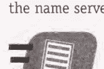

> 如果你的网络没有任何名称服务器，可以安全地忽略此文件。TCP/IP 仍可工作，尽管你只能引用 `/etc/hosts` 文件中列出的主机。

### /etc/hosts.allow

此文件指定哪些主机允许使用可能在系统上运行的 Internet 服务（如 TELNET 和 FTP）。启动 Internet 服务的程序在启动前会查阅 `/etc/hosts.allow` 文件。只有当 hosts.allow 文件中的条目表明请求主机可以使用服务时，它才会启动服务。

`/etc/hosts.allow` 中的条目采用 server: IP 地址格式，其中 server 指提供特定 Internet 服务的程序的名称，IP 地址标识允许使用该服务的主机。例如，如果你希望本地网络（地址为 192.168.1.0）中的所有主机访问 FTP 服务（由 in.ftpd 程序提供），请在 `/etc/hosts.allow` 文件中添加以下行：

```
in.ftpd:192.168.1.
```

如果你希望所有本地主机都能访问所有 Internet 服务，可以使用 ALL 关键字并将行重写如下：

```
ALL:192.168.1.
```

最终，若要向所有主机开放所有 Internet 服务，可将 IP 地址替换为 ALL，示例如下：

```
ALL:ALL
```

你也可以使用主机名代替 IP 地址。


安全专家不建议允许所有主机访问系统上的所有服务。为了获得更安全的系统，你应先拒绝所有主机访问，然后再允许选定的主机访问系统。这意味着你应在 /etc/hosts.allow 中明确列出可以访问系统的那些主机。然后使用 /etc/hosts.deny 文件拒绝其他所有主机访问系统（你在下一节中会查看该文件）。

## /etc/hosts.deny

该文件与 /etc/hosts.allow 正好相反——hosts.allow 指定哪些主机可以访问系统上的 Internet 服务（如 TELNET 和 FTP），而 hosts.deny 文件则标识必须被拒绝服务的主机。启动 Internet 服务的程序如果在 /etc/hosts.allow 文件中找不到适用于请求主机的规则，就会查阅 /etc/hosts.deny 文件。如果程序在 hosts.deny 文件中找到适用于该主机的规则，就会拒绝服务。

/etc/hosts.deny 文件中的条目遵循与 /etc/hosts.allow 文件相同的格式。它们采用 server:IP address 的格式，其中 server 指提供特定 Internet 服务的程序名称，而 IP address 标识允许使用该服务的主机。


假设你已在 /etc/hosts.allow 文件中设置条目以允许特定主机访问，你可以在 /etc/hosts.deny 中放置以下行以拒绝其他所有主机访问系统上的任何服务：

```
ALL:ALL
```

## REVIEW

本节向你展示了如何使用 10Base2 或 10BaseT 电缆设置以太网 LAN。你探索了可用于配置网络接口的 Red Hat 网络配置工具。你使用了 ping、route 和 netstat 等多个实用程序来监控 TCP/IP 网络的状态。最后，你检查了多个 TCP/IP 配置文件，这些文件指定了主机名、名称服务器以及哪些主机可以访问系统上运行的服务等项目。

## QUIZ YOURSELF

- 1. “ThinWire” 是什么？（参见“设置以太网 LAN”。）
- 2. Linux 系统中第一个以太网设备的名称是什么？（参见“学习网络设备名称”。）
- 3. 如何启动 Red Hat 网络配置工具？（参见“运行 Red Hat 的网络配置工具”。）
- 4. 你使用什么网络实用程序来检查网络中另一系统的连通性？（参见“检查到主机的连通性”。）
- 5. 哪个配置文件使你能够拒绝访问本地 Internet 服务？（参见“/etc/hosts.deny”。）


## SESSION


## Connecting Your Red Hat Linux PC to the Internet

## 将你的 Red Hat Linux PC 连接到 Internet

## Session Checklist

## 会话清单

- ✓ Learning the basics of dial-up networking
- ✓ Connecting to the Internet using PPP
- ✓ Using IP masquerading to share an Internet connection

- ✓ 学习拨号网络的基础知识
- ✓ 使用 PPP 连接到 Internet
- ✓ 使用 IP 伪装共享 Internet 连接


30 Min.
To Go

30 分钟
剩余

安装 Red Hat Linux 后，你可能希望将你的 Red Hat Linux PC（以及可能你自己的 LAN）连接到 Internet。你有以下几种流行的连接小型办公室或家庭办公室到 Internet 的选项：数字用户线路（DSL）、电缆调制解调器和拨号网络。DSL 和电缆调制解调器选项本质上涉及将专用调制解调器连接到 Linux 系统上的以太网卡。在这些情况下，设置程序与第 12 节中讨论的相同。

本节重点介绍拨号网络，它涉及从你的 Red Hat Linux PC 到你的 ISP 系统建立 PPP 连接。你还将学习如何使用 IP 伪装与 LAN 上的其他系统共享 Red Hat Linux 系统的 Internet 连接。

## Learning the Basics of Dial-up Networking

## 学习拨号网络的基础知识

*Dial-up networking* refers to the connection of a PC to a remote network (such as the Internet) through a dial-up modem. In this case, the maximum data transfer rate is 56Kbps. A significant difference exists between dial-up networking and plain old serial communication. Both approaches use a modem to dial up another computer and establish a communications path, but the serial communication software (such as Minicom in Session 11) makes your computer act like a terminal connected to the remote computer. The serial communications software exclusively uses dial-up connection. You cannot run another copy of the communications software and use the same modem connection, for example.

*拨号网络*是指通过拨号调制解调器将 PC 连接到远程网络（如 Internet）。在这种情况下，最大数据传输速率为 56Kbps。拨号网络与普通串行通信之间存在显著差异。两种方法都使用调制解调器拨号另一台计算机并建立通信路径，但串行通信软件（如第 11 节中的 Minicom）使你的计算机充当连接到远程计算机的终端。串行通信软件独占使用拨号连接。例如，你不能运行另一份通信软件并使用相同的调制解调器连接。

In dial-up networking, you run TCP/IP or other network-protocol software on your PC as well as on the remote system with which your PC has a dial-up communications path. That communications path simply provides the physical data transport. The network protocols exchange data packets over the dial-up connection. You can use any number of network applications simultaneously to communicate over the single dial-up connection. With dial-up networking, your PC truly becomes part of the network to which the remote computer belongs. (If the remote computer is not on a network, the dial-up networking creates a network that consists of the remote computer and your PC.) Thus, you can have any number of network applications (ranging from a Web browser to a TELNET session) running at the same time, with all applications sharing the physical data-transport capabilities of the dial-up connection.

在拨号网络中，你在 PC 上以及与 PC 具有拨号通信路径的远程系统上运行 TCP/IP 或其他网络协议软件。该通信路径仅提供物理数据传输。网络协议通过拨号连接交换数据包。你可以同时使用任意数量的网络应用程序通过单一拨号连接进行通信。有了拨号网络，你的 PC 真正成为远程计算机所属网络的一部分。（如果远程计算机不在网络上，拨号网络会创建一个由远程计算机和你的 PC 组成的网络。）因此，你可以同时运行任意数量的网络应用程序（从 Web 浏览器到 TELNET 会话），所有应用程序共享拨号连接的物理数据传输能力。

Dial-up networking involves TCP/IP data transfers over a dial-up connection. Like TCP/IP networking over an Ethernet, TCP/IP networking over a dial-up link is a matter of specifying the *protocol* — the convention — for packaging a network packet over the communications link. There are two popular protocols for TCP/IP networking over point-to-point (PPP) serial communications links:

拨号网络涉及通过拨号连接进行 TCP/IP 数据传输。与通过以太网的 TCP/IP 网络一样，通过拨号链路的 TCP/IP 网络是指定 *协议*——即在通信链路上打包网络数据包的约定——的问题。用于点对点（PPP）串行通信链路上的 TCP/IP 网络有两种流行的协议：

- Serial Line Internet Protocol (SLIP) is a simple protocol that specifies how to frame an IP packet on a serial line.
- Point-to-Point Protocol (PPP) is a more advanced protocol for establishing a TCP/IP connection over any point-to-point link, including dial-up serial links.

- 串行线路 Internet 协议（SLIP）是一种简单的协议，规定了如何在串行线路上对 IP 数据包进行帧封装。
- 点对点协议（PPP）是一种更高级的协议，用于在任何点对点链路上建立 TCP/IP 连接，包括拨号串行链路。

PPP is the most popular method of TCP/IP networking over a dial-up connection. Therefore, I show you in the next section how to use PPP to set up a network connection to a remote system.

PPP 是通过拨号连接进行 TCP/IP 网络连接最流行的方法。因此，我将在下一节向你展示如何使用 PPP 设置到远程系统的网络连接。

## Connecting to the Internet Using PPP

## 使用 PPP 连接到 Internet

Many Internet Service Providers (ISPs) provide PPP access to the Internet through one or more systems that the ISP maintains. If you sign up for such a service, the ISP should provide you the information that you need to make a PPP connection to the remote system. Typically, this information includes the following:

许多 Internet 服务提供商（ISP）通过 ISP 维护的一个或多个系统提供对 Internet 的 PPP 访问。如果你注册此类服务，ISP 应为你提供建立到远程系统的 PPP 连接所需的信息。通常，此信息包括以下内容：

- The phone number to connect to the remote system.
- The user name and password that you must use to log into the remote system.
- The IP addresses of the ISP’s Domain Name Servers (DNS). Typically, the ISP gives you two IP addresses — for the primary and secondary DNS.
- The IP address for your side of the connection. (This IP address is associated with your PC’s PPP interface — the serial port.) Usually, this IP address is assigned dynamically (meaning that the IP address may change every time your system establishes a connection).

- 连接到远程系统的电话号码。
- 你必须用于登录远程系统的用户名和密码。
- ISP 的域名服务器（DNS）的 IP 地址。通常，ISP 会为你提供两个 IP 地址——主 DNS 和辅助 DNS。
- 连接你这边的 IP 地址。（该 IP 地址与你的 PC 的 PPP 接口——串行端口相关联。）通常，该 IP 地址是动态分配的（意味着每次系统建立连接时 IP 地址可能会更改）。

Most ISPs also provide the IP addresses of the mail and news servers. These addresses, however, are not important for the mechanics of setting up a PPP connection.

大多数 ISP 还提供邮件和新闻服务器的 IP 地址。然而，这些地址对于设置 PPP 连接的机制并不重要。

Before you set up a PPP connection, you must have an internal or external modem installed on your system. The modem should be connected to a phone line. You can use Minicom, as described in Session 11, to dial your ISP’s phone number and make sure that the modem successfully establishes a connection. After you see a login prompt, you can hang up the modem and proceed to set up PPP.

在设置 PPP 连接之前，你必须在系统上安装内部或外部调制解调器。调制解调器应连接到电话线路。你可以使用第 11 节中描述的 Minicom 拨打 ISP 的电话号码并确保调制解调器成功建立连接。看到登录提示后，你可以挂断调制解调器并继续设置 PPP。

To set up a PPP connection using Red Hat’s graphical Dialup Configuration tool, log in as root and select Main Menu Programs Internet Dialup Configuration Tool from the GNOME desktop. The Dialup Configuration tool displays the Add New Internet Connection dialog box, as shown in Figure 13-1.

要使用 Red Hat 的图形化拨号配置工具设置 PPP 连接，请以 root 身份登录并从 GNOME 桌面选择主菜单 程序 Internet 拨号配置工具。拨号配置工具会显示“添加新的 Internet 连接”对话框，如图 13-1 所示。

Click the Next button. The dialog box then guides you through steps where you select a modem and provide information, such as the phone number of the ISP, your user name, and password (for your account on the ISP’s system). The Dialup Configuration Tool saves the configuration information in the /etc/sysconfig/network-scripts/ifcfg-ppp0 file.

单击“下一步”按钮。然后对话框会引导你完成选择调制解调器并提供信息（如 ISP 的电话号码、你的用户名和密码（用于 ISP 系统上的账户））的步骤。拨号配置工具将配置信息保存在 /etc/sysconfig/network-scripts/ifcfg-ppp0 文件中。


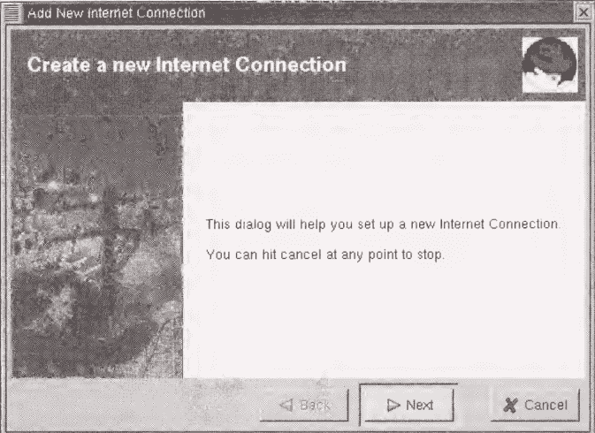

## Figure 13-1

使用 Red Hat 的拨号配置工具创建新的 Internet 连接

要建立 PPP 连接，请从 GNOME 桌面选择“主菜单 → 程序 → Internet → RH PPP Dialer”。会出现一个对话框，列出可用于建立连接的接口。选择使用拨号配置工具定义的接口，然后单击“确定”按钮开始连接。


## Verifying the PPP connection is up

验证 PPP 连接是否已建立

使用拨号配置工具连接后，您可以通过输入 /sbin/ifconfig 命令来验证 PPP 连接是否已建立，其显示的列表如下：

/sbin/ifconfig
eth0      Link encap:Ethernet  HWaddr 02:60:8C:8E:C6:A9
          inet addr:192.168.1.200  Bcast:192.168.1.255  Mask:255.255.255.0
          UP BROADCAST RUNNING MULTICAST  MTU:1500  Metric:1
          RX packets:4363 errors:0 dropped:0 overruns:0 frame:0
          TX packets:2111 errors:0 dropped:0 overruns:0 carrier:0
          collisions:0 txqueuelen:100
          Interrupt:5 Base address:0x300

lo        Link encap:Local Loopback
          inet addr:127.0.0.1  Mask:255.0.0.0
          UP LOOPBACK RUNNING  MTU:3924  Metric:1
          RX packets:50 errors:0 dropped:0 overruns:0 frame:0
          TX packets:50 errors:0 dropped:0 overruns:0 carrier:0
          collisions:0 txqueuelen:0

ppp0      Link encap:Point-to-Point Protocol
          inet addr:209.100.18.220  P-t-P:209.100.18.4  Mask:255.255.255.255
          UP POINTOPOINT RUNNING NOARP MULTICAST  MTU:1500  Metric:1
          RX packets:132 errors:2 dropped:0 overruns:0 frame:2
          TX packets:146 errors:0 dropped:0 overruns:0 carrier:0
          collisions:0 txqueuelen:10
```

在输出中查找 ppp0 设备。ifconfig 输出还显示了 PPP 连接本地端和远程端的 IP 地址。此输出证实 PPP 设备已启动并运行。

## Verifying the routing table is set up correctly

验证路由表是否设置正确

要验证路由表是否设置正确，请在不带任何参数的情况下使用 /sbin/route 命令，如下所示：

/sbin/route
内核 IP 路由表

| 目标 | 网关 | 掩码 | 标志 | 度量值 | 引用 | 使用次数 | 接口 |
|---|---|---|---|---|---|---|---|
| 209.100.18.4 | * | 255.255.255.255 | UH | 0 | 0 | 0 | ppp0 |
| 192.168.1.200 | * | 255.255.255.255 | UH | 0 | 0 | 0 | eth0 |
| 192.168.1.0 | * | 255.255.255.0 | U | 0 | 0 | 0 | eth0 |
| 127.0.0.0 | * | 255.0.0.0 | U | 0 | 0 | 0 | lo |
| default | 209.100.18.4 | 0.0.0.0 | UG | 0 | 0 | 0 | ppp0 |

在路由表中，第一行显示了到 PPP 连接远程端的路由；此路由应设置为 ppp0 设备。此外，默认路由应设置成使 PPP 连接的远程端作为系统的网关，如路由表的最后一行所示。

## Verifying Internet hosts can be reached

验证是否可以访问 Internet 主机

在检查接口配置（使用 ifconfig 命令）和路由表（使用 route 命令）之后，验证您是否可以访问某些知名主机。如果您的 ISP 为您提供名称服务器或邮件服务器的 IP 地址，您可以尝试 ping 这些地址。否则，尝试 ping 您工作场所或大学中系统的 IP 地址。

以下示例显示了尝试 ping 命令时所看到的内容：

```
ping 140.90.23.100
PING 140.90.23.100 (140.90.23.100): 56 data bytes
64 bytes from 140.90.23.100: icmp_seq=0 ttl=243 time=143.2 ms
64 bytes from 140.90.23.100: icmp_seq=1 ttl=243 time=220.2 ms
64 bytes from 140.90.23.100: icmp_seq=2 ttl=243 time=140.2 ms
64 bytes from 140.90.23.100: icmp_seq=3 ttl=243 time=130.3 ms

--- 140.90.23.100 ping statistics ---
4 packets transmitted, 4 packets received, 0% packet loss
round-trip min/avg/max = 130.3/158.4/220.2 ms
```

每行末尾显示的是从您的系统发出的数据包到达指定 IP 地址（本例中为 140.90.23.100）并返回到您的系统的往返时间。对于通过拨号线路的 PPP 连接，您可以看到以百毫秒计的时间。

顺便说一下，您无需在系统上拥有账户即可 ping 其 IP 地址。虽然系统可能会禁用对 ping 消息的自动响应（ping 使用 Internet 控制消息协议或 ICMP 消息），但大多数系统都会响应 ping。


要查看您的连接速度，请输入 tail -100 /var/log/messages | grep V42BIS。这会显示如下行，其中显示了调制解调器报告的连接速度：

```
Mar 19 17:31:27 lnbp200 chat[1533]: 42666/ARQ/V90/LAPM/V42BIS^M
Mar 19 17:32:24 lnbp200 chat[1579]: 33333/ARQ/V90/LAPM/V42BIS^M
```

## Turning the PPP connection on or off

打开或关闭 PPP 连接

您不必始终运行拨号配置工具来打开或关闭 PPP 连接。相反，在配置 ppp0 接口后，您只需输入以下命令即可启动 PPP 连接：

/sbin/ifup ppp0

当您不再需要 PPP 连接时，可以以 root 身份登录并输入以下命令断开连接：

/sbin/ifdown ppp0


10 分钟
剩余

## Using IP Masquerading to Share an Internet Connection

使用 IP 伪装共享 Internet 连接

Linux 支持一种称为 IP 伪装的功能，可让您将具有私有 IP 地址的以太网 LAN 连接到 Internet。这是通过一台具有官方分配 IP 地址且已连接到 Internet 的 Linux PC 实现的。该 Linux PC 可以通过拨号 PPP 或其他连接（如 DSL 或电缆调制解调器）连接到 Internet。

启用 IP 伪装后，您的 Red Hat Linux PC 会充当以太网 LAN 上其他系统的替代品。与路由器设置一样，Red Hat Linux PC 被指定为以太网 LAN 的网关。然而，伪装不仅仅是在 LAN 和 Internet 之间简单地转发 IP 数据包。

当 Red Hat Linux PC 伪装成 LAN 上的另一台系统时，它会修改传出数据包，使其始终看起来源自 Red Hat Linux PC。当收到对其中一个传出数据包的响应时，Red Hat Linux PC 会执行相反的操作——它修改数据包，使其看起来是从 Internet 直接发送到发送传出数据包的系统。最终结果是，以太网 LAN 上的每个系统似乎都可以完全访问 Internet，即使以太网 LAN 使用非唯一的私有 IP 地址。

要启用并使用 IP 伪装，请执行以下步骤：

- 1. 确保 Linux 内核——核心操作系统——支持 IP 防火墙链。对于从随附 CD-ROM 安装的 Red Hat Linux 版本，这应该是正确的。如果文件 `/proc/net/ip_fwchains` 存在，则内核支持 IP 防火墙链。 （输入 `ls /proc/net/ip_fwchains` 以验证文件是否存在。）
- 2. 确保 Red Hat Linux PC 具有 Internet 连接和到您 LAN 的网络连接。通常，Linux PC 具有两个网络接口——用于 LAN 的以太网卡和通过 ISP 的拨号 PPP 连接到 Internet。
- 3. 确保 LAN 上的所有其他系统都使用 Linux PC 作为 TCP/IP 网络的默认网关。所有系统上使用相同的 ISP 提供的 DNS 地址。
- 4. 通过输入以下命令在内核中启用 IP 转发：
- `echo "1" > /proc/sys/net/ipv4/ip_forward`
- 这是必要的，因为默认情况下 IP 转发是禁用的。为了确保在重新启动系统时启用 IP 转发，请将此命令放在 `/etc/rc.d/rc.local` 文件中。在 Red Hat Linux 中，您可以通过将 `/etc/sysconfig/network` 文件中的行 `FORWARD_IPV4=false` 改为 `FORWARD_IPV4=true` 实现相同的效果。
- 5. 运行 `/sbin/ipchains`——IPCHAINS 防火墙管理程序——以设置使 Linux PC 能够为您的 LAN 伪装的规则。例如，要通过 Linux PC 的 `ppp0` 网络接口为 LAN 启用伪装，您可以使用以下命令：
- `/sbin/ipchains -P forward DENY`
- `/sbin/ipchains -A forward -i ppp0 -j MASQ`


如果您希望在系统启动时设置 IP 伪装，您应该将这些命令放在 /etc/rc.d/rc.local 文件中。


您可能会发现 IP 伪装是一种方便的方式，为小型局域网提供 Internet 访问（例如家庭或办公室的局域网）。在家中，我使用 IP 伪装通过 Linux 系统将以太网局域网连接到 Internet。Linux PC 具有用于局域网连接的以太网卡和用于通过 ISP 连接到 Internet 的调制解调器。（我从 ISP 获得了有效的 IP 地址。）在 Linux PC 上使用 IP 伪装后，您家庭或小型企业中的每个人现在都可以从局域网上的任何其他 PC 访问 Internet。


## REVIEW

本会话向您介绍了拨号网络——通过拨号调制解调器在 Linux PC 与 Internet 之间建立网络连接。您学习了如何使用 Red Hat 拨号配置工具设置 PPP 连接。最后，本会话向您展示了如何使用 IPCHAINS 防火墙管理程序的 IP 伪装功能共享单个 Internet 连接。

## QUIZ YOURSELF

- 1. 什么是拨号网络和 PPP？（参见“学习拨号网络的基础知识”。）
- 2. ISP 通常提供哪些信息供您设置拨号 PPP 连接？（参见“使用 PPP 连接到 Internet”。）
- 3. 您使用什么工具来设置 PPP 连接？（参见“使用 PPP 连接到 Internet”。）
- 4. 您会输入什么命令来打开和关闭 PPP 连接？（参见“打开或关闭 PPP 连接”。）
- 5. 什么是 IP 伪装？（参见“使用 IP 伪装共享 Internet 连接”。）

## SESSION


## Setting Up Internet Services

## 会话清单

- ✓ 了解 Internet 服务
- ✓ 使用电子邮件服务器
- ✓ 设置 Apache Web 服务器
- ✓ 设置 FTP 服务器


如果 Red Hat Linux PC 连接到 Internet 或内联网（私有 TCP/IP 网络），您就可以将其用作服务器。Internet 和内联网都依赖于 Internet 服务。每个 Internet 服务都涉及在 Red Hat Linux 系统上配置和运行一个或多个服务器。本会话向您介绍常用的 Internet 服务。然后重点介绍实现邮件、Web 和信息检索 Internet 服务的服务器：电子邮件服务器、Apache Web 服务器和 FTP 服务器（它们使任何人都能以合理安全的方式从您的系统下载文件）。


您将在第 29 会话中了解如何保护您的 Red Hat Linux 系统。

## Understanding Internet Services

术语 Internet 服务指的是采用客户端/服务器架构来执行特定任务的多个网络应用程序。（在客户端/服务器架构中，两个独立的程序——提供信息的服务器和一个或多个请求信息的客户端——实现一个服务。）

许多 Internet 服务专门设计用于将信息从一个系统传递到另一个系统。信息可能以邮件消息、新闻项目或数据文件的形式出现。作为用户，您期望从典型的 Internet 主机访问这些常见的 Internet 服务：

- *电子邮件 (e-mail)*。从 Internet 主机，您可以使用地址如 `president@whitehouse.gov` 向 Internet 上的任何其他用户发送电子邮件。
- *万维网*。您可以使用 Web 浏览器通过统一资源定位符 (URL) 地址如 `http://www.whitehouse.gov` 下载和查看网页。网页通常是使用超文本标记语言 (HTML) 格式化的文档。
- *新闻组*。您可以阅读新闻组并向名称如 `comp.os.linux.networking` 或 `comp.os.linux.setup` 的新闻组发布新闻项目。
- *信息检索*。您可以使用万维网浏览器等工具搜索信息。您也可以使用文件传输协议 (FTP) 下载文件。反之，其他系统上的用户也可以从您的系统下载文件——通常通过称为匿名 FTP 的功能。
- *远程访问*。您可以使用 TELNET 登录 Internet 上的另一台计算机（远程计算机），前提是您拥有访问该远程计算机的用户名和密码。

所有 Internet 服务都依赖于客户端和服务器软件。例如，电子邮件服务器负责将邮件从一个系统传输到另一个系统，而您使用电子邮件客户端软件阅读电子邮件。同样，您使用 Web 浏览器客户端从 Web 服务器下载和查看网页。

实现 Internet 服务的客户端和服务器使用 TCP/IP 协议相互通信。您已经熟悉标识 TCP/IP 网络中主机的 IP 地址。然而，仅凭 IP 地址不足以区分同一系统上运行的许多服务。端口号（或简称为端口）的概念用于使各种 Internet 服务器能够与客户端通信。端口不是物理实体——它只是一个介于 1 和 65,535 之间的数字，用于唯一标识两个进程（通常是服务器和客户端）之间 TCP/IP 通信链路的每个端点。

所有众所周知的 Internet 服务都有预先分配的端口号。例如，这里有一些常用的 Internet 协议及其分配的端口号：

- *FTP (File Transfer Protocol)* 允许在 Internet 上的计算机之间传输文件。FTP 使用两个端口——数据在端口 20 上传输，而控制信息在端口 21 上交换。FTP 是文件传输的基础协议。
- *HTTP (Hypertext Transfer Protocol)* 是用于从一个系统向另一个系统发送 HTML 文档的最新协议。HTTP 是 Web 的基础协议。默认情况下，Web 服务器和客户端在端口 80 上通信。
- *SMTP (Simple Mail Transfer Protocol)* 在系统之间交换电子邮件消息。SMTP 使用端口 25 进行信息交换。SMTP 是电子邮件服务的基础协议。
- *NNTP (Network News Transfer Protocol)* 以存储转发方式在 Internet 上分发新闻文章。NNTP 使用端口 119。NNTP 是新闻组服务的基础协议。
- *TELNET* 使一个系统上的用户能够登录 Internet 上的另一个系统。（用户必须提供有效的用户 ID 和密码才能成功登录远程系统。）TELNET 默认使用端口 23。然而，TELNET 客户端可以连接到任何指定的端口。TELNET 是远程访问的基础协议。
- *NFS (Network File System)* 在计算机之间共享文件。NFS 使用 Sun 的 *Remote Procedure Call (RPC)* 设施，该设施通过端口 111 交换信息。

文本配置文件——/etc/services——存储 Internet 服务与端口号（以及底层数据通信协议）之间的关联。要查看此文件的内容，请使用 more 命令如下：

```
more /etc/services
```

以下是 Linux 系统的 /etc/services 文件中的一小部分条目：

```
ftp-data    20/tcp
ftp         21/tcp
fsp         21/udp        fspd
ssh         22/tcp        # SSH Remote Login Protocol
ssh         22/udp        # SSH Remote Login Protocol
telnet      23/tcp
# 24 - private
```

```
smtp              25/tcp            mail
# 26 - unassigned
time              37/tcp            timserver
time              37/udp            timserver
rlp               39/udp            resource          # resource location
nameserver        42/tcp            name              # IEN 116
whois             43/tcp            nickname
```

每行以服务名称开头，后跟端口号和数据通信协议（tcp 或 udp）。行的其余部分显示服务的另一个名称（如果有）。井号 (#) 之后的所有内容都被视为注释。

浏览 /etc/services 文件中的条目很有启发性，因为它们展示了 TCP/IP 下可用的网络服务的广度。

在使用本书附带的 CD-ROM 安装 Red Hat Linux 期间，您可以选择安装邮件、Web 和新闻所需的软件包。您需要做的就是从显示软件包组的安装屏幕中选择 Mail/WWW/News Tools 软件包组。Mail 指电子邮件 Internet 服务；WWW 指万维网 Internet 服务；News 指新闻组 Internet 服务。

如果您在安装 Red Hat Linux 时安装了邮件和新闻软件，您无需做太多事情即可开始使用邮件、Web 和新闻服务。否则，您可以使用 Red Hat 软件包管理器 (RPM) 安装单个软件包。


第 23 会话描述了如何使用 rpm 程序安装新软件。

## Using the E-mail Server

电子邮件——e-mail——是 Internet 上最受欢迎的服务之一。电子邮件最初是一个简单的机制，其中消息被复制到用户的邮箱文件中。这一简单机制仍然在使用。在 Red Hat Linux 中，您的邮件消息存储在 /var/spool/mail 目录中，其文本文件名与您的用户名相同。

消息仍然是发送给用户名的。这意味着如果 John Doe 使用用户名 jdoe 登录，发给他的电子邮件地址为 jdoe。唯一需要的信息来唯一标识收件人是收件人系统的完全限定域名。因此，如果 John Doe 的系统名为 someplace.net，


His complete e-mail address is jdoe@someplace.net. Given that address, anyone on the Internet can send e-mail to John Doe.

他的完整电子邮件地址是 jdoe@someplace.net。凭借该地址，互联网上的任何人都可以向 John Doe 发送电子邮件。

To set up and use e-mail on your Red Hat Linux PC, you need two types of mail software:

设置和使用 Red Hat Linux PC 上的电子邮件，您需要两种类型的邮件软件：

- *Mail-user agent* software enables you to read your mail messages, write replies, and compose new messages. Typically, the mail-user agent retrieves messages from the mail server using POP3 or IMAP4 protocol. POP3 is the Post Office Protocol version 3 and IMAP4 is the Internet Message Access Protocol version 4. The Red Hat Linux CD-ROMs include several popular mail user agents such as `pine` and `elm`.
- *邮件用户代理* 软件使您能够阅读邮件消息、撰写回复并编写新消息。通常，邮件用户代理使用 POP3 或 IMAP4 协议从邮件服务器检索消息。POP3 是邮局协议版本 3，IMAP4 是 Internet 消息访问协议版本 4。Red Hat Linux CD-ROM 包含多个流行的邮件用户代理，例如 `pine` 和 `elm`。
- *Mail-transport agent* software actually sends and receives mail-message text. The exact method used for mail transport depends on the underlying network. In TCP/IP networks, the mail-transport agent delivers mail using the Simple Mail Transfer Protocol (SMTP). This book’s Red Hat Linux CD-ROMs include `sendmail`, a powerful and popular mail-transport agent for TCP/IP networks.
- *邮件传输代理* 软件实际发送和接收邮件消息文本。邮件传输所使用的方法取决于底层网络。在 TCP/IP 网络中，邮件传输代理使用简单邮件传输协议（SMTP）投递邮件。本书的 Red Hat Linux CD-ROM 包含 `sendmail`，这是一款功能强大且流行的 TCP/IP 网络邮件传输代理。

Most mail-transport agents run as *daemons* — background processes that run as long as your system is up. Because you or another user on the system can send mail at any time, the transport agent has to be there to deliver the mail to its destination. The mail-user agent runs only when the user wants to check mail.

大多数邮件传输代理作为 *守护进程* 运行——只要系统处于运行状态就会持续运行的后台进程。因为您或系统上的其他用户可以在任何时候发送邮件，所以传输代理必须存在以将邮件投递到目的地。邮件用户代理仅在用户想要检查邮件时运行。


Typically, a mail-transport agent starts after the system boots. The system startup files for Red Hat Linux are set up so that the sendmail mail-transport agent starts when the Linux system is in multiuser mode. The shell script file `/etc/rc.d/init.d/sendmail` starts sendmail.

通常，邮件传输代理在系统启动后启动。Red Hat Linux 的系统启动文件设置成在 Linux 系统处于多用户模式时启动 sendmail 邮件传输代理。shell 脚本文件 `/etc/rc.d/init.d/sendmail` 启动 sendmail。

Because the system is already set up to start sendmail at boot time, all you have to do is use an appropriate sendmail configuration file to get e-mail going on your Linux system.

由于系统已设置在启动时启动 sendmail，您所需要做的就是使用合适的 sendmail 配置文件来在 Linux 系统上启用电子邮件。

You cannot send or receive e-mail until the sendmail mail-transport agent is configured properly. The sendmail transport agent has the reputation of being a complex, but complete, mail-delivery system. If you take a quick look at sendmail’s configuration file, `/etc/sendmail.cf`, you can see that sendmail is indeed complex. Luckily, you do not have to be an expert on the sendmail configuration file. All you need is the predefined configuration files from this book’s companion CD-ROMs.

在 sendmail 邮件传输代理正确配置之前，您无法发送或接收电子邮件。sendmail 传输代理以复杂但完整的邮件投递系统而闻名。如果您快速查看 sendmail 的配置文件 `/etc/sendmail.cf`，您会发现 sendmail 确实很复杂。幸运的是，您不必是 sendmail 配置文件的专家。您只需要本书附带 CD-ROM 上的预定义配置文件即可。


If you install the Mail/WWW/News Tools component during Red Hat Linux installation (see Session 3), your system should have a working sendmail configuration file — /etc/sendmail.cf. The default file assumes an Internet connection and a name server. Provided you have an Internet connection, you should be able to send and receive e-mail from your Linux PC once you connect it to the Internet. Then you can use a mail-user agent such as elm to compose and send mail messages.

如果您在 Red Hat Linux 安装期间安装 Mail/WWW/News Tools 组件（参见第 3 节），您的系统应该具有可用的 sendmail 配置文件 — /etc/sendmail.cf。默认文件假定存在 Internet 连接和名称服务器。只要您拥有 Internet 连接，在将 Linux PC 连接到 Internet 后，您应该能够发送和接收电子邮件。然后您可以使用诸如 elm 之类的邮件用户代理来撰写和发送邮件消息。

## Setting Up the Apache Web Server

## 设置 Apache Web 服务器

You probably already know how it feels to use the Web, but you may not know how to set up a Web server so that you, too, can provide information to the world through Web pages. To become an information provider on the Web, you have to run a Web server on your Red Hat Linux PC on the Internet.

您可能已经知道使用 Web 的感觉，但您可能不知道如何设置 Web 服务器，以便您也可以通过网页向世界提供信息。要成为 Web 上的信息提供者，您必须在 Internet 上的 Red Hat Linux PC 上运行 Web 服务器。

Web servers provide information by using HTTP. Web servers are also known as HTTP daemons (because continuously running server processes are called daemons in UNIX), or HTTPD for short. The Web server program usually is named httpd.

Web 服务器通过使用 HTTP 提供信息。Web 服务器也被称为 HTTP 守护进程（因为在 UNIX 中持续运行的服务器进程称为守护进程），简称为 HTTPD。Web 服务器程序通常命名为 httpd。

Among the freely available Web servers, Apache Web server is the most popular. Apache is freely available over the Internet and it accompanies Red Hat Linux on this book’s companion CD-ROMs.

在可自由获得的 Web 服务器中，Apache Web 服务器是最受欢迎的。Apache 可通过 Internet 免费获得，并随本书附带的 CD-ROM 上的 Red Hat Linux 一起提供。

When you install Red Hat Linux from this book’s companion CD-ROMs, you also have the option of installing the Apache Web server. If you install the Mail/WWW/News Tools package during Red Hat Linux installation, then Red Hat Linux automatically starts the Apache Web server during system boot.

当您从本书附带的 CD-ROM 安装 Red Hat Linux 时，您也可以选择安装 Apache Web 服务器。如果您在 Red Hat Linux 安装期间安装 Mail/WWW/News Tools 软件包，则 Red Hat Linux 会在系统启动期间自动启动 Apache Web 服务器。

Perform the following steps to verify that the Apache Web server software is installed and running on your system:

执行以下步骤以验证 Apache Web 服务器软件是否已安装并在您的系统上运行：

1. Type the following command to check whether the Apache Web server is installed:
```
rpm -q apache
```
apache-1.3.12-21

If the output shows an apache package name, you have the Apache software installed on your system.
1. 输入以下命令检查 Apache Web 服务器是否已安装：
```
rpm -q apache
```
apache-1.3.12-21

如果输出显示 apache 软件包名称，则表示您的系统已安装 Apache 软件。

2. Type the following command to check whether the httpd process (the name of the Apache Web server program is httpd) is running:
```
ps ax | grep httpd
```

The output should show a number of httpd processes. It is common to run several Web server processes — one parent and several child processes — so that several HTTP requests can be handled efficiently by assigning each request to an httpd process.
2. 输入以下命令检查 httpd 进程（Apache Web 服务器程序的名称为 httpd）是否正在运行：
```
ps ax | grep httpd
```

输出应显示多个 httpd 进程。通常运行多个 Web 服务器进程——一个父进程和多个子进程——以便通过将每个请求分配给一个 httpd 进程来高效处理多个 HTTP 请求。

3. Use the telnet program on your Linux system and employ the HTTP HEAD command to query the Web server as follows:
```
telnet localhost 80
Trying 128.0.0.1...
Connected to localhost.
Escape character is '^]'.
HEAD / HTTP/1.0
... Press Enter once more to type a blank line
HTTP/1.1 200 OK
Date: Sat, 19 Aug 2000 23:57:14 GMT
Server: Apache/1.3.12 (Unix)  (Red Hat/Linux)
Last-Modified: Mon, 07 Aug 2000 10:21:07 GMT
ETag: "328fe-b4a-398e8d93"
Accept-Ranges: bytes
Content-Length: 2890
Connection: close
Content-Type: text/html

Connection closed by foreign host.
```

If you get a response such as the preceding, your system already has the Apache Web server installed and set up correctly. All you have to do is understand the configuration so that you can place the HTML documents in the proper directory.
3. 在 Linux 系统上使用 telnet 程序并按如下方式使用 HTTP HEAD 命令查询 Web 服务器：
```
telnet localhost 80
Trying 128.0.0.1...
Connected to localhost.
Escape character is '^]'.
HEAD / HTTP/1.0
... Press Enter once more to type a blank line
HTTP/1.1 200 OK
Date: Sat, 19 Aug 2000 23:57:14 GMT
Server: Apache/1.3.12 (Unix)  (Red Hat/Linux)
Last-Modified: Mon, 07 Aug 2000 10:21:07 GMT
ETag: "328fe-b4a-398e8d93"
Accept-Ranges: bytes
Content-Length: 2890
Connection: close
Content-Type: text/html

Connection closed by foreign host.
```

如果您得到与上述类似的响应，则表示您的系统已正确安装并设置了 Apache Web 服务器。您所需要做的就是了解配置，以便将 HTML 文档放置在正确的目录中。

4. Use a Web server to load the home page from your system. Start Netscape Navigator by clicking the big “N” icon on the GNOME Panel, use the URL http://localhost/, and then see what happens. You should see a Web page with the title “Test Page for the Apache Web Server on Red Hat Linux.”
4. 使用 Web 服务器从系统加载主页。单击 GNOME 面板上的大“N”图标启动 Netscape Navigator，使用 URL http://localhost/，然后查看会发生什么。您应该会看到标题为“Test Page for the Apache Web Server on Red Hat Linux”的网页。

The Apache Web server is set up to serve the HTML documents from the /var/www/html directory. Therefore, you should place your Web pages in the /var/www/html directory. In particular, edit or replace the /var/www/html/index.html file with your own home page.

Apache Web 服务器设置为从 /var/www/html 目录提供 HTML 文档。因此，您应该将网页放置在 /var/www/html 目录中。特别是，用您自己的主页编辑或替换 /var/www/html/index.html 文件。

In addition to the HTML files, the Apache Web server also supports Common Gateway Interface (CGI) programs — programs that the Web server can invoke to access other files and databases. You should place any CGI programs in the /var/www/cgi-bin directory.

除了 HTML 文件外，Apache Web 服务器还支持通用网关接口（CGI）程序——Web 服务器可以调用的程序来访问其他文件和数据库。您应该将任何 CGI 程序放置在 /var/www/cgi-bin 目录中。

Also note the following useful information about the Apache Web server:

另请注意有关 Apache Web 服务器的以下有用信息：

- The Apache Web server configuration files are located in the /etc/httpd/conf directory. There are three configuration files, access.conf, httpd.conf, and srm.conf. These configuration files control how the server runs, what documents it serves, and who can access these documents.
- Apache Web 服务器配置文件位于 /etc/httpd/conf 目录。有三个配置文件，access.conf、httpd.conf 和 srm.conf。这些配置文件控制服务器如何运行、提供哪些文档以及谁可以访问这些文档。
- The /var/log/httpd directory is where the Apache Web server’s log files (access logs and error logs) are located.
- /var/log/httpd 目录是 Apache Web 服务器日志文件（访问日志和错误日志）所在的位置。
- The /etc/rc.d/init.d/httpd script starts the httpd process as your Red Hat Linux system boots.
- /etc/rc.d/init.d/httpd 脚本在 Red Hat Linux 系统启动时启动 httpd 进程。

## Setting Up the FTP Server

## 设置 FTP 服务器


Besides e-mail and Web, anonymous FTP is a common service on an Internet host. You may be familiar with FTP, which you can use to transfer files from one system to another on the Internet. When you use FTP to transfer files to or from a remote system, you have to log in to the remote system before you can use FTP.

除了电子邮件和 Web 之外，匿名 FTP 是 Internet 主机上的常见服务。您可能熟悉 FTP，您可以使用它在 Internet 上从一个系统向另一个系统传输文件。当您使用 FTP 向远程系统传输文件或从远程系统传输文件时，您必须先登录到远程系统，然后才能使用 FTP。

If you install Red Hat Linux from this book’s companion CD-ROMs, you should have anonymous FTP set up on your system and the FTP server configured to run when needed. The default setup also employs the necessary security precautions.

如果您从本书附带的 CD-ROM 安装 Red Hat Linux，您应该已在系统上设置了匿名 FTP，并且 FTP 服务器配置为在需要时运行。默认设置还采用了必要的[content]
His complete e-mail address is jdoe@someplace.net. Given that address, anyone on the Internet can send e-mail to John Doe.

他的完整电子邮件地址是 jdoe@someplace.net。凭借该地址，互联网上的任何人都可以向 John Doe 发送电子邮件。

To set up and use e-mail on your Red Hat Linux PC, you need two types of mail software:

设置和使用 Red Hat Linux PC 上的电子邮件，您需要两种类型的邮件软件：

- *Mail-user agent* software enables you to read your mail messages, write replies, and compose new messages. Typically, the mail-user agent retrieves messages from the mail server using POP3 or IMAP4 protocol. POP3 is the Post Office Protocol version 3 and IMAP4 is the Internet Message Access Protocol version 4. The Red Hat Linux CD-ROMs include several popular mail user agents such as `pine` and `elm`.
- *邮件用户代理* 软件使您能够阅读邮件消息、撰写回复并编写新消息。通常，邮件用户代理使用 POP3 或 IMAP4 协议从邮件服务器检索消息。POP3 是邮局协议版本 3，IMAP4 是 Internet 消息访问协议版本 4。Red Hat Linux CD-ROM 包含多个流行的邮件用户代理，例如 `pine` 和 `elm`。
- *Mail-transport agent* software actually sends and receives mail-message text. The exact method used for mail transport depends on the underlying network. In TCP/IP networks, the mail-transport agent delivers mail using the Simple Mail Transfer Protocol (SMTP). This book’s Red Hat Linux CD-ROMs include `sendmail`, a powerful and popular mail-transport agent for TCP/IP networks.
- *邮件传输代理* 软件实际发送和接收邮件消息文本。邮件传输所使用的方法取决于底层网络。在 TCP/IP 网络中，邮件传输代理使用简单邮件传输协议（SMTP）投递邮件。本书的 Red Hat Linux CD-ROM 包含 `sendmail`，这是一款功能强大且流行的 TCP/IP 网络邮件传输代理。

Most mail-transport agents run as *daemons* — background processes that run as long as your system is up. Because you or another user on the system can send mail at any time, the transport agent has to be there to deliver the mail to its destination. The mail-user agent runs only when the user wants to check mail.

大多数邮件传输代理作为 *守护进程* 运行——只要系统处于运行状态就会持续运行的后台进程。因为您或系统上的其他用户可以在任何时候发送邮件，所以传输代理必须存在以将邮件投递到目的地。邮件用户代理仅在用户想要检查邮件时运行。


Typically, a mail-transport agent starts after the system boots. The system startup files for Red Hat Linux are set up so that the sendmail mail-transport agent starts when the Linux system is in multiuser mode. The shell script file `/etc/rc.d/init.d/sendmail` starts sendmail.

通常，邮件传输代理在系统启动后启动。Red Hat Linux 的系统启动文件设置成在 Linux 系统处于多用户模式时启动 sendmail 邮件传输代理。shell 脚本文件 `/etc/rc.d/init.d/sendmail` 启动 sendmail。

Because the system is already set up to start sendmail at boot time, all you have to do is use an appropriate sendmail configuration file to get e-mail going on your Linux system.

由于系统已设置在启动时启动 sendmail，您所需要做的就是使用合适的 sendmail 配置文件来在 Linux 系统上启用电子邮件。

You cannot send or receive e-mail until the sendmail mail-transport agent is configured properly. The sendmail transport agent has the reputation of being a complex, but complete, mail-delivery system. If you take a quick look at sendmail’s configuration file, `/etc/sendmail.cf`, you can see that sendmail is indeed complex. Luckily, you do not have to be an expert on the sendmail configuration file. All you need is the predefined configuration files from this book’s companion CD-ROMs.

在 sendmail 邮件传输代理正确配置之前，您无法发送或接收电子邮件。sendmail 传输代理以复杂但完整的邮件投递系统而闻名。如果您快速查看 sendmail 的配置文件 `/etc/sendmail.cf`，您会发现 sendmail 确实很复杂。幸运的是，您不必是 sendmail 配置文件的专家。您只需要本书附带 CD-ROM 上的预定义配置文件即可。


If you install the Mail/WWW/News Tools component during Red Hat Linux installation (see Session 3), your system should have a working sendmail configuration file — /etc/sendmail.cf. The default file assumes an Internet connection and a name server. Provided you have an Internet connection, you should be able to send and receive e-mail from your Linux PC once you connect it to the Internet. Then you can use a mail-user agent such as elm to compose and send mail messages.

如果您在 Red Hat Linux 安装期间安装 Mail/WWW/News Tools 组件（参见第 3 节），您的系统应该具有可用的 sendmail 配置文件 — /etc/sendmail.cf。默认文件假定存在 Internet 连接和名称服务器。只要您拥有 Internet 连接，在将 Linux PC 连接到 Internet 后，您应该能够发送和接收电子邮件。然后您可以使用诸如 elm 之类的邮件用户代理来撰写和发送邮件消息。

## Setting Up the Apache Web Server

## 设置 Apache Web 服务器

You probably already know how it feels to use the Web, but you may not know how to set up a Web server so that you, too, can provide information to the world through Web pages. To become an information provider on the Web, you have to run a Web server on your Red Hat Linux PC on the Internet.

您可能已经知道使用 Web 的感觉，但您可能不知道如何设置 Web 服务器，以便您也可以通过网页向世界提供信息。要成为 Web 上的信息提供者，您必须在 Internet 上的 Red Hat Linux PC 上运行 Web 服务器。

Web servers provide information by using HTTP. Web servers are also known as HTTP daemons (because continuously running server processes are called daemons in UNIX), or HTTPD for short. The Web server program usually is named httpd.

Web 服务器通过使用 HTTP 提供信息。Web 服务器也被称为 HTTP 守护进程（因为在 UNIX 中持续运行的服务器进程称为守护进程），简称为 HTTPD。Web 服务器程序通常命名为 httpd。

Among the freely available Web servers, Apache Web server is the most popular. Apache is freely available over the Internet and it accompanies Red Hat Linux on this book’s companion CD-ROMs.

在可自由获得的 Web 服务器中，Apache Web 服务器是最受欢迎的。Apache 可通过 Internet 免费获得，并随本书附带的 CD-ROM 上的 Red Hat Linux 一起提供。

When you install Red Hat Linux from this book’s companion CD-ROMs, you also have the option of installing the Apache Web server. If you install the Mail/WWW/News Tools package during Red Hat Linux installation, then Red Hat Linux automatically starts the Apache Web server during system boot.

当您从本书附带的 CD-ROM 安装 Red Hat Linux 时，您也可以选择安装 Apache Web 服务器。如果您在 Red Hat Linux 安装期间安装 Mail/WWW/News Tools 软件包，则 Red Hat Linux 会在系统启动期间自动启动 Apache Web 服务器。

Perform the following steps to verify that the Apache Web server software is installed and running on your system:

执行以下步骤以验证 Apache Web 服务器软件是否已安装并在您的系统上运行：

1. Type the following command to check whether the Apache Web server is installed:
```
rpm -q apache
```
apache-1.3.12-21

If the output shows an apache package name, you have the Apache software installed on your system.
1. 输入以下命令检查 Apache Web 服务器是否已安装：
```
rpm -q apache
```
apache-1.3.12-21

如果输出显示 apache 软件包名称，则表示您的系统已安装 Apache 软件。

2. Type the following command to check whether the httpd process (the name of the Apache Web server program is httpd) is running:
```
ps ax | grep httpd
```

The output should show a number of httpd processes. It is common to run several Web server processes — one parent and several child processes — so that several HTTP requests can be handled efficiently by assigning each request to an httpd process.
2. 输入以下命令检查 httpd 进程（Apache Web 服务器程序的名称为 httpd）是否正在运行：
```
ps ax | grep httpd
```

输出应显示多个 httpd 进程。通常运行多个 Web 服务器进程——一个父进程和多个子进程——以便通过将每个请求分配给一个 httpd 进程来高效处理多个 HTTP 请求。

3. Use the telnet program on your Linux system and employ the HTTP HEAD command to query the Web server as follows:
```
telnet localhost 80
Trying 128.0.0.1...
Connected to localhost.
Escape character is '^]'.
HEAD / HTTP/1.0
... Press Enter once more to type a blank line
HTTP/1.1 200 OK
Date: Sat, 19 Aug 2000 23:57:14 GMT
Server: Apache/1.3.12 (Unix)  (Red Hat/Linux)
Last-Modified: Mon, 07 Aug 2000 10:21:07 GMT
ETag: "328fe-b4a-398e8d93"
Accept-Ranges: bytes
Content-Length: 2890
Connection: close
Content-Type: text/html

Connection closed by foreign host.
```

If you get a response such as the preceding, your system already has the Apache Web server installed and set up correctly. All you have to do is understand the configuration so that you can place the HTML documents in the proper directory.
3. 在 Linux 系统上使用 telnet 程序并按如下方式使用 HTTP HEAD 命令查询 Web 服务器：
```
telnet localhost 80
Trying 128.0.0.1...
Connected to localhost.
Escape character is '^]'.
HEAD / HTTP/1.0
... Press Enter once more to type a blank line
HTTP/1.1 200 OK
Date: Sat, 19 Aug 2000 23:57:14 GMT
Server: Apache/1.3.12 (Unix)  (Red Hat/Linux)
Last-Modified: Mon, 07 Aug 2000 10:21:07 GMT
ETag: "328fe-b4a-398e8d93"
Accept-Ranges: bytes
Content-Length: 2890
Connection: close
Content-Type: text/html

Connection closed by foreign host.
```

如果您得到与上述类似的响应，则表示您的系统已正确安装并设置了 Apache Web 服务器。您所需要做的就是了解配置，以便将 HTML 文档放置在正确的目录中。

4. Use a Web server to load the home page from your system. Start Netscape Navigator by clicking the big “N” icon on the GNOME Panel, use the URL http://localhost/, and then see what happens. You should see a Web page with the title “Test Page for the Apache Web Server on Red Hat Linux.”
4. 使用 Web 服务器从系统加载主页。单击 GNOME 面板上的大“N”图标启动 Netscape Navigator，使用 URL http://localhost/，然后查看会发生什么。您应该会看到标题为“Test Page for the Apache Web Server on Red Hat Linux”的网页。

The Apache Web server is set up to serve the HTML documents from the /var/www/html directory. Therefore, you should place your Web pages in the /var/www/html directory. In particular, edit or replace the /var/www/html/index.html file with your own home page.

Apache Web 服务器设置为从 /var/www/html 目录提供 HTML 文档。因此，您应该将网页放置在 /var/www/html 目录中。特别是，用您自己的主页编辑或替换 /var/www/html/index.html 文件。

In addition to the HTML files, the Apache Web server also supports Common Gateway Interface (CGI) programs — programs that the Web server can invoke to access other files and databases. You should place any CGI programs in the /var/www/cgi-bin directory.

除了 HTML 文件外，Apache Web 服务器还支持通用网关接口（CGI）程序——Web 服务器可以调用的程序来访问其他文件和数据库。您应该将任何 CGI 程序放置在 /var/www/cgi-bin 目录中。

Also note the following useful information about the Apache Web server:

另请注意有关 Apache Web 服务器的以下有用信息：

- The Apache Web server configuration files are located in the /etc/httpd/conf directory. There are three configuration files, access.conf, httpd.conf, and srm.conf. These configuration files control how the server runs, what documents it serves, and who can access these documents.
- Apache Web 服务器配置文件位于 /etc/httpd/conf 目录。有三个配置文件，access.conf、httpd.conf 和 srm.conf。这些配置文件控制服务器如何运行、提供哪些文档以及谁可以访问这些文档。
- The /var/log/httpd directory is where the Apache Web server’s log files (access logs and error logs) are located.
- /var/log/httpd 目录是 Apache Web 服务器日志文件（访问日志和错误日志）所在的位置。
- The /etc/rc.d/init.d/httpd script starts the httpd process as your Red Hat Linux system boots.
- /etc/rc.d/init.d/httpd 脚本在 Red Hat Linux 系统启动时启动 httpd 进程。

## Setting Up the FTP Server

## 设置 FTP 服务器


Besides e-mail and Web, anonymous FTP is a common service on an Internet host. You may be familiar with FTP, which you can use to transfer files from one system to another on the Internet. When you use FTP to transfer files to or from a remote system, you have to log in to the remote system before you can use FTP.

除了电子邮件和 Web 之外，匿名 FTP 是 Internet 主机上的常见服务。您可能熟悉 FTP，您可以使用它在 Internet 上从一个系统向另一个系统传输文件。当您使用 FTP 向远程系统传输文件或从远程系统传输文件时，您必须先登录到远程系统，然后才能使用 FTP。

If you install Red Hat Linux from this book’s companion CD-ROMs, you should have anonymous FTP set up on your system and the FTP server configured to run when needed. The default setup also employs the necessary security precautions.

如果您从本书附带的 CD-ROM 安装 Red Hat Linux，您应该已在系统上设置了匿名 FTP，并且 FTP 服务器配置为在需要时运行。默认设置还采用了必要的

230 访客登录成功。访问受限制。
远程系统类型为 UNIX。
使用二进制模式传输文件。
ftp> bye
221-您已传输 0 字节，共 0 个文件。
221-本次会话的总流量为 299 字节，共 0 次传输。
221-感谢您使用 lnbp200 上的 FTP 服务。
221 再见。

当您成功登录匿名 FTP 时，您将访问名为 ftp 的用户的主目录（默认目录为 /var/ftp）。您应该将公开可访问的文件放在 /var/ftp/pub 目录中。


## 回顾

本会话向您介绍了 Internet 服务。您学习了如何使用邮件服务器（sendmail）与其他系统在 Internet 上交换电子邮件。您还检查了 Apache Web 服务器的设置，以及 HTML 文档的放置位置和日志文件的查找位置。最后，您探索了如何在您的 Red Hat Linux 系统上设置匿名 FTP。

## 自测

- 1. 哪个配置文件存储 Internet 服务与端口号之间的关联？（参见“了解 Internet 服务”。）
- 2. 什么是邮件传输代理？（参见“使用电子邮件服务器”。）
- 3. Apache Web 服务器从哪个目录提供 Web 页面（HTML 文件）？（参见“设置 Apache Web 服务器”。）
- 4. Web 服务器的配置文件存储在哪里？（参见“设置 Apache Web 服务器”。）
- 5. 您应该将希望他人通过匿名 FTP 下载的文件放在哪个目录？（参见“设置 FTP 服务器”。）

## 会话


## 使用 Red Hat Linux 作为工作组服务器

### 会话清单

- ✓ 使用 NFS 共享文件
- ✓ 使用 Samba 设置您的 Red Hat Linux PC 作为 Windows 服务器


30 分钟。
剩余

配置了 Red Hat Linux（来自本书的附带 CD-ROM）的低端 Pentium PC（甚至是 486）可作为非常强大的工作组或办公服务器。工作组是一个小型局域网（LAN），大约十台左右的 PC。您可以将 Red Hat Linux PC 配置为文件和打印服务器，而其他 PC 作为客户端。客户端 PC 可以运行 Windows 而不是 Linux。本会话向您介绍 Samba 软件包，它随 Red Hat Linux 提供，并提供您将 Red Hat Linux PC 设置为 Windows 网络中的服务器所需的一切。然而，首先您将学习通过网络文件共享（NFS）进行文件共享，NFS 提供了除 Samba 之外的另一种共享文件的方式。

## 使用 NFS 共享文件

使用 NFS 共享文件很简单，涉及两个基本步骤：

- 在 Red Hat Linux 服务器上，通过将它们列在 /etc/exports 文件中导出一个或多个目录（从而使客户端系统可用）。
- 在每个客户端系统上，使用 mount 命令挂载由 Red Hat Linux 服务器导出的目录。

使用 NFS 进行文件共享的唯一问题是每个客户端系统必须支持 NFS。大多数 PC 都不带 NFS。这意味着如果您想使用 NFS 共享文件，就必须单独购买 NFS 软件。如果您 LAN 上的所有系统都运行 Linux（或其他具有内置 NFS 支持的 UNIX 变体），使用 NFS 是有意义的。我将通过 LAN 上两台 Red Hat Linux PC 的示例向您介绍 NFS 设置。

### 使用 NFS 导出文件系统

在服务器上，您必须运行 NFS 服务并指定一个或多个要导出的文件系统——使其可供客户端系统使用。您可以使用 Linuxconf 图形系统管理工具执行这两个任务。

要启动 Linuxconf，请以 root 身份登录并从 GNOME 桌面选择 主菜单 ⇒ 程序 ⇒ 系统 ⇒ Linuxconf。在 Linuxconf Config 选项卡上，从树菜单中选择 网络 ⇒ 服务器任务 ⇒ 导出的文件系统（NFS）。这会打开导出的文件系统选项卡，显示 /etc/exports 文件的当前内容。如果该文件为空，Linuxconf 会显示空的导出的文件系统对话框（如图 15-1 所示）。

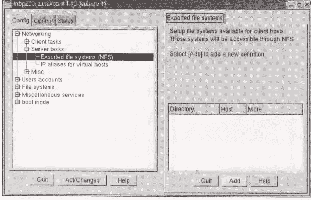

图 15-1
空的导出的文件系统选项卡框

单击“添加”按钮。这会打开“一个导出的文件系统”选项卡，您可以在其中指定导出文件系统的详细信息。您可以使用完整路径名指定文件系统，如图 15-2 所示。

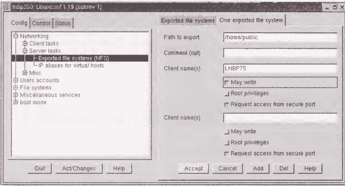

图 15-2
在 Linuxconf 中输入导出文件系统的信息

在此对话框中，您还应输入可能挂载此导出文件系统的客户端系统的名称。在图 15-2 所示的示例中，/home/public 目录正在被导出，并且名为 LNBP75 的主机可以以读写操作挂载此文件系统。输入信息后，单击“接受”按钮。Linuxconf 返回图 15-1 所示的选项卡，在其中显示有关导出文件系统的摘要信息。然后您可以单击“退出”按钮以完成导出文件系统的定义。

作为此会话的结果，Linuxconf 在 /etc/exports 文件中添加以下条目：

/home/public LNBP75(rw)

要验证导出的目录是否列在 /etc/exports 文件中，请在终端窗口中输入 cat /etc/exports。

现在您应该打开 NFS 服务器。为此，请在 Linuxconf 的 Control 选项卡上的树菜单中选择 控制面板 ⇒ 控制服务活动。Linuxconf 显示服务控制选项卡，其中列出了所有服务及其状态，如图 15-3 所示。

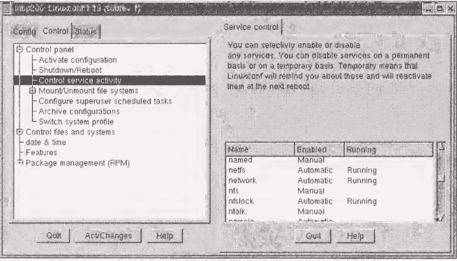

图 15-3
在 Linuxconf 的服务控制选项卡中查看服务及其状态

每一行有三个字段：一个提供服务的名称，另一个指示其是设置为自动运行还是手动运行，最后一个显示它是否已在运行。向下滚动列表并找到名为 nfs 的条目——NFS 服务。在这种情况下，NFS 服务尚未运行。单击该条目。这会导致 Linuxconf 显示服务 nfs 选项卡，如图 15-4 所示。

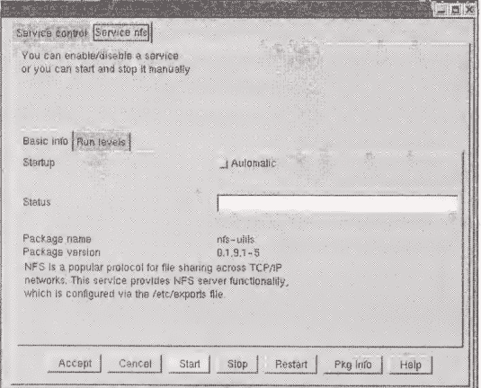

图 15-4
通过 Linuxconf 启动 NFS 服务

此选项卡中的按钮可让您启动、停止或重新启动服务。在这种情况下，单击“启动”按钮启动 NFS 服务。然后单击“接受”返回到上一个选项卡（图 15-3）。现在服务控制选项卡应显示 nfs 条目的状态为正在运行。单击“退出”退出此选项卡。


如果您对 /etc/exports 文件中列出的导出文件系统进行任何更改，请记住重新启动 NFS 服务。单击图 15-4 所示对话框中的“重新启动”按钮。

如果您更喜欢使用命令启动 NFS 服务，请以 root 身份登录并在终端窗口中输入以下命令：

/etc/rc.d/init.d/nfs start

这设置了 NFS 的服务器端。现在您可以尝试从客户端系统挂载导出的文件系统。

### 挂载 NFS 文件系统

您可以在客户端系统上使用 Linuxconf 挂载导出的 NFS 文件系统。但是，执行挂载操作最简单的方法是以 root 身份登录并使用 mount 命令。例如，要将 lnbp200 系统上的 /home/public 文件系统挂载到客户端系统的 /mnt/lnbp200 目录，请输入：

```
mount lnbp200:/home/public /mnt/lnbp200
```

要确认 NFS 文件系统确实已挂载，请以 root 身份登录客户端系统并在终端窗口中输入 mount。您应该会看到关于 NFS 文件系统的类似以下的一行：

```
lnbp200:/home/public on /mnt/lnbp200 type nfs (rw,addr=192.168.1.200)
```

## 使用 Samba 设置 Linux PC 作为 Windows 服务器

如果您的业务依赖 Windows 进行文件和打印共享，您可能在服务器和客户端中使用 Windows。您可以将服务器迁移到 Red Hat Linux PC，而不会丢失 Windows 文件和打印机共享，因为您可以将 Linux PC 设置为 Windows 服务器。当您从本书的附带 CD-ROM 安装 Red Hat Linux 时，您也有机会安装执行该任务的 Samba 软件包。您所要做的就是在安装期间选择 DOS/Windows 连接性软件包组。


在 Red Hat Linux PC 上安装并配置 Samba 后，运行 Windows 95/98/NT/2000 的客户端 PC 可以通过使用服务器消息块（SMB）协议访问 Red Hat Linux PC 上的磁盘和打印机，该协议是 Windows 文件和打印共享中的底层协议。

安装 Samba 软件包后，您还可以将 Red Hat Linux PC 设为 Windows 客户端。这意味着 Red Hat Linux PC 可以访问由 Windows 服务器管理的磁盘和打印机。Samba 软件包具有以下主要组件：

- `smbd`：SMB 服务器，接受来自 Windows 客户端的连接并提供文件和打印共享服务
- `nmbd`：NetBIOS 名称服务器，客户端用它来查找服务器。(*NetBIOS* 的意思是 *网络基本输入/输出系统* —— 应用程序用于与诸如 TCP/IP 之类的网络传输通信的接口。)
- `/etc/samba/smb.conf`：SMB 服务器使用的 Samba 配置文件
- `testparm`：确保 Samba 配置文件正确的程序
- `smbclient`：Windows 客户端，在 Red Hat Linux 上运行，允许 Red Hat Linux 访问任何 Windows 服务器上的文件和打印机
- `smbprint`：脚本，可在 SMB 服务器上的打印机上启用打印
- `smbadduser`：将用户添加到 SMB 密码文件的程序
- `smbpasswd`：更改 SMB 用户密码的程序
- `smbstatus`：列出本地主机当前 SMB 连接的命令

下面的章节描述了如何从随附的 CD-ROM 安装 Samba。它们还讨论了在 Red Hat Linux PC 上设置打印机以通过 Windows 打印的过程。

## 检查 Samba 是否已安装并安装 Samba

在安装 Samba 之前，先通过在终端窗口中输入以下命令检查 Samba 是否已安装：

```
rpm -q samba
samba-2.0.7-20
```

如果 rpm 命令显示以 samba 开头的包名，则表示 Samba 已安装在您的系统上，您应跳过本节的其余部分。否则，请按照以下步骤从本书随附的 CD-ROM 安装 Samba：

- 1. 以 root 身份登录并确保随附的 CD-ROM 已在驱动器中并已挂载。如果没有，请使用 umount /mnt/cdrom 命令卸载当前 CD-ROM，换上随附的 CD-ROM，然后使用 mount /mnt/cdrom 命令挂载它。
- 2. 使用以下命令将目录更改为 CD-ROM —— 具体来说是 Red Hat 软件包管理器（RPM）软件包所在的目录：
- 3. 使用以下 rpm 命令安装 Samba：

```
cd /mnt/cdrom/RedHat/RPMS
```

```
rpm -ivh samba*
```

如果 Samba 已安装，此命令会给出错误消息。否则，rpm 命令会通过将各种文件复制到适当的位置来在您的系统上安装 Samba。

这些步骤完成了 Samba 软件的解包和安装。现在，要使用 Samba，只需配置它即可。

## 配置 Samba

要设置 Windows 文件和打印共享服务，您必须提供一个名为 /etc/samba/smb.conf 的配置文件。配置文件是一个文本文件，看起来像 Microsoft Windows 3.1 INI 文件。

与 Windows INI 文件类似，/etc/samba/smb.conf 文件由各部分组成，每个部分包含参数列表。smb.conf 文件的每个部分都以方括号中的部分名称开头。该部分一直持续到下一个部分开始或文件结束。

部分中的每一行都使用以下语法指定参数的值：

```
name = value
```

与 Windows INI 文件一样，注释行以分号（;）开头。在 /etc/samba/smb.conf 文件中，注释也可以以井号或数字符号（#）开头。


文本编辑器在第 9 节中介绍。

Samba 软件附带一个可供您开始编辑的配置文件。要准备配置文件，请以 root 身份登录并使用您喜欢的文本编辑器编辑文件 /etc/samba/smb.conf。以下是没有注释的示例配置文件：

```
[global]
  netbios name = LNB P200
  workgroup = LNB SOFTWARE
  server string = LNB Software-Red Hat Linux-Samba Server
  hosts allow = 192.168.1. 127.
  guest account = naba
  log file = /var/log/samba/log.%m

# Log files can be at most 50KB
  max log size = 50

  security = user
  smb passwd file = /etc/samba/smbpasswd

# Leave the next option as is - they're for performance
  socket options = TCP_NODELAY SO_RCVBUF=8192 SO_SNDBUF=8192

  remote browse sync = 192.168.1.255
  remote announce = 192.168.1.255/LNB SOFTWARE
  local master = yes
  os level = 33

  name resolve order = lmhosts bcast

  dns proxy = no
  unix password sync = no

[homes]
  comment = Home Directories
  browseable = no
  writable = yes
```

```
[printers]
    comment = All Printers
    path = /var/spool/samba
    browseable = no
    guest ok = no
    writable = no
    printable = yes

[tmp]
    comment = Temporary file space
    path = /tmp
    read only = no
    public = yes

[public]
    comment = Public Stuff
    path = /home/samba
    browseable = yes
    public = yes
    guest ok = yes
    writable = yes
    printable = no
    available = yes
    guest only = no
    user = naba
    only user = yes
```

将用户名从 naba 更改为您自己的用户名。还请确保配置文件中提到的所有目录确实存在。例如，使用命令 mkdir /home/samba 创建 /home/samba 目录。

编辑 Samba 配置文件后，将两个用户添加到 Samba 密码文件。首先添加您的用户名。以下是我的添加方式：

```
smbadduser naba:naba
----------------------------------------------------------------
ENTER password for naba
New SMB password:          type the password
Retype new SMB password:   type password again
Added user naba.
```

接下来使用命令 smbadduser root:root 添加 root 用户，然后提供密码。（这不会更改您的 Red Hat Linux 系统 root 用户的密码。）

修改 /etc/samba/smb.conf 文件后，输入 testparm 以验证文件是否正常。testparm 命令检查 /etc/samba/smb.conf 文件并报告文件是否正常。之后，使用以下命令重启 SMB 服务：

```
/etc/rc.d/init.d/smb restart
Shutting down SMB services: [  OK  ]
Shutting down NMB services: [  OK  ]
Starting SMB services: [  OK  ]
Starting NMB services: [  OK  ]
```

## 访问 Samba 服务器


您现在可以尝试从局域网上的其中一台 Windows 系统访问 Red Hat Linux 系统上的 Samba 服务器。双击 Windows 桌面上的“网络邻居”图标。这应该会打开“网络邻居”窗口（见图 15-5），显示局域网上的所有其他 Windows 系统。

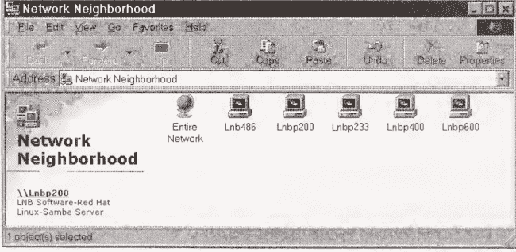

Figure 15-5
在 Windows 网络邻居中查看 Red Hat Linux Samba 服务器

单击 Red Hat Linux Samba 服务器的图标以查看其服务器字符串。请注意，图 15-5 左下角的注释显示 Lnbp200 实际上是一个 Linux 系统。

如果在 Windows 的网络邻居中看不到 Red Hat Linux Samba 服务器，请选择“开始”↔“查找”↔“计算机”，然后输入 Linux 系统的主机名（见图 15-6）并单击“立即查找”按钮。然后 Red Hat Linux Samba 服务器应该会出现在屏幕上。


Figure 15-6
从 Windows 搜索 Linux Samba 服务器

一旦看到 Linux Samba 服务器，您可以通过双击图标打开它。这应该会显示 Linux Samba 服务器中每个共享目录的文件夹。（对于上面显示的示例 /etc/samba/smb.conf 文件，您会看到两个目录：tmp 和 public）。然后您可以打开这些文件夹以进一步探索目录内容。

## 使用 smbclient 访问 Windows 资源

您可以使用 smbclient 程序访问局域网上的 Windows 系统上的共享目录和打印机，以及检查您的 Linux Samba 服务器是否正常工作。一种快速检查方法是使用 smbclient -L 命令查看 Linux Samba 服务器本身上的服务列表。

如果局域网上有其他 Windows 服务器，您可以使用 smbclient 程序查看它们的服务。以下是查看我运行 Windows 95 的 486 PC 上的服务的 smbclient 命令：

```
smbclient -L lnb486
```

您还可以使用 smbclient 访问 Windows 服务器上的磁盘，以及向 Windows 打印机发送文件。smbclient 程序类似于 ftp —— 您连接到 Windows 服务器，然后使用命令交换文件并向打印机发送文件。


以下示例展示了我如何使用 smbclient 访问我的 Windows 98 PC 上的磁盘并查看其目录（我在终端窗口中输入命令）：

```
smbclient //lnbp400/c naba naba
added interface ip=192.168.1.200 bcast=192.168.1.255 nmask=255.255.255.0
Got a positive name query response from 192.168.1.40 ( 192.168.1.40 )
smb: \> dir a*
    ATI                 D               0   Fri Apr 16 21:19:08 1999
    Acrobat3            D               0   Sat Apr 17 15:14:10 1999
    autoexec.nav        A             230   Sat Apr 17 14:26:08 1999
    AUTOEXEC.BAT        A             321   Mon Apr  3 17:48:54 2000
    AUTOEXEC.BAK        A             272   Sun Apr 18 09:53:04 1999
    ASD.LOG             HR            362   Tue Feb 29 18:28:06 2000
    ashley              D               0   Thu Nov 18 21:11:18 1999
                            64322 blocks of size 131072. 47399 blocks available
smb: \> quit
```

要查看 smbclient 命令列表，请在 smb: \> 提示符下输入 help。要熟悉 smbclient，您可能想尝试其中的一些命令。请注意，smbclient 命令与 MS-DOS 命令类似。


## REVIEW

本次课程向您展示了如何使用 NFS 在 Red Hat Linux 系统与其他 Linux 或 UNIX 系统之间共享文件。然后您学习了如何使用 Samba 软件包将 Red Hat Linux 系统配置为 Windows 服务器。

## QUIZ YOURSELF

- 1. 通过 NFS 共享文件的基本步骤是什么？（参见“使用 NFS 共享文件”。）
- 2. 如何使用 NFS 导出文件系统？（参见“使用 NFS 导出文件系统”。）
- 3. 如何检查系统上是否安装了 Samba？（参见“检查 Samba 是否已安装并安装 Samba”。）
- 4. 如何配置 Linux 系统以提供 Windows 文件共享服务？（参见“配置 Samba”。）
- 5. 如何从 Linux 系统访问 Windows 资源？（参见“使用 smbclient 访问 Windows 资源”。）


## SESSION


### 从 Red Hat Linux 访问 Windows 和 DOS 文件

### 会话清单

- ✓ 从 Red Hat Linux 挂载和访问 DOS/Windows 分区
- ✓ 从 Red Hat Linux 挂载和访问 DOS/Windows 软盘
- ✓ 使用 mtools 实用程序访问和操作 DOS 软盘


30 分钟
剩余

通常，您会在之前安装了 Microsoft Windows 的 PC 上安装 Linux。如果您同时在 Windows 和 Red Hat Linux 中工作，您可能希望从 Red Hat Linux 访问 DOS/Windows 文件。本次课程向您展示如何执行此操作，以及如何挂载和访问 MS-DOS/Windows 软盘。您还将了解一个名为 mtools 的软件包，它使您能够在 Red Hat Linux 中访问和使用软盘上的 MS-DOS/Windows 文件。

## 挂载和访问 DOS/Windows 文件系统

Red Hat Linux 内置支持 MS-DOS 文件。如第 6 节所述，Red Hat Linux 具有单一文件系统，从根目录开始，用单个斜杠（/）表示。即使您有单独的硬盘（或单个磁盘上的多个硬盘分区），这些硬盘的内容在逻辑上也会出现在 Red Hat Linux 文件系统的某个位置。挂载，如第 8 节所述，是您执行的操作，使物理存储设备（硬盘分区或 CD-ROM）作为 Red Hat Linux 文件系统的一部分出现。

### 安装期间挂载 DOS/Windows 文件系统

在安装期间（参见第 2 节），Red Hat 安装程序运行 Disk Druid 程序。该程序通过检查硬盘的分区表来查找任何 DOS/Windows 分区。通过 Disk Druid 程序，您可以指定希望挂载每个 DOS 分区的位置。（挂载使 DOS 目录层次结构作为 Linux 文件系统的一部分出现。）例如，您可以将第一个 DOS 分区挂载为 /dosc，第二个挂载为 /dosd，依此类推。（您可以随意命名这些挂载点。）如果您指定这些挂载点，Disk Druid 将执行必要的步骤，以确保在您启动 Linux 时自动挂载 DOS 分区。

要查看您的 DOS/Windows 硬盘分区是否自动挂载，请执行以下步骤：

- 1. 使用 grep 命令在文件 /etc/fstab 中查找字符串 vfat。我在一台 Linux PC 上使用 grep 得到的结果如下：
```
grep vfat /etc/fstab
/dev/hda1 /dosc vfat defaults 0 0
```
- 2. 如果输出显示包含 vfat 的一行或多行，您的 Linux 系统会自动挂载 DOS/Windows 硬盘分区。在此示例中，输出显示了一行匹配项，其第一个字段是分区名 /dev/hda1（第一个 IDE 磁盘上的第一个分区）；第二个字段 /dosc 显示该分区挂载的位置。
- 3. 如果 grep 命令在 /etc/fstab 中未显示包含字符串 vfat 的任何行，则您的系统不会自动挂载任何 DOS/Windows 硬盘分区。当然，一个解释可能是您的硬盘上没有 DOS 分区。

```
grep vfat /etc/fstab
/dev/hda1 /dosc vfat defaults 0 0
```


您不必是 root 用户即可执行上述步骤。

另一种快速了解已挂载设备的方法是在 shell 提示符下输入 mount（不带任何参数）。以下是我的系统上 mount 命令的输出：

/dev/hda3 on / type ext2 (rw)
none on /proc type proc (rw)
/dev/hda1 on /dosc type vfat (rw)(Windows partition mounted on /dosc)
none on /dev/pts type devpts (rw.mode=0622)

如果您在输出中看到 vfat，则这些行表示挂载在 Red Hat Linux 上的 MS-DOS 文件系统。在此情况下，MS-DOS 分区挂载在 Linux 目录 /dosc 上。


即使您的硬盘上没有 DOS/Windows 分区，您也应学习如何从 Red Hat Linux 访问 DOS/Windows 文件系统，因为您可能需要在 Red Hat Linux 下访问 DOS/Windows 软盘。理解挂载的概念是使用 Red Hat Linux 中的 DOS 文件系统的关键。

### 使用 mount 命令挂载 DOS/Windows 文件系统

如第 8 节所述，您可以使用 mount 命令手动将设备挂载到 Linux 文件系统的指定目录上。该目录称为挂载点。您可以使用任何目录作为挂载点。但是，如果您将设备挂载到非空目录，您将无法在卸载设备之前访问该目录中的文件，直到您使用 umount 命令卸载设备。因此，您应始终使用空目录（例如 /mnt/cdrom）作为挂载点。

如果您的 DOS/Windows 分区是 IDE 驱动器上的第一个分区，并且您希望将其挂载到 /dosc，请使用以下 mount 命令：

```
mount -t vfat /dev/hda1 /dosc
```

mount 命令中的 -t vfat 部分指定您要挂载的设备 — /dev/hda1 — 具有 MS-DOS 文件系统。Linux 内置支持 MS-DOS 文件。图 16-1 说明了此 mount 命令的效果。


图 16-1
将 DOS/Windows 分区挂载到 /dosc 目录

图 16-1 还显示了 DOS 分区中的目录如何映射到 Linux 文件系统。曾经在 DOS 下的 C:\DOS 目录现在在 Linux 下变为 /dosc/dos。同样，C:\WINDOWS 现在是 /dosc/windows。您大概能看出规律。要将 DOS 文件名转换为 Linux（对于此特定情况，当您将 DOS 分区挂载到 /dosc 时），请执行以下步骤：

- 将 DOS 名称更改为小写。
- 将 C:\ 更改为 /dosc/。
- 将所有反斜杠（\）更改为斜杠（/）。

## 挂载和访问 DOS/Windows 软盘

20 分钟
剩余

正如您可以在 Linux 下挂载 DOS/Windows 硬盘分区一样，您也可以挂载 DOS/Windows 软盘。通常，您必须以 root 身份登录才能挂载软盘，但您可以按照本节后半部分所示的步骤设置系统，以便任何用户都可以挂载 DOS/Windows 软盘。您还需要知道软盘驱动器的设备名。默认情况下，Linux 定义了两个通用软盘设备名：

- /dev/fd0，即 A: 驱动器（第一个软盘驱动器）
- /dev/fd1，即 B: 驱动器（如果您有第二个软盘驱动器）

至于挂载点，一个名为 /mnt/floppy 的现有目录专门用于此类临时挂载操作。因此，您可以使用以下命令将 DOS 软盘挂载到 /mnt/floppy 目录：

```
mount -t vfat /dev/fd0 /mnt/floppy
```


软盘挂载后，你可以使用 Linux 的复制命令（cp）向软盘复制文件和从软盘复制文件。要将当前目录中的文件 gnome1.pcx 复制到软盘，输入以下内容：

```
cp gnome1.pcx /mnt/floppy
```

同样，要查看软盘的内容，输入以下内容：

```
ls /mnt/floppy
```

当你想从驱动器中取出软盘时，首先卸载软盘驱动器。此操作会移除软盘文件系统与 Linux 文件系统上的挂载点之间的关联。使用 umount 命令卸载设备，如下所示：

```
umount /dev/fd0
```

你可以设置 Linux 系统，使任何用户都可以挂载 DOS 软盘。你只需以 root 身份登录并在 /etc/fstab 文件中添加一行。例如，要启用用户在 /a 目录挂载 A: 驱动器上的 DOS 软盘，请执行以下步骤：

- 1. 以 root 身份登录。
- 2. 使用以下命令创建 /a 目录：
  `mkdir /a`
- 3. 在文本编辑器（如 vi 或 Emacs）中编辑 /etc/fstab 文件并插入以下代码。然后保存文件并退出编辑器。
  `/dev/fd0   /a   vfat   noauto,user   0 0`
  在该行中，user 选项（紧跟在 noauto 后面）使所有用户都可以挂载 DOS 软盘。该行中的第一个字段是设备名称（/dev/fd0），第二个是挂载目录（/a），第三个字段显示文件系统类型（vfat）。
- 4. 注销并以普通（非 root）用户身份登录。
- 5. 为测试无需 root 即可挂载 DOS 软盘，将 DOS 软盘插入 A: 驱动器并输入以下命令：
  `mount /a`
  请注意，你使用挂载目录作为 mount 命令的参数。挂载操作应成功，并且当你输入命令 ls /a 时应能看到 DOS 软盘的列表。
- 6. 要卸载 DOS 软盘，输入 umount /a。

## 使用 mtools 访问和操作 DOS/Windows 软盘

到目前为止，你已学习了一种访问 MS-DOS 文件系统的方法：使用 mount 命令挂载 DOS 硬盘或软盘；然后使用常规 Linux 命令，如 ls 和 cp。对于硬盘来说，这种挂载 DOS 文件系统的方法是可以的。Linux 可以在启动时自动挂载 DOS 分区，并且你随时可以访问硬盘上的 DOS 目录。

但是，如果你想快速列出 DOS 软盘的目录，你可能会觉得挂载很麻烦。这时 mtools 包就派上用场了。mtools 包是一组实用程序，实现了大多数常见的 DOS 命令。这些命令的名称与 DOS 中的相同，只是每个命令前加上 m 前缀。因此，mdir 会检索目录列表，mcopy 会复制文件。mtools 最好的地方在于，你无需挂载软盘即可使用 mtools 命令。


由于 mtools 命令会向物理设备（软盘）写入和读取数据，因此你必须以 root 身份登录才能执行这些命令。如果想让任何用户访问 mtools 命令，你必须更改软盘驱动器设备的权限设置。使用以下命令允许任何人对第一个软盘驱动器进行读写：

```
chmod o+rw /dev/fd0
```

### 验证是否已安装 mtools

mtools 包随本书附带的 CD-ROM 上的 Red Hat Linux 发行版提供。安装 Red Hat Linux 时，mtools 会作为基础 Linux 的一部分自动安装。mtools 可执行文件位于 /usr/bin 目录中。要查看是否已安装 mtools，请在 shell 提示符下输入 ls /usr/bin/mdir。如果 ls 命令显示该文件存在，则说明你的系统上可以使用 mtools。

你也可以输入以下 rpm 命令来验证系统上是否已安装 mtools：

```
rpm -q mtools
mtools-3.9.7-3
```

如果已安装 mtools，输出会显示 mtools 包的完整名称。示例输出显示系统上安装了 mtools 版本 3.9.7。要尝试 mtools，请按以下步骤操作：

- 1. 以 root 身份登录，或输入 su 然后输入 root 密码。
- 2. 将 MS-DOS 软盘放入系统 A: 驱动器中。
- 3. 输入 mdir。你应该会看到软盘的目录（采用标准的 DOS 目录列表格式）。

### 检查 /etc/mtools.conf 文件

mtools 包应能与默认设置一起工作；但如果出现任何错误，你应检查 /etc/mtools.conf 文件。该文件包含 mtools 实用程序所看到的驱动器（如 A:、B: 和 C:）的定义。以下是典型的 /etc/mtools.conf 文件中的几行：

```
drive a: file="/dev/fd0" exclusive 1.44m
drive b: file="/dev/fd1" exclusive 1.44m

# First SCSI hard disk partition
#drive c: file="/dev/sda1"

# First IDE hard disk partition
drive c: file="/dev/hda1"

# IDE Zip drive
drive X: file="/dev/hdd4" exclusive
```

井号（#）表示注释的开始。每行定义一个驱动器字母、关联的 Linux 设备名称以及一些指示设备访问方式的关键字。在此示例中，前两行定义了驱动器 A: 和 B:。第三个非注释行将驱动器 C: 定义为第一个 IDE 驱动器上的第一个分区（/dev/hda1）。如果你有其他 DOS 驱动器（例如 D:），可以添加另一行来将驱动器 D: 定义为适当的磁盘分区。

如果你的系统 A: 驱动器是高密度 3.5 英寸驱动器，则无需更改默认 /etc/mtools.conf 文件中的任何内容。

### 了解 mtools 命令


正如本章前面所解释的，mtools 包是一组实用程序。到目前为止，你已看到命令 mdir —— 它是 DOS 中 DIR 命令的 mtools 对应项。


如果你熟悉 MS-DOS 命令，使用 mtools 命令非常容易。以小写字母输入 DOS 命令，并在每个命令前加上 m。因为 Linux 命令和文件名区分大小写，所以输入 mtools 命令时请全部使用小写字母。

表 16-1 总结了 mtools 版本 3.9.6 中可用的各种 mtools 实用程序及其对应的部分命令。

表 16-1
常用 mtools 命令

| mtools 工具 | MS-DOS 命令（如果有） | 操作 |
|---|---|---|
| mattrib | ATTRIB | 更改 MS-DOS 文件属性标志 |
| mcd | CD | 更改 MS-DOS 目录 |
| mcopy | COPY | 在 MS-DOS 和 Linux 之间复制文件 |
| mdel | DEL or ERASE | 删除 MS-DOS 文件 |
| mdel tree | DELTREE | 递归删除 MS-DOS 目录 |
| mdir | DIR | 显示 MS-DOS 目录列表 |
| mformat | FORMAT | 在低级格式化的软盘上放置 MS-DOS 文件系统（使用 fdformat 在 Linux 中对软盘进行低级格式化） |
| mlabel | LABEL | 初始化 MS-DOS 卷标 |
| mmd | MD or MKDIR | 创建 MS-DOS 目录 |
| mmove | N/A | 移动或重命名 MS-DOS 文件或子目录 |
| mrd | RD or RMDIR | 删除 MS-DOS 目录 |
| mren | REN or RENAME | 重命名现有 MS-DOS 文件 |
| mtype | TYPE | 显示 MS-DOS 文件的内容 |
| xcopy | XCOPY | 递归复制 DOS 目录到另一个目录 |

你可以像使用对应的 DOS 命令一样使用 mtools 命令。例如，mdir 命令的工作方式与 DOS 中的 DIR 命令相同。表 16-1 中显示的其他所有 mtools 命令也是如此。

### 格式化 DOS/Windows 软盘

假设你需要在 MS-DOS/Windows 软盘上复制一些文件。如果你已有格式化的 MS-DOS/Windows 软盘，只需挂载该软盘并使用 Linux cp 命令将文件复制到软盘即可。如果没有格式化的 DOS 软盘怎么办？mtools 包再次派上用场。

mtools 包提供了 mformat 实用程序，可将软盘格式化为在 MS-DOS 下使用。与可在单步中格式化软盘的 DOS format 命令不同，mformat 命令要求你遵循两步流程：

- 1. 使用 fdformat Linux 命令对软盘进行低级格式化。fdformat 命令期望软盘设备名称作为参数；设备名称包含格式化软盘所需的所有参数。要格式化系统 A: 驱动器中的 3.5 英寸高密度软盘，输入 `fdformat /dev/fd0H1440`。
- 2. 使用 mformat 命令在低级格式化的软盘上放置 MS-DOS 文件系统。如果软盘在 A: 驱动器中，输入以下命令：
  `mformat a:`


### 回顾

本节向你展示了如何从 Red Hat Linux 访问和挂载 DOS/Windows 文件系统，以及如何使用 mount 命令挂载 DOS/Windows 文件系统。你还学习了如何使用 mtools 实用程序直接从 Red Hat Linux 格式化和访问 DOS/Windows 软盘，而无需先挂载软盘。


## 自测

- 1. 如何检查你的 Red Hat Linux 系统是否设置为自动挂载任何 DOS 磁盘分区？（参见“挂载和访问 DOS/Windows 文件系统”。）
- 2. 你使用什么 mount 命令来挂载设备名为 /dev/hda1 的 DOS 分区到挂载点 /dosc？（参见“使用 mount 命令挂载 DOS/Windows 文件系统”。）
- 3. 什么是 mtools？（参见“使用 mtools 访问和操作 DOS/Windows 软盘”。）
- 4. mtools 的一些命令有哪些？（参见“了解 mtools 命令”。）
- 5. 如何在 Red Hat Linux 中格式化 DOS/Windows 软盘？（参见“格式化 DOS/Windows 软盘”。）

## PART


## Saturday Afternoon

## 部分复习

- 1. 串口 COM1 和 COM2 在 Linux 中的设备名是什么？COM1 的 IRQ 和 I/O 端口地址是什么？
- 2. 请描述你如何使用 Minicom 程序拨号到远程系统。在普通用户身份下运行 Minicom 之前必须做什么？
- 3. 你可以使用哪些命令来确定 Linux 是否检测到 PC 中的串口？
- 4. 什么是以太网？要连接到以太网局域网需要什么外设？10Base2 和 10BaseT 的含义是什么？你如何确定你的 Linux 系统是否已加载以太网驱动程序？
- 5. Linux 中 TCP/IP 网络的一些诊断命令有哪些？你会使用哪个命令来检查网络接口是否处于运行状态？如何检查你的 Linux 系统是否到另一台主机有网络路径？
- 6. 列出 Red Hat Linux 中几个 TCP/IP 配置文件。哪个文件包含名称服务器的 IP 地址？
- 7. 典型的家庭办公室或小型办公室用户如何将 Linux 系统连接到 Internet？比较拨号网络与 DSL 或电缆调制解调器。
- 8. 拨号网络与使用 Minicom 等串行通信程序拨号有何不同？
- 9. 什么是 PPP？你需要在使用 PPP 设置拨号网络之前从你的 Internet 服务提供商获取哪些信息？你要在 Linux 系统上运行哪些程序来设置 PPP 连接？
- 10. 请解释你将如何通过 Linux 系统与局域网上的其他系统共享单个 Internet 连接。为执行此任务你需要使用什么软件？
- 11. 一些常见的 Internet 服务有哪些？什么是端口？哪个配置文件包含有关服务及其对应端口号的信息？
- 12. 提供电子邮件服务所需的两种软件类型是什么？在系统之间传输电子邮件的通用 TCP/IP 协议是什么？
- 13. Apache Web 服务器的配置文件和日志文件默认位于何处？命名在 Red Hat Linux 系统启动时启动 Apache Web 服务器的脚本。
- 14. 什么是匿名 FTP？请描述通过匿名 FTP 下载文件的步骤。你应该将文件放在 Linux 系统的哪个目录，以便通过匿名 FTP 提供下载？
- 15. 请描述你如何使用网络文件系统（NFS）设置文件服务器。概述你将如何设置服务器以及在客户端需要做什么才能访问服务器的文件系统。
- 16. 你如何使用 Samba 软件将 Linux 系统设置为 Windows 服务器？如何检查 Samba 是否已安装？Samba 的配置文件是什么？显示重启 Samba 软件的命令。
- 17. 假设你的 Linux 系统位于一个局域网中，该网络包含运行 Windows 的其他 PC，并且你的 Linux 系统已安装并运行 Samba。从 Linux 系统如何访问 Windows 服务器中的文件？
- 18. 假设 /dev/hda2 硬盘分区具有 DOS 文件系统，你想在挂载点 /mnt/dos 上将该文件系统挂载到你的 Linux 系统。显示执行此任务的命令行。你将如何确保 Linux 在系统启动时自动挂载 /dev/hda2 分区？
- 19. mtools 包可以做什么？如何检查 mtools 是否已安装在你的系统上？mtools 的配置文件是什么？
- 20. 列出几个 mtools 命令。这些命令是模仿什么的？你将如何从 DOS 软盘复制所有扩展名为 .doc 的文件到硬盘上的当前目录（假设你在输入执行此任务的命令时已在该目录中）？

## PART
## IV
## Saturday Evening


## Session 17

## 自定义 GNOME 和 KDE 桌面

## Session 18

## 使用屏幕保护程序和玩游戏

## Session 19

## 使用多媒体应用程序

## Session 20

## 使用 Red Hat Linux 中的办公工具


## SESSION


## 自定义 GNOME 和 KDE 桌面

## 课程清单

- ✓ 自定义 GNOME 桌面
- ✓ 更改默认桌面
- ✓ 自定义 KDE 桌面


今晚，我重点介绍使用 GNOME 和 KDE 图形桌面以及随 Red Hat Linux 捆绑的一些应用程序和实用程序。本课程向你展示如何自定义 GNOME 和 KDE 桌面。你还将学习如何将默认桌面从 GNOME 切换到 KDE，反之亦然。

## 自定义 GNOME 桌面

正如第 5 课所讨论的，GNOME 图形桌面的默认外观和感觉与 Windows 95/98/NT/2000 相似，你实际上不需要自定义任何东西就可以开始使用 Red Hat Linux。然而，如果你愿意，你可以像自定义 Windows 95/98/NT/2000 一样自定义 GNOME 桌面。例如，你可以选择不同的背景或更改窗口边框的外观。

要尝试自定义 GNOME 桌面，请从图形登录屏幕登录。我假设 GNOME 是你的默认桌面环境，因为你在安装 Red Hat Linux 时通常会得到它。本课程后面你将学习如何将默认桌面从 GNOME 切换到 KDE，反之亦然。


如果 GNOME 不是你的默认桌面，只需从登录窗口选择 会话 ↪ GNOME，然后输入你的用户名和密码。

你可以通过一个名为 GNOME 控制中心的图形应用程序配置 GNOME 桌面外观和感觉的大多数方面 — 外观和行为。要启动控制中心，选择 主菜单 ↪ 程序 ↪ 设置 ↪ GNOME 控制中心 或点击 GNOME 面板中的工具箱图标。

GNOME 控制中心的窗口垂直分为两部分 — 左侧较窄的菜单区域和右侧较大的工作区。左侧显示所有配置项的树状菜单（也称为小程序）。顶级菜单项组织成几个类别，例如 桌面 和 多媒体。你可以点击一个类别查看其子类别。要配置一个项目，在树状菜单中找到该项目并点击它。所选小程序的用户界面随后出现在右侧的工作区中。用户界面通常是一个包含可更改设置的对话框。

在接下来的几节中，你将使用控制中心尝试一些自定义步骤。完成使用控制中心后，选择 文件 ↪ 退出 以退出。

## 更改背景

要尝试一个简单的自定义，选择树状菜单中的 桌面 ↪ 背景。GNOME 控制中心随后运行背景属性小程序，该小程序进而在工作区中显示一个对话框（如图 17-1 所示）。

正如你所见，这个对话框看起来与 Windows 95/98/NT 中的显示属性对话框相似。它使你可以选择纯色背景或选择壁纸（用作背景的图像）。你可以选择纯色背景或颜色渐变背景，其中背景从一种颜色逐渐变为另一种颜色。渐变可以从垂直方向（从上到下）或水平方向（从左到右）开始。

继续点击 渐变 按钮看看会发生什么。你可以在对话框中出现的显示器图像中预览更改。


### Figure 17-1
使用 GNOME 控制中心自定义 GNOME 桌面的背景

要为主要颜色或次要颜色（见图 17-1）选择新颜色，请单击显示该颜色的按钮（主要颜色或次要颜色）。这会弹出一个颜色选择对话框，您可以在其中挑选颜色。

如果您想使用图像作为壁纸，请在对话框的壁纸部分单击浏览按钮。壁纸选择对话框会显示 /usr/share/pixmaps/redhat 目录的内容——您可以在其中找到一些可供选择的背景图像。您也可以尝试 /usr/share/pixmaps/backgrounds 目录以获取更多背景图像。例如，尝试 /usr/share/pixmaps/backgrounds/space 目录，其中收集了从太空看到的地球图像。您可以选择任何 JPEG 或 PNG 格式的图像文件作为壁纸。

要尝试这些更改在桌面上的效果，请单击“试用”按钮。您可以通过单击“还原”按钮恢复到原始设置。完成更改后，单击“确定”按钮关闭对话框并应用更改。

## Selecting a theme
## 选择主题

另一种更令人兴奋的自定义是为整个用户界面选择新主题。主题是指所有用户界面组件（如按钮、复选框、滚动条等）外观和行为（外观和感觉）的一致集合。要尝试一些新主题，请从树菜单中选择桌面 ⇨ 主题选择器。从主题选择器对话框中，您可以尝试不同的主题并选择您喜欢的一个。选择主题时，您可以在预览区域中看到其外观。例如，从可用主题列表中选择 MockMac 主题，然后单击“试用”按钮。它会使 GNOME 桌面的外观和感觉，包括控制中心窗口，类似于 Apple Macintosh。

如果您喜欢某个主题，请单击“确定”按钮使用该主题。否则，单击“还原”按钮返回默认主题。

## Customizing the window manager
## 自定义窗口管理器


GNOME 不依赖于任何特定的窗口管理器。默认的窗口管理器称为 Sawfish，但如果您愿意，可以选择另一个窗口管理器。要选择窗口管理器，请从控制中心树菜单中选择桌面 ⇨ 窗口管理器。您应该会看到系统上可用的窗口管理器列表，如图 17-2 所示。


### Figure 17-2
### 图 17-2
选择或自定义窗口管理器

在此情况下，列表显示了两个窗口管理器：Sawfish 和 twm。正如您所见，括号中的注释显示 Sawfish 是当前窗口管理器。如果您愿意，可以通过选择该窗口管理器然后单击“试用”按钮来尝试 twm 窗口管理器。稍后，单击“还原”返回到 Sawfish 窗口管理器。

像任何窗口管理器一样，Sawfish 在每个窗口周围添加标题栏、框架和其他装饰，以便用户可以单击并拖动以更改窗口的位置或调整其大小。（想一想；如果没有框架和标题栏，您将无法移动或调整窗口大小。）

Sawfish 包含一个用于更改窗口框架和标题栏外观的配置工具。您可以通过单击标记为“运行 Sawfish 配置工具”的按钮（见图 17-2）来激活配置工具。这会启动 Sawfish 配置器，它提供了一个配置选项的树菜单。通过此菜单，Sawfish 配置器使您能够更改 Sawfish 窗口管理器装饰窗口的方式、添加特殊视觉效果和声音，以及对鼠标点击和按键的响应行为。您可以尝试 Sawfish 配置器中的一些配置项。

## Changing the Default Desktop
## 更改默认桌面

GNOME 和 KDE 都是功能强大的图形桌面环境。Red Hat Linux 随附这两种 GUI，但默认桌面是 GNOME。在图形登录屏幕登录之前，您始终可以从登录窗口的会话菜单中选择特定的桌面。然而，Red Hat 还包含一个桌面切换器实用程序，可让您轻松地在 GNOME 和 KDE 之间切换默认桌面。要从 GNOME 切换到 KDE，请按照以下步骤操作：

- 1. 从您的 GNOME 桌面中，选择主菜单（底部）⇨ 程序 ⇨ 系统 ⇨ 桌面切换工具。桌面切换器对话框出现。
- 2. 在桌面切换器对话框中，单击 KDE 单选按钮以选择它。然后单击“确定”按钮。另一个对话框出现。
- 3. 新对话框中的消息通知您桌面配置已更改，但必须重新启动 X。单击“确定”按钮关闭对话框。


尽管步骤 3 中的消息说您必须重新启动 X，但您只需注销会话并重新登录即可。要注销，请选择主菜单 ↩ 注销。再次登录后，您应该会得到 KDE 桌面。

要将默认桌面从 KDE 切换到 GNOME，请以 root 身份登录并从 KDE 桌面选择 K ↩ Red Hat ↩ 系统 ↩ 桌面切换工具。在桌面切换器对话框中，将桌面选择为 GNOME。注销 KDE 并重新登录后，您应该会得到 GNOME 作为您的桌面。

## Customizing the KDE Desktop
## 自定义 KDE 桌面

现在您知道如何将桌面从 GNOME 更改为 KDE 以及反之亦然，请选择 KDE 桌面并以用户身份登录。与 GNOME 类似，KDE 也包含一个名为 KDE 控制中心的图形应用程序，您可以使用它来自定义 KDE 的各个方面，包括桌面背景、图标和字体。要启动 KDE 控制中心，请选择 K ↩ KDE 控制中心；或从面板中单击带有电路板和显示器图标的按钮。

当 KDE 控制中心启动时，它会显示主窗口，左侧有一个树菜单，右侧工作区显示有关系统的一些摘要信息。

KDE 控制中心的树菜单显示了您可以使用此工具控制的项目。树菜单分为八个类别，包括应用程序、桌面、信息、输入设备、键盘快捷键、网络、声音和窗口行为。单击项目左侧的加号以查看该项目的子类别。要更改项目，请通过树菜单找到该项目然后单击它。该项目的配置选项随后会出现在窗口右侧的选项卡对话框中。

## Changing the background and theme
## 更改背景和主题

要自定义桌面背景，请在树菜单中选择桌面 ↩ 背景。背景选项卡出现（见图 17-3），提供自定义桌面背景的选项。

对于当前桌面（标记为 One），您可以选择单色或双色背景或壁纸（用作背景的图像）。例如，如果您想使用壁纸作为背景，请单击浏览按钮。这会弹出一个打开对话框，显示 /usr/share/wallpapers 目录中的 JPEG 文件。您可以选择其中一个图像并单击“确定”。然后在 KDE 控制中心单击“应用”按钮将此壁纸应用到桌面。如果您喜欢外观，请单击“确定”。否则，单击“默认”然后再次单击“应用”以恢复到原始背景。


### Figure 17-3
### 图 17-3
使用 KDE 控制中心自定义桌面背景

正如您从桌面类别（图 17-3）中的菜单项可以看到的那样，您可以从边框和颜色到菜单语言自定义背景的许多方面。我不会在这里详细介绍所有项目，但您应该尝试一些这些自定义。例如，您可以选择主题管理器来尝试几种主题，就像 GNOME 控制中心提供的主题一样。图 17-4 显示了选择和预览主题的结果。


Figure 17-4
在 KDE 控制中心中选择和预览主题

## 选择配色方案

如果你想为桌面颜色选择配色方案，就像 Windows 95/98/NT/2000 中的配色方案一样，在 KDE 控制中心的树形菜单中选择“桌面 → 颜色”。然后颜色选项卡就会出现。你可以向下滚动配色方案列表并选择一个进行预览。当你选择一个配色方案时，该选项卡中的预览区域会显示该配色方案的外观。要将配色方案应用到桌面，请单击“应用”按钮。如果你不喜欢该方案，请单击“默认”，然后再次单击“应用”以恢复到默认配色方案。

## 执行其他任务


完成！

除了桌面自定义之外，KDE 控制中心中的“信息”项还使你能够执行许多其他任务，例如将声音文件与事件关联（如打开或关闭窗口）、定义键盘快捷键以及查看有关系统的信息。你应该利用本次会话的剩余时间探索 KDE 控制中心树形菜单中的其他项目。

## 回顾

本次会话向你展示了如何自定义 GNOME 图形桌面的外观（look）和行为（feel）。你使用 GNOME 控制中心更改了桌面外观和感觉的各个方面。你学习了如何将默认桌面从 GNOME 更改为 KDE 图形桌面，反之亦然。最后，你还使用 KDE 控制中心自定义了 KDE 的外观和感觉。

## 自测

- 1. 你使用什么图形应用程序来自定义 GNOME 桌面？（参见“自定义 GNOME 桌面”。）
- 2. 如何自定义 Sawfish 窗口管理器？（参见“自定义窗口管理器”。）
- 3. 如何在 GNOME 和 KDE 之间更改默认桌面？（参见“更改默认桌面”。）
- 4. 你使用什么工具来自定义 KDE 桌面？（参见“自定义 KDE 桌面”。）
- 5. 如何为 KDE 桌面选择配色方案？（参见“自定义 KDE 桌面”。）

## 会话


## 使用屏幕保护程序和玩游戏

## 会话清单

- ✓ 激活屏幕保护程序
- ✓ 在 GNOME 中玩游戏
- ✓ 在 KDE 中玩游戏


现在你已经知道如何自定义 GNOME 和 KDE 图形桌面并在两者之间切换，可以转向一些有趣的事情了。Red Hat Linux 中的 GNOME 和 KDE 桌面都附带了相当多的游戏和屏幕保护程序。在本次会话中，你将学习如何设置和激活屏幕保护程序并探索一些游戏。


你的系统上应该已安装游戏。这假设你在第 3 会话中从本书的配套 CD-ROM 安装 Red Hat Linux 时选择了“游戏”软件包组。

## 激活屏幕保护程序

默认情况下，你的 Red Hat Linux 系统使用随机选择的屏幕保护程序。每当你一段时间不操作（通常为 20 分钟）时，屏幕保护程序就会启动。屏幕保护程序也可以充当屏幕锁定程序——这意味着你必须输入密码才能返回图形桌面。

## 在 GNOME 中设置屏幕保护程序

要从 GNOME 桌面选择和试用屏幕保护程序，请单击 GNOME 面板上的工具箱图标启动 GNOME 控制中心。然后在控制中心的树形菜单中选择“桌面 → 屏幕保护程序”。控制中心的 workspace 中会出现一个对话框，可从中选择屏幕保护程序。对话框右上角的迷你屏幕显示所选屏幕保护程序的外观，如图 18-1 所示。


Figure 18-1
在 GNOME 控制中心中选择和预览屏幕保护程序

从图 18-1 的对话框中，你还可以选择其他屏幕保护程序设置。例如，你可以设置屏幕保护程序在多少分钟不活动后启动。如果你单击“需要密码”复选框并启用它，则屏幕保护程序会锁定屏幕并强制你在返回桌面之前输入密码。

标有“优先级”的滚动条使你能够指定屏幕保护程序的优先级。你应将其保留在默认设置（介于“低”和“正常”之间）或设为低；这样可确保其他进程具有更高的优先级。毕竟，只是没有鼠标或键盘活动并不意味着你的 Linux 系统处于空闲状态。你可能在屏幕保护程序激活时正在编译一个巨大的程序。在这种情况下，你不希望屏幕保护程序占用太多处理器的资源。

标有“使用电源管理”的复选框适用于支持电源管理功能的 PC。如果你选中此复选框，屏幕保护程序会将系统和显示器置于“睡眠”模式，该模式的功耗低于正常操作。

## 在 KDE 中设置屏幕保护程序

如果你使用 KDE 桌面，可以从 KDE 控制中心选择和测试屏幕保护程序。单击 KDE 面板上的显示器和电路板图标启动它，或选择“开始 → KDE 控制中心”。然后在 KDE 控制中心的树形菜单中选择“桌面 → 屏幕保护程序”。屏幕保护程序选项卡会出现在控制中心的 workspace 中，可从中选择和预览屏幕保护程序（如图 18-2 所示）。


Figure 18-2
在 KDE 控制中心中选择和预览屏幕保护程序

每个屏幕保护程序也有自己的设置。要设置所选屏幕保护程序，请单击 KDE 控制中心“屏幕保护程序”选项卡中的“设置”按钮。这会打开该屏幕保护程序的设置对话框，可从中设置该屏幕保护程序的可配置参数。

你也可以轻松地从 KDE 控制面板的“屏幕保护程序”选项卡测试屏幕保护程序。只需单击屏幕保护程序列表下方的“测试”按钮即可。这会导致屏幕保护程序全屏激活。你可以通过按键盘键或移动（或单击）鼠标返回桌面。“测试”按钮使测试 KDE 屏幕保护程序变得非常容易。

KDE 控制中心的“屏幕保护程序”选项卡还使你能够设置控制屏幕保护程序的其他参数。具体来说，你可以在“等待”框中设置屏幕保护程序在多少分钟不活动后启动。你还可以单击标有“需要密码”的复选框，使屏幕保护程序在返回桌面前要求输入密码。此外，你还可以设置屏幕保护程序进程的优先级。


## 在 GNOME 中玩游戏

接下来，试试 Red Hat Linux 附带的游戏。你可以从 GNOME 或 KDE 桌面访问这些游戏。首先从 GNOME 游戏开始。

选择“主菜单（Foot）→ 程序 → 游戏”以查看可用游戏的菜单。图 18-3 显示了 GNOME 中典型的游戏菜单。可以看出，GNOME 桌面的游戏菜单提供超过二十款游戏。

除了这些游戏之外，你还可以从 GNOME 桌面玩所有 KDE 游戏。只需选择“主菜单（Foot）→ KDE 菜单 → 游戏”即可查看 KDE 游戏菜单。本节的其余部分描述了一些流行的 GNOME 游戏。

## 纸牌游戏

如果你喜欢像 FreeCell 或 Solitaire 这样的纸牌游戏，你会喜欢 AisleRiot 游戏。AisleRiot 是一个纸牌程序，可以玩 30 种不同的纸牌游戏，包括 FreeCell 和 Klondike 等知名游戏。

要启动 AisleRiot，选择“主菜单（Foot）→ 程序 → 游戏 → AisleRiot”。默认游戏是 Klondike，这也是你启动 AisleRiot 时获得的游戏。

如果你想在 AisleRiot 中玩不同的纸牌游戏，从菜单中选择“游戏 → 新游戏”。这会使 AisleRiot 显示一个长长的纸牌游戏列表。


## Figure 18-3

GNOME 中的游戏菜单

现在您可以从此列表中选择另一款纸牌游戏。如果需要帮助，请选择 帮助 → AisleRiot。这将在 GNOME 帮助浏览器中打开 AisleRiot 帮助。

GNOME 还附带一个独立的 FreeCell 纸牌游戏。您可以通过选择 主菜单 → 程序 → 游戏 → FreeCell 来玩该游戏。主窗口出现后，点击工具栏上的 新建 按钮开始新游戏。现在您可以玩游戏了。

## Gnome-Stones

Gnome-Stones 是一款游戏，您需要在洞穴中奔跑收集钻石并避免被岩石压碎。选择 主菜单 → 程序 → 游戏 → Gnome-Stones 开始游戏。您可以选择 设置 → 首选项 来选择想要探索的洞穴类型。然后选择 游戏 → 新游戏 开始游戏。使用方向键移动小人并收集钻石。

## GNOME Mahjongg

选择 主菜单 → 程序 → 游戏 → Mahjongg 开始 GNOME Mahjongg 游戏。在这个版本的 Mahjongg 中，您的目标是找到并点击成对的牌面，之后它们会从游戏板上移除。

如果您难以找到匹配的牌面，请点击工具栏上的 提示 按钮。游戏程序随后会短暂闪烁两块匹配的牌面。然后您可以依次点击这些牌面。当然，游戏的意义在于您自己找出要移除的牌面，因此应谨慎使用 提示 按钮。

## Chess game

选择 主菜单 → 程序 → 游戏 → Chess 开始一局国际象棋游戏。默认情况下，电脑执黑，您执白。您先走。要走棋，请点击并拖动白子到新位置。国际象棋程序会检查并阻止您做出任何非法走法。

一旦您走棋，电脑会用自己的走法回应。起初电脑回应迅速，但随着游戏进行，走棋所需时间会变长。一个计时器会倒计时当前回合者的剩余时间。


## Playing Games in KDE

要尝试 KDE 桌面上提供的游戏，请在将 KDE 选为当前桌面后登录。 （请记住在登录窗口中选择 会话 → KDE。）从 KDE 桌面，选择 K → 游戏 查看可用游戏的菜单。

图 18-4 显示了 KDE 中典型的游戏菜单。

正如菜单所示，KDE 的游戏菜单中包含十多个游戏。您可以从此菜单中选择任意一个游戏进行尝试。


KDE 包含自己的 Mahjongg 版本，与本节前面介绍的 GNOME 版本 Mahjongg 类似。

现在您知道在哪里找到游戏以及如何启动游戏，可以随时尝试。在本节的剩余部分，您可以玩几个 KDE 游戏。


## Figure 18-4

KDE 中的游戏菜单

## Minesweeper

Minesweeper 是一款流行的游戏，您可能在 PC 上玩过它（因为它随 Microsoft Windows 一起提供）。在 Minesweeper 中，您的目标是找到矿场中所有地雷，矿场由网格排列的方块表示。您应该揭开所有不包含地雷的方块，并标记包含地雷的方块。

要运行 KDE 版的 Minesweeper，请选择 K → 游戏 → Minesweeper。要玩游戏，请点击方块以清除它们。当您揭开一个没有相邻地雷的方块时，Minesweeper 会清除所有其他也不接触任何含地雷方块的相邻方块。已揭开方块上的数字告诉您相邻方块中有多少个地雷。要标记您怀疑有地雷的方块，请在该方块上右键单击。右键标记时，该方块上会出现一个红色旗标。


GNOME 的游戏菜单中也包含一个 Minesweeper 游戏——它叫做 Gnome Mines。

## Patience

Patience 是另一款类似 GNOME AisleRiot 的纸牌游戏。在 Patience 中，您可以玩多种纸牌游戏，包括 Klondike 和 FreeCell。要运行 Patience，请选择 K → 游戏 → Patience。默认情况下，Patience 启动的是 Klondike 纸牌游戏。要玩其他纸牌游戏，请选择 游戏 → 选择新游戏 并从 resulting 菜单中挑选一个游戏。


## Shisen-Sho

Shisen-Sho 是一款类似 Mahjongg 的游戏。要开始游戏，请选择 K → 游戏 → Shisen-Sho。要玩游戏，请选择可以通过水平或垂直线连接且不穿过任何其他牌面的匹配牌面。

## REVIEW

在本节中，您学习了如何在 GNOME 和 KDE 桌面中选择、配置和预览屏幕保护程序。然后您探索了 GNOME 桌面中的一些游戏。最后，您花了一些时间尝试了几个 KDE 游戏。

## QUIZ YOURSELF

- 1. 如何在 GNOME 中选择和尝试屏幕保护程序？（参见“在 GNOME 中设置屏幕保护程序”。）
- 2. 如何在 KDE 中配置屏幕保护程序？（参见“在 KDE 中设置屏幕保护程序”。）
- 3. 如何确保 GNOME 屏幕保护程序“锁定屏幕”？（参见“在 GNOME 中设置屏幕保护程序”。）
- 4. 如何访问和启动 GNOME 中可用的游戏？（参见“在 GNOME 中玩游戏”。）
- 5. KDE 中有哪些游戏以及如何启动它们？（参见“在 KDE 中玩游戏”。）

## SESSION


## Working with Multimedia Applications

## Session Checklist

- ✓ 配置声卡
- ✓ 播放音频 CD
- ✓ 处理图形和图像


Red Hat Linux 附带了相当多的多媒体应用程序，可让您播放音频 CD 并处理图形和图像。在本节中，您将尝试多个多媒体应用程序并学习如何处理图形和图像。您从在 Red Hat Linux 中配置 PC 的声卡开始本节，因为您需要一个正常工作的声卡来收听音频 CD。

## Configuring the Sound Card

您的 PC 必须具有声卡和扬声器才能播放音频 CD。我假设您的 PC 具有声卡，并且您已按照 PC 制造商的说明连接了扬声器。

Red Hat Linux 需要声卡驱动程序来访问和控制声卡。声卡驱动程序以模块的形式提供，您可以在启动 Red Hat Linux 后加载它们。您可以通过运行 `/usr/sbin/sndconfig` 实用程序来配置声卡。这是一个文本模式配置程序，因此您应该从文本控制台使用以下步骤运行它：

- 1. 从图形屏幕按 Ctrl+Alt+F1。这会带您进入一个显示登录提示的文本模式虚拟终端。以 root 身份登录。
- 2. 输入 `/usr/sbin/sndconfig`。一条消息会告知您该实用程序将探测声卡。按 Enter 继续探测。
- 3. 实用程序显示探测声卡的结果。按 Enter 继续配置。
- 4. 实用程序随后显示一个或多个对话框，提示现有配置文件将被替换。按 Enter 继续每个步骤。
- 5. 一个对话框告知您 sndconfig 将播放一段声音样本。按 Enter。
- 6. 如果一切顺利，您应该能听到声音。一个对话框会询问您是否听到声音。如果听到声音，按 Enter 选择 是。否则，按 Tab 选择 否 然后按 Enter。
- 7. 如果您选择 否，sndconfig 会显示一个对话框，您可以从中手动选择中断请求号 IRQ、I/O 端口地址和直接内存访问 DMA 通道。
- 8. 实用程序随后播放一段 *MIDI 音乐数字接口* 声音样本。您现在应该能听到 MIDI 声音样本。您也可以在此部分进行确认。


**即使您听不到 MIDI 样本播放，您也可以播放音频 CD 和其他声音文件。**

- 9. 退出 sndconfig 后，输入 **exit** 注销。然后按 Ctrl+Alt+F7 返回图形用户界面。

一旦为 Red Hat Linux 配置了声卡，您就可以在 Red Hat Linux 中播放音频 CD 和其他声音文件。


## 播放音频 CD

在 Red Hat Linux 中播放音频 CD 需要一个专用应用程序。Red Hat Linux 附带了多个 CD 播放器应用程序，包括 xplaycd，它是一个 X 应用程序，提供用于播放音频 CD 的图形控制面板。此外，GNOME 和 KDE 都自带 CD 播放器。

在使用任何 CD 播放器程序之前，请确保卸下驱动器中当前存在的任何 CD-ROM（使用在第 8 节中介绍的 umount /dev/cdrom 命令），并将音频 CD 放入驱动器中。

要试用 xplaycd 程序，请在 GNOME 或 KDE 桌面上的终端窗口中输入 xplaycd。xplaycd 的图形用户界面很直观。试着操作按钮看看它们如何工作。单击“退出”按钮即可退出程序。

如果您使用的是 GNOME 桌面，可以使用 CD Player 应用程序播放音频 CD。要启动 GNOME CD Player，请选择“主菜单（Foot）”➔“程序”➔“多媒体”➔“CD Player”。图 19-1 显示了该 CD 播放器正在播放音频 CD 中的一首曲目。


图 19-1
GNOME CD Player 正在播放音频 CD 中的一首曲目

如您所见，GNOME CD Player 会显示 CD 的标题和当前曲目的名称。GNOME CD Player 从 CDDB 获取歌曲标题——CDDB 是互联网上的一个 CD 数据库。这意味着 CD Player 需要一个活动的互联网连接来从 CD 数据库下载歌曲信息。一旦 CD Player 下载了特定 CD 的信息，它会将该信息缓存到本地数据库以供将来使用。CD Player 的用户界面很直观，您可以轻松学会。一个不错的功能是您可以按标题选择曲目。

要了解有关 CDDB 的更多信息，请阅读 http://www.cddb.com/faq.html 上的 CDDB 常见问题解答。

如果您想以普通用户身份登录并在 CD-ROM 驱动器上播放音频 CD，则应先以 root 身份登录并设置 CD-ROM 设备的权限设置，以便任何人都可以读取 CD-ROM 设备。您必须为实际的 CD-ROM 设备设置权限，而不是通用的 /dev/cdrom 设备。要设置权限，请按以下步骤操作：

- 1. 以 root 身份登录。如果您已登录，请输入 su 命令并输入超级用户密码以假定 root 身份。
- 2. 使用 chmod 命令按如下方式使 CD-ROM 设备对所有用户可读：

```
chmod o+r /dev/cdrom
```


任何有权访问您的 Red Hat Linux PC 的人现在都可以播放音频 CD 并访问 CD-ROM 驱动器。

如果您使用 KDE 作为桌面，您可以在 KDE 中找到类似的音频 CD 播放器。通过选择 K → 多媒体 → CD Player 启动 KDE CD Player。然后您可以使用它播放音频 CD 中的曲目。


20 分钟
剩余

## 使用图形和图像

此类别中的应用程序可让您准备、查看、修改和打印图形和图像。在本节的剩余部分，您将试用一些图形和图像处理应用程序。

### GIMP

GIMP（GNU Image Manipulation Program，GNU 图像处理程序）是由 Peter Mattis 和 Spencer Kimball 编写并在 GNU 通用公共许可证（GPL）下发布的图像处理程序。如果您从本书附带的 CD-ROM 安装 Red Hat Linux 时选择了“图形处理”软件包，则会安装它。

要试用 GIMP，请从 GNOME 桌面选择“主菜单”→“程序”→“图形”→“The GIMP”（从 KDE 桌面选择 K → Red Hat → Graphics → The GIMP）。GIMP 启动并显示一个窗口，其中包含有关如何完成个人安装的信息。消息告知您，个人安装涉及在您的主目录中创建名为 .gimp-1.1 的目录并在该目录中放置一些文件。该目录基本上保存有关您可能对 GIMP 所做的任何用户首选项更改的信息。您应继续单击窗口底部的“继续”按钮。GIMP 创建必要的目录，将一些文件复制到这些目录中，并通过一系列对话框引导您完成安装。

安装完成后，单击“继续”按钮。从现在开始，您将不再看到这两个安装窗口；您只需在首次运行 GIMP 时处理一次它们。

然后 GIMP 加载任何插件——增强其功能的外部模块。它显示一个启动窗口，在每个插件加载时显示有关该插件的消息。

启动完成后，GIMP 在窗口中显示每日提示。您可以浏览提示，然后单击“关闭”按钮关闭提示窗口。同时显示提示窗口时，GIMP 会显示工具箱（如图 19-2 所示）。


图 19-2
GIMP 工具箱

工具箱在菜单栏上有三个菜单：File、Xtns（扩展）和 Help。File 菜单包括创建新图像、打开现有图像和退出 GIMP 的选项。Xtns 菜单为您提供访问大量 GIMP 扩展的功能。Xtns 菜单的确切内容取决于系统上安装了哪些扩展。Help 菜单项可让您获取帮助。

要在 GIMP 中打开图像文件，请选择 File → Open。这会打开“加载图像”对话框，您可以在其中选择图像文件。您可以更改目录并选择要打开的图像文件。GIMP 可以读取大多数常见的图像文件格式，如 GIF、JPEG、TIFF、PCX、BMP、PNG 和 PostScript。选择文件并单击“确定”按钮后，GIMP 会将图像加载到新窗口中。图 19-3 显示了 GIMP 打开的图像。


图 19-3
使用 GIMP 显示图像

图 19-2 中的工具箱还包含大量按钮，每个按钮都有一个图标，表示用于编辑图像和应用特殊效果的工具。您可以通过将鼠标指针放在按钮上获得每个工具按钮的弹出帮助。您可以通过单击工具按钮选择工具，然后可以将该工具的效果应用于图像。

为了方便您，GIMP 在您在图像窗口上右键单击鼠标时显示一个弹出菜单。弹出菜单包含工具箱中 File 和 Xtns 菜单的大多数选项。您还可以选择一些其他选项，例如打印或发送图像。然后您可以从这些弹出菜单中选择特定操作。

您可以用 GIMP 做的事情远不止加载和查看图像，但您必须花费大量时间学习其所有功能。要了解有关 GIMP 的更多信息，请选择 Xtns → Web Browser → GIMP.ORG → Documentation。这会打开 Web 浏览器并显示 GIMP 的在线文档。（此操作需要互联网连接。）

### Ghostscript


10 分钟
剩余

Ghostscript 是一个用于预览和打印 PostScript 文档的实用程序。Ghostscript 使您能够在许多非 PostScript 设备上打印 PostScript 文档。

其核心，Ghostscript 是 PostScript 语言的几乎完整实现。Ghostscript 包含处理 PostScript 输入并在输出设备上生成输出的解释器。Ghostscript 设备可以是打印机（或显示屏），也可以是 BMP 或 PCX 等图像文件格式。

Ghostscript 在 GNU GPL 下分发，但由 Aladdin Enterprises 版权所有并维护。一些 Ghostscript 文档安装在 /usr/doc 目录中。要更改到适当的目录，请键入 cd /usr/doc/ghostscript*。（确切的目录名称取决于系统上安装的 Ghostscript 版本。）您可以在该目录中的 README 文件中找到最新的联系信息。该目录还包含一些其他 Ghostscript 文档。所有这些文档文件都是文本文件，您可以使用 more 命令查看它们。

您通常使用 Ghostscript 加载和查看 PostScript 文件。要查看 Ghostscript 如何渲染 PostScript 文档，您可以使用任何可用的 PostScript 文档。一个不错的解决方案是使用 gs 命令使用 /usr/share/ghostscript/5.50/examples 目录中的示例 PostScript 文件之一（将 5.50 替换为您系统上安装的 Ghostscript 版本）。例如，在终端窗口中键入以下命令：

```
gs /usr/share/ghostscript/5.50/examples/golfer.ps
```

Ghostscript 打开该文件，处理其内容，并在另一个窗口中显示输出（如图 19-4 所示）。


图 19-4
Ghostscript 显示 PostScript 文件


在这种情况下，输出是一张高尔夫球手的图片。显示输出后，Ghostscript 会产生以下消息：

```
>>showpage, press <return> to continue<<
```

按 Enter 继续。对于多页 PostScript 文档，Ghostscript 然后显示下一页。所有页面显示完毕后，你将返回到 Ghostscript 提示符。输入 quit 退出 Ghostscript。

## Ghostview

Ghostview 是 Ghostscript 解释器的基于 X 的图形前端。Ghostview 非常适合查看和打印 PostScript 文档。对于长文档，你甚至可以打印选定的页面。你还可以以各种放大级别查看文档（放大或缩小）。

要运行 Ghostview，在终端窗口中输入 ghostview &。该命令会使 Ghostview 窗口出现。窗口分为三个部分：

- 沿着顶部边缘，你会看到八个按钮。前六个按钮是菜单按钮；当你点击其中任何一个按钮时，会出现一个菜单。
- 在左侧，你会看到更多按钮、用于信息显示的文本框以及用于滚动图像的滚动条。
- 占据 Ghostview 窗口大部分的大区域是工作区，Ghostview 在此处显示 PostScript 文档。

要在 Ghostview 中加载和查看 PostScript 文档，请选择 File Open 或点击 Ghostview 窗口左侧的 Open 按钮。此操作会使 Ghostview 显示文件选择对话框。使用此对话框选择一个 PostScript 文件。你可以选择随 Ghostscript 提供的 PostScript 文件之一。例如，选择 /usr/share/ghostscript/5.50/examples 目录中的文件 tiger.ps。（如果你的系统安装的 Ghostscript 版本晚于 5.50，则必须用新版本号替换 5.50。）

要打开所选文件，请在文件选择对话框中点击 Open File 按钮。Ghostview 打开所选文件，处理其内容，并在其窗口中显示输出（如图 19-5 所示）。

在窗口右上角的最后两个按钮中，Ghostview 显示当前文件名和文件创建日期。Ghostview 从 PostScript 文件本身的注释中获取这些信息，而不是从文件的时间戳。


### 图 19-5

*Ghostview 显示 PostScript 文件*

当你将鼠标移过图像时，Ghostview 会在窗口左上角的一个按钮中显示鼠标指针的坐标。


Ghostview 非常适合查看以 PostScript 格式提供的文档。（文件通常在其名称中带有 .ps 扩展名。）例如，你可以使用 Ghostview 查看 CVS 程序的文档，该文档包含多个 PostScript 文件，可在 /usr/share/doc/cvs* 目录中找到。在 Ghostview 中查看此类文档时，使用放大按钮——图 19-5 中标记为 1.000 的按钮。如果你点击该按钮并按住鼠标，会出现一个菜单，其中包含从 0.1 到 10.0 的多个放大系数。你可能需要选择 2.000 或更大的放大倍数才能使文档在屏幕上清晰可读。


完成！

## 回顾

本次课程向你展示了如何配置声卡并使用几个 CD 播放器应用程序在 Red Hat Linux 系统上播放音频 CD。你还熟悉了几个用于处理各种格式图像文件的应用程序——GIMP、Xpaint、Ghostscript 和 Ghostview。

## 自测

- 1. 你如何使用 /usr/sbin/sndconfig 实用程序在 Red Hat Linux 中配置声卡？（参见“配置声卡”。）
- 2. 你需要执行哪些步骤才能让任何用户在 CD-ROM 驱动器上播放音频 CD？（参见“播放音频 CD”。）
- 3. “The GIMP” 是什么，你可以用它做什么？（参见“The GIMP”。）
- 4. 如何使用 Ghostscript 查看 PostScript 文件？（参见“Ghostscript”。）
- 5. Ghostview 与 Ghostscript 有何关系？（参见“Ghostview”。）

## 会话


## 在 Red Hat Linux 中使用办公工具

### 会话清单

- ✓ 使用 Gnumeric 电子表格
- ✓ 使用日历
- ✓ 使用计算器
- ✓ 使用拼写检查器
- ✓ 了解可商用的办公应用程序


30 Min.
To Go

本次课程的重点是办公应用程序——日常办公所需的应用。本书的附带 CD-ROM 包含本次课程中讨论的所有 Red Hat Linux 办公工具：日历、计算器和拼写检查器。我还向你介绍了一些在附带 CD-ROM 中未包含的、Linux 上备受关注的商业办公应用程序。

## 使用 Gnumeric 电子表格

GNOME 桌面附带 Gnumeric——一个基于 X 的图形电子表格程序。要试用 Gnumeric，请从 GNOME 面板中选择 Main Menu Programs Applications Gnumeric spreadsheet。Gnumeric 程序显示其主窗口，其外观类似于 Microsoft Excel 等基于 Windows 的电子表格。（事实上，Gnumeric 可以读取和写入 Excel 95 电子表格文件。）

你使用 Gnumeric 的方式与使用 Microsoft Excel 相同。你可以在单元格中输入条目、使用公式并格式化单元格（指定值的类型和小数点后的位数）。

你可能想输入一个示例电子表格。使用你在 Microsoft Excel 中通常使用的公式。例如，使用公式 SUM(D2:D6) 将 D2 到 D6 单元格中的条目相加。要将单元格 D2 设置为条目 A2 和 C2 的乘积，在单元格 D2 中输入 =A2*C2。要了解 Gnumeric 中可用的更多函数，请从菜单中选择 Help Gnumeric function reference。这会打开 GNOME 帮助浏览器，其中包含有关 Gnumeric 函数的信息。你可以浏览函数列表并点击其中一个以阅读更多信息。

完成电子表格准备后，选择 File Save As 保存它。会出现一个对话框，你可以在其中指定文件格式、目录位置和文件名。Gnumeric 可以将文件保存为多种格式，包括 XML（可扩展标记语言）、Excel 95、简单文本文件和 Adobe 的便携式文档格式（PDF）文件。除非将文件保存为 XML 或 Excel 95 文件，否则无法将其读回 Gnumeric。Gnumeric 的默认文件格式是 XML，这是一种基于文本的格式。然而，Gnumeric 使用 GNU Zip（gzip）压缩程序压缩生成的 XML 文件。Gnumeric 为以压缩 XML 格式存储的文件分配 .gnumeric 扩展名。

以 Excel 95 格式保存电子表格。然后将该文件传输到 Windows 系统并尝试使用 Microsoft Excel 打开它。请注意，文件在转换过程中会丢失一些文本样式（如粗体和对齐），但在以 Excel 95 格式保存电子表格时，基本元素（数字和公式）保持完整。


KDE 没有自带的电子表格程序，但你可以通过从 KDE 桌面选择 K Programs Applications Gnumeric 来运行 Gnumeric。

## 使用日历

附带 CD-ROM 包含多个日历程序。GNOME 桌面附带自己的日历程序。此外，当你按照第 1 次会话中概述的步骤安装 X Window System 时，你还会安装 ical——一个基于 X Window System 的日历程序。你可以从 GNOME 面板的 Main Menu 按钮或 KDE 主菜单启动这两个日历。

### ical 日历

要启动 ical，请从 GNOME 桌面选择 Main Menu ↪ Programs ↪ Applications ↪ ical。（你也可以简单地在终端窗口中输入 ical。）程序显示一个全屏窗口，你可以点击日期查看当天的日程。要为特定时间添加约会，请点击时间并输入约会的简要描述。

你可以通过点击月份和年份旁边的箭头转到不同的月份或年份。添加事件和约会后，选择 File ↪ Save 保存日历。

### GNOME 日历

GNOME 附带一个日历程序。要启动 GNOME 日历，请从 GNOME 面板选择 Main Menu ↪ Programs ↪ Applications ↪ Calendar。GNOME 日历的主窗口出现。GNOME 日历与 ical 程序相比具有不同但直观的用户界面。

日历程序有一个工具栏，其中包含多个用于执行常见任务的按钮。工具栏下方有多个选项卡，以四种不同的视图显示约会：每日、每周、每月和每年。如果你不确定某个按钮的作用，只需将鼠标指针放在按钮上，就会弹出一个小帮助消息提供一些信息。

要添加约会，请双击窗口右侧的日期，然后点击工具栏上的 New 按钮。这会打开一个对话框，你可以在其中输入有关约会的信息。选择 File ↪ Save 将约会存储到磁盘上。


## 使用计算器

你可以选择三种可与 Red Hat Linux 一起使用的计算器：

- xcalc，X Window System 附带的 X 计算器
- GNOME 计算器
- KDE 计算器

所有这些计算器都是科学计算器，能够执行平方根和倒数等典型计算，以及正弦、余弦和正切等三角函数。

### xcalc 计算器

xcalc 计算器的样式模仿了德州仪器 TI-30 型号。要使用 xcalc 计算器，在终端窗口中输入 xcalc &。图 20-1 显示了由此产生的计算器。你可以通过点击按钮或在键盘上输入数字来使用计算器。


图 20-1
xcalc TI-30 风格的计算器

如果你喜欢惠普计算器的逆波兰表示法（RPN），你可以通过输入 xcalc -rpn & 命令获得一个模仿 HP-10C 的计算器。在 RPN 中，操作数在操作之前。例如，在 HP-10C 计算器上将 2.25 加到 9.95 上时，按键顺序如下：2.25 ENTER 9.95 +。

20 Min.
To Go

### GNOME 计算器

GNOME 计算器基于 xcalc，但用户界面更美观。要运行 GNOME 计算器，在 GNOME 面板中选择 主菜单 ⇨ 程序 ⇨ 实用工具 ⇨ 简单计算器。图 20-2 显示了 GNOME 计算器的显示结果。


图 20-2
GNOME 计算器

如果你将图 20-2 与图 20-1 进行比较，你会发现 xcalc 和 GNOME 计算器具有相同的按钮组——只是 GNOME 计算器中的按钮看起来更好。

### KDE 计算器

KDE 还包含一个科学计算器，其功能比 xcalc 和 GNOME 计算器更多。例如，它可以在十六进制、十进制、八进制和二进制格式下进行计算。从 KDE 桌面，你可以通过选择 K ⇨ 实用工具 ⇨ 计算器（或从 GNOME 面板选择 主菜单 ⇨ KDE 菜单 ⇨ 实用工具 ⇨ 计算器）启动 KDE 计算器。

使用 KDE 计算器，你可以通过先选择一个按钮输入数字，然后点击所需进制，轻松地将一个数字从一种进制转换为另一种进制。例如，要将十六进制值 FF 转换为十进制，点击 Hex 按钮并输入 FF。然后点击 Dec 按钮查看答案，应为 255。

## 使用拼写检查器

aspell 实用程序是一个交互式拼写检查器。当你从随附的 CD-ROM 安装 Red Hat Linux 时，你有机会安装 aspell。

使用 aspell 很简单。你用它来检查文本文件中单词的拼写。为此，只需输入 aspell check filename。要试用 aspell，输入一些笔记并将其保存到名为 notes.txt 的文本文件中。要对该文件运行拼写检查器，在终端窗口中输入以下命令：

```
aspell check notes.txt
This note describes the *concensus* reached during the August 16 meeting.
1) consensus                6) consensus's
2) con census               7) consensuses
3) con-census               8) consciences
4) condenses                9) condensers
5) concerns                 0) consensual
i) Ignore                   I) Ignore all
r) Replace                  R) Replace all
a) Add                      x) Exit
?
```

aspell 运行后，它会扫描名为 notes.txt 的文件，直到找到拼写错误的单词（任何不在 aspell 词典中出现的单词）。如输出所示，aspell 显示包含拼写错误单词（concensus）的句子，并通过用一对星号将其括起来来突出显示该单词。在该句子下方，aspell 列出可能的更正，按顺序从 1 开始编号。在这种情况下，该实用程序将 consensus——正确的选择——列为 concensus 的第一个更正。该列表还包括一些用字母标记的项目，表示特定的操作，例如忽略拼写错误或对文件的其余部分接受该拼写错误。

在选项列表的末尾，aspell 显示一个问号提示。你应该按 aspell 输出中显示的列表中的一个数字或字母，以指示你希望 aspell 执行的操作。


要阅读 aspell 手册，启动 Web 浏览器并选择 文件 打开页面，然后从打开页面对话框中点击 选择文件 按钮。转到 /usr/share/doc 目录并查找以 aspell 开头的目录名称（完整名称取决于 aspell 版本号）。从该目录的 man_html 子目录中打开 1_Introduction.html 文件。

## 商用办公应用程序

大多数企业需要办公应用程序：文字处理器、电子表格等。最初，Linux 在这方面有所欠缺；但现在，Linux 用户可以选择多种商业办公生产力应用程序，例如 WordPerfect Office 2000 for Linux (http://linux.corel.com/)、Applixware Office (http://www.vistasource.com/) 和 StarOffice (http://www.sun.com/staroffice/)。这些产品确实需要花费一些钱，但成本通常低于 Microsoft Office——Windows 领先的办公应用程序套件。（Microsoft Office 是一组应用程序的集合：用于文字处理的 Microsoft Word；用于电子表格的 Microsoft Excel；用于演示图形的 Microsoft PowerPoint；以及用于数据库的 Microsoft Access。）

本书的随附 CD-ROM 不包含任何这些 Linux 商业办公应用程序，但接下来的几个部分简要描述了这些应用程序。在阅读描述时，你可以访问每个厂商的网站了解产品。

### WordPerfect Office 2000 for Linux

Corel Corporation 的 WordPerfect Office 2000 for Linux 是一套完整的办公应用程序套件，包括用于文字处理的 WordPerfect 9、用于电子表格的 Quattro Pro 9 以及用于演示图形的 Corel Presentations 9。该产品捆绑了更多组件，例如 Adobe Acrobat Reader（用于 PDF 文件）以及许多剪贴画图像。Corel 甚至捆绑了 Corel Linux（基于 Debian 发行版）的副本，但你也可以在 Red Hat Linux 上安装和使用 WordPerfect Office 2000。WordPerfect Office 可以打开、编辑和保存多种 Microsoft Word 和 Microsoft Excel 格式的文件，以及来自其他系统的 WordPerfect 格式。根据 Corel 的说法，典型的 WordPerfect Office 2000 安装需要大约 140MB 的硬盘空间；完整安装需要大约 450MB。

你可以通过访问 Corel 的网站 http://linux.corel.com/ 了解有关 WordPerfect Office 2000 for Linux 最新版本的更多信息。该网站上的链接会引导你获取更多信息并前往 Corel 的在线商店购买产品。

### Applixware Office

Applixware Office 是适用于所有 Linux 发行版（包括 Red Hat Linux）的另一款知名办公应用程序套件。2000 年 4 月，Applix, Inc. 成立了一个专门专注于 Linux 应用程序的独立团体——VistaSource, Inc.。

与其他办公套件一样，Applixware Office 包括用于文字处理的 Words、用于电子表格的 Spreadsheets 以及用于演示图形的 Graphics 和 Presents。此外，它还具有 Mail（电子邮件界面）和 Data（交互式关系数据库浏览工具）。Applixware Office 还可以读取和写入 Microsoft Office 和 Corel WordPerfect 格式的文档以及其他几种文件格式。尽管不提供试用版，但整个 Applixware Office 套件的价格低于 100 美元。你也可以单独购买 Words 或 Spreadsheets；每个的价格都低于 50 美元。


你可以在 VistaSource 的网站 (http://www.vistasource.com/) 上了解更多关于 Applixware 的信息。

### StarOffice

StarOffice 是另一套商业办公应用程序套件，由德国汉堡的 StarDivision 创建，并最近被 Sun Microsystems 收购。StarOffice 是一个跨平台解决方案——你可以在 Linux、Windows 95/98/NT、Sun Solaris SPARC、Sun Solaris x86 和 OS/2 上运行 StarOffice。此外，StarOffice 有多种语言版本：英语、法语、德语、西班牙语、意大利语、瑞典语、荷兰语和葡萄牙语。StarOffice 5.2 for Linux 以大型 tar 文件（一种归档形式）的形式提供，你可以免费下载。

StarOffice 的独特之处在于它将所有组件组合到一个通用桌面中，从该桌面你可以打开新文档、从一个应用程序拖放文档到另一个应用程序，并访问互联网。StarOffice 包括以下组件：

- 用于文字处理的 StarOffice Writer（兼容 Microsoft Word）
- 用于电子表格的 StarOffice Calc（兼容 Microsoft Excel）
- 用于演示的 StarOffice Impress（兼容 Microsoft PowerPoint）
- 用于矢量图形绘制的 StarOffice Draw
- 用于数据管理的 StarOffice Base
- 用于组织事件、任务、联系人和项目的 StarOffice Schedule


-   StarOffice Mail 用于电子邮件
-   StarOffice Discussion 用于参与互联网新闻组


你可以从 http://www.sun.com/staroffice/ 免费下载一份 StarOffice。你也可以在同一网址找到 Sun 的 StarOffice 许可政策的详细信息。

## 回顾

本次课程向你介绍了 Linux 的办公应用程序。你尝试了一些随 Red Hat Linux 提供的常见办公工具——电子表格、日历、计算器和拼写检查器——。你还了解了几种可商业获得的 Linux 办公套件——WordPerfect Office 2000 for Linux、Applixware Office 和 StarOffice。这些商业应用程序不属于 Red Hat Linux 的一部分，但你学会了如何查找每个产品的更多信息，以防你在家庭或企业中需要 Linux 办公套件。

## 自测

1.  Gnumeric 电子表格的默认文件格式和文件扩展名是什么？（参见“使用 Gnumeric 电子表格”。）
2.  如何在 GNOME 日历中添加约会？（参见“GNOME 日历”。）
3.  使用 Red Hat Linux 时你有哪些计算器可供选择？（参见“使用计算器”。）
4.  你使用什么实用程序来检查文本文件中的拼写？（参见“使用拼写检查器”。）
5.  Linux 有哪些可商业获得的办公应用程序？（参见“可商业获得的办公应用程序”。）

## 部分

## IV

## 星期六晚上
部分回顾

1.  描述 GNOME 桌面的外观和感觉如何与 Windows 95/98/NT 相似。
2.  如何自定义 GNOME 桌面的外观和感觉？列出一些可以自定义的功能。
3.  Sawfish 是什么？它在 GNOME 中扮演什么角色？如何配置 Sawfish？
4.  解释如何将默认桌面从 GNOME 更改为 KDE，反之亦然。
5.  描述你将如何自定义 KDE 桌面的外观和感觉。
6.  描述如何为 GNOME 桌面选择和配置屏幕保护程序。
7.  “锁定屏幕”是什么意思？如何在 GNOME 中锁定屏幕？
8.  如何在 KDE 中选择和配置屏幕保护程序？
9.  GNOME 中有哪些游戏可用？AisleRiot 是什么类型的游戏？
10. 列出随 KDE 桌面一起提供的一些游戏。
11. 描述如何在 Red Hat Linux 中配置声卡。
12. 在 Red Hat Linux 中，你可以使用哪些 CD 播放器应用程序来播放音频 CD？为了让普通用户能够播放音频 CD，你必须做什么？

13. GNOME CD 播放器显示音频 CD 的标题和歌曲标题列表。CD 播放器如何找到这些信息？
14. 列出 Red Hat Linux 自带的两款图像处理程序。你可以用这些程序做什么？
15. 假设你有一个 PostScript 文档。在 Red Hat Linux 系统上你会使用哪个应用程序来查看该文档？
16. 本书的 Red Hat Linux CD-ROM 中包含哪些办公实用程序？是否包含任何完整的办公生产力套件？
17. 随 GNOME 桌面一起提供的电子表格应用程序的名称是什么？该应用程序的默认文件格式是什么？可以与 Microsoft Excel 交换文件吗？
18. 显示你将输入的命令行以检查名为 report.txt 的文本文件的拼写。
19. 列出一些针对 Linux 的商业办公套件——文字处理器、电子表格、演示图形和数据库。你如何获取有关这些商业应用程序的更多信息？
20. 哪一个办公套件是跨平台解决方案——可在许多不同的操作系统上运行？提及该办公套件的主要组件。

☑ Sunday

## 第五部分–星期天上午

## 第 21 节

*配置 X Window 系统*

## 第 22 节

*了解 Red Hat Linux 如何启动*

## 第 23 节

*安装软件包*

## 第 24 节

*构建新内核*

## 第 25 节

*在 Red Hat Linux 中调度作业*

## 第 26 节

*备份和恢复文件*

## 第六部分–星期天下午

## 第 27 节

*从源文件构建软件包*

## 第 28 节

*监控系统性能*

## 第 29 节

*维护系统安全*

## 第 30 节

*从可用资源获取帮助*

## 部分

## V

## 星期天
上午

会话 21
配置 X Window 系统

会话 22
了解 Red Hat Linux 如何启动

会话 23
安装软件包

会话 24
构建新内核

会话 25
在 Red Hat Linux 中调度作业

会话 26
备份和恢复文件

## SESSION


## 配置 X Window 系统

## 会话清单

-   ✓ 设置 X Window 系统
-   ✓ 运行和控制 X Window 系统


今天上午的课程重点介绍各种系统管理任务，例如配置 X、学习 Red Hat Linux 启动序列、从 RPM 和 tar 文件安装新软件包、构建新内核、安排在特定时间运行的作业以及执行系统备份。本次课程向你展示了配置 X Window 系统，或简称 X 的步骤。学习如何配置 X 很重要，因为 GNOME 和 KDE 等图形桌面需要 X 才能工作。

## 设置 X Window 系统

术语 X Window 系统，或简称 X，被松散地应用于多个组件，这些组件可在多种位图显示器上实现基于窗口的图形输出（或图形界面）。位图显示器有两个不同的组件：显示图形输出的视频监视器和视频卡（或显卡）——即插卡或系统主板上内置的一些电路——使输出出现在监视器上。


Red Hat Linux 的 X Window 系统来自 XFree86 项目——一个将 X 带到 PC 上的程序员合作项目。（你可以在 http://www.xfree86.org/ 访问 XFree86 主页。）因此，Linux 版本的 X 被称为 XFree86。

## 了解 X 服务器

X 的核心是 X 服务器——在具有位图显示器、键盘和鼠标的计算机上运行的进程（计算机程序）。需要显示输出的应用程序（X 客户端）通过其中一种可能的进程间通信机制与 X 服务器通信。

当你在系统上运行 X 时，X 服务器在你的计算机上运行并控制监视器、键盘和鼠标。服务器响应由 X 客户端发送的命令，这些客户端打开窗口并在这些窗口中绘制。X 客户端可能在本地运行，也可能在远程系统上运行。

X 服务器根据存储在配置文件中的信息配置显示（颜色数、水平和垂直像素数方面的分辨率）、鼠标和键盘。Red Hat Linux 随带两个版本的 XFree86——3.3.6 和 4.0.1。根据你的视频卡，安装程序从 XFree86 的这些版本之一中选择一个 X 服务器。每个版本都有不同的配置文件。对于 XFree86 3.3.6，配置文件是 `/etc/X11/XF86Config`。对于 XFree86 4.0.1，配置文件是 `/etc/XFree86Config-4`。

配置 X 需要你准备配置文件。配置文件包含有关你的视频卡、监视器、键盘和鼠标的信息。Red Hat Linux 随带一个名为 `xf86config` 的实用程序程序（与配置文件同名，但为小写），它使你能够创建 `XF86Config` 工作配置文件。


如果你在安装 Red Hat Linux 时（按照第 1 至 3 节中概述的说明进行），安装程序自动检测你系统的视频芯片组并允许你通过多个对话框配置 X，则无需使用 `xf86config` 程序创建 X 配置文件。此外，第 4 节向你展示了如何运行 `Xconfigurator` 实用程序来创建 X 配置文件。


本节将使用 xf86config 程序引导您完成 X 配置过程，以便您能够详细了解配置选项，并理解配置文件中存储的各种信息项的格式和用途。特别是，当您使用 xf86config 配置 X 时，您会看到最新版 XFree86 支持的超过 600 种显卡列表。如果在 Red Hat Linux 安装期间 X 未正确配置，您可以从此列表中选择您的显卡并创建可用的 X 配置文件。

## 使用 xf86config 程序

xf86config 程序会向您提问，您需要回答。您需要了解有关计算机显卡和显示器的一些信息才能回答这些问题。

要运行 xf86config，请以 root 身份登录，并在 shell 命令提示符下输入 xf86config。xf86config 程序会显示一个包含一些有用信息的文本屏幕。按 Enter 继续。

xf86config 程序会要求您指定鼠标协议，该协议决定 X 服务器如何与鼠标通信。程序会显示一个编号的鼠标类型列表。输入对应您鼠标类型的号码，然后按 Enter。

xf86config 程序随后会询问以下内容：

```
Please answer the following question with either 'y' or 'n'.
Do you want to enable Emulate3Buttons?
```

如果您的鼠标有两个按钮，xf86config 会建议您启用 Emulate3Buttons。输入 y。如果启用 Emulate3Buttons，您可以通过同时按下两个按钮来模拟中间按钮点击。许多 X 应用程序假定鼠标有三个按钮，因此在通常只有两个按钮的 PC 世界中，此功能非常有用。

接下来，您必须指定鼠标的完整设备名称。在 Red Hat Linux 安装期间，您会配置鼠标，安装程序会在您的鼠标设备和标准名称 /dev/mouse 之间创建链接。因此，您可以直接按 Enter。

xf86config 程序会显示键盘类型列表，并提示您选择与键盘匹配的类型。输入列表中的号码。如果没有类型匹配，您始终可以选择 1，表示通用 101 键 PC 键盘。

xf86config 程序随后会询问键盘应配置的国家/地区。同样，您需要从程序显示的列表中进行选择。


接下来，xf86config 会通知您它需要显示器的两个关键参数：

- Horizontal synchronization frequency — the number of times per second that the monitor can display a horizontal raster line, in kilohertz (kHz)
- Vertical synchronization rate — the number of times a second the monitor can display the entire screen, in Hertz (Hz)


**您可以在显示器手册中找到这些信息。**

按 Enter 继续。xf86config 程序会显示若干水平同步频率范围，或者您可以输入 11 来输入自己的值范围。


**请勿指定超出显示器能力的水平同步范围。错误的值可能会损坏显示器。**

要输入值范围，请输入 11 然后按 Enter。程序会提示您输入范围。以连字符（-）分隔的两个值输入范围。我的显示器文档说明水平同步范围为 30–69 kHz，因此我输入如下内容：

```
Horizontal sync range: 30-69
```

接下来，xf86config 会提示您输入垂直同步速率并提供值范围；或者您可以输入 5 来输入自己的值范围。如果您知道范围，请输入 5 然后按 Enter。在下一个提示时，输入垂直同步的范围。我的显示器文档显示该范围为 50–120 Hz，因此我输入如下内容：

```
Vertical sync range: 50-120
```

接下来，您必须为显示器定义输入一个标识符。通常，您输入显示器的品牌和型号。这里可以输入任何内容。此标识符用于在配置文件的另一部分中引用显示器。对于我系统的显示器，我的回答如下：

```
Enter an identifier for your monitor definition: Micron700FGx
```

下一个任务是配置显卡设置。xf86config 程序会显示一条说明性消息并询问以下问题：

```
Do you want to look at the card database? y
```

输入 y 然后按 Enter。程序随后会显示数百张显卡的列表。（编号从零开始，一直超过 600。）按 Enter 查看每一屏以查看完整列表。显卡的品牌、型号和芯片组是您选择正确的 XFree86 X 服务器并正确配置它所需的重要信息。

通过输入适当的号码选择您的显卡。例如，我的一台 PC 配备了带有 S3 ViRGE/DX 芯片组的 Diamond Stealth 3D 2000 PRO 显卡。我在其中一屏上注意到以下行：

```
240 Diamond Multimedia Stealth 3D 2000 PRO      S3 ViRGE/DX
```

我输入 240 — 对应我的显卡的号码 — 然后按 Enter。


XFree86 的每个新版本都支持更多显卡。例如，XFree86 4.0.1 支持 749 张显卡。（作为参考，版本 3.1.2 仅支持 124 项；版本 3.3.1 支持 382 张显卡；版本 3.3.6 支持 671 张显卡。）如果您的显卡的厂商和型号未出现在列表中，但您知道视频芯片组，请尝试选择对应通用芯片组的条目。

在您输入选择后，xf86config 会显示有关您所选显卡的一些信息（以及任何适当的说明）。

按 Enter 继续后，xf86config 会询问您的显卡有多少视频内存。大多数当前显卡的视频内存从 4MB（4,096KB）到 32MB（32,768KB）不等。您至少需要 1MB 视频内存才能以 1,024×768 分辨率（水平 1,024 像素 × 垂直 768 像素）显示 256 种颜色。输入对应您显卡内存量的号码，然后按 Enter。

现在您必须为显卡提供一个标识符。输入适用于您显卡的信息。以下是我的 PC 显卡的输入内容：

```
Enter an identifier for your video card definition: Diamond Stealth 3D 2000 PRO
```

程序接下来会要求您输入默认颜色深度，以每像素位数计。选项从单色（每像素 1 位）到数百万色（每像素 24 位）。输入对应您想要的深度的号码，然后按 Enter。

此步骤完成了您与 xf86config 的会话。程序会显示以下消息，询问是否可以将 XF86Config 文件写入当前目录：

```
I am going to write the XF86Config file now. Make sure you don't accidentally overwrite a previously configured one.

Do you want it written to the current directory as 'XF86Config'? n

Please give a filename to write to: /etc/X11/XF86Config
```

对第一个问题回答 n；然后输入 /etc/X11/XF86Config 并按 Enter。xf86config 程序写入配置文件并退出。


## 运行和控制 X Window 系统

在您拥有完整的 XF86Config 文件后，您的 X 服务器应该可以运行。通常，您在 Red Hat 安装期间选择图形登录选项，因此 X 在系统每次重启时都会自动启动。

如果您未选择图形登录选项，您可以通过运行 startx 脚本来启动 X 服务器，该脚本是一个包含 shell 命令的文件。此 shell 脚本位于 /usr/X11R6/bin 目录中，但该目录应位于您的 PATH 环境变量中。因此，要运行该脚本，请在 shell 提示符下输入 startx。

有一些特殊的按键组合可用于控制 X 服务器。以下各节描述了这些控制 X 的方法。

### 使用 Ctrl+Alt+Backspace 中止 X

如果您创建新的 XF86Config 文件以尝试一些新的视频模式，您可以通过按 Ctrl+Alt+Backspace 来中止 X 服务器，从而终止 X 服务器。（在 UNIX 中，术语 kill 指异常退出程序。UNIX 甚至有一个 kill 命令可停止出错的程序。）

如果您在安装 Red Hat Linux 时选择图形登录选项，X 服务器会立即重新启动 — 但这次使用的是新 XF86Config 文件中的配置选项。如果您的系统未设置为图形登录屏幕，您将返回到文本显示。


如果你启用了图形登录界面，而 X 由于 XF86Config 文件中的错误配置选项无法正常工作，请按 Ctrl+Alt+F1 进入文本模式登录界面。然后以 root 身份登录并按照前一节中设置 X 的步骤操作。按 Ctrl+Alt+F7 返回图形登录界面并按 Ctrl+Alt+Backspace 终止 X 服务器，强制其使用新的配置选项重新启动。

## 使用 Ctrl+Alt+小键盘键切换屏幕模式

为举例说明如何切换屏幕模式，请查看 XF86Config 文件中适用于你的 X 服务器的 Screen 部分。注意其中有多个 Display 子部分。每个 Display 子部分列出了针对特定深度 — 每个像素值中的位数 — 所支持的视频模式。Display 子部分以显示分辨率的形式列出视频模式，分辨率用水平和垂直像素数表示。例如，以下是 SVGA X 服务器的 X 配置文件中 Screen 部分的部分列表：

```
# The svga server
Section "Screen"
    Driver      "svga"
    Device      "Diamond Stealth 3D 2000 PRO"
    Monitor     "Micron700FGx"

    Subsection "Display"
        Depth       8
        Modes       "640x480" "800x600" "1024x768" "1280x1024"
        ViewPort    0 0
    EndSubsection

    Subsection "Display"
        Depth       16
        Modes       "640x480" "800x600" "1024x768" "1280x1024"
        ViewPort    0 0
    EndSubsection

    ...
EndSection
```

当 X 服务器启动时，它会将显卡配置为默认分辨率（本例中为 640×480，或水平 640 像素、垂直 480 像素），该分辨率对应于第一个 Display 子部分中 Modes 条目显示的第一个模式。

你可以在不退出 X 服务器的情况下尝试其他模式。按 Ctrl+Alt+Keypad +。（Keypad + 指数字键盘上的加号键。）X 服务器会切换到下一个模式 — 本例中为 800×600。再按 Ctrl+Alt+Keypad +，X 服务器会切换到 1,024×768 模式。当你按 Ctrl+Alt+Keypad + 时，X 服务器会向前循环到 Modes 条目中列出的下一个模式。


多按几次 Ctrl+Alt+Keypad +，以确保 X 服务器在所有视频模式下都能正常工作。

要向后循环到前一个模式，请按 Ctrl+Alt+Keypad -。（Keypad – 指数字键盘上的减号键。）因此，如果 X 服务器当前显示为 800×600 模式，按下 Ctrl+Alt+Keypad - 时，服务器会切换到 640×480 模式。

你可以让 X 服务器在任何受支持的模式下启动。如果你希望 X 服务器以最高分辨率模式启动，只需将对应于你的 X 服务器的 Screen 部分中的 Modes 条目（Screen 部分中的 Driver 条目指示 X 服务器类型）更改为以下内容：

```
Modes    "1024x768"  "800x600"  "640x480"
```

此更改使 X 以 1,024×768 模式启动，这比 640×480 模式提供了更大的屏幕区域。某些应用程序要求 X 服务器以 16 位色彩深度运行。有关如何以 16 位色彩深度运行 X 服务器的信息，请参阅侧边栏。

## 以 16 位色彩运行 X 服务器

某些应用程序，例如 Applixware 办公套件，要求你以每像素 16 位模式（也称为 16 位色彩深度）运行 X 服务器。要使 X 服务器以 16 位色彩深度启动，请执行以下步骤：

- 1. 使用你喜欢的文本编辑器打开 `/etc/X11/XF86Config` 文件。
- 2. 找到对应于你的 X 服务器的 Screen 部分。例如，如果你使用 SVGA 服务器，请查找 Driver 条目为 `svga` 的 Screen 部分。


- 3. 在第一个 Display 子部分之前插入以下行：
    
        DefaultColorDepth 16
    
        这会强制 X 服务器使用 16 位色彩深度。服务器会使用信息来自指定 Depth 为 16 的 Display 子部分。
- 4. 保存 XF86Config 文件。
- 5. 如果 X 正在运行（并且假设你已启用图形登录界面），请按 Ctrl+Alt+Backspace 停止 X 服务器并强制其重新启动。它现在应使用 16 位色彩深度。

```
DefaultColorDepth 16
```

## 回顾

本次课程向你展示了如何使用 xf86config 程序配置 X Window 系统。你熟悉了位于 Linux 系统 /etc/X11 目录中的 XF86Config 文件 — X 配置文件 — 的组织结构。你还学习了如何使用特殊按键控制 X 服务器以及如何更改显示器的默认色彩深度。

## 自测

- 1. X 服务器是什么？它做什么？（参见 "Setting Up the X Window System"。）
- 2. xf86config 是什么？如何启动它？（参见 "Using the xf86config Program"。）
- 3. 如何终止 X 服务器？（参见 "Aborting X with Ctrl+Alt+Backspace"。）
- 4. 什么按键会导致 X 服务器使用下一个可用的屏幕分辨率？（参见 "Switching Screen Modes with Ctrl+Alt+Keypad Keys"。）
- 5. 如何确保 X 服务器以 16 位色彩深度运行？（参见 "Running the X Server in 16-Bit Color Depth"。）


## 会话


## 理解 Red Hat Linux 如何启动

## 会话清单

- - ✓ 理解 init 进程
- - ✓ 理解 Red Hat Linux 启动脚本


了解 Red Hat Linux 在启动时按什么顺序启动进程非常重要。你可以利用这些知识来启动和停止服务，例如 Web 服务器和网络文件系统（NFS）。本次课程为你提供了 Red Hat Linux 如何启动并启动初始进程集的概述。你还将熟悉启动各种服务的 shell 脚本。

## 理解 init 进程

当 Red Hat Linux 启动时，它会从硬盘加载并运行核心操作系统程序。然而，核心操作系统设计用于运行其他程序。名为 init 的进程会启动 Linux 系统上的初始进程集。

要查看系统上当前正在运行的进程，输入命令 `ps ax | more`。输出的第一列标题为 PID，该列为每个进程显示一个数字。PID 代表 process ID（identification），是 Linux 内核分配的顺序号。在进程列表的开头，你会注意到一个进程 ID（PID）为 1 的进程：

```
PID TTY   STAT   TIME COMMAND
1 ?       S       0:05 init [5]
```

如你所见，init 是第一个进程，其 PID（或进程号）为 1。此外，init 启动 Linux 系统中的所有其他进程。这就是为什么 init 被称为 *所有进程之母*。

init 进程启动的内容取决于以下因素：

- - *运行级别*，指定一种系统配置，其中仅存在选定的进程组
- - `/etc/inittab` 文件的内容，一个文本文件，指定在不同运行级别下要启动的进程
- - 若干 shell 脚本（位于 `/etc/rc.d` 目录及其子目录中），在特定运行级别下执行

当前运行级别与 `/etc/inittab` 文件的内容共同控制 init 启动哪些进程。Linux 例如有七个运行级别：0、1、2、3、4、5 和 6。根据惯例，其中一些级别表示在该级别下运行的特定进程。运行级别 1 例如表示单用户独立系统。运行级别 0 表示系统已停止，运行级别 6 表示系统正在重新启动。运行级别 2 到 5 是具有不同功能级别的多用户模式。

初始默认运行级别为文本模式登录界面的 3 和图形登录界面的 5。如以下部分所述，你可以通过编辑 `/etc/inittab` 文件中的一行来更改默认运行级别。

要检查当前运行级别，输入以下命令：

```
/sbin/runlevel
N 5
```

此命令输出两个字母数字字符。输出的第一个字符显示之前的运行级别（N 表示没有之前的运行级别），第二个字符显示当前级别（5）。


## 检查 /etc/inittab 文件

/etc/inittab 文件是理解 init 在各种运行级别启动的进程的关键。你可以通过使用 more 命令按如下方式查看文件内容：

```
more /etc/inittab
```


使用 more 命令查看 /etc/inittab 文件内容时，你不需要以 root 身份登录。

以下是我的 Red Hat Linux 系统上为图形登录屏幕设置的 /etc/inittab 文件的列表：

```
#
# inittab      This file describes how the INIT process should set up
#              the system in a certain run-level.
# Author:      Miquel van Smoorenburg, <miquels@drinkel.nl.mugnet.org>
#              Modified for RHS Linux by Marc Ewing and Donnie Barnes
#
#
# Default runlevel. The runlevels used by RHS are:
# 0 - halt (Do NOT set initdefault to this)
# 1 - Single user mode
# 2 - Multiuser, without NFS (The same as 3, if you do not have networking)
# 3 - Full multiuser mode
# 4 - unused
# 5 - X11
# 6 - reboot (Do NOT set initdefault to this)
#
id:5:initdefault:
# System initialization.
si::sysinit:/etc/rc.d/rc.sysinit
10:0:wait:/etc/rc.d/rc 0
11:1:wait:/etc/rc.d/rc 1
12:2:wait:/etc/rc.d/rc 2
13:3:wait:/etc/rc.d/rc 3
14:4:wait:/etc/rc.d/rc 4
15:5:wait:/etc/rc.d/rc 5
16:6:wait:/etc/rc.d/rc 6
```

```
# Things to run in every runlevel.
ud::once:/sbin/update

# Trap CTRL-ALT-DELETE
ca::ctrlaltdel:/sbin/shutdown -t3 -r now

# When our UPS tells us power has failed, assume we have a few minutes
# of power left. Schedule a shutdown for 2 minutes from now.
# This does, of course, assume you have powerd installed and your
# UPS connected and working correctly.
pf::powerfail:/sbin/shutdown -f -h +2 "Power Failure; System Shutting Down"

# If power was restored before the shutdown kicked in, cancel it.
pr:12345:powerokwait:/sbin/shutdown -c "Power Restored; Shutdown Cancelled"

# Run gettys in standard runlevels
1:2345:respawn:/sbin/mingetty tty1
2:2345:respawn:/sbin/mingetty tty2
3:2345:respawn:/sbin/mingetty tty3
4:2345:respawn:/sbin/mingetty tty4
5:2345:respawn:/sbin/mingetty tty5
6:2345:respawn:/sbin/mingetty tty6

# Run xdm in runlevel 5
# xdm is now a separate service
x:5:respawn:/etc/X11/prefdm -nodaemon
```

以井号 (#) 开头的行是注释。/etc/inittab 文件中第一个非注释行指定默认运行级别如下：

```
id:5:initdefault:
```

即使你不知道 /etc/inittab 文件的语法（而且你真的不必学习语法），你大概也能猜出该行中的 5 表示图形登录屏幕的默认运行级别。因此，如果你希望系统在启动后以级别 3 运行（用于纯文本模式登录屏幕），你只需将 5 改为 3 即可。


输入 man inittab 以查看 inittab 文件中条目的详细语法。

关于 /etc/inittab 文件的文件格式，/etc/inittab 文件中的每个条目都指定 init 应在一个或多个指定运行级别启动的进程。你只需列出该进程应运行的所有运行级别。inittab 文件中的每个条目都有四个字段——以冒号分隔——格式如下：

```
id:runlevels:action:process
```

各字段含义如下：

- *id* 字段是一个唯一的、一到两个字符的标识符。*init* 进程在内部使用此字段。你可以使用任何标识符，只要不在多行中使用相同的标识符即可。例如，*si*、*x* 和 *1* 都是有效的标识符。
- *runlevels* 字段是一串零个或多个字符，每个字符表示一个运行级别。例如，标识符为 *1* 的行适用于 1 到 5 的运行级别，因此该条目的 *runlevels* 字段为 12345。如果 *action* 字段设置为 *sysinit*、*boot* 或 *bootwait*，则忽略此字段。
- *action* 字段告诉 *init* 进程对该特定条目执行什么操作。例如，如果此字段为 *initdefault*，*init* 将 *runlevels* 字段解释为默认运行级别。如果此字段设置为 *wait*，*init* 启动 *process* 字段指定的进程并等待该进程退出。表 22-1 总结了可在 *action* 字段中使用的有效动作值。
- *process* 字段指定 *init* 需要启动的进程。当然，*action* 字段的某些设置不需要 process 字段。（例如，当 *action* 设置为 *initdefault* 时，不需要 *process* 字段。）

### 表 22-1 /etc/inittab 中的有效动作

| 动作 | 描述 |
|---|---|
| respawn | 只要进程终止就重新启动该进程。 |
| wait | 在指定的运行级别启动进程一次；*init* 等待该进程退出。 |
| once | 在指定的运行级别执行一次进程。 |
| boot | 系统启动时执行进程，无论运行级别如何（*runlevels* 字段被忽略）。 |
| bootwait | 系统启动时执行进程；*init* 等待进程退出（*runlevels* 字段被忽略）。 |
| off | 此动作不执行任何操作。 |

### 表 22-1 继续

| 动作 | 描述 |
|---|---|
| ondemand | 在指定的运行级别执行进程，该运行级别必须是 a、b 或 c 之一。 |
| initdefault | 系统启动后在此运行级别启动系统。此动作忽略 *process* 字段。 |
| sysinit | 系统启动时执行进程，在具有 boot 或 bootwait 动作的任何条目之前（*runlevels* 字段被忽略）。 |
| powerwait | 当 *init* 接收到指示电源出现问题的 SIGPWR 信号时执行进程。然后 *init* 等待进程退出。 |
| powerfail | 与 powerwait 类似，只是 *init* 不等待进程退出。 |
| powerokwait | 当 *init* 接收到 SIGPWR 信号且 */etc/powerstatus* 文件包含单词 OK（表示电源已恢复）时执行进程。 |
| ctrlaltdel | 当 *init* 接收到 SIGINT 信号时执行进程，该信号在按下 Ctrl+Alt+Del 时发生。通常，*process* 字段应指定带有 -r 选项的 */sbin/shutdown* 命令以重新启动 PC。 |
| kbdrequest | 当 *init* 从键盘驱动程序接收到特殊键组合已被按下的信号时执行进程。键组合应映射到 keymap 文件中的 KeyboardSignal。 |

*process* 字段通常以 shell 脚本的形式指定，而该脚本又可以启动多个进程。例如，15 条目指定如下：

```
15:5:wait:/etc/rc.d/rc 5
```

该条目指定 *init* 应使用 5 作为参数执行文件 */etc/rc.d/rc*。如果查看文件 */etc/rc.d/rc*，你会发现它是一个 shell 脚本文件。你可以研究文件 */etc/rc.d/rc*，以了解它如何为 1 到 5 的运行级别启动各种进程。

回到图形登录屏幕主题，/etc/inittab 文件的最后一行使用以下条目启动图形登录进程：

```
x:5:respawn:/etc/X11/prefdm -nodaemon
```

该命令运行 /etc/X11/prefdm，它是到特定显示管理器的符号链接。对于 GNOME 图形桌面（Red Hat Linux 中的默认设置），/etc/X11/prefdm 是指向 /usr/bin/gdm 的符号链接——GNOME 显示管理器。如果你使用 KDE 桌面作为默认桌面，/etc/X11/prefdm 是指向 /usr/bin/kdm 的符号链接——KDE 显示管理器。这意味着无论你选择哪种 GUI，init 在运行级别 5 启动显示管理器。显示管理器进而显示图形登录对话框并允许你登录系统。


如果你在 Red Hat 安装期间未启用图形登录屏幕（在第 1 至 3 节中介绍），你可以通过编辑 /etc/inittab 文件来启用。找到包含 initdefault 的行并确保其如下所示（两个冒号之间的运行级别应为 5）：

```
id:5:initdefault:
```

在编辑 /etc/inittab 文件之前，你应该知道该文件中的任何错误都可能阻止 Red Hat Linux 启动到可以登录的程度。如果无法登录，你就无法使用系统。如我接下来所解释的，你可以在实际更改 /etc/inittab 文件中的默认运行级别之前，始终使用 init 命令尝试特定的运行级别。

## 使用 init 命令尝试新的运行级别

要尝试新的运行级别，你不一定需要更改 /etc/inittab 文件中的默认运行级别。如果你以 root 身份登录，可以使用 init 命令更改运行级别（从而更改 Linux 中运行的进程集）。其格式如下：

```
init runlevel
```

这里，runlevel 必须是一个字符，表示你想要的运行级别。例如，要将系统置于单用户模式，输入以下内容：

```
init 1
```


因此，如果你想尝试运行级别 5（假设你的系统尚未设置图形登录界面），而不更改 /etc/inittab 文件，请在 shell 提示符下输入以下命令：

```
init 5
```

系统应结束所有当前进程并进入运行级别 5。默认情况下，init 命令会在停止所有当前进程并启动运行级别 5 的新进程之前等待 20 秒。


要立即切换到运行级别 5，请键入命令 init -t0 5。-t 选项后的数字表示 init 在更改运行级别之前等待的秒数。

你也可以使用 telinit 命令，它只是指向 init 的符号链接。如果你对 /etc/inittab 文件进行了更改并希望 init 重新加载其配置文件，请使用命令 telinit q。


10 分钟。
剩余

## 了解 Red Hat Linux 启动脚本

init 进程在系统启动时运行多个脚本。请注意以下出现在 /etc/inittab 文件开头的几行：

```
# System initialization.
si::sysinit:/etc/rc.d/rc.sysinit
```

正如第一行的注释所示，第二行会导致 init 运行 /etc/rc.d/rc.sysinit 脚本——init 运行的第一个 Red Hat Linux 启动脚本。rc.sysinit 脚本执行许多初始化任务，例如挂载文件系统、设置时钟、配置键盘布局、启动网络以及加载许多其他驱动模块。rc.sysinit 脚本通过调用其他多个脚本并读取位于 /etc/sysconfig 目录中的配置文件来执行这些初始化任务。

执行完 /etc/rc.d/rc.sysinit 脚本后，init 进程会使用运行级别作为参数运行 /etc/rc.d/rc 脚本。例如，对于运行级别 5，/etc/inittab 中的以下行指定了 init 需要执行的内容：

```
l5:5:wait:/etc/rc.d/rc 5
```

这表示 init 应执行命令 /etc/rc.d/rc 5 并等待该命令完成。

/etc/rc.d/rc 脚本有些复杂。它的工作原理如下：

- 它切换到与运行级别对应的目录。例如，要切换到运行级别 5，脚本会切换到 /etc/rc.d/rc5.d 目录。
- 在与运行级别对应的目录中，它查找所有以 K 开头的文件并使用参数 stop 执行每个文件。这会终止当前正在运行的进程。然后它定位所有以 S 开头的文件并使用参数 start 执行每个文件。这会启动指定运行级别所需的进程。

要查看运行级别 5 下执行了什么，请键入以下命令：

```
ls -l /etc/rc.d/rc5.d
total 0
lrwxrwxrwx 1 root root 15 Aug 14 16:24 K01pppoe -> ../init.d/pppoe
lrwxrwxrwx 1 root root 14 Aug 14 16:08 K05innd -> ../init.d/innd
lrwxrwxrwx 1 root root 13 Aug 19 22:18 K20nfs -> ../init.d/nfs
lrwxrwxrwx 1 root root 16 Aug 14 16:24 K20rstatd -> ../init.d/rstatd
lrwxrwxrwx 1 root root 17 Aug 14 16:24 K20usersd -> ../init.d/usersd
lrwxrwxrwx 1 root root 16 Aug 14 16:24 K20rwalld -> ../init.d/rwalld
lrwxrwxrwx 1 root root 15 Aug 14 16:24 K20rwhod -> ../init.d/rwhod
lrwxrwxrwx 1 root root 19 Aug 14 16:34 K34yppasswdd -> ../init.d/yppasswdd
lrwxrwxrwx 1 root root 13 Aug 14 16:25 K35smb -> ../init.d/smb
lrwxrwxrwx 1 root root 18 Aug 14 15:56 K45arpwatch -> ../init.d/arpwatch
lrwxrwxrwx 1 root root 15 Aug 14 15:57 K45named -> ../init.d/named
lrwxrwxrwx 1 root root 15 Aug 14 16:31 K50snmpd -> ../init.d/snmpd
lrwxrwxrwx 1 root root 18 Aug 14 16:17 K60mars-nwe -> ../init.d/mars-nwe
lrwxrwxrwx 1 root root 16 Aug 14 16:34 K84ypserv -> ../init.d/ypserv
lrwxrwxrwx 1 root root 15 Aug 14 16:14 S05kudzu -> ../init.d/kudzu
lrwxrwxrwx 1 root root 18 Aug 14 16:08 S08ipchains -> ../init.d/ipchains
lrwxrwxrwx 1 root root 17 Aug 14 15:56 S10network -> ../init.d/network
lrwxrwxrwx 1 root root 16 Aug 14 15:56 S12syslog -> ../init.d/syslog
lrwxrwxrwx 1 root root 17 Aug 14 16:21 S13portmap -> ../init.d/portmap
lrwxrwxrwx 1 root root 17 Aug 14 16:19 S14nfslock -> ../init.d/nfslock
lrwxrwxrwx 1 root root 14 Aug 14 15:56 S16apmd -> ../init.d/apmd
lrwxrwxrwx 1 root root 16 Aug 14 15:56 S20random -> ../init.d/random
lrwxrwxrwx 1 root root 15 Aug 14 15:56 S25netfs -> ../init.d/netfs
lrwxrwxrwx 1 root root 16 Aug 14 16:20 S35identd -> ../init.d/identd
lrwxrwxrwx 1 root root 13 Aug 14 15:56 S40atd -> ../init.d/atd
lrwxrwxrwx 1 root root 15 Aug 14 15:56 S40crond -> ../init.d/crond
lrwxrwxrwx 1 root root 16 Aug 14 16:12 S45pcmcia -> ../init.d/pcmcia
lrwxrwxrwx 1 root root 16 Aug 14 16:33 S50xinetd -> ../init.d/xinetd
lrwxrwxrwx 1 root root 20 Aug 14 15:56 S56rawdevices -> ../init.d/rawdevices
lrwxrwxrwx 1 root root 13 Aug 14 16:16 S60lpd -> ../init.d/lpd
lrwxrwxrwx 1 root root 18 Aug 14 15:58 S75keytable -> ../init.d/keytable
lrwxrwxrwx 1 root root 14 Aug 14 16:09 S80isdn -> ../init.d/isdn
lrwxrwxrwx 1 root root 18 Aug 14 16:26 S80sendmail -> ../init.d/sendmail
lrwxrwxrwx 1 root root 13 Aug 14 16:07 S85gpm -> ../init.d/gpm
lrwxrwxrwx 1 root root 15 Aug 14 15:56 S85httpd -> ../init.d/httpd
lrwxrwxrwx 1 root root 13 Aug 14 15:58 S90xfs -> ../init.d/xfs
lrwxrwxrwx 1 root root 17 Aug 14 15:55 S95anacron -> ../init.d/anacron
lrwxrwxrwx 1 root root 19 Aug 14 16:16 S99linuxconf -> ../init.d/linuxconf
lrwxrwxrwx 1 root root 11 Aug 14 15:56 S99local -> ../rc.local
```

正如输出所示，所有以 K 和 S 开头的文件名都是指向位于 /etc/rc.d 和 /etc/rc.d/init.d 目录中的脚本的符号链接。事实上，/etc/rc.d/rc 脚本会严格按照它们在目录列表中出现的顺序执行这些文件。


请注意，目录列表中的最后一个文件是指向 ../rc.local 脚本的符号链接。这意味着 /etc/rc.d/rc.local 在所有其他脚本之后执行。因此，你可以在该脚本中放置任何你希望在 Linux 系统启动时执行的命令。

大多数启动脚本位于 /etc/rc.d/init.d 目录中。你可以手动调用该目录中的脚本来启动、停止或重启特定进程——通常是服务器。例如，要停止 Web 服务器，请键入以下命令：

```
/etc/rc.d/init.d/httpd stop
Shutting down http: [ OK ]
```

通过熟悉 /etc/rc.d/init.d 目录中的脚本，你可以提升系统管理技能。要查看列表，请键入以下命令：

```
ls /etc/rc.d/init.d
```

```
anacron halt keytable netfs pppoe sendmail ypbind
apmd httpd killall network random single yppasswdd
arpwatch identd kudzu nfs rawdevices smb ypserv
atd innd linuxconf nfslock rstatd snmpd
crond ipchains lpd pcmcia rusersd syslog
functions isdn mars-nwe portmap rwalld xfs
gpm kdcrotate named postgresql rwhod xinetd
```


脚本名称可以让你大致了解脚本可以启动和停止什么服务器。例如，nfs 脚本启动和停止 NFS（网络文件系统）服务所需的进程。闲暇时，你可能想研究其中一些脚本以了解每个脚本的作用。你不必理解所有的 shell 编程；注释应该能帮助你了解每个脚本的目的。

## 回顾

本节提供了 init 进程如何启动初始进程集的概述。你了解了控制 init 行为的 /etc/inittab 文件。你还了解了 /etc/rc.d 目录及其子目录中的 Red Hat Linux 启动脚本。

## 自测

1. 为什么 init 被称为“所有进程之母”？（参见“理解 init 进程”。）
2. 如何确定你的 Linux 系统当前的运行级别？（参见“理解 init 进程”。）
3. 你可以做什么让 Linux 系统在重启时以运行级别 3 启动？（参见“检查 /etc/inittab 文件”。）
4. 如何确定 init 为运行级别 5 执行哪些脚本？（参见“了解 Red Hat Linux 启动脚本”。）
5. 你应该在哪个脚本中放置每次 Linux 系统启动时都希望执行的命令？（参见“了解 Red Hat Linux 启动脚本”。）


## 会话


## 安装软件包

### 会话检查清单

- ✓ 使用 Gnome RPM 安装和删除软件包
- ✓ 使用 RPM 命令安装和删除软件包


作为 Linux 系统的系统管理员，您应该知道如何安装或删除以 Red Hat Package Manager（RPM）文件形式分发的软件包。在本会话中，您将学习如何使用 Gnome RPM 图形工具和 RPM 命令安装或删除 RPM。

### 使用 Gnome RPM 安装和删除软件包

Red Hat 的一项重要创新是 Red Hat Package Manager（RPM）——一种将软件产品所需的所有文件打包到单个文件中的系统（称为 RPM 文件，或简称为 RPM）。Red Hat Linux 以大量 RPM 的形式分发。所有 RPM 文件（软件包）都位于 /mnt/cdrom/RedHat/RPMS 目录中（假设您已将 CD-ROM 挂载在 /mnt/cdrom 目录上）。Gnome RPM 是用于安装和卸载 RPM 的图形前端实用程序。您可以使用 Gnome RPM 执行的操作与从命令行使用 rpm 命令执行的操作相似。您将在本会话后面学习 rpm 命令。

要启动 Gnome RPM，请以 root 身份登录，然后选择 主菜单 ⇒ 程序 ⇒ 系统 ⇒ GnoRPM。图 23-1 显示了初始的 Gnome RPM 窗口。Gnome RPM 具有标准的 GNOME 用户界面，包含菜单栏和工具栏。工具栏上有用于常见 RPM 操作的按钮：安装新软件包、查询软件包或卸载软件包。窗口左侧的树菜单显示当前已安装的软件包，按软件包组层次结构组织。（软件包组包含多个软件包或 RPM。）您可以单击加号查看层次结构。如果单击特定的软件包组，Gnome RPM 会在树菜单右侧的区域显示该组中的所有软件包。例如，图 23-1 显示了名为 Desktops 的软件包组中的软件包。如图 23-1 所示，Desktops 软件包组包含构成 GNOME 和 KDE 桌面的软件包。


### 图 23-1

*Gnome RPM 显示 Desktops 软件包组的内容*

您通常会选择一个或多个软件包，然后执行诸如卸载软件包、查询软件包（查看其安装时间和包含的文件）或验证软件包（检查文件是否未更改）等任务。要执行这些操作，请打开软件包组并通过单击软件包图标选择软件包。然后单击卸载、查询或验证按钮启动操作。每个操作都会弹出一个窗口，其中 Gnome RPM 显示相关信息并提供可通过其启动进一步操作的按钮。例如，当您查询软件包时，Gnome RPM 会在窗口中显示该软件包的信息。从信息中，您可以看到软件包的安装时间、构建时间、字节大小、简要描述以及构成软件包的文件（包括每个文件的完整路径名）。甚至还有一个 URL，您可以在其中找到有关软件包的更多信息。Gnome RPM 将 URL 显示为可单击的链接，您可以单击它在 Web 浏览器中查看该网页。通过浏览查询结果中的信息，您可以了解很多关于软件包的信息。

要卸载或删除软件包，请从 Gnome RPM 窗口中选择软件包，然后单击工具栏上的卸载按钮（参见图 23-1）。Gnome RPM 然后会显示一个对话框，询问您是否确实要删除该软件包。单击是按钮以删除软件包。

要从本书的任何一本配套 CD-ROM 安装新软件包，请挂载 CD-ROM（键入 mount /mnt/cdrom），然后单击 Gnome RPM 工具栏上的安装按钮。会出现一个空的安装对话框。单击安装对话框上的添加按钮。Gnome RPM 会显示一个添加软件包对话框，其中包含 /mnt/cdrom/RedHat/RPMS 目录的内容，其中包含所有 RPM 文件（软件包），如图 23-2 所示。

```
mount /mnt/cdrom
```


### 图 23-2

将软件包添加到待安装软件包列表

从此对话框中，您可以逐个选择软件包并单击添加按钮将其添加到待安装软件包列表中。每次单击添加按钮时，所选软件包就会添加到安装对话框中的列表中。选择完软件包后，单击关闭以关闭添加软件包对话框。所选软件包会出现在安装对话框中。

要完成所选软件包的安装，请单击安装对话框中的安装按钮。Gnome RPM 安装软件包并显示遇到的任何错误。

例如，如果软件包已安装，Gnome RPM 会显示一条消息说明这一点。

Gnome RPM 是一个方便的实用程序，可用于安装、删除和升级 Red Hat Linux 的各种软件包。如果您想了解更多关于 Gnome RPM 的信息，请选择 Gnome RPM 的帮助菜单中的相应项目阅读在线帮助文本。


### 使用 rpm 命令安装和删除软件包

当您从配套 CD-ROM 安装 Red Hat Linux 时，安装程序使用 rpm 命令解包软件包（RPM 文件）并将内容复制到磁盘上的适当位置。

虽然您不需要了解 RPM 文件的内部结构，但您应该知道如何使用 rpm 命令处理 RPM 文件。具体来说，您可能希望对 RPM 执行以下一项或多项任务：

- 查找有关系统上已安装 RPM 的版本号和其他信息。
- 从 RPM 安装新的软件包。例如，您可以安装在初始安装期间跳过的软件包。特别是，您必须在重新构建内核之前安装 Linux 内核的源文件。
- 删除（卸载）您之前从 RPM 安装的不需要的软件。如果发现从不使用某个软件包，您可以卸载该软件包以收回磁盘空间。
- 使用更新版本升级旧版本的 RPM。您可以在从 Red Hat 的 FTP 服务器下载软件包的新版本后进行升级。通常，您必须升级 RPM 才能受益于新版本中的修复。
- 验证 RPM 是否正常工作。您可以验证软件包以检查所有必要文件是否在其正确位置。

您可以使用 rpm 命令执行所有这些任务——只需使用不同的选项即可。接下来的几节将简要介绍 rpm 命令。


如果您曾经忘记 rpm 选项，请键入以下命令以查看其命令行选项列表：

```
rpm --help | more
```

rpm 拥有的选项数量会让您惊讶！

### 理解 RPM 文件名

RPM 包含多个文件，但在 Red Hat Linux 系统上它表现为单个文件。根据惯例，RPM 文件名具有特定的结构。要查看配套 CD-ROM 上 RPM 文件的名称，请使用以下步骤：

- 1. 将 CD-ROM 放入 CD-ROM 驱动器并使用以下命令挂载它（您必须以 root 身份登录）：
  ```
  mount /mnt/cdrom
  ```
  此 mount 命令有效，因为 /etc/fstab 文件中存在此挂载点的条目。
- 2. 进入 RPM 所在的目录并查看列表：
  ```
  cd /mnt/cdrom/RedHat/RPMS
  ls *.rpm | more
  ElectricFence-2.2.2-4.i386.rpm
  ImageMagick-5.2.2-5.i386.rpm
  ImageMagick-devel-5.2.2-5.i386.rpm
  Inti-0.2preview-1.i386.rpm
  Inti-devel-0.2preview-1.i386.rpm
  LPRng-3.6.22-3.i386.rpm
  (some lines deleted)
  XFree86-100dpi-fonts-4.0.1-0.43.i386.rpm
  XFree86-3DLabs-3.3.6-32.i386.rpm
  XFree86-4.0.1-0.43.i386.rpm
  (rest of the listing deleted)
  ```

如列表所示，所有 RPM 文件都以 .rpm 扩展名结尾。要了解文件名的各个部分，请考虑以下 RPM：

```
XFree86-4.0.1-0.43.i386.rpm
```

此文件名由破折号 (-) 分隔的以下部分组成：

| | |
|---|---|
| 软件包名称 | XFree86 |
| 版本号 | 4.0.1 |
| 发布号 | 0.43（Red Hat 分配的发布号） |
| 架构 | i386（适用于 Intel 80386 兼容处理器） |

通常，软件包名称描述性足够，您可以猜测 RPM 的内容。版本号与软件包的

当前版本号（即使它以其他形式分发，例如 tar 文件）。Red Hat 分配发行号以跟踪更改。您要在兼容 Intel x86 的 PC 上安装的 RPM 的架构应为 i386 或 noarch。

## 使用 rpm 命令查询 RPM

在安装软件包时，rpm 命令会构建已安装 RPM 的数据库。您可以使用 rpm -q 命令查询此数据库，以了解系统上已安装软件包的信息。例如，要查找系统上安装的 Linux 内核的版本号，请输入以下 rpm -q 命令：

```
rpm -q kernel
kernel-2.2.16-21
```

响应是内核的 RPM 名称（内核的可执行版本；不是源文件）。名称与 RPM 文件名相同，只是最后部分 — .i386.rpm — 不会出现。在这种情况下，RPM 的版本部分告诉您内核是 2.2.16。

您可以通过输入以下命令查看所有已安装 RPM 的列表：

```
rpm -qa | more
```

如果您想搜索特定软件包，请将 rpm -qa 的输出传递给 grep 命令。例如，要查看名称中包含 kernel 的所有软件包，请输入：

```
rpm -qa | grep kernel
kernel-pcmcia-cs-2.2.16-21
kernel-headers-2.4.0-0.20
kernel-2.2.16-21
kernel-source-2.2.16-21
kernelcfg-0.5-9
kernel-utils-2.2.16-21
```

使用 rpm -q 命令，您可以查询远不止软件包的版本号。通过添加单字母选项，您可以找到有关软件包的其他有用信息。例如，尝试以下命令查看 kernel 软件包中的文件：

```
rpm -ql kernel
/boot/System.map-2.2.16-21
```
/boot/module-info-2.2.16-21
/boot/vmlinuz-2.2.16-21
/boot/vmlinuz-2.2.16-21
/lib/modules
/lib/modules/2.2.16-21
/lib/modules/2.2.16-21/.rhmvtag
/lib/modules/2.2.16-21/block
(其余列表已删除)

以下是查询软件包信息的几种有用的 rpm -q 命令形式。（要使用这些 rpm -q 命令中的任何一个，请在命令后输入软件包名称。）

- `rpm -qa` 列出所有已安装的 RPM。
- `rpm -qc` 列出软件包中的所有配置文件。
- `rpm -qd` 列出软件包中的所有文档文件。这些通常是在线手册页（也称为 man 页）。
- `rpm -qi` 显示有关软件包的详细信息，包括版本号、大小、安装日期和简要描述。
- `rpm -ql` 列出软件包中的所有文件。对于某些软件包，这可能是一个非常长的列表。
- `rpm -qs` 列出软件包中所有文件的状态。

## 使用 rpm 命令安装 RPM

要安装 RPM，您必须使用 rpm -i 命令。您必须提供 RPM 文件名作为参数。一个典型的例子是从本书附带的包含 Red Hat Linux RPM 的 CD-ROM 安装 RPM。照常，您必须先挂载 CD-ROM，然后更改到 RPM 所在的目录。然后，使用 rpm -i 命令安装 RPM，后跟 RPM 名称。

例如，要从我的 CD-ROM 安装 kernel-source RPM（包含 Linux 操作系统的源文件），我输入以下命令：

```
mount /mnt/cdrom
cd /mnt/cdrom/RedHat/RPMS
rpm -i kernel-source*
```


您不必输入完整的 RPM 文件名——您可以使用名称开头几个字符后跟星号。确保您输入的名称足以唯一标识 RPM 文件。

如果您尝试安装已安装的 RPM，rpm 命令会显示错误消息。例如，当我尝试在系统上安装 Emacs 编辑器时会发生以下情况：

```
rpm -i emacs-20*
package emacs-20.7-13 is already installed
```

要强制 rpm 命令即使出现错误也安装软件包，只需按如下方式将 --force 添加到 rpm -i 命令中：

```
rpm -i --force emacs-20*
```

## 使用 rpm 命令删除 RPM

如果您意识到自己并不真正需要该软件，可以删除——卸载——软件包。例如，如果您安装了 X Window System 开发包，但对编写任何 X 应用程序不感兴趣，您可以轻松地使用 rpm -e 命令删除该软件包。

在删除软件包之前，您需要软件包的名称。找到名称的一个好方法是使用 rpm -qa 结合 grep 搜索适当的 RPM 文件。例如，要定位 X Window System 开发 RPM，您可以尝试以下操作：

```
rpm -qa | grep XFree
XFree86-75dpi-fonts-4.0.1-0.43
XFree86-twm-4.0.1-0.43
XFree86-libs-4.0.1-0.43
XFree86-xfs-4.0.1-0.43
XFree86-4.0.1-0.43
XFree86-devel-4.0.1-0.43
XFree86-tools-4.0.1-0.43
XFree86-xdm-4.0.1-0.43
XFree86-SVGA-3.3.6-32
```

在这种情况下，您需要的软件包名称是 XFree86-devel。要删除软件包，请输入：

```
rpm -e XFree86-devel
```

您不需要完整的 RPM 文件名。您只需要软件包名称——文件名中到版本号前破折号 (-) 的第一部分。

rpm -e 命令不会删除其他软件包需要的软件包。例如，当我尝试删除 kernel-headers 软件包时，会收到以下错误消息：

```
rpm -e kernel-headers
error: removing these packages would break dependencies:
    kernel-headers  is needed by glibc-devel-2.1.92-5
    kernel-headers >= 2.2.1 is needed by glibc-devel-2.1.92-5
```

## 使用 rpm 命令升级 RPM


当您使用 rpm -U 命令升级 RPM 时，必须提供包含新软件的 RPM 文件名。例如，假设我的系统上安装了 Netscape Communicator 4.72 版，但我想升级到 4.74 版。我从 Red Hat 的 FTP 服务器（ftp://ftp.redhat.com/pub/redhat/updates/ 或 http://www.redhat.com/mirrors.html 上列出的镜像站点之一）下载 RPM 文件 netscape-communicator-4.74-0.6.2.i386.rpm，然后使用以下命令：

```
rpm -U netscape-communicator-4.74-0.6.2.i386.rpm
```

rpm 命令通过先删除旧版本的 Netscape Communicator 软件包，然后安装新的 RPM 来执行升级。

只要可能，您应该升级（而不是删除）旧软件包，然后安装新版本。升级会自动保存旧的配置文件，这可以省去您在全新安装后配置软件的麻烦。

当您升级内核和包含即用型 Linux 内核的内核模块软件包时，不要使用 rpm -U 命令。相反，请使用 rpm -i 命令安装它。这是为了确保您不会覆盖当前内核正在使用的文件。

## 使用 rpm 命令验证 RPM

您可能不会经常这样做，但如果您怀疑软件包未正确安装，请使用 rpm -V 命令验证软件包。例如，要验证 kernel 软件包，请输入以下内容：

```
rpm -V kernel
```

这会使 rpm 将软件包中每个文件的大小和其他属性与原始文件进行比较。如果一切验证正确，rpm -V 命令不会打印任何内容。如果检测到任何差异，您会看到差异报告。例如，我修改了 Apache Web 服务器的配置文件。验证 apache 软件包时我看到的内容如下：

```
rpm -V apache
S.5....T c /etc/httpd/conf/httpd.conf
```

在这种情况下，rpm -V 的输出显示配置文件已更改。此命令输出的每一行由三部分组成：

- 该行以八个字符开头；每个字符指示找到的差异类型。例如，S 表示大小不同，T 表示最后修改时间不同。句点表示特定属性与原始属性匹配。
- 对于配置文件，接下来会出现一个 c；否则，此字段为空。这就是您判断文件是否为配置文件的依据。通常，如果配置文件已更改，您不必担心，因为您可能自己进行了更改。
- 该行的最后一部分是文件的完整路径名。从这一部分，您可以知道文件的确切位置。


## 回顾

本次课程向您介绍了 Red Hat 软件包管理器（RPM）及其相关的 rpm 命令。您学习了如何使用可以安装和卸载 RPM 的 Gnome RPM 图形实用程序。您还学习了查询、安装、升级、删除和验证 RPM 的多个 rpm 命令的语法。


## 自测题

- 1. 什么是 RPM？（参见“使用 Gnome RPM 安装和删除软件包”。）
- 2. 使用 Gnome RPM 可以做什么以及如何运行它？（参见“使用 Gnome RPM 安装和删除软件包”。）
- 3. rpm 命令的语法是什么，用于查找其所有命令行选项？（参见“使用 rpm 命令安装和删除软件包”。）
- 4. 使用哪个 rpm 命令来查看所有已安装 RPM 的列表？（参见“使用 rpm 命令查询 RPM”。）
- 5. 如何从本书附带的包含 Red Hat Linux RPM 的 CD-ROM 安装新的 RPM？（参见“使用 rpm 命令安装 RPM”。）

## 构建新内核

### 会话清单

- ✓ 安装源文件并重建内核
- ✓ 配置内核
- ✓ 构建并安装内核和模块
- ✓ 使用重建的内核重新启动系统

有时你可能需要从源文件重建内核——核心操作系统。例如，你可能想要利用某些实验性驱动程序，而该驱动程序不受 CD-ROM 上提供的内核版本支持。本会话将向你展示如何安装内核的源文件；配置内核；以及构建和安装新的内核和模块。最后，本会话将向你展示在重建并安装内核后如何重新启动系统。


## 安装源文件并重建内核

重建内核是指为核心 Linux 操作系统创建新的二进制文件的任务。此二进制文件在 Red Hat Linux 启动时运行。你可能出于各种原因需要构建内核：

- 在你应用更新操作系统源文件的内核补丁后，你必须重建内核并重新启动系统以使用新内核。
- 在你最初安装 Red Hat Linux 后，你可能想要创建一个仅包含系统实际安装硬件支持的新内核。特别是，如果你有 SCSI 适配器，你可能想要创建一个将 SCSI 驱动程序链接进去的内核。附带 CD-ROM 中的内核将 SCSI 驱动程序作为外部模块包含，你必须在启动时加载它。
- 如果你有一台硬件仅提供实验性支持的系统，你必须重建内核以将该支持包含在操作系统中。


在重建内核之前，请确保你拥有在安装 Red Hat Linux 时准备的紧急启动软盘（在第 3 会话中介绍）。如果重建内核后系统无法启动，你可以使用该紧急启动软盘启动系统并重复内核构建过程。


切勿在未先确保拥有紧急启动软盘的情况下重建并安装新内核。如果你在 Red Hat Linux 安装期间未创建启动软盘，请使用 /sbin/mkbootdisk 命令创建启动软盘。输入 man mkbootdisk 以了解该命令的语法。

重建内核涉及以下关键阶段：

- 安装内核源文件
- 配置内核
- 构建内核
- 构建并安装模块（如果有）
- 安装内核并设置 LILO

后续章节描述了内核构建的阶段。

### 安装内核源文件

要重建 Linux 内核，你需要内核源文件。内核源文件通常未安装。使用以下步骤在系统上安装内核源软件包：

- 1. 以 root 身份登录并将 Red Hat Linux CD-ROM 插入 CD-ROM 驱动器。
- 2. 使用 mount 命令将 CD-ROM 驱动器挂载到文件系统中的目录上：
- 3. 将目录更改为 CD-ROM 上的 RedHat/RPMS 目录，并使用以下命令安装内核源文件：

```
mount /mnt/cdrom
```

```
cd /mnt/cdrom/RedHat/RPMS
```

```
rpm -ivh kernel-source*
```

```
kernel-source
```

```
###################################
```

rpm 命令通过显示一系列井号（#）来指示进度。RPM 完成安装内核源软件包后，必要的源文件会出现在 /usr/src/linux 目录中。

### 创建单体内核与模块化内核

在开始配置内核之前，你需要了解 Linux 中支持各种硬件设备的设备驱动程序有两种选择：

- 链接支持。你可以将系统上所有硬件的驱动程序链接到内核中。可以想象，随着设备驱动程序代码被合并到内核中，内核的大小会增长。将所有必要支持代码链接进去的内核称为单体内核。
- 使用模块。你可以以模块的形式创建必要的设备驱动程序。模块是一块代码，内核可以在启动运行后加载它。通常你使用模块来为设备添加支持，而无需为每个新设备重建内核。模块不一定是设备驱动程序；你可以使用它们为内核添加新功能。使用模块的内核称为模块化内核。

你不必创建完全单体或完全模块化的内核。事实上，将一些支持直接链接到内核中是常见做法。相反，你可以将不经常使用的设备驱动程序构建为模块。对于 Red Hat 这样的公司，分发模块化内核是有意义的。

Red Hat 提供了一个通用内核以及大量模块来支持许多不同类型的硬件。然后，安装程序配置系统仅加载那些需要支持用户系统安装硬件的模块。


> 当你为硬件配置创建自定义内核时，你可以将所有必需的设备驱动程序链接到内核中。你可以控制这种单体内核的大小，因为你只链接系统实际安装的硬件的设备驱动程序。

## 配置内核

重建内核的第一阶段是配置内核。要配置内核，请以 root 身份登录。然后使用 cd 命令将目录更改为 /usr/src/linux，如下所示：

```
cd /usr/src/linux
```

要配置内核，你必须指出要在 Red Hat Linux 系统中包含的功能和设备驱动程序（在上一节中介绍）。本质上，你构建一个具有你想要的混搭功能的 Linux 副本。

Red Hat Linux 提供了三种配置内核的方法：

- 输入 make menuconfig 通过基于文本的界面输入内核配置参数，类似于 Red Hat 安装程序使用的界面。
- 输入 make xconfig 使用基于 X Window 系统的配置程序配置内核。你必须运行 X 才能使用此图形界面配置程序。
- 输入 make config 使用一个逐个提示你每个配置选项的程序。你可以从 Linux 命令提示符使用此配置程序。当你使用此选项时，你需要经历一个漫长的问答过程来指定配置参数。

在配置内核时，你必须选择如何为特定设备包含支持。通常，对于每个配置选项，你必须输入以下选择之一：

- y 将支持链接到内核
- m 使用模块
- n 跳过该特定设备的支持
- ? 获取该内核配置选项的帮助

如果设备没有模块化设备驱动程序，你将看不到 m 选项。对于某些配置选项，你可能必须输入特定答案。例如，在响应处理器类型时，你输入 Pentium 以表示你拥有 Pentium PC。

make menuconfig、make xconfig 和 make config 命令达到相同的最终结果——每个命令都将你的选择存储在位于 /usr/src/linux 目录中的名为 .config 的文本文件中。由于文件名以句点开头，当你仅使用 ls 命令列出目录时看不到它。改为输入 ls -a 以在目录列表中看到 .config 文件。

> 内核配置步骤所做的一切就是将你的选择捕获到 .config 文件中。内核文件在你实际使用 make 命令编译内核之前不会改变。这意味着你可以多次进行内核配置选项。

如前一节所述，你可以使用任何配置工具（make xconfig、make menuconfig 或 make config）执行内核配置。最简单的方法是输入 make xconfig。这会构建一个基于 X Window 系统的配置工具并运行它。初始窗口显示一组按钮，每个按钮代表一个内核配置选项类别（如图 24-1 所示）。


图 24-1
xconfig 中显示内核配置选项类别的按钮


窗口右下角分组在一起的四个按钮可让你执行特定操作，例如保存配置和退出。要更改配置选项，请单击一个按钮。例如，如果你单击左上角标记为 Processor type and features 的按钮，配置程序会显示另一个窗口，其中包含你可以设置的所有选项。从新窗口中，你可以设置特定选项。该窗口中每个选项旁边都有一个帮助按钮。每当你对某个选项有疑问时，单击相应的上下文相关帮助按钮即可查看该选项的帮助信息。你可以采用这种方法——选择类别按钮、定位选项、如果需要帮助则单击帮助——来指定选项并完成配置步骤。当你完成选项的指定后，在主窗口中单击“保存并退出”按钮（参见图 24-1）。


## 构建和安装内核及模块

本节描述了重建内核的接下来三个关键阶段：构建内核、构建和安装模块，以及设置 LILO 在重启系统时加载新内核。

### 构建内核

你应该使用单条命令行启动接下来的三个任务（在同一行输入多个用分号分隔的命令），这样你就可以输入该行，按 Enter，然后休息一下，因为构建内核需要一段时间。根据你的系统，制作新内核可能需要几分钟到一个多小时。

在单行输入以下内容以启动构建过程：

```
make dep; make clean; make zImage
```

make dep 命令确定哪些文件已更改以及哪些需要重新编译。make clean 命令删除旧的、无用的文件（如旧的内核副本）。最后，make zImage 在压缩文件中创建新的内核并将其放置在某个目录中。


配置内核时，不要通过回答配置选项的“是”来将太多功能链接到内核中。内核文件大小可能太大，无法放入 PC 启动时可用的 640KB 内存中。这个 640KB 限制存在是因为 Intel x86 处理器启动时进入所谓的实模式，只能访问 1MB 内存（其中 640KB 可供程序使用）。这个限制是旧 MS-DOS 时代的遗留问题，仅在 PC 启动时 Linux 内核初始加载时适用。如果内核文件大小太大，make 命令会显示如下错误信息：

```
System is too big. Try using bzImage or modules.
```

如果你收到“System too big”错误，输入 make bzImage 以使用可能适合内存限制的另一种类型的压缩内核。否则，再次进行 make config 步骤并通过对那些配置问题回答“否”来消除不必要的特性。对于你真正需要或可能想尝试的其他特性，输入 m 以创建模块。虽然内核大小在启动时有限制，但启动过程完成后内核可以根据需要加载尽可能多的模块。

在内核构建过程中，你会看到屏幕上出现大量消息。完成后，一个名为 zImage 的压缩文件形式的新内核会出现在 /usr/src/linux/arch/i386/boot 目录中。

要使用新内核，你必须将内核复制到 /boot 目录下并使用特定名称，并编辑 /etc/lilo.conf 文件以设置 LILO（Linux Loader）。你将在本节后面的“安装新内核和其他必需文件”部分学习这些步骤。但是，在继续内核安装之前，你必须先构建和安装模块。

### 构建和安装模块

如果你在内核配置期间选择了任何模块，你必须构建这些模块并安装它们。按以下步骤执行这些任务：

- 1. 输入以下命令以构建模块：
    - cd /usr/src/linux
    - make modules

2. 当前模块集所在的目录以运行系统的 Linux 内核版本命名。例如，如果你的系统运行内核版本 2.2.16-21，模块位于以下目录：

```
/lib/modules/2.2.16-21
```

按如下方式将模块目录移动到新位置：

```
mv /lib/modules/2.2.16-21 /lib/modules/2.2.16-21-old
```

3. 使用以下命令安装新模块：

```
make modules_install
```

现在你可以安装内核并使其可由 LILO 启动。


### 安装新内核并设置 LILO

Red Hat Linux 使用 LILO 从磁盘加载新构建的 Linux 内核。你必须配置并安装 LILO 以使用内核。配置文件 /etc/lilo.conf 列出了 LILO 运行的内核二进制文件。你可以通过输入以下命令来检查 LILO 配置文件的内容：

```
cat /etc/lilo.conf
```

当我在装有 SCSI 适配器的系统上尝试此命令时，我看到以下内容：

```
boot=/dev/hda
map=/boot/map
install=/boot/boot.b
prompt
timeout=50
image=/boot/vmlinuz-2.2.16-21
    label=linux
    root=/dev/hda3
    initrd=/boot/initrd-2.2.16-21.img
    read-only
other=/dev/hda1
    label=dos
    table=/dev/hda
```

注意 LILO 配置文件的以下内容：

- 最后三行用于从 DOS 分区启动。（Microsoft Windows 安装在该分区中。）
- 以 `image=/boot/vmlinuz-2.2.16-21` 开头的五行定义了 LILO 可以启动的特定内核文件。你可以通过向配置文件添加类似的部分来使 LILO 启动另一个内核。
- `image=/boot/vmlinuz-2.2.16-21` 行标识 LILO 加载的内核。在这种情况下，内核文件是 `vmlinuz-2.2.16-21`，你可以在 `/boot` 目录中找到它。
- `label=linux` 行为内核命名。在这种情况下，你可以在 boot: 提示符下输入 `linux` 以使 LILO 启动此特定内核。
- `root=/dev/hda3` 行指定根 Linux 文件系统所在的磁盘分区。这在你的系统上可能不同。
- `initrd=/boot/initrd-2.2.16-21.img` 行指定一个文件，其中包含在磁盘可用之前用作文件系统的初始 RAM 磁盘映像。只有当你的系统具有 SCSI 适配器并且内核使用模块化 SCSI 驱动程序时，你才会看到 `initrd` 行。在这种情况下，内核使用 RAM 磁盘——用作磁盘的内存块——来启动。然后它加载 SCSI 驱动程序模块并开始使用 SCSI 硬盘。如果你创建的内核将 SCSI 适配器支持内置到内核中，则不需要 `initrd` 行。


在具有 MS-DOS 分区的系统上，LILO 配置文件可以包含另一个部分，其中包含该分区上操作系统（可能是 Windows 95、98 或 2000）的详细信息。

要配置 LILO 以启动另一个内核（你刚刚构建的内核），你需要执行以下步骤：

- 1. 将新内核二进制文件复制到 `/boot` 目录。新的压缩内核文件位于 `/usr/src/linux/arch/i386/boot` 目录。我只是将新内核二进制文件复制到 `/boot` 目录并使用相同的名称：
  
  ```
  cp /usr/src/linux/arch/i386/boot/zImage /boot
  ```
  
  如果——在你构建内核时——你输入命令 `make zImage`，内核文件名就是 `zImage`。如果由于内核太大而使用 `make bzImage` 命令构建内核，文件名就是 `bzImage`。你可以使用任何你想要的其他文件名，只要你在步骤 3 的 `/etc/lilo.conf` 文件中引用内核时使用相同的名称即可。

2. 保存 /boot 目录中的旧 System.map 文件并复制新的映射文件。（我假设你在更改一些配置选项后重新构建内核版本 2.2.16-21）：

```
mv /boot/System.map-2.2.16-21 /boot/System.map-2.2.16-21-old
cp /usr/src/linux/System.map /boot/System.map-2.2.16-21
cd /boot
ln -s System.map-2.2.16-21 System.map
```

3. 使用你喜欢的文本编辑器编辑 /etc/lilo.conf 文件，并在文件中的 timeout 行之后添加以下行：

```
image=/boot/zImage
label=new
root=/dev/hda3
read-only
```

在你的系统上，你应该确保 root 行正确——而不是 /dev/hda3，列出 Linux 根目录（/）所在的正确磁盘分区。此外，使用内核映像文件的正确文件名（例如，如果内核文件如此命名，则为 /boot/bzImage）。


我不再显示 initrd 行，因为我假设你不再使用模块化 SCSI 驱动程序，即使你的系统具有 SCSI 适配器。

4. 保存 lilo.conf 文件并退出编辑器。

5. 使用以下命令再次安装 LILO：

```
/sbin/lilo
```

现在你可以重新启动系统并尝试新内核。

### 重新启动系统

在你完成 LILO 的配置和安装后，你将返回到 Linux 提示符。在你仍以 root 身份登录时，输入以下命令重新启动系统：

```
reboot
```


当您看到 LILO boot: 提示符时，请输入您在 /etc/lilo.conf 文件中为内核指定的名称。如果已将新内核描述作为 LILO 配置文件中的第一个条目添加，则无需输入任何内容。

系统重启后，您应该能看到熟悉的图形登录界面。为了证明您确实在运行新内核，请以用户身份登录，打开终端窗口，并输入 `uname -srv`。此命令会显示内核版本以及构建该内核的日期和时间。如果您升级了内核源代码，您应该能看到新内核的版本号。如果您只是针对相同的旧内核版本重新编译内核，日期和时间应与您重新编译内核的时间匹配。这就是系统正在运行新内核的证明。


如果系统挂起（似乎没有任何反应——屏幕没有输出且硬盘无活动），您可能在内核重新编译过程中遗漏了某个步骤。您可以关闭并重新开启电脑以再次重启。这次，在 LILO boot: 提示符处输入 `linux`（即旧的内核名称）。

如果您也无法启动旧版本的 Red Hat Linux，请使用紧急启动盘（其中包含较旧但可用的 Linux 版本）来启动系统。然后您可以重新执行内核重新编译和安装过程，确保正确执行所有步骤。


## 复习

在本课程中，您学习了如何安装内核源文件并使用 `make xconfig` 命令配置内核。然后，您学习了构建新内核和新驱动模块的命令。您还学习了安装新内核的流程，以便启动系统并开始使用新构建的内核。

## 自测

- 1. “重新编译内核”是什么意思？重新编译内核的关键阶段有哪些？（参见“安装源文件并重新编译内核”。）
- 2. 配置内核的三种方式是什么？（参见“配置内核”。）
- 3. 构建内核时输入哪条命令行？（参见“构建和安装内核及模块”。）
- 4. 如何构建和安装模块？（参见“构建和安装模块”。）
- 5. 如何安装新内核？（参见“安装新内核并设置 LILO”。）

## 课程


## 在 Red Hat Linux 中调度任务

### 课程清单

- ✓ 调度一次性任务
- ✓ 调度周期性任务


30 分钟
剩余

作为系统管理员，您可能需要定期自动运行某些程序，或在未来的指定时间执行一条或多条命令。您的 Red Hat Linux 系统包含了相关功能，您可以调度任务在任意未来日期或时间运行。您可以设置系统定期执行任务，或在任意未来日期仅执行一次。以下是通过在 Red Hat Linux 系统中调度任务可执行的一些典型任务：

- 在午夜备份文件。
- 在系统不繁忙的清晨下载大文件。
- 发送消息提醒会议。
- 定期分析系统日志并查找异常活动。

您可以使用 `at` 命令一次性执行这些任务，或使用 Red Hat Linux 的 `crontab` 功能周期性执行。本课程将介绍 Red Hat Linux 的这些任务调度功能。

## 调度一次性任务

您可以使用 `at` 命令调度一条或多条命令在稍后的时间执行。`atd` 守护程序——一个专门处理使用 `at` 提交的任务的程序——会在指定时间执行这些命令，并将输出通过邮件发送给您。

以下配置文件控制哪些用户可以使用 `at` 命令调度任务：

- `/etc/at.allow` 包含可以使用 `at` 命令提交任务的用户名称。
- `/etc/at.deny` 包含不允许使用 `at` 命令提交任务的用户名称。

如果这些文件不存在，或者存在空的 /etc/at.deny 文件，则任何用户都可以使用 `at` 命令提交任务。Red Hat Linux 的默认设置是空的 /etc/at.deny 文件，因此任何人都可以使用 `at` 命令。如果您不希望某些用户使用 `at`，只需将这些用户名称列在 /etc/at.deny 文件中。

### 提交一次性任务

若使用 `at` 调度在稍后日期执行的一次性任务，请遵循以下步骤：

- 1. 运行 `at` 命令，并指定您希望命令执行的日期或时间。按下 Enter 键后，将出现如下所示的 at> 提示符：
- 2. 在 at> 提示符处，输入您希望执行的命令，操作方式与在 shell 提示符下相同。每条命令输入后，按下 Enter 键并继续输入下一条命令。完成命令输入后，按 Ctrl+D 结束此步骤。下面是一个显示单条命令的示例：

```
at 21:30
at>
```

这是指示执行时间最简单的方式——只需指定 24 小时制的时间。在这种情况下，您希望在今晚 9:30（如果已过 9:30，则为明天）执行命令。然而，您可以通过多种不同的方式指定执行时间（参见表 25-1 的示例）。

```
at> ps
at> <EOT>
```

```
warning: commands will be executed using /bin/sh
job 2 at 2000-05-15 21:30
```

按下 Ctrl+D 后，`at` 命令会响应一个任务编号以及任务将执行的日期和时间。

### 表 25-1

使用 at 命令指定执行时间

| 命令 | 任务执行时间 |
|---|---|
| at now | 立即 |
| at now + 15 minutes | 从当前时间起 15 分钟后 |
| at now + 4 hours | 从当前时间起 4 小时后 |
| at now + 7 days | 从当前时间起 7 天后 |
| at noon | 今天中午（如果已过中午，则为明天） |
| at now next hour | 从现在起恰好 60 分钟后 |
| at now next day | 明天同一时间 |
| at 17:00 tomorrow | 明天下午 5:00 |
| at 4:45pm | 今天下午 4:45（如果已过 4:45，则为明天） |
| at 3:00 Aug 16, 00 | 2000 年 8 月 16 日凌晨 3:00 |

### 验证计划的一次性任务

输入一个或多个任务后，您可以使用 `atq` 命令查看当前计划任务列表：

```
atq
2        2000-05-15 21:30 a
3        2000-08-16 03:00 a
4        2000-05-16 21:57 a
5        2000-05-16 16:45 a
```

每行第一个字段显示任务编号——即提交任务时 `at` 命令显示的相同编号。下一个字段显示执行的年、月、日和时间。最后一个字段显示任务正在 a 队列中等待处理。

### 取消一次性任务并接收输出

如果要取消某个任务，请使用 `atrm` 命令将该任务从队列中移除。使用 `atrm` 命令移除任务时，请按编号引用该任务，如下所示：

```
atrm 3
```

这会删除计划于 2000 年 8 月 16 日凌晨 3:00 执行的任务编号 3。

任务执行后，输出会通过邮件发送给您。输入 `mail` 查看您的邮件并获取任务的输出。

## 调度周期性任务

虽然 `at` 命令适用于在特定时间运行命令，但它对于以固定间隔自动运行程序并无用处。您需要使用 `crontab` 来调度此类周期性任务。例如，如果您希望每天午夜将文件备份到磁带，就需要这样做。

通过将任务信息放入特定格式的文件并使用 `crontab` 命令提交该文件来调度周期性任务。`cron` 守护程序——`crond`——每分钟检查一次任务信息，并在指定时间执行周期性任务。由于 `cron` 守护程序处理周期性任务，这些任务也被称为 cron 任务。

任务的任何输出都会通过邮件发送给提交任务的用户。（在提交的任务信息文件中，您可以指定不同的收件人来接收邮件输出。）

与 `at` 命令类似，两个文件控制谁可以使用 `crontab` 调度 cron 任务：

- `/etc/cron.allow` 包含可以使用 `crontab` 命令提交任务的用户名称。
- `/etc/cron.deny` 包含不允许使用 `crontab` 命令提交任务的用户名称。


如果 `/etc/cron.allow` 文件存在，则只有列在此文件中的用户才能安排 cron 作业。如果只有 `/etc/cron.deny` 文件存在，则列在此文件中的用户不能安排 cron 作业。如果两个文件都不存在，则默认的 Red Hat Linux 设置允许任何用户提交 cron 作业。

## 提交 cron 作业

要提交 cron 作业，请执行以下步骤：

- 1. 准备一个 shell 脚本（或任何编程语言中的可执行程序），该脚本能够执行您想要执行的重复任务。如果您想定期执行现有程序，则可以跳过此步骤。
- 2. 准备一个文本文件，其中包含您希望 shell 脚本或程序（来自步骤 1）执行的时间信息。这就是您使用 crontab 提交的文件。您可以使用单个文件提交多个重复作业。有关作业时间信息的每一行都有一个标准格式，至少包含六个字段——前五个指定作业运行的时间，第六个及后续字段构成要运行的实际命令。例如，这一行在每天午夜过后 5 分钟执行用户主目录中的 myjob shell 脚本：
- 3. 使用以下命令将信息提交到 crontab：
在这种情况下，文本文件 jobinfo（在当前目录中）包含作业信息。

```
5 0 * * * $HOME/myjob
```

Table 25-2 shows the meaning of the first five fields. Also, an entry in any of the first five fields can be a single number, a comma-separated list of numbers, a pair of numbers separated by a dash (indicating a range of numbers), or an asterisk. An asterisk (*) means all possible values for that field.

```
crontab jobinfo
```

就这样！您的 cron 作业已设置完成。从现在开始，cron 作业应按定期间隔运行（按作业信息文件中指定的方式），并且您应收到包含作业输出的邮件消息。

## 验证 cron 作业是否已安排

要验证作业是否确实已安排，请键入以下命令：

```
crontab -l
# DO NOT EDIT THIS FILE - edit the master and reinstall.
# (jobinfo installed on Tue May 16 20:44:23 2000)
# (Cron version -- $Id: crontab.c,v 2.13 1994/01/17 03:20:37 vixie Exp $)
SHELL=/bin/sh
5 0 * * * $HOME/myjob
```

crontab -l 命令的输出显示了您名下当前安装的 cron 作业。要删除您的 cron 作业，请键入 crontab -r。

## Table 25-2
在 crontab 文件中指定执行时间

| 字段编号 | 字段含义 | 可接受的值范围* |
|---|---|---|
| 1 | 分钟 | 0-59 |
| 2 | 一天中的小时 | 0-23 |
| 3 | 每月的日期 | 0-31 |
| 4 | 月份 | 1-12（1 表示一月，2 表示二月，以此类推）或使用首字母的月份名称（Jan, Feb, Mar, Apr, May, Jun, Jul, Aug, Sep, Oct, Nov, Dec） |
| 5 | 星期几 | 0-6（0 表示星期日，1 表示星期一，以此类推）或星期几的三个字母缩写（Sun, Mon, Tue, Wed, Thu, Fri, Sat） |

* 字段中的星号表示该字段的所有可能值。例如，如果星号出现在第三个字段中，则作业每天执行。

## 为任何用户设置 cron 作业

如果您以 root 身份登录，您还可以为任何用户设置、检查和删除 cron 作业。要为用户设置 cron 作业，请使用以下命令：

```
crontab -u username filename
```


这里 *username* 是您要为其安装 cron 作业的用户，*filename* 是包含作业信息的 文件。

使用以下 crontab 命令查看用户的 cron 作业：

```
crontab -u username -l
```

要删除用户的 cron 作业，请使用以下命令：

```
crontab -u username -r
```

cron 守护进程还执行系统范围的 cron 作业文件 /etc/crontab 中列出的 cron 作业。以下是 Red Hat Linux 中默认的 /etc/crontab 文件（键入 cat /etc/crontab 查看文件）：

```
SHELL=/bin/bash
PATH=/sbin:/bin:/usr/sbin:/usr/bin
MAILTO=root
HOME=/

# run-parts
01 * * * * root run-parts /etc/cron.hourly
02 4 * * * root run-parts /etc/cron.daily
22 4 * * 0 root run-parts /etc/cron.weekly
42 4 1 * * root run-parts /etc/cron.monthly
```

前四行为此文件中列出的作业设置了多个环境变量。MAILTO 环境变量指定接收此文件中 cron 作业输出的邮件消息的用户。

以 # 开头的行是注释行。最后四行在不同时间执行 run-parts shell 脚本（位于 /usr/bin 目录中），并将特定目录的名称作为参数。run-parts 的每个参数——/etc/cron.hourly、/etc/cron.daily、/etc/cron.weekly 和 /etc/cron.monthly——都是目录。基本上，run-parts 执行您作为参数提供的目录中位于其中的所有脚本。以下是这些目录的内容：

| 目录名称 | 内容 |
|---|---|
| /etc/cron.hourly | 每小时执行的脚本 |
| /etc/cron.daily | 每天凌晨 4:02 执行的脚本 |
| /etc/cron.weekly | 每周星期日凌晨 4:22 执行的脚本 |
| /etc/cron.monthly | 每月第一天凌晨 4:42 执行的脚本 |

您必须查看这些目录中的脚本以了解在定期间隔内执行的内容。例如，/etc/cron.daily 包含以下脚本：

| 脚本名称 | 描述 |
|---|---|
| logrotate | 自动轮换、压缩并发送日志文件（基于 `/etc/logrotate.conf` 文件中的配置信息） |
| tmpwatch | 从临时目录如 `/tmp` 和 `/var/tmp` 中删除旧文件 |
| tetex.cron | 删除旧字体文件（由名为 TeX 的排版程序使用） |
| updatedb.cron | 更新 `locate` 命令查询的文件名数据库（例如，尝试键入 `locate updatedb`。这会显示名称中包含 `updatedb` 的所有文件。） |


## 回顾

本会话向您展示了如何将命令安排在将来执行并提交重复作业。您学习了如何使用 at 命令在将来一次性执行一个或多个命令并将输出发送给您。接下来您使用了 crontab 设施来设置周期性作业——称为 cron 作业——它们在重复间隔执行并将输出发送给您。

## 自测

- 1. 通过安排作业，您可以执行哪些任务？
  （参见会话介绍。）
- 2. 您使用什么命令来安排一次性作业？
  （参见“安排一次性作业”。）
- 3. 您使用 Red Hat 的什么功能来设置重复作业？
  （参见“安排重复作业”。）
- 4. 如何控制哪些用户可以在系统上提交重复作业？（参见“安排重复作业”。）
- 5. 如何指定重复作业的执行时间？
  （参见“安排重复作业”。）

## 会话


## 备份和恢复文件

## 会话清单

- ✓ 选择备份策略和存储介质
- ✓ 使用 tar 备份和恢复文件
- ✓ 在磁带上备份


30 分钟
剩余

到目前为止，您已经学习了从配置 X 到构建新内核的许多系统管理任务。本会话向您介绍另一个重要的系统管理任务——从备份存储介质备份和恢复文件。在本会话中，您将学习如何使用随 Red Hat Linux 提供的磁带归档程序（tar）备份和恢复文件。您还将学习如何在磁带上执行增量和自动备份。

## 选择备份策略和存储介质

您的 Red Hat Linux 系统的硬盘包含使系统运行所需的一切，以及您需要保持业务运行的其他文件，例如文档和数据库。您需要备份这些文件，以便在硬盘崩溃时能够快速恢复并使系统恢复正常。


Typically, you have to follow a strict regimen of regular backups because you can never tell when the hard disk might fail or the file system might get corrupted. To implement such a regimen, you need to decide what files to back up, how often to back them up, and what backup storage media to use. This involves selecting a backup strategy and backup media.

Your choice of backup strategy and backup media depend on your assessment of the risk of business disruption due to hard disk failure. Depending on how you use your Red Hat Linux system, a disk failure may or may not have much impact on you.

For example, if you use your Red Hat Linux system as a learning tool (to learn about Linux or programming), all you may need are backup copies of some system files needed to configure Red Hat Linux. In this case, your backup strategy may be to save important system configuration files on one or more floppies every time you change any system configuration.

On the other hand, if you use your Red Hat Linux system as an office server that provides shared file storage for many users, the risk of business disruption due to disk failure is much higher. In this case, you have to back up all the files every week and back up any new or changed files every day. You should perform these backups in an automated manner (using the job-scheduling features that you learned in Session 25). Also, you probably need a backup storage medium that can store large amounts (multiple gigabytes) of data on a single tape. In other words, for high-risk situations, your backup strategy is more elaborate and thus requires additional equipment such as a tape drive.

Your choice of backup media depends on the amount of data you have to back up. For a small amount of data, such as system configuration files, you can use floppy disks as your backup media. If your PC has a Zip drive, you can use Zip disks as your backup media. (These are good for backing up a single user directory.) To back up servers, you should use a tape drive — typically a 4mm or 8mm tape drive that connects to a SCSI controller. Such tape drives can store several gigabytes of data per tape, and you can use them to back up an entire file system on a single tape.

When backing up files to these backup storage media, you have to refer to the backup device by name. Here are the device names for some common backup devices:

| Backup Device | Linux Device Name |
|---|---|
| Floppy disk | /dev/fd0 |
| IDE Zip drive | /dev/hdc4 or /dev/hdd4 |
| SCSI Zip drive | /dev/sda (assuming it’s the first SCSI drive); otherwise, the device name depends on the SCSI ID |
| SCSI tape drive | /dev/st0 or /dev/nst0 (the n prefix means that the tape does not rewind after files are copied to the tape) |

Although this session focuses on backing up and restoring files with the tape archiver (tar) program that comes with Red Hat Linux, there are other commercially available utilities for Red Hat Linux that perform backups. I highlight some well-known commercial utilities in the following sidebar.

## Backing Up and Restoring Files with the Tape Archiver — tar — Program

You can use the tape archiver program (tar command) to archive files to a device such as a floppy disk or tape. The tar program creates an archive file that can contain other directories and files, and (optionally) compress the archive for efficient storage. The archive is then written to a specified device or another file. In fact, many software packages are distributed in the form of a compressed tar file.

## Commercial Backup Utilities for Red Hat Linux

Although you can manage backups with tar, a number of commercial backup utilities come with graphical user interfaces and other features to simplify backups. Here are some well-known backup utilities for Red Hat Linux:

- **BRU**: Backup and Restore Utility from EST (see http://www.estinc.com/)
- **LONE-TAR**: tape backup software package from Lone Star Software Corporation (see http://www.cactus.com/)
- **Arkeia**: backup and recovery software for heterogeneous networks from Knox Software (see http://www.knox-software.com/)
- **CTAR**: backup and recovery software for UNIX systems from UniTrends Software Corporation (see http://www.unitrends.com/)


The command syntax of the tar program is as follows:

```
tar options destination source
```

The options are usually specified by a sequence of single letters, each specifying what tar should do. The device name of the backup device is destination, and source is a list of file or directory names denoting the files to back up.

## Backing up and restoring a single volume archive

Suppose you want to back up the contents of the /etc/X11 directory on a single floppy disk. Log in as root, place a disk in the floppy drive, and then type the following command:

```
tar zcvf /dev/fd0 /etc/X11
```

The tar program displays a list of filenames as each file is copied to the compressed tar archive on the floppy disk. In this case, the options are zcvf, the destination is /dev/fd0 (the floppy disk), and the source is the /etc/X11 directory (which implies all its subdirectories and their contents). You can use a similar tar command to back up files to a tape. Simply replace /dev/fd0 with the tape device — such as /dev/st0 for a SCSI tape drive.

A few common tar options are defined here:

| Option | Definition |
|---|---|
| z | compresses the tar archive using gzip |
| c | creates a new archive |
| v | displays verbose messages |
| x | extracts files from the archive |
| t | lists the contents of the archive |
| M | specifies a multi-volume archive (next section describes multi-volume archives) |
| f | specifies the name of the archive file or device on the next field in the command line |

To view the contents of the tar archive you create on the floppy disk, type the following command:

```
tar ztf /dev/fd0
```

You should see a list of the filenames (each begins with /etc/X11) indicating the contents of the backup. In this tar command, the t option lists the contents of the tar archive.

To learn how to extract the files from a tar backup, try the following steps while logged in as root:

- 1. Change the directory to /tmp by typing the command:
  ```
  cd /tmp
  ```
  That is where you extract the files from the tar backup.
- 2. Type the following command:
  ```
  tar zxvf /dev/fd0
  ```
  This tar command uses the x option to extract the files from the archive stored on /dev/fd0 (the floppy disk).

If you check the contents of the /tmp directory, you notice that the tar command creates an etc/X11 directory tree in /tmp and restores all the files from the tar archive into that directory. The tar command strips off the leading / from the filenames in the archive and restores the files in the current directory. If you want to restore the /etc/X11 directory from the archive on the floppy, use the following command:

```
tar zxvf /dev/fd0 /
```

The / at the end of the command denotes the directory where you want to restore the backup files.

As you can see, the tar command enables you to create, view, and restore an archive. You can store the archive in a file or in any device that you specify with a device name.

## Backing up and restoring a multivolume archive

Sometimes the capacity of a single storage medium is less than the total storage space needed to store the archive. In that case, you can use the M option for a multivolume archive — meaning that the archive can span multiple tapes or floppies.

> You cannot create a compressed, multivolume archive. That means you cannot use the z option.


To see how multivolume archives work, log in as root, place one disk in the floppy drive, and type the following tar command:

```
tar cvfM /dev/fd0 /usr/doc/ghostscript*
```

Note the M option in the option letters, which tells tar to create a multivolume archive. The tar command prompts you for a second floppy when the first one fills to capacity. Take out the first floppy and insert another floppy when you see the following prompt:

```
Prepare volume #2 for `/dev/fd0` and hit return:
```

When you hit Enter, the tar program continues with the second floppy. In this example, you need only two floppies to store the archive. For larger archives, the tar program continues to prompt for floppies in case more floppies are needed.

To restore from this multivolume archive, type cd /tmp to change the directory to /tmp and then type:

```
tar xvfM /dev/fd0
```

The tar program prompts you to feed the floppies as necessary.


Use the du -s command to determine the amount of storage you need to archive a directory. For example, here’s how you can get the total size of the /etc directory in kilobytes:

```
du -s /etc
8040      /etc
```

The resulting output shows that the /etc directory requires at least 8,040K of storage space to back up. If you plan to back up on multiple high-density floppies, you need about 8,040/1,200 = 7 floppies.

## Backing up on Tapes


Although backing up on tapes is as simple as using the right device name in the tar command, you do need to know some nuances of the tape device to use it well. When you use tar to back up to the device named /dev/st0 (the first SCSI tape drive), the tape device automatically rewinds the tape after the tar program finishes copying the archive to the tape. The /dev/st0 device is called a rewinding tape device because it rewinds tapes by default.


如果你的磁带可以容纳数 GB 的数据，你可能希望将多个 tar 归档文件——一个接一个地——写入同一盘磁带。（否则，磁带的大部分可能为空。）要做到这一点，你不希望磁带设备在 tar 程序完成后倒带。为此，某些 Red Hat Linux 磁带设备是非倒带设备。非倒带的 SCSI 磁带设备称为 /dev/nst0。如果想在磁带上连续写入一个归档后再写入另一个，请使用此设备名称。

每个归档之后，非倒带磁带设备会写入一个文件结束（EOF）标记以分隔一个归档和下一个归档。你可以使用 mt 命令来控制磁带。基本上，它从一个标记移动到下一个标记或倒带磁带。例如，在使用 /dev/nst0 设备名称将多个归档写入磁带后，你可以使用以下命令倒带磁带：

```
mt -f /dev/nst0 rewind
```

倒带磁带后，你可以使用以下命令将文件从第一个归档提取到当前磁盘目录：

```
tar xvf /dev/nst0
```

之后，你必须越过 EOF 标记到达下一个归档。为此，使用以下 mt 命令：

```
mt -f /dev/nst0 fsf 1
```

这会将磁带定位到下一个归档的开头。你现在可以再次使用 tar xvf 命令读取该归档。


如果你在磁带上保存多个归档，你必须自己跟踪这些归档。

## 执行增量备份

假设你使用 tar 命令将系统的硬盘备份到磁带上。由于这种完整备份可能需要相当长的时间，你不想每晚都重复此任务。此外，一天内可能只有少数文件发生了更改。你可以使用 find 命令列出过去 24 小时内更改的文件，如下所示：

```
find / -mtime -1 -type f -print
```

此命令打印过去一天内更改的文件列表。-mtime -1 选项表示你想要在一天前修改过的文件。你现在可以将 find 命令与 tar 命令结合起来，仅备份过去一天内更改的文件，如下所示：

```
tar cvf /dev/st0 `find / -mtime -1 -type f -print`
```

当你将命令放在单反引号之间时，shell 会执行该命令并将输出放在命令行中的该位置。最终结果是 tar 程序仅在归档中保存已更改的文件。因此，你获得的增量备份包括自前一天以来更改的文件。

## 执行自动完整备份和增量备份

在第 25 节中，你学习了如何使用 crontab 设置称为 cron 作业的重复作业——Linux 系统定期执行的任务。备份系统是 crontab 功能的良好用途。假设你的备份策略如下：

- 每周日早上 1:15，你将整个磁盘备份到磁带上。
- 在一周的其他日子（周一至周六），你在凌晨 3:10 执行增量备份，仅保存过去 24 小时内更改的文件。

要设置此自动备份计划，以 root 身份登录并在名为 backups 的文件中输入以下行。（此示例假定你使用的是 SCSI 磁带驱动器。）

```
15 1 * * 0 tar zcvf /dev/st0 /
10 3 * * 1-6 tar zcvf /dev/st0 `find / -mtime -1 -type f -print`
```

接下来，使用以下 crontab 命令提交此作业计划：

```
crontab backups
```

现在你应该已设置好自动备份。你需要做的就是每天在磁带驱动器中放置一盘新磁带。你还应适当标记每盘磁带。


## 回顾

在本节中，你了解了备份文件的重要性。本节强调了根据你的需求以及对硬盘故障导致业务中断风险的容忍程度来选择备份策略和备份介质。你还学习了如何使用磁带归档程序——tar——备份和恢复文件。最后，本节向你展示了如何执行增量磁带备份以及为自动完整备份和增量磁带备份设置 cron 作业。

## 自测

- 1. 你如何决定备份什么以及备份频率？（参见“选择备份策略和存储介质”。）
- 2. Red Hat Linux 有哪些商业备份实用程序？（参见侧边栏“Red Hat Linux 的商业备份实用程序”。）
- 3. 如果文件的总大小超过单个备份介质的容量，如何使用 tar 程序备份文件？（参见“备份和恢复多卷归档”。）
- 4. 你使用什么命令仅备份前一天更改过的文件？（参见“执行增量备份”。）
- 5. 如何自动化将文件备份到磁带的任务？（参见“执行自动完整备份和增量备份”。）

## 部分


## 星期日上午
部分回顾

- 1. 简要解释 X 客户端/服务器架构。X 服务器做什么？
- 2. 在 Red Hat Linux 中配置 X 服务器的配置文件是什么？如何创建新的 X 配置文件？
- 3. 假设你的系统设置为图形登录，而 X 似乎无法正常启动。你会采取哪些步骤来从此情况中恢复？
- 4. 什么决定了 init 进程在启动时启动的确切进程？
- 5. 通过查看 /etc/inittab 文件，你如何确定系统的默认运行级别？
- 6. init 运行哪些启动脚本？
- 7. RPM 是什么？你如何判断特定 RPM 是否已安装在你的系统上？
- 8. 命名两种可以从本书附带的 CD-ROM 安装 RPM 的不同方法。对于命令行工具，请显示示例命令行。
- 9. 解释你将如何解释本书附带 CD-ROM 上包含的 RPM 的 RPM 文件名。
- 10. 你可能出于什么原因重建 Linux 内核？
- 11. 你将如何安装内核源代码以便构建内核？
- 12. 简要描述重建内核所涉及的步骤。

- 13. 给出一些你可能想要定期自动运行程序或在将来执行命令的原因示例。你将使用什么 Linux 功能来实现此目标？
- 14. 显示安排一次性作业的示例。
- 15. 简要描述如何在你的 Linux 系统上设置重复作业。
- 16. 解释你将如何确保只有授权用户可以提交一次性或重复作业。
- 17. 你可以使用哪些备份介质来备份系统上的文件？这些备份设备的设备名称是什么？
- 18. 你可以使用什么实用程序备份备份设备上的文件和目录？假设你的系统具有 SCSI 磁带驱动器。显示备份磁带上文件系统的命令行。
- 19. 假设你想将 /home/share 目录中的几个大文件备份到软盘上，但它们放不进一张软盘。显示在多个软盘上备份文件的示例命令行。
- 20. 解释如何在单盘磁带上存储多个备份归档。显示倒带磁带和跳过归档的命令。

## 部分

## VI

## 星期日
下午

会话 27
从源文件构建软件包

会话 28
监控系统性能

会话 29
维护系统安全

会话 30
从可用资源获取帮助


## 会话


## 从源文件构建软件包

## 会话清单

- ✓ 下载和解包软件
- ✓ 从源文件构建和安装软件


剩余 30 分钟

在第 23 节中，你学习了如何安装以 Red Hat 软件包管理器（RPM）格式分发的软件包。RPM 文件捆绑了安装软件包所需的一切——所有可执行二进制文件和配置文件。然而，许多开源软件包以源代码形式分发，没有任何可执行二进制文件。在你可以使用此类软件之前，你必须构建可执行二进制文件，然后按照某些说明安装该包。本节向你展示如何下载和解包源文件。然后它展示了如何从源文件构建软件包并安装它们。

## 下载和解包软件

开源软件源文件通常以压缩的 tar 归档形式分发。如你在第 26 节中所学，tar 程序创建这些归档，然后 gzip 程序压缩它们。分发形式是一个单一的大文件

with the .tar.gz or .tar.Z extension — often referred to as a compressed tarball. If you want the software, you have to download the compressed tarball and unpack it.

扩展名为 .tar.gz 或 .tar.Z —— 通常被称为压缩 tar 包。如果你想要该软件，你必须下载压缩的 tar 包并解包它。

You download the compressed tar file using anonymous FTP or the Web browser. Typically, this involves no more effort on your part than clicking a link and saving the file in an appropriate directory on your system.

你可以使用匿名 FTP 或 Web 浏览器下载压缩的 tar 文件。通常，这只需要你点击链接并将文件保存到系统中的适当目录即可，无需更多操作。

To try your hand at downloading and building a software package, you can practice on the X Multimedia System (XMMS) — a graphical X application for playing MP3 files and other multimedia files. XMMS is bundled with Red Hat Linux and is installed on your system when you select the Multimedia Support package group during Red Hat Linux installation. However, there is no harm in downloading and rebuilding the XMMS package again.

为了练习下载和构建软件包，你可以练习 X 多媒体系统（XMMS）—— 一个用于播放 MP3 文件和其他多媒体文件的图形化 X 应用。XMMS 与 Red Hat Linux 捆绑在一起，当你在 Red Hat Linux 安装期间选择多媒体支持软件包组时，它会被安装到你的系统上。然而，再次下载并重新构建 XMMS 软件包也无妨。

You can access the source files for XMMS from http://www.xmms.org/download.html in the form of a compressed tar archive. You can also download the files from the xmms/1.0 directory of the anonymous FTP server (ftp.xmms.org). You should try downloading from the anonymous FTP server so you know how to manually download files.

你可以通过 http://www.xmms.org/download.html 以压缩 tar 归档的形式访问 XMMS 的源文件。你也可以从匿名 FTP 服务器（ftp.xmms.org）的 xmms/1.0 目录下载文件。你应该尝试从匿名 FTP 服务器下载，以便了解如何手动下载文件。

Before attempting to download a file from an FTP server, make sure that your Linux system is connected to the Internet. You should also change the directory to the location where you want to store the downloaded file (although you can always move the file after downloading). I typically log in as root and change the directory to /usr/local before typing the ftp command. If you use the GNOME or KDE desktop, you type these commands from a terminal window.

在尝试从 FTP 服务器下载文件之前，请确保你的 Linux 系统已连接到互联网。你还应将目录更改为想要存储下载文件的位置（尽管下载后也可以随时移动文件）。我通常以 root 身份登录，并在输入 ftp 命令前将目录更改为 /usr/local。如果你使用 GNOME 或 KDE 桌面，则从终端窗口输入这些命令。

## Downloading the software

## 下载软件

Here is a sample session that you can use as a guideline when you download the compressed tar file for XMMS from the anonymous FTP server. The lines I typed appear in boldface.

以下是一个示例会话，可作为你从匿名 FTP 服务器下载 XMMS 压缩 tar 文件时的参考。我输入的行以粗体显示。

```
ftp ftp.xmms.org
Connected to ftp.xmms.org.
220 ProFTPD 1.2.0pre10 Server (FTP server for awpti.org) [awpti.org]
Name (ftp.xmms.org:naba): anonymous
331 Anonymous login ok, send your complete e-mail address as password.
Password: (Type your e-mail address and press Enter)
230 Anonymous access granted, restrictions apply.
Remote system type is UNIX.
Using binary mode to transfer files.
ftp> cd xmms/1.0
250 CWD command successful.
ftp> ls
200 PORT command successful.
150 Opening ASCII mode data connection for file list.
drwxr-xr-x 6 xmms xmms 4096 Jan 30 15:20 rpm
-rw-r--r--  1 xmms     xmms     700909 Jan 30 15:22 xmms-1.0.0.tar.gz
-rw-r--r--  1 xmms     xmms     715574 Jan 30 15:15 xmms-1.0.1.tar.gz
226 Transfer complete.
ftp> binary
200 Type set to I.
ftp> get xmms-1.0.1.tar.gz
200 PORT command successful.
150 Opening BINARY mode data connection for xmms-1.0.1.tar.gz (715574 bytes).
226 Transfer complete.
715574 bytes received in 383 secs (1.8 Kbytes/sec)
ftp> bye
```

Notice that you have to log in with the user name anonymous — that’s why the FTP server is called the anonymous FTP server. For the password, you should type your e-mail address and then press Enter. To change the directory, use the cd command. For a directory listing, use the ls command.

请注意，你必须使用用户名 anonymous 登录——这就是该 FTP 服务器被称为匿名 FTP 服务器的原因。对于密码，你应输入你的电子邮件地址然后按 Enter。要更改目录，请使用 cd 命令。要列出目录，请使用 ls 命令。

You need to type the binary command to make sure that the data transfer occurs in binary mode (because the .tar.gz file is a binary file). Then you can use the get command to download the file — in this case, xmms-1.0.1.tar.gz. As I mentioned earlier, the .tar.gz extension tells you that this is a compressed tar archive. After the download is complete, type bye to end the anonymous FTP session.

你需要输入 binary 命令以确保数据传输以二进制模式进行（因为 .tar.gz 文件是二进制文件）。然后你可以使用 get 命令下载文件——在本例中为 xmms-1.0.1.tar.gz。如前所述，.tar.gz 扩展名表示这是一个压缩的 tar 归档。下载完成后，输入 bye 以结束匿名 FTP 会话。

After downloading the compressed tar file, you should first examine the contents with this command:

下载压缩的 tar 文件后，你应首先使用以下命令检查其内容：

```
tar ztf xmms*.gz | more
xmms-1.0.1/
xmms-1.0.1/Makefile.in
xmms-1.0.1/README
xmms-1.0.1/stamp-h.in
xmms-1.0.1/AUTHORS
xmms-1.0.1/COPYING
xmms-1.0.1/ChangeLog
xmms-1.0.1/INSTALL
xmms-1.0.1/Makefile.am
xmms-1.0.1/NEWS
xmms-1.0.1/TODO
xmms-1.0.1/acconfig.h
xmms-1.0.1/acinclude.m4
xmms-1.0.1/aclocal.m4
xmms-1.0.1/config.guess
xmms-1.0.1/config.h.in
xmms-1.0.1/config.sub
xmms-1.0.1/configure
... rest of the output not shown ...
```


The output of this command shows you the contents of the archive and gives you an idea of the directories that are created once you unpack the archive. In this case, a directory named xmms-1.0.1 is created in the current directory (which, in my case, is /usr/local). From the listing, you also learn the programming language used to write the package. If you see .c and .h files, that means the source files are in the C programming language used to write many open source software packages.

此命令的输出显示了归档的内容，并让你了解解包归档后创建的目录。在本例中，名为 xmms-1.0.1 的目录将在当前目录中创建（在我这里是 /usr/local）。从列表中，你还可以了解到用于编写该软件包的编程语言。如果看到 .c 和 .h 文件，则表示源文件使用 C 编程语言编写，而 C 语言被用于编写许多开源软件包。

## Unpacking the software

## 解包软件

To extract (or unpack) the contents of the tar archive, type the following tar command:

要提取（或解包）tar 归档的内容，请输入以下 tar 命令：

```
tar zxvf xmms*.gz
```

You again see the long list of files as they are extracted from the archive and copied to the appropriate directories on your hard disk.

你会再次看到长长的[content]
with the .tar.gz or .tar.Z extension — often referred to as a compressed tarball. If you want the software, you have to download the compressed tarball and unpack it.

扩展名为 .tar.gz 或 .tar.Z —— 通常被称为压缩 tar 包。如果你想要该软件，你必须下载压缩的 tar 包并解包它。

You download the compressed tar file using anonymous FTP or the Web browser. Typically, this involves no more effort on your part than clicking a link and saving the file in an appropriate directory on your system.

你可以使用匿名 FTP 或 Web 浏览器下载压缩的 tar 文件。通常，这只需要你点击链接并将文件保存到系统中的适当目录即可，无需更多操作。

To try your hand at downloading and building a software package, you can practice on the X Multimedia System (XMMS) — a graphical X application for playing MP3 files and other multimedia files. XMMS is bundled with Red Hat Linux and is installed on your system when you select the Multimedia Support package group during Red Hat Linux installation. However, there is no harm in downloading and rebuilding the XMMS package again.

为了练习下载和构建软件包，你可以练习 X 多媒体系统（XMMS）—— 一个用于播放 MP3 文件和其他多媒体文件的图形化 X 应用。XMMS 与 Red Hat Linux 捆绑在一起，当你在 Red Hat Linux 安装期间选择多媒体支持软件包组时，它会被安装到你的系统上。然而，再次下载并重新构建 XMMS 软件包也无妨。

You can access the source files for XMMS from http://www.xmms.org/download.html in the form of a compressed tar archive. You can also download the files from the xmms/1.0 directory of the anonymous FTP server (ftp.xmms.org). You should try downloading from the anonymous FTP server so you know how to manually download files.

你可以通过 http://www.xmms.org/download.html 以压缩 tar 归档的形式访问 XMMS 的源文件。你也可以从匿名 FTP 服务器（ftp.xmms.org）的 xmms/1.0 目录下载文件。你应该尝试从匿名 FTP 服务器下载，以便了解如何手动下载文件。

Before attempting to download a file from an FTP server, make sure that your Linux system is connected to the Internet. You should also change the directory to the location where you want to store the downloaded file (although you can always move the file after downloading). I typically log in as root and change the directory to /usr/local before typing the ftp command. If you use the GNOME or KDE desktop, you type these commands from a terminal window.

在尝试从 FTP 服务器下载文件之前，请确保你的 Linux 系统已连接到互联网。你还应将目录更改为想要存储下载文件的位置（尽管下载后也可以随时移动文件）。我通常以 root 身份登录，并在输入 ftp 命令前将目录更改为 /usr/local。如果你使用 GNOME 或 KDE 桌面，则从终端窗口输入这些命令。

## Downloading the software

## 下载软件

Here is a sample session that you can use as a guideline when you download the compressed tar file for XMMS from the anonymous FTP server. The lines I typed appear in boldface.

以下是一个示例会话，可作为你从匿名 FTP 服务器下载 XMMS 压缩 tar 文件时的参考。我输入的行以粗体显示。

```
ftp ftp.xmms.org
Connected to ftp.xmms.org.
220 ProFTPD 1.2.0pre10 Server (FTP server for awpti.org) [awpti.org]
Name (ftp.xmms.org:naba): anonymous
331 Anonymous login ok, send your complete e-mail address as password.
Password: (Type your e-mail address and press Enter)
230 Anonymous access granted, restrictions apply.
Remote system type is UNIX.
Using binary mode to transfer files.
ftp> cd xmms/1.0
250 CWD command successful.
ftp> ls
200 PORT command successful.
150 Opening ASCII mode data connection for file list.
drwxr-xr-x 6 xmms xmms 4096 Jan 30 15:20 rpm
-rw-r--r--  1 xmms     xmms     700909 Jan 30 15:22 xmms-1.0.0.tar.gz
-rw-r--r--  1 xmms     xmms     715574 Jan 30 15:15 xmms-1.0.1.tar.gz
226 Transfer complete.
ftp> binary
200 Type set to I.
ftp> get xmms-1.0.1.tar.gz
200 PORT command successful.
150 Opening BINARY mode data connection for xmms-1.0.1.tar.gz (715574 bytes).
226 Transfer complete.
715574 bytes received in 383 secs (1.8 Kbytes/sec)
ftp> bye
```

Notice that you have to log in with the user name anonymous — that’s why the FTP server is called the anonymous FTP server. For the password, you should type your e-mail address and then press Enter. To change the directory, use the cd command. For a directory listing, use the ls command.

请注意，你必须使用用户名 anonymous 登录——这就是该 FTP 服务器被称为匿名 FTP 服务器的原因。对于密码，你应输入你的电子邮件地址然后按 Enter。要更改目录，请使用 cd 命令。要列出目录，请使用 ls 命令。

You need to type the binary command to make sure that the data transfer occurs in binary mode (because the .tar.gz file is a binary file). Then you can use the get command to download the file — in this case, xmms-1.0.1.tar.gz. As I mentioned earlier, the .tar.gz extension tells you that this is a compressed tar archive. After the download is complete, type bye to end the anonymous FTP session.

你需要输入 binary 命令以确保数据传输以二进制模式进行（因为 .tar.gz 文件是二进制文件）。然后你可以使用 get 命令下载文件——在本例中为 xmms-1.0.1.tar.gz。如前所述，.tar.gz 扩展名表示这是一个压缩的 tar 归档。下载完成后，输入 bye 以结束匿名 FTP 会话。

After downloading the compressed tar file, you should first examine the contents with this command:

下载压缩的 tar 文件后，你应首先使用以下命令检查其内容：

```
tar ztf xmms*.gz | more
xmms-1.0.1/
xmms-1.0.1/Makefile.in
xmms-1.0.1/README
xmms-1.0.1/stamp-h.in
xmms-1.0.1/AUTHORS
xmms-1.0.1/COPYING
xmms-1.0.1/ChangeLog
xmms-1.0.1/INSTALL
xmms-1.0.1/Makefile.am
xmms-1.0.1/NEWS
xmms-1.0.1/TODO
xmms-1.0.1/acconfig.h
xmms-1.0.1/acinclude.m4
xmms-1.0.1/aclocal.m4
xmms-1.0.1/config.guess
xmms-1.0.1/config.h.in
xmms-1.0.1/config.sub
xmms-1.0.1/configure
... rest of the output not shown ...
```


The output of this command shows you the contents of the archive and gives you an idea of the directories that are created once you unpack the archive. In this case, a directory named xmms-1.0.1 is created in the current directory (which, in my case, is /usr/local). From the listing, you also learn the programming language used to write the package. If you see .c and .h files, that means the source files are in the C programming language used to write many open source software packages.

此命令的输出显示了归档的内容，并让你了解解包归档后创建的目录。在本例中，名为 xmms-1.0.1 的目录将在当前目录中创建（在我这里是 /usr/local）。从列表中，你还可以了解到用于编写该软件包的编程语言。如果看到 .c 和 .h 文件，则表示源文件使用 C 编程语言编写，而 C 语言被用于编写许多开源软件包。

## Unpacking the software

## 解包软件

To extract (or unpack) the contents of the tar archive, type the following tar command:

要提取（或解包）tar 归档的内容，请输入以下 tar 命令：

```
tar zxvf xmms*.gz
```

You again see the long list of files as they are extracted from the archive and copied to the appropriate directories on your hard disk.

你会再次看到长长的

必须正确配置它。（第 19 节讨论声卡配置。）图 27-1 显示了 XMMS 播放 MP3 音乐剪辑的典型视图。


图 27-1
使用 XMMS 播放 MP3 音乐

## 基本构建步骤概述

现在你已经知道如何下载、解包、构建和安装典型的软件包。以下是您需要遵循的步骤概述：

- 1. 通常以 .tar.gz 文件的形式从匿名 FTP 站点或网站下载源代码。使用 Web 浏览器或手动从匿名 FTP 服务器下载源代码。
- 2. 使用 `tar zxvf filename` 命令解包文件。
- 3. 使用如下命令更改到软件解包到的新子目录：
  `cd software_dir`
- 3. 阅读任何 README 或 INSTALL 文件，以了解构建和安装软件时必须遵循的任何具体说明。
- 4. 构建软件的细节可能因软件包而略有不同，但通常您输入以下命令来构建和安装软件：
  `./configure`
  `make`
  `make install`


- 5. 阅读随软件提供的任何其他文档，以了解如何使用软件并确定在使用前是否必须进一步配置软件。

## 回顾

本次课程向您展示了如何下载和解包以压缩 tar 归档形式分发的开源软件。以 X Multimedia System（XMMS）包为例，您学习了如何构建软件并安装它。

## 自测

- 1. 什么是压缩 tarball？（参见“下载和解包软件”。）
- 2. 您使用什么命令解包压缩 tarball？（参见“下载和解包软件”。）
- 3. 哪些典型文件提供有关构建和安装软件包的信息？（参见“从源文件构建软件并安装它”。）
- 4. 通常包含 GNU 通用公共许可证全文的文件名称是什么？（参见“从源文件构建软件并安装它”。）
- 5. 构建和安装 XMMS 包需要输入哪三个命令？（参见“从源文件构建软件并安装它”。）

## 会话


### 监控系统性能

### 会话清单

- ✓ 使用 top 工具
- ✓ 使用 GNOME 系统监视器
- ✓ 使用 vmstat 工具
- ✓ 使用 hdparm 程序和其他命令检查磁盘性能和使用情况
- ✓ 探索 /proc 文件系统

系统管理的一项关键任务是跟踪 Red Hat Linux 系统的性能如何。您可以通过收集诸如中央处理器（CPU）使用率、物理内存使用率、虚拟内存（交换空间）使用率和硬盘使用率等信息来监控 Red Hat Linux 系统的整体性能。Red Hat Linux 附带了许多可用于监控一个或多个这些性能参数的实用程序。本次课程向您介绍其中一些实用程序，并向您展示如何理解这些实用程序提供的信息。


30 分钟
剩余

### 使用 top 工具

要查看占用 CPU 时间最多的顶级 CPU 进程，您可以使用 top 程序。要启动该程序，请从 GNOME 桌面选择主菜单 → 程序 → 实用程序 → Top，或在终端窗口（或文本控制台）中输入 top。top 程序随后会显示一个文本屏幕，列出当前进程，按 CPU 使用率降序排列，同时显示内存和交换空间使用情况等各种其他信息。图 28-1 显示了 top 程序的典型输出。


图 28-1
查看顶级 CPU 进程

top 工具每五秒更新一次显示。您可以让 top 在窗口中持续运行，以便持续监控 Red Hat Linux 系统的状态。您可以通过按 Ctrl+C 或关闭终端窗口来退出 top。

输出屏幕的前五行提供了有关系统的摘要信息。以下是这五行显示的内容：

- 1. 第一行显示当前时间、系统已运行的时间、登录的用户数以及三个负载平均值（过去 1、5 和 15 分钟内准备运行的进程的平均数量）。
- 2. 第二行列出进程总数以及这些进程的状态。
- 3. 第三行显示 CPU 使用情况——用户进程使用多少百分比的 CPU 时间、系统（内核）进程使用多少百分比，以及 CPU 空闲的时间百分比。
- 4. 第四行显示物理内存的使用情况——总量、已使用量、空闲量、共享量以及分配给缓冲区（例如用于从磁盘读取）的量。
- 5. 第五行显示虚拟内存（或交换空间）的使用情况——交换空间总量、已使用量、空闲量以及缓存量。

在 top 的输出屏幕（图 28-1）中，摘要信息下方的表格列出了有关当前进程的信息，按 CPU 时间使用量递减顺序排列。在终端窗口中输入 man top 以了解 top 显示的表格中列标题的含义。


如果某个进程的 RSS 字段明显小于 SIZE 字段，则意味着该进程使用的物理内存相对于其需求来说太少。这会导致进程运行时产生大量交换。您可以使用 vmstat 工具（您将在本课程后面尝试）来了解系统交换的程度。

### 使用 GNOME 系统监视器


20 分钟
剩余

与文本模式的 top 工具类似，GNOME 系统监视器工具也允许您以当前正在运行的进程数量、其内存使用情况以及系统上的可用磁盘空间来查看系统负载。要运行该工具，请选择主菜单 → 程序 → 系统 → 系统监视器。您也可以在终端窗口中输入 gtop 来启动该工具。工具启动后，其输出显示在主窗口的进程选项卡中，如图 28-2 所示。

此输出类似于您在文本模式控制台或终端窗口中输入 top 时看到的输出。事实上，表格中的列标题与 top 工具输出中使用的列标题相匹配。与文本模式的 top 工具一样，显示会不断更新以反映系统的当前状态。您会按 CPU 使用率降序看到当前进程。

GNOME 系统监视器窗口还有两个选项卡，显示内存使用情况和文件系统上的可用空间。要查看此信息，请单击相应的选项卡。例如，要查看各种进程如何使用内存，请单击内存使用情况选项卡。

窗口底部显示 CPU 使用情况摘要、系统运行时间（系统已运行的时间）以及负载平均值（过去 1、5 和 15 分钟内准备运行的进程的平均数量）。


### 图 28-2

在 GNOME 系统监视器窗口中查看当前进程

负载平均值可让您了解系统的繁忙程度。除了 top 和 GNOME 系统监视器程序之外，您还可以使用 uptime 命令获取负载平均值，如下所示：

```
uptime
  11:40am  up 2 days, 57 min,  3 users,  load average: 0.13, 0.23, 0.27
```

输出显示当前时间、系统已运行的时间、用户数量以及三个负载平均值。负载平均值大于 1 意味着许多进程同时竞争 CPU 时间。然后您可以查看顶级 CPU 进程并尝试一个接一个地运行这些进程（不是同时全部运行）。

### 使用 vmstat 工具

您可以使用 vmstat 工具获取有关整体系统使用情况的摘要信息。要查看按 5 秒间隔平均的系统使用信息，请输入以下命令（第二个参数表示 vmstat 应显示的输出行总数）：

```
vmstat 5 8
```

| r | b | w | swap | free | buff | cache | si | so | bi | bo | in | cs | us | sy | id |
|---|---|---|------|------|------|-------|----|----|----|----|----|----|----|----|----|
| 1 | 0 | 0 | 4724 | 1620 | 3420 | 18244 | 0 | 0 | 2 | 0 | 129 | 736 | 27 | 5 | 68 |
| 3 | 0 | 0 | 4724 | 2068 | 3420 | 18244 | 0 | 0 | 0 | 2 | 124 | 179 | 3 | 8 | 89 |
| 0 | 0 | 0 | 4724 | 2052 | 3420 | 18244 | 0 | 0 | 0 | 2 | 125 | 301 | 57 | 13 | 30 |
| 0 | 0 | 0 | 4724 | 2124 | 3420 | 18232 | 0 | 0 | 0 | 3 | 134 | 213 | 6 | 8 | 86 |


```
0 0 0 4724 1980 3416 18064 0 0 4 4 182 363 54 15 31
2 0 0 4724 1960 3416 18064 0 0 0 4 142 126 13 7 80
0 0 0 4724 1960 3416 18064 0 0 0 3 132 183 7 9 84
0 0 0 4724 1948 3416 18076 0 0 0 1 112 90 7 8 86
```

表格输出分为六类信息，如输出第一行中的字段所示。第二行显示了六个主要字段各自的类别。您可以使用下表来解释这六个字段及其类别：

| 字段名称 | 描述 |
|---|---|
| Procs | 进程数量及其类型：r = 等待运行的进程；b = 不可中断睡眠中的进程；w = 已换出但准备运行的进程 |
| Memory | 关于物理内存和交换空间使用情况的信息（所有数字均以千字节为单位）：swpd = 已使用的虚拟内存；free = 空闲物理内存；buff = 用作缓冲区的内存；cache = 缓存的虚拟内存 |
| Swap | 交换量（所有数字均以每秒千字节为单位）：si = 从磁盘换入的内存量；so = 换出到磁盘的内存量 |
| Io | 输入输出信息（所有数字均以每秒块数为单位，其中块大小取决于磁盘设备）：bi = 发送到磁盘的块速率；bo = 从磁盘接收的块速率 |
| System | 系统信息：in = 每秒中断数（含时钟中断）；cs = 每秒上下文切换次数——内核切换运行进程的次数 |
| cpu | CPU 时间使用百分比：us = 用户进程使用的 CPU 时间百分比；sy = 系统进程使用的 CPU 时间百分比；id = CPU 空闲时间的百分比 |

在两行标题行之后的第一行输出显示自上次重启以来的平均值。此后，vmstat 在接下来的 35 秒内再显示七次 5 秒平均数据。在 vmstat 工具的输出中，si 和 so 字段中的高值表示交换过多。bi 和 bo 字段中的高数值表示磁盘活动过多。

## 检查磁盘性能和磁盘使用情况

Red Hat Linux 附带了 /sbin/hdparm 程序，您可以使用它来检查磁盘性能和使用情况。它控制大多数 PC 上常见的 IDE 或 ATAPI 硬盘。hdparm 程序的一个功能是 -t 选项可让您确定数据从磁盘读入内存缓冲区时的速率。例如，以下是我系统上该命令的结果：

```
/sbin/hdparm -t /dev/hda

/dev/hda:
  Timing buffered disk reads:  64 MB in 15.18 seconds =  4.22 MB/sec
```

如您所见，该命令需要 IDE 驱动器的设备名称（/dev/hda）作为参数。如果您有 IDE 硬盘，可以尝试此命令，查看系统磁盘驱动器的数据读取速度有多快。

要显示当前已挂载文件系统中的可用空间，请使用 df 命令。如果您希望 df 的输出更易于阅读，请键入以下命令：

```
df -h
Filesystem     Size  Used Avail Use% Mounted on
/dev/hda2      1.9G  1.1G  765M  59% /
/dev/hda1      2.0G  1.8G  256M  88% /dos c
```

如本示例所示，-h 选项会使 df 命令以千兆字节（G）和兆字节（M）显示大小。

要检查特定目录使用的磁盘空间，请使用 du 命令。您可以指定 -h 选项以千字节（k）和兆字节（M）查看输出，如以下示例所示：

```
du -h /var/log
12k     /var/log/httpd
4.0k    /var/log/news/OLD
8.0k    /var/log/news
4.0k    /var/log/vbox
20k     /var/log/samba
4.0k    /var/log/sa
576k    /var/log
```

du 命令显示每个目录使用的磁盘空间，最后一行显示该目录使用的总磁盘空间。如果您只想查看目录使用的总空间，请像这样键入 -s 选项：

```
du -sh /home
16M      /home
```

## 探索 /proc 文件系统

通过查阅一个名为 /proc（也称为进程文件系统）的特殊文件系统的内容，您可以了解到有关 Red Hat Linux 系统的许多信息。它可以帮助您监视有关系统的各种信息。事实上，您甚至可以通过 /proc 文件系统更改内核参数，从而修改系统的行为。

/proc 文件系统不是磁盘上的真实目录，而是一组数据结构集合（由 Linux 内核管理），对用户表现为一组目录和文件。

您可以像访问任何其他目录一样访问和浏览 /proc 文件系统，但您必须了解各种文件的含义才能解释信息。通常，您可以使用 cat 或 more 命令查看 /proc 中文件的内容；文件的内容提供了有关系统某些方面的信息。

与任何目录一样，您可能希望先查看 /proc 的详细目录列表。为此，键入 ls -l /proc。在输出中，第一组目录（以行首字母 d 表示）代表当前在系统上运行的进程。每个对应于进程的目录都以进程 ID（一个数字）作为其名称。


您还应该注意到列表中有一个名为 /proc/kcore 的非常大的文件；该文件代表系统的整个物理内存。硬盘上没有占用这么多空间的物理文件，因此请不要尝试删除该文件以回收磁盘空间。

/proc 中的 /proc/cpuinfo 文件列出了系统的关键特性，例如处理器类型和浮点处理器信息。您可以通过键入 cat /proc/cpuinfo 来查看处理器信息。例如，以下是我在系统上键入此命令时得到的结果：

```
cat /proc/cpuinfo
processor      : 0
vendor_id      : GenuineIntel
cpu family     : 5
model          : 4
model name     : Pentium MMX
stepping       : 3
cpu MHz        : 199.616468
fdiv_bug       : no
hlt_bug        : no
sep_bug        : no
f00f_bug       : yes
fpu            : yes
fpu_exception  : yes
cpuid level    : 1
wp             : yes
flags          : fpu vme de pse tsc msr mce cx8 mmx
bogomips       : 398.13
```

此输出来自 200MHz Pentium MMX 系统。列表显示了处理器的许多有趣特性。请注意以 fdiv_bug 开头的行。还记得臭名昭著的 Pentium 浮点除法错误吗？该错误存在于名为 fdiv（浮点除法）的指令中。因此，fdiv_bug 行指示此特定 Pentium 是否存在该错误（幸运的是，我系统的处理器没有）。

/proc/cpuinfo 文件中的最后一行显示了处理器的 BogoMips，由 Linux 内核在启动时计算得出。BogoMips 是 Linux 内部用于校准时间延迟循环的东西。

表 28-1 总结了 /proc 文件系统中的一些文件，您可以从中获取有关 Red Hat Linux 系统的信息。您可以在系统上查看这些文件中的一些，以了解它们包含的内容。


表 28-1 中显示的并非所有文件都存在于您的系统上。/proc 文件系统的内容取决于内核配置和已加载的驱动模块（反过来又取决于 PC 的硬件配置）。

## 表 28-1

/proc 中的一些文件和目录

| 文件名 | 内容 |
|---|---|
| /proc/apm | 关于高级电源管理（APM）的信息 |
| /proc/bus | 包含每种总线类型特定信息的目录，例如 PCI |
| /proc/cmdline | 用于启动 Linux 内核的命令行（例如，auto BOOT_IMAGE=linux ro root=303） |
| /proc/cpuinfo | 关于 CPU（微处理器）的信息 |
| /proc/devices | 系统中可用的块设备和字符设备 |
| /proc/dma | 关于正在使用的 DMA（直接内存访问）通道的信息 |
| /proc/filesystems | 支持的文件系统列表 |
| /proc/ide | 包含 IDE 设备信息的目录 |
| /proc/interrupts | 关于中断请求（IRQ）编号及其使用方式的信息 |
| /proc/ioports | 关于输入/输出（I/O）端口地址及其使用方式的信息 |
| /proc/kcore | 物理内存映像 |
| /proc/kmsg | 内核消息 |
| /proc/ksyms | 内核符号表 |
| /proc/loadavg | 负载平均值（最近 1、5 和 15 分钟内等待运行的进程的平均数量） |
| /proc/locks | 当前内核锁（用于确保多个进程不会同时写入文件） |
| /proc/meminfo | 关于物理内存和交换空间使用情况的信息 |
| /proc/misc | 杂项信息 |


表 28-1
续

| Filename | Content |
|---|---|
| `/proc/modules` | 已加载驱动模块的列表 |
| `/proc/mounts` | 已挂载文件系统的列表 |
| `/proc/net` | 包含网络信息的多个子目录的目录 |
| `/proc/partitions` | Linux 内核已知的分区列表 |
| `/proc/pci` | 系统中发现的 PCI 设备信息 |
| `/proc/rtc` | PC 实时时钟 (RTC) 的信息 |
| `/proc/scsi` | 包含系统中发现的 SCSI 设备信息的目录 |
| `/proc/sound` | 关于声音驱动模块的信息（如有） |
| `/proc/stat` | 系统的总体统计信息 |
| `/proc/swaps` | 关于交换空间及其使用量的信息 |
| `/proc/sys` | 包含系统信息的目录（你可以通过向此目录中的文件写入来更改内核参数——这是一种调整系统性能的方法，但需要专业知识才能正确操作） |
| `/proc/uptime` | 系统已运行时间的信息 |
| `/proc/version` | 内核版本号 |


## 复习

本次会话向你展示了如何监控你的 Red Hat Linux 系统的性能。你学习了如何使用并解读 top、GNOME 系统监视器、vmstat 和 uptime 命令产生的显示。你还学习了一些用于检查可用磁盘空间以及硬盘性能的命令。最后，你探索了包含大量系统信息的 /proc 文件系统。

## 自测

- 1. top 实用程序做什么？（参见“Using the top Utility”。）
- 2. 如何启动 GNOME 系统监视器？（参见“Using the GNOME System Monitor”。）
- 3. vmstat 实用程序提供什么信息？（参见“Using the vmstat Utility”。）
- 4. 你可以运行什么程序来检查从 IDE 硬盘读取数据的速度？（参见“Checking Disk Performance and Disk Usage”。）
- 5. 你使用什么命令从 /proc 文件系统查看中断请求 (IRQs) 的信息？（参见“Exploring the /proc File System”。）

## 维护系统安全

### 会话清单

- [x] 建立安全策略
- [x] 保护你的系统
- [x] 监控系统安全


作为系统管理员，你必须担心 Linux 系统的安全性。对于独立系统或在隔离的局域网 (LAN) 中使用的系统，你必须确保用户不会故意或无意地修改、删除或破坏系统文件。如果你的 Linux 系统连接到互联网，你还必须防止系统受到不需要的访问。入侵者，也称为 *crackers*，通常冒充用户，窃取或破坏信息，甚至拒绝你自己的系统访问（称为 *denial of service*）。本次会话仅简要介绍了保护 Linux 系统的一些关键方面。如你所见，Red Hat Linux 已包含维护系统安全所需的工具。


要了解更多关于 Linux 安全性的信息，请参阅 http://metalab.unc.edu/pub/Linux/docs/HOWTO/Security-HOWTO 上的 Linux Security HOWTO。另一个很好的资源是 Linux Administrator's Security Guide，你可以在 http://www.securityportal.com/lasg/ 在线阅读。

### 建立安全策略

保护 Linux 系统的第一步是建立安全策略。安全策略是你关于允许用户（以及通过互联网的访客）在 Linux 系统上做什么的指南（或规则）。安全级别取决于你如何使用 Linux 系统，以及如果有人获得未经授权的访问，你的系统会有多大风险。

如果你是某类组织的 Linux 系统的系统管理员，你可能希望在制定安全策略时也让管理层和用户参与。显然，你不能制定一个如此严格的策略，以至于没有人能在系统上工作。另一方面，如果用户正在创建或使用对组织有价值的数据，你必须制定一个旨在保护数据不被外界泄露的策略。换句话说，安全策略应在用户需求和保护系统的需求之间取得平衡。

对于独立的 Linux 系统或偶尔连接到互联网的家庭系统，安全策略可以只是你希望在系统上运行的互联网服务列表以及计划在系统上设置的帐户。对于任何更大的组织，你可能在连接到互联网的局域网上有一台或多台 Linux 系统——最好是通过防火墙（控制局域网和互联网之间互联网协议 (IP) 数据包流量的设备）。在这种情况下，安全策略通常涉及以下领域：

- *Authentication:* 谁可以访问系统？密码的最小长度和复杂度是多少？多久必须更改一次密码？用户在自动注销之前可以空闲多长时间？
- *Authorization:* 不同类别的用户可以在系统上做什么？谁可以拥有 root 密码？
- *Data Protection:* 什么数据必须受到保护？谁可以访问数据？
- *Internet Access:* 用户（来自局域网）访问互联网有哪些限制？用户可以访问哪些互联网服务（如 Web、Internet Relay Chat 等）？传入的电子邮件和附件是否会被扫描病毒？是否有网络防火墙？
- *Internet Services*: 每个 Linux 系统允许哪些互联网服务？是否有文件服务器？邮件服务器？Web 服务器？每种类型的服务器运行哪些服务？用作桌面工作站的 Linux 系统上运行哪些服务（如有）？
- *Security Audits*: 谁测试安全性是否足够？安全性多久测试一次？安全测试中发现的问题如何处理？
- *Responsibilities*: 谁负责维护安全？谁监控日志文件和任何审计跟踪以寻找未经授权访问的迹象？如果发生任何安全漏洞，谁必须被告知？

本次会话的其余部分向你展示了一些增强和维护 Red Hat Linux 系统安全性的方式。

### 保护系统

一旦你定义了安全策略，你就可以根据策略保护系统。具体步骤取决于你想对系统做什么——它是服务器还是工作站，以及有多少用户必须访问系统。保护系统和维护安全的一般步骤如下：

- 安装 Red Hat Linux 时，仅选择系统所需的软件包组。不要安装任何不必要的软件。例如，如果你的系统是工作站，你不需要安装大多数服务器（Web 服务器、新闻服务器等）。
- 创建初始用户帐户，并确保所有密码都是密码破解程序无法“猜测”的强密码。正如你很快就会学到的，Red Hat Linux 包含强制执行强密码的工具。
- 仅启用系统需要的互联网服务。特别是，不要启用未正确配置的服务。本次会话后面，你将学习启用和禁用互联网服务。
- 定期检查各种日志文件是否有入侵或尝试入侵的迹象。这些日志文件位于系统的 `/var/log` 目录中。
- 通过定期访问并在修复可用时从 Red Hat 安装更新来检查安全新闻。

### 保护密码

从历史上看，UNIX 密码存储在任何用户都可以读取的 /etc/passwd 文件中。例如，root 用户典型的旧式 /etc/passwd 文件条目如下所示：

```
root:t6Z7NWDK1K8sU:0:0:root:/root:/bin/bash
```

字段由冒号 (:) 分隔，第二字段包含加密形式的密码。为了检查密码是否有效，登录程序会加密用户输入的明文密码并将其与 /etc/passwd 文件的内容进行比较。如果匹配，用户将被允许登录。

密码破解程序的工作方式与登录程序类似，只是这些程序一次从字典中选取一个单词，加密该单词，并将加密后的单词与 /etc/passwd 文件中的加密密码进行比较以寻找匹配。为了破解密码，入侵者需要 /etc/passwd 文件。通常，crackers 利用各种互联网服务器（如邮件和 FTP）的弱点来获取 /etc/passwd 文件的副本。

近年来，已经做出了几项改进以使 UNIX 密码更安全。这些包括阴影密码和可插拔身份验证模块，在接下来的两个部分中描述。


Red Hat Linux 包含密码安全增强功能，你可以在安装期间选择它们来使用。在 Session 3，完成 Red Hat Linux 安装时，其中一个步骤涉及在身份验证配置屏幕中进行选择。如果你接受默认选择——启用 MD5 密码和启用阴影密码——你将自动在 Red Hat Linux 中启用更安全的密码。

### 阴影密码


而不是将密码存储在任何用户都可以读取的 /etc/passwd 文件中，密码现在存储在阴影密码文件中。在 Red Hat Linux 上，阴影密码位于 /etc/shadow 文件中。只有超级用户 (root) 可以读取此文件。例如，这里是新式 /etc/passwd 文件中 root 的条目：

```
root:x:0:0:root:/root:/bin/bash
```

如你所见，第二字段包含 x 而不是加密密码。加密密码现在存储在 /etc/shadow 文件中，其中 root 的条目如下：

```
root:$1$AAAn/iY$uESHbzUpy9Cgfoo1Bf0tS0:11077:0:99999:7:-1:-1:134540356
```


/etc/shadow 条目采用冒号分隔字段的格式，与 /etc/passwd 文件中的条目相似，但许多字段的含义不同。第一个字段仍然是用户名，第二个字段是加密后的密码。

每个 /etc/shadow 条目中的剩余字段控制密码何时过期。你无需解释或更改 /etc/shadow 文件中的这些条目。相反，你应该使用 chage 命令来更改密码过期信息。首先，你可以通过使用带 -l 选项的 chage 命令来检查用户的密码过期信息，如下所示（此时你必须以 root 身份登录）：

```
chage -l root
Minimum:          0
Maximum:          99999
Warning:          7
Inactive:         -1
Last Change:      Apr 30, 2000
Password Expires: Never
Password Inactive: Never
Account Expires:  Never
```

在此情况下，输出显示了各种过期信息：你可以随时更改 root 密码（这就是最小时间零的含义），其有效期为 99999 天，并且 root 用户会在密码过期前七天收到警告。

如果你希望确保密码每 90 天更改一次，可以使用 -M 选项设置密码保持有效的最大天数。例如，要确保用户 naba 在 90 天内被提示更改密码，我以 root 身份登录并输入以下命令：

```
chage -M 90 naba
```

你可以对每个用户账户执行此操作，以确保所有密码都过期并且所有用户必须选择新密码。

## 可插拔认证模块

除了通过使用 shadow 密码提高密码文件的安全性外，Red Hat Linux 还改进了存储在 /etc/shadow 文件中的密码的实际加密方式。密码加密现在使用 MD5 消息摘要算法将明文密码转换为 128 位指纹或摘要。MD5 算法在 RFC1321 (http://www.faqs.org/rfcs/rfc1321.html) 中有描述，它以安全的方式压缩大文件，以便你可以通过私钥加密对其进行数字签名。它对于密码加密也很有效。

MD5 相对于旧式密码加密的另一个优点是，旧密码的长度最多限制为八个字符；而新密码（使用 MD5 加密）可以长得多。即使 /etc/shadow 文件落入错误的人手中，更长的密码也更难猜测。

/etc/shadow 文件中使用 MD5 加密的一个线索是加密密码长度增加以及 $1$ 前缀，如以下示例条目的第二个字段所示：

```
root:$1$AAAnI/yN$uESHbzUpy9Cgfoo1Bf0tS0:11077:0:99999:7:-1:-1:134540356
```

可插拔认证模块（PAM）执行实际的 MD5 加密。PAM 为 Linux 系统上的用户认证提供了一种灵活的方法。

通过配置文件中的设置，你可以在不实际修改 login 和 passwd 等验证用户身份的程序的情况下即时更改认证方法。

Red Hat Linux 大量使用 PAM，配置文件位于系统中的 /etc/pam.d 目录。请查看系统上该目录的内容。

## 保护 Internet 服务

对于连接 Internet 的 Linux 系统（甚至是 TCP/IP 局域网上的系统），一个重大威胁是有人可能会利用众多 Internet 服务之一来访问你的系统。每个服务——例如邮件、Web 或 FTP——都需要运行一个服务器程序来响应通过 TCP/IP 网络到达的客户端请求。其中一些服务器程序存在弱点，可能允许外部人员登录你的系统——也许拥有 root 权限。幸运的是，Red Hat Linux 提供了一些设施，可用于使 Internet 服务更安全。

潜在的入侵者可以使用端口扫描工具——一种尝试在端口建立 TCP/IP 连接并寻找响应的程序——来检查你的系统上运行了哪些 Internet 服务器。然后入侵者可能会利用一个或多个服务的已知弱点来访问你的系统。

## Linuxconf

为了避免为系统打开不必要的入口点，请确保只运行你需要的 Internet 服务。你可以使用 Linuxconf 图形系统管理实用程序启用和禁用服务。以 root 身份登录，然后从 GNOME 桌面选择 主菜单 → 程序 → 系统 → LinuxConf。然后从 Control 选项卡上的树菜单中选择 → 控制面板 → 控制服务活动。这会显示当前服务状态的列表。

要控制某个服务，请单击该服务的名称。例如，要控制 Web 服务器，请单击 httpd。这会导致 Linuxconf 显示 Service httpd 选项卡，通过该选项卡你可以控制 Web 服务器。

如果你不希望 Web 服务器在启动时自动启动，请单击 Automatic 按钮将其关闭。要立即停止 Web 服务器，请单击 Stop 按钮。

## xinetd 服务器


除了诸如 Web 服务器（httpd）、邮件（sendmail）和域名服务器（named）等独立服务器外，你还需要单独配置另一台服务器。该服务器 xinetd（Internet 超级服务器）启动了大量其他 Internet 服务，如 FTP、TELNET 等。这里简要介绍 xinetd 服务器的安全方面。

xinetd 服务器在启动时读取名为 /etc/xinetd.conf 的配置文件。该文件反过来引用存储在 /etc/xinetd.d 目录中的配置文件。/etc/xinetd.d 中的配置文件告诉 xinetd 监听哪些端口以及为每个端口启动哪个服务器。你可以浏览系统上 /etc/xinetd.d 目录中的文件，以了解 xinetd 设置为启动的服务类型。其中一些服务提供的信息可能被入侵者用来入侵你的系统。你应该通过在该服务的配置文件中放置 disable = yes 行来关闭这些服务。要了解更多关于 xinetd 配置文件的信息，请在终端窗口的 shell 提示符下输入 man xinetd.conf。

根据系统上的需求，你可能只想保留 ftp 和 telnet 服务而禁用其他所有服务。在对 xinetd 配置文件进行任何更改后，你必须通过输入以下命令重新启动 xinetd 服务器：

```
/etc/rc.d/init.d/xinetd restart
Stopping xinetd: [  OK  ]
Starting xinetd: [  OK  ]
```

xinetd 的另一个安全特性是其使用 TCP wrapper 设施来启动各种服务。TCP wrapper 为 Internet 服务提供访问控制设施。TCP wrapper 可以启动其他服务，如 FTP 和 TELNET；但在启动服务之前，它会查阅 /etc/hosts.allow 文件，查看请求服务的主机是否被允许使用该服务。如果 /etc/hosts.allow 中没有关于该主机的信息，TCP wrapper 会检查 /etc/hosts.deny 文件，查看是否应拒绝该服务。如果两个文件都为空，TCP wrapper 允许主机访问请求的服务。

你可以在 /etc/hosts.deny 文件中放置行 ALL:ALL 来拒绝所有主机访问系统上的任何 Internet 服务。然后你可以将可以访问系统服务的那些主机的名称添加到 /etc/hosts.allow 中。例如，要仅允许来自 192.168.1.0 网络的主机访问系统上的服务，请在 /etc/hosts.allow 文件中放置以下行：

```
ALL: 192.168.1.0/255.255.255.0
```

如果你想允许特定远程主机访问特定的 Internet 服务，可以使用以下行语法进行：

```
server_program_name: hosts
```

这里 server_program_name 是服务器程序的名称（例如，TELNET 的 in.telnetd 和 FTP 的 in.ftpd），hosts 是允许访问该服务的主机的逗号分隔列表。hosts 也可以采用网络地址或整个域名（如 .mycompany.com）的形式。例如，以下是如何允许 mycompany.com 域中所有系统的 TELNET 访问：

```
in.telnetd: .mycompany.com
```

## 监控系统安全

在安全地设置系统后，你必须定期监控日志文件，以查找任何入侵迹象。你还应定期查看安全新闻，了解系统组件（例如邮件服务器或 Web 服务器）中最近发现的弱点。如果 Red Hat 提供升级来修复安全问题，请下载新的 RPM 文件并将其安装到你的系统上。


按照第 23 节中介绍的步骤下载新的 RPM 文件并安装它们。


## 日志文件

许多 Linux 系统应用程序，包括一些服务器，使用 syslogd 的日志记录功能写入日志信息。在 Red Hat Linux 系统上，syslogd 写入的日志文件位于 /var/log 目录中。确保只有 root 用户可以读取和写入这些文件。

您应定期监控以下日志文件：

- `/var/log/messages` 包含从用户登录到由 TCP wrapper 启动的服务发出的消息在内的各种日志消息。
- `/var/log/secure` 包含由 TCP wrapper 启动的服务（如 in.telnetd 和 in.ftpd）的报告。
- `/var/log/maillog` 包含 sendmail 的报告。
- `/var/log/xferlog` 包含所有 FTP 文件传输的日志。

不幸的是，没有易于使用的工具来查看这些日志文件。最佳做法是定期浏览它们。您可以通过输入类似 vi -R /var/log/messages 的命令以只读模式在 vi 编辑器中打开日志文件，这可以防止您意外覆盖日志文件。在编辑器中，您可以搜索感兴趣的日期并从该点开始浏览。

由于许多潜在入侵者使用尝试向系统上知名端口建立 TCP/IP 连接的端口扫描工具，您应查找指示来自未知主机（以名称或 IP 地址表示）的尝试连接的消息。对于此类尝试的网络访问，您应浏览 /var/log/secure 文件。例如，当我从局域网上的其中一台 PC 连接到我的 Linux 系统时，/var/log/secure 文件中的一行显示如下：

```
Aug 16 20:18:19 lnbp200 xinetd[511]: START: ftp pid=23824 from=192.168.1.40
```

请注意紧跟在 ftp 单词后面的文本 pid=23824。那是 xinetd 启动的 FTP 服务器程序的进程 ID。您可以使用此号码在 /var/log/messages 文件中查找相应的消息，以查看此尝试是否成功或不成功。以下是我的检查示例：

```
grep "\[23824\]" messages
Aug 16 20:30:01 lnbp200 ftpd[23824]: FTP LOGIN FROM lnbp400 [192.168.1.40], naba
Aug 16 20:30:22 lnbp200 ftpd[23824]: FTP session closed
```

生成的输出告诉我用户 naba 成功登录，并在稍后关闭了 FTP 会话。

以类似的方式，您应分析在这些日志文件中找到的任何可疑消息。您可能会惊讶于好奇的外部人员尝试访问系统的次数之多。

## 安全新闻和更新

为了跟上最新的安全警报，您可能希望每天访问以下一个或多个站点：

- CERT Coordination Center at http://www.cert.org/
- Computer Incident Advisory Capability (CIAC) at http://www.ciac.org/
- National Infrastructure Protection Center at http://www.nipc.gov/

如果您有权访问 Internet 新闻组，您可以定期浏览以下新闻组：

- comp.security.announce: a moderated newsgroup that includes announcements from CERT about security
- comp.security.unix: includes discussions of UNIX security issues, including items related to Red Hat Linux

如果您更喜欢通过电子邮件接收定期安全更新，您也可以注册或订阅各种邮件列表：

- redhat-watch-list@redhat.com: Send an e-mail message to redhat-watch-list-req@redhat.com with the word subscribe in the Subject line.
- linux-security@redhat.com: Send an e-mail message to linux-security-sub@redhat.com with the word subscribe in the Subject line.
- FOCUS-LINUX: Fill out the form in http://www.securityfocus.com/focus/linux/list/subscribe.html to subscribe to this mailing list focused on Linux security issues.
- Cert Advisory mailing list: Send an e-mail message to cert-advisory-request@cert.org with SUBSCRIBE myname@myisp.com in the Subject line. (Replace myname@myisp.com with your e-mail address.)

最后，您应检查 Red Hat 的网站 http://www.redhat.com/support/errata/，以获取可能修复 Red Hat Linux 任何已知安全问题的更新。


## 回顾

本次课程向您介绍了 Red Hat Linux 系统安全性的主题。您了解了为中大型组织建立安全策略的重要性。接下来，本次课程向您展示了如何在 Linux 系统上保护两个关键要素——密码和网络服务。最后，我以讨论如何审查日志文件以寻找入侵尝试的迹象以及如何跟上任何突发的安全新闻而结束。由于本次课程无法涵盖许多安全主题，我为您提供了一些额外的在线资源，您可以从中了解更多关于保护 Red Hat Linux 系统的信息。

## 自测

- 1. 为什么应该制定安全策略？（参见“建立安全策略”。）
- 2. 阴影密码是什么？（参见“阴影密码”。）
- 3. MD5 指什么？（参见“可插拔身份验证模块”。）
- 4. 为什么应该保护 Internet 服务？（参见“保护 Internet 服务”。）
- 5. 应定期审查哪些日志文件以寻找入侵尝试的迹象？（参见“监控系统安全”。）

## 会话


## 从可用资源获取帮助

## 会话清单

- ✓ 使用帮助查看器
- ✓ 使用命令
- ✓ 查找在线 HOWTO 文件
- ✓ 访问其他 Linux 资源


到目前为止，您已经了解了大量关于 Red Hat Linux 的知识，但由于时间限制，这本书无法涵盖更多内容。为了确保您在需要时能够找到帮助，本周末的最后一节课向您介绍各种 Linux 资源，如果您在特定主题或 Red Hat Linux 总体上遇到问题，这些资源可以提供更多信息。有些帮助可在您的系统上直接获得，但您可以在 Internet 上找到更多资源。

## 使用帮助查看器

GNOME 和 KDE 桌面都附带帮助查看器——Gnome Help Browser 和 KDE Help——用于查看在线帮助信息。接下来您将尝试这两个帮助查看器。

## GNOME 帮助浏览器

从 GNOME 桌面，选择主菜单 程序 帮助系统，或单击 GNOME 面板上的问号图标以启动 GNOME 帮助浏览器。Gnome Help Browser 提供类似 Web 浏览器的图形界面，通过它您可以访问 Red Hat Linux 系统和 Internet 上可用的各种形式的文档。Gnome Help Browser 的初始屏幕将帮助信息组织成几个类别：

- GNOME User's Guide is a hyperlink to help information on how to use the GNOME desktop.
- GNOME Documents is a link that provides access to documentation on some GNOME applications and games.
- Man Pages link refers to the online manual pages (called man pages for short).
- Info Pages link refers to online documentation for the GNU utilities (mostly software development tools).

通常，您在 man 页中查找帮助。要查看可用 man 页的目录，请单击 Man Pages 链接。目录按类别组织，并在每个类别内按字母顺序排列。您可以通过单击页面开头类别列表中的链接跳转到类别。例如，单击 Administration 会带您进入系统管理命令。然后您可以在该类别中向下滚动并单击您想要了解更多帮助的命令。您应探索 man 页的目录并查看其他感兴趣的 man 页。

您还可以通过单击 GNOME 桌面上的 Red Hat 图标访问 Red Hat 的网站。该图标标记为 www.redhat.com。这可能给您一个提示，表明这是指向 Red Hat 网站的链接。单击该图标会启动 Netscape Communicator 并转到 URL http://www.redhat.com。

## KDE 帮助

从 KDE 桌面，您可以通过选择 K KDE 帮助或单击显示书上灯泡的图标来启动 KDE 帮助。KDE Help 应用程序具有类似 Web 浏览器的用户界面，通过它您可以查看在线帮助信息。启动时，KDE Help 显示按多个类别组织的多个链接。有链接可了解 KDE 并获取有关 KDE 项目的信息。另一组链接提供有关如何使用和

充分利用 KDE。第三组链接提供了对手册页和 GNU info 页面的访问，就像 GNOME 帮助浏览器一样。第三组中的一个链接使您能够使用一个或多个关键字搜索在线帮助。

要查找手册页，请单击标记为 **系统手册页内容** 的链接。这会显示在线手册页的目录，按用户命令、文件格式和系统管理等部分组织。单击某个部分标题即可查看该部分中的项目列表。然后可以单击特定项目以阅读该项目的手册页。例如，要了解有关 `xinetd` 配置文件的更多信息，请选择标记为 **文件格式** 的部分。然后单击标记为 `xinetd.conf` 的链接。KDE 帮助随后会显示有关 `xinetd` 配置文件的信息的手册页。

您还可以通过单击 KDE 桌面上标记为 `www.redhat.com`、`Red Hat Errata` 和 `Red Hat Support` 的三个 Red Hat 图标之一，直接访问 Red Hat 的网站。这些图标中的每一个都是指向特定 Red Hat 网站的链接。例如，单击 `Red Hat Support` 会带您进入 `support.redhat.com` 网站。

## 使用 Linux 命令获取帮助

通过图形帮助浏览器浏览帮助信息很方便，但在终端窗口中输入 Linux 命令时您经常需要帮助。


您还应知道的另一个技巧是大多数 Linux 命令都有帮助选项。通常，如果您使用 `--help` 选项调用命令，命令会打印一些帮助信息。至少，此信息包括命令接受的命令行选项。通常帮助信息可能跨越多个屏幕，因此您应该将输出通过管道传输到 `more`，如下例所示：

```
ls --help | more
```

## man 命令

您可能隐约记得命令的名称，但记不起应该输入的确切语法。这正是 `man` 命令可以为您提供帮助的情况。使用 `man` 命令，您可以查看 Linux 命令的手册页，然后正确使用该命令。

您需要记住要查找在线帮助的命令。例如，要查看 `modprobe` 命令的手册页，请在终端窗口中输入以下命令：

```
man modprobe
```

`man` 命令随后逐页显示帮助信息。按 **空格键** 移动到下一页。按 `b` 向后移动一页。要在手册页中查找特定单词，请按正斜杠 `/`，输入该单词，然后按 **回车键**。例如，要搜索单词 `debug`，请输入 `/debug` 并按 **回车键**。阅读完手册页后，按 `q` 返回 Linux 命令提示符。

## whatis 命令

如果您不想阅读完整的手册页，可以使用 `whatis` 读取命令的一行摘要。例如，以下是如何使用 `whatis` 查看 `modprobe` 命令的简要描述：

```
whatis modprobe
modprobe          (8) - high level handling of loadable module
```

数字 `(8)` 表示 `modprobe` 命令列出的手册页部分。您应该尝试 `whatis` 命令来查看其他几个命令的一行描述。

您可以使用 shell 的通配符功能和 `whatis` 命令来探索 `/bin`、`/sbin`、`/usr/sbin`、`/usr/bin` 等各种系统目录中的文件。只需更改到感兴趣的目录，然后输入 `whatis *` 即可查看该目录中程序的一行描述。 （`whatis` 会为有此类信息的程序显示信息。）例如，以下是如何探索 `/sbin` 目录：

```
cd /sbin; whatis * | more
arp               (7) - Linux ARP kernel module
arp               (8) - manipulate the system ARP cache
askrunlevel: nothing appropriate
badblocks         (8) - search a device for bad blocks
cardctl           (8) - PCMCIA card control utility
cardmgr           (8) - PCMCIA device manager
... rest of the output not shown ...
```

如您所见，输出是当前目录中所有程序的字母顺序列表，以及可用的单行描述。如果程序没有可用信息，`whatis` 命令会显示 `nothing appropriate` 消息。

## apropos 命令

当您知道命令的名称时，`man` 和 `whatis` 命令很有用。如果您不知道命令的确切名称，可以使用 `apropos` 命令通过关键字（甚至是单词的一部分）搜索命令。例如，如果您记得命令包含单词 `probe`，请键入以下 `apropos` 命令进行搜索：

```
apropos probe
modprobe          (8)  - high level handling of loadable modules
pnpprobe          (8)  - scan ISA bus for PnP sound cards
SuperProbe        (1x) - probe for and identify installed video hardware
```

在这种情况下，搜索结果显示了三个候选命令，每个命令都有简要描述。然后您可以选择执行所需操作的命令。


如果 `apropos` 显示的命令列表过长，滚动速度过快而无法阅读，您可以键入 `apropos keyword | more` 来一次查看一个屏幕的输出。

## 查阅在线 HOWTO 文件

您可以参考的另一种在线文档形式是 HOWTO 文件列表，您可以通过在 Netscape Communicator 中打开 URL `http://www.redhat.com/mirrors/LDP/` 来访问。该 URL 中的 LDP 指的是 Linux 文档项目，在该网页上，您可以找到指向常见问题解答（FAQs）和 HOWTO 的链接。您可以单击 HOWTOs 链接并以多种格式下载（或阅读）HOWTO 文档，包括文本和 HTML 格式。例如，如果您单击查看文本格式的 HOWTO，Web 浏览器会显示超过 170 个 HOWTO 文件的列表（见图 30-1）。


**图 30-1**

通过 GNOME 桌面的 LDP 图标可访问的 HOWTO 文件部分列表

每个 HOWTO 文件都包含有关 Linux 某个方面的信息，例如如何在 Linux 中配置硬件或如何创建启动磁盘。要查看这些 HOWTO 文件中的任何一个，请单击名称，Web 浏览器将加载完整文本文件。例如，图 30-2 显示了单击 CD-Writing HOWTO 的结果，该 HOWTO 解释了如何使用安装在 Linux 系统中的 CD-ROM 可记录（CD-R）设备刻录 CD。

您应该浏览 HOWTO 文件列表（见图 30-1），并查看一个或多个感兴趣的文件。


在 HOWTO 文件列表的最后，您会看到一个名为 `mini` 的文件夹。单击该链接即可查看 mini-HOWTO 列表，这些 HOWTO 涵盖了更多更 narrowly focused 主题。


**图 30-2**

浏览 CD-Writing HOWTO 文件的纯文本版本

## 访问其他 Linux 资源

除了我刚刚描述的在线帮助之外，还有几个其他资源可以提供有关特定主题的更多信息。大多数资源都在互联网上，因为您可以在那里获得有关 Red Hat Linux 和 Linux 的最新信息。本节的其余部分将向您介绍其中一些 Linux 资源。不是提供冗长的 URL 列表，我展示了几个关键网站，您可以用它们作为搜索的起点。

### 网页

如果您浏览互联网，您可能会注意到有相当多的网页包含 Linux 相关信息。一个好的起点是以下 Linux 页面：

```
http://www.linux.org/
```

此页面提供了查找有关 Linux 信息的起点。您可以单击按钮以访问该按钮标签标识的主题的更多信息。在此页面上，您还可以找到 Linux 相关网站的有组织的链接集合。

要浏览有关 Linux 的最新新闻，请访问位于以下位置的 Linux Resources 页面：

```
http://www.linuxresources.com/
```

Specialized Systems Consultants (SSC), Inc.，*Linux Journal* 的出版商，维护此页面。您可以浏览 *Linux Journal* 最新一期的文章，并了解其他信息，例如内核的最新版本以及指向其他 Linux 资源的链接。

另一个流行且权威的 Linux 信息来源是 Linux 文档项目（LDP）的主页，其 URL 如下：

```
http://www.linuxdoc.org/
```

在此网站上，您可以找到指向互联网上其他 Linux 资源的更多指针。特别是，您可以从 `http://metalab.unc.edu/pub/Linux/docs/HOWTO/` 浏览和下载最新的 HOWTO 文档。

对于 Red Hat Linux 特定问题，您可以访问 Red Hat 的支持网站：

```
http://www.redhat.com/apps/support/
```

此网站提供诸如 *产品更新和勘误*、*硬件兼容性列表* 和 *安装指南和手册* 等链接。特别是，您可以在 `http://www.redhat.com/support/docs/howto/` 找到手册和常见问题解答（Frequently Asked Questions）。

### Internet 新闻组

要跟上 Linux 的发展，您确实需要访问互联网，特别是新闻组。您可以在表 30-1 所列的新闻组中找到有关特定 Linux 相关主题的讨论。


# 表 30-1
互联网上的 Linux 新闻组

| 新闻组 | 提供以下内容 |
|---|---|
| comp.os.linux.admin | 关于 Linux 系统管理的信息 |
| comp.os.linux.advocacy | 关于推广 Linux 的讨论 |
| comp.os.linux.announce | 关于 Linux 的重要公告（这是一个有管理员的新闻组，这意味着你必须将文章邮件发送给管理员，然后由管理员将其发布到新闻组中。） |
| comp.os.linux.answers | 关于 Linux 的问答（所有 Linux HOWTO 文件都发布在这个有管理员的新闻组中。） |
| comp.os.linux.development | 当前的 Linux 开发工作 |
| comp.os.linux.development.apps | Linux 应用程序开发 |
| comp.os.linux.development.system | Linux 操作系统开发 |
| comp.os.linux.hardware | 关于 Linux 和各种硬件的讨论 |
| comp.os.linux.help | 关于 Linux 各个方面的帮助 |
| comp.os.linux.misc | 关于 Linux 的其他主题 |
| comp.os.linux.networking | Linux 下的网络配置 |
| comp.os.linux.setup | Linux 设置和安装 |
| comp.os.linux.x | 关于在 Linux 下设置和运行 X 窗口系统的讨论 |

你可以使用 Netscape Communicator 阅读这些新闻组。对于某个新闻组，请使用格式为 `news://newsserver/newsgroup` 的 URL，其中 `newsserver` 是你的新闻服务器的完全限定域名（你的互联网服务提供商应该会提供此名称），而 `newsgroup` 是你想要阅读的新闻组的名称。例如，假设你的新闻服务器是 `news.myisp.net`，你可以通过在 Netscape 浏览器的“位置”字段中输入以下 URL 来浏览 `comp.os.linux.setup` 新闻组：

```
news://news.myisp.net/comp.os.linux.setup
```


你也可以使用 http://www.dejanews.com/home_ps.shtml 上的 Deja.com 强力搜索页面来搜索 comp.os.linux 新闻组中的特定项目。

## FTP 存档站点

你可以从世界各地的几个 FTP 站点之一下载 Red Hat Linux 和其他 Linux 发行版。除了 Linux 发行版本身之外，这些站点还包含许多其他在 Linux 下运行的软件包。

要获取全球最新的 Red Hat Linux FTP 站点列表，请访问由 Red Hat 维护的以下网页：

```
http://www.redhat.com/mirrors.html
```

该页面显示了一个包含维护 Red Hat 发行版以供下载的站点的 URL 列表的表格。在该表格中，“Updates”（更新）列列出了用于下载特定 Red Hat 软件包管理器（RPM）文件的 URL，以获取最新版本的 Red Hat Linux（适用于基于 Intel 的 PC）。


Red Hat 提供了许多修复和改进——这些更新以 Red Hat 软件包的形式通过 Red Hat 的 FTP 服务器分发。（请尝试 `ftp://ftp.redhat.com/pub/redhat/updates/`；如果很忙，请咨询 http://www.redhat.com/mirrors.html 查找附近的镜像站点。）要安装这些软件包，你必须使用 Red Hat 软件包管理器（RPM）。

## 杂志

《Linux Journal》是一本完全致力于 Linux 的月刊。在网络上，杂志的主页位于 http://www.linuxjournal.com/。在那里，你可以找到如何订阅这本杂志的信息。

《Linux Magazine》是另一本涵盖所有 Linux 内容的月刊。访问其主页 http://www.linux-mag.com/ 以了解有关《Linux Magazine》的更多信息并进行订阅。

# 复习

本节课向你展示了如何获取关于 Red Hat Linux 各个方面的帮助。
你学会了使用 Gnome 帮助浏览器和 xman man 页查看器。你还学会了使用几个有用的命令，如 man、whatis 和 apropos。
最后，你熟悉了基于互联网的多种 Linux 资源，从网页到 FTP 存档，再到两本流行的 Linux 杂志。

# 自测

- 1. 你可以使用 Gnome 帮助浏览器查看哪些类型的帮助信息？（参见“使用帮助查看器”。）
- 2. xman 是什么，你可以用它做什么？（参见“使用帮助查看器”。）
- 3. 如何查看命令的简要描述？（参见“使用 Linux 命令获取帮助”。）
- 4. 如何访问 HOWTO 文件？（参见“查找在线 HOWTO 文件”。）
- 5. 有哪些 Linux 新闻组？（参见“互联网新闻组”。）

# 部分

# 第六部分

# 周日下午
部分复习

- 1. 为什么学习如何从源文件构建软件很重要？
- 2. 开源软件包的文件通常以什么格式分发？如何下载和解压这些发行版？
- 3. 解释下载并解压软件包的源文件后，你首先要做的第一件事。
- 4. 简要概述在 Linux 系统上下载、解压、构建和安装典型开源软件包时你遵循的步骤。
- 5. XMMS 软件包的作用是什么？下载并解压文件后，你使用了哪些命令来构建和安装 XMMS？
- 6. 你可以观察哪些信息来监控 Linux 系统的性能？
- 7. Red Hat Linux 中有哪些可用的工具可以监控系统性能？
- 8. 什么是“平均负载”？
- 9. 显示 vmstat 命令行，该命令显示 10 秒平均值并总共打印 5 行输出。vmstat 输出的第一行显示什么？
- 10. /proc 文件系统是什么？它的用途是什么？
- 11. 安全策略起什么作用？安全策略中涉及哪些领域？
- 12. 保护系统安全并维持安全的常规步骤有哪些？
- 13. 在 Red Hat Linux 中，使密码更安全的两种方法是什么？
- 14. 显示你作为 root 输入的确保用户 mary 在 30 天后被提示更改密码的命令。
- 15. 解释 TCP wrapper 程序如何为 xinetd 启动的互联网服务提供访问控制机制。
- 16. 说出两个你可以从 Red Hat Linux 的图形桌面访问的帮助查看器。使用这些帮助查看器程序可以查看什么内容？
- 17. 显示你用于阅读 tr 命令一行描述的命令。你要输入什么命令来查看 tr 命令的手册页？
- 18. 你可以使用什么命令通过关键字搜索其他命令？
- 19. 什么是 HOWTO 文件？假设你的系统已连接到互联网，如何从 GNOME 桌面访问它们？
- 20. 你可以使用哪些在线和印刷资源来查找关于 Linux 的具体信息？

# 附录


## 部分复习答案

本附录包含本书《周末速成》中每部分末尾部分复习问题的答案。将这些复习视为小测验，旨在帮助你为最终考试——CD 上的技能评估测试——做准备。

## 周五晚间复习答案

- 1. 我可以通过制造商可能提供的任何手册找到有关 PC 硬件的信息。如果 PC 当前正在运行 Windows 95/98，我可以通过双击控制面板中的“系统”图标，然后在“系统属性”窗口中点击“设备管理器”选项卡来收集其中一些信息。从那里，我可以查看安装在 PC 中的特定设备的信息。
- 2. Red Hat 启动盘允许我启动 Linux 的初始版本，Red Hat Linux 安装程序在该版本下运行。要创建启动盘，我需要在 A 驱中放入软盘，打开 MS-DOS 窗口，并运行 CD-ROM 上 \dosutils 目录中的 rawrite.exe 程序。当提示输入启动映像名称时，我会指定 \images\boot.img 文件并按回车键。
- 3. 通常，新 PC 的硬盘有一个分区，由 Windows 95/98 使用。如果我决定在 PC 上保留 Windows，我必须重新分区硬盘以为 Linux 文件系统腾出空间。我可以用两种方法重新分区：通过备份所有数据并使用 FDISK 命令破坏性地重新分区磁盘，或者使用 FIPS 程序非破坏性地为新分区腾出空间。我会使用 FIPS 程序，因为那比破坏性重新分区更容易。我也可以使用 PartitionMagic 等工具非破坏性地为 Linux 创建新分区。
- 4. Red Hat Linux 安装程序提供四种安装类型：服务器、GNOME 工作站、KDE 工作站和自定义。如果我选择服务器类安装，安装程序将删除所有现有的磁盘分区，包括任何现有的 Windows 分区。然后它创建一个固定大小的交换分区，一个小的 /boot 分区用于内核，一个较大的根分区，两个更大的分区用于 /usr 和 /home 文件系统，以及另一个分区用于 /var 文件系统。总而言之，服务器类安装大约需要 1.6GB 的磁盘空间。
- 5. IDE 磁盘设备名为 /dev/hda、/dev/hdb、/dev/hdc 和 /dev/hdd。SCSI 磁盘设备名为 /dev/sda、/dev/sdb 等等。/dev/hda 磁盘的分区名为 /dev/hda1、/dev/hda2、/dev/hda3 等等。
- 6. Linux 将交换空间用作虚拟内存，其中磁盘存储被用作物理内存（RAM）的扩展。当 Linux 内核在运行程序时物理内存不足时，它可以将当前不需要的 RAM 部分的内容移动（或换出），以为需要更多内存的程序腾出空间。一旦到了访问换出数据中任何内容的时候，Linux 内核必须找到其他内容来换出，然后从磁盘将所需数据换入物理内存。我应该预留至少 32MB 或我 PC 中的 RAM 量，以较大者为准。
- 7. 在 Disk Druid 中，我必须将此磁盘分区的挂载点指定为 /。
- 8. 要在安装期间挂载 DOS 分区，我会分配一个 Linux 目录名称，DOS 分区应出现在该目录下。
- 9. 在 LILO 配置屏幕中，我会从列表中选择了 DOS 分区，然后点击“默认启动映像”按钮。
- 10. 我可以在 Red Hat Linux 安装期间添加一个或多个普通用户。要添加用户账户，我在“账户配置”屏幕中输入用户信息，并点击“添加”按钮来添加用户。


11. 包组是几个 Red Hat 软件包的集合。我可以通过选择“包组选择”屏幕中包组列表下方标注为“选择单个软件包”的选项，从包组中选择单个软件包。

12. 在“网络配置”屏幕中，我会点击“使用 DHCP 配置”按钮。

13. 我既可以点击“位置”选项卡中出现的地图上我的地理位置，也可以从“UTC 偏移”选项卡中选择相对于 UTC 的时间偏移量。在“UTC 偏移”选项卡中，我可以启用“夏令时”。

14. 要启动文本模式安装，在从 Red Hat Linux 启动软盘启动 PC 后，我会在 `boot:` 提示符下输入 `text`。如果 X 窗口系统无法启动且图形用户安装界面未出现，我可能会使用文本模式安装。

15. 如果 Red Hat 安装程序未能检测到安装在 PC 中的 SCSI 控制器或网卡，我必须使用专家模式安装。我可以在从 Red Hat 启动磁盘启动后出现的初始文本屏幕的 `boot:` 提示符下输入 `expert` 来启动专家模式。

16. 对于 SCSI 适配器或网卡，我可能需要指定中断请求（IRQ）号和 I/O 端口地址。我还可能需要指定 SCSI 适配器的 SCSI ID。例如，对于 Adaptec AHA-152x 卡，我可能会像这样指定选项：`aha152x=0x340,11,7`。

17. 我会在文本控制台登录，并运行 `Xconfigurator` 实用程序来创建一个新的 X 配置文件，然后重新启动系统。

18. 水平同步频率是指显示器每秒能够显示水平光栅线的次数，通常以千赫兹 (kHz) 为单位表示。垂直刷新率指定显示器每秒能够刷新整个屏幕的次数。我可以在显示器的手册中找到这些参数的值。

19. 我会输入 `dmesg | grep par` 并在输出中寻找并行端口信息的任何指示。

20. 使用 Red Hat Linux 打印系统管理器，我可以设置四种类型的打印机：本地、远程 Unix、SMB/Windows 95/NT、Netware，或直接 TCP/IP。为了配置我的 Linux 系统打印到 Windows 打印机，我会选择 SMB/Windows 95/NT 打印机类型。

## 周六上午复习答案

1. GNOME 和 KDE 是 Linux 的图形用户界面或桌面。我可以在我的系统上使用其中任意一个。如果我想在某个会话中从其中一个切换到另一个，我可以从图形登录屏幕的“会话”菜单中选择桌面。

2. 如果 Linux 没有正确关闭，一些数据可能不会写入磁盘文件，并且文件系统可能会损坏。我可以通过在图形登录屏幕中选择“系统 ⇨ 关机”来关闭系统。

3. 我可能会在 GNOME 或 KDE 中打开一个终端窗口，以便我输入 Linux 命令来执行某些任务。

4. Linux 文件系统为系统中的所有存储提供了统一的模型。文件系统有一个单一的根目录，用斜杠 (/) 表示。然后是一个文件和目录的层次结构。文件系统的部分可以驻留在不同的硬盘或硬盘的不同分区中。

5. 我会输入 `cd` 并按下回车键以切换到我的主目录。然后我会输入 `ls -la` 以查看关于所有文件的详细信息。

6. `find /usr/doc -name "README*"`

7. 我会用分号将命令隔开（例如，`cd /usr/doc; ls -la`）。为了在多行中继续一个命令，我会在每行后输入反斜杠 (\)，然后按下回车键。

8. `ls -l /usr/doc | more`

9. Shell 的 I/O 重定向功能允许我将标准输出重定向到文件，或将标准输入重定向自文件。

10. 别名是命令的替代名称。要查看当前别名的列表，我会输入 `alias`。我会使用命令 `alias docdir='cd /home/httpd/html'` 定义 docdir 别名，并使用命令 `unalias docdir` 取消定义它。

11. `date -s 123122302001`

12. `ps ax | grep gnome`

13. 我会输入 `ps ax | grep gpm` 以找到 gpm 进程的进程 ID。然后我会输入 `kill -9 N`，其中 N 是该进程 ID。

14. 我会首先输入
`split -b 1024k filename part.`

这将创建四个名为 part.aa, part.ab, part.ac 和 part.ad 的文件。我会将这些文件复制到四张软盘上，每张软盘一个。稍后，我会使用以下命令重新合并文件：

```
cat part.?? > filename
```

15. 学习如何在 Linux 中编辑文本文件很重要，因为许多系统配置文件恰好是文本文件。我会从文本控制台使用 vi 文本编辑器。

16. 我会输入：

```
ed -p: /etc/inittab
```

为了在第 16 行之前输入文本，我会先输入 16 并按下回车键。然后我会输入 i 并按下回车键。然后我会输入一行文本，并输入 wq 以保存文件并退出。

17. 我会输入 `vi /etc/inittab` 开始编辑该文件。然后我输入 `:16` 转到第 16 行。然后我按下 i 并开始输入该行。在我在该行末尾按下回车键后，我输入 `:wq` 以保存文件并退出。

18. 要剪切一行，我会输入 `dd`。要粘贴该行，我输入 `p`。

19. Linuxconf 是一个 X Windows 应用程序，我可以使用它执行许多系统管理任务，例如添加用户账户、挂载 CD-ROM 以及配置拨号 pppp 连接。要启动 Linuxconf，我从 GNOME 桌面选择主菜单 ⇨ 系统 ⇨ LinuxConf。

20. 我必须输入登录名、用户的主目录和密码。Linuxconf 检查密码中是否包含容易猜测的单词。

## 周六下午复习答案

1. COM1 的 Linux 设备名称是 /dev/ttyS0，COM2 的是 /dev/ttyS1。COM1 使用 IRQ 4 和 I/O 端口 0x3f8，而 COM2 使用 IRQ 3 和 I/O 端口 0x2f8。

2. 我会在终端窗口中输入 `minicom` 以启动程序。然后我会输入调制解调器拨号命令 `ATDT`，后跟要使用 Minicom 拨出的电话号码。为了能够以普通用户身份运行 Minicom，我必须以 root 身份登录，并假设调制解调器在 COM1 上，输入 `chmod o+rw /dev/ttyS0` 以赋予所有人该设备的写权限。

3. 我会输入 `dmesg | grep ttyS*` 或 `grep ttyS /var/log/messages`，并在这些命令的输出中寻找串行设备名称 `ttyS0` 或 `ttyS1`。

4. 以太网是在连接到单一电缆的两台或多台计算机之间移动数据包的标准方式。你需要一张以太网卡和一根电缆来将 PC 连接到以太网局域网。术语 10Base2 指的是使用细的、柔性的同轴电缆作为数据传输介质的以太网。10BaseT 是运行在类似于普通电话线的非屏蔽双绞线上的以太网。要检查我的 Linux 系统是否已加载以太网驱动程序，我会输入 `dmesg | grep eth0` 并查找关于我 PC 中以太网卡的讯息。

5. 常见的 TCP/IP 诊断命令是 `/sbin/ifconfig`、`/sbin/route`、`ping` 和 `netstat`。我会使用 `/sbin/ifconfig` 命令来查看网络接口是否正在运行。我会使用 `ping` 来检查我的 Linux 系统是否有到另一台主机的网络路径。

6. 一些 TCP/IP 配置文件包括：`/etc/hosts`、`/etc/host.conf`、`/etc/resolv.conf`、`/etc/hosts.allow` 和 `/etc/hosts.deny`。`/etc/resolv.conf` 文件包含名称服务器的 IP 地址。

7. 典型的家庭办公室或小型办公室通过使用拨号 PPP 连接连接到互联网。DSL 或电缆调制解调器提供始终在线的连接，其数据传输速率远高于拨号网络。顾名思义，拨号网络需要我在想要连接到互联网服务提供商（ISP）时通过调制解调器拨号。

8. 拨号网络将我的 PC 连接到互联网，PC 上的任何应用程序（包括 Web 浏览器和电子邮件程序）都可以通过拨号连接进行通信。诸如 Minicom 这样的串行通信程序独占使用拨号连接。例如，我无法运行另一个 Minicom 副本并使用相同的调制解调器连接。

9. PPP 代表点对点协议，这是一种用于在任何点对点链接（包括拨号串行链路）上建立 TCP/IP 连接的协议。要设置 PPP 连接，我需要从 ISP 获得电话号码、用户名和密码，以及域名服务器 (DNS) 的 IP 地址。在我的 Linux 系统上，我运行 `pppd` 和 `chat` 来设置 PPP 连接。

10. 我可以使用 Linux 的 IP 伪装（masquerading）功能与局域网上的其他系统共享单个互联网连接。我会使用 IPCHAINS 软件（`/sbin/ipchains`）来设置 IP 伪装。


11. TELNET、FTP、电子邮件和万维网是一些常见的互联网服务。端口是介于 1 和 65,535 之间的数字，用于唯一标识两个进程之间 TCP/IP 通信链路的每个端点。`/etc/services` 文件包含有关互联网服务及其对应端口号的信息。

12. 要提供电子邮件服务，我需要邮件传输代理和邮件用户代理。简单邮件传输协议（SMTP）是用于在系统之间传输电子邮件的 TCP/IP 协议。

13. Apache Web 服务器的配置文件位于 `/etc/httpd/conf` 目录中。`/var/log/httpd` 目录是 Apache Web 服务器日志文件（访问日志和错误日志）所在的位置。`/etc/rc.d/init.d/httpd` 脚本在 Red Hat Linux 系统启动时启动 `httpd` 进程。

14. 当我使用 FTP 向远程系统传输文件或从远程系统传输文件时，我必须先登录到远程系统，然后才能使用 FTP。使用匿名 FTP 时，我使用用户名 `anonymous` 登录，任何人都可以借助 FTP 使用该用户名从系统中传输文件。在我的系统上，我会将希望他人通过匿名 FTP 下载的任何文件放在 `/home/ftp/pub` 目录中。

15. 要使用网络文件系统（NFS）设置文件服务器，我首先会通过在 `/etc/exports` 文件中列出它们来导出一个或多个目录。然后我会使用 Linuxconf 启动 NFS 服务器。在每个客户端系统上，我会使用 `mount` 命令挂载服务器导出的目录。

16. 我必须配置 Samba 软件才能使你的 Linux 系统作为 Windows 服务器工作。要检查是否安装了 Samba，我会输入命令 `rpm -q samba` 并查看输出是否显示包含 Samba 软件版本的行。Samba 配置文件名为 `/etc/smb.conf`。要重新启动 Samba 软件，我会输入：

`/etc/rc.d/init.d/smb restart`

17. 在我的 Linux 系统上，我会使用 `smbclient` 程序访问局域网上的 Windows 系统上的共享目录和打印机。

18. 以下命令将 `/dev/hda2` 文件系统挂载到挂载点 `/mnt/dos`：

`mount -t vfat /dev/hda2 /mnt/dos`

为了确保 Linux 在系统启动时自动挂载 `/dev/hda2`，我会在 `/etc/fstab` 文件中添加以下行：

`/dev/hda2 /mnt/dos vfat defaults 0 0`

19. 使用 mtools 软件包我可以使用常见的 DOS 命令访问 DOS 软盘和 DOS 文件系统。我会输入 rpm -q mtools 来检查我的系统上是否安装了 mtools。mtools 配置文件名为 /etc/mtools.conf。

20. 这里有一些 mtools 命令：mdir、mcd、mcopy、mformat 和 mdel。这些命令是参照 MS-DOS 命令设计的。以下命令将 DOS 软盘上所有扩展名为 .doc 的文件复制到硬盘上的当前目录：

```
mcopy "a:\*.doc" .
```

## 周六晚上复习答案

- 1. 与 Windows 95/98/NT 类似，GNOME 桌面在窗口底部有一个状态栏，以及一个类似 Windows 开始按钮的主菜单按钮。此外，我可以像在 Windows 95/98/NT 中一样将文件和图标放置在桌面上。
- 2. 我可以通过使用 GNOME 控制中心来自定义 GNOME 桌面的外观和感觉。我可以自定义背景、窗口管理器，或为用户界面选择主题。
- 3. Sawfish 是一个窗口管理器。它是 GNOME 中的默认窗口管理器。要配置 Sawfish，我从 GNOME 控制中心菜单中选择 桌面 → 窗口管理器。
- 4. 要将默认桌面从 GNOME 更改为 KDE，我选择 主菜单 → 系统 → 桌面切换工具，然后选择 KDE 作为桌面。从 KDE 中，我也可以使用相同的桌面切换工具将默认桌面改回 GNOME。
- 5. 我会使用 KDE 控制中心来自定义 KDE 桌面的各个方面。
- 6. 要从 GNOME 桌面选择并试用屏幕保护程序，我会通过点击 GNOME 面板上的工具箱图标启动 GNOME 控制中心，然后从控制中心树菜单中选择 桌面 → 屏幕保护程序。
- 7. “锁定屏幕”意味着屏幕保护程序在用户输入密码之前不会关闭。在 GNOME 中配置屏幕保护程序时，我会点击“需要密码”复选框并启用它。然后屏幕保护程序会锁定屏幕。
- 8. 我会选择 KDE 控制中心。然后从 KDE 控制中心的树菜单中选择 桌面 → 屏幕保护程序。从那里我可以选择并配置屏幕保护程序。
- 9. AisleRiot、Gnome-Stones 和 GNOME Mahjongg 是 GNOME 中的一些游戏。AisleRiot 是一个纸牌游戏程序，可以玩 30 种不同的纸牌游戏，包括 Freecell 和 Klondike 等知名游戏。
- 10. Minesweeper、Patience 和 Shisen-Sho 是 KDE 中的一些游戏。
- 11. 我会通过按 Ctrl+Alt+F1 切换到文本模式控制台。然后以 root 身份登录并输入 /usr/sbin/sndconfig 启动声音配置程序。然后我会按照程序的提示来配置声卡。
- 12. 要在 Red Hat Linux 中播放音频 CD，我可以使用 xplaycd 或 GNOME 或 KDE 中的 CD 播放器。要允许普通用户播放音频 CD，我会以 root 身份登录并输入 chmod o+r /dev/cdrom。
- 13. GNOME CD 播放器从 CDDB 获取歌曲标题——CDDB 是互联网上的一个 CD 数据库。假设存在活动互联网连接，GNOME CD 播放器会从 CD 数据库下载歌曲信息。
- 14. GIMP 和 Xpaint 是随 Red Hat Linux 提供的两个图像处理程序。GIMP 是一个用于查看图像并执行诸如照片润色、图像合成和图像创建等任务的程序。Xpaint 是一个仿 MacPaint 的位图绘画程序。
- 15. 我会使用 Ghostview 来查看 PostScript 文档。
- 16. 电子表格、拼写检查器、日历和计算器是本书 Red Hat Linux CD-ROM 中包含的一些办公实用工具。CD-ROM 不包含任何完整的办公生产力套件。
- 17. 电子表格应用程序的名称是 Gnumeric。Gnumeric 的默认文件格式是 XML（可扩展标记语言）。Gnumeric 可以与 Microsoft Excel 交换文件。
- 18. ispell report.txt
- 19. WordPerfect Office 2000 for Linux、Applixware Office for Linux 和 Star Office 是 Linux 的一些商业办公应用套件。我可以通过访问它们的网站了解更多关于这些商业应用的信息。
- 20. StarOffice 是一个跨平台解决方案。它包括用于文字处理的 StarOffice Writer、用于电子表格的 StarOffice Calc、用于演示的 StarOffice Impress 以及用于数据库的 StarOffice Base。

## 周日早上复习答案

- 1. X 服务器是一个在具有位图显示器、键盘和鼠标的计算机上运行的进程（计算机程序）。X 客户端是需要显示图形输出的应用程序，它们通过与 X 服务器通信来实现这一点。X 服务器控制显示器、键盘和鼠标。X 服务器响应由 X 客户端发送的命令，这些命令打开窗口并在窗口中绘制。
- 2. X 配置文件是 /etc/X11/XF86Config。我使用 xf86config 程序创建新的 X 配置文件。
- 3. 如果 X 图形屏幕部分工作，我会按 Ctrl+Shift+F1 切换到文本控制台，并在文本登录提示符下以 root 身份登录。然后我会运行 xf86config 创建新的 X 配置文件。之后我会输入 Ctrl+Alt+F7 切回图形登录屏幕，并按 Ctrl+Alt+Backspace 终止 X 服务器，强制其使用新的配置文件重新启动。
- 4. init 进程在启动时启动的进程取决于运行级别、/etc/inittab 文件的内容以及若干 shell 脚本（位于 /etc/rc.d 目录及其子目录中）。
- 5. 我会查找第三个字段包含关键字 initdefault 的行（字段由冒号分隔）。该行的第二个字段指定了我系统的默认运行级别。
- 6. init 进程运行 /etc/rc.d/rc.sysinit 脚本。该脚本反过来从 /etc/rc.d 目录的子目录中运行许多其他脚本。
- 7. RPM 指的是 Red Hat 软件包管理器，它是一种将软件产品所需的所有文件打包到单个文件中的系统（称为 RPM 文件，或简称为 RPM）。Red Hat Linux 和捆绑的应用程序以大量 RPM 的形式分发。要检查特定 RPM 是否已安装在我的系统上，我会输入命令 rpm -q package_name，其中 package_name 是 RPM 的名称。例如，要检查是否安装了 samba RPM，我会输入 rpm -q samba。
- 8. 我可以通过使用 Gnome RPM 图形程序或 rpm 命令行工具来安装 RPM。要使用命令行工具安装 RPM，我会将目录更改为 CD-ROM 的 RPM 目录（通常为 /mnt/cdrom/RedHat/RPMS）并输入 rpm -i filename，其中 filename 是 RPM 文件的名称。


9. 典型的 RPM 文件形式为 `XFree86-3.3.6-20.i386.rpm`。第一个短划线之前的内容是 RPM 名称（XFree86）；两个短划线之间的数字是版本号（3.3.6）；下一个数字是 Red Hat 的发行版号（20）；下一个扩展名（i386）表示架构；最后的扩展名 rpm 表示这是一个 RPM 文件。

10. 在打补丁修改内核源代码后，我可能会重新编译 Linux 内核，以便将 SCSI 支持直接添加到内核中，或者为某些实验性硬件添加支持。

11. 我会以 root 身份登录并使用命令 `mount /mnt/cdrom` 挂载 CD-ROM。然后输入以下命令：

```
cd /mnt/cdrom/RedHat/RPMS
rpm -ivh kernel-source*
```

12. 要重新编译内核，必须配置内核、编译内核、编译模块，并安装内核及少量其他文件。

13. 我可能需要在深夜备份文件，在夜间下载大文件，或者在将来某个时间给自己发送邮件提醒。我可以使用 `at` 命令提交要在将来某个时间执行的命令。我可以使用 `crontab` 功能以固定间隔自动运行程序。

14. 例如，假设我想在晚上 11:35 执行 `/usr/local/bin/ppp-off` 脚本，我会以 root 身份登录并输入以下命令：

```
at 23:35
at> /usr/local/bin/ppp-off
at> (按 Ctrl+D)
```

15. 我会先创建一个包含要定期执行的命令的 shell 脚本。然后准备一个包含我希望执行该 shell 脚本的时间信息的文本文件。最后使用 `crontab` 命令提交该文件。

16. 我将创建 `/etc/at.allow` 文件，其中包含允许提交一次性作业的用户名。对于周期性作业，我将创建 `/etc/cron.allow` 文件，其中包含允许使用 `crontab` 命令提交周期性作业的用户名。

17. 软盘、SCSI Zip 盘和 SCSI 磁带是我可以用来备份文件的一些备份介质。软盘驱动器的设备名称是 `/dev/fd0`，SCSI Zip 驱动器是 `/dev/sda`（假设它是第一个驱动器），SCSI 磁带驱动器是 `/dev/st0`。

18. 我可以使用 `tar` 实用工具备份文件和目录。要在 SCSI 磁带驱动器上备份整个文件系统，我会输入：

`tar cvf /dev/st0 /`

19. 要将 `/home/share` 目录中的几个大文件备份到多张软盘上，我会输入以下命令：

`tar cvfM /dev/fd0 /home/share`

20. 要在单一磁带上存储多个备份存档，我会使用非回卷磁带设备，并使用类似 `tar cvf /dev/nst0 /home` 的命令，然后使用类似的 `tar` 命令依次创建一个又一个存档。我可以使用以下命令回卷磁带：

`mt -f /dev/nst0 rewind`

我可以使用以下命令跳过一个存档：

`mt -f /dev/nst0 fsf 1`

## 周日下午复习答案

1. 许多开源软件包以源代码形式分发，不包含任何可执行二进制文件。在我能使用此类软件之前，必须编译可执行二进制文件。因此，学习如何从源文件构建软件非常重要。

2. 开源软件通常以压缩 tar 归档形式分发，也称为压缩 tarball。我可以使用匿名 FTP 或通过 Web 浏览器下载文件。要解压，我可以使用形式为 `tar zxvf tarball_name` 的命令，其中 `tarball_name` 是我下载的文件名。

3. 在下载并解压源文件后，我会查找名为 `README` 或 `INSTALL` 的文件，以了解如何构建和安装软件的说明。

4. 我会先使用匿名 FTP 下载文件。然后使用 `tar zxvf` 命令解压文件。接下来，阅读任何 `README` 或 `INSTALL` 文件中的说明。在大多数情况下，我会输入 `./configure` 来配置软件，然后输入 `make` 来构建软件，并输入 `make install` 来安装软件。

5. XMMS 软件包是 X 多媒体系统——一个用于播放 MP3 文件和其他多媒体文件的图形 X 应用程序。我使用命令 `./configure; make; make install` 构建并安装了 XMMS。

6. 我会查看 CPU 使用率、物理内存和交换空间使用情况以及硬盘使用情况等信息，以监控系统性能。

7. Red Hat Linux 包含用于监控系统性能的工具，例如 GNOME 系统监视器、`top` 和 `vmstat`。

8. “负载平均值”是过去几分钟内处于就绪状态可运行的进程的平均数量。通常，系统监视器计算过去 1、5 和 15 分钟的平均负载。

9. 这是 `vmstat 10 5` 命令行，它显示 10 秒平均值并打印总共 5 行输出。`vmstat` 的第一行输出显示自上次重启以来的平均值。

10. `/proc` 文件系统不是磁盘上的真实目录，而是内存中一组数据结构的集合。Linux 内核管理这些数据结构，它们向用户呈现为一组目录和文件。`/proc` 的目的是允许用户访问有关 Linux 内核和当前系统中正在运行的进程的信息。

11. 安全策略提供了用于保护系统安全的应用规则。安全策略应涉及诸如用户如何认证、不同用户可以执行什么操作、哪些数据必须受到保护、允许运行哪些互联网服务，以及谁负责维护和审计安全等问题。

12. 一般步骤是仅安装我需要的软件包，创建具有强密码的用户账户，仅启用必要的互联网服务，并定期检查日志文件以查看入侵迹象。我还应关注安全新闻，并从 Red Hat 安装升级。

13. 影子密码和使用 MD5 加密是 Red Hat Linux 中使密码更安全的方式。

14. `chage -M 30 mary`

15. `xinetd` 服务器使用 TCP wrapper 程序启动互联网服务。如 `/etc/inetd.conf` 文件所规定，`/usr/sbin/tcpd` 程序启动其他服务，如 FTP 和 TELNET，但在启动服务之前，TCP wrapper 会参考 `/etc/hosts.allow` 文件，查看请求服务的宿主是否被允许该服务。如果 `/etc/hosts.allow` 中关于该宿主没有内容，TCP wrapper 会检查 `/etc/hosts.deny` 文件，查看是否应拒绝该服务。如果两个文件都为空，TCP wrapper 允许宿主访问请求的服务。通过这种方式，TCP wrapper 程序为 `xinetd` 启动的互联网服务提供了访问控制功能。

16. Gnome 帮助浏览器和 KDE 帮助是两个帮助查看器，我可以使用它们查看 Red Hat Linux 图形桌面中的在线帮助信息。

17. 我会输入 `whatis tr` 来阅读 `tr` 命令的一行描述。要查看 `tr` 命令的手册页，我会输入 `man tr`。

18. 我可以使用 `apropos` 命令根据关键字搜索其他命令。

19. 每个 HOWTO 文件包含有关 Linux 某个领域的信息，例如如何在 Linux 中配置硬件或如何创建启动盘。如果我的系统连接到互联网，我可以通过点击 GNOME 桌面上的 LDP 图标，然后点击 HOWTO 文档链接来访问 HOWTO 文件。

20. 我可以访问 http://www.linux.org/ 等 Linux 网站。我可以在 Deja.com 网站访问诸如 `comp.os.linux.answers` 等 Linux 新闻组。我可以订阅诸如 Linux Journal 和 Linux Magazine 等杂志，以了解 Linux 新闻。

## 附录


## CD-ROM 上有什么？

随书附带的 CD-ROM 包含 Red Hat Linux 7.0。它们还包含 Red Hat Linux 7 周末速成课程评估测试。以下部分简要说明了两者。

## Red Hat Linux 7.0

CD-ROM 包含所有 Red Hat Linux 7.0 二进制文件，配备 Linux 2.2.16 内核，这是撰写本书时（2000 年秋）可用的最新 Linux 内核版本。Red Hat Linux 7.0 旨在适应将在 2000 年底或 2001 年初推出的 2.4 版本内核。除 Linux 内核外，Red Hat Linux 还包含大量 Linux 应用程序选择。以下是 Red Hat Linux 7.0 CD-ROM 上一些重要的软件包：

- 配备适用于所有主要 PC 硬件配置的驱动模块的 Linux 内核 2.2.16，包括 IDE/EIDE 和 SCSI 驱动器、PCMCIA 设备、某些 USB 设备以及 CD-ROM 驱动器。
- 用于设置设备（如键盘和鼠标）和服务的完整安装和配置工具集
- 基于 XFree86 软件包，具有 GNOME 和 KDE 桌面的图形用户界面
- 适用于互联网、局域网和内部网的完整 TCP/IP 网络
- 用于使用 PPP 或拨号串行通信程序将您的 PC 连接到互联网服务提供商的工具


# Red Hat Linux 7 周末速成课程评估测试

CD-ROM 包含 60 道多项选择题及答案。这些测试题有两个用途。你可以用它们来评估你对 Red Hat Linux 已知的程度，从而确定可以跳过的章节。你也可以在阅读本书各章节后做这些题目，以评估你所学到的内容。题目按章节组织；因此它们遵循本书讨论主题的顺序。每个题目对应的章节在题目旁注明。

## 索引

### 符号与数字

*   （井号）字符，179
*   \*（星号）字符，86，87–88
*   .（单句点）字符，77
*   ..（双句点）字符，77
*   :（冒号）字符，114
*   ;（分号）字符，85，179
*   ?（问号）字符，87–88
*   [ ]（方括号）字符，87–88
*   \（反斜杠）字符，85
*   |（竖线）字符，86
*   <（小于）字符，87
*   >（大于）字符，86
*   10Base2 连接器，142
*   16 位色，运行 X 服务器，248–249

### A

*   绝对路径名，77
*   账户配置屏幕，选择密码，37–38
*   账户，安装期间添加，38
*   action 字段（inittab 文件），255
*   管理任务
    *   取消，290
    *   安排，288–291
    *   指定执行时间，289
    *   验证，289–290
*   alias 命令，90，96
*   Alps Glidepoint 触控板，10
*   AMD K5、K6 处理器，7
*   匿名 FTP，170
*   Apache Web 服务器
    *   配置文件，170
    *   设置和配置，168–170
*   Applixware Office，234
*   apropos 命令，345
*   归档
    *   多卷归档，301–302
    *   单卷归档，300–301
    *   系统文件，121
*   Arcnet，11
*   参数，84
*   Arkeia 备份和恢复软件，299
*   aspell 实用程序，232
*   星号（\*）字符，86，87–88
*   at 命令，288–289
*   AT 命令，136
*   atd 守护进程，288
*   atq 命令，289–290
*   atrm 命令，290
*   音频 CD
    *   为其配置声卡，218
    *   播放，219–220
*   身份验证
    *   身份验证策略，330
    *   可插拔模块，333–334
*   自动补全功能，Bash shell，87
*   自动化备份，304

### B

*   背景设置
    *   GNOME 桌面，自定义，200–201
    *   KDE 桌面，204–205
*   反斜杠（\ ）字符，85
*   备份
    *   商业实用程序，299
    *   备份介质，298–299
    *   单卷归档，300–301
    *   策略，297–298
    *   系统备份，121
    *   磁带归档程序（tar 命令），299–304
*   备份和恢复实用程序（BRU），299
*   备份策略
    *   自动化备份，304
    *   增量备份，303–304
    *   磁带备份，302–303
*   Bash shell
    *   访问，83–84
    *   自动补全功能，87
    *   命令别名，90–91
    *   命令格式，84
    *   命令行，84–87
    *   重复命令，89–90
    *   后台运行，91–92
    *   查看命令历史，89
    *   通配符字符，87–88
*   基本输入/输出系统（BIOS），8–9
*   /bin/bash 子目录，84
*   boot 操作（inittab），255
*   启动盘
    *   创建，11–12
    *   紧急用途，276
*   启动
    *   创建启动盘，11–12
    *   首次，11，61–62
    *   init 进程，251–253
    *   从 MS-DOS 启动，9，11
*   bootwait 操作（inittab），255
*   方括号（[ ]）字符，87–88
*   缓冲区，使用 ed 文本编辑器，109
*   总线，Red Hat 支持的，7

### C

*   电缆
    *   用于以太网连接，142
    *   用于串行连接，132
*   cal 命令，99–100
*   计算器
    *   GNOME 计算器，231
    *   KDE 计算器，231
    *   xcalc，229
*   日历
    *   GNOME 日历，229
    *   ical 日历，229
    *   查看，100
*   纸牌游戏
    *   在 GNOME 中玩，212–213
    *   在 KDE 中玩，214–216
*   大小写敏感，文件名，72
*   cat 命令，85，97
    *   使用其合并文件，102
    *   查看文件内容，149
    *   查看已安装网络设备名称，145
    *   查看 /proc 文件内容，323
*   cd 命令，76，78，96
    *   使用其构建软件包，312
*   CD-ROM 驱动器，Red Hat 支持，10
*   CD-ROM，挂载/卸载，219
*   CDDB 数据库，访问，219
*   CDE。参见 Common Desktop Environment
*   中央处理器（CPU）
    *   Red Hat 支持的，7
    *   查看 CPU 进程，318–320
*   CGI。参见 Common Gateway Interface
*   chage 命令，333
*   字符，统计文本文件中的，100–101
*   象棋游戏（GNOME），214
*   chmod 命令，96
*   冒号命令模式（vi 文本编辑器），114
*   颜色，16 位，运行 X 服务器，248–249
*   颜色深度，设置（X Windows），245–246
*   颜色方案，添加到 KDE 桌面，206
*   COM 端口，132
*   合并，文本文件，102
*   命令历史，查看，89
*   命令行，84
    *   参数，84
    *   选项，84–85
*   命令模式（ed 文本编辑器），109
*   命令，inittab，255–256
*   命令，mtools，192–193
*   命令，Linux，83–92
    *   使用其访问帮助，96，343–345
    *   别名，90–91，96
    *   参数，84
    *   命令中的星号（\*）字符，86，87–88
    *   反斜杠（\ ）字符，85
    *   Bash 自动补全功能，87
    *   命令中的方括号（[ ]）字符，87–88
    *   组合，85–86
    *   日期和时间命令，99–100
    *   目录操作，80
    *   ed 文本编辑器，112–113
    *   命令中的感叹号（!）字符，89–90
    *   文件和目录管理，79–80，96–97
    *   查找文件、目录，80–81
    *   大于（>）字符，86
    *   命令中的小于（<）字符，87
    *   管理进程，98–99
    *   导航目录，76–77
    *   命令中的问号（?）字符，87–88
    *   重复，89–90
    *   后台运行，91–92
    *   分号（;）字符，85
    *   shell 命令格式，84
    *   标准输入，86
    *   vi 文本编辑器命令，116–118
    *   查看命令历史，89
*   查看目录内容，77–79
*   通配符字符，87–89
*   命令菜单，查找文件对话框，75–76
*   注释行，179
*   通用桌面环境（CDE），65
*   通用网关接口（CGI）程序，169
*   只读光盘（CD-ROM）驱动器，10
*   压缩文件
    *   压缩过程，301–302
    *   下载，310–311
    *   解包，312
    *   查看文件内容，311–312
*   config 配置工具，278–279
*   Config 选项卡（Linuxconf），123，125
*   配置文件
    *   Apache Web 服务器，170
    *   Linux Loader（LILO），8
    *   mtools，191
    *   Samba，178
    *   sendmail，167–168
    *   TCP/IP（传输控制协议/互联网协议）网络，149–152
*   配置
    *   K 桌面环境（KDE）工具，68
    *   Linux 内核，278–280，281
    *   Linux Loader（LILO），32–34
    *   网络，34–36
    *   打印机，51–54
    *   Samba 软件包，179–182
    *   声卡，217–218
    *   TCP/IP 网络，145–146
    *   X Window 系统，40–42，242–246
    *   XFree86，242
*   连接速度，查看，160
*   控制台，92
*   上下文相关帮助，125
*   控制面板，获取驱动程序信息，6
*   Control 选项卡（Linuxconf），123，125
*   COPYING 文件，在开源软件中，313
*   复制，文件，75，79–80，96
*   cp 命令，79–80，88
*   cpio 实用程序，121
*   CPU。参见中央处理器
*   cpu 字段（vmstat），321
*   cron 命令，为特定用户设置作业，292–293
*   cron 守护进程，290
*   crontab 命令
    *   自动化备份，304
    *   增量备份，303–304
    *   使用其管理重复作业，290–291
    *   多卷归档，301–302
    *   单卷归档，300–301
    *   指定执行时间，292，293–294
    *   磁带备份，302–303
    *   查看已安排作业，292
*   CTAR 备份和恢复软件，299
*   ctrlaltdel 操作（inittab），256
*   当前目录
    *   更改，76
    *   显示，97
    *   查看，76
*   当前行，在 ed 文本编辑器中，110
*   自定义安装，22，25
*   自定义
    *   GNOME 桌面，200–204
    *   KDE 桌面，204–206
*   Cyrix 处理器，Red Hat 支持，

### D

*   守护进程，167
    *   atd 守护进程，288
    *   cron 守护进程，290
*   数据通信
    *   COM 端口，132
    *   互联网协议，165
    *   IRQ 设置，132
    *   用于数据通信的 Minicom 程序，134–138
    *   调制解调器设置，132
    *   远程系统拨号，138
    *   串行端口设置，132–134
    *   设置拨号参数，136
*   数据保护策略，330。另见系统安全
*   date 命令，99–100
*   日期，格式化，99–100
*   硬盘碎片整理，17


## D

- *删除*
  - 目录, 81, 97
  - 文件, 75, 97
- *桌面软件包组, 264*
- *桌面切换工具 (GNOME 桌面), 203–204*
- *桌面*
  - GNOME 桌面, 63–67, 200–203
  - K 桌面环境 (KDE), 67–70
  - 屏幕保护程序, 209–212
  - 选择默认桌面, 203–204
  - 虚拟控制台, 92
- */dev 目录*
  - /fd0 文件, 23
  - /fd1 文件, 23
  - /hda 文件, 23
  - /hdb 文件, 23
  - /sda 文件, 23
  - 串行端口设备名称, 132
  - 安装期间设置, 23
- *设备驱动程序, 5–6*
  - 用于分区, 26
  - SCSI 控制器卡, 9
  - 查看有关信息, 6
- *设备文件，安装期间命名, 23*
- *设备名称*
  - 备份介质, 298–299
  - DOS/Windows 软盘, 188
  - 串行端口设备名称, 132, 133
- *设备，挂载/卸载, 102–103*
- *df 命令 (hdparm), 103–104, 322–323*
- *DHCP 服务器，配置, 35*
- *拨号网络, 156*
  - 配置, 34
  - 安装调制解调器, 132
- *拨号参数，使用 Minicom 设置, 136*
- *拨号配置工具*
  - 配置 PPP 连接, 157–158
  - 创建新 Internet 连接屏幕, 158
- *摘要 (加密), 333*
- *直连端口打印机, 52*
- *目录, 71*
  - 访问, 73
  - 更改, 76–77
  - 创建新目录, 75, 81, 96
  - 当前, 76, 97
  - 删除, 81, 97
  - 显示内容, 96
  - 查找, 81–82
  - 主目录, 73–74
  - 管理，命令, 96–97
  - 挂载设备到, 102–103
  - 安装期间命名, 23
  - 在其中组织文件, 81
  - 相对目录名, 77
  - 使用别名重命名, 90
  - 查看内容, 77–79
  - 查看树, 24, 74
- *Disk Druid*
  - 创建分区, 22, 25–28
  - 创建交换分区, 25
  - 显示约定, 23
  - 格式化分区, 28–29
  - 分区屏幕, 25
- *磁盘性能，监控, 322–323*
- *磁盘使用情况，检查, 103–104, 322–323*
- *显示图形文件/图像, 222*
- *dmesg 命令, 133, 143*
- *DOS 命令，mtools 用途, 190–193*
- *DOS/Windows 连接软件包组, 177–178*
- *DOS/Windows 文件系统，挂载, 186–187*
- *DOS/Windows 软盘*
  - 访问/使用, 190–193
  - 挂载, 188–189
- *DOS/Windows 分区，挂载, 187–188*
- */dosc 目录, 187*
- *双点 (..) 字符, 77*
- *下载开源软件, 310–311. 另请参阅 文件传输协议 (FTP)*
- *驱动器字母，在 Linux 中不存在, 72*
- *du 命令, 103–104, 322–323*

## E

- *电子邮件。另请参阅 电子邮件 (e-mail)*
- *ed 命令, 110*
- *ed 文本编辑器*
  - 缓冲区, 109
  - 命令模式, 109
  - 命令，列表, 112–113
  - 使用...编辑文本, 110–111
  - 导航, 110–111
  - 文本输入模式 (ed 文本编辑器), 109
- *编辑文本*
  - ed 文本编辑器, 109–113
  - GNOME 文本编辑器 (gEdit), 107–108
  - KDE 文本编辑器 (KEdit), 108
  - vi 文本编辑器, 113–118
- *EISA 总线，Red Hat 支持, 7*
- *电子邮件 (e-mail), 164, 165, 166–167*
  - 邮件传输代理软件, 167
  - 邮件用户代理软件, 167
- *紧急启动软盘。另请参阅 启动磁盘*
- *Emulate3Buttons，启用, 243*
- *加密密码, 333–334*
- *错误消息*
  - 输出, 86
  - 未知 UART, 134
  - Xconfigurator 实用程序, 49
- */etc 目录*
  - /at 文件, 288
  - /cron 文件, 290
  - /exports 文件, 174, 177
  - /fstab 文件, 186
  - /hosts 文件, 146, 149–152
  - /inittab 文件, 253–256
  - /jttpd/conf 文件, 170
  - /mtools 文件, 191
  - /networks, 150
  - /pam 文件, 334
  - /password 文件, 76, 332
  - /rc.d/init.d 文件, 167, 170, 258–260
  - /rc.d/rc.local 文件, 162, 258–260
  - /resolve 文件, 150–151
  - /samba 文件, 178, 179–181
  - /sendmail 文件, 167–168
  - /services 文件, 165–166
  - /shadow 文件, 332–333, 334
  - /sysconfig 文件, 146
- *以太网卡*
  - 配置拨号网络, 34
  - 设备名称, 145
  - 加载驱动程序, 143
  - Red Hat 支持, 11
- *以太网 TCP/IP LAN*
  - IP 伪装, 160–162
  - 网络配置, 145–146
  - 设置, 142–144
- *感叹号 (!) 字符, 89–90*
- *执行 (x) 权限, 79*
- *专家模式，排除安装故障, 46–47*
- *已导出文件系统对话框, 174–175*
- *导出文件, 174–177*
- *扩展工业标准架构 (EISA) 总线，Red Hat 支持, 7*
- *外部调制解调器，安装, 132*

## F

- *文件列表，命令, 78*
- *文件管理器按钮 (KDE 面板), 69*
- *文件系统, 71–73*
  - 访问文件和目录, 73, 78
  - DOS/Windows，挂载, 186–187
  - 维护命令, 102–104
  - 挂载到设备上, 24
  - 路径名, 72–73
  - 树结构, 24
- *文件传输协议 (FTP), 165*
  - 下载开源软件, 310–311
  - 服务器设置, 170–171
- *文件名, 72*
  - RPM 文件名结构, 267–268
  - UNIX 文件名, 72
- *文件。另请参阅 文本文件*
  - 访问, 73
  - 备份介质, 298–299
  - 备份策略, 297–298
  - 内容，查看, 80, 97
  - 复制, 79–80, 96
  - 删除, 97
  - DOS，访问, 186–193
  - 查找, 75–76, 81–82, 97
  - 图像, 220–222
  - 链接, 78
  - 管理, 96–97
  - 移动, 75, 80
  - 输出到, 86
  - 权限设置, 75, 78–79, 96
  - 处理命令, 97, 100–102
  - 从...读取, 86
  - 重命名, 80, 96
  - 使用网络文件系统共享, 174–177
  - 使用 SMB 服务共享, 177–184
  - 排序, 75
  - Windows，访问, 186–193
- *find 命令, 81, 92, 97*
- *查找文件对话框 (命令菜单), 75–76*
- *指纹，在加密中, 333*
- *FIPS。另请参阅 First Nondestructive Interactive Partition Splitting 程序*
- *FIPS.EXE 实用程序，定位, 17*
- *First Nondestructive Interactive Partition Splitting (FIPS) 程序, 16–18*
- *软盘*
  - 使用...备份, 298
  - 格式化为 MS-DOS, 193
  - 挂载 DOS/Windows 软盘, 188–189
  - Red Hat 支持的驱动器, 9
- *格式化。另请参阅 分区*
  - 日期，时间, 99–100
  - MS-DOS 软盘, 193
  - 分区, 28–29
  - shell 命令, 84
- *FTP 客户端, 170–171*
- *FTP (文件传输协议), 165*
  - 信息归档站点, 350
  - Red Hat FTP 服务器, 271
  - 服务器设置, 170–171
- *FTP 服务器设置, 170–171*
- *全屏文本编辑器, 113–118*

## G

- *游戏*
  - 在 GNOME 中玩, 212–214
  - 在 KDE 中玩, 214–216
- *gEdit (GNOME)*
  - 访问, 108
  - 编辑屏幕, 108
- *Ghostscript, 222–224*
- *Ghostview, 224*
- *GIMP (GNU 图像处理程序), 220–222*
- *GNOME 计算器, 229*
- *GNOME 日历, 229*
- *GNOME CD 播放器, 219–220*
- *GNOME 控制中心*
  - 访问, 200
  - 激活屏幕保护程序, 210–211
  - 添加主题, 201–202
  - 更改背景设置, 200–201
  - 选择 Internet 服务, 335
  - 窗口管理器对话框, 202–203
- *GNOME 桌面, 65*
  - 访问 GNOME 文件管理器, 73
  - 从...访问 HOWTO 文件, 345–347
  - 激活屏幕保护程序, 210–211
  - 背景，更改, 200–201
  - 更改窗口管理器, 202–203
  - 组件概述, 64, 65
  - 作为默认, 63
  - 拨号配置工具, 157–158
  - 游戏, 212–214
  - gEdit 程序, 107–108
  - GNOME 帮助浏览器, 342
  - GNOME 面板, 65, 66–67
  - Microsoft Windows 比较, 65–66
  - PPP 拨号器, 158
  - 切换到 KDE 桌面, 203–204
  - 主题, 201–202
  - 使用 vi 文本编辑器, 113
- *GNOME 文件管理器*
  - 访问主目录, 73
  - 显示选项, 74–75
  - 使用...管理文件, 75–76
  - 屏幕显示, 74
  - 标题栏, 74
- *GNOME 帮助浏览器, 342*
- *GNOME 提示窗口, 63*
- *GNOME Mahjongg, 214*
- *GNOME 扫雷, 216*
- *GNOME 面板, 65*
  - 启动器小程序, 66
  - 注销菜单, 64
  - 主菜单按钮, 67
  - 分页器小程序, 66
- *Gnome RPM*
  - 文件, 264
  - 屏幕显示, 264
  - 使用, 264–265
- *Gnome-Stones 游戏, 213*
- */gnome 子目录，GNOME 文件位于, 65*
- *GNOME 系统监视器, 319*
- *GNOME 文本编辑器 (gEdit), 108*
- *GNU 通用公共许可证 (GPL), 313*
- *GNU 图像处理程序 (GIMP), 220–222*
- *GNU 网络对象模型环境。另请参阅 GNOME*
- *Gnumeric 电子表格, 228*
- *图形登录屏幕，启用, 246–247, 257*
- *图形用户界面 (GUI)*
  - 通用桌面环境 (CDE), 65
  - Ghostview, 222–224
  - GNOME 桌面, 65
  - K 桌面环境 (KDE), 67–70
  - Microsoft Windows, 65


## G

### 图形
-   显示，222
-   GNU 图像处理程序 (GIMP)，220-222
-   PostScript 文档，222-224
-   使用 Ghostview 查看，224-225

### 大于号 (>) 字符，86

### grep 命令，97
-   与 ls 命令结合使用，86
-   格式和输出，84-85
-   搜索 DOS/Windows 文件系统，186
-   搜索以太网卡，143
-   使用通配符，88

### GUI 文本编辑器，107-108

### gunzip 实用程序，120

## H

### 硬盘/驱动器
-   备份介质，298-299
-   备份策略，297-298
-   碎片整理，17
-   安装期间分区，22-29
-   Red Hat 支持，8-9
-   使用 FIPS 重新分区，16-18
-   大小要求，9

### 硬件
-   设备驱动程序，5-6
-   清单编制，5-6
-   Red Hat 支持，6-11

### 井号 (#) 字符，179

### hdparm 程序，322-323
-   —help 选项 (Linux 命令)，343

### 帮助系统
-   上下文相关帮助，125
-   FTP 站点，350
-   GNOME 帮助浏览器，342
-   HOWTO 文件 (Linux 文档项目)，345-347
-   基于互联网的杂志，350-351
-   互联网新闻组，348-350
-   KDE 帮助，69，342-343
-   Linux 命令，343-345
-   Linux/Red Hat 网站，348
-   Linuxconf，125
-   man 命令，82
-   Minicom 程序，138
-   Red Hat 在线手册，22
-   vi 文本编辑器，114

### history 命令，89

### /home 目录，76
-   访问，73-74

### 水平同步参数 (X 配置)，41

### 水平同步频率，设置，244

### 主机连接 (TCP/IP 网络)，测试，148-149

### 主机名 (TCP/IP 网络)，146

### HOWTO 文件 (Linux 文档项目)，345-347

### HTML 文档，存储，169

### HTTP HEAD 命令，169

### HTTP (超文本传输协议)，165

### httpd Web 服务器
-   选择启动选项，335
-   验证安装，168

### 超文本传输协议 (HTTP)，165

## I

### I/O 重定向，86

### ical 日历，229

### 图标，在 GNOME 文件管理器中
-   显示，74

### id 字段 (inittab 文件)，255

### IDE Zip 驱动器，使用备份，298

### ifconfig 命令，147，158-159

### ifdown 命令，160

### ifup 命令，160

### 图像
-   显示，222
-   处理/操作，220-222
-   PostScript 文档，222-224
-   在 GNOME 桌面上使用，201
-   使用 Ghostview 查看，224-225

### IMAP4 协议，167

### 后台命令，92

### 工业标准架构 (ISA) 总线，7

### init 进程，251-253
-   运行级别规范，257-258
-   启动脚本，258-260
-   尝试新的运行级别，257-258

### initdefault 操作 (inittab)，256

### 输入/输出重定向，86

### 输入，标准，86

### 安装过程
-   配置网络，34-36
-   创建启动磁盘，11-12
-   自定义，22
-   启用图形登录屏幕，257
-   启用密码验证，38
-   硬件要求，6
-   清单编制 PC 硬件，5-10
-   键盘配置，20-21
-   语言选择，19
-   Linux Loader (LILO)，32-34
-   挂载 DOS/Windows 文件系统，186-187
-   鼠标配置，20-21
-   命名磁盘和设备，23
-   开源软件，314
-   打印机配置，51-54
-   使用 Red Hat 启动磁盘重新启动，18-19
-   重新分区硬盘，15-18
-   服务器级，22
-   软件包，39-40，263-272
-   所需时间，19
-   时区设置，36-37
-   故障排除，19，45-50
-   工作站级，22
-   X Windows 配置，40-42

### Intel 处理器，Red Hat 支持，7

### 接口 (TCP/IP 网络)，安装期间添加，146

### 内部调制解调器，连接，132

### 互联网访问策略，330

### 互联网连接
-   拨号网络，156
-   IP 伪装，160–162
-   点对点协议 (PPP)，157
-   验证主机可访问性，159–160
-   验证 PPP 连接，158–159
-   验证路由表设置，159
-   查看连接速度，160

### 互联网消息访问协议版本 4 (IMAP4)，167

### 互联网服务
-   控制访问，336
-   定义，164
-   电子邮件 (e-mail)，164
-   信息检索，164
-   新闻组，164，348–350
-   远程访问，164
-   安全问题，331
-   安全策略，334–336
-   万维网访问，164

### 互联网超级服务器 (xinetd)，335–336

### 中断请求 (IRQ) 设置，132

### 内联网，163

### Io 字段 (vmstat)，321

### IP 地址
-   分配给网络接口，146
-   使用配置网络，35–36

### IP 伪装，160

### IP 路由表，检查，147–148

### ipchains 命令，161–162

### IRQ 设置。参见中断请求

### ISA 总线，Red Hat 支持，7

## K

### K 桌面环境 (KDE)，67
-   激活屏幕保护程序，211–212
-   添加主题，205–206
-   背景设置，204–205
-   配色方案选择，206
-   组件，68
-   游戏，214–216
-   KDE 帮助，342–343
-   KEdit 程序，108
-   注销，70
-   Microsoft Windows 比较，69
-   开屏，68
-   运行 Gnumeric 电子表格，228
-   从 GNOME 桌面切换到，203–204
-   与之使用 vi 文本编辑器，113

### kbdrequest 操作 (inittab)，256

### KDE 计算器，231

### KDE CD 播放器，220

### KDE 控制中心，70
-   激活屏幕保护程序，211–212
-   添加主题，206
-   自定义背景，205
-   键盘快捷键，206

### KDE 桌面。参见 K 桌面环境

### KDE 文件管理器 (kfm)，68

### KDE 帮助，342-343

### KDE 面板 (kpanel)，68，69

### KDE 文本编辑器 (KEdit)，108

### KDE 窗口管理器 (kwm)，68

### KEdit (KDE)，108

### 内核，275
-   模块化，277
-   单块式，277
-   重新构建，276-285
-   查看其中的文件，268-269

### 键盘配置屏幕，21

### 键盘快捷键
-   终止 X 服务器，246
-   切换屏幕模式，247-248

### 键盘
-   为 X Window 系统配置，243-244
-   Red Hat 支持，9
-   选择键盘类型，20-21

### 终止 X 服务器，246

## L

### 语言，安装期间选择，19

### 启动器小程序 (GNOME 面板)，66

### less 命令，80

### 小于 (<) 字符，87

### LILO。参见 Linux Loader

### 行，在文本文件中，计数，100-101

### 链接支持，277

### 链接，78-79

### Linux 文档项目，345-347

### Linux 文件系统。参见文件系统

### Linux 内核。参见内核

### Linux Loader (LILO)
-   首次启动，61-62
-   配置文件，8
-   安装，32-34
-   LILO 配置屏幕，32
-   定位文件，8
-   重新安装，282-284

### Linuxconf
-   添加用户账户，122-124
-   使用连接互联网，158
-   从中限制互联网服务，334-336
-   网络管理工具，122
-   打开，123
-   运行 NFS (网络文件系统)，176
-   系统管理工具，122

### 局域网 (LAN)
-   配置私有局域网，35
-   以太网 TCP/IP 局域网，142-144
-   导出文件，174-177
-   网络卡，10-11
-   工作组，173

### 本地打印机，52

### 日志文件
-   Apache Web 服务器，170
-   监控系统安全，337-338
-   查看，338-338

## M

### 注销菜单 (GNOME 面板)，64

### 登录，62–63

### 注销，64
-   K 桌面环境 (KDE)，70

### 登录屏幕，62

### logrotate 脚本 (crontab)，294

### LONE-TAR 磁带备份实用程序，299

### 回环设备 (lo)，144

### ls 命令，77–79，96
-   与 grep 命令结合使用，86
-   查看软盘内容，189
-   查看 init.d 目录中的脚本，258–260
-   使用通配符，88

### 杂志，基于互联网，350–351

### 邮件传输代理软件，167

### 邮件用户代理软件，167

### Mail/WWW/News 工具组件，安装，168

### 主菜单按钮
-   GNOME 面板，67
-   KDE 面板 (kpanel)，69

### make 命令，120
-   构建软件，313–314
-   安装开源软件，314
-   内核重建，280–281

### man 命令，82，96
-   使用访问帮助，343–344
-   inittab 文件条目语法，254
-   mkbootdisk 语法信息，276
-   top 实用程序列标题，319

### 管理目录/文件，命令，96–97

### 伪装。参见 IP 伪装

### 主引导记录 (MBR)，在其中安装 LILO，33

### mattrib 命令 (mtools)，192

### MCA 总线，Red Hat 支持，7

### mcd 命令 (mtools)，192

### mcopy 命令 (mtools)，192

### md 命令，91

### MD5 消息摘要算法 (RFC 1321)
-   启用 MD5 密码，38
-   密码加密，333–334
-   可插拔认证模块 (PAM)，334

### mdel 命令 (mtools)，192

### mdeltree 命令 (mtools)，192

### mdir 命令 (mtools)，192

### Memory 字段 (vmstat)，321

### 内存，RAM
-   添加，7
-   最低要求，7

### 内存，虚拟，24–25

### menuconfig 配置工具，278–279

### mformat 命令 (mtools)，192，193

### 微通道架构 (MCA) 总线，Red Hat 支持，7

## N

### Microsoft Windows
-   GNOME 桌面比较，65–66
-   K 桌面环境比较，69

### Minesweeper (KDE 桌面)，215

### Minicom 程序，135
-   拨号远程系统，138
-   帮助屏幕，138
-   定位文件，134
-   在终端窗口中打开屏幕，137
-   以普通用户运行，137
-   以 root 用户运行，135–136
-   设置菜单，135–136

### mkbootdisk 命令，276

### mkdir 命令，81，96

### mlabel 命令 (mtools)，192

### mmd 命令 (mtools)，192

### mmove 命令 (mtools)，192

### /mnt/cdrom/RedHat/RPMS 目录
-   RPM 文件，263
-   查看内容，267

### 调制解调器
-   配置，136
-   连接到 PC，132
-   初始化字符串，136

### 模块化内核，277–278

### 模块，构建和安装，281–282

### 监控系统安全，336–339

### 显示器
-   显示器定义编号，244
-   故障排除安装问题，49–50
-   视频模式，50

### 单块内核，277–278

### more 命令，80，97
-   查看 /etc/inittab 文件内容，253
-   查看端口号，165–166
-   查看 /proc 文件内容，323

### Motif，通用桌面环境 (CDE)，65

### mount 命令，102–103，121
-   挂载 DOS/Windows 软盘，188–189
-   挂载 DOS/Windows 分区，187–188
-   NFS (网络文件系统)，177
-   与 rpm 命令一起使用，269
-   查看已挂载设备，187

### 挂载点，22，24，102–103，187
-   选择，26

### 挂载，186
-   CD-ROM，219，277
-   设备，102–103
-   文件系统，121，177，186–188

### 鼠标配置屏幕，21

### 鼠标设备
-   安装期间配置，20–21
-   为 X Window 系统配置，243
-   Red Hat 支持，9–10


## 索引

- 移动，文件，75, 79–80
- mrd 命令 (mtools)，192
- mren 命令 (mtools)，193
- MS DOS 文件，186
- MS DOS 分区，27–28
- mtools
  - 命令，192–193
  - 安装，190–191
- mtype 命令 (mtools)，193
- 多媒体应用程序，217
- 多任务处理，91–92
- 多卷归档，301–302
- 乐器数字接口 (MIDI) 声音文件，播放，218
- mv 命令，80, 96

### N
- 命名域名服务器，335
- 浏览文件，80
- netcfg 实用程序，145–146
- NetWare 打印机 (NCP)，配置，52
- 网络管理，119
  - 维护配置文件，122
  - 监控网络状态，122
  - 监控状态，122
  - 设置 PPP、SLIP 连接，122
  - 设置 TCP/IP 连接，122
  - 任务调度，管理，122
- 网络配置屏幕，34–35
- 网络设备名称，144–145
- 网络文件系统 (NFS)，165
  - 挂载，177
  - 使用其共享文件，174–177
- 网络接口 (TCP/IP 网络)
  - 安装期间添加，146
  - 检查，147
- 网络新闻传输协议 (NNTP)，165
- 网络
  - 使用 NFS 进行文件共享，174–177
  - 使用 Samba 进行文件共享，177–184
  - TCP/IP 协议，141
- 网络
  - 通信协议，165
  - 配置，11, 34–36
  - 以太网 TCP/IP 局域网设置，142–144
  - Red Hat 支持的网卡，10
  - 工作组，173
- 新闻组
  - Linux 相关信息，348–350
  - 安全警报，338
- NFS (网络文件系统)，165
  - 挂载，177
- nmbd (Samba)，NetBIOS 名称服务器，178
- NNTP (网络新闻传输协议)，165

### O
- off 动作 (inittab)，255

**办公应用程序，商业版**
- Applixware Office，234
- StarOffice，234-235
- Word Perfect Office 2000 for Linux，233

**办公工具**
- 计算器，229
- 日历，229
- Gnumeric 电子表格，228
- 拼写检查器，232

- 在线帮助按钮 (KDE 面板)，69
- once 动作 (inittab)，255
- ondemand 动作 (inittab)，256
- 在线手册，22

**开源软件**
- 构建软件包，312-314
- 下载，310-311
- 安装，314
- 运行，314-315
- 解包 tar 文件，312
- 查看 tar 文件内容，311-312

**输出**
- apropos 命令，345
- cd 命令，267
- chage 命令，333
- df 命令，103-104
- dmesg 命令，143
- du 命令，103-104
- ed 文本编辑器，110
- /etc/hosts 文件，149-150
- /etc/hosts.allow 文件，151-152
- /etc/resolv.conf 文件，151
- GNOME 系统监视器，320
- grep 命令，84-85, 186
- hdparm 程序，322-323
- ifconfig 命令，147, 158-159
- ls 命令，258-260
- more 命令，165-166
- mount 命令，187
- 多命令，管道符用于，86
- ping 命令，159-160
- /proc/cpuinfo，324
- ps 命令，252
- route 命令，148, 159
- rpm 命令，268-269
- tar ztf 命令，311-312
- top 实用程序，318-319
- vmstat 实用程序，321
- whatis 命令，344

### P
- 软件包组选择屏幕，39-40

**软件包**
- 安装期间选择，39-40
- 卸载，265

- 分页器小部件 (GNOME 面板)，66
- 分页，25
- 分区选择屏幕，29
- 硬盘分区，22-29

**分区软件**
- FIPS 实用程序，16
- PowerMagic (PowerQuest)，16

- DOS 分区，为 Linux 做准备，27-28
- 多个分区
  - 从中引导，62
  - 格式化，29
  - 在其上挂载文件系统，24
- 分区屏幕 (Disk Druid)，25
- passwd 命令，97
- 密码
  - 管理，120
  - 身份验证，38
  - 加密，333–334
  - 管理，97
  - Samba 用户密码，178, 181
  - 安装期间选择，37–38
  - 影子密码，332–333
  - 安全存储，332
- 路径名，72–73
  - 绝对路径名，77
- Patience (KDE 桌面)，216
- PCI 总线，Red Hat 支持，7
- 性能
  - 增强，25
  - 内存要求，7
  - 监控，121–122, 318–320, 322–323
- 外设部件互连 (PCI) 总线，7
- 外设，驱动程序，5–6
- 权限
  - 更改，96
  - 文件访问，查看，75
  - 设置，78–79
  - TCP/IP 访问，151–152
- ping 命令
  - 使用其测试连接，148–149
  - 验证 Internet 连接，159–160
- 管道，86
- 可插拔认证模块 (PAM)，334
- 点对点协议 (PPP)
  - 使用其连接到 Internet，157–160
  - 拨号上网，156
  - PPP 拨号器，158
  - 开启和关闭，160
  - 验证连接，158–159
- POP3 协议，167
- 端口号，16
  - 配置文件，165
  - 在 Internet 通信中，164–165
- 邮局协议第 3 版 (POP3)，167
- PostScript 文档
  - 预览/打印，222–224
  - 查看，224–225
- powerfail 动作 (inittab)，256
- powerolwait 动作 (inittab)，256
- powerwait 动作 (inittab)，256
- PPP. 参见 点对点协议
- 打印工具屏幕，51
- printenv 命令，97
- 打印机
  - 配置，51–54
  - 阶梯效应，故障排除，54

**/proc 目录**
- /apm 文件，325
- /bus 文件，325
- /cmdline 文件，325
- /cpuinfo 文件，323–324, 325
- /devices 文件，325
- /dma 文件，325
- 探索，323–326
- /filesystems 文件，325
- /ide 文件，325
- /interrupts 文件，325
- /ioports 文件，325
- /kcore 文件，323, 325
- /kmsg 文件，325
- /ksyms 文件，325
- /loadavg 文件，325
- /locks 文件，325
- /meminfo 文件，325
- /misc 文件，325
- /modules 文件，326
- /mounts 文件，326
- /net 文件，326
- /partitions 文件，326
- /pci 文件，326
- /rtc 文件，326
- /scsi 文件，326
- /sound 文件，326
- /stat 文件，326
- /swaps 文件，326
- /sys 文件，326
- /uptime 文件，326
- /version 文件，326

- process 字段 (inittab 文件)，255
- process 文件，探索，323–326
- 进程 ID (PID)，251
- 进程
  - 当前运行，查看，251–252, 318–320
  - 定义，242
  - 管理，97–99
- Procs 字段 (vmstat)，321
- 提示字符，使用 ed 文本编辑器，110
- 协议，通信
  - 文件传输协议 (FTP)，165, 170–171, 310–311
  - 超文本传输协议 (HTTP)，165
  - Internet 消息访问协议第 4 版 (IMAP4)，167
  - 网络新闻传输协议 (NNTP)，165
  - 点对点协议 (PPP)，156–160
  - 邮局协议第 3 版 (POP3)，167
  - 串行线 Internet 协议 (SLIP) 网络，145, 156
  - 简单邮件传输协议 (SMTP)，165, 167
  - 传输控制协议/Internet 协议 (TCP/IP)，141, 144–152, 156
  - TELNET 协议，165
- ps 命令，98–99
  - 验证 Internet 连接，168

- 查看当前运行进程，251–252
- 使用 wc 命令，101
- pwd 命令，77, 97

### Q
- 问号 (?) 字符，87–88

### R
- RAM (随机存取存储器)，7
- 随机存取存储器 (RAM)，最低要求，7
- RAWWRITE.EXE 实用程序，12
- rc.sysinit 脚本，258
- 读取 (r) 权限，79
- README 文件，在开源软件中，313
- 重启，在内核重建后，284–285
- 重建 Linux 内核，276
  - 构建过程，280–281
  - 配置，278–280
  - 安装源文件，277
  - LILO 安装/配置，282–284
  - 模块构建/安装，281–282
  - 重启，284–285
  - 重新安装内核，282
- Red Hat 软件包管理器 (RPM)，39–40, 120
  - 安装/移除软件包，263–266
- 相对目录名，77
- 远程访问
  - 控制用户对此的访问，336
  - 用于此的 TELNET 协议，165
- 远程过程调用 (RPC) 功能 (Sun Microsystems)，165
- 远程系统拨号，使用 Minicom 程序，138
- 远程 Unix 打印机队列，52
- 移除软件包
  - Gnome RPM，265, 266
  - rpm 命令，270–271
- 重命名文件/目录，75, 80, 96
  - alias 命令，90
- 重新分区硬盘驱动器，使用 FIPS，16–18
- 调整桌面窗口大小，65
- respawn 动作 (inittab)，255
- 恢复归档，300–301
- 逆波兰表示法 (RPN)，应用于 xcalc，229
- rm 命令，80, 91, 97
- rmdir 命令，81, 97
- /root 目录，作为默认，76
- root 密码，安装期间选择，37–38
- root 用户，37


route 命令，147–148
  验证 Internet 连接，159

routing（TCP/IP 网络），146
  验证设置，159

RPC。参见远程过程调用

RPM。参见 Red Hat 软件包管理器

rpm 命令，120，266
  文件命名约定，267
  安装软件包，269–270
  安装 Samba 文件，178–179
  mtools 安装，190–191
  卸载软件包，270–271
  升级软件，271
  验证 Apache 安装，168
  查看 RPM 相关信息，267–269，272

RPM 文件
  文件名结构，267–268
  查看，267

run level，252
  尝试新的，257–258

runlevels 字段（inittab 文件），255

### S

Samba 客户端，178
  访问 Windows 资源，183–184

Samba 服务器
  访问，182–183
  smbd 程序，178

Samba 软件包。参见 SMB 服务

保存
  在 ed 文本编辑器中编辑的文件，111
  在 vi 文本编辑器中编辑的文件，115
  Gnumeric 电子表格文件，228
  调制解调器配置设置，136

Sawfish 窗口管理器（GNOME 桌面），202–203

/sbin 目录
  /hdparm 文件，322
  /ifconfig 文件，147，158–159
  /ifdown 文件，160
  /ifup 文件，160
  /ipchains 文件，161–162
  /route，147–148，159

调度任务
  一次性任务，288–290
  重复任务，290–294

屏幕保护程序
  在 GNOME 中激活，210–211
  在 KDE 中激活，211–212

屏幕关闭，64

脚本
  Apache Web 服务器启动，170
  cron 守护进程，293–294
  init 进程，256
  sendmail 启动，167
  启动脚本，258–260

SCSI 控制器卡
  驱动程序，9
  处理安装问题，47–48
  Red Hat 支持，10
  指定设置，48

SCSI 磁带驱动器，使用进行备份，299

SCSI Zip 驱动器，使用进行备份，299

搜索
  文件，75–76
  Samba 服务器，183
  字符串搜索，115

安全警报，338

安全审计，331

安全策略
  分配责任，331
  加密密码，333–334
  Internet 服务，334–336
  日志文件，337–338
  需求，330–331
  密码安全，332
  可插拔认证模块，333–334
  保护系统，331
  升级软件，336
  使用影子密码，332–333

分号（;）字符，85，179

sendmail 邮件服务器，335
  shell 脚本文件，167

串行通信，Minicom 程序用于，134–138

串行连接器，用于调制解调器连接，132

串行线路 Internet 协议（SLIP）网络
  设备名称，145
  拨号网络，156

串行端口设备名称，132，133，145
  查找，133–134

串行端口，检查 Linux 的检测，133

服务控制对话框（Linuxconf），176

服务 nfs 选项卡（Linuxconf），176

setserial 命令，133–134

影子密码，332–333
  在安装期间启用，38

共享文件
  用于 NFS（网络文件系统），174–177
  用于 SMB 服务，177–184

shell 脚本。参见脚本

shell。参见 Bash shell

Shisen-Sho 游戏（KDE 桌面），216

关闭系统，64

简单邮件传输协议（SMTP），165，167

单个句点（.）字符，77

/（斜杠）字符，23

SLIP。参见串行线路 Internet 协议

小型计算机接口系统（SCSI）控制器
  驱动程序，9
  Red Hat 支持，10

SMB 密码文件，178

SMB 服务器，设置文件，178

SMB 服务
  组件，177–178
  配置，179–182
  安装，178–179
  重新启动，182

SMB/Windows 95/NT 打印机，配置，52

smbadduser（Samba），178，181

smbclient（Samba），178
  访问 Windows 资源，183–184

smbd（Samba）
  访问，182–183
  Samba 服务器，178

smbpasswd（Samba），178

smbprint（Samba），178

smbse，183

smbstatus（Samba），178

SMTP（简单邮件传输协议），165，167

sndconfig 实用程序，218

软件，开源
  构建软件包，309–10，312–316
  下载，310–311
  安装，314
  运行，314–315
  解包 tar 文件，312
  查看 tar 文件内容，311–312

软件包
  安装/移除，263–272，314
  运行，314–315
  升级，271，336

sort 命令，101

排序
  文件，75
  文本文件，101

声卡
  配置，217–218
  Red Hat 支持的，10

声音文件，与事件关联，206

源文件，用于重建 Linux 内核，276–277

拼写检查器（aspell 实用程序），232

split 命令，101–102

分割文件，101–102

电子表格，228

标准输入（stdin），86

标准输出（stdout），86

StarOffice，234–235

启动脚本
  自动运行，257–258
  手动运行，260

状态选项卡（Linuxconf），123，125

存储
  对于归档，查看可用空间，302
  文件系统结构，71–73

字符串，搜索，115

su 命令，97

Sun Microsystems，远程过程调用（RPC）设施（Sun Microsystems），165

Swap 字段（vmstat），321

交换分区，24–25

同步范围，X Windows 配置，41

sysinit 操作（inittab），256

syslogd 实用程序，337–338

系统管理，119–120。另见网络管理；安全策略
  添加/删除用户，120
  备份，归档，121
  安装，配置操作系统，120
  监控性能，121
  挂载/卸载文件系统，121
  一次性任务，调度，288–290
  重复任务，调度，290–294
  软件安装，120

System 字段（vmstat），321

系统菜单
  屏幕关闭，64
  关闭选项，64

系统性能
  监控，319–320，322–323
  使用统计，320–321
  查看 CPU 进程，318–319

系统安全，331
  Internet 服务，334–336
  日志文件，337–338
  监控，336–339
  密码安全，332
  密码，332，332–334
  查看安全警报，338

系统使用情况，vmstat 实用程序，320–321

### T

磁带归档程序（tar 命令），300–301

磁带备份，299，302

tar 命令，120，121
  备份，恢复归档，300–301
  单卷归档，300–301
  查看 tar 文件内容，311–312

tar 文件
  下载，310–311
  提取文件，301
  解包，312
  查看内容，300，311–312

任务。参见管理任务；系统管理

TCP/IP（传输控制协议/Internet 协议）网络，141
  配置文件，149–152
  诊断命令，147–149
  拨号网络，156
  识别网络设备名称，144–145
  网络配置，145–146

TELNET 协议，165

TERM 环境类型，vi 文本编辑器的设置，113

终端，92

终端仿真按钮（KDE 面板），69

testparm（Samba），178，182

tetex.cron 脚本（crontab），294

文本编辑器
  ed 文本编辑器，109–113
  GNOME 文本编辑器（gEdit），107–108
  KDE 文本编辑器（KEdit），108
  vi 文本编辑器，113–118

文本文件，103–104
  计数字符、单词、行，100–102
  使用 GUI 文本编辑器编辑，107–108
  使用文本模式编辑器编辑，109–118
  重新组合，102
  排序，101
  分割，101–102

文本输入模式
  ed 文本编辑器，109
  vi 文本编辑器，114–115

文本模式
  Bash shell，83–92
  使用进行安装故障排除，46
  在虚拟控制台中使用，92
  视频卡支持，8

文本模式文本编辑器
  ed 文本编辑器，109–113
  vi 文本编辑器，113–118

主题管理器（KDE 控制中心），205–206

主题
  添加到 GNOME 桌面，201–202
  添加到 KDE 桌面，205

ThinWire 连接器，142

time 命令，99–100

时间，格式化，99–100

时区选择屏幕，36–37

时区，在安装期间选择，36–37

tmpwatch 脚本（crontab），294

令牌环网络（IBM），Red Hat 支持，11

top 实用程序，查看 CPU 进程，318–319

触摸板，Red Hat 支持的，10

故障排除
  重建后启动失败，285
  Ethernet TCP/IP 局域网，147–149
  专家模式用于，46–47
  无法检测串行端口，134
  打印机相关问题，53–54
  文本模式用于，46
  未检测到的网络，34
  X Window 系统安装问题，48–49

twm 窗口管理器（GNOME 桌面），203

### U

UART。参见通用异步收发器

unalias 命令，90，96


## 卸载软件包
- 265

## 通用异步收发器/发送器（UART）芯片 ID 号码
- 133

## UNIX 文件名
- 72

## 卸载命令
- 103
  - CD-ROM，219
  - 文件系统，121
  - DOS/Windows 软盘，188-189

## 非屏蔽双绞线（UTP）连接器
- 142

## updatedb.cron（crontab）
- 294

## 升级软件
- 271

# 用户账户
- 安装期间添加，38
- 使用 Linuxconf 添加，122-124

# 用户
- 从系统中添加/删除，120
- 添加到 Samba，181-182
- DOS/Windows 软盘挂载权限，189
- Internet 服务访问，336
- 管理，命令，97
- 密码管理，120
- root 用户，37
- 设置 cron 作业，292-293
- 任务调度权限，288，290-291
- TCP/IP 访问，151-152
- 查看密码信息，333
- 用户账户对话框（Linuxconf），124

# /usr 目录
- /bin 子目录，134-138
- /doc 文件，222-224
- /sbin/sndconfig 文件，218
- /scr/linux 文件，278-279
- /shar/doc 文件，232


- /var/ftp 目录，171
- /pub 文件，171

# /var/log 目录
- /httpd 文件，170
- /maillog 文件，337
- /messages 文件，134，337
- /secure 文件，337
- /xferlog 文件，337

# /var/www/ 目录
- /cgi-bin 文件，169
- /html 文件，169

## 竖线（|），86
## 垂直同步参数（X 配置）
- 41

## 垂直同步速率，X Window System 的设置
- 244

## VESA 局部总线（VL-bus），Red Hat 支持
- 7

## vi 命令
- 113-114

# vi 文本编辑器
- 访问/运行，113-114
- 命令列表，116-118
- 编辑过程，115-116

### vi 文本编辑器（续）
- 导航文件，114–115
- 在线帮助，114
- 屏幕显示，114
- 字符串搜索，115
- 查看日志文件，337

## 视频卡
- 标识符，245
- Red Hat 支持，8
- X Window System 设置，245
- 支持，识别，42
- X Window System 组件，241–242

## 视频芯片组，Red Hat 支持
- 8

## 显存
- 245

## 视频模式，选择
- 50

## 视频监视器组件（X Window System）
- 241

## 虚拟控制台
- 92

## 虚拟桌面按钮（KDE 面板）
- 69

## 虚拟内存
- 24–25

## 可视命令模式（vi 文本编辑器）
- 114

## vmstat 实用程序
- 320–321

# W
- wait 动作（inittab），255
- 壁纸，在 GNOME 桌面上，201
- 壁纸选择对话框（GNOME 控制中心），201
- wc 命令，100–101

## Web 浏览器客户端
- 164

## Web 服务器
- 164
  - Apache Web Server，168–170
  - 控制启动选项，335

## 网站
- Applixware Office，234
- Arkeia 备份和恢复软件，299
- 备份和恢复实用程序（BRU），299
- CDDB 数据库，219
- 兼容硬件，6
- CTAR 备份和恢复软件，299
- GNOME 信息，65
- K 桌面环境（KDE），68
- Linux HOWTO 文件，345–347
- Linux 信息，348
- Linuxconf，125
- LONE-TAR 备份实用程序，299
- MD5 算法（RFC1321），333–334
- 在线帮助手册，22
- PowerQuest 分区软件，16
- Red Hat 技术信息，348
- 安全警报，338
- StarOffice，235
- 支持的声卡，10
- 支持的视频卡，8
- Word Perfect Office 2000 for Linux，233
- XFree86，242

## whatis 命令
- 344–345

## 通配符
- 87–89
  - 与 rm 命令一起使用，91

## 窗口管理器对话框
- 自定义，202–203

## 窗口管理器（GNOME 桌面）
- 自定义，202–203

## Windows 95/98（Microsoft）
- 65
  - 获取驱动程序信息，6
  - 搜索 Samba 服务器，183

## Windows 网络邻居窗口
- 182

## Word Perfect Office 2000 for Linux
- 233

## 单词，在文本文件中。计数
- 100–101

## 工作组
- 173

## 工作站安装
- 22

## 万维网访问
- 164

## 写（w）权限
- 79

# X
- 参见 X Window System

## X 字符，在命令行选项中
- 85

## X 配置屏幕
- 41

## X 服务器程序（X Window System）
- 242
  - 终止，246
  - 以 16 位颜色运行，248–249

## X Window System（X）
- 激活 X 服务器，242
- 组件，241–242
- 配置，40–42，242–243
- 处理安装问题，48–49
- 终止 X 服务器，246–247
- 支持的设备，8
- 切换屏幕模式，247–248

## Xconfigurator 实用程序
- 48–49

## xcalc 计算器
- 229

## xconfig 配置工具
- 278–280

## Xconfigurator 实用程序
- 48–50

## xcopy 命令（mtools）
- 193

## XF86Config 文件
- 242–243

## xf86config 程序
- 242–246

## XFree86
- 242
  - 配置，242
  - 支持的设备，8

## xinetd Internet 超级服务器
- 基于安全的配置选项，335–336

## XMMS 开源软件包
- 构建软件，313–314
- 下载，310–311
- 安装，314
- 安装前提条件，313
- 后台运行命令，314–315
- 解包 tar 文件，312
- 查看 tar 文件内容，311–312

## xplaycd 实用程序
- 219

# 注释

# GNU 通用公共许可证

版本 2，1991 年 6 月
版权所有 © 1989，1991 Free Software Foundation, Inc.
59 Temple Place, Suite 330, Boston, MA 02111-1307, USA

任何人均可复制和分发本许可证文件的逐字副本，但不得更改。

## 前言

大多数软件的许可证旨在剥夺您共享和更改它的自由。相比之下，GNU 通用公共许可证旨在保证您共享和更改自由软件的自由——确保软件对所有用户都是自由的。本通用公共许可证适用于自由软件基金会的大多数软件以及任何作者承诺使用它的其他程序。（自由软件基金会的某些其他软件受 GNU 库通用公共许可证的约束。）您也可以将其应用于您的程序。

当我们谈论自由软件时，我们指的是自由，而不是价格。我们的通用公共许可证旨在确保您有权分发自由软件的副本（如果您愿意，可以收取此服务的费用），您会收到源代码或在需要时可以获得它，您可以更改软件或将其部分用于新的自由程序；并且您知道您可以做到这些。

为了保护您的权利，我们需要做出限制，禁止任何人剥夺您的这些权利或要求您放弃这些权利。如果您分发软件的副本或对其进行修改，这些限制会转化为您必须承担的某些责任。

例如，如果您分发此类程序的副本，无论是免费还是收费，您必须给予收件人您所拥有的所有权利。您必须确保他们也收到或可以获得源代码。您还必须向他们展示这些条款，以便他们了解自己的权利。

我们通过两个步骤来保护您的权利：（1）对软件进行版权保护，以及（2）向您提供本许可证，该许可证给予您合法许可复制、分发和/或修改软件。

此外，为了保护每位作者和我们的利益，我们希望确保每个人都理解，免费软件没有任何担保。如果软件被他人修改并传播，我们希望其收件人知道他们拥有的不是原件，这样他人引入的任何问题都不会影响原作者的声誉。

最后，任何自由程序都不断受到软件专利的威胁。我们希望避免分发者各自获得专利许可，从而使程序成为专有程序的危险。为此，我们已明确表示，任何专利必须对所有人免费使用，或根本不予许可。

复制、分发和修改的确切条款和条件如下。

## 复制、分发和修改的条款和条件

0. 本许可证适用于包含版权持有者声明其可在本通用公共许可证条款下分发的任何程序或其他作品。下文所指的“程序”是指任何此类程序或作品，而“基于程序的作品”是指根据版权法，程序本身或任何派生作品：也就是说，包含程序或其一部分的作品，无论是逐字还是经过修改和/或翻译成另一种语言。（此后，翻译在“修改”一词中包括在内，但不限于此。）每个被许可人都被称作“您”。

复制、分发和修改以外的活动不属于本许可证的范围；它们超出了其范围。运行程序的行为不受限制，并且程序的输出仅在内容构成基于程序的作品时才受覆盖（独立于是否通过运行程序产生）。是否属实取决于程序的作用。

1. 您可以在任何媒介上复制和分发您收到的程序源代码的逐字副本，前提是您在每份副本上显著且适当地发布适当的版权声明和免责声明；保持所有提及本许可证和任何担保缺失的声明完整；并向程序的其他所有收件人提供本许可证的副本以及程序。

您可以收取复制转移的实际费用，并且您可选择收取费用以提供担保保护。

2. 您可以修改您的一份或多份程序副本或其任何部分，从而形成基于程序的作品，并在上述第 1 节的条款下复制和分发此类修改或作品，前提是您还满足以下所有条件：

## 2. b) 你必须使修改过的文件带有显著的声明，说明你修改了文件以及任何更改的日期。

- a) 你必须使修改过的文件带有显著的声明，说明你修改了文件以及任何更改的日期。
- b) 你必须使你分发或发布、全部或部分包含或源自该程序或其任何部分的任何作品，以整体形式无偿地根据本许可证条款许可给所有第三方。
- c) 如果修改后的程序在运行时通常交互式读取命令，你必须使其在以最普通的方式启动进行此类交互使用时，打印或显示一份声明，其中包括适当的版权声明和无担保声明（或声明你提供担保），并且用户可在这些条件下重新分发程序，并告知用户如何查看本许可证的副本。（例外：如果程序本身是交互式的但通常不打印此类声明，则基于该程序的你的作品无需打印声明。）

这些要求适用于修改后的作品整体。如果该作品中可识别的部分并非源自程序，并且可以合理地视为独立的单独作品，则本许可证及其条款在你将这些部分作为单独作品分发时不适用于这些部分。但当你将同一部分作为基于程序的整体作品的一部分分发时，整体的分发必须遵守本许可证条款，其对其他被许可人的许可延伸至整个整体，从而延伸至每个部分，无论谁撰写。

因此，本节的意图并非主张权利或质疑你完全由自己撰写的作品的权利；其意图是行使控制基于程序的派生作品或汇编作品分发的权利。

此外，将另一部非基于程序的作品与程序（或基于程序的作品）简单地汇集在存储或分发介质的卷上，并不会使该另一作品落入本许可证的范围。

## 3. 你可以在第1条和第2条条款的条件下复制和分发程序（或根据第2条基于它的作品）的目标代码或可执行形式，前提是你同时执行以下任一操作：

- a) 附带完整对应的可机器读取的源代码，该源代码必须根据上述第1条和第2条条款在通常用于软件交换的介质上分发；或，
- b) 附带一份书面要约，有效期至少三年，向任何第三方提供一份完整的可机器读取的对应源代码副本，收费不超过你实际执行源代码分发的成本，该源代码应根据上述第1条和第2条条款在通常用于软件交换的介质上分发；或，
- c) 附带你收到的关于分发对应源代码的要约的信息。（此替代方案仅允许非商业分发，并且仅当你以目标代码或可执行形式收到程序并附带此类要约时，依据上文第b款。）

作品的源代码是指对该作品进行修改的首选形式。对于可执行作品，完整源代码是指其包含的所有模块的所有源代码，加上任何相关的接口定义文件，加上用于控制可执行文件编译和安装的脚本。然而，作为特别例外，分发的源代码无需包含通常随可执行文件运行的操作系统的主要组件（编译器、内核等）一起分发（以源代码或二进制形式）的任何内容，除非该组件本身随可执行文件一起提供。

如果通过提供从指定位置复制的访问权限来分发可执行代码或目标代码，则从同一位置提供等效的复制源代码的访问权限即视为源代码的分发，即使第三方并未被要求随目标代码一起复制源代码。

## 4. 除本许可证明确规定外，你不得复制、修改、再许可或分发程序。

任何其他复制、修改、再许可或分发程序的尝试均无效，并将自动终止你在本许可证下的权利。然而，只要此类方完全遵守规定，从你处根据本许可证收到副本或权利的各方，其许可证不会被终止。

## 5. 你并非必须接受本许可证，因为你并未签署它。

然而，没有其他任何东西授予你修改或分发程序或其衍生作品的许可。如果不接受本许可证，这些行为在法律上是被禁止的。因此，通过修改或分发程序（或基于程序的任何作品），你表明你接受本许可证及其关于复制、分发或修改程序或基于其的作品的所有条款和条件。

## 6. 每次你重新分发程序（或基于程序的任何作品），接收方都会自动从原始许可人处获得许可，可根据这些条款和条件复制、分发或修改程序。

你不得对接收方行使本文件授予的权利施加任何进一步限制。你不对第三方遵守本许可证负责。

## 7. 如果由于法院判决或专利侵权指控或任何其他原因（不限于专利问题），对你施加的条件（无论是法院命令、协议或其他方式）与本许可证的条件相矛盾，它们并不能免除你遵守本许可证条件的义务。

如果你无法同时满足本许可证下的义务和任何其他相关义务而进行分发，则作为后果，你根本不得分发程序。例如，如果专利许可不允许所有直接或间接通过你收到副本的人免版税重新分发程序，那么要同时满足它和本许可证的唯一方法就是完全停止分发程序。

如果本节的任何部分在特定情况下被认定为无效或不可执行，则本节的其余部分仍应适用，且本节整体应在其他情况下适用。

本节的目的并非诱使你侵犯任何专利或其他财产权利主张或质疑此类主张的有效性；本节的唯一目的是保护自由软件分发系统的完整性，该系统通过公共许可实践实现。许多人已慷慨地为通过该系统分发的各种软件做出贡献，依赖于该系统的持续适用；作者/捐赠者有权决定是否愿意通过其他系统分发软件，被许可人不得强加该选择。

本节旨在明确阐明被认为属于本许可证其余部分后果的内容。

## 8. 如果程序的分发和/或使用在某些国家因专利或受版权保护的接口而受到限制，将程序置于本许可证下的原始版权持有人可以添加明确的地理分发限制，排除这些国家，以便分发仅允许在未被排除的国家或国家之间进行。

在这种情况下，本许可证将该限制纳入其中，仿佛该限制已写入本许可证正文。

## 9. 自由软件基金会可不时发布通用公共许可证的修订版和/或新版本。

此类新版本在精神上将与当前版本相似，但在细节上可能有所不同，以解决新的问题或关注点。

每个版本都有一个区别版本号。如果程序指定了适用于其的本许可证的版本号以及“任何后续版本”，你可以选择遵循该版本或自由软件基金会发布的任何后续版本的条款和条件。如果程序未指定本许可证的版本号，你可以选择自由软件基金会发布的任何版本。

## 10. 如果你希望将程序的部分内容并入分发条件不同的其他自由程序，请写信给作者请求许可。

对于由自由软件基金会版权的软件，请写信给自由软件基金会；我们有时对此会做出例外。我们的决定将以两个目标为指导：保持我们自由软件所有衍生作品的自由状态，以及促进软件的共享和再利用。

## 无担保

### 11. 由于程序是免费许可的，在适用法律允许的范围内，程序不提供任何担保。

除非另有书面说明，版权持有人和/或其他方按“原样”提供程序，不提供任何形式的担保，无论是明示还是暗示，包括但不限于适销性和特定用途适用性的暗示担保。程序的质量和性能的全部风险由你承担。如果程序证明有缺陷，你承担所有必要维护、修理或更正的费用。


12. 除非适用法律要求或以书面形式同意，否则在任何情况下，任何版权持有人，或任何根据上述规定可能修改和/或重新分发该程序的其他方，均不对您因使用或无法使用该程序而产生的损害承担责任，包括任何一般性、特殊性、偶然性或后果性损害，该等损害源于使用或无法使用该程序（包括但不限于数据丢失或数据不准确、您或第三方遭受的损失，或该程序无法与其他程序一起运行），即使该持有人或其他方已被告知此类损害的可能性。

*****条款和条件结束*****

# IDG Books Worldwide, Inc.
## Linux source code mail-in coupon

为向您提供装载更多配套软件的 CD，我们通过邮寄方式提供源代码（通常随 Linux 操作系统一起打包）。本优惠自购买本书之日起有效期为 1 年。在您将下方优惠券连同盖有日期的收银收据和汇票寄回后——美国境内订单为 $8.95，境外订单为 $12.95——您将收到相应的源代码 CD-ROM。

请将此优惠券连同原件收据和汇票（仅限美元）寄回以下地址。请务必在支票或汇票上注明 Part #4741-0，以便我们确保您收到正确的 CD。请预留 4–6 周的交付时间。

Name _________________________
Company _________________________
Address _________________________
City _________________________ State _________ Postal Code _________
Country _________________________
E-mail _________________________ Telephone _________

Detach and return this coupon to:
Media Development Department
IDG Books Worldwide, Inc.
Part #4741-0 Fulfillment
10475 Crosspoint Blvd.
Indianapolis, IN 46256


Terms: 必须包含原件、盖有日期的收银收据；不接受收银收据或此优惠券的复印件。禁止在法律禁止、征税或限制的地区使用。允许 4-6 周交付。IDG Books 对丢失、迟到、难以辨认或不完整的订单不承担责任。如有疑问，请致电 (877) 404-9175。

# my2cents.idgbooks.com

## Register This Book — And Win!

Visit http://my2cents.idgbooks.com to register this book and we'll automatically enter you in our fantastic monthly prize giveaway. It's also your opportunity to give us feedback: let us know what you thought of this book and how you would like to see other topics covered.

## Discover IDG Books Online!

The IDG Books Online Web site is your online resource for tackling technology — at home and at the office. Frequently updated, the IDG Books Online Web site features exclusive software, insider information, online books, and live events!

## 10 Productive & Career-Enhancing Things You Can Do at www.idgbooks.com

- 为您自己的编程项目获取源代码。
- 下载软件。
- 阅读网络独家内容：IDG Books Worldwide 作者撰写的特刊文章和书籍节选。
- 利用资源帮助您作为 Novell 或 Microsoft 专业人士提升职业发展。
- 购买 IDG Books Worldwide 书籍或寻找方便的书店。
- 注册您的书籍并赢取奖品。
- 与作者在线实时聊天。
- 订阅关于我们最新书籍的定期电子邮件更新。
- 推荐您想阅读或撰写的书籍。
- 给我们您对我们的书籍和网站的 2¢ 意见。

You say you're not on the Web yet? It's easy to get started with IDG Books' Discover the Internet, available at local retailers everywhere.

# CD-ROM Installation Instructions

本书附带的 CD-ROM 包含 Red Hat Linux 7.0。这些 CD-ROM 包含带有 Linux 2.2.16 内核的所有 Red Hat Linux 7.0 二进制文件。安装 Red Hat Linux 是一项大工程——在本文所提供的篇幅内无法充分描述。如需完整说明，请参阅 Sessions 1, 2, and 3。

# Limited Warranty

IDGB warrants that the Software and Software Media are free from defects in materials and workmanship under normal use for a period of sixty (60) days from the date of purchase of this Book. If IDGB receives notification within the warranty period of defects in materials or workmanship, IDGB will replace the defective Software Media.

**IDGB 及本书作者声明放弃所有其他明示或暗示的保证，包括但不限于关于软件、其中包含的程序、源代码和/或本书所述技术的适销性和特定用途适用性的暗示保证。IDGB 不保证软件中包含的功能将满足您的要求，或软件的运行不会出现错误。**

This limited warranty gives you specific legal rights, and you may have other rights that vary from jurisdiction to jurisdiction.

# Red Hat® Linux® 7 Weekend Crash Course™

Naba Barkakati.

Disk 1 of 3

This companion CD-ROMs (1 of 3) contain the following:

- Red Hat Linux 7.0

For more information about the CD-ROMs, please see Appendix B.

This disk contains free software. Copyright ownership of and redistribution term for each program are stated in each program's primary directory and/or primary file archive. Red Hat Software, Inc. Linux is a registered trademark of Linus Torvalds in the United States and other countries. The IDG Books, Worldwide, Inc. logo is a registered trademark of IDG Books Worldwide, Inc. from International Data Group, Inc. Weekend Crash Course is a trademark of IDG Books Worldwide, Inc. CD-ROM copyright © 2000 IDG Books Worldwide, Inc. All rights reserved.

Part #01170

# IDG BOOKS WORLDWIDE


# 3 BONUS CD-ROMs

- Red Hat Linux 7.0
- 包含 Linux 内核以及 Apache、Samba、Netscape、GNOME、KDE 等更多内容
- 另附评估软件帮助衡量您的进度

System Requirements:
配备 CD-Rom 和 3.5" 软盘驱动器的 Linux 就绪 PC。See inside for complete requirements.

Category:
Linux

# Get up to Speed on Red Hat Linux 7—
in a Weekend!

The big day is Monday. The day you get to show off what you know about Red Hat Linux. The problem is, you're not really up to speed. Maybe it's been a while since you worked with Linux. Or maybe you just like a challenge. In any event, we've got a solution for you — Red Hat Linux 7 Weekend Crash Course™. Open the book Friday evening and on Sunday afternoon, after completing 30 fast, focused sessions, you'll be able to jump right in and install, use, and manage Red Hat Linux. It's as simple as that.

# The Curriculum

**FRIDAY**
*Evening: 4 Sessions, 2 Hours*
- 安装 Red Hat Linux 的准备工作
- 为 Red Hat Linux 腾出空间
- 完成 Red Hat Linux 安装
- 排除 Red Hat Linux 安装故障

**SATURDAY**
*Morning: 6 Sessions, 3 Hours*
- 首次试用 Red Hat Linux
- 探索 Linux 文件和目录
- 理解 Shell
- 学习 Linux 命令
- 在 Red Hat Linux 中编辑文本文件
- 执行基本系统管理任务

**SATURDAY, continued**
*Afternoon: 6 Sessions, 3 Hours*
- 在 Red Hat Linux 中使用调制解调器
- 组网您的 Red Hat Linux PC
- 将您的 Red Hat Linux PC 连接到互联网
- 设置互联网服务
- 将 Red Hat Linux 用作工作组服务器
- 从 Red Hat Linux 访问 Windows™ 和 DOS 文件

*Evening: 4 Sessions, 2 Hours*
- 自定义 GNOME 和 KDE 桌面

**SUNDAY**
*Morning: 6 Sessions, 3 Hours*
- 配置 X Window 系统
- 理解 Red Hat Linux 如何启动
- 安装软件包
- 构建新内核
- 在 Red Hat Linux 中安排作业
- 备份和恢复文件

*Afternoon: 4 Sessions, 2 Hours*
- 从源文件构建软件包

