# Red Hat Linux X 完全参考手册


使用本综合指南最大化 Red Hat Enterprise 和 Fedora Linux 的强大功能。涵盖内容包括 Bluecurve、KDE、GNOME、部署和管理服务器与用户、2.6 内核、系统和网络安全等。

## 封底

使用本综合且最新的参考资料最大化 Red Hat Enterprise 和 Fedora Linux 的强大功能。您将获得从安装和配置到 Enterprise Linux 系统管理和服务器管理的全部详细信息——其中特别介绍 Linux 内核 2.6。全面的安全覆盖包括 GPG、IPSec、SSH、Kerberos 和防火墙。学习如何部署和管理 Web 代理、邮件和打印服务器，并管理用户、软件和文件系统。

- 安装、管理和保护 Enterprise Linux 3.0 和 Fedora
- 精通 Bluecurve、KDE、GNOME、办公和多媒体应用、shell、文件系统和 Internet 客户端
- 部署和管理服务器——`vsftpd` 和 `ProFTP`（FTP）、`Apache`（Web）、`Sendmail` 和 `Postfix`（邮件）、`Squid`（代理）、`CUPS`（打印）和 `HTDig`（搜索）、`SAMBA` 和 `NFS`（文件）、`NIS` 和 `BIND`（DNS）以及 `DHCP`
- 精通 Red Hat 系统和网络管理工具的完整套件
- 管理用户、服务、日志文件系统、RAID 设备、LVM 卷和打印机
- 重新配置 2.6 内核及其模块
- 使用数据包过滤、身份验证、数字签名、VPN、IPSEC 和加密确保系统和网络安全
- 部署强大的桌面、办公、数据库、图形、编辑和 Internet 应用

## 作者简介

Richard Petersen，MLIS，在加州大学伯克利分校教授 UNIX 和 C/C++ 课程。他是《Linux：完整参考》（全部四版）、《Linux 编程：初学者指南》以及许多其他著作的作者。

## 插画

- Kathleen Fay Edwards,
- Melinda Moore Lytle

## 系列设计

Peter F. Hancik, Lyssa Wald

本书使用 Corel VENTURA™ Publisher 排版。

## 致我的两位嫂子，Marylou 和 Valerie

## 作者简介

Richard Petersen 拥有图书馆与信息研究领域的 M.L.I.S. 学位。他目前在加州大学伯克利分校教授 Unix 和 C/C++ 课程。

## 技术审阅者简介

Ibrahim Haddad 是位于加拿大蒙特利尔的开放系统实验室（Ericsson 企业研究单位）研究员。他参与第三代无线 IP 网络的系统架构，并代表 Ericsson 担任开放源代码开发实验室技术委员会、运营商级 Linux 工作组的成员。他的其他职责包括担任《Linux Journal》和《LinuxWorld》杂志的特约编辑，以及为 O'Reilly Network 和《Linux User & Developer》杂志撰稿。他曾在当地大学、IEEE 和 ACM 会议、开源论坛和国际会议上发表多场演讲和教程。Ibrahim 参与了 Richard Petersen 所著的 McGraw-Hill/Osborne 出版的《Red Hat Linux Pocket Administrator》一书。他在黎巴嫩美国大学获得计算机科学学士和硕士学位，目前是蒙特利尔康考迪亚大学的 Dr. Sc. 候选人。学术奖项包括 2000 年获得的“J. W. McConnell Memorial Graduate Fellowship”和“康考迪亚大学 25 周年纪念奖学金”。

## 技术编辑简介

Dean Henrichsmeyer 自 1995 年起使用 Linux。他拥有计算机科学学士学位，是 Linux 社区的活跃成员，曾在 LinuxWorld Conference and Expo 等 Linux 重点展会上演讲。他自 1999 年起在 VA Research（现称 VA Software）工作。目前他在 OSDN、开源开发网络工作，其中包括担任 Linux.com 的站点主管。

## 致谢

我谨感谢 McGraw-Hill/Osborne 的所有人员，他们使本书成为现实：编辑总监 Tracy Dunkelberger，感谢她持续的鼓励和分析以及对如此复杂项目的管理；技术编辑 Dean Henrichsmeyer 和技术审阅者 Ibrahim Haddad，他们的分析和建议非常富有洞察力且有帮助；收购协调员 Jessica Wilson，提供了所需资源和宝贵建议；校对编辑 Bob Campbell，进行了出色的编辑工作并提出了富有洞察力的评论；以及项目编辑 Carolyn Welch，她纳入了本书的众多特色并协调了生成最终版本的复杂任务。感谢 Scott Rogers 发起该项目。

特别感谢 Linux 的创造者 Linus Torvalds，以及继续将 Linux 开发为开放、专业且有效的操作系统供任何人使用的所有人员。感谢学术界，没有他们特殊的奉献，Unix 不会成为今天如此灵活和多用途的操作系统。我还要感谢加州大学伯克利分校的教授和学生，他们在开发理解操作系统技术的新方法和不同方式方面提供了经验和支持。

我还要感谢我的父母 George 和 Cecelia，以及我的兄弟 George、Robert 和 Mark，对这样一个艰难项目的支持和鼓励。还有 Valerie 和 Marylou 以及我的侄子侄女 Aleina、Larisa、Justin、Christopher 和 Dylan，感谢他们的支持和截止日期提醒。


## 引言

Red Hat Linux 发行版已成为主要的 Linux 发行版之一，为 PC 带来 Unix 工作站的所有功能和灵活性，以及完整套件的 Internet 应用和完全功能化的桌面界面。本书不仅旨在成为 Linux 的完整参考，还提供了 Linux 特性的清晰详细解释。无需任何 Unix 先验知识；Linux 是任何人都能使用的操作系统。

Red Hat 将其 Linux 开发分为两条线：Red Hat® Enterprise Linux® 和 Fedora™ 项目。Red Hat Enterprise Linux 具有面向服务器和工作站的商业企业产品，控制性发布大约每两年发行一次。Fedora 项目是一个开源计划，其 Fedora Core 版本平均每六个月发布一次，纳入 Linux 操作系统功能以及支持应用的最新发展。Fedora 发布完全由开源软件组成。开发工作利用 Linux 开发者的贡献进行，使他们能够推广增强功能、新功能和前沿应用。该项目像其他开源项目一样运作，发布节奏与快速的在线开发进程保持一致。与 Red Hat Enterprise Linux 不同，Fedora Core 版 Linux 完全免费，尽管不受 Red Hat, Inc. 支持。您可以从 fedora.redhat.com 下载最新版本，包括测试 Beta 版。Fedora 项目发布将取代原有的入门级 Red Hat Linux 发行版。Fedora 项目还将提供 Fedora 扩展软件，增强核心集合，以及 Fedora 替代方案，核心软件应用的流行替代品。

Red Hat Enterprise 产品线专为企业、研究和商业应用设计。这些产品专注于可靠性、稳定性和性能。它们的发布计划比 Fedora 项目版本受控得多。曾经的低成本消费版 Red Hat Linux 将被面向消费者和小型企业的精简版商业 Enterprise 版本取代。Red Hat 提供三种 Enterprise 版本：一个面向工作站，两个面向服务器。Red Hat Enterprise AS 提供最高级别的支持，满足对网络支持各方面（包括服务器、数据库和安全）的高强度任务关键需求。Red Hat Enterprise ES 提供类似的软件包，但针对中级业务需求。Red Hat Enterprise WS 实现一个工作站，具有可用于 Red Hat Enterprise ES 或 AS 网络的广泛客户端。

本书涵盖当前 Fedora Core 版本，同时保持与 Red Hat Enterprise Linux 的兼容性。本书随附 DVD-ROM 上提供了完整的 Fedora Core 版本。本书确定了七个主要 Linux 主题：基本设置、环境、应用、安全、服务器、系统管理和网络管理。虽然本书详细介绍了 Fedora 项目中最新 Red Hat 工具、桌面和内核，但也深入涵盖了 Red Hat Enterprise Linux 中特有的网络服务器、管理任务和应用。本书可作为 Red Hat Enterprise Linux 和 Fedora 项目的综合参考。


本书的前两部分旨在涵盖您为使系统运行所需执行的操作。在介绍工作环境（包括 `GNOME` 和 `KDE` 桌面）后，您将学习如何使用 Red Hat 管理工具快速更新系统、管理用户和组以及设置打印机。软件管理几乎是自动的，只需点击几下鼠标即可在系统上安装软件，包括应用。Internet 访问可通过易于使用的管理工具为调制解调器、DSL、无线和以太网网络设置，引导您完成每一步。许多人现在使用 Linux 设置家庭或本地企业网络。实施基本网络所需的步骤现在可使用简单的软件工具完成。您甚至可以安装蓝牙设备。本书后面将更详细地介绍所有这些主题。

`GNOME` 和 `K` 桌面环境（`KDE`）已成为 Linux 的标准桌面图形用户界面（GUI），以其功能强大、灵活且易于使用而著称。这些是完整的桌面环境，比 Windows 或 Mac/OS 更灵活。您可以同时安装两者、在两者之间运行应用并轻松切换。两者已成为 Linux 的集成组件，具有适用于各种任务和操作的应用程序和工具。相反于将 `GNOME` 和 `KDE` 视为独立实体，本书在整个内容中介绍了 `GNOME` 和 `KDE` 工具和应用。

Linux 也是一个功能完备的 Unix 操作系统。它具备功能强大的 Unix 系统的所有标准特性，包括完整的 Unix Shell 集合，如 `BASH`、`TCSH` 和 `Z-shell`。熟悉 Unix 接口的用户可以使用这些 Shell 中的任何一个，并使用相同的 Unix 命令、过滤器和配置功能。

对于 Internet 而言，Linux 已成为非常强大的网络应用的平台。有了 Linux，你可以通过创建自己的 Web 和 FTP 站点成为 Internet 的一部分。其他用户可以使用不同的服务同时访问你的 Linux 系统。你也可以使用功能强大的 `GNOME`、`KDE` 和 Unix 客户端收发邮件和新闻。Linux 系统并不局限于 Internet。你可以在任何本地局域网中使用它，为你的网络设置 FTP 或 Web 站点。Red Hat Linux 已配备多种功能完备且已安装就绪的服务器。

Red Hat Linux 上运行着种类繁多的应用程序。大量 `GNOME` 和 `KDE` 应用程序会通过各自的网站持续发布。GNU 通用公共许可软件提供了专业级的应用，如编程开发工具、编辑器和文字处理器，以及众多专业应用，如图形和声音方面的应用。大量软件可在在线 Linux 站点如 `sourceforge.net` 上获得，你可以在那里下载开源应用程序，然后轻松地将其安装到你的系统上。

由于本书实际上是一本五合一的书——一本用户界面书、一本安全书、一本服务器书、一本网络书和一本管理书——你如何使用它取决于你想如何使用你的 Red Hat Linux 系统。几乎所有 Linux 操作都可以使用 `GNOME` 或 `KDE` 界面完成。你可以专注于 `GNOME` 和 `KDE` 章节及其对应的工具和应用程序。另一方面，如果你想更深入地了解 Linux 的 Unix 方面，你可以查阅 Shell 章节以及其他章节中对应的基于 Shell 的应用程序。如果你只想利用 Linux 的 Internet 服务，那么你应集中于 Internet 客户端和服务器。如果你想将 Linux 用作服务多位用户的多用户系统或将其集成到本地网络中，你可以使用管理章节中提供的详细系统、文件和网络管理信息。这些任务在任何方面都不是排他的。如果你在一个商业环境中工作，你很可能会同时使用这三个方面。单用户可能会更专注于桌面和 Internet 功能，而管理员可能会更多地使用安全和网络功能。

本书第一部分旨在帮助你快速开始使用 Red Hat Linux。它提供了对 Red Hat Linux 的介绍以及 Linux 资源列表，包括软件仓库、文档站点、新闻组以及 Linux 新闻和开发站点。下一章介绍了大多数发行版的简化安装程序，通常在 30 分钟或更短时间内完成。Red Hat 的安装程序提供了出色的注释，详细描述每一步。在本节中，你还将学习使用 `GNOME` 和 `KDE` 的基本知识，以及在 Shell 命令行上工作的基础。系统配置任务如添加打印机和创建新用户账户以最简便的方法呈现，而不包含管理章节中所述的、对于基本操作不必要的复杂细节。还讨论了基本网络配置任务，如设置到 Internet 服务提供商（ISP）的局域网、DSL 或无线连接。你还将学习设置小型局域网的基础知识。

本书第二部分涉及 Red Hat Linux 环境。在这里，你将了解 Linux 可用的不同用户环境，从 `KDE` 和 `GNOME` 开始。诸如小程序、面板和配置工具等不同功能都进行了详细描述。使用这两种界面中的任何一种，你都可以使用图标、菜单和窗口运行所有应用程序。随时可以打开一个终端窗口，通过它在命令行上输入标准 Unix 命令。你也可以选择仅使用标准 Unix 命令行界面来运行任何标准 Unix 命令。接下来，将研究 `BASH` Shell 及其各种文件、目录和过滤器命令。

本书第三部分详细讨论了你可以在 Linux 系统上使用的众多办公、多媒体和 Internet 应用程序，从 `OpenOffice` 和 `KOffice` 等办公套件开始。还讨论了可用的不同数据库管理系统以及可以下载它们的网站位置。还提供了多种不同的文本编辑器，包括多个 `GNOME` 和 `KDE` 编辑器，以及 `Vim`（增强版 VI）、`gvim`（图形版 VI）和 `GNU Emacs` 编辑器。Linux 自动安装邮件、新闻、FTP 和 Web 浏览器应用程序，以及 FTP 和 Web 服务器。`KDE` 和 `GNOME` 都附带了完整的邮件、新闻、FTP 客户端和 Web 浏览器。还有许多独立的邮件客户端、新闻阅读器和 Internet 工具，你可以轻松地从桌面安装。

第四部分演示了如何使用加密、身份验证和防火墙实施安全预防措施。对通用公共许可证隐私保护工具 `GPG` 的介绍展示了如何实现基于公钥和私钥的加密。`IPSec` 工具让你可以使用 `IPSec` 协议加密和验证网络传输。网络安全主题涵盖使用 `netfilter`（`iptables`）保护系统的防火墙和加密、使用安全 Shell（`SSH`）提供安全远程传输，以及使用 `Kerberos` 提供安全身份验证。

第五部分讨论了你可以在 Red Hat Linux 上运行的 Internet 服务器，包括 FTP、Web 和 DNS 服务器。Internet 服务器已成为大多数 Linux 系统的集成组件。标准 `vsftpd` FTP 服务器和具有指令格式的 `ProFTPD` 服务器都已介绍，涵盖了访客和虚拟 FTP 站点等功能。`Apache` Web 服务器章节涵盖了标准配置指令，如自动索引指令以及更新的虚拟主机指令。涵盖了 `Sendmail`、`Postfix`、`IMAP` 和 `POP` 邮件服务器。还研究了 `INN` 新闻服务器、`CUPS` 打印服务器、`Squid` 代理服务器和 `ht://Dig` 搜索服务器。

第六部分讨论系统管理主题，包括用户、软件、文件系统、设备和内核管理。详细描述了管理任务中使用的配置文件以及如何在其中进行条目。首先，涵盖了基本系统管理任务，如选择运行级别、监控系统和安排关机。然后讨论了设置和控制用户和组的方面。演示包括可用于这些任务的 GUI 工具以及底层的配置文件和命令。软件安装已通过诸如 Red Hat 软件包管理器（`RPM`）和 `redhat-config-packages` 等软件包管理系统得到简化。然后，涵盖了不同的文件系统任务，如挂载文件系统、选择设备名称、配置 `RAID` 设备和 `LVM` 卷，以及使用 CD 和 DVD R/RW 驱动器。设备配置涵盖了设备文件、安装打印机以及使用内核模块支持新设备等主题。Linux 内核及其模块的使用、更新和配置进行了详细说明，并附带了安装新内核的程序。

第七部分涵盖网络管理主题，如配置远程文件系统访问和设置防火墙。详细研究了域名系统（DNS）及其 `BIND` 服务器的配置文件和功能，以及虚拟域和 IP 别名等功能。有了 Linux，你可以轻松为本地网络设置自己的域名服务器。你还将学习如何实现自己的动态主机配置协议（`DHCP`）服务器以动态分配主机 IP 地址。介绍了 Unix 和 `NIS` 网络的各种网络文件系统接口和服务，如 `NFS`。`Samba` 章节展示了如何访问 Windows 文件系统和打印机。然后，讨论了网络管理的不同方面，如网络连接和路由、域名服务、主机名指定、IP 虚拟主机和 IP 伪装。最后，有一个附录介绍了随本书附带的 `DVD-ROM` 上可用的内容。

# 第一部分：入门

## 第1章：Red Hat Linux 简介

### 概述


# Linux 概述

Linux 是一种快速、稳定且开源的操作系统，适用于 PC 计算机和工作站，提供专业级互联网服务、丰富的开发工具、功能完整的图形用户界面（GUIs），以及从办公套件到多媒体应用的海量应用程序。Linux 由 Linus Torvalds 于 1990 年代初期与世界各地的其他程序员共同开发。作为操作系统，Linux 执行的功能与 Unix、Macintosh、Windows 和 Windows NT 许多相同。然而，Linux 以其强大功能和灵活性而著称，同时也是免费提供的。大多数 PC 操作系统，如 Windows，最初是在小型、受限的个人计算机的限制条件下开发的，而这些计算机直到最近才变得更加多功能。这类操作系统不断升级，以跟上 PC 硬件不断变化的能力。另一方面，Linux 是在不同的背景下开发的。Linux 是 Unix 操作系统的 PC 版本，Unix 已在大型机和小型机上使用数十年，目前是网络服务器和工作站的首选系统。Linux 将 Unix 的速度、效率、可扩展性和灵活性带到您的 PC，充分利用个人计算机现在所能提供的一切功能。

从技术上讲，Linux 由操作系统程序组成，称为内核，这是最初由 Linus Torvalds 开发的部分。但它一直与大量软件应用程序一起分发，范围从网络服务器和安全程序到办公应用程序和开发工具。Linux 作为开源软件运动的一部分而发展，在该运动中，独立程序员联合起来为任何用户提供免费的优质软件。Linux 已成为开源软件的首要平台，其中很大一部分由自由软件基金会的 GNU 项目开发。其中许多应用程序作为标准 Linux 发行版的一部分捆绑提供。目前，成千上万的开源应用程序可通过 Open Source Development Network（OSDN）的 `sourceforge.net`、`rpmlfind.net` 和 `freshmeat.net`、`KDE` 的 `apps.kde.com` 以及 GNOME 的 `www.gnome.org` 等网站获得 Linux 使用。

Linux 的操作系统功能还附带强大的网络功能，包括对互联网、局域网以及 Windows 和 Apple 网络的支持。通常，Linux 发行版包括快速、高效且稳定的互联网服务器，如 Web、FTP 和 DNS 服务器，以及代理、新闻和邮件服务器。换句话说，Linux 拥有设置、支持和维护一个功能齐全的网络所需的一切。

Linux 提供了 `GNOME` 和 `KDE` 两种 GUI 界面，具有同样的灵活性和强大功能。与 Windows 和 Mac 不同，Linux 允许您选择想要的界面，然后进一步自定义它，添加面板、小程序、虚拟桌面和菜单，所有这些都具有完整的拖放功能和互联网感知工具。Linux 以合适的价格提供所有这些功能。Linux 是免费的，包括网络服务器和 GUI 桌面。与官方 Unix 操作系统不同，Linux 根据自由软件基金会指定的 GNU 通用公共许可证自由分发，使任何想要使用它的人都可以获得。GNU（缩写代表“GNU's Not Unix”）是由自由软件基金会发起并管理的项目，旨在为用户、程序员和开发人员提供免费软件。Linux 受版权保护，而非公有领域。然而，GNU 公共许可证的效果与软件处于公有领域几乎相同。GNU 通用公共许可证旨在确保 Linux 保持免费，同时保持标准化。Linux 从技术上讲是操作系统内核，即核心操作，并且只有一个官方 Linux 内核存在。由于 Linux 是免费的，人们有时会错误地认为 Linux somehow 不如专业操作系统。事实上，Linux 是 Unix 的 PC、工作站和服务器版本。许多人认为它比 Windows 稳定得多、功能也强大得多。这种强大功能和稳定性使 Linux 成为网络服务器的首选操作系统。要完全理解 Linux，您需要了解 Unix 操作系统开发的特殊背景。Unix 与大多数其他操作系统不同，是在研究和学术环境中开发的。在大学、研究实验室、数据中心和企业中，Unix 是使用最频繁的系统。其发展与过去几十年的整个计算机和通信革命并行。计算机专业人员经常在 Unix 上开发新的计算机技术，例如为互联网开发的技术。尽管 Unix 是一个复杂的系统，但它从一开始就被设计为灵活的。Unix 系统本身可以轻松修改以创建不同版本。事实上，许多不同的厂商维护着不同的官方 Unix 版本。IBM、Sun 和 Hewlett-Packard 都销售并维护自己的 Unix 版本。研究项目的独特需求通常要求 Unix 根据其特殊需求进行定制。Unix 设计中固有的这种灵活性丝毫不损害其质量。事实上，这种灵活性证明了 Unix 的坚固性，使其能够适应几乎任何环境。这就是 Linux 开发的背景。Linux 从这个意义上说，是 Unix 的另一个版本——PC 版本。计算机专业人员在类似研究的环境中开发 Linux，反映了 Unix 版本通常的开发方式。Linux 采用公共许可且免费——反映了 Unix 在学术机构中的深厚根基，以及它们对公共服务和支持的理念。Linux 是一款顶级操作系统，人人可免费使用。

作为介绍 Linux 的方式，本章讨论了 Linux 作为操作系统、Linux 和 Unix 的历史、Linux 的整体设计以及 Linux 发行版。本章还讨论了用于文档、软件和新闻组的在线资源，以及提供 Linux 最新新闻和文章的网站。Web 和 FTP 站点列表以表格形式列出，便于参考。在这里，您可以找到不同发行版、Linux 出版物、软件存储库和 Linux 开发的站点，以及办公套件和商业数据库的站点。

## Red Hat 和 Fedora Linux

Red Hat Linux 目前是最受欢迎的 Linux 发行版。作为一家公司，Red Hat 提供软件和服务，以实施和支持专业和商业 Linux 系统。Red Hat 将其 Linux 开发分为两条线：`Red Hat Enterprise Linux` 和 `Fedora` 项目。`Red Hat Enterprise Linux` 提供面向服务器和工作站的商业企业产品，控制性发布大约每两年一次。`Fedora` 项目是一个开源计划，其 `Fedora Core` 版本平均每六个月发布一次，包含 Linux 操作系统功能以及受支持应用程序的最新开发成果。Red Hat 根据 GNU 通用公共许可证自由分发其 Fedora 版本的 Linux；公司通过提供专业级支持、咨询服务和培训服务获得收入。Red Hat 认证工程师（`RHCE`）培训和认证计划旨在为可靠且能力强的管理员和开发人员提供帮助，以维护和定制专业级 Red Hat 系统。Red Hat 已与 Oracle、IBM、Dell 和 Sun 等主要公司建立了软件联盟。

目前，Red Hat 提供几种商业产品，称为 Red Hat Enterprise Linux。这些包括用于密集企业级任务的 `Red Hat Enterprise Advanced Server`；`Red Hat Enterprise ES`，即为小型企业和网络设计的 Linux 版本；以及 `Red Hat Enterprise Work Station`。Red Hat 还为其客户维护 `Red Hat Network`，可自动更新系统上的操作系统和软件包。您也可以使用相同的 Red Hat Network 更新工具自动更新 Fedora Linux。专用产品包括 `Stronghold` secureWeb 服务器、为 IBM 和基于 Itanium 的服务器量身定制的 Linux 版本，以及 GNUPro 开发工具。

Red Hat 还对开源 Linux 应用程序保持坚定的承诺。Red Hat 发明了在多个发行版上使用的 `RPM` 包系统，可自动安装和删除软件包。Red Hat 还为 `GNOME` 桌面提供了大部分软件开发工作，并且是 `KDE` 的坚定支持者。在 Red Hat 上，`GNOME` 和 `KDE` 被配置为外观相同，使用名为 `Bluecurve` 的标准化界面。

Red Hat 提供了一套广泛的配置工具，用于管理添加用户、启动服务器、访问远程目录以及配置显示器或打印机等设备等任务。这些工具可通过系统设置和服务器设置菜单和窗口访问，也可通过其名称访问，所有名称均以 "`redhat-config`" 开头（参见第 4 章和第 5 章）。特别值得注意的是新的包管理工具，可让您轻松安装或删除按可识别类别排列的软件包。

**注意** 尽管 Red Hat 支持 `GNOME` 和 `KDE` 两种桌面界面，但 `Bluecurve` 界面为两个桌面提供相同的外观和感觉，将它们集成到一个视觉上相似的界面中，菜单、窗口和面板外观大致相同，尽管其底层功能不同（参见第 6 章和第 7 章）。

Red Hat 的新版本具有关键应用程序的重要更新以及取代旧工具的新工具。Red Hat 包含 `GNOME` 桌面、`Apache` Web 服务器、`GNU` 编译器集合（`GCC`）和 `GNU` Java 编译器（`GJC`）。新增了配置工具，包括用于管理软件的 `redhat-config-packages` 和用于配置显示硬件的 `redhat-config-xfree86`，并更新了其他工具，例如 `redhat-config-networks`，现在支持无线网络。Red Hat 现在同时安装 `Postfix` 和 `Sendmail` 邮件服务器，并允许您在两者之间无缝切换。


安装 Red Hat 已成为一个相当简单的过程，使用图形界面，每个步骤都显示详细的解释和建议。Red Hat 和 Fedora 发行版组织其安装以满足多种不同的用途，如服务器、工作站和个人桌面。个人桌面选项安装预选软件（如办公和多媒体应用程序）供家庭和个人使用。它具有精简的 GNOME 桌面界面。工作站选项安装桌面、办公、开发和管理软件。服务器选项安装所有标准服务器，包括邮件和 FTP 服务器，以及默认配置和服务器管理工具。您还可以选择自定义安装，选择自己安装的软件组合。

Red Hat Fedora Linux 发行版可在众多 FTP 站点在线获取。Red Hat Fedora

在 `fedora.redhat.com` 维护自己的 FTP 站点，您可以在此下载 Fedora Linux 的完整当前发行版，以及更新和第三方软件。Red Hat 从一开始就设计为可在众多硬件平台上运行。目前，Red Hat 支持 Sparc、Intel 和 Alpha 平台。请访问 `www.redhat.com` 获取更多信息，包括 Red Hat 手册、常见问题解答以及指向其他 Linux 站点的链接等大量文档。

如果您从 Red Hat 购买 Red Hat Linux，您有权获得在线支持服务。虽然 Linux 是免费的，但 Red Hat 公司专注于支持服务，为客户提供其在开发可能出现问题的解决方案或使用 Linux 执行各种可能的任务（如电子商务或数据库操作）方面的专业知识。

## Fedora 项目

Fedora 核心发行版由一个名为 Fedora 项目的开源项目维护和开发。该发行版完全由开源软件组成。开发工作利用 Linux 开发人员的贡献进行，让他们可以自由推动增强功能和新特性。该项目旨在像其他开源项目一样运作，发行版的节奏与快速的在线开发进程保持一致。Fedora Core 版本的 Linux 完全免费。您可以从 `fedora.redhat.com` 下载最新版本，包括测试版。您可以使用 Red Hat 更新代理（`RHN`）更新 Fedora，以访问 Fedora Red Hat `Yum` 仓库。更新可由多个 `Yum` Fedora 仓库中的任何一个支持，您可以在 `/etc/sysconfig/rhn/sources` 配置文件中配置 `RHN` 以访问这些仓库。Fedora 项目发行版取代了最初的标准 Red Hat Linux 版本，该版本由入门级的 Red Hat 发行版组成。除了 Fedora Core 软件外，Fedora 项目还将作为 Fedora Extras 和 Fedora Alternative Collections 的一部分提供流行的兼容软件包。

## Red Hat 企业版 Linux

Red Hat 企业版产品线专为企业、研究和商业应用而设计。这些产品注重可靠性和稳定性。它们的发布周期比 Fedora 项目版本受控得多。曾经的低成本消费版 Red Hat Linux 将被替换为面向消费者和小企业的精简版商业企业版。Red Hat 提供三种企业版——一个面向工作站，两个面向服务器。Red Hat Enterprise AS 为所有方面的网络支持提供最高级别的支持，包括服务器、数据库和安全，以满足严格的任务关键型需求。Red Hat Enterprise ES 提供类似的软件包，但针对中级业务需求。Red Hat Enterprise WS 实现了一个工作站，具有可用于 Red Hat Enterprise ES 或 AS 网络的广泛客户端。

## Red Hat 文档

Red Hat 维护了一个庞大的 Linux 文档库，可在线免费访问（见表 1-1）。从其主页，您可以链接到其支持页面，该页面列出了完整的 Red Hat 手册集，均以网页格式呈现，便于使用任何 Web 浏览器查看。这些包括参考指南、入门指南、安装指南、提示、HOW-TO 和常见问题解答文档。特别值得注意的是硬件兼容性列表。该文档列出了所有与 Red Hat Linux 兼容的硬件。对于 PC 用户而言，这包括大多数硬件，仅有少数例外。所有 Red Hat 文档均在 GNU 通用公共许可证下免费提供。在系统上安装 Red Hat Linux 之前，您可能希望查看在线安装指南。这是一份冗长而详细的文档，可仔细引导您完成每个步骤。如果您的系统设计用于任何特殊任务，请务必查阅定制指南，其中涵盖了各种主题，例如使用 Red Hat `kickstart` 在网络上自动安装；Samba、Apache 和 FTP 等网络服务；系统管理工具；以及软件包安装和管理。Red Hat 还提供有关实现 PPP Internet 连接、Samba 文件共享、Apache Web 服务器、防火墙和邮件服务器的文档。

表 1-1：Red Hat Linux 资源

| 参考 | 描述 |
|---|---|
| `www.redhat.com` | Red Hat 网站 |
| `www.redhat.com/support` | Red Hat Linux 支持页面，包括指向当前在线文档的链接 |
| `fedora.redhat.com` | Fedora 项目，Red Hat 当前免费的开源发行版 |
| `fedora.redhat.com/docs` | Fedora Core 发行版的文档和支持教程 |
| The Official Red Hat Linux Getting Started Guide | 针对首次使用者的入门指南 |
| The Official Red Hat Linux x86 Installation Guide | Red Hat Linux 的详细安装指南 |
| Red Hat Linux Installation Gotchas | 安装故障排除 |
| Red Hat Reference Guide | Red Hat 参考 |
| Red Hat Customization Guide | 涵盖常见定制任务和工具的主题，例如服务器配置 |
| Official Red Hat Linux Security Guide | 用户、系统和网络安全各方面的综合指南 |
| Red Hat Linux System Administration Primer | 管理任务和概念概述 |

## Red Hat Linux Fedora Core

Red Hat Linux Fedora Core 提供了多项新功能，以及 Red Hat 8 和 9 的改进方面。虽然它不包括新的 2.6 内核，但它使用最新的 2.4 内核 2.4.22。几项新功能包括蓝牙和 ACPI 支持：

- 增强的蓝牙支持包括固件加载器、协议分析器和个人网络支持。
- 高级配置和电源接口（ACPI）通过 `acpid` 守护进程得到支持。
- `CUPS` 现在是唯一包含的打印服务器。`LPRng` 已完全删除。
- 包含对 DVD+R/RW 刻录机的支持，`dvd+rw` 工具
- 它包含 GCC 编译器 3.2.3 版本，`gcc32`。
- Internet 安全协议（`IPSEC`）工具现已可用。
- 内核现在支持 Exec Shield，它使内核的某些段不可执行，提供更大的安全性。
- 内核现在可以阻止某些内核模块加载，确保对内核配置的更集中控制。
- 内核还支持笔记本模式，可安排任务以适应笔记本省电功能。
- 两个较旧的邮件客户端已被删除，`exmh` 和 `pine`。
- 随着内核现在包含声音支持，`sndconfig` 工具已被删除。

如 Red Hat 9 中所实现，Fedora Core 继续支持 Native POSIX Thread Library（`nptl`）。线程库允许将应用程序组织成单独的线程，使处理器能更高效地运行它们。有了线程，不同线程中的代码部分可以同时运行。

Red Hat 正在继续从 `LILO` 迁移到 `GRUB`，并将很快完全放弃 `LILO`。

由于开发限制，`tripwire` 入侵检测软件已被删除。

Red Hat 继续向 `UTF-8` 迁移，`UTF-8` 是通用字符集（`UCS`）的 Unicode 编码。`UTF-8` 与标准 `ASCII` 字符文件兼容，并提供一种标准化的方法来编码和实现所有语言。`UTF-8` 现在是默认设置。

`vsftpd` FTP 服务器是现在唯一包含的 FTP 服务器。旧的华盛顿大学 FTP 服务器已被完全删除（`wu-ftpd`）。

如 Red Hat 8 中所启动，Fedora Core 继续完善 Bluecurve 界面，为 GNOME 和 KDE 提供无缝的图形 GUI。

有了 Fedora Core，Red Hat 现在拥有完整的 Red Hat 管理工具套件，所有工具都包含 GNOME 界面（见表 1-2）。

表 1-2：Red Hat 管理工具

| 管理工具 | 操作 |
|---|---|
| `redhat-config-bind` | Red Hat DNS 配置工具 |
| `redhat-config-date` | 修改系统日期和时间的图形界面 |
| `redhat-config-httpd` | Apache 配置工具 |
| `redhat-config-keyboard` | 修改键盘的图形界面 |


| `redhat-config-kickstart` | 创建 `kickstart` 文件的图形界面 |
| `redhat-config-language` | 修改系统语言的图形界面 |
| `redhat-config-mouse` | 配置鼠标的图形界面 |
| `redhat-config-network` | Red Hat Linux 网络管理工具 |
| `redhat-config-nfs` | NFS 服务器配置工具 |
| `redhat-config-packages` | Linux RPM 软件的包管理器 |

##### 表 1-2：Red Hat 管理工具

| 管理工具 | 操作 |
|---|---|
| `redhat-config-printer` | 一个打印机配置后端/前端组合 |
| `redhat-config-printer-gui` | `printconf` 的 GUI 前端 |
| `redhat-config-proc` | 操作系统可调参数的配置工具 |
| `redhat-config-rootpassword` | 修改 `root` 密码的图形界面 |
| `redhat-config-samba` | Samba 服务器配置工具 |
| `redhat-config-securitylevel` | 修改系统安全级别的图形界面 |
| `redhat-config-services` | `init` 脚本和 `xinetd` 配置实用程序 |
| `redhat-config-soundcard` | 检测和配置声卡的图形界面 |
| `redhat-config-users` | 管理用户和组的图形界面 |
| `redhat-config-xfree86` | 配置 XFree86 的图形界面 |
| `redhat-logviewer` | 查看日志文件的图形界面 |

#### 操作系统和 Linux

一个 `操作系统` 是管理用户计算机硬件和软件的程序。操作系统最初设计用于执行重复的硬件任务，其核心是管理文件、运行程序以及接收用户的命令。你通过 `用户界面` 与操作系统交互，这使得操作系统能够接收并解释用户发送的指令。你只需向操作系统发送指令即可执行任务，例如读取文件或打印文档。操作系统的用户界面可以简单到在命令行输入命令，也可以复杂到在桌面上选择菜单和图标。

操作系统还管理软件应用程序。为了执行不同的任务，例如编辑文档或进行计算，你需要特定的软件应用程序。`编辑器` 就是一个软件应用程序的例子，它使你能够编辑文档，进行更改并添加新文本。编辑器本身是一个由计算机执行的指令组成的程序。要使用该程序，首先必须将其加载到计算机内存中，然后执行其指令。操作系统控制所有程序的加载和执行，包括任何软件应用程序。当你想使用编辑器时，只需指示操作系统加载编辑器应用程序并执行它即可。

文件管理、程序管理和用户交互是所有操作系统共有的传统功能。Linux 如同所有 Unix 版本一样，还增加了另外两个特性。Linux 是一个多用户和多任务系统。作为 `多任务系统`，你可以要求系统同时执行多个任务。在执行一项任务的同时，你可以进行另一项工作。例如，你可以在打印另一个文件时编辑一个文件。你不必等到另一个文件打印完成后再进行编辑。作为 `多用户` 系统，多个用户可以同时登录到系统，每个用户通过自己的终端与系统交互。

作为 Unix 的一个版本，Linux 继承了该系统的灵活性，这种灵活性源于 Unix 的研究起源。Unix 系统由 Ken Thompson 在 20 世纪 60 年代末至 70 年代初在 AT&T Bell 实验室开发，融合了操作系统设计中的许多新发展。最初，Unix 被设计为研究人员的操作系统。一个主要目标是创建一个能够支持研究人员不断变化需求的系统。为此，Thompson 必须设计一个能够处理许多不同类型任务的系统。灵活性变得比硬件效率更重要。像 Unix 一样，Linux 具有能够应对任何用户可能面临的各种任务的优势。用户不受与操作系统有限而僵化的交互的限制。相反，操作系统被视为为用户提供一套高效工具。这种以用户为中心的理念意味着你可以配置和编程系统以满足你的特定需求。有了 Linux，操作系统就成为一个操作环境。

#### Linux 和 Unix 的历史

作为 Unix 的一个版本，Linux 的历史自然始于 Unix。故事始于 20 世纪 60 年代末，当时人们 concerted 努力开发新的操作系统技术。1968 年，来自通用电气、AT&T Bell 实验室和麻省理工学院的研究人员组成的财团开展了一个名为 MULTICS（多路复用信息和计算服务）的特殊操作系统研究项目。MULTICS 融入了多任务、文件管理和用户交互方面的许多新概念。

##### Unix

1969 年，Ken Thompson、Dennis Ritchie 和 AT&T Bell 实验室的研究人员开发了 Unix 操作系统，融合了 MULTICS 研究项目的许多特性。他们将系统定制以满足研究环境的需求，使其能够在小型计算机上运行。从一开始，Unix 就是一种经济高效的多用户和多任务操作系统。

Unix 系统在贝尔实验室变得流行起来，越来越多的研究人员开始使用该系统。1973 年，Dennis Ritchie 与 Ken Thompson 合作用 C 编程语言重写了 Unix 系统的编程代码。Unix 逐渐从一个人的定制设计发展成为由许多不同厂商（如 Novell 和 IBM）分发的标准软件产品。最初，Unix 被视为研究产品。Unix 的第一个版本被免费分发给许多著名大学的计算机科学系。在整个 1970 年代，贝尔实验室开始发布 Unix 的官方版本并将其许可给不同的用户。其中一个用户是加州大学伯克利分校的计算机科学系。伯克利为系统添加了许多后来成为标准的新功能。1975 年，伯克利发布了自己的 Unix 版本，由其分发部门伯克利软件发行版（BSD）命名。这个 BSD 版本的 Unix 成为 AT&T Bell 实验室版本的主要竞争对手。AT&T 开发了多个 Unix 研究版本，并在 1983 年发布了第一个商业版本，称为 System 3。此后是 System V，它成为受支持的商业软件产品。

与此同时，BSD 版本的 Unix 通过多个版本在不断发展。在 20 世纪 70 年代末，BSD Unix 成为国防部高级研究计划署（DARPA）的一个研究项目的基础。因此，1983 年，伯克利发布了一个功能强大的 Unix 版本，称为 BSD 4.2 版。该版本包括复杂的 文件管理以及基于 Internet 网络协议的网络功能——这些协议现在仍用于 Internet。BSD 4.2 版被广泛分发并被许多厂商采用，例如 Sun Microsystems。

在 20 世纪 80 年代中期，出现了两个竞争标准，一个基于 AT&T 版本的 Unix，另一个基于 BSD 版本。AT&T 的 Unix 系统实验室开发了 System V 第 4 版。另几家公司，如 IBM 和 Hewlett-Packard，成立了开放软件基金会（OSF）以创建自己的 Unix 标准版本。当时存在两个商业标准版本的 Unix——OSF 版本和 System V 第 4 版。

##### Linux

最初专门为基于 Intel 的个人电脑设计，Linux 起源于赫尔辛基大学一名名叫 Linus Torvalds 的计算机科学学生的个人项目。当时，学生们使用名为 Minix 的程序，该程序突出了不同的 Unix 功能。Minix 由 Andrew Tanenbaum 教授创建，并在互联网上广泛分发给世界各地的学生。Linus 的意图是为 Minix 用户创建一个有效的 Unix PC 版本。它被命名为 Linux，并在 1991 年，Linus 发布了 0.11 版。Linux 在互联网上被广泛分发，在随后的几年里，其他程序员对其进行了改进和补充，纳入了现在标准 Unix 系统中发现的大多数应用程序和功能。所有主要窗口管理器都已移植到 Linux。Linux 拥有所有网络工具，例如 FTP 文件传输支持、Web 浏览器，以及电子邮件、域名服务和动态主机配置等整套网络服务，以及 FTP、Web 和打印服务器。它还拥有一套完整的程序开发实用工具，例如 C++ 编译器和调试器。尽管功能齐全，Linux 操作系统仍然保持小巧、稳定和快速。在其最简单的格式中，Linux 可以

仅用 2MB 内存即可有效运行。


尽管 Linux 在互联网自由开放的环境中发展，但它遵循官方的 Unix 标准。由于过去几十年 Unix 版本的 proliferate，电气和电子工程师学会（IEEE）为美国国家标准学会（ANSI）制定了一套独立的 Unix 标准。这种新的 ANSI 标准 Unix 被称为计算机环境可移植操作系统接口（POSIX）。该标准定义了类 Unix 系统需要如何运行，规定了诸如系统调用和接口等细节。POSIX 定义了一项通用标准，所有 Unix 版本都必须遵守。最流行的 Unix 版本现今都符合 POSIX。Linux 从一开始就是按照 POSIX 标准开发的。Linux 还遵循 Linux 文件系统层次标准（FHS），该标准规定了 Linux 文件结构中文件和目录的位置。有关更多详细信息，请参阅 [www.pathname.com/fhs](http://www.pathname.com/fhs)。

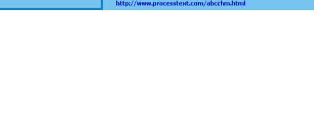

### Linux 概述

与 Unix 类似，Linux 通常可分为三大主要组件：内核、环境和文件结构。内核是运行程序并管理硬件设备，例如磁盘和打印机 的核心程序。环境为用户提供接口。它接收用户的命令并将这些命令发送给内核执行。文件结构组织了文件在存储设备，例如磁盘 上的存储方式。文件被组织成目录。每个目录可能包含任意数量的子目录，每个子目录都包含文件。内核、环境和文件结构共同构成了基本的操作系统结构。有了这三者，你可以运行程序、管理文件并与系统交互。

环境在内核和用户之间提供接口。它可以被描述为解释器。这种接口解释用户输入的命令并将其发送给内核。Linux 提供了多种环境：桌面、窗口管理器和命令行 shell。Linux 系统上的每个用户都有自己的用户界面。用户可以根据自己的特殊需求定制环境，无论是 shell、窗口管理器还是桌面。从这个意义上说，对用户而言，操作系统更像是一个可由用户控制的操作环境。

在 Linux 中，文件被组织成目录，就像在 Windows 中一样。整个 Linux 文件系统是一个庞大的相互连接的目录集合，每个目录都包含文件。一些目录是为系统使用而保留的标准目录。你可以为自己的文件创建自己的目录，也可以轻松地将文件从一个目录移动到另一个目录。你甚至可以移动整个目录，并在系统上与其他用户共享目录和文件。在 Linux 中，你还可以为目录和文件设置权限，允许他人访问或仅限制自己访问。事实上，每个用户的目录最终都连接到其他用户的目录。目录按层次树结构组织，以初始根目录开始。所有其他目录最终都源自这个第一个根目录。

随着 K 桌面环境（KDE）和 GNU 网络对象模型环境（GNOME），Linux 现在拥有完全集成的 GUI 界面。你可以完全从任一界面执行所有 Linux 操作。KDE 和 GNOME 都是完全可操作的桌面，支持拖放操作，使你能够将图标拖到桌面上并在应用程序面板上设置自己的菜单。两者都依赖于底层的 X Window 系统，这意味着只要它们都安装在你的系统上，一个桌面上的应用程序就可以在另一个桌面上运行。GNOME 和 KDE 网站对于这些桌面的文档、新闻和可下载软件特别有帮助。两个桌面都可以运行任何 X Window 系统程序，以及任何基于光标的程序，例如 Emacs 和 Vi，它们设计用于在 shell 环境中工作。与此同时，专门为这些桌面编写的应用程序非常多，并且包含在你的发行版中。K 桌面拥有完整的互联网工具，以及编辑器、图形、多媒体和系统应用程序。GNOME 的应用程序稍少，但目前正在开发许多应用程序。请访问其网站 www.gnome.org 和 www.kde.org 查找新应用程序。随着新版本的发布，它们包含新的软件。

注意 Ximian 目前维护一个名为 Ximian Desktop 的增强版 GNOME，网址为 www.ximian.com。

### 开源软件

Linux 是在互联网上作为合作的开源工作而开发的，因此没有公司或机构控制 Linux。为 Linux 开发的软件反映了这一背景。开发通常发生在 Linux 用户决定共同开展一个项目时。软件发布在互联网站点上，任何 Linux 用户都可以访问该站点并下载软件。Linux 软件开发一直都在互联网环境中进行，范围全球化，吸引了来自世界各地的程序员。启动一个基于 Linux 的软件项目的唯一需要就是一个网站。

大多数 Linux 软件都是作为开源软件开发的。这意味着应用程序的源代码与应用程序一起自由分发。互联网上的程序员可以为软件包的开发做出自己的贡献，修改和纠正源代码。Linux 是一个开源操作系统。它的源代码包含在其所有发行版中，并在互联网上自由提供。许多主要的软件开发工作也是开源项目，KDE 和 GNOME 桌面以及它们的大多数应用程序也是如此。Netscape Communicator 网络浏览器包也已成为开源，其源代码可自由获得。Sun 支持的 OpenOffice 办公套件是一个基于 StarOffice 办公套件的开源项目（StarOffice 本质上是 Sun 的 OpenOffice 商业版本）。许多在 Linux 上运行的开源应用程序已将其网站设在 SourceForge（sourceforge.net），这是一个专门为支持开源项目而设计的托管站点。你可以在 Linuxcare（www.linuxcare.com）和 www.opensource.org 找到有关开源运动和最新发展的更多信息。

开源软件受公共许可证保护。这些许可证防止商业公司通过添加少量自己的修改、版权保护这些更改并将其作为自己的产品出售来控制开源软件。最受欢迎的公共许可证是自由软件基金会提供的 GNU 通用公共许可证。这就是 Linux 分发的许可证。GNU 通用公共许可证保留版权，以要求软件及其所做的任何修改始终可自由获得的方式自由许可软件。还创建了其他公共许可证以支持不同类型的开源项目的需求。GNU 宽通用公共许可证（LGPL）允许商业应用程序使用 GNU 许可的软件库。QT 公共许可证（QPL）允许开源开发者使用 KDE 桌面必不可少的 QT 库。你可以在 www.opensource.org 找到完整列表。

Linux 目前在自由软件基金会提供的 GNU 公共许可证下受版权保护，通常被称为 GNU 软件（见 www.gnu.org）。GNU 软件是免费分发的，前提是它被自由分发给他人。GNU 软件已被证明可靠有效。许多流行的 Linux 实用程序，例如 C 编译器、shell 和编辑器，都是 GNU 软件应用程序。随你的 Linux 发行版安装的有 GNU C++ 和 Lisp 编译器、Vi 和 Emacs 编辑器、BASH 和 TCSH shell，以及 Tex 和 Ghostscript 文档格式化程序。此外，还有许多开源软件项目根据 GNU 通用公共许可证（GPL）获得许可。其中许多软件应用程序可在不同的互联网站点获得，这些站点列在表 1-3 中。第 4 章和第 29 章详细描述了从互联网站点下载软件应用程序并将其安装到系统上的过程。

根据 GNU 通用公共许可证条款，原作者保留版权，尽管任何人都可以修改软件并重新分发，前提是源代码包含在内、公开并免费提供。此外，对出售软件或免费赠送软件没有任何限制。一个分销商可以对软件收费，而另一个分销商可以免费提供。主要的软件公司也在提供其最受欢迎应用程序的 Linux 版本。Sun 的 Java 软件开发工具包（SDK）的 Linux 版本也可通过 www.blackdown.org 获得。Oracle 提供其 Oracle 数据库的 Linux 版本。（目前，似乎没有微软应用程序的计划。）

## ABC Amber CHM 转换器试用版

请注册以移除此横幅。

http://www.processestext.com/abcchm.html


### Linux 软件

目前有大量 Linux 软件可从在线来源获得。您可以下载桌面、互联网服务器、办公套件和编程包等应用程序。多个集中式存储库使查找应用程序和获取其信息变得容易。特别值得注意的是 sourceforge.net、freshmeat.net、rpmfind.net 和 apps.kde.com。

软件包以压缩归档或 RPM 包的形式分发。RPM 包是使用 Red Hat 软件包管理器归档的。压缩归档的扩展名如 `.tar.gz` 或 `.tar.Z`，而 RPM 包的扩展名为 `.rpm`。对于 Red Hat Fedora Core，您可以使用 Red Hat 更新代理（参见第 4 章）从其 Fedora Yum 存储库更新到软件的最新 Red Hat RPM 包版本。对于 Red Hat Enterprise Linux，您可以使用所述的 Red Hat Network 自动为系统下载升级。此外，您从任何站点直接下载的任何 RPM 包，都可以使用 GNOME 或 KDE 桌面上的 `redhat-config-packages` 工具一键轻松安装。您也可以下载源版本并直接在系统上编译它。这已成为一个简单的过程，几乎与安装编译好的 RPM 版本一样简单。


# Linux 软件资源概览

## Red Hat 镜像与开源项目

Red Hat 还有大量镜像站点，您可以从中下载当前版本的软件包。提供大量软件归档的大多数 Linux 互联网站点都有镜像站点，例如 www.kernel.org，其中存放着新的 Linux 内核。如果您连接主 FTP 站点有困难，请尝试其镜像之一。Red Hat 还在 sources.redhat.com 主办开源项目。

以下表格列出了 Linux 软件的不同站点。Linux 软件的存储库和归档列在表 1-3 中，同时还列出了几个专业站点，例如商业和游戏软件站点。下载软件包时，务必检查是否有为您的特定发行版打包的版本。例如，rpmfind.net、freshmeat.net 和 sourceforge.net 也是查找 RPM 包的好地方。

### 表 1-3：Linux 软件档案、存储库和链接

| 网址 | 互联网站点 |
|---|---|
| sourceforge.net | SourceForge，Linux 应用程序开源软件开发站点和软件存储库 |
| fedora.redhat.com/updates | Red Hat Fedora Yum 存储库，用于 Fedora 更新，包含已发布和测试版本 |
| www.linuxgames.com | Linux 游戏 |
| www.gnome.org | GNOME 应用程序 |
| apps.kde.org | KDE 软件存储库 |
| freshmeat.net | 新的 Linux 软件 |
| www.linuxlinks.org | Linux 链接 |
| filewatcher.org | Linux FTP 站点监视器 |
| www.tldp.org/links.html | Linux 链接 |
| rpmfind.net | RPM 包存储库 |
| www.gnu.org | GNU 归档 |
| linux.duke.edu/projects/yum | Yellowdog Updater，Modified（Yum）更新工具，提供用于更新 Red Hat Fedora Core Linux 的 Yum 存储库列表 |
| www.blackdown.org | Linux Java 网站 |
| apt-rpm.tuxfamily.org | APT-RPM Red Hat 存储库，用于 APT 启用的 RPM 包（参见第 4 章） |
| sources.redhat.com | 由 Red Hat 主办的开源软件 |

## Linux 办公和数据库软件

现在有许多专业级数据库和办公套件可用于 Linux。其中包括 Oracle 和 IBM 数据库以及 OpenOffice 和 K Office 套件。表 1-4 列出了办公套件和数据库的站点。其中许多站点为 Linux 提供免费的个人版软件，而其他站点则完全免费。您可以直接从它们下载并安装到您的 Linux 系统上。

### 表 1-4：数据库和办公软件

| 网址 | 数据库 |
|---|---|
| www.oracle.com | Oracle 数据库 |
| www.sybase.com | Sybase 数据库 |
| www.software.ibm.com/data/db2/linux | IBM DB2 数据库 |
| www-3.ibm.com/software/data/informix/ | Informix 数据库 |
| www.softwareag.com | Adabas D 数据库 |
| www.mysql.com | MySQL 数据库 |
| www.ispras.ru/~kml/gss | GNU SQL 数据库 |
| www.postgresql.org | PostgreSQL 数据库 |
| www.fship.com/free.html | FlagShip（xBase 数据库文件的接口） |
| koffice.kde.org | Katabase（KOffice 桌面数据库） |
| sourceforge.net/projects/gaby/ | Gaby（GNOME 桌面个人数据库） |
| 办公软件 | |
| koffice.kde.org | KOffice |
| wwws.sun.com/software/star/staroffice/ | StarOffice |
| www.openoffice.org | OpenOffice |
| www.gnome.org/gnome-office | GNOME Office 项目 |

## 互联网服务器

Linux 以及所有 Unix 系统最重要的功能之一是其互联网客户端和服务器集合。互联网是在 Unix 系统上设计和开发的，互联网客户端和服务器，例如 FTP 和 Web 的客户端和服务器，最初是在 Unix 的 BSD 版本上实现的。DARPA NET 作为互联网的前身，被设立用于连接全国各地不同大学的 Unix 系统。Linux 包含完整的互联网客户端和服务器集合，包括邮件、新闻、FTP 和 Web，以及代理客户端和服务器。可用于 Linux 的互联网服务器软件站点列在表 1-5 中。其中大多数已包含在本書附带的 Red Hat DVD-ROM 中；但是，您可以直接从服务器的网站获取新闻、文档和最新版本。

### 表 1-5：网络服务器和安全

| 网址 | 服务器 |
|---|---|
| www.apache.org | Apache Web 服务器 |
| www.proftpd.org | ProFTPD FTP 服务器 |
| www.isc.org | Internet 软件联盟：BIND、INN 和 DHCPD |
| www.sendmail.org | Sendmail 邮件服务器 |
| www.squid.org | Squid 代理服务器 |
| www.samba.org | Samba SMB（Windows 网络）服务器 |
| www.eudora.com/qpopper | Qpopper POP3 邮件服务器 |
| www.netfilter.org | IP Tables 防火墙 |
| www.netfilter.org/ipchains | IP Chains 防火墙 |
| www.ssh.com | Secure Shell 加密 |
| web.mit.edu/kerberos/www | Kerberos 网络身份验证协议 |
| www.openssh.com | Open Secure Shell（SSH 的免费版本） |

## 开发资源

Linux 一直为编程语言和工具提供强大的支持。所有发行版都包含 GNU C 和 C++ 编译器（`gcc`）以及 `make` 等支持工具。大多数发行版为 KDE 和 GNOME 桌面提供完整的开发支持，让您可以创建自己的 GNOME 和 KDE 应用程序。您还可以下载用于创建 Java 程序的 Java 软件开发工具包的 Linux 版本。Perl 和 Tcl/TK 的 Linux 版本也包含在大多数发行版中。您可以从其网站下载当前版本。表 1-6 列出了 Linux 编程感兴趣的不同站点。

### 表 1-6：Linux 编程

| 网址 | 互联网站点 |
|---|---|
| www.gnu.org | Linux 编译器和工具（gcc） |
| dev.scriptics.com | Tcl Developer Xchange，Tcl/Tk 产品 |
| java.sun.com | Sun Java 网站 |
| www.perl.com | 带有 Perl 软件的 Perl 网站 |
| www.blackdown.org | Sun 的 Linux Java 软件开发工具包 |
| developer.gnome.org | GNOME 开发者网站 |
| www.openprojects.nu | Open Projects Network |
| developer.kde.org | KDE 开发者库 |
| www.linuxcare.org | Linux 开源软件支持 |

## 在线信息来源

几乎任何 Linux 主题都有广泛的在线资源。本章中的表格列出了可以获取软件、显示文档并阅读最新发展文章的站点。许多 Linux 网站提供有关 Linux 的新闻、文章和信息。其中一些，例如 www.linuxjournal.com 和 www.linuxgazette.com，是基于流行的 Linux 杂志。其他站点，例如 www.linux.com、www.linuxworld.com 和 www.linux.org，作为 Linux 的网络门户运营。有些站点专注于特定领域，例如 linuxheadquarters.com 提供 Linux 软件指南，www.linuxgames.com 提供移植到 Linux 的最新游戏。目前，许多 Linux 网站提供有关 Linux 发展的新闻、信息和文章，以及文档、软件链接和其他资源。这些列在表 1-7 中。

### 表 1-7：Linux 信息和新闻站点

| 网址 | 互联网站点 |
|---|---|


| `www.tldp.org` | Linux 文档项目网站 |

| `www.lwn.net` | Linux Weekly News |

| `www.linux.com` | Linux.com |

| `www.linuxtoday.com` | Linux Today |

| `www.linuxplanet.com` | LinuxPlanet |

| `www.linuxfocus.org` | Linux Focus |

| `www.linuxworld.com` | Linux World |

| `www.linuxjournal.com` | Linux Journal |

| `www.linuxgazette.com` | Linux Gazette |

| `www.linuxmagazine.com` | Linux Magazine |

| `www.linux.org` | Linux Online |

| `www.li.org` | Linux International 网站 |

| `www.linux.org.uk` | Linux European 网站 |

| linuxheadquarters.com | Linux 指南和软件 |

| slashdot.org | Linux 论坛 |

| `www.opensource.org` | 开源信息 |

分发 FTP 和网站，例如 `www.redhat.com` 和 `ftp.redhat.com`，提供广泛的 Linux 文档和软件。`www.gnome.org` 站点存放 GNOME 桌面的软件和文档，而 `apps.kde.com` 存放 KDE 桌面的软件和文档。本章中的表格列出了许多可用的站点。您可以通过包含指向其他网站链接的资源页面找到其他站点——例如，万维网上的 Linux 网站 `www.tldp.org/links.html`。

### 文档

Linux 文档也已通过互联网开发。目前可用的大部分 Linux 文档可以从互联网 FTP 站点下载。由 Matt Welsh 主导的名为 Linux Documentation Project (LDP) 的特殊 Linux 项目开发了一套完整的 Linux 手册。文档可在 LDP 主站 `www.tldp.org` 获取。LDP 提供的 Linux 文档列于表 1-8 中，并附有其互联网站点。

#### 表 1-8：Linux Documentation Project

| 站点 | 网站 |
|---|---|
| `www.tldp.org` | LDP 网站 |
| 指南 | 文档格式 |
| Linux Installation and Getting Started Guide | DVI, PostScript, LaTeX, PDF, and HTML |
| Linux User's Guide | DVI, PostScript, HTML, LaTeX, and PDF |
| Linux System Administrator's Guide | PostScript, PDF, LaTeX, and HTML |
| Linux Network Administrator's Guide | DVI, PostScript, PDF, and HTML |
| Linux Programmer's Guide | DVI, PostScript, PDF, LaTeX, and HTML |
| The Linux Kernel | HTML, LaTeX, DVI, and PostScript |
| Linux Kernel Hacker's Guide | DVI, PostScript, and HTML |
| Linux HOWTOs | HTML, PostScript, SGML, and DVI |
| Linux FAQs | HTML, PostScript, and DVI |
| Linux Man Pages | Man page format |

目前可用的大部分标准 Linux 软件和文档已包含在您的 Red Hat DVD-ROM 中。HOW-TO 文档均以 HTML 格式提供，因此您可以使用 Web 浏览器轻松查看它们。不过，未来您可能需要直接访问 Linux 互联网站点以获取最新信息和软件。

Linux Documentation Project 维护了大量镜像。您可以通过多种来源链接到其中任何一个，例如 LDP 主站 `www.tldp.org` 和 `www.linuxjournal.org`。文档包括用户指南、入门介绍和管理员指南。这些有文本、PostScript 或网页格式。表 1-8 列出了这些指南。您还可以找到更简短的解释，即所谓的 HOW-TO 文档。

除了网站外，还提供 Linux Usenet 新闻组。通过您的互联网连接，您可以访问 Linux 新闻组，阅读其他 Linux 用户的评论并发布自己的消息。存在多个 Linux 新闻组，均以 `comp.os.linux` 开头。其中对初学者特别有兴趣的是 `comp.os.linux.help`，您可以在此发布问题。表 1-9 列出了一些可供查阅的 Usenet Linux 新闻组，特别是用于发布问题。

#### 表 1-9：Usenet Newsgroups

| 新闻组 | 标题 |
|---|---|
| `comp.os.linux.announce` | Linux 开发公告 |
| `comp.os.linux.development.apps` | 用于开发 Linux 应用的程序员 |
| `comp.os.linux.development.system` | 用于在 Linux 操作系统上工作的程序员 |
| `comp.os.linux.hardware` | Linux 硬件规格 |
| `comp.os.linux.admin` | 系统管理问题 |
| `comp.os.linux.misc` | 特殊问题和事项 |
| `comp.os.linux.setup` | 安装问题 |
| `comp.os.linux.answers` | 命令问题答案 |
| `comp.os.linux.help` | 特定问题的问答 |
| `comp.os.linux.networking` | Linux 网络问题和事项 |
| `linux.dev.group` | 以 linux.dev 开头的众多开发新闻组，例如 linux.dev.admin 和 linux.dev.doc |

## 第 2 章：Installing Red Hat and Fedora Core Linux

### 概述

本章描述了 Red Hat 和 Fedora Core Linux 的安装过程。安装包括 Linux 操作系统、大量 Linux 应用程序以及一套完整的网络服务器。Red Hat 和 Fedora 使用相同的 Anaconda 安装程序，设计为易于使用且友好，同时高效简洁，尽可能安装尽可能多的服务和应用程序。详细的帮助面板解释了每一步的每个过程。某些服务，例如 Web 服务器支持，通常需要专门且通常复杂的配置操作。Red Hat 和 Fedora 会自动安装并为其中许多服务提供默认配置。

Red Hat 和 Fedora 提供详细的安装指南，例如 Official Red Hat Linux x86 Installation Guide。 （Fedora 版本即将推出。）它可在 Red Hat 网站上获取。该指南由您可以使用任何浏览器查看的网页组成。它们包括详细的图表和逐步说明。强烈建议在安装前查阅此手册。本章介绍了安装过程中的所有步骤，但不如 Red Hat 和 Fedora 指南详细。您可以在 `www.redhat.com` 的 Red Hat 网站上访问文档。单击 Support 并选择您 Red Hat 版本的链接。

安装 Linux 涉及多个步骤。首先，您需要确定您的计算机是否满足基本硬件要求。如今，大多数基于 Intel 的 PC 计算机都符合要求。Red Hat 支持多种安装 Linux 的方法。您可以从本地源（如 CD-ROM 或硬盘）或网络或互联网源安装。对于网络或互联网源，Red Hat 支持 NFS、FTP 和 HTTP 安装。使用 FTP，您可以从 FTP 站点安装。使用 HTTP，您可以从网站安装。NFS 使您能够通过本地网络安装。对于本地源，您可以从 CD-ROM 或硬盘安装。本书附带的 DVD-ROM 也可作为启动 CD-ROM 使用。此外，您可以通过从 DVD-ROM、DOS 系统启动，或从可随后使用 DVD-ROM 或硬盘存储库的启动磁盘启动来开始安装过程。Red Hat 文档详细介绍了每种方法。本章涉及使用本书提供的 DVD-ROM 进行安装。

一旦安装程序开始，您只需逐屏按照说明操作。大多数情况下，您只需进行简单选择或提供 yes/no 答案。安装程序经历几个阶段。首先，您在硬盘上创建 Linux 分区，然后安装软件包。之后，您配置网络连接，然后配置 X Window System 以支持图形用户界面。X Window System 和网络配置都可以在稍后独立进行。


系统安装完成后，您就可以启动并登录。通常，您将使用图形登录，选择所需的桌面并输入用户名和密码。或者，您可以登录到简单的命令行界面。从命令行，您可以调用 GNOME 或 KDE 等桌面环境，为您提供完整的图形用户界面。


## ABC Amber CHM Converter Trial version

请注册以移除此横幅。

`http://www.processestext.com/abcchm.html`

### 硬件、软件和信息要求

在安装 Linux 之前，您必须确保计算机满足某些最低硬件要求。您还需要准备有关显示器、显卡、鼠标和 CD-ROM 驱动器的特定信息。所有要求在以下各节中都有详细说明。在开始安装前请务必仔细阅读它们。在安装程序期间，您需要提供反映计算机配置的响应。

#### 硬件要求

以下列出了在基于 Intel 的 PC 上安装标准 Linux 系统的最低硬件要求：

- 一台 32 位基于 Intel 的个人计算机。至少需要 Intel 或兼容的 80386、80486 或 Pentium 级微处理器。图形界面推荐 400 MHz Pentium，文本推荐 200 MHz。
- 一个 CD-ROM 或 DVD-ROM 驱动器（如果您使用本书附带的 DVD-ROM，您将需要一个 DVD-ROM 驱动器）。
- 如果您的 PC 无法从 CD-ROM 或 DVD-ROM 启动，则需要一个 3 1/2 英寸软盘驱动器和软盘。3 1/2 英寸、DOS 高密度（HD）软盘驱动器用于创建安装磁盘（如果您从软盘安装）。如果您直接从 CD-ROM 安装，则不需要它。启动软盘可以使用 Linux 或 Windows 操作系统创建。
- 通常，文本至少需要 64MB RAM，图形需要 192MB。（Linux 最少可在 12MB RAM 上运行。）标准安装至少需要 2GB 免费硬盘空间，包括应用程序（请记住，Linux 在最小安装上可以运行得更少，最少 100MB 和 16MB 交换空间）；完整安装（所有应用程序）推荐 3GB 到 6GB 或更多。您需要在大多数发行版 CD-ROM 上安装所有软件包约 5GB。基本软件包的标准安装通常占用 3GB，外加 64MB 到 512MB 的交换空间，具体取决于您拥有的 RAM 内存量。如果您的硬盘空间少于 1GB，您可以选择执行最小安装，仅安装 Linux 内核而不安装大多数应用程序。您以后可以使用 System Settings 窗口中可访问的 `redhat-config-packages` 工具一次安装一个您想要的应用程序。
- 硬盘要求取决于您想要的安装类型：
  - Custom Installation (minimum): 520MB
  - Server (minimum): 870MB
  - Personal Desktop: 1.9GB
  - Workstation: 2.4GB
  - Custom Installation (everything): 5.3GB

#### 硬盘配置

如今，Linux 通常运行在其自己的硬盘上，尽管它也可以在包含不同操作系统（如 Windows）单独分区的硬盘上的不同分区上运行。

如果您想在同一硬盘上安装 Linux 和 Windows，您可以使用分区管理软件包，例如 `fdisk`、`fips`、`Parted` 或 Partition Magic，来设置您的 Windows 和 Linux 分区。如果您已在硬盘上安装 Windows 并配置为占用整个硬盘，您将调整其分区大小以释放未使用的空间。释放的空间然后可用于 Linux 分区。有关更多详细信息，请参阅 Red Hat Linux x86 Installation Guide。

#### 信息要求

将功能强大的操作系统如 Linux 适配到 PC 的一部分在于充分利用手头的计算机硬件。在几乎所有配置中，您的 Linux 安装过程都会自动检测和配置您的硬件组件。然而，有时，特别是对于较旧或非常新的硬件，您的安装程序可能无法正确识别组件。如果您有此类组件，例如新型号显示器或显卡，您应首先查阅其手册并记下某些配置设置。

您还需要确定如何使用硬件资源，例如，您希望将多少硬盘空间分配给 Linux。

### CD-ROM、硬盘和鼠标信息

对于某些较旧的 SCSI CD-ROM 驱动器，您需要制造商的名称和型号。

确定您希望将多少硬盘（以兆字节为单位）分配给您的 Linux 系统。如果与 Windows 共享，请确定 Windows 需要多少，Linux 需要多少。

确定您希望为交换分区分配多少空间。您的交换分区应与您的 RAM 内存大小大致相同，但最少可以使用 64MB。对于 RAM 配置较小的系统，交换磁盘应为 RAM 的两倍大小。交换分区的大小在 2.4 内核中得到了扩展。Linux 使用您的交换分区作为计算机 RAM 的扩展。

查找您正在使用的鼠标的品牌和型号。Linux 支持串行、USB、PS/2、IMPS/2 和总线鼠标。大多数鼠标都受支持，包括 Microsoft、Logitech 和 Mouse Systems。

了解您所在的时区以及硬件时钟设置为哪个时区。这可以是格林威治标准时间（GMT），也称为协调世界时（UTC），或您的本地时区。

了解您的鼠标使用哪种端口，例如 PS/2、USB 或串行端口。现在大多数系统使用 PS/2 端口。对于串行端口鼠标，您需要知道它连接到哪个端口：`COM1`、`COM2` 或无。

### 视频和显示器信息

虽然大多数显示器和显卡在安装过程中会自动配置，但如果检测错误，您可能仍需要提供制造商的品牌和型号。查找显示器的制造商及其型号，例如 Iiyama VisionMaster 或 Hitachi CM828。对显卡也做同样的操作——例如，Matrox Millennium G400 或 ATI Radeon（您可以在 `www.xfree86.org` 上找到受支持卡的完整列表）。这应列在随计算机提供的手册或注册信息中。对于一些最新的显示器和显卡，以及一些较旧、不常见的型号，您可能需要提供某些硬件规格。尽可能将这些信息备好是明智的。在安装过程结束时，您会看到可供选择的显卡和显示器列表。这些列表非常详尽。但是，如果您的卡或显示器不在列表中，则需要提供有关它们的某些硬件信息。如果配置失败，您始终可以使用 X Window System 配置工具 `redhat-config-xfree86` 稍后进行配置。特别重要的是显示器信息，包括垂直和水平刷新率。

#### 显卡信息

您还应了解以下显卡信息，尽管芯片组可能并非必要。您的卡将被自动检测，但您应确保选择准确：

- 您的显卡的品牌和型号是什么？
- 您的显卡使用什么芯片组？
- 您的显卡上有多少内存？

#### 显示器信息

您的显示器的制造商和型号是什么？Linux 支持广泛的显示器列表，涵盖几乎所有当前型号。您的显示器将被自动检测并选择。如果检测错误，您可以从列表中找到正确的型号并选择它。但是，如果您的显示器不在此列表中，您可能需要提供以下信息。请确保此信息正确。如果您输入的水平或垂直刷新率过高，可能会严重损坏旧显示器。新显示器只会关闭。您可以选择通用配置文件，也可以输入自定义配置文件的相关信息。为此，您需要以下信息：

- 水平刷新率（Hz）
- 垂直刷新率（Hz）

### 网络配置信息

如果您的 ISP 服务或网络使用 `DHCP`，您很可能不需要提供任何配置信息。大多数本地网络、有线连接和 DSL 连接现在使用 `DHCP` 自动配置主机。网络信息由 `DHCP` 服务器自动提供。在安装过程中，您将可以选择自动配置网络连接（`DHCP`）或手动输入网络信息。

如果您需要配置网络连接，您也可以将配置推迟到以后，并使用发行版提供的网络配置实用程序进行网络配置。在安装期间，您需要做的就是提供一个主机名。

如果您决定手动配置网络连接，您将需要以下信息，通常可以从您的网络管理员处获得：

- 您的计算机的名称（称为主机名）。您的计算机将在 Internet 上通过此名称被识别。请勿使用“localhost”，它由系统保留用于特殊用途。
- 分配给您的机器的 Internet 协议（IP）地址。Internet 上的每个主机都被分配一个 IP 地址。
- 您的网络 IP 地址。此地址通常与 IP 地址相似，但在末尾有一个或多个零。
- 子网掩码。对于 C 类 IP 地址，这通常是 255.255.255.0。但是，如果您是大型网络的一部分，请咨询您的网络管理员。
- 您的网络的广播地址（如果有）。通常，您的广播地址与您的 IP 地址相同，只是最后一位数字使用 255。
- 您的网络的网关 IP 地址。网关将您的网络连接到更大的网络，如 Internet。
- 您的网络使用的任何名称服务器的 IP 地址。
- 如果您的网络使用 `NIS` 服务器，则为 `NIS` 域和 IP 地址。
- 如果您的网络连接到 Windows 网络，则为 Samba 服务器。

### 创建启动磁盘


如果您使用本书附带的 DVD-ROM 安装 Red Hat，或使用一套 CD-ROM 光盘安装 Linux，并且您的计算机相对较新，那么它很可能具有从 CD-ROM 启动的能力。本书的 DVD-ROM 可作为可启动 CD-ROM 运行。在这种情况下，您只需将 CD-ROM 或本书的 DVD-ROM 用作安装盘并跳过本节即可。（您可能需要配置 BIOS 从 CD-ROM 启动。）如果您无法从 CD-ROM 或 DVD-ROM 启动，您将必须按照此处所述创建软盘安装盘。

注意 如果您从本书附带的 Red Hat DVD-ROM 安装，您需要在计算机上安装 DVD-ROM 驱动器来读取 DVD-ROM 光盘。本书附带的 DVD-ROM 已配置为可启动，功能类似于启动 CD-ROM。如果您的系统支持可启动 CD-ROM，那么它将从此 DVD-ROM 启动，让您直接从 DVD-ROM 安装 Red Hat 系统。

在 Windows 上，使用 `rawritewin` 程序创建软盘安装盘，首先将 CD-ROM 插入 CD-ROM 驱动器（如果您从本书附带的 DVD-ROM 光盘安装，则改用 DVD-ROM 驱动器）。切换到您的 CD-ROM 驱动器。切换到 CD-ROM 驱动器后，您需要切换到 `\dosutils` 目录。`rawritewin` 命令位于 `dosutils\rawritewin` 目录中。只需双击它即可启动它。使用 `rawritewin` 创建启动盘非常容易。只需从 Windows 运行它并使用其界面选择软盘映像 `bootdsk.img`，以及支持磁盘 `pcmiadd.img` 和 `drvnet.img`。用于 CD-ROM 或 DVD-ROM 安装的映像文件是 `boot.iso` 文件，也位于您的 CD-ROM 的 `images/` 目录中。请确保您的软盘驱动器已正确列出。默认值为 `A:`。然后将一张空白软盘放入软盘驱动器并单击 Write。

对于您必须在 MS-DOS 上使用的 `rawrite`，在 DOS 提示符下，切换到您的 CD-ROM 驱动器，使用该驱动器的任何字母。例如，如果您的 CD-ROM 驱动器是 E 驱动器，只需键入 `e:` 并按 ENTER。切换到 CD-ROM 驱动器后，您需要切换到 `\images` 目录。在本书附带的 DVD-ROM 上，安装盘映像是 `bootdsk.img`，网络和笔记本电脑的支持磁盘为 `drvnet.img` 和 `pcmiadd.img`。`rawrite` 命令必须在 DOS 提示符下运行。输入 `rawrite` 命令的完整路径，包括 CD-ROM 或 DVD-ROM 驱动器号，例如 `e:\dosutils\rawrite`。`rawrite` 命令首先提示您输入要复制的磁盘映像文件的名称。输入安装映像文件的完整名称。然后命令会要求您输入放置软盘的软盘驱动器的字母。在许多系统上，这是 A 驱动器。

```
E:\> cd images
E:\images> e:\dosutils\rawrite
Enter source file name: bootdsk.img
Enter destination drive (A or B) and press ENTER: a
```

按 ENTER 确认驱动器中已插入空白软盘。然后 `rawrite` 将映像文件复制到您的软盘，创建您的安装盘。完成后，将磁盘从软盘驱动器中取出。这是安装程序（稍后描述）所指的安装软盘。如果您需要创建网络支持盘，请使用 `drvnet.img`。对于 PCMCIA 支持，请使用 `pcmiadd.img`。

要在 Linux 或 Unix 系统上创建软盘，您使用 `dd` 命令并指定要使用的启动映像文件以及软盘设备名称和软盘大小。您首先需要挂载 CD-ROM，然后切换到其挂载目录。在大多数 Linux 系统上，第一个软盘驱动器位于 `/dev/fd0`，其大小通常为 1440，对应 1.4 软盘。使用 `if` 选项指定要使用的映像文件，`of` 选项指示软盘设备名称，`bs` 选项指定块大小。

```
dd if=images/bootdsk.img of=/dev/fd0 bs=1440
```

如果您的系统包含非常旧的 CD-ROM 驱动器、SCSI 适配器或网络卡，您可能需要创建驱动器磁盘。您的 Red Hat CD-ROM/DVD-ROM 提供了一个名为 `/images/drvnet.img` 的软盘映像，其中包含许多不常见设备的驱动程序，特别是那些不使用 PCI 总线的设备。如果您有这些驱动程序支持的设备，您应该使用 `drvnet.img` 创建驱动器磁盘并

使用 `rawrite` 或 `dd` 命令，就像你为安装软盘所做的那样。在安装过程中，设备将被检测到，并且系统会提示你插入驱动程序磁盘。驱动程序仅在安装所需的设备上才需要，例如 CD-ROM、SCSI 适配器和网卡。对于非常新的设备，你可能需要在驱动程序磁盘上提供自己的驱动程序。


### Installing Linux

安装 Linux 涉及多个过程，首先是创建 Linux 分区，然后加载 Linux 软件，配置你的 X Window System 界面，安装 Linux 启动加载器（GRUB 或 LILO）以启动你的系统，并创建新的用户账户。Red Hat 上使用的安装程序是一个基于屏幕的程序，它会逐步引导你完成所有这些过程，作为一个连续的操作。你可以使用鼠标或键盘进行选择。当你完成一个屏幕时，点击底部的 Next 按钮进入下一屏幕。如果需要返回上一屏幕，点击 Back。你也可以使用 TAB、方向键、空格键和回车键进行选择。安装屏幕会显示一个帮助面板，详细解释每一步。你只需进行选择和选项设置即可。一些屏幕会提供一个选项列表供你选择。在少数情况下，会要求你提供一些信息，如果你按照本章前面的步骤操作，这些信息你应该已经具备。硬件组件会在你操作过程中自动检测并显示。在安装过程中，你可以执行诸如配置网络连接、创建用户和设置时间等管理任务。请记住，这些管理任务也可以在安装后执行。你现在可以开始安装了。以下各节详细说明了该过程每个部分的步骤。这不应超过一个小时。

在安装接近尾声时，系统会要求你创建一张启动磁盘。务必制作一张。启动磁盘将包含有关你的系统的特定配置信息。如果启动加载器出现任何问题，你仍然可以使用启动磁盘启动 Linux。

### Starting the Installation Program

你可以使用多种方法启动安装。如果你的计算机可以从 CD-ROM 启动，你可以直接从 CD-ROM 或随书附带的 DVD-ROM 启动安装。只需在启动计算机之前将 CD-ROM 放入 CD-ROM 驱动器，或将书中的 DVD-ROM 放入 DVD 驱动器。打开计算机后，安装程序将启动。

注意 要从 CD-ROM 或 DVD-ROM 启动，你可能首先需要更改计算机 BIOS 中的启动顺序设置，以便计算机首先尝试从 CD-ROM 启动。这需要一定的技术能力和了解如何设置主板 BIOS 配置的知识。

如果你的硬盘上安装了 DOS 或 Windows 系统，你可以使用 `dosutils` 目录中的 `autoboot.bat` 命令启动安装，如下所示。你必须从 DOS 系统或 Windows DOS 窗口执行此命令。

```
e:\dosutils\autoboot.bat
```

如果以上两种选项都不适合你，你可以使用安装软盘（参见前面关于创建启动磁盘的部分）。这可能是安装 Linux 最可靠的方法。将 Linux 安装盘插入软盘驱动器并重新启动计算机。

根据设备连接的接口以及其配置为主盘还是从盘，用以下字母之一替换 `x`：

- `a` 第一个 IDE 控制器主盘
- `b` 第一个 IDE 控制器从盘
- `c` 第二个 IDE 控制器主盘
- `d` 第二个 IDE 控制器从盘

注意 在安装过程中每个屏幕出现时，默认条目通常会已被选中，这通常是由安装程序的自动探测功能完成的。选中的条目会以高亮显示。如果这些条目正确，你只需点击 Next 接受它们并进入下一屏幕即可。

### Partitions, RAID, and Logical Volumes

你最初将被要求设置并指定要在硬盘上使用的 Linux 分区和硬盘配置。Red Hat 提供了自动分区选项，如果你只想使用单个硬盘来安装 Linux 系统。手动配置硬盘时，Red Hat 提供了一个非常详细且图形化的分区工具，称为 Disk Druid。使用 Disk Druid，你可以创建特定分区，或配置 RAID 设备，或设置逻辑卷（参见第 31 章）。

配置完硬盘后，你的分区将被格式化。如果你在格式化的旧 Linux 分区上仍有数据，会出现一个对话框列出它们并询问你是否确认要格式化它们（你创建的新 Linux 分区将自动格式化）。如果你已经有一个 Linux 系统，你很可能已经有几个 Linux 分区。其中一些可能仅用于系统软件，例如启动和根分区。这些应该被格式化。其他分区可能包含大量用户文件，例如通常保存用户主目录和他们创建的所有文件的 `/home` 分区。你不应格式化此类分区。

### Recommended Partitions


# 手动创建分区

如果你手动创建分区，你至少需要设置两个 Linux 分区：交换分区和根分区。根分区是 Linux 系统和应用程序文件安装的位置。此外，建议你还设置一个仅包含 Linux 内核的启动分区，以及一个保存所有用户文件的 `/home` 分区。将根和启动分区上的系统文件与主分区上的用户文件分开，允许你在系统文件损坏时替换它们，而不会影响用户文件。同样，如果内核损坏，你只需替换启动分区上的内核文件，而根分区上的系统文件保持不变。这种将系统目录分离到不同分区的策略可以进一步扩展以确保更健壮的系统。例如，现在保存 Web 和 FTP 服务器文件的 `/var` 目录可以分配自己的分区，将服务器与系统的其余部分物理分离。保存大多数用户应用程序的 `/usr` 目录可以放在自己的分区中，然后由其他系统共享和挂载。这种策略的一个缺点是，你需要提前知道每个分区想要使用的最大空间。对于系统和内核文件，这很容易确定，但对于磁盘使用量可能大幅变化的目录，如 `/home`、`/var` 甚至 `/usr`，这可能很难确定。作为为每个目录创建单独物理分区的替代方案，你可以使用逻辑卷（稍后描述）。

## 基本分区配置

- `Swap partition` no mount point
- `/` Root partition for system files (and all other files if no other partitions are defined)
- `/boot` Boot partition holding the Linux kernel (200MB approximately)
- `/home` User home directories and files

除交换分区外，设置 Linux 分区时必须指定挂载点。挂载点是该分区上的文件连接到系统整体 Linux 文件结构的位置。根分区的挂载点是根目录，用单个斜杠 `/` 表示。启动分区的挂载点是路径 `/boot`。对于用户分区，它将是 `/home`。

交换分区的大小应与你的 RAM 内存相同，建议最小大小为 64MB。对于 512MB 的 RAM，你可以使用 512MB 的交换分区。如果你的 RAM 很大，你可以使交换分区与之相同大小。如果你的磁盘空间有限，你应使交换分区大小至少为 64MB。

要创建新的分区，您需要提供挂载点、大小（以兆字节为单位）、文件系统类型以及要创建分区的硬盘。对于大小，您可以选择 `Grow To Fill Disk` 选项，使分区自动扩展到磁盘上剩余可用空间的大小。对于文件系统类型，选择 `ext3`，即标准 Linux 分区的 Linux 原生类型，以及用于交换分区的 Linux swap 类型。

## RAID 磁盘

您还可以选择创建软件 RAID 磁盘。首先创建分区并将其类型选择为 Software RAID（有关 RAID 的更多详细信息，请参阅第 31 章）。创建完分区后，您可以创建 RAID 磁盘。单击 RAID 按钮，然后选择之前创建的、想要组成 RAID 磁盘的分区，同时选择 RAID 磁盘的类型。有关创建 RAID 磁盘的详细信息，请参阅 Red Hat Customization Guide。

## 逻辑卷

Red Hat 还支持逻辑卷管理（LVM），让您创建逻辑卷以代替直接使用硬盘分区（请参阅第 30 章）。逻辑卷由逻辑卷管理（LVM）实现。它们提供了一种更灵活、更强大的磁盘存储管理方式，将物理分区组织成逻辑卷，从而可以轻松管理内存。逻辑卷的磁盘存储被视为一个内存池，尽管该卷实际上可能包含分布在不同硬盘上的多个硬盘分区。有一个限制。启动分区不能是逻辑卷。您仍需要创建一个单独的硬盘分区作为启动分区，并使用 `/boot` 挂载点，在其中安装内核。有关创建逻辑卷的详细信息，请参阅 Red Hat Customization Guide。

创建逻辑卷涉及多个步骤。首先创建物理 LVM 分区，然后创建放置这些分区的卷组，然后从卷组中创建逻辑卷，并为其指定挂载点和文件系统类型。要创建物理 LVM 分区，请单击 `New` 并将文件系统类型选择为 `physical volume (LVM)`。为硬盘上想要的每个分区创建一个 LVM 物理分区。创建 LVM 物理分区后，您单击 LVM 按钮来创建逻辑卷。首先需要将 LVM 物理分区分配给卷组。卷组本质上是逻辑硬盘。您可以将来自不同硬盘的 LVM 物理分区分配给同一个卷组，让卷组跨越不同的硬盘。创建卷组后，您就可以创建逻辑卷了。您可以在每个组中创建多个逻辑卷。逻辑卷的功能类似于分区。您必须为创建的每个逻辑卷指定文件系统类型和挂载点。

## 启动加载器

分区准备好后，您安装启动加载器。Red Hat 使用 Grand Unified Bootloader（`GRUB`）。您使用启动加载器从硬盘启动 Linux。屏幕将默认显示要启动的分区，列出安装有不同操作系统的所有分区，例如安装有 Windows 的分区以及用于 Linux 系统的分区。单击 `Advanced options` 可细化启动过程，使您能够选择启动加载器的安装位置或确定驱动器启动顺序。启动加载器的安装位置有两个选择：主引导记录（`MBR`）或根分区。推荐的位置是 `MBR`。

## 网络配置

网络配置屏幕在上半部分为计算机上的不同网络设备显示选项卡式窗格。屏幕显示网络设备、主机名和杂项设置的各个段。如果您使用 DHCP 自动配置网络连接，如大多数网络一样，您可能不需要在此屏幕上执行任何操作。

网络设备段将列出您的网络连接设备，例如以太网设备。对于已通过以太网卡连接到网络的计算机，第一个条目通常标记为 `eth0`。如果您需要手动配置设备，为其输入 IP 地址，您可以单击 `Edit` 以显示设备的配置面板。在这里，您可以选择手动配置设备或使用 DHCP 自动配置它。对于手动配置，您可以输入设备的 IP 地址（通常是计算机的 IP 地址）和网络的网络掩码。

在主机名字段中，您可以选择手动提供网络信息或使用 DHCP 自动获取。如果您选择手动提供网络信息，您可以输入主机名，并在杂项段中输入网络的网关和 DNS 服务器的 IP 地址。

完成网络配置后，防火墙配置屏幕随后可让您创建基本的默认网络安全级别。您可以选择使用默认防火墙规则或自定义配置，指定允许的受信任设备和服务，例如 Web 或 FTP 连接。防火墙配置仍实现较新的 IP tables 防火墙规则（请参阅第 19 章）。

## 系统配置

下一个屏幕让您选择要使用的语言。

在时区配置屏幕上，您可以选择使用地图指定位置来设置时间，或使用协调世界时（UTC）条目。

在下一个屏幕上，您可以为系统上的 root 账户设置 root 密码。这是用于系统管理操作（如安装软件和管理用户）的账户。安装后，类似的屏幕还将让您添加普通用户账户。

## 软件安装

然后您可以选择要在系统上安装的软件包。Red Hat 允许您选择一组预先确定的集合，专为个人桌面、工作站或服务器量身定制。您可以选择其中一种软件包配置或选择自定义安装。在自定义安装中，您可以选择软件包组，例如 `GNOME`、`KDE`、不同服务器（如 Web 或 FTP 服务器）、游戏、编辑器以及开发支持，其中包括编译器和调试器。要安装所有软件包，请选择列表末尾的 `Everything` 条目。

软件包选择界面与第 4 章中讨论的 `redhat-config-packages` 相同。要选择单个软件包，请单击软件包类别右侧的 `Details` 链接。这将列出单个软件包，您可以通过单击其复选框来选择或取消选择。许多软件包需要安装其他软件包，这称为依赖关系。如果您尚未将其选中以进行安装，它们将被自动为您选中。通常会有两个段，Standard 和 Extra，但对于某些软件包可能只有其中一个。`Editors` 类别只有列出 `Vi` 和 `Emacs` 编辑器的 Extra 段，而 Windows 文件服务器类别只有列出 `Samba` 服务器的 Standard 段。Extra 软件包是那些不被认为对所描述类别至关重要的软件包。在 Web Server 类别中，标准段包含 `Apache` Web 服务器，而 Extra 段包含 `Squid` 和 `Tux` 等附加模块和服务器。

然后安装软件包，显示每个软件包的安装情况以及安装进度。（对于本书附带的 Red Hat DVD-ROM，DVD-ROM 将在一项连续操作中安装。安装程序检测到所有软件包都位于单个 DVD-ROM 上。与 CD-ROM 相比，没有弹出或插入任务。）如果您改用 CD-ROM（从 Red Hat 购买或从 Internet 下载），系统会提示您何时安装下一个 CD-ROM。当前光盘将自动为您弹出。安装完成后，后安装过程将完成。然后通常会给您创建启动磁盘的选项。如果硬盘启动失败，您可以使用此磁盘访问 Linux 系统。

## X Window 系统配置（仅限 Red Hat）

对于 Red Hat，X 配置随后完成安装。（Fedora 在安装前会自动检测您的显卡。）这启用了 `GNOME` 和 `KDE` 等 GUI 界面。X 配置使用 `redhat-config-xfree86` 实用程序自动检测您的显卡和显示器。

您首先必须在图形界面屏幕上选择并选择您的显卡。`redhat-config-xfree86` 最初会探测您的卡并从屏幕上显示的显卡列表中选择它，同时


# X 配置与安装

卡上的内存大小。检查您的卡是否已被选中。如果没有，请在列表中定位您的卡并单击它。您需要知道卡的品牌和型号。如果您的显卡未出现在列表中，您可以尝试仅指定芯片组。查明卡上使用的芯片组，并在通用显卡条目中选择它。该条目将列出多个常用支持的芯片组。如果您的卡或芯片组不存在，您应该跳过 X 配置过程。只需单击“跳过 X 配置”复选框。之后您可以尝试使用 X 配置实用程序，例如 `redhat-config-xfree86`，或直接配置 `/etc/X11/XF86Config` 配置文件。这需要技术专业知识。

如果您知道显卡上的显存大小，可以在下拉菜单中查找相应大小的条目。如果选择了不正确的大小，可以选择合适的。

## 监视器配置

在“监视器配置”屏幕上，您选择监视器。最初，`redhat-config-xfree86` 会自动探测您的监视器并从屏幕上列出的型号中选择一个品牌和型号。检查是否选择了正确的监视器。如果没有，请找到其条目并单击它。监视器条目按公司组织在可展开的树中。例如，如果您使用的是惠普监视器，请单击惠普条目旁边的三角形符号以列出惠普生产的所有监视器。然后单击您的型号。当您选择监视器时，屏幕底部的水平和垂直框将显示监视器的水平同步范围和垂直同步范围（这些值通常可在随监视器提供的文档中或从监视器的供应商或制造商处获得）。

如果您的监视器未出现在列表中，请选择通用（通常为通用多同步）或未探测条目。`redhat-config-xfree86` 然后将在屏幕底部的标记框中提供水平和垂直频率值。检查是否输入了正确的水平和垂直频率。如果输入的值过高，您可能会超频监视器并导致其关闭。除非您确定所选监视器不会超出您监视器的能力，否则不要选择与您的监视器“相似”的监视器。

## 自定义图形配置

在“自定义图形配置”屏幕上，您可以通过从其下拉菜单中选择所需规格来指定卡的分辨率和颜色深度。自动探测的条目已预先选中。您可以根据需要将其更改为其他条目：较小监视器使用 1024 x 768，或较大监视器使用 1280 x 1024。

您还可以选择使用图形登录而不是命令行登录。图形登录复选框已为您预先选中。如果选择此选项，启动时 GNOME 桌面管理器 `GDM` 将启动并显示登录屏幕，您可以在其中输入用户名和密码。选项菜单中的“会话”子菜单可让您选择启动 KDE、GNOME 或窗口管理器。登录后，桌面会自动启动。退出桌面后，`GDM` 登录窗口会重新显示。从选项菜单中选择“关机”以关闭 Linux。

如果您不选择此选项，您将以命令行界面启动。在登录提示符下输入用户名，在密码提示符下输入密码以登录。使用 `startx` 启动 GNOME 或使用 `switchdesk` 切换到 KDE。`logout` 命令用于注销。登录后，您可以输入 `shutdown` 或 `halt` 命令来关闭 Linux。

完成后，`redhat-config-xfree86` 将生成一个名为 `/etc/X11/XF86Config` 的 X Window 系统配置文件。这是 X Window 系统启动时使用的文件。

如果您遇到困难，您可以随时单击“跳过 X 配置”复选框以跳过 X Window 系统配置，并在安装系统后稍后再进行。

# 完成安装

安装完成后，您可以单击“退出”按钮重新启动。请先取出安装或启动软盘，或任何 CD-ROM。如果您是从 CD 启动的，重新启动前 CD 将被弹出。如果您直接从 CD-ROM 启动，您可能希望将 BIOS 中的启动顺序改回原始设置。

# 设置

首次启动 Red Hat 或 Fedora Linux 时，将运行设置代理。该代理将帮助您执行系统的基本配置，让您设置日期和时间、配置声卡以及设置用户账户。对于 Fedora，您最初将被要求批准该发行版的 GNU 通用公共许可证。

## 日期和时间

“日期和时间配置”面板将自动探测日期和时间，在日历上显示日期，并在小时、分钟和秒中显示时间。您只需单击按钮即可轻松更改任何条目。您还可以选择使用网络时间协议，它将自动从 Internet 上的时间服务器获取时间，确保您的时间始终正确。您可以从类似 `clock.redhat.com` 的服务器列表中进行选择。

## 用户账户

“用户账户”面板随后将让您为管理用途创建普通用户账户。会显示一个对话框，其中包含用户名、用户全名、密码和密码确认的条目。输入信息并单击“下一步”后，新用户将被列出。您还可以选择 Kerberos 或 NIS 来配置用户的网络登录过程。这将启动 `authconfig` 并让您配置 NIS 和 LDAP。在“身份验证”面板上，您可以配置 LDAP、Kerberos 和 SMB（samba）。您可以为每个启用和配置支持，指定网络可能使用的 NIS、LDAP、Kerberos 或 SMB 服务器。

## 声音配置

在“声音”面板上，您的声卡将被自动检测和配置。您可以单击按钮来测试声音。

## Red Hat Network

然后运行 Red Hat 更新代理，将您注册到 Red Hat Network，以便您可以自动更新系统上安装的软件。目前，对 Red Hat Network 的访问仅限于订阅客户，尽管您可以注册演示账户，提供有限访问。免费访问不提供。如果您使用的是本书提供的 DVD-ROM，或从发行站点下载了 Red Hat，您需要注册 Red Hat Network 基础服务或演示账户。如果您此时不想注册，可以跳到下一个面板。如果您购买了 Red Hat，您可以在此时激活访问。如果您之前已注册，可以使用当前用户名和密码登录。更新代理将检测您系统的硬件配置并生成可注册的配置文件。

## 安装附加软件

然后您可以选择从 DVD-ROM（或如果您使用的是 CD-ROM）安装特定软件。对于 DVD-ROM，“安装”按钮将为您提供对所有软件包的完全访问权限。此时，您将无法使用 DVD-ROM 安装文档。这必须在安装完成后手动完成。但是，如果您有文档 CD-ROM，现在可以从中安装。

## 登录和注销

设置代理随后结束，您的登录屏幕将显示。根据您是否选择让 X Window 系统自动启动，将显示登录提示或登录屏幕。然后您可以使用已设置的任何用户的登录名和密码登录到 Linux 系统。如果您以 `root` 用户登录，可以执行管理操作，例如安装新软件或创建更多用户。要以 `root` 用户登录，请在登录提示符下输入 `root`，在密码提示符下输入 `root` 用户密码。

在登录屏幕上，左下角显示四个弹出菜单：语言、会话、重启和关机。会话菜单让您选择要使用的桌面图形界面，例如 KDE 或 GNOME。您使用关机菜单关机，使用重启菜单重启系统。语言菜单让您选择使用的语言。

完成后，您可以关闭系统。如果您使用的是命令行界面，请使用 `halt` 命令。从 GNOME，您可以选择关闭整个系统。如果您从 GNOME 或 KDE 注销并返回登录屏幕，可以从屏幕底部的会话弹出菜单中选择关机条目。如果系统因任何原因冻结，您可以按住 `CTRL` 和 `ALT` 键并按 `DEL`（`CTRL-ALT-DEL`）以安全地重新启动它。切勿直接关闭电源。您也可以使用 `CTRL-ALT-F3` 切换到命令行提示符并登录以检查系统，使用 `halt` 命令关机。

正常启动时，如果您选择使用 GRUB 启动加载器，将显示 GRUB 菜单，列出您指定的 Linux 和其他操作系统，例如 Windows。使用箭头键移动到 Linux 条目（如果尚未高亮），然后按 `ENTER`。

# 启动磁盘

如果您想在安装期间制作的软盘启动盘丢失或损坏时有备份，可以使用 `mkbootdisk` 命令创建更多副本。在终端窗口或命令行中输入此命令，并指定内核版本号，如下所示：

```
mkbootdisk 2.4.18-14
```

您也可以使用 GNOME 桌面上的 `qmkbootdisk` 工具创建启动磁盘。该工具还允许您指定不同的内核进行启动（参见第 33 章）。当前内核将已预先选中。

您可以使用 `mkbootdisk` 创建启动 CD-ROM 而不是启动软盘。使用 `--iso` 选项和 `--device` 选项并指定要创建的 ISO 映像文件名。然后使用 CD-ROM 烧录软件从映像文件创建 CD-ROM。以下示例创建了一个名为 `mybootcd.iso` 的 CD-ROM 映像文件，可用作启动 CD-ROM。

```
mkbootdisk --iso --device mybootcd.iso 2.4.18-14
```

如果由于某种原因您无法启动或访问系统，可能是由于冲突的配置、库或应用程序所致。在这种情况下，您可以以救援模式启动 Linux 系统，然后使用 Vi 等文本编辑器（参见第 11 章）编辑配置文件，删除可疑库，或使用 RPM（参见第 29 章）重新安装损坏的软件。要进入救援模式，请从您的软盘启动盘、CD-ROM 或本书附带的 DVD-ROM 启动。在启动提示符下输入：

```
linux rescue
```


您将以命令行模式启动，系统文件挂载在 `/mnt/sysimage`。使用 `cd` 命令在目录之间移动（参见第 10 章）。检查 `/mnt/sysimage/etc` 和 `/mnt/sysimage/etc/sysconfig` 中的配置文件。您可以使用 `Vi` 编辑文件。要重新安装文件，请使用 `rpm` 命令（参见第 4 章）。完成后输入 `exit` 命令。

### 注释

如果在运行 Linux 时，您希望打开随书附带的 DVD-ROM，您可以将其插入 DVD-ROM 驱动器。如果文件管理器窗口没有自动打开


## ABC Amber CHM 转换器试用版

请注册以移除此横幅。

http://www.processestext.com/abchm.html

### 第 3 章：界面基础

#### 概述

使用 Linux 已变得几乎是直观的过程，拥有易于使用的界面，如图形登录和图形用户界面（GUIs）如 `GNOME` 和 `KDE`。即使是标准的 Linux 命令行界面也变得更加用户友好，具有可编辑命令、历史列表和基于光标的工具。要开始使用 Linux，您必须知道如何访问您的 Linux 系统，以及一旦进入系统后如何执行命令和运行应用程序。访问可通过默认的图形登录或命令行登录来支持。对于图形登录，会出现一个简单的窗口，其中包含用于选择登录选项的菜单和用于输入用户名和密码的文本框。一旦访问系统，您就可以使用命令行界面或图形用户界面（GUI）与之交互。使用 `GNOME` 和 `KDE` 等 GUI 界面，您可以使用窗口、菜单和图标与系统交互。Red Hat 将两者外观和感觉集成在一起，提供了一个名为 `Bluecurve` 的标准 GUI 界面，使其使用不那么令人困惑。

Linux 以提供对大量帮助文档的便捷访问而著称。在登录系统时，您可以快速获得有关任何 Linux 命令和实用程序的信息。您可以访问描述每个命令的在线手册，或获取提供不同 Linux 功能更详细解释的帮助。Linux 文档项目提供的一整套手册都在您的系统上，可供您浏览或打印。`GNOME` 和 `KDE` 桌面都提供帮助系统，可让您轻松访问桌面、系统和应用程序帮助文件。

提示

Red Hat Linux 入门指南提供了有关首次使用 Red Hat Linux 系统的详细教程。请查阅《参考》、《自定义》和《安全》指南以完成专业任务。

#### 用户账户

您从不直接访问 Linux 系统。相反，Linux 设置了一个名为 `shell` 的接口，您可以通过它与之交互。Linux 是一个多用户系统，可以同时支持多个用户 `shell`，同时容纳多个用户，每个用户通过自己的终端或从远程系统连接。

用户对系统的访问是通过 `accounts` 提供的。Linux 基于的 Unix 最初用于可同时容纳数百个用户的大型小型机和大型机。使用连接到计算机的众多终端之一，用户可以使用用户名和密码登录到 Unix 系统。要获得系统访问权限，您需要为您设置一个用户账户。系统管理员创建该账户，为其分配用户名和密码。然后您使用该账户登录并使用系统。

事实上，您可以使用特殊的系统管理工具创建其他新用户账户。当您以 `root` 用户身份登录时，这些工具对您可用。`root user` 是一个专用于系统管理任务的特殊用户账户，例如创建用户和安装新软件。基本系统管理操作在第 4 章和第 5 章中简要讨论，但在第 27-33 章中有更详细的讨论。

#### 访问您的 Linux 系统

要访问和使用您的 Linux 系统，您必须严格遵循所需的启动和关闭程序。您不能简单地关闭计算机。如果您已安装启动加载程序 `GRUB`，当您打开或重置计算机时，启动加载程序首先决定要加载和运行哪个操作系统。`GRUB` 将显示一个操作系统菜单供您选择。

如果您稍等片刻或按 `ENTER` 键，启动加载程序将加载默认操作系统。如果列出了 Windows 系统，您也可以选择启动它。

您可以将 Linux 操作系统视为在两个不同的层面上运行，一个在另一个之上。第一层是在您启动 Linux 系统时，系统加载并运行。它控制您的计算机及其所有外设。然而，您仍然无法与之交互。Linux 启动后，它会显示登录屏幕，等待用户登录系统并开始使用。您必须先登录，否则无法访问 Linux。

您可以将登录和使用 Linux 视为下一层。现在您可以发出命令指示 Linux 执行任务。您可以使用编辑器或编译器等实用程序和程序，甚至游戏。然而，取决于安装期间所做的选择，您可能使用简单的命令行界面或直接使用桌面与系统交互。既有命令行登录提示，也有图形登录窗口。Red Hat 默认使用图形界面，会向您呈现图形登录窗口，在其中输入用户名和密码。如果您选择不使用图形界面，则会提示您输入用户名的简单命令行提示。

#### 显示管理器：GDM

使用图形登录，您的 GUI 界面会立即启动并显示一个包含用户名和密码框的登录窗口。当您输入用户名和密码然后按 `ENTER` 时，您的默认 GUI 将启动。在 Red Hat 上，默认是 `GNOME`。

对于 Red Hat，图形登录由 `GNOME` 显示管理器（`GDM`）处理。`GDM` 管理登录界面，同时对用户密码和用户名进行身份验证，然后启动所选桌面。如果使用 GUI 界面时出现任何问题，您可以使用 `CTRL-ALT-BACKSPACE` 键强制退出 GUI，返回登录屏幕（或如果您从那里启动 GUI，则返回命令行）。此外，从 `GDM`，您可以使用 `CTRL-ALT-F1` 键切换到命令行界面，然后使用 `CTRL-ALT-F7` 键切换回 GUI。

当 `GDM` 启动时，它会显示一个带有登录框的登录窗口。屏幕底部有四个弹出菜单，分别标记为 `Session`、`Language`、`Shutdown` 和 `Restart`。要登录，请在标记为 `Username` 的框中输入用户名并按 `ENTER`。系统会提示您输入密码。输入后，按 `ENTER`。默认情况下，`GNOME` 桌面随后启动。

当您从桌面注销时，您将返回到 `GDM` 登录窗口。要关闭 Linux 系统，请单击系统菜单以显示 `Reboot` 或 `Shutdown` 条目。选择 `Shutdown` 关闭系统。或者，您也可以在从 `GNOME` 注销时关闭。`GNOME` 将显示一个注销屏幕，其中包含 `Logout`、`Shutdown` 或 `Reboot` 选项。`Logout` 为默认值，但选择 `Shutdown` 也会关闭系统。选择 `Reboot` 将关闭并重新启动系统。（您也可以打开一个终端窗口并输入下一节所述的 `shutdown`、`halt` 或 `reboot` 命令：`halt` 将注销并关闭系统。）

从 `Session` 菜单，您可以选择要启动的桌面或窗口管理器。例如，您可以在这里选择 `KDE` 启动 K 桌面，而不是 `GNOME`。在 Red Hat 上，`KDE` 和 `GNOME` 都将使用 `Bluecurve` 外观和感觉的界面，看起来几乎相同。`Language` 菜单列出了 Linux 支持的多种不同语言。选择一种以更改语言界面。

#### 从命令行界面访问 Linux

对于命令行界面，您最初会得到一个登录提示。系统现在正在运行并等待用户登录和使用。您可以输入用户名和密码来使用系统。登录提示前面是您为系统指定的主机名。在此示例中，主机名为 `turtle`。当您完成使用 Linux 时，首先注销。Linux 然后显示完全相同的登录提示，等待您或其他用户再次登录。这相当于 `GDM` 提供的登录窗口。然后您可以登录到另一个账户。

```
Fedora Core release 1
Kernel 2.4.22-1 on an i686
```

```
turtle login:
```

#### 登录和注销

一旦登录到账户，您就可以输入和执行命令。登录到 Linux 账户涉及两个步骤：输入用户名然后输入密码。输入您的用户账户的用户名。如果您犯了错误，可以使用 `BACKSPACE` 键删除字符。在下一个示例中，用户输入用户名 `dylanp` 然后被提示输入密码：

```
Fedora Core release 1
Kernel 2.4.22-1 on an i686
```

```
turtle login: dylanp
Password:
```

当您输入密码时，它不会显示在屏幕上。这是为了防止他人看到您的密码。如果您输入用户名或密码不正确，系统将以错误消息“Login incorrect”作出响应，并再次要求您输入用户名，从头开始登录过程。然后您可以重新输入用户名和密码。

一旦您正确输入用户名和密码，您就已登录到系统。您的命令行提示符显示，等待您输入命令。请注意，命令行提示符是美元符号（`$`），而不是数字符号（`#`）。`$` 是普通用户的提示，而 `#` 仅用于 `root` 用户。在此版本的 Linux 中，您的提示符前面是主机名和您所在的目录。两者都由一组括号包围。

```
[turtle /home/richlp]$
```

要结束会话，请发出 `logout` 或 `exit` 命令。这会将您返回到登录提示，Linux 等待另一个用户登录。

```
[turtle /home/richlp]$ logout
```

#### 关闭 Linux


如果您想关闭计算机，必须先关闭 Linux。如果不关闭 Linux，您可能需要在下次启动时要求 Linux 执行冗长的系统检查。您可以通过两种方式关闭系统。首先，登录到一个账户然后输入 `halt` 命令。此命令将注销您并关闭系统。

```
$ halt
```

或者，您可以使用带 `-h` 选项的 `shutdown` 命令。使用 `-r` 选项，它将关闭系统然后重新启动它。在下一个示例中，系统在五分钟后关闭。要立即关闭系统，您可以使用 `+0` 或单词 `now`（有关更多详细信息，请参阅第 28 章）。

```
# shutdown -h now
```

### 提示

关机涉及一系列重要操作，例如卸载文件系统和关闭任何服务器。切勿直接关闭计算机。

你也可以在登录提示时强制系统重新启动，按住 `CTRL` 和 `ALT` 键然后按下 `DEL` 键（`CTRL-ALT-DEL`）。系统将经过标准的关机流程然后重新启动你的计算机。

## 从命令行启动图形界面

登录系统后，你可以选择启动 `X Window System` 图形界面，例如 `GNOME` 或 `KDE`，并使用它与你的 Linux 系统交互。在 Linux 中，命令 `startx` 启动 `X Window System` 以及图形界面，然后你就可以使用窗口、菜单和图标与系统交互。`startx` 命令默认启动图形桌面。一旦你关闭图形界面，你将返回到命令行界面，仍保持登录状态。在 Red Hat 上，你可以在桌面中使用桌面切换器在 `GNOME` 或 `KDE` 之间切换。桌面切换器可从“额外系统设置”菜单中的“桌面切换工具”访问，或使用 `switchdesk` 命令。你做出选择后退出桌面即可返回命令行界面。当你再次启动图形界面时，将使用你选择的桌面。

### Bluecurve：GNOME 和 KDE 桌面

可以在 Red Hat Linux 上安装两种可选的桌面图形界面：`GNOME` 和 `KDE`。两者各有其风格和外观。为了提供更一致的图形界面，Red Hat 为 `GNOME` 和 `KDE` 制定了统一的外观和感觉默认设置，称为 `Bluecurve`。有了 `Bluecurve`，`GNOME` 和 `KDE` 看起来几乎相同，具有相同的菜单、面板项目和窗口样式。默认情况下，Red Hat 安装 `GNOME`，不过你也可以选择同时安装 `KDE`。`GNOME` 和 `KDE` 应用程序都可从 `Bluecurve` `GNOME` 或 `KDE` 菜单访问。Red Hat 在其主菜单中提供了一套标准应用程序，例如 `OpenOffice`，以及在“更多”菜单中的其他对应应用程序，例如“更多办公应用程序”下的 `GNOME` 的 `AbiWord` 和 `KDE` 的 `KOffice`。`Bluecurve` 本质上是一个主题，你可以使用 `GNOME` 或 `KDE` 配置工具进行更改。本节描述了 `GNOME` 和 `KDE` 桌面的 `Bluecurve` 界面。

需要注意的是，虽然 `GNOME` 和 `KDE` 的 `Bluecurve` 界面看起来相同，但它们实际上是两个截然不同的桌面界面，具有各自用于选择首选项的工具。`GNOME` 和 `KDE` 上的“首选项”菜单显示了截然不同的桌面配置工具选择。这些内容在第 6 章和第 7 章中讨论。

#### GNOME

如图 3-1 所示的 `Bluecurve` `GNOME` 桌面显示，最初会在屏幕底部显示一个面板，以及 Red Hat 最初设置的任何文件夹和网页图标。你会看到几个网页图标和一个指向你主目录的文件夹。屏幕底部的面板包含用于启动应用程序的图标，例如 `Mozilla`（鼠标和世界标志）、`Evolution` 邮件实用程序以及多个 `OpenOffice` 应用程序。你可以使用主菜单启动应用程序，通过单击面板左侧的 Red Hat 图标（Red Hat 礼帽的图像）显示该菜单。

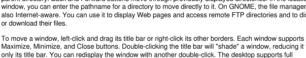

图 3-1：Bluecurve GNOME 桌面

当你在桌面上单击主目录文件夹时，会打开一个文件管理器窗口显示你的主目录。你可以显示主目录中的文件并使用上箭头按钮移动到父目录。返回和前进按钮可在之前显示的目录之间移动。在位置窗口中，你可以输入目录的路径名直接移动到该目录。在 `GNOME` 上，文件管理器也是网络感知的。你可以使用它来显示网页并访问远程 `FTP` 目录以及显示或下载其文件。

要移动窗口，请左键单击并拖动其标题栏，或右键单击其其他边框。每个窗口都支持最大化、最小化和关闭按钮。双击标题栏会“着色”窗口，将其缩小为仅标题栏。你可以通过再次双击重新显示窗口。桌面支持完整的拖放功能。你可以将文件夹、图标和应用程序拖到桌面或其他打开到其他文件夹的文件管理器窗口。移动操作是默认的拖动操作（你也可以在拖动时按住 `SHIFT` 键）。要复制文件，请按住 `CTRL` 键然后单击并拖动，释放鼠标按钮前不要松开。要创建链接，请右键单击该项目并从弹出菜单中选择“创建链接”。然后你可以将链接拖到任何你想要的位置。

面板还包含用于虚拟桌面的工作区切换器，显示为四个方块。单击一个方块即可切换到该区域。你可以使用主菜单“首选项”条目下列出的“首选项”项目，或“开始这里”窗口内的“首选项”窗口来配置 `GNOME` 界面，例如设置背景。单击桌面上的指南针带地图的图像以打开“开始这里”窗口。要配置系统设置，例如添加用户、安装打印机和设置网络连接，请打开“系统设置”窗口，该窗口可从“开始这里”窗口访问，或选择“系统设置”菜单。

要退出 `GNOME` 桌面，请选择主菜单底部“注销”条目。如果你是从登录窗口进入的，则会注销你的账户并返回登录窗口。如果你是从命令行启动 `GNOME`，则会返回到命令行提示符，仍保持登录状态。

#### KDE

带 `Bluecurve` 的 K 桌面环境（`KDE`）看起来与图 3-1 所示的带 `Bluecurve` 的 `GNOME` 非常相似，只是增加了 `CD-ROM` 和软盘驱动器的图标。它在屏幕底部显示一个面板，看起来与 `GNOME` 桌面上显示的面板非常相似。文件管理器外观略有不同，但操作方式与 `GNOME` 文件管理器基本相同。它也是网络感知的，可以作为网页浏览器运行。主菜单中还有一个“控制中心”条目，可打开 `KDE` 控制中心，从中你可以配置 `KDE` 环境的各个方面，例如主题、面板、打印机和键盘等外设（已由 Red Hat 系统工具处理），甚至 `KDE` 文件管理器的网页浏览功能。

### Linux 的窗口管理器

尽管 `GNOME` 和 `KDE` 是完全集成的桌面，但它们实际上是通过窗口管理器与操作系统交互，`GNOME` 使用 `Metacity`，`KDE` 使用 `KDE` 窗口管理器。如果你愿意，可以使用不同的符合 `GNOME` 或 `KDE` 的窗口管理器，或者仅使用窗口管理器代替 `KDE` 或 `GNOME`。你可以把窗口看作是命令行替代品。通过窗口执行的操作会被解释并发送到 Linux 系统执行。窗口管理器在底层的 `X Window System` 上运行，后者实际上提供了基本窗口操作，允许你打开、移动和关闭窗口以及显示菜单和选择图标。`Enlightenment` 和 `AfterStep` 以各自的方式管理这些操作，提供各自独特的界面。这种设计的优点是不同的窗口管理器可以在同一 Linux 系统上运行。从这个意义上说，Linux 不受单一类型的图形用户界面（GUI）限制。在同一 Linux 系统上，一个用户可能使用 `Window Maker` 窗口管理器，另一个用户可能使用 `Afterstep` 窗口管理器，还有一个用户使用 `Enlightenment` 窗口管理器，同时运行。你可以从 `X11` 网站 `www.xwinman.org` 了解有关 Linux 可用不同窗口管理器的详细信息。该网站提供评测、屏幕截图和主页链接，以及列出不同窗口管理器可用功能的比较表。

### 命令行界面

使用命令行界面时，会提供一个简单的提示符，在此提示符下输入命令（参见第 8 章）。即使使用图形用户界面，有时也需要在命令行上执行命令。Linux 命令大量使用选项和参数。请注意在命令行上按正确的顺序放置参数和选项。Linux 命令的格式为命令名称，后跟选项，然后是参数，如下所示：

```
$ command-name options arguments
```

选项是一个字母代码，其前面有一个或两个连字符，用于修改命令执行的操作类型。选项和参数是否可选取决于命令。例如，`ls` 命令可以接受选项 `-s`。`ls` 命令显示目录中文件的列表，而 `-s` 选项会以块为单位添加每个文件的大小。您在命令行上输入命令及其选项如下：

```
$ ls -s
```

参数是命令执行任务可能需要的数据。在许多情况下，这是一个文件名。参数作为一个词在命令行上的任何选项之后输入。例如，要显示文件的内容，可以使用 `more` 命令，并将文件名作为其参数。使用文件名 `mydata` 的 `more` 命令在命令行上输入如下：

```
$ more mydata
```

命令行实际上是一个可以编辑的文本缓冲区。在按下 `ENTER` 之前，您可以对现有文本执行编辑命令。编辑功能提供了一种纠正您在输入命令及其选项时可能出现的错误的方法。`BACKSPACE` 和 `DEL` 键可让您删除刚输入的字符。借助此字符删除功能，如果需要，您可以对整行使用 `BACKSPACE`，删除您输入的内容。`CTRL-U` 删除整行并使您能够在提示符处重新开始。

提示


您可以使用向上箭头键重新显示上次执行的命令。然后您可以重新执行该命令，或编辑它并执行修改后的命令。当您需要反复重复某些操作时，这很有帮助，例如编辑同一个文件。当您已经执行了输入错误的命令时，这也很有帮助。

### 帮助

系统上已安装了大量支持文档，并且也可以从在线来源访问。表 3-1 列出了可在您的 Red Hat Linux 系统上访问的帮助工具和资源。GNOME 和 KDE 桌面都具有帮助系统，使用类似浏览器的界面显示帮助文件。要启动 GNOME 或 KDE 帮助浏览器，请在主菜单中选择“帮助”条目。然后您可以从相应的桌面用户指南中进行选择，例如 KDE 手册、Linux 手册页和 GNU info 页面。GNOME 帮助浏览器还可访问 GNOME 应用程序的文档，例如 File Roller 归档工具和 Evolution 邮件客户端。GNOME 帮助浏览器和 KDE 帮助中心还集成了浏览器功能，包括您查看的文档的书签和历史记录列表。

GNOME 和 KDE 以及其他应用程序还提供上下文相关帮助。每个 KDE 和 GNOME 应用程序都具有详细的手册，使用各自的帮助浏览器显示。此外，系统管理工具为每个任务提供详细的解释。

**注意** Red Hat 手册的完整集合在 DVD-ROM 的 Documentation 目录下提供。

在您的系统上，`/usr/share/doc` 目录包含每个应用程序安装的文档文件。在每个目录中，您通常可以找到该应用程序的 HOW-TO、README 和 INSTALL 文档。

您还可以使用 `man` 命令从命令行界面访问 Linux 命令的在线手册。输入 `man` 和您想要了解信息的命令。以下示例请求有关 `ls` 命令的信息：

```
$ man ls
```

按下空格键可进入下一页。按 B 键可返回上一页。完成后，按 Q 键退出 `man` 实用程序并返回命令行。您通过按斜杠 (`/`) 或问号 (`?`) 激活搜索。`/` 向前搜索，`?` 向后搜索。当您按下 `/` 时，屏幕底部会打开一行，然后您输入要搜索的词。按 ENTER 激活搜索。您可以通过按 N 键重复相同的搜索。无需重新输入模式。

**提示** 您也可以使用 GNOME 或 KDE 帮助系统来显示手册页。

当您启动浏览器时，默认网页列出了您自己的系统和 Red Hat 网站上的文档链接。要使用 Red Hat 网站，您首先必须连接到互联网。您的 CD-ROM 以及 GNOME 和 KDE 帮助中心还包含大量文档，展示如何使用桌面并详细解释 Linux 应用程序。其他文档提供有关不同 Linux 主题的教程。

GNU 应用程序的在线文档，例如 `gcc` 编译器和 Emacs 编辑器，也以 info 页面形式存在，可从 GNOME 和 KDE 帮助中心访问。您也可以通过输入命令 `info` 访问此文档。这会打开一个特殊屏幕，列出不同的 GNU 应用程序。`info` 界面有一套自己的命令。您可以通过输入 `info info` 了解更多信息。输入 `m` 会在屏幕底部打开一行，您可以在其中输入应用程序的前几个字母。按下 ENTER 会调出该应用程序的 info 文件。

表 3-1：Linux 帮助资源

| 资源 | 描述 |
|---|---|
| KDE Help Center | KDE 帮助工具，KDE 桌面和应用程序文档、手册页和 info 文档的 GUI 界面 |
| GNOME Help Browser | GNOME 帮助工具，用于访问 GNOME 桌面和应用程序文档、手册页和 info 文档的 GUI 界面 |
| `/usr/share/doc` | 应用程序文档的位置 |
| `man` command | Linux 手册页，关于 Linux 命令的详细信息，包括语法和选项 |
| `info` application | GNU info 页面，GNU 应用程序的文档 |
| www.redhat.com | 在线文档、指南、HOW-TO 和常见问题解答。位于“支持和文档”下。 |
| fedora.redhat.com | Fedora Linux 的在线文档、指南、HOW-TO 和常见问题解答 |

## 第 4 章：Red Hat 系统配置

### 概述

为了有效使用您的 Linux 系统，您必须知道如何配置某些功能和服务。添加用户和安装软件等管理操作现在可以使用用户友好的系统工具执行。本章讨论了您需要使系统运行起来以及执行基本维护（如添加新用户或打印机）所需的基本系统管理操作。

您最有可能需要处理的四个基本系统配置任务是：用户管理、打印机设置、显示配置和软件管理。您可以管理用户，添加新用户、删除其他用户以及更新用户属性。可以为您的系统设置不同类型的打印机，远程和本地。对于您的显卡和显示器，您可以选择所需的分辨率和颜色深度。您还可以安装新的软件包并更新或删除当前的软件包。在安装过程中，您被要求执行所有这些任务。此外，还有其他工具可用于配置设备，例如键盘、声卡和鼠标，以及执行诸如设置系统日期和时间或选择使用语言等任务（参见表 4-1）。您可以使用本章所述的管理工具轻松进行更改或添加。

表 4-1：Red Hat 系统配置工具

| Red Hat 管理工具 | 描述 |
|---|---|
| System Settings | 用于访问管理工具的 Red Hat 窗口和菜单 |
| `redhat-config-users` | 用户和组配置工具 |
| `redhat-config-printer` | 打印机配置工具 |
| `redhat-config-xfree86` | Red Hat 显示配置工具（显卡和显示器） |
| `redhat-config-packages` | 软件管理 |
| `redhat-config-rootpassword` | 更改 root 用户密码 |
| `redhat-config-keyboard` | 更改键盘配置 |
| `redhat-config-date` | 更改系统时间和日期 |
| `redhat-config-mouse` | 配置您的鼠标 |
| `redhat-config-language` | 选择使用的语言 |
| `redhat-config-soundcard` | 配置您的声卡 |

配置操作可以从 GNOME 或 KDE 等 GUI 界面执行，也可以使用简单的 shell 命令行执行，在该命令行中输入配置命令。您可以手动访问系统配置文件，编辑它们并自行进行条目输入。例如，域名服务器条目保存在 `/etc/resolv.conf` 文件中。您可以编辑此文件并输入服务器的地址。

> 注意 配置工具仅 root 用户可访问。您首先需要使用 root 作为用户名登录，并提供安装期间指定的 root 密码。

### Red Hat 管理工具

在 Red Hat 中，系统管理由 Red Hat 开发和支持的一组独立的专用管理工具来处理，例如用于用户管理和显示配置的工具。其中许多基于 GUI，可在 GNOME 或 KDE 等任何 X Window System 环境中运行。

要访问基于 GUI 的 Red Hat 工具，您需要以 root 用户身份登录到 GNOME 桌面并打开“开始使用”窗口（见图 4-1）或选择主菜单。系统管理工具列在“开始使用”窗口中的“系统设置”文件夹中，并在主菜单中列出的“系统设置”菜单中。在这里您会找到设置时间和日期、管理用户、配置打印机以及更新软件的工具。用户和组可让您创建和修改用户和组。打印可让您安装和重新配置打印机。所有工具都提供非常直观且易于使用的 GUI 界面。在“系统设置”文件夹和菜单中，工具以简单的描述性术语标识，而其实际名称通常以术语 `redhat-config` 开头。例如，打印机配置工具列为 Printing，但其实际名称为 `redhat-config-printer`。您可以通过在终端窗口中输入其名称单独调用任何工具。

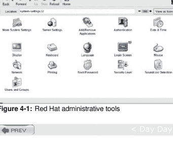

图 4-1：Red Hat 管理工具

### 配置用户

目前，在 Red Hat 上添加新用户的最简单、最有效的方法是使用 `redhat-config-users`，也称为 Red Hat 用户管理器。您可以从 GNOME 桌面的“开始使用”窗口的“系统设置”窗口访问它。`redhat-config-users` 窗口将显示用于列出用户和组的面板（见图 4-2）。按钮栏将列出您可以执行的各种任务，包括创建新用户或组、编辑当前项（属性）或删除所选用户或组。

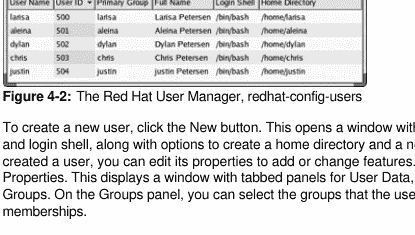

图 4-2：Red Hat 用户管理器，`redhat-config-users`

要创建新用户，请单击“新建”按钮。这将打开一个窗口，其中包含用户名、密码和登录 shell 的条目，以及创建主目录和该用户的新组的选项。一旦创建了用户，您可以编辑其属性以添加或更改功能。选择用户的条目并单击“属性”。这将显示一个带有“用户数据”、“帐户信息”、“密码信息”和“组”选项卡面板的窗口。在“组”面板上，您可以选择用户所属的组，添加或删除组成员资格。


另外，您可以在终端窗口或命令行中使用 `useradd` 命令添加用户帐户，使用 `userdel` 命令删除它们。以下示例将用户 `dylan` 添加到系统中：

```
$ useradd dylan
```

从命令行执行的常见操作之一是更改密码。任何用户都可以使用 `passwd` 命令更改自己的密码。该命令会提示您输入当前密码。输入当前密码并按 ENTER 后，您将被提示输入新密码。输入新密码后，您将被要求重新输入。这是为了确保您确实输入了 intended 的密码。

```
$ passwd
Old password:
New password:
Retype new password:
$
```

**提示** 您可以使用 `redhat-config-rootpassword` 工具（系统设置中的 Root Password）更改 root 用户的密码。


## ABC Amber CHM Converter 试用版

请注册以移除此横幅。

http://www.processestext.com/abcchm.html

### 打印机配置

作为 Linux 安装程序的一部分，您已配置了连接到计算机的打印机。要更改配置或以后添加新打印机，您可以使用打印机配置工具 `redhat-config-printer`。此实用程序可让您为打印机选择适当的驱动程序，以及设置打印选项，例如纸张尺寸和打印分辨率。您可以配置直接连接到本地计算机的打印机或网络上远程系统上的打印机（见第 25 章）。您可以通过在系统设置窗口或菜单中选择“打印”条目来启动 `redhat-config-printer`。

启动 `redhat-config-printer` 时，会显示一个列出已安装打印机的窗口（见图 4-3）。要添加新打印机，请单击“新建”。要编辑已安装的打印机，请双击其条目，或选择它并单击“编辑”。在进行更改后，您可以单击“应用”以保存更改并重新启动打印机守护进程。如果系统上有多个打印机，您可以通过选择它然后单击“默认”使其成为默认打印机。“删除”按钮将删除打印机配置。您可以使用“测试”菜单中选择的 PostScript、A4 或 ASCII 测试页测试打印机。

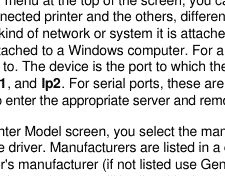

图 4-3：`redhat-config-printer`

选择“新建”后，会显示一系列对话框，您可以在其中输入打印机名称、类型和型号。在“队列名称”对话框中，为打印机提供名称以及任何特定描述。在随后的“队列类型”屏幕上，您输入适当的打印机连接信息。从屏幕顶部的下拉菜单中，您可以选择连接类型，第一个选择是本地连接打印机，其他的是不同种类的远程打印机。对于远程打印机，您需要选择其所连接的网络或系统类型，例如 Novell 用于 Novell 网络，或 Windows 用于连接到 Windows 计算机的打印机。对于本地打印机，您需要选择打印机所连接的设备。设备是打印机所连接的端口。对于前三个并行端口，它们是 `lp0`、`lp1` 和 `lp2`。对于串行端口，它们是 `ttyS0`、`ttyS1`、`ttyS2` 等。对于远程打印机，您必须输入适当的服务器和远程队列信息。

在“打印机型号”屏幕上，您选择打印机的制造商和型号，这将决定适当的驱动程序。制造商列在屏幕顶部的下拉菜单中。单击它并选择打印机的制造商（如果未列出，请使用 Generic 并选择打印机类型）。所选制造商的打印机型号列表将自动列在窗口的其余部分。例如，从制造商列表中选择 Canon 后，打印机型号窗口将列出所有 Canon 打印机。单击您的打印机，然后单击“前进”按钮。您将被通知打印机配置即将创建。单击“完成”。然后您将在 `redhat-config-printer` 窗口中看到打印机。您现在可以开始打印了。

您也可以编辑打印机以更改任何设置。编辑时，会显示五个选项卡式窗格，用于打印机名称、队列类型、队列选项、驱动程序和驱动程序选项。对于队列选择，您可以为打印机设备和 spool 目录指定条目。从下拉菜单中，您还可以指定打印机是本地的还是通过连接远程访问。对于驱动程序选项选择，您可以指定打印机功能，例如纸张尺寸和分辨率。完成后，单击“确定”关闭窗口。从“文件”菜单中选择“退出”项目以退出 `redhat-config-printer`。

提示 如果您使用 `redhat-config-printer` 配置打印机，`redhat-config-printer` 将使用 CUPS 打印服务器管理所有本地打印机。

您还可以使用 `redhat-config-printer` 在 Linux、Unix、Microsoft 或 Novell 网络上设置远程打印机。添加新打印机时，会显示“队列类型”窗格，其中从弹出菜单中选择以下选项：Locally-Connected、Networked Unix (LPD)、Networked Windows (SMB)、Networked CUPS (IPP)、Networked Novell (NCP) 或 Network JetDirect。（如果编辑现有打印机，队列面板将显示

在一个下拉菜单中选择远程条目。）对于远程 Linux 或 Unix 打印机，选择 Networked Unix (LPD)。这会显示一个用于配置远程打印机的对话框，其中包含服务器和队列的条目。对于服务器，输入控制打印机的系统的主机名。对于队列，输入该主机上打印机的设备名称。Networked Novell (NCP) 屏幕将添加用户和密码的条目。Networked Windows (SMB) 屏幕将具有不同连接打印机的条目。要添加一个，请单击 Specify 按钮以打开一个窗口，在其中可以输入共享名称、主机 IP 地址、工作组、用户和密码。Networked CUPS (IPP) 将具有 CUPS 服务器及其目录的条目。

Windows (SMB share) 打印机是位于 Windows 网络上的打印机。要访问 SMB 共享远程打印机，您需要安装 Samba 并使用 `smbd` 守护进程启用 Server Message Block 服务。反过来，Windows 网络上必须启用打印机共享。在打印机配置实用程序中，您需要输入共享的名称、其 IP 地址、打印机工作组的名称以及用户名和密码。共享是主机名和打印机名称的格式为 `\\hostname\\printername`。服务器是打印机所在的计算机。用户名和密码可以是打印机资源本身的，也可以是特定用户的访问权限。然后您可以使用打印客户端 `lpr` 将文件打印到 Windows 打印机。`lpr` 将调用 Samba 客户端 `smbclient` 将打印作业发送到 Windows 打印机。

**Tip** 要写入 CD-R/RW 驱动器，您可以使用 `cdrecord` 工具或任何几种 CD 烧录应用程序，如 KonCD。要写入 DVD-R/RW 驱动器，您可以使用 `dvdrecord`，这是 `cdrecord` 的增强版本。对于 DVD+R/RW 驱动器，您需要使用 `dvd+rw` 工具，如 `growisofs` 和 `dvd+rw-format`。请参阅第 30 章了解更多详情。

### X Window 系统配置：`redhat-config-xfree86`

如果您在 X Window 系统配置方面遇到问题，可以使用 `redhat-config-xfree86` 重新配置它。如果您更改了显卡，此工具也有助于更新您的 X Window 系统。只需再次运行该工具并选择适当的显卡即可。您可以通过在系统设置窗口或菜单中选择“显示”来运行 `redhat-config-xfree86`。`redhat-config-xfree86` 工具首先打开一个显示设置窗口（见图 4-4），其中包含用于选择分辨率和颜色深度的弹出菜单。

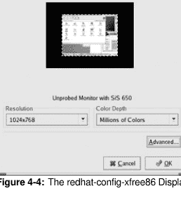

图 4-4：`redhat-config-xfree86` 显示设置窗口

您的当前设置将已选定，同时显示此监视器和显卡信息。要更改监视器或显卡设置，请单击“高级”。这将打开一个带有标签面板的窗口，一个用于监视器，另一个用于显卡，还有一个用于多头（用于支持多显示器的显卡）。显卡面板将列出受支持的显卡，其中当前显卡被选中。在这里您还可以手动选择视频内存。监视器面板列出受支持的监视器，并提供手动输入水平和垂直频率的框。`redhat-config-xfree86` 工具随后生成一个名为 `/etc/X11/XF86Config` 的 X Window 系统配置文件。这是 X Window 系统启动时使用的文件。将在 `/etc/X11/XF86Config.backup` 中创建备份。

### 使用 RHN、Yum 和 APT 更新 Red Hat 和 Fedora Linux


Red Hat Fedora 的新版本每隔几个月发布一次，而 Red Hat Enterprise 则每年左右发布一次。与此同时，针对特定软件包的新更新不断准备。这些更新作为您可以从软件仓库下载并安装到系统上的更新发布。这些包括应用程序、服务器甚至内核的新版本。此类更新可能从单个软件包到整个组件不等——例如，当 GNOME、KDE 或 XFree86 发布新版本时发布的所有核心、应用程序和开发包。

更新您的 Linux 系统已成为一个非常简单的过程，使用自动更新工具。对于 Fedora Core，您可以通过访问支持 `Yum`（Yellowdog Update, Modified）或 `apt-rpm`（Advanced Package Tool RPM）更新方法的软件仓库来更新系统。`Yum` 使用 RPM 头来确定需要更新哪些包。您可以在 `linux.duke.edu/projects/yum` 了解有关 `Yum` 的更多信息，包括 `Yum` 仓库列表。`APT` 是一种更复杂的更新方法，最初为 Debian Linux 实现。

更新 Fedora 的最简单方法是选择系统工具菜单中的 Red Hat Network（RHN）条目启动 Red Hat Update Agent（`up2date`）。虽然保留给 Red Hat Enterprise Linux 使用，但在 Fedora Core 上您可以使用 Red Hat Update Agent 访问 Fedora Core `Yum` 仓库，让您快速更新到最新的软件版本。提供两个通道，一个用于 Fedora 发布版，一个用于更新。您可以添加第三个测试通道用于最新发布（替换 Rawhide 发布）。将显示可以更新的包列表，您可以从中选择要更新的包。要访问其他 `Yum` 仓库，您可以配置 `/etc/sysconfig/rhn` `sources` 文件以使用 Red Hat Update Agent 访问它们。您也可以使用 `yum` 命令，在 `/etc/yum.conf` 文件中指定 `Yum` 仓库。当前 Fedora `Yum` 仓库在此列出，随着每次发布版本号会发生变化，

- `fedora.redhat.com/releases/fedora-core-1`
- `fedora.redhat.com/updates/released/fedora-core-1`
- `fedora.redhat.com/updates/testing/fedora-core-1`

要更新到新的 Fedora Core 发布版，您可以从 `fedora.redhat.com/releases/fedora-core` 下载 Fedora Core CD-ROM ISO 映像。ISO 映像也可以使用 `rpmfind` 的 BitTorrent 服务下载（见 `rpmfind.net/BitTorrent`）。BitTorrent 提供了一种非常快速的下载 ISO 映像的方法。

对于 Red Hat Enterprise Linux，您可以通过作为 Red Hat Network 的一部分注册来自动更新系统。Red Hat Network 服务现在仅支持 Red Hat Enterprise Linux，不支持 Fedora Core Linux（尽管可以配置 RHN 工具以访问 Fedora 仓库）。使用 Red Hat Network Registration 客户端注册并配置对 Red Hat Network 的访问是一个非常简单的过程。Red Hat Network 是随您购买企业包而包含的订阅服务。一旦您在 Red Hat Network 上注册，您就可以使用 Red Hat Update Agent 几乎自动地下载和安装 Red Hat Enterprise 更新。

**Tip** 如果您安装了 Ximian Desktop（见第 6 章），您可以使用 Ximian 的 Red Carpet 更新实用程序来更新系统。


## ABC Amber CHM Converter 试用版

请注册以移除此横幅。

http://www.processestext.com/abcchm.html

### 安装软件包

现在您知道如何启动 Linux 并访问 root 用户帐户，您可以安装任何其他想要的软件包。安装软件是由 root 用户执行的管理员功能。除非您在安装期间选择安装所有包，否则仅在您的系统上安装了 Linux 用户可用的众多应用程序和实用程序中的一些。在 Red Hat 上，您可以使用 `redhat-config-packages` 工具或 `rpm` 命令轻松地从系统中安装或删除软件。或者，您可以通过下载并编译其源代码来安装软件。使用源代码安装软件的程序已简化为只需几个命令，尽管您在根据特定系统定制应用程序方面具有很大的灵活性。

许多发行版，包括 Red Hat、Mandrake 和 SuSE，都使用 Red Hat Package Manager（RPM）将 Linux 软件组织成可自动安装或删除的包。RPM 软件包就像软件应用程序自己的安装程序一样运行。Linux 软件应用程序通常由必须安装在不同目录中的多个文件组成。程序本身很可能放置在名为 `/usr/bin` 的目录中，在线手册文件放在另一个目录中，库文件放在另一个目录中。此外，安装可能需要修改系统上的某些配置文件。RPM 软件包会为您执行所有这些任务。此外，如果您后来决定不想要特定应用程序，您可以卸载包以从系统中删除所有文件和配置信息（有关更多详细信息，请参阅第 29 章）。

您 CD-ROM 上的软件包尽管很丰富，但仅代表 Linux 可用软件包的一小部分。您可以从 `sourceforge.net` 等在线软件站点下载其他软件。`sourceforge.net` 站点不仅分发软件，而且还是大量开源软件项目的首要开发站点。在过去几年中，许多 Linux 软件项目已迁移到 `sourceforge.net`。您也可以从 `freshmeat.net` 或 `rpmfind.net` 找到许多最新的 Linux 应用程序。在这里，您可以链接到这些应用程序的原始开发站点并下载最近版本的文档。表 4-2 列出了几个 Linux 软件站点。对于支持 RPM 包的 SuSE、Mandrake 和 Red Hat 等发行版，您可以在在线仓库 `rpmfind.net` 上找到软件的 RPM 包版本。这里的包按发行版、组和名称编入索引。这包括每个发行版的包，包括这些发行版的以前版本。

表 4-2：Linux 软件站点

| 互联网站点 | 描述 |
|---|---|
| `ftp.redhat.com` | Red Hat 发行版 RPM 包 |
| `rpmfind.net` | RPM 包仓库 |
| `sourceforge.net` | Source Forge 开源软件仓库和开发站点 |
| `freshmeat.net` | 新 Linux 软件 |
| `apps.kde.com` | KDE 软件应用程序 |
| `www.gnome.org` | GNOME 软件应用程序 |

#### 使用 `redhat-config-packages` 安装包

`redhat-config-packages` 工具为管理您 Red Hat 发行版提供的 Red Hat RPM 包提供了一个有效且易于使用的界面，无论您是从 CD-ROM、DVD-ROM、硬盘还是网络安装的。它在任何窗口管理器上运行，包括 GNOME 和 KDE。您可以使用系统设置窗口中的“添加/删除应用程序”图标访问 `redhat-config-packages`。这将打开一个“添加和删除软件”窗口，显示左侧面板栏，其中包含“安装软件”和“删除软件”图标，以及一个面板，根据所选图标显示要安装的软件或要删除的软件。最初将显示“安装软件”图标，显示包含可安装包的软件组列表。视图菜单将让您在组视图和单个包视图之间切换。如果您知道要安装的单个包的名称，您可以使用该包

尚未安装软件包的组在末尾会有一个安装链接（见图 4-5）。所有软件包均已安装的组则没有安装链接。未安装的软件包组会被组织为必需和可选软件包。您可以选择可选的软件包，而必需的软件包将始终被安装。部分安装的组会被组织为已安装和未安装的软件包。您可以通过单击其复选框来选择要添加的未安装软件包。完成所有选择后，单击安装软件包；`redhat-config-packages` 将准备要安装的软件包列表，并检查依赖软件包。列表准备好后，如需可单击详细信息查看将要安装哪些 RPM 软件包。单击继续执行安装。系统会提示您插入适当的 CD-ROM 或 DVD-ROM。

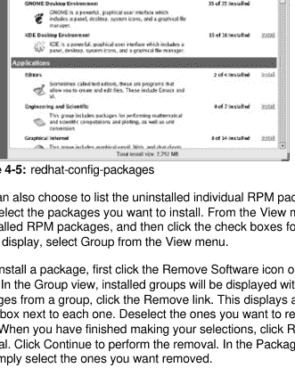

图 4-5：`redhat-config-packages`

您还可以选择列出发行版提供的未安装的单个 RPM 软件包。然后您可以选择要安装的软件包。从视图菜单中，选择软件包视图以列出当前所有未安装的 RPM 软件包，然后单击您想要的复选框。要切回组显示，请从视图菜单中选择组。


要卸载软件包，首先单击显示在软件包面板左侧的栏上的删除软件图标。在组视图中，已安装的组将在末尾显示一个删除链接。要从组中卸载软件包，请单击删除链接。这会显示已安装软件包的列表，每个软件包旁边都有一个已选中的复选框。取消选择要删除的项目，保留要保留的项目。完成选择后，单击删除软件包以将软件包排队等待删除。单击继续执行删除。在软件包视图中，所有已安装的软件包都会列出，您只需选择要删除的软件包即可。

您也可以直接安装特定的 RPM 软件包。您可以使用此方法安装已下载的 RPM 软件包或发行版 CD-ROM 上的单个软件包。首先使用文件管理器显示它，然后双击 RPM 软件包文件。您也可以右键单击它，在 GNOME 上选择“使用...打开”然后选择“安装软件包”，或在 KDE 上选择“安装软件包”。这将调用 `redhat-config-packages` 工具，该工具将安装软件包。它还会检查依赖软件包并安装它们。对于属于 Red Hat 发行版的软件包，它会根据需要提示您插入其他 CD-ROM（随书附带的 DVD-ROM 不会提示，因为它已包含所有软件包）。

## 使用 rpm 命令安装软件包

如果您无法访问桌面或更喜欢从命令行界面工作，您可以使用 `rpm` 命令来管理和安装软件包。这是执行软件包安装、删除和验证的命令。每个软件包实际上是一个 RPM 软件包，由软件文件归档以及有关如何安装这些文件的信息组成。每个归档都作为一个以 `.rpm` 结尾的文件存在，表示它是由 Red Hat 软件包管理器安装的软件包。

您可以使用 `rpm` 命令安装或卸载软件包。`rpm` 命令使用一组选项来确定要执行的操作。`-i` 选项安装指定的软件包，`-U` 选项更新软件包。使用 `-e` 选项，`rpm` 会卸载软件包。在 `i` 前加上 `q`（`-qi`）会查询系统以查看软件包是否已安装并显示有关软件的信息（`-qpi` 查询未安装的软件包文件）。不带选项的 `rpm` 命令提供完整的 `rpm` 选项列表。以下是常用选项集：

| 选项 | 操作 |
|---|---|
| -U | 更新软件包 |
| -i | 安装软件包 |
| -e | 删除软件包 |
| -qi | 显示已安装软件包的信息 |
| -ql | 显示已安装软件包的文件列表 |
| -qpi | 显示 RPM 软件包文件的信息（用于未安装的软件包） |
| -qpl | 显示 RPM 软件包文件的文件列表（用于未安装的软件包） |
| -K | 对软件包进行身份验证并执行完整性检查 |

软件包名称通常相当长，其中包含有关版本和发布日期的信息。所有名称都以 `.rpm` 结尾。在下一个示例中，用户使用 `rpm` 命令安装 `freeciv` 软件包。请注意输入了完整的文件名。要列出完整名称，您可以使用 `ls` 命令并加上前几个字符和星号：

```
ls freeciv*
```

您也可以使用 `*` 来匹配名称的剩余部分，如下所示：

```
ls freeciv-1*.rpm
```

在大多数情况下，您使用 `-U` 选项安装软件包，即更新。即使软件包尚未安装，`-U` 仍会安装它。

```
$ rpm -Uvh freeciv-1.14.0-2.i386.rpm
```

当 RPM 执行安装时，它首先检查是否有任何依赖软件包。这些是其他软件包，其中包含您要安装的应用程序需要使用的程序。如果必须先安装其他依赖软件包，RPM 将取消安装并列出这些软件包。您可以安装这些软件包，然后重复安装应用程序。要确定软件包是否已安装，请使用 `-qi` 选项与 `rpm`。`-q` 代表查询。要获取软件包已安装的所有文件以及安装到的目录列表，请使用 `-ql` 选项。要查询软件包文件，请添加 `p` 选项。`-qpi` 选项显示有关软件包的信息，而 `-qpl` 列出其中的文件。以下示例列出 `freeciv` 软件包中的所有文件：

```
$ rpm -qpl freeciv-1.14.0-2.i386.rpm
```

要从系统中删除软件包，首先使用 `rpm -qi` 确保它确实已安装，然后使用 `-e` 选项卸载它。与 `-qi` 选项一样，您不必使用已安装文件的全名。您只需要应用程序的名称即可。在下一个示例中，用户从系统中删除 `freeciv` 游戏：

```
$ rpm -e freeciv
```

## 软件包安全检查

如果您下载了 RPM 软件包，您可能希望检查其完整性和身份验证，确保软件包未被篡改并且来自有效来源。要仅检查软件包的完整性，您可以使用 `rpm` 命令并加上 `-K` 和 `--nogpg` 选项。称为 MD5 摘要的值衡量软件包的内容。如果该值不正确，则软件包已被篡改。有关完整性检查和 MD5 摘要的更多详细信息，请参阅第 16 章。某些软件包（如 Webmin）仅提供摘要值，仅允许完整性检查。在下一个示例中，用户检查 `freeciv` 软件包是否已被篡改。`--nogpg` 选项表示不执行身份验证，仅执行完整性检查。

```
$ rpm -K --nogpg freeciv-1.14.0-2.i386.rpm
```

要对软件包进行身份验证，您需要检查其数字签名。软件包使用加密的数字密钥签名，可使用软件包作者提供的公钥解密。该公钥必须首先下载并安装到系统上使用的加密工具中。Red Hat 以及大多数 Linux 系统使用 GNU Privacy Guard（GPG）加密工具。GPG 和身份验证方法以及公钥在第 16 章中有详细讨论。要使用公钥对 RPM 软件包进行身份验证，您首先必须下载公钥并将其安装到 RPM 密钥数据库中。对于所有属于 Red Hat 发行版的 Red Hat RPM 软件包，您可以使用在安装期间放置在 `/usr/share/rhn/RPM-GPG-KEY` 文件中的 Red Hat 公钥。在检查 Red Hat RPM 软件包之前，您需要手动将密钥导入 RPM 数据库，如下所示。

```
rpm --import /usr/share/rhn/RPM-GPG-KEY
```

如果您从其他站点下载了 RPM 软件包，您也可以下载并安装其公钥，以此来验证该软件包。

安装公钥后，您可以使用 `rpm` 命令并加上 `-K` 选项来检查软件包的身份验证。

```
$ rpm -K freeciv-1.14.0-2.i386.rpm
```

要查看已导入的所有密钥的列表，您可以使用 `-qa` 选项并匹配 `gpg-pubkey*` 模式。使用 `rpm` 并加上 `-qi` 选项和公钥，您可以显示有关密钥的详细信息。以下示例显示了 Red Hat 公钥：

```
$ rpm -qa gpg-pubkey*
```

`gpg-pubkey-db42a60e-37ea5348`

## 安装源代码应用程序

许多程序以源代码格式提供给 Linux。这些程序存储在压缩归档中，您需要先解压缩然后提取。所得的源代码然后可以配置、编译并安装到您的系统上。该过程已简化到几乎与安装 RPM 软件包无异。以下示例显示了提取、编译和安装软件的常用方法，在此例中为 KonCD 程序，一个 CD 刻录和抓取工具。请务必检查随源代码提供的 README 和 INSTALL 文件，以了解创建和安装该软件的适当方法。

### 提示

请确保您已在系统上安装了所有开发包。开发包包含关键组件，例如编译器、GNOME 和 KDE 头文件。

首先定位软件——在本例中，来自 apps.kde.com，然后将其下载到您的系统。

KonCD 以名为 `koncd-1.0rc2.tar.gz` 的文件下载。然后使用 `tar` 命令并带 `xvzf` 选项解压缩并提取文件，如下所示：

```
tar xvfz koncd-1.0rc2.tar.gz
```

这将创建一个以软件名称命名的目录，在本例中为 `koncd-1.0rc2`。使用 `cd` 命令切换到此目录：

```
cd koncd-1.0rc2
```

执行命令 `./configure`。这为您的特定系统生成编译器配置。

```
./configure
```

使用 `make` 命令编译软件：

```
make
```

然后使用 `make install` 命令安装程序：

```
make install
```

大多数 KDE 和 GNOME 软件还会在适当的菜单中放置程序的条目——例如，KonCD 条目将被放置在 KDE 应用程序菜单中。然后您可以从菜单条目运行 KonCD。您也可以打开一个终端窗口并输入程序的名称。

## 安全配置

安装 Linux 系统后，您应采取一些基本安全措施以保护系统免受外部攻击。连接到 Internet 的系统容易受到外部用户未授权访问的尝试。这种情况通常表现为以下形式：

- 试图入侵系统
- 入侵后，用被黑或损坏的版本更改或替换系统文件
- 试图拦截远程用户的通信
- 更改或替换发送给用户或来自用户的消息
- 冒充有效用户

防火墙、入侵保护、加密、数据完整性和身份验证是抵御此类攻击的方法。

- 防火墙可防止任何直接未授权的访问尝试。
- 入侵检测检查系统文件的状态，以查看是否已被入侵者篡改。
- 加密保护授权远程用户的传输，提供隐私。
- 完整性检查（如修改摘要）可保证消息和数据在传输途中未被拦截、更改或替换。


诸如数字签名之类的身份验证方法可以验证声称发送消息或访问您系统的用户是否确实是该人。

## 安全服务

Red Hat 包含多个用于保护您的系统和网络传输的安全服务（见表 4-3）。使用 GNU Privacy Guard（GPG）您可以加密要发送的电子邮件消息或文件，并可使用加密的数字签名对其进行签名，以验证消息确实由您发送（见第 16 章）。数字签名还包含加密的修改摘要信息，提供完整性检查，使收件人能够验证收到的消息是否为原始消息，而非被更改或替换的消息。

网络安全的一个良好基础是设置 Linux 系统作为网络的防火墙，以保护其免受未授权访问（见第 19 章）。您可以使用防火墙实现数据包过滤或代理。数据包过滤只是决定防火墙主机接收到的包是否应转发到本地系统或网络的过程。目前使用的防火墙包是 Netfilter（iptables）。较旧的发行版发布了名为 ipchains 的早期版本。要实现防火墙，您只需提供一系列规则来管理系统上允许的访问类型。如果该系统也是私有网络的网关，系统的防火墙功能可以有效地保护网络免受外部攻击。您可以使用 `redhat-config-securitylevel` 为自己的系统提供简单配置，如第 4 章所述。

### 表 4-3：安全应用程序

| 应用 | 描述 |
|---|---|
| GNU Privacy Guard (GPG) | 加密和数字签名（第 16 章） www.gnupg.org |
| Netfilter (iptables) | 防火墙数据包过滤（第 19 章） www.netfilter.org |
| Squid | Web 代理服务器（第 23 章） www.squid-cache.org |
| Open-SSH | Secure Shell 加密和身份验证用于远程访问（第 18 章） www.openssh.org |
| Kerberos | 服务访问的用户身份验证（第 18 章） web.mit.edu/kerberos/www/ |
| Pluggable Authorization Modules (PAM) | 身份验证管理与配置（第 28 章） |
| Shadow passwords | 密码加密（第 28 章） |
| Lightweight Directory Access Protocol (LDAP) | 用户管理与授权（第 28 章） www.openldap.org |
| authconfig-gtk | Red Hat 工具，用于启用和配置身份验证工具：Kerberos、LDAP 和 shadow passwords |

外部用户还可能通过您可能托管的任何 Internet 服务，例如网站，来获得未授权访问。在这种情况下，您可以设置代理来保护您的站点免受攻击。对于 Linux 系统，使用 Squid 代理软件设置代理来保护您的 Web 服务器（见第 20 章）。

进一步控制对系统的访问是提供安全的用户身份验证，使用加密密码、轻量级目录访问协议（LDAP）服务和可插拔身份验证模块（PAM）（见第 28 章）。某些服务的用户身份验证可以通过 Kerberos 服务器进一步控制（见第 18 章）。Kerberos 身份验证提供另一层安全性，其中各个服务可以受到保护，仅允许已获授权访问的用户使用该服务。LDAP 和 Kerberos 都使用 `authconfig-gtk` 启用和配置（系统设置菜单或窗口中的身份验证）。

为了保护来自网络外部主机的远程连接，传输可以被加密。对于 Linux 系统，您可以使用 Secure Shell（SSH）程序套件加密任何传输，防止他人读取（见第 18 章）。SSH 程序旨在取代远程工具，如 rsh 和 rcp（见第 15 章），这些工具不执行加密。

IPsec 协议也提供网络传输的加密，但集成到 IP 数据包结构中（见第 17 章）。使用 IPsec 您可以同时加密和验证传输，确保它们未被拦截和篡改。使用 IPsec 您可以实现虚拟专用网络（VPN），使用加密传输通过像 Internet 这样的大型网络连接一个本地网络到另一个本地网络。Red Hat 还提供名为 CPIE 的第三方 VPN 解决方案（见第 5 章）。

您可以在 Red Hat 网站（www.redhat.com）以及其他 Linux 网站如 Linux Security（www.linuxsecurity.com）、Linux Weekly News（lwn.net）和 Linux Today（linuxtoday.com）上找到有关安全问题的最新新闻。

注意：Linux 上还提供许多较旧的安全应用程序，例如 COPS（Computer Oracle and Password System）用于检查密码安全性；Tiger，用于扫描您的系统等。

## 身份验证配置

为了确认用户身份，您的网络可能提供多种身份验证服务（见第 28 章）。这些服务可以使用 `authconfig-gtk` 在您的系统上启用（见图 4-6）。您可以通过从系统设置菜单中选择身份验证来调用 `authconfig-gtk`。`authconfig-gtk` 包含两个面板，用户信息和身份验证。配置主要包括指定网络上服务服务器的地址。用户信息面板用于 NIS（见第 36 章）和 LDAP（见第 28 章）等服务，这些服务维护有关网络上系统和用户的配置信息。身份验证面板列出用于验证用户的服务。Shadow 和 MD5 密码选项通常已默认选中并提供密码保护（见第 28 章）。如果您的网络还维护 LDAP、Kerberos（见第 18 章）和 SMB 身份验证服务器（见第 37 章），您可以在此处启用对它们的支持，指定其服务器和域。

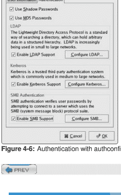

图 4-6：使用 `authconfig-gtk` 进行身份验证

## 不受支持的驱动程序

大多数网络设备的驱动程序已包含在您的 Red Hat 发行版中。但是，如果您有一台目前不受支持的新设备，您应检查提供商的网站以获取合适的 Linux 驱动程序。驱动程序以模块的形式存在，该模块在系统启动时由 Linux 内核动态加载（参见第 32 章和第 38 章）。通常会提供已编译的模块版本，您可以下载后安装到系统上。要安装模块，请使用 `modprobe` 命令。安装后，每次启动系统时内核都会自动加载该模块。如果安装出现问题，您始终可以使用带 `-r` 选项的 `modprobe` 命令卸载该模块。

许多模块仅以源代码形式提供。在这种情况下，您首先需要使用前面章节中提到的 `tar` 命令解包并编译该模块。请查阅随源代码通常包含的 README 或 INSTALL 文件以获取详细说明。如果没有包含，请尝试 `./configure` 和 `make` 命令。通常带有 `install` 选项的 `make` 命令会将模块安装到系统的模块库目录中。`install` 选项还可能运行 `depmod` 命令以更新模块依赖关系，使 `modprobe` 能够加载它。

```
./configure
make
make install
```

如果您使用的是预编译版本，则需要遵循将模块安装到模块库中的任何说明。它位于 `/lib/modules/version` 目录中，该目录包含多个用于不同类型模块的子目录。这里 `version` 是内核版本号，例如 Red Hat 10 上的 2.4.20-8。网络卡的模块保存在 `kernel/drivers/net` 目录中，例如 `/lib/modules/2.4.20-8/kernel/drivers/net`。您可以将网络卡的预编译模块复制到该目录。

创建模块并将其安装到模块库目录后，需要检查模块是否有任何依赖模块，这些模块也可能需要与其一起加载才能正常工作。这由 `depmod` 工具完成。如果您从源代码版本安装，`depmod` 可能已经运行过。在这种情况下，您可以直接使用 `modprobe` 加载模块。但是，如果您直接将预编译版本复制到模块库，或源代码版本未运行 `depmod`，则应重新启动系统。重新启动时，`depmod` 工具将自动运行并检查任何模块依赖关系。然后您可以使用 `modprobe` 命令和模块名称手动加载模块。

您可以添加模块可能需要的任何参数。要了解模块接受哪些参数，可以使用带 `-p` 选项的 `modinfo` 命令。`-v` 选项（详细）会列出发生时的所有操作。在下一个示例中，`modprobe` 为 Broadcom 网络设备加载 `bcm4400.o` 模块（名称中不要使用 `.o` 后缀）。

```
# modprobe -v bcm4400
```

`modprobe` 命令的选项放在 `/etc/modules.conf` 文件中。在这里，您可以输入配置选项，例如默认目录和别名。别名为模块提供一个简单名称。例如，以下条目使您能够将 `bcm4400.o` 以太网卡模块引用为 `eth0`（Kmod，即内核模块加载器（参见第 32 章），会自动检测 Broadcom 卡并加载 `bcm4400` 模块）：

```
alias eth0 bcm4400
```


加载后，您需要重新启动系统。重新启动时，将检测到新硬件并提示您进行配置。您可以在此时进行配置，指定任何网络信息，或等待系统启动后使用 `redhat-config-network`。使用 `redhat-config-network`，您可以为硬件连接创建新设备并提供配置信息，例如是否使用 DHCP 进行自动配置或手动提供网络 IP 和 DNS 地址。

#### Bluetooth

Red Hat Linux 现在为串行连接和 BlueZ 协议支持的设备提供 Bluetooth 支持。Bluetooth 是用于本地连接设备（如键盘、鼠标、打印机，甚至 PDA 和支持 Bluetooth 的手机）的无线连接方法。您可以将其视为专用于外围设备的专用小型局域网，省去了对电线的需求。Bluetooth 设备可通过串行端口直接连接，也可通过连接到 USB 端口或插入 PCI 槽的专用 Bluetooth 卡连接。BlueZ 是官方的 Linux Bluetooth 协议，自 2.4.6 版本起已集成到 Linux 内核中。BlueZ 协议最初由 Qualcomm 开发，现在是一个位于 `bluez.sourceforge.net` 的开源项目。它随 Red Hat 一起包含在 `bluez-utils` 和 `bluez-libs` 等软件包中。请查阅 BlueZ 网站以获取完整的受支持硬件列表，包括适配器、PCMCIA 卡和串行连接器。

GNOME 和 KDE 都提供 Bluetooth 配置和管理工具。GNOME 提供 GNOME Bluetooth 子系统，其中包括设备管理器、用于让 GNOME 文件浏览器访问 Bluetooth 设备的 Nautilus 插件以及文件服务器。对于 KDE，KDE Bluetooth Utilities 目前正在开发中，提供类似的用于访问 Bluetooth 设备的工具。要使用 Bluetooth 将手机连接到系统，您可以使用 GNOME Phone 管理器或 KDE 的 K68 工具。Red Hat 还包含用于接收 Bluetooth 文件的 Bluetooth 文件共享小程序。

注意 `Affix` 前端环境（AFE）是 BlueZ 的替代方案，提供了一种易于使用的访问 Bluetooth 设备的方法（`affix.sourceforge.net`）。

##### Bluetooth Configuration

配置信息位于 `/etc/bluetooth` 目录中，对于笔记本电脑，还与 `/etc/pcmcia` 目录一起使用。使用 `hciconfig` 命令配置 Bluetooth 设备，使用 `hcitool` 配置 Bluetooth 连接。使用 `hciattach` 将串行设备连接到串行端口（如 `/dev/ttyS1`），并使用 `rfcomm` 配置和连接 RFCOMM 设备。HCI 信息保存在 `/etc/bluetooth/hcid.conf` 中，RFCOMM 配置信息位于 `/etc/bluetooth/rfcomm.conf` 中。使用 `l2ping`，您可以检测 Bluetooth 设备。

您可以使用 `service` 命令和 Bluetooth 服务脚本 `/etc/rc.d/init.d/bluetooth` 启动和停止 Bluetooth 服务。

```
service bluetooth start
```

该脚本将启动 HCI 设备的 Bluetooth 守护进程 `hcid`，并运行任何检测和配置工具，包括用于服务发现协议的 `sdpd` 和 `rfcomm`。它还将激活任何串行 Bluetooth 设备，使用 `hciattach` 检测它们。BlueZ 包含多个模块和驱动程序，包括用于 HCI（主机控制器接口）设备的核心 Bluetooth 协议、HCI USB、UART、PCMCIA 和虚拟 HCI 驱动程序，以及支持 L2CAP（逻辑链路控制和适配协议）、串行端口仿真（RFCOMM）、以太网仿真（BNEP）、SCO（用于实时语音的同步连接导向链路）和服务发现协议（SDP）的模块，SDP 可自动检测应用程序可用的服务。此外，还支持扩展服务，例如 PAN（个人区域网络）和 LAN（通过 PPP 访问 LAN）。

##### Personal Area Networks: PAN

守护进程以侦听该设备的地址（或者，您也可以使用 SDP）。在服务器和用户系统上，都创建了一个名为 `bnep0` 的虚拟网络设备，可使用本地 IP 协议地址进行配置。在 Red Hat 上，您可以创建 `ifcfg-bnep0` 文件并将其配置为使用静态或动态（DHCP）寻址（`/etc/sysconfig/network-scripts/`）。请查阅 BlueZ 网站上的 HOWTO-PAN 文件以获取更多详细信息（目前没有 Red Hat Bluetooth 网络工具）。

注意
在使用之前，必须先在 Linux 内核中启用 Bluetooth 支持。您可以以内核模块的形式添加支持，如第 32 章和第 33 章所述。请确保配置内核以包含 Bluetooth 支持以及您可能需要的任何 Bluetooth 协议，如 RFCOMM 和 SCO。通过将支持作为模块启用，您无需重新编译整个内核。

注意
目前正在开发中，Gnome Bluetooth 子系统提供了一个 gnome 界面用于管理 and 访问您的 Bluetooth 设备（`gnome-bluetooth-admin`）。请检查 `gnome-bluetooth` RPM 软件包。

### 第 5 章：Red Hat 网络配置

#### 概述

本章讨论了在 Linux 上轻松配置网络连接时可用的网络配置工具。网络配置取决于您是使用以太网卡连接到局域网（LAN），还是使用 DSL 或 ISDN 调制解调器、无线连接或拨号调制解调器连接。您在安装过程中有机会输入 LAN 网络设置。要修改 LAN 设置并配置其他类型的接口，例如 ADSL、无线、ISDN 连接，您可以使用 `redhat-config-network` 配置网络连接。要添加新连接，您可以直接启动 Internet Connection Wizard。表 5-1 列出了几种不同的网络配置工具。

表 5-1：Red Hat 网络配置工具

| 网络配置工具 | 描述 |
|---|---|
| 网络连接向导 | Red Hat 向导，用于配置新的网络连接，如 Ethernet、modem、DSL、无线、VPN、Token Ring 或 ISDN。调用 `redhat-config-network`。 |
| `redhat-config-network` | 用于所有类型连接的 Red Hat 网络配置工具。使用 Internet Connection Wizard 添加新连接。 |
| 网络设备控制 | 激活和停用网络接口。 |
| `redhat-config-services` | 启动和停止服务器，包括网络服务器。 |
| `redhat-config-securitylevel` | 设置网络防火墙。 |
| `redhat-config-bind` | 配置域名服务器。 |
| `wvdial` | PPP 调制解调器连接，在命令行中输入。 |
| `pand` | 蓝牙个人网络。 |

#### 网络信息：动态与静态

如果您在网络上，可能需要获取某些信息来配置接口。大多数网络现在使用动态主机配置协议（DHCP）支持动态配置。在这种情况下，您只需在大多数网络配置工具中检查 DHCP 条目即可。但是，如果您的网络不支持 DHCP，您将必须提供有关连接的详细信息。此类连接称为静态连接，而 DHCP 连接是动态的。在静态连接中，您需要手动输入连接信息，例如 IP 地址和 DNS 服务器，而在动态连接中，此信息会在您连接到网络时由 DHCP 服务器自动提供给您的系统。每个主机上的 DHCP 客户端将从为该网络服务的 DHCP 服务器获取信息。

此外，如果您使用的是 DSL、ISDN 或调制解调器连接，您还必须提供提供商、登录名和密码信息，无论您的系统是动态还是静态。您可能还需要提供专用信息，例如 DSL 或调制解调器压缩方法、拨号号码或要选择的无线频道。

您可以从网络管理员或您的 ISP（互联网服务提供商）获取大部分静态网络信息。您需要以下信息：

- 网络接口的设备名称 对于 LAN 和无线连接，这通常是名为 `eth0` 或 `eth1` 的以太网卡。对于调制解调器、DSL 或 ISDN 连接，这是一个名为 `ppp0` 的 PPP 设备（ISDN 为 `ppp0`）。虚拟专用网络（VPN）连接也支持名为 `cipcb` 的 Crypto IP Encapsulation 设备。
- 主机名 您的计算机将在 Internet 上通过此名称标识。请勿使用 `localhost`；该名称由系统保留用于特殊用途。主机名应为简单的单词，可以包含数字，但不能包含标点符号，如句点和反斜杠。主机名包括主机名称及其域。例如，一台机器的主机名可以是 `turtle`，其域为 `mytrek.com`，使其主机名为 `turtle.mytrek.com`。
- 域名 这是您网络的名称。


- **分配给您的机器的 Internet 协议（IP）地址** 这仅适用于静态 Internet 连接。动态连接使用 `DHCP` 协议自动为您分配 IP 地址。Internet 上的每个主机都分配了一个 IP 地址。传统上，该地址使用 `IPv4` 格式，由一组用句点分隔的四个数字组成，唯一标识 Internet 上的单个位置，使信息能够从其他位置到达该计算机。网络现在正在转换为新的 IP 协议版本 6，`IPv6`，使用具有更复杂编号序列的新格式（参见第 38 章）。

- **您的网络 IP 地址** 仅限静态连接。此地址通常与 IP 地址相似，但在末尾有一个或多个零。

- **网络掩码** 仅限静态连接。这通常对于大多数网络为 `255.255.255.0`。但是，如果您是大型网络的一部分，请咨询您的网络管理员或 ISP。

- **您网络的广播地址，如有（可选）** 仅限静态连接。通常，您的广播地址与您的 IP 地址相同，只是在末尾添加了数字 255。

- **您网络网关计算机的 IP 地址** 仅限静态连接。这是将您的本地网络连接到更大网络（如 Internet）的计算机。

- **名称服务器** 仅限静态连接。您网络使用的名称服务器的 IP 地址。这些使 URL 的使用成为可能。

- **NIS 域和 NIS 服务器的 IP 地址** 如果您的网络使用 NIS 服务器，则需要（可选）。

- **登录和密码信息** 需要用于 DSL、ISDN 和调制解调器连接。


ABC Amber CHM 转换器试用版

请注册以移除此横幅。

http://www.processestext.com/abcchm.html

## 使用 Red Hat 网络工具进行网络配置

Red Hat 提供了一个易于使用的网络配置和激活工具，您可以使用它来配置和控制任何类型的网络连接，包括以太网卡、调制解调器、DSL 和 ISDN 调制解调器以及无线连接（目前不配置蓝牙个人网络）。所有这些都使用标准配置面板（如 IP 地址设置）以及仅用于特定类型连接的专用面板（如调制解调器连接的压缩或无线卡的无线设置）来支持。新连接最初使用 Internet Configuration Wizard 进行配置，该向导将检测并提示基本配置信息，然后将您置于 `redhat-config-network` 工具中，让您完善配置，根据需要进行或更改条目。要控制网络连接的激活，您使用 Network Device Control 工具。有关如何使用 Red Hat 网络工具配置网络连接的更多插图，请参阅 Red Hat Linux 的《Official Red Hat Linux Customization Guide》。

### redhat-config-network

您可以直接从系统设置菜单或窗口（网络条目）访问 `redhat-config-network` 工具。`redhat-config-network` 工具打开一个网络配置窗口，该窗口具有四个选项卡面板：Devices、Hardware、IPsec、Hosts 和 DNS（参见图 5-1）。这些面板用于配置整个系统的网络设置。Devices 面板列出您所有的网络连接，Hardware 列出系统上的所有网络组件，例如以太网卡和调制解调器。DNS 面板是您输入系统自己的主机名和网络的名称服务器地址的地方。Hosts 面板列出静态主机 IP 地址及其域名，包括您自己的系统。IPsec 面板用于使用 Internet 协议创建安全加密和经过身份验证的网络连接。它通常用于创建虚拟专用网络（VPN），在更大的网络（如 Internet）上创建主机和本地网络之间的安全连接。

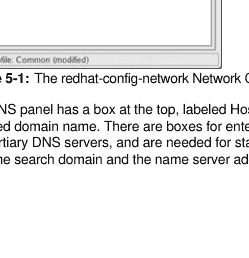

图 5-1：`redhat-config-network` 网络配置窗口

DNS 面板顶部有一个框，标记为 Hostname（参见图 5-2）。在此处，您输入系统的完全限定域名。还有用于输入系统的主、次和三级 DNS 服务器的 IP 地址的框，并且对于静态配置是必需的。然后您可以列出您的搜索域。搜索域和名称服务器地址都保存在 `/etc/resolv.conf` 文件中。

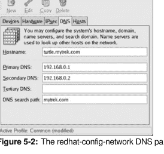

#### 图 5-2：redhat-config-network DNS 面板

你使用 Hosts 面板将静态 IP 地址与特定主机关联。该面板有一个单一窗格，包含 New、Edit、Copy 和 Delete 按钮。此面板列出将主机名与静态 IP 地址关联的条目。你还可以添加别名（昵称）。Hosts 面板实际上显示 `/etc/hosts` 文件的内容，并将你所做的任何条目保存到该文件中。要添加条目，请单击 New。会打开一个窗口，其中包含主机名、IP地址和昵称的框。完成后，条目将被添加到 Hosts 列表中。要编辑条目，请单击 Edit，类似的窗口会打开，使你能够更改任何字段。要删除条目，请选择它并单击 Delete。

##### 注意

如果你在使用静态网络连接通过 Ethernet 设备连接时遇到问题，请确保 Hosts 面板列出了你的主机名和 IP 地址，而不仅仅是 localhost

要配置特定连接，请在 Devices 面板中双击其条目，这将打开一个新窗口，在其中你可以修改或添加该连接的设置。在这里你会输入特定于某个连接的信息，例如 Ethernet 连接的网关和子网掩码，或 DSL 连接的用户名和密码。在此处输入条目与 `ifconfig` 的功能相同。Devices 面板将列出系统上配置的网络设备（见图 5-2）。条目显示设备名称及其类型。使用 New、Edit、Copy 和 Delete 按钮管理设备条目。例如，当你编辑一个 Ethernet 设备时，会打开一个用于配置它的标签页面板，使你能够指定其 IP 地址、主机名、网关以及它使用的硬件设备（见图 5-3）。配置面板会根据你编辑的设备而有所不同。例如，调制解调器设备会添加提供商、压缩和调制解调器选项的面板，而 DSL 连接则会有提供商、路由（网关）和硬件设备的面板。Ethernet 连接只有常规、路由和硬件设备面板。

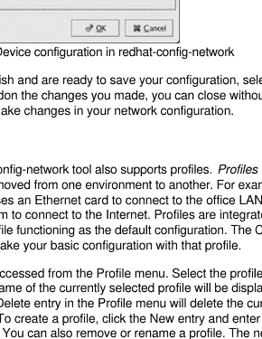

图 5-3：`redhat-config-network` 中的设备配置

完成后并准备保存配置时，请从 File 菜单中选择 Save 条目。如果你想放弃所做的更改，可以不保存就关闭。你可以随时运行 `redhat-config-network` 来更改网络配置。

### 配置文件

`redhat-config-network` 工具还支持配置文件。配置文件通常用于可能在不同环境之间移动的便携式计算机。例如，在办公室你可以使用 Office 配置文件，利用以太网卡连接到办公室局域网。在家中，你可以使用 Home 配置文件，利用调制解调器连接到互联网。配置文件集成到配置过程中，其中 Common 配置文件用作默认配置。Common 配置文件将被所有其他配置文件继承，因此请使用该配置文件进行基本配置。

### 配置已更换或不受支持的以太网卡

如果你更换了以太网卡或你的卡不受支持并且需要手动加载驱动程序，则必须手动配置该卡。对于受支持的卡，Kudzu 会在系统启动时自动检测该卡并提示你进行配置。对于动态连接，只需选择 `DHCP` 即可自动确定网络配置。对于静态连接，输入所需的网络信息，例如你的 IP 地址和 DNS 服务器。

如果设备不受支持或你选择不使用 Kudzu 进行配置，可以使用 `redhat-config-network` 手动为该卡创建新设备。对于不受支持的设备，请确保你已先获取其所需的 Linux 内核模块并使用 `modprobe` 安装该模块，如前一章所述。然后启动 `redhat-config-network` 并在 Device 面板中单击 New 按钮。选择 Ethernet 作为设备类型，然后从提供的列表中选择以太网卡。在 Configure Network Setting 面板中，单击 Automatically Obtain IP Address，并从下拉菜单中选择方法，通常为 `DHCP`。还单击 Automatically Obtain DNS Information。对于静态连接，输入所需信息，例如你的 IP 和 DNS 服务器地址。你的新设备现在将出现在 Devices 面板中。要激活它，请选择它然后单击 Activate。

### 网络设备控制

使用 Network Device Control 工具，你可以激活或停用已配置的网络连接。弹出菜单还允许你选择可用的配置文件，自动激活与每个配置文件关联的网络连接，并停用不关联的连接。Network Device Control 工具可在 System Tools 菜单中访问。选择设备并单击 Configure 按钮将打开 `redhat-config-network` 工具。然后你可以选择和配置任何网络设备，也可以添加新设备。

### Internet 配置向导


要配置新的网络连接，请使用可从 `System Tools` 菜单访问的 `Internet Connection Wizard`。如果你已打开 `redhat-config-network` 并想添加新的网络连接，单击 `New` 也会启动 `Internet Connection Wizard`。向导最初显示所有可能的网络连接列表（见图 5-4）。当你选择一个条目时，面板会提示你输入有关连接的基本信息；这包括调制解调器、DSL 和 ISDN 连接的电话号码、用户名和密码，而 Ethernet 连接仅提示输入 IP 地址。目前支持的连接和设备类型有 Ethernet（`eth`）、ISDN（`isdn`）、调制解调器（`ppp`）、xDSL（`ppp`）、令牌环（`tr`）、用于虚拟专用网络的加密 IP 封装（`cipcb`）以及无线连接（`eth`）。完成输入后，向导将配置你的连接设置，新连接即可使用。

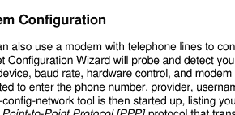

图 5-4：Internet Connection Wizard

## 调制解调器配置

你也可以使用电话线路的调制解调器连接到网络。对于调制解调器连接，Internet Configuration Wizard 会探测并检测你的调制解调器。然后会显示一个窗口，其中包含串行设备、波特率、硬件控制和调制解调器音量等条目，你可以进行修改。然后会提示你输入 ISP 账户的电话号码、提供商、用户名和密码。然后启动 `redhat-config-network` 工具，将你的调制解调器设备列为 `ppp` 连接（`ppp` 代表 Point-to-Point Protocol [PPP] 协议，该协议通过电话线路传输 IP 通信）。然后你可以编辑 `ppp` 设备以修改设置并输入其他设置；例如，你可以为静态连接输入 IP 地址，指定压缩方法，或列出你的 DNS 服务器。

## DSL 和 ISDN 配置

要配置 DSL，你需要提供 DSL（数字用户线路）和 ISDN 的登录名和密码信息。在其他方面，DSL 和 ISDN 连接的工作方式与本地局域网（LAN）类似，将主机视为网络的集成部分。在 Red Hat 上，你可以使用 Internet Configuration Wizard 设置 DSL 或 ISDN 连接。对于 DSL，Internet Configuration Wizard 会显示一个对话框，其中包含用于输入登录名、密码以及 DSL 调制解调器所连接的以太网接口的条目。你还需要输入 ISP 提供的 DNS 服务器的 IP 地址。你可以选择在系统启动时自动建立连接（取决于你选择的网络配置文件）。

## 无线配置

无线连接的工作方式与标准以太网连接类似，只需 IP 地址和 DNS 服务器信息即可连接到互联网。此外，你还必须指定无线连接信息，例如使用的网络名称和信道。要添加新的无线连接，请启动 Internet Configuration Wizard（从 `System Tools` 菜单）并选择无线连接。如果 `redhat-config-network` 已打开，你可以单击 Devices 面板上的 `Add` 按钮来启动 Internet Connection Wizard。系统会提示你选择无线网卡。

在 Configure Wireless Connection 面板上，你然后配置无线连接，选择模式、网络名称、信道、发射和密钥信息。

- `Mode` 通常，你可以将其保留为 Auto。对于简单的网络，不需要漫游的网络，模式通常为 Ad Hoc。托管网络允许在不同接入点之间漫游。
- `Network Name (SSID)` 对于简单网络可以保留为 Auto。网络名称用于将小区标识为虚拟网络的一部分。
- `Channel` 从 1 开始，选择干扰最小的信道。
- `Transmit Rate` 通常设置为 Auto，以自动调整到降级传输。但你也可以从弹出菜单中设置特定速率，例如 11M 或 1M。
- `Key` 这是无线网络的加密密钥。它必须在网络上的每个小区中相同。

在 Configure Network Settings 面板上，你指定 IP 地址，是通过 DHCP 自动获取还是自行输入。对于大多数公司无线网络，IP 地址将自动获取。通常，DNS 服务器也提供。你也可以，如果愿意，还指定主机名。

如果你设置的是本地或家庭网络，你很可能会使用从私有 IP 池中自行选择的静态 IP 地址，从 192.168 开始，例如 192.168.0.1。小型本地网络的静态子网掩码通常为 255.255.255.0。网关是连接到互联网或更大网络的网络上计算机的 IP 地址。

稍后你可以编辑无线连接，进行更改。无线配置具有与以太网或 DSL 连接相同的 General 和 Hardware Device 面板，但它没有 Route 面板，而是有 Wireless Settings 面板，在其中你可以设置模式和网络名称以及信道、发射和密钥信息。

你的配置设置将保存在 `/etc/sysconfig/network-scripts` 目录中的以太网配置文件中。例如，如果你的无线网卡被指定为 `eth1`，则其配置信息保存在 `ifcfg-eth1` 文件中。在这里你会找到标准以太网连接参数，例如 IP 地址和网关，以及无线参数，例如使用的信道、指定的模式和加密密钥。标准设置可以使用 `redhat-config-network` 在该设备上进行修改。你也可以直接修改此文件以输入其他参数，如频率（`FREQ`）或灵敏度级别（`SENS`）。你还可以使用 `IWCONFIG` 选项指定任何 `iwconfig` 参数。输入 `IWCONFIG` 后跟选项的赋值和任何值。例如，以下选项设置数据包的分片阈值：

```
IWCONFIG="frag 512"
```

## 虚拟专用网络

虚拟专用网络让您能够在物理网络连接（例如互联网）之上创建自己的私有逻辑网络。使用加密技术，您的私有网络传输可免受物理网络的窥探。虽然虚拟专用网络（VPN）本身没有物理连接，也不是一个实际的网络，但其发送的安全传输具有如同网络作为独立实体存在一样的效果。VPN 使用隧道技术，在像互联网这样的大型网络上的互连系统之间直接发送安全传输，而不会被拦截，并在任何一点被翻译。要实现 VPN，每个节点都必须使用相同的加密支持软件。在 Red Hat 上，您可以选择使用更新的 IPSec 工具或较旧的第三方加密 IP 封装（CIPE）工具。要使用 IPSec 设置 VPN，您可以在 `redhat-config-network` 中点击 IPSec 面板并创建一个新的连接。此过程在第 17 章中有详细描述。CIPE 仍可使用 Internet 配置向导进行配置，您可以在其中输入本地和远程主机的 IP 地址。

## 接口配置脚本：`/etc/sysconfig/network-scripts`

由 Internet 配置向导和 `redhat-config-network` 实现的网络配置保存在位于 `/etc/sysconfig/network-scripts` 目录中的接口配置脚本中（参见第 38 章）。您可以直接编辑这些脚本，修改特定参数，如之前关于无线连接所讨论的那样。接口配置文件以当前配置的网络接口的名称命名，例如第一个以太网设备的 `ifcfg-eth0`，或第一个 PPP 调制解调器设备的 `ifcfg-ppp0`。这些文件定义了 shell 变量，其中包含有关接口的信息，例如是否在启动时启动。例如，`ifcfg-eth0` 文件保存了 `NETWORK`、`BROADCAST` 和 `IPADDR` 的定义，它们被分配设备使用的网络、广播和 IP 地址。您也可以手动编辑这些接口配置文件，进行与无线连接时所做的更改。以下是使用 DHCP 地址的 `ifcfg-eth0` 文件示例。

`/etc/sysconfig/network-scripts/ifcfg-eth0`

```
DEVICE=eth0
BOOTPROTO=DHCP
HWADDR=00:00:00:EF:AF:00
ONBOOT=yes
TYPE=Ethernet
```

## 命令行 PPP 访问：`wvdial`

如果由于某种原因，您无法在 X Window 系统上设置调制解调器连接，您可能需要改为从命令行界面设置，而不是桌面。对于拨号 PPP 连接，您可以使用 `wvdial` 拨号器。`wvdial` 是一个智能拨号器，它不仅拨号到 ISP 服务，还执行登录操作，提供您的用户名和密码。`wvdial` 首先从 `/etc/wvdial.conf` 文件加载其配置。在这里，您可以放置调制解调器和账户信息，包括调制解调器速度和串行设备，以及 ISP 电话号码、用户名和密码。`wvdial.conf` 文件按节组织，以方括号括起来的节标签开头。一个节保存为不同参数分配值的变量，例如 `username = chris`。默认节保存由其他节继承的默认值，因此您无需重复它们。表 5-2 列出了 `wvdial` 变量。

表 5-2：`wvdial` 的变量

| 变量 | 描述 |

|---|---|

| `Inherits` | 显式地从指定的节继承。默认情况下，节从 `[Dialer Defaults]` 节继承。 |
| `Modem` | `wvdial` 应用作调制解调器的设备。默认值为 `/dev/modem`。 |


# wvdial 配置选项

| `Baud` | `wvdial` 与调制解调器通信的速度。默认值为 57,600 波特。 |
| `Init1 ... Init9` | 指定调制解调器使用的初始化字符串。`wvdial` 最多可使用 9 个。`Init1` 的默认值为 `"ATZ"`。 |
| `Phone` | `wvdial` 要拨号的电话号码。 |
| `Area Code` | 指定区号（如有）。 |
| `Dial Prefix` | 指定所需的拨号前缀，例如 70 以禁用呼叫等待或 9 以获取外线。 |
| `Dial Command` | 指定拨号操作。默认值为 `"ATDT"`。 |
| `Login` | 指定您在 ISP 使用的用户名。 |
| `Login Prompt` | 如果您的 ISP 有不寻常的登录提示，可在此指定。 |
| `Password` | 指定您在 ISP 使用的密码。 |
| `Password Prompt` | 如果您的 ISP 有不寻常的密码提示，可在此指定。 |
| `Force Address` | 指定要使用的静态 IP 地址（适用于向用户提供静态 IP 地址的 ISP）。 |
| `Remote Name` | 对于 PAP 或 CHAP 认证，您可能需要将其更改为 ISP 的认证名称。默认值是 *。 |
| `Carrier Check` | 将此选项设置为 No 会禁用调制解调器的载波检查。用于报告载波线路始终处于断开状态的调制解调器。 |
| `Stupid Mode` | 在 `Stupid Mode` 模式下，`wvdial` 不会尝试解释终端服务器的任何提示，并在调制解调器连接后启动 `pppd`。 |
| `Auto Reconnect` | 如果启用，当另一方随机断开连接时，`wvdial` 会尝试自动重新建立连接。此选项默认开启。 |

您可以使用 `wvdialconf` 实用程序自动为您创建一个默认的 `wvdial.conf` 文件。`wvdialconf` 将检测您的调制解调器并为基本功能设置默认值。然后您可以编辑 `wvdial.conf` 文件并使用您的 ISP 拨号信息修改 `Phone`、`Username` 和 `Password` 条目。删除前面的分号（`;`）以取消注释该条目。任何以分号开头的行都将被忽略为注释。

```
$ wvdialconf
```

您还可以创建一个命名拨号器，例如以下示例中的 `myisp`。如果您登录到不同的 ISP，这很有帮助。以下示例显示了 `/etc/wvdial.conf` 文件：

`/etc/wvdial.conf`

```
[Modem0]

Modem = /dev/ttyS0

Baud = 57600

Init1 = ATZ

SetVolume = 0

Dial Command = ATDT

[Dialer Defaults]

Modem = /dev/ttyS0

Baud = 57600

Init1 = ATZ

SetVolume = 0

Dial Command = ATDT

[Dialer myisp]

Username = chris

Password = mypassword

Modem = /dev/ttyS0

Phone = 555-5555

Area Code = 555

Baud = 57600

StupidMode = 0
```

要启动 `wvdial`，输入命令 `wvdial`，然后它会从 `/etc/wvdial.conf` 文件读取连接配置信息。`wvdial` 拨号 ISP 并启动 PPP 连接，在请求时提供您的用户名和密码。

```
$ wvdial
```

您可以在 `/etc/wvdial.conf` 文件中为任意数量的连接设置连接配置。要选择一个，请将其标签作为参数传递给 `wvdial` 命令，如下所示：

```
$ wvdial myisp
```


## ABC Amber CHM Converter Trial version

请注册以移除此横幅。

http://www.processestext.com/abcchm.html

### 无线工具

为了避免为每种型号的无线设备提供不同的配置选项，目前大多数无线设备都支持 Wireless Extensions。这些扩展提供了一种标准格式来配置所有无线设备。使用相同的配置选项集，您可以配置任何支持 Wireless Extensions 的无线设备。`Wireless Tools` 包是一组安装在 Linux 系统上用于无线设备的网络配置和报告工具。它们目前作为 Linux Wireless Extension 和 Wireless Tools 项目的一部分得到支持和开发，这是一个由 Hewlett-Packard 维护的开源项目。

`Wireless Tools` 由此处列出的配置和报告工具组成：

| 工具 | 描述 |
|------|-------------|
| `iwconfig` | 为大多数无线设备设置基本无线配置选项 |
| `iwlist` | 显示设备的当前状态信息 |
| `iwspy` | 设置无线网络中的 IP 地址列表并检查其连接质量 |
| `iwpriv` | 访问特定设备的配置选项 |

无线局域网设备将具有与以太网卡一样的以太网名称。适当的模块将自动加载，其别名列在 `/etc/modules.conf` 文件中（参见第 32 章）。

#### iwconfig

`iwconfig` 命令的工作方式类似于 `ifconfig`，用于配置网络连接。它是 Internet 连接向导和 `redhat-config-network` 用于配置无线卡的工具。或者，您可以直接在命令行上运行 `iwconfig`，指定某些参数。添加的参数让您设置无线特定功能，例如网络名称（`nwid`）、卡使用的频率或信道（`freq` 或 `channel`）以及传输的比特率（`rate`）。请参阅 `iwconfig` 手册页以获取完整接受的参数列表。一些常用的参数列在表 5-3 中。

表 5-3：常用参数

| 参数 | 描述 |
|-----------|-------------|
| `essid` | 网络名称 |
| `freq` | 连接的频率 |
| `channel` | 使用的信道 |
| `nwid` or `domain` | 网络 ID 或域 |
| `mode` | 设备使用的操作模式，例如 ad hoc、managed 或 auto。Ad Hoc = 无接入点的单个单元，Managed = 具有多个接入点并支持漫游的网络，Master = 节点是接入点，Repeater = 节点将数据包转发给其他节点，Secondary = 备份主节点或中继器，Monitor = 仅接收数据包 |
| `sens` | 灵敏度，可接收数据的最低信号电平 |
| `key` or `enc` | 使用的加密密钥 |
| `frag` | 将数据包切割成更小片段以提高传输质量 |
| `bit` or `rate` | 比特传输速度。auto 选项会在嘈杂信道上自动回退到更低速率 |

##### 表 5-3：常用参数

| 参数 | 描述 |
|---|---|
| `ap` | 指定特定的接入点 |
| `power` | 用于唤醒和睡眠操作的电源管理。 |

例如，要设置作为第一个以太网设备安装的无线设备的通道，您可以使用以下命令，将通道设置为 2：

```
iwconfig eth0 channel 2
```

您也可以使用 `iwconfig` 来显示无线设备的统计信息，就像 `ifconfig` 那样。输入不带参数或带设备名称的 `iwconfig` 命令。名称、频率、灵敏度和比特率等信息将被列出。另请检查 `/proc/net/wireless` 以获取统计信息。

如果不直接使用 `iwconfig` 设置参数，您可以在无线设备的配置文件中指定它们。无线设备配置文件将位于 `/etc/sysconfig/network-scripts` 目录中，并根据设备名称命名，如 `ifcfg-eth1`。该文件已包含许多 `iwconfig` 设置。任何进一步的设置都可以通过将 `iwconfig` 值分配给 `IWCONFIG` 参数来设置，如下所示。

```
IWCONFIG="rate 11M"
```

#### iwpriv

`iwpriv` 命令与 `iwconfig` 协同工作，允许您设置特定类型无线设备的选项。使用 `iwpriv`，您还可以打开漫游或选择要使用的端口。您使用 `private-command` 参数输入设备特定的选项。以下示例将漫游设置为开启：

```
iwpriv eth0 roam on
```

#### iwspy

您的无线设备可以检查其与接收数据的另一无线设备的连接，报告传输的质量、信号强度和噪声水平。您的设备可以维护一个可能接收数据的不同设备的地址列表。您使用 `iwspy` 工具设置或添加要检查的地址。您可以列出 IP 地址或硬件版本。`+` 号将添加地址，而不是替换整个列表：

```
iwspy eth0 +192.168.2.5
```

要显示连接的质量、信号和噪声水平，您只需使用设备名称使用 `iwspy` 命令：

```
iwspy eth0
```

#### iwlist


要获取有关无线设备的更详细信息，例如所有可用频率或通道，您可以使用 `iwlist` 工具。使用设备名称和特定参数，您可以获取有关设备的特定信息，包括频率、接入点、速率、电源功能、重试限制和使用的加密密钥。您可以使用 `iwlist` 获取有关故障连接的信息。以下示例将列出 `eth0` 无线设备上使用的频率。

```
iwlist eth0 freq
```

### linux-wlan

`linux-wlan` 项目 (`www.linux-wlan.org`) 开发了一套独立的无线驱动程序，专为支持新的 802.11 无线标准的基于 Prism 的无线网卡设计。`linux-wlan` 驱动程序目前未包含在 Red Hat 中。您必须下载驱动程序。您可以从 `people.redhat.com` 下载 RPM 包，其中包括基础包、模块包以及针对不同类型硬件（如 PCMCIA 或 USB）的包。您也可以从 `prism2.unixguru.raleigh.nc.us` 下载特定内核的 RPM 包。

原始源代码包可从 `wlan-linux` 网站 `www.linux-wlan.org` 获取。当前包为 `linux-wlan-ng`。您必须解包并编译驱动程序，如前一章中有关源代码软件包所述。

驱动程序将安装 WLAN 设备，设备配置放在 `/etc/sysconfig/network-scripts` 目录中。例如，第一个 WLAN 设备的配置将在 `ifcfg-wlan0` 脚本中。通用无线选项放在 `/etc/wlan.conf` 配置文件中。

### 设置防火墙：`redhat-config-securitylevel`

要设置防火墙，请在系统上运行 `redhat-config-securitylevel`（系统设置窗口和菜单中的安全级别）。您可以启用或禁用防火墙（见图 5-5）。`None` 选项会禁用防火墙。您可以在直接连接到 Internet 的独立系统上运行防火墙，或在将本地网络连接到 Internet 的网关系统上运行（如下一节所述）。对于本地网络，请确保本地主机上没有运行任何防火墙。防火墙应仅在网关上运行。此外，网关将至少有两个网络连接，一个用于本地网络，一个用于 Internet 的 Internet 连接设备。请确保防火墙应用于 Internet 设备，而不是本地网络。在 `redhat-config-securitylevel` 上，您通过将本地网络设备设为受信任设备来实现这一点。

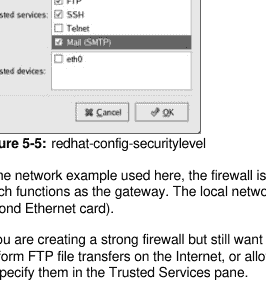

图 5-5：`redhat-config-securitylevel`

在此使用的网络示例中，防火墙运行在 `eth0` 网络设备（第一块以太网卡）上，该设备用作网关。本地网络通过 `eth1` 网络设备（第二块以太网卡）连接。

如果您正在创建强大的防火墙，但仍希望运行诸如 Web 服务器之类的服务，允许用户在 Internet 上执行 FTP 文件传输，或允许诸如 SSH 之类的远程加密连接，您必须在受信任服务窗格中指定它们。

### 配置局域网

创建自己的本地网络只需几个简单的步骤。您可以设置一台系统作为您自己的局域网（LAN）的主服务器，提供电子邮件、网站或共享打印机等服务。您甚至可以连接不同类型的系统，例如运行 Windows 或 Mac OS 的系统。您还可以将系统配置为 Internet 网关，所有其他系统都通过它连接。事实上，您可以在网关上拥有一个 Internet 连接，网络上的每个主机都可以使用。一些安全预防措施允许您的系统作为防火墙工作，保护本地主机免受外部攻击。您也可以设置一个非常简单的配置，仅提供 Web 访问。本章将介绍设置此类网络的基本概念。本书后面的章节将详细介绍这些主题。

您的局域网由连接到运行 Linux 的主机的主机系统集合组成。此主主机将被称为网关。设置本地网络的步骤包括以下内容：

- 在每个系统上设置和配置以太网卡（有线或无线）。您的网关应具有两块以太网卡（见第 32 章）。
- 设置代理服务器以提供直接的 Web 访问（不需要 DNS，见第 23 章）。
- 在网关上设置您的 DNS 服务器（见第 34 章）。
- 配置您的 DNS 服务器以允许所有其他本地主机访问 Internet（见第 19 章）。
- 设置防火墙保护（见第 19 章）。
- 启用电子邮件服务（见第 24 章）。
- 设置本地主机通过 DNS 访问 Internet（第 34 章）。
- 与 Windows 主机共享打印机（见第 37 章）。
- 设置本地网站（见第 22 章）。

在设置连接的同时，您必须在为网络设置的主网关计算机上运行至少一项服务。在 Red Hat 上，您可以使用 `redhat-config-services` 工具（系统服务器菜单和窗口中的服务）或使用 `service` 命令启动和停止服务。要使服务自动启动，您可以使用 `redhat-config-services`。对于简单的网络，您应该运行 DNS 和网络服务。如果网络上有 Windows 系统并且您想与它们共享打印机，您将需要 Samba 服务。随着配置，Network、Squid、Sendmail、Postfix、DNS 和 Samba 程序可能需要重新启动。您必须知道用于 DNS、Sendmail、Postfix、Squid 和 Samba 服务器程序的名称，以便使用 `service` 工具重新启动它们。它们显示如下。此外，您必须添加防火墙规则以允许本地主机通过防火墙访问 Internet。

| 服务名称 | 服务程序 |
|---|---|
| 域名服务 (DNS) | `named` |
| Samba | `smb` |
| 网络连接 | `network` |
| 防火墙 | `iptables` |
| Squid | `squid` |
| Sendmail | `sendmail` |
| Postfix | `postfix` |

您使用 `start`、`stop` 和 `restart` 参数启动、停止和重启服务。要重启 DNS 服务，您将使用以下命令：

```
service named restart
```

### 物理配置

为了在系统上不同计算机之间建立物理连接，您需要在每台计算机上安装一个以太网设备。许多计算机已经安装了以太网卡或内置以太网卡。 大多数以太网配置使用轻型电缆连接计算机，尽管也有一些是无线连接。网络上的计算机被称为主机。要将多个主机连接在网络上，您需要为每个主机准备以太网电缆，并使用一个集线器将它们全部连接在一起。要连接一台主机，将电缆的一端连接到其以太网卡，另一端连接到集线器。集线器会有多个插口，每个网络主机各一个。对于更大的网络，您可以连接多个集线器。

在本文描述的配置中，运行 Linux 系统的主机将用作本地网络的主要服务器和网关。在这里，您将安装各种服务器，例如代理、DNS 和 Web 服务器。该主机还将用于连接所有本地主机到互联网（或更大的网络）。为了有效实现这一点，该网关/服务器主机需要一个以太网卡和一个互联网连接设备，例如调制解调器、DSL（数字用户线路）调制解调器或另一个以太网卡。本章中的示例使用第二个以太网连接。

### IP Addressing

大多数网络，包括互联网，都使用一套名为 TCP/IP 的网络协议，其全称为传输控制协议/互联网协议。在 TCP/IP 网络（如互联网）上，每台计算机都被分配一个唯一的地址，称为 IP 地址。IP 地址用于标识和定位特定主机——连接到网络的计算机。它由一个数字组成，通常是四个由点分隔的三位数组。IP 地址的示例是 `192.168.0.1`。

您必须为网络上的每个主机分配一个 IP 地址。根据网络类型，前几个段用于网络地址，后几个段用于主机地址。对于小型本地网络，前三个段是计算机的网络地址，最后一个段是计算机的主机 ID（与本示例中使用的一致）。例如，在地址 `192.168.0.2` 中，`192.168.0` 是网络地址，`2` 是该网络中计算机的主机 ID。合在一起，它们构成一个 IP 地址，可通过该地址从互联网上的任何位置寻址计算机。

要设置一个本地局域网（LAN），其主机不直接连接到互联网，您将使用专门为此类非互联网网络保留的 IP 号码集（也称为私有网络或内联网）。如果您实施 IP 伪装，则尤其如此，在这种情况下只有网关机器具有互联网地址，其他机器使用该地址连接到互联网。对于小型网络（254 台主机或更少），这些是具有特殊网络号 `192.168.0` 的号码，如本示例中使用。如果您正在设置局域网，例如小型企业或家庭网络，您可以自由地将这些号码用于本地机器。对于本地网络，从 `192.168.0.1` 开始分配 IP 地址。主机段的范围可以从 1 到 254，其中 255 用于广播地址。如果您的家庭网络上有三台主机，您可以为它们分配地址 `192.168.0.1`、`192.168.0.2` 和 `192.168.0.3`。

### Note

为了允许本示例中的本地主机通过使用网关的 IP 地址连接到互联网，您需要实现 IP 伪装。实际上，本地主机掩盖了


这种网络的网络地址将是 IP 地址的前三个段，即 192.168.0。网络子网掩码将覆盖这前三个段，使用数字 255.255.255.0。该掩码用于确定 IP 地址的主机部分和网络部分。广播地址，本示例中为 192.168.0.255，用于允许管理员同时联系所有主机。然后在配置主机时使用这三个 IP 地址。

在这些示例中使用的示例网络中，有三台主机，每台主机都有自己的 IP 地址和此处列出的主机名。网络地址、子网掩码和广播地址与刚才描述的相同：

```
192.168.0.1
192.168.0.2
192.168.0.3
```

注 请参阅第 34 章和第 38 章，了解有关 IP 地址和 DNS 服务器设置的详细信息。

防火墙应仅在网关上运行。此外，网关将有两个网络连接，一个用于本地网络，一个用于互联网的互联网连接设备。请确保防火墙应用于用作互联网设备的设备，而不是本地网络。在 `redhat-config-securitylevel` 中，您通过将本地网络设备设为受信任设备来实现这一点。在本文使用的网络示例中，防火墙在 `eth0` 网络设备（第一块以太网卡）上运行，该设备用作网关。本地网络通过 `eth1` 网络设备（第二块以太网卡）连接。

## Assigning IP Addresses: static and dynamic

您可以静态或动态地分配 IP 地址。静态地址手动输入到每台机器中，而动态地址由其中一台机器上运行的单个 DHCP 服务器自动分配。如果您的网络非常小，例如家庭网络中的两三台机器，那么使用静态寻址可能是有意义的。在这种情况下，您通过以 root 用户身份物理登录每台计算机并运行 `redhat-config-network` 来手动分配每个 IP 地址。在每台机器上运行 `redhat-config-network` 时，您还指定网关，即连接到网络的机器。

如果您拥有更大的网络，或希望实现更集中的控制，您可以让 DHCP 服务器（参见第 35 章）自动为每台机器分配 IP 地址。您仍需登录每个系统并运行 `redhat-config-network`，以配置每台机器使用 DHCP 获取配置信息。请确保还配置任何防火墙以允许 DHCP 传输。DHCP 服务器通常在网关机器上运行。首先您必须配置服务器以分配地址，并提供网关的 IP 地址。

目前没有 Red Hat 工具来配置 DHCP 服务器。您必须手动创建具有适当选项的 `/etc/dhcpd.conf` DHCP 配置文件。Red Hat 建议对简单网络使用以下配置。此配置使用从 192.168.1.0 开始的私有网络地址。

DHCP 配置在第 35 章中有详细讨论。对于简单网络，您只需要几个选项，如下所示。您必须使用包含网络地址及其子网掩码的子网声明来定义子网（参见第 38 章）。范围为 192.168.1.1-192.168.1.255 的简单网络由网络地址 192.168.1.0 和子网掩码 255.255.255.0 定义。在声明中，您指定域和网关的选项，以及要使用的地址范围。`routers` 选项指定网关的地址。对于 `domain-name` 选项，输入您希望赋予本地网络的域名。`domain-name-servers` 选项包含运行您本地网络 DNS 服务器的机器的地址（如果有）。`range` 选项列出可以分配的 IP 地址范围，在本例中为从 192.168.1.10 到 192.168.1.100 的任何地址，提供 90 个可能的地址。`/etc/dhcpd.conf`

```
ddns-update-style interim;

subnet 192.168.1.0 netmask 255.255.255.0 {
    option routers               192.168.1.1;
    option subnet-mask           255.255.255.0;
    option domain-name           "mytrek.com";
    option domain-name-servers   192.168.1.1;

    range   192.168.1.10   192.168.1.100;
}
```

配置好 DHCP 后，您可以通过运行 `redhat-config-services` 并选择 DHCP，然后单击“开始”来启动 DHCP 服务器。您也可以使用 `service` 命令启动和重新启动服务器。

```
service dhcpd restart
```

对于以下示例中设置的类似网络，其中网关有两个以太网卡，一个用于互联网，一个用于本地网络，您希望本地 DHCP 服务器仅在本地网络上运行，使用本地以太网卡。为此，您需要在 `dhcpd` 服务器启动时将以太网卡指定为命令行选项。在 Red Hat 上，只需编辑 `/etc/sysconfig/dhcpd` 文件并将以太网卡分配给 `DHCPDARGS` 参数即可。在以下示例中，`eth0` 卡用于本地网络，因此以下内容应输入到 `/etc/sysconfig/dhcpd` 文件中

```
DHCPDARGS=eth0
```

如果您运行 DHCP 服务器的以太网卡也受防火墙保护，您需要允许其使用的端口访问，即端口 67。

## Squid 代理服务器

如果您只想为您的主机提供 Internet Web 访问，您只需在网关主机上运行 Squid 服务器即可。您无需设置和运行 DNS 服务器。Squid 是一个代理服务器，可以直接处理浏览器与 Internet 站点之间的 Internet 连接。您只需为每台主机配置网络连接，提供其 IP 地址即可。您可以使用 DHCP 自动完成此操作。Squid 已包含在基本安装中（参见第 23 章）。

每台 Web 浏览器都必须配置为引用运行 Squid 服务器的机器。在 Mozilla 中，从“编辑”菜单中选择“首选项”，然后在“高级”项中选择“代理”。在这里您可以输入运行 Squid 服务器的机器的 IP 地址，通常是网关。

您可以使用 `redhat-config-services`（“系统设置/服务器设置”窗口中的“服务”）启动 Squid 服务器，并选择 `squid`，然后单击“开始”。您也可以使用 `service` 命令手动启动和停止 Squid。

```
service squid start
```

`chkconfig` 命令可以在系统启动时自动启动 Squid。

```
chkconfig squid on
```

### 注意

在您的网络上启用电子邮件服务有几种方法。您可以为网络上的所有用户设置一个中央服务器来处理电子邮件，或者...

## 实现 DNS 服务器

现在您的本地网络已物理搭建完成，您的网关/服务器需要运行某些服务以允许您的主机通过网络进行通信。您首先必须配置并运行域名服务（DNS），这将允许本地网络上的所有主机使用主机名相互识别。这涉及以下几个步骤：

- 1. 决定为每台本地主机分配的 IP 地址。使用 192.168.0 作为网络地址。
- 2. 决定本地网络的域名。
- 3. 决定网络上每台主机的主机名。
- 4. 使用其 IP 地址和域名地址配置每台主机。
- 5. 在网关/服务器上配置 DNS 服务器，列出每台主机的 IP 地址和主机名。
- 6. 启动 DNS 服务。

Internet 上的所有主机都由其 IP 地址标识。当您向 Internet 上的主机发送消息时，必须提供其 IP 地址。然而，使用 IP 地址的四个数字序列可能很困难。它们很难记住，而且在输入时很容易出错。为了使在 Internet 上识别计算机变得更容易，DNS 被实现。DNS 为每个 IP 地址建立一个完全限定域名地址。完全限定域名由主机名和它所属的网络（域）组成。每当您使用该名称时，它会自动转换为 IP 地址，然后用于标识该 Internet 主机。完全限定域名比其对应的 IP 地址更容易使用。例如，DNS 服务器会将 `www.linux.org` 翻译为其 IP 地址 198.182.196.56。

在图 5-6 中，`rabbit.mytrek.com` 的用户想要连接到远程主机 `lizard.mytrek.com`。`rabbit.mytrek.com` 首先向网络的 DNS 服务器发送请求——在本例中为 `turtle.mytrek.com`——查找名称 `lizard.mytrek.com` 并找到其 IP 地址。然后它将 `lizard.mytrek.com` 的 IP 地址 192.168.0.3 返回给请求主机 `rabbit.mytrek.com`。有了 IP 地址后，`rabbit.mytrek.com` 的用户就可以连接到 `lizard.mytrek.com`。

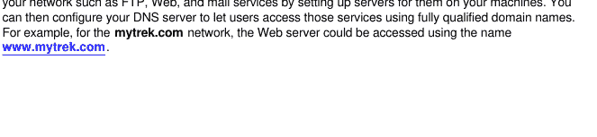

图 5-6：DNS 服务器操作


然后您可以通过在一台机器上运行 DNS 服务器来为您的网络设置域名服务。该机器成为您网络的 DNS 服务器。您可以为机器分配完全限定域名，并配置 DNS 服务器将名称翻译为其对应的 IP 地址。如图 5-7 所示，例如，您可以将机器 `192.168.0.1` 命名为 `turtle.mytrek.com`，并将机器 `192.168.0.2` 命名为 `rabbit.mytrek.com`。您还可以通过在机器上设置服务器来实现网络上的 Internet 服务，例如 FTP、Web 和邮件服务。然后您可以配置 DNS 服务器，让用户使用完全限定域名访问这些服务。例如，对于 `mytrek.com` 网络，Web 服务器可以使用名称 `www.mytrek.com` 访问。

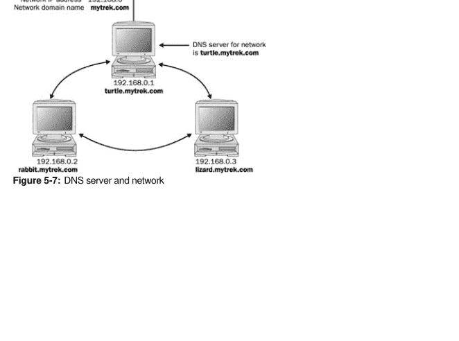

图 5-7：DNS 服务器和网络

##### 注意

如果不使用域名服务，您可以在每台机器的 `/etc/hosts` 文件中包含网络上所有机器的 IP 地址和域名的完整列表

#### 使用 `redhat-config-bind` 配置 DNS 服务器

要配置 DNS 服务器，您必须在 DNS 配置文件中输入不同主机的 IP 地址和主机名。您可以使用 `redhat-config-bind` 配置工具轻松完成此操作（在“服务器设置”窗口或菜单中选择“域名服务”）。`Bind` 是大多数网络上使用的 DNS 软件类型（有关 `redhat-config-bind` 的详细信息，请参阅《Red Hat Customization Guide》）。您需要创建两个区域配置：一个正向主区域和一个反向主区域。主 `redhat-config-bind` 窗口将显示所有已配置的域及其记录条目。顶部的按钮可让您创建新域、添加新记录、删除任何域或记录，并保存您的配置。单击一个域即可选择该域。“属性”按钮可让您编辑任何所选条目。图 5-8 显示了名为 `mytrek.com` 的域的示例 `redhat-config-bind` 配置，该域有三个主机 `turtle`、`rabbit` 和 `lizard`。存在正向和反向域配置的域条目。

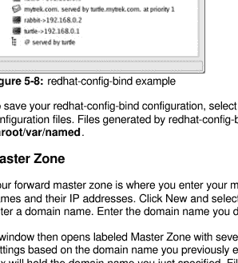

图 5-8：`redhat-config-bind` 示例

要保存您的 `redhat-config-bind` 配置，请选择“保存”按钮以生成 DNS 服务器配置文件。由 `redhat-config-bind` 生成的文件保存在 `/var/named` 目录下，位于 `chroot/var/named`。

##### 主区域

您的正向主区域是您输入主机域名及其 IP 地址的主要 DNS 配置条目的位置。单击“新建”并选择“正向主区域”。您最初会被要求输入域名。输入您为本地网络决定的域名，例如 `mytrek.com`。

然后会打开一个标记为“主区域”的窗口，其中包含 DNS 服务器的多个条目（参见图 5-9）。基于您之前输入的域名，已为默认设置输入。名称框将保存您刚刚指定的域名。文件名是主区域文件的名称，加上扩展名 `.zone`，将是域的名称。电子邮件地址是管理 DNS 服务器的人员的地址，默认设置为 `root` 用户。您可以随意将其更改为另一用户的地址。主名称服务器条目的默认值为 `@` 符号。`@` 符号仅代表 DNS 服务器的名称。序列号字段的初始值为 `1`。每当您对配置文件进行更改时，它会自动递增。“时间设置”按钮打开一个对话框，您可以在其中设置刷新、重试和过期日期。您可以将这些保持原样。这些以及其他设置在第 34 章中有详细说明。

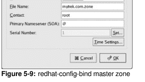

图 5-9：`redhat-config-bind` 主区域

##### 添加记录

然后您将返回到主 `redhat-config-bind` 窗口，其中现在列出了您命名的新域（参见图 5-10）。在这里，您添加和编辑主机和域条目，并指定运行 DNS 服务器的主机。如果您的网络有邮件服务器，如第 24 章所述，您也将在此处添加它。通常，同一台主机运行 DNS 服务器和邮件服务器。要添加记录，请选择域条目并单击“添加记录”。这将打开一个窗口，其中包含四个选项卡面板：主机、别名、名称服务器、邮件交换。这些面板涵盖了名称服务器配置中需要的基本记录类型。

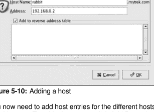

图 5-10：添加主机

您现在需要为系统上的不同主机添加主机条目，提供它们的主机名和 IP 地址。要添加主机条目，请单击“添加记录”，然后选择“主机”面板。这将显示一个面板，其中包含用于输入主机名及其 IP 地址的框。对于主机名，您不必包含域名。这将自动为您添加。您会在输入框旁边看到域名。选中“添加到反向表”复选框，以便条目也添加到反向域文件中。在图 5-10 中，主机 `rabbit` 已为 `mytrek.com` 域添加，IP 地址为 `192.168.0.2`。

注意：如果您想在网关主机上设置网站，您应该为其添加别名，其中别名使用主机名 `www`。添加别名时，请在“添加记录”对话框中选择“别名”面板。

您还必须创建一个名称服务器条目以指定运行 DNS 服务器的主机。运行 DNS 服务器的主机被称为名称服务器。单击“添加记录”按钮，然后选择“名称服务器”面板。您的当前域名将默认输入，在此示例中为 `mytrek.com`。要为当前域名设置名称服务器，您无需在“域名”框中输入任何内容。对于子域，您可以添加用于区分的名称部分。在“由...提供”框中，您输入运行 DNS 服务器的主机的主机名。对于本地主机，您只需输入第一个名称，如 `turtle` 代表 `turtle.mytrek.com`。

如果您有一个拥有自己的集中式邮件服务器的网络，像大型网络可能拥有的那样，您现在可以添加它。小网络例如家庭网络通常不会有这样的服务器。每个主机都将作为自己的邮件服务器运行，无需在 DNS 配置中指定。具有集中式邮件服务操作的大型网络将使用 DNS 邮件条目来配置邮件传递（有关更多详细信息，请参阅第 24 章）。单击“添加记录”按钮并选择“邮件交换”面板。在“名称”框中输入由邮件服务器服务的网络的域名。在“优先级”框中指定优先级（默认将输入 `1`）。然后，从主机列表中选择正在运行邮件服务器的主机。

#### 反向主区域

您然后需要创建反向主区域。单击“新建”。在首次出现的“区域类型”窗口中，单击“反向主区域”复选框。该窗口上的输入框将标记为 IP 地址（前三个八位组）。在此处，输入主机 IP 地址的网络部分。这是在系统上用于主机的 IP 地址中的前三组数字。例如，`turtle.mytrek.com` 的 IP 地址是 `192.168.0.1`，因此网络部分是 `192.168.0`。网络部分对所有主机都相同。将打开一个“反向主区域”窗口，其中 IP 地址和文件名已为您填好。在此处您可以设置标准域参数，如序列号和时间设置。完成后，您将返回到 `redhat-config-bind` 窗口，其中现在将显示反向域的条目。您现在需要为网络上的所有主机添加条目。要添加条目，首先确保已选择反向域，然后单击“添加记录”以打开一个窗口，在该窗口中输入主机的 IP 地址和主机名。选择“地址”面板。在“IP 地址”框中，仅输入主机 IP 地址的主机部分。这将是一个单一数字。例如，对于 IP 地址 `192.168.0.2`，您只需输入 `2`。在“名称”框中，您输入主机的完整主机名。对于 `rabbit` 主机，您将输入

```
rabbit.mytrek.com
```

然后您需要为 DNS 服务器添加一个条目。单击“添加记录”，然后选择名称服务器面板。在此处输入域名和将运行您的 DNS 服务器的主机名称。请确保包含尾随句点。在此示例中，名称服务器主机是

```
turtle.mytrek.com.
```

##### 注意

要手动启动您的 DNS 服务，您可以使用 `redhat-config-services`（服务器设置菜单上的服务）

## 第二部分：环境

### 章节列表

- 第 6 章：GNOME
- 第 7 章：K 桌面环境：KDE
- 第 8 章：Shell
- 第 9 章：Shell 配置
- 第 10 章：管理 Linux 文件、目录和归档

### 第 6 章：GNOME

#### 概述


# GNOME 概述

GNU 网络对象模型环境，也称为 GNOME，是一种功能强大且易于使用的环境，主要由面板、桌面和一组可用于构建程序界面的 GUI 工具组成。GNOME 旨在提供一个灵活的平台用于开发强大的应用程序。目前，GNOME 由多个发行版支持，并且是 Red Hat 的主要界面。GNOME 是免费的，并在 GNU 公共许可证下发布。您可以直接从 GNOME 网站 `www.gnome.org` 下载源代码以及文档和其他 GNOME 软件。多个公司已联合成立 GNOME 基金会，一个致力于协调 GNOME 及其软件应用程序开发的组织。这些公司包括 Sun、IBM 和 Hewlett-Packard 等公司，以及 Mandrake、Red Hat 和 TurboLinux 等 Linux 发行商，还有 Ximian 等 GNOME 开发者。GNOME 基金会以开发 Apache Web 服务器的 Apache 软件基金会为榜样，将为 GNOME 开发提供方向以及组织、财务和法律支持。

GNOME 桌面的核心组件包括用于启动程序和桌面功能的面板。桌面上通常找到的其他组件，如文件管理器、Web 浏览器和窗口管理器，由 GNOME 兼容的应用程序提供。GNOME 提供 GNOME GUI 工具库，开发者可以使用它们创建 GNOME 应用程序。使用符合 GNOME 标准的按钮、菜单和窗口的程序可以被称为 GNOME 兼容。GNOME 桌面的官方文件管理器是 `Nautilus`。GNOME 桌面不像 KDE 那样拥有自己的窗口管理器。相反，它使用任何 GNOME 兼容的窗口管理器。`Metacity` 窗口管理器是随 GNOME 发行版捆绑的那个。

组件模型接口的支持已集成到 GNOME 中，允许软件组件无论其实现所使用的计算机语言或其运行的机器类型如何都能相互连接。GNOME 中用于此类接口的标准是通用对象请求代理体系结构（CORBA），由对象模型组为 Unix 系统开发。GNOME 使用 CORBA 的 `ORBit` 实现。有了这样的框架，GNOME 应用程序和客户端可以直接相互通信，使您能够在另一个应用程序中使用一个应用程序的组件。随着 GNOME 2.0，GNOME 正式采用 `GConf` 及其库作为配置 GNOME 及其应用程序的基础方法。`GConf` 可以配置独立协调的程序，例如构成 `Nautilus` 文件管理器的程序。

您可以在其网站 `www.gnome.org` 上了解更多关于 GNOME 的信息。该网站不仅提供当前 GNOME 项目的详细软件地图，并链接到其开发站点，还维护 GNOME 项目的广泛邮件列表供您订阅。该网站提供在线文档，如 GNOME 用户指南和常见问题解答。如果您想开发 GNOME 程序，请查看 GNOME 开发者网站 `developer.gnome.org`。该网站提供教程、编程指南和开发工具，如教程和集成开发环境（IDE）。该网站还包括 `GTK+` 库、`GNOME` 小部件和 GNOME 桌面的详细在线文档。

**注意** 目前，GNOME 的新版本发布频繁，有时每隔几个月发布一次。GNOME 版本旨在使用户能够轻松升级其旧版本。对于 Red Hat，您可以使用更新实用程序 Red Hat Network 或从 Red Hat 和 Fedora 下载站点下载软件包并使用 `redhat-config-packages` 安装。软件包也可以从 GNOME FTP 站点 `ftp.gnome.org` 下载。


## ABC Amber CHM 转换器试用版

请注册以移除此横幅。

`http://www.processestext.com/abcchm.html`

### GNOME 增强

随着 GNOME 1.4，`Nautilus` 文件管理器正式取代了先前 GNOME 版本中使用的 GNOME 版 GNU Midnight Commander。`Nautilus` 设计为可作为桌面外壳运行，可支持众多组件，让您在其内部运行 Web 浏览器或解压缩文件。`Nautilus` 最初由 Eazel 开发，现在是 GNOME 桌面的官方文件浏览器。您可以从 GNOME CVS 仓库或 `www.ximian.com` 下载 `Nautilus` 源代码。您可以在 GNOME 用户指南中作为其一部分的 `Nautilus` 用户手册 `www.gnome.org` 上了解更多关于 `Nautilus` 的信息。

随着 GNOME 2.0，GNOME 已重写以在新的 `GTK+` 2.0 图形库上运行。GNOME 2.0 现在支持抗锯齿字体以及更高效的 GUI 执行。GNOME 2.0 还包括用于国际语言支持的 `Pango`，以及为残疾人士提供更易于交互的辅助工具包（`ATK`）。

随着 GNOME 2.2，`Nautilus` 文件管理器获得了更多功能。它现在可更轻松地集成到其他应用程序中，如用于归档的 `File Roller`、用于图片的图像查看器以及用于音频和视频的 GNOME 媒体播放器。您现在可以在 `Nautilus` 窗口中预览声音和视频文件。`Nautilus` 现在也可以将文件刻录到 CD 刻录机。GNOME 2.2 还具有集成主题管理，并提供了多个默认主题。新的字体支持工具让您更轻松地配置字体，使您能够选择和显示字体在不同组件如应用程序或窗口中的显示效果。

**提示** Ximian 提供了一个改进的 GNOME 版本，称为 Ximian 桌面，并计划提供一套完整的办公应用程序。您可以在其网站 `www.ximian.com` 上获得有关 Ximian 的更多信息。Ximian 桌面是 GNOME 的增强，完全兼容所有 GNOME 软件。您首先需要在系统上安装 GNOME，然后可以下载并安装 Ximian 桌面。

### GTK+

`GTK+` 是用于 GNOME 应用程序的小部件集。其外观和感觉最初源自 Motif。小部件集从零开始为性能和灵活性而设计。例如，按钮可以带有标签、图像或其任意组合。对象可以在运行时动态查询和修改。它还包括一个主题引擎，使用户能够更改使用这些小部件的应用程序的外观和感觉。与此同时，`GTK+` 小部件集仍然保持小巧高效。

`GTK+` 小部件集完全在 GNU Lesser General Public License（LGPL）下免费发布。LGPL 使开发人员能够将小部件集与专有软件以及自由软件一起使用（GPL 将其限制为仅自由软件）。小部件集还具有广泛的编程语言绑定，包括 C++、Perl、Python、Pascal、Objective C、Guile 和 Ada。国际化得到完全支持，允许基于 `GTK+` 的应用程序使用其他字符集，例如亚洲语言中的字符集。拖放功能同时支持 Xdnd 和 Motif 协议，允许与支持这些协议的其他小部件集（如 Qt 和 Motif）进行拖放操作。

### GNOME 接口

GNOME 接口由面板和桌面组成，如图 6-1 所示。面板出现在屏幕底部的一条长条上。它包含菜单、程序和小程序。（小程序是设计为在面板内运行的小程序。）面板上有一个带有大红帽的按钮。这是 GNOME 应用程序菜单，即主菜单。菜单的操作类似于 Windows 中的“开始”菜单，列出可在桌面上运行的应用程序的条目。您可以水平或垂直显示面板，并使其自动隐藏以显示全屏。

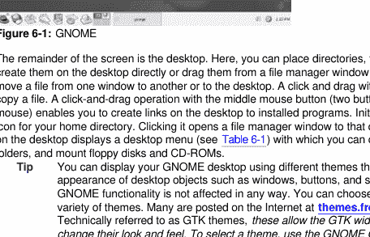

图 6-1：GNOME

屏幕其余部分是桌面。在这里，您可以放置目录、文件或程序。您可以直接在桌面上创建它们或从文件管理器窗口拖动它们。单击并拖动操作会将文件从一个窗口移动到另一个窗口或移动到桌面。按住 CTRL 键单击并拖动会复制文件。使用鼠标中键（在双键鼠标上同时按下两个按钮）进行单击并拖动操作可让您在桌面上为已安装的程序创建链接。最初，桌面仅包含一个指向您主目录的图标。单击它会打开一个指向该目录的文件管理器窗口。右键单击桌面上的任意位置会显示桌面菜单（参见表 6-1），您可以使用它打开新窗口、创建新文件夹以及挂载软盘和 CD-ROM。

提示：您可以使用不同的主题显示 GNOME 桌面，这些主题会更改桌面对象（如窗口、按钮和滚动条）的外观。GNOME 功能不会以任何方式受到影响。您可以从多种主题中进行选择。许多主题已发布在 Internet 上的 `themes.freshmeat.net`。技术上称为 GTK 主题，它们允许 GTK 小部件集更改其外观和感觉。要选择主题，请使用 GNOME 控制中心并在“桌面”列表中选择“主题”。

### GNOME 组件

从用户角度来看，您可以将 GNOME 接口视为具有四个组件：桌面、面板、主菜单和文件管理器。在其标准默认配置中，GNOME 桌面在左上角显示您主目录的文件夹图标，以及用于删除项目的垃圾箱，以及用于访问应用程序和设置首选项的“开始这里”图标。某些发行版可能包含其他图标，例如指向 GNOME 网站或 Linux 文档网站的链接。最初，文件管理器窗口在桌面上打开，显示您的主目录。在 Red Hat 上，面板有几个默认图标：主菜单（红帽）、Mozilla 网络浏览器（带鼠标的地球）、Evolution 邮件工具（信封），随后是几个 OpenOffice 应用程序包括文字处理器和电子表格、打印监视器（打印机）、工作区切换器（方块）和时钟。


## 开始这里窗口

从“开始这里”窗口，您可以访问您最喜欢的网站和文件（收藏夹）、选择并运行应用程序（应用程序）、自定义 GNOME 桌面（首选项）以及执行系统和服务器的管理任务（系统设置）。双击图标会打开一个窗口，其中列出子窗口或工具的图标。实际上，“开始这里”窗口模仿了主菜单。您可以从“开始这里”程序窗口选择并运行应用程序，就像可以从主菜单的程序菜单中一样。首选项窗口列出了用于设置 GNOME 首选项的 GNOME 配置工具（capplets）。实际上，它取代了以前版本中使用的 GNOME 控制中心窗口。有关更多详细信息，请参阅 GNOME 配置部分。如果您需要配置管理任务，例如设置网络连接或管理服务器，您可以选择系统设置窗口。其中大多数工具只能由 `root` 用户访问。

## 退出 GNOME

要退出 GNOME，请在主菜单中选择“注销”条目。然后面板上会出现一个“注销”按钮。注销时，会显示“注销”对话框。您有三个选项。第一个选项“注销”会退出 GNOME，将您返回到登录窗口（或命令行 shell，如果您使用 `startx` 启动了 GNOME，则仍登录到您的 Linux 账户）。第二个选项“关机”不仅会退出 GNOME，还会关闭整个系统。第三个选项“重新启动”条目会关闭并重新启动系统。“注销”条目默认被选中。关机和重新启动仅 `root` 用户可用。如果普通用户执行它们，会提示他们输入 `root` 用户密码以关闭。您也可以通过单击“保存当前设置”复选框来选择保留桌面。这会在您注销时重新打开注销时留下的任何程序或目录。符合 GNOME 的窗口管理器在您退出 GNOME 时也会退出。您必须在退出 GNOME 后单独退出不符合 GNOME 的窗口管理器。

## GNOME 帮助

GNOME 帮助系统提供类似浏览器的界面，用于显示 GNOME 用户手册、Man 页面和 info 文档。它具有工具栏，可让您浏览先前查看的文档列表。您甚至可以为特定项目添加书签。网页界面使您可以使用链接连接到不同文档。您可以轻松移动手册或 Man 页面和 info 文档的列表。您可以在位置框中放置条目以直接访问特定文档。支持不同类型文档的特殊 URL 类似协议：`ghelp`，用于 GNOME 帮助；`man`，用于手册页；`info`，用于 info 文档。

GNOME 帮助浏览器为 GNOME 接口的各个方面提供详细手册。请查阅“核心桌面”条目以获取 GNOME 桌面所有功能的完整描述。请查看“小程序”条目以获取可在 GNOME 面板中使用的应用程序。其他条目涵盖众多 GNOME 应用程序，例如 `Evolution` 邮件客户端和 GNOME 系统监视器。

## GNOME 桌面

GNOME 桌面为您提供图形用户界面操作系统（见图 6-1）的所有功能。您可以将文件、应用程序和目录拖到桌面，然后再拖回符合 GNOME 的应用程序。如果桌面停止运行，您可以通过启动 GNOME 文件管理器（`Nautilus`）来重新启动它。桌面实际上是 GNOME 文件管理器中的后端进程。但您不必打开文件管理器即可使用桌面。

**注意** 作为桌面的替代方案，您可以将任何程序、文件或目录拖到面板上。

## 拖放

尽管 GNOME 桌面支持拖放操作，但这些操作仅适用于符合 GNOME 的应用程序。您可以将任何项目从符合 GNOME 的应用程序拖到桌面，反之亦然。您从文件管理器窗口拖到桌面的任何项目的图标也会出现在桌面上。但是，默认的拖放操作是移动操作。如果您在文件管理器窗口中选择一个文件并将其拖到桌面，您实际上是将文件从其当前目录移动到 GNOME 桌面目录，该目录位于您的主目录中并保存桌面上的所有项目（请注意，这是一个点文件）。对于 GNOME，桌面目录是 `.gnome-desktop`。在将目录文件夹拖到桌面的情况下，整个目录及其子目录将被复制到 GNOME 桌面目录。

您还可以通过按住 `CTRL` 键然后单击并拖动文件从文件管理器窗口到桌面来复制文件到桌面。您会看到复制图标右上角的小箭头变为 + 符号，表示您正在创建副本而不是链接。

GNOME 的拖放操作适用于 GNOME 工作区切换器提供的虚拟桌面。面板上的 GNOME 工作区切换器为面板中的每个虚拟桌面创建图标，以及在其中打开的任何应用程序的任务按钮。

## 应用程序链接

在大多数情况下，您只想在桌面上创建另一种访问文件的方式，而不将其从原始目录移动。您可以通过创建链接来实现。要创建链接，首先单击并拖动文件出窗口，并在移动文件但在松开鼠标按钮之前，按住 `ALT` 键。这将显示一个弹出菜单，其中包含剪切、复制和链接的选择。选择链接选项以创建链接。然后会出现一个图标的副本，其右角有一个小箭头表示它是链接。您可以单击此链接来启动程序、打开文件或打开目录，具体取决于您链接的文件类型。

您可以使用该图标直接访问该项目。这通常用于启动常用程序。例如，您可以将 Mozilla 图标单击并拖动到桌面，然后按 `ALT`，以为 Mozilla 创建链接图标。双击图标即可启动 Mozilla。您也可以对文件执行相同操作。在这种情况下，会启动相应的程序。如果该项目是目录，文件管理器将启动并打开到该目录。如果您想在桌面上放置一个不符合 GNOME 的应用程序，您可以手动在主目录的 GNOME 桌面目录 `.gnome-desktop` 中放置一个链接。

## 桌面驱动器图标

桌面还显示您已挂载的任何驱动器的图标，例如 CD-ROM 或软盘驱动器，前提是它们可由用户挂载。`Nautilus` 在您将 CD-ROM 插入 CD-ROM 驱动器时自动挂载 CD-ROM，显示 CD-ROM 图标并打开一个 `Nautilus` 窗口显示 CD-ROM 的内容。要弹出 CD-ROM，请右键单击其图标并从弹出菜单中选择“弹出”。

您可以通过右键单击桌面上的任意位置来显示桌面菜单，然后在“磁盘”菜单中选择“CD-ROM”或“软盘”条目，手动挂载 CD-ROM 或软盘。设备图标将出现并显示 CD-ROM 或软盘的名称。然后您可以通过双击它或右键单击并选择“打开”条目来访问 CD-ROM 驱动器中的磁盘。文件管理器窗口打开到

显示 CD-ROM 光盘的内容。要卸载并弹出 CD-ROM，请右键单击 CD-ROM 图标并选择“弹出”条目。同样的方法也适用于软盘，使用“软盘”图标。务必在先卸载软盘后再取出已挂载的软盘，在弹出菜单中选择“弹出”条目。

## 桌面菜单

您也可以在空桌面上的任意位置右键单击以显示 GNOME 桌面菜单。这将列出常用任务的条目，例如打开一个新的终端窗口以输入 shell 命令，或创建新文件夹。请记住，新建文件夹条目会在桌面上创建新目录，具体在您的 GNOME 桌面目录（`.gnome-desktop`）中，而不是您的主目录中。该菜单的条目列在表 6-1 中。

表 6-1：GNOME 桌面菜单

| 菜单项 | 描述 |
|---|---|
| 新建窗口 | 在桌面上启动一个新的 `Nautilus` 文件管理器窗口，显示您的主目录。 |
| 新建启动器 | 为应用程序创建新的桌面图标。 |
| 新建终端 | 启动一个新的 GNOME 终端窗口，导航到桌面目录。 |
| 新建文件夹 | 在桌面上创建新目录。 |
| 脚本 | 选择要在所选文件上运行的脚本。 |
| 按名称整理 | 排列桌面图标。 |
| 剪切、复制、粘贴 | 剪切、复制或粘贴文件，让您在文件夹之间移动或复制文件。 |
| 磁盘 | 显示一个子菜单，其中列出可供选择的软盘和 CD-ROM 设备以便挂载。已挂载的磁盘将作为 CD-ROM 或软盘图标出现在桌面上，您可以使用它们进行访问或稍后卸载。 |
| 更改桌面背景 | 打开“背景首选项”对话框，让您为桌面选择新的背景。 |

## 窗口管理器

GNOME 可与任何窗口管理器一起使用。然而，像拖放功能和 GNOME 分页器（稍后讨论）等桌面功能，仅在与 GNOME 兼容的窗口管理器上才有效。当前版本的 GNOME 使用 `Metacity` 窗口管理器。它完全兼容 GNOME，旨在与 GNOME 桌面集成而不重复功能。然而，其他窗口管理器如 `Enlightenment`、`IceWM` 和 `Window Maker` 也可以使用。请查看窗口管理器的文档以确认其是否兼容 GNOME。

`Metacity` 采用的窗口操作与其它窗口管理器基本相同。您可以通过单击其任意边或角并拖动来调整窗口大小。您可以通过在标题栏上单击并拖动来移动窗口。您也可以右键单击并拖动任意边框来移动窗口，以及 `ALT` 单击窗口的任意位置。右上角显示“最大化”、“最小化”和“关闭”按钮。最小化会在面板中为窗口创建一个按钮，您可以单击该按钮将其恢复。您可以右键单击窗口的标题栏以显示包含窗口操作的窗口菜单。这些操作包括工作区条目，可将窗口移动到另一个工作区（虚拟桌面）或所有工作区，这样无论您移动到哪个工作区窗口都会显示。


## ABC Amber CHM Converter Trial version

Please register to remove this banner.

http://www.processestext.com/abcc...html


## GNOME 文件管理器：Nautilus

Nautilus 是 GNOME 文件管理器，支持复制、移除和删除项目以及设置权限和显示项目的标准功能。它还提供诸如缩放功能、用户级别和主题支持等增强功能。您可以放大或缩小文件图标的大小，从初级、中级或专家级别中选择使用级别，并使用不同的主题自定义 Nautilus 的外观和感觉。Nautilus 还允许您设置文件列表的自定义视图，使您能够为目录图标显示图像，并在文件管理器窗口内运行组件应用程序。

## Nautilus 窗口

Nautilus 被设计为桌面外壳，其中可使用不同的组件来添加功能。例如，在 Nautilus 中可以执行 Web 浏览器，以在 Nautilus 文件管理器窗口中提供 Web 浏览器功能。图像查看器可以显示图像。GNOME 媒体播放器可以运行声音和视频文件。GNOME File Roller 工具可以归档文件，也可以从归档中提取文件。随着 Gstreamer 的实现，多媒体工具如 GNOME 音频记录器现在更容易集成到 Nautilus 中。
标准的 Nautilus 窗口显示文件管理器命令的菜单栏和工具栏，以及顶部的位置框（见图 6-2）。窗口的其余部分分为两个窗格。左侧窗格是侧边窗格，用于显示当前工作目录的信息。右侧窗格是主面板，显示当前工作目录中的文件和子目录列表。窗口底部的状态栏显示所选文件或目录的信息。您可以通过在“查看”菜单中选择其条目来打开或关闭这些元素中的任何一个。

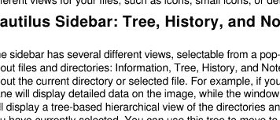

图 6-2：Nautilus 文件管理器

位置框旁边有一个用于缩放文件视图的元素。单击 `+` 按钮以放大，单击 `-` 按钮以缩小。缩放元素旁边是一个下拉菜单，用于选择文件的不同视图，例如图标、小图标或详细信息。

## Nautilus 侧边栏：树、历史记录和笔记

侧边栏有几种不同的视图，可从弹出菜单中选择，用于显示有关文件和目录的附加信息：信息、树、历史记录和笔记。信息显示当前目录或所选文件的详细信息。例如，如果您双击一个图像文件，信息窗格将显示有关图像的详细数据，而窗口窗格则显示完整的图像。树视图将以树状分层视图显示系统上的目录和文件，并突出显示当前选中的项。您可以使用此树在其他目录和文件之间移动。树映射系统上的所有目录，从根目录开始。您可以通过单击其名称前面的 `+` 或 `-` 符号来展开或折叠任何目录。通过单击目录名称来选择目录。然后该目录的内容将在主面板中显示。历史记录视图显示您之前访问过的文件或目录，便于在目录或文件之间前后移动。
笔记视图将显示您为项目或目录输入的笔记。笔记视图在侧边窗格内打开一个可编辑的文本窗口。只需选择笔记视图并输入您的笔记即可。要为特定项目（如图像或声音文件）添加笔记，只需双击该项目以显示或运行它，然后选择“笔记”视图输入您的笔记。您也可以右键单击该项目，显示项目的弹出菜单并选择首选项，从中可以单击笔记面板。在您添加笔记后，您将在 Nautilus 窗口中看到该项目的图标上添加了笔记图像。

## Nautilus 视图

您可以将目录的内容以图标或详细列表的形式查看。您可从位置栏右侧的弹出菜单中选择不同的选项。列表视图提供名称、权限、大小、日期、所有者和组。在列表视图中，主面板顶部为每个字段显示按钮。您可以使用这些按钮根据该字段对列表进行排序。例如，要按日期对文件进行排序，请单击“日期”按钮；要按大小排序，请单击“大小”。
在图标视图中，您可以对图标进行排序并在不打开它们的情况下预览其内容。要对图标视图中的项目进行排序，请在“查看”菜单中选择“排列项目”条目，然后选择一种布局选项。某些类型的文件图标会显示其内容的预览——例如，图像文件的图标会显示图像的小版本。文本文件将在其图标中显示其文本的前几个词。“放大”条目会放大窗口的视图，使图标变大，而“缩小”则会缩小视图，使其变小。“正常大小”会将其恢复为标准大小。您也可以使用位置栏上的 `+` 和 `-` 按钮来更改大小。

## Nautilus 菜单

您可以单击主面板上的任意位置以显示用于管理和排列文件管理器图标的弹出菜单（见表 6-2）。要创建新文件夹，请选择“新建文件夹”，要打开新的文件管理器窗口，请选择“新建窗口”。“排列项目”条目显示一个子菜单，其中包含按名称、大小、类型、日期或徽标对图标进行排序的条目。“手动”条目可让您在主面板上随意移动图标。“使用默认背景”可让您更改文件管理器窗口上使用的背景。您也可以剪切、复制和粘贴文件，以便更轻松地在文件夹之间移动或复制文件。

表 6-2：Nautilus 文件管理器菜单

| 菜单项 | 描述 |
|---|---|
| 新建窗口 | 在单独的窗口中打开文件或目录。 |
| 新建文件夹 | 在目录中创建新的子目录。 |
| 脚本 | 选择要运行的脚本。 |
| 排列项目 | 显示一个子菜单，用于按名称、大小、类型、日期或徽标排列文件。 |
| 剪切、复制、粘贴 | 剪切、复制或粘贴文件，让您在文件夹之间移动或复制文件。 |
| 放大 | 显示图标的特写，使其看起来更大。 |
| 缩小 | 显示图标的远景，使其看起来更小。 |
| 正常大小 | 将图标视图恢复为标准大小。 |
| 使用默认背景 | 设置文件管理器主面板的背景图像。 |

## 导航目录

Nautilus 文件管理器与 Web 浏览器类似。它维护一个先前查看的目录列表，您可以使用工具栏按钮在该列表中前后移动。左箭头按钮将您移动到先前显示的目录，右箭头按钮将您移动到下一个显示的目录。上箭头按钮将您移动到父目录，而“主页”按钮将您移动到主目录。要使用路径名直接进入特定目录，您可以在
在位置框中输入并按 `ENTER`。
要打开一个子目录，可以双击其图标，或单击图标然后从文件菜单中选择打开。如果要为该目录打开一个单独的 Nautilus 窗口，请右键单击目录图标并选择在新窗口中打开。要更改文件夹图标的大小，请选择拉伸图标。图标图像上会出现手柄。单击并拖动手柄以更改其大小。要恢复图标，请在编辑菜单中选择恢复图标原始大小。

## 管理文件

作为符合 GNOME 标准的 文件管理器，Nautilus 支持用于复制和移动文件的 GUI 拖放操作。要移动文件或目录，请像在 Windows 或 Mac 界面中一样从一个目录拖放到另一个目录。移动操作是 GNOME 中的默认拖放操作。要复制文件，请在按住 `CTRL` 键的同时正常拖放。如果将文件移动到另一个分区（文件系统）上的目录，则会复制而不是移动。
注意 Nautilus 现在借助 `nautilus-cd-burner` 软件包提供内置的 CD 刻录支持。只需将文件复制到 CD 刻录盘即可。
您还可以通过右键单击其图标并从出现的弹出菜单中选择所需的操作，对文件执行删除、复制和创建链接操作（请参阅表 6-3）。例如，要删除一个项目，请右键单击它并从弹出菜单中选择移至废纸篓条目。这会将其放置在废纸篓目录中，您以后可以通过从 Nautilus 文件菜单中选择清空废纸篓来删除它。要创建文件的副本，可以从弹出菜单中选择复制，以在同一目录中创建重复版本。副本的名称将包含“(copy).”术语。要创建链接，请右键单击文件并从弹出菜单中选择创建链接。这会创建一个以“link.”术语开头的新链接文件。

### 表 6-3：Nautilus 文件弹出菜单

| 菜单项 | 描述 |
|---|---|
| 打开 | 使用其关联的应用程序打开文件。目录在文件管理器中打开。 |
| 在新窗口中打开 | 在单独的窗口中打开文件或目录。 |
| 用...打开 | 选择用于打开此文件的应用程序。会显示可能应用程序的子菜单。 |
| 脚本 | 列出要在所选文件上运行的 Nautilus 脚本。 |
| 剪切、复制、粘贴文件 | 剪切、复制和粘贴文件的条目。 |
| 复制 | 在同一目录中创建文件的重复副本。 |
| 创建链接 | 在同一目录中为该文件创建链接。 |
| 重命名 | 重命名文件。 |
| 移至废纸篓 | 将文件移至废纸篓目录，您以后可以删除它。 |
| 拉伸图标 | 更改所选图标（文件夹）的大小。 |
| 移除自定义图像 | 移除您为图标选择的自定义图像。 |
| 恢复图标原始大小 | 之前放大的所选图标将被恢复到标准大小。 |
| 添加到归档 | 使用 File Roller 归档文件。 |
| 属性 | 显示此文件的属性对话框。有三个面板：统计信息、选项和权限。 |

要重命名文件，您可以右键单击文件图标并从弹出菜单中选择重命名条目，或单击其图标下方显示的文件名。图标名称将在黑色背景中突出显示，并包含在小型文本框中。然后您可以单击名称并删除旧名称，输入新名称。您也可以在文件的属性对话框中输入新名称来重命名文件。使用右键单击并从弹出菜单中选择属性来显示属性对话框。在基本选项卡上，您可以更改文件的名称。
文件操作可以对所选的一组文件和目录执行。您可以以多种方式选择一组项目。您可以单击第一个项目，然后按住 `SHIFT` 键的同时单击最后一个项目。您也可以通过在要选择的项目上单击并拖动鼠标来选择。 要选择分离的项目，请在单击各个图标时按住 `CTRL` 键。如果要选择目录中的所有项目，请在编辑菜单中选择全选条目。然后您可以一次单击并拖动一组项目。这使您可以一次复制、移动甚至删除多个文件。


您可以通过双击应用程序本身或用于该应用程序的数据文件，在文件管理器中启动任何应用程序。如果文件没有关联的应用程序，您可以右键单击文件并选择用...打开条目。子菜单会显示可能应用程序的列表。如果您的应用程序未列出，您可以选择其他应用程序以打开一个对话框，在其中您可以选择要用于打开此文件的应用程序。您还可以使用文本查看器在文件管理器窗口内显示文件的纯内容。应用程序也支持拖放操作。您可以将数据文件拖到其关联的应用程序图标（例如桌面上的图标）；然后应用程序将使用该数据文件启动。

## 文件和目录属性

使用属性对话框，您可以查看文件的详细信息并设置选项和权限（请参阅图 6-3）。属性框有四个面板：基本、徽标、权限和注释。基本面板显示类型、大小、位置和修改日期等详细信息。类型是 MIME 类型，表示与其关联的应用程序类型。文件图标显示在顶部，并带有显示文件名的文本框。您可以在此文本框中编辑文件名，从而更改该名称。底部有一个标记为选择自定义图标的按钮，将打开一个显示可供使用的可用图标的对话框。您可以从该窗口中选择所需的图标。移除自定义图标按钮将恢复默认图标图像。徽标面板使您可以设置要为此文件显示的徽标，并显示所有可用的徽标。权限面板显示为该文件设置的、针对用户、组和其他的读取、写入和执行权限。只要文件属于您，您就可以在此处更改任何权限。该面板还将显示文件的拥有者和其组。组名会扩展为列出不同组的弹出菜单，允许您选择一个组来更改文件的组。注释面板将列出您希望为文件或目录做的任何注释。它是一个可编辑的文本窗口，因此您可以直接更改或添加注释。

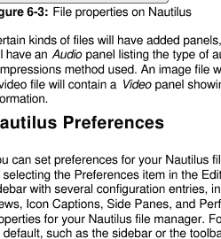

图 6-3：Nautilus 中的文件属性

某些类型的文件将具有附加面板，提供有关该项目的详细信息。例如，音频文件将具有音频面板，列出音频文件的类型以及歌曲标题或使用的压缩方法等其他信息。图像文件将具有图像面板，列出分辨率和图像类型。视频文件将包含视频面板，显示视频文件的类型以及压缩和分辨率信息。

## Nautilus 首选项

### Nautilus 作为 Web 浏览器

Nautilus 也是一个可操作的 Web 浏览器。您可以使用位置框访问任何 Web 或 FTP 站点。只需在位置框中输入网站的 URL 并按 ENTER（您无需指定 www 或 http://）。但是，Nautilus 并不是一个功能齐全的 Web 浏览器。当您访问页面时，它将在侧边栏中显示按钮，以便使用系统上安装的多个 Web 浏览器之一打开页面，例如 Mozilla 和 Lynx。侧边栏中的转到菜单和历史记录选项卡维护您之前访问过的网站的历史记录列表。您也可以右键单击后退或前进按钮以显示此历史记录列表。要清除历史记录列表，请在转到菜单中选择忘记历史记录。Nautilus 还支持书签，可以使用书签菜单显示和编辑。单击 Web 搜索图标将打开您指定的收藏 Web 搜索引擎的页面，例如 Yahoo 或 Google。

### 提示

Nautilus 也是 Internet 感知的。您可以使用位置框访问 FTP 站点并显示该远程站点上的目录，然后将文件拖放到另一处


## ABC Amber CHM Converter Trial version

Please register to remove this banner.

http://www.processestext.com/abchm.html

## The GNOME Panel

面板是 GNOME 界面的中心（见图 6-4）。通过它你可以启动应用程序、运行小程序并访问桌面区域。你可以将 GNOME 面板视为可在桌面上使用的工具。你可以在桌面上显示多个 GNOME 面板，每个面板都包含你放置的小程序和菜单。在这方面，GNOME 具有灵活性，使你能够按任意方式配置面板。你可以自定义面板以满足自己的需求，放置自己选择的小程序和菜单。你可以添加新面板、向面板添加应用程序并添加各种小程序。


Figure 6-4: The GNOME panel

诸如添加应用程序、选择小程序、设置菜单和创建新面板等面板配置任务都通过面板弹出菜单处理。只需在面板上的任意位置右键单击，即可显示包含属性、新建面板、添加到面板和删除此面板等条目的菜单，以及帮助和关于条目。新建面板可让你创建其他面板；添加到面板可让你向面板添加项目，例如应用程序启动器、用于简单任务的小程序如工作区切换器，以及像主应用程序菜单那样的菜单。属性条目将显示用于配置该面板功能的对话框，例如面板的位置及其隐藏功能。

注意 你可以通过点击面板上的按钮打开主菜单。在 Red Hat 上，主菜单按钮是一个红帽的艺术化图案。它最初位于面板的左侧，即屏幕的左下角。你只需单击主菜单按钮即可。

### Panel Properties

要配置单个面板，请使用面板属性对话框。要显示此对话框，请右键单击特定面板并在弹出菜单中选择属性条目。对于单个面板，你可以设置边缘面板配置和背景的功能。面板属性对话框包含每个的标签页面板。在边缘面板上，你可以选择边缘面板的定位选项和最小化选项，包括自动隐藏功能。隐藏按钮功能使你能够自行隐藏面板。

在背景面板上，你可以更改面板使用的背景图像。你可以选择图像、使其按比例缩放以适应面板，并选择背景颜色。对于图像，你还可以从文件管理器将图像文件拖放到面板上；该图像随后将成为面板的背景图像。

### Displaying Panels

你可以通过点击面板两端各自的隐藏按钮随时隐藏面板。隐藏按钮是显示小箭头的细按钮。这是指面板将隐藏的方向。要重新显示面板，将鼠标移至屏幕底部该方向的屏幕外。你可以在面板的属性窗口中启用或禁用隐藏按钮。如果希望面板在不使用时自动隐藏，请在面板配置窗口中选择自动隐藏选项。将鼠标移至屏幕底部会重新显示面板。你还可以通过使用鼠标中键（双键鼠标同时按下两个按钮）在面板任一端点击并拖动，将面板移动到屏幕的另一边缘。

### Adding Panels

要添加新面板，请在面板弹出菜单中选择新建面板条目。然后你可以选择面板类型，从菜单、边缘、浮动、滑动或角落面板中选择。默认是边缘面板。边缘面板显示在屏幕其中一边缘上。你的原始面板是边缘面板。菜单面板是作为跨越桌面顶部的菜单栏实现的面板，其中包含应用程序和操作的菜单。它可以容纳标准面板可容纳的任何对象。浮动面板是你可以在桌面上任意位置放置的面板。滑动面板的大小取决于面板中的项目数量，可以放置在桌面的边缘任意位置。角落面板是更小的面板，其大小也取决于其上的项目数量，并放置在桌面边缘的角落。

### Panel Objects

面板可以包含几种不同类型的对象。这些包括菜单、启动器、小程序、抽屉和特殊对象。

#### Menus

主菜单是面板菜单的示例。启动器是用于启动应用程序或执行命令的按钮。

#### Launchers

Web 浏览器图标是启动器按钮的示例。你可以在主菜单中选择任何应用程序条目并在面板上为其创建启动器。

#### Applets

小程序是设计为在面板内运行的小型应用程序。显示不同桌面的工作区切换器是 GNOME 小程序的示例。

#### Drawers

抽屉是可打开或关闭的面板扩展。你可以将抽屉视为面板的可收缩部分。你可以向其中添加任何可添加到普通面板的内容，包括小程序、菜单甚至其他抽屉。


### Special objects

这些用于执行其他面板对象不支持的特殊任务。例如，注销和锁定按钮是特殊对象。

### Application Launchers

向面板添加应用程序很容易。对于主菜单中已有的应用程序，你只需转到其条目并右键单击它。然后选择将此启动器添加到面板条目。应用程序的应用程序启动器随后会自动添加到面板。假设你经常使用 `gedit` 并希望将其图标添加到面板，而不是每次都通过主菜单。右键单击附件菜单中的文本编辑器菜单条目，并选择将此启动器添加到面板选项。`gedit` 图标现在出现在你的面板中。

要添加主菜单中没有的应用程序图标，首先右键单击面板以显示弹出菜单并选择添加到面板条目。从那里，选择启动器条目。这将打开创建启动器窗口，用于输入应用程序启动器的属性。你将被提示输入应用程序名称、调用它的命令及其类型。要为启动器选择图标，请单击图标按钮。这将打开图标浏览器窗口，列出可供选择的图标。

### Adding Drawers

你还可以将应用程序分组在抽屉图标下。单击抽屉图标会显示不同的应用程序图标列表，然后你可以进行选择。要向面板添加抽屉，请右键单击面板并选择抽屉条目。然后你可以将项目从窗口拖到抽屉图标上以将其列在抽屉中。对于特定菜单条目，你可以右键单击菜单条目并选择将启动器添加到面板。一旦在面板上，你可以将图标拖到抽屉中。

如果你想将主菜单上的整个应用程序菜单作为抽屉添加到面板中，右键单击该菜单中的任何项目，然后从弹出菜单中选择整个菜单，然后选择将此作为抽屉添加到面板条目。整个菜单将作为抽屉出现在你的面板上，包含图标而不是菜单条目。例如，假设你想将面板上的 Internet 应用程序菜单放置在面板上。右键单击任何条目项目，选择整个菜单，并选择将此作为抽屉添加到面板。一个标记为 Internet 的抽屉出现在你的面板上，单击它会显示所有 Internet 应用程序的图标弹出列表。

### Adding Menus

菜单与抽屉的不同之处在于抽屉保存应用程序图标而不是菜单条目。你可以向面板添加菜单，就像添加抽屉一样。要将主菜单的子菜单添加到面板，右键单击任何项目并选择整个菜单，然后选择将此作为菜单添加到面板条目。菜单标题出现在面板上；你可以单击它以显示菜单条目。

你还可以向面板添加目录文件夹。点击并拖动文件管理器窗口中的文件夹图标到你的面板。每当你单击此文件夹按钮时，文件管理器窗口就会打开，显示该目录。你已经为你的主目录有一个文件夹按钮。你可以将目录文件夹添加到面板上的任何抽屉中。

### 移动和删除对象

在面板内移动任何对象，甚至是菜单图标，只需用鼠标中键拖动它即可。你也可以右键单击它并选择“移动小程序”，以便移动该小程序。你可以将其移动到同一面板上的不同位置，或移动到另一个面板。移动对象时，可以让它们推开、与之交换或跳过面板上遇到的其他对象。要推开一个对象，请在移动对象时按住 `SHIFT` 键。要与一个对象交换，请按住 `CTRL` 键；要跳过一个对象，请按住 `ALT` 键。

要从面板中删除一个对象，请右键单击它以显示其弹出菜单，然后选择“从面板中移除”条目。

### 特殊面板对象

特殊面板对象执行其他面板对象不支持的操作。目前，这些包括锁定、注销和启动器按钮，以及被吞没的应用程序和状态栏。锁定按钮显示一个挂锁，会锁定你的桌面，并以屏幕保护程序代替。要访问桌面，请单击它，然后在密码提示处输入你的用户密码。注销按钮显示一个带有半月的显示器。单击它会显示注销对话框，然后你可以注销。这与从主菜单中选择“注销”相同。启动器按钮显示一个启动器图标。它打开“创建启动器”对话框，允许你输入或选择要运行的应用程序。

状态栏设计用于容纳状态栏小程序。状态栏小程序提供应用程序的当前状态信息。在 GNOME 下运行的、支持状态栏小程序的 KDE 应用程序可以使用 GNOME 状态栏。

### GNOME 小程序

小程序是面板内执行任务的小程序。要添加小程序，请右键单击面板并从弹出菜单中选择“添加到面板”。这会显示其他弹出菜单，列出小程序类别以及可用的小程序列表。选择你想要的那个。例如，要将时钟添加到面板，请从“附件”菜单中选择“时钟”。要删除小程序，请右键单击它并选择“从面板中移除”条目。你也可以在主菜单中选择“小程序”菜单，然后选择要添加到面板的小程序。

GNOME 提供了许多有用的小程序，例如 CPU 监视器和邮件检查器。有些小程序监视你的系统，例如“电池监视器”，它检查笔记本电脑的电池，以及“系统监视器使用情况”，它显示一个图表，指示你当前的 CPU 和内存使用情况。“音量控制”小程序显示一个小的滚动条用于调节音量。CD 播放器显示一个小的 CD 界面用于播放音乐 CD。

对于 Internet 任务，有“收件箱监视器”、“调制解调器指示灯”和“无线链路监视器”小程序。收件箱监视器检查收到的邮件。要配置收件箱监视器，请右键单击它并选择“首选项”条目。你可以设置检查频率，并指定是检查本地邮箱还是远程 `POP3` 和 `IMAP` 邮箱。调制解调器指示灯功能监视你的调制解调器连接。你可以配置它以监视通过调制解调器到 ISP 的 `PPP` 连接。无线链路使你能够监视无线传输的质量。

若干有用的实用小程序为你的桌面提供额外功能。时钟小程序可以以 12 小时或 24 小时格式显示时间。右键单击时钟小程序并选择“首选项”条目以更改其设置。“磁盘挂载器”小程序使你能够通过单击挂载驱动器。你可以为每个设备创建一个磁盘挂载器小程序，例如软盘驱动器和 CD-ROM。要挂载文件系统，只需单击面板中相应的磁盘挂载器图标即可（有助于快速挂载软盘驱动器）。要指定要挂载的文件系统，请使用“磁盘挂载器首选项”对话框。

### 工作区切换器

工作区切换器出现在面板中并显示你的虚拟桌面的视图。虚拟桌面在窗口管理器中定义。工作区切换器让你可以通过单击鼠标轻松地从一个桌面移动到另一个桌面。工作区切换器是一个仅在面板中工作的面板小程序。如果工作区切换器尚未激活，你可以通过右键单击面板并从弹出菜单中选择“添加到面板”来激活它。这反过来会显示其他弹出菜单，列出小程序类别及其可用小程序列表。选择“实用工具”类别，然后在该菜单中选择“工作区切换器”。

工作区切换器将你的整个虚拟桌面显示为框内的单独矩形。打开的窗口显示为这些方块中的小彩色矩形。你可以通过在工作区切换器中单击并拖动其图像，将任何窗口从一个虚拟桌面移动到另一个虚拟桌面。要配置工作区切换器，请右键单击它并选择“首选项”以显示首选项对话框。在这里，你可以选择工作区的数量。

### GNOME 任务列表

任务列表显示当前打开的应用程序。任务列表将当前运行的任务排列成一系列按钮，每个窗口一个。任务可以是任何打开的应用程序，通常由屏幕上显示的窗口表示。这些可以包括诸如 Web 浏览器或显示目录的文件管理器窗口等应用程序。你可以通过单击其按钮从一个任务移动到另一个任务，实际上是从一个窗口移动到另一个窗口。当你最小化一个窗口时，你可以稍后通过单击任务列表中的条目来恢复它。

右键单击窗口的任务列表条目会打开一个菜单，让你最小化或还原、遮蔽、移动、调整大小、最大化或关闭窗口。最小化操作会将窗口缩小到其任务列表条目。右键单击该条目会显示菜单，其中“最小化”选项变为“还原”，然后你可以使用它重新显示窗口。“遮蔽”条目会将窗口缩小到其标题栏。“关闭”条目会关闭窗口，结束其应用程序。

要配置任务列表，请右键单击它并选择“属性”条目。在这里，你可以设置诸如任务列表的大小、行数、是否显示迷你图标以及要显示的任务等功能。

### GNOME 配置

你可以使用称为小控件的工具配置 GNOME 界面的不同部分。将小控件视为可添加的模块或插件，以便你配置各种应用程序。核心 GNOME 应用程序以及开发人员可能为其编写了小控件的其他应用程序都存在小控件。在 Red Hat 上，你可以从主菜单中的“首选项”菜单访问小控件。你也可以通过在 Red Hat 开始窗口中选择“首选项”来选择小控件。此菜单（或首选项窗口）将显示控制中心支持的每个小控件类别的条目。选择其中一个将打开一个标记为“首选项”的窗口，显示各个小控件的图标。双击特定图标将打开其小控件窗口。你可以同时打开多个。

你的 GNOME 系统提供几个桌面小控件供你配置桌面，例如“背景”、“屏幕保护程序”和“主题选择器”。你使用“背景”小控件选择背景颜色或图像，使用“屏幕保护程序”小控件选择屏幕保护程序图像和等待时间，使用“主题选择器”小控件选择主题。

“文件类型和程序”小控件使你能够为系统指定多用途互联网邮件扩展（`MIME`）类型条目，将给定的 `MIME` 类型与某些应用程序关联。请注意，基本 `MIME` 类型条目已存在。你可以编辑条目并更改其关联的应用程序。

对于声音配置，“声音”小控件让你选择在不同 GNOME 应用程序的事件中播放的声音文件。对于键盘，你可以使用“键盘”小控件设置重复灵敏度和点击声音。你可以为右手或左手配置鼠标按钮，并调整鼠标移动。

GNOME 在你的主目录中设置了几个配置文件和目录。`.gnome` 和 `.gnome2` 目录保存不同桌面组件的配置文件，例如 `nautilus` 用于文件管理器，`panel` 用于面板，`gmenu` 用于主菜单；`.gtkrc` 保存 `GTK+` 控件的配置指令。`.gnome-desktop` 目录保存你放置在桌面上的所有项目。

### GNOME 目录和文件


Red Hat 在系统的 `/usr/bin` 目录中安装 GNOME 二进制文件。GNOME 库位于 `/usr/lib` 目录中。GNOME 还有自己的包含目录，其中包含用于编译和开发 GNOME 应用程序的头文件，`/usr/include/libgnome` 和 `/usr/include/libgnomeui`（见表 6-4）。位于 `/usr/share/gnome` 的目录包含用于配置 GNOME 环境的文件。

### 表 6-4：GNOME 配置目录

| 系统 GNOME 目录 | 内容 |
|---|---|
| `/usr/bin` | GNOME 程序。 |
| `/usr/lib` | GNOME 库。 |
| `/usr/include/libgnome` | 用于编译和开发 GNOME 应用程序的头文件。 |
| `/usr/include/libgnomeui` | 用于编译和开发 GNOME 用户界面组件的头文件。 |
| `/usr/share/gnome/apps` | GNOME 应用程序使用 的文件。 |
| `/usr/share/gnome/help` | GNOME 帮助系统使用 的文件。 |
| `/usr/share/doc/gnome*` | 各种 GNOME 包（包括库）的文档。 |
| `/etc/X11/gdm/gnomerc` | 与 GNOME 显示管理器（GDM）一起调用的 GNOME 配置文件。 |
| `/etc/gconf` | GConf 配置文件。 |
| `.gnome`, `.gnome2` | 保存用户 GNOME 桌面和 GNOME 应用程序的配置文件。包括面板、背景、MIME 类型和会话的配置文件。 |
| `.gnome-desktop` | 您放置在桌面上的文件、目录和链接将驻留的目录。 |
| `.gnome2_private` | 用户的私有 GNOME 目录。 |
| `.gtkrc` | GTK+ 配置文件。 |
| `.gconf` | GConf 配置数据库。 |
| `.gconfd` | GConf gconfd 守护进程管理文件。 |
| `.nautilus` | Nautilus 文件管理器的配置文件。 |

### GNOME 用户目录

GNOME 为每个用户在其主目录中设置多个隐藏目录，这些目录以 `.gnome` 开头且名称前带有句点：`.gnome` 和 `.gnome2` 保存用于配置用户 GNOME 桌面和应用程序的文件。面板、MIME 类型和会话等的配置文件位于此处。特定 GNOME 应用程序的配置文件保存在 `apps` 子目录中。`.gnome-desktop` 目录保存用户拖到桌面的任何文件、文件夹或链接。`.gtkrc` 是 GTK+ 库的用户配置文件，其中包含诸如键绑定、颜色和窗口样式等资源的当前桌面配置指令。

### GConf

从 GNOME 2.0 开始，GNOME 正式实现 GConf 以提供底层配置支持。GConf 对应于 Windows 系统上使用的注册表。它由一系列用于实现 GNOME 桌面配置数据库的库组成。这个标准化的配置数据库允许 GNOME 应用程序之间进行一致的交互。如 Nautilus 一样，由多种其他程序构建的 GNOME 应用程序可以使用 GConf 根据单一标准配置所有这些程序，并在单个数据库中维护配置。目前，GConf 数据库以用户 `.gconf` 目录中的 XML 文件实现。数据库交互和访问由 GConf 守护进程 `gconfd` 执行。

## 第 7 章：K 桌面环境：KDE

### 概述

K 桌面环境（KDE）是一个网络透明的桌面，包含标准桌面功能，如窗口管理器和文件管理器，以及涵盖大多数 Linux 任务的广泛应用程序集。KDE 是一个具备网络感知功能的系统，包含一套完整的集成网络/Internet 应用程序，包括邮件客户端、新闻阅读器和 Web 浏览器。文件管理器兼作 Web 和 FTP 客户端，使您能够直接从桌面访问 Internet 站点。KDE 旨在提供 Mac OS 和 Windows 系统中常见的桌面功能和易用性，同时结合 Unix 操作系统的强大功能和灵活性。

KDE 桌面由 KDE 项目开发和分发，该项目是一个由世界各地数百名程序员组成的庞大开放团体。KDE 完全是免费的开源软件，根据 GNU 公共许可证提供，并可免费获得其源代码。KDE 开发由一个核心小组管理：KDE 核心团队。任何人都可以申请，但成员资格基于功绩。

> Note KDE 应用程序是使用多个支持的 KDE 技术开发的。其中包括 `KIO`，它提供跨网络对文件和目录的无缝和模块化访问。对于进程间通信，KDE 使用桌面通信协议（`DCOP`）。`KParts` 是 KDE 组件对象模型，用于将一个应用程序嵌入到另一个应用程序中，例如将电子表格嵌入到文字处理器中。XML GUI 使用 XML 生成和放置 GUI 对象，如菜单和工具栏。`KHTML` 是一个 HTML 渲染和绘图引擎。

许多专门为 KDE 编写的应用程序可从桌面轻松访问。其中包括编辑器、照片和绘画图像应用程序、电子表格和办公应用程序。此类应用程序通常在其名称中包含字母 k——例如 `KWord` 或 `KMail`。KDE 桌面提供了各种工具。其中包括计算器、控制台窗口、记事本，甚至软件包管理器。在系统管理层面，KDE 提供了多个用于配置系统的工具。使用 `KUser`，您可以管理用户账户，添加新账户或删除旧账户。几乎所有 Linux 任务都可以在 KDE 桌面上执行。KDE 应用程序还具有内置的帮助应用程序。在帮助菜单中选择“内容”条目会启动 KDE 帮助查看器，该查看器提供类似网页的界面，其中包含用于在帮助文档中导航的链接。KDE 3.0 版本包含对基于 KDE `KParts` 技术的办公应用程序套件 `KOffice` 的支持。`KOffice` 包括演示应用程序、电子表格、插画程序和文字处理器等组件（有关更多详细信息，请参阅第 11 章）。此外，还有一个名为 `KDevelop` 的集成开发环境（IDE），可帮助程序员创建基于 KDE 的软件。

> Note 在 Red Hat 上，KDE 使用 Bluecurve 主题，使其看起来与 Gnome 桌面非常相似。然而，在 KDE 上，菜单会显示更多 KDE 应用程序，包括主菜单上的 KDE 控制中心访问。

KDE 由 Matthias Ettrich 于 1996 年 10 月发起，并拥有广泛的赞助商名单，包括 SuSE、Red Hat、Mandrake、O'Reilly 等。KDE 设计可在任何 Unix 实现上运行，包括 Linux、Solaris、HP-UX 和 FreeBSD。官方 KDE 网站是 `www.kde.org`，提供新闻更新、下载链接和文档。KDE 软件包可以从 KDE FTP 站点 `ftp.kde.org` 及其镜像站点下载。用户和开发人员可以使用多个 KDE 邮件列表，包括公告、管理和其他主题。请访问 KDE 网站订阅。目前在 `apps.kde.com` 上可获得大量适用于 KDE 的软件应用程序。开发支持和文档可在 `developer.kde.org` 获取。各种 KDE 网站列在表 7-1 中。

### 表 7-1：KDE 网站

| 网站 | 描述 |
|---|---|
| `www.kde.org` | KDE 网站 |
| `ftp.kde.org` | KDE FTP 站点 |
| `apps.kde.com` | KDE 软件存储库 |
| `developer.kde.org` | KDE 开发者站点 |
| `www.trolltech.com` | Qt 库站点 |
| `www.koffice.org` | KOffice 办公套件 |
| `themes.freshmeat.net` | KDE 桌面主题，选择 KDE 条目 |
| `lists.kde.org` | KDE 邮件列表 |

**注意** 目前，KDE 的新版本发布频率很高，有时每隔几个月就会发布一次。KDE 版本旨在让用户能够轻松升级旧版本。通常，您可以使用 Red Hat Network 更新实用程序在更新可用时自动更新 KDE。或者，您可以从发行版的 FTP 站点下载新的 KDE 包并手动安装。针对各种发行版定制的包也可以通过 KDE 网站 `www.kde.org` 下载，或直接从 KDE FTP 站点 `ftp.kde.org` 及其镜像站点中的 `stable` 目录下载。

### Qt 库

KDE 使用 `Qt` 库作为其 GUI 工具库，该库由 Trolltech（`www.trolltech.com`）开发并提供支持。`Qt` 被认为是在 Unix/Linux 系统上可用的最佳 GUI 库之一。使用 `Qt` 的优势在于依赖于商业开发和支持的 GUI 库。此外，使用 `Qt` 库大大减少了 KDE 的开发时间。Trolltech 将 `Qt` 库作为开源软件提供，可自由分发。然而存在某些限制：基于 `Qt`（KDE）的应用程序必须免费且开源，且不得对 `Qt` 库进行修改。如果你使用 `Qt` 库开发应用程序并想出售它，那么你必须从 Troll Tech 购买许可证。换句话说，`Qt` 库对免费和开源应用程序是免费的，但对商业应用程序则不是。

### KDE 桌面


# KDE 桌面概述

KDE 的目标之一是为用户提供一致的集成桌面，其中所有应用程序都使用 GUI 界面（见图 7-1）。为此，KDE 提供了自己的窗口管理器（`KWM`）、文件管理器（`Konqueror`）、程序管理器和桌面面板（`Kicker`）。你可以在 `KDE` 中运行任何其他符合 `X Window System` 的应用程序，例如 `Mozilla`，以及任何 `GNOME` 应用程序。反之，你也可以运行任何 `KDE` 应用程序，包括 `Konqueror` 文件管理器。你甚至可以在 `GNOME` 中运行 `KDE` 应用程序。

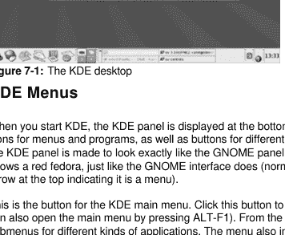

图 7-1：`KDE` 桌面

## KDE 菜单

当你启动 `KDE` 时，`KDE` 面板会显示在屏幕底部。面板上放置有菜单和程序的图标，以及不同桌面屏幕的按钮。对于 `Bluecurve` 界面，`KDE` 面板被设计成看起来与 `GNOME` 面板完全相同。在 `Red Hat` 上，主菜单按钮显示一个红色的 `fedora`，就像 `GNOME` 界面一样（通常这是一个齿轮上的 `K` 图像，顶部有一个小箭头表示它是一个菜单）。

这是 `KDE` 主菜单的按钮。点击此按钮以显示你运行的应用程序菜单（你也可以通过按 `ALT-F1` 打开主菜单）。从 `KDE` 菜单中，你可以访问不同类型应用程序的众多子菜单。菜单还包括某些关键项目，如 `Logout`，用于退出 `KDE`；`Lock Screen`，用于锁定你的桌面；`Control Center`，用于配置你的 `KDE` 桌面；`Run Command`，用于从命令行运行程序；你的 `Home` 目录，以便快速浏览你的主目录；以及 `Help`，启动 `KDE` 帮助工具。

随 `KDE` 安装的标准 `KDE` 应用程序可通过此菜单访问。在 `Bluecurve` 上，主菜单的大多数条目与 `Gnome` 上找到的条目相同。条目已为两个界面标准化。你可以找到诸如 `Internet`、`System Settings`、`Graphics` 和 `Office` 等类别的条目。在 `Red Hat` 上，这些菜单列出了你可以使用 `GNOME` 和 `KDE` 应用程序。`More` 菜单 however 包含子菜单，其中条目可能在 `KDE` 和 `GNOME` 之间有所不同。例如，在 `KDE` 中，位于 `Office` 菜单中的 `More Office Applications` 子菜单显示 `KOffice` 的条目，如 `KWord` 或 `KSpread`。`More Internet Applications` 菜单包含众多 `KDE` Internet 应用程序，如 `KMail` 和 `Konqueror` Web 浏览器。大多数 `KDE` 系统工具位于 `More System Tools` 菜单中，包括 `KDiskFree` 和 `KSystemGuard`。这些 `More` 菜单不限于 `KDE` 应用程序，有时 `KDE` 应用程序包含在主菜单中。`Red Hat` 只是将更可能使用的应用程序放在主菜单中，而不太可能使用的放在 `More` 菜单中。

提示

在 `KDE Start Here` 窗口中，`Preferences` 窗口包含的工具与 `GNOME Preferences` 窗口不同，仅显示少数专用配置工具。最好使用主菜单的 `Preferences` 菜单或 `KDE Control Center` 来配置 `KDE`（主菜单上的 `Control Center`）。

## 退出 KDE

要退出 `KDE`，你可以在主菜单中选择 `Logout` 条目，或在桌面任何位置右键单击并从弹出菜单中选择 `Logout` 条目。如果你退出时留下任何 `KDE` 或 `X11` 应用程序或窗口打开，它们在重新启动时会自动恢复。如果你只是想锁定桌面，可以在主菜单中选择 `Lock screen` 条目，你的屏幕保护程序将出现。要访问锁定的桌面，点击屏幕会出现一个提示输入登录密码的框。输入密码后，你的桌面重新出现。

注意 你可以通过在右键单击桌面时显示的 `Desktop` 弹出菜单中选择 `Enable Desktop Menu` 来显示桌面操作的菜单。你可以使用 `Create New` 菜单创建新的快捷方式，称为桌面文件，用于应用程序和设备，以及访问打开的窗口或切换到不同的虚拟桌面。

## KDE 桌面操作

左侧显示一行图标。这些包括标记为 `Trash` 的主目录文件夹图标、`Start Here` 图标以及软盘和 `CD-ROM` 图标，以及用于访问配置工具的 `Start Here` 文件夹。`Trash` 图标的工作方式类似于 Windows 中的回收站或 Mac 上的垃圾桶。将项目拖到它上面以便删除。你可以使用软盘和 `CD-ROM` 图标来挂载、卸载并显示 `CD-ROM` 和软盘的内容。

提示 你可以在 `Preferences` 菜单上运行 `Desktop Settings Wizard` 以轻松更改你的桌面设置。

屏幕底部显示的 `KDE` 面板最初显示 `KDE` 主菜单、Web 浏览器、办公工具、时钟以及虚拟桌面按钮等的小按钮。桌面支持拖放操作。例如，要打印文档，将其拖到 `Printer` 图标。你可以通过简单地将它们从文件管理器窗口拖到桌面上来在桌面上放置任何目录。桌面还支持复制和粘贴操作，将你从一个应用程序复制的文本保存在桌面剪贴板中，然后你可以使用它粘贴到另一个应用程序。你甚至可以从 `Konsole` 窗口复制和粘贴。例如，你可以从 Web 页面复制 Web 地址，然后将其粘贴到电子邮件消息或文字处理文档中。此功能由面板上的 `Klipper` 实用程序支持。

你可以通过在桌面任何位置右键单击并从弹出菜单中选择 `Create New` 然后 `Directory` 来在桌面上创建新目录。桌面上出现的所有项目都位于你的主目录中的 `Desktop` 目录中。在那里你可以找到 `Trash` 目录，以及你在桌面上放置的任何其他目录。

## 配置你的桌面

要配置你的桌面，右键单击桌面并选择 `Configure Desktop` 条目。这会显示一个包含 `Appearance`、`Behavior`、`Multiple Desktops`、`Paths`、`Background` 和 `Screensaver` 条目的窗口。所有这些功能也可以使用 `KDE Control Center` 的“Appearance & Themes”面板进行配置。`Appearance` 让你设置文本的字体和颜色。`Behavior` 让你启用某些功能的显示，例如在屏幕顶部显示桌面菜单，或在桌面上显示图标。你还可以选择桌面鼠标点击的操作。右键单击当前显示桌面菜单。你还可以指定要在桌面上显示哪些设备。`Multiple Desktop` 面板让你选择要显示的虚拟桌面的数量。`Paths` 让你选择想要 `KDE` 用户目录的位置，如 `Trash` 目录或 `Desktop` 目录，甚至你希望文档放置的位置。`Background` 让你为每个虚拟桌面选择背景颜色或图像。`Screensaver` 让你选择屏幕保护程序及其计时。已经配置了众多屏幕保护程序。对于你的桌面，你还可以选择各种不同的主题。主题会改变你的桌面的外观和感觉，影响 GUI 元素的外观，例如滚动条、按钮和图标。例如，你使用 `Mac OS` 主题使你的 `KDE Desktop` 看起来像 `Macintosh`。你可以使用

在 `KDE` 控制中心（外观和主题）的主题管理器中选择主题并安装新主题。已为你预装了多个主题，包括 `Bluecurve`（当前主题）、`Default`（`KDE` 主题）和 `Nostalgia`，其外观有点像其他流行的 GUI。额外的 K 桌面主题可以从 `themes.freshmeat.net` 网站下载。该网站为所有窗口管理器显示主题。请务必为 `KDE` 主题选择 `KDE` 条目。

## Desktop Files

在 `KDE 3.0` 桌面上，使用名为桌面文件的特殊文件来管理各种任务，包括设备管理、Internet 连接、程序管理和文档类型。你可以通过右键单击桌面然后选择“新建”来创建桌面文件。从此菜单中，你选择要创建的桌面文件类型。

“目录”条目可让你创建指向系统上目录的链接。“硬盘”、“`CD-ROM`”和“软盘设备”条目各自创建可挂载系统上 `CD-ROM`、硬盘或软盘的桌面文件。“文本文件”和“`HTML` 文件”条目用于引用系统上的文本文件和网页。“链接到应用程序”条目用于启动应用程序。“链接到位置（`URL`）”条目保存可用于访问 Web 或 FTP 站点的 URL 地址。

## URL Desktop Files


## 创建 URL 桌面文件

要创建 URL 桌面文件，请右键单击桌面并选择“新建”菜单，然后选择“链接到位置（URL）”条目。 将出现一个窗口，显示一个提示你输入文件名称和 URL 地址的框。 你之后可以通过右键单击它并选择“属性”来编辑桌面文件。 然后会显示 URL 访问的桌面对话框。 该对话框有四个标签面板：常规、权限、URL 和元信息（见图 7-2）。 在“常规”面板上是你的桌面文件的名称。 它的名称将是你输入的名称。 该面板上的图标按钮显示此桌面文件在桌面上显示的图标。 默认是 Web 图标。 你可以通过单击“图标”按钮打开可供选择的图标列表窗口来更改它。 完成后单击“确定”。 桌面文件随后会以该图标出现在你的桌面上。 在 URL 面板上，你会看到一个标记为 URL 的框，其中已包含你输入的 URL。 你可以更改它。 例如，对于在线主题，URL 将为 `http://themes.freshmeat.net`。 请务必包含协议，例如 `http://` 或 `ftp://`。

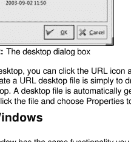

图 7-2：桌面对话框

在桌面上，你可以随时单击 URL 图标以访问该网站。 创建 URL 桌面文件的另一种更简单的方法是直接将文件管理器中显示的网页上的 URL 拖到桌面。 会自动生成带有该 URL 的桌面文件。 要更改使用的默认图标，你可以右键单击文件并选择“属性”以显示桌面对话框。

## KDE Windows

KDE 窗口具有你在其他窗口管理器和桌面上找到的相同功能。 你可以通过单击并拖动其任何角或边来调整窗口大小。 对边的单击拖动操作会在该维度上扩展窗口，而角则同时扩展高度和宽度。 请注意，角部略有增强。 窗口顶部有一个标题栏，显示窗口名称，应用程序情况下显示程序名称，文件管理器窗口则显示当前目录名称。 活动窗口的标题栏会高亮显示。 要移动窗口，请单击此标题栏并将其拖到所需位置。 右键单击窗口标题栏会显示一个下拉菜单，其中包含窗口操作的条目，例如关闭或调整窗口大小。 窗口内显示特定应用程序的菜单、图标和工具栏。

你可以通过从“窗口”菜单（右键单击标题栏）中选择“配置窗口行为”条目来配置窗口的外观和操作。 在这里你可以设置外观（窗口装饰）、按钮和键操作（操作）、焦点策略，例如在窗口上单击鼠标或仅将鼠标移过它（焦点）、移动时窗口的显示方式（移动）以及高级功能，如将窗口直接移动到另一个虚拟桌面、活动桌面边框。 所有这些功能也可以使用 KDE 控制中心的“外观和主题”面板进行配置。

打开的窗口也显示为位于面板上的 KDE 任务栏上的按钮。 任务栏显示你正在运行的不同程序或打开的窗口。 这本质上是一种停靠机制，只需单击其按钮即可切换到窗口或应用程序。 当你最小化（图标化）窗口时，它会缩小为任务栏按钮。 然后你可以通过单击其任务栏按钮来恢复窗口。 标题栏右侧有三个用于最小化、最大化或关闭窗口的小按钮。 你可以随时通过单击其任务栏按钮切换到窗口。 从键盘上，你可以使用 `ALT-TAB` 键组合显示当前应用程序列表。 按住 `ALT` 键并依次按下 `TAB` 可在列表中移动。

### Tip

`KDE` 支持众多不同的主题，其中之一是 Red Hat 的 Bluecurve，每个主题以不同的方式显示窗口元素。 用于 `KDE 3.0` 的 Red Hat Bluecurve 窗口主题

应用程序窗口可能显示一个“帮助注释”按钮，该按钮显示在图标化按钮旁边并显示一个问号。 单击此按钮会将你的光标更改为问号。 然后你可以将光标移动到工具栏上的图标等项目，然后单击它以显示一个小的帮助注释，解释该项目的作用。 例如，单击文件管理器任务栏中的“前进”按钮将显示一条注释，解释该按钮执行浏览器前进操作。

## Virtual Desktops: The KDE Desktop Pager

`KDE` 如同大多数 Linux 窗口管理器一样，支持虚拟桌面。 实际上，这扩展了你可以工作的桌面区域。 你可以在一个桌面上运行 `Mozilla`，并在另一个桌面上使用文本编辑器。 `KDE` 最多可支持 16 个虚拟桌面，但默认值为四个。 你的虚拟桌面可以使用位于面板上的 KDE 桌面分页器显示和访问。 KDE 桌面分页器将你的虚拟桌面表示为迷你屏幕，为每个桌面显示小方块。 它被设计成看起来与第 6 章中描述的 Bluecurve GNOME 工作区切换器完全相同。 默认情况下，有四个方块，编号为 1、2、3 和 4。 你最多可以有 16 个。 要从一个桌面移动到另一个桌面，请单击目标桌面的方块。 单击 3 会显示第三个桌面，单击 1 会将你移回第一个桌面。 如果要将窗口移动到不同的桌面，首先通过右键单击窗口的标题栏打开窗口菜单。 然后选择“移至桌面”条目，其中列出了可用的桌面。 选择你想要的那个。 你也可以右键单击窗口的标题栏以显示窗口菜单。

你还可以配置 `KDE`，以便当你将鼠标移过桌面屏幕边缘时，它会自动移动到相邻的桌面。 你需要想象桌面以四方配置排列，两个顶部桌面彼此相邻，下面有两个桌面。 你可以通过在 `KDE` 控制中心的“桌面 | 窗口行为 | 高级”面板中启用“活动桌面边框”功能来启用此功能。

要更改虚拟桌面的数量，请使用 `KDE` 控制中心的“桌面”条目。 要么在“桌面”弹出菜单（右键单击桌面背景上的任意位置）中选择“配置桌面”条目并选择“多个桌面”，要么从主菜单中选择“控制中心”并打开“桌面”标题以选择“多个桌面”条目。 可见的条控制桌面的数量。 向右滑动以添加更多，向左滑动以减少数量。 你可以通过单击名称并输入新名称来更改任何桌面名称。 在“外观和主题”的“背景”条目中，你可以更改特定桌面的外观，例如颜色背景和壁纸（首先取消选择“通用背景”）。

## KDE Panel: Kicker

`KDE` 面板（`Kicker`）位于屏幕底部，提供对大多数 `KDE` 功能的访问（见图 7-3）。 面板包括菜单、目录窗口、特定程序和虚拟桌面的图标。 面板左端有一个主菜单按钮（也称为 K 菜单），在 Red Hat 上为红色帽子图标。


要向面板添加应用程序，请右键单击面板上的任意位置并从弹出菜单中选择“添加”。 “添加”菜单显示你可以添加的对象类型，例如小程序、应用程序、扩展和特殊按钮。 对于 `KDE` 应用程序，请选择“应用程序”条目。 这会列出所有已安装的 `KDE` 应用程序。 单击应用程序条目即可向面板添加应用程序按钮。 你也可以直接从文件管理器窗口或主菜单将应用程序拖到面板上，使其自动放置在面板中。 面板仅显示桌面文件。 当你将文件拖放到面板上时，会自动为其生成桌面文件。

`Kicker` 还支持众多小程序和多个扩展。 小程序设计为在面板中作为图标运行。 这些包括时钟、分页器和系统监视器。 扩展为你的桌面添加组件。 例如，`Kasbar` 扩展为你打开的每个窗口设置自己的面板和列表图标。 你可以通过单击 `Kasbar` 扩展面板中对应的图标轻松地从一个窗口移动到另一个窗口。 特殊按钮包括用于 `KDE` 特定操作的按钮，如 `KDE` 窗口列表、`Kterm` 终端窗口、`KDE` 打印管理器和 `KDE` 首选项。

为了配置面板的位置和行为，右键单击面板并选择“配置面板”条目。这会显示一个自定义控制模块窗口，该窗口从 `KDE` 控制中心收集面板配置条目。有三个配置窗口：布局、外观和任务栏。它们对应于 `KDE` 控制中心的“桌面 | 面板”、“外观和主题 | 面板”以及“桌面 | 任务栏”条目。

布局工具包含三个标签页面板：排列、隐藏和菜单。排列面板允许您指定希望面板和任务栏显示在屏幕的哪条边缘。您还可以放大或缩小其大小。隐藏面板让您设置隐藏模式，无论是启用自动隐藏还是手动隐藏和显示任务栏。菜单面板让您控制菜单的大小以及是否将最近打开的文档作为菜单项显示。您还可以选择某些默认条目，如首选项和书签，并直接编辑 K 菜单，添加或删除项目。外观工具让您为按钮设置按钮颜色和任务栏的背景图像。使用任务栏工具，您可以控制在任务栏上显示的窗口和任务，以及设置按钮操作。


## KDE 帮助中心

`KDE` 帮助中心提供了一个类似浏览器的界面，用于访问和显示 `KDE` 帮助文件以及 Linux `Man` 和 `info` 文件。您可以通过在主菜单中选择其条目（救生圈图标），或右键单击桌面并选择帮助条目来启动帮助中心。帮助窗口分为两个框架。帮助屏幕的左侧框架包含两个标签页面板，一个列出内容，另一个提供词汇表。右侧框架显示当前选定的文档。内容面板上的帮助树让您选择想要访问的帮助文档类型。在这里您可以选择手册、`Man` 页面或 `info` 文档，甚至应用程序手册。帮助中心包括详细的

用户手册、常见问题解答和 `KDE` 网站访问。

导航工具栏可让您在先前查看过的文档之间移动。`KDE` 帮助文档使用 `HTML` 格式，并带有可点击的链接以访问其他文档。返回和前进命令可在先前查看的文档列表中移动。`KDE` 帮助系统提供了一个有效的搜索工具，可在帮助文档中搜索模式，包括 `Man` 和 `info` 页面。从编辑菜单中选择查找条目，以显示一个可输入模式的页面。

## 应用程序


您可以在 KDE 中通过多种方式启动应用程序。如果主菜单中有其条目，您可以选择该条目来启动应用程序。某些应用程序在 KDE 面板上也有按钮可供点击以启动它们。面板上已包含多个常用程序，例如 `Kate` 文本编辑器和 `KMail`。您也可以使用文件管理器通过该应用程序定位文件或应用程序程序本身。点击其图标即可启动应用程序。或者您可以打开一个 shell 窗口，在 shell 提示符下输入应用程序名称并按 `ENTER` 键来启动应用程序。您也可以按 `ALT+F2` 打开一个小窗口，其中包含一个用于输入单个命令的框。您可以使用上箭头键和下箭头键显示之前的命令，并使用右箭头键和左箭头键或退格键编辑其中任何一个。按 `ENTER` 执行命令。

注意 您可以通过简单地点击并将 KDE 菜单中的菜单条目拖到桌面，为已在 KDE 菜单上的任何应用程序创建桌面文件。选择复制，即会在桌面上为您创建该应用程序的桌面文件，并显示其图标。

## 应用程序标准链接

您也可以直接从桌面访问应用程序。要从桌面访问应用程序，可以创建桌面文件或可链接到原始应用程序程序的标准链接文件。使用桌面文件，您可以选择自己的图标并指定 `ToolTip` 注释。您还可以使用桌面文件在自己的终端窗口中启动基于 shell 的应用程序。另一方面，标准链接是对原始程序文件的简单引用。使用链接会直接以无参数方式启动程序。要创建标准链接文件，可以将主菜单中的应用程序选择并拖到桌面，或在文件系统上定位应用程序，通常在 `/bin`、`/usr/bin` 或 `/usr/sbin` 目录中，然后点击并拖动应用程序图标到桌面。在弹出菜单中选择链接。链接具有与原始程序相同的图标。之后只要双击该图标，应用程序就会启动。您也可以使用此方法运行自己创建的应用程序程序，将其定位在自己的目录中并在桌面上为其创建链接。

## 应用程序桌面链接

要为应用程序创建新的桌面文件，右键单击桌面空白处，从弹出菜单中选择新建，然后选择链接到应用程序。输入程序名称，一个以该名称命名的桌面文件就会出现在桌面上。然后会打开一个属性对话框，其中包含四个面板：常规、权限、执行和应用程序。常规面板显示链接的名称。要为桌面文件选择图标图像，请点击图标。会显示选择图标窗口，列出可供选择的图标。要指定桌面文件运行的应用程序，请转到执行面板并在执行框中输入应用程序的程序名称，或点击浏览以选择它。如果这是 shell 程序，您可以选择在终端窗口中运行它。要运行诸如 `Vi` 之类的基于 shell 的程序，请点击在终端中运行复选框并指定任何终端选项。某些 KDE 程序可以最小化为一个小图标，在运行时可显示在面板上。这称为面板嵌入。将程序名称输入执行框。

在权限面板上，请务必设置执行权限，以便可以运行程序。您可以为自己、您的组或系统上的任何用户设置权限。元信息面板将列出所使用的文件系统类型。在应用程序面板中，您可以指定要与此应用程序关联的文档类型。面板底部显示两个列表。左侧列表是您希望与此程序关联的 MIME 类型，右侧列表是从中选择的可用 MIME 类型列表。要添加 MIME 类型，请在右侧列表中选择一个条目并点击左箭头按钮。使用右箭头按钮删除 MIME 类型。在面板上，您还指定描述和注释。对于描述，输入应用程序名称。这是使用文件管理器显示时的链接名称。注释是当您将鼠标悬停在图标上时出现的帮助说明，甚至运行的应用程序。

提示 您可以让 KDE 在启动时自动显示选定的目录或启动某些应用程序。为此，请将这些窗口和应用程序的链接放在位于您的 `.kde` 目录中的 `AutoStart` 目录中。

上一页 < 当日 上 > 下一页


## 从桌面挂载 CD-ROM 和软盘

Red Hat 安装 KDE 时会为您的 CD-ROM 和软盘创建桌面图标。要访问 CD-ROM 磁盘，请将 CD-ROM 光盘放入 CD-ROM 驱动器并双击 CD-ROM 图标。然后文件管理器窗口会打开，显示 CD-ROM 顶层目录的内容。要弹出光盘，右键单击 CD-ROM 图标并从弹出菜单中选择弹出（您也可以选择仅卸载 CD-ROM）。要访问软盘，您可以使用软盘图标执行类似操作。这会显示一个文件管理器窗口，其中包含软盘的内容。请务必在先卸载磁盘后再取出磁盘。要卸载磁盘，右键单击其图标并从图标的弹出菜单中选择卸载。软盘还可执行一项额外操作。如果放入空白磁盘，您可以对其进行格式化。您可以从多种文件系统格式中选择，包括 MS-DOS。要格式化标准 Linux 文件系统，请选择 `ext3` 条目。

您用于 CD-ROM 的桌面文件是一种专为文件系统设备设计的特殊桌面文件。如果添加新的 CD-ROM 或软盘驱动器，您可以为其创建新的桌面文件，以便从桌面访问驱动器。要创建它，首先右键单击桌面上的任意位置，选择新建，然后选择 CD-ROM 设备用于 CD-ROM 驱动器或软盘设备用于软盘驱动器。这会打开一个属性窗口，其中包含常规、权限、设备和元信息的选项卡。在常规选项卡中，您可以设置将在桌面上显示的设备图标的名称，以及为已挂载的 CD-ROM 或软盘选择要显示的图标（已提供默认值）。在设备面板上，您通过选择文件系统上的挂载点（如 `/mnt/cdrom`）来选择实际设备。CD-ROM 桌面文件假定已在 `/etc/fstab` 文件中放置了 CD-ROM 设备的 CD-ROM 条目（请参阅第 30 章）。您还可以选择在未挂载时使用的图标。在权限面板上，您还可以指示已设置的权限以允许访问设备。有关设备和文件系统的讨论，请参阅文件管理章节，第 30 章。桌面文件不会执行必要的系统管理操作以使普通用户能够访问 CD-ROM。通常，只有系统管理员（root 用户）才能挂载或卸载 CD-ROM 和软盘，除非授予用户权限。您还必须确保 `/etc/fstab` 文件中为 CD-ROM 或软盘驱动器包含条目。如果没有，您必须添加一个。请查阅第 30 章以了解使用方法。

## KDE 文件管理器和互联网客户端：Konqueror

KDE 文件管理器被称为 `Konqueror`，是一种多功能实用程序，可用于管理文件、启动程序、浏览网页以及从远程站点下载文件（参见图 7-4）。传统上，“文件管理器”一词用于指在本地硬盘上管理文件。KDE 文件管理器将其功能扩展到了这一传统功能之外，因为它具备互联网功能，可以无缝显示远程文件系统，就像它们是您自己的文件系统一样，同时还具有浏览器功能来查看网页。它能够显示多种不同类型的文件，包括图像、PostScript 和文本文件。KOffice 应用程序可以在 `Konqueror` 窗口中运行。您甚至可以在文件管理器窗口中打开一个单独的窗格来运行终端窗口，在其中输入 shell 命令（窗口菜单）。

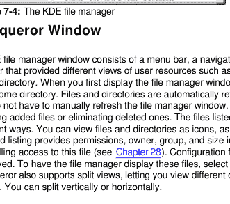

图 7-4：KDE 文件管理器

## Konqueror 窗口

一个 KDE 文件管理器窗口由菜单栏、导航工具栏、位置字段、状态栏以及一个侧边栏组成，该侧边栏提供用户资源的不同视图，例如您主目录的文件和目录图标的树视图。当您首次显示文件管理器窗口时，它会显示您主目录的文件和子目录图标。文件和目录会自动刷新。因此，如果您添加或删除目录，则无需手动刷新文件管理器窗口。它会自动更新您的列表，显示添加的文件或删除已删除的文件。目录中列出的文件可以以几种不同的方式查看。您可以将文件和目录显示为图标、小图标或详细列表。详细列表提供权限、所有者、组和大小信息。权限是控制对该文件访问的权限（参见第 28 章）。配置文件，也称为隐藏文件，通常不显示。要使文件管理器显示这些文件，请从视图菜单中选择显示隐藏文件。`Konqueror` 还支持拆分视图，让您在同一窗口中查看不同的目录（窗口菜单）。您可以垂直或水平拆分。

您可以通过单击文件或选择文件然后在文件菜单中选择打开条目来打开文件。如果您想选择文件或目录，需要按住 `CTRL` 键同时单击它，或单击一次。双击打开文件。如果文件是程序，则该程序会启动。如果是数据文件，则会使用该数据文件运行关联的应用程序。例如，如果您双击文本文件，`Kate` 应用程序将开始显示该文件。如果 `Konqueror` 无法确定要使用的应用程序，它会打开一个对话框提示您输入应用程序名称。您可以单击此框上的浏览按钮，使用目录树找到您想要的应用程序程序。

文件管理器还可以提取 tar 归档文件并安装 RPM 包。归档文件是以 `.tar.gz`、`.tar` 或 `.tgz` 结尾的文件。单击归档文件会列出其中的文件。您只需将特定文件从窗口拖出即可提取该文件。单击归档文件中的文本文件会使用 `Kate` 显示它，而单击图像文件会使用 `KView` 显示它。选择 RPM 包会使用 `redhat-config-packages` 实用程序打开它，然后您可以使用它来安装该包。

## 导航面板

导航面板是一个侧边栏，列出了用户可以使用 `Konqueror` 访问的不同资源。您可以通过在窗口菜单中选择其条目来打开或关闭导航面板。侧边栏使用导航面板配置工具进行配置，该工具可作为导航面板按钮栏上的第一个按钮访问。

注意 在 3.0 版本中，`Konqueror` 还提供了一个侧边栏媒体播放器，可在文件管理器窗口中运行所选的媒体文件。


导航面板具有一个垂直按钮栏，用于显示项目，例如文件管理器历史记录、主目录、书签和网络资源。诸如文件管理器历史记录、书签和主目录之类的资源以可展开的树形式列出。单击条目以展开它。双击它即可使用 `Konqueror` 访问它。例如，要移动到子目录，请展开主目录条目，然后双击您想要的子目录。`Konqueror` 现在将显示该子目录。要转到之前书签的目录或网页，请在书签中找到其条目并选择它。

历史按钮列出了您访问过的网络资源和目录，包括网页。网络按钮列出了您有权访问的网络资源，例如 FTP 和网站。文件夹按钮显示系统根目录。如果启用了多视图，您可以一次显示其中几个，只需单击您想要的即可。如果未启用多视图，先前的列表将被所选列表替换。再次单击其按钮即可关闭显示。最后一个按钮是经典侧边栏按钮，它将以可展开的树形式显示所有资源，就像经典侧边栏一样。

要配置导航面板，请单击侧边栏按钮栏中的配置按钮。选择多视图条目以允许一次显示多个资源列表，每个列表都在其单独的子侧边栏中。您还可以添加新的资源列表，从书签、历史记录或目录类型中进行选择。新的列表将出现一个按钮。您可以右键单击该按钮以选择其新图标或选择 URL，即目录路径名或网络地址。要删除按钮及其列表，请右键单击它并选择删除条目。

### 搜索

要搜索文件，请在工具菜单中选择查找条目或单击放大镜图标。这会在文件管理器窗口中打开一个窗格，您可以在其中使用通配符匹配符号（如 `*`）搜索文件名。单击查找按钮运行搜索，单击停止按钮停止搜索。搜索结果显示在文件管理器窗口下半部分的一个窗格中。您可以单击文件并使用其适当的应用程序打开它。文本文件由 `Kate` 文本编辑器显示。图像由 `KView` 显示，PostScript 文件由 `KGhostview` 显示。应用程序会运行。搜索程序还允许您保存搜索结果以供以后参考。您甚至可以从搜索中选择文件并将它们添加到归档文件中。

### 浏览目录

在 `Red Hat` 中，在文件管理器窗口中，双击目录图标会移动到该目录并显示其文件和子目录图标。要返回到父目录，您可以单击导航工具栏左端的位置箭头按钮。双击目录图标会让您一次向下移动一个目录。单击向上箭头按钮即可向上移动树。要直接移动到特定目录，您可以在位置框中输入其路径名，该框位于显示文件和目录图标的窗格正上方。就像网页浏览器一样，文件管理器会记住之前显示的目录。您可以使用后退和前进箭头按钮在此先前目录列表中移动。您还可以使用表 7-2 中列出的几个键盘快捷键执行此类操作。

表 7-2：KDE 文件管理器键盘快捷键

| 键 | 描述 |
|---|---|
| `ALT-LEFT ARROW`, `ALT-RIGHT ARROW` | 历史中的后退和前进 |
| `ALT-UP ARROW` | 上一级目录 |
| `ENTER` | 打开文件/目录 |
| `ESC` | 为当前文件打开弹出菜单 |
| `LEFT/RIGHT/UP/DOWN ARROWS` | 在图标间移动 |
| `SPACEBAR` | 选择/取消选择文件 |
| `PAGE UP`, `PAGE DOWN` | 快速向上滚动 |
| `CTRL-C` | 将所选文件复制到剪贴板 |
| `CTRL-V` | 将文件从剪贴板粘贴到当前目录 |
| `CTRL-S` | 按模式选择文件 |
| `CTRL-L` | 打开新位置 |
| `CTRL-F` | 查找文件 |
| `CTRL-W` | 关闭窗口 |

如果您知道想要再次访问特定目录，可以像网页一样为其添加书签。只需打开目录并在书签菜单中选择添加书签条目。然后该目录的条目将被放置在文件管理器的书签菜单中。要再次移动到该目录，请在书签菜单中选择其条目。为了帮助您从一个目录导航到另一个目录，您可以使用位置字段或目录树。在位置字段中，如果您知道目录的路径名，可以输入它并按 `ENTER`。目录树提供系统上和主目录中的所有目录的完整列表。

### 复制、移动、删除、重命名和链接操作

要对文件或目录执行操作，首先必须选择它。在 `Red Hat` 上，要选择文件或目录，您可以单击文件的图标或列表。要选择多个文件，请继续按住 `CTRL` 键，同时单击您想要的文件。您还可以使用键盘箭头键从一个文件图标移动到另一个文件图标，然后使用空格键选择您想要的文件。

要复制和移动文件，您可以使用鼠标的标准拖放方法。要复制文件，请使用文件管理器找到它。打开另一个文件管理器窗口到您想要复制文件的目录。然后单击并拖动文件图标到该窗口。会出现一个弹出菜单，其中包含移动、复制或链接的选择。选择复制。要将文件移动到另一个目录，请遵循相同的程序，但从弹出菜单中选择移动。要复制或移动目录，请使用与文件相同的程序。目录的所有文件和子目录也将被复制或移动。

要重命名文件，请单击其图标并按 `F2`，或右键单击图标并从弹出菜单中选择重命名。图标下方的名称将变为可编辑的文本框，您可以更改它。

您可以立即删除文件或将其放置在回收站文件夹中以便稍后删除。要删除文件，请选择它然后在编辑菜单中选择删除条目。您也可以右键单击图标并选择删除。要将文件放入回收站文件夹，请将其拖到桌面上的回收站图标，或从编辑菜单中选择移至回收站。稍后您可以打开回收站文件夹并删除文件。要删除回收站文件夹中的所有文件，请右键单击回收站图标并从弹出菜单中选择清空回收站。要恢复回收站中的任何文件，请打开回收站并将它们拖出回收站文件夹。

每个文件或目录都有与其关联的属性，包括权限、文件名和其目录。要显示给定文件的属性窗口，请右键单击文件的图标并选择属性条目。在常规面板上，您会看到显示的文件名。要更改文件名，请在其中用新名称替换名称。权限在权限面板上设置。在这里，您可以为用户、组或其他访问设置文件的读、写和执行权限。参见第 28 章，了解权限的讨论。组条目使您可以更改文件的组。

### 注释

`KDE` 会自动搜索位于目录中的现有 `.directory` 文件。`.directory` 文件保存 `KDE` 配置信息，用于确定目录的显示方式

### Web 和 FTP 访问

`KDE` 文件管理器还兼作 Web 浏览器和 FTP 客户端。它包含一个用于输入本地文件的路径名或 Internet 或您内部网上的网页 URL 的框。导航工具栏可用于显示之前的网页或之前的目录。`Home` 按钮始终会将您返回到主目录。访问网页时，页面会像在任何 Web 浏览器上一样显示。使用导航工具栏，您可以在该会话中来回浏览之前显示的页面列表。`KDE` 文件管理器还作为 FTP 客户端运行。当您访问 FTP 站点时，您可以像浏览自己的目录一样浏览远程目录。下载文件的操作与在本地系统上复制文件相同。只需在文件管理器窗口中选择文件的图标或条目，然后将其拖到显示要下载到的本地目录的窗口中。然后，从出现的弹出菜单中选择 `Copy` 条目。`Konqueror` 还包含 `KSSL`，可为安全连接提供完整的 SSL 支持。`KDE` 版本 3.1 将提供安全连接状态显示。

#### 提示

`KDE` 3.1 为 `Konqueror` 提供了 `KGet` 工具，用于管理 FTP 下载，可让您选择、排队、暂停和安排下载，同时在您的


## ABC Amber CHM 转换器试用版

请注册以移除此横幅。

http://www.processestext.com/abchm.html

### KDE 配置：KDE 控制中心

使用 `KDE` 控制中心，您可以配置桌面和系统，改变其显示方式和支持的功能（参见图 7-5）。您可以通过在主菜单 `Preferences` 菜单中选择其条目，直接打开控制中心到所选组件。`Preferences` 菜单显示一个列出配置类别的子菜单。选择一个类别，然后选择您想要的组件。例如，要配置屏幕保护程序，请在 `Settings` 菜单中位于 `Appearances & Themes` 菜单中的选择 `Screensaver` 条目。控制中心可以通过从 `K` 菜单中选择 `Control Center` 直接启动。配置组件实际上是模块。在未来的版本中，随着更多应用程序和工具添加到 `K Desktop`，将包含更多模块。请参阅帮助查看器以获取 `K Desktop` 配置模块的当前列表。

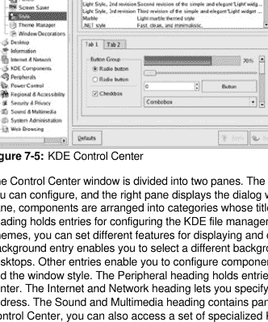

图 7-5：`KDE` 控制中心

控制中心窗口分为两个窗格。左侧窗格显示可配置的所有组件的树视图，右侧窗格显示所选组件的对话框窗口。在左侧窗格中，组件按可展开或收缩的标题的类别排列。`Web Browsing` 标题包含用于配置 `KDE` 文件管理器 Web 浏览器功能的条目。在 `Appearances & Themes` 下，您可以设置用于显示和控制桌面的不同功能。例如，`Background` 条目使您可以为每个虚拟桌面选择不同的背景颜色或图像。其他条目使您可以配置诸如屏幕保护程序、所用语言和窗口样式等组件。`Peripheral` 标题包含可让您配置鼠标、键盘和打印机的条目。`Internet and Network` 标题可让您指定常见的网络设置，如您的电子邮件地址。`Sound and Multimedia` 标题包含用于配置声音组件的面板。从控制中心，您还可以访问一组专门的 `KDE` 系统配置工具。目前这些包括登录和字体管理器。

### .kde 和桌面用户目录


您的 `.kde` 目录保存用于维护 KDE 桌面的文件和目录。`Desktop` 目录保存 KDE 桌面文件，其图标显示在桌面上。配置文件位于 `.kde/share/config` 目录中。在这里您可以找到不同 KDE 组件的通用配置文件。`kwinrc` 保存窗口管理器的配置命令，`kmailrc` 用于邮件，`kickerrc` 用于您的面板。`kdeglobals` 保存键盘快捷键以及其他全局定义。您可以直接在这些文件中的任何一个中放置配置指令；`.kde/share/mimelnk` 保存用户添加的菜单条目的桌面文件。`.kde/share/apps` 目录包含用于配置 KDE 应用程序的文件和目录。

### MIME 类型和关联应用程序

当您安装新类型的程序时，它们可能会使用某种类型的文件。在这种情况下，您需要将该类型注册到 KDE，以便将其与给定的应用程序或一组应用程序关联。例如，GIF 图像的 MIME 类型是 `image/gif`，与图像查看程序关联。您使用 KDE 控制中心设置新的 MIME 类型或更改 MIME 类型与应用程序的关联。选择 KDE Components 下的 File Association 条目。这将列出已知的 MIME 类型及其关联的文件名扩展名。选择一个条目进行编辑，您可以在其中更改与其关联的应用程序。KDE 将其 MIME 类型信息保存在 KDE 配置目录中一个名为 `mimelnk` 的单独文件中。

要更改特定文件的关联应用程序，您可以使用文件管理器找到该应用程序，然后右键单击它并选择 Edit File Type。这会显示一个包含两个面板的窗口：General 和 Embedded。在 General 菜单上，您可以通过单击 Add 并输入文件类型的扩展名来添加扩展名，使用 `*` 来匹配前缀。例如，`*.gif` 将匹配以 `.gif` 结尾的任何文件。在 Application Preference Order 部分，使用 Add 按钮选择要与文件关联的应用程序。您可以为单个文件设置多个应用程序，并按您希望的方式更改它们的首选项顺序。单击 Apply 保存您的更改。

### KDE 目录和文件

当 KDE 安装在您的系统上时，其系统范围的应用程序、配置和支持文件可能会安装在与其他 GUI 和用户应用程序相同的系统目录中。在 Red Hat 上，KDE 安装在标准系统目录中并有一些变化，例如 `/usr/bin` 用于 KDE 程序文件，`/usr/lib/kde3` 保存 KDE 库，`/usr/include/kde` 包含用于应用程序开发的 KDE 头文件。

位于 `share` 目录中的目录包含用于配置 KDE 环境的文件（系统共享目录位于 `/usr/share`）。`share/mimelnk` 目录将其文件映射到 Applications Launcher 菜单。其目录和子目录作为主菜单上的菜单项和子菜单出现。其内容由具有 `.desktop` 扩展名的桌面文件组成，每个菜单条目一个。`share/apps` 目录包含由 KDE 应用程序设置的文件和目录。`share/mimelnk` 保存 MIME 类型定义。`share/config` 包含特定 KDE 应用程序的配置文件。这些是系统范围的默认值，可以被用户自己的 `.kde/share/config` 目录中的自己的配置覆盖。`share/icons` 保存用于 KDE 桌面和 KDE 应用程序以及 Bluecurve 界面的默认图标。如前所述，在用户的主目录中，`.kde` 目录保存用户自己的桌面及其应用程序的 KDE 配置。

每个用户都有一个 `Desktop` 目录，其中保存用户桌面上所有图标和文件夹的 KDE 链接文件（参见表 7-3）。这些包括 Trash 文件夹以及 CD-ROM 和主目录链接。

表 7-3：KDE 安装目录

| 系统 KDE 目录 | 描述 |
|---|---|
| `/usr/bin` | KDE 程序 |
| `/usr/lib/kde3` | KDE 库 |
| `/usr/include/kde` | 用于编译和开发 KDE 应用程序的头文件 |
| `/usr/share/config` | KDE 桌面和应用程序配置文件 |
| `/usr/share/mimelnk` | 用于构建主菜单的桌面文件 |
| `/usr/share/apps` | KDE 应用程序使用的文件 |
| `/usr/share/icons` | KDE 桌面和应用程序中使用的图标 |
| `/usr/share/doc` | KDE 帮助系统 |
| 用户 KDE 目录 |  |

##### 表 7-3：KDE 安装目录

| 系统 KDE 目录 | 描述 |
|---|---|
| `.kde/share/config` | 用于用户指定功能的 KDE 桌面和应用程序用户配置文件 |
| `.kde/share/mimelnk` | 用于在 KDE 主菜单上构建用户菜单项的桌面文件 |
| `.kde/share/apps` | KDE 应用程序使用的目录和文件 |
| `Desktop` | 显示在用户 KDE 桌面上的图标和文件夹的桌面文件 |
| `Desktop/Trash` | 标记为删除的文件的废纸篓文件夹 |

## 第 8 章：Shell

### 概述

Shell 是一个命令解释器，提供用户与操作系统之间面向行的交互式和非交互式接口。您在命令行上输入命令；Shell 会解释它们然后作为指令发送给操作系统。您也可以将命令放在脚本文件中以便像程序一样连续执行。Shell 的这种解释能力提供了许多复杂的功能。例如，Shell 具有一组文件扩展字符，可以生成文件名。Shell 可以重定向输入和输出，以及在后台运行操作，从而让您执行其他任务。

为 Linux 开发了几种不同类型的 Shell：Bourne Again shell（`BASH`）、Public Domain Korn shell（`PDKSH`）、`TCSH` shell 和 Z shell。所有 Shell 都可供您使用，尽管 `BASH` shell 是默认的。您只需一种类型的 Shell 即可完成工作。Red Hat Linux 包含所有主要 Shell，尽管它安装并使用 `BASH` shell 作为默认。 如果您使用 Red Hat Linux 命令行 Shell，除非您指定其他 Shell，否则您将使用 `BASH` shell。本章讨论 `BASH` shell，它与其他 Shell 共享许多相同的功能。

**注意** 您可以在 [www.gnu.org/software/bash](http://www.gnu.org/software/bash) 找到更多关于 `BASH` shell 的信息。详细的在线手册可在您的 Linux 系统上使用 `man` 命令配合 `bash` 关键字获得。

### 命令行

Linux 命令行界面由单行组成，您可以在其中输入命令及其选项和参数。从 GNOME 或 KDE，您可以通过打开终端窗口访问命令行界面。如果您以命令行界面启动 Linux，登录时将看到 `BASH` shell 命令行。

默认情况下，`BASH` shell 具有美元符号（`$`）提示符，但 Linux 有几种其他类型的 Shell，每种都有自己的提示符。Shell 提示符，例如此处所示，标记命令行的开始：

```
$
```

您可以在提示符处输入命令以及选项和参数。例如，使用 `-l` 选项，`ls` 命令将显示每个文件的一行信息，列出其大小以及最后修改的日期和时间。在下一个示例中，用户输入 `ls` 命令后跟 `-l` 选项。`-l` 选项前的破折号是必需的。Linux 使用它来区分选项和参数。

```
$ ls -l
```

如果您只想要特定文件的信息，您可以在 `-l` 选项后添加该文件名称作为参数：

```
$ ls -l mydata
```

提示 有些命令可能很复杂且执行需要一些时间。当您错误地执行了错误的命令时，您可以使用中断键 - `CTRL-C` 中断并停止此类命令。

### 命令行编辑

`BASH` shell，即您的默认 Shell，具有您在学习 Linux 时可能会觉得有帮助的特殊命令行编辑功能（参见表 8-1）。您可以在执行之前轻松修改已输入的命令，在命令行上移动到任何位置并插入或删除字符。这对于复杂命令特别有帮助。您可以使用 `CTRL-F` 或 `RIGHT ARROW` 键向前移动一个字符，或使用 `CTRL-B` 或 `LEFT ARROW` 键向后移动一个字符。`CTRL-D` 或 `DEL` 删除光标所在的字符，`CTRL-H` 或 `BACKSPACE` 删除光标前的字符。要添加文本，您使用箭头键将光标移动到要插入文本的位置并输入新字符。您甚至可以使用 `CTRL-W` 或 `CTRL-U` 键剪切单词，然后使用 `CTRL-Y` 键在不同位置粘贴它们，从而有效地移动单词。随时可以按 `ENTER` 执行命令。例如，如果在输入命令时拼写错误，您无需重新输入整个命令，可以使用编辑操作来更正错误。

**表 8-1：命令行编辑操作**

| 键命令 | 操作 |
|---|---|
| `CTRL-F`, `RIGHT-ARROW` | 向前移动一个字符 |
| `CTRL-B`, `LEFT-ARROW` | 向后移动一个字符 |
| `CTRL-A` | 移至行首 |


| `CTRL-E` | 移至行尾 |
| `CTRL-D`, `DEL` | 删除光标所在字符 |
| `CTRL-H`, `BACKSPACE` | 删除光标前字符 |
| `CTRL-K` | 从光标位置剪切行的剩余部分 |
| `CTRL-W` | 剪切前一个词 |
| `CTRL-U` | 剪切下一个词 |
| `CTRL-C` | 剪切整行 |
| `CTRL-Y` | 粘贴先前剪切的文本 |

提示 `BASH` shell 命令行的编辑功能由 `Readline` 提供。`Readline` 支持众多编辑操作。您甚至可以将键绑定到所选的编辑操作。您可以在 `BASH` shell 参考手册 `www.gnu.org/manual/bash` 中找到更多关于 `Readline` 的信息。

您可以通过在按 `ENTER` 之前输入反斜杠来在多行上输入命令。反斜杠“转义”`ENTER` 键，有效地将同一命令行继续到下一行。在下一个示例中，`cp` 命令在三行上输入。前两行以反斜杠结尾，有效地使三行成为一个命令行。

```
$ cp -i \
mydata \
newdata
```

### 命令和文件名补全

`BASH` 命令行具有内置功能，可执行命令和文件名补全。如果您以命令或文件名参数的形式输入不完整的模式，然后按 `TAB` 键激活命令和文件名补全功能，它将完成该模式。如果多个命令或文件具有相同的前缀，Shell 只会发出蜂鸣声并显示可能的命令补全列表，然后等待您添加足够字符以选择唯一的命令或文件名。在下一个示例中，用户使用不完整的文件名发出 `cat` 命令。按 `TAB` 键后，系统会搜索匹配项并在找到时填入文件名。然后用户可以按 `ENTER` 执行命令。

```
$ cat pre tab
$ cat preface
```

### 历史记录

`BASH` shell 保留一个列表，称为历史记录列表，其中包含您之前输入的命令。您可以通过按 `UP ARROW` 键一次在命令行上显示每个命令。`DOWN ARROW` 键将您向下移动列表。您可以在命令行上显示这些先前命令时修改并执行它们。

提示 重新显示先前命令的能力在您已执行错误输入的命令时很有帮助。在这种情况下，您会收到错误消息并得到一个新的空命令行。通过按 `UP ARROW` 键，您可以重新显示之前的命令，对其进行更正，然后再次执行。这样您就不必再次输入整个命令。

### 历史事件

在 `BASH` shell 中，历史实用程序保留您已执行的最近命令的记录。命令从 1 开始编号，并且记住的命令数量存在限制 - 默认值为 500。历史实用程序是一种短期记忆，跟踪您最近执行的命令。要查看您最近的命令集，请在命令行上输入 `history` 并按 `ENTER`。然后会显示您最近的命令列表，以数字为前缀。

```
$ history
1 cp mydata today
2 vi mydata
3 mv mydata reports
4 cd reports
5 ls
```

从技术上讲，这些命令中的每一个都被称为事件。事件描述已采取的操作 - 已执行的命令。事件按执行顺序编号。最近的事件具有最高编号。这些事件可以通过其编号或命令中的开头字符来识别。

历史实用程序使您能够引用以前的事件，将其放在命令行上并使其可执行。最简单的方法是使用 `UP ARROW` 和 `DOWN ARROW` 键一次一个地将历史事件放在命令行上。您无需先使用 `history` 显示列表。按一次 `UP ARROW` 键会将最后一个历史事件放在命令行上。再次按下会将下一个历史事件放在命令上。按 `DOWN ARROW` 键会将上一个事件放在命令行上。

您可以使用某些控制和 meta 键执行其他历史操作，例如搜索历史列表。Meta 键是 `ALT` 键，以及没有 `ALT` 键的键盘上的 `ESC` 键。这里使用 `ALT` 键。`ALT-<` 将带您到历史列表的开头；`ALT-N` 将搜索它。`CTRL-S` 和 `CTRL-R` 将执行增量搜索，在您输入搜索字符串时显示匹配的命令。表 8-2 列出了引用历史列表的不同命令。

提示 如果您输入的内容匹配多个历史事件，您会听到蜂鸣声，然后您可以输入更多字符以帮助唯一标识该事件。

您还可以使用 `!` 历史命令引用和执行历史事件。`!` 后跟一个标识命令的引用。引用可以是事件的编号或事件中的开头字符集。在下一个示例中，历史列表中的第三个命令首先按编号引用，然后按开头字符引用：

```
$ !3
mv mydata reports
```

```
$ !mv
mv mydata reports
```

#### 表 8-2：历史命令和历史事件引用

| 历史命令 | 描述 |
|---|---|
| `CTRL-N` or `DOWN ARROW` | 移动到历史列表中的下一个事件 |
| `CTRL-P` or `UP ARROW` | 移动到历史列表中的上一个事件 |
| `ALT-<` | 移动到历史事件列表的开头 |
| `ALT->` | 移动到历史事件列表的末尾 |
| `ALT-N` | 前向搜索，下一个匹配项 |
| `ALT-P` | 后向搜索，上一个匹配项 |
| `CTRL-S` | 前向搜索历史，前向增量搜索 |
| `CTRL-R` | 反向搜索历史，反向增量搜索 |
| `fc` event-reference | 编辑事件并使用标准编辑器然后执行它 选项 `-l` 列出最近的历史事件；与 `history` 命令相同 `-e` editor event-reference 调用指定的编辑器来编辑特定事件 |
| 历史事件引用 |  |
| `!` event num | 引用具有事件编号的事件 |
| `!!` | 引用上一条命令 |
| `!` characters | 引用以特定字符开头的事件 |
| `!?` pattern? | 引用事件中包含模式的事件 |
| `!-` event num | 引用相对于第一个事件的偏移量的事件 |
| `!` num~num | 引用一系列事件 |

你也可以使用相对于列表末尾的偏移量来引用一个事件。负数将从列表末尾偏移到该事件，从而引用它。在下一个示例中，第四条命令 `cd mydata` 是使用负偏移量引用的，然后执行。记住你是从列表末尾偏移的——在这种情况下，从事件 5 开始向上偏移到列表开头事件 1。从事件 5 开始偏移 4 会将你定位到事件 2。

```
$-4
vi mydata
```

要引用最后一条事件，你使用后面的 `!`，如 `!!`。在下一个示例中，命令 `!!` 执行用户最后执行的命令——在这种情况下为 `ls`：

```
$ !!
ls
mydata today reports
```

### 历史事件编辑

你也可以在执行之前编辑历史列表中的任何事件。在 `BASH` shell 中，你可以这样做有两种方式。你可以使用命令行编辑器功能来引用和编辑历史列表中的任何事件。你也可以使用 `history` `fc` 命令选项来引用事件并使用完整的 `Vi` 编辑器编辑它。每种方法都涉及两种不同的编辑功能。第一种仅限于命令行编辑器中的命令，该编辑器仅使用 `Emacs` 命令的子集编辑单行。与此同时，它使你能够轻松地在历史列表中引用事件。第二种方法使用标准 `Vi` 编辑器及其所有功能，但仅针对特定的历史事件。

使用命令行编辑器，你不仅可以编辑当前命令，还可以移动到历史列表中的上一个事件以编辑并执行它。`CTRL-F` 命令会将你向上移动到列表中的上一个事件。`CTRL-N` 命令会将你向下移动列表。`ALT-<` 命令会将你移动到列表顶部，`ALT->` 命令会将你移动到列表底部。你甚至可以使用模式搜索特定事件。斜杠后跟模式会在列表中向后搜索，而问号后跟模式会在列表中向前搜索。`n` 命令会重复搜索。

一旦找到要编辑的事件，你就使用 `Emacs` 命令行编辑命令来编辑该行。`CTRL-D` 删除一个字符。`CTRL-F` 或 `RIGHT ARROW` 将你向前移动一个字符，`CTRL-B` 或 `LEFT ARROW` 将你向后移动一个字符。要添加文本，请将光标定位并输入你想要的字符。

如果你想使用标准编辑器编辑事件，则需要使用 `fc` 命令和特定的事件引用（如事件编号）来引用该事件。使用的编辑器是 shell 中 `EDITOR` 变量指定的编辑器。这用作 `fc` 命令的默认编辑器。你可以为 `EDITOR` 变量分配不同的编辑器，如果你愿意，例如 `Emacs` 而不是 `Vi`。下一个示例将使用标准编辑器编辑第四个事件 `cd reports`，然后执行编辑后的事件：

```
$ fc 4
```

你可以通过引用一系列命令来一次选择多个命令进行编辑和执行。你通过指定第一个命令的标识符后跟范围内最后一个命令的标识符来选择一系列命令。标识符可以是命令编号或命令中的开头字符。在下一个示例中，命令范围 2-4 被编辑并执行，首先使用事件编号，然后使用这些事件中的开头字符：

```
$ fc 2 4
```

```
$ fc vi c
```

`fc` 使用 `FCEDIT` 特殊变量指定的默认编辑器。通常，这是 `Vi` 编辑器。如果你想改用 `Emacs` 编辑器，则在调用 `fc` 时使用 `-e` 选项和术语 `emacs`。下一个示例将使用 `Emacs` 编辑器编辑第四个事件 `cd reports`，然后执行编辑后的事件：

```
$ fc -e emacs 4
```

### 配置历史：`HISTFILE` 和 `HISTSAVE`


系统保存的事件数量保存在一个名为 `HISTSIZE` 的特殊系统变量中。默认情况下，这通常设置为 500。你可以通过简单地为 `HISTSIZE` 分配一个新值来将其更改为另一个数字。在下一个示例中，用户通过重置 `HISTSIZE` 变量将保存的历史事件数量更改为 10：

```
$ HISTSIZE=10
```

实际的历史事件保存在一个文件中，其名称保存在名为 `HISTFILE` 的特殊变量中。默认情况下，该文件是 `.bash_history` 文件。但是，你可以通过将其名称分配给 `HISTFILE` 变量来更改保存历史事件的文件。在下一个示例中，`HISTFILE` 的值被显示。然后为其分配一个新文件名 `newhist`。历史事件随后保存在 `newhist` 文件中。


### ABC Amber CHM Converter Trial version

请注册以移除此横幅。

http://www.processestext.com/abchm.html

#### 文件名扩展：`*`, `?`, `[]`

文件名是最常用的命令参数。通常你可能只知道部分文件名，或者你可能想要引用具有相同扩展名或以相同字符开头的多个文件名。shell 提供了一组特殊字符来搜索、匹配和生成文件名列表。这些是星号、问号和方括号（`*`, `?`, `[]`）。给定一个部分文件名，shell 使用这些匹配运算符来搜索文件并扩展为找到的文件名列表。shell 用扩展的匹配文件名列表替换部分文件名参数。然后该文件名列表可以成为 `ls` 等命令的参数，这些命令可以操作多个文件。表 8-3 列出了 shell 的文件扩展字符。

表 8-3：Shell 符号

| 常见 Shell 符号 | 执行 |
|---|---|
| ENTER | 执行命令行。 |
| ; | 在同一命令行中分隔命令。 |
| `command` | 执行命令。 |
| `$(command)` | 执行命令。 |
| `[]` | 在文件名中匹配一类可能的字符。 |
| `\` | 引号转义下一个字符。用于引用特殊字符。 |
| `|` | 将一个命令的标准输出作为另一个命令的输入。 |
| `&` | 在后台执行命令。 |
| `!` | 历史命令。 |
| 文件名扩展符号 | 执行 |
|---|---|
| `*` | 在文件名中匹配任意字符集。 |
| `?` | 在文件名中匹配任意单个字符。 |
| `[]` | 在文件名中匹配一类字符。 |
| 重定向符号 | 执行 |
|---|---|
| `>` | 将标准输出重定向到文件或设备，如果文件不存在则创建，如果存在则覆盖。 |
| `>!` | 感叹号强制覆盖已存在的文件。这会覆盖 noclobber 选项。 |
| `<` | 将标准输入从文件或设备重定向到程序。 |
| `>>` | 将标准输出重定向到文件或设备，将输出追加到文件末尾。 |
| 标准错误重定向符号 | 执行 |
|---|---|
| `2>` | 将标准错误重定向到文件或设备。 |

##### 表 8-3：Shell 符号

| Common Shell Symbols | Execution |
|---|---|
| `2>>` | Redirect and append the standard error to a file or device. |
| `2>&1` | Redirect the standard error to the standard output. |
| `2>` | Redirect the standard error to a file or device. |
| `|&` | Pipe the standard error as input to another command. |

#### 匹配多个字符

The asterisk, `*`, references files beginning or ending with a specific set of characters. You place the asterisk before or after a set of characters that form a pattern to be searched for in filenames. If the asterisk is placed before the pattern, filenames that end in that pattern are searched for. If the asterisk is placed after the pattern, filenames that begin with that pattern are searched for. Any matching filename is copied into a list of filenames generated by this operation. In the next example, all filenames beginning with the pattern "doc" are searched for and a list generated. Then all filenames ending with the pattern "day" are searched for and a list generated. The last example shows how the `*` can be used in any combination of characters.

```
$ ls
doc1 doc2 document docs mydoc monday tuesday

$ ls doc*
doc1 doc2 document docs

$ ls *day
monday tuesday

$ ls m*d*
monday

$
```

Filenames often include an extension specified with a period and followed by a string denoting the file type, such as `.c` for C files, `.cpp` for C++ files, or even `.jpg` for JPEG image files. The extension has no special status and is only part of the characters making up the filename. Using the asterisk makes it easy to select files with a given extension. In the next example, the asterisk is used to list only those files with a `.c` extension. The asterisk placed before the `.c` constitutes the argument for `ls`.

```
$ ls *.c
calc.c main.c
```

You can use `*` with the `rm` command to erase several files at once. The asterisk first selects a list of files with a given extension, or beginning or ending with a given set of characters, and then it presents this list of files to the `rm` command to be erased. In the next example, the `rm` command erases all files beginning with the pattern "doc":

```
$ rm doc*
```

##### Tip

Use the `*` file expansion character carefully and sparingly with the `rm` command. The combination can be dangerous. A misplaced `*` in an `rm` command without the `-i` option co

#### 匹配单个字符


The question mark, `?`, matches only a single incomplete character in filenames. Suppose you want to match the files `doc1` and `docA`, but not `document`. Whereas the asterisk will match filenames of any length, the question mark limits the match to just one extra character. The next example matches files that begin with the word "doc" followed by a single differing letter:

```
$ ls
doc1 docA document

$ ls doc?
doc1 docA
```

### 匹配字符范围

Whereas the `*` and `?` file expansion characters specify incomplete portions of a filename, the brackets, `[ ]`, enable you to specify a set of valid characters to search for. Any character placed within the brackets will be matched in the filename. Suppose you want to list files beginning with "doc", but only ending in 1 or A. You are not interested in filenames ending in 2 or B, or any other character. Here is how it's done:

```
$ ls
doc1 doc2 doc3 docA docB docD document

$ ls doc[1A]
doc1 docA
```

You can also specify a set of characters as a range, rather than listing them one by one. A dash placed between the upper and lower bounds of a set of characters selects all characters within that range. The range is usually determined by the character set in use. In an ASCII character set, the range "a-g" will select all lowercase alphabetic characters from a through g, inclusive. In the next example, files beginning with the pattern "doc" and ending in characters 1 through 3 are selected. Then, those ending in characters B through E are matched.

```
$ ls doc[1-3]
doc1 doc2 doc3

$ ls doc[B-E]
docB docD
```

You can combine the brackets with other file expansion characters to form flexible matching operators. Suppose you want to list only filenames ending in either a `.c` or `.o` extension, but no other extension. You can use a combination of the asterisk and brackets: `*.[co]`. The asterisk matches all filenames, and the brackets match only filenames with extension `.c` or `.o`.

```
$ ls *.[co]
main.c main.o calc.c
```

### 匹配 Shell 符号

At times, a file expansion character is actually part of a filename. In these cases, you need to quote the character by preceding it with a backslash to reference the file. In the next example, the user needs to reference a file that ends with the `?` character, `answers?`. The `?` is, however, a file expansion character and would match any filename beginning with "answers" that has one or more characters. In this case, the user quotes the `?` with a preceding backslash to reference the filename.

```
$ ls answers\?
answers?
```

### 生成模式

Though not a file expansion operation, `{}` is often useful for generating names that you can use to create or modify files and directories. The braces operation only generates a list of names. It does not match on existing filenames. Patterns are placed within the braces and separated with commas. Any pattern placed within the braces will be used to generate a version of the pattern, using either the preceding or following pattern, or both. Suppose you want to generate a list of names beginning with "doc", but only ending in the patterns "ument", "final", and "draft". Here is how it's done:

```
$ echo doc{ument,final,draft}
document docfinal docdraft
```

Since the names generated do not have to exist, you could use the `{}` operation in a command to create directories, as shown here:

```
$ mkdir {fall,winter,spring}report
$ ls
fallreport winterreport springreport
```


### 标准输入/输出和重定向


The data in input and output operations is organized like a file. Data input at the keyboard is placed in a data stream arranged as a continuous set of bytes. Data output from a command or program is also placed in a data stream and arranged as a continuous set of bytes. This input data stream is referred to in Linux as the standard input, while the output data stream is called the standard output. There is also a separate output data stream reserved solely for error messages, called the standard error (see the section on the standard error later in this chapter).

Because the standard input and standard output have the same organization as that of a file, they can easily interact with files. Linux has a redirection capability that lets you easily move data in and out of files. You can redirect the standard output so that, instead of displaying the output on a screen, you can save it in a file. You can also redirect the standard input away from the keyboard to a file, so that input is read from a file instead of from your keyboard.

When a Linux command is executed that produces output, this output is placed in the standard output stream. The default destination for the standard output data stream is a device - in this case, the screen. Devices, such as the keyboard and screen, are treated as files. They receive and send out streams of bytes with the same organization as that of a byte-stream file. The screen is a device that displays a continuous stream of bytes. By default, the standard output will send its data to the screen device, which will then display the data.

For example, the `ls` command generates a list of all filenames and outputs this list to the standard output. Next, this stream of bytes in the standard output is directed to the screen device. The list of filenames is then printed on the screen. The `cat` command also sends output to the standard output. The contents of a file are copied to the standard output whose default destination is the screen. The contents of the file are then displayed on the screen.

### 重定向标准输出：`>` 和 `>>`

Suppose that instead of displaying a list of files on the screen, you would like to save this list in a file. In other words, you would like to direct the standard output to a file rather than the screen. To do this, you place the output redirection operator, `>` (greater-than sign), and the name of a file on the command line after the Linux command. Table 8-4 lists the different ways you can use the redirection operators. In the next example, the output of the `ls` command is redirected from the screen device to a file:

#### 表 8-4：Shell 操作

| Command | Execution |
|---|---|
| ENTER | Execute a command line. |
| ; | Separate commands on the same command line. |
| `command\` opts args` | Enter backslash before carriage return to continue entering a command on the next line. |
| `command` | Execute a command. |
| `$(command)` | Execute a command. |
| Special Characters for Filename Expansion | Execution |
| * | Match on any set of characters. |
| ? | Match on any single characters. |
| [] | Match on a class of possible characters. |

#### 表 8-4：Shell 操作

| 命令 | 执行 |
|---|---|
| `\` | 引用其后的字符。用于引用特殊字符。 |
| 重定向 | 执行 |
| `command > filename` | 将标准输出重定向到文件或设备，如果文件不存在则创建文件，如果文件已存在则覆盖文件。 |
| `command < filename` | 将标准输入从文件或设备重定向到程序。 |
| `command >> filename` | 将标准输出重定向到文件或设备，将输出追加到文件末尾。 |
| `command >! filename` | 在 C shell 和 Korn shell 中，感叹号强制覆盖已存在的文件。这会覆盖 noclobber 选项。 |
| `command 2> filename` | 在 Bourne shell 中将标准错误重定向到文件或设备。 |
| `command 2>> filename` | 在 Bourne shell 中将标准错误重定向并追加到文件或设备。 |
| `command 2>&1` | 在 Bourne shell 中将标准错误重定向到标准输出。 |
| `command >& filename` | 在 C shell 中将标准错误重定向到文件或设备。 |
| 管道 | 执行 |
| `command \| command` | 将一个命令的标准输出作为另一个命令的输入进行管道传输。 |
| `command \|& command` | 在 C shell 中将标准错误作为输入管道传输到另一个命令。 |

```
$ ls -l *.c > programlist
```


重定向操作会创建新的目标文件。如果文件已存在，它将被标准输出中的数据覆盖。您可以设置 `noclobber` 功能以防止重定向操作覆盖现有文件。在这种情况下，对现有文件的重定向操作将失败。您可以通过在重定向运算符后放置感叹号来克服 `noclobber` 功能。您可以将 `noclobber` 命令放在 shell 配置文件中，使其成为自动默认操作（参见第 10 章）。下面的示例为 BASH shell 设置 `noclobber` 功能，然后强制覆盖 `oldletter` 文件（如果它已存在）：

```
$ set -o noclobber
$ cat myletter >! oldletter
```

尽管重定向运算符和文件名放在命令之后，重定向操作并不是在命令之后执行。事实上，它是在命令之前执行的。重定向操作在从标准输出接收任何数据之前创建文件并设置重定向。如果文件已存在，它将被销毁并替换为同名文件。实际上，生成输出的命令仅在重定向文件创建后才执行。

在下一个示例中，`ls` 命令的输出从屏幕设备重定向到文件。首先 `ls` 命令列出文件，在下一个命令中，`ls` 将其文件列表重定向到 `listf` 文件。然后 `cat` 命令显示保存在 `listf` 中的文件列表。请注意 `listf` 中的文件列表包含 `listf` 文件名。`ls` 命令生成的文件名列表包括由重定向操作创建的文件的名称——在这种情况下为 `listf`。`listf` 文件首先由重定向操作创建，然后 `ls` 命令将其与其他文件一起列出。`ls` 输出的此文件列表随后被重定向到 `listf` 文件，而不是打印到屏幕上。

```
$ ls
mydata intro preface
$ ls > listf
$ cat listf
mydata intro listf preface
```

### 提示

错误会在您尝试对命令的输入文件和重定向目标文件使用相同的文件名时发生。在这种情况下，因为重定向操作已执行

您还可以使用 `>>` 重定向运算符将标准输出追加到现有文件。不是覆盖文件，标准输出中的数据会被添加到文件末尾。在下一个示例中，`myletter` 和 `oldletter` 文件被追加到 `alletters` 文件。`alletters` 文件随后将包含 `myletter` 和 `oldletter` 的内容。

```
$ cat myletter >> alletters
$ cat oldletter >> alletters
```

### 标准输入

许多 Linux 命令可以从标准输入接收数据。标准输入本身从设备或文件接收数据。标准输入的默认设备是键盘。在键盘上输入的字符被放入标准输入，然后被定向到 Linux 命令。与标准输出一样，您也可以将标准输入从文件而不是键盘重定向。重定向标准输入的运算符是小于号，`<`。在下一个示例中，标准输入被重定向以从 `myletter` 文件接收输入，而不是键盘设备。`myletter` 的内容通过重定向操作读入标准输入。然后 `cat` 命令读取标准输入并显示 `myletter` 的内容。

```
$ cat < myletter
hello Christopher
How are you today
$
```

您可以将标准输入和标准输出的重定向操作结合起来。在下一个示例中，`cat` 命令没有文件名参数。没有文件名参数时，`cat` 命令从标准输入接收输入并向标准输出发送输出。然而，标准输入已被重定向以从文件接收数据，而标准输出已被重定向以将数据放入文件。

```
$ cat < myletter > newsletter
```

### 管道：`|`

您可能会遇到需要将数据从一个命令发送到另一个命令的情况。换句话说，您可能希望将一个命令的标准输出发送到另一个命令，而不是发送到目标文件。假设您想将文件名列表发送到打印机打印。您需要两个命令来实现这一点：`ls` 命令生成文件名列表，`lpr` 命令将列表发送到打印机。实际上，您需要将 `ls` 命令的输出作为 `lpr` 命令的输入。您可以将数据视为从一个命令流向另一个命令。要在 Linux 中形成这种连接，您使用称为管道的东西。管道运算符，`|`，（垂直条字符）放置在两个命令之间，在它们之间形成连接。一个命令的标准输出成为另一个命令的标准输入。管道操作接收放置在管道之前的命令的输出，并将此数据作为输入发送到放置在管道之后的命令。如下一个示例所示，您可以使用管道连接 `ls` 命令和 `lpr` 命令。`ls` 命令输出的文件名列表被管道传输到 `lpr` 命令。

```
$ ls | lpr
```

您可以将管道操作与其他 shell 功能（如文件扩展字符）结合起来执行专用操作。下一个示例仅打印具有 `.c` 扩展名的文件。`ls` 命令与星号和 `".c"` 一起使用，以生成具有 `.c` 扩展名的文件名列表。然后此列表被管道传输到 `lpr` 命令。

```
$ ls *.c | lpr
```

在前面的示例中，文件名列表用作输入，但需要注意的是，管道操作的是命令的标准输出，无论它是什么。整个文件甚至多个文件的内容都可以从一个命令管道传输到另一个命令。在下一个示例中，`cat` 命令读取并输出 `mydata` 文件的内容，然后将其管道传输到 `lpr` 命令：

```
$ cat mydata | lpr
```

Linux 有许多生成修改后输出的命令。例如，`sort` 命令获取文件的内容并生成按字母顺序对每一行排序的版本。`sort` 命令最适合项目列表文件。`sort` 之类的输出其输入的修改版本的命令被称为过滤器。过滤器通常与管道一起使用。在下一个示例中，`mylist` 的排序版本被生成并管道传输到 `more` 命令以在屏幕上显示。请注意，原文件 `mylist` 未被更改，也未被排序。只有标准输出中 `sort` 的输出被排序。

```
$ sort mylist | more
```

管道传输到命令的标准输入可以通过标准输入参数 `-` 更精确地控制。当您将连字符用作命令的参数时，它表示标准输入。

### 重定向和管道标准错误：`>&` , `2>`

当你执行命令时，可能出现错误。你可能提供了错误数量的参数，或者发生了某种系统错误。当出现错误时，系统会发出错误信息。通常这类错误信息会显示在屏幕上，与标准输出一起显示。然而 Linux 会区分标准输出和错误信息。错误信息被放在另一个标准字节流中，称为标准错误。在下面的示例中，`cat` 命令的参数是名称为 `myintro` 的不存在的文件。在这种情况下，`cat` 命令只会发出一个错误：

```
$ cat myintro
cat: myintro not found
$
```

由于错误信息与标准输出位于不同的数据流中，即使你将标准输出重定向到文件，错误信息仍会显示在屏幕上供你查看。在下面的示例中，`cat` 命令的标准输出被重定向到文件 `mydata`。然而，包含错误信息的标准错误仍被定向到屏幕。

```
$ cat myintro > mydata
cat: myintro not found
$
```

你可以重定向标准错误，就像重定向标准输出一样。这意味着你可以将错误信息保存到文件中以供将来参考。如果需要记录错误信息，这很有帮助。像标准输出一样，标准错误的默认目标是屏幕设备。然而，你可以使用特殊的重定向操作符将标准错误重定向到你选择的任何文件或设备。在这种情况下，错误信息将不会显示在屏幕上。

标准错误的重定向依赖于 shell 重定向的一个特殊特性。你可以用数字引用重定向操作中的所有标准字节流。数字 `0`、`1` 和 `2` 分别引用标准输入、标准输出和标准错误。默认情况下，输出重定向 `>` 操作的是标准输出 `1`。然而，你可以通过在输出重定向操作符前加上数字 `2` 来修改输出重定向，使其操作标准错误。在下面的示例中，`cat` 命令再次会产生错误。错误信息被重定向到由数字 `2` 表示的标准字节流，即标准错误。

```
$ cat nodata 2> myerrors
$ cat myerrors
cat: nodata not found
$
```

你也可以通过使用数字 `2` 和重定向追加操作符 `>>` 将标准错误追加到文件中。在下面的示例中，用户将标准错误追加到 `myerrors` 文件中，该文件随后充当错误日志：

```
$ cat nodata 2>> myerrors
```

### 作业：后台、终止和中断

在 Linux 中，你不仅可以控制命令的输入和输出，还可以控制其执行。你可以在执行其他命令的同时在后台运行作业。你也可以在命令执行完成前取消它们。你甚至可以中断一个命令，从中断处稍后重新开始。后台操作对于长时间运行的作业特别有用。无需在终端等待命令执行完成，你可以将它放到后台。然后你可以继续执行其他 Linux 命令。例如，你可以在其他文件打印的同时编辑一个文件。后台命令以及取消和中断作业的命令列在表 8-5 中。

表 8-5：作业管理操作

| 后台作业 | 执行 |

|---|---|

| `&` | 在后台执行命令。 |

| `fg %jobnum` | 将后台命令带到前台或恢复被中断的程序。 |

| `bg` | 将前台命令放到后台。 |

| `CTRL-Z` | 中断并停止当前正在运行的程序。程序保持停止状态并在后台等待你恢复它。 |

| `notify %jobnum` | 在作业结束时通知你。 |

| `kill %jobnum` | 取消并结束后台运行的作业。 |
| `kill processnum` | 取消并结束后台运行的作业。 |


| `jobs` | 列出所有后台作业。`jobs` 命令在 Bourne shell 中不可用，除非使用 `jsh` shell。 |

| `ps` | 列出所有当前正在运行的进程，包括后台作业。 |

| `at time date` | 在指定的时间和日期执行命令。时间可以用小时和分钟输入，并可指定为上午或下午。 |

### 在后台运行作业

你通过在命令行的末尾放置一个与号来在后台执行命令。这样做时，会显示一个用户作业号和一个系统进程号。用户作业号放在括号中，是用户引用作业的编号。系统进程号是系统识别作业的编号。在下面的示例中，打印文件 `mydata` 的命令被放到后台：

```
$ lpr mydata &
[1]  534
$
```

你可以把多个命令放到后台。每个都被归类为一个作业，并被赋予名称和作业号。`jobs` 命令列出正在后台运行的作业。列表中的每个条目都包括括号中的作业号、其是否停止或正在运行，以及作业的名称。`+` 号表示当前正在处理的作业，`–` 号表示下一个要执行的作业。在下面的示例中，两个命令已被放到后台。然后 `jobs` 命令列出这些作业，显示当前正在执行的作业。

```
$ lpr intro &
[1]  547
```

```
$ cat *.c > myprogs &
[2] 548
$ jobs
[1] + Running lpr intro
[2] - Running cat *.c > myprogs
$
```

### 作业通知

在 Linux 中执行任何命令后，系统会告诉你目前有多少后台作业（如果有正在运行）已完成。系统不会中断任何操作，例如编辑，来通知你作业已完成。如果你在系统上无论做什么，都想在某个作业结束时立即收到通知，你可以使用 `notify` 命令指示系统通知你。`notify` 命令以作业号作为参数。当该作业完成后，系统会中断你正在进行的操作来通知你作业已结束。下面的示例告诉系统在作业 2 完成后通知用户：

```
$ notify %2
```

### 将作业带到前台

你可以使用前台命令 `fg` 将作业从后台带出。如果后台只有一个作业，单独使用 `fg` 命令就会将其带到前台。如果后台有多个作业，你必须使用作业的编号与命令一起使用。你将作业号放在 `fg` 命令之后，并以百分号开头。`bg` 命令也可以将作业放到后台。该命令通常用于被中断的作业。在下面的示例中，第二个作业被带回前台。你可能不会立即再次收到提示，因为第二个命令现在在前台执行。当命令执行完毕后，提示符会出现，你可以执行另一个命令。

```
$ fg %2
cat *.c > myprogs
$
```

### 停止和挂起作业

如果你想停止后台运行的作业，可以使用 `kill` 命令强制结束它。`kill` 命令的参数可以是用户作业号或系统进程号。用户作业号必须以百分号 `%` 开头。你可以从 `jobs` 命令中得知作业号。在下面的示例中，`jobs` 命令列出后台作业；然后取消作业 2：

```
$ jobs
[1] + Running lpr intro
[2] - Running cat *.c > myprogs
$ kill %2
```

你也可以使用系统进程号取消作业，该号码可通过 `ps` 命令获得。`ps` 命令显示的信息比 `jobs` 命令多得多。下面的示例列出用户正在运行的进程。`PID` 是系统进程号，也称为进程 ID。`TTY` 是终端标识符。`time` 是进程迄今为止所花费的时间。`COMMAND` 是进程的名称。

```
$ ps
```

| PID | TTY | TIME | COMMAND |

| --- | --- | ---- | ------- |

| 523 | tty24 | 0:05 | sh |

| 567 | tty24 | 0:01 | lpr |

```
570    tty24    0:00    ps
```

然后你可以在 `kill` 命令中引用系统进程号。使用进程号且不要带任何前导百分号。下一个示例终止进程 567：

```
$ kill 567
```

你可以使用 `CTRL-Z` 键挂起并停止一个作业。这会将作业放到一边，直到重新启动为止。作业并未结束；它只是保持挂起状态，直到你想要继续为止。准备好后，你可以使用 `fg` 或 `bg` 命令在前台或后台继续该作业。`fg` 命令在前台重新启动挂起的作业。`bg` 命令将挂起的作业放到后台。

有时，你可能需要将当前在前台运行的作业放到后台。然而，你不能直接将正在运行的作业移动到后台。你首先需要用 `CTRL-Z` 挂起它，然后用 `bg` 命令将其放到后台。在下一个示例中，列出并重定向 `.c` 文件的当前命令首先用 `CTRL-Z` 挂起。然后该作业被放到后台。

```
$ cat *.c > myprogs
^Z
$ bg
```

## Shell 变量

前文所述的 Bash、Korn 和 Z shell 实际上是 shell 的一种类型。按照定义，shell 是一个解释性环境，在其中执行命令。你可以同时运行多个环境，无论是相同类型还是不同类型的 shell。这些解释性环境被称为 shell。因此，你可以同时运行多个 Bash shell 类型的 shell。

在每个 shell 中，你可以输入并执行命令。你可以使用 shell 变量进一步增强 shell 的功能。通过 shell 变量，你可以保存数据，以便在给定 shell 中执行不同命令时反复引用。例如，你可以定义一个 shell 变量来保存复杂文件名的名称。无需在不同命令中重新输入文件名，你可以使用 shell 变量引用它。

你在 shell 中定义变量，这样的变量称为 shell 变量。存在许多不同的 shell。某些实用程序，例如 Mail 实用程序，有自己的 shell 变量。你也可以使用所谓的 shell 脚本来创建自己的 shell。你有一个用户 shell，在你登录后立即激活。这通常被称为登录 shell。特殊的系统变量在该登录 shell 中定义。Shell 变量也可以用于定义 shell 的环境，如第 9 章所述。

**注意** Shell 变量只要你的 shell 处于活动状态就存在——也就是说，直到你退出 shell 为止。例如，注销将退出登录 shell。再次登录时，登录 shell 中可能需要的任何变量都必须重新定义。

### 变量的定义与求值：`=`, `$`, `set`, `unset`

当你首次使用变量名时，就在 shell 中定义了一个变量。变量名可以是任意一组字母字符，包括下划线。名称中也可以包含数字，但数字不能是名称的第一个字符。名称中不得包含其他类型的字符，例如感叹号、与号，甚至空格。此类符号由 shell 为其自身使用而保留。此外，变量名不能包含多个词。shell 使用命令行上的空格来区分命令的不同组成部分，例如选项、参数和命令名称。

你使用赋值运算符 `=` 为变量赋值。你输入变量名、赋值运算符，然后是所赋的值。不要在赋值运算符周围放置任何空格。例如，赋值操作 `poet = Virgil` 将会失败。（C shell 有一种略有不同的赋值操作。）你可以将任意一组字符赋给变量。在下一个示例中，变量 `poet` 被赋值为字符串 `Virgil`：

```
$ poet=Virgil
```

一旦你为变量赋值，就可以使用变量名引用该值。通常你将变量的值用作命令的参数。你可以使用变量名前加 `$` 运算符来引用变量的值。美元符号是一个特殊运算符，它使用变量名引用变量的值，实际上是对变量进行求值。求值会检索变量的值，通常是一组字符。这组字符随后会在命令行上替换变量名。每当在变量名前放置 `$` 时，变量名就会被变量的值替换。在下一个示例中，shell 变量 `poet` 被求值，其内容 `Virgil` 然后用作 `echo` 命令的参数。`echo` 命令只是回显或打印一组字符到屏幕上。

```
$ echo $poet
```

```
Virgil
```

你必须小心区分变量的求值和仅变量名本身。如果在变量名前省略 `$` 运算符，你所拥有的只是变量名本身。在下一个示例中，变量名中没有 `$` 运算符。在这种情况下，`echo` 命令的参数是单词 "`poet`"，因此打印出 "`poet`"`：

```
$ echo poet
```

poet

变量的内容通常用作命令参数。常见的命令参数是目录路径名。反复输入一个被反复使用的目录路径可能很繁琐。如果你将目录路径名赋给变量，就可以在其位置简单地使用求值后的变量。当使用 `$` 运算符求值变量时，你赋给变量的目录路径会被检索。下一个示例将目录路径名赋给变量，然后在复制命令中使用求值后的变量。`ldir`（即 `$ldir`）的求值结果为路径名 `/home/chris/letters`。复制命令求值为 `cp myletter /home/chris/letters`。

```
$ ldir=/home/chris/letters
$ cp myletter $ldir
```

你可以使用 `set` 命令获取所有已定义变量的列表。如果你决定不需要某个变量，可以使用 `unset` 命令将其删除。`unset` 命令取消定义变量。

## Shell 脚本：用户自定义命令


你可以将 shell 命令放在文件中，然后让 shell 读取并执行文件中的命令。从这个意义上说，该文件充当 shell 程序，像程序中的语句一样执行 shell 命令。包含 shell 命令的文件称为 shell 脚本。

你使用标准文本编辑器（如 `Vi` 编辑器）将 shell 命令输入到脚本文件中。使用脚本文件名配合 `sh` 或 `.` 命令将读取脚本文件并执行命令。在下一个示例中，名为 `lsc` 的文本文件包含一个 `ls` 命令，该命令仅显示扩展名为 `.c` 的文件：

```
lsc
ls *.c
$ sh lsc
main.c calc.c
$ . lsc
main.c calc.c
```

### 执行脚本

你可以通过设置脚本文件的可执行权限来省去 `sh` 和 `.` 命令。当文本编辑器首次创建脚本文件时，它仅具有读和写权限。带 `+x` 选项的 `chmod` 命令将赋予脚本文件可执行权限。（权限在第 28 章讨论。）一旦可执行，在 shell 提示符下输入脚本文件名并按 ENTER 键将执行脚本文件及其中的 shell 命令。实际上，脚本的文件名成为一个新的 shell 命令。这样，你就可以使用 shell 脚本来设计和创建自己的 Linux 命令。

你只需设置一次权限。在下一个示例中，`lsc` 文件所有者的可执行权限被设置为开启。然后 `lsc` shell 脚本像任何 Linux 命令一样直接执行。

```
$ chmod u+x lsc
$ lsc
main.c calc.c
```

你可能需要指定正在使用的脚本位于当前工作目录中。你通过在脚本名前加上点和斜杠组合 `./` 来实现，如 `./lsc`。点是一个特殊字符，表示当前工作目录的名称。斜杠是目录路径名分隔符，如第 28 章更详细解释的那样（你也可以将当前目录添加到 `PATH` 变量中，如第 10 章所述）。以下示例将展示如何执行 `hello` 脚本：

```
$ ./lsc
main.c calc.c
```

### 脚本参数

就像任何 Linux 命令可以接受参数一样，shell 脚本也可以接受参数。命令行上的参数从 1 开始按顺序引用。参数使用 `$` 运算符和其位置的数字引用。第一个参数使用 `$1` 引用，第二个使用 `$2`，以此类推。在下一个示例中，`lsext` 脚本打印出具有指定扩展名的文件。第一个参数是扩展名。然后使用参数 `c` 执行脚本（当然，必须已设置可执行权限）。

```
lsext
```

```
ls *.$1
$ lsext c
main.c calc.c
```

例如，用于打印带行号的文件的命令已放置在一个名为 `lpnm` 的可执行文件中，该文件将文件名作为其参数。带 `-n` 选项的 `cat` 命令首先输出带行号的文件内容。然后此输出通过管道传输到 `lpr` 命令，后者将其打印出来。打印行号的命令在后台执行。

#### `lpnm`

```
cat -n $1 | lpr &
$ lpnm mydata
```

你可能需要一次引用多个参数。使用的参数数量可能有所不同。在 `lpnm` 中，你可能希望一次打印三个文件，而在另一次则打印五个文件。带星号的 `$` 运算符，`$*`，引用命令行上的所有参数。使用 `$*` 使你能够创建接受可变数量参数的脚本。在下一个示例中，`lpnm` 使用 `$*` 重写，以便每次使用时可以接受不同数量的参数：

#### `lpnm`

```
cat -n $* | lpr &
$ lpnm mydata preface
```

### 控制结构

你可以用控制结构控制 shell 脚本中 Linux 命令的执行。控制结构允许你重复命令并选择某些命令而不是其他命令。控制结构由两个主要组件组成：测试和命令。如果测试成功，则执行命令。通过这种方式，你可以使用控制结构来决定是否应执行命令。

有两种不同类型的控制结构：循环和条件。循环重复命令，而条件在满足某些条件时执行命令。`BASH` shell 有三个循环控制结构：`while`、`for` 和 `for-in`。有两个条件结构：`if` 和 `case`。控制结构将其测试作为 Linux 命令的执行。所有 Linux 命令在执行完毕后都会返回一个退出状态。如果命令成功，其退出状态为 0。如果命令因任何原因失败，其退出状态为正值，引用发生的失败类型。控制结构检查 Linux 命令的退出状态是否为 0 或其他值。对于 `if` 和 `while` 结构，如果退出状态为零值，则命令成功并且结构继续。

### 测试操作

使用 `test` 命令，你可以比较整数、比较字符串，甚至执行逻辑操作。该命令由关键字 `test` 组成，后跟被比较的值，由指定比较类型进行的选项分隔。选项可以被视为运算符，但它像其他选项一样用连字符和字母代码编写。例如，`-eq` 是表示相等比较的选项。然而，有两个字符串操作实际上使用运算符而不是选项。当你比较两个字符串是否相等时使用等号 `=`。对于不相等使用 `!=`。表 8-6 列出了 `test` 使用的一些常用选项和运算符。`test` 命令的语法如下所示：

```
test value -option value
test string = string
```

表 8-6：BASH Shell 测试运算符

| Operator | Function |
|---|---|
| 整数比较 | |
| -gt | 大于 |
| -lt | 小于 |
| -ge | 大于或等于 |
| -le | 小于或等于 |
| -eq | 等于 |
| -ne | 不等于 |
| 字符串比较 | |
| -z | 测试空字符串 |
| = | 字符串相等 |
| != | 字符串不相等 |
| 逻辑运算 | |
| -a | 逻辑与 |
| -o | 逻辑或 |
| ! | 逻辑非 |
| 文件测试 | |
| -f | 文件存在且为普通文件 |
| -s | 文件非空 |
| -r | 文件可读 |
| -w | 文件可写、可修改 |
| -x | 文件可执行 |
| -d | 文件名为目录名 |

在下一个示例中，用户比较两个整数值以查看它们是否相等。在这种情况下，你需要使用相等选项 `-eq`。检查 `test` 命令的退出状态以找出测试操作的结果。shell 特殊变量 `$?` 包含最近执行的 Linux 命令的退出状态。

```bash
$ num=5
$ test $num -eq 10
$ echo $?
1
```

代替使用关键字 `test` 作为 `test` 命令，你可以使用封闭括号。命令 `test $greeting = "hi"` 可以写成

```bash
$ [ $greeting = "hi" ]
```

同样，`test` 命令 `test $num -eq 10` 可以写成

```bash
$ [ $num -eq 10 ]
```

括号本身必须用空白分隔：空格、`TAB` 或 ENTER。没有空格将无效。

### 条件控制结构

`BASH` shell 有一组条件控制结构，允许你选择要执行的 Linux 命令。其中许多与编程语言中找到的条件控制结构相似，但有一些差异。`if` 条件测试 Linux 命令的成功，而不是表达式。此外，`if-then` 命令的结束必须用关键字 `fi` 表示，而 `case` 命令的结束用关键字 `esac` 表示。条件控制结构列在表 8-7 中。

`if` 结构对命令施加条件。该条件是特定 Linux 命令的退出状态。如果命令成功，返回退出状态 0，则执行 `if` 结构内的命令。如果退出状态为 0 以外的任何值，则命令失败并且 `if` 结构内的命令不执行。`if` 命令以关键字 `if` 开始，后跟其退出条件将被评估的 Linux 命令。关键字 `fi` 结束命令。下一示例中的 `elsif` 脚本执行 `ls` 命令以使用两种不同的可能选项列出文件，要么按大小，要么显示所有文件信息。如果用户输入 `s`，则按大小列出文件；否则，列出所有文件信息。

表 8-7：BASH Shell 控制结构

| Structure | Function |
|---|---|
| 条件控制结构：if, else, elif, case | |
| if command then<br>command<br>fi | if 在其测试命令为真时执行操作。 |
| if command then<br>command<br>else<br>command<br>fi | if-else 在其测试命令的退出状态为真时执行操作；如果为假，则执行 else 操作。 |
| if command then<br>command<br>elif command then<br>command<br>else<br>command<br>fi | elif 允许你嵌套 if 结构，从而在多个备选方案中进行选择；在第一个为真的 if 结构处，其命令被执行并且控制离开整个 elif 结构。 |
| case string in<br>pattern)<br>    command;;<br>esac | case 将字符串值与多个模式中的任意一个匹配；如果匹配到模式，则执行其关联的命令。 |
| command && command | 逻辑 AND 条件如果两个命令都返回真值 0，则返回真值 0；如果其中一个返回非零值，则 AND 条件为假并且也返回非零值。 |


| `command || command` | 逻辑 OR 条件如果其中一个命令返回真值 0，则返回真值 0；如果两个命令都返回非零值，则 OR 条件为假并且也返回非零值。 |

| `! command` | 逻辑 NOT 条件反转命令的返回值。 |

| 循环控制结构：`while`, `until`, `for`, `for-in`, `select` | |

| `while command`<br>`do`<br>    `command`<br>`done` | `while` 在其测试命令为真时一直执行操作。 |

| `until command`<br>`do`<br>    `command`<br>`done` | `until` 在其测试命令为假时一直执行操作。 |

| `for variable in list-values`<br>`do`<br>    `command`<br>`done` | `for-in` 设计用于与值列表一起使用；变量操作数依次被赋予列表中的值。 |

| `for variable`<br>`do`<br>`command`<br>`done` | `for` 设计用于引用脚本参数；变量操作数依次被赋予每个参数值。 |

| `select string in item-list`<br>`do`<br>`command`<br>`done` | `select` 根据 `item-list` 中的项目创建菜单；然后执行命令；命令通常是 `case`。 |

```
elsels

echo Enter s to list file sizes,
echo           otherwise all file information is listed.
echo -n "Please enter option: "
read choice
if [ "$choice" = s ]
        then
                ls -s
        else
                ls -l
fi
echo Good-bye
```

程序运行如下：

```
$ elsels
Enter s to list file sizes,
otherwise all file information is listed.
Please enter option: s
total 2
    1 monday      2 today
$
```

### 循环控制结构

`while` 循环重复执行命令。`while` 循环以关键字 `while` 开始，后跟一个 Linux 命令。下一行跟随关键字 `do`。循环的结束由关键字 `done` 指定。`while` 结构中使用的 Linux 命令通常是 `test` 命令，用封闭括号表示。

`for-in` 结构设计用于按顺序引用值列表。它接受两个操作数——一个变量和一个值列表。列表中的值一个接一个地分配给 `for-in` 结构中的变量。与 `while` 命令一样，`for-in` 结构是一个循环。每次循环时，列表中的下一个值被分配给变量。当到达列表末尾时，循环停止。与 `while` 循环一样，`for-in` 循环的主体以关键字 `do` 开始并以关键字 `done` 结束。`cbackup` 脚本对每个文件进行备份并将其放置在名为 `sourcebak` 的目录中。注意 `*` 特殊

使用 `*` 字符生成所有扩展名为 `.c` 的文件名列表。

#### cbackup

```
for backfile in *.c
 do
     cp $backfile sourcebak/$backfile
     echo $backfile
 done
```

程序运行如下：

```
$ cbackup
io.c
lib.c
main.c
$
```

未指定值列表的 `for` 结构将其值列表作为命令行参数。当 shell 文件被调用时在命令行上指定的参数成为由 `for` 命令引用的值列表。`for` 命令中使用的变量会自动按顺序设置为每个参数值。第一次循环时，变量被设置为第一个参数的值。第二次时，它被设置为第二个参数的值。

### Filters and Regular Expressions

过滤器是读取数据、对数据执行操作，然后将结果发送到标准输出的命令。过滤器根据其任务生成不同种类的输出。有些过滤器仅生成有关输入的信息，其他过滤器输出输入的选定部分，还有一些过滤器输出输入的完整版本，但经过修改。有些过滤器仅限于其中一种，而其他过滤器具有指定其中一种的选项。你可以将过滤器视为在数据流上操作——接收数据并生成修改后的输出。当数据通过过滤器时，它会被分析、筛选或修改。

输入到过滤器的数据流由字节序列组成，可以从文件、设备或其他命令或过滤器的输出接收。过滤器在数据流上操作，但不会修改数据的来源。如果过滤器从文件接收输入，则文件本身不会被修改。只有其数据被读取并输入到过滤器中。

过滤器的输出通常发送到标准输出。然后它可以重定向到另一个文件或设备，或作为输入通过管道传输到另一个实用程序或过滤器。重定向和管道的所有功能都适用于过滤器。通常数据由一个过滤器读取，其修改后的输出通过管道传输到另一个过滤器。

注意 数据在从一个过滤器传递到另一个过滤器时很容易经过多次修改。然而，始终要认识到数据的原始来源永远不会改变。

许多实用程序和过滤器使用模式来定位和选择文件中的特定文本。有时，你可能需要以更灵活、更强大的方式使用模式，搜索给定模式的几种不同变体。你可以在模式中包含一组特殊字符以实现灵活搜索。包含此类特殊字符的模式称为正则表达式。正则表达式可用于大多数采用模式搜索的过滤器和实用程序，例如 `sed`、`awk`、`grep` 和 `egrep`。

提示 虽然正则表达式中使用的许多特殊字符与 shell 文件扩展字符相似，但它们的使用方式不同。Shell 文件扩展字符操作文件名。正则表达式搜索文本。

你可以将过滤器的输出保存到文件中或发送到打印机。为此，你需要使用重定向或管道。要将过滤器的输出保存到文件，请使用重定向操作 `>` 将其重定向到文件。要将输出发送到打印机，请将输出通过管道传输到 `lpr` 实用程序，然后它会打印输出。在下一个命令中，`cat` 命令将其输出通过管道传输到 `lpr` 命令，然后 `lpr` 命令打印它。

```
$ cat complist | lpr
```

所有过滤器都接受来自标准输入的输入。事实上，一个过滤器的输出可以作为另一个过滤器的输入通过管道传输。然而，许多过滤器也可以直接从文件接受输入。这种过滤器可以接受文件名作为参数并直接从这些文件读取数据。

### Searching Files: grep

`grep` 和 `fgrep` 过滤器搜索文件中是否存在模式。然后它们会告知你在哪个文件中找到了模式，并打印出每个文件中出现该模式的行。每行前面是该行所在的文件名。`grep` 只能搜索一个模式，而 `fgrep` 可以同时搜索多个模式。

`grep` 过滤器接受两种类型的参数。第一个参数是要搜索的模式；第二个参数是文件名列表，即要搜索的文件。你在模式之后在命令行上输入文件名。你也可以使用特殊字符，例如星号，来生成文件列表。

```
$ grep pattern filenames-list
```

如果你想在模式搜索中包含多个词，请用单引号将这些词括起来。这是为了引用模式中单词之间的空格。否则，shell 会将空格解释为命令行上的分隔符或参数，而 `grep` 会尝试将模式中的单词解释为文件列表的一部分。在下一个示例中，`grep` 搜索模式 `"text file"`：

```
$ grep 'text file' preface
A text file in Unix
text files, changing or
```

如果你在文件列表中使用多个文件，`grep` 会在匹配行之前输出文件名。在下一个示例中，两个文件 `preface` 和 `intro` 被搜索模式 `"data"`。在每次出现之前，都会输出文件名。

```
$ grep data preface intro
preface: data in the file.
intro: new data
```

如前所述，你也可以使用 shell 文件扩展字符来生成要搜索的文件列表。在下一个示例中，使用星号文件扩展字符生成目录中所有文件的列表。这是在搜索目录中所有文件以查找模式的一种简单方法。

```
$ grep data *
```

特殊字符通常对于搜索选定的文件集很有用。例如，如果你想搜索所有 C 程序源代码文件以查找特定模式，可以使用 `*.c` 指定源代码文件集。假设你的程序中有一个意外的无限循环，你需要找到所有迭代的实例。下一个示例仅搜索扩展名为 `.c` 的文件以查找模式 `"while"`，并显示执行迭代的代码行：

```
$ grep while *.c
```

### Regular Expressions

正则表达式使你能够匹配模式的可能变体，以及文本中不同位置的模式。你可以搜索文本中具有不同结尾或开头字母的模式，或匹配行开头或结尾的文本。正则表达式特殊字符是插入符号、美元符号、星号、句点和方括号：`^`、`$`、`*`、`.`、`[]`。插入符号和美元符号匹配行的开头和结尾。星号匹配重复字符，句点匹配单个字符，方括号匹配字符类。请参阅表 8-8，了解正则表达式特殊字符的列表。

表 8-8：正则表达式特殊字符

| Character | Match | Operation |

|---|---|---|


| `^` | Start of a line | References the beginning of a line |
| `$` | End of a line | References the end of a line |
| `.` | Any character | Matches on any one possible character in a pattern |
| `*` | Repeated characters | Matches on repeated characters in a pattern |
| `[]` | Classes | Matches on classes of characters (a set of characters) in the pattern |

注意 正则表达式在许多 Linux 过滤器和应用程序中被广泛用于执行搜索和匹配操作。`Vi` 和 `Emacs` 编辑器以及 `sed`、`diff`、`fgrep`、`gzip`

假设你想使用 `ls` 的长格式输出仅显示你的目录。一种方法是生成所有目录的长格式列表并将其通过管道传输到 `grep`，然后 `grep` 可以挑选出目录条目。你可以通过使用 `^` 特殊字符来指定行的开头来实现这一点。请记住，在 `ls` 的长格式输出中，第一个字符表示文件类型。`d` 表示目录，`l` 表示符号链接，`-` 表示普通文件。使用模式 `'^d'`，`grep` 只会匹配以 `d` 开头的行。

```
$ ls -l | grep '^d'
drwxr-x---  2 chris 512 Feb 10 04:30  reports
drwxr-x---  2 chris 512 Jan 6  01:20  letters
```

### 第 9 章：Shell 配置

#### 概述

在 Linux 系统上通常使用四种主要 shell：Bourne Again shell（`BASH`）、Public Domain Korn shell（`PDKSH`）、`TCSH` shell 和 `Z` shell。`BASH` shell 是 Bourne shell 的高级版本，其中包含了为 Korn shell 和 C shell 开发的大多数高级功能。`TCSH` 是 C shell 的增强版本，最初为 BSD 版本的 Unix 开发。`PDKSH` 是 Unix Korn shell 的子集，而 `Z` shell 则是 Korn shell 的增强版本。尽管它们的 Unix 对应版本差异很大，但 Linux shell 共享许多相同的功能。在 Unix 中，Bourne shell 缺少其他 Unix shell 中找到的许多功能。在 Linux 中，`BASH` shell 包含了 Korn shell 和 C shell 以及 `TCSH` shell 的所有高级功能。四种 shell 都可供您使用，其中 `BASH` shell 为默认。

到目前为止，本书中的所有示例都使用了 `BASH` shell。您登录到默认 shell，但可以通过输入其名称切换到另一个 shell。`tcsh` 调用 `TCSH` shell，`bash` 调用 `BASH` shell，`ksh` 调用 `PDKSH` shell，`zsh` 调用 `Z` shell。您可以使用 `CTRL-D` 或 `exit` 命令离开 shell。您只需要一种类型的 shell 来完成工作。本章描述了 `BASH` shell 的常见功能，例如别名，以及如何使用 shell 变量和初始化文件将 shell 配置为您自己的需求。其他 shell 共享许多相同的功能并使用类似的变量和初始化文件。

#### 别名

您使用 `别名` 命令为命令创建另一个名称。`别名` 命令像宏一样操作，扩展为它所代表的命令。别名不会从字面上替换命令的名称；它只是为该命令提供另一个名称。`别名` 命令以关键字 `别名` 和命令的新名称开头，后跟等号和别名将引用的命令。

注意 在 `别名` 命令中使用的等号周围不能有空格。

在下一个示例中，`list` 成为 `ls` 命令的另一个名称：

```
$ alias list=ls
$ ls
mydata today
$ list
mydata today
$
```

#### 别名命令和选项

您也可以使用别名来代替命令及其选项，但需要将命令和选项都用单引号括起来。任何包含空格的别名命令都必须用单引号括起来。在下一个示例中，别名 `lss` 引用带有 `-s` 选项的 `ls` 命令，别名 `lsa` 引用带有 `-F` 选项的 `ls` 命令。带有 `-s` 选项的 `ls` 列出文件及其按块计算的大小，而带有 `-F` 选项的 `ls` 在目录名称后放置斜杠。注意单引号如何将命令及其选项括起来。

```
$ alias lss='ls -s'
$ lss
mydata 14 today 6 reports 1
$ alias lsa='ls -F'
$ lsa
mydata today reports/
$
```

别名有助于简化复杂操作。在下一个示例中，`listlong` 成为 `ls` 命令的另一个名称，其中 `-l` 选项用于长格式列出所有文件信息，以及 `-h` 选项用于以人类可读格式显示文件大小。务必将命令及其参数用单引号括起来，以便它们被视为一个参数而不是由 shell 解析。

```
$ alias listlong='ls -lh'
$ listlong
-rw-r--r-- 1 root root 51K Sep 18 2003 mydata
-rw-r--r-- 1 root root 16K Sep 27 2003 today
```

#### 别名命令和参数

您经常可以使用别名来包含带参数的命令名称。如果您定期执行带有复杂特殊字符组合的参数的命令，您可能希望为其创建别名。例如，假设您经常只列出源代码和目标代码文件——那些以 `.c` 或 `.o` 结尾的文件。您需要为 `ls` 使用参数，例如特殊字符组合 `*.[co]`。相反，您可以将 `ls` 与 `.[co]` 参数一起别名，给它一个简单的名称。在下一个示例中，用户为命令 `ls *.[co]` 创建了一个名为 `lsc` 的别名：

```
$ alias lsc='ls *.[co]'
$ lsc
main.c main.o lib.c lib.o
```

#### 别名命令

您也可以使用命令的名称作为别名。这在您应该仅使用特定选项使用命令的情况下很有帮助。对于 `rm`、`cp` 和 `mv` 命令，`-i` 选项应始终使用以确保不会覆盖现有文件。与其每次使用这些命令时都小心使用 `-i` 选项，命令名称可以别名以包含该选项。在下一个示例中，`rm`、`cp` 和 `mv` 命令已被别名以包含 `-i` 选项：

```
$ alias rm='rm -i'
$ alias mv='mv -i'
$ alias cp='cp -i'
```

`alias` 命令提供已定义的所有别名的列表，显示它们所代表的命令。您可以使用 `unalias` 命令删除别名。在下一个示例中，用户列出当前别名然后删除 `lsa` 别名：

```
$ alias
lsa=ls -F
list=ls
rm=rm -i
$ unalias lsa
```

#### 控制 Shell 操作

`BASH` shell 有几个功能使您能够控制不同 shell 操作的工作方式。例如，设置 `noclobber` 功能可防止重定向覆盖文件。您可以使用 `set` 命令像切换一样打开和关闭这些功能。`set` 命令接受两个参数：指定打开或关闭的选项和功能名称。要打开功能，您使用 `-o` 选项，要关闭它，您使用 `+o` 选项。基本形式如下：

```
$ set -o feature      turn the feature on
$ set +o feature      turn the feature off
```

三个最常见的功能是 `ignoreeof`、`noclobber` 和 `noglob`。表 9-1 列出了这些不同的功能以及 `set` 命令。设置 `ignoreeof` 启用一项功能，可防止您使用 `CTRL-D` 从用户 shell 注销。`CTRL-D` 不仅用于从用户 shell 注销，还用于结束直接输入到标准输入的用户输入。`CTRL-D` 常用于 `Mail` 程序或 `cat` 等实用程序。在这种情况下，您很容易输入额外的 `CTRL-D` 并意外注销自己。`ignoreeof` 功能可防止此类意外注销。在下一个示例中，使用 `set` 命令和 `-o` 选项打开 `ignoreeof` 功能。现在用户只能通过输入 `logout` 命令注销。

```
$ set -o ignoreeof
$ ctrl-d
Use exit to logout
$
```

表 9-1：`BASH` Shell 特殊变量和功能

| `BASH` Shell 特殊变量 | 描述 |
|---|---|
| `HOME` | 用户主目录的路径名 |
| `LOGNAME` | 登录名 |
| `USER` | 用户名 |
| `SHELL` | 您所使用 shell 类型的程序路径名 |


| `BASH_ENV` | 存放每次运行 BASH shell 脚本或进入 BASH shell 时执行的 BASH 初始化脚本名称；通常为 `$HOME/.bashrc` |

| `PATH` | 搜索可执行命令的目录路径名列表 |

| `PS1` | 主 shell 提示符 |

| `PS2` | 次要 shell 提示符 |

| `IFS` | 字段间分隔符 |

| `MAIL` | Mail 实用程序检查收件邮件的文件名称 |

| `MAILCHECK` | 检查收件邮件的间隔 |

| `MAILPATH` | Mail 检查收件邮件的邮件文件列表 |

| `TERM` | 终端名称 |

表 9-1：BASH Shell 特殊变量和功能

| BASH Shell 特殊变量 | 描述 |

|---|---|

| `CDPATH` | `cd` 命令搜索子目录的目录路径名 |

| `EXINIT` | Ex/Vi 编辑器的初始化命令 |

| BASH Shell 功能 |  |

| `$ set -o feature` | Bash shell 功能可通过 `set` 命令打开和关闭；-o 打开功能，+o 关闭功能：`$ set -o noclobber` 打开 `noclobber` `$ set +o noclobber` 关闭 `noclobber` off |

| `ignoreeof` | 禁用 CTRL-D 注销 |

| `noclobber` | 不通过重定向覆盖文件 |

| `noglob` | 禁用用于文件名扩展的特殊字符：*、?、、~ 和 [] |

#### 环境变量和子 Shell：导出

当你登录到你的账户时，Linux 会生成你的用户 shell。在此 shell 中，你可以发出命令并声明变量。你还可以创建和执行 shell 脚本。然而，当你执行一个 shell 脚本时，系统会生成一个子 shell。这样你就有两个 shell，一个是你登录时使用的，另一个是为脚本生成的。在脚本 shell 中，你可以执行另一个 shell 脚本，它将拥有自己的 shell。当脚本执行完毕后，其 shell 终止，你返回到执行它的 shell。从这个意义上说，你可以拥有多个 shell，每个都嵌套在另一个之内。在 shell 中定义的变量是局部的。如果你在 shell 脚本中定义一个变量，那么在脚本运行时，该变量会在该脚本的 shell 中定义并且是局部的。没有其他 shell 可以引用该变量。从某种意义上说，该变量隐藏在其 shell 之内。

你可以在所有类型的 shell 中定义环境变量，包括 BASH shell、Z shell 和 TCSH shell。然而，在 BASH shell 中实现环境变量的策略与 TCSH shell 不同。在 BASH shell 中，环境变量会被导出。也就是说，每个子 shell 中都会制作一个环境变量的副本。例如，如果 `EDITOR` 变量被导出，则会在每个子 shell 中为你自动定义一个副本。另一方面，在 TCSH shell 中，环境变量只定义一次，任何子 shell 都可以直接引用它。

在 BASH shell 中，环境变量可以被视为具有额外功能的普通变量。要创建环境变量，你需要对已定义的变量应用 `export` 命令。`export` 命令指示系统为每个新生成的 shell 定义该变量的一个副本。每个新 shell 都会拥有环境变量的自己的副本。这一过程称为导出变量。将导出的环境变量视为全局变量是错误的。新 shell 永远无法引用自身之外的变量。相反，会为新 shell 生成带有其值的变量副本。

注意：你可以将导出变量视为将其值导出到 shell，而不是导出到自身。对于熟悉编程结构的人来说，导出变量可以被视为一种“传值调用”形式。

#### 使用 Shell 系统变量配置你的 Shell

当你登录到你的账户时，系统会为你生成一个 shell。该 shell 被称为登录 shell 或用户 shell。当你执行脚本时，你正在生成用户 shell 的子 shell。你可以在用户 shell 中定义变量，也可以定义可被你生成的任何子 shell 引用的环境变量。Linux 设置了系统 shell 变量，你可以使用它们来配置用户 shell。其中许多系统 shell 变量在登录时由系统定义，但有些则由你自己定义。请参阅表 9-1，获取常用变量的列表。

一组保留关键字用于这些系统变量的名称。你不应将这些关键字用作你自己的变量名称。系统 shell 变量都以大写字母指定，便于识别。Shell 功能变量使用小写字母。例如，关键字 `HOME` 由系统用来定义 `HOME` 变量。`HOME` 是一个特殊的环境变量，保存用户主目录的路径名。另一方面，关键字 `noclobber` 用于打开或关闭 `noclobber` 功能。

#### 系统变量

登录时由系统自动定义并赋予初始值的许多系统变量，如果你愿意，可以更改。然而，有些系统变量的值不应更改。例如，`HOME` 变量保存主目录的路径名。例如 `cd` 等命令会引用 `HOME` 系统变量中的路径名以定位主目录。本节描述了一些更常见的系统变量。其他系统变量由系统定义并赋予初始值，你可以自由更改。为此，你需要重新定义它们并赋予新值。例如，`PATH` 变量由系统定义并赋予初始值；它包含命令所在目录的路径名。每当你执行一个命令时，shell 都会在这些目录中搜索它。你可以通过重新定义 `PATH` 变量来添加新的目录路径以供搜索，使其包含新目录的路径名。还有其他特殊变量，系统并不定义。这些通常是可选功能，例如 `EXIT`... 每次登录时，你必须为此类变量定义并赋予值。更常见的系统变量包括 `SHELL`、`PATH`、`PS1`、`PS2` 和 `MAIL`。`SHELL` 变量保存你登录时所用 shell 类型程序的路径名。`PATH` 变量列出用于搜索 Linux 命令的不同目录。`PS1` 和 `PS2` 变量保存提示符。`MAIL` 变量保存你的邮箱文件的路径名。你可以修改它们的任何值来自定义你的 shell。

> 注意：你可以使用 `env` 命令获取当前已定义的系统变量列表。`env` 命令的工作方式类似于 `set` 命令，但它只列出系统变量。

#### 使用初始化文件

你可以使用称为初始化文件的特殊 shell 脚本来自动定义系统变量。初始化文件是一个特殊命名的 shell 脚本，每当你进入某个 shell 时就会执行。你可以编辑初始化文件，并在其中放置系统变量的定义和赋值。当你进入 shell 时，初始化文件将执行这些定义和赋值，有效地使用你自己的值初始化系统变量。例如，BASH shell 的 `.bash_profile` 文件是一个初始化文件，每次登录时都会执行。它包含系统变量的定义和赋值。然而，`.bash_profile` 文件基本上只是一个 shell 脚本，你可以用任何文本编辑器（如 Vi 编辑器）编辑它；如果愿意，可以更改分配给系统变量的值。

在 BASH shell 中，所有系统变量都设计为环境变量。当你定义或重新定义系统变量时，还需要导出它以使其成为环境变量。这意味着对系统变量所做的任何更改都必须伴随 `export` 命令。你会看到在登录初始化文件 `.bash_profile` 的末尾，通常会有针对其中定义的所有系统变量的 `export` 命令。

#### 你的主目录：HOME

`HOME` 变量包含主目录的路径名。你的主目录在账户创建时由系统管理员确定。登录时，主目录的路径名会自动读入 `HOME` 变量。在下一个示例中，`echo` 命令显示 `HOME` 变量的内容：

```
$ echo $HOME
/home/chris
```

`HOME` 变量经常在需要指定主目录的绝对路径名时使用。在下一个示例中，使用 `HOME` 指定主目录的路径来指定 `reports` 的绝对路径：

```
$ ls $HOME/reports
```

#### 命令位置：PATH

`PATH` 变量包含一系列由冒号分隔的目录路径。每次执行命令时，`PATH` 变量中列出的路径会逐一搜索该命令。例如，`cp` 命令位于系统中的 `/usr/bin` 目录。该目录路径是 `PATH` 变量中列出的目录之一。每次执行 `cp` 命令时，都会搜索该路径并找到 `cp` 命令。系统为 `PATH` 定义并分配一组初始路径名。在 Linux 中，初始路径名为 `/usr/bin` 和 `/usr/sbin`。

shell 可以执行任何可执行文件，包括你创建的程序和脚本。因此，`PATH` 变量也可以引用你的工作目录；这样，如果你想在工作目录中执行自己的脚本或程序，shell 就能找到它。字符串中的路径名之间不允许有空格。未指定路径名的冒号引用你的工作目录。通常，在路径名的末尾放置一个冒号作为空条目，指定工作目录。例如，路径名 `/usr/bin:/usr/sbin:` 引用三个目录：`/usr/bin`、`/usr/sbin` 和你的当前工作目录。

```
$ echo $PATH
/usr/bin:/usr/sbin:
```


你可以向 `PATH` 变量添加任何新的目录路径。如果使用 shell 脚本创建了多个自己的 Linux 命令，这会很有用。你可以将这些新的 shell 脚本命令放在你创建的目录中，然后将该目录添加到 `PATH` 列表中。然后，无论你在哪个目录，都可以执行自己的 shell 脚本之一。`PATH` 变量将包含该脚本的目录，因此每次发出命令时都会搜索该目录。你可以通过变量赋值将目录添加到 `PATH` 变量。你可以直接在 shell 中执行此赋值。在下一个示例中，用户 `chris` 向 `PATH` 添加一个名为 `mybin` 的新目录。虽然你可以仔细输入 `PATH` 中列出的完整路径名进行赋值，但你也可以在其中使用 `PATH` 的求值 `$PATH`。在此示例中，`HOME` 的求值也被用来在新目录的路径名中指定用户的主目录。注意两个冒号之间的空条目，它指定了工作目录。

```
$ PATH=$PATH:$HOME/mybin:
$ export PATH
$ echo $PATH
/usr/bin:/usr/sbin::/home/chris/mybin
```

如果你在登录期间自己向 `PATH` 添加目录，该目录只会在登录会话期间添加。当你再次登录时，登录初始化文件 `.bash_profile` 会再次使用其原始目录集初始化你的 `PATH`。`.bash_profile` 文件将在本章稍后详细介绍。要永久向 `PATH` 添加新目录，你需要编辑 `.bash_profile` 文件并找到 `PATH` 变量的赋值。然后，你只需在分配给 `PATH` 的路径名集合中插入该目录，并在前面加上冒号。

### 指定 BASH 环境：`BASH_ENV`

`BASH_ENV` 变量保存要在每次生成 `BASH` shell 时执行的 `BASH` shell 初始化文件的名称。例如，当执行 `BASH` shell 脚本时，会检查 `BASH_ENV` 变量，并在 shell 脚本之前执行其保存的脚本名称。`BASH_ENV` 变量通常保存 `$HOME/.bashrc`。这是用户主目录中的 `.bashrc` 文件。本章后面会讨论 `.bashrc` 文件。如果需要，你可以指定不同的文件，用它代替 `BASH` shell 脚本的 `.bashrc` 文件。

### 配置 Shell 提示符

`PS1` 和 `PS2` 变量分别包含主提示符和次提示符符号。`BASH` shell 的主提示符符号是美元符号 `$`。你可以通过为 `PS1` 变量分配新的字符集来更改提示符符号。在下一个示例中，shell 提示符被更改为 `->` 符号：

```
$ PS1= '->'
-> export PS1
->
```

你可以将提示符更改为任意字符集，包括字符串，如下一个示例所示：

```
$ PS1="Please enter a command: "
Please enter a command: export PS1
Please enter a command: ls
mydata /reports
Please enter a command:
```

`PS2` 变量保存次提示符符号，用于需要多行完成的命令。默认的次提示符是 `>`。追加的命令行以次提示符开头，而不是主提示符。你可以像更改主提示符一样轻松地更改次提示符，如下所示：

```
$ PS2=">"
```

与 `TCSH` shell 类似，`BASH` shell 为你提供了一组预定义的代码，可用于配置提示符。使用它们，你可以将时间、用户名或目录路径名作为提示符的一部分。你甚至可以让提示符显示你即将输入的当前命令的历史事件编号。每个代码前面都有一个 `\` 符号。`\w` 表示当前工作目录，`\t` 表示时间，`\u` 表示你的用户名。`\!` 将显示下一个历史事件编号。在下一个示例中，用户将当前工作目录添加到提示符中：

```
$ PS1="\w $"
/home/dylan $
```

这些代码必须包含在引号字符串中。如果没有引号，代码字符将不会被求值，而是本身用作提示符。`PS1=\w` 将提示符设置为字符 `\w`，而不是工作目录。下一个示例将时间和历史事件编号结合到新的提示符中：

```
$ PS1="\t \! ->"
```

下表列出了用于配置提示符的代码：

| 提示符代码 | 描述 |
|---|---|
| `\!` | 当前历史编号 |
| `\$` | 对除 root 用户外的所有用户使用 `$` 作为提示符，root 用户的提示符为 `#` |
| `\d` | 当前日期 |
| `\s` | 当前活动的 Shell |
| `\t` | 当天时间 |
| `\u` | 用户名 |
| `\w` | 当前工作目录 |

### 指定你的新闻服务器

若干 shell 系统变量用于设置网络应用程序（如 Web 浏览器或新闻阅读器）使用的值。`NNTP_SERVER` 用于设置可在你的网络上访问的远程新闻服务器的值。如果你使用 ISP，ISP 通常提供可通过新闻阅读器应用程序访问的新闻服务器。然而，首先你必须为新闻阅读器提供新闻服务器的 Internet 地址。这就是 `NNTP_SERVER` 的作用。Internet 上的新闻服务器通常使用 `NNTP` 协议。`NNTP_SERVER` 应保存此类新闻服务器的地址。对于许多 ISP 来说，新闻服务器地址是一个以 `nntp` 开头的域名。以下示例将新闻服务器地址 `nntp.myservice.com` 分配给 `NNTP_SERVER` 系统变量。新闻阅读器应用程序会自动从 `NNTP_SERVER` 获取新闻服务器地址。通常，此赋值放在 shell 初始化文件 `.bash_profile` 中，以便每次用户登录时自动设置。

```
NNTP_SERVER=nntp.myservice.com
export NNTP_SERVER
```

### 配置你的登录 Shell：`.bash_profile`

`.bash_profile` 文件是 `BASH` shell 的登录初始化文件，也可命名为 `.profile`（如 SuSE Linux）。它是一个脚本文件，每当用户登录时都会自动执行。该文件包含 shell 命令，用于定义管理你的 shell 的系统环境变量。它们可以是系统定义变量的重定义，也可以是用户定义变量的定义。例如，当你登录时，你的用户 shell 需要知道哪些目录存放 Linux 命令。它会引用 `PATH` 变量来查找这些目录的路径名。然而，首先必须为 `PATH` 变量分配这些路径名。在 `.bash_profile` 文件中，赋值操作正好完成此任务。因为它在 `.bash_profile` 文件中，所以在用户登录时赋值会自动执行。

### 导出变量

系统变量也需要使用 `export` 命令导出，以便使其可供你进入的任何子 shell 访问。你可以通过将它们列为参数，在一个 `export` 命令中导出多个变量。通常，在 `.bash_profile` 文件末尾有一个 `export` 命令，其中列出了文件中定义的所有变量。如果变量缺少自此列表，你可能无法访问它。请注意下一个示例中描述的 `.profile` 文件末尾的 `export` 命令。你还可以将赋值和 `export` 命令合并为一个操作，如下所示的 `NNTP_SERVER`：

```
export NNTP_SERVER=nntp.myservice.com
```

### 变量赋值

在下一个示例中列出了在创建账户时为你提供的标准 `.bash_profile` 文件的副本。请注意 `PATH` 是如何被赋值的，以及 `$HOME` 的值是如何被赋值的。`PATH` 和 `HOME` 都是系统已定义的系统变量。`PATH` 保存为任何输入的命令搜索的目录的路径名，`HOME` 保存你的主目录的路径名。赋值 `PATH=$PATH:$HOME/bin` 的效果是重新定义 `PATH`，以包含你主目录中的 `bin` 目录。因此，你的 `bin` 目录也会被搜索任何命令，包括你自己创建的脚本或程序。请注意 `PATH` 然后被导出，以便可被任何子 shell 访问。如果你也希望搜索你的主目录，你可以使用任何文本编辑器修改 `.bash_profile` 文件中的这一行，将其改为 `PATH=$PATH:$HOME/bin:$HOME`，在末尾添加 `:$HOME`。实际上，你可以更改此条目以添加任意多个要搜索的目录。

```bash
#### .bash_profile

# Get the aliases and functions
if [ -f ~/.bashrc ]; then
    . ~/.bashrc
fi

# User specific environment and startup programs

PATH=$PATH:$HOME/bin
BASH_ENV=$HOME/.bashrc
USERNAME=""

export USERNAME BASH_ENV PATH
```

#### 编辑你的 BASH 配置文件脚本


# `.bash_profile` 初始化文件

你的 `.bash_profile` 初始化文件是一个文本文件，可以像任何其他文本文件一样用文本编辑器编辑。你可以通过编辑 `.bash_profile` 并使用编辑命令在分配给 `PATH` 变量的目录路径名列表中插入新的目录路径名，从而轻松地向 `PATH` 添加新目录。你甚至可以添加新的变量定义。如果这样做，请确保在 `export` 命令的参数列表中包含新变量的名称。例如，如果你的 `.bash_profile` 文件没有 `EXINIT` 变量的任何定义，你可以编辑文件并添加一行为 `EXINIT` 分配值的语句。定义 `EXINIT='set nu ai'` 将配置 `Vi` 编辑器以启用行号和缩进。然后你需要在 `export` 命令的参数列表中添加 `EXINIT`。当 `.bash_profile` 文件再次执行时，`EXINIT` 变量将被设置为命令 `set nu ai`。当调用 `Vi` 编辑器时，`EXINIT` 变量中的命令将被执行，自动设置行号和自动缩进选项。

在以下示例中，用户已修改 `.bash_profile` 以包含 `EXINIT` 的定义以及 `PATH`、`PS1` 和 `HISTSIZE` 的重定义。`PATH` 变量的值中添加了 `$HOME:`。`$HOME` 是一个求值结果为用户主目录的变量，末尾的冒号指定当前工作目录，使你能够执行位于主目录或工作目录中的命令。`HISTSIZE` 的重定义将保存的历史事件数量从系统 `.profile` 文件中定义的 1,000 减少到 30。`PS1` 系统变量的重定义将提示符更改为包含当前工作目录的路径名。你在 `.bash_profile` 文件中对系统变量所做的任何更改都会覆盖系统 `.profile` 文件中更早所做的更改。然后所有这些系统变量都通过 `export` 命令导出。

```bash
#### .bash_profile
# Get the aliases and functions
if [ -f ~/.bashrc ]; then
    . ~/.bashrc
fi
# User-specific environment and startup programs
```

```
PATH=$PATH:$HOME/bin:$HOME:
BASH_ENV=$HOME/.bashrc
USERNAME=""
HISTSIZE=30
NNTP_SERVER=nntp.myserver.com
EXINIT='set nu ai'
PS1="\w $"
export USERNAME BASH_ENV PATH HISTSIZE EXINIT PS1
```

## 手动重新执行 `.bash_profile` 脚本

虽然 `.bash_profile` 在每次登录时都会执行，但在对其进行修改后不会自动重新执行。`.bash_profile` 文件是一个初始化文件，仅在登录时执行。如果您想在无需注销并重新登录的情况下利用所做的更改，可以使用点号（`.`）命令重新执行 `.bash_profile`。`.bash_profile` 文件是一个 shell 脚本，与任何 shell 脚本一样，可以使用 `.` 命令执行。

```
$ .bash_profile
```

另外，您也可以使用 `source` 命令来执行 `.bash_profile` 初始化文件，或 `TCSH` shell 中使用的 `.login` 等初始化文件，或 `.bashrc`。

```
$ source .bash_profile
```

## 系统 Shell 配置文件脚本

您的 Linux 系统也拥有自己的配置文件，在任何用户登录时都会执行。该系统初始化文件 simply 称为 `profile`，位于 `/etc` 目录。`/etc/profile`。该文件包含系统为每个用户提供所需的系统变量定义。以下是系统的 `.profile` 文件的一个副本。Red Hat 使用 `pathmunge` 函数为 `PATH` 变量生成目录列表。为 `root` 用户生成的路径看起来会像这样，包括系统和用户应用程序目录。普通用户的路径将缺少系统目录，即路径中带有 `sbin` 的目录，并包含其主目录的名称，以及用于 Kerberos 工具的 `/usr/kerberos/bin`。

```
# echo $PATH
/usr/local/sbin:/sbin:/usr/sbin:/bin:/usr/bin:/usr/bin/X11:
/usr/X11R6/bin:/usr/local/bin:/usr/bin:/root/bin:/root/bin
```

`HISTFILE` 也被重新定义以包含更多历史事件。这里为 `NNTP_SERVER` 变量添加了一个条目。通常，新闻服务器地址是需要为所有用户设置的值。此类分配应由系统管理员在系统的 `/etc/profile` 文件中进行，而不是在每个用户自己的 `.bash_profile` 文件中进行。`/etc/profile` 文件还会执行 `/etc/profile.d` 目录中的任何脚本。这种设计允许更模块化的结构。您无需通过编辑 `/etc/profile` 文件来添加条目，只需将脚本添加到 `profile.d` 目录即可。`BASH` shell 的脚本扩展名为 `.sh`。例如，`profile.d` 目录中的 `kde.sh` 脚本会检查 `KDEDIR` 变量的定义，如果未生效则创建它。`/etc/profile`

```
#### /etc/profile
# System wide environment and startup programs, for login setup
# Functions and aliases go in /etc/bashrc
pathmunge () {
    if ! echo $PATH | /bin/egrep -q "(^|:)$1($|:)" ; then
if [ "$2" = "after" ] ; then
    PATH=$PATH:$1
else
    PATH=$1:$PATH
fi
fi
}

# Path manipulation
if [ `id -u` = 0 ]; then
    pathmunge /sbin
    pathmunge /usr/sbin
    pathmunge /usr/local/sbin
fi

pathmunge /usr/X11R6/bin after
unset pathmunge
# No core files by default
ulimit -S -c 0 > /dev/null 2>&1

USER="`id -un`"
LOGNAME=$USER
MAIL="/var/spool/mail/$USER"
HOSTNAME='/bin/hostname'
HISTSIZE=1000

NNTPSERVER=nntp.myservice.com

if [ -z "$INPUTRC" -a ! -f "$HOME/.inputrc" ]; then
    INPUTRC=/etc/inputrc
fi

export PATH USER LOGNAME MAIL HOSTNAME HISTSIZE INPUTRC
export NNTPSERVER

for i in /etc/profile.d/*.sh ; do
    if [ -x $i ]; then
        . $i
    fi
done
unset i
```

`.bashrc` 文件是一个配置文件的每次进入 `BASH` shell 或生成任何子 shell 时都会执行。如果 `BASH` shell 是您的登录 shell，则在登录时 `.bashrc` 会与您的 `.bash_login` 文件一起执行。如果您从另一个 shell 进入 `BASH` shell，则 `.bashrc` 文件会自动执行，其中的变量和别名定义将被定义。如果您进入不同类型的 shell，则会执行该 shell 的配置文件。例如，如果您使用 `tcsh` 命令进入 `TCSH` shell，则会执行 `.tcshrc` 配置文件而不是 `.bashrc`。

## 用户 `.bashrc` BASH 脚本

`.bashrc` shell 配置文件实际上在每次生成 `BASH` shell 时都会执行，例如在运行 shell 脚本时。换句话说，每次创建子 shell 时，`.bashrc` 文件都会被执行。这会将您在 `.bashrc` shell 初始化文件中定义的任何本地变量或别名导出。`.bashrc` 文件通常包含别名的定义以及用于打开 shell 功能的任何功能变量。别名和功能变量在 shell 内部本地定义。但 `.bashrc` 文件在每个 shell 中都定义它们。因此，`.bashrc` 文件通常保存诸如为 `rm`、`cp` 和 `mv` 命令定义的别名之类的内容。下一个示例是一个包含许多标准定义的 `.bashrc` 文件：

```
# Source global definitions
if [ -f /etc/bashrc ];
then
    . /etc/bashrc
fi
set -o ignoreeof
set -o noclobber
alias rm='rm -i'
alias mv='mv -i'
alias cp='cp -i'
```


您可以向`.bashrc`文件添加自己的任何命令或定义。如果您对`.bashrc`进行了更改并希望在当前登录会话期间生效，则需要使用`.`或`source`命令重新执行该文件。

```
$ . ~/.bashrc
```

### 系统 /etc/bashrc BASH 脚本

Linux 系统通常包含一个对所有用户执行的系统`.bashrc`文件。这可能包含所有用户在进入 BASH shell 时所需的一定的全局别名和功能。它位于`/etc`目录，`/etc/bashrc`。用户自己的`.bashrc`文件位于主目录中，包含命令来执行此系统`.bashrc`文件。前面`.bashrc`示例中的`. /etc/bashrc`命令就是这样做的。

### BASH Shell 注销文件：.bash_logout

`.bash_logout`文件也是一个配置文件，在用户注销时执行。它旨在在注销时执行您想要完成的任何操作。与变量定义不同，`.bash_logout`文件通常包含 shell 命令，形成一种关闭程序——在注销前您始终希望执行的操作。一个常见的注销命令是清除屏幕然后发出告别信息。与`.bash_profile`一样，您可以向`.bash_logout`添加自己的 shell 命令。事实上，`.bash_logout`文件在首次创建帐户时不会自动为您设置。您需要使用`Vi`或`Emacs`编辑器自己创建它。然后您可以添加告别信息或其他操作。在下一个示例中，用户在`.bash_logout`文件中有`clear`和`echo`命令。当用户注销时，`clear`命令会清除屏幕，然后`echo`命令会显示消息“Good-bye for now”。

`.bash_logout`

```
# ~/.bash_logout
clear
echo "Good-bye for now"
```

### 初始化和配置文件

每种类型的 shell 都有自己的初始化和配置文件集。Bash shell 配置文件之前已讨论过。TCSH shell 使用`.login`、`.tcshrc`、`.logout`文件代替`.bash_profile`、`.bashrc`和`.bash_logout`。Z shell 有几个初始化文件：`.zshenv`、`.zlogin`、`.zprofile`、`.zshrc`和`.zlogout`。请参阅表 9-2 了解列表。检查每个 shell 的手册页以了解其通常的配置方式。当您安装一个 shell 时，这些文件的默认版本会自动放置在用户的 home 目录中。除了 TCSH shell 外，所有 shell 都使用几乎相同的语法来定义变量和分配值（TCSH 使用略有不同的语法，其手册页中有描述）。

表 9-2：Shell 配置文件

| File | Function |
|------|----------|
| **BASH Shell** | |
| .bash_profile | 登录初始化文件 |
| .bashrc | BASH shell 配置文件 |
| .bash_logout | 注销文件 |
| .bash_history | 历史文件 |
| /etc/profile | 系统登录初始化文件 |
| /etc/bashrc | 系统 BASH shell 配置文件 |
| /etc/profile.d | 专用 BASH shell 配置文件的目录 |
| **TCSH Shell** | |
| .login | 登录初始化文件 |
| .tcshrc | TCSH shell 配置文件 |
| .logout | 注销文件 |
| **Z Shell** | |
| .zshenv | Shell 登录文件（首次读取） |
| .zprofile | 登录初始化文件 |
| .zlogin | Shell 登录文件 |
| .zshrc | Z shell 配置文件 |
| .zlogout | 注销文件 |
| **PDKSH Shell** | |
| .profile | 登录初始化文件 |

**表 9-2：Shell 配置文件**

| Shell | 功能 |
|------------|----------|
| .kshrc | PDKSH shell 配置文件 |

#### 配置目录和文件

应用程序经常在用户的 home 目录中安装配置文件，其中包含特定的配置信息，可将应用程序定制以满足该特定用户的需求。这可能采用以句点开头的单个配置文件形式，或包含多个配置文件的目录形式。目录名也将以句点开头。例如，Mozilla 在用户的 home 目录中安装一个名为`.mozilla`的目录，其中包含配置文件。另一方面，Mail 应用程序使用一个名为`.mailrc`的单个配置文件来保存用户设置的别名和功能设置。大多数单个配置文件以字母`rc`结尾。FTP 使用一个名为`.netrc`的文件。大多数新闻阅读器使用一个名为`.newsrc`的文件。配置文件中的条目通常由应用程序设置，不过您通常可以通过编辑文件直接添加条目。应用程序有一组自己的特殊变量，您可以为其定义和赋值。您可以使用`ls -a`命令列出 home 目录中的配置文件。

# 第 10 章：管理 Linux 文件、目录和归档

## 概述

在 Linux 中，所有文件都组织在目录中，这些目录又在整体的文件结构中层级相连。文件的引用不仅根据其名称，还根据其在该文件结构中的位置。您可以创建任意数量的新目录，从而向文件结构中添加更多目录。Linux 文件命令可以执行复杂的操作，例如移动或复制整个目录及其子目录。您可以使用`find`、`cp`、`mv`和`ln`等文件操作来定位文件并将其从一个目录复制、移动或链接到另一个目录。桌面文件管理器，例如 KDE 和 GNOME 桌面上使用的 Konqueror 和 Nautilus，提供图形用户界面，可使用图标、窗口和菜单执行相同的操作（参见第 6 章和第 7 章）。本章将重点介绍您在 shell 命令行中用于管理文件的命令，例如`cp`和`mv`。然而，无论您使用命令行还是 GUI 文件管理器，底层文件结构都是相同的。

Linux 文件结构在其各种系统和网络管理目录中的组织在第 30 章中有详细讨论。虽然不是 Linux 文件结构的一部分，但您也可以使用特殊工具来访问 Windows 分区和软盘。这些工具遵循与 Linux 文件命令大致相同的格式。

归档用于备份文件或将它们组合成一个包，然后可以通过 Internet 作为一个文件传输，或发布在 FTP 站点上以便轻松下载。Linux 和 Unix 系统上使用的标准归档实用程序是`tar`，其有多个 GUI 前端。您可以从多个压缩程序中选择，包括 GNU zip (`gzip`)、Zip、`bzip2`和`compress`。

注意 Linux 还允许您挂载并访问其他操作系统（如 Unix 或 Windows）使用的文件系统。Linux 本身支持多种不同的文件系统，例如`ext2`、`ext3`和`ReiserFS`。文件系统在第 30 章中讨论。远程文件系统的访问在第 36 章中讨论。

## Linux 文件

您可以使用任何字母、下划线和数字为文件命名。您还可以包含句点和逗号。除某些特殊情况外，您绝不应以句点开头文件名。其他字符，例如斜杠、问号或星号，均由系统保留用作特殊字符，不应成为文件名的一部分。文件名最长可达 256 个字符。文件名也可以包含空格，不过要从命令行引用此类文件名，您需要确保将其用引号括起来。在 GNOME 和 KDE 等桌面环境中，您不需要引号。

您可以将扩展名作为文件名的一部分包含在内。句点用于区分文件名本身和扩展名。扩展名可用于对文件进行分类。您可能熟悉某些已通过惯例采用的标准扩展名。例如，C 源码文件始终具有`.c`扩展名。包含编译后目标代码的文件具有`.o`扩展名。当然，您也可以自行创建文件扩展名。以下示例都是有效的 Linux 文件名。请记住，要在命令行中引用最后一个名称，您需要将其用引号括起来 `"New book review"`：

```
preface
chapter2
9700info
New_Revisions
calc.c
intro.bk1
New book review
```

特殊初始化文件也用于保存 shell 配置命令。这些是隐藏文件，也称为点文件，它们以句点开头。命令和应用程序使用的点文件具有预定的名称，例如用于保存 Mozilla 数据和配置文件的`.mozilla`目录。请记住，当您使用`ls`显示文件名时，点文件不会显示。要包含点文件，您需要使用带`-a`选项的`ls`。点文件在 shell 配置章节、第 9 章中有更详细的讨论。


如图 10-1 所示，`ls -l` 命令显示有关文件的详细信息。首先显示权限，其后是链接数、文件所有者、用户所属组的名称、文件大小（以字节为单位）、文件上次修改的日期和时间以及文件名。权限指示谁可以访问文件：用户、组成员或所有其他用户。权限将在本章后面详细讨论。组名表示被允许访问文件对象的组。在图 10-1 中，`mydata` 的文件类型为普通文件。只有一个链接存在，表明该文件没有其他名称也没有其他链接。所有者的名称是 `chris`，与登录名相同，组名是 `weather`。其他用户可能也属于 `weather` 组。文件的大小为 207 字节，最后修改时间为 2 月 20 日上午 11:55。文件名是 `mydata`。

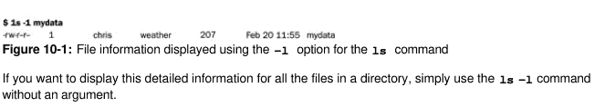

图 10-1：使用 `ls` 命令的 `-l` 选项显示的文件信息

如果您想为目录中的所有文件显示这些详细信息，只需在不带参数的情况下使用 `ls -l` 命令即可。

```
$ ls -l
-rw-r--r-- 1 chris weather 207 Feb 20 11:55 mydata
-rw-rw-r-- 1 chris weather 568 Feb 14 10:30 today
-rw-rw-r-- 1 chris weather 308 Feb 17 12:40 monday
```

Linux 中的所有文件都有一种物理格式——字节流。字节流只是一系列字节。这使 Linux 能够将文件概念应用于系统中的每个数据组件。目录被归类为文件，设备也是如此。将一切视为文件使 Linux 更容易组织和交换数据。文件中的数据可以直接发送到屏幕等设备，因为设备使用与普通文件相同的字节流文件格式与系统接口。

相同的这种文件格式用于实现其他操作系统组件。设备的接口，例如屏幕或键盘，被指定为文件。其他组件，例如目录本身就是字节流文件，但它们具有特殊的内部组织结构。目录文件包含有关目录的信息，以特殊的目录格式组织。由于这些不同的组件被视为文件，可以说它们构成不同的文件类型。字符设备是一种文件类型。目录是另一种文件类型。这些文件类型的数量可能因您特定的 Linux 实现而异。然而，存在五种常见的文件类型：普通文件、目录文件、先入先出管道、字符设备文件和块设备文件。虽然您很少引用文件的类型，但在搜索目录或设备时它可能很有用。本章后面将介绍如何使用 `find` 命令在搜索条件中使用文件类型来专门搜索目录或设备名称。

虽然所有普通文件都有字节流格式，但它们的使用方式可能不同。最显著的区别在于二进制文件和文本文件之间。编译后的程序是二进制文件的示例。然而，即使是文本文件也可以根据其不同的用途进行分类。您可以拥有包含 C 编程源代码或 shell 命令的文件，甚至是空文件。该文件可以是可执行程序或目录文件。Linux `file` 命令可帮助您确定文件的用途。它检查文件的前几行并尝试为其确定分类。`file` 命令在这些前几行中查找特殊关键字或特殊数字，但并不总是准确。在下一个示例中，`file` 命令检查两个文件的内容并为其确定分类：

```
$ file monday reports

monday: text

reports: directory
```

如果您需要逐字节检查整个文件，可以使用 `od`（八进制转储）命令。`od` 命令对文件执行转储。默认情况下，它以八进制表示打印每个字节。不过，您也可以指定字符、十进制或十六进制表示。`od` 命令在您需要检测文件中的任何特殊字符或想显示二进制文件时很有帮助。

### 文件结构

Linux 将文件组织成一个层次连接的目录集合。每个目录可能包含文件或其他目录。在这方面，目录执行两个重要功能。目录存放文件，就像文件柜中的文件一样，目录也连接着其他目录，就像树中的一个分支连接着其他分支。就文件而言，目录似乎像文件柜运作，每个抽屉存放若干文件。要访问文件，你打开文件抽屉。然而与文件抽屉不同，目录不仅可以包含文件，还可以包含其他目录。这样，目录可以连接到另一个目录。

由于与树的相似性，这种结构常被称为树形结构。然而，由于没有树干，这种结构更准确地应被视为倒置的灌木而非树。树是倒置表示的，根在顶部。从根部向下延伸的是分支。每个分支只从一个分支生长出来，但它可以有许多下层分支。在这方面，可以说它具有父/子结构。同样，每个目录本身都是另一个目录的子目录。每个目录可能包含许多子目录，但本身只有一个父目录作为其父级。

Linux 文件结构从根目录 `/` 开始分支到多个目录。在根目录内，多个系统目录包含 Linux 系统特有的文件和程序。根目录还包含一个名为 `home` 的目录，其中包含系统中所有用户的家目录。每个用户的家目录反过来又包含用户为自己使用而创建的目录。这些目录中也可能包含目录。这种嵌套目录会从用户的家目录分支出来，如图 10-2 所示。

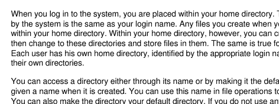

图 10-2：从根目录开始的 Linux 文件结构

注：用户的家目录可以是任何目录，通常是带有用户登录名的目录。该目录位于 Linux 系统中名为 `/home` 的目录下。例如，名为 `dylan` 的用户将在系统的 `/home` 目录中拥有一个名为 `dylan` 的家目录。用户的家目录是系统上名为 `/home` 的目录的子目录。

### 家目录

当你登录系统时，你会被置于你的家目录中。系统赋予该目录的名称与你的登录名相同。你首次登录时创建的任何文件都组织在你的家目录中。然而，在你的家目录中，你可以创建更多目录。然后你可以切换到这些目录并在其中存储文件。系统上的其他用户也是如此。每个用户都有自己的家目录，由相应的登录名标识。用户反过来可以创建自己的目录。

你可以通过其名称访问目录，或将其设为默认目录。每个目录在创建时都会被赋予一个名称。你可以在文件操作中使用此名称来访问该目录中的文件。你也可以将该目录设为你的默认目录。如果在文件操作中不使用任何目录名称，将访问默认目录。默认目录被称为工作目录。从这个意义上说，工作目录是你当前正在工作的目录。

登录时，工作目录是你的家目录，通常与你的登录名同名。你可以使用 `cd` 命令将另一个目录指定为工作目录来更改工作目录。随着工作目录的更改，你可以从一个目录移动到另一个目录。另一种思考目录的方式是将其视为走廊。在这样的走廊里，有带名字的门。有些门通向房间；另一些门通向其他走廊。打开到房间的门就像目录中的文件。通向其他走廊的门就像其他目录。从一个走廊移动到下一个走廊就像更改工作目录。穿过多个走廊就像穿过多个目录。

### 路径名

你在创建目录或文件时赋予它的名称并非其全名。目录的全名是其路径名。目录之间层次嵌套的关系形成了路径，这些路径可用于明确地标识和引用任何目录或文件。在图 10-3 中，从根目录 `/` 经 `home` 目录到 `robert` 目录存在一条路径。另一条路径从根目录经 `home` 和 `chris` 目录通向 `reports` 目录。尽管每个路径的部分最初可能共享，在某个点它们会不同。`robert` 和 `reports` 两个目录都共享 `root` 和 `home` 两个目录。然后它们不同。在 `home` 目录中，`robert` 以 `robert` 结束，但目录 `chris` 然后通向 `reports`。这样，可以说文件结构中的每个目录都有其独特的路径。系统用来标识目录的实际名称总是以根目录开头，并由该目录上方嵌套的所有目录组成。

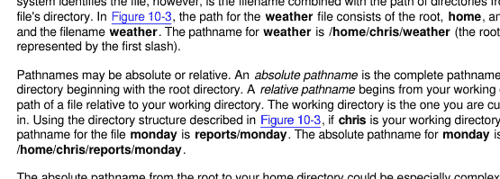

图 10-3：目录路径名

在 Linux 中，你通过用正斜杠分隔路径中的每个目录来书写路径名。路径中第一个目录前面的斜杠代表根。`robert` 目录的路径名为 `/home/robert`。`reports` 目录的路径名为 `/home/chris/reports`。路径名也适用于文件。当你在目录内创建文件时，你会给文件一个名称。然而，系统用来标识文件的实际名称是文件名与从根到文件所在目录的目录路径的组合。在图 10-3 中，`weather` 文件的路径由根、`home` 和 `chris` 目录以及文件名 `weather` 组成。`weather` 的路径名为 `/home/chris/weather`（根目录由第一个斜杠表示）。

路径名可以是绝对的或相对的。绝对路径名是从根目录开始的文件或目录的完整路径名。相对路径名从你的工作目录开始；它是相对于工作目录的文件路径。工作目录是你当前正在操作的目录。使用图 10-3 中描述的目录结构，如果 `chris` 是你的工作目录，则文件 `monday` 的相对路径名为 `reports/monday`。`monday` 的绝对路径名为 `/home/chris/reports/monday`。

从根到你家目录的绝对路径名可能特别复杂，有时甚至可能由系统管理员更改。为了便于引用，你可以使用特殊字符波浪号 `~`，它代表你家目录的绝对路径名。在下一个示例中，从 `thankyou` 目录开始，用户通过在 `weather` 前放置波浪号和斜杠来引用家目录中的 `weather` 文件：

```
$ pwd
/home/chris/letters/thankyou
$ cat ~/weather
raining and warm
$
```


你必须指定从家目录开始的其余路径。在下一个示例中，用户引用`reports`目录中的`monday`文件。波浪号代表用户家目录的路径`/home/chris`，然后指定到`monday`文件的其余路径。

```
$ cat ~/reports/monday
```

#### 系统目录

开始 Linux 文件结构的根目录包含多个系统目录。系统目录包含用于运行和维护系统的文件和程序。其中许多包含用于执行 Linux 特定功能的程序的子目录。例如，目录`/usr/bin`包含用户执行的各种 Linux 命令，如`cp`和`mv`。目录`/bin`存放与不同系统设备的接口，如打印机或终端。表 10-1 列出了基本的系统目录。

表 10-1：Linux 中的标准系统目录

| 目录 | 功能 |
|---|---|
| `/` | 开始文件系统结构，称为根 |
| `/home` | 包含用户的家目录 |
| `/bin` | 存放所有标准命令和实用程序 |
| `/usr` | 存放系统使用的文件和命令；该目录分解为多个子目录 |
| `/usr/bin` | 存放面向用户的命令和实用程序 |
| `/usr/sbin` | 存放系统管理命令 |
| `/usr/lib` | 存放编程语言的库 |
| `/usr/share/doc` | 存放 Linux 文档 |
| `/usr/share/man` | 存放在线手册 Man 文件 |
| `/var/spool` | 存放 spool 文件，如打印作业和网络传输生成的那些文件 |
| `/sbin` | 存放用于启动系统的系统管理命令 |
| `/var` | 存放变化的文件，如邮箱文件 |
| `/dev` | 存放终端和打印机等设备的接口文件 |
| `/etc` | 存放系统配置文件和任何其他系统文件 |

注意 Linux 文件结构中系统目录以及内核等使用的其他有用目录的整体组织在第 33 章中有详细讨论。


## ABC Amber CHM 转换器试用版

请注册以移除此横幅。

http://www.processestext.com/abcc...html

#### 列出、显示和打印文件：`ls`、`cat`、`more`、`less` 和 `lpr`

操作系统的基本功能之一是文件管理。你可能需要对文件执行某些基本输出操作，例如在屏幕上显示它们或打印它们。Linux 系统提供了一组执行基本文件管理操作的命令，例如列出、显示和打印文件，以及复制、重命名和删除文件。这些命令通常由单词的缩写形式组成。例如，`ls`命令是“list”的缩写形式，用于列出目录中的文件。`lpr`命令是“line print”的缩写形式，用于打印文件。`cat`、`less`和`more`命令在屏幕上显示文件的内容。表 10-2 列出了这些命令及其不同的选项。当你登录到 Linux 系统时，你可能想要列出主目录中的文件。`ls`命令输出文件和目录名称的列表，对此很有用。`ls`命令有许多可能的选项，可根据特定特征显示文件名。

**表 10-2：列出、显示和打印文件**

| 命令或选项 | 执行 |
|---|---|
| `ls` | 此命令列出文件和目录名称。 |
| `cat filenames` | 此过滤器可用于显示文件。它可以接受文件名作为参数。它将这些文件的内容直接输出到标准输出，默认情况下输出到屏幕。 |
| `more filenames` | 此实用程序逐屏显示文件。按空格键继续下一屏，按 q 退出。 |
| `less filenames` | 此实用程序也逐屏显示文件。按空格键继续下一屏，按 q 退出。 |
| `lpr filenames` | 将文件发送到行式打印机进行打印；可使用文件列表作为参数。使用 `-P` 选项指定打印机。 |
| `lpq` | 列出打印作业的打印队列。 |
| `lprm` | 从打印队列中移除打印作业。 |

##### 显示文件：`cat`、`less` 和 `more`

你可能还需要查看文件的内容。`cat`和`more`命令在屏幕上显示文件的内容。`cat`代表 concatenate。

```
$ cat mydata
computers
```

`cat`命令一次将文件的全部文本输出到屏幕。当文件很大时会出现问题，因为其文本会迅速从屏幕上闪过。`more`和`less`命令通过一次显示一屏文本来克服这一限制。你可以随意向前或向后移动文本。你可以通过输入命令名后跟要查看的文件名来调用`more`或`less`命令（`less`是一个更强大且可配置的显示实用程序）。

```
$ less mydata
```

当`more`或`less`调用文件时，会显示第一屏文本。要继续下一屏，请按 F 键或空格键。要在文本中向后移动，请按 B 键。你可以随时按 Q 键退出。

##### 打印文件：`lpr`、`lpq` 和 `lprm`

使用`lpr`和`lprm`等打印机命令，你可以执行打印文件或取消打印作业等打印操作（参见表 10-2）。当你需要打印文件时，使用`lpr`命令将文件发送到连接到系统的打印机。请参阅第 25 章了解有关打印的更多信息。在下一个示例中，用户打印`mydata`文件：

```
$ lpr mydata
```

如果你想一次打印多个文件，可以在`lpr`命令后在命令行上指定多个文件。在下一个示例中，用户打印`mydata`和`preface`两个文件：

```
$ lpr mydata preface
```

打印作业被放入队列，并在后台逐个打印。你可以在文件打印时继续进行其他工作。你可以使用`lpq`命令随时查看特定打印作业的位置。`lpq`会给出打印作业的所有者（发送作业的用户的登录名）、打印作业 ID、字节大小以及当前保存的临时文件。

如果需要取消不需要的打印作业，可以使用`lprm`命令。`lprm`的参数可以是打印作业的 ID 号或所有者名称。`lprm`然后从打印队列中移除打印作业。对于此任务，`lpq`很有帮助，因为它为你提供了使用`lprm`所需的打印作业的 ID 号和所有者。

#### 管理目录：`mkdir`、`rmdir`、`ls`、`cd` 和 `pwd`

你可以使用`mkdir`、`rmdir`和`cd`命令创建和删除自己的目录，以及更改工作目录。这些命令都可以使用目录的路径名作为参数。`pwd`命令显示工作目录的绝对路径名。除了这些命令之外，单点、双点和波浪号等特殊字符可分别用于引用工作目录、工作目录的父目录和主目录。综合起来，这些命令使你能够管理目录。你可以创建嵌套目录，从一个目录移动到另一个目录，并使用路径名引用任何目录。那些通常用于管理目录的命令列在表 10-3 中。

表 10-3：目录命令

| 命令 | 执行 |
|---|---|
| `mkdir directory` | 创建一个目录。 |
| `rmdir directory` | 删除一个目录。 |
| `ls -F` | 列出目录名，并在其后加上斜杠。 |
| `ls -R` | 列出工作目录以及所有子目录。 |
| `cd directory name` | 切换到指定目录，使其成为工作目录。`cd`不带目录名时会切换回主目录：`$ cd reports` |
| `pwd` | 显示工作目录的路径名。 |
| `directory name/filename` | 在路径名中使用斜杠分隔每个目录名。对于文件的路径名，斜杠将前面的目录名与文件名分隔开。 |
| `..` | 引用父目录。你可以将其用作参数或作为路径名的一部分：`$ cd ..` `$ mv ../larisa oldletters` |
| `.` | 引用工作目录。你可以将其用作参数或作为路径名的一部分：`$ ls .` |
| `~/pathname` | 波浪号是一个特殊字符，表示主目录的路径名。当你需要为文件或目录使用绝对路径名时很有用：`$ cp monday ~/today` |

##### 创建和删除目录

你可以使用`mkdir`和`rmdir`命令创建和删除目录。在这两种情况下，你也可以为目录使用路径名。在下一个示例中，用户创建了`reports`目录。然后用户使用路径名创建`letters`目录：

```
$ mkdir reports
$ mkdir /home/chris/letters
```

你可以使用`rmdir`命令后跟目录名来删除目录。在下一个示例中，用户使用`rmdir`命令删除`reports`目录：

```
$ rmdir reports
```

要删除目录及其所有子目录，请使用带`-r`选项的`rm`命令。这是一个非常强大的命令，很容易被用来擦除所有文件。删除每个文件时都会提示你。若要不提示地删除所有文件和子目录，请添加`-f`选项。以下示例删除`reports`目录及其所有子目录：

```
rm -rf reports
```

##### 显示目录内容

你已经了解如何使用`ls`命令列出工作目录中的文件和目录。但是，要区分文件和目录名，你需要使用带`-F`选项的`ls`命令。然后在列表中每个目录名后加上斜杠。


`ls` 命令也可以接受任何目录名或目录路径名作为参数。这样你就可以在不先切换到该目录的情况下列出任何目录中的文件。在下一个示例中，`ls` 命令的参数是目录名 `reports`。然后再次执行 `ls` 命令，这次使用 `reports` 的绝对路径名。

```
$ ls
weather reports letters
$ ls -F
weather reports/ letters/

$ ls reports
monday tuesday
$ ls /home/chris/reports
monday tuesday
$
```

### 在目录间移动

`cd` 命令的参数是你想要切换到的目录的名称。目录名可以是工作目录中的子目录名，也可以是系统上任何目录的完整路径名。如果你想切换回主目录，只需单独输入 `cd` 命令，不带文件名参数即可。

### 引用父目录

该命令显示父目录中的天气文件。文件的路径名为 `..` 符号后跟斜杠和文件名。

```
$ cat ../weather
raining and warm
```

提示 您可以使用 `cd` 命令配合 `..` 符号，从较低的目录逐步返回目录树的连续父目录。


## ABC Amber CHM 转换器试用版

请注册以移除此横幅。

http://www.processestext.com/abchm.html

### 文件和目录操作：find、cp、mv、rm 和 ln

随着您创建越来越多的文件，您可能希望备份它们、更改其名称、删除其中一些文件，甚至为它们添加额外的名称。Linux 为您提供了多个文件命令，使您能够搜索文件、复制文件、重命名文件或删除文件（请参阅本章后面的表 10-5）。如果您有大量文件，您也可以搜索它们以定位特定文件。这些命令是完整单词的缩写形式，仅由两个字符组成。`cp` 命令代表 “copy”，用于复制文件，`mv` 代表 “move”，用于重命名或移动文件，`rm` 代表 “remove”，用于删除文件，而 `ln` 代表 “link”，为文件添加另一个名称，通常用作原始文件的快捷方式。两个字符规则的一个例外是 `find` 命令，它执行文件名搜索以查找文件。

#### 搜索目录：find

一旦您在许多不同的目录中有大量文件，您可能需要搜索它们以定位特定文件或特定类型的文件。`find` 命令使您能够执行此类搜索。`find` 命令以目录名为参数，后跟若干可能的选项，这些选项指定搜索类型和搜索条件。`find` 然后在所列目录及其子目录中搜索符合这些条件的文件。`find` 命令可以根据名称、类型、所有者，甚至最后更新时间来搜索文件。

```
$ find directory-list -option criteria
```

`-name` 选项以模式作为条件，并指示 `find` 搜索与该模式匹配的文件名。要按名称搜索文件，您使用 `find` 命令，后跟目录名、`-name` 选项以及文件名称。

```
$ find directory-list -name filename
```

`find` 命令还具有仅执行操作的选项，例如输出搜索结果。如果您希望 `find` 显示找到的文件名，只需在命令行中连同其他选项一起包含 `-print` 选项即可。`-print` 选项指示 `find` 将找到的所有文件名称输出到标准输出（您也可以使用 `-ls` 选项以长格式列出文件）。在下一个示例中，用户搜索 `reports` 目录中名称为 `monday` 的所有文件。找到后，文件连同其相对路径名一起打印。

```
$ find reports -name monday -print
```

`find` 命令使用目录列表中指定的目录名打印文件名。如果您指定绝对路径名，则找到的目录的绝对路径将被输出。如果您指定相对路径名，则只输出相对路径名。在前面的示例中，用户在目录列表中指定了相对路径名 `reports`。找到的文件名从该相对路径名开始输出。在下一个示例中，用户在目录列表中指定了绝对路径名。找到的文件名然后使用该绝对路径名输出。

```
$ find /home/chris -name monday -print
```

#### 搜索工作目录

如果您想搜索工作目录，可以使用目录路径名中的点来表示工作目录。双点将表示父目录。下一个示例搜索工作目录中的所有文件和子目录，使用点表示工作目录。如果您位于主目录中，这是搜索您自己的所有目录的便捷方法。请注意，找到的文件名从点开始输出。

```
$ find . -name weather -print
```

您可以使用 shell 通配符作为搜索文件的模式条件的一部分。但是特殊字符必须加引号，以避免被 shell 评估。在下一个示例中，搜索 `programs` 目录中所有具有 `.c` 扩展名的文件：

```
$ find programs -name '*.c' -print
```

#### 定位目录

您也可以使用 `find` 命令来定位其他目录。在 Linux 中，目录正式被归类为一种特殊类型的文件。虽然所有文件都有字节流格式，但有些文件，如目录，以特殊方式使用。在这种意义上，可以说文件具有文件类型。`find` 命令有一个名为 `-type` 的选项，用于搜索给定类型的文件。`-type` 选项采用一个字符的修饰符来表示文件类型。表示目录的修饰符是 `d`。在下一个示例中，同时使用目录名和目录文件类型来搜索名为 `thankyou` 的目录：

```
$ find /home/chris -name thankyou -type d -print
/home/chris/letters/thankyou
$
```

文件类型与其说是不同类型的文件，不如说是应用于操作系统其他组件（如设备）的文件格式。在这种意义上，设备被视为一种文件类型，您可以使用 `find` 搜索设备和目录以及普通文件。表 10-4 列出了 `find` 命令 `-type` 选项可用的不同类型。

表 10-4：find 命令

| 命令或选项 | 执行 |
|---|---|
| find | 根据搜索条件搜索目录中的文件。该命令有多个选项指定要采取的准则类型和操作。 |
| -name pattern | 搜索名称中包含该模式的文件。 |
| -group name | 搜索属于此组名称的文件。 |
| -size numc | 搜索大小为 num 个块的文件。如果在 num 后添加 c，则搜索以字节（字符）为单位的大小。 |
| -mtime num | 搜索 num 天前最后修改过的文件。 |
| -newer pattern | 搜索在与 pattern 匹配的文件之后修改过的文件。 |
| -print | 将搜索结果输出到标准输出。结果通常是文件名列表，包括其完整路径名。 |
| -type filetype | 搜索具有指定文件类型的文件。文件类型可以是 b 表示块设备，c 表示字符设备，d 表示目录，f 表示文件，或 l 表示符号链接。 |

#### 复制文件

要复制一个文件，您只需将 `cp` 的参数指定为两个文件名（请参阅表 10-5）。第一个文件名是要复制的文件的名称——已存在的文件。这通常被称为源文件。第二个文件名是您希望副本的名称。这将是一个包含源文件中所有数据副本的新文件。这个第二个参数通常被称为目标文件。`cp` 命令的语法如下：

```
$ cp source-file destination-file
```

在下一个示例中，用户将名为 `proposal` 的文件复制到名为 `oldprop` 的新文件：

```
$ cp proposal oldprop
```

您可能会意外地用 `cp` 命令销毁另一个文件。`cp` 命令通过先创建文件然后复制数据到其中来生成副本。如果另一个文件与目标文件的名称相同，该文件将被销毁并创建一个具有该名称的新文件。默认情况下，Red Hat 配置系统以检查是否存在同名副本（`cp` 别名使用 `-i` 选项，请参阅第 9 章）。要将文件从工作目录复制到另一个目录，您只需将该目录名作为 `cp` 命令中的第二个参数即可。在下一个示例中，`proposal` 文件被 `newprop` 文件覆盖。`proposal` 文件已存在。

```
$ cp newprop proposal
```

您可以使用任何通配符来生成用于 `cp` 或 `mv` 的文件名列表。例如，假设您需要将所有 C 源码文件复制到给定目录。您不必在命令行中单独列出每个文件，而是可以使用 `*` 字符与 `.c` 扩展名匹配并生成 C 源码文件列表（所有具有 `.c` 扩展名的文件）。在下一个示例中，用户将当前目录中的所有源代码文件复制到 `sourcebks` 目录：

```
$ cp *.c sourcebks
```

如果您想将给定目录中的所有文件复制到另一个目录，您可以使用 `*` 匹配并在 `cp` 命令中生成所有这些文件的列表。在下一个示例中，用户将 `props` 目录中的所有文件复制到 `oldprop` 目录。请注意 `props` 路径名在 `*` 特殊字符之前的使用。在这种上下文中，`props` 是一个路径名，将在 `*` 生成的每个文件列表前附加。

```
$ cp props/* oldprop
```


当然，您也可以使用其他特殊字符，例如 `.`、`?` 或 `[]`。在下一个示例中，用户将源代码和目标代码文件（`.c` 和 `.o`）复制到 `projbk` 目录：

```
$ cp *.[oc] projbk
```

复制文件时，您可能希望为副本指定与原始文件不同的名称。为此，将新文件名放在目录名之后，用斜杠分隔。

```
$ cp filename directory-name/new-filename
```

### 移动文件

您可以使用 `mv` 命令重命名文件或将文件从一个目录移动到另一个目录。使用 `mv` 重命名文件时，您只需将新文件名用作第二个参数。第一个参数是您要重命名的文件的当前名称。如果您想在移动文件时重命名它，可以在目录名之后指定文件的新名称。在下一个示例中，`proposal` 文件被重命名为 `version1`：

```
$ mv proposal version1
```

与 `cp` 一样，`mv` 也很容易意外删除文件。重命名文件时，您可能会意外选择另一个文件已使用的文件名。在这种情况下，该文件将被删除。`mv` 命令也有一个 `-i` 选项，可先检查是否已存在该名称的文件。

您也可以使用第 8 章中描述的任何特殊字符来生成用于 `mv` 的文件名列表。在下一个示例中，用户将当前目录中的所有源代码文件移动到 `newproj` 目录：

```
$ mv *.c newproj
```

如果您想将给定目录中的所有文件移动到另一个目录，可以使用 `*` 匹配并生成所有这些文件的列表。在下一个示例中，用户将 `reports` 目录中的所有文件移动到 `repbks` 目录：

```
$ mv reports/* repbks
```

Note: 要将文件复制到 CD-R/RW 或 DVD-R/RW 光盘，您可以使用任意数量的 CD/DVD 刻录工具。其中许多是 `cdrecord` 和 `dvd record` 实用程序的接口，以及

### 复制和移动目录

您也可以一次复制或移动整个目录。`cp` 和 `mv` 都可以将目录名作为第一个参数，从而使您能够从一个目录复制或移动子目录到另一个目录（参见表 10-5）。第一个参数是要移动或复制的目录的名称，而第二个参数是要将其放置在其中的目录的名称。用于文件的文件路径结构同样适用于移动或复制目录。

您也可以同样轻松地从一个目录复制子目录到另一个目录。要复制一个目录，`cp` 命令要求您使用 `-r` 选项。`-r` 选项代表“递归”。它指示 `cp` 命令复制一个目录以及它可能包含的任何子目录。换句话说，从该目录开始的整个目录子树将被复制。在下一个示例中，`thankyou` 目录被复制到 `oldletters` 目录。现在存在两个 `thankyou` 子目录，一个在 `letters` 中，一个在 `oldletters` 中。

```
$ cp -r letters/thankyou oldletters
$ ls -F letters
/thankyou
$ ls -F oldletters
/thankyou
```

### 删除文件和目录：`rm` 命令

随着您使用 Linux，您会发现使用的文件数量迅速增加。在 Linux 中生成文件很容易。诸如编辑器之类的应用程序，以及诸如 `cp` 之类的命令，都可以轻松创建文件。最终，其中许多文件可能会过时且无用。您可以使用 `rm` 命令将其删除。`rm` 命令可以接受任意数量的参数，使您能够列出多个文件名并同时将其全部擦除。在下一个示例中，用户删除了文件 `oldprop`：

```
$ rm oldprop
```

使用 `rm` 命令时要小心，因为它是不可逆的。一旦文件被删除，就无法恢复（没有撤销）。使用 `-i` 选项，您将针对每个文件分别提示并询问是否删除它。如果您输入 `y`，文件将被删除。如果您输入其他任何内容，文件将不会被删除。在下一个示例中，`rm` 命令被指示删除文件 `proposal` 和 `oldprop`。`rm` 命令随后会为每个文件请求确认。用户决定删除 `oldprop`，但不删除 `proposal`。

```
$ rm -i proposal oldprop
Remove proposal? n
Remove oldprop? y
$
```

表 10-5：文件操作

| Command | Execution |
|---|---|
| `cp filename filename` | 复制一个文件。`cp` 接受两个参数：原始文件和新副本的名称。您可以使用路径名在目录间复制文件：`$ cp today reports/monday` |
| `cp -r dirname dirname` | 从一个目录复制子目录到另一个目录。被复制的目录包含其自身的所有子目录：`$ cp -r letters/thankyou oldletters` |
| `mv filename filename` | 移动（重命名）一个文件。`mv` 接受两个参数：第一个是要移动的文件。第二个参数可以是新的文件名或目录的路径名。如果它是目录的名称，则文件将被实际移动到该目录，从而更改文件的路径名：`$ mv today /home/chris/reports` |
| `mv dirname dirname` | 移动目录。在这种情况下，第一个和最后一个参数都是目录：`$ mv letters/thankyou oldletters` |
| `ln filename filename` | 创建称为链接的文件的附加名称。可以在一个目录中创建一个链接，该链接引用另一个目录中的文件：`$ ln today reports/monday` |
| `rm filenames` | 删除（擦除）一个文件。可以接受任意数量的文件名作为其参数。字面意义上删除指向文件的链接。如果文件有多个链接，您需要删除所有链接才能擦除文件：`$ rm today weather weekend` |

### 链接：`ln` 命令

您可以使用 `ln` 命令为文件提供多个名称。您可能希望使用不同的文件名引用文件，以便从不同目录访问它。附加的名称通常称为链接。Linux 支持两种不同类型的链接，即硬链接和符号链接。硬链接实际上是同一文件的另一个名称，而符号链接则像引用另一个文件的快捷方式。符号链接更灵活，可以在许多不同的文件系统上工作，而硬链接仅限于本地文件系统。此外，硬链接会带来安全问题，因为它们允许从可能具有公共访问权限的链接直接访问您可能想要保护的原始文件。链接通常实现为符号链接。

#### 符号链接

要设置符号链接，您使用 `ln` 命令并带 `-s` 选项和两个参数：原始文件的名称和新的附加文件名。`ls` 操作会列出两个文件名，但只存在一个物理文件。

```
$ ln -s original-file-name added-file-name
```

在下一个示例中，`today` 文件被赋予了额外的名称 `weather`。它只是 `today` 文件的另一个名称。

```
$ ls
today
$ ln -s today weather
$ ls
today weather
```

您可以通过多次对同一文件使用 `ln` 命令为同一文件提供多个名称。在下一个示例中，文件 `today` 被赋予了 `weather` 和 `weekend` 两个名称：

```
$ ln -s today weather
$ ln -s today weekend
$ ls
today weather weekend
```

如果您列出符号链接及其文件的完整信息，您会发现显示的信息是不同的。在下一个示例中，用户使用带 `-l` 选项的 `ls` 命令列出 `lunch` 和 `/home/george/veglist` 的完整信息。行中的第一个字符指定文件类型。符号链接有自己的文件类型，用 `l` 表示。`lunch` 的文件类型为 `l`，表示它是一个符号链接，而不是普通文件。“group”之后的数字是文件的大小。请注意大小不同。`lunch` 文件的大小只有四个字节。这是因为 `lunch` 只是一个符号链接——一个保存另一个文件路径名的文件——而路径名只占用几个字节。它不是指向 `veglist` 文件的直接硬链接。

```
$ ls lunch /home/george/veglist
lrw-rw-r-- 1 chris group 4 Feb 14 10:30 lunch
-rw-rw-r-- 1 george group 793 Feb 14 10:30 veglist
```

要删除一个文件，您只需要删除其原始名称（以及指向它的任何硬链接）。如果留下任何符号链接，它们将无法访问该文件。在这种情况下，符号链接将保存一个不再存在的文件的路径名。

#### 硬链接

您可以通过多次对同一文件使用 `ln` 命令为同一文件提供多个名称。要设置硬链接，您使用 `ln` 命令不带 `-s` 选项并使用两个参数：原始文件的名称和新的附加文件名。`ls` 操作会列出两个文件名，但只存在一个物理文件。

```
$ ln original-file-name added-file-name
```

在下一个示例中，`monday` 文件被赋予了额外的名称 `storm`。它只是 `monday` 文件的另一个名称。

```
$ ls
today
$ ln monday storm
$ ls
monday storm
```


要删除具有硬链接的文件，您需要删除其所有硬链接。文件的名称实际上被视为指向该文件的链接——因此有 `rm` 命令删除指向文件的链接。如果您有指向文件的多个链接并且只删除其中一个，其他链接仍然存在，您可以通过它们引用文件。即使删除原始链接——文件的原始名称——也是如此。任何附加的链接同样有效。在下一个示例中，`today` 文件使用 `rm` 命令被删除。但是，指向同一文件的链接存在，称为 `weather`。然后文件可以通过名称 `weather` 引用。

```
$ ln today weather
$ rm today
$ cat weather
The storm broke today
and the sun came out.
$
```

Note: Linux 中的每个文件和目录都包含一组权限，用于确定谁可以访问文件以及如何访问。您可以通过以下三种方式之一设置权限以限制访问：您


## ABC Amber CHM Converter Trial version

Please register to remove this banner.

http://www.processestext.com/abchm.html

### The mtools Utilities: msdos

您的 Linux 系统提供了一组名为 `mtools` 的实用程序，可让您轻松访问格式化为 MS-DOS 的软盘和硬盘（请参阅表 10-6）。

#### Copying Files to a DOS Floppy

`mcopy` 命令可让您在软盘驱动器中的 MS-DOS 软盘或硬盘上的 Windows 分区之间复制文件。无需执行挂载等特殊操作即可使用。借助 `mtools`，您无需挂载 MS-DOS 分区即可访问它。对于 MS-DOS 软盘，将磁盘放入软盘驱动器，然后您就可以使用 `mtool` 命令访问这些文件。例如，要将文件从 MS-DOS 软盘复制到 Linux 系统，请使用 `mcopy` 命令。您使用 `a:` 指定 MS-DOS 磁盘作为 A 驱动器。与普通 DOS 路径名不同，使用 `mtool` 命令的路径名使用正斜杠而不是反斜杠。A 驱动器上的 `docs` 目录将通过路径名 `a:/docs` 引用，而不是 `a:\docs`。与 MS-DOS 默认将第二个参数设为当前目录不同，您始终需要为 `mcopy` 提供第二个参数。下一个示例将文件 `mydata` 复制到 MS-DOS 磁盘，然后将磁盘上的 `preface` 文件复制到当前 Linux 目录。

```
$ mcopy mydata a:
$ mcopy a:/preface .
```

**Note** 目前，`mtools` 无法访问 Windows XP、NT 和 2000 NTFS 分区。

#### mtools Commands

您可以使用 `mdir` 命令列出 MS-DOS 磁盘上的文件，并使用 `mcd` 命令在其中更改目录。下一个示例列出软盘驱动器中 MS-DOS 磁盘上的文件，然后更改到该驱动器上的 `docs` 目录：

```
$ mdir a:
$ mcd a:/docs
```

大多数标准 MS-DOS 命令都作为 `mtool` 操作可用。您可以使用 `mmd` 创建 MS-DOS 目录，并使用 `mdel` 删除 MS-DOS 文件。表 10-6 中提供了 `mtool` 命令列表。例如，要显示第二个软盘驱动器中 MS-DOS 磁盘上驱动器 B 上的文件，请使用 `mtype` 和以 `b/` 为前缀的文件名：

```
$ mtype b:/readme
```

##### Table 10-6: The mtools Access Commands

| 命令 | 执行 |
|---|---|
| `mcopy filename filename` | 将文件从 MS-DOS 磁盘复制到 Linux 系统或反之。以下命令将文件从 MS-DOS 软盘复制到 Linux 系统：`mcopy a:/filename directory-or-filename` 以下命令将文件从 Linux 复制到软盘驱动器中的 MS-DOS 软盘：`mcopy filename a:/filename` |
| `mcd directory-name` | 在您的 MS-DOS 文件系统上更改目录。 |
| `mdir` | 列出软盘驱动器中 MS-DOS 磁盘上的文件。 |
| `mattrib` | 更改 MS-DOS 文件的属性。 |
| `mdel filename` | 删除 MS-DOS 文件。 |
| `mformat` | 在软盘上添加 MS-DOS 文件系统。 |
| mlabel | 创建卷标。 |
| mmd directory-name | 创建 MS-DOS 目录。 |
| mrd directory-name | 删除 MS-DOS 目录。 |
| mread filename filename | 将 MS-DOS 文件低级读取（复制）到 Unix。 |
| mren filename filename | 重命名 MS-DOS 文件。 |
| mtype filename | 显示 MS-DOS 文件的内容。 |
| mwrite filename filename | 将 Unix 文件低级写入（复制）到 MS-DOS。 |

#### Configuring mtools: /etc/mtools.conf

`mtools` 对 MS-DOS 或 Windows 95、98 或 ME 分区的访问由 `/etc/mtools.conf` 文件配置。此文件列出了多个默认的 MS-DOS 或 Windows 分区和磁盘驱动器。每个驱动器或分区都由特定的设备名称标识。软盘驱动器的条目已预先输入，使用设备名称 `/dev/fd0` 和 `/dev/fd1` 分别表示第一个和第二个软盘驱动器。`/etc/mtools.conf` 文件中的条目形式为驱动器标签，后跟术语 `file` 和等号，然后是您希望与此标签关联的驱动器或分区的设备名称。设备名称用引号括起来。例如，假设第一个硬盘分区是 MS-DOS 分区，其设备名称为 `/dev/hda1`，则以下条目将标识它为 MS-DOS 系统上的 C 驱动器：

```
drive c: file="/dev/hda1"
```

您必须为分区提供正确的设备名称。这些设备名称列在 `/etc/fstab` 文件中，也可以在 root 用户桌面上的 Linuxconf 本地驱动器访问面板中查看。如果您有 SCSI 硬盘，则硬盘分区形式为 `sd`，后跟硬盘的字符和其中的分区号。例如，`sda1` 指的是 SCSI 硬盘上的第一个分区。IDE 硬盘形式为 `hd`，后跟字符和分区号——`hda1` 指的是 IDE 硬盘上的第一个分区。

在大多数发行版中，默认的 `/etc/mtools.conf` 文件已为您安装（请参阅以下 `/etc/mtools.conf` 示例）。该文件对 C 驱动器有注释条目：一个用于 SCSI 硬盘分区，一个用于 IDE 分区。两者都以前面的 `#` 注释掉。如果您有 IDE 硬盘（大多数用户都有），则需要从 IDE 硬盘分区条目中删除前面的 `#` 符号，并保留 SCSI 分区条目前面的 `#` 符号。此外，如果 IDE 硬盘上的 MS-DOS 分区不是第一个分区，则必须更改设备名称。例如，如果 MS-DOS 分区是第二个分区，则设备名称为 `/dev/hda2`。如果您有多个 MS-DOS 分区，可以为每个分区添加条目，并为每个分区分配不同的标签。以下示例将 `d:` 标签分配给 IDE 驱动器上的第四个硬盘分区：

```
drive d: file="/dev/hda4"
```

##### /etc/mtools.conf

```
# Linux floppy drives
drive a: file="/dev/fd0" exclusive mformat_only
drive b: file="/dev/fd1" exclusive mformat_only
# First SCSI hard disk partition
#drive c: file="/dev/sda1"
# First IDE hard disk partition
drive c: file="/dev/hda1"
drive d: file="/dev/hda5"
```

```
#dosemu floppy image
drive m: file="/var/lib/dosemu/diskimage"
#dosemu hdimage
drive n: file="/var/lib/dosemu/diskimage" offset=8832
#Atari ramdisk image
drive o: file="/tmp/atari_rd" offset=136
mtools_lower_case=1
```

##### Copying Files to a DOS Partition


一旦引用了 DOS 硬盘分区，您就可以使用其驱动器号将文件从 Linux 分区复制到它们并从它们复制到 Linux 分区。以下命令将文件 `mydoc.html` 复制到 `c:` 分区中的 `webstuff` 目录并将其重命名为 `mydoc.htm`。请注意使用正斜杠而不是反斜杠。

```
$ mcopy mypage.html c:/webstuff/mypag.htm
```

由于 DOS 和 Linux 处理文本文件中的换行符的方式不同，因此在将 DOS 文本文件复制到 Linux 分区时应使用 `-t` 选项。以下命令将 `c:/project` 目录中的 `mydoc.txt` 文件复制到 `/newdocs` 目录：

```
$ mcopy -t c:/project/mydoc.txt /newdocs
```

## Archiving and Compressing Files

归档用于备份文件或将它们组合成一个包，然后可以作为一个文件通过 Internet 传输或发布到 FTP 站点以便轻松下载。Linux 和 Unix 系统上使用的标准归档实用程序是 `tar`，有多个 GUI 前端。您可以从中选择多个压缩程序，包括 GNU zip（`gzip`）、`Zip`、`bzip` 和 `compress`。


### Archiving and Compressing Files with File Roller

Red Hat 提供了 File Roller 工具（可从“附件”菜单访问），它作为归档和压缩文件的 GUI 前端运行，让您可以使用 GUI 界面执行 `zip`、`gzip`、`tar` 和 `bzip2` 操作（请参阅图 10-4）。您可以检查归档内容、提取所需文件并创建新的压缩归档。当您创建归档时，您可以通过指定文件名扩展名来确定其压缩方法，例如 `gzip` 的 `.gz` 或 `bzip2` 的 `.bz2`。您可以从“文件类型”菜单中选择不同的扩展名，也可以自行输入扩展名。要同时归档和压缩文件，您可以选择组合扩展名，如 `.tar.bz2`，它使用 `tar` 归档并使用 `bzip2` 压缩。单击“添加”按钮将文件添加到归档。要从归档中提取文件，请打开归档以显示归档文件列表。然后，您可以单击“提取”按钮提取特定文件或整个归档。其他可用的 GUI 工具有 `guiTAR`、`LnxZip`、`Ark`、`KArchive` 和 `Xtar`。

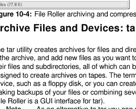

Figure 10-4: File Roller archiving and compression tool

### Archive Files and Devices: tar

`tar` 实用程序为文件和目录创建归档。使用 `tar`，您可以归档特定文件，在归档中更新它们，并根据需要向该归档添加新文件。您甚至可以归档整个目录及其所有文件和子目录，所有这些都可以从归档中恢复。`tar` 实用程序最初设计用于在磁带上创建归档。术语 `tar` 代表 `tape archive`。您可以在任何设备上创建归档，例如软盘，或创建归档文件来保存归档。`tar` 实用程序非常适合备份文件或将多个文件组合成单个文件以通过网络传输（File Roller 是 `tar` 的 GUI 接口）。

> Note 作为 `tar` 的替代方案，您可以使用 `pax`。`pax` 设计用于处理不同类型的 Unix 归档格式，如 `cpio`、`bcpio` 和 `tar`。您可以提取、列出和创建归档。如果您处理的是使用不同归档格式的 Unix 系统创建的归档，`pax` 会很有帮助。

### Displaying Archive Contents

GNOME 和 K Desktop 中的两个文件管理器都能够自动显示 `tar` 归档文件的内容。内容显示为目录中的文件一样。您可以将文件列为图标或详细信息，按名称、类型或其他字段排序。您甚至可以显示文件内容。单击文本文件会使用文本编辑器打开它，图像会使用图像查看器显示。如果文件管理器无法确定用于显示文件的程序，它会提示您选择一个应用程序。两个文件管理器都可以在远程文件系统上的归档上执行相同的操作，例如 FTP 站点上的 `tar` 归档。您可以获取其内容的列表，甚至阅读其 `readme` 文件。Nautilus 文件管理器（GNOME）也可以提取归档。右键单击“归档”图标并选择“提取”。

### Creating Archives

在 Linux 上，`tar` 通常用于在设备或文件上创建归档。您可以使用 `f` 选项和设备或文件名将 `tar` 指向将文件归档到特定设备或文件。下一示例显示了使用 `f` 选项的 `tar` 命令的语法。设备或文件名通常称为归档名称。创建 `tar` 归档的文件时，文件名通常带有 `.tar` 扩展名。这只是一种约定，并非必需。您可以列出任意多个文件名。如果目录名称是

指定时，其所有子目录都包含在归档中。

```
$ tar options f archive-name.tar directory-and-file-names
```

创建归档时，使用 `c` 选项。结合 `f` 选项，`c` 会在文件或设备上创建归档。你需要在 `f` 选项之前并紧挨着它输入此选项。请注意 `tar` 选项前没有前导短横线。表 10-7 列出了可与 `tar` 一起使用的不同选项。在下一个示例中，目录 `mydir` 及其所有子目录都保存在文件 `myarch.tar` 中。在此示例中，`mydir` 目录包含两个文件 `mymeeting` 和 `party`，以及一个名为 `reports` 的目录，其中包含三个文件：`weather`、`monday` 和 `friday`。

```
$ tar cvf myarch.tar mydir
```

```
mydir/
mydir/reports/
mydir/reports/weather
mydir/reports/monday
mydir/reports/friday
mydir/mymeeting
mydir/party
```

表 10-7：文件归档：`tar`

| 命令 | 执行 |

|---|---|

| `tar options files` | 将文件备份到磁带、设备或归档文件。 |

| `tar options f archive_name filelist` | 将文件备份到指定为 `archive_name` 的特定文件或设备。`filelist`：可以是文件名或目录。 |

| 选项 |  |

| `c` | 创建新的归档。 |

| `t` | 列出归档中文件的名称。 |

| `r` | 将文件追加到归档。 |

| `U` | 使用新文件和已更改文件更新归档；仅添加自归档以来被修改的文件或归档中尚未存在的文件。 |

| `--delete` | 从归档中删除文件。 |

| `w` | 在归档每个文件之前等待用户确认；可让你有选择地更新归档。 |

| `x` | 从归档中提取文件。 |

| `m` | 提取归档中的文件时，不分配新的时间戳。 |

| `M` | 创建可存储在多个软盘上的多卷归档。 |

| `f archive-name` | 将磁带归档保存到文件 `archive name`，而不是默认磁带设备。当给出归档名称时，`f` 选项将 `tar` 归档保存到该名称的文件中。 |

| `f device-name` | 将 `tar` 归档保存到软盘或磁带等设备。`/dev/fd0` 是软盘的设备名称；默认设备保存在 `/etc/default/tar` 中。 |

| `v` | 在归档时显示每个文件名。 |

| `z` | 使用 `gzip` 压缩或解压缩归档文件。 |

| `j` | 使用 `bzip2` 压缩或解压缩归档文件。 |

### 提取归档

用户稍后可以使用 `x` 选项从磁带中提取目录。`xf` 选项从归档文件或设备中提取文件。`tar` 提取操作会生成所有子目录。在下一个示例中，`xf` 选项指示 `tar` 从 `tar` 文件 `myarch.tar` 中提取所有文件和子目录：

```
$ tar xvf myarch.tar
mydir/
mydir/reports/
mydir/reports/weather
mydir/reports/monday
mydir/reports/friday
mydir/mymeeting
mydir/party
```

你可以使用 `r` 选项向已创建的归档中添加文件。`r` 选项将文件追加到归档。在下一个示例中，用户将 `letters` 目录中的文件追加到 `myarch.tar` 归档。这里，目录 `mydocs` 及其文件被添加到 `myarch.tar` 归档中：

```
$ tar rvf myarch.tar mydocs
mydocs/
mydocs/doc1
```

### 更新归档

如果你更改了之前归档的目录中的任何文件，可以使用 `u` 选项指示 `tar` 用任何已修改的文件更新归档。`tar` 命令会将每个归档文件的最后更新时间与用户目录中的时间进行比较，并将自上次归档以来被更改的文件复制到归档中。这些目录中新建的文件也会被添加到归档中。在下一个示例中，用户使用 `mydir` 目录中最近修改或新创建的文件更新 `myarch.tar` 文件。在此情况下，`gifts` 文件被添加到 `mydir` 目录。


```
tar uvf myarch.tar mydir
mydir/
mydir/gifts
```

如果需要查看归档中存储的文件，可以使用 `t` 选项运行 `tar` 命令。下一个示例列出存储在 `myarch.tar` 归档中的所有文件：

```
tar tvf myarch.tar
drwxr-xr-x root/root 0 2000-10-24 21:38:18 mydir/
drwxr-xr-x root/root 0 2000-10-24 21:38:51 mydir/reports/
-rw-r--r-- root/root 22 2000-10-24 21:38:40 mydir/reports/weather
-rw-r--r-- root/root 22 2000-10-24 21:38:45 mydir/reports/monday
-rw-r--r-- root/root 22 2000-10-24 21:38:51 mydir/reports/friday
```

```
-rw-r--r-- root/root 22 2000-10-24 21:38:18 mydir/mymeeting
-rw-r--r-- root/root 22 2000-10-24 21:36:42 mydir/party
drwxr-xr-x root/root 0 2000-10-24 21:48:45 mydocs/
-rw-r--r-- root/root 22 2000-10-24 21:48:45 mydocs/doc1
drwxr-xr-x root/root 0 2000-10-24 21:54:03 mydir/
-rw-r--r-- root/root 22 2000-10-24 21:54:03 mydir/gifts
```

#### 归档到软盘

要将文件备份到特定设备，请将设备指定为归档。对于软盘，可以指定软盘驱动器。请确保使用空白软盘。此操作会擦除其上之前放置的任何数据。在下一个示例中，用户在 `/dev/fd0` 设备中的软盘上创建归档，并将 `mydir` 目录中的所有文件复制到其中：

```
$ tar cf /dev/fd0 mydir
```

要从设备中的磁盘提取备份文件，请使用 `xf` 选项：

```
$ tar xf /dev/fd0
```

如果要归档的文件占用空间超过软盘等设备可用的空间，你可以创建使用多个卷标的 `tar` 归档。`M` 选项指示 `tar` 在当前存储组件填满时提示你提供新的存储组件。当使用 `M` 选项归档到软盘驱动器时，`tar` 会在软盘填满时提示你放入新的软盘。然后你可以将 `tar` 归档保存在多个软盘上。

```
$ tar cMF /dev/fd0 mydir
```

要解包多磁盘归档，请将第一张盘放入软盘驱动器，然后使用 `x` 和 `M` 选项发出以下 `tar` 命令。然后会提示你按需放入其他软盘。

```
$ tar xMf /dev/fd0
```

#### 压缩归档

`tar` 操作不会对归档文件执行压缩。如果要压缩归档文件，可以指示 `tar` 调用 `gzip` 实用程序来压缩它们。使用小写 `z` 选项时，`tar` 会先使用 `gzip` 压缩文件，然后再归档。提取文件时，相同的 `z` 选项会调用 `gzip` 进行解压缩。

```
$ tar czf myarch.tar.gz mydir
```

要改用 `bzip2` 而不是 `gzip` 在归档前压缩文件，可以使用 `j` 选项。提取文件时，相同的 `j` 选项会调用 `bzip2` 进行解压缩。

```
$ tar cjf myarch.tar.bz2 mydir
```

请记住，压缩归档中单个文件的压缩与压缩整个归档之间存在区别。通常，归档是为了将多个文件作为一个 `tar` 文件一起传输。为了缩短传输时间，归档应尽可能小。你可以使用压缩实用程序 `gzip` 对归档 `tar` 文件进行压缩，减少其大小，然后发送压缩版本。接收者可以将其解压缩，还原 `tar` 文件。对 `tar` 文件使用 `gzip` 通常会产生扩展名为 `.tar.gz` 的文件。扩展名 `.gz` 添加到被 `gzip` 压缩的文件上。下一个示例使用相同名称并加上 `.gz` 扩展名创建 `myarch.tar` 的压缩版本：

```
$ gzip myarch.tar
$ ls
myarch.tar.gz
```

#### 归档到磁带

如果已指定默认设备，例如磁带，并且要在其上创建归档，可以直接使用 `tar`，而不使用 `f` 选项和设备或文件名。这对于备份文件很有帮助。默认设备的名称保存在名为 `/etc/default/tar` 的文件中。以下示例显示了使用默认磁带设备的 `tar` 命令的语法。如果指定目录名，其所有子目录都包含在归档中。

```
$ tar option directory-and-file-names
```

在下一个示例中，目录 `mydir` 及其所有子目录都保存在默认磁带设备上的磁带中：

```
$ tar c mydir
```

在此示例中，`mydir` 目录及其所有文件和子目录从默认磁带设备中提取并放置在用户的当前工作目录中：

```
$ tar x mydir
```

注意 还有其他可用的归档程序，例如 `cpio` 和 `shar`。然而，`tar` 是用于归档应用程序软件时最常用的。

#### 文件压缩：`gzip`、`bzip2` 和 `zip`

存在多种减小文件大小的原因。最常见的两个原因是节省空间，或在通过网络传输文件时节省传输时间。您可以通过创建文件的压缩副本来有效减小文件大小。每次需要文件时，您都可以对其进行解压缩。压缩通常与归档结合使用，以便一次性压缩整个目录及其文件。

解压缩会生成归档文件的副本，然后可以将其提取，从而生成这些文件和目录的副本。`File Roller` 为这些任务提供了一个 GUI 界面。

##### 使用 `gzip` 进行压缩

Linux 和 Unix 系统上可用的压缩实用程序有多种。Linux 系统的大多数软件使用 GNU `gzip` 和 `gunzip` 实用程序。`gzip` 实用程序用于压缩文件，`gunzip` 用于解压缩。要压缩文件，输入命令 `gzip` 和文件名。这会用其压缩版本替换该文件，扩展名为 `.gz`。

```
$ gzip mydata
$ ls
mydata.gz
```

要解压缩 `gzip` 文件，请使用带 `-d` 选项的 `gzip` 或 `gunzip` 命令。这些命令会解压缩扩展名为 `.gz` 的压缩文件，并用具有相同根名称但不带 `.gz` 扩展名的解压缩版本替换它。使用 `gunzip` 时，甚至不需要输入 `.gz` 扩展名。`gunzip` 和 `gzip -d` 会假定它。表 10-8 列出了不同的 `gzip` 选项。

```
$ gunzip mydata.gz
$ ls
mydata
```

##### 提示

在桌面上，您可以通过文件管理器找到归档文件并双击它来提取其内容。这将启动 `File Roller` 应用程序，该应用程序将打开归档文件。

##### 表 10-8：`gzip` 选项

**表 10-8：`gzip` 选项**

| 选项 | 执行 |

|---|---|

| `-c` | 发送文件的压缩版本到标准输出；每个列出的文件单独压缩：`gzip -c mydata preface > myfiles.gz` |

| `-d` | 解压缩压缩文件；或者，您可以使用 `gunzip`：`gzip -d myfiles.gz` `gunzip myfiles.gz` |

| `-h` | 显示帮助列表。 |

| `-l file-list` | 显示每个列出文件的压缩大小和未压缩大小：`gzip -l myfiles.gz`。 |

| `-r directory-name` | 递归搜索指定目录并压缩其中的所有文件；搜索从当前工作目录开始。使用 `gunzip` 时，指定目录的压缩文件将被解压缩。 |

| `-v file-list` | 对于每个压缩或解压缩的文件，显示其名称及其大小缩减的百分比。 |

| `-num` | 确定压缩的速度和大小；范围从 `-1` 到 `-9`。数字越低速度越快但压缩率越低，导致文件较大但压缩和解压缩速度快。`-1` 提供最快的压缩，但文件最大；`-9` 会产生非常小的文件，但压缩和解压缩需要更长时间。默认值为 `-6`。 |

您还可以压缩已归档的 `tar` 文件。这会生成扩展名为 `.tar.gz` 的文件。压缩的归档文件通常用于通过网络传输极大的文件。

```
$ gzip myarch.tar
$ ls
myarch.tar.gz
```

您可以使用调用 `gzip` 的 `tar z` 选项单独压缩 `tar` 文件成员。使用 `z` 选项时，`tar` 在将文件放入归档之前会调用 `gzip` 进行压缩。但是，使用 `z` 选项压缩成员的归档文件无法更新，也无法向其添加内容。所有成员必须同时压缩并同时添加。

##### 压缩和解压缩

您还可以使用 `compress` 和 `uncompress` 命令创建压缩文件。它们生成扩展名为 `Z` 的文件，并使用与 `gzip` 不同的压缩格式。`compress` 和 `uncompress` 命令并不广泛使用，但您偶尔可能会遇到 `Z` 文件。您可以使用 `uncompress` 命令解压缩 `Z` 文件。`gzip` 实用程序是标准的 GNU 压缩实用程序，应替代 `compress` 使用。

##### 使用 `bzip2` 压缩


另一个流行的压缩实用程序是 `bzip2`。它使用 Burrows-Wheeler 块排序文本压缩算法和 Huffman 编码来压缩文件。命令行选项在设计上与 `gzip` 相似，但并不完全相同。请参阅 `bzip2` 手册页以获取完整列表。您使用 `bzip2` 命令压缩文件，使用 `bunzip2` 解压缩。`bzip2` 命令创建扩展名为 `.bz2` 的文件。您可以使用 `bzcat` 将压缩数据输出到标准输出。`bzip2` 命令以块为单位压缩文件，并允许您指定其大小（块越大压缩率越高）。

与 `gzip` 类似，您可以使用 `bzip2` 压缩 `tar` 归档文件。以下示例将 `mydata` 文件压缩为扩展名为 `.bz2` 的 bzip 压缩文件：

```
$ bzip2 mydata
$ ls
mydata.bz2
```

要解压缩，请对 bzip 文件使用 `bunzip2` 命令。

```
$ bunzip2 mydata.bz2
```

### 使用 Zip

`Zip` 是一种压缩和归档实用程序，基于最初在 DOS 系统上使用的 PKZIP。`Zip` 是一种跨平台实用程序，可在 Windows、Mac、MS-DOS、OS/2、Unix 和 Linux 系统上使用。`Zip` 命令可以处理由 PKZIP 和 PKZIP 程序创建的归档文件，并可使用 `Zip` 归档。您使用 `zip` 命令压缩文件。这会创建扩展名为 `.zip` 的 Zip 文件。如果未列出文件，`zip` 会将压缩数据输出到标准输出。您还可以使用 `-` 参数使 `zip` 从标准输入读取。要压缩目录，请包含 `-r` 选项。第一个示例归档并压缩文件：

```
$ zip mydata
$ ls
mydata.zip
```

下一个示例归档并压缩 `reports` 目录：

```
$ zip -r reports
```

支持完整的归档操作集。使用 `-f` 选项，您可以用更新版本更新 `zip` 归档中的特定文件。`-u` 选项替换或添加文件，`-d` 选项从 `zip` 归档中删除文件。还存在用于加密文件、DOS 到 Unix 行尾转换以及包含隐藏文件的选项。

要解压缩和提取 Zip 文件，请使用 `unzip` 命令。

```
$ unzip mydata.zip
```

## 第三部分：应用程序

### 章节列表

- 第 11 章：办公和数据库应用程序
- 第 12 章：图形工具和多媒体
- 第 13 章：邮件和新闻客户端
- 第 14 章：Web、FTP 和 Java 客户端
- 第 15 章：网络工具

### 第 11 章：办公和数据库应用程序

#### 概述

现在 Linux 上有多种办公套件可用（见表 11-1）。这些包括专业级文字处理器、演示管理器、绘图工具和电子表格。本章描述了可免费获得的版本。Sun 已启动使用 StarOffice 代码开发的开源办公套件。这些应用程序被称为 `OpenOffice`，并提供与 GNOME 集成的办公应用程序。`OpenOffice` 目前是 Red Hat 支持的主要办公应用程序。`KOffice` 是一款专为 KDE 设计的完全免费的办公套件。GNOME 办公套件将 GNOME 应用程序集成到可免费获得的生产力套件中。Ximian 正在开发一款支持 KDE 和 GNOME 的专业级办公套件。您还可以从 Sun 购买商业办公套件，例如 `StarOffice 6`。

表 11-1：Linux 办公套件

| 网站 | 描述 |
|---|---|
| www.openoffice.org | 基于 StarOffice 的 OpenOffice 开源办公套件 |
| www.koffice.org | 适用于 KDE 的 KOffice 套件 |
| www.gnome.org/gnome-office | 适用于 GNOME 的 GNOME Office |
| www.ximian.com | Ximian 桌面和办公应用程序 |
| www.sun.com/staroffice | StarOffice 套件 |
| www.codeweavers.com | CrossOver Office（MS Office 支持） |

Linux 上还提供多种数据库管理系统。这些包括功能强大的商业级数据库管理系统，例如 Oracle、IBM 的 DB2 和 Sybase。Linux 上可用的大多数数据库管理系统旨在支持大型关系数据库。Red Hat 在其发行版中包含 `MySQL` 和 `PostgreSQL` 数据库。对于小型个人数据库，您可以使用为 KDE 和 GNOME 开发的桌面数据库管理系统。此外，还有一些软件可用于使用 Xbase 数据库编程语言访问的数据库。这些是使用最初为 PC 上的 dBase 开发的格式的较小数据库。本章后面表 11-6 列出了可在 Linux 下运行的各种数据库管理系统。

Red Hat Linux 还提供多种文本编辑器，从用于简单笔记的简单文本编辑器到具有拼写检查器、缓冲区或模式匹配等更复杂功能的编辑器不等。所有编辑器都生成字符文本文件，可用于编辑任何 Linux 文本文件。文本编辑器通常用于系统管理任务，以更改或添加位于 `/etc` 目录中的 Linux 配置文件或位于用户主目录中的用户初始化或应用程序点文件中的条目。您可以使用任何文本编辑器处理任何编程语言的源代码文件或 shell 程序脚本。


#### 访问 Microsoft Office

对于新 Linux 用户而言，最主要关注的问题之一是他们将如何访问其 Microsoft Office 文件，特别是 Word 文件。Linux 操作系统及其许多应用程序旨在提供对 MS Office 文件的无缝访问。用户可以直接挂载并访问任何 DOS 或 Windows 分区及其文件。主要 Linux 办公套件，包括 WordPerfect、`KOffice`、`OpenOffice` 和 `StarOffice`，都可以读取和管理任何 Microsoft Office 文件。此外，这些办公套件的功能和对办公任务的支持正迅速接近 Microsoft Office 的水平。

如果您想在 Linux 上使用任何 Windows 应用程序，两个重要的替代方案是 VMware 虚拟平台技术和 CodeWeavers 的 `CrossOver Office`，两者均为商业软件包。使用 VMware，您可以在 Linux 下运行 Windows，从而在 Linux 系统上运行许多 Windows 应用程序。更多信息，请查看 VMware 网站 [www.vmware.com](http://www.vmware.com)。`CrossOver Office` 还允许您安装和运行大多数 Microsoft Office 应用程序。`CrossOver Office` 由 CodeWeavers 开发，该公司还支持 Windows Web 浏览器插件。您可以在 [www.codeweavers.com](http://www.codeweavers.com) 了解更多关于 `CrossOver Office` 的信息。

#### OpenOffice

`OpenOffice` 是一套完全集成的办公应用程序套件，作为开源项目开发并免费分发给所有人。它作为 Red Hat 的主要办公套件包含在内，可通过 Office 菜单以及“开始使用”应用程序窗口中的 Office 窗口访问。它包括文字处理、电子表格、演示和绘图应用程序（见表 11-2）。`OpenOffice` 存在适用于 Linux、Windows 和 Mac OS 的版本。您可以从 `OpenOffice` 网站 `www.openoffice.org` 获取在线手册和常见问题解答等信息以及当前版本。

表 11-2：GNOME Open Office

| 应用程序 | 描述 |
|---|---|
| OpenCalc | OpenOffice 电子表格 |
| OpenDraw | OpenOffice 绘图应用程序 |
| OpenWriter | OpenOffice 文字处理器 |
| OpenMath | OpenOffice 数学公式编辑器 |
| OpenImpress | OpenOffice 演示管理器 |

注 `OpenOffice` 的开发作为名为 `openoffice.org` 的开源项目进行。核心代码基于原始的 `StarOffice`。在 `openoffice.org` 项目中开发的代码随后将被纳入 `StarOffice` 的未来版本。

`OpenOffice` 是一个集成的应用程序套件。您可以直接打开文字处理、电子表格或演示应用程序。此外，在大多数 `OpenOffice` 应用程序中，您可以从文件菜单中选择“新建”，然后选择不同的应用程序（如果需要）。`OpenWriter` 文字处理器支持标准文字处理功能，如剪切和粘贴、拼写检查和文本格式，以及段落样式（见图 11-1）。您可以在文档中嵌入对象，例如使用 `OpenDraw` 创建图形，然后将其拖放到 `OpenWriter` 文档中。


# OpenOffice 套件概述

OpenCalc 是一款专业级电子表格。使用 OpenMath，您可以创建公式，然后将其嵌入到文本文档中。使用演示管理器（OpenImpress），您可以为演示文稿创建图像，例如圆形、矩形和连接元素（如箭头），以及基于矢量的插图。OpenImpress 支持高级功能，如对象变形、对象分组和定义渐变。OpenDraw 是一款复杂的绘图工具，包含 3D 建模工具。您可以创建简单或复杂的图像，包括沿曲线对齐的动画文本。OpenOffice 还包含一个打印机设置工具，可用于选择打印机、字体、纸张尺寸和页面格式。

注 StarOffice 是一款完全集成且兼容 Microsoft Office 的办公应用程序套件，由 Sun Microsystems 开发和支持。`www.sun.com/staroffice`. Sun 将 StarOffice 作为商业产品提供，不过教育用途免费。


## KOffice

KOffice 是 KDE（K 桌面环境）的一个集成办公套件，由多个办公应用程序组成，包括文字处理器、电子表格和图形应用程序。在 Red Hat 上，KOffice 只能从 KDE 桌面访问，具体位置在“更多办公应用程序”菜单中。所有应用程序都是为 KOM 组件模型编写的，该模型允许一个应用程序的组件在另一个应用程序中使用。这意味着您可以在 KWord 文档中嵌入来自 KSpread 的电子表格或来自 Kontour 的绘图。您可以在 KOffice 网站 `www.koffice.org` 上获取有关 KOffice 的更多信息。

### KOffice 应用程序

目前，KOffice 包括 KSpread、KPresenter、Kontour、Karbon14、KWord、KFormula、KChart、Kugar、Krita、Kivio 和 Kontact（见表 11-3）。KSpread 是电子表格，KPresenter 是演示应用程序，Kontour 是矢量绘图程序，Karbon14 是矢量图形程序，KWord 是类似 Publisher 的文字处理器，KFormula 是公式编辑器，KChart 生成图表和图形。Kugar 是报表生成器，Krita 是位图图像编辑器，Kivio 创建流程图，Kontact 是集成联系人应用程序，包括 Kmail、Korganizer、Kaddressbook 和 Knotes。

**表 11-3：KOffice 应用程序**

| 应用程序 | 描述 |
|---|---|
| KSpread | 电子表格 |
| KPresenter | 演示程序 |
| Kontour | 矢量绘图程序 |
| Karbon14 | 矢量图形程序 |
| KWord | 文字处理器（桌面出版） |
| KFormula | 数学公式编辑器 |
| KChart | 绘制图表和图形的工具 |
| Kugar | 报表生成器 |
| Krita | 绘画和图像处理程序 |
| Kivio | 流程图生成器和编辑器（类似 Vivio） |
| Kontact | 包含邮件、地址簿和组织工具的联系人应用程序 |

KSpread 是电子表格应用程序，包含大多数电子表格中常见的基本操作，其公式与 Excel 中使用的公式相似。您还可以使用 KChart、Krita、Kontour 或 KFormula 嵌入图表、图片或公式。

使用 KChart，您可以创建不同类型的图表，如条形图、饼图和折线图，以及创建图形。要生成图表，您可以使用 KSpread 中的数据输入数据。使用 KPresenter，您可以创建由文本和图形组成的演示文稿，使用不同的字体方向和颜色等属性进行建模。您可以添加诸如对话框、箭头和剪贴画等元素，以及嵌入任何 KOffice 组件。Kontour 是一款基于矢量的图形程序，很像 Adobe Illustrator、OpenDraw 和 Corel Draw。它支持标准图形操作，如旋转、缩放和对齐对象。

KWord 最好被描述为桌面出版软件，具有 Microsoft Publisher 和 FrameMaker 等出版应用程序中常见的许多功能。尽管它也是一个功能齐全的文字处理器，但 KWord 不是像 Word 或 WordPerfect 那样的基于页面的。相反，文本设置在框架中，这些框架像对象一样放置在页面上。框架就像绘图程序中的对象一样，可以移动、调整大小甚至重新定向。您可以将框架组织成框架集，使文本从一个流向另一个。可以对框架集应用格式设置，一次更改其所属所有框架的特征。您首次创建文档时默认设置的框架集与页面大小相同。这给您基于页面的文字处理器的效果，使您的工作就像使用标准文字处理器一样。当然，如果您愿意，可以更改框架的大小并添加新的框架。

KFormula 是用于生成数学公式的公式编辑器。Kivio 是类似 Visio 的流程图应用程序。Kivio 具有使用可脚本化对象生成流程图的能力。给定一个网络，Kivio 可以为其生成流程图。使用 Java 头文件，它可以生成 Java 对象的流程图。Krita（前称 KImageShop）是一款图像编辑器，很像 Photoshop。

## KParts

嵌入式组件支持实时更新。例如，如果您使用 KChart 在 KWord 文档中根据 KSpread 电子表格中的数据生成图表，然后更改电子表格中选定的数据，KChart 会自动更新 KWord 文档中的图表。实际上，您正在创建一个复合文档——由多个应用程序组成。此功能由名为 KParts 的 KDE 组件模型实现。KParts 在分布式对象之间提供通信。从这个角度来看，您可以认为应用程序也作为服务器运行，为其他应用程序提供其专业化的服务。文字处理器，专门提供段落格式或拼写检查等服务，可以为所有 KOffice 应用程序提供这些服务。这样，其他应用程序就不必在其内部编写自己的文本格式功能。

KParts 使用 DCOP 实现，即桌面通信协议。这是一种非常简单、小巧且快速的进程间通信（IPC）/远程过程调用（RPC）机制，基于 X Window 系统的 ICE（客户端间交换）协议。KDE 应用程序现在使用 DCOP 库来管理它们之间的通信。DCOP 使 KOffice 应用程序的开发变得更加容易和稳定。

使用 KOffice，您创建一种文档，而不是为不同应用程序创建单独的文档。不同的应用程序成为该文档的视图，为其添加组件。KWord 设置出版和文字处理组件，Kontour 添加绘图组件，而 KSpread 添加电子表格组件。您使用适当的应用程序查看单个文档中的不同组件。这意味着您可以同时为文档的不同组件打开单独的窗口。

## GNOME 办公套件和 Ximian

GNOME 的办公应用程序已独立开发，例如电子表格 Gnumeric。 大多数可通过各种“更多”菜单访问，例如 AbiWord 和 Gnumeric 的“更多办公应用程序”，或 Galeon 的“更多 Internet 应用程序”。 然而，图表渲染工具 DIA 则包含在主办公菜单中。 GNOME Office 将 Gnumeric 和 AbiWord 等各种独立办公应用程序集成到生产力套件中。 Sun Microsystems 还将 OpenOffice 集成到 GNOME 中，使所有 OpenOffice 应用程序都成为 GNOME Office 的一部分。 您可以在 `www.gnome.org/gnome-office` 了解更多有关 GNOME Office 的信息。 在这里，您可以链接到当前版本的下载页面并查看屏幕截图。 当前列表显示在表 11-4 中。 所有程序都实现了用于嵌入组件的 CORBA 模型，确保在整个 GNOME 界面中具有拖放功能。 它们都基于一组 GNOME 技术，包括 Bonobo、Gnome-Print 和 XML。 Bonobo 是 GNOME 用于支持复合文档和可重用软件组件的架构。 Gnome-Print 是 GNOME 打印架构，旨在支持图形应用程序并轻松与任何打印资源配合使用。 XML 用作原生文件格式，以支持 GNOME 应用程序之间数据的轻松交换。

目前，GNOME Office 包括 AbiWord、Gnumeric、GIMP、Dia、Eye of GNOME、Evolution 和 GNOME-DB。 AbiWord 是文字处理器，Gnumeric 是电子表格，GIMP 是 GNOME 图像编辑应用程序，Dia 是图表制作器，Eye of GNOME 是图像查看器，Evolution 是集成的电子邮件和个人信息管理器，而 GNOME-DB 提供数据库连接（见表 11-4）。

表 11-4: GNOME 办公套件

| Application | Description |
|---|---|
| AbiWord | 跨平台文字处理器 |
| Balsa | 电子邮件客户端 |
| Gfax | 发送和接收传真 |
| Galeon | 网页浏览器 |
| Gnumeric | 电子表格 |
| Gnucash | 个人财务管理 |
| Dia | 图表和流程图编辑器 |
| Evolution | 电子邮件和日历 |


| Eye of GNOME | 图像查看器 |
| GIMP | GNU 图像处理程序 |
| GNOME-DB | 数据库连接 |
| Gnumeric | 电子表格 |
| Evolution | 集成电子邮件、日历和个人组织器 |
| Gnumeric | 电子表格 |
| Guppi | 绘图和图表程序 |
| Sketch | 矢量绘图软件包 |
| Toudoux | 项目管理器 |
| OpenOffice | OpenOffice 办公套件 |

Gnumeric 是 GNOME 电子表格，是一款专业级程序，旨在取代商业电子表格。 与 GNOME 一样，Gnumeric 在 GNU 公共许可证下免费提供。 Gnumeric 包含在 GNOME 发行版中，您将在任何支持 GNOME 的发行版上与 GNOME 一起找到它已安装。 其开发目前由 Ximian 管理。 您可从 www.ximian.com 或 www.gnome.org/projects/gnumeric 下载当前版本。 Gnumeric 支持标准 GUI 电子表格功能，包括自动填充和单元格格式，并提供大量格式。 它支持拖放操作，使您能够选择然后移动或复制单元格到另一个位置。 Gnumeric 还支持插件，使其功能易于扩展和自定义。

AbiWord 是一款开源文字处理器，支持无限撤销操作和 Word 97 导入等功能。 它是 AbiSource 项目（www.abisource.com）开发的一套桌面生产力应用程序的一部分。

GIMP 是 GNU 图像处理程序，支持照片润饰、图像合成和图像创作等操作（参见第 12 章图形部分）。 您可以在 www.gimp.org 获得更多信息。

Dia 是一款设计用于创建图表的绘图程序。 您可以选择创建不同类型的图表，例如数据库、电路对象、流程图和网络图表。 您可以使用箭头或菱形等不同类型的端点轻松创建元素以及线条和弧线。 数据可以以 XML 格式保存，使其易于传输到其他应用程序。

Eye of GNOME（EOG）是一款图像查看器，也可作为图像编目程序使用。 它旨在快速运行并提供高质量的图像显示。

GNOME-DB 是一套库和应用程序，可轻松访问不同的数据库系统。 它提供了一个 API，数据库可以插入其中。 这些后端连接基于 CORBA。 通过此 API，GNOME 应用程序然后可以访问数据库。 您可以在 www.gnome.org/gnome-db 了解更多关于 GNOME-DB 的信息。

Ximian 是一个 GNOME 项目，旨在为 GNOME 提供专业级桌面，其中将包括全套办公应用程序。 您可以在 www.ximian.com 了解更多关于 Ximian 的信息。 Ximian 目前提供名为 Ximian Desktop 的增强版 GNOME 桌面。 它还支持 Gnumeric 电子表格的开发。 其第一个办公应用程序是名为 Evolution 的联系人、日历和邮件客户端应用程序（参见第 13 章）。 Evolution 已成为 Red Hat Linux 的标准邮件客户端。 它运行不需要 Ximian GNOME。 他们的下一个项目是文字处理器。

## 文档查看器（PostScript、PDF 和 DVI）

虽然在主菜单和“开始这里”窗口中都位于图形标题下，但 PostScript、PDF 和 DVI 查看器更常与办公应用程序一起使用（见表 11-5）。 Linux 包含一个名为 Ghostview 的工具，可显示任何 PostScript 文件。 有几个应用程序可以同时查看 Adobe PDF 和 PostScript 文件。 PostScript（.ps）和 PDF（.pdf）文件可使用 GNOME Ghostview（GGV）或 KGhostView 显示。 另一个应用程序 xpdf 仅显示 PDF 文件。 或者，您可以从 Adobe 下载适用于 Linux 的 Acrobat Reader 以显示 PDF 和 PostScript 文件。 所有这些查看器还具有打印 PDF 和 PostScript 文档的能力。

表 11-5: PostScript、PDF 和 DVI 查看器

| Viewer | Description |
|---|---|
| GNOME Ghostview (GGV) | GNOME 用于显示 PostScript 和 PDF 文件的界面 |
| KGhostView | KDE 用于显示 PostScript 和 PDF 文件的界面 |
| xpdf | 仅用于显示 PDF 文件的 X Window System 工具 |
| KDVI | KDE 用于显示 TeX DVI 文件的工具（KViewShell 的插件） |
| Acrobat Reader | Adobe PDF 和 PostScript 显示应用程序 |

Linux 还具有一个专业级排版工具，称为 TeX，通常用于编写复杂的数学公式。 TeX 生成 DVI 文档，然后可由 DVI 查看器查看，Linux 上有多个此类查看器。 由 TeX 文档应用程序生成的 DVI 文件可由 KDVI 查看。 KDVI 是 KViewShell 工具的插件，可显示和打印具有插件的任何类型文档。 您可以在图形菜单中将 KDVI 作为 DVI 查看器访问。

这些应用程序可在图形子菜单下获得。 xpdf 的名称为 PDF 查看器，GGV 使用的名称为 Postscript 查看器，KGhostView 的名称为 PS/PDF 查看器（更多图形应用程序），KDVI 称为 DVI 查看器。

## 数据库管理系统

数据库软件通常可分为三类：SQL、Xbase 和桌面数据库。 基于 SQL 的数据库是专业级关系数据库，其文件由中央数据库服务器程序管理。 使用数据库的应用程序不直接访问文件。 相反，它们向数据库服务器发送请求，然后服务器执行实际访问。 SQL 是这些工业级数据库使用的查询语言。 Red Hat Linux 包含 MySQL 和 PostgreSQL 数据库。 两者都是可供您免费使用的开源项目。 表 11-6 列出了当前可用于 Linux 的 DBMS。

### SQL 数据库（RDBMS）

SQL 数据库是关系数据库管理系统（RDBMS），专为广泛的数据库管理任务而设计。 许多主要 SQL 数据库现在都有 Linux 版本，包括 Oracle、Informix、Sybase 和 IBM（当然不包括 Microsoft）。 这些是最顶级的商业和专业数据库管理系统。 Linux 已证明能够支持复杂且要求苛刻的数据库管理任务。 此外，Linux 上还有许多免费的 SQL 数据库，提供几乎相同的功能。 大多数商业数据库也提供免费的个人版本，如 Oracle、Adabas D 和 MySQL。

表 11-6: Linux 数据库管理系统

| System | Site |
|---|---|
| PostgreSQL | PostgreSQL 数据库：www.postgresql.org |
| MySQL | MySQL 数据库：www.mysql.com |
| Oracle | Oracle 数据库：www.oracle.com |
| Sybase | Sybase 数据库：www.sybase.com |
| DB2 | IBM 数据库：www.software.ibm.com/data/db2/linux |
| Informix | Informix 数据库：www.informix.com/linux |
| Adabas D | Adabas D 数据库：www.softwareag.com/adabasd |
| GNU SQL | GNU SQL 数据库：www.ispras.ru/~kml/gss |
| Flagship | Xbase 数据库文件的接口：www.fship.com/free.html |

### PostgreSQL

PostgreSQL，随 Red Hat 包含，是基于 POSTGRES 数据库管理系统，尽管它使用 SQL 作为查询语言。 POSTGRES 是加州大学伯克利分校开发的下一代研究原型。 PostgreSQL 的 Linux 版本包含在大多数发行版中，包括 Red Hat、Debian 和 Mandrake 发行版。 您可以在 www.postgresql.org 的 PostgreSQL 网站上获取更多信息。 PostgreSQL 是一个开源项目，在 GPL 许可证下开发。

> 注 Red Hat 现在提供一个带有 PostgreSQL 的 Linux 版本，称为 Red Hat Database，针对数据库操作进行了优化。

PostgreSQL 通常用于为需求繁重的 Internet 服务器（如 Web 服务器）提供数据库支持。 只需几个简单命令，您就可以创建关系数据库表。 使用 `createuser` 命令创建 PostgreSQL 用户，然后您可以使用该用户登录服务器。 然后您可以创建


使用 `createdb` 命令创建数据库，并使用 `create table` 指令构建关系表。通过 `insert` 命令，您可以添加记录，然后使用 `select` 命令查看它们。对远程用户访问服务器的控制由位于 PostgreSQL 目录中的 `pg_hba.conf` 文件中的条目控制，通常为 `/var/lib/pgsql`。

## MySQL

MySQL，随 Red Hat 一起提供，是一款真正的多用户、多线程 SQL 数据库服务器，由 MySQL AB 支持。MySQL 是一款开源产品，可根据 GPL 许可证免费使用。您可以在其网站 www.mysql.com 上获取有关它的最新信息。该网站包含详细的文档，包括手册和常见问题解答。

MySQL 采用客户端/服务器模型构建，服务器守护进程（`mysqld`）处理来自客户端程序的请求。MySQL 专为速度、可靠性和易用性而设计。它旨在成为大型数据库的快速数据库管理系统，同时在密集使用下仍可靠。MySQL 维护 `/etc/my.cnf` 配置文件，用于同时应用于客户端和服务器的全局设置，以及仅用于服务器设置的 `/var/lib/mysql/my.cnf` 文件。`/etc/my.cnf` 文件提供诸如数据目录（`/var/lib/mysql`）和日志文件位置以及服务器基本目录（`/var/lib`）等信息。示例配置文件可在 `/usr/share/doc` 中的 `mysql` 和 `mysql-server` 目录中找到。

要管理您的 MySQL 数据库，您使用 `mysql` 命令进入 MySQL 监视器。在此您可以输入命令来创建数据库和数据库表、添加或删除条目以及显示数据。MySQL 服务器 `mysqld` 可以使用 `service` 命令或 `services` 工具进行管理。

## Oracle

Oracle 为 Linux 提供其 Oracle9i 数据库管理系统的完全功能版本，以及 Oracle 应用服务器。您可以从 Oracle 网站 www.oracle.com 下载试用版。Oracle 是一款专为 Internet 电子商务任务而设计的专业大型数据库。Oracle 应用服务器为 Web 上的实时和商务应用提供支持。由于 Linux 是 Unix 的完全功能版本，因此 Oracle 在其上特别有效。Oracle 最初设计用于在 Unix 上运行，而 Linux 比其他 PC 操作系统更适合它。

Oracle 为其 Linux 版本提供大量文档，您可以从其文档页面下载，可通过其网站上的支持页面链接。可用文档包括安装指南、管理员参考、发行说明以及通用文档。您可以在 Oracle Database HOW-TO 中找到有关为 Linux 安装和配置 Oracle 的具体信息。

## Informix

Informix（现由 IBM 控制）在 Linux 上提供名为 Informix Internet Foundation 2000 的基于 Internet 的集成应用平台。其中包括其数据库服务器 Informix Dynamic Server。Informix Dynamic Server 具有动态可扩展架构，使其能够有效利用任何硬件配置。Informix 仅提供商业产品。不存在免费版本，尽管该公司目前为 Linux 产品提供特别促销。您可以在 www-4.ibm.com/software/data/informix 了解更多关于 Informix 的信息。

Informix 强烈支持其 Informix 产品线在 Linux 上的开发。它通过其 Informix 开发者网络（www7b.boulder.ibm.com/dmdd/zones/informix）提供开发者支持。

## Sybase

对于 Linux，Sybase 提供 Sybase Adaptive Server Enterprise 服务器（参见 www.sybase.com）。您目前可以从网站下载 Adaptive Server Enterprise 服务器。Sybase 企业数据库具有数据集成功能，可协调网络上的所有信息资源。SQL Anywhere 是一种专为小型数据库设计的数据库系统，尽管其复杂程度与大型数据库相同。

## DB2

IBM 提供其 DB2 Universal Database 软件的 Linux 版本。您可以从 IBM DB2 Linux 网页 www.software.ibm.com/data/db2/linux/ 免费下载。DB2 Universal Database for Linux 包含 Internet 功能以及对 Java 和 Perl 的支持。有了 Web 控制中心，管理员可以从 Web 浏览器维护数据库。DB2 具有可扩展性以轻松扩展数据库、支持二进制大对象以及基于成本的优化以实现快速访问。DB2 仍然非常是大型机数据库，尽管 IBM 目前正在改进其 Unix/Linux 版本。

## Adabas D

Adabas D 是一种中级关系数据库，其功能和规模都不及 Oracle，适用于个人数据库的小型网络。它仍然提供所有关系数据库中常见的灵活性和功能。Adabas D 为 Linux 提供免费的个人版本。您也可以查看 Adabas D 网站 www.softwareag.com/adabasd。Software AG 还为 Linux 系统提供更高级的商业版本 Adabas 7。

## GNU SQL

GNU SQL 是由俄罗斯科学院系统编程研究所的一个小组开发并由 GNU 组织支持的 GNU 关系数据库。它是一种可移植的多用户数据库管理系统，具有支持 SQL 的客户端/服务器结构。服务器处理请求并执行基本管理操作，例如卸载不经常使用的数据库部分。客户端可以驻留在本地网络的任何计算机上。GNU SQL 使用基于 SQL-89 标准的一种 SQL 方言，设计用于类 Unix 环境使用。您可以从 GNU FTP 站点 ftp.gnu.org 下载数据库软件。有关更多信息，请联系 GNU SQL 网站 www.ispras.ru/~kml/gss。

## Xbase Databases

使用 Xbase 访问的数据库规模较小，专为小型网络或个人使用而设计。许多最初是 PC 数据库程序，例如 dBaseIII、Clipper、FoxPro 和 Quicksilver。目前，只有 Flagship 提供访问 Xbase 数据库文件的接口。

Flagship 是一种编译器，可用于创建查询 Xbase 数据库文件的接口。接口支持菜单和对话框，并具有执行特定数据库查询的函数调用。Flagship 可以编译 dBaseII+ 及更高版本的代码。它与 dBase 和 Clipper 兼容，可以访问大多数 Xbase 文件格式，例如 `.dbf`、`.dbt`、`.fmt` 和 `.frm`。Flagship 的关键特性之一是其接口可以附加到网页，使用户能够更新数据库。Flagship 是商业软件，不过您可以从其网站 www.fship.com/free.html 下载免费个人版本。

## Editors

传统上，大多数 Linux 发行版，包括 Red Hat，都安装基于光标的编辑器 Vim 和 Emacs。Vim 是 Unix 系统上使用的 Vi 文本编辑器的增强版本。这些编辑器使用简单的基于光标的操作来提供全屏格式。您可以在没有 X Window System 支持的情况下从 shell 命令行启动这些编辑器。在此模式下，它们的基于光标的操作不具备窗口化编辑器通常具有的易用性。没有菜单、滚动条或鼠标点击功能。然而，K 桌面和 GNOME 确实支持具有所有这些功能的强大 GUI 文本编辑器。这些编辑器的操作更像 Macintosh 和 Windows 系统上找到的编辑器。它们具有完整的鼠标支持、滚动条和菜单。您可能会发现它们比 Vi 和 Emacs 编辑器更容易使用。这些编辑器在其各自的桌面上运行，要求您先安装 KDE 或 GNOME，尽管编辑器可以在任一桌面上运行。Vi 和 Emacs 具有多年来不断完善的强大编辑功能。特别是 Emacs，可扩展为用于编程新应用程序的完整开发环境。较新的 Emacs 版本，例如 GNU Emacs 和 XEmacs，提供带鼠标、菜单和窗口操作的 X Window System 支持。它们可以在任何窗口管理器或桌面上运行。此外，Vim 编辑器的 `gvim` 版本也提供基本窗口操作。Red Hat 还包含一个非常易于使用的基于 GUI 的文本编辑器，称为 Nedit。您可以在 GNOME 和 KDE 桌面上访问它。表 11-7 列出了 Linux 的几个基于 GUI 的编辑器。

> **注意** Red Hat Linux 包含三个完全功能的文字处理器，OpenWriter、KWord 和 AbiWord。您可以在 www.abiword.com 了解更多关于 AbiWord 的信息。

### GNOME Editor: gedit


`gedit` 编辑器是 GNOME 桌面的基本文本编辑器。它提供完整的鼠标支持，实现标准 GUI 操作，例如剪切和粘贴以移动文本，以及点击并拖动以选择文本。它支持标准文本编辑操作，例如查找和替换。您可以使用 `gedit` 创建和修改文本文件，包括配置文件。`gedit` 还提供更高级的功能，例如打印预览和可配置的撤销/重做操作级别，并且可以从管道读取数据。它具有提供额外功能的插件菜单，并包括拼写检查、加密、电子邮件和基于文本的网页显示的插件。

### Table 11-7: Desktop Editors

|  | 描述 |
|---|---|
| K 桌面 |  |
| KEdit | 文本编辑器 |
| Kate | 文本和程序编辑器 |
| KJots | 笔记本编辑器 |
| KWord | 桌面出版，KOffice 的一部分 |
| GNOME |  |
| gedit | 文本编辑器 |
| AbiWord | 文字处理器 |
| Nedit | 基于 GUI 的文本编辑器 |
| X Window System |  |
| GNU Emacs | 具有 X Window System 支持的 Emacs 编辑器 |
| XEmacs | Emacs 编辑器的 X Window System 版本 |
| gvim | 具有 X Window System 支持的 Vim 版本 |
| OpenWriter | 可编辑文本文件的 OpenOffice 文字处理器 |

### K 桌面编辑器：Kate、KEdit 和 KJots

所有 K 桌面编辑器均提供完整的鼠标支持，实现标准 GUI 操作，例如剪切和粘贴以移动文本，以及单击并拖动以选择文本。`Kate` 是一款高级编辑器，具有拼写检查、字体选择和高亮显示等功能。大多数命令都可以通过菜单选择。`Kate` 窗口顶部显示了常用操作的图标工具栏。侧边栏显示文件选择器和文件列表的面板。使用文件选择器，您可以浏览文件系统以选择要处理的文件。`Kate` 还支持文档的多视图，允许您将段落显示在其自己的窗口中，垂直或水平排列。您还可以同时打开多个文档，通过文件列表在它们之间切换。

`Kate` 设计为程序编辑器，用于编辑软件编程/开发相关的源代码文件。尽管 `Kate` 不具备 Emacs 或 Vi 的所有功能，但它可以处理大多数主要任务。`Kate` 可以为不同的编程语言（如 C、Perl、Java 和 XML）格式化语法。此外，`Kate` 具有访问和编辑 FTP 或网站上的文件的功能。

`KEdit` 是一款较旧的简单文本编辑器，适用于编辑配置文件等简单文本文件。`KEdit` 窗口顶部的按钮工具栏使您只需单击鼠标即可轻松执行常见的编辑命令。使用 `KEdit`，您还可以通过网络发送正在编辑的文件。K 菜单中 `KEdit` 的条目仅列为文本编辑器。您可以通过在终端窗口中输入 `kedit` 命令启动 `KEdit`。KOffice 办公套件还包含一个名为 `KWord` 的文字处理器，这是一款功能强大的文字处理器，您也可以将其用作简单编辑器。

编辑器 `KJots` 设计用于让您在笔记本中记下笔记。它将您编写的笔记整理到称为 books 的笔记本中。您可以在 Books 菜单中选择要查看或添加的笔记本。要启动 `KJots`，请在实用程序菜单中选择其条目或在终端窗口中输入 `kjots` 命令。

### Emacs 编辑器

`Emacs` 最好被描述为一个工作环境，包含编辑器、邮件程序、新闻阅读器和 Lisp 解释器。该编辑器专为程序开发而定制，使您能够根据使用的编程语言格式化源代码。目前有许多版本的 `Emacs` 可用于 Unix 和 Linux 系统。Linux 发行版通常包含的版本是 GNU Emacs 或 XEmacs。GNU Emacs 的当前版本为 20.x；它支持 X Window 系统，能够实现菜单、滚动条和基于鼠标的编辑操作等 GUI 功能。 （请参阅第 13 章，了解 GNU Emacs 邮件程序及其新闻阅读器的讨论。）请检查您发行版的更新 FTP 站点以获取新版本，同时也请查看 GNU 网站 at `www.gnu.org` 和 Emacs 网站 at `www.emacs.org`。您可以在其网站 `www.xemacs.org` 上了解有关 XEmacs 的更多信息。

`Emacs` 的强大和灵活性很大程度上源于其操作缓冲区的能力。`Emacs` 可以被描述为一种面向缓冲区的编辑器。无论在任何编辑器中编辑文件，文件都会被复制到工作缓冲区中，编辑操作都在工作缓冲区上进行。`Emacs` 可以同时管理多个工作缓冲区，使您能够同时编辑多个文件。您可以编辑保存已删除或复制文本的缓冲区。您甚至可以创建自己的缓冲区，用文本填充它们，然后将其保存到文件中。`Emacs` 将缓冲区的概念扩展到任何任务。当您撰写邮件时，会打开一个邮件缓冲区；当您阅读新闻时，会打开一个新闻缓冲区。从一个任务切换到另一个任务，只需切换到另一个缓冲区即可。

`Emacs` 编辑器的工作方式与标准文字处理器非常相似。键盘上的键代表输入字符。命令通过特殊键实现，例如控制键（`CTRL`）和替代键（`ALT`）。与 Vi 或 Ed 不同，没有特殊的输入模式。您输入文本，如果需要执行编辑命令，例如移动光标或保存文本，则使用 `CTRL` 键。这种组织方式使 `Emacs` 编辑器易于使用。然而，`Emacs` 绝非简单——它是一款功能复杂且灵活的编辑器，拥有数百个命令。`Emacs` 还具有特殊功能，例如多窗口。您可以在同一时间显示两个文本窗口。您也可以同时打开并处理多个文件，并将每个文件显示在其自己的窗口中。您使用命令 `emacs` 调用 `Emacs` 编辑器。您可以输入要编辑的文件名，如果文件不存在，则会创建它。在下一个示例中，用户准备使用 `Emacs` 编辑文件 `mydata`：

```
$ emacs mydata
```

GNU Emacs 编辑器现在支持 X Window 系统图形用户界面。要启用 X 支持，请在 X Window 系统环境中启动 `Emacs`，例如 KDE、GNOME 或 FVWM 桌面。基本的 GUI 编辑操作得到支持：通过单击并拖动鼠标操作选择文本；剪切、复制和粘贴；以及用于浏览文本的滚动条。模式行和回显区域显示在窗口底部，您可以在此处输入键盘命令。滚动条位于左侧。要向下移动滚动条，请用鼠标左键单击它。要向上移动滚动条，请用鼠标右键单击它。

注意 `XEmacs` 是具有图形用户界面和 Internet 应用的完整 `Emacs` 编辑器。Internet 应用，您可以轻松地从主 `XEmacs` 访问，但

### Vi 编辑器：Vim 和 gvim

大多数 Linux 发行版中包含的 `Vim` 编辑器是 Vi 编辑器的增强版本。它包含 Vi 编辑器的所有命令和功能。Vi 代表 visual，仍然是 Linux 中使用最广泛的编辑器之一。基于键盘的编辑器如 `Vim` 和 `Emacs` 使用键盘执行两种不同的操作：指定编辑命令和接收字符输入。用于编辑命令时，某些键执行删除操作，一些执行更改，其他则执行光标移动。用于字符输入时，键代表可以输入到正在编辑的文件中的字符。通常，这两种不同的功能分配给键盘上的不同键。字母键保留用于字符输入，而功能键和控制键指定编辑命令，例如删除文本或移动光标。此类编辑器可以依赖于包含功能键和控制键的扩展键盘的存在。然而，Unix 中的编辑器设计时假设使用最小键盘，具有字母数字字符和一些控制字符，以及 `ESC` 和 `ENTER` 键。而不是将命令和输入功能分配给不同的键，Vi 编辑器为键盘提供了三种独立的操作模式：命令模式和输入模式，以及行编辑模式。在命令模式下，键盘上的所有键都成为编辑命令；在输入模式下，键盘上的键成为输入字符。一些编辑命令，例如 `a` 或 `i`，会进入输入模式。输入 `i` 时，您离开命令模式并进入输入模式。现在每个键都代表要输入到文本中的字符。按下 `ESC` 会自动返回到命令模式，键再次成为编辑器命令。在编辑文本时，您不断地在命令模式和输入模式之间切换。使用 `Vim`，您可以使用 `CTRL-O` 命令快速跳转到命令模式并输入命令，然后自动返回到输入模式。表 11-8 列出了一些非常基本的 Vi 命令供您入门。

#### 表 11-8：Vi 编辑器命令

| 键 | 光标移动 |
|-----|-----------------|
| h | 将光标向左移动一个字符。 |
| l | 将光标向右移动一个字符。 |
| k | 将光标向上移动一行。 |
| j | 将光标向下移动一行。 |
| CTRL-F | 向前移动一个屏幕的文本；显示下一个屏幕的文本。 |
| CTRL-B | 向后移动一个屏幕的文本；显示上一个屏幕的文本。 |
| 输入 | （所有输入命令将用户置于输入状态；用户通过 ESC 离开输入。） |
| a | 在光标后输入。 |
| i | 在光标前输入。 |
| o | 在光标所在行的下方输入；在光标当前所在行的下方插入一个新空行。 |
| 文本选择（Vim） | 光标移动 |
| v | 可视模式；移动光标以按字符扩展所选文本。选择后，按键执行操作：c 更改，d 删除，y 复制，； 行编辑命令，j 合并行，u 大写，u 小写。 |


## Vi 编辑器命令

| v | 可视模式；移动光标以按行扩展所选文本。 |

| 删除 | 效果 |

### 表 11-8：Vi 编辑器命令

| 键 | 光标移动 |

|-----|-----------------|

| x | 删除光标所在处的字符。 |

| dd | 删除光标所在的行。 |

| 更改 | （除替换命令 `r` 外，所有更改命令在删除文本后将用户置于输入模式。） |

| cw | 删除光标所在处的单词并将用户置入输入模式。 |

| r | 替换光标所在处的字符。按下 `r` 后，用户输入替换字符。更改是在不进入输入模式的情况下进行的；用户仍停留在 Vi 命令模式。 |

| R | 首先进入输入模式，然后逐字符覆盖。在屏幕上显示为覆盖模式，但实际上处于输入模式。 |

| 移动 | 通过先删除文本，将光标移动到期望的插入位置，然后按 `p` 命令来移动文本。（删除文本时会自动保存在一个特殊缓冲区中。） |

| p | 在光标所在字符或行之后插入已删除或复制的文本。 |

| P | 在光标所在字符或行之前插入已删除或复制的文本。 |

| dw p | 删除一个单词，然后将其移动到光标指示的位置（按 `p` 将单词插入到光标所在单词之后）。 |

| yy or Y p | 复制光标所在的行。 |

| 搜索 | 两个搜索命令会在屏幕底部打开一行，允许用户输入要搜索的模式；输入模式后按 `ENTER`。 |

| /pattern | 在文本中向前搜索模式。 |

| ?pattern | 在文本中向后搜索模式。 |

| n | 重复之前的搜索，无论是向前还是向后。 |

| 行编辑命令 | 效果 |

| w | 保存文件。 |

| q | 退出编辑器；`q!` 不保存退出。 |

虽然 Vi 命令模式处理了大多数编辑操作，但它无法执行某些操作，例如文件保存和全局替换。对于此类操作，您需要执行行编辑命令。您使用 Vi 冒号命令进入行编辑模式。冒号是一个特殊命令，使您能够执行单行编辑操作。当您输入冒号时，屏幕底部会打开一行，光标置于行首。您现在处于行编辑模式。在此模式下，您在行上输入编辑命令，按 `ENTER`，命令即被执行。进入此模式通常只是暂时的。按下 `ENTER` 后，您会自动返回到 Vi 命令模式，光标返回到屏幕上的先前位置。

尽管您可以使用 Vi 编辑器创建、保存、关闭和退出文件，但每个操作的命令并不都相似。保存和退出文件涉及使用特殊的行编辑命令，而关闭文件是 Vi 编辑命令。文件的创建通常在调用 Vi 编辑器的同一 shell 命令行中指定。要编辑文件，请在 shell 命令行上输入 `vi` 或 `vim` 以及文件名。如果该名称的文件不存在，系统会创建它。实际上，给出一个尚不存在的文件名会指示 Vi 编辑器创建该文件。以下命令调用 Vi 编辑器，操作文件 `booklist`。如果 `booklist` 尚不存在，Vi 编辑器会创建它。

```
$ vim booklist
```

执行 `vim` 命令后，您进入 Vi 的命令模式。每个键都成为 Vi 编辑命令，屏幕成为文本文件的窗口。文本按屏显示。第一屏文本显示，光标位于左上角。对于新创建的文件，没有文本可显示。这一事实由屏幕左侧的一列波浪线表示。波浪线代表屏幕中不属于文件的一部分。

请记住，当您首次进入 Vi 编辑器时，您处于命令模式。要输入文本，您需要进入输入模式。在命令模式下，`a` 是追加文本的编辑命令。按下此键会将您置于输入模式。现在键盘像打字机一样工作，您可以向文件输入文本。如果按 `ENTER`，您只是开始新的一行文本。在 Vim 中，您可以使用箭头键在输入文本的不同部分之间移动并处理文本的不同部分。输入文本后，您可以通过按 `ESC` 离开输入模式并返回命令模式。编辑会话完成后，您通过输入两个大写字母 `Z`，即 `ZZ` 退出 Vi。按住 `SHIFT` 键并按两次 `Z`。此序列首先保存文件，然后退出 Vi 编辑器，将您返回到 Linux shell。要在编辑时保存文件，您使用行编辑命令 `w`，它将文件写入磁盘；`w` 等同于其他文字处理器中的 Save 命令。您首先输入冒号以访问行编辑模式，然后输入 `w` 并按 `ENTER`。

您可以使用 `:q` 命令退出编辑会话。与 `ZZ` 命令不同，`:q` 命令在退出前不执行任何保存操作。在这方面，它有一个主要限制。如果自上次保存操作以来文件已被修改，`:q` 命令将失败，您将无法离开编辑器。但是，您可以通过在 `:q` 命令后放置 `!` 限定符来覆盖此限制。命令 `:q!` 将在不保存本次会话自上次保存以来对文件所做的任何修改的情况下退出 Vi 编辑器（组合 `:wq` 与 `ZZ` 相同）。

要获取在线帮助，请输入 `:help` 命令。这是一个行编辑命令。输入冒号，在屏幕底部打开的行上输入单词 `help`，然后按 `ENTER`。您可以在 `help` 词后添加特定命令的名称。`F1` 键也会调出在线帮助。

作为在命令行界面中使用 Vim 的替代方案，您可以使用 `gvim`，它为基本文件、编辑和窗口操作提供基于 X Window System 的菜单。要使用 `gvim`，请在 X Window System 终端提示符下输入 `gvim` 命令，或从窗口管理器菜单中选择它。标准 Vi 界面显示，但顶部显示了几个菜单按钮。所有标准 Vi 命令的工作方式与前面所述完全相同。但是，您可以使用鼠标从这些菜单中选择项目。您可以打开和关闭文件，或使用拆分窗口或不同窗口打开多个文件。编辑菜单使您能够剪切、复制和粘贴文本以及执行撤销或重做操作。在编辑模式下，您可以使用鼠标单击并拖动操作选择文本，或使用编辑菜单剪切或复制然后粘贴所选文本。然而，文本输入仍使用 `a`、`i` 或 `o` 命令进入输入模式来执行。


## ABC Amber CHM 转换器试用版

请注册以移除此横幅。

http://www.processestext.com/abcchm.html

# 第 12 章：图形工具和多媒体

## 概述

您还可以使用各种图形工具，从像 `KView` 这样简单的图像查看器到像 `GIMP` 这样复杂的图像处理程序。您还可以选择 GNOME 和 KDE 桌面上的新图形工具，以及旧的 X Window System。在 Linux 下可用的图形工具列于表 12-2。视频和 DVD 到声音和音乐编辑的多媒体任务也有强大的支持（参见表 12-3）。数千个多媒体和图形项目以及标准项目正在开发中或可从 `www.sourceforge.net` 和 `freshmeat.net` 获取。请务必检查 SourceForge 站点以获取您可能需要的任何类型的应用程序。当前的多媒体站点列于表 12-1。

### 表 12-1：Linux 多媒体站点

| 项目和站点 | 描述 |

|---|---|

| SourceForge | 该站点包含大量用于 Linux 的多媒体软件，其中许多仍在开发中：sourceforge.net |

| KDE 多媒体应用程序 | KDE 支持一套广泛的多媒体软件应用程序：apps.kde.com |

| GNOME 多媒体应用程序 | 为 GNOME 开发了许多多媒体应用程序：www.gnome.org |

| Linux 的 Sound & MIDI 软件 | 列出了各种多媒体和声音软件：linux-sound.org |

| 高级 Linux 声音架构（ALSA） | 高级 Linux 声音架构项目（ALSA）在 Linux 下根据 GPL 开发：www.alsa-project.org |

| 开放声音系统 | 开放声音系统，配有多样化的支持多媒体应用程序：www.opensound.com |

## 图形工具

GNOME、KDE 和 X Window System 支持大量图形工具，包括图像查看器、窗口抓取工具、图像编辑器和绘图工具。在 KDE 和 GNOME 桌面上，这些工具可以在图形子菜单或实用程序菜单下找到。

### KDE 图形工具

`KView` 程序是用于 GIF 和 JPEG 图像文件的简单图像查看器。`KSnapshot` 程序是 KDE 的简单屏幕抓取工具，目前仅支持几种图像格式。`KFourier` 程序是图像处理工具，使用傅里叶变换一次对图像应用多个滤镜。`KlickShow` 程序是基于 `imlib` 的易于使用、舒适的图像浏览器和查看器，支持幻灯片放映和众多图像格式。`KPaint` 程序是带有画笔、形状和色彩效果的简单绘图程序，支持众多图像格式。`Krita` 是 KOffice 专业图像绘画和编辑应用程序，具有广泛的功能，包括创建网页图像和修改照片（以前称为 Krayon 和 KImageShop）。

### GNOME 图形工具

`Image Shaker` 是一款数字图像处理工具，包含大量图形滤镜，如 alpha 混合和中值。它使用类似流的处理方式，允许批量处理。

`Electric Eyes` 是一个简单的图像查看器。右键单击其窗口可显示包含选项的弹出菜单。您可以加载图像并在之前查看过的图像之间前后移动。您甚至可以将图像设为背景。

`gThumb` 是一款缩略图图像查看器，可让您使用缩略图浏览图像、显示它们并将它们组织到目录中以便轻松参考。有关更多信息，请参阅 `sourceforge.net`。


GQview 是一个简单的图像查看器，支持单击文件查看、缩略图预览、缩放、拖放和外部编辑器支持，以及幻灯片放映和全屏选项。可以选择多个文件进行移动、复制、删除、重命名或拖动。有关更多信息，请参阅 `sourceforge.net`。

GIMP 是 GNU 图像处理程序，是一款与 Adobe Photoshop 类似的复杂图像应用程序。您可以使用 GIMP 进行照片修复、图像合成和图像创作等任务。它支持图层、通道、混合和渐变等功能。GIMP 特别使用 `GTK+` 小部件集。您可以在其网站 `www.gimp.org` 上了解更多关于 GIMP 的信息并下载最新版本。GIMP 根据 GNU 公共许可证自由分发。

`gPhoto` 项目提供用于访问数码相机的软件（`www.gphoto.org`）。为核心库 `libgphoto2` 提供了多个前端接口，该库由可访问众多数码相机的驱动程序和工具组成。`gtKam` 是一款 GNOME 数码相机工具，可从连接到系统的数码相机加载、选择和编辑照片。它作为 `libgphoto2` 库的 GNOME 接口运行。使用 `gtKam`，您可以生成缩略图以便选择和组织照片。您还可以处理照片，改变其方向。`gPhoto2` 是 `libgphoto2` 库的命令行接口，执行的操作与 `gtKam` 相似。

### X Window System 图形程序

`Xpaint` 程序是一款绘画程序，很像 MacPaint。您可以加载绘画图片或照片，然后创建形状、添加文字和添加颜色。您可以使用各种尺寸和颜色的画笔工具。`Xfig` 程序是绘图程序，`Xmorph` 可让您对图像进行变形，改变其形状。`ImageMagick` 可让您将图像从一种格式转换为另一种格式，例如将 TIFF 图像转换为 JPEG 图像。`xv` 程序是屏幕捕获和图像编辑程序。

### 表 12-2：Linux 的图形工具

| 工具 | 描述 |
|---|---|
| KDE |  |
| KView | 简单的 GIF 和 JPEG 图像文件查看器 |
| KSnapshot | 屏幕抓取工具 |
| KFourier | 使用傅里叶变换的图像处理工具 |
| KlickShow | 图像浏览器和查看器 |
| KPaint | 绘图程序 |
| Krita | 图像编辑器 |
| GNOME |  |
| gThumb | 图像浏览器、查看器和编目工具 |
| GQview | 图像查看器 |
| Image Shaker | 数字图像处理 |
| GIMP | GNU 图像处理程序 |
| Electric Eyes | 图像查看器 |
| gtKam | GNOME 数码相机应用程序，`libgphoto2` 库的前端 |
| X Window System |  |
| xv | 屏幕抓取工具和图像转换器 |
| Xpaint | 绘图程序 |
| Xfig | 绘图程序 |
| Xmorph | 使图像变形的工具 |
| Xfractals | 分形图像生成器 |
| ImageMagick | 图像格式转换和编辑工具 |

## 多媒体

许多应用程序可用于视频和音频，包括声音编辑器、MP3 播放器和视频播放器（见表 12-3）。Linux 声音应用程序包括混音器、数字音频工具、CD 音频写入器、MP3 播放器和网络音频支持。`www.sourceforge.net` 上目前有数千个项目正在开发中。如果您正在寻找特定类型的应用程序，很可能在那里找到。当前项目包括功能齐全的视频播放器、数字视频录像机和数字音频混音器。专门为 GNOME 或 KDE 用户界面设计的许多应用程序可以在其各自的软件网站（`www.gnome.org` 和 `apps.kde.com`）上找到。

### 声音应用程序

Linux 上的声音设备由构成声音系统的驱动程序支持。在当前的 Red Hat 内核中，声音支持由高级 Linux 声音架构（`ALSA`）系统实现。`ALSA` 替换了先前版本中使用的免费版 Open Sound System 以及原始内置声音驱动程序（见第 32 章）。您可以在 `www.alsa-project.org` 上了解更多关于 `ALSA` 的信息。

由于许可和专利问题，Red Hat Linux 已删除对 MP3 文件的支持。MP3 播放功能已从 `XMMS` 和 `Noatun` 等多媒体播放器中删除。作为 MP3 的替代方案，您可以使用 Ogg Vorbis 压缩音乐文件（`www.vorbis.com`）。

注意 Linux 已成为许多专业级多媒体任务的首选平台，例如使用 Maya 和 Softimage 等要求苛刻的软件为电影特效生成计算机生成图像（CGI）和动画。Linux 图形库包括 `OpenGL`、`MESA` 和 SGI 的库。

目前 GNOME 可用许多声音应用程序，包括声音编辑器、MP3 播放器和音频播放器。您可以使用 GNOME CD 播放器播放音乐 CD，并使用 GNOME 声音记录器录制声音源。请查看 `www.gnome.org` 上的软件地图以获取当前版本。KDE 也提供多种应用程序，包括媒体播放器（`Kaiman`）、混音器（`KMix`）、媒体播放器（`Kaboodle`）和 CD 播放器（`Kscd`）。请查看 `apps.kde.com` 以获取最新添加内容。许多基于 X Window System 的多媒体应用程序随大多数发行版一起安装。其中包括 `XMMS` 和 `Xplaycd`，CD 音乐播放器，以及 `Xanim`，一个动画和视频播放器。目前，`www.opensound.org` 上提供了一个声音样本、开源应用程序和文章的软件存储库。

Red Hat 在“声音和视频”菜单中提供 `XMMS` 多媒体播放器、GNOME CD 播放器、GNOME 声音记录器和 GNOME 音量控制。“额外声音和视频”菜单列出了多个 KDE 应用程序，包括 `KMidi`、`Kaboodle` 和 `Noatun`。Open Sound System（OSS）网站在 `www.opensound.com/ossapps.html` 上提供了大量可用多媒体软件的列表。在这里您可以找到数字音频播放器、混音器、MP3 和 MPEG 播放器，甚至语音工具。Sound & Midi Software for Linux 网站目前位于 `linux-sound.org`，提供了许多声音应用程序的网页和 FTP 站点链接。您还可以从 `www.real.com` 下载 RealPlayer，互联网流媒体播放器。务必选择适用于 Unix 的 RealPlayer，并将操作系统选择为 Linux 2.x（libc i386）RPM。

### CD 刻录机

`apps.kde.com` 上提供多个可用于 CD 音乐和 MP3 写入（刻录机和抓取器）的 CD Writer 程序。这些包括 `KreateCD`、`CD-Rchive` 和 `KonCD`。对于 GNOME，您可以使用 `cd-rec` 和 GNOME Toaster。所有这些都使用 `mkisofs`、`cdrrecord` 和 `cdda2wav` CD 写入程序，这些程序作为 Red Hat 发行版的一部分安装。请确保任何作为 IDE 驱动器的 CD-R、CD-RW 或 CD-ROM 驱动器都安装为 SCSI 驱动器（见第 30 章）。

### 表 12-3：多媒体应用程序

| 应用程序 | 描述 |
|---|---|
| GTV | GNOME MPEG 视频播放器 |
| Xine | 用于视频、DVD 和音频的多媒体播放器 |
| GNOME-tv | 电视调谐器 |
| aKtion | KDE 视频播放器 |
| Kscd | 音乐 CD 播放器 |
| Kaboodle | 一个媒体播放器 |
| GNOME CD Player | CD 播放器 |
| GNOME Sound Recorder | 声音记录器 |
| XMMS | CD 播放器 |
| Xplaycd | 音乐 CD 播放器 |
| Noatun | KDE 多媒体播放器 |
| Xanim | 动画和视频播放器 |
| RealPlayer | RealMedia 和 RealAudio 流媒体（`www.real.com`） |
| KReateCD | KDE 用于 `cdrecord`、`mkisofs` 和 `cdda2wav` 的 CD 写入接口 |
| KonCD | KDE CD 烧录器和抓轨器 |
| GNOME Toaster | GNOME CD 烧录器 |

## 视频应用程序

正在进行多个项目以为 Linux 提供电视、视频、DVD 和 DTV 支持（参见表 12-4）。站点 `linuxdvb.org` 提供了指向 DVD、数字视频广播（DVB）和多播的详细链接。该站点还提供许多 Linux 视频应用程序的下载。


当前 DVD 和媒体播放器的访问提供在 [dvd.sourceforge.net](dvd.sourceforge.net)。在这里你会找到 Movietime、Mplayer、VideoLan、Oggie 和 Xine 等播放器的链接。VideoLan 项目（[www.videolan.org](www.videolan.org)）为大多数媒体格式（包括 mpeg4 和 mpeg2）提供网络流支持。它包含一个多媒体播放器 VLC，可在任何类型的系统上运行。Xine 是 Linux/Unix 系统的多用途视频播放器，可播放视频、DVD 和音频光盘。有关更多信息，请参阅 [xinehq.de](xinehq.de)。有关 DVD 转码和 Divx 支持，请查看 DVD::rip 项目。

DVD 开发工作最初由 Linux 视频和 DVD 项目（LiViD）支持。开源 DVD 播放器的开发因 MPAA 的担忧和限制以及其对 DVD 解码软件的控制而受阻（正在开发官方授权的播放器）。有关开发 Linux DVD 软件的努力的信息可在 [www.opendvd.org](www.opendvd.org) 获得。SourceForge 上托管的任何开源软件都不执行商业 DVD 的 CSS 解密。

对于 KDE，有多个视频应用程序可用或正在开发中，包括视频播放器（aKtion 和 Noatun）。请查看 [apps.kde.com](apps.kde.com) 获取下载。GNOME 上当前可用或正在开发中的有电视调谐器（Gnomevision 和 Gnome-tv）、视频播放器（Gnome-Video）和视频编辑器（trinity）。请查看 [www.gnome.org](www.gnome.org)。

### 表 12-4：视频和 DVD 项目及站点

| 项目 | 站点 |
|---|---|
| linuxdvb.org | 指向视频、电视和 DVD 站点的链接：linuxdvb.org |
| Xine | Xine 视频播放器：xinehq.de |
| DVD 播放器 | dvd.sourceforge.net |
| VideoLan | 网络多媒体流：www.videolan.org |
| DVD::rip | DVD 转码和 Divx 软件：www.exit1.org/dvdrip/ |

### 第 13 章：邮件和新闻客户端

#### 概述

您的 Linux 系统支持广泛的电子邮件和新闻客户端。邮件客户端使您能够与系统上的其他用户或网络上可访问的用户发送和接收消息。新闻客户端让您阅读发布在新闻组中的文章和消息，新闻组对所有用户开放。本章回顾随 Red Hat Linux 安装的邮件和新闻客户端。


#### 邮件客户端

您可以使用多种方式发送和接收电子邮件，具体取决于您使用的邮件客户端类型。虽然所有电子邮件实用程序都执行相同的接收和发送消息的基本任务，但它们的界面往往不同。一些邮件客户端在桌面上运行，例如 KDE 或 GNOME。其他则可在任何 X Window System 管理器上运行。一些流行的邮件客户端设计为使用基于屏幕的界面，只能从命令行启动。其他传统邮件客户端仅为命令行界面开发，要求您在单行命令行上输入命令。本文所述的大多数邮件客户端都包含在标准 Linux 发行版中，并以标准 RPM 包形式提供，便于安装。对于基于 Web 的互联网邮件服务，如 Hotmail、Lycos 和 Yahoo，您使用 Web 浏览器而不是邮件客户端来访问这些服务提供的邮件账户。表 13-1 列出了几种流行的 Linux 邮件客户端。

邮件通过邮件传输代理在目的地之间传输和接收。Sendmail 和 Smail 从互联网上的目的地或网络上的其他站点发送和接收邮件（参见第 24 章）。要通过互联网发送邮件，它们使用简单邮件传输协议（SMTP）。大多数 Linux 发行版，包括 Red Hat，都会自动为您安装并本地配置 Sendmail。在启动系统并配置网络连接后，您可以通过互联网发送和接收消息。

您可以为电子邮件签名添加标准签名信息，例如您的姓名、互联网地址或地址、或告别语。让签名信息自动添加到您的消息中很有帮助。为此，您需要在主目录中创建签名文件并在其中输入签名信息。签名文件是一个标准文本文件，您可以使用任何文本编辑器编辑。KMail 等邮件客户端允许您指定一个文件作为签名文件。其他客户端，如 Mail，则期望签名文件名为 `.signature`。

### 表 13-1：Linux 邮件客户端

| 邮件客户端 | 描述 |
|---|---|
| Kontact (KMail, KAddressbook, KOrganizer) | 包含 K 桌面邮件客户端 KMail；集成邮件、地址簿和调度程序 |
| Evolution | Red Hat 的主要邮件客户端 |
| Balsa, Mahogany, etc. | GNOME 邮件客户端（参见表 13-2） |
| Mozilla Mail | 基于 Web 浏览器的邮件客户端 |
| Netscape | 基于 Web 浏览器的邮件客户端 |
| GNUEmacs 和 XEmacs | Emacs 邮件客户端 |
| Mutt | 基于屏幕的邮件客户端 |
| Sylpheed | Gtk 邮件和新闻客户端 |
| Mail | 原始基于 Unix 的命令行邮件客户端 |
| nmh | New Message Handler 命令行邮件客户端 |

#### MIME

MIME（该术语代表多用途互联网邮件扩展）用于使邮件客户端能够发送和接收多媒体文件以及使用不同字符集的文件，例如不同语言的文件。多媒体文件可以是图像、声音片段，甚至视频。支持 MIME 的邮件客户端可以自动将二进制文件作为附件发送到消息中。具备 MIME 功能的邮件客户端维护一个名为 `mailcap` 的文件，该文件将不同类型的 MIME 消息映射到系统上可以查看或显示它们的应用程序。例如，图像文件将被映射到可以显示图像的应用程序。您的邮件客户端随后可以运行该程序来显示图像消息。声音文件将被映射到可以在扬声器上播放声音文件的应用程序。大多数邮件客户端内置了 MIME 功能并使用自己的 `mailcap` 文件版本。其他客户端，如 Elm，使用名为 `metamail` 的程序来添加 MIME 支持。MIME 不仅用于邮件客户端。如第 6 章和第 7 章所述，KDE 和 GNOME 文件管理器都使用 MIME 将文件映射到特定应用程序，以便您可以直接从文件启动应用程序。

应用程序通过 `mailcap` 和 `mime.types` 文件与二进制文件相关联。`mime.types` 文件定义不同的 MIME 类型，将 MIME 类型与特定应用程序关联。`mailcap` 文件随后将每个 MIME 类型与指定的应用程序关联。您的系统维护自己的 MIME 类型文件，通常为 `/etc/mime.types`。

MIME 类型文件中的条目将应用程序的 MIME 类型和可能的子类型与用于在给定类型应用程序上运行的文件的一组可能的文件扩展名关联。MIME 类型通常由子类型进一步限定，子类型与主类型之间用斜杠分隔。例如，MIME 类型 `image` 可以有多个子类型，如 `jpeg`、`gif` 或 `tiff`。下面显示了一个定义 JPEG 文件 MIME 类型的示例 MIME 类型条目。MIME 类型为 `image/jpeg`，可能的文件扩展名列表为“jpeg jpg jpe”：

```
image/jpeg jpeg jpg jpe
```

指定的应用程序将取决于您特定系统上可用的应用程序。MIME 类型与应用程序之间用分号分隔。在许多情况下，指定了基于 X Window System 的程序。注释以 `#` 表示。MIME 子类型中使用的 `*` 引用所有子类型。条目 `image/*` 将用于可以运行所有类型图像文件的应用程序。格式代码 `%s` 用于引用将在此应用程序上运行的附件文件。下面显示了示例 `mailcap` 条目。第一个条目将所有图像文件与 `xv` 图像查看器关联。接下来的两个条目将视频和视频 MPEG 文件与 `xanim` 应用程序关联。

```
image/*; xv %s
video/*; xanim %s
video/mpeg; xanim %s
```

您也可以在 GNOME 和 KDE 桌面上创建和编辑 MIME 类型。对于 GNOME，请使用 GNOME 控制中心的 MIME 类型小程序。该小程序将列出为系统定义的类型以及它们关联的文件名扩展名。编辑条目以更改与该 MIME 类型、该类型文件关联的应用程序和图标。在 KDE 上，使用 KDE 控制中心下 KDE 组件中的文件关联条目。这将列出 MIME 类型及其关联的文件名扩展名。选择条目进行编辑并更改与其关联的应用程序。KDE 将其 MIME 类型信息保存在 KDE 配置目录中的一个名为 `mimelink` 的单独文件中。


虽然您可以创建自己的 MIME 类型，但已经在使用一套标准类型。类型 `text`、`image`、`audio`、`video`、`application`、`multipart` 和 `message` 及其子类型已为您的系统定义。您会发现常用的文件扩展名，如 TIFF 和 JPEG 图像文件的 `.tif` 和 `.jpg`，已经与 MIME 类型和应用程序关联。虽然您可以轻松更改关联的应用程序，但最好保留已安装的 MIME 类型。当前官方 MIME 类型列在 IANA 网站（`www.iana.org`）上，名称为 Media Types，作为其分配服务的一部分提供。您可以在其网站上直接访问媒体类型文件。

## Evolution

`Evolution` 是 Red Hat 的主要邮件客户端。它默认随 OpenOffice 一起安装。虽然专为 GNOME 设计，但它在 KDE 上同样运行良好。`Evolution` 是一个集成的邮件客户端、日历和地址簿，目前由 Ximian 开发。`Evolution` 邮件程序是一个功能强大的工具，支持众多协议（`SMTP`、`POP` 和 `IMAP`）、多个邮件账户和加密。使用 `Evolution`，您可以在不同的服务器上创建多个邮件账户，包括使用不同协议（如 `POP` 或 `IMAP`）的服务器。您还可以解密 `PGP` 或 `GPG` 加密的消息。

`Evolution` 邮件程序提供了一个简单的 GUI 界面，带有常用命令的工具栏和快捷方式的侧边栏。`Evolution` 命令菜单允许访问其他操作。主面板分为两个窗格，一个用于列出邮件头，另一个用于显示当前选定的消息。您可以单击任何邮件头标题按该类别对邮件头进行排序。`Evolution` 还支持使用虚拟文件夹。这些是由用户创建的用于存放符合指定条件邮件的文件夹。传入邮件可以自动分发到其特定的虚拟文件夹。

## GNOME 邮件客户端：Evolution、Balsa 等

多个基于 GNOME 的邮件客户端正在开发中，其中许多你现在就可以使用（参见表 13-2）。这些包括 `Evolution`、`Balsa`、`Mahogany`、`Althea`、`MMC`、`SMAN`、`Pygmy`、`Spruce` 和 `Sylpheed`（`Balsa`、`Evolution` 和 `Sylpheed` 随 Red Hat 一起提供）。随着新客户端的发布，请查看 GNOME 网站。许多客户端基于正在开发的 GNOME 邮件客户端库（`camel`），该库提供标准邮件操作支持。`Balsa` 是一个功能丰富的 GNOME 邮件客户端，尽管它可以在任何窗口管理器下运行，包括 KDE，只要你的系统上安装了 GNOME。`Evolution` 是来自 Ximian 的集成邮件客户端、日历和联系人管理器。`Mahogany` 邮件客户端是一个 GNOME 邮件客户端，同时也有其他平台的版本。`Althea` 是一个稳定的 IMAP 邮件客户端。`SMAN` 简单邮件客户端用于访问 POP3 服务器。`Pygmy` 是一个用 Python 编程语言编写的简单 GNOME 邮件客户端，支持附件和 MIME 消息。`Sylpheed` 是一个邮件和新闻客户端，其界面类似于 Windows 邮件客户端。`Spruce` 是一个支持多账户的 GNOME 电子邮件客户端。还有一些支持工具可用，如邮件检查器和通知器，包括 `RePopApp` 和 `Flink` 邮件检查器，以及 `Sonicmail` 和 `gpostman` 邮件通知器。

表 13-2：GNOME 邮件客户端

| Application | Description |
|---|---|
| Balsa | GNOME 的电子邮件客户端，支持 POP3、IMAP、本地文件夹和多线程 |
| Evolution | Ximian 集成邮件客户端、日历和联系人管理器 |
| Sylpheed | 类似于 Windows 客户端的邮件和新闻客户端 |
| Althea | 稳定的 IMAP 邮件客户端 |
| SQmail | 基于文件夹的电子邮件系统（使用 mysql） |
| SMAN | 访问 POP3 服务器的简单邮件用户代理 |
| RePopApp | 支持多账户的 GNOME 邮件检查器 |
| Mahogany | 跨平台电子邮件应用程序 |
| Flink | 支持 IMAP、POP3 和 mbox 的 GNOME 邮件检查器 |
| Pygmy | 用 Python 编程语言编写的 GNOME 邮件客户端 |
| Spruce | 支持多账户的电子邮件客户端 |
| gpostman | 基本的 GNOME 邮件通知器 |
| MMC | GNOME 邮件客户端 |
| Sonicmail | GNOME POP3 邮件通知器小程序 |

`Balsa` 提供了一个功能齐全的 GUI 界面用于撰写、发送和接收邮件消息。`Balsa` 窗口显示三个窗格用于文件夹、标题和消息。左侧窗格显示你的邮件文件夹。你最初有三个文件夹：收件箱文件夹用于接收邮件、发件箱文件夹用于你已撰写但尚未发送的邮件，以及垃圾箱文件夹用于你已删除的消息。你还可以创建自己的邮件文件夹来存储特定消息。要将消息放入你创建的文件夹中，单击并拖动该消息的邮件标题到该文件夹。

## K 桌面邮件客户端：KMail

K 桌面邮件客户端 `KMail` 提供了一个功能齐全的 GUI 界面用于撰写、发送和接收邮件消息。`KMail` 现在是 `KContact` 软件包的一部分，该软件包还包括地址簿（`KAddressBook`）、组织者和调度程序（`KOrganizer`）以及便笺编写器（`KNotes`）。要启动 `KMail`，你需要启动 `KContact` 应用程序。`KMail` 窗口显示三个窗格用于文件夹、标题和消息。左上角窗格显示你的邮件文件夹。你有一个收件箱文件夹用于接收邮件、一个发件箱文件夹用于你已撰写但尚未发送的邮件，以及一个已发送邮件文件夹用于你之前发送的消息。你可以创建自己的邮件文件夹并将选定的消息保存在其中，如果你愿意的话。右上窗格显示当前选定邮件文件夹的邮件标题。要显示一条消息，单击其标题。消息随后显示在标题列表下方的较大窗格中。你还可以发送和接收附件，包括二进制文件。接收到的图片和电影会使用适当的 K 桌面实用程序显示。如果你右键单击消息，会弹出一个菜单显示你可能想要对其执行的操作。你可以将其移动或复制到另一个文件夹，或简单地删除它。你还可以撰写回复或转发该消息。

要为你的邮件账户设置 `KMail`，你必须输入账户信息。选择设置菜单中的配置条目。设置窗口上有多个面板，你可以通过单击左侧列中的图标来显示它们。对于账户，你选择网络面板。你可能在 ISP 或 LAN 维护的邮件服务器上有多个邮件账户。会显示一个配置窗口，你可以在其中输入登录名、密码和主机信息。为了安全访问，`KMail` 现在支持 `SSL`，前提是安装了 `OpenSSL`。用户现在可以加密和解码消息。它还支持除 `POP` 和 `SMTP` 协议之外的 `IMAP`。

## X 邮件客户端：Mozilla 和 Emacs

尽管许多新邮件客户端是为 GNOME 或 K 桌面设计的，但一些邮件客户端是为 X Window 系统开发的，可在任何窗口管理器或桌面下运行。它们不需要 GNOME 或 K 桌面。`Mozilla` 邮件和 `Emacs` 是其中较为流行的两个邮件客户端。`Emacs` 邮件客户端集成在 Emacs 环境中，其中 Emacs 编辑器是主要应用程序。它们是功能齐全的邮件客户端。

`Mozilla` 是基于 Netscape 5.0 的 Netscape 的开源版本。它已取代 Netscape 成为 Red Hat 发行版上的主要网页浏览器。要使用 `Mozilla` 邮件客户端，你只需在 `Mozilla` 网页浏览器的任务菜单中选择它，或从 GNOME 程序菜单的 Internet 菜单中选择它。当你第一次启动 `Mozilla` 时，会提示你输入新的账户信息。你可以稍后通过选择编辑菜单中的 Mail/News Account Settings 条目来添加和编辑账户。这会打开一个对话框，其中有一个按钮可用于添加新账户，如果你愿意的话。

注 `Netscape Communicator` 包含一个名为 `Messenger` 的邮件客户端。账户信息，例如你的邮件服务器、用户名和密码，必须在 Pro 中的 Mail 面板中输入

GNU 版的 `Emacs` 包含邮件客户端以及其他组件，例如新闻阅读器和编辑器。GNU Emacs 包含在 Red Hat 发行版中。有关更多信息，请查看 Emacs 网站 `www.gnu.org/software/emacs`。当你启动 GNU Emacs 时，菜单按钮会显示在屏幕顶部。如果你以 X Window 系统环境运行 Emacs，你拥有完整的 GUI 功能，可以使用鼠标选择菜单。要访问 Emacs 邮件客户端，从工具菜单中选择邮件条目。要撰写和发送消息，只需在工具菜单中选择发送邮件项。这会打开一个屏幕，提示输入收件人和主题标题条目。然后你使用 Emacs 的任何编辑功能在下方输入消息。GNU Emacs 是一个工作环境，你可以在其中执行各种任务，每个任务都有自己的缓冲区。当你阅读邮件时，会打开一个缓冲区来保存标题列表，当你阅读一条消息时，另一个缓冲区会保存其内容。当你撰写消息时，又一个缓冲区保存你编写的文本。你为邮件、新闻或编辑笔记或文件而打开的缓冲区列在缓冲区菜单中。你可以使用此菜单在它们之间切换。


# XEmacs 与邮件客户端

XEmacs 是另一个 Emacs 版本，专为仅使用 GUI 界面而设计。Internet 应用程序，你可以轻松地从主 XEmacs 按钮栏访问，包括网页浏览器、邮件实用程序和新闻阅读器。撰写消息时，你可以充分使用 Emacs 编辑器及其所有功能，包括拼写检查和搜索/替换。

## 命令行邮件客户端

一些邮件客户端使用简单的命令行界面。它们可以在没有任何其他支持的情况下运行，例如 X Window 系统、桌面或光标支持。它们简单易用，但包含广泛的功能和选项。其中三种更广泛使用的此类邮件客户端是 `Mail`、`新消息处理程序（nmh）` 和 `Mutt`。`Mail` 是为 Unix 系统开发的 `mailx` 邮件客户端。它被认为是一种默认邮件客户端，可以在所有 Unix 和 Linux 系统上找到。`nmh` 是一组邮件访问工具，设计为易于集成到你的 shell 中。`Mutt` 是一个基于光标的客户端，可以从命令行运行。

**注意** 你可以从命令行使用 Emacs 邮件客户端，如上一节所述。

### Mutt

你可以在命令行调用多个功能强大的邮件客户端，它们提供全屏、基于光标的界面。菜单显示在屏幕上，你可以使用键盘选择其中的条目。支持使用方向键进行基本的光标移动。`Pine` 和 `Mutt` 是提供屏幕式界面的邮件客户端。尽管是屏幕式的，这些邮件客户端非常强大。`Pine` 虽然在过去很流行，但已从 Red Hat 10 中移除。

`Mutt` 集成了 `Pine` 的许多功能。它拥有易于使用的屏幕式界面。与 `Pine` 类似，`Mutt` 具有一套广泛的功能，例如 MIME 支持。你可以从 `Mutt` 网页 [www.mutt.org](https://www.mutt.org) 找到更多关于 `Mutt` 的信息。在这里你可以下载 `Mutt` 的最新版本，并访问在线手册和帮助资源。在大多数发行版中，`Mutt` 的手册位于 `/usr/doc` 目录下的 `Mutt` 文件夹中。`Mutt` 的新闻组是 `comp.mail.mutt`，你可以在那里发布查询并讨论 `Mutt` 的最新发展。

### Mail

现在被称为 `Mail` 实用程序的 `mail` 最初是为 BSD Unix 创建的，当时仅称为 `mail`。后来的 Unix System V 版本采用了 BSD `mail` 实用程序并将其重命名为 `mailx`。现在，它仅被称为 `Mail`。`Mail` 在 Unix 和 Linux 系统中充当事实上的默认邮件客户端。所有系统都有名为 `Mail` 的邮件客户端，而它们可能没有其他的邮件客户端。

要使用 `Mail` 发送消息，输入 `mail` 以及你希望向其发送消息的人的地址。按 `ENTER`，系统会提示你输入主题。输入消息的主题，然后再次按 `ENTER`。此时，你进入输入模式。输入的任何内容都将被视为消息的内容。按 `ENTER` 会在文本中添加一个新行。当你完成消息的输入后，在单独的一行上按 `CTRL-D` 以结束消息。然后你会被提示输入要发送副本（`Cc`）的用户。如果你不想发送副本，只需按 `ENTER`。在你按下 `CTRL-D` 后，你会看到显示 `EOT`（传输结束）。

你可以通过在 `mail` 命令后的命令行上列出这些用户的地址，同时向多个用户发送消息。在下一个示例中，用户向 `chris` 和 `aleina` 两人发送相同的消息。

```
$ mail chris aleina
```

要接收邮件，你只需输入 `mail` 命令并按 `ENTER`。这将调用带有自身提示符和邮件命令的 `Mail` shell。会显示一个消息标题列表。标题信息按字段排列，以消息状态和消息编号开头。消息状态由一个大写字母表示，通常是新消息的 `N` 或未读消息的 `R`。状态字段后面是用于方便引用消息的消息编号。下一个字段是发送者的地址，接着是接收消息的日期和时间，然后是消息的行数和字符数。最后一个字段包含发送者给消息的主题。在标题之后，`Mail` shell 显示其提示符，即 `ampersand`，`&`。在 `Mail` 提示符下，你输入操作消息的命令。以下是一个 `Mail` 标题和提示符的示例：

```
$ mail
Mail version 8.1 6/6/93. Type ? for help.
"/var/spool/mail/larisa": 3 messages 2 unread
1 chris@turtle.mytrek. Thu Jun 7 14:17 22/554 "trip"
>U 2 aleina@turtle.mytrek Thu Jun 7 14:18 22/525 "party"
U 3 dylan@turtle.mytrek. Thu Jun 7 14:18 22/528 "newsletter"
& q
```

`Mail` 通过消息列表或当前消息标记（`>`）引用消息。大于号（`>`）放在被视为当前消息的消息之前。如果在 `Mail` 命令中未包含消息编号，则默认引用当前消息。你也可以使用由几个消息编号组成的消息列表来引用消息。根据上一个示例中的消息，你可以用 `1-3` 引用所有三条消息。

你使用 `R` 和 `r` 命令回复你收到的消息。输入带有消息编号的 `R` 命令会生成一个用于发送消息的标题，然后让你进入输入模式以输入消息内容。`q` 命令退出 `Mail`。当你退出时，你已读的消息会被放在主目录中一个名为 `mbox` 的文件中。除了将消息保存在 `mbox` 文件中，你还可以使用 `s` 命令显式地将消息保存到你选择的文件中。`Mail` 有自己的初始化文件，名为 `.mailrc`，每次调用 `Mail` 时（无论是发送还是接收消息）都会执行该文件。你可以在其中定义 `Mail` 选项或创建 `Mail` 别名。你可以设置添加不同功能的选项，例如更改提示符或保存你发送的消息副本。要定义别名，你输入关键字 `alias`，接着是你选择的别名，然后是该别名代表的地址列表。在下一个示例中，别名 `myclass` 在 `.mailrc` 文件中定义。

```
alias myclass chris dylan aleina justin larisa
```

在下一个示例中，文件 `homework` 的内容被发送给所有地址为 `myclass` 别名所代表的用户。

```
$ mail myclass < homework
```

### 新消息处理实用程序：nmh

消息处理邮件客户端，通常称为 `nmh`，在邮件管理方面采用了与其他大多数邮件客户端不同的方法。`nmh` 由一组你在用户 shell 中执行的命令组成，就像你执行任何其他 Unix 命令一样。与 `Mail` 不同，不存在特殊的邮件 shell。一个 `nmh` 命令发送消息，另一个显示你的传入消息，还有一个保存消息。一组环境变量为你执行的 `nmh` 命令提供上下文，例如跟踪当前消息或邮件文件夹。

#### 提示

你不必从命令行界面操作，可以使用 `exmh`，它提供 X 界面来访问消息；也可以使用 `MH-E`，它是用于 MH 的 Emacs 前端。

要使用 `nmh` 发送消息，你需要首先使用 `comp` 命令编写消息，然后使用 `send` 命令发送该消息。要编写消息，在命令行上单独输入 `comp` 一词并按 `ENTER`。使用 `nmh`，你会进入 `nmh` 默认编辑器（通常是 `Vi` 编辑器）的输入模式。屏幕顶部的字段显示地址、副本和主题的提示。在虚线下方，你输入你的消息。你可以使用方向键在不同字段之间移动。一旦输入了消息内容，就像平常那样保存并退出编辑器（`Vi` 为 `ESC-SHIFT-ZZ`）。在 `"What now?"` 提示下，你可以发送消息、编辑它、将其保存到文件、再次显示它，或者在不发送消息的情况下退出。`send` 命令发送该消息。在 `"What now?"` 提示下按 `ENTER` 会显示你可以输入的命令列表。在下一个示例中，用户为地址为 `robert` 的另一位用户编写消息。

```
$ comp

To: robert
cc:
Subject: Birthday
----------------

Your present is in the mail
really.

What now? send
$
```

要使用 `nmh` 阅读你的邮件，你首先需要将新收到的邮件存储到指定的 `nmh` 邮箱文件中，使用 `inc` 命令。`inc` 命令显示传入邮箱中每个邮件消息的标题列表。`nmh` 消息标题仅由消息编号、月份和年份、发送者地址以及消息文本的开头组成。

```
$ inc
1+ 06/07 Christopher Peter trip<<Are you ready for the trip? chris >>
2 06/07 Aleina Petersen party<<its on for tomorrow night. Aleina >>
3 06/07 Dylan Petersen newsletter<<Did you write your article yet? Dyla
$
```

如果你想重新显示标题，你需要使用另一个名为 `scan` 的 `nmh` 命令。

```
$ scan
1+ 06/07 Christopher Peter trip<<Are you ready chris >>
2 06/07 Aleina Petersen party<<its on for Aleina >>
3 06/07 Dylan Petersen newsletter<<Did you Dylan >>
$
```


你使用 `show`、`next` 和 `prev` 命令显示消息。`show` 命令显示当前消息，`next` 命令显示当前消息之后的消息，`prev` 命令显示当前消息之前的消息。要打印消息，你首先使用 `show` 输出它，然后将输出管道传输到打印机。你以类似的方式将消息保存到文本文件。首先使用 `show` 命令输出消息，然后将该输出重定向到文件。

```
$ show | lpr
$ show > myfile
```

### 收到邮件的通知

当你的邮件消息被接收时，它们会自动放入你的邮箱文件中，但你不会在收到消息时自动收到通知。要查明是否有等待的消息，你可以使用邮件客户端检索消息，或者使用邮件监控工具来告诉你是否有邮件。

等待中。GNOME 上也有许多可用的邮件监控工具。其中一些以 applet（小程序）的形式在 GNOME 面板上运行。在 Red Hat 的 GNOME 桌面上，你可以选择两种邮件监控器：Mail Check（邮件检查）和 Clock and Mail Notify（时钟与邮件通知）。两者都是在 GNOME 面板内运行的 applet。Mail Check applet 会在邮件到达时显示一个邮件信封图标，而 Clock and Mail Notify applet 则会在时间下方显示一个小信封以及接收到的消息数量。其他 applet 如 Sonicmail 会通知你任何 POP3 邮件的到达。PyBiff 执行与 Korn 非常相似的邮件监控功能。gbox_applet 会监控邮箱，并为每个邮箱分配优先级。GMailWatch 是一个邮件监控 applet，它会显示传入邮件的摘要。

KDE 桌面有一个名为 Korn 的邮件监控工具，其工作方式非常相似。Korn 在没有邮件时显示一个空收件盘，当邮件到达时则显示一个里面斜放着信件图标的托盘。如果邮箱中仍有旧邮件，信件会以整齐的方形显示。你可以将这些图标设置为你想要的任何图像。你还可以指定使用的邮件客户端以及检查新邮件的轮询间隔。如果你有多个邮件账户，可以为每个账户设置一个 Korn 配置文件。每个账户可以显示不同的图标，告诉你哪个账户有邮件到达。

对于命令行界面，你可以使用 `biff` 实用工具。`biff` 实用工具会在收到消息时立即通知你。当你期待收到某条消息并希望其一到便知晓时，这非常有帮助。`biff` 会自动显示消息的头几行和开头部分，当消息收到时即显示。要开启 `biff`，在命令行输入 `biff y`。要关闭它，输入 `biff n`。要查看 `biff` 是否已开启，单独输入 `biff`。

你可以使用 `mesg n` 命令暂时阻止 `biff`，以防止屏幕上显示任何消息。`mesg n` 不仅停止 Write 和 Talk 消息，还停止 `biff` 和 Notify 消息。之后，你可以使用 `mesg y` 命令解除对 `biff` 的阻止。当你在从事某个项目而不希望被打扰时，`mesg n` 命令会很有用。

### 访问远程 POP 邮件服务器上的邮件

大多数较新的邮件客户端都具备访问远程服务器上邮件账户的功能。对于这些邮件客户端，你可以指定一个独立的邮件账户及其对应的邮箱。例如，如果你使用的是 ISP（互联网服务提供商），你很可能会使用该 ISP 的邮件服务器来接收邮件。你会设置一个带有用户名和密码的邮件账户来访问你的邮件。你的电子邮件地址通常就是你的用户名加上 ISP 的域名。例如，一个名为 larisa 的用户名在名为 mynet.com 的 ISP 域名下，其地址为 larisa@mynet.com。用户名将是 larisa。实际的邮件服务器地址可能是类似 mail.mynet.com 的形式。用户 larisa 将使用用户名 larisa 和密码登录到 mail.mynet.com 服务器，以访问发送至地址 larisa@mynet.com 的邮件。较新的邮件客户端，如 KMail、Balsa 和 Mozilla，允许你为此类账户设置邮箱，并访问你的 ISP 邮件服务器以检查和下载收到的邮件。你必须指定邮件服务器使用的协议。这通常是邮局协议（POP）或 IMAP 协议（IMAP）。此流程适用于任何远程邮件服务器。使用邮件服务器地址，你可以用你的用户名和密码访问你的账户。

如果你有多个远程电子邮件账户，你可以选择不为每个账户在邮件客户端中创建单独的邮箱，而是安排将这些账户的邮件直接发送到由你的 Linux 系统为你的 Linux 账户维护的收件箱。你的所有邮件，无论是来自你 Linux 系统上的其他用户还是远程邮件账户，都会出现在你的本地收件箱中。如果你使用的是不具备访问 ISP 邮件服务器上邮件功能的邮件客户端（如 Elm 或 Mail），此功能会非常有帮助。你可以使用 Fetchmail 来实现此功能。Fetchmail 检查远程邮件服务器上的邮件并将其下载到你的本地收件箱，在那里它表现为新收到的邮件（你需要连接到互联网或远程邮件服务器的网络）。

要使用 Fetchmail，你需要知道远程邮件服务器的互联网地址和邮件协议。大多数远程邮件服务器使用 POP3 协议，但其他服务器可能使用 IMAP、ETRN 或 POP2 协议。在命令行输入带有邮件服务器地址和所需选项的 `fetchmail`。邮件协议通过 `-p` 选项指示，邮件服务器类型通常为 POP3。如果你的电子邮件用户名与你的 Linux 登录名不同，你使用 `-u` 选项和电子邮件名称。一旦执行 `fetchmail` 命令，系统会提示输入密码。针对 POP3 邮件服务器的 `fetchmail` 命令语法如下：

```
fetchmail -p POP3 -u username mail-server
```

要使用 Fetchmail，先连接到你的 ISP，然后在命令行输入带有选项和 POP 服务器名称的 fetchmail 命令。你会看到消息告知是否有邮件，如果有，正在下载多少条消息。然后，你可以使用邮件客户端从收件箱读取这些消息。你可以运行 Fetchmail 的守护进程模式以自动检查邮件。你需要包含一个指定检查邮件间隔（以秒为单位）的选项。

```
fetchmail -d 1200
```

你可以在主目录中的 `.fetchmailrc` 文件中指定服务器类型、用户名和密码等选项。你還可以为可能拥有的其他邮件服务器和账户添加条目。除了直接在 `.fetchmailrc` 文件中输入选项外，你还可以使用 fetchmailconf 程序。fetchmailconf 提供了一个图形用户界面，用于选择 Fetchmail 选项并输入邮件账户信息。fetchmailconf 仅在 X 下运行，并且要求安装了 python 和 Tk。它显示窗口用于添加新闻服务器、配置邮件服务器以及配置特定邮件服务器上的用户账户。专家版本显示相同类型的窗口，但提供更多选项。

配置完成后，你可以不带参数输入 fetchmail；它将从你的 `.fetchmailrc` 文件中读取条目。你也可以直接在 `.fetchmailrc` 文件中创建条目。`.fetchmailrc` 文件中针对特定邮件账户的条目由几个字段及其值组成：poll（轮询）、protocol（协议）、username（用户名）和 password（密码）。Poll 用于指定邮件服务器名称，protocol 指定使用的协议类型。请注意，你还可以指定密码，以免每次 Fetchmail 访问邮件服务器时都要输入。

### Usenet 新闻

Usenet 是一个开放的邮件系统，用户在此发布包含新闻、讨论和观点的消息。它像是一个邮箱，你 Linux 系统上的任何用户都可以读取或发送消息。用户的消息被整合到 Usenet 文件中，这些文件分发给任何注册接收它们的系统。每个接收 Usenet 文件的系统被称为一个站点。某些站点为 Usenet 执行组织和分发操作，从其他站点接收消息并将其组织成 Usenet 文件，然后广播到许多其他站点。这些站点被称为骨干站点（backbone sites），它们像出版商一样运作，接收文章并将其组织成不同的组。

要访问 Usenet 新闻，你需要访问新闻服务器。新闻服务器接收每日的 Usenet 新闻馈送，并使其可供其他系统访问。你的网络可能有一个作为新闻服务器运行的系统。如果你使用的是互联网服务提供商（ISP），新闻服务器通常由你的 ISP 维护供你使用。要阅读 Usenet 文章，你使用新闻阅读器（newsreader）——一种连接到新闻服务器并访问文章的客户端程序。在因特网和 TCP/IP 网络中，新闻服务器使用网络新闻传输协议（NNTP）与新闻阅读器通信，并常被称为 NNTP 新闻服务器。或者，你也可以在你的 Linux 系统上创建自己的新闻服务器，以运行本地 Usenet 新闻服务或下载并维护完整的 Usenet 文章集合。多个称为新闻传输代理（news transport agents）的 Linux 程序可用于创建这样的服务器。本章重点介绍 Linux 平台上可用的各种新闻阅读器。NNTP 服务器的配置管理和架构在第 26 章中涵盖。


Usenet 文件最初被设计为像期刊一样运作。文件中包含的消息被称为文章。用户可以撰写一篇文章，将其发布在 Usenet 上，并立即将其分发到世界各地的其他系统。某人可以在 Usenet 上阅读该文章，而无需等待期刊出版。Usenet 文件本身按称为新闻组（`newsgroups`）的组组织，类似于期刊出版物。因为期刊旨在针对特定群体，Usenet 文件按新闻组组织。当用户发布一篇文章时，它会被分配到特定的新闻组。如果另一位用户希望阅读该文章，他或她会查看该新闻组中的文章。你可以将每个新闻组视为一本不断更新的杂志。例如，要阅读关于 Linux 操作系统的文章，你会访问关于 Linux 的 Usenet 新闻组。Usenet 文件也用作公告板，人们在此进行辩论。同样，此类文件被分类为新闻组，尽管其文章读起来更像对话而非期刊文章。你也可以创建自己的文章，然后将其添加到新闻组中供他人阅读。将文章添加到新闻组被称为发布（`posting`）该文章。

**注意** Google 网站维护着对 Usenet 新闻组的在线访问。它还具有搜索大量新闻组档案的额外功能。你可以轻松找到可能位于不同新闻组中的类似主题文章。其他网站如 Yahoo 维护自己的组，其运作方式与 Usenet 新闻组非常相似，但管理更加严格。

Linux 有各种主题的新闻组。有些用于讨论，有些是近期发展信息的来源。在某些组中，你可以就特定问题寻求帮助。这里列出了一些流行的 Linux 新闻组的选择：

| 新闻组 | 主题 |
|---|---|
| `comp.os.linux.announce` | Linux 发展公告 |
| `comp.os.linux.admin` | 系统管理问题 |
| `comp.os.linux.misc` | 特殊问题和议题 |
| `comp.os.linux.setup` | 安装问题 |
| `comp.os.linux.help` | 特定问题的问答 |
| `linux.help` | 获取 Linux 问题帮助 |

你使用新闻阅读器阅读 Usenet 文章，例如 `KNode`、`Pan`、`Mozilla`、`trn` 或 `tin`，它们允许你

首先选择一个特定的新闻组，然后阅读其中的文章。新闻阅读器就像一个用户界面，允许你浏览并选择可用文章进行阅读、保存或打印。大多数新闻阅读器都采用了一种称为“线程（`threading`）”的复杂检索功能，该功能会将关于同一讨论或主题的文章汇集在一起。新闻阅读器被设计为使用特定类型的界面运行。例如，`KNode` 是一个具有 KDE 界面的 KDE 新闻阅读器，专为 KDE 桌面设计。`Pan` 具有 GNOME 界面，并设计为在 GNOME 桌面上运行。`Pine` 是一种基于光标的新闻阅读器，这意味着它提供了一个全屏界面，你可以使用简单的基于屏幕的光标进行操作，该光标可通过方向键移动。它不支持鼠标或任何其他 GUI 功能。`trn` 使用简单的命令行界面，光标支持有限。你输入的大多数命令并按 ENTER 键执行。表 13-3 中列出了几种流行的新闻阅读器。

> **注意** 目前有大量的新闻阅读器正在为 GNOME 和 KDE 开发中。你可以在 K Desktop 网站（`apps.kde.com`）的软件列表上查找 KDE 新闻阅读器。对于 GNOME 新闻阅读器，请查看 GNOME 网站（`www.gnome.org`）软件地图上的 Internet 工具。`Mozilla` 新闻阅读器集成在 Mozilla Web 浏览器中，可从 `www.mozilla.org` 获取。

大多数新闻阅读器可以读取由使用 `NNTP` 的远程新闻服务器提供的 Usenet 新闻。许多这样的远程新闻服务器可通过 Internet 获得。桌面新闻阅读器（如 `KNode` 和 `Pan`）要求你在其自身的配置设置中指定远程新闻服务器的 Internet 地址。然而，一些基于 Shell 的新闻阅读器（如 `trn` 和 `tin`）从 `NNTP_SERVER` Shell 变量获取新闻服务器的 Internet 地址。在使用此类新闻阅读器连接到远程新闻服务器之前，你必须先将新闻服务器的 Internet 地址分配给 `NNTP_SERVER` Shell 变量，然后导出该变量。你可以将 `NNTP_SERVER` 的赋值和导出放入登录初始化文件中，例如 `.bash_profile`，以便每次登录时自动执行。管理员可以将此条目放在 `/etc/profile` 文件中，以便系统上所有用户均可使用该新闻服务器。

表 13-3：Linux 新闻阅读器

| 新闻阅读器 | 描述 |
|---|---|
| `Pan` | GNOME 桌面新闻阅读器 |
| `KNode` | KDE 桌面新闻阅读器 |
| `Mozilla` | 具有新闻阅读器功能的 Web 工具（基于 X） |
| `Sylpheed` | GNOME 类似 Windows 界面的新闻阅读器 |
| `Slrn` | 新闻阅读器（基于光标） |
| `Emacs` | Emacs 编辑器、邮件客户端和新闻阅读器（基于光标） |
| `trn` | 新闻阅读器（命令行界面） |
| `tin` | 新闻阅读器（命令行界面） |

```
$ NNTP_SERVER=news.domain.com
$ export NNTP_SERVER
```

## 新闻传输代理

Usenet 新闻通过 Internet 作为每日新闻源提供，包含数千个新闻组的文章和帖子。此新闻源被发送到站点，这些站点随后通过新闻阅读器为其他系统提供新闻访问。这些站点作为新闻服务器运行；用于访问它们的新闻阅读器即为其客户端。称为新闻传输代理的新闻服务器软件向新闻阅读器提供新闻，使你能够阅读新闻组并张贴文章。对于 Linux，三种流行的新闻传输代理分别是 `INN`、`Leafnode` 和 `Cnews`。`Cnews` 和 `Leafnode` 都小巧简单，适用于小型网络。`INN` 更强大且复杂，专为大型系统设计（详见 `www.isc.org`）。

Usenet 上的每日新闻源通常很大，并消耗大量新闻服务器在时间和内存方面的资源。因此，你可能不希望设置自己的 Linux 系统来接收此类新闻源。如果你正在操作一个 Linux 系统网络，你可以将其中一个指定为新闻服务器，并在其上安装新闻传输代理以接收和管理 Usenet 新闻源。网络中其他系统上的用户随后可以使用他们自己的新闻阅读器访问该新闻服务器。

如果你的网络中已经有新闻服务器，则你根本不需要安装新闻传输代理。你只需使用新闻阅读器远程访问该服务器（参见前文的 `NNTP_SERVER`）。对于 ISP 而言，此类提供商通常运营自己的新闻服务器，你也可使用自己的新闻阅读器（如 `KNode` 和 `Pan`）远程访问。但请记住，新闻阅读器必须花费时间下载选定新闻组的文章，以及所有新闻组的更新信息。

你还可以使用新闻传输代理仅为系统或本地网络上的用户运行本地版新闻。为此，安装 `INN`、`Leafnode`、`slrnpll` 或 `Cnews`，并将其配置为仅管理本地新闻组。系统上的用户随后可以张贴文章并阅读本地新闻。

## 邮件列表

作为新闻组的替代方案，你可以订阅邮件列表。邮件列表上的用户会自动接收发送到列表的邮件和文章。邮件列表的工作方式很像邮件别名，将信息广播给列表上的所有用户。邮件列表旨在服务于小型、专业的人群。与张贴文章供任何人查看不同，只有订阅者才能收到它们。有许多邮件列表以及其他主题可供 Linux 使用。例如，在 `www.gnome.org` 站点上，你可以订阅多个关于 GNOME 主题的邮件列表，例如涉及 GNOME 桌面主题的 `gnome-themes-list@gnome.org`。你可以在 `lists.kde.org` 上对 KDE 主题执行相同操作。在 `www.liszt.com`，你可以搜索各种主题的邮件列表。按照惯例，要订阅列表，你需要向邮件列表地址发送请求，并在其用户名后添加 `-request` 术语。例如，要订阅 `gnome-themes-list@gnome.org`，你向 `gnome-themes-list-request@gnome.org` 发送请求。在 `www.linux.org`，你可以链接到支持 Linux 相关邮件列表的站点，例如 Red Hat 邮件列表页面和 Linux Mailing Lists 网站。存在关于 Linux 内核、管理、安全和不同发行版等主题的列表。例如，`linux-admin` 涵盖管理主题，`linux-apps` 讨论软件应用程序。`vger.kernel.org` 为 Linux 内核开发人员提供邮件列表服务。

> **注意** 你可以使用 `Mailman` 和 `Majordomo` 程序自动管理你的邮件列表。`Mailman` 是 GNU 邮件列表管理器，随 Red Hat 一起提供。你可以找到更多相关信息

## 新闻阅读器


Red Hat Linux 上提供各种可供使用的新闻阅读器，包括几种专用工具。与邮件客户端一样，有基于 GNOME、KDE、Web 接口和命令行界面的新闻阅读器。虽然所有新闻阅读器都能在任何桌面上运行，但用于命令行的那些将使用终端窗口进行操作。GNOME 新闻阅读器包括 Pan 和 Sylpheed，KDE 提供 KNode，Mozilla 支持新闻阅读器功能，Pine 和 slrn 使用命令行界面。此外，像 `inews` 这样的专用工具可用于张贴新闻文章。如果你只想下载和解码附加在文章上的二进制文件，可以使用 Glitter 来检测、下载、合并和解码作为几个编码新闻文章张贴的二进制应用程序。请查看 GNOME 和 KDE 软件站点以获取最新的 GNOME 和 KDE 新闻阅读器应用程序，即 `www.gnome.org` 和 `apps.kde.org`。

## Pan

Pan 是一个功能强大的新闻阅读器，允许你排序文章、解码二进制文件并设置选择文章规则。Pan 具有窗格和笔记本两种显示模式。初始时，新闻组、文章标题和文章内容显示在三个窗格中。你可以切换到笔记本显示模式，该模式将每个窗格显示为覆盖整个窗口的标签页面板。在新闻组窗格中，下拉菜单让你选择是显示所有新闻组还是仅显示已订阅的组。你还可以搜索特定新闻组。对于文章标题，工具栏让你显示已读或未读文章，以及保存和搜索文章。选定的文章显示在标题下方的窗格中。

## KNode

KNode 目前是与 Red Hat 7.2 一起分发的 KDE 2.0 的标准新闻阅读器。KNode 新闻阅读器包括标准功能，如后续回复、保存和打印文章、文章和新闻组搜索以及线程显示。它还支持更强大的功能，如二进制编码和解码、显示附加图像文件以及文章的分窗口显示。此外，它支持多个账户，以及针对颜色、字体、窗口显示和文章搜索过滤器等功能进行自定义配置。你可以在 `knode.sourceforge.net` 了解有关 KNode 的更多信息。`krn` 和 `kng` 等其他 KDE 新闻阅读器也可用。你可以从 `apps.kde.com` 下载它们。

## Mozilla 新闻阅读器

Mozilla 新闻阅读器是 Mozilla Web 浏览器的一部分。你可以通过从“编辑”菜单中选择“邮件/新闻账户设置”来设置和配置新闻账户。这将显示一个侧边栏，其中包含你已设置的任何新闻服务器。要创建新的新闻账户，请单击“新账户”按钮。这将打开一系列对话框，你可在其中输入信息，如你的新闻服务器地址和电子邮件地址。初始屏幕要求你选择是设置新闻组还是邮件账户。一旦创建好新闻账户，你可以单击它以显示窗格，在那里你可以设置其他选项，例如一次显示的文章数量。

## slrn 新闻阅读器

slrn 新闻阅读器是基于屏幕的，界面类似于 Pine。命令显示在屏幕顶部，可以使用列出的键执行。对于新闻组列表、文章列表和文章内容存在不同类型的屏幕，每种都有自己的一套命令。初始屏幕列出你订阅的新闻组，并包含张贴、列出和订阅新闻组的命令。

注意 首次启动 slrn 时，您必须在家中目录创建一个 `.jnewsrc` 文件。使用以下命令：`slrn -f .jnewsrc -c create`。此外，您将必须

slrn 新闻阅读器包含一个名为 `slrnpull` 的新实用工具，您可以使用它自动下载指定新闻组中的文章。这允许您离线查看选定的新闻组。`slrnpull` 被设计为 Leafnode 的简单单用户版本。`slrnpull` 将访问新闻服务器并下载其指定的新闻组，使用户选择查看时可通过 slrn 访问。新闻组文章会下载到 `SLRNPULL_ROOT` 目录中。在 Red Hat 上，该目录为 `/var/spool/slrnpull`。要下载的选定新闻组输入到位于 `SLRNPULL_ROOT` 目录中的 `slrnpull.conf` 配置文件中。在此文件中，您可以指定为每个组下载多少文章以及它们何时过期。要将 slrn 与 slrnpull 一起使用，您还需要进一步配置 `.slrnrc` 文件以引用 slrnpull 目录，新闻组文件就保存在那里。

注意 另外两个流行的基于命令行的新闻阅读器是 `nn` 和 `tin`。虽然并非所有发行版都附带分发它们，但您可以从 `www.gnu.org` 下载版本。

注意 GNU 版本的 Emacs 还包括一个新闻阅读器以及其他组件，如邮件客户端和编辑器。请访问 `www.emacs.org` 上的 Emacs 网站以获取更多信息


# ABC Amber CHM Converter 试用版

请注册以移除此横幅。

`http://www.processestext.com/abchm.html`

### 第 14 章：Web、FTP 和 Java 客户端

#### 概述

大多数 Linux 发行版都会提供强大的 Web 和 FTP 客户端来访问互联网。许多客户端在安装后自动就绪，首次启动 Linux 系统时即可使用。Linux 还包含完整的 Java 开发支持，让您能够运行和构建 Java 小程序。本章将介绍 Linux 上一些更流行的 Web、Java 和 FTP 客户端。

Web 和 FTP 客户端连接到运行服务器的站点，利用 Web 页面和 FTP 文件向用户提供 服务。站点通过其互联网地址访问。本地网络使用相同的寻址格式。尽管在第 38 章中有更详细的讨论，但这里提供一个快速回顾。互联网使用一组称为 TCP/IP 的网络协议，即传输控制协议/互联网协议。在 TCP/IP 网络中，消息被拆分为称为数据报的小型组件，然后通过各种相互连接的路由传输并交付到目标计算机。接收后，数据报重新组装成原始消息。数据报也称为数据包。将消息作为小型组件发送已被证明比作为单个大型笨重传输发送更可靠且速度更快。使用小型组件时，如果其中一个丢失或损坏，只需重发该组件；而大型传输的任何部分损坏或丢失时，整个消息都必须重发。

在互联网等 TCP/IP 网络上，每台计算机都被分配一个唯一的地址，称为 IP 地址。IP 地址用于识别和定位连接到网络的特定主机（计算机）。为了更轻松地识别互联网上的计算机，实施了域名服务（DNS）。DNS 为每个 IP 地址建立一个域名地址。域名地址是由句号分隔的一系列名称。每当使用域名地址时，它会自动转换为 IP 地址，然后用于识别该互联网主机。域名地址比其对应的 IP 地址更容易使用。

域名地址需要向互联网域名注册机构注册，例如美国互联网数字地址分配机构（ARIN）（请参见 `www.iana.org` 获取更多信息）。创建名称遵循特定的命名约定。域名地址由主机名（您给计算机起的名称）、域名（标识您网络的名称）以及标识您所在网络类型的扩展名组成。域名地址的语法如下：

```
host-name.domain-name.extension
```

在下面的示例中，域名地址引用了一个名为 metalab 的计算机，它位于称为 unc 的网络上。它是教育机构的一部分，如扩展名 edu 所示。

```
metalab.unc.edu
```

使用 `whois` 命令，您可以获取关于不同网络和连接到互联网的主机的域名服务器信息。输入 `whois` 以及主机或网络的域名地址，`whois` 将显示有关主机的信息，如街道地址和电话号码，以及联系人。

```
$ whois domain-address
```


# ABC Amber CHM Converter 试用版

请注册以移除此横幅。

`http://www.processestext.com/abcchm.html`

#### Web 客户端

万维网（WWW，或 Web）是一个分布在不同互联网站点上的多种类型信息的超文本数据库。超文本数据库由链接到其他项目的条目组成，这些条目反过来又可能链接到更多条目，依此类推。检索到某个条目后，您可以使用该条目检索任何相关条目。例如，您可以检索一篇关于亚马逊雨林的课文，然后使用它来检索该雨林的地图或图片。在这点意义上，超文本数据库就像一个互连数据的网络，您可以从一个数据项追溯到另一个。信息以称为 Web 页面的页面形式显示。在 Web 页面上，某些关键字或图形被高亮显示，形成指向其他 Web 页面或项目（如图片、文章或文件）的链接。

要访问 Web，您需要使用 Web 浏览器。您可以从许多不同的 Web 浏览器中选择。在您的 Linux 系统上，您可以选择几个 Web 浏览器，包括 Mozilla 和 Lynx。Mozilla 是一个基于 X 窗口系统的浏览器，提供完整的图像、声音和视频显示功能。大多数发行版还包括 Lynx 浏览器，这是一种仅显示文本行的线模式浏览器。K 桌面将 Web 浏览器功能整合到其文件管理器中，使目录窗口可以充当 Web 浏览器。基于 GNOME 的浏览器，如 Express 和 Mnemonic，也设计为易于增强。


Web 浏览器和 FTP 客户端通常用于执行安全交易，如登录远程站点、订购项目或传输文件。目前，此类操作通过安全套接字层（`SSL`）提供的加密方法进行保护。有关 `SSL` 及其对应物 `SSH`（安全外壳）的更多信息，请参见第 18 章和第 22 章。如果您使用浏览器进行安全交易，它应启用 `SSL`。大多数浏览器（如 `Mozilla` 和 `Links`）都包含 `SSL` 支持。对于 FTP 操作，您可以使用 `ftp` 的 `SSH` 版本 `sftp`，或 `Kerberos 5` 版本（参见第 22 章）。Linux 发行版将 `SSL` 作为标准安装的一部分包含在内。

### URL 地址

互联网资源通过使用统一资源定位器（`URL`）访问。`URL` 由三个元素组成：传输协议、主机名和路径名。传输协议和主机名由冒号和双斜杠 `://` 分隔。路径名始终以单个斜杠开头：

```
transfer-protocol://host-name/path-name
```

传输协议通常是 `HTTP`（超文本传输协议），指示一个 Web 页面。传输协议的其他可能值包括 `gopher`、`ftp` 和 `file`。顾名思义，`gopher` 和 `ftp` 启动 Gopher 和 FTP 会话，而 `file` 显示您自己系统上的本地文件，如文本或 HTML 文件。表 14-1 列出了各种传输协议。

主机名是托管特定 Web 站点的计算机。可以将其视为该 Web 站点的地址。按照惯例，大多数主机名以 `www` 开头。在下例中，`URL` 定位了 `www.kernel.org` Web 站点 `LDP` 目录中名为 `guides.html` 的 Web 页面：

```
http://www.kernel.org/LDP/guides.html
```

如果您不想访问特定的 Web 页面，可以省略文件引用，然后自动访问该 Web 站点的主页。要直接访问 Web 站点，请使用其主机名。如果未为 Web 站点指定主页，通常使用顶级目录中的文件 `index.html` 作为主页。在下例中，用户调出 Red Hat 主页：

```
http://www.redhat.com/
```

路径名指定了资源在主机系统上所在的目录，以及资源文件的名称。例如，`/pub/Linux/newdat.html` 引用了位于 `/pub/Linux` 目录中名为 `newdat` 的 HTML 文档。当您在站点上浏览其他 Web 页面时，可能会更深入地进入目录树。在以下示例中，用户访问 `support/docs/faqs/rhl_general_faq/FAQ.html/` 目录中的 `FAQ.html` 文档：

```
http://www.redhat.com/support/docs/faqs/rhl_general_faq/FAQ.html
```

资源文件的扩展名指示对其执行的操作类型。图像具有 `.gif` 或 `.jpeg` 扩展名，并会被转换以便显示。声音文件具有 `.au` 或 `.wav` 扩展名，并会被播放。以下 `URL` 指向一个 `.gif` 文件。您的浏览器不会显示网页，而是调用图形查看器来显示图像。表 14-2 提供了不同文件扩展名的列表。

```
http://www.train.com/engine/engine1.gif
```

表 14-1：Web 协议

| 协议 | 描述 |
|---|---|
| `http` | 使用超文本传输协议 (Hypertext Transfer Protocol) 访问网站 |
| `gopher` | 访问 Gopher 站点 |
| `ftp` | 使用文件传输协议 (File Transfer Protocol) 进行匿名 FTP 连接 |
| `telnet` | 建立 telnet 连接 |
| `news` | 阅读 Usenet 新闻；使用网络新闻传输协议 (NNTP) |

表 14-2：Web 文件类型

| 文件类型 | 描述 |
|---|---|
| `.html` | 使用超文本标记语言 (HTML) 格式化的网页文档 |
| 图形文件 |  |
| `.gif` | 使用 GIF 压缩的图形 |
| `.jpeg` | 使用 JPEG 压缩的图形 |
| 声音文件 |  |
| `.au` | Sun (Unix) 声音文件 |
| `.wav` | Microsoft Windows 声音文件 |
| `.aiff` | Macintosh 声音文件 |
| 视频文件 |  |
| `.QT` | QuickTime 视频文件，跨平台 |
| `.mpeg` | 视频文件 |
| `.avi` | Microsoft Windows 视频文件 |

## Web 浏览器

大多数 Web 浏览器都设计用于访问多种不同类型的信息。Web 浏览器可以访问远程网站上的网页，也可以访问您自己系统上的文件。某些浏览器还可以访问远程新闻服务器或 FTP 站点。网站的类型由关键字指定：网站使用 `http`，新闻服务器使用 `nntp`，FTP 站点使用 `ftp`，您自己系统上的文件使用 `file`。如前所述，Linux 上有几种流行的浏览器。这里介绍其中三种独特的浏览器：`Mozilla`、`Konqueror` 和 `Lynx`。`Mozilla` 是一个基于 X 窗口系统的 Web 浏览器，能够显示图形、视频和声音，并且还可以作为新闻阅读器和邮件客户端使用。`Konqueror` 是 K 桌面文件管理器。KDE 将完整的 Web 浏览功能集成到了 `Konqueror` 文件管理器中，让您可以通过同一个应用程序无缝访问 Web 和文件系统。`Lynx` 和 `Links` 是基于命令行的浏览器，没有图形功能，但在其他所有方面都是功能完整的 Web 浏览器。

要在 FTP 站点上搜索文件，您可以使用由网站提供的搜索引擎，例如 `Yahoo!`、`Excite`、`Google`、`AltaVista` 或 `Lycos`。这些引擎通常同时搜索网页和 FTP 文件。要在互联网上查找您想要特定网页，您可以使用这些搜索引擎中的任意一个，或者从众多 Web 门户中进行搜索。Web 搜索已成为大多数网站的标准服务。在网页内部文档中执行的搜索可能会使用由 `ht://Dig` 等索引程序建立和维护的本地搜索索引。使用 `ht://Dig` 的站点使用标准的网页搜索界面。

### Mozilla

超文本数据库旨在访问任何类型的数据，无论是文本、图形、声音，甚至是视频。您是否实际上能够访问此类数据，在很大程度上取决于您使用的浏览器类型。`Mozilla` 是一个基于名为 `mozilla` 的 Netscape 核心源代码的浏览器。1998 年，Netscape 在 Netscape 公共许可证 (`NPL`) 下免费提供了这些源代码。总部位于 `www.mozilla.org` 的 Mozilla 项目已开发了基于 `mozilla` 源代码的商业级浏览器。`Mozilla` 类似于 Linux、`KDE` 和 `GNOME`，采用开源模式进行开发。开发人员可以通过互联网向 Mozilla 网站提交修改和添加内容。`Mozilla` 的版本被称为里程碑 (`Milestones`)。`Mozilla` 目前在两个许可证下发布：针对 `mozilla` 代码修改的 `NPL` 许可证，以及针对新添加内容的 `MPL` 许可证（Mozilla 公共许可证）。在当前的版本中，Red Hat 将使用 `Mozilla` 作为其主要浏览器，取代 Netscape。

`Mozilla` 是一个 X 窗口系统应用程序，您可以从桌面运行它。Red Hat 在桌面的“Internet”菜单中有一个 `Mozilla` 条目。`Mozilla` 在屏幕顶部显示一个区域用于输入 `URL` 地址，并显示一系列用于各种网页操作的按钮。下拉菜单提供对 `Mozilla` 功能的访问。要访问网站，请输入其地址到 `URL` 区域并按 `ENTER`。浏览器顶部的图标栏包含用于在页面间移动和执行其他操作的按钮（参见图 14-1）。

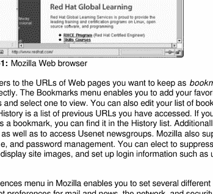

图 14-1：`Mozilla` Web 浏览器

`Mozilla` 将您想要保留的网页 `URL` 作为书签，标记您想要直接访问的页面。书签菜单允许您添加您最喜欢的网页。然后您可以查看您的书签并选择一个进行查看。您还可以编辑您的书签列表，添加新的或移除旧的。历史记录是您之前访问的 `URL` 列表。如果您想返回一个未保存为书签的网页，您可以在历史记录列表中找到它。此外，您可以使用 `Mozilla` 接收和发送邮件，以及访问 Usenet 新闻组。`Mozilla` 还支持高级功能，如 `cookie`、表单、图像和密码管理。您可以选择抑制来自某些站点的 `cookie`，自动填写表单，不显示站点图像，以及为选定站点设置用户名和密码等登录信息。

`Mozilla` 中的“首选项”菜单允许您为浏览器设置几种不同的首选项。您可以为邮件和新闻、网络以及安全设置首选项，也可以设置一般首选项。在一般首选项中，您可以确定您的主页以及您希望工具栏如何显示。在“邮件/新闻账户设置”中，您可以输入您在互联网上使用的邮件和新闻服务器。`Mozilla` 可以设置为访问您订阅的任何数量使用 `NNTP` 传输协议新闻服务器。如果需要，您可以从一个新闻服务器切换到另一个。


如果您所在的网络通过防火墙连接到互联网，您必须使用“代理”屏幕输入您网络防火墙网关计算机的地址。防火墙是作为您网络访问互联网的受控网关运行的计算机。存在几种类型的防火墙。其中限制最严的一种使用称为代理的程序，这些程序接收来自用户的互联网请求，然后代表用户发出这些请求。没有直接的互联网连接。从“选项”菜单中选择“网络”，然后选择“代理”屏幕。在此，输入您网络防火墙网关计算机的 IP 地址。

注意 隐私 Web 代理通过过滤 Web 内容来保护用户隐私，拦截不需要的广告或阻止侵入性 cookie。隐私将执行其操作文件中列出的规则，例如

### K 桌面文件管理器：Konqueror

如果您正在使用 K 桌面，您可以使用文件管理器窗口作为 Web 浏览器。K 桌面的文件管理器被自动配置为充当 Web 浏览器。它可以显示网页，包括图形和链接。K 桌面的文件管理器支持标准的网页操作，例如在已访问的页面之间向前和向后移动。单击链接会访问并显示引用的网页。在这方面，Web 被无缝地集成到 K 桌面中。

#### GNOME Web 浏览器：Nautilus 和 Epiphany

新的 GNOME 文件管理器 Nautilus 也是一个功能性的 Web 浏览器，就像 Konqueror 一样。在 Nautilus 的位置框中，您可以输入一个 Web 地址，Nautilus 将访问并显示该网页。文件管理器的“前进”和“后退”按钮以及书签有助于您浏览之前查看过的页面。然而，它不是一个功能完整的 Web 浏览器。Nautilus 将在其侧边栏中显示已安装在您系统上的专用 Web 浏览器的图标。单击其中一个即可启动该 Web 浏览器，而不是使用 Nautilus。

还有几种基于其他 GNOME 的 Web 浏览器可用。Epiphany、Barque 和 Atlantis 支持标准的 Web 操作。Epiphany 是一个设计迅速且界面简单的 GNOME Web 浏览器。您可以在 `epiphany.mozdev.org` 上了解更多关于 Epiphany 的信息。Epiphany 包含在 Red Hat 中。对于 GNOME，您还可以下载许多支持工具，例如用于显示新闻站点标题的 GNOME 新闻小工具以及用于控制基于 Web 下载的 GNOME 下载管理器。

注意：Epiphany 已在 Fedora Linux 中取代了 Galeon，但你仍可从 [galeon.sourceforge.net](galeon.sourceforge.net) 下载当前版本的 Galeon。

#### Lynx 和 Links：行模式浏览器

Lynx 是一种无需 X 窗口系统即可使用的行模式浏览器。网页仅以文本形式显示。文本页面可以包含指向其他互联网资源的链接，但不显示任何图形、视频或声音。除了显示上的限制外，Lynx 是一个功能完备的网页浏览器。你可以使用 Lynx 下载文件或建立 Telnet 连接。网络上的所有信息对你而言依然是可访问的。由于它不需要像图形浏览器那样消耗大量资源，Lynx 的运行速度要快得多，能够迅速显示网页文本。要启动 Lynx 浏览器，只需在命令行输入 `lynx` 并按下 ENTER 键即可。

大多数发行版附带提供的另一个有用的基于文本的浏览器是 Links。Links 是一个功能强大的基于屏幕的浏览器，具备框架、表单和表格支持等功能。它还支持 SSL 安全加密。

#### 创建你自己的网站

要创建你自己的网站，你需要访问一台 Web 服务器。Red Hat 会在其 Linux 系统上自动安装 Apache Web 服务器。你也可以在远程服务器上租用 Web 页面空间——许多 ISP 提供此服务，有些甚至是免费的。在 Red Hat 系统中，Apache Web 服务器为你的网页设置目录为 `/var/httpd/html`。其他服务器也会为你的主页提供一个目录。将创建的网页放置在该目录中。将你的主页面放在这里。你可以创建其他子目录，其中包含自己的网页，并允许主页面链接到这些子页面。创建网页并不困难。从一个页面到另一个页面的链接将引导用户浏览你的网站。你甚至可以创建指向其他网站网页或资源的链接。有许多优秀的文本资料可供参考，关于网页的创建和管理。

网页使用 HTML（超文本标记语言）或更新的扩展版本 XML（扩展标记语言）创建。它们是标准通用标记语言（SGML）的一个子集。创建 HTML 或 XML 文档只需要在文本文件中插入 HTML 或 XML 标签。在这方面，创建网页与使用基于标签的文字处理器一样简单。使用 HTML 标签来格式化文本以便作为网页显示。XML 标签可以包含有关特定连接的更详细信息，例如对象数据或事务特征。网页本身是一个文本文件，你可以使用任何文本编辑器（如 Vi）来创建它。如果你熟悉 Unix 系统上的基于标签的文本处理，你会发现它在概念上与 nroff 类似。一些 HTML 标签指示标题、列表和段落，以及指向引用 Web 资源的链接。

除了手动输入 HTML 或 XML 代码外，你还可以使用网页编辑器。网页编辑器提供图形界面来构建网页。专门的网页创建程序可以让你轻松创建复杂的网页，而无需显式输入任何 HTML 标签。不过请记住，无论使用什么工具创建网页，网页本身最终仍将是 HTML 文档。

注意 K 桌面和 GNOME 中的许多标准编辑器都包含网页构建功能。许多编辑器允许你插入链接或对相邻文本进行格式化。例如，`KEdit` 程序


## ABC Amber CHM 转换器 试用版

请注册以移除此横幅。

http://www.processestext.com/abchm.html

#### Linux 上的 Java：Blackdown

为了开发 Java 应用程序、使用 Java 工具以及运行许多 Java 产品，你必须在系统上安装 Java 2 软件开发工具包（SDK）和 Java 2 运行环境（JRE）。两者共同构成了 Java 2 平台标准版（J2SE）。Sun 目前支持并分发这些产品的 Linux 版本。你可以从 Sun 的 `java.sun.com/j2se` 下载并在系统上安装它们。你甚至可以选择 RPM 包版本以便在 Red Hat 上轻松安装。当前 J2SE 的版本被称为 Java 版本 1.4。早期版本 1.2 在 Red Hat 7.0 上无法工作，但 1.3 在 7.1 及更高版本上可以工作。

尽管 Sun 支持 Java 的 Linux 版本，但从 `www.blackdown.org` 的 Blackdown 项目可以获得更彻底、更有效的 Java Linux 移植版本。Blackdown 项目移植了 J2SE，包括 SDK 和 JRE 的 1.4 版本。他们还移植了之前的 Java 版本，包括 1.1、1.2 和 1.3。更多的信息和文档也可在该 Blackdown 网站上获取。SDK 和 JRE 1.4 通常以压缩归档文件 `.tar.bz2` 的形式提供。使用 `bunzip2` 命令解压文件，并使用 `tar` 的 `xvf` 命令提取内容。提取操作应在 `/usr/local` 目录中执行。按照 `INSTALL` 文件中的说明安装软件。

目前有许多额外的基于 Java 的产品和工具适用于 Linux。这些工具包括 Java 3D、Java 媒体框架（JMF）和 Java 高级成像（JAI），它们都是 Blackdown 项目的一部分（参见表 14-3）。许多产品直接由 Sun 提供即可运行。其中包括 HotJava Web 浏览器和 Java Web 服务器。你可以直接从 Sun Java 网站 `java.sun.com` 下载其中几个。

表 14-3：Blackdown Java 包和 Java Web 应用程序

| 应用程序 | 描述 |
|---|---|
| Java 2 软件开发工具包 (SDK) 1.4 | 带有编译器、解释器、调试器等功能的 Java 开发环境。Java 2 平台的一部分。从 `www.blackdown.org` 下载 Linux 移植版本 |
| Java 2 运行环境 1.4 (J2RE) | 用于运行 Java applet 的 Java 运行环境。Java 2 平台的一部分。从 `www.blackdown.org` 下载 Linux 移植版本 |
| Java 2 平台 SE (J2SE) for Linux 1.4 | Java 2 平台标准版，包含 Java 2 SDK 和 RE。从 `www.blackdown.org` 下载 Linux 移植版本 |
| Java 3D for Linux | Sun 的用于 3D Java 程序的 3D 应用程序编程接口。从 `www.blackdown.org` 下载 Linux 移植版本 |
| Java 媒体框架 (JMF) for Linux | 允许为 Java 添加音频和视频。从 `www.blackdown.org` 下载 Linux 移植版本 |
| Java 高级成像 (JAI) for Linux | Java 高级成像 API。从 `www.blackdown.org` 下载 Linux 移植版本 |


| Java 1.1 开发工具包 (JDK) 和 Java 1.1 运行环境 (JRE) | 较旧的 Java 1.1 开发环境，带有编译器、解释器、调试器等。通过 `www.blackdown.org` 下载适用于你的发行版更新的 Linux 移植版本 |
| HotJava 浏览器 | Sun 的符合 HTML 3.2 标准和 JDK 1.1 规范的 Web 浏览器。从 `java.sun.com` 下载 Linux 版本 |
| Java Web 服务器 | 用 Java 实现的 Web 服务器。可在 `java.sun.com` 的 Java 网站上获取。 |
| GNU Java 编译器 | 用于编译 Java 程序的 GNU 公共许可证 Java 编译器 (GJC)，参见 `gcc.gnu.org/java`。 |

注意 参见 `java.sun.com/products` 以获取大量 Java 应用程序列表。

## Java 2 软件开发工具包：SDK

Java 软件开发工具包（SDK）提供了创建和调试自有 Java applet 的工具，并为诸如 HotJava 浏览器等 Java 应用程序提供支持。该工具包包含带有源代码的演示 applet。你可以从 Sun 的网站 `java.sun.com` 获取有关 SDK 的详细文档。目前有三个主要版本的 SDK 可用——1.2、1.3、1.4——对应 Java 2 运行环境（J2RE）的 1.2、1.3 和 1.4 版本。Java SDK 增加了安全功能、带有 JFC（也称为 Swing）的 GUI 支持，以及运行 Java 增强功能，如 Java 3D 和 Java 声音。

SDK 包括 JDK 中发现的标准功能，如国际化、签名 applet、JAR 文件格式、AWT（窗口工具包）增强、JavaBeans 组件模型、网络增强、用于大数的数学包、数据库连接（JDBC）、对象序列化以及内部类。Java 应用程序包括 Java 编译器（`javac`）、Java 调试器（`jdb`）和 applet 查看器（`appletviewer`）。此外，SDK 提供 Java 命名和目录接口（JNDI）、集成的 Swing、Java 2D、网络和安全性增强以及 CORBA。使用 SDK，你可以运行 Blackdown 移植版本的 Java 3D、Java 高级成像、Java 媒体框架和 Java 声音。这些功能的详细描述可以在 SDK 文档中找到。

你创建 Java applet 的方式与使用标准编程语言创建程序的方式非常相似。首先使用文本编辑器创建源代码，并将其保存为扩展名为 `.java` 的文件。然后可以使用 `javac` 编译器编译源代码文件，生成 Java applet。有许多集成开发环境（IDE）应用程序可用于编写 Java applet 和应用程序。虽然大多数是商业软件，但有些提供免费共享软件版本。IDE 提供用于构建 Java applet 的图形用户界面。你可以通过 Blackdown 网页链接并下载几个 IDE 应用程序。

## FTP 客户端

互联网是一个由遍布全球的计算机构成的网络，你可以通过互联网地址和一套互联网工具来访问它。互联网上的许多计算机被配置为服务器，向任何请求者提供信息。这些信息包含在你可以访问和复制的文件中。每个服务器通常被称为站点，都有其自身的互联网地址，可通过该地址进行定位。Linux 提供了一套互联网工具，你可以使用这些工具访问互联网上的站点，然后从中查找并下载信息。这些工具被称为客户端。诸如 FTP 或 Web 客户端之类的客户端应用程序，可以与运行在远程系统上对应的服务器应用程序进行通信。FTP 客户端可以与另一台系统上的 FTP 服务器程序进行通信。服务器允许客户端访问其系统上某些指定的资源，并允许 FTP 客户端传输某些文件。表 14-4 中展示了一些流行的 FTP 客户端。

访问互联网站点的主要工具是 FTP 客户端和 Web 浏览器。使用 FTP 客户端，你可以连接到对应的 FTP 站点并从中下载文件。FTP 客户端通常用于从作为软件仓库运行的 FTP 站点下载软件。大多数 Linux 软件应用程序都可以从这些站点下载到你的 Linux 系统中。像 `ftp.redhat.com` 这样的发行版站点就是此类 FTP 站点的例子，它托管了大量打包好的 Linux 应用程序，你可以使用 FTP 客户端下载它们，然后轻松地安装到你的系统上。在过去几年中，Web 浏览器已成为访问互联网信息的主要工具。你在互联网上执行的大多数任务都可以轻松地通过 Web 浏览器完成。你只需要使用 FTP 客户端来从特定 FTP 站点下载文件或向其上传文件。

还有其他互联网工具可供你使用，例如 `telnet` 和 IRC 客户端。`telnet` 协议使你能够直接登录到另一台系统上的账户。IRC 客户端建立聊天室，通过它你可以与其他互联网用户进行通信。`telnet` 和 IRC 客户端将在第 15 章中讨论。

## 网络文件传输：FTP

你可以使用文件传输协议 (FTP) 客户端在一站点和另一站点之间直接传输超大文件。FTP 可以处理文本文件和二进制文件。这是 TCP/IP 协议之一，它运行在使用 TCP/IP 协议（如互联网）的网络上连接的系统上。FTP 对连接到网络的另一台系统上的另一个账户执行远程登录。一旦登录到那台其他系统，你就可以在其中传输文件。为了登录，你需要知道远程系统上账户的登录名和密码。例如，如果你在两个不同的互联网站点都有账户，你可以使用 FTP 在它们之间传输文件。然而，互联网上的许多站点允许使用 FTP 进行公共访问。这些站点充当大型文件的存储库，任何人都可以访问和下载。这些站点通常被称为 FTP 站点，在许多情况下，它们的互联网地址以单词 "ftp" 开头，例如 `ftp.gnome.org` 或 `ftp.redhat.com`。其他站点则以其他名称开头，例如 `metalab.unc.edu`。这些公共站点允许任何用户进行匿名 FTP 登录。对于登录名，你使用单词 "anonymous"，而对于密码，你使用你的互联网地址。然后你可以从该站点将文件传输到你自己的系统。

表 14-4: Linux FTP 客户端

| FTP 客户端 | 描述 |
|---|---|
| Konqueror | K 桌面文件管理器 |
| Nautilus | GNOME 文件管理器 |
| gFTP | GNOME FTP 客户端 |
| NcFTP | 基于屏幕的 FTP 客户端 |
| `ftp` | 命令行 FTP 客户端 |

你可以使用多种 FTP 客户端程序中的任意一种来执行 FTP 操作。对于 Linux 系统，你可以从几种 FTP 客户端中进行选择。许多现在使用如 GNOME 等图形用户界面 (GUI) 运行。一些，如 Mozilla，功能有限，而其他一些，如 NcFTP，包含大量增强功能。原始的 FTP 客户端同样有效，尽管使用起来不如其他客户端容易。它使用简单的命令行界面运行，不需要其他客户端所需的 GUI 或光标支持。

互联网上有许多站点对公众开放访问。它们包含任何人均可使用文件传输程序（如 NcFTP）获取的文件。然而，除非你已经知道文件的位置，否则查找文件可能很困难。要在 FTP 站点上搜索文件，你可以使用由网站提供的搜索引擎，例如 Yahoo!、Excite、AltaVista、Google 或 Lycos。对于 Linux 软件，你可以查看 `freshmeat.net`、`sourceforge.net`、`rpmfind.net`、`apps.kde.com` 和 `www.gnome.org` 等站点。这些站点通常同时搜索 Web 页面和 FTP 文件。

注意 Linux 工具如 Ganesha 和 Karchie 将搜索 FTP 站点以获取所需的软件。

## 基于 Web 浏览器的 FTP：Mozilla

你可以使用任何 Web 浏览器访问 FTP 站点并从中下载文件。Web 浏览器对于查看 FTP 站点列出的文件非常有效。当你使用 Web 浏览器访问 FTP 站点时，目录中所有文件的列表都作为一个 Web 页面列出。你可以通过点击条目进入子目录。使用 Mozilla，你可以轻松地浏览 FTP 站点以下载文件。使用 Mozilla 下载文件时，按住 SHIFT 键，然后双击该文件。这将启动传输操作。这将打开一个用于选择本地目录和文件名的框。默认名称与远程系统上的相同。你可以使用下载管理器管理你的下载，它允许你取消正在进行的下载操作或删除其他已请求的下载。管理器将显示当前下载的剩余时间、速度和已传输的量。浏览器对于定位单个文件很有用，但对于下载大量文件（系统更新通常需要这样）则不适用。

## K 桌面文件管理器：Konqueror


在 K 桌面上，桌面文件管理器（`Konqueror`）具有内置的 FTP 功能。FTP 操作已无缝集成到标准桌面文件操作中。从 FTP 站点下载文件与从一个目录窗口拖放到另一个目录窗口以复制文件一样简单，只是其中一个目录位于远程 FTP 站点上。在 K 桌面上，你可以使用文件管理器窗口访问远程 FTP 站点。远程目录中的文件像本地文件一样列出。要从 FTP 站点下载文件，你打开一个窗口以访问该站点，在窗口的地址栏中输入 FTP 站点的 URL。打开你想要的目录，然后为想要将远程文件复制到其中的本地目录打开另一个窗口。在显示 FTP 文件的窗口中，选择你想要下载的文件。然后只需点击并拖动这些文件到本地目录的窗口中。会出现一个弹出菜单，提供复制、链接或移动的选项。选择复制。然后选定的文件将被下载。另一个窗口随后打开，显示下载进度并依次显示每个文件的名称，以及一个指示迄今下载百分比的条。

## GNOME 桌面 FTP：Nautilus

下载文件的最简单方法是使用 GNOME 文件管理器 `Midnight Commander` 的内置 FTP 功能。你还可以使用几个基于 GNOME 的 FTP 客户端，它们提供更多的功能，包括 `gFTP`。关于更多信息，请查看 `www.gnome.org` 上的 GNOME 网站。`gFTP` 包含在当前 GNOME 发行版中。在 GNOME 上，桌面文件管理器 - `Nautilus` - 具有与 KDE 文件管理器类似的内置 FTP 功能。FTP 操作已无缝集成到标准桌面文件操作中。从 FTP 站点下载文件与从一个目录窗口拖放到另一个目录窗口一样简单，其中其中一个目录位于远程 FTP 站点上。使用 GNOME 文件管理器访问远程 FTP 站点，列出远程目录中的文件，就像本地文件一样。只需输入前缀为 `ftp://` 的 FTP URL，然后按 `ENTER` 键。将显示远程 FTP 站点的顶层目录。只需使用文件管理器遍历远程 FTP 站点的目录树，直到找到你想要的文件。然后为想要将远程文件复制到其中的本地目录打开另一个窗口。在显示 FTP 文件的窗口中，选择你想要下载的文件。然后使用 `CTRL-点击` 并拖动这些文件到本地目录的窗口中。`CTRL-点击` 执行复制操作，而不是移动。随着文件被下载，会出现一个显示进度的对话框。

## gFTP

`gFTP` 程序是一个更简单的 GNOME FTP 客户端，旨在让您能够执行标准的 FTP 文件传输。它拥有一个与 Windows 上使用的 `WS_FTP` 相似的界面。`gFTP` 窗口由多个窗格组成。左上角窗格列出本地目录中的文件，右上角窗格列出远程目录中的文件。子目录的名称前带有文件夹图标。可以通过每个列表顶部的带向上箭头的双点条目（`..`）引用父目录。双击目录条目即可访问该目录。所有目录的路径名显示在每个窗格上方的方框中。如果需要，您可以输入新目录的路径名以切换到该目录。

窗格之间的两个按钮用于文件传输。左箭头按钮，`< -`，用于下载远程目录中选定的文件，而右箭头按钮，`->`，用于上传本地目录中的文件。要下载文件，请在右侧窗格中点击该文件，然后点击左箭头按钮，`< -`。当文件下载完成后，其名称将出现在左侧窗格，即您的本地目录中。窗口顶部的菜单可用于管理您的传输。连接管理器允许您输入特定站点的登录信息。您可以指定执行匿名登录还是提供用户名和密码。点击“连接”按钮即可连接到该站点。站点下拉菜单允许您选择想要访问的站点。

## NcFTP

`NcFTP` 程序拥有一个基于屏幕的界面，可以从任何 shell 命令行中运行。它不使用桌面界面。FTP 操作通过您在提示符处输入的命令执行。可以使用基于光标的菜单来选择选项和书签。要启动 `NcFTP`，您需要在命令行中输入 `ncftp` 命令。如果您正在使用窗口管理器（如 `KDE`、`GNOME` 或 `FVWM`），请打开一个 shell 终端窗口并在其提示符处输入该命令。`NcFTP` 的主屏幕由屏幕底部的一行输入行及其上方的一行状态行组成。屏幕的其余部分用于显示命令和来自远程系统的响应。例如，当您下载文件时，状态行中会显示指定要下载文件的消息。`NcFTP` 允许您为不同功能设置偏好，例如匿名登录、进度指示器或下载目录。输入 `pref` 命令以打开偏好设置屏幕。在那里，您可以选择和修改列出的偏好设置。

要连接到 FTP 站点，请在输入行中输入 `open` 命令，后跟该站点的地址。该地址可以是 IP 地址或域名，例如 `ftp.gnome.org`。如果您不提供地址，将显示您书签中的站点列表，您可以从中选择一个。默认情况下，`NcFTP` 尝试进行匿名登录，使用术语 `"anonymous"` 作为用户名，并使用您的电子邮件地址作为密码。成功连接后，状态栏在左侧显示远程站点名称，在右侧显示远程目录名称。

```
open ftp.gnome.org
```

如果您希望登录到远程站点上的特定账户，请使用 `open` 命令的 `-u` 选项让系统提示输入用户名和密码。`open` 命令会记住您对特定站点最后执行的登录类型，并重复该操作。如果您希望从用户登录切换回匿名登录，请使用 `open` 命令的 `-a` 选项。对于繁忙的站点，您可能无法在第一次尝试时连接成功，必须重复 `open` 过程。`NcFTP` 具有重拨功能，您可以通过 `-r` 选项开启该功能。`-d` 选项设置下次尝试前的延迟，而 `-g` 选项设置最大连接尝试次数。使用 `lookup` 命令，您可以获取 FTP 站点的 IP 和域名地址。`lookup` 命令接受 IP 或域名地址作为参数，然后显示两者。这在查找站点 IP 地址时很有用。使用 `-v` 选项，可以检索更多信息，例如别名。`NcFTP` 的 `open` 选项如表 14-5 所示。

### 表 14-5: NcFTP Open 选项

| 选项 | 描述 |
|---|---|
| `-a` | 匿名连接 |
| `-u` | 使用用户名和密码提示进行连接 |
| `-p num` | 连接时使用指定的端口号 |
| `-r` | 重新拨号直到连接成功 |
| `-d num` | 为重拨选项设置延迟（num）秒数 |
| `-g num` | 指定最大重拨次数 |

连接成功后，您在输入行中输入命令以执行 FTP 操作，例如显示文件列表、更改目录或下载文件。使用 `ls` 命令，您可以列出当前远程目录的内容。使用 `cd` 命令切换到另一个远程目录。`dir` 命令显示文件的详细列表。使用 `page` 命令，您可以一次显示一页查看远程文件的内容。要下载文件，请使用 `get` 命令；要上传文件，请使用 `put` 命令。在下载期间，状态栏上方的进度指示器显示文件的下载进度。`get` 命令具有几项功能，将在下节中更详细地描述。完成后，您可以使用 `close` 命令断开与该站点的连接。然后，您可以使用 `open` 连接另一个站点，或者使用 `quit` 命令退出 `NcFTP` 程序。`help` 命令列出所有 `NcFTP` 命令。您可以使用 `help` 命令后跟命令名称来显示有关该命令的具体信息。

`NcFTP` 程序支持几个在本地系统上操作的命令。这些通常是标准 FTP 命令名称，前面加上 `l`。`lcd` 更改您的本地工作目录，`lls` 列出本地目录的内容，`lpage` 一次显示一页展示本地文件的内容，而 `lpwd` 显示本地目录的完整路径名。对于您需要执行的其他任何本地命令或脚本，请使用 shell 转义命令，`!`。只需在 shell 命令或脚本前加一个 `!`。`NcFTP` 程序还提供用于管理远程站点文件和目录的命令，前提是您拥有相应的权限。您可以使用 `mkdir` 创建远程目录，使用 `rmdir` 删除目录。使用 `rm` 命令擦除远程文件。使用 `rename` 命令，您可以更改它们的名称。`NcFTP` 命令列在表 14-6 中。

### 表 14-6: NcFTP 命令

| 命令 | 描述 |
|---|---|
| `help [command]` | 列出 NcFTP 命令的名称 |
| `cd [directory]` | 更改远程主机上的工作目录 |
| `create [filename]` | 在远程主机上创建一个空文件，使您可以使用该文件名作为消息 |
| `debug` | 开启或关闭调试 |
| `version` | 显示版本信息 |
| `dir` | 显示详细的目录列表 |
| `echo` | 显示一个字符串，适用于宏 |
| `get` | 从远程主机下载文件到您的工作目录 |
| `lcd [directory]` | 更改本地工作目录 |
| `lls` | 列出本地工作目录中的文件 |
| `lookup host` | 查找远程主机的条目 |
| `lpage filename` | 一次显示一页展示本地文件的内容 |
| `lpwd` | 显示本地当前工作目录 |
| `mkdir directory name` | 在远程主机上创建目录 |
| `mode mode` | 指定传输模式（b 为块模式，s 为流模式） |


| `open [option] hostname` | 连接到远程主机。如果未指定主机名，书签编辑器将显示一个主机列表，您可以从中选择一个：`-a` 强制匿名登录 `-u` 强制用户登录 `-r` 自动重新拨号 `-d` 指定重新拨号前的时间延迟；与 `-r` 一起使用 `-g` 指定最大重新拨号次数；与 `-r` 一起使用 |

| `page filename` | 显示远程文件的内容 |

| `pdir` | 与 `dir` 相同，但输出到您的分页器，使您可以一次显示一页远程文件列表。用于命令行界面 |

| `pls` | 与 `ls` 相同，但输出到您的分页器。用于命令行界面 |

| `redir` | 重新显示上一个目录列表 |

| `predir` | 重新显示上一个目录列表，如果在命令行界面中工作，则输出到分页器 |

| `put filename` | 将文件上传到远程主机 |

| `pwd` | 显示远程当前工作目录 |

| `rename orig-name new-name` | 更改远程文件的名称 |

| `quit` | 退出 `NcFTP` |

| `quote` | 向远程服务器发送 FTP 协议命令 |

| `rhelp [command]` | 向远程主机发送帮助请求 |

| `rm filenames` | 擦除远程文件 |

| `rmdir directories` | 删除远程目录 |

| `site command` | 执行站点特定命令 |

| `type type` | 更改传输类型（ASCII、二进制、图像） |

| `! command` | 转义到 shell 并执行以下 shell 命令或脚本 |

`NcFTP` 程序还有一种冒号操作模式，允许您发出单个 `ncftp` 命令来下载文件。输入 `ncftp` 命令，后跟您想要下载文件的 URL。您可以在 shell 命令行中输入该命令，或将其放在脚本中。例如，以下命令下载 Red Hat FTP 站点上的 readme 文件：

```
$ ncftp ftp.redhat.com/pub/README
```

在冒号模式下，`-c` 选项将文件发送到标准输出，而 `-m` 选项将其管道传输到您的

```
pager:
$ ncftp -c ftp.redhat.com/pub/README > ~/redhatinfo/readme
$ ncftp -m ftp.redhat.com/pub/README
```

### NcFTP 下载功能

`NcFTP` 的 `get` 命令与原始 FTP 客户端的 `get` 命令有显著不同。原始 FTP 客户端使用两个命令 `get` 和 `mget` 来执行下载操作，而 `NcFTP` 仅使用 `get` 命令。然而，`NcFTP` 的 `get` 命令将 `mget` 和 `get` 两者的功能合并到 `get` 命令中，并增加了若干新功能。表 14-7 列出了各种 `get` 命令选项。默认情况下，`NcFTP` 的 `get` 命令对文件名执行通配符匹配。如果只输入部分文件名，`get` 命令会尝试下载以该名称开头的所有文件。您可以使用 `-G` 选项关闭通配符匹配，在这种情况下必须输入要下载文件的完整名称。以下示例下载所有以 "Xfree86" 开头的文件，与在原始 FTP 中使用 `mget Xfree86*` 类似：

表 14-7：NcFTP get 选项

| 命令 | 描述 |
|---|---|
| `-G` | 打开或关闭文件名通配符匹配 |
| `-R directory` | 下载目录及其所有子目录（递归） |
| `-f filenames` | 强制下载所有指定文件，即使它们比本地文件旧或相同 |
| `-c` | 强制从中断处恢复下载 |
| `-z remote-file local-file` | 在本地系统上重命名远程文件 |
| `-n num` | 下载不超过指定天数的文件 |

```
get Xfree86
```

`get` 命令会检查您是否已拥有正在尝试下载的文件。如果有，则跳过下载。`get` 命令还会检查您已有的文件是否为更新版本，如果是，也会跳过下载。这是一个有用的功能，可轻松维护升级文件。您只需访问远程站点的更新目录，然后使用 `get` 命令配合 `*` 下载到您用于保存升级文件的目录中。只会下载更新版本或新添加的升级文件，而不是整个集合。如果您想下载一个文件，即使您已拥有它，也可以使用 `-f` 选项强制下载。例如，要手动下载 Red Hat 的升级，您可以连接到 Red Hat FTP 站点中的 Red Hat 升级目录，然后发出以下 `get` 命令：

```
get *
```

#### 提示

如果下载过程中被中断，您可以从中断处重新开始下载。此功能内置于 `NcFTP` 中。（在其他 FTP 程序中，它可以通过

某些功能要求您在 `get` 命令之后在命令行上输入一个选项。例如，添加 `-R` 命令指定递归功能，使您能够下载并创建子目录及其文件。此命令在下载包含多个子目录的升级目录时特别有用，例如 Red Hat 的。以下示例下载 `i386` 目录及其所有子目录：

```
get -R i386
```

如果您想在本地系统上为文件指定不同的名称，请使用 `-z` 选项。在远程文件名之后输入您想要的本地文件名。以下示例下载 `readme` 文件并将其重命名为 `calinfo`。如果您未使用 `-z` 选项，两个名称都将被视为要下载的文件，而不是仅第一个。

```
get -z readme calinfo
```

要仅获取最近的文件，您可以使用 `-n` 选项，其参数为天数。早于指定天数的文件不会被检索。以下示例下载最近 30 天内发布的文件：

```
get -n 30 *
```

### 书签和宏

当您断开（关闭）与站点的连接时，`NcFTP` 会自动保存有关它的信息。这包括站点地址、您所在的目录以及登录信息。这些信息被放置在您 `.ncftp` 目录中的一个名为 `bookmarks` 的文件中。站点信息会分配一个书签名称，您可以使用该名称轻松再次访问站点。书签名称通常是站点地址中的关键字名称。您可以使用此名称连接到站点。例如，`ftp.redhat.com` 可能被命名为 `redhat`。然后您可以使用以下命令连接到它：

```
open redhat
```

您可以使用书签编辑器编辑书签条目。输入 `bookmarks` 命令以调出编辑器。您已访问的远程系统列在屏幕右侧。书签命令列在左侧。您可以更改书签名称或编辑登录信息，例如用户名或密码、远程目录或传输模式。

`NcFTP` 程序支持用于简单操作的宏。您通过在 `.ncftp` 目录中位于 `macros` 文件中输入宏定义来创建宏。最初此类文件不存在，因此您必须使用任何文本编辑器创建一个。`macros` 文件是一个简单的文本文件，您可以使用任何文本编辑器进行编辑。宏定义的语法如下：

```
macro macro-name
ftp-commands
end
```

宏执行 `NcFTP` 命令。但是请记住，`!` 是一个 `NcFTP` 命令，可让您执行任何 Linux 命令或脚本。通过在前面加上 `!`，您可以定义一个执行任何 shell 命令或您编写的任何脚本的 `NcFTP` 宏。宏的一个简单示例如下：

```
macro ascii
type ascii
end
```

宏支持与 shell 程序类似的参数。在宏名称后输入的参数可以在宏中使用 `$` 符号和参数列表中的参数编号来引用。`$1` 引用第一个参数，`$2` 引用第二个，依此类推。`$*` 是一个特殊参数，引用所有参数，而 `$@` 引用所有参数，并将每个参数用双引号括起来。

```
macro cdls
cd $1
ls
end
```

`NcFTP` 程序还支持有限数量的事件宏。这些是在检测到特定事件时执行的宏，例如程序启动或关闭时。例如，名称为 `.start.ncftp` 的宏定义的命令会在每次启动 `NcFTP` 时执行；`.quit.ncftp` 在退出时执行其命令。站点特定宏在需要访问或断开与特定站点的连接时也会执行。这些宏以 `open` 或 `close` 事件开头，后跟站点的书签。例如，名称为 `.open.redhat` 的宏定义的命令会在每次连接到 Red Hat 站点时执行。名称为 `.open.any` 的宏会在每次连接到任何站点时执行其命令，而名称为 `.close.any` 的宏会在每次断开与站点的连接时执行。

### ftp

名称 `ftp` 指定了在 Unix 和 Linux 系统上使用的原始 FTP 客户端。`ftp` 使用命令行界面，并具有一套广泛的命令和选项，可用于管理您的 FTP 传输。您通过在 shell 提示符下输入命令 `ftp` 来启动 `ftp` 客户端。如果您有要连接的特定站点，可以在 `ftp` 关键字后在命令行上包含该站点的名称。否则，您需要使用 `ftp` 命令 `open` 连接到远程系统。然后系统会提示您输入远程系统名称，提示符为 `'(to)'`。在输入远程系统名称后，`ftp` 会将您连接到系统，然后提示您输入登录名。登录名提示由单词 "Name" 和（在括号中）系统名称和您的本地登录名组成。有时远程系统的登录名与您自己的系统的登录名相同。如果名称相同，请在提示时按 ENTER。如果不同，请输入远程系统的登录名。输入登录名后，系统会提示您输入密码。在下一个示例中，用户连接到远程系统 `garnet` 并登录到 `robert` 账户：


```
$ ftp
ftp> open
(to) garnet
Connected to garnet.berkeley.edu.
220 garnet.berkeley.edu FTP server ready.
Name (garnet.berkeley.edu:root): robert
password required
Password:
user robert logged in
ftp>
```

登录后，您可以在远程系统或本地系统上执行 Linux 命令。您在 `ftp` 中通过在命令前加上感叹号来在本地系统上执行命令。没有感叹号的任何 Linux 命令都在远程系统上执行。对此规则有一个例外。虽然您可以使用 `cd` 命令在远程系统上更改目录，但要更改本地系统的目录，您需要使用特殊的 `ftp` 命令 `lcd`（local cd）。在下一个示例中，第一个命令列出远程系统中的文件，而第二个命令列出本地系统中的文件：

```
ftp> ls
ftp> !ls
```

`ftp` 程序提供了一组用于管理远程站点上的文件和目录的基本命令，前提是您有权限这样做（参见表 14-8）。您可以使用 `mkdir` 创建远程目录，并使用 `rmdir` 删除目录。使用 `delete` 命令删除远程文件。使用 `rename` 命令可以更改文件名称。您使用 `close` 命令关闭与系统的连接。如果需要，您可以打开另一个连接。要结束 `ftp` 会话，请使用 `quit` 或 `bye` 命令。

### 表 14-8：ftp 客户端命令

| 命令 | 效果 |
|---|---|
| `ftp` | Invokes the ftp program |
| `open site-address` | Opens a connection to another system |
| `close` | Closes connection to a system |
| `quit` or `bye` | Ends ftp session |
| `ls` | Lists the contents of a directory |
| `dir` | Lists the contents of a directory in long form |
| `get filename` | Sends file from remote system to local system |
| `put filename` | Sends file from local system to remote system |
| `mget regular-expression` | Enables you to download several files at once from a remote system. You can use special characters to specify the files; you are prompted to transfer each file in turn |
| `mput regular-expression` | Enables you to send several files at once to a remote system. You can use special characters to specify the files; you are prompted for each file to be transferred |
| `unique` | Toggles storing of files with unique filenames. If a file already exists with the same filename on the local system, a new filename is generated |
| `reget filename` | Resumes transfer of an interrupted file from where you left off |
| `binary` | Transfers files in binary mode |
| `ascii` | Transfers files in ASCII mode |
| `cd directory` | Changes directories on the remote system |
| `lcd directory` | Changes directories on the local system |
| `help` or `?` | Lists ftp commands |
| `mkdir directory` | Creates a directory on the remote system |
| `rmdir` | Deletes a remote directory |
| `delete filename` | Deletes a file on the remote system |
| `mdelete file-list` | Deletes several remote files at once |
| `rename` | Renames a file on a remote system |
| `hash` | Displays progressive hash signs during download |
| `status` | Displays current status of ftp |

```
ftp> close
ftp> bye
Good-bye
$
```

要向远程系统传输文件或从远程系统传输文件，请使用 `get` 和 `put` 命令。`get` 命令从远程系统接收文件到本地系统，而 `put` 命令将文件从本地系统发送到远程系统。可以说，本地系统从远程获取文件并向远程放置文件。在下一个示例中，文件 `weather` 使用 `put` 命令从本地系统发送到远程系统：

```
ftp> put weather
PORT command successful.
ASCII data connection
ASCII Transfer complete.
ftp>
```

如果下载中断，可以使用 `reget` 恢复下载。这对于极大的文件很有帮助。下载将从中断处恢复，因此无需重新下载整个文件。此外，请确保以二进制模式下载二进制文件。对于大多数 FTP 站点，二进制模式是默认的，但某些站点可能将 ASCII（文本）作为默认值。命令 `ascii` 设置字符模式，命令 `binary` 设置二进制模式。Internet 站点上可用的大多数软件包都是归档和压缩文件，它们是二进制文件。在下一个示例中，传输模式设置为二进制，归档的软件包 `mydata.tar.gz` 使用 `get` 命令从远程系统发送到本地系统：

```
ftp> binary
ftp> get mydata.tar.gz
PORT command successful.
Binary data connection
Binary Transfer complete.
ftp>
```

你可能经常想要发送多个文件，并使用通配符指定其名称。然而，`put` 和 `get` 命令仅对单个文件操作，不能使用特殊字符。要一次传输多个文件，你必须使用另外两个命令 `mput` 和 `mget`。使用 `mput` 或 `mget` 时，会提示你输入文件列表。然后你可以输入文件列表，或使用特殊字符的文件列表规范。例如，`*.c` 指定所有具有 `.c` 扩展名的文件，而 `*` 指定当前目录中的所有文件。对于 `mget`，文件一次一个地从远程系统发送到本地系统。每次都会提示你要发送的文件名。你可以输入 `y` 发送文件或输入 `n` 取消传输。然后会提示下一个文件。`mput` 命令以相同的方式工作，但它将文件从本地系统发送到远程系统。在下一个示例中，所有具有 `.c` 扩展名的文件使用 `mget` 发送到本地系统：

```
ftp> mget
(remote-files) *.c
mget calc.c? y
PORT command successful
ASCII data connection
ASCII transfer complete
mget main.c? y
PORT command successful
ASCII data connection
ASCII transfer complete
ftp>
```

如果你计划下载大量文件，例如系统更新，对每个文件回答提示可能很繁琐。在这种情况下，你可以使用 `prompt` 命令关闭提示，该命令切换交互模式的打开和关闭。然后 `mget` 操作会一个接一个地下载所有匹配的文件。


```
ftp> prompt
Interactive mode off.
ftp> mget
(remote-files) *.c
PORT command successful
ASCII data connection
ASCII transfer complete
PORT command successful
ASCII data connection
ASCII transfer complete
ftp>
```

注意 要访问公共 FTP 站点，必须执行匿名登录。不是输入登录名，而是输入关键字 `anonymous`（或 `ftp`）。然后，对于密码，输入你的

## 自动登录和宏：`.netrc`

`ftp` 客户端具有自动登录功能并支持宏。两者都输入到用户 `ftp` 配置文件 `.netrc` 中。每次连接到站点时，都会检查 `.netrc` 文件以获取连接信息，例如登录名和密码。这样，你每次连接到站点时无需输入登录名和密码。此功能对于匿名登录特别有用。不是让你输入用户名 `anonymous` 和你的电子邮件地址作为密码，它们可以从 `.netrc` 文件自动读取。你甚至可以将匿名登录信息设为默认，这样，除非另有指定，否则尝试连接到任何 FTP 站点时都会尝试匿名登录。如果你有必须登录的站点，可以在 `.netrc` 文件中指定它们，并在连接时使用该站点的用户名和密码自动登录或提示输入。

`.netrc` 文件中的条目具有以下语法。站点的条目以术语 `machine` 开头，后跟网络或 Internet 地址，然后是登录和密码信息。

```
machine system-address login remote-login-name password password
```

以下示例显示了登录到 `turtle.trek.com` 系统上的 `dylan` 账户的条目：

```
machine golf.mygames.com login dylan password legogolf
```

对于你将匿名登录的站点，你输入 `anonymous` 作为登录名，你的电子邮件地址作为密码。

```
machine ftp.redhat.com login anonymous password dylan@turtle.trek.com
```

在大多数情况下，你使用 `ftp` 访问匿名 FTP 站点。与为每个站点制作条目相比，你可以为匿名 FTP 登录制作默认条目。连接站点时，`ftp` 会在 `.netrc` 文件中查找该站点的 `machine` 条目。如果不存在，`ftp` 会查找默认条目并使用它。默认条目以单词 `default` 开头，没有网络地址。要使匿名登录成为默认，请输入 `anonymous` 和你的电子邮件地址作为登录名和密码。

```
default login anonymous password dylan@turtle.trek.com
```

这里展示了一个包含机器定义和默认条目的示例 `.netrc` 文件。

`.netrc`

```
machine golf.mygames.com login dylan password legogolf
default login anonymous password dylan@turtle.trek.com
```

你也可以在 `.netrc` 文件中定义宏。有了宏，你只需使用宏名即可一次执行多个 `ftp` 操作。宏在连接期间保持有效。关闭连接时，宏将被取消定义。虽然宏可以在 `ftp` 命令行上定义，但在 `.netrc` 条目中定义它们更有意义。这样，你就无需再次重新定义它们。它们会自动从 `.netrc` 文件读取并为你定义。你可以在 `.netrc` 文件中的特定 `machine` 条目或默认条目中放置宏定义。`machine` 条目中定义的宏仅在你连接到该站点时定义。默认条目中的宏在你连接到任何站点时都会定义。

宏定义的语法如下。它以关键字 `macdef` 开头，后跟你想要赋予它的宏名，并以空行结束。`ftp` 宏可以接受参数，在宏中用 `$n` 引用，其中 `$1` 引用第一个参数，`$2` 引用第二个参数，以此类推。如果需要在宏中使用 `$` 字符，必须使用反斜杠对其进行转义，`\$`。

```
macdef macro-name
ftp commands
empty-line
```

接下来的 `redupd` 宏会切换到某个目录，在那里下载当前发布的 Red Hat 更新。它还会切换到一个本地目录，更新文件将被放置在该目录中。`prompt` 命令会关闭每个文件的下载提示。然后 `mget` 命令下载这些文件。`redupd` 宏假设你已连接到 Red Hat FTP 站点。

```
defmac redupd
cd pub/redhat/current
lcd /root/redupdate
prompt
mget *
```

下面是一个示例 `.netrc` 文件，其中为特定条目和默认条目定义了宏。每个宏定义后放置一个空行。你可以为某台机器或默认条目定义多个宏。位于某个机器条目之后、下一个机器条目之前的宏定义会自动应用于该机器连接。

```
machine updates.redhat.com login anonymous password dylan@turtle.trek.com
# 定义一个用于从 Red Hat 站点下载更新的宏
defmac redupd
cd pub/redhat/current
lcd /root/redupdate
prompt
mget *

default login anonymous password dylan@turtle.trek.com
defmac lls
!ls
```

### `lftp`

`lftp` 程序是一个增强型 FTP 客户端，具有高级功能，例如能够下载镜像站点，并同时在后台运行多个 FTP 操作。它使用与 `ftp` 客户端类似的命令集。你使用 `get` 和 `mget` 命令下载文件，并使用 `-o` 选项为它们指定本地位置。使用 `lcd` 和 `cd` 更改本地和远程目录。

要管理后台命令，你使用许多与 shell 相同的命令（见第 8 章）。在命令末尾放置 `&` 可将其放入后台。使用 `CTRL-Z` 可以将已在运行的作业放入后台。命令可以用括号分组，并一起放入后台。使用 `jobs` 命令列出你的后台作业，并使用 `wait` 或 `fg` 命令将作业从后台移动到前台。当你退出 `lftp` 时，程序将继续运行任何后台作业。实际上，`lftp` 本身变成了一个后台作业。

当你连接到某个站点时，你可以使用 `queue` 命令排队命令，设置一个要执行的 FTP 操作列表。借助此功能，你可以将多个下载操作排队到某个站点。根据需要，可以重新排序队列并删除条目。你还可以连接到多个站点，并为每个站点设置一个队列。`mirror` 命令让你可以维护镜像站点的本地版本。你可以下载整个站点，或者只更新较新的文件，同时删除不再存在于镜像上的文件。

你可以通过在 `.lftprc` 文件中设置的选项来定制 `lftp`。系统范围设置放在 `/etc/lftp.conf` 文件中。在这里，你可以设置诸如要使用的提示符和你的匿名密码等特性。`.lftp` 目录存储用于命令历史、日志、书签和启动命令的支持文件。`lftp` 还支持 `.netrc` 文件，并检查其中的登录信息。

# 第 15 章：网络工具

## 概述

你可以使用多种网络工具来执行各种任务，例如获取有关网络上其他系统的信息、访问其他系统以及与其他用户直接通信。可以使用 `ping`、`finger`、`traceroute` 和 `host` 等实用程序获取网络信息。`Talk`、`ICQ` 和 `IRC` 客户端使你能够与网络上的其他用户直接通信。`Telnet` 执行到你可能在网络上另一台连接系统上的账户的远程登录。某些工具有对应的 K Desktop 或 GNOME 版本。此外，你的网络可能使用网络远程访问命令。这些对于较小的网络非常有用，使你能够直接访问远程系统以复制文件或执行命令。


## 网络信息：`ping`、`finger`、`traceroute` 和 `host`

你可以使用 `ping`、`finger`、`traceroute` 和 `host` 命令来查找有关网络系统和用户的状态信息。`ping` 用于检查远程系统是否正在运行。你使用 `finger` 来查找有关网络其他用户的信息，查看他们是否已登录或是否收到了邮件。`host` 显示有关网络系统的地址信息，提供系统的 IP 和域名地址。`traceroute` 可用于追踪你的消息到达你之前经过的计算机网络和系统的序列。表 15-1 列出了各种网络信息工具。

虽然 Red Hat 不包含在 GNOME 桌面中，但 GNOME 工作站命令中心（Command Center）实用程序提供了一个 GNOME 界面，用于输入 `ping`、`traceroute` 和 `host` 命令以及其他功能。在 K Desktop 上，你可以使用 KDE 网络实用程序（`knu`）发出 `ping`、`finger`、`traceroute` 和 `host` 命令。

### `ping`


`ping` 命令检测系统是否正在运行。`ping` 接受你要检查的系统名称作为参数。如果你想检查的系统已关闭，`ping` 将发出超时消息，表示无法建立连接。下一个示例检查 `www.redhat.com` 是否在线并连接到网络：

```
$ ping www.redhat.com
PING www.portal.redhat.com (206.132.41.231): 56 data bytes
64 bytes from 206.132.41.231: icmp_seq=0 ttl=248 time=24.0 ms
64 bytes from 206.132.41.231: icmp_seq=1 ttl=248 time=124.5 ms
64 bytes from 206.132.41.231: icmp_seq=2 ttl=248 time=77.9 ms
64 bytes from 206.132.41.231: icmp_seq=3 ttl=248 time=220.1 ms
64 bytes from 206.132.41.231: icmp_seq=4 ttl=248 time=14.9 ms

--- www.portal.redhat.com ping statistics ---
6 packets transmitted, 5 packets received, 16% packet loss
round-trip min/avg/max = 14.9/92.2/220.1 ms
```

你还可以使用 IP 地址代替域名来使用 `ping`。使用 IP 地址时，`ping` 可以直接尝试检测远程系统，而无需通过域名服务器将域名转换为 IP 地址。这对于某些情况可能很有帮助，例如你的网络域名服务器可能暂时关闭，而你希望检查网络上的特定远程主机是否已连接。在下一个示例中，用户使用其 IP 地址检查 Red Hat 站点：

```
$ ping 206.132.41.231
PING 206.132.41.231 (206.132.41.231): 56 data bytes
64 bytes from 206.132.41.231: icmp_seq=0 ttl=248 time=16.6 ms
64 bytes from 206.132.41.231: icmp_seq=1 ttl=248 time=65.1 ms
64 bytes from 206.132.41.231: icmp_seq=2 ttl=248 time=70.1 ms
64 bytes from 206.132.41.231: icmp_seq=3 ttl=248 time=336.6 ms
64 bytes from 206.132.41.231: icmp_seq=4 ttl=248 time=53.6 ms
64 bytes from 206.132.41.231: icmp_seq=5 ttl=248 time=42.1 ms

--- 206.132.41.231 ping statistics ---
6 packets transmitted, 6 packets received, 0% packet loss
round-trip min/avg/max = 16.6/97.3/336.6 ms
```

**注意** 如果网络防火墙拒绝 `ping` 访问，`ping` 操作也可能失败。有关更多详细信息，请参阅第 19 章。

### finger 和 who

你可以使用 `finger` 命令获取有关网络其他用户的信息，并使用 `who` 命令查看当前在你的系统上在线的用户。`who` 和 `w` 命令列出所有当前连接的用户，以及他们登录的时间、持续时间和登录地点。`w` 命令提供详细信息。它有几个选项来指定详细程度。`who` 旨在本地系统或网络上操作。`finger` 可以在大型网络（包括互联网）上操作，但大多数系统出于安全原因会阻止它。

**注意** Ethereal 是一种协议分析器，可以捕获网络数据包并显示有关它们的详细信息。你可以检测网络上正在传输的信息类型以及其来源和目的地。Ethereal 主要用于网络和服务管理。第 38 章详细介绍了 Ethereal。

### host

使用 `host` 命令，你可以查找连接到你的网络的远程系统的网络地址信息。这些信息通常包括系统的 IP 地址、域名地址、域名昵称和邮件服务器。这些信息是从你的网络域名服务器获取的。对于互联网，这包括你可以通过互联网连接到的所有系统。

`host` 命令是确定远程站点 IP 地址或 URL 的有效方法。如果你只有某个站点的 IP 地址，可以使用 `host` 来查找其域名。对于网络管理，IP 地址在 `/etc/host` 文件中创建自己的域名条目时可能很有用。这样，你就无需依赖远程域名服务器（DNS）来查找站点。

```
$ host www.gnome.org
www.gnome.org is a nickname for gnome.labs.redhat.com
gnome.labs.redhat.com has address 199.183.24.235
gnome.labs.redhat.com mail is handled (pri=10) by mail.redhat.com

$ host 199.183.24.235
235.24.183.199.IN-ADDR.ARPA domain name pointer
gnome.labs.redhat.com
```

Gwhois 程序是一个基于 GNOME 的客户端，显示从 NIC 网络服务获取的主机信息。Gwhois 提供 X Window System 界面，列出可供选择的 NIC 服务器列表。gHostLookup 是一个简单的 GNOME 应用程序，当给定主机名时，它会返回机器的 IP 地址。

### traceroute

互联网连接通过各种路由建立，通过一系列相互连接的网关主机进行传输。从一个系统到另一个系统的路径可能采取不同的路由，其中一些可能比其他路由更快。对于慢速连接，可以使用 `traceroute` 来检查你连接到某主机所经过的路由，监控路由的速度以及经过的网关连接数量。

`traceroute` 命令接受你想要检查路由的系统的 hostname 或 IP 地址作为参数。有选项可用于指定参数，如服务类型（`-T`）或源主机（`-s`）。`traceroute` 命令将返回路由经过的主机列表，以及发送到每个网关的三次探测的时间。超过五秒的时间将以星号 `*` 显示。

```
traceroute rabbit.mytrek.com
```

你也可以使用 `mtr` 或 `xmtr` 工具来执行 ping 和 trace（系统工具菜单中的 Traceroute）操作。Red Hat 还包含了 Xmtr……（更多系统工具菜单）。

### 表 15-1：网络工具

| 网络信息工具 | 描述 |
|---|---|
| `ping` | 检测系统是否已连接到网络。 |
| `finger` | 获取网络上用户的信息。 |
| `who` | 检查当前在线的用户。 |
| `host` | 获取远程主机的网络地址信息。 |
| `traceroute` | 跟踪消息经过的计算机网络和主机的序列。 |
| `ethereal` | 用于检查网络流量的协议分析器。 |
| `mtr` 和 `xmtr` | My traceroute 结合了 ping 和 traceroute 操作（系统工具菜单中的 Traceroute）。 |
| GNOME 工作站指挥中心 | 一个具备 ping、traceroute 和 host 功能的 GNOME 界面。 |
| `gHostLookup` | 用于查找主机名 IP 地址的 GNOME 实用程序。 |
| Gwhois | 获取关于网络、主机和用户的信息。 |

## 网络对话与即时消息客户端：ICQ、IRC、AIM 和 Talk

有时，你可能希望直接与网络上的其他用户进行交流。只要其他用户也同时登录到连接的系统中，你就可以使用 Talk、ICQ、即时消息（IM）和 IRC 实用程序来实现这一点（见表 15-2）。Talk 实用程序像电话一样工作，使你能够与另一位用户进行直接的双向对话。Talk 专为同一系统上的用户或通过本地网络连接的用户设计。ICQ（I Seek You）是一个互联网工具，当其他用户在线时会通知你，并允许你与他们交流。ICQ 的工作方式与即时消息非常相似。使用互联网中继聊天（IRC）实用程序，你可以连接到一个远程服务器，其他用户也连接在该服务器上，并与他们交谈。即时消息（IM）客户端以类似的方式运作，允许同一 IM 系统上的用户在互联网的任何地方进行交流。目前主要的 IM 系统是 AOL、Microsoft Network (MSN)、Yahoo、ICQ 和 Jabber。与其他系统不同，Jabber 是一个开源即时消息服务（ www.jabber.org ）。

### 表 15-2：Talk 和即时消息客户端

| 客户端 | 描述 |
|---|---|
| Kicq, Kxicq2 | KDE ICQ 客户端 |
| GnomeICU | GNOME ICQ 客户端 |


| X-Chat | 互联网中继聊天 (IRC) 客户端 |
| Kit | KDE AOL 即时消息 (AIM) 客户端 |
| Kaim | KDE AIM 客户端 |
| Gabber | Jabber 客户端 |
| Gaim | GNOME AIM 客户端 |
| GNU Talk | Talk 客户端和服务器 |

### ICQ

ICQ 协议允许你像即时消息实用程序一样，与其他在线用户直接交流。使用 ICQ 客户端，你可以向用户发送消息、与他们聊天或发送文件。你可以建立一个联系人列表，列出当你想要联系的那些用户在线时可能需要联系的用户。然后，当他们连接时，你会实时收到通知，如果你愿意，你可以与他们交流。支持多种通信模式。这些包括聊天、消息、电子邮件、文件传输和游戏。要使用 ICQ，你需要向提供 ICQ 号码的 ICQ 服务器注册，该号码也称为通用互联网号码 (UIN)。你可以在 www.icq.com 上获取更多关于 ICQ 协议的信息。

有几种基于 GNOME 的 ICQ 客户端供你使用。请查看 www.gnome.org 上的 GNOME 软件地图以获取新版本和最近更新。`GnomeICU` 是一个 ICQ 客户端，可以与任何平台上的其他 ICQ 用户通信，无论是 Linux、Windows 还是 Macintosh。`GnomeICU` 的功能包括针对单个用户的消息历史、聊天、消息和声音事件。`Kicq` 和 `Kxicq2` 是 K 桌面正在开发中的 ICQ 客户端。它们将支持即时消息、客户端列表和其他 ICQ 功能。

互联网中继聊天 (IRC) 像一个聊天室一样运作，你可以进入频道并与已经在那里的其他用户交谈。首先，你选择一个要连接的 IRC 服务器。有不同的服务器适用于不同的地区主题。连接到服务器后，你可以从频道列表中选择要进入的频道。界面工作起来很像聊天室。当你连接到服务器时，你可以选择一个昵称，别人将通过它来称呼你。在 Linux 系统上有几种互联网中继聊天客户端可供使用。大多数运行在 X Window System、`KDE` 或 `GNOME` 平台上。`Irssi` 和 `X-Chat` 是 GNOME IRC 客户端，尽管也有适用于其他平台的版本。两者都支持多个并发服务器连接、多窗口、绕过中间服务器的直接客户端通信 (`DCC`) 以及 Perl 脚本。`X-Chat` 有一个插件接口，用于添加新功能（详见 xchat.linuxpower.org）。`Irssi` 拥有易用的界面并支持 GNOME 面板。`Kvirc` 是一个 K 桌面 IRC 客户端。`Kvirc` 具备别名和事件编辑器、`DCC` 和脚本功能。

### 即时消息

AOL 即时消息 (`AIM`) 是由 AOL 提供的免费服务，向任何注册者以及现有的 AOL 会员开放。使用 `AIM`，你可以立即向会员发送消息、与他们玩游戏并接收股票警报。你甚至可以共享图像、声音和照片。AOL 已经提供了适用于 Windows 和 Macintosh 的客户端。一个名为 `AIM Express` 的新版本设计为在任何 Web 浏览器上运行，并将运行在具有 JDK 1.1 或更高版本的系统上。你可以在 [www.aol.com/aim](http://www.aol.com/aim) 上获取更多关于 `AIM` 的信息。

`Kit` 是 `KDE` 桌面的 AOL 即时消息 (`AIM`) 客户端，提供对面板停靠和会话管理的支持。`Kit` 作为 `KDE` 2.x 的标准部分包含在内。当你第一次启动 `Kit` 时，系统会要求你创建一个初始配置文件，提供屏幕名称和密码。选择完成后，主窗口将显示你的好友列表，并按组组织。你可以从“设置”菜单打开配置窗口，在其中输入你的好友列表，设置偏好并编辑你的用户信息。如果好友也已登录，你可以点击他的条目并打开即时消息窗口来发送和接收消息。你可以在 [kitclient.sourceforge.net](http://kitclient.sourceforge.net) 上获取更多关于 `Kit` 的信息。其他可用的 `AIM` 客户端还包括 `Kaim` 和 `Gaim`。

有几种 GNOME 即时消息客户端设计用于支持所有即时消息系统，包括 `AIM`、`Yahoo`、`MSN` 和 `ICQ`。`Gaim` 有插件，允许你连接到 `ICQ`、`Yahoo`、`MSN`、`IRC`、`Jabber` 和 `Zephyr`。`Gabber`，一个 `Jabber` 客户端，是一个开源即时消息系统，允许与所有其他系统通信，包括 `AIM`、`Yahoo`、`MSN` 和 `ICQ`。`Everybuddy` 旨在成为所有主要服务的通用即时消息服务。

请注意，`Talk` 是原始的 Unix `talk` 实用程序，旨在通过命令行界面在你和另一位用户之间建立交互式双向通信。它的工作方式很像即时


# ABC Amber CHM 转换器 试用版

请注册以移除此横幅。

http://www.processestext.com/abchm.html

### Telnet

你使用 `telnet` 命令远程登录到网络上的另一个系统。该系统可以位于你的局域网内，也可以通过互联网连接访问。`Telnet` 的操作方式就像你从远程终端登录到另一个系统一样。系统会要求你提供登录名，在某些情况下还要求提供密码。实际上，你正在登录到另一个系统上的另一个账户。事实上，如果你在另一个系统上有账户，你可以使用 `Telnet` 登录到该账户。

`Telnet` 的原始版本以非常不安全而闻名。为了通过网络或互联网进行安全连接，你应该使用 `SSH` 或 `Kerberos` 版本的 `Telnet`（见第 18 章）。它们的运行方式与原始版本相同，但使用身份验证和加密来保护 `Telnet` 连接。即便如此，建议永远不要使用 `Telnet` 登录到 `root` 账户。

你通过关键字 `telnet` 调用 `Telnet` 实用程序。如果你知道要连接到的站点名称，你可以在 Linux 命令行中输入 `telnet` 和站点名称。或者，你可以使用 K 桌面的 `KTelnet` 实用程序。它提供了一个图形用户界面来连接和登录远程系统。

```
$ telnet garnet.berkeley.edu
Connected to garnet
login:
```

`Telnet` 程序还具有命令模式，并提供一系列用于配置连接的命令。你可以通过使用关键字 `telnet` 调用 `Telnet` 或在会话期间按下 `CTRL-]` 来进入 `telnet` 命令模式。`Telnet help` 命令列出你可以使用的所有 `Telnet` 命令。可以在手册页（`man telnet`）上找到完整列表。在下一个示例中，用户首先调用 `Telnet` 实用程序。接下来显示一个提示符，指示命令模式，`telnet>`。`Telnet` 命令 `open` 随后连接到另一个系统。

```
$ telnet
telnet> open garnet.berkeley.edu
Connected to garnet.berkeley.edu
login:
```

一旦连接，请遵循该系统的登录程序。如果你正在登录普通系统，必须提供登录名和密码。登录成功后，你将获得操作系统提示符；对于 Linux 或 Unix，这将是 `$` 或 `%`。然后你直接连接到该系统上的一个账户，可以发出任何你想要的命令。完成工作后，你注销。这会断开连接并返回到你自己的系统上的 `Telnet` 提示符。然后你可以使用 `quit` 命令退出 `Telnet`。

```
telnet> quit
```

当使用 `Telnet` 连接到提供公共访问的站点时，你无需提供登录名或密码。访问通常由一系列菜单控制，这些菜单限制你在该系统上可以执行的操作。如果你正在登录到另一个系统上的特定账户，可以使用 `-l` 选项来指定该账户的登录名。


### RSH、Kerberos 和 SSH 远程访问命令

远程访问命令专为小型网络（如内部网络）设计。它们允许你远程登录到另一台系统上的另一个账户，并在系统之间复制文件。你还可以获取有关其他系统的信息，例如当前有哪些用户登录（参见表 15-3）。许多远程命令具有用于 Internet 的类似网络通信工具。例如，用于远程登录系统的 `rlogin` 类似于 `telnet`。用于远程复制文件的 `rcp` 命令与 `ftp` 执行的功能非常相似。


使用 `rcp`、`rlogin` 和 `rsh`（RSH 包）等远程操作命令存在安全风险。此类命令允许轻松地对 Linux 系统进行未加密的远程访问。这些命令仅应在本地安全网络内使用。对于此类 Internet 操作，你应该使用由 Kerberos 和安全外壳（SSH）提供的这些命令的安全版本，例如 `ssh`、`slogin` 或 `scp`（参见第 18 章）。`SSH` 命令经过加密，提供了更高水平的安全性。Kerberos 提供了 Telnet、`rlogin`、`rcp`、`rsh` 和 `ftp` 的版本，这些版本提供身份验证和加密。Kerberos 版本使用与原始命令相同的命令和选项运行，使其对用户来说是透明的。如果在系统上安装 Kerberos，Red Hat 会将用户 `PATH` 变量配置为访问位于 `/usr/kerberos/bin` 而不是 `/usr/bin` 的远程命令的 Kerberos 版本。

你可以使用多个命令来获取网络上不同系统的信息。你可以查找谁已登录、获取其他系统中用户的信息，或者查看系统是否正在运行。例如，`rwho` 命令的功能与 `who` 命令相同。它显示当前登录到你网络中每个系统的所有用户。

```
$ rwho
violet robert:tty1 Sept 10 10:34
garnet chris:tty2 Sept 10 09:22
```

`ruptime` 命令显示关于网络上每个系统的信息。这些信息显示了每个系统的运行状况。`ruptime` 显示系统是处于开机还是关机状态，开机或关机的持续时间，系统上的用户数，以及系统过去五分钟、十分钟和十五分钟的平均负载。

```
$ ruptime
violet up 11+04:10, 8 users, load 1.20 1.10 1.00
garnet up 11+04:10, 20 users, load 1.50 1.40 1.30
```

### 远程访问权限：`.rhosts` 和 `.k5login`

你使用 `.rhosts` 和 `.k5login`（Kerberos）文件来控制使用远程命令的用户对你账户的访问。用户使用标准编辑器在自己的账户上创建这些文件。它们必须位于用户的家目录中。在下一个示例中，用户显示 `.rhosts` 文件的内容：

```
$ cat .rhosts
garnet chris
violet robert
```

你在其他系统上的账户作为你当前登录的账户的扩展。使用 `rcp` 命令，无论文件在哪个账户上，你都可以将任何文件从一个目录复制到另一个目录。使用 `rsh` 命令，你可以在你的任何其他账户上执行任何你想要的 Linux 命令。

### `rlogin`、`slogin`、`rcp`、`scp`、`rsh` 和 `ssh`

你可能在网络上的不同系统中拥有账户，或者你可能被允许访问其他系统上别人的账户。你可以通过先登录自己的账户，然后通过网络远程登录到另一台系统上的账户来访问该账户。你可以使用 `rlogin` 命令执行此类远程登录，该命令接受系统名称作为参数。该命令将你连接到其他系统并开始登录过程。请记住，如果你使用的是支持 SSH 的网络连接，则应使用 `slogin` 而不是 `rlogin`。`slogin` 命令或 Kerberos `rlogin` 将提供安全的加密登录访问。

你可以使用 `rcp` 命令在远程和本地系统之间复制文件。对于支持 SSH 的网络连接，你应使用 `scp` 而不是 `rcp`。`rcp` 和 `scp` 是像 `cp` 命令一样运行的文件传输工具，但通过网络连接传输到远程系统。`rcp` 命令要求远程系统的 `.rhosts` 文件中包含你的用户名和登录名。`rcp` 命令以关键字 `rcp` 开头，源文件和副本文件的名称作为其参数。要指定远程系统上的文件，你需要在文件名之前放置远程系统名称，并用冒号分隔。当你将远程系统上的文件复制到你的系统时，源文件是远程文件，需要远程系统的名称。副本文件是你自己系统上的文件，不需要系统名称：

```
$ rcp remote-system-name:source-file copy-file
```

在下一个示例中，用户将文件 `wednesday` 从远程系统 `violet` 复制到她的系统，并将文件重命名为 `today`：

```
$ rcp violet:wednesday today
```

你还可以使用 `scp` 或 `rcp` 将整个目录复制或从远程系统复制。带有 `-r` 选项的 `scp` 命令将一个目录及其所有子目录从一个系统复制到另一个系统。与 `cp` 命令一样，这些命令需要源目录和副本目录。远程系统上的目录要求在目录名称前放置系统名称和冒号。当你将目录从自己的系统复制到远程系统时，副本目录位于远程系统上，需要远程系统的名称。在下一个示例中，用户使用 `scp` 命令将目录 `letters` 复制到远程系统 `violet` 上的目录 `oldnotes`：

```
$ scp -r letters violet:oldnotes
```

有时，你可能需要在远程系统上执行单条命令。`rsh` 命令在另一台系统上执行 Linux 命令，并在你自己的系统上显示结果。当然，你的系统名称和登录名必须位于远程系统的 `.rhosts` 文件中。对于支持 SSH 的网络连接，你应使用 `ssh` 而不是 `rsh`。`ssh` 和 `rsh` 命令接受两个通用参数：系统名称和 Linux 命令。语法如下：

```
$ rsh remote-system-name Linux-command
```

在下一个示例中，`rsh` 命令在远程系统 `violet` 上执行 `ls` 命令，以列出 `violet` 上 `/home/robert` 目录中的文件：

```
$ rsh violet ls /home/robert
```

除非加上引号，否则特殊字符由本地系统评估。如果你给特殊字符加上引号，它就会成为在远程系统上评估的 Linux 命令的一部分。给重定向操作符加引号使你能够在远程系统上执行重定向操作。在下一个示例中，重定向操作符被加上引号。它成为 Linux 命令的一部分，包括其参数，文件名 `myfiles`。然后 `ls` 命令生成文件名列表，在远程系统上重定向到名为 `myfiles` 的文件，该文件也位于远程系统上。

```
$ ssh violet ls /home/robert '>' myfiles
```

管道也是如此。第一个命令（如下所示）在本地系统的打印机上打印文件列表。标准输出通过管道传输到你自己的行式打印机。在第二个命令中，文件列表在远程系统的打印机上打印。管道被加上引号并由远程系统评估，将标准输出通过管道传输到远程系统上的打印机。

```
$ ssh violet ls /home/robert | lpr
$ ssh violet ls /home/robert '|' lpr
```

请注意，远程命令的 Kerberos 版本也允许你指定 Kerberos 区域和凭据。

#### 表 15-3：远程访问命令

| 远程命令 | 效果 |

|---|---|

| rwho | 显示登录到你网络中系统的所有用户。 |

| ruptime | 显示关于你网络上每个系统的信息。 |

| rlogin system-name | 允许你远程登录到另一台系统上的账户。<br>-l 允许你指定账户的登录名。 |

| slogin system-name | 安全登录到另一台系统上的账户。 |

#### 表 15-3：远程访问命令

| Remote Command | Effect |

|---|---|

| `rcp sys-name:file1 sys-name:file2` | 允许你将文件从一个系统上的账户复制到另一个系统上的账户。使用 `-p` 选项，可保留源文件的修改时间和模式。 |

| `scp sys-name:file1 sys-name:file2` | 安全地将文件从一个系统上的账户复制到另一个系统上的账户。 |

| `rsh sys-name Linux-command` | 允许你远程在另一系统上执行命令。`-l` 允许你指定登录名。`-n` 将输入从空特殊设备 `/dev/null` 重定向。 |

| `ssh sys-name Linux-command` | 安全地远程在另一系统上执行命令。 |

## 第四部分：安全

### 章节列表

- 第16章：加密、完整性检查和签名：GNU Privacy Guard
- 第17章：Internet 协议安全：IPsec
- 第18章：安全 Shell 和 Kerberos
- 第19章：网络防火墙：Netfilter

### 第16章：加密、完整性检查和签名-GNU Privacy Guard

#### 概述

你可以使用加密、完整性检查和数字签名来保护通过网络传输的数据。例如，GNU Privacy Guard 加密包让你可以加密你要发送的电子邮件消息或文件，同时也可以用加密的数字签名对其进行签名，以证明该消息是由你发送的。数字签名还包括加密的修改摘要信息，提供完整性检查，使接收者能够验证收到的消息是否为原始消息，而非被更改或替换过。


# 公钥加密、完整性检查和数字签名

加密数据是确保通过网络传输数据安全的唯一可靠方法。用密钥加密数据，接收者或接收者之后可以对其进行解密。为了充分保护通过网络传输的数据，你不仅应对其进行加密，还应检查其是否未被修改，并确认其确实是由声称的作者创建的。加密的消息仍可能被拦截并修改，然后重新加密。诸如修改摘要之类的完整性检查可确保数据未被更改。虽然加密和完整性检查可保护数据，但它们并不能对其进行身份验证。你还需要知道声称发送消息的人确实是发送者，而不是冒名者。为了对消息进行身份验证，作者可以使用数字签名对其进行签名。该签名也可以被加密，使接收者能够验证它。数字签名可确保你收到的消息是真实的。

## 公钥加密

加密使用密钥以这样的方式加密数据，使得相应的密钥可以对其进行解密。过去，较旧的加密形式使用相同的密钥来加密和解密消息。然而，这涉及向接收者提供密钥，从而使任何获得密钥的人都可以解密数据。公钥加密使用两个密钥来加密和解密消息，即私钥和公钥。你始终保留私钥并用它来解密收到的消息。公钥你提供给向你发送消息的人。他们随后使用你的公钥加密他们想要发送给你的任何消息。私钥用于解密消息，公钥用于加密。每位用户都有一组私钥和公钥。相应地，如果你想向另一用户发送消息，你将首先获取该用户的公钥并用它来加密你要发送给该用户的消息。然后用户用自己的私钥解密消息。换句话说，你的公钥被他人用于加密他们收到的消息，而你使用其他用户的公钥来加密你发送给他们的消息。你 Linux 系统上的每个用户都可以拥有自己的公钥和私钥。他们将使用 `gpg` 程序生成它们并将私钥保存在自己的目录中。

## 数字签名

数字签名用于同时对消息进行身份验证并提供完整性检查。身份验证保证消息未被修改——它是你发送的原始消息——完整性检查则验证其未被更改。虽然通常与加密消息结合使用以提供更高级别的安全性，但数字签名也可以用于可以明文发送的消息。例如，你会想知道 Red Hat 版本升级的公开通知是否确实由 Red Hat 发送，而不是由试图制造混乱的人发送。这样的消息仍需要进行身份验证，检查其是否确实由发送者发送，或者如果由原始发送者发送，则在传输过程中未被以某种方式更改。这种验证可防止有人冒充发送者而对消息进行修改或替换。

## 完整性检查

对消息进行数字签名涉及使用加密算法（如 `MD5` 修改摘要算法）从消息内容生成校验和值。这是一个唯一值，可准确表示你的消息的大小和内容。对消息的任何更改都会生成不同的值。这样的值提供了一种检查数据完整性的方法。然后用你的私钥对 `MD5` 值本身进行加密。当用户收到你的消息时，他们用你的公钥解密你的数字签名。然后用户生成收到的消息的 `MD5` 值并将其与你发送的 `MD5` 值进行比较。如果它们相同，则消息经过身份验证——它是你发送的原始消息，而不是冒充你的人发送的虚假消息。用户可以使用 `GnuPG` 解密和检查数字签名。

## 结合加密和签名

通常，数字签名与加密结合使用以提供更安全的传输级别。消息将使用接收者的公钥加密，数字签名使用你的私钥加密。用户将用自己的私钥解密消息，然后用你的公钥解密签名。然后他们将签名与用户从消息生成的签名进行比较以对其进行身份验证。当 `GnuPG` 解码消息时，它也会自动解码并检查数字签名。图 16-1 显示了加密和数字签名消息的过程。

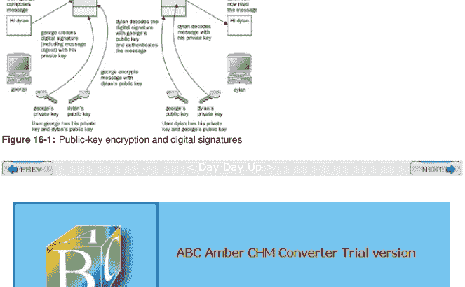

图 16-1：公钥加密和数字签名

## GNU Privacy Guard

为了保护你通过电子邮件发送的消息，大多数 Linux 发行版提供 GNU Privacy Guard `GnuPG` 加密和身份验证。`GnuPG` 是 GNU 开源软件，其工作原理类似于 Pretty Good Privacy `PGP` 加密。使用 `GnuPG`，你既可以加密消息，也可以对其进行数字签名——保护消息并证明其来自你。目前，`Evolution` 和 `KMail` 都支持 `GnuPG` 加密和身份验证。在 `Evolution` 上，你可以从安全菜单中选择 `PGP` 加密和签名来使用 `GnuPG`，`PGP` 选项在 Red Hat Linux 上使用 `GnuPG`。在 `KMail` 上，你可以在选项窗口的安全面板中选择要使用的加密方式。

`GNU Privacy Guard` `GPG` 操作通过 `gpg` 命令执行，该命令使用命令和选项来执行任务。常用命令和选项列在表 16-1 中。某些命令和选项具有仅使用一个连字符的简写形式。通常使用两个连字符。第一次使用 `gpg` 时，会在你的主目录中创建 `.gnupg` 目录，其中包含名为 `options` 的文件。`.gnupg/options` 文件包含 `GPG` 操作的注释默认选项，已更改为下一版本 1.2 的 `.gnupg/gpg.conf`。你可以编辑此文件并取消注释或更改你希望对 `GPG` 实现的任何默认选项。你可以使用不同的选项文件，并在调用 `gpg` 时使用 `--options` 参数指定它。有用的选项包括 `keyserver` 条目。`.gnupg` 目录还将保存诸如 `secring.gpg` 用于你的密钥的秘密密钥环、`pubring.gpg` 用于你的公钥的公钥环以及 `trustdb.gpg` 的加密文件，后者是受信任密钥的数据库。

表 16-1：GPG 命令和选项

| GPG Commands | Description |
|---|---|
| `-s`, `--sign` | 对文档进行签名，创建签名。可与 `--encrypt` 结合使用。 |
| `--clearsign` | 创建明文签名。 |
| `-b`, `--detach-sign` | 创建分离的签名。 |
| `-e`, `--encrypt` | 加密数据。可与 `--sign` 结合使用。 |
| `--decrypt [file]` | 解密文件或如果未指定文件则解密 stdin 并将其写入 stdout 或使用 `--output` 指定的文件。如果解密的文件已签名，则会验证签名。 |
| `--verify [[sigfile] [signed-files]]` | 验证已签名的文件。签名可以包含在文件中，也可以是单独的分离签名文件。 |
| `--list-keys [names]` | 列出密钥环中的所有密钥或指定的密钥。 |
| `--list-public-keys [names]` | 列出公钥环中的所有密钥或指定的密钥。 |
| `--list-secret-keys [names]` | 列出你的私有密钥。 |
| `--list-sigs [names]` | 列出你的密钥以及它们拥有的任何签名。 |
| `--check-sigs [names]` | 列出密钥及其签名并验证签名。 |
| `--fingerprint [names]` | 列出指定密钥的指纹。 |
| `--gen-key` | 生成一组新的私钥和公钥。 |

表 16-1：GPG 命令和选项

| GPG 命令 | 描述 |
|---|---|
| `--edit-key name` | 编辑您的密钥。使用命令执行大多数密钥操作，例如 `sign` 来签署密钥或 `passwd` 来更改您的密码短语。 |
| `--sign-key name` | 使用您的私钥签署公钥。与 `--edit-key` 中的 `sign` 相同。 |
| `--delete-key name` | 从公钥环中删除公钥。 |
| `--delete-secret-key name` | 从密钥环和秘密密钥环中删除私钥和公钥。 |
| `--gen-revoke` | 为您的密钥生成撤销证书。 |
| `--export [names]` | 从您的密钥环导出指定的密钥。无参数时导出所有密钥。 |
| `--send-keys [names]` | 导出并将指定的密钥发送到密钥服务器。必须使用 `--keyserver` 选项指定此密钥服务器的名称。 |
| `--import [files]` | 将文件中包含的密钥导入到您的公钥环中。 |
| GPG 选项 | 描述 |
|---|---|
| `-a`, `--armor` | 创建 ASCII 护甲输出，即加密数据的 ASCII 版本。 |
| `-o`, `--output file` | 将输出写入指定的文件。 |
| `--default-key name` | 指定用于签名的默认私钥。 |
| `--keyserver site` | 查找不在您密钥环上的公钥的密钥服务器。也可以指定将您的公钥发送到的站点。`host -l pgp.net | grep www.keys` 将列出密钥服务器。 |
| `-r`, `--recipient names` | 使用该用户的公钥为指定用户加密数据。 |
| `--default-recipient names` | 指定用于加密数据的默认接收者。 |

## GnuPG 设置:gpg


# 使用 GnuPG 之前

在使用 `GnuPG` 之前，您必须生成您的私钥和公钥。在命令行（终端窗口）中，使用 `--gen-key` 命令输入 `gpg` 命令。然后 `gpg` 程序会提示您不同的选项来创建您的私钥和公钥。您可以在 `gpg` 手册页中查看有关使用 `gpg` 程序的信息。

```
gpg --gen-key
```

## 创建您的密钥

您首先被要求选择想要的密钥类型。通常，您只需选择默认条目，您可以通过按 ENTER 键来完成。然后您选择密钥大小，通常为默认的 1024。然后您指定密钥的有效期——通常没有过期。您将被要求输入用户 ID、注释和电子邮件地址。按 ENTER 逐一提示输入。这些元素，任何一个都可以用作密钥的名称，标识该密钥。您在执行某些 GPG 任务时使用密钥名称，例如签署密钥或创建撤销证书。例如，以下元素为用户 richlp 创建一个密钥，注释为 "author"，电子邮件地址为 richlp@turtle.mytrek.com：

```
Richard Petersen (author) <richlp@turtle.mytrek.com>
```

您可以使用密钥身份的任何唯一部分来引用该密钥。例如，字符串 "Richard" 将引用前面的密钥，前提是没有其他密钥包含字符串 "Richard"。 "richlp" 也会引用该密钥，"author" 也是如此。当字符串匹配多个密钥时，所有匹配的密钥都将被引用。

## 保护您的密钥

`gpg` 程序随后会要求您输入一个密码短语，用于保护您的私钥。请务必使用真正的短语，包括空格，而不仅仅是密码。`gpg` 然后生成您的公钥和私钥并将它们放在 `.gnupg` 目录中。私钥保存在 `.gnupg` 目录中的一个名为 `secring.gpg` 的文件中。公钥放在 `pubring.gpg` 文件中，您可以在其中添加其他用户的公钥。您可以使用 `--list-keys` 命令列出这些密钥。

如果您以后需要更改密钥，可以创建一个撤销证书以通知其他人该公钥不再有效。例如，如果您忘记了密码或有人发现了它，您可以使用撤销证书告诉其他人您的公钥不应再使用。在下一个示例中，用户为密钥 richlp 创建一个撤销证书并将其放在文件 `myrevoke.asc` 中：

```
gpg --output myrevoke.asc --gen-revoke richlp
```

## 使您的公钥可用

为了让其他用户解密您的消息，您必须使您的公钥对他们可用。他们反过来必须向您发送他们的公钥，以便您可以解密从他们收到的任何消息。有效地，在用户之间启用加密通信涉及他们交换公钥。公钥然后必须由接收它们的每个用户进行验证和签名。公钥然后可以被信任以安全地解密消息。

如果您只向少数用户发送消息，您可以手动通过电子邮件发送您的公钥。对于一般公共使用，您可以将公钥发布在密钥服务器上，任何人都可以从那里下载并使用它来解密从您收到的任何消息。OpenPGP 公钥服务器位于 `www.keyserver.net`，该服务器列在您的 `.gnupg/options` 文件中。您可以使用 `--keyserver` 选项和 `--send-key` 命令直接发送到密钥服务器。`--send-key` 命令以您的电子邮件地址作为参数。您只需发送到一个密钥服务器，因为它会自动与其它密钥服务器共享您的密钥。

```
gpg --keyserver search.keyserver.net --send-key chris@turtle.mytrek.com
```

如果您想直接将密钥发送给另一位用户，您应该生成密钥的护甲文本版本，然后可以通过电子邮件发送。您使用 `--armor` 和 `--export` 选项执行此操作，使用 `--output` 选项指定放置密钥的文件。`--armor` 选项将生成加密文件的 ASCII 文本版本，以便可以直接通过电子邮件发送，而不是作为二进制附件。保存加密数据的 ASCII 编码版本的通常使用 `.asc` 扩展名，按惯例。二进制加密文件通常使用 `.gpg` 扩展名。然后您可以将文件通过电子邮件发送给您想要发送加密消息的用户。

```
# gpg --armor --export richlp@turtle.mytrek.com --output richlp.asc
# mail -s 'mypubkey' george@rabbit.mytrek.com < richlp.asc
```

许多公司和机构在其网站上发布其公钥文件，可以下载并用于验证加密软件下载或官方公告。

注意 `GPG` 的某些命令和选项同时具有长形式和短形式。例如，`--armor` 命令可以写成 `-a`，`--output` 写成 `-o`，`--sign` 写成 `-s`，以及 `--encrypt`

## 获取公钥

要解码其他用户的消息，您需要拥有他们的公钥。他们可以发送给您，也可以从密钥服务器下载。将包含公钥的消息或网页保存到文件中。然后您需要导入、验证和签名该密钥。使用您收到的文件将公钥导入到您的 `pubring` 文件中。在以下示例中，用户导入 George 的公钥，他已将其作为文件 `georgekey.asc` 收到。

```
gpg --import georgekey.asc
```

所有 Linux 发行版站点都有自己的公钥可供下载。例如，您应该下载 Red Hat 公钥，可以从 Red Hat 站点的安全资源页面（`www.redhat.com`）访问。点击 Public Encryption Key 链接。从那里，您可以访问一个仅显示公钥的页面。您可以将此页面保存为文件并使用该文件将 Red Hat 公钥导入到您的密钥环中。（您的 Red Hat 发行版还将 Red Hat 公钥放在 `/usr/share/doc/rpm4-1` 目录中，提供 GPG 和 PGP 加密的版本，`RPM-GPG-KEY` 和 `RPM-PGP-KEY` 文件。）在以下示例中，用户将仅显示 Red Hat 公钥的页面保存为 `myredhat.asc`，然后导入该文件：

```
gpg --import myredhat.asc
```

注意 您可以使用 `--delete-key` 和 `--delete-secret-key` 命令删除任何密钥，包括您自己的私钥。

## 验证密钥

为了手动检查公钥文件在传输过程中是否未被修改，您可以检查其指纹。这是从密钥内容生成的哈希值，类似于修改摘要。使用 `--fingerprint` 选项，您可以从已安装的密钥生成哈希值，然后联系发送者询问哈希值应为多少。如果它们不相同，您就知道密钥在传输过程中被篡改了。

```
gpg --fingerprint george@rabbit
```

您不必检查指纹才能让 `gpg` 运行。这只是您可以自行执行的一个建议预防措施。关键是您需要确信收到的密钥是有效的。通常你可以将来自公共服务器或已知站点的大多数密钥视为有效，尽管检查它们公布的指纹非常容易。一旦确信密钥有效，你就可以用自己的私钥对其进行签名。对密钥进行签名会通知 `gpg` 你正式接受了该密钥。

要对密钥进行签名，你需要使用带有 `--sign-key` 选项的 `gpg` 命令以及该密钥的名称。

```
gpg --sign-key george@rabbit
```

或者，你可以使用 `--edit-key` 命令编辑密钥，以启动交互式会话，在其中你可以输入命令 `sign` 来对密钥进行签名，并输入 `save` 来保存更改。对密钥进行签名需要访问你的私钥，因此系统会提示你输入口令。完成后，使用 `quit` 命令退出交互式会话。

通常，你会希望发布一个由一个或多个用户签名的公钥版本。你也可以对其他用户执行相同的操作。对公钥进行签名提供了一种证明密钥有效性的方式。这表明已经有人检查过它。许多不同的用户可以对同一个公钥进行签名。对于你从其他用户那里获得并验证过的密钥，你可以对其进行签名，并将签名的版本返回给该用户。一旦你签发了该密钥，你可以生成一个包含签名公钥版本的文件。然后你可以将此文件发送给该用户。此过程建立了一个信任网络（Web-of-Trust），其中许多用户为公钥的有效性提供担保。

```
gpg -a --export george@rabbit --output georgesig.asc
```

然后，该用户会导入签名的密钥并将其导出到密钥服务器。

### 提示

如果你想从头开始，你可以简单地删除你的 `.gnupg` 目录，尽管这是一种极端措施，因为你会丢失任何已收集的密钥。

## 使用 GnuPG

`GnuPG` 加密目前由 KMail 和 exmh 邮件客户端支持。你还可以使用 GNU Privacy Assistant (`GPA`)，这是一个图形前端，来管理 GPG 任务。你可以使用 `gpg` 命令手动对消息进行编码和解码，如果你愿意，还可以包括数字签名。在执行 GPG 任务时，你需要使用密钥名称来引用你拥有的密钥。请记住，你只需要唯一的标识子串来选择你想要的密钥。`GPG` 对你在给定命令中指定的作为密钥名称的字符串执行模式搜索。如果该字符串匹配多个密钥，则所有匹配的密钥都将被选中。在以下示例中，"Sendmail" 字符串选中的是两个密钥身份相匹配。


```
# gpg --list-keys "Sendmail"
pub 1024R/CC374F2D 2000-12-14
    Sendmail Signing Key/2001 <sendmail@Sendmail.ORG>
pub 1024R/E35C5635 1999-12-13
    Sendmail Signing Key/2000 <sendmail@Sendmail.ORG>
```

## 加密消息

`gpg` 命令提供了几种管理安全消息的选项。`e` 选项用于加密消息，`a` 选项生成装甲文本版本，`s` 选项添加数字签名。你需要指定接收者的公钥，这你应该已经导入到 `pubring` 文件中。就是这个密钥用于加密消息。然后，接收者将能够用他们的私钥解码消息。使用 `--recipient` 或 `-r` 选项来指定接收者密钥的名称。你可以使用用户公钥名称中的任何唯一子串。电子邮件地址通常就足够了。你使用 `d` 选项来解码接收到的消息。在下面的示例中，用户加密 (`e`) 并签名 (`s`) 一个以装甲文本格式 (`a`) 生成的文件。`-r` 选项指示消息的接收者（其公钥用于加密消息）。

```
gpg -e -s -a -o myfile.asc -r george@rabbit.mytrek.com myfile
# mail george@rabbit.mytrek.com < myfile.asc
```

如果你想将文件作为二进制附件发送或传输，可以省略 ASCII 装甲选项。如果没有 `--armor` 或 `-a` 选项，`gpg` 将生成编码后的二进制文件，而不是编码后的文本文件。二进制文件只能通过电子邮件作为附件传输。如前所述，ASCII 装甲版本通常扩展名为 `.asc`，而二进制版本使用 `.gpg`。

## 解密消息

当另一用户接收到该文件时，他们可以将其保存为名为 `myfile.asc` 之类的文件，然后使用 `-d` 选项解码该文件。`-o` 选项将指定保存解码版本的文件。`GPG` 会自动判断它是二进制文件还是 ASCII 装甲版本。

```
gpg -d -o myfile.txt myfile.asc
```

要检查文件的数字签名，你使用带有 `--verify` 选项的 `gpg` 命令。这假设发送者已对该文件进行了签名。

```
gpg --verify myfile.asc
```

## 解密数字签名

你需要拥有签名者的公钥才能解码并检查数字签名。如果你没有，你会收到一条消息，说明未找到公钥。在这种情况下，你必须先获取签名者的公钥。你可以访问你认为可能有该公钥的密钥服务器，或者直接从网站或签名者处请求公钥。然后按照前面的描述导入密钥。

## 签名消息

你不需要加密文件就可以对其进行签名。数字签名是一个独立的组件。你可以将签名与特定文件结合，或者单独生成一个。要将签名与文件结合，你生成一个新版本，其中包含两者。使用 `--sign` 或 `-s` 选项来生成包含数字签名的文档版本。在以下示例中，`mydoc` 文件被数字签名，`mydoc.gpg` 文件包含原始文件和签名。

```
gpg -o mydoc.gpg --sign mydoc
```

相反，如果你只想生成一个单独的签名文件，你可以使用 `--detach-sig` 命令。其优点是不需要生成原始文件的完整副本。该文件保持不变。签名文件通常具有像 `.sig` 这样的扩展名。在下面的示例中，用户为 `mydoc2` 文件创建一个名为 `mydoc2.sig` 的签名文件。

```
gpg -o mydoc2.sig --detach-sig mydoc2
```

要使用分离签名验证文件，接收者用户指定签名文件和原始文件。

```
gpg --verify mydoc2.sig mydoc2
```

你还可以生成用于文本文件的明签（clear sign）签名。明签签名是签名的文本版本，可以附加到文本文件上。文本文件可以进一步由任何文本编辑器编辑。使用 `--clearsign` 选项来创建明签签名。以下示例创建名为 `mynotice.txt` 的文本文件的明签版本。

```
gpg -o mysignnotice.txt --clearsign mynotice.txt
```

注意 在 `www.gnupg.org` 上有很多 GNU PG 的图形前端和过滤器。`GPA` (GNU Privacy Assistant) 提供了一个基于 GNOME 的前端，以轻松加密和解密

### 提示

隐写术是一种加密形式，它将数据隐藏在其他类型的对象中，例如图像。你可以使用 JPEG Hide and Seek 软件 (`JPHS`) 来编码和检索 `dct`


## ABC Amber CHM Converter 试用版

请注册以移除此横幅。

http://www.processestext.com/abchm.html

## 检查软件包数字签名

数字签名一个非常有效的用途是验证软件包是否未被篡改。软件包可能在传输过程中被拦截，其某些系统级文件被修改或替换。来自你的发行版以及知名 GNU 和 Linux 项目的软件包都经过数字签名。签名提供了修改摘要信息，用于检查包的完整性。数字签名可能包含在包文件中，或作为单独文件发布。你使用带有 `--verify` 选项的 `gpg` 命令来检查文件的数字签名。

提示 Red Hat 会在 RPM 文档目录中安装 Red Hat 公钥，文件名为 `RPM-GPG-KEY`。位于 `/usr/share/doc/rpm-4.1`。Red Hat 使用此密钥在安装期间检查 RPM 包。

## 导入公钥

然而，首先你需要确保你拥有签名者的公钥。数字签名是使用软件分发商的私钥加密的。该分发商就是签名者。一旦你拥有该签名者的公钥，你就可以检查从他们那里收到的任何数据。对于软件分发商，一旦你拥有他们的公钥，你就可以检查他们分发的任何软件。要获取公钥，你可以检查密钥服务器，或者更可能的是检查他们的网站。如前所述，你可以从 Red Hat 网站的安全资源页面下载 Red Hat 公钥，或使用安装在 RPM 文档目录中的版本。一旦你获取了公钥，你可以使用 `--import` 选项将其添加到你的密钥环中，指定你给下载的密钥文件命名的名称（在这种情况下，`myredhat.asc`）：

```bash
# gpg --import redhat.asc
gpg: key CBA29BF9: public key imported
gpg: Total number processed: 1
gpg: imported: 1 (RSA: 1)
```

改为从密钥服务器下载，你使用 `--keyserver` 选项和密钥服务器名称。

要从 RPM 目录导入 Red Hat 公钥，你需要指定 `RPM-GPG-KEY` 文件。这是 Red Hat 发行版在 CD-ROM 上提供的密钥。尽管在安装过程中使用了该密钥，但在安装后再次验证包时，必须导入该密钥。

```bash
rpm --import /usr/share/doc/rpm-4.1/RPM-GPG-KEY
```

## 验证公钥

如果你愿意，可以使用 `--fingerprint` 选项检查密钥的有效性。如果你确信密钥有效，然后你可以使用 `--sign-key` 命令对其进行签名。在以下示例中，用户使用密钥名称中的字符串 `"Red Hat"` 来引用并签名 Red Hat 密钥。用户还被要求输入口令以允许使用其私钥签名 Red Hat 公钥。

```bash
# gpg --sign-key "Red Hat"
pub 1024R/CBA29BF9 created: 1996-02-20 expires: never trust: -/q
(1). Red Hat Software, Inc. <redhat@redhat.com>
pub 1024R/CBA29BF9 created: 1996-02-20 expires: never trust: -/q
Fingerprint: 6D 9C BA DF D9 60 52 06 23 46 75 4E 73 4C FB 50
Red Hat Software, Inc. <redhat@redhat.com>

Are you really sure that you want to sign this key
with your key: "Richard Petersen (author) <richlp@turtle.mytrek.com>"
Really sign? yes
You need a passphrase to unlock the secret key for
```

用户：`"Richard Petersen (author) <richlp@turtle.mytrek.com>"`

1024 位 DSA 密钥，ID `73F0A73C`，创建于 2001-09-26

输入密码短语：

#

## 检查 RPM 软件包


一旦获得公钥，您就可以使用 `rpm` 命令和 `-K` 选项检查 Red Hat 的任何 RPM 软件包。以下示例检查 `xcdroast` 和 `balsa` 软件包的有效性：

```
# rpm -K xcdroast-0.98alpha9-1.i386.rpm
xcdroast-0.98alpha9-1.i386.rpm: md5 OK
# rpm -K balsa-1.1.7-1.i386.rpm
balsa-1.1.7-1.i386.rpm: md5 OK
```

许多以压缩归档形式存在的软件包，`.tar.gz` 或 `tar.bz2`，会提供以 `.asc` 或 `.sig` 扩展名结尾的单独签名文件。要检查这些，您可以使用带有 `--verify` 选项的 `gpg` 命令。例如，最新的 `sendmail` 软件包以压缩归档 `.tar.gz` 的形式分发。其数字签名以单独的 `.sig` 文件提供。首先，您需要下载并安装从 Sendmail 网站获得的 `sendmail` 软件的公钥。

```
# gpg --import sendmail.asc
```

然后您应该对刚刚导入的 Sendmail 公钥进行签名。在此示例中，电子邮件地址被用作密钥名称。

```
gpg --sign-key sendmail@Sendmail.ORG
```

您也可以检查密钥的指纹以增加验证。

然后您将下载压缩归档和数字签名文件。使用 `gunzip` 将 `.gz` 文件解压缩为 `.tar`。然后，使用 `gpg` 命令和 `--verify` 选项，使用 `.sig` 文件中的数字签名来检查软件压缩归档的真实性和完整性。

```
# gpg --verify sendmail.8.12.0.tar.sig sendmail.8.12.0.tar
gpg: Signature made Fri 07 Sep 2001 07:21:30 PM PDT using RSA key ID CC374F2D
gpg: Good signature from "Sendmail Signing Key/2001 <sendmail@Sendmail.ORG>"
```

您也可以只指定签名文件，`gpg` 将自动搜索并选择同名但不带 `.sig` 或 `.asc` 扩展名的文件。

```
# gpg --verify sendmail.8.12.0.tar.sig
```

今后，当您从 Sendmail 网站下载使用此密钥的任何软件时，您只需执行 `--verify` 操作即可。不过请记住，同一网站的不同软件包可能使用不同的密钥。您必须确保已导入并签名了用于检查软件的适当密钥。


## ABC Amber CHM Converter 试用版

请注册以移除此横幅。

http://www.processestext.com/abcchm.html

### 入侵检测：Tripwire

当有人入侵系统时，他们通常会通过对系统管理文件进行自己的更改来获得控制，例如密码文件。他们可以创建自己的用户和密码信息，让他们随时访问，或简单地更改 `root` 用户密码。他们还可以将整个程序，例如登录程序，用自己的版本替换。检测此类行为的一种方法是使用 `Tripwire` 或 `AIDE` 等完整性检查工具来检测系统管理文件的任何更改。`AIDE`（Advanced Intrusion Detection Environment）是 `Tripwire` 的替代方案。它提供易于配置和详细的报告。两者均不包含在 Red Hat 中。

完整性检查工具首先为每个要检查的文件或程序创建一个唯一标识符的数据库。这些可以包括权限和文件大小等特征，但更重要的是，由文件内容生成的加密算法生成的校验和数字。例如，在 `Tripwire` 中，默认标识符是由 `MD5` 修改摘要算法和 `Snefru`（Xerox 安全哈希算法）等算法创建的校验和数字。提供文件唯一标识的加密值称为签名。实际上，签名提供了文件内容的准确快照。然后通过再次生成其标识符并将其与数据库中的标识符进行匹配来定期检查文件和程序。`Tripwire` 将生成当前文件和程序的签名，并将其与为其数据库之前生成的数值进行匹配。任何差异都被记为文件更改，`Tripwire` 然后通知您更改。

**注意** 您还可以检查日志文件是否存在任何可疑活动。有关系统日志的讨论，请参阅第 27 章。特别是 `/var/log/messages` 有助于检查用户登录、FTP 连接和超级用户登录等关键事件。

## 第 17 章：Internet 协议安全：IPsec

### 概述

Internet 安全协议 `IPsec` 直接将网络传输的安全性纳入 Internet 协议（IP）中。`IPsec` 集成到新的 `IPv6` 协议（Internet 协议版本 6）中。它也可以与较旧的 `IPv4` 协议一起使用（请参阅第 38 章）。`IPsec` 提供了加密数据和验证发送到的主机或网络的方法。该过程可以手动处理，也可以使用 `IPsec racoon` 密钥交换工具自动处理。有了 `IPsec`，内核可以自动检测和解密传入传输，以及加密传出传输。您还可以使用 `IPsec` 实现虚拟专用网络，在 Internet 上对从一个本地网络发送到另一个本地网络的数据进行加密。尽管 `IPsec` 是一种相对较新的安全方法，但其集成到 Internet 协议中最终将为其提供广泛的接受度。

目前有多个项目提供 `IPsec` 工具的开发和实现。原始 `IPsec` 工具由 KAME 项目提供，`www.kame.net`。当前版本可以从 `sourceforge.net/projects/ipsec-tools` 获得。RPM 软件包可以从 `rpmlfind.net` 获得。其他 `IPsec` 工具项目包括位于 `www.freeswan.org` 的 Free Secure/Wide Area Network 项目（FreeS/WAN），它提供 `IPsec` 工具的 Linux 实现，以及位于 `www.vpnc.org` 的 VPN Consortium（VPNC），它支持 Windows 和 Macintosh 版本。FreeS/WAN 提供 Red Hat RPM 软件包和其工具的源代码。

> 注意 目前，Fedora Core 不包含对 `IPsec` 工具的支持，但后续版本会包含。`redhat-config-network` 工具包含 `IPsec` 支持面板，但您需要安装 `IPsec` 工具才能激活此支持。

### IPsec 协议

`IPsec` 由多个协议组成，提供身份验证（`AH`）、加密（`ESP`）和加密密钥的安全交换（`IKE`）。身份验证头协议（`AH`）确认数据包是由发送方发送的，而不是由其他人发送的。`IPsec` 还包括完整性检查以检测传输过程中的任何篡改。数据包使用封装安全有效负载（`ESP`）进行加密。加密和解密使用发送方和接收方共享的密钥进行。这些密钥本身使用 Internet 密钥交换协议进行传输，该协议提供安全交换。`ESP` 加密会降低某些压缩传输方法，例如拨号 Internet 连接的 `PPP`。为适应这些压缩方法，`IPsec` 提供了 IP 有效负载压缩协议（`IPComp`），数据包可以在发送前进行压缩。

`AH`、`ESP` 和 `IPComp` 协议已纳入 Linux 内核。`IKE` 协议作为单独的守护进程实现。它只是提供了一种共享密钥的方法，可以被其他共享方法替换。

### IPsec 模式

您可以使用 `IPsec` 功能进行正常传输或数据包隧道传输。在正常传输中，数据包被加密并发送到下一个目的地。正常传输模式用于实现直接主机到主机加密，其中每个主机处理 `IPsec` 加密过程。数据包隧道用于在网关之间加密传输，让网关处理整个网络进出流量的 `IPsec` 加密过程，而不必为每个主机配置 `IPsec` 加密。在数据包隧道中，数据包被封装为特定目的地的新的报头，使您能够实现虚拟专用网络（VPN）。数据包被定向到 VPN 网关，网关对其进行加密并转发到本地网络数据包。

**注意** 您可以选择对特定主机的报文进行加密，或对通过特定端口的报文进行加密。

### IPsec 安全数据库

您需要加密的数据包由 `IPsec` 安全策略数据库（`SPD`）指定。所使用的加密方法由 `IPsec` 安全关联数据库（`SAD`）确定。`SAD` 将加密方法和密钥与特定的连接或某种类型的连接相关联。需要加密的连接在安全策略数据库中进行指定。

### IPsec 工具

提供了几种 `IPsec` 工具，你可以使用它们来管理 `IPsec` 连接（参见表 17-1）。`libipsec` 工具允许你构建密钥库。使用 `setkey`，你可以管理策略和关联数据库。`racoon` 工具配置密钥交换过程，以实现跨连接的安全解密密钥交换。要查看当前 `SPD` 数据库中的安全策略，可以使用 `setkey-DP`。对于 `SAD` 中的安全关联，可以使用 `setkey-SP`。

注意：要在内核中启用 `IPsec`，请确保在加密选项中启用 `PF_KEY`、`AH` 和 `ESP` 选项。

表 17-1：IPsec 工具

| 工具 | 描述 |
|---|---|
| libipsec | 构建 PFkey |
| setkey | 管理策略 (SPD) 和关联 (SAD) 数据库 |


| `racoon` | 配置并实现使用 IPsec 密钥交换 (`IKE`) 的安全密钥交换 |
| `setkey-SP` | 检查 SAD 数据库中的安全关联 |
| `setkey-DP` | 检查 SPD 数据库中的安全策略 |

### IPsec 与 IP 表

`IPtables` 网络过滤会阻止许多 IPsec 数据包。要让 `IPtables` 允许 IPsec 数据包通过，请使用以下 `IPtables` 命令。AH 协议的编号为 51，ESP 协议的编号为 50。为了允许 IPsec 数据包，你应该设置类似下面的策略规则。

```
iptables -A INPUT -p 50 -j ACCEPT
iptables -A OUTPUT -p 51 -j ACCEPT
```

### 使用 redhat-config-network 配置 IPsec

`redhat-config-network` 工具现在支持实施 IPsec 连接。在 `redhat-config-network` 工具上，选择 IPsec 面板（参见图 17-1）并点击“新建”以启动 IPsec 设置向导来创建 IPsec 连接。首先，你需要为连接输入一个昵称，并指定是否希望自动启动它。然后，你选择连接类型。这可以是直接的主机到主机连接，或者是两个网络之间的连接。网络连接实施虚拟专用网络 (`VPN`) 并以隧道模式运行 IPsec。（主机和 VPN 连接都在以下章节中有详细说明。）然后，你选择要使用的加密类型。这可以是手动的，或使用 `IKE`，让 `racoon` 自动管理加密和认证过程。

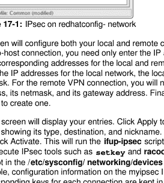

图 17-1：`redhat-config-network` 上的 IPsec

然后，你将配置本地和远程连接，从本地设置开始。对于主机到主机的连接，你只需输入远程主机的 IP 地址即可。对于 VPN，你必须为本地和远程网络输入相应的地址。对于本地网络，你需要输入本地网络的 IP 地址、本地网络的网关计算机以及本地网络的网络掩码。对于远程 VPN 连接，你需要远程 IP 地址、远程网络的地址、其网络掩码及其网关地址。最后，你输入认证密钥。点击“生成”按钮创建一个。

最后一个屏幕将显示你的输入。点击“应用”以保存它们。你的连接将显示在 IPsec 面板中，显示其类型、目的地和昵称。要建立连接，选择 IPsec 连接并点击“激活”。这将运行 `/etc/sysconfig/network-scripts` 目录中的 `ifup-ipsec` 脚本，该脚本将执行 `setkey` 和 `racoon` 等 IPsec 工具来建立你的连接。配置数据将保存在 `/etc/sysconfig/networking/devices` 目录中，使用 IPsec 连接的名字。例如，`mypsec` IPsec 连接的配置信息保存在 `ifcfg-mypsec` 文件中。每个连接的相应密钥保存在 `keys` 文件中，包括 `keys-mypsec`。这里显示了一个 VPN 的示例配置。`IKE` 方法是私有共享密钥 (`PSK`)。目的地（远程）网关是 10.0.0.1，源（本地）网关是 192.168.0.1。目的地（远程）网络地址是 10.0.0.0/24，源（本地）地址是 192.168.0.0/24。目的地主机是 10.0.0.2。

```
ONBOOT=no
IKE_METHOD=PSK
DSTCGW=10.0.0.1
SRCGW=192.168.0.1
DSTNET=10.0.0.0/24
SRCNET=192.168.0.0/24
DST=10.0.0.2
TYPE=IPSEC
```


## ABC Amber CHM 转换器试用版

请注册以移除此横幅。

http://www.processestext.com/abchm.html

### 使用 setkey 配置连接

要配置你的 IPsec 连接，你可以使用 `setkey` 工具。该工具包含若干用于管理 IPsec 策略和安全数据库规则的指令。你使用 `add` 指令向安全数据库 (`SAD`) 添加安全关联，使用 `spdadd` 指令向策略数据库 (`SPD`) 添加策略。`ah` 术语表示该指令应用于认证头 (`AH`)，`esp` 表示由加密安全载荷 (`ESP`) 实施的加密。为了实施 `setkey` 操作，最好使用一个脚本，该脚本调用带有 `-f` 选项的 `setkey` 并列出 `setkey` 指令。以下示例创建一个简单的脚本，用于为特定连接添加认证和加密指令，并为其创建安全策略：

```
#!/sbin/setkey -f
add 192.168.0.2 192.168.0.5 ah 15700 -A hmac-md5 "secret key";
add 192.168.0.2 192.168.0.5 esp 15701 -E 3des-cbc "secret key ";
spdadd 192.168.0.2 192.168.0.5 any -P out ipsec
    esp/transport//require
    ah/transport//require;
```

### 安全关联：SA

你使用安全关联来指示你希望认证头 (`AH`) 和加密载荷 (`ESP`) 被加密。特定的连接，例如两个主机之间的连接，可以使用指定的加密方法和指定的秘密密钥对其认证头进行加密。同样，也可以对作为传输主要内容的加密载荷进行相同操作。秘密密钥可以手动确定，也可以使用密钥交换自动确定。以下示例指定对于 192.168.0.2 和 192.168.0.5 之间的连接，认证头 `ah` 将使用 `hmac-md5` 认证方法和一个秘密密钥（此处由占位符“secret key”表示）。

```
add 192.168.0.2 192.168.0.5 ah 15700 -A hmac-md5 "secret key";
```

加密载荷的安全关联使用 `3des-cbc` 加密方法和另一个不同的秘密密钥。

```
add 192.168.0.2 192.168.0.5 esp 15701 -E 3des-cbc "secret key";
```

每个指令都由一个安全参数索引 (`SPI`) 标识，在本例中为 15700 和 15701。事实上，具有不同 `SPI` 的相同指令被视为不同的指令。

请记住，安全关联仅指定可能的加密过程。它们并不实施这些过程。为此，你需要设置安全策略。

### 安全策略：SP

安全策略将为连接实施 IPsec 安全过程。你可以指定主机或端口连接。一旦为连接设置了策略，内核将使用 `SAD` 数据库确定应用哪些安全关联。安全策略通过 `spdadd` 指令添加。可以要求加密、认证或两者皆有。

以下示例将加密并认证主机 192.168.0.2 和 192.168.0.5 之间的传输。这两个主机之间任何发出的传输都将被加密和认证。

```
spdadd 192.168.0.2 192.168.0.5 any -P out ipsec esp/transport//require ah/transport/require;
```

在 `spdadd` 指令中，你需要指定连接，例如两个主机或两个网络之间的连接。对于两个主机，你会使用它们的 IP 地址，在本例中为 192.168.0.2 和 192.168.0.5。然后你指定数据包类型及其方向，在本例中为任何发出的数据包，`any -P out`。然后

您可以为 `ESP` 或 `AH` 协议（或两者）指定 `ipsec` 指令。对于每个条目，您需要指定模式（传输模式或隧道模式）、涉及的宿主（在隧道模式下这些宿主可以不同），以及加密策略，通常为 `require`。以下示例表明，`ESP` 协议将在 192.168.0.2 和 192.168.0.5 之间的连接上使用传输模式，且该连接是必需的（`required`）。

```
esp/transport/192.168.0.2-192.168.0.5/require
```

如果宿主信息与之前示例中的相同，您可以省略宿主信息。

```
esp/transport//require
```

### 接收端宿主

为了接收加密的 IPsec 传输，宿主必须在其自己的 `SAD` 数据库中拥有相应的安全关联指令，以告知它如何认证和解密接收到的指令。这些安全关联指令应与发送端的指令镜像一致，使用相同的加密方法、秘密密钥和安全索引。然而，相应的策略并非必需。

```
#!/sbin/setkey -f
add 192.168.0.2 192.168.0.5 ah 15700 -A hmac-md5 "secret key";
add 192.168.0.2 192.168.0.5 esp 15701 -E 3des-cbc "secret key";
```

接收端宿主可能需要设置策略，以筛选安全连接上的传入数据包，丢弃那些未加密的数据包。以下策略将仅接受来自 192.168.0.2 的加密且经过认证的 IPsec 传输。


```
spdadd 192.168.0.2 192.168.0.5 any -P in ipsec esp/transport//require
ah/transport//require;
```

## 双向传输

前面的示例建立了一个仅单向的、介于两个宿主之间的安全连接，即从 192.168.0.2 到 192.168.0.5，而不是从 192.168.0.5 到 192.168.0.2 的反向连接。为了在两个宿主之间实现双向安全传输，两者都需要配置为发送端和接收端，并配备相应的匹配安全关联。以下脚本基于两个宿主之间简单双向 IPsec 连接的常见示例。它们在宿主 192.168.0.2 和 192.168.0.5 之间建立了安全的双向 IPsec 连接。相应传入策略也包含在内，但并非必需。

首先是宿主 192.168.0.2 的配置：

```
#!/sbin/setkey -f
add 192.168.0.2 192.168.0.5 ah 15700 -A hmac-md5 "secret key";
add 192.168.0.5 192.168.0.2 ah 24500 -A hmac-md5 "secret key";

add 192.168.0.2 192.168.0.5 esp 15701 -E 3des-cbc "secret key";
add 192.168.0.5 192.168.0.2 esp 24501 -E 3des-cbc "secret key";

spdadd 192.168.0.2 192.168.0.5 any -P out ipsec esp/transport//require
ah/transport//require;
spdadd 192.168.0.5 192.168.0.2 any -P in ipsec esp/transport//require
ah/transport//require;
```

对应的宿主 192.168.0.5 使用相同的指令，但 IP 连接方向相反。请注意，每端发送端和接收端的指令的安全索引是对应的。

```
#!/sbin/setkey -f
add 192.168.0.5 192.168.0.2 ah 15700 -A hmac-md5 "secret key";
add 192.168.0.2 192.168.0.5 ah 24500 -A hmac-md5 "secret key";

add 192.168.0.5 192.168.0.2 esp 15701 -E 3des-cbc "secret key";
add 192.168.0.2 192.168.0.5 esp 24501 -E 3des-cbc "secret key";

spdadd 192.168.0.5 192.168.0.2 any -P out ipsec esp/transport//require ah/transport//require;
spdadd 192.168.0.2 192.168.0.5 any -P in ipsec esp/transport//require ah/transport//require;
```

## 使用 racoon 配置 IPsec：IKE

IPsec 密钥可以实施为手动密钥、共享密钥或使用证书。手动密钥是通过显式交换的，容易存在安全问题。共享密钥和证书都通过 IPsec 密钥交换协议（IKE）进行管理，该协议会自动交换密钥，并随机更改密钥以避免被检测。

使用 IKE 的一个优势在于，如果未提供安全关联，它将自动生成所需的安全关联。这意味着，使用 IKE 配置安全连接时，您只需指定安全策略，而不需要指定安全关联。

`racoon` 工具是 IPsec IKE 协议的密钥交换守护进程。在使用共享密钥的情况下，宿主由 `racoon` 使用预共享密钥进行动态认证。在使用证书方法的情况下，宿主使用证书文件进行认证。`racoon` 配置文件位于 `/etc/racoon/racoon.conf`。在这里，您可以设置一般参数。对于大多数连接，您可以使用默认的 `racoon.conf` 文件。

`racoon` 配置由包含可能连接参数的区块（stanzas）组成。以下示例展示了一个非常简单的配置，它使用简单的共享秘密密钥。位置由 `path pre_shared_key` 选项指定，在此情况下为 `/etc/racoon/psk.txt`。证书密钥，一种使用公钥和私钥的更安全方法，将在后面讨论。

```
path pre_shared_key "/etc/racoon/psk.txt";

remote anonymous
{
    exchange_mode aggressive,main;
    doi ipsec_doi;
    situation identity_only;

    my_identifier address;

    lifetime time 2 min;   # sec,min,hour
    initial_contact on;
    proposal_check obey; # obey, strict or claim

    proposal {
        encryption_algorithm 3des;
        hash_algorithm sha1;
        authentication_method pre_shared_key;
        dh_group 2 ;
    }
}
sainfo anonymous
{
    pfs_group 1;
    lifetime time 2 min;
    encryption_algorithm 3des, blowfish, des, cast128, rijndael ;
    authentication_algorithm hmac_sha1, hmac_md5;
    compression_algorithm deflate ;
}
```

此配置定义了默认（匿名）连接的区块。`remote anonymous` 区块定义连接到远程系统的参数，而 `sainfo anonymous` 部分提供安全关联指令信息，例如要使用的加密和认证方法。

## 证书

要使用证书代替共享密钥，您首先必须使用 OpenSSL 创建证书。然后指示 `racoon` 使用它们。指定证书的路径。

```
path certificate "/usr/local/etc/racoon/certs";
```

现在，您可以配置 `racoon` 使用由证书生成的公钥和私钥。在 `/etc/racoon/racoon.conf` 文件的适当区块中，`certificate_type` 指令指定此系统的公钥和私钥。`peers_certfile` 指令指定远程系统公钥的位置。`authentication_method` 指令现在设置为 `rsasig`，即 RSA 公钥/私钥。请确保每个系统都拥有其对应的公钥和私钥。

```
certificate_type x509 "192.168.0.2.public" "192.168.0.2.private";
peers_certfile "192.168.0.5.public";
authentication_method rsasig;
```

## 使用 racoon 进行连接配置

使用 `racoon` 时，您只需指定连接配置的安全策略，如下所示（针对发送端）。接收端将拥有相应的策略：

```
spdadd 192.168.0.5 192.168.0.2 any -P out ipsec
    esp/transport//require
    ah/transport//require;
spdadd 192.168.0.2 192.168.0.5 any -P in ipsec
    esp/transport//require
    ah/transport//require;
```

## IPsec 隧道模式：虚拟专用网络

除了直接加密两个宿主，您还可以使用 IPsec 仅加密宿主所属网络之间的网关，假设这些网络内部的通信是可以信任的。这将显著减少加密配置设置，使得整个网络的宿主可以通过其网关之间的中间安全 IPsec 连接访问另一个网络的宿主。对于网关之间的连接，通过中间路由器发送的传输可以被封装在隧道中。这被称为 IPsec 的隧道模式，用于实现虚拟专用网络（VPN）。网关之间的加密传输有效地实现了 VPN，保护了从一个本地网络到另一个本地网络之间跨越更大网络的传输。

为了通过网关将宿主传输隧道化到网络，您需要使用 `-m tunnel` 选项。IPsec 连接将在两个网关之间建立。以下示例是网关 10.0.0.1 上的安全关联，它加密从网关 10.0.0.1 到网关 10.0.23.5 的传输。这里使用的示例是针对网关到网关的连接，设置为主机间使用手动密钥的直接连接。

```
add 10.0.0.1 10.0.23.5 esp 34501 -m tunnel -E 3des-cbc "secretkey";
```


然后，`10.0.0.1` 上的安全策略实现了使用各自网关从一个网络到另一个网络的通信加密。这两个网络是 `192.168.0.0` 和 `192.168.1.0`。来自 `192.168.0.0` 网络宿主的传输由其网关 `10.0.0.1` 加密，然后发送到 `192.168.1.0` 网络的网关 `10.0.23.5`，后者对其进行解密。

```
spdadd 192.168.0.0/24 192.168.1.0/24 any -P out ipsec esp/tunnel/10.0.0.1-10.0.23.5/require;
```

请注意，网关 IP 地址在 `spdadd` 指令的 `ipsec` 指令中指定。指定的模式是隧道模式，而不是传输模式。

```
ipsec esp/tunnel/10.0.0.1-10.0.23.5/require
```

接收网关 `10.0.23.5` 将拥有相应的安全关联和策略，如下所示。策略设置为传入传输。在两个网关配置中，除了指定隧道选项并在安全策略中使用网络地址外，安全关联和策略与用于宿主到宿主连接的相同。

```
add 10.0.0.1 10.0.23.5 esp 34501 -m tunnel -E 3des-cbc "secretkey";
spdadd 192.168.0.0/24 192.168.1.0/16 any -P in ipsec esp/tunnel/10.0.0.1-10.0.23.5/require;
```

为了设置完整的双向通信，两个网关将拥有相应的安全关联和策略以处理双向流量。以下示例是网关 `10.0.0.1` 上的配置，处理到网关 `10.0.23.5` 的双向流量。网关 `10.0.23.5` 将具有类似的配置：

```
add 10.0.0.1 10.0.23.5 esp 34501 -m tunnel -E 3des-cbc "secretkey";
add 10.0.23.5 10.0.0.1 esp 34501 -m tunnel -E 3des-cbc "secretkey";
```

```
spdadd 192.168.0.0/24 192.168.1.0/24 any -P out ipsec esp/tunnel/10.0.0.1-10.0.23.5/require;
spdadd 192.168.1.0/16 192.168.0.0/24 any -P in ipsec esp/tunnel/10.0.23.5-10.0.0.1/require;
```

如果您使用 `racoon` 配置网关连接，您只需在每个网关上设置安全策略，让 `racoon` 服务器生成所需的安全关联。


## ABC Amber CHM 转换器试用版

请注册以移除此横幅。

http://www.processestext.com/abchm.html

### 虚拟专用网络的加密 IP 封装

Red Hat 目前仍支持使用 Crypto IP Encapsulation（CIPE），它是一种用于实现虚拟专用网络的 IPsec 替代方案。您使用 Internet 配置向导创建 CIPE VPN 连接，选择 CIPE 条目。然后“配置隧道”屏幕将显示用于配置连接的条目。对于初始连接，第一个 CIPE 设备 `cipecb0` 将被选中。然后您可以选择隧道通过设备，例如以太网连接之类的网络设备。如果您选择服务器模式，则任何设备都可用于 CIPE 连接。对于端口，默认值为 `7777`，尽管如果您愿意可以选定特定端口。然后您可以选择虚拟本地和远程地址并生成密钥。

本质上，CIPE 在两台计算机之间建立点对点加密连接。两者都需要运行 CIPE。其中一台作为服务器运行，通常是首先配置的，另一台作为客户端。服务器将生成用于加密的密钥，该密钥将被传输给客户端。客户端在连接时将提供远程对等地址和端口。服务器将“远程对等地址”条目指定为服务器模式，使地址和对等端口在客户端连接时自动确定。两系统使用的端口通常为 `7777`。传输以加密的 UDP 数据包发送。同时请确保您已打开防火墙以允许在指定的 VPN 端口 `7777` 上进行传输。

每台计算机将拥有自己的本地 IP 地址以供识别。这些可以是为本地地址保留的任何私有 IP 地址，通常以 `192.168` 开头。例如，`192.168.10.1` 和 `192.168.10.2`（参见第 38 章）。如果您已在使用这些地址的本地网络上运行，请确保没有使用已在使用的重复地址。因此您可以将它们指定为单独的子网，如本示例中使用，使用 `10` 作为子网，而不是 `0`，`192.168.10.1`。您希望用于 VPN 的私有 IP 地址应输入到“远程”和“本地虚拟地址”条目中，本地用于您的计算机，远程用于另一台计算机。

在条目下方的窗口中，列出了客户端计算机的相应条目。这些通常是您自己条目的反向。实际配置信息将放在 `/etc/sysconfig/network-scripts` 目录中，位于 CIPE 连接的设备文件（如 `ifcfg-cipecb0`）中。远程计算机的实际远程 IP 地址和端口将列在 `PEER` 条目中，其 VPN 地址列在 `PTRADDR` 条目中。远程计算机将拥有自己的 `ifcfg-cipecb0` 文件，其中在 `PEER` 条目中列出您计算机的实际 IP 地址，在 `PTRADDR` 条目中列出您的 VPN 地址。

## 第 18 章：安全 Shell 和 Kerberos

### 概述

为了保护来自网络外部主机的远程连接，传输可以被加密。对于 Linux 系统，您可以使用 Secure Shell（SSH）程序套件来加密和验证传输，防止他人读取或修改，以及确认发送者的身份。SSH 程序旨在取代 `rsh` 和 `rcp` 等远程工具（参见第 15 章），这些工具不执行加密，并且存在安全风险，例如以明文传输密码。Kerberos 服务器可以控制某些服务的用户身份验证。Kerberos 身份验证提供另一层安全级别，可保护单个服务，仅允许获得访问许可的用户使用该服务。

### 安全 Shell：OpenSSH

尽管防火墙可以保护网络免受外部入侵尝试，但从外部来源保护对网络的合法通信的问题仍然存在。一个特定问题是用户希望远程连接到您的网络。这种连接可能会被监控，用户登录网络时使用的密码和用户 ID 等信息可能会被复制并稍后用于入侵。一个解决方案是使用 SSH 进行远程登录和其他类型的远程连接，例如 FTP 传输。SSH 对远程用户与网络上的系统之间的任何通信进行加密。

目前 SSH 的两种不同实现实际上使用两种不同且不兼容的协议。第一个 SSH 版本，称为 SSH1，使用原始 SSH 协议。版本 2.0，称为 SSH2，使用完全重写的 SSH 协议。加密以不同方式执行，加密数据包的不同部分。SSH1 使用服务器和主机密钥来验证系统，而 SSH2 仅使用主机密钥。此外，某些功能，例如 `sftp`，仅由 SSH2 支持。

注意 SSH Communications Security 提供 SSH 的商业版本，其网站为 www.ssh.com。SSH Communications Security 为非商业用途免费提供 SSH，并通过 Datafellows 出售商业用途的 SSH。

SSH 协议已成为互联网工程任务组（IETF）的正式标准。一个免费且开源的版本由 OpenSSH 项目开发和维护，目前由 OpenBSD 项目支持。OpenSSH 是大多数 Linux 发行版提供的版本，包括 Red Hat、Mandrake、Caldera、SUSE 和 Debian。您可以在 www.openssh.org 了解更多关于 OpenSSH 的信息，在那里可以下载最新版本，尽管您的发行版将提供当前的 RPM 版本。

### SSH 加密和身份验证

SSH 通过验证用户身份并加密其传输来保护连接。身份验证过程使用公钥加密处理（参见第 16 章）。一旦身份验证通过，传输将由 SSH 服务器和客户端为特定会话商定的密码进行加密。SSH 支持多种密码。身份验证适用于主机和用户。SSH 首先验证特定主机，验证它是可安全通信的有效 SSH 主机。然后验证用户，验证用户就是其声称的人。

SSH 使用强大的加密方法，其从美国的出口可能受到限制。目前，SSH 可以处理以下类型的攻击：

- IP 欺骗，即远程主机发送伪装成来自另一台受信任主机的包

- IP 源路由，即主机可以伪装 IP 数据包来自另一台受信任主机

- DNS 欺骗，即攻击者伪造名称服务器记录

- 中间主机拦截明文密码和其他数据

- 控制中间主机的人对数据的操纵

- 基于监听 X 身份验证数据和对 X11 服务器的伪造连接的攻击

### 加密


# SSH 身份验证概述

SSH 身份验证中使用的公钥加密使用两个密钥：公钥和私钥。公钥用于加密数据，而私钥用于解密。每个主机或用户都有自己的公钥和私钥。公钥分发给其他主机，然后它们可以使用它来加密只有主机私钥可以解密的身份验证数据。例如，当一台主机向另一系统上的用户发送数据时，主机使用之前从该用户接收到的公钥加密身份验证数据。数据只能由用户的相应私钥解密。公钥可以安全地在主机之间公开传输，从而允许其安全地安装在不同主机上。您可以将该过程视为在客户端和服务器之间进行。当客户端向服务器发送数据时，它首先使用服务器的公钥加密数据。然后服务器可以使用自己的私钥解密数据。

建议使用由密码短语控制的公钥-私钥对对 SSH 传输进行身份验证。与 PGP 不同，SSH 仅在身份验证过程中使用公钥加密。身份验证完成后，参与者会商定一种常用的密码算法来加密传输。身份验证将验证参与者的身份。每个打算使用 SSH 访问远程账户的用户首先需要创建公钥和私钥以及用于身份验证过程的密码短语。然后用户将其公钥发送到想要访问的远程账户并在该账户上安装公钥。当用户尝试访问远程账户时，该账户可以使用用户的公钥来验证用户确实是其声称的人。该过程假定远程账户已设置了自己的 SSH 私钥和公钥。要访问远程账户，用户必须知道该远程账户的 SSH 密码短语。SSH 常用于用户在不同系统上拥有两个或多个账户且希望能够安全地相互访问的情况。在这种情况下，用户已经可以访问每个账户，并且可以在每个账户上安装 SSH，为每个账户提供自己的私钥和公钥以及相应的密码短语。

## Authentication

SSH 版本 1 和版本 2 的身份验证机制略有不同。然而，用户方面的操作流程是相同的。本质上，用户创建公钥和私钥。为此，您使用 `ssh-keygen` 命令。用户的公钥然后必须分发给原始用户想要访问的那些用户。通常这是用户在另一台主机上的账户。密码短语进一步保护访问。原始用户需要知道另一用户的密码短语才能访问它。

SSH 版本 1 使用 RSA 身份验证。当远程用户尝试登录到一个账户时，会检查该账户是否拥有远程用户的公钥。然后该公钥用于加密一个挑战，通常是一个随机数，该挑战只能由远程用户的私钥解密。当远程用户收到加密的挑战后，该用户使用其私钥解密挑战。SSH 版本 2 可以使用 RSA 或 DSA 身份验证。远程用户首先使用其私钥加密会话标识符，对其进行签名。然后账户使用远程用户的公钥解密该加密的会话标识符。该会话标识符已由 SSH 为该会话预先设置。

SSH 身份验证首先针对主机进行，然后针对用户进行。每个主机都有自己的主机密钥，即用于身份验证的公钥和私钥。主机身份验证通过后，会查询用户。每个用户都有自己的公钥和私钥。希望接收远程用户连接的 SSH 服务器上的用户必须保存这些远程用户的公钥列表。同样，SSH 主机会维护其他 SSH 主机的公钥列表。

## SSH Tools

SSH 在 Linux 系统上通过 OpenSSH 实现。完整的 OpenSSH 软件包集合包括通用 OpenSSH 软件包 `openssh`、`OpenSSH` 服务器 `openssh-server` 和 OpenSSH 客户端 `openssh-clients`。这些软件包还要求 OpenSSL `openssl`，它安装 SSH 使用的加密库。您可以从发行版 FTP 轻松更新它们。

SSH 工具列在表 18-1 中。它们包括多个客户端程序，如 `scp` 和 `sftp`，以及 `ssh` 服务器。`ssh` 服务器 `sshd` 为使用 `ssh` 客户端连接的外部任何人提供安全连接。还包括多个配置实用程序，例如 `ssh-add`，它将有效主机添加到身份验证代理，以及 `ssh-keygen`，它生成用于加密的密钥。

```
service sshd restart
```

对于版本 2，实际工具的名称带有 2 后缀。版本 1 工具的后缀为 1。然而，在安装期间，会为每个工具设置链接，仅使用带后缀的名称。例如，如果您安装了版本 2，则存在一个名为 `scp` 的链接指向 `scp2` 应用程序。然后您可以使用该链接调用工具。使用 `scp` 会启动 `scp2`。表 18-1 仅指定链接名称，因为这些名称在每个版本中都相同。不过请记住，某些应用程序，例如 `sftp`，仅在版本 2 中可用。

## SSH Setup

使用 SSH 涉及创建自己的公钥和私钥，然后将公钥分发给您想要访问的其他用户。这些可以是不同的用户，也可以是您在远程系统上拥有的自己的用户账户。人们通常从本地客户端远程登录到远程服务器上的账户，例如从家庭电脑登录到公司电脑。您的家庭电脑将是您的客户端账户，而公司电脑上的账户将是您的服务器账户。在您的客户端账户上，您需要生成公钥和私钥。然后您必须将公钥的副本放置在服务器账户中。您可以通过简单地通过电子邮件发送密钥文件或从软盘复制文件来完成此操作。一旦服务器上的账户拥有您客户端用户的公钥副本，您就可以从客户端账户访问服务器账户。您还将被提示输入服务器账户的密码短语。您必须知道它才能访问该账户。图 18-1 说明了允许用户 `george` 访问账户 `cecelia` 的 SSH 设置。

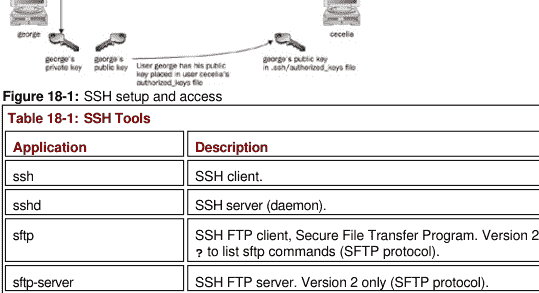

### Figure 18-1: SSH setup and access

### Table 18-1: SSH Tools

| Application | Description |
|---|---|
| `ssh` | SSH 客户端。 |
| `sshd` | SSH 服务器（守护进程）。 |
| `sftp` | SSH FTP 客户端，安全文件传输程序。仅限版本 2。使用 ? 列出 `sftp` 命令（SFTP 协议）。 |
| `sftp-server` | SSH FTP 服务器。仅限版本 2（SFTP 协议）。 |
| `scp` | SSH 复制命令客户端。 |
| `ssh-keygen` | 用于生成密钥的实用程序。-h 获取帮助。 |
| `ssh-keyscan` | 用于自动收集公钥主机密钥以生成 `ssh_known_hosts` 文件的工具。 |
| `ssh-add` | 将 RSA 和 DSA 身份添加到身份验证代理。 |
| `ssh-agent` | SSH 身份验证代理，保存用于公钥身份验证（RSA、DSA）的私钥。 |
| `ssh-askpass` | X Window System 用于查询密码的实用程序，由 `ssh-add` 调用（openssh-askpass）。 |
| `ssh-askpass-gnome` | GNOME 用于查询密码的实用程序，由 `ssh-add` 调用。 |
| `ssh-signer` | 对基于主机的身份验证数据包进行签名。仅限版本 2。必须是 suid root（由安装执行）。 |
| `slogin` | 远程登录（版本 1）。 |

需要以下步骤才能使用 SSH 访问其他账户：

- 在您的账户上创建公钥和私钥以及密码短语。您需要使用此密码短语从另一个账户访问您的账户。
- 将您的公钥分发给您想要访问的其他账户，将它们放置在 `.ssh/authorized_keys` 文件中。

其他账户也必须设置公钥和私钥以及密码短语。您还需要知道其他账户的密码短语才能访问它。

## Creating SSH Keys with ssh-keygen

您使用 `ssh-keygen` 命令创建公钥和私钥。您需要指定要使用的加密类型。您可以使用 DSA 或 RSA 加密。使用 `-t` 选项指定类型，并以小写形式输入加密名称 `dsa` 或 `rsa`。在以下示例中，用户使用 RSA 加密创建密钥：

```
ssh-keygen -t rsa
```

`ssh-keygen` 命令会提示您输入密码短语，它将用作保护私钥的密码。密码短语应由多个词组成。您还将被提示输入密钥的文件名。如果您不输入，SSH 将使用其默认值。公钥将获得 `.pub` 扩展名。`ssh-keygen` 命令生成公钥并将其放置在您的 `.ssh/id_rsa.pub` 或 `.ssh/id_dsa.pub` 文件中，具体取决于您指定的密钥类型；它将私钥放置在对应的 `.ssh/id_rsa` 或 `.ssh/id_dsa` 文件中。

**注意**：`.ssh_identity` 文件名用于 SSH 版本 1；在旧版发行版中，它可能默认已安装。SSH 版本 2 使用不同的文件名，例如 `.ssh/id_dsa` 或 `.ssh/id_rsa`

如果需要更改你的口令，你可以使用 `ssh-keygen` 命令和 `-p` 选项来完成。每个用户都会有自己的 SSH 配置目录，名为 `.ssh`，位于用户主目录中。公钥和私钥，以及 SSH 配置文件，都存放在这里。如果你从源代码构建，`make install` 操作将自动运行 `ssh-keygen`。表 18-2 列出了 SSH 配置文件。

## 授权密钥


公钥用于验证用户及其主机。你在远程系统上使用公钥来允许该用户访问。公钥放置在远程用户账户的 `.ssh/authorized_keys` 文件中。回想一下，公钥保存在 `.ssh/id_dsa.pub` 文件中。如果用户希望从本地账户登录到远程系统上的某个账户，他们首先需要将自己的公钥放置在他们想要访问的远程系统账户的 `.ssh/authorized_keys` 文件中。如果用户 `larisa` 在 `turtle.mytrek.com` 上想要访问 `rabbit.mytrek.com` 上的 `aleina` 账户，那么 `larisa` 的公钥（位于 `/home/larisa/.ssh/id_dsa.pub`）必须首先放置在 `aleina` 的 `authorized_keys` 文件中，即 `/home/aleina/.ssh/authorized_keys`。`larisa` 可以发送该密钥或将其复制过来。简单的 `cat` 操作可以将密钥追加到授权密钥文件中。在下一个示例中，用户将 `aleina` 在 `larisa.pub` 文件中的公钥添加到授权密钥文件中。`larisa.pub` 文件是用户早前收到的 `/home/larisa/.ssh/id_dsa.pub` 文件的副本。

```
cat larisa.pub >> .ssh/authorized_keys
```

### 加载密钥

如果你经常连接到各种远程主机，你可以使用 `ssh-agent` 命令将私钥放入内存，以便快速访问来解密接收到的传输数据。`ssh-agent` 命令旨在用于登录会话的开始。对于 GNOME，你可以使用由 `ssh-add` 调用的 `openssh-askpass-gnome` 实用工具，它允许你在登录到 GNOME 时输入密码。GNOME 会在你使用 SSH 客户端时自动提供该密码。

虽然 `ssh-agent` 命令允许你在内存中使用私钥，但你还必须使用 `ssh-add` 命令明确地将你的私钥加载到内存中。不带参数的 `ssh-add` 会从你的 `.ssh/id_dsa` 或 `.ssh/id_rsa` 文件中加载你的私钥。系统会提示你输入此私钥的口令。要从内存中移除密钥，使用带有 `-d` 选项的 `ssh-add`。如果你有多个私钥，你可以将它们全部加载到内存中。带有 `-l` 选项的 `ssh-add` 会列出当前已加载的密钥。

### SSH 客户端

SSH 最初被设计用来替代远程访问操作，如 `rlogin`、`rcp` 和 `Telnet`（参见第 15 章），这些程序不进行加密并引入安全风险，例如以明文传输密码。你还可以使用 SSH 对 X 服务器会话以及 FTP 传输（`sftp`）进行编码。`ssh-clients` 包包含相应的 SSH 客户端，用于替代这些应用程序。使用 `slogin` 或 `ssh`，你可以从远程主机登录以执行命令并运行应用程序，就像使用 `rlogin` 和 `rsh` 一样。使用 `scp`，你可以在远程主机和网络主机之间复制文件，就像使用 `rcp` 一样。使用 `sftp`，你可以传输通过加密保护的安全 FTP 文件。

表 18-2：SSH 配置文件

| 文件 | 描述 |
|---|---|
| `$HOME/.ssh/known_hosts` | 记录用户已登录到的所有主机的主机密钥（不包括 `/etc/ssh/ssh_known_hosts` 中的）。 |
| `$HOME/.ssh/random_seed` | 用于为随机数生成器播种。 |
| `$HOME/.ssh/id_rsa` | 包含用户的 RSA 认证身份。 |
| `$HOME/.ssh/id_dsa` | 包含用户的 DSA 认证身份。 |
| `$HOME/.ssh/id_rsa.pub` | 包含用于认证的 RSA 公钥。此文件的内容应添加到你希望使用 RSA 认证登录的所有机器上的 `$HOME/.ssh/authorized_keys` 中。 |
| `$HOME/.ssh/id_dsa.pub` | 包含用于认证的 DSA 公钥。此文件的内容应添加到你希望使用 DSA 认证登录的所有机器上的 `$HOME/.ssh/authorized_keys` 中。 |
| `$HOME/.ssh/config` | 每个用户的配置文件。 |
| `$HOME/.ssh/authorized_keys` | 列出可用于以该用户身份登录的 RSA 或 DSA 密钥。 |
| `/etc/ssh/ssh_known_hosts` | 系统范围的已知主机密钥列表。 |
| `/etc/ssh/ssh_config` | 系统范围配置文件。此文件为未在与用户配置文件中指定的值提供默认值。 |
| `/etc/ssh/sshd_config` | SSH 服务器配置文件。 |
| `/etc/ssh/sshrc` | 系统默认。此文件中的命令由 ssh 在用户登录时、用户 shell（或命令）启动前执行。 |
| `$HOME/.ssh/rc` | 此文件中的命令由 ssh 在用户登录时、用户 shell（或命令）启动前执行。 |

### ssh

使用 `ssh`，你可以从本地客户端远程登录到网络上作为 SSH 服务器运行的远程系统。这里的术语“本地客户端”指的是网络外部的计算机，例如你的家用电脑，而“远程”指的是你正在连接的网络主机系统。实际上，你是从你的本地系统连接到远程网络主机。它被设计用来替代执行远程登录的 `rlogin` 和执行远程命令的 `rsh`。使用 `ssh`，你可以从本地站点登录到网络上的远程主机，然后发送命令在该主机上执行。`ssh` 还能够支持 X Window System 连接。如果你从 X Window System 环境（如 GNOME 或 KDE）发起 `ssh` 连接，此功能会自动启用。会在本地 X 服务器和远程 X 服务器之间为你建立连接。远程主机设置一个虚设的 X 服务器，并通过它向你的本地系统发送任何 X Window System 数据，由你自己的本地 X 服务器处理。

`ssh` 登录操作的功能类似于 `rlogin` 命令。你输入 `ssh` 命令，后跟远程主机的地址，接着是 `-l` 选项和你正在登录的远程账户的登录名称（用户名）。以下示例登录到 `rabbit.mytrek.com` 主机上的 `aleina` 用户账户：

```
ssh rabbit.mytrek.com -l aleina
```

你也可以在 `ssh` 中使用地址格式的用户名，如下所示：

```
ssh aleina@rabbit.mytrek.com
```

以下清单显示了用户 `george` 如何访问 `turtle.mytrek.com` 上的 `cecelia` 账户：

```
[george@turtle george]$ ssh turtle.mytrek.com -l cecelia
cecelia@turtle.mytrek.com's password:
Last login: Fri Sep 19 15:13:05 2003 from turtle.mytrek.com
[cecelia@turtle cecelia]$
```

有多种选项可用于配置你的连接。大多数都有对应的配置选项，可以在配置文件中设置。例如，使用 `-c` 选项，你可以指定要使用的加密方法，例如 `idea`、`des`、`blowfish` 或 `arcfour`。使用 `-i` 选项，你可以选择使用特定的私钥。`-C` 选项允许你在指定级别对传输进行压缩（有关选项的完整列表，请参阅 `ssh` 手册页）。

### scp

你使用 `scp` 在网络上从一个主机复制文件到另一个主机。`scp` 旨在替代 `rcp`，它实际上使用 `ssh` 来传输数据，并采用相同的认证和加密方法。如果认证需要，`scp` 会请求密码或口令。`scp` 的操作方式与 `rcp` 非常相似。远程主机上的目录和文件通过在文件名或目录名之前使用用户名和主机地址来指定。用户名指定 `scp` 正在访问的远程用户账户，而主机是该账户所在的远程系统。你用 `@` 分隔用户和主机地址，用冒号分隔主机地址和文件或目录名。以下示例将文件 `party` 从用户的当前目录复制到位于 `rabbit.mytrek.com` 主机上的用户 `aleina` 的 `birthday` 目录中：

```
scp party aleina@rabbit.mytrek.com:/birthday/party
```

特别值得关注的是 `-r` 选项（递归），它允许你复制整个目录。有关选项的完整列表，请参阅 `scp` 手册页。

```
scp -r reports justin@rabbit.mytrek.com:/projects
```

在下一个示例中，用户 `george` 将 `mydoc1` 文件从用户 `cecelia` 的主目录中复制出来：


```
[george@turtle george]$ scp cecelia@turtle.mytrek.com:mydoc1 .
 cecelia@turtle.mytrek.com's password:
 mydoc1    0% |                         |   0 --:--
 ETA
 mydoc1  100% |*********************************|  17 00:00
 [george@turtle george]$
```

从 Windows 系统，你还可以使用 `winscp` 等 `scp` 客户端，它们将与支持 Linux `scp` 的系统交互。

### sftp 和 sftp-server

使用 `sftp`，你可以传输通过加密保护的安全 FTP 文件。`sftp` 使用与 `ftp` 相同的命令（参见第 21 章）。此客户端仅适用于 SSH 版本 2，操作方式与 `ftp` 非常相似，拥有许多相同的命令。使用 `sftp` 而不是 `ftp` 来调用 `sftp` 客户端。

```
sftp ftp.redhat.com
```

若要使用 `sftp` 客户端连接到 FTP 服务器，该服务器需要运行 `sftp-server` 应用程序。SSH 服务器调用 `sftp-server` 为使用 `sftp` 客户端的用户提供加密的 FTP 传输。SFTP 服务器和客户端使用 SSH 文件传输协议（SFTP）安全地执行 FTP 操作。

### 端口转发（隧道）

如果由于某种原因，你只能通过不安全的主机连接到安全主机，`ssh` 提供了一种称为端口转发的功能。使用端口转发，你可以保护连接中不安全的部分。这只需要指定不安全主机连接到安全主机的端口即可。这在本地主机和远程主机之间建立直接连接，通过中间的不安全主机。加密数据直接通过。此过程称为隧道，通过连接的主机创建一条加密数据的 Secure 隧道。

你可以设置端口转发，将流量转发到远程系统上的某个端口，或者本地系统上的某个端口。要将远程系统上的某个端口转发到本地系统上的某个端口，请使用 `ssh -R` 选项，后跟一个参数，其中包含本地端口、远程主机地址以及要转发的远程端口，各部分用冒号分隔。其工作原理是分配一个套接字以监听远程端口的连接。每当有连接建立到该端口时，该连接会通过安全通道进行转发，并从本地机器建立到远程端口的连接。在以下示例中，本地系统的 22 端口连接到 `rabbit.mytrek.com` 远程系统的 23 端口：

```
ssh -R 22:rabbit.mytrek.com:23
```

要将本地系统上的某个端口转发到远程系统上的某个端口，请使用 `ssh -L` 选项，后跟一个参数，其中包含本地端口、远程主机地址以及要转发的远程端口，各部分用冒号分隔。会分配一个套接字以监听本地端口的连接。每当有连接建立到该端口时，该连接会通过安全通道进行转发，并建立到远程机器上远程端口的连接。在以下示例中，本地系统的 22 端口连接到 `rabbit.mytrek.com` 远程系统的 23 端口：

```
ssh -L 22:rabbit.mytrek.com:23
```

你可以在 `.ssh/config` 文件中使用 `LocalForward` 和 `RemoteForward` 选项，为特定主机设置端口转发，或为你连接的所有主机指定默认值。

### SSH 配置

每个用户的 SSH 配置文件位于其 `.ssh/config` 文件中。`/etc/ssh/ssh_config` 文件用于设置站点范围的默认值。在配置文件中，你可以设置各种选项，这些选项列在 `ssh_config` 手册页中。配置文件旨在为可能连接的不同远程主机指定选项。它按段组织，每段以关键字 `HOST` 开头，后跟主机的 IP 地址。以下行包含你为该主机设置的选项。一段在下一个 `HOST` 条目处结束。特别值得关注的是 `User` 和 `Cipher` 选项。使用 `User` 选项指定允许访问的远程系统用户名。通过 `Cipher` 选项，你可以选择针对特定主机使用的加密方法。加密方法包括 `idea`、`des`（标准）、`triple-des`（3des）、`blowfish`（128 位）、`arcfour`（RSA 的 RC4）和 `twofish`。以下示例允许来自 `turtle.mytrek.com` 的 `larisa` 用户访问，并对传输使用 Blowfish 加密：

```
Host turtle.mytrek.com
    User larisa
    Compression no
    Cipher blowfish
```

要指定适用于你连接的任何主机的全局选项，请创建一个以星号作为主机的 `HOST` 条目：`HOST *`。此条目必须放置在配置文件的末尾，因为选项只在首次设置时更改。后续针对同一选项的条目将被忽略。由于主机既匹配其自身条目也匹配全局条目，其特定条目应位于全局条目之前。星号 `*` 和问号 `?` 都是通配符匹配运算符，允许你指定具有相同后缀或前缀的一组主机。

```
Host *
    FallBackToRsh yes
    KeepAlive no
    Cipher idea
```


## ABC Amber CHM Converter 试用版

请注册以移除此横幅。

http://www.processtext.com/abcchm.html

### Kerberos

用户身份验证可以通过本章节讨论的 Kerberos 服务器进一步控制某些服务。Kerberos 身份验证提供了另一层安全性，使得单独的服务可以得到保护，仅允许经过授权的用户使用某项服务。所有 Kerberos 服务器都通过 `authconfig-gtk` 启用和配置（系统设置菜单或窗口中的“认证”）。

Kerberos 是一种网络身份验证协议，为客户端和服务器之间的连接提供加密身份验证。作为身份验证协议，Kerberos 要求客户端在访问服务器之前使用加密方法证明其身份。一旦通过身份验证，客户端和服务器即可使用加密进行所有通信。防火墙仅保护来自外部的攻击，而 Kerberos 的设计还保护来自网络内部人员的攻击。已经在网络内部的用户可能会试图入侵本地服务器。Kerberos 直接保护服务器本身，而非整个网络或计算机。麻省理工学院（MIT）提供免费版本，可在 `web.mit.edu/kerberos` 获取，其许可证类似于 GNU 公共许可证。Kerberos 的名字源于希腊神话，是冥界三头守门犬的名字。请务必查看 `web.mit.edu/kerberos` 网站以获取最近的升级和详细文档，包括常见问题解答、手册和教程。

**提示** Kerberos V5 软件包包含其自身版本的网络工具，如 Telnet、RCP、FTP 和 RSH。这些工具为远程用户提供安全的经过身份验证的访问权限。这些工具的操作方式与其在第 15 章中描述的原始对应工具相同。该软件包还包含 `su` 管理员登录命令的 Kerberos 版本，即 `ksu`。

#### Kerberos 服务器

Kerberos 的关键是 Kerberos 服务器，所有对任何服务器服务的请求都通过它进行中转。然后，Kerberos 服务器对客户端进行身份验证，识别客户端并验证客户端使用特定服务器的权利。服务器维护一个授权用户的数据库。随后，Kerberos 向客户端颁发一个加密票据，客户端可以使用该票据获取对服务器的访问权限。例如，如果用户需要检查邮件，对邮件服务器的使用请求会被发送到 Kerberos 服务器，然后服务器验证用户身份并发出一个票据，该票据随后用于访问邮件服务器。没有 Kerberos 颁发的票据，任何人都无法访问任何服务器。最初，此过程要求用户为他们想要访问的每个服务器执行单独的身份验证程序。然而，现在用户只需要执行一次初始身份验证，该身份验证对所有服务器都有效。

**提示** 在 Red Hat 上，你可以使用 Kerberos 票据管理器（附加组件附件菜单）来管理 Kerberos 票据，并使用 `authconfig-gtk` 工具（系统设置窗口或菜单中的“认证”）来指定和启用 Kerberos 领域。

此过程实际上涉及使用两个服务器：身份验证服务器（AS）和票据授予服务器（TGS）。它们共同构成了所谓的密钥分发中心（KDC）。从本质上讲，它们分发用于解锁服务访问权限的密钥。身份验证服务器首先验证用户的身份。AS 颁发一种称为票据授予票据（TGT）的票据，允许用户访问票据授予服务器。然后，TGS 向用户颁发另一个票据以实际访问服务。这样，在身份验证过程中，用户永远不对服务器有任何直接访问权限。此过程比描述的稍复杂一些。一个使用当前时间、校验和以及可选加密密钥等信息的身份验证器会随票据一起发送，并使用会话密钥解密。服务使用此身份验证器来验证你的身份。

**注意** 你可以使用 `klist` 命令查看当前票据列表。

### 身份验证过程


身份验证服务器使用其用户数据库中的信息来验证用户。每个用户都必须在身份验证服务器的数据库中注册。数据库将包含用户密码和其他用户信息。要访问身份验证服务器，用户提供用户名和密码。密码用于生成用户密钥，AS 与用户之间的通信使用该密钥进行加密。用户将拥有用户密钥的副本，用于解密通信。身份验证过程如图 18-2 所示。

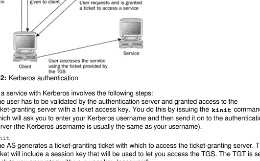

图 18-2：Kerberos 身份验证

使用 Kerberos 访问服务涉及以下步骤：
- 1. 用户必须通过身份验证服务器进行验证，并授予访问票据授予服务器的权限，使用票据访问密钥。你可以通过发出 `kinit` 命令来完成此操作，该命令会要求你输入你的 Kerberos 用户名，然后将其发送到身份验证服务器（Kerberos 用户名通常与你的用户名相同）。
- `kinit`
- 2. AS 生成一个票据授予票据（TGT），用于访问票据授予服务器。此票据将包含一个会话密钥，让你能够访问 TGS。TGT 使用你的用户密钥（密码）加密后返回给你。
- 3. 然后，`kinit` 程序提示你输入你的 Kerberos 密码，它随后使用该密码解密 TGT。你可以使用 `kpasswd` 命令管理你的 Kerberos 密码。
- 4. 现在，你可以使用诸如邮件客户端程序这样的客户端程序来访问例如邮件服务器。当你这样做时，TGT 被用于访问 TGS，TGS 随后生成一个用于访问邮件服务器的票据。TGS 将仅为邮件服务器生成一个新的会话密钥。这将包含在发送给你用于访问邮件服务器的票据中。实际上，有一个用于访问 TGS 的 TGT 会话密钥，以及一个用于访问邮件服务器的邮件会话密钥。用于邮件服务器的票据使用 TGS 会话密钥加密后发送给你。
- 5. 然后，客户端使用从 TGS 接收到的邮件票据来访问邮件服务器。
- 6. 如果你想要使用另一个服务，例如 FTP，当你的 FTP 客户端向 TGS 发送请求以获取票据时，TGS 会自动从身份验证服务器获取授权，并发出一个带有 FTP 会话密钥的 FTP 票据。这种支持在有限的时间内保持有效，通常为几个小时，之后你必须再次使用 `kinit` 进行身份验证过程并访问 TGS。你可以使用 `kdestroy` 命令手动销毁你拥有的任何票据。

### 备注
在 Kerberos V5（版本 5）中，提供了一款 Kerberos 登录工具，当用户正常登录时，会自动授予其发牌票据（ticket-granting tickets）。这避免了对使用 `kinit` 的需求。

### Kerberized 服务
将特定服务配置为使用 Kerberos（称为 Kerberizing 过程）可能是一个复杂的过程。Kerberized 服务需要验证用户的身份和凭据，检查该服务的票据，如果不存在则获取一张。一旦设置完成，使用 Kerberized 服务对用户来说几乎是透明的。票据会自动发放，身份验证也会在不需用户额外操作的情况下完成。

### 配置 Kerberos 服务器
安装和配置 Kerberos 服务器也是一个复杂的过程。请仔细查阅当前版本安装的文档。这里列出了一些关键领域。在 Kerberos 配置文件 `krb5.conf` 中，你可以设置加密方法、数据库名称等特性。在安装 Kerberos 时，务必仔细按照说明授予管理访问权限。`/etc/services` 文件应包含所有 Kerberized 服务的列表。这些服务例如 `kftp` 或 `klogin`，它们提供 Kerberos FTP 和登录服务。要运行 Kerberos，你需要使用 `service` 命令以及 `krb5kdc`、`kadmin` 和 `krb524` 脚本启动 Kerberos 服务器。

提示：有关在系统中设置 Kerberos 服务器和客户端的更详细说明，请查阅 Red Hat Linux 参考手册。

有关如何在 Red Hat 上安装和配置 Kerberos 的详细说明，请查阅 Red Hat Linux 参考指南。你需要为网络配置服务器，并为每个主机配置客户端。要配置服务器，首先通过手动替换 `/etc/krb5.conf` 和 `/var/kerberos/krb5kdc/kdc.conf` 文件中的小写 example.com 和大写 EXAMPLE.COM 条目为你的域名来指定你的 Kerberos 区域和域。请保持每个条目的大小写一致。区域以大写表示，简单的宿主和域名以小写表示。然后使用 `kdb5_util` 命令和 `create` 选项创建一个数据库。系统会提示你输入主密钥。

```
kdb5_util create -s
```

对服务器的完整管理访问权限由 `/var/kerberos/krb5kdc/kadm5.acl` 文件中的用户条目控制。将 `EXAMPLE.COM` 文本替换为你的 Kerberos 区域（通常是你域名的大写形式）。然后你需要添加一个本地主体，即从运行服务器的主机上拥有完整管理权限的本地用户。启动 `kadmin.local` 工具并使用 `addprinc` 命令添加本地主体。然后你可以启动 `krb5kdc`、`kadmin` 和 `krb524` 服务器。

在每个客户端主机上，使用 `kadmin` 工具配合 `addprincipal` 命令为主机添加一个主体。此外，对于网络中的每个主机，使用 `host/` 限定符添加一个主机主体，例如 `host/rabbit.mytrek.com`。你可以使用 `--randkey` 选项来指定随机密钥。然后使用 `ktadd` 命令将主机密钥的本地副本保存在其 `/etc/krb5.keytab` 文件中。每个主机系统还需要具有相同的 `/etc/krb5.conf` 配置文件，其中指定了 Kerberos 服务器和 kdc 主机。

备注：当你使用身份验证工具配置 Kerberos 时，你将能够输入区域、kdc 服务器和 Kerberos 服务器。默认条目将使用 “example.com” 中的域名显示。


## ABC Amber CHM 转换器试用版

请注册以移除此横幅。

http://www.processestext.com/abchm.html

### 第 19 章：网络防火墙：Netfilter

#### 概述
目前连接到 Internet 的大多数系统都对外部用户试图获得未授权访问的尝试开放。外部用户可以通过建立非法连接直接尝试获得访问，或者通过截获远程连接到该系统的用户的合法通信，或者通过伪装成合法用户来尝试获得访问。防火墙、加密和身份验证程序是防范此类攻击的方式。*防火墙*防止任何直接的未授权访问尝试，*加密*保护来自授权远程用户的传输，而*身份验证*则验证请求访问的用户是否具有这样做的权利。当前的 Linux 内核结合了使用 Netfilter (`iptables`) 数据包过滤包来实现防火墙的支持（前一个版本 ipchains 用于旧的内核版本）。要实现防火墙，你只需提供一系列规则来规定你想在系统中允许哪种类型的访问。如果该系统也是私有网络的网关，那么该系统的防火墙功能可以有效地帮助保护网络免受外部攻击。

备注：你可以使用 `redhat-config-securitylevel` 工具（系统设置菜单或窗口中的安全级别）设置基本的 Netfilter 防火墙保护。该工具将生成一组基本的 `iptables` 规则来保护你的系统和网络（参见第 5 章）。

为了保护远程通信，传输可以简单地加密。对于 Linux 系统，你可以使用 Secure Shell (`SSH`) 程序套件来加密任何传输，防止其他人读取它们（参见第 18 章）。Kerberos 身份验证提供了另一层安全，使得单个服务可以得到保护，仅允许被授权访问的用户使用该服务（参见第 18 章）。外部用户还可能试图通过你托管的任何 Internet 服务（如 Web 站点）获得未授权访问。在这种情况下，你可以设置代理来保护你的站点免受攻击。对于 Linux 系统，使用 Squid 代理软件设置代理来保护你的 Web 服务器（参见第 23 章）。表 19-1 列出了 Linux 上常用的几种网络安全应用程序。

表 19-1：网络安全应用程序

| 网站 | 安全应用程序 |
|---|---|
| www.netfilter.org | Netfilter 项目、`iptables` 和 NAT |
| www.netfilter.org/ipchains | IP-Chains 防火墙 |
| www.openssh.org | Secure Shell 加密 |
| www.squid-cache.org | Squid Web 代理服务器 |
| web.mit.edu/Kerberos | Kerberos 网络身份验证 |


## ABC Amber CHM 转换器试用版

请注册以移除此横幅。


http://www.processestext.com/abcchm.html

## 防火墙：iptables 和 NAT

为你的网络安全奠定良好基础的方法之一是设置一个 Linux 系统作为你的网络的防火墙，保护它免受未授权访问。你可以使用防火墙来实现数据包过滤或代理。数据包过滤简单地说是决定是否将防火墙主机接收到的数据包传递到本地网络的过程。数据包过滤软件检查数据包的源地址和目的地址，如果允许，则将数据包发送出去。即使你的系统不是网络的一部分，而是直接连接到 Internet，你仍然可以使用防火墙功能来控制对你系统的访问。当然，这也为你提供了更多的安全性。

使用代理，你可以控制对特定服务（如 Web 或 FTP 服务器）的访问。你需要为想要控制的每个服务设置一个代理。Web 服务器有其自己的 Web 代理，而 FTP 服务器有 FTP 代理。代理还可以用于缓存常用数据（如网页），这样用户就不必频繁访问原始站点。Linux 系统上常用的代理软件是 `Squid`，在第 23 章中有讨论。

防火墙执行的另一项任务是网络地址转换 `NAT`。网络地址转换将数据包重定向到适当的目标。它执行诸如将数据包重定向到特定主机、将数据包转发到其他网络、更改数据包的主机源以实现 IP 伪装等任务。

备注：`ipchains` 包是 `iptables` 的前身，用于运行 2.2 内核的 Linux 系统。它仍在使用许多 Linux 系统中。`ipchains` 的 Linux 网站（它是旧版 Linux 中使用的 `ipfwadm` 的继任者）目前是 www.netfilter.org/ipchains/。

`Netfilter` 软件包在 Linux 2.4 及以上内核中实现了数据包过滤和 NAT 任务。`Netfilter` 软件由 Netfilter 项目开发，你可以在 www.netfilter.org 上了解更多信息。用于执行数据包过滤和 NAT 任务的命令是 `iptables`，该软件通常简称为 `iptables`。然而，`Netfilter` 使用不同的表和命令分别实现数据包过滤和 NAT 任务。表将保存其应用程序的命令集。这种方法简化了数据包过滤任务，让 `iptables` 能够在没有同时处理地址转换开销的情况下执行数据包过滤检查。NAT 操作也从与数据包过滤检查混合中解放出来。你使用 `iptables` 命令进行数据包过滤和 NAT 任务，但对于 NAT 你需要添加 `-nat` 选项。

`iptables` 软件可以直接编译到 2.4 内核中，或者作为内核模块 `iptable_filter.o` 加载。与其前身 `ipchains` 不同，`Netfilter` 被设计为模块化且可扩展的。可以通过模块（如 `state` 模块，它增加了连接跟踪功能）的形式添加功能。

备注：`iptables` 包包含对 `ipfwadm` 和 `ipchains` 的向后兼容模块。实际上，`iptables` 与 `ipchains` 非常相似。你仍然可以通过加载 `Netfilter` 软件提供的 `ipchains.o` 或 `ipfwadm.o` 模块来使用 `ipchains` 和更早的 `ipfwadm` 命令。这些模块提供了完全的向后兼容性。


## ABC Amber CHM 转换器 试用版

请注册以移除此横幅。

http://www.processestext.com/abcchm.html

### 数据包过滤

`Netfilter` 本质上是一个数据包管理框架，它可以检查数据包是否符合特定的网络协议，并通知正在监听这些数据包的内核部分。基于 `Netfilter` 框架构建的是由 IP tables 实现的数据包选择系统。通过 IP tables，可以设置不同的规则表，根据不同的标准来选择数据包。`Netfilter` 目前支持三个表：`filter`（过滤）、`nat`（网络地址转换）和 `mangle`（修改）。数据包过滤是使用 `filter` 表实现的，该表包含用于丢弃或接受数据包的规则。诸如 IP 伪装（IP masquerading）之类的网络地址转换操作是使用 NAT 表实现的，该表包含 IP 伪装规则。`mangle` 表用于专门的数据包修改。可以在数据包发出之前、接收时或转发过程中对其进行的修改。这种结构具有可扩展性，因为新模块可以定义包含自身规则的新表。它还极大地提高了效率。数据包不再需要检查一个巨大的单一表，而是只访问它们所需的那部分规则表。

IP table 规则使用 `iptables` 命令进行管理。对于该命令，您需要指定要管理的表。默认是 `filter` 表，无需指定。您可以随时使用 `-L` 和 `-n` 选项列出已添加的规则，如下所示。`-n` 选项表示仅对 IP 地址和端口使用数字输出，从而避免对主机名进行 DNS 查询。不过，您也可以仅使用 `-L` 选项来查看端口标签和主机名：

```
iptables -L -n
```

注意 在 `iptables` 命令中，链名称必须使用大写输入，例如链名称 `INPUT`、`OUTPUT` 和 `FORWARD`。

### 链

规则被组合到不同的链中。内核使用链来管理其接收和发出的数据包。链只是一个规则清单。这些规则指定了对包含特定标头的数据包应采取的操作。规则采用 if-then-else 结构运行。如果数据包不匹配第一条规则，则检查下一条规则，依此类推。如果数据包不匹配任何规则，内核将参考链的策略。通常，在此时数据包会被拒绝。如果数据包匹配某条规则，它将被传递到其目标，该目标决定如何处理该数据包。标准目标列在表 19-2 中。如果数据包不匹配任何规则，它将被传递到链的默认目标。

表 19-2：iptables 目标

| 目标 | 功能 |
|---|---|
| ACCEPT | 允许数据包通过防火墙。 |
| DROP | 拒绝数据包访问。 |
| REJECT | 拒绝访问并通知发送方。 |
| QUEUE | 将数据包发送到用户空间。 |
| RETURN | 跳转到链的末尾，让默认目标处理它。 |

### 目标

目标本身也可以是另一条规则链，甚至是用户定义的规则链。数据包可能在最终到达目标之前经过几条链。对于用户定义的链，默认目标始终是调用它的链中的下一条规则。这建立了一种类似于编程语言中的过程或函数调用控制流。当一条规则的目标是用户定义的链时，一旦该规则被激活，该用户定义的链就会执行。如果没有匹配的规则，执行将返回到源链中的下一条规则。

**提示** 可以通过 Netfilter 站点提供的内核补丁添加专门的目标和选项。例如，`SAME` 补丁为所有连接返回相同的地址。Netfilter 制作文件的 `patch-o-matic` 选项将修补您的内核源代码，添加对新目标和选项的支持。然后，您可以按照第 33 章的说明重新构建并安装您的内核。

### 防火墙链

内核使用三个防火墙链：`INPUT`、`OUTPUT` 和 `FORWARD`。当通过接口接收到数据包时，使用 `INPUT` 链来决定如何处理它。然后，内核使用其路由信息决定将其发送到哪里。如果内核将数据包发送到另一台主机，则会检查 `FORWARD` 链。在数据包实际发出之前，也会检查 `OUTPUT` 链。此外，还实现了两个 NAT 表链，`POSTROUTING` 和 `PREROUTING`，用于处理伪装和数据包地址修改。内置的 Netfilter 链列在表 19-3 中。

**表 19-3：Netfilter 内置链**

| 链 | 描述 |
|---|---|
| INPUT | 入站数据包规则 |
| OUTPUT | 出站数据包规则 |
| FORWARD | 转发数据包规则 |
| PREROUTING | 重定向或修改入站数据包的规则，仅限 NAT 表 |
| POSTROUTING | 重定向或修改出站数据包的规则，仅限 NAT 表 |

### 添加和修改规则

您使用 `iptables` 命令添加和修改链规则。`iptables` 命令由关键字 `iptables` 后跟一个表示要执行命令的参数组成。例如，`iptables -A` 是添加新规则的命令，而 `iptables -D` 是删除规则的命令。`iptables` 命令列在表 19-4 中。以下命令简单地列出了当前为您的系统定义的链及其规则。输出显示了由 `iptables` 命令创建的默认值。

```
iptables -L -n
Chain input (policy ACCEPT):
Chain forward (policy ACCEPT):
Chain output (policy ACCEPT):
```

要为链添加新规则，请使用 `-A`。使用 `-D` 删除它，使用 `-R` 替换它。在命令之后，列出规则适用的链，例如 `INPUT`、`OUTPUT` 或 `FORWARD` 链，或用户定义的链。接下来，列出指定您想要执行的操作的不同选项（大多数与用于 `ipchains` 的选项相同，少数例外）。`-s` 选项指定数据包附带的源地址，`-d` 指定目标地址，`-j` 选项指定规则的目标。`ACCEPT` 目标将允许数据包通过。`-i` 选项现在指示输入设备，只能与 `INPUT` 和 `FORWARD` 链一起使用。`-o` 选项指示输出设备，只能用于 `OUTPUT` 和 `FORWARD` 链。表 19-5 列出了几个基本选项。

**表 19-4：iptables 命令**


### 表 19-4：iptables 命令

| 选项 | 功能 |
|---|---|
| `-A chain` | 向链中追加规则。 |
| `-D chain [ rulenums ]` | 从链中删除匹配的规则。从 `chain` 中删除规则 `rulenums`（1 = 第一条）。 |
| `-I chain [ rulenums ]` | 在 `chain` 中插入作为 `rulenums`（默认 1 = 第一条）。 |
| `-R chain rulenums` | 替换 `chain` 中的规则 `rulenums`（1 = 第一条）。 |
| `-L [chain]` | 列出 `chain` 或所有链中的规则。 |
| `-E [chain]` | 重命名链。 |
| `-F [chain]` | 删除（清空）`chain` 或所有链中的所有规则。 |
| `-R chain` | 替换规则；规则从 1 开始编号。 |
| `-Z [chain]` | 将 `chain` 或所有链中的计数器清零。 |
| `-N chain` | 创建新的用户定义链。 |
| `-X chain` | 删除用户定义链。 |
| `-P chain target` | 将 `chain` 的策略更改为 `target`。 |

#### iptables 选项

`iptables` 包的设计具有可扩展性，并且有许多包含选择标准的选项可以与 `iptables` 一起使用。例如，TCP 扩展包含检查 SYN 数据包的 `--syn` 选项。ICMP 扩展提供了指定 ICMP 数据包（如 ping 操作中使用的那些）的 `--icmp-type` 选项。`limit` 扩展包含 `--limit` 选项，您可以使用它在指定的时间段内（如一秒）限制匹配数据包的最大数量。

### 表 19-5：iptables 选项

| 选项 | 功能 |
|---|---|
| `-p [!] proto` | 指定协议，如 TCP、UDP、ICMP 或 ALL。 |
| `-s [!] address [/mask] [!] [port[:port]]` | 要匹配的源地址。使用 `port` 参数时，您可以指定端口。 |
| `--sport [!] [port[:port]]` | 源端口规范。您可以使用冒号指定端口范围，`port:port`。 |
| `-d [!] address [/mask] [!] [port[:port]]` | 要匹配的目的地地址。使用 `port` 参数时，您可以指定端口。 |
| `--dport [!][port[:port]]` | 目的地端口规范。 |
| `--icmp-type [!] typename` | 指定 ICMP 类型。 |
| `-i [!] name[+]` | 使用其名称指定输入网络接口（例如，`eth0`）。`+` 符号作为通配符使用。名称末尾附加的 `+` 匹配具有该前缀的所有接口（`eth+` 匹配所有以太网接口）。只能与 INPUT 链一起使用。 |
| `-j target [port]` | 指定规则的目标（为 REDIRECT 目标指定 `[port]`）。 |
| `--to-source <ipaddr>[ - <ipaddr> ][:port-port]` | 与 SNAT 目标一起使用，用新的源 IP 地址重写数据包。 |
| `--to-destination <ipaddr>[ - <ipaddr> ][:port-port]` | 与 DNAT 目标一起使用，用新的目的 IP 地址重写数据包。 |
| `-n` | 地址和端口的数字输出，需与 `-L` 一起使用。 |
| `-o [!] name[+]` | 使用接口名称指定输出网络接口（例如，`eth0`）。只能用于 FORWARD 和 OUTPUT 链。 |
| `-t table` | 指定要使用的表，例如 `-t nat` 用于 NAT 表。 |
| `-v` | 详细模式，显示规则详情，需与 `-L` 一起使用。 |
| `-x` | 展开数字（显示确切值），需与 `-L` 一起使用。 |
| `[!] -f` | 匹配分片数据包的第二个到最后一个片段。 |
| `[!] -V` | 打印程序版本。 |
| `!` | 否定某个选项或地址。 |
| `-m` | 指定要使用的模块，例如 `state`。 |
| `--state` | 指定 `state` 模块的选项，如 NEW、INVALID、RELATED 和 ESTABLISHED。用于检测数据包状态。NEW 指代 SYN 数据包（新连接）。 |
| `--syn` | SYN 数据包，新连接。 |
| `--tcp-flags` | TCP 标志位：SYN、ACK、FIN、RST、URG、PSH，以及 ALL 表示所有标志位。 |
| `--limit` | `limit` 模块（`-m limit`）的选项。用于控制匹配速率，即每秒匹配指定次数。 |
| `--limit-burst` | `limit` 模块（`-m limit`）的选项。指定限制生效前的最大突发量。用于控制拒绝服务攻击。 |

在下述示例中，用户向 INPUT 链添加了一条规则，以接受所有源自地址 `192.168.0.55` 的数据包。任何接收到的（INPUT）且源地址（`-s`）匹配 `192.168.0.55` 的数据包将被接受并放行（`-j ACCEPT`）。

```
iptables -A INPUT -s 192.168.0.55 -j ACCEPT
```

#### 接受和拒绝数据包：DROP 和 ACCEPT

有两个内置目标：DROP 和 ACCEPT。其他目标可以是用户自定义链或附加的扩展，例如 REJECT。还有两个用于管理链的特殊目标：RETURN 和 QUEUE。RETURN 表示链的结束，并返回到它起始所在的链。QUEUE 用于将数据包发送到用户空间。

```
iptables -A INPUT -s www.myjunk.com -j DROP
```

你可以使用 `!` 符号将一条规则转换为其反义。例如，若要接受除特定地址外的所有传入数据包，请在 `-s` 选项及其地址前放置 `!` 符号。以下示例将接受除来自 IP 地址 `192.168.0.45` 之外的所有数据包：

```
iptables -A INPUT -j ACCEPT ! -s 192.168.0.45
```

你可以使用域名或 IP 号来指定单个地址。对于地址范围，你可以使用其网络的 IP 号和网络 IP 掩码。IP 掩码可以是 IP 号，或者 simply 构成掩码的位数。例如，网络 `192.168.0` 中的所有地址可以表示为 `192.168.0.0/255.255.255.0` 或 `192.168.0.0/24`。若要指定任意地址，可以使用 `0.0.0.0/0.0.0.0` 或 simply `0/0`。默认情况下，如果不存在 `-s` 或 `-d` 指定，规则将引用任意地址。以下示例接受来自（源）`192.168.0.0` 网络中任何主机且去向（目的）为任意位置（省略了 `-d` 选项，或者可以写为 `-d 0/0`）的传入消息：

```
iptables -A INPUT -s 192.168.0.0/24 -j ACCEPT
```

`iptables` 规则通常应用于特定的网络接口，例如用于连接互联网的以太网接口。对于连接互联网的单系统，你将有两个接口：一个是你的互联网连接接口，另一个是用于系统内用户之间内部连接的本地主机接口（`lo`）。互联网的网络接口使用接口的设备名称进行引用。例如，设备名为 `/dev/eth0` 的以太网卡将通过名称 `eth0` 引用。使用 PPP 协议且设备名为 `/dev/ppp0` 的调制解调器将具有名称 `ppp0`。在 `iptables` 规则中，你使用 `-i` 选项来指示输入设备；它只能用于 INPUT 和 FORWARD 链。`-o` 选项指示输出设备，只能用于 OUTPUT 和 FORWARD 链。然后，规则可以应用于到达或离开特定网络设备的数据包。在以下示例中，第一条规则引用以太网设备 `eth0`，第二条引用本地主机：

```
iptables -A INPUT -j DROP -i eth0 -s 192.168.0.45
iptables -A INPUT -j ACCEPT -i lo
```

#### 用户自定义链

在 `iptables` 中，FORWARD 和 INPUT 链是分开评估的。一个不会馈送到另一个。这意味着，如果你想完全阻止某些地址通过你的系统，你需要为它们同时添加 FORWARD 规则和 INPUT 规则。

```
iptables -A INPUT -j DROP -i eth0 -s 192.168.0.45
iptables -A FORWARD -j DROP -i eth0 -s 192.168.0.45
```


减少重复的 `INPUT` 和 `FORWARD` 规则的常见方法是创建一个用户链，使 `INPUT` 和 `FORWARD` 链都馈入该链。你使用 `-N` 选项定义用户链。下一个示例展示了这种配置的基本格式。创建了一个名为 `incoming` 的新链（可以使用你选择的任何名称）。你原本为 `FORWARD` 和 `INPUT` 链定义的规则现在是为 `incoming` 链定义的。然后，`INPUT` 和 `FORWARD` 链将 `incoming` 链作为目标，直接跳转到它并使用其规则处理它们接收的任何数据包。

```
iptables -N incoming
iptables -A incoming -j DROP -i eth0 -s 192.168.0.45
iptables -A incoming -j ACCEPT -i lo
iptables -A FORWARD -j incoming
iptables -A INPUT -j incoming
```

## ICMP 数据包

防火墙通常会阻止某些互联网控制消息协议（`ICMP`）消息。特别是，`ICMP` 重定向消息可以接管你的路由任务。然而，你需要启用某些 `ICMP` 消息，例如 `ping`、`traceroute` 以及特别是 `destination-unreachable` 操作所需的那些消息。在大多数情况下，你总是需要确保允许 `destination-unreachable` 数据包；否则，域名查询可能会挂起。表 19-6 列出了一些更常见的 `ICMP` 数据包类型。你可以使用 `--icmp-type` 选项启用某种 `ICMP` 数据包类型，该选项接受一个数字或表示消息的名称作为参数。以下示例启用使用 `echo-reply`、`echo-request` 和 `destination-unreachable` 消息，它们的编号分别为 `0`、`8` 和 `3`。

```
iptables -A INPUT -j ACCEPT -p icmp -i eth0 --icmp-type echo-reply -d 10.0.0.1
iptables -A INPUT -j ACCEPT -p icmp -i eth0 --icmp-type echo-request -d 10.0.0.1
iptables -A INPUT -j ACCEPT -p icmp -i eth0 --icmp-type destination-unreachable -d 10.0.0.1
```

它们的规则列表将如下所示：

```
ACCEPT icmp -- 0.0.0.0/0 10.0.0.1 icmp type 0
ACCEPT icmp -- 0.0.0.0/0 10.0.0.1 icmp type 8
ACCEPT icmp -- 0.0.0.0/0 10.0.0.1 icmp type 3
```

需要进一步控制 `Ping` 操作，以避免 `ping-of-death` 安全威胁。你可以用几种方式做到这一点。一种方式是拒绝任何 `ping` 片段。`Ping` 数据包通常非常小。你可以通过拒绝任何 `ICMP` 片段数据包来阻止 `ping-of-death` 攻击。使用 `-f` 选项指示片段。

```
iptables -A INPUT -p icmp -j DROP -f
```

另一种方式是限制接收到的 `ping` 数据包匹配次数。你使用 `limit` 模块来控制 `ICMP ping` 操作的匹配数量。使用 `-m limit` 来使用 `limit` 模块，并使用 `--limit` 指定允许的匹配次数。`1/s` 允许每秒匹配一次。

```
iptables -A FORWARD -p icmp --icmp-type echo-request -m limit --limit 1/s -j ACCEPT
```

### 表 19-6：常见 ICMP 数据包

| 编号 | 名称 | 被谁需要 |
|---|---|---|
| 0 | echo-reply | ping |
| 3 | destination-unreachable | 任何 TCP/UDP 流量 |
| 5 | redirect | 如果未运行路由守护进程则用于路由 |
| 8 | echo-request | ping |
| 11 | time-exceeded | traceroute |

## 控制端口访问

如果你的系统托管互联网服务，例如 Web 或 FTP 服务器，你可以使用 `iptables` 来控制对其的访问。你可以通过使用源端口（`--sport`）或目的端口（`--dport`）选项及服务使用的端口来指定特定服务。`iptables` 允许你使用端口名称，例如用于 Web 服务器端口的 `www`。服务名称及其使用的端口列在 `/etc/services` 文件中，该文件将端口映射到特定服务。对于域名服务器，端口将是 `domain`。你也可以使用端口号，如果需要，在数字前加冒号。以下示例接受所有发送到位于 `192.168.0.43` 的 Web 服务器的消息：

```
iptables -A INPUT -d 192.168.0.43 --dport www -j ACCEPT
```

你也可以使用端口引用来保护某些服务并拒绝其他服务。如果你正在设计一个对互联网更加开放的防火墙，允许用户更自由地使用互联网连接，这种方法经常被采用。一些你知道可能是有害的服务，如 `Telnet` 和 `NTP`，可以有选择地被拒绝。例如，要在防火墙上拒绝任何类型的 `Telnet` 操作，你可以丢弃所有进入 `Telnet` 端口 `23` 的数据包。为了保护 `NFS` 操作，你可以拒绝访问端口映射器（`portmapper`）使用的端口 `111`。你可以使用端口号或端口名称。

```
# deny outside access to portmapper port on firewall.
iptables -A arriving -j DROP -p tcp -i eth0 --dport 111
# deny outside access to telnet port on firewall.
iptables -A arriving -j DROP -p tcp -i eth0 --dport telnet
```

规则列表将如下所示：

```
DROP    tcp  --  0.0.0.0/0   0.0.0.0/0   tcp dpt:111
DROP    tcp  --  0.0.0.0/0   0.0.0.0/0   tcp dpt:23
```

一个与端口相关的安全问题是对 `XFree86` 端口（范围从 `6000` 到 `6009`）上 `X` 服务器的访问。在一个相对开放的防火墙上，这些端口可能被用来通过你的 `X` 服务器非法访问你的系统。端口范围可以用冒号指定，例如 `6000:6009`。你也可以使用 `x11` 代表第一个端口，即 `x11:6009`。可以使用 `SSH` 来保护 `X` 服务器上的会话，`SSH` 通常访问 `X` 服务器的 `6010` 端口。

```
iptables -A arriving -j DROP -p tcp -i eth0 --dport 6000:6009
```

此处列出了常见检查的端口及其标签：

| 服务 | 端口号 | 端口标签 |
|---|---|---|
| Auth | 113 | auth |
| Finger | 79 | finger |
| FTP | 21 | ftp |
| NTP | 123 | ntp |
| Portmapper | 111 | sunrpc |
| Telnet | 23 | telnet |
| Web server | 80 | www |
| XFree86 | 6000:6009 | x11:6009 |

## 数据包状态：连接跟踪

更有用的扩展之一是 `state` 扩展，它可以轻松检测数据包的跟踪信息。连接跟踪维护关于连接的信息，例如其源、目标和端口。它提供了一种有效的手段来确定哪些数据包属于已建立或相关的连接。要使用连接跟踪，你首先使用 `-m state` 指定状态模块。然后你可以使用 `--state` 选项。在这里，你可以指定以下任何状态：

| 状态 | 描述 |
|---|---|
| NEW | 创建新连接的数据包 |
| ESTABLISHED | 属于现有连接的数据包 |
| RELATED | 与现有连接相关但不是其一部分的数据包，例如 ICMP 错误或建立 FTP 数据连接的数据包 |
| INVALID | 由于某种原因无法识别的数据包 |
| RELATED+REPLY | 与已建立连接相关但不直接属于该连接的数据包 |


如果你正在设计旨在保护本地网络免受来自外部网络任何渗透尝试的防火墙，你可能想要限制传入的数据包。简单地拒绝所有数据包的访问是不可行的，因为连接到外部服务器（例如，在互联网上）的用户必须从这些服务器接收信息。相反，你可以拒绝用于发起连接的特定类型数据包的访问。其想法是攻击者必须从外部发起连接。这类数据包的头部设置其 `SYN` 位，其 `FIN` 和 `ACK` 位为空。状态模块的 `NEW` 状态与任何这样的 `SYN` 数据包匹配。通过为这类数据包指定 `DROP` 目标，你拒绝任何试图与你的系统建立连接的数据包的访问。任何试图从外部连接到你的系统的人都无法做到。你本地系统上那些已经与外部主机建立连接的用户仍然可以与它们通信。以下示例将丢弃任何试图在 `eth0` 接口上创建新连接的数据包，尽管它们在其他接口上会被接受：

```
iptables -A INPUT -m state --state NEW -i eth0 -j DROP
```

你可以结合使用 `!` 运算符和 `ACCEPT` 目标在 `eth0` 设备上组合一条规则，该规则将接受 `eth0` 设备以外的任何新数据包。如果 `eth0` 设备是唯一连接到互联网的设备，这将有效地阻止外部访问。同时，其他设备（如你的 `localhost`）的输入操作可以自由建立新连接。这种条件 `INPUT` 规则用于允许总体访问但带有例外。它通常假设后续的规则（如链策略）将丢弃剩余的数据包。

```
iptables -A INPUT -m state --state NEW ! -i eth0 -j ACCEPT
```

下一个示例将接受 `eth0` 接口上属于已建立连接或与之相关的数据包：

```
iptables -A INPUT -m state --state ESTABLISHED,RELATED -j ACCEPT
```

### 网络地址转换 (NAT)

网络地址转换 (`NAT`) 是一个过程，系统在此过程中当数据包通过时更改其目标或源。数据包在到达其最终目的地之前将在网络中遍历几个链接的系统。通常，它们只是将数据包传递下去。然而，如果这些系统中的某一个对数据包执行 `NAT`，它可以更改源或目标。发送到特定目标的数据包可以更改其目标地址。为了使这起作用，系统还需要记住这些更改，以便任何回复数据包的源和目标被改变回被回复数据包的原地址。

`NAT` 常用于提供对可能仅通过一个 IP 地址连接到互联网的系统访问。这种情况见于诸如 IP 伪装、支持多服务器和透明代理等网络功能。在 IP 伪装中，`NAT` 操作将更改通过连接互联网到局域网计算机的防火墙/网关移动的数据包的目标和源。网关具有单个 IP 地址，其他本地计算机可以通过 `NAT` 操作使用该地址。如果你有多个服务器但只有一个 IP 地址，你可以使用 `NAT` 操作将数据包发送到备用服务器。你还可以使用 `NAT` 操作让你的 IP 地址引用特定的服务器应用程序，例如 Web 服务器（透明代理）。

#### 添加 NAT 规则

`NAT` 操作的数据包选择规则被添加到由 `iptables` 命令管理的 `NAT` 表中。要向 `NAT` 表添加规则，你必须使用 `-t` 选项指定 `NAT` 表。因此，要向 `NAT` 表添加规则，你必须使用 `-t nat` 选项指定 `NAT` 表，如下所示：

```
iptables -t nat
```

使用 `-L` 选项，你可以列出你添加到 `NAT` 表的规则：

```
iptables -t nat -L -n
```

添加 `-n` 选项将以数字形式列出 IP 地址和端口。这将加速列表，因为 `iptables` 不会尝试执行 DNS 查找来确定 IP 地址的主机名。

#### NAT 目标和链

此外，有两种类型的 `NAT` 操作：源 `NAT`，指定为 `SNAT` 目标，和目标 `NAT`，指定为 `DNAT` 目标。`SNAT` 目标用于更改源地址的规则，`DNAT` 目标用于更改目标地址的规则。

`NAT` 表中的三个链由内核用于 `NAT` 操作。它们是 `PREROUTING`、`POSTROUTING` 和 `OUTPUT`。`PREROUTING` 用于目标 `NAT` (`DNAT`) 规则。这些是到达的数据包。`POSTROUTING` 用于源 `NAT` (`SNAT`) 规则。这些是离开的数据包。`OUTPUT` 用于本地生成数据包的 目标 `NAT` 规则。

与数据包过滤一样，你可以指定源 (`-s`) 和目标 (`-d`) 地址，以及输入 (`-i`) 和输出 (`-o`) 设备。`-j` 选项将指定目标，例如 `MASQUERADE`。你可以通过向 `POSTROUTING` 链添加 `MASQUERADE` 规则来实现 IP 伪装：

```
# iptables -t nat -A POSTROUTING -o eth0 -j MASQUERADE
```

要更改离开你系统的数据包的源地址，你可以使用带有 `SNAT` 目标的 `POSTROUTING` 规则。对于 `SNAT` 目标，你使用 `--to-source` 选项来指定源地址：

```
# iptables -t nat -A POSTROUTING -o eth0 -j SNAT --to-source 192.168.0.4
```

要更改到达你系统的数据包的目标地址，你可以使用带有 `DNAT` 目标和 `--to-destination` 选项的 `PREROUTING` 规则：

```
# iptables -t nat -A PREROUTING -i eth0 \
```

```
-j DNAT --to-destination 192.168.0.3
```

指定端口可以让您更改到达特定端口的数据包的目的地。实际上，这允许您实现端口转发。在下一个示例中，所有到达端口 `80`（Web 服务端口）的数据包都会被重定向到 `10.0.0.3`，在这种情况下，该系统将运行 Web 服务器。

```
# iptables -t nat -A PREROUTING -i eth0 -dport 80 \
-j DNAT --to-destination 10.0.0.3
```

使用 `TOS` 和 `MARK` 目标，您可以修改数据包以控制其路由或优先级。`TOS` 目标为数据包设置服务类型，可以通过诸如标准服务、最小化成本、最大化吞吐量等标准来设置优先级。

仅适用于 `NAT` 表的目标如下所示：

|  |  |

|---|---|

| `SNAT` | 修改源地址，使用 `--to-source` 选项指定新的源地址。 |

| `DNAT` | 修改目标地址，使用 `--to-destination` 选项指定新的目标地址。 |

| `REDIRECT` | 重定向数据包。 |

| `MASQUERADE` | IP 伪装。 |

| `MIRROR` | 反转源地址和目标地址并发送回给发送者。 |

| `MARK` | 修改 Mark 字段以控制消息路由。 |

#### NAT 重定向：透明代理

`NAT` 表可用于实现各种类型的数据包重定向，这是一个对用户透明的过程。重定向常用于实现透明代理。数据包的重定向通过 `REDIRECT` 目标执行。使用透明代理时，接收到的数据包可以自动重定向到代理服务器。例如，到达 Web 服务端口 `80` 的数据包可以重定向到 Squid 代理服务端口，通常是 `3128`。这涉及使用 `PREROUTING` 链上的 `REDIRECT` 目标重定向数据包的命令：

```
# iptables -t nat -A PREROUTING -i eth1 --dport 80 -j REDIRECT --to-port 3128
```

### 数据包修饰：Mangle 表

数据包修饰表（`mangle` 表）用于实际修改数据包信息。专门应用于此表的规则通常旨在控制数据包的常规行为，如路由、连接大小和优先级。实际修改数据包（而不仅仅是重定向或停止它）的规则只能用于 `mangle` 表。例如，`TOS` 目标可以直接在 `mangle` 表中用于更改服务类型（Type of Service）字段以修改数据包优先级。`TCPMSS` 目标可以设置用于控制连接大小。`ECN` 目标允许您绕过 ECN 黑洞，而 `DSCP` 目标允许您更改 `DSCP` 位。诸如 `ROUTE` 扩展等几个扩展将修改数据包，在这种情况下，是重写其目标地址，而不仅仅是重定向它。

`mangle` 表通过 `-t mangle` 选项表示。使用以下命令查看您的 `mangle` 表中列出的链：

```
iptables -t mangle -L
```

此处显示了几个 `mangle` 表目标。

|  |  |

|---|---|

| `TOS` | 修改服务类型字段以管理数据包优先级。 |

| `TCPMSS` | 修改连接允许的数据包大小，启用更大的传输。 |

| `ECN` | 移除 ECN 黑洞信息。 |

| `DSCP` | 更改 DSCP 位。 |

| `ROUTE` | 扩展目标，用于修改数据包中的目标信息。 |

| Note | `iptables` 包被设计为可扩展的，允许轻松添加自定义目标。这涉及对内核应用补丁并重新构建它。有关更多详细信息以及扩展目标列表，请参阅 www.netfilter.org。 |

### IP 表脚本


虽然您可以从 shell 命令行输入 `iptables` 规则，但当您关闭系统时，这些命令将会丢失。在 Red Hat 上，您可以利用 `iptables` 服务脚本中内置的支持来保存和读取 `iptables` 规则。或者，您可以自己管理这个过程，保存到您自己选择的文件中。无论哪种情况，您很可能需要将 `iptables` 规则放在一个可以直接执行的脚本中。这样，您可以编辑和管理复杂的规则集，添加注释并保持其顺序。

注意 在 Red Hat 二进制文件中，内核中的 IPtables 支持默认启用。如果您重新编译内核以启用数据包过滤支持，请检查 2.4 内核中的 Networking Options 以及 2.6 内核中 Device Drivers 下的 Networking Support/Networking Options。

### Red Hat iptables 支持

Red Hat 作为系统配置的一部分提供对 `iptables` 的支持。当您安装 `iptables` 的 RPM 包时，将安装一个 `iptables` 服务脚本，该脚本使用 `/etc/sysconfig/iptables` 文件读取和保存 `iptables` 命令。如果您已设置 `iptables` 在系统启动时自动启动，则该文件将被检查以确认其存在且不为空。如果是这样，`iptables` 将自动读取其中包含的 `iptables` 命令。这有助于将 `iptables` 更顺利地集成到系统设置过程中。

`/etc/sysconfig/iptables` 脚本由 `redhat-config-securitylevel` 自动生成，该工具在安装过程中运行。当您首次启动系统时，`/etc/sysconfig/iptables` 文件将包含在您运行 `redhat-config-securitylevel` 时所选配置的 `iptables` 规则。如果您再次运行 `redhat-config-securitylevel` 并更改配置，`/etc/sysconfig/iptables` 文件将被新的 `iptables` 规则覆盖。您可以通过 System Settings 菜单或窗口中的 Security Level 条目访问 `redhat-config-securitylevel`。

只需删除 `/etc/sysconfig/iptables` 文件即可绕过此自动 `iptables` 设置。（运行 `redhat-config-securitylevel` 并选择 No Firewall 会产生相同的效果）。确保首先备份该文件，以防其中包含重要命令。可以直接编辑 `/etc/sysconfig/iptables` 文件并输入 `iptables` 命令，但不建议这样做。相反，应将此文件视为包含 `iptables` 命令的最终安装结果。

应将 Red Hat 提供的 `iptables` 服务脚本视为一种多功能管理工具，而不是服务启动脚本。对该脚本使用 `service` 命令可能会令人困惑。`iptables` 脚本仅管理 `iptables` 规则，即刷新、添加或报告它们。它不会启动和停止 `iptables` 服务。如果 Netfilter 未运行，您需要指定在系统启动时启动它。为此，您可以使用 `redhat-config-service`（Server Settings 窗口中的 Services），然后从服务列表中选择 `iptables`。

```
service iptables status
```

思考 `iptables` 服务脚本的最有效方式之一是将其视为 `iptables` 开发工具。在创建复杂的防火墙规则（超出 `redhat-config-securitylevel` 生成的简单集合）时，您应首先创建一个脚本并将规则放入其中，如后文 `iptables` 脚本示例中所述。使脚本可执行。在调试防火墙期间需要进行的任何更改，都应在该脚本中进行。在运行它之前，使用 `stop` 选项运行 `iptables` 服务脚本以清除任何以前的规则：

```
service iptables stop
```

然后运行您的脚本，如下所示为 `myfilters` 脚本：

```
./myfilters
```

要查看 `iptables` 如何解释命令，请使用带有 `status` 选项的服务脚本：

```
service iptables status
```

对于任何更改，请编辑您的 `iptables` 脚本。然后再次运行服务脚本以清除旧规则。再次运行 `iptables` 脚本，并使用带有 `status` 选项的服务脚本查看它们是如何实现的：

```
service iptables stop
./myfilters
service iptables status
```

一旦您对 `iptables` 规则正确工作感到满意，您可以将规则保存到 `/etc/sysconfig/iptables` 文件。使用带有 `save` 选项的 `iptables` 服务脚本。现在，当系统启动时您的规则将被自动读取。可以将 `save` 操作视为在系统上安装 `iptables` 规则，使它们成为每次启动系统时系统设置的一部分。

```
service iptables save
```

要进行更改，请修改您的 `iptables` 脚本，使用 `stop` 运行服务脚本以清除旧规则，运行 `iptables` 脚本，然后使用带有 `save` 选项的服务脚本生成新的 `/etc/sysconfig/iptables` 文件。

您可以使用 `iptables-save` 脚本代替服务脚本来保存规则。推荐使用的文件是 `/etc/iptables.rules`。服务脚本实际上使用带有 `-c` 选项的 `iptables-save` 将规则保存到 `/etc/sysconfig/iptables` 文件。`iptables-save` 的 `-c` 选项在输出中包含计数器（`iptables` 服务脚本旨在解析命令中的计数器信息）。`iptables-save` 命令将规则输出到标准输出。要将它们保存到文件中，必须使用重定向运算符 `>` 将输出重定向到文件，如下所示：

```
iptables-save -c > /etc/sysconfig/iptables
```

您还可以将规则保存到您自己选择的文件，例如 `/etc/iptables.rules`。`/etc/rc.d/init.d/iptables` 服务脚本定义了 `IPTABLES_CONFIG` 变量，它保存 `iptables` 配置文件的名称，即 `/etc/sysconfig/iptables`。

```
iptables-save > /etc/iptables.rules
```

然后，要恢复规则，请使用 `iptables-restore` 脚本从该保存的文件中读取 `iptables` 命令：

```
iptables-restore < /etc/iptables.rules
```

#### 一个 iptables 脚本示例

您现在已有足够的信息来创建一个简单的 `iptables` 脚本，为连接到 Internet 的单个系统提供基本保护。以下脚本 `myfilter` 提供 IP 表过滤过程，以保护局域网和 Web 站点免受外部攻击。它为一私有网络配置了一个简单的防火墙（有关更复杂的示例，请查阅 `iptables` HOWTO）。如果您有本地网络，可以对此脚本进行改编以适配它。在此配置中，所有从外部发起的远程访问都被阻止，但允许网络内用户与外部系统建立连接时的双向通信。在此示例中，防火墙系统充当私有网络的网关，其网络地址为 `192.168.0.0`（参见图 19-1）。为了示例方便起见，Internet 地址为 `10.0.0.1`。该系统有两个以太网设备：一个用于私有网络（`eth1`），一个用于 Internet（`eth0`）。网关防火墙系统还支持位于地址 `10.0.0.2` 的 Web 服务器。本示例中太长的条目将在第二行继续，换行符用反斜杠引用。

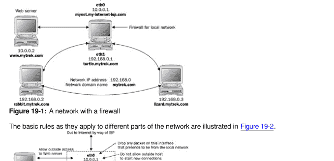

Figure 19-1: 带防火墙的网络

基本规则在网络不同部分的应用如图 19-2 所示。

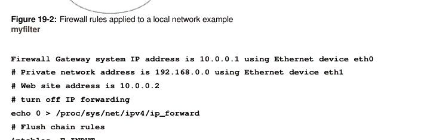

Figure 19-2: 防火墙规则应用于本地网络示例

## myfilter


Firewall Gateway system IP address is 10.0.0.1 using Ethernet device eth0
# Private network address is 192.168.0.0 using Ethernet device eth1
# Web site address is 10.0.0.2
# turn off IP forwarding
`echo 0 > /proc/sys/net/ipv4/ip_forward`
# Flush chain rules
`iptables -F INPUT`
`iptables -F OUTPUT`
`iptables -F FORWARD`
# set default (policy) rules
`iptables -P INPUT DROP`
`iptables -P OUTPUT ACCEPT`
`iptables -P FORWARD ACCEPT`

# IP spoofing, deny any packets on the internal network
that have an external source address.
`iptables -A INPUT -j LOG -i eth1 ! -s 192.168.0.0/24`
`iptables -A INPUT -j DROP -i eth1 ! -s 192.168.0.0/24`

```
iptables -A FORWARD -j DROP -i eth1 ! -s 192.168.0.0/24
# IP spoofing, deny any outside packets (any not on eth1)
that have the source address of the internal network
iptables -A INPUT -j DROP ! -i eth1 -s 192.168.0.0/24
iptables -A FORWARD -j DROP ! -i eth1 -s 192.168.0.0/24
# IP spoofing, deny any outside packets with localhost address
# (packets not on the lo interface (any on eth0 or eth1)
that have the source address of localhost)
iptables -A INPUT -j DROP -i ! lo -s 127.0.0.0/255.0.0.0
iptables -A FORWARD -j DROP -i ! lo -s 127.0.0.0/255.0.0.0

# allow all incoming messages for users on your firewall system
iptables -A INPUT -j ACCEPT -i lo

# allow communication to the Web server (address 10.0.0.2), port www
iptables -A INPUT -j ACCEPT -p tcp -i eth0 --dport www -s 10.0.0.2
# Allow established connections from Web servers to internal network
iptables -A INPUT -m state --state ESTABLISHED,RELATED
-i eth0 -p tcp --sport www -s 10.0.0.2 -d 192.168.0.0/24 -j ACCEPT
# Prevent new connections from Web servers to internal network
iptables -A OUTPUT -m state --state NEW -o eth0 -p tcp --sport
www -d 192.168.0.0/24 -j DROP

# allow established and related outside communication to your system
# allow outside communication to the firewall, except for ICMP packets
iptables -A INPUT -m state --state ESTABLISHED,RELATED
-i eth0 -p ! icmp -j ACCEPT
# prevent outside initiated connections
iptables -A INPUT -m state --state NEW -i eth0 -j DROP
iptables -A FORWARD -m state --state NEW -i eth0 -j DROP
# allow all local communication to and from the firewall on eth1
from the local network
iptables -A INPUT -j ACCEPT -p all -i eth1 -s 192.168.0.0/24
# Set up masquerading to allow internal machines access to outside network
iptables -t nat -A POSTROUTING -o eth0 -j MASQUERADE
# Accept ICMP Ping (0 and 8) and Destination unreachable (3) messages
# Others will be rejected by INPUT and OUTPUT DROP policy
iptables -A INPUT -j ACCEPT -p icmp -i eth0 --icmp-type echo-reply -d
10.0.0.1
iptables -A INPUT -j ACCEPT -p icmp -i eth0 --icmp-type echo-request -d
10.0.0.1
iptables -A INPUT -j ACCEPT -p icmp -i eth0 --icmp-type
destination-unreachable -d
10.0.0.1
```

```
# Turn on IP Forwarding
echo 1 > /proc/sys/net/ipv4/ip_forward
```

最初，在脚本中你会使用 flush 选项 (`-F`) 清除当前的 `iptables`，然后为非用户定义的规则设置策略（默认目标）。在设置链规则时，IP 转发也应关闭：

```
echo 0 > /proc/sys/net/ipv4/ip_forward
```

### 丢弃策略

首先，为 `INPUT` 和 `FORWARD` 内置 IP 链设置了 `DROP` 策略。这意味着如果数据包不符合任何允许其通过的规则条件，它将被丢弃。然后，IP 欺骗攻击以及来自外部发起连接的任何尝试（SYN 数据包）都会被拒绝。外部连接尝试也会被记录。这是一个非常基本的配置，可以通过添加 `iptables` 规则轻松地根据自己的需求进行完善。

```
iptables -P INPUT DROP
iptables -P OUTPUT ACCEPT
iptables -P FORWARD ACCEPT
```

### IP 欺骗

保护私有网络免受 IP 欺骗的一种方法是检查专用于私有网络的以太网设备上的任何外部地址。在此示例中，设备 `eth1`（专用于私有网络）上源地址不是私有网络的任何数据包（`! -s 192.168.0.0`）将被拒绝。此外，还要检查是否有任何来自外部的数据包将私有网络指定为其源。在此示例中，任何在私有网络以外的任何以太网设备（`eth1`）上具有私有网络源地址的数据包都被拒绝。相同的策略也可以应用于本地主机。


# IP spoofing, deny any packets on the internal network that has an external source address.

```
# IP spoofing, deny any packets on the internal network
# that has an external source address.
iptables -A INPUT -j LOG -i eth1 ! -s 192.168.0.0/24
iptables -A INPUT -j DROP -i eth1 ! -s 192.168.0.0/24
iptables -A FORWARD -j DROP -i eth1 ! -s 192.168.0.0/24
# IP spoofing, deny any outside packets (any not on eth1)
# that have the source address of the internal network
iptables -A INPUT -j DROP ! -i eth1 -s 192.168.0.0/24
iptables -A FORWARD -j DROP ! -i eth1 -s 192.168.0.0/24
# IP spoofing, deny any outside packets with localhost address
# (packets not on the lo interface (any on eth0 or eth1)
# that have the source address of localhost)
iptables -A INPUT -j DROP -i ! lo -s 127.0.0.0/255.0.0.0
iptables -A FORWARD -j DROP -i ! lo -s 127.0.0.0/255.0.0.0
```

然后，你将设置规则以允许系统内部（`localhost`）发送和接收的所有数据包通过：

```
iptables -A INPUT -j ACCEPT -i lo
```

## 服务器访问

对于 Web 服务器，你希望允许外部用户访问，但阻止任何人尝试从 Web 服务器向私有网络发起连接。在下一个示例中，所有消息都被接受到 Web 服务器，但 Web 服务器无法与私有网络发起联系。这防止了任何人通过对外部开放访问的 Web 服务器侵入本地网络。已建立的连接是允许的，从而允许私有网络使用 Web 服务器。

```
# allow communication to the Web server (address 10.0.0.2), port www
iptables -A INPUT -j ACCEPT -p tcp -i eth0 --dport www -s 10.0.0.2
# Allow established connections from Web servers to internal network
iptables -A INPUT -m state --state ESTABLISHED,RELATED -i eth0 \
-p tcp --sport www -s 10.0.0.2 -d 192.168.0.0/24 -j ACCEPT
# Prevent new connections from Web servers to internal network
iptables -A OUTPUT -m state --state NEW -o eth0 -p tcp \
--sport www -d 192.168.0.0/24 -j DROP
```

## 防火墙外部访问

为了允许防火墙访问外部网络，你允许除 `ICMP` 数据包之外的所有数据包输入。这些稍后处理。防火墙由防火墙设备 `eth0` 指定。首先，允许已建立和相关的连接继续：

```
# allow outside communication to the firewall,
# except for ICMP packets
iptables -A INPUT -m state --state ESTABLISHED,RELATED \
-i eth0 -p ! icmp -j ACCEPT
```

## 阻止外部发起的访问

为了防止外部人员发起对系统的任何访问，使用带有 `NEW` 的 `state` 选项创建规则以阻止来自外部的 `SYN` 数据包访问。丢弃 `eth0` 连接上的任何新连接（假设只有 `eth0` 连接到互联网或外部网络）。

```
# prevent outside initiated connections
iptables -A INPUT -m state --state NEW -i eth0 -j DROP
iptables -A FORWARD -m state --state NEW -i eth0 -j DROP
```

## 本地网络访问

为了允许内部网络与防火墙交互，你允许在内部以太网连接 `eth1` 上的所有数据包输入。有效的内部网络地址被指定为输入源：

```
iptables -A INPUT -j ACCEPT -p all -i eth1 -s 192.168.0.0/24
```

## 伪装本地网络

为了实现伪装，即私有网络上的系统可以使用网关的互联网地址连接到互联网主机，你创建一个具有 `MASQUERADE` 目标的 `NAT` 表 `-t nat` `POSTROUTING` 规则：

```
iptables -t nat -A POSTROUTING -o eth0 -j MASQUERADE
```

## 控制 ICMP 数据包

此外，为了允许 `ping` 和目标可达 `ICMP` 数据包，你输入以防火墙为目标的 `INPUT` 规则。为了启用 `ping` 操作，你同时使用 `echo-reply` 和 `echo-request` `ICMP` 类型，对于目标不可达，你使用 `destination-unreachable` 类型：

```
iptables -A INPUT -j ACCEPT -p icmp -i eth0 --icmp-type \
echo-reply -d 10.0.0.1
iptables -A INPUT -j ACCEPT -p icmp -i eth0 --icmp-type \
echo-request -d 10.0.0.1
iptables -A INPUT -j ACCEPT -p icmp -i eth0 --icmp-type \
destination-unreachable -d 10.0.0.1
```

```
echo-request -d 10.0.0.1
iptables -A INPUT -j ACCEPT -p icmp -i eth0 --icmp-type \
destination-unreachable -d 10.0.0.1
```

最后，再次打开 `IP` 转发：

```
echo 1 > /proc/sys/net/ipv4/ip_forward
```

## 规则列表

以下这些 `iptables` 选项的列表显示了每个选项的不同规则，如下所示：


```
# iptables -L
Chain INPUT (policy DROP)
target prot opt source destination
LOG all -- !192.168.0.0/24 anywhere LOG level warning
DROP all -- !192.168.0.0/24 anywhere
DROP all -- 192.168.0.0/24 anywhere
DROP all -- 127.0.0.0/8 anywhere
ACCEPT all -- anywhere anywhere
ACCEPT tcp -- 10.0.0.2 anywhere tcp dpt:http
ACCEPT tcp -- 10.0.0.2 192.168.0.0/24 state RELATED,ESTABLISHED tcp spt:http
ACCEPT !icmp -- anywhere anywhere state RELATED,ESTABLISHED
DROP all -- anywhere anywhere state NEW
ACCEPT all -- 192.168.0.0/24 anywhere
ACCEPT icmp -- anywhere 10.0.0.1 icmp echo-reply
ACCEPT icmp -- anywhere 10.0.0.1 icmp echo-request
ACCEPT icmp -- anywhere 10.0.0.1 icmp destination-unreachable
Chain FORWARD (policy ACCEPT)
target prot opt source destination
DROP all -- !192.168.0.0/24 anywhere
DROP all -- 192.168.0.0/24 anywhere
DROP all -- 127.0.0.0/8 anywhere
DROP all -- anywhere anywhere state NEW
Chain OUTPUT (policy ACCEPT)
target prot opt source destination
DROP tcp -- anywhere 192.168.0.0/24 state NEW tcp spt:http
```

```
# iptables -t nat -L
Chain PREROUTING (policy ACCEPT)
target prot opt source destination
Chain POSTROUTING (policy ACCEPT)
target prot opt source destination
MASQUERADE all -- anywhere anywhere
Chain OUTPUT (policy ACCEPT)
```

#### 用户定义规则

对于更复杂的规则，您可能希望创建自己的链以减少重复。一种常见的方法是为 `INPUT` 和 `FORWARD` 链都定义一个用户链，这样您就不必为每个链重复 `DROP` 操作。相反，您将只有一个用户链，`FORWARD` 和 `INPUT` 链都将为 `DROP` 操作馈入该链。请记住，`FORWARD` 和 `INPUT` 操作除了它们共享的规则之外，还可能有单独的规则。在下一个示例中，创建了一个名为 `arriving` 的用户定义链。链使用脚本顶部的 `-N` 选项定义：

```
iptables -N arriving
```

用户链必须在用作其他规则的目标之前定义。因此，您必须先定义并添加该链的所有规则，然后再将其用作目标。`arriving` 链首先被定义并添加了其规则。然后，在文件的末尾，它被用作 `INPUT` 和 `FORWARD` 链的目标。`INPUT` 链列出了用于接受数据包的规则，而 `FORWARD` 链具有 `ACCEPT` 策略，将默认接受它们。

```
iptables -N arriving
iptables -F arriving
# IP spoofing, deny any packets on the internal network
# that has an external source address.
iptables -A arriving -j LOG -i eth1 \! -s 192.168.0.0/24
iptables -A arriving -j DROP -i eth1 \! -s 192.168.0.0/24
iptables -A arriving -j DROP \! -i eth1 -s 192.168.0.0/24
----------------
# entries at end of script
iptables -A INPUT -j arriving
iptables -A FORWARD -j arriving
```

对应规则的列表如下所示：

```
Chain INPUT (policy DROP)
target  prot opt source      destination
arriving  all  --  0.0.0.0/0      0.0.0.0/0
Chain FORWARD (policy ACCEPT)
target  prot opt source      destination
arriving  all  --  0.0.0.0/0      0.0.0.0/0
Chain arriving (2 references)
target  prot opt source      destination
LOG     all  --  !192.168.0.0/24  0.0.0.0/0      LOG flags 0 level 4
DROP    all  --  !192.168.0.0/24  0.0.0.0/0
DROP    all  --  192.168.0.0/24  0.0.0.0/0
```

对于链可能不同的规则，您仍然需要输入单独的规则。在 `myfilter` 脚本中，`FORWARD` 链具有 `ACCEPT` 策略，允许所有转发到本地网络的数据包通过防火墙。如果 `FORWARD` 链具有与 `INPUT` 链类似的 `DROP` 策略，那么您可能需要在 `FORWARD` 链可以接受数据包的情况下定义单独的规则。在此示例中，`FORWARD` 和 `INPUT` 链对 `eth1` 设备上的数据包接受有不同的规则。`INPUT` 规则更为严格。要使本地网络能够通过防火墙接收转发的数据包，您可以使用单独的 `FORWARD` 规则在该设备上启用转发，如下所示：

```
iptables -A FORWARD -j ACCEPT -p all -i eth1
```

`INPUT` 链将只接受来自本地网络的数据包。

```
iptables -A INPUT -j ACCEPT -p all -i eth1 -s 192.168.0.0/24
```

#### IP 伪装

在 Linux 系统上，您可以设置一个网络，其中有一个连接到 Internet 的连接，网络上的多个系统可以使用。这样，使用一个 IP 地址，多个不同的系统可以连接到 Internet。这种方法称为 IP 伪装，其中一个系统伪装成另一个系统，使用该系统的 IP 地址。在这种网络中，一个系统使用自己的 IP 地址连接到 Internet，而其他系统则通过局域网 `LAN` 连接到该系统。当本地系统想要访问网络时，它伪装成 Internet 连接的系统，借用其 IP 地址。

IP 伪装在 Linux 上使用 `iptables` 防火墙工具实现。实际上，您设置了一个防火墙，然后将其配置为执行 IP 伪装。目前，IP 伪装支持所有常见的网络服务——`iptables` 防火墙也支持——例如 Web 浏览、Telnet 和 ping。其他服务，例如 IRC、FTP 和 Real Audio，需要使用某些模块。您希望本地系统访问的任何服务也必须在防火墙系统上，因为请求和响应实际上是由该系统上的服务处理的。

您可以在 IP Masquerade 资源网站 `ipmasq.webhop.net` 上找到有关 IP 伪装的更多信息。特别是，Linux IP Masquerade mini-HOWTO 提供了在系统上设置 IP 伪装的详细分步指南。在您可以使用它之前，内核必须支持 IP 伪装。如果您的内核不支持它，您可能需要重新构建内核，包括 IP 伪装支持，或使用可加载模块来添加它。有关更多信息，请参阅 IP Masquerade mini-HOWTO。


使用 Linux 系统实现的 IP 伪装，具有 Internet 地址的机器也是使用防火墙的 Internet 地址连接到 Internet 的机器的 LAN 的防火墙和网关。还实现 IP 伪装的防火墙有时被称为 MASQ 网关。使用 IP 伪装，Internet 连接的系统（防火墙）会侦听来自其 LAN 上主机的 Internet 请求。当它收到一个请求时，它用防火墙的 Internet IP 地址替换请求本地主机的 IP 地址，然后将请求发送到 Internet，好像请求是它自己的。来自 Internet 的回复随后发送到防火墙系统。防火墙收到的回复是使用其 Internet 地址寻址给防火墙的。防火墙然后确定回复正在响应的本地系统。它然后剥离其 IP 地址并将响应发送到 LAN 上的本地主机。从本地机器的角度来看，连接是透明的。它们似乎直接连接到 Internet。

## 伪装本地网络

IP 伪装通常用于允许私有网络上的机器访问 Internet。这些可能是家庭网络或小型 LAN 中的机器，例如小型企业。这样的网络可能只有一个具有 Internet 访问权限的机器，因此只有一个 Internet 地址。本地私有网络将具有从私有网络分配中选择的 IP 地址（`10.`、`172.16.` 或 `192.168.`）。理想情况下，防火墙有两个以太网卡：一个用于连接到 LAN 的接口（例如 `eth1`），一个用于连接到 Internet 的接口，例如 `eth0`（对于拨号 ISP，这将是调制解调器的 `ppp0`）。Internet 连接的卡（`eth0`）将被分配 Internet IP 地址。本地网络的以太网接口（本例中为 `eth1`）是防火墙以太网接口。您的私有 LAN 将具有类似 `192.168.0` 的网络地址。其以太网防火墙接口（`eth1`）将被分配 IP 地址 `192.168.0.1`。实际上，防火墙接口使防火墙能够充当本地网络的网关。然后防火墙被配置为伪装来自私有网络的任何数据包。您的 LAN 需要有自己的域名服务器，标识您网络上的机器，包括您的防火墙。每台本地机器都需要将防火墙指定为其网关。尽量不要使用 IP 别名将防火墙和 Internet IP 地址分配给同一个物理接口。为它们使用单独的接口，例如两块以太网卡，或一块以太网卡和一个调制解调器（`ppp0`）。

## NAT 伪装规则

在 Netfilter 中，IP 伪装是一种 NAT 操作，不再像 `ipchains`。IP 伪装命令放置在 NAT 表中，并与数据包过滤命令分开处理。使用 `iptables` 在 NAT 表上放置伪装规则。首先使用 `-t nat` 选项引用 NAT 表。然后在 `POSTROUTING` 链中添加一条规则，使用 `-o` 选项指定输出设备，并使用 `-j` 选项指定 `MASQUERADE` 命令：

```
iptables -t nat -A POSTROUTING -o eth0 -j MASQUERADE
```

## IP 转发

然后可以通过此处所示的手动方式开启 IP 转发，使用 `sysctl`（第 33 章），或使用 `redhat-config` 工具（可在系统工具下的 Extras 菜单中访问的内核调优工具），并在网络下的 IP 条目中 IP 配置面板中勾选 IP 转发。这将在 `/etc/sysctl.conf` 文件中设置 `net.ipv4.ip_forward` 变量（如果愿意，您可以手动对此文件进行更改）。默认情况下 IP 转发是关闭的。

```
echo 1 > /proc/sys/net/ipv4/ip_forward
```

## 伪装选定主机

与其将所有本地主机伪装成防火墙/网关主机的单个 IP 地址，您可以使用 NAT 表重写少数选定主机的地址。这种方法通常应用于希望多个本地主机作为 Internet 服务器出现的设置中。使用 `DNAT` 和 `SNAT` 目标，您可以将数据包定向到特定的本地主机。您将使用 `PREROUTING` 和 `POSTROUTING` 链上的规则来定向输入和输出数据包。

例如，前一示例中描述的 Web 服务器可以配置为本地主机，`DNAT` 目标可以将原本接收给 `10.0.0.2` 的任何数据包重定向到该主机。假设 Web 服务器设置在 `192.168.0.5` 上。它可以表现为在 Internet 上具有地址 `10.0.0.2`。发送到 `10.0.0.2` 的数据包将被 NAT 表重写并定向到 `192.168.0.5`。您将使用带有 `-A` 选项的 `PREROUTING` 链来处理传入数据包，并使用 `-s` 选项的 `POSTROUTING` 处理传出数据包。

```
iptables -t nat -A PREROUTING -d 10.0.0.2 \
    --to-destination 192.168.0.5 -j DNAT
iptables -t nat -A POSTROUTING -s 192.168.0.5 \
    --to-source 10.0.0.2 -j SNAT
```

### 提示

请记住，使用 `iptables` 时，伪装不再与 `FORWARD` 链结合，如 `ipchains` 中那样。因此，如果您为 `FORWARD` 链指定 `DROP` 策略


## ABC Amber CHM 转换器试用版

请注册以移除此横幅。

http://www.processestext.com/abchm.html

# 第五部分：Red Hat 服务器

## 章节列表

- 第 20 章：服务器管理
- 第 21 章：FTP 服务器
- 第 22 章：Web 服务器：Apache
- 第 23 章：代理服务器：Squid
- 第 24 章：邮件服务器：SMTP、POP 和 IMAP
- 第 25 章：打印服务器
- 第 26 章：新闻和搜索服务器

### 第 20 章：服务器管理

#### 概述

单个 Linux 系统可以提供多种不同的服务，例如邮件、Web 或 FTP 服务器。每项服务都作为一个持续运行的守护进程，等待远程用户对其特定服务的请求。您可以通过启动或关闭其守护进程来打开或关闭服务。启动或关闭服务的处理过程由服务脚本完成，本章对此进行了详细描述。


#### 系统启动文件：`/etc/rc.d` 和 `/etc/sysconfig`

每次启动系统时，它都会从位于 `/etc/rc.d` 目录中的系统初始化文件读取一系列启动命令。这些初始化文件根据不同的任务进行组织。有些位于 `/etc/rc.d` 目录本身，而其他则位于名为 `init.d` 的子目录中。您不应更改这些文件中的任何一个。系统初始化文件的组织方式在不同的 Linux 发行版中有所不同。这里描述的是 Red Hat 的组织方式。您在 `/etc/rc.d` 中找到的一些文件列在表 20-1 中。

#### `/etc/rc.d/rc.sysinit`

`/etc/rc.d/rc.sysinit` 文件包含用于初始化系统的命令，包括挂载和卸载文件系统。用于专用功能或设备的内核模块可以在 `rc.modules` 文件中加载。`/etc/rc.d/rc.local` 文件是执行的最后一个初始化文件。您可以在此处放置自己的命令。当您关闭系统时，系统会调用包含关闭命令的 `halt` 文件。然后调用 `init.d` 中的文件以关闭守护进程，并卸载文件系统。在 Red Hat 的当前发行版中，`halt` 位于 `init.d` 目录中。

#### `/etc/rc.d/init.d`

`/etc/rc.d/init.d` 目录主要设计用于存放启动和关闭不同专用守护进程的脚本，例如网络和打印机守护进程以及字体和 Web 服务器的守护进程。这些文件具有双重功能，在系统启动时启动守护进程，在系统关闭时关闭守护进程。`init.d` 中的文件设计得易于为启动和关闭专用应用程序编写脚本。它们使用 `functions` 文件中定义的功能。其中许多文件已为您自动设置。您不需要更改它们。如果您确实更改了它们，请先确保了解这些文件的工作原理。

表 20-1：系统启动文件

| 文件 | 描述 |
|---|---|
| `/etc/sysconfig` | 存放系统配置文件和目录的目录。 |
| `/etc/rc.d` | 存放系统启动和关闭文件的目录。 |
| `/etc/rc.d/rc.sysinit` | 系统的初始化文件。 |
| `/etc/rc.d/rc.local` | 用于您自己的命令的初始化文件；您可以自由编辑此文件以添加自己的启动命令；这是执行的最后一个启动文件。 |
| `/etc/rc.d/rc.modules` | 加载内核模块（默认情况下在 Red Hat Linux 上未实现）。 |
| `/etc/rc.d/init.d` | 存放启动网络连接的网络脚本的目录。 |
| `/etc/rc.d/rcnum.d` | 不同运行级别的目录，其中 num 为运行级别。目录包含指向 `/etc/rc.d/init.d` 目录中脚本的链接。 |


| `/etc/rc.d/init.d/halt` | 每次关闭系统时执行的操作，例如卸载文件系统；在其他发行版中称为 `rc.halt`。 |

| `/etc/rc.d/init.d/cups` | 启动和关闭 `cups` 打印机守护进程。 |

### 表 20-1：系统启动文件

| 文件 | 描述 |
|---|---|
| `/etc/rc.d/init.d/xinetd` | 启动或关闭 `xinetd` 守护进程的操作。 |
| `/etc/rc.d/init.d/network` | 启动或关闭网络连接的操作。 |
| `/etc/rc.d/init.d/httpd` | 启动或关闭 Web 服务器守护进程 `httpd` 的操作。 |

当系统启动时，多个程序会自动启动并持续运行以提供服务，例如网站或打印服务器。根据您希望系统提供何种服务，您可以添加或删除要自动启动的服务列表中的项目。例如，Web 服务器在系统启动时自动运行。如果您没有托管网站，则不需要 Web 服务器。您可以阻止该服务启动，移除系统不需要执行的额外任务，释放资源并可能减少潜在的安全漏洞。其中一些服务器和守护进程执行必要的任务。`sendmail` 服务器使您能够跨网络发送消息，而 `cupsd` 服务器执行打印操作。

要配置服务在启动时自动启动，您可以使用桌面上可用的 `redhat-config-services` 工具或在命令行运行的 `chkconfig` 工具。`redhat-config-services` 显示可用服务的列表，让您选择要启动或阻止启动的服务。`chkconfig` 命令使用 `on` 和 `off` 选项在启动时选择和取消选择服务（请参阅本章后面关于 `chkconfig` 的部分）。

```
chkconfig httpd on
```

要随时手动启动和停止服务，您可以使用 `redhat-config-services` 或 `service` 命令。使用 `service` 命令时，您列出服务并使用 `stop` 参数停止它，使用 `start` 参数启动它，使用 `restart` 参数重新启动它。

```
service httpd start
```

#### 提示

系统启动时，会使用 `/etc/rc.d/` 目录中特殊运行级别目录里的链接来执行 `/etc/rc.d/init.d` 目录中的启动脚本。运行级别目录


## ABC Amber CHM Converter 试用版

请注册以移除此横幅。

http://www.processestext.com/abchm.html

### SysV Init：init.d 脚本

您可以使用位于 `/etc/rc.d/init.d` 目录中的特殊启动脚本来管理服务器守护进程的启动和停止。这些脚本通常与服务器程序同名。例如，对于 `/usr/sbin/httpd` Web 服务器程序，对应的脚本名为 `/etc/rc.d/init.d/httpd`。该脚本用于启动和停止 Web 服务器。这种使用 init.d 启动脚本来启动服务器的方式称为 SysV Init，得名于 Unix System V 中使用的该方法。

提示 如果您更改了服务器配置，可能需要在完善配置的过程中多次启动和停止它。许多服务器提供了专门的管理工具，使您可以轻松执行此任务。`apachectl` 工具可以方便地启动和停止 Apache Web 服务器。其功能等同于使用 `/etc/rc.d/init.d/httpd` 脚本来启动和停止服务器。对于域名服务器，`ndc` 工具可以启动和停止 `named` 服务器。但是，不建议混合使用 init.d 脚本和管理工具。

`/etc/rc.d/init.d` 目录中的启动脚本可以在每次启动系统时自动执行。但访问这些脚本时需小心。这些脚本会启动必要的程序，例如您的网络接口和打印机守护进程。这些 init 脚本通过为每个可能的运行级别设置的子目录中的链接来访问。`/etc/rc.d` 目录包含一组子目录，其名称格式为 `rcN.d`，其中 N 是引用运行级别的数字。`rc` 脚本会检测系统启动时的运行级别，然后仅执行该运行级别子目录中指定的启动脚本。启动系统时，如果您执行命令行登录，`rc` 脚本将执行 `rc3.d` 目录中指定的启动脚本；如果您使用图形登录，则执行 `rc5.d` 目录中指定的启动脚本。`rc3.d` 和 `rc5.d` 目录包含指向 `/etc/rc.d/init.d` 目录中某些启动脚本的符号链接。因此，`/etc/rc.d/init.d` 目录中的 `httpd` 脚本实际上是通过 `rc3.d` 或 `rc5.d` 目录中的符号链接调用的。`/etc/rc.d/init.d/httpd` 脚本在 `rc3.d` 目录中的符号链接为 `S85httpd`。链接前缀 `S` 代表“startup”（启动）；因此，该链接使用 `start` 选项调用对应的 init.d 脚本。数字表示启动脚本执行的顺序；数字越小，执行越靠前。`S85httpd` 使用 `start` 选项调用 `/etc/rc.d/init.d/httpd`。如果您将链接名称更改为以 `K` 开头，脚本将使用 `stop` 选项被调用，从而停止该服务。此类链接用于运行级别 0 和 6 的目录，即 `rc6.d` 和 `rc0.d`。运行级别 0 会停止系统，运行级别 6 会重启系统。您可以使用 `runlevel` 命令查看当前操作的运行级别（有关运行级别的更多详细信息，请参见第 27 章）。表 20-2 列出了运行级别的清单。

### 表 20-2：系统运行级别

| 运行级别 | rc.d 目录 | 描述 |
|---|---|---|
| 0 | `rc0.d` | 停止（关闭）系统 |
| 1 | `rc1.d` | 单用户模式（无网络，功能有限） |
| 2 | `rc2.d` | 无 NFS 支持的多用户模式（功能有限） |
| 3 | `rc3.d` | 多用户模式（完全操作模式） |
| 4 | `rc4.d` | 用户自定义，在 Red Hat 中默认实现与运行级别 3 相同，即多用户模式 |
| 5 | `rc5.d` | 带图形登录的多用户模式（在完全操作模式下增加图形登录） |
| 6 | `rc6.d` | 重启系统 |


## ABC Amber CHM Converter 试用版

请注册以移除此横幅。

http://www.processestext.com/abchm.html

### 启动服务器：独立式和 xinetd

服务器是一个与您的其他程序并发运行的守护进程，它持续寻找服务请求，这些请求可能来自您系统上的其他用户，也可能来自通过网络连接到您系统的远程用户。当服务器收到用户的请求时，它会启动一个会话以提供服务。例如，如果用户想从您的系统下载文件，他们可以使用自己的 FTP 客户端连接到您的 FTP 服务器并启动会话。在会话中，他们可以访问并下载您系统上的文件。服务器需要处于运行状态，用户才能访问其服务。例如，如果您在系统上设置了带有 HTML 文件的网站，那么在用户能够访问您的网站并显示这些文件之前，必须运行 `httpd` Web 服务器程序。

#### 直接启动服务

您可以通过多种方式启动服务器。一种方法是手动通过命令行输入服务器程序名称及其参数来启动。按下 ENTER 键后，服务器启动，尽管您的命令行提示符会重新出现。当您执行其他任务时，服务器会并发运行。要检查服务器是否正在运行，您可以使用带有 `status` 选项的 `service` 命令。

```
# service httpd status
```

或者，您可以使用带有 `-aux` 选项的 `ps` 命令列出当前所有正在运行的进程。您应该能看到您启动的服务器程序的进程。为了细化列表，您可以添加针对所需服务器名称模式的 `grep` 操作。第二个命令列出了 Web 服务器的进程。

```
# ps -aux
# ps -aux | grep 'httpd'
```

#### 使用启动脚本启动和停止服务

在 Red Hat Linux 系统中，您使用特殊的启动脚本来手动启动和停止服务器。这些脚本位于 `/etc/rc.d/init.d` 目录中，并且与服务器程序同名。例如，带有 `start` 选项的 `/etc/rc.d/init.d/httpd` 脚本会启动 Web 服务器。使用 `stop` 选项的该脚本会停止它。您可以使用 `service` 命令和脚本名称，而无需使用脚本的完整路径名。以下命令是等效的：

```
/etc/rc.d/init.d/httpd stop
service httpd stop
```

#### 自动启动服务


与其每次启动系统时都手动执行所有服务器程序，您可以让系统为您自动启动服务器。根据您想要使用服务器的方式，您可以做到这一点有两种方式。您可以让服务器从启动系统开始一直运行到关闭系统，或者您可以在服务器收到用户请求其服务时才启动服务器。如果某个服务器被频繁使用，您可能希望让它一直运行。如果很少使用，您可能希望服务器仅在收到请求时启动。例如，如果您托管一个网站，您的 Web 服务器一直会收到来自 Internet 远程用户的请求。然而，对于 FTP 站点，您可能不经常收到请求，在这种情况下，您可能希望 FTP 服务器仅在收到请求时启动。当然，某些 FTP 站点会频繁收到请求，这就需要有持续运行的 FTP 服务器。

## 独立服务器

自动启动并持续运行的服务器被称为独立服务器。Red Hat 使用 SysV Init 过程在系统启动时自动启动服务器。该过程使用位于 `/etc/rc.d/init.d` 目录中用于服务器的特殊启动脚本。大多数 Linux 系统默认配置为 Web 服务器自动启动并持续运行。`/etc/rc.d/init.d` 目录中有一个名为 `httpd` 的脚本。

## xinetd 服务器

要仅在收到其服务请求时启动服务器，您可以使用 `xinetd` 守护进程进行配置。如果您在 `/etc/xinetd` 文件中添加、更改或删除服务器条目，必须重新启动 `xinetd` 守护进程才能使这些更改生效。在 Red Hat 中，您可以使用带有 restart 参数的 `/etc/rc.d/init.d/xinetd` 脚本重新启动 `xinetd` 守护进程，如下所示：

```
# service xinetd restart
```

您还可以使用 `xinetd` 脚本启动和停止 `xinetd` 守护进程。停止操作实际上会关闭 `xinetd` 守护进程管理的所有服务器（那些列在 `/etc/xinetd.conf` 文件或 `xinetd.d` 目录中的服务器）。

```
# service xinetd stop
# service xinetd start
```

您也可以直接通过停止其进程来重新启动 `xinetd`。为此，您使用带有 `-HUP` 信号和名称 `xinetd` 的 `killall` 命令。

```
# killall -HUP xinetd
```

提示 早于 Red Hat 7.0 的版本使用的是 `inetd` 守护进程（该术语代表 Internet Services Daemon，即 Internet 服务守护进程），而不是 `xinetd`。`xinetd` 旨在作为 `inetd` 的增强替代品。如果您正在从 `inetd` 升级，可以使用 `inetdconvert` 命令将 `inetd` 条目转换为 `xinetd` 配置。

## 服务管理工具：chkconfig 和 redhat-config-services

在 Red Hat 中，`redhat-config-services` 和 `chkconfig` 命令提供了简单的接口，您可以使用它们来选择要启动的服务器以及希望它们如何运行。您可以使用这些工具控制任何想要启动的守护进程，包括系统服务，例如 `cron`、打印服务器、`Samba` 和 `NFS` 的远程文件服务器、`Kerberos` 的身份验证服务器，当然还有 FTP 或 HTTP 的 Internet 服务器。这类守护进程被称为服务，您应将这些工具视为管理这些服务。任何这些服务都可以设置为在不同的运行级别下启动或停止。

这些工具管理由 `/etc/rc.d/init.d` 目录中的脚本启动的服务。如果您添加新服务，`chkconfig` 和 `redhat-config-services` 都可以管理它。如以下部分所述，服务使用各个运行级别目录中的启动链接在特定运行级别下启动。这些链接连接到 `init.d` 目录中的启动脚本。运行级别目录在 `/etc/rc.d` 目录中编号为 0 到 6，例如运行级别 3 的 `/etc/rc.d/rc3.d` 和运行级别 5 的 `/etc/rc.d/rc5.d`。从某个运行级别中移除服务仅会更改其在对应运行级别 `rc.d` 目录中的链接。它不会触及 `init.d` 目录中的启动脚本。

### redhat-config-services

使用 Red Hat 的 `redhat-config-services` 实用程序，您可以从常用服务的列表中简单选择系统启动时想要运行的服务。您可以通过位于系统设置下的服务器设置窗口或菜单中的服务图标访问 `redhat-config-services`。`redhat-config-services` 允许您启动、停止和重启服务器，与 `service` 命令类似（参见图 20-1）。`redhat-config-services` 提供了易于使用的 GNOME GUI 界面。它显示已安装服务器的列表，对当前选定为启动的服务器的复选框进行勾选。您可以通过选择特定服务并从操作菜单中选择“启动服务”、“停止服务”或“重启服务”来启动、停止或重启该服务。

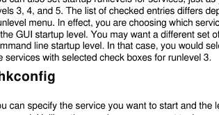

Figure 20-1: redhat-config-services

您也可以为服务设置启动运行级别，就像使用 `chkconfig` 一样，不过您仅限于级别 3、4 和 5。勾选条目的列表取决于您从“编辑运行级别”菜单中选择的运行级别。实际上，您是在选择在给定运行级别下启动哪些服务。默认是运行级别 5，即 GUI 启动级别。您可能希望为运行级别 3，即命令行启动级别，启动或停止不同的服务集。在这种情况下，您将从“编辑运行级别”菜单中选择运行级别 3，以显示运行级别 3 的服务及其选中的复选框。

### chkconfig

您可以使用 `chkconfig` 命令指定要启动的服务以及要启动它的级别。与其他服务管理工具不同，`chkconfig` 对独立服务和 `xinetd` 服务同样适用。虽然独立服务可以在任何运行级别下运行，但您也可以针对 `xinetd` 运行的运行级别打开或关闭 `xinetd` 服务。表 20-3 列出了不同的 `chkconfig` 选项。

#### Listing Services with chkconfig

要查看服务列表，请使用 `--list` 选项。这里展示了 `chkconfig` 管理的服务的示例。每个运行级别下服务的开启或关闭状态均显示。`xinetd` 服务及其状态也显示如下：

```
chkconfig --list
dhcpd 0:off 1:off 2:off 3:off 4:off 5:off 6:off
httpd 0:off 1:off 2:off 3:off 4:off 5:off 6:off
named 0:off 1:off 2:off 3:off 4:off 5:off 6:off
lpd 0:off 1:off 2:on 3:on 4:on 5:on 6:off
nfs 0:off 1:off 2:off 3:off 4:off 5:off 6:off
crond 0:off 1:off 2:on 3:on 4:on 5:on 6:off
xinetd 0:off 1:off 2:off 3:on 4:on 5:on 6:off
xinetd based services:
    time:      off
    finger:    off
    pop3s:     off
    swat:      on
```

#### Starting and Stopping Services with chkconfig

您使用 `on` 选项使服务在指定的运行级别下启动，使用 `off` 选项禁用它。您可以使用 `--level` 选项指定要影响的运行级别。如果未指定级别，`chkconfig` 将使用服务 `init.d` 启动脚本中的任何 `chkconfig` 默认信息。Red Hat 安装其服务时已输入 `chkconfig` 默认信息（如果缺少此信息，`chkconfig` 将使用运行级别 3、4 和 5）。以下示例将 Web 服务器（`httpd`）在运行级别 5 下启动：

```
chkconfig --level 5 httpd on
```

Table 20-3: chkconfig Options

| Option | Description |

|---|---|

| --level runlevel | Specifies a runlevel to turn on, turn off, or reset a service. |

| --list service | Lists startup information for services at different runlevels. xinetd services are just on or off. With no argument, all services are listed, including xinetd services. |


| `--add service` | Adds a service, creating links in the default specified runlevels (or all runlevels, if none are specified). |

| `--del service` | Deletes all links for the service (startup and shutdown) in all runlevel directories. |

| `service on` | Turns a service on, creating a startup link in the specified or default runlevel directories. |

| `service off` | Turns a service off, creating shutdown links in specified or default directories. |

| `service reset` | Resets service startup information, creating default links as specified in the `chkconfig` entry in the service's `init.d` startup script. |

`off` 选项配置服务在系统进入指定运行级别时关闭。下一个示例在进入运行级别 3 时关闭 Web 服务器。如果服务未运行，则保持关闭状态：

```
chkconfig --level 3 httpd off
```

`reset` 选项将服务恢复为其在服务 `init.d` 启动脚本中指定的 `chkconfig` 默认选项：

```
chkconfig httpd reset
```

要仅查看服务的启动信息，您只需使用 `--list` 选项并加上服务名称：

```
chkconfig --list httpd
```

```
httpd 0:off 1:off 2:off 3:on 4:off 5:on 6:off
```

### Enabling and Disabling xinetd Services with chkconfig

与 `redhat-config-services` 不同，`chkconfig` 还可以启用或禁用 `xinetd` 服务。只需输入 `xinetd` 服务并使用 `on` 或 `off` 选项即可。服务将被启动或关闭，并且 `/etc/xinetd.d` 目录中其 `xinetd` 配置脚本中的 `disable` 行将相应编辑。例如，要启动在 `xinetd` 上运行的 Samba 配置服务器 `swat`，您只需输入：

```
chkconfig swat on
```

```
chkconfig --list swat
```

```
swat on
```

`xinetd` 的 `swat` 配置文件 `/etc/xinetd.d/swat` 的 `disable` 行将被编辑为 `no`，如下所示：

```
disable=no
```

如果您想关闭 `swat` 服务器，可以使用 `off` 选项。这将使 `/etc/xinetd.d/swat` 中的 `disable` 行更改为 `"disable=yes"`。

```
chkconfig swat off
```

相同的流程也适用于其他 `xinetd` 服务，例如 POP3 服务器和 finger。

### Removing and Adding Services with chkconfig

如果您希望服务完全从所有运行级别的整个启动和关闭过程中移除，可以使用 `--del` 选项。这会删除所有运行级别目录中的所有启动和关闭链接。

```
chkconfig --del httpd
```

您也可以使用 `--add` 选项将服务添加到 `chkconfig` 管理中。`chkconfig` 将在适当的启动目录 `/etc/rc.d/rcn.d` 中为新服务创建启动链接。如果您之前已删除服务的全部链接，可以使用 `add` 选项恢复它们。

```
chkconfig --add httpd
```

### Configuring xinetd Services for Use by chkconfig

默认运行级别信息应放置在由 `chkconfig` 管理的启动脚本中。Red Hat 已将此信息放置在其发行版中安装的服务的启动脚本中。如果需要，您可以编辑这些脚本以更改默认信息。此信息以 `#` 符号开头的行输入，后跟 `chkconfig` 关键字和冒号。然后列出服务应启动的默认运行级别，以及启动和停止优先级。以下条目列出运行级别 3 和 5，启动优先级为 85，停止为 15。有关更多信息，请参阅“服务脚本标签”部分：

```
# chkconfig: 35 85 15
```

因此，当用户在未指定级别选项的情况下打开 `httpd` 服务时，`chkconfig` 将在运行级别 3 和 5 下启动 `httpd`。

```
chkconfig httpd on
```

## How chkconfig Works

`chkconfig` 工具通过在 `/etc/rc.d` 目录中的适当运行级别目录中创建启动和关闭链接来工作。例如，当 `chkconfig` 在运行级别 5 添加 `httpd` 服务时，它会在 `/etc/rc.d/rc5.d` 目录中创建一个链接，指向 `/etc/rc.d/init.d` 目录中的启动脚本 `httpd`。当它从运行级别 3 关闭 Web 服务时，它会在 `/etc/rc.d/rc3.d` 目录中创建一个关闭链接，使用 `/etc/rc.d/init.d` 目录中的脚本 `httpd`，以确保 Web 服务不会启动。在下面的示例中，用户在运行级别 5 打开 Web 服务（`httpd`），在 `rc5.d` 中创建启动链接 `S85httpd`，然后在运行级别 3 关闭 Web 服务，在 `rc3.d` 中创建关闭链接 `K15httpd`。

```
chkconfig --level 5 httpd on
ls /etc/rc.d/rc5.d/*httpd
    /etc/rc.d/rc5.d/S85httpd

chkconfig --level 3 httpd off
ls /etc/rc.d/rc3.d/*httpd
    /etc/rc.d/rc3.d/K15httpd
```

## Service Scripts: /etc/init.d

大多数使用 RPM Red Hat 软件包的服务器软件将自动安装启动脚本，并在适当的 `rcN.d` 目录中创建所需的链接，其中 N 为运行级别编号。启动脚本也可以用于在系统启动时希望运行的任何程序。要使此类程序自动启动，首先在 `/etc/rc.d/init.d` 目录中为其创建启动脚本，然后在 `/etc/rc.d/rc3.d` 和 `/etc/rc.d/rc5.d` 目录中创建指向该脚本的符号链接。关闭链接（K）还应放置在用于运行级别 6（重启）的 `rc6.d` 目录中。

## Service Script Functions

在后面的章节中展示了 Red Hat 系统上 `httpd` 使用的启动脚本的简化版本。你可以在 `/etc/rc.d/init.d/httpd` 示例的 `case` 语句下看到不同的选项：`start`、`stop`、`status`、`restart` 和 `reload`。如果未提供选项（*），则会显示脚本的使用语法。`httpd` 脚本首先执行一个脚本来定义这些启动脚本中使用的函数。带有 `httpd` 的 `daemon` 函数实际执行 `/usr/sbin/httpd` 服务器程序。

```
echo -n "Starting httpd: "
daemon httpd
echo
touch /var/lock/subsys/httpd
```

`killproc` 函数关闭守护进程。然后删除锁文件和进程 ID 文件（`httpd.pid`）：

```
killproc httpd
echo
rm -f /var/lock/subsys/httpd
rm -f /var/run/httpd.pid
```

`daemon`、`killproc` 和 `status` 函数是 shell 脚本，定义在 `functions` 脚本中，该脚本也位于 `init.d` 目录中。`functions` 脚本在每个启动脚本开始时执行以激活这些函数。这些函数的列表在表 20-4 中提供。

```
. /etc/rc.d/init.d/functions
```

表 20-4：Init Script Functions

| Init Script Function | Description |

|---|---|

| `daemon [+/-nicelevel] program [arguments] [&]` | 启动守护进程，如果它尚未运行。 |

| `killproc program [signal]` | 向程序发送信号；默认情况下发送 SIGTERM，如果进程未停止，则发送 SIGKILL。它还会删除任何 PID 文件，如果可以的话。 |

| `pidofproc program` | 由另一个函数使用，用于确定程序的 PID。 |

| `status program` | 显示状态信息。 |


## Service Script Tags

启动脚本的开头包含用于配置服务器的标签。这些标签以初始 `#` 符号开头，用于向系统提供有关服务的运行时信息。标签在表 20-5 中列出，并附带启动函数。你输入一个前面带有 `#` 符号的标签，标签名称后跟冒号，然后是标签参数。例如，`processname` 标签指定正在执行的程序的名称，在此示例中为 `httpd`：

表 20-5：System V init Script Tags

| Init Script Tags | Description |
|---|---|
| `# chkconfig: startlevellist startpriority endpriority` | 必需。指定此服务的默认启动级别以及启动和结束优先级。 |
| `# description [ln]: description of service` | 必需。服务的描述，可使用字符续行。对任何新增行使用初始 `#`。使用 `ln` 选项，可以指定描述所写的语言。 |
| `# autoreload: true` | 可选。如果此行存在，守护进程会检查其配置文件，并在它们更改时自动重新加载。 |
| `# processname: program` | 可选，允许多个条目。脚本中启动的程序或守护进程的名称。 |
| `# config: configuration-file` | 可选，允许多个条目。指定服务器使用的配置文件。 |
| `# pidfile: pid-file` | 可选，允许多个条目。指定 PID 文件。 |
| `# probe: true` | 可选，用于代替 `autoreload`、`processname`、`config` 和 `pidfile` 条目，以自动探测并启动服务。 |

```
# processname: httpd
```

如果你的脚本启动多个守护进程，你应该为每个守护进程提供一个 `processname` 条目。例如，Samba 服务同时启动 `smbd` 和 `nmbd` 守护进程。

```
# processname: nmbd
```

标签部分的结束由空行表示。此行之后，任何以 `#` 开头的行都将被视为注释。`chkconfig` 行列出了服务应启动的默认运行级别，以及启动和停止优先级。以下条目列出运行级别 3、4 和 5，启动优先级为 85，停止为 15：

```
# chkconfig: 345 85 15
```

对于 `description`，你输入服务的简短说明，使用 `\` 符号在换行前使用多行。

```
# description: Apache Web server
```

使用 `config` 标签指定服务器可能使用的配置文件。对于 Apache Web 服务器，可能有三个配置文件：

```
# config: /etc/httpd/conf/access.conf
# config: /etc/httpd/conf/httpd.conf
# config: /etc/httpd/conf/srm.conf
```

`pidfile` 条目指示服务器的进程 ID 所在的文件。

## Service Script Example

作为示例，这里展示了 Web 服务器启动脚本 `/etc/rc.d/init.d/httpd` 的简化版本。大多数脚本要复杂得多，特别是当确定服务器启动时可能需要的任何参数或变量时。此脚本与 Web 服务器守护进程 `httpd` 的名称相同：

```
#!/bin/sh
#
# Startup script for the Apache Web Server
#
# chkconfig: 35 85 15
# description: Apache is a World Wide Web server. \
# It is used to serve HTML files and CGI.
# processname: httpd
# pidfile: /var/run/httpd.pid
# config: /etc/httpd/conf/access.conf
# config: /etc/httpd/conf/httpd.conf
# config: /etc/httpd/conf/srm.conf
# Source function library.
. /etc/rc.d/init.d/functions

# See how we were called.
case "$1" in
start)
    echo -n "Starting httpd: "
    daemon httpd
    echo
    touch /var/lock/subsys/httpd
;;
stop)
    killproc httpd
    echo
    rm -f /var/lock/subsys/httpd
    rm -f /var/run/httpd.pid
;;
status)
    status httpd
;;
restart)
    $0 stop
    $0 start
;;
reload)
    echo -n "Reloading httpd: "
    killproc httpd -HUP
    echo
;;
*)
    echo "Usage: $0 {start|stop|restart}"
    exit 1
esac
exit 0
```

## Installing Service Scripts

用于 Internet 服务器的 RPM 打包版本包含该服务器的启动脚本。安装 RPM 软件包会将脚本安装到 `/etc/rc.d/init.d` 目录，并在运行级别目录中创建适当的链接，例如 `/etc/rc.d/rc3.d`。如果相反，你决定使用源代码文件创建服务器，则可以手动安装启动脚本。如果不存在启动脚本，首先复制 `httpd` 脚本——重命名它，然后编辑副本以将所有对 `httpd` 的引用替换为服务器守护进程程序的名称。然后将脚本副本放置在 `/etc/rc.d/init.d` 目录中，并在 `/etc/rc.d/rc3.d` 目录中为其创建符号链接。或者你也可以使用 `redhat-config-services` 在 `/etc/rc.d/rc3.d` 目录中创建链接。选择 File | Refresh Services。现在启动系统时，新服务器会自动启动，同时运行并等待请求。

## 扩展 Internet 服务守护进程 (xinetd)

如果您的系统对特定服务的请求平均只有少数几次，则不需要该服务的服务器一直运行。您仅在远程用户访问其服务时才需要它。扩展 Internet 服务守护进程 `xinetd` 管理 Internet 服务器，仅在系统收到其服务的请求时才调用它们。`xinetd` 不断检查远程用户对特定 Internet 服务的任何请求；当收到请求时，它会启动适当的服务器守护进程。

`xinetd` 程序设计为 `inetd` 的替代品，提供安全增强、日志支持，甚至用户通知。例如，使用 `xinetd`，您可以在用户不被允许访问服务时向用户发送横幅通知，说明原因。`xinetd` 的安全功能可用于防止拒绝服务攻击，限制远程主机的同时连接或限制传入连接的速率。`xinetd` 还结合了 TCP wrappers，提供 TCP 安全，而无需调用 `tcpd` 守护进程。此外，您不必在 `/etc/services` 文件中列出服务。`xinetd` 可以设置以启动任何类型的专用服务器。Red Hat Linux 7.0 及更高版本使用 `xinetd`。

## 启动和停止 xinetd 服务

您可以使用 `/etc/rc.d/init.d` 目录中的启动脚本启动、停止和重启 `xinetd`，如下所示：

```
# service xinetd stop
# service xinetd start
# service xinetd restart
```

在 Red Hat 上，您还可以使用 `chkconfig` 打开和关闭特定的 `xinetd` 服务，如前所述。使用 `on` 和 `off` 选项启用或禁用服务。`chkconfig` 将编辑服务的 `disable` 选项，将其值更改为 `off` 时为 "`yes`"，`on` 时为 "`no`"。例如，要启用 `swat` 服务器，您可以输入：

```
chkconfig swat on
```

## xinetd 配置：xinetd.conf

`xinetd.conf` 文件是 `xinetd` 的配置文件。其中的条目定义了在请求时要激活的不同服务器以及任何选项和安全预防措施。条目由为不同功能定义的属性块组成，例如服务器程序的名称、使用的协议和安全限制。Internet 服务（如服务器）的每个块都以关键字 `service` 和您想要用来标识服务的名称为前缀。一对大括号括起属性块。每个属性条目以属性名称开头，后跟赋值运算符，例如 `=`，然后是分配的值或值。关键字 `default` 指定的特殊块包含服务的默认属性。语法如下所示：

```
service <service_name>
{
<attribute> <assign_op> <value> <value> ...
...
}
```

## xinetd 属性


大多数属性采用单个值，使用标准赋值运算符 `=`。一些属性可以采用值列表。您可以使用 `=` 运算符分配值，但也可以使用 `+=` 和 `-=` 运算符向这些列表添加或删除项目。使用 `+=` 添加值，使用 `-=` 删除值。您经常使用 `+=` 和 `-=` 运算符向可能在默认块中已分配初始值的属性添加值。

属性列在表 20-6 中。某些属性对服务是必需的。这些包括 `socket_type` 和 `wait`。对于标准 Internet 服务，您还需要提供 `user`（服务的用户 ID）、`server`（服务器程序的名称）和 `protocol`（服务器使用的协议）。使用 `server_args`，您还可以列出要传递给服务器程序的任何参数（这不包括与 tcpd 相同的服务器名称）。如果未定义 `protocol`，则使用服务的默认协议。

```
service tftp
{
    socket_type = stream
    wait = no
    user = root
    protocol = ftp
    server = /usr/sbin/in.tftpd
    server_args = -l -a
    disable = yes
}
```

### 表 20-6：xinetd 属性

| 属性 | 描述 |
|---|---|
| `id` | 标识一个服务。默认情况下，服务 ID 与服务名称相同。 |
| `type` | 服务类型：RPC、INTERNAL（由 xinetd 提供）或 UNLISTED（未列在标准系统文件中）。 |
| `flags` | 可能的标志包括 REUSE、INTERCEPT、NORETRY、IDONLY、NAMEINARGS（允许使用 tcpd）、NODELAY 和 DISABLE（禁用服务）。有关更多详细信息，请参阅 `xinetd.conf` 手册页。 |
| `disable` | 指定为 `yes` 以禁用服务。 |
| `socket_type` | 对于基于流的服务指定 `stream`，对于基于数据报的服务指定 `dgram`，对于需要直接访问 IP 的服务指定 `raw`，对于可靠的顺序数据报传输指定 `seqpacket`。 |
| `protocol` | 指定服务的协议。协议必须存在于 `/etc/protocols` 中。如果未定义此属性，将使用服务采用的默认协议。 |
| `wait` | 指定服务是单线程还是多线程（`yes` 或 `no`）。如果为 `yes`，服务为单线程，这意味着 `xinetd` 将启动服务器，然后在服务器停止之前停止处理该服务的请求。如果为 `no`，服务为多线程，`xinetd` 将继续处理该服务的新请求。 |
| `user` | 指定服务器进程的用户 ID（UID）。用户名必须存在于 `/etc/passwd` 中。 |
| `group` | 指定服务器进程的 GID。组名必须存在于 `/etc/group` 中。 |
| `instances` | 指定可同时处于活动状态的服务服务器进程数。 |
| `nice` | 指定服务器优先级。 |

### 表 20-6：xinetd 属性

| 属性 | 描述 |
|---|---|
| `server` | 指定为此服务执行的程序。 |
| `server_args` | 列出传递给服务器的参数。这不包括服务器名称。 |
| `only_from` | 控制特定服务可用的远程主机。其值为 IP 地址列表。若无值，则拒绝所有远程主机访问服务。 |
| `no_access` | 控制特定服务不可用的远程主机。 |
| `access_times` | 指定服务可用的时间间隔。间隔格式为 `hour:min-hour:min`。 |
| `log_type` | 指定服务日志输出发送的位置，要么是 syslog 设施（SYSLOG），要么是文件（FILE）。 |
| `log_on_success` | 指定服务器启动和停止时记录的信息。可指定信息包括 PID（服务器进程 ID）、HOST（远程主机地址）、USERID（远程用户）、EXIT（退出状态和终止信号）以及 DURATION（服务会话的持续时间）。 |
| `log_on_failure` | 指定无法启动服务器时记录的信息。可指定信息包括 HOST（远程主机地址）、USERID（远程用户 ID）、ATTEMPT（记录失败尝试）、RECORD（记录来自远程主机的信息以允许监控对服务器的访问尝试）。 |
| `rpc_version` | 指定 RPC 服务的 RPC 版本。 |
| `rpc_number` | 指定 UNLISTED RPC 服务的编号。 |
| `env` | 为服务定义环境变量。 |
| `passenv` | 从 `xinetd` 环境中将传递给服务器的环境变量列表。 |
| `port` | 指定服务端口。 |
| `redirect` | 允许将 TCP 服务重定向到另一台主机。 |
| `bind` | 允许服务绑定到机器上的特定接口。 |
| `interface` | `bind` 的同义词。 |
| `banner` | 当建立到该服务的连接时，为远程主机显示的文件名。 |
| `banner_success` | 当允许连接到该服务时，在远程主机上显示的文件名。 |
| `banner_fail` | 当拒绝连接到该服务时，在远程主机上显示的文件名。 |
| `groups` | 允许访问服务有权访问的组（`yes` 或 `no`）。 |
| `enabled` | 指定要启用的服务名称列表。 |

### 表 20-6：xinetd 属性

| 属性 | 描述 |
|---|---|
| `include` | 将指定文件的内容作为配置文件的一部分插入。 |
| `includedir` | 采用目录名形式，如 `includedir /etc/xinetd.d`。该目录内的每个文件都将按顺序读取为 `xinetd` 配置文件，合并形成 `xinetd` 配置。 |

#### 禁用和启用 xinetd 服务

可以使用 `disable` 属性打开和关闭服务。要启用服务，请将 `disable` 属性设置为 `no`，如下所示：

```
disable = no
```

然后您必须重启 `xinetd` 才能启动服务。

```
# /etc/rc.d/init.d/xinetd restart
```

##### 提示

Red Hat 目前会禁用安装 `xinetd` 时最初设置的所有服务。要启用特定服务，您必须将其 `disable` 属性设置为 `no`。

要通过 `chkconfig` 进行管理，需要在每个服务段之前放置一个注释的 `default` 和 `description` 条目。当使用单独文件时，该条目放在每个文件的开头。Red Hat 已为其发行版中安装的服务（例如 POP3 和 SWAT）提供了这些条目。`default` 条目可以是 `on` 或 `off`。例如，这里显示了 FTP 服务的 `chkconfig` `default` 和 `description` 条目：

```
# default: off
# description: The POP3 service allows users\
#     to access their mail using a POP3 client \
#     such as Netscape Communicator, or fetchmail.
```

Red Hat 指示服务默认是开启还是关闭。如果您想打开默认关闭的服务，必须将其 `disable` 属性设置为 `no` 并重新启动 `xinetd`。这里显示了 Red Hat 对 POP3 邮件服务器 `ipop3d` 的条目。初始注释告诉您它默认是关闭的，但随后 `disable` 属性将其打开：

```
# default: off
# description: The POP3 service allows users\
#     to access their mail using a POP3 client \
#     such as Netscape Communicator, or fetchmail.
service pop3
{
    socket_type    = stream
    wait           = no
    user           = root
    server         = /usr/sbin/ipop3d
    log_on_success += HOST/DURATION
    log_on_failure += HOST
    disable        = no
}
```

#### xinetd 服务日志记录

您可以进一步添加各种其他属性，例如关于连接的日志信息和服务器优先级（`nice`）。在以下示例中，`log_on_success` 属性记录对服务的连接的持续时间（DURATION）和用户 ID（USERID），`log_on_failure` 记录连接失败的用户，而 `nice` 将服务的优先级设置为 10。

```
log_on_success += DURATION USERID
log_on_failure += USERID
nice = 10
```


`defaults`块中定义的默认属性通常设置全局属性，例如默认日志活动和安全限制。`log_type`指定日志信息发送到何处，例如发送到特定文件（`FILE`）或系统日志记录器（`SYSLOG`）。`log_on_success`指定建立连接时要记录的信息，而`log_on_failure`指定连接失败时要记录的信息。

```
log_type = SYSLOG authpriv
log_on_success = HOST PID
log_on_failure = HOST RECORD
```

### xinetd 网络安全

对于安全限制，您可以使用`only_from`来限制特定远程主机的访问。`no_access`拒绝列出主机的访问，但不拒绝其他主机。这些控制项以 IP 地址作为其值。您可以使用网络地址列出单个 IP 地址、IP 地址范围或网络。`instances`属性限制特定服务同时活跃的服务器进程数。以下示例将访问限制为本地网络`192.168.1.0`和`localhost`，拒绝来自`192.168.1.15`的访问，并使用`instances`属性将同时的服务器进程数限制为`60`。

```
only_from = 192.168.1.0
only_from = localhost
no_access = 192.168.1.15
instances = 60
```

### xinetd 默认设置和内部服务

这里显示了一个示例`defaults`块：

```
defaults
{
    instances = 60
    log_type = FILE /var/log/servicelog
    log_on_success = HOST PID
    log_on_failure = HOST RECORD
    only_from = 192.168.1.0
    only_from = localhost
    no_access = 192.168.1.15
}
```

`xinetd`程序还提供多个内部服务，包括`time`、`services`、`servers`和`xadmin`。`services`提供当前活动服务的列表，`servers`提供有关服务器的信息。`xadmin`提供`xinetd`管理支持。

### xinetd.d 目录中的服务文件

而不是使用一个大的`xinetd.conf`文件，您可以将其拆分为多个配置文件，每个服务一个。您可以通过创建包含`includedir`属性的`xinetd.conf`文件来实现，该属性指定用于存放不同服务配置文件的目录。在以下示例中，`xinetd.d`目录保存了`swat`等服务的`xinetd`配置文件。Red Hat 正是使用这种实现方式。这种方法的好处是，您只需为它们创建新的配置文件即可添加服务。修改服务只需编辑其配置文件，而非整个`xinetd.conf`文件。

```
includedir /etc/xinetd.d
```

以下示例显示了 Red Hat Linux 中使用的`xinetd.conf`文件：

```
#
# Simple configuration file for xinetd
# Some defaults, and include /etc/xinetd.d/

defaults
{
    instances      = 60
    log_type       = SYSLOG authpriv
    log_on_success = HOST PID
    log_on_failure = HOST
    cps            = 25 30
}
includedir /etc/xinetd.d
```

作为示例，这里显示了`xinetd.d`目录中的`swat`文件。请注意，它默认是禁用的：

```
# default: off
# description: SWAT is the Samba Web Admin Tool.\
# Use swat to configure your Samba server. \
# To use SWAT, connect to port 901 with your \
# favorite web browser.
service swat
{
    port        = 901
    socket_type = stream
    wait        = no
    only_from   = localhost
    user        = root
    server      = /usr/sbin/swat
    log_on_failure += USERID
    disable     = yes
}
```

### TCP Wrappers

TCP 包装器为`xinetd`管理的服务器增加了另一层安全性。实际上，服务器被一层中间的安全层包裹，监控连接并控制访问。通过`xinetd`建立的服务器连接会被监控，验证远程用户身份并检查其是否提出有效请求。连接会与`syslog`守护进程（参见第 27 章）一起记录，可能出现在`/var/log/secure`等`syslog`文件中。使用 TCP 包装器，您还可以按远程主机限制对系统的访问。主机列表保存在`hosts.allow`和`hosts.deny`文件中。这些文件中的条目格式为`service:hostname:domain`。`domain`是可选的。对于`service`，您可以指定特定服务，例如`FTP`，或输入`ALL`表示所有服务。对于`hostname`，您可以指定特定主机或使用通配符匹配多个主机。例如，`ALL`将匹配所有主机。表 20-7 列出了可用的通配符。在以下示例中，第一条条目允许所有主机访问 Web 服务`http`。第二条条目允许`pangol.train.com`主机访问所有服务。第三条和第四条条目允许`rabbit.trek.com`和`sparrow.com`访问`FTP`：

```
http:ALL
ALL:pangol.train.com
ftp:rabbit.trek.com
ftp:sparrow.com
```

#### 表 20-7：TCP Wrapper 通配符

| 通配符 | 描述 |
|---|---|
| `ALL` | 匹配所有主机或服务。 |
| `LOCAL` | 匹配仅使用主机名（无域名）指定的任何主机。用于匹配本地域中的主机。 |
| `UNKNOWN` | 匹配名称或地址未知的任何用户或主机。 |
| `KNOWN` | 匹配名称或地址已知的任何用户或主机。 |
| `PARANOID` | 匹配主机名与其 IP 地址不匹配的任何主机。 |
| `EXCEPT` | 一个允许提供匹配例外的操作符。其形式为 *list1* EXCEPT *list2*，其中在 *list1* 中匹配且也在 *list2* 中匹配的主机将被排除。 |

`hosts.allow`文件保存允许访问的主机。如果您想允许除少数特定主机外的所有主机访问，可以在`hosts.allow`文件中为服务指定`ALL`，但将要拒绝访问的主机列在`hosts.deny`文件中。使用 IP 地址而不是主机名更安全，因为主机名可以通过 DNS 记录被破坏，通过攻击者假装成另一台主机的欺骗攻击。

当`xinetd`收到对`FTP`服务的请求时，TCP 包装器会监控连接并启动`in.ftpd`服务器程序。默认情况下，所有请求都被允许。要专门允许`FTP`服务的所有请求，您将在`/etc/hosts.allow`文件中输入以下内容。条目`ALL:ALL`将系统对所有服务的所有主机开放：

```
ftp:ALL
```

#### 提示

最初，TCP 封装器由`tcpd`守护进程管理。然而，`xinetd`如今已在其自身程序中集成了对 TCP 封装器的支持。你可以显式调用`tcpd`


## ABC Amber CHM 转换器试用版

请注册以移除此横幅。

http://www.processestext.com/abchm.html

# 第 21 章：FTP 服务器

## 概述


# 文件传输协议（FTP）

文件传输协议（FTP）旨在通过将一个系统上的大文件传输到另一个系统来跨网络传输文件。与大多数互联网操作一样，FTP 基于客户端/服务器模型工作。FTP 客户端程序使用户能够将文件传输到运行 FTP 服务器程序的远程系统，并从该远程系统传输文件。第 14 章讨论了 FTP 客户端。任何 Linux 系统都可以作为 FTP 服务器运行。它只需运行服务器软件——一个具有适当配置的 FTP 守护进程即可。传输发生在客户端和服务器系统上的用户账户之间。远程系统上的用户必须登录到服务器上的一个账户，然后只能在该账户的目录中传输文件。一种名为 `ftp` 的特殊用户账户允许任何用户使用用户名 `anonymous` 登录该账户。该账户拥有一组被视为公共的目录和文件，网络上的任何人如果想要下载它们都可以访问。互联网上众多的 FTP 站点是支持匿名登录 FTP 用户账户的 FTP 服务器。任何 Linux 系统都可以配置为支持匿名 FTP 访问，从而将其转变为网络 FTP 站点。此类站点可以在内网或互联网上运行。

> 注意
> 在 Red Hat 上，匿名 FTP 的配置文件现在包含在 `vsftpd` 软件包中。安装此软件包会设置你的 FTP 目录并配置 FTP 账户。

## FTP 服务器

FTP 服务器软件由 FTP 守护进程和配置文件组成。守护进程是一个持续检查来自远程用户的 FTP 请求的程序。当收到请求时，它管理登录，设置与请求用户账户的连接，并执行远程用户发送的任何 FTP 命令。对于匿名 FTP 访问，FTP 守护进程允许远程用户以 `anonymous` 或 `ftp` 作为用户名登录到 FTP 账户。然后，用户就可以访问为 FTP 账户设置的目录和文件。然而，作为一项进一步的安全措施，守护进程会将该会话的根目录更改为 FTP 主目录。这向远程用户隐藏了系统的其余部分。通常，系统上的任何用户都可以移动到向他/她开放的任意目录。使用匿名 FTP 登录的用户只能看到 FTP 主目录及其子目录。系统的其余部分对该用户是隐藏的。这种效果是通过 `chroot` 操作实现的，该操作实际上将该用户的系统根目录更改为 FTP 目录。默认情况下，FTP 服务器还要求用户正在使用有效的 shell。它检查 `/etc/shells` 文件中的有效 shell 列表。大多数守护进程都有选项可以关闭此功能。

### 可用的服务器

有几个 FTP 服务器可用于 Red Hat 系统。Red Hat 附带 Very Secure FTP 服务器，`vsftpd`。你可以从它们的 FTP 站点，如 `ftp.redhat.com`，下载特定发行版的 RPM 软件包更新。软件包中包含术语 `ftpd`。Very Secure FTP Server 提供了比 `WU-FTPD` 更简单且更安全的替代方案，尽管它缺乏 `ProFTPD` 的安全选项和可配置性。

`ProFTPD` 是一个基于 Apache Web 服务器设计的流行 FTP 守护进程。它具有简化的配置和对虚拟 FTP 主机的支持。虽然它目前未包含在大多数发行版中，但你可以从发行版站点以及 ProFTPD 站点下载 RPM 软件包。该包以术语 `proftpd` 开头。最新版本及其文档的压缩归档可在 ProFTPD 网站 `www.proftpd.net` 上获得。另一个 FTP 守护进程，`NcFTPd`，是由开发了 NcFTP FTP 客户端的同一组程序员制作的产品。`NcFTPd` 可免费用于学术用途，并为小型网络提供减免费用。请查看 `www.ncftpd.org` 获取更多相关信息。

也有几种基于安全的 FTP 服务器可供选择，包括 `SSLFTP` 和 `SSH sftp`，以及 `gssftpd`。`SSLFTP` 使用 SSL（安全套接字层）来加密和验证传输，并使用 MD5 摘要来检查传输文件的完整性。`SSH sftp` 是一个现在是 Open SSH 软件包一部分的 FTP 服务器，使用 SSH 加密和验证来建立安全的 FTP 连接。`gssftpd` 服务器是 Kerberos 5 软件包的一部分，为 FTP 操作提供 Kerberos 级别的安全性。

### Red Hat FTP 服务器目录

Red Hat 目前在安装期间安装 `vsftpd` 服务器软件包，并连同匿名 FTP 支持一起安装。此时，会创建一个 `ftp` 目录以及几个子目录，你可以在其中放置用于 FTP 访问的文件。这些目录已经配置好以控制远程用户的访问，将使用限制在仅 `ftp` 目录和任何子目录中。`ftp` 目录由不同的发行版放置在不同的目录中。在 Red Hat 上，`ftp` 目录放置在 `/var` 目录中，即 `/var/ftp`。将你需要允许访问的文件放置在 `/var/ftp/pub` 目录中。例如，在 Red Hat 上，这将是 `/var/ftp/pub`。

表 21-1：FTP 服务器

| FTP 服务器 | 站点 |
|---|---|
| Very Secure FTP 服务器 (`vsftpd`) | `vsftpd.beasts.org` |
| `ProFTPD` | `www.proftpd.net` |
| `NcFTPd` | `www.ncftpd.org` |
| SSH sftp 服务器 | `www.openssh.org` |
| 华盛顿大学 Web 服务器 (`WU-FTPD`) | `www.wu-ftpd.org` |
| Tux | 具有 FTP 功能的 Web 服务器 |
| `gssftpd` | Kerberos FTP 服务器 |

你还可以创建子目录并将文件放置在其中。一旦你连接到网络，远程用户就可以连接到你的系统并下载你放置在 `/var/ftp/pub` 或其任何子目录中的文件。`vsftpd` FTP 软件包为这些目录及其文件实现了默认配置。如果你想，可以更改这些配置。如果你要自行安装 FTP 服务器，你需要知道以下各节中详述的用于安装 FTP 服务器并创建其数据目录的程序。

`vsftpd` FTP 软件包不会创建一个用户可以向 FTP 站点上传文件的目录。这样的目录通常称为 `incoming` 目录，位于 `ftp/pub/incoming`。如果你想要这样一个目录，你必须创建它，使其成为 `ftp` 组的一部分，然后设置其权限以允许用户写入访问。

```
chgrp ftp /var/ftp/pub/incoming
chmod g+w /var/ftp/pub/incoming
```

## FTP 用户

在 FTP 服务器上拥有账户的普通用户可以通过简单地登录到其账户来获得完整的 FTP 访问权限。此类用户可以直接访问其自身账户或他们可能有权访问的任何目录中的文件并传输它们。你还可以创建被称为 `guest users` 的用户，他们对 FTP 公共可访问目录具有受限的访问权限。这涉及设置标准的用户限制，并将 FTP 公共目录作为其主目录。

## 匿名 FTP：vsftpd

匿名 FTP 站点本质上是你系统上的一种特殊用户，其主目录中包含公共可访问的目录和文件。任何人都可以登录到这个账户并访问其文件。因为任何人都可以登录到匿名 FTP 账户，所以你必须小心限制远程 FTP 用户只能访问该匿名 FTP 目录上的文件。通常，用户的文件与整个系统文件结构相互关联。普通用户拥有写入权限，使他们能够创建或删除文件和目录。匿名 FTP 的文件和目录可以配置成使文件系统的其余部分对其隐藏，并且远程用户只被给予读取权限。在 `ProFTPD` 中，这是通过放在其配置文件中的配置指令实现的。`vsftpd` 软件包实现的一种较旧的方法涉及在 FTP 主目录的子目录中放置某些系统配置、命令和库文件的副本。对这些子目录的限制则控制其他用户的访问。在 FTP 主目录内，你会有一个公共可访问的目录，其中包含你希望提供给远程用户的文件。这个目录通常名为 `pub`，代表 public。

FTP 站点由 FTP 用户账户、FTP 主目录以及包含选定配置和支持文件的某些系统目录副本组成。较新的 FTP 守护进程，如 `ProFTPD`，不需要系统目录和支持文件。大多数发行版，包括 Red Hat，在你安装系统时已经设置了一个 FTP 用户账户。

> 注意
> 在 Red Hat 上，你可以使用 `vsftpd` RPM 软件包来设置主目录和系统目录的副本。如果你没有 `vsftpd` 软件包的访问权限，你可能需要自己创建这些系统目录。

### FTP 用户账户：匿名

为了允许其他用户通过匿名 FTP 访问你的系统，你必须拥有一个名为 FTP 的用户账户。大多数发行版已为你创建此账户。如果你的系统没有此类账户，你将不得不创建一个。然后你可以对 FTP 账户设置限制，以防止任何远程 FTP 用户访问系统的其他部分。你还必须修改 `/etc/passwd` 文件中该账户的条目，以防止对其进行正常用户访问。以下是在 Red Hat 系统上找到的 `/etc/passwd` 文件中的条目，它将 FTP 登录设置为匿名用户：

```
ftp:x:14:50:FTP User:/var/ftp:
```


密码字段中的 `x` 会阻止该账户，从而防止其他用户访问它，进而控制其文件或访问系统的其他部分。用户 ID `14` 是一个唯一 ID。注释字段为 `FTP User`。登录目录为 `/var/ftp`。当 FTP 用户登录到你的系统时，他们会被放置在此目录中。如果未设置主目录，请创建一个，然后使用 `chown` 命令将其所有权更改为 FTP 用户。

### FTP 组

组 ID 是 `ftp` 组的 ID，该组仅为匿名 FTP 用户设置。你可以对 `ftp` 组设置限制，从而限制任何匿名 FTP 用户。以下是你在 `/etc/group` 文件中找到的 `ftp` 组的条目。如果你的系统没有它，你应该添加它：

```
ftp::50:
```

### 创建新的 FTP 用户

如果你正在创建虚拟 FTP 主机，你将需要为每个主机创建 FTP 用户以及其目录。例如，要为 `host1-ftp` 主机创建 FTP 服务器，你将创建一个具有自己目录的 `host1-ftp` 用户。

```
useradd -d /var/host1-ftp host1-ftp
```

这将创建如下所述的用户：

```
host1-ftp:x:14:50:FTP User:/var/host1-ftp:
```

### 匿名 FTP 服务器目录

如前所述，在 Red Hat 上，FTP 主目录名为 `ftp`，位于 `/var` 目录中。当用户匿名登录时，他们会被放置在此目录中。保护系统的重要部分是防止远程用户使用受限目录之外的任何命令或程序。例如，你不会让用户使用你的 `ls` 命令来列出文件名，因为 `ls` 位于你的 `/bin` 目录中。同时，你希望 FTP 用户能够使用 `ls` 命令列出文件名。像 `vsftpd` 和 `ProFTPD` 这样的新 FTP 守护进程通过创建对所需系统命令和文件的受控访问，同时将远程用户限制在仅 FTP 站点的目录中来解决此问题。无论如何，请确保 FTP 主目录由 `root` 用户拥有，而不是由 FTP 用户拥有。使用 `ls -d` 命令检查 FTP 目录的所有权。

```
ls -d /var/ftp
```

要更改目录的所有权，你使用 `chown` 命令，如此示例所示：

```
chown root:root /var/ftp
```

另一种更传统的解决方案是创建远程用户所需的某些系统目录和文件的副本，并将它们放置在 `ftp` 目录中供用户访问。在 `ftp` 目录中放置一个 `bin` 目录，并将远程用户限制在其中，而不是系统的 `bin` 目录。无论何时他们使用 `ls` 命令，远程用户使用的是 `ftp/bin` 中的那个，而不是你在 `/bin` 中使用的那个。如果由于某种原因，你自行设置匿名 FTP 目录，你必须使用 `chmod` 命令更改目录的访问权限，以便远程用户无法访问系统的其余部分。创建一个 `ftp` 目录并使用权限 `555` 使用 `chmod` 命令关闭写访问：`chmod 555 ftp`。接下来，在 `ftp` 目录中新建一个 `bin` 目录，然后复制 `ls` 命令并将其放置在 `ftp/bin` 中。对你希望提供给 FTP 用户的任何命令都执行此操作。然后创建 `ftp/etc` 目录以保存 `passwd` 和 `group` 文件的副本。同样，目的是防止 FTP 用户访问 `/etc` 目录中的原始文件。`ftp/etc/passwd` 文件应编辑以删除系统上常规用户的任何条目。所有其他条目应将其密码设置为 `x` 以阻止访问。对于组文件，删除所有用户组并将所有密码设置为 `x`。创建一个 `ftp/lib` 目录，然后复制运行你放置在 `bin` 目录中的命令所需的库。

### 匿名 FTP 文件

位于 FTP 主目录中的名为 `pub` 的目录通常保存你为远程 FTP 用户下载提供的文件。当 FTP 用户登录时，他们会被放置在 FTP 主目录中（Red Hat 上为 `/var/ftp`），然后他们可以更改到 `pub` 目录以开始访问这些文件（Red Hat 上为 `/var/ftp/pub`）。在 `pub` 目录中，你可以添加任意数量的文件和目录。你甚至可以将某些目录指定为上传目录，使 FTP 用户能够将文件传输到你的系统。

在 `pub` 目录下为保存 FTP 文件而设置的每个子目录中，你应出于礼貌为 FTP 用户创建一个 `README` 文件和一个 `INDEX` 文件。`README` 文件包含此目录中保存的文件类型的简要描述。`INDEX` 文件包含文件的列表以及每个文件内容的描述。

### 非常安全的 FTP 服务器

非常安全的 FTP 服务器 `vsftpd` 体积小、速度快、易用且安全。它旨在避免像 `ProFTPD` 这样的大型 FTP 服务器应用程序的开销，同时保持非常高的安全级别。它还可以处理非常大的工作负载，管理 FTP 站点上的高流量。它也许最适合许多匿名和访客用户将下载相同文件的站点。从 Red Hat 9 开始，它取代了华盛顿大学 FTP 服务器 `WU-FTPD`。

非常安全的 FTP 服务器本质上旨在提供尽可能多的安全性，充分利用 Unix 和 Linux 操作系统功能。服务器分为特权和非特权进程。非特权进程接收所有 FTP 请求，解释它们然后通过套接字将它们发送到特权进程，后者然后安全地过滤所有请求。即使特权进程也不以完整的 `root` 权限运行，仅使用执行其任务所需的权限。此外，非常安全的 FTP 服务器使用自己的目录命令（如 `ls`）的版本，而不是系统的版本。

### 运行 vsftpd

非常安全的 FTP 服务器的守护进程名为 `vsftpd`。在 Red Hat 上，它现在设计为作为独立服务器运行，可以使用 `/etc/rc.d/init.d/vsftpd` 服务器脚本启动和停止。要启动、停止和重启 `vsftpd`，你可以使用 `service` 命令。

```
service vsftpd start
```

要使服务器自动启动，你可以使用 `chkconfig` 命令和 `on` 参数将其打开，如下所示。使用 `off` 参数禁用服务器。如果你之前启用了另一个 FTP 服务器（如 `ProFTPD`），请先禁用它。

```
chkconfig vsftpd on
```

你也可以使用 `redhat-config-services` 启动和停止 `vsftpd`，或使其自动启动。

或者，你可以实现 `vsftpd` 由 `xinetd` 运行，仅在用户发出请求时运行服务器。`xinetd` 用于服务器的用途在第 20 章中有详细描述。`xinetd` 将运行位于 `/etc/xinetd.d` 目录中的名为 `vsftpd` 的 `xinetd` 脚本文件。

最初，服务器将被关闭。你可以使用 `chkconfig` 命令和 `on` 参数在 `xinetd` 中将其打开，如下所示。使用 `off` 参数禁用服务器。

```
chkconfig vsftpd on
```

使用 `service` 命令（或 `redhat-config-services`）重启 `xinetd`，以在你进行配置更改时重启 `vsftpd` 服务器。

```
service xinetd restart
```

### 配置 vsftpd

你使用一个配置文件 `/etc/vsftpd/vsftpd.conf` 来配置 `vsftpd`。配置选项简单且保持最小化，使其比 `ProFTPD` 灵活性差，但速度快得多（参见表 21-2）。`vsftpd.conf` 文件包含一组指令，其中选项被分配一个值（`=` 符号前后没有空格）。选项可以是分配 `YES` 或 `NO` 值的开关标志、采用数值值的特性，或分配字符串的选项。Red Hat 在 `/etc/vsftpd` 目录中安装默认的 `vsftpd.conf` 文件。该文件列出了一些常用选项，并为每个选项提供详细解释。未使用的选项前面带有 `#` 字符注释。选项名称非常易于理解。例如，`anon_upload_enable` 允许匿名用户上传文件，而 `anon_mkdir_write_enable` 则允许匿名用户创建目录。`vsftpd.conf` 的 `man` 手册列出了所有选项，并为每个选项提供详细解释。

#### 表 21-2：vsftpd.conf 的配置选项

| 选项 | 描述 |
|---|---|
| `listen` | 设置独立模式 |
| `listen_port` | 指定独立模式的端口 |
| `anonymous_enable` | 启用匿名用户访问 |
| `local_enable` | 启用本地用户访问 |
| `no_anon_password` | 指定匿名用户是否必须提交密码 |
| `anon_upload_enable` | 启用匿名用户上传 |
| `anon_mkdir_write_enable` | 允许匿名用户创建目录 |
| `anon_world_readable_only` | 使上传文件对所有用户只读 |
| `idle_session_timeout` | 空闲会话的秒数时间限制 |
| `data_connection_timeout` | 失败连接的秒数时间限制 |
| `dirmessage_enable` | 显示目录消息 |
| `ftpd_banner` | 显示 FTP 登录消息 |
| `xferlog_enable` | 启用传输事务日志记录 |
| `xferlog_file` | 指定日志文件 |
| `deny_email_enable` | 启用拒绝电子邮件地址在 `vsftpd.banned` 中指定的匿名用户 |


| `userlist_enable` | 拒绝 `vsftpd.user_list` 文件中指定的用户访问 |
| `userlist_file` | 根据 `userlist_deny` 设置拒绝或允许用户访问 |
| `userlist_deny` | 当设置为 `YES` 时，`userlist_file` 列表中的用户被拒绝访问。当设置为 `NO` 时，仅 `userlist_file` 列表中的用户被允许访问 |
| `chroot_list_enable` | 将用户限制在其主目录 |
| `chroot_list_file` | 允许用户访问主目录。除非 `chroot_local_user` 设置为 `YES`，否则此文件包含不允许访问其主目录的用户列表 |
| `chroot_local_user` | 允许所有用户访问其主目录 |
| `pam_service_name` | 指定 PAM 脚本 |
| `ls_recurse_enable` | 启用递归列表 |

### 启用独立访问

要将 `vsftpd` 作为独立服务器运行，您将 `listen` 选项设置为 `YES`。这指示 `vsftpd` 不断在其分配的端口上监听请求。您可以使用 `listen_port` 选项指定其监听的端口。

```
listen=YES
```

### 启用登录访问

在以下取自 `vsftpd.conf` 文件的示例中，通过将 `anonymous_enable` 选项赋值为 `YES` 来启用匿名 FTP。`local_enable` 选项允许系统上的本地用户使用 FTP 服务器。

```
# Allow anonymous FTP?
anonymous_enable=YES
#
# Uncomment this to allow local users to log in.
local_enable=YES
```

如果您希望允许匿名用户无需提供密码即可登录，可以将 `no_anon_password` 设置为 `YES`。

### 本地用户权限

多种用户权限控制本地用户如何访问服务器上的文件。如果您希望允许本地用户在其帐户上创建、重命名和删除文件和目录，则必须使用 `write_enable` 选项启用写访问。这样，他们上传的任何文件也可以删除。实际上，`write_enable` 选项激活了一系列用于更改文件系统的命令，包括创建、重命名和删除文件和目录。

```
write_enable=YES
```

您可以使用 `local_umask` 选项进一步指定上传文件的权限（`022` 是 Red Hat 在 `vsftpd.conf` 中设置的默认值，拥有者可读可写，其他所有用户只读，`644`）。

```
local_umask=022
```

尽管默认情况下禁用 ASCII 上传，但您也可以启用此功能。ASCII 上传存在一定的安全风险，默认情况下是关闭的。但如果您正在上传大文本文件，在特殊情况下可能希望启用它们。使用 `ascii_upload_enable` 允许 ASCII 上传。

### 匿名用户权限

您还可以允许匿名用户上传和删除文件，以及创建或删除目录。匿名用户的上传功能通过 `anon_upload_enable` 选项启用。要让匿名用户也可以重命名或删除其文件，请设置 `anon_other_write_enable` 选项。要让他们创建目录，请设置 `anon_mkdir_write_enable` 选项。

```
anon_upload_enable=YES
anon_other_write_enable=YES
anon_mkdir_write_enable=YES
```

`anon_world_readable_only` 选项将使上传的文件变为只读（可下载），限制写访问权限仅限于创建它们的用户。仅上传文件的用户可以删除它。

所有上传的文件都归匿名 FTP 用户所有。您可以让文件归另一个用户所有，从而增加安全性。实际上，拥有上传文件的实际用户对匿名用户来说是隐藏的。要启用此选项，请使用 `chown_uploads` 并使用 `chown_username` 指定新用户。切勿将用户设为 `root` 等管理员用户。

```
chown_uploads=YES
chown_username=myftpfiles
```

上传目录本身应授予其他用户的写权限。

```
chmod 777 /var/ftp/upload
```

您可以使用 `anon_mask` 选项控制用户对文件的访问类型，设置上传文件的默认读/写权限。默认值为 `077`，仅授予所有者读/写权限（`600`）。要允许所有用户读取访问，请将 umask 设置为 `022`，其中 `2` 关闭写权限但设置读权限（`644`）。值 `000` 将允许所有用户同时进行读和写。

### 连接时间限制

为了更有效地控制服务器的工作负载，您可以对空闲用户和失败传输设置时间限制。`idle_session_timeout` 将在指定时间后切断空闲用户，而 `data_connection_timeout` 将切断失败的数据连接。默认值如下所示：

```
idle_session_timeout=600
```

```
data_connection_timeout=120
```

### 消息

`dirmessage_enable` 选项将允许在用户访问该目录时显示保存在目录 `.message` 文件中的消息。`ftpd_banner` 允许您设置自己的 FTP 登录消息。默认值如下所示。

```
ftpd_banner=Welcome to blah FTP service.
```

### 日志记录

一组 `xferlog` 选项控制日志记录。您可以启用日志记录，并指定文件的格式和位置。

```
xferlog_enable=YES
```

使用 `xferlog_file` 选项指定要使用的日志文件。默认值如下所示：

```
xferlog_file=/var/log/vsftpd.log
```

### vsftpd 访问控制

某些选项控制对 FTP 站点的访问。如前所述，`anonymous_enable` 选项允许匿名用户访问，而 `local_enable` 允许本地用户登录其帐户。

### 拒绝访问

`deny_email_enable` 选项允许您拒绝匿名用户访问，而 `banned_email` 文件选项指定包含这些用户电子邮件地址的文件（通常为 `vsftpd.banned`）。`vsftpd.ftpusers` 文件列出永远无法访问的用户。这些通常是 `root`、`mail` 和 `nobody` 等系统用户。有关 `vsftpd` 文件列表，请参阅表 21-3。

### 用户访问

`userlist_enable` 选项控制用户访问，拒绝 `userlist_file` 选项指定的文件中列出的用户访问（通常为 `vsftpd.user_list`）。如果您相反希望将访问限制为仅特定用户，则可以更改 `vsftpd.user_list` 文件的含义和用法，以指示仅允许访问的用户，而不是被拒绝访问的用户。为此，请将 `userlist_deny` 选项设置为 `NO`（其默认值为 `YES`）。只有列在 `vsftpd.user_list` 文件中的用户才会被授予 FTP 站点的访问权限。

### 用户限制

`chroot_list_enable` 选项控制本地用户的访问，允许他们仅访问其主目录，同时限制系统访问。`chroot_list_file` 选项指定包含允许访问的用户列表的文件（通常为 `vsftpd.chroot`）。您可以使用 `chroot_local_user` 选项允许所有本地用户访问。如果设置了此选项，则 `chroot_list_file` 指定的文件将具有相反的含义，列出不允许访问的用户。在以下示例中，本地用户的访问仅限于列在 `vsftpd.chroot` 中的用户。

```
chroot_list_enable=YES
```

```
chroot_list_file=/etc/vsftpd.chroot_list
```

### 用户身份验证

`vsftpd` 服务器使用 PAM 服务来验证通过 FTP 远程访问其账户的本地用户。在 `vsftpd.conf` 文件中，使用 `pam_service_name` 选项指定服务器使用的 PAM 脚本。

```
pam_service_name=vsftpd
```

在 `/etc/pam.d` 目录中，您会找到一个名为 `vsftpd` 的 PAM 文件，其中包含用于控制对 `vsftpd` 服务器访问的条目。PAM 目前设置为使用有效账户验证用户，同时拒绝 `/etc/vsftpd/ftpusers` 文件中的用户访问。默认的 `/etc/pam.d/vsftpd` 文件如下所示：

```
#PAM-1.0
auth required pam_listfile.so item=user sense=deny
    file=/etc/vsftpd/ftpusers onerr=succeed
auth  required  pam_stack.so service=system-auth
auth  required  pam_shells.so
account required pam_stack.so service=system-auth
session required pam_stack.so service=system-auth
```


## 命令访问

vsftpd 对命令使用进行了严格限制。列出文件的 `ls` 命令的大多数选项不允许使用。仅支持星号文件匹配操作（参见第 8 章）。要启用子目录中文件的递归列表，您必须通过将 `ls_recurs_enable` 选项设置为 `YES` 来启用 `-R` 选项的使用。某些客户端，例如 `ncftp`（参见第 14 章），会假定递归选项已启用。

表 21-3：vsftpd 的文件

| 文件 | 描述 |
|---|---|
| `ftpusers` | 用户始终被拒绝访问 |
| `vsftpd.user_list` | 指定用户被拒绝访问（如果 `userlist_deny` 为 `NO` 则允许访问） |
| `vsftpd.chroot_list` | 本地用户允许访问（如果 `chroot_local_user` 打开则拒绝访问） |
| `/etc/vsftpd/vsftpd.conf` | vsftpd 配置文件 |
| `/etc/pam.d/vsftpd` | PAM vsftpd 脚本 |
| `/etc/rc.d/init.d/vsftpd` | 服务 vsftpd 服务器脚本，独立运行（Red Hat 默认） |
| `/etc/xinetd.d/vsftpd` | Xinetd vsftpd 服务器脚本 |

## vsftpd 虚拟主机

尽管该功能并非 vsftpd 的固有内置功能，但您可以配置并设置 vsftpd 服务器以支持虚拟主机。虚拟主机是指单个 FTP 服务器仿佛拥有两个或多个 IP 地址。随后可以使用多个 IP 地址访问同一服务器。服务器随后将为每个主机使用单独的 FTP 用户目录和文件。对于 vsftpd，这涉及为每个虚拟主机手动创建单独的 FTP 用户和目录，以及在 `/etc/vsftpd` 目录中为每个虚拟主机创建单独的 vsftpd 配置文件。在 Red Hat 上，vsftpd 配置为作为独立服务运行。其 `/etc/rc.d/init.d/vsftpd` 启动脚本将自动搜索并读取 `/etc/vsftpd` 目录中列出的任何配置文件。另一方面，如果您希望将 vsftpd 作为 xinetd 服务运行，则必须在 `/etc/xinetd.d` 目录中为每个主机创建单独的 xinetd 服务脚本。实际上，您为每个单独的虚拟主机并行运行多个 vsftpd 服务。以下示例为 FTP 服务器使用两个 IP 地址。首先，为每个主机创建一个 FTP 用户。为每个主机创建目录。（您可以使用为其中一个用户已设置的目录。）例如，对于第一个虚拟主机，您可以使用 `FTP-host1`。确保设置 root 所有权和适当的权限。

```
useradd -d /var/ftp-host1 FTP-host1
chown root:root /var/ftp-host1
chmod a+rx /var/ftp-host1
umask 022
```

```
mkdir /var/ftp-host1/pub
```

在 `/etc/xinetd.d` 目录中设置两个对应的 vsftpd 服务脚本。在 Red Hat 上，`/usr/share/doc` 中的 vsftpd 目录有一个 xinetd 示例脚本 `vsftpd.xinetd`。在每个脚本中，输入一个 `bind` 命令以指定服务器将响应的 IP 地址。

```
bind 192.168.0.34
```

在同一脚本中，输入一个 `server_args` 条目以指定要使用的配置文件名称。

```
server_args = vsftpd-host1.conf
```

在 `/etc/vsftpd` 目录中，为每个虚拟主机创建单独的配置文件。在每个文件中，使用 `ftp_username` 条目指定为每个主机创建的 FTP 用户。

```
ftp_username = FTP-host1
```

## vsftpd 虚拟用户

虚拟用户可以通过使用 PAM 来验证授权用户来实现。实际上，您允许某些用户访问，而无需在 FTP 服务器系统上为他们实际设置账户。首先创建一个 PAM 登录数据库文件，并与 `/etc/pam.d` 目录中的一个 PAM 文件一起使用，该文件将访问数据库。然后创建虚拟 FTP 用户以及虚拟用户将访问的相应目录（有关更详细的信息，请参阅 vsftpd.beasts.org 上的 vsftpd 文档）。然后在 `vsftpd.conf` 文件中，您可以禁用匿名 FTP：

```
anonymous_enable=NO
local_enable=YES
```

然后启用访客访问：

```
guest_enable=YES
guest_username=virtual
```

## 专业 FTP 守护进程：ProFTPD

ProFTPD 基于与 Apache Web 服务器相同的设计，实现类似的简化配置结构并支持诸如虚拟主机等灵活功能。ProFTPD 是一个开源项目，以 GPL 许可证提供。您可以从其网站 `www.proftpd.net` 或 `www.proftpd.org` 下载当前版本。在那里您还将找到详细的文档，包括常见问题解答、用户手册和示例配置。请检查该网站以获取新版本和更新。

RPM 包可用于许多发行版，包括 Red Hat，以及 `www.proftpd.net`。与安装其他 FTP 守护进程不同，您无需在 FTP 主目录中设置系统文件的特殊子目录。无需特殊的 `bin` 或 `etc` 文件。您还可以根据系统负载设置 ProFTPD 以在 xinetd 启动或作为不断运行的独立服务器之间自动交替。

ProFTPD 的工具与 WU-FTPD 工具以相同的方式运行。`ftpshut` 在指定时间发出警告后关闭系统。使用 ProFTPD，您可以在主服务器继续运行的同时关闭虚拟主机。`ftppwho` 显示当前连接的所有远程用户列表，按虚拟主机和服务器细分。`ftpcount` 显示按服务器和虚拟主机的当前连接数。有关更多信息，请参阅本章末尾的“ProFTPD 和 WU-FTPD 服务器工具”部分。

ProFTPD 设计为可扩展，支持可以由定制或第三方开发人员提供的动态模块。目前，有模块提供 LDAP 和 SQL 身份验证，以及用于用户配额、日志格式和时间限制等功能的众多增强模块。

## 安装和启动

如果您使用发行版 RPM 包（如 Red Hat 的）安装 ProFTPD，则所需配置条目会写入您的 `proftpd.conf` 文件。如果您从编译的源代码安装，可能需要修改提供的默认 `proftpd.conf` 文件中的条目。确保 `proftpd.conf` 文件中指定的 FTP 用户和组确实存在。

您可以通过 ProFTPD 网站 `www.proftpd.net` 下载 ProFTPD。您可以使用官方 FTP 站点 `ftp.proftpd.org` 或其中一个关联镜像站点。RPM 包版本将包含三个包：核心应用程序、独立版本和将在 xinetd 上运行的 inetd 版本。首先下载并安装核心包。然后，根据您希望将 ProFTPD 作为独立进程还是 inetd 进程运行，安装 inetd 或独立包。

```
proftpd-1.2.8-1.i686.rpm
proftpd-inetd-1.2.8-1.i686.rpm
proftpd-standalone-1.2.8-1.i686.rpm
```

您可以将 ProFTPD 作为独立进程或从 xinetd 运行。确保在 `proftpd.conf` 文件的 `ServerType` 指令中做出适当的条目。独立 RPM 包将安装 proftpd 以作为独立服务器运行，将 `ServerType` 设置为 `standalone`。在 Red Hat 系统上，一个名为 `proftpd` 的启动脚本放置在 `/etc/rc.d/init.d` 目录中，在您启动系统时启动守护进程。独立进程会持续运行。您可以使用 `service` 命令启动、停止和重新启动服务器，如下所示：

```
service proftpd restart
```

要设置其自动启动的运行级别，您可以使用 `chkconfig` 或 `redhat-config-services`。以下命令将 proftpd 设置为从运行级别 3 和 5 自动运行：

```
chkconfig --level 35 proftpd on
```

以下命令将禁用 proftpd：

```
chkconfig --del proftpd
```

如果你想将 proftpd 作为 inetd 进程运行，首先必须将 `ServerType` 改为 `inetd`，并在 `/etc/rc.d/init.d` 目录中禁用 proftpd 启动脚本。要从 inetd 运行 ProFTPD，请确保在 `/etc/xinetd.d` 目录中为其创建适当的文件。目前，proftpd inetd RPM 包实现了指向 proftpd 守护进程的 `in.proftpd` 链接。在 ProFTPD inetd 文件中使用此链接调用 ProFTPD。一个名为 `proftpd` 的简单 ProFTPD inetd 文件看起来像这样：


```
# default: on
service proftpd
{
    disable       = no
    socket_type   = stream
    wait          = no
    user          = root
    server        = /usr/sbin/in.proftpd
}
```

使用带有 `off` 或 `on` 参数的 `chkconfig` 命令来禁用或启用在 `inetd` 下运行的 `proftpd`。

```
chkconfig proftpd on
```

#### `proftpd.conf` 和 `.ftaccess`

ProFTPD 只使用一个配置文件，名为 `proftpd.conf`，位于 `/etc` 目录中。配置条目采用指令的形式。这种格式是有意模仿 Apache 配置指令的。通过指令，你可以输入基本配置信息，例如服务器名称，或执行更复杂的操作，例如实现虚拟 FTP 主机。该设计足够灵活，可以让你为特定目录、用户或组定义配置功能。

要配置特定目录，可以在该目录中使用包含配置选项的 `.ftaccess` 文件。这些 `.ftaccess` 选项优先于 `proftpd.conf` 文件中的选项。`.ftaccess` 文件的设计类似于 Apache Web 服务器中的 `.htaccess` 文件，用于配置特定网站目录。你可以在 ProFTPD 网站 (`www.proftpd.net`) 和作为 ProFTPD 软件包一部分安装在 `/usr/doc` 中的 ProFTPD 文档中找到完整的 ProFTPD 配置参数列表。表 21-4 列出了一些更常用的参数。创建新配置时，应复制 `proftpd.conf` 配置文件并对其进行修改。然后你可以使用带有 `-c` 选项的 `proftpd` 命令和文件名来测试其语法。

```
proftpd -c newfile.conf
```

存在不同种类的指令。许多指令设置值，例如 `MaxClients`，用于设置最大客户端数，或 `NameServer`，用于设置 FTP 服务器的名称。其他指令创建可包含适用于特定 FTP 服务器组件的指令的块。块指令成对出现：开始指令和结束指令。结束指令定义块的结束，由相同名称组成，以斜杠开头。块指令接受一个参数，指定指令将适用的特定对象。对于 `Directory` 块指令，必须指定它将适用的目录名称。`<Directory mydir>` 块指令创建一个块，其内部指令适用于 `mydir` 目录。该块由 `</Directory>` 指令终止。`<Anonymous ftp-dir>` 配置 FTP 服务器的匿名服务。你需要指定系统上用于匿名 FTP 服务的目录，例如 `/var/ftp`。该块由 `</Anonymous>` 指令终止。`<VirtualHost hostaddress>` 块指令用于配置特定的虚拟 FTP 服务器，必须包含用于该服务器的 IP 或域名地址。`</VirtualHost>` 是其结束指令。放置在此块内的任何指令都将应用于该虚拟 FTP 服务器。`<Limit permission>` 指令指定要限制的访问类型。它的参数是几个指示要控制的权限类型的关键字之一：`WRITE` 表示写访问，`READ` 表示读访问，`STOR` 表示传输访问（上传），`LOGIN` 用于控制用户登录。

这里展示了作为 ProFTPD 软件包一部分安装的标准 `proftpd.conf` 文件的示例。它建立一个服务器和一个匿名登录。请注意，默认的 `ServerType` 是 `standalone`。如果你想使用 `xinetd` 运行服务器，必须将此条目更改为 `inetd`。展示各种匿名 FTP 和虚拟主机配置的 `proftpd.conf` 文件的详细示例，可以在位于 `/usr/share/doc` 的 ProFTPD 文档以及 ProFTPD 网站 `www.proftpd.net` 上找到。

```
ServerName           "ProFTPD Default Installation"
ServerType           standalone
DefaultServer        on
Port                 21
Umask                022
MaxInstances         30
User                 nobody
Group                nobody
<Directory />
    AllowOverwrite     on
</Directory>

# A basic anonymous configuration, with one incoming directory.
<Anonymous ~ftp>
User                 ftp
Group                ftp
RequireValidShell   off
MaxClients           10
UserAlias            anonymous ftp
DisplayLogin         welcome.msg
DisplayFirstChdir    .message
# Limit WRITE everywhere in the anonymous chroot except incoming
<Directory *>
    <Limit WRITE>
        DenyAll
    </Limit>
</Directory>
<Directory incoming>
    <Limit WRITE>
        AllowAll
    </Limit>
    <Limit READ>
        DenyAll
    </Limit>
</Directory>
</Anonymous>
```

#### 认证

ProFTPD 中用户的认证可以实现为 `PAM`、`LDAP` 或 `SQL`。对于 `LDAP` 或 `SQL`，需要加载相应的 ProFTPD 模块。`PAM` 认证是默认的（有关 `LDAP` 和 `PAM` 的更多信息，请参阅第 28 章）。确保已安装 `/etc/pam.d/ftp` 文件以提供 `PAM` FTP 支持。ProFTPD 还支持标准密码和影子密码。可以通过将 `AuthPAMAuthoritative` 指令设置为 `off` 来关闭默认的 `PAM` 认证，从而允许使用 `LDAP` 等其他认证方法。如果你的服务器通过 IP 伪装技术进一步隐藏在本地网络中，可以使用 `MasqueradeAddress` 指令指定其公共主机名，使其真实主机名保持隐藏。

#### 匿名访问

你使用 `Anonymous` 配置指令创建一个匿名配置块，在其中可以放置配置匿名 FTP 服务的指令。该指令包括系统上用于匿名 FTP 服务的目录。ProFTPD 守护进程在此目录上执行 `chroot` 操作，使其成为访问该服务的远程用户的根目录。默认情况下支持匿名登录，要求用户输入其电子邮件地址作为密码。你可以修改匿名配置来构建更受控制的匿名服务，例如访客登录和必需密码。

注意 对于 ProFTPD，你的匿名 FTP 目录不需要任何系统文件。在 ProFTPD 执行 `chroot` 操作、将系统其余部分从目录中隐藏之前，它 ac

以下示例展示了标准的匿名 FTP 配置。初始的 `Anonymous` 指令指定 `/var/ftp` 为匿名 FTP 主目录。`User` 指令指定匿名 FTP 守护进程将以哪个用户运行，而 `Group` 指示其组。在这两种情况下，`FTP`，即标准用户名，在大多数系统上用于匿名 FTP。然后带有 `*` 文件匹配字符的 `Directory` 指令定义一个 `Directory` 块，该块适用于 `/var/ftp` 中的所有目录和文件。`*` 符号匹配所有文件名和目录。在 `Directory` 指令内有一个 `Limit` 指令，用于对目录进行控制。该指令接受多个参数，包括 `READ` 表示读访问和 `WRITE` 表示写访问。在此示例中，`Limit` 指令对用户的写能力进行限制。在 `Limit` 指令内，`DenyAll` 指令拒绝写权限，防止用户创建或删除文件，从而有效地只给予他们读访问权限。第二个 `Directory` 指令为 `incoming` 目录创建了此规则的例外。`incoming` 目录通常在 FTP 站点上设置以允许用户上传文件。对于此目录，第一个 `Limit` 指令通过其 `DenyAll` 指令阻止用户进行 `READ` 和 `WRITE` 访问，从而有效地防止用户在此处删除或读取文件。然而，第二个 `Limit` 指令允许用户上传文件，仅允许使用 `AllowAll` 指令进行传输（`STOR`）。

匿名 FTP 配置的一个重要指令是 `RequireValidShell`。默认情况下，FTP 守护进程首先检查远程用户是否尝试使用有效 shell 登录，例如 `BASH` shell 或 `C` shell。FTP 守护进程从 `/etc/shells` 文件获取有效 shell 列表。如果远程用户没有有效 shell，则拒绝连接。你可以使用 `RequireValidShell` 指令和 `off` 选项关闭此检查。然后远程用户可以使用任何类型的 shell 登录。


```
<Anonymous /var/ftp>
    User ftp
    Group ftp
    UserAlias anonymous ftp
    RequireValidShell off
<Directory *>
    <Limit WRITE>
        DenyAll
    </Limit>
</Directory>
    # The only command allowed in incoming is STOR
    # (transfer file from client to server)
<Directory incoming>
    <Limit READ WRITE>
        DenyAll
    </Limit>
    <Limit STOR>
        AllowAll
    </Limit>
</Directory>
</Anonymous>
```

请记住，FTP 最初设计是为了让远程用户连接到系统上的自己的账户。用户可以使用 FTP 服务登录到系统上的不同账户。匿名用户仅限于匿名用户账户。然而，你可以创建其他用户及其主目录，使其也作为具有相同限制的匿名 FTP 账户运行。这类账户称为访客账户。远程用户需要知道用户名，通常还需要密码。连接后，他们只能读取该账户文件的访问权限；文件系统的其余部分对他们是隐藏的。实际上，你是在同一位置创建了一个访问受更严格限制的独立匿名 FTP 站点。

要创建来宾账户，首先创建一个用户及其主目录。然后，你需要在 `proftpd.conf` 文件中为该账户创建一个 `Anonymous` 块。`Anonymous` 指令包含你所创建的来宾用户的主目录。你可以使用路径中的 `~` 和目录名来指定该目录，目录名通常与用户名相同。在 `Anonymous` 块中，使用 `User` 和 `Group` 指令来指定用户账户的用户名和组名。如果希望远程用户提供密码，请将 `AnonRequirePassword` 指令设置为 `on`。`UserAlias` 指令为用户名定义别名。远程用户可以使用别名或原始用户名登录。然后输入用于控制该账户主目录中文件和目录访问权限的其余指令。下面列出了一个显示初始指令的示例。`User` 指令将用户指定为 `myproject`。主目录是 `~myproject`，通常解析为 `/var/myproject`。`UserAlias` 允许远程用户使用名称 `myproject` 或 `mydesert` 登录。

```
<Anonymous ~myproject>
    User myproject
    Group other
    UserAlias mydesert myproject
    AnonRequirePassword on
    <Directory *>
```

你同样可以轻松地创建一个不需要密码的账户，让用户输入他们的电子邮件地址。以下示例配置了一个名为 `mypics` 的匿名用户。不需要密码，也不需要有效的 shell。远程用户仍然需要知道用户名，在本例中是 `mypics`。

```
<Anonymous /var/mypics>
    AnonRequirePassword off
    User mypics
    Group nobody
    RequireValidShell off
    <Directory *>
```

以下示例提供了一种更通用的来宾登录方式。用户名是 `guest`，主目录位于 `~guest`。远程用户必须知道来宾账户的密码。第一个 `Limit` 指令允许所有用户登录。第二个 `Limit` 指令允许来自特定网络的写入访问（由网络 IP 地址指示），并拒绝任何其他用户的写入访问。

```
<Anonymous ~guest>
    User            guest
    Group           nobody
    AnonRequirePassword     on
    <Limit LOGIN>
        AllowAll
    </Limit>
    # Deny write access from all except trusted hosts.
    <Limit WRITE>
        Order           allow,deny
        Allow           from 10.0.0.
        Deny            from all
    </Limit>
</Anonymous>
```

#### 虚拟 FTP 服务器

`ProFTPD` 守护程序可以同时管理多个 FTP 站点。通过在

`proftpd.conf` 文件中使用 `VirtualHost` 指令，你可以创建一组独立的指令来配置单独的 FTP 服务器。`VirtualHost` 指令通常用于将虚拟服务器配置为 FTP 站点。你可以将系统配置为支持多个 IP 地址。这些额外的 IP 地址可用于虚拟服务器，而不是独立的机器。你可以使用这些额外的 IP 地址设置虚拟 FTP 服务器，从而在同一系统上拥有另一个 FTP 站点。这个添加的服务器将使用该额外 IP 地址作为其专用地址。远程用户可以使用该 IP 地址而不是系统的主 IP 地址来访问它。由于这种 FTP 服务器并非独立运行在单独的机器上，而是运行在同一台机器上，因此被称为 *虚拟 FTP 服务器或虚拟主机*。此功能允许你在同一台机器上运行看似多个不同的 FTP 服务器。当远程用户使用虚拟 FTP 服务器的 IP 地址访问它时，`ProFTPD` 守护程序会检测到该请求，并作为该站点的 FTP 服务进行处理。`ProFTPD` 可以在单台机器上同时处理大量虚拟 FTP 站点。

注意 凭借其配置功能，你还可以将任何虚拟 FTP 站点定制为特定角色，例如来宾站点、特定组的匿名站点，或者

你在 `proftpd.conf` 文件中输入 `<VirtualHost>` 指令来配置虚拟 FTP 服务器。该条目以 `VirtualHost` 指令和 IP 地址开始，以终止的 `VirtualHost` 指令 `</VirtualHost>` 结束。放置在这些指令之间的任何指令都会应用于该虚拟主机。对于匿名或来宾站点，请添加 `Anonymous` 和 `Guest` 指令。你甚至可以添加针对特定目录的 `Directory` 指令。在独立配置中使用 `Port` 指令时，你可以创建一个在相同系统上运行但在不同端口连接的虚拟主机。

```
<VirtualHost 10.0.0.1>
    ServerName "My virtual FTP server"
</VirtualHost>
```

`Xinetd` 和独立配置以不同方式处理虚拟主机。`Xinetd` 检测到虚拟主机请求后，将其交给 FTP 守护程序。然后，FTP 守护程序检查请求中指定的地址和端口，并为相应的虚拟主机处理请求。在独立配置中，FTP 守护程序持续监听所有指定端口上的请求，并生成子进程以处理不同虚拟主机的请求。在独立配置中，`ProFTPD` 可以同时支持大量虚拟主机。

以下示例展示了虚拟 FTP 主机的配置示例。`VirtualHost` 指令使用域名地址作为参数。当使用域名地址时，它必须在网络的域名服务器中关联到一个 IP 地址。该 IP 地址反过来必须引用运行 `ProFTPD` 守护程序的机器。在 `ftp.mypics.com` 虚拟 FTP 服务器上，配置了一个名为 `robpics` 的匿名来宾账户，登录时需要密码。还配置了一个匿名 FTP 账户，其主目录为 `/var/ftp/virtual/pics`。

```
<VirtualHost ftp.mypics.com>

ServerName      "Mypics FTP Server"
MaxClients      10
MaxLoginAttempts  1
DeferWelcome    on
<Anonymous ~robpics>
    User        robpics
    Group       robpics
    AnonRequirePassword  on
</Anonymous>
<Anonymous /var/ftp/virtual/pics>
    User        ftp
    Group       ftp
    UserAlias   anonymous ftp
</Anonymous>
</VirtualHost>
```

表 21-4：`ProFTPD` 配置指令，`proftpd.conf`

| 指令 | 描述 |

|---|---|

| Allow ["from"] "all"|"none"|host|network[,host]|network[, ...] | 在 `<Limit>` 上下文中使用，用于明确指定哪些主机和/或网络有权访问被限制的命令或操作。与 `Order` 和 `Deny` 一起使用以创建访问控制规则。默认：`Allow from all`。上下文：`<Limit>`。 |

| AllowAll | 允许访问 `<Directory>`、`<Anonymous>` 或 `<Limit>` 块。 |

##### 表 21-4：`ProFTPD` 配置指令，`proftpd.conf`

| 指令 | 描述 |

|---|---|


| `AllowFilter` regular-expression | 允许配置正则表达式，所有发送到 ProFTPD 的命令都必须匹配此表达式。 |

| `AllowUser` user-expression | 允许访问的用户。 |

| `<Anonymous root-directory>` | 创建匿名 FTP 登录，由对应的 `</Anonymous>` 指令结束。root directory 参数是 proftpd 首先移动到的目录，然后 chroot 到该目录，从而隐藏文件系统的其余部分。 |

| `Bind` address | 允许将额外的 IP 地址绑定到主配置或 VirtualHost 配置。可以使用多个 `Bind` 指令来绑定多个地址。 |

| `DefaultRoot` directory [group-expression] | 登录时分配给用户的默认根目录。group-expression 参数限制 `DefaultRoot` 指令仅适用于某个组或一组组。默认：`DefaultRoot /` |

| `Deny` ["from"] "all"|"none"|host|network[,host|network[...]] | 明确拒绝访问给定 `<Limit>` 上下文块的主机和网络列表。all 表示拒绝所有主机访问，none 表示没有明确拒绝的主机。 |

| `DenyAll` | 拒绝访问目录、匿名 FTP 或 Limit 块。 |

| `DenyFilter` regular-expression | 指定一个正则表达式，任何命令都不得匹配此表达式。 |

| `DenyUser` user-expression | 在 Limit 块内拒绝访问的用户。 |

| `<Directory pathname>` | 特定目录的配置。用于创建适用于指定目录及其子目录的指令块。 |

| `DisplayLogin` filename | 指定登录时显示给用户的文本文件。 |

| `<Global>` | 全局配置块 |

| `<Limit command|command-group [command2 ..]>` | 在给定上下文中对 FTP 命令的访问限制。command-group 指的是 ProFTPD 文档中定义的命令分组。 |

| `LsDefaultOptions` "options string" | 目录列表的默认选项（类似于 ls 命令）。 |

| `MasqueradeAddress` host | 指定 FTP 服务器的公共主机名。用于通过 NAT 表（数据包过滤）进行伪装的 FTP 服务器。参见第 19 章。 |

| `MaxClients` number|none message | 允许的连接客户端最大数量。当拒绝客户端连接时，将显示指定的消息。 |

### 表 21-4：ProFTPD 配置指令，proftpd.conf

| 指令 | 描述 |

|---|---|

| `MaxLoginAttempts` number | 在给定连接期间，客户端向服务器登录的最大尝试次数。 |

| `Order` allow, deny|deny, allow | 配置在 `<Limit>` 块内检查 Allow 和 Deny 指令的顺序。默认值：`Order allow,deny` 上下文：`<Limit>` |

| `PersistentPasswd` on|off | 当设置为 on 时，proftpd 在登录期间会打开系统范围的 `/etc/passwd`、`/etc/group` 文件，即使在更改根目录的 chroot 操作期间也会访问这些文件。 |

| `ServerAdmin` "admin-email-address" | 服务器或虚拟主机管理员的电子邮件地址。 |

| `ServerType` type-identifier | 服务器守护进程的运作模式，即 inetd 或 standalone（独立模式）。 |

| `TimeoutIdle` seconds | proftpd 允许客户端在没有任何活动的情况下保持连接的最大秒数。默认值：`TimeoutIdle 600` |

| `Umask` octal-mask | 应用于给定上下文中新创建的目录和文件的权限。 |

| `User` userid | proftpd 守护进程运行时的用户身份。 |

| `UserAlias` login-user userid | 将客户端使用的登录名映射到服务器上的用户 ID。登录名为 login-user 的客户端实际上是以 userid 身份登录的。通常用于 `<Anonymous>` 块内，允许指定的登录名执行匿名登录。 |

| `<VirtualHost address>` | 适用于特定主机名或 IP 地址的配置指令。通常与运行在同一物理机上的虚拟服务器配合使用。该块由 `</VirtualHost>` 指令终止。 |

#### 华盛顿大学 FTP 守护进程：WU-FTPD

华盛顿大学 FTP 服务器虽然应用广泛，但不再包含在 Red Hat 9 及更高版本中。华盛顿大学 FTP 守护进程的名称为 `wu-ftpd`；必须运行该进程才能允许远程用户通过 FTP 访问。与其他服务器一样，你可以选择让 FTP 服务器在启动时运行，通过 `xinetd` 在接收到请求时启动，或者直接通过命令行启动。默认情况下，`wu-ftpd` 服务器被安装为使用 `xinetd` 运行。`xinetd` 在服务器中的应用在第 20 章中进行了详细说明。`xinetd` 调用的 FTP 服务器命令名称为 `in.ftpd`。这是一个指向 `wu-ftpd` 命令的链接。`xinetd` 会运行位于 `/etc/xinetd.d` 目录中名为 `wu-ftpd` 的文件。

你可以使用多种配置选项来满足你网站对 FTP 服务器的特定需求。WU-FTPD 使用位于系统 `/etc` 目录下的多个配置文件。所有这些文件均以 ftp 开头。主配置文件名为 `ftpaccess`。在此处，你可以提供基本的服务器信息以及对指定目录的访问权限。`ftphosts`、`ftpusers` 和 `ftpgroups` 文件控制基于系统、特定用户和组群的访问权限。`ftpconversions` 指定在文件传输前后执行归档和压缩操作的方式。`xferlog` 是存储服务器执行的所有交易运行日志的日志文件。

#### ProFTPD 和 WU-FTPD 服务器工具

WU-FTPD 和 ProFTPD 守护进程都提供了一组可用于管理 FTP 服务器的 FTP 工具。使用 `ftpshut` 命令，你可以平滑地关闭正在运行的服务器，并在发生之前提前通知用户。`ftpwho` 可以告诉你当前谁已连接以及他们正在做什么。`ftpcount` 可以给出当前生效的连接数量。虽然每个守护进程都有自己的工具集，但它们在很大程度上使用相似的选项集执行相同的操作。ProFTPD 和 WU-FTPD 提供的工具具有相同的名称和选项，尽管 ProFTPD 提供了有关虚拟主机的更多信息，并且增加了一些额外的选项。

##### ftpshut

使用 `ftpshut` 命令，你可以让 FTP 服务器在指定时间关闭，而不是通过终止其进程突然将其关闭。这给了你通知用户服务器即将关闭的机会，并提醒他们不要开始长时间的下载。`ftpshut` 提供了几个选项用于指定时间并包含警告消息。`ftpshut` 接收的参数为距离关闭的时间，后跟你想发送给用户的警告消息。时间可以是一个单词，例如 "now"（立即关闭），一个加号加上剩余的分钟数，或者以 HHMM 格式表示的特定一天中的时间，其中 HH 是 24 小时制的小时，MM 是分钟。以下示例将在十分钟后关闭 FTP 服务器，并向用户发出警告：

```
ftpshut +10 "Shutdown in ten minutes"
```

在计划关闭前 10 分钟，关闭操作将禁用任何新的 FTP 访问，尽管可以使用 `-l` 选项和你想要的分钟数来更改此设置。在计划关闭前 5 分钟，所有当前连接将被断开。你可以使用 `-q` 选项调整时间。警告消息格式化为 75 个字符，你可以使用特殊格式符号在警告消息中就地替换某些值，例如关闭时间。这些符号被称为 `magic cookies`。例如，`%s` 是关闭时间，`%r` 是新连接被拒绝的时间，`%d` 是当前连接被切断的时间，`%M` 是最大用户数，`%l` 是本地主机名。

##### ftpwho 和 ftpcount

使用 `ftpwho` 命令，你可以查明当前谁已连接到你的 FTP 服务器。`ftpwho` 显示每个用户的当前进程信息。输出显示五个字段：进程 ID、tty 连接、连接状态、该进程目前为止使用的 CPU 时间量以及连接详情。连接状态为 R（运行中）、S（睡眠中）和 Z（崩溃）。连接详情包括连接来源的互联网地址、建立连接的用户以及当前正在执行的任务，例如下载文件。该字段以 FTP 守护进程的名称开头，通常是 `ftpd`，随后是以冒号分隔的不同片段。

`ftpcount` 命令显示连接到你的 FTP 服务器的用户数量，并根据 `.ftpaccess` 文件中指定的类别进行分解。除了用户数量外，它还显示允许连接的最大数量。


## ABC Amber CHM Converter 试用版

请注册以移除此横幅。

http://www.processestext.com/abcchm.html

### 第 22 章：Web 服务器：Apache

#### 概述

Linux 发行版提供几种 Web 服务器供你在系统中使用。主要的 Web 服务器通常是 Apache，它几乎已经成为 Red Hat Linux 的标准 Web 服务器。它是一个非常强大、稳定且相对易于配置的系统。还有其他可用的 Web 服务器，例如 Tux。Tux 更小，但非常快，在处理不频繁更改的 Web 数据时效率极高。Red Hat Linux 为 Web 服务器提供默认配置，使其安装后即可使用。

可用于 Linux 的其他 Web 服务器包括 Red Hat Secure Server (www.redhat.com)、Apache-SSL ( www.apache-ssl.org)、Stronghold Enterprise Server (www.redhat.com/software/stronghold) 和 Netscape Enterprise Server (home.netscape.com)。Apache-SSL 是基于 Apache 和 OpenSSL (www.openssl.org) 的加密 Web 服务器。Stronghold 是 Apache Web 服务器的商业版本，具有改进的安全性和管理工具。你还可以使用原始的 NCSA Web 服务器，尽管它已不再得到支持 (hoohoo.ncsa.uiuc.edu)。AOLserver 是 America Online 的 Web 服务器，现在在 GPL 许可证下可用 (www.aolserver.com)。

Apache 免费支持使用 OpenSSL 进行完整的 SSH 加密。还有仅通过许可费可用的专有加密产品。除了直接获取许可，你还可以简单地购买包含此类许可的商业版本 Apache，例如 Stronghold 和 Raven ( www.covalent.net)。过去，这种限制仅适用于在美国使用 RSA 技术，因为该技术曾在那里拥有专利。RSA 专利已经过期，现在可用于诸如 OpenSSL 等自由分发的产品中。


#### Tux

Tux，即 Red Hat 内容加速器，是一个设计用于在 Linux 内核中高速运行的静态内容 Web 服务器。实际上，它在内核空间中运行，使得响应时间比 Apache 等标准用户空间 Web 服务器快得多。作为内核空间服务器，Tux 可以非常高效地处理图像等静态内容。同时，它可以与用户空间 Web 服务器（如 Apache）协作，以提供动态内容（如 CGI 程序）。Tux 甚至可以利用缓存来保存之前生成的动态内容，并将其像静态内容一样使用。与用户空间 Web 服务器协作的能力允许你将 Tux 用作你的主要 Web 服务器。任何 Tux 无法处理的内容，它都会移交给用户空间 Web 服务器处理。

> 注意：Tux 在 GNU 公共许可证下免费分发，并包含在许多发行版中。

Tux 配置文件位于 `/proc/sys/net/tux`。在此，你可以输入 `serverport`、`max_doc_size` 和 `logfile` 等参数（请查阅 [www.redhat.com/support/manuals](http://www.redhat.com/support/manuals) 上的 Tux 参考手册以获取详细列表）。默认值已经设置。`serverport`、`clientport` 和 `documentroot` 是必须设置的必需参数。`serverport` 是 Tux 使用的端口 - 如果是主要 Web 服务器，则为 80。`clientport` 是 Tux 协作的用户空间 Web 服务器（如 Apache）使用的端口。`documentroot` 指定你的 Web 文档的根目录（在 Red Hat 上为 `/var/www/html`）。

理想情况下，Tux 作为主要 Web 服务器运行，而 Apache 作为次要 Web 服务器运行。为了配置 Apache 与 Tux 一起运行，需要更改 Apache `httpd.conf` 文件中的端口项，从 80 改为 8080：

```
Port 8080
```

你可以使用 `service` 命令和 `/etc/rc.d/init.d/tux` 脚本来启动、停止和重启服务器。诸如 `DOCROOT` 等多个参数可以作为该 Tux 命令的参数指定。你可以将它们输入到 `/etc/sysconfig/tux` 文件中。

> 注意：你也可以将 Tux 作为 FTP 服务器运行。在 `/proc/sys/net/tux` 目录中，你将文件 `serverport` 的内容更改为 21，`application_protocol` 更改为 1，`nongle` 更改为 0，然后重启 Tux。在文档根目录中使用 `generatetuxlist` 命令来生成 FTP 目录列表。

#### Apache Web 服务器

Apache Web 服务器是一个功能齐全的免费 HTTP（Web）服务器，由 Apache 服务器项目开发和维护。该项目的目标是提供一个可靠、高效且易于扩展的 Web 服务器，其免费的开源代码根据自身的 Apache 软件许可证发布。服务器软件包括服务器守护进程、配置文件、管理工具和文档。Apache 服务器项目由核心志愿者程序员小组维护，并得到全球众多贡献者的支持。

Apache 服务器项目是目前由 Apache 软件基金会（前身为 Apache 小组）支持的几个项目之一。该非营利组织为各种 Apache 开源软件项目提供财务、法律和组织支持，包括 Apache HTTPD 服务器、Java Apache、Jakarta 和 XML-Apache。Apache 软件基金会的网站位于 www.apache.org。表 22-1 列出了各种与 Apache 相关的网站。

Apache 最初基于在伊利诺伊大学厄本纳-香槟分校的国家超级计算应用中心开发的 NCSA Web 服务器。自那时以来，Apache 已发展成为一款独立的服务器，并成为使用最广泛的 Web 服务器之一。尽管最初是为 Linux 和 Unix 系统开发的，但 Apache 已成为一个跨平台应用程序，拥有 Windows 和 OS/2 版本。Apache 在 httpd.apache.org 上提供其 Web 服务器的在线支持和文档。服务器安装中还附带基于 HTML 的手册。你可以使用 Apache 配置工具来轻松配置你的 Apache 服务器。它可以在任何 X 窗口系统窗口管理器上运行，包括 GNOME 和 KDE。此外，你还可以使用 Comanche 配置工具。Webmin 和 Linuxconf 也提供 Apache 配置支持。

#### Java：Apache Jakarta 项目

Apache Jakarta 项目支持开源 Java 软件的开发：其网站位于 jakarta.apache.org。目前，Jakarta 支持众多项目，包括库、工具、框架、引擎和服务器应用程序。Tomcat 是 Java Servlet 和 JavaServer Pages 规范的开源实现。Tomcat 专为在 Apache 服务器中使用而设计。JMeter 是一个用于测试服务器资源（如 servlets 和 CGI 脚本）性能的 Java 桌面工具。Velocity 是一个提供对 Java 对象轻松访问的模板引擎。Watchdog 是一个检查 servlet 容器兼容性的工具。Struts、Cactus 和 Tapestry 是 Java 框架，是开发 Java Web 应用程序的既定方法。

#### Linux Apache 安装

你的 Linux 发行版通常会在初始安装 Linux 系统时提供安装 Apache Web 服务器的选项。所有必要的目录和配置文件都会为你自动生成。然后，每次你运行 Linux 时，你的系统已经是一个功能齐全的 Web 站点。每次启动系统时，Web 服务器也会随之启动，持续运行。在大多数发行版中，为 Web 站点数据文件保留的目录是 `/var/www/html`。将你的 Web 页面放在此目录或任何子目录中。你的系统已配置为作为 Web 服务器运行。你所需要做的就是执行必要的网络服务器配置，然后指定对远程用户开放的目录和文件。你无需做其他任何事情。一旦你的 Web 站点连接到网络，远程用户就可以访问它。

##### 表 22-1：与 Apache 相关的网站

| 网站 | 描述 |
|---|---|
| www.apache.org | Apache 软件基金会 |
| httpd.apache.org | Apache HTTP 服务器项目 |
| java.apache.org | Java Apache 项目 |
| jakarta.apache.org | Jakarta Apache 项目 |


| gui.apache.org | Apache GUI 项目 |
| www.comanche.org | Comanche（Apache 配置管理器） |
| www.apache-ssl.org | Apache-SSL 服务器 |
| www.openssl.org | OpenSSL 项目（安全套接字层） |
| www.modssl.org | 为 Apache Web 服务器添加 SSL 加密的 SSL 模块（mod_ssl）项目 |
| www.php.net | PHP 超文本预处理器，嵌入式网页编程语言 |

Web 服务器通常在 `/var/www` 目录中设置你的 Web 站点。它还设置几个用于管理站点的目录。`/var/www/cgi-bin` 目录保存 CGI 脚本，`/var/www/html/manual` 保存 HTML 格式的 Apache 手册。你可以使用浏览器查看它。你的 Web 页面应放置在 `/var/www/html` 目录中。将你的 Web 站点主页放在那里。你的配置文件位于另一个目录 `/etc/httpd/conf` 中。表 22-2 列出了各种 Apache Web 服务器目录和配置文件。

要升级你的 Apache 服务器，可以使用 Red Hat 升级工具（RHN）或在 Red Hat FTP 站点查找最近的 Apache 更新文件。对于 RPM 支持的 Red Hat 发行版的二进制版本，你可以下载包含最新 Apache Web 服务器版本的 RPM 软件包，这些软件包已针对你的 Red Hat Linux 发行版进行了特别配置。对于 Red Hat，Apache Web 服务器的 RPM 软件包现在命名为 `httpd` 而不是 `apache`。

或者，你可以直接从 Apache 下载最新 Apache Web 服务器的源代码版本，并在你的系统上编译它。你必须解压缩文件并提取归档。会创建许多相同的目录，并为源代码添加一些目录。服务器软件包包含创建服务器目录和编译软件的安装说明。确保配置文件已设置并安装。

注意 如果您正在从源代码安装 Apache，请注意提供的配置文件以扩展名 `.conf-dist` 结尾。您必须复制这些配置文件。

### 表 22-2：Apache Web 服务器文件和目录（RPM 安装）

| Web 站点目录 | 描述 |
|---|---|
| `/var/www` | Red Hat 系统中 Apache Web 站点文件的目录 |
| `/var/www/html` | Web 站点文件 |
| `/var/www/cgi-bin` | CGI 程序文件 |
| `/var/www/html/manual` | Apache Web 服务器手册 |
| 配置文件 |  |
| `.htaccess` | 基于目录的配置文件；`.htaccess` 文件包含指令，用于控制对其所在目录内文件的访问 |
| `/etc/httpd/conf` | Apache Web 服务器配置文件的目录 |
| `/etc/httpd/conf/httpd.conf` | Apache Web 服务器配置文件 |
| `/etc/httpd/conf/conf.d` | 保存模块配置文件的目录，如用于 SSL 的 `ssl.conf` 和用于 PHP 的 `php.conf` |
| 启动脚本 |  |
| `/etc/rc.d/init.d/httpd` | Web 服务器守护进程的启动脚本 |
| 应用程序文件 |  |
| `/usr/sbin` | Apache Web 服务器程序文件和实用工具的位置 |
| `/usr/share/doc/` | Apache Web 服务器文档 |
| `/var/log/httpd` | Apache 日志文件的位置 |

## Apache Web 服务器 2.0

Red Hat 现在使用 Apache 2.0 及以上版本，取代了旧的 1.3 版本。Apache 2.0（参见 Red Hat Linux 参考指南中的转换说明）。Apache 1.3 的大多数指令和功能在 Apache 2.0 上仍然有效。然而，Apache 2.0 引入了一种新架构，使用多处理模块（MPM），旨在将 Apache 定制到不同的操作系统上。Linux 系统使用线程 MPM，而 Windows 使用 `mpm_winnt` MPM。为了与 Apache 1.3 配置保持兼容，您需要使用 `prefork` MPM。

Apache 2.0 采用了比 1.3 更模块化的架构。许多曾经位于 Apache 核心的指令现在被放置在相应的模块和 MPM 中。通过这种模块化设计，几个指令已被移除，例如 `ServerType`。在 Apache 2.0 中弃用的此类指令在表 22-3 中列出。

注意 选定的 MPM 通常在编译时集成到 Apache 中。未来的 Apache Linux 发行版应使用 Linux/Unix 默认 MPM，名为 "threaded"。

### 表 22-3：Apache 模块（Apache 2.0）

| 模块 | 描述 |
|---|---|
| `mod_access` | 基于客户端主机名或 IP 地址的访问控制 |
| `mod_actions` | 基于媒体类型或请求方法执行 CGI 脚本 |
| `mod_alias` | 在文档树中映射主机文件系统的不同部分；执行 URL 重定向 |
| `mod_asis` | 发送包含自身 HTTP 头的文件 |
| `mod_auth` | 使用文本文件进行用户认证 |
| `mod_auth_anon` | 匿名用户访问经过认证的区域 |
| `mod_auth_db` | 使用 Berkeley DB 文件进行用户认证 |
| `mod_auth_dbm` | 使用 DBM 文件进行用户认证 |
| `mod_auth_digest` | MD5 认证 |
| `mod_autoindex` | 自动目录列表 |
| `mod_cern_meta` | 支持 HTTP 头元文件 |
| `mod_cgi` | 调用 CGI 脚本 |
| `mod_cgid` | 使用外部守护进程调用 CGI 脚本 |
| `mod_charset_lite` | 配置字符集转换 |
| `mod_dav` | 分布式创作与版本控制，WebDAV HTTP 扩展 |
| `mod_dir` | 基本目录处理 |
| `mod_env` | 将环境传递给 CGI 脚本 |
| `mod_example` | 演示 Apache API |
| `mod_expires` | 将 Expires: 头应用于资源 |
| `mod_ext_filter` | 使用外部程序过滤输出 |
| `mod_file_cache` | 在内存中缓存文件以加快服务速度 |
| `mod_headers` | 为资源添加任意 HTTP 头 |
| `mod_imap` | 图像映射文件处理器 |
| `mod_include` | 服务器解析的文档 |
| `mod_info` | 服务器配置信息 |
| `mod_isapi` | 支持 Windows ISAPI 扩展 |
| `mod_log_config` | 用户可配置的日志记录功能，替代 mod_log_common |
| `mod_mime` | 使用文件扩展名确定文档类型 |
| `mod_mime_magic` | 使用"魔数"确定文档类型 |
| `mod_negotiation` | 内容协商 |
| `mod_proxy` | 代理缓存功能 |
| `mod_rewrite` | 使用正则表达式进行强大的 URI 到文件名的映射 |
| `mod_setenvif` | 根据客户端信息设置环境变量 |
| `mod_so` | 支持在运行时加载模块 |
| `mod_spelling` | 自动更正 URL 中的小拼写错误 |
| `mod_ssl` | OpenSSL 支持的 SSL 加密接口 |
| `mod_status` | 服务器状态显示 |
| `mod_userdir` | 用户主目录 |
| `mod_unique_id` | 为每个请求生成唯一的请求标识符 |
| `mod_usertrack` | 使用 cookie 进行用户跟踪（替代 mod_cookies.c） |
| `mod_vhost_alias` | 支持动态配置的大规模虚拟主机 |

## 启动和停止 Web 服务器


在大多数系统中，Apache 作为独立服务器安装，持续运行。如第 20 章中关于 init 脚本的讨论所述，您的系统会自动启动 Web 服务器守护进程，每当您启动系统时都会调用它。在 Red Hat 中，名为 `httpd` 的 Web 服务器启动脚本位于 `/etc/rc.d/init.d` 目录中。通过该脚本运行的符号链接位于对应的运行级别目录中。您通常会在运行级别 3 和 5 目录，即 `/etc/rc.d/rc3.d` 和 `/etc/rc.d/rc5.d` 中找到指向 `/etc/rc.d/init.d/httpd` 的 `S85httpd` 链接。您可以使用 `chkconfig` 命令或 System V Init 编辑器来设置 `httpd` 服务器启动的运行级别，并在相应的运行级别目录中创建链接。以下命令将设置 Web 服务器（`httpd`）在运行级别 3 和 5 启动（有关运行级别的更多细节，请参阅第 20 章和第 27 章）。

```
chkconfig --level 35 httpd on
```

在 Red Hat 中，您也可以使用 `service` 命令手动启动和停止 `httpd` 服务器。这在测试或修改服务器时可能很有帮助。带有 `start` 选项的 `httpd` 脚本启动服务器，`stop` 选项停止它，`restart` 选项重启它。直接杀死 Web 进程并不建议这样做。

```
service httpd restart
```

Apache 还提供了一种名为 `apachectl`（Apache 控制）的控制工具来管理您的 Web 服务器。使用 `apachectl`，您可以从命令行启动、停止和重启服务器。`apachectl` 接受几个参数：`start` 用于启动服务器，`stop` 用于停止，`restart` 用于关闭并重启服务器，`graceful` 用于优雅地关闭并重启。此外，您可以使用 `apachectl` 配合 `config` 参数来检查配置文件的语法。您还可以将 `apachectl` 用作 `/etc/rc.d` 目录中服务器的系统启动文件。

请记住，`httpd` 是一个调用实际 `httpd` 守护进程的脚本。您可以使用其完整路径名直接调用守护进程。该守护进程有几个选项。`-d` 选项允许您指定 `httpd` 程序的目录（如果与默认目录不同）。使用 `-f` 选项，您可以指定不同于 `httpd.conf` 的配置文件。`-v` 选项显示版本。

```
/usr/sbin/httpd -v
```

为了检查您的 Web 服务器，请启动您的 Web 浏览器并输入您系统的互联网域名地址。对于系统 `turtle.mytrek.com`，用户输入 `http://turtle.mytrek.com`。这应该显示您放在 Web 根目录中的主页。一个简单的做法是使用 `Lynx`，一个命令行 Web 浏览器。启动 `Lynx`，按 `g` 打开一行，以便输入您自己系统的 URL。`Lynx` 显示您的 Web 站点主页。请务必先在 `/var/www/html` 目录中放置 `index.html` 文件。

一旦服务器运行起来，您可以使用 Apache 也提供的 `ab` 基准测试工具检查其性能。`ab` 显示您的服务器一次能处理多少个请求。选项包括 `-v`，允许您控制显示的详细程度，`-n`，指定要处理的请求数量（默认为 1），以及 `-t`，指定时间限制。

注意 目前不支持在 `xinetd` 下运行 Apache。在 Apache 2.0 中，此类支持由选择专为 `xinetd` 设计的 MP 模块决定。


## ABC Amber CHM 转换器试用版

请注册以移除此横幅。

http://www.processestext.com/abchm.html

### Apache 配置文件

配置指令放置在 `httpd.conf` 配置文件中。已记录的 `httpd.conf` 配置文件版本会自动安装在 `/etc/httpd` 中。强烈建议您查阅系统上的此文件。它包含 Apache 指令的详细文档和默认条目。

主配置文件中的任何指令都可以使用位于目录内的 `.htaccess` 文件按目录 basis 覆盖。虽然最初仅设计用于访问指令，但 `.htaccess` 文件也可以保存任何资源指令，使您能够定制特定目录中 Web 页面的显示方式。您可以在 `httpd.conf` 文件中配置对 `.htaccess` 文件的访问。

注意 在 Apache 版本 1.3.4 和 2.0 中，所有配置指令都放置在一个文件中，即 `httpd.conf` 文件。旧版本使用了另外两个文件，即 `srm.conf` 和 `access.conf` 文件。

### Apache 配置和指令

Apache 配置操作以输入到 Apache 配置文件中的指令形式出现。有了这些指令，您可以输入基本配置信息，例如服务器名称，或执行更复杂的操作，例如实现虚拟主机。设计足够灵活，可以让您为特定目录和不同的虚拟主机定义配置功能。Apache 有各种不同的指令，执行的操作多种多样，如控制目录访问、分配文件图标格式和创建日志文件。大多数指令设置诸如 `DocumentRoot` 的值，其中包含服务器网页的根目录，或 `Port`，其中包含服务器在系统上侦听请求的端口。表 23-4 提供了更常用的 Apache 指令列表。简单指令的语法如下所示：

```
directive option option ...
```

某些指令创建能够容纳适用于特定服务器组件的指令的块（也称为区段指令）。例如，`Directory` 指令用于定义一个块，在该块中放置仅适用于特定目录的指令。块指令成对输入：开始指令和终止指令。终止指令定义块的结束，并由以斜杠开头的相同名称组成。块指令采用一个参数，指定指令适用的特定对象。对于 `Directory` 块指令，您必须指定要应用到的目录名称。`<Directory mydir>` 块指令创建一个块，其内部的指令适用于 `mydir` 目录。该块由 `</Directory>` 指令终止。`<VirtualHost hostaddress>` 块指令用于配置特定的虚拟 Web 服务器，必须包含用于该服务器的 IP 或域名地址。`</VirtualHost>` 是其终止指令。您放置在此块内的任何指令都将应用于该虚拟 Web 服务器。`<Limit method>` 指令指定您想要限制的访问方法类型，例如 `GET` 或 `POST`。位于块内的访问控制指令列出了您对这些方法施加的控制。块指令的语法如下：

```
<block-directive option ... >
directive option ...
directive option ...
</block-directive>
```

通常，指令放置在主配置文件之一中。这些文件中的 `Directory` 指令可用于配置特定目录。然而，Apache 也使用基于目录的配置文件。任何目录都可能有自己的 `.htaccess` 文件，其中包含指令仅用于配置该目录。如果您的站点有许多目录，或者任何目录有特殊的配置需求，您可以将它们的配置指令放在它们的 `.htaccess` 文件中，而不是用每个目录的特定 `Directory` 指令填充主配置文件。您可以控制 `.htaccess` 文件中的哪些指令优先于主配置文件中的指令。如果您的站点允许用户或客户端控制的目录，您可能希望仔细监控或禁用其中 `.htaccess` 文件的使用。（除非使用 `AllowOverride` 指令禁用，否则 `.htaccess` 文件中的指令可能会覆盖标准配置文件中的指令。）

Apache Web 服务器的大部分功能和灵活性来自于它使用模块来扩展其功能。Apache 采用一组核心指令实现。可以创建包含其他指令定义的模块。它们可以加载到 Apache 中，使您能够为服务器使用这些指令。Apache 发行版中包含一组标准模块，尽管您可以下载其他模块甚至创建自己的模块。例如，`mod_autoindex` 模块包含自动索引目录的指令（如以下部分所述）。`mod_mime` 模块包含 MIME 类型和处理程序指令。模块通过 `LoadModule` 指令加载。您可以在 `httpd.conf` 配置文件中找到大多数标准模块的 `LoadModule` 指令。

```
LoadModule mime_module modules/mod_mime.so
```

Apache 包提供的 `apxs` 应用程序可用于构建 Apache 扩展模块。使用 `apxs` 应用程序，您可以编译 Apache 模块源代码 C 并创建可通过 `LoadModule` 指令加载的动态共享对象。`apxs` 应用程序要求 `mod_so` 模块是您 Apache 应用程序的一部分。它包括广泛的选项，例如 `-n` 指定模块名称、`-a` 在 `httpd.conf` 文件中为其添加条目，以及 `-i` 在您的 Web 服务器上安装模块。

您可以在 Apache 网站 `http://apache.org` 上以及位于您站点网站根目录中的 Apache 手册中找到完整的 Apache Web 配置指令列表。在许多系统上，它位于发行版设置的网站默认目录中的 `manual` 子目录中（在 Red Hat 上，这是 `/var/www/manual`）。许多更常用的指令列在表 22-4 中。

### 服务器配置


某些指令用于配置服务器的整体操作。这些指令放置在 `httpd.conf` 配置文件中。有些需要路径名，而其他只需要使用关键字 `on` 和 `off` 打开或关闭。Apache 提供默认的 `httpd.conf` 配置文件。`httpd.conf` 文件已包含这些指令。其中一些前面带有 `#` 符号被注释掉了。您可以通过删除其 `#` 符号来激活指令。许多条目前面都有注释来解释其用途。表 22-4 中列出了几个常用的服务器级指令。以下是 `ServerAdmin` 指令的示例，用于设置用户可以发送管理问题邮件的地址。您将 `you@your.address` 条目替换为您想要用于接收系统管理邮件的地址。默认情况下，它设置为 `root@localhost`。

```
# ServerAdmin: Your address, where problems should be e-mailed.
ServerAdmin you@your.address
```

### 表 22-4：服务器指令

| 指令 | 描述 |
|---|---|
| `AddModule module module ...` | Apache 1.3：启用已编译但未使用的模块（在 Apache 2.0 中已删除）。上下文：服务器配置 |
| `Alias url-path directory-filename` | 启用对存储在本地文件系统中、除文档根目录之外的文档的访问。 |
| `BindAddress saddr` | 将服务器绑定到指定的 IP 地址。如需对侦听的地址和端口进行更精细控制，请使用 `Listen` 指令。（在 Apache 2.0 中已被 `Listen` 指令取代。） |
| `DefaultLanguage MIME-lang` | 指定 `MIME-lang` 为默认文件语言。上下文：服务器配置、虚拟主机、目录、`.htaccess` |
| `DefaultType MIME-type` | 对于无法通过其 MIME 类型映射确定类型的文档的默认类型。 |
| `DocumentRoot directory-filename` | `httpd` 提供文件的目录。默认值：`DocumentRoot /usr/local/apache/htdocs`（Red Hat 系统上为 `/var/www/html`） |
| `Group unix-group` | 设置服务器的组。独立服务器必须最初以 `root` 身份运行。建议您专门为运行服务器设置一个新组。 |
| `HostNameLookups on \| off \| double` | 启用 DNS 查找以便可以记录主机名。`Double` 指双向反向 DNS。 |
| `<IfDefine 参数名> ... </IfDefine>` | `<IfDefine 测试>...</IfDefine>` 部分指定条件指令。如果测试为真，则处理 `IfDefine` 部分内的指令；否则忽略。测试由参数名组成，如果参数已定义，则测试为真；如果未定义，则为假。在参数前添加 `!` 符号，如果参数未定义，则测试为真（非）。 |
| `<IfModule 模块名> ... </IfModule>` | `<IfModule 测试>...</IfModule>` 部分指定条件指令。测试检查模块是否已编译到 Apache 中。如果存在，则为真；如果不存在，则为假。`!模块名` 在模块不存在时为真。 |
| `Include 文件名` | 包含其他配置文件。 |
| `KeepAlive on/off` | 启用持久连接，设为 `"Off"` 以禁用。 |
| `KeepAliveTimeout 秒数` | Apache 在关闭连接前等待另一个请求的秒数。 |
| `Listen [IP 地址:]端口号` | 监听多个 IP 地址或端口。默认情况下，它响应所有 IP 接口上的请求，但仅响应 `Port` 指令指定的端口。上下文：服务器配置 |
| `ListenBacklog 积压值` | 待定连接队列的最大长度。 |
| `LoadFile 文件名 文件名 ...` | 在服务器启动或重启时链接命名的对象文件或库。用于加载某些模块运行所需的额外代码。 |
| `LoadModule 模块 文件名` | 链接对象文件或库文件名，并将名为 `module` 的模块结构添加到活动模块列表中。 |
| `LockFile 文件名` | Apache 编译时使用的锁文件路径。 |
| `MaxClients 数量` | 限制可同时支持的请求数。超出 `MaxClients` 限制的尝试通常会被排队，队列长度基于 `ListenBacklog` 指令。 |
| `MaxKeepAliveRequests 数量` | 当 `KeepAlive` 开启时，限制每个连接允许的请求数。 |
| `Port 数量` | 如果不存在 `Listen` 或 `BindAddress` 指令，`Port` 指令设置服务器监听的网络端口。虚拟主机的端口由 `VirtualHost` 指令设置。 |
| `ServerAdmin 电子邮件地址` | 服务器管理员的电子邮件地址。 |
| `ServerAlias 主机1 主机2 ...` | 为主机设置备用名称，用于基于名称的虚拟主机。 |
| `ServerName` *完全限定域名* | 设置服务器的主机名。这仅用于创建重定向 URL。如果未指定，服务器会尝试从其自身的 IP 地址推导。 |
| `ServerPath` *路径名* | 为主机设置传统 URL 路径名，用于基于名称的虚拟主机。 |
| `ServerRoot` *目录文件名* | 设置服务器所在的目录。 |
| `ServerSignature` *Off \| On \| EMail* | 配置服务器生成的文档（如错误消息）下方的尾注行。 |
| `SetHandler` *处理器名称* | 强制所有匹配的文件通过 *处理器名称* 指定的处理器进行解析。 |
| `User` *unix用户ID* | 指定服务器的用户 ID。独立服务器最初必须以 `root` 身份运行。您可以使用用户名或用户 ID 号。该用户不应有访问系统文件的权限。建议专门创建一个新用户和组用于运行服务器。 |
| `UserDir` *目录/文件名* | 当收到请求用户的文档请求时，设置用户主目录中使用的实际目录。 |
| `Redirect` [ *状态* ] *url路径 url* | 将旧 URL 映射到新 URL。 |
| `ScoreBoardFile` *文件名* | 指定 `ScoreBoardFile` 文件。 |
| `TimeOut` *数量* | 设置接收 GET 请求、接收 POST 和 PUT 请求以及 TCP 数据包传输确认的超时秒数。 |

某些指令需要关于您系统的具体信息。例如，`ServerName` 保存您的 Web 服务器的主机名。指定主机名对于避免不必要的 DNS 查找失败至关重要，这些失败可能会挂起您的服务器。请注意，该条目通过前面的 `#` 注释掉了。只需删除 `#` 并输入您的 Web 服务器的主机名以替代 `new.host.name`。

```
# ServerName allows you to set a hostname which is sent
# back to clients for your server if it's different than the
# one the program would get (i.e. use
# "www" instead of the host's real name).

#ServerName new.host.name
```

在 Red Hat 系统中，标准 Web 服务器安装已经使用 `/var/www` 作为您的 Web 站点目录创建了条目。您可以通过更改相应的指令来根据您的需要定制 Web 站点。`DocumentRoot` 指令确定 Web 页面的主目录。`ServerRoot` 指令指定 Web 服务器配置、错误和日志文件的存储位置。

```
DocumentRoot /var/www/html
ServerRoot /etc/httpd
```

`MaxClients` 指令设置可以同时连接到您服务器的最大客户端数。

`MaxClients 150`

注 您还可以配置 Apache 仅作为代理和/或缓存服务器运行。`httpd.conf` 文件中已包含默认的代理和缓存服务器指令。`Proxy Request`

#### 目录级配置：`.htaccess` 和 `<Directory>`

Apache 最灵活的特性之一是能够配置单个目录。使用 `Directory` 指令，您可以定义仅应用于特定目录的指令块。目录指令列在表 22-5 中。该指令可以放在 `httpd.conf` 或 `access.conf` 配置文件中。您也可以在特定目录内使用 `.htaccess` 文件来保存配置指令。这些指令仅应用于该目录。`".htaccess"` 的名称实际上是通过 `AccessFileName` 指令设置的。如果需要，您可以更改此名称。


```
AccessFileName .htaccess
```

### 表 22-5：目录指令

| 指令 | 描述 |
|---|---|
| `AccessFileName 文件名 文件名 ...` | 位于目录内的默认目录配置文件名。 |
| `<Directory 目录> ... </Directory>` | `<Directory>` 和 `</Directory>` 指令作为标签工作，包围一组仅应用于命名目录及其子目录的指令。 |
| `<DirectoryMatch 正则表达式> ... </DirectoryMatch>` | `<DirectoryMatch>` 和 `</DirectoryMatch>` 包围一组仅应用于命名目录的指令。其操作方式与 `<Directory>` 相同，但接受正则表达式作为参数。 |
| `DirectoryIndex 本地URL 本地URL ...` | 当客户端通过指定目录名末尾的 / 来请求目录索引时（通常是 index.html），指定要查找的资源列表。 |
| `Options [+|-]选项 [+|-]选项 ...` | 控制在特定目录中可用的服务器功能。`OPTIONS None` 如果设置为 None，则不启用任何额外功能。`All` 除 `MultiViews` 外的所有选项。这是默认设置。`ExecCGI` 允许执行 CGI 脚本。`FollowSymLinks` 服务器在此目录中跟随符号链接。`Includes` 允许服务器端包含。`IncludesNOEXEC` 允许服务器端包含，但 #exec 命令和 CGI 脚本的 #include 被禁用。`Indexes` 对于没有 `DirectoryIndex` 的目录，返回格式化的目录列表。`MultiViews` 允许内容协商 `MultiViews`。`SymLinksIfOwnerMatch` 服务器仅跟随目标文件或目录的拥有者与链接相同的用户 ID 的符号链接。 |
| `AllowOverride 覆盖 覆盖 ...` | 可以被 `.htaccess` 文件中的条目覆盖的指令。`All` 允许覆盖，`none` 拒绝覆盖。默认：`AllowOverride All` 上下文：目录 |

`Directory` 块以 `<Directory pathname>` 指令开头，其中 `pathname` 是要配置的目录。结束指令使用相同的 `</>` 符号，但在单词“Directory”前加上斜杠：`</Directory>`。放置在此块内的指令仅适用于指定的目录。以下示例拒绝来自 `www.myvids.com` 的请求仅访问 `mypics` 目录。

```
<Directory /var/www/html/mypics>
Order Deny,Allow
Deny from www.myvids.com
</Directory>
```

使用 `Options` 指令，你可以在目录中启用某些功能，例如使用符号链接、自动索引、执行 CGI 脚本和内容协商。默认选项是 `All`，它除内容协商（`Multiviews`）外，启用了所有功能。以下示例启用了自动索引（`Indexes`）、符号链接（`FollowSymLinks`）和内容协商（`Multiviews`）。

```
Options Indexes FollowSymLinks Multiviews
```

在主配置文件中或由上级目录中的指令所做的配置会被下级目录继承。保存在 `.htaccess` 文件和 `Directory` 块中针对特定目录的指令可以允许覆盖这些配置。这种能力可以由 `AllowOverride` 指令控制。使用 `all` 参数时，`.htaccess` 文件可以覆盖任何先前配置。`none` 参数不允许覆盖，实际上禁用了 `.htaccess` 文件。你可以进一步控制特定指令组的覆盖。`AuthConfig` 启用授权指令的使用，`FileInfo` 用于类型指令，`Indexes` 用于索引指令，`Limit` 用于访问控制指令，而 `Options` 用于 `options` 指令。

```
AllowOverride all
```

#### 访问控制

使用访问控制指令，如 `allow` 和 `deny`，你可以控制远程用户和主机对你网站点的访问。访问控制指令列于表 22-6 中。`allow` 指令后跟一个主机名列表，限制访问仅限于那些主机。`deny` 指令配合一个主机名列表拒绝由那些系统进行的访问。参数 `all` 将该指令应用于所有主机。`order` 指令指定访问控制指令应按何种顺序应用。其他访问控制指令，如 `require`，可以建立身份验证控制，要求用户登录。访问控制指令可以全局使用以控制整个站点的访问，也可以放置在 `Directory` 指令中，以控制对各个目录的访问。在以下示例中，允许所有用户访问：

```
order allow,deny
allow from all
```

### 表 22-6：访问控制指令（续）

| 指令 | 描述 |
|---|---|
| deny from host host ... | 确定可以访问给定目录的主机：所有，或部分或完整的域名或 IP 地址。 |
| allow from host host ... | 确定哪些主机可以访问给定目录：所有、部分或完整的域名，或 IP 地址。 |

##### 表 22-6：访问控制指令（续）

| 指令 | 描述 |
|---|---|
| `<Files filename> ... </Files>` | 提供基于文件名的访问控制。类似于 `<Directory>` 指令和 `<Location>` 指令。`<Files>` 部分按其在配置文件中出现的顺序处理，在读取 `<Directory>` 部分和 `.htaccess` 文件之后，但在 `<Location>` 部分之前。`<Files>` 可以嵌套在 `<Directory>` 部分内部，以限制其适用的文件系统部分。 |
| `<FilesMatch regex> ... </FilesMatch>` | 提供基于文件名的访问控制，类似 `<Files>` 指令，但使用正则表达式。 |
| `<Limit method method ... > ... </Limit>` | `<Limit>` 和 `</Limit>` 指定一组仅适用于指定访问方法（任何有效的 HTTP 方法）的访问控制指令。出现在 `<Limit>` 指令之外的访问控制指令适用于所有访问方法。方法名称为 GET、POST、PUT、DELETE、CONNECT 和 OPTIONS。 |
| `<LimitExcept method method ... > ... </LimitExcept>` | `<LimitExcept>` 和 `</LimitExcept>` 指定一组访问控制指令，这些指令适用于参数中未列出的任何 HTTP 访问方法。 |
| `<Location URL> ... </Location>` | `<Location>` 指令提供基于 URL 的访问控制。类似于 `<Directory>` 指令。 |
| `<LocationMatch regex> ... </LocationMatch>` | 提供基于 URL 的访问控制，方式与 `<Location>` 相同，使用正则表达式作为参数。 |
| `order ordering` | 控制 `allow` 和 `deny` 指令的评估顺序。 |
| `Satisfy directive` | 同时使用 `allow` 和 `require` 时的访问策略。参数可以是 `all` 或 `any`。 |
| `LimitRequestBody number` | 限制 HTTP 请求消息体的大小。 |

你可以通过将访问控制指令限制在特定的 HTML 访问方法来进一步限定它们。HTML 访问方法是浏览器与你的网站交互的方式。例如，浏览器可以从页面获取信息（GET）或通过它发送信息（POST）。你可以使用 `<Limit>` 指令来控制此类访问方法。`Limit` 接受一个要控制的访问方法列表作为其参数。该指令随后与一个 `</Limit>` 指令配对，以定义一个 `Limit` 块，你可以通过该块放置访问控制指令。这些指令仅适用于指定的访问方法。你可以将此类 `Limit` 块与 `/etc/config/httpd.conf` 文件中的 `Directory` 块一起使用，以控制你的网站主目录（`/var/www/html`）的访问方法。

```
# This should be changed to whatever you set DocumentRoot to.
```

```
<Directory /var/www/html>
    Options Indexes FollowSymLinks
    AllowOverride All
    <Limit GET>
        order allow,deny
        allow from all
    </Limit>
</Directory>
```


控制从上级目录继承到下级目录。如果你想对网站上的每个目录严格地按目录级别控制访问，你可以使用以下条目拒绝所有用户的访问。然后，在各个目录中，你可以允许特定用户、组或主机访问。

```
<Directory /var/www/html>
Order Deny,Allow
Deny from All
</Directory>
```

## URL 路径名

某些指令可以修改或补全用于访问你站点的 URL 的路径名段。URL 的路径名段指定你站点上的特定目录或网页。指令允许你为路径名设置别名或重定向，以及选择默认网页。使用 `Alias` 指令，你可以让用户访问位于系统其他部分、其他文件系统或其他网站上的资源。别名可以使用互联网站点的 URL，而不是系统中目录的路径名。使用 `Redirect` 指令，你可以将用户重定向到另一个站点。

```
Alias /mytrain /home/dylan/trainproj
Redirect /mycars http://www.myautos.com/mycars
```

如果 Apache 仅被给予一个要访问的目录，而不是特定的网页，它会查找位于该目录中的索引网页并显示它。默认网页的可能名称由 `DirectoryIndex` 指令列出。通常使用的名称是 `index.html`，但你可以添加其他名称。标准名称显示如下。当 Apache 仅被给予一个要访问的 Web 目录时，它会查找并显示其中位于的 `index.html` 网页。

```
DirectoryIndex index.html index.shtml index.cgi
```

Apache 还允许用户维护位于其主目录中特殊子目录内的网页，而不是主网站目录中。使用 `~` 后跟用户名即可访问此目录。此目录的名称由 `UserDir` 指令指定。默认名称是 `public_html`，如下所示。站点 `turtle.mytrek.com/~dylan` 访问主机 `turtle.mytrek.com` 上的目录 `turtle.mytrek.com/home/dylan/public_html`。

```
UserDir public_html
```

## MIME 类型

当浏览器访问网站上的网页时，它通常访问许多不同类型的对象，包括 HTML 文件、图片或声音文件以及脚本文件。为了正确显示这些对象，浏览器必须知道它们是什么类型的对象。JPEG 图片文件的处理方式与简单文本文件不同。服务器以 MIME 类型（见第 13 章）的形式提供此类信息。MIME 类型与用于通过 Internet 邮件程序（如 `Pine`）发送附件的类型相同。每种对象都与给定的 MIME 类型相关联。提供 MIME 类型后，浏览器可以正确处理并显示该对象。

MIME 协议将特定类型与具有给定扩展名的文件关联。例如，具有 `.jpg` 扩展名的文件其 MIME 类型为 `image/jpeg`。`TypesConfig` 指令保存该...

`mime.types` 文件，该文件列出了所有 MIME 类型及其关联的文件扩展名。`DefaultType` 是指定无法确定其类型的文件的默认 MIME 类型。`AddType` 允许你在不编辑 MIME 文件的情况下修改 `mime.types` 类型列表。

```
TypesConfig /etc/mime.types
DefaultType text/plain
```

其他类型指令用于指定针对特定文档采取的操作。`AddEncoding` 使浏览器能够即时解压压缩文件。`AddHandler` 将文件扩展名映射到操作，而 `AddLanguage` 允许你为文档指定语言。以下示例将带有 `.gz` 扩展名的文件标记为 gzip 编码文件，并将带有 `.fr` 扩展名的文件标记为法语文件：

```
AddEncoding x-gzip gz
AddLanguage fr .fr
```

Web 服务器可以显示并执行许多不同类型的文件和程序。但并非所有 Web 浏览器都能显示所有这些文件，旧版浏览器的限制最为严格。一些浏览器（如 `Lynx`）甚至没有设计用于显示简单的图形。为了允许 Web 浏览器显示页面，服务器需要与其进行协商，以确定它能处理的文件类型。为了实现这种协商，你需要启用 `Multiviews` 选项。

```
Options Multiviews
```

## CGI 文件

通用网关接口 (`CGI`) 文件是可以由访问你站点的 Web 浏览器执行的程序。CGI 文件通常由 Web 页面发起，作为其显示内容的一部分执行该程序。传统上，CGI 程序被放置在一个名为 `cgi-bin` 的目录中，并且只有当它们位于这样一个特殊目录中时才能被执行。通常，每个 Web 站点只存在一个 `cgi-bin` 目录。发行版通常会在默认 Web 服务器目录中设置一个 `cgi-bin` 目录（在 Red Hat 中为 `/var/www/cgi-bin`）。在这里，你放置可以在你的 Web 站点上执行的任何 CGI 程序。`ScriptAlias` 指令为你的 `cgi-bin` 目录指定一个别名。任何 Web 页面或浏览器都可以使用别名来引用此目录。

```
ScriptAlias /cgi-bin/ /var/www/cgi-bin/
```

如果你希望执行位于 Web 站点任何位置的 CGI 程序，你可以指定带有 `.cgi` 扩展名的文件被视为可执行的 CGI 程序。你可以通过 `AddHandler` 指令来完成此操作（参见表 22-7）。该指令将特定的处理程序应用于给定类型的文件。用于执行此操作的 handler 指令包含在随 Apache 源代码文件提供的默认 `httpd.conf` 文件中，但已被注释掉。你可以删除注释符号 (`#`) 来启用它。

```
AddHandler cgi-script cgi
```

表 22-7：CGI 指令

| 指令 | 描述 |
|---|---|
| `Action action-type cgi-script` | 添加一个操作，当请求触发 `action-type` 时激活 `cgi-script`。 |
| `AddHandler handler-name extension extension ...` | 将文件名扩展名 `extension` 映射到处理程序 `handler-name`。 |
| `RemoveHandler extension extension ...` | 移除具有给定扩展名的文件的处理程序关联。这允许子目录中的 `.htaccess` 文件撤销从父目录或服务器配置文件继承的任何关联。 |
| `Script method cgi-script` | 添加一个操作，当使用 *method* 方法请求文件时激活 *cgi-script*，其中 method 可以是 GET、POST、PUT 或 DELETE 之一。 |
| `ScriptAlias url-path directory-filename` | 将目标目录标记为包含 CGI 脚本。 |
| `ScriptInterpreterSource 'registry' or 'script'` | 查找用于运行 CGI 脚本的解释器。默认方法是使用脚本中 `#!` 行指向的解释器。 |

## 自动目录索引

当给定一个目录的 URL 而不是 HTML 文件，且该目录中没有默认 Web 页面时，Apache 会即时创建一个页面并显示它。这通常只是目录中不同文件的列表。实际上，Apache 为你索引了目录中的项目。你可以设置多个选项来生成和显示这样的索引。索引指令列于表 22-8。当启用 `FancyIndexing` 时，Web 页面项目将以图标和列标题显示，可用于对列表进行排序。

```
FancyIndexing on
```

图标指令告诉 Apache 为特定类型的文件显示什么图标。`AddIconByType` 和 `AddIconByEncoding` 指令使用 MIME 类型信息来确定文件类型，然后将指定的图像与之关联。`AddIcon` 使用文件的扩展名来确定其类型。

通过 `IndexOptions` 指令，你可以为显示生成的索引设置不同的选项。存在用于设置图标和文件名高度和宽度的选项。`IconsAreLinks` 选项使图标成为文件名锚点的一部分。`ScanHTMLTitles` 选项读取 HTML 文档中的标题，并使用这些标题在索引列表中显示条目而不是文件名。存在各种选项来抑制不同的索引显示功能，如排序、描述以及 header/readme 插入。

表 22-8：索引指令

| 指令 | 描述 |
|---|---|
| `AddDescription string file file ...` | 设置要显示的文件描述。可以是文件扩展名、部分文件名、通配符表达式或完整文件名。字符串用双引号 (`"`) 括起来。 |
| `IndexOptions [+|-]option [+|-]option ...` | 设置目录索引选项：`FancyIndexing`、`IconHeight`、`IconsAreLinks`、`IconWidth`、`NameWidth`、`ScanHTMLTitles`、`SuppressDescription`。 |


| `ReadmeName` `filename` | 指定要附加到索引列表末尾的文件名。 |

| `AddIcon` `icon` `name` `name` ... | 指定显示在以 *name* 结尾的文件旁边的图标。 |

| `AddIconByEncoding` `icon` `MIME-encoding` `MIME-encoding` ... | 指定显示在具有 *MIME-encoding* 的文件旁边的图标 (`FancyIndexing`)。 |

| `AddLanguage` `MIME-lang` `extension` `extension` ... | 将给定的文件名扩展名映射到指定的内容语言。 |

| `FancyIndexing` *Boolean* | 为目录设置 `FancyIndexing` 选项。`Boolean` 可以是 `on` 或 `off`。 |

| `DefaultIcon` *url* | 指定当没有已知特定图标时，为文件显示的图标 (`FancyIndexing`)。 |

| `HeaderName` *filename* | 指定要插入到索引列表顶部的文件名 (`FancyIndexing`)。 |

### 认证

你的 Web 服务器还可以基于每个用户或每个组控制对 Web 站点特定目录的访问。你可以要求不同级别的认证。访问可以限制在特定用户并需要密码，或扩展为允许组成员访问。你可以完全省去密码，或者设置类似于 FTP 使用的匿名访问类型。认证指令如表 22-9 所示。

表 22-9：认证指令

| 指令 | 描述 |

|---|---|

| `allow` `from` `host` `host` ... | 确定哪些主机可以访问给定目录：所有、部分或完整域名，或 IP 地址。 |

| `AllowOverride` *override override* ... | 可以由 `.htaccess` 文件中的条目覆盖的指令。`All` 允许覆盖，`none` 拒绝覆盖。 |

| `Anonymous` *user user* ... | 允许无需密码验证即可访问的用户。*User* 通常是 `anonymous`（区分大小写）。 |

| `Anonymous_Authoritative` `on | off` | 当为 `on` 时，没有回退到其他授权方法。 |

| `AuthDBMUserFile` *filename* | 包含用户和密码列表以用于用户认证的 DBM 文件。 |

| `AuthName` *auth-domain* | 目录的授权域。域提供给客户端，以便用户知道发送哪个用户名和密码。 |

| `AuthType` *type* | 目录的用户认证类型。目前仅实现了 `Basic` 和 `Digest`。 |

| `require` `entity-name` `entity` `entity` ... | 选择可以访问目录的已认证用户。*entity-name* 是 `user` 或 `group`，后跟用户或组的列表。`require` `user` `userid` `userid` ... `require` `group` `group-name` `group-name` ... |

| `AuthUserFile` *filename* | 设置包含用户和密码列表以用于用户认证的文件名。 |

要将认证指令应用于某个目录，你需要将这些指令放在 `Directory` 块或该目录的 `.htaccess` 文件中。你使用 `require` 指令来确定哪些用户可以访问该目录。`AuthName` 指令向用户提供认证域，即用于标识此认证访问的特定资源集的名称

过程。`AuthType` 指令指定身份验证的类型，例如 `basic` 或 `digest`。`require` 指令还需要 `AuthType`、`AuthName` 以及指定组和用户身份验证文件位置的指令。以下示例中，只有用户 `george`、`robert` 和 `mark` 被允许访问 `newpics` 目录：

```
<Directory /var/www/html/newpics>
    AuthType Basic
    AuthName Newpics
    AuthUserFile /web/users
    AuthGroupFile /web/groups
    <Limit GET POST>
        require users george robert mark
    </Limit>
</Directory>
```

下一个示例允许管理员组访问 CGI 目录：

```
<Directory /var/www/html/cgi-bin>
    AuthType Basic
    AuthName CGI
    AuthGroupFile /web/groups
    <Limit GET POST>
        require groups admin
    </Limit>
</Directory>
```

要为目录设置匿名访问，请在目录的 `Directory` 块或 `.htaccess` 文件中放置 `Anonymous` 指令，并以用户 `anonymous` 作为其参数。您也可以使用 `Anonymous` 指令为特定用户提供访问权限，而无需向他们要求密码。

Apache 维护自己的用户和组身份验证文件，指定哪些用户和组被允许访问哪些目录。这些文件通常是简单的平面文件，例如系统的密码和组文件。然而，它们可能会变得很大，从而可能减慢身份验证查找速度。作为替代方案，许多站点已使用数据库管理文件代替这些平面文件。然后使用数据库方法访问文件，提供更快的响应时间。Apache 具有用于指定身份验证文件的指令，具体取决于您使用的文件类型。`AuthUserFile` 和 `AuthGroupFile` 指令用于指定具有标准平面文件格式的身份验证文件的位置。`AuthDBUserFile` 和 `AuthDBGroupFile` 指令用于 DB 数据库文件，而 `AuthDBMGroupFile` 和 `AuthDBMUserFile` 用于 DBM 数据库文件。

程序 `htdigest`、`htpasswd` 和 `dbmmanage` 是 Apache 软件包提供的工具，用于创建和维护用户身份验证文件，这些文件是用户密码文件，列出有权访问您网站特定目录或资源的<|message|>用户。`htdigest` 和 `htpasswd` 管理用户身份验证记录的简单平面文件，而 `dbmmanage` 使用更复杂的数据库管理格式。如果您的用户列表很长，您可能希望使用数据库文件以实现快速查找。`htdigest` 以身份验证文件、领域和用户名作为其参数，创建或更新用户条目。`htpasswd` 还可以在密码上使用加密。`dbmmanage` 具有广泛的选项来添加、删除和更新用户条目。用于设置此类文件的数据库格式多种多样。三种常见的是 Berkeley DB、NDBM 和 GNU GDBM。`dbmmanage` 按此顺序查找这些格式的系统库。请务必在身份验证文件中使用相同的格式保持一致。

### 日志文件

Apache 维护用户对您网站的所有请求的日志。默认情况下，这些日志包括使用通用日志格式 Common Log Format (`CLF`) 的记录。每个请求的记录占用一行，由多个字段组成：主机、身份检查、经过身份验证的用户（用于登录）、日期、客户端提交的请求行、发送给客户端的状态以及以字节为单位发送的对象大小。日志文件指令列在表 22-10 中。

### Webalizer

可以使用 `Webalizer` 工具生成 Web 日志的报告。`Webalizer` 将显示您网站使用情况的信息。当您运行 `webalizer` 命令时，使用报告将被放置在 `/var/www/html/usage` 目录中。访问索引页面以显示包含指向月度报告链接的页面，文件为 `/var/www/html/usage/index.html`。报告配置在 `/etc/webalizer.conf` 文件中指定。之前的摘要保存在 `/etc/webalizer.history` 文件中。

### 自定义日志

使用 `LogFormat` 和 `CustomLog` 指令，您可以自定义日志记录以添加具有不同详细程度的更多字段。这些指令使用由字段说明符组成的格式字符串来确定在日志记录中记录的字段。您可以添加任意字段并且按任意顺序排列。字段说明符由百分号（`%`）符号后跟一个标识字符组成。例如，`%h` 是远程主机的字段说明符，`%b` 用于字节大小，`%s` 用于状态。请参阅 `mod_log_config` 模块的文档以获取完整列表。表 22-11 列出了其中一些常用项。您应该引用内容可能占用多于一个单词的字段。引号本身必须用反斜杠引用。以下示例是作为 `LogFormat` 指令实现的通用日志格式：

```
LogFormat "%h %l %u %t \"%r\" %s %b"
```

日志格式中的某些字段说明符可以限定以记录特定信息。`%i` 说明符记录服务器接收的请求中的标头行。要记录的特定标头行的引用放在 `%` 和字段说明符之间的花括号内。例如，`User-agent` 是指示请求中使用的浏览器软件的标头行。要记录 `User-agent` 标头信息，请使用转换说明符 `%{User-agent}i`。


为了与 NCSA 服务器保持兼容，Apache 最初实现了 `AgentLog` 和 `RefererLog` 指令来记录 `User-agent` 和 `Referer` 标头。这些后来已被用于 `LogFormat` 和 `CustomLog` 指令的限定 `%i` 字段说明符所取代。`Referer` 标头记录来自客户端的链接信息，检测谁可能链接到您的站点。以下是符合 NCSA 的日志格式：

```
"%h %l %u %t \"%r\" %s %b\"%{Referer}i\" \"%{User-agent}i\"."
```

### 表 22-10：日志指令

| 指令 | 描述 |
|---|---|
| `CustomLog` *文件管道 格式或昵称* | 使用指定的格式创建一个新的日志文件。 |
| `ErrorDocument` *错误代码 文档* | 重定向到本地或外部 URL 以处理问题/错误。 |
| `ErrorLog` *文件名|syslog[:facility]* | 服务器记录错误的文件。 |
| `LogFormat` *格式 [昵称]* | 设置由 `TransferLog` 指令命名的默认日志文件的格式。默认值：`LogFormat "%h %l %u %t \"%r\" %s %b"` |
| `TransferLog` *文件管道* | 以最近的 `LogFormat` 指令定义或默认情况下的通用日志格式添加日志文件。 |
| `LogLevel` *级别* | 调整记录在错误日志中的消息的详细程度。 |

### 表 22-11：Apache 日志字段说明符

| 字段说明符 | 描述 |
|---|---|
| `%a` | 远程 IP 地址 |
| `%A` | 本地 IP 地址 |
| `%b` | 发送的字节数，不包括 HTTP 头 |
| `%{variable}e:` | 环境变量的内容 |
| `%f` | 文件名 |
| `%h` | 远程主机 |
| `%l` | 远程登录名（来自 identd，如提供） |
| `%m` | 请求方法 |
| `%P` | 处理请求的子进程的进程 ID |
| `%r` | 请求的第一行 |
| `%s` | 状态 |
| `%t` | 时间，采用通用日志格式时间格式（标准英语格式） |
| `%u` | 远程用户（来自认证；如果返回状态（`%s`）为 401，则可能无效） |
| `%U` | 请求的 URL 路径 |
| `%v` | 提供请求的服务器的规范 `ServerName` |

#### 生成和管理日志文件

而不是维护一个大的日志文件，您可以使用 `CustomLog` 或 `TransferLog` 指令创建多个日志文件。这对于虚拟主机很有帮助，您可能希望为每个主机维护单独的日志文件。您使用 `LogFormat` 指令定义日志记录的默认格式。`TransferLog` 然后使用此默认值作为其格式来创建新的日志文件。`CustomLog` 结合了这两个操作，使您能够创建新文件并为其定义格式。

```
LogFormat "%h %l %u %t \"%r\" %s %b"
# Create a new log file called myprojlog using the LogFormat format
TransferLog myprojlog
# Create a new log file called mypicslog using its own format
CustomLog mypicslog "%h %l %u %t \"%r\" %s %b"
```

Apache 提供了两个用于处理和管理日志文件的实用程序。`logresolve` 将日志文件中的 IP 地址解析为主机名。`rotatelogs` 在无需停止服务器的情况下轮换日志文件。您可以指定轮换时间。

注意：Apache Web 服务器还可以提供有关服务器活动和配置的详细报告，允许您将此信息显示到远程服务器。`Location` 指令中的 `server info`


## ABC Amber CHM 转换器试用版

请注册以移除此横幅。

http://www.processtext.com/abchm.html

#### Apache 上的虚拟主机

虚拟主机允许 Apache Web 服务器托管多个网站作为其自身的一部分。实际上，服务器可以充当多个服务器，每个托管的网站在外部用户看来都是独立的。Apache 支持基于 IP 地址和基于名称的虚拟主机。基于 IP 地址的虚拟主机使用有效的已注册 IP 地址，而基于名称的虚拟主机使用完全限定域名地址。这些域名地址由请求浏览器通过 `host` 头部提供。服务器随后可以仅根据域名确定要使用的正确虚拟主机。请注意，SSL 服务器要求使用 IP 虚拟主机。更多信息请参阅 http://apache.org。

#### 基于 IP 地址的虚拟主机

在基于 IP 地址的虚拟主机方法中，您的服务器必须为每个虚拟主机拥有不同的 IP 地址。您使用的 IP 地址已经设置好以引用您的系统。网络系统管理操作可以设置您的机器以支持多个 IP 地址。您的机器可以为每个 IP 地址拥有独立的物理网络连接，或者特定的连接可以配置为同时监听多个 IP 地址。实际上，任何 IP 地址都可以访问您的系统。

您可以配置 Apache 为每个虚拟主机运行单独的守护进程，分别监听每个 IP 地址，或者可以运行单个守护进程来监听所有虚拟主机的请求。要设置单个守护进程来管理所有虚拟主机，请使用 `VirtualHost` 指令。要为每个主机设置单独的守护进程，也请使用 `Listen` 指令。

必须为每个虚拟主机设置一个 `VirtualHost` 指令块。在每个 `VirtualHost` 块内，您放置访问主机的适当指令。您应该具有指定该主机特定值的 `ServerAdmin`、`ServerName`、`DocumentRoot` 和 `TransferLog` 指令。您可以在 `VirtualHost` 块内使用任何指令，除了 `ServerType` (1.3)、`StartServers`、`MaxSpareServers`、`MinSpareServers`、`MaxRequestsPerChild`、`Listen`、`PidFile`、`TypesConfig`、`ServerRoot` 和 `NameVirtualHost`。

虽然您可以使用域名作为 `VirtualHost` 指令中的地址，但使用实际的 IP 地址更可取。这样，您就不依赖于您的域名服务来进行正确的域名关联。务必为主服务器保留一个 IP 地址。如果您将所有可用的机器 IP 地址都用于虚拟主机，您将无法再访问主服务器。当然，您可以重新配置主服务器作为一个虚拟主机。以下示例显示了两个基于 IP 的虚拟主机块：一个使用 IP 地址，另一个使用与 IP 地址关联的域名：

```
<VirtualHost 192.168.1.23>
    ServerAdmin webmaster@mail.mypics.com
    DocumentRoot /groups/mypics/html
    ServerName www.mypics.com
    ErrorLog /groups/mypics/logs/error_log
    ....
</VirtualHost>
```

```
<VirtualHost www.myproj.org>
    ServerAdmin webmaster@mail.myproj.org
    DocumentRoot /groups/myproj/html
    ServerName www.myproj.org
    ErrorLog /groups/myproj/logs/error_log
    ....
</VirtualHost>
```

#### 基于名称的虚拟主机

在使用基于 IP 的虚拟主机时，您受限于系统支持的 IP 地址数量。在使用基于名称的虚拟主机时，您可以不增加额外 IP 地址而支持任意数量的虚拟主机。即使您的机器只有一个 IP 地址，您仍然可以支持无限数量的虚拟主机。这种能力由 HTTP/1.1 协议实现，该协议允许服务器识别访问它的名称。此方法要求客户端（远程用户）使用支持 HTTP/1.1 协议的浏览器，就像当前的浏览器那样（尽管旧版本的浏览器可能不支持）。使用此类协议的浏览器可以发送 `host` 头部，指定要在机器上使用的主机。


## 基于名称的虚拟主机

要实现基于名称的虚拟主机，请使用 `VirtualHost` 指令为每个主机设置，并使用 `NameVirtualHost` 指令指定您想用于虚拟主机的 IP 地址。如果您的系统只有一个 IP 地址，您需要使用该地址。在 `VirtualHost` 指令中，使用 `ServerName` 指令指定您想为主机使用的域名。使用 `ServerName` 指定域名很重要，以避免 DNS 查找。DNS 查找失败会禁用虚拟主机。每个 `VirtualHost` 指令都以 `NameVirtualHost` 指令中指定的同一 IP 地址作为其参数。您在 `VirtualHost` 块内使用 Apache 指令来单独配置每个主机。基于名称的虚拟主机使用 host 头部中指定的域名地址来确定要使用的虚拟主机。如果不存在此类信息，则使用第一个主机作为默认主机。以下示例实现了两个基于名称的虚拟主机。在这里，`www.mypics.com` 和 `www.myproj.org` 被实现为基于名称的虚拟主机，而不是基于 IP 的主机：

```
ServerName turtle.mytrek.com

NameVirtualHost 192.168.1.5

<VirtualHost 192.168.1.5>
 ServerName www.mypics.com
 ServerAdmin webmaster@mail.mypics.com
 DocumentRoot /var/www/mypics/html
 ErrorLog /var/www/mypics/logs/error_log
 ...
</VirtualHost>

<VirtualHost 192.168.1.5>
 ServerName www.myproj.org
 ServerAdmin webmaster@mail.myproj.org
 DocumentRoot /var/www/myproj/html
 ErrorLog /var/www/myproj/logs/error_log
 ...
</VirtualHost>
```

如果您的系统只有一个 IP 地址，实现虚拟主机会阻止通过该地址访问您的主服务器。您将无法再直接使用主服务器作为 Web 服务器；您只能间接使用它来管理您的虚拟主机。您可以配置一个虚拟主机来管理主服务器的 Web 页面。然后，您将使用主服务器来支持一组作为网站功能的虚拟主机，而不是主服务器直接作为一个网站运行。如果您的机器有两个或更多 IP 地址，您可以使用一个给主服务器，另一个给您的虚拟主机。您甚至可以混合在服务器上基于 IP 的虚拟主机和基于名称的虚拟主机。您还可以使用单独的 IP 地址来支持不同的虚拟主机集合。您可以进一步让多个域名地址访问同一个虚拟主机。为此，请在选定的 `VirtualHost` 块内放置一个列出域名的 `ServerAlias` 指令。

```
ServerAlias www.mypics.com www.greatpics.com
```

发送到用于虚拟主机的 IP 地址的请求必须匹配配置的虚拟域名之一。为了捕获不匹配这些虚拟主机之一的请求，您可以使用 `_default_:*` 设置默认虚拟主机。未匹配的请求将由此虚拟主机处理。

```
<VirtualHost _default_:*>
```

### 动态虚拟主机

如果您在服务器上实现了许多具有相同配置的虚拟主机，您可以使用一种称为动态虚拟主机的技术来动态生成这些虚拟主机。实现虚拟主机的代码变得小得多，结果您的服务器访问它们的速度更快。添加更多的虚拟主机就变得简单，只需创建相应的目录并在 DNS 服务器中为它们添加条目即可。

为了使动态虚拟主机正常工作，服务器使用 `mod_vhost_alias` 模块中的命令（支持 Apache 版本 1.3.6 及以上）来重写服务器名称和文档根目录，使其指向相应的虚拟服务器（对于 1.3.6 之前的旧版 Apache，您使用 `mod_rewrite` 模块）。动态虚拟主机可以是基于名称的或基于 IP 的。在两种情况下，您都必须以允许服务器使用虚拟主机名而不是服务器自身名称的方式设置 `UseCanonicalName` 指令。对于基于名称的主持，您只需关闭 `UseCanonicalName`。这允许您的服务器从用户请求的 host 头部获取主机名。对于基于 IP 的主持，您将 `UseCanonicalName` 指令设置为 `DNS`。这允许服务器在 DNS 服务器中查找主机。

```
UseCanonicalName Off
UseCanonicalName DNS
```

然后，您必须启用服务器以定位您各个虚拟主机的不同文档根目录和 CGI bin 目录。您使用 `VirtualDocumentRoot` 指令指定虚拟主机目录的模板。例如，如果您将不同的主机目录放在 `/var/www/hosts` 目录中，那么您可以相应地设置 `VirtualDocumentRoot` 指令。

```
VirtualDocumentRoot /var/www/hosts/%0/html
```

当访问该虚拟主机时，`%0` 将被替换为虚拟主机的名称。重要的是，您使用该主机的名称创建动态虚拟主机的目录。例如，对于一个名为 `www.mygolf.org` 的动态虚拟主机，您将创建一个名为 `/var/www/hosts/www.mygolf.org` 的目录。然后，为文档根目录和 CGI 程序创建子目录，如 `/var/www/hosts/www.mygolf.org/html`。对于 CGI 目录，使用 `VirtualScriptAlias` 指令指定您使用的 CGI 子目录。

```
VirtualScriptAlias /var/www/hosts/%0/cgi-bin
```

基于名称的动态虚拟主机指令的简单示例如下：

```
UseCanonicalName Off
VirtualDocumentRoot /var/www/hosts/%0/html
VirtualScriptAlias /var/www/hosts/%0/cgi-bin
```

如果请求 `www.mygolf.com/html/mypage`，它将评估为

```
/var/www/hosts/www.mygolf.com/html/mypage
```

动态虚拟主机的简单示例如下所示：

```
UseCanonicalName Off

NameVirtualHost 192.168.1.5

<VirtualHost 192.168.1.5>
ServerName www.mygolf.com
ServerAdmin webmaster@mail.mygolf.com
```

```
VirtualDocumentRoot /var/www/hosts/%0/html
VirtualScriptAlias /var/www/hosts/%0/cgi-bin
...
</VirtualHost>
```

如果要改用基于 IP 的动态虚拟主机，则将 `UseCanonicalName` 设置为 `DNS` 而不是 `Off`。

```
UseCanonicalName DNS
VirtualDocumentRoot /var/www/hosts/%0/html
VirtualScriptAlias /var/www/hosts/%0/cgi-bin
```

### 插值字符串

`mod_vhosts_alias` 模块支持各种插值字符串，每个字符串都以 `%` 符号开头，后跟一个数字。如你所见，`%0` 引用整个 Web 地址。`%1` 仅引用第一个段，`%2` 引用第二个段，`%-1` 引用最后一部分，而 `%2+` 则从第二部分开始引用。例如，如果你只想使用 Web 地址的第二部分作为目录名，则可以使用以下指令：

```
VirtualDocumentRoot /var/www/hosts/%2/html
VirtualScriptAlias /var/www/hosts/%2/cgi-bin
```

在这种情况下，对 `www.mygolf.com/html/mypage` 发出的请求将仅使用 Web 地址的第二部分。这在 `www.mygolf.com` 中为 "mygolf"，并会求值为

```
/var/www/hosts/mygolf/html/mypage
```

如果你改用 `%2+`，例如 `/var/www/hosts/%2/html`，则对 `www.mygolf.com/html/mypage` 的请求会求值为

```
/var/www/hosts/mygolf.com/html/mypage
```

同样的方法也适用于 IP 地址，其中 `%1` 引用第一个 IP 地址段，`%2` 引用第二个，以此类推。

### 虚拟主机的日志

动态虚拟主机的一个缺点是，你只能为所有主机设置一个日志。不过，你可以创建自己的 shell 程序，以便从该日志中仅提取不同主机的条目。

```
LogFormat "%V %h %l %u %t \"%r\" %>s %b" vcommon
CustomLog logs/access_log vcommon
```

### IP 地址


以前面所示的标准方式实现动态虚拟主机将会减慢处理速度，因为服务器必须执行 DNS 查找，使用其 IP 地址来发现服务器的名称。你可以通过简单地使用 IP 地址作为虚拟主机的目录来避免此步骤。因此，对于 IP 虚拟主机 `192.198.1.6`，你将创建目录 `/var/www/hosts/192.198.1.6`，并为该主机的文档根目录创建一个 `html` 子目录。你可以使用 `VirtualDocumentRootIP` 和 `VirtualScriptAliasIP` 指令将 IP 地址用作目录名。现在 IP 地址可以直接映射到文档根目录名，不再需要 DNS 查找。另请确保在日志中包含 IP 地址，`%A`。

```
UseCanonicalName DNS
LogFormat "%A %h %l %u %t \"%r\" %>s %b" vcommon
CustomLog logs/access_log vcommon
VirtualDocumentRootIP /var/www/hosts/%0/html
VirtualScriptAliasIP /var/www/hosts/%0/cgi-bin
```

你可以根据需要将这些命令与其他虚拟主机条目混合使用。例如，要为非动态基于名称的虚拟主机指定文档根目录，你可以简单地使用 `VirtualDocumentRoot` 指令。换句话说，你可以为动态和非动态虚拟主机简单地使用相同的目录。你仍然可以根据需要为不同的非动态虚拟主机指定其他目录。在以下示例中，`www.mypics.com` 基于名称的虚拟主机使用动态虚拟主机指令 `VirtualDocumentRoot` 来设置其文档根目录。它现在使用 `/var/www/www.mypics.com/html` 作为其文档根目录。然而，CGI 目录则被设置为非动态目录，`/var/www/mypics/cgi-bin`。

```
UseCanonicalName Off

NameVirtualHost 192.168.1.5

<VirtualHost 192.168.1.5>
ServerName www.mypics.com
ServerAdmin webmaster@mail.mypics.com
VirtualDocumentRoot /var/www/%0/html
ScriptAlias /var/www/mypics/cgi-bin
...
</VirtualHost>
```

### 服务器端包含

服务器端包含（SSIs）旨在提供对网站内容的更精细控制，即 Web 页面本身。服务器端包含是放置在特定 Web 页面 HTML 代码中的 Apache 指令。你可以配置 Apache Web 服务器在特定 Web 页面中查找 SSI 指令并执行它们。首先，你必须使用带有 `include` 选项的 `Options` 指令来允许 SSI 指令。

#### 包含选项

你需要指示服务器解析特定的 Web 页面。启用解析的最简单方法是指示 Apache 解析具有指定扩展名的 HTML 文件：通常，扩展名 `.shtml` 用于具有 SSI 指令的 Web 页面。事实上，在默认的 Apache 配置文件中，你可以找到以下条目以启用对 HTML 文件中 SSI 指令的解析。此处的 `AddType` 指令将 `.shtml` 类型添加为 HTML 文件类型，而 `AddHandler` 指令则指定 `.shtml` 文件将被解析（服务器解析）。

```
# To use server-parsed HTML files
AddType text/html .shtml
AddHandler server-parsed .shtml
```

与其创建单独的文件类型，你可以使用 `XBitHack` 指令让 Apache 解析任何可执行文件以查找 SSI 指令。换句话说，任何具有执行权限的文件（参见第 28 章）都将被解析以查找 SSI 指令。

SSI 指令的操作方式与编程语言中的语句非常相似。你可以定义变量、创建循环，并使用测试来选择替代指令。SSI 指令由一个元素后跟可赋值的属性组成。SSI 指令的语法如下所示：

```
<!--#element attribute=value ... -->
```

你可以将元素视为与编程语言中的命令类似地运行，而将属性视为其参数。例如，要为变量赋值，你使用 `set` 元素并将变量赋值作为其属性。`if` 指令会显示给定 Web 页面上的任何后续文本。`if` 指令将其属性 `expr` 用作要测试的表达式。测试能够使用标准比较运算符（如 `<=`、`!=` 或 `=`）比较两个字符串。测试中使用的变量将使用 `$` 运算符进行求值。

```
<!--#set myvar="Goodbye" -->
<!--#if expr="$myvar = Hello" -->
```

其他有用的 SSI 元素有 `exec`，它执行 CGI 程序或 shell 命令，将文件内容读入 Web 页面并执行 CGI 文件。`echo` 元素显示诸如日期、文档名称和页面 URL 等值。使用 `config` 元素，你可以配置某些值，例如日期或文件大小。


## ABC Amber CHM 转换器试用版

请注册以移除此横幅。

http://www.processestext.com/abcchm.html

### PHP

PHP（PHP 超文本预处理器）是一种专为 Web 页面设计而成的脚本语言。启用 PHP 的页面允许你创建动态 Web 页面，使其能够执行任务而不仅仅是显示数据。PHP 是 Apache 软件基金会的官方项目。你可以在 `www.php.net` 了解更多关于 PHP 的信息。

与 CGI 程序不同，CGI 程序是与 Web 页面分开执行的，PHP 命令作为标签嵌入在页面本身中，就像 SSI 命令一样。对这些命令的解释和执行支持由 Web 服务器直接提供。这种嵌入式支持在 Apache 中通过 `mod_php` 模块（`/etc/httpd/conf.d/php.conf` 配置文件）启用。与必须单独构建程序以在 Web 服务器外部调用和运行不同，使用 PHP，这样的命令嵌入在 Web 页面中并由 Web 服务器运行。只要执行任务，Web 服务器始终保持完全控制。然而，也可以在 CGI 模式下实现 PHP，其中 PHP 页面被构建为单独的程序，由 Web 页面调用，就像基于 Perl 的 CGI 程序一样。

PHP 具有灵活且强大的编程能力，与 C 和 Perl 同级。如同这些语言一样，你可以创建诸如 `if` 语句和循环之类的控制结构。此外，PHP 还具有专门适用于 Web 页面任务的功能。PHP 可以直接与 Oracle、MySQL 和 IBM DB2 等数据库交互。它可以轻松与所有标准协议交互，例如 IMAP、LDAP、HTTP 和 POP3。它甚至具有文本处理能力，例如解释正则表达式和显示 XML 文档。还有用于搜索、压缩工具如 `gzip` 和语言翻译的扩展。PHP 支持大量可能的运算。请查看其网站以获取完整列表，以及在线手册和教程。

### Apache 图形配置工具

Red Hat 提供了一款名为 Apache 配置工具的图形配置工具，可通过 GNOME 和 KDE 桌面环境访问。此外，还可以使用 Comanche，这是一款流行的 Apache 配置工具，需从互联网下载。Apache GUI 项目（`gui.apache.org`）提供了一组用于配置和管理您的 Apache Web 服务器的图形工具。目前活跃的项目包括 Comanche 和 TKApache。在 Linuxconf 实用工具中，您同样可以配置 Apache Web 服务器。Webmin 提供了一个非常完整的 Apache Web 服务器模块。

Apache 配置工具启动时会显示一个窗口，其中包含“主要”、“虚拟主机”、“服务器”和“性能调整”面板。在每个面板中，您都会看到打开对话框的按钮，以便输入默认设置。您还可以为特定项目（如虚拟主机和特定目录）输入设置。例如，在“虚拟主机”面板中，您可以为所有虚拟主机输入默认设置，并添加和编辑特定的虚拟主机。单击“帮助”按钮可显示基于 Web 页面的参考手册，详细说明如何使用每个面板。在“主要”面板中，您需输入 Web 服务器地址、Web 管理员的电子邮件地址以及 Web 服务器将监听的端口（见图 22-1）。

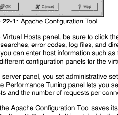

图 22-1：Apache 配置工具

在“虚拟主机”面板中，请务必单击“编辑默认设置”按钮，以设置页面搜索、错误代码、日志文件和目录的默认设置。若要添加虚拟主机，请单击“添加”以打开一个窗口，在其中您可以输入主机信息，如虚拟主机名和 IP 地址。在侧边栏中，您可以为虚拟主机选择不同的配置面板，例如日志文件和目录控制。

在“服务器”面板中，您设置管理设置，如 Apache 服务器的用户 ID 和进程 ID 文件。“性能调整”面板允许您设置不同的使用限制，例如最大请求数以及每个连接的请求数。


当 Apache 配置工具保存其设置时，它将覆盖 Apache 配置文件 `/etc/httpd/conf/httpd.conf`。建议首先对 `httpd.conf` 文件进行备份副本，以防您想恢复由发行版为 Apache 创建的原先设置。如果您已手动编辑过此文件，系统将显示警告，并且 Apache 配置工具将在 `/etc/httpd/conf/httpd.conf.bak` 创建备份副本。


## ABC Amber CHM 转换器 试用版

请注册以移除此横幅。

http://www.processestext.com/abcchm.html

### Web 服务器安全：SSL

Web 服务器安全涉及两项不同的任务：保护您的 Web 服务器免受未授权访问，以及为在 Web 浏览器客户端与您的 Web 服务器之间进行的事务提供安全保障。为保护服务器免受未授权访问，您需使用代理服务器，如 `Squid`。`Squid` 是一个 GNU 代理服务器，常用于 Linux 系统中的 Apache。 （有关 `Squid` 服务器的详细说明，请参见第 23 章。）Apache 本身具有几个提供安全功能的模块。这些模块包括用于强制控制的 `mod_access`；提供身份验证支持的 `mod_auth`、`mod_auth_db`、`mod_auth_digest` 和 `mod_auth_dbm`；以及用于匿名 FTP 类似登录的 `mod_auth_anon`（参见前面关于访问控制和身份验证的章节）。

为了安全传输，您需要执行三项任务。您必须验证身份、检查数据的完整性，并确保传输的隐私。要验证参与传输的主机身份，您需要执行身份验证程序。要检查数据的完整性，您需要添加包含数据摘要值的数字签名。摘要值是独特代表数据的值。最后，为确保传输的隐私，您需要对其进行加密。浏览器与服务器之间的事务随后可以被加密，只有浏览器和您的服务器能够解密传输。在 Linux Apache Web 服务器上实现安全传输最常用的协议是安全套接字层（SSL）协议，该协议最初由 Netscape 开发用于 Web 上的安全事务。

与第 18 章中描述的 Secure Shell (`SSH`) 和第 16 章中讨论的 `GPG` 类似，SSL 使用公钥和私钥加密的形式进行身份验证。数据使用公钥加密，但只能使用私钥解密。一旦数据经过身份验证，就会使用约定的密码对其进行加密。数字签名对数据的 MD5 摘要值进行加密以确保完整性。身份验证通过使用授权证书进行。证书识别安全传输中的各方，验证它们是否是其所声称的身份。Web 服务器将拥有一个验证其身份的证书，确认其为其声称的服务器。联系服务器的浏览器也将拥有一个标识其身份的证书。这些证书又都是由证书颁发机构签署的，以验证它们是有效证书。证书颁发机构是一个独立的实体，受到双方的信任。

证书包含分配给特定服务器或浏览器的公钥，以及证书颁发机构的数字签名和身份信息，如运行服务器或浏览器的用户或公司名称的有效性。证书的有效性直接取决于签发该证书的证书颁发机构的可靠性。要在互联网上运行安全的 Web 服务器，您应从知名的证书颁发机构（如 `Verisign`）获取证书。`Stronghold` 等商业供应商可以为您完成此操作。许多成熟的公司已经维护自己的证书颁发机构，以确保其公司内部网络传输的安全。SSL 会话通过使用握手序列建立，在此过程中，服务器和浏览器通过交换证书进行身份验证，约定用于加密传输的密码，并选择摘要完整性检查的类型。此外，用于身份验证的公钥加密类型也有选择，可以是 `RSA` 或 `DSA`。对于每个会话，都会建立一个唯一的会话密钥，供浏览器和服务器使用。

有一个免费的开源版 SSL 称为 `OpenSSL`，可用于 Apache（参见 www.openssl.org）。它基于 Eric A. Young 和 Tim J. Hudson 的 `SSLeay`。然而，美国政府的规定阻止 Apache Web 服务器内置 SSL 功能进行自由分发。您必须单独获取 SSL 并更新您的 Apache 服务器以整合此功能。

美国政府维持对超过 40 位加密技术的出口限制。但是，SSL 支持使用 168、128 和 40 位密钥的多种密码（128 被认为安全，因此相比之下，可出口的 40 位版本毫无用处）。这意味着如果 Apache 包含 SSL，它将无法在美国以外分发。然而，在美国以外，有项目使用 `OpenSSL` 为 Apache 分发 SSL。这些项目在美国免费用于非商业用途，但出口限制仍然适用。`Apache-SSL` 项目免费分发内置 SSL 的 Apache（`apache+ssl`）。您可以从其网站 www.apache-ssl.org 下载（虽然对加密技术出口有限制，但对进口没有限制）。此外，`mod_ssl` 项目提供了一个 SSL 模块，您可以使用其补丁更新 Apache Web 服务器以整合 SSL（www.modssl.org）。`mod_ssl` 在类似 Apache 的许可下免费用于商业和非商业用途。Red Hat 在其发行版中包含 `mod_ssl` 模块，位于 `mod_ssl` 软件包中（`/etc/httpd/conf.d/ssl.conf` 配置文件）。

`mod_ssl` 的 SSL 实现提供了一种通过不同端口（`443`）和不同协议（`https`）访问您的 Web 服务器的替代方式。实际上，您同时拥有一个 SSL 服务器和一个非安全版本。要访问安全的 SSL 版本，您在 Web 服务器的 URL 地址中使用 `https` 协议代替 `http`。例如，要访问运行在 `www.mytrek.com` 的 Web 服务器的 SSL 版本，您在其 URL 中使用 `https` 协议，如下所示：

```
https://www.mytrek.com
```

您可以通过在 Apache 配置文件 `httpd.conf` 中使用多个配置指令来配置 `mod_ssl`。在 Red Hat 上，随 Apache 安装的默认配置文件包含一个 SSL 指令部分以及详细的注释。查看 `mod_ssl` 的在线文档 www.modssl.org 获取列出所有指令的详细参考。有全局的、基于服务器的和基于目录的指令可用。

在 Red Hat 的 `httpd.conf` 文件中，SSL 指令的包含由 `HAVE_SSL` 标志启用的 `IfDefine` 块控制。例如，以下代码将加载 SSL 模块：

```
<IfDefine HAVE_SSL>
LoadModule ssl_module modules/libssl.so
</IfDefine>
```

Apache Web 服务器的 SSL 版本在 `httpd.conf` 文件中作为虚拟主机进行设置。SSL 指令由使用 `HAVE_SSL` 标志的 `IfDefine` 块启用。实施了几个默认指令，如 SSL 密钥目录的位置以及服务器 SSL 版本将监听的端口（`443`）。其他指令被注释掉。您可以通过删除前面的 `#` 符号来启用它们，并设置自己的选项。此处展示了几个指令：

```
<IfDefine HAVE_SSL>
#### SSL Virtual Host Context

# Server Certificate:
SSLCertificateFile /etc/httpd/conf/ssl.crt/server.crt

# Server Private Key:
SSLCertificateKeyFile /etc/httpd/conf/ssl.key/server.key

# Certificate Authority (CA):
#SSLCACertificatePath /etc/httpd/conf/ssl.crt
#SSLCACertificateFile /etc/httpd/conf/ssl.crt/ca-bundle.crt
```

在 `/etc/httpd/conf` 目录中，`mod_ssl` 将设置几个 SSL 目录，其中将包含 SSL 身份验证和加密密钥及数据。`ssl.crt` 目录将保存服务器的证书。`ssl.key` 目录保存用于身份验证加密的公钥和私钥。用于吊销过期证书的吊销列表保存在 `ssl.crl` 中。`ssl.csr` 目录保存用于向证书颁发机构请求官方证书的证书签名请求。`ssl.prm` 保存 `DSA` 密钥加密方法使用的参数文件。查看每个目录中的 `README` 文件以获取有关其所含 SSL 文件的详细信息。

`mod_ssl` 安装将为您提供一个名为 `snakeoil` 的演示证书，您可以使用它来测试您的 SSL 配置。当您拥有官方证书时，您可以在 `ssl.crt` 目录内使用 `make certificate` 命令安装它。这将覆盖 `server.crt` 服务器证书文件。

### 第 23 章：代理服务器-Squid

#### 概述


# 代理服务器与 Squid 概述

代理服务器作为本地网络与更大网络（如互联网）上可用服务之间的中介运行。本地客户端对 Web 服务的请求可以由代理服务器处理，从而加快交易速度并控制访问权限。代理服务器会维护常见访问的 Web 页面的当前副本，通过消除对原始站点频繁访问的需求来加快 Web 访问时间。它们还执行安全功能，保护服务器免受未授权访问。

`Squid` 是一个免费的开源代理缓存服务器，专为 Web 客户端设计，旨在加速互联网访问并为 Web 服务器提供安全控制。它为 Web 客户端实现代理缓存服务，在用户发起请求时缓存 Web 页面。用户访问的 Web 页面的副本保存在 `Squid` 缓存中，当请求发出时，`Squid` 会检查是否已有当前副本。如果 `Squid` 拥有当前副本，它会直接从缓存返回该副本，而不是查询原始站点。如果没有当前副本，它将从原始站点获取一份。这样，Web 浏览器就可以将本地 `Squid` 缓存用作代理 HTTP 服务器。`Squid` 目前支持 HTTP、FTP 和 SSL 协议的 Web 页面（`Squid` 不能与 FTP 客户端配合使用）。替换算法会定期替换缓存中的旧对象。你可以在 `squid.squid-cache.org` 上了解更多关于 `Squid` 的信息。

作为代理，`Squid` 的功能不仅仅是缓存 Web 对象。它在 Web 浏览器（客户端）和它们访问的服务器之间作为中介运行。连接不是直接连接到服务器，而是客户端连接到代理服务器。然后，代理将请求转发给 Web 服务器。这对于 Web 服务器位于防火墙服务器后面的情况非常有用，可以保护其免受未授权访问。代理在防火墙上可访问，防火墙可以将请求和响应在客户端和 Web 服务器之间来回传输。这种设计通常用于允许 Web 服务器在受保护的本地网络上运行，同时仍可被互联网访问。你还可以使用 `Squid` 代理为本地主机提供对互联网的 Web 访问。与其使用提供完整互联网访问权限的网关，本地主机可以使用代理来仅允许 Web 访问（参见第 5 章）。你还可以将两者结合，允许网关访问，但使用代理服务器来为 Web 访问提供更强的控制。此外，`Squid` 的缓存功能可以为本地主机提供更快的 Web 访问。

从技术上讲，你可以使用代理服务器来简单地管理 Web 服务器和想要与之通信的客户端之间的流量，而完全不进行缓存。`Squid` 将这两种功能结合作为一个代理缓存服务器。

`Squid` 还提供安全功能，让你能够控制访问你的 Web 服务器的主机。你可以拒绝某些主机的访问并允许其他主机的访问。`Squid` 还支持使用加密协议，如 SSL（参见第 22 章）。加密通信通过 `Squid` 服务器直接隧道传输（未经读取地穿过）到 Web 服务器。

`Squid` 由加利福尼亚大学圣地亚哥分校的应用网络研究国家实验室（NLANR）在 GNU 公共许可证下支持并分发。该项目基于 Harvest 项目，旨在创建一个包含名为 `cached` 的高性能缓存守护程序的 Web 索引系统。你可以从 `www.squid-cache.org` 的 `Squid` 主页获取当前源代码版本和在线文档。`Squid` 软件包包括 `Squid` 服务器、一个名为 `dnsserver` 的域名查找程序、一个名为 `ftpget` 的 FTP 客户端，以及一个名为 `cachemgr.cgi` 的缓存管理脚本。`dnsserver` 从域名解析 IP 地址，而 `ftpget` 程序是 `Squid` 用于从 FTP 服务器检索文件的 FTP 客户端。`cachemgr.cgi` 允许你查看 `Squid` 服务器运行时的统计信息。

在 Red Hat 上，你可以使用 `squid` 脚本启动、停止和重启 `Squid` 服务器，如下所示：

```
service squid restart
```

你还可以使用 `redhat-config-services` 工具或 `chkconfig` 设置 `Squid` 服务器自动启动。

## 配置客户端浏览器

`Squid` 支持标准代理缓存和透明缓存。对于标准代理缓存，用户需要配置浏览器以专门访问 `Squid` 服务器。另一方面，透明缓存不需要用户进行任何浏览器配置。缓存是透明的，允许访问，表现得像一个普通的 Web 站点。透明缓存通过 `IPtables` 使用网络过滤来实现，以拦截请求并将其定向到代理缓存（参见第 19 章）。

在使用标准代理缓存时，用户需要在 Web 浏览器配置中指定其代理服务器。为此，他们需要知道运行 `Squid` 代理服务器的主机的 IP 地址以及所使用的端口。代理通常使用端口 `3128`。要配置使用运行在第 5 章描述的本地示例网络上的代理服务器，你需要输入以下内容。代理服务器运行在 `turtle.mytrek.com` (`192.168.0.1`) 上，并使用端口 `3128`。

```
192.168.0.1 3128
```

在 Mozilla 和 Netscape 上，示例本地网络上的用户首先选择位于“编辑”菜单下“偏好设置”中的“代理”面板。然后，在“手动代理配置”的“查看”面板中，输入上述信息。用户将看到用于 FTP、Gopher、HTTP 和安全代理的条目。对于标准 Web 访问，请在 FTP、Gopher 和 Web 框中输入 IP 地址。在其端口框中，输入 `3128`。

对于 GNOME，请在“偏好设置”菜单或窗口中选择“网络代理”；对于 KDE 桌面环境中的 Konqueror，请在“偏好设置 | Web 浏览”菜单窗口中选择“代理”面板。

在这里，你可以输入代理服务器地址和端口号。

如果你的本地主机使用的是 Internet Explorer（例如 Windows 系统），你需要在“Internet 选项”窗口中可访问的“局域网设置”中设置代理条目。

在 Linux 或 Unix 系统上，本地主机可以设置 `http_proxy`、`gopher_proxy` 和 `ftp_proxy` shell 变量，以配置 Linux 支持的 Web 浏览器（如 `lynx`）的访问。你可以将这些定义放在你的 `.bash_profile` 或 `/etc/profile` 文件中，以便在每次登录时自动定义它们。

```
http_proxy=192.168.0.1:3128
ftp_proxy=192.168.0.1:3128
gopher_proxy=192.168.0.1:3128
export http_proxy ftp_proxy gopher_proxy
```

在本地主机上的客户端能够使用代理服务器之前，必须在服务器的 `squid.conf` 文件中授予其访问权限，该文件将在后面“安全”部分中描述。可以轻松地为一个整个网络提供访问权限。对于此处使用的示例网络，你需要在 `squid.conf` 文件中放置以下条目。这些条目将在以下部分中详细解释。

```
acl mylan src 192.168.0.0/255.255.255.0
http_access allow mylan
```

提示 需要作为标准代理缓存访问你的 `Squid` 服务器的 Web 客户端需要知道服务器的地址以及 `Squid` HTTP 服务的端口，默认为 `3128`。

## squid.conf

`Squid` 配置文件是 `squid.conf`，位于 `/etc/squid` 目录中。在 `/etc/squid/squid.conf` 文件中，你设置诸如使用的端口、控制服务器访问的安全选项以及配置缓存操作的缓存选项等通用选项。你可以使用名为 `/etc/squid/squid.conf.default` 的备份版本来恢复你的原始默认设置。随 `Squid` 软件提供的默认 `squid.conf` 版本包含对所有标准条目的详细解释，以及注释后的默认条目。条目由指定不同属性的标签组成。例如，`maximum_object_size` 和 `maximum_object` 设置传输对象的上限。

```
maximum_object_size 4096 KB
```

作为代理，`Squid` 将为特定服务使用某些端口，例如用于 Web 浏览器等 HTTP 服务的端口 `3128`。`Squid` 的默认端口号已经设置。如果你需要使用其他端口，可以在 `/etc/squid/squid.conf` 文件中设置。以下条目显示了如何设置 Web 浏览器端口：

```
http_port 3128
```

**注意** `Squid` 使用简单网络管理协议（SNMP）向管理你网络的 SNMP 代理提供状态信息和统计数据。你可以通过 `squid.conf` 文件中的 `snmp access` 和 `port` 配置来控制 SNMP。

## 安全

`Squid` 可以利用其作为 Web 客户端与 Web 服务器之间中介的角色来实现访问控制，确定谁可以访问 Web 服务器以及如何访问。`Squid` 通过检查已放置控制的主机和域的访问控制列表（ACLs）来实现这一点。当它发现来自这些主机之一的 Web 客户端尝试连接到 Web 服务器时，它会执行该控制。`Squid` 支持多种控制，可据此拒绝或允许远程主机的 Web 客户端访问 Web 服务器（参见表 23-1）。实际上，`Squid` 为 Web 服务器设置了一个防火墙。


配置 Squid 安全性的第一步是创建 ACLs。这些是您想要设置控制的主机和域的列表。您使用 `acl` 命令定义 ACLs，在其中为设置控制的系统创建一个标签。然后您使用诸如 `http_access` 之类的命令来定义这些控制。您可以通过使用几个 `acl` 选项来定义一个系统或一组系统，例如源 IP 地址、域名，甚至时间和日期。例如，`src` 选项用于定义具有特定源地址的系统或系统组。要为地址为 192.168.0.0 到 192.168.0.255 的本地网络中的系统定义 `mylan` `acl` 条目，请使用以下 ACL 定义：

```
acl mylan src 192.168.0.0/255.255.255.0
```

定义后，您可以在 Squid 选项中使用 ACL 定义来指定您想要对这些系统放置的控制。例如，要允许 `mylan` 组本地系统通过代理访问 Web，请使用具有 `allow` 操作的 `http_access` 选项指定 `mylan` 作为要使用的 `acl` 定义，如下所示：

```
http_access allow mylan
```

通过定义 ACLs 并在 Squid 选项中使用它们，您可以用您想要的安全性定制您的 Web 站点。以下示例仅允许 `mylan` 组本地系统通过代理访问 Web，拒绝所有其他访问。设置了两个 `acl` 条目：一个用于本地系统，一个用于所有其他系统。`http_access` 选项首先允许本地系统访问，然后拒绝所有其他系统。

```
acl mylan src 192.168.0.0/255.255.255.0
acl all src 0.0.0.0/0.0.0.0
http_access allow mylan
http_access deny all
```

您将在 `squid.conf` 文件中找到的默认条目，以及 `mylan` 示例网络的条目，如下所示。您将在 `squid.conf` 文件的 ACCESS CONTROLS 部分找到这些条目。

```
acl all src 0.0.0.0/0.0.0.0
acl manager proto cache_object
acl localhost src 127.0.0.1/255.255.255.255
acl mylan src 192.168.0.0/255.255.255.0
acl SSL_ports port 443 563
```

`http_access` 选项的顺序很重要。Squid 从第一个开始向下工作，在第一个具有匹配 ACL 条目的 `http_access` 选项处停止。在前面的示例中，与第一个 `http_access` 命令匹配的本地系统将被允许，而其他系统会落到第二个 `http_access` 命令并被拒绝。

对于使用代理的系统，您还可以控制它们可以访问哪些站点。对于目标地址，您使用 `dst` 限定符创建一个 `acl` 条目。`dst` 限定符以站点地址作为其参数。然后您可以创建一个 `http_access` 选项来控制对该地址的访问。以下示例拒绝任何使用代理的用户访问目标站点 `rabbit.mytrek.com`。如果您有一个通过代理访问 Web 的本地网络，您可以使用此类命令来限制对某些站点的访问。

```
acl myrabbit dst rabbit.mytrek.com
http_access deny myrabbit
```

`squid.conf` 文件中已定义的 `http_access` 条目，以及 `mylan` 网络的条目，如下所示。拒绝外部用户的访问，而允许本地网络上的主机和本地主机（Squid 服务器主机）访问。

```
http_access allow localhost
http_access allow mylan
http_access deny all
```

您还可以按域限定地址。通常，Web 站点可以使用仅域名来引用。例如，名为 `www.mybeach.com` 的站点可以使用域名 `mybeach.com` 来引用。要创建引用域的 `acl` 条目，请分别对目标和源域使用 `dstdomain` 或 `srcdomain` 选项。记住，此类引用指的是该域中的所有主机。具有 `mybeach.com` 的 `dstdomain` 选项的 `acl` 条目会限制对 `www.mybeach.com`、`ftp.mybeach.com`、`surf.mybeach.com` 等的访问。以下示例限制对 `www.mybeach.com` 站点以及所有其他 `.mybeach.com` 站点和 `mybeach.com` 域中的任何主机的访问：

```
acl thebeach dstdomain .mybeach.com
http_access deny thebeach
```

您可以在 `acl` 条目中列出多个域或地址以将它们作为一组引用，但您不能有一个域是另一个域的子域。例如，如果 `mybeachblanket.com` 是 `mybeach.com` 的子域，您不能在同一个 `acl` 列表中同时列出两者。以下示例限制对 `mybeach.com` 和 `mysurf.com` 的访问：

```
acl beaches dstdomain .mybeach.com .mysurf.com
http_access deny beaches
```

`acl` 条目还可以使用模式来指定某些地址和域。在以下示例中，拒绝任何 URL 包含模式 "chocolate" 的访问，但允许所有其他访问：

```
acl Chocl url_regex chocolate
http_access deny Chocl
http_access allow all
```

Squid 还支持 `ident` 和代理身份验证方法来控制用户访问。以下示例仅允许用户 `dylan` 和 `chris` 使用 Squid 缓存：

```
ident_lookup on
acl goodusers user chris dylan
http_access allow goodusers
http_access deny all
```

### 表 23-1：Squid ACL 选项

| 选项 | 描述 |
|---|---|
| `src` `ip-address/netmask` | 客户端的 IP 地址 |
| `src` `addr1-addr2/netmask` | 地址范围 |
| `dst` `ip-address/netmask` | 目标 IP 地址 |
| `myip` `ip-address/netmask` | 本地套接字 IP 地址 |
| `srcdomain` `domain` | 反向查找，客户端 IP |
| `dstdomain` `domain` | URL 中的目标服务器；对于 `dstdomain` 和 `dstdom_regex`，如果使用基于 IP 的 URL，则会尝试反向查找 |
| `srcdom_regex` `[-i]` `expression` | 匹配客户端名称的正则表达式 |
| `dstdom_regex` `[-i]` `expression` | 匹配目标的正则表达式 |
| `time` `[day-abbrevs]` `[h1:m1-h2:m2]` | 按天、小时和分钟指定的时间。星期缩写：S = 星期日，M = 星期一，T = 星期二，W = 星期三，H = 星期四，F = 星期五，A = 星期六 |
| `url_regex` `[-i]` `expression` | 匹配整个 URL 的正则表达式 |
| `urlpath_regex` `[-i]` `expression` | 匹配 URL 路径的正则表达式 |
| `port` `ports` | 指定端口或端口范围 |
| `proto` `protocol` | 指定协议，例如 HTTP 或 FTP |
| `method` `method` | 指定方法，例如 GET 和 POST |
| `browser` `[-i]` `regexp` | 在 user-agent 头上进行模式匹配 |
| `ident` `username` | 在 `ident` 输出上进行字符串匹配 |
| `src_as` `number` | 用于将请求路由到特定缓存 |
| `dst_as` `number` | 用于将请求路由到特定缓存 |
| `proxy_auth` `username` | 有效用户名的列表 |
| `snmp_community` `string` | 用于限制对 SNMP 代理访问的社区字符串 |

#### 缓存


Squid 使用 Internet 缓存协议（ICP）与其他 Web 缓存通信。使用 ICP 协议，您的 Squid 缓存可以连接到其他 Squid 缓存或其他缓存服务器，例如 Microsoft 代理服务器、Netscape 代理服务器和 Novell BorderManager。这样，如果您网络的 Squid 缓存没有请求的 Web 页面的副本，它可以联系另一个缓存以查看是否在那里，而不是访问原始站点。您可以通过将其连接到缓存层次结构来配置 Squid 以连接到其他 Squid 缓存。Squid 支持由术语 `child`、`sibling` 和 `parent` 表示的缓存层次结构。`Sibling` 和 `child` 缓存在同一级别访问，并且只要请求无法在您自己的 Squid 缓存中找到，就会自动查询。如果这些查询失败，则会查询父缓存，然后父缓存会搜索其自己的子缓存和同级缓存——如果需要，其自己的父缓存，依此类推。使用 `cache_host` 设置父级和同级层次连接。

```
cache_host sd.cache.nlanr.net parent 3128 3130
```

您可以通过在 `squid.conf` 文件中使用以下条目注册您的缓存来设置缓存层次结构以连接到主要的 NLANR 服务器：

```
cache_announce 24
announce_to sd.cache.nlanr.net:3131
```

### 日志

Squid 会保留多个日志文件。`access.log` 记录发送到您的代理的请求，`cache.log` 记录 Squid 服务器消息（如错误和启动信息），而 `store.log` 记录关于 Squid 缓存的信息（如对象的新增或移除）。您可以使用缓存管理器（`cachemgr.cgi`）来管理缓存并查看缓存管理器运行时的统计数据。要运行缓存管理器，请使用您的浏览器执行 `cachemgr.cgi` 脚本（该脚本应放置在您的 Web 服务器的 cgi-bin 目录中）。

### Web 服务器加速：反向代理缓存

虽然 Squid 缓存可以增强客户端对 Web 服务器的访问能力，但 Squid 还可以减轻 Web 服务器的负载。当 Web 服务器因请求过多而不堪重负时，可以将可缓存页面移至 Squid 代理服务器，该服务器可以作为某种替代站点来处理这些页面的请求。实际上，这就加速了 Web 服务器的响应。这种缓存被称为反向代理缓存，它侧重于服务器而非客户端。反向代理缓存将拦截到服务器的请求，并处理针对其缓存页面的请求。只有针对非缓存页面的请求才会被转发到原始 Web 服务器。

要配置反向代理缓存，您需要使用 `httpd_accel` 指令。`httpd_accel_host` 指定原始 Web 服务器的地址，而 `httpd_accel_port` 指定其使用的端口。如果代理仅支持一个 Web 服务器，请将 `httpd_accel_single_host` 设置为 `on`；如果代理支持多个 Web 服务器，则将其设置为 `off`。如果您希望将代理服务器既作为客户端的代理，又作为 Web 服务器的反向代理，请将 `httpd_accel_with_proxy` 选项设置为 `on`。但是，在这种情况下，客户端需要像访问任何标准代理服务器一样配置浏览器以访问该 Web 服务器。`httpd_accel_uses_host_header` 指令用于实现透明缓存；对于反向代理缓存，应将其关闭。

```
http_port 80 # Port of Squid proxy
httpd_accel_host 172.16.1.115 # IP address of web server
httpd_accel_port 80 # Port of web server
httpd_accel_single_host on # Forward uncached requests to host
httpd_accel_with_proxy on #
httpd_accel_uses_host_header off
```

如果您的 Squid 代理服务器和 Web 服务器运行在同一主机上，您需要指定 Web 服务器使用的端口。该端口不能与 Squid 使用的端口相同。在以下示例中，Web 服务器使用端口 `81`，而 Squid 使用端口 `80`。

```
http_port 80 # Port of Squid proxy
httpd_accel_host localhost # IP address of web server
httpd_accel_port 81 # Port of web server
```

此外，外部网络的 DNS 条目将使用代理服务器的 IP 地址作为 Web 服务器的主机名，从而将所有 Web 服务器请求重定向到代理服务器。内部网络的 DNS 条目将使用 Web 服务器的 IP 地址作为 Web 服务器的主机名，允许代理将非缓存请求重定向到 Web 服务器。如果您的网络仅使用一台 DNS 服务器，您可以设置分裂 DNS（Split DNS）服务器来指定内部和外部地址（参见第 34 章）。

# 第 24 章：邮件服务器：SMTP、POP 和 IMAP

## 概述

邮件服务器为互联网用户提供电子邮件服务。它们拥有自己的 TCP/IP 协议，如简单邮件传输协议（SMTP）、邮局协议（POP）和互联网邮件访问协议（IMAP）。消息通过服务于本地域名的邮件服务器在互联网上传输。域名可以被视为较大互联网的一个子网，拥有自己的服务器来处理发给该子网上用户或从该子网接收的邮件消息。当用户发送一条消息时，它首先从用户的主机系统发送到邮件服务器。然后，邮件服务器将该消息发送到互联网上的另一台邮件服务器，即服务于收件人所在子网的那台服务器。接收方邮件服务器随后将消息发送到收件人的主机系统。

在每一个阶段，都会使用不同的代理（程序）执行不同类型的操作。邮件用户代理（MUA）是电子邮件客户端程序，如 `mail` 或 `Elm`。使用 MUA，用户可以撰写并发送电子邮件。然后，邮件传输代理（MTA）通过互联网传输消息。MTA 是使用 SMTP 在互联网上从一个邮件服务器向另一个邮件服务器发送消息、并在子网之间传输消息的邮件服务器。在 Linux 和 Unix 系统中，常用的是 Sendmail，它是一个邮件服务器守护进程，持续检查来自其他邮件服务器的传入消息，并向相应的服务器发送传出消息。其他越来越受欢迎的 MTA 包括 Postfix、Exim、Courier 和 Qmail（见表 24.1）。邮件服务器接收到的传入消息通过邮件分发代理（MDA）分发给用户。大多数 Linux 系统使用 `procmail` 作为其 MDA，负责将邮件服务器接收到的消息投递到用户账户（有关更多信息，请访问 www.procmail.org）。

表 24-1：邮件传输代理

| 代理 | 描述 |
|---|---|
| Sendmail | Sendmail 邮件传输代理 www.sendmail.com |
| Postfix | 快速、易于配置且安全的邮件传输代理，兼容 Sendmail 并旨在取代它 www.postfix.org |
| Qmail | 快速、灵活且安全的 MTA，拥有自己的实现，与 Postfix 具有竞争力 www.qmail.org |
| Exim | 基于 smail3 的 MTA www.exim.org |
| Courier | Courier MTA www.courier-mta.org |
| 邮件传输代理切换器 | Red Hat 工具，允许您在 Sendmail 和 Postfix 之间切换（在“系统设置”菜单和窗口中的“邮件传输代理切换器”） |


## ABC Amber CHM Converter 试用版

请注册以移除此横幅。

http://www.processestext.com/abcchm.html

## 邮件服务器

Red Hat Linux 会自动为您安装并配置 Sendmail 和 Postfix。系统启动后，您可以使用 Sendmail 或 Postfix 在本地用户之间发送和接收消息。Red Hat 包含一个名为“邮件传输代理切换器”的特殊工具，可以通过“系统设置”菜单或窗口访问，让您在这两者之间进行切换。您还可以设置您的 Linux 系统以运行 POP 服务器。POP 服务器持有用户的邮件，直到用户登录以访问其消息，而不是直接将邮件发送到其主机。本章将讨论 Postfix 和 Sendmail。

Courier 是一种快速、小巧且安全的 MTA，它保持与 Sendmail 的部分兼容性。Courier 软件包还包含 POP、IMAP 和网页邮件服务器以及邮件列表服务。它支持广泛的身份验证方法，包括影子密码（shadow passwords）、PAM 和 LDAP。

Qmail 也是一种快速且安全的 MTA，但它与 Sendmail 的兼容性很少。它拥有自己的配置和维护文件。与 Postfix 一样，它采用模块化设计，使用不同的程序处理每个邮件任务。它还专注于安全性、速度和易于配置。


注意 在单个独立系统内发送的消息需要一个环回接口。大多数 Linux 发行版（包括 Red Hat）在安装过程中会自动为您完成此操作。环回接口使您的系统能够寻址自身，从而允许它向自身发送和接收邮件。环回接口使用主机名 `localhost` 和一个保留给本地系统使用的特殊 IP 地址 `127.0.0.1`。您可以检查 `/etc/hosts` 文件，查看环回接口是否已配置为本地主机。您应该看到 `127.0.0.1 localhost` 列为第一条条目。

## 接收邮件：MX 记录

邮件地址由用户名和主机地址组成。主机地址采用完全限定域名（FQDN）的形式，列出主机名和域名，中间用点分隔。主机名的大多数用途，如 FTP 连接，会将主机名解析为 IP 地址，并使用该 IP 地址定位主机系统。电子邮件消息的操作方式与此几乎相同。然而，它们利用域名服务（DNS）来确定实际应向哪个主机发送消息。邮件地址中指定的主机可能不是实际应投递邮件的主机。不同的网络通常会指定一个邮件服务器，该网络内主机的邮件应投递至该服务器。例如，发送给 `rabbit.mytrek.com` 主机的邮件实际上可能投递到 `turtle.mytrek.com` 主机。`turtle.mytrek.com` 可能正在运行一个 POP 邮件服务器，`rabbit.mytrek.com` 上的用户可以访问该服务器读取邮件。

此类邮件服务器通过网络 DNS 配置中的邮件交换记录（称为 MX 记录）与不同的主机相关联（参见第 34 章）。当网络接收到邮件时，首先检查该网络的 DNS 配置中的 MX 记录，以确定是否应将邮件投递到与邮件地址不同的主机。例如，以下 MX 记录表示，发送给 `rabbit.mytrek.com` 主机的任何邮件都应投递到 `turtle.mytrek.com` 主机。`turtle.mytrek.com` 是 `rabbit.mytrek.com` 的邮件交换服务器：

```
rabbit.mytrek.com. IN MX 0 turtle.mytrek.com.
```

一个主机可以有多个邮件交换服务器，每个都有不同的优先级。如果一个不可用，系统将访问优先级次高的那个。这种设计提供了更健壮的邮件投递机制，让少数维护良好的服务器处理接收到的邮件，而不是让每个主机单独处理。

邮件交换记录也用于没有对应主机的主机的邮件地址。例如，您可以指定虚拟主机或使用域名作为地址。要使用域名，您需要一个将域名映射到网络中邮件服务器的 MX 记录。发送给域名地址的邮件将发送到该邮件服务器。例如，根据以下 MX 记录，发送给 `mytrek.com` 的邮件将投递到运行着类似 Sendmail 邮件服务器的 `turtle.mytrek.com`：

```
mytrek.com. IN MX 0 turtle.mytrek.com.
```

发送给 `george@mytrek.com` 的邮件将被发送到 `george@turtle.mytrek.com`。

注意 MX 记录不仅用于传入邮件，也用于传出邮件。MX 记录可以指定用于将特定主机的邮件中继到更大网络的邮件服务器。

MX 记录在某些邮件配置（如伪装或集中式邮件服务）中发挥作用。并非所有情况都需要 MX 记录。如果您有一个独立系统或只有少数主机的一个小网络，您可能希望邮件直接由不同的主机接收。

## 后缀（Postfix）

Postfix 是一个快速、安全且灵活的邮件传输代理（MTA），旨在替代 Sendmail 的同时尽可能保持兼容性。它由 Wietse Venema 编写，最初以 IBM 安全邮件器的形式发布，目前可在 GNU 许可下获取（www.postfix.org）。Postfix 的设计初衷是注重安全性，将所有传入邮件视为潜在的安全风险。Postfix 使用许多与 Sendmail 相同的目录和文件，并利用 Sendmail 包装器，使 Sendmail 客户端能够与 Postfix 服务器无缝交互。Postfix 还更易于配置，使用其自身的配置文件。Red Hat 现在同时提供 Postfix 和 Sendmail。

Postfix 并非由单个大型程序组成，而是作为一组较小程序的集合实现，每个程序都旨在执行特定的邮件相关任务。Postfix 主守护程序持续运行，并管理其他 Postfix 守护程序的使用，仅在需要时运行它们。反弹守护程序处理无法递送的邮件，琐碎重写守护程序重定向消息，而 `showq` 守护程序提供邮件队列信息。

### Postfix 命令

多个 Postfix 命令允许你管理服务器任务。`sendmail` 命令用于发送消息。你使用 `mailq` 显示邮件队列的状态。`newaliases` 命令获取别名文件中列出的邮件别名，并将它们存储到 Postfix 可使用的数据库文件中。`postmap` 命令用于维护 Postfix 使用的各种数据库文件，例如用于邮件别名的别名文件和用于限制服务器接收消息的访问文件。此外，Postfix 提供了以 `post` 开头的一系列低级工具，例如维护别名数据库的 `postalias` 命令，以及显示邮件队列文件的 `postcat`。

### Postfix 配置：main.cf

Postfix 的配置是通过在其配置文件 `main.cf` 中设置参数来处理的。Red Hat 在安装 Postfix 时会安装默认的 `/etc/postfix/main.cf` 文件，其中大多数基本配置值已预先设置。参数名称通常比较用户友好。例如，目录位置由以 `directory` 结尾的参数指定，如表示 Postfix 队列位置的 `queue_directory` 和表示 Postfix 守护程序位置的 `daemon_directory`。大多数参数已实现默认值。例如，为特定的资源控制设置了默认值，如消息大小、时间限制和每个队列允许的消息数量。你可以编辑 `main.cf` 文件以更改参数值，以满足你自己的需求。进行任何更改后，你只需要使用 `postfix reload` 命令重新加载配置：

```
postfix reload
```

### 网络参数

你可能需要设置多个网络参数。为了简化此过程，Postfix 定义了保存关键网络信息的参数，例如保存系统主机名的 `myhostname`，以及保存网络域名的 `mydomain`。例如，`myhostname` 将设置为 `turtle.mytrek.com`，而 `mydomain` 仅为 `mytrek.com`。像 `myhostname` 和 `mydomain` 这样的参数本身用作分配给其他参数的值。在下一个示例中，`myhostname` 和 `mydomain` 被设置为邮件服务器运行的主机及其网络域名：

```
myhostname=turtle.mytrek.com
mydomain=mytrek.com
```

`myorigin` 参数指定服务器发送电子邮件的源地址。默认情况下，这设置为 `myhostname` 参数的值，如下所示。请注意，`myhostname` 变量前有一个 `$` 以对其进行求值。

```
myorigin=$myhostname
```

如果你使用的是直接连接到 Internet 的单个系统，你可能希望保留此配置，将邮件标记为由你的主机发送。然而，如果你的系统作为网络网关运行，那么你的邮件服务器正在从该网络上的不同主机发送邮件。你可能希望将源地址更改为域名，以便邮件看起来像是从域名发出的。

```
myorigin=$mydomain
```

### 本地网络

`mydestination` 参数保存你的邮件服务器将接收邮件的域名列表。默认情况下，这些包括 `localhost` 和系统的主机名。

```
mydestination = $myhostname localhost.$mydomain
```

如果你希望邮件服务器接收整个本地网络的邮件，你还需要指定其域名。这样，服务器可以接收仅发往该域名的邮件，而不是发往特定主机的邮件。

```
mydestination = $myhostname localhost.$mydomain $mydomain
```

此外，如果你的主机使用其他主机名，并且存在 DNS 记录通过那些名称标识你的主机，你也需要指定那些名称。例如，你的主机也可以是一个可能接收邮件的 Web 服务器。主机 `turtle.mytrek.com` 也可以被标识为 Web 站点 `www.mytrek.com`。这两个名称都必须列在 `mydestination` 参数中。

```
mydestination = $myhostname localhost.$mydomain $mydomain www.$mydomain
```

如果你的系统是一个或多个本地网络的网关，你可以使用 `mynetworks` 参数指定它们。这允许你的邮件服务器中继发往这些网络的邮件。网络使用其 IP 地址进行指定。`relay_domains` 参数允许你指定可以中继消息的网络的域名地址。默认情况下，这设置为 `mydestination`：

```
mynetworks=192.168.0.0
relay_domains=$mydestination
```


通过网关连接到 Internet 的本地网络中的主机需要知道中继主机（即邮件服务器）的身份。你使用 `relayhost` 参数来设置它。此外，`myorigin` 应设置为仅 `mydomain`。如果有 DNS 服务器将网关标识为邮件服务器，你可以将 `relayhost` 设置为 `mydomain` 的值。如果没有，则应将 `relayhost` 设置为网关/邮件服务器的特定主机名。如果你的本地网络未运行 DNS 服务器，请确保将 `disable_dns_lookups` 设置为 `yes`。

```
relayhost=$mydomain
```

### 直接连接

如果你的系统直接连接到 Internet 并且你使用 ISP 接收邮件，你可以将 Postfix 配置为仅发送邮件的 null 客户端。将 `relayhost` 参数设置为你自己的域名。此外，在 `master.cf` 文件中，注释掉 SMTP 服务器和本地交付代理条目。

```
relayhost = $mydomain
```

### 伪装（Masquerading）

如果你的邮件服务器在本地网络的网关上运行，并且你想隐藏该网络中的主机，你可以选择伪装本地主机，使看起来所有邮件都来自一般性的域名，而不是特定的主机。要设置此选项，你使用 `masquerade_domains` 参数。在以下示例中，由 `rabbit.mytrek.com` 这样的本地主机发送的所有邮件将被标记为仅来自 `mytrek.com`。因此，用户 `chris@rabbit.mytrek.com` 发送的消息将被发出，看起来像是来自 `chris@mytrek.com`。

```
masquerade_domains = $mydomain
```

默认情况下，接收到的邮件不被伪装。这允许 Postfix 仍将接收到的邮件递送到特定主机。如果你希望接收到的邮件也被伪装，你必须将 `envelope_recipients` 参数添加到分配给 `masquerade_class` 参数的值列表中。在这种情况下，Postfix 将不再能够递送接收到的邮件。

### 虚拟域名

如果你的网络已实施虚拟域名，你需要设置虚拟域名表，然后使用 `virtual_maps` 选项指定该表。设置表只需在一个文本文件（如 `/etc/postfix/virtual`）中列出虚拟名称及其真实地址即可。然后使用 `postmap` 命令创建 Postfix 表：

```
postmap /etc/postfix/virtual
```

在 `main.cf` 文件中，使用 `virtual_maps` 参数指定该表。Postfix 将使用该表查找虚拟域名。

```
virtual_maps = hash:/etc/postfix/virtual
```

注意 有关如何为网关、本地工作站或直接连接到 Internet 的主机（null 服务器）设置 Postfix 的详细信息，请参阅 www.postfix.org 上的 Postfix FAQ

### 安全：UCM

Postfix 参数可让你配置控制其委婉称之为 unsolicited commercial mail（UCM）的方法。

### 控制用户和主机访问

使用访问文件，你可以控制特定用户、主机和域的访问。该访问文件的工作方式与 Sendmail 中使用的文件非常相似。条目在文本文件中创建，以用户、主机或域的名称或地址开头，后跟要采取的操作。用户、主机或域可以被接受、拒绝或带消息拒绝。一旦创建条目，就可以使用 `postmap` 命令将其安装到 Postfix 数据库文件中：

```
postmap /etc/postfix/access
```

然后你可以在各种 Postfix 操作中使用访问文件来控制客户端、收件人和发件人。

### 阻止访问

访问也可以通过使用邮件滥用预防系统（MAPS）来控制，该系统提供 RBL+ 服务，这是一组基于邮件地址 DNS 的数据库（mail-abuse.org）。这些数据库，如实时黑洞列表（RBL），列出了已知被邮件滥用者使用的邮件地址。域或主机与服务维护的列表进行匹配。该服务可以在本地服务器上访问，也可直接从在线站点访问。各种 Postfix 操作让你可以使用 MAPS 数据库来控制客户端、收件人、发件人的访问。

### 头部和正文检查

使用 `header_checks` 参数，你可以指定一个 Postfix 表，在其中列出拒绝邮件的标准。这些标准是可匹配邮件头的模式。你可以让匹配的邮件被拒绝、带回复拒绝、直接删除或记录警告。你可以选择执行多个操作，包括 `REJECT`、`DISCARD`、`WARN`、`HOLD` 和 `IGNORE`。

```
header_checks = regexp:/etc/postfix/header_checks
```

在本例中，数据库 `/etc/postfix/header_checks` 将包含多行，每行包含一个正则表达式和相应的操作。正则表达式可以是 `header_checks` 参数中 `regexp` 所表示的标准正则表达式（参见第 8 章），也可以符合 Perl 兼容正则表达式 `pcre`。

`body_checks` 参数让你可以逐行检查文本邮件的正文，使用与 `header_checks` 相同的正则表达式和操作。

### 控制客户端、发件人和收件人

使用 `smtpd_client_restrictions` 参数，你可以限制特定客户端对邮件服务器的访问。你可以应用的限制包括 `reject_unknown_client`，它会拒绝任何地址无法解析的客户端；`permit_mynetworks`，它允许 `mynetworks` 中定义的任何客户端访问；以及 `check_client_access`，它会检查访问数据库以确定客户端应被接受还是拒绝。`reject_rbl_client` 和 `reject_rhsbl_client` 将拒绝来自指定域的客户端。

```
smtpd_client_restrictions = permit_mynetworks, \
    reject_unknown_client, check_client_access, reject_rbl_client
```

`reject_rbl_client` 限制基于指定的 MAPS 服务拒绝域地址。该站点可以是在线站点，也可以是为提供该服务而设置的本地站点。`reject_rhsbl_client` 限制拒绝主机地址。

```
smtpd_client_restrictions = reject_rbl_client relays.mail-abuse.org
```

要从访问文件实现限制，可以使用 `hash` 指令和文件名。

```
smtpd_client_restrictions = hash:/etc/postfix/access
```

相应的 `smtpd_sender_restrictions` 参数的工作方式与客户端对应参数类似，但控制来自特定发件人的访问。它具有许多相同的限制，并增加了 `reject_non_fqdn_sender`，它会拒绝任何没有完全限定域名邮件头的邮件，以及 `reject_sender_login_mismatch`，它要求发件人验证。`reject_rhsbl_sender` 限制基于指定的 MAPS 服务拒绝域地址。

`smtpd_recipient_restrictions` 参数将限制服务器接受邮件的收件人。限制包括 `permit_auth_destination`，它允许授权邮件，以及 `reject_auth_destination`，它拒绝未授权邮件。`check_recipient_address` 限制将检查本地网络中的收件人地址，而 `check_recipient_maps` 将拒绝在列出本地、中继和虚拟收件人以及别名的收件人表中未验证的地址。`reject_unknown_recipient_domain` 限制拒绝没有 DNS 条目的收件人地址。`reject_rhsbl_recipient` 限制基于指定的 MAPS 服务拒绝域地址。

你可以使用 `smtpd_helo_restrictions` 等参数进一步细化限制，该参数要求客户端发出 HELO 命令。限制参数包括 `reject_invalid_hostname`，它检查错误的语法，`reject_unknown_hostname` 用于没有 DNS 条目的主机，以及 `reject_non_fqdn_hostname` 用于名称未完全限定的主机。`strict_rfc821_envelopes` 参数将实现严格的信封协议合规性。

### Sendmail

Sendmail 作为服务器既接收也发送邮件消息。Sendmail 监听从其他主机接收并发送到其服务的网络主机上用户的任何邮件消息。同时，Sendmail 处理用户发送给远程用户的邮件，确定将它们发送到哪些主机。你可以在 www.sendmail.org 了解更多关于 Sendmail 的信息，包括在线文档和当前软件包。Sendmail 新闻组是 `comp.mail.sendmail`。你也可以从 www.sendmail.com 获得商业版本。


你网络的域名服务器指定运行 `Sendmail` 服务器的主机。这是你的邮件主机。邮件发送到该主机，其 `Sendmail` 服务器随后将邮件发送给适当的用户及其主机。在你的域名服务器配置文件中，邮件主机条目使用 `MX` 条目指定。要打印待将来投递的邮件队列，可以使用 `mailq` 或 `sendmail -v -q`。这将运行 `Sendmail` 并指示其打印邮件队列。

`Sendmail` 软件包包含多个用于管理 `Sendmail` 服务器的实用程序。其中包括 `mailq`，它显示外出邮件的队列；`mailstats`，它显示邮件服务器使用统计；`hoststat`，它提供已与邮件服务器连接的远程主机的统计；以及 `praliases`，它打印 `/etc/aliases` 文件中列出的邮件别名。其中一些，如 `mailq` 和 `hoststat`，只是使用某些选项调用 `Sendmail`。其他的，如 `mailstats` 和 `praliases`，是独立的程序。

`Sendmail` 现在将所有配置和数据库文件保存在 `/etc/mail` 目录中。在这里你会找到 `Sendmail` 宏配置文件 `sendmail.mc` 以及多个数据库文件（参见表 24-2）。随着 `Sendmail` 8.10 的发布，许多文件名称已更改。例如，帮助文件现在是 `/etc/mail/helpfile` 而不是 `/etc/sendmail.ht`。专用文件为某些功能提供支持，例如 `access`，它让你控制不同主机和网络对邮件服务器的访问。`virtusertable` 让你指定虚拟主机。这些文件同时具有文本和数据库版本。数据库版本的扩展名为 `.db`，是 `Sendmail` 实际使用的文件。你将在文本版本中进行条目编辑，然后通过生成相应的数据库版本使更改生效。数据库版本使用 `makemap` 命令配合 `hash` 选项以及文本文件和数据库文件的重定向操作生成。例如，要拒绝特定主机的访问，你将在 `/etc/mail/access` 文件中放置其相应的条目，使用任何文本编辑器编辑文件。然后，要生成访问文件的 `/etc/mail/access.db` 版本，你将切换到 `/etc/mail` 目录并使用以下命令：

```
cd /etc/mail
makemap hash access < access
```

要重新生成所有数据库文件，只需在 `/etc/mail` 目录中使用 `make` 命令：

```
make
```

某些文件和目录用于管理收发邮件。传入邮件通常保存在 `/var/spool/mail` 目录中，而传出邮件保存在 `/var/spool/mqueue` 目录中，并为不同用户设有子目录。监控和错误消息记录在 `/var/log/maillog` 文件中。

注意 `Red Hat` 现在将 `Sendmail` 配置文件 `sendmail.cf` 放在 `/etc/mail` 目录中，而不是像以前版本（7.3 及更早）那样放在 `/etc` 目录中。

### 表 24-2：Sendmail 文件和目录

| 文件 | 描述 |
|---|---|
| `/etc/mail/sendmail.cf` | `Sendmail` 配置文件。 |
| `/etc/mail/sendmail.mc` | `Sendmail` M4 宏配置文件。 |
| `/etc/aliases` | 用于邮件列表的 `Sendmail` 别名文件。 |

### 表 24-2：Sendmail 文件和目录

| 文件 | 描述 |
|------|-------------|
| `/etc/aliases.db` | `Sendmail` 别名数据库文件，由 `newaliases` 命令使用 `aliases` 文件生成。 |
| `/etc/mail/access` | `Sendmail` 访问文本文件。用于筛选或中继来自不同主机、网络或用户的消息的访问控制。用于生成 `access.db` 文件。 |
| `/etc/mail/access.db` | `Sendmail` 访问数据库文件。由 `access` 文本文件生成。 |
| `/etc/mail/local-host-names` | `Sendmail` 本地主机文件，用于使用同一邮件服务器的多个主机（以前为 `sendmail.cw`）。 |
| `/etc/mail/trusted-users` | `Sendmail` 受信任用户文件（以前为 `sendmail.ct`）。 |
| `/etc/mail/error-header` | `Sendmail` 错误头文件（以前为 `sendmail.oE`）。 |
| `/etc/mail/helpfile` | `Sendmail` 帮助文件（以前为 `sendmail.ht`）。 |
| `/etc/mail/statistics` | `Sendmail` 统计文件（以前为 `sendmail.st`）。 |
| `/etc/mail/virtusertable` | `Sendmail` 虚拟用户表文本文件。映射用户虚拟域地址，允许在单个系统上托管虚拟域。在此文件中添加条目，然后使用它生成 `virtusertable.db` 文件。 |
| `/etc/mail/virtusertable.db` | `Sendmail` 虚拟用户表数据库，由 `virtusertable` 文件生成。 |
| `/etc/mail/mailertable` | `Sendmail` 邮件传输表文本文件，用于覆盖您域的路由。 |
| `/etc/mail/mailertable.db` | `Sendmail` 邮件传输表数据库文件，由 `mailertable` 文件生成。 |
| `/etc/mail/userdb` | `Sendmail` 用户数据库文件。 |
| `/etc/mail/domaintable` | `Sendmail` domaintable 文件，将域名映射到另一个域名。 |
| `/etc/mail/domaintable.db` | `Sendmail` domaintable 数据库文件，由 `domaintable` 文件生成。 |
| `/var/spool/mail` | 传入邮件。 |
| `/var/spool/mqueue` | 传出邮件。 |
| `/var/spool/maillog` | 邮件日志文件。 |

#### 注意

如果您的邮件服务器为多个主机提供服务，您需要在 `/etc/mail/local-host-names` 文件中输入内容。

#### 别名和 LDAP

从 `Sendmail` 8.10 开始，`Sendmail` 现在可以支持轻量级目录访问协议（`LDAP`）。`LDAP` 允许使用单独的服务器来管理 `Sendmail` 关于用户邮件地址的查询。无需在不同服务器上维护 `aliases` 和 `virtusertable` 文件，`Sendmail` 使用 `LDAP` 支持只需使用一个集中的 `LDAP` 服务器来定位收件人。邮件地址在 `LDAP` 服务器中查找，而无需在不同服务器上搜索多个 `aliases` 和 `virtusertable` 文件。`LDAP` 还提供用户的安全身份验证，允许受控访问邮件帐户。以下示例在 `sendmail.mc` 文件中启用 `Sendmail` 的 `LDAP` 支持：

```
FEATURE('ldap_routing')dnl
LDAPROUTE_DOMAIN('mytrek.com')dnl
```

另外，`Sendmail` 仍然支持使用别名，用于发送或接收邮件。它检查一个名为 `aliases.db` 的别名数据库文件，其中保存了别名名称及其关联的电子邮件地址。这通常用于管理员邮件，其中邮件可能发送到系统的 `root` 用户，然后重定向到实际系统管理员的邮件地址。您还可以为主机地址设置别名，从而仅使用别名即可寻址网络上的主机。别目条目保存在 `/etc/aliases` 文件中。该文件由将别名与用户地址关联的一行别名记录组成。您可以编辑此文件以添加新条目或更改旧条目。然后使用 `newaliases` 命令将它们存储以供在 `aliases.db` 文件中查找，该命令使用指令运行 `Sendmail` 以更新 `aliases.db` 文件。

别名允许您为电子邮件地址或一组电子邮件地址提供不同的名称。其最有用的功能之一是创建用户邮件列表。发送到别名的邮件地址将被发送到与该别名关联的用户或用户列表。别名条目由冒号终止的别名名称组成，后跟用户名或以逗号分隔的用户列表。例如，要将 `filmcritic` 别名为用户 `george@rabbit.mytrek.com`，您将使用以下条目：

```
filmcritic:   george@rabbit.mytrek.com
```

要将 `singers` 别名为本地用户 `aleina` 和 `larisa`，您将使用

```
singers:   aleina, larisa
```

您还可以使用别名作为目标地址，在这种情况下，它们将扩展为各自的用户地址。例如，`performers` 别名将通过 `filmcritic` 和 `singers` 别名扩展到用户 `george@rabbit.mytrek.com`、`aleina` 和 `larisa`。

```
performers:   filmcritic, singers
```

一旦您在 `/etc/mail/aliases` 文件中添加了条目，您需要使用 `newaliases` 命令生成数据库版本：

```
newaliases
```

#### Sendmail 配置


主要的 Sendmail 配置文件是 `sendmail.cf`，位于 `/etc` 目录中。该文件包含有时很长的邮件定义列表，设置常规选项、指定 MTA 并定义地址重写规则。一系列选项设置功能，例如邮件消息的最大大小或主机文件的名称。MTA 是 Sendmail 通过其路由消息的邮件传输代理。重写规则“重写”邮件地址，以便通过适当的 Internet 连接将其路由到目的地（这些规则可能很复杂）。请查阅 Sendmail HOW-TO 和在线文档以获取详细说明。

`sendmail.cf` 定义可能很复杂且令人困惑。为了简化配置过程，Sendmail 支持使用宏，您可以使用 `m4` 预处理器使用这些宏生成 `sendmail.cf` 文件（这需要安装 `sendmail-cf` 软件包）。宏放在 `/etc/mail/sendmail.mc` 文件中。在这里，您可以使用宏指定您想要的 Sendmail 定义和功能，然后宏用于在 `sendmail.cf` 文件中生成适当的定义和重写规则。作为 Sendmail 软件包的一部分，`/usr/share/sendmail-cf` 目录中提供了几个专门版本的 `sendmail.mc` 文件。这些以系统名称开头并以 `.mc` 为后缀。在许多发行版中，已根据您的发行版定制的一个专用版本已安装为您的 `/etc/mail/sendmail.mc` 文件。

配置完 `sendmail.mc` 文件后，您使用以下命令生成 `sendmail.cf` 文件（请务必先备份原始 `sendmail.cf` 文件）。您可以将 `sendmail.mc` 文件重命名以反映特定配置。您可以拥有任意多个不同的 `.mc` 文件并使用它们来实现不同的配置。

```
m4 sendmail.mc > /etc/mail/sendmail.cf
```

然后您需要重新启动 Sendmail 服务器以使配置生效：

```
service sendmail restart
```

在 `sendmail.mc` 文件中，您使用 `define` 命令设置 Sendmail 变量的值，或使用已定义的 Sendmail 宏来设置特定 Sendmail 功能。例如，要将 `PROCMail_PATH` 变量分配给目录 `/usr/bin/procmail`，您将使用以下内容：

```
define('PROCMail_MAILER_PATH','/usr/bin/procmail')
```

同样，如果有您不希望定义的变量，您可以使用 `undefine` 命令将其删除：

```
undefine('UUCP_RELAY')
```

要指定 Sendmail 服务器运行的操作系统类型，您将使用 `OSTYPE` Sendmail 宏。以下示例指定 Linux 操作系统：

```
OSTYPE('linux')
```

`MAILER` 宏指定要使用的邮件投递代理（MDA）。您可能有多个。通常，您需要一个邮件投递代理，例如 `procmail`，用于将邮件投递到网络上的主机。此外，Sendmail 本质上充当 MDA 来接收来自其本地网络主机的消息，然后将其发送到更大的网络。

```
MAILER(procmail)
MAILER(smtp)
```

Sendmail 还支持大量需要显式打开的功能。您可以使用 Sendmail `FEATURE` 宏来完成此操作。请参阅表 24-3，了解常用的 Sendmail 功能列表。以下示例打开 `redirect` 功能，该功能用于通知发件人收件人现在位于不同地址：

```
FEATURE(redirect)
```

### 表 24-3：Sendmail 功能

| 功能 | 描述 |
|---|---|
| `use_cw_file` | 检查邮件服务器 `/etc/mail/local-host-names` 文件所服务的主机。 |
| `use_ct_file` | 从 `/etc/trusted-users` 文件读取用户列表。这些是受信任的用户，可以更改其消息的发件人名称。 |
| `redirect` | 拒绝所有发往 "address.REDIRECT" 的邮件，前提是在 `/etc/aliases` 文件中放置了转发地址。 |
| `mailertable` | 使用邮件传输表文件 `/etc/mail/mailertable` 来覆盖特定域的路由。 |
| `domaintable` | 使用域表文件 `/etc/mail/domaintable` 将一个域映射到另一个域。如果您更改域名，则很有用。 |
| `allmasquerade` | 导致收件人地址也伪装成来自伪装主机。 |
| `masquerade_entire_domain` | 伪装 `MASQUERADE_AS` 中指定的域内的所有主机。 |
| `masquerade_envelope` | 伪装信封发件人和收件人以及头信息。 |
| `virtusertable` | 对于虚拟主机，将虚拟地址映射到真实地址。 |
| `nullclient` | 将 Sendmail 服务器转变为 null 客户端，该客户端仅将邮件消息转发到中央邮件服务器进行处理。 |
| `local_procmail` | 使用 `procmail` 作为本地邮件传输代理。 |
| `smrsh` | 使用 Sendmail 受限 Shell `smrsh` 进行邮件处理。 |
| `promiscuous_relay` | 允许中继邮件，使得可以从域外接收邮件并将其发送至域外的主机。 |
| `relay_entire_domain` | 允许域内的任何主机中继邮件（默认情况下，此限制仅适用于访问数据库中的主机）。 |
| `relay_hosts_only` | 检查特定主机而非域的中继权限。 |
| `accept_unqualified_senders` | 允许发送者电子邮件地址仅为单个用户名，而不仅仅是包含域名的完全限定名称。 |
| `accept_unresolvable_domains` | 允许 Sendmail 接受无法解析的域名。这对于那些位于被防火墙阻断与完整 DNS 命名空间连接的本地网络中的用户非常有用。默认情况下，Sendmail 要求地址中的域名必须可通过 DNS 解析。 |
| `access_db` | 根据访问数据库中的域名和主机接受或拒绝邮件。 |
| `blacklist_recipients` | 阻止发送给特定用户的邮件，例如那些永远不应接收邮件的用户，如 `nobody` 和 `host`。 |
| `dnsbl` | 拒绝实时黑洞列表（Realtime Blackhole List）中的主机。由 MAPS（Mail Abuse Prevention System LLC）管理，旨在限制不需要的批量电子邮件传输。`mail-abuse.org`。 |
| `ldap_routing` | 启用 LDAP 使用。 |

此外，您可以设置某些配置选项。这些是以 `conf` 前缀开头的变量，您可以使用 `define` 命令对其进行设置并分配值。配置选项数量众多，其中大多数您都不需要更改。以下示例定义了 `confAUTO_REBUILD` 配置选项，如果必要，它将自动重建别名数据库。

```
define('confAUTO_REBUILD')
```

某些宏和宏类型需要按照所示的特定顺序放置在 `sendmail.mc` 文件中。请注意，`MAILER` 靠近末尾，而 `OSTYPE` 在开头。本地宏定义（`define`）和 `FEATURE` 条目紧随 `OSTYPE` 和 `DOMAIN` 条目之后。

```
VERSIONID
OSTYPE
DOMAIN
define
FEATURE
local macro definitions
MAILER
LOCAL_RULE_*
```

#### LOCAL_RULESETS

影响特定特性的本地宏和配置选项定义需要在 `FEATURE` 条目之前输入。例如，重定向（`redirect`）特性使用别名文件。任何对别名文件的本地定义都需要在重定向特性之前输入。

```
define('ALIAS_FILE', '/etc/aliases')
FEATURE(redirect)
```

向 `sendmail.mc` 文件输入注释时需谨慎。该文件作为宏流读取，忽略所有空格，包括换行符。不会查找特殊的注释字符。相反，您必须使用 `dnl` 或 `divert` 命令来模拟注释指示符。`dnl` 命令指示忽略 `dnl` 命令之后直到并包括下一个换行符为止的所有字符。如果在 `sendmail.mc` 文件文本行的开头放置 `dnl` 命令，其效果是将该行变为注释，忽略该行上的所有内容——包括其换行符。甚至空行也需要 `dnl` 条目来忽略换行符：

```
dnl you will have to rebuild /etc/mail/sendmail.cf by running this m4 macro config through preprocessor:
dnl macro config through preprocessor:
dnl
```

或者，您可以使用 `divert` 命令。`divert` 命令将忽略所有数据，直到遇到另一个 `divert` 命令：


```
divert(-1)
This is the macro config file used to generate
the /etc/mail/sendmail.cf file. If you modify the file, you will have to regenerate /etc/mail/sendmail.cf by running the m4 macro config through preprocessor
divert(0)
```

为了让 Sendmail 能够正常工作，只需要定义 `OSTYPE` 和 `MAILERS` 宏，以及任何所需的特性和选项即可。这里展示了一个非常简单的 Sendmail 文件。

`mysendmail.mc`

```
dnl My sendmail.mc file
OSTYPE('linux')
define('PROCMAIL_MAILER_PATH','/usr/bin/procmail')
FEATURE(redirect)
MAILER(procmail)
MAILER(smtp)
```

`sendmail.mc` 文件通常包含更多条目，特别是用于参数和特性。请检查您的 Red Hat 系统上的 `/etc/mail/sendmail.mc` 文件，以查看 Sendmail 的标准默认条目。

## Sendmail 伪装（Masquerading）

对于将本地主机的消息中继到 Internet 的邮件服务器，您可能希望伪装消息的来源。在拥有连接到 Internet 的自有邮件服务器的大型网络中，Sendmail 伪装可以使本地主机发送的消息看起来像是由邮件服务器发送的。它们的主机地址将被邮件服务器的地址替换。退回的邮件可以发送到邮件服务器，并保存在 POP 或 IMAP 服务器邮箱中，以便稍后由本地主机上的用户访问。此外，服务器虚拟用户表中的条目可以将邮件转发到本地主机上对应的用户。

伪装通常用于用域名来掩盖本地主机。任何子域名也可以被伪装。这种方法可以应用于 ISP 或网络管理员为您的网络分配了独立域名的情况。您可以将所有邮件消息掩盖为来自您的域名，而不是来自特定主机或您可能拥有的任何子域名。例如，如果一个网络的官方域名是 `mytrek.com`，那么 `mytrek.com` 网络中主机（如 `rabbit.mytrek.com` 和 `turtle.mytrek.com`）的所有消息都可以被伪装为仅来自 `mytrek.com`。如果 `mytrek.com` 网络有一个域名为 `mybeach.com` 的子网络，那么来自 `mybeach.com` 的任何消息也可以被伪装为来自 `mytrek.com`。

通过 `MASQUERADE_AS` 命令开启伪装。它接受您希望伪装邮件来源的名称作为参数。通常，使用的名称仅是域名，不包含邮件主机。在以下示例中，邮件被伪装为简单的 `mytrek.com`。从 `turtle.mytrek.com` 这样的本地主机发送的邮件将看起来像是仅由 `mytrek.com` 发送的：

```
MASQUERADE_AS('mytrek.com')dnl
```

您还必须指定本地网络中您的 Sendmail 服务器应进行伪装的主机和域。如果您决定伪装本地网络中的所有主机，只需设置 `masquerade_entire_domain` 特性，如下所示：

```
FEATURE('masquerade_entire_domain')dnl
```

相反，如果您希望伪装特定主机，或者您的域有多个需要伪装的子域名，请在 `MASQUERADE_DOMAIN` 条目中列出它们。您可以列出特定主机或整个域。例如，给定一个本地网络，其中本地主机为 `turtle.mytrek.com` 和 `rabbit.mytrek.com`，您可以通过 `MASQUERADE_DOMAIN` 列出它们以进行伪装。它们被伪装成的域名在 `MASQUERADE_AS` 条目中指定。

```
MASQUERADE_DOMAIN('turtle.mytrek.com rabbit.mytrek.com')dnl
```

如果您希望伪装本地网络中的所有主机，只需列出本地网络的域名。如果您的本地网络还支持多个子域名，也可以列出它们以进行伪装。例如，要伪装 `mybeach.com` 域中的所有主机，请使用以下条目：

```
MASQUERADE_DOMAIN('mytrek.com mybeach.com')dnl
```

如果您有一长串域名或主机列表，或者希望能够轻松更改应被伪装的对象，可以将它们放在一个文件中供 Sendmail 读取。使用 `MASQUERADE_DOMAIN_FILE` 命令指定该文件： `MASQUERADE_DOMAIN_FILE('mydomains')dnl`

如果您只想伪装本地域中的所有主机，请使用 `masquerade_entire_domain` 特性： `FEATURE(masquerade_entire_domain)dnl`

本地网络的常见配置会在 `MASQUERADE_AS` 条目和 `MASQUERADE_DOMAIN` 条目中指定域名。以域名 `myisp.com` 为例，条目将如下所示： `MASQUERADE_AS('mytrek.com')dnl` `FEATURE(masquerade_entire_domain)dnl`

如果您希望伪装成 ISP 的邮件域，请在 `MASQUERADE_AS` 条目中使用 ISP 的域名，如下所示： `MASQUERADE_AS('myisp.com')dnl` `MASQUERADE_DOMAIN('mytrek.com')dnl`

当从外部接收仅带有 `mytrek.com` 地址的邮件时，您的网络需要知道将其发送到哪个主机。这是指定为 `mytrek.com` 网络邮件服务器的主机。这些信息由 DNS 配置中的邮件交换记录（MX）提供，该记录将指定邮件发送到 `mytrek.com` 的邮件将由邮件服务器处理——在本例中为 `turtle.mytrek.com`：

```
mytrek.com. IN MX 0 turtle.mytrek.com.
```

你还必须确保通过 `relay_based_on_MX` 功能启用了 MX 中继：

```
FEATURE(relay_based_on_MX)dnl
```

所有邮件都将显示源自邮件服务器的主机。例如，如果你的 Sendmail 邮件服务器运行在 `turtle.mytrek.com` 上，从名为 `rabbit.mytrek.com` 的本地主机发送的邮件将显示为来自 `turtle.mytrek.com`。

你还可以伪装收件人地址，使发往本地主机用户的邮件改发到伪装后的地址。使用 `allmasquerade` 功能来启用收件人伪装：

```
FEATURE(allmasquerade)dnl
```

## 配置邮件服务器和邮件客户端

Sendmail 可用作邮件服务器，为网络上的各个主机处理邮件，也可作为邮件客户端，管理特定主机上本地用户的邮件。在简单的网络配置中，你会让每台主机以客户端配置运行 Sendmail，并有一台主机作为邮件服务器运行，负责网络主机的邮件中继。对于连接互联网的本地网络，你的本地主机将以客户端配置运行 Sendmail，而网关则以服务器配置运行 Sendmail（尽管邮件服务器不一定非要在网关上运行）。邮件服务器会将来自本地网络主机的消息中继到互联网。邮件服务器还可用于阻止来自外部主机的 unwanted 访问，例如发送垃圾邮件的主机。基本的客户端或服务器 Sendmail 配置仅涉及 `/etc/mail/sendmail.mc` 文件中的几个功能。系统上安装的默认 Red Hat 配置允许在单台主机上使用，管理该主机上用户之间的消息。要启用客户端和服务器使用，你需要对 `/etc/mail/sendmail.mc` 文件进行更改。

## 为简单网络配置 Sendmail

Red Hat 最初将 Sendmail 配置为仅在运行它的系统上工作，即 `localhost`。要使用 Sendmail 向本地网络上的其他主机发送消息，你需要在 `sendmail.mc` 和 `/etc/mail/access` 文件中更改并添加设置。简单的网络配置会在每台主机上运行 Sendmail，既处理该主机上用户之间发送的邮件，也处理与其它主机用户之间的邮件往来。对于每个 Sendmail 服务器配置，你需要进行以下关于简单本地网络配置部分中描述的更改。

对于在网络上主机之间发送的消息，你只需在每台主机上运行 Sendmail 服务器，对其 Sendmail 配置做少量更改。你可以将其中一台主机的 Sendmail 服务器配置为处理主机之间消息中继的任务。以前面描述的网络示例为例，主机 `turtle`、`rabbit` 和 `lizard` 将各自运行自己的 Sendmail 服务器。`turtle` 主机上的 Sendmail 服务器将被配置为在所有主机之间中继消息，包括其自身。

在网络上的每台主机上，编辑 `/etc/mail/sendmail.mc` 文件并进行以下更改。在 Red Hat 系统上，通过在前面放置 `dnl` 词来注释掉默认 `sendmail.mc` 文件中的 `DAEMON_OPTIONS` 行，如下所示。移除此功能将允许你通过本地网络接收消息。此条目将 Sendmail 限制在 `localhost`（`127.0.0.1`）：


```
dnl DAEMON_OPTIONS(`Port=smtp,Addr=127.0.0.1, Name=MTA')dnl
```

在你希望处理消息中继的主机上的 `sendmail.mc` 文件中，你还需要添加以下行：

```
FEATURE(relay_entire_domain)dnl
```

运行 `m4` 操作以安装更改后的配置，然后使用 `service` 操作重启服务器，如前所述。

你现在可以跨网络从一个用户向另一个用户发送电子邮件。例如，`george@turtle.mytrek.com` 现在可以向 `larisa@rabbit.mytrek.com` 发送邮件。本地 Sendmail 服务器将负责向其主机内的用户以及位于其它网络主机上的用户发送和投递邮件。

### 为集中式邮件服务器配置 Sendmail

另外，你也可以设置一台中央邮件服务器来处理网络上的所有邮件。各个主机上的邮件客户端可以将消息发送到中央邮件服务器，后者再将其中继到更大的网络或互联网。邮件可先在中央邮件服务器接收，客户端随后可再取回。有多种方式设置中央邮件服务器。其中最简单的一种是在网关主机上运行中央邮件服务器，然后在本地主机上运行 Sendmail 服务器的 null 客户端版本。本地主机发送的任何邮件都会自动转发到中央邮件服务器。收到的邮件只能投递到中央服务器，通常投递到也在中央服务器主机上运行的 POP 或 IMAP 服务器。用户随后可以访问 POP 服务器来检索邮件。

对于集中式配置，将用户视为使用网络域名作为地址而不是网络中的单独主机地址是有意义的。因此，`rabbit.mytrek.com` 上的用户 `cece` 将使用邮件地址 `cece@mytrek.com`，而不是 `cece@rabbit.mytrek.com`。用户可以与各自主机上的用户同名，但相应的用户会在网关主机上设置，以处理由 POP 或 IMAP 服务器管理的收件邮件。

一个有效的简单邮件服务器将涉及以下几个组件：

- 在网关主机上运行的中央邮件服务器
- 每个客户端以 null 客户端方式运行 Sendmail
- 伪装所有邮件仅使用域名地址，而非主机地址
- 在网关主机上运行的 POP 或 IMAP 服务器来处理收到的邮件

### 配置具有直接 ISP 连接的工作站

如果你运行的 Linux 系统不属于网络，但通过 ISP（互联网服务提供商）直接连接到互联网，你可以简单地使用 ISP 的邮件服务器来发送和接收邮件。通常，你会有用于外发邮件的 SMTP 邮件服务器和用于收件的 POP 服务器。然而，你也可以配置 Sendmail 来与你的 ISP 接口。

请确保首先按前面各节所示注释掉 `DAEMON_OPTIONS` 选项。

通常，你的 ISP 会提供一个邮件服务器来处理其主机的邮件。要使用 ISP 邮件服务器，你可以用 `SMART_HOST` 选项定义它。邮件将通过 ISP 邮件服务器发送。`SMART_HOST` 的格式为 `type:hostname`，其中 `type` 是使用的邮件服务器类型，通常为 SMTP。默认值为 `relay`。定义 `SMART_HOST` 选项以使用你的 ISP 发送和接收邮件：

```
define ('SMART_HOST', 'smtp:mail.my-isp.com')dnl
```

`SMART_HOST` 选项用于指定你希望处理网络消息中继的特定远程邮件服务器。它可以是 ISP 邮件服务器，也可以是更大网络中的任何邮件服务器。

对于通过调制解调器的拨号连接，你可以使用各种配置选项来控制连接。`confMESSAGE_TIMEOUT` 选项让你控制邮件在输出队列中保留的时间，让你可以在准备拨号发送之前保留邮件。将 `confDELIVERY_MODE` 选项设置为 `queueonly` 可让你在准备好时发送邮件。

### 邮件传输表

邮件传输表让你可以将发往指定主机或域的消息路由到特定的邮件服务器。你可以使用邮件传输表将发往虚拟域的邮件路由到网络的邮件服务器。要引用整个域名，请在域名前加上句点。邮件被路由到的主机以使用的邮件传输程序为前缀，通常 Sendmail 使用 `smtp`。以下条目将把发往 `.mybeach.com` 的邮件路由到邮件服务器 `turtle.mytrek.com`：

```
.mybeach.com    smtp:turtle.mytrek.com
```

条目放置在 `/etc/mail/mailertable` 文件中。条目创建完成后，使用 `make` 命令生成 `mailertable.db` 数据库文件：

```
make mailertable
```

注：正如你在第 34 章中将会看到的，你可以为你的网络定义虚拟域。虚拟域由你的 DNS 服务器映射到一个或多个真实域。然而，你可以

### 安全

为安全起见，Sendmail 允许你筛选特定消息，同时为 Sendmail 传输提供身份验证和加密。从 8.11 版本开始，Sendmail 加入了对安全套接层（SSL）和简单身份验证和安全层（SASL）的支持。SSL 的支持通过 Sendmail 命令 `STARTTLS` 实现，其含义为“start transport layer security”（启动传输层安全）。SSL 为 Sendmail 操作提供身份验证、加密和完整性检查（参见第 18 章）。必须先安装 `OpenSSL` 才能使用 SSL 加密和身份验证方法。

`SASL` 由 `AUTH` 命令实现，被称为 SMTP AUTH。`SASL` 为邮件用户和服务器提供身份验证。它可以利用已安装的 `Kerberos` 服务来提供身份验证。

Sendmail 还提供了屏蔽来自特定域、主机、IP 和用户地址的消息的能力。执行此类筛选的规则保存在 `/etc/mail/access` 文件中。你可以编辑此文件并添加自己的规则。规则由一个地址后跟要执行的操作组成。（支持的操作列在表 24-4 中。）例如，要删除来自 `myannoyingad.com` 域的所有消息，你需要输入：

```
myannoyingad.com DISCARD
```

下一个示例拒绝来自 `larisa@turtle.mycar.com` 的任何消息并发送拒绝通知：

```
larisa@turtle.mycar.com REJECT
```

你还可以指定返回的错误消息，如下所示：

```
cecelia@rabbit.mytrek.com ERROR:"Retired yesterday"
```

要向垃圾邮件发送者发送错误消息，你可以包含如下所示的消息。第一个数字是错误代码。

```
cyberspammer.com ERROR:"550 We don't accept mail from spammers"
```

包含前面条目的 `/etc/mail/access` 文件如下所示：

```
myannoyingad.com DISCARD
larisa@turtle.mycar.com REJECT
cecelia@rabbit.mytrek.com ERROR:"Retired yesterday"
cyberspammer.com ERROR:"550 We don't accept mail from spammers"
```

Sendmail 实际上从位于 `/etc/mail` 目录中的名为 `access.db` 的数据库文件读取访问规则。要实现你的规则，你必须使用 `access` 文件重新生成 `access.db` 文件。你可以使用 `make` 命令并以 `access` 作为参数来完成此操作，如下所示：

表 24-4：访问操作

| 操作 | 描述 |
|---|---|
| OK | 接受消息，即使其他规则会拒绝（规则的例外）。 |
| DISCARD | 完全丢弃消息。 |
| REJECT | 拒绝消息，并向发送者发送拒绝通知。 |
| RELAY | 为指定域中继消息。 |
| SMTP-code message | 发送给发送者的代码和消息。 |

```
make access
```

然后必须重新启动 Sendmail 以读取新的 `access.db` 文件。

在 `sendmail.mc` 文件中，使用 `access_db` 功能启用 `access` 文件的使用：

```
FEATURE('access_db')dnl
```

`access` 文件将拒绝来自所列地址的收件邮件。然而，你也可以拒绝发送给它们的任何邮件。你还可以拒绝网络上某些主机的邮件。你可以通过在 `sendmail.mc` 文件中启用 `blacklist_recipients` 选项来实现。此选项管理收件人，而 `access` 通常管理发件人。所列地址将无法接收任何邮件。此功能也用于某些不应接收邮件的管理用户，例如 `nobody`（访客用户）或 `ftp`（FTP 用户）：

```
FEATURE('blacklist_recipients')dnl
```

以下示例不允许向 `cyberspammer.com`（收件人）发送邮件，也无法接收发往 `justin@lizard.mytrek.com`、`secretproject@rabbit.mytrek.com` 或 `mysurfboard.com` 的邮件：


```
mysurfboard.com ERROR:"Domain does not exist"
justin@lizard.mytrek.com "Moved to Hawaii"
secretproject@rabbit.mytrek.com REJECT
cyberspammer.com REJECT
```

你的发行版的 `smb.conf` 可能配置 `Sendmail` 使用 `access_db`（如 Red Hat 的情况）。仅允许本地主机上的用户访问。如果你的系统用作网络的邮件服务器，并且你未启用 `relay_entire_domain` 功能，则需要允许网络上的其他主机访问。在 `access` 文件中，你可以为你的网络放置一条 `RELAY` 规则。`RELAY` 规则将允许其他主机使用你的邮件服务器向其他主机发送消息。这通常是为需要将本地网络的消息中继到互联网的网关主机所做的。以下示例允许来自 `mytrek.com` 网络的访问：

```
mytrek.com RELAY
```

对于特定主机，将其条目放在 `access` 文件中，如下所示：

```
rabbit.mytrek.com RELAY
```

为了进一步保护 `Sendmail`，你应该禁用 `VRFY` 的使用。此选项允许远程用户尝试验证用户地址是否存在。这可用于猜测系统上的有效用户。此选项可通过 `noverify` 功能禁用：

```
FEATURE('noverify')dnl
```

另一个潜在的安全漏洞是 `EXPN` 选项，它会将邮件列表和别名扩展为其实际地址。使用 `noexpn` 功能将其关闭：

```
FEATURE('noexpn')dnl
```

默认情况下，`Sendmail` 将拒绝来自无法解析的任何域的邮件。你可以使用 `accept_unresolvable_domains` 功能覆盖此限制。`Sendmail` 还会拒绝地址不具有完全限定域名的邮件。你可以使用 `accept_unqualified_senders` 覆盖此功能。


## ABC Amber CHM 转换器试用版

请注册以移除此横幅。

http://www.processestext.com/abcchm.html

### POP 服务器

邮局协议（`POP`）允许远程服务器为用户保存邮件，以便用户在准备好时从中获取邮件。与直接将邮件消息传递到 Linux 系统上的用户账户的 `Sendmail` 和 `procmail` 不同，`POP` 协议会保留邮件，直到用户访问 `POP` 服务器上的账户。然后 `POP` 服务器将收到的任何消息传输到用户的本地邮箱。服务器通常由 ISP 用于为用户提供互联网邮件服务。不是直接将邮件发送到用户的机器，邮件会保留在 `POP` 服务器中直到被检索。Linux 发行版通常安装华盛顿大学的 `POP` 服务器。其他流行的 `POP` 服务器有 `Qpopper`、`Qmail POP` 服务器和 `Courier POP` 服务器。

你可以从不同的主机访问 `POP` 服务器；然而，当你这样做时，所有消息都会传输到该主机。它们不会保留在 `POP` 服务器上（尽管你可以设置选项来保留它们）。`POP` 服务器只是将你的消息转发到请求的主机上。当你从某台计算机访问你的消息时，它们将被传输到该计算机并从 `POP` 服务器中删除。如果你再次从不同的计算机访问你的 `POP` 服务器，那些之前的消息将不复存在。

`POP` 协议提供了一组命令，你可以使用它们直接测试 `POP` 服务器。你可以使用 `Telnet` 通过 110 端口访问 `POP` 服务器，然后输入一系列 `POP` 命令来检查服务器的性能。以下示例使用 `Telnet` 通过 110 端口连接到 `turtle.mytrek.com` `POP` 服务器：

```
telnet turtle.mytrek.com 110
```

然后你可以使用 `USER` 和 `PASSWORD` 命令登录账户。`LIST` 命令将列出消息，`RETR` 命令将显示一条消息。使用 `DELE` 删除消息。使用 `QUIT` 命令结束会话。

注：`POP` 协议的当前版本称为 `POP3`，而 `POP2` 是较早的版本，在某些地方仍可能在使用。

注：Red Hat 包含的 `IMAP` 和 `POP` 服务器都提供 `SSL` 加密以实现安全的电子邮件传输。你也可以使用 `stunnel` 运行 `IMAP` 和 `POP` 服务器以提供类似的安全性。`stunnel` 是 `imapd`、`popd` 甚至 `pppd`（调制解调器连接）等守护进程的 `SSL` 包装器。在服务的 `xinetd` 脚本中，你可以使用 `stunnel` 命令调用服务器，而不是直接运行服务器。

#### 华盛顿 POP 服务器

Linux 发行版包含华盛顿大学的 `POP` 服务器（`ftp.cac.washington.edu/imap`），它是华盛顿大学 `imap` `RPM` 包的一部分。只需安装该包，它已作为标准安装的一部分完成（`POP2` 和 `POP3` 服务器均已安装）。服务器守护进程称为 `ipop2d` 和 `ipop3d`。然后你的 Linux 系统作为网络的 `POP2` 和 `POP3` 服务器运行。这些服务器通过 `xinetd` 运行。`POP3` 服务器使用 `/etc/xinetd.d` 中的 `ipop3` 文件。

以下命令将打开服务器：

```
chkconfig ipop3 on
```

```
chkconfig pop3s on
```

此外，你还必须将相应的 `SSL POP` 和 `IMAP` 证书安装到 `ssl/certs` 目录下，文件名分别为 `ipop3d.pem` 和 `imapd.pem`。

#### Qpopper

`Qpopper` 是当前版本的 Berkeley `POP` 服务器（`popper`）。`Qpopper` 由 Eudora 邮件软件开发商高通公司（`Qualcomm`）提供支持。`Qpopper` 的网页是 `www.eudora.com/qpopper`。你可以从 `ftp.qualcomm.com/eudora/servers/unix` 获取当前的源代码版本。`RPM` 包版本位于发行版站点，或包含在发行版中。

一旦你安装了 `Qpopper` 并且 `POP` 服务器正在运行，你就可以添加用户账户。然后，远程系统上的用户可以通过各种邮件客户端或 `Fetchmail` 访问 `POP` 服务器。`Fetchmail`（如第 13 章所述）将从用户账户获取邮件，并将其放置在用户本地主机上的邮箱中。以下示例从运行在 `turtle.mytrek.com` 上的 `POP` 服务器获取邮件：

```
fetchmail -p POP3 -u chris turtle.mytrek.com
```

你可以在 Linux 系统上安装 `Qpopper` 软件，并让它作为你网络的 `POP` 服务器运行。它由 `qpopper` 守护程序和 `popauth` 程序组成，后者管理带有密码加密的认证数据库，以提供安全用户访问。`popauth` 创建一个名为 `/etc/pop.auth` 的数据库文件。要添加用户，请输入 `popauth` 命令，并加上 `--user` 选项和用户名。然后，系统会提示输入密码，该密码用于让用户访问其 `POP` 账户。

如果你下载的是源代码版本，你需要使用 `./configure`、`make` 和 `make install` 序列来配置、编译和安装服务器。在 `configure` 阶段，你可能需要输入几个选项以使 `Qpopper` 与你的系统兼容。例如，如果你的系统使用影子密码（大多数系统都是这样），你需要使用 `--enable-specialauth` 选项。`--enable-apop` 选项启用 `APOP`（认证 `POP`）扩展，提供由 `popauth` 命令管理的加密：

```
./configure --enable-specialauth --enable-apop
```

`Qpopper` 通常通过 `xinetd` 运行。你需要在 `/etc/xinetd.d` 目录下创建一个类似以下所示的 `popper` 文件：

```
service pop-3
{
    socket_type = stream
    wait        = no
    user        = root
    server      = /usr/bin/popper
    disable     = no
}
```

你可以使用 `chkconfig` 命令开启或关闭服务器：

```
chkconfig pop-3 on
```

请确保 `/etc/services` 中列出了 `pop-3` 服务及其端口 110：

```
pop-3 110/tcp
```


## ABC Amber CHM Converter 试用版

请注册以移除此横幅。

http://www.processestext.com/abcchm.html

### IMAP


# 互联网邮件访问协议（IMAP）

互联网邮件访问协议（IMAP）允许远程服务器为可以登录以访问其邮件的用户保存邮件。与 POP 服务器不同，IMAP 服务器会保留用户的邮件消息。用户甚至可以将其邮件保存在 IMAP 邮件服务器上。这具有将用户邮件保存在网络中任何位置均可访问的一个集中位置的优势。用户可以登录到网络上的任何主机上的邮件服务器，阅读、发送和保存其邮件。这种交互式连接所需的连接时间比 POP 协议更长，最适合用于用户始终连接的网络以太网局域网，而不是通过调制解调器的拨号访问。

与 POP 不同，IMAP 允许用户在邮件服务器上设置多个文件夹，以便整理其邮件。IMAP 还支持使用共享文件夹，多个用户可以访问有关特定主题的邮件。

华盛顿大学的 IMAP 服务器随 Red Hat 发行版一起提供。还有其他 IMAP 服务器可用，例如 Courier-IMAP 服务器（www.courier-mta.org）和 Cyrus IMAP 服务器（asg.web.cmu.edu/cyrus）。Courier-IMAP 是一个小型、快速的 IMAP 服务器，提供广泛的身份验证支持，包括 LDAP 和 PAM。Cyrus IMAP 服务器具有安全控制和身份验证功能。华盛顿大学 IMAP、Courier-IMAP 和 Cyrus IMAP 服务器都支持 SSL，如前文对 POP 服务器的描述所述。华盛顿大学 IMAP 服务器守护程序的名称是 `imapd`。在 Red Hat 中，`/etc/xinetd.d` 目录下有一个名为 `imap` 的文件。你使用 `chkconfig` 命令将其开启或关闭。

# 第 25 章：打印服务器

## 概述

虽然在最 Linux 发行版上安装打印机几乎是自动完成的，但了解其底层过程很有帮助。打印机过去被直接视为连接到系统的设备，现在则被视为由打印服务器管理的网络资源。对于直接连接到单个系统的打印机，网络特性变得透明，打印机看起来就像另一个设备。另一方面，你可以轻松利用打印服务器的网络功能，让多个系统使用同一台打印机。你可以在 www.linuxprinting.org 上了解更多关于 Linux 打印的信息。

## CUPS 和 LPRng

目前，Red Hat Linux 上有两个可用的打印服务器：下一代表面打印机（LPRng）和通用 Unix 打印系统（CUPS）。LPRng 是 Linux 和 Unix 系统的传统打印服务器，但已从 Red Hat 发行版中移除。这里简要介绍。自 Red Hat 9 以来，CUPS 已成为 Red Hat Linux 的主要打印服务器，并受 `redhat-config-printer` 支持。然而，在 Red Hat 8.0 及更早版本中，LPRng 仍作为默认使用，且 LPRng 是 `redhat-config-printer` 支持的服务器。

一旦你安装了打印机并配置了打印服务器，你就可以使用打印客户端进行打印和管理打印队列。CUPS 服务器有多种打印客户端，包括 `redhat-config-printer`、`GNOME` 打印管理器、`CUPS` 配置工具，以及各种行打印工具，如 `lpq` 和 `lpc`。这些将在本章后续部分详细介绍。CUPS 配置工具是一个基于 Web 的配置工具，也可以管理打印机和打印作业（打开浏览器并输入 URL `http://localhost:631`）。显示的 Web 页面包含用于管理作业、管理打印机和管理任务的条目。选择“管理作业”条目以移除或重新排序你提交的作业。LPRng 服务器也有多种打印客户端可用，包括 `Klpq` 和各种行打印工具，如 `lpq` 和 `lpc`，它们的工作方式与其 CUPS 对应工具非常相似。

## 打印机设备和配置

在你使用任何打印机之前，首先必须将其安装在网络上的 Linux 系统上。本地打印机直接安装在你自己的系统上。这涉及在打印机配置文件中创建打印机条目，定义打印机的类型，以及设备文件、打印队列目录等其他功能。在 CUPS 中，打印机配置文件是 `/etc/cups/printers.conf`。安装打印机相当简单：确定用于打印机的设备文件及其配置条目。在 Red Hat 中，你可以使用 `redhat-config-printer` 配置工具轻松设置和配置你的打印机。根据你使用的界面，`redhat-config-printer` 会调用 `redhat-config-printer-gui`（一个基于 GUI 的 GNOME 打印机配置工具）或 `redhat-config-printer-tui`（具有基于屏幕的光标驱动接口的同一工具）。

提示：如果你找不到打印机的驱动程序，可能可以从 www.linuxprinting.org 下载。该网站维护了广泛的驱动程序列表。

## 打印机设备文件

Linux 在安装过程中会自动为并行打印机创建三个设备名称：`lp0`、`lp1` 和 `lp2`。（大多数系统目前使用 `lp1`。）这些名称中使用的数字对应于你 PC 上的并行端口。`lp0` 引用 LPT1 并行端口，`lp1` 引用 LPT2 并行端口，`lp2` 引用 LPT3。串行打印机使用串行端口，由设备文件 `ttyS0`、`ttyS1`、`ttyS2` 等引用。

## 打印队列目录

当你的系统打印文件时，它会使用称为打印队列目录的特殊目录。打印作业是待打印的文件。当你将文件发送到打印机时，该文件的一个副本会被制作并放置在该打印机的打印队列目录中。打印队列目录的位置从其在配置文件中的打印机条目中获取。在 Linux 上，打印队列目录位于 `/var/spool/cups` 下，在一个以打印机命名的目录中。例如，`myepson` 打印机的打印队列目录位于 `/var/spool/cups/myepson`。打印队列目录包含用于管理打印作业的多个文件。一些文件使用打印机名称作为扩展名。例如，`myepson` 打印机具有提供打印机队列控制的 `control.myepson` 文件，用于当前打印作业的 `active.myepson`，以及作为日志文件的 `log.myepson`。

## 使用 CUPS 管理打印机

通用 Unix 打印系统（CUPS）是一种替代 LPRng 的打印服务方案。它基于 GNU 通用公共许可证（GPL）免费开放。尽管 CUPS 现已包含在大多数发行版中，但你也可以从 www.cups.org 下载 CUPS 的最新源代码版本。该网站还提供了关于安装和管理打印机的详细文档。LPRng 源自旧的 Berkeley 行式打印机守护进程（LPD），而 CUPS 则基于较新的 Internet 打印协议（IPP）。Internet 打印协议旨在为 Internet 建立打印标准（更多信息请访问 www.pwg.org/ipp）。与主要关注行式打印机的旧版基于 LPD 的打印系统不同，基于 IPP 的系统提供了对网络、PostScript 和 Web 的支持。CUPS 的运行方式类似于 Internet 服务器，并采用与 Apache Web 服务器非常相似的配置设置。其网络支持允许客户端直接访问远程服务器上的打印机，而无需自行配置打印机。只需在打印服务器上维护配置即可。

在 Red Hat 使用的 RPM 版本中，`/etc/rc.d/init.d` 目录中安装了 `cups` 启动脚本。你可以使用 `service` 命令和 `cups` 脚本来启动、停止和重启 CUPS。当你更改配置或安装打印机时，请务必重启 CUPS 以使更改生效。在 Red Hat 中，你可以使用以下命令：

```
service cups restart
```

## 使用 CUPS 安装打印机

使用 CUPS 配置和安装打印机最简单的方法是使用 `redhat-config-printer`，如第 4 章所述。你也可以使用 CUPS 配置工具，这是一种基于 Web 浏览器的配置工具。为确保浏览器访问，请确保首先使用“打印机系统切换器”选择 CUPS；或者，如果你使用 `xinetd` 来运行 CUPS，请使用 `chkconfig` 命令启用 `cups`。

```
chkconfig cups on
```

要在 Red Hat 上启动 Web 界面，请在 Web 浏览器中输入以下 URL。

```
http://localhost:631
```

这将打开一个管理界面，你可以在此管理并添加打印机。首先，系统会要求你输入管理员的用户名（通常是 root）和密码（通常是 root 用户的密码）。

你通过一系列 Web 页面在 CUPS 上安装打印机，每个页面都请求不同的信息。要安装打印机，请单击“Add Printer”按钮以显示一个页面，在该页面中输入打印机名称和位置（参见图 25-1）。位置是指打印机所连接的主机。

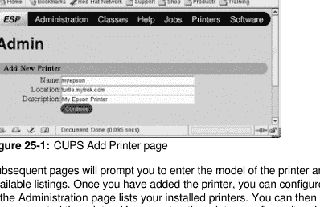

图 25-1: CUPS 添加打印机页面


后续的页面将提示你输入打印机型号和驱动程序，你需要从可用列表中进行选择。添加打印机后，你可以对其进行配置。单击管理页面中的“Manage Printers”条目会列出你已安装的打印机。然后，你可以单击某个打印机，显示一个页面，让你可以控制该打印机。你可以停止打印机、配置其打印设置、修改其安装设置，甚至可以删除该打印机。单击“Configure Printer”按钮会显示一个页面，你可以指定分辨率或纸张大小来配置打印机的打印方式。

打印机的配置信息将存储在 `/etc/cups/printers.conf` 文件中。你可以直接检查此文件，甚至进行修改。以下是一个打印机配置条目的示例。请注意，它是由 `redhat-config-printer` 创建的。当前状态为 `Idle`（空闲），队列中没有任务：

```
<DefaultPrinter myepson>
Info Created by redhat-config-printer 0.6.x
DeviceURI parallel:/dev/lp0
Location
State Idle
Accepting Yes
JobSheets none none
QuotaLimit 0
PageLimit 0
KLimit 0
</Printer>
```

`DeviceURI` 条目指定了所使用的设备，在本例中为 `lp0` 并行设备。对于远程打印机，此条目将包含 Internet 地址及其协议。例如，CUPS 服务器（`ipp`）上的远程打印机会表示为如下形式（Windows 打印机会使用 `smb` 协议）：

```
DeviceURI ipp://mytstuff.com/printers/queue1
```

注意 你可以使用 `lpadmin` 命令从命令行执行管理任务。有关更多详细信息，请参阅 CUPS 文档。

### 在 CUPS 上配置远程打印机

要安装连接到 Windows 系统或另一台运行 CUPS 的 Linux 系统的远程打印机，你需要使用特殊的 URL 协议指定其位置。对于 Windows 打印机，首先你需要安装、配置并运行 Samba。CUPS 使用 Samba 来访问 Windows 打印机。在 CUPS 上安装 Windows 打印机时，使用 `smb` URL 协议指定其位置。允许登录打印机的用户输入在主机名之前，并用 `@` 符号与其分隔。在大多数配置中，这是 `guest` 用户。这里显示了连接到名为 `lizard` 的 Windows 主机的名为 `myhp` 的 Windows 打印机的位置条目。其 Samba 共享引用将是 `//lizard/myhp`。

```
smb://guest@lizard/myhp
```

为了在 Samba 中启用 CUPS，你还必须将 `/etc/samba/smb.conf` 文件中的打印选项设置为 `cups`，如下所示：

```
printing = cups
printcap name = cups
```

为了让 CUPS 与 Samba 协同工作，你必须将 `smbspool` 链接到 CUPS 的 `smb` 后台目录：

```
ln -s /usr/bin/smbspool  /usr/cups/backend/smb
```

要访问连接到运行 LPRng 的 Linux 或 Unix 系统的打印机，请使用 `lpd` 协议指定其位置。在以下示例中，打印机 `mylaser` 连接到 Linux 主机 `rabbit.mytrek.com`：

```
lpd://rabbit.mytrek.com/mylaser
```

### CUPS 打印机类

CUPS 提供了一种功能，允许你选择一组打印机来打印作业，而不是只选择一个。这样，如果一台打印机忙碌或故障，可以自动选择另一台打印机来执行该作业。这种打印机分组被称为 *类*（classes）。安装打印机后，你可以将它们分组到不同的类中。例如，你可能希望将所有喷墨打印机归为一个类，将激光打印机归为另一个类；或者，你可能希望将连接到特定打印机服务器上的打印机归入它们自己的类。要创建一个类，请在管理页面中选择 Classes（类），并输入类的名称。然后你可以向其中添加打印机。

### CUPS 配置

CUPS 配置文件位于 `/etc/cups` 目录中。这些文件列在表 25-1 中。`classes.conf`、`printers.conf` 和 `client.conf` 文件可以通过 Web 界面进行管理。`printers.conf` 文件包含已安装的不同打印机的配置信息。如果你愿意，也可以手动编辑这些文件中的任何一个。

#### cupsd.conf

CUPS 服务器使用位于 `/etc/cups` 中的 `cupsd.conf` 文件进行配置。你必须手动编辑配置选项；服务器不能通过 Web 界面进行配置。你的 CUPS 安装会安装一个带有注释的 `cupsd.conf` 文件版本，其中列出了每个选项，尽管大多数选项会被注释掉。被注释的行前面有一个 `#` 符号。每个选项都有详细的文档说明。服务器配置使用 Apache Web 服务器语法，由一组指令组成。与 Apache 一样，其中的几个指令可以将其他指令分组到块中。

表 25-1: CUPS 配置文件

| 文件名 | 描述 |
|---|---|
| `classes.conf` | 不同本地打印机类的配置 |
| `client.conf` | 列出特定客户端的特定选项 |
| `cupsd.conf` | 配置 CUPS 服务器，`cupsd` |
| `printers.conf` | 可用本地打印机的打印机配置 |

#### CUPS 指令

某些指令允许你在特定位置设置访问控制。这些位置可以是打印机，也可以是资源，例如管理工具或后台目录。位置控制通过 `Location` 指令实现。`Allow From` 和 `Deny From` 指令可以允许或拒绝特定主机的访问。CUPS 支持 Basic（基本）和 Digest（摘要）两种身份验证形式，在 `AuthType` 指令中指定。Basic 身份验证使用用户名和密码。例如，要使用 Web 界面，你会被提示输入 `root` 用户和 `root` 用户密码。Digest 身份验证利用用户名和密码

#### CUPS 命令行打印客户端

一旦打印作业被放置到打印队列中，您可以使用多种打印客户端来管理打印机或打印机的打印作业，例如 LPRng 的 Kipo 以及 CUPS 的 GNOME 打印管理器和 CUPS 打印机配置工具。您还可以使用多个命令行打印 CUPS 客户端（LPRng 有同名对应的应用程序）。这些包括 `lpr`、`lpc`、`lpq` 和 `lprm` 命令（参见第 10 章）。打印机系统切换器可在两者之间切换。使用这些客户端，您可以打印文档、列出打印队列、重新排序以及删除打印作业，从而有效地取消它们。对于网络连接，CUPS 为其命令提供了一个加密选项 `-E`，用于加密通过网络发送的打印作业和打印信息。表 25-2 显示了各种打印机命令。

##### lpr

`lpr` 客户端提交作业，然后 `lpd` 依次接收并将其放置到适当的打印队列中。`lpr` 以文件名作为参数。如果未指定打印机，则使用默认打印机。`-P` 选项使您能够指定特定打印机。在下一个示例中，用户首先打印文件 `preface`，然后将文件 `report` 打印到名为 `myepson` 的打印机：

```
$ lpr preface
$ lpr -P myepson report
```

##### Table 25-2: CUPS Print Clients

| 打印机管理 | 描述 |
|---|---|
| GNOME Print Manager | GNOME 打印队列管理工具（CUPS）。 |
| CUPS Configuration Tool | 打印、管理和配置 CUPS。 |
| `lpr` options file-list | 打印文件，将文件复制到打印机的 spool 目录，并将其放入打印队列以便依次打印。`-P printer` 在指定的打印机上打印文件。 |
| `lpq` options | 显示打印队列中的打印作业。`-P printer` 打印指定打印机的队列。`-l` 打印详细列表。 |
| `lpstat` options | 显示打印机状态。 |
| `lprm` options print job-id or printer | 从打印队列中移除打印作业。您可以通过 `lpq` 列出的编号来识别特定打印作业。`-P printer` 删除指定打印机的所有打印作业。 |
| `lpc` | 管理您的打印机。在 `lpc>` 提示符下，您可以输入命令来检查打印机的状态并执行其他操作。 |

##### lpc


您可以使用 `lpc` 来启用或禁用打印机、重新排序其打印队列并重新执行配置文件。要使用 `lpc`，在 shell 提示符下输入命令 `lpc`。然后您会得到一个 `lpc>` 提示符，在此提示符下可以输入 `lpc` 命令来管理打印机并重新排序其作业。`status` 命令配合打印机名称显示打印机是否就绪、其拥有的打印作业数量等。`stop` 和 `start` 命令可以停止打印机并重新启动。显示的打印机取决于为特定打印服务器配置的打印机。在 CUPS 上配置的打印机只有在您切换到 CUPS 后才会显示。如果您切换到 LPRng，您为 LPRng 配置的打印机将会显示。

```
##### lpc
lpc> status myepson
myepson:
printer is on device 'parallel'
queuing is enabled
printing is enabled
1 entry in spool area
```

### lpc

### lpq and lpstat

您可以使用 `lpq` 和 `lprm` 命令管理打印队列。`lpq` 命令列出当前在打印队列中的打印作业。使用 `-P` 选项和打印机名称，您可以列出特定打印机的作业。如果指定用户名，您可以列出该用户的打印作业。使用 `-l` 选项，`lpq` 显示每个作业的详细信息。如果您想要特定作业的信息，只需使用该作业的 ID 号配合 `lpq` 即可。要检查打印机的状态，请使用 `lpstat`。

```
# lpq
myepson is ready and printing
Rank Owner Jobs File(s) Total Size
active chris 1 report 1024
```

### lprm

`lprm` 命令使您能够从队列中移除打印作业，在其被打印前将其删除。`lprm` 命令接受与 `lpq` 相同的许多选项。要删除特定作业，请使用作业编号配合 `lprm`。要删除特定打印机的所有打印作业，请使用打印机名称配合 `-P` 选项。不带选项的 `lprm` 会删除当前正在打印的作业。以下命令删除队列中的第一个打印作业（使用 `lpq` 获取作业编号）。

```
# lprm 1
```

## CUPS Administrative Tools

CUPS 提供了命令行管理工具，如 `lpadmin`、`lpoptions`、`lpinfo`、`enable`、`disable`、`accept` 和 `reject`。`enable` 和 `disable` 命令直接启动和停止打印队列，而 `accept` 和 `reject` 命令则启动和停止特定作业。`lpinfo` 提供有关打印机的信息，而 `lpoptions` 允许您设置打印选项。`lpadmin` 命令允许您执行诸如添加打印机和更改配置等管理任务。CUPS 管理工具列在表 25-3 中。

### lpadmin

您可以使用 `lpadmin` 命令来设置默认打印机或为打印机配置各种选项。您可以使用 `-d` 选项指定特定打印机作为默认目标（您也可以在 `redhat-config-printer` 中执行此操作）。这里 `myepson` 被设为默认打印机：

```
lpadmin -d myepson
```

### Table 25-3: CUPS Administrative Tools

| 管理工具 | 描述 |
|---|---|
| `lpadmin` | CUPS 打印机配置 |
| `lpoptions` | 设置打印选项 |
| `enable` | 激活打印机 |
| `disable` | 停止打印机 |
| `accept` | 允许打印机接受新作业 |
| `reject` | 阻止打印机接受打印作业 |
| `lpinfo` | 列出可用的 CUPS 设备 |

`-p` 选项允许您指定要设置各种选项的打印机。以下示例设置打印机描述信息：

```
lpadmin -p myepson -D Epson550
```

某些选项允许您控制打印作业的每用户配额。`job-k-limit` 设置每个用户允许的作业大小，`job-page-limit` 设置作业的页数限制，而 `job-quota-period` 限制在指定时间范围内作业的数量。以下命令为每个用户设置 100 页的页数限制。

```
lpadmin -p myepson -o job-page-limit=100
```

用户访问控制由 `-u` 选项与 `allow` 或 `deny` 列表决定。允许访问的用户列在 `allow:` 条目之后，被拒绝访问的用户列在 `deny:` 条目中。这里授予 `chris` 访问权限，但拒绝 `aleina` 和 `larisa`。

```
lpadmin -p myepson -u allow:chris deny:aleina,larisa
```

使用 `all` 或 `none` 来允许或拒绝所有用户或无用户的访问。您可以通过将 `all` 或 `none` 与特定用户访问权限结合使用来创建例外。以下示例允许除 `justin` 之外的所有用户访问：

```
lpadmin -p myepson -u allow:all deny:justin
```

### lpoptions

`lpoptions` 命令允许您设置打印选项和默认值，这些选项主要控制打印作业的打印方式。例如，您可以为特定打印机设置使用的颜色或页面格式。所有用户的默认设置由 root 用户在 `/etc/cups/lpoptions` 文件中维护，每个用户都可以创建自己的配置，保存在其 `.lpoptions` 文件中。`-l` 选项列出打印机的当前选项，`-p` 选项指定打印机（您也可以使用 `-d` 选项设置要使用的默认打印机）。

```
lpoptions -p myepson -l
```

打印机选项使用 `-o` 选项以及选项名称和值来设置，`-o option=value`。您可以使用 `-r` 选项删除打印机选项。例如，要在纸张的双面打印，您可以将 `sides` 选项设置为 `two-sided`：

```
lpoptions -p myepson -o sides=two-sided
```

要删除该选项，请使用 `-r`：

```
lpoptions -p myepson -r sides
```

要显示可用选项的列表，请在 CUPS 软件手册中查看标准打印选项，网址为 [www.cups.org](http://www.cups.org)。

### enable and disable

`enable` 命令启动打印机，`disable` 命令停止它。使用 `-c` 选项，您还可以取消打印机队列上的所有作业，使用 `-r` 选项，您可以广播一条解释停机的消息。

```
disable myepson
```

### accept and reject

`accept` 和 `reject` 命令让您可以控制特定打印机的打印队列访问权限。`reject` 命令阻止打印机接受作业，而 `accept` 允许新的打印作业。

```
reject myepson
```

### lpinfo

`lpinfo` 命令是一个方便的工具，可让您了解系统上可用的 CUPS 设备和驱动程序。使用 `-v` 选项查看设备，使用 `-m` 选项查看驱动程序。

```
lpinfo -m
```

## 行式打印机服务器：LPRng

LPRng 是 Berkeley 行式打印守护进程（LPD）`lpd` 及相关 `lpr` 应用程序的增强版本。它具备广泛的功能，包括安全措施以及对远程打印机的访问。许多命令与标准 Unix 系统上 LPD 使用的命令相同。Linux 打印机服务器程序名为 `lpd`，即行式打印守护进程。打印机安装后运行在 `lpd` 之下，由 `lpd` 处理来自本地和远程来源的打印任务。虽然 `lpd` 被称为行式打印守护进程，但它旨在管理任何类型的打印机，而不仅仅是行式打印机。你应该将其视为一种通用的打印服务器，能够处理激光、喷墨、PostScript 和针式打印机。LPRng 还包含一个配套的 IFHP 过滤器包，提供对 PostScript、PCL 和文本打印机等的硬件级支持（参见 [www.astart.com/lprng.html](https://www.astart.com/lprng.html)）。

`lpd` 守护程序在安装期间已在你的 Linux 系统上安装并配置。`lpd` 通过 `/etc/rc.d/init.d` 目录中的 `lpd` 启动脚本作为独立进程运行。你可以使用 `service` 命令来启动、停止和重启该守护程序：

```
service lpd restart
```


`lpd` 守护程序使用两个配置文件：`lpd.conf` 和 `lpd.perms`。`lpd.conf` 包含通用的 `lpd` 配置命令。你使用 `lpd.perms` 来设置规则，以限制对 `lpd` 服务器的访问。在这里，你可以拒绝特定主机、用户甚至网络的访问。

打印文档的请求由 `lpr` 等打印客户端执行。当提交文档进行打印时，它变成一个打印任务，并被放入其目标打印机的队列中。当任务在队列中等待打印时，你可以检查其状态，甚至将其从队列中移除，从而取消该任务。`lpq` 命令允许你检查打印队列，`lpc` 允许你对其进行修改，而 `lprm` 用于从队列中移除打印任务。

#### LPRng 打印客户端

你可以使用几种 LPRng 打印客户端来管理打印机或打印机的打印任务，例如 `Klpq` 以及 `lpr` 和 `lpq` 等命令行打印客户端。`Klpq` 是一个 KDE 桌面实用程序，标记为“打印任务管理工具”。使用 `Klpq`，你可以列出打印机的打印任务、移除打印任务，并将打印任务移动到队列顶部。你还可以禁用某台打印机的打印功能。若要使打印队列列表自动更新，你可以在“选项”菜单中设置更新频率。

#### printcap 文件

`/etc/printcap` 文件保存连接到系统的每个打印机的条目。`printcap` 条目包含信息，例如打印机假脱机目录的路径名以及打印机使用的打印机端口的设备名称。`printcap` 条目中的第一个字段是打印机可能名称的列表。这些名称可以由你自己指定，如果你愿意，还可以添加其他名称。每个名称由 `|` 符号与下一个名称分隔。在各种打印机命令或选项（例如 `-P` 选项）中，你使用这些名称来标识打印机。这些名称也用于特殊的 shell 变量，例如在许多初始化脚本中使用的 `PRINTER` 变量。

名称列表后面的字段为你的打印机设置不同的字段。字段用冒号分隔，并使用 `=` 符号赋值。三个更重要的字段是 `lp`、`sd` 和 `if`。`lp` 字段设置为打印机使用的设备名称。`sd` 字段设置为假脱机目录的路径名，`if` 设置为用于此打印机的特定过滤器。某些字段具有布尔值，只需列出字段名称而不进行赋值，表示值为“true”。你可以在 `printcap` 手册页中找到完整的 `printcap` 字段列表：`man printcap`。`printcap` 条目的示例如下：

```
myprinter|myepson:\n:sh:\n:ml=0:\n:mx=0:\
:sd=/var/spool/lpd/myprinter:\n:lp=/dev/lp0:\n:lpd_bounce=true:\n:if=/usr/share/printconf/mf_wrapper:
```

要安装远程（网络或远程主机连接）打印机，你需要在打印机的 `/etc/printcap` 文件条目中放置远程主机和设备项。`:rm` 条目标识控制远程打印机的远程主机，而 `:rp` 条目指定远程打印机的设备名称。在以下示例中，远程打印机位于 `rabbit.mytrek.com`，名为 `lp1`：

```
:rm=rabbit.mytrek.com
:rp=lp1
```

#### 配置 lpd

LPRng 允许你配置 `lpd` 服务器，设置全局默认值或控制打印机访问。只有两个配置文件需要管理，且均包含大量注释。你的发行版通常提供这两个文件的基本版本。提供了广泛的功能集，允许你创建具有强大且复杂功能的服务器。

##### lpd.conf

LPRng 的通用配置，包括 `lpd` 打印服务器，在 `/etc/lpd.conf` 文件中处理。在这里，你可以指定适用于所有打印机和打印管理的功能。你应该将这些视为默认功能，因为它们中的任何一个都可以在打印机的 `printcap` 条目中被覆盖。随 LPRng 安装的 `lpd.conf` 文件包含大量的配置参数列表。它们都被注释掉了，前面有 `#` 符号。每个参数前都有一个描述该参数的注释。条目本身列出了赋予参数的默认值，条目前带有 `default` 术语。`connect_timeout` 参数的条目如下所示：

```
# Purpose: connection timeout for remote printers
# default connect_timeout=10 (INTEGER)
```

要创建你自己的超时期条目，最好在下方添加你自己的条目，如下所示。请注意，新条目中缺少前面的 `#` 和 `default` 术语。远程打印机的连接超时现已设置为 20。这可以被打印机的 `printcap` 文件条目覆盖。

```
# Purpose: connection timeout for remote printers
# default connect_timeout=10 (INTEGER)
connect_timeout=20
```

参数也可以是你可以打开或关闭的标志。关闭的标志用附加的 `@` 符号表示。在以下示例中，`allow_user_logging` 参数是一个允许用户请求登录信息的标志。默认情况下，它是关闭的。以下示例将其打开：

```
# Purpose: allow users to request logging info using lpr -mhost$port
# default allow_user_logging@ (FLAG off)
allow_user_logging
```

#### LPRng 访问控制：lpd.perms

LPRng 提供访问控制规则，以控制远程用户如何访问你的打印服务器，进而控制其管理的打印机。这些规则放置在 `/etc/lpd.perms` 文件中，可用于拒绝向特定主机或用户提供打印服务。此类规则由一个动作和一组键组成。键指定必须满足的标准，如果满足，则执行其关联的动作。在每个规则中，你有一个动作和一个或多个键。如果有多个键，则必须满足所有标准才能执行该动作。一个键的示例是指定主机的 IP 地址。此外，你还必须指定正在请求的服务类型，例如打印请求或连接请求。动作通常是 `ACCEPT` 或 `REJECT`。键作为标志或变量运行。要指定主机，你使用赋值运算符将地址分配给 `HOST` 键。对于用户，使用 `USER`；对于 IP 地址，使用 `IFIP`。服务类型由 `SERVICE` 键指定。对于打印请求，你分配的值是 `lpd` 代码 `P`。以下示例指定主机作为键，并 `REJECT` 来自该地址的任何打印请求：

```
REJECT SERVICE=P HOST=192.168.0.57
```

`lpd.perms` 文件由一组规则组成，这些规则按顺序评估，直到找到匹配项。`DEFAULT` 动作规则应为最后一个规则，通常是接受任何请求的规则。换句话说，任何未被前面规则匹配的请求都将被接受。通常，你会设置规则来拒绝某些请求，例如针对特定主机的请求。大多数请求不会匹配这些规则，并应落入 `DEFAULT` 动作，该动作将 `ACCEPT` 它们。

`SERVICE` 键的值因提交的请求类型而异。这些范围从远程服务器的简单连接请求到删除打印任务。`lpr`、`lpq`、`lprm` 和 `lpc` 等打印客户端发出不同类型的服务请求。`lpq` 发出具有 `SERVICE` 键值 `Q` 的队列信息请求。`lprm` 发出由键值 `M` 表示的删除请求。

#### LPRng 打印客户端

LPRng 使用与 CUPS 中描述的相同的命令行打印客户端。这些包括 `lpr`、`lpc`、`lpq` 和 `lprm` 命令。请查阅每个命令的手册页以获取详细选项。某些功能，如加密，仅在 CUPS 版本中可用。

### 第 26 章：新闻与搜索服务器

#### 概述

新闻服务器为互联网用户提供 Usenet 新闻服务。它们拥有自己的 TCP/IP 协议，即网络新闻传输协议（NNTP）。在大多数 Linux 系统（包括 Red Hat）中，InterNetNews（INN）新闻服务器提供新闻服务（www.isc.org）。此外，还存在着提供更优互联网资源访问能力的服务器。搜索和索引服务器 ht://Dig 支持对 Web 站点和 FTP 站点进行文档搜索（www.htdig.org）。借助它，你可以建立文档索引并执行复杂的搜索请求。


#### 新闻服务器：INN

InterNetNews（INN）新闻服务器访问 Usenet 新闻源，为您的网络中的新闻客户端提供完整的新闻组及其文章。新闻组文章使用 NNTP 进行传输，支持该协议的服务器被称为 NNTP 服务器。INN 由 Rich Salz 编写，目前由互联网软件联盟（ISC）负责维护和提供支持。您可以从其网站 www.isc.org 下载当前版本。INN 也包含在大多数 Linux 发行版中。`/usr/share/doc` 目录下的 INN 文档包含大量示例。INN 的主要程序是 `innd` 守护进程。

#### INN 配置文件


在`/etc/news`目录下可以找到各种 INN 配置文件，包括`inn.conf`、`storage.conf`、`readers.conf`和`incoming.conf`（见表 26-1）。`inn.conf`用于设置 INN 的选项，而`incoming.conf`文件则包含接收新闻源的计算机主机信息。在`readers.conf`文件中为远程主机添加条目，以允许其访问您的新闻服务器。实际新闻源在`/var/spool/news`目录下的各个目录中管理。在这里，您会看到诸如`article`（存放新闻组文章）、`outgoing`（存放用户发布到新闻组的文章）以及`overview`（存放文章摘要信息）等目录。正确配置 INN 可能是一个复杂且耗时的过程，因此请务必查阅参考手册和在线资源，例如文档。更改配置时，请务必重启 INN 服务器。`/etc/rc.d/init.d`目录下有一个`innd`脚本，其参数与 Web httpd 脚本类似。您可以使用`innd`脚本的`start`、`restart`和`stop`参数来启动、重启和停止 INN 服务器。

表 26-1：INN 配置文件

| 文件 | 描述 |
|------|-------------|
| `inn.conf` | 通用 INN 配置文件。 |
| `incoming.conf` | 指定接收新闻源的主机。 |
| `cycbuff.conf` | 配置 cnfs 存储格式中使用的缓冲区。 |
| `storage.conf` | 定义存储类。存储类由存储方法和使用它的新闻组组成。存储方法是存储格式：`tradspool`、`timehash`、`timecaf`和`cnfs`。另一种方法`trash`会丢弃文章。 |
| `expire.ctl` | 设置新闻服务器上文章的过期策略。 |
| `readers.conf` | 指定可以使用新闻阅读器访问新闻服务器的主机。 |
| `ovdb.conf` | 配置`ovdb`存储方法用于概览。 |
| `newsfeeds` | 定义您的新闻服务器如何将文章馈送到其他新闻服务器。 |
| `moderated` | 受控新闻组。 |
| `infeed.conf` | 配置`infeed`的新闻源处理进程。 |
| `innreport.conf` | 配置`innreport`工具以生成基于日志的报告。 |
| `buffindexed.conf` | 配置`buffindexed`方法的概览缓冲区。 |

**提示** INN 中每个配置文件都有一个人页（man page），提供了关于如何配置其功能的详细信息。

### inn.conf

在许多发行版中，已经为您设置了带有默认设置的基本`inn.conf`文件。有几个初始参数需要您自行设置，例如`domain`，它保存您服务器的域名；`pathhost`，在此指定您希望您的新闻阅读器在发布的新闻文章 Path 头部字段中显示的名称；以及`server`，在此指定您新闻阅读器的 IP 地址或完全限定域名，例如`mynews.mytrek.com`。已经为您设置了不同的 Path 选项，用于定义不同 INN 目录的位置，例如将`patharticles`设置为`/var/spool/news/articles`（存放您的新闻组文章），将`pathetc`设置为`/etc/news`（存放您的配置文件）。

### 存储格式

对于通常被下载和访问的海量新闻文章，存储格式是像 INN 这样全规模新闻服务器的核心关注点。INN 允许您在四种可能的存储格式中进行选择：`tradspool`、`timehash`、`timecaf`和`cnfs`。`tradspool`是一种传统方法，其中文章根据其所属新闻组安排在简单的目录结构中。这种方法在访问和存储时已知非常耗时。`timehash`将文章存储在按接收时间组织的目录中，这使得删除过期文章变得更容易。`timecaf`类似于`timehash`，但同一时间接收的文章被放在同一个文件中，从而大大加快访问速度。`cnfs`将文章存储到已经设置好的缓冲区文件中。当缓冲区文件变满时，新来的文章会覆盖较旧的文章。这是一种极快的方法，因为不会创建新文件。无需设置最大文章限制，但也没有控制文章保留时长的机制。在`storage.conf`文件中，存储格式作为存储方法分配给不同的新闻组。

### 概览

INN 还支持概览。这些是文章的摘要，读者可以查看它们，而无需下载整篇文章来了解其内容。概览有自己独立的存储方法：`tradindexed`、`buffindexed`和`ovdb`。您在`inn.conf`的`ovmethod`功能中指定想要使用的方法。`tradindexed`对读者来说速度快，但对服务器来说生成难度大。`buffindexed`对新闻服务器来说速度快，但对读者来说速度慢。`ovdb`使用 Berkeley DB 数据库文件，对双方都非常快，但占用更多磁盘空间。如果您选择`ovdb`，可以在`ovdb.conf`中为其设置配置参数。

### INN 实施

在许多发行版中，已经创建了一个新闻用户和一个供 INN 守护进程使用的新闻组，并设置了`/var/spool/news`中的新闻目录。INN 软件还安装了一些 cron 脚本，用于更新您的新闻服务器，即删除旧文章并获取新文章。这些脚本通常放置在`/etc/cron.daily`目录中，尽管它们也可以位于任何位置。`inn-cron-expire`用于删除旧文章，而`inn-cron-rnews`用于检索新文章。`inn-cron-nntpsend`将从您的系统发布的文章发送到其他新闻服务器。

INN 还包括多个支持程序，用于提供维护和崩溃恢复，以及对服务器性能和用法进行统计分析。`cleanfeed`实现垃圾邮件保护，而`innreport`根据日志生成 INN 报告。INN 还具备一个非常强大的过滤系统，用于筛选不需要的文章。

**注意** `Leafnode`是为可能拥有较慢互联网连接的小型网络设计的 NNTP 服务器。您可以获取`Leafnode`软件包以及


### Dig 服务器

`Dig`，官方名称为`ht://Dig`，是一种专为小型网络或内网设计的 Web 索引和搜索系统。`Dig`并不被视为全规模互联网搜索系统（如 Lycos、Infoseek 或 AltaVista）的替代品。与基于 Web 服务器的搜索引擎不同，`Dig`可以跨越站点中的多个 Web 服务器。`Dig`由圣地亚哥州立大学开发，并以 GNU 通用公共许可证免费分发。您可以在`www.htdig.org`获取相关信息、文档和软件包。

### Dig 搜索

`Dig`支持简单和复杂搜索，包括复杂的布尔搜索和模糊搜索方法。*模糊搜索*支持多种搜索算法，包括精确匹配、`Soundex`和同义词。搜索可以针对文本和 HTML 文档进行。HTML 文档可以包含关键词以提高检索准确性，您还可以使用 HTML 模板来控制结果的显示方式。

搜索可以根据认证要求、位置和搜索深度进行限制。为了保护受限目录中的文档，可以通知`Dig`要求输入特定的用户名和密码。您还可以限制搜索以检索特定 URL 中的文档，搜索数据库的子部分，或仅检索距离指定链接数之内的文档。

### Dig 配置

所有`ht://Dig`程序使用相同的配置文件`htdig.conf`，它位于`/etc/htdig`目录中。配置文件由属性项组成，每项以属性行开头，后跟冒号后的值。每个程序只使用它需要的属性：

```
max_head_length: 10000
```

您可以指定诸如`allow_virtual_hosts`（将虚拟主机作为独立服务器进行索引）和`search_algorithm`（指定用于搜索的算法）等属性。

### Dig 工具

`Dig`由五个程序组成：`htdig`、`htmerge`、`htfuzzy`、`htnotify`和`htsearch`。`htdig`、`htmerge`和`htfuzzy`生成索引，而`htsearch`执行实际搜索。首先，`htdig`收集数据库信息，搜索您域中的所有 URL 连接，并将网页与术语关联。`htmerge`程序使用此信息创建可搜索的数据库，并将之前生成的数据库中的信息合并进来。`htfuzzy`创建索引，允许使用模糊算法（如`Soundex`和同义词）进行搜索。数据库创建完成后，用户可以使用调用`htsearch`的网页来搜索此索引。结果会列在一个网页上。您可以在 HTML 文档中使用 META 标签来输入特定的`htdig`关键词、将文档排除在索引之外，或提供通知信息（如电子邮件地址和过期日期）。`htnotify`使用电子邮件和过期日期，在网页作者的内容过时时通知他们。


htsearch 程序是一个 CGI 脚本，预期由 HTML 表单调用，并接受 `GET` 和 `POST` 两种数据传输方法。`htsearch` 程序可以接受来自任何包含所需配置值的表单的搜索请求。值包括搜索功能，如 `config`（配置文件）、`method`（搜索方法）和 `sort`（排序标准）。对于调用 `htsearch` 的网页表单，您可以使用 `htdig` 提供的默认页面或创建自己的页面。输出使用您可以修改的模板进行格式化。`htdig` 软件包含几个示例文件：`rundig` 是创建数据库的示例脚本，`searchform.html` 是包含提交 `htdig` 搜索的表单的示例 HTML 文档，`header.html` 是搜索头部的示例，`footer.html` 是搜索脚部的示例。


# 第六部分：系统管理

## 章节列表

- 第 27 章：基础系统管理
- 第 28 章：用户管理
- 第 29 章：软件管理
- 第 30 章：文件系统管理
- 第 31 章：RAID 和 LVM
- 第 32 章：设备与模块
- 第 33 章：内核管理

### 第 27 章：基础系统管理

#### 概述

Linux 的设计旨在同时服务多个用户，在用户与系统的资源、服务和设备之间提供接口。用户拥有自己的 shell，通过它与操作系统进行交互，但你可能需要以不同的方式配置操作系统本身。你可能需要添加新用户、打印机和扫描仪等设备，甚至文件系统。此类操作属于系统管理的范畴。执行此类操作的人被称为系统管理员或超级用户。

从这个意义上说，与 Linux 的交互有两种类型：普通用户的交互，以及执行系统管理任务的超级用户。本书中的章节涵盖了诸如更改系统运行级别、管理用户、配置打印机、添加文件系统以及编译内核等操作。你很少执行这些任务中的大部分操作，例如添加新打印机或挂载文件系统。其他任务，如添加或删除用户，则是定期执行的。基础系统管理涵盖的主题包括超级用户的系统访问、选择启动的运行级别、系统配置文件以及性能监控。

借助 Linux，你可以加载不同版本的 Linux 内核，以及你系统中安装的其他操作系统。选择并启动操作系统或内核的任务由启动管理实用程序——Grand Unified Bootloader（`GRUB`）负责。这是一个多功能工具，允许你加载共享同一磁盘驱动器的操作系统，同时也允许你选择可能安装在同一 Linux 系统上的不同 Linux 内核。

备份操作已成为行政职责的重要组成部分。Linux 系统提供了多种备份工具，包括 `Anaconda` 和传统的 `dump` 工具。`Anaconda` 提供基于服务器的备份，允许网络上的不同系统备份到中央服务器。`dump` 工具允许你完善备份过程，检测自上次备份以来更改的数据。

#### 超级用户控制：root 用户

要执行系统管理操作，你首先必须拥有访问权限，例如能够让你以 `root` 用户身份登录的正确密码，使你成为超级用户。由于超级用户拥有更改系统上几乎任何内容的权力，因此此类密码通常是精心保管的秘密，经常更改，并且只提供给那些负责管理系统的人。

使用正确的密码，你可以以系统管理员的身份登录系统，并以不同的方式配置系统。你可以启动和关闭系统，还可以切换到不同的操作模式，例如单用户模式。你还可以添加或删除用户，添加或删除整个文件系统，备份和恢复文件，甚至指定系统的名称和地址。

要成为超级用户，你需要登录 `root` 用户账户。这是一个专用于系统管理操作的特殊账户，对 Linux 操作系统的所有组件具有无限制的访问权限。你可以从 GUI（图形用户界面）登录屏幕或命令行登录提示符登录为 `root` 用户。然后你便可以访问所有管理工具。

使用像 GNOME 这样的 GUI 界面，`root` 用户可以访问许多 Red Hat GUI 管理工具，例如用于安装软件的 `redhat-config-packages` 或用于管理用户的 `redhat-config-users`。如果你从命令行界面登录，可以运行相应的管理命令，如使用 `rpm` 安装包或使用 `useradd` 添加新用户。从你的 GUI 桌面，你也可以使用终端窗口运行命令行管理工具。`root` 用户的命令行界面使用特殊的提示符，即井号，`#`。在下一个示例中，用户以 `root` 用户身份登录系统并接收 `#` 提示符。

```
login: root
password:
#
```

##### Root 用户密码

作为 `root` 用户，你可以使用 `passwd` 命令更改 `root` 登录以及其他任何系统用户的密码。`passwd` 命令会通过可插拔认证模块（`PAM`，如第 28 章中所述）检查你的密码，看看你是否选择了一个容易被破解的密码。为了更轻松地通过 GUI 界面更改 `root` 密码，你可以使用 `redhat-config-rootpassword` 工具。

```
# passwd root
New password:
Re-enter new password:
#
```

你必须采取预防措施来保护你的 `root` 密码。任何以 `root` 用户身份获得访问权限的人都将对你的系统拥有完全控制权。`passwd` 命令的在线手册提供了有关处理和选择密码的详细建议。例如，永远不要将密码存储在系统上的文件中，也不要基于任何可访问的信息（如电话号码或出生日期）来选择密码。一个基本的准则是使用由几个单词组成的短语，包含数字和大小写字母，使密码尽可能复杂，但又要容易记住，这样你就永远不需要把它写下来。你可以使用以下命令访问 `passwd` 在线手册页：

```
# man passwd
```

##### Root 用户访问：su

当你登录到普通用户账户时，可能需要你登录为 `root` 并成为超级用户。通常，你首先需要注销你的用户账户，然后登录 `root`。相反，你可以使用 `su` 命令（`switch user`，切换用户）在保持登录到你的用户账户的同时直接登录到 `root`。如果你使用的是像 GNOME 这样的 GUI 桌面，你可以从终端窗口输入 `su` 命令，或者使用 `ALT-CTRL-F1` 切换到命令行界面（`ALT-CTRL-F10` 返回 GUI 界面）。使用 `CTRL-D` 或 `exit` 命令可以返回到你自己的用户登录。当你以 `root` 身份登录时，你可以使用 `su` 登录为任何用户，而无需提供密码。在下一个示例中，用户已经登录。然后 `su` 命令以 `root` 用户身份登录，使用户成为超级用户。表 27-1 展示了一些基本的超级用户命令。

```
$ pwd
/home/chris
$su
password:
# cd
# pwd
/root
# exit
$
```

> **提示**
>
> 出于安全原因，Linux 发行版不允许在 Telnet 会话中使用 `su` 来访问 `root` 用户。对于启用了 `SSH` 和 `Kerberos` 的系统，Red Hat 提供使用 `slogin` (`SSH`) 和 `rlogin` (`Kerberos` 版本) 的安全登录访问。

表 27-1：基础系统管理工具

| 命令 | 描述 |
|---|---|
| `su root` | 从用户登录将超级用户登录到 `root`；超级用户使用 `CTRL-D` 返回到原始登录。 |
| `passwd login-name` | 为登录名设置新密码。 |
| `crontab options file-name` | 使用 `file-name` 作为参数，将文件中的 `crontab` 条目安装到 `crontab` 文件中；这些条目是在指定时间执行的操作（见后文部分）：`-e` 编辑 `crontab` 文件 `-l` 列出 `crontab` 文件的内容 `-r` 删除 `crontab` 文件 |
| `telinit runlevel` | 更改系统运行级别。 |
| `shutdown options time` | 关闭系统。 |
| `date` | 设置系统的日期和时间。 |
| `Red Hat` 日期和时间属性工具，`redhat-config-date` | 设置系统时间和日期的 GUI 工具（系统设置 > 日期和时间）。 |
| `Kcron` | KDE GUI 接口 `cron` 管理工具（系统工具 > 任务计划程序）。 |
| `redhat-config-rootpassword` | 更改 `root` 用户（管理员）密码的 GUI 工具。（系统设置 > Root 密码）。 |
| `redhat-logviewer` | 查看 `root` 用户系统日志的 GUI 工具。（系统设置 > Root 密码）。 |

#### 系统时间与日期

你可以使用 shell `date` 命令或 Red Hat 图形界面工具 `redhat-config-date` 来设置系统时间和日期。你很可能在安装系统时已经设置了时间和日期，因此通常不需要再次设置。不过，如果你输入的时间有误，或者移动到了不同的时区，你可以使用此实用程序来更改时间。

##### 使用 redhat-config-date 实用程序


# 设置系统时间和日期

设置系统时间和日期的推荐方式是使用 Red Hat 日期和时间属性实用程序（`redhat-config-date`）。在“从此处开始”窗口中访问“系统设置”窗口，然后选择该实用程序。该窗口包含两个面板，一个用于日期和时间，另一个用于时区（见图 27-1）。使用日历选择年、月和日。然后使用时间框设置小时、分钟和秒。时区面板显示带有位置标记的地图。选择离你最近的位置以设置你的时区。

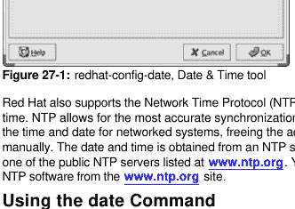

Red Hat 还支持网络时间协议（NTP），它允许远程服务器设置日期和时间。NTP 能够实现系统时钟最准确的同步。它通常用于管理联网系统的时间和日期，使管理员无需手动同步时钟。日期和时间从 NTP 服务器获取。你的网络可能有自己的服务器，或者你可以使用 `www.ntp.org` 上列出的公共 NTP 服务器之一。你也可以从 `www.ntp.org` 站点下载最新的文档和 NTP 软件。

## 使用 `date` 命令

你还可以在 root 用户命令行上使用 `date` 命令来设置系统日期和时间。作为 `date` 的参数，你需要列出月份、日期、时间和年份（中间没有分隔符）。在下一个示例中，日期被设置为 2003 年 4 月 6 日下午 2:59（04 代表 4 月，06 代表日期，1459 代表时间，03 代表 2003 年）：

```
# date 0406145903
Sun Mar 6 02:59:27 PST 2003
```

**注意** 你还可以通过 KDE 控制中心中的“日期和时间”工具来设置时间和日期。

# 任务调度：cron

定期维护任务（如备份）由 Linux 上的 cron 服务管理，该服务由一个 cron 守护进程实现。守护进程是一个持续运行的服务器，它不断检查需要执行的操作。这些任务列在 crontab 文件中。cron 守护进程不断检查用户的 crontab 文件，以查看是否到了执行这些操作的时间。任何用户都可以设置自己的 crontab 文件。root 用户可以设置 crontab 文件来执行系统管理操作，例如在每周或每月的特定时间备份文件。

## `crond` 服务

cron 守护进程的名称是 `crond`。通常，它在系统启动时自动启动。你可以使用 `redhat-config-services` 或 `chkconfig` 来设置此功能，具体方法在第 20 章中有描述。以下示例在系统每次启动时自动启动 `crond` 服务。

```
chkconfig crond on
```

你也可以手动启动和停止 `crond` 服务，这在紧急维护或升级期间可能需要这样做。使用 `service` 命令和 `stop` 选项来关闭服务，使用 `start` 选项来重新运行它：

```
service crond stop
```

## `crontab` 条目

一个 `crontab` 条目有六个字段：前五个用于指定操作的时间，最后一个字段是操作本身。第一个字段指定分钟（0-59），第二个字段指定小时（0-23），第三个字段指定每月的日期（1-31），第四个字段指定每年的月份（1-12，或月份前缀如 Jan 和 Sep），第五个字段指定每周的日期（0-6，或日期前缀如 Wed 和 Fri），0 代表星期日。在每个时间字段中，你可以指定一个值范围，或者使用星号表示所有值。例如，在“周几”字段中，1-5 指定星期一到星期五。在“小时”字段中，8、12 和 17 分别指定上午 8 点、中午 12 点和下午 5 点。在“每年月份”字段中，* 表示每个月。`crontab` 字段的格式如下：

```
minute hour day-month month day(s)-week task
```

以下示例在每个工作日的凌晨 2:00 备份 `projects` 目录：

```
0 2 * * 1-5 tar cf /home/backp /home/projects
```

下面再次列出相同的条目，使用月份和星期的前缀：

```
0 2 * * Mon-Fri tar cf /home/backp /home/projects
```

要指定特定的月份、日期、周几或小时，你可以单独列出它们，用逗号分隔。例如，要在星期日、星期三和星期五执行上述任务，你可以在“周几”字段中使用 `0,3,5`，或者它们的前缀等价形式 `Sun,Wed,Fri`。

```
0 2 * * 0,3,5 tar cf /home/backp /home/projects
```

Cron 也支持注释。注释是以 `#` 号开头的任何行。

```
# Weekly backup for Chris's projects
0 2 * * Mon-Fri tar cf /home/backp /home/projects
```

## `cron` 环境变量

`cron` 服务还允许你定义环境变量供执行的任务使用。Red Hat 定义了 `SHELL`、`PATH`、`HOME` 和 `MAILTO` 变量。`SHELL` 指定用于任务的 shell，在此例中是 `bash` shell。`PATH` 列出可以找到程序和脚本的目录。此示例列出了标准目录 `/usr/bin` 和 `/bin`，以及保留给系统应用程序的系统目录 `/usr/sbin` 和 `/sbin`。`MAILTO` 指定将任务结果邮件发送给谁。默认情况下，这些结果会邮件发送给调度该任务的用户，但你也可以将结果发送给特定用户，例如管理员的电子邮件地址，或网络中另一系统上的账户。`HOME` 是任务的 home 目录，在此例中是顶层目录。

```
SHELL=/bin/bash
PATH=/sbin:/bin:/usr/sbin:/usr/bin
MAILTO=root
HOME=/
```

## `cron.d` 目录

在大量使用的系统中，`/etc/crontab` 文件很容易变得拥挤。也可能存在某些条目需要不同变量的情况。例如，你可能需要在不同的 shell 下运行某个任务。为了更好地组织你的 `crontab` 任务，你可以将 `crontab` 条目放在 `cron.d` 目录中的文件中。`cron.d` 目录中的文件包含与 `/etc/crontab` 格式相同的 `crontab` 条目。这些文件可以命名为任何名称。它们被视为附加的 `crontab` 文件，cron 会检查它们以确定要运行的任务。例如，Red Hat 在 `cron.d` 中安装了一个 `sysstat` 文件，其中包含用于运行收集系统统计信息的工具的 `crontab` 条目。

## `crontab` 命令

你使用 `crontab` 命令将你的条目安装到 `crontab` 文件中。为此，首先创建一个文本文件并输入你的 `crontab` 条目。将此文件保存为任何你想要的名称，例如 `mycronfile`。然后，要安装这些条目，输入 `crontab` 和该文本文件的名称。`crontab` 命令获取文本文件的内容，并在 `/var/spool/cron` 目录中创建一个 `crontab` 文件，添加发起命令的用户名。在以下示例中，root 用户将 `mycronfile` 的内容作为 root 的 `crontab` 文件安装。这会创建一个名为 `/var/spool/cron/root` 的文件。如果名为 `justin` 的用户安装了 `crontab` 文件，它将创建一个名为 `/var/spool/cron/justin` 的文件。你可以通过 `/etc/cron.allow` 文件来控制普通用户对 `crontab` 命令的使用。只有在这个文件中列名的用户可以创建自己的 `crontab` 文件。相反，`/etc/cron.deny` 文件列出了被拒绝使用 cron 工具的用户，阻止他们调度任务。如果两个文件都不存在，则拒绝所有用户的访问。如果用户不在 `/etc/cron.allow` 文件中，则拒绝访问。然而，如果 `/etc/cron.allow` 文件不存在，而 `/etc/cron.deny` 文件存在，则所有未在 `/etc/cron.deny` 中列出的用户自动获得访问权限。

```
# crontab mycronfile
```

## 编辑 cron

永远不要尝试直接编辑你的 `crontab` 文件。相反，使用带有 `-e` 选项的 `crontab` 命令。这会在 `/var/spool/cron` 目录中用标准文本编辑器（如 `Vi`）打开你的 `crontab` 文件。`crontab` 使用由 `EDITOR` shell 环境变量指定的默认编辑器。要为 `crontab` 使用不同的编辑器，请将编辑器的程序名分配给 `EDITOR` 变量并导出该变量以更改默认编辑器。通常，编辑器变量在 `/etc/profile` 脚本中设置。使用 `-l` 选项运行 `crontab` 显示你的 `crontab` 文件的内容，`-r` 选项删除整个文件。调用 `crontab` 并传入另一个包含 `crontab` 条目的文本文件会覆盖你当前的 `crontab` 文件，用该文本文件的内容替换它。

## 组织计划任务


你可以将管理性的 `cron` 任务分为两个主要组：可以定期运行的常见管理任务，或需要在特定时间运行的特殊任务。特殊任务可以作为 `/etc/crontab` 文件中的条目运行，如下节所述。虽然常见管理任务可以从 `/etc/crontab` 文件运行，但最好将它们组织到专用的 `cron` 目录中。在这些目录内，每个任务都放在其自己的 shell 脚本中，该脚本在运行时将调用任务。

例如，可能有几个管理任务都需要在同一天的同一周中运行，比如如果系统维护安排在周日早上。对于这类任务，`cron` 提供了几个用于自动执行每日、每周、每月和每年任务的专用目录。每个目录都包含一个 `cron` 前缀和后缀用于时间间隔。`/etc/cron.daily` 目录用于需要每天执行的任务，而每周执行的任务可以放在 `/etc/cron.weekly` 目录中。`cron` 目录列于表 27-2 中。

### 表 27-2：Cron 文件和目录

| cron 文件和目录 | 描述 |
|---|---|
| `/etc/crontab` | 系统 `crontab` 文件，仅 `root` 用户可访问 |
| `/etc/cron.d` | 包含多个 `crontab` 文件的目录，仅 `root` 用户可访问 |
| `/etc/cron.hourly` | 每小时执行任务的目录 |
| `/etc/cron.daily` | 每天执行任务的目录 |
| `/etc/cron.weekly` | 每周执行任务的目录 |
| `/etc/cron.monthly` | 每月执行任务的目录 |
| `/etc/cron.yearly` | 每年执行任务的目录 |
| `/etc/cron.allow` | 允许提交 `cron` 任务的用户 |
| `/etc/cron.deny` | 拒绝访问 `cron` 的用户 |

### 运行 cron 目录脚本

每个目录包含的脚本都会在同一时间运行。每个组的时间安排由 `/etc/crontab` 文件中的一个条目决定。脚本的实际执行由 `/usr/bin/run-parts` 脚本完成，它会运行指定目录中的所有脚本和程序。给定目录中所有任务的时间安排由 `/etc/crontab` 文件中的一个条目处理。Red Hat 提供了带有指定时间的条目，您可以根据自身需求进行修改。默认的 Red Hat `crontab` 文件如下所示，其中包含了在不同 `cron` 目录中运行脚本的时间。在这里可以看到，大多数脚本在大约凌晨 4 点运行，包括每天 `4:02`、周日 `4:22` 或每月第一天 `4:42`。每小时执行的脚本则在整点后一分钟运行。

```
SHELL=/bin/bash
PATH=/sbin:/usr/sbin:/usr/bin
MAILTO=root
HOME=/
# run-parts
01 * * * * root run-parts /etc/cron.hourly
02 4 * * * root run-parts /etc/cron.daily
22 4 * * 0 root run-parts /etc/cron.weekly
42 4 1 * * root run-parts /etc/cron.monthly
```

#### 提示

`cron` 目录中的脚本按字母顺序运行。如果某个脚本需要排在其他脚本之前运行，可能需要修改其名称。一种方法是在名称前添加前缀。

但请记住，这些只是包含可执行文件的目录。实际的时间安排由 `/etc/crontab` 文件中的条目执行。例如，如果将 `cron.weekly` `crontab` 条目中的每周字段从 `0` 改为 `*`，并将每月字段改为 `1`（即用 `22 4 1 * *` 替换 `22 4 * * 0`），那么 `cron.weekly` 文件中的任务最终将变为每月执行一次，而不是每周执行一次。

### cron 目录名称

这些目录所使用的名称仅仅是约定俗成的。它们对 `cron` 守护进程没有特殊含义。实际上，您可以创建自己的目录，将脚本放入其中，并安排 `run-parts` 在指定时间运行这些脚本。在下一个示例中，放在 `/etc/cron.mydocs` 目录中的脚本将在每周三中午 12 点运行。

```
* 12 * * 3 root run-parts /etc/cron.mydocs
```

### Anacron

对于可能在 `cron` 计划运行的时间处于关机状态的系统，您可能希望用 `anacron` 来补充 `cron`。`anacron` 仅在需要执行计划任务时才会激活。例如，如果系统在 `cron` 作业计划的周末关机，那么这些作业将不会执行。然而，`anacron` 会在系统重新开机时检查哪些作业需要执行，然后运行它们。它仅设计用于每天或每周运行的作业。

对于 `anacron` 作业，您将 `crontab` 条目放置在 `/etc/anacrontab` 文件中。对于每个计划任务，您指定执行时的间隔天数（每周为 7，每月为 30）、运行时间（以分钟计）、任务描述以及要执行的命令。对于备份，命令将是 `tar` 操作。您可以使用 `redhat-config-services` 开启 `anacron` 服务或使其在启动时自动启动。

### 系统运行级别：telinit, initab 和 shutdown

Linux 系统可以根据您希望赋予它的功能在不同级别下运行。例如，您可以将系统运行在管理级别，锁定用户访问。正常的完整操作只需将系统运行在某种运营能力级别即可激活，例如支持多用户访问或图形界面。这些级别（也称为状态或模式）被称为运行级别（`runlevels`），即您运行系统的支持级别。

#### 运行级别

Linux 系统有从 0 到 6 编号的多个运行级别。当您开启系统时，您进入默认运行级别。运行级别 0、1 和 6 是执行特定功能的特殊运行级别。运行级别 0 是关机状态，通过 `halt` 命令调用以关闭系统。运行级别 6 是重启状态——它关闭系统并重启。运行级别 1 是单用户状态，仅允许超级用户访问，且不运行任何网络服务。这使得管理员可以在不受他人干扰的情况下执行管理操作。

其他运行级别反映了您希望如何使用系统。运行级别 2 是部分多用户状态，允许多个用户访问，但不提供 NFS 或 `xinetd`（扩展互联网服务守护进程）等网络服务。这对于不属于网络一部分的系统很有用。运行级别 3 和运行级别 5 都运行完全功能的 Linux 系统，支持多用户和远程文件共享访问。它们的区别在于所使用的接口。运行级别 3 使用命令行界面（也称为文本模式界面）启动系统。运行级别 5 使用 X 会话启动系统，运行 X 窗口系统服务器并调用图形登录，使用显示管理器，如 `gdm` 或 `xdm`。如果您在安装期间选择使用图形登录，运行级别 5 将是您的默认运行级别。Linux 提供了两个键盘序列，允许您在登录会话期间在这两者之间切换：`CTRL-ALT-F1` 从图形界面（运行级别 5）切换到命令行界面（运行级别 3），而 `CTRL-ALT-F7` 从命令行界面切换到图形界面。运行级别列于表 27-3 中。

如果在某个特定运行级别遇到问题，更改运行级别可能会很有帮助。例如，如果您的视频卡未正确安装，那么任何尝试在运行级别 5 下启动的尝试都可能失败，因为该级别会立即启动图形界面。相反，您应该使用命令行界面（运行级别 3）来修复视频卡安装。

**提示**：您可以将单用户运行级别（1）用作恢复模式状态，允许您在不运行 DNS 等服务启动脚本的情况下启动系统。如果在尝试启动此类服务时系统挂起，这将非常有用。网络也被禁用，任何多用户访问也都被禁用。您还可以在引导提示符下使用 `linux -s` 进入运行级别 1。如果您希望进入单用户状态并运行启动脚本，可以使用特殊的 `s` 运行级别。

### 表 27-3：系统运行级别（状态）

| 状态 | 描述 |
|---|---|
| 0 | 停机（不要将此级别设为默认值）；完全关闭系统。 |
| 1 | 管理单用户模式；拒绝其他用户访问系统，但允许 `root` 访问完整的多用户文件系统。不运行启动脚本。（使用 `s` 进入单用户模式并运行启动脚本。） |
| 2 | 多用户，无 NFS、`xinetd` 和 NIS 等网络服务（与 3 相同，但没有网络）。 |
| 3 | 完整的命令行界面登录多用户模式；允许与网络中其他系统进行远程文件共享。也称为*文本模式状态*。 |
| 4 | 未使用。 |
| 5 | 完整的图形登录启动 X 会话的多用户模式；允许与网络中其他系统进行远程文件共享（与 3 相同，但带有图形登录）。 |
| 6 | 重启；关闭并重启系统（*不要*将此设为默认值）。 |

### initab 运行级别

系统启动时，它使用 `/etc/inittab` 文件中默认 `init` 条目指定的默认运行级别。例如，如果您的默认 `init` 运行级别是 5（图形登录），那么 `/etc/inittab` 文件中的默认 `init` 条目将是

```
id:5:initdefault:
```


您可以通过编辑 `/etc/inittab` 文件并更改 `init` 默认条目来更改默认运行级别。编辑 `/etc/inittab` 文件可能很危险。您应非常小心地进行此操作。作为一个例子，如果默认运行级别是 3（命令行），那么您在 `/etc/inittab` 文件中的默认运行级别条目应如下所示：

```
id:3:initdefault:
```

您可以将 3 改为 5，以将默认运行级别从命令行界面（3）更改为图形登录（5）。只更改这个数字，其他内容不要动。

```
id:5:initdefault:
```

### 提示

如果 `/etc/inittab` 文件损坏，您可以重启并在启动提示符处输入 `linux single` 来启动系统，从而绕过 `inittab` 文件。然后，您可以编辑该文件以进行修复。

### 使用 telinit 更改运行级别

无论您以何种运行级别启动，都可以使用 `telinit` 命令从一个运行级别切换到另一个运行级别。如果您的默认运行级别是 3，那么您将处于运行级别 3 下启动，但您可以使用 `telinit 5` 切换到例如运行级别 5。命令 `telinit 0` 将关闭系统。在下一个示例中，`telinit` 命令切换到运行级别 1，即管理状态：

```
# telinit 1
```

`telinit` 实际上是 `init` 命令的一个符号链接（命令的另一个名称）。`init` 命令执行实际的启动操作，并在系统启动时自动调用。虽然您可以使用 `init` 来更改运行级别，但最好使用 `telinit`。当作为 `telinit` 调用时，`init` 仅更改运行级别。

### runlevel 命令

使用 `runlevel` 命令查看您当前运行在什么状态。它列出前一个状态，然后是当前状态。如果您没有更改状态，前一个状态将列为 N，表示没有前一个状态。这是您启动时所在状态的情况。在下一个示例中，系统运行在状态 3，没有前一个状态变更。

```
# runlevel
N 3
```

### 关机

虽然您可以使用 `telinit` 命令和 0 状态来关闭系统，但您也可以使用 `shutdown` 命令。`shutdown` 命令有一个时间参数，在您将系统断电之前给用户发出警告。您可以指定确切的关闭时间，或者从当前时间起的分钟数。确切时间由小时和分钟的 `hh:mm` 指定。时间段由 `+` 和分钟数表示。`shutdown` 命令有几个选项，您可以使用它们来指定希望如何关闭系统。代表 halt（停止）的 `-h` 选项简单地关闭系统，而 `-r` 选项则关闭系统然后重启它。在下一个示例中，系统将在十分钟后关闭。

```
# shutdown -h +10
```

要立即关闭系统，可以使用 `+0` 或单词 `now`。以下示例立即关闭系统，然后重启。

```
# shutdown -r now
```

使用 `shutdown` 命令时，您可以包含一条警告消息，发送给当前登录的所有用户，让他们在您关闭他们之前有时间完成手头的工作。

```
# shutdown -h +5 "System needs a rest"
```

如果您未指定 `-h` 或 `-r` 选项，`shutdown` 命令将关闭多用户模式并将您切换到管理单用户模式。实际上，您的系统状态从 3（多用户状态）变为 1（管理单用户状态）。只有 root 用户处于活动状态，允许 root 用户执行其他用户可能会干扰的任何必要的系统管理操作。

#### 提示

您还可以从 GNOME 或 KDE 桌面环境关闭系统。

关机选项列在表 27-4 中。

表 27-4：系统关机选项

| 命令 | 描述 |
|---|---|
| `shutdown [-rkhncft]` `time` `[warning-message]` | 在指定时间段后关闭系统，向用户发出警告；您可以在时间参数之后指定自定义警告消息；如果未指定 `-h` 或 `-r` 来关闭系统，系统将设置为管理模式，运行级别状态 1。 |
| **参数** | |
| **时间** | 有两种可能的格式：可以是 `hh:mm` 格式的绝对时间，其中 `hh` 为小时（一位或两位数字），`mm` 为分钟（两位数字）；也可以是 `+m` 格式，其中 `m` 为等待的分钟数；单词 `now` 是 `+0` 的别名。 |
| **选项** | |
| `-t sec` | 告诉 `init` 在发送警告和终止信号给进程之间等待 `sec` 秒，然后再切换到另一个运行级别。 |
| `-k` | 不会实际关机；只向所有人发送警告消息。 |
| `-r` | 关机后重启，运行级别状态 6。 |
| `-h` | 关机后停止，运行级别状态 0。 |
| `-n` | 不调用 `init` 进行关机；由您自己执行。 |
| `-f` | 重启时跳过文件系统检查 `fsck`。 |
| `-c` | 取消已运行的关机；没有时间参数。 |

### 管理服务

正如之前对 `crond` 服务所述，您可以选择要运行的某些服务以及运行它们的运行级别。大多数服务是服务器，如 Web 服务器或代理服务器。其他服务提供安全功能，如 SSH 或 Kerberos。您可以使用 `chkconfig` 服务或 `redhat-config-services` 工具来决定使用哪些服务。这里简要描述这些工具，更详细的说明见第 20 章。

#### chkconfig

要配置服务自动启动，您可以使用桌面可用的 `redhat-config-services` 工具或在命令行上运行的 `chkconfig` 工具。`redhat-config-services` 将显示可用服务的列表，让您选择要启动的选项并取消不需要的选项。`chkconfig` 命令使用 `on` 和 `off` 选项来选择和取消选择用于启动的服务（更多详情请参见第 20 章）。

```
chkconfig httpd on
```

#### service 命令

要手动启动和停止服务，可以使用 `redhat-config-services` 或 `service` 命令。使用 `service` 命令时，您使用 `stop` 参数列出服务以停止它，使用 `start` 参数以启动它，并使用 `restart` 参数以重启它。

```
service httpd start
```

#### redhat-config-services

大多数管理工具都提供界面，显示一个简单的服务列表，您可以从中选择要启动的服务。在 `redhat-config-services` 工具中，主面板列出了不同的守护进程和服务器，您只需点击复选框即可让它们的启动。

### Red Hat 管理工具

在 Red Hat 上，大多数管理任务可以由 Red Hat 开发和支持的一组单独的专用管理工具处理，例如用于用户管理和显示配置的工具。其中许多是基于 GUI 的，在任何 X Window System 环境中都能工作，例如 GNOME 或 KDE。要访问基于 GUI 的 Red Hat 工具，您需要以 root 用户身份登录到 GNOME 桌面并打开“Start Here”窗口或选择主菜单。系统管理工具列在“System Settings”文件夹中，以及列在主菜单中的 System Settings 菜单中。在这里，您将找到设置时间和日期、管理用户、配置打印机和更新软件的工具。`Users & Groups` 允许您创建和编辑用户。`Printing` 允许您安装和重新配置打印机。所有工具都提供了非常直观的 GUI 界面，易于使用。在 System Settings 文件夹和菜单中，工具由简单的描述性术语标识，而其实际名称通常以 `redhat-config` 术语开头。例如，打印机配置工具被列为 `Printing`，但其实际名称是 `redhat-config-printer`。您可以在终端窗口中输入名称单独调用任何工具。表 27-5 提供了 Red Hat 管理工具的完整列表。

表 27-5：Red Hat 配置工具

| Red Hat 管理工具 | 描述 |
|---|---|
| System Settings | 用于访问管理工具的 Red Hat 窗口和菜单 |
| redhat-config-users | 用户和组配置工具 |
| redhat-config-printer | 打印机配置工具 |
| redhat-config-xfree86 | Red Hat 显示配置工具（显卡和显示器） |
| redhat-config-packages | 软件管理 |
| redhat-config-rootpassword | 更改 root 用户密码 |
| redhat-config-keyboard | 更改键盘配置 |
| redhat-config-date | 更改系统时间和日期 |
| redhat-config-mouse | 配置您的鼠标 |
| redhat-config-language | 选择要使用的语言 |
| redhat-config-soundcard | 配置您的声卡 |

### 系统目录


您的 Linux 文件系统组织成目录，其中的文件用于不同的系统功能（见表 27-6）。对于基本的系统管理，您应该熟悉存放应用程序的系统程序目录、放置大多数配置文件的系统配置目录（`/etc`），以及保存系统日志（记录系统活动）的系统日志目录（`/var/log`）。其他系统目录在各自章节中涵盖，许多在第 30 章中讨论。

### 表 27-6：系统目录

| 目录 | 描述 |
|---|---|
| `/bin` | 系统相关程序 |
| `/sbin` | 用于专门任务 的系统程序 |
| `/lib` | 系统库 |
| `/etc` | 系统和网络服务及应用程序的配置文件 |
| `/home` | 用户主目录和服务器数据目录的位置，如 Web 和 FTP 站点文件 |
| `/mnt` | CD-ROM 和软盘文件系统挂载的位置（第 30 章） |
| `/var` | 文件持续变化的系统目录的位置，如日志、打印机打印作业文件和锁定文件（第 30 章） |
| `/usr` | 用户相关程序和文件；包含几个关键子目录，如 `/usr/bin`、`/usr/X11` 和 `/usr/doc` |
| `/usr/bin` | 用户程序 |

### 表 27-6：系统目录

| 目录 | 描述 |
|---|---|
| `/dev` | 设备文件（第 32 章） |
| `/usr/X11` | X 窗口系统配置文件 |
| `/usr/share` | 共享文件 |
| `/usr/share/doc` | 应用程序的文档 |
| `/tmp` | 系统临时文件目录 |

#### 程序目录

名称中包含 `bin` 的目录用于存放程序。`/bin` 目录存放基本用户程序，例如 `login`、shell（`BASH`、`TCSH` 和 `ZSH`）以及文件命令（`cp`、`mv`、`rm`、`ln` 等）。`/sbin` 目录存放专门用于此类任务的系统程序，如文件系统管理（`fsck`、`fdisk`、`mkfs`）以及关机（`shutdown`）和启动（`init`）等系统操作。`/usr/bin` 目录存放设计用于用户任务程序文件。`/usr/sbin` 目录存放与用户相关的系统操作，例如使用 `useradd` 添加新用户。`/lib` 目录存放系统使用的所有库，包括主要的 Linux 库 `libc` 以及诸如 `modules` 之类的子目录，后者存放所有当前的内核模块。

#### 配置目录和文件

当您配置系统的不同元素，如用户、应用程序、服务器或网络连接时，会用到保存在某些系统目录中的配置文件。在 Red Hat 中，配置文件放置在 `/etc` 目录中，更具体的设备和配置文件位于 `/etc/sysconfig` 目录中。

##### 配置文件：`/etc`

`/etc` 目录存放系统、网络、服务器和应用程序的配置文件。在这里可以找到列出文件系统的 `fstab` 文件、包含系统中主机 IP 地址的 `hosts` 文件，以及供 GRUB 引导加载程序支持的启动系统使用的 `grub.conf`。此目录包含各种子目录，例如用于 Apache Web 服务器配置文件的 `/apache` 和用于 X 窗口系统及窗口管理器配置文件的 `/X11`。您可以通过直接编辑其配置文件来配置许多应用程序和服务，但最好使用相应的管理工具，例如 Red Hat 提供的工具。表 27-7 列出了在 `/etc` 目录中找到的几种常用配置文件。

##### `/etc/sysconfig`

在 Red Hat 系统中，配置和启动信息也保存在 `/etc/sysconfig` 目录中。在这里可以找到包含用于配置键盘和鼠标等设备的系统变量定义的文件。这些条目是在安装期间配置设备时为您定义的。您还将找到网络定义以及用于启动和停止网络连接的脚本。

这里展示了键盘文件 `/etc/sysconfig/keyboard` 的示例。

```
KEYBOARDTYPE="pc"
KEYTABLE="us"
```

###### 表 27-7：配置文件

| 文件 | 描述 |
|---|---|
| `/etc/inittab` | 设置默认状态以及终端连接 |
| `/etc/passwd` | 包含用户密码和登录配置 |
| `/etc/shadow` | 包含用户加密后的密码 |
| `/etc/group` | 包含组列表及其各自的配置 |
| `/etc/fstab` | 启动系统时自动挂载文件系统 |
| `/etc/grub.conf` | GRUB 引导加载程序的 GRUB 配置文件 |
| `/etc/modules.conf` | 系统中要自动加载的模块 |
| `/etc/printcap` | 包含每个打印机及其规格的列表 |
| `/etc/termcap` | 包含可连接到系统的终端类型规格的列表 |
| `/etc/skel` | 保存初始化文件（如 `.bash_profile`）版本的目录，这些文件会被复制到新用户的主目录中 |
| `/etc/services` | 系统中运行的服务及其使用的端口 |
| `/etc/profile` | 用户的默认 shell 配置文件 |
| `/etc/shells` | 系统中安装的用户可以使用的 shell |
| `/etc/motd` | 系统管理员的每日消息 |

其中一些文件由 Red Hat 管理工具生成，例如 `redhat-config-mouse`、`redhat-config-keyboard` 或 `redhat-config-network`。表 27-8 列出了几种常用工具及其控制的 sysconfig 文件。例如，`redhat-config-mouse` 生成鼠标设备名称、类型和特定功能的配置变量，并将其放置在 `/etc/sysconfig/mouse` 文件中，如下所示：

```
FULLNAME="Generic - 3 Button Mouse (PS/2)"
MOUSETYPE="PS/2"
XMOUSETYPE="PS/2"
XEMU3="no"
DEVICE="/dev/mouse"
```

其他文件，如 `hwconf`，列出您所有的硬件设备，定义配置变量，例如它的类（视频、CD-ROM、硬盘）、它使用的总线（PCI、IDE）、其设备名称（如 `hdd` 或 `st0`）、它使用的驱动以及设备的描述。这里展示了一个 CD-ROM 条目：

```
class: CDROM
bus: IDE
detached: 0
device: hdd
driver: ignore
desc: "TOSHIBA DVD-ROM SD-M1402"
```

包含几个目录，例如 `network-scripts`，其中列出了几个网络连接启动脚本，例如 `ifup-ppp`，用于启动 PPP 连接。

###### 表 27-8：Sysconfig 文件及对应的 Red Hat 系统管理工具

| 工具 | 配置文件 | 描述 |
|---|---|---|
| `authconfig-gtk` | `/etc/sysconfig/authconfig`<br>`/etc/sysconfig/network` | 身份验证选项，如启用 NIS、shadow 密码、Kerberos 和 LDAP。 |
| `redhat-config-securitylevel` | `/etc/sysconfig/iptables` | 选择防火墙保护级别：高、中和无。 |
| `redhat-config-keyboard` | `/etc/sysconfig/keyboard` | 选择键盘类型。 |
| `redhat-config-mouse` | `/etc/sysconfig/mouse` | 选择鼠标类型。 |
| `redhat-config-network` | `/etc/sysconfig/network`<br>`/etc/sysconfig/network-scripts/ifcfg-ethN` | 设置您的网络配置。 |
| `redhat-config-date` | `/etc/sysconfig/clock` | 设置时间和日期。 |
| `redhat-logviewer` | `/etc/sysconfig/redhat-logviewer` | Red Hat 日志查看器，查看和搜索系统日志。 |

某些管理工具使用多个 sysconfig 文件。`redhat-config-network` 将其网络配置信息（如主机名和网关）放在 `/etc/sysconfig/network` 文件中。特定的以太网设备配置（包括您的 IP 地址和子网掩码）被放置在 `/etc/sysconfig/network-scripts` 目录中相应的以太网设备配置文件中。例如，用于 `eth0` 以太网设备的 IP 地址和子网掩码可以在 `/etc/sysconfig/network-scripts/ifcfg-eth0` 中找到。本地主机设置位于 `/etc/sysconfig/network-scripts/ifcfg-lo`。

##### 提示

某些管理工具，如 `authconfig-gtk`，将进一步配置所选服务的配置文件。`authconfig-gtk` 工具配置 `/etc/sysconfig/authconfig` 以及 `/etc/krb5`。


#### 系统日志：`/var/log` 和 `syslogd`

针对在系统上执行的各种任务产生的系统日志存储在 `/var/log` 目录中。在这里可以找到邮件、新闻以及其他所有系统操作（如 Web 服务器日志）的日志。`/var/log/messages` 文件是除其他日志覆盖之外的所有系统任务的日志。这通常包括启动任务，如加载驱动程序和挂载文件系统。如果某个卡片的驱动程序在启动时加载失败，您会在这里找到相应的错误消息。登录也记录在此文件中，显示谁尝试登录到哪个账户。`/var/log/mailog` 文件记录邮件消息传输和新闻传输。

##### redhat-logviewer

您可以使用 Red Hat 日志查看器 `redhat-logviewer`（系统工具 | 系统日志）来管理和查看日志。Red Hat 日志查看器在左侧窗格中显示所有当前系统日志的列表（见图 27-2）。单击某个日志会在左侧窗格中显示该日志的内容。使用筛选框输入要查找的模式，并单击筛选按钮以执行匹配。重置将恢复完整的列表。在首选项对话框中，日志文件面板允许您为日志文件选择不同的位置。警报面板允许您创建警报词。如果条目包含警报词，则会在其旁边显示一个警报图标。配置设置（如日志文件位置和警报词）保存在 `/etc/sysconfig/redhat-logviewer` 文件中。

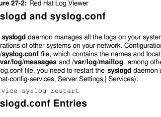

图 27-2：Red Hat 日志查看器

##### syslogd 和 syslog.conf

`syslogd` 守护程序管理系统上的所有日志，并协调网络中其他系统的任何日志记录操作。`syslogd` 的配置信息保存在 `/etc/syslog.conf` 文件中，该文件包含系统日志文件的名称和位置。在这里，您可以找到 `/var/log/messages` 和 `/var/log/mailog` 等条目。每当您对 `syslog.conf` 文件进行更改时，您需要使用以下命令重启 `syslogd` 守护程序（或使用 `redhat-config-services`，服务器设置 | 服务）：

```
service syslog restart
```

##### syslog.conf 条目

`syslog.conf` 中的条目由两个字段组成：一个选择器（selector）和一个操作（action）。选择器是将被记录日志的服务类型，如 mail 或 news；操作是放置消息的位置。操作通常是一个日志文件，但它也可以是远程主机或通向另一个程序的管道。服务类型被称为设施（facility）。`syslogd` 有几个术语用于指定特定类型的服务（见表 27-9）。设施可以进一步由优先级（priority）限定。优先级指定由该设施生成的消息类型。`syslogd` 使用几个指定的术语来表示不同的优先级。扇区（sector）由设施和优先级组成，中间用点分隔。例如，要保存由邮件系统生成的错误消息，请使用由 mail 设施和 err 优先级组成的扇区，如下所示：

要将这些消息保存到 `/var/log/maillog` 文件，您将该文件指定为操作，这将生成以下条目：

```
mail.err /var/log/maillog
```

`syslogd` 还支持使用 `*` 作为匹配字符来匹配某个区段中的所有设施或优先级。`cron.*` 将匹配所有 cron 消息，无论其优先级如何；`*.err` 将匹配所有设施发出的错误消息；而 `*.*` 将匹配所有消息。以下示例将所有邮件消息保存到 `/var/log/maillog` 文件，并将所有严重（critical）消息保存到 `/var/log/mycritical` 文件：

```
mail.* /var/log/maillog
*.crit /var/log/mycritical
```

#### 优先级

当为某个设施指定优先级时，所有具有更高优先级的消息也会被包含在内。因此，`err` 优先级也包含 `crit`、`alert` 和 `emerg` 优先级。如果您只想选择特定优先级，请使用 `=` 运算符来限定优先级。例如，`mail.=err` 将仅选择错误消息，而不包括 `crit`、`alert` 和 `emerg` 消息。您还可以使用 `!` 运算符来限制优先级。这将排除具有指定优先级及更高优先级的消息。例如，`mail.!crit` 将排除 `crit` 消息，以及更高优先级的 `alert` 和 `emerg` 消息。若要专门排除某个设施的所有消息，请使用 `none` 优先级。`mail.none` 会排除所有邮件消息。这通常用于在同一条目中定义多个区段时。

您可以通过用逗号分隔来在给定区段中列出多个优先级或设施。您可以通过用分号分隔，在同一条目中包含多个区段。第一个示例将排除所有邮件和认证消息（`authpriv`），并将所有具有 `info` 优先级的消息保存到 `/var/log/messages` 文件。第二个示例将 `uucp` 和 `news` 设施的所有 `crit` 消息及更高优先级的消息保存到 `/var/log/spooler` 文件：

```
*.info;mail.none;news.none;authpriv.none /var/log/messages
uucp,news.crit /var/log/spooler
```

#### 操作用户

在操作字段中，您可以指定文件、远程系统、用户或管道。文件的操作条目必须以 `/` 开头，并指定其完整路径名，例如 `/var/log/messages`。要将消息记录到远程主机，只需指定带 `@` 符号的前缀的主机名即可。以下示例将所有内核消息保存在 `rabbit.trek.com` 上：

```
kern.* @rabbit.trek.com
```

要将消息发送给用户，请列出他们的登录名。以下示例将严重的新闻消息发送到用户 `chris` 和 `aleina` 的控制台：

```
news.=crit chris,aleina
```

您还可以将消息输出到命名管道（FIFO）。操作字段中的管道条目以 `|` 开头。以下示例将内核调试消息通过管道传送到命名管道 `|/usr/adm/debug`：

```
kern.*debug |/usr/adm/debug
```

##### 表 27-9：Syslog 设施、优先级和运算符

| 设施 | 描述 |

|---|---|

| auth-priv | 安全/授权消息（私有） |

| cron | 时钟守护程序（cron 和 at）消息 |

| daemon | 其他系统守护程序消息 |

| kern | 内核消息 |

| lpr | 行式打印机子系统消息 |

| mail | 邮件子系统消息 |

| mark | 仅供内部使用 |

| news | Usenet 新闻子系统消息 |

| syslog | Syslog 内部消息 |

| user | 通用用户级消息 |

| uucp | UUCP 子系统消息 |

| local0 至 local7 | 保留供本地使用 |

| 优先级 | 描述 |

|---|---|

| debug | 7. 调试消息，最低优先级 |

| info | 6. 信息消息 |

| notice | 5. 通知，正常但重要的状况 |

| warning | 4. 警告 |

| err | 3. 错误消息 |

| crit | 2. 严重状况 |

| alert | 1. 警报，必须立即采取行动 |

| emerg | 0. 紧急消息，系统不可用，最高优先级 |

| 运算符 | 描述 |

|---|---|

| * | 匹配区段中的所有设施或优先级 |

| = | 限制为指定优先级 |

| ! | 排除指定优先级及更高优先级 |

| / | 保存消息的文件 |

| @ | 发送消息的主机 |

| \| | 发送消息的 FIFO 管道 |

#### /etc/syslog.conf 示例

Red Hat 系统的默认 `/etc/syslog.conf` 文件如下所示。消息记录到 `/var/log` 目录中的各个文件。


```
# Log all kernel messages to the console.
#kern.*				/dev/console

# Log anything (except mail) of level info or higher.
# Don't log private authentication messages!
*.info;mail.none;news.none;authpriv.none;cron.none    /var/log/messages

# The authpriv file has restricted access.
authpriv.*                                            /var/log/secure
# Log all the mail messages in one place.
mail.*                                                /var/log/maillog
# Log cron stuff.
cron.*                                                /var/log/cron
# Everybody gets emergency messages
*.emerg                                               *
# Save mail and news errors of level err and higher in a special file.
uucp,news.crit                                        /var/log/spooler
# Save boot messages also to boot.log
local7.*                                              /var/log/boot.log
# INN
news.=crit                                            /var/log/news/news.crit
news.=err                                             /var/log/news/news.err
news.notice                                           /var/log/news/news.notice
```

## 性能分析工具和进程

Linux 将在系统上执行的每个任务视为一个进程，该进程被分配了一个编号和一个名称。您可以检查这些进程，甚至停止它们。Red Hat 提供了多种用于检查进程以及系统性能的工具。Red Hat 的 Procman 系统监视器等多个图形界面（GUI）工具提供了简单的监控功能。

### ps 命令

在命令行中，您可以使用 `ps` 命令列出进程。使用 `-aux` 选项，您可以列出所有进程。将输出管道传输到带有模式的 `grep` 命令，使您可以搜索特定进程。管道将前一个命令的输出作为下一个命令的输入传送。以下命令列出了所有 X Window System 进程：

```
ps -aux | grep 'X'
```

您系统上的许多实用程序提供了关于进程的详细信息，以及其他系统信息，如 CPU 和磁盘使用情况（参见表 27-10）。虽然这些工具最初是为在 shell 命令行中使用并显示文本行输出而设计的，但现在有几个版本提供了 KDE 和 GNOME 版本，它们提供图形界面用于显示结果和管理进程。

#### 表 27-10：性能工具

| 性能工具 | 描述 |
|---|---|
| `vmstat` | 系统组件的性能 |
| `top` | 列出 CPU 密集型最高的进程 |
| `free` | 列出空闲 RAM 内存 |
| `sar` | 系统活动信息 |
| `iostat` | 磁盘使用情况 |
| `Procman` 系统监视器 | Red Hat 用于进程和使用率监视的系统监视器（在“系统工具”菜单中的“系统监视器”）。 |
| `KDE` 任务管理器和性能监视器 | KDE 用于进程和使用率监视的系统监视器 |

### vmstat, free, top, iostat, Xload, 和 sar

`vmstat` 命令输出详细列表，指示不同系统组件的性能，包括 CPU、内存、I/O 和交换操作。报告以带有不同组件字段的行发出。如果您提供时间段作为参数，它将在指定间隔（通常为几秒钟）重复。`top` 命令提供系统中 CPU 密集型最高的进程列表，显示哪些进程使用了最多的资源。列表是实时更新的，每几秒钟刷新一次。提供了用于更改进程状态（如优先级）的命令。

`free` 命令列出系统上空闲 RAM 内存的数量，显示使用了多少以及空闲多少，还显示用于缓冲区和服务换页内存的内容。`Xload` 是一个 X Window System 工具，显示负载、CPU 和内存。`iostat` 显示磁盘使用情况，而 `sar` 显示系统活动信息。

### Procman 系统管理器

Red Hat 的当前版本提供 Procman 系统管理器，用于显示系统信息和管理系统进程，可从“系统工具 | 系统监视器”访问。有两个面板，其中一个

## GNOME 系统管理器 (GTop)

使用 GNOME 系统管理器（`GTop`），您可以点击进程列表顶部的字段按钮，根据字段对进程进行排序。如果您右键点击某个条目，将显示一个弹出菜单，列出您可以对该条目执行的操作。系统统计摘要图表显示在窗口顶部，展示 CPU 负载、内存使用和磁盘使用率。您可以添加更多图表或更改其显示特性，例如使用的颜色。`GTop` 窗口显示三个制标签页面板，用于展示详细的进程、内存使用和文件系统使用情况报告。您可以添加更多面板，显示自定义报告，例如仅显示用户进程。进程列表可以进一步细化，以显示用户、系统或所有进程。要配置 `GTop`，请选择“设置”|“首选项”，这将显示一个带有制标签页面板的菜单，用于指定不同统计信息的更新频率、确定您希望显示的摘要，以及显示哪些进程字段。您可以在“实用工具”菜单中找到 GNOME 系统管理器。

## KDE 进程管理器 (kpm)

K 桌面环境提供 KDE 进程管理器（`kpm`）用于查看和管理您的进程。您可以点击进程列表顶部的字段按钮，根据字段对进程进行排序。如果您选择一个进程，然后可以选择对其执行几种不同的操作，例如结束它（杀死进程）或挂起它（使其休眠）。右键点击进程条目将显示一个弹出菜单，列出您可以采取的不同操作。您可以选择仅查看您自己的进程、系统进程或所有进程，以进一步细化您的进程列表。

## KDE 任务管理器和性能监视器 (KSysguard)

红帽还提供 KDE 任务管理器和性能监视器 `KSysguard`，可通过“附加功能”->“系统工具”菜单作为 KDE 系统守卫访问。此工具允许您监视您自己的系统以及远程系统的性能。`KSysguard` 可以为各种参数提供简单数值或详细表格。系统负载面板提供有关 CPU 和内存使用的图形信息，而进程表使用树形格式列出当前进程以显示依赖关系。您可以使用工作表设计自己的监视面板，显示您想要显示的不同类型数值以及您想要显示它们的形式，例如条形图或数字仪表。传感器浏览器窗格是一个可展开的传感器树，提供有关如 CPU 系统负载或内存已用内存等信息。每个您连接的主机都有一个顶部条目，包括您自己的本地主机。要设计您自己的监视器，请创建一个工作表并将传感器拖放到上面。


## 通用引导加载程序 (GRUB)

通用引导加载程序（`GRUB`）是一种多启动引导加载程序，其操作方式类似于 `LILO`。在许多发行版中，它现在是默认的引导加载程序。`GRUB` 提供了对各种操作系统广泛的兼容性。用户可以在系统启动时显示的菜单界面中选择要运行的操作系统。使用箭头键移动到条目并按 ENTER 键。输入 `e` 编辑命令，允许您更改内核参数或指定不同的内核。命令 `c` 将您放入类似于 `LILO` 的命令行界面。如果您的系统 BIOS 支持非常大的驱动器，`GRUB` 可以从这些驱动器上的任何位置启动。Linux 和 Unix 操作系统被称为多启动操作系统，并接受在启动时传递给它们的参数。在这里，您可以指定特性，例如用于 IDE CD-R/RW 驱动器的内核模块（参见第 30 章）。使用 `info grub` 列出详细文档或检查 `grub` 手册页。您可以使用 Boot Configuration 工具选择默认系统或内核，并设置超时限制（可从系统设置菜单中作为 Boot Loader 访问）。


GRUB 配置保存在 `/etc/grub.conf` 文件中。您只需要输入您的条目，重启时 GRUB 将自动读取它们。您可以设置几个选项，例如超时期间和要使用的背景图像。您可以通过为其创建标题条目来指定要启动的系统，该条目以 `title` 术语开始。然后您必须指定操作系统内核或程序的位置，即哪个硬盘以及该硬盘上的哪个分区。此信息列在 `root` 选项后的括号中。编号从 0 开始，而不是 1，并且无论硬盘是 IDE 还是 SCSI，都用 `hd` 前缀表示。因此 `root (hd0,2)` 引用第一个硬盘（hda）以及该硬盘上的第三个分区（hda3）。对于 Linux 系统，您还必须使用 `kernel` 选项来指示要运行的内核程序，使用完整路径名以及内核可能需要的任何选项。RAM 盘由 `initrd` 选项指示。

```
title Red Hat Linux (2.4.21-20)
    root    (hd0,2)
    kernel  (/boot/vmlinuz-2.4.21-20 ro root=/dev/hda3
    initrd  /boot/initrd-2.4.21-20.img
```

对于 Windows 等其他操作系统，您使用 `rootnoverify` 选项来指定 Windows 安装的位置。此选项指示 GRUB 不要尝试挂载该分区。使用 `makeactive` 和 `chainloader +1` 选项允许 GRUB 访问它。`chainloader` 选项告诉 GRUB 为该操作系统使用另一个引导程序。该数字指示引导程序所在的分区扇区-例如，+1 指示第一个扇区。

```
title Windows XP
    rootnoverify  (hd0,0)
    makeactive
    chainloader +1
```

Windows 系统都想要从第一个磁盘的第一个分区启动。如果您想在不同的分区上安装多个版本的 Windows，或者在第一个分区以外的分区上安装 Windows，这就成了一个问题。GRUB 允许您通过隐藏其他分区并在同一行取消隐藏您想要的分区来解决这个问题，使其看起来像是第一个分区。在此示例中，第一个分区被隐藏，第二个被取消隐藏。这假设第二个分区（hd0,1）上有一个 Windows 系统。现在第一个分区被隐藏后，第二个分区看起来像是第一个分区。

```
hide    (hd0,0)
unhide  (hd0,1)
rootnoverify (hd0,1)
```

下面是一个包含 Linux 和 Windows 条目的示例 `grub.conf` 文件。请注意，内核参数作为内核的论点列在 `kernel` 选项中。`/etc/grub.conf`

```
grub.conf generated by anaconda
#
#boot=/dev/hda
default=0
timeout=30
splashimage=(hd0,2)/boot/grub/splash.xpm.gz
title Red Hat Linux (2.4.7-10)
    root    (hd0,2)
    kernel  /boot/vmlinuz-2.4.7-10 ro root=/dev/hda3 hdc=ide-scsi
    initrd  /boot/initrd-2.4.7-10.img
title Windows XP
    rootnoverify  (hd0,0)
    makeactive
    chainloader  +1
```

注意 旧版本的 Red Hat 提供旧的 Linux 加载器（LILO）作为其引导管理器。它执行与 GRUB 相同类型的任务。您可以通过使用... 来修改您的 LILO 配置

#### 备份

你可以备份和恢复系统归档工具（如 `tar`），稍后恢复这些归档。对于备份，`tar` 通常与磁带设备一起使用。要自动安排备份，你可以使用 `cron` 工具调度适当的 `tar` 命令。

#### Amanda

要备份连接到网络的计算机，你可以使用高级马里兰自动网络磁盘归档器（Advanced Maryland Automatic Network Disk Archiver，Amanda）来归档计算机。Amanda 使用 `tar` 工具将所有计算机备份到作为备份服务器运行的单一计算机上。每个计算机将备份数据发送到作为 Amanda 服务器运行的计算机，然后这些数据被写入磁带等备份介质。使用 Amanda 服务器，所有计算机的备份操作都集中在一个服务器上，而不是每台计算机必须执行自己的备份。任何需要恢复数据的计算机只需向 Amanda 服务器发出请求，并指定文件系统、日期和文件名。Amanda 拥有对应于常见备份任务的专用命令，以 “am” 开头，例如 `amdump`、`amrestore` 和 `amrecover`。配置文件位于 `/etc/amanda`，日志和数据库文件位于 `/var/adm/amanda`。

#### 使用 dump 和 restore 进行备份

你可以使用 `dump` 和 `restore` 实用程序备份和恢复系统。`dump` 可以备份整个系统或执行增量备份，仅保存自上次备份以来发生变化的那些文件。`dump` 支持多个选项来管理备份操作，例如指定存储介质的大小和长度（参见表 27-11）。

#### dump 级别

`dump` 使用 `dump` 级别来确定你希望系统备份的程度。`dump` 级别 0 将完整复制文件系统。其余的 `dump` 级别执行增量备份，仅备份自上次较低级别备份以来创建或修改的文件和目录。`dump` 级别 1 仅备份自上次级别 0 备份以来发生变化的文件。转而又将备份级别 2 仅备份自上次级别 1 备份（如果没有级别 1 备份，则为级别 0）以来发生变化的文件，依此类推，直到 `dump` 级别 9。你可以运行一次初始的完整备份（`dump` 级别 0）来备份整个系统，然后在稍后的特定日期运行增量备份，只需备份自完整备份以来的变化即可。

使用 `dump` 级别，你可以为备份文件系统设计某些策略。重要的是要记住，增量备份是针对自上次较低级别备份以来的变化而运行的。例如，如果最后一次备份是 6，而下一次备份是 8，那么级别 8 将备份级别 6 备份中的所有数据。备份的顺序很重要。如果三次备份级别分别为 3、然后 6、再然后 5，那么级别 5 备份将从级别 3 备份中获取所有内容，而不会止步于级别 6。在这种情况下，级别 3 是级别 5 的下一个较低级别备份。这可能形成一些复杂的增量备份策略。例如，如果你希望每个后续的增量备份都包含前一个增量备份的所有变更，你可以按降序 `dump` 级别顺序运行备份。给定备份序列为 7、6 和 5，且 0 为初始完整备份，6 将包含到 7 的所有变更，因为其下一个较低级别是 0，使其成为级别 0。然后 5 将包含 7 和 6 的所有变更，也因为其下一个较低级别是 0，使其包含自级别 0 完整备份以来的所有变更。实现此目标的更简单方法是让增量级别都相同。给定初始级别为 0，然后两个备份均为级别 1，最后一个级别 1 将包含来自级别 0 备份的所有变更，因为级别 0 是下一个较低级别，而不是之前的级别 1 备份。

#### 记录备份

备份记录在 `/etc/dumpdates` 文件中。此文件将列出所有以前的备份，指定执行备份的文件系统、执行日期以及使用的 `dump` 级别。你可以使用此信息从指定备份中恢复文件。请记住，`/etc/fstab` 文件还记录了每个文件系统的 `dump` 级别以及推荐的备份频率。使用 `-f` 选项时，`dump` 将分析 `/etc/dumpdates` 和 `/etc/fstab` 文件以确定哪些文件系统需要备份。使用 `-w` 选项的 `dump` 命令仅使用 `/etc/fstab` 来报告准备好进行备份的文件系统。

##### 表 27-11: dump 选项

| 选项 | 描述 |
|---|---|
| `-0` 至 `-9` | 指定 `dump` 级别。`dump` 级别 0 是完全备份，复制整个文件系统（另请参阅 `-h` 选项）。高于 0 的 `dump` 级别编号执行增量备份，复制自上次较低级别备份以来文件系统中所有新增或修改的文件。默认级别为 9。 |
| `-B records` | 允许你指定卷中的块数，覆盖 `dump` 通常用于多卷备份的介质结束检测或长度和密度计算。 |
| `-a` | 允许 `dump` 绕过任何磁带长度计算，并持续写入直到检测到介质结束指示。推荐用于大多数现代磁带驱动器，并且是默认选项。 |
| `-b blocksize` | 允许你指定每个 `dump` 记录中的千字节数。使用此选项，你可以创建更大的块，从而加速备份。 |
| `-d density` | 指定磁带的密度，单位为位/英寸（默认为 1,600 BPI）。 |
| `-h level` | 标记有用户 nodump 标志的文件不会在此指定级别及以上级别进行备份。默认为 1，这意味着在增量备份中不会备份标记的文件。 |
| `-f file/device` | 将文件系统备份到指定的文件或设备。这可以是文件或磁带驱动器。你可以指定多个文件名，用逗号分隔。可以通过前缀主机名来引用远程设备或文件，格式为 `hostname:file`。 |
| `-k` | 使用 Kerberos 认证与远程磁带服务器通信。 |


| `-M file/device` | 实现多卷备份，其中写入的文件被视为前缀，后缀由从 001 开始的编号序列组成，用于每个后续文件，如 `file001`、`file002` 等。当备份文件需要大于 Linux ext3 2GB 文件大小限制时，这很有用。 |

| `-n` | 如果备份需要操作员关注，则通知操作员。 |

| `-s feet` | 指定磁带的长度，单位为英尺。当达到长度时，`dump` 会提示输入新磁带。 |

| `-S` | 估算执行备份所需的存储空间量。 |

| `-u` | 在 `/etc/dumpdates` 文件中写入成功更新的条目。 |

| `-W` | 检测并显示需要备份的文件系统。此信息取自 `/etc/dumpdates` 和 `/etc/fstab` 文件。 |

| `-w` | 检测并显示需要备份的文件系统，仅基于 `/etc/fstab` 中的信息。 |

#### dump 操作

`dump` 命令的参数包括 `dump` 级别、存储备份的设备以及正在备份的文件系统的设备名称。如果存储介质（如磁带）太小无法容纳备份，`dump` 将暂停并让你插入另一盘磁带。`dump` 支持多卷备份。`-u` 选项将把备份记录在 `/etc/dumpdates` 文件中。在以下示例中，对整个文件系统执行了完全备份（`dump` 级别 0），该文件系统位于 `/dev/hda3` 硬盘分区上。备份存储在磁带设备 `/dev/tape` 上。

```
dump -0u -f /dev/tape /dev/hda5
```

注 你可以使用 `mt` 命令控制磁带设备。`mt` 有选项用于倒带、擦除和定位磁带。`rmt` 命令控制远程磁带设备。

存储设备可以是另一个硬盘分区，但通常是磁带设备。当你安装系统时，系统很可能检测到了该设备并将 `/dev/tape` 设置为指向该设备的链接（就像它对 CD-ROM 所做的那样）。如果未设置该链接，你必须自己创建或直接使用设备名称。磁带设备可能具有不同的设备名称，具体取决于型号或接口。SCSI 磁带设备以 `st` 为前缀，并附加一个数字表示特定设备。`st0` 是第一个 SCSI 磁带设备。要在 `dump` 命令中使用它，只需指定其名称即可。

```
dump -0u -f /dev/st0 /dev/hda5
```

如果你需要备份到位于网络中另一系统上的设备，你必须指定该系统的主机名及其设备名称。主机名输入在设备名称之前，并用冒号分隔。在以下示例中，用户将文件系统 `/dev/hda5` 备份到 `rabbit.mytrek.com` 系统上名为 `/dev/st0` 的 SCSI 磁带设备：

```
dump -0u -f rabbit.mytrek.com:/dev/st0 /dev/hda5
```

`dump` 命令一次只处理一个文件系统。如果你的系统有多个文件系统，你需要为每个文件系统发出单独的 `dump` 命令。

提示 你可以使用系统 `cron` 工具在指定时间使用 `dump` 调度备份。

#### 恢复备份

你使用 `restore` 命令来恢复整个文件系统或仅检索特定文件。`restore` 将从备份归档中提取文件或目录并将它们复制到当前工作目录。在运行 `restore` 时，请确保你位于希望恢复文件到的目录中。`restore` 还将根据需要生成任何子目录。`restore` 有几个选项用于管理恢复操作（参见表 27-12）。

##### 表 27-12：restore 选项

| 选项 | 描述 |

|---|---|

| `-C` | 允许通过比较文件系统中的文件与备份中的文件来检查备份。 |

| `-I` | 用于恢复备份中特定文件和目录的交互模式。会生成一个 shell 接口，用户可以使用命令指定要恢复的文件和目录（参见表 27-13）。 |

| `-R` | 指示 `restore` 请求多卷备份中的一部分磁带，以继续恢复操作。在多卷恢复操作被中断时很有用。 |

| `-r` | 恢复文件系统。请确保新格式化的分区已挂载，并且你已切换到其顶层目录。 |

| `-t` | 列出备份的内容或其中的指定文件。 |

| `-x` | 从备份中提取指定文件或目录。目录将与其所有子目录一起恢复。如果未指定文件或目录，则恢复整个文件系统。 |

| `-f file/device` | 恢复指定文件或设备上的备份。对于远程设备，请指定主机名。 |

| `-k` | 对远程设备使用 Kerberos 认证。 |

| `-h` | 仅提取指定的目录，而不包括其子目录。 |

| `-M file/device` | 从多卷备份中恢复，其中文件被视为前缀，后缀为编号序列，如 `file001`、`file002`。 |

| `-N` | 显示文件和目录的名称；不进行提取。 |

| `-T directory` | 指定用于存储临时文件的目录。默认值为 `/tmp`。 |

| `-v` | 详细模式，显示 `restore` 操作的每个文件及其文件类型。 |

| `-y` | 默认情况下，如果发生错误（如坏块），`restore` 会询问操作员是否继续。此选项禁止该询问，允许 `restore` 自动继续。 |

要恢复单个文件和目录，你需要使用 `-i` 选项以交互模式运行 `restore`。这将生成一个包含磁带上所有目录和文件的 shell，让你选择要恢复的文件。完成后，`restore` 将仅从备份中检索你选择的文件。此 shell 有一套特定的命令，可用于选择和提取文件和目录（参见表 27-13）。以下命令将生成交互式界面，列出在 `/dev/tape` 设备磁带上备份的所有目录和文件：

```
restore -ivf /dev/tape
```

##### 表 27-13：restore 交互模式 Shell 命令

| 命令 | 描述 |

|---|---|

| `add [arg]` | 将文件或目录添加到待提取文件列表中。此类标记的文件在使用 `ls` 列表显示时，其名称前会显示 *。已标记目录的所有子目录也会被提取。 |

| `cd arg` | 更改当前工作目录。 |

| `delete [arg]` | 从提取列表中删除文件或目录。已删除目录的所有子目录也将被移除。 |

| `extract` | 提取提取列表中的文件和目录。 |

| `help` | 显示可用命令列表。 |

| `ls [arg]` | 列出当前工作目录或指定目录的内容。 |

| `pwd` | 显示当前工作目录的完整路径名。 |

| `quit` | 退出 `restore` 交互模式 shell。`quit` 命令不执行任何提取操作，即使提取列表中仍有项目。 |

| `setmodes` | 为提取列表中所有文件和目录设置所有者、权限和时间。用于清理中断的恢复操作。 |

| `verbose` | 在详细模式下，每个文件在提取时都会被列出。此外，`ls` 命令会列出文件和目录的 inode 编号。 |

此命令将生成一个包含备份整个目录结构的 shell。你会得到一个 shell 提示符，可以使用 `cd` 命令移动到不同的目录，并使用 `ls` 命令列出文件和子目录。你使用 `add` 命令为待提取的文件或目录做标记。如果你后来决定不提取它，可以使用 `delete` 命令将其从标记列表中移除。一旦选中所有想要的项目，你输入 `extract` 命令从备份归档中检索它们。要退出 `restore` shell，你输入 `quit`。`help` 命令将列出 `restore` shell 命令。

如果需要恢复整个文件系统，你需要使用带有 `-r` 选项的 `restore`。你可以将文件系统恢复到任何足够大小的空白格式化硬盘分区，包括文件系统原始分区。如果可能，建议将文件系统恢复到另一个分区并检查结果。

恢复整个文件系统涉及设置格式化分区，将其挂载到系统上，然后切换到其顶层目录以运行 `restore` 命令。首先应使用 `mkfs` 格式化你要恢复文件系统的分区，然后将其挂载到系统上。接着使用带有 `-r` 选项和 `-f` 选项的 `restore` 来指定持有文件系统备份的设备。在下一个示例中，用户格式化 `/dev/hda5` 分区，然后在该分区上恢复文件系统备份，当前位于 `/dev/tape` 设备的磁带上。

```
mkfs /dev/hda5
mount /dev/hda5 /mystuff
cd /mystuff
restore -rf /dev/tape
```

要从位于网络中另一系统的备份设备恢复，你必须指定该系统的主机名及其设备名称。主机名输入在设备名称之前，并用冒号分隔。在以下示例中，用户从 `rabbit.mytreek.com` 系统上名为 `/dev/tape` 的磁带设备上的备份中恢复文件系统：

```
restore -rf rabbit.mytreek.com:/dev/tape
```


### 第 28 章：用户管理

#### 概述

作为系统管理员，你必须管理系统的用户。你可以添加或删除用户，以及添加和移除组，并可以修改用户和组的访问权限和许可。你还可以访问系统初始化文件，用于配置所有用户 shell。你控制在新用户账户首次创建时复制到账户中的默认初始化文件。你可以通过配置这些文件来决定如何初始配置新用户账户。


**提示** 每个文件都由一个可以控制其访问权限的所有者用户拥有。系统文件由 `root` 用户拥有，仅 `root` 可访问。像 `FTP` 这样的服务是这一规则的例外。虽然由 `root` 可访问，但服务的文件由自己的特殊用户拥有。例如，`FTP` 文件由 `ftp` 用户拥有。这允许用户访问服务的文件，而无需拥有 `root` 用户权限。

### 用户配置文件

管理用户的任何实用工具，如 Red Hat 用户管理器，都会使用某些默认文件（称为*配置文件*）和目录来设置新账户。一组路径名用于定位这些默认文件或指示创建某些用户目录的位置。例如，`/etc/skel` 保存新用户的初始化文件。新用户的家目录在 `/home` 目录中创建。表 28-1 列出了这些路径名。

#### 表 28-1：用户配置文件路径

| 目录和文件 | 描述 |
|---|---|
| `/home` | 用户自家目录的位置。 |
| `/etc/skel` | 保存登录 shell 的默认初始化文件，如 `.bash_profile`、`bashrc` 和 `.bash_logout`。包含许多用户设置目录和文件，如用于 KDE 的 `.kde` 和用于 GNOME 的 `Desktop`。 |
| `/etc/shells` | 保存登录 shell，如 `BASH` 或 `TCSH`。 |
| `/etc/passwd` | 保存用户密码。 |
| `/etc/group` | 保存用户所属的组。 |
| `/etc/shadow` | 加密密码文件。 |
| `/etc/gshadow` | 组的加密密码文件。 |
| `/etc/login.defs` | 用户的默认登录定义。 |

**提示** 你可以使用 `w` 或 `who` 命令了解当前哪些用户已登录。`w` 命令显示每个连接用户的详细信息，例如从哪里登录以及不活动时间长短，以及登录日期和时间。`who` 命令提供的数据较不详细。

### 密码文件

用户通过提供正确的登录名和密码来获取账户访问权限。系统在密码文件中维护密码，以及登录信息（如用户名和用户 ID）。像 `passwd` 命令这样的工具允许用户通过修改这些文件来更改密码。传统上，`/etc/passwd` 文件存储用户密码，尽管是以加密形式。然而，所有用户都被允许读取 `/etc/passwd` 文件，这使得用户能够访问加密后的密码。为了增强安全性，密码条目保存在 `/etc/shadow` 文件中，该文件仅允许 `root` 用户访问。

#### /etc/passwd

当您添加用户时，会在 `/etc/passwd` 文件（通常称为密码文件）中创建该用户的条目。每个条目占一行，包含由冒号分隔的多个字段。这些字段如下：

- **用户名**：用户的登录名
- **密码**：用户账户的加密密码
- **用户 ID**：系统分配的唯一数字
- **组 ID**：用于标识用户所属组的数字
- **注释**：任何用户信息，例如用户的全名
- **主目录**：用户的主目录
- **登录 Shell**：用户登录时运行的 Shell；这是默认 Shell，通常是 `/bin/bash`

根据是否使用 shadow 密码，密码字段（第二个字段）将是 `x` 或用户密码的加密形式。Red Hat 默认实施 shadow 密码，因此这些条目的密码应为 `x`。以下是 `/etc/passwd` 条目的示例。对于这些条目，必须使用 `passwd` 命令创建密码。还要注意，在这个特定系统中，用户 ID 从 500 开始并递增 1。在 Red Hat 中，分配的组不是通用的 User 组，而是一个仅由该用户组成的唯一组。例如，`dylan` 用户属于名为 Dylan 的组，而不是通用的 User 组。

```
dylan:x:500:500:Dylan:/home/dylan:/bin/bash
chris:x:501:501:Chris:/home/chris:/bin/bash
```

**提示** 如果关闭 shadow 密码支持，passwd 文件中的条目将显示加密密码。由于任何用户都可以读取 `/etc/passwd` 文件，入侵者可以访问并可能破解加密后的密码。

**提示** 虽然在技术上可以直接编辑 `/etc/passwd` 文件中的条目，但不建议这样做。特别是，删除条目不会移除与用户相关的其他信息、权限和数据，这可能导致安全漏洞，使入侵者能够接管被删除用户的 ID 或磁盘空间。

#### /etc/shadow 和 /etc/gshadow

`/etc/passwd` 文件是一个简单的文本文件，容易受到安全漏洞的影响。如果任何人获取了对 `/etc/passwd` 文件的访问权限，他们可能会通过暴力破解攻击来解密或破解加密密码。shadow 应用程序套件实施了更高级别的安全措施。这包括 `useradd`、`groupadd` 及其对应的更新和删除程序的版本。大多数其他用户配置工具，包括 `redhat-config-users`，都支持 shadow 安全措施。使用 shadow 安全机制后，密码不再保存在 `/etc/passwd` 文件中。相反，密码保存在名为 `/etc/shadow` 的单独文件中。访问权限限制为 `root` 用户。

以下示例显示了两个用户的 `/etc/shadow` 条目，列出了它们的加密密码。`chris` 的条目在其 Password 字段中为 `x`，表示尚未为该用户创建密码：

```
dylan:YOTPd3Pyy9hAc:500:500:Dylan:/home/dylan:/bin/bash
chris:x:501:501:Chris:/home/chris:/bin/bash
```

还有一个对应的密码文件，称为 `/etc/gshadow`，用于维护需要密码的组。Red Hat 默认支持 shadow 密码。您可以使用 Red Hat 认证工具手动指定是否希望使用 shadow 密码。

### 密码工具

若要更改特定用户的任何特定字段，应使用提供的用户管理工具，例如本章中讨论的 `passwd` 命令、`redhat-config-users`、`adduser`、`usermod`、`useradd` 和 `chage`。`passwd` 命令仅允许更改密码。其他工具，如 `redhat-config-users`，不仅在 `/etc/passwd` 文件中创建条目，还为用户创建主目录并在用户主目录中安装初始化文件。

这些工具还允许您控制用户对其账户的访问权限。您可以为用户设置过期日期，或锁定他们的账户。账户被锁定的用户在 `/etc/shadow` 文件中的密码前缀将是无效字符串 `!!`。解锁账户会移除此前缀。

**提示** 使用 Red Hat 认证工具（`authconfig-gtk`，参见第 4 章），您可以启用和配置各种认证工具，如 `NIS` 和 `LDAP` 服务器，以及启用 shadow 密码、`LDAP` 和 `Kerberos` 认证（可通过系统设置菜单和窗口中的 Authentication 访问）。

### 管理用户环境

每次用户登录时，都会执行两个配置文件脚本：一个对所有用户都相同的系统配置文件脚本，以及一个可以根据每个用户需求自定义的用户登录配置文件脚本。当用户注销时，会运行用户注销脚本。此外，每次生成 shell（包括登录 shell）时，都会运行用户 shell 脚本。不同的 shell 使用不同类型的脚本。在 Red Hat 中，常用的默认 shell 是 `BASH` shell。作为替代方案，用户可以使用不同的 shell，例如 `TCSH` 或 Z shell，它们都安装在 Red Hat Linux 中。

#### 配置文件脚本

对于 `BASH` shell，每个用户都有一个名为 `.bash_profile` 的 `BASH` 登录配置文件脚本，位于他们的主目录中。系统配置文件脚本位于 `/etc` 目录中，名为 `profile`，前面没有点号。`BASH` shell 用户 shell 脚本称为 `.bashrc`。`.bashrc` 文件还会运行 `/etc/bashrc` 文件以实现全局定义，例如 `PS1` 和 `TERM` 变量。`/etc/bashrc` 文件还会执行 `/etc/profile.d` 目录中的任何专用初始化文件，例如用于 KDE 和 GNOME 的文件。`.bash_profile` 文件运行 `.bashrc` 文件，并通过它运行 `/etc/bashrc` 文件，以实现全局定义。

作为超级用户，您可以编辑这些配置文件或 shell 脚本中的任意一个，并放入任何希望在每个用户登录时执行的命令。例如，您可能希望定义命令的默认路径，以防用户未这样做。或者，您可能希望通知用户最近的系统新闻或账户更改。

#### /etc/skel


当您首次向系统添加用户时，必须为用户提供其登录、shell 和注销初始化文件的骨架版本。对于 BASH shell，这些文件是 `.bash_profile`、`.bashrc` 和 `.bash_logout`。`useradd` 命令以及其他用户管理工具（如 Red Hat User Manager）会自动添加这些文件，将 `/etc/skel` 目录中的任何文件复制到用户的新主目录中。`/etc/skel` 目录包含 `.bash_profile`、`.bashrc` 和 `.bash_logout` 文件的骨架初始化文件；如果您使用 TCSH shell 作为登录 shell，则包含 `.login`、`.tcshrc` 和 `.logout` 文件。`/etc/skel` 目录还包含桌面的默认文件和目录。这包括 X Window 系统的 `.screenrc` 文件、KDE 桌面的 `.kde` 目录，以及包含 GNOME 桌面默认配置文件的 `Desktop` 目录。

作为超级用户，您可以按任意方式配置 `/etc/skel` 目录中的 `.bash_profile` 或 `.bashrc` 文件。通常，包含基本的系统变量赋值，用于定义命令和命令别名的路径名。`PATH` 和 `BASH_ENV` 变量在 `.bash_profile` 中定义。一旦用户拥有自己的 `.bash_profile` 或 `.bashrc` 文件，他们就可以根据需要重新定义变量或添加新命令。

### /etc/login.defs

用户和组创建实用程序（如 `useradd` 和 `groupadd`）使用的系统级值保存在 `/etc/login.defs` 文件中。在这里，您会找到可能的用户 ID 和组 ID 的范围。`UID_MIN` 保存用户 ID 的最小数字，`UID_MAX` 保存最大数字。各种密码选项控制密码限制——例如 `PASS_MIN_LEN`，它确定密码中允许的最小字符数。诸如 `CREATE_HOME` 等选项可以设置，以告知 `useradd` 等用户工具默认为新账户创建主目录。这些条目的示例如下所示：

```
MAIL_DIR /var/spool/mail
PASS_MIN_LEN 5
CREATE_HOME yes
```

### /etc/login.access

您可以通过 `/etc/login.access` 文件控制远程用户登录访问您的系统。该文件由若干条目组成，列出了用户、是否允许访问以及他们可以从何处访问系统。此文件中的一个记录由三个冒号分隔的字段组成：一个加号（`+`）或减号（`-`），指示是否允许用户访问；允许访问的用户登录名；以及他们尝试登录的远程系统（主机）或终端（tty 设备）。以下示例允许用户 `chris` 从 `rabbit.mytrek.com` 远程系统访问系统：

```
+:chris:rabbit.mytrek.com
```

您可以列出多个用户或位置，或者使用 `ALL` 选项代替用户或位置，以允许所有用户和位置访问。`ALL` 选项可以使用 `EXCEPT` 选项进行限定，以允许除特定指定用户外的所有用户访问。以下条目允许任何有效用户通过控制台登录系统，除了用户 `larisa` 和 `aleina`：

```
+:ALL EXCEPT larisa aleina:console
```

其他访问控制文件用于控制特定服务的访问，例如与 `xinetd` 支持服务器配合使用的 `tcpd` 守护进程所使用的主机拒绝和主机允许文件。

### 控制用户密码

创建用户账户后，您可以控制用户对该账户的访问。Red Hat 用户管理工具和 `passwd` 工具都允许您锁定或解锁用户账户。使用带有 `-l` 选项的 `passwd` 命令可以锁定账户，使其密码无效；使用 `-u` 选项可以解锁。

您还可以通过为密码设置过期日期来强制用户在给定的间隔内更改密码。Red Hat 用户管理工具和 `chage` 命令都允许您指定用户密码的过期限制。用户可以被要求每月、每周或在给定日期更改密码。一旦密码过期，系统将提示用户输入新密码。您可以提前发出警告，告知用户在密码过期前剩余多少时间。对于想要关闭的账户，您可以永久使密码过期。您甚至可以关闭长期未活动的账户。在下一个示例中，`chris` 账户的密码仅保持七天有效。使用 `-M` 选项加天数设置密码可以有效的最长时间。

```
chage -M 7 chris
```

若要设置账户过期的特定日期，请使用 `-E` 选项并指定日期 `mm/dd/yyyy`。

```
chage -E 07/30/2003 chris
```

要查看给定账户当前的过期设置，请使用 `-l` 选项。

```
chage -l chris
```

您还可以将选项组合到一个命令中，

```
chage -M 7 -E 07/30/2003 chris
```

`change` 选项的列表见表 28-2。

表 28-2: `change` 命令的选项

| 选项 | 描述 |
|---|---|
| `-m` | 用户能够更改密码前必须经过的最小天数 |
| `-M` | 用户可以不更改密码而通过的最大天数 |
| `-d` | 密码最后更改的日期 |
| `-E` | 密码的特定过期日期，日期格式为 yyyy-mm-dd 或常用格式 mm/dd/yyyy |
| `-I` | 允许的账户非活动期（以天为单位），之后密码将过期 |
| `-w` | 警告期，在过期前用户将收到警告消息的天数 |
| `-l` | 显示当前密码过期控制 |

### 使用 useradd、usermod 和 userdel 添加和删除用户

Linux 还提供了 `useradd`、`usermod` 和 `userdel` 命令来管理用户账户。所有这些命令都将所有信息作为命令行上的选项接受。如果未指定选项，它们将使用预定的默认值。

**注意** 对于 Red Hat 发行版，您应该使用 Red Hat 用户管理器（`redhat-config-users`）来管理用户账户（参见第 4 章）。您可以从“系统设置”窗口和菜单访问 Red Hat 用户管理器。它简单地标记为“用户和组”。您也可以从 GNOME 系统菜单访问它。

#### useradd

使用 `useradd` 命令，您通过命令行输入选项值（例如用户名称）来创建用户账户。然后，它使用新账户的所有默认功能为该名称创建一个新的登录和目录。

```
# useradd chris
```

`useradd` 实用程序首先检查 `/etc/login.defs` 文件以获取创建新账户的默认值。对于 `/etc/login.defs` 文件中未定义的默认值，`useradd` 提供自己的默认值。您可以使用带有 `-D` 选项的 `useradd` 命令来显示这些默认值。默认值包括组名称、用户 ID、主目录、`skel` 目录和登录 shell。用户在命令行上输入的值将覆盖相应的默认值。组名称是新账户所属组的名称。默认情况下，这是 `other`，意味着新账户不属于任何组。用户 ID 是标识用户账户的数字。`skel` 目录是保存初始化文件副本的系统目录。当创建用户的新主目录时，这些初始化文件会被复制到其中。登录 shell 是用户计划使用的特定 shell 的路径名。

`useradd` 命令具有与每个默认值对应的选项。表 28-3 列出了您可以与 `useradd` 命令一起使用的所有选项。在创建特定账户时，您可以使用特定值代替这些默认值中的任何一个。在您这样做之前，登录是不可访问的。在下一个示例中，`chris` 账户的组名称设置为 `intro1`，用户 ID 设置为 578：

```
# useradd chris -g intro1 -u 578
```

添加新的用户登录后，您需要为新登录设置密码。密码条目放置在 `/etc/passwd` 和 `/etc/shadow` 文件中。使用 `passwd` 命令为用户创建新密码，如下所示。您输入的密码不会显示在屏幕上。系统将提示您重复密码。然后会发布一条消息，表明密码已成功更改。

```
# passwd chris
Changing password for user chris
New UNIX password:
Retype new UNIX password:
passwd: all authentication tokens updated successfully
#
```

表 28-3: `useradd` 和 `usermod` 的选项

| 选项 | 描述 |
|---|---|
| `-d dir` | 设置新用户的主目录。 |
| `-D` | 显示所有设置的默认值。也可用于重置主目录（`-b`）、组（`-g`）、shell（`-s`）、过期日期（`-e`）和密码过期（`-f`）的默认设置。 |
| `-e mm/dd/yy` | 设置账户的过期日期（默认为无）。指定为月/日/年。 |
| `-f days` | 设置密码过期后账户保持活跃的天数。 |
| `-g group` | 设置组。 |
| `-m` | 如果用户主目录不存在，则创建它。 |


| `-m -k skl-dir` | 设置保存骨架文件（如 `.profile` 文件）的骨架目录，这些文件在创建用户主目录时会自动复制到其中；默认是 `/etc/skel`。 |

| `-M` | 不创建用户主目录。 |

| `-p password` | 提供加密的密码（crypt 或 MD5）。没有参数时，账户立即被禁用。 |

| `-r` | Red Hat 特有的选项，创建一个系统账户（其用户 ID 低于 `logon.defs` 中设置的最小值）。除非指定 `-m`，否则不创建主目录。 |

| `-s shell` | 设置新用户的登录 shell。默认是 `/bin/bash`，即 BASH shell。 |

| `-u userid` | 设置新用户的用户 ID。默认是目前使用的最高数字的增量。 |

### usermod

`usermod` 命令允许您更改这些功能中的任意值。您可以更改主目录或用户 ID。您甚至可以更改账户的用户名。`usermod` 命令接受与 `useradd` 相同的选项，如表 28-3 中所述。

### userdel

当您想从系统中移除用户时，可以使用 `userdel` 命令删除用户的登录。使用 `-r` 选项，用户的主目录也将被删除。在下一个示例中，用户 `chris` 从系统中被移除：

```
# userdel -r chris
```

#### 管理用户组

你可以使用 shell 命令或窗口实用程序（如 Red Hat 用户管理器）来管理用户组。

##### /etc/group 和 /etc/gshadow

保存组条目的系统文件名为 `/etc/group`。该文件由组记录组成，每行一条记录，字段之间用冒号分隔。一条组记录包含四个字段：组名、密码、组 ID，以及属于该组的用户。密码字段可以留空。组记录的字段如下：

- `组名` 组的名称，必须唯一

- `密码` 如果启用了影子安全机制，该字段为 `x`，实际密码存储在 `/etc/gshadow` 文件中。

- `组 ID` 系统分配用于标识该组的数字

- `用户` 属于该组的用户列表，以逗号分隔

以下是 `/etc/group` 文件中一个条目的示例。该组名为 `engines`，密码由影子安全机制管理，组 ID 为 100，属于该组的用户为 `chris`、`robert`、`valerie` 和 `aleina`。

```
engines:x:100:chris,robert,valerie,aleina
```

与 `/etc/passwd` 文件类似，最好使用 `groupmod`、`groupadd` 或 Red Hat 用户管理器等组管理实用程序来修改组条目。所有用户都对 `/etc/group` 文件拥有读取权限。在使用影子安全机制时，如密码等安全的组数据存储在 `/etc/gshadow` 文件中，只有 root 用户有权访问该文件。

##### 用户私有组

可以新分配给一个新的用户一个专门为其设置的特殊组，该组以该用户命名为名。例如，新用户 `dylan` 会被分配一个默认组，该组也名为 `dylan`。组 `dylan` 也会出现在组的列表中。这种分配默认用户组的方法称为用户私有组（UPG）方案。目前 Red Hat 系统正使用 UPG。辅助组是指用户可能希望加入的其他组。传统上，所有用户都被分配到名为 `users` 的一个组中，从而使所有用户都受 `users` 组的组权限控制。而在 UPG 方案中，每个用户都有自己的组，拥有独立的组权限。

##### 组目录

与用户类似，你可以为组创建主目录。为此，你只需在 `/home` 目录下为该组创建一个目录，并将其所属组更改为该组，同时允许该组的任何成员访问。以下示例创建了一个名为 `engines` 的目录，并将其所属组更改为 `engines` 组：

```
mkdir /home/engines
chgrp engines /home/engines
```

然后，应使用本章稍后讨论的 `chmod` 命令设置组级别的读取、写入和执行权限：

```
chmod g+rwX /home/engines
```

修改它，执行权限允许他们运行它（用于脚本和程序）。以下示例首先将 `mymodel` 文件的所属组更改为 `engines`。然后，它将 `mymodel` 文件复制到 `/home/engines` 目录，并为 `engines` 组设置文件的组读取和写入权限。

```
$ chgrp engines mymodel
$ cp mymodel /home/engines
$ chmod g+rw /home/engines/mymodel
```

##### 使用 Red Hat 用户管理器管理用户组

你可以轻松使用 Red Hat 用户管理器添加、删除和修改任何用户组。首先，在 System Settings（系统设置）窗口中点击“Start Here”（从这里开始）窗口中列出的 Users & Groups（用户和组）图标，进入 Red Hat 用户管理器。然后，在 Red Hat 用户管理器窗口中点击标签为 Groups（组）的标签面板。这将列出你当前的所有组。每个条目将包含三个字段：组名、组 ID 和组成员。

若要添加组，只需点击“Add Group”（添加组）按钮。这将打开一个小窗口，你可以在其中输入组名。新组将列在用户管理器的组列表中。若要添加用户作为组成员，请选中该组的条目，然后点击“Properties”（属性）按钮。这将打开一个窗口，其中包含“Group Data”（组数据）和“Group Users”（组用户）两个标签面板。“Group Users”面板列出所有当前用户并附带复选框。点击你希望成为该组成员的用户的复选框。如果你想移除某位用户的成员资格，点击其复选框以取消勾选。点击“OK”以应用更改。如果你想删除一个组，只需在用户管理器的“Groups”面板中选中其条目，然后点击“Delete”（删除）按钮。

##### 使用 groupadd、groupmod 和 groupdel 管理用户组

你还可以使用 `groupadd`、`groupmod` 和 `groupdel` 命令来管理用户组。这些命令行操作让你能够快速地在终端窗口中管理组。

###### groupadd 和 groupdel

使用 `groupadd` 命令，你可以创建新的组。当向系统添加一个组时，系统会将该组的名称放入 `/etc/group` 文件，并为其分配一个组 ID 号。如果启用了影子安全机制，则会对 `/etc/gshadow` 文件进行修改。`groupadd` 命令仅创建组类别。你需要单独将用户添加到该组中。在以下示例中，`groupadd` 命令创建了 `engines` 组：

```
# groupadd engines
```

你可以使用 `groupdel` 命令删除一个组。在下一个示例中，删除了 `engines` 组：

```
# groupdel engines
```

###### groupmod

你可以使用 `groupmod` 命令更改组的名称或其 ID。输入 `groupmod -g` 后跟新的 ID 号和组名。若要更改组名，使用 `-n` 选项。输入 `groupmod -n` 后跟组的新名称，然后是当前名称。在下一个示例中，将 `engines` 组的名称更改为 `trains`：

```
# groupmod -n trains engines
```

#### 控制目录和文件的访问权限：chmod

Linux 中的每个文件和目录都包含一组权限，这些权限决定了谁可以访问它们以及以何种方式访问。你通过以下三种方式之一设置这些权限以限制访问：你可以将访问限制为仅自己；你可以允许预定义的组中的用户访问；或者你可以允许系统中的任何人访问。你还可以控制如何访问给定的文件或目录。

##### 权限

文件或目录可以具有读取、写入和执行权限。当创建文件时，自动赋予所有者读取和写入权限，使你能够显示和修改该文件。你可以将这些权限更改为你想要的任何组合。文件也可以仅具有读取权限，从而防止任何修改。

##### 权限类别

三类不同的用户可以访问文件或目录：所有者、组，以及其他不属于该组的所有用户。所有者是创建该文件的用户。你创建的任何一个文件，你都是其所有者。你还可以允许某个组访问文件。通常，用户被收集到组中。例如，系统管理员可以将用于特定课程或项目的用户形成一个组。用户可以授予指定组的成员对文件的访问权限。最后，你还可以将文件的访问权限向系统中的其他所有用户开放。在这种情况下，不属于该文件组的每个用户都可能访问该文件。从这个意义上说，系统中的其他所有用户构成了“其他”类别。如果你想向系统中的所有用户授予相同的访问权限，请为组和其他用户设置相同的权限。这样，你就既包括了组成员（组权限）也包括非成员用户（其他权限）。

##### 读取、写入、执行权限

每个类别都有其自身的读取、写入和执行权限集。第一组权限控制用户对自己文件的访问——即所有者访问权限。第二组权限控制组对用户文件的访问。第三组权限控制其他所有用户对该用户文件的访问。三类用户（所有者、组和其他）的读取、写入和执行权限各三组，总共构成了九种权限类型。

带有 `-l` 选项的 `ls` 命令显示关于文件的详细信息，包括权限。在以下示例中，左侧的第一组字符是 `mydata` 文件权限设置的列表：


```
$ ls -l mydata
-rw-r--r-- 1 chris weather 207 Feb 20 11:55 mydata
```

空的权限用短横线 `-` 表示。读取权限用 `r` 表示，写入用 `w`，执行用 `x`。注意这里有十个位置。第一个字符指示文件类型。广义上讲，目录可以被视为一种文件。如果第一个字符是短横线，则表示列出的是一个文件。如果第一个字符是 `d`，则表示正在显示有关目录的信息。

接下来的九个字符根据不同的用户类别进行排列。前三位字符是所有者对该文件的权限集。接下来的三位字符是组对该文件的权限集。最后三位字符是其他用户对该文件的权限集。

### GNOME 中的权限

在 GNOME 中，你可以使用其“属性”窗口中的“权限”面板来设置目录或文件权限。在文件管理器窗口中右键点击文件或目录条目，并选择“属性”。然后选择“权限”面板。在这里，你会找到一个由复选框组成的表格，列分别为读取、写入和执行，行分别为所有者、组和其他。勾选你想要的权限对应的复选框。通常，所有者权限的读取和写入复选框已经设置好。你可以指定需要访问的组

### chmod

您使用 `chmod` 命令来更改不同的权限配置。`chmod` 接受两个列表作为其参数：权限变更和文件名。您可以通过两种不同的方式指定权限列表。一种方式使用权限符号，被称为符号方法。另一种方式使用所谓的“二进制掩码”，被称为绝对方法或相对方法。表 28-4 列出了 `chmod` 命令的选项。

> **注意** 当程序由 root 拥有时，设置用户 ID 权限将使用户能够以 root 权限执行该程序。对于任何可能影响更改的程序（例如删除文件的 `rm`），这都可能是一个严重的安全风险。

### 所有权

文件和目录既属于某个所有者，也属于某个组。一个组通常由一组用户组成，所有用户都属于同一个组。在下面的示例中，`mydata` 文件由用户 `robert` 拥有，并属于组 `weather`。

```bash
-rw-r--r-- 1 robert weather 207 Feb 20 11:55 mydata
```

**表 28-4：文件和目录权限操作**

| 命令或选项 | 执行结果 |
| :--- | :--- |
| `chmod` | 更改文件或目录的权限。 |
| **选项** |  |
| `+` | 添加权限。 |
| `-` | 移除权限。 |
| `=` | 分配完整的权限集。 |
| `r` | 设置文件或目录的读取权限。文件可以被显示或打印。目录可以显示其文件列表。 |
| `w` | 设置文件或目录的写入权限。文件可以被编辑或擦除。目录可以被移除。 |
| `x` | 设置文件或目录的执行权限。如果文件是 shell 脚本，它可以作为程序执行。目录可以变更并进入。 |
| `u` | 为创建并拥有文件或目录的用户设置权限。 |
| `g` | 为组对文件或目录的访问设置权限。 |
| `o` | 为系统上所有其他用户对文件或目录的访问设置权限。 |
| `a` | 为所有者、组以及所有其他用户的访问设置权限。 |
| `s` | 设置用户 ID 和组 ID 权限；程序由所有者和组拥有。 |
| `t` | 设置粘滞位权限；程序保留在内存中。 |
| `chgrp groupname filenames` | 更改文件或多个文件的组。 |
| `chown user-name filenames` | 更改文件或多个文件的所有者。 |
| `ls -l filename` | 列出文件名并显示其权限。 |
| `ls -ld directory` | 列出目录名并显示其权限。 |
| `ls -l` | 列出目录中的所有文件并显示其权限。 |

一个组也可以由一个用户组成，然而，通常是创建该文件的用户。系统上的每个用户，包括 root 用户，都被分配自己的组，其中该用户是唯一的成员，确保只有该用户可以访问。在下一个示例中，`report` 文件由 `robert` 用户拥有，并属于该用户的单用户组 `robert`。

```bash
-rw-r--r-- 1 robert robert 305 Mar 17 12:01 report
```

root 用户，即系统管理员，拥有大多数系统文件，这些文件也属于 root 组，其中只有 root 用户是成员。大多数管理文件，如 `/etc` 目录中的配置文件，由 root 用户拥有，并属于 root 组。只有 root 用户有权修改它们，而普通用户可以读取它们，并且在程序的情况下，也可以执行它们。在下一个示例中，root 用户拥有 `/etc` 目录中的 `fstab` 文件，该文件也属于 root 用户组。

```bash
-rw-r--r-- 1 root root 621 Apr 22 11:03 fstab
```

位于系统目录中的某些目录和文件由服务而非 root 用户拥有，因为服务需要直接更改这些文件。这对于与远程用户交互的服务（如互联网服务器）尤其如此。大多数这些文件位于 `/var` 目录中。在这里，您将找到由如 Squid 代理服务器和域名系统服务器（`named`）等服务管理的文件和目录。在这个示例中，Squid 代理服务器目录由 `squid` 用户拥有，并属于 `squid` 组。

```bash
drwxr-x--- 2 squid squid 4096 Jan 24 16:29 squid
```

### 更改文件的所有者或组：chown 和 chgrp

尽管其他用户可能能够访问文件，但只有所有者可以更改其权限。然而，如果您希望让另一个用户控制您某个文件的权限，您可以将文件的所有者从您自己更改为另一个用户。`chown` 命令将文件控制权转移给另一个用户。该命令接受另一个用户的名称作为其第一个参数。在用户名之后，您列出正在转移的文件。在下一个示例中，用户将 `mydata` 文件的控制权交给用户 `robert`：

```bash
$ chown robert mydata
$ ls -l mydata
-rw-r--r-- 1 robert weather 207 Feb 20 11:55 mydata
```

如果您愿意，也可以使用 `chgrp` 命令更改文件的组。`chgrp` 接受文件或多个文件的新组名称作为其第一个参数。在新组名称之后，您列出想要更改为该组的文件。在下一个示例中，用户将 `today` 和 `weekend` 的组名更改为 `forecast` 组。然后 `ls -l` 命令反映了组变更。

```bash
$ chgrp forecast today weekend
$ ls -l
-rw-rw-r-- 1 chris forecast 568 Feb 14 10:30 today
-rw-rw-r-- 1 chris forecast 308 Feb 17 12:40 weekend
```

您可以通过使用冒号将组附加到新所有者来在 `chown` 命令中组合 `chgrp` 操作。

```bash
$ chown george:forecast tomorrow
-rw-rw-r-- 1 george forecast 568 Feb 14 10:30 tomorrow
```

### 设置权限：权限符号

设置权限的符号方法使用字符 `r`、`w` 和 `x` 分别表示读取、写入和执行。这些权限中的任何一个都可以被添加或移除。添加权限的符号是加号，`+`。移除权限的符号是减号，`-`。在下一个示例中，`chmod` 命令为 `mydata` 文件的所有类别添加执行权限并移除写入权限。读取权限未改变。

```bash
$ chmod +x-w mydata
```

权限符号还指定每个用户类别。所有者、组和其他类别分别由字符 `u`、`g` 和 `o` 表示。注意，所有者类别由 `u` 表示，可以被视为用户。类别符号放置在位于读取、写入和执行权限前的加号和减号之前。如果没有使用类别符号，则假定所有类别，指定的权限将为用户、组和其他设置。在下一个示例中，第一个 `chmod` 命令将组的权限设置为读取和写入。第二个 `chmod` 命令将其他用户的权限设置为读取。注意，权限说明和类别之间没有空格。权限列表只是一个长的短语，没有空格。

```bash
$ chmod g+rw mydata
$ chmod o+r mydata
```

用户可以移除权限，也可以添加权限。在下一个示例中，为其他用户设置了读取权限，但移除了写入和执行权限：

```bash
$ chmod o+r-wx mydata
```

还有一个权限字符存在，`a`，它代表所有类别。`a` 字符是默认值。在下一个示例中，这两个命令是等价的。读取权限通过 `a` 字符明确设置，表示所有类型的用户：其他、组和用户。

```bash
$ chmod a+r mydata
$ chmod +r mydata
```

最常见的权限操作之一是设置文件的可执行权限。这种情况通常出现在 shell 程序文件中。可执行权限表明文件包含可执行指令，并且可以由系统直接运行。在下一个示例中，文件 `lsc` 被设置可执行权限然后被执行：


```bash
$ chmod u+x lsc
$ lsc
main.c lib.c
$
```

## 绝对权限：二进制掩码

代替表 28-4 中的权限符号，许多用户发现使用绝对方法更方便。绝对方法一次性更改所有权限，而不是指定其中一个。它使用二进制掩码，引用每个类别中的所有权限。三个类别，每个类别有三个权限，符合八进制二进制格式。八进制数具有基数 8 的结构。当转换为二进制数时，每个八进制数字变为三个二进制数字。二进制数是一组 1 和 0 的数字。数字中的三个八进制数字转换为三组三个二进制数字，总共九个——这正是文件所需的权限数量。

## 计算八进制数

计算八进制数的一种简单方法利用了这样一个事实：用于权限的任何数字都是由十进制下 4、2 和 1 相加组合而成的。使用 4 表示读权限，2 表示写权限，1 表示执行权限。读、写、执行权限仅仅是 `$4 + 2 + 1$` 相加得到 7。读和执行权限相加 4 和 1，得到 5。你可以使用这种方法为每个类别计算八进制数。要得到 755，你需要为所有者添加 `$4 + 2 + 1$` 以实现读、写和执行权限，为组添加 `$4 + 1$` 以实现读和执行权限，并再次为其他用户添加 `$4 + 1$` 以实现读和执行权限。

## 二进制掩码

在处理二进制掩码时，你需要为所有三个类别指定三个数字，以及它们的权限。这使得二进制掩码不如权限符号灵活。为了打开 `mydata` 文件的执行权限并关闭其写权限，同时保留读权限，你需要使用八进制数字 5（101）。同时，你需要指定组和组外用户的数字。如果这些类别要保留访问权限，你需要分别为每个类别使用八进制数 4（100）。这将给你三个八进制数字，544，它们对应二进制数字 101 100 100。

```
$ chmod 544 mydata
```

## 执行权限

二进制掩码最常见的用途之一是设置执行权限。你可以创建包含 Linux 命令的文件，称为 shell 脚本。要执行 shell 脚本中的命令，你必须首先指示该文件是可执行的——即它包含系统可以执行的命令。你可以用几种方式做到这一点，其中之一是为 shell 脚本文件设置可执行权限。假设你刚刚完成了一个 shell 脚本文件，需要赋予它可执行权限才能运行它。你还想保留读和写权限，但拒绝组或其他用户的任何访问。八进制数字 7（111）将设置所有三种权限，包括执行权限（你也可以通过添加 4 - 读，2 - 写和 1 - 执行得到 7）。使用 0 表示组和类用户将拒绝他们的访问。这给你数字 700，相当于二进制数字 111 000 000。在此示例中，`myprog` 文件的所有者权限被设置为包括执行权限：

```
$ chmod 700 myprog
```

如果你希望其他人能够执行和读取文件，但不能更改它，你可以设置读和执行权限，并用数字 5（101）关闭写权限。在这种情况下，你会使用八进制数字 755，其二进制等效值为 111 101 101。

```
$ chmod 755 myprog
```

## 目录权限

你还可以在目录上设置权限。在目录上设置的读权限允许显示目录中的文件列表。执行权限允许用户切换到该目录。写权限允许用户在该目录中创建和删除他自己的文件。如果你允许其他用户拥有目录的写权限，他们可以添加自己的文件。创建目录时，自动为所有者赋予读、写和执行权限。你可以列出该目录中的文件，切换到该目录，并在其中创建文件。

与文件一样，目录也具有所有者、组和所有其他用户的权限集。通常，你可能希望允许其他用户切换到你某个目录并列出其中的文件，但不允许他们向其中添加自己的文件。在这种情况下，你会设置目录的读和执行权限，但不设置写权限。这将允许其他用户切换到该目录并列出其中的文件，但不能创建新文件或将任何文件复制到其中。下一个示例为 `thankyou` 目录的组设置读和执行权限，但移除了写权限。组的成员可以进入 `thankyou` 目录并列出其中的文件，但不能创建新文件。

```
$ chmod g+rx-w letters/thankyou
```

与文件一样，你也可以使用八进制数字来设置目录权限。要设置与前一个示例相同的权限，你会使用八进制数字 750，其二进制等效值为 111 101 000。

```
$ chmod 750 letters/thankyou
```

## 显示目录权限

`ls` 命令配合 `-l` 选项会列出目录中的所有文件。要仅列出目录本身的信息，请添加 `d` 修饰符。在下一个示例中，`ls -ld` 显示关于 `thankyou` 目录的信息。注意权限列表中的第一个字符是 `d`，表示它是一个目录。

```
$ ls -ld thankyou
drwxr-x--- 2 chris 512 Feb 10 04:30 thankyou
```

## 父目录权限

如果你有文件希望其他用户访问，不仅需要对设置该文件的权限，还必须确保设置了该文件所在目录的权限。要访问你的文件，用户必须先访问该文件的目录。同样适用于父目录。虽然目录可能允许其他人访问，但如果其父目录拒绝访问，则该目录无法到达。因此，你必须密切关注你的目录树。为了提供对目录的访问，目录树中其上方的所有其他目录也必须对其他用户可访问。

## 所有权权限

除了读/写/执行权限外，你还可以为可执行程序设置所有权权限。通常，运行程序的用户在程序运行时拥有它，即使程序文件本身可能由另一个用户拥有。设置用户 ID 权限允许程序的原所有者始终拥有它，即使另一个用户正在运行该程序。例如，系统上的大多数软件由 `root` 用户拥有，但由普通用户运行。某些此类软件可能需要修改由 `root` 拥有的文件。在这种情况下，普通用户需要以 `root` 保留所有权的方式运行该程序，以便该程序拥有更改这些 `root` 拥有文件的权限。组 ID 权限的工作原理相同，只是针对组。由组拥有的程序保留所有权，即使由来自其他组的用户运行。然后程序可以更改所有者组的文件。这涉及潜在的安全风险，因为你本质上赋予了用户一些有限的 `root` 级别访问权限。

## 使用符号设置所有权权限

要为文件同时添加用户 ID 和组 ID 权限，你使用 `s` 选项。以下示例为 `pppd` 程序添加用户 ID 权限，该程序由 `root` 用户拥有。当普通用户运行 `pppd` 时，`root` 用户保留所有权，允许 `pppd` 程序更改 `root` 拥有的文件。

```
# chmod +s /usr/sbin/pppd
```

设置用户 ID 和设置组 ID 权限在所有者和组段执行位置显示为 `s`。设置用户 ID 和组 ID 本质上是执行权限 `x` 的变化形式。读、写和用户 ID 权限将是 `rws` 而不仅仅是 `rwx`。

```
$ ls -l /usr/sbin/pppd
-rwsr-sr-x 1 root root 184412 Jan 24 22:48 /usr/sbin/pppd
```

## 使用二进制方法设置所有权权限

对于所有权权限，你在八进制数字的开头添加另一个八进制数。用户 ID 权限的八进制数字是 4（100），组 ID 的是 2（010）（使用 6 来设置两者 - 110）。以下示例为 `pppd` 程序设置用户 ID 权限，并为所有者、组和其他人设置读和执行权限：

```
# chmod 4555 /usr/sbin/pppd
```

## 使用符号设置粘滞位权限

粘滞位权限符号是 `t`。粘滞位在其他权限的执行位置显示为 `t`。具有读和执行权限且带有粘滞位的程序，其权限将显示为 `r-t`。

```
# chmod +t /home/dylan/myreports
# ls -l /home/dylan/myreports
-rwxr-xr-t 1 root root 4096 /home/dylan/myreports
```

## 粘滞位权限

另一种特殊权限为目录提供更大的安全性，即粘滞位。最初，粘滞位用于在程序执行完毕后将其保留在内存中以提高效率。当前的 Linux 系统忽略此功能。相反，它被用于目录以保护其中的文件。在设置了粘滞位的目录中的文件只能被 `root` 用户或目录的所有者删除或重命名。

## 使用二进制方法设置粘滞位权限

与所有权一样，对于粘滞位权限，你在八进制数字的开头添加另一个八进制数。粘滞位的八进制数字是 1（001）。以下示例为 `myreports` 目录设置粘滞位。

```
# chmod 1755 /home/dylan/myreports
```

下一个示例将为 `newprogs` 目录同时设置粘滞位和用户 ID 权限。权限 5755 的二进制等效值为 101 111 101 101。

```
# chmod 5755 /usr/bin/newprogs
# ls -l /usr/bin/newprogs
drwxr-sr-t 1 root root 4096 /usr/bin/newprogs
```

## 权限默认值：umask


每次创建文件或目录时，都会被赋予默认权限。你可以使用 `umask` 命令显示当前默认值或更改它们。权限以二进制或符号格式显示，如下几节所述。默认权限包括将应用于目录的任何执行权限。创建文件时，文件的执行权限默认关闭。这是因为标准数据文件不使用可执行权限（对于你希望可执行的文件，如脚本，你必须手动设置其执行权限）。要显示当前默认权限，请使用不带参数的 `umask` 命令。`-S` 选项使用符号格式。

若要设置默认值以仅拒绝“其他”的所有权限，请使用方法位 `0027`，并针对其他权限使用二进制掩码 `0111`。

```bash
$ umask 0027
```

## 磁盘配额

您可以使用磁盘配额来控制特定用户在您的系统中使用的磁盘空间量。在您的 Linux 系统中，未使用的磁盘空间被持有一种公共资源，每个用户都可以按需访问它。当用户创建更多文件时，他们会从可用的磁盘空间池中获取所需的容量。从这个意义上说，所有用户都在共享一个未使用磁盘空间的单一资源。然而，如果一个用户用尽所有剩余的磁盘空间，其他用户将无法创建文件甚至运行程序。为了解决这个问题，您可以为特定用户创建磁盘配额，限制他们可使用的可用磁盘空间量。

## 配额工具

配额检查可以实现在挂载到您系统上的硬盘分区的文件系统上。使用 `quotacheck` 和 `quotaon` 程序启用配额。在 Red Hat 中，这些操作是在 `/etc/rc.d/rc.sysinit` 脚本中执行的，该脚本在每次启动系统时运行。每个分区都需要使用配额选项挂载，即 `usrquota` 或 `grpquota`。`usrquota` 启用用户配额控制，而 `grpquota` 适用于组。这些选项通常放在特定分区的 `/etc/fstab` 文件中的挂载条目中（参见第 30 章）。例如，要挂载支持用户和组配额的 `/dev/hda6` 硬盘分区到 `/home` 目录，您需要一个类似以下的挂载条目：

```bash
/dev/hda6 /home ext2 defaults,usrquota,grpquota 1 1
```

您还需要为每个启用配额的分区创建 `quota.user` 和 `quota.group` 文件。这些是用于存储每个用户和组配额信息的配额数据库。您可以运行 `quotacheck` 命令并附带 `-a` 选项或希望启用配额的该文件系统的设备名称来创建这些文件。以下示例在 `hda1` 硬盘分区上创建配额数据库。

```bash
quotacheck -a /dev/hda1
```

## edquota

您可以使用 `edquota` 命令来设置磁盘配额。通过它，您可以访问特定用户和组的配额记录，这些记录维护在磁盘配额数据库中。您还可以设置默认配额，这些配额将应用于文件系统中尚未设置配额的任何用户或组。`edquota` 会在您的默认编辑器中打开记录，您可以使用编辑器进行任何更改。要打开特定用户的记录，请使用 `-u` 选项并将用户名作为 `edquota` 的参数（参见表 28-5）。以下示例打开用户 `larisa` 的磁盘配额记录：

```bash
edquota -u larisa
```

您为配额设置的限制可以是硬限制或软限制。硬限制将拒绝用户超出其配额，而软限制仅会发出警告。对于软限制，您可以指定一个宽限期，在此期间用户有机会将其磁盘空间减少到限制以下。如果宽限期结束后磁盘空间仍超出限制，用户可能会拒绝访问其账户。例如，软限制通常为 75 MB，而硬限制可能为 100 MB。超出其软限制的用户可能拥有 48 小时的宽限期。

配额记录以硬盘设备名称以及正在使用的内存块和 inode 数开始。Limits 段包含软限制和硬限制的参数。如果这些条目为 0，则没有设置限制。您可以同时设置硬限制和软限制，使用硬限制作为严格的限制。Linux 中的块当前约为 1,000 字节。inode 由文件使用，用于保存组成文件的内存块信息。要为软限制设置时间限制，请使用带有 `-t` 选项的 `edquota` 命令。以下示例显示 `larisa` 的配额记录：

```text
Quotas for user larisa:
/dev/hda3: blocks in use: 9000, limits (soft = 40000, hard = 60000)
inodes in use: 321, limits (soft = 0, hard = 0)
```

## quotacheck, quotaon 和 quotaoff

配额记录维护在该分区的配额数据库中。每个启用配额的分区都有自己的配额数据库。您可以使用 `quotacheck` 命令检查配额数据库的有效性。您可以使用 `quotaon` 和 `quotaoff` 命令开启和关闭配额。当您启动系统时，会运行 `quotacheck` 来检查配额数据库，然后运行 `quotaon` 来开启配额。

## repquota 和 quota

作为系统管理员，您可以使用 `repquota` 命令生成指定文件系统磁盘使用情况的摘要，检查哪些用户正在接近或超出配额限制。`repquota` 接受要检查的文件系统作为参数；`-a` 选项检查所有文件系统。

### 表 28-5: edquota 的选项

| edquota 选项 | 描述 |
|---|---|
| `-u` | 编辑用户配额。这是默认值。 |
| `-g` | 编辑组配额。 |
| `-p` | 复制指定典型用户的配额。这是用于初始化一组用户配额的正常机制。 |
| `-t` | 编辑每个文件系统的软时间限制。 |

### 表 28-6: quota 的选项

| quota 选项 | 描述 |
|---|---|
| `-g` | 打印用户所属组的组配额。 |
| `-u` | 打印用户的配额。 |
| `-v` | 显示未分配存储的文件系统的配额。 |
| `-q` | 打印超出配额使用的文件系统信息。 |

```bash
repquota /dev/hda1
```

个人用户可以使用 `quota` 命令检查其内存使用情况及配额中剩余的磁盘空间（参见表 28-6）。

## 轻量级目录访问协议

轻量级目录访问协议 `LDAP` 旨在实现可网络访问的用户目录，提供关于他们的信息，例如电子邮件地址或电话号码。此类目录也可用于身份验证目的，识别特定用户属于指定网络。您可以在 [www.ldapman.org](http://www.ldapman.org) 上获取更多关于 LDAP 的信息。您可以将 LDAP 目录视为互联网可访问的电话簿，任何人都可以查找您的电子邮件地址或其他信息。实际上，将此类目录称为数据库可能更准确。它们是用户信息的数据库，可以通过互联网等网络访问。通常，本地网络上的用户分布在几个不同的系统上，要获取用户信息，您需要知道用户所在的系统，然后查询该系统。使用 LDAP，网络上所有用户的信息都保存在 LDAP 服务器中。您只需查询网络的 LDAP 服务器即可获取用户信息。例如，Sendmail 可以使用 LDAP 来查找用户地址。您也可以使用 Mozilla 或 Netscape 查询 LDAP。在 Mozilla 中，打开地址簿，然后选择“文件 | 新建”，并选择 LDAP 目录。在此处您可以输入 LDAP 服务器。在“首选项”对话框中，在“邮件和新闻组”类别下选择“寻址”。这将显示一个面板，您可以在其中输入 LDAP 目录服务器。

## LDAP 客户端和服务器

LDAP 目录实现为客户端和服务器，其中您使用 LDAP 客户端访问管理 LDAP 数据库的 LDAP 服务器。大多数 Linux 发行版，包括 Red Hat，使用 OpenLDAP，它是 LDAP 的开源版本（您可以在 [www.openldap.org](http://www.openldap.org) 上获取更多关于 OpenLDAP 的信息）。该软件包包括一个 LDAP 服务器（`slapd`）、一个 LDAP 复制服务器（`slurpd`）、一个 LDAP 客户端和工具。如果您有多个 LDAP 服务器，`slurpd` 用于更新您网络上的其他 LDAP 服务器。安装 LDAP 服务器后，您可以使用 `ldap` 启动脚本启动、停止和重新启动 LDAP 服务器（`slapd`）：

```bash
service ldap restart
```

**提示** Red Hat 客户端可以使用 Red Hat 身份验证工具 (`authconfig-gtk`) 启用 LDAP 服务并选择 LDAP 服务器，该工具在系统设置菜单和窗口中作为“身份验证”条目可访问（参见第 4 章）。

## LDAP 配置文件


所有 LDAP 配置文件都保存在 `/etc/openldap` 目录中。这些包括 `slapd.conf`（LDAP 服务器配置文件）和 `ldap.conf`（LDAP 客户端和工具配置文件）。要启用 LDAP 服务器，您需要手动编辑 `slapd.conf` 文件，并将 `suffix` 和 `rootdn` 条目的域值 `dc` 更改为您自己网络的域地址。这是将由 LDAP 服务器服务的网络。要启用 LDAP 客户端及其工具，您需要在 `ldap.conf` 文件的 `BASE` 选项中指定正确的域地址，并在 `HOST` 选项中指定服务器的地址（域名或 IP 地址）。对于客户端，您可以直接编辑 `ldap.conf` 文件，或使用系统设置身份验证工具，点击用户信息或身份验证面板上的“配置 LDAP”按钮。在此处您可以输入域名和 LDAP 服务器地址。

#### LDAP 工具

LDAP 数据库中的条目由名称（称为*可辨别名称*）后跟一组属性及其值组成。例如，名称可以是用户名，属性可以是用户的电子邮件地址，地址作为属性的值。允许的属性由定义在 `/etc/openldap/schema` 目录中的对象类集决定。要实际创建或更改 LDAP 数据库中的条目，请使用 `ldapadd` 和 `ldapmodify` 实用工具。使用 `ldapdelete`，您可以删除条目。创建 LDAP 数据库后，您可以通过 LDAP 服务器使用 `ldapsearch` 对其进行查询。对于 LDAP 服务器，您可以使用 LDAP 数据交换格式 `LDIF` 格式创建 LDAP 条目的文本文件。然后，LDAP 数据库可以使用 `slapadd` 工具一次性读取这些文本文件。`slapcat` 工具从 LDAP 数据库中提取条目并将其保存在 LDIF 文件中。要重新索引添加和更改，请使用 `slapindex` 实用工具。

##### 提示

您可以使用 `authconfig-gtk` 工具（系统设置窗口和菜单中的身份验证功能，参见*第 4 章*）来启用并指定 LDAP 服务器。您还可以使用 LDAP 浏览器/编辑器或 GNOME 目录管理员来管理和编辑 LDAP 目录。

# LDAP 与 PAM

使用 LDAP，您还可以更严格地控制发布何种信息以及发布给谁。通过使用 PAM 模块（`pam_ldap`），LDAP 可以执行用户身份验证任务，为用户提供集中式身份验证。用户为不同服务（如邮件 POP 服务器、系统登录和 Samba 登录）执行的登录操作，都可以通过 LDAP 使用单一的 PAM 安全用户 ID 和密码来完成。要配置 PAM 使用 LDAP，请使用系统设置身份验证工具（`authconfig-gtk`），并在身份验证面板上选择“启用 LDAP 支持”（参见*第 4 章*）。您还应确保 LDAP 服务器已正确指定。要在身份验证中使用 LDAP，您需要配置 PAM 使用它，并将身份验证文件迁移到 LDAP 格式。`/usr/share/openldap/migration` 目录包含可用于将旧文件转换为 LDAP 版本的脚本。

# LDAP 与 Name Service Switch 服务

借助 `libnss_ldap` 模块，LDAP 也可以与 NIS 和系统文件一起用于名称服务切换（NSS）服务，以处理密码和组等系统数据库服务。客户端可以轻松启用用于 NSS 的 LDAP，方法是在用户信息面板中使用系统设置身份验证工具并选择“启用 LDAP 支持”。您还需要确保已指定 LDAP 服务器。您也可以手动在 `/etc/nsswitch.conf` 文件中的条目中添加 `ldap`。

##### 提示

为了更安全地保护对 LDAP 服务器的访问，您应该加密 LDAP 管理员的密码。LDAP 管理员在 `rootdn` 条目中指定，其密码在 `rootpw` 条目中指定。要创建加密密码，请使用 `slappasswd` 命令。该命令会提示您输入密码并显示其加密版本。将该加密版本复制到 `rootpw` 条目中。

#### 可插拔身份验证模块

可插拔身份验证模块（PAM）是一种身份验证服务，它允许系统确定为用户执行的身份验证方法。在 Linux 系统中，传统上通过查找密码来执行身份验证。当用户登录时，登录过程会在密码文件中查找他们的密码。有了 PAM，用户的身份验证请求会被定向到 PAM，进而 PAM 使用指定方法来验证用户。这可能是一个简单的密码查找，或者是对 LDAP 服务器的请求，但提供身份验证的是 PAM，而不是用户或应用程序直接查找密码。在这方面，身份验证变得集中化，并由特定服务 PAM 控制。实际的身份验证程序可以由系统管理员动态配置。身份验证由模块执行，这些模块可以根据所需的身份验证类型而变化。管理员只需更改 PAM 配置文件即可添加或替换模块。有关更多信息和 PAM 模块列表，请访问位于 `www.kernel.org/pub/linux/libs/pam` 的 PAM 网站。PAM 模块位于 `/lib/security` 目录中。

#### PAM 配置文件

在 Red Hat 中，PAM 为请求身份验证的不同服务使用不同的配置文件。这些配置文件保存在 `/etc/pam.d` 目录中。例如，您有一个用于登录系统的配置文件（`/etc/pam.d/login`），一个用于图形登录的配置文件（`/etc/pam.d/gdm`），以及一个用于访问 Samba 服务器的配置文件（`/etc/pam.d/samba`）。如果不存在服务文件，则调用名为 `/etc/pam.d/other` 的默认 PAM 配置文件。在 Red Hat 中，`system-auth` 文件包含由 `authconfig-gtk` 生成的系统服务的标准身份验证模块，并在许多其他配置文件中被调用。此外，Red Hat 还为其配置工具（如 `redhat-config-services` 和 `redhat-config-network`）设置了身份验证。

#### PAM 模块

PAM 配置文件包含用于身份验证的模块列表。它们的格式如下：

```
module-type control-flag module-path module-args
```

`module-path` 是要运行的模块，而 `module-arguments` 是您想要传递给该模块的参数。虽然有几个通用参数，但大多数模块有自己的参数。`module-type` 指的是不同的身份验证管理组：`account`（账户）、`authentication`（认证）、`session`（会话）和 `password`（密码）。账户管理执行账户验证，检查账户的各个方面，例如用户是否有访问权限，或者密码是否已过期。认证（`auth`）验证用户是谁，通常通过密码确认完成。密码管理执行身份验证更新，例如更改密码。会话管理指的是在访问服务之前和关闭服务之前执行的任务。这些任务包括启动用户活动日志或挂载/卸载主目录等操作。

##### 提示

作为 `/etc/pam.d` 目录的替代方案，您可以创建一个名为 `/etc/pam.conf` 的配置文件。该文件中的条目包含一个服务字段，指的是模块所用于的应用程序。如果存在 `/etc/pam.d` 目录，`/etc/pam.conf` 会被自动忽略。

`control-flag` 字段指示 PAM 在模块失败时如何响应。控制可以是一个简单的指令，也可以是更复杂的响应，可以指定如 `open_err` 之类的返回代码以及要采取的操作。简单的指令包括 `requisite`、`required`、`sufficient` 和 `optional`。`requisite` 指令在模块未能完成认证时立即结束认证过程。`required` 指令仅在剩余的模块运行结束后才结束认证。`sufficient` 指令表示该模块的成功足以提供认证，除非之前的必需模块已失败。`optional` 指令表示该模块的成功不是必需的，除非它是其服务中唯一的认证模块。如果您指定返回代码，可以细化认证失败或成功的条件。返回代码可以赋予诸如 `die` 或 `ok` 等值。`open_err` 返回代码可以被赋予 `die` 操作，这将停止所有认证并返回失败。FTP 服务器的 `/etc/pam.d/vsftpd` 配置文件如下所示：

```
#PAM-1.0
auth required pam_listfile.so item=user sense=deny file=/etc/vsftpd.ftusers onerr=succeed
auth required pam_stack.so service=system-auth
auth required pam_shells.so
account required pam_stack.so service=system-auth
session required pam_stack.so service=system-auth
```

### 第 29 章：软件管理

#### 概述


由于 Red Hat 软件包管理器（RPM）的广泛使用，在 Red Hat Linux 中安装、卸载或更新软件包一直是一个简单的过程。软件不使用标准的 TAR 归档，而是打包在一种用于 RPM 的特殊归档中。RPM 归档包含构成软件应用程序的所有程序文件、配置文件、数据文件，甚至文档。

通过一个简单的操作，Red Hat 软件包管理器就会为您安装所有内容。它还会检查程序正常运行可能需要的任何其他软件包。您甚至可以创建自己的 RPM 软件包。Red Hat 提供了一个名为 `redhat-config-packages` 的基于窗口的 RPM 工具，用于管理您的 RPM 软件包，安装新的软件包以及更新或卸载已有的软件包。`redhat-config-packages` 工具提供了易于使用的界面来管理软件包，使您可以轻松获取软件包的详细信息，包括其安装文件的完整列表。

### 提示

您可以使用 `Yum` 和 `APT` 软件源（如 Red Hat Rawhide 存储库）来更新 Red Hat Fedora Core Linux，可以通过 Red Hat 更新代理、RHN 访问（参见第 4 章）。您还可以使用 `Yum` 工具从不同的 Red Hat 软件源下载软件（`linux.duke.edu/projects/yum`）。可以从 rpmfind 的 BitTorrent ISO 服务（`rpmfind.net/BitTorrent`）下载新发布的版本。

您还可以下载应用程序的源代码版本，然后在您的系统中编译和安装它们。这一过程曾经很复杂，但随着 `configure` 脚本的添加，现在已大大简化。大多数当前的源代码，包括 GNU 软件，都附带一个 `configure` 脚本。`configure` 脚本会自动检测您的系统配置并生成一个 `Makefile`，该文件用于编译应用程序并创建与您系统兼容的二进制文件。在大多数情况下，只需进行几次 `Makefile` 操作，您就可以在任何系统上编译和安装复杂的源代码。

#### 软件仓库

您可以从许多在线来源下载 Linux 软件。您可以找到针对特定类型应用程序（如 GNOME 和 KDE）以及特定发行版（如 Red Hat）的网站。Red Hat Network 可以自动下载并更新由 Red Hat 发行版组成的 RPM 包中安装的软件。有些网站是 RPM 包的存储库，例如 [rpmfind.net](http://rpmfind.net)，而像 [freshmeat.net](http://freshmeat.net) 这样的其他网站则将您引导至原始站点。大量的开源 Linux 项目可以在 [sourceforge.net](http://sourceforge.net) 上找到。在这里，您将找到详细的文档和软件包的最新版本。对于为 GNOME 桌面设计的应用程序，您可以查看 [www.gnome.org](http://www.gnome.org)，您可以在 [apps.kde.com](http://apps.kde.com) 找到 KDE 应用程序。对于特定的数据库和办公应用程序，您可以直接从公司的网站下载软件包，例如用于 Oracle 数据库的 [www.oracle.com](http://www.oracle.com)。表 29-1 列出了一些流行的 Linux 软件站点。

##### 表 29-1：Linux 软件站点

| FTP 和 Web 站点 | 应用程序 |
|---|---|
| ftp.redhat.com | 以 RPM 包形式打包的 Red Hat 软件 |
| freshmeat.net | Linux 软件，包括 RPM |
| rpmfind.net | RPM 包存储库 |
| freshrpms.net | 定制 RPM 包 |
| sourceforge.net | Linux 开源软件项目 |
| www.gnome.org | GNOME 软件 |
| apps.kde.com | KDE 软件 |
| rpmseek.com | Linux 软件搜索站点 |
| www.filewatcher.org | Linux FTP 站点监视器 |
| www.gnu.org | GNU 归档 |
| www.ximian.com | Ximian 桌面，针对 GNOME 的办公应用程序 |

#### 软件包类型

在 Red Hat 和 rpmfind.net 等 RPM 站点上的软件包具有 `.rpm` 文件扩展名。包含源代码的 RPM 包具有 `.src.rpm` 扩展名。其他包，例如您需要编译的源代码形式的包，以各种压缩存档的形式提供。这些通常具有 `.tar.gz`、`.tgz` 或 `.tar.bz2` 扩展名。它们将在本章后续部分中详细解释。表 29-2 列出了您将找到的各种 Linux 软件包中常见的几个文件扩展名。

##### 表 29-2：Linux 软件包文件扩展名

| 扩展名 | 文件 |
|---|---|
| `.rpm` | 使用 Red Hat 软件包管理器创建的软件包，用于 Red Hat、Caldera、Mandrake 和 SuSE 发行版。 |
| `.src.rpm` | 应用程序的源代码版本软件包，使用 Red Hat 软件包管理器创建。 |
| `.gz` | gzip 压缩文件（使用 `gunzip` 解压缩）。 |
| `.bz2` | bzip2 压缩文件（使用 `bunzip2` 解压缩，并在 `tar` 中使用 `j` 选项，如 `xvjf`）。 |
| `.tar` | `tar` 归档文件，使用 `tar` 配合 `xvf` 提取。 |
| `.tar.gz` | gzip 压缩 `tar` 归档文件。使用 `gunzip` 解压缩，使用 `tar` 提取。在 `tar` 中使用 `z` 选项，如 `xvzf` 一次性解压缩并提取。 |
| `.tar.bz2` | bzip2 压缩 `tar` 归档文件。使用 `tar -xvzj` 提取。 |
| `.Z` | 使用 `compress` 命令压缩的 `tar` 归档文件。 |
| `.Z` | 使用 `compress` 命令压缩的文件（使用 `decompress` 命令解压缩）。 |
| `.deb` | Debian Linux 软件包。 |

#### Red Hat 软件包管理器 (RPM)

包括 Red Hat、Mandrake、Caldera 和 SuSE 在内的多个 Linux 发行版使用 RPM 将 Linux 软件组织成您可以自动安装、更新或移除的软件包。RPM 是一个由命令行驱动的软件包管理系统，能够安装、卸载、查询、验证和更新安装在 Linux 系统上的软件包。RPM 软件包作为软件应用程序自己的安装程序运行。Linux 软件应用程序通常由需要安装在不同目录中的多个文件组成。该程序本身最有可能放置在名为 `/usr/bin` 的目录中，在线手册文件如 Man 页面位于其他目录中，库文件位于另一个目录中。此外，安装可能需要修改系统中的某些配置文件。RPM 软件包为您执行所有这些任务。此外，如果您后来决定不想要某个特定应用程序，您可以卸载包以从系统中移除所有文件和配置信息。RPM 的工作方式类似于 Windows 安装向导，自动安装软件，包括配置、文档、图像、示例和程序文件，以及应用程序可能使用的任何其他文件。所有这些都安装在系统中的相应目录中。RPM 维护已安装软件的数据库，跟踪所有已安装的文件。这使您也能使用 RPM 卸载软件，自动移除属于该应用程序的所有文件。

#### RPM 工具

要安装和卸载 RPM 软件包，您可以直接从 shell 提示符使用 `rpm` 命令，或者使用 Red Hat 发行版软件管理工具 `redhat-config-packages`。`redhat-config-packages` 工具是 `rpm` 命令的 GUI 前端。虽然您应该下载适用于您特定发行版的 RPM 软件包，但许多 RPM 软件包被设计为可在任何 Linux 系统上运行。您可以在 `www.rpm.org` 的网站上了解有关 RPM 的更多信息。该网站包含 RPM 的最新版本、文档以及 RPM 支持程序，如 `rpm2html` 和 `rpm2cpio`。`rpm2html` 接受包含 RPM 软件包的目录并生成 Web 页面，将这些软件包列为可用于下载的链接。`rpm2cpio` 是一个用于提取 RPM 的 Perl 脚本。此外，《Red Hat Linux 定制指南》为 RPM 和 `redhat-config-packages` 提供了出色的教程。

#### RPM 软件包

RPM 软件包的命名约定因发行版而异。在 Red Hat 上，软件包名称包含软件包版本及其平台（Intel PC 为 `i386`）以及 `.rpm` 扩展名。此处显示了 Emacs 编辑器在 Intel 系统上的 RPM 软件包示例：

```
emacs-21.2-18.i386.rpm
```

您的 DVD-ROM 或发行版 CD-ROM 上的 RPM 软件包仅代表可用于 Linux 的软件包的一小部分。RPM 软件包的大型存储库也位于 `rpmfind.net`。这里的软件包按发行版、组和名称进行索引。该网站包含适用于每个发行版的软件包，包括 Red Hat。


**提示：** 带有 `noarch` 术语的 RPM 软件包用于架构无关的软件包。这意味着它们被设计为可安装在任何 Linux 系统上。没有 `noarch` 的软件包可能是发行版依赖或架构依赖的，被设计为安装在特定类型的机器上。

您可以将这些软件包放置在系统上的目录中，然后使用 `rpm` 或 `redhat-config-packages` 工具等 GUI RPM 实用程序来安装它们。通常，您应始终尝试使用为您的 Red Hat 发行版设置的 RPM 软件包版本；例如，如果您运行 Red Hat 9.0，最好下载指定用于 Red Hat 9.0 的软件包，而不是下载同一软件包的 Red Hat 7.3 版本。特定版本的软件包将保存在版本目录中。在许多情况下，尝试安装旨在用于其他发行版的 RPM 软件包可能会失败。

### 从桌面安装：`redhat-config-packages`

`redhat-config-packages` 工具提供了一个有效且易于使用的界面，用于管理由您的 Red Hat 发行版提供的 Red Hat RPM 软件包，无论您是使用 CD-ROM、DVD-ROM、硬盘还是网络安装的。它可在任何窗口管理器上运行，包括 GNOME 和 KDE。您可以使用系统设置窗口中的“软件包”图标访问 `redhat-config-packages`。这将打开一个软件包管理窗口，初始显示您可以从中安装软件包的软件包类别列表。有关更多详细信息，请参阅第 4 章。

**提示：** 您也可以直接安装特定的 RPM 软件包。首先使用文件管理器显示它，然后双击它。它会调用 `redhat-config-packages` 工具，该工具将安装该软件包。它还会检查依赖的软件包并安装它们。如果您使用的是 CD-ROM 而不是 DVD-ROM，系统会提示您根据需要插入其他 CD-ROM。

### 更新软件

您可以使用发行版更新代理（如 Red Hat Network）自动更新您的 Linux 系统。您也可以手动使用 FTP 客户端、Web 浏览器或 GNOME 或 KDE 文件管理器下载软件包，然后使用 `rpm` 命令或 `redhat-config-packages` 工具安装。

对于 `redhat-config-packages`，您可以使用文件管理器定位 RPM 文件并双击 RPM 软件包文件。在 GNOME 上，您还可以右键单击它，并选择“打开方式 | 安装软件包”；或在 KDE 上，选择“安装软件包”。`redhat-config-packages` 启动并检查您可能需要的任何依赖软件包。然后它为您安装 RPM 软件包。

如果您使用 `rpm` 命令，请使用 `-U` 选项来升级软件包。在以下示例中，带有 `-Uvh` 选项的 `rpm` 命令安装了 Emacs 的升级：

```
# rpm -Uvh emacs-21.2-18.i386.rpm
```

### 命令行安装：`rpm`

如果您无法访问桌面，或者更喜欢在命令行界面下工作，您可以使用 `rpm` 命令来管理和安装软件包。`rpm` 是实际执行软件包安装、移除和查询的命令。事实上，`redhat-config-packages` 使用 `rpm` 命令来安装和移除软件包。RPM 软件包是软件文件的存档，其中包含有关如何安装这些文件的信息。RPM 软件包的文件名以 `.rpm` 结尾，指示可由 Red Hat 软件包管理器安装的软件包。

#### `rpm` 命令

使用 `rpm` 命令，您可以维护软件包、查询它们、构建自己的软件包以及验证现有的软件包。维护软件包涉及安装新的、升级到新版本以及卸载软件包。`rpm` 命令使用一组选项来确定采取何种操作。此外，某些任务，如安装或查询软件包，具有自己的选项，进一步限定它们采取的操作类型。例如，`-q` 选项查询软件包，但与 `-l` 选项结合使用时，它会列出该软件包中的所有文件。表 29-3 列出了 `rpm` 选项集。`rpm` 命令的语法如下（`rpm-package-name` 是您要安装的软件包名称）：

```
rpm options rpm-package-name
```

##### 表 29-3：Red Hat 软件包管理器 (RPM) 选项

| 操作模式 | 效果 |
|---|---|
| `rpm -i options package-file` | 安装软件包；需要提供软件包文件的完整名称。 |
| `rpm -e options package-name` | 卸载（擦除）软件包；通常只需软件包名称，往往是一个词。 |
| `rpm -q options package-name` | 查询包。该选项可以是包名、进一步的选项加包名，或应用于所有包的选项。 |
| `rpm -U options package-name` | 升级；与安装相同，但会移除任何以前的版本。 |
| `rpm -F options package-name` | 升级，但仅在包当前已安装的情况下执行。 |
| `rpm --verify options` | 验证包是否已正确安装；使用与查询相同的选项。您可以使用 `-v` 或 `-y` 代替 `--verify`。 |
| `--percent` | 在安装过程中显示包的百分比。 |
| `--replacepkgs` | 安装已安装的包。 |
| `--replacefiles` | 替换由其他包安装的文件。 |
| `--redhatprovides dependent-files` | 搜索依赖包。 |
| `--oldfiles` | 安装已安装包较旧的版本。 |
| `--test` | 测试安装；不执行安装，仅检查冲突。 |
| `-h` | 在包安装过程中显示 # 符号。 |
| `--excludedocs` | 排除文档文件。 |
| `--nodeps` | 不执行任何依赖项检查即安装（危险）。 |
| `--force` | 即使存在冲突也强制安装（危险）。 |
| **卸载选项（需与 -e 配合使用）** | |
| `--test` | 测试卸载。不执行移除，仅检查将要移除的内容。 |
| `--nodeps` | 不检查依赖项即卸载。 |
| `--allmatches` | 移除包的所有版本。 |
| **查询选项（需与 -q 配合使用）** | |
| `package-name` | 查询包。 |
| `-qa` | 查询所有包。 |
| `-qf filename` | 查询拥有 `filename` 的包。 |
| `-qR` | 列出该包所依赖的包。 |
| `-qp package-name` | 查询未安装的包。 |
| `-qi` | 显示所有包信息。 |
| `-ql` | 列出包中的文件。 |
| `-qd` | 仅列出包中的文档文件。 |
| `-qc` | 仅列出包中的配置文件。 |
| `-q --dump` | 仅列出具有完整详情的文件。 |
| **通用选项（可与任何选项配合使用）** | |
| `-vv` | 调试；显示所执行所有操作的描述。 |
| `--quit` | 仅显示错误消息。 |
| `--version` | 显示 `rpm` 版本号。 |
| `--help` | 显示详细的使用说明。 |
| `--root directory` | 使用指定目录作为所有操作的顶级目录（代替 root）。 |
| `--dbpath directory` | 使用指定目录中的 RPM 数据库。 |
| `--dbpath cmd` | 将 RPM 输出管道传输到命令 `cmd`。 |
| `--rebuilddb` | 重建 RPM 数据库；可与 `--root` 和 `--dbpath` 选项配合使用。 |
| `--initdb` | 构建新的 RPM 数据库；可与 `--root` 和 `--dbpath` 选项配合使用。 |
| **其他信息源** | |
| `www.rpm.org` | 提供详细文档的 RPM 网站。 |
| `RPM Man page (man rpm)` | 选项的详细列表。 |

有关 `rpm` 及其功能的完整描述见在线手册：

```
# man rpm
```

#### 从 RPM 包和已安装软件中查询信息

`-q` 选项可告知您某个包是否已安装，`-qa` 选项则显示所有已安装包的列表。最好将此输出通过管道传递给分页工具，例如 `more`。

```
# rpm -qa | more
```

在下一个示例中，用户检查系统中是否已安装 Mozilla。请注意，RPM 归档的完整文件名并非必要。如果包已安装，您的系统已经注册了其名称及其位置。

```
# rpm -q mozilla
mozilla-1.0.1-24
```

您可以将 `q` 选项与 `i` 或 `l` 选项组合使用，以显示有关该包的信息。选项 `-qi` 显示软件信息，如版本号或作者（`-qpi` 查询未安装的包文件）。选项 `-ql` 显示软件包中所有文件的列表。`--help` 选项提供 `rpm` 选项的完整列表。常用查询选项见表 29-4。

##### 表 29-4：已安装软件的查询选项


| 选项 | 含义 |
|---|---|
| `-q application` | 检查应用程序是否已安装。 |
| `-qa application` | 列出所有已安装的 RPM 应用程序。 |
| `-qf filename` | 查询拥有 `filename` 的应用程序。 |
| `-qR application` | 列出该应用程序所依赖的应用程序。 |
| `-qi application` | 显示所有应用程序信息。 |
| `-ql application` | 列出应用程序中的文件。 |
| `-qd application` | 仅列出应用程序中的文档文件。 |
| `-qc application` | 仅列出应用程序中的配置文件。 |

### 提示

请注意区分已安装软件包名称和包文件名称。文件名以 `.rpm` 扩展名结尾，并且只能使用 `p` 查询

要直接显示从 RPM 包中获取的信息，您需要如表 29-5 所示，在 `q` 选项后添加 `p` 限定符。`-qpi` 组合显示有关特定包的信息，而 `-qpl` 显示给定 RPM 包中包含的文件列表。在这种情况下，您必须指定 RPM 包的整个文件名。您只需输入名称的唯一部分并使用 `*` 文件名匹配字符生成其余部分，即可避免输入完整名称。

### 表 29-5：RPM 包的查询选项

| 选项 | 含义 |
|---|---|
| `-qpi RPM-file` | 显示 RPM 包中的所有包信息。 |
| `-qpl RPM-file` | 列出 RPM 包中的文件。 |
| `-qpd RPM-file` | 仅列出 RPM 包中的文档文件。 |
| `-qpc RPM-file` | 仅列出 RPM 包中的配置文件。 |
| `-qpR RPM-file` | 列出该 RPM 包所依赖的包。 |

如果您的 RPM 查询输出较长的数据列表，例如大量的文件列表，您可以通过管道将输出传递给 `more` 命令以逐屏查看，甚至可以将输出重定向到文件。

```
# rpm -ql mozilla | more
# rpm -qpl emacs-21.2-18.i386.rpm > mytemp
```

### 使用 rpm 安装和更新软件包

您使用 `-i` 选项安装新软件包，使用 `-u` 选项用新版本更新当前已安装的软件包。带有 `-e` 选项时，`rpm` 会卸载软件包。如果您尝试使用 `-i` 选项安装已安装软件包的新版本，您将收到错误，提示该软件包已安装。安装软件包时，RPM 会使用来自软件供应商的导入公钥检查其签名。如果签名检查失败，将显示一条错误消息，如果您没有适当的公钥，消息中将指定 `NOKEY`。如果您想在已安装的软件包之上安装，可以使用 `--replacepkgs` 选项强制安装。有时，软件包会包含由另一个软件包也安装的文件（例如库）。要允许软件包覆盖由另一个软件包安装的文件，您使用 `--replacefiles` 选项。许多软件包依赖于其他软件包安装的库。如果这些依赖软件包尚未安装，您必须先安装它们。RPM 会告知您缺失的依赖文件，并建议要安装的软件包。如果没有建议的软件包，您可以使用带有缺失文件的 `--redhatprovides` 选项来搜索所需的软件包。

`-u` 选项还会在软件包未安装时安装它，而 `-F` 选项只会更新已安装的软件包。如果软件包包含将覆盖当前已安装配置文件的配置文件，它将每个当前配置文件的副本保存到一个以 `.rpmsave` 结尾的文件中，例如 `/etc/mtools.conf.rpmsave`。这保留了您可能对该文件所做的任何自定义配置更改。请务必也检查之前版本和更新版本之间的配置兼容性。如果您正在尝试安装比已安装软件包更旧的软件包，则需要使用 `--oldpackages` 选项。

```
# rpm -Uvh mozilla-1.0.1-24.i386.rpm
```

如果您从 CD-ROM 安装，可以切换到 CD-ROM 的 RPMS 目录，该目录保存着 RPM 软件包（RPMS 目录可能位于 Red Hat CD-ROM 中类似 RedHat 的目录内）。`ls` 命令列出所有软件包。如果您知道软件包名称的开头，您应该将其包含在 `ls` 命令中，并附加 `*`。软件包列表很长，无法在一屏内完全显示。这对于显示软件包的详细名称很有帮助。以下示例列出了大多数 X 窗口系统软件包：

```
# ls x*
```

### 安装示例

在下一个示例中，用户首先使用 `-i` 选项安装一个新软件包，然后使用 `-U` 选项更新一个软件包。通常也会包含 `-v` 和 `-h` 选项。在这里，`-v` 是详细模式选项，显示所有正在安装的文件，而 `-h` 会定期显示交叉网格符号，以表明 RPM 仍在运行。在下面的示例中，用户安装了 Balsa 邮件客户端的软件包。请注意输入了完整的文件名。若要列出完整名称，可以使用 `ls` 命令并加上前几个字符和星号，例如 `ls balsa*`。随后使用带有 `-q` 选项的 `rpm` 命令来检查软件是否已安装。对于已安装的软件包，只需使用软件名称即可——在此例中为 `balsa-1.2.4-7`。

```bash
[root@turtle mypackages]# ls balsa*
balsa-1.2.4-7.i386.rpm

[root@turtle mypackages]# rpm -ivh balsa-1.2.4-7.i386.rpm
balsa-1.2.4-7 ########################################

[root@turtle mypackages]# rpm -q balsa
balsa-1.2.4-7
```

若要显示已安装软件包的信息，请使用 `-qi`；而 `-ql` 则显示给定 RPM 软件包所包含的文件列表。

```bash
# rpm -qi balsa
# rpm -ql balsa
```

如果你担心某个软件包可能会在你的系统中错误安装，可以使用调试模式 `vv` 中的测试选项 `--test` 来查看 RPM 将执行的具体操作。

```bash
# rpm -ivv --test balsa-1.2.4-7.i386.rpm
```

### 移除 RPM 软件包

要从系统中移除某个软件包，首先使用 `rpm -q` 确认该包确实已安装。然后使用 `-e` 选项卸载它。你不需要使用已安装文件的完整名称，只需应用软件的名称即可。例如，如果你决定不再需要 Balsa，你可以使用 `-e` 选项和软件名称将其移除，如以下所示：

```bash
# rpm -e balsa
```

### 验证 RPM 安装

你可以使用验证选项 `-V` 来检查安装过程中是否出现任何问题。RPM 会将已安装文件的当前属性与软件包安装时存入 RPM 数据库中的信息进行对比。如果不存在差异，RPM 不会输出任何内容。否则，RPM 会为软件包中每个未通过验证的文件输出一组由八个字符组成的序列，每个属性对应一个字符。没有差异的属性用句点 `.` 表示，有差异的属性则使用相应的字符代码，如表 29-6 所示。

以下示例用于验证 ProFTPD 软件包：

```bash
[root@turtle mypackages]# rpm -V proftpd
```

### 表 29-6：RPM 差异代码

| 属性 | 说明 |
|---|---|
| 5 | MD5 校验和 |
| S | 文件大小 |
| L | 符号链接 |
| T | 文件修改时间 |
| D | 设备 |
| U | 用户 |
| G | 组 |
| M | 模式（包括权限和文件类型） |

若要直接比较已安装文件与 RPM 软件包文件中的内容，可以使用 `-Vp` 选项，用法类似于 `-qp` 选项。若要检查所有软件包，请使用 `-Va` 选项，如以下所示：

```bash
# rpm -Va
```

如果你想验证某个软件包，但只知道其中某个文件的名称，你可以将验证功能与 `-f` 选项结合使用。以下示例验证包含 `ftp` 命令的 RPM 软件包：

```bash
# rpm -Vf /bin/ftp
```

### 重建 RPM 数据库

RPM 在其数据库中维护已安装软件包记录。有时你需要重建此数据库，以确保 RPM 拥有关于已安装和未安装内容的最新信息。使用 `--rebuilddb` 选项来重建你的数据库文件：

```bash
# rpm --rebuilddb
```

若要创建新的 RPM 数据库，请使用 `--initdb` 选项。该选项可以与 `--dbpath` 结合使用，以指定新数据库的位置。

### 从 RPM 源代码文件安装软件：SRPM


红帽公司及几家其他分发商还提供其二进制 RPM 封装软件的源代码版本。源代码被封装成 RPM 软件包，安装后会自动放入指定目录，方便你编译和安装该软件。这些源代码软件包被称为 SRPM。此类软件包的名称以 `.src.rpm` 扩展名结尾。红帽发行版中软件包的源代码版本位于红帽发布版本中的 SRPMS 目录。许多在线站点（如 `rpmfind.net`）也列出了 SRPM 软件包。源代码版本的优势在于允许你对源代码进行自定义修改，从而生成你自己定制的 RPM 封装软件版本。安装源代码软件包时，仍然使用带有 `-i` 选项的 `rpm` 命令。在下面的示例中，你安装 Freeciv 的源代码：

```bash
# rpm -i freeciv-1.13.0-2.src.rpm
```

### 源代码 RPM 目录

在红帽系统中，SRPM 文件安装在 `/usr/src/redhat` 目录下的各个子目录中。安装 SRPM 时，`spec` 文件会被放置在 `/usr/src/redhat/SPECS` 目录中，而源代码文件的压缩归档包则被放置在 `/usr/src/redhat/SOURCES` 目录中。以 Freeciv 为例，名为 `freeciv.spec` 的 spec 文件被放置在 `/usr/src/redhat/SPECS` 目录，名为 `freeciv-1.13.0.tar.gz` 的压缩归档包被放置在 `/usr/src/redhat/SOURCES` 目录。

### 构建源代码

要构建源代码文件，你需要提取它们，并应用软件包中可能包含的任何补丁。你可以通过切换到 `/usr/src/redhat/SPECS` 目录，并使用带有 `-bp` 选项的 `rpm` 命令来生成源代码文件，以此完成此操作：

```bash
# cd /usr/src/redhat/SPECS
# rpm -bp freeciv.spec
```

生成的源代码文件被放置在 `/usr/src/redhat/BUILD` 目录中以其软件包名称命名的子目录中。对于 Freeciv，Freeciv 的源代码被放置在 `/usr/src/redhat/BUILD/freeciv-1.13.0` 目录中。在此子目录中，你可以修改源代码，也可以编译和安装该应用程序。请查阅软件的 README 和 INSTALL 文件以获取详细信息。

## 一步完成解压和提取软件

虽然你可以分别执行解压和提取操作，但你会发现更常见的做法是通过一条命令同时执行这两项操作。`tar` 工具提供了你可以使用的解压选项，让 `tar` 先为你解压文件，并调用指定的解压工具。`z` 选项会自动调用 `gunzip` 来解开 `.gz` 文件，而 `j` 选项用于解开 `.bz2` 文件。对于 `.Z` 文件，请使用 `z` 选项。例如，要将 tar.gz 文件的解压和解包操作合并为一条 `tar` 命令，在选项列表 `xzvf` 中插入 `z` 选项即可（本章后面“提取软件”部分将对这些选项进行讨论）。下一个示例展示了如何在一步中完成解压和提取：

```bash
# tar xzvf htdig-3.1.6.tar.gz
```

对于 `.bz2` 压缩归档，你应使用 `j` 选项代替 `z` 选项。

```bash
# tar xvjf htdig-3.1.6.tar.bz2
```

### 解压软件

许多处于开发阶段或旨在实现跨平台运行的软件包可能不是 RPM 格式。相反，它们可能是经过归档和压缩的。这些文件的文件名以 `.tar.gz`、`tar.bz2` 或 `.tar.Z` 扩展名结尾。不同的扩展名表示使用不同命令的不同解压方法：`.gz` 使用 `gunzip`，`.bz2` 使用 `bunzip2`，`.Z` 使用 `decompress`。事实上，大多数具有 RPM 格式的软件也有对应的 `.tar.gz` 格式。下载此类软件包后，你必须先解压它，然后使用 `tar` 命令解包。压缩归档中可能包含你需要编译的源代码，或者像 Java 软件包那样，包含可直接运行的二进制文件。

压缩归档是使用 `tar` 创建，然后使用 `gzip` 等压缩工具压缩的归档文件。要安装此类文件，你必须首先使用 `gunzip` 等解压缩工具将其解压，然后使用 `tar` 提取构成软件包的文件和目录。除了 `gunzip` 工具，你还可以使用 `gzip -d`。下一个示例解压 `htdig-3.1.6.tar.gz` 文件，将其替换为名为 `htdig-3.1.6.tar` 的解压版本：

```bash
# ls
htdig-3.1.6.tar.gz
# gunzip htdig-3.1.6.tar.gz
# ls
htdig-3.1.6.tar
```

你可以从许多不同的网站下载压缩归档，包括前文提到的网站。可以使用 `ncftp` 和 `Gftp` 等 FTP 客户端，或使用 `Mozilla` 等任何 Web 浏览器完成下载。一旦下载完成，任何以 `.Z`、`.bz2`、`.zip` 或 `.gz` 结尾的文件都是压缩文件，必须对其进行解压。

对于以 `.bz2` 结尾的文件，你会使用 `bunzip2` 命令。以下示例解压从 `www.blackdown.org` 下载的 Java 2 SDK：

```bash
# bunzip2 j2sdk-1.3.0-FCS-linux-i386.tar.bz2
```

### 选择安装目录

在解压缩归档文件之前，请将其移动到您希望放置的目录。源代码包应放置在 `/usr/local/src` 目录中，而二进制包则放入指定目录。源代码文件会在 `/usr/local/src` 目录中解压，并生成各自的子目录，您可以从这些目录中编译和安装软件。安装完成后，您可以删除该目录，但需保留原始源代码包文件 `.tar.gz`。

包含即开即用二进制程序的软件包（例如 Java），通常被设计为在特定目录中进行解压。这通常是 `/usr/local` 目录。大多数归档文件在解压时，会创建一个以应用程序名称及其版本号命名的子目录，并将构成该软件包的所有文件或目录放入该子目录中。例如，文件 `cdrarchive-1.2.2.tar` 解压后会创建一个名为 `cdrarchive-1.2.2` 的子目录。在某些情况下，包含预编译二进制文件的软件包被设计为直接解压到系统的使用子目录中。例如，建议将 `j2sdk-1.3.0-FCS-linux-i386.tar` 在 `/usr/local` 目录中解压，它会创建一个名为 `j2sdk-1.3.0` 的子目录。Java 二进制程序保存在 `/usr/local/j2sdk-1.3.0/bin` 目录中。

### 解压软件

首先，使用 `tar` 命令并加上 `t` 选项来检查归档文件的内容。如果第一个条目是一个目录，那么当您解压归档文件时，该目录会被创建，且解压出的文件会被放置在其中。如果第一个条目不是目录，您应该先创建一个目录，然后将归档文件复制进去，最后在该目录中解压归档文件。如果没有目录作为第一个条目，文件将解压到当前目录。您需要自己创建一个目录来存放这些文件。

```
# tar tvf htdig-3.1.6.tar
```

现在您准备好从 tar 归档文件中提取文件了。使用 `tar` 命令并加上 `x` 选项来提取文件，`v` 选项用于显示文件解压时的路径名，`f` 选项后需跟随归档文件的名称：

```
# tar xvf htdig-3.1.6.tar
```

解压过程会创建一个由软件名称和版本号组成的子目录。在前面的示例中，解压操作创建了一个名为 `htdig-3.1.6` 的子目录。您可以进入该子目录并检查其中的文件，例如 README 和 INSTALL 文件。

```
# cd htdig-3.1.6
```

软件的安装方式因每个包而异。通常提供的安装程序会附带说明。请务必查阅包含的 README 和 INSTALL 文件。有关如何在您的系统上创建和安装应用程序的信息，请参阅下文关于编译软件的部分。

### 编译软件

某些软件可能处于源代码形式，您需要先编译它才能安装。对于设计为跨平台实现的程序尤其如此。例如，设计用于在 Sun 等多种 Unix 系统以及 Linux 上运行的程序，可能会以源代码形式分发，并在不同的系统中下载和编译。近年来，通过使用自动检测系统硬件和软件配置的配置脚本，这类软件的编译过程大大简化了，从而允许您相应地编译程序。例如，系统中 C 编译器的名称可能是 `gcc` 或 `cc`。配置脚本会检测哪种存在，并在程序编译中选择使用它。

配置脚本通过生成针对特定系统定制的 Makefile 来工作。Makefile 包含编译程序的详细命令，包括任何预处理、所需库的链接以及按正确顺序编译程序组件。许多复杂应用程序的 Makefile 可能需要访问多个软件子目录，每个子目录都有单独的组件需要编译。使用 `configure` 和 Makefile 脚本极大地自动化了编译过程，将步骤简化为几个简单的操作。

首先切换到软件源代码被解压到的目录：


```
# cd /usr/local/src/cdarchive-1.2.2
```

在编译软件之前，请阅读随软件附带的 `README` 或 `INSTALL` 文件。这些文件提供了有关如何编译和安装此特定程序的详细说明。

大多数软件可以通过三个简单的步骤进行编译和安装。第一步是 `./configure` 命令，它生成您定制的 `Makefile`。第二步是 `make` 命令，它使用您工作目录中的 `Makefile`（在本例中，即刚刚通过 `./configure` 命令生成的 `Makefile`）来编译您的软件。最后一步也使用 `make` 命令，但这次要加上 `install` 选项。由 `./configure` 命令生成的 `Makefile` 还包含在系统上安装软件的说明。使用 `install` 选项仅运行这些安装命令。要执行安装，您需要以 root 用户登录，以便根据需要向系统目录中添加软件文件。如果软件使用配置脚本，编译和安装通常仅涉及以下三个简单命令：

```
# ./configure
# make
# make install
```

在上面的示例中，`./configure` 命令执行配置检测。`make` 命令执行实际的编译，使用由 `./configure` 操作生成的 `makefile` 脚本。`make install` 命令在系统上安装程序，将可执行程序放入如 `/usr/local/bin` 这样的目录中，将任何配置文件放入 `/etc`。它创建的任何共享库可能放入 `/usr/local/lib`。

一旦您编译并安装了应用程序，并检查其正常工作，您可以删除解压软件时创建的源代码目录。您可以保留归档文件 `tar`，以防需要再次解压软件。使用带有 `-rf` 选项的 `rm` 命令，这样所有子目录都会被删除，且您无需确认每次删除：

```
# rm -rf cdarchive-1.2.2
```

### 提示

请务必记得在 `configure` 命令前加上点和斜杠。`./` 引用当前工作目录中的命令，而不是其他的 Linux 命令。

### Configure 命令选项

某些软件可能为 `./configure` 操作设置了特定选项。要了解这些选项，您可以使用带有 `--help` 选项的 `./configure` 命令。

```
# ./configure --help
```

一个常用的实用选项是 `--prefix` 选项，它允许您指定安装目录：

```
# ./configure --prefix=/usr/bin
```

### 提示

一些较旧的 X 应用程序直接使用 `xmkmf` 而不是配置脚本来生成所需的 `Makefile`。在这种情况下，请输入 `xmkmf` 命令来代替 `./configure`。请务必阅读文档以获取具体说明。

### 开发库

如果您正在编译基于 X、GNOME 或 KDE 的程序，请确保其开发库已安装。对于 X 应用程序，请确保 `xmkmf` 程序也已安装。如果您在发行版系统安装时选择了标准安装，这些很可能未安装。对于使用 RPM 包的发行版，这些通常以一组开发 RPM 包的形式提供，名称中通常包含 "development" 或 "develop" 一词。您需要使用 `rpm` 或 `redhat-config-packages` 来安装它们。特别是 GNOME，拥有一套庞大的用于开发库的 RPM 包。许多 X 应用程序需要特殊的共享库。例如，某些应用程序可能需要 `xforms` 库或 `qt` 库。其中一些可能需要从在线站点获取。

### 共享库和静态库

库可以是静态的、共享的或动态的。静态库是指在编译时其代码被整合进程序的库。然而，共享库的代码在程序运行时被加载以供访问。编译后，此类程序仅记录它所需的库。然后，当程序运行时，该库被加载，程序即可访问其功能。动态库是共享库的一种变体。与共享库一样，它可以在程序运行时加载。然而，它实际上不会加载，直到程序中的指令指示其加载时为止。它也可以在程序运行时卸载，并且可以加载另一个库取而代之。共享库和动态库使代码体积大大减小。程序无需将库作为其可执行文件的一部分包含进去，只需要一个引用即可。

您的系统上可用的库位于 `/usr/lib` 和 `/lib` 目录中。这些库的名称始终以 `lib` 前缀开头，后跟库名称和后缀。后缀不同，取决于它是静态库还是共享库。共享库的扩展名为 `.so`，后跟主要版本号和次要版本号。静态库仅有 `.a` 扩展名。对于旧式 a.out 格式的共享库，还有进一步的区分。这些的扩展名为 `.sa`。库名称的语法如下：

```
libname.so.major.minor
libname.a
```

名称可以是任何字符串，它唯一标识一个库。它可以是一个单词、几个字符，甚至是一个字母。共享数学库的名称是 `libm.so.5`，其中数学库由字母 `m` 唯一标识，主要版本号为 `5`。`libm.a` 是静态数学库。X Window 库的名称是 `libX11.so.6`，其中 X Window 库由字母 `X11` 唯一标识，主要版本号为 `6`。

大多数共享库位于 `/usr/lib` 和 `/lib` 目录中。这些目录总是首先被搜索。一些共享库位于它们自己的特殊目录中。这些目录的列表放在 `/etc/ld.conf` 配置文件中。搜索特定库时，这些目录也会被搜索。默认情况下，Linux 首先查找共享库，然后查找静态库。每当共享库被更新或安装新的库时，您需要运行 `ldconfig` 命令来更新其在 `/etc/ld.conf` 文件中的条目以及对它的链接（如果您从 RPM 包安装，这通常已经为您完成）。

### Makefile 文件

如果不存在 `configure` 脚本且程序不使用 `xmkmf`，您可能需要直接编辑软件的 `Makefile`。请务必检查此类软件的文档，查看是否需要对 `Makefile` 进行更改。可能只需要进行少量更改，但更详细的更改需要对 C 编程语言及 `make` 如何与之配合工作有深入理解。如果您成功配置了 `Makefile`，可能只需输入 `make` 和 `make install` 命令。一个可能的问题是定位 C 和 X Window 系统的开发库。X 库位于 `/usr/X11R6/lib` 目录中。标准 C 库位于 `/usr/lib` 目录中。

### 命令和程序目录：PATH

程序和命令通常安装在多个标准系统目录中，如 `/bin`、` /usr/bin`、`/usr/X11R6/bin` 或 `/usr/local/bin`。然而，一些包会将它们的命令放置在子目录中，

这些目录可以是标准目录中的一个，也可以是一个完全独立的目录。在这种情况下，你可能无法运行这些命令，因为你的系统可能无法在新的子目录中找到它们。你的系统维护了一组目录，每次执行命令时都会在这些目录中进行搜索。这组目录存储在一个名为 `PATH` 的系统变量中，该变量在系统启动时创建。如果命令位于不在此列表中的目录中，系统将无法定位并运行它。要使用此类命令，你需要首先将新目录添加到 `PATH` 变量中的目录列表中。`RPM` 等安装工具会自动为你更新 `PATH` 以包含适当的目录。

在 Red Hat 系统中，`PATH` 变量最初在 `/etc/rc.d/rc.sysinit` 文件中赋值，并在系统启动时由不同的服务进一步添加。你可以直接编辑 `/etc/rc.d/rc.sysinit` 文件，但必须非常小心，不要更改其他任何内容。一种更安全的方法是在 `/etc/profile` 文件中添加一个 `PATH` 定义。

### /etc/profile

若要使应用程序对所有用户可用，你可以将软件的目录添加到 `/etc/profile` 脚本中的路径条目中。`/etc/profile` 脚本是一个系统脚本，在用户登录时为每个用户执行。使用文本编辑器（如 `XEdit`、`gedit`、`Emacs` 或 `Vi`）仔细编辑 `/etc/profile` 文件（你可能想先用 `cp` 命令制作一个备份副本）。你添加一行以 `PATH` 开头，后跟 `=` 号，然后是 `$PATH` 项，接着是一个冒号，最后是要添加的目录。`PATH` 前面的 `$` 用于提取 `PATH` 变量中的路径名。如果你添加多个目录，请确保用冒号分隔它们。末尾也应该有一个冒号。例如，如果你安装了 Java 2 SDK，Java 命令会安装在 `/usr/local` 目录下一个名为 `j2sdk-1.3.0/bin` 的子目录中。该目录的完整路径名为 `/usr/local/j2sdk-1.3.0/bin`。你需要将此目录添加到 `/etc/profile` 文件中分配给 `PATH` 的目录列表中。以下示例显示了包含目录列表的 `PATH` 变量，以及新添加的 `/usr/local/j2sdk-1.3.0/bin` 目录。请注意 `=` 号后的 `PATH` 前面的 `$`。

```
PATH=$PATH:/usr/local/j2sdk-1.3.0/bin
```

完成修改后，你可以执行 `profile` 文件以使更改生效。

```
$ . /etc/profile
```

### .bash_profile


个人用户可以通过在 `.bashrc` 或 `.bash_profile` 文件中放置 `PATH` 赋值来定制他们的 `PATH` 变量。通过这种方式，用户可以访问他们在自己的用户目录中创建或安装的仅供自己使用的命令和程序（更多详情请参见第 9 章）。在 Red Hat 系统中，用户的 `.bash_profile` 文件已经包含了以下 `PATH` 定义。请注意 `$PATH` 的使用，它保留了之前启动脚本（如 `/etc/profile` 和 `/etc/rc.d/rc.sysinit`）中已添加到 `PATH` 的所有目录。

```
PATH=$PATH:$HOME/bin
```

`.bash_profile` 文件中的以下条目将用户的 `newbin` 目录添加到 `PATH` 变量中。请注意放在新目录前的冒号，以及使用 `$HOME` 变量来指定用户主目录的路径名。

```
PATH=$PATH:$HOME/bin/:$HOME/newbin
```

对于 `root` 用户，`PATH` 定义还包含 `sbin` 目录。`sbin` 目录包含 `root` 用户需要访问的系统管理程序。`root` 用户的 `PATH` 如下所示：

```
PATH=/usr/local/sbin:/usr/sbin:/sbin:$PATH:$HOME/bin
```

### 并发版本控制系统：CVS

并发版本控制系统（CVS）是一种软件开发方法，允许远程开发人员处理存储在中央服务器上的软件。CVS 允许多个开发人员同时处理同一个文件。这意味着 CVS 支持并行开发，因此世界各地的程序员可以通过简单的互联网连接同时处理同一任务。它已成为 Linux 开发人员使用互联网创建软件的一种流行方式。CVS 也是获取不同软件最新版本的地方。KDE 和 GNOME 等持续项目使用 CVS 服务器来发布其桌面应用程序的最新版本，主要是因为通过互联网进行程序开发时它易于使用。[sourceforge.net](http://sourceforge.net) 网站为许多正在进行的 Linux 项目提供了 CVS 代码库。许多 CVS 站点现在支持 ViewCVS（WebCVS 的增强版），这是一个用于浏览和轻松选择软件版本的 CVS 代码库的 Web 浏览器前端。你可以从 [www.cvshome.org](http://www.cvshome.org) 了解有关 CVS 的更多信息。

> **提示** 你还可以使用 GNOME 和 KDE 上的 CVS GUI 客户端以及 ViewCVS 来管理你的 CVS 代码库或访问互联网上的代码库。对于 GNOME，你可以使用 Pharmacy；对于 KDE，你可以使用 Cervisia 或 LinCVS。

使用 CVS 代码库进行软件开发涉及访问软件版本、在本地系统进行更改，然后将更改后的版本上传回 CVS 代码库的过程。实际上，你检入软件，以仔细记录的方式进行更改，然后将你的版本签回代码库。CVS 最初是作为较旧的修订控制系统（RCS）的前端开发的，并共享许多相同的命令。

### 使用 RPM 打包你的软件

许多研究和企业环境会开发自己的定制软件以供内部分发。有时，软件包会被下载并针对特定组织进行定制。为了更容易安装此类定制软件，管理员会将程序打包成自己的 RPM 包。在此类包中，你可以包含自己版本的配置文件、文档以及修改后的源代码和二进制文件。`RPM` 会自动在指定目录中安装软件，以及任何文档、库或支持程序。

包创建过程旨在让程序经历几个阶段，从从归档中解压开始，然后编译其源代码，最后生成 RPM 包。你可以跳过这些阶段中的任意一个，直到最后一个。如果你的软件已经解压，你可以从编译开始。如果你的软件已经编译，你可以从安装开始。如果它已经安装，你可以直接创建 RPM 包。

`RPM` 的构建过程过去包含在 `rpm` 命令中。它们现在被整合到一个名为 `rpmbuild` 的独立工具中。该工具及其支持库和文档位于 `rpm-build` 软件包中。在尝试构建 RPM 包之前，请确保已安装此软件包。你仍然可以使用构建选项运行 `rpm` 命令，但这些只是相应 `rpmbuild` 命令的别名。

## 第 30 章：文件系统管理

### 概述

文件位于物理存储设备上，例如硬盘、CD-ROM 或软盘。每个存储设备上的文件被组织成一个文件系统。Linux 系统上的存储设备被呈现为你可以管理的一组文件系统。当你想要添加新的存储设备时，你需要将其格式化为文件系统，然后将其附加到 Linux 文件结构中。硬盘可以被划分为称为分区的独立存储设备，每个分区都有自己独立 的文件系统。你可以对文件系统执行管理任务，例如备份它们、将它们从文件结构中挂载或卸载、格式化新设备或删除旧设备，以及检查文件系统是否存在问题。

要访问设备上的文件，你需要将其文件系统挂载到指定目录。这被称为挂载文件系统。例如，要访问软盘上的文件，你首先需要将其文件系统挂载到特定目录。在 Linux 中，你可以挂载多种不同类型的文件系统。你甚至可以使用 Windows 硬盘分区或磁带驱动器，以及远程服务器上的文件系统。Red Hat 还配置了 CD-ROM 和软盘介质，以便从 GNOME 或 KDE 自动挂载。

近期为 Linux 开发的文件系统现在支持日志记录，这使得你的系统可以轻松地从崩溃或中断中恢复。`ext3`、`ReiserFS` 和 `JFS` (IBM) 文件系统维护文件 and 目录更改的记录，称为日志，可用于恢复在系统因意外事件（如电力中断）突然崩溃时正在使用的文件和目录。目前大多数发行版使用 `ext3` 文件系统作为默认设置，但你也可以选择使用 `ReiserFS` 或 `JFS`，这是一种独立开发的日志记录系统。

你的 Linux 系统能够处理连接到它的任意数量的存储设备。你可以配置系统以访问多个硬盘、硬盘上的分区、CD-ROM 光盘、DVD、软盘，甚至是磁带。你可以选择手动附加这些存储组件，或者在启动时自动挂载它们。自动挂载通过配置 `/etc/fstab` 文件来处理。例如，包含 Linux 系统程序的主要分区在每次启动时都会自动挂载，而软盘可以在放入软盘驱动器时手动挂载，尽管这些也可以自动挂载。

### 文件系统

尽管 Linux 系统中的所有文件都连接在一个整体目录树中，但该目录树的一部分可能驻留在不同的存储设备上，例如硬盘或 CD-ROM。特定存储设备上的文件被组织成为文件系统。文件系统是一个已格式化的设备，拥有自己独立的目录和文件树。你的 Linux 目录树可能涵盖多个文件系统，每个文件系统位于不同的存储设备上。在一个拥有多个分区的硬盘上，每个分区都会有一个文件系统。文件本身被组织成一棵无缝的目录树，从根目录开始。例如，如果你将 CD-ROM 连接到系统，路径名将直接从硬盘分区文件系统中的根目录指向 CD-ROM 文件系统内的文件。

> **提示** 在 Linux 中，你可以挂载不同类型的文件系统，包括由其他操作系统（如 Windows、IBM OS、Unix 和 SGI）创建的文件系统。Linux 支持多种文件系统，包括多个日志记录系统，如 `ReiserFS` 和 `ext3`。

文件系统将其文件组织成自己的目录树。你可以将其视为必须连接到主目录树的子树。在特定连接之前，该树与系统目录树保持独立。例如，包含 Linux 文件的软盘拥有自己的目录树。你需要将此子树连接到硬盘分区上的主树上。在连接之前，无法访问软盘上的文件。

### 文件系统层次结构标准

Linux 将其文件和目录组织成一棵整体互联的树，从根目录开始，向下延伸至系统和用户目录。系统目录的组织结构和布局由文件系统层次结构标准（FHS）决定。FHS 提供了一种标准化布局，所有 Linux 发行版在设置系统目录时都应遵循此标准。例如，必须有一个 `/etc` 目录来存放配置文件，以及一个 `/dev` 目录来存放设备文件。你可以在 www.pathname.com/fhs 了解更多关于 FHS 的信息，包括官方文档。Linux 发行版、开发人员和系统管理员都遵循 FHS，以确保 Linux 文件系统的组织具有一致性。

Linux 使用许多特定命名的目录来执行专门的行政任务。所有这些目录都位于主 Linux 文件系统（即由单个斜杠 `/` 表示的文件系统根目录）的最顶层。例如，`/dev` 目录存放设备文件，`/home` 目录存放用户主目录及其所有用户文件。仅当作为系统管理员时才能访问这些目录和文件（尽管普通用户通常具有只读权限）。你需要以 `root` 用户身份登录，进入一个名为 `/root` 的特殊 `root` 用户行政目录。从这里，你可以访问 Linux 文件系统上的任何目录，无论是行政目录还是用户目录。

#### 根目录：/

根目录 `/` 中包含的子目录（以及其它有用的子目录）列在表 30-1 中。作为管理员常访问的目录包括：存放配置文件的 `/etc` 目录；存放设备文件的 `/dev` 目录；以及存放 DNS、Web、邮件和 FTP 服务器数据文件、系统日志和计划任务的 `/var` 目录。为了管理不同版本的内核，你可能还需要访问 `/boot` 和 `/lib/modules` 目录，以及 `/usr/src/linux`。`/boot` 目录存放新安装的内核的内核映像文件，`/lib/modules` 目录存放不同内核的内核模块。

##### 表 30-1：Linux 文件系统目录

| 目录 | 功能 |
|---|---|
| `/` | 文件系统结构的起点，称为根目录。 |


| `/boot` | 存放内核映像文件以及相关的启动信息和文件。 |
| `/home` | 包含用户主目录。 |
| `/sbin` | 存放管理级命令以及 root 用户使用的命令。 |
| `/dev` | 存放终端、打印机等设备的文件接口。 |
| `/etc` | 存放系统配置文件及其他系统文件。 |
| `/etc/opt` | 存放 `/opt` 中应用程序的系统配置文件。 |
| `/etc/X11` | 存放 X 窗口系统及其应用程序的系统配置文件。 |
| `/bin` | 存放基本用户命令和实用程序。 |
| `/lib` | 存放基本共享库和内核模块。 |
| `/lib/modules` | 存放内核模块。 |
| `/mnt` | 用于存放临时挂载的文件系统目录，如 CD-ROM 或软盘。 |
| `/opt` | 存放附加的软件应用程序（例如某些发行版中的 KDE）。 |
| `/proc` | 进程目录，一个驻留内存的目录，包含用于提供系统信息的文件。 |
| `/tmp` | 存放临时文件。 |
| `/usr` | 存放系统使用的文件和命令；此目录细分为若干子目录。 |
| `/var` | 存放不断变化的文件，如邮件、Web 和 FTP 文件。 |

## 系统目录

Linux 目录树包含某些目录，其文件用于不同的系统功能。对于基本的系统管理，你应该熟悉存放应用程序的系统程序目录、存放大多数配置文件的系统配置目录（`/etc`），以及存放系统日志（记录系统活动）的系统日志目录（`/var/log`）。这两者都在第 27 章中详细讨论。表 30-2 列出了系统目录。

### 程序目录

名称中包含 bin 的目录用于存放程序。`/bin` 目录存放基本用户程序，如 login、Shell（BASH、TCSH 和 zsh）以及文件命令（cp、mv、rm、ln 等）。`/sbin` 目录存放专门用于文件系统管理（fsck、fdisk、mkfs）和系统操作（如关机 init、启动 init）等任务的专用系统程序。`/usr/bin` 目录存放设计用于用户任务的程序文件。`/usr/sbin` 目录存放与用户相关的系统操作，如用于添加新用户的 useradd。`/lib` 目录存放系统使用的所有库，包括主要的 Linux 库 libc，以及诸如存放当前所有内核模块的 modules 子目录等。

### 配置目录和文件

在配置系统的不同元素（如用户账户、应用程序、服务器或网络连接）时，你需要使用存放在特定系统目录中的配置文件。在 Red Hat 中，配置文件放置在 `/etc` 目录中，更具体的设备和服备配置位于 `/etc/sysconfig` 目录中（更多细节参见第 27 章）。

#### 表 30-2：系统目录

| 目录 | 描述 |
|---|---|
| `/bin` | 系统相关程序 |
| `/sbin` | 用于专门任务的系统程序 |
| `/lib` | 系统库 |
| `/etc` | 系统、网络服务和应用程序的配置文件 |
| `/home` | 用户主目录及服务器数据目录的位置，如 Web 和 FTP 站点文件 |
| `/mnt` | CD-ROM 和软盘文件系统挂载的位置 |
| `/var` | 文件不断变化的系统目录的位置，如日志、打印机假脱机文件和锁定文件 |
| `/usr` | 与用户相关的程序和文件。包含若干关键子目录，如 `/usr/bin`、`/usr/X11` 和 `/usr/share/doc` |
| `/usr/bin` | 用户程序 |
| `/dev` | 设备文件 |
| `/usr/X11` | X 窗口系统配置文件 |
| `/usr/share` | 共享文件 |
| `/usr/share/doc` | 应用程序文档 |
| `/tmp` | 系统临时文件目录 |

## `/usr` 目录

`/usr` 目录包含大量重要的子目录，用于支持用户，提供应用程序、库和文档。`/usr/bin` 存放大量用户可访问的应用程序和实用工具。`/usr/sbin` 存放用户可访问的管理实用工具。`/usr/share` 目录存放与架构无关的数据，包括大量子目录，其中包括用于文档的子目录，如 man、info 和 doc 文件。表 30-3 列出了 `/usr` 目录的子目录。

### `/mnt` 目录

`/mnt` 目录通常用作 CD-ROM、DVD、软盘或 Zip 驱动器的挂载点，以及其他已挂载的文件系统（如 Windows 分区）。这些是你可能频繁更改的文件系统，不同于固定磁盘上的分区。Red Hat Linux 默认安装用于挂载软盘和 CD-ROM 的 floppy 和 cdrom 子目录，即 `/mnt/floppy` 和 `/mnt/cdrom`。额外的驱动器名称后会有数字，例如第二个 CD-ROM 驱动器为 `/mnt/cdrom1`。你还可以为任何想要挂载的分区创建目录，例如为 Windows 分区创建 `/mnt/windows`。

### `/home` 目录

`/home` 目录存放用户主目录。当设置用户账户时，会在此处为该账户设置主目录，通常与用户名相同。作为系统管理员，你可以访问任何用户的主目录，因此你可以控制他们的文件。

### `/var` 目录

`/var` 目录存放文件经常变化的任务的子目录，如锁定文件、日志文件、Web 服务器文件或打印机假脱机文件。例如，`/var` 目录存放服务器数据目录，如 Apache Web 服务器网站文件的 `/var/www`，FTP 站点文件的 `/var/ftp`，以及 DNS 服务器的 `/var/named`。`/tmp` 目录仅仅是存放程序执行特定任务所需的临时文件的目录。

#### 表 30-3：/usr 目录

| 目录 | 描述 |
|---|---|
| `/usr/bin` | 存放大多数用户命令和实用程序。 |
| `/usr/sbin` | 存放管理应用程序。 |
| `/usr/lib` | 存放应用程序、编程语言、桌面等的库。 |
| `/usr/games` | 存放游戏和教育程序。 |
| `/usr/include` | 存放 C 编程语言头文件（.h）。 |
| `/usr/doc` | 存放 Linux 文档。 |

#### 表 30-3：/usr 目录

| 目录 | 描述 |
|---|---|
| `/usr/local` | 存放本地安装的软件。 |
| `/usr/share` | 存放与架构无关的数据，例如文档。 |
| `/usr/src` | 存放源代码，包括内核源代码。 |
| `/usr/X11R6` | 存放基于 X Window 系统的应用程序和库。 |

`/var` 目录的设计目的是存储随着 Linux 系统正常操作而变化的数据。例如，你正在打印的文档的暂存文件（spool files）就保存在这里。暂存文件是作为临时打印文件创建的，打印完成后会被删除。其他文件，如系统日志文件，也是经常变化的。表 30-4 列出了 `/var` 目录的子目录。

### 表 30-4：/var 子目录

| 目录 | 描述 |
|---|---|
| `/var/account` | 处理记账日志。 |
| `/var/cache` | 存储应用程序缓存数据，如 Man 手册页、Web 代理数据、字体或应用程序特定数据。 |
| `/var/crash` | 存储系统崩溃转储文件。 |
| `/var/games` | 存储游戏数据。 |
| `/var/lib` | 存储特定应用程序的状态信息。 |
| `/var/local` | 用于存储在 `/usr/local` 中安装的程序中会发生变化的数据。 |
| `/var/lock` | 存储锁文件，指示特定程序或文件何时正在被使用。 |
| `/var/log` | 存储日志文件，例如包含所有内核和系统程序消息的 `/var/log/messages`。 |
| `/var/mail` | 存储用户邮箱文件。 |
| `/var/opt` | 存储在 `/opt` 中安装的应用程序的变量数据。 |
| `/var/run` | 存储关于系统运行进程的信息。 |
| `/var/spool` | 存储应用程序的暂存数据，如邮件、新闻和打印机队列，以及 cron 和 at 任务。 |
| `/var/tmp` | 存储应在系统重启之间保留的临时文件。 |
| `/var/yp` | 存储网络信息服务 (NIS) 数据文件。 |
| `/var/www` | 存储 Web 服务器的网站文件。 |
| `/var/ftp` | 存储 FTP 服务器的 FTP 文件。 |
| `/var/named` | 存储 DNS 服务器域配置文件。 |

## `/proc` 文件系统

`/proc` 文件系统是一个特殊的文件系统，它生成于系统内存中。它不存在于任何磁盘上。`/proc` 包含提供关于系统状态重要信息的文件。例如，`/proc/cpuinfo` 保存关于你计算机 CPU 处理器的信息。`/proc/devices` 列出当前配置为与你的内核一起运行的设备。`/proc/filesystems` 列出文件系统。`/proc` 文件实际上是内核的接口，从内核中获取关于你系统的信息。表 30-5 列出了 `/proc` 子目录和文件。

### 表 30-5：/proc 子目录和文件

| 文件 | 描述 |
|---|---|


`/proc` 目录

| `/proc/num` | 每个进程都有一个以其编号标记的目录。`/proc/1` 是进程 1 的目录。 |
| `/proc/cpuinfo` | 包含有关 CPU 的信息，例如其类型、制造商、型号和性能。 |
| `/proc/devices` | 列出为当前运行的内核配置的设备驱动程序。 |
| `/proc/dma` | 显示当前使用的 DMA 通道。 |
| `/proc/filesystems` | 列出配置到内核中的文件系统。 |
| `/proc/interrupts` | 显示正在使用的中断。 |
| `/proc/ioports` | 显示正在使用的 I/O 端口。 |
| `/proc/kcore` | 保存系统物理内存的映像。 |
| `/proc/kmsg` | 包含由内核生成的消息。 |
| `/proc/ksyms` | 保存内核的符号表。 |
| `/proc/loadavg` | 列出系统负载平均值。 |
| `/proc/meminfo` | 显示内存使用情况。 |
| `/proc/modules` | 列出当前加载的内核模块。 |
| `/proc/net` | 列出关于网络协议的状态信息。 |
| `/proc/stat` | 包含系统运行统计信息，例如页面错误发生次数。 |
| `/proc/uptime` | 显示系统已运行的时间。 |
| `/proc/version` | 显示内核版本。 |

##### 提示

你可以使用 `redhat-config-proc`，即内核调整工具（更多系统工具菜单），来设置你被允许更改的配置值，如最大文件数，或开启 IP。

### 设备文件：`/dev`

要挂载文件系统，你必须指定其设备名称。可能连接到你的系统的设备的接口由称为设备文件的特殊文件提供。这些设备文件的名称就是设备名称。设备文件位于 `/dev` 目录中，通常具有以设备编号结尾的缩写名称。例如，`fd0` 可能引用连接到你的系统的第一软盘驱动器。前缀 `sd` 引用 SCSI 硬盘，因此 `sda2` 将引用第一个 SCSI 硬盘上的第二个分区。在大多数情况下，你可以使用带有前缀的 `man` 命令获取关于此类设备的更详细信息。例如，`man sd` 显示 SCSI 设备的 Man 手册页。所有设备名称的完整列表可以在 www.kernel.org 网站上的 `linux/doc/device-list` 目录中的 `devices` 文件中找到，也可以在你的 Red Hat 系统上的 `/etc/usr/linux-2.4/Documentation` 目录中的 `devices.txt` 文件中找到。表 30-6 列出了几个常用的设备名称。

##### 表 30-6：设备名称前缀

| 设备名称 | 描述 |
|---|---|
| `hd` | IDE 硬盘；1-4 是主分区；5 及以后是逻辑分区 |
| `sd` | SCSI 硬盘 |
| `scd` | SCSI CD-ROM 驱动器 |
| `fd` | 软盘 |
| `st` | SCSI 磁带驱动器 |
| `nst` | SCSI 磁带驱动器，不自动卷绕 |
| `ht` | IDE 磁带驱动器 |
| `tty` | 终端 |
| `lp` | 打印机端口 |
| `pty` | 伪终端（用于远程登录） |
| `js` | 模拟游戏杆 |
| `midi` | MIDI 端口 |
| `ttyS` | 串行端口 |
| `md` | RAID 设备 |
| `rd/cndn` | 保存 RAID 设备的目录是 `rd`；`cn` 是 RAID 控制器，`dn` 是该控制器的 RAID 磁盘 |
| `cdrom` | 指向你的 CD-ROM 设备文件的链接 |
| `cdwriter` | 指向你的 CD-R 或 CD-RW 设备文件的链接 |
| `modem` | 指向你的调制解调器设备文件的链接 |
| `floppy` | 指向你的软盘设备文件的链接 |
| `tape` | 指向你的磁带设备文件的链接 |
| `scanner` | 指向你的扫描仪设备文件的链接 |

#### 软盘设备

你的软盘驱动器的设备名称是 `fd0`；它位于 `/dev` 目录中。`/dev/fd0` 引用你的软盘驱动器。注意 `fd` 后面的数字 `0`。如果你有一个以上的软盘驱动器，额外的驱动器由 `fd1`、`fd2` 等表示。

#### 硬盘设备

IDE 硬盘使用前缀 `hd`，而 SCSI 硬盘使用前缀 `sd`。另一方面，RAID 设备使用前缀 `md`。硬盘的前缀后面跟着一个标记硬盘的字母和一个分区的数字。例如，`hda2` 引用第一个 IDE 硬盘上的第二个分区，其中第一个硬盘由字母 `a` 引用，如 `hda`。设备 `sdb3` 指第二个 SCSI 硬盘（`sdb`）上的第三个分区。然而，RAID 设备像软盘驱动器一样从 0 开始编号。设备 `md0` 引用第一个 RAID 设备，而 `md1` 引用第二个。在 IDE 硬盘设备上，Linux 支持多达四个主 IDE 硬盘分区，编号为 1 到 4。你可以拥有任意数量的逻辑分区。要找到设备名称，你可以使用 `df` 显示你的硬分区，或者检查 `/etc/fstab` 文件。

#### CD-ROM 设备

你的 CD-ROM 驱动器的设备名称取决于你拥有的 CD-ROM 类型。IDE CD-ROM 的设备名称具有与 IDE 硬盘分区相同的前缀 `hd`，并由随后区分于其他 IDE 设备的字母标识。例如，连接到你的第二 IDE 端口的 IDE CD-ROM 可能具有名称 `hdc`。作为第二端口的从设备连接的 IDE CD-ROM 可能具有名称 `hdd`。实际名称是在安装 CD-ROM 时确定的，正如你安装 Linux 系统时那样。SCSI CD-ROM 驱动器对其设备名称使用不同的命名法。它们以 SCSI 驱动器的 `scd` 开头，随后是区分数。例如，SCSI CD-ROM 的名称可能是 `scd0` 或 `scd1`。你的 CD-ROM 的名称是在你安装系统时确定的。你可以通过检查 `/etc/fstab` 文件来了解它是什么。

#### 挂载文件系统

将存储设备上的文件系统附加到主目录树称为挂载该设备。文件系统被挂载到主目录树上的一个空目录。然后你可以切换到该目录并访问那些文件。如果该目录尚不存在，你必须创建它。新文件系统附加到的文件结构中的目录被称为挂载点。例如，要访问 CD-ROM 上的文件，首先你必须挂载该 CD-ROM。

挂载文件系统只能作为 root 用户执行。这是一个系统管理任务，普通用户无法执行。然而，作为 root 用户，你可以使特定设备（如 CD-ROM）可被用户挂载。这样，任何用户都可以挂载 CD-ROM。你可以对软盘驱动器执行相同的操作。

##### 提示

在 GNOME 环境中，你可以使用“系统设置”窗口和菜单中的磁盘管理工具来挂载和卸载文件系统，包括软盘和 CD-ROM。在 KDE 环境中，你可以使用文件管理器或分区管理器。

即使你硬盘分区上的文件系统也必须被显式挂载。不过，当你安装 Linux 系统并在硬盘上创建 Linux 分区时，系统会被自动配置为在每次启动时挂载你的主文件系统。当系统关闭时，它们会被自动卸载。你有权选择卸载任何文件系统，将其从目录树中移除，并可能用另一个文件系统替代它，例如在更换 CD-ROM 时。

一旦文件系统实际被挂载，操作系统会在 `/etc/mtab` 文件中为其创建一条记录。你可以在这里找到所有当前已挂载的文件系统的列表。

#### 文件系统信息

每个存储设备上的文件系统都经过格式化以占用指定的空间。例如，你可能将硬盘分区格式化以占用 3GB 的空间。安装或创建在该文件系统上的文件占用部分空间，而其余空间则可用于新文件和目录。要查找文件系统中剩余的空间，你可以使用 `df` 命令，或者在 GNOME 中，你可以使用 Procman 系统监控器或 KDE DiskFree 实用程序（“更多系统工具”菜单）。对于 Procman 系统监控器（“系统工具”菜单），单击“系统监控器”选项卡可显示文件系统中剩余空间的条形图。KDE DiskFree 显示设备列表，展示每个分区的剩余空间及已使用的百分比。

##### `df`

`df` 命令报告文件系统磁盘空间使用情况。它按设备名称列出你的所有文件系统，它们占用的磁盘空间大小，磁盘空间使用的百分比，以及挂载点。使用 `-h` 选项时，它将以更易读的格式显示信息；例如，以兆字节（megabytes）而非内存块为单位测量磁盘空间。`df` 命令也是获取所有分区列表的安全方式，而不是使用 `fdisk`（使用 `fdisk` 可能会擦除分区）。然而，`df` 仅显示已挂载的分区，而 `fdisk` 显示所有分区。

```bash
$ df -h
Filesystem Size Used Avail Use% Mounted on
/dev/hda3 9.7G 2.8G 6.4G 31% /
/dev/hda2 99M 6.3M 88M 7% /boot
/dev/hda2 22G 36M 21G 1% /home
/dev/hdc 525M 525M 0 100% /mnt/cdrom
```

你还可以使用 `df` 来告知某个给定目录属于哪个文件系统。输入 `df` 加上目录名称，或者使用 `df .` 表示当前目录。


```bash
$ df .
Filesystem 1024-blocks Used Available Capacity Mounted on
/dev/hda3 297635 169499 112764 60% /
```

## e2fsck 和 fsck

要检查文件系统的完整性并在其损坏时进行修复，你可以使用文件系统检查工具。`fsck` 用于检查和修复 Linux 文件系统。`e2fsck` 旨在支持 ext2 和 ext3 文件系统，而更通用的 `fsck` 也适用于其他文件系统。ext2 和 ext3 文件系统通常是 Linux 硬盘分区和软盘使用的文件系统。从 Red Hat 7.3 开始的 Linux 文件系统通常是 ext3，你需要使用 `e2fsck` 进行检查。`fsck` 和 `e2fsck` 的参数是文件系统所使用的硬盘分区的设备名称。

```bash
fsck device-name
```

在检查文件系统之前，请确保该文件系统已卸载。不应在已挂载的文件系统上使用 `e2fsck`。要使用 `e2fsck`，请输入 `e2fsck` 和引用该文件系统的设备名称。`-p` 选项会在不先请求用户对每个修复任务进行确认的情况下自动修复文件系统。以下示例检查软盘驱动器中的磁盘和主硬盘：

```bash
# e2fsck /dev/fd0
# e2fsck /dev/hda1
```

对于 `fsck`，`-t` 选项允许你指定要检查的文件系统类型，`-a` 选项自动修复系统，而 `-r` 选项先请求确认。`-A` 选项检查 `/etc/fstab` 文件中的所有系统。

### 提示

在较早的发行版版本中，`fsck` 和 `e2fsck` 也用于在磁盘崩溃或按重置键重启后恢复文件系统。在最近的发布版本中，引入了日志记录（journaling）功能。


## 日志记录

ext3 和 ReiserFS 文件系统为 Linux 系统引入了日志记录功能。日志记录提供了在磁盘崩溃时快速有效的恢复能力，而无需使用 `e2fsck` 或 `fsck`。通过日志记录，会记录所有文件系统操作，并将这些操作放入日志文件中。在发生崩溃时，Linux 只需读取日志文件并重放它，即可将系统恢复到之前的（稳定）状态。正在写入磁盘的文件可以恢复到其原始状态。日志记录还避免了在系统突然断电或冻结并需要物理重启时，重启过程中漫长的 `fsck` 检查。系统不再使用 `fsck` 手动检查每个文件和目录，而是仅读取其日志文件来恢复文件系统。

维护日志比非日志方法给文件系统带来更多的工作量。虽然所有日志系统都维护文件系统的目录结构（即所谓的元数据），但它们提供不同级别的文件数据恢复。维护文件数据恢复信息可能耗时较长，从而降低文件系统的响应时间。同时，日志系统更高效地使用文件系统，提供比非日志 ext2 文件系统更快的响应时间。

Linux 上还有其他类型的日志文件系统可供选择。这些包括 ReiserFS、JFS 和 XFS。ReiserFS 以 Hans Reiser 命名，提供了基于日志记录的完全重构的文件系统结构（www.namesys.com）。大多数发行版也提供对 ReiserFS 文件系统的支持。JFS 是 IBM 版本的日志文件系统，专为高吞吐量服务器（如电子商务企业服务器）设计（oss.software.ibm.com/developerworks/opensource/jfs/）。它根据 GNU 公共许可证免费分发。XFS 是由 Silicon Graphics 开发的另一种高性能日志系统（oss.sgi.com/projects/xfs/）。XFS 与 RAID 和 NFS 文件系统兼容。

### ext3 日志记录

Linux 内核支持 ext3 的日志记录。ext3 文件系统与其替代的早期 ext2 版本完全兼容。要创建 ext3 文件系统，请使用 `mkfs.ext3` 命令。甚至可以自动将 ext2 文件系统升级为 ext3 版本，而不会丢失数据或更改分区。此升级仅向 ext2 文件系统添加日志文件并启用日志记录，使用 `tune2fs` 命令完成。请务必将 `/etc/fstab` 条目中对应的 ext2 文件类型更改为 ext3。以下示例通过添加日志文件（-j）将 `/dev/hda3` 上的 ext2 文件系统转换为 ext3 文件系统。

```bash
tune2fs -j /dev/hda3
```

虽然 ext3 文件系统保持完整的元数据恢复支持（目录树恢复），但它提供不同级别的文件数据恢复。实际上，你是以较少的文件数据恢复换取更多的速度。ext3 文件系统支持三个选项：`writeback`（写回）、`ordered`（有序）和 `journal`（日志）。默认值为 `writeback`。`writeback` 选项仅提供元数据恢复，不提供文件数据恢复。`ordered` 选项支持有限的文件数据恢复，而 `journal` 选项提供完整的文件数据恢复。崩溃期间正在更改的文件将被恢复。要指定 ext3 选项，请在挂载命令中使用 `data` 选项。

```bash
data=ordered
```

### ReiserFS

虽然日志记录通常用于从磁盘崩溃中恢复，但基于日志的文件系统可以做的事情远不止于此。ext3、JFS 和 XFS 文件系统仅提供恢复中使用的日志记录操作，而 ReiserFS 使用日志技术完全重构文件系统操作。在 ReiserFS 中，日志用于读写数据，放弃了传统 Unix 和 Linux 系统中使用的块结构。这赋予了它非常快速地访问大量小文件的能力，同时也仅使用它们所需的磁盘空间。然而，对于较大的文件，效率并没有显著提高。

## 自动挂载文件系统：`/etc/fstab`

文件系统使用 `mount` 命令进行挂载，该命令将在下一节中介绍。虽然你可以仅使用 `mount` 命令直接挂载文件系统，但通过在 `/etc/fstab` 配置文件中放置挂载信息可以简化此过程。使用该文件中的条目，你可以让某些文件系统在你的系统每次启动时自动挂载。对于其他文件系统，你可以指定配置信息（如挂载点和访问权限），这样每次挂载文件系统时都可以自动使用这些信息。否则，你必须将这些信息作为参数输入到 `mount` 命令中，而现在你不需要这样做。正是这一特性使得 GNOME 或 KDE 上的挂载工具允许你仅通过点击窗口图标来挂载文件系统。所有的挂载信息已经包含在 `/etc/fstab` 文件中。例如，当你将新的硬盘分区添加到 Linux 系统时，你通常希望它在启动时自动挂载，并在关机时卸载。否则，每次启动和关闭系统时，你都必须显式地挂载和卸载该分区。要让 Linux 自动挂载新硬盘分区上的文件系统，你只需要将其名称添加到 `fstab` 文件中。你可以通过直接且小心地编辑 `/etc/fstab` 文件并输入一个新条目来完成此操作。

`fstab` 文件中的一个条目包含多个字段，每个字段由空格或制表符分隔。这些字段被描述为设备、挂载点、文件系统类型、选项、dump 和 `fsck` 字段，排列顺序如下所示：

```
<device> <mountpoint> <filesystemtype> <options> <dump> <fsck>
```

第一个字段是要挂载的文件系统的名称。此条目可以是设备名称或 ext2 或 ext3 文件系统标签。设备名称通常以 `/dev` 开头，例如第三个硬盘分区的 `/dev/hda3`。标签通过分配标签名称给标签 `LABEL` 来指定，例如 ext2 根分区的 `LABEL=/`。下一个字段是你希望将设备上的文件系统附加到你的文件结构中的目录。这些是用于文件系统的空目录，例如 `/dev/floppy`。第三个字段是正在挂载的文件系统类型。表 30-7 提供了你可以挂载的所有不同类型列表。标准 Linux 硬盘分区的类型是 ext3。下一个示例显示了主 Linux 硬盘分区的条目。此条目挂载在根目录 `/`，并且文件系统类型为 ext3：

```
/dev/hda3   /   ext3   defaults   0   1
```

以下示例显示了硬盘分区的 `LABEL` 条目，其中标签名称为 `/`：

```
LABEL=/   /   ext3   defaults   0   1
```

### 自动挂载

软盘的文件系统类型可能因你试图挂载的磁盘而异。例如，你可能希望有时读取 Windows 格式的软盘，有时读取 Linux 格式的软盘。因此，为软盘设备指定的文件系统类型是 `auto`。使用此选项，软盘上格式化的文件系统类型会自动检测，并使用适当的文件系统类型。

```
/dev/fd0   /mnt/floppy   auto   defaults,noauto   0   0
```

表 30-7：文件系统类型

| 类型 | 描述 |

|---|---|

| auto | 尝试自动检测文件系统类型。 |

| minix | Minix 文件系统（文件名限制为 30 个字符）。 |

| ext | 早期版本的 Linux 文件系统，已不再使用。 |

| ext3 | 支持长文件名和大文件大小的标准 Linux 文件系统。包括日志记录。 |


| ext2 | 较旧的标准 Linux 文件系统，支持长文件名和大文件大小。没有日志记录。 |

| xiaf | Xiaf 文件系统。 |

| msdos | MS-DOS 分区的文件系统（16 位）。 |

| vfat | Windows 95、98 和 Millennium 分区的文件系统（32 位）。 |

| reiserfs | ReiserFS 日志文件系统。 |

| xfs | Silicon Graphics (SGI) 文件系统。 |

| ntfs | Windows NT、Windows XP 和 Windows 2000 文件系统（只读访问，写入访问是实验性且危险的）。 |

| smbfs | Samba 远程文件系统，例如 NFS。 |

| hpfs | OS/2 高性能分区的文件系统。 |

| nfs | 用于从远程系统挂载分区的 NFS 文件系统。 |

| umsdos | UMS-DOS 文件系统。 |

| swap | Linux 交换分区或交换文件。 |

| sysv | Unix System V 文件系统。 |

| iso9660 | 用于挂载 CD-ROM 的文件系统。 |

| proc | 由操作系统用于进程（内核支持文件系统）。 |

| devpts | Unix 98 伪终端（ttys，内核接口文件系统）。 |

| shmfs 和 tmpfs | Linux 虚拟内存，POSIX 共享内存维护访问（内核接口文件系统）。 |

## 挂载选项

文件系统类型之后的字段列出了挂载文件系统的不同选项。你可以通过仅输入 `defaults` 来指定一组默认选项，或者你可以将特定选项并排列出，用逗号分隔（无空格）。`defaults` 选项指定设备是读写 (`rw`) 的、它是异步的 (`async`)、它是一个块设备 (`dev`)、普通用户无法挂载它 (`nouser`)，并且可以在其上执行程序 (`exec`)。相比之下，CD-ROM 仅列出了两个选项：`ro` 和 `noauto`。`ro` 指定设备是只读的，`noauto` 指定它不会自动挂载。`noauto` 选项用于 CD-ROM 和软盘驱动器，这样它们就不会自动挂载，因为你在启动时不知道里面是否有内容。同时，CD-ROM 和软盘驱动器的条目指定了当你决定挂载它们时它们要挂载的位置。在 Red Hat 中，`kudzu` 选项调用 Red Hat Kudzu 工具，该工具检查设备是否已安装在你的系统上，并且内核是否为该 CD-ROM 或软盘运行适当的驱动程序。表 30-8 列出了挂载文件系统的选项。下面是 CD-ROM 和软盘驱动器条目的示例。注意 CD-ROM 文件系统的类型与硬盘分区不同，为 `iso9660`。

```
/dev/hdc    /mnt/cdrom    iso9660    noauto,owner,kudzu,ro 0 0
/dev/fd0    /mnt/floppy    auto    noauto,owner,kudzu    0 0
```

表 30-8：文件系统的挂载选项

| 选项 | 描述 |

|---|---|

| async | 指示对所有文件系统的所有 I/O 操作应异步执行。 |

| auto | 指示文件系统可以使用 `-a` 选项挂载。在系统启动时执行的 `mount -a` 命令实际上会自动挂载文件系统。 |

| defaults | 使用默认选项：`rw`、`suid`、`dev`、`exec`、`auto`、`nouser` 和 `async`。 |

| dev | 解释文件系统上的字符或块特殊设备。 |

| kudzu | 检查设备是否已安装并可访问。 |

| noauto | 指示文件系统只能显式挂载。`-a` 选项不会导致文件系统被挂载。 |

| exec | 允许执行二进制文件。 |

| nouser | 禁止普通（即非 root）用户挂载文件系统。 |

| remount | 尝试重新挂载已挂载的文件系统。这通常用于更改文件系统的挂载标志，特别是使只读文件系统可写。 |

| ro | 将文件系统挂载为只读。 |

| rw | 将文件系统挂载为读写。 |

| suid | 允许设置用户标识符或设置组标识符位生效。 |

| sync | 指示对所有文件系统的所有 I/O 操作应同步执行。 |

| user | 允许普通用户挂载文件系统。普通用户总是激活以下选项：`noexec`、`nosuid` 和 `nodev`。 |

| nodev | 不解释文件系统上的字符或块特殊设备。 |

| noexec | 不允许在挂载的文件系统上执行二进制文件。 |

| nosuid | 不允许设置用户标识符或设置组标识符位生效。 |

## 启动和磁盘检查

`fstab` 条目中的最后两个字段由整数值组成。第一个字段由 `dump` 命令使用，用于确定是否需要转储（备份）文件系统。第二个值由 `fsck` 使用，用于查看是否应该在重启时检查文件系统，以及与其他文件系统相比的检查顺序。如果该字段的值为 1，则表示它是启动分区，而 2 表示其他分区。0 值意味着 `fsck` 不需要检查该文件系统。

下面显示了一个 `/etc/fstab` 文件的副本。注意第一行是注释。所有注释行都以 `#` 开头。`/proc` 文件系统的条目是一个特殊条目，由你的 Linux 操作系统用于管理其进程；它不是一个实际设备。要在 `/etc/fstab` 文件中创建一个条目，你可以直接编辑 `/etc/fstab` 文件。你可以使用这里显示的 `/etc/fstab` 示例作为指导，展示你的条目应该是什么样子。`/proc` 和交换分区的条目特别关键。

```
# <device> <mountpoint> <filesystemtype> <options>      <dump><fsck>
```

| 设备 | 挂载点 | 类型 | 选项 | 转储 | 校验 |

|---|---|---|---|---|---|

| `/dev/hda3` | `/` | `ext3` | `defaults` | 0 | 1 |

| `none` | `/proc` | `proc` | `defaults` | 0 | 0 |

| `none` | `/dev/pts` | `devpts` | `gid=5,mode=620` | 0 | 0 |

| `none` | `/dev/shm` | `tmpfs` | `defaults` | 0 | 0 |

| `/dev/hda2` | `swap` | `swap` | `defaults` | 0 | 0 |

| `/dev/hdc` | `/mnt/cdrom` | `iso9660` | `noauto,owner,kudzu,ro` | 0 | 0 |

| `/dev/fd0` | `/mnt/floppy` | `auto` | `noauto,owner,kudzu` | 0 | 0 |

| `/dev/hda1` | `/mnt/windows` | `vfat` | `defaults` | 0 | 0 |

### 光盘和软盘的默认设置

Red Hat 会为可能存在的光盘和软盘设备在 `fstab` 文件中创建条目。它还会创建这些驱动器可以挂载的目录。对于 Red Hat，光盘使用 `/mnt/cdrom`，软盘使用 `/mnt/floppy`。如果你有多个光盘或软驱，系统会为它们创建带有顺序编号的目录。因此，在 Red Hat 上，第二块光驱将使用名为 `/mnt/cdrom1` 的目录。

### 分区标签：e2label

Red Hat 在硬盘分区的 `ext2` 和 `ext3` 文件系统上使用文件系统标签。因此，在之前展示的 `/etc/fstab` 文件中，第一个条目会使用标签作为其设备名称，如下所示。在这种情况下，标签是斜杠 `/`，表示根分区。你可以使用 `e2label` 更改此设备的标签，但请务必同时更改 `/etc/fstab` 中的相应条目。

```
LABEL=/   /   ext3   defaults   0   1
```

对于 `ext2` 和 `ext3` 分区，你可以使用 `e2label` 工具或带有 `-L` 选项的 `tune2fs` 来更改或添加标签。指定设备和标签名称。如果你更改了标签，请务必更改 `/etc/fstab` 文件中的相应条目。只需使用 `e2label` 加上设备名称即可查询当前标签是什么。在下一个示例中，用户将 `/dev/hda3` 设备的标签更改为 TURTLE：

```
e2label /dev/hda3 TURTLE
```

### Windows 分区


# Windows 分区挂载

你可以将 Windows 操作系统使用的 MS-DOS、Windows 95/98/ME 或 Windows XP、NT 和 2000 分区挂载到 Linux 文件结构上，就像挂载任何 Linux 文件系统一样。对于 Windows 95/98/ME，必须指定文件系统类型为 `vfat`；对于 MS-DOS，则指定为 `msdos`。Windows XP、NT 和 2000 使用 `ntfs` 文件类型。你可能发现让 Windows 分区在启动 Linux 系统时自动挂载会很方便。为此，你需要在 `/etc/fstab` 文件中为你的 Windows 分区添加条目，并赋予 `defaults` 选项，或者确保包含 `auto` 选项。你需要为你想要挂载的每个 Windows 分区创建一个条目，然后指定该分区的设备名称，后跟你想要挂载的目录。`/mnt/windows` 目录是一个逻辑选择（请确保 `/mnt` 中已经创建了 `windows` 目录）。下一个示例展示了 `/etc/fstab` 文件的标准 Windows 分区条目。注意，`/etc/fstab` 文件示例中的最后一个条目是用于挂载 Windows 分区的条目。

```
 /dev/hda1 /mnt/windows vfat defaults 0 0
```

## 提示

Linux 2.4 内核系统目前只能可靠地以只读方式挂载 `ntfs` 文件系统（Windows NT、Windows 2000 和 Windows XP）。它们无法写入这些分区，尽管……

## Linux 内核接口

你的 `/etc/fstab` 文件可能也包含两个特殊内核接口文件系统的条目，即 `devpts` 和 `tmpfs`。两者都提供了标准设备不支持的内核接口。`/dev/pts` 条目挂载一个用于伪终端的 `devpts` 文件系统。`/dev/shm` 条目挂载 `tmpfs` 文件系统（也称为 `shmfs`），以实现 Linux 虚拟内存和 POSIX 共享内存维护访问。这是为了克服当前系统 4GB 内存限制而设计的，将可用内存扩展到 64GB。

如果你的 `/etc/fstab` 文件损坏——例如，如果某一行被意外删除或修改——你的系统将进入维护模式，只赋予你对分区的只读访问权限。为了获得读写权限以修复你的 `/etc/fstab` 文件，你必须重新挂载主分区。以下命令执行此类操作：

```
# mount -n -o remount,rw /
```

## noauto

列在 `/etc/fstab` 文件中的文件系统在每次启动时都会自动挂载，除非明确使用 `noauto` 选项关闭此功能。注意，本章前面示例 `fstab` 文件中的光盘和软盘都有一个 `noauto` 选项。此外，如果你发出 `mount -a` 命令，所有没有 `noauto` 选项的文件系统都会被挂载。如果你希望光盘可由用户挂载，请添加 `user` 选项。

```
 /dev/hdc /mnt/cdrom iso9660 ro,noauto,user 0 0
```

### 提示

从 `/etc/fstab` 自动挂载文件系统的功能实际上是通过执行 `/etc/rc.d/rc.sysinit` 文件中的 `mount -a` 命令来实现的，该文件在每次启动时运行。

## 直接挂载文件系统：mount 和 umount

你也可以使用 `mount` 和 `umount` 命令直接挂载或卸载任何文件系统（注意 `umount` 中缺少一个 n）。前面章节中讨论的挂载操作使用 `mount` 命令来挂载文件系统。通常，文件系统只能由 root 用户挂载到硬盘分区上，而光盘和软盘可以由任何用户挂载。表 30-9 列出了 `mount` 命令的不同选项。

### mount 命令

`mount` 命令接受两个参数：Linux 访问文件系统的存储设备，以及文件系统结构中新文件系统要附加到的目录。挂载点是你希望将存储设备上的文件附加到其主要目录树中的目录。设备是将系统连接到硬件设备的特殊设备文件。`mount` 命令的语法如下：

```
# mount device mountpoint
```

如前所述，设备文件位于 `/dev` 目录中，通常使用以设备编号结尾的缩写名称。例如，`fd0` 可能指代连接到你系统的第一块软驱。以下示例将第一块软驱设备（`fd0`）中的软盘挂载到 `/mnt/floppy` 目录。挂载点目录需要为空。如果你已经在那里挂载了文件系统，你将收到另一文件系统已挂载在那里且目录忙的消息。如果你将一个文件系统挂载到已经包含文件和子目录的目录中，那些内容将被绕过，你只能访问已挂载文件系统内的文件。当然，卸载文件系统后，将恢复对原始目录文件的访问。

表 30-9：mount 命令

| 挂载选项 | 描述 |
|---|---|
| -f | 模拟挂载文件系统。用于检查文件系统是否可以挂载。 |
| -v | 详细模式。mount 显示其正在执行的操作描述。与 -f 一起使用以检查挂载文件系统中的任何问题，-fv。 |
| -w | 以读写权限挂载文件系统。 |
| -r | 以只读权限挂载文件系统。 |
| -n | 挂载文件系统，但不将其条目放置在 mstab 文件中。 |
| -t type | 指定要挂载的文件系统类型。有关有效的文件系统类型，请参见表 30-7。 |
| -a | 挂载 /etc/fstab 中列出的所有文件系统。 |
| -o option-list | 使用选项列表挂载文件系统。这是跟随在 -o 后面的逗号分隔的选项列表。有关选项列表，请参见表 30-8。 |

```
# mount /dev/fd0 /mnt/floppy
```

对于在 `/etc/fstab` 文件中有条目的任何分区，你只需使用其 fstab 条目中指定的 mount 目录即可挂载该分区；无需输入设备文件名。`mount` 命令使用目录来识别条目，并在 `fstab` 文件中查找该分区的条目，从而找到设备名称。例如，要挂载前一个示例中的 `/dev/hda1` Windows 分区，`mount`

### 挂载文件系统

`mount` 命令只需要知道挂载的目标目录——在本例中为 `/mnt/windows`。

```
# mount /mnt/windows
```

如果你不确定软盘中的文件系统类型，可以使用 `-t` 选项指定 `auto` 文件系统类型来挂载它。给定 `auto` 文件系统类型后，`mount` 会尝试自动检测软盘上的文件系统类型。

```
# mount -t auto /dev/fd0 /mnt/floppy
```

### 使用 umount 命令

如果你想用一个已挂载的文件系统替换另一个，你必须先显式地卸载（unmount）当前已挂载的那个。假设你挂载了一块软盘，现在想取出它并换一块新的。在插入并挂载新软盘之前，你必须先卸载当前的软盘。你使用 `umount` 命令来卸载文件系统。`umount` 命令的参数可以是设备名称，也可以是挂载该设备所使用的目录。其语法如下：

```
# umount 设备名或挂载点
```

以下示例从任意挂载位置卸载软盘：

```
# umount /dev/fd0
```

使用之前的例子，假设设备挂载在 `/mydir` 目录上，你可以使用该目录来卸载文件系统：

```
# umount /mydir
```

`umount` 命令有一个重要的约束条件：你绝不能卸载你当前正在工作的文件系统。如果你进入了某个文件系统内部的目录，然后尝试卸载该文件系统，你会收到一条错误消息，提示该文件系统正在忙碌（busy）。例如，假设你将 CD-ROM 挂载到 `/mnt/cdrom` 目录，然后进入该 `/mnt/cdrom` 目录。如果你决定更换 CD-ROM，你必须先使用 `umount` 命令卸载当前的 CD-ROM。但这会失败，因为你当前位于该 CD-ROM 的挂载目录中。在卸载 CD-ROM 之前，你必须先离开该目录。

```
# mount /dev/hdc /mnt/cdrom
# cd /mnt/cdrom
# umount /mnt/cdrom
umount: /dev/hdd: device is busy
# cd /root
# umount /mnt/cdrom
```

> 提示： 如果其他人正在使用你试图卸载的文件系统，你可以使用 `lsof` 或 `fuser` 命令来找出是谁在使用。

### 挂载软盘

如前所述，要访问软盘上的文件，首先必须将软盘挂载到你的 Linux 系统上。软驱的设备名称是 `fd0`，它位于 `/dev` 目录中。输入 `/dev/fd0` 即表示你的软驱。注意 `fd` 后面的数字 `0`。如果你拥有多个软驱，额外的软驱分别由 `fd1`、`fd2` 等表示。你可以将软盘挂载到任何你想要的目录。Red Hat 创建了一个方便的目录供软盘使用，即 `/mnt/floppy`。以下示例将软驱中的软盘挂载到 `/mnt/floppy` 目录：

```
# mount /dev/fd0 /mnt/floppy
```


> **提示：** 在 GNOME 中，你可以通过右键点击桌面背景来显示桌面菜单，然后在“磁盘”项中选择“软盘”来挂载软驱。要卸载，请右键点击桌面背景，选择“磁盘”，然后选择“卸载”。

请记住，你挂载的是特定的软盘，而不是软驱本身。你 cannot simply 直接取出软盘并换另一张插入。`mount` 命令已将这些文件附加到主目录树上，系统期望在软驱中的软盘上找到这些文件。如果你取出磁盘并插入另一张，当你尝试访问时，就会收到错误消息。

要更换磁盘，你必须先卸载软驱中已挂载的软盘。然后，在插入新磁盘后，你必须显式地挂载新磁盘。为此，请使用 `umount` 命令。

```
# umount /dev/fd0
```

对于 `umount` 或 `mount` 操作，你可以指定挂载目录或 `/dev/fd0` 设备。

```
# umount /mnt/floppy
```

现在你可以取出软盘，放入新盘，然后挂载它：

```
# mount /mnt/floppy
```

当你关闭系统时，任何已挂载的磁盘都会被自动卸载。你不需要显式地卸载它们。

### 挂载 CD-ROM

请记住，当你挂载 CD-ROM 或软盘后，不能简单地取出它并换另一张插入驱动器。你必须先卸载它，将文件系统从整体目录树中分离出来。实际上，CD-ROM 驱动器在卸载之前会保持锁定状态。一旦卸载了 CD-ROM，你就可以取出它并插入另一张，然后必须挂载新插入的 CD 才能访问它。在更换多张 CD-ROM 或软盘时，你需要不断地进行挂载和卸载操作。对于 CD-ROM，除了使用 `umount` 命令外，你还可以使用 `eject` 命令配合设备名称或挂载点，该命令会先卸载然后从驱动器中弹出 CD-ROM。

你也可以使用 `mount` 命令将 CD-ROM 磁盘挂载到你的 Linux 系统上。在许多发行版中，`/mnt/cdrom` 目录已被保留给 CD-ROM 文件系统。你可以在本章前面介绍的 `/etc/fstab` 文件中看到该条目。有了这样的条目，要挂载 CD-ROM，你只需输入 `mount` 命令和目录 `/mnt/cdrom` 即可。你不需要指定设备名称。挂载完成后，你可以通过 `/mnt/cdrom` 目录访问 CD-ROM。

```
# mount /mnt/cdrom
```

> **提示：** 在 GNOME 中，CD-ROM 会自动挂载，但你也可以右键点击桌面背景显示桌面菜单，然后在“磁盘”项中选择“CD”来手动挂载。

```
# umount /mnt/cdrom
```

如果你想将 CD-ROM 挂载到其他目录，必须在 `mount` 命令中包含设备名称。以下示例将 CD-ROM 驱动器中的光盘挂载到 `/mydir` 目录。本示例中 CD-ROM 的具体设备名称为 `/dev/hdc`。

```
# mount /dev/hdc /mydir
```

在刻录 CD 时，你可能需要创建 CD 镜像文件。你可以从硬盘访问此类镜像文件，将其作为另一个文件系统（即使是抓取的镜像也可以这样挂载）进行挂载。为此，你需要使用 `loop` 选项，指定一个打开的循环设备，如 `/dev/loop0`。如果没有指示循环设备，`mount` 会尝试找到一个可用的。文件系统类型为 `iso9660`，这是一种 CD-ROM iso 镜像文件类型。

```
# mount -t iso9660 -o loop=/dev/loop0 镜像文件 挂载目录
```

要将镜像文件 `mymusic.cimage` 挂载到 `/mnt/mystuff` 目录并使其为只读，应使用：

```
# mount -t iso9660 -o ro,loop=/dev/loop0 mymusic.cimage /mnt/mystuff
```

挂载完成后，你可以像在任何目录中一样访问 CD-ROM 上的文件。

> **提示：** 使用 `mkisofs` 可以从你的文件或另一张 CD-ROM 创建 CD-ROM 镜像。

### 挂载硬盘分区：Linux 和 Windows

你可以使用 `mount` 命令挂载 Linux 或 Windows 硬盘分区。但是，使用前面描述的 `/etc/fstab` 文件让它们在自动挂载更为实用。你在安装期间创建的 Linux 硬盘分区已经为你自动挂载了。如前所述，要挂载 Linux 硬盘分区，请输入 `mount` 命令，并加上该分区的设备名称以及你想要挂载的目录。IDE 硬盘使用前缀 `hd`，SCSI 硬盘使用前缀 `sd`。下一个示例将位于 `/dev/hda4` 的 Linux 硬盘分区挂载到 `/mnt/mydata` 目录：

```
# mount -t ext3 /dev/hda4 /mnt/mydata
```

你也可以挂载 Windows 分区并直接访问其中的文件。与 Linux 分区一样，你使用 `mount` 命令，但还必须将文件系统类型指定为 Windows。为此，使用 `-t` 选项，然后为 Windows 95/98/ME 输入 `vfat`（为 MS-DOS 输入 `msdos`）。对于 Windows XP、2000 和 NT，请使用 `ntfs`（有限的只读访问；写访问是实验性的，不推荐使用）。在下一个示例中，用户将 Windows 硬盘分区 `/dev/hda1` 挂载到 Linux 文件结构的目录 `/mnt/windows`。`/mnt/windows` 目录是 Windows 文件系统的常见指定名称，但你可以将其挂载到任何目录（例如 MS-DOS 可以使用 `/mnt/dos`）。如果你有多个 Windows 分区，可以创建一个 Windows 目录，然后为每个驱动器创建一个子目录，使用驱动器的标签或字母作为名称，例如 `/mnt/windows/a` 或 `/mnt/windows/mystuff`。请务必在挂载文件系统之前创建该目录。

```
# mount -t vfat /dev/hda1 /mnt/windows
```

### 安装 IDE CD-R/RW 和 DVD R/RW 设备

Linux 下的 CD 刻录应用程序都将 CD-R/RW 和 DVD-R/RW 驱动器视为 SCSI 驱动器。这意味着 IDE CD-R/RW 驱动器必须模拟 SCSI 驱动器，才能被 CD 或 DVD 写入软件识别和使用。即使你只想在 CD 刻录应用程序中使用 IDE CD-ROM 或 DVD-ROM（例如，仅作为读取器来复制 CD 光盘），该 IDE CD-ROM 驱动器也必须模拟 SCSI CD-ROM 驱动器。只有 SCSI 驱动器（CD-R/RW/ROM 或 DVD-R/RW/ROM）才能被 Linux CD 或 DVD 写入软件识别。例如，如果你有一个普通的 IDE CD-ROM，并想使用 Linux CD 刻录软件来复制 CD（抓轨），你仍然需要让该 IDE CD-ROM 模拟 SCSI CD-ROM。有关更多详细信息，请查看 www.tldp.org 上的 CD 刻录 HOW-TO 文档。这里提供了一个简要描述。

> **提示**：IDE 设备的 SCSI 模拟功能在内核中实现为“IDE、ATA 和 ATAPI 块设备中的 SCSI 模拟支持”选项，位于从主内核配置菜单打开的“ATA/IDE/MFM/RLL 支持”窗口中。通常，它被编译为模块。

IDE CD 和 DVD 驱动器（CD-R/RW/ROM 或 DVD-R/RW/ROM）在安装过程中被识别为 IDE 设备并以此方式安装。然而，当你启动系统时，需要指示 Linux 内核让 IDE CD 和 DVD 驱动器模拟 SCSI CD 或 DVD 驱动器。这意味着通常被识别为 `/dev/hdc` 驱动器的 CD-R 驱动器必须被识别为 `/dev/scd0` 设备，即第一个 SCSI CD-ROM 驱动器。你可以通过加载 `ide-scsi` 模块来实现这一点，该模块允许 IDE CD 驱动器模拟 SCSI CD 驱动器。

#### SCSI 模拟

你可以通过以下两种方式为 IDE CD 和 DVD 驱动器实现 SCSI 模拟：要么将 `ide-scsi` 模块作为内核参数加载，要么在 `/etc/modules.conf` 文件中指定该模块（在 2.5 和 2.6 内核中为 `/etc/modprobe.conf`）。你还必须指示要模拟的 IDE 驱动器。如果 `ide-scsi` 模块被编译进内核（而不是作为单独模块），你必须将其作为内核参数加载。`ide-scsi` 模块可以通过上述任意一种方式加载。

> **提示**：在安装过程中，Red Hat 将识别你系统上已安装的 IDE CD 和 DVD 驱动器，并会自动将 `ide-scsi` 内核参数作为 LILO 或 GRUB 引导加载程序配置的一部分包含进去。你不需要执行本节中描述的特定配置任务。

#### 启动时的内核参数


作为内核参数，你可以在启动提示符下手动输入 `ide-scsi` 参数，或者将其放置在 `/etc/grub.conf` 或 `/etc/lilo.conf` 文件中（取决于你使用的是 GRUB 还是 LILO 引导加载程序），以便自动输入。该参数在系统启动时读取。使用 `ide-scsi` 模块将每个需要模拟 SCSI 驱动器的 IDE CD 或 DVD 驱动器列出来。你将 `ide-scsi` 模块分配给要模拟的 IDE CD 驱动器的设备名称。以下示例加载 `ide-scsi` 模块，使二级 IDE 连接上的主 IDE 驱动器（`hdc`）模拟 SCSI 驱动器：

```
hdc=ide-scsi
```

### Grub 和 CD 写入器

如果你在安装 Red Hat 时已经连接了 IDE CD-R/RW 驱动器，GRUB 会自动检测到它，并在其引导参数中将该驱动器的 `ide-scsi` 模块列出。你始终可以通过在 GRUB 引导条目处输入 `a` 来手动输入参数，该条目在你启动计算机时显示你 Linux 系统的引导选项。你的 Linux 系统的参数将被列出。只需添加 CD-R/RW `ide-scsi` 模块分配即可。以下示例显示了两个 IDE CD 驱动器在 Linux 启动提示符下的指定方式：

```
grub append> ro root=/dev/hda3 hdc=ide-scsi
```

对于 `/etc/grub.conf` 文件，请像对待引导条目一样，将这些参数添加到 Linux 内核行：

```
kernel /boot/vmlinuz-2.4.18-3 ro root=/dev/hda3 hdc=ide-scsi
```

提示：如果你没有使用 GRUB，或者出于某种原因不想修改 `/etc/grub.conf` 文件，你可以配置 `/etc/modules.conf` 文件（在 2.5 和 2.6 内核上为 `/etc/modprobe.conf`）来加载并实现 IDE CD 驱动器的 SCSI 模拟。这涉及在 `/etc/modules.conf` 文件中输入几个模块配置命令。当系统启动时，它将加载该文件中指定的模块。

### scanbus

要检查你的 IDE 驱动器是否被识别为 SCSI 驱动器，请使用 `-scanbus` 选项运行 `cdrecord`（对于 DVD 写入器则使用 `dvdrecord`）。此示例显示两个 IDE CD 驱动器现在正在模拟 SCSI CD 驱动器。一个是 Plextor IDE CD-RW 驱动器（`scd0`），另一个是东芝 DVD-ROM 驱动器（`scd1`）。

```
# cdrecord -scanbus
```

```
Cdrecord 1.9 (i686-pc-linux-gnu) Copyright (C) 1995-2000 Jörg Schilling
Linux sg driver version: 3.1.17
Using libscg version 'schily-0.1'
scsibus0:
    0,0,0 0) 'PLEXTOR ' 'CD-R   PX-W1210A' '1.02' Removable CD-ROM
    0,1,0 1) 'TOSHIBA ' 'DVD-ROM SD-M1402' '1010' Removable CD-ROM
    0,2,0 2) *
    0,3,0 3) *
    0,4,0 4) *
    0,5,0 5) *
    0,6,0 6) *
    0,7,0 7) *
```

### 创建文件系统：mkfs、mke2fs、mkswap、parted 和 fdisk

Linux 提供了多种用于创建和管理文件系统的工具，允许你添加新的硬盘分区、创建 CD 镜像以及格式化软盘。若要使用新硬盘，首先必须对其进行分区，然后在其上创建文件系统。你可以使用 `parted` 或 `fdisk` 对硬盘进行分区。要在分区上创建文件系统，使用 `mkfs` 命令，它是各种文件系统构建器的前端。对于交换分区，使用特殊工具 `mkswap`；而在 CD-ROM 上创建文件系统时，则使用 `mkisofs` 工具。表 30-10 列出了 Linux 分区和文件系统工具。

#### fdisk

要启动 `fdisk`，请在命令行输入 `fdisk` 并跟上你正在分区的硬盘的设备名称。这将调出一个交互式程序，你可以用它来创建 Linux 分区。使用 Linux `fdisk` 时要小心。如果你不小心，它可以真正擦除整个硬盘分区以及那些分区上的所有数据。以下命令调用 `fdisk` 以在 `hdb` 硬盘上创建分区。

```
fdisk /dev/hdb
```

表 30-10：Linux 分区和文件系统创建工具

| 工具 | 描述 |
| :--- | :--- |
| `fdisk` | 用于创建和删除分区的菜单驱动程序。 |
| `cfdisk` | `fdisk` 的屏幕界面。 |
| `parted` | GNU 分区管理工具。 |
| `mkfs` | 使用指定的文件系统类型在分区或软盘上创建文件系统。是格式化工具的前端。 |
| `mke2fs` | 在 Linux 分区上创建 ext2 文件系统；使用 `-j` 选项创建 ext3 文件系统。 |
| `mkfs.ext3` | 在 Linux 分区上创建 ext3 文件系统。 |
| `mkfs.ext2` | 在 Linux 分区上创建 ext2 文件系统。 |
| `mkfs.reiserfs` | 在 Linux 分区上创建 Reiser 日志文件系统（链接到 `mkreiserfs`）。 |
| `mkfs.jfs` | 在 Linux 分区上创建 JFS 日志文件系统。 |
| `mkfs.dos` | 在给定分区上创建 DOS 文件系统。 |
| `mkfs.vfat` | 在给定分区上创建 Windows 16 位文件系统（Windows 95、98 和 ME）。 |
| `mkswap` | 用于在设备或文件中设置 Linux 交换区的工具。 |
| `mkdosfs` | 在 Linux 下创建 MS-DOS 文件系统。 |
| `mkisofs` | 创建 ISO CD-ROM 磁盘镜像。 |
| `Gfloppy` | 用于格式化软盘的 GNOME 工具（系统工具菜单中的“软盘格式化”项）。 |

分区具有不同的类型，你需要指定这些类型。Linux `fdisk` 是一个面向行的程序。它有一组单字符命令，你只需按下即可。然后你可能会被提示输入某些信息并按 ENTER。如果在 `fdisk` 过程中遇到问题，你可以随时按下 Q，此时不会做出任何更改，你会返回到上一个屏幕。直到你按下 W 之前，实际上不会对硬盘做出任何更改。这应该是你的最后一个命令；它会对硬盘做出实际更改，然后退出 `fdisk`，返回安装程序。表 30-11 列出了常用的 `fdisk` 命令。执行以下步骤以创建 Linux 分区。

表 30-11：常用的 fdisk 命令

| 命令 | 操作 |
| :--- | :--- |
| `a` | 切换可引导标志 |
| `l` | 列出已知分区类型 |
| `m` | 列出命令 |
| `n` | 添加新分区 |
| `p` | 打印分区表 |
| `q` | 退出但不保存更改 |
| `t` | 更改分区的系统 ID |
| `w` | 将表写入磁盘并退出 |

当你按下 N 以定义新分区时，系统会询问它是否为主分区。按下 P 表示它是主分区。Linux 最多支持四个主分区。输入你要创建的分区号。输入分区的起始柱面。这是提示末尾括号内的第一个数字。然后，系统提示你输入最后一个柱面号。你可以输入你想要此分区的最后一个柱面，或者输入大小。你可以将大小输入为 `+1000M`（表示 1GB），在数量前加上 `+` 号。请记住，大小不能超过你的可用空间。然后你指定分区类型。Linux 分区的默认类型是 `83`。如果你正在创建其他类型的分区，例如交换分区，请按 T 以指示你要的类型。输入分区号，例如交换分区为 `82`。完成后，按下 W 将更改写入硬盘，然后按 ENTER 继续。

#### parted

作为 `fdisk` 的替代方案，你可以使用 `parted`（www.gnu.org/software/parted）。`parted` 让你管理硬盘分区，创建新分区并删除旧分区。与 `fdisk` 不同，它还允许你调整分区大小。若要使用 `parted` 管理给定硬盘上的分区，该驱动器上的任何分区都不得使用。这意味着，如果你希望使用 `parted` 操作位于与你内核相同硬盘上的分区，你必须在救援模式下启动系统，并选择不挂载系统文件。对于其他硬盘，你只需卸载它们的分区并使用 `swapoff` 命令关闭交换空间即可。然后，你可以使用 `parted` 命令和你想要操作的硬盘设备名来启动 `parted`。以下示例为硬盘 `/dev/hda` 启动 `parted`。

```
parted /dev/hda
```


使用 `print` 命令列出所有分区。每个分区的分区号将列在“次要”（Minor）标题下的第一列中。“起始”（Start）和“结束”（End）列列出该分区在硬盘上使用的起始和结束位置。这些数字以兆字节为单位，从第一个兆字节开始，一直到可用的总量。要创建新分区，使用 `mkpart` 命令，并加上 `primary` 或 `extended`、文件系统类型以及起始和结束位置。你可以创建最多三个主分区和一个扩展分区（如果没有扩展分区，则为四个主分区）。扩展分区反过来可以包含几个逻辑分区。创建分区后，你稍后可以再次使用 `mkfs` 为其格式化文件系统。要删除分区，使用 `rm` 命令和分区号。要调整分区大小，使用 `resize` 命令加上分区号以及起始和结束位置。你甚至可以使用 `move` 命令移动分区。`help` 命令列出所有命令。

### `mkfs`

一旦创建了分区，你就需要在该分区上创建一个文件系统

为此，请使用 `mkfs` 命令来构建 Linux 文件系统，并将硬盘分区的名称作为参数传递。必须使用完整路径名指定 `mkfs` 命令中的设备名称。表 30-12 列出了 `mkfs` 命令的选项。例如，第一个硬盘上的第二个分区的设备名称为 `/dev/hdb1`。现在你可以挂载新的硬盘分区，将其附加到你的文件结构中。下一个示例对该分区进行了格式化：

```
# mkfs -t ext3 /dev/hdb1
```

`mkfs` 命令实际上只是几个不同文件系统构建器的前端。文件系统构建器执行创建文件系统的实际任务。Red Hat 支持各种文件系统构建器，包括多种日志文件系统（journaling file systems）和 Windows 文件系统。文件系统构建器的名称以 `mkfs` 为前缀，并以文件系统类型的名称作为后缀。例如，ext3 文件系统的构建器是 `mkfs.ext3`。对于 Reiser 文件系统，它是 `mkfs.reiserfs`，而对于 Windows 16 位文件系统（95、98、ME），则是 `mkfs.vfat`。这些文件构建器中的一些只是传统文件系统创建工具的其他名称。例如，`mkfs.ext2` 文件构建器只是 ext2 文件系统创建工具 `mke2fs` 的另一个名称，而 `mkfs.msdos` 则是 `mkdosfs` 命令。由于 ext3 是 ext2 的扩展，`mkfs.ext3` 只是调用创建 ext2 和 ext3 文件系统的工具 `mke2fs`，并指示其创建 ext3 文件系统（使用 `-j` 选项）。可以直接使用任何文件构建器来创建该类型的文件系统。选项列在设备名称之前。下一个示例与前一个示例等效，在 `hdb1` 设备上创建 ext3 文件系统。

```
mkfs.ext3 /dev/hdb1
```

#### 表 30-12：`mkfs` 选项

| 选项 | 描述 |
| :--- | :--- |
| Blocks | 文件系统的块数。1.44MB 软盘有 1,440 个块。 |
| `-t file-system-type` | 指定要格式化的文件系统类型。默认值为标准的 Linux 文件系统类型 ext3。 |
| file-system-options | 指定文件系统类型的选项。列在设备名称之前，但在文件系统类型之后。 |
| `-v` | 详细模式。显示 `mkfs` 所采取的每个操作的描述。 |
| `-v` | 指示 `mkfs` 调用的文件系统构建器程序显示其采取的操作。 |
| `-c` | 在格式化分区之前检查该分区中的坏块（可能需要一些时间）。 |
| `-l file-name` | 读取坏块列表。 |

`mkfs` 命令的语法如下。你可以在类型之后、设备之前添加特定文件系统的选项。块大小用于那些无法检测磁盘大小的文件构建器。

```
mkfs options [-t type] file-sysoptions device size
```

**提示** 格式化磁盘后，你可以使用本章前面描述的 `e2label` 命令为其添加标签。

同样的操作也适用于软盘。在这种情况下，`mkfs` 命令以设备名称作为其参数。它使用 ext2 文件系统（`mkfs` 的默认值），因为软盘太小，无法支持日志文件系统。

```
# mkfs /dev/fd0
```

**提示** 在桌面环境中，你可以使用系统工具菜单中列出的“软盘格式化程序”工具来格式化软盘。该格式化程序允许你选择 MS-DOS 或 Linux 文件系统。

### `mkswap`

如果你想创建一个交换分区，首先使用 `fdisk` 或 `parted` 创建该分区（如果它尚不存在），然后使用 `mkswap` 命令将其格式化为交换分区。除非另有说明，`mkswap` 将格式化整个分区。它以交换分区的设备名称作为参数。

```
mkswap /dev/hdb2
```

然后你需要在 `/etc/fstab` 文件中为其创建一个条目，以便系统在启动时自动挂载它。

### CD-ROM 和 DVD ROM 刻录

在 Linux 上向 CD-ROM 磁盘记录数据包括创建 CD-ROM 的 CD 映像文件，然后将该映像文件写入 CD-R 或 CD-RW 光盘（位于你的 CD-R/RW 驱动器中）。使用 `mkisofs` 命令，你可以创建一个 CD 映像文件，然后将其写入 CD-R/RW 写入设备。一旦创建了 CD 映像文件，你可以使用 `cdrecord` 或 `cdwrite` 应用程序将其写入 CD 写入设备。`cdrecord` 应用程序是一个功能更强大的应用程序，拥有许多选项。你还可以使用 GNOME 和 KDE 的 CD 刻录应用程序（如 K3b 和 GNOME Toaster）轻松创建 CD。大多数此类应用程序都是 `mkisofs` 和 `cdrecord` 工具的前端。要在 DVD 写入器上刻录 DVD 光盘，你可以使用 `dvdrrecord`（`cdrecord` 的对应工具）用于 DVD-R/RW 驱动器，以及使用 `dvd+rw` 工具用于 DVD+RW/R 驱动器。如果你想用 DVD 写入器刻录 CD-ROM，只需使用 `cdrecord` 即可。

`dvdrrecord` 应用程序目前仅适用于 DVD-R/RW 驱动器；它是 `dvdrtools` 包的一部分。如果你想使用 DVD+RW/R 驱动器，则应使用 `dvd+rw` 工具，如 `growisofs` 和 `dvd+rw-format`。Red Hat 中包含的 `dvd+rw-tools` 包里有 `dvd+rw` 工具。有关更多信息，请访问 DVD+RW 工具的网站：http://fy.chalmers.se/~appro/linux/DVD+RW。

#### `mkisofs`

要创建 CD 映像，首先选择你想放在 CD 上的文件。然后可以使用 `mkisofs` 为它们创建 ISO CD 映像。

#### `mkisofs` 选项

你可能需要在 `mkisofs` 中包含几个重要选项，以正确创建数据 CD。`-o` 选项用于指定 CD 映像文件的名称。你可以任意命名该文件。`-R` 选项指定 RockRidge CD 协议，而 `-J` 选项则支持 Windows 95/98/ME 或 XP 的长文件名。除了 RockRidge 协议（`-R`）外，`-r` 选项还会为你的文件设置标准的全局权限，例如所有用户可读，但由于 CD-ROM 是只读的，因此无写入权限。`-T` 选项创建文件名转换表，供不符合 RockRidge 标准的系统使用。`-U` 选项提供非标准 ISO 合规的宽松文件名支持，例如长文件名、名称中包含多个点、以点开头的文件名（如 shell 配置文件）以及使用小写字符的文件名（如果只需要使用其中部分功能，也有针对每个特性的单独选项）。大多数 RPM 和源代码软件包名称属于此类。`-iso-level` 选项允许你移除 ISO 限制，例如文件名的长度限制。`-V` 选项设置 CD 的卷标签（名称）。最后，`-v` 选项显示映像创建的进度。

#### 磁盘映像创建

最后一个参数是包含你要制作 CD 映像的文件的目录。为此，你可以指定一个目录。例如，如果你正在创建一个包含 `mydocs` 目录中数据文件的 CD-ROM，你就应指定该目录。这个顶层目录本身不会被包含，仅包含其中的文件和子目录。你也可以切换到该目录，然后使用 `.` 来表示当前目录。

如果你正在创建一个用于 Linux 的简单 CD，应首先使用 `mkisofs` 创建 CD 映像。这里详细选项将显示创建进度，而 `-V` 选项允许你指定 CD 标签。使用位于 `newsong` 目录中的文件创建了一个名为 `songs.iso` 的 CD 映像：

```
mkisofs -v -V "Good songs" -o moresongs.iso newsongs
```

如果你还想在 Windows 系统上使用此 CD，则需添加 `-r`（带有标准全局文件访问权限的 RockRidge）和 `-J`（Joliet）选项：

```
mkisofs -v -r -J -V "Good songs" -o moresongs.iso newsongs
```


如果你使用的文件名不符合 ISO 标准，例如超过 31 个字符的文件名或使用小写字母的文件名，则需要包含特定选项。`-U` 选项允许使用完全不受限制的文件名，而像 `-l`（无限制长度）这样的特定选项仅解除特定限制。以下示例使用 `mdoc` 目录中的文件和子目录创建名为 `mydoc.iso` 的 CD 映像，并将 CD 映像标记为 "doc"：

```
mkisofs -v -r -T -J -U -V "Greatdocs" -o mydocuments.iso  mydocs
```

### 挂载磁盘映像

创建 CD 映像后，你可以将其挂载为 Linux 系统上的文件系统，以检查其是否正确。实际上，为了测试 CD 映像，你将其挂载到一个目录，然后像访问其他文件系统一样访问它。挂载 CD 映像需要使用回环设备（loop device）。如下一个示例所示，使用 `loop` 选项指定回环设备。这里，`mydoc.iso` 作为 `iso9660` 类型的文件系统挂载到 `/mnt/cdrom` 目录。完成后请务必卸载它。

```
mount -t iso9660 -o ro,loop=/dev/loop0 mydocuments.iso /mnt/cdrom
```

### 可启动 CD-ROM

如果你正在创建一个可启动 CD-ROM，你需要指明要使用的启动映像文件和启动目录。使用 `-c` 选项指定启动目录。使用 `-b` 选项指定启动映像。启动映像是一个启动磁盘映像，类似于用于启动安装过程的映像。例如，在 Red Hat CD-ROM 上，启动映像是 `isolinux/isolinux.bin`，启动目录是 `isolinux/boot.cat`（你也可以使用 `images/boot.img` 和 `boot.cat`）。将这些文件复制到你的硬盘。以下示例使用位于 CD-ROM 驱动器上的 Red Hat 发行版文件创建一个可启动 CD-ROM。

```
mkisofs -o rd8-0.iso -b isolinux/isolinux.bin -c isolinux/boot.cat \
-no-emul-boot -boot-load-size 4 -boot-info-table \
-v -r -R -T -J -V "Red8.0"  /mnt/cdrom
```

### cdrecord 和 dvdrecord

一旦 `mkisofs` 创建了 CD 映像文件，你可以使用 `cdrecord` 或 `cdwrite` 将其写入 CD 写入盘。如果你有一个以上的 CD-R/W 驱动器，你应通过指示其 SCSI 总线编号来指定 CD-R/W 驱动器（请记住，即使在 Linux 上 IDE CD-R/RW 驱动器也被视为 SCSI 设备）。你可以使用带有 `-scanbus` 选项的 `cdrecord` 来查找可重写设备的 SCSI 编号。在此示例中，如前 `-scanbus` 示例所示，可重写 CD-RW 驱动器的设备编号为 0,0。使用 `dev=` 选项来指示此驱动器。`cdrecord` 的最后一个参数是 CD 映像文件的名称。`dvdrecord` 在 DVD-R/RW 写入器上的工作方式相同，实际上它是 `cdrecord` 的扩展。

```
cdrecord dev=0,0 mydocuments.iso
```

如果你正在创建音频 CD，请使用 `-audio` 选项，如下所示。此选项使用 CD-DA 音频格式：

```
cdrecord dev=0,0 -audio moresongs.iso
```

类似的操作也适用于 `dvdrecord`，只是 `dvdrecord` 会将数据写入 DVD-R 驱动器上的 DVD-R 光盘。

`cdrecord` 的虚拟（dummy）选项允许你测试针对给定映像的 CD 刻录操作。

#### dvd+rw 工具

主要的 dvd+rw 工具是 `growisofs`，使用它创建 DVD+RW/R 光盘。另外还包含两个次要的辅助工具：格式化工具 `dvd+rw-format` 和兼容性工具 `dvd+rw-booktype`。详细的说明请参阅 `/usr/share/doc` 目录下的 dvd+rw-tools 页面。

`growisofs` 工具的功能与 `mkisofs` 工具类似，不同之处在于它直接写入 DVD+RW/R 光盘，而不是写入映像文件。它拥有与 `mkisofs` 相同的选项，仅有少数例外，实际上它是 `mkisofs` 命令的前端。当然，它没有指定磁盘映像文件的 `-o` 选项。你需要指定 DVD 设备。例如，要将 newsongs 目录的内容写入 DVD+RW 光盘，你可以直接使用 `growisofs`。

```
growisofs -v -V "Goodsongs" -Z /dev/scd0 newsongs
```

该设备通过其名称指定，通常第一个 SCSI 设备为 `/dev/scd0`。请记住，当系统启动时，`ide-scsi` 模块会将 IDE DVD 写入器配置为 SCSI 设备。`growisofs` 提供了一个特殊的 `-Z` 选项用于烧录初始会话。对于多会话（DVD-RW），你可以使用 `mkisofs -M` 选项。如果你想重用一张 DVD-RW 光盘，只需覆盖它即可。你不需要重新格式化它。

要将 ISO 映像文件烧录到光盘，使用 `-Z` 选项并将 iso 映像文件分配给设备。

```
growisofs -v -V "Goodsongs" -Z /dev/scd0=moresongs.iso
```

尽管 `growisofs` 会自动格式化新的 DVD+RW 磁盘，但 dvd+rw 工具还包含 `dvd+rw-format` 工具，用于明确执行仅格式化操作。你使用 `dvd+rw-format` 工具仅用于明确格式化新的 DVD+RW（读/写）磁盘，为写入做准备。这只需执行一次，且仅针对从未使用过的新 DVD+RW 磁盘。DVD+R 光盘不需要任何格式化。

`dvd+rw-booktype` 工具为可能无法读取 DVD+RW/R 磁盘的较旧的 DVD-ROM 读取器设置兼容性设置。

## 第 31 章：RAID 和 LVM

### 概述

随着廉价、高效且容量非常大的硬盘的出现，即使是专业的系统也会配备多块硬盘。使用多块硬盘为确保障存可靠性以及更轻松地组织对硬盘的访问提供了机会。Linux 提供了两种更好地管理硬盘的方法：独立磁盘冗余阵列（RAID）和逻辑卷管理（LVM）。RAID 是一种在多个硬盘的不同位置存储相同数据的方法。这些多块硬盘被视为单个硬盘。它们包含恢复信息，以便在某个驱动器发生故障时允许你恢复文件。LVM 是一种将所有硬盘组织为逻辑卷的方法，让你将几块硬盘的存储能力池化为单个逻辑卷。你的系统随后看到一个大型存储设备，你不需要微观管理每个底层硬盘及其分区。


### 在内核中启用 RAID 和 LVM

Red Hat 在 Linux 安装过程中提供了创建、安装和配置 RAID 及 LVM 设备的方法。如果你希望稍后再添加这些设备，则首先需要在内核中启用 RAID 支持。除非在安装期间安装了 RAID 设备，否则默认情况下未启用 RAID。如第 32 章和第 33 章所述，你需要配置内核模块——在此情况下，是用于 RAID 和 LVM 设备的模块。在内核配置期间，从 Linux 内核配置窗口中选择 Multi-Device Support (RAID and LVM)（多设备支持（RAID 和 LVM））。然后，你可以选择启用 RAID 和 LVM 支持，作为模块或作为内置内核功能（如果你使它们成为内核的一部分，将不得不重新构建整个内核）。对于 RAID 设备，你可以选择想要安装的 Linux 软件 RAID 设备类型。


### 配置 RAID 设备

RAID 是一种在多个磁盘上存储数据以提供更高性能和冗余的方法。实际上，你可以让操作系统将多块硬盘视为一块硬盘。然后 RAID 在所有这些磁盘之间高效地存储和检索数据，而不是让操作系统将每个磁盘作为独立的文件系统访问。存储和检索的低级细节不再由操作系统关心。这使得添加或移除硬盘具有更大的灵活性，并在存储系统中实施冗余以提高可靠性。使用 RAID，你可以拥有多块被视为一个虚拟磁盘的硬盘，其中一些磁盘用作实时镜像，复制数据。根据你所需可靠性的程度，可以以多种方式使用 RAID。当你将数据放置在多个磁盘上时，I/O 操作可以平衡地重叠，从而改善性能。由于多个磁盘增加了平均故障间隔时间（MTBF），冗余存储数据也增加了容错能力。


# RAID 实施概述

RAID 可以在硬件或软件层面实施。在硬件层面，你可以将硬盘连接到 RAID 硬件控制器，通常是一块特殊的 PC 卡。然后你的操作系统通过 RAID 硬件控制器访问存储。或者，你可以将 RAID 实施为软件控制器，让软件 RAID 控制器程序管理作为 RAID 设备对待的硬盘访问。软件版本允许你将 IDE 硬盘用作 RAID 磁盘。Linux 使用在 `2.4` 内核中支持的 `MD` 驱动程序来实施软件 RAID 控制器。Linux 软件 RAID 支持五个级别（`linear`, `0`, `1`, `4`, and `5`），而硬件 RAID 支持更多级别。诸如 `6` 到 `10` 的硬件 RAID 级别提供了更高性能和可靠性的组合。

> **提示**：在系统中使用 RAID 之前，请确保内核支持你想要的 RAID 级别以及相应的支持。如果不支持，你将不得不重新配置并为内核安装 RAID 模块。检查内核配置中的 `Multi-Device Support` 组件。你可以指定支持任何或所有 RAID 级别。

## Linux 软件 RAID 级别

Linux 软件 RAID 可以在不同的级别上实施，具体取决于你希望组织、效率、冗余还是重构能力。每种能力对应不同的 RAID 级别。对于大多数级别，硬盘设备的大小应该相同。对于镜像（`RAID 1`），需要相同大小的磁盘；对于 `RAID 5`，建议使用相同大小的磁盘。Linux 软件 RAID 支持表 31-1 中所示的五个级别。（在 Red Hat 上，级别 `4` 作为级别 `5` 的一部分实施。）

表 31-1：Linux 软件 RAID 级别

| RAID 级别 | 功能 | 描述 |
|---|---|---|
| Linear | 追加 | 简单地将 RAID 硬盘视为一个虚拟驱动器，没有条带化、镜像或奇偶校验重构。 |
| 0 | 条带化 | 在驱动器之间实施磁盘条带化，没有冗余。 |
| 1 | 镜像 | 实施高水平的冗余。每个驱动器都被视为所有数据的镜像。 |
| 5 | 分布式奇偶校验 | 使用奇偶校验信息实施数据重构能力。奇偶校验信息分布在所有驱动器上，而不是像 RAID 4 那样使用单独的驱动器。 |

### Linear

`Linear` 级别允许你将几块硬盘简单地组织为一个逻辑硬盘，提供一个连续存储池。你不必被迫在每个硬盘上设置单独的分区，实际上你只有一个硬盘。存储是顺序管理的。当一个硬盘装满时，使用下一个。实际上，你是将一个硬盘追加到另一个硬盘。此级别不提供恢复能力。如果你的硬盘 RAID 阵列包含两个 `80GB` 磁盘，在用完一个磁盘的存储后，你会自动在下一个条目上启动。

### RAID 0：条带化

为了提高效率，RAID 使用磁盘条带化来存储数据，其中数据被组织成标准化的条带，可以存储在 RAID 驱动器中以实现更快的访问（级别 `0`）。`RAID 0` 还将您的硬盘组织成通用的 RAID 设备，但像单个硬盘一样对待它们，随机地将数据存储在所有的磁盘上。如果您有一个包含两个 `80GB` 磁盘的硬盘 RAID 阵列，您可以将其作为一个 `160GB` 的 RAID 设备进行访问。

### RAID 1：镜像

`RAID` 级别 `1` 通过镜像实现冗余。在镜像中，相同的数据被写入每个 RAID 驱动器。每个磁盘都保存所有写入数据的完整副本，因此如果一个或多个磁盘发生故障，其他磁盘仍然保存着您的数据。虽然极其安全，但冗余可能非常低效，并且消耗大量的存储空间。例如，在一个由两个 `80GB` 磁盘驱动器组成的 RAID 阵列中，一个磁盘用于标准存储，另一个则是实时备份。这留给系统使用的只有 `80GB` 空间。写操作还必须在 RAID 阵列使用的所有镜像硬盘上进行复制，从而减慢操作速度。

### RAID 5：分布式奇偶校验

作为镜像的替代方案，可以在硬盘崩溃时使用奇偶校验信息重构数据。保存的是奇偶校验信息，而不是数据的完整复制。奇偶校验信息占用相当于一个驱动器的空间，使得 RAID 驱动器上的大部分空间可用于存储。`RAID 5` 结合了条带化和奇偶校验（参见 `RAID 4`），其中奇偶校验信息分布在各个硬盘上，而不是放在一个专门用于此目的的驱动器中。这允许使用更高效的访问方法——条带化。通过结合条带化和奇偶校验，`RAID 5` 提供了快速访问和恢复能力，使其成为使用最广泛的 RAID 级别。例如，一个由四个 `80GB` 硬盘组成的 RAID 阵列将被视为一个 `320GB` 的硬盘，其中部分存储空间（`80GB`）用于保存奇偶校验信息，剩下 `240GB` 可用。

### RAID 4：奇偶校验

尽管由于开销成本在 Red Hat 中不受支持，但 `RAID 4` 与 `RAID 5` 类似，支持使用奇偶校验信息而不是镜像数据来实现更紧凑的恢复形式。在 `RAID 4` 中，奇偶校验信息保存在单独的磁盘上，而其他磁盘用于数据存储，类似于线性模型。

**提示**

Red Hat 还允许您在安装期间创建和格式化 RAID 驱动器。此时，您可以创建您的 RAID 分区和设备。

## RAID 设备和分区：md 和 fd

RAID 设备被称为 `md`，并使用 `MD` 驱动程序。这些设备已在您的 Linux 系统的 `/dev` 目录中定义，以 `md0` 开头。`/dev/md0` 是第一个 RAID 设备，`/dev/md1` 是第二个，依此类推。每个 RAID 设备进而使用硬盘分区，其中每个分区包含整个硬盘。这些分区通常被称为 RAID 磁盘，而 RAID 设备是其使用的 RAID 磁盘的数组。

创建 RAID 分区时，应将分区类型设置为 `fd`，而不是标准 Linux 分区的 `83`。`fd` 类型是 RAID 用于自动检测的类型。

## 对应的硬盘分区

术语“设备”可能令人困惑，因为它也被用来指代组成 RAID 设备的特定硬盘分区。实际上，软件 RAID 设备是硬盘分区的数组，其中每个分区可以占用整个硬盘，但不一定。在这种情况下，您可以将 RAID 设备想象为由一组（数组）硬盘（设备）组成。在实践中，您的 RAID 配置中的硬盘通常包含几个对应的硬盘分区，每个集合具有相同的大小。每组对应的分区将组成一个 RAID 设备。因此，您可以使用同一组硬盘拥有多个 RAID 设备。这对于 Linux 分区配置尤其如此，其中不同的系统目录被放在自己的分区中。例如，`/boot` 可以在一个分区中，`/home` 在另一个，`/`（根目录）在 yet another 分区中。为了设置 RAID 设备，使您拥有 `/boot`、`/home` 和 `/`（根）的独立分区，您需要创建三个不同的 RAID 设备，例如 `md0` 用于 `/boot`，`md1` 用于 `/home`，`md2` 用于根目录。如果您有两个硬盘，例如 `hda` 和 `hdb`，每个硬盘将有三个分区，`/boot`、`/home` 和 `/`。第一个 RAID 设备 `md0` 将由两个 `/boot` 分区组成，一个在 `hda` 上，另一个在 `hdb` 上。类似地，第二个 RAID 设备 `md1` 将由两个根分区 `/` 组成，一个在 `hda` 上，另一个在 `hdb` 上。`md3` 将由 `hda` 和 `hdb` 上的 `/home` 分区组成（见图 31-1）。

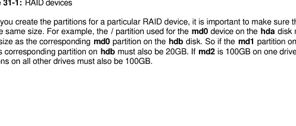

图 31-1：RAID 设备

为特定的 RAID 设备创建分区时，确保每个分区具有相同的大小非常重要。例如，`hda` 磁盘上用于 `md0` 设备的 `/` 分区必须与 `hdb` 磁盘上对应的 `md0` 分区大小相同。因此，如果 `hda` 上的 `md1` 分区是 `20GB`，那么 `hdb` 上对应的分区也必须是 `20GB`。如果某个驱动器上的 `md2` 是 `100GB`，那么其他所有驱动器上的对应分区也必须是 `100GB`。

**提示** 在安装期间，Red Hat Disk Druid 支持克隆工具，允许您基于一个已设置好的分区自动在其他硬盘上创建对应的分区。实际上，您可以使用它来在其他硬盘上创建对应的分区。

## 从 RAID 设备启动

作为安装过程的一部分，Red Hat 允许您创建 RAID 设备，您也可以从中启动系统。您的 Linux 系统将配置为加载 RAID 内核支持并自动检测您的 RAID 设备。引导加载程序将安装在您的 RAID 设备上，也就是说在组成该设备的所有硬盘上。

Red Hat 不支持从 `RAID 5` 启动，仅支持 `RAID 1`。这意味着，如果您想使用 `RAID 5` 并从 RAID 磁盘启动，您需要使用对应的分区在每个硬盘上创建至少两个（或更多，如果您想的话）RAID 设备。一个设备将保存您的 `/boot` 分区，并作为 `RAID 1` 设备安装。此 `RAID 1` 设备将是第一个 RAID 设备 `md0`，由每个硬盘上的第一个分区组成。第二个 RAID 设备 `md1` 则可以是 `RAID 5` 设备。它将由其他硬盘上的对应分区组成。然后您的系统可以从 `RAID 1` 设备启动，但使用 `RAID 5` 设备。


如果您在安装期间未创建 RAID 磁盘，而是稍后创建并希望从中启动，您必须确保系统配置正确。RAID 设备需要使用持久超级块创建。必须在内核中启用对 RAID 设备的支持。在 Red Hat 中，此支持作为模块启用。如果您使用 RAID 5 作为您的 `/`（根）分区，会出现困难。此分区包含 RAID 5 模块，但为了访问该分区，您必须已经加载了 RAID 5 模块。为了克服这一限制，您可以在 `/boot` 分区中创建一个包含 RAID 5 模块的 RAM 磁盘。使用 `mkinitrd` 命令创建 RAM 磁盘，并使用 `--with` 选项指定要包含的模块。

```
mkinitrd --preload raid5 --with=raid5 raid-ramdisk 2.4.20-8
```

### 自动检测：持久超级块

Linux 软件 RAID 现在支持 RAID 设备的自动检测。这使得您的 RAID 设备在系统启动时能够像标准分区一样被自动检测。然后您可以像使用硬盘分区（`hd` 或 `sd`）一样使用任何 RAID 设备（`md`），在 `/etc/fstab` 文件中可以使用它们（参见第 30 章）。自动检测是通过放置在每个 RAID 磁盘上的持久超级块实现的，这些超级块用于保存配置信息。创建 RAID 设备使用 `mkraid` 时需要创建持久超级块。为了指示 `mkraid` 创建持久超级块，您需要在 `/etc/raidtab` 文件（RAID 配置文件）中指定 `persistent-superblock` 选项。如果没有持久超级块选项，您就必须手动使用 `raidstart` 命令启动您的 RAID 设备。`raidstart -a` 启动所有设备。

### RAID 工具

RAID 工具对于管理 Linux 上的软件 RAID 设备非常有用。`mkraid` 创建 RAID 设备，`raidstop` 停止设备，`raidstart` 开启设备（参见表 31-2）。这些将在下一节中详细讨论。

### 创建和安装 RAID 设备

如果您在安装过程中创建了您的 RAID 设备及其分区，您应该已经有了可工作的 RAID 设备。您的 RAID 设备将在 `/etc/raidtab` 文件中配置，并且您的 RAID 设备的状态将列在 `/proc/mdstat` 文件中。您可以使用 `raidstart` 和 `raidstop` 命令手动启动或停止您的 RAID 设备。`-a` 选项作用于所有设备，尽管如果您想指定特定设备，也可以这样做。

要为已安装的系统手动创建新的 RAID 设备，请遵循以下步骤：

1. 确保您的内核支持您要为创建的设备所需的 RAID 级别。要在内核中启用对 RAID 级别的支持，请使用内核配置工具为其创建模块，如前所述。
2. 如果您尚未这样做，请创建您将用于您的 RAID 设备的 RAID 磁盘（分区）。
3. 在 `/etc/raidtab` 文件中配置您的 RAID 设备（`/dev/md n`），指定要使用的 RAID 磁盘。

请务必指定持久超块选项，以便在系统启动时自动检测您的 RAID 设备。

- 4. 使用 `mkraid` 创建您的 RAID 设备。
- 5. 使用 `raidstart` 激活 RAID 设备。
- 6. 在 RAID 设备上创建文件系统（`mkfs`），然后挂载它。

#### 表 31-2：RAID 工具

| 工具 | 描述 |
|------|-------------|
| `mkraid` | 从一组块设备创建（配置）RAID 设备并进行初始化。 |
| `raidstart` | 激活 RAID 设备。 |
| `raid0start` | 激活较旧的、非持久性的线性（linear）和 RAID 0 RAID 设备。 |
| `raidstop` | 关闭 RAID 设备。 |

### 创建硬盘分区：fd

若要添加新的 RAID 设备或首次创建它们，您需要手动创建它们将使用的硬盘分区，然后配置 RAID 设备使用这些分区。若要创建用于 RAID 阵列的硬盘分区，请使用 `fdisk` 或 `parted`，并指定 `fd` 作为文件系统类型。调用 `fdisk` 或 `parted` 时，需指定要创建分区的硬盘的设备名称。请务必将分区类型指定为 `fd`。以下示例调用 `fdisk` 针对硬盘 `/dev/hdb`（主 IDE 连接上的第二个硬盘）：

```
fdisk /dev/hdb
```

虽然从技术上讲是分区，但在 RAID 配置文档和文件中，这些硬盘设备被称为磁盘。

### 配置 RAID：/etc/raidtab

一旦拥有了磁盘，接下来需要将它们配置为 RAID 设备。RAID 设备在 `/etc/raidtab` 文件中配置。`mkraid` 命令将使用此文件来创建 RAID 设备。在 `/etc/raidtab` 文件中，为每个 RAID 设备创建一个 `raiddev` 条目，并指定它们将使用的磁盘以及任何 RAID 选项。对于 `raiddev` 条目，需指定正在配置的 RAID 设备的名称，例如第一个 RAID 设备为 `/dev/md0`。

```
raiddev /dev/md0
```

然后使用关键字 `raid-level` 后跟 RAID 级别数字来指定 RAID 设备的级别，例如 0、1 或 5。接着添加您可能需要的任何选项，以及组成 RAID 阵列的磁盘列表。磁盘通过 `device` 条目定义，其在 RAID 阵列中的位置通过 `raid-disk` 选项定义。配置指令和选项列在表 31-3 中。以下是 `/etc/raidtab` 文件的示例条目：

```
raiddev /dev/md0
  raid-level          5
  nr-raid-disks       3
  nr-spare-disks      1
  persistent-superblock 1
  chunk-size          4
  parity-algorithm    left-symmetric
  device              /dev/hdb1
  raid-disk           0
  device              /dev/hdc1
  raid-disk           1
  device              /dev/hdd1
  raid-disk           0
```

上述示例将 RAID 设备 `/dev/md0` 配置为 RAID 5（`raid-level 5`）设备。有三个磁盘（分区）组成此 RAID 阵列，即 `/dev/hdb1`、`/dev/hdc1` 和 `/dev/hdd1`，其中 `/dev/hdb1` 是第一个，`/dev/hdc1` 是第二个。有一个备用磁盘，即 `/dev/hdd1`。总共有三个 RAID 磁盘（`nr-raid-disks`）和一个备用分区（`nr-spare-disks`）。RAID 文件系统使用持久超块（`persistent-superblock`）来存储文件系统配置信息，从而允许自动检测您的设备。`parity-algorithm` 选项用于 RAID 5 设备，指定用于奇偶校验恢复的奇偶校验算法类型，在此示例中为 `left-symmetric`。

#### 表 31-3：raidtab 选项

| 指令和选项 | 描述 |
|---|---|
| `raiddev device` | 为特定的 RAID 设备开始一个配置节。 |
| `raid-level num` | RAID 设备的 RAID 级别，如 0、1、4、5 和 -1（线性）。 |
| `device disk-device` | 要添加到 RAID 阵列的磁盘设备（分区）。为 RAID 设备指定的 `device` 条目数量必须与 `nr-raid-disks` 指定的数量匹配。 |
| `nr-raid-disks count` | 阵列中 RAID 设备（成员）的数量。每个 RAID 设备部分必须包含此指令。最大值为 12。 |
| `nr-spare-disks count` | 阵列中备用设备的数量。仅用于 RAID 4 和 RAID 5。内核必须配置为允许根据需要自动添加新的 RAID 磁盘。您可以使用 `raidhotadd` 和 `raidhotremove` 添加和移除备用磁盘。 |
| `persistent-superblock 0/1` | 指定新创建的 RAID 阵列是否应使用持久超块。用于帮助内核自动检测 RAID 阵列。RAID 阵列信息保存在每个 RAID 成员的超块中。 |
| `chunk-size size` | 将条带大小设置为 `size` 字节，需为 2 的幂。 |
| `device devpath` | 将最近定义的设备添加到组成 RAID 系统的设备列表中。 |
| `raid-disk index` | 将最近定义的 RAID 设备插入到 RAID 阵列中指定的位置。 |
| `spare-disk index` | 将最近定义的 RAID 设备作为备用设备插入到 RAID 阵列中指定的位置。 |
| `parity-disk index` | 最近定义的设备用作奇偶校验设备，将其放置在 RAID 阵列的末尾。 |


| `parity-algorithm algorithm` | 对于 RAID 5 设备，指定要使用的奇偶校验算法：`left-asymmetric`、`right-asymmetric`、`left-symmetric` 或 `right-symmetric`。 |

| `failed-disk index` | 最近定义的设备作为故障设备添加到 RAID 阵列中指定的位置。 |

#### `mkraid` 命令

一旦在 `/etc/raidtab` 文件中配置好 RAID 设备，即可使用 `mkraid` 命令创建您的 RAID 设备。`mkraid` 的参数是 RAID 设备的名称，例如第一个 RAID 设备为 `/dev/md0`。然后，它在 `/etc/raidtab` 文件中定位该设备的条目，并使用该配置信息在该设备上创建 RAID 文件系统。如果需要，可以使用 `-c` 选项指定备用配置文件。`mkraid` 充当 RAID 设备的一种类似 `mkfs` 的命令，用于初始化分区并创建 RAID 文件系统。组成 RAID 阵列的分区上的任何数据都将被擦除。

```
mkraid /dev/md0
```

#### `raidstart` 命令

一旦创建了 RAID 设备，即可使用 `raidstart` 命令激活它们。`raidstart` 使您的 RAID 文件系统可访问。`raidstart` 的参数是要启动的 RAID 设备的名称。`-a` 选项激活所有 RAID 设备。

```
raidstart /dev/md0
```

#### 创建文件系统

一旦 RAID 设备被激活，即可在 RAID 设备上创建文件系统并挂载这些文件系统。以下示例在 `/dev/md0` 设备上创建标准 Linux 文件系统：

```
mkfs.ext3 /dev/md0
```

在以下示例中，用户创建一个名为 `/myraid` 的目录，并将 RAID 设备挂载在那里：

```
mkdir /myraid
mount /dev/md0 /myraid
```

如果您计划使用 RAID 设备来维护您的用户目录和文件，您会将 RAID 设备作为 `/home` 分区进行挂载。如果在安装系统时创建了 RAID 设备，通常会使用此类挂载点。要将当前的 home 目录传输到 RAID 设备，首先请在另一个分区上备份它们，然后挂载您的 RAID 设备，并将 home 目录复制到该设备上。

#### `raidstop` 命令

如果您决定更改 RAID 配置或添加新设备，首先需要使当前活动的 RAID 设备失效。若要使 RAID 设备失效，请使用 `raidstop` 命令。请务必先关闭所有打开的文件并卸载设备上的任何文件系统。

```
umount /dev/md0
raidstop /dev/md0
```

##### 提示

热插拔是指在系统运行期间更换磁盘盘的行为。其可行性有限。切勿尝试热插拔 IDE 驱动器；这可能会损坏驱动器。SCSI 驱动器可能会成功。

#### RAID 示例

本章前文中，图 31-1 展示了一个简单的 RAID 配置，使用两个硬盘上对应的分区来创建三个 RAID 设备，用于 `/boot`、 `/`（根）和 `/home` 分区。由于系统只能从 RAID 1 设备启动，而不能从 RAID 5 启动，因此启动分区被配置为 RAID 1 设备。其他分区是 RAID 5 设备，这是更常用的 RAID 访问方式。

您可以在安装过程中设置此类系统，使用 Disk Druid 选择和格式化您的 RAID 设备及其分区。此处描述的步骤假设您的系统已安装在标准 IDE 驱动器上，并且正在另外两个 IDE 磁盘驱动器上设置 RAID 设备。然后，您可以将文件从标准驱动器复制到您的 RAID 设备。

首先，使用 `parted` 或 `fdisk` 等分区工具创建硬盘分区。

然后在 `/etc/raidtab` 文件中配置三个 RAID 设备。

```
raiddev /dev/md0
    raid-level        1
    nr-raid-disks     2
    nr-spare-disks    0
    persistent-superblock 1
    chunk-size        4
    device            /dev/hda1
    raid-disk         0
    device            /dev/hdc1
    raid-disk         1

raiddev /dev/md1
    raid-level        5
    nr-raid-disks     2
    persistent-superblock 1
    chunk-size        4
    parity-algorithm  left-symmetric
    device            /dev/hda2
    raid-disk         0
    device            /dev/hdc2
    raid-disk         1

raiddev /dev/md2
    raid-level        5
    nr-raid-disks     2
    persistent-superblock 1
    chunk-size        4
    parity-algorithm  left-symmetric
    device            /dev/hda3
    raid-disk         0
    device            /dev/hdc3
    raid-disk         1
```

然后使用 `mkraid` 创建你的 RAID 设备。

```
mkraid md0 md1 md2
```

使用 `raidstart` 激活 RAID 设备。

```
raidstart md0 md1 md2
```

在 RAID 设备上创建文件系统。

```
mkfs.ext3 md0 md1 md2
```

然后你可以将当前硬盘上的 `/boot`、 `/` 和 `/home` 文件迁移到你的 RAID 设备中。将引导加载程序安装在第一个 RAID 设备 `md0` 上，并从第二个 RAID 设备 `md1` 加载根文件系统。

#### 逻辑卷管理器

为了更轻松地管理硬盘存储，你可以设置系统使用逻辑卷管理器（LVM），创建被组织成逻辑卷的 LVM 分区，其中可用空间会自动分配。逻辑卷提供了一种更灵活、更强大的方式来处理磁盘存储，它将物理分区组织成逻辑卷，从而可以轻松地管理磁盘空间。逻辑卷的磁盘存储被视为一个内存池，尽管该卷实际上可能包含分布在不同硬盘上的多个硬盘分区。添加新的 LVM 分区只会增加整个系统可访问的存储池大小。

##### LVM 结构

在 LVM 结构中，LVM 物理分区（也称为区）被组织成逻辑组，这些逻辑组进而被逻辑卷使用。实际上，你处理的是三个不同层级的组织结构。在最底层，你有物理卷。这些是你使用 `parted` 或 `fdisk` 等分区创建工具创建的物理硬盘分区。分区类型可以是任何标准的 Linux 分区类型，例如 `ext3` 或 `ext2`。这些物理卷被组织成逻辑组，称为卷组，它们的操作方式很像逻辑硬盘。你将物理卷的集合分配给不同的逻辑组。例如，如果你有由两块硬盘 `hda` 和 `hdb` 上的硬盘分区 `hda2`、`hda3`、`hdb1`、`hdb2` 和 `hdb3` 组成的物理卷，你可以将其中一些分配给一个逻辑组，将其他分配给另一个逻辑组。组成不同逻辑组的分区可以来自不同的物理硬盘。例如，`hda2` 和 `hdb3` 可以属于逻辑组 `turtle`，而 `hda3`、`hdb2` 和 `hdb3` 可以组成另一个逻辑组，例如 `rabbit`。逻辑组名称可以是任何你希望命名的名称。这很像为硬盘命名。

一旦你拥有了逻辑组，你就可以创建逻辑卷。逻辑卷的功能类似于标准设置中的硬盘分区。例如，在 `turtle` 组卷上，你可以创建一个 `/var` 逻辑卷，在 `rabbit` 逻辑组上，你可以创建 `/home` 和 `/projects` 逻辑卷。你可以像在一个硬盘上有多个分区一样，在一个逻辑组上有多个逻辑卷。

你像处理任何普通硬盘分区一样处理逻辑卷。你使用 `mkfs` 命令在其上创建文件系统，然后使用 `mount` 命令挂载文件系统以使用它。

逻辑卷上的存储使用所谓的区来管理。逻辑组定义区的标准大小，例如 `4MB`，然后将其组内的每个物理卷划分为该大小的区。逻辑卷进而被划分为相同大小的区，这些区随后映射到物理卷上的区。

逻辑卷有一个限制和建议。引导分区不能是逻辑卷的一部分。你仍然必须创建一个单独的硬盘分区作为具有 `/boot` 挂载点的引导分区，其中安装内核和所有所需的引导文件。此外，建议不要将 `/`（根）分区放在逻辑卷上。这样做可能会使任何所需的数据恢复复杂化。

##### 使用 Disk Druid 创建 LVM


创建逻辑卷涉及几个步骤。首先，你创建物理 LVM 分区，然后创建放置这些分区的卷组，接着从卷组中创建逻辑卷，然后为逻辑卷指定挂载点和文件系统类型。在 Red Hat 中，你可以使用 Disk Druid 在安装过程中创建 LVM 分区。在 Disk Druid 中，点击“新建”并选择“物理卷（LVM）”作为文件系统类型。为硬盘上的每个想要 LVM 物理分区的分区创建一个 LVM 物理分区。一旦你创建了 LVM 物理分区，你点击“LVM”按钮来创建你的逻辑卷。首先，你需要将 LVM 物理分区分配给卷组。卷组本质上是逻辑硬盘。你可以将来自不同硬盘的 LVM 物理分区分配给同一个卷组，让卷组跨越不同的硬盘。一旦卷组创建完成，你就可以创建逻辑卷了。你可以在每个组中创建几个逻辑卷。逻辑卷的功能类似于分区。你必须为创建的每个逻辑卷指定文件系统类型和挂载点。

### LVM 工具

在 Red Hat 中，你可以在安装过程中创建逻辑卷，或者稍后使用一组 LVM 工具来管理你的 LVM 卷，添加新的 LVM 物理分区并移除当前的分区。LVM 在 `/etc/lvmconf` 目录中维护配置信息。

### 显示 LVM 信息

你可以使用 `pvdisplay`、`vgdisplay` 和 `lvdisplay` 命令来显示关于物理分区、卷组和逻辑卷的详细信息。`pvscan`、`vgscan` 和 `lvscan` 列出你的物理卷、卷组和逻辑卷。

### 管理 LVM 物理卷

物理卷可以是任何硬盘分区或 RAID 设备。RAID 设备被视为单个物理卷。你可以从单个硬盘或硬盘上的分区创建物理卷。在拥有许多硬盘的非常大的系统上，你更可能为每个物理卷使用整个硬盘。

要创建新的物理卷，你需要使用分区设备名称通过 `pvcreate` 命令对其进行初始化，如下所示。

```
pvcreate /dev/hda3
```

要在整个硬盘上初始化物理卷，你使用硬盘设备名称，如下所示。

```
pvcreate /dev/hdc
```

然后使用 `vgextend` 命令将分区添加到逻辑组中，在此情况下为 `rabbit`。实际上，你是通过添加新的物理分区来扩展逻辑组的大小。

```
vgextend rabbit /dev/hda3
```

要移除物理分区，首先将其从其逻辑卷中移除。你可能需要使用 `pvmove` 命令将数据移出物理分区。然后使用 `vgreduce` 命令将其从其逻辑组中移除。

### 管理 LVM 组

你可以使用 `vgcreate` 命令手动创建卷组，并加上组的名称以及你希望包含在组中的物理分区列表。以下示例创建了一个名为 `rabbit` 的组，由三个物理分区 `/dev/hda3`、`/dev/hdb2` 和 `/dev/hdb4` 组成。

```
vgcreate rabbit /dev/hda3 /dev/hdb2 /dev/hdb4
```

你可以通过首先使用 `vgchange -a n` 操作停用卷组，然后使用 `vgreduce` 命令来移除卷组。

### 激活卷组

在标准文件系统结构中，你挂载和卸载硬盘分区，而在 LVM 结构中，你激活和停用整个卷组。卷组只有在通过带有 `-a` 选项的 `vgchange` 命令激活它们之前才不可访问。要激活一个组，首先重启你的系统，然后输入带有 `-a` 选项和 `y` 参数的 `vgchange` 命令来激活逻辑组。`n` 参数将停用该组。

```
vgchange -a y rabbit
```

### 管理 LVM 逻辑卷

要创建逻辑卷，你使用 `lvcreate` 命令。使用 `-n` 选项指定卷的名称，其功能类似于硬盘分区的标签。你使用 `-L` 选项来指定卷的大小。以下示例在 `rabbit` 逻辑组上创建名为 `projects` 的逻辑卷，大小为 20GB。

```
lvcreate -n projects -L 2000M rabbit
```

你可以使用 `lvremove` 命令移除逻辑卷。使用 `lvextend`，你可以增加逻辑卷的大小，而 `lvreduce` 将减小其大小。

### LVM 示例

使用图 31-2 中的示例，创建和访问逻辑卷所涉及的步骤在以下命令中描述。首先使用 `fdisk` 或 `parted` 等分区创建工具在硬盘 `hda` 和 `hdb` 上创建物理分区。在这个例子中，你创建分区 `hda1`、`hda2`、`hda3`、`hdb1`、`hdb2`、`hdb3` 和 `hdb4`。

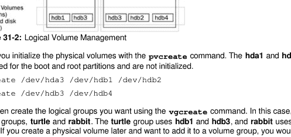

图 31-2: 逻辑卷管理

然后你使用 `pvcreate` 命令初始化物理卷。`hda1` 和 `hda2` 分区预留给引导分区和根分区，并且不被初始化。

```
pvcreate /dev/hda3 /dev/hdb1 /dev/hdb2
pvcreate /dev/hdb3 /dev/hdb4
```

然后使用 `vgcreate` 命令创建你希望创建的逻辑组。在这种情况下，有两个逻辑组，`turtle` 和 `rabbit`。`turtle` 组使用 `hdb1` 和 `hdb3`，而 `rabbit` 使用 `hda3`、`hdb2` 和 `hdb4`。如果你稍后创建物理卷并希望将其添加到卷组中，你将使用 `vgextend` 命令。

```
vgcreate turtle /dev/hdb1 /dev/hdb3
vgcreate rabbit /dev/hda3 /dev/hdb2 /dev/hdb4
```

现在你可以使用 `lvcreate` 命令在每个卷组中创建逻辑卷。

```
lvcreate -n var -L 2000M turtle
lvcreate -n home -L 50000M rabbit
lvcreate -n projects -L 2000M rabbit
```

然后你可以激活逻辑卷。重启后，使用带有 `-a y` 选项的 `vgchange` 命令来激活逻辑卷。

```bash
vgchange -a y turtle rabbit
```

现在你可以为每个逻辑卷创建文件系统。

```bash
mkfs.ext3 var
mkfs.ext3 home
mkfs.ext3 projects
```

然后你可以挂载这些逻辑卷。

```bash
mount var /var
mount home /home
mount projects /mnt/myprojects
```

# 第 32 章：设备与模块

## 概览

所有设备，如打印机、终端和 CD-ROM，都通过名为设备文件的特殊文件连接到你的 Linux 操作系统。此类文件包含操作系统控制指定设备所需的所有信息。这种设计引入了极大的灵活性。操作系统独立于管理特定设备的细节；具体细节均由设备文件处理。操作系统只需通知设备要执行的任务，设备文件则告知如何执行。如果你更换设备，只需更改设备文件，而不必更改整个系统。

要在 Linux 系统上安装设备，你需要为其提供一个设备文件、软件配置，例如由配置工具提供的配置，以及内核支持，通常由模块或已编译并构建到内核中的支持提供。已经为不同类型的设备设置好了大量设备文件。通常你只需要一个，即特定于你的设备的那个。当你添加新的硬件设备时，Red Hat 的硬件探测工具 `Kudzu` 会在系统启动时检查新硬件。`Kudzu` 工具自动检测新设备并允许你对其进行配置。`Kudzu` 会保存你的硬件配置配置文件到 `/etc/sysconfig/hwconf` 文件中。对于更专门的内核支持，你可能需要加载内核模块或重新编译内核，两者都是简单的过程，参见第 33 章。在大多数情况下，支持已内置于内核中。

## 设备文件

设备文件的名称设计旨在反映设备的功能。打印机设备文件以 `lp` 开头，代表 "line print"。由于你可以将多台打印机连接到系统，特定的打印机设备文件通过前缀 `lp` 后面的两个或多个数字或字母来区分，例如 `lp0`、`lp1`、`lp2`。终端设备文件也是如此。它们以前缀 `tty` 开头，代表 "teletype"，并进一步通过数字或字母进行区分，如 `tty0`、`tty1`、`ttyS0` 等。你可以从 `kernel.org` 网站获取当前设备文件名及其用途的完整列表，地址为 `www.kernel.org/pub/linux/docs/device-list/devices.txt`。

## 设备符号链接


所有这些文件名都将在你的 `/dev` 目录中实现为设备文件。在这里，你可以找到打印机、CD-ROM、硬盘、SCSI 和声音设备文件，以及其他许多文件。某些文件实际上是符号链接，它们具有通用的设备名称，通常链接到实际使用的设备文件。符号链接是文件的另一个名称，用作快捷方式，引用该文件。例如，`/dev/cdrom` 符号链接链接到你 CD-ROM 实际使用的设备文件。如果你的 CD-ROM 是 IDE 设备，它可能使用设备文件 `hdc`。在这种情况下，`/dev/cdrom` 将是 `/dev/hdc` 的链接。实际上，`/dev/cdrom` 是 `/dev/hdc` 的另一个名称。还有一个 `/dev/modem` 链接文件用于你的调制解调器。如果你的调制解调器连接到第二个串行端口，其设备文件将是 `/dev/ttyS1`。在这种情况下，`/dev/modem` 将是该设备文件的链接。应用程序随后可以使用 `/dev/modem` 访问你的调制解调器，而无需知道实际使用的设备文件。常用设备链接的列表如表 32-1 所示。

**提示** 你会发现 `/dev` 目录中没有以太网设备（如 `eth0` 或 `eth1`）的条目。这是因为它们实际上是内核模块在 `/etc/modules.conf` 文件中定义的别名，或者是内核直接处理的设备。它们不是设备文件。

### 硬件设备安装：Kudzu

硬件设备由 Red Hat 的硬件探测工具 Kudzu 自动检测。Kudzu 是一个检测并配置系统中新增或变更硬件的工具。在启动时运行 Kudzu 以配置新的硬件设备并检测已移除的设备。你也可以手动运行 Kudzu。当你启动 Kudzu 时，它会检测当前硬件并将其与存储在 `/etc/sysconfig/hwconf` 中的数据库进行核对。然后它确定是否有硬件被添加到系统中或从系统中移除。当检测到新增硬件时，Kudzu 将（如果需要）调用该设备的相应配置工具，例如用于显卡的 `redhat-config-xfree86` 或用于键盘的 `redhat-config-keyboard`。对于像 CD-ROM 这样的简单硬件配置，Kudzu 只是将 cdrom 设备符号链接链接到新设备，即 `/dev/cdrom`。

**表 32-1：设备链接**

| 链接 | 描述 |
|---|---|
| `/dev/mouse` | 当前鼠标设备 |
| `/dev/tape` | 当前磁带设备 |
| `/dev/cdrom` | 当前 CD-ROM 设备 |
| `/dev/cdwriter` | 当前 CD 刻录机设备 |
| `/dev/scanner` | 当前扫描仪设备 |
| `/dev/modem` | 当前拨出设备，调制解调器端口 |
| `/dev/root` | 当前根文件系统 |
| `/dev/swap` | 当前交换设备 |

然后 Kudzu 更新其位于 `/etc/sysconfig/hwconf` 的数据库。如果检测到已移除的设备，则相应更新 `hwconf` 文件。如果设备仅通过设备链接（如 `/dev/cdrom` 或 `/dev/mouse`）安装，则移除该链接。对于网卡，像 `eth0` 那样的别名词条将被移除。

### 手动创建设备文件

Linux 实现了两种类型的设备：块设备和字符设备。块设备（如硬盘）一次传输一个块的数据。字符设备（如打印机或调制解调器）一次传输一个字符的数据，或者更确切地说，是作为连续的数据流，而不是作为单独的块。通过 `ls` 命令显示的权限段中，字符设备的设备驱动文件以 `c` 作为第一个字符。块设备的设备驱动文件以 `b` 作为第一个字符。在下一个示例中，`lp0`（打印机）是字符设备，而 `hda1`（硬盘）是块设备：

```bash
# ls -l hda1 lp0
brw-rw---- 1 root disk 3, 1 Jan 30 02:04 hda1
crw-rw---- 1 root lp 6, 0 Jan 30 02:04 lp0
```

### 设备类型

设备类型可以是 `b`、`c`、`p` 或 `u`。如前所述，`b` 表示块设备，`c` 表示字符设备。`u` 表示非缓冲字符设备，`p` 表示 FIFO（先进先出）设备。同类型的设备通常具有相同的名称；例如，串行接口的名称均为 `ttyS`。同类型的设备然后通过附加在名称上的数字进行唯一标识。这个数字有两个组成部分：主设备号和次设备号。设备可能具有相同的主设备号，但如果有，次设备号总是不同的。这种主次结构旨在处理多个设备可能依赖于一个较大设备的情况，例如连接到同一 I/O 卡上的多个调制解调器。所有调制解调器都将具有指向卡片的相同主设备号，但每个调制解调器都有唯一的次设备号。块设备和字符设备（`b`、`c` 和 `u`）都需要主设备和次设备号。但 FIFO 设备不使用这些号码。

有效的设备名称及其主设备和次设备号列在位于内核源代码的 `/Documentation` 目录下的 `devices.txt` 文件中，即 `/usr/src/linux-ver/Documentation`。当你创建设备时，使用主设备和次设备号以及你正在创建的特定类型设备的名称前缀。这些设备中的大多数已经为你创建好，并列在 `/etc/dev` 目录中。

### mknod

虽然大多数发行版已经为你设置了一套广泛的设备文件，但你可以创建自己的设备文件。你使用 `mknod` 命令创建设备文件，可以是字符类型或块类型。`mknod` 命令的语法如下：

```bash
mknod options device device-type major-num minor-num
```

例如，Linux 系统通常提供三个并行端口（`lp0-2`）的设备文件。如果需要更多，你可以使用 `mknod` 命令创建一个新的。打印机设备是字符设备，必须隶属于 `root` 用户和 `daemon` 组。打印机设备的权限是所有者和组的读写权限，即 660（关于文件权限的讨论请参见第 28 章）。主设备号设置为 6，次设备号设置为打印机的端口号，例如 LPT1 为 0，LPT2 为 1。设备创建后，你使用 `chown` 将其所有权更改为 `root` 用户，因为只有管理员应控制它。使用 `chgrp` 命令将组更改为 `lp`。大多数设备隶属于其自己的组，例如硬盘分区的 `disks`、打印机的 `lp`、软盘的 `floppy` 和终端的 `tty`。在下一个示例中，在第四个并行端口上创建了一个并行打印机设备 `/dev/lp3`。`-m` 选项指定权限——在此情况下为 660。该设备是字符设备，由设备名称后的 `c` 参数指示。主设备号为 6，次设备号为 3。如果你正在创建 `/dev/lp4` 上的设备，主设备号仍为 6，但次设备号将为 4。设备创建后，`chown` 命令随后将并行打印机设备的所有权更改为 `root`。对于打印机，请确保已为你的设备创建了一个 spool（打印池）目录。如果没有，你需要创建一个。spool 目录包含根据设备输出或输入变化的数据文件，例如

打印机或扫描仪。

```
# mknod -m 660 /dev/lp3 c 6 3
# chown root /dev/lp3
# chgrp lp /dev/lp3
```

### 设备信息：/proc 和 /etc/sysconfig/hwconf

在 Red Hat 系统中，Kudzu 会在 `/etc/sysconfig/hwconf` 文件中维护已安装的所有硬件设备的完整配置文件（`/etc/sysconfig` 在第 30 章中有讨论）。如前所述，此文件由 Kudzu 更新；新硬件会被添加，旧设备则会被移除。条目定义了配置变量，例如设备类型（视频、CD-ROM、硬盘等）、使用的总线（PCI、IDE 等）、设备名称（如 `hdd` 或 `st0`）、使用的驱动程序以及设备的描述。此处显示了一个鼠标条目：

```
class: MOUSE
bus: PSAUX
detached: 0
device: psaux
driver: genericps/2
desc: "Generic 3 Button Mouse (PS/2)"
```

`/proc` 文件系统（参见第 30 章）为您的设备维护特殊的信息文件。`/proc/devices` 文件列出了所有已安装的控制字符设备和块设备及其主设备号。当前用于设备的 IRQ、DMA 和 I/O 端口分别列在 `interrupts`、`dma` 和 `ioports` 文件中。某些文件列出了涵盖多个设备的信息，例如 `pci` 文件列出所有 PCI 设备，`sound` 文件列出所有声音设备。`sound` 文件列出了关于声卡的详细信息。某些子目录，如 `net`、`ide` 和 `scsi`，包含不同设备的信息文件。某些文件保存可以动态更改的配置信息，例如 IP 数据包转发能力和最大文件数。您可以使用 `redhat-config-proc` 工具（系统工具菜单中的“内核调优”）或通过手动编辑某些文件来更改这些值。表 32-2 列出了几个与设备相关的 `/proc` 文件（其他条目请参见第 30 章）。

#### 表 32-2：Proc 设备信息文件

| 文件 | 描述 |
|---|---|


| `/proc/devices` | 列出当前运行内核配置的设备驱动程序 |
| `/proc/dma` | 显示当前使用的 DMA 通道 |
| `/proc/interrupts` | 显示正在使用的 IRQ（中断） |
| `/proc/ioports` | 显示正在使用的 I/O 端口 |
| `/proc/pci` | 列出 PCI 设备 |
| `/proc/sound` | 列出声音设备 |
| `/proc/scsi` | SCSI 设备的目录 |
| `/proc/ide` | IDE 设备的目录 |
| `/proc/net` | 网络设备的目录 |

## 安装和管理终端及调制解调器

在 Linux 中，可能有多个用户同时登录。当然，每个用户都需要拥有自己的终端来访问 Linux 系统。您电脑上的显示器充当特殊的终端，称为控制台，但您可以通过 PC 上的串行端口或安装在 PC 上的专用多端口卡添加其他终端。其他终端可以是独立终端，也可以是使用终端仿真程序的 PC。关于终端安装的详细说明，请参阅 `/usr/share/doc/HOWTO` 目录下的 `Term-HOWTO` 文件（作为 Red Hat 文档 CD-ROM 的一部分安装）或在 Linux 文档项目网站（`www.tldp.org`）上查找。此处提供了一个简要说明。

### 串行端口

您电脑上的串行端口被称为 `COM1`、`COM2`、`COM3` 和 `COM4`。这些串行端口对应于终端设备 `/dev/ttyS0` 到 `/dev/ttyS3`。请注意，这些串行端口中的一些可能已被其他输入设备（如鼠标）和通信设备（如调制解调器）使用。如果您有串行打印机，那么其中一个串行设备已被其使用。如果您安装了多端口卡，则有更多端口可供选择。对于每个添加的终端，您必须在 Linux 系统上创建一个字符设备。与打印机一样，您使用 `mknod` 命令创建终端设备。终端设备的权限为 `660`。终端设备是主设备号为 `4`、次设备号通常从 `64` 开始的字符设备。

提示 `/etc/fstab` 文件中的 `/dev/pts` 条目在 `/dev/pts` 挂载了一个 `devpts` 文件系统，用于 Unix98 伪终端。这些伪终端通过编号命名的设备标识。

### mingetty, mgetty 和 agetty

终端设备通过 `getty` 程序及一组配置文件由您的系统管理。系统启动时，它读取 `inittab` 文件中已连接终端的列表，然后为每个终端执行相应的 `getty` 程序，即 `mingetty`、`mgetty` 或 `agetty`。这些 `getty` 程序负责建立 Linux 系统与指定终端之间的通信。`mingetty` 为虚拟控制台提供最基本的支持，而 `agetty` 提供增强的终端连接支持。`agetty` 还包括波特率和超时的参数。`mgetty` 专为传真/调制解调器连接设计，允许您配置拨号、登录和传真参数。`mgetty` 配置文件保存在 `/etc/mgetty+sendfax` 目录中。调制解调器连接信息保存在 `/etc/mgetty+sendfax/mgetty.config` 文件中。所有 `getty` 程序都可以读取放置在 `/etc/issue` 文件中的初始消息，该消息可以包含特殊代码以提供系统名称和当前日期及时间。

### termcap 和 inittab 文件

`/etc/inittab` 文件保存系统管理终端设备的指令。`/etc/inittab` 文件中的一行有四个基本组成部分：ID、运行级别、动作和进程。终端设备由 ID 号标识，从第一个设备的 `1` 开始。终端操作的运行级别通常是 `1`。动作通常是 `respawn`，意味着持续运行该进程。进程是对 `mingetty`、`mgetty` 或 `agetty` 的调用，并附带终端设备名称。`/etc/termcap` 文件保存不同终端类型的规格。这些是用户登录您的系统时可能使用的不同类型终端。您的 `/etc/termcap` 文件已经填入了大多数当前生产的终端的规格。`/etc/termcap` 文件中的条目由可用于终端的各种名称组成，名称之间用管道符 (`|`) 分隔，然后是一系列参数规格，每个规格以冒号结尾。您在此处可以找到特定终端类型使用的名称。您可以使用 `more` 命令显示您的 `/etc/termcap` 文件，然后使用搜索 (`/`) 来定位您的终端类型。您可以为终端设备设置许多选项。要更改这些选项，请使用 `stty` 命令，而不是直接更改配置文件。不带参数的 `stty` 命令列出终端的当前设置。

### tset

当用户登录时，使用 `tset` 命令初始化终端设备是很有帮助的。通常，`tset` 命令放置在用户的 `.bash_profile` 文件中，并在用户每次登录系统时自动执行。您使用 `tset` 命令设置终端类型以及终端设备所需的任何其他选项。以下是 `.bash_profile` 文件中 `tset` 的一个常见条目。`-m dialup:` 选项提示用户输入终端类型。此处指定的类型是默认类型，显示在括号中。用户按 ENTER 键选择默认值。提示看起来像这样：`TERM=(vt100)?`。

```
eval `tset -s -Q -m dialup:?vt00`
```

## 输入设备

鼠标和键盘等输入设备在多个层面上显示。初始配置在安装过程中进行，此时您需要选择鼠标和键盘类型。您可以使用管理配置工具（如 `redhat-config-mouse` 和 `redhat-config-keyboard`，位于“系统设置”菜单和窗口中的“鼠标和键盘”项）更改该配置。X Window 系统以及 KDE 和 GNOME 桌面环境也为鼠标和键盘提供了特殊配置。您可以选择键盘布局和语言，并配置鼠标的速度和显示效果。

## PCMCIA 设备

PCMCIA 设备是笔记本电脑上常见的读卡器，用于连接调制解调器或无线网卡等外设，尽管它们现在也日益成为许多桌面系统的标准配置。同一个 PCMCIA 设备可以支持多种不同类型的设备，包括网卡、调制解调器、硬盘和蓝牙设备等。除了配置 PCMCIA 卡插槽本身之外，你还可以配置插入其中的特定设备，例如无线网卡。这些配置方式与直接连接到系统的标准设备的配置方式相似。请在 `www.tldp.org` 网站上查阅 `PCMCIA-HOWTO`，以获取关于 PCMCIA 卡及其配置详细说明。

对 PCMCIA 设备的支持管理方式类似于服务。与大多数设备模块直接加载不同，这种支持是由 `pcmcia` 服务脚本加载的，正如网络和服务器等服务由服务脚本加载一样。与其他服务脚本类似，`pcmcia` 脚本位于 `/etc/rc.d/init.d` 目录中。你可以使用 `service` 命令通过该脚本手动启用或禁用支持。与任何服务一样，你可以使用服务工具或 `chkconfig` 来配置 `pcmcia` 在系统启动时自动运行，并指定运行级别。

```
service pcmcia start
```

在 Red Hat 系统中，基本配置由 `/etc/sysconfig` 目录中的 `pcmcia` 脚本处理，而不是在 `/etc` 目录中。在这里，你可以设置基本启动选项，例如将 PCMCIA 设置为启用 `pcmcia`，将 `PCIC` 指定为卡接口控制器（`yenta`, `socket`），以及将 `PCIC_OPTS` 指定为控制器选项。`CORE_OPTS` 包含 `pcmcia_core` 模块的选项，而 `CARDMGR_OPTS` 包含 `cardmgr` 守护进程的选项。`SCHEME` 条目可用于选择方案。

针对不同种类可连接至 `pcmcia` 设备的详细配置保存在 `/etc/pcmcia` 目录中。在这里你会找到 `pcmcia` 无线、ISDN、串行、SCSI 和 IDE 硬盘以及蓝牙设备的配置文件。每个设备都有相应的启动脚本和对应的选项文件，例如 `wireless` 和 `wireless.opts`、`ide` 和 `ide.opts`，以及 `bluetooth` 和 `bluetooth.conf`。每个脚本都包含适合配置该设备的命令，例如无线设备的 `wfconfig` 命令、蓝牙的 `hciattach`，以及用于更新 IDE 和 SCSI 驱动器分区条目的 `updftstab`。对应的选项文件将保存相应类型设备的配置设置。`bluetooth.opts` 文件保存不同种类蓝牙设备的参数，而 `wireless.opts` 文件列出不同无线网卡的可选选项。`shared` 文件保存各种启动脚本中使用的函数，例如 `add_parts`，它将通过调用 `add_blkdev` 函数来添加 IDE 或 SCSI 硬盘 PCMCIA 设备上的分区等块设备，该函数会检查并挂载该分区。许多脚本将运行 `shared` 脚本来启用这些函数。

你可以随心所欲地添加和移除 PCMCIA 卡。它们将从支持卡数据库中识别，并使用相应的启动脚本进行配置。这一任务由 `cardmgr` 守护进程处理，它会扫描 PCMCIA 设备上的插入和移除事件，检测到添加的设备并自动加载适当的内核模块。`cardmgr` 工具将生成一个 `/var/lib/pcmcia/stab` 文件，该文件将列出插槽编号、设备类别、驱动程序以及使用相同驱动程序的设备的设备编号。一个 `stab` 条目可以使用设备类别来确定该设备使用哪个启动配置脚本。

```
cardctl eject
```


一个用于家庭环境的方案。对于办公设置，你可以创建一个 `office` 方案；对于家庭设置，创建一个 `home` 方案。启动设备时，你可以指定要使用的方案。你可以通过 `cardctl` 命令和不带参数的 `scheme` 选项来查看当前正在使用的方案。若要切换到特定方案，请提供 `scheme` 参数，这将更改该设备的方案。

```
cardctl scheme home
```


## 安装声卡、网卡和其他卡

要安装新卡，必须首先配置内核以支持它。大多数卡的支持是以模块形式提供的，这些模块可以动态加载到内核中。安装对卡的支持通常只需加载包含其驱动程序的模块即可。例如，Sound Blaster 声卡的驱动程序位于模块 `sb.o` 中。加载此模块可使你的声卡在 Linux 上可用。大多数发行版会自动检测系统中安装的卡并加载所需的模块。如果你更换了声卡，Kudzu 会自动检测新卡，并调用 `redhat-config-soundcard` 进行配置。对于网卡，Kudzu 会调用 `redhat-config-network` 执行配置。你也可以手动加载所需的模块，并移除冲突的旧模块。本章稍后的“模块”一节描述了此过程。

大多数卡的设备文件已在 `/dev` 目录中为你设置好。例如，你的声卡的设备名称是 `/dev/audio`。网卡的设备名称是网络模块的别名，而不是设备文件。例如，你的以太网卡设备名称以 `eth` 开头，编号从 0 开始，如系统中第一个以太网卡为 `eth0`。用于引用特定卡所用模块的别名，例如，3Com Etherlink XL 卡别名 `3c59x` 网络模块，如果是第一个以太网卡，其别名将为 `eth0`。模块本身保存在内核的模块目录 `/lib/modules` 中，如上一节所述。

### 声音设备

在 Red Hat 中，你可以使用 `redhat-config-soundcard` 工具在 Linux 上安装大多数声卡。不同的声音设备列表见表 32-3。某些声卡可能需要更专业的支持。对于声卡，你可以通过列出 `/dev/sndstat` 文件的内容来了解当前的声音配置。你可以通过将声音文件重定向到该卡来测试它，如下所示：

```
cat sample.au > /dev/audio
```

对于 2.4 内核，大多数 Linux 声音驱动程序作为开放声音系统（OSS）的一部分开发，并作为 OSS/Free 免费分发。这些作为 Linux 发行版的一部分安装。OSS 设备驱动程序旨在为所有 Unix 平台（包括 Linux）提供统一的 API。它们支持 Sound Blaster 和 Windows 声音系统兼容的声卡（ISA 和 PCI）。OSS 也可按象征性费用获得，并具备用于设备设置的配置界面。

高级 Linux 声音架构（ALSA）取代了 2.6 Linux 内核中的 OSS，旨在成为 OSS 的更好替代方案，同时保持与它的兼容性。ALSA 提供模块化声音驱动程序、API 和配置管理器。ALSA 是一个 GNU 项目，完全免费；其网站 `www.alsa-project.org` 包含大量文档、应用程序和驱动程序。目前可用的是 ALSA 声音驱动程序、ALSA 内核 API、支持应用程序开发的 ALSA 库，以及提供驱动程序配置界面的 ALSA 管理器。ALSA 源于 Linux Ultra Sound Project。

表 32-3：声音设备

| 设备 | 描述 |
|---|---|
| `/dev/sndstat` | 声音驱动程序状态 |
| `/dev/audio` | 音频输出设备 |
| `/dev/dsp` | 声音采样设备 |
| `/dev/mixer` | 控制声卡混音器 |
| `/dev/music` | 高级音序器 |
| `/dev/sequencer` | 低级音序器 |
| `/dev/midi` | 直接 MIDI 端口 |

Linux 乐器数字接口（MIDI）和声音页面，目前位于 `www.xdt.com/ar/linux-snd`，保存了指向各种声卡 Linux 声音驱动程序的 Web 和 FTP 站点的链接。它们还包括指向 Linux MIDI 和声音软件站点的链接。


# ABC Amber CHM 转换器试用版

请注册以移除此横幅。

[http://www.processestext.com/abcchm.html](http://www.processestext.com/abcchm.html)

### 视频、电视和 DVD 设备

用于电视、视频和 DVD 设备的设备名称列于表 32-4 中。DVD 和 TV 解码器的驱动程序已开发完成。`mga4linux`（`marvel.sourceforge.net`）正在为 Marvel G200 等 Matrox 多媒体卡开发视频支持。通用 ATI 电视和叠加软件（GATOS）（`gatos.sourceforge.net`）已为 ATI 视频卡当前不支持的功能，特别是电视功能，开发了驱动程序。BTTV 驱动项目开发了 Booktree 视频芯片的驱动程序。Creative Labs 赞助了 Creative 系列 DVD DXR2 解码器的 Linux 驱动程序（`opensource.creative.com`）。


### 模块

Linux 内核采用模块机制来支持不同的操作系统功能，包括对各种设备（如声卡和网卡）的支持。在许多情况下，您可以选择将设备支持实现为模块，或者直接将其编译为内置内核功能，后者需要重新构建内核（参见第 33 章）。更安全且稳健的解决方案是使用模块。模块是 Linux 内核的组件，可按需加载。要为新设备添加支持，您现在只需指示内核加载该设备的模块即可。在某些情况下，您可能只需重新编译该模块即可提供对设备的支持。使用模块的额外优点在于减小内核程序的大小，并使系统更加稳定。内核只在需要时在内存中加载模块。如果某个模块失败，只有该模块停止运行，而不会影响整个系统。例如，用于调制解调器连接的 PPP 网络接口模块，只需在您连接到 ISP 时才需要使用。

### 内核模块工具

您的系统所需的模块通常在安装过程中确定，基于您提供的配置类型信息以及 Kudzu 执行的自动检测。例如，如果您的系统使用了一种您在安装期间指定类型的以太网卡，系统就会加载该卡的模块。然而，您可以手动控制为您的系统加载哪些模块。实际上，这允许您以任何想要的方式定制内核。您可以使用多个命令、配置工具和守护进程来管理内核模块。2.4 Linux 内核包含内核模块加载器（Kmod），它具有自动加载所需模块的能力。内核中必须启用内核模块加载支持，但这通常被视为标准配置的一部分，并包含在 Red Hat 发行版中。此外，多个工具允许您手动加载和卸载模块（如果必须的话）。内核模块加载器使用特定的内核命令来执行加载或卸载模块的任务。`modprobe` 命令是一个通用命令，它调用 `insmod` 来加载模块，调用 `rmmod` 来卸载它们。这些命令列于表 32-5 中。特定模块的选项、通用配置以及特定的模块加载可以在 `/etc/modules.conf` 文件中指定。您可以使用此文件自动加载和配置模块。您也可以在启动提示符或 `grub.conf` 中指定要加载的模块（参见第 27 章）。

表 32-4：视频设备

| 设备名称 | 设备类型 |
|---|---|
| `/dev/video` | 视频采集接口 |
| `/dev/vfx` | 视频特效接口 |
| `/dev/codec` | 视频编解码器接口 |
| `/dev/vout` | 视频输出接口 |
| `/dev/radio` | AM/FM 无线电设备 |
| `/dev/vtx` | 图文电视接口芯片 |
| `/dev/vbi` | 数据服务接口 |

### 模块文件和目录

模块文件名的扩展名为 `.o`。内核模块位于 `/lib/modules/version` 目录中，其中 `version` 是当前内核的版本号。2.4.22-1 内核的目录是 `/lib/modules/2.4.22-1`。当您在系统中安装新内核时，会为它们生成新的模块目录。访问当前内核目录的一种方法是使用 `uname -r` 命令生成内核版本号。此命令需要使用反引号。

```
cd /lib/modules/`uname -r`
```

在此目录中，内核模块位于 `/kernel` 目录中。`/kernel` 目录内有几个子目录，包括 `/drivers` 目录，该目录包含声卡驱动程序或视频驱动程序等模块的子目录。这些子目录有助于对模块进行分类，使其更容易查找。例如，`kernel/drivers/net` 目录包含以太网卡模块，`kernel/drivers/sound` 目录包含声卡模块。

表 32-5：内核模块命令

| 命令 | 描述 |
|---|---|


# 内核模块管理

## 命令概览

| 命令 | 说明 |
|------|------|
| `lsmod` | 列出当前加载的模块。 |
| `insmod` | 将模块加载到内核中。不检查依赖项。 |
| `rmmod` | 卸载当前加载的模块。不检查依赖项。 |
| `modinfo` | 显示关于模块的信息：`-a`（作者）、`-d`（描述）、`-p`（模块参数）、`-f`（模块文件名）、`-v`（模块版本）。 |
| `depmod` | 创建一个依赖项文件，列出指定模块可能依赖的所有其他模块。 |
| `modprobe` | 加载模块及其可能需要的任何依赖模块。使用 `depmod` 生成的依赖项列表文件：`-r`（卸载模块）、`-l`（列出模块） |

## 使用 `/etc/modules.conf` 管理模块

如前所述，有几个命令可用于管理模块。`lsmod` 命令列出当前加载到内核中的模块，`modinfo` 提供关于特定模块的信息。虽然您可以使用 `insmod` 和 `rmmod` 命令直接加载或卸载模块，但对于这些任务，您应该仅使用 `modprobe`。然而，通常给定模块需要加载其他模块。例如，Sound Blaster 声卡模块 `sb.o` 还需要加载 `sound.o` 模块。

### `depmod` 命令

而不是手动尝试确定给定模块依赖哪些模块，您使用 `depmod` 命令为您检测依赖项。`depmod` 命令生成一个列出给定模块依赖的所有模块的文件。`depmod` 命令生成分层列表，注明哪些模块应首先加载以及加载顺序。然后，要加载模块，您使用 `modprobe` 命令并使用该文件。`modprobe` 读取 `depmod` 生成的文件，并以正确的顺序加载任何依赖模块以及您想要的模块。在第一次使用 `modprobe` 之前，您需要执行一次带有 `-a` 选项的 `depmod`。输入 `depmod -a` 会创建所有模块依赖项的完整列表。此命令在当前内核版本的模块目录 `/lib/modules/version` 中创建一个名为 `modules.dep` 的文件。

```
depmod -a
```

### `modprobe` 命令

要手动安装模块，请使用 `modprobe` 命令和模块名称。您可以添加模块可能需要任何参数。以下命令安装 Sound Blaster 声卡模块，并带有 I/O、IRQ 和 DMA 值。`modprobe` 还支持使用 `*` 字符，使您能够使用模式选择多个模块。此示例使用了声卡常用的几个值。您应该使用为您系统中的声卡推荐使用的值。

```
modprobe sb io=0x220 irq=5 dma=1
```

要发现模块接受哪些参数，您可以使用带有 `-p` 选项的 `modinfo` 命令。

```
modinfo -p sb
```

您可以使用 `-l` 选项列出模块，使用 `-t` 选项在指定子目录中查找模块。在下一个示例中，用户列出了 `sound` 目录中的所有模块：

```
# modprobe -l -t sound
/lib/modules/2.4.22-1/kernel/drivers/sound/sb.o
/lib/modules/2.4.22-1/kernel/drivers/sound/sb_lib.o
/lib/modules/2.4.22-1/kernel/drivers/sound/sound.o
/lib/modules/2.4.22-1/kernel/drivers/sound/soundcore.o
```

`modprobe` 命令的选项放在 `/etc/modules.conf` 文件中。在此，您可以输入配置选项，如默认目录和别名。别名为模块提供简单名称。例如，以下条目使您能够引用 `3c59x.o` 以太网卡模块为 `eth0`：

```
alias eth0 3c59x
```

### `insmod` 命令

`insmod` 命令执行模块的实际加载。`modprobe` 和内核模块加载器都使用此命令来加载模块。虽然由于 `modprobe` 检查依赖项而更受推荐，但您可以使用 `insmod` 和 `rmmod` 命令单独加载或卸载特定模块。

`insmod` 命令接受模块名称作为其参数，`rmmod` 也是如此。名称可以是简单的基名称，如 `sb.o` 模块的 `sb`。您可以使用 `-o` 选项指定完整的模块文件名。其他有用的选项包括 `-p` 选项，它允许您首先探测您的系统，以查看模块是否可以成功加载，以及 `-n` 选项，它执行所有任务但不实际加载模块。`-v` 选项（详细模式）列出发生的所有操作。在极少数需要强制加载模块的情况下，您可以使用 `-f` 选项。在下一个示例中，`insmod` 加载 `sb.o` 模块。

```
# insmod -v sb
```

### `rmmod` 命令

`rmmod` 命令执行模块的实际卸载。它是 `modprobe` 和内核模块加载器用于卸载模块的命令。只要模块没有被使用或其他模块所需，您就可以使用 `rmmod` 命令移除特定模块。您可以使用 `-r` 选项移除模块及其所有依赖模块。`-a` 选项移除所有未使用的模块。使用 `-s` 选项时，当 `rmmod` 卸载模块时，它会在持久数据目录中保存任何持久数据，通常是 `/var/lib/modules/persist`。

## `/etc/modules.conf` 文件

请注意，`/dev` 目录中没有以太网设备的设备名称。这是因为设备名称实际上是 `modules.conf` 文件中定义的以太网网络模块的别名。如果您添加另一张相同类型的以太网卡，您将在 `modules.conf` 文件中为其放置一个别名。对于第二张以太网卡，您将使用设备名称 `eth1` 作为别名。这样，第二以太网设备就可以通过名称 `eth1` 被引用。一个 `modules.conf` 条目如下所示：

```
alias eth1 ne2k-pci
```

### 提示

在修改 `/etc/modules.conf` 文件后，您应该再次运行 `depmod`，以记录模块依赖项的任何变化。

上述条目假设以太网卡属于相同型号。如果您添加了不同型号的以太网卡，则必须指定用于该类型卡片的模块。在以下示例中，第二张卡是标准的 PCI 瑞昱（Realtek）网卡。Kmod 已经自动检测到了新卡并为您加载了 `ne2k-pci` 模块。您只需要在 `/etc/modules.conf` 文件中将其标识为 `eth1` 网卡即可。

```
alias eth0 3c59x
alias eth1 ne2k-pci
```

下面展示了一个 `modules.conf` 文件的示例。请注意 USB 控制器和声卡的别名设置。

```
alias eth0 3c59x
alias eth1 ne2k-pci
alias parport_lowlevel parport_pc
alias usb-controller usb-uhci
alias sound-slot-0 i810_audio
```

### 提示

在某些情况下，Kmod 可能无法按照您的期望检测设备，因此不会加载您希望使用的内核模块。第 30 章中就是这种情况，当时您需要提供

## 为内核安装新模块

Linux 内核的源代码包含大量模块，但您的系统中实际使用的只有其中少数几个。当您安装新设备时，可能需要安装提供该设备驱动程序的内核模块。这包括从列表中选出所需的模块，然后重新生成包含新模块的内核模块。之后，新的模块会被复制到模块库中，从而在您的系统上完成安装。随后，您可以在 `/etc/modules.conf` 文件中输入该模块及任何选项，或者使用 `modprobe` 手动安装它。

首先，确保您已在 `/usr/src/linux` 目录中安装了内核源代码。如果没有，请简单使用 `rpm` 工具或 `redhat-config-packages` 等安装实用程序来安装内核源代码 RPM 包。如果您使用的是内核的源代码版本，请解压它并将其内容移动到 `/usr/src/linux` 目录。

现在更改到 `/usr/src/linux-version` 目录，其中 `version` 是内核版本号。Red Hat 在目录名称中包含了版本号。然后使用带有 `xconfig` 或 `menuconfig` 参数的 `make` 命令来显示内核配置菜单，调用以下命令。`make xconfig` 命令启动一个 X Window System 界面，需要在桌面环境的终端窗口中运行。

```
make xconfig
make menuconfig
```

按照第 33 章中描述的方法使用这些菜单，选择您需要的模块。确保每个模块都被标记为“模块”，在 `xconfig` 中点击 Module 复选框，或在 `menuconfig` 中输入 `m`。内核配置完成后，保存设置并退出配置菜单。然后编译模块，使用以下命令创建模块二进制文件：

```
make modules
```


这将把模块放置在内核源代码的模块目录中：`/usr/src/linux-version/`。您可以将所需的模块复制到内核模块目录 `/lib/modules/version/kernel`，其中 `version` 是您的 Linux 内核版本号。一种更简单的方法是使用以下命令重新安装所有模块，该命令会将所有编译好的模块复制到 `/lib/modules/version/kernel` 目录。

```
make modules_install
```

例如，如果您希望提供 AppleTalk 支持，而您的发行版没有创建 AppleTalk 模块，或者没有将这种支持直接集成到内核中，您可以使用此方法来创建并安装 AppleTalk 模块。首先，检查您的发行版是否已包含该模块。AppleTalk 模块应位于 `/lib/modules/version/kernel/net/appletalk` 目录中。如果没有，您可以进入 `/usr/src/linux-version` 目录，运行 `make xconfig`，并将 AppleTalk 选择为模块。然后使用 `make modules` 命令生成模块。接着可以使用 `make modules_install` 命令安装新模块，连同您其他的模块一起。或者，您也可以将 `appletalk` 目录及其包含的模块复制到模块目录中。


# 第 33 章：内核管理

## 概述

内核是操作系统，执行管理内存和磁盘访问等核心任务，并与组成您系统的硬件进行交互。例如，内核使得多任务和多用户支持等标准 Linux 功能成为可能。它还处理与 CD-ROM 或硬盘等设备的通信。用户通过内核发送对这些设备的访问请求，内核随后处理向设备发送适当指令的低级任务。鉴于可用设备的种类繁多，连接到 Linux 系统的设备种类也会各不相同。安装 Linux 时，内核会根据您连接的相应设备进行配置。然而，如果您添加了新设备，可能需要在内核中启用对该设备的支持。这涉及重新配置现有内核以支持新设备，这一过程通常被称为构建或编译内核。此外，不断会有新版本的内核发布，提供对设备的改进支持，以及对新功能和系统平稳运行所需更高可靠性的支持。您可以在您的系统上下载、编译并安装这些新版本。

## 内核版本

Linux 内核的版本号由三个部分组成：主版本号、次版本号和修订号。主版本号随着内核的重大变化而递增。次版本号表示稳定性。偶数用于稳定版发行，而奇数保留给开发版发行，开发版可能不稳定。新功能首先出现在开发版本中。如果您关心稳定性，应等待稳定版。修订号指的是修正版本。随着 bug 被发现并修正，以及新功能的引入，内核的新修订版本会发布。一个开发内核可能有多个修订版本。例如，内核 2.4.22 的主版本号是 2，次版本号是 4，修订号是 22。发行版通常会添加另一个数字，指代应用于内核的一组特定补丁。例如，对于 Fedora Linux，内核是 2.4.22-1，其中 1 是补丁号。在支持 RPM 包的发行版上，您可以使用 RPM 查询来了解已安装的版本，如下所示：

```
rpm -q kernel
```

您的系统上可能安装了多个版本的内核。要查看当前运行的是哪一个，请使用带有 `-r` 选项的 `uname` 命令（`-a` 选项提供更多信息）。

```
uname -r
```

新内核在两条不同的轨道上发布：稳定轨道和开发轨道。稳定内核的修订号为偶数，而开发内核使用奇数。稳定内核可能是 2.4，其对应的开发内核是 2.5。通常，开发内核虽然不稳定，但包含对最新硬件和软件功能的支持。然而，除非您正在试验内核开发，否则您应该始终安装稳定版本的内核。

Linux 内核一直在持续工作中，新版本会在准备就绪时发布。不同的发行版可能包含不同版本的内核。Red Hat 在其发行版中包含了最新的稳定内核。Linux 内核可在 kernel.org 获取。此外，新内核的 RPM 包通常在发行版更新站点上提供。您可能需要升级内核的一个原因是为了提供对新硬件的支持，或对您发行版版本不支持的功能提供支持。例如，您可能需要支持您的发行版内核版本中未提供的某个新设备。某些功能可能未包含在发行版版本中，因为它们被认为具有实验性或存在安全风险。

**提示**

在许多情况下，您可能不需要仅仅为了添加对新设备的支持就编译和安装新内核。内核通常以可加载模块的形式提供大多数设备支持，内核只安装所需的那些模块。很有可能，您当前使用的内核已经包含了您需要的模块；您只需编译并安装它即可。有关此任务，请参见第 32 章中“为内核安装新模块”部分。

您可以从 kernel.org（当前 Linux 内核的官方存储库）了解有关 Linux 内核的更多信息。那里有最新的源代码以及文档。您的发行版网站也将提供有关在其系统上安装和编译内核的在线文档。还存在若干关于此主题的 Linux HOW-TO 文档。内核源代码软件包也包含大量文档。内核源代码文件始终安装在 `/usr/src/linux-version` 目录中，其中 `version` 是内核版本，例如 `/usr/src/linux-2.4`。在此目录中，您可以找到一个名为 `/Documentation` 的子目录，其中包含记录内核功能、模块和命令的大量文件和目录。以下内核资源列表也包含更多信息：

- **kernel.org** 官方 Linux 内核网站。所有新内核均源于此。
- **www.linuxhq.com** Linux 总部，内核源代码和补丁。
- **kernelnewbies.org** Linux 内核源代码和信息。
- **www.tldp.org** Linux 文档项目。

## 内核调优：内核运行时参数

可以通过不重新编译和安装新内核或模块的方式开启或关闭若干内核功能，例如 IP 转发或最大文件数。这些可调参数由 `/proc/sys` 目录中的文件控制。第 30 章中描述了 proc 文件系统。您可以使用 `redhat-config-proc` 工具为这些参数赋值。`redhat-config-proc` 可从“更多系统工具”菜单中的“内核调优”访问。`redhat-config-proc` 列出了网络、文件系统、虚拟内存、内核和硬件等标题。网络选项允许您控制 IP 转发、ICMP 广播消息和 TCP 时间戳等功能。文件系统选项允许您设置最大文件数。内核选项允许您控制日志记录、共享内存以及禁用调试等某些安全功能。硬件选项允许您控制 RAID 速度。

您设置的参数会保存在 `/etc/sysctl.conf` 文件中。Red Hat 安装此文件时带有基本配置条目，例如 IP 转发和调试控制的条目。`redhat-config-proc` 工具会覆盖此文件，用为不同 `/proc/sys` 文件赋值的条目替换它。只有在您点击“激活已保存的配置”按钮后，对 `/proc/sys` 文件的更改才会生效。例如，如果您在网络 IP 面板中打开 IP 转发，一旦您保存并激活 proc 值，`/proc/sys/net/ipv4/ip_forward` 的内容就会设置为 1。

除了使用 `redhat-config-proc`，您还可以直接使用 `sysctl` 命令。`-p` 选项使 `sysctl` 从 `/etc/sysctl.conf` 文件（您也可以指定其他文件）读取参数。您可以使用 `-w` 选项更改特定参数。通过其键引用参数。键是由其 proc 系统类别（目录）前缀加参数名称组成的，例如 `/proc/sys/net/ipv4/` 中的 `ip_forward` 参数对应的键为 `net.ipv4.ip_forward`。要显示特定参数的值，只需使用其键即可。`-a` 选项列出所有可用的可更改参数。在下一个示例中，用户更改了域名参数，通过 `kernel.domainname` 键引用它（`domainname` 命令也会设置 `kernel.domainname` 参数）：

```
# sysctl -w kernel.domainname="mytrek.com"
```

以下示例用于打开 IP 转发：

```
# sysctl -w net.ipv4.ip_forward=1
```

如果仅使用键，将显示该参数的当前值：

```
# sysctl net.ipv4.ip_forward
net.ipv4.ip_forward = 1
```

## 安装新内核版本

要安装新内核，您需要将该内核的软件包下载到您的系统上。您可以通过从发行版的网站下载二进制版本并安装它，或者下载源代码、编译内核，然后安装生成的二进制文件及其模块来安装新内核。对于 Red Hat，内核的二进制版本以 RPM 软件包形式提供。您可以像安装任何其他 RPM 软件包一样安装新内核。

在 Red Hat 上安装新内核最简单的方法是使用 Red Hat Network 更新代理（Red Hat Network 现在是一项需要付费的订阅服务）。更新代理会自动下载、更新并安装新内核。Red Hat Network 不会自动选择内核文件进行下载。尽管列表中有所显示，您必须明确选择它们才能下载和安装。


如果您想手动直接从 Red Hat 下载内核 RPM 软件包，请记住，完整的内核安装通常包含一系列 RPM 软件包，所有这些软件包都以“kernel”一词开头。还有一些您可能需要的其他软件包，它们包含新内核使用的更新系统配置文件。您可以使用系统中已安装的软件包作为参考。使用带有 `-qa` 选项的 `rpm` 命令列出所有软件包，然后通过 `grep` 命令加上 `kernel` 模式过滤，仅显示内核软件包：

```
rpm -qa | grep kernel
```

源代码版本可从发行版 FTP 站点下载，并包含在发行版 CD-ROM 中。您也可以直接从 www.kernel.org 下载最新源代码。无论您从哪里下载内核版本，它们总是相同的。从发行版站点下载的特定内核版本的源代码与从 www.kernel.org 下载的相同。该版本的补丁可应用于任何发行版。

### Red Hat 内核软件包

作为示例，此处列出了 Red Hat 的内核软件包。您应只安装 `kernel-version-i386` 和 `athlon` 软件包中的一个。这对于标准单处理器计算机就足够了。其他软件包是优化、支持或配置软件包，可能需要根据您 PC 的硬件配置进行安装，特别是针对多处理器机器、笔记本电脑以及内存大于 4GB 的计算机。名称中包含 `nptl`，表明该版本内核支持原生 POSIX 线程库（NPTL），提供更高效的进程控制，从而改进性能和处理器可扩展性。

```
kernel-2.4.22-1.2115.nptl.athlon.rpm
kernel-2.4.22-1.2115.nptl.i586.rpm
kernel-2.4.22-1.2115.nptl.i686.rpm
kernel-doc-2.4.22-1.2115.nptl.i386.rpm
kernel-bigmem-2.4.22-1.2115.nptl.i686.rpm
kernel-pcmcia-cs-3.1.31-13.i386.rpm
kernel-smp-2.4.22-1.2115.nptl.i686.rpm
kernel-smp-2.4.22-1.2115.nptl.athlon.rpm
kernel-utils-2.4.9-1.101.fedora.i386.rpm
kernel-source-2.4.22-1.2115.nptl.i386.rpm
kernel-BOOT-2.4.22-1.2115.nptl.i686.rpm
```

### CPU 内核软件包

Red Hat 提供了针对不同流行 CPU 优化的不同内核软件包。请选择适合您机器的软件包。每个软件包都命名为 `kernel`，但每个都有不同的限定符。Red Hat 包含三种不同的内核软件包：一种用于 Athlon 和 Duron CPU，一种用于 Pentium 2、3 和 4 CPU，另一种用于较旧的 Pentium、AMD K6 CPU 和其他旧系统。每个软件包的文件名中都会有 CPU 引用：Athlon 和 Duron 使用 `athlon`，Pentium 2、3 和 4 使用 `686`，Pentium、K6 和其他系统使用 `586`。

```
kernel-2.4.22-1.2115.nptl.athlon.rpm
kernel-2.4.22-1.2115.nptl.i586.rpm
kernel-2.4.22-1.2115.nptl.i686.rpm
```

此外，如果您正在笔记本电脑上使用或安装使用 PCMCIA 卡的系统，您还需要安装 `pcmcia-cs` 软件包。

```
kernel-pcmcia-cs-3.1.31-13.i386.rpm
```

如果您的计算机拥有超过 4GB 的 RAM 内存，您还需要安装 `bigmem` 软件包。

```
kernel-bigmem-2.4.22-1.2115.nptl.i686.rpm
```

如果您的系统支持多个 CPU 处理器，您还需要安装 `smp` 软件包以代替标准 cpu 软件包。Red Hat 为 Athlon 和 Pentium 计算机提供软件包。

```
kernel-smp-2.4.22-1.2115.nptl.i686.rpm
kernel-smp-2.4.22-1.2115.nptl.athlon.rpm
```

#### 提示

`kernel-BOOT` 软件包是 `kernel` 的较小版本，仅用于软盘安装。

### 支持软件包

此外，如果您计划自定义内核，应下载 `source` 软件包。`doc` 软件包提供更新的文档。`utils` 软件包包含各种硬件监控工具，如用于硬盘的 `smartctl`，以及用户模式 Linux（UML）工具。

```
kernel-utils-2.4.8-31.1386.rpm
kernel-source-2.4.22-1.2115.nptl.i386.rpm
kernel-doc-2.4.22-1.2115.nptl i386.rpm
```

### 安装内核软件包：/boot

您可能不需要所有这些软件包。例如，对于基本 Pentium 计算机（内存小于 4GB 的单处理器 Pentium 3 或 4，且无自定义设置）的简单内核升级，您只需要 `686` 软件包。对于 Athlon 或 Duron 系统，您应使用 `athlon` 软件包。对于更完整的升级，您应包含 `pcmcia`、`source`、`doc` 和 `utils` 软件包。如果您的系统支持多处理器，您应使用 `smp` 软件包。

为了确保内核 RPM 软件包没有错误地下载并验证其身份，您可以使用带有 `-K` 选项的 `rpm` 命令（要验证软件包身份，您需要 Red Hat 公钥）：

```
rpm -K *rpm
```

现在您可以安装内核了。作为一种安全措施，您应保留旧内核，以防新内核因某些原因无法正常工作。这涉及使用安装（`-i`）选项而不是更新（`-U`）选项进行安装，为新内核创建单独的 RAM 磁盘，然后修改 `grub.conf` 使 GRUB 使用新内核启动。

```
# rpm -ivh kernel-2.4.22-1.2115.nptl.i686.rpm
```

如果您的系统有 SCSI 控制器或其他专用硬件，RPM 也会创建 RAM 磁盘以保存相应的支持模块（您可以使用 `mkinitrd` 命令手动创建 RAM 磁盘）。该 RAM 磁盘名为 `initrd-kernel-version.img`，位于 `/boot` 目录中，例如 `/boot/initrd-2.4.22-1.img`。

#### 提示

红色帽子配置软件包工具（`red hat-config-packages`）不支持内核软件包的安装。您必须在终端窗口中使用 `rpm` 命令手动安装内核软件包。

如果您正在定制内核，安装内核的源代码和头文件也是必不可少的。您需要源代码来生成任何模块并根据您的需求定制内核。例如，您可以使用源代码来生成包含非常规设备驱动程序的模块，如以下所示：

```
# rpm -Uvh kernel-source-2.4.22-1.2115.nptl.i386.rpm
```

在大多数发行版中，内核安装在 `/boot` 目录中。对该目录执行 `ls -l` 操作将列出当前安装的所有内核。此时，您的旧内核文件和新内核文件均存在，此外还有一个名为 `vmlinuz` 的链接文件，该文件指向新的内核文件。如果您采取了前几节中所述的预防措施，您可能已经重命名了较旧的内核。如果您使用的是 GRUB 等引导加载程序，则无需更改其配置文件（`grub.conf`），因为调用内核的条目仍然引用 `/boot/vmlinuz` 链接，该链接现在指向新内核。内核使用 `/boot/vmlinuz` 链接来引导到内核文件。在您的 `grub.conf` 文件中，内核文件所在的 `kernel` 行引用此链接。您还需要包含一个 RAM 磁盘（`initrd`）的行。

```
kernel /boot/vmlinuz-2.4.22-1.2115.nptl ro root=/dev/hda 3
initrd /boot/initrd-2.4.22-1.2115.nptl.img
```

#### 提示

虽然红帽 10（Red Hat 10）不包含用户模式 Linux（UML），但它是内核的一个可选版本，设计为作为独立于内核运行的独立程序。实际上，它


## 修改相同版本内核的预防措施

如果您想修改内核配置并构建一个新的内核，您应该保留当前内核的一个副本。如果您的修改版本出现问题，您可以始终从保留的副本启动。如果您正在安装新版本的内核，则无需担心这种情况发生。新内核具有不同的名称，因此旧内核不会被覆盖。


为了保留当前内核的副本，您可以制作一个备份副本，让原始文件被覆盖。已安装的内核版本会使用 `/boot` 目录中的几个文件。每个文件都以该内核版本号结尾。这些包括 `vmlinuz` 文件（它是实际的内核映像文件），以及几个支持文件：`System.map`、`config` 和 `module-info`。此 `System.map` 文件包含模块启动内核函数所需的内核符号。例如，内核映像文件称为 `vmlinuz-version`，其中 `version` 是附加的版本号，如 `vmlinuz-2.4.22-1`。此内核的 `System.map` 文件称为 `System.map-2.4.22-1`。以下是版本 `2.4.22-1` 的内核文件。

```
/boot/vmlinuz-2.4.22-1
/boot/System.map-2.4.22-1
/boot/module-info-2.4.22-1
/boot/config-2.4.22-1
```

特定内核的 `vmlinuz`、`System.map` 和 `module-info` 文件也有使用这些名称（不带版本号）的符号链接。例如，`vmlinuz` 是指向当前内核映像文件的链接——在这种情况下是 `vmlinuz-2.4.22-1`，而 `System.map` 是指向当前 `System.map` 文件（`System.map-2.4.22-1`）的链接。当您安装新内核时，这些链接会更改为新内核。因此，如果您安装了新版本，例如 `2.4.22-10`，`/boot/vmlinuz` 将链接到该内核的 `vmlinuz` 文件 `/boot/vmlinuz-2.4.22-10`。

```
/boot/vmlinuz          /boot/vmlinuz-2.4.22-1
/boot/System.map       /boot/System.map-2.4.22-1
/boot/module-info      /boot/module-info-2.4.22-1
```

另一方面，如果您正在创建相同内核的修改版本，内核文件（此处称为 `vmlinuz-2.4.22-1`）将与 `System.map` 和 `module-info` 文件一起被新的内核映像文件覆盖。为了保留您当前可用的版本，您首先必须制作这些文件的副本。您需要复制 `/boot/vmlinuz-2.4.22-1` 文件，并赋予它另一个名称，如下所示：

```
cp /boot/vmlinuz-2.4.22-1 /boot/vmlinuz-2.4.22-1.old
```

您还应该备份 `System.map` 和 `module-info` 文件。`System.map` 文件是指向 `System.map-2.4.22-1` 文件的符号链接。您还应该备份位于 `/lib/modules/version` 目录中的模块，其中 `version` 是内核的版本号。否则，您将丢失已设置用于与原始内核配合使用的模块。对于版本 `2.4.22-1`，库位于 `/lib/modules/2.4.22-1`。如果您正在编译不同版本，这些库将被放置在一个以新版本号命名的新目录中。

### 引导加载程序

如果您正在使用引导加载程序，您应该在引导加载程序配置文件中为旧内核创建一个新的条目。然后您可以为新内核创建一个条目。保留旧内核的条目是明智的，以防新内核出现问题。这样，您可以随时重启并选择旧内核。例如，在 `grub.conf` 中，添加一个新条目，类似于旧内核的条目，其在 `kernel` 语句中引用新内核。`grub.conf` 条目看起来像以下代码。然后，您可以在 GRUB 菜单中选择标题为 “Old Linux (2.4.22-1.old)” 的条目来启动旧内核。

```
title Old Linux (2.4.22-1.old)
    root (hd0,2)
    kernel /boot/vmlinuz-2.4.22-1.old root=/dev/hda3
    initrd /boot/initrd-2.4.22-1.old.img
```

如果您对引导分区使用标签，则 `kernel` 语句的 `root` 选项对于标记为 `/` 的引导分区将如下所示：

```
kernel /boot/vmlinuz-2.4.22-1.old ro root=LABEL=/
```

### 引导磁盘

您还应该准备一个引导磁盘，以防安装过程中出现问题（通常在安装期间已创建一个）。使用引导磁盘，您可以在不使用引导加载程序的情况下启动系统。您可以使用 `mkbootdisk` 实用程序创建引导磁盘。要创建引导磁盘，您需要知道内核的完整版本号。实际上，您可以安装多个内核，并为每个内核创建引导磁盘（您的 `grub.conf` 文件列出了内核版本号）。如果内核版本是 `2.4.22-1`，请将其作为 `mkbootdisk` 命令的参数，为您的系统创建引导磁盘：

```
mkbootdisk 2.4.22-1
```

如果您想制作引导 CD-ROM，可以使用 `--iso` 选项配合 `--device` 选项来指定 CD 映像文件。然后，您可以将映像文件刻录到 CD-ROM 盘中。在下个示例中，用户为 `2.4.22-1` 内核的引导 CD-ROM 创建了一个名为 `myimage.iso` 的 CD-ROM 映像文件：

```
mkbootdisk --iso --device myimage.iso 2.4.22-1
```

### 从源代码编译内核

除了安装已编译好的内核二进制版本外，您还可以在系统上安装内核源代码，并使用它自行创建内核二进制文件。内核源代码文件使用 `gcc` 编译器进行编译，与其他源代码文件一样。编译内核的一个优点是可以增强其配置，添加对某些类型设备（如蓝牙设备）的支持。此处描述的是 2.4 内核。

#### 安装内核源代码：内核归档和补丁

您可以从您的发行版获取最新版本的内核源代码。它的名称为 `kernel-source`。新版本可以通过您的发行版更新代理下载，或者直接访问发行版的 FTP 站点。如前所述，您只需像安装任何 RPM 软件包一样安装它们即可。

```
# rpm -ivh kernel-source-2.4.22-1.2115.nptl.i386.rpm
```

源文件放置在 `/usr/src` 目录中，位于带有 `linux` 前缀且以后缀为内核版本号的子目录内，例如对于 2.4 内核、修订版 20、补丁 8，子目录名为 `linux-2.4.22-1`。完整目录将是 `/usr/src/linux-2.4.22-1`。当您下载并安装新内核时，会为其创建一个新的子目录。例如，`2.4.22-1` 内核放置在 `/usr/src/linux-2.4.22-1` 中。会创建一个名为 `/usr/src/linux-2.4` 的链接，指向您安装的最新内核源目录。您可以使用此链接访问您最新的内核源代码。最初，它指向 `/usr/src/linux-2.4.22-1`。如果您稍后安装了 `2.5.67` 内核，它将指向 `/usr/src/linux-2.5.67`。

您还可以从 `www.kernel.org` 获取最新版本的源代码。这些版本通常比发行版站点上提供的版本要新得多，但可能未在发行版平台上经过充分测试。内核源代码以压缩归档形式（`.tar.gz`）提供。它们以前缀 `linux` 和后缀为版本号。您使用以下命令解压缩和提取归档。首先切换到 `/usr/src` 目录，然后解包归档。它会创建一个名为 `linux` 的目录，源文件将放置在该目录中。以下示例提取 `2.4.22-1` 内核：

```
cd /usr/src
tar -xzvf linux-2.4.22-1.tar.gz
```

请确保在 `/usr/src` 目录中解包归档。归档会提取一个名为 `linux` 的目录，其中包含源代码文件。这样，文件将位于 `/usr/src/linux` 目录中。您应该重命名此目录，添加内核版本号，就像红帽做的那样，改为 `/usr/src/linux-2.4.22-1`。

提示 如果您使用的是原始内核源代码，您还应该检查是否有任何补丁。

#### 配置内核

安装源代码后，您必须配置内核。配置包括确定您希望提供内核级支持的功能。这些包括不同设备的驱动程序，如声卡和 SCSI 设备。您可以将功能配置为直接包含在内核本身中，或者配置为内核在需要时加载的模块。您也可以明确排除某些功能。直接集成到内核中的功能会使内核程序变大。设置为单独模块的功能也可以轻松更新。许多提供声音、视频或网络支持设备的文档可以在 `/usr/share/doc` 目录中找到。检查 `kernel-doc` 软件包以查找提供的文档列表。

```
rpm -ql kernel-doc
```

注意 如果您之前配置过内核，现在想要从默认设置重新开始，您可以使用 `make mrproper` 命令恢复默认的内核配置。

#### 内核配置工具


你可以使用几种可用的配置工具之一来配置内核：`config`、`menuconfig`、`xconfig`，以及在 2.6 内核中使用的 `gconfig`。你也可以直接编辑配置文件。这些工具执行相同的配置任务，但使用不同的接口。`config` 工具是一个简单的配置脚本，为不同的配置选项提供基于行的提示。`menuconfig` 工具提供基于光标的菜单，你仍然可以从命令行运行它。菜单条目对应不同的配置类别，你可以选择和需要选项。要标记某个功能以便将其包含在内核中，移动到该选项并按下空格键。条目左侧的空括号中会出现一个星号。如果你想将其设为模块，按 M，括号中会出现 M。`xconfig` 工具在窗口管理器上运行，提供带有按钮和菜单的窗口界面。你可以使用鼠标选择条目。菜单由列出的配置类别组成，这些类别显示为可点击的按钮。2.6 内核的 `gconfig` 工具使用 GNOME 界面提供可展开的菜单树、可选面板和帮助窗口。可选功能包括你可以点击的复选按钮。所有这些工具都将设置保存到内核源目录中的 `.config` 文件中。如果你想完全移除配置，可以使用 `mrproper` 选项移除 `.config` 文件和任何二进制文件，从头开始。

```
make mrproper
```

通过在其前加上 `make` 命令来启动配置工具。确保你位于 `/usr/src/linux-version` 目录中。启动配置工具的过程是一个使用 Linux 内核 makefile 的 make 操作。`xconfig` 工具应从窗口管理器上的终端窗口启动。`menuconfig` 和 `config` 工具在 shell 命令行上启动。以下示例列出了启动 `xconfig`、`menuconfig` 和 `config` 的命令：

```
make xconfig
make menuconfig
make config
```

### xconfig

`xconfig` 工具打开一个 Linux 内核配置窗口，列出不同的配置类别。图 33-1 显示了 2.4 内核的配置类别。屏幕右侧的按钮用于保存配置或将其复制到文件，以及退出。点击某个条目会打开一个窗口，列出你可以包含的不同功能。每个条目左侧的三个复选框允许你选择将功能直接编译到内核中、创建为可以在运行时加载的独立模块，或完全不包含。作为一般规则，持续使用的功能（如网络和文件系统支持）应直接编译到内核中。容易变化的功能（如声卡）或较少使用的功能应编译为模块。否则，你的内核映像文件可能会变得太大，运行速度变慢。


图 33-1：Linux 内核配置工具 xconfig，内核 2.4

### gconfig (Kernel 2.6)

`gconfig` 工具打开一个 Linux 内核配置窗口，列出不同的配置类别。图 33-2 显示了 2.6 内核的配置类别。你会注意到类别比 2.4 内核少。许多类别已重新组织到几个主要标题下，许多现在包含在“设备驱动程序”菜单下。“加载和保存”按钮和“文件”菜单项可用于保存配置或将其复制到文件。“单列”、“分列”和“全列”视图按钮让你可以在一个窗口中显示菜单，在包含可展开树以选择条目的显示面板中显示，或者作为单个可展开条目树显示。“展开”按钮将展开所有标题和子标题，而“折叠”按钮允许你只展开想要显示的条目。使用每个条目下方的下三角和侧三角来展开或折叠子条目。

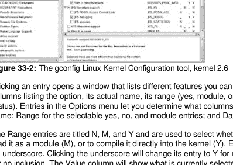

图 33-2：Linux 内核配置工具 gconfig，内核 2.6

点击某个条目会打开一个窗口，列出你可以包含的不同功能。条目按列排列，列出选项、其实际名称、其范围（是、模块或否）及其数据（是、否或模块状态）。“选项”菜单中的条目让你确定显示哪些列：实际模块名称为“名称”；可选择的是、否和模块条目的为“范围”；选项状态标题为“值”的为“数据”。

“范围”条目标题为 N、M 和 Y，用于选择是否包含选项（N）、作为模块加载（M），或直接编译到内核中（Y）。你可以选择的条目将显示下划线。点击下划线会将其条目更改为模块或直接内核包含的 Y，或不包含的 N。“值”列将显示当前选择的内容。

“选项”列将包含一个状态，显示选项是直接包含（对勾标记）、作为模块包含（线条标记）还是完全不包含（空白）。要快速选择或取消选择某个条目，双击“选项”字段中的选项名称。你会看到其复选框被勾选、划线条（模块）或空白。相应的 N、M 和 Y 条目用于选择不包含、模块或内核包含。对于该选项的模块或直接内核包含的默认偏好会自动选择。如果你愿意，可以手动更改它。

### 重要的内核配置特性

`xconfig`、`menuconfig` 和 `gconfig` 工具为每个条目提供出色的上下文敏感帮助。每个条目的右侧都有一个“帮助”按钮。点击它会显示该功能做什么以及为什么直接包含它或作为模块包含，甚至排除它的详细解释。当你对某个功能有疑问时，始终使用“帮助”按钮了解它确切地做什么以及你为什么要使用它。许多关键特性在此处进行了描述。2.6 内核的相应条目在括号中列出。

- **可加载模块支持** 在大多数情况下，你应该确保内核可以加载模块。点击“可加载模块支持”按钮显示几个模块管理选项的列表。确保“启用可加载模块支持”标记为“是”。此功能允许你的内核在需要时加载模块。内核模块加载程序也应设置为“是”，因为这允许你的守护进程（如 Web 服务器）加载任何可能需要的模块。

- **处理器类型和特性** “处理器类型和特性”窗口允许你设置特定系统的支持。在这里，你选择拥有的处理器类型（486、586、686、Pentium III、Pentium IV 等），以及系统支持的最大内存量（在 2.4 内核中最高为 64GB）。

- **通用设置** “通用设置”窗口允许你选择通用特性，如网络、PCI BIOS 支持和电源管理，以及对 ELF 和 a.out 二进制文件的支持。还支持 `sysctl`，用于动态更改在 `/proc` 文件中指定的内核参数。你可以使用 `redhat-config-proc`（系统工具菜单中的内核调优工具）对内核进行这些动态更改。在附加设备驱动程序支持菜单中，你可以启用诸如加密 IP 封装（CIPE）和加速 SSL 等专用特性。

- **块设备（设备驱动程序）** “块设备”窗口列出了启用 IDE、软驱和并行端口设备支持的条目。专用特性，如 RAM 磁盘支持和用于挂载 CD-ROM 映像文件的回环设备，也在那里。

- **多设备支持（RAID 和 LVM）（设备驱动程序）** “多设备支持”窗口列出了启用使用 RAID 设备的条目。你可以选择想要的 RAID 支持级别。在这里你还可以启用逻辑卷管理支持（LVM），它允许你将分区组合成可以动态管理的逻辑卷。

- **网络选项（文件系统和设备驱动程序）** “网络选项”窗口列出了一系列广泛的能力。必须设置“TCP/IP 网络”条目以启用任何形式的互联网网络。在这里，你可以指定使系统作为网关、防火墙或路由器运行的特性。“网络别名”启用对 IP 别名的支持。还存在于其他类型网络的支持，包括 AppleTalk 和 IPX。如果你想使用 NetTalk 连接到网络中的 Macintosh 系统（文件系统），必须启用 AppleTalk。

- **ATA/IDE/MFM/RLL 支持（设备驱动程序）** 在“ATA/IDE/MFM/RLL 支持”窗口中，你可以点击“IDE、ATA 和 ATAPI 块设备”按钮打开一个窗口，在那里你可以选择 IDE ATA 硬盘和 ATAPI CD-ROM 的支持。

- **SCSI 支持（设备驱动程序）** 如果你的系统上有任何 SCSI 设备，请确保“SCSI 支持”窗口中的条目设置为“是”。在这里你启用对 SCSI 磁盘、磁带驱动器和 CD-ROM 的支持。“SCSI 低层驱动程序”窗口显示了一个由 Linux 当前支持的广泛的 SCSI 设备列表。确保你拥有的设备已被选择。

- **网络设备支持（设备驱动程序/网络支持）** “网络设备支持”窗口列出了几个网络设备支持的通用特性。这里有关于列出特定类型网络设备支持的窗口的条目，包括以太网（10 或 100MB）设备、令牌环设备、WAN 接口和 AppleTalk 设备。其中许多设备被创建为你可以根据需要加载的模块。你可以选择重建内核，将这些设备中的任意一个直接支持编译到内核中。

- **多媒体设备（设备驱动程序）** 多媒体设备提供各种多媒体卡以及 Video4Linux 的支持。

- **文件系统（文件系统）** “文件系统”窗口列出了 Linux 可以支持的不同类型文件系统。这些包括 Windows 文件系统，如 DOS、VFAT（Windows 95/98）和 NTFS，以及 CD-ROM 文件系统，如 ISO 和 UDF。网络文件系统，如 NFS、SMB（Samba）和 NCP（NetWare）也包括在内，以及各种杂项文件系统，如 HFS（Macintosh）。

- **字符设备（设备驱动程序）** “字符设备”窗口列出了设备特性
例如您的键盘、鼠标和串行端口。支持串行鼠标和总线鼠标。

- **声音 (设备驱动程序)**


在 2.4 内核中，声音窗口列出了内核支持的不同声卡。请选择您系统上安装的那一个。对于较旧的系统，您可能需要提供声卡使用的 IRQ、DMA 和基础 I/O。这些被编译为独立的模块，如果您愿意，可以选择将其中一些直接包含在内核中。对于 2.6 内核，您可以选择高级 Linux 声音架构（Advanced Linux Sound Architecture）声音支持，并将其扩展为特定声音设备的驱动程序（Open Sound System 也被包含在内，但已弃用）。

### 蓝牙设备 (设备驱动程序/网络)

此处提供支持 Bluetooth 功能的外设，列出了用于 USB、串行和 PC 卡接口的驱动程序。

### 内核开发 (内核开发)

内核开发窗口列出了在内核级别工作的开发人员感兴趣的特性，他们需要修改内核代码。您可以让内核包含调试信息，并可以在崩溃期间提供一定程度的控制。

设置好您的选项后，保存您的配置。`Save And Exit` 选项会覆盖您的 `.config` 配置文件。`Store To Configuration File` 选项允许您将配置保存到一个特定的文件中。

#### 提示

Red Hat Linux 集成了对原生 POSIX 线程库 (Native POSIX Thread Library, NPTL) 的支持，这是 Linux POSIX 线程的更新版本，能够更高效地利用高端处理器。尽管此功能旨在向后兼容，但某些旧模块可能会显示出不兼容性，并可能需要使用新内核重新编译。

## 编译和安装内核

现在配置已准备就绪，您可以编译您的内核。您首先需要生成依赖树，以确定给定您的配置需要编译源代码的哪部分。在 `/usr/src/linux-2.4` 中使用以下命令：

```
make dep
```

您还必须清理之前编译可能留下的任何对象和依赖文件。使用以下命令删除此类文件：

```
make clean
```

您可以使用多个选项来编译内核（见表 33-1）。`bzImage` 选项仅生成一个名为 `bzImage` 的内核文件，并将其放置在 `arch` 目录中。对于 Intel 和 AMD 系统，您在 `i386/boot` 子目录 `arch/i386/boot` 中找到 `bzImage`。对于内核源代码，这位于 `/usr/src/linux-2.4/arch/i386/boot`。

```
make bzImage
```

表 33-1 中的选项创建内核，但不创建模块——那些将被编译为独立模块的内核特性。要编译您的模块，请使用带有 `modules` 参数的 `make` 命令。

表 33-1：内核 `make` 命令的编译选项

| 选项 | 描述 |
|---|---|
| `zImage` | 创建名为 `zImage` 的内核文件，位于 `/usr/src/linux/arch` 或 `arch/i386/boot` 目录中。 |
| `install` | 创建内核并将其安装在您的系统上。 |
| `zdisk` | 创建一个内核文件并将其安装到软盘上（创建一个启动盘）。 |
| `bzImage` | 创建压缩的内核文件，并命名为 `bzImage`。 |
| `bzdisk` | 创建内核并将其安装到软盘上（创建一个启动盘）。 |

```
make modules
```

要安装您的模块，请使用带有 `modules_install` 选项的 `make` 命令。这将模块安装在 `/lib/modules/version-num` 目录中，其中 `version-num` 是内核的版本号。在安装新模块之前，您应该对旧模块进行备份。

```
make modules_install
```

`install` 选项既生成内核文件，又将它们作为 `vmlinuz.` 安装在您的系统上，从而整合了 `make bzImage` 步骤。此操作将内核文件（如 `bzImage` 文件）放置在 `/boot` 目录中，并赋予它们适当的名称和内核版本号。

```
make install
```

如果您使用 `loadlin` 从 DOS 启动 Linux，您需要将 `bzImage` 文件复制到 DOS 分区上 `loadlin` 目录中，这是您启动 Linux 的位置。

以下显示了简单编译和安装的命令：

```
make dep
make clean
make bzImage
make modules
make modules_install
make install
```

如果需要，您可以将这些命令输入在更少的行中，使用分号分隔命令，如下所示：

```
make dep; make clean; make bzImage; make modules
make modules_install; make install
```

在单行上执行这些操作的一种更安全方法是使它们相互条件依赖，使用 `&&` 命令。在上面的方法中，如果一个操作出现错误，下一个操作仍会被执行。通过使操作成为条件性的，仅当上一个操作成功时，下一个操作才会运行。

```
make dep && make clean && make bzImage
make modules
make modules_install && make install
```

### 手动安装内核映像

要手动安装内核 bzImage 文件，将 bzImage 文件复制到内核所在的目录，并赋予您的发行版使用的名称，例如 `vmlinuz-2.4.22-1`。记住首先备份旧的内核文件，如预防措施步骤中所述。`vmlinuz` 是一个符号链接，指向实际的内核文件，该文件将带有 `vmlinuz` 和版本名称。因此，要手动安装 bzImage 文件，请将其复制到 `/boot` 目录，命名为 `vmlinuz` 并附上版本号，例如 `vmlinuz-2.4.22-1`。然后，您创建从 `/boot/vmlinuz` 到 `/boot/vmlinuz-2.4.22-1` 的符号链接。

```
make bzImage
cp arch/i386/boot/bzImage /boot/vmlinuz-2.4.22-1
ln -s /boot/vmlinuz /boot/vmlinuz-2.4.22-1
```

您还必须复制一份 `System.map` 文件，并将其链接到 `System.map` 符号链接。

```
cp arch/i386/boot/System.map /boot/System.map-2.4.22-1
ln -s /boot/System.map /boot/System.map-2.4.22-1
```

以下命令显示了基本编译和手动安装。首先，使用 `clean` 选项删除所有以前的二进制文件。然后使用 `bzImage` 选项创建内核。这创建了一个名为 `bzImage` 的内核程序，位于 `arch/i386/boot` 目录中。此内核文件被复制到 `/boot` 目录并命名为 `vmlinuz-2.4.22-1`。然后创建到内核 `vmlinuz-2.4.22-1` 文件的符号链接 `/boot/vmlinuz`。接下来，创建模块并安装它们：

```
make dep
make clean
make bzImage
make modules
make modules_install
cp arch/i386/boot/bzImage /boot/vmlinuz-2.4.22-1
ln -s /boot/vmlinuz-2.4.22-1 /boot/vmlinuz
cp System.map /boot/System.map-2.4.22-1
ln -s /boot/System.map-2.4.22-1 /boot/System.map
```

### 内核启动盘

代替将内核安装在您的系统上，您可以简单地将其放在启动盘上，并从该磁盘启动您的系统。在这种情况下，您只需使用 `bzdisk` 选项创建一个启动盘。此选项将内核安装在放入软驱的软盘上。内核驻留在软盘上，要使用该内核，您从软盘启动系统（使用 `install` 选项时，内核不会安装在根分区上）。

```
make bzdisk
```

请确保软驱中有一张软盘。`make bzdisk` 命令直接将映像复制到软盘。您仍然需要创建和安装模块。确保 `bzImage` 文件足够小，能够容纳在软盘上。如果没有，您必须重新配置内核，尽可能将许多功能编译为模块而不是内核的一部分。

```
make clean
make bzImage
make bzdisk
make modules
make modules_install
```

#### 提示

如果您正在尝试内核配置，将新的内核版本放在启动盘或启动 CD-ROM 上，而不是安装在系统上，可能更安全。如果如此


# ABC Amber CHM 转换器试用版

请注册以移除此横幅。

http://www.processestext.com/abchm.html

## 引导加载程序配置


如果您使用的是 GRUB 或 LILO 等引导加载程序，可以配置系统以启用启动已安装的任何内核。如本章前面“修改同版本内核的预防措施”部分所述，您可以在引导加载程序配置文件中为旧内核创建额外条目。安装新版本内核时，您可以简单地添加更多条目，从而可以使用任何之前的内核。每次启动时，引导加载程序都会向您提供内核列表以供选择。例如，您可以安装内核开发版本，同时保留当前稳定版本和旧版本。在每个条目的图像行中，您指定内核的文件名。您可以为旧内核创建另一个引导加载程序条目。

### GRUB 配置

在下一个示例中，`/etc/grub.conf` 文件包含两个 Linux 内核的条目，一个是之前安装的内核 `2.4.18-4`，另一个是较新的内核 `2.4.22-1`。使用 GRUB，您只需为新内核添加一个新条目。

```
# grub.conf generated by anaconda
#
#boot=/dev/hda
default=0
timeout=30
splashimage=(hd0,2)/boot/grub/splash.xpm.gz
title New Linux (2.4.22-1)
    root (hd0,2)
    kernel /boot/vmlinuz-2.4.22-1 ro root=/dev/hda3 hdc=ide-scsi
    initrd /boot/initrd-2.4.22-1.img
title  Old Linux (2.4.18-4)
    root (hd0,2)
    kernel /boot/vmlinuz-2.4.18-4 ro root=/dev/hda3 hdc=ide-scsi
    initrd /boot/initrd-2.4.18-4.img
title Windows XP
    rootnoverify (hd0,0)
    makeactive
    chainloader +1
```


# ABC Amber CHM 转换器试用版

请注册以移除此横幅。

http://www.processestext.com/abcchm.html

### 模块 RAM 磁盘

如果您的系统使用某些内核不支持的块设备，例如某些 SCSI、RAID 或 IDE 设备，则在启动时需要加载某些必需的模块。这些块设备模块保存在 RAM 磁盘上，系统首次启动时访问。RAM 磁盘也用于无盘系统。例如，如果您有 SCSI 硬盘或 CD-ROM，它们的 SCSI 驱动程序通常保存在模块中，系统每次启动时都会加载这些模块。这些模块存储在 RAM 磁盘中，启动过程从中读取。如果您创建需要加载模块才能启动的新内核，您必须为这些模块创建新的 RAM 磁盘。只有在内核需要在启动时加载模块时，才需要创建新的 RAM 磁盘。例如，如果您使用 SCSI 硬盘，但已将 SCSI 硬盘和 CD-ROM 支持包括特定型号的支持直接集成到内核中，则无需设置 RAM 磁盘。大多数 IDE 硬盘和 CD-ROM 的支持已直接集成到内核中。

如果您需要创建 RAM 磁盘，可以使用 `mkinitrd` 命令创建 RAM 磁盘映像文件。`mkinitrd` 命令包含系统使用的所有 IDE、SCSI 和 RAID 模块，包括在 `/etc/modules.conf` 文件中列出的模块。有关更多细节，请参阅 `mkinitrd` 和 RAM 磁盘文档的手册页。`mkinitrd` 的参数是 RAM 磁盘映像文件的名称和模块来源的内核。在以下示例中，使用 `2.4.22-1` 内核的模块在 `/boot` 目录中创建名为 `initrd-2.4.22-1.img` 的 RAM 磁盘映像。`2.4.22-1` 内核必须已安装在系统中并创建其模块。

```
# mkinitrd /boot/initrd-2.4.22-1.img 2.4.22-1
```

您可以选择在某些 SCSI 模块之前或之后加载特定模块。`--preload` 选项在 SCSI 模块之前加载，而 `--with` 在之后加载。例如，要在 SCSI 模块之前加载 RAID 5 支持，请使用 `--preload=raid5`：

```
mkinitrd --preload=raid5 raid-ramdisk 2.4.22-1
```

在新内核的 `grub.conf` 片段中，放置指定新 RAM 磁盘的 `initrd` 条目：

```
initrd /boot/initrd-2.4.22-1.img
```

# 第七部分：网络管理

## 章节列表

- 第 34 章：域名系统
- 第 35 章：DHCP 服务器
- 第 36 章：NFS 和 NIS
- 第 37 章：Samba
- 第 38 章：TCP/IP 网络管理
- 附录 A：关于 DVD-ROM

### 第 34 章：域名系统

#### 概述

域名系统（DNS）是一种互联网服务，用于定位并将域名翻译为对应的互联网协议（IP）地址。您可能还记得，所有连接到互联网的计算机都使用 IP 地址进行寻址。作为网络上的普通用户，可能需要访问许多不同的主机，因此快速跟踪所需的 IP 地址很快变成了一个难题。用名称标记主机并使用名称访问它们要容易得多。名称与 IP 地址相关联。当用户使用名称访问主机时，首先查找对应的 IP 地址，然后使用它提供访问。


#### DNS 地址转换

将 IP 地址转换为关联名称的过程相当直接。小网络可以轻松配置，只需基本配置即可。对于较大的网络和互联网，任务变得更加复杂。任务的规模可能使 DNS 配置变得复杂。

#### 完全限定域名

IP 地址与称为完全限定域名的对应名称相关联。*完全限定域名*由三个或更多段组成。第一段是标识主机的名称，其余段是主机所在网络的段。完全限定域名的网络段通常简单地称为域名，而主机部分称为主机名。实际上，子网被称为域。完全限定域名 `www.linux.org` 可能具有 IP 地址 `198.182.196`，其中 `198.182.196` 是网络地址，`56` 是主机 ID。计算机只能通过 IP 地址访问，因此必须首先将完全限定域名转换为对应的 IP 地址才有用。组成域名和主机的 IP 地址部分可能有所不同。有关 IP 地址的详细讨论，包括网络类别和无类域间路由（CIDR），请参见第 38 章。

#### IPv4 地址

IP 地址可以采用较新的 IPv6（互联网协议版本 6）格式或较旧且更常见的 IPv4（互联网协议版本 4）格式。由于 IPv4 寻址更容易阅读，这些示例将使用这种格式。在较旧的 IPv4 格式中，IP 地址由四个以句点分隔的段组成的数字组成。根据网络类型，前几个段中的几个用于网络地址，最后一个或最后几个段用于主机地址。在用于较小网络的标准 C 类网络中，前三个段是计算机的网络地址，最后一个段是计算机的主机 ID。如这些示例中所示。例如，在地址 `192.168.0.2` 中，`192.168.0` 是网络地址，`2` 是该网络中计算机的主机 ID。它们共同组成 IP 地址，计算机可以在互联网的任何地方通过它寻址。然而，IP 地址很难记住且容易出错。

#### IPv6 寻址

IPv6 寻址使用非常不同的方法，旨在提供更多灵活性和对非常大地址空间的支持。参见第 38 章。IPv6 地址有三种不同类型：单播、多播和任意播，其中单播使用最广泛。单播地址指向特定接口。根据地址的使用方式，有几种类型的单播地址。例如，您可以拥有用于通过互联网访问的全局单播地址，或用于私有网络的站点级单播地址。

虽然由八个段组成的 128 位组成，每段 16 位，2 字节，但 IPv6 地址由几个字段组成，大致符合 IPv4 地址的段和能力：网络信息、子网信息和接口标识符。网络信息包括指示网络连接类型的格式前缀。此外，可以使用子网标识符来指定本地子网。参见第 38 章。网络信息占用前几个段。其余部分用于接口 ID。接口 ID 是 64 位四个段扩展唯一标识符，EUI-64，由网络设备的媒体访问控制 MAC 地址生成。IP 地址以十六进制数书写，使用困难。每个段用冒号分隔，一组连续值为零的段可以留空。

#### 手动转换：/etc/hosts

互联网上的任何计算机都可以维护一个文件，手动将 IP 地址与域名关联。在 Linux 和 Unix 系统上，此文件称为 `/etc/hosts` 文件。在此，您可以输入常用计算机的 IP 地址和域名。然而，使用这种方法，每台计算机都需要互联网上所有其他计算机的完整列表，并且该列表必须不断进行更新。早期，这对互联网来说显然不切实际，尽管对于小型孤立网络而言，这仍是可行的。

#### DNS 服务器


域名系统（DNS）的实现对了解决将互联网上任意计算机的域名转换为其 IP 地址的任务。这一任务由相互连接的服务器完成，这些服务器管理着域名系统（也被称为 DNS 服务器或名称服务器）。这些 DNS 服务器维护着完全限定域名及其 IP 地址的列表，将二者进行匹配。它们向网络提供的这种服务被称为域名系统。互联网由许多互连的子网（称为域）组成，每个域都有自己独立的域名系统（DNS）服务器，负责追踪该网络上所有计算机的完全限定域名和 IP 地址。DNS 服务器以分层方式连接到根服务器，根服务器又连接到互联网其他子网上的其他根服务器和 DNS 服务器。某个 DNS 服务器负责管理的网络部分称为区域。虽然一个区域可能对应一个域，但实际上一个域内可能包含许多区域，每个区域都有自己的名称服务器。这在大型域中尤为常见，因为单一名称服务器无法管理过多的系统。

### DNS 工作原理

当用户输入一个完全限定域名以访问远程主机时，解析器程序会向本地网络的 DNS 服务器发出查询，请求获取该远程主机对应的 IP 地址。有了 IP 地址后，用户就可以访问该远程主机。在图 34-1 中，位于 `rabbit.mytrek.com` 的用户想要连接到远程主机 `lizard.mytrek.com`。`rabbit.mytrek.com` 首先向网络的 DNS 服务器（在本例中为 `turtle.mytrek.com`）发送请求，查找名称 `lizard.mytrek.com` 并找到其 IP 地址。随后，DNS 服务器将 `lizard.mytrek.com` 的 IP 地址 `192.168.0.3` 返回给请求方主机 `rabbit.mytrek.com`。有了这个 IP 地址，位于 `rabbit.mytrek.com` 的用户就可以连接到 `lizard.mytrek.com`。

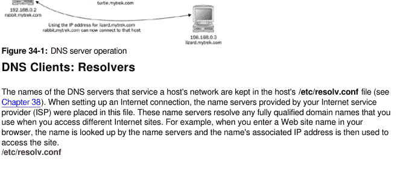

图 34-1: DNS 服务器工作原理

### DNS 客户端：解析器

为某个主机的网络提供服务的 DNS 服务器名称保存在该主机的 `/etc/resolv.conf` 文件中（参见第 38 章）。在设置互联网连接时，互联网服务提供商（ISP）提供的名称服务器被写入此文件。当你访问不同的互联网站点时，这些名称服务器会解析你使用的任何完全限定域名。例如，当你在浏览器中输入网站名称时，名称服务器会查找该名称，并使用该名称关联的 IP 地址来访问该站点。`/etc/resolv.conf`

```
search mytrek.com mytrain.com
nameserver 192.168.0.1
nameserver 192.168.0.3
```


### 局域网寻址

如果你正在为一个未连接互联网的局域网（LAN）设置 DNS 服务器，你应该使用为这类本地网络（也称为私有网络或内部网络）保留的一组特殊 IP 地址。如果你正在实现 IP 伪装（IP masquerading），即只有一台网关机器拥有互联网地址，而其他机器使用该唯一地址连接互联网，这一点尤为重要。对于 C 类 IPv4 网络（不超过 254 台主机），这些是拥有特殊网络号 `192.168` 的地址，如本例中所用。如果你正在设置一个局域网，例如小型企业或家庭网络，你可以自由使用这些地址作为本地机器的地址。你可以使用以太网卡、以太网集线器等网卡组建一个私有网络（如内部网络），然后将机器的 IP 地址配置为从 `192.168.0.1` 开始。主机段可以从 1 到 254，其中 255 用于广播地址。如果你的家庭网络中有三台机器，你可以给它们的地址分别为 `192.168.0.1`、`192.168.0.2` 和 `192.168.0.3`。然后，你可以在其中一台机器上运行 DNS 服务器，为网络设置域名服务。这台机器就成了你网络的 DNS 服务器。随后，你可以给机器分配完全限定域名，并配置你的 DNS 服务器将名称转换为对应的 IP 地址。例如，如图 34-2 所示，你可以将名称 `turtle.mytrek.com` 分配给机器 `192.168.0.1`，将名称 `rabbit.mytrek.com` 分配给机器 `192.168.0.2`。你还可以通过在你的机器上设置服务器，在网络中实现 FTP、Web 和邮件服务等互联网服务。然后，你可以配置 DNS 服务器，使用户能够使用完全限定域名访问这些服务。例如，对于 `mytrek.com` 网络，可以使用名称 `www.mytrek.com` 访问 Web 服务器。或者，你可以让每台机器中的 `/etc/hosts` 文件包含网络中所有机器的 IP 地址和域名完整列表，以此替代域名服务。但对于任何更改，你都必须更新每台机器中的 `/etc/hosts` 文件。

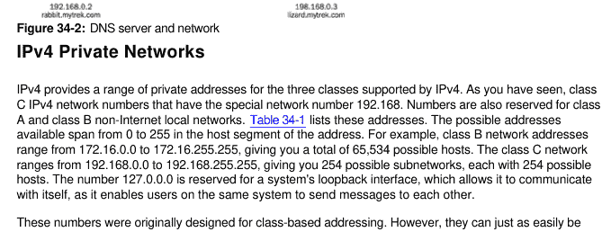

图 34-2: DNS 服务器和网络

### IPv4 私有网络

IPv4 为 IPv4 支持的三种类别提供了一组私有地址范围。如前所述，具有特殊网络号 `192.168` 的 C 类 IPv4 网络号。也为 A 类和 B 类非互联网本地网络保留了地址。表 34-1 列出了这些地址。地址中主机段可用的可能地址范围从 0 到 255。例如，B 类网络地址范围为 `172.16.0.0` 到 `172.16.255.255`，总共提供 65,534 个可能的主机。C 类网络范围为 `192.168.0.0` 到 `192.168.255.255`，提供 254 个可能的子网，每个子网有 254 个可能的主机。地址 `127.0.0.0` 保留用于系统的环回接口，它允许系统与自身通信，从而启用同一系统上的用户之间相互发送消息。

这些数字最初是为基于类别的寻址设计的。然而，它们同样可以轻松用于无类别域间路由（CIDR）寻址，在其中你可以创建主机数量更少的子网。例如，C 类网络中寻址的 254 个主机可以拆分为两个子网，每个子网有 125 个主机。更多详情请参见第 38 章。

**表 34-1: 非互联网私有网络 IP 地址**

| 地址 | 网络 |
|---|---|
| 10.0.0.0 | A 类网络 |
| 172.16.0.0 到 172.31.255.255 | B 类网络 |
| 192.168.0.0 | C 类网络 |
| 127.0.0.0 | 环回网络（用于系统自通信） |

### IPv6 私有网络

IPv6 通过站点本地地址支持私有网络，这些地址提供与 IPv4 私有地址相同的功能。站点本地地址没有公共路由信息。它们无法访问互联网。它们仅限于在其使用的站点内。站点本地地址仅使用三个字段：格式前缀、子网标识符和接口标识符。站点级地址具有格式前缀 `fec0`。如果没有子网，它将被设置为 0。这将给你一个网络前缀 `fec0::0:0:0`。你可以去掉空零集合，得到 `fec0::`。接口 id 字段将保存接口识别信息，类似于 IPv4 中的主机 ID 信息。

```
fec0::    IPv6 站点本地前缀
```

### BIND

当前在 Linux 系统上使用的 DNS 服务器软件是伯克利互联网域名（Berkeley Internet Name Domain，BIND）。BIND 最初由加利福尼亚大学伯克利分校开发，目前由互联网软件联盟（Internet Software Consortium，ISC）维护和支持。你可以从 `www.isc.org` 的 Web 站点获取 BIND 信息和当前软件版本。软件包中附带了 Web 页面文档和手册。发行版 FTP 站点上可提供 RPM 包。`/usr/share/doc` 中的 BIND 目录包含大量文档，包括 Web 页面手册和示例。域名服务的 Linux HOW-TO，即 DNS-HOWTO，提供了详细的示例。文档、新闻和 DNS 工具可以从 DNS 资源目录（DNSRD）`www.dns.net/dnsrd` 获取。该站点包含大量链接和在线文档，包括 BIND 操作指南（BOG）。DNS 资源列表见表 34-2。

### 替代 DNS 服务器

现在已有多款替代的 DNS 服务器可供选择。这些包括 `djbdns`（以其安全特性著称）、CustomDNS（一种用 Java 实现的动态服务器，`customdns.sourceforge.net`）以及 Yaku-NS（一种嵌入式服务器）。由 D.J. Bernstein 编写的 `djbdns` 服务器（`cr.yp.to/djbdns.html`）在设计时特别注重安全性，提供了一组小型服务器守护进程，每个执行专门的任务。具体而言，`djbdns` 将名称服务器、缓存服务器和区域传输任务分解为独立的程序：`tinydns`（`tinydns.org`）实现网络的权威名称服务器功能，而 `dns cache` 实现缓存服务器功能，能够解析来自 Web 浏览器等 DNS 客户端的请求。实际上，`dns cache` 作为你的应用程序用于解析地址的名称服务器运行。然后，`dns cache` 会查询 `tinydns` 来解析本地网络上的地址。区域传输由 `axfrdns` 和 `asfet` 单独处理。

**表 34-2: BIND 资源**

| 网站 | 资源 |
|---|---|


| www.isc.org | 互联网软件联盟 |
| www.dns.net/dnsrd | DNS 资源目录 |
| www.nominum.com | Nominum，BIND 支持和咨询 |

## DNS 文档

目前，ISC 已与两家公司 Nominum 和 Mind 签约，以提供 BIND 支持。Nominum 是 ISC 的支持合作伙伴，并在 BIND 开发中发挥了积极作用。在其网站 `www.nominum.com` 上，你可以找到 BIND 文档，包括 BIND 9 管理员参考。Nominum 像许多支持开源软件的商业公司一样，提供专业的咨询和支持服务，同时免费为开源开发做出贡献。Mind 为欧洲市场提供咨询服务。

## BIND 服务器和工具

BIND DNS 服务器软件由一个名称服务器守护进程、几个示例配置文件和解析器库组成。从 1998 年开始，BIND 的新版本（从系列编号 8.x 开始）使用新的语法实现了一个新的配置文件。9.0 版本增加了新的安全特性和对 IPv6 的支持。较旧版本以数字 4.x 开头，使用具有旧语法的不同配置文件。大多数发行版目前安装的是较新的 9.x 版本 BIND。

BIND 名称服务器守护进程的名称是 `named`。若要使你的机器作为名称服务器运行，只需运行带有适当配置的 `named` 守护进程即可。`named` 守护进程监听解析请求，并为请求的主机名提供正确的 IP 地址。你可以使用随 BIND 提供的远程名称守护进程控制器工具 `rndc`，在测试配置时启动、停止、重启服务器并检查其状态。使用 `stop` 命令的 `rndc` 停止 `named`，使用 `start` 命令，

它重新开始运行，读取您的 `named.conf` 文件。使用 `help` 命令执行 `rndc` 可以获取所有 `rndc` 命令的列表。有关配置 `rndc` 访问 DNS 服务器的详细信息，请参阅 Red Hat 参考指南。

一旦您的名称服务器开始运行，您可以使用 `dig` 或 `nslookup` 工具对其进行测试，这些工具会查询名称服务器，并提供有关主机和域的信息。如果您不带参数启动 `dig`，它将进入交互模式，您可以在此模式下发出不同的 `dig` 命令来细化查询。还有许多其他 DNS 工具也可用，例如 `nsint` 和 `host`。请在 `www.dns.net/dnsrd` 查看 DNS 资源目录以获取列表。表 34-3 列出了若干 DNS 管理工具。

表 34-3: BIND 诊断和管理工具

| 工具 | 描述 |
|------|-------------|
| `dig domain` | 域名信息收集器，用于获取 DNS 服务器信息的工具。优于 `nslookup`。 |
| `host hostname` | 主机的简单查找。 |
| `nslookup domain` | 用于查询 DNS 服务器有关域和主机信息的工具。 |
| `rndc command` | 远程名称守护进程控制器，用于管理 DNS 服务器（9.x 版本）的管理工具。 |
| `ndc` | 名称守护进程控制器（8.x 版本）。 |
| `redhat-config-bind` | Red Hat Bind DNS 服务器配置工具。 |

## 启动和停止 BIND 服务器

在 Red Hat 上，使用 `/etc/rc.d/init.d` 目录中名为 `named` 的启动脚本来启动 `named` 守护进程。您可以使用此脚本通过 `stop`、`start` 和 `restart` 参数来启动、停止和重启守护进程。您可以使用 `service` 命令调用脚本，如下所示：

```
service named restart
```

在大多数发行版中，`named` 作为独立守护进程运行，在系统启动时启动并持续运行。如果不想让 `named` 自动启动，可以使用 `redhat-config-services` 或 `chkconfig` 来更改其状态。

## 域名服务配置

使用配置文件、若干区域文件和缓存文件来配置 DNS 服务器。名称服务器负责的网络部分称为区域。区域与域不同，因为在大型域中可能有多个区域，每个区域都有自己的名称服务器。您也可以让一个名称服务器服务多个区域。在这种情况下，每个区域都有自己的区域文件。

### DNS 区域

区域文件保存资源记录，为 DNS 服务器负责的网络上的计算机提供主机名和 IP 地址的关联。为服务器的网络和本地机器创建区域文件。区域条目在 `named.conf` 文件中定义。在此处，您放置主 DNS 服务器、从 DNS 服务器和转发 DNS 服务器的区域条目。此处描述了最常用的区域类型：

- **主区域** 这是 DNS 服务器支持的网络的主区域文件。它保存该网络上所有主机从域名到 IP 地址的映射。
- **从区域** 这些是对您网络中其他 DNS 服务器的引用。您的网络可以有一个主 DNS 服务器和若干从 DNS 服务器来协助分担工作负载。从 DNS 服务器会自动从主 DNS 服务器复制其配置文件，包括所有区域文件。主配置文件的任何更改都会触发这些文件自动下载到从服务器。实际上，您只需要管理主 DNS 服务器的配置文件，因为它们会自动复制到从服务器。
- **转发区域** 转发区域列出了您网络外部应该在其网络名称服务器无法解析地址时进行搜索的名称服务器。
- **IN-ADDR.ARPA 区域** DNS 还可以提供反向解析，其中使用 IP 地址来确定关联的域名地址。此类查找由 IN-ADDR.ARPA 区域文件提供。每个主区域文件通常都有一个对应的 IN-ADDR.ARPA 区域文件，以提供该区域的反向解析。对于每个主区域条目，都存在一个名为 IN-ADDR.ARPA 的对应反向映射区域条目，以及一个用于 localhost 的条目。此条目执行从 IP 地址到其域名的反向映射。区域条目的名称使用域名 IP 地址，即 IP 地址，其段从主机开始列出，而不是从网络开始。因此，对于 IP 地址 192.168.0.4（其中 4 是主机地址），对应的域名 IP 地址为 4.0.168.192，段按相反顺序列出。localhost 的反向映射为 1.0.0.127。
- **IP6.ARPA 区域** 这是 IN-ADDR.ARPA 区域的 IPv6 等价物，提供该区域的反向解析。IP6.ARPA 区域使用位标签，便于书写，无需 DNS 管理员进行反向计算。
- **IP6.INT 区域** 这是较旧的 IPv6 IP6.ARPA 区域形式，等价于 IPv4 的 IN-ADDR.ARPA 区域，提供区域的反向解析。IP6.INT 旨在与较旧的 AAAA IPv6 地址记录一起使用。IP6.INT 使用半字节格式指定反向区域。在此格式中，十六进制 IPv6 地址被分段为其 32 个十六进制数字，并按相反顺序列出，每个数字之间用点分隔。
- **提示区域** 提示区域指定根名称服务器，并以句号 (.) 表示。DNS 服务器通常连接到更大的网络，例如互联网，这些网络有自己的 DNS 服务器。DNS 服务器以这种层级方式连接，每个服务器都有其可以发送解析查询的根服务器。根服务器在提示区域中指定。

**注意** 在 Red Hat 上，您可以使用 `redhat-config-bind`（Red Hat BIND 配置工具）为简单的本地网络配置 DNS 服务器（参见第 5 章）。`redhat-config-bind`（可从服务器设置窗口或菜单访问）提供了一个 GNOME 界面，用于设置服务器所需的主、从、转发和 IN-ADDR.ARPA 区域。但请注意，它会覆盖您的 `/etc/named.conf` 文件。可以从服务器设置菜单访问 `redhat-config-bind`。

## DNS 服务器类型

有几种类型的 DNS 服务器，每种都在域名服务下执行不同类型的任务。基本的 DNS 服务器类型是主服务器。每个网络必须至少有一个负责解析网络中名称的主服务器。大型网络可能需要多个 DNS 服务器。其中一些可以是直接从主服务器更新的从服务器。其他可能是网络中主机可以使用的备用主服务器。这两者通常都被称为次要服务器。对于 DNS 服务器无法解析的 DNS 请求，可以将请求转发到网络外部的特定 DNS 服务器，例如互联网上的 DNS 服务器。可以设置网络中的 DNS 服务器来执行此任务，并被称为转发器服务器。为了帮助分担工作负载，可以在网络内部设置本地 DNS 服务器，作为缓存服务器运行。此类服务器仅收集其之前发送到主 DNS 服务器的 DNS 查找信息。重复的请求可以由缓存服务器回答。

能够以权威身份回答给定区域 DNS 查询的服务器被称为权威服务器。权威服务器保存区域内主机的 DNS 配置记录，将这些主机的 DNS 名称与 IP 地址关联。例如，主服务器是权威服务器。从服务器和隐身服务器也是如此（参见以下列表）。缓存服务器不具有权威性。它只保存从其他服务器获取的关联，无法保证这些关联是有效的。

- **主服务器** 这是区域的主 DNS 服务器。
- **从服务器** 从主服务器接收区域信息的 DNS 服务器。


- 转发器服务器 将未解析的 DNS 请求转发到外部 DNS 服务器的服务器。可用于使本地网络上的其他服务器对互联网隐藏。

- 仅缓存服务器 缓存从 DNS 服务器接收的 DNS 信息，并使用它来解析本地请求。

- 隐身服务器 主 DNS 服务器未将其列为名称服务器的区域的 DNS 服务器。

### named.conf

`named`守护程序的配置文件名为`named.conf`，位于`/etc`目录中。它使用类似于 C 程序的灵活语法。这种格式便于配置选定的区域，并启用访问控制列表和分类日志记录等功能。`named.conf`文件由 BIND 配置语句组成，其内部附带包含特定选项列表的代码块。配置语句后跟参数和一个由花括号限定的代码块。代码块内部包含选项和特性条目行。每个条目以分号结尾。注释可以使用 C、C++ 或 Shell/Perl 语法：分别使用 `/* */` 包围、`//` 前缀或 `#` 前缀。以下示例显示了一个区域语句，其后跟着区域名称和一个以左花括号 `{` 开始的选项代码块。每个选项条目以分号结束。整个代码块以右花括号 `}` 结束，后面也跟着一个分号。此处展示了 `named.conf` 条目的格式，以及允许的不同种类的注释。表 35-5、35-6 和 35-7 列出了几种常用的语句和选项。

```
// comments
/* comments */
# comments
```

```
statements {
    options and features; //comments
};
```

以下示例显示了一个简单的缓存服务器条目：

```
// a caching only nameserver config
//
zone "." {
    type hint;
    file "named.ca";
};
```

注意 `named.conf` 文件是 BIND 8.x 和 9.x 版本中实现的新功能。旧版的 BIND 4.x 使用名为 `named.boot` 的文件。8.x 版本不再使用该文件。这些配置文件中使用的语法差异极大。如果你升级到 8.x，可以使用随 BIND 软件提供的 Perl 脚本 `named-bootconf.pl` 将你的 `named.boot` 文件转换为 `named.conf` 文件。

# zone 语句

`zone` 语句用于指定名称服务器将服务的域名。输入关键字 `zone`，随后在双引号内放置域名。不要在域名末尾添加句号。在以下示例中，域名 `"mytrek.com"` 包含一个句号，但不在末尾；这与区域文件不同，区域文件要求在完整域名末尾添加句号。

在区域名称之后，可以指定类 `in`，代表 Internet。你也可以省略它，在这种情况下默认为 `in`（只有少数其他很少使用的特殊类）。在 `zone` 代码块内，可以放置多个选项（参见本章稍后的表 34-6）。两个基本选项是 `type` 和 `file`。`type` 选项用于指定区域的类型。`file` 选项用于指定该区域使用的区域文件名。你可以从几种类型的区域中进行选择：`master`、`slave`、`stub`、`forward` 和 `hint`。`Master` 指定该区域保存主信息，并有权对其进行操作。在旧版的 4.x BIND 配置中，`master` 服务器被称为 `primary`（主）服务器。`Slave` 表示该区域需要定期从指定的 `master` 名称服务器更新其数据。如果你的名称服务器作为另一个 `primary`（`master`）DNS 服务器的 `secondary`（从）服务器运行，则使用此条目。`stub`（存根）区域仅复制其他名称服务器条目，而不是整个区域。`forward`（转发）区域将所有查询转发到 `forwarders` 语句中指定的名称服务器。`hint`（提示）区域指定所有 Internet DNS 服务器使用的根名称服务器集合。你还可以指定若干选项，这些选项可以覆盖使用 `options` 语句设置的全局选项。表 34-4 列出了 BIND 区域类型。以下示例显示了 `mytrek.com` 域的一个简单 `zone` 语句。其类为 Internet (`in`)，类型为 `master`。其区域文件的名称通常与区域名称相同，在本例中为 `"mytrek.com"`。

表 34-4: DNS 区域类型

| Type | Description |

|------|-------------|

| master | 主 DNS 区域 |

| slave | 从 DNS 服务器；受主 DNS 服务器控制 |

| hint | Internet 根 DNS 服务器集合 |

| forward | 将其中的任何查询转发到其他服务器 |

| stub | 类似于从区域，但仅保存 DNS 服务器名称 |

```
zone "mytrek.com" in {
    type master;
    file "mytrek.com";
};
```

# 配置语句

其他语句，如 `acl`、`server`、`options` 和 `logging`，使你可以为你的名称服务器配置不同的功能（参见表 34-5）。`server` 语句定义与远程名称服务器相关联的特征，如传输方法和用于事务安全的密钥 ID。`control` 语句定义特殊的控制通道。`key` 语句定义要在 `server` 语句中使用的密钥 ID，该语句将身份验证方法与特定名称服务器关联（参见本章稍后的“DNSSEC”）。`logging` 语句用于配置名称服务器的日志记录选项，如日志文件的最大大小和消息的严重级别。表 34-5 列出了 BIND 语句。`sortlists` 语句允许你指定在查询返回多个响应时要使用的优先级。例如，你可以赋予 `localhost` 网络或 `192.168.0.0` 这样的私有本地网络以优先权。

表 34-5: BIND 配置语句

| Statements | Description |

|------------|-------------|

| /* comment */ | 使用 C 语法的 BIND 注释。 |

| // comment | 使用 C++ 语法的 BIND 注释。 |

| # comment | 使用 Unix shell 和 Perl 语法的 BIND 注释。 |

| acl | 定义命名的 IP 地址匹配列表。 |

| include | 包含一个文件，将其解释为 named.conf 文件的一部分。 |

| key | 指定用于身份验证和授权的密钥信息。 |

| logging | 指定服务器记录什么以及日志消息发送到哪里。 |

| options | 全局服务器配置选项及其他语句的默认值。 |

| controls | 声明由 ndc 实用程序使用的控制通道。 |

| server | 为指定的服务器基础设置某些配置选项。 |

| sortlists | 根据查询来源，为指定网络赋予优先权。 |

| trusted-keys | 定义预配置到服务器中并隐式信任的 DNSSEC 密钥。 |

| zone | 定义一个区域。 |

| view | 定义一个视图。 |

表 34-6: 区域选项

| Options | Description |

|---|---|

| type | 指定区域类型。 |

| file | 指定该区域的区域文件。 |

| directory | 指定区域文件所在的目录。 |

| forwarders | 列出用于转发请求的 DNS 服务器主机。 |

| masters | 列出从服务器的主 DNS 服务器主机。 |

| notify | 允许主服务器在 主区域数据发生变化且需要更新时通知其从服务器。 |

| allow-transfer | 指定允许接收区域传输的主机。 |

| allow-query | 指定允许进行查询的主机。 |

| allow-recursion | 指定允许在服务器上执行递归查询的主机。 |

# options 语句

`options` 语句定义全局选项，并且在配置文件中只能使用一次。大量的选项涵盖了转发、名称检查、目录路径名、访问控制和区域传输等组件（参见表 34-7）。完整列表可在 BIND 文档中找到。

表 34-7: 选项

| Options | Description |

|---|---|

| sortlist | 根据查询来源，为指定网络赋予优先权。 |

| directory | 指定区域文件所在的目录。 |

| forwarders | 列出用于转发请求的 DNS 服务器主机。 |

| allow-transfer | 指定允许接收区域传输的主机。 |

| allow-query | 指定允许进行查询的主机。 |

| allow-recursion | 指定允许在服务器上执行递归查询的主机。 |

| notify | 允许主服务器在 主区域数据发生变化且需要更新时通知其从服务器。 |

| blackhole | 消除由 allow-query 引起的拒绝响应的选项。 |

# directory 选项


大多数配置文件中一个至关重要的选项是 `directory` 选项，它保存了系统中名称服务器区域文件和缓存文件的位置。以下示例取自 Red Hat 的 `/etc/named.conf` 文件。此示例指定区域文件位于 `/var/named` 目录中。在该目录中，你可以找到你的区域文件，包括用于你本地系统的文件。

```
options {
    directory "/var/named";
    forwarders { 192.168.0.34;
        192.168.0.47;
    };
}
```

## forwarders 选项

另一个常用的全局选项是 `forwarders` 选项。使用 `forwarders` 选项，你可以列出多个 DNS 服务器，如果本地 DNS 服务器无法解析查询，则可将查询转发到这些服务器。这对于可能需要使用连接到 Internet 的 DNS 服务器的本地网络很有帮助。`forwarders` 选项也可以放在 `forward` 区域条目中。

## notify 选项

当 `notify` 选项开启时，主区域 DNS 服务器会在其配置发生更改时向任何从 DNS 服务器发送消息。然后从服务器可以执行区域传输，从中下载更改后的配置文件。从服务器始终使用从其主 DNS 服务器复制的 DNS 配置文件。`notify` 接受一个参数，`yes` 或 `no`，其中 `yes` 是默认值。使用 `no` 参数，你可以让主服务器不向从服务器发送任何消息，实际上防止任何区域传输。

### named.conf 示例

以下示例是一个简单的 `named.conf` 文件，基于 BIND 文档中提供的示例。此示例展示了若干配置语句的样例。该文件以使用 C++ 语法（`//`）的注释开头。`options` 语句包含一个 `directory` 条目，将区域文件和缓存文件的目录设置为 `/var/named`。在这里，你可以找到诸如 `named.local` 和反向映射文件等区域文件，以及缓存文件 `named.ca`。第一个 `zone` 语句（`.`）定义了一个提示区域（hint zone），指定根名称服务器。列出这些服务器的缓存文件是 `named.ca`。第二个 `zone` 语句为 `mytrek.com` 域定义了一个区域。其类型为主区域（master），其区域文件名为 `"mytrek.com"`。下一个区域用于上一个区域的反向 IP 映射。其名称由 `mytrek.com` 域的 IP 地址的反向列表加上术语 `IN-ADDR.ARPA` 组成。`mytrek.com` 的域地址是 `192.168.0`，因此反向地址为 `0.168.192`。`IN-ADDR.ARPA` 域是一个支持网关定位和 Internet 地址到主机映射的特殊域。最后一个 `zone` 语句定义了回环接口的反向映射区域，这是系统用于寻址自身并启用系统上本地用户之间通信的方法。用于此本地区域的区域文件名为 `named.local`。

#### named.conf

```
//
// A simple BIND 9 configuration
//

logging {
    category cname { null; };
};

options {
    directory "/var/named";
};

zone "." {
    type hint;
    file "named.ca";
};

zone "mytrek.com" {
    type master;
    file "mytrek.com";
};

zone "0.168.192.IN-ADDR.ARPA" {
    type master;
    file "192.168.0";
};

zone "0.0.127.IN-ADDR.ARPA" {
    type master;
    file "named.local";
};
```

### IPv6 named.conf 版本

前述 `named.conf` 文件的 IPv6 版本看起来几乎相同，只是反向区域条目中的 `IN-ADDR.ARPA` 域被替换为 `IP6.ARPA` 域（`IP6.INT` 是较旧的已弃用版本）。`IP6.ARPA` 使用位标签提供地址的位级指定。这仅仅是完整的十六进制地址，包括零，中间没有冒号。你需要对 `mytrek.com` 域和 `localhost` 域使用其 IPv6 地址的 `IP6.ARPA`。`localhost` 域的 IPv6 地址是 `0000000000000001`，这是一个特殊的保留地址。`IP6.INT` 是 `IP6.ARPA` 的旧版本，它对反向地址使用半字节（nibble）格式（稍后讨论）。

#### named.conf

```
//
// A simple BIND 9 configuration
//

logging {
    category cname { null; };
};

options {
    directory "/var/named";
};

zone "." {
    type hint;
    file "named.ca";
};

zone "mytrek.com" {
    type master;
    file "mytrek.com";
};

zone "f.ec.0.0.0.0.0.0.0.0.0.0.0.0.0.0.0.0.0.0.0.0.0.0.0.0.0.0.0.0.0.0.0.IP6.ARPA" {
    type master;
    file "fec.ip6.arpa";
};

zone "1.0.0.0.0.0.0.0.0.0.0.0.0.0.0.0.0.0.0.0.0.0.0.0.0.0.0.0.0.0.0.0.IP6.ARPA" {
    type master;
    file "named.local";
};
```

*注意：原始 OCR 文本在 IPv6 区域文件中包含转义括号和格式错误的十六进制字符串（例如，`\[xFEC...`）。基于标准 BIND 语法中用于 IP6.ARPA 区域并采用半字节（十六进制数字）顺序的特性，上述代码块重建了可能预期的语法，在 IP6.ARPA 域中使用十六进制半字节。然而，严格遵循“保留原始信息”同时纠正“明显错误”，如果原始文本 `\[xFEC00000000000000/64]` 被解释为原始字符串错误，我会将其更正为标准可读的 IP6.ARPA 格式，即反向半字节。鉴于“IPv6 地址……没有中间冒号”的上下文，标准 BIND 9 语法用于 IP6.ARPA 使用十六进制数字。OCR 的 `\[xFEC...` 暗示了一个损坏的十六进制字符串。我会将其格式化为 `fec...IP6.ARPA` 风格，这是此类区域在 BIND 9 中的有效格式。*

### 仅缓存服务器

当 BIND 首次安装时，它会创建一个被称为仅缓存服务器（caching-only server）的默认配置。仅缓存服务器复制用户发出的查询并将其保存在缓存中，以便在查询重复时稍后使用。这可以节省 DNS 查找响应时间。缓存保留在内存中，仅在 `named` 运行时有效。以下是为仅缓存服务器初始安装的 `named.conf` 文件示例。仅定义了本地区域和缓存区域。

#### named.conf (仅缓存服务器)

```
// generated by named-bootconf.pl

options {
    directory "/var/named";
};

//
// a caching only nameserver config
//
zone "." {
    type hint;
    file "named.ca";
};

zone "0.0.127.IN-ADDR.ARPA" {
    type master;
    file "named.local";
};
```

### 资源记录

你的名称服务器在区域文件和反向映射文件中保存关于网络上主机的域名信息，这些信息位于资源记录中。资源记录用于将 IP 地址与完全限定域名关联。你需要为名称服务器服务的区域中的每台计算机准备一个记录。一个记录占一行，尽管你可以使用括号为一个记录使用多行，这在 SOA 记录中通常如此。资源记录使用此处所示的标准资源记录格式：

```
name [<ttl>] [<class>] <type> <rdata> [<comment>]
```

这里，`name` 是该记录的名称。它可以是域名或主机名（完全限定域名）。如果你只指定主机名，则会自动追加默认域。如果不存在名称条目，则使用最后一个特定的名称。如果使用 `@` 符号，则使用名称服务器的域名。`ttl`（生存时间）是一个可选条目，指定该记录缓存的时长。`class` 是记录的类。大多数资源记录条目使用的类是 `IN`，代表 Internet。默认情况下，它与 `named.conf` 文件中为该域指定的类相同。`type` 是记录的类型。`rdata` 是资源记录数据。以下是一个资源记录条目的示例。名称是 `rabbit.mytrek.com`，类是 Internet (`IN`)，类型是主机地址记录 (`A`)，数据是 IP 地址 `192.168.0.2`。

```
rabbit.mytrek.com.    IN    A    192.168.0.2
```


## 资源记录类型

存在不同类型的资源记录，适用于不同类型的主机和名称服务器操作（参见表 34-8 以获取资源记录类型的列表）。`A`、`NS`、`MX`、`PTR` 和 `CNAME` 是常用类型。`A` 用于将域名与 IP 地址匹配的主机地址记录。`NS` 用于引用名称服务器。`MX` 指定服务此区域的邮件服务器的主机地址。名称服务器将电子邮件消息发送到该主机。`PTR` 类型用于指向其他资源记录的记录，并用于反向映射。`CNAME` 用于识别系统中主机的别名。

### 表 34-8：域名服务资源记录类型

| 类型 | 描述 |
| :--- | :--- |
| `A` | IPv4 主机地址，将主机名映射到 IPv4 地址 |
| `A6` | IPv6 主机地址 |
| `NS` | 此区域的权威名称服务器 |
| `CNAME` | 规范名称，用于定义主机名的别名 |
| `SOA` | 权威开始，启动区域文件中的 DNS 条目，指定域的服务器以及其他功能，如服务器联系人和序列号 |
| `WKS` | 知名服务描述 |
| `PTR` | 指针记录，用于执行反向域名查找，将 IP 地址映射到主机名 |
| `RP` | 包含关于主机联系信息的文本字符串 |
| `HINFO` | 主机信息 |
| `MINFO` | 邮箱或邮件列表信息 |
| `MX` | 邮件交换器，通知远程站点你区域的邮件服务器 |
| `TXT` | 文本字符串，通常是关于主机的信息 |
| `KEY` | 域私钥 |
| `SIG` | 资源记录签名 |
| `NXT` | 下一个资源记录 |

## 权威开始：SOA

区域文件或反向映射文件总是以一个名为权威开始（Start of Authority, `SOA`）记录的特殊资源记录开头。此记录指定以下所有记录对该域都是权威的。它还持有关于名称服务器的域的信息，这些信息将提供给其他名称服务器。`SOA` 记录与其他资源记录具有相同的格式，尽管其数据段的排列方式不同。`SOA` 记录的格式如下：

```
name {ttl} class SOA Origin Person-in-charge (
    Serial number
    Refresh
    Retry
    Expire
    Minimum )
```

每个区域都有自己的 `SOA` 记录。`SOA` 以 `named.conf` 区域条目中指定的区域名称开头。这通常是一个域名。通常使用 `@` 符号作为名称，它像一个宏一样扩展为域名。类通常是 Internet 类，`IN`。`SOA` 是类型。`Origin` 是记录来源的机器，通常是运行你的名称服务器守护程序的机器。`Person-in-charge`（负责人）是管理该名称服务器的人员的电子邮件地址（电子邮件地址使用点号而不是 `@`，因为该符号用于域名）。若干配置条目放置在由花括号分隔的块中。第一个是序列号。当添加或更改记录时，你会更改序列号，以便其他服务器更新它。序列号可以是任何数字，只要它在对该区域中的任何记录进行更改时都递增即可。一种常见的做法是使用 年-月-日-编号 作为序列号，其中 编号 是该天更改的次数。例如，`1999120403` 代表 1999 年 12 月 4 日的第三次更改。请确保在进行更改时更新它。

`Refresh` 指定刷新 `SOA` 信息的时间间隔。`Retry` 是尝试联系权威服务器的频率。`Expire` 是二级名称服务器在未更新的情况下保留区域信息的时间长度。`Minimum` 是区域中记录的生存时间。时间以秒数指定。

以下示例显示了一个 `SOA` 记录。运行名称服务器的机器是 `turtle.mytrek.com`，负责该服务器的人员的电子邮件地址是 `hostmaster.turtle.mytrek.com`。注意这些名称末尾的句号。对于没有句号的名称，会自动追加域名。`turtle` 与 `turtle.mytrek.com` 相同。在输入完整主机名时，请务必添加句号，以便不追加域名。

```
@ IN SOA turtle.mytrek.com. hostmaster.turtle.mytrek.com. (
    1997022700 ; Serial
    28800 ; Refresh
    14400 ; Retry
    3600000 ; Expire
    86400 ) ; Minimum
```

## 名称服务器：NS

名称服务器记录指定了该区域的名称服务器名称。这些记录的资源记录类型为 `NS`。如果你拥有多个名称服务器，请在 `NS` 记录中列出它们。这些记录通常位于 `SOA` 记录之后。由于它们通常应用于与 `SOA` 记录相同的域名，因此其名称字段通常留空，以继承前一条 `SOA` 记录中由 `@` 符号指定的服务器域名。

```
IN  NS      turtle.mytrek.com.
```

如果需要，你可以显式地输入域名，如下所示：

```
mytrek.com.  IN  NS      turtle.mytrek.com.
```

## 地址记录：A 和 A6

类型为 `A` 的资源记录是地址记录，用于将完全限定域名与 IP 地址关联。通常，仅指定主机名即可。任何未以句号结尾的域名都会自动追加该域名。假设域名为 `mytrek.com`，在下例中，`turtle` 名称将扩展为 `turtle.mytrek.com`：

```
rabbit.mytrek.com.  IN  A    192.168.0.2
turtle              IN  A    192.168.0.1
```

`BIND` 版本 8.2.2 和 9.1 支持 IPv6 地址。IPv6 IP 地址的格式与常用的 IPv4 地址（参见第 39 章）非常不同。IPv6 不使用分为四段的数字，而是使用分为八段的十六进制数字。在以下示例中，`turtle.mytrek.com` 与一个站点本地 IPv6 地址 `fec0::` 关联。请记住，站点本地地址只有三个字段：格式前缀、子网标识符和接口标识符。子网标识符中的空段可以由空的双冒号对（`::`）表示。接口标识符 `8:800:200C:417A` 紧随其后。

```
turtle.mytrek.com.  IN  A6  FEC0::8:800:200C:417A
```

IPv6 还支持使用 IPv4 地址作为接口标识符，代替由 MAC 地址派生的标识符。IPv6 地址的网络信息部分使用 IPv6 表示法，剩余的接口（主机）标识符使用完整的 IPv4 地址。这些被称为混合地址。在下一个示例中，`lizard.mytrek.com` 被分配了一个混合地址，使用 IPv6 网络信息和 IPv4 接口信息。IPv6 网络信息属于一个站点本地 IPv6 地址。

```
lizard.mytrek.com.  IN  A6  fec0::192.168.0.3
```

`AAAA` 记录是较旧且已弃用的 IPv6 记录版本。许多网络中仍在使用 `AAAA` 记录。`AAAA` 记录的工作方式与标准 `A` 地址记录非常相似，需要一个完整的 IPv6 地址。你可以用 `A6` 记录做到同样的事情。不过，`A6` 记录可以更加灵活，因为它不要求完整的地址。相反，你可以将多个 `A6` 记录串联起来，允许你在每个记录中只指定地址的一部分。例如，你只为主机指定接口标识符，让网络通过另一个 IPv6 记录提供网络信息。在下一个示例中，第一个 `A6` 记录仅列出了主机 `divit` 的接口标识符的地址。地址之后是域名 `mytrek.com`，其地址将被用来补全 `divit` 的地址，提供网络信息。下一个 `A6` 记录为 `mytrek.com` 提供网络地址信息。

```
divit.mytrek.com.  IN  A6  0:0:0:0:1234:5678:3466:af1f  mytrek.com.
mytrek.com.        IN  A6  3ffe:8050:201:1860::
```

## 邮件交换器：MX

邮件交换器记录（`MX`）指定用于此区域或特定主机的邮件服务器。邮件交换器是主机邮件的接收服务器。在以下示例中，邮件服务器被指定为 `turtle.mytrek.com`。任何发往该区域中任何机器地址的邮件都会发送到邮件服务器，然后由邮件服务器将其转发到具体的机器。例如，发往 `rabbit.mytrek.com` 上某个用户的邮件首先会发送到 `turtle.mytrek.com`，然后 `turtle.mytrek.com` 再将其转发到 `rabbit.mytrek.com`。在以下示例中，主机 `192.168.0.1`（`turtle.mytrek.com`）被定义为 `mytrek.com` 域名的邮件服务器：

```
mytrek.com.  IN  MX  10  turtle.mytrek.com.
```

你也可以从 `SOA` 记录继承域名，将域名条目留空。

```
IN MX turtle.mytrek.com.
```

你也可以使用 IP 地址，但在大型网络中，可能需要域名来搜索和解析特定主机的 IP 地址，而 IP 地址可能会变化。

```
mytrek.com. IN MX 10 192.168.0.1
```


# MX 记录

MX 记录识别出一个额外字段，用于指定邮件交换器的优先级。如果你的区域有多个邮件服务器，你可以在它们的 MX 记录中分配不同的优先级。数字越小，优先级越高。这样，如果邮件无法到达第一个邮件服务器，就可以路由到备用服务器以到达主机。在以下示例中，`mytrek.com` 域中主机的邮件首先路由到位于 `192.168.0.1`（`turtle.mytrek.com`）的邮件服务器，如果失败，则路由到位于 `192.168.0.2`（`rabbit.mytrek.com`）的邮件服务器。

```
mytrek.com. IN MX 10 turtle.mytrek.com.
IN MX 20 rabbit.mytrek.com.
```

你还可以为特定主机指定邮件服务器。在以下示例中，`lizard.mytrek.com` 的邮件服务器被指定为 `rabbit.mytrek.com`：

```
lizard.mytrek.com. IN A 192.168.0.3
IN MX 10 rabbit.mytrek.com.
```

## 别名：CNAME

类型为 `CNAME` 的资源记录用于指定区域内主机的别名。别名常用于运行多种不同类型服务器的机器，例如同时运行 Web 服务器和 FTP 服务器。它们也用于在主机的名称发生变化时定位该主机。旧名称成为新名称的别名。在以下示例中，`ftp.mytrek.com` 是实际上名为 `turtle.mytrek.com` 的机器的别名：

```
ftp.mytrek.com. IN CNAME turtle.mytrek.com.
```

术语 `CNAME` 代表规范名称（canonical name）。规范名称是主机的实际名称。在前面的示例中，规范名称是 `turtle.mytrek.com`。别名，也称为 `CNAME`，是 `ftp.mytrek.com`。在 `CNAME` 条目中，别名指向规范名称。别名不能用于 `NS`（名称服务器）或 `MX`（邮件服务器）条目。对于这些记录，你需要使用原始域名或 IP 地址。

实现别名更稳定的方法是简单为主机或域名创建另一个地址记录。只要这些主机名经过认证，你可以为相同的 IP 地址拥有任意数量的主机名。例如，要使 `www.mytrek.com` 成为 `turtle.mytrek.com` 的别名，你只需要为其添加另一个地址记录，赋予其与 `turtle.mytrek.com` 相同的 IP 地址。

```
turtle.mytrek.com. IN A 192.168.0.1
www.mytrek.com. IN A 192.168.0.1
```

## 指针记录：PTR

`PTR` 记录用于执行从 IP 地址到主机的反向映射。`PTR` 记录用于反向映射文件。名称条目保存反转的 IP 地址，数据条目保存主机名。以下示例将 IP 地址 `192.168.0.1` 映射到 `turtle.mytrek.com`：

```
1.0.168.192 IN PTR turtle.mytrek.com.
```

在 `PTR` 记录中，你只需指定地址的最后一个数字段（主机地址），让 DNS 自动填充地址的域名部分。在下一个示例中，`1` 会自动添加域名地址 `0.168.192`，从而得到 `1.0.168.192`：

```
1 IN PTR turtle.mytrek.com.
```

## 主机信息：HINFO、RP、MINFO 和 TXT

`HINFO`、`RP`、`MINFO` 和 `TXT` 记录用于提供有关主机的信息。`RP` 记录允许你指定负责特定人员的人。`HINFO` 记录提供基本的硬件和操作系统标识信息。`TXT` 记录用于输入任何你想要输入的文本。`MINFO` 提供主机的邮件和邮箱信息。这些记录的使用较为谨慎，因为它们可能会泄露过多的服务器信息。


## 区域文件

DNS 服务器使用多个覆盖 DNS 不同组件的区域文件。每个区域使用两个区域文件：主区域文件和反向映射区域文件。区域文件包含该区域中主机的资源记录。反向映射文件包含提供域名条目反向映射的记录，使你能够将 IP 地址映射到域名。用作区域文件的文件名可以是任意名称。文件名在 `named.conf` 文件的区域语句的 `file` 条目中指定。如果你的服务器支持多个区域，你可能希望使用表示特定区域的名称。大多数系统将域名用作区域文件的名称。例如，区域 `mytrek.com` 将有一个同样名为 `mytrek.com` 的区域文件。这些文件可以放置在名为 `zones` 或 `master` 的子目录中。以下示例中使用的区域名为 `mytrek.com`。反向映射文件也可以是任意名称，尽管它通常是对应于区域文件中指定的反向 IP 地址域。例如，对于 `mytrek.com` 区域文件，反向映射文件可能名为 `0.168.192`，这是 `mytrek.com` 区域文件中定义的 `mytrek.com` 域名的 IP 地址。该文件将包含域中所有主机地址的反向映射，允许将其主机名地址映射到其对应的 IP 地址。此外，BIND 为 `localhost` 设置了缓存文件和反向映射文件。缓存文件保存根名称服务器的资源记录，你的名称服务器将连接到这些根名称服务器。缓存文件可以是任意名称，尽管通常名为 `named.ca`。`localhost` 反向映射文件保存本地环回接口（`localhost`）的反向 IP 资源记录。尽管 `localhost` 可以是任意名称，但通常名为 `named.local`。

## 互联网区域的区域文件

区域文件保存遵循特定格式的资源记录。文件以通用指令开始，用于定义默认域名或包含其他资源记录文件。随后是单个 `SOA` 记录、名称服务器和域资源记录，然后是不同主机的资源记录。注释以分号开始，可以放置在文件中的任何位置。`@` 符号操作类似特殊宏，代表记录所应用的区域的域名。`@` 符号用作资源或 `SOA` 记录第一个字段中的区域域名。可以使用 `*` 匹配字符指定多个名称。资源记录中的第一个字段是它所应用的域名。如果名称留空，则自动使用前一个资源记录中的前一个显式名称条目。这样，你可以列出适用于同一主机的多个条目，而无需重复主机名。在此文件中使用的任何未以句号结尾的主机或域名，都会自动追加区域的域名。例如，如果区域的域名是 `mytrek.com`，且资源记录仅有名称 `rabbit` 且没有末尾句号，则区域的域名会自动追加到它之后，得到 `rabbit.mytrek.com`。当你输入完整的完全限定域名（如 `turtle.mytrek.com`）时，请务必包含末尾的句号。

## 指令

你还可以使用若干指令来设置全局属性。`$ORIGIN` 设置要追加到不以句号结尾的地址名称后的默认域名。`$INCLUDE` 包含一个文件。`$GENERATE` 可以生成域名或 IP 地址仅由迭代数字不同的记录。`$ORIGIN` 指令通常用于指定地址记录中使用的根域名。请务必包含末尾的句号。以下示例将域源设置为 `mytrek.com`，并自动追加到紧随其后的 `lizard` 主机名之后。

```
$ORIGIN mytrek.com.
lizard IN A 192.168.0.2
```

## SOA 记录

区域文件以一个 `SOA` 记录开始，指定名称服务器所运行的机器，以及其他一些规范。`@` 符号用作 `SOA` 记录的名称，表示区域的域名。在 `SOA` 之后，列出名称服务器资源记录（`NS`）。名称服务器记录下方是该域本身的资源记录。主机地址（`A`）、别名（`CNAME`）和邮件交换器（`MX`）的资源记录紧随其后。下一个示例展示了一个样本区域文件，它以一个 `SOA` 记录开始，并且随后是 `NS` 记录，该域的资源记录，以及各主机的资源记录：

```
; Authoritative data for turtle.mytrek.com
;
@ IN SOA turtle.mytrek.com. hostmaster.turtle.mytrek.com. (
    93071200 ; Serial number
    10800 ; Refresh 3 hours
    3600 ; Retry 1 hour
    3600000 ; Expire 1000 hours
    86400 ) ; Minimum 24 hours

IN NS turtle.mytrek.com.
IN A 192.168.0.1
IN MX 10 turtle.mytrek.com.
IN MX 15 rabbit.mytrek.com.

turtle IN A 192.168.0.1
IN HINFO PC-686 LINUX
gopher IN CNAME turtle.mytrek.com.
ftp IN CNAME turtle.mytrek.com.
www IN A 192.168.0.1

rabbit IN A 192.168.0.2

lizard IN A 192.168.0.3
IN HINFO MAC MACOS

localhost IN A 127.0.0.1
```


前两行是关于使用此区域文件的服务器的注释。请注意，前两行以分号开头。此文件中每个资源记录的类别均为 `IN`，表示这些是互联网记录。`SOA` 记录以 `@` 符号开头，该符号代表区域的域名。在本例中，它是 `mytrek.com`。该文件中使用的任何未以句点结尾的主机名或域名，都会自动追加该域名。例如，在下方的资源记录中，`turtle` 没有句点，因此它会自动扩展为 `turtle.mytrek.com`。`rabbit` 和 `lizard` 也是如此。它们分别被读取为 `rabbit.mytrek.com` 和 `lizard.mytrek.com`。另外，在 `SOA` 记录中，请注意 `hostmaster` 的电子邮件地址使用句点代替了 `@` 符号；`@` 是区域文件中的特殊符号，不能用于其他用途。

### 名称服务器记录

下一个资源记录指定了此区域的名称服务器。在这里，它是 `mytrek.com`。注意此资源记录的名称为空。如果名称为空，资源记录将从前一条记录继承名称。在这种情况下，`NS` 记录继承了 `SOA` 记录（其前一条记录）中 `@` 的值。这是区域的域名，`NS` 记录指定 `turtle.mytrek.com` 为此区域的名称服务器。

```
IN NS turtle.mytrek.com.
```

此处域名是继承的。该条目可读取为以下内容。注意域名末尾的句点：

```
mytrek.com. IN NS turtle.mytrek.com.
```

### 地址记录

以下地址记录为该域名本身设置了一个地址。这通常与名称服务器相同，在本例中为 `192.168.0.1`（`turtle.mytrek.com` 的 IP 地址）。这使得用户能够引用域名本身，而不是其中的特定主机。随后是一条邮件交换器记录，用于将发往该域名的邮件路由到名称服务器。用户可以发送电子邮件到 `mytrek.com` 域名，它将被路由到 `turtle.mytrek.com`。

```
IN  A  192.168.0.1
```

此处域名是继承的。该条目可读取为以下内容：

```
mytrek.com.  IN  A  192.168.0.1
```

### 邮件交换器记录

下一组记录是邮件交换器 (`MX`) 记录，将 `turtle.mytrek.com` 和 `rabbit.mytrek.com` 列为此区域的邮件服务器。一个主机可以拥有多个邮件交换器记录。可能存在多个主机用于路由邮件。这些可以列在邮件交换器记录中，你可以设置优先级排序（较小的数字排名较高）。在本例中，如果无法访问 `turtle.mytrek.com`，其邮件将通过 `rabbit.mytrek.com` 进行路由，`rabbit.mytrek.com` 也被配置为处理发往 `mytrek.com` 域名的邮件：

```
IN  MX  10  turtle.mytrek.com.
IN  MX  15  rabbit.mytrek.com.
```

同样，域名是继承的。这些条目可读取为以下内容：

```
mytrek.com.  IN  MX  10  turtle.mytrek.com.
mytrek.com.  IN  MX  15  rabbit.mytrek.com.
```

### 带主机名的地址记录

以下资源记录是一个地址记录 (`A`)，它将 IP 地址与完全限定域名 `turtle.mytrek.com` 相关联。资源记录名称仅包含 `turtle` 且没有末尾句点，因此它会自动扩展为 `turtle.mytrek.com`。此记录提供了 `turtle.mytrek.com` 可映射到的 IP 地址。

```
turtle  IN  A  192.168.0.1
```

### 继承的名称

紧随其后的几个资源记录名称为空。这些记录从其前面的完整记录继承名称——在本例中为 `turtle.mytrek.com`。实际上，这些记录也适用于该主机。使用空名称是为同一主机列出额外资源记录的一种简便方法（注意这里出现了明显的缩进）。第一条记录是信息记录，提供该机器的硬件和操作系统。

```
IN  HINFO  PC-686  LINUX
```

### 别名记录

如果你使用同一台机器运行多个不同的服务器，例如 Web、FTP 和 Gopher 服务器，你可能希望为这些服务器分配别名，以方便用户访问。代替使用实际的域名（如 `turtle.mytrek.com`）来访问运行在其上的 Web 服务器，用户可能会发现使用以下内容更容易：对于 Web 服务器，使用 `www.mytrek.com`；对于 Gopher 服务器，使用 `gopher.mytrek.com`；对于 FTP 服务器，使用 `ftp.mytrek.com`。在 DNS 中，你可以使用别名记录来实现此功能。在示例区域文件中，存在两个 `CNAME` 别名记录，对应 `turtle.mytrek.com` 机器：FTP 和 Gopher。下一条记录使用另一条针对同一机器的地址记录为 `www` 实现别名。所有名称条目均未以句点结尾，因此会自动追加域名 `mytrek.com`。`www.mytrek.com`、`ftp.mytrek.com` 和 `gopher.mytrek.com` 都是 `turtle.mytrek.com` 的别名。输入这些 URL 的用户将自动访问 `turtle.mytrek.com` 机器上的相应服务器。

### 回环记录

随后列出了该区域内另外两台机器 `rabbit.mytrek.com` 和 `lizard.mytrek.com` 的地址记录和邮件交换器记录。你可以为这些条目添加 `HINFO`、`TXT`、`MINFO` 或别名记录。该文件以 `localhost` 条目结束，这是特殊的回环接口，允许你的系统寻址自身。

### IPv6 区域文件

这是使用 IPv6 地址的相同文件。地址是站点本地 (`FEC0`) 地址，而不是全局 (`3`) 地址，提供了私有网络寻址。回环设备由 IPv6 地址 `::1` 表示。使用了 `A6` IPv6 地址记录。

```
; Authoritative data for turtle.mytrek.com, IPv6 version
;
@ IN SOA turtle.mytrek.com. hostmaster.turtle.mytrek.com. (
    93071200 ; Serial number
    10800 ; Refresh 3 hours
    3600 ; Retry 1 hour
    3600000 ; Expire 1000 hours
    86400 ) ; Minimum 24 hours

    IN NS turtle.mytrek.com.
    IN A6 FEC0::8:800:200C:417A
    IN MX 10 turtle.mytrek.com.
    IN MX 15 rabbit.mytrek.com.

turtle IN A6 FEC0::8:800:200C:417A
    IN HINFO PC-686 LINUX
gopher IN CNAME turtle.mytrek.com.
ftp IN CNAME turtle.mytrek.com.
www IN A6 FEC0::8:800:200C:417A

rabbit IN A6 FEC0::FEDC:BA98:7654:3210

lizard IN A6 FEC0::E0:18F7:3466:7D
    IN HINFO MAC MACOS
localhost IN A6 ::1
```

### 反向映射文件

使用反向映射文件来启用反向名称查找。反向映射文件将完全限定域名映射到 IP 地址。这种反向查找能力并非必需，但拥有它是方便的。通过反向映射，当用户访问远程主机时，可以使用其域名地址来标识他们自己的主机，而不仅仅是 IP 地址。该文件的名称可以是任意名称。在大多数当前发行版中，它是区域的域名地址（区域 IP 地址的网络部分）。例如，对于 IP 地址为 `192.168.0.1` 的区域，其反向映射文件为 `192.168.0`。其完整路径名可能是 `/var/named/192.168.0` 之类的形式。在一些使用旧版 `BIND` 实现的系统中，反向映射文件名可能由区域文件的根名加上扩展名 `.rev` 组成。例如，如果区域文件名为 `mytrek.com`，那么反向映射文件可能命名为 `mytrek.rev` 之类的形式。

### IPv4 IN-ADDR.ARPA 反向映射格式

在 IPv4 中，`named.conf` 文件中用于反向映射的区域条目使用特殊的域名，该域名由反向排列的 IP 地址加上 `IN-ADDR.ARPA` 扩展名组成。这个反向 IP 地址 becomes 反向映射文件中 `@` 符号引用的区域域名。例如，对于 IP 地址为 `192.168.43` 的域名，其反向映射区域名为 `43.168.192.IN-ADDR.ARPA`。在以下示例中，域名地址 `192.168.0` 的反向域名为 `0.168.192.IN-ADDR.ARPA`：

```
zone "0.168.192.IN-ADDR.ARPA" in {
    type master;
    file "192.168.0";
};
```


反向映射文件以 `SOA` 记录开头，这与正向映射文件中使用的 `SOA` 记录相同。随后是正向映射文件中定义的每台机器的资源记录。这些资源记录是 `PTR` 记录，指向区域内的主机。这些必须是实际的主机，而不是使用 `CNAME` 记录定义的别名。反向映射记录以反向排列的 IP 地址开头。IP 地址中的每个段依次反向排列。每个段以主机 ID 开头，后跟反向排列的网络号。如果你只列出主机 ID 且没有末尾句点，区域域名会自动附加。在反向映射文件中，区域域名的指定方式是区段语句中指定的域名 IP 地址的反向形式。`1` 扩展为 `1.0.168.192`。在以下示例中，`turtle` 和 `lizard` 继承了域名 IP 地址，而 `rabbit` 显式输入了其地址：

```
; reverse mapping of domain names 0.168.192.IN-ADDR.ARPA
;
@ IN SOA turtle.mytrek.com. hostmaster.turtle.mytrek.com. (
                        92050300 ; Serial (yymmddxx format)
                        10800 ; Refresh 3 hours
                        3600 ; Retry 1 hour
                        3600000 ; Expire 1000 hours
                        86400 ) ; Minimum 24 hours

@               IN      NS      turtle.mytrek.com.
1               IN      PTR     turtle.mytrek.com.
2.0.168.192     IN      PTR     rabbit.mytrek.com.
3               IN      PTR     lizard.mytrek.com.
```

## IPv6 IP6.ARPA 反向映射格式

在 IPv6 中，反向映射可以使用当前的 `IP6.ARPA` 域格式或较旧的 `IP6.INT` 格式来处理。使用 `IP6.ARPA` 时，地址由位级表示法表示，将十六进制地址放在括号内。第一个括号前有一个反斜杠。地址前必须有一个 `x`，表示它是十六进制地址。地址后面跟着一个数字，指示引用的位数。在 128 位地址中，通常前 64 位引用网络地址，后 64 位用于接口地址。以下示例显示了 `lizard` 的网络地址和接口地址。

```
FEC0:0000:0000:0000:00E0:18F7:3466:007D      lizard IPv6 address
\[xFEC0000000000000/64]                     lizard network address
\[x00E018F73466007D/64]                     lizard interface address
```

`named.conf` 文件中带有 `IP6.ARPA` 扩展名的反向映射区域条目将使用网络地址的位级表示法。

### IPv6 反向映射（IP6.ARPA 格式）

反向映射文件随后使用相同的位级格式来表示接口地址。

```
zone "\[xfec00000000000000/64].IP6.ARPA" in {
    type master;
    file "fec.ip6.arpa";
};
```

反向映射文件随后使用相同的位级格式来表示接口地址。

```
@ IN SOA turtle.mytrek.com. hostmaster.turtle.mytrek.com. (
    92050300 ; Serial (yymmddxx 格式)
    10800 ; Refresh 3小时
    3600 ; Retry 1小时
    3600000 ; Expire 1000小时
    86400 ) ; Minimum 24小时

@ IN NS turtle.mytrek.com.
\[x00080800200C417A/64] IN PTR turtle.mytrek.com.
\[xfEDCBA9876543210/64] IN PTR rabbit.mytrek.com.
\[x00E018F73466007D/64] IN PTR lizard.mytrek.com.
```

#### IPv6 IP6.INT 反向映射格式

较旧的 `IP6.INT` 格式使用半字节（nibble）格式来表示 IPv6 地址。十六进制地址被分割为每个十六进制数字，用点分隔并按逆序书写。这给出了 32 个逆序的十六进制数字。这里展示了 `lizard` 地址的 `IP6.INT` 版本。

```
FEC0:0000:0000:0000:0E00:18F7:3466:007D    lizard IPv6 地址
0.0.0.0.0.0.0.0.0.0.0.0.0.c.e.f           lizard 网络地址
D.7.0.0.6.6.4.3.7.F.8.1.0.E.0.0           lizard 接口地址
```

在 `named.conf` 文件中，带有 `IP6.INT` 扩展的反向映射的区域条目将使用网络地址的逆序半字节格式。

```
zone "0.0.0.0.0.0.0.0.0.0.0.0.0.c.e.f.IP6.INT" in {
    type master;
    file "fec.ip6.int";
};
```

反向区域文件随后使用每个接口地址的逆序半字节格式。

```
@ IN SOA turtle.mytrek.com. hostmaster.turtle.mytrek.com. (
    92050300 ; Serial (yymmddxx 格式)
    10800 ; Refresh 3小时
    3600 ; Retry 1小时
    3600000 ; Expire 1000小时
    86400 ) ; Minimum 24小时

$ORIGIN 0.0.0.0.0.0.0.0.0.0.0.0.0.c.e.f IN NS turtle.mytrek.com.
A.7.1.4.C.0.0.2.0.0.8.0.8.0.0.0 IN PTR turtle.mytrek.com.
0.1.2.3.4.5.6.7.8.9.A.B.C.D.E.F IN PTR rabbit.mytrek.com.
D.7.0.0.6.6.4.3.7.F.8.1.0.E.0.0 IN PTR lizard.mytrek.com.
```

#### 本地主机反向映射

本地主机反向映射文件为被称为 `localhost` 的本地环回接口实现反向映射，其网络地址为 `127.0.0.1`。该文件可以是任何名称。在大多数系统中，`localhost` 被命名为 `named.local`。在其他系统中，`localhost` 可能使用 IP 地址的网络部分，即 `127.0.0`。此文件允许将域名 `localhost` 映射到本地主机 IP 地址，该地址在每台机器上始终为 `127.0.0.1`。地址 `127.0.0.1` 是一个特殊地址，作为您的机器的本地地址发挥作用。它允许机器寻址自身。

在此文件的区域语句中，区域的名称是 `0.0.127.IN-ADDR.ARPA`。IP 地址的域名部分以逆序输入，并附加 `IN-ADDR.ARPA`，即 `0.0.127.IN-ADDR.ARPA`。`named.conf` 条目如下所示：

```
zone "0.0.127.IN-ADDR.ARPA" {
    type master;
    file "named.local";
};
```

用于本地主机反向映射文件的名称通常为 `named.local`，但也可以是任何名称。`NS` 记录指定本地主机应使用的名称服务器。此文件包含一个 `PTR` 记录，将 IP 地址映射到本地主机。用作名称的 `1` 会扩展为附加区域域名——在这种情况下，得到 `1.0.0.127`，这是一个反向 IP 地址。注意 `localhost` 后面的尾随句号：

```
@ IN SOA localhost. root.localhost. {
    1997022700 ; Serial
    28800 ; Refresh
    14400 ; Retry
    3600000 ; Expire
    86400 ) ; Minimum

IN NS turtle.mytrek.com.

1 IN PTR localhost.
```

在 IPv6 中，本地主机反向映射使用 IPv6 本地主机地址的逆序来指定。该地址由 31 个零和一个 `1` 组成，可以简写为 `::1`，其中 `::` 代表 31 个零的序列。使用 IPv6 `IP6.ARPA` 格式，这些可以写成位级格式，其中前 64 位由全零的网络地址组成，接口地址值为 `1`。


```
0000:0000:0000:0000:0000:0000:0000:0001  本地主机 IPv6 地址
\[x00000000000000000000000000000001/128]  本地主机地址
```

在 `named.conf` 文件中，`IP6.ARPA` 本地主机条目看起来像这样。

```
zone "\[x00000000000000000000000000000001/64].IP6.ARPA" in {
    type master;
    file "192.168.0";
};
```

在本地主机反向映射文件中，本地主机条目将显示如下。

```
\[x00000000000000000000000000000001/64]    IN    PTR    localhost.
```

对于较旧的 `IP6.INT` 格式，本地主机条目将使用相同的零网络地址，但本地主机反向映射文件将使用地址的半字节格式，如下所示。

```
1.0.0.0.0.0.0.0.0.0.0.0.0.0.0.0  IN    PTR    localhost.
```

#### 子域和从服务器

向 DNS 服务器添加子域只需在 `named.conf` 文件中创建额外的主条目，然后在主 DNS 服务器的区域文件中放置该子域的名称服务器和授权条目即可。子域拥有自己的区域文件，其中包含其 SOA 记录以及列出属于其子域的宿主机的条目，包括其自身的邮件和新闻服务器。

##### 子域区域

子域的名称可以完全不同，也可以是具有与主域相同后缀的名称。在以下示例中，子域被称为 `beach.mytrek.com`。它也可以轻松地被称为 `mybeach.com`。在该示例中，该域的名称服务器位于主机 `crab.beach.mytrek.com` 上。其 IP 地址为 `192.168.0.33`，其区域文件为 `beach.mytrek.com`。`beach.mytrek.com` 区域文件包含由此名称服务器服务的所有宿主机的 DNS 条目。以下示例显示了其 `named.conf` 的区域条目：

```
zone "beach.mytrek.com" {
    type master;
    file "beach.mytrek.com";
};
```

```
zone "1.168.192.IN-ADDR.ARPA" {
    type master;
    file "192.168.0";
};
```

##### 子域记录

在主 DNS 服务器上，以示例中的 `turtle.mytrek.com` 为例，你需要在主区域文件中放置条目，以识别子域服务器的主机并将其指定为名称服务器。此类条目也被称为粘合记录（glue records）。在此示例中，你将在 `turtle.mytrek.com` 上的 `mytrek.com` 区域文件中放置以下条目：

```
beach.mytrek.com.  IN  NS  beach.mytrek.com.
beach.mytrek.com.  IN  A   192.168.0.33
```

现在，由 `beach.mytrek.com` 服务的宿主机的 URL 引用可以从由 `mytrek.com` 服务的任何主机访问，后者无需维护关于 `beach.mytrek.com` 宿主机的任何信息。它只是将此类 URL 引用转发给 `beach.mytrek.com` 名称服务器。

##### 从服务器

从 DNS 服务器直接连接到主 DNS 服务器，并定期从中接收 DNS 信息。你使用主 DNS 服务器自动配置其从 DNS 服务器。你对主服务器所做的任何更改都会自动传输到其从服务器。这种信息传输称为区域传输。每当从区域的刷新时间到达或从服务器收到主服务器的 `notify` 消息时，区域传输会自动启动。刷新时间是区域 SOA 条目中的第二个参数。每当对主区域的配置文件做出更改并重启 `named` 守护进程时，主服务器会自动发送 `notify` 消息。实际上，从区域由主区域自动配置，接收主区域的区域文件并将其作为自己的区域文件。

##### 从区域

使用前面的示例，假设你想在 `rabbit.mytrek.com` 上设置一个从服务器。在 `rabbit.mytrek.com` 上的从 DNS 服务器的 `named.conf` 配置文件中设置区域条目，如以下示例所示。从服务器运行在与主服务器相同的域中，因此它具有相同的区域名称，即 `mytrek.com`。其 SOA 文件名为 `slave.mytrek.com`。文件名中的术语 "slave" 只是一种约定，有助于识别它是从服务器配置文件。`masters` 语句列出了其主 DNS 服务器——在此情况下为 `192.168.0.1`。每当从服务器需要进行区域传输时，它都会从该主 DNS 服务器传输数据。此从服务器的反向映射文件条目将其反向映射文件列为 `slave.192.168.0`。

```
zone "mytrek.com" {
    type slave;
    file "slave.mytrek.com";
    masters { 192.168.0.1;
    };
}
```

```
zone "1.168.192.IN-ADDR.ARPA" {
    type slave;
    file "slave.192.168.0";
    masters { 192.168.0.1;
    };
}
```

##### 从记录

在主 DNS 服务器上，主 SOA 区域文件中包含条目，以识别持有从 DNS 服务器的主机并将其指定为 DNS 服务器。在此示例中，你会在 `mytrek.com` 区域文件中放置以下内容：

```
IN    NS    192.168.0.2
```

你还需要在 `mytrek.com` 反向映射文件中为此名称服务器放置一个条目：

```
IN    NS    192.168.0.2
```

##### 控制传输

主 DNS 服务器可以使用 `allow-transfer` 语句控制哪些从服务器可以从中传输区域信息。将该语句与你要允许访问的从服务器的 IP 地址列表一起放置。此外，主 DNS 服务器应确保其 `notify` 选项未被禁用。`notify` 选项可以通过 `options` 或 `zone` `named.conf` 条目中的 "`notify no`" 语句被禁用。只需擦除 "`no`" 参数即可启用 `notify`。

##### 增量区域传输

在 `BIND 8.2.2` 和 `9.0` 版本中，`BIND` 现在支持增量区域传输（`IXFR`）。以前，在更新中，所有区域数据都会被替换，而不是简单地编辑诸如添加少量资源记录之类的更改。使用增量区域传输时，主区域会维护一个更改数据库。然后，只有更改会被传输到从区域，从区域使用此信息更新其自己的区域文件。要实现增量区域传输，你必须在 `options` 部分开启 `maintain-ixfr-base` 选项。

```
maintain-ixfr-base yes;
```

然后，你可以在区域部分使用 `ixfr-base` 选项来指定一个特定的数据库文件来保存更改。

```
ixfr-base "db.mytrek.com.ixfr";
```

#### IP 虚拟域名

基于 IP 的虚拟主机允许一台机器使用多个 IP 地址。如果一台机器有两个已注册的 IP 地址，可以使用其中任意一个来寻址该机器。如果您希望将额外的 IP 地址视为您域名中的另一台主机，只需在您域名的区域文件中为其创建一个地址记录即可。该主机的域名将与您的域名相同。然而，如果您希望为额外的 IP 地址使用不同的域名，则必须为其设置一个虚拟域名。这包括为其创建一个新的区域声明及其对应的区域文件。例如，如果额外的 IP 地址是 `192.168.0.42`，并且您希望为其分配域名 `sail.com`，您必须在 `named.conf` 文件中为其创建一个包含新区域文件的新区域声明。区域声明大致如下所示。该区域文件命名为 `sail.com`。

```
zone "sail.com" {
    type master;
    file "sail.com";
};
```

在 `sail.com` 文件中，名称服务器名称为 `turtle.mytrek.com`，电子邮件地址为 `hostmaster@turtle.mytrek.com`。在名称服务器 (`NS`) 记录中，名称服务器是 `turtle.mytrek.com`。这是使用原始地址运行的同一台服务器，即名称服务器正在运行的机器。`turtle.mytrek.com` 也是处理发往 `sail.com` 邮件的主机 (`MX`)。随后，一个地址记录将额外的 IP 地址 `192.168.0.42` 与 `sail.com` 域名关联起来。然后，在该域名上定义了一个名为 `jib.sail.com` 的虚拟主机。此外，还为该主机生成了 `www` 和 `ftp` 别名，分别创建了 `www.sail.com` 和 `ftp.sail.com` 虚拟主机。


```
; Authoritative data for sail.com
;
@ IN SOA turtle.mytrek.com. hostmaster.turtle.mytrek.com. (
                93071200 ; Serial (yymmddxx)
                10800 ; Refresh 3 hours
                3600 ; Retry 1 hour
                3600000 ; Expire 1000 hours
                86400 ) ; Minimum 24 hours

            IN  NS      turtle.mytrek.com.
            IN  MX  10  turtle.mytrek.com.
            IN  A       192.168.0.42 ;address of the sail.com domain

jib     IN  A       192.168.0.42
www     IN  A       jib.sail.com.
ftp     IN  CNAME   jib.sail.com.
```

在您的反向映射文件 (`/var/named/1.168.192`) 中，为任何虚拟域名添加 `PTR` 记录。

```
42.1.168.192    IN  PTR     sail.com.
42.1.168.192    IN  PTR     jib.sail.com.
```

您还必须配置网络连接，使其监听机器上的两个 IP 地址（参见第 5 章）。


### 缓存文件

缓存文件用于将 DNS 服务器连接到互联网上的根服务器。该文件可以拥有任何名称。在许多系统中，缓存文件名为 `named.ca`。其他系统可能将缓存文件命名为 `named.cache` 或 `roots.hints`。缓存文件通常是由 `BIND` 软件安装的标准文件，其中列出了互联网指定根服务器的资源记录。您可以从 `rs.internic.net` FTP 站点获取 `named.ca` 文件的当前版本。以下示例展示了从 `named.ca` 文件中选取的样本条目：

```
; formerly NS.INTERNIC.NET
;
. 3600000 IN NS A.ROOT-SERVERS.NET.
A.ROOT-SERVERS.NET. 3600000 A 198.41.0.4
;
; formerly NS1.ISI.EDU
;
. 3600000 NS B.ROOT-SERVERS.NET.
B.ROOT-SERVERS.NET. 3600000 A 128.9.0.107
```

如果您正在创建一个隔离的内部网络（Intranet），在连接到互联网之前，您需要创建自己的根 DNS 服务器。实际上，您正在创建一个伪根服务器。这可以是系统中的另一台假装自己是根服务器的服务器，或者是同一台名称服务器。

### 动态更新：DHCP 和日志文件

在某些情况下，您需要动态更新区域。您无需手动编辑区域文件来修改区域，外部进程会自动更新区域，进行修改并保存文件。动态更新既通过主区域更新从区域来实现，也通过 DHCP 服务器将其为主机生成的 IP 地址提供给 DNS 服务器来实现。

系统会维护一个日志文件，记录对区域所做的所有更改，该文件的扩展名为 `.jnl`。如果发生系统崩溃，系统将读取此文件以实施最新的更改。如果您希望手动更新一个动态更新的区域，首先需要删除其日志文件；否则，您的更改将被日志文件中的条目覆盖。

您可以通过指定 `allow-update` 选项来允许自动更新区域。此选项指示可以执行更新的主机。

```
allow-update {turtle.mytrek.com;};
```

或者，对于主区域，您可以使用 `update-policy` 语句创建一组更精细的访问规则。使用 `update-policy` 语句，您可以列出针对不同主机和主机类型的多个允许和拒绝规则。

#### TSIG 签名和更新

在 `BIND 9.x` 中，TSIG 签名名称可用于 `allow-update` 和 `update-policy` 语句，替代主机名或 IP 地址（参见下文关于 TSIG 的章节）。使用 TSIG 签名可实现对执行动态更新的主机进行身份验证，提供更高 level 的安全性。例如，要允许 DHCP 服务器更新区域文件，您需要将 `allow-update` 条目放在 `named.conf` 文件中列出的区域声明中。

TSIG 密钥在 `key` 语句中定义，命名之前由 `dnssec-keygen` 命令创建的密钥。算法是 `HMAC-MD5`，密钥是 `dnssec-keygen` 生成的 `.private` 文件中列出的加密密钥。

```
key mydhcpserver {
algorithm HMAC-MD5;
secret "QNQAfBBLnvWU9H8hRqg/WA==";
};
```

然后可以使用密钥名称在 `allow-update` 或 `allow-policy` 语句中指定 TSIG 密钥。

```
allow-update { key mydhcpserver;};
```

#### 手动更新：nsupdate

您可以使用 `update` 过程执行任何您想要的更新。您可以手动执行更新，也可以使用脚本自动执行更新。对于 DHCP 更新，DHCP 服务器被设计为执行 DNS 服务器的动态更新。您需要正确配置 DHCP 服务器，指定要使用的 TSIG 密钥和要更新的区域。

您可以使用 `nsupdate` 命令手动执行更新，使用 `-k` 选项指定持有密钥的文件。

```
nsupdate -k myserver.private
```

在提示符处，您可以使用 `nsupdate` 命令实施更改。您可以使用完整或部分条目匹配记录。要更新记录，您首先删除旧的记录，然后添加更改后的版本，如下所示：

```
update delete rabbit.mytrek.com. A 192.168.0.2
update add rabbit.mytrek.com. A 192.168.0.44
```


### DNS 安全性：访问控制列表、TSIG 和 DNSSEC

DNS 安全性目前允许您控制特定主机对 DNS 服务器的访问，并支持服务器之间的加密通信以及对 DNS 服务器的身份验证。使用访问控制列表，您可以确定谁可以访问您的 DNS 服务器。与 `BIND 9.x` 一起提供的 DNS 安全扩展 (`DNSSEC`) 提供私钥/公钥加密的身份验证和传输。TSIG (传输签名) 使用共享私钥来提供服务器身份验证，以确保诸如 DNS 服务器和 DHCP 服务器之间的动态更新等操作的安全性。

#### 访问控制列表

为了控制其他主机的访问，您使用由 `acl` 语句实现的访问控制列表。具有访问控制主机列表的 `allow` 和 `deny` 选项使您能够拒绝或允许指定主机访问名称服务器。使用 `allow-query`，您可以将查询限制在指定主机或网络上。通常，这将导致返回“访问被拒绝”的响应。您可以使用 `options` 语句中的 `blackhole` 选项进一步消除此响应。

您通过 `acl` 语句后跟要赋予列表的标签，然后是地址列表来定义 ACL。地址可以是 IP 地址、网络地址或基于 CIDR 表示法的地址范围。您也可以使用之前定义的 ACL。以下示例定义了一个名为 `mynet` 的 ACL：

```
acl mynet { 192.168.0.1; 192.168.0.2; };
```

如果您指定的是一个范围，例如一个网络，您还需要通过在这些地址前加感叹号 (`!`) 来为列表添加例外。在以下示例中，`mynetx` ACL 列出了 `192.168.0.0` 网络中的所有主机，除了 `192.168.0.3`：

```
acl myexceptions {192.168.0.0; !192.168.0.3; };
```

已经为您定义了四个默认 ACL。您可以在任何使用地址列表作为参数的选项中它们。这些分别是 `any`（所有主机）、`none`（没有主机）、`localhost`（所有本地 IP 地址）和 `localnet`（由 DNS 服务器服务的所有本地网络上的主机）。


一旦定义了列表，您就可以在区域声明中将其与 `allow-query`、`allow-transfer`、`allow-recursion` 和 `blackhole` 选项一起使用，以控制对区域的访问。`allow-query` 指定可以查询 DNS 服务器的主机。`allow-transfer` 用于主/从区域，指定是否允许更新传输。`allow-recursion` 指定可以在服务器上执行递归查询的主机。`blackhole` 选项将拒绝来自其列表中任何主机的连接，而不发送拒绝响应。在下一个示例中，创建了一个名为 `mynet` 的 ACL。然后在 `mytrek.com` 区域中，只允许这些主机查询服务器。由于服务器没有从 DNS 服务器，区域传输被完全禁用。`blackhole` 选项拒绝来自 `myrejects` 列表的访问，而不发送任何拒绝通知。

```
acl mynet { 192.168.0.0; };
acl myrejects { 10.0.0.44; 10.0.0.93; };

zone "mytrek.com" {
    type master;
    file "mytrek.com";
    allow-query { mynet; };
    allow-recursion { mynet; };
    allow-transfer { none; };
    blackhole {myrejects};
};
```

### 密钥

不同的安全措施将使用通过 `dnssec-keygen` 命令生成的加密密钥。您可以使用 `dnssec-keygen` 创建不同类型的密钥，包括区域（`ZONE`）、主机（`HOST`）和用户（`USER`）密钥。您通过 `-n` 选项指定密钥类型。区域密钥需要指定域名。区域密钥用于 DNSSEC 操作。以下示例为 `mytrek.com` 区域创建了一个区域密钥：

```bash
dnssec-keygen -n ZONE mytrek.com.
```

要创建主机密钥，您应使用 `HOST` 类型。`HOST` 密钥通常用于 TSIG 操作。

```bash
dnssec-keygen -n HOST turtle.mytrek.com.
```

您可以进一步指定加密算法（`-a`）和密钥长度（`-b`）。使用 `-h` 选项可以获取 `dnssec-keygen` 选项的列表。目前，您可以从 RSA、DSA、HMAC-MD5 和 DH 算法中进行选择。比特范围将根据算法而异。RSA 的范围从 512 到 4096，HMAC-MD5 的范围从 1 到 512。以下示例使用 768 位密钥和 DSA 加密算法创建一个区域密钥：

```bash
dnssec-keygen -a DSA -b 768 -n ZONE mytrek.com.
```

`dnssec-keygen` 命令将创建公钥和私钥，分别位于带有 `.private` 和 `.key` 后缀的对应文件中。`.key` 文件是一个存储公钥的 KEY 资源记录。对于 DNSSEC，私钥用于生成区域的签名，而公钥用于验证签名。对于 TSIG，使用 HMAC-MD5 算法生成的共享私钥，而不是公钥/私钥对。

### DNSSEC

DNSSEC 为 DNS 提供加密认证。借助 DNSSEC，您可以创建一个带有加密签名的安全标识的签名区域。这种安全形式主要用于保护主 DNS 服务器和从 DNS 服务器之间的连接，以便主服务器仅向授权的从服务器传输更新记录，并以此进行安全的加密通信。建立这种安全连接的两台服务器使用一对公钥和私钥来完成。实际上，您拥有一个父区域，可以通过加密传输安全地认证子区域。这涉及为每个子区域创建区域密钥，并让这些密钥由父区域用于认证子区域。

#### 区域密钥

您使用 `dnssec-keygen` 命令生成区域密钥，并通过 `-n` 选项指定区域类型 `ZONE`。对于密钥名称，您使用区域的域名。以下示例为 `mytrek.com` 区域创建了一个区域密钥。

```bash
dnssec-keygen -n ZONE mytrek.com.
```

您可以进一步指定加密算法（`-a`）和密钥长度（`-b`）。使用 `-h` 选项可以获取 `dnssec-keygen` 选项的列表。由于您正在设置公钥/私钥对，您应选择 RSA 或 DSA 算法。比特范围将根据算法而异。RSA 的范围从 512 到 4096，DSA 的范围从 512 到 1024。以下示例使用 768 位密钥和 DSA 加密算法创建一个区域密钥：

```bash
dnssec-keygen -a DSA -b 768 -n ZONE mytrek.com.
```

`dnssec-keygen` 命令将创建公钥和私钥，分别位于带有 `.private` 和 `.key` 后缀的对应文件中。私钥用于生成区域的签名，而公钥用于验证签名。`.key` 文件是一个存储公钥的 KEY 资源记录。这用于解密由对应私钥生成的签名。您使用 `$INCLUDE` 语句将 `.key` 文件包含到 DNS 配置文件中 `named.conf`，以添加公钥。

#### DNSSEC 资源记录

在区域文件中，您然后使用三个 DNSSEC DNS 资源记录来为特定区域实现安全通信：`KEY`、`SIG` 和 `NXT`。在这些记录中，您使用已为区域生成的签名密钥。`KEY` 记录保存与区域、主机或用户关联的公钥。`SIG` 记录存储一组资源记录的数字签名和过期日期。`NXT` 记录用于确定某个域的资源记录不存在。此外，几个实用程序允许您管理 DNS 加密。通过 `dnskeygen` 实用程序，您生成了用于加密的公钥和私钥。`dnssigner` 使用区域的私钥对区域进行签名，从而设置认证。

要使用 DNSSEC 保护 DNS 区域，您首先使用 `dnskeygen` 为 DNS 区域创建公钥和私钥。然后使用 `dnssigner` 创建认证密钥。在 DNS 区域文件中，您输入一个 KEY 资源记录，其中包含公钥。公钥将显示为长串随机字符。对于 KEY 记录，您输入域名，接着是 KEY，然后是公钥。

```text
mytrek.com. KEY 0x4101 3 3 (
AvqYxGkK/uguxkJF/hbRpYzxZFG3x8EFNX38917GX6w7r1Ly
BJ14TqvrDVx84XaShg+OfCUJafNr84U4ER2dggNrlRAMZA1
JFFv0UpWDwCBR2jJngv9qZB2UMGJHeDevytMIKGd2oGk
Aensm7AN1fUqKzy/3KZ9KnQmEpj/EEBr48VasqT9kMjnN+V3
NgAwfqqsG0dwj5OiRJoIR4+cRt+s32OUkSca1AODF2Tdt xRn
vXF3qIVOS8oewMBEwh3trXIlc7nDMQC3RmoY8RVGt5U6LMAQ
KITDyHU3VmrJ36vn77QgSzb eUPz8ZEnbpik8kPykJZFKcyj
jZoHTlxkJltk )
```

对于认证，您可以对特定域名或主机的特定资源记录进行签名。输入域名或主机，接着是术语 SIG，然后是资源记录的签名。

```text
mytrek.com. SIG KEY 3 86400 19990321010705 19990218010705 4932 com. (
Am3tWJzEDzFU1xwg7hzkiJ0+8UQaPtlJhUpQxlSnKpDUqZxm
igMZE Vk= )
```

`NXT` 记录允许您对查询给出否定回答。

```text
mytrek.com. NXT ftp.mytrek.com. A NS SOA MX SIG KEY NXT
```

#### 签名密钥

要在父（主）和子（从）DNS 服务器之间设置安全通信，公钥随后需要发送到父区域。在那里，该密钥可以由父区域签名。由于您可能拥有一个以上的区域密钥，您使用 `dnssec-make keyset` 命令创建密钥集。这将生成一个扩展名为 `.keyset` 的文件，然后将其发送到父区域。然后，父区域使用 `dnssec-signkey` 命令对子区域的密钥集进行签名。这将生成一个前缀为 `signedkey-` 的文件。此文件被发送回子区域，现在包含子区域的密钥集和父区域的签名。一旦子区域拥有 `signedkey-` 文件，`dnssec-signedzone` 命令将生成一个扩展名为 `.signed` 的文件。然后，此文件通过 `INCLUDE` 操作包含在 `named.conf` 文件中。`trusted-keys` 语句需要列出父区域的公钥。

#### TSIG 密钥

TSIG（传输签名）也提供安全的 DNS 通信，但它们共享私钥，而不是私钥/公钥对。它们通常用于两个本地 DNS 服务器之间的通信，以及为动态更新（例如 DNS 服务器和 DHCP 服务器之间的更新）提供认证。

**注意** 对于 BIND 8.0，您使用 `dnskeygen` 而不是 `dnssec-keygen`。

#### 生成 TSIG 密钥


要为您的 DNS 服务器创建 TSIG 密钥，您使用如上所述的 `dnssec-keygen` 命令。不使用您用于 DNSSEC 的相同密钥，而是创建一套新的用于传输签名的密钥。对于 TSIG，使用共享私钥而不是公钥/私钥对。对于 TSIG 密钥，您使用 HMAC-MD5 算法，该算法在 `.key` 和 `.private` 文件中生成相同的密钥。使用 `-a` 选项指定要使用的 HMAC-MD5 算法，并使用 `-b` 选项指定比特大小（HMAC-MD5 的范围从 1 到 512）。`-n` 选项用于指定密钥类型，在此情况下为 HOST，表示主机名。比特范围将根据算法而异。以下示例使用 128 位密钥和 HMAC-MD5 加密算法创建一个主机密钥：

```bash
dnssec-keygen -a HMAC-MD5 -b 128 -n HOST turtle.mytrek.com
```

这会创建一个私钥和公钥，分别位于 `.key` 和 `.private` 文件中。在 TSIG 方案中，两个主机都使用相同的私钥进行认证。例如，要启用 DHCP 服务器更新 DNS 服务器，两者都需要 TSIG 认证的私钥（密钥）。HMAC-MD5 密钥用作共享私钥，在 `.key` 和 `.private` 文件中生成相同的私钥和公钥。

### 密钥语句

然后，您在 `named.conf` 文件中使用 `key` 语句指定密钥。对于 `algorithm` 选项，您列出 HMAC-MD5 算法；对于 `secret` 选项，您列出私钥。此密钥将列在 `.private` 和 `.key` 文件中。前面的示例将生成名为 `K turtle.mytrek.com.+157.43080.key` 和 `K turtle.mytrek.com.+157.43080.private` 的密钥和私钥文件。`.key` 文件的内容由这里显示的资源记录组成：

```text
turtle.mytrek.com. IN KEY 512 3 157 ONQAfBLnvWU9H8hRqq/WA==
```

私钥文件的内容显示相同的密钥以及算法。

```text
Private-key-format: v1.2
Algorithm: 157 (HMAC_MD5)
Key: ONQAfBLnvWU9H8hRqq/WA==
```

在 `named.conf` 文件中，您然后使用 `key` 语句为密钥命名。

```code
key myserver {
  algorithm HMAC-MD5;
  secret "CNQAfBBLnvWUSH8hRqq/WA==";
};
```

然后可以使用该密钥的名称在其他命名语句（例如 `allow-update` 语句）中引用该密钥。

```code
allow-update myserver;
```

你要建立通信的 DNS 服务器或 DHCP 服务器也必须拥有相同的密钥。有关 DHCP 和 TSIG 的更多信息，请参阅前面的章节“动态更新：DHCP 和日志文件”以及第 35 章。对于两台 DNS 服务器之间的通信，每台服务器都必须有一个指定共享密钥的 `server` 语句。在以下示例中，位于 192.168.0.1 的 DNS 服务器的 `named.conf` 文件必须包含以下 `server` 语句，以使用共享的 `myserver` 密钥与位于 10.0.0.1 的 DNS 服务器进行通信。10.0.0.1 DNS 服务器上的 `named.conf` 文件必须有一个针对 192.168.0.1 服务器的相应 `server` 语句。

```code
server 10.0.0.1 { keys {myserver;}; };
```

### 拆分 DNS：视图

BIND 9.x 允许你将 DNS 空间划分为内部视图和外部视图。这种划分为独立视图的组织方式被称为拆分 DNS（Split DNS）。这种配置对于管理连接到更大网络（如互联网）的本地网络非常有用。你的内部视图将包含本地网络中主机的 DNS 信息，而外部视图仅显示 DNS 空间中可被其他网络访问的部分。当你有一个希望从更大网络（如互联网）中保护起来的本地网络时，通常会使用 DNS 视图。实际上，你保护了本地网络中主机的 DNS 信息免受像互联网这样更大的外部网络的影响。

#### 内部和外部视图

要实施拆分 DNS 空间，你需要为内部视图和外部视图设置不同的 DNS 服务器。内部 DNS 服务器将存储关于本地主机的 DNS 信息。外部 DNS 服务器通过网关维护与互联网的连接，并管理允许外部访问的本地主机的 DNS 信息（例如 FTP 或 Web 站点）。网关和可访问互联网的站点构成了网络中主机的外部视图。内部服务器处理所有针对本地主机或子域的查询。发送到外部主机（如互联网站点）的查询会被发送到外部服务器，然后由外部服务器将其转发到互联网。发送到运行外部服务器（如互联网 FTP 和 Web 站点）的那些本地主机的查询会被发送到外部 DNS 服务器进行处理。从互联网发送到本地主机的邮件首先由外部服务器处理，然后由外部服务器将消息转发到内部服务器。通过拆分 DNS 配置，本地主机可以访问其他本地主机、互联网站点以及维护互联网服务器的本地主机。另一方面，互联网用户只能访问那些对互联网开放的主机（由外部服务器提供服务），例如拥有 FTP 和 HTTP 等互联网服务器的主机。然而，互联网用户可以向来往于内部和外部任何本地主机发送电子邮件消息。

你还可以使用 DNS 视图来管理私有网络与大网络之间的连接，该私有网络可能仅使用一个互联网地址将其主机连接到互联网。在这种情况下，内部视图持有私有地址（192.168...），外部视图将具有互联网地址的网关机连接到互联网。这增加了另一层安全性，提供了类似 IP 伪装的结果（参见第 38 章）。

#### 配置视图

DNS 视图使用允许语句（如 `allow-query` 和 `allow-transfer`）进行配置。通过这些语句，你可以指定区域可以向哪些主机发送和接收查询及传输。例如，内部区域可以接受来自其他本地主机的查询，但不接受来自具有外部访问权限（如互联网服务器）的本地主机的查询。尽管这样，本地互联网服务器可以接受来自本地主机的查询。所有互联网查询都会转发到网关。在外部配置中，本地互联网服务器可以接受来自任何地方的查询。网关接收来自本地主机和本地互联网服务器的查询。在以下示例中，一个包含三个内部主机和一个外部主机的网络被设置为拆分视图。有两个 DNS 服务器：一个用于内部网络，另一个基于外部主机用于外部访问。实际上这些构成了一个网络，但被分割成两个视图。内部视图被称为 `mygolf.com`，外部视图被称为 `greatgolf.com`。在每个配置中，内部主机在标记为 `internals` 的 ACL 中指定，外部主机在标记为 `externals` 的 ACL 中指定。如果你想将整个 IP 地址范围指定为内部，可以简单地使用网络地址，如 `192.168.0.0/24`。在 `options` 部分，`allow-query`、`allow-recursion` 和 `allow-transfers` 限制了网络内的访问。

#### 拆分视图示例

以下示例仅显示了实施内部视图所需的配置条目。在 `mygolf.com` 区域中，仅允许在内部主机之间进行查询和传输。全局 `allow-recursion` 选项允许在内部主机之间进行递归。

```code
acl internals { 192.168.0.1; 192.168.0.2; 192.168.0.3; };
acl externals {10.0.0.1;};
options {
    forward only;
    forwarders {10.0.0.1;}; // 转发到外部服务器
    allow-transfer { none; }; // 默认不允许向任何人进行 allow-transfer
    allow-query { internals; externals; };// 限制查询访问
    allow-recursion { internals; }; // 将递归限制在内部主机
}
zone "mygolf.com" {
    type master;
    file "mygolf";
    forwarders { };
    allow-query { internals; };
    allow-transfer { internals; }
};
```

在外部 DNS 服务器的配置中，为 `internals` 和 `externals` 设置了相同的 ACL。在 `options` 语句中，现在允许 `externals` 和 `internals` 进行递归。在 `mygolf.com` 区域中，允许来自任何地方的查询，并允许 `externals` 和 `internals` 进行递归。完全不允许传输。

#### 外部 DNS 服务器


```
acl internals { 192.168.0.1; 192.168.0.2; 192.168.0.3; };
acl externals {10.0.0.1;};
options {
    allow-transfer { none; }; // 不允许向任何人进行 allow-transfer
    allow-query { internals; externals; };// 限制查询访问
    allow-recursion { internals; externals }; // 限制递归
};
zone "greatgolf.com" {
    type master;
    file "greatgolf";
    allow-query { any; };
    allow-transfer { internals; externals; };
};
```


### 第 35 章：DHCP 服务器

#### 概述

如今，许多网络都提供 DHCP 服务，自动为所有连接的主机提供网络配置。它们使用一种名为 DHCP（动态主机配置协议）的协议。通过 DHCP 协议，管理员可以使用 IP 地址池，并根据需要为主机分配 IP 地址。该协议还可用于提供所有必要的网络连接信息，如网络网关地址或子网掩码。无需单独配置每个主机，网络配置可以由中央 DHCP 服务器处理。地址可使用的持续时间可以通过租约来控制，从而有效利用可用的地址。如果你的网络正在使用 DHCP 配置你的系统，你将无需手动配置它。所有必要的信息都会自动输入到网络配置文件中。

DHCP 为连接到 TCP/IP 网络（无论是互联网还是内网）的系统提供配置信息。网络上的机器作为 DHCP 客户端运行，从其网络上的 DHCP 服务器获取网络配置信息。网络上的机器运行一个 DHCP 客户端守护进程，自动从其网络的 DHCP 服务器下载其网络配置信息。该信息包括其 IP 地址以及网络名称服务器、网关和代理地址（包括子网掩码）。本地系统上无需手动配置任何内容。这具有集中管理网络上不同系统网络配置的额外优势。网络管理员可以从 DHCP 服务器管理网络上所有系统的网络配置。

> **注意** DHCP 基于为无盘工作站开发的 BOOTP 协议。请检查 DHCP 文档中针对设计用于与 BOOTP 协同工作的机器的特定选项。

DHCP 服务器还支持多种 IP 地址分配方法：自动、动态和手动。自动分配为主机分配永久 IP 地址。手动分配由网络管理员指定 IP 地址。使用动态分配时，只有当主机实际需要使用时，DHCP 服务器才会向网络上的主机分配 IP 地址。动态分配从主机可以在需要时使用并在完成后释放的 IP 地址池中获取地址。

当前版本的 DHCP 支持 DHCP 故障转移协议，其中两个 DHCP 服务器支持相同的地址池。如果一个服务器故障，另一个可以继续为网络提供 DHCP 服务。此方案中的主服务器和副服务器分别通过 `primary` 和 `secondary` 语句指定。

各种 DHCP 服务器和客户端可用于不同的操作系统。对于 Linux，你可以从互联网软件联盟（ISC）的 www.isc.org 获取 DHCP 软件。该软件包包括 DHCP 服务器、客户端和中继代理。Linux 包含 DHCP 服务器和客户端。DHCP 客户端称为 `dhcpc`，服务器称为 `dhcpd`。DHCP 客户端下载的网络信息保存在 `/etc/dhcpcd` 目录中的其自己的网络配置文件中。例如，你可以在这里找到用于网络名称服务器的 `resolv.conf` 文件。


#### 配置 DHCP 客户机

将主机配置为使用 DHCP 服务器很简单，只需为主机的网络接口设备（例如以太网卡）设置选项即可。对于 Linux 主机，您可以使用发行版的网络工具来设置主机自动从 DHCP 服务器获取网络信息。在配置 Internet 连接的网络工具面板中，您通常会看到一个用于选择 DHCP 的复选框。点击此复选框即可启用 DHCP。对于 Red Hat 系统，您可以使用 `redhat-config-network` 工具，在“设备”面板中选择网络设备并进行编辑。在“常规”面板上，点击标有“自动获取 IP 地址设置”的条目，并确保从弹出菜单中选择了 DHCP。如果您正在连接互联网服务提供商 (ISP)，请在“DHCP 设置”下，点击“自动从提供商获取 DNS 信息”。

在 Red Hat 系统上，设置为 DHCP 的 `BOOTPROTO` 条目将位于该接口的网络脚本中，该脚本位于 `/etc/sysconfig/network-scripts` 目录中，例如第一块以太网卡的脚本为 `ifcfg-eth0`。您也可以手动创建此条目：

```
BOOTPROTO=dhcp
```

请务必使用网络脚本重启您的网络设备，以使更改生效。

DHCP 服务器提供给客户机的信息列在客户机的 `/etc/dhcpcd` 目录中。在这里，您会找到与客户机特定网络设备相关的信息文件。例如，提供给第一块以太网设备的详细信息将列在 `/etc/dhcpcd/dhcpcd-eth0.info` 文件中。您会找到诸如 IP 地址、子网掩码、广播地址、主机名、域名以及 DNS 服务器等信息——这些均由 DHCP 服务器分配给客户机。

在 Windows 客户机上，找到您网卡对应的 TCP/IP 条目，然后打开其属性窗口。点击标有“自动获取 IP 地址”的复选框。然后找到 WINS 面板（通常通过点击“高级”按钮）并选择 DHCP 作为您想使用的协议。

#### 配置 DHCP 服务器

在 Red Hat 系统上，您可以使用 `/etc/rc.d/init.d` 目录中的 `dhcpd` 命令来停止和启动 DHCP 服务器。使用 `redhat-config-services` 工具或带有 start、restart 和 stop 选项的 `service` 命令。以下示例启动 DHCP 服务器。使用 stop 选项将其关闭，使用 restart 将其重启。

```
service dhcpd start
```

动态分配的 IP 地址将在特定时限内分配，这被称为租约。当租约过期时，它可以被延长或生成新的租约。当前租约列在位于 `/var/lib/dhcp` 目录中的 `dhcpd.leases` 文件中。租约条目将指定 IP 地址以及租约的起止时间和客户机的主机名。

在 Red Hat 系统上，DHCP 服务器参数和选项可以在 `/etc/sysconfig/dhcpd` 文件中指定。网络设备参数指定 DHCP 服务器应在哪个网络上运行。您还可以指定选项，例如要使用的配置文件或要监听的端口。如果系统中拥有两个或更多网络接口，但希望 DHCP 服务器仅在选定的连接上运行，则需要使用网络设备参数。此类参数使用 `DHCPARGS` 设置列在 `/etc/sysconfig/dhcpd` 文件中。以下示例说明仅在以太网网络设备 eth0 上运行 DHCP 服务器：

```
DHCPARGS=eth0
```

这种配置对于同时连接到本地网络和像 Internet 这样更大网络的网关系统非常有用。通过不同的网络设备，您希望在 Internet 连接上运行 DHCP 客户机以从 ISP 接收 IP 地址，而在本地网络连接上运行 DHCP 服务器以向本地主机分配 IP 地址。

DHCP 服务器的配置文件是 `/etc/dhcpd.conf`，在其中您可以指定参数和声明，定义网络中不同的 DHCP 客户机如何被 DHCP 服务器访问，以及定义 DHCP 服务器传递给客户机的信息的选项。这些参数、声明和选项可以为特定的子网全局定义，也可以为特定主机定义。全局参数、声明和选项适用于所有客户机，除非被子网或主机声明中相应的声明和选项覆盖。在技术上，`dhcpd.conf` 文件中的所有条目都是语句，可以是声明或参数。所有语句以分号结束。选项在选项参数语句中指定。参数与声明的区别在于，参数定义是否以及如何执行任务，例如分配租约的时长。声明描述网络功能，例如要分配的地址范围或可访问的网络。本章末尾的表 35-1 列出了常用的声明和选项。

声明为 DHCP 服务器提供信息或指定其要执行的操作。例如，`range` 声明用于指定要动态分配给主机的 IP 地址范围：

```
range 192.168.0.5 192.168.0.128;
```

通过参数，您可以指定服务器如何对待客户机。例如，`default-lease-time` 声明设置分配给客户机的租约秒数。`filename` 声明指定客户机使用的引导文件。`server-name` 声明告知客户机其正在从中启动的主机。`fixed-address` 声明可用于为客户机分配静态 IP 地址。有关完整列表，请参阅 `dhcpd.conf` 的手册页。

选项提供客户机访问网络服务所需的信息，例如网络域名、客户机使用的域名服务器或广播地址。有关完整列表，请参阅 `dhcp-options` 的手册页。这些信息通过选项参数提供，如下所示：


```
option broadcast-address 192.168.0.255;
option domain-name-servers 192.168.0.1, 192.168.0.4;
option domain-name "mytrek.com";
```

您的 `dhcpd.conf` 文件通常以您为 DHCP 服务器所服务的网络定义的声明、参数和选项开头。以下示例向客户机提供路由器（网关）、子网掩码、域名和 DNS 服务器信息。其他参数定义了动态分配的 IP 地址的默认租约时间和最大租约时间。

```
option routers 192.168.0.1;
option subnet-mask 255.255.255.0;
option domain-name "mytrek.com";
option domain-name-servers 192.168.0.1;
default-lease-time 21600;
max-lease-time 43200;
```

使用子网、主机和组声明，您可以引用特定网络中的客户机、特定客户机或跨越网络的客户机分组。在这些声明内，您可以输入仅适用于这些客户机的参数、声明或选项。作用域内的声明、参数和选项用花括号包围。例如，要为特定主机定义声明，请使用此处所示的 `host` 声明：

```
host rabbit {
    declarations, parameters, or options;
}
```

您可以使用 `group` 声明将不同的子网、全局和主机声明收集到组中。在这种情况下，全局声明仅应用于组内声明的子网和主机。

### 动态地址

您的 DHCP 服务器可以配置为从给定范围中选择 IP 地址并将其分配给不同的客户机。在拥有许多并非始终连接到网络的客户机的情况下，您可以有效地使用较小的 IP 地址池为其提供服务。IP 地址仅在需要时才分配。使用 `range` 声明，您指定可以动态分配给客户机的地址范围。该声明接受两个参数，即范围内的第一个和最后一个地址。

```
range 192.168.1.5 192.168.1.128;
```

例如，如果您正在设置自己的小型家庭网络，您将使用以 192.168 开头的网络地址。该范围将指定该网络的可能 IP 地址。因此，对于地址为 192.168.0.0 的网络，您将放置一个 `range` 声明以及您想要提供给客户机主机的任何其他信息。在以下示例中，从 192.168.0.1 到 192.168.0.128 的 IP 地址范围可以分配给该网络上的主机：

```
range 192.168.0.5 192.168.0.128;
```

您还应该定义您的租约时间，包括默认和最大值：

```
default-lease-time 21600;
max-lease-time 43200;
```

对于一个简单的小型家庭网络，您只需要像下面这样列出 `range` 声明和任何全局选项即可。如果您的 DHCP 服务器管理着多个子网，您将不得不使用子网声明。

为了向网络分配动态地址，DHCP 服务器要求映射您的网络拓扑。这意味着它需要知道哪些网络地址属于给定网络。即使您只使用一个网络，您也需要指定其地址空间。您使用子网声明定义网络。在此子网声明内，您可以指定用于该网络的任何参数、声明或选项。子网声明告知 DHCP 服务器给定子网包含的可能 IP 地址。这是由该网络的 IP 地址和子网掩码确定的。下一个示例定义了一个地址空间从 192.168.0.0 到 192.168.0.255 的本地网络。`range` 声明允许从 192.168.0.5 到 192.168.0.128 分配地址。

```
subnet 192.168.1.0 netmask 255.255.255.0 {
    range 192.168.0.5 192.168.0.128;
}
```

DHCP 3.0 之前的版本要求即使是由 DHCP 不提供服务的连接网络接口也要被映射。因此，每个网络接口都必须有一个对应的子网声明。那些未由 DHCP 提供服务的将具有 `not authoritative` 参数，如下所示（192.168.2.0 是不由 DHCP 提供服务的网络）。在 3.0 及更高版本中，DHCP simply 忽略未映射的网络接口：

```
subnet 192.168.2.0 netmask 255.255.255.0 {
    not authoritative;
}
```

以下示例 `dhcpd.conf` 文件展示了一个用于动态地址的非常简单 DHCP 服务器的实现。

`/etc/dhcpd.conf`

```
option routers 192.168.0.1;
option subnet-mask 255.255.255.0;
option domain-name "mytrek.com";
```

### 动态 DNS 更新

对于同时支持域名服务器（Domain Name Server）的网络，动态分配 IP 地址目前需要解决一个主要约束条件：DHCP 需要与 DNS 服务器同步。DNS 服务器将主机名与特定的 IP 地址关联，而在动态分配的情况下，DHCP 服务器随机为其自身的不同主机分配 IP 地址。这些 IP 地址可能与 DNS 服务器期望与某个主机名关联的 IP 地址相同，也可能不同。针对这个问题，正在开发一种称为动态 DNS（Dynamic DNS）的解决方案。借助动态 DNS，DHCP 服务器能够自动使用其分配给不同主机的 IP 地址来更新 DNS 服务器。

**注意**

或者，如果你想使用固定地址静态同步你的 DHCP 和 DNS 服务器，你需要配置 DHCP 将那些固定地址分配给主机。然后你可以让 DHCP 服务器执行 DNS 查询以获取它应该分配的 IP 地址，或者你可以手动在 DHCP 配置文件中分配相同的 IP 地址。执行 DNS 查询的优点在于只需在一个地方（即 DNS 服务器）指定 IP 地址。

3.0 版 DHCP 服务器具有动态更新 BIND DNS 服务器区域配置文件的能力。如第 34 章所述，DNS 服务器必须通过在 `named.conf` 文件中为区域文件指定 `allow-update` 选项来启用动态更新。此外，强烈建议你使用 TSIG 签名密钥（参见第 34 章）来引用和验证 BIND 和 DHCP 服务器。目前，DHCP 使用临时 DNS 更新方案（Interim DNS Update Scheme）来执行动态 DNS 更新，取代了早期的临时 DNS 更新方案（Ad-Hoc DNS Update Scheme）。未来 DHCP 版本将实现最终确定的方案。你可以在 `dhcpd.conf` 的手册页中找到关于动态 DNS 的详细信息。

启用 TSIG 密钥的使用涉及同步 DHCP 和 DNS 服务器的配置。两者都必须配置为对相同的域使用相同的密钥。首先，你需要使用 `dnssec-keygen` 创建一个共享密钥 TSIG 签名密钥，如第 34 章所述。在 DNS 服务器中，你将在服务器的 `named.conf` 文件中放置 TSIG 密钥声明和 `allow-update` 条目，如以下示例所示：

```
key mydhcpserver {
  algorithm HMAC-MD5;
  secret "CNQAfBbLNvWU9H8hRqq/WA==";
};

zone "mytrek.com" {
  type master;
  file "mytrek.com";
  allow-update {key mydhcpserver;};
};

zone "1.168.192.IN-ADDR.ARPA" {
  type master;
  file "192.168.0";
  allow-update {key mydhcpserver;};
};
```

在 DHCP 服务器中，你在服务器的 `dhcpd.conf` 文件中放置相应的 TSIG 密钥声明和 `allow-update` 条目，如以下示例所示。密钥声明的语法与 DNS 服务器相同。然后使用 DHCP 区域语句来指定域的 IP 地址以及要使用的 TSIG 密钥。域名称和 IP 地址在 DNS 和 DHCP 服务器的配置文件中必须完全匹配。与 `named.conf` 文件不同，`dhcpd.conf` 文件中的域名称和 IP 地址周围没有引号。在 `dhcpd.conf` 文件中，区域语句中使用的域名称和 IP 地址也必须以句号结尾，就像在 DNS 区域文件中一样。密钥语句列出了要使用的密钥。虽然 DHCP 会尝试确定要更新的 DNS 服务器，但建议你在区域条目中通过 `primary` 语句明确标识它们。

```
key mydhcpserver {
    algorithm HMAC-MD5;
    secret "ONQAfBLnVwU9H8hRqq/WA==";
};
```


```
zone mytrek.com. {
    primary 192.168.0.1;    #DNS domain zone to update
    key mydhcpserver;      #address of DNS server
    #TSIG signature key
};
```

```
zone 1.168.192.IN-ADDR.ARPA. {
    primary 192.168.0.1;    #domain PTR zone to update
    key mydhcpserver;      #address of DNS server
    # TSIG signature key
};
```

为了生成用于 DNS 更新的完整限定主机名，DHCP 服务器通常使用其自身的域名称和由 DHCP 客户端提供的主机名（有关例外情况，请参阅 `dhcpd.conf` 手册页）。如果你希望为主机分配特定的主机名，可以使用 `ddns-hostname` 语句在主机硬件部分进行指定。域名称在 `domain-name` 选项中指定：

```
option domain-name "mytrek.com"
```

可以通过 `ddns-update-style` 语句为所有域开启或关闭 DNS 更新功能。默认情况下是开启的。如果要关闭特定域的 DNS 更新，可以使用 `ddns-updates` 语句。默认情况下这也是开启的。

这里展示了一个 DHCP 服务器在 `dhcpd.conf` 文件中的简单 DNS 更新配置。`/etc/dhcpd.conf`

```
option routers 192.168.0.1;
option subnet-mask 255.255.255.0;
option domain-name "mytrek.com";
option domain-name-servers 192.168.0.1;
key mydhcpserver {
    algorithm HMAC-MD5;
    secret "ONQAfBLnVwU9H8hRqq/WA==";
};

subnet 192.168.1.0 netmask 255.255.255.0 {
    range 192.168.0.5 192.168.0.128;
    default-lease-time 21600;
    max-lease-time 43200;
    zone mytrek.com. {
        primary 192.168.0.1;
        key mydhcpserver;
    }
    zone 1.168.192.IN-ADDR.ARPA. {
        primary 192.168.0.1;
        key mydhcpserver;
    }
}
```

## 子网

如果你将网络空间划分为多个子网，你可以使用单个 DHCP 服务器来管理它们。在这种情况下，你会为每个子网有一个子网声明。如果你正在建立自己的小型网络，你会使用以 192.168 开头的网络地址。范围将指定该网络内可能的 IP 地址。因此，对于地址为 192.168.0.0 的网络，你会创建一个子网声明，以及你想要提供给客户端主机的任何其他信息。在以下示例中，可以从 192.168.0.1 到 192.168.0.75 的 IP 地址范围可以分配给该网络上的主机：

```
subnet 192.168.0.0 netmask 255.255.255.0 {
    range 192.168.0.5 192.168.0.75;
}
```

你可能希望为每个子网指定不同的策略，例如不同的租约时间。子网声明中的任何条目都将覆盖全局设置。因此，如果你已经设置了全局租约时间，子网声明中的租约设置将针对该子网进行覆盖。下一个示例为不同的子网设置了不同的租约时间，以及不同的地址分配。第一个子网的租约时间取自全局租约时间设置，而第二个子网定义了自己的租约时间：

```
default-lease-time 21600;
max-lease-time 43200;

subnet 192.168.1.0 netmask 255.255.255.0 {
    range 192.168.0.5 192.168.0.75;
}

subnet 192.168.1.128 netmask 255.255.255.252 {
    range 192.168.0.129 192.168.0.215;
    default-lease-time 56000;
    max-lease-time 62000;
}
```

如果你的子网是同一物理网络的一部分，那么你需要通过将它们声明为共享网络来通知服务器这一事实。你通过将子网声明放置在 `shared-network` 声明内，并指定共享网络的名称来做到这一点。使用的名称可以是任何描述性名称，尽管你也可以使用域名称。在 `shared-network` 声明内但在子网声明外指定的任何选项都将全局应用于这些子网。在下一个示例中，子网是同一物理网络的一部分，因此被放置在 `shared-network` 声明内。

```
shared-network mytrek.com
{
    default-lease-time 21600;
    max-lease-time 43200;
    subnet 192.168.1.0 netmask 255.255.255.0 {
        range 192.168.0.5 192.168.0.75;
    }
    subnet 192.168.1.128 netmask 255.255.255.252 {
        range 192.168.0.129 192.168.0.215;
        default-lease-time 56000;
        max-lease-time 62000;
    }
}
```

**注意** 在一个网络中，你可以有一些运行 DHCP 服务器的子网，也有一些不运行的子网。在这种情况下，你可以使用 DHCP 中继代理（DHCP Relay Agent）让没有 DHCP 服务器的子网上的 DHCP 客户端使用运行在另一个子网上的 DHCP 服务器。DHCP 中继代理是 `dhcrelay`，可以使用 `service` 命令进行管理。它通过 `/etc/sysconfig/dhcrelay` 文件进行配置，你可以在其中指定接收请求的网络接口以及要使用的 DHCP 服务器。

## 固定地址

除了为主机使用 IP 地址池之外，你可能希望为每台主机指定一个特定的地址。使用 DHCP 服务器仍然可以让你控制分配给特定主机的地址。然而，要为特定主机分配地址，你需要知道该主机网络接口卡（NIC）的硬件地址。实际上，你必须告知 DHCP 服务器，它需要将特定的网络连接设备与指定的 IP 地址关联起来。为此，DHCP 服务器需要知道你所指的是哪个网络设备。你可以通过硬件地址（也称为 MAC 地址）来识别网络设备。要查找客户端的硬件地址，请登录客户端并使用 `ifconfig` 命令获取网络设备的信息。要列出所有网络设备，请使用 `-a` 选项。如果你知道网络设备名称，也可以使用它。以下示例将列出第一个以太网设备 `eth0` 的所有信息：

```
ifconfig eth0
```

这将列出客户端所有网络连接设备的信息。带有 `HWaddr` 术语的条目（通常是第一个）将显示 MAC 地址。一旦获取了 MAC 地址，你就可以在 DHCP 服务器上使用该地址来为该设备分配特定的 IP 地址。

在 `dhcpd.conf` 文件中，使用 `host` 声明为客户端设置固定地址。在 `host` 声明内部，放置一个 `hardware` 选项，在其中列出网络连接设备的类型及其 MAC 地址。然后使用 `fixed-address` 参数指定要分配给该设备的 IP 地址。在以下示例中，MAC 地址为 `08:00:2b:4c:29:32` 的客户端网络设备被分配 IP 地址 `192.168.0.2`：

```
host rabbit {
    option host-name "rabbit.mytrek.com"
    hardware ethernet 08:00:2b:4c:29:32;
    fixed-address 192.168.0.2;
}
```

你也可以让 DHCP 服务器执行 DNS 查询以获取主机的 IP 地址。这样做的好处是让你只需在一个地方（即 DNS 服务器）管理 IP 地址。当然，这要求 DNS 服务器正在运行，以便 DHCP 服务器能够确定 IP 地址。例如，代理服务器连接（可提供直接的 Web 访问）只需要 IP 地址，而不需要 DNS 主机名即可运行。如果 DNS 服务器宕机，前面的示例仍会为宿主机分配 IP 地址，而下面的示例则不会：


```
host rabbit {
    option host-name "rabbit.mytrek.com"
    hardware ethernet 08:00:2b:4c:29:32;
    fixed-address rabbit.mytrek.com;
}
```

你还可以使用 `host` 声明来定义无盘工作站或终端的网络信息。在这种情况下，你需要添加一个 `filename` 参数，指定用于该工作站或终端的启动文件。在这里，名为 `myterm` 的终端从服务器 `turtle.mytrek.com` 获取启动信息。

```
host myterm {
    option host-name "myterm.mytrek.com"
    filename "/boot/vmlinuz";
    hardware ethernet 08:00:2b:4c:29:32;
    server-name "turtle.mytrek.com";
}
```

以下是在示例 `dhcpd.conf` 文件中展示的一个用于固定地址的非常简单的 DHCP 服务器实现。在第二个 `host` 声明中，DHCP 将执行 DNS 查询以获取 `rabbit.mytrek.com` 的 IP 地址。

# `/etc/dhcpd.conf`

```
option routers 192.168.0.1;
option subnet-mask 255.255.255.0;
option domain-name "mytrek.com";
option domain-name-servers 192.168.1.1;

subnet 192.168.1.0 netmask 255.255.255.0 {
  host turtle {
    option host-name "turtle.mytrek.com"
    hardware ethernet 08:00:2b:4c:29:32;
    fixed-address 192.168.0.1;
  }
  host rabbit {
    option host-name "rabbit.mytrek.com"
    hardware ethernet 00:80:AD:30:17:2A;
    fixed-address rabbit.mytrek.com;
  }
  host lizard {
    option host-name "lizard.mytrek.com"
    hardware ethernet 00:70:2b:4b:29:14;
    fixed-address 192.168.0.3;
  }
}
```

`host` 声明也可以放在 `subnet` 声明内部，以提供该子网中特定主机的信息。

固定地址的一个常见候选者是网络的 DNS 服务器。通常，你希望 DNS 服务器位于相同的 IP 地址，以便可以直接访问它。然后，DHCP 服务器可以将此 IP 地址提供给其客户端。

### 表 35-1：DHCP 声明、参数和选项

| 条目 | 描述 |
|---|---|

| **声明** | |
| `shared-network name` | 用于指示某些子网是否共享相同的物理网络 |
| `subnet subnet-number netmask` | 引用整个地址子网 |
| `range [ dynamic-bootp ] low-address [ high-address ];` | 提供动态分配的 IP 地址的最高值和最低值 |
| `host hostname` | 引用特定主机 |
| `group` | 允许你对一组参数和声明进行标记，然后使用该标记将其应用于子网和主机 |
| `allow unknown-clients; deny unknown-clients;` | 不为未知客户端动态分配地址 |
| `allow bootp; deny bootp;` | 确定是否响应 bootp 查询 |
| `allow booting; deny booting;` | 确定是否响应客户端查询 |
| **参数** | |
| `default-lease-time time;` | 分配给租约的时长（秒） |
| `max-lease-time time;` | 租约的最大时长 |
| `hardware hardware-type hardware-address;` | 网络硬件类型（以太网或令牌环）及地址 |
| `filename "filename";` | 初始启动文件的名称 |
| `server-name "name";` | 客户端正在启动的服务器的名称 |
| `next-server server-name;` | 加载在 `filename` 中指定的初始启动文件的服务器 |
| `fixed-address address [, address ...];` | 为客户端分配固定地址 |
| `get-lease-hostnames flag;` | 确定是否查找并使用客户端的 IP 地址 |
| `authoritative; not authoritative;` | 拒绝无效的地址请求 |
| `server-identifier hostname;` | 指定服务器 |
| **选项** | |
| `option subnet-mask ip-address;` | 客户端的子网掩码 |
| `option routers ip-address [, ip-address...];` | 客户端子网上路由器 IP 地址的列表 |
| `option domain-name-servers ip-address [, ip-address...];` | 客户端使用的域名服务器列表 |
| `option log-servers ip-address [, ip-address...];` | 客户端使用的日志服务器列表 |
| `option host-name string;` | 客户端的主机名 |
| `option domain-name string;` | 客户端的域名 |
| `option broadcast-address ip-address;` | 客户端的广播地址 |
| `option nis-domain string;` | 客户端的网络信息服务（NIS）域 |
| `option nis-servers ip-address [, ip-address...];` | 客户端可以使用的 NIS 服务器 |
| `option smtp-server ip-address [, ip-address...];` | 客户端使用的 SMTP 服务器列表 |
| `option pop-server ip-address [, ip-address...];` | 客户端使用的 POP 服务器列表 |
| `option nntp-server ip-address [, ip-address...];` | 客户端使用的 NNTP 服务器列表 |
| `option www-server ip-address [, ip-address...];` | 客户端使用的 Web 服务器列表 |

# 第 36 章：NFS 和 NIS

## 概述

Linux 提供了多种用于访问连接到网络的远程系统上的文件的工具。网络文件系统（NFS）允许你连接并直接访问位于另一台机器上的资源，如文件或 CD-ROM 等设备。网络信息服务（NIS）维护网络上所有系统的配置文件。使用 Samba，你可以将 Microsoft Windows 网络上的 Windows 客户端连接到由 Linux Samba 服务器控制的共享文件、系统和打印机等服务（参见第 37 章）。

## 网络文件系统：NFS 和 `/etc/exports`

NFS 允许你将远程计算机上的文件系统挂载，使其表现得就像位于你自己系统本地一样。然后，你可以直接访问该远程文件系统上的任何文件。这具有让网络上不同的系统直接访问相同文件的优点，而无需每个系统都保留自己的副本。只有一份副本位于远程文件系统中，每台计算机都可以访问它。你可以在其网站 `nfs.sourceforge.net` 上了解有关 NFS 的更多信息。

注意 Macintosh 计算机的 Mac OS X 基于 BSD Unix，现在支持使用 NFS 进行文件共享。要使用旧的 Apple 操作系统访问 Apple 文件系统和打印机，你可以使用 Netatalk。Netatalk 在 Unix 和 Linux 系统上实现了经典的 AppleTalk 和 AppleShare IP 网络协议。当前的 Netatalk 网站是 `netatalk.sourceforge.net`，包含 FAQ 和 HOW-TO 部分的链接。

## NFS 守护进程


NFS 在 TCP/IP 网络上运行。持有文件系统的远程计算机使其可供网络上的其他计算机使用。它通过导出文件系统来实现这一点，这包括在名为 `/etc/exports` 的 NFS 配置文件中创建条目，以及运行几个守护进程以支持其他系统的访问。这些包括 `rpc.mountd`、`rpc.nfsd` 和 `rpc.portmapper`。对 NFS 服务器的访问可以通过 `/etc/hosts.allow` 和 `/etc/hosts.deny` 文件进行控制。NFS 守护进程列举如下：

- `rpc.nfsd`：接收来自远程系统的 NFS 请求，并将它们转换为本地系统的请求。
- `rpc.mountd`：执行请求的挂载和卸载操作。
- `rpc.portmapper`：将远程请求映射到适当的 NFS 守护进程。
- `rpc.quotad`：提供用户磁盘配额管理。
- `rpc.statd`：在远程主机重新启动时提供锁定服务。
- `rpc.lockd`：处理已宕机系统的锁定恢复。

注意 建议仅在本地安全网络中使用 NFS。如果在互联网上使用，NFS 将使你的系统面临不安全访问的风险。

### 启动和停止 NFS

在 Red Hat 中，你可以使用 `/etc/rc.d/init.d/nfs` 服务来启动和关闭 NFS 守护进程，你可以通过 `service` 命令调用它，即 `service nfs start`。若要自动启动 NFS，可以使用 `chkconfig` 或 `redhat-config-services` 工具来指定其运行的运行级别。以下示例将使 NFS 在 Red Hat 的运行级别 3 和 5 下自动启动：

```
chkconfig --level 35 nfs on
```

### NFS 分析工具

### 使用 Red Hat NFS 配置工具配置 NFS

与手动挂载和配置 NFS 目录不同，您可以使用红帽 NFS 配置工具（`redhat-config-nfs`）。在“服务器设置”窗口中选择 **NFS Server**（NFS 服务器）。这将打开如图 36-1 所示的 NFS 服务器配置工具窗口。请确保已安装您的 NFS 服务器软件（`redhat-config-packages`），并且 NFS 服务器正在运行（`redhat-config-services`）。

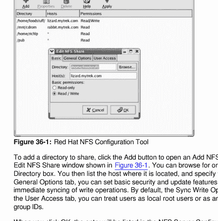

图 36-1：红帽 NFS 配置工具

若要添加共享目录，请单击 **Add**（添加）按钮，打开一个类似图 36-1 中所示的“编辑 NFS 共享”窗口的“添加 NFS 共享”对话框窗口。您可以在 **Directory**（目录）框中浏览或输入要共享的目录。然后，您列出其所在的主机，并指定访问权限。在 **General Options**（常规选项）选项卡中，您可以设置基本安全和更新功能，例如非安全文件锁定或写入操作的即时同步。默认情况下，设置了 **Sync Write Operations On Request**（请求时同步写入操作）选项。在 **User Access**（用户访问）选项卡中，您可以将用户视为本地 root 用户，或视为具有特定用户或组 ID 的匿名用户。

当您单击 **OK**（确定）时，该条目将列在 NFS 服务器配置窗口中。除非您单击 **Apply**（应用），否则更改不会生效。这将为共享目录在 `/etc/exports` 文件中创建一个条目。您随后可以通过选择该条目并单击 **Properties**（属性）来打开编辑对话框，从而更改这些设置中的任何一项。若要保存您的设置，请单击 **Apply**（应用）。

图 36-1 显示了与下一节中描述的 `/etc/exports` 文件中使用的相同条目。此处显示了使用此示例生成的由 NFS 服务器配置工具生成的 `/etc/exports` 文件。

```
/home/foodstuff/    lizard.mytrek.com(rw,sync)
/mnt/cdrom          rabbit.mytrek.com(ro,sync)
/home/richlp        *(ro,sync)
/pub                *(ro,insecure,sync,all_squash)
```

在 **Basic**（基本）、**General Options**（常规选项）和 **User Access**（用户访问）面板中设置的选项将显示为每个条目列出的选项。例如，只读访问为 `ro`，读/写访问为 `rw`。请查阅 NFS 服务器配置帮助文档以获取完整列表。选项列在表 36-1 中。

### NFS 配置：/etc/exports

`/etc/exports` 文件中的条目指定要导出的文件系统以及网络上可以访问它的主机。对于文件系统，请输入其挂载点，即它在宿主系统上被挂载到的目录。其后跟随一个可以访问此文件系统的主机列表以及控制该访问的选项。每个主机后面可能跟有一个用括号括起来的、逗号分隔的导出选项列表。例如，您可能希望授予一个主机只读访问，而授予另一个主机读写访问。如果选项前有 * 符号，则它们适用于任何主机。表 36-1 提供了选项列表。`/etc/exports` 文件中条目的格式如下所示：

```
directory-pathname  host-designation (options)
```

### NFS 主机条目

您可以为同一目录拥有多个主机条目，每个条目都对该目录具有访问权限：

```
directory-pathname  host (options)  host (options)  host (options)
```

在指定主机时，您有很大的灵活性。对于您域名内的主机，您只需使用主机名即可；而对于域名外的主机，您需要使用完全限定域名。您也可以直接使用主机的 IP 地址。除了单个主机，您还可以引用特定域内的所有主机，从而允许整个网络访问。实现这一点的一种简单方法是使用 * 作为主机段，后跟网络域名，例如使用 `*.mytrek.com` 来表示 mytrek.com 网络中的所有主机。除了域名，您还可以使用 CIDR 格式的 IP 网络地址，通过指定子网掩码来表示 IP 地址范围。您也可以使用 NIS 网络组名来引用一组主机。NIS 网络组名前有一个 @ 符号。

```
directory      host (options)
directory      *(options)
directory      *.domain (options)
directory      192.168.1.0/255.255.255.0 (options)
directory      @netgroup (options)
```

### NFS 选项

`/etc/exports` 中的选项作为权限来控制对导出目录的访问。使用 `ro` 选项设置只读访问，使用 `rw` 选项设置读/写访问。`sync` 和 `async` 选项指定写入操作是立即执行（`sync`）还是在服务器准备好处理时执行（`async`）。默认情况下，系统会检查写入请求是否相关，如果相关，则将它们一起写入（`wdelay`）。这可能会降低性能。您可以使用 `no_wdelay` 覆盖此默认设置，使写入在请求时立即执行。如果导出了两个目录，其中一个目录是另一个目录的子目录，则除非明确挂载该子目录（`hide`），否则无法访问该子目录。换句话说，挂载父目录不会使子目录可访问。在子目录也被挂载之前，它保持隐藏状态。您可以使用 `no_hide` 选项克服此限制（尽管这可能会在某些文件系统中引起问题）。如果导出的目录实际上是较大文件系统中的一个子目录，系统会检查其父目录，以确保该子目录是有效目录（`subtree_check`）。此选项在只读文件系统中工作良好，但在允许写入的文件系统中可能会引起问题，因为在这些文件系统中文件名和目录可以更改。您可以使用 `no_subtree_check` 选项取消此检查。

**表 36-1：/etc/exports 选项**

| 常规选项 | 描述 |
|---|---|
| secure | 要求请求源自安全端口，即小于 1024 的端口。默认情况下此选项是开启的。 |
| insecure | 关闭 secure 选项。 |
| ro | 仅允许只读访问。这是默认设置。 |
| rw | 允许读/写访问。 |
| sync | 在请求时执行所有写入。这是默认设置。 |
| async | 在服务器准备好时执行所有写入。 |
| no_wdelay | 立即执行写入，不检查它们是否相关。 |
| wdelay | 检查写入是否相关，如果相关，则等待并一起执行。可能会降低性能。这是默认设置。 |
| hide | 自动隐藏作为另一个导出目录子目录的导出目录。子目录必须明确挂载才能访问。挂载父目录不允许访问。这是默认设置。 |
| no_hide | 不隐藏作为另一个导出目录子目录的导出目录（hide 的反义）。仅对单个主机有效，且可能不可靠。 |


| `subtree_check` | 检查文件系统中的父目录，以验证导出的子目录。这是默认设置。 |
| `no_subtree_check` | 不检查文件系统中的父目录来验证导出的子目录。 |
| `insecure_locks` | 不要求对锁定请求进行身份验证。用于较旧版本的 NFS。 |
| `all_squash` | 将所有 UID 和 GID 映射到匿名用户。适用于通过 NFS 导出的公共 FTP 目录、新闻池目录等。 |
| `no_all_squash` | `all_squash` 的相反选项。这是默认设置。 |
| `root_squash` | 将来自远程 root 用户的请求映射到匿名 UID/GID。这是默认设置。 |
| `no_root_squash` | 关闭 root 压缩。允许 root 用户作为远程 root 进行访问。 |
| `anonuid` `anon gid` | 显式设置用于 `all_squash` 和 `root_squash` 选项的匿名账户的 UID 和 GID。默认值是 nobody 和 nogroup。 |

## NFS 用户级访问

除了常规选项外，还有一些适用于用户级访问的选项。作为一种安全措施，NFS 服务器将客户端的 root 用户视为匿名用户。这被称为用户压缩（squashing）。对于客户端的 root 用户，压缩可防止客户端尝试伪装成 NFS 服务器的 root 用户。如果您希望某个特定客户端的 root 用户对 NFS 服务器具有 root 级控制权，您可以指定 `no_root_squash` 选项。若要防止任何客户端用户尝试伪装成 NFS 服务器上的用户，您可以将他们归类为匿名用户（`all_squash` 选项）。此类匿名用户只能访问属于匿名用户组的目录和文件。

通常，如果客户端系统上的用户在 NFS 服务器上有用户账户，该用户即可挂载并访问其在 NFS 服务器上的文件。然而，NFS 要求该用户的用户 ID 在两个系统上必须相同。如果情况并非如此，他/她将被视为两个不同的用户。为了解决这个问题，您可以使用 NIS 服务，仅在 NIS 密码文件中维护用户 ID 信息（有关 NIS 的信息，请参阅以下部分）。

## NFS /etc/exports 示例

此处展示了 `/etc/exports` 文件中的条目示例。挂载在 `/pub` 目录上的文件系统对所有主机都只开放了只读权限，`/pub` 是常用于公共访问的名称。然而，用户被视为匿名用户（`all_squash`）。挂载在 `/home/foodstuff` 目录上的文件系统则授予了 `lizard.mytrek.com` 计算机读写权限。下一个条目允许 `rabbit.mytrek.com` 以只读方式访问 NFS 服务器的 CD-ROM。最后一个条目允许任何人以安全的方式访问 `/home/richlp`。

```
/pub *(ro,insecure,all_squash,sync)
/home/foodstuff lizard.mytrek.com(rw,sync)
/mnt/cdrom rabbit.mytrek.com(ro,sync)
/home/richlp *(secure,sync)
```

## 应用更改

每次系统启动 NFS 服务器时（通常是系统启动时），`/etc/exports` 文件将被读取，指定的目录将被导出。当目录被导出时，会在 `/var/lib/nfs/xtab` 文件中为其创建一个条目。NFS 正是读取并使用该文件来执行实际的导出操作。`/etc/exports` 中的条目被读取后，会在 `/var/lib/nfs/xtab` 中创建相应的条目。`xtab` 文件维护着实际导出的列表。

如果希望在 `/etc/exports` 文件中立即导出新添加的条目，而不必重启系统，可以使用带有 `-a` 选项的 `exportfs` 命令。添加 `-v` 选项有助于显示 NFS 执行的操作。对于对 `/etc/exports` 文件所做的任何更改，可以使用相同的选项来使其生效。

```
exportfs -a -v
```

如果随后对 `/etc/exports` 文件进行了更改，可以使用 `-r` 选项来重新导出其条目。`-r` 选项会使 `/var/lib/nfs/xtab` 文件与 `/etc/exports` 条目重新同步，并移除其他导出项或选项不同的导出项。

```
exportfs -r -v
```

若要同时导出新增条目并重新导出已更改的条目，可以组合使用 `-r` 和 `-a` 选项。

```
exportfs -r -a -v
```

## 手动导出文件系统

你也可以使用 `exportfs` 命令手动导出文件系统，而无需在 `/etc/exports` 文件中为其创建条目。导出条目将直接添加到 `/var/lib/nfs/xtab` 文件中。使用 `-o` 选项，你可以列出各种权限，随后跟上要导出的主机和文件系统。主机和文件系统之间用冒号分隔。例如，若要手动将 `/home/myprojects` 目录以 ro 和 insecure 权限导出到 `golf.mytrek.com`，可以使用以下命令：

```
exportfs -o rw,insecure golf.mytrek.com:/home/myprojects
```

## NFS 安全：/etc/hosts.allow 和 /etc/hosts.deny

`/etc/hosts.allow` 和 `/etc/hosts.deny` 文件用于限制网络上或互联网上的主机（如果可访问）对你服务器提供的服务的访问。例如，你可以使用 `hosts.allow` 文件来允许特定主机访问你的 FTP 服务器。`hosts.deny` 文件中的条目将明确拒绝特定主机的访问。对于 NFS，你可以通过控制对特定 NFS 守护程序的访问来提供相同级别的安全性。

### 注意

你可以通过让 NFS 传输使用 TCP 而不是 UDP 来进一步确保安全。使用 `tcp` 选项来挂载 NFS 文件系统（默认使用 UDP）。

## 端口映射器服务

第一道防线是控制对端口映射器服务的访问。端口映射器告知主机在系统中的何处可以找到 NFS 服务。限制访问意味着远程主机甚至无法定位 NFS。为了提供较高级别的安全性，你应拒绝除明确允许的主机之外的所有主机的访问。在 `hosts.deny` 文件中，你需要放置以下条目，默认拒绝所有主机的访问。`ALL` 是一个表示所有主机的特殊关键字。

```
portmap:ALL
```

然后在 `hosts.allow` 文件中输入你网络中的主机，或者你希望允许其访问 NFS 服务器的其他主机。再次指定端口映射器服务，然后列出你允许其访问的主机的 IP 地址。你可以列出特定的 IP 地址，或使用子网掩码列出网络范围。以下示例仅允许本地网络（`192.168.0.0`）中的主机以及主机 `10.0.0.43` 访问。你可以用逗号分隔地址。

```
portmap: 192.168.0.0/255.255.255.0, 10.0.0.43
```

端口映射器也用于其他服务，例如 NIS。如果你在 `hosts.deny` 中关闭了对端口映射器的所有访问，且正在运行 NIS 服务，那么你还需要在 `hosts.allow` 中允许访问 NIS 服务。这些服务包括 `ypbind` 和 `ypserver`。此外，如果你支持远程命令，如 `ruptime` 和 `rusers`，你可能还需要为它们添加条目。

此外，建议对特定的 NFS 服务也添加相同级别的控制。在 `hosts.deny` 文件中，你需要为每个服务添加条目，如下所示：

```
mountd:ALL
rqquotad:ALL
statd:ALL
lockd:ALL
```

然后，在 `hosts.allow` 文件中，你可以为每个服务添加条目：

```
mountd: 192.168.0.0/255.255.255.0, 10.0.0.43
rqquotad: 192.168.0.0/255.255.255.0, 10.0.0.43
statd: 192.168.0.0/255.255.255.0, 10.0.0.43
lockd: 192.168.0.0/255.255.255.0, 10.0.0.43
```

## Netfilter 规则

你可以使用 Netfilter 进一步控制访问，通过检查来自特定主机在 NFS 服务所使用的端口上的传输。有关 Netfilter 的解释，请参阅第 19 章。端口映射器使用 111 端口，`nfsd` 使用 2049 端口。如果你有连接到互联网的私人网络并希望将其与互联网隔离，Netfilter 会很有用。通常，特定的网络设备（如以太网卡）专门用于互联网连接。以下示例假设设备 `eth1` 连接到互联网。任何尝试通过 111 和 2049 端口访问的数据包都将被拒绝。

```
iptables -A INPUT -i eth1 -p tcp --dport 111 -j DENY
iptables -A INPUT -i eth1 -p tcp --dport 2049 -j DENY
```

要在本地网络中启用 NFS，你需要允许数据包分片。假设 `eth0` 是用于本地网络的设备，你可以使用以下示例：

```
iptables -A INPUT -i eth0 -f -j ACCEPT
```


### 注意

远程主机上的 `root` 用户可以尝试以具有 `root` 级别权限的 `root` 用户身份访问远程 NFS 服务器。`root_squash` 选项（默认选项）会自动将 `root` 更改为匿名用户。

## 挂载 NFS 文件系统：NFS 客户端

一旦 NFS 将目录提供给不同的主机，这些主机就可以在它们自己的系统上挂载这些目录并访问它们。该主机需要能够作为 NFS 客户端运行。当前的 Linux 内核都内置了 NFS 客户端功能。这意味着任何 NFS 客户端都可以通过执行简单的挂载操作来挂载其有权访问的远程 NFS 目录。

## 自动挂载 NFS：/etc/fstab

你可以通过在 `/etc/fstab` 文件中添加条目或使用显式的 `mount` 命令来挂载 NFS 目录。通过在 `/etc/fstab` 文件中放置条目，你的 NFS 文件系统将被自动挂载。`/etc/fstab` 文件中的 NFS 条目具有 NFS 挂载类型。NFS 文件系统名称由其所处计算机的主机名组成，后跟其挂载目录的路径名。两者之间用冒号分隔。例如，`rabbit.trek.com:/home/project` 指定了 `rabbit.trek.com` 计算机上挂载在 `/home/project` 的文件系统。`/etc/fstab` 文件中 NFS 条目的格式如下。请注意，文件类型是 `nfs`。

| 文件系统 | 挂载点 | 类型 | 选项 | 转储 | 检查 |
| :--- | :--- | :--- | :--- | :--- | :--- |
| 主机:远程目录 | 本地目录 | nfs | 选项 | 0 | 0 |

你可以在 NFS 条目中包含多个特定的 NFS 挂载选项。你可以指定来回传输的数据报大小，以及你的计算机等待宿主系统响应的时间。你还可以指定文件系统是硬挂载还是软挂载。对于硬挂载的文件系统，如果由于某种原因远程系统未能响应，你的计算机会不断尝试建立联系。软挂载的文件系统在经过指定的时间间隔后，会放弃尝试建立联系并发出错误消息。硬挂载是默认设置。正在尝试硬挂载但持续失败的系统将会停止响应用户输入，因为它会不断尝试完成挂载。因此，软挂载可能更可取，因为它们会简单停止对持续失败的挂载尝试。表 36-2 和 `mount` 手册页列出了这些 NFS 客户端选项。它们与之前提到的 NFS 服务器选项不同。

以下是一个 NFS 条目的示例。远程系统是 `rabbit.mytrek.com`，文件系统挂载在 `/home/projects`。该文件系统将在本地系统上作为 `/home/dylan/projects` 目录进行挂载。`/home/dylan/projects` 目录必须已经在本地系统上创建。系统类型是 NFS，`timeo` 选项指定本地系统最多等待 20 个十分之一秒（两秒）以获取响应。该挂载是软挂载，并且可以被 NFS 中断。

```
rabbit.mytrek.com:/home/projects   /home/dylan/projects   nfs   soft,intr,timeo=20
```

## 手动挂载 NFS：mount

你还可以使用带有 `-t nfs` 选项的 `mount` 命令来显式挂载 NFS 文件系统。要显式挂载上述条目，请使用以下命令：

```
# mount -t nfs -o soft,intr,timeo=20 \
        rabbit.mytrek.com:/home/projects   /home/dylan/projects
```

当然，你可以使用 `umount` 命令卸载 NFS 目录。你可以指定本地挂载点或远程主机和目录，如下所示：

```
umount /home/dylan/projects
umount rabbit.mytrek.com:/home/projects
```

**提示** 在 Red Hat 系统中，你可以使用 `/etc/rc.d/init.d/netfs` 脚本一次性挂载和卸载所有的 NFS 文件系统，该脚本可以通过 `service` 命令调用。

## 按需挂载 NFS：autofs

你也可以使用自动挂载服务 `autofs` 来挂载 NFS 文件系统。这需要在客户端进行额外的配置。`autofs` 服务只会在你尝试访问文件系统时才进行挂载。对指定目录执行目录更改操作（`cd`）将触发挂载操作，并在当时挂载远程文件系统。

`autofs` 服务通过主文件来配置，主文件列出了映射文件，而映射文件又列出了要挂载的文件系统。`/etc/auto.master` 文件是 `autofs` 的主文件。主文件将列出可以挂载文件系统的根路径名，并为每个路径名指定一个映射文件。映射文件随后将列出键（子目录）、挂载选项以及可以挂载在该根路径目录中的文件系统。在某些发行版中，`/auto` 目录已经被实现为自动挂载文件系统的根路径名。如果你愿意，可以在 `/etc/auto.master` 文件中添加你自己的条目以及你自己的映射文件。你会发现 `/etc/auto.master` 文件中包含针对 `/auto` 目录的以下条目，其中将 `auto.misc` 列为其映射文件：

```
/auto    auto.misc    --timeout 60
```

在映射文件之后，你可以添加选项，如前面的示例所示。`timeout` 选项指定在尝试自动卸载前要等待多少秒的非活动时间。

在映射文件中，你列出键、挂载选项和要挂载的文件系统。例如，要将 `rabbit.mytrek.com` 主机上的 `/home/projects` 目录挂载到 `/auto/projects` 目录，你会使用以下条目：

```
projects  soft,intr,timeo=20    rabbit.mytrek.com:/home/projects
```

你也可以在 master 文件中为 NFS 文件系统创建新条目，如下所示：

```
/myprojects  auto.myprojects  --timeout 60
```

然后你需要创建一个 `/etc/auto.myprojects` 文件，并在其中放入 NFS 文件系统挂载的条目，例如：

```
dylan  soft,intr,rw  rabbit.mytrek.com:/home/projects
newgame  soft,intr,ro  lizard.mytrek.com:/home/supergame
```

**提示** `autofs` 服务可用于任何文件系统，包括软盘和 CD-ROM。参见第 30 章。

### 表 36-2：NFS 挂载选项

| 选项 | 描述 |
|---|---|
| `rsize=n` | NFS 从 NFS 服务器读取文件时使用的字节数。默认值为 1,024 字节。大小为 8,192 可以大大提高性能。 |
| `wsize=n` | NFS 向 NFS 服务器写入文件时使用的字节数。默认值为 1,024 字节。大小为 8,192 可以大大提高性能。 |
| `timeo=n` | 在超时后发送第一次重传之前的十分之一秒值。默认值是零点七秒。 |
| `retry=n` | 在放弃之前重试 NFS 挂载操作的分钟数。默认是 10,000 分钟（一周）。 |
| `retrans=n` | 在执行主要超时（默认值为 3）之前，NFS 挂载操作的重传次数或次要超时次数。此时，连接被取消或显示“服务器无响应”消息。 |
| `soft` | 使用软挂载挂载系统。 |
| `hard` | 使用硬挂载挂载系统。这是默认设置。 |
| `intr` | 允许 NFS 中断文件操作并返回给调用程序。默认不允许中断文件操作。 |
| `bg` | 如果第一次挂载尝试超时，则继续在后台尝试挂载。默认是在不转入后台的情况下失败。 |
| `tcp` | 使用 TCP 协议而不是默认的 UDP 协议挂载 NFS 文件系统。 |

## 网络信息服务业：NIS

在支持 NFS 的网络中，许多资源和设备由相同的系统共享。通常，每个系统都需要针对每个设备或资源有自己的配置文件。更改将需要单独更新每个系统。然而，NFS 提供了一种称为网络信息系统（NIS）的特殊服务，它维护整个网络的这些配置文件。对于更改，你只需要更新 NIS 文件。NIS 适用于大多数管理任务所需的信息，例如与用户、网络访问或设备相关的任务。例如，你可以使用 NIS 服务维护用户和密码信息，只需更新那些 NIS 密码文件即可。

> **提示** `NIS+` 是 NIS 更高级的形式，提供对加密和身份验证的支持。然而，它更难管理。

NIS 由 Sun Microsystems 开发，最初被称为 Sun 的黄页（YP）。NIS 文件存储在 NIS 服务器（NIS 服务器有时仍被称为 YP 服务器）上。网络中的单个系统使用 NIS 客户端向 NIS 服务器发出请求。NIS 服务器在称为映射（maps）的特殊数据库文件中维护其信息。Linux 存在针对 NIS 客户端和服务器两种版本的实现。Linux NIS 客户端可以轻松地连接到使用 NIS 的任何网络。


NIS 客户端通常作为大多数 Linux 发行版初始安装的一部分进行安装。NIS 客户端程序包括 `ypbind`（NIS 客户端守护进程）、`yppwhich`、`ypcat`、`yppoll`、`ypmatch`、`yppasswd` 和 `ypset`。每个都有自己的 Man 页面，详细介绍其用途。NIS 服务器程序包括 `ypserv`（NIS 服务器）、`ypinit`、`yppasswd`、`yppush`、`ypxfr` 和 `netgroup`——每个也有自己的 Man 页面。你可以使用 `service` 命令启动和停止 `ypbind` 客户端守护进程和 `ypserv` NIS 服务器。或者，你可以使用 `redhat-config-services` 来启动和停止 NIS 客户端和服务器守护进程。

```
service ypbind start
```

```
service ypserv start
```

> **提示** 你可以使用 Red Hat 的 `authconfig-gtk` 来指定你网络上的远程 NIS 服务器。

### NIS 服务器

在设置 NIS 服务器时，你有很大的灵活性。如果你的网络规模较小，你可能只需要一个 NIS 域，为此你需要一个 NIS 服务器。对于更大的网络，你可以将网络划分为多个 NIS 域，每个域都有自己的服务器。即使你只有一个域，你可能也希望有几个 NIS 从服务器。对于一个 NIS 域，你可以有一个主 NIS 服务器和几个 NIS 从服务器。从服务器可以作为备份，以防主服务器宕机。从服务器只包含在 NIS 主服务器上配置的配置文件副本。

配置 NIS 服务器涉及几个步骤，如下所示：

1. 定义 NIS 服务器将工作的 NIS 域名称。
2. 启动 `ypserv` 守护进程。
3. 在 `/var/yp/Makefile` 文件中，设置任何 NIS 服务器选项并指定要管理的配置文件。
4. 使用 `ypinit` 创建配置文件的 NIS 版本。

#### 定义 NIS 域

首先，你必须定义一个 NIS 域名称。你可以通过在 `/etc/sysconfig/network` 文件中定义 `NIS_DOMAIN` 变量，使 NIS 域在系统启动时定义。将此变量赋值为你想要给 NIS 域的名称。以下示例定义了名为 `myturtles.nis` 的 NIS 域：

```
NIS_DOMAIN=myturtles.nis
```

在最初设置服务器时，你可能希望在不重新启动系统的情况下定义 NIS 域名称。你可以使用 `domainname` 命令完成此操作，如下所示：

```
domainname myturtles.nis
```

你可以使用 `ypserv` 启动脚本启动 NIS 服务器：

```
service ypserv start
```

#### 设置 NIS 服务器选项

然后编辑 `/var/yp/Makefile` 文件，以选择 NIS 服务器将维护的配置文件，并设置任何 NIS 服务器选项。标准选项以及最常用的配置文件通常已经设置好。

首先列出 NIS 服务器选项。`NOPUSH` 选项将设置为 `true`，表示没有从 NIS 服务器。如果你正在为此域设置任何从 NIS 服务器，你必须将此选项设置为 `no`：

```
NOPUSH = true
```

最小用户和组 ID 设置为 500。这些使用 `MINUID` 和 `MINGID` 变量设置：

```
MINUID=500
MINGID=500
```

大多数发行版使用 shadow 密码和 shadow 组文件来加密密码和组。`MERGE_PASSWD` 和 `MERGE_GROUP` 设置将设置为 `true`。NIS 会将 shadow 密码信息合并到其密码文件中：

```
MERGE_PASSWD=true
MERGE_GROUP=true
```

然后使用 `YPSRCDIR` 和 `YPPWDDIR` 变量定义 NIS 将找到密码和其他配置文件的目录。通常，`/etc` 目录保存你的配置文件：

```
YPSRCDIR = /etc
YPPWDDIR = /etc
```

随后列出 NIS 可以管理的配置文件。这里，你会发现诸如 `PASSWD`（密码）、`GROUP`（组）和 `PRINTCAP`（打印机）等条目。以下是一些条目的示例：

```
GROUP = $(YPPWDDIR)/group
PASSWD = $(YPPWDDIR)/passwd
SHADOW = $(YPPWDDIR)/shadow
GSHADOW = $(YPPWDDIR)/gshadow
ALIASES = /etc/aliases
ETHERS = $(YPSRCDIR)/ethers   # ethernet addresses (for rarpd)
BOOTPARAMS = $(YPSRCDIR)/bootparams # for booting Sun boxes (bootparamd)
HOSTS = $(YPSRCDIR)/hosts
NETWORKS = $(YPSRCDIR)/networks
PRINTCAP = $(YPSRCDIR)/printcap
PROTOCOLS = $(YPSRCDIR)/protocols
```

#### 指定共享文件

实际在网络上共享的文件列在 `all:` 条目中，该条目位于配置文件列表之后。只有部分定义的文件被列共享，即 `all:` 后第一行列出的那些。其余的行会自动被注释掉（以 `#` 符号开头）。你可以通过删除 `#` 符号或将其条目移动到第一行来添加文件。

```
all: passwd group hosts rpc services netid protocols mail \
  # netgrp shadow publickey networks ethers bootparams printcap \
  # amd.home auto.master auto.home auto.local passwd.adjunct \
```

#### 时区、区域设置和子网掩码

请确保不要修改 Makefile 的其余部分。

#### 创建 NIS 数据库

然后，输入带有 `-m` 选项的 `ypinit` 命令来创建由 NIS 配置文件组成的 NIS 数据库。您的 NIS 服务器将被检测到，然后您将被要求输入此 NIS 域中使用的任何从 NIS 服务器的名称。如果有，请输入它们。完成后，按 CTRL-D。然后创建 NIS 数据库文件。

```
ypinit -m
```

对于 NIS 从服务器，您应使用

```
ypinit -s masterhost
```

如果您收到以下错误，这很可能意味着您的 NIS 服务器没有运行。请确保在运行 `ypinit` 之前启动 `ypserv`。

```
failed to send 'clear' to local ypserv: RPC: Program not registered
```

如果后来需要更新 NIS 服务器文件，请更改到 `/var/yp` 目录并发出 `make` 命令。

```
cd /var/yp
```

```
make
```

#### 控制访问

`/var/yp/securenets` 文件使主机能够访问您的 NIS 服务器。主机可以按网络引用或单独引用。条目由子网掩码和 IP 地址组成。例如，您可以使用以下条目授予本地网络中所有主机的访问权限：

```
255.255.255.0  192.168.1.0
```

对于单个主机，您可以使用掩码 255.255.255.255 或术语 "host"，如下所示：

```
host  192.168.1.4
```

控制不同主机如何访问 NIS 共享数据在 `/etc/ypserv.conf` 中确定。

#### Netgroups

您可以使用 NIS 来设置 netgroups，这允许您创建网络级的用户组。与普通组在单独的主机上本地创建不同，NIS netgroup 可用于网络范围的服务。例如，您可以使用 NIS netgroups 来控制对 NFS 文件系统的访问。Netgroups 在 `/etc/netgroup` 文件中定义。条目由 netgroup 名称组成，后面跟着成员标识符，由三个部分组成：主机、用户和 NIS 域：

```
group  (host, user, NIS-domain) (host, user, NIS-domain) ...
```

例如，在 NIS 域 `myturtles.nis` 中，要定义一个名为 `myprojects` 的组，该组由主机 `rabbit` 上的用户 `chris` 和主机 `lizard.mytrek.com` 上的用户 `george` 组成，您应使用以下内容：

```
myservers (rabbit,-,) (turtle.mytrek.com,-,)
```

然后，您可以通过在 netgroup 名称前加 `@` 符号来在各种配置文件中引用不同的 netgroups，如下所示：

```
@newgame
```

### NIS 客户端


为了让主机使用您网络上的 NIS，首先需要指定该主机上的 NIS 域名。此外，您的 NIS 客户端需要知道您的 NIS 服务器的名称。如果您安装 Linux 时网络已经在运行 NIS，您可能在安装过程中已经输入了此信息。

### 指定 NIS 域和服务器

在 Red Hat 上，您可以使用 `authconfig-gtk` 工具指定 NIS 域名和服务器，您可以从系统设置窗口访问该工具。在该窗口中，选择 Authentication。这将打开 Authentication Configuration 窗口。在 User Information 面板上，点击 Configure NIS 按钮打开一个对话框，您可以在其中输入 NIS 域名称以及 NIS 服务器。请务必也在 User Information 面板上启用 NIS。NIS 域将保存在 `/etc/sysconfig/network` 文件中，NIS 服务器则保存在 `/etc/yp.conf` 文件中。

### 访问服务器

每个 NIS 客户端主机然后在您的网络上必须运行 `ypbind` NIS 客户端以访问服务器。在客户端的 `/etc/yp.conf` 文件中，您需要指定它将使用的 NIS 服务器。以下条目将引用位于 `192.168.1.1` 的 NIS 服务器：

```
ypserver 192.168.1.1
```

或者，您可以指定 NIS 域名及其使用的服务器：

```
domain mydomain.nis server servername
```

`authconfig-gtk` 工具将在 `/etc/yp.conf` 中为使用 `turtle.mytrek.com` 服务器的 `myturtles.nis` NIS 域创建以下条目：

```
domain myturtles.nis server turtle.mytrek.com
```

要启动 NIS 客户端，请运行 `ypbind` 脚本：

```
service ypbind start
```

然后，为了检查一切正常，您可以使用 `ypcat` 尝试列出 NIS 密码文件：

```
ypcat passwd
```

您可以使用 `ypcat` 列出任何 NIS 配置文件。`ypwhich` 命令将显示您的客户端正在使用的 NIS 服务器名称。`ypmatch` 可用于在配置文件中查找特定条目。

```
ypmatch cecelia passwd
```

用户可以使用 `yppasswd` 命令更改 NIS `passwd` 文件中的密码。其工作方式与 `passwd` 命令相同。您还必须运行 `yppasswd` 守护进程。

### 使用 nsswitch.conf 指定配置文件

为了确保客户端访问特定配置文件的 NIS 服务器，您应在 `/etc/nsswitch.conf` 文件中指定该文件的 `nis` 条目。`nisplus` 选项指的是 Red Hat 当前使用的 NIS 版本 3。`nis` 选项用于指代较旧的 NIS 版本 2。`/etc/nsswitch.conf` 文件指定主机应查找某些类型信息的位置。例如，以下条目说明首先检查本地配置文件（`files`），然后从 NIS 服务器（`nisplus`）查找密码数据：

```
passwd: files nisplus
```

`files` 指定先使用系统自身的文件，即本地主机上的文件。`nis` 指定在 NIS 文件中查找条目，访问 NIS 服务器。`nisplus` 指定使用由 NIS+ 服务器维护的 NIS+ 文件。`dns` 指定执行 DNS 查找；它只能用于包含主机名的文件，如 `hosts`。以下是一些标准条目：

```
passwd:      files nisplus
shadow:      files nisplus
group:       files nisplus

hosts:       files nisplus dns
bootparams:  nisplus [NOTFOUND=return] files

ethers:      files
netmasks:    files
networks:    files
protocols:   files nisplus
rpc:         files
services:    files nisplus
netgroup:    files nisplus
publickey:   nisplus
automount:   files nisplus
aliases:     files nisplus
```

# 第 37 章：Samba

## 概述

通过 Samba，您可以将 Microsoft Windows 网络上的 Windows 客户端连接到由 Linux Samba 服务器控制的服务，如共享文件、系统和打印机，同时允许 Linux 系统访问 Windows 系统上的共享文件和打印机。Samba 是一组 Linux 工具，允许您通过 Windows 网络与 Windows 系统进行通信。实际上，Samba 使 Linux 系统或网络表现得像一个 Windows 服务器，使用与 Windows 网络相同的协议。虽然大多数 Unix 和 Linux 系统使用 TCP/IP 协议进行网络通信，但 Microsoft 的 Windows 网络使用一种不同的协议，称为服务器消息块（SMB）协议，该协议实现了运行 Windows 的个人电脑局域网（LAN）。SMB 使用一种称为网络基本输入输出系统（NetBIOS）的网络接口，允许 Windows 个人电脑共享资源，如打印机和磁盘空间。在这样的网络中，一台 Windows 个人电脑可以访问另一台 Windows 个人电脑磁盘驱动器的部分，就像它是自己的磁盘一样。SMB 最初是为小型局域网设计的。为了将其连接到更大的网络，包括那些有 Unix 系统的网络，Microsoft 开发了通用互联网文件系统（CIFS）。CIFS 仍然使用 SMB 和 NetBIOS 进行 Windows 网络通信。Andrew Tridgell 希望将他的 Linux 系统连接到 Windows 个人电脑，因此他编写了一个他称为 Samba 的 SMB 客户端和服务器。Samba 允许 Unix 和 Linux 系统连接到这样的 Windows 网络，就像它们是 Windows 个人电脑一样。Unix 系统可以共享 Windows 系统上的资源，就像它们是另一台 Windows 个人电脑一样。Windows 个人电脑也可以访问 Unix 系统上的资源，就像它们是 Windows 系统一样。Samba 实际上已经成为一个专业级别、开源且免费的 CIFS 版本。它也比 CIFS 运行得快得多。Samba 有效地使您能够使用 Linux 或 Unix 服务器作为运行在 Windows 网络上一组 Windows 机器的网络服务器。您还可以使用它在 Linux 系统上与其他 Windows 个人电脑共享文件，或者从 Linux 系统访问 Windows 个人电脑上的文件，以及 Windows 个人电脑之间也是如此。在 Linux 系统上，`smbfs` 文件系统使您能够实际上在您的文件系统中挂载远程 SMB 共享目录。然后您可以像访问本地系统上的目录一样访问它。

## Samba 文档

您可以从位于 [www.samba.org](http://www.samba.org) 和 [ftp.samba.org](http://ftp.samba.org) 的 Samba 网站和 FTP 站点获取广泛的文档和当前版本。Red Hat 的 RPM 软件包可从 Red Hat 及 RPM 存储库（参见第 1 章）获取。大多数 Linux 发行版也包含 Samba。还可以从 SMB 新闻组 `comp.protocols.smb` 获取其他信息。软件包附带了广泛的文档，并安装在您的系统中，通常位于带有 Samba 版本名称的子目录下，路径为 `/usr/share/doc` 目录。在这里，您可以找到广泛的 HTML 和文本格式文档，以及众多示例和当前的常见问题解答（FAQ）。Samba HOW-TO 文档也可在 [www.tldp.org](http://www.tldp.org) 上获取。示例包括针对不同配置类型的 `smb.conf` 文件示例。SWAT 配置工具的首页还提供基于 Web 页面的 Samba 文档，以及针对不同功能特性的上下文帮助。

## Samba 应用程序


Samba 软件包由两个服务器守护进程和多个实用程序组成（参见表 37-1）。其中一个守护进程 `smbd` 向支持 SMB 的 SMB 客户端及其他系统（如 Windows）提供文件和打印服务。`nmbd` 实用程序是一个提供 NetBIOS 名称解析和服务浏览器支持的守护进程。`smbclient` 实用程序使 Linux 客户端能够以类似 FTP 的方式访问 Samba 服务。`smbmount` 和 `smbumount` 允许 Linux 客户端挂载和卸载 Samba 共享目录。`smbstatus` 实用程序显示 SMB 服务器的当前状态以及谁正在使用它。您使用 `testparm` 来测试您的 Samba 配置。`smbtar` 是一个 shell 脚本，直接将 SMB/CIFS 共享资源备份到 Unix 磁带驱动器。您使用 `nmblookup` 将 Windows PC 的 NetBIOS 名称映射到其 IP 地址。软件包中还包含 Samba Web 管理工具（`SWAT`）和 `redhat-config-samba`。这使您可以使用 Web 页面或 GUI 界面创建和维护 Samba 配置文件 `/etc/samba/smb.conf`。Samba 配置文件保存在 `/etc/samba` 目录中。

> **注意**
>
> 若要使用 `redhat-config-packages` 安装 Samba，请选择 Windows File Server 条目。

Samba 提供四种主要服务：文件和打印服务、认证和授权、名称解析以及服务公告。SMB 守护进程 `smbd` 提供文件和打印服务，以及这些服务的认证和授权。这意味着网络上的用户可以共享文件和打印机。您可以通过要求用户提供密码来控制对这些服务的访问。当用户尝试访问共享目录时，系统会提示输入密码。控制可以以共享模式或用户模式实施。共享模式为共享资源设置一个密码，然后允许拥有该密码的任何用户访问该资源。用户模式为每个用户提供不同的密码。Samba 为此维护自己的密码文件：`/etc/samba/smbpasswd`。

名称解析和服务公告由 `nmbd` 服务器处理。名称解析本质上是用 IP 地址解析 NetBIOS 名称。服务公告（也称为浏览）是将网络上可用服务列表通知给已连接的 Windows PC（以及通过 Samba 连接的 Linux PC）的方式。

Samba 还包括 `winbind` 守护进程，它允许 Samba 服务器使用 Windows 域提供的认证服务。Samba 服务器不再维护自己的用户集来允许访问，而是可以利用 Windows 域认证服务来认证用户。

> **注意**
>
> 如果您想从 `www.samba.org` 下载压缩归档（`.tar.gz`）中的源代码或二进制文件，该归档将解压到其自己的 `samba` 子目录中。要使用它，请将归档解压到 `/usr/local` 等软件目录中。务必在 `PATH` 中添加 `/usr/local/samba/bin`。或者，您可以将 `samba/bin` 文件复制到 `/usr/bin`，但 `nmb` 和 `smbd` 除外，这两个文件应复制到 `/usr/sbin`。

### 表 37-1：Samba 应用程序

| 应用程序 | 描述 |
|---|---|
| `smbd` | 向 SMB 客户端提供文件和打印服务的 Samba 服务器守护进程 |
| `nmbd` | 提供 NetBIOS 名称解析和服务浏览器支持的 Samba 守护进程 |
| `smbclient` | 提供 Linux 客户端以类似 FTP 方式访问 Samba 服务 |
| `smbmount` | 在 Linux 客户端上挂载 Samba 共享目录 |
| `smbumount` | 卸载 Linux 客户端上挂载的 Samba 共享目录 |
| `smbpasswd` | 修改 Samba 服务器上的 SMB 加密密码 |
| `smbstatus` | 显示 SMB 网络连接的最新状态 |
| `smbrun` | `smbd` 与外部程序之间的接口程序 |
| `testparm` | 测试 Samba 配置文件 `smb.conf` |
| `smbtar` | 直接将 SMB/CIFS 共享资源备份到 Unix 磁带驱动器 |
| `nmblookup` | 将 Windows PC 的 NetBIOS 名称映射到其 IP 地址 |
| `redhat-config-samba` | Samba GUI 配置工具（系统设置：服务器设置：Samba 服务器） |
| `SWAT` | 用于通过 Web 浏览器配置 `smb.conf` 的 Samba Web 管理工具；允许您使用 Web 页面界面创建和维护 Samba 配置文件 `smb.conf` |
| `winbind` | 使用 Windows 域提供的认证服务 |

#### 启动 Samba

对于简单的 Samba 设置，您应该可以使用 Linux 发行版软件包中安装的默认 `smb.conf` 文件。但是，如果您需要做出更改，必须重新启动 Samba 服务器以使更改生效。启动、停止和重新启动 Samba 服务器由 `/etc/rc.d/init.d/smb` 脚本管理，使用 `start`、`stop` 和 `restart` 选项。在 Red Hat 上，您可以直接运行 `smb` 脚本，如下所示：

```bash
service smb restart
```

在 Red Hat 上，您还可以使用桌面服务配置工具（`redhat-config-services`）来启动和停止 Samba。

为确保名称解析，您可以将主机的名称及其 IP 地址输入 `/etc/hosts` 文件。在 Windows 系统中，`lmhosts` 条目由 IP 地址和系统的 NetBIOS 名称组成，即该名称在 Microsoft 网络中已知的名称。对于您的 Linux 系统，您可以输入 IP 地址和 Linux 系统的主机名。

#### 从 Linux 访问 Samba

要测试从 Linux 系统的连接，您可以使用 `smbclient` 命令查询 Samba 服务器。要访问 Samba 服务器上用户的家目录，请使用 Samba 服务器的 IP 或主机名地址，以及 `homes` 部分。使用 `-U` 选项指定要连接到系统的用户，如下所示：

```bash
smbclient //turtle.mytreek.com/homes -U dylan
```

然后系统会提示您输入密码。如果客户端密码与服务器密码不同，请使用服务器密码。连接后，您将看到如下所示的 SMB 客户端提示符。然后您可以访问用户家目录中的文件：

```text
smb: \>
```

#### 从 Windows 访问 Samba

要为 Windows 客户端设置连接，您需要指定 Windows 工作组名称并配置密码。工作组名称是在 Windows 桌面的“网上邻居”中的“整个网络”窗口中显示的该名称（在 Windows 2000、NT 和 XP 中为“我的网络位置”）。在 `smb.conf` 文件中，您在全局部分的工作组条目中指定工作组名称。工作组名称应为大写，不超过八个字符，且不含空格。

然后您可以重新启动 Samba 服务器。在 Windows 客户端上，您会在“网上邻居”中的“整个网络”文件夹中看到工作组名称。在工作组内部有 Samba 服务器的图标，在该图标内部有用户目录的图标，如 `smb.conf` 文件中的 `homes` 部分所指定。

#### Samba 配置文件和工具

Samba 配置选项保存在 `/etc/samba/smb.conf` 文件中。您编辑此文件以对配置进行更改。完成任何更改后，您应该使用 `testparm` 程序测试您的 `smb.conf` 文件。`testparm` 程序检查您的配置条目的有效性。默认情况下，`testparm` 使用 `/etc/samba/smb.conf` 文件，尽管您可以将不同的配置文件作为参数提供：

```bash
testparm
```

要检查网络连接，请使用 `smbstatus` 命令。此命令返回所有活动 SMB 连接的列表。

**注意** `/etc/samba/smbusers` 文件将 Windows 网络用户名与 Linux Samba 服务器上对应的用户关联起来。例如，`admin` 和 `administrator` 被等同于 Linux `root` 用户。

# ABC Amber CHM 转换器试用版

请注册以移除此横幅。

`http://www.processtext.com/abchm.html`

#### 密码


由于在 Microsoft 网络中实施了密码加密，Windows 客户端与 Samba 服务器之间的连接变得更加复杂。当前版本的 Windows 操作系统，包括升级版本的 Windows NT、2000、98 和 95，现在默认要求使用加密密码。另一方面，Samba 默认使用未加密的密码。为了启用 Samba 服务器和 Windows 客户端之间的通信，您必须将 Windows 客户端更改为使用未加密密码，或者将 Samba 服务器更改为使用加密密码。更安全的做法是在 Samba 服务器上实施加密密码，尽管这需要更多的管理工作。虽然默认情况下未分发，但 Samba 可以构建为支持 SSL。这种启用 SSL 的 Samba 提供支持加密的 SSL 网络通信。启用 SSL 的 Samba 包含几个 SSL 特定的配置选项，每个选项前都有 `ssl` 一词。例如，`ssl cipher` 允许您确定可使用的密码，而 `ssl CA certFile` 指定证书文件。

Samba 还提供自己的 Samba 密码 PAM 模块，`pam_smbpass.o`。使用此模块，您可以为 Samba 密码提供 PAM 身份验证支持，从而允许在 PAM 控制的网络上使用 Windows 主机。该模块可用于 PAM samba 文件中的身份验证和密码管理。PAM samba 文件中的以下条目将使用 Samba 密码数据库实施 PAM 身份验证和密码：

```
auth required pam_smbpass.so nodelay
password required pam_smbpass.so nodelay
```

请务必在 `smb.conf` 文件中启用 PAM：

```
obey pam restrictions = yes
```

## Samba 加密密码：smbpasswd

如果您使用的是用户级安全机制而不是共享级安全机制，则加密密码将发挥作用。在用户级安全机制下，Windows 客户端对 Samba 服务器资源的访问仅允许给该客户端上的用户。每个 Windows 客户端上的用户必须在 Samba 服务器上拥有相应的用户帐户。用户使用其 Windows 帐户登录，然后可以登录到其 Samba 服务器帐户。用户必须提供用户名和密码才能登录。他们的用户名和密码必须在 Samba 服务器的 `/etc/samba/smbpasswd` 文件中注册。您使用 `smbpasswd` 命令添加这些密码。

## 创建 Samba 密码文件

为了在 Samba 上实施加密密码，Samba 服务器需要维护用户密码的加密版本，供 Windows 客户端使用。该加密密码文件为 `/etc/samba/smbpasswd`。可以使用 `smbpasswd` 命令为不同用户添加或更改 Samba 密码。最初，您应该生成 Samba 密码文件，使其包含所有当前 Samba 用户的条目。对于这项任务，您使用 `mksmbpasswd.sh` 脚本。您输入 Samba 服务器的 `/etc/passwd` 文件的内容到该脚本中，它会生成可用于加密密码的条目。您使用重定向 `>` 来创建加密文件。在以下示例中，`/etc/samba/smbpasswd` 文件最初是由 `mksmbpasswd.sh` 脚本生成的。使用带有管道操作的 `cat` 命令将 `/etc/passwd` 文件的内容输入到 `mksmbpasswd.sh` 脚本中：

```
cat /etc/passwd | mksmbpasswd.sh > /etc/samba/smbpasswd
```

如果您的用户及其密码由 NIS 管理，您将使用 `ypcat` 命令访问用户密码，如下所示：

```
ypcat passwd | mksmbpasswd.sh > /etc/samba/smbpasswd
```

然后您需要更改此文件的权限，以防止未经授权的访问。`600` 选项仅允许 `root` 用户进行读取和写入访问：

```
chmod 600 /etc/samba/smbpasswd
```

## 添加和更改密码

此时，`/etc/samba/smbpasswd` 将包含所有当前用户的条目，但密码字段为虚拟值。然后使用 `smbpasswd` 命令添加或稍后更改加密密码。要为特定用户添加密码，您使用 `smbpasswd` 命令加上用户名：

```
# smbpasswd dylan
```

```
新 SMB 密码: new-password
重复新 SMB 密码: new-password
```

用户可以使用 `smbpasswd` 更改自己的密码。以下示例展示了如何使用 `smbpasswd` 更改您的 Samba 密码。如果用户没有 Samba 密码，只需按 ENTER 键即可。

```
$ smbpasswd
```

```
旧 SMB 密码: old-password
新 SMB 密码: new-password
重复新 SMB 密码: new-password
```

## 配置加密密码

您还必须确保 Samba 已配置为使用加密密码。将 `encrypt passwords` 选项设置为 `yes`，并指定 SMB 密码文件。这些选项已在 `/etc/samba/smb.conf` 文件中设置，但在以下部分中描述，但被前面的 `;` 符号注释掉了。只需找到这些行并删除行首的 `;` 符号：

```
encrypt passwords = yes
smb passwd file = /etc/samba/smbpasswd
```

您也可以使用 SWAT 进行此更改。在 GLOBALS 页面中，从 Encrypt Password 条目的弹出菜单中选择 Yes。然后单击 Commit Changes 按钮保存更改。

请务必使用以下命令重启 Samba 服务器：

```
service smb restart
```

## 使用 redhat-config-samba 配置 Samba

Red Hat 现在提供了一个简单的配置工具，用于提供关于您的 Samba 服务器基本信息，以及添加 Samba 用户和指定 Samba 共享。您可以从“服务器设置”菜单中的 Samba 条目启动 `redhat-config-samba`，该菜单可从“系统设置”菜单访问。`redhat-config-samba` 工具将列出您的服务器上的所有共享。您可以使用顶部的按钮来管理共享，添加新共享或删除当前共享。如果删除它们，实际目录不会被移除：它们只是失去了作为共享目录的状态。在图 37-1 中，一个名为 `/grouppic/vacation` 的共享目录已设置好，具有只读访问权限。

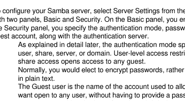

图 37-1: redhat-config-samba

### 使用 redhat-config-samba 配置服务器

要配置您的 Samba 服务器，请从偏好设置菜单中选择服务器设置。这将打开一个包含两个面板的窗口：基本和安全。在基本面板上，您输入 Samba 服务器工作组名称。在安全面板上，您指定身份验证模式、密码加密选项以及来宾帐户名称，连同身份验证服务器。

如后文详细解释，身份验证模式指定访问级别，可以是用户、共享、服务器或域。用户级访问通过用户密码限制访问，而共享访问则向任何来宾开放访问。通常，您会选择加密密码，而不是以明文形式通过您的网络传输。Guest 用户是允许访问您希望向任何用户开放的共享或打印机所使用的帐户名称。弹出菜单将列出您当前的所有用户，默认选择为 `nobody`。

### 使用 redhat-config-samba 添加 Samba 用户

使用 `redhat-config-samba`，您可以轻松添加用户和共享。用户级访问将用户限制为在 Samba 服务器上也有帐户的用户。Samba 维护自己的用户密码列表。为了提供用户 Samba 访问权限，您需要将该用户注册为 Samba 用户。从偏好设置菜单中选择 Samba 用户以打开 Samba 用户窗口，并单击添加用户按钮。在这里，您输入 Unix 用户名、Windows 用户名和 Samba 密码。还有一个额外的框用于确认 Samba 密码。Unix 用户名是一个弹出窗口，列出您 Samba 服务器上的所有用户。

### 使用 redhat-config-samba 指定 Samba 共享

单击添加以添加共享，或从文件菜单中选择添加共享。在基本面板上，您可以输入要在 Samba 服务器上共享的目录，指定完整路径名。浏览按钮允许您搜索并选择目录。您还可以将权限设置为只读或读/写。在访问面板上，您可以限制某些用户的访问或允许所有用户访问。系统上的所有 Samba 用户将以复选框列出，您可以选择要授予访问权限的用户。


## ABC Amber CHM 转换器试用版

请注册以移除此横幅。

http://www.processestext.com/abcchm.html

## Samba smb.conf 配置文件


您使用位于`/etc/samba`目录中的`smb.conf`文件来配置 Samba 守护进程。该文件分为两个基本部分：一个用于全局选项，另一个用于共享服务。共享服务，也称为 shares，可以是文件空间服务（客户端将其用作其本地文件系统的扩展）或可打印服务（客户端用于访问运行服务器的主机上的打印服务）。文件空间服务是一个目录，客户端可被授予访问权限；他们可以将其中的空间用作其本地文件系统的扩展。可打印服务为客户端提供对打印服务的访问，例如由 Samba 服务器管理的打印机。

`/etc/samba/smb.conf`文件保存各种共享资源的配置，以及适用于所有资源的全局选项。Linux 在您的`/etc/samba`目录中安装一个`smb.conf`文件。该文件包含为您的发行版使用的默认设置。您可以编辑该文件以根据自己的需求自定义配置。许多条目都用分号或`#`符号注释，您可以删除初始注释符号以使其生效。不是直接编辑文件，您可能希望使用 SWAT 配置实用程序，它提供了一个易于使用的全屏网页界面，用于输入共享资源的配置。SWAT 配置实用程序还提供广泛的帮助功能和文档。要获取 Samba 配置参数的完整列表，请查看`smb.conf`的手册页。大量的示例`smb.conf`文件位于`/usr/share/doc/samba*`目录的`examples`子目录中。

在`smb.conf`文件中，首先设置全局选项，然后是每个共享资源的配置。`smb.conf`文件的基本组织组件是`section`。每个资源都有自己的`section`，其中包含其服务名称及其属性的定义。即使是全局选项也被放在自己的`section`中，标记为`global`。例如，每个文件空间共享的`section`由目录和允许文件空间用户访问的权限组成。每个共享的`section`都以共享资源名称作为标签。称为`printers`和`homes`的特殊`section`为 Samba 服务器上可访问的用户目录和打印机提供默认描述。在特殊`section`之后，会为特定服务输入`section`，即对特定目录或打印机的访问。

一个`section`以`section`标签开始，该标签由方括号括起的共享资源名称组成。除特殊`section`外，`section`标签可以是您想要赋予它的任何名称。在`section`标签之后，在单独的行中输入该服务的不同参数。参数定义要授予服务用户的访问权限。例如，对于一个目录，您可能希望它可浏览，但只读，并使用某台打印机。参数以`parameter name = value`的格式输入。您可以通过在注释行开头放置分号来输入注释。

下面是一个`section`配置的简单示例。`section`标签被方括号括起，后面跟着两个参数条目。`path`参数指定允许访问的目录。`writeable`参数指定用户是否对此目录及其文件空间具有写访问权限。

```
[mysection]
path = /home/chris
writeable = true
```

打印机服务具有相同的格式，但需要某些其他参数。`path`参数指定打印机`spool`目录的位置。`read-only`和`printable`参数设置为`true`，表示该服务为只读且可打印。`public`表示任何人都可以访问它。

```
[myprinter]
path = /var/spool/samba
read only = true
printable = true
public = true
```

参数条目通常是同义词，但不同的条目具有相同的含义。例如，`read only = no`、`writeable = yes`和`write ok = yes`都意味着相同的事情，即为用户提供写访问权限。`public`参数是`guest ok`的同义词。SWAT 将使用`guest ok`而不是`public`，并用`read only`代替`writeable`。

## SWAT 与 smb.conf

SWAT 是一种基于网络的 Samba 配置工具，使用网页界面让您配置`smb.conf`文件。SWAT 迄今为止是配置 Samba 服务器最简单的方法。SWAT 提供了一个简单易用的网页界面，带有按钮、菜单和文本框用于输入值。顶部的一个简单按钮栏使您可以选择要配置的`section`。甚至还有一个按钮栏用于添加密码。要查看 SWAT 修改时`smb.conf`文件的内容，请单击 View。初始屏幕（HOME）显示 Samba 文档的索引（见图 37-2）。SWAT 更有帮助的功能之一是其上下文相关帮助。对于 SWAT 显示的每个参数和选项，您可以单击 Help 按钮以显示该选项的详细说明及其使用示例。

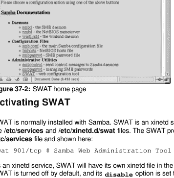

Figure 37-2: SWAT 主页

### 激活 SWAT

SWAT 通常随 Samba 一起安装。SWAT 是一个`xinetd`服务。作为`xinetd`服务，它将被列在`/etc/services`和`/etc/xinetd.d/swat`文件中。SWAT 程序使用端口`901`，如`/etc/services`文件中指定并在此处所示：

```
swat 901/tcp # Samba Web Administration Tool
```

作为`xinetd`服务，SWAT 将在`/etc/xinetd.d`目录中拥有自己的`xinetd`文件，`/etc/xinetd.d/swat`。SWAT 默认关闭，其`disable`选项设置为`yes`。要使用 SWAT，您必须将`disable`选项更改为`no`，如下所示：

```
# default: off
# description: SWAT is the Samba Web Admin Tool. Use swat \
#     to configure your Samba server. To use SWAT, \
# connect to port 901 with your favorite web browser.
service swat
{
    disable = no
    port = 901
    socket_type = stream
    wait = no
    only_from = 127.0.0.1
    user = root
    server = /usr/sbin/swat
    log_on_failure += USERID
}
```

您可以通过使用`chkconfig`或服务配置工具打开 SWAT 服务，或通过手动编辑`/etc/xinetd.d/swat`文件并将`disable`选项更改为`no`来实现此操作。`chkconfig`将为您编辑`/etc/xinetd.d/swat`文件，进行此更改（有关`chkconfig`的更多信息，请参阅第 20 章）。以下示例显示了如何使用`chkconfig`命令启用 SWAT：

```
chkconfig swat on
```

使用`chkconfig`，您无需手动重启`xinetd`服务器。但是，如果您手动编辑文件，还必须重启服务器才能使更改生效。在 Red Hat 上，您可以使用`xinetd`脚本来简单地执行此操作，如下所示：

```
service xinetd restart
```

在使用 SWAT 之前，请备份当前的`smb.conf`文件。SWAT 会覆盖原始文件，用其自身更短更简洁的版本替换它。`smb.conf`文件在最初安装时列出了大量带有详细说明的选项。这是一个很好的学习工具，提供了创建各种打印机和目录`section`的优秀示例。只需制作一个备份副本：

```
cp /etc/samba/smb.conf /etc/samba/smb.bk
```

### 访问 SWAT

您可以通过在 GNOME 或 KDE 系统菜单中选择 Samba 配置条目来启动 SWAT。这将使用本地主机 IP 地址`127.0.0.1`和端口`901`打开您的网页浏览器到 SWAT 页面，如图 37-2 所示。您也可以打开浏览器并输入 IP 地址`127.0.0.1`和端口`901`来访问 SWAT。

```
http://127.0.0.1:901
```

您可以通过在网页浏览器中输入 Samba 服务器的地址以及其端口（`901`）从远程位置启动 SWAT。但是，您首先必须在`/etc/xinetd.d/swat`文件中启用此功能。目前，该文件中的`only_from`行将访问限制为仅本地主机。要启用从任何远程系统访问，只需删除此行。如果您想为某些特定主机提供访问权限，可以在`only_from`行上在`127.0.0.1`之后列出它们。请确保在进行任何更改后重启 SWAT。以下示例启用了来自`127.0.0.1`和`rabbit.mytrek.com`的访问：

```
only_from 127.0.0.1 rabbit.mytrek.com
```

然后在远程系统上的网页浏览器中输入以下 URL 将显示`turtle.mytrek.com`Samba 服务器上的 SWAT 网页界面：


```
http://turtle.mytrek.com:901
```

首先会要求您输入用户名和密码。要配置 Samba，您需要输入 `root` 和 `root` 密码。（如果您从远程系统连接，不建议以明文形式输入 `root` 密码——请参阅第 28 章。）

### SWAT 配置页面

主 SWAT 页面显示一个按钮栏，其中包含 HOME、GLOBAL、SHARES、PRINTERS、STATUS、VIEW 和 PASSWORD 的链接按钮（见表 37-2）。您可以使用 STATUS 列出您的活动 SMB 网络连接。

表 37-2：SWAT 配置页面

| 页面 | 描述 |
|------|-------------|
| HOME | SWAT 主页，列出文档资源。 |
| GLOBALS | 配置 Samba 的全局部分。 |
| SHARES | 选择并配置要共享的目录（shares）。 |
| PRINTERS | 设置打印机访问。 |
| STATUS | 检查 Samba 服务器（`smbd` 和 `nmbd`）的状态；列出当前活动的客户端及其正在执行的操作。您可以在此页面重启、停止或启动 Samba 服务器。 |
| VIEW | 显示 `smb.conf` 配置文件。 |
| PASSWORD | 设置服务器及有访问权限用户的密码访问。 |

对于各个部分，SWAT 可以显示基本版或高级版。基本版仅显示简单配置所需的条目，而高级版则显示该类型部分的所有可能条目。分别标记为 Advanced View 和 Basic View 的按钮位于部分页面的顶部，用于在高级版或基本版之间切换（参见图 37-3）。打印机和共享的部分页面增加了按钮和菜单，用于选择要配置的特定打印机或共享。此处所用的术语“share”指的是您希望通过 Samba 提供的目录。当您单击 SHARES 按钮时，最初只会在 SHARES 页面的顶部看到几个按钮。您使用这些按钮来创建新部分或编辑已为共享设置的部分。要设置新的 Share 部分，您在 Create Share 按钮旁的框中输入其名称，然后单击该按钮。新的共享名称会出现在 Choose Share 按钮旁的下拉菜单中。最初该按钮为空。单击它以显示当前 Share 部分的列表。选择您想要的，然后单击 Choose Share 按钮。页面随后显示用于配置共享的条目。对于新共享，这些条目为空或为默认值。例如，要选择配置用户主目录默认设置的 Homes 部分，请单击找到 Homes 条目的下拉菜单。选择它，然后单击 Choose Share 按钮。Homes 部分的条目将被显示。Printers 页面采用相同的流程，您可以在其中选择 Printers 部分或为特定打印机创建部分。

#### 共享参数


图 37-3：SWAT 共享页面显示 Homes 部分

#### 注

SWAT 会自动为系统或网络上已配置使用的任何打印机创建条目，它从您的 `/etc/printcap` 文件中读取这些条目。您需要编辑 pri

在图 37-3 中，注意每个条目旁边的 Help 链接。此类链接会显示一个网页，展示 `smb.conf` 的 Samba 文档，定位到相应的条目。在此图中，在用户单击 Guest OK 条目旁边的 Help 链接后，显示了文档的 Guest OK 部分。

当您完成对某个部分的工作后，单击其页面上的 Commit Changes 按钮以保存更改。对您处理的每个单独页面都要执行此操作，包括 GLOBALS 页面。单击 Commit Changes 按钮会生成 `smb.conf` 文件的新版本。为了让 Samba 服务器读取这些更改，您随后必须重启它。您可以通过单击 Status 页面上的 Restart smb 按钮来执行此操作。

#### 使用 SWAT 创建新的共享

基本使用 SWAT 创建新共享的步骤如下：

- 1. 选择 Share 页面，并在 Create Share 文本框中输入新共享的名称。
- 2. 单击 Create Share 按钮以打开新共享的配置页面。新共享的名称将出现在 Choose Share 按钮旁的弹出菜单中。
- 3. 输入各种选项。对于 Basic Options，您需要在 Path 文本框中指定共享的目录。在 Comment 文本框中，您输入在 Windows 上显示的共享标签。
- 4. 单击 Commit Changes 按钮将共享条目保存到 Samba 配置文件 `smb.conf` 中。然后重启 Samba 服务器以使更改生效（单击 Status 页面上的 Restart smb 按钮）。

您可以遵循类似的流程添加新打印机，但请确保打印机也在 Samba 服务器所在的系统上进行了配置。

当然，您可以直接编辑 `/etc/samba/smb.conf` 文件。这是一个简单的文本文件，您可以用任何文本编辑器编辑。您仍然必须重启 SMB 服务器才能使更改生效，您可以在 Red Hat 上使用以下命令手动执行此操作：

```
service smb restart
```

#### SWAT 生成的 smb.conf 示例

以下示例显示了 SWAT 为简单配置生成的 `smb.conf` 文件。这比最初随 Samba 安装的注释密集型版本小得多。在此配置中，实现了共享级安全并启用了密码加密。定义了一个名为 `myprojects` 的共享，具有访客访问权限且可写。还定义了一个名为 `myhp` 的打印机共享，支持访客访问。

```
# Samba config file created using SWAT
# from localhost.localdomain (127.0.0.1)
# Date: 2001/09/09 01:09:07

# Global parameters
[global]
    server string = Samba Server
    security = SHARE
    encrypt passwords = Yes
    ssl CA certFile = /usr/share/ssl/certs/ca-bundle.crt
    log file = /var/log/samba/%m.log
    max log size = 0
    socket options = TCP_NODELAY SO_RCVBUF=8192 SO_SNDBUF=8192
    dns proxy = No
    printing = cups
```

```
[homes]
    comment = Home Directories
    path = /home
    writeable = Yes
    guest ok = Yes
```

```
[printers]
    comment = All Printers
    path = /var/spool/samba
    guest ok = Yes
    printable = Yes
    browseable = No
```

```
[myprojects]
    path = /myprojects
    writeable = Yes
    guest ok = Yes
```

```
[myhp]
    path = /var/spool/samba
    writeable = Yes
    guest ok = Yes
    printable = Yes
    printer = myhp
    oplocks = No
    share modes = No
```

#### 全局部分

全局部分确定整个服务器的配置，并指定在主目录和目录段中使用的默认条目。在此部分中，您可以找到工作组名称、密码配置和目录设置的条目。这里讨论了其中几个更重要的条目。图 37-4 显示了 SWAT 上的全局变量页面，您可以使用它来设置全局选项。此页面的基本视图列出了您最可能需要的选项。

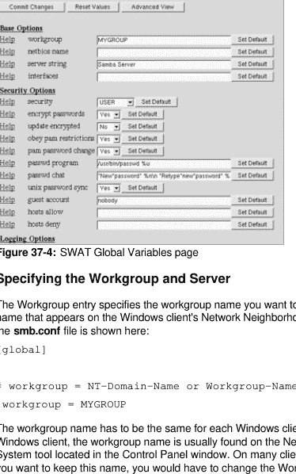

图 37-4：SWAT 全局变量页面

#### 指定工作组和服务器

Workgroup 条目指定您希望赋予网络的工作组名称。这是在 Windows 客户端的网络邻居窗口中显示的工作组名称。`smb.conf` 文件中默认的 Workgroup 条目如下所示：

```
[global]

# workgroup = NT-Domain-Name or Workgroup-Name
workgroup = MYGROUP
```

工作组名称必须对 Samba 服务器支持的每个 Windows 客户端相同。在 Windows 客户端上，工作组名称通常可以在控制面板窗口中系统工具的网络标识或常规面板中找到。在许多客户端上，这默认为 WORKGROUP。如果您想保留此名称，则必须相应地更改 `smb.conf` 文件中的 Workgroup 条目。Workgroup 条目和每个 Windows 客户端上的工作组名称必须相同。

```
workgroup = WORKGROUP
```


`server string` 条目保存您希望在客户端系统上为服务器显示的描述性名称。在 Windows 系统上，这是 Samba 服务器图标上显示的名称。默认值为 `Samba Server`，但您可以将其更改为任意名称。

```
# server string is the equivalent of the NT Description field
server string = Samba Server
```

## 安全级别

Samba 资源通常使用共享级或用户级安全进行访问。在共享级，任何用户都可以无需登录服务器即可访问资源。在用户级，每个用户都必须使用密码登录。此外，Windows 98、ME、NT 和 XP 客户端在登录过程中使用加密密码。您必须为这些客户端启用加密密码。加密密码的默认值为 `no`，因此您需要将其更改为 `yes`。在 `smb.conf` 文件中，`security` 选项设置为您想要的级别，而 `encrypt passwords` 选项设置为 `yes` 以启用加密。

```
security = user

encrypt passwords = yes
```

如果您想要共享级安全，请将 `security` 选项指定为 `share`：

```
security = share
```

在 SWAT Globals 页面中，从 Security 下拉菜单中选择安全级别，可选 User 或 Share。然后为 `encrypt passwords` 条目选择 Yes。

## 网络访问控制

作为安全措施，您可以限制对 SMB 服务的访问，仅允许某些指定的本地网络。在主机的网络中，输入您希望允许访问的本地网络的网络地址。要拒绝网络中除少数特定主机外的所有人访问，您可以在网络地址后使用 `EXCEPT` 选项，并附上这些主机的 IP 地址。`localhost`（`127`）始终会自动包含在内。以下示例允许访问两个本地网络：

```
hosts allow = 192.168.1. 192.168.2.
```

## 打印

要启用打印，请允许 Samba 从您的 `printcap` 文件加载打印机描述。

```
printcap name = /etc/printcap
```

```
load printers = yes
```

要指定您的打印系统，您需要设置 `printing` 选项。在 Red Hat 上，CUPS 是现在受支持的打印服务器。要将打印系统设置为 CUPS，请使用以下内容：

```
printing = cups
```

## 访客用户访问

您可以使用访客用户登录来使资源对任何人可用，而无需密码。访客用户登录会处理未使用特定账户登录的任何用户。在 Linux 系统上，默认情况下 Samba 会使用 `nobody` 用户作为访客用户。或者，您可以设置并指定一个特定的用户作为访客用户。您通过 `smb.conf` 文件中的 `Guest Account` 条目指定访客用户。随 Samba 提供的注释版 `smb.conf` 文件目前列出了一个用于设置名为 `pcguest` 的访客用户的注释条目。您可以将其设为您希望用作访客用户的用户。务必将访客用户添加到密码文件中：

```
guest account = pcguest
```

在 SWAT 中，您可以在 GLOBALS 页面上指定一个访客账户条目。默认情况下，这已设置为 `nobody` 用户。

## 密码

如前所述，用户级安全要求每个用户都使用密码登录到 Samba 服务器。Samba 可以使用明文或加密密码，尽管当前 Windows 客户端支持加密密码。您可以使用 `smbpasswd` 命令添加和更改 Samba 密码。在 SWAT 中，您在 Globals 页面上启用密码加密，并在 Passwords 页面上管理密码。在 Server Password Management 部分，您可以添加、更改、删除、启用或禁用用户。要添加新用户，输入用户名和密码，然后单击 Add New User。作为 Samba 服务器上的 root 用户，您可以添加新密码以及启用或禁用现有密码。普通用户可以使用 Client/Server Password Management 部分更改自己的密码。

## Homes 部分

`Homes` 部分指定了远程用户通过 SMB 协议访问用户主目录的默认控制。要在 SWAT 上访问 Homes 部分，您只需选择 SHARES 页面，从下拉菜单中选择 Homes 条目，然后单击 Choose Share。将 `browseable` 条目设置为 `no` 可防止客户端在文件浏览器中列出文件。`writable` 条目指定用户对其主目录中的文件是否具有读写控制权。`create mode` 和 `directory mode` 设置新文件和目录的默认权限（在 SWAT 上，这些是 `create mask` 和 `directory mask`）。`valid user` 条目使用 `%S` 宏映射到当前服务。

```
[homes]
comment = Home Directories
browseable = no
writeable = yes
valid users = %S
create mode = yes
directory mode = 775
```

## Printer 部分

`Printers` 部分指定了访问打印机的默认控制。这些用于没有特定部分的打印机。在这种情况下，Samba 使用服务器的 `printcap` 文件中定义的打印机。

在此上下文中，将 `browseable` 设置为 `no` 只是将 Printers 部分从客户端隐藏，而非打印机。`path` 条目指定 Samba 将用于打印机文件的 spool 目录的位置。要启用打印，`Printable` 条目必须设置为 `yes`。要允许访客用户打印，请将 `guest ok` 条目设置为 Yes。将 `writeable` 条目设置为 `no` 可防止除打印机管理 spool 文件之外的任何写入访问。在 SWAT 上，选择 PRINTER 页面并在下拉菜单中选择 Printers 条目，然后选择 Choose Printers。以下是 Printers 部分的标准实现：

```
[printers]
comment = All Printers
path = /var/spool/samba
browseable = no
guest ok = yes
writeable = no
printable = yes
```

如果无法打印，请务必检查 Default Print 条目。这指定了服务器实际用于打印文档的命令。

## 共享

特定共享资源（如系统上的目录）的部分通常放在 Homes 和 Printers 部分之后。对于定义共享目录的部分，输入系统的标签。然后，在单独的行中输入其路径名选项和您希望设置的各种权限。在 `path =` 选项中，指定目录的完整路径名。`comment =` 选项保存要赋予共享的标签。您可以使目录可写、公开或只读。您可以使用 Valid Users 条目控制对目录的访问。通过此条目，您可以列出允许访问的用户。对于未设置的选项，将使用在 Global、Homes 和 Printers 段中输入的默认值。

在 SWAT 中，您使用 SHARES 页面创建和编辑共享目录。从下拉菜单中选择您要编辑的目录，然后单击 Choose Share。Basic View 显示常用的条目。对于 Valid Users 等条目，您需要选择 Advanced View。务必在转到另一个 Share 或 Printer 部分之前单击 Commit Changes（参见图 37-5）。


### 图 37-5：SWAT Samba 共享

以下示例是 SWAT 从图 37-5 所示的共享页面生成的 `myprojects` 共享。这里 `/myprojects` 目录被定义为对任何具有访客访问权限的用户开放的共享资源。

```
[myprojects]
    comment = Great Project Ideas
    path = /myprojects
    writeable = yes
    guest ok = yes
    printable = yes
```

要限制对某些用户的访问，您可以列出有效用户集。将 `guest ok` 选项设置为 `no` 可将其关闭给其他人的访问。

```
[mynewmusic]
comment = Service
path = /home/specialprojects
valid users = mark
guest ok = no
writeable = yes
printable = no
```

要允许完全公共访问，请将 `guest ok` 条目设置为 `yes`，且不设置 valid user's 条目。

```
[newdocs]
path = /home/newdocs
guest ok = yes
writeable = yes
printable = yes
```


要设置可由多个用户共享的目录，其中每个用户对其创建的文件具有控制权，只需在 `Valid Users` 条目中列出用户。任何创建文件的权限由 `Create Mask` 条目指定（与 create mode 相同）。在此示例中，权限设置为 `765`，这为所有者提供读/写/执行访问，为组成员提供读/写访问，仅为其他人提供读/执行访问（默认值为 `744`，组和其他权限为只读，参见第 28 章）：

```
[myshare]
comment = Writer's projects
path = /usr/local/drafts
valid users = justin chris dylan
guest ok = no
writeable = yes
printable = no
create mask = 0765
```

有关更多示例，请查看原始 `smb.conf` 文件中显示的用于目录 `fredsdir` 的 Shares 部分。

### 打印机

对特定打印机的访问在 `smb.conf` 文件的 Printers 部分中定义。您也可以在 SWAT Printers 页面中配置打印机。对于打印机，您需要包含 `Printer` 和 `Printable` 条目，并指定使用的 Printing 服务器类型。通过 `Printer` 条目，您命名打印机，并通过将 `Printable` 条目设置为 `yes` 来允许其打印。您可以使用 `valid users` 条目控制对特定用户的访问，并通过将 `Public` 条目设置为 `no` 来限制。公共访问请将 `Public` 条目设置为 `yes`。对于 Red Hat 上使用的 CUPS 服务器，请将 `printing` 选项设置为 `cups`。在 SWAT 上，您可以在 Printers 页面上创建单独的 Printer 部分。默认条目已为您设置好。

以下示例设置了一个可供访客用户访问的打印机。这将打印机打开供网络上的任何用户使用。用户需要对位于 `/var/spool/samba` 的打印机 spool 目录具有写访问权限。请记住，任何打印机都必须首先安装在您的系统上。以下打印机已作为 `myhp` 安装，并且 `/etc/printcap` 中有该名称的条目。在 Red Hat 上，您可以使用 `redhat-config-printer` 安装 LPRng 打印机，为其命名并选择驱动程序（参见第 4 章和第 25 章）。您可以使用 CUPS 管理工具为 CUPS 服务器设置打印机（参见第 25 章）。`Printing` 选项可以从常规 Printers 共享继承。

```
[myhp]
    path = /var/spool/samba
    writeable = yes
    guest ok = yes
    printable = yes
    printer = myhp
    oplocks = no
    share modes = no
    printing = cups
```

与共享一样，您可以限制打印机使用仅限于某些用户，拒绝公共访问。以下示例设置了一个仅 `larisa` 和 `aleina` 用户可访问的打印机（如果需要，您可以添加其他用户）。用户需要对打印机 spool 目录具有写访问权限。

```
[larisalaser]
    path = /var/spool/samba
    writeable = yes
    valid users = larisa aleina
    guest ok = no
    printable = yes
    printing = cups
    printer = myhp
    oplocks = no
    share modes = no
```

### 变量替换

对于分配给参数的字符串值，您可以加入替换运算符。这提供了在指定可能依赖于上下文的值（例如用户名）时更大的灵活性。例如，假设某项服务需要为每个登录的用户使用单独的目录。此类目录的路径可以使用 `%u` 变量指定，该变量会替换为当前用户的名称。字符串 `path = /tmp/%u` 对于 `justin` 用户将变为 `path = /tmp/justin`，对于 `dylan` 用户将变为 `/tmp/dylan`。表 37-3 列出了一些更常见的替换变量。

表 37-3：Samba 替换变量

| Variable | Description |
|---|---|
| `%S` | 当前服务的名称 |
| `%P` | 当前服务的根目录 |
| `%u` | 当前用户的用户名 |
| `%H` | 用户的主目录 |
| `%h` | Samba 运行的 Internet 主机名 |
| `%m` | 客户端计算机的 NetBIOS 名称 |
| `%L` | 服务器的 NetBIOS 名称 |
| `%M` | 客户端计算机的 Internet 名称 |
| `%I` | 客户端计算机的 IP 地址 |

### 测试 Samba 配置

在您对 `smb.conf` 文件进行更改后，您可以使用 `testparm` 程序查看条目是否正确输入。`testparm` 检查 Samba 条目的语法和有效性。默认情况下，`testparm` 检查 `/etc/samba/smb.conf` 文件。如果您使用不同的文件作为配置文件，可以将其作为参数指定给 `testparm`。您还可以让 `testparm` 检查特定主机是否可以访问配置文件设置的服务。

使用 SWAT，状态页面将列出您的连接和共享。从命令行，您可以使用 `smbstatus` 命令检查网络上当前 Samba 连接的情况。

要检查 Samba 服务器的实时运行情况，您可以登录运行 Samba 服务器的 Linux 系统上的用户帐户并连接到服务器。

### 域登录

Samba 还支持域登录，从而用户可以登录到网络。可以为单个用户设置登录脚本。要配置此类 netlogon 功能，您需要在 `smb.conf` 文件中设置一个 netlogon 共享。以下示例取自原始 `smb.conf` 文件。此共享保存 netlogon 脚本，在此情况下为 `/home/netlogon` 目录——该目录不应可写但应可被所有用户访问（Guest OK）：

```
[netlogon]
comment = Network Logon Service
path = /home/netlogon
guest ok = yes
writeable = no
share modes = no
```

`Global` 部分将启用以下参数：

```
domain logons = yes
```

使用 netlogon，您可以将 Samba 配置为 Linux 和 Windows 主机的身份验证服务器。每个主机都需要设置 Samba 用户名和密码。在 `smb.conf` 文件的 `Global` 部分中，请务必启用加密密码、用户级安全性以及域登录，以及 33 或更高的操作系统级别：

```
[global]
encrypt passwords = yes
security = user
domain logons = yes
os level = 33
```

**Note** 您还可以将 Samba 配置为 Windows NT 网络的主域控制器（PDC）。作为 PDC，Samba 可以处理域登录、检索用户和组列表，并提供用户级安全性。

### 使用客户端访问 Samba 服务

连接到 SMB 网络的客户端系统可以访问 Samba 服务器提供的共享服务。Windows 客户端应能够通过 Windows 桌面上的“网络邻居”和“整个网络”图标自动访问共享目录和服务。对于连接到同一网络的其他 Linux 系统，可以使用特殊 Samba 客户端程序访问 Samba 服务。使用 `smbclient`，本地 Linux 系统可以连接到 Samba 服务器上的共享目录并传输文件，以及运行 shell 程序。使用 `smbmount`，可以将 Samba 服务器上的目录挂载到 Linux 客户端的本地目录。

Note 有多个 Samba 浏览器客户端可用于 GNOME 和 KDE。对于 KDE，您可以使用 Konba2（可从 apps.kde.com 下载）。对于 GNOME，您可以使用 Gnomba。

#### smbclient


# smbclient 实用程序

`smbclient` 实用程序像 FTP 一样操作以使用 SMB 协议访问系统。而使用 FTP 客户端您可以访问其他 FTP 服务器或 Unix 系统，使用 `smbclient` 您可以访问 Samba 服务器或 Windows 系统上的 SMB 共享服务。许多 `smbclient` 命令与 FTP 相似，例如 `mget`，用于传输文件或 `del`，用于删除文件。`smbclient` 程序有多个选项用于查询远程系统以及连接到它。有关选项和命令的完整列表，请参阅 `smbclient` 手册页。

`smbclient` 程序以服务器名称和您要在该服务器上访问的服务作为参数。双斜杠位于服务器名称之前，单斜杠将其与服务分隔开。服务可以是任何共享资源，例如目录或打印机。服务器名称是其 NetBIOS 名称，可能与 IP 名称相同也可能不同。例如，要指定名为 `turtle.mytrek.com` 的服务器上的 `myreports` 共享目录，请使用 `//turtle.mytrek.com/myreports`。如果必须指定路径名，请对 Windows 文件使用反斜杠，对 Unix/Linux 文件使用正斜杠：

```
//server-name/service
```

您还可以提供访问服务的密码。将其作为服务名称后的参数输入。如果您未提供密码，将提示您输入。

Note 您还可以使用 Nautilus（GNOME 文件管理器）访问 Samba 共享。使用 `smb:` 协议，如 `smb://lizard/windata`。仅输入 `smb:` 将显示所有 Samba 共享。

## 使用 smbclient 访问共享

然后您可以添加多个选项来访问共享，例如远程用户名或可用的服务列表。使用 `-I` 选项，您可以使用其 IP 地址指定系统。您使用 `-U` 选项和登录名来指定要在远程系统上使用的远程登录名。如果需要密码，请附加 `%` 与密码。使用 `-L` 选项，您可以获取服务器提供的服务列表，例如共享目录或打印机。以下命令将列出主机 `turtle.mytrek.com` 上可用的共享：

```
smbclient -L turtle.mytrek.com
```

要访问远程系统上的特定目录，请将目录作为 `smbclient` 命令的参数输入，后跟任何选项。对于 Windows 文件，您对路径名使用反斜杠，对于 Unix/Linux 文件您使用正斜杠。连接后，将显示 `smb` 提示符，您可以使用 `smbclient` 命令例如 `get` 和 `put` 传输文件。`quit` 或 `exit` 命令退出 `smbclient` 程序。在以下示例中，`smbclient` 使用 `dylan` 登录名访问 `turtle.mytrek.com` 系统上的 `myreports` 目录：

```
smbclient //turtle.mytrek.com/myreports -I 192.168.0.1 -U dylan
```

在大多数情况下，您可以简单地使用服务器名称来引用服务器，如下所示：

```
smbclient //turtle.mytrek.com/myreports -U dylan
```

如果您正在访问 Samba 服务器上特定帐户的主目录，您可以简单地指定 `homes` 服务。在下一个示例中，用户在被提示输入该帐户密码后访问 Samba 服务器上 `aleina` 帐户的主目录：

```
smbclient //turtle.mytrek.com/homes -U aleina
```

您还可以使用 `smbclient` 访问位于 Windows 客户端上的共享资源。指定 Windows 客户端的计算机名称以及其共享文件夹。在下一个示例中，用户访问名为 `lizard` 的 Windows 客户端上的 `windata` 文件夹。该文件夹配置为允许任何人访问，因此用户只需在密码提示时按 ENTER 键。

```
$ smbclient //lizard/windata
added interface ip=192.168.0.2 bcast=192.168.0.255 nmask=255.255.255.0
Got a positive name query response from 192.168.0.3 ( 192.168.0.3 )
Password:
Domain=[WORKGROUP] OS=[Windows 5.1] Server=[Windows 2000 LAN Manager]
smb: \> ls
. D 0 Sat Sep 7 17:29:19 2002
.. D 0 Sat Sep 7 17:29:19 2002
hi A 10 Sat Sep 7 17:29:27 2002
mynewdoc.doc A 0 Sat Sep 7 16:59:13 2002
39997 blocks of size 1048576. 39930 blocks available
smb: \> mget hi
Get file hi? y
getting file hi of size 10 as hi (1.22069 kb/s) (average 1.2207 kb/s)
smb: \> quit
```

## smbclient 命令

登录后，您可以执行 `smbclient` 命令来管理文件和更改目录。可以使用 `!` 运算符执行 Shell 命令。要传输文件，您可以使用 `mget` 和 `mput` 命令，就像在 FTP 程序中使用一样。`recurse` 命令使您能够打开递归以一次复制整个子目录。您可以使用此处称为掩码的文件匹配运算符来选择特定集合的文件。文件匹配（掩码）运算符为 `*`、`[]` 和 `?`（参见第 8 章）。默认掩码为 `*`，匹配所有内容。以下示例使用 `mget` 复制所有以 `.c` 为后缀的文件，如 `myprog.c`：

```
smb> mget *.c
```

在传输期间，您可以让 `smbclient` 对每个单独文件提示您或简单地传输所有选定的文件。`prompt` 命令切换此文件提示的打开和关闭。

要访问远程系统上的特定打印机，请将打印机名称作为 `smbclient` 命令的参数输入，后跟任何选项。在以下示例中，`smbclient` 使用 `dylan` 登录名访问 `turtle.mytrek.com` 系统上的 `myepson` 打印机：

```
smbclient //turtle.mytrek.com/myepson -U dylan
```

连接后，将显示 SMB 提示符，您可以使用 `smbclient` 命令例如 `print` 和 `printmode` 指定图形或文本。在下一个示例中，用户在访问了 `turtle.mytrek.com` 上的 `myepson` 打印机后打印名为 `myfile` 的文件：

```
smb> print myfile
```

## smbmount

使用 `smbmount` 命令，Linux 或 Unix 客户端可以将共享目录挂载到其本地系统。`smbmount` 命令的语法与 `smbclient` 命令类似，其中包含许多相应的选项。`smbmount` 命令的参数为 Samba 服务器和共享目录，其后是你要挂载目录的本地目录。以下示例将 `myreports` 目录挂载到本地系统的 `/mnt/myreps` 目录上：

```
smbmount //turtle.mytrek.com/myreports /mnt/myreps -U dylan
```

卸载目录时，使用 `smbumount` 命令并指定本地目录名，如下所示：

```
smbumount /mnt/myreps
```

要挂载服务器上特定用户的家目录，请指定 `homes` 服务和用户的登录名。以下示例将用户 `larisa` 的家目录挂载到本地系统的 `/home/chris/larisasstuff` 目录：

```
smbmount //turtle.mytrek.com/homes /home/chris/larisasstuff -U larisa
```

你也可以使用 `smbmount` 来挂载 Windows 客户端上的共享文件夹。只需指定 Windows 客户端的计算机名以及其文件夹即可。如果文件夹名包含空格，请用单引号将其括起来。在以下示例中，用户将 `lizard` 上的 `windata` 文件夹挂载为 `/mylinux` 目录。对于任何人均可访问的文件夹，只需在密码提示时按 ENTER 键即可。

```
$ smbmount //lizard/windata /mylinux
Password:
$ ls /mylinux
_hi_mynewdoc.doc_myreport.txt
```

使用完毕后，使用 `smbumount` 命令卸载共享文件夹。

```
smbumount /mylinux
```

如果不想显式使用 `smbmount`，可以使用带有文件系统类型 `smbfs` 的 `mount` 命令。`mount` 随后会运行 `/sbin/mount.smbfs` 命令，该命令将调用 `smbclient` 来挂载文件系统：

```
mount -t smbfs //lizard/windata /mylinux
```

如果需要用户级访问，也可以将用户名和密码作为选项指定：


```
mount -t smbfs -o username=chris passwd=mypass //lizard/windata /mylinux
```

你也可以在`/etc/fstab`条目中使用`smbfs`类型，以便 Samba 文件系统自动挂载：

```
//lizard/windata /mylinux smbfs defaults 0 0
```

#### 使用 Samba 客户端共享 Windows 目录和打印机

管理目录共享时，在控制面板的“管理”窗口中打开“计算机管理”工具。点击“共享文件夹”，即可看到“共享”、“会话”和“打开的文件夹”。要添加新的共享，请点击“共享”文件夹，然后点击“操作”菜单并选择“新建文件共享”。“会话”和“打开的文件夹”的“操作”菜单可让你断开活动会话和文件夹。

要允许其他客户端或 Samba 服务器上的用户以共享级开放方式访问，请确保在 Windows 客户端上启用访客用户。默认情况下未启用。访问控制面板中的“用户和密码”工具来设置访客用户。访客访问对于提供对连接到 Windows 客户端的打印机的访问尤为重要。想要访问 Windows 系统上打印机的 Linux 系统会将其在自己的系统上配置为远程 Samba 打印机。访问打印机时通常输入的用户为`guest`。要使 Linux 系统能够访问 Windows 打印机，该 Windows 系统必须具有访客用户。

##### 共享 Windows 目录

要共享目录，请右键单击该目录并从弹出菜单中选择“共享”（Windows XP 上为“共享和安全”）。点击“共享此文件夹”，然后输入共享名，即 Samba 将识别该目录的名称。你可以指定是否允许其他人更改共享上的文件。还可以指定用户限制（默认情况下为最大允许数）。此外，你可以进一步点击“权限”按钮来控制用户访问权限。在此，你可以指定哪些用户可以访问以及访问类型。例如，你可以仅允许对目录进行只读访问。

##### 共享 Windows 打印机

要共享打印机，请在“打印机”窗口中找到打印机并右键单击它，选择“共享为”选项。这将打开“共享”面板，你可以在其中点击“共享为”按钮并输入打印机将被其他主机识别的名称。例如，在名为`lizard`的 Windows 客户端上，要将名为`Epson Stylus Color`的打印机共享为`myepson`，该打印机的“共享”面板将选中“共享为”按钮并输入名称`myepson`。然后当用户在“附近的计算机”窗口中双击`lizard`图标时，标记为`myepson`的打印机图标将会出现。

要使 Linux 系统使用此打印机，必须先在该 Linux 系统上将其配置为远程 Windows 打印机。对于使用 LPRng 打印服务器的打印机，你可以使用`redhat-config-printer`（系统设置菜单和窗口中的打印）轻松完成此操作，而对于使用 CUPS 打印服务器的打印机，则使用 CUPS 打印配置工具（额外系统工具菜单）。

要配置远程打印机，你需要为打印机指定在 Linux 系统上识别的名称、Windows 客户端计算机名、Windows 客户端上访问打印机的名称以及用于访问的用户名（通常为`guest`）。配置完成后，你的打印命令只需使用打印机名称即可访问它，就像访问任何其他打印机一样。例如，安装在 Windows 客户端上的`myepson`打印机也必须为作为 Samba 服务器运行的 Linux 系统上的 CUPS 安装。对于 CUPS 打印服务器，你可以使用`redhat-config-printer`来配置 Windows 打印机。你可以按需为打印机指定相同的名称，然后在“队列类型”面板中选择“Windows 打印机（SMB）”。对于“共享”，输入`//lizard/myepson`；对于“用户”，输入`guest`；对于“工作组”，输入 Windows 客户端的工作组（通常为`WORKGROUP`）。

对于 CUPS 打印服务器，你也可以使用 CUPS 打印配置工具并添加打印机。对于设备，选择“通过 Samba 的 Windows 打印机”。对于设备 URL，输入带`smb:`协议的共享名，`smb://lizard/myepson`。此外，要使 CUPS 能够使用 Samba，你需要将 Samba spool 目录链接到 CUPS smb 目录。

```
ln -s /usr/bin/smbspool  /usr/lib/cups/backend/smb
```

安装完成后，你可以重新启动 CUPS 服务器。然后`lpr`命令可以直接访问远程 Windows 打印机。下一个示例在 Windows 客户端的 Epson 打印机上打印`mydoc`文件。

```
lpr -P myepson mydoc
```

##### Windows 客户端

要从 Windows 系统访问 Samba 资源，你需要确保 Windows 系统已启用 TCP/IP 网络。如果 Windows 客户端已连接到 Microsoft 网络，则可能已启用。如果需要将 Windows 系统直接连接到 Linux Samba 服务器运行的 TCP/IP 网络，你应检查该 Windows 系统是否已启用 TCP/IP 网络。这涉及确保已安装 Microsoft 网络客户端和 TCP/IP 协议，并且网络接口卡（NIC 适配器）已配置为使用 TCP/IP。Windows 2000 和 XP 以及 Windows 95、98 和 ME 的操作步骤略有不同。

连接后，你的 Samba 共享和打印机将出现在 Windows 网络窗口中。如果经常使用某个共享，可以为其分配磁盘标签。右键单击共享并选择“映射网络驱动器”，然后选择要使用的驱动器标签。在 XP 上，你还可以进一步选择是否在登录时自动挂载驱动器。请按照特定 Windows 系统的说明访问远程共享资源，如打印机和目录。


## ABC Amber CHM Converter 试用版

请注册以移除此横幅。

http://www.processestext.com/abcchm.html

### 第 38 章：管理 TCP/IP 网络

#### 概述

Linux 系统被配置为连接到使用 TCP/IP 协议的网络。这些是互联网使用的相同协议，许多局域网（LAN）也是如此。在第 19 章中，你已了解 TCP/IP，这是一套强大的协议，旨在在不同操作系统和硬件的系统之间提供通信。TCP/IP 协议于 1970 年代作为一项特殊的 DARPA 项目开发，以增强大学和研究中心之间的通信。这些协议最初是在 Unix 系统上开发的，其中大部分研究在加州大学伯克利分校进行。Linux 作为 Unix 的一种版本，受益于这种对 Unix 的原始关注。目前，TCP/IP 协议的开发由互联网工程任务组（IETF）管理，而 IETF 又受互联网协会（ISOC）监督。ISOC 监督多个负责互联网开发不同领域的组织，例如负责互联网寻址的互联网号码分配机构（IANA），（参见表 38-1）。多年来，TCP/IP 协议标准和文档以请求评论（RFC）文档的形式发布。请在 IETF 网站`www.ietf.org`上查看最新文档以了解当前发展。

#### TCP/IP 协议套件

TCP/IP 协议套件实际上由不同的协议组成，每个协议都为 TCP/IP 网络中的特定任务而设计。三个基本协议是传输控制协议（TCP），负责接收和发送通信，互联网协议（IP），负责实际传输，以及用户数据报协议（UDP），也负责接收和发送数据包。IP 协议是所有其他协议使用的基础协议，负责实际传输，处理包含发送方和接收方信息的每个数据包。TCP 协议旨在处理连贯的消息或数据。该协议检查接收到的数据包并将其按指定顺序排序，形成原始消息。对于发送的数据，TCP 协议将其拆分为单独的数据包，并指定其顺序。UDP 协议旨在在更原始的层面上工作，也将数据分解为数据包，但不检查其顺序。TCP/IP 协议旨在提供稳定可靠的连接，确保所有数据都被接收并重新组织为原始顺序。另一方面，UDP 旨在尽可能多地发送数据，但不保证所有数据包都会被接收或放置在正确顺序中。UDP 通常用于传输大量可以承受少量数据包丢失的数据，例如在互联网上显示的临时图像、视频和横幅。

表 38-1：TCP/IP 协议开发组织

| 组 | 标题 | 描述 |
|---|---|---|
| ISOC | 互联网协会 | 互联网专家组成的专业会员组织，负责监督处理网络政策问题的委员会和工作组 `www.isoc.org` |
| IESG | 互联网工程指导组 | 负责 IETF 活动的技术管理和互联网标准流程 `www.ietf.org/iesg.html` |
| IANA | 互联网号码分配机构 | 负责互联网协议（IP）地址 `www.iana.org` |
| IAB | 互联网架构委员会 | 定义互联网的整体架构，为 IETF 提供指导和广泛方向 `www.iab.org` |
| IETF | 互联网工程任务组 | 互联网的协议工程和开发部门 `www.ietf.org` |


# TCP/IP 协议套件概述

其他协议提供各种网络和用户服务。域名服务（DNS）提供地址解析。文件传输协议（FTP）提供文件传输，网络文件系统（NFS）提供对远程文件系统的访问。表 38-2 列出了 TCP/IP 协议套件中的不同协议。这些协议使用 TCP 或 UDP 协议发送和接收数据包，而后者又使用 IP 协议实际传输数据包。

## 表 38-2：TCP/IP 协议套件

| 传输 | 描述 |
|---|---|
| TCP | 传输控制协议；使系统直接通信 |
| UDP | 用户数据报协议 |
| IP | 互联网协议；传输数据 |
| ICMP | 互联网控制消息协议；IP 的状态消息 |
| 路由 | 描述 |
| RIP | 路由信息协议；确定路由 |
| OSPF | 开放最短路径优先；确定路由 |
| 网络地址 | 描述 |
| ARP | 地址解析协议；确定系统的唯一 IP 地址 |
| DNS | 域名服务；将主机名翻译为 IP 地址 |
| RARP | 反向地址解析协议；确定系统的地址 |
| 用户服务 | 描述 |
| FTP | 文件传输协议；使用 TCP 在一个系统和另一个系统之间传输文件 |
| TFTP | 简单文件传输协议；使用 UDP 传输文件 |
| Telnet | 在网络上远程登录到另一系统 |
| SMTP | 简单邮件传输协议；在系统之间传输电子邮件 |
| RPC | 远程过程调用；允许远程系统上的程序通信 |
| 网关 | 描述 |
| EGP | 外部网关协议；为外部网络提供路由 |
| GGP | 网关到网关协议；在互联网网关之间提供路由 |
| IGP | 内部网关协议；为内部网络提供路由 |
| 网络服务 | 描述 |
| NFS | 网络文件系统；允许在远程机器上挂载文件系统 |
| NIS | 网络信息服务；在网络上维护用户账户 |
| BOOTP | 启动协议；使用网络服务器上的启动信息启动系统 |
| SNMP | 简单网络管理协议；提供 TCP/IP 配置的状态消息 |
| DHCP | 动态主机配置协议；自动为主机系统提供网络配置信息 |

在 TCP/IP 网络中，消息被分解为称为数据报的小组件，然后通过各种相互交锁的路由传输并交付给目标计算机。接收后，数据报被重新组装成原始消息。数据报本身可以进一步分解为更小的包。数据包是网络间实际传输的物理消息单元。将消息作为小组件发送已被证明比作为一个庞大笨重的传输发送更可靠、更快。有了小组件，如果一个丢失或损坏，只需重新发送该组件，而如果大型传输的任何部分损坏或丢失，整个消息都必须重新发送。

在 Linux 系统上配置 TCP/IP 网络是使用一组网络配置文件实现的（本章稍后的表 38-7 提供了完整列表）。其中许多可以使用管理程序（如 `redhat-config-network`）以及第三方工具如 `Webmin` 在 root 用户桌面上管理（参见第 5 章）。您也可以使用更专业的程序，如 `netstat`、`ifconfig`、`Ethereal` 和 `route`。一些配置文件易于使用文本编辑器自行修改。

TCP/IP 网络使用一组实用程序进行配置和管理：`ifconfig`、`route` 和 `netstat`。`ifconfig` 实用程序从 root 用户桌面运行，使您能够完全配置网络接口，添加新接口并修改其他接口。`ifconfig` 和 `route` 实用程序是低级程序，需要对网络有更具体的知识才能有效使用。`netstat` 实用程序为您提供网络连接状态的信息。`Ethereal` 是一个网络协议分析器，可让您在网络上传输时捕获数据包，选择要检查的数据包。

## IPv4 和 IPv6

传统上，TCP/IP 地址由四个段组成，由句点分隔的数字。这称为 IP 地址。IP 地址实际上代表一个 32 位整数，其二进制值标识网络和主机。这种 IP 地址形式遵循互联网协议第 4 版，也称为 IPv4。IPv4，即此处描述的 IP 地址类型，仍被广泛使用。

目前，一种名为互联网协议第 6 版（IPv6）的新 IP 协议正在逐渐取代旧的 IPv4 版本。IPv6 使用 128 位扩展了可能的 IP 地址数量。它与仍使用 IPv4 的系统完全兼容。IPv6 地址的表示方式不同，使用一组八个 16 位段，每个段之间用冒号分隔。每个段由十六进制数字表示。示例地址为：

```
FEC0:0:0:0:800:BA98:7654:3210
```

IPv6 的优点包括以下内容：

- 具有简化头部，允许更快处理。
- 使用集成的 IPSEC 协议提供加密和身份验证以及虚拟专用网络（VPN）的支持。
- 扩展地址空间以覆盖 2 的 128 次方个可能的主机（数十亿的数十亿）。这远远超过 IPv4 支持的 42 亿。
- 支持主机无状态自动配置地址，绕过使用 DHCP 配置此类地址的需求。地址可以直接使用接口的 MAC（媒体访问控制）硬件地址生成。
- 支持服务质量（QoS）操作，为多媒体和电信任务等服务提供足够的响应时间。
- 协议内置多播功能，提供对多媒体任务的直接支持。
- 多播寻址也提供与 IPv4 广播寻址相同的功能。
- 可以使用任播寻址确保更强大的传输，其中数据包可以定向到任播系统组，其中只有一个需要接收它们。支持给定网络的多个 DNS 服务器可以被指定为任播组，其中只有一个 DNS 服务器需要接收传输，从而提供更大的传输成功可能性。
- 为移动节点（如 PDA、笔记本电脑和手机）提供更好的访问。

## TCP/IP 网络地址

如前所述，传统的 IPv4 TCP/IP 地址由四个段组成，由用点分隔的数字构成。这种地址仍然被广泛使用，人们通常将其称为 IP 地址。IP 地址的一部分用于网络地址，另一部分用于标识该网络中主机上的特定接口。你应该意识到 IP 地址分配给接口——例如以太网卡或调制解调器——而不是主机计算机。通常一台计算机只有一个接口，并且仅使用该接口的 IP 地址进行访问。就此而言，IP 地址可以被视为标识网络上的特定主机系统，因此 IP 地址通常被称为主机地址。

事实上，一台主机系统可能有多个接口，每个接口都有自己的 IP 地址。对于作为本地网络到 Internet 的网关和防火墙的计算机来说就是这种情况。一个接口通常连接到局域网，另一个连接到 Internet，例如通过两块以太网卡。每个接口（例如以太网卡）都有自己的 IP 地址。例如，当你使用 Red Hat 网络配置工具为系统上的以太网卡指定 IP 地址时，Devices 面板会为安装在计算机上的每块以太网卡列出一个条目，从第一块开始为 `eth0`。打开 Device 窗口后，你可以在 Protocols 面板中选择 TCP 协议，以打开 TCP/IP 设置窗口，在其中可以输入该卡的 IP 地址。其他以太网卡也有各自的 IP 地址。目前，Linux 内核最多可支持四个网络适配器。如果你使用调制解调器连接到 ISP，你将设置一个 `PPP` 接口，该接口也将拥有自己的 IP 地址（通常由 ISP 动态分配）。记住这一区别很重要，如果你计划使用 Linux 设置本地或家庭网络，并将 Linux 用作通往 Internet 的网关机器（参见第 19 章中的“IP Masquerading”部分）。

### IPv4 网络地址

IP 地址分为两部分：一部分标识网络，另一部分标识特定主机。网络地址标识主机上特定接口所属的网络。实现 IP 地址的网络部分和主机部分存在两种方法：原始的基于类的 IP 地址分配和当前的无类域间路由（CIDR）地址分配。基于类的 IP 地址分配为网络地址和主机地址指定官方预先确定的地址部分，而 CIDR 地址分配则允许使用子网掩码动态确定这些部分。

#### 基于类的 IP 地址分配

最初，IP 地址是按类别组织的。在 Internet 上，网络根据其大小分为三个类别——A 类、B 类和 C 类。A 类网络仅使用第一个段作为网络地址，其余三个段用于主机，从而允许大量计算机连接到同一网络。大多数 IP 地址引用较小的 C 类网络。对于 C 类网络，前三个段用于标识网络，仅最后一个段标识主机。总的来说，这形成了一个唯一地址，可用于标识 TCP/IP 网络中计算机上的任何网络接口。例如，在 IP 地址 192.168.1.72 中，网络部分是 192.168.1，接口/主机部分是 72。接口/主机是网络的一部分，其自身地址为 192.168.1.0。

在 C 类网络中，前三个数字标识 IP 地址的网络部分。该部分分为三个网络号，每个网络号标识一个子网。Internet 上的网络按子网组织，从最大开始，缩小到小型子网络。最后一个数字用于标识特定计算机，称为主机。你可以将 Internet 视为一系列具有子网络的网络；这些子网络也有自己的子网络。最右边的数字标识主机计算机，其前面的数字标识计算机所属的子网络。其左侧的数字标识子网络所属的网络，以此类推。Internet 地址 192.168.187.4 引用连接到编号为 187 的网络的第四台计算机。网络 187 是编号为 168 的较大网络的一个子网。这个较大网络本身是编号为 192 的网络的一个子网。分解如下：

|  |  |
|---|---|
| 192.168.187.4 | IPv4 地址 |
| 192.168.187 | 网络标识 |


### 子网掩码

系统使用子网掩码从主机地址推导出网络地址。你可以将 IP 地址视为一系列 32 位二进制位，其中一些用于网络，其余用于主机。子网掩码将网络位的位设置为 1，主机位设置为 0（见图 38-1）。在标准的基于类的 IP 地址中，主机地址网络部分中的所有数字都设置为 255，主机部分设置为 0。这相当于将构成网络地址的所有二进制位设置为 1。这就是你的子网掩码。因此，主机地址 192.168.1.72 的子网掩码为 255.255.255.0。网络部分 192.168.1 已被设置为 255.255.255，主机部分 72 已被设置为 0。系统随后可以使用你的子网掩码从主机地址推导出网络地址。它们可以确定主机地址的哪一部分构成网络地址以及这些数字是什么。


图 38-1：基于类的子网掩码操作

对于熟悉计算机编程的人来说，对子网掩码和主机地址进行按位 AND 操作会使主机部分归零，留下主机地址的网络部分。你可以将地址视为一个四字节整数的实现，每个字节对应地址的一个段。在 C 类地址中，三个网络段对应前三个字节，主机段对应第四个字节。子网掩码的设计目的是屏蔽地址的主机部分，保留网络段。在标准 C 类网络的子网掩码中，前三个字节全为 1，最后一个字节由 0 组成。最后一个字节中的 0 会屏蔽地址的主机部分，而前三个字节中的 1 会使地址的网络部分保持不变。图 38-1 显示了子网掩码对地址 192.168.1.4 的按位操作。这是一个 C 类地址，其掩码由构成前三个字节的二十四个 1 和构成最后一个字节的八个 0 组成。当将其应用于地址 192.168.1.4 时，网络地址保持不变（192.168.1），主机地址被屏蔽（4），从而得到网络地址 192.168.1.0。

在无类域间路由（CIDR）中使用的子网掩码要灵活得多。网络地址的大小及其掩码不再由网络类别决定，而是由附加在 IP 地址末尾的数字决定。该数字 simply 指定网络地址的大小，即在地址中占用多少位。例如，在网络部分占用前三个段（字节）的 IP 地址中，用于该网络部分的位数为 24——每个字节（段）八位。不是使用子网掩码来确定网络地址，而是将网络大小的数字用斜杠附加在地址末尾，如下所示：

```
192.168.1.72/24
```

CIDR 的优点在于可以指定任意位大小的网络，而不仅仅是三种可能的段。你可以拥有占用 14 位、22 位甚至 25 位的网络地址。主机地址可以使用剩下的位。一个网络位为 21 位的 IP 地址可以覆盖使用剩余 11 位的主机地址，范围为 0 到 2,047。

### 无类域间路由（CIDR）

目前，基于类的 IP 地址组织方式正被 CIDR 格式取代。CIDR 是为中型网络设计的，即介于 C 类和主机数量大于 256 且小于 65,534。基于类 C 网络的 IP 地址仅使用一个段用于主机，使用一个段，即 8 位整数，最大值为 256。基于类 B 网络的 IP 地址使用两个段，构成一个 16 位整数，其最大值为 65,534。你可以将地址视为占用四个字节的 32 位整数，其中每个字节为 8 位。每个段对应四个字节中的一个。类 C 网络使用三个段，或 24 位，构成其网络地址。类 B 网络则使用两个段，或 16 位，作为其地址。在此方案中，允许的主机和网络地址一次按整个字节、段与段之间进行更改。使用 CIDR 地址分配，你可以按位而非按整个段来定义主机和网络地址。例如，你可以使用 CIDR 地址分配将主机段从 8 位扩展到 9 位，而不必将其跳至类 B 的 16 位（两个段）。

CIDR 地址分配记法通过在 IP 地址中加入网络掩码信息来实现这一点（网络掩码应用于 IP 地址以确定地址的网络部分）。在 CIDR 记法中，构成网络地址的位数放在 IP 地址之后，斜杠之后。例如，类 C 192.168.187.4 IP 地址的 CIDR 形式为：192.168.187.4/24


图 38-2：CIDR 地址分配

图 38-2 显示了 CIDR 地址及其网络掩码的一个示例。IP 地址为 192.168.1.6，网络掩码为 22 位，192.168.1.6/22。网络地址占用 IP 地址的前 22 位，剩余的 10 位用于主机地址。主机地址占用相当于基于类的 IP 地址的第四段（8 位）和第三段的 2 位。

表 38-3 列出了可用的不同 IPv4 CIDR 网络掩码以及最大主机数。网络掩码的简写形式和全写形式均列出。

#### 表 38-3：CIDR IPv4 网络掩码

| 简写形式 | 全写形式 | 最大主机数 |
|---|---|---|
| /8 | /255.0.0.0 | 16,777,215（A 类） |
| /16 | /255.255.0.0 | 65,535（B 类） |
| /17 | /255.255.128.0 | 32,767 |
| /18 | /255.255.192.0 | 16,383 |
| /19 | /255.255.224.0 | 8,191 |
| /20 | /255.255.240.0 | 4,095 |
| /21 | /255.255.248.0 | 2,047 |
| /22 | /255.255.252.0 | 1,023 |
| /23 | /255.255.254.0 | 511 |
| /24 | /255.255.255.0 | 255（C 类） |
| /25 | /255.255.255.128 | 127 |
| /26 | /255.255.255.192 | 63 |
| /27 | /255.255.255.224 | 31 |
| /28 | /255.255.255.240 | 15 |
| /29 | /255.255.255.248 | 7 |
| /30 | /255.255.255.252 | 3 |

### IPv4 CIDR 地址分配

任何标准类 C IPv4 IP 地址的网络地址占用前三个段，24 位。如果你想创建一个最多 512 个主机的网络，可以为它们分配网络地址为 23 位而主机地址占用 9 位（0-511）的 IP 地址。IP 地址记法保持不变，使用四个 8 位段。这意味着某个段的数字可同时用于网络地址和主机地址。段不再完全属于主机地址或网络地址。分配 23 位网络地址和 9 位主机地址意味着第三段中的数字同时属于网络地址和主机地址，前 7 位用于网络，最后 1 位用于主机。在以下示例中，第三个数 145 被用作网络地址的结尾和主机地址的开头：

```
192.168.145.67/23
```

这种情况使 CIDR 地址分配变得复杂，在某些情况下，表示地址的唯一方法就是指定两个或多个网络地址。请查阅 RFC 1520，网址为 [www.ietf.org](http://www.ietf.org) 了解更多详情。

#### 注意

一种简单计算网络可寻址主机数的方法是取其主机段中的位数作为 2 的幂，然后减去 2 —— 即 2 的

CIDR 还允许网络管理员将官方上属于 IP 地址主机部分的内容拆分为具有更少主机的子网。这称为子网划分。某个网络将拥有在 Internet 或更大网络上被识别的官方 IP 网络地址。该网络的网络管理员进而可以使用 CIDR 网络掩码在其内部创建若干个较小的网络。经典示例是取一个标准类 C 网络，拥有 254 个主机，并将其拆分为两个较小的网络，每个网络有 64 个主机。你通过使用 CIDR 网络掩码从 IP 地址的主机部分取一位并用于子网来实现这一点。原始 254 个地址范围内第一位将被设为 1 的地址将代表一个子网，而第一位将被设为 0 的地址将构成剩余网络。在网络地址为 192.168.187.0 的网络中，最后一段用于主机名，该最后主机段可进一步拆分为两个子网，每个子网拥有自己的主机。对于两个子网，你将使用最后 8 位段中的第一位用于网络。剩余的 7 位可用于主机地址，为每个网络提供 127 个主机的范围。位被设为 0 的子网的范围为 1 到 127，CIDR 网络掩码为 25。第一个主机的 8 位段为 00000001。因此该网络中地址为 1 的主机将具有此 IP 地址：

```
192.168.187.1/25
```

对于第一位为 1 的子网，第一个主机的地址为 129，CIDR 网络掩码为 25，如下所示。第一个主机的 8 位序列为 10000001。

```
192.168.187.129/25
```

每个子网将拥有 126 个地址，第一组从 1 到 126，第二组从 129 到 254；127 是第一个子网的广播地址，128 是第二个子网的网络地址。可用的子网及其掩码如表 38-4 所示。

#### 表 38-4：子网和掩码

| 子网 | CIDR 地址 | 二进制掩码 |
|---|---|---|
| 第一子网网络地址 | .0/25 | 00000000 |
| 第二子网网络地址 | .128/25 | 10000000 |


| 第一子网广播地址 | .127/25 | 01111111 |

| 第二子网广播地址 | .255/25 | 11111111 |

| 第一子网中的第一个地址 | .1/25 | 00000001 |

| 第二子网中的第一个地址 | .129/25 | 10000001 |

| 第一子网中的最后一个地址 | .126/25 | 01111110 |

| 第二子网中的最后一个地址 | .254/25 | 11111110 |

### IPv6 CIDR 地址分配

IPv6 CIDR 地址分配的工作方式与 IPv4 方法大致相同。用于网络信息的位数由地址后跟随的数字表示。主机（接口）地址可能占用 IPv6 地址中通常的 64 位以上的空间，使网络前缀（地址）部分小于 64 位。网络前缀使用的位数由以下数字表示。在下一个示例中，网络前缀（地址）仅使用 IPv6 地址的前 48 位，主机地址使用剩余的 80 位。

```
FEC0:0000:0000:0000:FEDC:BA98:7654:3210/48
```

你也可以使用压缩版本

```
FEC0::FEDC:BA98:7654:3210/48
```

尽管你可以使用 CIDR 对地址进行子网划分，IPv6 还支持可用于子网的子网字段。

### 获取 IP 地址

IP 地址由 IANA 正式分配，IANA 管理 Internet 地址的各个方面（`www.iana.org`）。IANA 监督 Internet 注册机构（IRs），它们进而在区域和本地层面维护 Internet 地址。美洲的 Internet 注册机构是美国 Internet 号码注册管理机构（ARIN），其网站为 `www.arin.net`。这些地址由 Internet 服务提供商（ISPs）提供给用户。你可以从 ISP 获取自己的 Internet 地址，或者如果你已在已连接 Internet 的网络上，你的网络管理员可以为你分配一个。如果你使用 ISP，ISP 可能会在每次使用时从其手头的池中临时分配一个。

### IPv4 保留地址

某些数字是保留的。数字 127、0 或 255 不能成为官方 IP 地址的一部分。数字 127 用于指定系统上环回接口的网络地址。环回接口使系统上的用户能够在系统内部相互通信，而无需通过网络连接进行路由。其网络地址为 127.0.0.0，其 IP 地址为 127.0.0.1。对于基于类的 IP 地址分配，数字 255 是一个特殊的广播标识符，可用于向网络上的所有站点广播消息。使用 IP 地址的任何部分中的 255 会引用该级别连接的所有节点。例如，192.168.255.255 向网络 192.168、其所有子网及其主机广播消息。地址 192.168.187.255 向本地网络上的每台计算机广播。如果将 0 用于地址的网络部分，主机号引用本地网络内的计算机。例如，0.0.0.6 引用本地网络中的第六台计算机。如果你想向本地网络上的所有计算机广播，可以使用数字 0.0.255。对于 CIDR IP 地址分配，广播地址可能看起来像一个正常的 IP 地址。如前一节所述，CIDR 地址分配允许使用任意数量的位来构成 IP 地址的网络或主机部分。对于广播地址，主机部分必须将其所有位设为 1（参见图 38-3）。


图 38-3：基于类和 CIDR 的广播地址

一组特殊的数字保留用于非 Internet LAN（RFC 1918）。这些是数字以特殊网络号 192.168 开头（用于类 C 网络），如这些示例中所用。如果你正在设置 LAN，例如小型企业或家庭网络，你可以自由地为本地机器使用这些数字。你可以使用网络卡，如以太网卡和以太网集线器设置内部网，然后将机器配置为从 192.168.1.1 开始的 IP 地址。主机段可高达 256。如果你家中有三台机器，你可以给它们分配地址 192.168.1.1、192.168.1.2 和 192.168.1.3。你可以在本地机器上实现 Internet 服务，如 FTP、Web 和邮件服务，并使用任何 Internet 工具来使用这些服务。它们都使用 Internet 上使用的相同 TCP/IP 协议。例如，使用 FTP 工具，你可以在网络上的机器之间传输文件。使用邮件工具，你可以从一台机器向另一台机器发送消息，使用 Web 浏览器，你可以访问可能安装在运行其自身 Web 服务器的机器上的本地网站。如果你想让其中一台机器连接到 Internet 或其他网络，你可以将其设置为网关机器。按惯例，网关机器通常分配地址 192.168.1.1。通过一种称为 IP 伪装的方法，你可以让任何非 Internet 机器使用网关连接到 Internet。

数字也为类 A 和类 B 非 Internet 本地网络保留。表 38-5 列出了这些地址。可用的地址范围在地址的主机段中从 0 到 255。例如，类 B 网络地址范围从 172.16.0.0 到 172.31.255.255，为你提供总共 32,356 个可能的主机。类 C 网络范围从 192.168.0.0 到 192.168.255.255，为你提供 256 个可能的子网，每个子网有 256 个可能的主机。网络地址 127.0.0.0 保留用于系统的环回接口，使其能够与自身通信，使同一系统上的用户能够相互发送消息。

#### 表 38-5：非因特网 IPv4 本地网络 IP 地址

| IPv4 私有网络地址 | 网络类别 |

|---|---|

| 10.0.0.0 | A 类网络 |

| 172.16.0.0 至 172.31.255.255 | B 类网络 |

| 192.168.0.0 | C 类网络 |

| 127.0.0.0 | 回环网络（用于系统自通信） |

### 广播地址

广播地址允许系统一次向网络上的所有系统发送相同消息。使用基于 IPv4 类别的 IP 地址分配，可以通过主机地址轻松确定广播地址：广播地址的主机部分设置为 255。网络部分保持不变。因此，主机地址 192.168.1.72 的广播地址是 192.168.1.255（将地址的网络部分与主机部分的 255 组合）。对于 CIDR IP 地址分配，需要知道网络掩码中的位数。剩余位设置为 1（参见图 38-3）。例如，IP 地址 192.168.4.6/22 的广播地址为 192.168.7.255/22。在这种情况下，前 22 位是网络地址，最后 10 位是设置为广播值（全为 1）的主机部分。

事实上，可以将 C 类广播地址视为仅使用 24 位（前三个段）作为网络地址，最后 8 位（第四个段）作为广播地址的 CIDR 地址。以二进制表示的值 255 只是全部为 1 的 8 位。255 等同于 11111111。

| IP 地址 | 广播地址 | IP 广播号码 | 二进制等价 |

|---|---|---|---|

| 192.168.1.72 | 192.168.1.255 | 255 | 11111111 |

| 192.168.4.6/22 | 192.168.7.255/22 | 7.255 (last 2 bits in 7) | 1111111111 |

### 网关地址

某些网络有一台计算机被指定为通往其他网络的网关。网络与其它网络之间的一切连接都必须经过这台网关计算机。大多数本地网络使用网关建立到因特网的连接。如果您使用这种类型的网络，必须提供网关地址。如果您的网络没有连接到因特网或更大的网络，可能不需要网关地址。网关地址是为网络提供网关服务的宿主系统的地址。在许多网络中，该主机被赋予主机 ID 1：地址为 192.168.1 的网络的网关地址将是 192.168.1.1，但这只是一种惯例。要确定您的网关地址，请咨询网络管理员。

### 名称服务器地址

许多网络，包括因特网，都有提供域名服务（DNS）的计算机，该服务将网络和主机的域名翻译成 IP 地址。它们被称为网络的域名服务器。DNS 使您的计算机在网络上可识别，只使用域名而不是 IP 地址。您也可以使用其他系统的域名来引用它们，因此无需知道它们的 IP 地址。然而，您必须知道网络中任何域名服务器的 IP 地址。您可以从系统管理员处获取地址（通常不止一个）。即使您使用 ISP，也必须知道 ISP 为因特网运营的域名服务器的地址。


## ABC Amber CHM 转换器试用版

请注册以移除此横幅。

`http://www.processestext.com/abcchm.html`

### IPv6 地址分配

IPv6 地址在因特网协议下对系统寻址的格式和方法引入了重大变化（有关更多详细信息，请参阅 RFC 3513，网址为 `www.ietf.org/rfc` 或 `www.faqs.org`）。有几种不同的寻址方式，网络段的字段各不相同。主机段已扩展为 64 位地址，允许对更多系统进行直接寻址。每个地址都以类型字段开头，指定地址的种类，这将决定其网络段的组织方式。这些更改旨在不仅扩展地址空间，还在地址级别提供更大的传输控制。

#### IPv6 地址格式


IPv6 地址由 128 位组成，而 IPv4 地址使用 32 位。前 64 位用于网络寻址，其中前几位保留用于指示地址类型。最后 64 位用于接口地址，称为接口标识符字段。用于子网划分的位数可以用 `CIDR` 掩码调整，类似于 IPv4 `CIDR` 地址分配（参见上一节）。

IPv6 地址写为 8 个段，每个段代表 16 位（共 128 位）。为了更方便地表示 16 位二进制数，使用十六进制数。十六进制数使用 16 个唯一数字，而不是八进制编号中使用的 8 个。它们是 0 到 9，继续使用字符 A 到 F。

在以下示例中，前四个段代表 IPv6 地址的网络部分，后四个段代表接口（主机）地址。

```
FEC0:0000:0000:0000:0008:0800:200C:417A
```

您可以去掉任何段中前导的零，但不能去掉尾随零。全部为零的段可以简化为单个零。

```
FEC0:0:0:0:8:800:200C:417A
```

用于本地主机寻址的回环地址可以用七个前导零和一个 1 来书写。

```
0:0:0:0:0:0:0:1
```

许多地址会有零的序列。IPv6 支持一种简写符号来表示相邻字段中多个零的序列。这由双冒号 `::` 组成。每个地址中只能使用一次 `::` 符号。

```
FEC0::8:800:200C:417A
```

回环地址 `0000000000000001` 可以简化为以下形式。

```
::1
```

为了便于从 IPv4 地址分配过渡到 IPv6，也支持一种包含 IPv4 地址的寻址形式。在这种情况下，IPv4 地址（32 位）可用于表示 IPv6 地址的最后两个段，并可使用 IPv4 记法书写。

```
FEC0::192.168.0.3
```

### IPv6 接口标识符

IPv6 地址的标识符部分占用第二个 64 位，由 4 个段组成，每个段包含四个十六进制数字。接口 ID 是一个 64 位（4 个段）的扩展唯一标识符（EUI-64），由网络设备的媒体访问控制（MAC）地址生成。

### IPv6 地址类型

IPv6 地址有三种基本类型：单播、多播和任播。这些又可以有各自的类型。

- 单播地址用于发送到单个目的地的报文。
- 任播地址用于可以发送到多个目的地的报文。
- 多播地址用于向一系列目的地广播报文。

在 IPv6 中，寻址由作为一种地址类型的格式前缀控制。格式前缀是 IP 地址的第一个字段。三种主要的单播网络地址类型是全局、链路本地和站点本地。全局、站点本地和链路本地由各自的格式前缀表示（参见表 38-6）。

全局地址以地址类型 3 开头，站点本地以 `FEC` 开头，链路本地以 `FE8` 开头。

全局地址可以在因特网上发送。

链路本地地址用于本地网络上物理连接的系统。

站点本地可用于本地网络上的任何主机。站点本地地址的工作方式类似于 IPv4 私有地址，但仅用于本地访问，不能用于在因特网上传输。

表 38-6：IPv6 格式前缀和保留地址

| IPv6 地址格式前缀和保留地址 | 描述 |
|---|---|
| 3 | 单播全局地址 |
| FE8 | 单播链路本地地址，用于网络上物理连接的主机 |
| FEC | 单播站点本地地址，可与 IPv4 私有地址相比 |
| 0000000000000001 | 单播回环地址（用于系统自通信，本地主机） |
| 0000000000000000 | 未指定地址 |
| FF | 多播地址 |

此外，IPv6 有两个特殊的保留地址。地址 `0000000000000001` 保留用于系统的本地主机地址的回环地址，而地址 `0000000000000000` 是未指定地址。

### IPv6 单播全局地址

IPv6 全局地址目前使用四个字段：格式前缀、全局路由前缀、子网标识符和接口标识符。单播全局地址的格式前缀为 3（3 位）。全局路由前缀引用网络地址（45 位），子网 ID 引用站点内的子网（16 位）。

### IPv6 单播本地使用地址：链路本地和站点本地地址

对于本地使用，IPv6 既提供链路本地地址也提供站点本地地址。链路本地寻址用于物理连接到网络的接口（主机）。这通常是一个小型本地网络。链路本地地址仅使用三个字段：格式前缀 `FE8`（10 位）、空字段（54 位）和接口标识符（主机地址）（64 位）。实际上，网络段为空。

IPv6 站点本地地址有三个字段：格式前缀（10 位）、子网标识符（54 位）和接口标识符（64 位）。除本地子网划分外，没有网络地址。

### IPv6 多播地址

多播地址的格式前缀为 `FF`（8 位），带有标志和范围字段，用于指示多播组是永久还是临时，以及范围是本地还是全局。组标识符（112 位）引用多播组。对于范围，2 为链路本地，5 为站点本地，E 为全局。此外

对于它们的接口标识符，主机会还有一个可作为广播地址使用的组 ID。你使用此地址向主机广播。以下示例在组 ID 为 101 时将仅广播到本地网络（5）上的那些主机。

```
FF05:0:0:0:0:0:101
```

广播到链路本地范围内的所有主机时，你将使用广播地址：

```
FF02:0:0:0:0:0:1
```

对于站点本地范围、本地网络，你将使用：

```
FF05:0:0:0:0:0:2
```

## TCP/IP 配置文件

`/etc` 目录中的一组配置文件，如表 38-7 所示，用于设置和管理你的 TCP/IP 网络。这些配置文件指定诸如主机和域名、IP地址以及接口选项等网络信息。你想要访问的其他 Internet 主机的 IP 地址和域名都输入在这些文件中。如果你已在安装期间配置了网络，你可以在这些文件中找到该信息。

表 38-7：TCP/IP 配置地址和文件

| 地址 | 描述 |
|---|---|
| 主机地址 | 系统的 IP 地址；它具有用于标识你所在网络的网络部分和用于标识你自己系统的主机部分 |
| 网络地址 | 你的网络的 IP 地址 |
| 广播地址 | 用于一次向网络上的所有主机发送消息的 IP 地址 |
| 网关地址 | 你的网关系统的 IP 地址（如果有的话，通常是主机 IP 地址的网络部分，主机部分设为 1） |
| 域名服务器地址 | 你的网络使用的域名服务器的 IP 地址 |
| 子网掩码 | 用于确定 IP 地址的网络部分和主机部分 |
| 文件 | 描述 |
|---|---|
| `/etc/hosts` | 将主机名与 IP 地址关联，列出远程主机的域名及其 IP 地址 |
| `/etc/sysconfig/network-scripts` | 网络连接配置 |
| `/etc/host.conf` | 列出解析器选项 |
| `/etc/nsswitch.conf` | 名称服务开关配置 |
| `/etc/resolv.conf` | 列出域名服务器名称、IP地址（nameserver），以及远程主机可能所在域的名称（search） |
| `/etc/protocols` | 列出系统上可用的协议 |
| `/etc/services` | 列出可用的网络服务，如 FTP 和 Telnet，以及它们使用的端口 |
| `/etc/sysconfig/networking` | 保存由 redhat-config-network 管理的网络配置文件 |
| `/etc/sysconfig/network` | 网络配置信息 |

### 识别主机名：`/etc/hosts`

没有 TCP/IP 网络用来标识计算机的唯一 IP 地址，就无法定位特定计算机。由于 IP 地址难以使用或记忆，因此改用域名。对于每个 IP 地址，都存在一个域名。当你使用域名引用网络上的计算机时，你的系统会将其翻译成关联的 IP 地址。然后网络可以使用该地址定位该计算机。

最初，网络上的每台计算机都负责维护主机名及其 IP 地址的列表。此列表仍保存在 `/etc/hosts` 文件中。当你使用域名时，系统会在 `hosts` 文件中查找其 IP 地址。系统管理员负责维护此列表。由于 Internet 的爆炸性增长以及越来越多的大型网络的发展，将域名和 IP 地址关联的责任已由域名服务器接管。然而，`hosts` 文件仍用于保存经常访问的主机的域名和 IP 地址。你的系统通常会在访问名称服务器的额外步骤之前，先在 `hosts` 文件中检查域名的 IP 地址。

`hosts` 文件中域名条目的格式是 IP 地址后跟域名，以空格分隔。然后你可以为主机名添加别名。在条目之后，同一行上你可以输入注释。注释始终以 `#` 符号开头。你可以在 `hosts` 文件中找到 IP 地址为 `127.0.0.1` 的 `localhost` 条目。`localhost` 是计算机用来使系统上的用户能够相互本地通信的特殊标识。IP 地址 `127.0.0.1` 是每台计算机为此目的使用的特殊保留地址。它标识技术上称为回环设备的内容。以下是 `/etc/hosts` 文件的示例。

### `/etc/hosts`


```
127.0.0.1    turtle.mytrek.com localhost
192.168.0.1  turtle.mytrek.com
192.168.0.2  rabbit.mytrek.com
192.168.34.56 pangol.mytrain.com
```

### `/etc/resolv.conf`

如第 34 章所述，`/etc/resolv.conf` 文件保存你的 DNS 服务器的 IP 地址以及要搜索的域。DNS 条目将以 `nameserver` 开头，后跟名称服务器的 IP 地址。`search` 条目将列出网络域地址。检查此文件以查看你的网络 DNS 服务器是否已正确列出。

```
search mytrek.com mytrain.com
nameserver 192.168.0.1
nameserver 192.168.0.3
```

### `/etc/sysconfig/network-scripts`

`/etc/sysconfig/network-scripts` 目录保存不同网络连接设备的配置信息，如使用的 IP 地址和网络地址。有关详细讨论，请参阅本章后面“网络接口和路由”部分。

### `/etc/sysconfig/networking`

`/etc/sysconfig/networking` 目录保存使用 `redhat-config-network`（系统设置菜单和窗口中的网络）设置的配置信息。这些文件不应手动编辑。`profiles` 目录保存你设置的各种配置。不同的配置文件目录将包括列出主机域名和 IP 地址的 `hosts` 文件、保存系统主机名的 `network` 文件，以及包含域名服务器的 `resolv.conf` 文件。你为该配置文件使用的连接的设备配置文件也将被列出，例如 `ifcfg-eth0` 用于第一个以太网设备。这些都是可能根据你使用的配置文件而变化的配置。例如，在办公室你可能使用公司网络上的以太网连接，该网络有自己的 DNS 服务器，而在家中你可能使用调制解调器连接到 ISP，该 ISP 有自己的 Internet DNS 服务器。你的主机名和域名可能因不同配置文件连接的网络而异。

### `/etc/services`

`/etc/services` 文件列出系统上可用的网络服务，如 FTP 和 Telnet，并将每个服务与特定端口关联。在这里，你可以查出你的 Web 服务器检查的端口或你的 FTP 服务器使用的端口。你可以为服务指定别名，别名在端口号之后指定。然后你可以使用别名引用该服务。

### `/etc/protocols`

`/etc/protocols` 文件列出系统当前支持的 TCP/IP 协议。

### `/etc/sysconfig/network`

`/etc/sysconfig/network` 文件包含网络配置的系统定义。这些包括域名、网关和主机名的定义，如下所示：

```
NETWORKING=yes
HOSTNAME=turtle.mytrek.com
GATEWAY=192.168.0.1
```

#### 域名服务 (DNS)

连接到 TCP/IP 网络（如 Internet）的每台计算机都由其自己的 IP 地址标识。IP 地址难以记忆，因此每个 IP 地址的域名版本也用于标识主机。如第 34 章所述，域名由两部分组成：主机名和域。主机名是计算机的特定名称，域标识计算机所属的网络。美国使用的域通常具有标识主机类型的扩展名。例如，`.edu` 用于教育机构，`.com` 用于企业。国际域通常具有指示其所在国家的扩展名，如德国的 `.de` 或澳大利亚的 `.au`。主机名、域和扩展名的组合形成了一个可用于引用计算机的唯一名称。域本身也可以进一步划分为子域。

正如你所知，即使计算机有主机名，网络上的计算机仍只能通过其 IP 地址标识。你可以使用主机名引用网络上的计算机，但这涉及使用主机名在数据库中查找相应的 IP 地址。然后网络使用 IP 地址而不是主机名来访问计算机。在大型 TCP/IP 网络（如 Internet）出现之前，每个网络上的计算机维护一个包含其网络上所有计算机主机名和 IP 地址列表的文件是可行的。每当使用主机名时，就会在此文件中查找并定位相应的 IP 地址。你仍然可以在自己的系统上为经常访问的远程系统执行此操作。

随着网络规模的扩大，每个计算机维护所有域名和 IP 地址的列表变得不切实际——对于 Internet 来说是不可能的。为了提供将域名地址翻译为 IP 地址的服务，域名数据库被开发并放置在自己的服务器上。要查找域名的 IP 地址，你向名称服务器发送查询，名称服务器随后为你查找 IP 地址并返回。在大型网络中，多个名称服务器可以覆盖网络的不同部分。如果名称服务器找不到特定 IP 地址，它会将查询转发给更有可能拥有的另一个名称服务器。

如果你正在管理网络并需要为其设置名称服务器，你可以配置 Linux 系统作为名称服务器运行。为此，你必须启动名称服务器守护进程，然后等待域名查询。名称服务器使用多个配置文件以便能够响应请求。Linux 系统上使用的名称服务器软件是 Internet Software Consortium 分发的 Berkeley Internet Name Domain (`BIND`) 服务器（`www.isc.org`）。第 34 章详细描述了设置域名服务器的过程。

名称服务器由解析器查询。解析器是专门设计用于从名称服务器获取地址的程序。要在系统上使用域名，你必须配置自己的解析器。你的本地解析器由 `/etc/host.conf` 和 `/etc/resolv.conf` 文件配置。你可以使用 `/etc/nsswitch` 代替 `/etc/host.conf`

##### `host.conf`

你的 `host.conf` 文件列出解析器选项（见表 38-8）。每个选项可以有多个字段，以空格或制表符分隔。你可以在行首使用 `#` 输入注释。选项告诉解析器使用哪些服务。列表的顺序很重要。解析器从第一个列出的选项开始，然后依次进行到下一个选项。你可以在 `/etc` 目录中找到 `host.conf` 文件，与其他配置文件一起。

表 38-8：解析器选项，`host.conf`

| 选项 | 描述 |
|---|---|
| `order` | 指定名称解析方法的顺序：<br>`hosts` 在本地 `/etc/hosts` 文件中检查名称<br>`bind` 查询 DNS 名称服务器获取地址<br>`nis` 使用网络信息服务协议获取地址 |
| `alert` | 检查尝试访问您系统的远程站点的地址；您可以使用 `on` 和 `off` 选项将其打开或关闭 |
| `nospoof` | 确认尝试访问您系统的远程站点的地址 |
| `trim` | 检查您的本地主机文件；删除域名并仅检查主机名；使您能够仅在主机文件中为 IP 地址使用主机名 |
| `multi` | 检查您的本地 `hosts` 文件；允许一个主机拥有多个 IP 地址；您可以使用 `on` 和 `off` 选项将其打开或关闭 |

在下一个 `host.conf` 文件示例中，`order` 选项指示解析器首先在本地 `/etc/hosts` 文件中查找名称，然后如果失败，则查询域名服务器。系统没有多个地址。

#### `/etc/host.conf`

```
# host.conf file
# Lookup names in host file and then check DNS
order bind host
# There are no multiple addresses
multi off
```

#### `/etc/nsswitch.conf`：名称服务转换

标准 C 库中的不同函数必须配置为在您的 Linux 系统上运行。以前，像密码支持和 NIS 或 DNS 等名称服务之类的数据库式服务会直接访问这些函数，使用固定的搜索顺序。对于当前 Linux 版本使用的 GNU C 库 2.x，此配置由称为名称服务转换 (`NSS`) 的方案执行，该方案基于 Sun Microsystems Solaris 2 OS 中使用的同名方法。数据库源及其查找顺序列在 `/etc/nsswitch.conf` 文件中。

`/etc/nsswitch.conf` 文件包含可由 NSS 控制的不同配置文件条目。NSS 支持的系统配置文件列在表 38-9 中。条目由两个字段组成：服务和配置规范。服务后跟冒号。第二字段是该文件的配置规范，其中包含查找过程如何工作的说明。配置规范可以包含服务规范和操作项。服务规范是要搜索的服务。目前，有效的服务规范是 `nis`、`nis-plus`、`files`、`db`、`dns` 和 `compat`（参见表 38-10）。并非所有配置文件的每个文件都有效。例如，`dns` 服务仅对 `hosts` 文件有效，而 `nis` 对所有文件都有效。以下示例将首先检查本地 `/etc/password` 文件，然后检查 NIS。

```
passwd: files nisplus
```

表 38-9：NSS 支持的文件

| 文件 | 描述 |
|---|---|
| `aliases` | 邮件别名，由 Sendmail 使用 |
| `ethers` | 以太网号码 |
| `group` | 用户组 |


| hosts | 主机名和号码 |

| netgroup | 网络范围的主机和用户列表，用于访问规则；glibc 2.1 之前的 C 库仅通过 NIS 支持 netgroups |

| network | 网络名称和号码 |

| passwd | 用户密码 |

| protocols | 网络协议 |

| publickey | NFS 和 NIS+ 使用的 SecureRPC 的公钥和密钥 |

| rpc | 远程过程调用名称和号码 |

| services | 网络服务 |

| shadow | 影子用户密码 |

### 表 38-10：NSS 配置服务

| 服务 | 描述 |

|---|---|

| files | 检查相应的 `/etc` 文件以获取配置（例如，hosts 的 `/etc/hosts`）；此服务对所有文件都有效 |

| db | 检查相应的 `/var/db` 数据库以获取配置；除 netgroup 外对所有文件都有效 |

| compat | 仅对 passwd、group 和 shadow 文件有效 |

| dns | 检查 DNS 服务；仅对 hosts 文件有效 |

| nis | 检查 NIS 服务；对所有文件都有效 |

| nisplus | NIS 版本 3 |

| hesiod | 使用 Hesiod 进行查找 |

操作项指定对特定服务采取的操作。操作项放在服务后的括号内。配置规范可以列出多个服务，每个服务都有自己的操作项。在以下示例中，network 文件的条目具有配置规范，说明检查 NIS 服务，如果未找到，则检查 `/etc/protocols` 文件：

```
protocols: nisplus [NOTFOUND=return] files
```

操作项由状态和操作组成。状态保存服务查找的可能结果，操作是在状态为真时要采取的操作。目前，可能的状态值是 `SUCCESS`、`NOTFOUND`、`UNAVAIL` 和 `TRYAGAIN`（服务暂时不可用）。可能的操作是 `return` 和 `continue`：`return` 停止配置文件查找过程，而 `continue` 继续进行到下一个列出的服务。在前面的示例中，如果记录在 NIS 中未找到，则查找过程结束。

这里显示的是当前 Red Hat `/etc/nsswitch.conf` 文件的副本，其中列出了常用的条目。注释和注释掉的条目以 `#` 符号开头。

`/etc/nsswitch.conf`

```
#
# /etc/nsswitch.conf
#
# An example Name Service Switch config file.
passwd:      files nisplus
shadow:      files nisplus
group:       files nisplus
hosts:       files nisplus dns
bootparams:  nisplus [NOTFOUND=return] files
ethers:      files
netmasks:    files
networks:    files
protocols:   files
rpc:         files
services:    files
netgroup:    nisplus
publickey:   nisplus
automount:   files nisplus
aliases:     files nisplus
```

#### 网络接口和路由：`ifconfig` 和 `route`

您系统通过特定的硬件接口（如以太网卡或调制解调器）连接到网络。通过此接口传输的数据随后被路由到您的网络。`ifconfig` 命令配置您的网络接口，`route` 命令相应地设置网络连接。如果您使用网络配置工具（如 `redhat-config-network`）配置接口，则无需使用 `ifconfig` 或 `route`。但是，如果您愿意，可以直接使用 `ifconfig` 和 `route` 配置接口。每次启动系统时，网络接口及其路由都必须建立。当您启动系统时，这由 `/etc/rc.d/init.d/network` 初始化文件为每个接口执行的 `ifconfig` 和 `route` 命令自动完成，该文件在您启动系统时执行。如果您手动添加自己的接口，则必须设置网络脚本以对新接口执行 `ifconfig` 和 `route` 操作。

#### 网络启动脚本：`/etc/rc.d/init.d/network`

在 Red Hat 上，您的网络接口使用 `/etc/rc.d/init.d` 目录中的 `network` 脚本启动。此脚本将激活您的网络接口卡 (NIC) 并实现网关、主机和名称服务器标识等配置信息。您可以使用此脚本以及 `restart`、`start` 或 `stop` 选项手动关闭和启动网络接口。您可以使用 `service` 命令在 Red Hat 上运行脚本。以下命令关闭然后启动您的网络接口：

```
service network stop
service network start
```

如果您正在更改网络配置，则必须重新启动网络接口才能使更改生效：

```
service network restart
```

要测试接口是否正常工作，请使用 `ping` 命令并提供网络上系统的 IP 地址，例如您的网关机器。`ping` 命令会不断重复，直到您使用 CTRL-C 停止它。

```
ping 192.168.0.1
```

#### 接口配置脚本：`/etc/sysconfig/network-scripts`

`/etc/rc.d/init.d/network` 文件通过执行位于 `/etc/sysconfig/network-scripts` 目录中的多个专用脚本来执行启动操作。`network` 脚本使用该目录中的名为 `ifup` 的脚本来激活网络连接，并使用 `ifdown` 来关闭它。`ifup` 和 `ifdown` 将调用针对正在操作的设备类型的其他脚本，例如使用 PPP 协议的调制解调器的 `ifup-ppp`，或使用 IP 协议版本 6 地址的网络设备的 `ifup-ipv6`。

注意 您可以使用从“系统工具”菜单访问的“网络设备控制”工具激活和停用网络接口。

如同使用发行版的网络管理工具或第三方工具如 `rp3` 或 `Webmin`。你也可以手动编辑这些接口配置文件，进行诸如是否在启动时启动接口之类的更改（尽管使用 `redhat-config-network` 之类的配置工具更容易）。下面展示了一个使用静态 IP 地址的 `ifcfg-eth0` 文件示例。对于 DHCP，请将 `BOOTPROTO` 设置为 `dhcp`。

```
DEVICE=eth0
BOOTPROTO=static
BROADCAST=192.168.0.255
IPADDR=192.168.0.1
NETMASK=255.255.255.0
NETWORK=192.168.0.0
ONBOOT=yes
```

#### `ifconfig`

`ifconfig` 命令以接口名称和 IP 地址以及选项作为其参数。然后 `ifconfig` 命令将 IP 地址分配给接口。你的系统现在知道这样的接口存在，并且它引用了一个特定的 IP 地址。此外，你可以指定 IP 地址是主机地址还是网络地址。你可以使用域名作为 IP 地址，前提是该域名连同其 IP 地址一起列在 `/etc/hosts` 文件中。`ifconfig` 命令的语法如下：

```
# ifconfig interface -host_net_flag address options
```

`host_net_flag` 可以是 `-host` 或 `-net`，以指示主机或网络 IP 地址。`-host` 为默认值。`ifconfig` 命令可以有多个选项，设置接口的不同特性，例如它可以传输的最大字节数（`mtu`）或广播地址。`up` 和 `down` 选项激活和停用接口。在下一个示例中，`ifconfig` 命令配置一个以太网接口：

```
# ifconfig eth0 192.168.0.1
```

对于这种简单的配置，`ifconfig` 会自动生成标准的广播地址和网络掩码。标准广播地址是网络地址，其主机地址数字为 255。对于 C 类网络，标准网络掩码是 255.255.255.0，而对于 A 类网络，标准网络掩码是 255.0.0.0。然而，如果你连接到具有特定网络掩码和广播地址的网络，则在使用 `ifconfig` 时必须指定它们。指定广播地址的选项是 `broadcast`；对于网络掩码，则是 `netmask`。表 38-11 列出了不同的 `ifconfig` 选项。在下一个示例中，`ifconfig` 包含网络掩码和广播地址：

```
# ifconfig eth0 192.168.0.1 broadcast 192.168.0.255 netmask 255.255.255.0
```

##### 表 38-11：`ifconfig` 选项

| Option | Description |

|---|---|

| Interface | 网络接口的名称，例如 `eth0` 表示第一个以太网设备，或 `ppp0` 表示第一个 PPP 设备（调制解调器） |

| up | 激活一个接口；如果指定了 IP 地址则隐含 |

| down | 使接口停用 |


| `allmulti` | 打开或关闭混杂模式；前面的连字符 (`-`) 表示关闭；这允许网络监控 |
| `mtu n` | 每次传输在此接口上可以发送的最大字节数 |
| `dstaddr address` | 点对点连接上的目标 IP 地址 |
| `netmask address` | IP 网络掩码；前面的连字符 (`-`) 表示关闭 |
| `broadcast address` | 广播地址；前面的连字符 (`-`) 表示关闭 |
| `point-to-point address` | 接口的点对点模式；如果包含地址，则分配给远程系统 |
| `hw` | 设置接口的硬件地址 |
| `Address` | 分配给接口的 IP 地址 |

一旦你配置了接口，你就可以使用 `ifconfig` 配合 `up` 选项来激活它，并使用 `down` 选项来停用它。如果你在 `ifconfig` 操作中指定了 IP 地址，如前面的示例中，`up` 选项是隐含的。

```
# ifconfig eth0 up
```

诸如并行 IP（PLIP）、串行线路 IP（SLIP）和点对点协议（PPP）之类的点对点接口要求你包含 `pointopoint` 选项。PLIP 接口名称以 `plip` 标识并附加一个数字。例如，`plip0` 是第一个 PLIP 接口。SLIP 接口使用 `slip0`。PPP 接口以 `ppp0` 开始。点对点接口是通常仅在两个主机之间操作的接口，例如通过调制解调器连接的两台计算机。当你指定 `pointopoint` 选项时，你需要包含主机的 IP 地址。在下一个示例中，配置了一个 PLIP 接口，将 IP 地址为 `192.168.1.72` 的计算机与 `204.166.254.14` 的计算机连接起来。如果这些系统在 `/etc/hosts` 中列出了域名地址，则可以使用这些域名代替 IP 地址。

```
# ifconfig plip0 192.168.1.72 pointopoint 204.166.254.14
```

如果需要，你也可以使用 `ifconfig` 来配置你的回环设备。回环设备的名称是 `lo`，其 IP 地址是特殊地址 `127.0.0.1`。以下示例显示了配置：

```
# ifconfig lo 127.0.0.1
```

`ifconfig` 命令对于检查接口的状态很有用。如果你输入 `ifconfig` 命令并加上接口名称，将显示有关该接口的信息：

```
# ifconfig eth0
```

要查看你的回环接口是否已配置，你可以使用回环接口名称 `lo` 使用 `ifconfig`：

```
# ifconfig lo
```

```
lo Link encap:Local Loopback
inet addr:127.0.0.1 Bcast:127.255.255.255 Mask:255.0.0.0
UP BROADCAST LOOPBACK RUNNING MTU:2000 Metric:1
RX packets:0 errors:0 dropped:0 overruns:0
TX packets:12 errors:0 dropped:0 overruns:0
```

#### 路由

传输的一部分数据包需要经过一定的路由才能到达目的地。在大型网络上，数据包从一台计算机传输到另一台计算机，直到到达目标计算机。路由决定了进程的开始位置以及你的系统需要将数据包发送到哪台计算机才能到达目的地。在小型网络上，路由可能是静态的——也就是说，从一个系统到另一个系统的路由是固定的。一个系统知道如何通过固定路径到达另一个系统。然而，在大型网络和互联网上，路由是动态的。你的系统知道要将数据包发送给第一台计算机，然后该计算机从那里接手数据包，将其传递给另一台计算机，然后该计算机确定将其传递到哪里。对于动态路由，你的系统需要知道的信息很少。静态路由 however 可能会变得复杂，因为你必须跟踪所有网络连接。

你的路由列在 `/proc/net/route` 文件中的路由表中。要显示路由表，输入不带参数的 `route`（`netstat -r` 命令也会显示路由表）：

```
# route
Kernel routing table
Destination Gateway Genmask Flags Metric Ref Use Iface
loopback * 255.0.0.0 U 0 0 12 lo
pangol.train.com * 255.255.255.0 U 0 0 0 eth0
```

路由表中的每个条目都有多个字段，提供诸如路由目的地和所用接口类型等信息。不同的字段列在表 38-12 中。

##### 表 38-12：路由表字段

| Field | Description |
|---|---|
| Destination | 路由的目的 IP 地址 |
| Gateway | 路由使用的网关的 IP 地址或主机名；`*` 表示未使用网关 |
| Genmask | 路由的网络掩码 |
| Flags | 路由类型：U = up，H = host，G = gateway，D = dynamic，M = modified |
| Metric | 路由的度量成本 |
| Ref | 依赖此路由的路由数量 |
| Window | AX.25 网络的 TCP 窗口 |
| Use | 使用次数 |
| Iface | 此路由使用的接口类型 |

你应该在路由表中至少有一个回环接口的条目。如果没有，你必须使用 `route` 命令路由回环接口。在你可以使用接口之前，必须将接口的 IP 地址添加到路由表中。你使用 `route` 命令和 `add` 选项添加地址：

```
route add address
```

下一个示例将回环接口的 IP 地址添加到路由表中：

```
route add 127.0.0.1
```

使用 `add` 参数，你可以使用 `-net` 选项为网络添加路由，或使用 `-host` 选项为 IP 接口（主机）添加路由。`-host` 选项是默认值。此外，你可以然后指定几个参数用于信息，例如网络掩码（`netmask`）、网关（`gw`）、接口设备（`dev`）和默认路由（`default`）。如果你的系统上有多个 IP 接口，例如多个以太网卡，你必须使用 `dev` 参数指定接口的名称。如果你的网络有网关主机，你使用 `gw` 参数指定它。如果你的系统连接到网络，路由表中至少应有一个条目指定默认路由。这是消息所走的路由

当没有其他路由条目通向其目标时的数据包。以下示例是 Ethernet 接口的路由：

```
# route add 192.168.1.2 dev eth0
```

如果您的系统只有一个以太网设备作为 IP 接口，您可以省略 `dev eth0` 参数：

```
# route add 192.168.1.2
```

您可以通过调用 `ifconfig` 并使用 `del` 参数和该路由的 IP 地址来删除任何已建立的路由，如以下示例所示：

```
# route del 192.168.1.2
```

对于网关，您首先添加通往网关接口的路由，然后添加指定其为网关的路由。本示例中网关接口的地址为 `192.168.1.1`：

```
# route add 192.168.1.1
```

```
# route add default gw 192.168.1.1
```

如果您使用网关访问子网，请添加该网络的网络地址（在本示例中为 `192.168.23.0`）：

```
# route add -net 192.168.23.0 gw dev eth1
```

要向系统上的另一个网络接口添加另一个 IP 地址，请使用 `ifconfig` 和 `route` 命令并指定新的 IP 地址。以下命令将第二个以太网卡（`eth1`）配置为 IP 地址 `192.168.1.3`：

```
ifconfig eth1 192.168.1.3
```

```
route add 192.168.1.3 dev eth1
```

#### 监控您的网络：ping、netstat、tcpdump 和 Ethereal

使用 `ping` 程序，您可以检查是否实际上可以访问网络上的另一台主机。`ping` 程序向主机发送请求以获取回复。主机随后发送回复并显示在您的屏幕上。`ping` 程序会不断发送此类请求，直到您使用中断命令 `CTRL-C` 停止它。您会看到一个又一个回复在屏幕上滚动，直到您停止程序。如果 `ping` 无法访问主机，它会发出主机不可达的消息。如果 `ping` 失败，这可能表明您的网络连接不工作。可能是特定的接口、基本配置问题或物理连接不良。`ping` 使用第 19 章中讨论的 Internet 控制消息协议（ICMP）。网络可能会出于安全措施阻止这些协议，从而也阻止 `ping` 工作。`ping` 失败可能只是被查询网络采取的安全预防措施的指示。

要使用 `ping`，请输入 `ping` 和主机名。

```
$ ping ftp.redhat.com
```

##### Ethereal


Ethereal 是一个网络协议分析器，可让您捕获网络上传输的数据包，并选择和检查您想要检查的协议的数据包。您可以检查特定传输的数据包，并以可读格式显示数据。`Ethereal` 界面显示三个窗格：当前数据包的列表、当前所选数据包的协议树、所选数据包内容的显示。第一个窗格按时间、源、目标和协议对条目进行分类。每个都有按钮标题。要按特定类别对一组条目进行排序，请单击其标题。例如，按协议对条目分组，单击 `Protocol` 按钮；对于目标，使用 `Destination` 按钮。

## Capture Options

要启动 `Ethereal`，请从 `Capture` 菜单中选择 `Start` 条目。这会打开一个选项窗口，您可以在其中选择要监视的网络接口。在这里，您还可以选择诸如保存捕获信息的目标文件和捕获大小限制等选项，以及用于筛选数据包的过滤器。选择 `promiscuous` 模式时，您可以看到通过该设备传输的所有网络流量，而关闭时，您只能看到发往该设备的那些数据包。

`Capture Files` 选项可让您选择保存捕获的文件。如果未选择文件，则数据仅显示在 `Ethereal` 窗口中。如果您想保持网络流量的连续运行快照，可以使用环形缓冲区。这些是一系列用于保存捕获数据的文件。当它们填满时，捕获将重新开始保存到第一个文件，依此类推。

- `Display options` 控制数据包是否实时显示在 `Ethereal` 窗口中。
- `Capture limits` 可让您按数据包数、大小或时间设置捕获限制。
- `Name resolution` 能够在可能的情况下显示主机和域名名称而不是 IP 地址。

## Ethereal Filters

过滤器可让您选择与指定条件匹配的数据包，例如来自特定主机的包。条件使用 Packet Capture Library 支持且由 `tcpdump` 实现的表达式指定。`Ethereal` 过滤器使用与 `tcpdump` 命令相同的表达式。请查阅 `tcpdump` 手册页以获取详细说明。

表达式由 ID，例如主机名或号码，和限定符组成。限定符分为三种类型：类型、方向和协议。类型可以引用主机、网络或端口。类型限定符为 `host`、`net` 和 `port`。方向选择源或目标数据包，或两者。源限定符为 `src`，目标为 `dst`。如果没有目标限定符，则选择两个方向。协议可让您指定特定协议的数据包。协议使用其小写名称表示，例如 `icmp` 表示 ICMP。例如，要列出从特定主机传入的所有数据包，表达式为 `src host hostname`，其中 `hostname` 为源主机。以下示例将显示来自主机 `192.168.0.3` 的所有数据包。

```
src host 192.168.0.3
```

仅使用 `host` 将检查该主机的所有出站和入站数据包。`port` 限定符将检查通过特定端口的数据包。要检查特定协议，请使用协议名称。例如，要检查所有 ICMP 数据包，您可以使用表达式

```
icmp
```

还有几个特殊限定符可让您进一步控制选择。`gateway` 限定符可让您检测通过网关传输的数据包。`broadcast` 和 `multi-cast` 限定符可检测广播到网络的数据包。`greater` 和 `less` 限定符可应用于端口或 IP 地址等数字。

您可以使用 `and`、`or` 或 `not` 将表达式组合成单个复杂的布尔表达式。这可让您创建更精细的过滤器。例如，要仅捕获来自主机 `192.168.0.2` 的 ICMP 数据包，您可以使用

```
src host 192.168.0.3 and icmp
```

要创建或选择过滤器，请在开始捕获时单击选项窗口中的 `Filter` 按钮。这将打开一个 `Capture Filter` 窗口，其中列出了您已创建的过滤器。下方显示过滤器名称和过滤器字符串的框。要创建新过滤器，请在 `Filter Name` 框中输入要赋予的名称。然后在 `Filter String` 框中输入过滤器表达式，如 `icmp`。然后单击 `New`。您的新过滤器将出现在列表中。要更改过滤器，请选择它并在 `Filter String` 框中更改其表达式，然后单击 `Change`。

## tcpdump

与 `Ethereal` 类似，`tcpdump` 会捕获网络数据包并将它们保存到文件中以供您检查。`tcpdump` 完全从命令行运行。您必须打开一个终端窗口来运行它。使用各种选项，您可以细化捕获，指定想要的数据包类型。`tcpdump` 使用一组选项来指定要执行的操作，其中包括限制捕获大小、决定保存到哪个文件以及选择要应用于它的任何过滤器。请查阅 `tcpdump` 手册页以获取完整列表。

- `-i` 选项可让您指定要监听的接口。
- 使用 `-c` 选项，您可以限制要捕获的数据包数量。
- 数据包默认输出到标准输出。要将它们保存到文件，可以使用 `-w` 选项。
- 您以后可以使用 `-r` 选项读取数据包文件并对其应用过滤器表达式。

`tcpdump` 以过滤器表达式作为参数，您可以使用它来细化捕获。`Ethereal` 使用与 `tcpdump` 相同的过滤器表达式（请参阅 `Ethereal` 中的过滤器讨论）。

## netstat

`netstat` 程序提供有关网络连接状态的实时信息，以及网络统计信息和路由表。`netstat` 命令有几个选项，您可以使用它们来显示有关网络的不同类型信息：

```
##### netstat
Active Internet connections
Proto Recv-Q Send-Q Local Address Foreign Address (State) User
tcp 0 0 turtle.mytrek.com.:01 pangol.mytrain.com.:ftp ESTABLISHED dylan
Active UNIX domain sockets
Proto RefCnt Flags Type State Path
unix 1 [ ACC ] SOCK_STREAM LISTENING /dev/printer
unix 2 [ ] SOCK_STREAM CONNECTED /dev/log
```

```
unix 1 [ ACC ] SOCK_STREAM LISTENING /dev/nwapi
unix 2 [ ] SOCK_STREAM CONNECTED /dev/log
unix 2 [ ] SOCK_STREAM CONNECTED
unix 1 [ ACC ] SOCK_STREAM LISTENING /dev/log
```

不带选项的 `netstat` 命令列出系统上的网络连接。首先列出活动的 TCP 连接，然后列出活动的域套接字。域套接字包含用于在系统与其他系统之间建立通信的进程。你可以使用带 `-r` 选项的 `netstat` 显示路由表，而带 `-i` 选项的 `netstat` 显示不同网络接口的使用情况。

### IP 地址别名

在某些情况下，你可能希望将只有一个网络接口的单个 Linux 系统分配给两个或多个 IP 地址。例如，你可能希望在同一系统上运行可以通过单独的 IP 地址访问的不同网站。实际上，你为系统设置了一个别名，即另一种可访问它的地址。事实上，你将两个 IP 地址分配给同一个网络接口，例如，为单个以太网卡分配两个 IP 地址。此过程称为 IP 地址别名，用于为 Internet 服务器设置多个基于 IP 的虚拟主机。此方法使你能够使用单个接口（或在多个接口中的每个接口上使用多个接口）在同一台机器上运行多个 Web 服务器。有关虚拟主机的 FTP 和 Web 服务器信息，请参阅第 21 章和第 22 章，关于域名服务配置，请参阅第 34 章。

设置 IP 别名只是在系统上配置网络接口以侦听新增的 IP 地址的问题。系统需要知道应侦听哪些 IP 地址以及在哪个网络接口上。你可以使用 `ifconfig` 和 `route` 命令或网络管理工具设置 IP 别名。

要向同一接口添加另一个地址，你需要通过添加冒号和数字来限定接口。例如，如果你要向第一块以太网卡（`eth0`）添加另一个 IP 地址，你将在其接口名称后添加 `:0`，变为 `eth0:0`。以下示例显示了以太网接口 `192.168.1.2` 的 `ifconfig` 和 `route` 命令，以及添加到该接口的两个 IP 别名：`192.168.1.100` 和 `192.168.1.101`。要向同一接口添加另一个 IP 地址，你将使用 `eth0:1`，增加限定符，以此类推。第一个 `ifconfig` 命令将主 IP 地址 `192.168.1.2` 分配给第一个以太网设备 `eth0`。然后，将另外两个 IP 地址分配给同一设备。在第一个 `route` 命令中，为以太网设备设置网络路由，然后为每个 IP 接口设置路由。两个别名的接口分别用 `eth0:0` 和 `eth0:1` 表示：


```
ifconfig eth0 192.168.1.2
ifconfig eth0:0 192.168.1.100
ifconfig eth0:1 192.168.1.101

route add -net 192.168.1.0 dev eth0
route add -host 192.168.1.2 dev eth0
route add -host 192.168.1.100 dev eth0:0
route add -host 192.168.1.101 dev eth0:1
```

在使用之前，内核必须支持 IP 地址别名。如果你的内核不支持它，你可能需要重新构建内核（包括 IP 地址别名支持），或使用可加载模块添加 IP 地址别名。

## 附录 A：关于 DVD-ROM

书中包含 Linux 发行版 DVD-ROM，Red Hat Fedora Core，包含整个 Fedora Core 发行版的完整六张 CD-ROM 套装。Red Hat Fedora Core Linux 发行版安装了一个专业级且非常稳定的 Linux 系统，以及 KDE 和 GNOME GUI 界面、灵活易用的系统配置工具、大量 Internet 服务器、各种多媒体应用程序以及超过 1500 种各类 Linux 应用程序。DVD 还包含所有提供的 Linux 软件的完整源代码文件，总计超过 3GB 的软件。你可以在 `fedora.redhat.com` 找到有关 Red Hat Fedora 项目的最新信息。

你需要在计算机上安装 DVD-ROM 驱动器来读取 DVD-ROM 磁盘。本书附带的 DVD-ROM 已配置为可启动，功能类似于启动 CD-ROM。如果你的系统支持可启动 CD-ROM，则它将从该 DVD-ROM 启动，让你可以直接从 DVD-ROM 安装 Red Hat 系统。

另外，你也可以使用软盘驱动器从 DVD-ROM 安装 Red Hat。在这种情况下，在 Windows、DOS 或 Linux 系统上，你需要使用 DVD-ROM 上的 `images/bootdsk.img` 文件创建一个安装软盘（除非你执行网络或硬盘安装）。有关如何为 DVD-ROM 创建启动软盘的详细信息，请参阅第 2 章。

注意 DVD-ROM 在一次连续操作中直接安装软件包。实际上，DVD-ROM 被安装程序视为一个非常大的 CD-ROM，包含所有需要的软件包。

DVD 包含一套全面的 Linux 软件应用程序，包括 GNU 软件包（图形、通信、出版、编辑、编程、游戏），以及开发工具和 Internet 服务器（ftp、Web、邮件、新闻和 DNS）。GNOME 和 K 桌面环境（KDE）GUI 用户界面，以及大量 GNOME 和 KDE 应用程序均包含在内。

## 索引

### 符号

*图示引用为斜体。*

- ?（问号），141，143，144
- `$` 运算符，154
- *（星号），141，142-143
- []（方括号），141，143-144
- {}（大括号），144-145
- |（管道），148-149，286
- 和标准错误，149-150

### 索引

A

访问控制列表。参见 ACLs

账户。参见用户账户

ACLs，440-442，687-688

操作，510

Adabas D，223

地址记录，671-672

管理工具，9，47-48，49

Afterstep，43

agerty，621-622

AIM，280

别名，165-166，455-456

CNAME，673

命令，167

命令和参数，166

命令和选项，166

IP 地址别名，782

Amanda，516-517

匿名 FTP，379-380

文件，381-382

服务器目录，381

Apache 配置工具，431-432

Apache Jakarta 项目，403-408

Apache Web 服务器，402-403

访问控制，415-417

身份验证，420-422

自动目录索引，419-420

CGI 文件，418-419

配置和指令，408-424

配置文件，408

目录级配置，413-414

文件和目录，404-405

日志文件，422-424

MIME 类型，417-418

模块，405-406

服务器配置，410-413

启动和停止，406-408

URL 路径名，417

版本 2.0，405-406

虚拟主机，425-430

网站，403

Webalizer，422

小程序，97

GNOME，111-112

应用程序，K 桌面环境，124-125

APT，53

归档

归档到软盘，206

归档到磁带，207

压缩，206-207

和压缩文件，202

创建，203-204

显示归档内容，203

提取，205

- File Roller，202-210
- Linux，181
- tar 实用程序，203-207
- 更新，205
- 参数，44
- shell 脚本，155-156
- 身份验证
- Apache Web 服务器，420-422
- 配置，63
- Kerberos，324-325
- ProFTPD，392
- SSH，314-315
- 自动挂载，581

### 索引

B

后台作业，150-151

备份，516-521

dump，517，518-519

恢复，519-521

Balsa，240-241

BASH shell

控制结构，158-160

历史列表，137-141

特殊变量和功能，168

`.bash_logout`，178

`.bash_profile`，配置，174-177

`.bashrc`，177-178

Bell Laboratories，10

BIND，658-660

服务器和工具，659

启动和停止，660

BitTorrent，54

Blackdown，260-261

Bluecurve，41-43

Bluetooth，64-65

配置，65

个人局域网（PANs），65-66

书签，269

启动磁盘，35-36，640

创建，25-27

内核，648-649

启动加载器，30，639-640

配置，649

广播地址，764

浏览器，256-259

bzip2，209

### C

缓存文件, 685-686

仅缓存服务器, 668

cat, 187, 188

cd, 189, 191

CD-ROM

CD 刻录机, 235-236

默认设置, 584

信息要求, 23-24

挂载, 589-590

从 KDE 桌面挂载, 125-126

录制, 596-599

CD-R/RW, 安装设备, 590-592

证书, 310

链, 329

防火墙, 330

NAT, 339-340

用户定义, 334

chiconfig, 360-361, 362-365, 503

配置 xinetd, 364

启用和禁用 xinetd 服务, 363-364

其工作原理, 364-365

列出服务, 362

选项, 363

移除和添加服务, 364

使用其启动和停止服务, 362-363

无类域间路由 (CIDR), 759-762

命令行界面, 39-41, 43-44, 135-137

命令和文件名补全, 137

编辑, 136-137

邮件客户端, 242-245

wvdial, 76-78

通用 Unix 打印系统。参见 CUPS

压缩文件, 202

bzip2, 209

compress 和 uncompress, 209

使用 File Roller, 202-210

gzip, 207-209

Zip, 209-210

并发版本系统 (CVS), 566-567

条件, 156

配置

身份验证, 63

Bluetooth, 65

CUPS, 475-476

目录和文件, 505-508, 572

DSL 和 ISDN, 74

GNOME, 112-114

接口配置脚本, 75-76

KDE 桌面, 119-120

局域网 (LANs), 82-92

调制解调器, 73-74

网络配置工具, 67

打印机, 50-52

安全, 60-63

用户, 48-50

无线连接, 74-75

连接跟踪, 337-338

控制结构, 156-161

条件, 158-160

循环, 160-161

Courier, 446


- `cp`, 193-195

- `cron`

  - `anacron`, 499

  - `cron.d` 目录, 496

  - `crond` 服务, 495

  - `crontab` 命令, 497

  - `crontab` 条目, 495-496

  - 目录名称, 499

  - 编辑, 497

  - 环境变量, 496

  - 文件和目录, 498

  - 组织计划任务, 497-498

  - 运行目录脚本, 498-499

- 加密 IP 封装 (CIPE), 312

- CUPS, 471, 472-480

  - 管理工具, 478-480

  - 命令行打印客户端, 476-478

  - 配置, 475-476

  - 在其上配置远程打印机, 474-475

  - 使用其安装打印机, 473-474

  - 打印机类, 475

### D

- DARPA, 11

- 数据库管理系统, 220-223

- 数据报, 253

- `date`, 494-495

  - 配置, 33

- DB2, 222-223

- 依赖, 31

- 设备文件, 575-577, 617-620

  - 手动创建, 619-620

  - 符号链接, 618

- `df` 命令, 578

- DHCP, 695-696

  - 配置客户端主机, 696

  - 配置服务器, 696-698

  - 声明、参数和选项, 705-706

  - 动态地址, 698-699

  - 动态 DNS 更新, 700-702

  - 和日志文件, 686-687

  - 子网, 702-703

- Dig, 487-488

- 数字签名, 290

  - 检查软件包数字签名, 298-300

  - 与加密结合, 290, 291

  - 解密, 297

- 磁盘配额, 542-544

- 显示管理器, 38-39

- DNS, 769-773

  - 地址转换, 653-656

  - 客户端, 656

  - 配置, 660-662

  - 安全, 687-692

  - 分割 DNS, 692-694

  - 区域, 660-661

- DNS 服务器, 654-655

  - 替代, 658

  - 使用 `redhat-config-bind` 配置, 88-92

  - 文档, 659

  - 动态更新, 700-702

  - 实现, 86-88

  - 类型, 661-662

- DNSSEC, 689-691

- 文档查看器, 219-220

- 文档, 7-8, 19-20

  - 帮助, 44-45

  - Samba, 725-726

- 域名地址, 253-254

- 域, 445

- 在 GNOME 中拖放, 100

- 驱动程序，未受支持, 63-64

- DSL，配置, 74

- `dump`, 517, 518-519

- DVD 设备, 626

- DVD R/RW

  - 安装设备, 590-592

  - 录制, 596-599

  - `dvd+rw` 工具, 599

- DVI, 219-220

### E

- `e2fsck`, 578-579

- `e2label`, 584

- 编辑, 136-137

- 编辑器, 10, 223-224

  - Emacs, 224, 225-226

  - `gedit`, 224

  - Kate、KEdit 和 KJots, 225

  - Vim, 223, 226-230

- Emacs, 224, 225-226, 241-242

- 加密

  - 与签名结合, 290, 291

  - GNU 隐私保护 (GPG), 291-298

  - 公钥, 289-290

  - SSH, 314-315

- Enlightenment, 43

- 环境, 12

  - 变量, 169

- Epiphany, 258

- `/etc/fstab`, 580-586

- `/etc/init.d`, 365-368

- `/etc/rc.d`, 355-357

- `/etc/sysconfig`, 355-357

- `/etc/sysconfig/hwconf`, 620-621

- `/etc/sysconfig/network-scripts`, 75-76

- Ethereal, 779-781

- 以太网卡，配置已替换或不受支持的, 72

- Ettrich，Matthias, 116

- Evolution, 239, 240

- `export`, 169

- ext3 日志, 580

- 扩展 Internet 服务守护进程。参见 xinetd

### F

- `fdisk`, 592-594

- Fedora Core

  - 特性, 8-9

  - 硬盘配置, 23

  - 硬件要求, 22-23

  - 信息要求, 23-25

  - 安装, 21-22

  - Red Hat 管理工具, 9

  - 更新, 52-54

  - Yum 仓库, 53

- Fedora Project, 6

- Fetchmail, 247

- `grep`, 162-163

- 文件结构, 12

  - Linux, 184-187

    - 父/子结构, 184

    - 树结构, 184

- 文件系统, 570

  - 创建, 592-596

  - 信息, 578-579

  - 挂载, 577-578

  - 类型, 582

- 文件类型, 183

- 文件名

  - 展开, 141-145

  - 生成模式, 144-145

  - 匹配字符范围, 143-144

  - 匹配多个字符, 142-143

  - 匹配 shell 符号, 144

  - 匹配单个字符, 143

- 文件，Linux, 181, 182-184

- 文件系统层次结构标准 (FHS), 570-579

- 过滤器, 161-164

- `find`, 192-193, 194

- `finger`, 277, 278

- 防火墙

  - 链, 330

  - `iptables`, 328-329

  - Netfilter, 327

  - 设置, 81

- 固定地址, 703-706

- 软盘

  - 启动磁盘, 25-27

  - 默认设置, 584

  - 挂载, 588-589

  - 从 KDE 桌面挂载, 125-126

- `free` 命令, 513

- 自由软件基金会, 14

- GNU 项目, 3

- `fsck`, 578-579

- `ftp`, 270-274

  - 客户端命令, 271-272

  - `.netrc`, 274-276

- FTP, 262-263

  - 匿名, 379-380, 381-382

  - 客户端, 262-276

- FTP 服务器, 377-379

  - 可用服务器, 378

  - ProFTPD, 378, 389-398

  - Red Hat FTP 服务器目录, 378-379

  - 用户, 379

  - 非常安全的 FTP 服务器 (vsftpd), 378

  - 虚拟, 395-398

  - `vsftpd`, 379-380, 382-389

  - 华盛顿大学 FTP 守护进程 (WU-FTPD), 398-399

- FTP 用户账户, 380-382

  - 创建新的 FTP 用户, 380-381

  - `ftp` 组, 380

- 完全限定域名, 653

### G

- 网关地址, 764

- 网关, 82

- `gconf`, 643-644

- GDM, 38-39

- `gedit`, 224

- `gFTP`, 264

- GNOME, 12-13, 95-96

  - 添加抽屉, 110

  - 添加菜单, 110

  - 添加面板, 109

  - 小程序, 111-112

  - 应用程序启动器, 110

  - 应用程序链接, 100

  - Bluecurve, 41-42

  - 组件, 98

  - 配置, 112-114

  - 角面板, 109

  - 桌面, 100-102

  - 桌面菜单, 101

  - 目录和文件, 113-114

  - 磁盘挂载器, 111

  - 显示面板, 109

  - 拖放, 100

  - 驱动器图标, 101

  - 边缘面板, 109

  - Electric Eyes, 232

  - 增强, 96

  - Epiphany, 258

  - 浮动面板, 109

  - GConf, 114

  - `gedit`, 224

  - GIMP, 233

  - gPhoto, 233

  - GOview, 232

  - 图形工具, 232-233

  - gThumb, 232

  - GTK+, 97

  - 帮助, 99

  - Image Shaker, 232


- 接口, 97-99
- 邮件客户端, 240-241
- 菜单面板, 109
- 移动和移除对象, 110-111
- Nautilus, 258, 264
- Nautilus 文件管理器, 96, 102-108
- Office, 217-219
- OpenOffice, 214-215
- 面板, 108-111
- 面板对象, 109-111
- 面板属性对话框, 108-109
- 退出, 99
- 滑动面板, 109
- 特殊面板对象, 111
- 开始窗口, 99
- 系统管理器 (GTop), 514
- 任务列表, 112
- 用户目录, 114
- 窗口管理器, 102
- 工作区切换器, 112

- GNOME 显示管理器, 38-39
- GNU 通用公共许可证, 13-14
- GNU 网络对象模型环境。参见 GNOME
- GNU 隐私保护 (GPG), 60, 291-298
  - 命令和选项, 292-293
  - 解密数字签名, 297
  - 解密消息, 297
  - 加密消息, 297
  - 设置, 293-296
  - 签名消息, 297-298
  - 使用, 296-298
- GNU 软件, 14
- GNU SQL, 223
- 统一大内核引导加载程序 (GRUB), 30, 515-516
  - 和 CD 刻录机, 591-592
  - 配置, 649
  - 另请参见引导加载程序
- 图形工具, 231
  - GNOME, 232-233
  - KDE, 232
  - X Window 系统, 233
- `grep`, 162-163
- GTK+, 97
- GUI，从命令行启动, 40-41
- `gvim`, 226-230
- `gzip`, 207-209

## Index

### H

- 硬盘
  - 配置，23
  - 信息要求，23-24
  - 挂载分区，590
- 硬件
  - 设备安装，618-619
  - 安装要求，22-23
- 帮助，44-45
- GNOME，99
- KDE，124
- 另见 文档；参考资料；资源
- 历史
  - 命令和事件引用，139
  - 配置，141
  - 事件编辑，140
  - 事件，138-139
- `HISTFILE` 和 `HISTSAVE`，141
- 列表，137
- `/home` 目录，573
- 主机，277，279
- 超文本数据库，254

### I

- ICMP 数据包，335
- ICQ，280，281
- IDE CD-R/RW，安装设备，590-592
- `ifconfig`，775-777
- `ignoreeof`，167-168
- IKE，309-310
- IMAP，469-470
- 信息页，45
- 另见 帮助
- 信息要求，23-25
- Informix，222
- `init.d` 脚本，357-358
- 初始化文件，170-171，178-179
- `inittab` 文件，622
- 输入设备，622-623
- 安装软盘，26
- 另见 启动磁盘
- 安装
  - 附加软件，34
  - `redhat-config-packages`，55-56
  - `rpm` 命令，57-58
  - 软件，54-60
  - 源代码应用程序，59-60
- 即时通讯软件，281-282
- 完整性检查，290
- 接口配置脚本，75-76
- Internet 缓存协议 (ICP)，443
- Internet 配置向导，73
  - DSL 和 ISDN 配置，74
  - 调制解调器配置，73-74
  - 无线配置，74-75
- Internet 邮件访问协议。另见 IMAP
- Internet 协议安全。另见 IPsec
- InterNetNews (INN)，485
  - 配置文件，485-486
  - 实现，487
  - `inn.conf`，486-487
  - 概述，487
  - 存储格式，486-487
- 内联网，84
- 入侵检测，301
- `iostat`，513
- IP 地址，83-84，253
  - 静态或动态分配，84-86
  - 基于类的，757-758
  - 动态，698-699
  - 固定，703-706
  - 获取，762-763
  - 虚拟主机，425-426
- IP 别名，782
- IP 转发，351
- IP 伪装，349-351
  - 本地网络，350
- NAT 规则，350
- 所选主机，352
- 基于 IP 的虚拟域，684-685
- IPsec，62，303
  - 证书，310
  - 使用 `setkey` 配置连接，306-309
  - 使用 `racoon` 配置，309-310
  - 使用 `redhat-config-network` 配置，305-306
  - Crypto IP 封装 (CIPE)，312
  - 和 `IPtables`，305
  - 密钥交换协议 (IKE)，309-310
  - 模式，304
  - 协议，303-304
  - 接收主机，308
  - 安全关联，307
  - 安全数据库，304-305
  - 安全策略，307-308
  - 工具，304-305
  - 隧道模式，310-312
  - 双向传输，308-309
- `iptables`，328-329
  - 接受和拒绝数据包，333-334
  - 添加和更改规则，331
  - 命令，331
  - 控制端口访问，336-337
  - ICMP 数据包，335
  - 和 IPsec，305
  - 选项，332-333
  - 脚本示例，343-349
  - 支持，341-343
  - 目标，330
  - 用户定义链，334
- IPv4，756
  - 地址，654，757
  - CIDR 地址，760-762
  - 保留地址，762-763
- IPv6，756
  - 地址，654，765-767
  - CIDR 地址，762
- IRC，280-281
- ISDN，配置，74
- `iwconfig`，78-79
- `iwlist`，80
- `iwpriv`，79-80
- `iwspy`，80


## ABC Amber CHM 转换器试用版

请注册以移除此横幅。

http://www.processestext.com/abcchm.html

### J

- Java
  - Blackdown，260-261
  - 软件开发工具包 (SDK)，261
- 作业
  - 置于前台，152
  - 终止，152-153
  - 管理操作，151
  - 通知，151-152
  - 后台运行，150-151
  - 停止和挂起，152-153
- 日志记录，569，579-580

### K

- K 桌面环境，12-13
  - 应用程序，124-125
  - Bluecurve，41，42-43
  - 配置桌面，119-120
  - 控制中心，130-133
  - 桌面，117-123
  - 桌面文件，120-121
  - 桌面链接，125
  - 桌面操作，119
  - 桌面分页器，122
  - 桌面用户目录，132
  - 目录和文件，132-133
  - 编辑器，225
  - 文件管理器。另见 Konqueror
  - 图形工具，232
  - 帮助中心，124
  - 安装目录，133
  - `.kde` 目录，132
  - KDE 面板，123
  - KFourier，232
  - Kicker，123
  - KMail，241
  - KOffice，216-217
  - Konqueror，126-130，258，263-264
  - KPaint，232
  - KParts，217
  - Krita，232
  - KSnapshot，232
  - KSysguard，514
  - KlickShow，232
  - KView，232
  - 菜单，118
  - MIME 类型和关联应用程序，132
  - 挂载 CD-ROM 和软盘，125-126
  - 概述，115-116
  - 进程管理器 (kpm)，514
  - Qt 库，117
  - 退出，118-119
  - 标准链接，124-125
  - 任务管理器和性能监视器，514
  - URL 桌面文件，120-121
  - 虚拟桌面，122
  - 网站，116
  - 窗口，121-122


- `.kSlogin`，284

- KDE。另见 K 桌面环境

- Kerberos，61，323

  - 身份验证，324-325

  - 配置服务器，325-326

  - Kerberized 服务，325

  - 服务器，323-324

- 内核，3，12

  - 归档和补丁，640-641

  - 启动磁盘，648-649

  - 编译和安装，646-649

  - 从源代码编译，640-644

  - 配置功能，644-646

  - 配置，641-644

  - CP 内核包，636-637

  - 安装新版本，635-638

  - 安装内核包，637-638

  - 手动安装内核映像，647-648

  - Linux 内核接口，585

  - 修改相同版本的内核，638-640

  - 模块工具，626-627

  - Red Hat 内核包，636

  - 运行时参数，634-635

  - 支持包，637

  - 版本，633-634

- KOffice，216-217

- Konqueror，258，263-264

  - 复制文件，129

  - 删除文件，130

  - 键盘快捷键，129

  - 移动文件，129

  - 浏览目录，128-129

  - 导航面板，127-128

  - 权限，130

  - 重命名文件，130

  - 搜索文件，128

  - 选择文件，129

  - Web 和 FTP 访问，130

  - 窗口，126-127

- KParts，217

- Kudzu，618-619，620

### L

- LDAP，455-456，544-546

- `less`，187，188

- `lftp`，276

- 许可证，13-14

- 行式打印服务器。另见 LPRng

- Links，259

- Linux

  - 归档，181

  - 归档和压缩文件，202-210

  - 复制和移动文件，196，197

  - 复制文件，193-195

  - 复制文件到 DOS 软盘，199-200

  - 复制文件到 DOS 分区，202

  - 目录命令，189-190

  - 文档，19-20

  - 删除文件和目录，196

  - 文件操作，197

  - File Roller，202-210

  - 文件结构，184-187

  - 文件，181，182-184

  - 图形工具，233-234

  - 硬链接，198-199

  - 历史，10-12

  - 主目录，185

  - 安装，27-33

  - 链接，197-199

  - 列出、显示和打印文件，187-189

  - 管理目录，189-192

  - 移动文件，195-196

  - `mtools`，199-202

  - 办公套件，213

  - 在线信息来源，18-19

  - 和操作系统，10

  - 概述，3-4，12-13

  - 路径名，185-186

  - 引用父目录，191-192

  - 搜索目录，192-193

  - 软件，14-17

  - 符号链接，197-198

  - 系统目录，186-187

- `linux-wlan`，80

- `ln`，197-199

- 本地局域网 (LANs)

  - 地址，656-658

  - 静态或动态分配 IP 地址，84-86

  - 配置，82-92

  - 实现 DNS 服务器，86-88

  - IP 地址，83-84

  - 物理配置，83

  - Squid 代理服务器，86

- 逻辑卷管理 (LVM)，30

  - 使用 Disk Druid 创建 LVM，612

  - 在内核中启用，601

  - LVM 结构，611-612

  - LVM 工具，612-613，614-615

  - 逻辑卷，30

- 登录/注销，34-35

  - 从命令行界面，39-40

- 循环，156

- `lpq`，188-189

- `lpr`，187，188-189

- `lprm`，188-189

- LPRng，480-483

  - 配置 `lpd`，481-483

  - 打印客户端，481，483

  - `printcap` 文件，481

- `ls`，187，189，190-191，285

- Lynx，259

### M

- 宏，270

- 邮件，243-244

- 邮件客户端，237-238

  - 访问远程 POP 邮件服务器上的邮件，246-247

  - Balsa，240-241

  - 命令行，242-245

  - Emacs，241-242

  - Evolution，239，240

  - Fetchmail，247

  - GNOME，240-241

  - KMail，241

  - 邮件，243-244

  - MIME，238-239

  - Mozilla，241-242

  - Mutt，242-243

  - 新消息处理实用程序 (nmh)，244-245

  - 收件通知，245-246

- 邮件交换器，672-673

- 邮件服务器，446

  - 收件邮件，447

- 邮件传输代理，446

- 邮件列表，250-251

- `mangle` 表，340

- 手动翻译，654

- 伪装，349-351

- 主区域，89-90

  - 反向，91-92

- 信使客户端，280-281

- Metacity，43

- `mgetty`，621-622

- Microsoft Office，访问性，214

- MIME，238-239

- `mingetty`，621-622

- Minix，11

- `Mkdir`，189，190

- `mkfs`，595-596

- `mkswap`，596

- `/mnt` 目录，573

- 调制解调器

  - 配置，73-74

  - 安装和管理，621-622

- 模块，626-631

  - 文件和目录，627

  - 为内核安装新模块，630-631

  - 管理，628-630

- RAM 磁盘，649-650

- 监视器，信息要求，24

- `mount` 命令，586-587

- 挂载 CD-ROM，589-590

- 挂载文件系统，569，577-578

  - 自动，580-586

  - 直接，586-590

- 挂载选项, 582-583

- 挂载软盘, 588-589

- 挂载硬盘分区, 590

- 挂载点, 29

- 鼠标, 信息需求, 23-24

- Mozilla, 241-242, 256-258, 263

- `mtools`, 199-202

- 命令, 200

- 配置, 201

- MULTICS, 10

- 多媒体, 231

- 应用程序, 235-236

- CD 刻录机, 235-236

- 声音应用程序, 234-235

- 视频应用程序, 236

- 网站, 231-232

- 多任务系统, 10

- 多用户系统, 10

- Mutt, 242-243

- `mv`, 195-196

- MX 记录, 447

- MySQL, 221-222

## 索引

### N

- 名称服务器地址, 764-765

- 名称服务器记录, 671

- `named.conf`, 662-665

- NAT, 328-329, 338-340

- 添加规则, 338

- 重定向, 340

- 目标和链, 339-340

- Nautilus, 96, 258, 264

- 目录, 104-105

- 文件和目录属性, 106-107

- 文件菜单, 106

- 管理文件, 105-106

- 菜单, 104

- 首选项, 107

- 侧边栏, 103

- 视图, 103-104

- 作为 Web 浏览器, 107-108

- 窗口, 102, 103

- NcFTP, 265-268

- 书签和宏, 269-270

- 命令, 266-267

- 下载功能, 268-269

- 获取选项, 268

- 打开选项, 265

- Netatalk, 707

- Netfilter

- 内置链, 330

- 规则, 714

- netgroups, 721

- 子网掩码, 758-759

- `netstat`, 781-782

- 网络地址转换。参见 NAT

- 网络卡, 安装, 624-625

- 网络文件系统。参见 NFS

- 网络信息服务。参见 NIS

- 网络

- 配置, 30-31

- 配置信息, 25

- 配置工具, 67

- 动态和静态, 68-69

- 接口配置脚本, 75-76

- 接口和路由, 774-779

- Internet 配置向导, 73-75

- 监控, 779-782

- 网络设备控制工具, 73

- 私有, 84

- `redhat-config-network`, 69-72

- 子网, 702-703


- 工具, 280
- 虚拟专用网络 (VPNs), 75
- 新消息处理程序实用工具 (nmh), 244-245
- 新闻服务器, 485-487
- 新闻传输代理, 250
- 新闻组, 247-252
- usenet, 20
- 新闻阅读器, 249, 251-252
- NFS, 707
- 分析工具, 708
- 应用更改, 712-713
- 配置, 710-713
- 使用 Red Hat NFS 配置工具进行配置, 708-710
- 守护进程, 707-708
- `/etc/exports` 示例, 712
- `/etc/exports` 选项, 711
- 主机条目, 710
- 手动导出文件系统, 713
- 挂载文件系统, 714-717
- 选项, 710-711
- portmapper 服务, 713-714
- 安全性, 713-714
- 启动和停止, 708
- 用户级访问, 712
- NIS, 717-723
- nmh, 244-245
- noauto, 585-586
- noclobber, 167-168
- noglob, 167-168
- nsupdate, 687

## 索引

### O

- 办公套件, 213
- 在线信息来源, 18-19
- Open Software Foundation, 11
- 开源软件, 3, 13-14
- OpenOffice, 13, 214-215
- OpenSSH, 313-322
- OpenSSL, 433-434
- 操作系统, 与 Linux, 10
- 选项, 43
- options 语句, 665-668
- Oracle, 222

## 索引

### P

软件包
安装, 54-60
安全检查, 58-59
数据包过滤, 60, 328, 329-338
数据包篡改, 340
数据包状态, 337-338
PAM, 546-547
父/子结构, 184
另请参阅 文件结构
parted, 594
分区, 28-29
标签, 584
推荐, 29
根, 29
交换, 29
Windows, 585
PATH, 565-566
PCMCIA 设备, 623-624
PDF, 219-220
性能分析工具和进程, 512-514
个人区域网络 (PANs), 65-66
PHP, 431
ping, 277-278
可插拔认证模块 (PAM), 546-547
POP 服务器, 467-469
端口转发, 321-322
portmapper 服务, 713-714
POSIX, 12
Postfix, 446, 448-452
PostgreSQL, 221
PostScript, 219-220
PPP 连接, wvdial, 76-78
打印服务器
CUPS, 471, 472-480
LPRng, 471, 480-483
打印机
配置, 50-52
设备文件, 472
设备和配置, 471-472
spool 目录, 472
优先级, 510
私有网络, 84
IPv4, 656-657
IPv6, 658
`/proc` 设备信息文件, 620-621
`/proc` 文件系统, 574
Procmail 系统管理器, 513-514
Professional FTP Daemon。参见 ProFTPD
配置文件脚本, 176-177
配置文件, 72
ProFTPD, 378
匿名访问, 392-395
认证, 392
配置, 390-392
配置指令, 396-398
ftpcount, 400
ftpshut, 399
ftpwho, 400
安装和启动, 389-390
虚拟 FTP 服务器, 395-398
程序目录, 505, 572
代理, 61
Squid 代理服务器, 86
透明, 340
代理服务器, 437-438
另请参阅 Squid 代理服务器
ps 命令, 512
PTR 记录, 673-674
公钥加密, 289-290
检查 RPM 软件包, 300
导入公钥, 299
验证公钥, 299
pwd, 189

## 索引

### Q

- Qmail, 446
- Qpopper, 468-469
- Qt 库, 117
- 配额, 542-544

## 索引

### R

racoon, 309-310
RAID
自动检测, 605-606
从 RAID 设备启动, 604-605
配置 RAID 设备, 601-611
对应的硬盘分区, 604, 605
创建和安装 RAID 设备, 606-610
设备和分区, 604
磁盘, 30
在内核中启用, 601
示例, 610-611
Linux 软件 RAID 级别, 602-603
持久超级块, 605-606
工具, 606
RAM 磁盘, 649-650
rcp, 283, 284-285
Red Hat Enterprise Linux, 6-7
Red Hat Linux
管理工具, 9, 504
文档, 7-8
Fedora Core, 8-9
Fedora Project, 6
硬盘驱动器配置, 23
硬件要求, 22-23
信息需求, 23-25
安装, 21-22
概述, 5-6
Red Hat Enterprise Linux, 6-7
更新, 52-54
用户管理器, 48-49
Red Hat Network, 34, 52-54
Red Hat Package Manager (RPM), 551
命令行安装, 553-559
安装示例, 557-558
使用 rpm 安装和更新软件包, 556-557
从桌面安装, 552
选项, 553-555
软件包, 552
打包软件, 567
从 RPM 软件包和已安装软件查询, 555-556
重建 RPM 数据库, 559
删除 RPM 软件包, 558
rpm 命令, 553-555
工具, 551
更新软件, 552-553
验证 RPM 安装, 558-559
Red Hat Update Agent, 34
redhat-config-bind
添加记录, 90-91
使用其配置 DNS 服务器, 88-92
主区域, 89-90
反向主区域, 91-92
redhat-config-date, 494
redhat-config-network, 69-72, 305-306
配置已替换或不受支持的以太网卡, 72
配置文件, 72
redhat-config-packages, 55-56
redhat-config-printer, 50-52
redhat-config-securitylevel, 81
redhat-config-services, 360-362, 503
redhat-config-users, 48-50
redhat-config-xfree86, 52
redhat-logviewer, 508, 509
重定向
NAT, 340
标准错误重定向, 149-150
标准输入/输出重定向, 145-148
参考, 7
帮助, 44-45
在线, 18-19
正则表达式, 162-164
特殊字符, 163
ReiserFS, 580
远程访问命令, 283-286
资源记录, 669-674
资源, 7
帮助, 44-45
在线, 18-19
恢复, 519-521
反向映射, 678-681
反向主区域, 91-92
反向代理缓存, 443-444
RHN。参见 Red Hat Network
`.rhosts`, 284
Ritchie, Dennis, 11
rlogin, 283, 284
rm, 196
rmdir, 189, 190
根目录, 570-571
root 用户, 491-493
密码, 492
su 命令, 492-493
路由, 777-779
rpm 命令, 57-58, 553-555
rsh, 285
运行级别, 358, 499-500
使用 telinit 更改, 501
initab, 501
runlevel 命令, 501
关机, 501-503
ruptime, 284
rwho, 283


## ABC Amber CHM 转换器试用版

请注册以移除此横幅。

http://www.processestext.com/abcchm.html

## 索引

### S

Samba
使用客户端访问服务, 747-752
访问 SWAT, 736
激活 SWAT, 735
应用程序, 726-727


# 索引

使用 `redhat-config-samba` 配置, 731-732

使用 SWAT 创建新共享, 737-738

文档, 725-726

域登录, 746-747

Global 部分, 739-742

Homes 部分, 742

密码, 742

密码, 729-731

Printers 部分, 742-743, 744-745

共享, 743-744

共享 Windows 目录和打印机, 750-752

`smbclient`, 747-749

`smb.conf` 配置文件, 732-733

`smbmount`, 749-750

启动, 728-729

SWAT 和 `smb.conf`, 734-746

SWAT 配置页面, 736-737, 738

SWAT 生成的 `smb.conf` 示例, 738-739

测试配置, 746

变量替换, 745-746

Windows 客户端, 752

`sar`, 513

`scanbus`, 592

调度任务, 495-499

`scp`, 284-285

搜索服务器, 487-488

搜索文件, 162-163

密钥, 688-689

Secure Shell。参见 SSH

安全套接字层 (SSL), 433-435

安全

应用程序, 61

关联, 307

组合加密和签名, 290, 291

数字签名, 290, 298-300

GNU Privacy Guard (GPG), 291-298

完整性检查, 290

网络安全应用程序, 328

NFS, 713-714

软件包安全检查, 58-59

策略, 307-308

公钥加密, 289-290

Sendmail, 464-467

服务, 60-62

Squid 代理服务器, 440-442

Tripwire, 301

Web 服务器, 433-435

## 索引

Sendmail, 446, 452-467

集中式邮件服务器, 463

配置, 456-460

配置直接连接 ISP 的工作站, 463-464

配置邮件服务器和客户端, 462

功能, 457-458

文件和目录, 454-455

邮件程序表, 464

伪装, 460-462

安全性, 464-467

简单网络配置, 462-463

串行端口, 621

服务器

独立, 360

使用启动脚本启动和停止, 359

自动启动, 359-360

直接启动, 359

`xinetd`, 360

服务器端包含 (SSIs), 430-431

`service` 命令, 503

服务脚本, 365

示例, 367-368

函数, 365-366

init 脚本函数, 366

安装, 368

System V init 脚本标签, 366

标签, 366-367

`set`, 154

`setkey`, 306-309

Setup Agent, 33

shell 脚本

参数, 155-156

执行, 155

用户自定义命令, 155-156

`shells`, 37, 135

别名, 165-167

命令行界面, 135-137

配置, 165

配置文件, 179

控制操作, 167-168

历史记录, 137-141

操作, 146

提示符, 135

子 shell, 169

符号, 141-142, 144

系统 shell 变量, 169-179

变量, 153-154

`shutdown`, 38, 39

从命令行界面, 40

从属服务器, 682-684

`slogin`, 284

软件

编译, 562-565

解压缩, 561

一步解压缩并提取, 560-561

提取, 562

GNU, 14

安装, 31-32, 54-60

从压缩归档安装, 560-566

从 RPM 源代码文件安装, 559-560

Linux, 14-17

开源, 3, 13-14

软件包类型, 550-551

使用 RPM 打包, 567

仓库, 549-550

选择安装目录, 561-562

声音

应用程序, 234-235

配置, 34

设备, 625

安装声卡, 624-625

源代码应用程序，安装, 59-60

分割 DNS, 692-694

SQL 数据库, 220-223

Squid 代理服务器, 86, 437-438

ACL 选项, 442

缓存, 443

配置客户端浏览器, 438-439

日志, 443

反向代理缓存, 443-444

安全性, 440-442

`squid.conf`, 439

SRPMs, 559-560

`ssh`, 285-286

SSH, 61

客户端, 318-321

配置, 322

配置文件, 319

使用 `ssh-keygen` 创建 SSH 密钥, 317-318

加密和身份验证, 314-315

OpenSSH, 313-322

端口转发, 321-322

`scp`, 320-321

设置, 316-318

`sftp` 和 `sftp-server`, 321

`ssh`, 320

工具, 315-316

隧道, 321-322

SSL, 433-435

标准错误，重定向和管道, 149-150

标准输入/输出, 145-148

起始授权 (SOA) 记录, 670-671

启动, 38-39

启动文件, 355-357

启动脚本, 357-358

使用其启动和停止服务器, 359

`su`, 492-493

子域, 682-684

子网, 702-703

子 shell, 169

超级用户控制, 491-493

Sybase, 222

`syslog.conf`, 508

条目, 508-509, 510-511

`syslogd`, 508-512

系统

配置, 31

配置工具, 48

系统管理工具, 493

系统目录, 504-505, 571-572

- 系统日志, 508-512

- 系统变量, 169-179

  - `BASH_ENV`, 172

  - 导出, 174

  - `HOME`, 171

  - 初始化文件, 170-171

  - 关键字, 170

  - `NNTP_SERVER`, 173

  - `PATH`, 171-172

  - `PS1` 和 `PS2`, 172-173

  - 变量赋值, 174

- SysV Init, 357-358

### T

- Talk, 280-281

- Tanenbaum, Andrew, 11

- `tar` 实用程序, 203-207

- 目标, 330

- NAT, 339-340

- `tar.gz`, 560-566

- TCP wrappers, 375-376

- `tcpdump`, 781

- TCP/IP, 753-755

- 配置文件, 768-769, 770

- 网络地址, 756-765

- Telnet, 282-283

- `termcap` 文件, 622

- 安装和管理终端, 621-622

- 测试操作, 157-158

- Thompson, Ken, 10, 11

- `time`, 494-495

- 配置, 33

- `top`, 513

- `traceroute`, 277, 279

- 树结构, 184

- 另见文件结构

- Tripwire, 301

- `tset`, 622

- TSIG 密钥, 691-692

- TSIG 签名, 686-687

- 隧道, 321-322

- Tux, 401-402

- TV, 626

### U

- UCM, 451-452

- `umount` 命令, 587-588

- 卸载，软件包, 56

- Unix, 4

- 历史, 10-11

- `unset`, 154

- 未经请求的商业邮件, 451-452

- 不受支持的驱动程序, 63-64

- 更新, 52-54

- URL 地址, 254-256

- `usenet` 新闻组, 20, 247-252

- 用户账户, 34, 37-38

- 配置, 48-50

- 用户界面, 10

- 用户定义链, 334

- users

  - 绝对权限, 538-539

  - 添加和删除, 529-530

  - 配置文件, 523-524

  - 控制密码, 527-528

  - 目录权限, 539-540

  - `/etc/login.access`, 527

  - `/etc/login.defs`, 527

  - `/etc/skel`, 526-527

  - 管理组, 531-533

  - 所有权, 534-536

  - 所有权权限, 540-541

  - 密码文件, 524-526

  - 权限默认值, 541-542

  - 权限符号, 537

  - 权限, 533-534, 535

  - 配置文件脚本, 526

  - 粘滞位权限, 540-541

  - `/usr` 目录, 573

### V

- `/var` 目录, 573-574

- `/var/log`, 508-512


- 视频应用程序, 236

- 视频卡，信息要求, 24

- 视频设备, 626

- Vim, 223, 226-230

- 虚拟桌面, 122

- 虚拟域, 684-685

- 虚拟主机

  - 在 Apache Web 服务器上, 425-430

  - 动态, 427-430

  - 基于 IP 地址, 425-426

  - 基于名称, 426-427

- 虚拟专用网络 (VPNs), 75

  - Crypto IP Encapsulation (CIPE), 312

  - 隧道模式, 310-312

- vmstat, 513

- vsftpd, 378, 379-380

  - 访问控制, 386-387

  - 匿名用户权限, 385

  - 配置, 383-386

  - 连接时间限制, 385-386

  - 启用登录访问, 384

  - 启用独立访问, 394

  - 本地用户权限, 384-385

  - 日志记录, 386

  - 消息, 386

  - 运行, 382-383

  - 虚拟主机, 388

  - 虚拟用户, 388-389

### W

- Washington POP 服务器, 468

- Washington University FTP Daemon, 398-399

- Washington University FTP Daemon (WU-FTPD)

  - ftpcount, 400

  - ftpshut, 399

  - ftpwho, 400

- Web 浏览器, 256-259

- Web 客户端, 254-259

- Web 文件类型, 256

- Web 协议, 255

- Web 站点，创建自己的, 259

- Webalizer, 422

- who, 278

- 窗口管理器, 43

- GNOME, 102

- 无线连接

  - 配置, 74-75

  - iwconfig, 78-79

  - iwlist, 80

  - iwpriv, 79-80

  - iwspy, 80

  - linux-wlan, 80

  - 工具, 78-80

- WU-FTPD, 398-399

  - ftpcount, 400

  - ftpshut, 399

  - ftpwho, 400

- wv dial, 76-78

- 变量, 76-77

### X

- X Window System

  - 配置, 32-33, 52

  - 图形工具, 233

  - 邮件客户端, 241-242

- Xbase 数据库, 223

- xconfig, 612

- Ximian, 217-219

- Ximian Desktop, 96

- xinetd, 368-369

  - 属性, 369-372

  - 配置, 369

  - 默认和内部服务, 374

  - 禁用和启用服务, 372-373

  - 日志服务, 373

  - 网络安全, 374

  - xinetd.d 目录中的服务文件, 374-375

  - 使用其启动和停止服务, 369

  - TCP wrappers, 375-376

- Xload, 513

### Y

Yum 仓库, 53

### Z

- Zip, 209-210

- 区域文件, 674-682

- 区域密钥, 689

- 区域语句, 663

## 插图列表

### 第 3 章：界面基础

Figure 3-1: Bluecurve GNOME 桌面

### 第 4 章：Red Hat 系统配置

Figure 4-1: Red Hat 管理工具

Figure 4-2: Red Hat 用户管理器，redhat-config-users

Figure 4-3: redhat-config-printer

Figure 4-4: redhat-config-xfree86 显示设置窗口

Figure 4-5: redhat-config-packages

Figure 4-6: 使用 authconfig-gtk 进行身份验证

### 第 5 章：Red Hat 网络配置

Figure 5-1: redhat-config-network 网络配置窗口

Figure 5-2: redhat-config-network DNS 面板

Figure 5-3: redhat-config-network 中的设备配置

Figure 5-4: Internet 连接向导

Figure 5-5: redhat-config-securitylevel

Figure 5-6: DNS 服务器操作

Figure 5-7: DNS 服务器和网络

Figure 5-8: redhat-config-bind 示例

Figure 5-9: redhat-config-bind 主区域

Figure 5-10: 添加主机

### 第 6 章：GNOME

Figure 6-1: GNOME

Figure 6-2: Nautilus 文件管理器

Figure 6-3: Nautilus 上的文件属性

Figure 6-4: GNOME 面板

### 第 7 章：K 桌面环境：KDE

Figure 7-1: KDE 桌面

Figure 7-2: 桌面对话框

图 7-3：KDE 面板

图 7-4：KDE 文件管理器

图 7-5：KDE 控制中心

### 第 10 章：管理 Linux 文件、目录和归档

图 10-1：使用 ls 命令的 -l 选项显示的文件信息

图 10-2：从根目录开始的 Linux 文件结构

图 10-3：目录路径名

图 10-4：File Roller 归档和压缩工具

### 第 11 章：办公和数据库应用程序

图 11-1：OpenOffice 的 OpenWriter 文字处理器

### 第 14 章：Web、FTP 和 Java 客户端

图 14-1：Mozilla Web 浏览器

## 第 16 章：加密、完整性检查和签名 - GNU Privacy Guard

图 16-1：公钥加密和数字签名

### 第 17 章：Internet 协议安全：IPsec

图 17-1：redhat-config-network 上的 IPsec

## 第 18 章：Secure Shell 和 Kerberos

图 18-1：SSH 设置和访问

图 18-2：Kerberos 身份验证

### 第 19 章：网络防火墙：Netfilter

图 19-1：带防火墙的网络

图 19-2：应用于本地网络示例的防火墙规则

### 第 20 章：服务器管理

图 20-1：redhat-config-services

### 第 22 章：Web 服务器：Apache

图 22-1：Apache 配置工具

### 第 25 章：打印服务器

图 25-1：CUPS 添加打印机页面

## 第 27 章：基本系统管理

图 27-1：redhat-config-date，日期和时间工具

图 27-2：Red Hat 日志查看器

图 27-3：Procman 系统管理器

### 第 31 章：RAID 和 LVM

图 31-1：RAID 设备

图 31-2：逻辑卷管理

### 第 33 章：内核管理

图 33-1：xconfig Linux 内核配置工具，内核 2.4

图 33-2：gconfig Linux 内核配置工具，内核 2.6

### 第 34 章：域名系统

图 34-1：DNS 服务器操作

图 34-2：DNS 服务器和网络

### 第 36 章：NFS 和 NIS

图 36-1：Red Hat NFS 配置工具

### 第 37 章：Samba

图 37-1：redhat-config-samba

图 37-2：SWAT 主页

图 37-3：显示 Homes 部分的 SWAT 共享页面

图 37-4：SWAT 全局变量页面

图 37-5：SWAT Samba 共享

### 第 38 章：管理 TCP/IP 网络

图 38-1：基于类的网络掩码操作

图 38-2：CIDR 地址

图 38-3：基于类和 CIDR 的广播寻址


## ABC Amber CHM 转换器试用版

请注册以移除此横幅。

http://www.processestext.com/abcchm.html

## 表格列表

## 第 1 章：Red Hat Linux 简介

表 1-1：Red Hat Linux 资源

表 1-2：Red Hat 管理工具

表 1-3：Linux 软件档案、存储库和链接

表 1-4：数据库和办公软件

表 1-5：网络服务器和安全

表 1-6：Linux 编程

表 1-7：Linux 信息和新闻网站

表 1-8：Linux 文档项目

表 1-9：Usenet 新闻组

### 第 3 章：界面基础


表 3-1：Linux 帮助资源

## 第 4 章：Red Hat 系统配置

表 4-1：Red Hat 系统配置工具
表 4-2：Linux 软件网站
表 4-3：安全应用程序

## 第 5 章：Red Hat 网络配置

表 5-1：Red Hat 网络配置工具
表 5-2：wvdial 的变量
表 5-3：常用参数

## 第 6 章：GNOME

表 6-1：GNOME 桌面菜单
表 6-2：Nautilus 文件管理器菜单
表 6-3：Nautilus 文件弹出菜单
表 6-4：GNOME 配置目录

## 第 7 章：K 桌面环境：KDE

表 7-1：KDE 网站
表 7-2：KDE 文件管理器键盘快捷键
表 7-3：KDE 安装目录

## 第 8 章：Shell

表 8-1：命令行编辑操作
表 8-2：历史命令和历史事件引用
表 8-3：Shell 符号
表 8-4：Shell 操作
表 8-5：作业管理操作
表 8-6：BASH Shell 测试运算符
表 8-7：BASH Shell 控制结构
表 8-8：正则表达式特殊字符

## 第 9 章：Shell 配置

表 9-1：BASH Shell 特殊变量和功能
表 9-2：Shell 配置文件

## 第 10 章：管理 Linux 文件、目录和归档

表 10-1：Linux 中的标准系统目录
表 10-2：列出、显示和打印文件
表 10-3：目录命令
表 10-4：find 命令
表 10-5：文件操作
表 10-6：mtools 访问命令
表 10-7：文件归档：tar
表 10-8：gzip 选项

## 第 11 章：办公和数据库应用程序

表 11-1：Linux 办公套件
表 11-2：GNOME Open Office
表 11-3：KOffice 应用程序
表 11-4：GNOME Office
表 11-5：PostScript、PDF 和 DVI 查看器
表 11-6：Linux 的数据库管理系统
表 11-7：桌面编辑器
表 11-8：Vi 编辑器命令

## 第 12 章：图形工具和多媒体

表 12-1：Linux 多媒体网站
表 12-2：Linux 的图形工具
表 12-3：多媒体应用程序
表 12-4：视频和 DVD 项目和网站

## 第 13 章：邮件和新闻客户端

表 13-1：Linux 邮件客户端
表 13-2：GNOME 邮件客户端
表 13-3：Linux 新闻阅读器

## 第 14 章：Web、FTP 和 Java 客户端

表 14-1：Web 协议
表 14-2：Web 文件类型
表 14-3：Blackdown Java 包和 Java Web 应用程序
表 14-4：Linux FTP 客户端
表 14-5：NcFTP Open 选项
表 14-6：NcFTP 命令
表 14-7：NcFTP get 选项
表 14-8：ftp 客户端命令

## 第 15 章：网络工具

表 15-1：网络工具
表 15-2：Talk 和 Messenger 客户端
表 15-3：远程访问命令

## 第 16 章：加密、完整性检查和签名 - GNU Privacy Guard

表 16-1：GPG 命令和选项

## 第 17 章：Internet 协议安全：IPsec

表 17-1：IPsec 工具

## 第 18 章：Secure Shell 和 Kerberos

表 18-1：SSH 工具
表 18-2：SSH 配置文件

## 第 19 章：网络防火墙：Netfilter

表 19-1：网络安全应用程序
表 19-2：iptables 目标
表 19-3：Netfilter 内置链
表 19-4：iptables 命令
表 19-5：iptables 选项
表 19-6：常见 ICMP 数据包

## 第 20 章：服务器管理

表 20-1：系统启动文件
表 20-2：系统运行级别
表 20-3：chkconfig 选项
表 20-4：Init 脚本函数
表 20-5：System V init 脚本标签
表 20-6：xinetd 属性
表 20-7：TCP Wrapper 通配符

## 第 21 章：FTP 服务器

表 21-1：FTP 服务器
表 21-2：vsftpd.conf 的配置选项
表 21-3：vsftpd 的文件
表 21-4：ProFTPD 配置指令，proftpd.conf

## 第 22 章：Web 服务器：Apache

表 22-1：Apache 相关网站
表 22-2：Apache Web 服务器文件和目录（RPM 安装）
表 22-3：Apache 模块（Apache 2.0）
表 22-4：服务器指令
表 22-5：目录指令
表 22-6：访问控制指令（续）
表 22-7：CGI 指令
表 22-8：索引指令
表 22-9：身份验证指令
表 22-10：日志指令
表 22-11：Apache 日志字段说明符

## 第 23 章：代理服务器 - Squid

表 23-1：Squid ACL 选项

## 第 24 章：邮件服务器：SMTP、POP 和 IMAP

表 24-1：邮件传输代理
表 24-2：Sendmail 文件和目录
表 24-3：Sendmail 功能
表 24-4：访问操作

## 第 25 章：打印服务器

表 25-1：CUPS 配置文件
表 25-2：CUPS 打印客户端
表 25-3：CUPS 管理工具

## 第 26 章：新闻和搜索服务器

表 26-1：INN 配置文件

## 第 27 章：基本系统管理

表 27-1：基本系统管理工具
表 27-2：Cron 文件和目录
表 27-3：系统运行级别（状态）
表 27-4：系统关机选项
表 27-5：Red Hat 配置工具
表 27-6：系统目录
表 27-7：配置文件
表 27-8：具有对应 Red Hat 系统管理工具的 Sysconfig 文件
表 27-9：Syslogd 设施、优先级和运算符
表 27-10：性能工具
表 27-11：dump 选项
表 27-12：restore 选项
表 27-13：恢复交互模式 Shell 命令

## 第 28 章：管理用户

表 28-1：用户配置文件路径
表 28-2：change 命令的选项
表 28-3：useradd 和 usermod 的选项
表 28-4：文件和目录权限操作
表 28-5：edquota 的选项
表 28-6：quota 的选项

## 第 29 章：软件管理

表 29-1：Linux 软件站点
表 29-2：Linux 软件包文件扩展名
表 29-3：Red Hat 软件包管理器 (RPM) 选项
表 29-4：已安装软件的查询选项
表 29-5：RPM 软件包的查询选项
表 29-6：RPM 不一致代码

## 第 30 章：文件系统管理

表 30-1：Linux 文件系统目录
表 30-2：系统目录
表 30-3：/usr 目录
表 30-4：/var 子目录
表 30-5：/proc 子目录和文件
表 30-6：设备名称前缀
表 30-7：文件系统类型
表 30-8：文件系统的挂载选项
表 30-9：mount 命令
表 30-10：Linux 分区和文件系统创建工具
表 30-11：常用 fdisk 命令
表 30-12：mkfs 选项

## 第 31 章：RAID 和 LVM

表 31-1：Linux 软件 RAID 级别
表 31-2：RAID 工具
表 31-3：raidtab 选项

## 第 32 章：设备和模块

表 32-1：设备链接
表 32-2：Proc 设备信息文件
表 32-3：声音设备
表 32-4：视频设备
表 32-5：内核模块命令

## 第 33 章：内核管理

表 33-1：内核 make 命令的编译选项

## 第 34 章：域名系统

表 34-1：非互联网私有网络 IP 地址
表 34-2：BIND 资源
表 34-3：BIND 诊断和管理工具
表 34-4：DNS BIND 区域类型
表 34-5：BIND 配置语句
表 34-6：区域选项
表 34-7：选项
表 34-8：域名服务资源记录类型

## 第 35 章：DHCP 服务器

表 35-1：DHCP 声明、参数和选项

## 第 36 章：NFS 和 NIS

表 36-1：/etc/exports 选项
表 36-2：NFS 挂载选项

## 第 37 章：Samba

表 37-1：Samba 应用程序
表 37-2：SWAT 配置页面
表 37-3：Samba 替换变量

## 第 38 章：管理 TCP/IP 网络

表 38-1：TCP/IP 协议开发组
表 38-2：TCP/IP 协议套件
表 38-3：CIDR IPv4 网络掩码
表 38-4：子网和掩码


## 表 38-5: 非互联网 IPv4 本地网络 IP 地址

## 表 38-6: IPv6 格式前缀和保留地址

## 表 38-7: TCP/IP 配置地址和文件

## 表 38-8: 解析器选项, `host.conf`

## 表 38-9: NSS 支持的文件

## 表 38-10: NSS 配置服务

## 表 38-11: `ifconfig` 选项

## 表 38-12: `ifconfig` 选项

## 代码示例列表

## 第5章：Red Hat 网络配置

- `/etc/sysconfig/network-scripts/ifcfg-eth0`
- `/etc/wvdial.conf` `[Modem0]`
- `/etc/dhcpd.conf`

## 第8章：Shell

- `lsc`
- `lsext`
- `lpnum`
- `lpnum`
- `elsels`
- `cbackup`

## 第9章：Shell 配置

- `.bash_profile`
- `.bash_profile`
- `/etc/profile`
- `.bashrc`
- `.bash_logout`

## 第10章：管理 Linux 文件、目录和归档

- `/etc/mtools.conf`

## 第13章：邮件和新闻客户端

- `.mailrc`

## 第14章：Web、FTP 和 Java 客户端

- `.netrc`

## 第19章：网络防火墙：Netfilter

- `myfilter`

## 第24章：邮件服务器：SMTP、POP 和 IMAP

- `mysendmail.mc`

## 第27章：基础系统管理

- `/etc/syslog.conf`
- `/etc/grub.conf`

## 第30章：文件系统管理

- `/etc/fstab`

## 第34章：域名系统

- `/etc/resolv.conf`
- `named.conf`
- `named.conf`
- `named.conf` (仅缓存服务器)

内部 DNS 服务器

外部 DNS 服务器

## 第35章：DHCP 服务器

- `/etc/dhcpd.conf`
- `/etc/dhcpd.conf`
- `/etc/dhcpd.conf`

## 第36章：NFS 和 NIS

- `/etc/exports`

## 第38章：管理 TCP/IP 网络

- `/etc/hosts`
- `/etc/resolv.conf`
- `/etc/host.conf`
- `/etc/nsswitch.conf`
- `/etc/sysconfig/network-scripts/ifcfg-eth0`


## ABC Amber CHM 转换器试用版

请注册以移除此横幅。

http://www.processestext.com/abcchm.html
