# Red Hat RHCE 8 (EX294) 认证指南

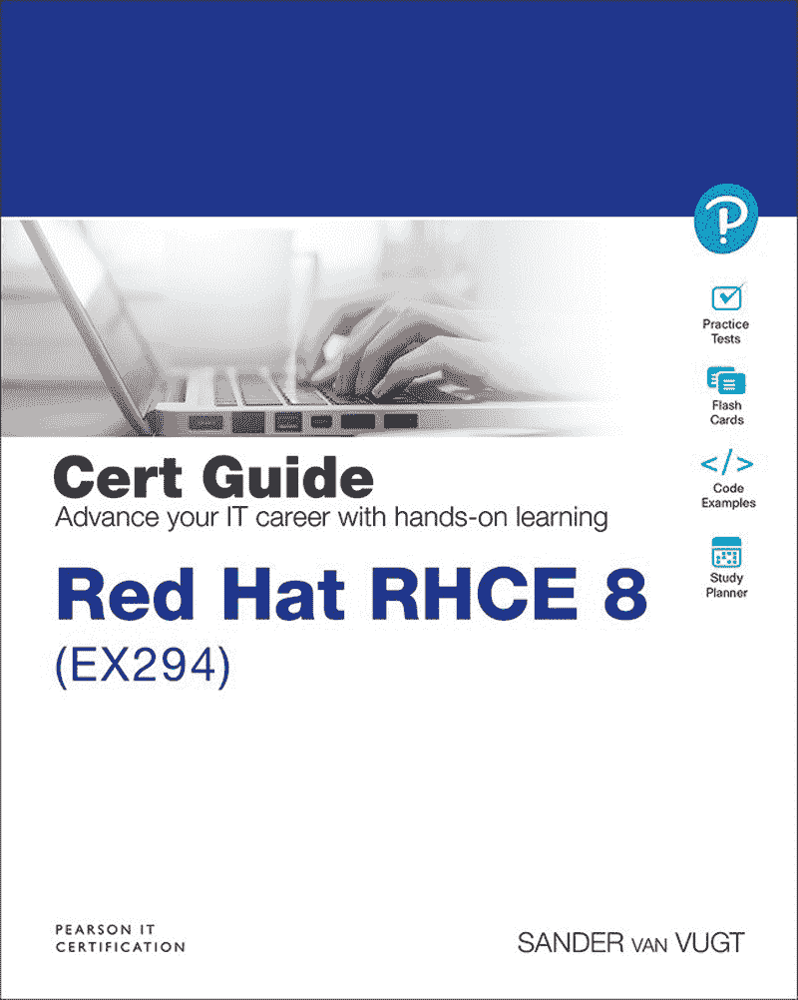


**新泽西州霍霍肯**

`ScoutAutomatedPrintCode`

- 校对员
- 排字员
  - 附录 F：学习计划

# 第一部分：Ansible 简介

## 1 理解配置管理

- “我已经知道了吗？”测试
- 基础知识
- 理解自动化
- 理解 Ansible 组件
- 理解 Ansible 用例
- 总结
- 考试准备任务
- 复习所有关键点
- 定义术语

## 2 安装 Ansible

- “我已经知道了吗？”测试
- 基础知识
- 理解 Ansible 环境
- 理解控制主机
- 理解安装方法
- 配置被管理主机
- 配置 Ansible 用户
- 总结
- 考试准备任务
- 复习所有关键点
- 记忆表
- 定义术语
- 复习题
- 章末实验
- 实验 2-1

## 3 设置 Ansible 管理环境

- “我已经知道了吗？”测试
- 基础知识
- 理解项目
- 配置静态清单
- 使用动态清单
- 管理 `ansible.cfg` 设置
- 总结
- 考试准备任务
- 复习所有关键点
- 记忆表
- 定义术语
- 复习题
- 章末实验
- 实验 3-1

## 4 使用即时命令

- “我已经知道了吗？”测试
- 基础知识
- 理解即时命令
- 模块操作
- 查阅模块文档
- 通过脚本运行即时命令
- 总结
- 考试准备任务
- 复习所有关键点
- 记忆表
- 定义术语
- 复习题

## 5 编写 Ansible Playbook

- “我已经掌握这些了吗？”测验
- 基础主题
- 探索你的第一个 Playbook
- 使用 YAML
- 管理多 Playbook 部署
- 总结
- 考试准备任务
- 复习所有关键知识点
- 记忆表格
- 定义关键术语
- 复习题
- 章节末实验
- 实验 5-1

## 6 使用变量与 Facts

- “我已经掌握这些了吗？”测验
- 基础主题
- 理解变量在 Ansible Playbook 中的用法
- 使用 Ansible Facts（事实）
- 使用变量
- 使用 Vault 管理敏感值
- 使用 `register` 捕捉命令输出
- 总结
- 考试准备任务
- 复习所有关键知识点
- 记忆表格
- 定义关键术语
- 复习题
- 章节末实验
- 实验 6-1
- 实验 6-2

# 第二部分：常见的 Ansible 管理任务

## 7 使用任务控制

- “我已经掌握这些了吗？”测验
- 基础主题
- 使用循环（Loops）和项（Items）
- 使用 `when` 条件运行任务
- 使用处理器程序（Handlers）
- 处理故障
- 总结
- 考试准备任务
- 复习所有关键知识点
- 记忆表格
- 定义关键术语
- 复习题
- 章节末实验
- 实验 7-1

## 8 部署文件

- “我已经掌握这些了吗？”测验
- 基础主题
- 使用模块操作文件
- 管理 SELinux 属性
- 使用 Jinja2 模板
- 总结
- 考试准备任务
- 复习所有关键知识点
- 记忆表格
- 定义关键术语
- 复习题
- 练习
- 章节末实验
- 实验 8-1：生成 `/etc/hosts` 文件
- 实验 8-2：管理 `ftpd` 服务

## 9 使用 Ansible Roles

- “我已经掌握这些了吗？”测验
- 基础主题
- 使用 Ansible Roles
- 使用 Galaxy Roles
- 使用 RHEL 系统角色
- 总结
- 考试准备任务
- 复习所有关键知识点
- 记忆表格
- 定义关键术语
- 复习题
- 章节末实验
- 实验 9-1
- 实验 9-2

## 10 在大型环境中使用 Ansible

- “我已经掌握这些了吗？”测验
- 基础主题
- 高级清单用法
- 优化 Ansible 处理过程
- 包含与导入文件
- 总结
- 考试准备任务
- 复习所有关键知识点
- 记忆表格
- 定义关键术语
- 复习题
- 章节末实验
- 实验 10-1

## 11 排除 Ansible 故障

- “我了解这些？”测验
- 基础主题
- 管理 Ansible 错误与日志
- 使用模块进行故障排除与测试
- 使用 `tags`
- 故障场景
- 总结
- 考试准备任务
- 复习所有关键知识点
- 记忆表格
- 定义关键术语
- 复习题
- 章节末实验
- 实验 11-1

# 第三部分：使用 Ansible 管理系统

## 12 使用 Ansible 管理软件

- “我已经掌握这些了吗？”测验
- 基础主题
- 使用模块管理软件包
- 使用模块管理存储库与订阅
- 实现管理软件的 Playbook
- 总结
- 考试准备任务
- 复习所有关键知识点
- 记忆表格
- 定义关键术语
- 复习题
- 章节末实验
- 实验 12-1
- 实验 12-2

## 13 管理用户

- “我已经掌握这些了吗？”测验
- 基础主题
- 使用 Ansible 模块管理用户与组
- 管理 SSH 连接
- 管理加密密码
- 用户管理高级场景练习
- 总结
- 考试准备任务
- 复习所有关键知识点
- 记忆表格
- 定义关键术语
- 复习题
- 章节末实验
- 实验 13-1

## 14 管理进程与任务

- “我已经掌握这些了吗？”测验
- 基础主题
- 管理服务
- 管理启动过程
- 管理启动过程与服务
- 总结
- 考试准备任务
- 复习所有关键知识点
- 记忆表格
- 定义关键术语
- 复习题
- 章节末实验
- 实验 14-1

## 15 管理存储

- “我已经掌握这些了吗？”测验
- 基础主题
- 发现存储相关 Facts
- 管理分区与 LVM
- 存储配置练习
- 总结
- 考试准备任务
- 复习所有关键知识点
- 记忆表格
- 定义关键术语
- 复习题
- 章节末实验
- 实验 15-1

## 16 最后准备

### 通用技巧

# 第四部分：模拟考试

## 模拟考试 A

## 模拟考试 B

# 第五部分：附录

## 附录 A：“我已经掌握这些了吗？”测验与复习题答案

## 附录 B：上手 Ansible Tower

## 附录 C：Red Hat RHCE 8 (EX294) 认证指南考试更新

## 术表

### 在线元素

### 模拟考试 C

## 练习题 D

### 附录 D：记忆表

## 附录 E：记忆表答案

## 附录 F：学习计划

## 术语表

## 关于作者

**Sander van Vugt** 自 1995 年以来一直教授 Linux 课程，编写了 60 多本关于不同 Linux 相关主题的书籍，包括畅销的 `RHCSA-RHCE 7 Cert Guide` 和 `RHCSA 8 Cert Guide`。Sander 还是 25 多门视频课程的作者，包括他的 RHCSA 和 RHCE 完整视频课程、`Hands-On Ansible LiveLessons` 以及许多其他作品。他为全球的客户授课，也是开源软件相关主要会议的定期演讲者。Sander 还是 Living Open Source Foundation 的创始人，这是一个致力于在非洲国家教授开源课程的营利组织。

## 献辞

本书献给我的家人：Florence、Franck 和 Alex。在过去的一年里，我们共同取得了巨大的成就。

## 致谢

如果没有所有贡献者的帮助，这本书就无法完成。首先，我要感谢 Pearson 的同事们——特别是 Denise Lincoln 和 Ellie Bru。在过去的几年里，我们一起付了很多努力，这本书是我们通往成功道路上的又一个里程碑！你们在短短两个月内帮助我实现这本书的诞生，这真是太棒了！

接下来，我要感谢我的技术评审员。非常感谢 Bo 和 John！感谢你们的优秀反馈，我能够对本书的内容进行重要的改进。此外，特别感谢来自新西兰的 Etienne Esterhuizen、Santos Venter Chibenga 以及非洲 Living Open Source Community 的 Robert Charles Muchendu，他们作为志愿者评审员给予了帮助。最后，还要感谢我的导师兼同事 Pascal van Dam，他帮助我完成了一些最后的重要改进。

## 关于技术评审员

**John McDonough** 拥有 30 多年的开发经验；目前，John 是 Cisco DevNet 的开发者倡员。作为开发者倡员，John 编写代码并创建关于如何编写代码的 DevNet Learning Labs；编写关于写代码的博客；并在 Cisco Live、SXSW、AnsibleFest 等其他行业活动中演讲。John 专注于 Cisco 计算系统产品、Cisco UCS 和 Cisco Intersight。John 在 Cisco 的职业经历了从产品工程师到自定义应用开发人员、技术营销工程师，以及现在的开发者倡员。

**William “Bo” Rothwell** 在 14 岁这个容易影响的年纪接触了 TRS-80 微型计算机系统（亲切地被称为“垃圾 80”）。不久后，负责 Bo 的大人们犯了一个错误，让他独自与 TRS-80 相处。他立即拆解了它，并开了他的第一堂计算机课，向他的朋友们展示了这个“计算机东西”是如何工作的。

从这次经历开始，Bo 对理解计算机工作原理以及与他人分享这些知识的热情使他在 IT 培训领域获得了丰颇的职业。他的经验包括 Linux、UNIX 以及 Perl、Python、Tcl 和 `BASH` 等编程语言。他是 IT 培训机构 One Course Source 的创始人兼总裁。

## 我们想听你的意见！

作为本书的读者，*你*是我们最重要的批评家和评论员。我们重视你的意见，并想知道我们做得对的地方、哪里可以做得更好、你希望我们出版哪些领域，以及任何其他愿意分享给我们的智慧建议。

我们欢迎你的评论。你可以通过电子邮件或写信的方式告诉我们你对这本书的喜欢或不喜欢之处——以及我们可以做什么来让书籍更好。

请注意，我们无法帮助解决与本书主题相关的技术问题。

在写信时，请务必包含本书的书名和作者，以及你的姓名和电子邮箱地址。我们将仔细审查你的意见，并将其与参与本书的作者和编辑分享。

电子邮件：`community@informit.com`

## 读者服务

在 `www.pearsonitcertification.com` 注册你的 `Red Hat RHCE 8 (EX294) Cert Guide` 副本，以便方便地获取下载、更新和更正。要开始注册流程，请访问 `www.pearsonitcertification.com/register` 并登录或创建账户。输入产品 ISBN `9780136872436` 并点击提交。处理完成后，你将在“注册产品”（Registered Products）下找到任何赠送内容。

请务必勾选希望收到我们消息的框框，以获取该产品未来版本的独家折扣。

## 引言

欢迎阅读 `Red Hat RHCE 8 (EX294) Cert Guide`！随着 Red Hat Enterprise Linux 8 的发布，红帽决定对 RHCE 考试采取完全不同的方向。现在的考试完全关于如何使用 Ansible 管理配置。这是一个极佳的选择，因为在当前的 IT 领域，通过应用专门技能调优单台服务器的管理员时代已经过去。今天的工作完全是自动化，而 Ansible 已迅速成为实现这一目标最重要的解决方案之一。

作为一名拥有 25 年经验的 Linux 教师，我从 RHEL 4 开始获得了每个版本的 RHCSA 和 RHCE 认证。亲自考试让我了解考试的进展、新特性以及变化。我很高兴能在这本全面的指南与你们分享我的知识，提供通过 RHCE RHEL 8 EX294 考试所需的指导。

正如你所看到的，本指南涵盖了更新后的 RHCE 考试的所有目标，包含 16 章、40 多道练习（书中 2 套，配套网站 2 套）以及 2 小时的视频培训。这本 `Red Hat RHCE 8 (EX294) Cert Guide` 是你准备和通过考试的最佳资源。

### 目标与方法

为了学习书中描述的主题，我建议你创建一个自己的测试环境，这在第 2 章“安装 Ansible”中有所说明。如果没有大量的练习，无法成为 RHCE。为了熟悉章节中的主题，我的建议如下：

- 阅读章节中的解释并研究列表中提供的代码示例。为了方便起见，列表也提供了书籍的 GitHub 仓库：`https://github.com/sandervanvugt/rhce8-book`。研究示例并尝试理解它们的作用。
- 完成书中所有的编号练习。编号练习提供了分步说明，你应该跟随完成所有练习，以遍历配置任务并学习如何管理特定功能。
- 在每章的末尾都有一个章节实验。这种实验与你在考试中遇到的实验作业非常相似。

在书中每一章包含的练习题中，你将找到所需的所有示例，以帮助你理解考试内容，并彻底学习通过考试所需的材料。章节中的练习提供了分步骤的程序描述，你可以通过完成这些练习来找到可行的解决方案，从而在考试之前获得实践经验。尽管你可能对某些主题很熟悉，但完成书中的所有练习也是个好主意。RHCE 考试是实操性的，这在考试当天可能会带来很大压力。每章的练习有助于提供你所需的练习，确保你拥有足够的经验，以防在考试期间出现细小的错误和失误。练习是确保你在参加考试前处理常见错误并从错误中学习的最好方法。

每章还包含一个章节末的实验（lab）。这些实验提出的问题与你可能在考试中遇到的问题相似，你可以利用它们进行练习。我特意排除了这些实验的答案，原因有几点：(1) 你需要在考试前训练自己验证工作结果习惯，因为考试中你会被要求这样做；(2) 在考试期间，你需要自己验证你的解决方案是否按预期工作；以及 (3) 大多数实验有多种解决方案，我不想暗示我的方案是正确的而你的是错误的，因为你可能采取了不同的方法。只要你的解决方案完成了练习中的要求，你的方案就和我的方案一样好。

### 其他资源

这本书包含了通过考试所需的所有内容，但如果你想获得更多的指导和练习，我提供了多个视频培训课程帮助你学习，包括以下内容：

- `Hands-on Ansible Complete Video Course`
- `Red Hat Certified Engineer (RHCE) 3/ed Complete Video Course`

除了这些产品外，你可能还会喜欢我的网站：[rhatcert.com](http://rhatcert.com)。通过这个网站，我提供对备考者有用的更新。我建议你在网站上注册，这样我就可以向你发送关于我发布的重要更新的消息。此外，你还会在我的 YouTube 频道 rhatcert 上偶尔看到视频更新。我希望所有资源都能为你提供以实惠的方式通过红帽考试所需的所有内容！祝你好运！

### 谁应该读这本书？

这本书是作为 RHCE 考试备考指南编写的。这意味着如果你想增加通过 RHCE 考试的概率，就应该阅读它。我写这本书也是为了帮助你熟悉 Ansible。所以，即使你对 RHCE EX294 考试完全不感兴趣，这本书也会教你 Ansible 职业起步所需的所有知识。

那么，为什么你应该考虑通过 RHCE 考试呢？问题的答案很简单。Linux 已经成为一个非常重要的操作系统，合格的专业人士在全球范围内都很受欢迎。如果你想作为 Linux 专业人士工作并证明你的能力，RHCE 证书非常有帮助。拥有这些证书会大大增加你被聘为 Linux 专业人士的机会。请注意，为了获得 RHCE 认证，你必须持有有效的 RHCSA 认证。你可以在获得 RHCSA 认证之前参加 RHCE EX294 考试，但只有在通过了 RHCSA 和 RHCE 考试后，你才能自称为 RHCE。

### 本书的结构

这本书作为参考指南编写，帮助你准备考试。如果你是这些主题的新手，可以从头到尾通读。你也可以阅读书中你需要的精进技能的特定章节。每一章都从一个“我已经知道这些了吗？”的小验开始。该测验包含关于每章涵盖的 10 个主题的问题，并提供了一个简单的工具来检查你是否已经熟悉该章节涵盖的主题。不过，这些测验并不代表你在真实考试中会遇到的问题类型。

# 第 10 章：在大环境中中使用 Ansible

在大规模环境中使用 Ansible 时，你应该了解一些特定的技术。本章将涵盖这些技术。你将学习到如何通过修改可执行的并发任务数量来优化 Ansible。你还将学习如何如何使用包含（includes）和导入（imports），这使你能够构建模块化的剧本（playbooks）。

# 第 11 章：Ansible 故障排除

在某些情况下，你的剧本可能无法给你预期的结果。这时你就需要开始故障排除。本章包含了你了解故障排除所需的所有知识，包括在开发剧本时的某些最佳实践，还包含了可用于简化故障排除的模块信息。

# 第 12 章：使用 Ansible 管理软件

这是关于你可以使用 Ansible 执行的特定常见任务的第一个章节。在本章中，你将学习到如何设置存储库以及如何使用 Ansible 管理软件包。

# 第 13 章：用户管理

要在 Linux 上进行任何操作，你都需要用户账户。在本章中，你将学习创建用户账户所需的所有知识，包括设置加密密码。

# 第 14 章：管理进程和任务


偶尔，你可能想要运行计划任务。这些任务将使用`cron`或`at`在特定时间执行。在本章中，你将学习如何这样做，并学习如何管理`systemd`默认目标。

# 第 15 章：存储管理

设置存储是处理 Linux 时的一项关键任务。在本章中，你将学习如何使用 Ansible 自动化存储配置。你还将学习如何发现管理系统上的可用磁盘设备，以及如何使用分区、逻辑卷、文件系统和挂载来进行设置。

# 第 16 章：最终准备

在本章中，你将获得一些最后的考试准备任务。它包含了一些测试题以及许多帮助你最大化通过考试概率的技巧。

## 如何使用本书

为了帮助你利用这些书籍定制自己的学习时间，核心章节具有几个可以帮助你充分利用时间的功能：

- **“我已经认识这些了吗？”测验：** 每一章的开头都有一个测验，帮助你确定学习该章节需要花费的时间。

- **基础主题（Foundation Topics）：** 这些是每个章节的核心部分。它们解释了该章节主题的协议、概念和配置。

- **考试准备任务（Exam Preparation Tasks）：** 在每个章节“基础主题”部分的末尾，“考试准备任务”部分列了一系列应在章节结束时完成的学习活动。每个章节都包含了最适合学习该章节主题的活动。这些活动包括：

  - **回顾关键主题：** 在章节的“基础主题”部分中，最重要项目旁边会显示一个“关键主题”图标。“关键主题回顾”活动列出了该章节的关键主题及其对应的页码。虽然整个章节的内容都可能出现在考试中，但你绝对应该掌握每个关键主题中列出的信息。

  - **凭记忆完成表格和列表：** 为了帮助你锻炼记忆并记住一些事实列表，章节中许多较重要的列表和表格已包含在 DVD 和配套网站的文档中。该文档仅列出部分信息，允许你完成表格或列表。

  - **定义关键术语：** 此部分列出了章节中最重要的术语，要求你写下一个简短的定义，并将你的答案与书末的术语表进行比较。

  - **复习题：** 每一章末尾的问题衡量了你对章节中所讨论主题的洞察力。

  - **章末实验：** 这些真实的实验让你对考试作业的样式有直观的感受。章末实验是你发现考试任务真实样子的首步。

## 其他功能

除了每个核心章节中的功能外，本书整体在配套网站上还提供了额外的学习资源，包括：

- **四份模拟考试：** 配套网站包含四份模拟考试：其中两份在书中提供，另外两份在配套网站提供。

- **闪片：** 配套网站根据书中的术语制作了交互式闪片，以便你更好地学习术语并测试知识。

- **两小时以上的视频培训：** 配套网站包含超过两小时的畅销红帽认证工程师（RHCE）课程视频培训。

## 本书结构、章节与附录

我还包含了一张表格，详细列出了书中涵盖的每一个 RH 目标，以便你更容易制定通过考试的计划。

**表 1** RHCE 目标


## 配套内容文件在哪里？

注册此版本的`Red Hat RHCE 8 (EX294) Cert Guide`以访问在线内容。此纸质版附带配套内容光盘。你可以按照以下步骤获取在线访问：

1. 访问`www.pearsoncertification.com/register`并登录或创建新账户。

2. 输入 ISBN：`9780136872436`。

3. 回答挑战问题以证明购买。

4. 点击账户中注册产品部分的“访问附加内容”链接进入下载页面。

请注意，我们的许多配套内容文件很大，特别是图像和视频文件。

如果你按照上述步骤找不到该书的文件，请访问`www.pearsoncertification.com/contact`并选择“网站问题/反馈”选项。我们的客服代表将为你提供帮助。

本书还包含了针对高级版 eBook 和练习测试版的 7 折优惠优惠。请参阅书中的优惠码获取如何购买高级版的信息。

# 第一部分：Ansible 简介

## 第 1 章 理解配置管理

本章涵盖了以下主题：

- 理解自动化
- 理解 Ansible 核心组件
- 理解 Ansible 用场景

**本章涵盖了以下 RHCE 考试目标：**

- 理解 Ansible 核心

### “我已经认识这些了吗？”测验

“我已经认识这些了吗？”测验可以让你评估应该仔细阅读整个章节，还是跳到“考试准备任务”部分。如果你对这些问题的答案或对这些主题知识的自我评估有疑问，请阅读整个章节。表 1-1 列出了本章的主要标题及其对应的“我已经认识这些了吗？”测验问题。你可以在`附录 A`，“我已经认识这些了吗？”测验和复习题的答案”中找到答案。

**表 1-1** “我已经认识这些了吗？”章节与问题映射


# 1. 下列哪些 shell 脚本进行自动化的缺点是？（选择两个。）

a. 它们无法在任何受管理的目标操作系统上运行。

b. 它们需要高级技能。

c. 如果配置发生变化，很难保证它们始终能产生相同的结果。

d. 只有在以 root 权限运行时使用 shell 脚本才有意义。

# 2. 在 DevOps 中，应用生命周期通过关注不同的关键方面来管理。以下哪个关键方面排在发布（releasing）之后？

a. 测试

b. 配置

c. 监控

d. 打包

# 3. 使用 CVS 管理在基础设施即代码中使用的机器可读配置文件，以下哪些是其优点？

a. 它是易于复的。

b. 它使得升级变得容易。

c. 它使得回滚变得容易。

d. 以上都是的。

# 4. Ansible 是一个自动化工具。也存在其他自动化解决方案。以下哪个不是之一？

a. Puppet

b. SaltStack

c. Satellite

d. Chef

# 5. 当你将 Ansible 与 Puppet、SaltStack 和 Chef 等竞争解决方案相比时，Ansible 提供了两个显著优势。这些是？

a. 速度

b. 易于配置

c. 无代理操作

d. 价格

# 6. Ansible 提供了访问远程主机的不同解决方案。以下哪个不是之一？

a. Agent

b. API 访问

c. winRM

d. SSH

# 7. 允许你从界面管理 Ansible 的免费开源项目名称是什么？

a. Ansible Galaxy

b. OKD

c. AWX

d. Ansible Tower

# 8. 以下哪个是对声明式方法（declarative approach）的最佳描述？

a. 在声明式方法中，你运行命令来获取特定的方法。

b. Ansible 中的声明式方法是通过使用脚本来实现的。

c. 声明式方法允许你关注为了达到所需状态而进行的更改。

d. 声明式方法使用 playbooks。

# 9. Ansible 可用于置备（provisioning）。以下不是 Ansible 常用的置备场景？

a. 在云中部署实例

b. 置备虚拟机

c. 通过 PXE 启动裸机服务器

d. 部署容器

# 10. Ansible 可用于不同的用途。以下哪个可以认为是 Ansible 的核心功能？

a. 配置管理

b. 应用管理

c. 置备

d. 持续交付

## 基础主题

### 了解自动化

Ansible 通常被认为是一种配置管理解决方案。这种描述并没有完全体现 Ansible 所能做的一切。Ansible 更像是一个自动化解决方案，允许系统管理员以高效的方式处理多个系统。在本节中，你将学习 Ansible 作为自动化工具所能做的一切。我们还简快速查看了其他自动化解决方案。

### 什么是自动化？

在系统管理员的时代，公司使用服务器。这些服务器执行各种不同的任务，为了确保每台服务器都在执行它应该执行的任务，需要系统管理员。系统管理员通常在管理运行在服务器上的操作系统的不同部分方面具有高级技能。

尽管系统管理员的时代是辉煌的，而且许多专家在 IT 部门工作，但从公司的角度来看，这种场景并不理想。首先，因为系统管理员的技能是针对特定个人的，如果这个人离开了，遗忘记了之前应用的绝妙解决方案，或者只是心情不好，事情就可能出问题。

另一个不理想的部分是，系统管理员通常负责单台服务器，随着近几年 IT 的发展，公司已经从几台服务器发展到拥有成百甚至上千台服务器的数据中心和云环境。因此，需要一种更高效的方法。

许多地方的首次尝试是使用`shell scripts`。基于许多系统管理员的深厚知识，`shell scripts`可以以灵活的方式自动执行许多服务器上的各种任务。然而，使用`shell scripts`确实存在一些缺点：

- `shell scripts`无法在需要管理的各种不同设备上使用。
- 很难编写`shell scripts`以便在每情况下都能始终产生相同的结果。

由于这些差异，并且由于公司消费 IT 的方式发生了变化，我们需要新的方法。

### 了解 DevOps 工作方式

多年来，IT 的消费方式发生了变化。过去，IT 是用来向终端用户提供优质服务的，他们只需要处理这些服务即可。现在格局已经变成了一个 IT 无处不在的环境，多个应用程序可以为同一个 IT 问题提供解决方案。系统管理员的时代逐渐结束，系统管理员的角色需要更接近开发者。

在这种新的工作方式中，开发者负责构建应用程序，而系统管理员负责实施代码。由于这种变化需要开发者和系统管理员之间的深度合作，产生了一个新角色：DevOps 角色。`DevOps`一词是`developer`（开发者）和`operator`（操作者）的缩写。在这个角色中，开发者和系统管理员的任务结合在一起。对 DevOps 的常见定义是“一组旨在缩短从提交更改到进入生产环境的时间，同时确保高质量的实践”（Len Bass, Ingo Weber 和 Liming Zhu, *DevOps: A Software Architect’s Perspective*, Boston, MA: Addison-Wesley Professional, 2015）。

随着这个角色的出现，“DevOps 工作方式”被引入。具体的定义并不总是相同，但总的来说，它归于管理整个应用生命周期，它由以下元素组成：


- **编码：** 开发和评审源码。
- **构建：** 使用持续集成包含源代码中的更改并转换为可运行的应用程序。
- **测试：** 使用工具链对应用程序进行测试，并确保对业务风险提供反馈。
- **打包：** 通过将代码封装并在仓库中提供这些包来交付终端用户。
- **发布：** 、管理和自动化新软件发布。
- **配置：** 管理支持新代码的基础。
- **监控：** 监控应用程序性能以及终端用户的体验。

为了管理应用生命周期中的这些不同元素，引入了新工具。Ansible 是这些工具之一，重点关注根据基础设施即代码方法管理托管环境的配置。

DevOps 方法中的某些类别比其他更重要。最重要的元素是持续集成，解决方案包括`Jenkins`和`GitLab`，但还有`OpenShift`甚至`Ansible`。另一个主要部分是基础设施即代码，`Ansible`、`Puppet`和`Terraform`是重要的解决方案。

### 了解基础设施即代码

基础设施即代码（Infrastructure as code）的核心在于使用机器可读的代码（自动化语言）来描述受管理的 IT 基础设施所需要的状态。这被称为`desired state`（期望状态）。随后，这些代码会被应用到基础设施上，以确保它确实处于该状态。

在这种方法中，机器可读的代码文件（基本上是简单的文本文件）应该像软件代码一样进行管理，使用版本控制系统或并发版本系统（`CVS`）。这意味着开发者常用的工具也被实现，用于对基础设施即代码的管理。通常，`Git`仓库被用于此目的。

将这些文件放入`CVS`中可以使管理变得简单。这种方法提供了一些优势，例如易于管理变更历史、升级和回滚。基础设施即代码是 DevOps 中开发者与运维人员汇合的地方。开发者可以轻松地审查更改，运维人员可以确保系统处于开发者预期的状态。

### 其他自动化解决方案

为了提供配置管理的自动化，`Ansible`是最常见的解决方案之一。尽管它目前看起来是最广泛广泛的配置管理解决方案，但它并不是唯一的。其他常见的解决方案包括`Puppet`、`Chef`和`SaltStack`。

与`Ansible`一样，`Puppet`最重要的自动化解决方案之一。但几个原因导致`Ansible`正在抢夺`Puppet`的市场份额。原因之一是`YAML`。`Ansible`配置使用`YAML`编写，这是一种易用且易懂的语言。`Puppet`使用自己的语言，并没有那么易用。另一个主要区别是`Ansible`采用推模式（push approach），配置从控制节点发送到受管理的节点。`Puppet`采用拉模式（pull approach）作为主要策略，受管理的节点使用`agent`连接到`Puppet master`以获取其期望状态。

`Chef`被构建为客户端/服务器解决方案，服务器部分运行在主机器上，客户端部分则作为`agent`实现在受管理的机器上。`Chef`使用`Ruby DSL`提供配置，而`Ansible`使用用`YAML`编写的 playbooks。因此，`Ansible`更容易学习，因为`YAML`是一种更易于获取的数据数据格式。

`SaltStack`是`Ansible`的另一个重要替代方案。`Ansible`和`SaltStack`之间的主要区别在于性能。`SaltStack`使用`ZeroMQ`消息队列来实现`SaltStack minions`和`master`之间的通信，这似乎速度更快。`SaltStack`使用`Jinja2`编写的配置并使用`agent`，这使得上手`SaltStack`的学习曲线也更加复杂。

## 理解 Ansible 核心组件

现在你已经了解了一点`Ansible`及其工作原理，让我们来看看`Ansible`中使用的不同组件。在本节中，你将学习到`Python`的角色、`Ansible`架构、`Ansible Tower`管理平台以及如何以 Ansible 的方式管理系统。

### Ansible 是 Python

IT 领域在使用许多编程和脚本语言。在开源领域，过去几十年见证了`Python`脚本语言的兴起。`Python`已成为不同解决方案（如`Ansible`和`OpenStack`）的基础。原因是`Python`相对容易学习。`Python`的重点在于代码的可读性，同时它使得以简单的方式完成任务成为可能。

`Ansible`用`Python`编写，`Ansible`中使用的大多数组件也是用`Python`编写的。安装在`Red Hat Enterprise Linux 7`上的默认`Ansible`版本基于`Python 2.7`；`RHEL 8`中使用的`Ansible`版本基于`Python 3.6`。`Ansible`版本与`Python`版本之间没有直接关系。最近的`Ansible`版本可以调用`Python 2.x`或`Python 3.x`脚本，但现在`Python 3.x`是更好的选择，因为`Python 2`已经过了支持生命周期。

`Ansible`用`Python`编写这一事实使得`Ansible`与自定义脚本集成变得更容易，因为`Python`是一种非常常见且为人知的脚本语言。但这并不意味着你必须知道`Python`才能使用`Ansible`。确实，如果你理解`Python`的原理，解释`Ansible`的特定行为会变得更容易，但即使不知道如何在`Python`中写一个 Hello World 脚本，成为`Ansible`专家也是完全可能的。

### Ansible 架构

`Ansible`中有两个主要的节点角色。`controller node`（控制节点）运行`Ansible`软件并由运维人员从中发布`Ansible`命令的节点。`controller node`可以是运行`Linux`的服务器、运维人员的笔记本电脑或运行`Ansible Tower`的系统。唯一的要求是`controller node`需要是`Linux`。

从`controller node`可以访问`managed nodes`（受管理的节点）。在`controller node`上维护着`inventory`（清单），以知道哪些受管理的节点是可用。在`Ansible`中不需要使用任何`agents`。这意味着无需安装任何东西即可访问受管理的节点。为了做到这一点，`Ansible`使用托管节点提供的原生远程访问解决方案。在`Linux`上，通过使用`SSH`实现远程访问；在`Windows`上，通过使用`Windows Remote Management`（`WinRM`）实现；在网络设备上，可以通过`SSH`或`API`访问提供。

为了配置受管理的节点，`Ansible`使用`playbooks`。`playbook`用`YAML`编写，包含一个或多个`plays`。每个`play`由一个或多个`tasks`组成，并在受管理的节点上执行。

为了实现这些任务，`Ansible`使用`modules`。`Modules`是在受管理的节点上执行实际工作的代码段，有许多模块可用——已经超过 3000 个，并且数量不断增加。`Ansible`还提供了`plug-ins`。`Ansible plug-ins`用于通过附加功能扩展`Ansible`的功能。

`Ansible playbooks`的开发应该是幂等的（idempotent）。这意味着即使在同一个节点上启动多次，`playbook`也总是产生相同的结果。作为幂等性的一部分，`playbooks`还应该是自包含的，不依赖于任何其他`playbooks`即可成功。


### 理解 Ansible Tower

`Ansible` 可以以两种方式使用：`Ansible Engine` 或 `Ansible Tower`。`Ansible Engine` 是 `Ansible` 的命令行版本，使用 `modules` 和 `plug-ins` 提供 `Ansible` 功能。对于喜欢在中小型环境中通过命令行工作的人来说，`Ansible Engine` 是首选解决方案。

除了 `Ansible Engine` 之外，还有 `Ansible Tower`，它基于 `AWX` 开源解决方案。`Ansible Tower` 为 `Ansible Engine` 增加了不同的功能，例如：


- Web 管理界面
- 基于角色的访问控制
- 任务调度
- 增强的安全性
- 集中日志

由于 `RHCE EX294` 考试是关于 `Ansible Engine` 的，你将在书中找不到多少关于 `Ansible Tower` 的信息。

### 理解 Ansible 方式

在使用 `Ansible` 时，你需要对如何处理特定任务做出选择。在很多情况下，有很多解决方案可用。然而，如果你选择以 Ansible 的方式工作，选择正确的解决方案将变得简单得多。Ansible 方式围绕以下规则展开：


- **保持简单**：在发布时，Ansible 被定位为一种比其他方案简单的解决方案。这同样适用于你开发的 `playbooks` 和其他解决方案。保持简单，这样其他人更容易理解你的想法。

#### 原则

- **保持可读性：** 就像 IT 领域的任何事物一样，你可以让它变得非常复杂并使用紧凑的结构，以确保没人能理解你想做什么。这种方法是没有意义的。你应该保持它的可读性，这从你开发 `Ansible playbooks` 开始。

- **使用声明式方法：** 在 `Ansible` 中，一切都在于“期望状态”。`Ansible` 的目的是无论当前状态如何，都将受管的资产带到期望状态，并且只进行必要的修改。期望状态是在 `playbooks` 中实现的，而使用 `playbooks` 来使当前状态匹配期望状态，这就是众所周知的声明式方法。

- **使用具体的解决方案：** 在很多情况下，你会发现有多种解决方案达到特定的期望状态。例如，你可以使用 `command` 模块来运行任意命令，这使得完成任何任务成为可能。然而，你不应该这样做。为了确保获得预期的结果，请使用最具体的解决方案。例如，如果 `user` 模块允许你创建用户，请使用该模块，而不要使用 `command` 模块配合 Linux 的 `useradd` 命令。

## 理解 Ansible 用例

`Ansible` 的核心是配置管理。`Ansible` 模块和插件涵盖了广泛的功能，这意味着 `Ansible` 可用于配置管理及其他领域。以下是一些常见的用例。

### 使用 Ansible 进行配置管理

许多人只将 `Ansible` 视为一种配置管理解决方案，这是有有原因的。`Ansible` 起作为一种配置管理解决方案，而且在大多数情况下它仍然被用于此类。在配置管理中，`Ansible` 被用于管理配置文件、安装软件、创建用户并执行类似任务，以确保所有受管系统都处于期望状态。

### 使用 Ansible 进行资源配置（Provisioning）

使用 `Ansible` 的另一个常见场景是部署和安装系统（资源配置）。资源配置在虚拟和云环境中尤为常见，在这些环境中，一台新机器最终只是一个推送到受管机器并从那里启动的配置文件。`Ansible` 不提供 PXE 启动和引导裸机服务器（`kickstart`）的功能，但它可以与处理此类任务的解决方案结合使用。在探索不同的可用模块时，你会发现提供了广泛的模块在不同的云环境中与 `Ansible` 配合工作。

### 使用 Ansible 进行持续交付

持续集成/持续交付（`CI/CD`）确保了源代码可以容易地开发和更新，并且结果可以作为应用程序的新版本被容易地部署。`Ansible` 无法处理整个 `CI/CD` 流程，但 `Ansible playbooks` 可以在 `CI/CD` 流水线的 `CD` 部分起着重要作用。

### 总结

在本章中，你学习了通用的配置管理以及 `Ansible` 在配置管理解决方案中的作用。你还阅读了使 `Ansible` 独特的之处，以及在哪些典型用例中使用了 `Ansible`。在下一章中，你将学习如何基于 `Ansible` 构建你自己的管理基础设施。

### 考试准备任务

正如引言中“如何使用本书”部分提到的，你有几种准备考试的选择：此处的练习、第 16 章、“最终准备”以及配套网站上的考试模拟试题。

### 复习所有关键主题

回顾本章中最重要的主题，这些主题在页面外边页用“关键主题”图标标出。表 1-2 列出了这些关键主题的参考及其所在的页码。


**表 1-2** 第一章的关键主题


### 定义关键术语

定义本章的以下关键术语，并在词表中检查你的答案：

- 自动化语言
- `CI/CD`
- 当前状态
- `CVS`
- 声明式方法
- 期望状态
- `DevOps`
- `Git` 仓库
- 幂等性
- 基础设施即代码
- 流水线
- 资源配置
- `Python`
- 版本控制系统

## 第 2 章 安装 Ansible

本章涵盖了以下主题：

- 理解 `Ansible` 环境
- 理解控制节点主机要求
- 理解安装方法
- 配置受管主机
- 配置 `Ansible` 用户

**本章涵盖了以下 RHCE 考试目标：**

- 安装并配置 `Ansible` 控制节点
- 安装所需的包
- 配置 `Ansible` 受管节点
- 创建并分 SSH 密钥到受管节点
- 在受管节点上配置权限提升

### “我已经知道这些了吗？”测验

“我已经知道这些了吗？”测验可以帮助你评估是否应该阅读本章或跳到“考试准备”章节。表 2-1 列出了本章的主要标题以及对应的“我已经知道这些了吗？”测验。

**表 2-1** “我已经知道这些了吗？”章节-问题

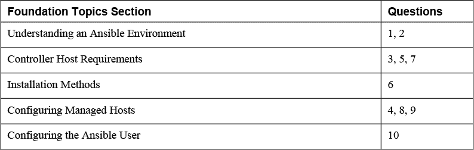

1. 受管节点需要以下哪项？

   - a. `Ansible` 代理
   - b. `Python`
   - c. `Root` 权限
   - d. `SSH` 访问

2. 关于 `Python` 的哪些陈述是正确的？（选择两个）

   - a. 只需要在控制节点上安装 `Python`。
   - b. 需要在受管节点上安装 `Python`。
   - c. `Python 3` 是 `RHEL` 的默认版本。
   - d. 在 `CentOS 8` 上，你可以选择版本。

3. 在设置 `Ansible` 环境时，有一些要求。以下哪项不是强制性要求？

   - a. 设置专用帐户。
   - b. 配置 `SSH` 密钥登录。
   - c. 在受管主机上安装 `Python`。
   - d. 在 `Ansible` 控制节点上安装 `Python`。

4. 关于 `sudo` 的哪些陈述是错误的？

   - a. 在受管节点上，`Ansible` 用户必须能够无密码提升权限。
   - b. 不需要在控制节点上设置 `sudo`。
   - c. 并不是所有类型的受管节点都需要设置 `sudo`。
   - d. 应该设置权限提升以 `root` 身份运行任务。

5. 为了学习 `EX294` 安装 `Ansible`，有不同的要求。以下哪项不是其中之一？

   - a. `RHEL` 或 `CentOS 8.x`
   - b. 1 GB 或更多内存
   - c. 20 GB 或更多磁盘空间
   - d. 1 个 CPU

6. `Ansible` 可以通过不同的方式安装。以下哪项不是其中之一？

   - a. 使用 `RHEL` 订阅管理器从 `RHEL Ansible` 仓库安装。
   - b. 在 `RHEL` 或 `CentOS 8` 上使用 `EPEL`。
   - c. 使用 `python-pip` 安装。
   - d. 使用 `Java` 安装程序。

7. 以远程用户身份执行任务可以通过多种方式确保安全。以下哪项不是其中之一？

   - a. 使用密码短保护 `SSH` 私钥。
   - b. 使用基于密码的 `SSH` 登录。
   - c. 通过 `sudo` 禁用 `root` 用户执行。
   - d. 在使用 `sudo` 时强制使用密码。

8. 在 `CentOS 8` 上安装 `Ansible` 时，以下哪项不是一项必须完成的设置任务？

   - a. 添加 `EPEL` 仓库。
   - b. 安装 `Python 3`。
   - c. 配置 `sudo`。
   - d. 启用 `SSH` 访问。

9. `Ansible` 托管的主机上需要开放哪些防火墙端口？（选择所有项。）

   - a. `22`
   - b. `80`
   - c. `443`
   - d. `2022`

10. 在使用 `ssh-keygen` 创建 `SSH` 公钥/私钥对后，下一步是什么？

    - a. 配置 `sudo` 访问。
    - b. 使用 `ssh-copy-id` 将私钥拷贝到托管机器。
    - c. 将公钥拷贝到远程主机。
    - d. 在托管主机上安装 `Python 3`。

## 基础主题

在本章中，你将学习如何设置 `Ansible`。这个过程不仅涉及设置控制主机（`Ansible` 将从并在托管主机和设备上执行任务），还涉及设置托管主机。由于这本书是针对 `RHCE EX294` 考试编写的，因此我们专注于建立一个用于管理 `RHEL/CentOS 8` Linux 主机的环境。

### 理解 Ansible 环境

`Ansible` 旨在管理各种不同类型的设备。为了做到这一点，你需要一个扮演管理器角色的主机。在书中，我们称之为控制节点（controller node）。控制节点运行 `Ansible` 软件；而托管节点不运行任何特定程序。托管节点的唯一要求是 `Ansible` 能够连接到它们。在 Linux 和许多网络设备上，这意味着你需要运行安全 Shell（`SSH`）。在 Windows 上，这意味着你需要配置远程管理或 Windows 版的安全 Shell。要使用 `Ansible`，你不需要在托管设备上运行或配置任何代理。

为了搭建本书的测试环境，你至少需要三个节点。这些节点的 own 列在表 2-2 中。这些节点中的一个用作控制节点；其他节点用作托管节点。注意，在书中我选择也不用 `Ansible` 来管理控制节点。控制节点是一个隔离的环境，可以降低出错风险，并防止控制节点被意外修改导致无法工作。

请注意，具体的操作系统版本并不非常重要，这就是为什么表 2-2 中提到了 `RHEL` 或 `CentOS 8.x`。在编写这本书时，我安装的是 8.1 版本。当你读到这里时，会有更新版本的操作系统可用。即使你是在 `RHEL` 或 `CentOS 8.8` 上安装 `Ansible`，也不应该有影响。底层操作系统不会改变 `Ansible` 处理问题的方式。重要的是所使用的 `Ansible` 版本，对于 `RHCE EX294` 来说，那就是 `Ansible 2.x`——具体来说是版本 2.8 或更高版本。

另外请注意，对于书中的节点设置，我使用了来自 `CentOS` 和红帽企业 Linux ISO 文件的虚拟机安装。你也可以使用不同的环境来创建本章描述的设置，例如 `RHEL` 或 `CentOS` 的云实例。当你使用云实例时，操作系统的配置将根据所使用的云平台而略有不同。我没有尝试在本章中涵盖所有这些差异，因为要考虑的平台太多了。书中的所有内容都是基于虚拟机的，因为那是你在考试中将使用的工具。因此，我建议你在虚拟机中设置测试环境，而不是在云端设置。

---

**提示**

在生产环境中，你确实也应该用 `Ansible` 管理控制节点。你只需要设置一组 `playbook`，让你能够轻松地配置、更新和管理控制节点即可。

---

**表 2-2** 测试环境节点需求


## 练习 2-1 设置测试网络

1. 使用表 2-1 中提到的规格，建立一个由三台虚拟机组成的测试网络。确保使用以下名称：

   - `control.example.com`: Ansible 控制机
   - `ansible1.example.com`: 第一个托管节点
   - `ansible2.example.com`: 第二个托管节点

2. 在每台虚拟机中提供固定 IP 地址。使用与你当前网络环境匹配的 IP 地址。这些 IP 地址应允许你的机器连接互联网。

3. 安装过程中，创建一个名为 `ansible` 的用户账户。

4. 编辑三台虚拟机上的 `/etc/hosts` 文件，使得你可以 ping 通其他所有虚拟机。请参阅列表 2-1 的 `/etc/hosts` 内容示例。

**列表 2-1** 示例 `/etc/hosts`

```text
127.0.0.1 localhostdomain
::1 localhostdomain
192.168.1.200 control.example.com
192.168.1.201 ansible1.example.com
192.168.1.202 ansible2.example.com
```

### 理解主机需求

在控制节点上安装 `Ansible` 需要以下几项：


- `Python 3.x`
- `SSH` 客户端
- `Ansible` 仓库访问权限
- 具有 `sudo` 权限的专用账户

`Ansible` 用 `Python` 的，因此你需要在控制节点和托管节点上都安装 `Python`。在旧版本的 `RHEL` 中，这是你需要做的。在 `RHEL 8` 中，会自动安装默认栈，所以你不再需要这样做。注意，在某些公共云实例上，默认不安装栈，你可能仍需要手动安装。

需要 `Python` 是因为对于主机，`Ansible` 会生成 `Python` 脚本。这些 `Python` 脚本通过 `ssh` 在远程主机上执行。托管设备是一个例外，因为网络设备通常不运行 `Python` 环境。但用 `Ansible` 管理网络设备不在 `RHCE 8` 考试的范围内。

目前 `Python` 有两个主要版本。`Python 3.x` 近年来已成为标准，但 `Python 2.x` 在许多地方仍在使用。从 `Python 2.x` 迁移到 `Python 3.x` 并不容易，因为脚本并不兼容。但在 `RHEL 8` 上，`Ansible` 使用 `Python 3` 作为默认栈。尽管在技术上可以在 `RHEL 8` 上使用 `Python 2.x`，但这并不是 `RHCE 8` 考试要求掌握的内容。无论如何，你都不应该这样做。`Python 2.x` 已经过时且正在被淘汰；`Python 3.x` 才是重要的。

## 理解安装方法

`Ansible` 是开源软件，因此 `Ansible` 可以安装在许多平台上，每个平台都有自己的安装方法。在书中，我们涵盖了在红帽企业 Linux 8 或 CentOS 8 上安装 `Ansible`。在这两个平台上，你都可以从发行版仓库或使用 Python `pip` 安装 `Ansible`。在接下来的章节中将介绍如何操作。

---

**注意**

使用与你想使用的操作系统和安装方法对应的说明。因此不要执行练习 2-2、2-3 和 2-4，而是选择适用于你操作系统平台的项。

---

### 在 RHEL 8 上安装 Ansible

显然，为了参加 `RHCE 8` 考试，你需要在 `Red Hat Enterprise Linux` 上运行所有作业。不过，在 `Red Hat Enterprise Linux` 上使用 `Ansible` 需要你拥有有效的许可证。你可以从 [`developers.redhat.com`](https://developers.redhat.com) 申请免费的开发者许可证，使用此类许可证允许你免费安装 `RHEL 8` 以及 `Ansible`。设置好基础 `RHEL 8` 环境后，其余的配置步骤非常简单；你只需要添加仓库，然后安装 `Ansible`。练习 2-2 概述了在预安装的 `RHEL 8` 机器上需要执行的步骤。

## 练习 2-2 在 RHEL 8 上安装 Ansible

1. 在 `RHEL 8` 控制节点上，打开 root shell 并输入 `subscription-manager repos --list`。这将向你当前配置的仓库列表。你应该能看到标准的 `RHEL 8` 仓库。

2. 输入 `subscription-manager repos --enable=ansible-2-for-rhel-8-x86_64-rpms` 来添加 `Ansible 2.x` 仓库。

3. 使用 `yum install ansible` 安装 `Ansible` 软件。

4. 使用 `ansible --version` 验证 `Ansible` 软件已安装。

5. 输入 `rpm -qa | grep python` 验证 `Python 3` 也已安装。

## 在 CentOS 8 上安装 Ansible

如果你正在使用 `CentOS 8`，可以从 `EPEL` 仓库安装 `Ansible` 软件。`EPEL` 仓库包含了企业级 Linux 额外软件包（Extra Packages for Enterprise Linux）。`Ansible` 是 `EPEL` 软件包之一。在启用 `EPEL` 仓库访问后，你可以使用简单的 `yum install -y ansible` 安装 `Ansible`。练习 2-3 将引导你完成此过程。

## 练习 2-3 在 CentOS 8 上安装 Ansible

1. 在 `CentOS 8` 控制节点上，打开 root shell。

2. 输入 `yum install -y epel-release` 来添加 `EPEL` 仓库。

3. 输入 `yum install -y ansible` 安装 `Ansible` 软件。

4. 输入 `ansible --version` 验证 `Ansible` 软件已安装。

## 使用 python-pip 安装 Ansible


Ansible 完全用脚本语言 Python 编写，而 Python 包含了自己的包管理器：`python-pip`。因此，对于用 Python 编写的软件，你可以使用 Linux 存储库的包管理器或 `python-pip` 软件管理器。由于 Ansible 是 Python 编写的，这也适用于 Ansible。

使用 `python-pip` 的优势在于它是一种高级的软件管理方法，通常让你在软件发布到发行版存储库之前就能获取到最新版本。缺点是该软件不受你的发行版控制，这使得通过通用界面管理软件更新变得更加困难。在练习 2-4 中，你将学习如何从 `python-pip` 安装程序安装 Ansible。

## 练习 2-4 使用 `python-pip` 安装 Ansible

1. 在你的 CentOS 或 RHEL 8 控制节点的 root shell 中，输入 `yum install -y python3-pip` 安装 Python 3 pip 安装器。

2. 输入 `alternatives --set python /usr/bin/python3`。这会创建一个名为 `python` 的符号链接，允许你启动 `python3` 二进制文件。

3. 退出 root shell，并以 Ansible 用户身份打开 shell。在 ansible 用户 shell 中，输入 `pip3 install ansible --user`。

4. 一旦安装完成，输入 `ansible --version` 验证 Ansible 已安装。

## 配置托管主机


Ansible 环境中的托管主机不需要很多东西。与某些其他配置管理解决方案相反，不需要在托管主机上安装代理（agent）。你只需要启用 SSH 访问并确保托管主机上可用 Python 即可。

如果你想管理非 Linux 节点，请注意可能需要额外的步骤。例如，要用 Ansible 管理 Windows，你必须启用 Windows 原生远程访问机制，如 Windows 远程管理 (WinRM) 或 Windows SSH 守护进程；如果你想管理网络设备，你可能需要使用特定设备的特定要求。但这对于 RHCE EX294 来说并不相关，因为你只需要用 Ansible 管理 Linux 机器。练习 2-5 将引导你完成设置托管节点的过程。

## 练习 2-5 设置 RHEL 8 托管节点

1. 在你的 RHEL 8 托管节点上，打开 root shell。

2. 输入 `systemctl status sshd` 验证 SSH 进程是否运行并可以接收传入连接。在 RHEL/CentOS 8 安装中，SSH 会自动安装并启动，因此此处不需要执行进一步操作。

3. 输入 `rpm -qa | grep python`。你现在应该看到软件包列表。通常情况下，你不需要在 RHEL 或 CentOS 8 上手动安装 Python，因为它是大多数安装类型默认配置的一部分。

4. 最后，输入 `firewall-cmd --list-all`。在服务列表中，你应该看到列出了 `ssh`。这意味着远程主机也可以通过 `ssh` 访问。

5. 从控制机上，仍以用户 ansible 身份，输入 `ssh ansible1`。这将打开一个到 `ansible1` 的 SSH 会话。

在练习 2-5 描述的过程中，你手动设置了一个托管节点。如果你正在配置一个庞大的 Ansible 环境，这种方法是不实际的，而且设置大型 Ansible 环境也不需要。要使用更自动化的方法，你可以使用 `raw` 模块。在第 12 章，“使用 Ansible 管理软件”中，你将学习如何使用该模块来配置托管节点。

### 配置 Ansible 用户

在使用 Ansible 管理环境时，你需要一个专门的用户账户。在本书中，我在所有示例中使用了名为“ansible”的用户。显然，在生产环境中你可以选择任何你喜欢的用户名。由于书中的示例都使用“ansible”用户名，我建议你也创建一个同名的用户。

ansible 用户用于在托管主机上运行 ansible 脚本。为此，你会在底层发出一个 `ssh` 命令，这允许 Ansible 推送一个 Python 脚本，从而在托管机器上执行所有配置任务。为了让此过程顺利运行，设置 ansible 用户需要两个步骤：

1. 用户必须能够 SSH 登录托管机器。
2. 用户必须被允许在托管机器上以 root 身份运行任务。

### 为 Ansible 用户设置 SSH

设置 SSH 以允许 ansible 用户登录托管主机并不困难。只需确保用户账户在所有机器上存在，并使用 `ssh` 命令即可。不过，你应该考虑如何配置 SSH 访问。

如果没有进行配置，用户在每次建立远程连接时都需要输入密码。虽然这是安全的，但并不方便，特别是在一个使用 Ansible 管理远程机器的环境中。

连接托管主机最方便的方法是使用 SSH 公钥/私钥，这正是在我们在示例配置中要做的。SSH 公钥/私钥可以作为身份凭据，因为私钥无法被猜测，因此它被认为是登录托管主机的更安全的方法。

在使用公钥/私钥时，公钥/私钥对是在用户通常连接的工作站上生成的。在我们的情况下，那就是 Ansible 控制机。生成公钥/私钥对后，需要将公钥复制到托管主机上。在身份验证期间，用户使用其私钥生成身份验证令牌，此令牌被发送到托管机器，并与托管机器上存储的公钥进行比对。如果匹配成功，则通过身份验证。

为了使用公钥/私钥，可以使用短语（passphrase）来进一步保护私钥的访问。通常，私钥应该仅允许拥有密钥的用户访问，这通过将密钥放在用户主目录下的安全位置来实现。然而，如果有人能够复制用户的私钥，用户的身份就会被盗取并被随意访问。因此，使用短语保护私钥是有意义的。

短语就像密码；每次使用私钥时都需要输入。使用短语会让公钥/私钥对的使用更加安全，但也会让使用 Ansible 变得稍微不方便。因此，在 RHCE 考试中，你不需要用短语来保护 SSH 设置，可以使用无密码的私钥。在练习 2-6 中，你将学习如何设置允许 ansible 用户连接到托管机器的 SSH 密钥。

### 练习 2-6 设置基于密钥的用户认证

1. 在 `control.example.com` 上，以用户 `ansible` 的身份打开 shell。

2. 输入 `ssh-keygen`。按 Enter 键接受存储私钥的默认文件名。

3. 当提示输入短语时，按 Enter 键。这将配置无短语的私钥。再次按 Enter 键确认。

4. 生成公钥/私钥对后，输入 `ssh-copy-id ansible1`。这会提示输入服务器 `ansible1` 上用户 `ansible` 的密码，之后即可将公钥复制到相应位置。对 `ansible2` 重复此步骤，使用 `ssh-copy-id ansible2`。

5. 使用 `ssh ansible1` 验证无短语私钥是否已正确配置。你应该直接获得 `ansible1` 的提示符，而无需输入密码或任何内容。

如果你想比考试要求更安全地保护你的环境，可以通过以下步骤轻松地为用户账户设置短语保护：

1. 使用 `ssh-keygen` 生成 SSH 公钥/私钥对时，输入短语来保护私钥。

2. 在每个 Ansible 会话开始时，输入 `ssh-agent /bin/bash`。

3. 接下来输入 `ssh-add`。这会提示输入 SSH 私钥短语，输入一次后，在会话剩余时间内都可以从安全的 SSH 短语缓存中获取该短语。

> **提示**
>
> 在生产环境中，你可能想要考虑处理不同类型的 Ansible 项目。你可能考虑为更敏感的任务设置一个带有短语保护私钥的高安全性用户账户，并使用一个无需输入任何短语即可运行特定任务的低安全性用户账户。

### 为 Ansible 用户配置 sudo

在使用 Ansible 时，`ansible` 用户账户不仅用于从托管主机收集信息，还用于安装软件、更改配置和执行其他需要 root 权限的任务。为了确保 Ansible 能完成这些任务，你必须配置权限提升。在 Linux 上实现此点的默认解决方案是使用 `sudo`。

设置 sudo 有两种选择。你可以使用 Linux 的 `visudo` 命令将所需的配置写入 `/etc/sudoers` 文件。或者，你可以使用拆分文件（snapin files）。这些是在 `/etc/sudoers.d/` 目录下创建的独立文件。使用这些拆分文件是首选方法，因为它允许轻松管理不同用户的设置，而无需更改主 `/etc/sudoers` 配置文件。

在设置 sudo 配置（类似于设置 SSH 登录）时，你可以选择安全或方便的方式进行。如果偶尔使用 `sudo`，通常要求用户在允许提升权限之前输入密码。在 Ansible playbooks 中，任务通常在许多主机上执行，如果每次在每台主机上都需要输入 `sudo` 密码，将非常不方便。这就是为什么通常会配置 `sudo` 使得无需输入密码即可获取 root 权限。在练习 2-7 中，你将获得指导完成此操作。

### 练习 2-7 设置权限提升

1. 确保所有托管节点上存在 `ansible` 用户，并已按照练习 2-6 描述配置了 SSH 密钥访问。

2. 在所有托管节点以及控制节点上，从 root shell 运行以下命令：

```bash
echo “ansible ALL=(ALL) NOPASSWD: ALL” > /etc/sudoers.d/ansible
```

3. 在所有托管节点上，以 `ansible` 用户身份输入 `sudo ls -l /root/**`。该命令应向你显示 `/root/` 目录的内容（仅 root 用户可访问），而无需提示密码。

> **提示**
>
> 如果在你的环境中使用无密码的权限提升是不可接受的，你可能想要考虑使用 Ansible Tower。Ansible Tower 是一个基于 AWX 开源项目的 Web 平台，旨在解决命令行使用 Ansible 时遇到的某些不便。阅读附录 B,“使用 Ansible Tower)”可以快速了解其功能。

### 总结

在本章中，你学习了如何设置一个贯穿本书使用的环境。你安装了所需的虚拟机，创建并配置了 `ansible` 用户，并确保 `ansible` 用户可以执行 `sudo` 操作。在下一章中，你将学习如何进一步设置你的 Ansible 环境。

### 考试准备任务

正如引言中“如何使用本书”部分提到的，你有几种准备考试的选择：此处的练习、第 16 章,“最后的准备)”以及配套网站上的考试模拟。

### 复习所有关键点

复习章中最重要的点，这些点在页边留有关键点标记。表 2-3 列出了这些关键点的参考及其页码。

**表 2-3** 第 2 章关键点

### 记忆表

打印附录 D,“记忆表(#app04.xhtml_app04)”（位于配套网站）或至少打印本章章节，并凭记忆完成表格和列表。附录 E,“记忆表答案密钥(#app05.xhtml_app05)”同样位于配套网站，包含了完整的表格和列表以检查你的工作。

### 定义术语

定义本章中的以下术语，并在术语表中检查你的答案：

- Ansible Tower
- AWX
- controller node
- EPEL repository
- managed node
- pip
- WinRM

### 复习题

1. 在 RHEL 8 上安装 Ansible 时应该使用哪种安装方法？

## 问题

## 2. 对用 Ansible 管理的 CentOS 8 主机有何要求？

## 3. 用于从 Python 安装 Ansible 的程序名称是什么？

## 4. 要用 Ansible 管理一台 RHEL 8 机器，需要在该机器上运行哪种代理（agent）？

## 5. Ansible Tower 背后的开源项目名称是什么？

## 6. 如果用户想配置 Ansible 使用公钥/私钥，但又不想使用无密码保护的私钥，可以使用哪种选项？

## 7. 哪个目录可以用于创建为特定用户添加 sudo 配置的 snap 文件？

## 8. 哪种方案可以使在 Ansible 中设置管理节点变得更简单？

## 9. 管理节点上总是需要 Python 吗？

## 10. 用户想使用 SSH 密码而不是密钥连接到 Ansible 管理的机器，但不想在每次打开新连接时输入密码。你会建议使用哪种方案？

### 章末实验

在本章中，你学习了如何为你的控制节点以及 Ansible 节点配置 Ansible。现在你可以在章末实验中练习这些技能。请注意，如果你已经完成了本章中的练习题，则不需要再次执行此实验，因为在这种情况下，你的环境已经正确设置好了。

### 实验 2-1

根据本章的说明设置 Ansible 环境。确保该环境满足以下要求：

- 使用了三个主机：`control.example.com`、`ansible1.example.com` 和 `ansible2.example.com`。
- 在所有主机上都创建了名为 `ansible` 的用户。
- 在 `ansible1` 和 `ansible2` 上，允许 `ansible` 用户使用 `sudo` 运行 root 命令而无需输入密码。
- 用户 `ansible` 可以基于无密码保护的私钥通过 `ssh` 登录 `ansible1` 和 `ansible2`。
- 在 `control` 上安装了 ansible 软件。

# 第 3 章 设置 Ansible 管理环境

本章涵盖了以下主题：

- 理解项目
- 配置静态主机清单
- 使用动态主机清单
- 在 `ansible.cfg` 中管理设置

**本章涵盖了以下 RHCE 考试目标：**

- 理解 Ansible 的核心组件
- 主机清单 (Inventories)
- 配置文件
- 安装和配置 Ansible 控制节点
- 创建静态主机清单文件
- 创建配置文件
- 创建并使用静态主机清单来定义主机组

## “我已经掌握这些了吗？”测验

“我已经掌握这些了吗？”测验可以让你评估自己是应该通读整个章节内容，还是跳到“考试准备任务”部分。如果你对这些问题的答案或自己对这些主题知识的评估有疑问，请阅读整个章节。表 3-1 列出了本章的主要标题及其对应的“我已经掌握这些了吗？”测验问题。你可以在附录 A 中的“‘我已经掌握这些了吗？测验与复习题答案”找到答案。

**表 3-1** “我已经掌握这些了吗？”章节与问题映射


## 1. 下列哪项不是使用主机清单（inventory）的有效方法？

**a.** 如果未指定内容，Ansible 会在当前目录下查找名为 `inventory` 的文件。

**b.** 在 `ansible.cfg` 中指定主机清单文件的名称。

**c.** 使用 `-i` 选项作为命令行参数指定主机清单文件的名称。

**d.** 使用 `/etc/ansible/hosts` 中的默认主机清单。

## 2. 如果没有指定主机清单文件，你会看到以下哪种症状？

**a.** Ansible 生成一条错误消息。

**b.** Ansible 告诉由于未找到主机清单主机。

**c.** Ansible 尝试对 `localhost` 运行命令。

**d.** `ansible` 命令没有报错，但只是没有给出任何结果。

## 3. Ansible 默认主机清单的名称是什么？

**a.** `/etc/hosts`

**b.** `/etc/inventory`

**c.** `/etc/ansible/inventory`

**d.** `/etc/ansible/hosts`

## 4. 下列哪项不是动态主机清单脚本必须满足的要求？

**a.** 它必须是可执行的。

**b.** 它的必须用 Python 编写。

**c.** 它必须遵守 `--list` 参数。

**d.** 它必须以 JSON 格式输出。

## 5. 关于使用多个主机清单，以下哪项陈述是正确的？

**a.** Ansible 不支持多个主机清单。

**b.** 支持动态主机清单；不支持多个静态主机清单。

**c.** 当指定目录名称时，该目录下的所有文件都被用作主机清单。

**d.** 使用多个主机清单时，必须单独指定每个文件。

## 6. 下列哪项不应该出现在主机清单文件中？

**a.** 特定主机的变量

**b.** 主机组

**c.** IP 地址

**d.** 嵌套主机组

## 7. 关于权限提升（privilege escalation），以下哪项陈述是错误的？

**a.** 权限提升可以在 `ansible.cfg` 中定义。

**b.** 权限提升可以在单独的 playbook 中定义。

**c.** 权限提升可以在命令行中指定。

**d.** 权限提升可以在主机清单文件中定义。

## 8. 在使用 Ansible 的大型公司中，主机清单应该存储在哪里？

**a.** `/etc/ansible/hosts`

**b.** DNS

**c.** 项目目录

**d.** Ansible Tower

## 9. 关于 `remote_user` 设置，以下哪项陈述是错误的？

**a.** `remote_user` 设置通常定义在 `ansible.cfg` 的 `[defaults]` 部分。

**b.** `remote_user` 设置指的是在权限提升后用于运行所有主机任务的用户账户。

**c.** `remote_user` 设置也可以应用于命令行或 playbook 中。

**d.** 没有 `remote_user` 设置，Ansible 将无法正常工作。

## 10. 哪个参数可以用于禁用检查 SSH 密钥有效性的要求？

**a.** `host_key_checking`

**b.** `ssh_host_keys`

**c.** `verify_host_keys`

**d.** `verify_ssh_keys`

## 基础知识


在前面的章节中，你阅读了 Ansible 管理环境的 Linux 要求。现在你的主机应该都满足了这些要求，所以现在是关注 Ansible 配置部分了。但在之前，我们需要花点时间讨论 Ansible 项目。

### 理解项目

在某些情况下，小型 IT 团队可能使用 Ansible 管理几台服务器。在其他情况下，Ansible 被用于管理全球组织中的多个 IT 项目。这些不同的用例对使用 Ansible 的有不同的要求。如果是在小规模使用，那么使用一个 Ansible 配置来处理 IT 所有的需求也没有问题。然而，如果 Ansible 被用于管理大规模环境，那么使用不同的项目目录将是一个好主意。

项目目录是一个自包含的环境，包含了在特定项目上工作所需的所有内容。剧文件（playbooks）位于项目目录中。这些是用 YAML 编写的 Ansible 脚本，用于在托管的主机上强制执行所需的配置。除了这些剧文件外，项目目录中还可能包含其他组件，例如变量文件、用于包含任务的额外文件，以及清单（inventory）和`ansible.cfg`配置文件。

将所有这些内容放在同一个项目目录中，便于在 Ansible 托管环境中委派任务。如果你只在几台服务器上进行工作，这种方法可能意义不大，但一旦你的 Ansible 环境开始管理许多托管资产，你就会发现使用项目目录的便利性。

使用项目目录有助于将属于同一类的条目放在一起。在使用项目目录时，你可以将`ansible.cfg`文件和`inventory`文件放在特定的项目目录中。如果每个项目都有自己特定的配置文件，这种方法就是合理的。或者，配置文件也可以放在`ansible`用户的家目录中。如果存在不同的用户账户来管理 Ansible，且每个用户都有自己的配置，那么这种方法也是合理的。你也可以选择在系统级上管理所有的 Ansible 配置，此时整个系统的清单和`ansible.cfg`都是相同的。表 3-2 总结了不同的选项。

**表 3-2** 存储配置文件的选项

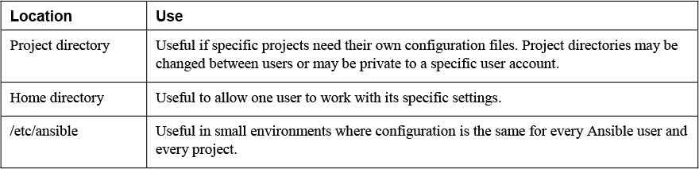

### 配置静态清单

Ansible 清单的目的是识别 Ansible 必须管理的主机。清单也可以用于其他用途：


- 列出主机
- 分组主机
- 指定主机变量

#### 列出主机

在最简单的形式下，`inventory`文件只是一个主机列表，Ansible 用它来识别该项目中的相关主机。如果你倾向于以项目为中心的方法，你可以在不同的项目中使用不同的清单，因为在一个项目中，你处理的主机可能与其他项目中的主机不同。在项目方法中，每个项目目录都应该有自己的`inventory`文件。

在较大规模的 Ansible 托管环境中，可以使用`/etc/ansible/hosts`文件作为清单文件。如果该文件存在，则没有必要也没有项目清单文件。

***

**考试提示**

如果你在考试中对清单文件中行的格式有疑问，请查看`/etc/ansible/hosts`。它包含了如何在清单文件中指定主机的良好示例。

***

Ansible 清单可以仅仅是主机名或 IP 地址的列表。你不需要指定名称解析信息，因为 DNS 或`/etc/hosts`文件应该已经处理了名称解析。除了列出主机的名称或 IP 地址外，清单还可以处理范围。例如，`server[1:6].example.com`这一行将处理`server1`到`server6`之间的所有服务器。

##### 清单主机组

当你与许多主机一起工作时，使用主机组非常方便。主机组可以定义在清单中，并且一个主机可以是多个主机组的成员。你还可以使用嵌套组，即一个组是另一个组的成员。列表 3-1 中的示例显示了主机组定义的样式。

**列表 3-1** 带有主机组的清单文件

```
ansible1

ansible2

192.168.4.1

192.168.4.2

[web]

web1

web2

[db]

db1

db2

[servers:children]

web

db
```

在列表 3-1 中，你首先看到主机`ansible1`和`ansible2`，它们不是任何特定组的成员。你还看到了两个 IP 地址。允许包含 IP 地址（尽管不建议这样做）。接下来，定义了`web`组和`db`组。在示例中，你还看到了`servers`组，它涵盖了`[web]`组中的所有主机以及`[db]`组。

通常，使用分组有三种不同的方法。功能组（Functional groups）用于处理特定的主机组，例如 Web 服务器和文件服务器。区域主机组在处理面向区域的基础设施时非常方便，而可以定义阶段主机组（staging host groups），以根据当前环境所处的阶段来处理不同的主机。表 3-3 提供了主机组方法的概述。

**表 3-3** 主机组使用概览

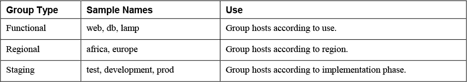

除了定义的主机组外，还有隐式主机组，如表 3-4。

**表 3-4** 隐式主机和主机组

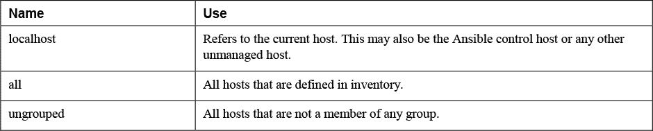

#### 在命令中使用清单

`inventory`文件是你的 Ansible 配置的核心组成部分，因为它识别主机并允许你将主机组合在一起。要查看当前清单，可以使用`ansible -i inventory <pattern> --list-hosts`命令。注意使用`-i inventory`选项，这是强制性的，用于指示必须使用特定的清单。

另一个显示清单信息的命令是`ansible-inventory`：

- 使用`ansible-inventory -i inventory --list`列出清单。
- 使用`ansible-inventory -i inventory --graph`显示图形化概述。

如果你正在使用 Ansible 命令且不想使用`/etc/ansible/hosts`中的默认清单，你必须使用`-i`选项指向你想要使用的清单文件。这可以是绝对路径或相对路径，因此在示例`ansible -i inventory --list-hosts`中，指向的是本地目录中名为`inventory`的文件。作为替代方案，你也可以在`ansible.cfg`文件中设置默认使用的清单，这将在稍后讨论。

在练习 3-1 中，你将学习如何与主机组工作。

**练习 3-1 使用主机组**

1. 以`ansible`用户身份登录并使用命令`mkdir base`创建名为`base`的项目目录。使用`cd base`进入该目录。
2. 在此目录中创建一个名为`inventory`的文件，并赋予以下内容：

   ```
   ansible1

   ansible2

   192.168.4.1

   192.168.4.2

   [web]

   web1

   web2

   [db]

   db1

   db2

   [servers:children]

   web

   db
   ```

3. 输入`ansible all --list-hosts`。你会收到一个失败消息，因为`ansible`命令没有找到包含主机的清单。
4. 输入`ansible -i inventory all --list-hosts`。现在你可以看到清单中所有的主机。
5. 输入`ansible -i inventory ungrouped --list-hosts`。此命令显示不在任何组的主机。
6. 使用`ansible-inventory -i inventory --graph`。此命令显示清单的层次结构概述，包括哪些主机属于哪个组。
7. 使用`ansible-inventory -i inventory --list`。此命令以 JSON 格式显示清单的内容。

#### 指定主机变量

在旧版本的 Ansible 中，清单文件还用于为特定主机定义变量。这种行为已被废弃，不应再使用。然而，你可能会看到包含变量定义的清单文件，出于如此，本节描述了它的工作原理。

列表 3-2 显示了一个包含主机变量的清单文件。

**列表 3-2** 带有变量的示例清单

```
[lamp]
ansible1.example.com

[file]
ansible2.example.com

[win]
windows.example.com

[win:vars]
ansible_user=ansible
ansible_password=@nsible123
ansible_connection=winrm
ansible_winrm_server_cert_validation=ignore
```

如你所见，变量是使用`[groupname:vars]`在组级别设置的。不过，你不应该再使用这种方法了。在当前版本的 Ansible 中，变量应该使用`host_vars`和`group_vars`目录进行设置，如第 6 章中“使用变量和事实”节所解释的。

### 使用动态清单

在小型环境中，手动定义 Ansible 清单是常见的。如果你在大型且动态的环境（如公有云环境）中使用 Ansible，则应该使用动态清单。在动态清单中，使用脚本来发现特定环境中的清单主机。社区提供的清单脚本可以在 GitHub 上找到（针对你想要查找动态清单脚本的具体环境，请在 Google Google）；或者，编写自己的动态清单并不困难。

### 使用社区提供的动态清单

如前所述，有很多社区提供的清单脚本。这些脚本通常附带一个`.ini`文件，用于提供有关如何连接特定资源的特定信息。要使用社区提供的清单脚本，你必须确保使用`chmod +x`将它们设置为可执行。在将脚本设置为可执行后，你必须提供所需的参数，可以将它们放在清单脚本附带的`.ini`文件中，也可以将其作为命令行参数传递给`ansible`命令。你可以从 Ansible 文档`https://docs.ansible.com`获取有关如何操作的良好清单脚本特定信息。

### 编写自己的清单脚本

编写自己的清单脚本并不困难，特别是你有编程经验。清单脚本有一些要求：它们必须包含`--list`选项和`--host`选项。此外，输出必须以 JSON 格式生成。在列表 3-3 中，你可以看到用 Python 编写的动态清单示例`pascal.py`。该脚本根据本地 Linux 主机解析机制生成清单。这意味着它使用`/etc/hosts`的内容作为清单。

**列表 3-3** 动态清单示例

```python
#!/usr/bin/python
""" Dynamic Inventory Example """
from subprocess import Popen
import sys

try:
    import json
except ImportError:
    import simplejson as json
RESULT = {}
RESULT['all'] = {}
PIPE = Popen(['getent', 'hosts'], stdout=PIPE, newline=True)
RESULT['all']['hosts'] = []
for line in PIPE.stdout.readlines():
    s = line.split()
    RESULT['all']['hosts'] = RESULT['all']['hosts']+s
RESULT['all']['vars'] = {}
if len(sys.argv) == 2 and sys.argv[1] == '--list':
    print(json.dumps(RESULT))
elif len(sys.argv) == 3 and sys.argv[1] == '--host':
    print(json.dumps({}))
else:
    print("Requires an argument, please use --list or --host")
```

#### 注意

你可以从 GitHub 仓库下载列表 3-3 中的脚本，它名为`listing33.py`。使用`git clone https://github.com/sandervanugt/rhce8-book`获取此示例文件以及许多其他文件。

要使用列表 3-3 中的示例清单脚本，你可以直接使用命令`./listing33.py --list`运行。或者，你可以将其作为`ansible`命令的参数。你可以在练习 3-2 中学习如何操作。

### 练习 3-2 使用动态清单脚本

1. 输入`cd ~`返回当前用户主目录，输入`sudo yum install -y git`安装 git 软件。
2. 输入`git clone https://github.com/sandervanugt/rhce8-book`克隆此书的 GitHub 仓库。
3. 输入`cd rhce8-book`进入`rhce8-book`目录。
4. 输入`alternatives --set python /usr/bin/python3`。此命令创建一个名为`python`的符号链接，指向`python3`二进制文件，从而保证所有配置为使用`/usr/bin/python`的脚本也能正常工作。
5. 输入`./listing33.py --list`显示 Python 脚本在独立运行时的结果。你随后将看到未格式化的命令输出。
6. 输入`sudo yum install perl-JSON-PP`安装`json_pp`。
7. 输入`./listing33.py --list | json_pp`显示以可读格式格式化的输出。
8. 输入`ansible -i listing33.py all --list-hosts`使用脚本显示所有主机。

#### 使用多个清单文件

在大型环境中，访问多个清单文件可能是很有用的。你可以通过将所有清单文件放在一个目录中并将目录名称指定为要使用的清单文件来轻松实现。如果是静态清单文件，只需将其复制到清单目录。如果是动态清单文件，你需要这样做，并且还需要确保清单文件具有执行权限。

## 在`ansible.cfg`中管理设置

当你使用 Ansible 时，需要多个设置来连接管理主机。表 3-5 列出了这些设置中最重要的部分。为了以持久化的方式提供设置，使用了`ansible.cfg`配置文件。可以在当前项目目录创建特定的`ansible.cfg`文件；通用的`ansible.cfg`文件位于`/etc/ansible/ansible.cfg`。列表 3-4 显示了`ansible.cfg`文件的示例。


### 考试提示

`/etc/ansible/ansible.cfg`文件注释良好，这使其成为 RHCE 考试的极佳资源。如果你对使用的特定参数有疑问，请查看`/etc/ansible/ansible.cfg`文件中的示例！

**列表 3-4** 示例`ansible.cfg`文件

```ini
[defaults]
remote_user = ansible
host_key_checking = false
inventory = inventory

[privilege_escalation]
become = True
become_method = sudo
become_user = root
become_ask_pass = False
```

```ini
[privilege_escalation]
become = True
become_method = sudo
become_user = root
become_ask_pass = False
```

5. 使用`cp base/inventory.`复制你之前创建的清单文件。
6. 输入`ansible-inventory --list`。这会向你显示当前清单中的所有主机，而无需使用`-i inventory`选项来指定清单文件的名称。

## 总结

在本章中，你学习了每个 Ansible 项目中两个本质的组成部分：清单文件（inventory file）和`ansible.cfg`文件。你学习了如何创建静态和动态清单文件，以及如何在`ansible.cfg`文件中定义 Ansible 运行时应使用的默认设置。在下一章中，你将学习在使用 Ansible 临时命令（ad hoc commands）和模块时如何使用这些设置。

## 考试准备任务

如引言中“如何使用本书”部分提到的，你可以在考试准备上有几个选择：这里的练习题、第 16 章、“最终准备”以及配套网站上的考试模拟题。

### 复习所有关键主题

回顾本章中最重要的主题，这些主题在页外边缘已用“关键主题”图标标记出。表 3-6 列出了这些关键主题的引用以及它们各自所在的页码。


**表 3-6** 第 3 章关键主题


### 记忆表格

打印附录 D“记忆表格”（位于配套网站）或至少打印本章的章节，并根据记忆完成表格和列表。配套网站上的附录 E“记忆表格答案对照”包含了完整的表格和列表，供你检查工作。

### 定义关键术语

定义本章中的以下关键术语，并在词表中检查你的答案：

- `ansible.cfg`
- `inventory`
- `playbook`
- `project`
- `YAML`

### 复习题

**1.** 你使用什么语法在清单中定义一个名为`all`的组？

**2.** 对于在本地项目目录中创建的清单文件，你应该使用什么名称？

**3.** 默认清单文件的名称是什么？

**4.** 你如何定义一个名为`linux`的组，其成员为`web`组和`file`组？

**5.** 任何动态清单脚本应该遵守哪两个命令行选项？

**6.** 你如何从清单的一行中引用从`web001`到`web010`的主机？

**7.** 如果主机不属于任何特定组，它们自动所属的组的默认名称是什么？

**8.** 你应该使用哪种命令来显示清单主机的图形概览，包括它们所属的组？


**9.** 下列命令有什么问题？

```bash
ansible -i inventory --list-hosts
```

**10.** 你应该使用`ansible.cfg`中的哪个参数来指定提升权限的机制？

## 章节末实验

在上一章中，你设置了用于操作 Ansible 的基础 Linux 环境。现在是时候创建一个项目目录了。

### 实验 3-1

配置一个满足以下要求的项目目录：

- 所有主机都输入在一个静态清单文件中。
- 创建一个 Ansible 配置文件来处理以下事项：
  - 项目清单文件被用作默认清单。
  - 配置权限提升，使得使用 ansible 用户，并使用 sudo 运行需要权限提升的任务。
- 设置好此环境后，使用相应的命令列出清单中的所有主机。

# 第 4 章 使用临时性命令

本章涵盖了以下主题：

- 理解临时性命令
- 使用模块
- 查阅模块文档
- 从 Shell 脚本运行临时性命令

**本章涵盖了以下 RHCE 考试目标：**

- 理解 Ansible 的核心组件
- 模块
- 使用提供的文档查找关于 Ansible 模块和命令的特定信息
- 配置 Ansible 管理节点
- 使用临时性 Ansible 命令验证有效配置
- 脚本化管理任务
- 创建简单的 shell 脚本
- 创建临时性命令

## 你掌握了吗？

“掌握了吗？”测验可以让你评估自己是否应该阅读本章，或者跳过这些问题。表 4-1 列出了本章的主题以及对应的“掌握了吗？”测验。你可以在附录 A 中找到这些“掌握了吗？”测验的答案。

**表 4-1** “掌握了吗？”章节与问题映射


**1.** 使用临时性命令在哪些情况下是很有用的？下列哪项不是？

a. 以方便的方式重复任务

b. 使用任务将节点带入所需状态

c. 快速测试一个 playbook 是否执行成功

d. 运行任务以验证是否满足某些条件

**2.** 下列临时性命令有什么问题？

```bash
ansible all -a "rpm -qa | grep http"
```

a. 没有问题。

b. 缺少指定使用哪个模块的`-m`选项。

c. 在参数中使用了管道符。

d. 参数指定中缺少键值格式。

**3.** 如果在一个已存在 lisa 的主机上运行临时性命令`ansible all -m user -a “name=lisa”`会发生什么？

a. 创建一个名为 lisa_0 的用户。

b. 删除用户 lisa 并创建一个新用户。

c. 命令给出错误信息，没有变化。

d. 命令显示 SUCCESS 结果，但没有变化。

**4.** 如果你想运行一个将输出重定向到文件`output.txt`的 shell 命令，必须使用下列哪种模块？

a. `command`

b. `shell`

c. `raw`

d. `bash`

**5.** 你想在一个 Ansible 管理的路由器上运行命令。你应该使用哪种模块？

a. `command`

b. `shell`

c. `raw`

d. `bash`

**6.** 你想在一个包含多个 Linux 发行版的网络中安装软件。在 Ubuntu 节点上你应该使用哪种模块来实现？

a. `apt`

b. `package`

c. `software`

d. `install`

**7.** 关于 ping 模块，下列哪种陈述最准确？

a. 测试到 Ansible 管理机器的连通性。

b. 测试主机当前正在运行。

c. 测试清单的内容。

d. 测试主机是否处于可管理状态。

**8.** 你应该使用哪种命令来获取控制节点上安装的所有模块的列表？

a. `ansible-modules`

b. `ansible -l`

c. `ansible-doc -l`

d. `ansible-modules --list`

**9.** 哪个命令可以以可以直接在 playbook 中使用的格式向你显示可与模块一起使用的参数列表？

a. `ansible-doc`

b. `ansible-doc -l`

c. `ansible-doc -s`

d. `ansible-doc -e`

**10.** 获取用于系统管理的模块列表的最佳方法是什么？

a. 对`ansible-doc -l`的输出进行 grep 查询。

b. 使用`ansible-doc system`。

c. 在 docs.ansible.com 中查找模块索引并导航到系统模块部分。

d. 使用`ansible-doc --system`。

## 基础主题

此时，你应该已经有了基础 Ansible 基础设施，所以让我们开始使用它吧！在 Ansible 中，你通常使用 playbooks（剧本）。playbooks 是用 YAML 编写的脚本，提供了让受管理节点处于所需状态的所有指令。配置 playbooks 将第 5 章“开始使用 Playbooks”中进行介绍。在本章中，我们将学习在开始使用 playbooks 之前需要的一些基础知识。你将学习即时命令（ad hoc commands）和模块，这些工具允许你在无需创建任何 playbook 的情况下在 Ansible 上执行快速任务。

### 理解即时命令

即时命令是一种 Ansible 任务，你可以直接在受管理主机上运行它，而无需使用任何 playbook 文件或其他脚本类的解决方案。即时命令易于使用且速度快，正因如此，它们被频繁使用。


即时命令专门用于以下场景：

- 将节点带入所需状态的设置任务
- 验证 playbook 是否执行成功的快速测试
- 验证节点是否符合某些标准的快速发现任务

让我们来看示例命令，并根据该示例尝试理解即时命令中需要什么：

```bash
ansible all -m user -a "name=lisa"
```

此命令包含几个要素。首先，是`ansible`命令，它是运行即时命令的命令。接下来，你需要指定要在哪些主机上运行即时命令，这是通过命令的`all`部分实现的。第三个元素指的是你想要运行的模块。模块是由 Ansible 执行以执行特定任务的脚本。在所示示例命令中，使用`-m`选项来调用模块，而此示例中的特定模块是`user`。最后，你需要通过`-a`选项为模块提供参数。在即时命令中，所有参数都提供在双引号之间。在这种情况下只有一个参数，但如果有许多参数，则所有参数都需要包含在双引号之间。表 4-2 总结了即时命令的所有这些组件。

**表 4-2** 即时命令组件


运行即时命令时，你必须使用你的 Ansible 用户账户（而不是 root），并且你必须处于包含清单文件（inventory file）和`ansible.cfg`文件的项目目录下。接下来，你运行命令`ansible all -m user -a “name=lisa”`它会连接清单中的所有主机以确保用户 lisa 存在。

在执行过程中，Ansible 会将所需状态（你刚刚在即时命令中指定的））与受管理机器的当前状态进行比较，如果需要，它会对受管理机器应用更改。在列表 4-1 中，你可以看到命令的输出。注意列表在`ungrouped`上执行了命令，这指的是不属于任何特定组的所有主机。

**列表 4-1** 即时命令输出

```text
[ansible@control ~]$ ansible ungrouped -m user -a "name=lisa"

ansible2 | SUCCESS => {
    "ansible_facts": {
        "discovered_interpreter_python": "/usr/libexec/platform-python"
    },
    "append": false,
    "changed": false,
    "comment": "",
    "group": 1002,
    "home": "/home/lisa",
    "move_home": false,
    "name": "lisa",
    "shell": "/bin/bash",
    "state": "present",
    "uid": 1002
}

ansible1 | CHANGED => {
    "ansible_facts": {
        "discovered_interpreter_python": "/usr/libexec/platform-python"
    },
    "changed": true,
    "comment": "",
    "create_home": true,
    "group": 1001,
    "home": "/home/lisa",
    "name": "lisa",
    "shell": "/bin/bash",
    "state": "present",
    "system": false,
    "uid": 1001
}
```

列表 4-1 显示了命令的输出内容。注意列表在`ungrouped`上执行了命令，这指的是不属于任何特定组的所有主机。`ansible2 | SUCCESS`表示主机 ansible2 已经符合所需状态，无需更改。`ansible1 | CHANGED`表示主机 ansible1 不符合所需状态，需要应用更改。这就是每个命令的工作方式。Ansible 命令是幂等的，这意味着无论运行多少次，它都能将主机带入所需状态。在练习 4-1 中，你可以尝试运行即时命令。

> **注意**
>
> 在本及后续练习中，你需要以非 root 用户执行任务。要做到这一点，请确保你处于包含`ansible.cfg`配置文件的目录下。根据第 2 章“安装 Ansible”中的说明，你创建了 ansible 用户。如果你创建了其他名称的用户，请确保使用该用户名代替“ansible”。

**练习 4-1 运行即时命令**

1. 在控制主机上以用户 ansible 打开 shell。确保你处于包含你在练习 3-3](#ch03.xhtml_exe3_3)中创建的`ansible.cfg`配置文件的目录下。
2. 创建名为`inventory`的清单文件并确保其内容如下：

   ```text
   ansible1

   ansible2
   ```

3. 输入`ansible all -m user -a “name=lisa”`以指示用户模块创建一个名为 lisa 的用户。这将在所有受管理主机上创建用户 lisa。
4. 观察命令输出，确保所有主机都返回 SUCCESS 状态或 CHANGED 状态。
5. 再次运行命令。现在所有主机都返回 SUCCESS 状态，因为这次不需要更改：主机的当前状态已符合所需状态。
6. 输入命令`ansible all -m command -a “id lisa”`。在此命令中，你运行了`command`模块，该模块允许你在受管理机器上运行任意命令，参数为`id lisa`，这实际上在管理节点上执行的命令。
7. 观察命令输出，应该显示用户 lisa 存在并显示其所属组。
8. 使用`ansible all -m user -a “name=lisa state=absent”`清受管理机器。此命令连接受管理机器并删除用户 lisa。

### 使用模块

Ansible 的功能由模块提供。有超过 3000 个模块可以处理各种任务，允许管理员管理 Linux 服务器、Windows 服务器、云基础设施、云实例、容器、网络设备等。了解 Ansible 等同于了解模块。为正确的任务找到正确的模块是一项关键技能，而且你了解的模块越多，使用 Ansible 就就越容易。

这些模块可以被视为在 Ansible playbooks 或使用即时命令（ad hoc commands）时的插件程序。模块本身是用 Python 脚本编写的。不过这并不意味着你必须熟悉 Python。只有是你想要开发自己的模块的开发者时，才需要 Python 知识。

## 探索核心模块

由于使用模块至关重要，让我们探索一些关键模块。表 4-3 提供了概述。

**表 4-3** Ansible 关键模块

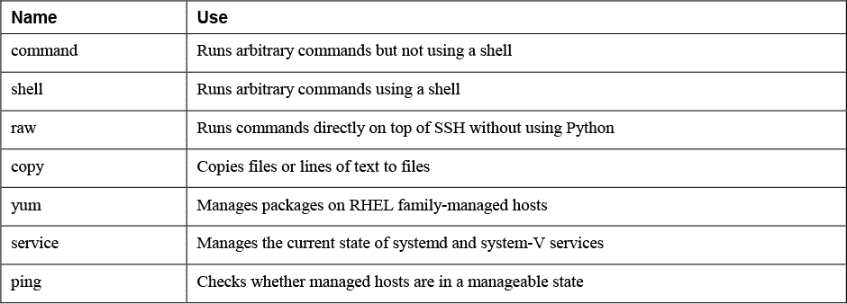

让我们仔细查看这些核心模块。

### `command`

`command`模块允许用户使用 Ansible 运行任意命令。由`command`模块运行的命令不会经过 shell 解析。这意味着在使用`command`模块时，管道和重定向等常见的 shell 特性将无法工作。例如，命令`ansible all -m command -a “rpm -qa | grep nmap”`是无法运行的。

`command`模块是默认模块。这意味着如果省略了`-m command`选项，Ansible 将默认将提供的参数解释为`command`模块的参数。如果需要另一个默认模块，可以在`ansible.cfg`中设置`module_name = *module`。

> **考试技巧**
>
> 在 RHCE 考试中，你需要完成相当多的任务。无疑，最优雅的方法是使用适当模块。然而，使用`command`模块或`shell`模块并不是错的，只是不够优雅。因此，如果在考试中你无法使用为执行该任务而设计的模块来完成任务，只需使用`command`模块即可。最重要的是结果，在考试中，你如何达到结果其实并不重要。

### `shell`

`shell`模块与`command`模块类似，允许你运行任意命令，但有一个重要的区别：`shell`模块确实会通过 shell 运行命令。这意味着在使用此模块时，管道和重定向等常用的 shell 特性是可以工作的。例如，将命令`ansible all -m shell -a “rpm -qa | grep nmap”`的结果与之前使用的命令进行比较。这次它可以正常工作了。

### `raw`

第三个允许你在受管节点上运行任意命令的模块是`raw`模块。使用`shell`和`command`模块时会生成一个 Python 脚本，该脚本通过 SSH 发送到受管主机上执行。然而，`raw`模块不需要受管主机上安装 Python；它直接通过 SSH 连接发送命令。这使得`raw`模块成为配置机器或处理没有 Python 环境的受管主机（如网络设备） Excellent 选择。

通过适当选项，你可以使用`raw`模块在受管主机上执行初始设置任务。例如命令`ansible -u root -i inventory ansible3 --ask-pass -m raw -a “yum install python3”`，它可以在主机`ansible3`上安装 Python 3，该主机可能是一个尚未接收任何 Ansible 配置的节点。注意，`raw`模块可以作为`command`或`shell`模块的替代方案，但不建议采用这种方法。作为一个通用原则，你应该始终尝试使用与你想要完成的任务最相关的特定模块。

> **注意**
>
> `command`、`shell`和`raw`模块都用于在受管节点上运行任意命令。在大多数情况下，建议避免使用它们。大多数其他模块都是幂等的（idempotent），并且易于跟踪变化。`command`、`shell`和`raw`模块只是运行任意命令，很难使用这些模块跟踪到底更改了什么，正由于于原因，当使用它们时很难保证幂等性。因此，你应该尽可能避免使用它们。

### `copy`

顾其名，`copy`模块用于复制内容。你可以用它来复制文件，也可以用它将简单的文本行复制到受管文件中。例如`ansible all -m copy -a 'content="hello world" dest=/etc/motd'`，它会将“hello world”文本复制到`/etc/motd`文件。

### `yum`

安装`yum`模块来管理 Red Hat 发行版及相关发行版上的软件。例如，使用`ansible all -m yum -a “list=httpd”`来检查包。

### `service`

`service`模块通过`init`或`systemd`管理服务。例如，`ansible all -m service -a “name=httpd state=started”`可以启动服务。

### `ping`

`ping`模块是一个简单的模块，可以检查主机是否可达。它不需要任何参数。

6. 使用`ansible all -m command -a “systemctl status httpd”`来验证 httpd 服务的当前状态。它应该显示`ansible2`上未找到该服务，且`ansible1`上的服务处于非活动（inactive）和禁用（disabled）状态。

7. 使用`ansible ansible1 -m service -a “name=httpd enabled=yes state=started”`在`ansible1`上启动并启用 httpd 服务。

8. 再次运行命令`ansible all -m command -a “systemctl status httpd”`验证修改已生效。

## 查看可用模块

如之前，要成功使用 Ansible，你需要了解模块。当然，有很多模块，要找出哪些模块是可，你可以使用`ansible-doc -l`。此命令会列出系统上安装的所有模块。当你在安装了默认 Ansible 的 CentOS 8.1 系统上运行该命令时，你会发现安装的模块不少于 3387 个！


事实是，Ansible 有许多可用模块——多到你永远用不完所有的模块，而且多到在某些情况下，你可以选择不同的模块来完成相同任务。当你是 Ansible 新手时，寻找合适的模块可能是困难的。通过学习本认证指南，你将学习一些最实用的模块，但始终建议搜索是否有更好的模块。你可以通过使用`ansible-doc -l`并使用 Linux 的`grep`工具过滤输出来实现这一点。例如，使用命令`ansible-doc -l | grep vmware`查看 Ansible 中所有管理 VMware 环境的可用模块。

## 阅读模块文档

Ansible 模块有良好的文档。你可以使用`ansible-doc`命令查找所有安装模块的文档。除了你的 Ansible 安装中始终可用的`ansible-doc`命令外，你还可以访问 Ansible 文档网站，地址为[`docs.ansible.com`](https://docs.ansible.com)。

### 考试提示

考试时会提供文档，因此请学习如何使用它。你可以访问`ansible-doc`命令，还可以访问考试所用 Ansible 版本在[`docs.ansible.com`](https://docs.ansible.com)上的所有文档的本地副本。在备习考试时，务必练习使用这些宝贵的资源！

### 使用 `ansible-doc`

`ansible-doc`命令提供了关于所有 Ansible 模块的信息。这些文档以结构化的方式呈现。列表 4-3 显示了命令`ansible-doc ping`的结果。

### 列表 4-3 分析 `ansible-doc` 命令输出

```text
> PING    (/usr/lib/python3.6/site-packages/ansible/modules/system/ping.py)

        一个简单的测试模块，该模块在连接成功时
        总是返回 `pong’。它在 playbook 中没有意义，但
        从 `/usr/bin/ansible` 调用它来验证登录能力
        以及是否配置了可用的 Python 是很有用的。这不是 ICMP
        ping，这只是一个需要在远程节点上有 Python 的
        简单测试模块。对于 Windows 目标，请使用 [win_ping]
        模块。对于网络目标，请改用 [net_ping] 模块。
  * 此模块由 Ansible Core 团队维护

OPTIONS (= 是强制性的):

- data

        为 `ping’ 返回值要返回的数据。
        如果此参数设置为 `crash’，模块将导致异常。
        [Default: pong]

        type: str

SEE ALSO:

      * Module net_ping
           net_ping 模块的官方文档。
           https://docs.ansible.com/ansible/2.9/modules/net_ping
        _module.html
      * Module win_ping
           win_ping 模块的官方文档。
           https://docs.ansible.com/ansible/2.9/modules/win_ping
        _module.html

AUTHOR: Ansible Core Team, Michael DeHaan

        METADATA:
          status:
          - stableinterface
          supported_by: core

EXAMPLES:

# 测试我们可以登录到 ’webservers’ 并使用 json 库执行 python。
# ansible webservers -m ping

# 来自自 Ansible Playbook 的示例
- ping:
# 诱发异常以查看发生什么
- ping:
    data: crash

RETURN VALUES:

ping:
    description: 使用 data 参数提供的值
    returned: success
    type: str
    sample: pong
```

由于所有`ansible-doc`生成的页面都显示相同的结构，因此理解不同的元素是有意义的。表 4-4 显示了`ansible-doc`命令结果中的默认元素。

### 表 4-4 `ansible-doc` 输出元素

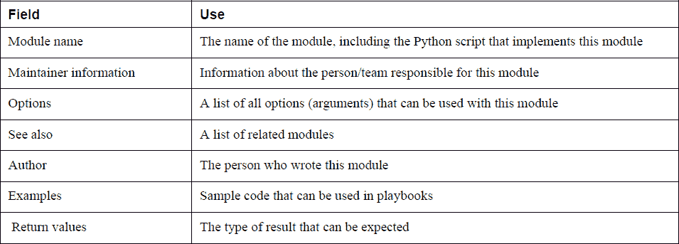

`ansible-doc`结果中第一个有趣的元素是模块名称，后面是该模块所使用的 Python 脚本名称。Ansible 模块是用 Python 编写的，这些 Python 脚本直接安装在你的控制系统上。因此，如果你想查看发生了什么，可以打开 Python 脚本对其进行分析，并且如果你想，甚至可以进行优化。

脚本名称之后是简短的模块描述。阅读模块描述是一个好主意，特别是当你第一次使用该模块时。接下来你会看到维护该模块的人。这是帮助你选择最佳模块的重要信息。通常情况下，建议寻找由 Ansible Core 团队维护的模块，但如果你在处理特定的设备，使用供应商提供的模块可能是更好的选择。

接下来的元素是所有选项的列表。大多数模块都有选项，许多模块至少有一个强制性选项。如果模块有强制性选项，你会发现选项被标记为`=`（而不是`-`）。接下来的 SEE ALSO 部分提供了有关相关或类似模块的信息。查看此部分是一个好主意，因为你可能会发现在使用某个特定模块时，另一个模块可能更适合完成你的任务。

在`ansible-doc`输出的末尾，你会找到作者姓名，以及最重要的用法示例。大多数情况下，示例显示了样例 playbook 代码。这些信息非常有用，因为你会找到最常用用例的示例以及在 playbook 中实现该模块所需的 playbook 代码。在输出的最最后你会找到返回值。此部分提供了关于从该模块预期输出类型的信息。

默认情况下，`ansible-doc`命令提供模块的完整文档。在编写 playbook 时，你通常对如何在 playbook 中使用必需参数感兴趣。要获取这些信息，你可以使用`ansible-doc -s`。该命令的结果显示了样例 playbook 结构，列出了可以使用的参数列表以及每个参数的简短描述。由于`ansible-doc -s`的结果没有完整输出那么令人压力，许多人喜欢使用这种方法。列表 4-4 显示了该命令的部分示例输出。

### 列表 4-4 使用 `ansible-doc -s` 显示用法信息

```yaml
- name: Manage services

  service:

      arguments:             # 在命令行中提供的额外
                               参数。

      enabled:               # 服务是否在启动机时启动。
                               *必须设置 state 和
                               enabled 中的其中一个。*
      name:                  # (必选) 服务名称。
      pattern:               # 如果服务对状态
                               命令没有响应，则指定一个要查找的
                               字符串，该字符串应
                               出现在 `ps` 命令的输出中，
                               作为状态
                               结果的替代。如果找到了
该字符串，则认为服务
                               已启动。
      runlevel:              # 仅用于 OpenRC init 脚本（例如 Gentoo）。
                               该服务所属的
运行级别（runlevel）。
      sleep:                 # 如果服务正在被“重启”，
                               在停止和启动
                               命令之间的等待秒数。这有助于
                               处理表现糟糕 init
                                脚本，它们在向进程发送
                               信号后立即退出。并非所有
                                服务管理器都支持 sleep，即
                               在使用 systemd 时，此
                               设置将被忽略。
```

## 使用 [`docs.ansible.com`](https://docs.ansible.com)

除了`ansible-doc`提供的系统文档外，在考试中你还可以访问[docs.ansible.com](http://docs.ansible.com)网站（参见图 4-1）。在该网站上，你可以找到关于 Ansible 的所需知识，但在某些情况下，并不清楚去哪里找到这些信息。因此，你必须在考试之前练习使用文档。特别是，你需要使用屏幕左上部分的搜索栏。在适当的情况下，你还会在书中找到关于如何查找特定类型信息的指南。你可以在练习 4-3 中练习操作文档。

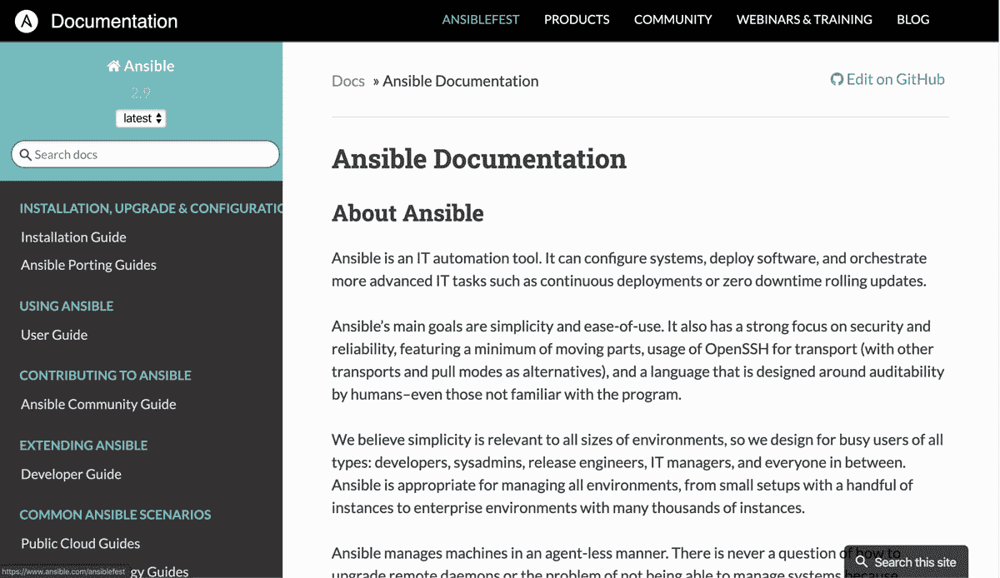

**图 4-1** 在[docs.ansible.com](http://docs.ansible.com)浏览文档

## 练习 4-3 使用文档

1. 输入`ansible-doc -l | grep user`。你将看到一个长列表，列了所有模块名称或描述中包含“user”字符串的模块。
2. 输入`ansible-doc user`并查找强制参数。你应该发现`name`参数是必选的。还要查看 SEE ALSO（另参）部分，可以在那里找到相关模块的信息。
3. 向下滚动到 EXAMPLES（示例）部分并查看那里的示例。
4. 输入`ansible-doc -s user`查看此命令的输出。注意输出看起来像是参数列表和`ansible-doc`命令示例的结合。
5. 在浏览器中打开[`docs.ansible.com`](https://docs.ansible.com)的 Ansible 文档，并点击左上角的**Documentation（文档）**。
6. 在左上角的搜索栏中，输入`user module system`。
7. 在结果列表中，打开**System Modules（系统模块）**链接。这将带你进入所有与系统管理任务相关的模块列表。从列表中选择**User（用户）**模块并查看该网页。注意，生成的网页包含与你在`ansible-doc user`结果完全相同的信息。

## 从 Shell 脚本运行即时命令（Ad Hoc Commands）

为了理解为什么在一本关于 Ansible 的书中会有关于 Shell 脚本的章节，你需要查看红帽对 Ansible 考试描述中“你需要知道的内容”页面上的“考试格式”（Exam Format）部分（[`www.redhat.com/en/services/training/ex294-red-hat-certified-engineer-rhce-exam-red-hat-enterprise-linux-8`](https://www.redhat.com/en/services/training/ex294-red-hat-certified-engineer-rhce-exam-red-hat-enterprise-linux-8)）。在该部分，你会找到以下文本：

你的工作将通过将考试期间创建的 playbook 应用于新安装的系统，并验证这些系统和服务是否按要求运行来接受评估。

这意味着在考试期间，你将创建 Ansible playbooks，并且可以在考试期间在提供的托管机上测试这些 playbook。考试结束后，你的 playbook 将被评分。在评分过程中，将提供一组新的托管机，你的 playbook 将将在这组新的托管机上执行。

在考试中，你很可能还需要处理即时命令（ad hoc commands），“创建运行即时 Ansible 命令的简单 Shell 脚本”是考试目标之一。你必须在脚本中执行操作，因为这是考试评估引擎验证你工作的唯一方式。因此，你至少需要具备使用 Shell 脚本的最基本知识。在本节中，你将简单介绍操作 Bash Shell 脚本。其目的不是教你关于 Shell 脚本的所有知识，而是向你展示考试所需的 Shell 脚本核心要素。

在红帽企业 Linux 上，Bash shell 被用默认命令解释器。用户可以在 shell 提示符处输入命令，命令将提供输出。对于复杂任务，创建一个执行所需命令的脚本可能会很有用。这样做并不复杂：只需在脚本中输入你需要的所有命令。此外，为了避免任何解释问题，建议在脚本的第一行包含一个 shebang（`#!`）。

**列表 4-5** 从脚本运行即时命令

```bash
#!/bin/bash

ansible all -m yum -a "name=httpd state=latest"

ansible all -m service -a "name=httpd state=started enabled=yes"
```

要运行当前目录下的脚本，通常会使用命令`./myscript.sh`。在这个命令中，点表示当前目录。如果当前目录不在`$PATH`变量中，则必须使用点。如果你想在不先输入`./`的情况下运行脚本，需要确保它所在的目录在`$PATH`变量中。你可以通过脚本复制到`/usr/local/bin`目录来实现，该目录在普通用户的`$PATH`中。在练习 4-4 中，你可以编写一个运行 Ansible 临时命令的 shell 脚本。

## 练习 4-4 从脚本运行临时命令

1. 在包含清单（inventory）和`ansible.cfg`文件的目录下，输入`vim setup.sh`来创建一个设置脚本。
2. 确保脚本包含以下内容并保存文件：

```bash
#!/bin/bash

ansible all -m yum -a "name=vsftpd state=installed"

ansible all -m service -a "name=vsftpd state=started enabled=yes"
```

3. 输入`chmod +x setup.sh`使脚本文件具有可执行权限。
4. 输入命令`./setup.sh`运行脚本，并在托管主机上执行选定的任务。

## 总结

在本章中，你学习了如何使用临时命令（ad hoc commands）来设置托管主机以及对托管主机进行快速检查。你还学习了 Ansible 模块以及如何使用适当工具获取有关 Ansible 模块的信息。在下一章中，你将学习如何使用剧本（playbooks），它们让你以一致的方式与 Ansible 进行工作。

## 考试准备任务

如引言中的“如何使用本书”部分提到的，你有几种准备考试的选择：这里的练习、第 16 章、“最终准备”以及配套网站上的考试模拟题。

## 复习所有关键主题

回顾本章中最重要的主题，这些主题在页外边距用“关键主题”图标标记。表 4-5 列出了这些关键主题的参考以及它们所在的页码。


**表 4-5** 第 4 章的关键主题


## 记忆表

打印附录 D“记忆表”（可在配套网站找到）或至少打印本章章节，并根据记忆完成表格和列表。附录 E“记忆表答案”同样位于配套网站上，包含了完成的表格和列表以检查你的工作。

## 定义关键术语

定义本章的以下关键术语，并在词表表中检查你的答案：

- 临时命令
- bash 脚本
- 当前状态
- 期望状态
- 幂等性
- 模块

## 复习题

**1.** 在什么情况下你会使用临时命令？

**2.** 在托管主机上安装 Python 应该使用哪个模块？

**3.** 应该使用哪个模块来运行`rpm -qa | grep httpd`命令？

**4.** 在 RHCE 考试中，你找不到用于安装软件的特定模块，因此你决定使用`command`模块安装软件。这样做是可以接受的吗？

**5.** 使用`service`模块启动并启用`httpd`服务时，应该使用哪些参数？

**6.** 你在`user`模块上使用`ansible-doc`，发现该模块无法在 Windows 上创建用户。你应该查看文档的哪个部分来找到在 Windows 上需要的命令？

**7.** 你是一个 Python 程序员，想为你的环境优化一个模块。你在哪里获取模块源码？

**8.** 在执行运行临时命令的脚本时，你收到了“permission denied”（拒绝访问）错误信息。最可能的解释是什么？

**9.** 你如何更改临时命令中使用的默认模块？

**10.** 获取可用于特定模块的剧本代码示例的最佳方法是什么？

## 章末实验

在章末实验中，这次你将创建一个在托管主机上运行一些临时命令的脚本。

### 实验 4-1

创建一个名为`install.sh`的脚本，确保托管主机满足以下要求。不

# 第 5 章：开始使用剧本

本章涵盖了以下主题：

- 探索 Ansible
- 使用 YAML
- 管理剧本

本章涵盖了以下 RHCE 目标：

- 理解 Ansible 核心组件
- 剧目（Plays）


# 剧本（Playbooks）以及指定状态

## “你掌握了吗？”测试

“你掌握了吗？”测试可以帮助你判断是应该阅读整章还是跳到“考试准备”部分。表 5-1 列出了本章的主要标题及其对应的“掌握了吗？”问题。你可以在附录 A 找到“你掌握了吗？”测试和复习题的答案。

**表 5-1** “掌握了吗？”章节-问题映射


**1.** 你通常在剧本的第一行找到以下哪项？

a. 剧目的名称

b. 涉及的主机名称

c. `---`

d. `...`

**2.** 每个剧目头部至少包含三个参数。以下哪项不是之一？

a. `hosts`

b. `tasks`

c. `name`

d. `become`

**3.** 关于缩进的哪些描述是正确的？

a. 缩进用于识别父子对象的关系。

b. 不能使用空格。

c. 不能使用制表符。

d. 没有缩进的剧目难以阅读但可以运行。

**4.** 如何撤销由剧本进行的修改？

a. `ansible-playbook -u`

b. `ansible-playbook -u --force`

c. 你无法撤销剧本做的更改。

d. 你可以创建一个实现原始剧本相反操作的剧本。

**5.** 修改托管系统的任务时，你会看到什么状态？

a. `ok`

b. `changed`

c. `modified`

d. `applied`

**6.** 关于在剧本中使用 YAML 列表的哪个陈述是正确的？

a. 任何模块都可以使用 YAML 列表指定需要处理的项目名称。

b. YAML 列表可以用剧目级别，不能用于任务级别。

c. `service` 模块不支持 YAML 列表来管理多台服务器。

d. YAML 列表可以用于运行多个模块。

### 7. 使用哪种选项向文本文件提供多行文本，同时保留换行符以确保格式正确？

**a.** `|`

**b.** `>`

**c.** `:`

**d.** `\`

### 8. 下列选项中，哪一个可以用于验证 playbook 中的哪些任务将触发更改？

**a.** `--syntax-check`

**b.** `--dry-run`

**c.** `-vvv`

**d.** `-C`

### 9. 下列选项中，哪一个表示了多剧本 playbook（multiplay playbook）的最佳用例例？

**a.** 必须在 `server1` 上安装 Web 服务器；必须在 `server2` 上安装数据库服务器。

**b.** 必须在 `server1` 上安装 FTP 服务器，之后使用 `localhost` 测试与该服务器的连接性。

**c.** 任务必须使用不同的用户账户运行。

**d.** 一个剧本（play）必须使用不同的特权提升参数运行。

### 10. 下列哪项不是使用多剧本 playbook 的益处？

**a.** 可以指定不同的主机。

**b.** 剧本可以使用不同的用户账户运行。

**c.** 剧本可以单独进行调度。

**d.** 某些剧本可以配置为在没有特权提升的情况下运行。

## 基础主题

### 探索你的第一个 Playbook

Ansible 的核心在于运行 playbook。在本节中，你将学习如何从在命令行输入即时命令（ad hoc commands）进阶编写 Ansible playbook。

#### 从即时命令到 Playbook

在深入了解 playbook 的细节并探索使用它们的可能性之前，让我们先运行一个 playbook。在第 4 章的“使用即时命令”中，你学习了如何使用即时命令，并且在列表 4-5 中，你创建了一个 Bash 脚本来对托管节点运行其中一些命令。列表 5-1 展示了这些命令。

**列表 5-1** 从脚本运行即时命令

```bash
#!/bin/bash

ansible all -m yum -a "name=httpd state=installed"

ansible all -m service -a "name=httpd state=started enabled=yes"
```

你在此脚本中执行的所有操作都可以在 playbook 中完成。只需查看列表 5-2 中的 playbook 示例，看看这样的 playbook 像什么样。如果你观察得足够，就会发现即时命令中指定的所有元素也出现在了 playbook 中。

**列表 5-2** 从 Playbook 配置主机

```yaml
---
- name: install start and enable httpd
  hosts: all
  tasks:

  - name: install package
    yum:
      name: httpd
      state: installed
  - name: start and enable service
    service:
      name: httpd
      state: started
      enabled: yes
```

### Playbook 元素

playbook 是多个剧本（plays）的集合。每个剧本针对特定的主机，并在每个剧本中指定一个任务列表。在列表 5-2 中的示例 playbook 中，定义了一个名为“install start and enable httpd”的剧本。

playbook 使用 YAML 格式编写，通常以 `.yml` 或 `.yaml` 扩展名保存。YAML 格式本质上将对象指定为键值对。可以使用破折号（dash）来指定嵌入对象的列表。有关 YAML 的更多详细信息，请参阅本文后面的“使用 YAML”章节。

在 playbook 的开始处你会看到三个破折号。可选情况下，在 playbook 的结束处你会看到三个点。使用破折号可以轻松地包含 playbook。当你发现 YAML 文件时，在运行 playbook 时，你可以看到哪些任务触发了更改。当你使用 Ansible 命令时，你可以看到哪些任务是执行的。在处理 YAML 文件时，你可以看到哪些任务是成功执行的。如果你观察得足够仔细，你可以看到所有在即时命令中指定的元素也出现在了 playbook 中。任务必须使用不同的用户账户运行。一个剧本（play）必须使用不同的特权提升参数。

在 playbook 的开始处你会看到三个破折号。可选情况下，在 playbook 的结束处你会看到三个点。使用破折号可以轻松地包含 playbook。当你发现 YAML 文件时，在运行 playbook 时，你可以看到哪些任务是触发了更改。当你使用 Ansible 命令时，你可以看到哪些任务是执行的。如果你观察得足够仔细，你可以看到所有在即时命令中指定的元素也出现在了 playbook 中。任务必须使用不同的用户账户运行。一个剧本（play）必须使用不同的特权提升参数。

> **提示**
>
> 为了让处理缩进变得更容易，你可以配置 vi 编辑器。如果 `~/.vimrc` 中包含了以下行，当 vi 检测到 YAML 文件。

```vim
autocmd FileType yaml setlocal ai=2 et
```

在 playbook 中，你可能会发现一个或多个剧本。每个剧本都有某些必要元素，列在表 5-2 中。

### 运行 Playbook

运行 playbook，你使用命令 `ansible-playbook listing52.yaml`。结果如列表 5-3 所示。注意，根据托管机器的状态，你可能会看到略不同的结果，显示“changed”而不是“ok”。

**列表 5-3** 运行 Playbook 输出

```text
[ansible@control ~]$ ansible-playbook listing52.yaml

PLAY [install start and enable httpd] ***************************************

TASK [Gathering Facts] ***************************************
ok: [ansible2]
ok: [ansible1]

TASK [install package] ***************************************
ok: [ansible1]
ok: [ansible2]

TASK [start and enable service] *************************************
ok: [ansible2]
ok: [ansible1]

PLAY RECAP *********************************************************************
ansible1                   : ok=3    changed=0    unreachable=0    failed=0    skipped=0    rescued=0    ignored=0
ansible2                   : ok=3    changed=0    unreachable=0    failed=0    skipped=0    rescued=0    ignored=0
```

在执行定义的任务列表之前，`ansible-playbook` 命令会收集事实（facts）。事实收集是 Ansible 的重要部分，Ansible 通过此过程学习受管理节点上的当前配置和设置；你将在第 6 章“使用变量和事实”中学习更多关于该主题的知识。

最后一个元素是 Play 摘要（Play Recap）。在此元素中，你可以获得每个任务状态的概览。如果你在任务结果状态中看到“ok”，说明任务执行成功且不需要任何更改。如果任务返回的状态为“changed”（已更改），说明任务已成功应用了修改，以实现 playbook 中定义的状态。我们稍后会讨论其他的输出状态选项。

## 撤销 Playbook 修改

撤销 playbook 的修改是容易理解的。Ansible 不提供任何撤销功能，因此如果你创建了一个 playbook 并在之后对它所做的修改感到后悔，你必须编写一个新的 playbook 来定义一个新的期望状态，用以回滚你之前应用的更改。在练习 5-1 中，你将练习到为止讨论的所有技能并运行你的第一个 playbook。

### 练习 5-1 运行你的第一个 Playbook

1. 输入 `vim exercise51.yaml` 打开一个包含期望 playbook 代码的新文件。确保该文件创建在你的家目录下，该目录下已经存在 `ansible.cfg` 和主机清单文件（inventory file）。

2. 输入三个横线来开始 playbook 代码：

```yaml
---
```

3. 在新行上开始 play 定义。该 play 定义以一个折号开头，后面跟着一个空格和 `name:`，紧接着是 play 的名称：

```yaml
---
- name: install and start the vsftpd service
```

4. 你需要添加一行来定义该 play 应该管理的主机。注意，这一行的缩进级别与 `name` 单词相同，因为这一行是同一个 play 定义的一部分：

```yaml
---
- name: install and start the vsftpd service

  hosts: all
```

5. 在 play 的下部分，你定义将由此 play 执行的任务。在 `hosts` 单词下方，以相同的缩进级别输入 `tasks:`。冒号后面没有任何内容，因为键 `tasks` 的值是一个任务列表，该列表将在接下来的几行提供：

```yaml
---
- name: install and start the vsftpd service

  hosts: all

  tasks:
```

6. 此时，你可以开始定义任务。第一个任务确保使用 `yum` 模块来定义 `vsftpd` 软件包。注意缩进，它标识了该任务是 play 的子元素：

```yaml
---
- name: install and start the vsftpd service

  hosts: all

  tasks:

  - name: install vsftpd

    yum:
```

7. 此时，你可以指定 `yum` 模块的参数。由于这些参数相对于 `yum` 模块是子元素，因此你需要另一层缩进：

```yaml
---
- name: install and start the vsftpd service

  hosts: all

  tasks:

  - name: install vsftpd

    yum:
      name: vsftpd
      state: latest
```

8. 第一个任务现在已定义，你可以指定下一个任务，该任务调用服务模块来启动并启用 `vsftpd` 服务。注意，这个任务的缩进级别与 `yum` 任务相同：

```yaml
---
- name: install and start the vsftpd service

  hosts: all

  tasks:

  - name: install vsftpd

    yum:
      name: vsftpd
      state: latest

  - name: start and enable vsftpd service
    service:
      name: vsftpd
      state: started
      enabled: yes
```

9. playbook 现在已完成，因此请将你的更改写入文件并退出编辑器。接下来，使用 `ansible-playbook exercise51.yaml` 运行该 playbook。

10. 观察 playbook 的输出并验证所有操作是否执行正确。

## 使用 YAML

YAML（根据某些人的说法是 YAML Ain’t Markup Language，另一些人则是 Yet Another Markup Language）是一种易于阅读的数据序列化语言。YAML 是一种用于配置文件的常用语言，不仅用于 Ansible 中，也用于其他环境，如 Kubernetes 以及某些 Linux 服务的配置。YAML 并不难使用，但在处理 YAML 时，你应该了解几点内容。

### 缩进

首先，YAML 使用缩进。正如之前讨论的，缩进标识了配置部分之间的关系，以便你可以轻松地看到哪些是父对象，哪些是子对象。缩进最重要的规则是必须使用空格而不是制表符（tabs）。

### 使用键值对

YAML 的核心在于定义键值对（也称为字典）。这种键值对的示例是 `name: vsftpd`。键值对可以通过两种方式定义：`key: value` 或 `key=value`。在这两种方法中，第一种方法更优优，但第二种方法同样有效。

如果 YAML 中的一个对象需要多个键值对来定义其属性，通常会在每行定义一个键值对。如果使用 `key=value` 格式，可能在一行内定义所有多个键值对。列表 5-4 中的示例 playbook 展示了这样一个例子。

**列表 5-4** 定义键值对的多种方式

```yaml
---
- name: deploy vsftpd
  hosts: ansible
  tasks:
  - name: install vsftpd
    yum: name=vsftpd
  - name: enable vsftpd
    service: name=vsftpd enabled=true
  - name: create readme
    copy:
      content: "welcome to the server\n"
      dest: /var/ftp/README
      force: no
      mode: '0444'
```

在列表 5-4 中，定义了三个任务。在前两个任务中，所有键值对都以 `key=value` 格式在模块名称所在的行内定义。第三个任务在单独的行 `key: value` 格式定义所有键值对。为了保持 playbook 可读性，你应该只使用后者。

注意：在 Ansible 中，很多情况下可以使用不同的语法。本节作为使用 YAML 的介绍，而不是对该语言的概述。如果你需要更完整的 YAML 语法概述，请查看 Ansible 文档中的“YAML Syntax”。

### 理解 YAML 列表

当你在 Ansible playbook 中处理 YAML 时，键可以有一个值，某些键也可以有多个值。目前没有标准规定在什么情况下属于哪种。键是否可以包含多个值取决于 Ansible 模块。例如，当你使用 `yum` 模块时，你可以向 `name` 键指定一个软件包列表。当你使用 `service` 模块时，无法将列表作为 `name` 键的参数。模块文档通常会指示是否可以将列表作为特定键的值。列表 5-5 展示了一个使用列表定义键值的 playbook 示例。

**列表 5-5** 使用列表安装多个软件包

```yaml
---
- name: using lists
  hosts: all
  tasks:
  - name: install packages
    yum:
      name:
        - nmap
        - httpd
        - vsftpd
      state: latest
```

提示：`yum` 模块可以处理不同的软件包状态。例如，你可以使用 `state: installed` 确保软件包已安装，使用 `state: latest` 确保安装最新版本的软件包，这在需要时触发软件包更新。

在 YAML 文件中，你会经常包含字符串。使用字符串并不困难，因为字符串不需要使用引号来通过转义。不过，你仍然允许使用引号。这意味着所有以下表示法都是有效的：

文本行

“`Line of text`”

‘`Line of text`’


处理多行字符串有两种方法。你可以在多行字符串中使用`|`符号来接管所有的换行符。如果多行字符串中的所有文本只需要被视为一行文本，而不需要任何进一步的格式化，你可以使用`>`符号。如果你想保留格式，请使用`|`符号。如果你想在 playbook 中将文本拆分为多行以提高可读性，请使用`>`符号，但在目标文件中，这些行并不需要写成多行。

### 验证语法

由于你很容易出现拼写错误或在错误的层级上缩进项目，因此验证语法可能是明智的。`ansible-playbook`命令提供了`--syntax-check`选项来完成此任务。列表 5-6 显示了该命令的结果可能是什么样。

**列表 5-6** 使用`ansible-playbook --syntax-check`语法

```
[ansible@control ~]$ ansible-playbook --syntax-check listing56.yaml

ERROR! Syntax Error while loading YAML.

  mapping values are not allowed in this context

错误似乎出现在 ’/home/ansible/listing54.yaml’：第 8 行，第 12 列，但取决于具体的语法问题，可能在文件的其他地方。

出现问题的行似乎是：

    name: httpd

      state: latest

           ^ here
```

如你所示，`ansible-playbook`命令尝试对语法问题发生的位置进行合理的猜测。根据具体的错误，这个猜测可能是准确的，也可能完全不准确。在这种情况下，它是相当准确的，正如列表 5-7 所示，该列表显示了产生列表 5-6 中错误的代码（因为错误发生在恰好早的一行）。

***

**提示**

在相关的情况下，书中示例中使用的 playbook 代码可以在书的 github 仓库中找到。如果你还没有这样做，可以使用命令`git clone [https://github.com/sandervanvugt/rhce8-book]`获取文件。

***

**列表 5-7** 带有错误的示例 YAML 文件

```
---

- name: install start and enable httpd

  hosts: all

  tasks:

  - name: install package
    yum:

    name: httpd
      state: latest
  - service:

    name: httpd
      state: started
      enabled: yes
```

正如列表 5-6 中`ansible-playbook --syntax-check`命令的输出所示，输出非常准确，同时指出了问题的精确位置。在列表 5-7 中，你可能还会注意到代码中没有发现的第二个问题；`name: httpd`行应该作为`service:`模块的子元素进行缩进。原因是`ansible-playbook --syntax-check`在找到第一个错误后就会停止。你必须修复此错误并再次运行命令才能看到第二个错误。

关于`--syntax-check`的最后一点：它可能是一个很有用的选项，但你应该意识到`ansible-playbook`命令默认就会检查语法。所以，如果你只是运行了`ansible-playbook listing56.yaml`，你会看到完全相同的消息。

### 执行 Playbook 空运行（Dry Run）

在实际运行 playbook 并对受托管主机进行所有修改之前，执行空运行是有意义的。你可以通过使用`ansible-playbook -C myplaybook.yaml`命令来实现。在执行空运行期间，`ansible-playbook`命令会向你显示哪些主机将被更改，而不会实际应用这些更改。示例请参见列表 5-8。之后，你可以进行练习 5-2 来练习你的 YAML 技能。

**列表 5-8** 执行 Playbook 空运行

```
[ansible@control ~]$ ansible-playbook -C listing56.yaml

PLAY [using lists] ******************************************************************************************

TASK [Gathering Facts] **************************************************************************************

ok: [ansible2]

ok: [ansible1]

TASK [install packages] *************************************************************************************

changed: [ansible2]

changed: [ansible1]

PLAY RECAP **************************************************************************************************

ansible1                   : ok=2    changed=1    unreachable=0    failed=0    skipped=0    rescued=0    ignored=0
ansible2                   : ok=2    changed=1    unreachable=0    failed=0    skipped=0    rescued=0    ignored=0
```

**练习 5-2** 练习 YAML 技能

1. 打开编辑器创建`exercise52.yaml`。通过包含以下内容定义 playbook 头部：

   ```yaml
   ---
   - name: multiline text
     hosts: ansible1
     tasks:
   ```

2. 添加第一个任务。在该任务中使用`copy`模块，使用`|`符号复制两行：

   ```yaml
   ---
   - name: multiline text
     hosts: ansible1
     tasks:
     - name: copy text
       copy:
         content: |
           line 1
           line 2
         dest: /tmp/multiline1.txt
   ```

3. 添加第二个任务，同样使用`copy`模块，但这次使用`>`符号：

   ```yaml
   ---
   - name: multiline text
     hosts: ansible1
     tasks:
     - name: copy text
       copy:
         content: |
           line 1
           line 2
         dest: /tmp/multiline1.txt
     - name: copy more text
       copy:
         content: >
           line 1
           line 2
         dest: /tmp/multiline2.txt
   ```

4. 使用`ansible-playbook exercise52.yaml`运行 playbook，并验证输出中是否看到两个报告已更改（changed）的任务。

5. 验证创建的文件。首先，使用`ansible ansible1 -a "cat /tmp/multiline1.txt"`验证第一个文件的内容。注意它包含多行。

6. 接下来使用`ansible ansible1 -a "cat /tmp/multiline2.txt"`验证该文件将所有独立的行包含在单行内。

在许多情况下，编写多个较小的 playbook 并使用包含（includes）来引入其他 playbook 的功能是更好的解决方案。其中一个优势是这种方法让故障排除变得简单得多。另一个优势是，这种方法便于开发一个包含许多小型 playbook 的工具包，并以灵活的方式执行广泛的管理任务。你将在第 10 章“在大型环境中使用 Ansible”中读到关于这种方法的内容。

## 多任务 playbook 示例

Listing 5-9 显示了一个多任务 playbook 示例。第一个任务（play）在受托管主机上设置`httpd`服务。在第二个任务中，使用`uri`模块测试 Web 服务器的可访问性。如果不使用进一步的配置，该模块将尝试连接到目标 Web 服务器，并期望 HTTP 返回代码为 200，这表示成功访问了目标网页。

在这个多任务 playbook 中，第一个任务在主机组`all`上执行。该主机组包含清单（inventory）中定义的所有主机，但不包括`localhost`。主机`localhost`未在清单中定义；它是一个隐式主机，始终可用，并指向 Ansible 控制机。使用`localhost`是验证受托管主机上服务可访问性的高效方法。

**Listing 5-9** 多任务 playbook 示例

```yaml
---

- name: install start and enable httpd

  hosts: all

  tasks:

  - name: install package

    yum:
      name: httpd
      state: latest
  - name: start and enable service
    service:
      name: httpd
      state: started
      enabled: yes

- name: test httpd accessibility
  hosts: localhost
  tasks:

  - name: test httpd access
    uri:
      url: http://ansible1
```

在 Listing 5-10 中，你可以看到运行 playbook 时发生的情况。`uri`模块显示状态码为 −1，这表示无法访问受托管主机上的`httpd`服务。预期的退出码是 200，由于事实并非如此，`uri`模块返回了错误。你知道这是为什么吗？你现在不需要修复这个问题；你将在本章的章节实验中完成它。

**Listing 5-10** Playbook 结果

```
[ansible@control ~]$ ansible-playbook listing59.yaml

PLAY [install start and enable httpd] ***********************************************************************

TASK [Gathering Facts] **************************************************************************************

ok: [ansible2]

ok: [ansible1]

TASK [install package] **************************************************************************************

ok: [ansible2]

ok: [ansible1]

TASK [start and enable service] *****************************************************************************

ok: [ansible2]

ok: [ansible1]

PLAY [test httpd accessibility] *****************************************************************************

TASK [Gathering Facts] **************************************************************************************

ok: [localhost]

TASK [test httpd access] ************************************************************************************

fatal: [localhost]: FAILED! => {"changed": false, "content": "", "elapsed": 0, "msg": "Status code was -1 and not [200]: Request failed: <urlopen error [Errno 113] No route to host>", "redirected": false, "status": -1, "url": "http://ansible1"}

PLAY RECAP **************************************************************************************************

ansible1                   : ok=3    changed=0    unreachable=0    failed=0    skipped=0    rescued=0    ignored=0

ansible2                   : ok=3    changed=0    unreachable=0    failed=0    skipped=0    rescued=0    ignored=0
localhost                  : ok=1    changed=0    unreachable=0    failed=1    skipped=0    rescued=0    ignored=0
```

## 增加输出详细程度

在分析 playbook 错误时，增加 playbook 的输出详细程度可能会有所帮助。要做到这一点，你可以一次或多次使用`-v`命令行。表 5-3 提供了概述。

**表 5-3** 输出详细程度选项概述

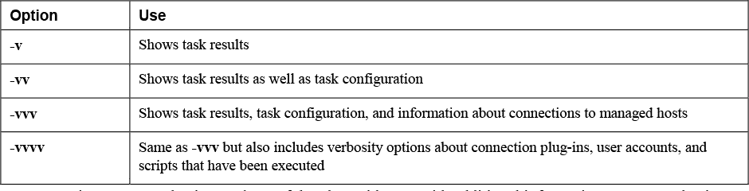

增加输出详细程度是有用的，并能为你提供额外信息。然而，输出详细程度必须节制使用。虽然`-vv`在许多情况下很有用，但`-vvvv`选项在大多数情况下只会让你淹没在无关信息中。Listing 5-11 显示命令`ansible-playbook -vv listing59.yaml`的部分输出，而 Listing 5-12 显示命令`ansible-playbook -vvvv listing59.yaml`的部分输出。

**Listing 5-11** `ansible-playbook -vv`部分输出


```bash
[ansible@control ~]$ ansible-playbook -vv listing59.yaml

ansible-playbook 2.9.5

  config file = /home/ansible/ansible.cfg

  configured module search path = [’/home/ansible/.ansible/plugins/modules’’usr/share/ansible/plugins/modules’]

  ansible python module location = /usr/lib/python3.6/site-packages/ansible

  executable location = /usr/bin/ansible-playbook

  python version = 3.6.8 (default, Nov 21 2019, 19:31:34) [GCC 8.3.1 20190507 (Red Hat 8.3.1-4)]

Using /home/ansible/ansible.cfg as config file

PLAYBOOK: listing59.yaml ****************************************************

2 plays in listing59.yaml

PLAY [install start and enable httpd] ***********************************************************************

TASK [Gathering Facts] **************************************************************************************

task path: /home/ansible/listing59.yaml:2

ok: [ansible2]

ok: [ansible1]

META: ran handlers

TASK [install package] **************************************************************************************

task path: /home/ansible/listing59.yaml:5

ok: [ansible2] => {"changed": false, "msg": "Nothing to do", "rc": 0, "results": []}

ok: [ansible1] => {"changed": false, "msg": "Nothing to do", "rc": 0, "results": []}
```

## `ansible-playbook -vvvv` 部分输出

```bash
[ansible@control ~]$ ansible-playbook -vvvv listing59.yaml

ansible-playbook 2.9.5

  config file = /home/ansible/ansible.cfg

  configured module search path = [’/home/ansible/.ansible/plugins/modules’, ’/usr/share/ansible/plugins/modules’]

  ansible python module location = /usr/lib/python3.6/site-packages/ansible

  executable location = /usr/bin/ansible-playbook

  python version = 3.6.8 (default, Nov 21 2019, 19:31:34) [GCC 8.3.1 20190507 (Red Hat 8.3.1-4)]

Using /home/ansible/ansible.cfg as config file

setting up inventory plugins

host_list declined parsing /home/ansible/inventory as it did not pass its verify_file() method

script declined parsing /home/ansible/inventory as it did not pass its verify_file() method

auto declined parsing /home/ansible/inventory as it did not pass its verify_file() method

Parsed /home/ansible/inventory inventory source with ini plugin

Loading callback plugin default of type stdout, v2.0 from /usr/lib/python3.6/site-packages/ansible/plugins/callback/default.py

PLAYBOOK: listing59.yaml ************************************************************************************

Positional arguments: listing59.yaml

verbosity: 4

remote_user: ansible

connection: smart

timeout: 10

become: True

become_method: sudo

tags: (’all’,)

inventory: (’/home/ansible/inventory’,)

forks: 5

2 plays in listing57.yaml

PLAY [install start and enable httpd] ***********************************************************************

TASK [Gathering Facts] **************************************************************************************

task path: /home/ansible/listing59.yaml:2

<ansible2> ESTABLISH SSH CONNECTION FOR USER: ansible

<ansible2> SSH: EXEC ssh -vvv -C -o ControlMaster=auto -o ControlPersist=60s -o StrictHostKeyChecking=no -o KbdInteractiveAuthentication=no -o PreferredAuthentications=gssapi-with-mic,gssapi-keyex,hostbased,publickey -o PasswordAuthentication=no -o ’User="ansible"’ -o ConnectTimeout=10 -o ControlPath=/home/ansible/.ansible/cp/b95d9eb347 ansible2 ’/bin/sh -c ’"’"’echo ~ansible && sleep 0’"’"’’

<ansible1> ESTABLISH SSH CONNECTION FOR USER: ansible

<ansible1> SSH: EXEC ssh -vvv -C -o ControlMaster=auto -o ControlPersist=60s -o StrictHostKeyChecking=no -o KbdInteractiveAuthentication=no -o PreferredAuthentications=gssapi-with-mic,gssapi-keyex,hostbased,publickey -o PasswordAuthentication=no -o ’User="ansible"’ -o ConnectTimeout=10 -o ControlPath=/home/ansible/.ansible/cp/88f8e128b5 ansible1 ’/bin/sh -c ’"’"’echo ~ansible && sleep 0’"’"’’

<ansible2> (0, b’/home/ansible\n’, b"OpenSSH_8.0p1, OpenSSL 1.1.1c FIPS  28 May 2019\r\ndebug1: Reading configuration data /etc/ssh/ssh_config\r\ndebug3: /etc/ssh/ssh_config line 51: Including file /etc/ssh/ssh_config.d/05-redhat.conf depth 0\r\ndebug1: Reading configuration data /etc/ssh/ssh_config.d/05-redhat.conf\r\ndebug2: checking match for ’final all’ host ansible2 originally ansible2\r\ndebug3: /etc/ssh/ssh_config.d/05-redhat.conf line 3: not matched ’final’\r\ndebug2: match not found\r\ndebug3: /etc/ssh/ssh_config.d/05-redhat.conf line 5: Including file /etc/crypto-policies/back-ends/openssh.config depth 1 (parse only)\r\ndebug1: Reading configuration data /etc/crypto-policies/back-ends/openssh.config\r\ndebug3: gss kex names ok: [gss-gex-sha1-,gss-group14-sha1-]\r\ndebug3: kex names ok: [curve25519-sha256,curve25519-sha256@libssh.org,ecdh-sha2-nistp256,ecdh-sha2-nistp384,ecdh-sha2-nistp521,diffie-hellman-group-exchange-sha256,diffie-hellman-group14-sha256,diffie-hellman-group16-sha512,diffie-hellman-group18-sha512,diffie-hellman-group-exchange-sha1,diffie-hellman-group14-sha1]\r\ndebug1: configuration requests\r\ndebug1: re-parsing configuration\r\ndebug1: Reading configuration data /etc/ssh/ssh_config\r\ndebug3: /etc/ssh/ssh_config line 51: Including file /etc/ssh/ssh_config.d/05-redhat.conf depth 0\r\ndebug1: Reading configuration data /etc/ssh/ssh_config.d/05-redhat.conf\r\ndebug2: checking for ’final all’ host ansible2 originally ansible2\r\ndebug3: /etc/ssh/ssh_config.d/05-redhat.conf line 3: matched ’final’\r\ndebug2: match found\r\ndebug3: /etc/ssh/ssh_config.d/05-redhat.conf line 5: Including file /etc/crypto-policies/back-ends/openssh.config depth 1\r\ndebug1: Reading configuration data /etc/crypto-policies/back-ends/openssh.config\r\ndebug3: gss kex names ok: [gss-gex-sha1-,gss-group14-sha1-]\r\ndebug3: kex names ok: [curve25519-sha256,curve25519-sha256@libssh.org,ecdh-sha2-nistp256,ecdh-sha2-nistp384,ecdh-sha2-nistp521,diffie-hellman-group-exchange-sha256,diffie-hellman-group14-sha256,diffie-hellman-group16-sha512,diffie-hellman-group18-sha512,diffie-hellman-group-exchange-sha1,diffie-hellman-group14-sha1]\r\ndebug1: auto-mux: Trying existing master\r\ndebug2: fd 4 setting O_NONBLOCK\r\ndebug2: mux_client_hello: master 4\r\ndebug3: mux_client_forwards: requestings: 0, remote\r\ndebug3: mux_client_request_session: entering\r\ndebug3: mux_client_request_alive: entering\r\ndebug3: mux_client_request_alive: done pid = 2384\r\ndebug3: mux_client_request_session: session request sent\r\ndebug3: mux_client_read_packet: read header failed: Broken pipe\r\ndebug2: Received exit status from master 0\r\n")<ansible2> ESTABLISH SSH CONNECTION FOR USER: ansible

<ansible2> SSH: EXEC ssh -vvv -C -o ControlMaster=auto -o ControlPersist=60s -o StrictHostKeyChecking=no -o KbdInteractiveAuthentication=no -o PreferredAuthentications=gssapi-with-mic,gssapi-keyex,hostbased,publickey -o PasswordAuthentication=no -o ’User="ansible"’ -o ConnectTimeout=10 -o ControlPath=/home/ansible/.ansible/cp/b95d9eb347 ansible2 ’/bin/sh -c ’"""’( umask 77 && mkdir -p `/ echo /home/ansible/.ansible/tmp/ansible-tmp-1585565643.3326187-589789153630 `" && echo ansible-tmp-1585565643.3326187-589789153630="` echo /home/ansible/.ansible/tmp/ansible-tmp-1585565643.3326187-589789153630 `" ) && sleep 0’"’"’’

<ansible1> (0, b’/home/ansible\n’, b"OpenSSH_8.0p1, OpenSSL 1.1.1c FIPS  28 May 2019\r\ndebug1: Reading configuration data /etc/ssh/ssh_config\r\ndebug3: /etc/ssh/ssh_config line 51: Including file /etc/ssh/ssh_config.d/05-redhat.conf depth 0\r\ndebug1: Reading configuration data /etc/ssh/ssh_config.d/05-redhat.conf\r\ndebug2: checking match for ’final all’ host ansible1 originally ansible1\r\ndebug3: /etc/ssh/ssh_config.d/05-redhat.conf line 3: not matched ’final’\r\ndebug2: match not found\r\ndebug3: /etc/ssh/ssh_config.d/05-redhat.conf
```

如果你认为列表 5-12 内容太多了，这正是我想要传达的观点。`-vvvv`输出显示了所有显示的内容，看到它产生成千上万行的输出代码并不罕见。然而，这些信息有用的情况非常少。

---

**考试提示**


在你到目前为止所看到的排错选项中，输出详细程度选项并不是最有用的。使用常识才是最有用的。`playbook` 中的大多数错误是逻辑错误的结果，即 `playbook` 中的任务流没有经过仔细的考虑。规避免这类错误相对容易：不要在一个 `play` 中包含过多的任务，不要在一个 `playbook` 中包含过多的 `play`。这样，你就可以很容易避免失去全局观。

在练习 5-3 中，你将处理一个多 `play` `playbook`。

## 练习 5-3 创建多 play playbook

1. 使用编辑器创建文件 `exercise53.yaml` 并创建第一个 `play`：

```yaml
---
- name: enable web server
  hosts: ansible1
  tasks:

  - name: install stuff
    yum:
    - httpd
    - firewalld
  - name: create a welcome page
    copy:
      content: "welcome to the webserver\n"
      dest: /var/www/html/index.html
  - name: enable webserver
    service:
      name: httpd
      state: started
      enabled: true
  - name: enable firewall
    service:
      name: firewalld
      state: started
      enabled: true
  - name: open service in firewall
    firewalld:
      service: http
      permanent: true
      state: enabled
      immediate: yes
```

2. 继续通过添加第二个 `play` 来完成该 `playbook`。注意在 `uri` 模块中使用了 `return_content`，它确保了在运行 `playbook` 时显示命令的结果：

```yaml
---
- name: enable web server
  hosts: ansible1
  tasks:

  - name: install stuff
    yum:
      name:
      - httpd
      - firewalld
  - name: create a welcome page
    copy:
      content: "welcome to the webserver\n"
      dest: /var/www/html/index.html
  - name: enable webserver
    service:
      name: httpd
      state: started
      enabled: true
  - name: enable firewall
    service:
      name: firewalld
      state: started
      enabled: true
  - name: open service in firewall
    firewalld:
      service: http
      permanent: true
      state: enabled
      immediate: yes

- name: test webserver access
  hosts: localhost
  become: no
  tasks:

  - name: test webserver access
    uri:
      url: http://ansible1
      return_content: yes
      status_code: 200
```

3. 使用 `ansible-playbook --syntax-check exercise53.yaml` 验证 `playbook` 的语法。

4. 使用 `ansible-playbook -vv exercise53.yaml` 运行 `playbook`。

## 总结

在本章中，你学习了如何操作 `playbook`。首先，你运行了一个示例 `playbook` 并验证了其结果。接下来，你学习了 `playbook` 中使用的 `YAML` 文件格式及其一些最重要的特性。在最后一节中，你阅读了如何处理包含多个 `play` 的 `playbook`，并学习了在何时使用它们是合理的。

## 考试准备任务

正如引言中“如何使用本书”章节所提到的，你有几种准备考试的方案：此处的练习、第 16 章、“最终准备”以及配套网站上的上的模拟模拟题。

## 复习所有核心主题

回顾本章中最重要的主题，这些主题在页面外边角用“核心主题”图标标记。表 5-4 列出了这些核心主题的参考列表及其所在的页码。


**表 5-4** 第 5 章核心主题


### 记忆表格

打印 附录 D“记忆表格”（位于配套网站）或至少打印本章章节，并根据记忆完成表格和列表。附录 E“记忆表格答案密钥”同样位于配套网站，其中包含了完成的表格和列表供你检查工作。

### 定义关键术语

定义本章中的以下关键术语，并在词表中检查你的答案：

`dictionary`

`key-value`

`list`

`play`

`playbook`

`task`

`YAML`

### 复习题

1. 使用哪个选项可以向 `ansible-playbook` 命令显示最详细的输出？

2. `YAML` 文件中的缩进必须使用什么字符？

3. 如何验证 `Ansible Playbook` 的语法？

4. 你可以使用哪个模块来验证与 Web 服务器的连接性？

5. 你可以使用哪个模块向文件中添加几行文本？

6. 在 `playbook` 中指定文本字符串之前使用 `>` 符号的用用场景是什么？

7. 在什么情况下应该使用多个 `playbook` 而不是包含多个 `play` 的 `playbook`？

8. 多个 `playbook` 与包含多个 `play` 的 `playbook` 之间的区别是什么？

9. 如果包含多个 `play` 的 `playbook` 运行了，你会看到什么输出结果？

10. 使用哪个模块可以验证对 Web 服务器的访问？

## d. my-file

### [6]. 下列哪项不是在 `playbook` 中定义变量的有效方法？

a. 在 `playbook` 头部使用 `vars_files:`。

b. 创建名为 `group_vars/groupname` 的文件，其中包含适用于主机组的变量。

c. 创建名为 `host_vars/hostname` 的文件，其中包含适用于特定主机的变量。

d. 在 `play` 头部定义变量：`key` 并给它赋一个列表值。

### [7]. 下列哪项被用作魔法变量（magic variable），由于该原因不能被重写？

a. `hostvars`

b. `host_groups`

c. `inventory`

d. `config_file`

### [8]. 你可以使用哪个命令更改 `Ansible Vault` 加密文件的密码？

a. `ansible-vault change`

b. `ansible-vault re-key`

c. `ansible-vault create`

d. `ansible-vault password`

### [9]. 你可以使用 `ansible-vault` 命令的哪个选项，从一个 `playbook` 使用不同的密码解密多个 `Ansible Vault` 加密文件？

a. `--ask-vault-pass`

b. `--vault-id @prompt`

c. `--vault-password-file=password-file`

d. 多次使用 `--ask-vault-pass`。

### [10]. 如何在 `Ansible` 中将命令的结果作为变量？

a. 从 `Ansible facts` 中获取。

b. 使用 `command_facts` 模块。

c. 使用 `register` 参数。

d. 将标准输出重定向到文件并进行分析。

## 基础主题

### 理解 Ansible Playbooks 中变量的使用

到为止，你已经学习了如何操作 `playbook`。虽然很方便，但仅处理静态数据的 `playbook` 并不令人印象深刻。这就是为什么在 `Ansible` 中使用变量很重要。变量是引用可以动态更改的数据标签，这使得 `Ansible` 变得非常灵活，特别是当变量与条件判断结合时，正如第 7 章“使用任务控制”中所讨论的。在详细学习变量和 `facts` 之前，让我们看看列表 6-1 中的示例，展示变量是如何被使用的。

**列表 6-1** 使用变量示例

```yaml
---
- name: create a user using a variable
  hosts: ansible1

  vars:

    users: lisa

  tasks:

    - name: create a user {{ users }} on host {{ ansible_hostname }}
      user:
        name: "{{ users }}"
```

如你所见，列表 6-1 中的示例 `playbook` 有一个 `vars` 部分。在该部分中，使用常用的 `key: value` 语法定义了一个变量。接下来，在任务定义中，使用 `user` 模块来处理此变量。要引用该变量，只需将定义名称放在双大括号之间。然而，在 `user` 模块的 `name` 参数中，变量位于双引号和双大括号之间。原因是在这种情况下，值是以变量开头的。如果值以变量开头，则变量必须放在双引号之间。如果该行中不仅有变量名，还指定了值，那么以变量开头的整行必须放在双引号之间。

接下来你看到了变量 `ansible_hostname`，它在任何地方都没有被定义。这是因为该变量是一个 `Ansible fact`。`Ansible facts` 也被用变量，但它们是根据托管系统的属性自动设置的变量。默认使用 `fact` 发现来发现 `Ansible` 可能需要的所有以用于条件判断的机器信息。你不需要定义 `facts`；`facts` 是系统属性的一部分。

列表 6-2 显示了运行此 `playbook` 的命令输出。

**列表 6-2** 运行列表 6-1 示例 `playbook`

```
[ansible@control ~]$ ansible-playbook listing61.yaml

PLAY [create a user using a variable] ***********************************************************************

TASK [Gathering Facts] ***********************************************************************

ok: [ansible1]

TASK [create a user lisa on host ansible1] ******************************************************************

changed: [ansible1]

PLAY RECAP ***********************************************************************

ansible1                   : ok=2    changed=1    unreachable=0    failed=0    skipped=0    rescued=0    ignored=0
```

如列表 6-2 所示，`ansible-playbook` 命令显示了任务描述“create a user lisa on host”，其中 `playbook` 中定义的变量与 `Ansible fact` `ansible_hostname` 一起使用，后者是揭示系统属性的发现变量。

### 使用 Ansible Facts

在 `Ansible` 中有三种类型的变量。表 6-2 提供了概览。

**表 6-2** `Ansible` 变量类型


`Ansible facts` 是 `Ansible` 在远程系统上执行时收集的系统属性。收集 `facts` 之后，`facts` 可以作为变量使用。除了作为系统属性存在的系统 `facts` 外，还有自定义 `facts`（custom facts）。这些 `facts` 由管理员定义，并存储在托管主机上的文件中。在接下来的章节中，你将学习如何在受 `Ansible` 管理的系统上操作 `facts`。魔法变量（Magic Variables）是特定的系统变量，稍后讨论。

### 收集 facts (Gathering Facts)

当使用任何 `Ansible playbook` 时，它首先为所有托管主机收集 `facts`。这是通过每个 `playbook` 中的一个隐式 `fact` 收集任务完成的。此过程的结果存储在 `ansible_facts` 变量中。让我们运行列表 6-3 中的简单 `playbook` 来分析 `fact` 收集。

**列表 6-3** 显示 `fact` 收集的简单 `playbook`

```yaml
---
- name: show fact gathering
  hosts: all

  tasks:

  - name: show all facts
    debug:
      var: ansible_facts
```

列表 6-3 中的 `playbook` 收集了关于托管主机的所有已知 `facts`，并将它们存储在变量 `ansible_facts` 中。为了展示此过程是如何工作的，列表 6-3 使用了 `debug` 模块。该模块可用于调试，用于显示消息或打印变量的内容。在这种情况下，`debug` 模块打印了多值变量 `ansible_facts` 的所有内容；参见列表 6-4 的部分结果。注意，当使用 `debug` 模块的 `var` 参数引用变量时，变量名称不需要放在大括号和引号之间。这是你在处理变量时可能会发现许多异常情况之一。

**列表 6-4** `fact` 收集部分结果


```text
TASK [show all facts] ***************************************************************************************

ok: [ansible1] => {

    "ansible_facts": {
        "_facts_gathered": true,
        "all_ipv4_addresses": [
            "192.168.122.1",
            "192.168.4.201"
        ],
        "all_ipv6_addresses": [
            "fe80::e564:5033:5dec:aead"
        ],
        "ansible_local": {},
        "apparmor": {
            "status": "disabled"
        },
        "architecture": "x86_64",
        "bios_date": "07/29/2019",
        "bios_version": "6.00",
        "cmdline": {
            "BOOT_IMAGE": "(hd0,msdos1)/vmlinuz-4.18.0-147.el8.x86_64",
            "crashkernel": "auto",
            "quiet": true,
            "rd.lvm.lv": "cl/swap",
            "resume": "/dev/mapper/cl-swap",
            "rhgb": true,
            "ro": true,
            "root": "/dev/mapper/cl-root"
        },
        "date_time": {
            "date": "2020-03-30",
            "day": "30",
            "epoch": "1585579970",
            "hour": "10",
            "iso8601": "2020-03-30T14:52:50Z",
            "iso8601_basic": "20200330T105250355357",
            "iso8601_basic_short": "20200330T105250",
            "iso8601_micro": "2020-03-30T14:52:50.355419Z",
            "minute": "52",
            "month": "03",
            "second": "50",
            "time": "10:52:50",
            "tz": "EDT",
            "tz_offset": "-0400",
            "weekday": "Monday",
            "weekday_number": "1",
            "weeknumber": "13",
            "year": "2020"
        },
        "default_ipv4": {
            "address": "192.168.4.201"
```

事实收集的结果存储在一个名为`ansible_facts`的多值变量中，该变量被组织成一个字典（请参阅“使用多值变量”章节）。要访问此字典中的特定值，你可以使用两种格式：


- 使用方括号的表示法：`ansible_facts['default_ipv4']['address']`
- 点符号表示法：`ansible_facts.default_ipv4.address`

在这两种表示法中，优先使用方括号的表示法。

如你所见，在浏览 Ansible 事实收集的结果时，收集了广泛的事实。表 6-3 提供了一些常用事实的概述。


**表 6-3** 常用 Ansible 事实

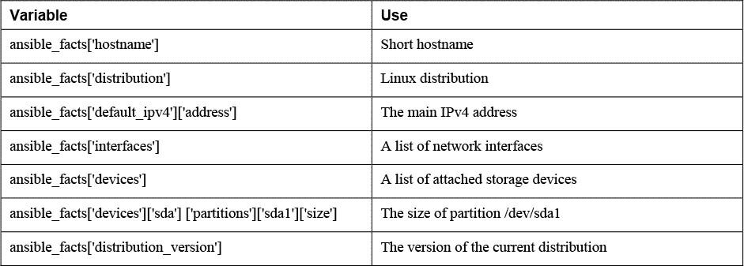

请注意，Ansible 默认会收集许多事实。尽管某些信息未包含在，但如果需要该类型的信息，可以使用额外的模块进行收集。要概述收集特定类型事实的所有可用模块，请输入`ansible-doc -l | grep fact`。该命令显示有多种事实收集模块可用。这些模块之一是`package_facts`，它负责收集安装在受管主机上的软件软件包的信息。

### 理解事实是如何展示的


在处理事实时，你可能会遇到两种不同的展示方式。在当前方式下，所有事实都存储在名为`ansible_facts`的字典中，字典中的项使用方括号表示法进行访问，如表 6-3 所示。在旧方式中，Ansible 事实被以单个变量的形式注入，这些变量以`ansible_`字符串开头（例如`ansible_hostname`），允许单独访问变量。这种方法被称为注入变量。

令人混淆的地方在于，旧方法和新方法仍然存在。例如，对比列表 6-5 所示`ansible ansible1 -m setup`命令的输出，与显示`ansible_fact`变量内容的 playbook 输出（你之前在列表 6-4 中见过该内容）。如你所见，在列表 6-5 中，Ansible 事实是以变量形式注入的。

**列表 6-5 ansible -m setup** 显示作为变量注入的事实

```json
ansible1 | SUCCESS => {
    "ansible_facts": {
        "ansible_ipv4_addresses": [
            "192.168.122.1",
            "192.168.4.201"
        ],
        "ansible_ipv6_addresses": [
            "fe80::e564:5033:5dec:aead"
        ],
        "ansible_apparmor": {
            "status": "disabled"
        },
        "ansible_architecture": "x86_64",
        "ansible_bios_date": "07/29/2019",
        "ansible_bios_version": "6.00",
        "ansible_cmdline": {
            "BOOT_IMAGE": "(hd0,msdos1)/vmlinuz-4.18.0-147.el8.x86_64",
            "crashkernel": "auto",
            "quiet": true,
            "rd.lvm.lv": "cl/swap",
            "resume": "/dev/mapper/cl-swap",
            "rhgb": true,
            "ro": true,
            "root": "/dev/mapper/cl-root"
        },
        "date_time": {
            "date": "2020-03-30",
            "day": "30",
            "epoch": "1585579970",
            "hour": "10",
            "iso8601": "2020-03-30T14:52:50Z",
            "iso8601_basic": "20200330T105250355357",
            "iso8601_basic_short": "20200330T105250",
            "iso8601_micro": "2020-03-30T14:52:50.355419Z",
            "minute": "52",
            "month": "03",
            "second": "50",
            "time": "10:52:50",
            "tz": "EDT",
            "tz_offset": "-0400",
            "weekday": "Monday",
            "weekday_number": "1",
            "weeknumber": "13",
            "year": "2020"
        },
        "default_ipv4": {
            "address": "192.168.4.201",
            "alias": "ens33",
            "broadcast": "192.168.4.255",
            "gateway": "192.168.4.2",
            "interface": "ens33",
            "macaddress": "00:0c:29:1f:c1:23",
            "mtu": 1500,
            "netmask": "255.255.255.0",
            "network": "192.168.4.0",
            "type": "ether"
        },
    }
}
```

当你处理事实时，推荐的方法是使用`ansible_facts`变量，而不是注入事实，因为在未来，注入变量将不再被支持。表 6-4 显示了注入变量与`ansible_facts`风格的对比。

**表 6-4** `ansible_facts`与注入事实对比

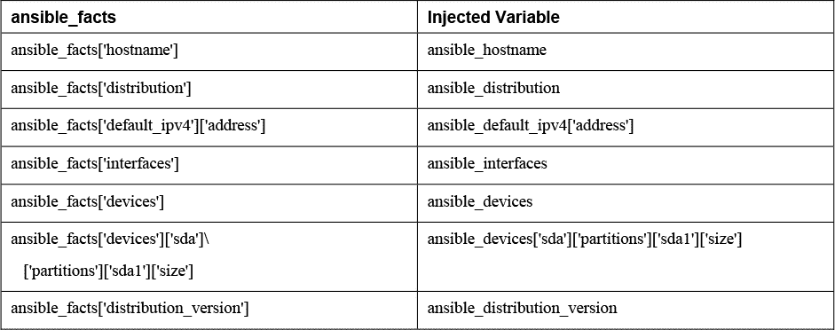

列表 6-6 和列表 6-7 展示了两个 playbook。列表 6-6 使用旧方式处理事实，而列表 6-7 使用新方式（使用`ansible_facts`变量）处理事实。为了确保你理解两种方法都可以不同的表示法，示例中使用点符号表示法，而不是方括号表示法。

**列表 6-6** 使用注入变量处理事实

```yaml
---
- hosts: all
  tasks:
  - name: show IP address
    debug:
      msg: >
        此主机使用 IP 地址 {{ ansible_default_ipv4.address }}
```

**列表 6-7** 使用`ansible_facts`变量处理事实

```yaml
---
- hosts: all
  tasks:
  - name: show IP address
    debug:
      msg: >
        此主机使用 IP 地址 {{ ansible_facts.default_ipv4.address }}
```

**提示**

如果由于某些原因，你希望将事实注入到变量的方法作为默认方法，可以在`ansible.cfg`文件的`[default]`部分使用`inject_facts_as_vars=true`。

由于引用事实有许多不同的方式，它们可能会令人困惑。让我们通过以下概述来结束本节：

- 从 Ansible 2.5 版本开始，所有事实都存储在一个变量中：`ansible_facts`。这种方法用于从 playbook 收集事实时。
- 在 Ansible 2.5 版本之前，事实（facts）被注入到诸如`ansible_hostname`等变量中。这种方法由`setup`模块使用。（注意这在 Ansible 的未来版本中可能会发生变化。）
- 可以通过点符号表示法访问事实：`{{ ansible_facts.default_ipv4.address }}`。
- 或者，也可以使用方括号表示法访问事实：`{{ ansible_facts[’default_ipv4’][’address’] }}`。推荐使用这种表示法。

## 管理事实收集（Managing Fact Gathering）

默认情况下，在执行每个 playbook 时都会收集事实。这会减慢 playbook 的运行速度，因此，可以完全禁用事实收集。要做到这一点，你可以在 play 标头（play header）中使用`gather_facts: no`参数。如果在此同一个 playbook 的后续部分需要收集事实，可以通过在任务中运行`setup`模块来实现。

即使可以在所有的 Ansible 配置中禁用事实收集，但并不建议这样做。有太多的 playbook 使用了基于事实当前值的条件判断，如果完全禁用了事实收集，所有这些条件判断将无法运行。

作为提高事实操作效率的替代方案，你可以禁用事实缓存（fact cache）。要做到这一点，你需要安装一个外部插件。目前有两个插件用于此目的：`jsonfile`和`redis`。要使用`redis`插件配置事实缓存，你需要先安装它。接下来，你可以通过`ansible.cfg`启用事实缓存。以下步骤描述了如何操作：

1. 使用`yum install redis`。
2. 使用`service redis start`。
3. 使用`pip install redis`。
4. 编辑`/etc/ansible/ansible.cfg`并确保它包含以下参数：

```ini
[defaults]
gathering = smart
fact_caching = redis
fact_caching_timeout = 86400
```

### 注意

事实缓存可能方便，但应该谨慎使用。例如，如果一个 playbook 只在磁盘空间足够时才安装某个软件包，那么它不应该基于可能已过期 24 小时的信息来操作。因此，在许多情况下不建议使用事实缓存。

## 使用自定义事实（Working with Custom Facts）

除了在所有情况下都可以收集的事实外，Ansible 还提供了一个处理自定义事实的选项。自定义事实用于为主机提供任意值，Ansible 可以利用这些值来改变 play 的行为。自定义事实可以通过静态文件提供。这些文件必须是 INI 或 JSON 格式，扩展名为`.fact`，并且必须在托管主机上存储在`/etc/ansible/facts.d`目录下。

或者，自定义事实也可以由脚本生成，在这种情况下，唯一的要求是脚本必须以 JSON 格式生成输出。动态自定义事实是有用的，因为它们允许在脚本运行的时刻确定事实。[列表 6-8] 提供了一个静态自定义事实文件的示例。

**列表 6-8** 自定义事实示例文件

```ini
[packages]
web_package = httpd
ftp_package = vsftpd

[services]
web_service = httpd
ftp_service = vsftpd
```

为了在托管主机上获取自定义事实文件，你可以使用 playbook。[列表 6-9] 提供了一个 playbook 示例，它将本地自定义事实文件（存在于当前 Ansible 项目目录）复制到托管主机的相应位置。注意，此 playbook 使用了变量，变量将在“使用变量（Working with Variables）”章节中进行更详细的解释。

**列表 6-9** 复制自定义事实的示例 Playbook

```yaml
---
- name: Install custom facts
  hosts: all
  vars:
    remote_dir: /etc/ansible/facts.d
    facts_file: listing68.fact
  tasks:
  - name: create remote directory
    file:
      state: directory
      recurse: yes
      path: "{{ remote_dir }}"
  - name: install new facts
    copy:
      src: "{{ facts_file }}"
      dest: "{{ remote_dir }}"
```

自定义事实存储在变量`ansible_facts.ansible_local`中。在该变量中，你使用自定义事实文件的文件名和自定义事实文件中的标签。例如，在运行[列表 6-9]中的 playbook 之后，在`listing68.fact`中定义的`web_package`事实可以通过以下方式访问：

```jinja
{{ ansible_facts[’ansible_local’][’listing67’][’packages’][’web_package’] }}
```

要进行验证，你可以使用带有`filter`参数的`setup`模块。注意，由于`setup`模块会产生注入变量，因此使用的即时命令（ad hoc command）是`ansible all -m setup -a “filter=ansible_local””。命令`ansible all -m setup -a “filter=ansible_facts[’ansible_local’]”`是不起作用的。在[练习 6-1]中练习操作事实。

### 练习 6-1 使用 Ansible 事实


1. 创建名为`custom.fact`的自定义事实文件，内容如下：

```
[software]
package = httpd
service = httpd
state = started
enabled = true
```

2. 编写名为`copy_facts.yaml`的 playbook，内容如下：

```yaml
---
- name: copy custom facts
  hosts: ansible1
  tasks:
  - name: create remote directory
    file:
      state: directory
      recurse: yes
      path: "{{ remote_dir }}"
  - name: install new facts
    copy:
      src: "{{ facts_file }}"
      dest: "{{ remote_dir }}"
```

3. 使用`ansible-playbook copy_facts.yaml`应用 playbook。

4. 使用`ansible all -m setup -a “filter=ansible_local”`检查事实的可用性。

5. 使用即时命令确保未安装 httpd 服务：

`ansible all -m yum -a “name=httpd state=absent”`

6. 创建名为`setup_with_facts.yaml`的 playbook，使用自定义事实安装并设置 httpd 服务：

```yaml
---
- name: install and start service
  hosts: ansible1
  tasks:
  - name: install the package
    yum:
      name: "{{ ansible_facts[’ansible_local’][’custom’][’software’][’package’] }}"
      state: latest
  - name: start the service
    service:
      name: "{{ ansible_facts[’ansible_local’][’custom’][’software’][’service’] }}"
      state: "{{ ansible_facts[’ansible_local’][’custom’][’software’][’state’] }}"
      enabled: "{{ ansible_facts[’ansible_local’][’custom’][’software’][’enabled’] }}"
```

7. 使用`ansible-playbook setup_with_facts.yaml`运行 playbook 以设置服务。

## 变量简介

在上一节中，你学习了如何使用 Ansible 事实来处理基于托管主机上内容的动态值。在本节中，你将学习变量。变量通常用于将静态数据与动态数据分离。通过将动态数据放在变量中，更容易管理这些数据，特别是当变量排除外部文件时。变量可以引用广泛的动态数据，例如文件名、服务、软件包、用户、特定服务器的 URL 等。

### 定义变量

要定义变量，你只需在 play 标头的`vars`部分使用`key: value`结构。定义和包含变量的其他方法将在本节稍后讨论。变量定义可能类似于列表 6-10 中的示例。

**列表 6-10** 在 Playbook 头部中定义变量

```yaml
---
- name: using variables
  hosts: ansible1
  vars:
    ftp_package: vsftpd
  tasks:
  - name: install package
    yum:
      name: "{{ ftp_package }}"
      state: latest
```

在 Listing 6-10 示例中，play 标头信息中包含了一个`vars`部分，用于定义变量`ftp_package`。该变量随后在`yum`任务中被引用。由于该变量是值中的第一个项，其名称必须放在双大括号和双引号之间。

当你定义变量时，有几点要求：


- 变量名必须以字母开头。
- 变量名对大小写敏感。
- 变量名只能包含字母、数字和下划线。

### 使用包含文件

在定义变量时，你可以在 play 的标头中定义所有变量。对于较小的 playbook 来说，这种方法可以良好运行，但随着 playbook 变得越来越大且复杂，你很容易失去控制。因此，通常会在包含文件（include files）中定义变量。特定的主机和组变量可以作为包含文件使用（参见本章后文“管理主机和组变量”部分），但也可以使用`vars_files:`语句将任意文件作为变量文件引入。注意，`vars_files:`参数可以有一个单值，也可以是一个提供多个值的列表。如果使用列表，每个项都需要以连字符开头；有关使用列表的更多信息，请参见“使用多值变量”部分。

当你从文件中引入变量时，最好使用一个包含所有变量的独立目录进行工作，因为随着项目规模扩大，这更便于管理。

Listing 6-11 显示了一个示例 playbook，其中行`vars_files: vars/common`用于引入文件`vars/common`中定义的变量，该文件的内容显示在 Listing 6-12 中。

**Listing 6-11** 使用变量包含文件

```yaml
---

- name: using a variable include file

  hosts: ansible1

  vars_files: vars/common

  tasks:

  - name: install package

    yum:
      name: "{{ my_package }}"
      state: latest
```

**Listing 6-12** 变量包含文件内容

```yaml
my_package: nmap

my_ftp_service: vsftpd

my_file_service: smb
```

使用变量包含文件最重要的优点之一是能够从一个中心位置管理变量。如果变量被定义在单独的 playbook 中，它们会散落在各处，可能很难获取整个站点使用的所有变量的概述。当你将变量放在变量文件中时，可以更容易以一致的方式管理它们，并确保在整个站点使用相同的变量。

### 管理主机和组变量

在某些情况下，你可能想为特定的主机或特定的主机组设置变量。你可以通过使用`host_vars`和`group_vars`引入来实现。在 Ansible 的旧版本中，在清单（inventory）中设置主机变量和组变量是常见做法，但这种做法现在已经废弃了。

如果你想使用主机变量，必须在 Ansible 项目目录内创建一个名为`host_vars`的子目录。在此目录中，创建一个与要应用变量的主机清单中的名称匹配的文件。因此，主机`ansible1`的变量定义在`host_vars/ansible1`中。要使用主机组变量，采用类似的方法。首先，你创建一个名为`group_vars`的目录。在此目录中，创建一个以主机组命名的文件，并在文件中定义所有变量。因此，如果你想为主机组`web servers`定义变量，你需要创建一个名为`group_vars/webservers`的文件。在 Exercise 6-2 中，你将练习使用主机和主机组变量。

**练习 6-2 使用主机和主机组变量**

1. 在你的主目录下创建一个项目目录。输入`mkdir ~/chapter6`创建 chapter6 项目目录，并使用`cd ~/chapter6`进入该目录。

2. 输入`cp ../ansible.cfg .`复制你之前使用的`ansible.cfg`文件。不需要对该文件进行进一步修改。

3. 输入`vim inventory`创建一个名为`inventory`的文件，并确保它包含以下内容：

```ini
[webservers]
ansible1
[dbservers]
ansible2
```

4. 创建`webservers.yaml`文件，包含以下内容。注意，运行此 playbook 不会发生任何变化。它只是使用`debug`模块显示变量的当前值。

```yaml
---
- name: configure web services
  hosts: webservers
  tasks:

  - name: this is the {{ web_package }} package
    debug:
      msg: "Installing {{ web_package }}"
  - name: this is the {{ web_service }} service
    debug:
      msg: "Starting the {{ web_service }}"
```

5. 创建`group_vars/webservers`文件，包含以下内容：

```yaml
web_package: httpd
web_service: httpd
```

6. 使用`ansible-playbook -vv webservers.yaml`运行 playbook 并增加详细性以验证其运行正常。

正如你在 Exercise 6-2 中所示，主机组变量会被自动拾取，即使没有任何特定的引用。

> **注意**
>
> 这种方式使用主机和组变量是高效的，但同时也在 playbook 中没有指定它们的位置。

### 使用多值变量

在 Ansible 中处理变量时，通常会使用多值变量。有两种类型的多值变量可以使用：数组（也称为列表）和字典（也称为哈表）。每种都有自己的用例。

在变量定义中，列表（也称为数组）是一个具有多个项的键。列表中的每个项以连字符（`-`）开头。列表中的项可以使用索引（从零开始）访问，例如`{{ users[1] }}`（这将打印用户 lisa 的键值对）。Listing 6-13 显示了一个定义为数组的变量示例。

**Listing 6-13** 数组示例

```yaml
users:
  - linda:
    username: linda
    homedir: /home/linda
    shell: /bin/bash
  - lisa:
    username: lisa
    homedir: /home/lisa
    shell: /bin/bash
  - anna:
    username: anna
    homedir: /home/anna
    shell: /bin/bash
```

在 Python 中，字典（也称为哈表）是一个无序的项集合，键值对的集合。在 Python 中，字典定义为`my_dict = { key1: 'car’, key2:'bike’ }`。基于 Python，Ansible 允许用户使用字典作为数组的替代表示法，尽管字典在用法上不如数组常见。字典值中的项不以连字符开头。使用字典是一种方法；另一种方法是使用列表。Listing 6-14 显示了一个定义为字典的变量示例。

**Listing 6-14** 字典示例

```yaml
users:
  linda:
    username: linda
    homedir: /home/linda
    shell: /bin/bash
  lisa:
    username: lisa
    homedir: /home/lisa
    shell: /bin/bash
  anna:
    username: anna
    homedir: /home/anna
    shell: /bin/bash
```

使用多值变量在与循环等任务控制结构结合时特别有用，因为这允许你遍历变量的多个值。请阅读第 7 章以获取更多相关示例。列表 6-15 展示了一个示例 playbook，它使用`debug`模块来演示了如何处理字典多值变量中的不同键。

**列表 6-15** 处理字典多值变量中的特定键

```yaml
---

- name: show dictionary also known as hash

  hosts: ansible1

  vars_files:

  - vars/users-dictionary

  tasks:

  - name: print dictionary values

    debug:

      msg: "User {{ users.linda.username }} has homedirectory {{ users.linda.homedir }} and shell {{ users.linda.shell }}"
```

正如你在“与 Ansible Facts 交互”中所看到的那样，多值变量可以通过两种方式进行访问。在列表 6-14 中使用了点符号表示法。在列表 6-16 中，你可以看到如何使用方括号表示法作为替代。在这两种表示法中，推荐使用方括号表示法。

**列表 6-16** 使用方括号表示法访问多值变量

```yaml
---

- name: show dictionary also known as hash

  hosts: ansible1

  vars_files:

    - vars/users-dictionary

  tasks:

    - name: print dictionary values

      debug:
        msg: "User {{ users[’linda’][’username’] }} has homedirectory {{ users[’linda’][’homedir’] }} and shell {{ users[’linda’][’shell’]  }}"
```

## 掌握魔法变量

除了 Ansible 用户或管理员可以设置的变量以及作为 Ansible facts 发现的变量外，还有所谓的“魔法变量”。魔法变量是 Ansible 自动设置的用于反映 Ansible 内部状态的变量。大约有 30 个魔法变量；表 6-5 显示了其中一些重要魔法变量的概览。

**表 6-5** 魔法变量概览

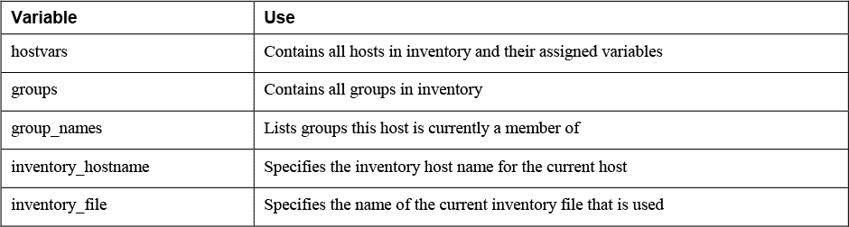

关于魔法变量，最重要的的一点是你不能将它们的名称用于任何其他地方。如果你尝试将魔法变量设置为另一个值，它始终会重置为默认内部值。因此，不要尝试设置你自己的变量组来存储用户组；`variable groups`已经用作魔法变量！在列表 6-17 中，你可以看到如何使用`debug`模块显示分配给`hostvars`魔法变量的当前值。如你所示，该变量显示了许多可以通过修改`ansible.cfg`配置来更改的设置。如果主机上定义了本地 facts，你也会看到它们。

**列表 6-17** 使用`debug`模块显示`hostvars`变量

```bash
[ansible@control ~]$ ansible localhost -m debug -a ’var=hostvars["ansible1"]’

localhost | SUCCESS => {

    "hostvars[\"ansible1\"]": {

        "ansible_check_mode": false,
        "ansible_diff_mode": false,
        "ansible_facts": {},
        "ansible_forks": 5,
        "ansible_inventory_sources": [
            "/home/ansible/inventory"
        ],
        "ansible_playbook_python": "/usr/bin/python3.6",
        "ansible_verbosity": 0,
        "ansible_version": {
            "full": "2.9.5",
            "major": 2,
            "minor": 9,
            "revision": 5,
            "string": "2.9.5"
        },
        "group_names": [
            "ungrouped"
        ],
        "groups": {
            "all": [
                "ansible1",
                "ansible2"
            ],
            "ungrouped": [
                "ansible1",
                "ansible2"
            ]
        },
        "inventory_dir": "/home/ansible",
        "inventory_file": "/home/ansible/inventory",
        "inventory_hostname": "ansible1",
        "inventory_hostname_short": "ansible1",
        "omit": "__omit_place_holder__38849508966537e44da5c665d4a784c3bc0060de",
        "playbook_dir": "/home/ansible"
    }
}
```

## 理解变量优先级


由于变量可以在所有不同的位置设置，因此了解当变量在多个级别被设置时会发生什么是非常重要的。理解变量优先级并不总是容易的，因为它们可以在许多不同的层级被设置。最重要的建议就是保持简单，避免在不同层级定义名称相同的变量。这样，你就不需要考虑变量优先级的问题。

即使在不同层级定义了同名变量，最具体的变量总是获胜的。要考虑在运行`playbook`时定义的变量。通过命令行传递的`-e`变量具有最高优先级。接下来是在 playbook 中定义或包含的变量。请参考 Ansible 文档“变量优先级”以获取更多细节。

## 使用 Vault 管理敏感值

在与 Ansible 工作时，有时你必须处理敏感数据——例如密钥、密码以及其他你不应该以明文存储在 playbook 中的敏感数据类型。Vault 就是解决方案。你可以使用 Ansible Vault 加密任何文件。

在使用 Ansible Vault 工作时采用以下方法：

1. 将敏感数据存储在独立的变量文件中。
2. 使用`ansible-vault`命令对文件进行加密。
3. 从 playbook 访问文件时，输入密码进行解密。

### 管理加密文件

使用 Vault 的基础是创建加密文件。当使用`ansible-vault create secret.yaml`命令时，Ansible 会提示密码并使用默认编辑器打开文件。或者，可以在密码文件中密码。在这种情况下，必须良好保护密码文件（例如将其放在用户根目录下）。如果使用密码文件，可以使用`ansible-vault create --vault-password-file=passfile secret.yaml`创建加密变量文件。

当从 playbook 访问 Vault 加密的文件时，必须输入密码。要让`ansible-playbook`命令提示输入密码，你需要指定相应的选项。`--vault-id @prompt`选项提供了最优雅的选择，在这种情况下，`ansible-playbook`命令会为可能使用的每个 Vault 加密文件提示输入密码。

使用`--vault-id @prompt`可以让 playbook 配合多个 Vault 加密文件，且这些文件允许设置不同的密码。如果 playbook 引用的所有 Vault 加密文件都使用了相同的密码，你可以使用命令`ansible-playbook --ask-vault-pass`。

或者，你也可以使用命令`ansible-playbook --vault-password-file=secret`来从密码文件中获取 Vault 密码。密码文件应包含一个以单行存储在文件中的字符串。请确保通过文件权限保护 vault 密码文件，使其未经授权的用户无法访问！

## 管理带有敏感变量的文件

在处理 Vault 加密的变量文件时，将包含未加密变量的文件与包含加密变量的文件分开是一个良好的做法。实现这一点的极良方法是使用`group_vars`和`host_vars`变量包含。你之前读到，在`group_vars`目录下，可以使用与主机组同名的文件。同样，在`host_vars`目录下，可以创建一个与主机同名的文件。

在将加密变量与未加密文件分离时，你可以创建一个以主机或主机组命名的目录（而不是文件）。接下来，在该目录内，你可以创建一个名为`vars`的文件（包含未加密变量）以及一个名为`vault`的文件（包含 Vault 加密变量）。或者，也可以使用`vars_files`参数从文件中包含 Vault 加密变量。在练习 6-3 中，你将练习使用 Ansible Vault 的技能。

### 练习 6-3 使用 Ansible Vault

1. 使用`ansible-vault create secrets.yaml`创建一个包含变量`user`和变量`password`加密值的秘密文件。将密码设置为`password`并输入以下行：

```yaml
username: bob

pwhash: password
```

> **注意**
>
> 在创建用户时，你不能提供明文密码；它需要以哈希值的形式提供。由于本次练习的重点是 Vault 的使用，因此没有以哈希值提供密码，结果会显示警告。你可以忽略此警告。在第 13 章“管理用户”中，你将学习如何创建带有正确哈希值作为密码的用户。

2. 创建文件`create-users.yaml`并提供以下内容：

```yaml
------- name: create a user with vaulted variables

  hosts: ansible1

  vars_files:

    - secrets.yaml

  tasks:

  - name: creating user

    user:

      name: "{{ username }}"
      password: "{{ pwhash }}"
```

3. 使用`ansible-playbook --ask-vault-pass create-users.yaml`运行 playbook。在提示时提供密码。
4. 使用`ansible-vault rekey secrets.yaml`修改`secrets.yaml`当前密码，并将新密码设置为`secretpassword`。
5. 为了自动化输入密码的过程，使用`echo secretpassword > vault-pass`。
6. 使用`chmod 400 vault-pass`确保该文件仅对 ansible 用户可读；这是为了安全文件所能做的极限。
7. 使用`ansible-playbook --vault-password-file=vault-pass create-users.yaml`验证其运行正常。

## 使用`register`捕捉命令输出

变量可以由用户或 Ansible 管理员设置。或者，可以使用任务中的`register`参数将命令的结果作为变量。让我们查看列表 6-18 中的示例来其工作原理：

**列表 6-18** 使用`register`的示例 playbook

```yaml
---

- name: test register

  hosts: ansible1

  tasks:

  - shell: cat /etc/passwd

    register: passwd_contents

  - debug:

      var: "passwd_contents"
```

在列表 6-18 的示例 playbook 中，`shell`模块执行了`cat /etc/passwd`命令。注意在这个 playbook 中没有为任务命名。为任务命名不是强制的，但在更复杂的 playbook 中建议这样做，因为这种约定使任务识别更容易。命令的全部内容随后存储在变量`passwd_contents`中。该变量包含命令的输出，存储在不同的键中。表 6-7 提供了最有用键的概述，列表 6-19 显示了`ansible-playbook listing618.yaml`命令的部分结果。

**表 6-7** 与`register`使用的键

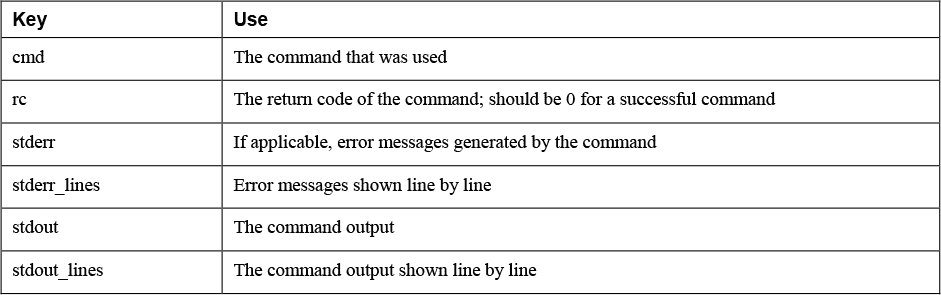

**列表 6-19** 运行`ansible-playbook listing618.yaml`的部分结果


```text
ansible-playbook listing618.yaml

PLAY [**********************************************************] test register ***********************************

Gathering Facts for ansible1 :**********************************
localhost: [ansible1] => {
    "changed": false,
    "gatherable": true,
    "hosts": "ansible1",
    "failed": false
}

PLAY [**********************************************************]
TASK [cat /etc/passwd] *************************************************

passwd_contents: [ansible1] => {
    "changed": false,
    "cmd": "cat /etc/passwd",
    "stderr": "",
    "stdout": "root:x:0:0:root:/bin/bash\nbin:x:1:bin:/usr/sbin/nologin\ndemon:x:2:daemon:/dev:/usr/sbin/nologin\nsys:x:3:sys:/bin:/usr/sbin/nologin\nsync:x:4:sync:/dev:/usr/sbin/nologin\ngames:x:5:games:/var/games:/usr/sbin/nologin\nman:x:6:man:/var/cache/man:/usr/sbin/nologin\nlp:x:7:lp:/var/spool/lp:/usr/sbin/nologin\nmail:x:8:mail:/var/mail:/usr/sbin/nologin\nbin:x:9:bin:/bin:/usr/sbin/nologin\nlats:x:10:lats:/var/lats:/usr/sbin/nologin\nu:x:11:u:/var/u:/usr/sbin/nologin\np:x:12:np:/run:/usr/sbin/nologin\nproxy:x:13:proxy:/root:/usr/sbin/nologin\nroup:x:14:ircroup:/var/run/ircroup:/usr/sbin/nologin\nbackup:x:15:backup:/var/backups:/usr/sbin/nologin\nlist:x:16:list:/var/list:/usr/sbin/nologin\nirc:x:17:irc:/var/irc:/usr/sbin/nologin\ngnyd:x:18:gnyd:/var/lib/gnyd:/usr/sbin/nologin\nadm:x:19:adm:/var/adcd:/usr/sbin/nologin\noperator:x:20:nobody:/nonexistent:/usr/sbin/nologin\ngames:x:21:backup:/var/splbus:/usr/sbin/nologin\nwww:x:22:www:/var/www:/usr/sbin/nologin\nnews:x:23:news:/var/news:/usr/sbin/nologin\napt:x:24:apt:/var/apt:/usr/sbin/nologin\nirc:x:25:irc:/var/ircats:/usr/sbin/nologin\ntp:x:26:ntp:/var/ntp:/usr/sbin/nologin\nirc:x:27:irc:/var/irc:/usr/sbin/nologin\ngnats:x:28:gnats:/var/lib/gnats:/usr/sbin/nologin\nirc:x:29:irc:/var/irc:/usr/sbin/nologin\nirc:x:30:irc:/var/irc:/usr/sbin/nologin\nirc:x:31:irc:/var/irc:/usr/sbin/nologin\nu-u:x:32:u-u:/var/uats:/usr/sbin/nologin\nirc:x:33:33:irc:/var/irc:/usr/sbin/nologin\nirc:x:34:34:irc:/var/irc:/usr/sbin/nologin\nirc:x:35:35:irc:/var/irc:/usr/sbin/nologin\nirc:x:36:36:irc:/var/irc:/usr/sbin/nologin\nirc:x:37:37:irc:/var/irc:/usr/sbin/nologin\nirc:x:38:38:irc:/var/irc:/usr/sbin/nologin\nirc:x:39:39:irc:/var/irc:/usr/sbin/nologin\nirc:x:40:40:irc:/var/irc:/usr/sbin/nologin\nirc:x:41:41:irc:/var/irc:/usr/sbin/nologin\nirc:x:42:42:irc:/var/irc:/usr/sbin/nologin\nirc:x:43:43:irc:/var/irc:/usr/sbin/nologin\nirc:x:44:44:irc:/var/irc:/usr/sbin/nologin\nirc:x:45:45:irc:/var/irc:/usr/sbin/nologin\nirc:x:46:46:irc:/var/irc:/usr/sbin/nologin\nirc:x:47:47:irc:/var/irc:/usr/sbin/nologin\nirc:x:48:48:irc:/var/irc:/usr/sbin/nologin\nirc:x:49:49:irc:/var/irc:/usr/sbin/nologin\nirc:x:50:50:irc:/var/irc:/usr/sbin/nologin\nirc:x:51:51:irc:/var/irc:/usr/sbin/nologin\nirc:x:52:52:irc:/var/irc:/usr/sbin/nologin\nirc:x:53:53:irc:/var/irc:/usr/sbin/nologin\nirc:x:54:54:irc:/var/irc:/usr/sbin/nologin\nirc:x:55:55:irc:/var/irc:/usr/sbin/nologin\nirc:x:56:56:irc:/var/irc:/usr/sbin/nologin\nirc:x:57:57:irc:/var/irc:/usr/sbin/nologin\nirc:x:58:58:irc:/var/irc:/usr/sbin/nologin\nirc:x:59:59:irc:/var/irc:/usr/sbin/nologin\nirc:x:60:60:irc:/var/irc:/usr/sbin/nologin\nirc:x:61:61:irc:/var/irc:/usr/sbin/nologin\nirc:x:62:62:irc:/var/irc:/usr/sbin/nologin\nirc:x:63:63:irc:/var/irc:/usr/sbin/nologin\nirc:x:64:64:irc:/var/irc:/usr/sbin/nologin\nirc:x:65:65:irc:/var/irc:/usr/sbin/nologin\nirc:x:66:66:irc:/var/irc:/usr/sbin/nologin\nirc:x:67:67:irc:/var/irc:/usr/sbin/nologin\nirc:x:68:68:irc:/var/irc:/usr/sbin/nologin\nirc:x:69:69:irc:/var/irc:/usr/sbin/nologin\nirc:x:70:70:irc:/var/irc:/usr/sbin/nologin\nirc:x:71:71:irc:/var/irc:/usr/sbin/nologin\nirc:x:72:72:irc:/var/irc:/usr/sbin/nologin\nirc:x:73:73:irc:/var/irc:/usr/sbin/nologin\nirc:x:74:74:irc:/var/irc:/usr/sbin/nologin\nirc:x:75:75:irc:/var/irc:/usr/sbin/nologin\nirc:x:76:76:irc:/var/irc:/usr/sbin/nologin\nirc:x:77:77:irc:/var/irc:/usr/sbin/nologin\nirc:x:78:78:irc:/var/irc:/usr/sbin/nologin\nirc:x:79:79:irc:/var/irc:/usr/sbin/nologin\nirc:x:80:80:irc:/var/irc:/usr/sbin/nologin\nirc:x:81:81:irc:/var/irc:/usr/sbin/nologin\nirc:x:82:82:irc:/var/irc:/usr/sbin/nologin\nirc:x:83:83:irc:/var/irc:/usr/sbin/nologin\nirc:x:84:84:irc:/var/irc:/usr/sbin/nologin\nirc:x:85:85:irc:/var/irc:/usr/sbin/nologin\nirc:x:86:86:irc:/var/irc:/usr/sbin/nologin\nirc:x:87:87:irc:/var/irc:/usr/sbin/nologin\nirc:x:88:88:irc:/var/irc:/usr/sbin/nologin\nirc:x:89:89:irc:/var/irc:/usr/sbin/nologin\nirc:x:90:90:irc:/var/irc:/usr/sbin/nologin\nirc:x:91:91:irc:/var/irc:/usr/sbin/nologin\nirc:x:92:92:irc:/var/irc:/usr/sbin/nologin\nirc:x:93:93:irc:/var/irc:/usr/sbin/nologin\nirc:x:94:94:irc:/var/irc:/usr/sbin/nologin\nirc:x:95:95:irc:/var/irc:/usr/sbin/nologin\nirc:x:96:96:irc:/var/irc:/usr/sbin/nologin\nirc:x:97:97:irc:/var/irc:/usr/sbin/nologin\nirc:x:98:98:irc:/var/irc:/usr/sbin/nologin\nirc:x:99:99:irc:/var/irc:/usr/sbin/nologin\nirc:x:100:100:irc:/var/irc:/usr/sbin/nologin"
    }
}

************************************************************************************

TASK [debug] ***************************************************:
ok: [ansible1] => {
    "var": "passwd_contents"
}
```

在本章中，你学习了如何以许多不同的方式处理变量。首先，你阅读了 Ansible 事实（facts），这些是自动设置的包含许多不同系统参数的变量。你还学习了如何使用自定义事实（custom facts）来在主机上设置本地变量。接下来，你探索了变量的操作，并了解了单值变量和多值变量如何使用。之后，你学习了如何使用 Ansible Vault 保护变量，在本章的最后部分，你了解了如何使用 `register` 参数来存储 playbook 中使用的命令的执行结果。

### 考试准备任务

正如引言中“如何使用本本书”部分提到的，你有几种准备考试的选择：这里的练习题、第 16 章、“最终准备”以及位于配套网站上的考试模拟题。

### 复习所有关键主题

回顾本章中最重要的主题，这些主题在页面外边距处用“关键主题”图标标记。表 6-8 列出了这些关键主题的索引及其所在的页码。


**表 6-8** 第 6 章的关键主题


### 记忆表格

打印附录 D“记忆表格”（可在配套网站找到）或至少打印本章章节，并根据记忆完成表格和列表。附录 E“记忆表格答案”同样位于配套网站，包含了已完成表格和列表以检查你的作业。

### 定义关键术语

定义本章的以下关键术语并在术表中检查你的答案：

- `array`
- `dictionary`
- `fact`
- `hash`
- `list`
- `local fact`
- `magic variable`
- `register`
- `Vault`

### 复习题

**1.** 使用自定义事实的两个要求是什么？

**2.** 使用哪个模块来启用事实收集或手动运行事实收集？

**3.** 使用事实缓存（fact cache）需要完成什么？

**4.** 如何在 playbook 中包含变量文件？

**5.** 如何设置适用于清单文件中定义的定义的主机组的变量？

**6.** 如果你想使用循环来解析不同的值，你应该使用哪种类型的多值变量？

**7.** 哪个魔法变量可以用于请求特定主机变量的当前设置？

**8.** 如何更改用 `ansible-vault` 加密的文件的密码？

**9.** 如何将一个包含变量的 Vault 加密文件分配给特定清单主机组中的主机？

**10.** 你已经在 playbook 中使用了 `register` 将命令的结果注册到变量 `cmd_result` 中。你将如何在 playbook 中显示该命令的退出状态码？

### 章末实验

现在我们已经到了本章的末尾，是时候做一个更复杂的章末实验了。该实验由两部分组成：在第一部分，你处理自定义事实；在第二部分，你在第二个 playbook 中使用自定义事实。

### 实验 6-1

配置一个处理自定义事实并满足以下要求的 playbook：

- 使用项目目录 `chapter6`。
- 创建一个清单文件，其中 `ansible1` 是名为 `file` 的主机组的成员，`ansible2` 是名为 `lamp` 的主机组的成员。
- 创建一个自定义事实文件，包含一个名为 `packages` 的节并设置以下变量：

```text
smb_package = samba

ftp_package = vsftpd

db_package = mariadb

web_package = httpd

firewall_package = firewalld
```

- 创建另一个自定义事实文件，包含一个名为 `services` 的节并设置以下变量：

```text
smb_service = smbd

ftp_service = vsftpd

db_service = mariadb

web_service = httpd

firewall_service = firewalld
```

- 创建名为 `copy_facts.yaml` 的 playbook，将这些事实复制到所有托管主机。在此 playbook 中定义变量 `remote_dir` 以指定事实文件应该复制到的目录。使用变量 `fact_file` 来复制事实文件。

### 实验 6-2

复制事实后，创建一个使用事实进行设置的 playbook。确保它满足以下条件：

```text
web_root = /www/html

ftp_root = /var
```

- 运行 playbook 并验证其运行。

# 第二部分：常见的 Ansible 管理

## 第 7 章：使用任务

本章涵盖以下内容：

- 循环和项
- 使用 `when` 条件判断
- 处理器（Handlers）

本章涵盖了以下 RHCE 考试目标：

- 创建 plays 和 playbooks
- 使用条件控制 play 的执行
- 配置错误处理
- 创建指定状态的 playbooks

## “我懂吗？”测验

“我懂吗？”测验可以让你评估自己是应该阅读整个章节还是跳到“考试任务”部分。如果你对自己的答案或对主题的评估有疑问，请阅读整个章节。表 7-1 列出了本章的主要标题以及对应的“我懂吗？”问题。你可以在附录 A““我懂吗？”测验和复习题答案”中找到答案。

**表 7-1** “我懂吗？”章节与问题映射


**1.** 你应该使用哪一个来遍历一个值为项列表的变量？

a. `with_items`

b. `with_value`

c. `item`

d. `loop`

**2.** 关于 `when` 条件语句中的变量，哪种说法是正确的？

a. `when` 语句不能使用循环。

b. 在 `when` 语句中，变量名不带括号。

c. 在 `when` 语句中使用变量时，始终需要在大括号和双引号之间。

d. 在 `when` 语句中使用变量时，需要使用 %% 符号来表示。

**3.** 下哪个显示了验证布尔变量为真的正确测试？

a. `variable is defined`

b. `variable`

c. `variable = “true"`

d. `variable == 1`

**4.** 下哪个显示了用于检查 `variable` 是否具有特定值的字符串测试正确语法？

a. `variable = value`

b. `variable == value`

c. `variable = “value"`


`d. variable == “value”`

...

## 表 7-2：带有 `keyword` 选项概述


在 Listing 7-6 中，你可以看到将 Listing 7-2 中的 playbook 是如何重写为使用 `with_items` 的。注意它只有一个变化：`loop` 被更改为 `with_items`。

## Listing 7-6：使用 `with_items`

```yaml
---

- name: install and start services

  hosts: ansible1

  vars:

    services:

    - vsftpd

    - httpd

    - smb
  tasks:

  - name: install packages
    yum:
      name:
      - vsftpd
      - httpd
      - samba
      state: latest
  - name: start the services
    service:
      name: "{{ item }}"
      state: started
      enabled: yes

    with_items: "{{ services }}"
```

在 Exercise 7-1 中，你将练习使用 `loop`。

## Exercise 7-1：使用 `loop`

1. 使用你的编辑器定义一个名为 `vars/packages` 的变量文件，内容如下所示：

```yaml
packages:

- name: httpd
  state: absent

- name: vsftpd
  state: installed

- name: mysql-server
  state: latest
```

2. 使用你的编辑器定义一个名为 `exercise71.yaml` 的 playbook，并创建 play 头部：

```yaml
- name: manage packages using a loop from a list

  hosts: ansible1
  vars_files: vars/packages
  tasks:
```

3. 继续编写 playbook，添加 `yum` 任务来管理软件包，并使用 `vars/packages` 变量包含文件中定义的 `packages` 变量：

```yaml
- name: manage packages using a loop from a list

  hosts: ansible1
  vars_files: vars/packages

  tasks:

  - name: install packages
    yum:
      name: "{{ item.name }}"
      state: "{{ item.state }}"
    loop: "{{ packages }}"
```

4. 使用 `ansible-playbook exercise71.yaml` 运行 playbook，并观察结果。在结果中，你应该看到它尝试管理哪些软件包，以及它尝试让软件包处于什么状态。

## 使用 `when` 条件运行任务

在 Ansible 中，你可以使用 `when` 语句来条件地运行任务。可以使用 `when` 执行多个测试；例如，你可以测试变量是否具有特定值、文件是否存在、可用内存是否达到最小量等。

### 使用 `when`

让我们从一个简单的 playbook 开始探索 `when` 的工作机制。在 Listing 7-7 的示例 playbook 中，你可以看到如何使用 `when` 语句根据 Ansible facts 中找到的 Linux 发行版为 Apache Web 服务器安装正确的软件包。注意，当在 `when` 语句中使用时，被评估的变量不需要放在双花括号之间。

### Listing 7-7：使用 `when` 进行条件软件安装

```yaml
---

- name: conditional install

  hosts: all

  tasks:

  - name: install apache on Red Hat and family
    yum:
      name: httpd
      state: latest
    when: ansible_facts[’os_family’] == "RedHat"
  - name: install apache on Ubuntu and family
    apt:
      name: apache2
      state: latest
    when: ansible_facts[’os_family’] == "Debian"
```

注意 `when` 的用法：由于它不是所使用的模块的任何属性的一部分，`when` 语句的缩进必须与模块本身对齐。在 Listing 7-7 的示例中，使用了字符串测试来检查 Ansible fact `ansible_os_family`（在 playbook 中等价于 `ansible_facts[’os_family’]`）的值是否等于字符串 `RedHat`。由于这是一个字符串测试，字符串本身必须放在双引号之间。如果没有双引号，它将被视为整数测试。字符串测试只是可以执行的许多条件测试之一。Table 7-3 提供了其他其他条件测试示例的概述。

Listing 7-8 显示了 Listing 7-7 中 playbook 的输出。由于没有主机使用 Debian 系的 Linux 发行版，第二个任务的状态为 `skipped`。

### Listing 7-8：条件 Playbook 结果

```text
[ansible@control ~]$ ansible-playbook listing77.yaml

PLAY [conditional install] *************************************************************

TASK [Gathering Facts] *****************************************************************

ok: [ansible2]

ok: [ansible1]

TASK [install apache on Red Hat and family] ********************************************

ok: [ansible1]

changed: [ansible2]

TASK [install apache on Ubuntu and family] *************************************************************

skipping: [ansible1]

skipping: [ansible2]

PLAY RECAP *****************************************************************************

ansible1 : ok=0 changed=0 skipped=1 unreachable=0
ansible2 : ok=1 changed=1 skipped=0 unreachable=0
```

## 列表 7-10：检查变量是否存在于列表中

```yaml
---
- name: test if variable is in another variables list
  hosts: all
  vars_prompt:
  - name: my_answer
    prompt: which package do you want to install

  vars:
    supported_packages:
    - httpd
    - nginx
  tasks:
  - name: something
    debug:
      msg: you are trying to install a supported package
    when: my_answer in supported_packages
```

下一种检查类型是布尔检查（Boolean check）。这种检查适用于具有布尔值的变量，但这些变量并不常见。关于这种检查需要需要的重要的一点是，它不应该与存在性检查定义在一起。布尔检查用于检查变量的布尔值；而 `is defined` 则用于检查变量是否已定义。

最后两种类型的检查是字符串比较和整数比较。你之前已经在列表 7-7 中看过了字符串测试。在整数比较中，你检查一个变量是否具有特定值。例如，你可以检查可用磁盘空间是否大于 1 GB。在对可用磁盘空间和可用内存进行检查时，请仔细查看预期值。内存默认以兆字节（megabytes）显示，而磁盘空间以字节（bytes）表示。列表 7-11 显示了一个示例，如果可用内存大于 50 MB，则将安装 vsftpd。

## 列表 7-11：使用整数检查

```yaml
---
- name: conditionals test
  hosts: all
  tasks:
  - name: install vsftpd if sufficient memory available
    package:
      name: vsftpd
      state: latest
    when: ansible_facts[’memory_mb’][’real’][’free’] > 50
```

### 测试多个条件

除了执行单一评估外，`when` 语句还可以评估多个条件。要这样做，你可以用括号将条件组合起来，并使用 `and` 和 `or` 关键字进行组合。列表 7-12 显示了一个使用 `and` 的示例，它仅在两个条件都为真时才运行任务。或者，考虑使用 `or` 允许任务在其中一个条件为真时运行。

### 列表 7-12：组合多个条件

```yaml
---
- name: testing multiple conditions
  hosts: all
  tasks:
  - name: showing output
    debug:
      msg: using CentOS 8.1
    when: ansible_facts[’distribution_version’] == "8.1" and ansible_facts[’distribution’] == "CentOS"
```

除了列表 7-12 中简单的 `and` 语句外，你还可以通过在括号中组合条件来创建更复杂的语句。列表 7-13 显示了一个示例。注意，在例示例中，`when` 语句以 `>` 符号开头，因为为了可读性，该被跨到了接下来的五行。`>` 符号确保提供给 `when` 语句的所有值都被解释为一行，而不是五行。

### 列表 7-13：组合复杂语句

```yaml
---
- name: using multiple conditions
  hosts: all
  tasks:
  - package:
      name: httpd
      state: removed
    when: >
      ( ansible_facts[’distribution’] == "RedHat" and
        ansible_facts[’memfree_mb’] < 512 )
      or
      ( ansible_facts[’distribution’] == "CentOS" and
        ansible_facts[’memfree_mb’] < 256 )
```

### 结合 `loop` 和 `when`

虽然你使用 `when` 只在特定条件为真时执行任务，但你可以使用 `loop` 来迭代项列表。为了充分发挥 Ansible playbooks 的威力，你可以结合使用。列表 7-14 中的 playbook 仅在 `/boot` 位于专用挂载点且该挂载点至少可用 200 MB 空间时才执行内核更新。

### 列表 7-14：结合 `loop` 和 `when`

```yaml
---
- name: conditionals test
  hosts: all
  tasks:
  - name: update the kernel if sufficient space is available in /boot
    package:
      name: kernel
      state: latest
    loop: "{{ ansible_facts[’mounts’] }}"
    when: item.mount == "/boot" and item.size_available > 200000000
```

由于列表 7-14 中的示例 playbook 遍历了找到的所有挂载点，观察其输出是有趣的。在列表 7-15 中，你可以看到任务首先跳过了 `/` 挂载点，然后在满足条件的 `/boot` 挂载点上执行任务。在后面的练习 7-2 中，你将练习使用 `when`。

### 列表 7-15：列表 7-14 输出

你可能会注意到，在这个 playbook 中，`when` 语句使用了一些我们之前没见过的特殊项。首先，它引用了 `passwd_contents.stdout.find`，但 `passwd_contents.stdout` 并不包含名为 `find` 的项。这里使用的结构是 `variable.find`，它允许任务在变量中搜索特定的字符串。为了实现这一点，使用了 Python 中的 `find` 函数——毕竟，Ansible 是用 Python 编写的。当 Python 的 `find` 函数未找到字符串时，它返回值为 -1。如果找到了请求的字符串，`find` 函数会返回一个整数，表示字符串被找到的位置。例如，如果在 `/etc/passwd` 中找到了字符串 `lisa`，它会返回一个如 2604 这样意外的值，这是该字符串在文件中第一次出现的位置，以从文件开始的字节偏移量（byte offset）表示。

由于 Python `find` 函数的行为，`variable.find` 并不需要等于 -1 就能让任务成功。因此，不要写 `passwd_contents.stdout.find('lisa') = 0`（因为它不是布尔值），而应该写 `passwd_contents.stdout.find('lisa') != -1`。在练习 7-2 中，你将练习使用 `register` 进行条件判断的操作。


注意，当使用 `register` 时，你可能想要定义一个运行失败命令的任务，仅仅是为了捕捉该命令的返回码，之后 playbook 应该继续执行。如果是这样，你必须确保在任务定义中使用 `ignore_errors: yes`。默认行为是，如果一个任务失败，playbook 的执行将终止，其他任务将不会运行。

### 练习 7-2：使用 `when`

1. 使用你的编辑器创建一个名为 `exercise72.yaml` 的新文件。按照如下格式编写 play 头部：

```yaml
---
- name: restart sshd service if httpd is running

  hosts: ansible1

  tasks:
```

2. 添加第一个任务，使用将被注册的命令输出来检查 httpd 服务是否正在运行。注意 `ignore_errors: yes` 的使用。这一行确保了如果服务没有运行，play 仍然会继续执行。

```yaml
---
- name: restart sshd service if httpd is running

  hosts: ansible1

  tasks:

  - name: get httpd service status
    command: systemctl is-active httpd

    ignore_errors: yes
    register: result
```

3. 添加一个 debug 任务显示命令的输出，以便你可以分析注册变量中的当前内容：

```yaml
---
- name: restart sshd service if httpd is running

  hosts: ansible1

  tasks:

  - name: get httpd service status
    command: systemctl is-active httpd

    ignore_errors: yes
    register: result

  - name: show result variable contents
    debug:
      msg: printing contents of the registered variable {{ result }}
```

4. 通过包含 `service` 任务来完成 playbook，该任务只有在 `result.rc` 中存储的值（即被注册命令的返回码）包含 0 时才会启动。如果上一个命令执行成功，就会出现这种情况。


```yaml
---
- name: restart sshd service if httpd is running
  hosts: ansible1
  tasks:
    - name: get httpd service status
      command: systemctl is-active httpd
      ignore_errors: yes
      register: result

    - name: show result variable contents
      debug:
        msg: printing contents of the registered variable {{ result }}

    - name: restart sshd service
      service:
        name: sshd
        state: restarted
      when: result.rc == 0
```

5. 使用 ad hoc 命令（即时命令）确保 httpd 服务已安装：`ansible ansible1 -m yum -a “name=httpd state=latest”`。

6. 使用 ad hoc 命令确保 httpd 服务已停止：`ansible ansible1 -m service -a “name=httpd state=stopped”`（注：此处原文为 `state=stopped`）。

7. 使用 `ansible-playbook exercise72.yaml` 运行 playbook 并分析结果。你应该会看到 playbook 跳过了 `service` 任务。

8. 输入 `ansible ansible1 -m service -a “name=httpd state=started”` 并再次使用 `ansible-playbook exercise72.yaml` 运行 playbook。此时 playbook 的执行应该是成功的。

### 使用 Handlers

Playbooks 包含任务列表。任务总是按顺序执行，如果其中一个任务失败，后续所有任务都不会执行。在某些情况下，你可能需要更具体的方式来管理执行依赖。这时 handlers 就能派上用场了。handler 是一个由成功任务触发并执行的任务。

#### Handlers 的操作

要使用 handlers，你应该在定义任务的层级定义一个 `notify` 语句。`notify` 语句应该列出要执行的 handler 名称，而 handlers 则列在 play 的末尾。确保 handler 的名称与 `notify` 语句中调用的项名称匹配，因为这正是 handler 在寻找的内容。

列表 7-17 中的 playbook 显示了如何使用 handlers。它是一个多 play playbook，第一个 play 用于在 localhost 上定义 index.html 文件。接下来，第二个 play 用于设置 web 服务器。

handler 是由使用 copy 模块的任务触发的。如果该任务成功，`notify` 语句就会调用 handler。注意 handlers 可以作为列表指定，因此一个任务可以调用多个 handlers。此外注意在列表 7-17 中定义了第二个任务，该任务旨在故意失败。

**列表 7-17** 使用 Handlers

```yaml
---
- name: create file on localhost
  hosts: localhost
  tasks:
    - name: create index.html on localhost
      copy:
        content: "welcome to the webserver"
        dest: /tmp/index.html

- name: set up web server
  hosts: all
  tasks:
    - name: install httpd
      yum:
        name: httpd
        state: latest

    - name: copy index.html
      copy:
        src: /tmp/index.html
        dest: /var/www/html/index.html
      notify:
        - restart_web

    - name: copy nothing - intended to fail
      copy:
        src: /tmp/nothing
        dest: /var/www/html/nothing.html

  handlers:
    - name: restart_web
      service:
        name: httpd
        state: restarted
```

列表 7-18 显示了命令 `ansible-playbook listing717.yaml` 的结果。

**列表 7-18 `ansible-playbook listing717.yaml` 命令结果**

```text
[ansible@control ~]$ ansible-playbook listing717.yaml

PLAY [create file on localhost] ********************************************************

TASK [Gathering Facts] *****************************************************************

ok: [localhost]

TASK [create index.html on localhost] **************************************************

changed: [localhost]

PLAY [set up web server] ***************************************************************

TASK [Gathering Facts] *****************************************************************

ok: [ansible2]

ok: [ansible1]

TASK [install httpd] *******************************************************************

changed: [ansible2]

changed: [ansible1]

TASK [copy index.html] *****************************************************************

changed: [ansible2]

changed: [ansible1]

TASK [copy nothing - intended to fail] *************************************************

An exception occurred during task execution. To see the full traceback, use -vvv. The error was: If you are using a module and expect the file to exist on the remote, see the remote_src option

fatal: [ansible2]: FAILED! => {"changed": false, "msg": "Could not find or access ’/tmp/nothing’ on the Ansible Controller.\nIf you are using a module and expect the file to exist on the remote, see the remote_src option"}

An exception occurred during task execution. To see the full traceback, use -vvv. The error was: If you are using a module and expect the file to exist on the remote, see the remote_src option

fatal: [ansible1]: FAILED! => {"changed": false, "msg": "Could not find or access ’/tmp/nothing’ on the Ansible Controller.\nIf you are using a module and expect the file to exist on the remote, see the remote_src option"}

RUNNING HANDLER [restart_web] **********************************************************

PLAY RECAP *****************************************************************************

ansible1                   : ok=3    changed=2    unreachable=0    failed=1    skipped=0    rescued=0    ignored=0

ansible2                   : ok=3    changed=2    unreachable=0    failed=1    skipped=0    rescued=0    ignored=0

localhost                  : ok=2    changed=1    unreachable=0    failed=0    skipped=0    rescued=0    ignored=0
```

正如你可以在列表 7-18 中的命令结果所示，直到 `copy index.html` 的所有任务都成功运行。然而，任务 `copy nothing` 失败了，这就是为什么处理器（handler）没有运行的原因。解决方案似乎很简单：处理器没有运行是因为复制文件 `/tmp/nothing` 的任务失败了，因为源文件不存在。因此解决方案看起来很简单：在控制主机上使用 `touch /tmp/nothing` 创建源文件，然后再次运行任务。列表 7-19 显示了这种方法的结果。

### 列表 7-19 再次运行 playbook `listing717.yaml`

```text
[ansible@control ~]$ ansible-playbook listing717.yaml

PLAY [create file on localhost] ********************************************************

TASK [Gathering Facts] *****************************************************************

ok: [localhost]

TASK [create index.html on localhost] **************************************************

ok: [localhost]

PLAY [set up web server] ***************************************************************

TASK [Gathering Facts] *****************************************************************

ok: [ansible2]

ok: [ansible1]

TASK [install httpd] *******************************************************************

ok: [ansible2]

ok: [ansible1]

TASK [copy index.html] *****************************************************************

ok: [ansible2]

ok: [ansible1]

TASK [copy nothing - intended to fail] *************************************************

changed: [ansible2]

changed: [ansible1]

PLAY RECAP *****************************************************************************

ansible1                   : ok=4    changed=1    unreachable=0    failed=0    skipped=0    rescued=0    ignored=0

ansible2                   : ok=4    changed=1    unreachable=0    failed=0    skipped=0    rescued=0    ignored=0

localhost                  : ok=2    changed=0    unreachable=0    failed=0    skipped=0    rescued=0    ignored=0
```

如你所见，尽管你可能预期的不是那样，在创建源文件并再次运行 playbook 之后，处理器仍然没有运行。原因是只有当触发处理器的任务返回 `changed` 状态时，处理器才会运行，而在列表 7-19 中并没有发生，因为在运行列表 7-18 中的 playbook 时，该任务已经成功执行了。要看到处理器被成功触发，你必须运行一个 ad hoc 命令来删除受管理主机上的 `/var/www/html/index.html` 文件，然后再次运行 playbook。列表 7-20 显示了结果。

### 列表 7-20 成功运行 Listing 7-17


```
[ansible@control ~]$ ansible ansible2 -m file -a "name=/var/www/html/index.html state=absent"

ansible2 | CHANGED => {

    "ansible_facts": {
        "discovered_interpreter_python": "/usr/libexec/platform-python"
    },

    "changed": true,

    "path": "/var/www/html/index.html",

    "state": "absent"
}

[ansible@control ~]$ ansible-playbook listing717.yaml

PLAY [create file on localhost] ********************************************************

TASK [Gathering Facts] *****************************************************************

ok: [localhost]

TASK [create index.html on localhost] **************************************************

ok: [localhost]

PLAY [set up web server] ***************************************************************

TASK [Gathering Facts] *****************************************************************

ok: [ansible2]

ok: [ansible1]

TASK [install httpd] *******************************************************************

ok: [ansible2]

ok: [ansible1]

TASK [copy index.html] *****************************************************************

changed: [ansible2]

ok: [ansible1]

TASK [copy nothing - intended to fail] *************************************************

ok: [ansible2]

ok: [ansible1]

RUNNING HANDLER [restart_web] **********************************************************

changed: [ansible2]

PLAY RECAP *****************************************************************************

ansible1                   : ok=4    changed=0    unreachable=0    failed=0    skipped=0    rescued=0    ignored=0

ansible2                   : ok=5    changed=2    unreachable=0    failed=0    skipped=0    rescued=0    ignored=0

localhost                  : ok=2    changed=0    unreachable=0    failed=0    skipped=0    rescued=0    ignored=0
```

## 理解处理器的执行与异常

当任务失败时，后续的所有任务都不会运行。这与处理器有何不同？处理器只有在触发任务成功时才运行，但列表中的下一个任务也只有在在前一个任务成功时才运行。那么，处理器有什么特别之处？

区别在于处理器的本质。处理器的目的是在对主机进行更改时执行额外的操作。因此，在 playbook 设计中，处理器应该被视为常规任务的扩展。它们是一种只有在先一个任务成功后才运行的条件任务。

如果触发了处理器（handler），但随后的某个任务执行失败，则该处理器将不会在失败任务所属的节点上执行。有两种方法可以防止这种情况。首先，你可以在 play 头部中使用`force_handlers: true`来确保处理器无论如何都会运行。此外，你也可以在 play 头部中使用更通用的`ignore_errors: true`语句来实现相同效果。由于`force_handlers: true`更具针对性，如果你只需要确保处理器会运行，则优选使用该选项。

在处理处理器时，有几点细节需要注意：


- 处理器在 play 的末尾的`handlers`区域中指定。
- 处理器按照它们在`handlers`区域中出现的顺序执行，而不是按照它们被触发的顺序执行。
- 只有当调用处理器的任务产生“已更改（changed）”状态时，处理器才会运行。
- 默认情况下，如果同一个 play 中的任何任务执行失败，处理器将不会运行，除非使用了`force_handlers`或`ignore_errors`。
- 处理器只有在激活该处理器的 play 中*所有*任务都处理完毕后才会运行。你可能希望定义多个 play 来避免这种行为。

### 练习 7-3 使用处理器

1. 打开一个名为`exercise73.yaml`的 playbook。
2. 定义 play 头部：

```yaml
---
- name: update the kernel
  hosts: all
  force_handlers: true
  tasks:
```

3. 添加一个更新当前内核的任务：

```yaml
---
- name: update the kernel
  hosts: all
  force_handlers: true
  tasks:

  - name: update kernel
    yum:
      name: kernel
      state: latest
    notify: reboot_server
```

4. 添加一个处理器，如果内核更新成功，则重启服务器：

```yaml
---
- name: update the kernel
  hosts: all
  force_handlers: true
  tasks:

  - name: update kernel
    yum:
      name: kernel
      state: latest
    notify: reboot_server

  handlers:

  - name: reboot_server
    command: reboot
```

5. 使用`ansible-playbook exercise73.yaml`运行 playbook 并观察结果。注意，只有在内核被更新时，处理器才会运行。如果内核已经是最新版本，则没有发生变化，处理器就不会运行。同样请注意，在 play 头部使用`force_handlers`并不是必须的，但通过这样做使用它，至少你现在知道在何时可以使用它了。

## 处理失败

在编写 playbook 时，你可能会得到意料之外的结果。为了处理这些情况，你需要了解正常的 playbook 操作流程。根据你对预期结果的理解，如果情况没有符合预期，你可以对其进行处理。

### 理解任务执行

Ansible playbook 中的任务按照它们被指定的顺序执行。如果 playbook 中的某个任务在主机上执行失败，该任务将生成一个错误，且该 play 不再在该特定主机上继续执行。处理器的情况也是如此：如果触发处理器的任务之后的任何任务执行失败，处理器就不会运行。在这两种情况下，重要的一点是，成功运行的任务仍然会生成它们的结果。因为这可能会导致意料之外的结果，所以当发生这种情况时，始终恢复原始状态是重要的。

在某些情况下，你可能希望在遇到失败的任务时让整个 playbook 在所有主机上停止执行。如果是这样，你可以在 play 头部或块（block）中使用`any_errors_fatal`（块将在在本章稍后的部分解释）。

### 管理任务错误

通常情况下，任务可以产生三种不同的结果。表 7-4 提供了概述。

**表 7-4** 任务结果概览


正如你之前看到的，如果任务失败，所有执行将停止。通过使用`ignore_errors`和`force_handlers`可以防止这种结果。如果你在任务中指定`ignore_errors: yes`，playbook 在处理完失败的任务后会继续运行。同样，`force_handlers`可用于确保即使遇到了失败的任务，处理器也会执行。列表 7-21 显示了一个使用`ignore_errors`的 playbook 示例。

**列表 7-21** 使用`ignore_errors`的示例

```yaml
---
- name: restart sshd only if crond is running
  hosts: all
  tasks:

    - name: get the crond server status
      command: /usr/bin/systemctl is-active crond
      ignore_errors: yes
      register: result

    - name: restart sshd based on crond status
      service:
        name: sshd
        state: restarted
      when: result.rc == 0
```

列表 7-21 中 playbook 的本质是根据 crond 服务的当前状态重启 sshd 服务。要查找 crond 服务的当前状态，你使用命令`systemctl is-active crond`，并注册该命令的结果。为了让 playbook 即使在服务当前未运行时也能继续，你在任务定义中包含了`ignore_errors: yes`。这允许命令模块的结果被注册。

在列表 7-17 中，你学习了如何使用处理器。同样在这个 playbook 中，你看到如果 play 中的任何任务失败，处理器就不会被触发。你可以通过在 play 头部包含`force_handlers`轻松地解决这个问题。列表 7-22 显示了应用此方法的 playbook。

**列表 7-22** 强制执行处理器

```yaml
---
- name: create file on localhost
  hosts: localhost
  tasks:

  - name: create index.html on localhost
    copy:
      content: "welcome to the webserver"
      dest: /tmp/index.html

- name: set up web server
  hosts: all
  force_handlers: yes
  tasks:

    - name: install httpd
      yum:
        name: httpd
        state: latest
    - name: copy index.html
      copy:
        src: /tmp/index.html
        dest: /var/www/html/index.html
      notify:
        - restart_web
    - name: copy nothing - intended to fail
      copy:
        src: /tmp/nothing
        dest: /var/www/html/nothing.html

  handlers:
    - name: restart_web
      service:
        name: httpd
        state: restarted
```

正如你所看到的，无论`copy nothing`任务是否失败，由于使用了`force_handlers`，处理器都会执行。

### 指定任务失败条件

如果一个任务成功运行了命令，在 Ansible 看来，它是成功执行的，即使命令输出本身指示了失败。在这种情况下，有必要仍然设置失败条件。你可以通过使用`failed_when`条件判断来实现这一点。注意`failed_when`是一个真正的条件判断，因此它必须用于评估某些表达式。列表 7-23 显示了一个演示此条件的示例脚本。

**列表 7-23** 使用`failed_when`

```yaml
---
- name: demonstrating failed_when
  hosts: all
  tasks:

  - name: run a script
    command: echo hello world
    ignore_errors: yes
    register: command_result
    failed_when: "'world' in command_result.stdout"

  - name: see if we get here
    debug:
      msg: second task executed
```

在 Listing 7-23 中，使用了`command`模块来运行简单的命令。由于它运行的是`echo`命令，该命令本身会被认为是成功的。然而，`register`用于捕获命令输出，而`failed_when`用于定义当命令的标准输出（stdout）中出现文本“world”时，将该命令标记为失败。这意味着命令在所有情况下都会生成失败状态。同时，`ignore_errors: yes`语句允许任务失败，之后 playbook 仍会继续执行。因此，在第一个任务显示失败后，第二个任务确实执行了，正如你在 Listing 7-24 中所示。

**Listing 7-24** 运行`ansible-playbook listing723.yaml`的结果


```bash
[ansible@control ~] ansible-playbook listing723.yaml

PLAY [demonstrating failed_when] *******************************************************

TASK [Gathering Facts] *****************************************************************

ok: [ansible1]

ok: [ansible2]

TASK [run a script] ********************************************************************

fatal: [ansible2]: FAILED! => {"changed": true, "cmd": ["echo", "hello", "world"], "delta": "0:00:00.004303", "end": "2020-04-06 03:44:56.748552", "failed_when_result": true, "rc": 0, "start": "2020-04-06 03:44:56.744249", "stderr": "", "stderr_lines": [], "stdout": "hello world", "stdout_lines": ["hello world"]}

...ignoring

fatal: [ansible1]: FAILED! => {"changed": true, "cmd": ["echo", "hello", "world"], "delta": "0:00:00.004261", "end": "2020-04-06 03:44:56.770166", "failed_when_result": true, "rc": 0, "start": "2020-04-06 03:44:56.765905", "stderr": "", "stderr_lines": [], "stdout": "hello world", "stdout_lines": ["hello world"]}

...ignoring

TASK [see if we get here] **************************************************************

ok: [ansible1] => {
    "msg": "second task executed"
}

ok: [ansible2] => {
    "msg": "second task executed"
}

PLAY RECAP *****************************************************************************

ansible1                   : ok=3    changed=1    unreachable=0    failed=0    skipped=0    rescued=0    ignored=1

ansible2                   : ok=3    changed=1    unreachable=0    failed=0    skipped=0    rescued=0    ignored=1
```

或者，你也可以使用`fail`模块来指定任务何时失败。只有当使用`when`来定义应该失败的精确条件时，使用该模块才有意义。Listing 7-25 展示了如何将 Listing 7-23 中的 playbook 使用`fail`模块进行重写。

**Listing 7-25** 使用`fail`模块

```yaml
---

- name: demonstrating the fail module
  hosts: all
  ignore_errors: yes
  tasks:
  - name: run a script
    command: echo hello world
    register: command_result
  - name: report a failure
    fail:
      msg: the command has failed
    when: "’world’ in command_result.stdout"
  - name: see if we get here
    debug:
      msg: second task executed
```

注意，在 Listing 7-25 中重写的 playbook 中，`ignore_errors`语句已从任务定义移动到了 play 头部（play header）。如果不移动，消息“second task executed”将永远不会显示，因为`fail`模块总是会生成失败消息。使用`fail`模块代替`failed_when`的主要优势是，`fail`模块可以很容易地设置清晰的失败消息，这在使用`failed_when`时是无法实现的。

### 管理变更状态

在 Ansible 中，有些命令会改变某些内容，而有些命令则不会。然而，某些命令在报告状态时并不直观。例如，运行 Listing 7-26 中的 playbook。

**Listing 7-26** 示例 Playbook 内容

```yaml
---

- name: demonstrate changed status
  hosts: all
  tasks:
  - name: check local time
    command: date
    register: command_result
  - name: print local time
    debug:
      var: command_result.stdout
```

正如你在 Listing 7-27 中所示，这个 playbook 报告了变更状态，即使实际上没有任何变化！

**Listing 7-27** 运行`ansible-playbook listing726.yaml`的结果

```text
[ansible@control ~] ansible-playbook listing726.yaml

PLAY [demonstrate changed status] *******************************************************

TASK [Gathering Facts] *****************************************************************

ok: [ansible1]

ok: [ansible2]

TASK [check local time] *****************************************************************

ok: [ansible2]

ok: [ansible1]

TASK [print local time] *****************************************************************

ok: [ansible1] => {
    "command_result.stdout": "Mon Apr 6 04:11:26 2020"
}

ok: [ansible2] => {
    "command_result.stdout": "Mon Apr 6 04:15:26 2020"
}

PLAY RECAP *****************************************************************************

ansible1                   : ok=3    changed=1    unreachable=0    failed=0    skipped=0    rescued=0    ignored=0

ansible2                   : ok=3    changed=1    unreachable=0    failed=0    skipped=0    rescued=0    ignored=0
```

（注：Listing 27 的输出格式与逻辑存在某些不一致；我已根据逻辑调整了显示。）

在某些情况下，管理变更状态是非常有用的。Listing 7-28 展示了如何对 Listing 7-26 进行相应的修改，使用`changed_when`，而 Listing 7-29 展示了运行结果。

**Listing 7-28** 使用`changed_when`

```yaml
---

- name: demonstrate changed status
  hosts: all
  tasks:
  - name: check local time
    command: date
    register: command_result
    changed_when: false
  - name: print local time
    debug:
      var: command_result.stdout
```

**Listing 7-29** 运行`ansible-playbook listing728.yaml`的结果

```text
[ansible@control ~] ansible-playbook listing728.yaml

PLAY [demonstrate changed status] *******************************************************

TASK [Gathering Facts] *****************************************************************

ok: [ansible1]

ok: [ansible2]

TASK [check local time] *****************************************************************

ok: [ansible2]

ok: [ansible1]

TASK [print local time] *****************************************************************

ok: [ansible1] => {
    "command_result.stdout": "Mon Apr 6 04:11:26 2020"
}

ok: [ansible2] => {
    "command_result.stdout": "Mon Apr 6 04:15:26 2020"
}

PLAY RECAP *****************************************************************************

ansible1                   : ok=3    changed=0    unreachable=0    failed=0    skipped=0    rescued=0    ignored=0

ansible2                   : ok=3    changed=0    unreachable=0    failed=0    skipped=0    rescued=0    ignored=0
```

### 使用 Blocks

当你处理条件语句时，blocks 是非常有用的。block 是一组可以应用`when`语句的任务组。因此，如果单个条件为真，就可以执行多个任务。要做到这一点，在 play 头部的`tasks:`语句与运行特定模块的任务之间，你可以插入`block:`语句。Listing 7-30 展示了一个示例。

**Listing 7-30** 使用 Blocks

```yaml
- name: simple block example
  hosts: all
  tasks:
  - name: setting up http
    block:
    - name: installing http
      yum:
        name: httpd
        state: present
    - name: restart httpd
      service:
        name: httpd
        state: started
    when: ansible_distribution == "CentOS"
```

要理解 Listing 7-30 中的示例 playbook，请注意`when`语句与`block`定义处于同一层级。当你这样定义它时，`block`中的任务将只有在`when`语句为真时才会执行。

### 配合`rescue`和`always`语句使用 Blocks

Listing 7-30 显示了如何使用`block`将不同的任务组合在一起。`block`也可以用于简单的错误处理，即如果`block`语句中定义的任何任务失败，则执行`rescue`部分中定义的任务。此外，还可以使用`always`部分来定义始终应该运行的任务，无论`block`中的任务是成功还是失败都会运行。Listing 7-31 显示了一个示例。

***

**考试小贴士**

在 RHCE 考试中，你绝对需要编写一个能够处理复杂条件语句的 playbook。请确保你完全理解如何使用 blocks，因为它们是实现这一点的绝佳方法。

***

**Listing 7-31** 使用 Blocks、`rescue`和`always`

```yaml
---
- name: using blocks
  hosts: all
  tasks:
  - name: intended to be successful
    block:
    - name: remove a file
      shell:
        cmd: rm /var/www/html/index.html
    - name: printing status
      debug:
        msg: block task was operated
    rescue:
    - name: create a file
      shell:
        cmd: touch /tmp/rescuefile
    - name: printing rescue status
      debug:
        msg: rescue task was operated
    always:
    - name: always write a message to logs
      shell:
        cmd: logger hello
    - name: always printing this message
      debug:
        msg: this message is always printed
```

在 Listing 7-32 中，你可以看到命令`ansible-playbook listing731.yaml`的输出。

**Listing 7-32** 命令`ansible-playbook listing731.yaml`的输出


```bash
[ansible@control ~]$ ansible-playbook listing731.yaml

PLAY [using blocks] ********************************************************************
TASK [Gathering Facts] *****************************************************************
ok: [ansible2]
ok: [ansible1]
TASK [remove a file] *******************************************************************
[WARNING]: Consider using the file module with state=absent rather than running ’rm’.
If you need to use command because file is insufficient you can add ’warn: false’ to
this command task or set ’command_warnings=False’ in ansible.cfg to get rid of this
message.
changed: [ansible2]
changed: [ansible1]
TASK [printing status] *****************************************************************
ok: [ansible1] => {
    "msg": "block task was operated"
}
ok: [ansible2] => {
    "msg": "block task was operated"
}
TASK [always write a message to logs] **************************************************
changed: [ansible2]
changed: [ansible1]
TASK [always printing this message] ****************************************************
ok: [ansible1] => {
    "msg": "this message is always printed"
}
ok: [ansible2] => {
    "msg": "this message is always printed"
}
PLAY RECAP *****************************************************************************
ansible1                   : ok=5    changed=2    unreachable=0    failed=0    skipped=0    rescued=0    ignored=0
ansible2                   : ok=5    changed=2    unreachable=0=failed=0    skipped=0    rescued=0    ignored=0
```

如你在 Listing 7-32 的输出所示，`block` 中的任务已成功执行，因此，`rescue` 部分中的任务都被跳过了，而 `always` 部分中的任务也成功执行了。由于此特定 playbook 代码的作用，下次使用同一个 playbook 时，它将无法运行 `block` 语句中的任务（因为文件在上次运行中已被删除），并由于该原因将运行 `rescue` 语句中的任务以及 `always` 中的任务。你可以在 Listing 7-33 的输出中看到这一点。

**Listing 7-33** 当 `block` 中的任务失败时，`rescue` 中的任务将被执行

```bash
[ansible@control ~]$ ansible-playbook listing731.yaml

PLAY [using blocks] ********************************************************************
TASK [Gathering Facts] *****************************************************************
ok: [ansible2]
ok: [ansible1]
TASK [remove a file] *******************************************************************
[WARNING]: Consider using the file module with state=absent rather than running ’rm’.
If you need to use command because file is insufficient you can add ’warn: false’ to
this command task or set ’command_warnings=False’ in ansible.cfg to get rid of this
message.
fatal: [ansible2]: FAILED! => {"changed": true, "cmd": "rm /var/www/html/index.html", "delta": "0:00:003018", "end": "2020-04-06 05:16:29.810703", "msg": "non-zero return code", "rc": 1, "start": "2020-04-06 05:16:29.807685", "stderr": "rm: cannot remove ’/var/www/html/index.html’: No such file or directory", "stderr_lines": ["rm: cannot remove ’/var/www/html/index.html’: No such file or directory"], "stdout": "", "stdout_lines": []}
fatal: [ansible1]: FAILED! => {"changed": true, "cmd": "rm /var/www/html/index.html", "delta": "0:00:0012466", "end": "2020-04-06 05:16:29.836735", "msg": "non-zero return code", "rc": 1, "start": "2020-04-06 05:16:29.824269", "stderr": "rm: cannot remove ’/var/www/html/index.html’: No such file or directory", "stderr_lines": ["rm: cannot remove ’/var/www/html/index.html’: No such file or directory"], "stdout": "", "stdout_lines": []}
```

在列表 7-32 以及列表 7-33 的输出中，显示了一个警告，因为使用了 `command` 模块来运行一个可以使用 `file` 模块执行的命令。这只是一个警告，Ansible 告知你有更好的解决方案。这涉及到使用 Ansible 的基本原则之一：如果有特定的模块可以完成相同的工作，就不要使用 `command` 模块。如所示，你可以在 `ansible.cfg` 中设置 `command_warnings=False` 来避免看到此消息。或者，你可以重写使用 `shell` 模块的任务来删除文件（这并不是非常 Ansible 的做法）。更好的做法是使用 `file` 模块并设置其参数 `state=absent` 来删除文件。

## Note

块（Blocks）非常有用，但有一点不方便：你不能在循环（loop）在使用块。如果你需要对值列表进行迭代，请考虑使用不同的解决方案。

## 总结

在本节中，你学习了在 Ansible 中使用条件判断。在第一部分中，你探索了如何使用 `loop`，允许对项目列表进行迭代。接下来，你学习了如何使用 `when` 定义条件任务。之后，我们探索了处理程序（handlers）的工作原理，它们允许执行条件性任务。在本章的最后一部分，你阅读了如何在 Ansible playbook 中管理错误处理，其中使用块（blocks）起着重要作用。

## 考试准备任务

正如引言中“如何使用本书”部分提到的，你有几种准备考试的方案：这里的练习题、第 16 章“最终准备”以及配套网站上的考试模拟题。

## 复习所有核心主题

复习章中最重要的主题，这些主题在页外边框用“核心主题”图标标记出。表 7-5 列出了这些主题的参考及其所在的页码。


**表 7-5** 第 7 章核心主题


## 记忆表格

打印附录 D“记忆表格”（可在配套网站找到）或至少打印本章章节，并根据记忆完成表格和列表。配套网站上的附录 E“记忆表格答案”包含了检查你工作的表格和列表。

## 定义核心术语

定义本章的以下核心术语，并在词表中检查你的答案：

- `block`
- `failure condition`
- `handler`
- `item`
- `lookup plug-in`
- `when`

## 复习题

1. 如果对变量 `{{ services }}` 的内容使用 `loop`，那么在迭代不同的值时应该使用的特定变量名称是什么？
2. 对字典中的值进行循环，你应该做什么？
3. 应该使用哪种语句仅在特定条件为真时运行任务？
4. 你需要在 playbook 中包含什么，以便使其仅在变量 `myvar` 存在时执行该任务？
5. 你如何编写一个 `when` 语句来测试变量 `myvar` 是否包含字符串 "value"？
6. 你应该使用哪种条件测试来验证 `mypackage` 是否是列表 `mypackages` 中的一个值？
7. 你如何编写一个测试来检查 `var1` 是否具有值 `value1` 且 `var2` 具有值 `value2`，或者 `var3` 具有值 `value3` 且 `var4` 具有值 `value4`？
8. 你可以做什么来检查通过变量 `cmd_out using register` 注册的命令输出是否包含文本 "error"？
9. 你如何确保即使特定任务导致了错误，play 也能继续？
10. 如果任何任务生成了错误，你如何停止整个 playbook 的执行？

## 章末实验

现在我们到了本章的末尾，让我们做一个实验。在这个实验中，你将安装并设置一个 Apache Web 服务器。

### 实验 7-1

编写符合以下要求的 playbook。以合理的方式使用多个 play（剧）。

- 编写第一个 play，在主机 `ansible2` 上安装 `httpd` 和 `mod_ssl` 软件包。
- 使用变量包含在单独的文件中定义包名。
- 使用条件判断（conditional）对要安装的包列表进行循环。
- 仅当当前操作系统为 CentOS 或 RedHat（但不是 Fedora）的 8.0 或更高版本时才安装这些包。如果不是如此，playbook 应该报错并显示“Host `hostname` does not meet minimal requirements”，其中 `hostname` 被替换为当前主机名。
- 在 Ansible 控制主机上，创建一个文件 `/tmp/index.html`。该文件的内容为“welcome to my webserver”。
- 如果文件 `/tmp/index.html` 成功复制到 `/var/www/html`，则必须重启 Web 服务器进程。如果拷贝失败，playbook 应该显示错误信息。
- 必须为 `http` 和 `https` 服务开放防火墙。

# 第 8 章部署文件

本章涵盖了以下主题：

- 使用模块操作文件
- 管理 SELinux 属性
- 使用 Jinja2 模板

本章涵盖了以下 RHCE 考试目标：

- 使用 Ansible 模块处理：
  - 文件内容
- 使用高级功能
- 使用模板创建配置文件

## “你掌握了吗？”测试

“你掌握了吗？”测试可以让你评估自己是否应该仔细阅读本章，或者直接跳转到“考试准备”部分。表 8-1 列出了本章的主要章节及其对应的“你掌握了吗？”问题。你可以在附录 A“你掌握了吗？”测试与考试答案”中找到答案。

**表 8-1** “你掌握了吗？”章节与问题映射


1. 你应该使用哪个模块检查文件的权限模式？

   a. `stat`

   b. `file`

   c. `permissions`

   d. `acl`

2. 你应该使用哪个模块将配置文件中的行文本替换为另一行文本？

   a. `copy`

   b. `regex`

   c. `lineinfile`

   d. `blockinfile`

3. 以下哪种语句显示了正确的 `when` 语法，以便在由 `stat` 模块发现并注册到变量 `st` 的权限模式未设置为 `0640` 时运行任务？

   a. `st.mode != ’0640’`

   b. `st.stat.mode != 0640`

   c. `st.stat.mode != ’0640’`

   d. `st.mode != 0640`

4. 以下哪行显示了 `lineinfile` 模块的正确用法，根据正则表达式找到以 `PermitRootLogin` 开头的行？

   a. `line: “PermitRootLogin”`

   b. `line: “^PermitRootLogin”`

   c. `regexp: “PermitRootLogin”`

   d. `regexp: “^PermitRootLogin”`

5. 以下不是 `file` 模块可以执行的常见任务是：

   a. 删除文件

   b. 将行文本拷贝到文件中

   c. 创建链接

   d. 设置权限

## 6 - 使用哪种模块可以将文件从托管节点复制到控制节点？

**a.** `copy`

**b.** `file`

**c.** `sync`

**d.** `fetch`

## 7 - 在处理 SELinux 时可以使用不同的模块。在以下模块中，你应该避免使用哪一个？

**a.** `file`

**b.** `sefcontext`

**c.** `command`

**d.** `selinux`

## 8 - 设置 SELinux 上下文后，必须执行 Linux `restorecon` 命令。你应该如何操作？

**a.** 使用 `command` 模块运行 `restorecon` 命令。

**b.** 使用 `restorecon` 模块。

**c.** 使用 `selinux` 模块。

**d.** 不需要进一步操作；在使用适当的 `selinux` 模块时这会自动完成。

## 9 - 将变量内容转换为 JSON 格式，需要什么？

**a.** `lineinfile` 模块

**b.** 一个 Jinja2 模板

**c.** 一个过滤器 (filter)

**d.** `copy` 模块

## 10 - 你应该使用什么从模板中处理主机特定的事实（facts）？

**a.** `hostvars` 宏

**b.** `hostvars` 魔法变量

**c.** `hostvars` 模块

**d.** `hostvars` 过滤器

## 基础主题

### 使用模块操作文件

文件管理是 Linux 管理员的一项重要任务。经常会对文件进行不同类型的操作，包括管理文件、管理文件内容以及移动文件。在本节中，你将学习如何使用 Ansible 模块来执行这些不同的任务。

#### 文件模块操作概述

有很多模块可以管理文件的不同方面。表 8-2 提供了某些常用文件模块的概述。

**表 8-2** 文件操作模块概述

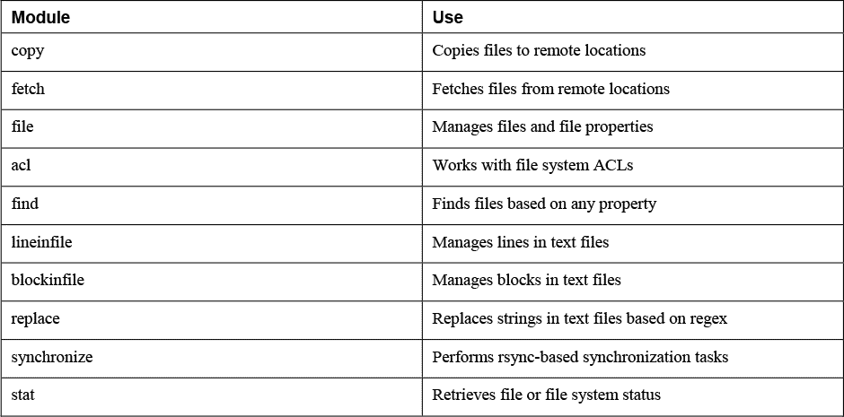

大部分这些模块将在后续章节中进行讨论。在使用与文件相关的模块时，你可能需要一个这里没有讨论的模块。如果是这样，最好的方法是使用 `ansible-doc` 命令。当你对任何模块使用此命令时，你始终会在文档的“SEE ALSO”（另请）部分看到相关的模块。

#### 管理文件属性

如果你需要处理文件属性，`stat` 模块和 `file` 模块将非常有用。`stat` 模块允许你检索文件状态信息。由于该模块获取状态信息而不用于更改任何内容，你主要使用它检查特定的文件属性，并在属性不符合预期时执行操作。在列表 8-1 中你可以看到一个使用 `stat` 和 `debug` 模块的 playbook，探索 `stat` 模块具体在做什么。列表 8-2 显示了运行 `ansible-playbook listing81.yaml` 时的输出。

**列表 8-1** 探索 `stat` 模块

```yaml
---
- name: stat module
  hosts: ansible1
  tasks:
  - stat:
      path: /etc/hosts
    register: st
  - name: show current values
    debug:
      msg: current value of the stat variable is {{ st }}
```

**列表 8-2** 运行 `ansible-playbook listing81.yaml`


```
[ansible@control]$ ansible-playbook listing81.yaml

PLAY *************************************************************

TASK [Gathering Facts] *************************************************
ok: [ansible1] : changed=0  unreachable=0  failed=0

TASK [stat module] *******************************************************************
ok: [ansible1] : changed=0  unreachable=0  failed=0

TASK [show current values] *************************************************
ok: [ansible1] => {
    "msg": "current value of the stat variable is {
        "changed": {
            "atime": "2023-10-27 10:00:00 +0000",
            "ctime": "2023-10-27 10:00:00 +0000",
            "mtime": "2023-10-27 10:00:00 +0000",
            "atime": "2023-10-27 10:00:00 +0000"
        },
        "blksize": 4096,
        "blocks": 8,
        "dev": "0:0",
        "device": 0,
        "gid": 0,
        "inode": 123456,
        "isdir": false,
        "isreg": true,
        "islnk": false,
        "ispipe": false,
        "isblk": false,
        "issocket": false,
        "isdev": false,
        "mode": "0644",
        "nlink": 1,
        "path": "/etc/hosts",
        "uid": 0,
        "size": 512
    }"
}

PLAY RECAP *************************************************************
ansible1                   : ok=3    changed=0    unreachable=0    failed=0    skipped=0    rescued=0    ignored=0
```

```
[ansible@control ~]$ ansible-playbook listing83.yaml

PLAY [stat module tests] ***************************************************************

TASK [Gathering Facts] *****************************************************************

ok: [ansible1]

TASK [command] *************************************************************************

[WARNING]: Consider using the file module with state=touch rather than running ’touch’.

If you need to use command because file is insufficient you can add ’warn: false’ to
this command task or set `command_warnings=False` in `ansible.cfg` to get rid of this
message.

changed: [ansible1]

TASK [stat] ****************************************************************************

ok: [ansible1]

TASK [show current values] *************************************************************

ok: [ansible1] => {

    "msg": "current value of the st variable is {’changed’: False, ’stat’: {’exists’: True, ’path’: ’/tmp/statfile’, ’mode’: ’0644’, ’isdir’: False, ’ischr’: False, ’isblk’: False, ’isreg’: True, ’isfifo’: False, ’islnk’: False, ’issock’: False, ’uid’: 0, ’gid’: 0, ’size’: 0, ’inode’: 51440456, ’dev’: 64768, ’nlink’: 1, ’atime’: 1586253087.057596, ’mtime’: 1586253087.057596, ’ctime’: 1586253087.057596, ’wusr’: True, ’rusr’: True, ’xusr’: False, ’wgrp’: False, ’rgrp’: True, ’xgrp’: False, ’woth’: False, ’roth’: True, ’xoth’: False, ’isuid’: False, ’isgid’: False, ’blocks’: 0, ’block_size’: 4096, ’device_type’: 0, ’readable’: True, ’writeable’: True, ’executable’: False, ’pw_name’: ’root’, ’gr_name’: ’root’, ’checksum’: ’da39a3ee5e6b4b0d3255bfef95601890afd80709’, ’mimetype’: ’inode/x-empty’, ’charset’: ’binary’, ’version’: ’158303785’, ’attributes’: [], ’attr_flags’: ’’}, ’failed’: False}"
}

TASK [fail] ****************************************************************************

fatal: [ansible1]: FAILED! => {"changed": false, "msg": "unexpected file mode, should be set to 0640"}

PLAY RECAP *****************************************************************************

ansible1                   : ok=4    changed=1    unreachable=0    failed=1    skipped=0    rescued=0    ignored=0
```

在本节的前面的示例中，你已经看到了如何使用`stat`模块来显示不同类型的文件属性。根据`stat`模块的输出，你可以使用`file`模块设置特定的文件属性。在列表 8-5 中，你可以看到如何重写来自列表 8-3 的 playbook，以自动设置所需的权限状态。

**列表 8-5** 使用`file`模块修正通过`stat`发现的文件属性

```yaml
---
- name: stat module tests
  hosts: ansible1
  tasks:
  - command: touch /tmp/statfile
  - stat:
      path: /tmp/statfile
    register: st
  - name: show current values
    debug:
      msg: current value of the st variable is {{ st }}
  - name: changing file permissions if that’s needed
    file:
      path: /tmp/statfile
      mode: 0640
    when: st.stat.mode != ’0640’
```

---

## 考试贴士

在本章的示例中，某些任务没有分配名称。虽然不是强制要求为每个任务指定名称，但如果每个任务都有名称，将使故障排除变得容易得多。因此，在考试中，使用名称是一个好主意。这样做可以更容易识别哪些任务导致了哪些特定的结果。

## 管理文件内容

如果你需要管理文件内容，多个模块将非常有用。`find`模块允许你查找文件，就像 Linux 的`find`命令一样。`lineinfile`模块允许你操作文件中的行，而`blockinfile`模块允许你操作整个文本块。此外，不要忘记`copy`模块。我们将在下一节中介绍它，但你也可以用它将指定的文本复制到文件中。然而，对于文件的文本操作，建议使用`lineinfile`或`blockinfile`代替`copy`，因为它们提供了更多选项来指定文本的确的写入位置。

列表 8-6 显示了一个示例，其中使用`lineinfile`根据正则表达式更改字符串。

**列表 8-6** 使用`lineinfile`修改文件内容

```yaml
---
- name: configuring SSH
  hosts: all
  tasks:
  - name: disable root SSH login
    lineinfile:
      dest: /etc/ssh/sshd
```

正如列表 8-6 所示，`lineinfile`使用`dest`键来指定文件名。接下来，使用正则表达式来搜索以`PermitRoot`开头的行。在某些情况下，你需要管理多行。列表 8-7 提供了一个示例：

```yaml
---
- name: modifying file
  hosts: all
  tasks:
  - name: ensure /tmp/hosts exists
    file:
      path: /tmp/hosts
      state: present
  - name: add some lines to /tmp/hosts
    blockinfile:
      path: /tmp/hosts
      block: |
        192.168.4.110 host1.example.com
        192.168.4.120 host2.example.com
      state: present
```

根据你为止所学的，`blockinfile`的用法很容易理解。只需在`block:`之后使用`|`。该字符用于指定接下来的几行。或者，你可以使用`block>`，但这会向目标添加长行。

注意当使用`blockinfile`时，带有开始和结束指示的文本。参见列表 8-8 中的示例：

**列表 8-8** 通过`block`生成的结果文件

```text
127.0.0.1   localhost.localdomain localhost4.localdomain
::1         localhost.localdomain localhost6.localdomain
192.168.4.200   control.example.      control
192.168.4.201    ansible1.example.com      ansible1
192.168.4.202    ansible2.example.com      ansible2
# BEGIN ANSIBLE MANAGED BLOCK
192.168.4.110 host1.example.com
192.168.4.120 host2.example.com
# END ANSIBLE MANAGED BLOCK
```

在本章之前的示例中，你看到了如何使用`command`模块通过 Linux `touch`命令创建一个新文件。运行此 playbook 时，你看到了一个警告，认为你不应该这样做，而应该使用`file`模块，这是完全正确的。

你可以使用`file`模块执行一些相当常见的任务：

- 创建新文件或目录
- 创建链接
- 删除文件
- 设置权限和所有者

列表 8-9 显示了一个示例 playbook，其中使用`file`模块创建一个新目录，并在该目录下创建一个空文件，之后再次使用相同的`file`模块递归地删除该目录。这种方法并不非常有用，但它向你展示了`file`模块的一些常见用法。

```yaml
---
- name: using the file module
  hosts: ansible1
  tasks:
  - name: create directory
    file:
      path: /newdir
      owner: ansible
      group: ansible
      mode: 770
      state: directory
  - name: create file in that directory
    file:
      path: /newdir/newfile
      state: touch
  - name: show the new file
    stat:
      path: /newdir/newfile
    register: result
  - debug:
      msg: |
           This shows that newfile was created
           "{{ result }}"
  - name: removing everything again
    file:
      path: /newdir
      state: absent
```

在列表 8-9 中，你可以看到最后一个任务被配置为删除目录。只需指定目录路径并设置`state: absent`即可递归地删除该目录。你不需要在这里指定任何其他选项，也不需要`recurse`键。

## 移动文件

三个模块对于移动文件特别有用。`copy`模块将文件从 Ansible 控制主机复制到受托管主机。`fetch`模块允许你执行相反的操作，而`synchronize`模块执行类似 Linux `rsync`的任务，确保将控制主机上的文件同步到受托管主机同名的文件中。`copy`和`synchronize`之间的主要区别是`copy`模块总是创建一个新文件，而`synchronize`模块则更新现有的文件。在列表 8-10 中，你可以看到这些模块是如何使用的。

**列表 8-10** 使用 Ansible 移动文件

```yaml
---
- name: file copy modules
  hosts: all
  tasks:
  - name: copy file demo
    copy:
      src: /etc/hosts
      dest: /tmp/
  - name: add some lines to /tmp/hosts
    blockinfile:
      path: /tmp/hosts
      block: |
        192.168.4.110 host1.example.com
        192.168.4.120 host2.example.com
      state: present
  - name: verify file checksum
    stat:
      path: /tmp/hosts
      checksum_algorithm: md5
    register: result
  - debug:
      msg: "The checksum of /tmp/hosts is {{ result.stat.checksum }}"
  - name: fetch a file
    fetch:
      src: /tmp/hosts
      dest: /tmp/
```

在运行列表 8-10 中的 playbook 之后，你可能期望在 Ansible 控制主机上找到`/tmp/hosts`文件。然而，事实并非如此，原因很容易理解。Ansible playbook 通常用于多个主机，因此如果从受托管主机获取了文件，它必须被存储在唯一的位置。为了保证唯一性，Ansible 会在`dest`目录下为每个受托管主机创建一个子目录，并将`fetch`从远程主机复制的文件放在该子目录中。因此，列表 8-10 中 playbook 的结果被存储为`/tmp/ansible1/hosts`和`/tmp/ansible2/hosts`。你可以在练习 8-1 中练习文件操作。

**练习 8-1** 使用 Ansible 管理文件


1. 创建一个名为`exercise81.yaml`的文件，并为其写上以下 play 表头：

```yaml
---
- name: testing file manipulation skills
  hosts: ansible1
  tasks:
```

2. 添加一个创建新空文件的任务：

```yaml
---
- name: testing file manipulation skills
  hosts: ansible1
  tasks:
  - name: create a new file
    file:
      name: /tmp/newfile
      state: touch
```

3. 使用`stat`模块检查新文件的状态：

```yaml
---
- name: testing file manipulation skills
  hosts: ansible1
  tasks:
  - name: create a new file
    file:
      name: /tmp/newfile
      state: touch
  - name: check status of the new file
    stat:
      path: /tmp/newfile
    register: newfile
```

4. 为了看到`stat`模块在做什么，添加一行使用`debug`模块的代码：

```yaml
- name: testing file manipulation skills
  hosts: ansible1
  tasks:
  - name: create a new file
    file:
      name: /tmp/newfile
      state: touch
  - name: check status of the new file
    stat:
      path: /tmp/newfile
      register: newfile
  - name: for debugging only
    debug:
      msg: the current values for newfile are {{ newfile }}
```

5. 现在你已经了解哪些值存储在`newfile`中，你可以添加一个条件 playbook，如果设置未正确，则更改当前所有者：

```yaml
---
- name: testing file manipulation skills
  hosts: ansible1
  tasks:
  - name: create a new file
    file:
      name: /tmp/newfile
      state: touch
  - name: check status of the new file
    stat:
      path: /tmp/newfile
      register: newfile
  - name: for debugging only
    debug:
      msg: the current values for newfile are {{ newfile }}
  - name: change file owner if needed
    file:
      path: /tmp/newfile
      owner: ansible
    when: newfile.stat.pw_name != ’ansible’
```

6. 在 playbook 中添加第二个 play 来获取远程文件：

```yaml
- name: fetching a remote file
  hosts: ansible1
  tasks:
  - name: fetch file from remote machine
    fetch:
      src: /etc/motd
      dest: /tmp
```

7. 现在你已经获取了文件并使其存在于 Ansible 控制主机上，使用`blockinfile`对其进行编辑：

```yaml
- name: adding text to the file that is now on localhost
  hosts: localhost
  tasks:
  - name: add a message
    blockinfile:
      path: /tmp/ansible1/etc/motd
      block: |
        welcome to this server
        for authorized users only
      state: present
```

8. 在最后一步，通过包含以下 play 将修改后的文件复制到`ansible2`：

```yaml
- name: copy the file to ansible2
  hosts: ansible2
  tasks:
  - name: copy motd
    copy:
      src: /tmp/ansible1/etc/motd
      dest: /tmp
```

9. 此时你已经准备好运行 playbook。输入`ansible-playbook exercise81.yaml`运行。

10. 输入`ansible2 -a “cat /tmp/motd”`进行验证。

## SELux 属性

在任何 Linux 系统的安全中，SELinux 都是重要的组件。SELinux 可以用于文件以管理上下文；除此之外，上下文可以设置在端口上；SELinux 属性可以通过布尔值进行管理。Ansible 提供了一些允许更改 SELinux 配置的模块，如表格 8-3 所示。

> **提示**
>
> 在 Ansible 中使用 SELinux 需要具备 SELinux 知识。这是任何想要参加 EX294 考试所需的 RHCSA 知识。本节并不解释 SELinux 本身。有关 SELinux 的更多信息，请参阅*Red Hat RHCSA 8 Cert Guide*。

**表格 8-3** 管理 SELinux 更改的模块

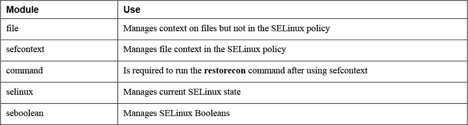

### 管理 SELux 文件上下文

在使用 SELux 安全文件时，理解的关键在于文件设置的上下文类型定义了哪些进程可以处理这些文件。文件上下文可以直接设置在文件上，也可以设置在 SELinux 策略中。

当你处理 SELinux 时，所有的属性都应该设置在 SELinux 策略中。为此，你使用 Ansible 的`sef`模块。在策略中设置上下文类型并不会自动将其应用到文件。你仍然需要运行 Linux`restorecon`命令来执行此操作。作为替代方案，你可以使用`file`模块设置 SELinux 上下文。这种方法的缺点是上下文直接设置在文件上，而不是 SELinux 策略中。因此，如果从从策略将默认上下文应用到文件系统，所有通过 Ansible file 模块设置的上下文都有被覆盖的风险。因此，在 Ansible 中管理 SELinux 上下文的推荐方法是使用`sefcontext`模块。

为了能够使用 Ansible 的`sefcontext`模块和 Linux 的`restorecon`命令，你还需要确保 Linux 上安装了相应的软件。这些软件来自`policycoreutils-python-utils`RPM 包，该包在所有安装模式下都不是默认安装的。

列表 8-11 显示了一个使用该模块管理 SELinux 上下文类型的示例 playbook。

### 列表 8-11 使用`sefcontext`管理 SELinux 上下文

```yaml
---
- name: show selinux
  hosts: all
  tasks:
  - name: install required packages
    yum:
      name: policycoreutils-python-utils
      state: present
  - name: create testfile
    file:
      name: /tmp/selinux
      state: touch
  - name: set selinux context
    sefcontext:
      target: /tmp/selinux
      setype: httpd_sys_content_t
      state: present
    notify:
      - run restorecon
  handlers:
  - name: run restorecon
    command: restorecon -v /tmp/selinux
```

在列表 8-11 中的示例 playbook 中，首先安装了所需的软件包。接下来，使用`file`模块创建一个测试文件；string 在下一个任务中，使用`sefcontext`命令将新上下文写入策略。如果执行成功，此任务将触发一个处理器（handler），通过`command`模块运行 Linux 的`restorecon`命令。

不要忘记：只有当触发处理器的任务产生“已更改”（changed）状态时，处理器才会运行。如果当前状态已经符合期望状态，则不会应用任何更改，处理器也就不会运行！

---

**考试提示**

考试任务可能不会具体到要求你使用 SELinux 更改上下文。你可能只是需要配置一个具有非默认`documentroot`的服务，这意味着 SELinux 将拒绝对该服务的访问。因此，在 EX294 考试中，对于所有任务，你都应该问自己：此任务是否需要在 SELinux 级别进行任何更改。

---

## 应用通用的 SELinux 管理任务

还有一些额外的模块可用。`selinux`模块允许你将 SELinux 的当前状态设置为允许（permissive）、强制（enforcing）或禁用（disabled）。`seboolean`模块允许你使用布尔值（Booleans）轻松地启用或禁用 SELinux 功能。列表 8-12 显示了同时使用这两个模块的 playbook 示例。

### 列表 8-12 更改 SELinux 状态和布尔值

```yaml
---
- name: enabling SELinux and a boolean
  hosts: ansible1
  vars:
    myboolean: httpd_read_user_content
  tasks:
  - name: enabling SELinux
    selinux:
      policy: targeted
      state: enforcing
  - name: checking current {{ myboolean }} Boolean status
    shell: getsebool -a | grep {{ myboolean }}
    register: bool_stat
  - name: showing boolean status
    debug:
      msg: the current {{ myboolean }} status is {{ bool_stat }}
  - name: enabling boolean
    seboolean:
      name: "{{ myboolean }}"
      state: yes
      persistent: yes
```

在列表 8-12 的示例 playbook 中，首先使用`selinux`模块确保 SELinux 处于强制状态。在使用此模块时，你还需要指定策略的名称，在大多数情况下是`targeted`策略。接下来，使用`seboolean`模块启用一个布尔值。如你所示，它被定义为`myboolean`。在启用布尔值之前，使用`shell`和`debug`模块显示其当前状态。在练习 8-2 中练习 SELinux。

## 练习 8-2 更改 SELinux 上下文

在此练习中，你将配置一个更复杂的 playbook 并运行任务。为了引导你完成这一过程（这将让你更好地准备考试），首先，这是你将完成的任务：安装、启动并配置一个`DocumentRoot`设置为`/web`目录的 Web 服务器。在该目录下创建一个名为`index.html`的文件，显示 SELinux 已启用并允许访问 Web 服务器根目录。还要确保 SELinux 允许用户从其目录发布页面。由于这是一项复杂任务，你这次应该从创建 playbook 开始。执行此操作的好方法是列出所有需要完成的任务，提供名称以及你想要运行的任务。按如下结构创建它：

```yaml
---
- name: Managing web server SELinux properties
  hosts: ansible1
  tasks:
  - name: ensure SELinux is enabled and enforcing
  - name: install the webserver
  - name: start and enable the webserver
  - name: open the firewall service
  - name: create the /web directory
  - name: create the index.html file in /web
  - name: use lineinfile to change webserver configuration
  - name: use sefcontext to set context on new documentroot
  - name: run the restorecon command
```

2. 现在既然基础结构已经定义，你可以定义剩余的任务属性。首先，启用 SELinux 并设置为强制状态：

```yaml
---
- name: Managing web server SELinux properties
  hosts: ansible1
  tasks:
  - name: ensure SELinux is enabled and enforcing
```

3. 你可以安装 Web 服务器、启动并启用它、创建`/web`目录并在`/web`目录下创建`index.html`文件。你应该熟悉这些任务，以便能够一次性完成它们：

```yaml
- name: install the webserver
  yum:
    name: httpd
    state: latest
- name: start and enable the webserver
  service:
    name: httpd
    state: started
    enabled: yes
- name: open the firewall service
  firewalld:
    service: http
    state: enabled
    immediate: yes
- name: create the /web directory
  file:
    name: /web
    state: directory
- name: create the index.html file in /web
  copy:
    content: 'welcome to the exercise2 web server'
    dest: /web/index.html
```

4. 你必须使用`lineinfile`模块更改`httpd.conf`的内容。需要更改两个不同的行，你通过以下修改来实现：

```yaml
- name: use lineinfile to change webserver configuration
  lineinfile:
    path: /etc/httpd/conf/httpd.conf
    regexp: '^DocumentRoot "/var/www/html"'
    line: DocumentRoot "/web"
- name: use lineinfile to change webserver security
  lineinfile:
    path: /etc/httpd/conf/httpd.conf
    regexp: '^<Directory "/var/www">'
    line: '<Directory "/web">'
```

5. 在最后步骤中，你负责配置特定的 SELinux 设置：

```yaml
- name: use sefcontext to set context on new documentroot
  sefcontext:
    target: '/web(/.*)?'
    setype: httpd_sys_content_t
    state: present
- name: run the restorecon command
  command: restorecon -Rv /web
- name: allow the web server to run user content
  seboolean:
    name: httpd_read_user_content
    state: yes
    persistent: yes
```

6. 此时，完整的 playbook 应该如下：


```yaml
---
- name: Managing web server SELinux properties
  hosts: ansible1
  tasks:
    - name: ensure SELinux is enabled and enforcing
      selinux:
        policy: targeted
        state: enforcing

    - name: install the webserver
      yum:
        name: httpd
        state: latest

    - name: start and enable the webserver
      service:
        name: httpd
        state: started
        enabled: yes

    - name: open the firewall service
      firewalld:
        service: http
        state: enabled
        immediate: yes

    - name: create the /web directory
      file:
        name: /web
        state: directory

    - name: create the index.html file in /web
      copy:
        content: ’welcome to the exercise82 web server’
        dest: /web/index.html

    - name: use lineinfile to change webserver configuration
      lineinfile:
        path: /etc/httpd/conf/httpd.conf
        regexp: ’^DocumentRoot "/var/www/html"’
        line: DocumentRoot "/web"

    - name: use lineinfile to change webserver security
      lineinfile:
        path: /etc/httpd/conf/httpd.conf
        regexp: ’^<Directory "/var/www">’
        line: ’<Directory "/web">’

    - name: use sefcontext to set context on new documentroot
      sefcontext:
        target: ’/web(/.*)?’
        setype: httpd_sys_content_t
        state: present

    - name: run the restorecon command
      command: restorecon -Rv /web

    - name: allow the web server to run user content
      seboolean:
        name: httpd_read_user_content
        state: yes
        persistent: yes
```

7. 使用`ansible-playbook exercise82.yaml`运行剧 book 并验证其输出。

8. 使用`curl http://ansible1`验证 Web 服务是否可以访问。在这种情况下，它不应该可以工作。尝试分析原因。你可以在本章末尾、章节实验之前找到答案。

## 使用 Jinja2 模板

模板包含变量的配置文件，并根据这些变量按照特定主机的要求在托管主机上生成。使用模板允许以结构化的方式生成配置文件，这比从特定文件中更改特定行要强大得多。Ansible 使用 Jinja2 生成模板。

### 使用简单模板

Jinja2 是为 Python 开发者提供的通用模板语言。它被用于 Ansible 模板，但基于 Jinja2 的方法也出现在 Ansible 的其他部分。例如，引用变量的方式就是基于 Jinja2。

在 Jinja2 模板中，可以使用三个元素。表 8-4 提供了概述。


**表 8-4** Jinja2 模板元素

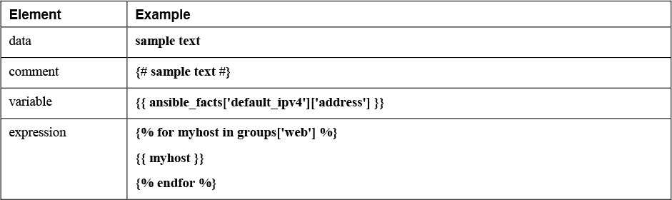

要使用模板，你必须创建一个用`Jinja2`编写的模板文件。接下来，该模板文件必须包含在使用了`template`模块的 Ansible playbook 中。列表 8-13 显示了模板文件的可能样子，列表 8-14 显示了调用模板的 playbook 示例。

**列表 8-13** 示例模板

```jinja2
# {{ ansible_managed }}

<VirtualHost *:80>

        ServerAdmin webmaster@{{ ansible_facts[’fqdn’] }}

        ServerName {{ ansible_facts[’fqdn’] }}

        ErrorLog logs/{{ ansible_facts[’hostname’] }}-error.log

        CustomLog       logs/{{ ansible_facts[’hostname’] }}-common.log common

        DocumentRoot /var/www/vhosts/{{ ansible_facts[’hostname’] }}/

        <Directory /var/www/vhosts/{{ ansible_facts[’hostname’] }}>

                Options +Indexes +FollowSymlinks +Includes

                Order allow,deny

                Allow from all

        </Directory>
</VirtualHost>
```

列表 8-13 中的示例模板以`# {{ ansible_managed }}`开头。此字符串通常用于标识由 Ansible 管理的文件，以便管理员不会意外更改文件内容。在处理模板时，此字符串会被替换为`ansible_managed`变量的值。该变量可以在`ansible.cfg`中设置。例如，你可以使用`ansible_managed = This file is managed by Ansible`在生成模板时用其值替换该变量。

至于其余部分，模板文件只是一个文本文件，使用变量将特定变量替换为它们的值。在这种情况下，这只是被设置为 Ansible facts 的`ansible_fqdn`和`ansible_hostname`变量。要生成模板，你需要一个使用`template`模块调用模板的 playbook。列表 8-14 显示了一个示例。

**列表 8-14** 示例 Playbook

```yaml
---
- name: installing a template file
  hosts: ansible1
  tasks:
    - name: install http
      yum:
        name: httpd
        state: latest

    - name: start and enable http
      service:
        name: httpd
        state: started
        enabled: true

    - name: v host config
      template:
        src: listing13.j2
        dest: /etc/httpd/conf.d/vhost.conf
        owner: root
        group: root
        mode: '0644'

    - name: restart http
      service:
        name: httpd
        state: restarted
```

列表 8-13 中的示例模板以`# {{ ansible_managed }}`开头。此字符串通常用于标识由 Ansible 管理的文件，以免管理员意外更改文件内容。在处理模板时，此字符串会被替换为`ansible_managed`变量的值。该变量可以在`ansible.cfg`中设置。例如，你可以使用`ansible_managed = This file is managed by Ansible`在生成模板时用其值替换该变量。对于其余部分，模板文件只是一个文本文件，使用变量将特定变量替换为它们的值。在这种情况下，这只是被设置为 Ansible facts 的`ansible_fqdn`和`ansible_hostname`变量。要生成模板，你需要一个使用`template`模块调用模板的 playbook。列表 8-14 显示了一个示例。

## Jinja2 中的控制结构

Jinja2 是为 Python 开发者提供的通用模板语言。它被用于 Ansible 模板，但基于 Jinja2 的方法也出现在 Ansible 的其他部分。例如，引用变量的方式就是基于 Jinja2。

在 Jinja2 模板中，可以使用三个元素。表 8-4 提供了概述。


**表 8-4** Jinja2 模板元素


要使用模板，你必须创建一个用`Jinja2`编写的模板文件。接下来，该模板文件必须包含在使用了`template`模块的 Ansible playbook 中。列表 8-13 显示了模板文件的可能样子，列表 8-14 显示了调用模板的 playbook 示例。

### 使用简单模板

Jinja2 是为 Python 开发者提供的通用模板语言。它被用于 Ansible 模板，但基于 Jinja2 的方法也出现在 Ansible 的其他部分。例如，引用变量的方式就是基于 Jinja2。

在 Jinja2 模板中，可以使用三个元素。表 8-4 提供了概述。


**表 8-4** Jinja2 模板元素


要使用模板，你必须创建一个用`Jinja2`编写的模板文件。接下来，该模板文件必须包含在使用了`template`模块的 Ansible playbook 中。列表 8-13 显示了模板文件的可能样子，列表 8-14 显示了调用模板的 playbook 示例。

#### 在 Jinja2 中应用控制结构

在模板中，可以使用控制结构动态生成内容。`for`语句可以用于遍历存在的元素。首先，列表 8-15 显示了一个带有`for`语句的模板。

```jinja2

host_port={{ node }}:8080

```

在处理主机时，定义了一个名为`node`的变量。作为最后一个元素，``用于关闭`for`循环。在列表 8-16 中你可以看到运行此模板的 playbook 示例。

```yaml
---
- name: generate host list
  hosts: ansible2
  tasks:
    - name: template loop
      template:
        src: listing15.j2
        dest: /tmp/hostports.txt
```

列表 8-16 中的示例 playbook 使用模板作为源文件，并根据模板在托管主机上生成文件。（等等，原文是：）列表 8-16 中的示例 playbook 使用模板作为源文件，并根据模板在托管主机上生成文件。要验证，你可以使用 ad hoc 命令`ansible ansible2 -a "cat /tmp/hostports.txt"`。

#### 带 if 的条件语句

`for`语句可以用于模板中遍历一系列值。`if`语句可以用于仅当变量包含特定值或评估为布尔真时包含文本。列表 8-17 显示了一个示例模板文件，它对列表 8-18 中示例 playbook 中设置的变量做出反应。

```jinja2

  Welcome to Apache2

  Welcome to httpd

```

```yaml
---
- name: work with template file
  vars:
    apache_package: 'httpd'
  hosts: ansible2
  tasks:
    - template:
        src: listing817.j2
        dest: /tmp/httpd.conf
```

## 使用过滤器

在 Jinja2 模板中，你可以使用过滤器（filters）。过滤器是在模板表达式的值（例如变量）上执行操作的方法。过滤器包含在变量定义本身中，变量及其过滤器的结果将用在生成的文件中。表 8-5 提供了某些常用过滤器的概述。在练习 8-3 中，你将练习技能并对使用条件语句的模板进行工作。

**表 8-5** 常用过滤器概述

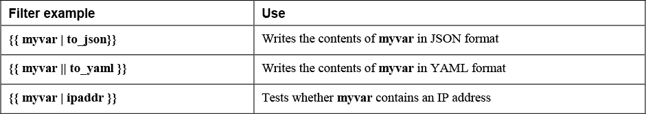

---

**考试提示**

[`docs.ansible.com`](https://docs.ansible.com) 上的 Ansible 文档包含一个名为“常见问题”的章节。在该章节中，你可以找到问题“如何在模板内部对组中的主机列表进行循环”。现在就阅读并学习它。这里的回答提供了一个在模板中使用条件语句的非常棒的示例，这些信息在考试中可能会很有用。

---

## 练习 8-3 在模板中使用条件语句

1. 使用你的编辑器创建文件`exercise83.j2`。包含以下行以打开 Jinja2 条件语句：

```jinja2

```

2. 该语句定义了一个名为`host`的变量。该变量对魔术变量`groups`进行迭代，该变量内部存储了在清单（inventory）中定义的所有 Ansible 主机组。在这些组中，`all`组（包含所有清单主机名）将被处理。

3. 添加以下行（请将其写为单行；它会自动换行到两行，但不要按回车插入换行符）：

```jinja2
{{ hostvars[host]['ansible_default_ipv4']['address'] }} {{ hostvars[host]['ansible_fqdn']  }} {{ hostvars[host]['ansible_hostname'] }}
```

此行为每个清单主机写入单行，包含三个项目。为了实现这一点，你使用了魔术变量`hostvars`，它可以用于识别在清单主机上发现的 Ansible 属性（facts）。`[host]`部分被替换为当前主机名，之后会引用特定的属性。结果是为每个主机生成一行，包含 IP 地址、完全域名（FQDN）以及主机主机名。

4. 添加以下行来关闭`for`循环：

```jinja2

```

5. 验证完整文件内容如下所示并写入并退出文件：

```jinja2

{{ hostvars[host]['ansible_default_ipv4']['address'] }} {{ hostvars[host]['ansible_fqdn']  }} {{ hostvars[host]['ansible_hostname'] }}

```

6. 使用你的编辑器创建文件`exercise83.yaml`。它应该包含以下行：

```yaml
---
- name: generate /etc/hosts file
  hosts: all
  tasks:
    - name:
      template:
        src: exercise83.j2
        dest: /tmp/hosts
```

7. 使用`ansible-playbook exercise83.yaml`运行 playbook。

8. 使用`ansible all -a “cat /tmp/hosts”`验证`/tmp/hosts`文件已生成。

## 总结

在本章中，你学习了如何使用 Ansible 操作文本文件。在第一部分，你学习了可以使用的最重要的 Ansible 模块。接下来，你学习了如何使用 Ansible 管理 SELinux。在本章的最后一部分，你阅读了关于使用 Jinja2 模板生成配置文件。

## 考试准备任务

正如引言中的“如何使用本书”部分所提到的，你在准备考试时有几个选择：这里的练习、第 16 章、“最终准备”以及配套网站上的考试模拟题。

### 复习所有关键主题

复习本章中最重要的主题，这些主题在页面外边距用“关键主题”图标进行了标记。表 8-6 列出了这些关键主题的参考以及它们所在的页码。


**表 8-6** 第 8 章关键主题


### 记忆表

打印附录 D“记忆表”（位于配套网站）或至少打印本章章节，并记忆完成表格和列表。配套网站上的附录 E“记忆表答案”包含了完成的表格和列表以检查你的工作。

### 定义关键术语

定义本章的以下关键术语，并在词表中检查你的答案：

- `Jinja2`
- `template`

### 复习题

1. SELinux 应该使用哪个模块？
2. 哪些模块可以替换字符串？
3. 应该使用哪个模块来获取状态？


**4.** 列出三个使用`file`模块经常执行的任务。

**5.** 应该使用哪个模块来同步文件内容？

**6.** 使用`file`模块有什么问题？

**7.** 哪个模块可以用来创建上下文（context）？

**8.** 最常见的解释是什么？

**9.** 如何在 Jinja2 模板中包含注释行？

**10.** `if`语句用于什么？

### 练习答案

在执行练习 8-2 的所有步骤后，Web 服务器仍然无法。进一步分析显示，`httpd.conf` 的更改已成功完成，且 SELinux 设置正确。然而，在应用`lineinfile`更改后，Web 服务器需要启动。你可以通过使用处理器（handler）或将服务任务移动到`lineinfile`任务之后来实现。

### 章末实验

#### 实验 8-1 生成`/etc/hosts`文件

编写一个 playbook 在所有主机上生成`/etc/hosts`文件。应用以下要求：

- 清单中定义的所有主机都应添加到`/etc/hosts`文件。

#### 实验 8-2 管理`vsftpd`服务

编写一个使用至少两个 play 来安装`vsftpd`服务、使用模板配置`vsftpd`服务以及配置权限和 SELinux 的 playbook。应用以下要求：

- 安装、启动并启用`vsftpd`服务。同时在防火墙中开放端口。
- 使用`/etc/vsftpd/vsftpd.conf`文件生成模板。在此模板中，你应该使用以下变量配置特定设置。用变量替换这些设置并保持其他不变：
  - `Anonymous_enable: yes`
  - `Local_enable: yes`
  - `Write_enable: yes`
  - `Anon_upload_enable: yes`
- 将`/var/ftp/pub`目录的权限设置为`0777`。
- 配置`ftpd_anon_write`布值允许匿名用户写入。
- 将`public_content_rw_t` SELinux 类型设置为`/var/ftp/pub`。
- 如果完成这些操作需要额外的任务，请处理。

# 第 9 章 使用 Ansible Roles

本章涵盖了以下主题：

- 使用 Ansible Roles
- 使用 Ansible Galaxy Roles
- 使用 RHEL System Roles

**本章涵盖了以下 RHCE 考试目标：**

- 使用角色
- 创建角色
- 从 Ansible Galaxy 下载并使用角色

## “我已经掌握这些了吗？”测验

“我已经掌握这些了吗？”测验可以帮助您评估是应该仔细阅读整个章节，还是跳转到“考试准备任务”部分。如果您对这些问题的答案或对自身这些主题知识的评估有疑问，请阅读整个章节。表 9-1 列出了本章中的主要标题以及它们对应的“我已经掌握这些了吗？”测验问题。您可以在附录 A，“‘我已经掌握这些了吗？’测验与考试问题的答案](#app01.xhtml_app01)”找到答案。

表 9-1 “我已经掌握这些了吗？”章节与问题映射


**1.** 您应该在哪个角色目录下定义不应被 playbook 覆盖的角色变量？

**a.** `vars`

**b.** `meta`

**c.** `files`

**d.** `defaults`

**2.** 角色可以在许多位置找到。以下哪些位置不应用于存储自定义角色？

**a.** `./roles`

**b.** `~/.ansible/roles`

**c.** `/etc/ansible/roles`

**d.** `/usr/share/ansible/roles`

**3.** 您在何处找到 Ansible 社区提供的角色？

**a.** 在 Ansible 注册表中

**b.** 在 Ansible Git 仓库中

**c.** 在 Ansible Galaxy 中

**d.** 在 Ansible 网站上

**4.** 您想定义一个在 playbook 中的 handlers 之后执行的任务。您如何如何做到这一点？

**a.** 您不能这样做；handlers 总是最后执行的。

**b.** 您在角色中包含这些任务。

**c.** 您确保确保这些任务定义在调用 handlers 的任务之后。

**d.** 您将它们包含在`post_tasks`部分中。

**5.** 使用哪个文件来定义角色依赖关系？

**a.** 角色目录下的`README.md`

**b.** 角色中的`meta/main.yml`

**c.** 项目目录中的`meta/main.yml`

**d.** Ansible playbook

**6.** 下列哪个命令允许您轻松地为自定义角色设置目录结构？

**a.** `mkdir`

**b.** `ansible init`

**c.** `ansible-galaxy init`

**d.** `ansible-galaxy setup`

**7.** 在与 Ansible Galaxy 一工作时，您可以指定一个需求文件。以下哪项指定了指示应使用的使用的需求文件的正确方法？

**a.** 在调用角色的 playbook 中包含`requirements_file: filename`。

**b.** 使用`ansible-galaxy install -r filename`。

**c.** 在 playbook 中包含一个 dependencies 部分，并在该部分中指定需求文件的名称。

**d.** 使用`ansible galaxy -r filename`命令。

**8.** 使用`ansible-galaxy search`命令时必须使用哪个命令行开关来找到适用于 RHEL 和 CentOS 的角色？

**a.** `--platforms EL`

**b.** `--platforms RHEL-family`

**c.** `--platforms RHEL`

**d.** `--platforms CentOS`

**9.** RHEL Timesync 级角色中使用了哪个变量来识别应该使用快速同步？

**a.** `iburst`

**b.** `fast_sync`

**c.** `hostname`

**d.** `timesync_ntp_servers`

**10.** 在 RHEL SELinux 级角色中，应该使用哪些变量来管理文件上下文？（选择两项。）

**a.** `selinux_context`

**b.** `selinux_fcontext`

**c.** `selinux_dirs`

**d.** `selinux_restore_dirs`

## 基础主题

### 使用 Ansible 角色

在 Ansible 中，playbooks 用于执行常见任务。然而，Ansible 环境中的任务很少是独特的。如果您编写一个 playbook 来安装、启用并暴露最新版本的 Nginx，那么很有可能已经有人这样做过了。这正是角色（roles）的意义所在。Ansible 角色是基于 playbook 的现用 Ansible 解决方案，您可以轻松地将其包含在自己的 playbooks 中。社区角色通过 Ansible Galaxy 提供，但也可以创建自己的角色。此外，Red Hat 还提供了 RHEL 系统角色。在本章中，您将学习关于角色的所有知识。

使用 Ansible 角色有许多优势。最重要的优势是角色使得以重用的方式提供 Ansible 代码成为可能。您可以在角色中轻松地定义一个特定任务，并在角色中定义之后，您可以轻松地重新分发它，并确保无论在何处执行，任务的处理方式都是相同的。角色可以为特定环境定制，或者使用来自 Ansible Galaxy 的默认角色。

#### 理解角色

大多数角色的目录中都包含一个`main.yml`文件。使用角色的精髓在于它们包含文件。您在角色中使用的组件存储在不同的目录中。在定义角色时，您只需要告诉角色查看某些特定的目录。示例 9-1 显示了默认角色的目录结构。表 9-2 提供了这些目录使用的概述。

**示例 9-1** 角色目录结构

```
[ansible@control]$ tree testrole/

testrole/
├── defaults
│   └── main.yml
├── files
├── handlers
│   └── main.yml
├── meta
│   └── main.yml
├── README.md
├── tasks
│   └── main.yml
├── templates
├── tests
│   ├── inventory
│   └── test.yml
└── vars
    └── main.yml
```

**表 9-2** 目录结构

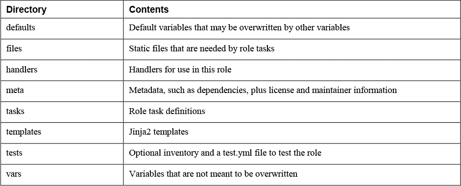

#### 理解位置

在创建自己的角色之前，您需要决定将其存储在哪里。角色可以存储在不同的位置：

- `./roles`用于在当前项目中存储角色。此位置具有最高优先级。
- `~/.ansible/roles`存在于当前用户目录，并仅对当前用户可用。此位置具有次高优先级。
- `/etc/ansible/roles`是存储角色以供任何用户访问的位置。
- `/usr/share/ansible/roles`是从 RPM 文件安装后存储角色的位置。此位置具有最低优先级，不应用于存储自定义角色。

要创建一个自定义角色，您只需要在预期位置创建一个带有`main.yml`的默认角色目录结构。为了轻松创建自定义目录结构，可以使用`ansible-galaxy init`命令。该命令会为您创建所有的目录和示例文件，之后您只需要提供具体的内容。

#### 在 playbook 中使用角色

在使您需要的角色可用后，您需要在 playbook 中使用它们。从 playbook 使用角色并不困难：您以类似于从 playbook 调用任务的方式调用它们，并且角色以列表的形式包含。示例 9-2 显示了这一过程可能看起来的样子。

**示例 9-2** 在 playbook 中调用角色

```yaml
---

- name: include some roles
  roles:
    - role1
    - role2
```

当 playbook 中包含角色（roles）时，这确实会改变 playbook 的执行顺序。通常情况下，playbook 中的所有任务都会先执行，之后再执行被触发的处理器（handlers）。当包含角色时，角色会在任务之前执行。在特定情况下，你可能需要在角色执行之前执行任务。要实现这一点，你可以在`pre_tasks`部分中指定这些任务。此外，还可以使用`post_tasks`部分来包含在角色之后执行的任务，但这些任务也也会在 playbook 中指定的任务以及它们所调用的处理器之后执行。

## 创建自定义角色

创建角色并不困难；你只需要在特定位置提供所需的组件即可。列表 9-3 显示了你将在练习 9-1 中自己创建的 motd 角色的示例。在开始练习之前，请先查看它是如何组成的。

`Listing 9-3` 示例 motd 角色结构

```
motd

|-- defaults
|   `-- main.yml
|         ---
|         # motd 的默认文件
|         system_manager: anna@example.com
|-- meta
|   `-- main.yml
|         galaxy_info:
|         author: Sander van V
|         description: your description
|         company: your company (optional)
|         license: license (GPLv2, CC-BY, etc)
|         min_ansible_version: 2.5
|-- README.md
|-- tasks
|   `-- main.yml
|         ---
|         # motd 的任务文件
|         - name: copy motd file
|           template:
|             src: templates/motd.j2
|             dest: /etc/motd
|             owner: root
|             group: root
|             mode: 0444
`-- templates
    `-- motd.j2
          Welcome to {{ ansible_hostname }}
          This file was created on {{ ansible_date_time.date }}
          Disconnect if you have no business being here
          Contact {{ system_manager }} if anything is wrong
```

学习如何创建自定义角色的方法是是诸实践。所以，让我们来看练习 9-1，它将引导你完成创建角色的步骤。

`练习 9-1 创建自定义角色`

1. 使用`mkdir roles`在当前目录中创建 roles 子目录，并使用`cd roles`进入该子目录。
2. 使用`ansible-galaxy init motd`创建 motd 角色结构。
3. 使用编辑器打开`motd/tasks/main.yml`文件并确保其包含以下内容：

```
---
- name: copy motd file
  template:
    src: templates/motd.j2
    dest: /etc/motd
    owner: root
    group: root
    mode: 0444
```

4. 创建`motd/templates/motd.j2`文件并赋予其以下内容：

```
Welcome to {{ ansible_hostname }}

This file was created on {{ ansible_date_time.date }}

Disconnect if you have no business being here

Contact {{ system_manager }} if anything is wrong
```

5. 将以下内容添加到`motd/defaults/main.yml`文件中：

```
---
system_manager: anna@example.com
```

6. 打开`motd/meta/main.yml`文件并赋予其以下内容：

```
galaxy_info:
  author: student
  description: sample motd role
  company: mycompany
  license: license GPLv2
  min_ansible_version: 2.5
```

7. 这些就是你需要在角色中包含的所有内容。现在创建一个包含以下内容的`exercise91.yaml` playbook：

```
---
- name: use the motd role playbook
  hosts: ansible2
  roles:
    - role: motd
      system_manager: bob@example.com
```

8. 使用`ansible-playbook exercise91.yaml`运行 playbook。
9. 使用 ad hoc 命令`ansible ansible2 -a “cat /etc/motd”`验证修改是否已正确应用。

## 管理角色依赖

角色可能有依赖关系，这意味着一个角色可能需要另一个角色来完成所需的工作。例如，如果你开发了一个自定义角色，用于安装基于通用 Apache Web 服务器和通用 Mariadb 数据库服务器的电子商务解决方案，那么使用角色依赖是有意义的。在这种情况下，自定义角色应该触发依赖项，这可以在角色的`meta/main.yml`文件中完成。

处理依赖关系时，被依赖的角色总会在依赖它的角色之前执行。而且，它们只执行一次。这意味着当 playbook 中使用的两个角色调用同一个依赖项时，被依赖的角色只会执行一次。在调用依赖角色时，可以将变量传递给该依赖角色。此外，你还可以定义`when`语句来确保依赖角色只在特定情况下执行。列表 9-4 显示了一个示例。

`Listing 9-4` 在`meta/main.yml`中定义角色依赖

```
dependencies:
  - role: apache
    port: 8080
  - role: mariabd
    when: environment == ’production’
```

## 理解文件组织的最佳实践

使用角色会将角色的内容与任务分离。在本节中，你将找到一些最重要的最佳实践。请注意，本书并没有应用使用项目目录的最佳实践。

- 每个项目目录可以有自己的`ansible.cfg`、清单文件（inventory file）和 playbook。
- 如果项目规模变大，可以使用变量文件和其他文件，通常位于子目录中。
- 在顶层目录创建主 playbook，并在其中包含其他 playbook。主 playbook 的建议名称为`site.yml`。
- 使用`group_vars/`和`host_vars/`设置与主机相关的变量，不要在清单中定义它们。
- 考虑使用不同的清单文件来区分生产环境（production）和测试环境（staging）。
- 使用角色来标准化常用任务。

当你使用角色时，还适用一些额外建议：

- 使用版本控制仓库以一致的方式维护角色。`Git`常用于此。


- 敏感信息绝不应包含在角色中。使用 `Ansible Vault` 以加密方式存储敏感信息。
- 使用 `ansible-galaxy init` 创建角色的基础结构。删除你不使用的文件和目录。
- 不要忘记在角色的 `README.md` 和 `meta/main.yml` 文件中提供额外信息。
- 保持角色专注于特定功能。使用多个角色来执行多个任务更好。
- 尝试以通用的方式开发角色，以便它们可以用于多种用途。

### 使用 Ansible Galaxy 角色

作为 Ansible 用户或管理员，你可以开发自己的角色。然而，事实上，许多任务是通用的，需要在不同的环境中执行，因此你可能不需要自己开发。对于所有这些标准任务，都有 Ansible Galaxy。`Ansible Galaxy` 是 Ansible 内容的公共库，包含了由社区成员提供的数千个角色。

#### 使用 Galaxy 工作

使用 Ansible Galaxy 最简单的方法是使用 [`https://galaxy.ansible.com`](https://galaxy.ansible.com) 网站，如图 9-1 所示。

`Figure 9-1` Ansible Galaxy 网站首页

在 Galaxy 网站的主页上，你可以看到提供的不同内容分类。如果你正在寻找特定的内容，可以使用 `Search`。该选项允许你输入要查找的内容，并可以在旁边看到匹配的结果列表（参见图 9-2）。

#### 图 9-2 使用搜索功能查找特定包

在任何搜索操作的结果中，你都会看到集合（collections）列表以及角色（roles）列表。Ansible Galaxy 集合是 Ansible 内容的一种分发格式。它可以包含角色，也可以包含剧本（playbooks）、模块（modules）和插件（plug-ins）。大多数情况下，你只需要角色，而不是集合：角色包含了你在正在使用的剧本中包含的所有内容。

当你选择一个角色时，Ansible Galaxy 会显示有关该角色的信息。一些重要指标包括该角色的下载次数和角色的评分。这些信息能够让你轻松地将常用角色与不常用的角色区分开来。此外，你还可以使用标签（tags）来让识别 Galaxy 角色变得更简单。这些标签提供了关于角色的更多信息，并使得以更高效的方式搜索角色成为可能。图 9-3 显示了这些角色属性的示例。

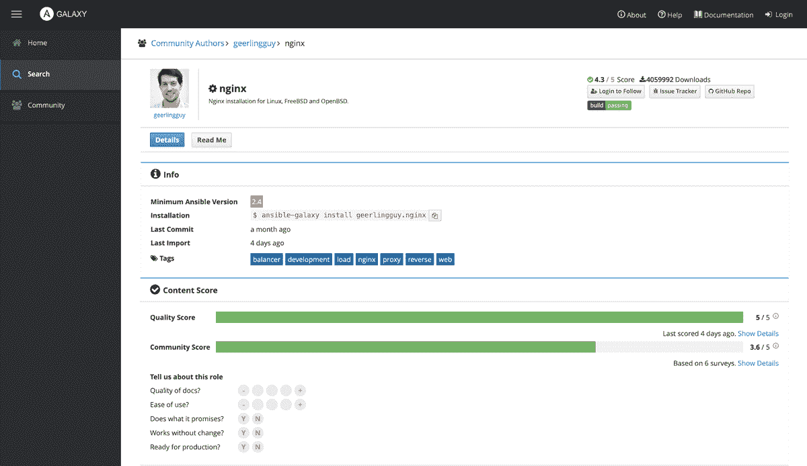

#### 图 9-3 Ansible Galaxy 显示角色的认可信息

你可以直接从 Ansible Galaxy 网站下载角色；或者，你可以使用 `ansible-galaxy` 命令。

## 使用 ansible-galaxy 命令

作为使用网站的替代方案，你可以使用 `ansible-galaxy` 命令根据许多不同的关键词查找角色并管理它们。当你使用 `ansible-galaxy search` 时，你需要提供一个字符串作为参数。Ansible 会在角色的名称和描述中搜索该字符串。由于你可能会得到很多结果，对搜索操作的结果进行一些过滤是有意义的。一些有用的命令行参数列在表 9-3 中。

### 表 9-3 ansible-galaxy 有用的命令行选项


找到角色后，你可以使用 `ansible-galaxy info` 获取有关该角色的更多信息。列表 9-5 显示了关于 `geerlingguy.docker` 角色的提供信息。

#### 列表 9-5 使用 ansible-galaxy info 请求额外信息

```text
[ansible@control ~]$ ansible-galaxy info geerlingguy.docker

Role: geerlingguy.docker

        description: Docker for Linux.

        active: True

        commit: c94e327a74a16a85f23d73be386c161a9cfe81d4

        commit_message: Allow rc 1 on centos7 when waiting for systemctl.

        commit_url: https://api.github.com/repos/geerlingguy/ansible-role-docker/gi

        company: Midwestern Mac, LLC

        created: 2017-02-24T04:13:02.804883Z

        download_count: 5311691

        forks_count: 404

        github_branch: master

        github_repo: ansible-role-docker

        github_server: https://github.com

        github_user: geerlingguy

        id: 15836

        imported: 2020-04-12T10:53:22.695455-04:00

        is_valid: True

        issue_tracker_url: https://github.com/geerlingguy/ansible-role-docker/issues

        license: license (BSD, MIT)

        min_ansible_version: 2.4

        modified: 2020-04-12T14:53:22.705998Z

        open_issues_count: 18

        path: (’/home/ansible/.ansible/roles’, ’/usr/share/ansible/roles’, ’/etc/an

        role_type: ANS

        stargazers_count: 596

        travis_status_url: https://travis-ci.org/geerlingguy/ansible-role-docker.sv
```

## 管理 Ansible Galaxy 角色


一旦确定了所需的角色，你可以使用 `ansible-galaxy install` 安装它。该命令通常将角色安装到 `~/.ansible/roles` 目录，因为该角色在 `ansible.cfg` 的 `role_path` 设置中被指定。如果你希望将角色安装在另一个目录，请考虑更改此参数。或者，使用带有 `-p` 选项的 `ansible-galaxy install` 将角色安装到不同的角色路径目录。

处理 Ansible 角色时，你可以使用需求文件（requirements file）。需求文件是一个 YAML 文件，你在使用 `ansible-roles` 命令时可以包含它。文件本身的内容非常简单，看起来像列表 9-6 中的代码。也可以从 Ansible Galaxy 以外的源添加角色，例如 Git 存储库或压缩包（tarball）。在这种情况下，你必须使用 `src` 选项指定角色的确切 URL。当你从 Git 存储库安装角色时，还需要 `scm` 关键字，且必须设置为 `git`。

#### 列表 9-6 Ansible 角色需求文件示例

```yaml
- src: geerlingguy.nginx
  version: "2.7"
```

使用需求文件安装角色，可以使用 `-r` 选项配合 `ansible-galaxy install` 命令如下：

`- src: geerlingguy.nginx  version: "2.7"`

要查看已安装角色的概览，你可以使用 `ansible-galaxy list` 命令。要从系统中删除角色，可以使用 `ansible-galaxy remove` 命令。你可以在练习 9-2 中练习 `ansible-galaxy`。

## 练习 9-2 使用 ansible-galaxy 管理角色

1. 输入 `ansible-galaxy search --author geerlingguy --platforms EL` 查看其创建的角色列表。
2. 使命令更具体，输入 `ansible-galaxy search nginx --author geerlingguy --platforms EL` 找到该角色。
3. 使用 `ansible-galaxy info role.docker` 请求该角色的更多信息。
4. 创建名为 `listing-6` 的需求文件，其内容如下：

   ```yaml
   - src: geerlingguy.nginx
     version: "2.7"
   ```

5. 在 `ansible.cfg` 中添加 `roles_path = /home/ansible/roles` 行。
6. 使用命令 `ansible-galaxy install -r.6` 从需求文件安装角色。在你运行此练习时，指定的版本 2.7 可能已不再可用。如果是那样，再次使用 `ansible-galaxy info` 找到可用版本，并相应更改需求文件。
7. 输入 `ansible-galaxy list` 验证角色已安装到你的系统中。
8. 编写一个名为 `exercise92.yml` 的剧本，使用该角色且内容如下：

   ```yaml
   ---
   - name: install nginx using Galaxy role
     hosts: ansible2
     roles:
       - geerlingguy.nginx
   ```

9. 使用 `ansible-playbook exercise92.yml` 运行剧本，观察新角色的安装。

### 使用 RHEL 系统角色

RHEL 操作系统的部分在不同版本之间发生了很大变化。例如网络，它从基于 init 的网络脚本变为当前基于 NetworkManager。另一个例子是时间同步，它从基于 NTP 的解决方案演变为基于 Chrony 的解决方案。

为了在管理 RHEL 版本时采用统一的方法，Red Hat 提供了 RHEL 系统角色。RHEL 系统角色让管理操作系统的部分变得简单。表 9-4 提供了概览。

#### 1. 理解 RHEL 系统角色

RHEL 系统角色基于社区 Linux 系统角色，并提供统一的接口，使得在操作系统版本之间存在显著差异时的配置任务变得更容易。RHEL 系统角色可用于 Red Hat Enterprise Linux 6.10 及更高版本，以及 RHEL 7.4 及更高版本，以及 RHEL 8 的所有版本。表 9-4 列出的 RHEL 系统角色基于通用的 Linux 系统角色。虽然它们可以用于你想要实现的特定任务，但 Linux 系统角色不受 RHEL 技术支持。

要使用 RHEL 系统角色，你需要在控制节点上通过 `sudo yum install rhel-system-roles` 安装 `rhel-system-roles` 软件包。该包可以在 RHEL 8 AppStream 存储库中找到。安装后，角色将被复制到 `/usr/share/ansible/roles` 目录，该目录是 Ansible `roles_path` 设置的默认部分。如果已经在 `ansible.cfg` 中对 `roles_path` 设置进行了修改，则角色将应用到 `roles_path` 列表中列出的第一个目录。除了角色，还安装了一些非常有用的文档；你可以在 `/usr/share/doc/rhel-system-roles` 目录找到它们。

要向 RHEL 系统角色传递配置，变量至关重要。在文档目录中，你可以找到关于角色所需和使用的变量的信息。某些角色还包含一个示例剧本（playbook），可以作为定义你自己的角色时的蓝图。将这些作为你自己的基于 RHEL 系统角色配置的基础是一个好主意。接下来的两个章节描述了 SELinux 和 TimeSync 系统角色，它们提供了如何使用 RHEL 系统角色的良好且易于实现的示例。

### 使用 RHEL SELinux 系统角色

你之前已经学习了如何在自己的剧本中使用任务定义来管理 SELinux 设置。使用 RHEL SELinux 系统角色提供了一个易于使用的替代方案。要使用此角色，首先要查看文档，它位于 `/usr/share/doc/rhel-system-roles/selinux` 目录。一个好的起点文件是 `README.md` 文件，它提供了所有可以使用的组件列表。

SELinux 系统角色还附带了一个示例剧本文件。该文件最重要的部分是 `vars:`，它定义了应该由 SELinux 应用的变量。列表 9-7 显示包含变量定义的章节示例。

#### 列表 9-7 SELinux 系统角色中的变量定义

```yaml
---
- hosts: all
  become: true
  become_method: sudo
  become_user: root
  vars:
    selinux_policy: targeted
    selinux_state: enforcing
    selinux_booleans:
      - { name: ’samba_enable_home_dirs’, state: ’on’ }
      - { name: ’ssh_sysadm_login’, state: ’on’, persistent: ’yes’ }
    selinux_fcontexts:
      - { target: ’/tmp/test_dir(/.*)?’, setype: ’user_home_dir_t’, ftype: ’d’ }
    selinux_restore_dirs:
      - /tmp/test_dir
    selinux_ports:
      - { ports: ’22100’, proto: ’tcp’, setype: ’ssh_port_t’, state: ’present’ }
    selinux_logins:
      - { login: ’sar-user’, seuser: ’staff_u’, serange: ’s0-s0:c0.c1023’, state: ’present’ }
```

如列表 9-7 所示，变量用于定义需要用 SELinux 配置的最重要部分。使用 RHEL SELinux 系统角色就像复制文档目录中的示例剧本一样简单，编辑变量以表示你想要创建的配置，然后运行剧本。表 9-5 变量及其使用方式的概述。

#### 表 9-5 SELinux 变量概述

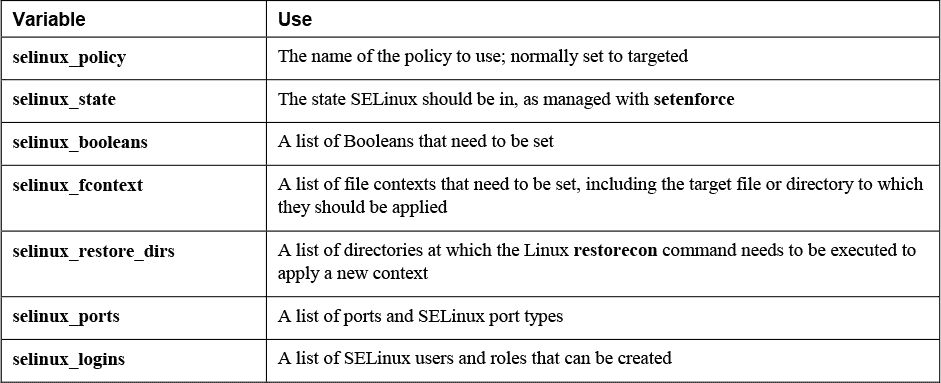

在配置 SELinux 时，通常你需要应用正确的状态以及文件上下文（file context）。要设置适当的文件上下文，你首先需要定义 `selinux_fcontext` 变量。接下来，你还需要定义 `selinux_restore_dirs` 以确保正确应用所需的上下文。在列表 9-8 中你可以看到剧本的样子；这个剧本将 `httpd_sys_content_t` 上下文类型设置为 `/web` 目录。注意，此剧本完全基于 `/usr/share/doc` 中的示例剧本。主要的更改是删除了不必要的行，并设置了两个变量的值。

#### 列表 9-8 使用 SELinux RHEL 系统角色的示例剧本

```yaml
---
- hosts: ansible2
  vars:
    selinux_policy: targeted
    selinux_state: enforcing
    selinux_fcontexts:
      - { target: ’/web(/.*)?’, setype: ’httpd_sys_content_t’, ftype: ’d’ }
    selinux_restore_dirs:
      - /web
  # prepare prerequisites which are used in this playbook
  tasks:
    - name: Creates directory
      file:
        path: /web
        state: directory
    - name: execute the role and catch errors
      block:
        - include_role:
            name: rhel-system-roles.selinux
```


当你使用`RHEL SELinux`系统角色时，某些更改需要重启托管主机。当你使用`RHEL SELinux`系统角色时，某些更改需要重启托管主机。当你使用`RHEL SELinux`系统角色时，某些更改需要重启托管主机。当你使用`RHEL SELinux`系统角色时，某些更改需要重启托管主机。当你使用`RHEL SELinux`系统角色时，某些更改需要重启托管主机。当你使用`RHEL SELinux`系统角色时，某些更改需要重启托管主机。当你使用`RHEL SELinux`系统角色时，某些更改需要重启托管主机。当你使用`RHEL SELinux`系统角色时，某些更改需要重启托管主机。当你使用`RHEL SELinux`系统角色时，某些更改需要重启托管主机。当你使用`RHEL SELinux`系统角色时，某些更改需要重启托管主机。当你使用`RHEL SELinux`系统角色时，某些更改需要重启托管主机。当你使用`RHEL SELinux`系统角色时，某些更改需要重启托管主机。当你使用`RHEL SELinux`系统角色时，某些更改需要重启托管主机。当你使用`RHEL SELinux`系统角色时，某些更改需要重启托管主机。当你使用`RHEL SELinux`系统角色时，某些更改需要重启托管主机。当你使用`RHEL SELinux`系统角色时，某些更改需要重启托管主机。当你使用`RHEL SELinux`系统角色时，某些更改需要重启托管主机。当你使用`RHEL SELinux`系统角色时，某些更改需要重启托管主机。当你使用`RHEL SELinux`系统角色时，某些更改需要重启托管主机。当你使用`RHEL SELinux`系统角色时，某些更改需要重启托管主机。当你使用`RHEL SELinux`系统角色时，某些更改需要重启托管主机。当你使用`RHEL SELinux`系统角色时，某些更改需要重启托管主机。当你使用`RHEL SELinux`系统角色时，某些更改需要重启托管主机。当你使用`RHEL SELinux`系统角色时，某些更改需要重启托管主机。

### 使用`RHEL TimeSync`系统角色

另一个`RHEL`系统角色示例是`TimeSync`角色。使用该角色方便且相对简单，其使用取决于在调用角色的剧本中设置适当的变量。需要更改的重要设置是`timesync_np_servers`变量。该变量指定了指示使用哪些时间服务器的属性。`hostname`属性标识服务器的名称或 IP 地址。`iburst`用于启用或禁用使用`timesync_np_servers`变量进行快速初始同步。

使用此`RHEL`系统角色的其他优势都在后台完成。系统角色会找出使用的是哪个版本的`RHEL`，并根据当前版本配置`NTP`或`Chronyd`。由于这是自动检测的，因此不需要进一步操作。在练习 9-3 中你将练习如何使用`RHEL TimeSync`角色。

#### 练习 9-3 使用`RHEL`系统角色管理时间同步

1. 使用`cp /usr/share/doc/rhel-system-roles/timesync/example-timesync-playbook.yml exercise93.yaml`将示例时间同步剧本复制到当前目录。
2. 编辑文件`exercise93.yaml`如下：

```yaml
---
- hosts: ansible
  vars:
    timesync_np_servers:
    - hostname: pool.ntp.org
      iburst: yes
  roles:
  - rhel-system-roles.timesync
```

3. 在剧本中添加时区模块和`timezone`变量以设置时区。完整的剧本应该如下所示：

```yaml
---
- hosts: ansible2
  vars:
    timesync_ntp_servers:
    - hostname: pool.ntp.org
      iburst: yes
    timezone: UTC
  roles:
  - rhel-system-roles.timesync
  tasks:
  - name: set timezone
    timezone:
      name: "{{ timezone }}"
```

4. 使用`ansible-playbook exercise93.yaml`运行该 playbook。观察其输出。注意显示了一些红色的消息，但这些可以安全地忽略。
5. 使用`ansible ansible2 -a “timedatectl show”`并注意`timezone`变量被设置为`UTC`。

### 总结

Ansible 角色（roles）让使用`Ansible`变得更简单，因为它们提供了标准的代码块，可以轻松地包含在 playbook 中。Ansible 角色可以通过多种方式提供给 playbooks：你可以自己编写它们，可以从`Ansible Galaxy`获取它们，还可以使用由`rhel-system-roles` RPM 软件包提供的角色。在本章中，你学习了如何使用所有这些方法。

### 考试准备任务

正如引言中“如何使用本书”部分提到的，你在准备考试时有几个选择：此处的练习、第 16 章、“最终准备”以及配套网站上的考试模拟题。

### 复习所有关键主题

回顾本章中最重要的主题，这些主题在页外边上用“关键主题”图标标记。表 9-6 列出了这些关键主题的参考列表以及它们所在的页码。


**表 9-6** 第 9 章关键主题


### 记忆表格

打印附录 E“记忆表格”（在配套网站上）或至少打印本章的章节，并根据记忆完成表格和列表。附录 E“记忆表格答案密钥”同样在配套网站上，包含了已完成表格和列表以检查你的工作。

### 定义关键术语

定义本章中的以下关键术语，并在词表中检查你的答案：

- `role`
- `Galaxy`
- `requirements file`
- `RHEL system role`

### 复习题

1. **1.** 你如何指定角色应该存储在非标准目录中？
2. **2.** 你应该在角色的哪个位置定义可能被重覆盖的默认变量？
3. **3.** 角色规范中的哪个文件应该包含依赖关系规范？
4. **4.** 如果对存储角色的默认目录没有进行任何更改，你将在哪个目录找到新安装的角色？
5. **5.** 你可以做什么来确保 playbook 中的任务在角色之前执行？
6. **6.** 你可以做什么来设置任务在所有角色之后，同时在 playbook 中所有其他任务和它们的处理程序（handlers）之后执行？
7. **7.** 你应该使用哪个命令来定义默认的角色目录和文件结构？
8. **8.** 如何能一次性从`Ansible Galaxy`安装多个角色？
9. **9.** 开始编写基于`RHEL System Role`的 playbook 的最佳方法是什么？
10. **10.** 在处理`RHEL System Roles`期间调查需要修改的内容时，你应该先看什么？

### 章末实验

本章包含两个实验。第一个实验允许你练习使用 Ansible 角色，在第二个实验中，你应用了一个`RHEL System Role`。

### 实验 9-1

根据以下要求创建一个在`ansible1`上启动`Nginx Web`服务器的 playbook：

- 必须使用一个 requirements 文件来安装`Nginx Web`服务器。不要使用 Galaxy 角色的最新版本，而是使用其之前的版本。
- 必须使用相同的 requirements 文件来安装最新版本的`postgresql`。
- playbook 需要确保当前没有安装`httpd`或`mysql`。

### 实验 9-2

根据以下要求使用`RHEL SELinux System Role`管理`SELinux`属性：

- 设置一个布尔值（Boolean），允许使用 cron 自动化`SELinux`重新打标签（relabel）。
- 创建目录`/var/ftp/uploads`，将权限设置为 777，并将上下文标签设置为`public_content_rw_t`。
- `SELinux`应允许 Web 服务器使用端口 82。

# 第 10 章 在环境中使用`Ansible`

本章涵盖了以下主题：

- 高级清单
- 优化`Ansible`
- 包含和导入文件
- 大规模环境

## “我准备好了吗？”测验

“我准备好了吗？”测验允许你评估是否应该彻底读完本章。表 10-1 列出了本章的标题以及对应的答案。

**表 10-1** 我准备好了吗？测验章节涵盖了这些题的测试题：答案。


1. **1.** 哪个主机模式是无效的？

   a. `webservers`
   
   b. `192.168.4.200,web1`
   
   c. `!web1`
   
   d. `web`

2. **2.** 动态清单脚本可以使用哪些环境？哪一个是不支持的？

   a. Red Hat
   
   b. Active Directory
   
   c. OpenStack
   
   d. 以上皆是

3. **3.** `ansible-inventory`命令可以使用哪些选项？其中哪一个不是？

   a. `--list`
   
   b. `--graph`
   
   c. `--host`
   
   d. `--all`

4. **4.** 动态清单脚本有一些要求。其中哪一个不是要求？

   a. 用 Python 编写
   
   b. 以 JSON 格式输出
   
   c. 实现了`--list`选项
   
   d. 实现了`<hostname>`

5. **5.** 你如何确保一个特定 playbook 中的任务在三台主机上完全执行后再移动到下三台主机？

   a. 在`ansible.cfg`中使用`forks: 3`。
   
   b. 使用`--forks 3`参数启动运行。
   
   c. 在`ansible.cfg`中使用`serial: 3`。
   
   d. 在 play header 中使用`serial: 3`。

6. **6.** 你如何提高性能并确保任务可以同时在 50 台主机上执行？

   a. 在`ansible.cfg`中使用`forks: 50`。
   
   b. 使用`--forks 50`参数启动运行。
   
   c. 在`ansible.cfg`中使用`serial: 50`。
   
   d. 在 play header 中使用`serial: 50`。

7. **7.** 如果需要在特定条件为真并在 playbook 中处理来自外部文件的内容，你应该使用哪种解决方案？

   a. Role
   
   b. Include
   
   c. Import
   
   d. Expansion

8. **8.** 如果你希望在开始 playbook 中的任何任务工作之前包含任务，你需要哪种？

   a. `import_playbook`
   
   b. `import_tasks`
   
   c. `include_playbook`
   
   d. `include_tasks`

9. 当你使用`include_tasks`时，会存在一些限制。以下哪一项不是这些限制之一？

   a. 当你使用`ansible-playbook --list-tasks`时，被包含的任务不会显示。
   
   b. 你无法使用`ansible-playbook --start-at-task`从被包含的任务文件中的某个任务启动 playbook。
   
   c. 你不能使用`notify`来触发位于被包含的任务文件中的处理程序（handler）。
   
   d. 你不能在包含的任务文件上使用条件语句。

10. 当你使用`import_tasks`时，会存在一些限制。以下哪一项不是这些限制之一？

    a. 不能使用循环（Loops）。
    
    b. 如果使用变量来指定导入的文件名，则该变量不能是主机或组清单变量。
    
    c. 无法使用`ansible-playbook --start-at-task`命令。
    
    d. 在整个`import_tasks`文件上使用`when`语句时，条件语句将应用于该文件中每个任务。

## 基础主题

### 进阶清单用法

你已经学习了如何创建一个清单文件。到目前为止，你处理的是一个包含几个主机的小型清单文件，这些主机可以被放入清单组中。当环境变大时，你可能希望清单文件具有更高的灵活性。本节将介绍进阶清单用法。你将学习如何通过使用主机名模式、动态清单和多个清单文件来使清单更具活性。

### 使用主机名模式

要对主机进行操作，你需要在清单中列出它们。这可以通过包含主机名以及 IP 地址来实现。如果你想在 playbook 中使用 IP 地址，则必须在清单中按相应指定该 IP 地址。你不能使用仅基于 DNS 名称解析的 IP 地址。因此，在 playbook 中指定了 IP 地址但在清单文件中未指定（假设 DNS 名称解析会处理 IP 地址解析）是不可行的。

引用多个主机的最简单方法是使用主机组。可以在清单中指定组，除了指定的组外，还存在`all`和`ungrouped`两个隐式主机组。此外，可以使用主机名通配符。例如，你可以使用`ansible -m ping ‘ansible*’`来匹配所有以 ansible 开头的主机。在主机名模式中使用通配符时，务必始终将模式放在单引号之间：命令`ansible -m ping ansible*`将由于“没有匹配的主机”的错误而失败。通配符可以使用主机名中的任何位置。因此，只要模式放在单引号之间，你也可以使用`ansible -m ping ’*ble1’`。

请注意，当你使用通配符匹配主机名时，Ansible 不区分 IP 地址、主机名或主机；它只是匹配任何内容。因此，模式`’web*’`匹配属于`’webservers`组的所有服务器，也会匹配主机`’web1`和`’web2`。

要处理多个主机，你还可以指定一个用逗号分隔的目标列表，例如`ansible -m ping ansible1,192.168.4.202`。逗号分隔的列表可以是任何内容的混合，并包括主机名、IP 地址和主机组名。

还可以实现更高级的模式。你可以通过包含安培符号（`&`）来指定逻辑与条件，通过使用感叹号（`!`）来指定逻辑非。因此，模式`’web,&file`仅在主机是 web 和 file 组的成员时才适用，而模式`’web,!webserver1`适用于 web 组中的所有主机，但 webserver1 除外。当你使用逻辑与操作符时，安培符号的位置并不重要。所以你也可以将`’web,&file`重写为`&web,file`。请注意，你可以使用冒号（`:`）代替逗号（`,`），但在使用默认包含冒号的 IPv6 地址时，使用逗号能更好地避免混淆。

### 配置动态清单

静态清单对于小型环境效果良好。然而，如果环境变得越来越大且动态，静态清单就不再那么高效了，因此可以考虑使用动态清单。动态清单是一个脚本，用于检测是否有新主机被添加到管理环境中。


动态清单脚本由社区提供，并存在许多不同的环境中。或者，编写自己的动态清单脚本也相当容易。主要要求是动态清单脚本支持`--list`和`--host <hostname>`选项，并以 JSON 格式生成输出。此外，脚本必须具有 Linux 执行权限。许多动态清单脚本是用 Python 编写的，但这不是要求。任何支持`--list`和`--host`选项并生成 JSON 输出的脚本即可。

编写动态清单脚本不是考试要求，但列表 10-1 显示了示例动态清单脚本的样子。

**列表 10-1** 示例动态清单脚本

```python
#!/usr/bin/python

from subprocess import Popen,PIPE

import sys

try:
     import json

except ImportError:
     import simplejson as json

result = {}

result[’all’] = {}

pipe = Popen([’getent’, ’hosts’], stdout=PIPE, universal_newlines=True)
result[’all’][’hosts’] = []

for line in pipe.readlines():
    s = line.split()
    result[’all’][’hosts’]=result[’all’][’hosts’]+s

result[’all’][’vars’] = {}

if len(sys.argv) == 2 and sys.argv[1] == ’--list’:
    print(json.dumps(result))
elif len(sys.argv) == 3 and sys.argv[1] == ’--host’:
    print(json.dumps(result[’all’][’hosts’][sys.argv[2]]))
else:
    print("Requires an argument, please use --list or --host")
```

如你在列表 10-1 中所示，脚本的核心是这一行`pipe = Popen([’getent’, ’hosts’], stdout=PIPE, universal_newlines=True)`，它使用`getent`函数获取主机列表。这查询了`/etc/hosts`以及其他启用的主机解析机制。要显示主机列表，可以使用`--list`命令；要显示特定主机的详情，可以使用`--host`选项。列表 10-2 显示了 JSON 格式的示例。

**列表 10-2** `listing101.py`脚本的 JSON 输出


```bash
[ansible@control rhce-book]$ ./listing101.py --list

{"all": {"hosts": ["127.0.0.1", "localhost", "localhost.localdomain", "localhost4", "localhost4.localdomain4", "127.0.0.1", "localhost", "localhost.localdomain", "localhost6", "localhost6.localdomain6", "192.168.4.200", "control.example.com", "control", "192.168.4.201", "ansible1.example.com", "ansible1", "192.168.4.202", "ansible2.example.com", "ansible2"], "vars": {}}}
```

即使非常简单，列表 10-1 中的脚本也是有益的，因为它自动检测是否有新主机被添加到 DNS 或修改了 `/etc/hosts` 文件。动态清单的激活方式与普通清单相同：对 `ansible` 或 `ansible-playbook` 命令使用 `-i` 选项，将清单脚本名称作为参数传递。你只需要确保动态清单脚本具有 Linux 执行权限。如果不是，请使用 `chmod +x scriptname`。

当动态清单脚本用于大型环境时，你就能看到它的真实价值。这种环境可能使用了外部目录服务，该服务用于跟踪环境中的所有主机。此类目录服务可以基于多种解决方案，包括 FreeIPA、Active Directory 或 Red Hat Satellite。动态清单脚本也适用于基于虚拟机的基础设施，例如 VMware 或红帽企业虚拟化（RHEL），在这些环境中，可以动态地发现虚拟机。动态清单脚本可见的另一个主要领域是云环境，那里为许多解决方案提供了脚本，包括 AWS、GCE、Azure 和 OpenStack。

当你与动态清单工作时，通常需要额外的参数。例如，要从 EC2 云环境获取清单，你需要输入 Web 密钥（keys）。为了传递这些参数，许多清单脚本都带有一个 `.ini` 格式的额外配置文件。例如，社区提供的 `ec2.py` 脚本就带有一个 `ec2.ini` 参数文件。

许多清单脚本中看到的另一个特性是缓存管理。为了提高使用清单脚本的效率，你可以使用缓存来存储最近发现的主机名称和参数。如果提供了缓存，则存在相应的选项来管理缓存，例如，你可以确保清单信息确实是最近发现的。

### 使用 `ansible-inventory` 命令

如列表 10-2 所示，动态清单脚本的默认输出是不格式化的。要显示脚本的格式化 JSON 输出，你可以使用 `ansible-inventory` 命令。除了 `--list` 和 `--host` 选项外，该命令还使用 `--graph` 选项显示主机列表，包括它们所属的主机组。在列表 10-3 中，你可以看到 `ansible-inventory -i listing101.py --graph` 命令的输出。记住，只有当动态清单文件设置了 Linux 执行权限时，此命令才能生效。

**列表 10-3** 显示 `ansible-inventory` 命令的输出

```text
[ansible@control rhce8-book]$ ansible-inventory -i listing101.py --graph

[WARNING]: A duplicate localhost-like entry was found (localhost). First found

localhost was 127.0.0.1

@all:

  |--@ungrouped:

  |  |--127.0.0.1
  |  |--192.168.4.200
  |  |--192.168.4.201
  |  |--192.168.4.202
  |  |--ansible1
  |  |--ansible1.example.com
  |  |--ansible2
  |  |--ansible2.example.com
  |  |--control
  |  |--control.example.com
  |  |--localhost
  |  |--localhost.localdomain
  |  |--localhost4
  |  |--localhost4.localdomain4
  |  |--localhost6
  |  |--localhost6.localdomain6
```

### 处理多个清单文件

Ansible 支持处理多个清单文件。使用多个清单文件的一种方法是在 `ansible` 或 `ansible-playbook` 命令中输入多个 `-i` 参数，以指定要使用的文件名。因此，`ansible-inventory -i inventory -i listing101.py --list` 将根据基于 `inventory` 文件中的静态清单以及由 `listing101.py` Python 脚本生成的动态清单生成输出列表。

或者，你可以使用 `-i` 命令行选项指定目录名称。这种方法将目录中的所有文件作为清单文件。注意，当使用清单目录时，动态清单文件必须是可执行的，这种方法才能生效。在练习 10-1 中，你将练习处理多个清单。

**练习 10-1 使用多个清单**

1. 以 `ansible` 用户身份打开 shell，并创建一个名为 `inventories` 的目录。
2. 将 `listing101.py` 文件复制到 `inventories` 目录。
3. 也将清单文件复制到 `inventories` 目录。
4. 为了确保两个清单都包含一些独特的内容，在 `inventories/inventory` 文件中添加以下行：

   ```text
   webserver1
   webserver2
   ```

5. 在 Linux 的 `/etc/hosts` 文件中添加以下行：

   ```text
   192.168.4.203 ansible3.example.com ansible3
   192.168.4.204 ansible4.example.com ansible4
   ```

6. 使用 `ansible-inventory -i inventories --list`。在结果中你应该看到来自 `/etc/hosts` 的清单以及动态清单。这证明了清单目录是有效的。

### 优化 Ansible 处理

为了优化 Ansible 的工作，你可以管理并行和串行任务执行。并行任务执行可以管理同时执行任务的主机数量。

### 管理并行任务执行

在执行任务时，Ansible 可以同时对多个主机应用任务。理论上，Ansible 可以在所有主机上运行任务，在很多情况下这不是问题。然而，如果涉及到网络设备或其他没有 Python 栈的节点，则需要在控制主机上进行处理。为了防止在这种情况下控制主机过载，默认并发连接数为五个。

你可以通过 `ansible.cfg` 中的 `forks` 参数来管理此设置。或者，你可以在 `ansible` 和 `ansible-playbook` 命令中使用 `-f` 选项。同时处理五个托管节点对于需要在控制主机上进行处理的情况是很好的。因为大多数处理都在托管主机上进行，设置为五个只会减慢 Ansible 的速度，因此建议将此值显著提高。如果只管理 Linux 主机，没有理由将同时任务的最大数远低于 100。

在执行 playbook 期间，Ansible 逐个处理任务。这意味着默认情况下，第一个任务在所有托管主机上执行。

### 管理串行任务执行

默认情况下，Ansible 逐个执行任务。这意味着它先在所有主机上执行第一个任务，完成后，再继续在所有主机上执行下一个任务。

在某些情况下，这种行为是不符合期的。例如，如果用这种方式使用 playbook 更新主机集群，这将导致旧软件已经更新，但新版本尚未启动，导致整个集群都宕机。为了防止这种情况的发生，你可以配置串行任务执行。

要这样做，你需要在 play 头部使用 `serial` 关键字。例如，当 play 头部使用 `serial: 3` 关键字时，所有任务将在三个主机上执行，在完全运行完这三个主机的所有任务后，再处理下一组三个主机。在练习 10-2 中，你将练习使用 `serial` 和 `forks` 参数。

```text
ansible3

ansible4
```

3. 打开 `ansible.cfg` 文件，并在 `[defaults]` 部分添加 `forks = 4` 这一行。

4. 编写一个名为 `exercise102-install` 的 playbook，用于安装并启用 Apache Web 服务器；并编写另一个名为 `exercise102-remove` 的 playbook，用于禁用并移除 Apache Web 服务器。由于这是一项非常基础的任务，因此没有提供具体的说明。如果你在这些任务上需要额外帮助，请参考 GitHub 仓库 [`github.com/sandervanvugt/rhce8-book`](https://github.com/sandervanvugt/rhce8-book) 中的 `exercise102-install.yaml` 和 `exercise102-remove.yaml` 文件。

5. 运行 `ansible-playbook exercise102-remove.yaml` 来移除并禁用所有主机上的 Apache Web 服务器。这只是为了确保你从干净的配置开始。

6. 使用 `time ansible-playbook exercise102-install.yaml` 运行 playbook 来安装并运行 Web 服务器，并留意运行 playbook 所需的时间。

7. 再次运行 `ansible-playbook exercise102-remove.yaml` 回到干净状态。

8. 编辑 `ansible.cfg` 并将 `forks` 参数改为 `forks = 2`。再次运行 `time ansible-playbook exercise102-install.yaml` 命令，查看现在需要多少时间；它应该要长得多。注意，除了花费的时间外，你在 playbook 执行期间没有看到任何输出。

9. 编辑 `exercise102-install.yaml` playbook，并在 play 头部包含 `serial: 2` 这一行。

10. 再次运行 `ansible-playbook exercise102-remove.yaml` 命令回到干净状态。

11. 再次运行 `ansible-playbook exercise102-install.yaml` 命令，并观察到整个 play 仅在两台主机上执行，然后再处理下一组两个主机。

### 包含和导入文件

当 playbook 变得越来越大时，建议将其拆分为单独的文件。这使得管理大型 playbook 更加容易，并允许将特定的管理任务分配给特定的管理员。此外，拆分文件使得在不同项目中复用 playbook 内容成为可能。

你已经看到如何使用 `roles` 来包含来自其他 playbook 的通用代码。除了使用 `roles` 外，你还可以包含和导入文件。当内容被包含时，它会在 Ansible 到达该内容的恰刻被动态处理。如果内容被导入，Ansible 在开始处理 playbook 中的任务之前执行导入操作。

文件可以在不同级别被包含和导入：


- **Roles（角色）：** `Roles` 通常用于处理由角色提供的一整套指令。`Roles` 也有特定的结构。
- **Playbooks：** `Playbooks` 可以作为完整的 playbook 被导入。你不能在 play 内部执行此操作。`Playbooks` 可以在 playbook 的顶层导入。
- **Tasks（任务）：** 任务文件只是任务列表，可以导入或包含在另一个任务中。
- **Variables（变量）：** 如在第 6 章中所述，“对变量和事实的操作”，变量可以维护在外部文件中并包含在 playbook 中。这使得管理通用多用途变量变得更加容易。

### 导入 Playbooks

在 fact 一个主 playbook 并在其中包含不同的附加 playbook 的设置中，导入 playbook 是常见的。根据 Ansible 最佳实践指南（Ansible 文档的一部分），主 playbook 可以命名为 `site.yaml`，它可以用于包含针对每组特定服务器的 playbook，例如。

当一个 playbook 被导入时，它会替换整个 play。因此，你不能在任务层级导入 playbook；它需要在 play 层级进行。列表 10-4 给出了在列表 10-5 中导入的 playbook 示例。在列表 10-6 中，你可以看到运行 `ansible-playbook listing105.yaml` 命令的结果。

**列表 10-4** 待导入的示例 Playbook

```yaml
- hosts hosts: all

  tasks:

  - debug:
      msg: running the imported play
```

**列表 10-5** 导入 Playbook

```yaml
---

- name: run a task

  hosts: all

  tasks:

  - debug:
      msg: running task1

- name: importing a playbook

  import_playbook: listing104.yaml
```

**列表 10-6** 运行 `ansible-playbook listing105.yaml` 的结果

```text
[ansible@control rhce8-book]$ ansible-playbook listing105.yaml

PLAY [run a task] **************************************************************

TASK [Gathering Facts] *********************************************************

ok: [ansible2]

ok: [ansible1]

ok: [ansible3]

ok: [ansible4]

TASK [debug] *******************************************************************

ok: [ansible1] => {
    "msg": "running task1"
}

ok: [ansible2] => {
    "msg": "running task1"
}

ok: [ansible3] => {
    "msg": "running task1"
}

ok: [ansible4] => {
    "msg": "running task1"
}

PLAY [all] ***************************************************************

TASK [Gathering Facts] *********************************************************

ok: [ansible2]

ok: [ansible1]

ok: [ansible3]

ok: [ansible4]

TASK [debug] *******************************************************************

ok: [ansible1] => {
    "msg": "running task1"
}

ok: [ansible2] => {
    "msg": "running task1"
}

ok: [ansible3] => {
    "msg": "running task1"
}

ok: [ansible4] => {
    "msg": "running task1"
}

PLAY RECAP *****************************************************

ansible1                   : ok=4    changed=0    unreachable=0    failed=0    skipped=0    rescued=0    ignored=0
ansible2                   : ok=4    changed=0    unreachable=0    failed=0    skipped=0    rescued=0    ignored=0
ansible3                   : ok=4    changed=0    unreachable=0    failed=0    skipped=0    rescued=0    ignored=0
ansible4                   : ok=4    changed=0    unreachable=0    failed=0    skipped=0    rescued=0    ignored=0
```

### 导入和包含任务文件

与其导入 playbook，你也可以包含任务文件。当你使用 `import_tasks` 时，任务在执行 playbook 时是静态导入的。当你使用 `include_tasks` 时，任务在需要时是动态包含的。当任务文件用于条件语句时，建议使用动态包含任务文件。

在使用 `import_tasks` 静态导入任务时，有一些需要考虑的因素：


- `import_tasks` 不能配合循环（Loops）。
- 如果使用变量来指定要导入的文件名，这不能是主机或组清单变量。


- 当你在整个`import_tasks`文件上使用`when`语句时，条件语句将应用于相关的每个任务。

作为替代方案，可以使用`include_tasks`动态包含任务文件。这种方法也有一些考虑：


- 当你使用`ansible-playbook --list-tasks`命令时，包含的任务中的任务不会显示。
- 你不能使用`ansible-playbook --start-at-task`从来自包含任务文件的任务开始启动 playbook。
- 你不能在主 playbook 中使用`notify`语句来触发位于包含任务文件中的处理器（handler）。

***

**提示**

当你使用包含和导入来处理任务文件时，建议将任务文件存储在单独目录中。这样做使得将任务管理委给特定的用户变得更加容易。

使用导入和包含（included）的文件的主要目标是使可重用代码的操作变得简单。为了确保实现这一目标，导入和包含的文件应该尽可能通用。这意味着，在不同上下文中使用时可能会更改特定项的名称是一个一个坏主意。例如，考虑包名、用户、服务等的名称。

为了以灵活的方式处理包含文件，你应该将特定项定义为变量。例如，在`include_tasks`文件中，你引用了`{{ package }}`，而在调用包含文件的主剧本（playbook）中，你可以定义这些变量。显然，你可以使用直接定义变量的方法或通过使用主机变量文件或组变量包含文件来实现这种方法。

***

**考试提示**

始终可以以一种非常完美但相当复杂的方式来配置项。在考试中，追求复杂并不是明智之举。只需保持你的解决方案尽可能简单。考试的唯一要求是让程序运行起来，而你具体如何做到这一点并不重要。

***

在列表 10-7 到 10-10 中，你可以看到如何使用包含和导入文件来处理一个项目。在列表 10-9 所示的主剧本定义了要使用的变量，以及包含和导入文件的名称。列表 10-7 和 10-8 显示了包含文件的代码，这些代码使用了列表 10-9 中定义的变量。在列表 10-9 中运行剧本的结果可以在列表 10-10 中看到。

**列表 10-7** 用于服务的包含任务文件`tasks/service.yaml`

```yaml
- name: install {{ package }}

  yum:
    name: "{{ package }}"
    state: latest

- name: start {{ service }}

  service:
    name: "{{ service }}"
    enabled: true
    state: started
```

列表 10-7 中的示例任务文件非常直观；它使用`yum`模块安装软件包，并使用`service`模块启动并启用软件包。该文件引用的变量在列表 10-9 的主剧本中定义。

**列表 10-8** 用于防火墙定义的导入任务文件`tasks/firewall.yaml`

```yaml
- name: install the firewall

  package:
    name: "{{ firewall_package }}"
    state: latest

- name: start the firewall

  service:
    name: "{{ firewall_service }}"
    enabled: true
    state: started

- name: open the port for the service

  firewalld:
    service: "{{ item }}"
    immediate: true
    permanent: true
    state: enabled
  loop: "{{ firewall_rules }}"
```

在列表 10-8 中的示例防火墙文件中，安装、定义并配置了防火墙服务。在`firewalld`服务的配置中，变量`firewall_rules`上使用了循环（loop）。该变量显然定义在列表 10-9 中，该文件是定义特定特定内容（如变量）的文件。

**列表 10-9** 主剧本示例

```yaml
---

- name: setup a service
  hosts: ansible2
  tasks:
  - name: include the services task file
    include_tasks: tasks/service.yaml
    vars:
      package: httpd
      service: httpd
    when: ansible_facts[’os_family’] == ’RedHat’
  - name: import the firewall file
    import_tasks: tasks/firewall.yaml
    vars:
      firewall_package: firewalld
      firewall_service: firewalld
      firewall_rules:
      - http
      - https
```

列表 10-9 中的主剧本显示了特定的配置。它执行了两个主要任务：定义变量，以及调用一个包含文件和一个导入文件。定义的变量被包含和导入文件使用。`include_tasks`语句在`when`语句中执行。注意`firewall_rules`变量包含一个列表作为其值，该值被导入文件中定义的循环循环使用。

**列表 10-10** 运行`ansible-playbook listing109.yaml`

```text
[ansible@control rhce8-book]$ ansible-playbook listing109.yaml

PLAY [setup a service] *********************************************************

TASK [Gathering Facts] *********************************************************

ok: [ansible2]

TASK [include the services task file] ******************************************

included: /home/ansible/rhce8-book/tasks/service.yaml for ansible2

TASK [install httpd] ***********************************************************

ok: [ansible2]

TASK [start httpd] *************************************************************

changed: [ansible2]

TASK [install the firewall] *************************************************

ok: [ansible2]

TASK [start the firewall] *************************************************

changed: [ansible2]

TASK [open the port for the service] ******************************************

changed: [ansible2]

TASK [open the port for the service] ******************************************

changed: [ansible2]

PLAY RECAP *****************************************************************
ansible2                   : ok=7    changed=3    unreachable=0    failed=0
```

列表 10-9 中的主剧本显示了特定特定的配置。它执行了两个主要任务：定义变量，并调用一个包含文件和一个导入文件。定义的变量被包含和导入文件使用。`include_tasks`语句在`when`语句中执行。注意`firewall_rules`变量包含一个列表作为其值，该值被导入文件中定义的循环使用。

列表 10-10 中的有趣之处在于，在运行列表 10-9 时，包含文件是动态包含的。而导入是静态的。

### 练习 10-3 使用包含和导入

在这个练习中，你创建一个安装服务的简单剧本。服务的名称定义在变量中，特定的任务通过任务文件包含。

1. 打开`exercise103-vars.yaml`并定义如下变量：

```yaml
packagename: vsftpd
servicename: vsftpd
firewalld_servicename: ftp
```

2. 创建`exercise103-ftp.yaml`文件并赋予以下内容以安装、启用并启动 vsftpd，同时在防火墙中开放它：

```yaml
- name: install {{ packagename }}
  yum:
    name: "{{ packagename }}"
    state: latest

- name: enable and start {{ servicename }}
  service:
    name: "{{ servicename }}"
    state: started
    enabled: true

- name: open the service in the firewall
  firewalld:
    service: "{{ firewalld_servicename }}"
    permanent: yes
    state: enabled
```

3. 创建`exercise103-copy.yaml`文件，该文件管理`/var/ftp/pub/README`文件并确保它具有以下内容：

```yaml
- name: copy a file
  copy:
    content: "welcome to this server"
    dest: /var/ftp/pub/README
```

4. 创建主剧本`exercise103.yaml`以包含它们的所有内容并赋予以下内容：

```yaml
---
- name: install vsftpd on ansible2
  vars_files: exercise103-vars.yaml
  hosts: ansible2
  tasks:
  - name: install and enable vsftpd
    import_tasks: exercise103-ftp.yaml
  - name: copy the README file
    import_tasks: exercise103-copy.yaml
```

5. 运行剧本并验证其输出。
6. 运行临时命令验证`/var/ftp/pub/README`文件已创建：`ansible ansible2 -a "cat /var/ftp/pub/README"`

### 总结

在本章中，你学习了如何在大型环境中使用 Ansible。我们关注了三个方面。首先，你学习了如何使用动态主机和主机名模式高效地管理大量主机。接下来，你学习了通过修改并行主机数量以及串行任务执行来优化 Ansible 的工作。在本章的最后部分，你学习了如何处理 play 和任务的包含和导入。

正如引言中“如何使用本书”章节提到的，你在准备考试时有几种选择：这里的练习题、第 16 章、“最终准备”以及配套网站上的考试模拟题。

### 复习所有关键主题

回顾本章中最重要的主题，这些主题在页外边距用“关键主题”图标标记。表 10-2 列出了这些关键主题的参考以及它们所在的页码。


**表 10-2** 第 10 章的关键主题


### 定义关键术语

定义本章中的以下关键术语，并在术表中检查你的答案：

- `fork`
- `import`
- `include`
- `parallel task execution`
- `serial task execution`

### 复习题

**1.** 你将如何处理既属于 web 组成员又是 file 组成员的主机？

**2.** 每一个动态清单脚本都必须实现哪两个参数？

**3.** 如果动态清单脚本需要额外的参数，你通常如何提供它们？

**4.** 你使用哪种命令来以树状输出的形式显示所有当前已知的机机（包括它们所属的组）？

**5.** 在运行 playbook 时，你可以使用`ansible-playbook`命令的哪种命令行选项来确保同时配置 10 台主机？

**6.** 你该如何编写一个 playbook，使得所有任务都能在处理下一组三台主机之前，先在三台主机上执行？

**7.** 如果你想动态包含任务，你应该怎么做？

**8.** 假设你想将静态代码与动态参数分开，那么处理变量的推荐方法是什么？

**9.** 你将项目拆分成了不同的任务文件，但现在你无法再使用`ansible-playbook --list-tasks`了。你该如何修复这个问题？

**10.** 导入（import） playbook 而不是任务（tasks）的好理由是什么？

### 章末实验

在本章的章末实验中，你将重组一个 playbook，使其使用多个不同的文件而不是一个大文件。请根据实验 10-1 的说明进行操作。

### 实验 10-1

你可以在与本课程配套的 GitHub 仓库中找到`lab82.yaml`文件，它是优化的理想人选。请根据以下要求优化该 playbook：

- 使用 includes 和 import 使此 playbook 变为模块化，通过使用不同的文件来区分不同的任务。
- 优化此 playbook，使其同时运行的主机不超过两台，并在继续处理下一台主机之前在这两台主机上完成整个 playbook。

# 第 11 章 Ansible 故障排除

本章涵盖了以下主题：

- 管理 Ansible 错误和日志
- 使用模块进行故障排除和测试
- 使用标签 Tags
- 常见场景的故障排除

**本章涵盖了以下 RHCE 考试目标：**

- 创建 Ansible plays 和 playbooks
- 配置错误处理

## “我已经掌握了吗？”测验

“我已经掌握了吗？”测验让你评估是应该仔细阅读整个章节，还是跳到“考试准备任务”部分。如果你对这些问题的答案或对自己这些主题知识的评估有疑问，请阅读整个章节。表 11-1 列出了本章的主要标题及其对应的“我已经掌握了吗？”测验题。你可以在附录 A，“‘我已经掌握了吗？测验和考试题的答案](#app01.xhtml_app01)”中找到答案。

**表 11-1** “我已经掌握了吗？”章节与问题映射

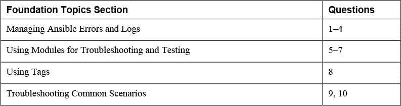

**1.** 下列哪项是为什么配置 Ansible 写入包含命令输出的日志文件真正没有意义最重要的原因？

**a.** 日志文件会迅速变大。

**b.** 执行命令时的所有相关输出都会写入`STDOUT`。

**c.** 写入日志需要 root 权限。

**d.** 不适用。

**2.** 使用`ansible-playbook`命令时可以使用哪种命令行选项来查看将要进行的修改？

**a.** `--diff`

**b.** `--check`

**c.** `--check --diff`

**d.** `--template`

**3.** 如果任务没有满足某种条件而没有执行，你在 playbook 输出中看到什么？

**a.** failed

**b.** skipped

**c.** rescued

**d.** ignored

**4.** 你正尝试使用`ansible-playbook --list-tasks`命令获取所有任务的概览。你发现看不到任务。下列哪项是最可能的解释？

**a.** 从文件中添加的任务未显示。

**b.** 如果是动态包含的文件，就看不到它们。

**c.** playbook 使用了角色（roles）。

**d.** 任务未定义。

**5.** 为了分析 play 正在做什么，你想包含关于哪里出错和哪里运行良好的易于理解的消息。你应该使用以下哪种模块？

**a.** `debug`

**b.** `fail`

**c.** `assert`

**d.** `stat`

**6.** 你使用哪个模块来检查由 API 返回的值？

**a.** `uri`

**b.** api

**c.** url

**d.** web

**7.** 你想检查文件的所有者。你应该使用哪种模块？

**a.** file

**b.** user

**c.** mode

**d.** `stat`

**8.** 你想使用标签仅在被请求时运行调试任务，你决定使用`tags [ debug, never ]`行标记此任务。哪些命令会运行包含此标签的任务？

**a.** `ansible-playbook --tags debug`

**b.** `ansible-playbook --tags never`

**c.** `ansible-playbook --tags all,debug`

**d.** `ansible-playbook --tags untagged,debug`

**9.** 你可以使用 ping 模块验证与远程主机的连接性。在不带额外参数的情况下使用该 ping 模块时，下列哪项没有被测试？

**a.** IP 连接性

**b.** SSH 服务的可用性


**c.** Python 栈的可用性

**d.** 以上皆非

**10.** 在运行 Ansible playbook 时，用户收到错误消息“缺少 sudo 密码”。下列是最可能的解释？

**a.** SSH 密钥未成功复制。

**b.** 未设置`remote_user`。

**c.** 为`remote_user`配置免密 sudo。

**d.** 未设置`become_user`。

## 基础主题

### 管理 Ansible 错误和日志

当处理 playbook 或执行 ad hoc 命令时，Ansible 会产生输出。这些输出提供了发生了什么的初步指示。如果输出没有提供足够的信息，可以使用额外的解决方案。在本节中你将学习它们。

### 使用检查模式 (Check Mode)

在实际运行 playbook 以实施所有更改之前，你可以先以检查模式（check mode）启动 playbooks。要做到这一点，你可以在执行`ansible`或`ansible-playbook`命令时使用`--check`或`-C`命令行参数。使用检查模式的效果是：会显示将要进行的更改，但不会实际执行它们。然而，你需要意识到，检查模式并不是所有情况下都受支持。例如，如果将检查模式应用于条件判断（conditionals），你可能会遇到问题，因为某个特定任务只有在在前一个任务执行了某些更改后才能工作。此外，要成功使用检查模式，模块需要支持它，但某些模块并不支持。不支持检查模式的模块在运行检查模式时不会显示任何结果，但也不会进行任何更改。

除了命令行参数外，你可以在 playbook 中的任何任务中使用`check_mode: yes`或`check_mode: no`。如果使用了`check_mode: yes`，该任务始终在检查模式下运行（不实施任何更改），无论是否使用了`--check`选项。如果任务设置了`check_mode: no`，则它永远不会在检查模式下运行并直接执行工作，即使在使用`ansible-playbook`命令时使用了`--check`选项。如果对整个 playbook 使用检查模式会导致不可预知的结果，那么在单个任务上使用检查模式可能是一个好主意：你可以仅对几个任务启用它，以确保它们在继续下一组任务之前成功运行。请注意，对特定任务使用`check_mode: no`可能是危险的；即使整个 playbook 是使用`--check`选项启动的，这些任务也会产生更改！

### 注意

`check_mode`参数是 Ansible 2.5 及更早版本中`always_run`选项的替代方案。在当前的 Ansible 版本中，你不应该再使用`always_run`。

另一个常用的配合`--check`选项的选项是`--diff`。该选项报告模板文件的更改，但不会实际应用这些更改。列表 11-1 显示了一个示例 playbook，列表 11-2 显示了它正在处理的模板，而列表 11-3 显示了使用`ansible-playbook listing111.yaml --check --diff`命令运行此 playbook 的结果。

### 列表 11-1 示例 Playbook

```
---

- name: simple template example

  hosts: ansible2

  tasks:

  - template:

      src: listing112.j2
      dest: /etc/issue
```

### 列表 11-2 示例模板文件

```
{# /etc/issue #}

Welcome to {{ ansible_facts[’hostname’] }}
```

#### 列表 11-3 运行 listing111.yaml 示例 playbook

```
[ansible@control rhce8-book]$ ansible-playbook listing111.yaml --check --diff

PLAY [simple template example] *************************************************

TASK [Gathering Facts] *********************************************************

ok: [ansible2]

TASK [template] ****************************************************************

--- before

+++ after: /home/ansible/.ansible/tmp/ansible-local-4493uxbpju1e/tmpm5gn7crg/listing112.j2

@@ -0,0 +1,3 @@

+Welcome to ansible2

+

+

changed: [ansible2]

PLAY RECAP *********************************************************************

ansible2                   : ok=2    changed=1    unreachable=0    failed=0    skipped=0    rescued=0    ignored=0
```

### 理解输出

当你运行`ansible-playbook`命令时，会生成输出。你可能以前已经见过它，但现在让我们以更具结构化的方式查看输出。列表 11-4 显示了运行`ansible-playbook`命令生成的一些典型示例输出。

#### 列表 11-4 ansible-playbook 命令输出

```
[ansible@control rhce8-book]$ ansible-playbook listing52.yaml

PLAY [install start and enable httpd] ******************************************

TASK [Gathering Facts] *********************************************************

ok: [ansible2]

ok: [ansible1]

ok: [ansible3]

ok: [ansible4]

TASK [install package] *********************************************************

changed: [ansible2]

changed: [ansible1]

changed: [ansible3]

changed: [ansible4]

TASK [start and enable service] ****************************************************************

changed: [ansible2]

changed: [ansible1]

changed: [ansible3]

changed: [ansible4]

PLAY RECAP *********************************************************************

ansible1                   : ok=3    changed=2    unreachable=0    failed=0    skipped=0    rescued=0    ignored=0

ansible2                   : ok=3    changed=2    unreachable=0    failed=0    skipped=0    rescued=0    ignored=0

ansible3                   : ok=3    changed=2    unreachable=0    failed=0    skipped=0    rescued=0    ignored=0

ansible4                   : ok=3    changed=2    unreachable=0    failed=0    skipped=0    rescued=0    ignored=0
```

在运行`ansible-playbook`命令时，会生成输出。你可能以前已经见过它，但现在让我们以更具结构化的方式查看输出。列表 11-4 显示了运行`ansible-playbook`命令生成的一些典型示例输出。

在任何`ansible-playbook`命令的输出中，你可以看到以下项目：

- 启动的 play 指

- 如果未禁用，每个 play 执行的 Gathering Facts 任务

- 每个独立任务，包括已指定的任务名称

- Play Recap，它总结了 play 的结果

在 Play Recap 中，可以显示不同的结果。表格 11-2 提供了概览。

#### 表格 11-2 Playbook 概览

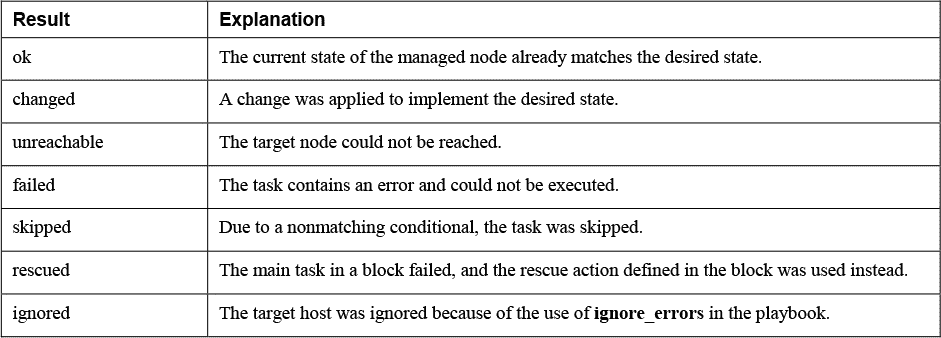

正如前面提到的，当你使用`ansible-playbook`命令时，可以使用一个或多个`-v`选项增加输出的详细程度。表格 11-3 列出了这些选项的作用。对于一般的故障排除，你可能希望考虑使用`-vv`，它会显示输出以及输入数据。在特殊情况下，使用`-vvv`选项可能有用，因为它还增加了连接信息。

`-vvvv`选项在很多情况下会带来过多的信息，但如果你需要分析执行了哪些具体的脚本或在权限提升过程中遇到了任何问题，它可能是很有用的。不过，请确保将运行`-vvvv`的命令输出捕获到文件中，以便方便阅读。即使是简单的 playbook，它也可能产生超过 10 页的输出。

#### 表格 11-3 详细程度选项概览

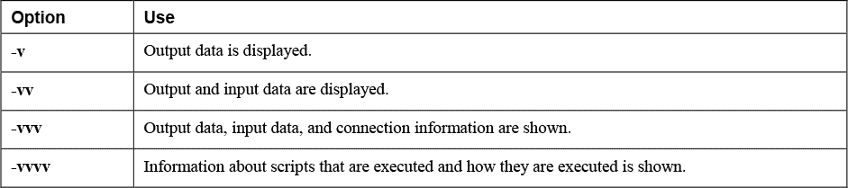

在列表 11-5 中，你可以看到在托管主机上运行不同任务的小型 playbook 的输出。列表 11-5 显示了主机`ansible4`上执行某个任务的详情，正如你所看到的，它显示的细节非常深入。有一个部分值得关注，那就是你在输出中看到的`escalation succeeded`。这意味着权限提升成功了，并且在`ansible.cfg`中定义了`become_user`后任务得以执行。权限提升失败是导致 playbook 执行出错的常见原因之一，因此关注这个指标是有意义的。

#### 列表 11-5 分析部分 -vvvv 输出


```text
<ansible4> ESTABLISH SSH CONNECTION FOR USER: ansible

<ansible4> SSH: EXEC ssh -vvv -C -o ControlMaster=auto -o ControlPersist=60s -o StrictHostKeyChecking=no -o KbdInteractiveAuthentication=no -o PreferredAuthentications=gssapi-with-mic,gssapi-keyex,hostbased,publickey -o PasswordAuthentication=no -o ’User="ansible"’ -o ConnectTimeout=10 -o ControlPath=/home/ansible/.ansible/cp/859d5267e3 ansible4 ’/bin/sh -c ’"’"’chmod u+x /home/ansible/.ansible/tmp/ansible-tmp-1587544652.4716983-118789810824208/ /home/ansible/.ansible/tmp/ansible-tmp-1587544652.4716983-118789810824208/AnsiballZ_systemd.py && sleep 0’"’"’’

Escalation succeeded

<ansible4> (0, b’’, b"OpenSSH_8.0p1, OpenSSL 1.1.1c FIPS  28 May 2019\r\ndebug1: Reading configuration data /etc/ssh/ssh_config\r\ndebug3: /etc/ssh/ssh_config line 51: Including file /etc/ssh/ssh_config.d/05-redhat.conf depth 0\r\ndebug1: Reading configuration data /etc/ssh/ssh_config.d/05-redhat.conf\r\ndebug2: checking match for ’final all’ host ansible4 originally ansible4\r\ndebug3: /etc/ssh/ssh_config.d/05-redhat.conf line 3: not matched ’final’\r\ndebug2: match not found\r\ndebug3: /etc/ssh/ssh_config.d/05-redhat.conf line 5: Including file /etc/crypto-policies/back-ends/openssh.config depth 1 (parse only)\r\ndebug1: Reading configuration data /etc/crypto-policies/back-ends/openssh.config\r\ndebug3: gss kex names ok: [gss-gex-sha1-,gss-group14-sha1-]\r\ndebug3: kex names ok: [curve25519-sha256,curve25519-sha256@libssh.org,ecdh-sha2-nistp256,ecdh-sha2-nistp384,ecdh-sha2-nistp521,diffie-hellman-group-exchange-sha256,diffie-hellman-group14-sha256,diffie-hellman-group16-sha512,diffie-hellman-group18-sha512,diffie-hellman-group-exchange-sha1,diffie-hellman-group14-sha1]\r\ndebug1: configuration requests final Match pass\r\ndebug1: re-parsing configuration\r\ndebug1: Reading configuration data /etc/ssh/ssh_config\r\ndebug3: /etc/ssh/ssh_config line 51: Including file /etc/ssh/ssh_config.d/05-redhat.conf depth 0\r\ndebug1: Reading configuration data /etc/ssh/ssh_config.d/05-redhat.conf\r\ndebug2: checking match for ’final all’ host ansible4 originally ansible4\r\ndebug3: /etc/ssh/ssh_config.d/05-redhat.conf line 3: matched ’final’\r\ndebug2: match found\r\ndebug3: /etc/ssh/ssh_config.d/05-redhat.conf line 5: Including file /etc/crypto-policies/back-ends/openssh.config depth 1\r\ndebug1: Reading configuration data /etc/crypto-policies/back-ends/openssh.config\r\ndebug3: gss kex names ok: [gss-gex-sha1-,gss-group14-sha1-]\r\ndebug3: kex names ok: [curve25519-sha256,curve25519-sha256@libssh.org,ecdh-sha2-nistp256,ecdh-sha2-nistp384,ecdh-sha2-nistp521,diffie-hellman-group-exchange-sha256,diffie-hellman-group14-sha256,diffie-hellman-group16-sha512,diffie-hellman-group18-sha512,diffie-hellman-group-exchange-sha1,diffie-hellman-group14-sha1]\r\ndebug1: auto-mux: Trying existing master\r\ndebug2: fd 4 setting O_NONBLOCK\r\ndebug2: mux_client_hello_exchange: master version 4\r\ndebug3: mux_client_forwards: requestings: 0, 0 remote\r\ndebug3: mux_client_request_session: entering\r\ndebug3: mux_client_request_alive: entering\r\ndebug3: mux_client_request_alive: done = 4764\r\ndebug3: mux_client_request_session: session request sent\r\ndebug3: mux_client_read_packet: read header failed: Broken pipe\r\ndebug2: Received exit status from master 0\n")<ansible4> ESTABLISH SSH CONNECTION FOR USER: ansible

<ansible4> SSH: EXEC ssh -vvv -C -o ControlMaster=auto -o ControlPersist=60s -o StrictHostKeyChecking=no -o KbdInteractiveAuthentication=no -o PreferredAuthentications=gssapi-with-mic,gssapi-keyex,hostbased,publickey -o PasswordAuthentication=no -o ’User="ansible"’ -o ConnectTimeout=10 -o ControlPath=/home/ansible/.ansible/cp/859d5267e3 ansible4 ’/bin/sh -c ’"’"’chmod u+x /home/ansible/.ansible/tmp/ansible-tmp-1587544652.4716983-118789810824208/ /home/ansible/.ansible/tmp/ansible-tmp-1587544652.4716983-118789810824208/AnsiballZ_systemd.py && sleep 0’"’’’

Escalation succeeded
```

### 优化命令输出

你可能已经注意到 Ansible 输出中的错误信息格式可能有些难读。幸运的是，通过 `ansible.cfg` 文件中包含两个选项可以使其变得更易读。这两个选项是 `stdout_callback = debug` 和 `stdout_callback = error`。包含这些选项后，你会发现阅读错误输出并区分其组件变得简单得多。

### 日志

默认情况下，Ansible 不会将任何内容写入日志文件。这是因为 Ansible 命令具有输出到 `STDOUT` 的选项。如果需要，始终可以使用 shell 重定向将命令输出写入文件。

如果你需要 Ansible 写入日志文件，可以在 `ansible.cfg` 中设置 `log_path` 参数。或者，Ansible 也可以写入 `ANSIBLE_LOG_PATH` 变量的文件。注意 Ansible 日志增长很快，如果启用了输出日志，请确保配置了 Linux 日志轮以限制文件大小。

### 逐任务运行

在分析 playbook 行为时，可以逐个运行 playbook 任务或从特定任务开始运行。`ansible-playbook --step` 命令逐任务运行 playbook，并在运行下一个任务之前提示确认。或者，你可以使用 `ansible-playbook --start-at-task="任务名称"` 命令从特定任务开始执行 playbook。在使用命令之前，你可能想使用 `ansible-playbook --list-tasks` 查看已配置的所有任务列表。为了高效使用这些选项，必须为每个任务配置相应的名称。在列表 11-6 中你可以看到这种运行 playbook 的效果。此列表首先展示如何在 playbook 中列出任务，然后是如何使用 `--start-at-task` 和 `--step` 选项。

#### 列表 11-6 逐个运行任务

```text
[ansible@control rhce8-book]$ ansible-playbook --list-tasks exercise81.yaml

playbook: exercise81.yaml

  play #1 (ansible1): testing file manipulation skills.    TAGS: []

    tasks:
      create a new file              TAGS: []
      check status of the new file   TAGS: []
      for debugging purposes only    TAGS: []
      change file owner if needed    TAGS: []
  play #2 (ansible1): fetching a remote file.    TAGS: []
    tasks:
      fetch file from remote machine.    TAGS: []
  play #3 (localhost): adding text to the file that is now on localhost TAGS: []
    tasks:
      add a message.    TAGS: []
  play #4 (ansible2): copy the modified file to ansible2\.    TAGS: []
    tasks:
      copy motd file.    TAGS: []
[ansible@control rhce8-book]$ ansible-playbook --start-at-task "add a message"  --step exercise81.yaml

PLAY [testing file manipulation skills] ****************************************

PLAY [fetching a remote file] **************************************************

PLAY [adding text to the file that is now on localhost] ************************

Perform task: TASK: Gathering Facts (N)o/(y)es/(c)ontinue:
```

在练习 11-1 中，你将学习如何在处理模板时应用检查模式（check mode）。

#### 练习 11-1 在检查模式下使用模板

1. 找到文件 `httpd.conf`；你可以在 `rhce8-book` 目录下找到它，你可以从 GitHub 仓库 [`github.com/sandervanvugt/rhce8-book`](https://github.com/sandervanvugt/rhce8-book) 下载。使用 `mv httpd.conf exercise111-httpd.j2` 将其重命名为 Jinja2 模板文件。

2. 使用编辑器打开 `exercise111-httpd.j2` 文件，并对现有参数进行修改，使其如下所示：

```apache
ServerRoot "{{ apache_root }}"

User {{ apache_user }}

Group {{ apache_group }}
```

3. 编写一个 playbook，用于完成 Apache Web 服务器的配置和安装、启动并启用该服务、在防火墙中打开端口，并使用模板模块根据你在本练习第 2 步中创建的模板创建 `/etc/httpd/conf/httpd.conf` 文件。名为 `exercise111.yaml` 的完整 playbook 如下所示（确保你的内容与下方显示的*完全一致*，且*切要*修正任何拼写错误）：

```yaml
---
- name: perform basic apache setup

  hosts: ansible2

  vars:

    apache_root: /etc/httpd
    apache_user: httpd
    apache_group: httpd

  tasks:

  - name: install RPM package
    yum:
      name: httpd
      state: latest
  - name: copy template file
    template:
      src: exercise111-httpd.j2
      dest: /etc/httpd/httpd.conf
  - name: start and enable service
    service:
      name: httpd
      state: started
      enabled: yes
  - name: open port in firewall
    firewalld:
      service: http
      permanent: yes
      state: enabled
      immediate: yes
```

4. 执行命令 `ansible-playbook --syntax-check exercise111.yaml`。如果 playbook 语法没有发现错误，你应该只会看到 playbook 的名称。

5. 执行命令 `ansible-playbook --check --diff exercise111.yaml`。在命令输出中，注意任务 `copy template file`。在以 `+++ after` 开头的行之后，你应该看到模板中配置为使用变量的行，并且使用了正确的变量。

6. 使用命令 `ansible-playbook --step exercise111.yaml` 运行 playbook 以逐步执行所有任务。按 `y` 确认第一步。接下来，按 `c` 自动继续。playbook 将在 `copy template file` 任务上失败，因为目标目录不存在。注意，`--syntax-check` 和 `--check` 不会检查 playbook 中的任何逻辑错误，因此它们没有检测到这个问题。

7. 编辑 `exercise111.yaml` 文件，并确保 `template` 任务包含以下修正后的行（替换掉以 `dest:` 开头的旧行）：

```yaml
dest: /etc/httpd/conf/httpd.conf
```

8. 输入 `ansible-playbook --list-tasks exercise111.yaml` 列出 playbook 中的所有任务。

9. 为了避免再次运行整个 playbook，使用 `ansible-playbook --start-at-task="copy template file" exercise111.yaml` 运行 playbook 直完成。

## 使用模块进行故障排除和测试


在编写 playbook 时，你可能可以使用不同的模块进行故障排除。`debug` 模块在之前的章节中已经过，对于分析变量的行为特别有用。在排查 Ansible 问题时，其他一些模块可能有用。表 11-4 提供了概述。

**表 11-4** 故障排除模块概述

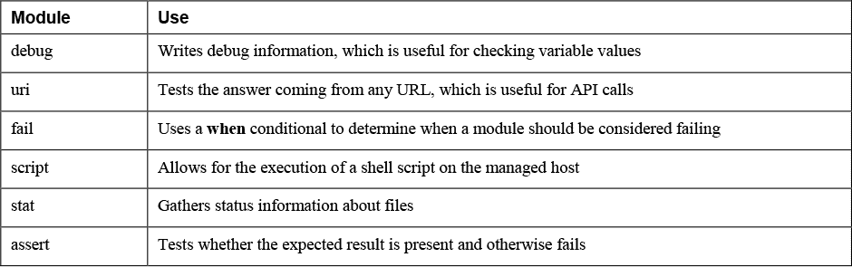

接下来的章节将讨论如何使用这些模块。

### 使用 Debug 模块

`debug` 模块对于可视化 playbook 在某一点正在发生的情况非常有用。它通过两个参数工作：`msg` 参数可以用于打印消息，`var` 参数可以用于打印变量的值。注意，当你使用 `var` 参数时，变量不需要通过特定的方式引用。

由于你已经在书的第 6、7、8 章中多次查看了 `debug` 模块的作用，这里不再包含新的示例。

### 使用 Uri 模块

学习如何使用这些模块的最佳方法是查看示例。列表 11-7 展示了一个使用 `uri` 模块的示例。

**列表 11-7** 使用 `uri` 模块

```yaml
---
- name: test webserver
  hosts: localhost
  become: no
  tasks:
  - name: connect to the web server
    uri:
      url: http://ansible2.example.com
      return_content: yes
    register: this
    failed_when: "’welcome’ not in this.content"
  - debug:
      var: this.content
```

在列表 11-8 中，你可以看到运行此 playbook 的部分结果。注意，playbook 不会产生失败，因为默认网页包含了“welcome”字样。

**列表 11-8** 使用 `uri` 模块

```bash
ansible-playbook --check --diff exercise111.yaml
```

使用 `uri` 模块可以用于简单的测试 Web 服务器是否可用，但你也可以用它来检查 API 端点返回的信息。

### 使用 Stat 模块

你可以使用 `stat` 模块来检查文件的状态。虽然该模块对于检查几个文件的状态很有用，但它并不是一个为了大规模检查文件状态而开发的文件系统完整性检查工具。如果你需要大规模的文件系统完整性检查，应该使用 Linux 工具，如 `aide`。

`stat` 模块与 `register` 结合使用非常有用。在这种用法中，`stat` 模块用于注册特定文件的状态，并在 `when` 语句中，可以检查该文件是否不符合预期。结合 `fail` 模块，你可以使用该模块生成失败并消息化文件不符合预期的状态。列表 11-9 展示了一个示例，列表 11-10 展示了结果输出，你可以看到由于文件所有者不是 root，`fail` 模块导致 playbook 失败。

**列表 11-9** 使用 `stat` 检查预期的文件状态

```yaml
---
- name: create a file
  hosts: all
  tasks:
  - file:
      path: /tmp/statfile
      state: touch
      owner: ansible
- name: check file status
  hosts: all
  tasks:
  - stat:
      path: /tmp/statfile
    register: stat_out
  - fail:
      msg: "/tmp/statfile file owner not as expected"
    when: stat_out.stat.pw_name != ’root’
```

## 列表 11-10 `ansible-playbook listing119.yaml` 命令结果

```text
[ansible@control rhce8-book]$ ansible-playbook listing119.yaml

PLAY [create a file] ***********************************************************

TASK [Gathering Facts] *********************************************************

ok: [ansible2]

ok: [ansible1]

ok: [ansible3]

ok: [ansible4]

fatal: [ansible6]: UNREACHABLE! => {"changed": false, "msg": "Failed to connect to the host via ssh: ansible@ansible6: Permission denied (publickey,gssapi-keyex,gssapi-with-mic,password).", "unreachable": true}

fatal: [ansible5]: UNREACHABLE! => {"changed": false, "msg": "Failed to connect to the host via ssh: ssh: connect to host ansible5 port 22: No route to host", "unreachable": true}

TASK [file] ********************************************************************

changed: [ansible2]

changed: [ansible1]

changed: [ansible3]

changed: [ansible4]

PLAY [check file status] *******************************************************

TASK [Gathering Facts] *********************************************************

ok: [ansible1]

ok: [ansible2]

ok: [ansible3]

ok: [ansible4]

TASK [stat] ********************************************************************

ok: [ansible2]

ok: [ansible1]

ok: [ansible3]

ok: [ansible4]

TASK [fail] ********************************************************************

fatal: [ansible2]: FAILED! => {"changed": false, "msg": "/tmp/statfile file owner not as expected"}

fatal: [ansible1]: FAILED! => {"changed": false, "msg": "/tmp/statfile file owner not as expected"}

fatal: [ansible3]: FAILED! => {"changed": false, "msg": "/tmp/statfile file owner not as expected"}

fatal: [ansible4]: FAILED! => {"changed": false, "msg": "/tmp/statfile file owner not as expected"}

PLAY RECAP *********************************************************************

ansible1                   : ok=4    changed=1    unreachable=0    failed=1    skipped=0    rescued=0    ignored=0
ansible2                   : ok=4    changed=1    unreachable=0    failed=1    skipped=0    rescued=0    ignored=0
ansible3                   : ok=4    changed=1    unreachable=0    failed=1    skipped=0    rescued=0    ignored=0
ansible4                   : ok=4    changed=1    unreachable=0    failed=1    skipped=0    rescued=0    ignored=0
ansible5                   : ok=0    changed=0    unreachable=1    failed=0    skipped=0    rescued=0    ignored=0
ansible6                   : ok=0    changed=0    unreachable=1    failed=0    skipped=0    rescued=0    ignored=0
```

## 使用 assert 模块

`assert` 模块与 `fail` 模块相似。你可以使用它来执行特定的条件动作。`assert` 模块通过 `that` 选项工作，该选项定义了一个条件列表。如果这些条件中的任何一个为假，任务就会失败；如果所有条件都真，则任务成功。根据任务的成功或失败，该模块使用 `success_msg` 或 `fail_msg` 选项打印消息。列表 11-11 显示使用 `assert` 模块的示例。

### 列表 11-11 使用 `assert` 模块

```yaml
---
- hosts: localhost
  vars_prompt:
  - name: filesize
    prompt: "specify a file size in megabytes"
  tasks:
  - name: check if file size is valid
    assert:
      that:
      - "{{ (filesize | int) <= 100 }}"
      - "{{ (filesize | int) >= 1 }}"
      fail_msg: "file size must be between 0 and 100"
      success_msg: "file size is good, let\’s continue"
  - name: create a file
    command: dd if=/dev/zero of=/bigfile bs=1 count={{ filesize }}
```

列表 11-11 中的示例包含了一些新项。如你所见，play 头部以 `vars_prompt` 开头。这定义了一个名为 `filesize` 的变量，该变量基于用户提供的输入。这个 `filesize` 变量紧接着被 `assert` 模块使用。`that` 语句包含一个列表，其中列出了两个条件。如果像这样指定，`that` 条件中列出的所有条件都必须为真。因此，你要求 `filesize` 大于或等于 1 且小于或等于 100。

在此之前，需要处理一个小问题：当使用 `vars_prompt` 时，变量类型默认被设置为字符串。这意味着像 `filesize <= 100` 语句会因为类型不匹配而失败。这就是为什么使用 Jinja2 过滤器将变量类型从字符串转换为整数。

过滤器是 Jinja2 模板语言提供的一项强大功能，可以在 Ansible 中用于处理之前修改变量。有关过滤器的更多信息，请参阅 `https://docs.ansible.com/ansible/latest/user_guide/playbooks_filters.html`。`int` 过滤器可将字符串变量的值转换为整数。要实现这一点，你需要将整个变量重写为 Jinja2 操作，这是通过 `{{ (filesize | int) <= 100 }}` 完成的。在这一行中，整个字符串被作为一个变量写入。在此语境下，`(filesize | int)` 确保字符串被转换为整数，从而能够检查值是否小于 100。

当你运行列表 11-11 中的代码时，将产生列表 11-12 所示的结果。

### 列表 11-12 `ansible-playbook listing111.yaml` 输出

```text
[ansible@control rhce8-book]$ ansible-playbook listing111.yaml

PLAY [localhost] *************************************************

TASK [Gathering Facts] *************************************************

ok: [localhost]

TASK [check if file size is valid] *******************************

fatal: [localhost]: FAILED! => {
    "assertion": "filesize <= 100",
    "changed": false,
    "evaluated_to": false,
    "msg": "file size must be between 0 and 100"
}

PLAY RECAP *******************************************************

localhost                  : ok=1    changed=0    unreachable=0    failed=1    skipped=0/rescued=0    ignored=0
```

如所示，使用 `assert` 模块定义的任务失败了，因为变量的值不在定义的范围内。

理解需要使用过滤器转换变量类型的需求可能并不容易。因此，让我们看看列表 11-13，它展示了一个会失败的 playbook 示例。你可以在列表 11-14 中看到执行该 playbook 时的行为。

### 列表 11-13 列表 11-1 Playbook 的失败版本

```yaml
---
- hosts: localhost
  vars_prompt:
  - name: filesize
    prompt: "specify a file size in megabytes"
  tasks:
  - name: check if file size is valid
    assert:
      that:
      - filesize <= 100
      - filesize >= 1
      fail_msg: "file size must be between 0 and 100"
      success_msg: "file size is good, let\’s continue"
  - name: create a file
    command: dd if=/dev/zero of=/bigfile bs=1 count={{ filesize }}
```

### 列表 11-14 `ansible-playbook listing1113.yaml` 失败结果

```text
[ansible@control rhce8-book]$ ansible-playbook listing1113.yaml

specify a file size in megabytes:

PLAY [localhost] *****************************************************************

TASK [Gathering Facts] ***********************************************************

ok: [localhost]

TASK [check if file size is valid] ***************************************************************

fatal: [localhost]: FAILED! => {"msg": "The conditional check ’filesize <= 100’ failed. The error was: Unexpected templating type error occurred on ( True  False ): ’<=’ not supported between instances of ’str’ and ’int’"}

PLAY RECAP ***********************************************************************

localhost                  : ok=1    changed=0    unreachable=0    failed=1    skipped=0    rescued=0    ignored=0
```

如你所见，列表 11-13 中的代码失败了，因为字符串和整数之间不支持 `<=` 测试。

在练习 11-2 中，你将使用本节讨论的某些模块。

#### 练习 11-2 使用模块进行故障排除


1. 打开编辑器创建文件 `exercise112.yaml`，并定义 play 头部：

```yaml
---
- name: using assert to check if volume group vgdata exists
  hosts: all
  tasks:
```

2. 添加一个任务，使用 `vgs vgdata` 命令来检查是否存在名为 `vgdata` 的卷组。该任务应该使用 `register` 来注册命令结果，并且在该卷组不存在时应继续执行。

```yaml
- name: check if vgdata exists
  command: vgs vgdata
  register: vg_result
  ignore_errors: true
```

3. 为了方便在下一步对右变量使用 `assert`，请包含一个 `debug` 任务来显示变量的值：

```yaml
- name: show vg_result variable
  debug:
    var: vg_result
```

4. 添加一个任务，根据第一个任务中 `vgs` 命令的结果打印成功或失败消息：

```yaml
- name: print a message
  assert:
    that:
    - vg_result.rc == 0
    fail_msg: volume group not found
    success_msg: volume group was found
```

5. 使用命令 `ansible-playbook exercise112.yaml` 验证内容。假设未找到 LVM 卷组 `vgdata`，它应该打印“volume group not found”。

6. 修改 playbook 以验证如果找到了请求的卷组，将打印 `success_msg`。你可以通过让它运行 `vgs cl` 命令来实现，这在 CentOS 8 上应该给出一个积极的结果。

## 使用标签（Tags）

当你使用较大的 playbook 时，Ansible 允许你使用 `tags` 属性。标签是一个应用于任务或其他项目（如块或 play）的标识符。在使用 `ansible-playbook --tags` 或 `ansible-playbook --skip-tags` 命令时，你可以指定需要执行哪些标签。列表 11-15 显示了一个使用标签的简单 playbook 示例，在列表 11-16 中你可以看到运行此 playbook 时生成的输出。

### 列表 11-15 在 Playbook 中使用 tags

```yaml
---
- name: using tags example
  hosts: all
  vars:
    service:
    - vsftpd
    - httpd
  tasks:
  - yum:
      name:
      - httpd
      - vsftpd
      state: present
    tags:
    - install
  - service:
      name: "{{ item }}"
      state: started
      enabled: yes
    loop: "{{ services }}"
    tags:
    - services
```

### 列表 11-16 `ansible-playbook --tags "install" listing1115.yaml` 输出

```text
[ansible@control rhce8-book]$ ansible-playbook --tags "install" listing1115.yaml

PLAY [using tags example] ******************************************************

TASK [Gathering Facts] *********************************************************

ok: [ansible2]

ok: [ansible1]

ok: [ansible4]

ok: [ansible3]

TASK [yum] *********************************************************************

ok: [ansible2]

ok: [ansible1]

changed: [ansible3]

changed: [ansible4]

PLAY RECAP *********************************************************************

ansible1                   : ok=2    changed=0    unreachable=0    failed=0    skipped=0    rescued=0    ignored=0

ansible2                   : ok=2    changed=0    unreachable=0    failed=0    skipped=0    rescued=0    ignored=0

ansible3                   : ok=2    changed=1    unreachable=0    failed=0    skipped=0    rescued=0    ignored=0

ansible4                   : ok=2    changed=1    unreachable=0    failed=0    skipped=0    rescued=0    ignored=0
```

## 连接到托管主机

要能够连接到托管主机，你首先需要 IP 网络连接。此外，你还需要确保该主机已正确设置：

- 远程主机上需要可以访问 SSH 服务。
- 必须安装 Python。
- 需要设置好权限提升（Privilege escalation）。

除了这些之外，可能还会指定清单（inventory）设置以指示如何连接到远程主机。通常情况下，清单只包含主机名。如果一个主机解析为多个 IP 地址，你可能希望指定具体如何连接到远程主机。可以通过配置 `ansible_host` 参数来实现。例如，在清单中，你可能包含以下行以确保你的主机以正确的方式进行连接：

```text
ansible5.example.com ansible_host=192.168.4.55
```

注意，这种设置仅在主机可以通过多个不同的 IP 地址访问的环境中才有意义。

要测试与远程主机的连接性，你可以使用 `ping` 模块。它检查 IP 通性、SSH 服务的可访问性、sudo 权限提升以及 Python 栈的可用性。`ping` 模块不接受任何参数。列表 11-18 显示了运行临时命令 `ansible all -m ping` 的结果，其中可用主机会发送“pong”作为回复，而对于不可用主机，你将看到它们不可用的原因。

### 列表 11-18 使用 ping 模块验证连接性

```text
[ansible@control rhce8-book]$ ansible all -m ping

ansible2 | SUCCESS => {
    "ansible_facts": {
        "discovered_interpreter_python": "/usr/libexec/platform-python"
    },
    "changed": false,
    "ping": "pong"
}

ansible1 | SUCCESS => {
    "ansible_facts": {
        "discovered_interpreter_python": "/usr/libexec/platform-python"
    },
    "changed": false,
    "ping": "pong"
}

ansible3 | SUCCESS => {
    "ansible_facts": {
        "discovered_interpreter_python": "/usr/libexec/platform-python"
    },
    "changed": false,
    "ping": "pong"
}

ansible4 | FAILED! => {
    "msg": "Missing sudo password"
}
```

## 分析身份认证问题

在远程主机上执行任务时，有几个设置对身份认证起作用：


- `remote_user` 设置决定了在托管节点上使用哪个用户账户。
- 需要为 `remote_user` 配置 SSH 密钥以实现顺畅的身份认证。
- `become` 参数需要设置为 `true`。
- `become_user` 需要设置为 root 用户账户。
- Linux sudo 需要被正确设置。

在练习 11-4 中，你将练习对一些常见场景进行故障排除。

### 练习 11-4 排除连接性问题

1. 使用编辑器创建文件 `exercise114-1.yaml` 并赋予包含以下内容：

```yaml
---
- name: remove user from wheel group
  hosts: ansible4
  tasks:
  - user:
      name: ansible
      groups: ''
```

2. 使用 `ansible-playbook exercise114-1.yaml` 运行 playbook 并使用 `ansible ansible4 -m reboot` 重启节点 `ansible4`。

3. 重启完成后，使用 `ansible all -m ping` 验证连接性。主机 `ansible4` 应返回“Missing sudo password”错误。

4. 输入 `ansible ansible4 -m raw -a “usermod -aG wheel ansible” -u root -k`，使用户 `ansible` 再次成为 `wheel` 组的成员。

5. 重复 `ansible all -m ping` 命令。你现在应该能够正常连接到主机 `ansible4` 了。

## 总结

在本章中，你学习了关于 Ansible 的故障排除。我们涵盖了四个与故障排除相关的主题。首先，你学习了如何确保在运行任务时打印出足够的故障排除信息。本节涵盖了处理日志文件、运行检查模式以及增加详细性级别。接下来，你学习了如何使用不同的模块，这些模块对于深入了解 playbook 的成功或失败可能很有帮助。第三个主题是关于使用标签（tags），这对于只运行特定任务可能特别有用。在最后一个主题中，你学习了如何对一些常见场景进行故障排除。

## 考试准备任务

正如引言中“如何使用本书”部分提到的，你有几种准备考试的方案：此处的练习、第 16 章、“最终准备”以及配套网站上的考试模拟题。

## 复习所有关键主题

复习本章最重要的主题，这些主题在页外边缘用关键主题（Key Topics）图标进行了标记。表 11-6 列出了这些关键主题的参考以及它们所在的页码。


### 表 11-6 第 11 章的关键主题


## 记忆表格

打印附录 D，“记忆表格](#app04.xhtml_app04)”的副本，参考配套网站本章章节并完成表格。

## 定义术语

定义本章的以下术语，并在术语表中检查答案：

- check mode
- filter
- tag

## 复习题

1. 你可以做什么确保任务不运行？
2. 如果主任务失败并执行了 rescue 操作，你会在 playbook 输出中看到什么？
3. 在 `ansible.cfg` 中设置哪个参数来指定 Ansible 输出日志的位置？
4. 你应该使用哪个模块来分析 API？
5. 你想编写一个 playbook 定义一个条件来指定何时任务视为失败。你应该使用哪个模块？
6. 你应该使用哪个模块来测试预期结果是否存在，并在所有其他情况下失败？
7. 如何将变量数据类型从字符串转换为整数？
8. 使用哪个标签可以确保除非被特别请求否则永远不运行？
9. 一个任务被配置为 `debug, never`。你如何运行 playbook 以包含该任务？
10. 你应该使用什么命令来验证与 Ansible 管理机器的连接？

## 章末实验

现在我们到达了本章的末尾，让我们做一个实验吧！下面的实验将让你练习故障排除技能。

### 实验 11-1

`lesson11-lab.yaml` playbook 包含一些错误。请根据以下指令修复它们：

- 使用命令行工具和参数来查找错误。不要仅仅通过读取 YAML 文件来修复，即使某些错误显而易见。
- 在修复一个任务的错误后，从下一个任务开始运行 playbook。
- 在应用模板之前，使用空运行（dry-run）和差异（diff）查看模板将更改什么。
- 在需要时使用 `debug` 模块。

# 软件包与存储库

## “我掌握这些了吗？”测验

“我掌握这些了吗？”测验可以让你评估自己应该透彻阅读整个章节，还是直接跳到“考前准备任务”部分。如果你对这些问题的答案或对你自己这些主题知识的自评有疑问，请阅读整个章节。表 12-1 列出了本章的主要标题及其对应的“我掌握这些了吗？”测验题。你可以在附录 A“‘我掌握这些了吗？测验与考试题答案](#app01.xhtml_app01)”中找到答案。

### 表 12-1 “我掌握这些了吗？”章节与问题映射


**1.** 你应该使用哪个模块来设置 `yum` 存储库的访问？

**a.** `yum`

**b.** `dnf`

**c.** `repository`

**d.** `yum_repository`

**2.** 你如何获取受管机器上安装的软件包的事实（facts）？

**a.** 软件包事实通过 `setup` 模块执行的默认事实收集收集。

**b.** 软件包事实需要使用 `package_facts` 模块单独收集。

**c.** 没有收集软件包事实的模块。请使用 `command` 模块代替。

**d.** 没有收集软件包事实的模块。请使用 `shell` 模块代替。

**3.** 使用 `yum_repository` 模块时应使用哪个参数来指定在 RHEL 受管机器上创建的存储库文件名？

**a.** `file`

**b.** `name`

**c.** `filename`

**d.** `repofile`

**4.** 下面行中哪一行显示了安装 AppStream 模块的正确语法？

**a.** `name: ’mymodule:1.2/devel’`

**b.** `name: mymodule:1.2/devel`

**c.** `name: ’@mymodule:1.2/devel’`

**d.** `name: @mymodule:1.2/devel`

**5.** 你将如何对系统上的所有软件包进行更新？

**a.** 使用 `yum_update` 模块。

**b.** 使用 `update: all` 作为 `yum` 模块的参数。

**c.** 使用 `name: ’*’` 和 `state: latest` 作为 `yum` 模块的参数。

**d.** 使用 `update: ’*’` 作为 `yum` 模块的参数。

**6.** 在设置存储库服务器时，你可以使用哪个模块来生成存储库元数据？

**a.** `yumrepository`

**b.** `command`

**c.** `yumrepo`

**d.** `createrepo`

**7.** 你可以使用 `yum` 模块通过 `download_only` 参数来下载软件包。关于使用该参数的以下陈述哪项是正确的？

**a.** `download_only` 参数将软件包下载到当前目录。

**b.** `download_only` 参数将软件包下载到 `/var/lib/rpm` 目录。

**c.** `download_only` 参数将软件包下载到 `/tmp` 目录。

**d.** 当使用 `download_only` 时，你还必须使用 `download_dir` 参数来指定软件包下载到哪个目录。

**8.** 你可以使用哪些模块来在已通过 Subscription Manager 注册的 RHEL 系统上设置存储库访问？（选择两个）

**a.** `rhsm_repository`

**b.** `yum_repository`

**c.** `rhel_repository`

**d.** `redhat_subscription`

**9.** 你想使用 playbook 配置一个新主机。为此，你想将主机名设置为一个变量，以便其可以在 playbook 中的所有任务（plays）中使用。你该如何操作？

**a.** 在 playbook 头中设置变量。

**b.** 在第一个任务的头中设置变量。

**c.** 使用 `vars_prompt` 提示输入变量值。

**d.** 使用 `-e varname=value` 选项在运行 playbook 时作为启动选项提供变量。

**10.** 在 Ansible 中使用 `redhat_subscription` 模块时，必须设置用户名和密码。你应该如何提供它们？（选择两个）

**a.** 为 `redhat_subscription` 模块设置用户名和密码参数。

**b.** 使用 `vars_prompt` 在 playbook 运行时提示输入变量。

**c.** 使用 Ansible Vault 安全地存储这些变量的值。


**d.** 在使用 `ansible-playbook` 命令运行 playbook 时，使用 `-e` 命令行选项指定变量。

## 基础主题

### 使用模块管理软件包

在受管节点上管理软件包是使用 Ansible 的基本要求之一。提供了许多模块。表 12-2。

**表 12-2** 软件管理


#### 配置存储库访问

在管理任何软件之前，你需要设置存储库访问。为此，提供了 `yum_repository` 模块。列表 12-1 显示了示例。

```yaml
---
- name: setting up repository
  hosts: ansible2
  tasks:
  - name: connect to example
    yum_repository:
      name: example repo
      description: example repo
      file: example
```

#### 使用 yum 管理软件

`yum` 模块可以管理软件包。你使用它安装、删除或更新软件包。这可以针对单个软件包，也可以针对软件包组和模块。让我们查看一些超出安装或删除的示例，后者在之前的章节中已经充分涵盖。列表 12-2 显示了一个可以更新系统上所有软件包的模块。

```yaml
---
- name: updating all packages
  hosts: ansible2
  tasks:
  - name: system update
    yum:
      name: ’*’
      state: latest
```

列表 12-3 显示了一个使用 `yum` 软件包组来安装 Virtualization Host 软件包组的示例。

```yaml
---
- name: install or update a package group
  hosts: ansible2
  tasks:
  - name: install or update a package group
    yum:
      name: ’@Virtualization Host’
      state: latest
```

当需要安装 `yum` 软件包组而不是单个软件包时，包组的名称需要以 at 符号（`@`）开头，并且整个包组名称需要放在单引号之间。此外，注意列表 12-3 中使用了 `state: latest`。此行确保如果包组中的软件包尚未安装，则将进行安装。如果它们已经安装，则将它们更新到最新版本。

RHEL 8 的一个新功能是 `yum` AppStream 模块。通过 Linux `yum modules list` 命令列出的模块也可以用 Ansible 的 `yum` 模块进行管理。使用 `yum` 模块与使用 `yum` 软件包组类似。在列表 12-4 的示例中，主要的区别在于模块名称中包含了版本号和安装配置。

**列表 12-4** 使用 `yum` 模块安装 AppStream 模块

```yaml
---
- name: installing an AppStream module
  hosts: ansible2
  tasks:
  - name: install or update an AppStream module
    yum:
      name: ’@php:7.3/devel’
      state: present
```

---

**注意**

在使用 `yum` 模块安装多个软件包时，你可以为 `name` 参数提供一个包含多个软件包的列表。或者，你可以在循环中提供多个软件包。在这些解决方案中，始终优选使用包含多个软件包的列表作为 `name` 的参数。如果在循环中提供多个软件包名称，则模块必须为每一个软件包执行一次任务。如果作为 `name` 参数提供多个软件包名称，`yum` 可以在单个任务中安装所有这些软件包。

---

### 管理软件包事实（Managing Package Facts）

当 Ansible 收集事实（gathering facts）时，并不包含软件包事实（package facts）。要同样包含软件包事实，你需要运行一个单独的任务；也就是说，你需要使用 `package_facts` 模块。关于软件包已收集的事实存储在 `ansible_facts.packages` 变量中。列表 12-5 中的示例剧本展示了如何使用 `package_facts` 模块。

**列表 12-5** 使用 `package_facts` 模块显示软件包详情

```yaml
---
- name: using package facts
  hosts: ansible2
  vars:
    my_package: nmap
  tasks:
  - name: install package
    yum:
      name: "{{ my_package }}"
      state: present
  - name: update package facts
    package_facts:
      manager: auto
  - name: show package facts for {{ my_package }}
    debug:
      var: ansible_facts.packages[my_package]
    when: my_package in ansible_facts.packages
```

如你所示，`package_facts` 模块不需要做太多工作就能完成任务。这里使用的唯一参数是 `manager` 参数，它指定了与哪个包管理器进行通信。它的默认值 `auto` 会自动检测合适的包管理器并使用它。如果你愿意，可以手动指定包管理器，使用任何包管理器如 `yum` 或 `dnf`。列表 12-6 显示了运行列表 12-5 剧本的输出，你可以在其中看到由 `package_facts` 模块收集的详情。

**列表 12-6** 运行 `ansible-playbook listing125.yaml` 的结果

```text
[ansible@control rhce8-book]$ ansible-playbook listing125.yaml

PLAY [using package facts] **************************************************************

TASK [Gathering Facts] ******************************************************************

ok: [ansible2]

TASK [install package] ******************************************************************

ok: [ansible2]

TASK [update package facts] *************************************************************

ok: [ansible2]

TASK [show package facts for my_package] ************************************************

ok: [ansible2] => {
    "ansible_facts.packages[my_package]": [
        {
            "arch": "x86_64",
            "epoch": 2,
            "name": "nmap",
            "release": "5.el8",
            "source": "rpm",
            "version": "7.70"
        }
    ]
}

PLAY RECAP ******************************************************************************

ansible2                   : ok=4    changed=0    unreachable=0    failed=0    skipped=0    rescued=0    ignored=0
```

在练习 12-1 中，你可以练习使用 Ansible 提供的用于模块管理的不同工具。

**练习 12-1 管理软件软件包**

1. 使用你的编辑器创建一个名为 `exercise121.yaml` 的新文件。

2. 编写一个剧本头部（play header），定义变量 `my_package` 并将其值设置为 `virt-manager`：

```yaml
---
- name: exercise121
  hosts: ansible2
  vars:
    my_package: virt-manager
  tasks:
```

3. 添加一个任务，根据提供的变量名安装该软件包：

```yaml
- name: install package
  yum:
    name: "{{ my_package }}"
    state: present
```

4. 添加一个任务，收集该软件包的事实：

```yaml
- name: update package facts
  package_facts:
    manager: auto
```

5. 作为练习的最后一部分，添加一个显示你安装的软件包的任务：

```yaml
- name: show package facts for {{ my_package }}
  debug:
    var: ansible_facts.packages[my_package]
  when: my_package in ansible_facts.packages
```

6. 使用 `ansible-playbook listing125.yaml` 运行剧本并验证其输出。

### 使用模块管理仓库和订阅

为了处理软件包，你需要确保仓库是可用的且订阅是有效的。在上一节中，你学习了如何编写启用现有仓库的剧本。在本节中，你将学习如何管理 RHEL 订阅。

#### 设置仓库

大多数系统在安装操作系统时访问默认发行版。在某些情况下，外部仓库可能无法访问。发生这种情况，你需要自己设置仓库。但在那，重要的是了解什么是仓库。仓库是一个包含 RPM 文件以及仓库元数据的目录，元数据是允许仓库客户端确定仓库中有哪些软件包的索引。

Ansible 未提供一个特定的模块来设置仓库。你必须使用多个模块来实现。具体涉及哪些模块取决于你想要如何设置仓库。例如，如果你想在 Ansible 控制机上设置基于 FTP 的仓库，你需要完成以下任务：

- 安装 FTP 软件包。
- 启动并启用 FTP 服务。
- 为 FTP 流量开放防火墙。
- 确保 FTP 共享目录可用。
- 将软件包下载到仓库目录。
- 使用 Linux `creatpo` 命令生成每个仓库所需的索引。

列表 12-7 中的剧本提供了如何进行操作的示例。

**列表 12-7** 设置基于 FTP 的仓库

```yaml
---
- name: install FTP to export repo
  hosts: localhost
  tasks:
  - name: install FTP server
    yum:
      name:
      - vsftpd
      - createrepo_c
      state: latest
  - name: start FTP server
    service:
      name: vsftpd
      state: started
      enabled: yes
  - name: open firewall for FTP
    firewalld:
      service: ftp
      state: enabled
      permanent: yes

- name: setup the repo directory
  hosts: localhost
  tasks:
  - name: make directory
    file:
      path: /var/ftp/repo
      state: directory
  - name: download packages
    yum:
      name: nmap
      download_only: yes
      download_dir: /var/ftp/repo
  - name: createrepo
    command: createrepo /var/ftp/repo
```

设置仓库的最重要任务是 `download packages` 和 `createrepo` 任务。在 `download packages` 任务中，使用 `yum` 模块来下载单个软件包。为了执行此操作，使用了 `download_only` 参数来确保软件包不被安装，而是下载到目录中。当你使用 `download_only` 参数时，还必须指定软件包需要安装的位置。为了实现这一点，任务使用了 `download_dir` 参数。

不过，使用这种方法下载软件包有一个缺点：它需要对仓库的访问权限。如果无法访问仓库，则可以使用 `fetch` 模块代替，来从特定的 URL 下载文件。

## 管理 GPG 密钥

为了保证软件包的完整性，大多数仓库在设置时都配置了 GPG 密钥。这允许客户端验证软件包在从仓库服务器到客户端的传输过程中没有被篡改。因此，如果从互联网上的仓库服务器安装软件包，那么在使用 `yum_repository` 模块时，你应该务始终确保设置了 `gpgcheck: yes`。

但是，如果你想确保执行 GPG 检查，你仍然需要确保客户端知道从哪里获取仓库密钥。为了这一点，你可以使用 `rpm_key` 模块。你可以在列表 12-8 中看到如何这样做。请注意，此列表中的 playbook 无法运行，因为没有可用的受 GPG 保护的仓库。设置 GPG 保护仓库是复杂的，超出了 EX294 目标的范围，因此此处不再进行介绍。

**列表 12-8** 使用 `rpm_key` 获取 RPM 密钥

```yaml
- name: use rpm_key in repository access
  hosts: all
  tasks:
  - name: get the GPG public key
    rpm_key:
      key: ftp://control.example.com/repo/RPM-GPG-KEY
      state: present

  - name: set up the repository client
    yum_repository:
      file: myrepo
      name: myrepo
      description: example repo
      baseurl: ftp://control.example.com/repo
      enabled: yes
      gpgcheck: yes
      state: present
```

## 管理 RHEL 订阅

当你使用 Red Hat Enterprise Linux（RHEL）时，仅使用上述描述的方法配置仓库访问是不够的。Red Hat Enterprise Linux 通过订阅进行工作，为了能够访问通过你的订阅权限提供的软件，你需要设置受托管系统来访问这些订阅。

**提示**

RHEL 及其 Ansible 均提供免费的开发者订阅。如果你还没有有效的订阅，但想在 RHEL 上测试本节描述的主题，请访问 [`developers.redhat.com`](https://developers.redhat.com) 注册并申请免费订阅。

要了解如何使用 Ansible 模块来注册 RHEL 系统，你需要了解如何使用 Linux 命令行工具（此处原文误应为 Linux 命令行工具）。当你从 Linux 命令行管理订阅时，会涉及到多个步骤。

1. 首先，你使用 `subscription-manager register` 命令提供你的 RHEL 凭据。例如，使用 `subscription-manager register --username=yourname --password=yourpassword`。

2. 接下来，你需要找到账户中有哪些可用的池（pools）。池是你的账户可用的软件通道集合。使用 `subscription-manager list --available` 查看概览。

3. 现在，你可以使用 `subscription-manager attach --pool=*poolID` 连接到特定的池。注意，如果你的账户中只有一个可用的订阅池，则你不需要提供 `--pool` 参数。

4. 接下来，你需要通过 `subscription-manager repos --list` 找出你的账户还有哪些额外的可用仓库。

5. 要注册使用额外的仓库，你使用 `subscription-manager repos --enable “repos name”`。你的系统将获得对其订阅及相关仓库的完全访问。

Ansible 两个重要的模块：

- `redhat_subscription`：此模块允许你在一个任务中完成订阅和注册。
- `rhsm_repository`：此模块允许你添加订阅管理器仓库。

列表 12-9 显示了一个使用这些模块完全注册新 RHEL 8 机器并为受托管机器添加新仓库的 playbook 示例。注意，此 playbook 本身是不可运行的，因为需要提供额外的重要信息。稍后在“实现管理软件的 Playbook”章节中的练习 12-3 将引导你进入一个场景，展示如何在生产环境中使用此代码。

**列表 12-9** 使用订阅管理器设置 Ansible


```
---

- name: use subscription manager to register and set up repos

  hosts: ansible5

  tasks:

  - name: register and subscribe ansible5
    redhat_subscription:
      username: bob@example.com
      password: verysecretpassword
      state: present

  - name: configure additional repo access
    rhsm_repository:
      name:
        - rh-gluster-3-client-for-rhel-8-x86_64-rpms
        - rhel-8-for-x86_64-appstream-debug-rpms
      state: present
```

在列表 12-9 的示例 playbook 中，你可以看到如何使用 `redhat_subscription` 和 `rhsm_repository` 模块。注意 `redhat_subscription` 需要密码。在列表 12-9 中，密码是以明文形式提供的。从安全角度来看，这是一个糟糕的做法。你应该使用 Ansible Vault。练习 12-3 将引导你完成这种操作设置。

在练习 12-2 中，你将被引导完成设置并使用自己的仓库的过程。该过程由两个部分组成。在第一部分，你设置一个基于 FTP 的仓库服务器。因为在 Ansible 中你经常需要配置你不熟悉的主题，你设置了 FTP 服务器并更改了其配置。接下来，你编写第二个 playbook 来配置客户端访问仓库，并在安装软件包。

## 练习 12-2 设置仓库

1. 使用编辑器创建文件 `exercise122-server.yaml`。

2. 定义设置基础 FTP 配置的 play。由于此时你应该已经熟悉所有的任务了，你可以一次性输入所有任务：

```
---

- name: install, configure, start and enable FTP
  hosts: localhost

  tasks:

  - name: install FTP server
    yum:
      name: vsftpd
      state: latest

  - name: allow anonymous access to FTP
    lineinfile:
      path: /etc/vsftpd/vsftpd.conf
      regexp: ’^anonymous_enable=NO’
      line: anonymous_enable=YES

  - name: start FTP server
    service:
      name: vsftpd
      state: started
      enabled: yes

  - name: open firewall for FTP
    firewalld:
      service: ftp
      state: enabled
      immediate: yes
      permanent: yes
```

3. 设置仓库目录。在 playbook 中添加以下 play。注意 `download packages` 任务的使用，它使用 `yum` 模块下载软件包而不安装。还要注意 `createrepo` 任务，它创建仓库元数据将 `/var/ftp/repo` 目录转换为仓库。

```yaml
- name: setup the repo directory
  hosts: localhost
  tasks:
  - name: make directory
    file:
      path: /var/ftp/repo
      state: directory
  - name: download packages
    yum:
      name: nmap
      download_only: yes
      download_dir: /var/ftp/repo
  - name: install createrepo package
    yum:
      name: createrepo_c
      state: latest
  - name: createrepo
    command: createrepo /var/ftp/repo
    notify:
    - restart_ftp
  handlers:
  - name: restart_ftp
    service:
      name: vsftpd
      state: restarted
```

4. 使用命令 `ansible-playbook exercise122-server.yaml` 在 `control.example.com` 上设置 FTP 服务。如果你没有出现任何拼写错误，你不应该会遇到任何错误。

5. 现在仓库服务器已经安装完成，是时候设置仓库客户端了。使用你的编辑器创建 `exercise122-client.yaml` 文件，并编写如下 play 头部：

```yaml
---
- name: configure repository
  hosts: all
  vars:
    my_package: nmap
  tasks:
```

6. 添加一个使用 `yum_repository` 模块的任务来配置对新仓库的访问：

```yaml
- name: connect to example repo
  yum_repository:
    name: exercise122
    description: RHCE8 exercise 122 repo
    file: exercise122
    baseurl: ftp://control.example.com/repo/
    gpgcheck: no
```

7. 设置好仓库客户端后，你还需要确保客户端知道如何通过其名称访问仓库服务器。添加下一个任务，向 `/etc/hosts` 写入一个新行，以确保客户端上的主机名解析已正确设置：

```yaml
- name: ensure control is resolvable
  lineinfile:
    path: /etc/hosts
    line: 192.168.4.200  control.example.com  control
- name: install package
  yum:
    name: "{{ my_package }}"
    state: present
```

8. 如果你在使用 `package_facts` 模块，你需要记得在安装新包后更新它。添加以下任务完成此操作：

```yaml
- name: update package facts
  package_facts:
    manager: auto
```

9. 作为最后一个任务，仅仅是因为很有趣，结合 `debug` 模块和 `package_facts` 来获取关于新安装包的信息：

```yaml
- name: show package facts for {{ my_package }}
  debug:
    var: ansible_facts.packages[my_package]
  when: my_package in ansible_facts.packages
```

10. 使用命令 `ansible-playbook exercise122-client.yaml -e my_package=redis`。没错；此命令覆盖了在 playbook 中设置的 `my_package` 变量——这为了提醒你一下变量优先级。

## 实现一个管理软件的 Playbook

在之前的章节中，你学习了如何使用不同的模块来管理软件。在本节中，你将在一个更高级的 playbook 示例中应用这些知识。你将在第 13 到 15 章中也会发现类似的高级示例，以便为 EX294 考试提供最好的准备。为了匹配考试题型，该示例是基于场景的，作业被格式化为步进式练习。与所有练习一样，这里讨论的完整 playbook 可以在 GitHub 仓库 [https://github.com/sandervanvugt/rhce8-book/exercise123.yaml] 中找到。

要在 RHEL 8 目标机器上运行此作业，你需要一个有效的 RHEL 8 订阅权限。如果你没有当前的订阅，可以从 [https://developers.redhat.com] 申请。

### 练习 12-3 配置新的 RHEL 管理节点

创建一个 playbook，将全自动地完成新 RHEL 主宿机的设置。按照以下要求编写此 playbook：

* 将新主机信息添加到主机清单文件和控制主机的 `/etc/hosts` 文件中。
* 使用变量处理要设置的主机名称。
* 以 `root` 用户身份连接到新主机。在运行 playbook 时，使用适当的选项运行，以便提示你输入 root 密码。
* 在新主机上设置 `ansible` 用户，并确保该用户是 `wheel` 组的成员。
* 同样，使用 playbook 为 `ansible` 用户设置密码。
* 修改 sudoers 文件，使得 `ansible` 用户可以使用 `sudo` 运行 root 命令而无需输入密码。
* 自动向 RHEL Subscription Manager 注册该主机。
* 使用 `Ansible Vault` 以安全的方式提供用户名和密码。
* 将新主机添加到 `rh-gluster-3-client-for-rhel-8-x86_64-rpms` 仓库和 `rhel-8-for-x86_64-appstream-debug-rpms` 仓库中。
* 使用 `tags` 使你可以运行 playbook 的各个部分。

1. 在控制主机上，使用 `sudo yum install sshpass` 安装 `sshpass`。此包允许你以非交互方式处理密码。

2. 首先，你需要设置控制主机。为了检查变量是否传递给了 `ansible-playbook`，使用 `fail` 模块。创建一个名为 `exercise123.yaml` 的文件如下：

```yaml
- name: add host to inventory
  hosts: localhost
  tasks:
  - fail:
      msg: "add the options -e newhost -e newhostip and try again"
    when: (newhost is undefined) or (newhostip is undefined)
```

3. 为第一个 play 任务。在这些任务中，你想确保修改清单文件和 `/etc/hosts`。为此，`lineinfile` 模块提供了很好的服务。注意第二次调用该模块时，该行只包含变量，因此整个字符串必须使用双引号。此外，在 play 的末尾包含 `tags: addhost` 行，以便在需要再次运行 playbook 时可以跳过此任务。

```yaml
- name: add host to inventory
  lineinfile:
    path: inventory
    state: present
    line: "{{ newhost }}"

- name: add new host to /etc/hosts
  lineinfile:
    path: /etc/hosts
    state: present
    line: "{{ newhostip }} {{ newhost }}"

tags: addhost
```

4. 现在是时候测试进展了。使用 `ansible-playbook -C exercise123.yaml` 并观察 playbook 输出。它应该失败，因为命令行上没有提供参数。使用 `ansible-playbook -C exercise123.yaml -e newhost=ansible -e newhostip=192.168.4.205` 再次尝试。

5. 此时第一个 play 准备就绪，现在是配置第二个 play 了。此 play 在新主机上执行。目标主机设置为变量 `newhost`，该变量是在运行 `ansible-playbook` 命令时定义的。同样注意，必须设置 `remote_user` 和 `become` 语句，因为默认用户 `ansible` 尚未配置权限提升。编写此第二个 play 的头部如下：

```yaml
- name: configure a new RHEL host
  hosts: "{{ newhost }}"
  remote_user: root
  become: false
  tasks:
```

6. 现在是为这个剧本（play）添加任务以及标签（tag）了。在任务中，你需要确保用户 `ansible` 存在，并且它是 `wheel` 组的成员。接下来，你使用 `shell` 模块为用户 `ansible` 设置密码。这是一种粗略的方法，但它有效。在第 13 章的“管理用户”部分中，你将学习如何以更优雅的方式实现这一点。作为下一个任务，你使用 `lineinfile` 模块修改 `/etc/sudoers` 文件，允许 `wheel` 组的成员无需输入密码即可提升权限。按照如下方式添加这些任务：

```
- name: configure user ansible
  user:
    name: ansible
    groups: wheel
    append: yes
    state: present

- name: set a password for this user
  shell: ’echo password | passwd --stdin ansible’

- name: enable sudo without passwords
  lineinfile:
    path: /etc/sudoers
    regexp: ’^%wheel’
    line: ’%wheel ALL=(ALL)  NOPASSWD: ALL’
    validate: /usr/sbin/visudo -cf %s
```

7. 通过这部分，你已经在托管主机上设置了用户 `ansible`，但仍然缺少一个元素：该用户无法通过 SSH 公私钥对进行登录。在第 13 章中，你将学习一种将 SSH 公钥添加到远程用户的良好方法；目前你可以使用一种快速且粗暴的方法，它同样有效。在剧本中添加以下几行以完成第二个剧本：

```
- name: create SSH directory in user ansible home
  file:
    path: /home/ansible/.ssh
    state: directory
    owner: ansible
    group: ansible

- name: copy SSH public key to remote host
  copy:
    src: /home/ansible/.ssh/id_rsa.pub
    dest: /home/ansible/.ssh/authorized_keys
tags: setuphost
```

8. 此时你可以随意测试第二个剧本了；现在过滤掉任何错误比以后再做要好。测试时，使用 `ansible-playbook -C -k exercise123.yaml -e newhost=ansible5 -e newhostip=192.168.4.205`。注意使用 `-k` 选项，它会提示输入剧本中的 `root` 用户设置目标主机所需的 SSH 密码。

9. 此时，你的 RHEL 主机应该已经准备就绪。唯一缺失的是它尚未在 Red Hat 订阅管理器中注册。要执行此操作，你需要你的 Red Hat 凭据。由于这些凭据是敏感信息，你应该使用 Ansible Vault。现在让我们开始创建 Vault 文件并在 Vault 文件中定义用户名和密码变量。要创建 Vault 文件，使用 `ansible-vault create exercise123-vault.yaml` 并提供以下输入，你应该使用真实的用户名和密码，而不是 `XXXXXXXXX`。你的 `rhsm_user` 名称是你在 redhat.com 登录时使用的名称（通常是电子邮件地址），`rhsm_password` 是你与之使用的密码。另外注意，出于明显的安全考虑，该文件没有在随书提供的 GitHub 仓库中：

```
rhsm_user: XXXXXXXXXXX
rhsm_password: XXXXXXXXXXX
```

10. 现在你已经创建了 Vault 文件，可以在 `exercise123.yaml` 文件中为第三个也是最后一个剧本编写头部信息。该头部最重要的部分是 `vars_files` 部分，它引用了 Vault 文件：

```
- name: use subscription manager to register and set up repos
  hosts: "{{ newhost }}"
  vars_files:
  - exercise123-vault.yaml
  tasks:
```

11. 此时，你可以完成剧本并添加剩余的任务：


```yaml
- name: register and subscribe {{ newhost }}
  redhat_subscription:
    username: "{{ rhsm_user }}"
    password: "{{ rhsm_password }}"
    state: present

- name: configure additional repo access
  rhsm_repository:
    name:
      - rh-gluster-3-client-for-rhel-8-x86_64-rpms
      - rhel-8-for-x86_64-appstream-debug-rpms
    state: present
tags: registerhost
```

12. 此时，剧本已准备就绪。将你编写的内容与 GitHub 仓库中的示例剧本 `exercise123.yaml` 进行对比并尝试运行。使用命令 `ansible-playbook -k --ask-vault-pass exercise123.yaml -e newhost=ansible5 -e newhostip=192.168.4.205`。一切都应该运行得很顺利，但因为这是一个大型剧本，而且从一开始写得没有任何拼写错误非常困难，你可能需要进行一些故障排除。为此，我建议你使用随剧本提供的标签。如果你在成功运行第一个和第二个剧本后，第三个剧本生成了错误，你可以再次运行该剧本，使用 `ansible-playbook --tags=registerhost exercise123.yaml`。

## 总结

在本章中，你学习了如何处理软件以及如何设置订阅。你还完成了一个实现剧本的场景。

## 考试准备

正如“如何使用本书”引言中提到的，你有几种选择：

### 复习所有主题

复习本章带有钥匙图标标记的重要主题。

### 定义关键术语

定义本章中的关键术语：

- AppStream
- GNU Privacy Guard (GPG)
- pool
- subscription

### 复习问题

1. 必须使用哪个模块来获取已安装软件的信息？
2. 哪个模块用于配置仓库客户端？
3. 在剧本中使用哪行来安装虚拟化主机包组？
4. 使用哪个 Linux 命令生成存储库元数据？
5. 使用哪个模块从 yum 仓库下载包而不安装？
6. 使用哪个模块从 URL 获取文件？
7. 使用哪个模块从 yum 仓库导入 GPG 密钥？
8. 使用哪个模块将 RHEL 系统注册到 Red Hat 订阅管理器？
9. 使用哪个模块添加通过 Red Hat 订阅管理器提供的仓库？
10. 如何提供一个可以在多剧本剧本中通使用的变量？

## 章末实验

在本次章末实验中，你设置了一套管理剧本的配置。

### 实验 12-1

按照以下要求将 `control.example.com` 主机配置为仓库服务器：

- 创建名为 `/repo` 的目录，并在该目录下复制所有名称以 `nginx` 开头的包。
- 生成使此目录成为仓库的元数据。
- 配置 Apache Web 服务器以提供对仓库服务器的访问。你只需要确保 Apache 中的 `DocumentRoot` 被设置为 `/repo` 目录即可。

### 实验 12-2

编写一个 playbook，根据以下要求配置所有受管的服务器：

- 所有主机都可以访问在实验 12-1 中创建的仓库。
- 使用同一个 playbook 安装 `nginx` 软件包。
- 不要启动该服务。使用适当模块收集已安装的 `nginx` 软件包的信息，并让 playbook 打印一条包含 `nginx` 软件包名称及其版本的消息。

# 第 13 章 管理用户

本章涵盖了以下主题：

- 使用 Ansible 模块管理用户和组
- 管理 SSH 连接
- 管理加密密码
- 管理用户高级场景练习

**本章涵盖了以下 RHCE 考试目标：**

- 使用 Ansible 模块执行系统管理任务，涉及：
  - 用户和组

## “我真的知道这些吗？”测验

“我真的知道这些吗？”测验可以让你评估自己是应该彻底读完整章，还是跳到“考试准备任务”部分。如果你对这些问题的答案或对自己在相关主题知识的评估有疑问，请阅读整章。表 13-1 列出了本章的主要标题及其对应的“我真的知道这些吗？”测验题。你可以在附录 A 中的“‘我真的知道这些吗？测验和考试题的答案”中找到答案。

**表 13-1** “我真的知道这些吗？”章节与题目映射

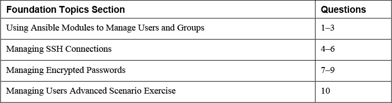

**1.** 你会使用哪个 Ansible 模块来管理现有或新用户的 SSH `known_hosts` 文件？

**a.** `lineinfile`

**b.** `ssh_key`

**c.** `ssh_config`

**d.** `known_hosts`

**2.** 使用 `user` 模块必须使用哪些参数使现有用户成为附加组的成员而不覆盖任何当前的组分配？（选择两项）

**a.** `group`

**b.** `groups`

**c.** `append`

**d.** `newgroups`

**3.** 你可以使用哪些 Ansible 模块来管理 sudoers 文件？（选择两项）

**a.** `lineinfile`

**b.** `template`

**c.** `sudoers`

**d.** `sudo`

**4.** 你可以使用哪个模块来管理服务器的 SSH 公钥？

**a.** `authorized_key`

**b.** `authorized_hosts`

**c.** `known_keys`

**d.** `known_hosts`

**5.** 你应该使用什么来查找特定文件并将该文件复制到受管主机？

**a.** `copy` 模块

**b.** `lookup` 模块

**c.** `copy` 插件

**d.** `lookup` 插件

**6.** 下列哪些限制条件适用于 `authorized_keys` 模块？

**a.** 它无法从隐藏目录读取文件。

**b.** 它仅对默认的 Ansible 用户起作用。

**c.** 它需要将目标文件的权限模式设置为 644。

**d.** 它无法在 sudo shell 中工作。

**7.** 存储在 `/etc/shadow` 中的加密密码由不同部分组成。以下不是其中之一的是？

**a.** 使用的哈希算法

**b.** 用于加密密码的随机盐（salt）

**c.** 用户名

**d.** 用户密码的加密哈希值

**8.** 可以使用不同的解决方案为 Ansible `user` 模块生成加密密码。以下不是其中之一的是？

**a.** 使用 `shell` 模块配合 `passwd --stdin` 命令将加密密码存储在变量中。

**b.** 使用 `command` 模块配合 `passwd --stdin` 命令将加密密码存储在变量中。

**c.** 使用 `debug` 模块的即时命令生成加密密码字符串。

**d.** 创建一个使用 `debug` 模块的任务生成加密密码字符串。

**9.** 当你在 playbook 中处理加密密码时，必须有一种方法来确保安全性。以下哪种解决方案最好？

**a.** 将密码存储在 `Vault` 文件中。

**b.** 让 playbook 提示要使用的密码。

**c.** 将密码存储在仅 root 用户可访问的文件。

**d.** 使用清单变量文件读取密码。

**10.** 创建多个用户的最佳方法是什么？

**a.** 对列表使用 `loop` 遍历。

**b.** 在变量中使用用户。

**c.** 在列表中定义用户，并使用 `loop` 遍历该列表。

**d.** 使用 `vars_prompt` 获取用户名。

当你在 Ansible 上设置新用户账户时，某些用户可能需要设置 sudo 权限。由于没有专门的 Ansible 模块用于管理 sudo 配置，因此你需要使用通用的 Ansible 模块。这里有两种方案。

首先，你可以使用 `template` 模块在 `/etc/sudoers.d` 目录下创建一个 sudo 配置文件。建议使用此类文件，因为该文件是独立管理的，因此没有被 RPM 更新覆盖的风险。另一种备选方案是使用 `lineinfile` 模块直接管理 `/etc/sudoers` 主配置文件。

在列表 13-2、13-3 和 13-4 中，你可以看到一个执行剧本（playbook）的构建过程，其中创建了用户并将他们添加到从模板生成的 sudo 文件中。为了将静态代码与动态的特定站点的设置分开，列表 13-4 中的 playbook 使用了列表 13-2 所示的两个变量文件。

### 列表 13-2 管理 sudo 的变量

```text
[ansible@control rhce8-book]$ cat vars/sudo

sudo_groups:
  - name: developers
    groupid: 5000
    sudo: false
  - name: admins
    groupid: 5001
    sudo: true
  - name: dbas
    groupid: 5002
    sudo: false
  - name: sales
    groupid: 5003
    sudo: true
  - name: account
    groupid: 5004
    sudo: false

[ansible@control rhce8-book]$ cat vars/users

users:
  - username: linda
    groups: sales
  - username: lori
    groups: sales
  - username: lisa
    groups: account
  - username: lucy
    groups: account
```

如你所示，`vars/users` 文件定义了用户以及他们应该所属的组。除此之外，`vars/sudo` 文件定义了新组，并为这些组中的每一个组设置了 `sudo` 参数，该参数将用于列表 13-3 所示的模板文件。

### 列表 13-3 管理 sudo 的模板文件

```jinja




%{{ item.name}} ALL=(ALL:ALL) NOPASSWD:ALL




```

在列表 13-3 的模板文件中，使用 `for` 循环来遍历 `vars/sudo` 文件中 `sudo_groups` 变量中定义的所有项。接下来，对于这些组中的每一个，使用 `if` 语句来检查布尔变量 `sudo` 的值。如果该变量被设置为布尔值 `true`，则该组将作为 sudo 组添加到 `/etc/sudoers.d/sudogroups` 文件中。

### 列表 13-4 管理 sudo

```yaml
---
- name: configure sudo
  hosts: ansible2
  vars_files:
    - vars/sudo
    - vars/users
  tasks:
    - name: add groups
      group:
        name: "{{ item.name }}"
      loop: "{{ sudo_groups }}"
    - name: add users
      user:
        name: "{{ item.username }}"
        groups: "{{ item.groups }}"
      loop: "{{ users }}"
    - name: allow group members in sudo
      template:
        src: listing133.j2
        dest: /etc/sudoers.d/sudogroups
        validate: 'visudo -cf %s'
        mode: 0440
```

列表 13-4 中的 playbook 使用了变量以及模板文件来创建用户和 sudoers 配置。结果被写入被管理主机的相关配置文件中，从而自动创建 sudo 配置。在练习 13-1 中，你将练习管理用户和组。

### 练习 13-1 管理用户和组

1. 使用 `mkdir host_vars` 创建 `host_vars` 目录。

2. 使用你的编辑器创建 `host_vars/ansible1` 文件并赋予以下内容：

```yaml
users:
  - username: zeina
    groups: admins
  - username: marlet
    groups: admins
  - username: victoria
    groups: students
  - username: emma
    groups: students
```

3. 创建 `exercise131.yaml` 文件并写入以下 play 头部：

```yaml
---
- name: create user accounts
  hosts: ansible1
  tasks:
```

4. 继续并添加创建所需组的第一个任务：

```yaml
- name: create groups
  group:
    name: "{{ item.groups }}"
    state: present
  loop: "{{ users }}"
```

5. 添加一个创建用户账户的任务：

```yaml
- name: create users
  user:
    name: "{{ item.username }}"
    group: "{{ item.groups }}"
  loop: "{{ users }}"
```

## 管理 SSH 连接

在我们查看设置密钥之前，让我快速简要概述密钥在通信中是如何使用的。以下列表提供了一个简化的概述：

1. 用户与服务器发起会话。
2. 服务器回传一个用服务器私钥加密的身份令牌给用户。
3. 用户使用存储在 `~/.ssh/known_hosts` 中的服务器公钥指纹来验证该身份令牌。
4. 如果 `~/.ssh/known_hosts` 尚未存储公钥指纹，系统会提示用户将远程服务器身份存储到 `~/.ssh/known_hosts` 中。此时，还没有好的方法可以验证用户是否确实与预期的服务器进行通信。
5. 在确定远程服务器身份后，用户可以发送密码，也可以生成一个基于用户私钥的认证令牌。
6. 如果发送了基于用户私钥的认证令牌，服务器将接收该令牌并尝试将其与存储在 `~/.ssh/authorized_keys` 文件中的用户公钥进行匹配。
7. 当传入的认证令牌与 `authorized_keys` 文件中存储的用户公钥匹配后，用户通过身份验证。如果此认证失败且允许密码认证，则接下去将尝试密码认证。

在认证过程中，两个密钥对起着重要作用。首先是服务器的公钥/私钥对，用于建立安全连接。要管理主机公钥，你可以使用 `known_hosts` 模块。接下来是用户的公钥/私钥对，用户用它进行认证。要管理该密钥对中的公钥，你可以使用 `authorized_key` 模块。

### 使用查找插件

当你处理 SSH 公钥时，查找插件起着重要作用。Ansible 提供了许多插件来扩展 Ansible 的核心功能。查找插件允许 Ansible 从外部源访问数据。你可以使用它来读取文件系统，例如，或者连接外部数据存储和服务。

由插件（plugin）执行的操作在 Ansible 控制主机上运行，插件的工作结果通常存储在变量或模板中。在处理 SSH 密钥时，`lookup` 插件在查找文件系统中的项时非常有用。列表 13-5 显示了一个简单的示例，其中使用 `lookup` 插件将变量的值设置为文件的内容。

### 列表 13-5 使用 lookup 插件将变量值设置为文件内容

```yaml
---
- name: simple demo with the lookup plugin
  hosts: localhost
  vars:
    file_contents: "{{ lookup('file', '/etc/hosts') }}"
  tasks:
    - debug:
        var: file_contents
```

## 设置 SSH 用户密钥

为了使用 SSH 从控制主机上的某个用户账户连接到受托管主机上的用户账户，你可能希望将本地用户的公钥拷贝到远程用户的 `~/.ssh/authorized_keys` 文件。如果目标 `authorized_keys` 文件只需要包含一个密钥，你可以使用 `copy` 模块将其拷贝过去。然而，如果你想在远程用户的 `authorized_keys` 文件中管理多个密钥，那么使用 `authorized_key` 模块更好。本质上，这个模块非常简单。

在列表 13-6 的示例中，你可以看到如何使用 `authorized_key` 模块为用户 `ansible` 拷贝 `authorized_key`。作为输入源，使用了文件 `/home/ansible/.ssh/id_rsa.pub`。使用 `lookup` 插件来引用应该使用的文件内容。

### 列表 13-6 使用 authorized_key 模块

```yaml
---
- name: authorized_key simple demo
  hosts: ansible2
  tasks:
    - name: copy authorized key for ansible user
      authorized_key:
        user: ansible
        state: present
        key: "{{ lookup('file', '/home/ansible/.ssh/id_rsa.pub') }}"
```


如果你理解列表 13-6 的工作原理，那么很容易增强该代码使其对多个用户执行相同的操作。列表 13-7 显示了两个变量包含文件的内容，这些文件在列表 13-8 的 playbook 中应用。

**列表 13-7** 在列表 13-8 中使用的变量文件

```
[ansible@control rhce8-book]$ cat vars/users

---

users:

  - username: linda
    groups: sales
  - username: lori
    groups: sales
  - username: lisa
    groups: account
  - username: lucy
    groups: account

[ansible@control rhce8-book]$ cat vars/groups

---

usergroups:
  - groupname: sales
  - groupname: account
```

**列表 13-8** 使用 lookup 插件使用 `authorized_key` 模块

```
---

- name: configure users with SSH keys

  hosts: ansible2

  vars_files:

    - vars/users
    - vars/groups

  tasks:

  - name: add groups
    group:
      name: "{{ item.groupname }}"
    loop: "{{ usergroups }}"
  - name: add users
    user:
      name: "{{ item.username }}"
      groups: "{{ item.groups }}"
    loop: "{{ users }}"
  - name: add SSH public keys
    authorized_key:
      user: "{{ item.username }}"
      key: "{{ lookup(‘file’, ‘files/’+ item.username + ‘/id_rsa.pub’) }}"
    loop: "{{ users }}"
```

列表 13-8 中最引起兴趣的新部分是 `authorized_key` 模块，它被设置为在 `item.username` 上运行，并对 `users` 变量使用 `loop`。这种结构允许 playbook 应用于每个用户。请注意，需要拷贝的 `id_rsa.pub` 文件预计存在于文件目录中，该目录存在当前项目目录中。

将用户公钥拷贝到项目目录是解决一个难以处理的重要问题的方案：`authorized_keys` 模块无法从隐藏目录读取文件。如果能使用 `key: “{{ lookup(‘file’, ‘/home/+ item.username + ‘.ssh/id_rsa.pub’) }}”` 就更好了，但这不起作用。因此，为了让它运行，你需要应用变通方法。你在练习 13-2 的示例 playbook 中应用了这种变通方法。在开始练习之前，让我们看看在这个练习中具体要做什么。

在第一个任务中（参见列表 13-9），你创建了一个本地用户，包括一个 SSH 密钥。因为 SSH 密钥应该包含其所应用的用户和主机名称，你需要使用 `generate_ssh_key` 参数以及 `ssh_key_comment` 参数。

**列表 13-9** 创建用户

```
- name: create a local user, including an SSH key
  user:
    name: "{{ username }}"
    generate_ssh_key: true
    ssh_key_comment: "{{ username }}@{{ ansible_fqdn }}"
```

在创建用户后，你将需要执行以下操作：

**练习 13-2** 使用 SSH 密钥管理用户

1. 使用你的编辑器创建 `exercise132.yaml` 并编写第一个 play 的标头：

```
---
- name: setup localhost
  hosts: localhost
  tasks:
```

2. 编写第一个任务，在 localhost 上创建一个用户。注意使用了变量 `{{ username }}`。在运行 playbook 时，你需要确保此变量有值，例如在运行 playbook 时使用参数 `-e username=sharon`。在模块中，你使用适当的参数来创建格式如下文所示的 SSH 公钥/私钥对：

```
- name: create the local user, including an SSH key
  user:
    name: "{{ username }}"
    generate_ssh_key: true
    ssh_key_comment: "{{ username }}@{{ ansible_fqdn }}"
```

3. 你需要确保公钥被拷贝到可以访问的目录中。以下三个任务实现了此点：

```
- name: create a directory to store the file
  file:
    name: "{{ username }}"
    state: directory
- name: copy the local user ssh key to temporary {{ username }} key
  shell: ‘cat /home/{{ username }}/ssh/id_rsa.pub > {{ username }}/id_rsa.pub’
- name: verify that file exists
  command: ls -l {{ username }}/
```

4. 此时，用户公钥已创建并可以访问，你可以编写第二个 play。这个第二个 play 使用 `user` 模块创建用户，并使用 `authorized_key` 模块从本地获取密钥并将其拷贝到远程用户目录下的 `.ssh/authorized_keys` 文件中：

```
- name: setup remote host
  hosts: ansible1
  tasks:

  - name: create remote user, no need for SSH key
    user:
      name: "{{ username }}"
  - name: use authorized_key to set the password
    authorized_key:
      user: "{{ username }}"
      key: "{{ lookup(‘file’, ‘./’+ username +’/id_rsa.pub’) }}"
```

5. 在此时，使用命令 `ansible-playbook exercise132.yaml -e username=radha` 来创建具有适当 SSH 密钥的用户 radha。

6. 要验证操作是否生效，请在控制主机上使用 `sudo su - radha`，然后输入命令 `ssh ansible1`。你应该能够在无需输入密码的情况下登录。

## 管理加密密码

在 Ansible 中管理用户时，你可能也想设置用户密码。挑战在于，你不能直接将密码作为 `user` 模块中 `password:` 参数的值，因为该用户模块期望你使用加密字符串。

### 了解加密密码

当用户创建密码时，密码会被加密。加密密码的哈希值（hash）存储在 `/etc/shadow` 文件中，该文件受到严格保护，只有具有 root 权限才能访问。字符串看起来像 `$6$237687687/$9809erhb8oyw48oih290u09`。该字符串包含三个元素，用 `$` 符号分隔：

- 使用的哈希算法。
- 用于加密密码的随机盐值（salt）。
- 用户密码的加密哈希值。

当用户设置密码时，会使用随机盐值来防止两个具有相同密码的用户在 `/etc/shadow` 中具有相同的条目。盐值和未加密的密码结合并加密，生成存储在 `/etc/shadow` 中的加密哈希。根据此字符串，可以对用户输入的密码与 `/etc/shadow` 中的密码字段进行比对，如果匹配，则用户通过身份验证。

### 生成加密密码

当你使用 Ansible `user` 模块创建用户时，有一个 `password` 选项。该选项无法生成加密密码。它期望接收加密字符串作为输入。这意味着必须使用外部工具来生成加密字符串。该加密字符串必须存储在变量中以创建密码。由于该变量基本上就是用户密码，因此该变量应该安全地存储在（例如）Ansible Vault 安全文件中。

要生成加密变量，你可以选择在创建用户账户之前创建变量。或者，你可以在 playbook 中运行创建变量的命令，使用 `register` 将结果写入变量，并使用该变量创建加密用户。如果你想预先生成变量，可以使用以下 ad hoc 命令：

```
ansible localhost -m debug -a "msg={{ ‘password’ | password_hash(‘sha512’,’myrandomsalt’) }}"
```

此命令生成如 Listing 13-11 所示的加密字符串，该字符串接下来可以在 playbook 中使用。此类 playbook 的示例如 Listing 13-12 所示。

**Listing 13-11** 生成加密密码字符串

```
[ansible@control ~]$ ansible localhost -m debug -a "msg={{ ‘password’ | password_hash(‘sha512’,’myrandomsalt’) }}"

localhost | SUCCESS => {

    "msg": "$6$myrandomsalt$McEB.xAVUWe0./6XqZ8n/7k9VV/Gxndy9nIMLyQAiPnhyBoToMWbxX2vA4f.Uv9PKnPRaYUUc76AjLWVAX6U10"
}
```

**Listing 13-12** 创建加密用户密码的示例 Playbook

```
---

- name: create user with encrypted pass
  hosts: ansible2.example.com
  vars:

    password: "$6$myrandomsalt$McEB.xAVUWe0./6XqZ8n/7k9VV/Gxndy9nIMLyQAiPnhyBoToMWbxX2vA4f.Uv9PKnPRaYUUc76AjLWVAX6U10"
  tasks:

  - name: create the user
    user:
      name: anna
      password: "{{ password }}"
```

这里使用的方法有效但并不优雅。首先，你需要预先手动生成加密密码。此外，加密密码字符串以一种可读的方式写在 playbook 中。通过查看加密密码和盐值，有可能还原出原始密码，这就是为什么在安全环境中，密码不应该在 playbook 中可见的原因。

在 Exercise 13-3 中，你创建了一个提示用户密码并使用 `debug` 模块的 playbook，该模块在 playbook 的 Listing 13-11 中配合 `register` 使用，使得密码不再以明文形式可见。在查看 Exercise 13-3 之前，让我们先看另一种同样有效的替代方法。

> **考试提示**
>
> 在创建用户账户时使用加密密码的步骤记录在 Ansible 文档的常见问题解答（Frequently Asked Questions）中。由于文档在考试期间可用，请确保你知道在哪里找到这些信息！搜索“How do I generate encrypted passwords for the user module?”这一项。

### 使用替代方法

正如多次提到的，在 Ansible 中，同一个问题通常有不同的解决方案。有时，除了最优雅的解决方案外，还有快速但粗暴（quick-and-dirty）的解决方案。与其使用“生成加密密码”节描述的解决方案，你可以使用 `echo | passwd` 来设置密码。Listing 13-13 展示了如何操作。注意此示例关注的是如何操作，而非安全性。将密码存储在 Ansible Vault 中。

**Listing 13-13** 设置用户：替代方案

```
---

- name: create user with encrypted pass
  hosts: ansible3
  vars:

    password: "$6$myrandomsalt$McEB.xAVUWe0./6XqZ8n/7k9VV/Gxndy9nIMLyQAiPnhyBoToMWbxX2vA4f.Uv9PKnPRaYUUc76AjLWVAX6U10"
  tasks:

  - name: configure user
    user:
      name: anna
      groups: wheel
      append: yes
      state: present

  - name: set a password for {{ user }}
    shell: ‘echo {{ password }} | passwd’
```

### Exercise 13-3 使用加密密码创建用户

1. 使用编辑器创建 `exercise133.yaml` 文件。
2. 编写 playbook 头部：

```
---

- name: create user with encrypted password
  hosts: ansible3
  vars_prompt:

  - name: passw
    prompt: which password do you want to use
  vars:

    user: sharon
  tasks:
```

3. 添加第一个任务，使用 `debug` 模块生成加密密码并使用 `register` 将字符串存储在变量 `mypass` 中：

```
- debug:
    msg: "{{ {{ passw }}’| password_hash(‘sha512’,’myrandomsalt’) }}"
  register: mypass
```

4. 添加 `debug` 模块分析注册变量的精确格式：

```
- debug:
    var: mypass
```

5. 根据上一个命令看到的输出，你现在可以使用正确的方式通过 `user` 模块引用密码。添加以下任务来实现：

```
- name: create the user
  user:
    name: "{{ user }}"
    password: "{{ mypass.msg }}"
```

6. 使用 `ansible-playbook exercise133.yaml` 运行 playbook 并验证其输出。

现在是时候处理高级场景了。`Exercise 13-4](#ch13.xhtml_exe13_4)` 包含一个分步操作程序，引导你完成设置复杂的 playbook（剧本）的过程。在这个过程中，我尝试为你提供关于如何在考试中处理此类复杂任务的实用指南，包括当你意识到有更有效的方法时，可能改变主意的部分。仔细阅读这些步骤是非常重要的，因为在执行此程序时，将应用一些改进。

---

**警告**

本练习的编写方式让你能够从错误中学习。在早期步骤中，会创建一些配置，这些配置稍后将进行优化。我刻意使用了这种方法，建议你在研究 `exercise134.yaml` playbook 中的最终解决方案之前，务必紧密遵循练习中的步骤。

---

## 练习 13-4 设置 Ansible 用户

在本次练习中，你将创建几个 Ansible 用户。这些用户需要在 Ansible 控制主机以及托管主机上进行创建。在运行 playbook 之后，在 `localhost` 上创建的任何用户都必须能够使用 SSH 登录到远程主机上相应的用户账户，而无需输入密码。请确保设置满足以下要求：

- 创建用户 `sharon`、`blair`、`ashley` 和 `ahmed`。
- 用户 `sharon` 和 `blair` 是 `admins` 组的成员；用户 `ashley` 和 `ahmed` 是 `students` 组的成员。
- 在托管主机上，`admins` 组的成员应该拥有运行任何想要命令的 `sudo` 权限。
- 所有用户必须配置默认密码 `"password"`。

1. 这次你将使用不同的方法首先设置 playbook 的框架。这是开发更复杂 playbook 的良好方法，并且可以减少漏掉 playbook 中任何内容的概率。为此，请使用编辑器创建一个名为 `exercise134.yaml` 的文件，并根据以下示例定义 play 表头（play headers）以及你打算为每个任务使用的名称和模块：

```
---
- name: create users on localhost
  hosts: localhost
  tasks:
  - name: create groups
    groups:
  - name: create users
    users:
- name: create users on managed hosts
  hosts: ansible4
  tasks:
  - name: create groups
    groups:
  - name: create users
    users:
  - name: copy authorized keys
    authorized_key:
  - name: modify sudo configuration
    template
```


## 2. 创建用户账户

现在你已经定义了全局结构，可以开始填充详细信息了。从第一个 `play` 开始，它应该从创建用户账户开始。在这个 `play` 中，需要创建用户和组。首先，专注于基础设置，稍后再填充更多细节：

```yaml
---
- name: create users on localhost
  hosts: localhost
  vars:
    users:
      - username: sharon
        groups: admins
      - username: blair
        groups: admins
      - username: ashley
        groups: students
      - username: ahmed
        groups: students
  tasks:
  - name: create groups
    groups:
      name: "{{ item.groups }}"
      state: present
    loop: "{{ users }}"
  - name: create users
    user:
      name: "{{ item.username }}"
      groups: "{{ item.groups }}"
    loop: "{{ users }}"
```

## 3. 在检查模式下运行

因为你这次要面对的是一个大项目，现在是尝试一下的好时机。为此，临时注释掉整个第二个 `play`，并使用 `ansible-playbook -C exercise134.yaml` 在检查模式（check mode）下运行 playbook。

如果你输入了步骤 2 中列出的精确文本，将在引用 `groups` 模块的行遇到错误。没错——没有 `groups` 模块；它的名称是 `group`。纠正这一点并再次在检查模式下运行 playbook。

注意，在检查模式下你可能会得到虚假错误。只需双检，如果你确定自己做对了，请忽略该错误。注意，直接运行 playbook 实际上也没有什么影响。任何稍后的修改都会被添加到配置中。

## 4. 设置用户密码和 SSH 密钥

现在你准备好通过向第一个 `play` 添加剩余任务来完成它。为此，你仍然需要做两件事，且都必须在 `user` 模块上完成：你需要设置用户密码，并且创建一个 SSH 密钥对。

要生成密码，你需要生成一个加密字符串，作为 `user` 模块 `password` 参数的参数。要生成此字符串，请使用临时命令（ad hoc command）：

`ansible localhost -m debug -a "msg={{ 'password' | password_hash('sha512', 'mysalt') }}"`

只需复制生成的加密字符串（它以 `$` 开头）并在下一步中使用它。

## 5. 完成第一个 play

使用 `generate_ssh_key` 和 `password` 参数完成第一个 `play` 中的用户任务。完整的任务如下所示：

```yaml
- name: create users
  user:
    name: "{{ item.username }}"
    groups: "{{ item.groups }}"
    generate_ssh_key: yes
    password: $6$mysalt$khiuhihrb8y349hwbohbuoehr8bhqohoibhro8bohoiheoi
  loop: "{{ users }}"
  tags: setuplocal
```

注意最后一行 `tags: setuplocal`；这个标签让你更容易只运行 playbook 的特定部分。你可能想通过 `ansible-playbook exercise134.yaml --tags=setuplocal` 运行 playbook。

## 6. 创建变量文件

此时本地部分的设置似乎已经完成，因此你可以处理第二个 `play`。你应该从观察你想做什么开始。在第二个 `play` 中，有一些任务与第一个 `play` 完全相同。因为重复相同的内容效率低下，你可以创建导入（imports）并将现有代码移动到文件中。

首先，创建 `exercise134-vars.yaml` 文件并包含以下内容：

```yaml
users:
  - username: sharon
    groups: admins
  - username: blair
    groups: admins
  - username: ashley
    groups: students
  - username: ahmed
    groups: students
```

## 7. 创建任务文件

创建 `exercise134-tasks.yaml` 文件并包含以下内容：

```yaml
- name: create groups
  group:
    name: "{{ item.groups }}"
    state: present
  loop: "{{ users }}"
- name: create users
  user:
    name: "{{ item.username }}"
    groups: "{{ item.groups }}"
    generate_ssh_key: yes
    ssh_key_comment: "{{ item.username }}@{{ ansible_fqdn }}"
    password: $6$mysalt$khiuhihrb8y349hwbohbuoehr8bhqohoibhro8bohoiheoi
  loop: "{{ users }}"
```

## 8. 重写 playbook

现在是时候重写 playbook，使整个 playbook 如下所示（注意最后两个任务仍需要定义）：

```yaml
---
- name: create users on localhost
  hosts: localhost
  vars_files:
    - exercise134-vars.yaml
  tasks:
  - name: include user and group setup
    import_tasks: exercise134-tasks.yaml
  tags: setuplocal

- name: create users on managed hosts
  hosts: ansible4
  vars_files:
    - exercise134-vars.yaml
  tasks:
  - name: include user and group setup
    import_tasks: exercise134-tasks.yaml
  - name: copy authorized keys
    authorized_key:
  - name: modify sudo configuration
```

## 9. 复制 authorized keys

此时你可以处理 `copy authorized keys` 任务。由于用户是在本地创建的，且每个用户都有自己的 SSH 密钥对，这一步看起来相当简单。此任务的挑战在于查找插件（lookup plug-in）的使用。

完成 `authorized_key` 任务，使第二个 `play` 如下所示：

```yaml
- name: create users on managed hosts
  hosts: ansible4
  vars_files:
  - exercise134-vars.yaml
  tasks:
  - name: include user and group setup
    import_tasks: exercise134-tasks.yaml
  - name: copy authorized keys
    authorized_key:
      user: "{{ item.username }}"
      key: "{{ lookup(‘file’, ‘/home/’+ item.username + ‘/.ssh/id_rsa.pub’) }}"
    loop: "{{ users }}"
# - name: modify sudo configuration
  tags: setupremote
```

## 10. 处理 lookup 插件错误

因为在使用 `lookup` 插件时很容易出错，因此建议通过 `ansible-playbook exercise134.yaml --tags=setupremote` 运行第二个剧本（play）。注意，只有在第一个剧本执行成功的情况下，这个剧本才能生效。

噢，不！结果并不理想！你可以看到在列表 13-15 中显示的错误。产生此错误的原因是，`authorized_keys` 模块无法直接从用户主目录下隐藏的 `.ssh` 目录访问 `id_rsa.pub` 文件。

**列表 13-15** 任务 10 错误输出

```text
TASK [copy authorized keys] *******************************************************

[WARNING]: Unable to find ‘/home/laksmi/id_rsa.pub’ in expected paths (use -vvvvv
to see paths)
fatal: [ansible3]: FAILED! => {"msg": "An unhandled exception occurred while running the lookup plugin ‘file’. Error was <class ‘ansible.errors.AnsibleError’>, original message: could not locate file in lookup: /home/laksmi/id_rsa.pub"} own
```

## 11. 修复 lookup 插件错误

要修复第 10 步发生的错误，你必须根据前面的章节“管理 SSH 连接”中讨论的解决方案重写第一个剧本。以下代码显示了第一个剧本，并在 `import_tasks:` 语句之后应用了你需要的修改：

```yaml
---
- name: create users on localhost
  hosts: localhost
  vars_files:
  - exercise134-vars.yaml
  tasks:
  - name: include user and group setup
    import_tasks: exercise134-tasks.yaml
  - name: create a directory to store the key file
    file:
      name: "{{ item.username }}"
      state: directory
    loop: "{{ users }}"
  - name: copy the local user ssh key to temporary {{ item.username }} key
    shell: ‘cat /home/{{ item.username }}/.ssh/id_rsa.pub > {{ item.username }}/id_rsa.pub’
    loop: "{{ users }}"
  - name: verify that file exists
    command: ls -l {{ item.username }}/
    loop: "{{ users }}"
  tags: setuplocal
```

## 12. 配置 sudo

现在是时候配置 `/etc/sudoers.d/` 目录下的 sudo 文件了。虽然你为止一直在搭建剧本的大致结构，但建议使用 `template` 模块。但事实是，需要创建的文件非常简单直接，只需要包含行 `%admins ALL=(ALL:ALL) NOPASSWD:ALL` 即可。

由于这是一个简单的任务，你不需要使用 `template` 模块。只需改用 `copy` 模块，这样在 `authorized_key` 任务之后，只包含以下任务：

```yaml
- name: copy sudoers file
  copy:
    content: ‘%admins ALL=(ALL:ALL) NOPASSWD:ALL’
    dest: /etc/sudoers.d/admins
```

## 13. 验证输入内容

在运行剧本之前，你可以通过 GitHub 存储库中的示例剧本 [`github.com/sandervanvugt/rhce8-book/exercise134.yaml`](https://github.com/sandervanvugt/rhce8-book/exercise134.yaml) 来验证你输入的内容。

## 14. 运行剧本

此时，你可以使用 `ansible-playbook exercise134.yaml` 运行剧本，你不应该会遇到任何错误。

## 15. 验证运行结果

为了验证一切运行正常，请在控制主机上输入 `sudo su - ahmed`，一旦进入用户 `ahmed` 的 shell，就输入 `ssh ansible2`。Ansible 应该允许用户登录而无需询问密码。

## 总结

在本章中，你学习了如何管理用户。虽然设置用户看起来是一项简单的任务，但某些相关任务仍然使其变得具有挑战性。在本章中，你学习了如何处理这些任务。你现在应该能够创建用户和组账户、管理 SSH 授权密钥、处理加密密码以及管理相关的 sudo 配置。

## 考试备习任务

正如引言中“如何使用本书”部分提到的，你有几种备习考试的选择：此处的练习题、第 16 章、“最终准备”以及配套网站上的考试模拟题。

## 复习所有关键主题

回顾本章中最重要的主题，这些主题在页外边处用“关键主题”图标标记。表格 13-3 列出了这些关键主题的索引及其所在的页码。


**表格 13-3** 关键主题


## 记忆表格

请记忆附录 D、附录 E 或本章的表格。

## 术语表

定义本章中的以下术语：

- `authorized_keys`
- `hash`
- `hashing algorithm`
- `PAM`
- `plug-in`
- `public key`
- `random salt`

## 复习题

1. 哪个模块可以修改 sudo 配置？
2. 哪个模块可以扩展身份验证程序？
3. 哪个模块可以管理 SSH 主机？
4. `user` 模块使用哪个参数来指定主组？
5. `user` 模块使用哪个参数来管理次要组？
6. `authorized_keys` 模块通常使用哪个插件来查找文件？
7. 当使用 `user` 模块创建 SSH 密钥对时，必须使用哪个参数来确保密钥中包含用户名？
8. `authorized_keys` 模块的主要局限性是什么？
9. 有哪两种方法可以生成加密哈希？
10. 使用 `passwd --stdin` 方法生成加密密码时，必须使用哪个 Ansible 模块？

## 章末实验

在本章末实验中，你将应用在本章中学到的知识。

### 实验 13-1

编写一个符合以下要求的剧本：

- 创建用户 `kim`、`christina`、`kelly` 和 `bill`。
- `kim` 和 `kelly` 必须是 `profs` 组成员；`christina` 和 `bill` 是 `students` 组成员。
- 在创建用户时，将加密密码设置为“password”。
- 确保 `profs` 组成员具有 sudo 权限。

# 第 14 章 管理进程与任务

本章涵盖以下主题：

- 管理服务
- 管理启动过程
- 启动过程和服务管理高级练习

**本章涵盖了以下 RHCE 考试目标：**

- 使用 Ansible 模块处理系统管理任务涉及
- 服务
- 计划任务

## “我掌握这些了吗？”测验

“我已经知道这些了吗？”测验可以让你评估自己是应该仔细阅读整个章节，还是直接跳到“考试准备任务”部分。如果你对这些问题的答案或对自己这些主题知识的评估存有疑问，请阅读整个章节。表 14-1 列出了本章的主要标题以及它们对应的“我已经知道这些了吗？”测验题。你可以在附录 A 中的“‘我已经知道这些了吗？’测验和复习题答案。](#app01.xhtml_app01)”中找到答案。

**表 14-1** “我已经知道这些了吗？”章节到问题的映射


### 1. 屏蔽服务

你应该使用哪个模块来屏蔽（mask）服务？

- **a.** `service`
- **b.** `systemd`
- **c.** `upstart`
- **d.** `init`

### 2. 服务事实

关于服务事实的哪种陈述是正确的？

- **a.** 默认不收集有关服务的事实。
- **b.** `systemd` 模块收集服务的事实，而 `service` 模块不收集。
- **c.** `service` 模块收集服务的事实，而 `systemd` 模块不收集。
- **d.** 你使用 `setup` 模块来收集服务的事实。

### 3. 运行一次的任务

你想使用 Ansible 管理一个应该启动一次的任务。你的 `play` 应该兼容 BSD init 系统，也兼容使用 `systemd` 作为 init 系统的系统。你应该使用哪个模块？

- **a.** `service`
- **b.** `cron`
- **c.** `run`
- **d.** `at`

### 4. systemd 模块的特有参数

下列哪些参数是 `systemd` 模块特有的且在 `service` 模块中没有的（选择两项）：

- **a.** `mask`
- **b.** `enabled`
- **c.** `started`
- **d.** `daemon_reload`

### 5. 删除 cron 任务

在旨在删除 cron 任务的任务中，以下哪些需要使用 Ansible `cron` 模块进行定义（选择两项）：

- **a.** `time`
- **b.** `user`
- **c.** `name`
- **d.** `state`

### 6. 同名 cron 任务

你正在使用 Ansible `cron` 模块运行一个与另一个 cron 任务同名的 cron 任务。会发生什么？

- **a.** playbook 将生成错误，不会发生任何变化。
- **b.** 新任务将添加到任务列表中。


**c.** 新任务将覆盖旧任务。

**d.** playbook 将显示 `ok` 状态且什么都不做，因为已经存在具有指定名称的任务。

**7.** 你使用哪个模块来更改受托管主机应该启动的默认 `systemd` 目标？

**a.** `systemd`

**b.** `file`

**c.** `command`

**d.** `target`

**8.** 你可以使用哪个模块从 playbook 中管理系统重启？

**a.** `systemd`

**b.** `power`

**c.** `reboot`

**d.** `restart`

**9.** `reboot` 模块使用多个选项来指定要遵守的超时时间。以下哪个用于定义 Ansible 应该尝试重新连接到重启后的主机多久？

**a.** `connect_timeout`

**b.** `post_reboot_delay`

**c.** `pre_reboot_delay`

**d.** `reboot_timeout`

**10.** 你想用 `cron` 模块将当前时间写入文件。你需要使用哪种符号（选择两项）：

**a.** `job: echo rebooted at {{ ansible_facts[’date_time']][’time] }} >> /tmp/rebooted`

**b.** `job: echo rebooted at {{ ansible_date_time.time }} >> /tmp/rebooted`

**c.** `job: echo rebooted at $(date) >> /tmp/rebooted`

**d.** `job: echo rebooted at \`date\` >> /tmp/rebooted`

## 基础主题

### 管理服务

服务可以通过多种方式管理。你可以管理 `systemd` 服务，但 Ansible 也允许使用 Linux `cron` 和 `at` 来管理任务。此外，你可以使用 Ansible 管理受托管系统应该启动的所需的 `systemd` 目标，并且它可以重启运行中的机器。表 14-2 提供了管理服务最重要的模块概述。


**表 14-2** 与服务管理相关的模块

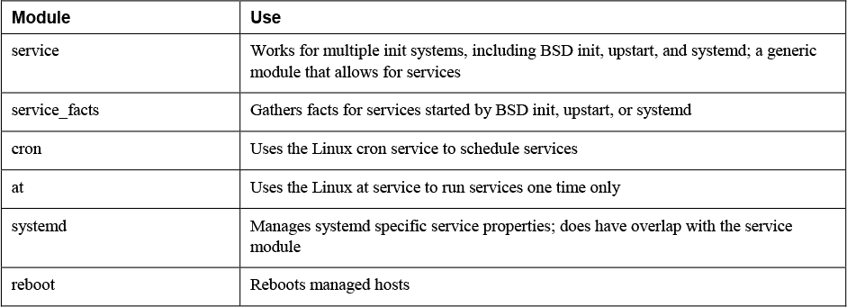

#### 管理 systemd 服务

在本书中你经常使用 `service` 模块。该模块允许你管理服务，无论使用何种 init 系统，因此它支持 System-V init、Upstart 以及 `systemd`。在许多情况下，你可以使用 Ansible 管理受托管系统应该启动的所需的 `systemd` 目标，并且它可以重启运行中的机器。

在使用 `at` 时，最重要的一点是它被用于定义任务从现在起多久执行。这是通过 `count` 和 `units` 实现的。例如，如果你想在五分钟后运行一个任务，你可以指定参数 `count: 5` 和 `units: minutes` 来定义该作业。还要注意 `unique` 参数的使用。如果设置为 `yes`，如果已经调度了类似的作业在运行，则该任务将被忽略。列表 14-4 显示了一个示例。

### 列表 14-4 使用 at 在未来运行命令

```yaml
---

- name: run an at task

  hosts: ansible2

  tasks:

    - name: run command and write output to file

      at:

        command: "date > /tmp/my-at-file"
        count: 5
        units: minutes
        unique: yes
        state: present
```

在练习 14-1 中，你将练习使用 `cron` 模块的技能。

### 练习 14-1 管理 cron 作业

1. 使用你的编辑器创建 playbook `exercise141-1.yaml` 并赋予其以下内容：

```yaml
---
- name: run a cron job

  hosts: ansible2

  tasks:

  - name: run a periodic job
    cron:
      name: "run logger"
      minute: "0"
      hour: "5"
      job: "logger IT IS 5 AM"
```

2. 使用 `ansible-playbook exercise141-1.yaml` 运行该作业。

3. 使用命令 `ansible ansible2 -a “crontab -l”` 验证 cron 作业已添加。输出应如下：

```text
ansible2 | CHANGED | rc=0 >>

#Ansible: run logger

0 5 * * * logger IT IS 5 AM
```

4. 创建一个名为 `exercise141-2` 的新 playbook，它运行一个新的 cron 作业但使用相同的名称：

```yaml
---
- name: run a cron job

  hosts: ansible2

  tasks:

  - name: run a periodic job
    cron:
      name: "run logger"
      minute: "0"
      hour: "6"
      job: "logger IT IS 6 AM"
```

5. 使用 `ansible-playbook exercise141-2.yaml` 运行此新 playbook。注意该作业以 `changed` 状态运行。

6. 重复命令 `ansible ansible2 -a “crontab -l”`。这向你展示新的 cron 作业覆盖了旧作业，因为它使用了相同的名称。这里有一点需要记住：所有的 cron 作业都应该有唯一的名称！

7. 编写 playbook `exercise141-3.yaml` 来删除你刚刚创建的 cron 作业：

```yaml
---
- name: run a cron job

  hosts: ansible2

  tasks:

  - name: run logger
    cron:
      name: "run logger"
      state: absent
```

8. 使用 `ansible-playbook exercise141-3.yaml` 运行最后一个 playbook。接下来，使用 `ansible ansible2 -a “crontab -l”` 验证 cron 作业确实已被删除。

### 管理启动过程


使用 Ansible 管理启动过程有点令人失望，因为 Ansible 没有提供特定的模块来执行此操作。因此，你必须使用通用模块，例如使用 `file` 模块来管理 `systemd` 启动目标（targets），或使用 `lineinfile` 模块来管理 GRUB 配置。然而，Ansible 确实提供了 `reboot` 模块，它允许你重启主机并在重启后在相同的位置继续操作。接下来的两个部分描述了如何实现。

### 管理 `systemd` 目标

管理主机应该启动的默认目标是 Ansible 的一项常见任务。然而，`systemd` 模块没有管理此设置的选项，也没有其他选项可以管理它。由于由于，你必须退回到通用选项。

如果你需要管理默认的 `systemd` 目标，名为`/etc/systemd/system/default.target`的文件必须存在指向所需默认目标的符号链接。参见例如列表 14-5，其中 Linux 的`ls -l`命令的输出显示了当前的配置。

### 列表 14-5 显示默认的 `systemd` 目标

```text
[ansible@control rhce8-book]$ ls -l /etc/systemd/system/default.target

lrwxrwxrwx. 1 root root 37 Mar 23 05:33 /etc/systemd/system/default.target -> /lib/systemd/system/multi-user.target
```

由于 Ansible 本身没有任何专门用于设置`default.target`的模块，你必须使用通用模块。从上来说，你可以使用`command`模块或`file`模块，但因为`file`模块是生成符号链接的更具特定的模块，所以你应该使用`file`模块。列表 14-6 显示了如何管理启动目标。

### 列表 14-6 管理默认启动目标

```yaml
---
- name: set default boot target
  hosts: ansible2
  tasks:
    - name: set boot target to graphical
      file:
        src: /usr/lib/systemd/system/graphical.target
        dest: /etc/systemd/system/default.target
        state: link
```

#### 重启被管理的主机

在某些情况下，被管理的主机在运行 playbook 时需要重启。为了这样做，你可以使用`reboot`模块。该模块使用多个参数来重启被管理的节点。为了验证被管理的主机的恢复可用性，你需要指定`test_command`参数。该参数指定了 Ansible 在重启后应在管理的主机上成功运行的任意命令。该命令的成功表示重启的主机已再次可用。

在使用`reboot`模块时，与超时相关的参数同样有用。`reboot`模块使用了至少四个参数：

- `connect_timeout`：在再次尝试之前等待成功连接的最大秒数。
- `post_reboot_delay`：在执行`reboot`命令后等待的秒数，在此之后尝试验证管理的主机是否再次可用。
- `pre_reboot_delay`：在实际执行重启之前等待的秒数。
- `reboot_timeout`：等待重启后的机器响应`test`命令的最大秒数。

当重启的主机恢复后，当前 playbook 将继续其任务。这种场景在列表 14-7 的示例中显示，其中首先重启所有管理的主机，在成功执行重启后，显示消息“successfully rebooted”。列表 14-8 显示了运行此 playbook 的结果。在练习 14-2 中，你可以练习使用`reboot`模块重启主机。

### 列表 14-8 验证 `reboot` 模块的成功

```text
[ansible@control rhce-book]$ ansible-playbook listing147.yaml

PLAY [reboot all hosts] *************************************************************************************************

TASK [reboot hosts] *****************************************************************************************************

changed: [ansible2]

changed: [ansible1]

changed: [ansible3]

changed: [ansible4]

changed: [ansible5]

TASK [print message to show host is back] *******************************************************************************

ok: [ansible1] => {
    "msg": "successfully rebooted"
}

ok: [ansible2] => {
    "msg": "successfully rebooted"
}

ok: [ansible3] => {
    "msg": "successfully rebooted"
}

ok: [ansible4] => {
    "msg": "successfully rebooted"
}

ok: [ansible5] => {
    "msg": "successfully rebooted"
}

PLAY RECAP **************************************************************************************************************

ansible1                   : ok=2    changed=1    unreachable=0    failed=0    skipped=0    rescued=0    ignored=0
ansible2                   : ok=2    changed=1    unreachable=0    failed=0    skipped=0    rescued=0    ignored=0
ansible3                   : ok=2    changed=1    unreachable=0    failed=0    skipped=0    rescued=0    ignored=0
ansible4                   : ok=2    changed=1    unreachable=0    failed=0    skipped=0    rescued=0    ignored=0
ansible5                   : ok=2    changed=1    unreachable=0    failed=0    skipped=0    rescued=0    ignored=0
```

## 练习 14-2 管理启动状态

1. 为此 playbook 准备准备，为了使其能够实际更改受托管主机上的默认启动目标，请使用`ansible ansible2 -m file -a "state=link src=/usr/lib/systemd/system/graphical.target dest=/etc/systemd/system/default.target"`。

2. 使用你的编辑器创建文件`exercise142.yaml`并编写以下 playbook 头部：

```yaml
---- name: set default boot target and reboot
  hosts: ansible2
  tasks:
```

3. 现在你将默认启动目标设置为`multi-user.target`。添加以下任务来执行此操作：

```yaml
- name: set default boot target
  file:
    src: /usr/lib/systemd/system/multi-user.target
    dest: /etc/systemd/system/default.target
    state: link
```

4. 完成 playbook，通过包含以下任务来重启受托管主机：

```yaml
- name: reboot hosts
  reboot:
    msg: reboot initiated by Ansible
    test_command: whoami

- name: print message to show host is back
  debug:
    msg: successfully rebooted
```

5. 使用`ansible-playbook exercise142.yaml`运行 playbook。

6. 使用`ansible ansible2 -a "systemctl get-default"`测试重启是否已成功执行。

### 启动过程和服务的服务的管理

本次的高级练习 14-3 是一个相对简单的任务。你将通过引导创建一个 playbook，该 playbook 在重启之前运行一个命令，在下次重启时调度一个 cron 任务，并使用该 cron 任务确保在重启后也使用特定的命令。为了确保发生的情况，请使用一个临时文件并向其中添加行。练习 14-3

1. 使用你的编辑器创建文件`exercise143.yaml`并按如下所示编写 playbook 头部：

```yaml
---- name: exercise143
  hosts: ansible2
  tasks:
```

2. 编写第一个任务。此任务实际上没有实际功能，但它允许你检查后续任务中正在发生什么。在此任务中，你使用`lineinfile`模块向检查`/tmp/rebooted`的末尾添加一行。注意包括秒指示器在内的时间是如何使用 Ansible facts 写入的。这种操作方式是必要的，因为没有哪个 fact 包含`hh:mm:ss`格式的时间。如下如下编写此任务代码：

```yaml
- name: add a line to file before rebooting
  lineinfile:
    create: true
    state: present
    path: /tmp/rebooted
    insertafter: EOF
    line: rebooted at {{ ansible_facts['time'] }}:{{ ansible_facts['second'] }}
```

3. 在此阶段，你可以添加一个在重启时运行的 cron 任务。运行的任务将向`/tmp/rebooted`文件添加消息，为了确保它正常工作，请使用 bash shell 替换来打印`date`命令的结果。注意在`cron`模块中这是可能的，因为命令是被执行的。由于没有哪个 fact 包含`hh:mm:ss`格式的时间，如下所示操作此任务：

```yaml
- name: run cron job on reboot
  cron:
    name: "run on reboot"
    state: present
    special: reboot
    job: "echo rebooted at $(date) >> /tmp/rebooted"
```

4. 添加另一个使用`reboot`模块重启主机的任务：

```yaml
- name: reboot host
  reboot:
    msg: reboot initiated by Ansible
    test_command: whoami

- name: show reboot success
  debug:
    msg: rebooted
```

5. 现在当 playbook 完成，使用`ansible-playbook exercise143.yaml`运行它。注意在目标主机返回后使用`ansible ansible2 -a "cat /tmp/rebooted"`。

### 总结

在本章中你学习了如何管理任务。在第一部分你学习了如何使用`systemd`、`cron`和`at`相应的模块来管理任务。在下一部分你学习了如何管理默认`systemd`目标以及重启。

### 考试准备

正如引言中“如何使用本书”部分提到的，你有几种准备考试的选择：这里的练习、第 16 章《最终准备》以及配套网站上的考试模拟题。

7. 你应该使用`reboot`模块的哪个参数来定义如何检查重启后的节点是否已返回？

8. 你应该使用`reboot`模块的哪个参数来指定 Ansible 在生成失败之前等待重启后的节点返回的最大时间？

9. 你应该使用`at`模块的哪个参数来在指定时间运行脚本文件？

10. 为什么你不能使用 bash 命令替换来处理`lineinfile`模块中命令的结果？

### 本章结束实验

在本章结束实验中，你将结合使用`cron`和`reboot`。

### 实验 14-1

根据以下规范编写一个 playbook：

- 必须使用`cron`模块在每个工作日的凌晨 2 点重启你的受管的服务器。
- 重启后，必须向`syslog`写入一条消息，内容为“CRON initiated reboot just completed.”
- 默认的`systemd`目标必须设置为`multi-user.target`。
- 最后一个任务应该使用`service facts`显示`cron`进程当前版本。

## 第 15 章 管理存储

本章涵盖了以下主题：

- 发现存储相关事实
- 管理分区和 LVM
- 配置存储高级练习

**本章涵盖以下 RHCE 考试目标：**

- 使用 Ansible 模块处理涉及内容的系统管理任务：
- 存储设备

### “我已经掌握了吗？”测试题

“我已经掌握了吗？”测试题可以让你评估是否应该仔细读完整个章节，还是跳到“考试准备任务”部分。如果你对这些问题的答案或对自己这些主题知识的评估有疑问，请阅读整个章节。表 15-1 列出了本章的主要标题及其对应的“我已经掌握了吗？”测试题。

你可以在附录 A，“‘我已经掌握了吗？测试题和考试题答案](#app01.xhtml_app01)”中找到答案。

**表 15-1** “我已经掌握了吗？”章节到问题的映射

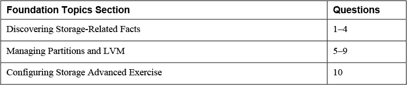

1. 你应该使用哪个模块以脚本化的方式管理分区？

   a. `fdisk`

   b. `gpart`

   c. `gdisk`

   d. `parted`

2. 你应该使用哪个 Ansible 模块来管理 LVM 中使用的范围（extent）大小？

   a. `lvpv`

   b. `lvg`

   c. `lvm`

   d. `lvol`

3. 使用 Ansible facts 时，你应该寻找什么来获取有关已发现磁盘的信息？

   a. `ansible_disks`

   b. `ansible_devices`

   c. `ansible_mounts`

   d. `ansible_device_links`

4. 你可以使用什么根据已发现的 Ansible facts 在任务内部设置变量？

   a. `set`

   b. `set_vars`

   c. `vars`

   d. `set_facts`

5. 在一个磁盘上，你已经有一个大小为 2 GiB 的分区。你想创建一个大小为 2 GiB 的第二个分区。必须使用`parted`模块的以下哪些参数？（选择所有适用项。）

   a. `part_end: 2GiB`

   b. `part_end: 4GiB`

   c. `part_start: 2GiB`

   d. `part_start: 1MiB`

6. 在`parted`模块中必须使用哪个参数来创建 GPT 分区？

   a. `label: gpt`

   b. `type: gpt`

   c. `table: gpt`

   d. `state: gpt`

7. 下列哪项使用`filesystem`模块写入文件系统标签？

   a. `opts: label=mylabel`

   b. `label: mylabel`

   c. `fslabel: mylabel`

   d. `setopts: label=mylabel`

8. 下列哪项确保文件系统现在被挂载并持久化地添加到`/etc/fstab`？

   a. `state: mounted`

   b. `state: present`

   c. `state: mounted, fstab: yes`

   d. `state: present, fstab: yes`

9. 你使用以下哪个模块来启用交换空间？

   a. `swap`

   b. `mount`

   c. `command`

   d. `filesystem`

10. 你有一个以浮点数形式表示的值。在比较其大小之前，你需要做什么？

   a. 使用`int`过滤器。

   b. 不需要，浮点数可以直接用于测试。

   c. 将变量名放在双引号之间。

   d. 将变量名放在单引号之间。

## 基础主题

### 发现存储相关事实

要在 Ansible 环境中使用存储，你需要知道受管节点上存在哪些设备。有许多存储设备，你可能需要根据设备类型运行条件判断。一旦成功发现了设备类型，可以使用多个存储模块之一来管理你的存储。表 15-2 显示了本章讨论的模块列表。其他其他特定厂商的管理模块，可以使用`ansible-doc -l`搜索特定厂商。

**表 15-2** 管理存储的模块

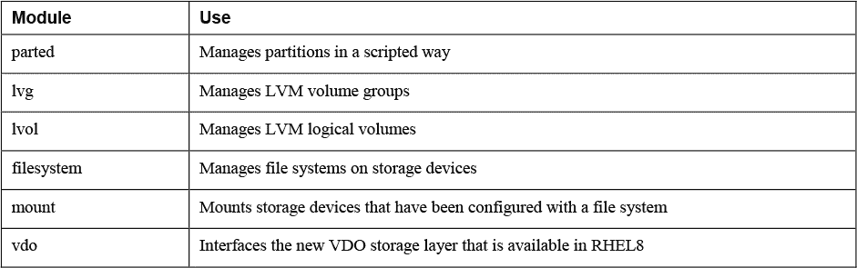


编写处理存储的 playbook 的挑战在于，可以使用许多存储设备，并且可以使用不同的设备名称。因此，为了确保你的 playbook 应用到正确的设备上，你首先需要找到受管系统中哪些设备。找到它们后，可以使用条件判断来确保任务在正确的设备上执行。

## 使用存储相关事实

当`setup`模块收集受管机器的事实时，存储事实会自动收集。相关信息存储在不同的事实中；表 15-3 给出了概述。


**表 15-3** 存储相关事实

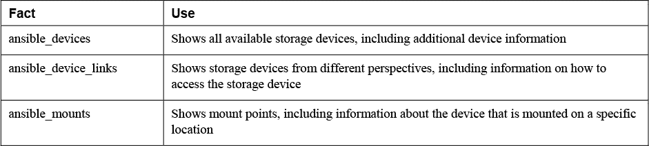

要请求这些事实的特定信息，可以使用带有过滤器的`ansible -m setup`命令。例如，使用`ansible ansible1 -m setup -a 'filter=ansible_devices'`查询存储设备的通用信息。列表 15-1 显示此命令结果的一部分。

**列表 15-1** 使用`ansible -m setup`发现存储事实

```bash
[ansible@control rhce8-book]$ ansible ansible1 -m setup -a ’filter=ansible_devices’

ansible1 | SUCCESS => {

    "ansible_facts": {
        "ansible_devices": {
            ...
            "sda": {
                "holders": [],
                "host": "SCSI storage controller: Broadcom / LSI 53c1030 PCI-X Fusion-MPT Dual Ultra320 SCSI (rev 01)",
                "links": {
                    "ids": [],
                    "labels": [],
                    "masters": [],
                    "uuids": []
                },
                "model": "VMware Virtual S",
                "partitions": {
                    "sda1": {
                        "holders": [],
                        "links": {
                            "ids": [],
                            "labels": [],
                            "masters": [],
                            "uuids": [
                                "7acd65d6-115f-499f-a02f-90364a18b9fc"
                            ]
                        },
                        "sectors": "2097152",
                        "sectorsize": 512,
                        "size": "1.00 GB",
                        "start": "2048",
                        "uuid": "7acd65d6-115f-499f-a02f-90364a18b9fc"
                    },
                    "sda2": {
                        "holders": [
                            "cl-swap",
                            "cl-root"
                        ],
                        "links": {
                            "ids": [
                                "lvm-pv-uuid-vswoyx-HihU-cRqK-2tvx-aesr-SXAR-YY1lLL"
                            ],
                            "labels": [],
                            "masters": [
                                "dm-0",
                                "dm-1"
                            ],
                            "uuids": []
                        },
                        "sectors": "39843840",
                        "sectorsize": 512,
                        "size": "19.00 GB",
                        "start": "2099200",
                        "uuid": null
                    }
                },
                "removable": "0",
                "rotational": "1",
                "sas_address": null,
                "sas_device_handle": null,
                "scheduler_mode": "mq-deadline",
                "sectors": "41943040",
                "sectorsize": 512,
                "size": "20.00 GB",
                "support_discard": "0",
                "vendor": "VMware,",
                "virtual": 1
            },
            "sr0": {
            ...
            }
        },
        "discovered_interpreter_python": "/usr/libexec/platform-python"
    },
    "changed": false
}
```

为了确保分区操作被正确处理，你必须检测使用了哪些设备。某些受托管主机具有多个磁盘设备，因此有时你可能会的是`/dev/sda`，但在其他时候，它可能是 KVM 虚拟磁盘的`/dev/vda`，或者是 NVME 磁盘设备的`/dev/nvme0n1`。为了做到这一点，你必须编写一个剧本（playbook），首先找到磁盘设备的名称，并将其存入一个变量中，以便在剧本后续操作中使用。`set_fact`参数在此情况下非常有用。你可以将其结合`when`条件语句一起使用，以将检测到的设备名称存储在变量中。在列表 15-4 中你可以看到它的样子，并在练习 15-1 中练习这种方法。

### 列表 15-4 将检测到的磁盘设备名称存储在变量中

```yaml
---
- name: define variable according to diskname detected
  hosts: all
  tasks:
  - ignore_errors: yes
    set_fact:
      disk2name: sdb
    when: ansible_facts[’devices’][’sdb’]
```

### 练习 15-1 使用不同的设备名称

1. 使用你的编辑器创建文件`exercise151.yaml`并按如下方式编写 play 头部：

```yaml
---
- name: define variable according to diskname detected
  hosts: all
  tasks:
```

2. 添加第一个任务，如果在 Ansible facts 中检测到`sdb`设备，则将变量`disk2name`设置为值`sdb`。注意，使用`ignore_errors:yes`是因为你需要此剧本继续运行，直到扫描完所有可能的磁盘设备。

```yaml
- ignore_errors: yes
  set_fact:
    disk2name: sdb
  when: ansible_facts[’devices’][’sdb’]
```

3. 重复此操作，为你可能检测到的任何其他第二个磁盘设备创建一个任务。（你可以根据系统上找到的设备对此进行更改，例如如果你在 KVM 虚拟机上，请使用`vdb`。）

```yaml
- ignore_errors: yes
  set_fact:
    disk2name: nvme0n2
  when: ansible_facts[’devices’][’nvme0n2’]
```

4. 如果没有第二个磁盘，剧本需要在该特定主机上停止执行。`fail`模块是实现这一点的极佳模块。通过添加下一个任务来实现：

```yaml
- name: getting out if there is no second disk
  fail:
    msg: there is no second disk
  when: disk2name is not defined
```

5. 作为最后一个元素，添加一个`debug`任务，如果找到了第二个磁盘设备，则显示查找结果。

```yaml
- name: showing this only for hosts with a second disk
  debug:
    msg: continuing with {{ disk2name }}
```

6. 如果可能，在运行剧本之前，你可能希望添加另一个具有不是`/dev/sdb`的第二个磁盘设备的节点。例如，如果你在 VMware Workstation 或 Fusion 中安装了 RHEL 8 虚拟机，它将允许你配置 NVME 磁盘设备。或者，你可以退回到 IDE 设备，它们显示为`/dev/hda`和`/dev/hdb`。使用`ansible-playbook exercise151.yaml`运行剧本。在列表 15-5 中你可以看到剧本输出可能的样子。

### 列表 15-5 运行`ansible-playbook exercise151.yaml`的输出


```text
[ansible@control rhce8-book]$ ansible-playbook exercise151.yaml

PLAY [define variable according to diskname detected debug test] *****************************************

TASK [Gathering Facts] ***********************************************************************************

ok: [ansible2]

ok: [ansible1]

ok: [ansible3]

ok: [ansible4]

ok: [ansible5]

ok: [ansible6]

TASK [set_fact] ******************************************************************************************

fatal: [ansible1]: FAILED! => {"msg": "The conditional check ’ansible_facts[’devices’][’sdb’]’ failed. The error was: error while evaluating conditional (ansible_facts[’devices’][’sdb’]): ’dict object’ has no attribute ’sdb’\n\nThe error appears to be in ’/home/ansible/rhce8-book/exercise151.yaml’: line 5, column 5, but may\nbe elsewhere in the file depending on the exact syntax problem.\n\nThe offending line appears to be:\n\n  tasks:\n  - ignore_errors: yes\n    ^ here\n"}

...ignoring

ok: [ansible2]

ok: [ansible3]

fatal: [ansible4]: FAILED! => {"msg": "The conditional check ’ansible_facts[’devices’][’sdb’]’ failed. The error was: error while evaluating conditional (ansible_facts[’devices’][’sdb’]): ’dict object’ has no attribute ’sdb’\n\nThe error appears to be in ’/home/ansible/rhce8-book/exercise151.yaml’: line 5, column 5, but may\nbe elsewhere in the file depending on the exact syntax problem.\n\nThe offending line appears to be:\n\n  tasks:\n  - ignore_errors: yes\n    ^ here\n"}

...ignoring

fatal: [ansible5]: FAILED! => {"msg": "The conditional check ’ansible_facts[’devices’][’sdb’]’ failed. The error was: error while evaluating conditional (ansible_facts[’devices’][’sdb’]): ’dict object’ has no attribute ’sdb’\n\nThe error appears to be in ’/home/ansible/rhce8-book/exercise151.yaml’: line 5, column 5, but may\nbe elsewhere in the file depending on the exact syntax problem.\n\nThe offending line appears to be:\n\n  tasks:\n  - ignore_errors: yes\n    ^ here\n"}

...ignoring

fatal: [ansible6]: FAILED! => {"msg": "The conditional check ’ansible_facts[’devices’][’sdb’]’ failed. The error was: error while evaluating conditional (ansible_facts[’devices’][’sdb’]): ’dict object’ has no attribute ’sdb’\n\nThe error appears to be in ’/home/ansible/rhce8-book/exercise151.yaml’: line 5, column 5, but may\nbe elsewhere in the file depending on the exact syntax problem.\n\nThe offending line appears to be:\n\n  tasks:\n  - ignore_errors: yes\n    ^ here\n"}

...ignoring

TASK [set_fact] ******************************************************************************************

fatal: [ansible1]: FAILED! => {"msg": "The conditional check ’ansible_facts[’devices’][’nvme0n2’]’ failed. The error was: error while evaluating conditional (ansible_facts[’devices’][’nvme0n2’]): ’dict object’ has no attribute ’nvme0n2’\n\nThe error appears to be in ’/home/ansible/rhce8-book/exercise151.yaml’: line 5, column 5, but may\nbe elsewhere in the file depending on the exact syntax problem.\n\nThe offending line appears to be:\n\n  tasks:\n  - ignore_errors: yes\n    ^ here\n"}

...ignoring

fatal: [ansible2]: FAILED! => {"msg": "The conditional check ’ansible_facts[’devices’][’nvme0n2’]’ failed. The error was: error while evaluating conditional (ansible_facts[’devices’][’nvme0n2’]): ’dict object’ has no attribute ’nvme0n2’\n\nThe error appears to be in ’/home/ansible/rhce8-book/exercise151.yaml’: line 5, column 5, but may\nbe elsewhere in the file depending on the exact syntax problem.\n\nThe offending line appears to be:\n\n  tasks:\n  - ignore_errors: yes\n    ^ here\n"}

...ignoring

fatal: [ansible3]: FAILED! => {"msg": "The conditional check ’ansible_facts[’devices’][’nvme0n2’]’ failed. The error was: error while evaluating conditional (ansible_facts[’devices’][’nvme0n2’]): ’dict object’ has no attribute ’nvme0n2’\n\nThe error appears to be in ’/home/ansible/rhce8-book/exercise151.yaml’: line 5, column 5, but may\nbe elsewhere in the file depending on the exact syntax problem.\n\nThe offending line appears to be:\n\n  tasks:\n  - ignore_errors: yes\n    ^ here\n"}

...ignoring

fatal: [ansible4]: FAILED! => {"msg": "The conditional check ’ansible_facts[’devices’][’nvme0n2’]’ failed. The error was: error while evaluating conditional (ansible_facts[’devices’][’nvme0n2’]): ’dict object’ has no attribute ’nvme0n2’\n\nThe error appears to be in ’/home/ansible/rhce8-book/exercise151.yaml’: line 5, column 5, but may\nbe elsewhere in the file depending on the exact syntax problem.\n\nThe offending line appears to be:\n\n  tasks:\n  - ignore_errors: yes\n    ^ here\n"}

...ignoring

fatal: [ansible5]: FAILED! => {"msg": "The conditional check ’ansible_facts[’devices’][’nvme0n2’]’ failed. The error was: error while evaluating conditional (ansible_facts[’devices’][’nvme0n2’]): ’dict object’ has no attribute ’nvme0n2’\n\nThe error appears to be in ’/home/ansible/rhce8-book/exercise151.yaml’: line 5, column 5, but may\nbe elsewhere in the file depending on the exact syntax problem.\n\nThe offending line appears to be:\n\n  tasks:\n  - ignore_errors: yes\n    ^ here\n"}

...ignoring

ok: [ansible6]

TASK [getting out if there is no disk] *************************************************

fatal: [ansible1]: FAILED! => {"msg": "there is no disk"}

skipping: [ansible2]

skipping: [ansible3]

fatal: [ansible4]: FAILED! => {"msg": "there is no disk"}

fatal: [ansible5]: FAILED! => {"msg": "there is no disk"}

skipping: [ansible6]

TASK [showing this is only for hosts with a second disk] *********************************

ok: [ansible2] => {
    "msg": "continuing with sdb"
}

ok: [ansible3] => {
    "msg": "continuing with sdb"
}

ok: [ansible6] => {
    "msg": "continuing with nvme0n2"
}

PLAY RECAP *******************************************************************************

ansible1                   : ok=3    changed=0    unreachable=0    failed=1    skipped=0    rescued=0    ignored=2
ansible2                   : ok=4    changed=0    unreachable=0    failed=0    skipped=1    rescued=0    ignored=1
ansible3                   : ok=4    changed=0    unreachable=0    failed=0    skipped=1    rescued=0    ignored=1
ansible4                   : ok=3    changed=0    unreachable=0    failed=1    skipped=0    rescued=0    ignored=2
ansible5                   : ok=3    changed=0    unreachable=0    failed=1    skipped=0    rescued=0    ignored=2
ansible6                   : ok=4    changed=0    unreachable=0    failed=0    skipped=1    rescued=0    ignored=1
```

### 管理分区和 LVM

在检测到需要使用的磁盘设备后，你可以继续开始创建分区和逻辑卷。接下来的章节解释了如何使用 `parted` 模块对磁盘进行分区、如何使用 `lvg` 和 `lvol` 模块管理 LVM 逻辑卷、如何使用 `filesystem` 模块创建文件系统并使用 `mount` 模块进行挂载，最后是如何管理交换存储。

#### 创建分区

如果你需要管理分区，Ansible 提供了 `parted` 模块。由于该模块的某些选项并不直观，表 15-4 提供了概述。列表 15-6 展示了一个使用该模块的任务。

```yaml
---
- name: create storage
  hosts: ansible2
  tasks:
  - name: create new partition
    parted:
      name: files
      label: gpt
      device: /dev/sdb
      number: 1
      state: present
      part_start: 1MiB
      part_end: 2GiB
  - name: create another new partition
    parted:
      name: swap
      label: gpt
      device: /dev/sdb
      number: 2
      state: present
      part_start: 2GiB
      part_end: 4GiB
      flags: [ lvm ]
```

使用 `parted` 模块并不总是那么直观的。让我们看看列表 15-6 中的 playbook 内容作为示例。`parted` 模块的第一个参数是 `name`。如果分区是以 MBR 分区的形式创建的，则不需要此参数。然而，如果你想创建一个 GPT 分区，则必须指定名称。

你应该注意的下一个项目是 `label`。此参数用于设置分区表类型，而不是文件系统标签。文件系统标签是文件系统的属性，因此它们使用 `filesystem` 模块进行设置。

接下来，是大小指定。当你使用 `parted` 时，大小被表示为从磁盘开始的偏移量。为了创建分区，你应该使用 `part_start` 和 `part_end`。如果不使用这些参数，分区将从可用磁盘空间的 0% 开始并到 100% 结束。当你指定 `part_start` 时，磁盘上的前几个字节将用于存储元数据，因此你不能从磁盘的开头开始分区。这就是为什么你看到第一个分区从 1 MiB 开始。同样请注意第二个分区，它的 `part_start` 被设置为 2 GiB。你需要输入这个值，因为 `parted` 模块并不智能，无法识别出下一个分区应该在已存在的分区之后创建。

最后，是 `flags` 参数。此参数设置分区类型，如果你想创建一个 LVM 分区类型，则该参数是必要的。

### 管理卷组和 LVM 逻辑卷


如果你需要管理 LVM 逻辑卷，可以使用 `lvg` 模块管理 LVM 卷组，使用 `lvol` 模块管理 LVM 逻辑卷。创建卷组相对容易：你使用 `vg` 参数来设置卷组名称，并使用 `pvs` 参数来识别需要创建卷组的物理卷（通常是分区或磁盘设备）。此外，你可能需要指定 `pesize` 来引用物理分区的大小。列表 15-7 显示了一个创建卷组的任务。（列表 15-7 以及随后的一些列表仅显示了你应该包含的任务，而不是完整的 playbook！）

#### 列表 15-7 创建 LVM 卷组

```yaml
- name: create a volume group
  lvg:
    vg: vgdata
    pesize: "8"
    pvs: /dev/sdb1
```

在创建了 LVM 卷组后，你可以创建 LVM 逻辑卷。在创建逻辑卷时，有大量的选项可用。表 15-5 提供了某些最用选项的概述，而列表 15-8 显示了一个创建 LVM 逻辑卷的任务。


**表 15-5** `lvol` 常用选项

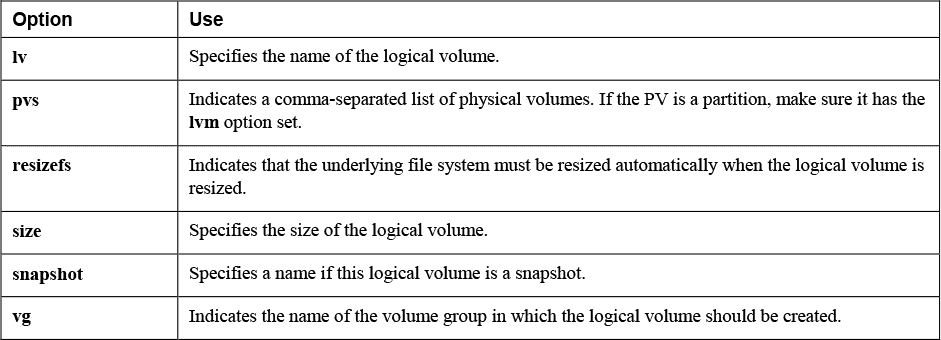

**列表 15-8** 创建 LVM 逻辑卷

```yaml
- name: create a logical volume
  lvol:
    lv: lvdata
    size: 100%FREE
    vg: vgdata
```

### 创建和挂载文件系统

在创建完存储设置的块设备层后，必须在其上方放置文件系统。Ansible 提供了 `filesystem` 模块来完成此操作。该模块支持创建调整文件系统大小。表 15-6 提供了其常用选项的概述。


**表 15-6** `filesystem` 常用选项

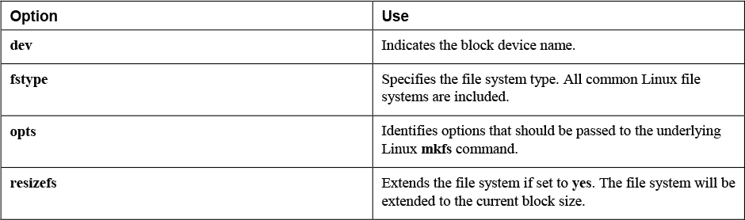

`filesystem` 模块的选项相对有限。这是因为所有选项都直接传递给底层的 Linux `mkfs` 命令，并使用 `opts` 参数进行指定。列表 15-9 显示了如何创建文件系统。

**列表 15-9** 创建 XFS 文件系统

```yaml
- name: create an XFS filesystem
  filesystem:
    dev: /dev/vgdata/lvdata
    fstype: xfs
```

文件系统创建后，就可以进行挂载。要挂载文件系统，你使用 `mount` 模块。表 15-7 显示了该模块的常用选项，而列表 15-10 显示了一个创建任务的任务。

8. 到此，LVM 存储的设置完成。现在添加一个块（block）来创建并激活交换空间（swap），但仅当 Ansible facts 中检测到的当前交换空间小于 256 MiB 时执行。注意缩进；块内的任务又多缩进了一层：

```yaml
- name: setup swap
  block:
    - name: make the swap filesystem
      filesystem:
        fstype: swap
        dev: /dev/sdb1

    - name: activate swap space
      command: swapon /dev/sdb1
  when: ansible_swaptotal_mb < 256
```

9. 在运行此 playbook 之前，运行一个临时命令（ad hoc command）以确保目标主机上的 `/dev/sdb` 是空的：

```bash
ansible ansible2 -a "dd if=/dev/zero of=/dev/sdb bs=1M count=10"
```

10. 为了确保不会出现关于分区正在使用的任何错误，请同时重启目标主机：

```bash
ansible ansible2 -m reboot
```

11. 使用 `ansible-playbook exercise152.yaml` 运行 playbook。你不应该会遇到任何问题。

12. 再次运行 playbook。你会发现此时在 `create a logical volume`（创建逻辑卷）任务上遇到了错误。原因是该任务没有以**幂等（idempotent）**的方式编写。缺乏幂等性的原因是大小被指定为 `100%FREE`，这是一个相对值，而不是绝对值。这个值在您第一次运行 playbook 时有效，但在第二次运行时就不起作用了。由于没有可用空间，LVM 层会将该任务解释为您想要创建一个大小为 0 MiB 的逻辑卷，并对此报错。为了确保 plays 是幂等的方式编写的，请务确保您使用绝对值，而不是相对值！

### 存储配置进阶练习

又到了进行进阶练习的时间。这可能是书中所有练习中最进阶的一个，所以请务必花时间理解涵盖的所有内容。要完成此练习，你需要一台带有额外磁盘设备的托管机：为主机 `ansible2` 添加一个 10 GB 的第二个硬盘，为主机 `ansible3` 添加一个 5 GB 的第二个硬盘。练习假设第二个硬盘的名称为 `/dev/sdb`；如果你的配置使用了不同的磁盘名称，请根据你的规范进行更改。

#### 练习 15-3 设置进阶存储解决方案

在此练习中，你需要设置一个满足以下要求的存储解决方案：

- 此 playbook 中的任务应仅在存在 `/dev/sdb` 设备设备的主机上执行。
- 如果不存在 `/dev/sdb` 设备，playbook 应该打印“device sdb not present”并停止在该主机上执行任务。
- 配置该设备，包含包含所有可用磁盘空间的分区。
- 创建一个名为 `vgfiles` 的 LVM 卷组（volume group）。
- 如果卷组大于 5 GB，创建一个名为 `lvfiles` 大小为 6 GB 的 LVM 逻辑卷。注意，你必须检查 LVM 卷组的大小，而不是 `/dev/sdb1` 的大小，因为理论上一个卷组中可以包含多个块设备。
- 如果卷组等于或小于 5 GB，创建一个名为 `lvfiles` 大小为 3 GB 的 LVM 逻辑卷。
- 使用 XFS 文件系统格式化卷。
- 将其挂载到 `/files` 目录上。

1. 由于这是一个较大的 playbook，明智之举是将开发工作分为不同的部分，以便可以对不同部分进行单独测试。如果这是 EX294 考试中的一个任务，明智的做法是从最具挑战性的任务开始，并将其写在一个小的 playbook 中，以便它可以独立运行。原因在于时间管理：如果你无法配置具有挑战性的任务，那么花时间在其他任务上就没有意义了。考虑到这一点，让我们关注需要检查卷组大小的情况。要开始执行所有让你测试需要创建的卷组而所需的任务，可能不是最好的主意。不过，你可以编写一个在默认卷组上运行的测试，这正是你首先要做的，使用 CentOS 8 上默认卷组的名称“cl”。其目的是测试构造，这就是为什么两个任务具有重叠的 `when` 语句并不重要。因此，创建一个名为 `exercise153-dev1.yaml` 的文件，并赋予以下内容：

```yaml
---
- name: get vg sizes
  hosts: all
  tasks:
    - name: find small vgroup sizes
      debug:
        msg: volume group smaller than or equal to 20G
      when:
        - ansible_facts[’lvm’][’vgs’][’cl’] is defined
        - ansible_facts[’lvm’][’vgs’][’cl’][’size_g’] <= 20.00

    - name: find large vgroup size
      debug:
        msg: volume group larger than or equal to 19G
      when:
        - ansible_facts[’lvm’][’vgs’][’cl’] is defined
        - ansible_facts[’lvm’][’vgs’][’cl’][’size_g’] >= 19.00
```

2. 使用 `ansible-playbook exercise153-dev1.yaml` 运行 playbook。你会注意到它以 Listing 15-12 所示的错误失败了。

##### Listing 15-12 `exercise153-dev1.yaml` 失败消息

```text
TASK [find small vgroups sizes] ***************************************************

fatal: [ansible1]: FAILED! => {"msg": "The conditional check ’ansible_facts[’lvm’][’vgs’][’cl’][’size_g’] <= 20.00’ failed. The error was: Unexpected templating type error occurred on ( True  False ): ’<=’ not supported between instances of ’AnsibleUnsafeText’ and ’float’\n\nThe error appears to be in ’/home/ansible/rhce8-book/exercise153-dev1.yaml’: line 5, column 5, but may\nbe elsewhere in the file depending on the exact syntax problem.\n\nThe offending line appears to be:\n\n  tasks:\n  - name: find small vgroup sizes\n    ^ here\n"}

fatal: [ansible2]: FAILED! => {"msg": "The conditional check ’ansible_facts[’lvm’][’vgs’][’cl’][’size_g’] <= 20.00’ failed. The error was: Unexpected templating type error occurred on ( True  False ): ’<=’ not supported between instances of ’AnsibleUnsafeText’ and ’float’\n\nThe error appears to be in ’/home/ansible/rhce8-book/exercise153-dev1.yaml’: line 5, column 5, but may\nbe elsewhere in the file depending on the exact syntax problem.\n\nThe offending line appears to be:\n\n  tasks:\n  - name: find small vgroup sizes\n    ^ here\n"}

fatal: [ansible3]: FAILED! => {"msg": "The conditional check ’ansible_facts[’lvm’][’vgs’][’cl’][’size_g’] <= 20.00’ failed. The error was: Unexpected templating type error occurred on ( True  False ): ’<=’ not supported between instances of ’AnsibleUnsafeText’ and ’float’\n\nThe error appears to be in ’/home/ansible/rhce8-book/exercise153-dev1.yaml’: line 5, column 5, but may\nbe elsewhere in the file depending on the exact syntax problem.\n\nThe offending line appears to be:\n\n  tasks:\n  - name: find small vgroup sizes\n    ^ here\n"}

fatal: [ansible4]: FAILED! => {"msg": "The conditional check ’ansible_facts[’lvm’][’vgs’][’cl’][’size_g’] <= 20.00’ failed. The error was: Unexpected templating type error occurred on ( True  False ): ’<=’ not supported between instances of ’AnsibleUnsafeText’ and ’float’\n\nThe error appears to be in ’/home/ansible/rhce8-book/exercise153-dev1.yaml’: line 5, column 5, but may\nbe elsewhere in the file depending on the exact syntax problem.\n\nThe offending line appears to be:\n\n  tasks:\n  - name: find small vgroup sizes\n    ^ here\n"}
```

3. 正如你在 Listing 15-12 的错误中所所示，playbook 中有两个问题。第一个问题是在失败的 play（执行目）中没有 `ignore_errors`，这意味着只有没有失败的主机将进入下一个任务。第二个错误是“意外的模板错误（Unexpected templating error）”。当前形式的 playbook 尝试执行一个逻辑测试，来比较两个不兼容变量类型的值。Ansible 事实（fact）类型为 `AnsibleUnsafeText`，而 `20.00` 的值是一个浮点数（float），而不是整数。为了让这个测试生效，你必须强制将两个变量的类型设置为整数。现在编写 `exercise153-dev2.yaml` 来复现这一错误过程；请注意过滤器 `int` 的使用，这对于此 playbook 的成功至关重要：

```yaml
---
- name: get vg sizes
  ignore_errors: yes
  hosts: all
  tasks:
    - name: set vgroup sizes in variables
      set_fact:
        vgsize: "{{ ansible_facts[’lvm’][’vgs’][’cl’][’size_g’] | int }}"

    - name: debug this
      debug:
        msg: the value of vgsize is {{ vgsize }}

    - name: testing big vgsize value
      debug:
        msg: the value of vgsize is bigger than 5
      when: vgsize | int > 5

    - name: testing small vgsize value
      debug:
        msg: the value of vgsize is smaller than 5
      when: vgsize | int <= 5
```

4. 运行此 playbook。你会发现它跳过并忽略了某些任务，但没有在任何地方失败，这意味着这个 playbook——尽管绝对不完美——可以作为一个示例，用于在本次练习后期测试 `vgfiles` 卷组的大小。

5. 现在既然你已经测试了作业中最复杂的部分，就可以开始编写 playbook 的其余部分了。请在一个名为 `exercise153.yaml` 的新文件中进行操作。由于这个 playbook 有许多需要完成的任务，定义一个大致结构并确保后续需要的所有元素至少都有记录，这样你稍后就可以处理细节了，这可能是明智的。所以让我们从第一部分开始，定义 play 表头（play header）以及大致结构。这一部分是你仍然对该需求中的所有任务拥有全局概述，所以你需要确保稍后不会忘记它们，如果你在细节中耗得太久，这将是一个真正的风险。


```
---
- name: set up hosts that have an sdb device
  hosts: all
  tasks:

  - name: getting out with a nice failure message if there is no second disk
    # fail:
    debug:
      msg: write a nice failure message and a when test here
    # when: something

  - name: create a partition
    #parted
    debug:
      msg: creating the partition

  - name: create a volume group
    #lvg:
    debug:
      msg: creating the volume group

  - name: get the vg size and store it in a variable
    #set_fact:
    debug:
      msg: storing variable as an integer

  - name: create an LVM on big volume groups
    #lvol:
    debug:
      msg: use when statement to create 6g lvol if vsize > 5

  - name: create an LVM on small volume groups
    #lvvol:
    debug:
      msg: use when statement to create 3g lvol if vsize <= 5

  - name: formatting the XFS filesystem
    # filesystem
    debug:
      msg: creating the filesystem

  - name: mounting /dev/vgfiles/lvfiles
    # mount:
    debug:
      msg: mounting the volume
```

6. 像你刚刚定义的这种通用结构的优势在于，你可以随时运行测试。现在是时候填充它了。从 play 表头开始，然后检查管理系统是否存在 `/dev/sdb`：

```
---
- name: setup up hosts that have an sdb device
  hosts: all
  tasks:

  - name: getting out with a nice failure message if there is no second disk
    fail:
      msg: there is no second disk
    when: ansible_facts[’devices’][’sdb’] is not defined
```

7. 此时，我建议你运行一次测试，以确认 playbook 确实跳过了所有没有第二个磁盘设备的主机。使用 `ansible-playbook exercise153.yaml` 来执行，并观察输出中是否有许多跳过（skipping）的消息。

8. 如果到为止一切正常，你可以继续创建分区并创建逻辑卷组（lvm）。这里是你需要输入的任务。注意，在任何时候都没有指定大小，这意味着分区和卷组将被允许增长到最大。

```
- name: create a partition
  parted:
    device: /dev/sdb
    number: 1
    state: present
- name: create a volume group
  lvg:
    pvs: /dev/sdb1
    vg: vgfiles
```

9. 此时，你可以插入将卷组大小保存到变量的部分，该变量可以在 `when` 语句中使用。注意，在编写复杂的 playbook 时，为了确保没有出错，你可以使用 `debug` 模块来验证结果。

```
- name: get vg size and convert to integer
  set_fact:
    vgsize: "{{ ansible_facts[’lvm’][’vgs’][’cl’][’size_g’] | int }}"
- name: show vgsize
  debug:
    var: vgsize
```

10. 在此步骤之后，是时候运行测试了。如果你需要，可以在 [`github.com/undervvugt/rhce-book`](https://github.com/undervvugt/rhce-book) 找到名为 `exercise153.yaml` 的示例 playbook。使用 `ansible-playbook exercise153.yaml` 来验证你目前的内容。注意，你*必须*确保在还没有任何配置的主机上运行。如果已经存在配置，这可能会给你虚假的结果！为了确保干净，使用 `dd if=/dev/zero of=/devdb bs=1M count=10` 来清除 `/devdb`，然后执行 `ansible all -m reboot` 重启它们。这一切的目的是为了看到 Listing 15-13 中所示的错误信息。在进入下一步之前，请尝试理解发生了什么。

**Listing 15-13** 错误信息 在 Exercise 15-3 步骤 1

```
******************************************************************
TASK [get vg size and convert to integer in new variable] ******************************

fatal: [ansible2]: FAILED! => {"msg": "The task includes an option with an undefined variable. The error was: ’dict object’ has no attribute ’vgfiles’\n\nThe error appears to be in ’home/ansible/rhce8-book/exercise153-step9.yaml’: line 18, column 5, but may\nbe elsewhere in the file depending on the exact syntax problem.\n\nThe offending line appears to be:\n\n      vg: }}"\n  - name: get vg size and convert to integer in new variable\n    ^ here\n"}

fatal: [ansible3]: FAILED! => {"msg": "The task includes an option with an undefined variable. The error was: ’dict object’ has no attribute ’vgfiles’\n\nThe error appears to be in ’home/ansible/rhce8-book/exercise153-step9.yaml’: line 18, column 5, but may\nbe elsewhere in the file depending on the exact syntax problem.\n\nThe offending line appears to be:\n\n      vg: }}"\n  - name: get vg size and convert to integer in new variable\n    ^ here\n"}
******************************************************************
```

11. 正如你所见，你尝试使用的变量还没有值。这是由于一个简单的原因：需要事实收集（fact gathering）来设置变量，而事实收集发生在 playbook 的开始处。此时，你需要在创建卷组之后添加一个运行 `setup` 模块的任务，然后你就可以重试。在输出中，你必须查看 `show vgsize value` 任务，它现在看起来应该正常了，之后的所有都可以忽略。如果需要完整示例，请查看 GitHub 仓库中的 `exercise153-step11.yaml`。

```yaml
# skipping first part of the playbook in this listing

- name: create a volume group
  lvg:
    pvs: /dev/sdb1
    vg: vgfiles

- name: run the setup module so that we can use updated facts
  setup:

- name: get vg size and convert to integer in new variable
  set_fact:
    vgsize: "{{ ansible_facts[’lvm’][’vgs’][’vgfiles’][’size_g’] | int }}"

- name: show vgsize value
  debug:
    var: "{{ vgsize }}"
```

12. 假设一切顺利，你现在可以添加两个条件测试，根据 `vgsize` 的值，使用 `lvol` 模块创建逻辑卷：

```yaml
- name: create an LVM on big volume groups
  lvol:
    vg: vgfiles
    lv: lvfiles
    size: 6g
  when: vgsize | int > 5

- name: create an LVM on small volume groups
  lvol:
    vg: vgfiles
    lv: lvfiles
    size: 3g
  when: vgsize | int <= 5
```

13. 添加任务以使用 XFS 文件系统格式化卷并挂载它们：

```yaml
- name: formatting the XFS filesystem
  filesystem:
    dev: /dev/vgfiles/lvfiles
    fstype: xfs

- name: mounting /dev/vgfile/lvfiles
  mount:
    path: /file
    state: mounted
    src: /dev/vgfiles/lvfiles
    fstype: xfs
```

14. 全好了！playbook 现在已准备就绪。使用 `ansible-playbook exercise153.yaml` 运行它并验证其输出。

15. 使用即时命令 `ansible ansible2,ansible3 -a “lvs”` 显示带有额外硬盘的机器上的 LVM 逻辑卷大小。你应该能看到一切运行良好，你已经完成了！

## 总结

在本章中，你学习了如何处理存储设备。设置存储是一项重要任务，你需要仔细考虑，因为在尝试设置时可能会出现很多问题！你首先学习了如何使用 Ansible facts 来发现有关当前存储配置的事实。之后，你学习了如何使用适当的模块设置存储设备。你还完成了书中最高级的 playbook 示例之一，所以你离准备好考试越来越近！

## 考试准备任务

如引言中“如何使用本书”部分提到的，你有几种准备考试的选择：此处的练习题、第 16 章中的“最终准备”以及同伴网站上的考试模拟题。

## 复习所有关键主题

回顾本章中最重要的主题，这些主题在页外边缘处用“关键主题”图标标记。表 15-8 列出了这些关键主题的参考列表及其所在的页码。


**表 15-8** 第 15 章关键主题


## 记忆表

打印 附录 D“记忆表”（可在同伴网站找到）或至少打印本章章节，并凭记忆完成表格和列表。附录 E“记忆表答案”同样位于同伴网站上，包含了完成的表格和列表供你检查工作。

## 定义术语

本章没有术语。

## 复习题

**1.** 你可以使用哪种 Ansible fact 来获取当前挂载的概览？

**2.** 你需要编写一个 playbook，当设备不存在时生成错误。你可以使用哪两个模块来实现此目的？

**3.** 你使用哪个模块来创建分区？

**4.** 你可以使用哪个 parted 选项来指定它应该使用 GPT 分区？

**5.** 你使用哪个 parted 选项来设置 lvm 分区类型？

**6.** 你想使用 parted 模块在已有一个 2 GB 分区的磁盘上创建一个分区。你应该使用哪个选项来确保分区从正确的位置开始？

**7.** 你会使用哪个模块来管理 LVM 卷组？

**8.** 为什么在使用 `lvol` 模块创建一个使用卷组所有可用磁盘空间的 LVM 卷时，应避免使用 `size: 100%FREE`？

**9.** 你在 `mount` 模块中使用 get 哪个选项来指定你想挂载的设备？

**10.** 必须为 `mount` 模块分配哪个值以确保设备已 `mounted`？

## 章节结束实验

在本章中你处理了存储。设置存储是一项重要任务，你需要仔细考虑，因为在尝试设置时可能会出现很多问题！你首先学习了如何使用 Ansible facts 来发现有关当前存储配置的事实。之后，你学习了如何使用适当的模块设置存储设备。你还完成了书中最高级的 playbook 示例之一，所以你离准备好考试越来越近！

你可以通过 redhat.com 或通过培训公司注册考试。从何处购买其实并不重要，因为你最终参加的是同一种考试。不过，通过当地培训公司预订可能会更容易获得折扣。通常通过 Red Hat 预订更快，因为你可以直接联系 Red Hat。请注意，特定政策可能适用于特定国家，且并非所有选项在你的地区都可用。

如果你预订了教室考试，你将收到一份关于考试日期和时间的邀请函。如果你预订了自助机考试（kiosk exam），你将获得一个优惠码，可以用它自行预约考试地点、时间和日期。

## 考试当天

确保参加考试时携带适当的身份证明。为了允许考试，你需要一份经过批准的政府身份证。通常情况下，`passport` 或 `driver’s license` 即可；你所在的国家也可能接受其他类型的证明。不要忘记携带；没有 `ID`，你将被拒绝考试。

此外，确保准时到达。在预定开始时间前半小时到达是一个好主意。如果你迟到，通常会被允许进入考试，但不会获得额外时间。所以，请务必准时。

在证明身份后，你会被介绍到考试环境。由于每位考者都与 Red Hat 签署了保密协议，我无法详细告诉你考试环境的具体样貌。但我可以告诉你，将有一个需要在其中工作的环境。根据你所参加的考试，这包含一个或多个 `servers`。此外还有一份必须执行的任务列表。按步骤完成这些任务，仔细阅读所有内容，你就能通过考试。

## 考试期间

你在考试期间必须处理的任务并不一定按逻辑逻辑顺序呈现。因此，在开始处理第一个任务之前，先阅读所有任务是一个好主意。在阅读所有任务时，你可以决定创建所需配置的最佳顺序。为你自己确定最可能的最佳顺序，因为这可能并不显而易见。

另一个重要的提示是仔细阅读。现在已经没有多少人知道如何仔细阅读了，你可能就在其中之一。IT 管理员非常擅长扫描网页以获取他们所需的信息。这种技能在考试中对你没有帮助。阅读能力则可以。我如何强调这一点都不为过。根据我的估计，所有考试失败的人中，有 40% 的是因为他们没有阅读（他们只是在扫视）。因此，让我给你提供一些关于如何阅读考试题的建议：

* 如果英语不是你的母语，或者你精通一或多种额外语言，你可以切换题目呈现的语言。也许英语题目对你来说并不清晰，但翻译成另一种语言的题目就很清晰。所以，如果有疑问，请阅读翻译版。

* 英语题目是最常用的且最适合被扫视的题目。考试题目是完美的，因为 Red Hat 付出了巨大的努力使其变得完美。考虑到大多数考试候选者都是处理英语题目的，英语题目的质量是最好的。你可以自由使用翻译后的题目，但你应该将英语题目作为你的主要来源。

* 为了确保你不遗漏任何内容，请为每个问题创建一个任务列表。考试期间你随身带有 `scratch paper`。用它列出你必须完成的任务简短列表，并逐一处理。这种方法有助于你集中在考试题目真正要求的内容上。

* 在完成所有任务后，去喝杯咖啡（你被允许在考试期间休息）。当你回来时，再次阅读所有问题，确保你没有遗漏任何内容。进行短暂的休息很重要；它能让你从考试中抽离，之后你阅读题目时就像是第一次看到它们一样。

考试的另一个重要部分是你处理任务的顺序。尽管我无法谈论具体的考试内容，但某些主题需要在处理其他主题之前固定。确保你先处理这些主题。如果你不这样做，修复其他任务将变得困难或不可能。

## 保密协议

`RHCE` 认证是目前 IT 领域最受青的认证之一。它代表了真实的价值，因为参加 `RHCE` 考试的人已经完成了一系列真实的任务，并知道如何工作。保密协议是其中非常重要的一部分。`RHCE` 认证是目前 IT 领域最受青的认证之一。它代表了真实的价值，因为参加 `RHCE` 考试的人已经完成了一系列真实的任务，并知道如何工作。

# 第四部分：模拟考试

## 模拟考试 A

该内容正在开发中。

## 模拟考试 B

该内容正在开发中。

### 模拟考试 C

该内容正在开发中。

### 模拟考试 D

该内容正在开发中。

# 第五部分：附录

### 附录 A：“我已经了吗？”测验和复习题的答案

#### 第一章

##### “我已经了吗？”测验

**1**


`A and C`。使用`Bash script`管理 Windows 根本行不通。这只是让答案 A 成立的例子之一。此外，很难保证 shell 脚本总是产生相同的结果。

**2**

`B`。在发布阶段，新软件可用。为了让它按预期方式运行，下一步是配置，以确保运行软件的系统符合预期。

**3**

`D`。将基础设施即代码的配置文件放在`CVS`中有许多优势，包括答案中提到的所有功能。

**4**

`C`。虽然`Red Hat Satellite`确实负责了某些自动化任务，但它不能被认为是完整的自动化工具，因为缺少特定的功能。

**5**

`B and C`。大多数替代方案都需要代理程序，并使用更复杂的格式来创建配置。配置的简易性和无需安装代理程序即可管理资产的能力是`Ansible`的两个大优势。

**6**

`A`。`Ansible`使用原生远程访问被的设备。这通常是`SSH`。在 Windows 上，`WinRM`是默认设置，在网络设备上可以使用`API`访问。永远不需要代理程序。

**7**

`C`。`AWX`是一个开源项目，提供了一个 Web 界面允许你在大型环境中管理`Ansible`。Red Hat 提供了`Ansible Tower`作为`AWX`的商业版本，并增加了支持许可。

**8**

`C`。虽然答案 D 不完全错误，但答案 C 更好，因为它关注的是达到所需状态所需的更改。

**9**

`C`。`Ansible`可以完美地向通过其他系统帮助完成`PXE-boot`的裸金属服务器推送配置，但`Ansible`本身无法执行`PXE-boot`。

# 10

`A`。`Ansible`最初是作为一种配置管理解决方案而产生的，这也是大多数人仍然使用它的原因。`Ansible`也可以用于其他场景，但配置管理仍然是它的核心功能。

## 第 2 章

### “我了解这些了吗？”测验

**1.** `B and D`。`Ansible`命令在托管节点上作为 Python 脚本执行。要将这些 Python 脚本推送到托管节点，需要`SSH`访问。

**2.** `B and C`。由于 Python 3 已经成为 RHEL 8 的默认 Python 版本，如果`Ansible`安装在 RHEL 8 上，它也基于 Python 3。`Ansible`需要在托管节点上安装 Python，以便在这些主机上运行`Ansible`脚本。

**3.** `B`。尽管推荐使用`SSH`密钥登录，但并不是强制性的。也支持密码登录。

**4.** `A`。无密码权限提升很方便，但不是强制性的。

**5.** `C`。尽管建议拥有 20 GB 或更大的磁盘空间，但`Ansible`本身实际上并不需要很多磁盘空间。

**6.** `D`。可以使用`python-pip`安装程序安装`Ansible`。使用 Java 安装程序不是选项，因为`Ansible`与 Java 完全没有关系。

**7.** `C`。必须有某种方法来运行需要管理员权限的配置任务，那就是通过`sudo`使用 root 执行。

**8.** `B`。在所有安装模式中，Python 3 都是默认安装的，因此不需要单独安装。

**9.** `A`。`Ansible`需要访问`SSH`权限，到此了。代理程序不需要额外的配置。

**10.** `C`。要使用公钥/私钥访问远程主机，用户的公钥必须在远程主机上，而不是答案 B 中建议的私钥。

### 复习题

**1.** 使用`subscription-manager`添加 Red Hat 提供的`Ansible`仓库并从那里安装`Ansible`。

**2.** 需要在主机上创建`ansible`用户账户，并设置`sudo`权限提升。此外，用户必须能够通过`SSH`登录到托管主机。

**3.** Python`pip`

**4.** 不需要代理；你只需要`SSH`服务正在运行并且可以访问即可。

**5.** `AWX`

**6.** 配置密码短，并使用`ssh-agent`和`ssh-add`缓存密码短。

**7.** `/etc/sudoers.d/`

**8.** 使用`raw`模块（稍后会讨论）。

**9.** 默认情况下，`Ansible`控制节点会生成一个 Python 脚本。该脚本通过`SSH`连接发送到托管主机并在那里执行。`Ansible`可用于管理没有 Python 栈的设备。在这种情况下，`Ansible`将原生代码发送到托管设备，不需要安装 Python。

**10.** 使用`Ansible Tower`，它允许将密码保存在安全的缓存中。

## 第 3 章

### “我了解这些了吗？”测验

**1.** `A`。`Ansible`不会在当前目录查找清单文件（inventory file）。如果没有指定清单文件，`Ansible`将查看`/etc/ansible/hosts`文件作为默认使用的文件。

**2.** `C`。如果无法使用清单文件，`Ansible`使用`localhost`作为默认目标主机。

**3.** `D`。`Ansible`查找清单的默认位置是`/etc/ansible/hosts`。

**4.** `B`。即使大多数动态清单脚本是用 Python 编写的，这并不是正式的要求。

**5.** `C`。当指定一个目录名称为清单时，该目录中的所有文件都被视为清单文件。注意，动态清单脚本必须都具有执行权限。

**6.** `A`。在清单中定义主机变量是常见的。

**7.** `D`。权限提升可以在`ansible.cfg`中指定。

**8.** `C`。主机变量应该定义在`host_vars`和`group_vars`中。

**9.** `B`。`remote_user`指定用户。

**10.** `A`。`host_key_checking`可以决定是否应该验证主机密钥。

### 复习题

**1.** `all`

**2.** `/etc/ansible/hosts`

**3.** `children`

**4.** `web`

**5.** `--list`

**6.** `ungroup`

**7.** `ansible-inventoryi inventory --graph`

**8.** `--list`

**9.** `--hostname`

**10.** `become_method`

## 第 4 章

### “我了解这些了吗？”测验

**1.** `A`。为了以一致的方式重复任务，请使用 playbook。临时命令使用命令行参数，无法以与 playbook 执行的任务相同的方式再次运行。

**2.** `C`。如果在临时命令中没有指定模块，则使用`command`模块。然而，该模块无法处理管道等 shell 功能。请使用`shell`模块。

**3.** `D`。`Ansible`是幂等性的，这意味着`Ansible`会比较临时命令或 playbook 中的期望状态与托管主机的当前状态。如果当前状态匹配期望状态，则不应用任何更改。

**4.** `B`。Shell 重定向是 shell 功能，`command`模块不支持 shell 功能。可选地也可以使用`raw`模块，但因为`shell`模块更具体，请使用`shell`模块。

**5.** `C`。`raw`模块是唯一可以在没有安装 Python 的托管节点上运行命令的模块。

**6.** `B`。在包含多个 Linux 发行版的环境中，您应该使用`package`模块。只有在管理特定发行版时，才使用特定发行版的模块。

**7.** `D`。`Ansible`的`ping`模块测试目标主机是否处于可管理状态。它不仅测试连接性，还测试了 Python 是否设置正确。

**8.** `C`。`ansible-doc -l`命令生成已安装模块的列表。

**9.** `C`。使用`ansible-doc -s`获取与 playbook 格式的模块参数列表。

**10.** `C`。`Ansible`文档网站将模块分为特定的功能类别。其中一类是系统模块类别，你可以在其中找到可以用于各种系统管理任务的模块列表。

### 复习题

**1.** 用于执行快速检查和对主机进行初始设置。

**2.** `raw`模块。

**3.** 最好是使用`yum`模块，因为在`Ansible`中推荐使用最具体的模块。然而，你也可以通过将此命令作为`shell`模块的参数运行。

**4.** 绝对可以！在考试中只评估结果，只要你通过`Ansible`获得了该结果，就没有问题问题。

**5.** `name=`、`state=`和`enabled=`。

**6.** `SEE ALSO`章节包含关于相关模块的信息。

**7.** 查看该模块文档的第一行；它包含了该模块正在使用的 Python 脚本的位置。

**8.** 脚本没有设置执行权限。

**9.** 你将编辑`/etc/ansible/ansible.cfg`文件。

**10.** 查看`ansible-doc`输出中的`EXAMPLES`部分，或者使用`ansible-doc -s`后跟你想要研究的模块名称。

## 第 5 章

### “我已经认识了吗？”测试

**1.** `C`。Playbook 应该以`---`开头以表示 playbook 的开始。

**2.** `D`。在 play 头部中使用`become`参数是可选的。如果没有指定，将使用来自`ansible.cfg`的默认参数。

**3.** `A 和 C`。缩进是 playbook 中的强制性元素，用于识别父对象和子对象之间的关系。只能使用空格，不能使用制表符。

**4.** `C 和 D`。没有简单的方法来撤销 playbook 应用的更改。唯一的方法是编写一个执行完全相反操作的 playbook。

**5.** `B`。修改了受管理系统的任务会显示“changed”。不需要修改的任务显示“ok”。

**6.** `C`。YAML 列表仅由特定模块支持。`yum`模块支持 YAML 列表；`service`模块则不支持。

**7.** `A`。如果一个值包含要写入目标文件的文本，你应该在`key:|`语法中使用`|`符号，以表示后续行中的换行符必须被保留。

**8.** `D`。干运行显示任务在受管理主机上的结果。要触发干运行，请使用`-C`选项。

**9.** `B`。如果不同的 play 之间存在明确的关系，配置多 play playbook 是意义的。如果 play 之间没有直接关系，在大多数情况下运行独立的 playbook 更好，因为它们更容易独立管理。

**10.** `C`。使用多 play playbook 有许多好处，但独立调度 play 并不是其中之一。

### 复习题

**1.** 使用`-vvvv`。注意`-vvvvv`也可以使用，但在管理 Windows 机器时它有意义。

**2.** 空格。

**3.** 使用`ansible-playbook --syntax-check`。

**4.** `uri`模块。

**5.** `copy`模块；也可以使用其他模块，但本章未讨论。

**6.** `>`符号用于需要复制到目标文件的文本字符串前面。`>`符号不会保留文本中的换行符，这对于可读性很有用。

**7.** 如果 playbook 中的不同 play 之间没有直接的逻辑关系，应该使用多个 playbook。

**8.** `OK`

**9.** 四次，因为 playbook 默认也会运行 fact。

**10.**

## 第 6 章

### “我已经认识了吗？”测试

**1.** `D`。当一个值包含要写入目标文件的文本时，你应该使用`key:|`语法。

**2.** `B`。

**3.** `A`。

**4.** `B`。

**5.** `C`。

**6.** `D`。

**7.** `A`。

**8.** `B`。

**9.** `B`。

**10.** `C`。

### 复习题

**1.** 自定义 fact 存储在`/etc/ansible/facts.d`目录中。文件名以`.fact`结尾。

**2.** 使用`setup`模块用于收集 fact。

**3.** 你必须更改`ansible.cfg`中的一个参数，并启用一个允许 fact 缓存特定一段时间的插件。

**4.** 在 play 头部包含`vars_files:`。

**5.** 在当前项目目录下创建一个`group_vars`目录。在该目录下创建一个以应应用变量的主机组命名的文件，并在其中定义变量。playbook 无需进一步操作，变量会自动包含。

**6.** 使用数组；循环无法应用于字典中的变量。

**7.** `hostvars`魔法变量包含了作用于特定主机的所有设置。

**8.** 使用`ansible-vault rekey`更改加密文件的密码。

**9.** 为了交互式地提示密码，可以使用`--ask-vault`选项。在这种情况下，使用`--vault-id @`选项。

**10.** 在任务中使用`register`参数将命令的标准输出存储在变量中。

**[1]** `D`。要遍历任何值列表，请使用`loop`。在 Ansible 2.5 及更早版本中，使用的是`with_items`，但该语法现在已弃用。

**[2]** `B`。在`when`语句中使用变量时，你不需要将变量名放在双括号之间。

**[3]** `B`。要测试布尔变量的值，你只需要提到变量名。

**[4]** `D`。要测试变量是否等于特定值，你必须使用`==`。在字符串测试中，值必须放在双引号之间。如果不加双引号，它将被解释为整数。

**[5]** `C`。要测试变量是否等于特定值，你必须使用`==`。如果值是数值，则不能放在双引号之间。

**[6]** `C`。在 playbook 中使用`vars_prompt`要求用户为特定变量提供值。

**[7]** `A`。要激活一个处理器（handler），请使用`notify`语句，并将应激活的处理器名称作为其参数。

**[8]** `C`。只有当调用它的任务结果为“已更改（changed）”时，处理器才会运行。

**[9]** `A 和 B`。如果 playbook 中的任务失败，playbook 的执行通常会停止。使用`ignore_errors`可以覆盖此行为。接下来，使用`force_handlers`确保即使任务失败，处理器也会运行。

**[10]** `C`。你可以使用`fail`模块来配置在任务失败时显示的特定错误消息。

### 复习题

**[1]** 名称是`item`。

**[2]** 你不能对字典中的值进行循环。如果你确实需要此功能，请使用`dict2items`过滤器。

**[3]** 使用`when`。

**[4]** 只需`when myvar`即可，不需要其他内容。

**[5]** `when myvar == “myvalue”`

**[6]** 使用`myvar in mypackages`。

**[7]** 使用`(var1 == “value1” and var2 == “value2”) or (var3 == “value3” and var4 == “value4”)`。

**[8]** 使用`when: cmd_out.stdout.find(’error’) != -1`。

**[9]** 在 play 中使用`ignore_errors`。

**[10]** 使用`any_errors_fatal`。

## 第 8 章

### “我已经知道这些了吗？”测验

**[1]** `A`。你可以使用`stat`模块获取有关文件属性的信息，包括当前的权限模式。

**[2]** `C`。你可以使用`lineinfile`模块替换文件中的特定行文本。你也可以为此目的使用`blockinfile`模块，但由于其使用起来更复杂，因此使用`lineinfile`模块更好。

**[3]** `C`。权限模式被写入变量`st.stat.mode`中。该变量包含一个字符串，因此你应该使用字符串测试操作符，这就是为什么值位于单引号之间。

**[4]** `D`。在`lineinfile`模块中，你使用`regexp`语句来查找正则表达式。要表示该行应以识别出的文本开头，正则应该以`^`开头。

**[5]** `B`。`file`模块不能将一行文本复制到文件中。请改用`lineinfile`模块。

**[6]** `D`。你可以使用`fetch`模块将文件从受管节点复制到控制主机。

**[7]** `A`。你可以使用`file`模块设置 SELinux 文件属性，但通过`file`模块设置的任何属性都不会持久应用到 SELinux 策略中。请改用`sefcontext`。

**[8]** `A`。`Ansible`未提供恢复上下文的特定模块。使用`command`模块运行`restorecon`。

**[9]** `C`。在`template`内处理变量内容，请使用`Ansible`过滤器。

**[10]** `B`。你可以使用`hostvars`魔法变量来处理在特定主机上发现的事实（facts）。

### 复习题

**[1]** 使用`acl`。

**[2]** 使用`lineinfile`和`replace`。

**[3]** 使用`stat`。

**[4]** 你可以创建新文件或目录、创建链接、删除文件并设置权限。

**[5]** 使用`synchronize`。

**[6]** 它将更改写入文件系统而不是策略。请改用`sefcontext`。

**[7]** 使用`seboolean`。

**[8]** 触发处理器的任务没有发生变化。

**[9]** 使用`{# comment #}`。

**[10]** 如果特定条件为真，它可以包含一行。它主要用于处理布尔变量。

## 第 9 章

### “我已经知道这些了吗？”测验

**[1]** `A`。变量可以存储在`defaults`目录或`vars`目录中。`defaults`中的变量可能会被 playbook 覆盖；`vars`目录中的变量通常不应被覆盖。

**[2]** `D`。`/usr/share/ansible/roles`目录用于存储从 RPM 软件包安装的角色。自定义角色不应存储在此处。

**[3]** `C`。社区提供的角色可以在 Ansible Galaxy 上找到。

**[4]** `D`。通常情况下，play 中的处理器总是在 play 中的任务之后运行。要让任务在处理器之后运行，请将它们包含在`post_tasks`中。

**[5]** `B`。角色依赖应该定义在`meta/main.yml`文件中。该文件是角色层次结构的一部分。

**[6]** `C`。`ansible-galaxy init`命令用于创建自定义清单所需的目录结构。


[7] B。你可以在从命令行使用 Ansible Galaxy 角色之前，使用需求文件进行安装。使用 `ansible-galaxy install -r filename` 安装该文件。

[8] A。EL 平台确保将找到可以在 RHEL 和 CentOS 上使用的角色。

[9] A。你使用 `timesync_ntp_servers` 变量的 `iburst` 属性来指定是否进行快速同步。

[10] B 和 D。你使用 `selinux_fcontext` 变量来定义应用于目标的文件上下文。此外，你必须将 `selinux_restore_dirs` 变量设置为应用 `selinux_fcontext` 的目录名称，以确保 `restorecon` 命令应用于该目录。

### 复习题

[1] 在 `ansible.cfg` 中配置 `roles_dir` 设置。

[2] 在 `defaults` 目录中。

[3] `meta/main.yml` 文件。

[4] 在 `~/.ansible/roles`。

[5] 使用 `pre_tasks`。

[6] 使用 `post_tasks`。

[7] 使用 `ansible-galaxy init`。

[8] 定义一个需求文件并使用 `ansible-galaxy install -r requirementsfile.yml` 运行它。

[9] 查看 `/usr/share/doc/rhel-system-roles` 中的示例文件和其他文档。

[10] 查看变量。要指示 RHEL 系统角色做什么，大多数情况下你只需要编写一个定义变量并调用系统角色的简单 playbook。

### 第 10 章

#### “我已经知道这些了吗？”测验

1. A。当在主机名模式中使用通配符时，你必须将整个模式放在单引号之间。

2. D。如果有外部系统可用于存储主机名，可以使用动态清单脚本来查询这些主机名。对于可以使用哪些系统没有限制。

3. D。`ansible-inventory` 命令没有 `--all` 选项。

4. A。许多动态清单脚本是用 Python 编写的，但这不是强制性要求。

5. D。为了确保在移动到下一组主机之前完全处理完一组主机，请在 play 剧本的头部（play header）中使用 `serial` 关键字。

6. A 和 B。要增加同时运行任务的主机数量，请使用 `forks` 选项。该选项可以在 `ansible.cfg` 中设置，也可以在使用 `ansible-playbook` 命令启动 play 时通过 `--forks` 参数设置。

7. B。`include`（包含）确保在到达特定内容时处理代码，并且是一个动态过程。注意，也可以被包含。

8. B。使用 `import_tasks` 静态导入任务文件。该文件在处理任何任务之前被导入。

9. D。你可以使用条件语句来确保任务仅在特定条件为真时才运行。由于 `include` 的动态性质，你无法在执行特定操作时执行任何需要 `include` 结果的操作。

10. C。因为 `import_tasks` 发生在任务实际执行之前，它们从任务开始的那一刻起就是 playbook 的一部分，可以无问题地使用 `ansible-playbook --start-at-task`。

### 复习题

1. 使用 `web,&file` 或 `&web,file`。

2. `--list` 和 `--host <hostname>`。

3. 你使用 `.ini` 文件。

4. 使用 `ansible-inventory --graph`。

5. 使用 `-f 10` 来指定 forks 的数量。

6. 在 playbook 头部使用 `serial: 3`。

7. 使用 `include_tasks`。使用 `import_tasks` 会在 playbook 执行之前静态地包含任务。

8. 使用变量包含文件。

9. `ansible-playbook --list-tasks` 命令对动态包含的任务文件不起作用。请改用静态导入的任务文件。

10. 在复杂的项目中建议导入 playbooks，在这些项目中使用一个主 site playbook，用于导入编写为独立 playbooks 的完整流程。

### 第 11 章

#### “我已经知道这些了吗？”测验

1. B。当你运行 Ansible 命令时，它要么成功，要么不成功。如果命令运行结果不佳，输出会被写入 `STDOUT`，并可以从那里轻松地分析。在日志文件中收集所有 Ansible 命令输出的历史记录不会增加多少有用的信息。

2. C。你应该使用 `--check` 选项来确保显示修改但不进行写入。你必须在该命令中添加 `--diff` 选项，以查看模板模块将写入哪些修改。

3. B。如果任务因为条件语句中的要求未满足而不执行，你会在 playbook 结果中看到“skipped”（跳过）。

4. B。当任务被动态执行时，从一开始就无法确定具体将执行什么。

5. C。你使用 `assert` 模块来检查预期的结果是否存在但在其他情况下失败。在两种情况下，它都可以用于编写易于理解的失败信息。

6. A。`uri` 模块显示由 Web 服务或 RESTful API 返回的值。

7. D。你使用 `stat` 模块显示属性。

8. C 和 D。要运行任务，你需要 `debug` 或 `never` 标签。然而，对于其他任务，你必须使用 `all` 或 `untagged` 标签。

9. D。你使用 `ping` 模块测试连接性。

10. C。错误“Missing password”（缺少密码）表示无法使用 sudo。最可能的解释是 `remote_user` 未配置为无密码运行 sudo。检查你的 `remote_user` 配置。

### 复习题

1. `check_mode: no`

2. `log_path`

3. `download_only`

4. `uri`

5. `fail`

6. `assert`

7. `stat`

8. `never`

9. `ansible-playbook --tags all,debug`

10. `ansible all -m ping`

### 第 12 章

#### “我已经知道这些了吗？”测验

1. D。设置仓库访问，你应该使用 `yum_repository` 模块。没有通用的仓库模块。

2. B。默认，Ansible 不收集包信息。你应该使用 `package_facts` 模块来收集这些信息。

3. A。你可以在 `yum_repository` 模块中使用 `file` 参数来指定将创建的仓库文件。

4. C。当使用 yum 管理 AppStream 模块时，模块名必须以 `@` 开头，整个字符串必须放在单引号之间。

5. C。你使用 `state: latest` 将已安装的包更新到最新的最新版本，如果尚未安装则安装。如果你将其与 `name: '*'` 一起使用，所有已安装的包都将更新。

6. B。创建仓库元数据需要 Linux 的 `createrepo` 命令。没有 Ansible 模块运行此命令，因此你必须使用 `command` 模块。

7. D。要指定下载包的存储位置，`download_only` 参数要求你使用 `download_dir` 参数指定包下载目录。

8. A 和 B。在使用 `redhat_subscription` 模块注册 RHEL 后，你使用 `rhsm_repository` 模块注册通过 Red Hat Subscription Manager 提供的仓库。其他仓库可以使用 `yum_repository` 处理。

9. D。使用 `-e` 命令行选项设置的变量适用于 playbook 中的所有 play。另一种方法是设置 `host_groups` 变量，但由于在这种情况下该变量被用于添加新主机，这种方法不起作用。

10. B 和 C。当 `vars_prompt` 提示输入变量值时，用户输入不会写入屏幕，也不会存储在历史记录中，这使其成为提供这些敏感值的一种安全方式。使用 Ansible Vault 也提供了一种安全的方法。答案 D 是错误的，因为可以从 Linux shell 历史中读取该变量。答案 A 更加糟糕，因为可以从 playbook 文件中读取这些变量。

### 复习习题

- 1. `package_facts`
- 2. `yum_repository`
- 3. `name: ’@Virtualization Host’`
- 4. `createrepo`
- 5. 使用 `yum` 模块的 `download_only` 参数配合 `download_dir` 参数来指定软件包必须安装的目录。
- 6. `fetch`
- 7. `rpm_key`
- 8. `redhat_subscription`
- 9. `rhsm_repository`
- 10. 使用 `-e varname` 将变量作为参数传递给 `ansible-playbook` 命令。

## 第 13 章

### “我已经认识这些了吗？”测试

- 1. D。你使用 `known_hosts` 模块来管理用户的已知主机设置。
- 2. B 和 C。要让用户成为辅助组的成员，使用 `groups` 参数。为了确保当前的组分配不被覆盖，请添加 `append`。
- 3. A 和 B。Ansible 没有提供专门开发用于管理 sudoers 配置文件的模块，因此你必须使用通用的 `lineinfile` 或 `template` 模块。如果对 `/etc/sudoers` 文件使用了其中任一个模块，不要忘记使用 `verify` 选项，让 Linux 的 `visudo` 命令验证在修改文件时没有发生错误。
- 4. D。你使用 `authorized_key` 模块来管理用户的 SSH 公钥。你使用 `known_host` 模块来管理受控主机 `known_hosts` 文件中的服务器公钥。
- 5. D。你可以使用 `lookup` 插件来动态查找值并对其进行处理。注意，`lookup` 不是一个模块，而是一个插件。
- 6. A。`authorized_keys` 模块无法从隐藏目录读取文件，由于这个原因，`id_rsa.pub` 文件需要被复制或移动到模块允许读取的位置。
- 7. C。存储在 `/etc/shadow` 中的加密密码由哈希算法、随机盐和用户密码的加密哈希组成。用户名不是字符串的一部分。
- 8. B。你不能将 `command` 模块配合 `passwd --stdin` 命令使用，因为该命令从管道获取输入，而 shell 管道在 `command` 模块中不起作用。
- 9. A。在所有情况下，如果需要最高级别的安全性，Ansible Vault 是唯一的选择。
- 10. C。为了保持灵活性，将用户存储在变量中，并根据功能实现分离，在包含文件中定义该变量。

### 复习习题

- 1. 使用 `lineinfile`；没有专门针对 sudo 配置的模块。
- 2. 使用 `pamd`。
- 3. 使用 `known_hosts`。
- 4. 使用 `group`。
- 5. 使用 `groups`。
- 6. `lookup`
- 7. `ssh_key_comment`
- 8. 它无法从隐藏目录读取公钥。
- 9. 在 shell 模块中使用 `passwd --stdin`，或者结合 `debug` 模块和 `password_hash` 函数使用。
- 10. `shell`

## 第 14 章

### “我已经认识这些了吗？”测试

- 1. B。你应该使用 `systemd` 服务来掩码服务，因为掩码服务是 systemd 服务的特有。
- 2. A。在运行 `setup` 模块收集事实时，不会发现服务属性。请使用 `service_facts` 模块。
- 3. D。`at` 模块通过 Linux `at` 运行一次任务。
- 4. A 和 D。`mask` 和 `daemon_reload` 选项是 systemd 服务的特定的。
- 5. C。要移除一个 cron 任务，需要指定它的名称。
- 6. C。如果 cron 任务已存在，Ansible 会覆盖它。使用 `file` 模块创建目标。
- 7. B。`systemd` 模块不管理目标。使用符号链接。
- 8. C。你可以使用 `reboot` 模块重启主机。
- 9. D。`reboot_timeout` 选项指定等待的秒数。默认是 0。
- 10. C 和 D。在 `cron` 中执行的任务是在 `shell` 中执行的。

### 复习习题

- 1. 使用 `service_facts`。
- 2. 使用 `service` 模块。你也可以使用 `systemd` 模块，但它在旧服务器上无效。
- 3. 使用 `name` 参数。注意该参数写入 `cron` 字段。
- 4. 使用 `file` 模块创建符号链接。
- 5. 使用 `special_time`。
- 6. 使用 `units` 设置单位为分钟；使用 `count` 指定分钟数。
- 7. `test_command`
- 8. `reboot_timeout`
- 9. `script_file`
- 10. 因为它们在 `shell` 中执行。

## 第 15 章

### “我已经认识这些了吗？”测试

- 1. D。你使用 `parted` 模块来管理分区及其属性。
- 2. B。区（extents）是 LVM 卷组的属性。要管理 LVM 卷组，使用 `lvg` 模块。
- 3. B。`ansible_devices` 选项提供了所有发现设备的列表，包括它们的属性。
- 4. D。要在任务中设置变量，可以使用 `set_facts`。从那时起该变量将作为 Ansible 本事实可用。
- 5. B 和 C。当使用 `parted` 创建分区时，必须通过使用 `part_start` 以及 `part_end` 参数来指定相对于磁盘起始的分区偏移量。因此，如果存在一个 2 GiB 的分区，`part_start` 必须设置为 2 GiB，这样该分区将从现有分区之后开始。`part_end` 参数应该是其之后的 2 GiB，所以 `part_end` 必须设置为 4 GiB。
- 6. A。分区的 `label` 参数不是关于文件系统标签（标签是在文件系统层级设置的），而是关于分区表类型，因此你需要使用 `label: gpt` 来创建 GPT 类型的分区。
- 7. A。filesystem 模块使用通用的 `opts` 参数将参数传递给底层的 Linux `mkfs` 命令。
- 8. A。你现在使用 `state: mounted` 来挂载设备，它还会在 `/etc/fstab` 中添加一行以实现持久化挂载。注意，mount 模块没有 `fstab` 参数。
- 9. C。没有专门用于激活交换空间的模块。你应该使用 `command` 模块。
- 10. A。你不能对浮点数进行与大小相关的测试；它需要先转换为整数。你可以使用 `int` 过滤器来完成操作。

### 复习题

- 1. `ansible_mounts`
- 2. 使用 `assert` 和 `fail`。
- 3. `parted`
- 4. `label: gpt`
- 5. `flags: lvm`
- 6. `part_start: 2GiB`
- 7. `lvg`
- 8. 它不是幂等的。当你下一次再次运行相同的模块时，它会将 `100%FREE` 需求视为一个尚未满足的需求，因此它会尝试应用新配置，但这会因为卷组中没有可用空间而失败。
- 9. `src: devicename`
- 10. `state: mounted`

## 附录 B：开始使用 Ansible Tower

在本书中，你已经学习了如何从命令行使用 Ansible，或者如红帽所称的 Ansible Engine。虽然从命令行使用 Ansible 可以提供你可能需要的所有功能，但还有另一种方案，可以让你在 Web 环境中管理 Ansible。这种解决方案被称为 Ansible Tower。你不会在考试中遇到任何关于 `Ansible Tower` 的问题，但这个解决方案太重要了，无法完全忽略，这就是为什么在附录中我将为你介绍如何使用 Ansible Tower。本附录涵盖了以下主题：

- 理解 Ansible Tower
- 安装 Ansible Tower
- 安装 AWX
- 使用 Ansible Tower 管理节点
- 理解 Ansible Tower 核心组件
- 在 Ansible Tower 中运行项目

### 理解 Ansible Tower


Ansible Tower 提供了一个基于 Web 的环境，用于在大型环境中管理 Ansible。通过此仪表板，你可以轻松查看 Ansible 的当前状态、作业活动以及近期作业的成功与失败情况。它还提供其他优势：

- **工作流设计：** 使用 Ansible Tower 工作流允许你在 Ansible Tower 中模拟复杂的流程。不同的剧本（playbooks）可以连接在一起，并使用不同的清单以及不同的凭据来运行剧本。
- **活动日志：** Ansible Tower 提供活动日志。你可以轻松查出哪个用户在什么特定时间运行了哪个作业。
- **可扩展性：** 你可以构建 Ansible Tower 集群。在集群中，多达 20 个集群节点共同工作，以可扩展的方式提供 Ansible 控制节点功能，并服务于多 200,000 个节点。
- **通知：** Ansible Tower 可以发送通知。
- **调度：** 在 Ansible Tower 中你可以对作业进行调度。
- **集成清单：** Ansible Tower 中的清单来自多个源。
- **自服务：** Ansible Tower 能够轻松地授权给用户。
- **远程执行：** Ansible Tower 提供远程执行。
- **REST API 和 CLI 工具：** Ansible Tower 提供 REST API 和 CLI 工具。
- **Ansible Tower 是红帽产品：** Ansible Tower 带有支持。要安装 Ansible Tower，你需要以下条件：
  - 4 GB 内存（推荐 8 GB）
  - 2 vCPU
  - 20 GB 磁盘空间
  - RHEL 7 或 8
- **无代理：** Ansible 仍然是无代理的。

### 安装 Ansible Tower

要安装 Ansible Tower，你需要一个许可证。以下章节将解释如何在安装了 CentOS 的虚拟机上使用它。

1. 将包含 Ansible Tower 的 tar 包存储在你的主目录下。tar 包的名称应为 `ansible-setup-latest.tar`。
2. 使用 `tar xvf ansible-setup-latest.tar` 解压归包。
3. 使用 `cd ansible-setup-latest` 进入解压创建的目录。
4. 输入 `vim inventory` 打开提供的清单文件。确保按照如下方式设置你的密码：

   ```
   admin_password='password'
   pg_password='password'
   rabbitmq_password='password'
   ```

5. 使用 `sudo ./setup.sh` 运行 `setup.sh` 文件。完成大约需要 15 分钟。
6. 设置完成后，使用 `localhost` 访问 Ansible Tower 主页。使用提供的凭据登录。
7. 你现在会看到一个提示许可证的屏幕（参见图 B-1）。有三种访问许可证的方法：
   - 如果你没有许可证，点击 `Request License` 链接来申请一个。
   - 如果你有许可证文件，使用 `Browse` 按钮浏览到该文件的位置。
   - 如果你的红帽 ID 有权使用许可证，使用你的红帽用户名和密码登录。
8. 输入许可证详情后，勾选同意许可条款并点击 `Submit`。

### 安装 AWX

AWX 的安装非常不同。AWX 以容器形式提供了 OpenShift、Kubernetes 或 Docker-Compose。在这些方法中，Docker-Compose 方法是最容易的方法，因为它不需要设置像 OpenShift 或 Kubernetes 这样的容器编排平台。因此，在该过程中，你将学习如何在 Docker-Compose 之上设置 AWX。

1. 使用 `sudo systemctl disable --now firewalld` 禁用防火墙——不是因为你必须这样做，而是因为这让你更容易开始使用 AWX。
2. 使用 `sudo setenforce 0` 禁用 SELinux。通过在 `/etc/sysconfig/selinux` 配置文件中包含 `SELINUX=disabled` 行来使其持久生效。
3. 使用 `sudo yum install epel-release` 安装 EPEL 仓库。
4. 使用 `sudo yum install ansible` 安装 Ansible。
5. 安装 Ansible 后，使用 `git clone github.com/ansible/awx` 克隆 AWX 的 GitHub 仓库。
6. 现在你需要安装一些支持包。请使用 `sudo yum install yum-utils device-mapper-persistent-data lvm2`。
7. 使用 `sudo yum config-manager --add-repo download.docker.com/linux/centos/docker-ce.repo` 添加 Docker 仓库。
8. 使用 `sudo yum remove podman -y` 移除默认的 CentOS/RHEL 8 容器管理工具 `podman`。
9. 使用 `sudo yum install docker-ce docker-ce-cli containerd.io --nobest -y` 安装 Docker 社区版软件。
10. 启用 Docker 守护进程。请使用 `sudo systemctl enable --now docker`。
11. 将你的当前用户加入 `docker` 组。使用 `sudo usermod -aG $(whoami)`。
12. 使用 `newgrp docker` 使你的新组成员身份生效。
13. 创建一个启动 Python 的符号链接。使用 `sudo ln -s /usr/bin/python3 /usr/bin/python`。
14. 安装 Docker Compose 软件。使用 `sudo pip3 install docker-compose`。
15. 编辑 `~/awx/installer/inventory` 并确保它包含 `pg_admin_password=password` 一行。查找现有的 `pg_admin_password` 行并移除注释符号，确保其位于文件的正确位置。
16. 启动安装程序。首先，使用 `cd ~/awx/installer` 进入正确的目录，然后输入 `ansible-playbook -i inventory install.yml` 开始安装。
17. 完成安装后，输入 `docker ps` 验证 Docker 容器是否已启动。
18. 使用 `docker logs -f awx_task` 并确保它显示已完成。此过程可能需要大约五分钟。
19. 任务完成后，访问 `http://localhost` 上的 AWX 页面。使用用户名 `admin` 和密码 `password` 登录。

此时，你应该可以访问 AWX 或 Ansible Tower 的主页面。在接下来的章节中，你将学习如何在那里开始执行管理任务。

### 使用 Ansible Tower 管理节点

要使用 Ansible Tower 管理机器，你必须执行某些操作来连接这些机器。因为 Ansible Tower 仍然是 Ansible，因此从 Ansible Tower 连接被管理机器的方式在根本上没有区别：

- 你需要为被管理机器设置解析。
- 你必须确保被管理机器运行着可以通过防火墙访问的 SSH 进程。
- 你需要一个具有 `sudo` 权限的用户。
- 你需要设置密码和 SSH 密钥。

如果你在读完本书的其他章节后阅读此附录，那么设置 Tower 很容易。它包含以下任务，所有任务都在 Tower 节点上执行：

- 创建一个 `ansible` 用户。
- 使用 `ssh-keygen` 生成一对 SSH 密钥。
- 使用 `ssh-copy-id` 将公钥拷贝到被管理机器。

由于被管理主机之前已经设置过，因此不需要额外的配置。如果你仍然需要设置被管理主机，请阅读第 2 章“安装 Ansible”获取有关该过程的更多信息。你不需要配置清单或 `ansible.cfg` 文件；这些功能由 Ansible Tower 接管。

### 理解 Ansible Tower 核心组件

使用 Ansible Tower 时，你需要几个关键资源。使用 Ansible Tower 意味着你需要以适当的方式配置这些关键资源。让我们从概述开始：

- **组织 (Organization)：** 在 Ansible Tower 中，组织是受管理设备的集合。注意，在 Ansible Tower 的评估版本中只有一个组织可用。
- **用户 (Users)：** 可以创建不同的用户，并为这些用户配置 RBAC（角色的访问控制）。
- **清单 (Inventories)：** 清单是被管理的服务器。它们可以静态地或动态地创建。
- **凭据 (Credentials)：** 凭据是你登录被管理机器所需的。它们通常包括 Ansible 控制节点的用户账户，包括 SSH 公钥和 `sudo` 权限。
- **项目 (Project)：** 项目是从特定位置（如 GitHub）获取的 Playbook 集合。
- **模板 (Template)：** 模板是带有其所有参数的作业定义。作业必须从模板中启动和调度。

### 在 Ansible Tower 中运行项目

现在你已经知道运行 Ansible Tower 所需的元素了，让我们在 Tower 中设置一个项目。要开始此项目，你需要确保某些 Ansible 被管理机器是可用的。你在整本书中使用的机器都可以，或者你也可以安装新机器。只需确保在设置的被管理机器上设置了一个专用的 `ansible` 用户账户，并且该账户已配置了 `sudo` 权限提升和 SSH 远程访问即可。

1. 登录 Tower Web 界面。从左侧面板中，选择 `Inventories` 并点击 `+` 号添加新清单。选择 `Inventory` 选项。
2. 输入 `webservers` 作为此清单的名称。点击右下角的 `Save` 保存新项目（参见图 B-2）。
3. 保存新清单后，点击 `Hosts`。在弹出的界面中，点击 `+` 号添加新主机。从那里添加你想添加的主机名称和可选描述；然后点击 `Save` 保存新主机（参见图 B-3）。对任何想要添加的其它主机重复此过程。
4. 从 `Hosts` 界面，向下滚动验证主机是否已添加（参见图 B-4）。
5. 添加主机后，你必须添加凭据。凭据包含你的用户账户以及成功连接被管理主机所需的所有内容。要添加凭据，从左侧面板的 Resources 部分选择 `Credentials`（参见图 B-5）。
6. 在 `Credentials` 界面中，点击 `+` 添加新凭据。需要提供不同的项目。首先，为凭据指定一个名称。接下来，确保选择 `Machine` 作为凭据类型（参见图 B-6）。
7. 在输入凭据名称和类型后，你必须指定用户名。这是你在被管理主机上设置的远程用户。接下来，你必须指定如何作为该用户连接。有多种连接选项可用。要使用 SSH 公钥/私钥对进行身份验证，你需要确保 SSH 私钥位于 `SSH PRIVATE KEY` 字段中。最简单的方法是使用 GNOME 图形界面的文件工具，并将 `id_rsa` 文件拖入此字段。（在文件工具中设置**显示隐藏文件**选项。）参见图 B-7。
8. 在指定了远程用户和 SSH 密钥之后，您需要配置权限提升。将此设置为 `sudo`，并将用户名 `root` 设置为权限提升用户。假设在受托管的主机上运行 `sudo` 命令不需要密码，则您无需输入其他任何内容。此时，您可以点击 `Save` 将凭据保存到您的系统中（请参见图 B-8）。

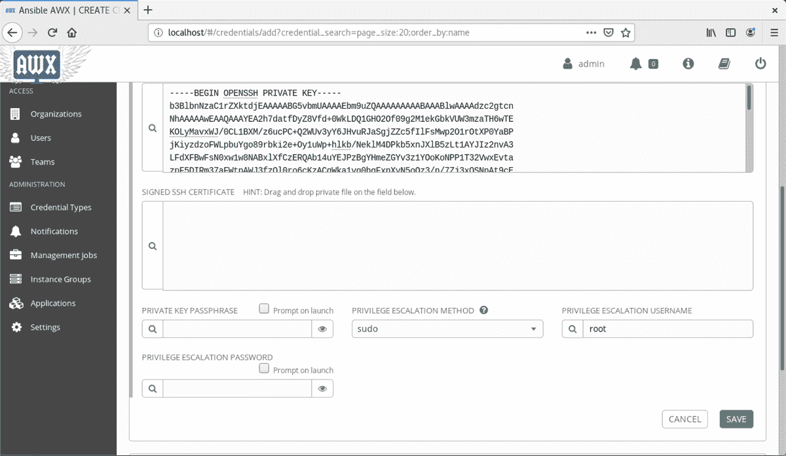

**图 B-8** 配置权限提升

9. 现在凭据已经创建完成，您可以创建一个项目了。在 Ansible Tower 项目中，您连接到想要在 Ansible 项目中使用的 YAML 文件。标准做法是通过某些版本控制系统（例如 GitHub）提供这些源文件。要配置该项目，请从左侧面板的 Resources（资源）部分点击 `Projects`（项目），打开您在图 B-9 所示所示屏幕。

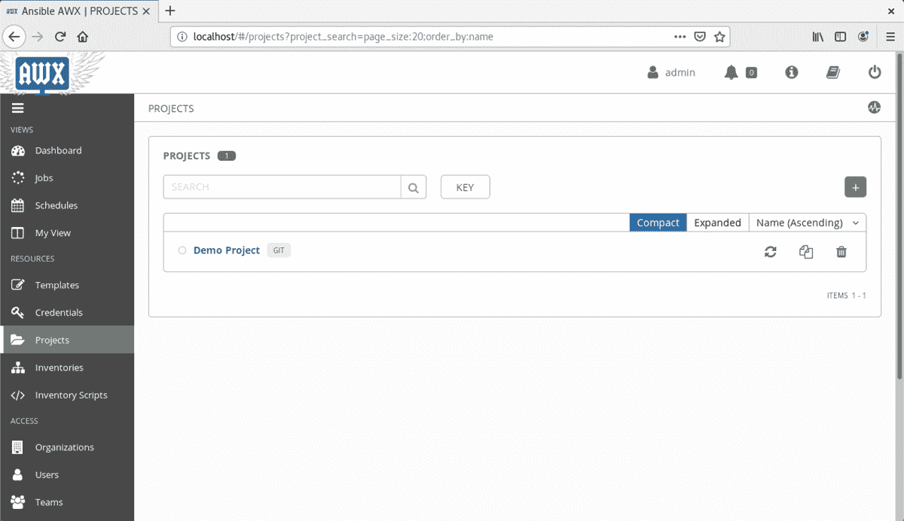

**图 B-9** 项目主界面

10. 从图 B-9 所示的项目界面中，点击 `+` 添加新项目。输入名称 `webservers` 并确保 Organization（组织）名称设置为 Default（默认）。接下来，从 SCM TYPE 字段选择 `Git`。这会添加几项新内容，以连接到您想要使用的 Git 仓库。如果您有自己的 Git 仓库，请随意使用；否则，使用 `github.com/sandervanvugt/ansible-demoproject` 作为连接的示例项目。注意，您的 SCM 可能需要额外的凭据才能连接；这些内容未包含在图 B-10 中。在图 B-10 中，您可以看到目前为止输入的所有设置的概述。点击 `Save` 将项目保存到 Tower。

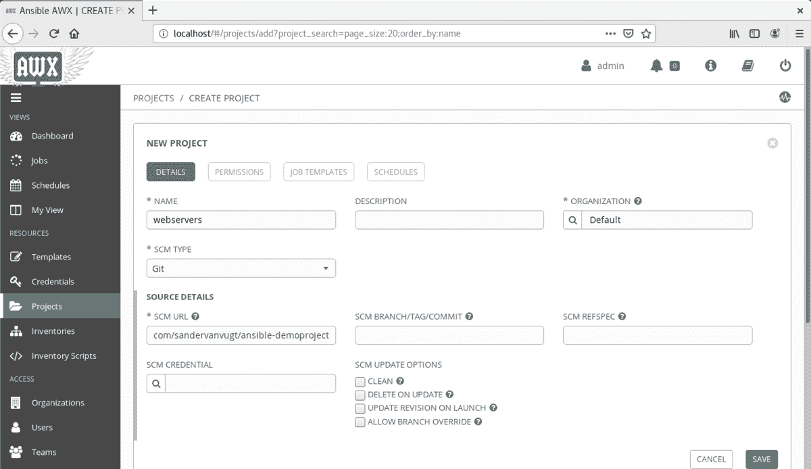

**图 B-10** 创建项目

11. 现在您将要创建一个模板。模板是连接所有内容并配置实际作业的地方。从左侧面板的 Resources（资源）部分点击 `Templates`（模板），然后从那里点击 `+` 添加模板。选择 `Job Template`（作业模板），打开您在图 B-11 所示的界面。

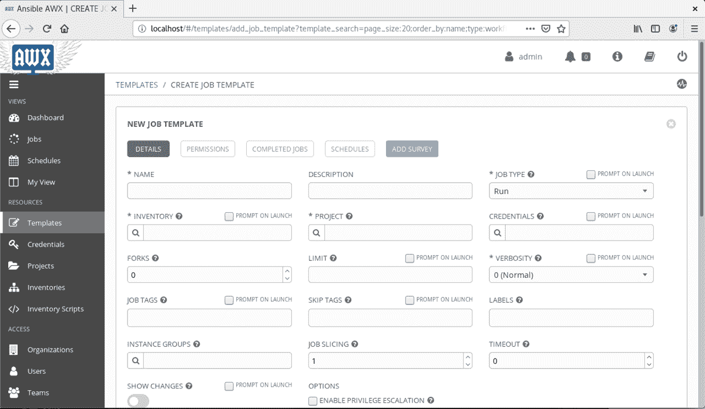

**图 B-11** 新作业模板启动屏幕

12. 要定义模板，您需要从名称开始。接下来，将 Job type（作业类型）设置为 `Run`。注意，您也可以选择 `Check`，它将根据所选项目执行空运行和语法检查。接下来，使用 Inventory（清单）选项的下拉列表选择之前创建的清单。然后使用 Project（项目）选项的下拉列表选择之前创建的项目。选择项目后，即可访问它提供的 playbooks。接下来，选择您之前创建的凭据，然后选择 `Enable Privilege Escalation`（启用权限提升）选项以完成此模板所需的设置。请参见图 B-12 查看所选选项的概述。向下滚动选择 `Save` 按钮将作业设置写入您的系统。

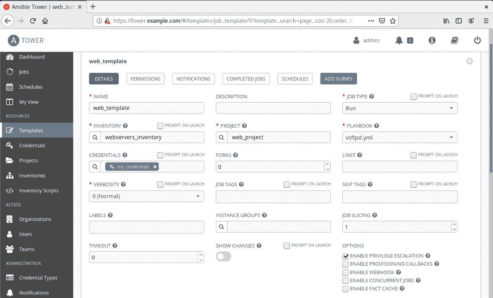

**图 B-12** 定义作业模板

13. 在指定了所有模板选项后，它们会被存储在系统中。将模板一直滚动到当前屏幕的底部（请参见图 B-13）。从那里，点击火箭图标启动基于此模板的作业。

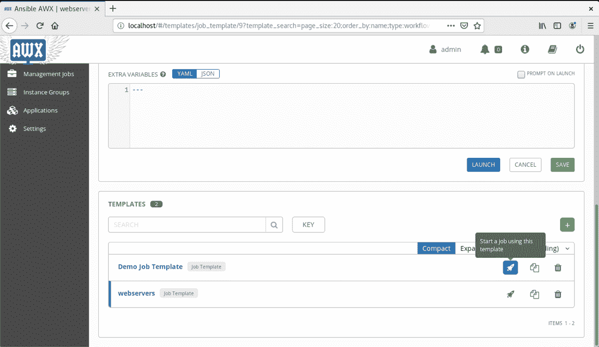

**图 B-13** 访问已保存的模板

14. 启动作业后，会打开 Job status（作业状态）屏幕。从此屏幕您可以查看作业是否运行成功。注意右侧面板中的输出，这与您直接从命令行运行 Ansible 命令时看到的输出非常相似。如果过程确实出现问题（如图 B-14 的输出所示），请阅读命令输出；然后尝试理解并修复它。

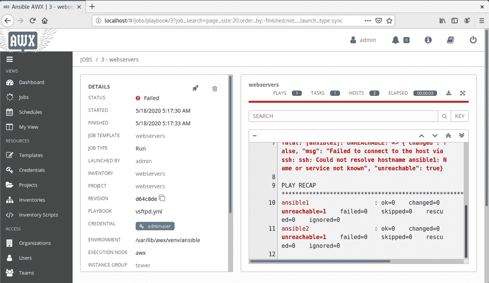

**图 B-14** 分析作业输出

15. 修复问题后再次启动火箭以重启您的作业模板。如果一切顺利，此时它应该显示 Successful（成功）状态。（如果您错过了，图 B-14 中显示的问题是 Ansible Tower 服务器上的 `/etc/hosts` 文件中未设置短主机 ansible1 的主机名解析。）

### 总结

在本附录中，您学习了如何使用 Ansible Tower。您阅读了为什么使用 Tower 可能会很方便，以及如何设置由 Ansible Tower 管理的环境。您还学习了如何在 Ansible Tower 中运行项目。Ansible Tower 还有许多更多功能可提供，但本附录的介绍应该对您有所帮助。

## 表 4-4：`ansible-doc` 输出元素

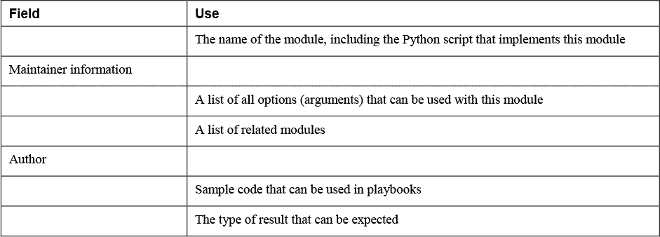

## 第 5 章

**表 5-2** Playbook 必需的键


## 第 6 章

**表 6-2** Ansible 变量类型概述


**表 6-3** 常用 Ansible Facts（事实）

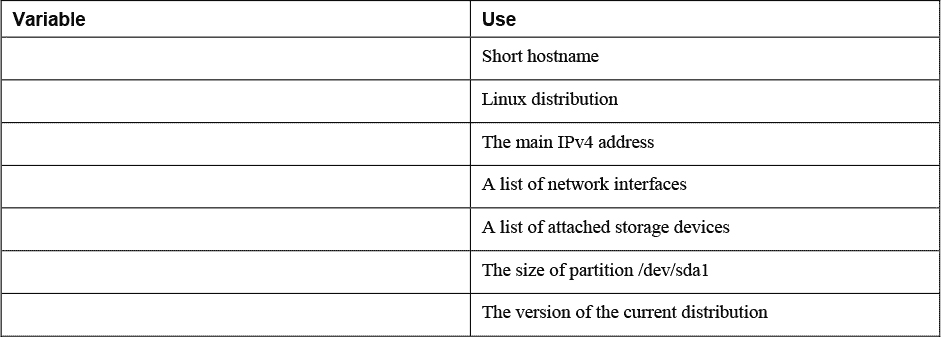

**表 6-4** `ansible_facts` 与注入事实变量的对比

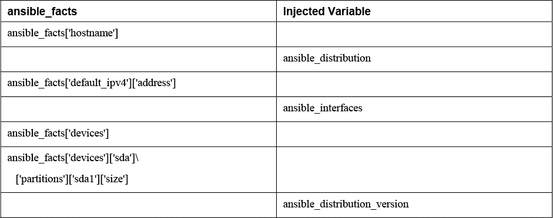

**表 6-5** 魔法变量（Magic Variables）概述


**表 6-6** `ansible-vault` 命令选项

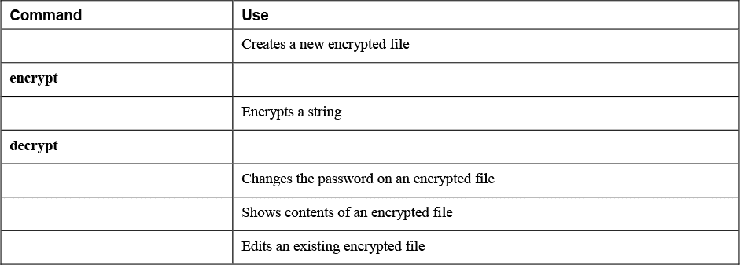

**表 6-7** 与 `register` 使用的键

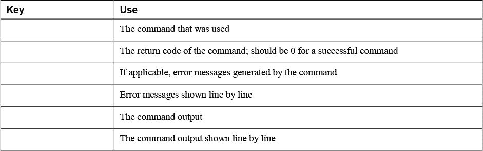

## 第 7 章

**表 7-2** `with_*keyword*` 选项概述


**表 7-3** 条件测试概述

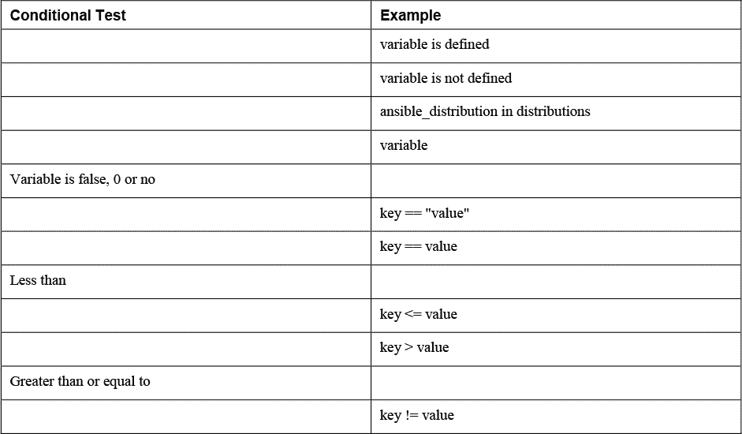

**表 7-4** 任务结果概述


## 第 8 章

**表 8-3** 用于管理 SELinux 变化的模块


**表 8-4** Jinja2 模板元素

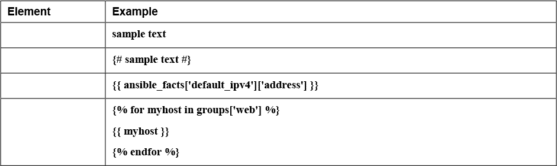


**表 8-5** 常用过滤器概述

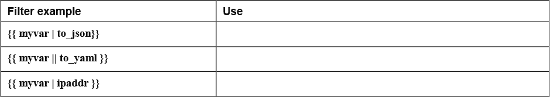

## 第 9 章

**表 9-2** 角色（Role）目录结构

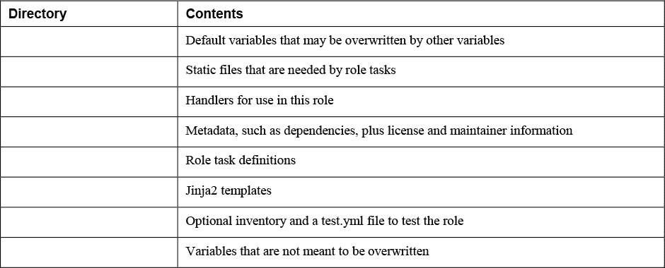

**表 9-3** `ansible-galaxy` 有用命令行选项


**表 9-4** RHEL 系统角色概述


**表 9-5** SELinux 变量概述

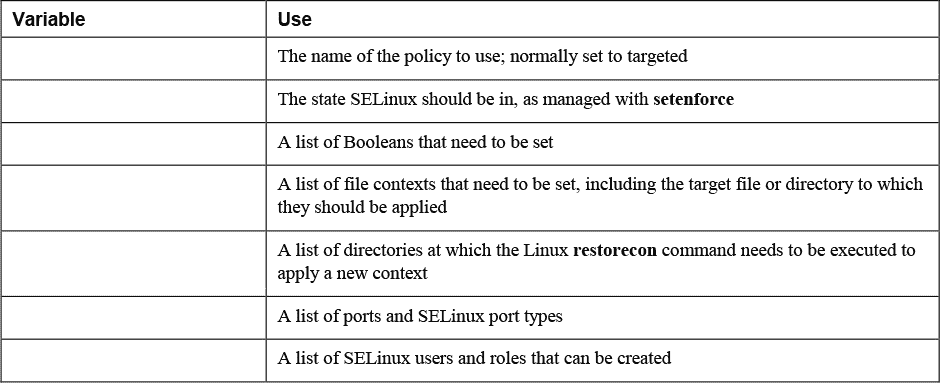

## 第 11 章

**表 11-2** Playbook 总结概述

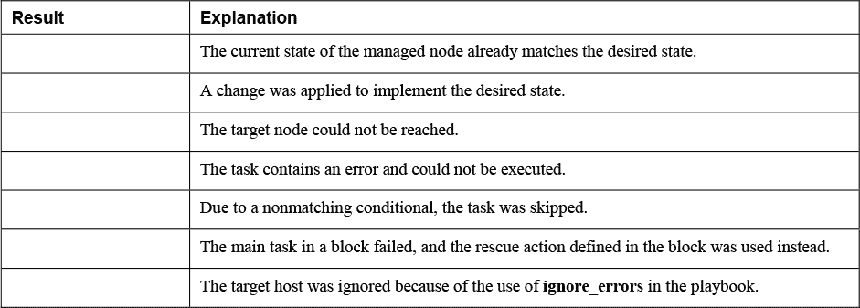

**表 11-3** 详细程度（Verbosity）选项概述


**表 11-4** 故障排除模块概述

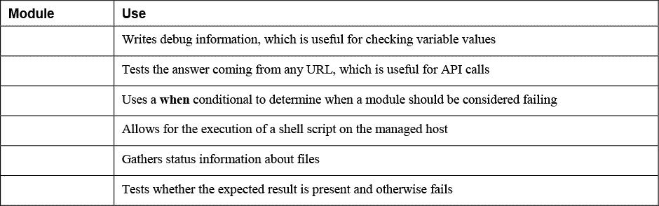

**表 11-5** 特殊标签概述


## 第 12 章

**表 12-2** 软件管理模块概述


**表 12-3** `yum_repository` 关键参数


## 第 13 章

**表 13-2** 用户和组管理模块概述


## 第 14 章

**表 14-2** 与服务管理相关的模块


**表 14-3** `at` 模块参数概述


## 第 15 章

**表 15-3** 存储相关 Facts


**表 15-4** `parted` 选项


**表 15-5** `lvol` 常用选项


**表 15-6** `filesystem` 常用选项


**表 15-7** `mount` 模块常用选项


## 附录 E. 答案

### 第 2 章

**表 2-2** 环境节点


### 第 3 章

**表 3-2** 存储文件的选项


**表 3-3** 主机组用法


**表 3-4** 主机和主机组


**表 3-5** `ansible.cfg` 常用设置


### 第 4 章

**表 4-2** 即时（Ad Hoc）命令


**表 4-3** Ansible 模块


**表 4-4** `ansible-doc` 输出元素


### 第 5 章

**表 5-2** Playbook 必需的键


### 第 6 章

**表 6-2** Ansible 变量类型概述


**表 6-3** 常用 Ansible Facts


**表 6-4** `ansible_facts` 与注入事实变量的对比


**表 6-5** 魔法变量概述


**表 6-6** `ansible-vault` 命令选项


**表 6-7** 与 `register` 使用的键


### 第 7 章

**表 7-2** `with_*keyword*` 选项概述


**表 7-3** 条件测试概述


**表 7-4** 任务结果概述


### 第 8 章

**表 8-3** 用于管理 SELinux 变化的模块


**表 8-4** Jinja2 模板元素


**表 8-5** 常用过滤器概述


### 第 9 章

**表 9-2** 角色（Role）目录结构


**表 9-3** `ansible-galaxy` 有用命令行选项


**表 9-4** RHEL 系统角色概述


**表 9-5** SELinux 变量概述


### 第 11 章

**表 11-2** Playbook 总结概述


**表 11-3** 详细程度（Verbosity）选项概述


**表 11-4** 故障排除模块概述


**表 11-5** 特殊标签概述


### 第 12 章

**表 12-2** 软件管理模块概述


**表 12-3** `yum_repository` 关键参数


### 第 13 章

**表 13-2** 用户和组管理模块概述


### 第 14 章

**表 14-2** 与服务管理相关的模块


**表 14-3** `at` 模块参数概述


### 第 15 章

**表 15-3** 存储相关 Facts


**表 15-4** `parted` 选项


**表 15-5** `lvol` 常用选项


**表 15-6** `filesystem` 常用选项


**表 15-7** `mount` 模块常用选项


## 附录 F. 学习计划

> 此内容正在开发中。

## 术语表

### A

**ad hoc command** 即时命令；使用模块应用所需状态而不进行任何更改的 Ansible 命令。

**anacron** Linux cron 的辅助系统，它可以确保任务在每小时、每天、每周或每月定期启动，而无需具体定义运行精确时间。

**Ansible Tower** 允许从浏览器管理 Ansible 环境的 Web 平台。

**ansible.cfg** Ansible 用于获取所需设置信息的配置文件。playbook 中的参数可能会覆盖 `ansible.cfg` 中的设置。

**AppStream** RHEL 8 中提供非本质软件包的集合。AppStream 中的软件包以 yum 模块的形式提供，允许提供不同版本。

**array** 数组；*参见* `List`（列表）。

**authorized_keys** 在每个用户家目录下的 `.ssh` 目录下创建的文件名，包含公钥，允许通过 `sshkeygen` 生成公钥/私钥对并将公钥复制到此文件的远程用户无密码登录。

**automation language** 自动化语言；用于定义实现基础设施即代码的机器读格式。

**AWX** Ansible Tower 的开源上游项目。

### B

**block** 块；在处理条件判断时可以作为一个整体处理的一组任务。

### C

**check mode** 检查模式；在此模式下，Ansible 显示执行 playbook 的结果但不进行任何更改。在检查模式下运行 playbook 并不总是显示所有更改的内容，因为执行一个任务的结果取决于另一个任务的结果。

**CI/CD** 持续集成/持续交付；通过 CI/CD 流水线轻松开发软件、更新源代码并将这些新开发作为新版本交付终端用户的方法。

**controller node** 控制节点；Ansible 配置中发布所有 Ansible 管理命令的节点。

`current state`：受管系统的当前配置。

`CVS`：并发版本系统（Concurrent version system），一种能够在代码开发过程中管理不同版本的系统。`CVS` 是实现版本控制系统的一种。

### D

`declarative approach`：声明式方法。一种工作方式，使用配置文件（在 Ansible 中为 playbook）而不是命令，这些文件声明了所需的状态，并能够以幂等的方式易地部署到受管目标上。

`desired state`：期望状态。在 Ansible playbook 中定义、且需要在 `Ansible` 受管的系统中实现的状态。

`DevOps`：`developers`（开发者）和 `operators`（运维人员）的缩写。一种全新的工作方式，开发者将运维任务集成到工作中，而运维人员将开发任务集成到自己的工作中。

`dictionary`：在 Python 中，一种无序的项集合；也称为哈希（hashes）。它是键值对的集合。在 Python 中，字典定义为 `my_dict = { key1: ’car’, key2:’bike’ }`。因为它是基于 Python 的，Ansible 允许用户使用字典作为数组的替代表示法。字典值中的项不以连字符开头。使用字典是方法之一；另一种方法是使用列表。*另参阅* `list` 以比较其差异。

### E

`EPEL repository`：企业级 Linux 额外软件包仓库（Extra Packages for Enterprise Linux），一个包含 Fedora 项目软件包的仓库，可用于 Red Hat Enterprise Linux 或 CentOS，但这些包尚未获得这些平台的官方批准。

### F

`failure condition`：失败条件。定义了在运行 Ansible playbook 时，究竟什么情况被视为失败。

`fact`：在启动 playbook 时检测到的系统属性。

`filter`：过滤器。一种可用于对变量结果执行操作的工具。例如，过滤器可以将变量类型从字符串转换为整数。

`fork`：可以在并行任务执行中执行的任务。

### G

`Galaxy`：Ansible 社区网站，地址为 [`galaxy.ansible.com`](https://galaxy.ansible.com)，提供了 Ansible 角色（roles）和集合（collections）。

`Git repository`：Git 仓库。开发者可以使用其协调软件项目更改的在线仓库，包括版本控制，以便于回滚到软件之前的状态。

`GPG`：GNU 隐私守护（GNU Privacy Guard）；`PGP` 的开源实现，可以使用公钥/私钥增强安全性。在仓库中，仓库的 `GPG` 私钥用于对软件包进行签名。接下来，仓库客户端需要导入仓库的 `GPG` 公钥，以便在安装软件包之前验证签名。

### H

`handler`：处理器。一种特殊类型的任务，仅在被另一个任务触发时运行。

`hash`：（在键值对中）*参见* `dictionary`。

`hash`：（在加密中）字符串的编码表示，其目的是保护原始字符串。

`hashing algorithm`：哈希算法。用于生成哈希值的数学公式。

### I

`idempotent`：幂等的。一种工作方式，Ansible 确保多次运行同一个 playbook 始终得到相同的结果。

`import`：允许在任何任务运行之前静态导入项的选项。可以导入任务文件和执行（plays）。

`include`：允许根据条件语句动态包含项的选项。可以包含任务文件。

`infrastructure as code`：代码即基础设施。一种工作方式，将 IT 环境的整个基础设施定义为代码（如 Ansible playbook），可以轻松部署以实现新的期望状态。

`init system`：初始化系统。Linux 用于在启动后启动基本系统组件系统。常见的初始化系统有 `BSD init`（用于 RHEL 5）、`Upstart`（用于 RHEL 6）和 `systemd`（RHEL 7 之后的默认系统）。

`inventory`：清单。受管主机列表。可以是静态文件提供，也可以作为动态发现可管理主机的脚本提供（动态清单）。

`item`：变量列表中的元素。

### J

`Jinja2`：一种面向 Python 开发者的通用模板语言。

### K

`key-value`：键值。在 YAML 字典中，键是待定义的特定项。键的示例是“name”。值是设置给该名称的具体值。

### L

`list`：列表。在变量定义中，其值可以有多个项的键；也称为数组。列表中的每个项都以连字符（-）开头。可以使用索引号（从 0 开始）访问列表中的单个项，例如 `{{ network_interfaces[1] }}`。将其与字典中指定键值对的方式进行比较。

`local fact`：本地事实。定义为本地变量并存储在受管主机上的事实。

`look-up plug-in`：查找插件。允许访问外部数据源的插件。

### M–O

`magic variable`：魔法变量。存储为默认值且无法被覆盖的保留系统变量。

`managed node`：受管节点。由 Ansible 管理的节点。

`module`：模块。通过 Ansible 命令执行的命令。Ansible 模块为 Ansible 提供智能。

### P–Q

`PAM`：Linux 中的插件认证模块（Pluggable Authentication Modules）。一种高级框架，通过提供可供第三方安全解决方案开发者使用的库来增强标准 Linux 安全性。

`parallel task execution`：并行任务执行。一个确定同时执行任务的主机数量的过程。

`pip`：Python 软件安装器。一种基于 Python 的方法，使用 Python（而不是 `yum`）存储库安装软件包软件包。

`pipelines`：流水线。参见 *CI/CD*。

`play`：执行。一个在特定主机或主机组上执行的任务集合。每个执行都有一个执行头部，详细说明了要做什么以及在哪些主机上执行。

`playbook`：剧本。一个或多个执行的集合，汇集在剧本中并包含要执行的任务。

`plug-in`：插件。增强 Ansible 功能的代码片段。

`pool`：池。Red Hat 订阅管理器中的软件包仓库，订阅提供了相应的权限。

`project`：项目。用于管理特定环境的 playbook 和其他配置。

`provisioning`：配置。部署和安装系统。

`public key fingerprint`：公钥指纹。公钥的短表示，用于验证公钥。

`Python`：一种常用的脚本语言。Ansible 用 Python 编写。

### R

`random salt`：随机盐。根据加密算法添加到哈希函数，以生成哈希数据。

`register`：注册。允许将命令的结果存储在变量中的关键字。

`requirements file`：需求文件。用于定义应安装的多个角色。

`RHEL system role`：RHEL 系统角色。由 Red Hat 创建的角色，用于跨不同版本的 Red Hat Enterprise Linux 标准配置任务。

`role`：角色。执行特定任务的变量、模板、模块和任务集合，可以轻松嵌入到 playbook 中。

### S

`serial task execution`：串行任务执行。一个确定在对其他主机执行任务之前，在哪些主机上执行所有任务的过程。

`shell script`：Shell 脚本。以 ASCII 文本编写的可执行文件，包含由 Linux Bash 执行的命令。

`subscription`：订阅。使用 Red Hat 软件的权限。Red Hat Enterprise Linux 需要配合订阅使用。订阅用于让 RHEL 用户访问更新以及可选的支持。

### T–U

`tag`：标签。可以设置在任务、块、执行和角色上的标签，允许用户运行 playbook 的特定部分。

`task`：任务。配置期望状态所需的模块和特定参数的规范。

`template`：一个包含变量的配置文件，并根据这些变量按照特定主机的需求在受托管主机上生成。

### V

`vault`：一个安全环境，可用于加密方式存储变量。

`version control system`：一种结构，允许开发者轻松地对软件代码进行工作，并管理代码的不同版本和补丁。

### W–X

`when`：条件语句，允许 Ansible 仅在特定条件为真时运行特定任务。


`WinRM` Windows 远程管理（Windows Remote Management）；可用于 Ansible 管理 Windows 的 Windows 软件。

### Y–

`YAML` 用于编写 Ansible playbooks（剧本）的语言。
