# Red Hat RHCSA 8 认证指南：EX200：通过实用指南提升你的 IT 职业

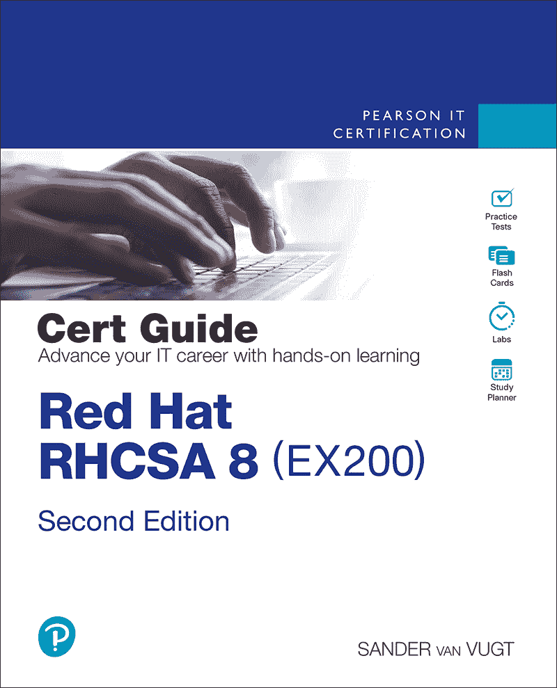


## 关于本电子书

ePUB 是一种开放的行业标准电子书格式。然而，阅读设备和应用程序对 ePUB 及其许多功能的支持程度不同。请使用您的设备或应用设置根据您的喜好自定义显示。您可以自定义的设置通常包括字体、字体大小、单栏或双栏、横屏或竖屏模式，以及可以点击或触摸以放大的图形。欲需有关您的阅读设备或应用上设置和功能的更多信息，请访问设备制造商的网站。

许多书籍包含编程代码或配置示例。为了优化这些元素的显示效果，请在单栏横屏模式下查看电子书，并将字体大小调整为最小设置。除了以重流文本格式显示代码和配置外，我们还包含了代码图像，以模仿打印书中的显示效果；因此，当重流格式可能会损害代码列表的显示时，您将看到一个“点击此处查看代码图像”的链接。点击链接可查看高保真代码图像。要返回上一页，请点击设备或应用上的“返回”按钮。


**采购编辑**：Denise Lincoln

**经理编辑**：Sandra Schroeder

**文字校对员**：Bill McManus, Chuck Hutchinson

**校对员**：Donna E. Mulder

**出版协调**：Cindy Teeters

**排版师**：`codeMantra`

## 管理文件所有权

### 更改用户所有

## 使用 `umask` 设置默认权限

### 二进制表示法

| 主题 | 类别 | 页码 |
| --- | --- | --- |
| 配置 SSH 密钥身份验证 | SSH | 20 |
| 设置 SELinux 强制和许可模式 | SELinux 管理 | 22 |
| 列出并识别 SELinux 文件和进程上下文 | SELinux 管理 | 22 |
| 恢复默认文件上下文 | SELinux 管理 | 22 |
| 使用布尔值修改系统 SELinux 设置 | SELinux 管理 | 22 |
| 诊断并解决常见的 SELinux 策略违规 | 管理 SELinux | 22 |
| 管理容器 | 管理容器 | 26 |
| 创建简单的 shell 脚本 | Bash 脚本入门 | 19 |

**表 1** RHCSA 目标覆盖范围

### 附随内容文件在哪里？

注册此纸质版《红帽 RHCSA 8 认证指南》（第二版），以在线访问赠送内容。

此书目的的纸质版附带有一个包含附随内容的网站。您可以按照以下步骤在线访问这些文件：

1. 访问 [www.pearsonITcertification.com/register](http://www.pearsonITcertification.com/register) 并登录或创建新账户。
2. 输入 ISBN：`9780137341627`。
3. 回答挑战问题作为购买证明。
4. 点击账户页面中“Registered Products”（注册产品）部分中的 `Access Bonus Content`（访问赠送内容）链接，即可进入可以下载内容的页面。

请注意，许多附随内容文件可能非常大，尤其是图像和视频文件。

如果您按照上述步骤无法找到该书目的文件，请访问 [www.pearsonITcertification.com/contact](http://www.pearsonITcertification.com/contact) 并选择“Site Problems/Comments”（站点问题/意见）选项。客服代表将为您提供帮助。

本书还包含一个针对《红帽认证系统管理员（RHCSA）完整视频课程》（第三版）的 7 折优惠优惠。

## 图片致谢

章节开篇图片来自 Charlie Edwards/ Photodisc/Getty Images。

图片 1-1 至 1-15 © 2019 Red Hat, Inc。

图片 2-1 和 2-2 © 2019 Red Hat, Inc。

图片 5-1 和 5-2 © 2019 Red Hat, Inc。

图片 8-1 至 8-5 © 2019 Red Hat, Inc。

图片 10-1 © 2019 Red Hat, Inc。

图片 18-1 至 18-5 © 2019 Red Hat, Inc。

# 第一部分：执行基础系统管理任务

## 第 1 章：安装红帽企业 Linux

**本章涵盖了以下主题：**

- 准备安装红帽企业 Linux
- 执行手动安装

本章不涵盖任何考试目标。

要学习如何作为管理员与红帽企业 Linux 工作，你首先需要安装它。本章将教你如何设置一个环境，在该环境中你可以完成书中的所有练习。

在红帽认证系统管理员（RHCSA）考试中，你不需要安装红帽企业 Linux。但是，由于你需要安装一个允许你测试书中讨论的所有项的环境，因此在本章中你将从安装红帽企业 Linux 开始。本章描述了你在安装 `RHEL 8` 时会遇到的所有步骤。它还讨论了如何设置一个可以让你完成书中所有练习的环境。

由于红帽企业 Linux 包含注册注册商标，我将使用 `CentOS` 来向你演示安装过程。`CentOS` 中唯一不同的是品牌标识，而这在 `CentOS` 中是免费使用的。`CentOS` 中的所有软件与红帽企业 Linux 中的软件是相同的。由于 `CentOS` 不包含任何注册商标，它是一个常见且流行的解决方案，能够让人们学习如何与红帽企业 Linux 工作。

### “我已经掌握了吗？”测验

“我已经掌握了吗？”测验可以让你评估自己是否应该彻底读完整个章节，还是跳到“考试准备任务”部分。如果你对这些问题的答案或对你自己对这些主题知识的评估有疑问，请阅读整个章节。表 1-1 列出了本章的主要标题及其对应的“我已经掌握了吗？”测验问题。你可以在附录 A 中的“‘我已经掌握了吗？’测验和‘复习题’的答案”中找到答案。

| 基础主题章节 | 问题 |
| --- | --- |
| 准备安装红帽企业 Linux | 1、2、6 |
| 执行手动安装 | 3–5、7–10 |

**表 1-1** “我已经掌握了吗？”章节与问题映射

1. 你想安装一个测试环境来为 RHCSA 做准备。你应该避免哪种发行版？
   1. 最新的 Fedora
   2. CentOS
   3. Scientific Linux
   4. RHEL

2. 以下哪项在两者中都可用？
   1. 硬件认证
   2. 软件认证
   3. 权利
   4. 软件更新

3. 为什么要安装带图形界面的服务器？
   1. 为了准备 RHCSA，你需要工具。
   2. 最小化安装是不完整的。
   3. 如果不安装图形界面，它很难添加。
   4. 带图形界面的是默认。

4. 使用哪种默认文件系统？
   1. Ext3
   2. Ext4
   3. XFS
   4. Btrfs

5. Ext4 支持但 XFS 不支持？
   1. 缩小文件系统
   2. 快照
   3. 文件系统配额
   4. 超过 2 TB 的大小

6. 以下哪项不是避免 Fedora 的原因？
   1. Fedora 包含未来版本中可能不存在的功能。
   2. Fedora 发行版显示出更晚的状态。
   3. Fedora 软件不稳定。
   4. Fedora 中的软件与 RHEL 中的不同。

7. 摘要界面中没有哪一个选项？
   1. 时间和日期
   2. 键盘
   3. 语言支持
   4. 故障排除现有安装

8. 设置了你想要使用的 root 密码后，无法继续。最可能的原因是什么？
   1. 密码是不安全的，不接受不安全的密码。
   2. 密码不符合策略。
   3. 你还需要创建一个用户。
   4. 如果使用了不安全的密码，你需要双击。

9. 关于系统语言的哪种说法不是正确的？
   1. 你可以从摘要界面更改系统语言。
   2. 你可以在从安装介启动后直接更改系统语言。
   3. 在设置安装语言时，也可以选择键盘布局。
   4. 安装后无法更改语言设置。

10. 安装使用 LVM 逻辑卷的服务器时，至少获得三个存储卷（分区或 LVM）。以下哪项不是它们的一部分？
    1. `/boot`
    2. `/var`
    3. `/`
    4. `swap`

## 基础主题：准备安装红帽企业 Linux

在开始安装红帽企业 Linux 之前，一些准备是有帮助的，正如本节所示。你首先学习什么是红帽企业 Linux。然后你学习如何获取软件。我们讨论红帽企业 Linux 的附加组件，以及设置要求。在了解所有这些内容后，你进入下一节，学习如何安装红帽企业 Linux。

### 什么是红帽企业 Linux 8 服务器？

`RHEL 8` 是一个 Linux 发行版。正如你可能知道的，Linux 是一个免费的操作系统。这意味着所有程序的源代码都是免费提供的。然而，某些企业级 Linux 发行版作为商业产品销售，并捆绑了支持和维护，`RHEL 8` 就属于这种情况；`RHEL 8` 的免费下载受到限制。目前提供为期 60 天的评估版本，或者你也可以在 [`developers.redhat.com`](https://developers.redhat.com) 注册免费的红帽开发者订阅。

要使用 `RHEL 8`，你需要一个订阅。该订阅使你有权获得几项额外项目，例如支持和补丁。当你为红帽企业 Linux（Red Hat Enterprise Linux）付费时，红帽为你提供一个受支持的企业级 Linux 操作系统，它具有企业环境中正常要求的某些关键优势：

- 经过严格测试程序的受监控更新和补丁。
- 根据你购买的订阅类型，提供不同层级的支持和帮助。
- 经过认证的操作系统，保证可以在特定硬件型号上运行并获得支持。
- 用于运行企业级应用程序（如 SAP 中间件、Oracle 数据库等）的认证平台。
- 访问 [`access.redhat.com`](https://access.redhat.com) 红帽客户门户，你可以在那里找到仅供客户使用的详细文档。

红帽理解并非所有潜在客户对这些企业功能感兴趣。这就是为什么红帽也参与了两个免费替代方案：

- `CentOS 8`
- `Fedora`

你将在本章后续章节中学习更多关于这些的内容。

## 获取软件

有多种方法可以获取执行书中所有练习所需的软件。在本节中，你将了解你的选择。

### 使用红帽企业 Linux

如果你想学习如何使用红帽企业 Linux 8 提供的不同程序、工具和服务，最简单的方法是使用红帽提供的开发者计划。访问 [`developers.redhat.com`](https://developers.redhat.com) 注册免费的开发者计划。该计划让你免费访问红帽企业 Linux，允许你在自己的测试环境中运行 `RHEL` 工作，而无需购买。

在官方 `RHEL 8` 服务器版本中，你获得的最重要的东西是访问红帽客户门户的权限。通过该门户，你可以访问有关 `RHEL` 的各种信息，此外还有通过红帽网络（RHN）提供的更新。特别是，红帽知识库是无价的；你可以利用它来查找红帽顾问在那里发布的许多常见问题的答案。

### 使用 CentOS

`CentOS` 是社区企业操作系统（Community Enterprise Operating System）。`CentOS` 起于 `RHEL` 的重新编译版本，删除了 `RHEL` 软件中所有无法免费提供的项目。基本上，只是更改了名称，并从所有 `CentOS` 软件包中删除了红帽标志（这是专有的）。其结果（今天仍以 `CentOS 8` 的形式存在）是一个提供与 `RHEL` 相同功能但免费提供（且不提供企业支持服务）的操作系统。

2014 年，红帽整合了 `CentOS`，意在为尚未准备好接受企业级服务的客户提供支持。其核心理念是，许多客户最终需要企业级支持，因为他们的 Linux 发行版将变得越来越重要。通过在红帽品牌下免费赠送 `CentOS`，客户升级到红帽企业 Linux 是理所当然的。

`CentOS 8` 也是本书中学习的极佳选择；它提供了 `RHEL` 提供的所有功能，但你不需要付费。你可以从 [`www.centos.org`](https://www.centos.org) 下载 `CentOS 8`。注意，`CentOS` 并不总是拥有 `RHEL` 软件的最新版本，其运行可能比最新的 `RHEL` 版本后几周到几个月。

### 其他发行版

`CentOS` 并不是唯一无需付费即可获取红帽软件包的发行版。另一个常用的免费但基于红帽企业 Linux 软件包的 Linux 发行版是 `Scientific Linux`，它是在费米国家加速器实验室（Fermi National Accelerator Laboratory）开发的 Linux 发行版。`Scientific Linux` 已停止维护，没有对应红帽企业 Linux 8 软件的版本。

另一个与红帽企业 Linux 相关的 Linux 发行版是 `Fedora`，这是一个完全开源且免费提供的 Linux 发行版。红帽有大量员工致力于 `Fedora` 项目，因为红帽将 `Fedora` 作为 `RHEL` 的开发平台。结果是，`Fedora` 提供了最新最强大的软件，在大多数情况下，这些软件比 `RHEL` 经过充分测试的软件组件新得多（这就是为什么你不应该使用 `Fedora` 来准备 RHCSA 考试）。红帽还将 `Fedora` 作为新功能的测试场，这些功能可能包含或不会包含在未来的 `RHEL` 版本中。如果你选择 `Fedora`，你将处理 `RHEL` 中不可用的项目，这意味着你在考试中必须以不同的方式操作。所以，不要使用它！

## 理解存储库访问

`RHEL` 与其他发行版之间的重要区别在于对存储库（repositories）的访问。`repository` 是用于安装软件的安装源。如果你使用像 `CentOS` 这样的免费软件，会自动设置正确的存储库，不需要进一步操作。如果你使用带有订阅的红帽企业 Linux，你需要使用 `Subscription Manager` 软件来获取存储库的权限。

> **提示**
>
> 如果你从 `RHEL 8` 安装盘安装红帽但没有进行注册，你将无法访问存储库，这就是为什么你需要了解如何手动设置。在第 9 章“管理软件”中，你将学习如何操作。

## 安装要求

`RHEL 8` 可以安装在物理硬件和虚拟硬件上。对于特定功能的可用性，使用哪种类型的硬件并不重要，只要满足以下条件：

- 1 GiB 内存
- 10 GiB 硬盘
- 一个网卡

> **提示**
>
> 一个 GB 是 1000 × 1000 × 1000 字节。硬件供应商通常使用 1000 的倍数；然而，这与计算机的工作方式不同，这就是为什么计算机软件使用 KiB、MiB 和 GiB。在这里，一个 GiB 是 1024 × 1024 × 1024 字节（即 1.07 GB）。

上述要求允许你运行 `RHEL` 的最小化安装，但如果你想创建一个能够执行书中描述的所有练习的环境，请确保满足以下最小要求：

- 64 位平台支持
- 2 GiB 内存
- 20 GiB 硬盘
- 一个 DVD 驱动器（虚拟或物理）
- 一个使用 BIOS 或传统模式（非 UEFI）启动的虚拟机或物理机
- 一个网卡

> **注意**
>
> 互联网上的某些资源提到了不同的最小要求。这对 RHCSA 考试来说不是大问题。

## 认证指南环境描述

为了建立一个完成这本书的环境，我建议你首先按照下一节的说明安装一个 `CentOS` 或 `RHEL 8` 服务器。对于第四部分“管理网络服务”中的章节，如果你有第二个服务器将很有帮助。这个第二个服务器没有特殊要求。

为了搭建 Cert Guide 环境，我建议你使用桌面虚拟化解决方案，例如 `VMware Workstation`（如果你在 Mac 上，请使用 `Fusion`）或 `Oracle VirtualBox`。使用这些工具的优点是你可以使用快照，这让你能够轻松恢复到之前的配置状态。其他支持的虚拟化解决方案如 `KVM`，但由于 `KVM` 运行在 Linux 上，如果你想从 `KVM` 开始，你需要已经具备一些 Linux 知识。你也可以安装在实体硬件上，但那种方案的灵活性较低。

### 提示

在所有章节中，你都会找到分步骤的练习题，它们会具体告诉你如何配置特定的服务。在所有章节的末尾，你会发现章末实验，它们提供的作业与你在考试中遇到的作业类型非常相似。为了充分利用章末实验，从一个干净的环境开始是一个好主意。这样做最高效的方法是在开始某个章节时，为虚拟机的状态创建快照。这允许你回到开始该章节时的状态，同时保留你在之前章节中完成的所有工作。

### 执行手动安装

即使 `RHEL` 和 `CentOS 8` 可以从其他介质（如安装服务器或 `USB key`）安装，但最常见的安装是从安装 DVD 开始，或者在虚拟机中操作时，从安装 DVD `ISO` 文件开始。因此，请准备好安装 DVD（或其 `ISO`）并启动想要安装软件的计算机。以下步骤描述了从看到安装 DVD 启动界面开始后如何继续操作。请注意，这些步骤描述的是如何安装 `CentOS 8`，且图中所有的品牌标识也是基于 `CentOS 8` 的。不过，程序同样适用于 Red Hat Enterprise Linux `8`：


**步骤 1。** 从 DVD 启动后，你会看到 `CentOS 8` 启动菜单。从此菜单，你可以选择不同的选项：

- `Install CentOS 8`：选择此项进行普通安装。
- `Test This Media & Install CentOS 8`：如果你想在安装之前测试安装介质，请选择此项。注意测试将花费长时间。
- `Troubleshooting`：选择此选项进入某些故障排除选项。如果你无法从计算机硬盘正常启动，此选项非常有用。

当安装程序启动时，你可以将启动选项传递给内核以启用或禁用特定功能。要进入可以添加这些选项的提示符，请在安装菜单上按 `Tab` 键。这将显示将使用的内核启动行，并提供更改启动参数的选项。

**步骤 2。** 要开始普通安装，选择 `Install CentOS 8` 启动选项（参见图 1-1）。注意，如果你安装的是较新版本的 `CentOS 8`，具体的子版本将会发生。


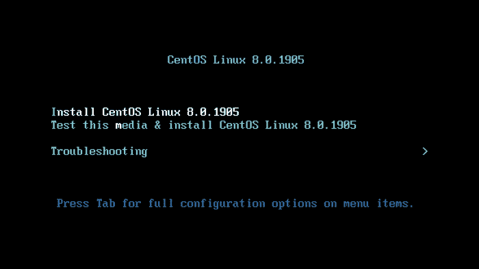

**图 1-1** 选择 `Install CentOS 8` 开始安装

**步骤 3.** 一旦用于执行安装的基础系统加载，你就会看到“Welcome to CentOS 8”欢迎界面。从该界面，你可以选择语言和键盘设置。对于 RHCSA 考试，选择除英语以外的任何语言都没有意义。如果你使用的是非美国键盘，可以从该界面选择键盘设置。确保选择适当的键盘设置，然后点击 `Continue` 继续（参见图 1-2）。

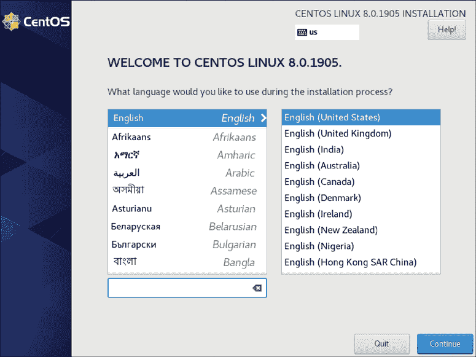

**图 1-2** 在继续之前选择适当的语言和键盘设置

**步骤 4.** 选择键盘和语言设置后，你将看到“安装摘要”界面（参见图 1-3）。从该界面，你可以指定你想要使用的所有设置。在此界面上，你有几个不同的选项：

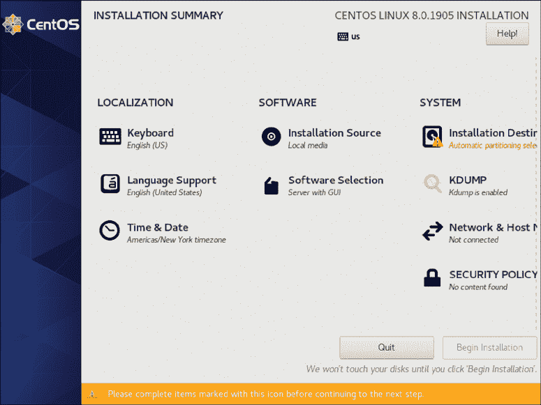

**图 1-3** 从安装摘要界面指定服务器的完整配置

- `Keyboard`（键盘）：用于更改键盘布局。
- `Language Support`（语言支持）：用于添加对额外语言的支持。
- `Time & Date`（时间与日期）：用于指定当前时间和日期以及时区。
- `Installation Source`（安装源）：用于指定从哪里安装。通常，你会从安装 DVD 安装。
- `Software Selection`（软件选择）：提供不同的安装模式，以便于安装默认软件包。
- `Installation Destination`（安装位置）：用于识别在安装期间将文件复制到哪些磁盘。
- `KDUMP`：允许你使用 `KDUMP` 内核。这种内核在发生任何错误时会创建一个核心转储。
- `Network & Host Name`（网络与主机名）：允许在此设置 IP 地址和相关设置。
- `Security Policy`（安全策略）：提供一组安全策略，允许你轻松加固服务器。

从安装摘要界面，你可以查看哪些项目仍需要配置——这些项目带有感叹号和红色文本标记。只要存在任何问题，你就无法点击 `Begin Installation` 按钮（它是禁用的）。你可能不需要更改每个选项的设置，但为了完整起见，以下步骤描述了从安装摘要界面提供的不同设置，并根据情况提供了建议。

**步骤 5.** 点击 `Keyboard` 选项查看配置键盘布局的设置。从该界面，你还可以选择次要键盘布局，如果你的服务器由使用不同键盘布局的管理员使用，这非常有用。不仅支持不同的语言设置，还支持不同的硬件布局。例如，如果许多管理员使用 Apple Mac，可以在相应的区域选择 Mac 标准布局。添加另一个布局后，你还可以配置切换选项。这是一个用于在不同布局之间切换的按键序列。选择 `Options` 来指定你想为此目的使用的组合键。指定所需的配置后，点击 `Done` 返回安装摘要界面。

**步骤 6.** 安装摘要界面上的 `Language Support` 选项与你在步骤 3 中使用的语言支持选项相同。如果你已经配置了要使用的语言设置，则无需在此更改任何内容。

**步骤 7.** 点击 `Time & Date` 查看世界地图，你可以在地图上轻松点击你所在的时区（参见图 1-4）。或者，你可以从相应的下拉列表中选择你所在的地区和城市。你还可以设置当前日期和时间，并在设置网络后，指定用于与互联网上的时间服务器同步时间的网络时间协议（`NTP`）。如果无法访问网络，则此选项不可用。使用网络时间时，你可以通过点击屏幕右上角的配置图标添加要使用的网络时间服务器。在指定所需的设置后，点击屏幕左上角的 `Done` 写入设置。

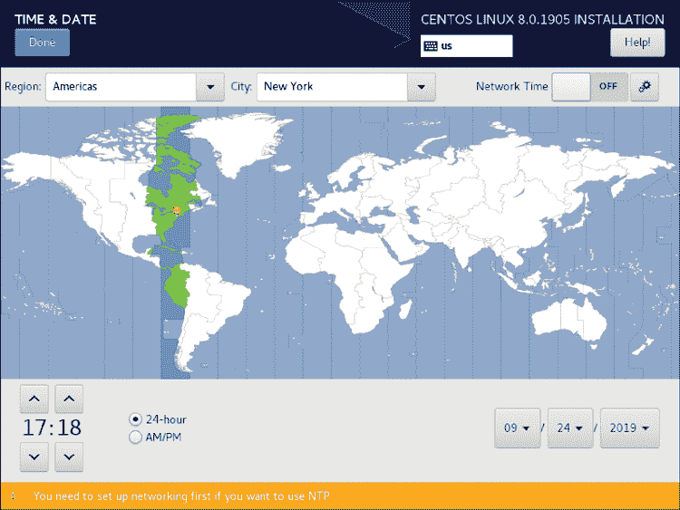

**图 1-4** 选择时间与日期设置

### 步骤 8

在“安装摘要”屏幕的“软件”部分，点击 `安装源`（`Installation Source`）以查看如图 1-5 所示的屏幕。如果你是从普通的安装光盘启动的，则无需指定任何内容。如果你是从最小引导环境启动的，可以指定可用额外软件包的网络 URL，以及需要使用的额外存储库。在 RHCSA 考试中你不需要执行操作，但如果你以后需要安装服务器，了解此选项的存在是有用的。点击 `完成`（`Done`）。

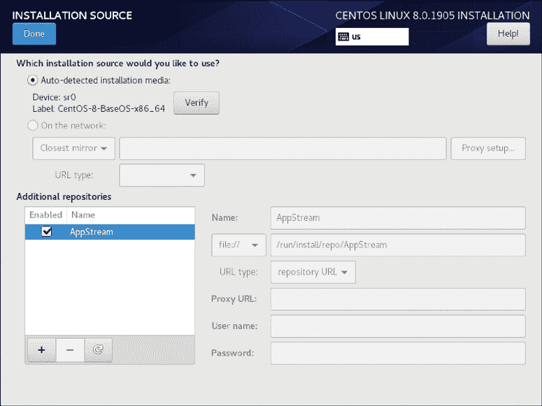

**图 1-5** 选择安装源

### 步骤 9

点击 `软件选择`（`Software Selection`）进入安装程序的重要部分（参见图 1-6）。从这里，你可以选择基础环境并为所选环境选择可用插件。`最小安装`（`Minimal Install`）选项非常常见。此基础环境允许你在最小尺寸的硬盘上安装 CentOS。对于本书，我假设你使用 `带图形界面的服务器`（`Server with GUI`）选项安装服务器。为了完成 RHCSA 考试中需要执行的任务，有一些易用的图形化工具，因此安装一个带有图形用户界面（GUI）的服务器是有意义的，即使你永远不会在生产环境中这样做。所有的额外软件包以后都可以添加。此时，你不需要选择任何额外的软件包。点击 `完成`（`Done`）。

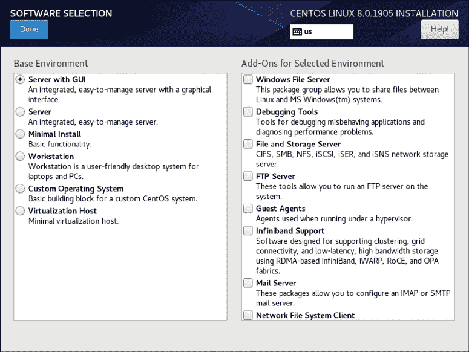

**图 1-6** 确保对你在书中练习使用的每台服务器都选择“带 GUI 的服务器”

#### 注意

有些人说，*真正的*管理员不使用 `带 GUI 的服务器` 安装模式。准备 RHCSA 考试并不是为了成为一名真正的管理员。使用 `带 GUI 的服务器` 安装模式的巨大优势是它提供了一个易于使用的界面。书中讨论的一些工具仅在 GUI 上运行。此外，当使用带有 GUI 的服务器时，你可以同时使用多个终端窗口，这让操作 RHEL 命令行变得非常简单了！

### 步骤 10

安装软件后，你需要指定你想要安装到什么位置。点击“安装摘要”屏幕上的 `安装目标`（`Installation Destination`）。默认情况下，选中了自动分区，你只需要确认你想要用于自动分区的磁盘设备即可（参见图 1-7）。还有许多高级选项可用。为了给本书后续章节中的所有练习做好安装准备工作，你不能仅使用默认分区。相反，你需要一个使用逻辑卷管理器（LVM）并保留一些可用磁盘空间的设置。要做到这一点，从如图 1-7 所示的屏幕中，选择“存储配置”下的 `自定义`（`Custom`）单选按钮。然后，确保选择了你想要使用的磁盘，并点击 `完成` 继续。请注意，有时并不是所有选项都会显示，你会在屏幕右侧看到一个滚动条。如果是这样，向下滚动以显示额外的安装选项。

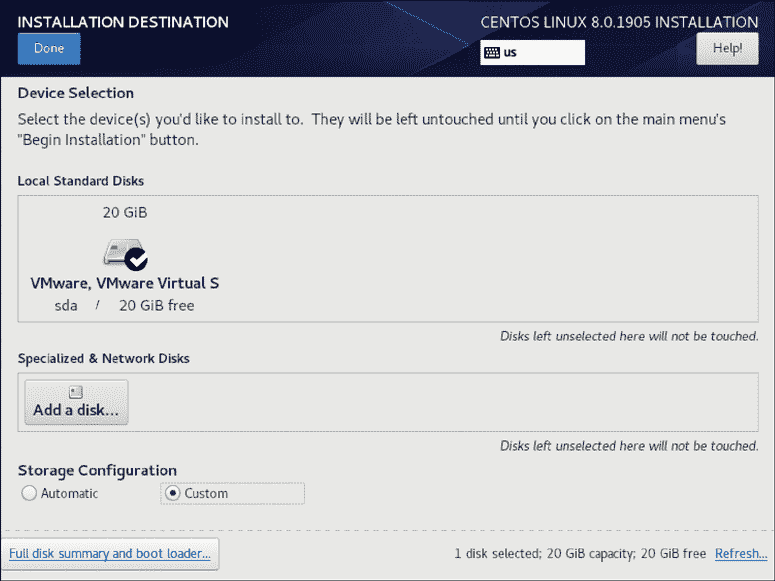

**图 1-7** 选择自定义并点击完成继续

#### 提示

如果你想使用这台服务器来执行后续章节中的练习，请确保保留一些未分配给任何分区的磁盘空间。你需要未分区的磁盘空间来完成分区和 LVM 练习，这是 RHCSA 考试目标中的重要组成部分。

在指定要手动设置磁盘布局后，你将看到如图 1-8 所示的“手动分区”屏幕。点击 `+` 添加新分区。为了设置书中所需的环境，我建议使用以下磁盘布局（基于 20-GiB 硬盘）：

- `/boot` 挂载在格式化为 XFS 的传统分区上，大小为 500 MiB。注意，CentOS 8 使用 Ext4 文件系统作为 `/boot` 的默认文件系统，如图 1-9 所示。
- 一个大小为 10 GiB、格式化为 XFS 的逻辑卷挂载在 `/` 上。
- 一个 1-GiB 的逻辑卷，作为交换空间。

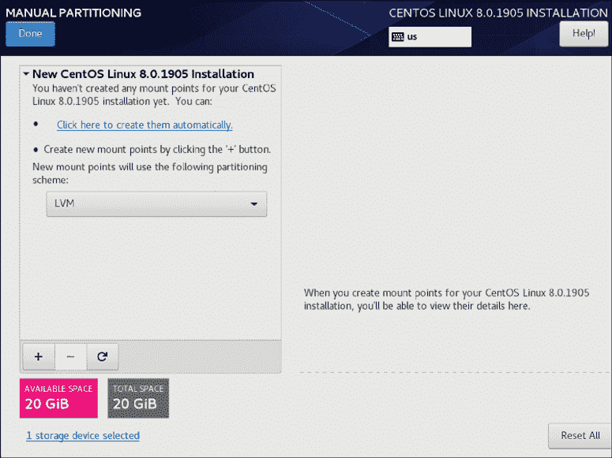

**图 1-8** 配置高级磁盘布局

#### 注意

RHEL 8 默认使用 XFS 文件系统。该文件系统无法收缩，只能扩展。因此，有时使用 Ext4 是一个更好的选择。要创建此配置，请先在如图 1-8 所示的屏幕中点击 `+`，选择 `/boot` 并指定所需的容量。然后点击 `添加挂载点`。此时你将看到如图 1-9 所示的屏幕，在其中你可以指定刚刚创建的挂载点详情。

此时，从如图 1-9 所示的界面中点击 `+`，指定挂载点 `/` 和 `10 GiB`。在“挂载点详情”屏幕上，确保设备类型设置为 LVM 且文件系统选择了 XFS。你不需要修改任何内容。

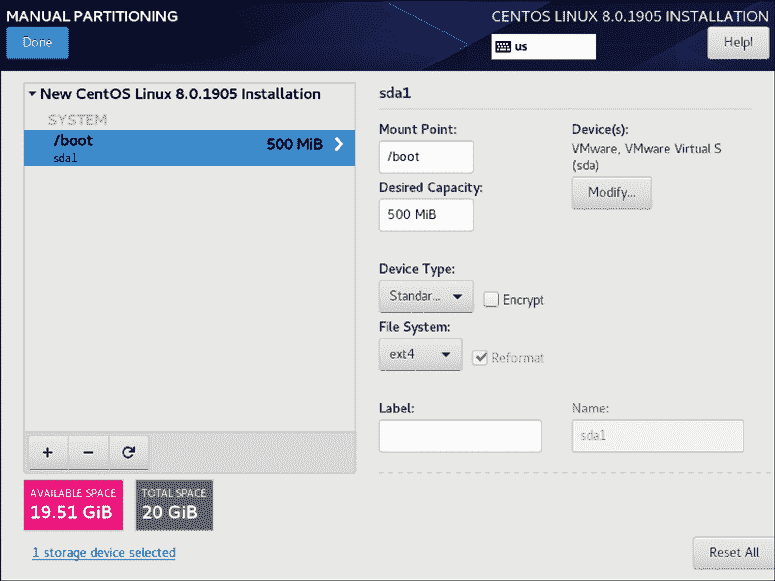

**图 1-9** 为你创建的挂载点指定详情

现在再次点击 `+` 添加一个交换设备。在挂载点下拉列表中选择 `swap`，并指定所需的容量 `1 GiB`。然后点击 `添加挂载点`。此时的布局应该如图 1-10 所示。如果是这种情况，点击 `完成` 写入配置。

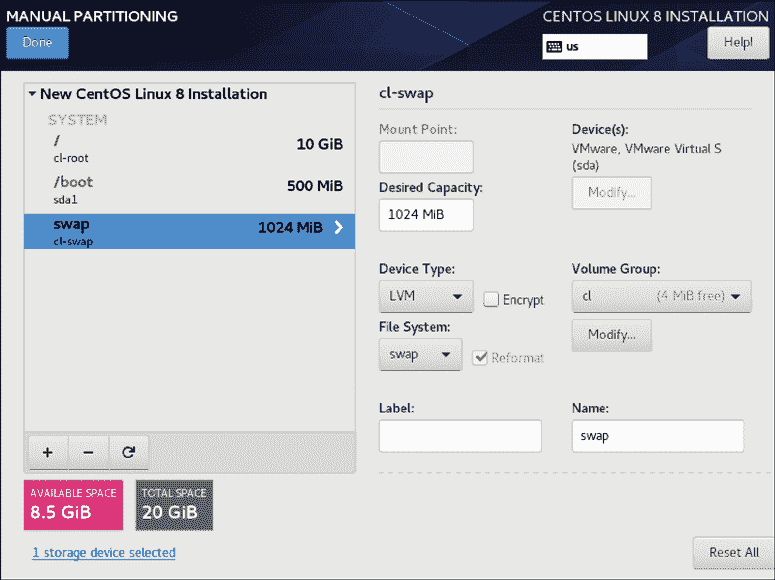

**图 1-10** 如果配置如下，就可以将其写入磁盘

在将配置写入磁盘之前，你将看到一个显示你所应用的更改摘要的屏幕（参见图 1-11）。如果一切看起来良好，点击 `接受更改` 写入你的配置。

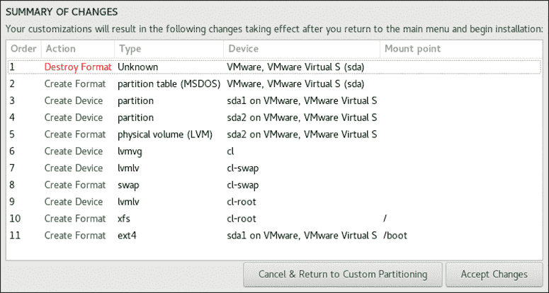

**图 1-11** 在将更改写入磁盘之前，你可以验证其是否良好

### 步骤 11

安装摘要的部分允许你设置网络。注意你必须配置某些内容。如果你都不做，你的服务器可能无法连接到任何网络。点击 `网络和主机名` 来设置网络。这打开了如图 1-12 所示的屏幕。

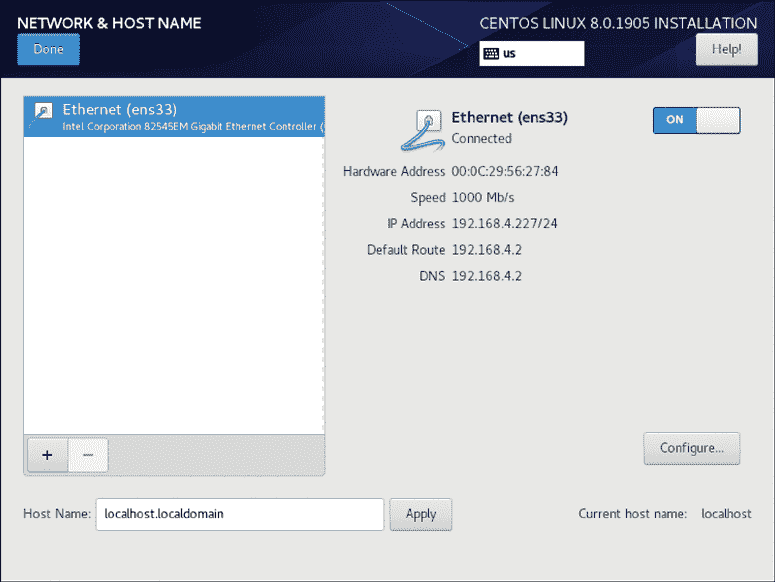

## 图 1-12 在“网络与主机名”屏幕上，将网卡设置为开启

默认情况下网络连接设置为 `Off`。请确保将其切换为 `On`。开启网络连接后，你可以点击 `Configure` 添加进一步配置。网络设置将在第 8 章“配置网络”中进行详细讨论，因此你现在无需进行操作，只需保留从动态主机配置协议（DHCP）服务器获取 IP 地址的默认设置即可。将主机名设置为 `server1.example.com`。

### 步骤 12

安全策略选项不需要任何更改。

### 步骤 13

在“安装摘要”屏幕选项中指定了所有设置后，你可以点击 `Begin Installation` 开始安装。这会立即启动安装程序，但也会提示用户设置（参见图 1-13）。

显示了 CentOS Linux 8.0.1905 安装的配置页面。显示了用户设置——root 密码（未设置 root 密码）和用户创建（未创建用户）。下方显示了下载包的进度条。

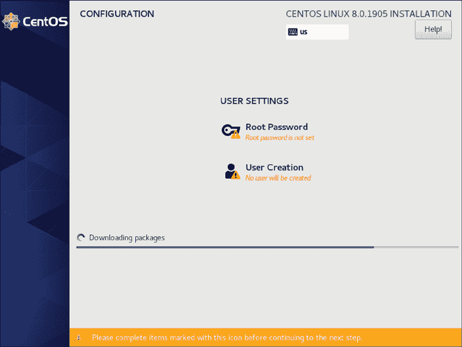

**图 1-13** 指定用户和 Root 参数

### 步骤 14

在此屏幕上，首先点击 `Root Password`，并将密码设置为 `password`。这并不安全，但通过使用这样简单的密码，你可以避免以后可能因忘记密码而导致的问题。你必须指定两次密码，而且还需要点击两次 `Done`（因为你必须确认你真的真的想使用弱密码）。

### 步骤 15

接下来，点击 `User Creation` 创建一个用户（参见图 1-14）。输入用户名 `student`，并为该用户将密码也设置为 `password`。同样，你必须点击两次 `Done` 来确认你真的想使用弱密码。

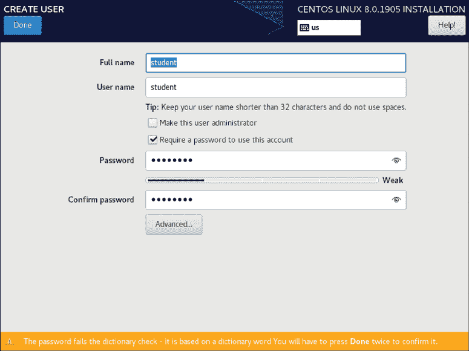

**图 1-14** 指定额外的用户设置

### 步骤 16

安装完成后，你将看到图 1-15 所示的屏幕。现在你需要点击 `Reboot` 重启电脑并完成安装。

显示了 CentOS Linux 8.0.1905 安装的配置页面。

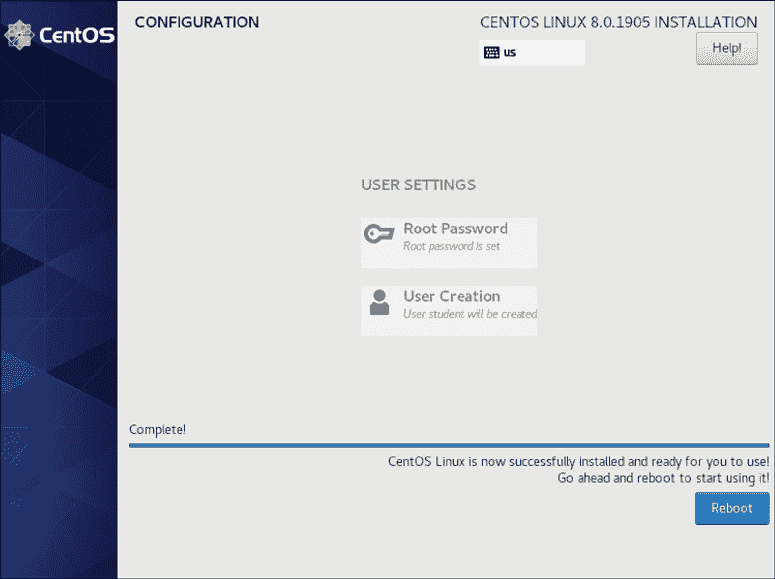

**图 1-15** 重启完成安装

### 步骤 17

重启后，你必须通过几个额外的设置步骤。首先，你需要接受许可协议。要这样做，点击文本 `License Not Accepted`，选择 `I Accept the License Agreement`，然后点击 `Done` 完成。现在你可以点击 `Finish the Configuration` 完成配置，这将带你进入图形登录提示。不要使用 `subscription-manager` 设置系统注册；你需要非常特定的设置，我们将在第 9 章中处理此问题。

## 总结

在本章，你学习了什么是 Red Hat Enterprise Linux 以及它与其他某些 Linux 发版的关系。你还学习了如何安装 Red Hat Enterprise Linux 8 或 CentOS 8。你现在已经准备好搭建一个基础环境，可以用它完成书中的所有练习。

## 考试准备任务

如引言中的“如何使用本书”节所示，你有几种准备考试的选择：章末的实验；附录 B 中的记忆表；第 27 章“最终准备”；以及模拟考试。

## 复习所有关键主题

回顾章节中最重要的主题，这些主题在页面外边角用“关键主题”图标标记。表 1-2 列出了这些关键主题的索引及其所在页码。你可以在附录 A 中的“我是否已经知道这些？”测验和“复习题”答案中找到答案。


| 关键主题元素 | 描述 | 页 |
| --- | --- | --- |
| 步骤列表 | 如何执行手动 RHEL 8 安装 | 10 |

**表 1-2** 第 1 章关键主题

## 定义关键术语

定义本章的以下关键术语并在词表中检查你的答案：

- distribution
- Linux
- Red Hat
- CentOS
- Fedora
- Scientific Linux

## 复习题

接下来的问题旨在帮助测试你对概念、术语的掌握程度以及知识面。你可以在附录 A 中找到这些问题的答案。

1. 你想购买 RHEL，应该使用哪种发行版？
2. 如果你没有指定任何内容，网络设置是怎样的？
3. 你需要多少内存？
4. 为什么所有服务器都连接网络是一个好主意？
5. 如果你有虚拟机，执行安装简单的方法是什么？
6. 为什么安装图形界面是一个好主意？
7. RHEL 的默认文件系统是什么？
8. 如果没有网络访问，可以安装 RHEL 吗？
9. 使用 `subscription-manager` 注册 RHEL 安装最重要的优势是什么？
10. 如果磁盘空间非常有限，你应该使用哪种安装模式？

## 总结

在本章，你学习了如何设置 Red Hat Enterprise Linux。此时，你应该有一台运行中的服务器。后续章节的练习需要一台服务器。

## 实验 1.1

重复“执行手动安装”过程再安装一台服务器。关于该服务器的额外配置将在后续章节介绍。目前只需确保满足以下条件：

- 使用服务器名称 `server2.example.com`。
- 将网络设置为自动获取 IP 地址。
- 确保保留至少 1 GiB 的未分配磁盘空间（未分配给任何分区），以便你有空闲进行后续章节的分区练习。
- 使用最小化安装模式安装此服务器。

# 第 2 章 使用基本工具

**本章涵盖以下主题：**

- 基础 Shell 技能
- 使用 `vim` 编辑文件
- 理解 Shell 环境
- 查找帮助

本章涵盖以下 RHCSA 考试目标：

- 使用输入输出重定向（`>`、`>>`、`|`、`2>` 等）
- 创建并编辑文本文件
- 定位、阅读和使用系统文档，包括 `man`、`info` 和 `/usr/share/doc` 中的文件

本章致力于介绍尝试 RHCSA 考试之前每个人应该具备的基础 Linux 技能。

## “我掌握这些了吗？”测试

“我是否已经知道这些？”测验可以帮助你评估是应该阅读整个章节，还是直接跳转到“考试准备任务”部分。如果你对这些问题的答案或对自己这些主题掌握情况的评估有疑问，请阅读整个章节。表 2-1 列出了本章中的主要标题及其对应的“我是否已经知道这些？”测验题目。你可以在附录 A 中的“我是否已经知道这些？”测验和“复习题”答案中找到答案。

| 基础主题章节 | 题目 |
| --- | --- |
| 基础 Shell 技能 | 1, 3, 4–7 |
| 使用 `vim` 编辑文件 | 8 |
| 理解 Shell 环境 | 2, 9 |
| 查找帮助 | 10 |

**表 2-1** “我是否已经知道这些？”章节与题目映射

**1.** 下面哪个命令可以允许你将标准输出和标准错误都重定向到文件？

1. `1&2> file`
2. `> file 2>&1`
3. `>1&2 file`
4. `1>2& file`

**2.** 你正在寻找一个所有用户的 Bash 登录 shell 中设置的变量。以下文件中可能是设置该变量的位置？（选择两个。）

1. `/etc/profile`
2. `/etc/bashrc`
3. `~/.bash_profile`
4. `~/.bashrc`

**3.** 一用户创建了一个名为 `myscript` 的脚本。他尝试使用命令 `myscript` 运行它，但脚本并没有启动。用户已经验证脚本权限设置为可执行。以下哪种解释最可能是可能的？

1. 内部命令阻止了脚本的启动。
2. 用户不允许运行脚本。
3. 包含脚本的目录不在 `PATH` 中。
4. 脚本没有适当的权限。


**4.** 你需要将命令`ls`的输出作为`less`命令的输入。以下哪个示例可以为你实现这一点？

1. `ls > less`
2. `ls >> less`
3. `ls >| less`
4. `ls | less`

**5.** 一个用户想要删除她的全部历史记录。以下什么方法可以实现？

1. 删除`~/.bash_history`文件并输入`history -c`。
2. 输入`history -c`。
3. 删除`~/.bash_history`文件。
4. 输入`history -c`并关闭当前 shell。

**6.** 下面哪项不是重复历史中命令的有效方法？

1. 按 Ctrl-r 并开始输入命令的一部分。
2. 输入`!`后跟命令的开头几个字母。
3. 输入`!`后跟历史记录中列出的命令数字。
4. 按 Ctrl-x 后跟历史记录中的数字。

**7.** Bash 补全可以用于以下哪些项目？

1. 命令
2. 文件
3. 变量
4. 以上所有

**8.** 下面哪个命令可以允许你在用`vi`打开的文件中将所有的`old`替换为`new`？

1. `:%s/old/new/g`
2. `:%r/old/new/`
3. `:s/old/new/g`
4. `r:/old/new`

**9.** 如果在登录过程中，你想向所有刚刚登录到服务器 shell 会话的用户显示一条消息，哪种方法最好？

1. 将消息放在`/etc/issue`。
2. 将消息放在`/etc/motd`。
3. 将消息放在`/etc/profile`。
4. 将消息放在`/etc/bashrc`。

**10.** 你正在使用`man -k user`，但得到了“nothing appropriate”（无适当内容）的消息。以下哪种解决方案最可能为你解决这个问题？

1. 输入`updatedb`来更新 mandb 数据库。
2. 输入`makewhatis`来更新 mandb 数据库。
3. 输入`mandb`来更新 mandb 数据库。
4. 使用`man -K`而不是`man -k`。

## 基础主题

### 基础 Shell 技能

`shell` 是 Linux 管理员的默认工作环境。它是用户和管理员在此输入命令并由操作系统执行命令的环境。Linux 有多种 shell，但 Bash 是最常见的 shell。因此，当我们在这书中谈论“shell”时，我们实际上是在谈论`Bash` shell。

### 理解 Shell 环境

`shell` 是 Linux 管理员的默认工作环境。它是用户和管理员在此输入命令并由操作系统执行命令的环境。Linux 有多种 shell，但 Bash 是最常见的 shell。因此，当我们在这书中谈论“shell”时，我们实际上是在谈论`Bash` shell。

### 执行命令

`shell` 是 Linux 管理员的默认工作环境。它是用户和管理员在此输入命令并由操作系统执行命令的环境。Linux 有多种 shell，但 Bash 是最常见的 shell。因此，当我们在这书中谈论“shell”时，我们实际上是在谈论`Bash` shell。

你应该注意到，出于安全考虑，当前目录不在`$PATH`变量中，Linux 不会检查当前目录来查看特定命令是否在该目录中可用。这就是为什么如果你想运行位于当前目录但在`$PATH`中任何地方都没有的命令，需要在命令前面加上`./`。点代表当前目录，通过`./`运行，你告诉 Bash 在当前目录中查找该命令。虽然这种方式运行命令并不常见，但在运行你在当前目录下创建的脚本时，必须这样做。

`$PATH`变量可以为特定用户设置，但通常大多数用户将使用相同的`$PATH`变量。唯一的例外是`root`用户，他需要访问特定的管理命令。在练习 2-1 中，你将学习关于操作命令的基础知识。

#### I/O 重定向

默认情况下，当执行一个命令时，它会将结果显示在你正在工作的计算机屏幕上。计算机显示器被用作输出的标准目标，称为`STDOUT`。shell 还有默认的目标用于发送错误消息和接收输入。表 2-2 概述了这三者。

| 名称 | 默认目标 | 重定向中的用法 | 文件描述符数字 |
| --- | --- | --- | --- |
| STDIN | 计算机键盘 | `<`（同于`0<`） | 0 |
| STDOUT | 计算机显示器 | `>`（同于`1>`） | 1 |
| STDERR | 计算机显示器 | `2>` | 2 |

**表 2-2** 标准输入、输出和错误概述

因此，如果你运行一个命令，该命令将期望从键盘输入，并通常会将其输出到你计算机的显示器，而不区分普通输出和错误。然而，某些命令是在后台启动的，而不是从当前的终端会话启动，因此这些命令没有显示器或控制台会话来发送输出，也不会监听键盘输入来接受标准输入。这就是重定向大显身手的地方。如果你想从替代位置（例如文件）处理输入，重定向也非常有用。

从命令行启动的程序并不知道它们正在从哪里读取或写入哪里。如果它们想从标准输入读取，它们将从 Linux 内核所称为文件描述符`0`的地方读取；如果它们有非错误输出（也称为“标准输出”），将写入文件描述符`1`；如果有错误消息需要输出，则写入描述符`2`。默认情况下，这些文件描述符连接到键盘和屏幕。如果你使用重定向符号如`<`、`>`和`|`，shell 将文件描述符连接到文件或其他命令。让我们先看看`<`和`>`。稍后我们将讨论管道（`|`符号）。表 2-3 显示了 Bash shell 中常用的重定向符。

| 重定向符 | 说明 |
| --- | --- |
| `>`（同于`1>`） | 重定向`STDOUT`。如果重定向到文件，该文件的当前内容将被覆盖。 |
| `>>`（同于`1>>`） | 重定向`STDOUT`。如果输出写入文件，输出将追加到该文件。 |
| `2>` | 重定向`STDERR`。 |
| `2>&1` | 将`STDERR`重定向到与`STDOUT`相同的目标。注意这必须与普通输出重定向结合使用，例如`ls whuhiu > errout 2>&1`。 |
| `<`（同于`0<`） | 重定向`STDIN`。 |

**表 2-3** 常用 Bash 重定向符

在 I/O 重定向中，可以使用文件替换默认的`STDIN`、`STDOUT`和`STDERR`。你也可以重定向到设备文件。Linux 上的设备文件用于访问特定硬件的文件。例如，你的硬盘可以被称为`/dev/sda`，你服务器的控制台被称为`/dev/console`或`/dev/tty1`，如果你想丢弃命令的输出，可以将其重定向到`/dev/null`。注意，要访问大多数设备文件，你需要 root 权限。

#### 使用管道

I/O 重定向被用作键盘和计算机显示器的替代方案，而管道可以用于捕获一个命令的输出并将其作为第二个命令的输入。例如，如果用户运行命令`ls`，命令输出将显示在屏幕上，因为屏幕是默认的`STDOUT`。如果用户使用`ls | less`，命令`ls`和`less`将并行启动。`ls`命令的标准输出连接到`less`的标准输入。`ls`写入标准输出的所有内容将可以通过`less`的标准输入读取。结果是`ls`的输出显示在`less`分页器中，用户可以在那里方便地上下浏览结果。

作为 Linux Linux 员员，你将频繁使用管道。使用管道使 Linux 变成一个灵活的操作系统；通过管道组合多个命令，你可以创建“超级”命令，让几乎一切成为可能。在练习 2-2 中，你将使用 I/O 重定向和管道。

#### 历史记录

Bash shell 的一个方便功能是 Bash history。Bash 默认保留最后 1000 条命令（如果 shell 会话从未关闭，这个数字可能会增加）。当 shell 会话关闭时，历史会被更新到文件中。该文件名为`.bash_history`，创建在启动用户的家目录下。历史功能使得重复命令变得简单。操作历史记录有几种方法：

- 输入`history`显示历史中的所有命令。
- 按 Ctrl-r 打开提示符，你可以在其中对命令进行反向搜索。只需输入一个字符串，Bash 将在历史记录中查找该字符串的命令。再次按 Ctrl-r 重复上次反向搜索。
- 输入`!number`执行历史记录中指定数字的命令。
- 输入`!sometext`执行以`sometext`开头的最后一个命令。注意这是一个危险的命令，因为找到的命令会被立即执行。

在某些情况下，可能需要清除 Bash 历史记录。这种功能非常有用，例如你不小心以明文输入了密码。如果发生这种情况，你可以输入`history -c`来清除当前历史。退出当前会话时，该会话的命令将不会写入历史文件。如果你想删除整个 Bash 历史记录，在使用`history -c`后输入`history -w`。

练习 2-3 引导你学习一些历史功能。

#### Bash 补全

Bash shell 的另一个有用功能是命令行补全。该功能可以帮助你找到需要的命令，它也适用于变量和文件名。如果你安装了`bash-completion`软件包，它也适用于一些更复杂的命令。

在处理命令时，Bash 补全非常有用。只需输入命令的开头并按键盘上的 Tab 键。如果只有一个补全选项，Bash 将自动为你完成命令。如果有多个选项，你需要再次按 Tab 键以获取所有可用选项的概述。在练习 2-4 中，你将学习如何使用这些强大的功能。

### 使用 vim 编辑文件

管理 Linux 通常意味着要与文件交道。Linux 上的大部分配置都是通过文件完成的。为了完成管理任务，通常需要使用文本编辑器更改配置文件的内容。

多年来，Linux 拥有了许多文本编辑器。然而，有一个编辑器至关重要，那就是`vi`。即使其他文本编辑器可能更易用，但`vi`是唯一始终可用的文本编辑器。这就是为什么作为 Linux 管理员，你需要知道如何使用`vi`。一个常见的替代方案是`vim`，或者说是“改进版的`vi`”，它是对`vi`的完全重写，包含许多增强功能，使得使用`vi`变得更容易，例如对许多配置文件提供语法高亮，这让你能够识别出自己的输入错误。在本节中学习的关于`vim`的所有内容也适用于`vi`。

使用`vim`时，一个重要的概念是它使用了不同的模式。其中两种特别为重要：`command mode`（命令模式）和`input mode`（输入模式）。这些模式通常会引起混淆，因为在`command mode`下，你只能直接输入命令，而不能编辑文本文件的内容。要更改文本文件的内容，你需要进入`input mode`。

使用`vim`的挑战在于可用命令的数量非常多。有些人甚至制作了`vim`备查清单，列出了所有可用命令。不要使用它们。相反，请关注真正重要的极少数命令。表 2-4 总结了最核心的`vim`命令。使用这些（且仅使用这些），你就能应对 RHCSA 考试游刃有余。

### 提示

在使用`vim`时候，不要尝试使用尽可能多的命令。只需使用一组极简的命令并频繁使用它们。你会发现的，你会习惯这些命令并在考试中记住它们。此外，你可能会喜欢`vimtutor`命令。（使用`yum install vim-enhanced`来安装它。）该命令会打开一个`vim`教程，引导你完成一些很不错的额外练习。


| vim 命令 | 解释 |
| --- | --- |
| `Esc` | 从输入模式切换到命令模式。在输入任何命令之前按下此键。 |
| `i`、`a` | 在当前光标位置之前（`i`）或之后（`a`）从命令模式切换到输入模式。 |
| `o` | 在当前光标位置下方开启新行并进入输入模式。 |
| `:wq` | 当前文件并退出。 |
| `:q!` | 在不应用任何更改的情况下退出文件。`!`强制命令执行。只有在你确切知道自己在做什么时才添加`!`。 |
| `:w filename` | 以新文件名保存当前文件。 |
| `dd` | 删除当前行。 |
| `yy` | 复制当前行。 |
| `p` | 粘贴所选内容。 |
| `v` | 进入视觉模式，允许你使用方向键选择文本块。使用`d`剪切所选内容或使用`y`复制它。 |
| `u` | 撤销上一个命令。根据需要重复操作。 |
| Ctrl-r | 重做上一次撤销。 |
| `gg` | 回到文档的第一行。 |
| `G` | 回到文档的最后一行。 |
| `/text` | 从当前光标位置向后搜索`text`。 |
| `?text` | 从当前光标位置向后搜索`text`。 |
| `^` | 回到当前行的开头。 |
| `$` | 回到当前行的末尾。 |
| `!ls` | 将`ls`（或任何其他命令）的输出添加到当前文件中。 |
| `:%s/old/new/g` | 将所有出现的`old`替换为`new`。 |

**表 2-4** `vim`核心命令

现在你已经知道了使用`vim`最核心的命令。练习 2-5 为你提供了测试它们的机会。

### 理解 Shell 环境

当你从 shell 工作时，系统会创建一个环境，以确保发生的一切都以正确的方式进行。这个环境由定义用户环境的变量组成，例如之前讨论过的`$PATH`变量。在本节中，你将简要概述 shell 环境及其是如何创建的。

#### 理解变量

Linux shell 环境由许多变量组成。变量（Variables）是可以被分配动态值的固定名称。变量的一个示例是`$LANG`，在我的 shell 中它被设置为`en_US.UTF-8`。这个值（在你的系统上可能不同）确保我可以使用英语语言常用的设置进行英语工作（考虑日期和时间的显示方式）。

对于脚本和程序来说，使用变量的优势在于程序只需要使用变量名，而无需关心分配给变量的具体值。因为不同用户有不同的需求，用户环境中设置的变量也会有所不同。要获取你 shell 环境中定义的当前变量的概述，请输入`env`命令，它将显示环境变量。示例 2-1 显示了该命令的一些输出行。

**示例 2-1** 显示当前环境

```text
[user@server1]$ env
MAIL=/var/mail/user
PATH=/usr/local/bin:/usr/bin:/bin:/usr/local/sbin:/usr/sbin:/sbin
HOME=/home/user
LANG=en_US.UTF-8
HISTCONTROL=ignoredups
PWD=/home/user
LOGNAME=user
SHLVL=1
OLDPWD=/etc
LESSOPEN=||/usr/bin/lesspipe.sh %
```

正如从示例 2-1 中所示，要定义变量，输入变量名，后跟等号（`=`）和值。要读取变量的值，你可以使用`echo`命令（或其他），例如`echo $PATH`。目前你不需要了解更多变量。你可以在第 19 章](#ch19.xhtml_ch19）中学习变量的高级用法。

#### 识别配置文件

Linux shell 环境由许多变量组成。当用户登录时，系统会创建一个环境。这个环境由四个不同的配置文件组成，在这些文件中可以指定脚本代码并定义变量。

- `/etc/profile`：所有用户登录时处理的通用文件。
- `/etc/bashrc`：启动子 shell 时处理的文件。
- `~/.bash_profile`：在此文件中定义用户登录 shell 变量。
- `~/.bashrc`：在此文件中定义用户子 shell 变量。

向用户发送信息的另一种方法是使用`/etc/issue`。该文件的内容会在用户登录前显示。使用此文件是为尚未登录的用户指定特定登录指令的极佳手段。

在练习 2-6 中，你可以回顾本节讨论过的主题。

## 查找帮助

在一个通用的 Linux 系统中，有数百个命令可用——多到你无法记住所有的命令，这就是为什么使用计算机上的帮助资源如此重要的原因。`man`命令是获取有关命令语法和用法帮助信息最重要的资源。此外，你还可以通过`command --help`来显示命令选项的简要列表。

### 使用 --help

获取命令用法概览最快的方法是带有`--help`选项运行命令。几乎所有命令在使用此选项时都会显示用法摘要。通过这种方式显示的选项列表主要用于你已经对如何使用该命令有了通俗理解，并且需要快速概述该命令可用选项的情况——它并不会为尚不了解命令的用户提供详细信息。

### 提示

当使用`--help`选项时，几乎所有命令都会提供简短的帮助概述。某些命令不遵循该选项并将其视为错误。幸运的是，这些命令会足够友好地显示错误信息，显示命令的有效选项，这实际上意味着你仍然会得到你需要的内容。

### 使用 man

在使用 Linux 命令行时，你会在某个时刻查阅 man 页（帮助页）。`man`命令让命令行操作成为可能。如果你不知道如何使用某个命令，该命令的 man 页将提供宝贵的见解。本节涵盖了几个`man`的要点。

首先，通常 man 页最重要的部分位于 man 页的底部。在这里你会找到两个重要部分：很多情况下会有示例；如果没有示例，总有一个“See Also”（另参见）部分。你在这里找到的主题是相关的 man 页，如果你恰好没有找到正确的页，这很有用。要尽可能快地到达 man 页的底部，请使用`G`命令。你也可以输入`/example`来搜索 man 页中的任何示例。图 2-1 显示了 man 页的末尾可能的样子。


**图 2-1** 示例 man 页内容

### 查找正确的 man 页


要在 man 页中查找信息，你可以通过 `apropos` 或 `man -k` 搜索 mandb 数据库。如果数据库是最新的，获取你需要的信息非常简单。只需输入 `man -k`，后跟你想要搜索的关键词。此命令会在存储在 mandb 数据库中的所有 man 页摘要中查找。示例 2-2 显示了此命令的部分结果。

**示例 2-2** 使用 `man –k` 搜索 man 页

点击此处查看代码图像

```
[root@server1 ~]# man -k partition

addpart (8)       - simple wrapper around the "add partition" ioctl

cfdisk (8)        - display or manipulate disk partition table

cgdisk (8)        - Curses-based GUID partition table (GPT)

                      manipulator

delpart (8)        - simple wrapper around the "del partition" ioctl

fdisk (8)          - manipulate disk partition table

fixparts (8)       - MBR partition table repair utility

gdisk (8)          - Interactive GUID partition table (GPT) manipulator

iostat (1)          - Report Central Processing Unit (CPU) statistics
                      and in...

kpartx (8)         - Create device maps from partition tables

mpartition (1)     - partition an MSDOS hard disk

os-prober (1)      - Discover bootable partitions on the local system

partprobe (8)      - inform the OS of partition table changes

partx (8)          - tell the Linux kernel about the presence and
                      numbering...

pvcreate (8)        - initialize a disk or partition for use by LVM

pvresize (8)        - resize a disk or partition in use by LVM2

resizepart (8)      - simple wrapper around the "resize partition" ioctl

sfdisk (8)          - partition table manipulator for Linux

sgdisk          (- Command-line GUID partition table (GPT)
                      manipulator fo...

systemd-efi-boot-generator (8) - Generator for automatically mounting
                                   the EFI...

systemd-gpt-auto-generator (8) - Generator for automatically
                                   discovering and ...
```

根据 `man -k` 给你的信息，你可能可以识别出为了完成你想实现的任何操作需要访问的 man 页。然而，请注意，`man -k` 并不是完美的；它只搜索已安装每个命令的简短摘要。如果你的关键词不在摘要中，你将一无所获，并得到“nothing appropriate”（没有适当的内容）的错误信息。

### 提示

与其使用 `man -k`，你可以使用 `apropos` 命令，它等同于 `man -k`。

在使用 `man -k` 从 man 页中查找特定信息时，有时会得到大量信息。为了过滤结果，使用 `grep` 只显示与你相关的章节。另一个实用的 man 选项是 `-f`。命令 `man -f <command>` 显示 mandb 数据库中项目的简短描述。这可以帮助判断该 man 页是否包含你寻找的信息。

### 更新 mandb

如前，当你使用 `man -k` 命令时，会查询 mandb 数据库。该数据库是通过 `cron` 计划任务自动创建的。偶尔，你可能会寻找显然有文档的内容，但得到的却是“nothing appropriate”。如果发生这种情况，你可能需要更新 mandb 数据库。这样做很容易：只需以 root 身份运行带参数的 `mandb` 命令。它会检查是否安装了新的 man 页并相应更新 mandb 数据库。

除了你可以在 man pages（帮助页）中找到的信息外，另一个系统还提供了关于命令用法的帮助信息。这就是 info 系统。大多数命令都记录在 man 页中，但某些命令的主要文档存储在 info 系统中，而在 man 页中仅显示简短的用法摘要。如果是这种情况，该命令的 man 页中的“See Also”（另见）部分会提示你“……的完整文档作为 Texinfo 手册维护”。随后，你可以使用命令 `pinfo` 或 `info` 来读取 Info 页面。这两个命令都可以用，但在 `pinfo` 中，像菜单项这样的特殊项目会被清晰地标识出来，这就是为什么使用 `pinfo` 更容易用。

在使用 `info` 时，请查看查看器的第一行。它显示了当前在 info 文档中的位置。特别有趣的是 Up（上一个）、Next（下一个）和 Previous（上一个）指示器，它们会告诉你是如何导航。Info 页面的组织结构类似于网页，这意味着它们是以层级方式组织的。要浏览该层级结构，输入 `n` 进入下一页，输入 `p` 回到上一页，或输入 `u` 向上移动层级移动。

在 info 页中，你还会找到菜单。每个带有星号（`*`）标记的项目都是一个菜单项。使用方向键选择特定的菜单项。这会带你进入下一级。要再次返回，输入 `u`。这将带你回到 `pinfo` 层级结构中的原始起始点。图 2-2 显示了 info 页面的样子。


**图 2-2** 使用 `pinfo` 获取更多命令用法信息

练习 2-8 显示了此类命令的示例，在这个练习中，你将学习如何从 info 页中获取信息。

### 使用 `/usr/share/doc` 文档文件

第三个信息源由有时会被复制到 `/usr/share/doc` 目录的文件组成。这些文件专门用于稍微复杂的服务和大型系统。你通常不会找到关于 `ls` 等命令的大量信息，但某些服务会在 `/usr/share/doc` 中提供有用信息。

某些服务在该目录下存储了非常有用的信息，如 rsyslog、bind、Kerberos 和 OpenSSL。对于某些服务，甚至包含了示例文件。这些服务的示例之一是 VDO，在第 15 章“管理高级存储](#ch15.xhtml_ch15)”中有更详细的介绍。

### 总结

在本章中，你学习了基本的 Linux 管理任务。你学习了一些重要的 shell 基础知识，例如 I/O 重定向、处理历史记录和管理环境。你还学习了如何使用 `vim` 编辑器编辑文本文件在本章的最后一部分，你学习了如何使用 `man` 和相关命令查找信息。

### 考试准备任务

正如引言中“如何使用本书”节所提到的，你有几种选择方法来准备考试：章末实验；附录 B 中的记忆表；第 27 章“最终准备](#ch27.xhtml_ch27)”；以及模拟考试。

### 复习所有关键主题

复习章中最重要的主题，这些主题在页外边距用 Key Topic（关键主题）图标标记。表 2-5 列出了这些关键主题的索引及其所在的页码。


| 关键主题元素 | 描述 | 页码 |
| --- | --- | --- |
| 表 2-4 | `vim` 基础命令 | 40 |
| 列表 | man 中的重要章节 | 47 |

**表 2-5** 第 2 章 关键主题

### 记忆完成表格和列表

打印附录 B“记忆表](#appb.xhtml_appb”（可在配套网站上找到）或至少打印本章章节，并根据记忆完成表格和列表。附录 C“记忆表答案对照](#appc.xhtml_appc)”包含了完整的表格和列表以检查你的工作。

### 定义关键术语

定义本章的以下关键术语并在词表中检查你的答案：

- shell
- bash
- 内部命令
- 外部命令
- `$PATH`
- 变量
- STDIN
- STDOUT

### 复习题

以下问题旨在测试你的知识。你可以在附录 A](#appa) 中找到答案。

1. 什么是变量？
2. 哪个命令可以找到 man？
3. 如果你想设置一个变量，需要修改哪个文件？
4. ……的用法由 Techinfo 手册维护。
5. Bash 存储历史记录的文件名称是什么？
6. 哪个命令可以更新数据库？
7. 如何在 `vim` 中撤销最后一次修改？
8. 在命令中添加什么可以确保它不显示错误信息，假设你不在乎？
9. 如何读取 `$PATH` 变量当前的内容？
10. 如何重复你上次使用的包含 `dog` 的命令？

### 章末

你现在学习了 Linux 管理员应该具备的一些基本技能。你将通过完成章末实验来应用这些技能。

### 实验 2.1

1. 修改你的 shell 环境，以便启动子 shell 时设置变量。变量名应为 `COLOR`，值应设置为 `red`。验证其是否有效。
2. 使用适当工具找到可以将系统时间提前 1 分钟的命令。
3. 从主目录，输入命令 `ls -al wergihl *` 并确保错误和标准输出都重定向到名为 `/tmp/lsoutput` 的文件中。

## 第 3 章：基本文件管理工具

本章涵盖了以下主题：

- 文件系统层级结构工作
- 管理文件
- 使用链接
- 处理存档和压缩文件

本章涵盖了以下 RHCSA 考试目标：

- 创建、删除、复制和移动文件及目录
- 使用 `tar`、`star`、`gzip` 和 `bzip2` 归档、压缩、解包和解压缩
- 创建硬链接和软链接

Linux 是一个以文件为对象的操作系统。这意味着管理员在 Linux 上需要做的许多工作都可以追溯到对 Linux 操作系统中文件的管理。此外，在使用硬件设备时，也会涉及到文件。本章将向你介绍基本的的文件管理技能。你将学习 Linux 文件系统的组织方式，以及如何操作文件和目录。你还将学习如何管理链接以及压缩或未压缩的归包。

### “我已经掌握了吗？”测试题

“我已经掌握了吗？”测试题可以让你评估是应该仔细阅读整个章节，还是跳到“考试准备任务”部分。如果你对这些问题的答案或对自己相关主题知识的评估有疑虑，请阅读整个章节。表 3-1 列出了本章的主要标题及其对应的“我已经掌握了吗？”测试题。你可以在附录 A 中的“‘我已经掌握了吗？测试题和‘复习题’的答案”中找到答案。

| 基础主题章节 | 题目 |
| --- | --- |
| 使用文件系统层次结构 | 1–4 |
| 管理文件 | 5–7 |
| 使用链接 | 8–9 |
| 使用归档和压缩文件 | 10 |

**表 3-1** “我已经掌握了吗？”章节与题目映射

1. 你预计在哪个目录下会找到非必需的程序文件？
   1. `/boot`
   2. `/bin`
   3. `/sbin`
   4. `/usr`

2. 你预计在哪个目录下会找到日志文件？
   1. `/proc`
   2. `/run`
   3. `/var`
   4. `/usr`

3. 下列目录中，通常哪个不会挂载在自己的专用设备上？
   1. `/etc`
   2. `/boot`
   3. `/home`
   4. `/usr`

4. 下列哪个命令可以提供关于挂载磁盘设备最准确的概述（同时不会显示太多关于挂载系统设备的信息）？
   1. `mount`
   2. `mount -a`
   3. `df -hT`
   4. `du -h`

5. 哪个命令允许你显示当前目录下的所有文件，使得最新的文件最后最后？
   1. `ls -lRt`
   2. `ls -lrt`
   3. `ls -alrt`
   4. `ls -alr`

6. 哪个命令允许你将 `/home/$USER` 中的隐藏文件以及普通文件复制到当前目录？
   1. `cp -a /home/$USER .`
   2. `cp -a /home/$USER/* .`
   3. `cp -a /home/$USER/. .`
   4. `cp -a home/$USER. .`

7. 哪个命令允许你将文件 `myfile` 重命名为 `mynewfile`？
   1. `mv myfile mynewfile`
   2. `rm myfile mynewfile`
   3. `rn myfile mynewfile`
   4. `ren myfile mynewfile`

8. 关于硬链接（hard links）的哪个陈述不是正确的？
   1. 硬链接无法创建到目录。
   2. 硬链接不能引用其他设备上的文件。
   3. inode 保留了一个硬链接计数器。
   4. 如果删除了原始硬链接，所有其他硬链接都将失效。

9. 哪个命令在 `/tmp` 目录创建一个指向目录 `/home` 的符号链接？
   1. `ln /tmp /home`
   2. `ln /home /tmp`
   3. `ln -s /home /tmp`
   4. `ln -s /tmp /home`

10. 哪个 `tar` 选项允许你将单个文件添加到 tar 归档？
    1. `-a`
    2. `-A`
    3. `-r`
    4. `-u`

### 基础主题

#### 使用文件系统层次结构

为了管理 Linux 系统，你应该熟悉几乎所有 Linux 系统上存在的默认目录。本节描述了这些目录，并解释了如何使用挂载（mounts）来构建文件系统层次结构。

##### 定义文件系统层次结构

大多数 Linux 系统上的文件以类似的方式组织。Linux 文件系统的布局在文件系统层次结构标准（FHS）中定义，该文件系统层次结构在 `man 7 hier` 中描述。表 3-2 显示了你在 Red Hat Enterprise Linux (RHEL) 系统上会遇到的最重要的目录的概述，如 FHS 所示。


| 目录 | 用途 |
| --- | --- |
| `/` | 指定根目录。这是文件系统树的起点。 |
| `/boot` | 包含引导程序使用的所有文件，包括 Linux 内核。 |
| `/dev` | 包含代表硬件设备的设备文件。 |
| `/etc` | 包含系统配置文件。 |
| `/home` | 包含普通用户的目录。 |
| `/media`、`/mnt` | 用于临时连接媒体和文件系统的挂载点。 |
| `/opt` | 用于可选软件包。 |
| `/proc` | 提供运行进程信息的虚拟文件系统。 |
| `/root` | 指定 root 用户的家目录。 |
| `/run` | 包含自启动以来添加的运行时信息。 |
| `/srv` | 包含服务数据，如 FTP 或 HTTP。 |
| `/sys` | 提供内核对象接口的虚拟文件系统。 |
| `/tmp` | 包含重启时删除的临时文件。 |
| `/usr` | 包含特定程序和共享数据。 |
| `/var` | 包含动态增长的文件，日志和数据库。 |

**表 3-2** FHS 概述

##### 理解挂载

要理解文件系统的组织结构，你需要理解挂载这一重要概念。Linux 文件系统呈现为一个层次结构，以根目录（`/`）为起点。该层次结构可能分布在不同的设备甚至计算机系统上。

在挂载过程中，设备被连接到特定的目录，使得挂载后该目录可以访问设备的内容。

挂载设备使得灵活地组织文件系统成为可能。将所有文件存储在单个文件系统中有很多缺点，这为使用多个挂载提供了几个很好的理由：

- 一个区域的高活动可能会填满整个文件系统，从而影响运行在服务器上的服务。
- 如果所有文件都在同一设备上，很难安全访问并区分具有不同安全需求的文件系统区域。通过挂载单独的文件系统，你可以添加挂载选项来满足特定的安全需求。
- 如果单设备文件系统被完全填满，提供额外的存储空间可能会困难。

为了避免这些陷阱，通常会将 Linux 文件系统组织在不同的设备（如磁盘分区和逻辑卷）上，并将它们挂载到文件系统层次结构。通过将设备配置为专用挂载，你还可以可以使用限制访问的挂载选项。某些目录挂载在专用设备上：

- `/boot`：该目录通常挂载在独立的设备上，因为它包含计算机启动所需的关键信息。根目录（`/`）通常位于逻辑卷管理器（LVM）卷上，Linux 默认无法从中启动，因此内核和相关文件需要存储在独立的 `/boot` 设备上。
- `/var`：此目录通常位于专用设备上，因为它会以动态且不受控的方式增长（例如，由于写入到 `/var/log` 的日志文件引起）。通过将其放在专用设备上，你可以确保它不会填满服务器上的所有存储空间。


- `/home`：出于安全考虑，此目录通常位于专用设备上。通过将其放在专用设备上，你可以使用特定的选项（如 `noexec` 和 `nodev`）对其进行挂载，以增强服务器的安全性。当你重新安装操作系统时，将家目录目录放在单独的文件系统中是一个优势，这样家目录目录就可以在系统重装后依然存在。

- `/usr`：此目录仅包含操作系统文件，普通用户通常不需要这些文件具有任何写权限。将此目录放在专用设备上允许管理员将其配置为只读挂载。

除了这些目录之外，你还可能发现服务器还有其他挂载在专用分区或卷上的目录。归根结底，决定哪些目录拥有自己的专用设备是由管理员自行决定的。

若要获取所有设备及其挂载点的概览，你可以使用不同的命令：

- `mount` 命令提供了所有已挂载设备的概览。要获取此信息，会读取 `/proc/mounts` 文件，内核在该文件中保留所有当前挂载的信息。它还显示了内核接口，这可能会导致显示很长的挂载设备列表。示例 3-1 显示了该命令的示例输出。

**示例 3-1** 部分 `mount` 命令输出

点击此处查看代码图像

```text
[root@server1 ~]# mount

sysfs on /sys type sysfs (rw,nosuid,nodev,noexec,relatime,seclabel)

proc on /proc type proc (rw,nosuid,nodev,noexec,relatime)

devtmpfs on /dev type devtmpfs (rw,nosuid,seclabel,size=909060k,

  nr_inodes=227265,mode=755)

securityfs on /sys/kernel/security type securityfs (rw,nosuid,nodev,

  noexec,relatime)

tmpfs on /dev/shm type tmpfs (rw,nosuid,nodev,seclabel)

devpts on /dev/pts type devpts (rw,nosuid,noexec,relatime,seclabel,

  gid=5,mode=620,ptmxmode=000)

tmpfs on /run type tmpfs (rw,nosuid,nodev,seclabel,mode=755)

tmpfs on /sys/fs/cgroup type tmpfs (ro,nosuid,nodev,noexec,seclabel,

  mode=755)

…

/dev/nvme0n1p1 on /boot type xfs (rw,relatime,seclabel,attr2,inode64,

  noquota)

sunrpc on /var/lib/nfs/rpc_pipefs type rpc_pipefs (rw,relatime)

tmpfs on /run/user/42 type tmpfs (rw,nosuid,nodev,relatime,seclabel,

  size=184968k,mode=700,uid=42,gid=42)

tmpfs on /run/user/1000 type tmpfs (rw,nosuid,nodev,relatime,seclabel,

  size=184968k,mode=700,uid=1000,gid=1000)

gvfsd-fuse on /run/user/1000/gvfs type fuse.gvfsd-fuse

   (rw,nosuid,nodev,relatime,user_id=1000,group_id=1000)

/dev/sr0 on /run/media/student/RHEL-8-0-BaseOS-x86_64 type iso9660

   (ro,nosuid,nodev,relatime,nojoliet,check=s,map=n,blocksize=2048,

  uid=1000,gid=1000,dmode=500,fmode=400,uhelper=udisks2)

tmpfs on /run/user/0 type tmpfs (rw,nosuid,nodev,relatime,seclabel,

  size=184968k,mode=700))
```

- `df -Th` 命令旨在显示已挂载设备上的可用磁盘空间；它包含了大多数系统挂载项。因为它会查找所有挂载的文件系统，所以它是获取当前系统挂载概览的方便命令。`-h` 选项以人类可读的方式汇总命令的输出，而 `-T` 选项显示在不同的挂载上使用了哪种文件系统类型。

- `findmnt` 命令显示挂载情况以及不同挂载之间的关系。由于 `mount` 命令的输出有些让人眼花，你可能会喜欢 `findmnt` 的输出。示例 3-2 显示了该命令的示例输出。注意，由于书籍宽度的限制，输出位于页面的左侧。

**示例 3-2** `findmnt` 输出

点击此处查看代码图像

```text
[root@server1 ~]# findmnt

                                    SOURCE                  FSTYPE OPTIONS
/                                /dev/mapper/root        xfs     rw,relatime,seclabel
/proc                            /proc                   proc      rw,nosuid,nodev,noexec,relatime
/sys                             /sys                    sysfs      rw,nosuid,nodev,noexec,relatime,seclabel
/sys/kernel/security            /sys/kernel/security securityfs  rw,nosuid,nodev,noexec,relatime
/dev/shm                         /dev/shm                tmpfs      rw,nosuid,nodev,seclabel
/dev/pts                         /dev/pts               devpts      rw,nosuid,noexec,relatime,seclabel,gid=5,mode=620,ptmxmode=000
/run                             /run                    tmpfs      rw,nosuid,nodev,seclabel,mode=755
/sys/fs/cgroup                  /sys/fs/cgroup         tmpfs      ro,nosuid,nodev,noexec,seclabel,mode=755
/run/user/42                    /run/user/42            tmpfs      rw,nosuid,nodev,relatime,seclabel,size=184968k,mode=700,uid=42,gid=42
/run/user/1000                   /run/user/1000          tmpfs      rw,nosuid,nodev,relatime,seclabel,size=184968k,mode=700,uid=1000,gid=1000
/run/user/1000/gvfs             /run/user/1000/gvfs    fuse.gvfsd-fuse  rw,nosuid,nodev,relatime,user_id=1000,group_id=1000
/run/media/student/RHEL-8-0-BaseOS-x86_64 /run/media/student/RHEL-8-0-BaseOS-x86_64 iso9660  ro,nosuid,nodev,relatime,nojoliet,check=s,map=n,blocksize=2048,uid=1000,gid=1000,dmode=500,fmode=400,uhelper=udisks2
/run/user/0                      /run/user/0              tmpfs      rw,nosuid,nodev,relatime,seclabel,size=184968k,mode=700
```

- 使用通配符
- 管理和操作目录
- 使用绝对路径和相对路径
- 列出文件和目录
- 复制文件和目录
- 移动文件和目录
- 删除文件和目录

以下章节介绍了如何执行这些任务。

### 使用通配符

在处理文件时，使用通配符可以让工作变得简单。通配符是一种 shell 功能，可以帮助方便地引用多个文件。表 3-3 提供了概述。


| 通配符 | 用法 |
| --- | --- |
| `*` | 代表任意数量的任意字符。例如 `ls *` 显示当前目录下的所有文件（以点开头的文件除外）。 |
| `?` | 用于引用一个特定字符，其可以是任意字符。`ls c?t` 会匹配 `cat` 和 `cut`。 |
| `[auo]` | 代表从方括号指定的范围内选择一个字符。`ls c[auo]t` 会匹配 `cat`、`cut` 和 `cot`。 |

**表 3-3** 通配符概述

### 管理和操作目录

为了组织文件，Linux 使用目录（也称为文件夹）。你已经读过由 FHS 定义的某些默认目录。当用户开始创建文件并将其存储在服务器上时，相应提供一个目录结构是合理的。作为管理员，你必须能够遍历目录结构。练习 3-2 为你提供了练习操作目录的机会。

### 使用绝对路径和相对路径名

在上一节中，你学习了 `cd` 和 `mkdir` 命令。你使用这些命令来浏览目录结构。你还处理了相对文件名和绝对文件名。


*绝对文件名*或*绝对路径名*是指指向你想要处理的文件或目录的完整路径引用。该路径从根目录开始，随后是所有子目录，最后是实际文件名。无论你当前所在的目录是什么，绝对文件名始终有效。绝对文件名的一个示例是 `/home/lisa/file1`。


*相对文件名*相对于当前目录（如 `pwd` 命令所示）。它只包含从当前目录到你所需的项目所需的元素。假设你的当前目录是 `/home`（如 `pwd` 命令所示）。当你引用相对文件名 `lisa/file1` 时，你实际上引用的是绝对文件名 `/home/lisa/file1`。

在处理相对文件名时，有时在层级结构中移动一级是有用的。假设你以 root 身份登录，并将文件 `/home/lisa/file1` 复制到目录 `/home/lara`。有几种解决方案可用：

- 使用 `cp /home/lisa/file1 /home/lara`。因为在条命令中你使用了绝对路径，所以该命令始终有效。

- 确保你的当前目录是 `/home` 并使用 `cp lisa/file1 lara`。注意，源文件和目标文件都被称为相对文件名，因此此原因它们*不*以 `/` 开头。

- 如果当前目录设置为 `/home/lisa`，你也可以使用 `cp file1 ../lara`。在条命令中，目标文件名使用了 `..`，它表示返回上一级。`..` 后面跟着 `/lara`，因此目标文件的总名称将被解释为“返回上一级”（因此你位于 `/home`），然后从那里查找 `/lara` 子目录。

**提示**

如果你是刚开始接触 Linux，理解相对文件名并不总是那么容易。不过，有一个简单的替代方法。只需确保你始终使用绝对路径即可。使用绝对路径需要输入更多字符，但更容易，这样出错也会更少。

在第 2 章“使用基本工具”中，你学会了如何通过 Tab 键使用 Bash 补全来完成命令。使用 Bash 补全让处理长命令变得简单得多，也适用于文件名。如果你有一个长文件名，如 `my-long-file-name`，尝试输入 `my-` 并按下 Tab 键。如果当前目录下只有一个以 `my-` 开头的文件，文件名将自动完成。如果有多个以 `my-` 开头的文件，你必须按两次 Tab 键来查看所有可用文件名列表。

### 列出文件和目录

在处理文件和目录时，显示当前目录的内容很有用。为了这个目的，你可以使用 `ls` 命令。如果不带参数使用 `ls`，它会显示当前目录的内容。一些常用参数可以让操作 `ls` 变得更容易。表 3-4 提供了概述。


| 命令 | 用法 |
| --- | --- |
| `ls -l` | 显示详细列表，包括文件属性信息，如创建日期和权限。 |
| `ls -a` | 显示所有文件，包括隐藏文件。 |
| `ls -lrt` | 按修改时间排序显示命令。最近修改的文件显示在最后。这是一个非常实用的命令。 |
| `ls -d` | 显示目录本身，而不是目录的内容。适用于配合 `ls` 命令使用的通配符。 |
| `ls -R` | 显示当前目录及其所有子目录的内容，即递归进入所有子目录。 |

**表 3-4** `ls` 常用命令行选项

**提示**

Linux 中的隐藏文件是以点开头的文件。尝试以下操作：`touch .hidden`。接着输入 `ls`。你看不到它。然后输入 `ls -a`。你就能看到它了。

当使用 `ls` 和 `ls -l` 时，你会发现文件是有颜色区分的。不同类型文件的不同颜色有助于区分不同文件。但不要过度关注它们，因为所使用的颜色是变量设置的结果，在其他 Linux shell 或其他 shell 中可能会不同。

### 复制文件和目录

为了组织服务器上的文件，你经常需要复制文件。`cp` 命令帮助你完成任务。复制单个文件并不困难：只需使用 `cp /path/to/file /path/to`。例如，将 `/etc/hosts` 文件复制到 `/tmp` 目录，使用 `cp /etc/hosts /tmp`。这会将 hosts 文件写入 `/tmp`。

**提示**

如果你将文件复制到一个目录但该目录不存在，将创建一个以该目标目录命名的文件。在许多情况下，这不是最佳解决方案，最好获取错误消息。你可以通过在目录名后加上 `/` 来实现这一点，所以使用 `cp /etc/hosts /tmp/` 而不是 `cp /etc/hosts /tmp`。

使用 `cp` 命令，你还可以复制整个子目录及其内容和所有子项。要这样做，请使用选项 `-R` 参数，它代表递归（recursive）。（你会在许多其他 Linux 命令中看到 `-R` 选项。）例如，将 `/etc` 目录及其所有内容复制到 `/tmp` 目录，你应该使用命令 `cp -R /etc /tmp`。

在使用 `cp` 命令时，一种特殊情况是隐藏文件。默认情况下，隐藏文件不会被复制。这里有三种方法也可以复制隐藏文件：

- `cp /somedir/.* /tmp` 这会将所有以点（`.`）开头的文件（即隐藏文件）拷贝到 `/tmp`。对于 `/somedir` 中以点开头的目录，它会给出一个错误信息，因为没有使用 `-R` 选项。

- `cp -a /somedir/ .` 这会将整个 `/somedir` 目录及其包含的内容拷贝到当前目录。因此，结果是在当前目录中创建一个名为 `somedir` 的子目录。

- `cp -a /somedir/. .` 这会将所有文件（普通文件和隐藏文件）拷贝到当前目录（注意此命令末尾两个点之间的空格）。

## 移动文件和目录

要移动文件和目录，你可以使用 `mv` 命令。该命令将文件从当前位置移除并放入新位置。你也可以用它来重命名文件（实际上，这无非复制并删除原始文件）。让我们来看一些示例：

- `mv myfile /tmp` 将文件 `myfile` 从当前目录移动到 `/tmp`。

- `mkdir somefiles; mv somefiles /tmp` 首先创建一个名为 `somefiles` 的目录，然后将该目录移动到 `/tmp`。注意，如果目录包含文件，这同样有效。

- `mv myfile mynewfile` 将文件 `myfile` 重命名为名为 `mynewfile` 的新文件。

## 删除文件和目录

最后一个常见的文件管理任务是删除文件。要删除文件和目录，使用 `rm` 命令。当该命令用于单个文件时，该文件会被移除。你也可以将其用于包含文件的目录。要这样做，请包含 `-r` 选项，它同样代表递归（recursive）。

### 注意

许多命令都有创建递归行为的选项。在某些命令中你使用 `-R` 选项，而在另一些命令中你使用 `-r` 选项。这很令人困惑，但事实如此。

在 RHEL 8 上，如果你以 root 身份使用 `rm` 命令，它会提示确认。这是因为通过 `/root/.bashrc`，`rm` 被定义为 `rm -i` 的别名。如果你不喜欢那样，可以使用 `-f` 选项或从 `/root/.bashrc` 中删除该别名。在使用此选项时，确保你清楚自己在做什么，因为在使用它之后，除了备份带外没有回头路可走！

在练习 3-3 中，你将操作常用的文件管理工具。

### 注意

在本次练习中，点是非常重要的，并作为命令的一部分使用。为了避免混淆，如果点通常用于表示句子的结束，在练习中，如果它紧跟在命令后面，我们将省略它。

你会发现隐藏文件以及普通文件都已成功复制。

## 使用链接

Linux 链接类似于分配给文件的别名。有符号链接（symbolic links），也有硬链接（hard links）。要理解链接，你需要了解 Linux 文件系统如何使用 inode 进行文件系统管理。


### 理解硬链接


Linux 在`inodes`中存储文件的管理数据。`inode`用于存储所有关于文件的管理数据。Linux 上的每个文件都有一个`inode`，`inode`中存储了关于文件的重要信息：

- 存储文件内容的数据块
- 创建、访问和修改日期
- 权限
- 文件所有者

有一条重要信息没有存储在`inode`中：文件名。名称存储在目录中，每个文件名都知道它需要访问哪个`inode`来获取进一步的文件信息。有趣的是，`inode`并不知道自己拥有哪个名称；它只知道与`inode`关联的名称数量。这些名称被称为`硬链接`。

当你创建一个文件时，你给它起了一个名字。基本上，这个名字就是一个硬链接。在 Linux 文件系统上，可以为一个文件创建多个硬链接。这种链接非常有用，因为允许你从多个不同的位置访问该文件。不过，硬链接也有一些限制：

- 硬链接必须全部存在于同一设备（分区、逻辑卷等）上。
- 你不能对目录创建硬链接。
- 当文件的最后一个名称（硬链接）被删除时，对文件数据的访问也会被移除。

硬链接的优点是，第一个硬链接和第二个硬链接之间没有区别。它们都只是硬链接，如果某个文件存在的第一个硬链接被删除，不会影响其他仍然存在的硬链接。Linux 操作系统在许多位置使用链接来使文件更容易访问。

### 理解符号链接

`符号链接`（也称为`软链接`）不直接链接到`inode`，而是链接到文件名。这使得符号链接灵活得多，但也有一些缺点。符号链接的优点是它们可以链接到其他设备上的文件，以及目录。其主要缺点是，当原始文件被删除时，符号链接将失效且不再工作。

图 3-2 提供了 inode、硬链接和符号链接之间关系的示意概览。


**图 3-2** 链接与 inode

### 创建链接

使用`ln`命令创建链接。它的参数顺序与`cp`和`mv`相同；先指定源名称，然后是目标名称。如果你想创建一个符号链接，使用`-s`选项。然而有一个重要的限制：为了创建硬链接，你必须是要链接所有者。这是 RHEL 7 引入的一个较新的特性。

表 3-5 显示了一些示例。


| 命令 | 解释 |
| --- | --- |
| `ln /etc/hosts .` | 在当前目录创建`/etc/hosts`的链接 |
| `ln -s /etc/hosts .` | 在当前目录创建`/etc/hosts`的符号链接 |
| `ln -s /home /tmp` | 在`/tmp`中创建指向`/home`的符号链接 |

**表 3-5** `ln`使用示例

2. 从`/etc`复制所有以 a、b、c、d 或 e 开头的文件到当前目录：`cp /etc/[a-e]* ~/test`
3. 使用不带参数的`cd`命令，确保你处于主目录中。
4. 输入`ln -s test link`。
5. 输入`rm link`。这会删除符号链接。（**不要**使用`-r`或`-f`来删除符号链接，即使它们是子目录也是如此。）
6. 输入`ls -l`。你会看到符号链接已被删除。
7. 让我们做一遍。输入`ln -s test link`重新创建链接。
8. 输入`rm -rf link/**`（这是你使用 Bash 命令行自动补全时得到的结果）。
9. 输入`ls`。你会发现该目录链接仍然存在。
10. 输入`ls test/**`。你会发现目录`test`现在是空的了。

在练习 3-4 中，你将学习如何使用符号链接和硬链接。

## 归档和压缩文件

另一个重要的文件相关任务是管理归档和压缩文件。在 Linux 计算机上创建文件归档，通常使用`tar`命令。该命令最初设计用于将文件流到磁带，而不对文件进行任何压缩。如果你也想压缩文件，必须使用特定的压缩工具，或者在创建归档时指定一个压缩归档的选项。在本节中，你将学习如何处理归档和压缩文件。

### 使用 tar 管理归档

Tape ARchiver（`tar`）工具用于文件归档。虽然它最初被设计用于将文件流到备份磁带，但在目前的使用，`tar`主要用于将文件写入归档文件。在 RHCSA 考试中，你能够使用`tar`完成四个重要任务：

- 创建归档
- 列出归档内容
- 提取归档
- 压缩和解压归档

#### 使用 tar 创建归档

要创建一个归档，使用`tar -cf archivename.tar /files-you-want-to-archive`命令。如果你想查看执行过程，请同时使用`-v`选项。要将文件放入归档，你对该文件至少拥有读取权限，并对该文件所在的目录拥有执行权限。使用 root 用户运行`tar -cvf /root/homes.tar /home`，将`/home`目录及其所有子内容写入`/root`目录下的`homes.tar`文件。注意所使用的选项；这些选项的顺序是重要的。

最初，`tar`选项前没有使用连字符`-`。现代`tar`实现使用了连字符，所有其他 Linux 程序也是如此，但为了兼容，它们仍然允许不带连字符的旧用法。相关选项的完整概述，请参见表 3-6。

在使用`tar`管理归档时，也可以向现有归档添加文件或更新归档。使用`-r`选项，例如使用`tar -rvf /root/homes.tar /etc/hosts`将`/etc/hosts`文件添加到归档中。

要更新当前存在的归档文件，可以使用`-u`选项。因此，使用`tar -uvf /root/homes.tar /home`将`/home`中所有文件的较新版本写入归档。

#### 监控和提取 tar 文件

在提取文件之前，最好先知道可能得到的内容。可以使用`-t`选项来查找。例如，输入`tar -tvf /root/homes.tar`查看 tar 归档的内容。

**提示**

创建归档文件时使用如`.tar`或`.tgz`等扩展名是一个良好的习惯，这样它们可以被轻松识别，但并不是所有人都这样做。如果你认为一个文件是 tar 归档但不确定，请使用`file`命令。例如，如果你输入`file somefile`，`file`命令会分析其内容并在命令行中显示它是什么类型的文件。

要提取归档的内容，使用`tar -xvf /archivename.tar`。这会在当前目录下提取归档。这意味着如果你在输入`tar -xvf /root/homes.tar`时处于`/root`目录，且文件包含一个目录`/home`，那么在提取后你将拥有一个新的`/root/home`目录，其中包含文件的全部内容。这可能不是你想要实现的结果。有两种方法可以将提取出的内容直接放在你想要的地方：

- 在提取归档文件之前，`cd`到你想提取文件的目录。
- 使用选项`-C /targetdir`指定你想提取文件到的目标目录。例如，如果你想将文件`/root/homes.tar`的内容放在`/tmp`目录，可以使用`tar -xvf homes.tar -C /tmp`。

**注意**

RHCSA 目标提到你还需要知道如何使用`star`。`star`工具的设计是为了提供对非默认文件属性的归，例如访问控制列表（参见第 7 章，“权限管理”）或 SELinux 文件上下文（参见第 22 章，“管理 SELinux”）。在当前的发行版中，`tar`也提供了这种功能，因此不再真正需要使用`star`。

除了提取整个归档文件，还可以从归档中提取单个文件。这样做请使用`tar -xvf /archivename.tar file-you-want-extract`。例如，如果你的归档`etc.tar`包含你想提取的`/etc/hosts`，使用`tar -xvf /root/etc.tar etc/hosts`。

### 使用压缩

许多文件包含大量的冗余。压缩程序通过消除冗余来让文件占用更少的磁盘空间。如果没有冗余，使用压缩不会带来很大收益。在你目前看到的所有`tar`命令示例中，没有一个字节是被压缩过的。最初，在你创建归档后，必须单独使用压缩工具（如`gzip`或`bzip2`）进行压缩。在创建`home.tar`后，你可以使用`gzip home.tar`进行压缩。`gzip`会将`home.tar`替换为压缩版本`home.tar.gz`，后者占用的空间少得多。

解压用`gzip`或`bzip2`压缩的文件可以使用`gunzip`和`bunzip2`工具；你可以在练习 3-5 中使用这些命令的一些示例。

作为从命令行使用这些工具的替代方案，在使用`tar`创建归档时包含`-z`（gzip）或`-j`（bzip2）选项。这会在创建归档时立即进行压缩。在提取时不需要这些选项。`tar`工具将识别压缩内容并自动为你解压。

在本章中，你学习了如何使用基础文件管理工具。你学习了 Linux 目录结构的默认组织方式，并学习了在哪些目录中可以预期到哪些文件类型。你还学习了如何在目录结构中找到路径以及如何处理文件。

### 考试准备任务

如引言中“如何使用本书”节所示，你有几种准备考试的选择：章末实验；附录 B 中的记忆对照表；第 27 章中的“考前准备”；以及模拟考试。

### 复习所有关键主题

复习本章中最重要的主题，这些主题在页外边上已用“关键主题”图标标记出。表 3-7 列出了这些关键主题的索引及其所在的页码。


| 关键主题元素 | 描述 | 页码 |
| --- | --- | --- |
| 表 3-2 | FHS 概述 | 56 |
| 表 3-3 | 通配符概述 | 62 |
| 段落 | 绝对文件名定义 | 63 |
| 段落 | 相对文件名定义 | 63 |
| 表 3-4 | `ls`常用命令行选项 | 64 |
| 段落 | inode 定义 | 68 |
| 表 3-5 | `ln`使用示例 | 69 |
| 表 3-6 | `tar`选项概述 | 74 |

**表 3-7** 第 3 章 关键主题

### 记忆完成表格和列表

打印附录 B“记忆对照表”（可在配套网站找到）或至少打印本章节的部分，并记忆完成表格和列表。附录 C“记忆对照表答案”包含了完整的表格和列表，供你检查答案。

### 定义关键术语

定义本章中的以下关键术语并在术表中检查你的答案：

- 文件系统层次结构标准（FHS）
- 目录
- 挂载
- 设备
- 文件夹
- 根目录
- 路径
- 硬链接
- 符号链接
- 绝对文件名
- 相对文件名
- `inode`
- `tar`
- `gzip`
- 压缩
- 归档
- `bzip2`
- `star`

### 复习题

接下来的问题旨在帮助你测试对概念、术语以及知识广度的掌握情况。你可以在附录 A 中找到这些问题的答案。

1. [1](#appa.xhtml_raquiz03_1) 如果你在寻找配置文件，你会去哪个目录？
2. [2](#appa.xhtml_raquiz03_2) 哪个命令可以让你列出当前目录的内容列表，并按最新文件在前排序？
3. [3](#appa.xhtml_raquiz03_3) 哪个命令可以让你将文件`myfile`重命名为`yourfile`？
4. [4](#appa.xhtml_raquiz03_4) 哪个命令可以删除整个目录结构，包括其所有内容？
5. [5](#appa.xhtml_raquiz03_5) 如何在你的主目录下创建指向`/tmp`目录的链接？
6. [6](#appa.xhtml_raquiz03_6) 如何将所有以 a、b 或 c 开头的文件从`/etc`目录复制到当前目录？
7. [7](#appa.xhtml_raquiz03_7) 哪个命令可以让你列出目录内容？
8. [8](#appa.xhtml_raquiz03_8) 什么是`inode`？
9. [9](#appa.xhtml_raquiz03_9) 如何创建一个压缩归档？
10. [10](#appa.xhtml_raquiz03_10) 如何解压`.tar.gz`文件？

### 4. 在以下命令中缺少了哪个选项（……），假设你想从`/etc/passwd`文件中过滤出第一个字段，并且假设作为字段分隔符的字符是`:`？

```bash
cut ... : -f 1 /etc/passwd
```

1. `-d`
2. `-c`
3. `-t`
4. `-x`

### 5. 如果你想对`ps aux`命令输出的第三列进行排序，缺少了哪个选项（……）？

```bash
ps aux | sort ...
```

1. `-k3`
2. `-s3`
3. `-k f 3`
4. `-f 3`

### 6. 下哪个命令会只显示`/etc/passwd`文件中以文本`anna`开头的行？

1. `grep anna /etc/passwd`
2. `grep -v anna /etc/passwd`
3. `grep $anna /etc/passwd`
4. `grep ^anna /etc/passwd`

### 7. 你使用哪种正则表达式来使前一个字符变为可选？

1. `?`
2. `.`
3. `*`
4. `&`

### 8. 哪种正则表达式用通配符表示任何单个字符？

1. `?`
2. `.`
3. `*`
4. `&`

### 9. 如果`/etc/passwd`文件中的某行出现了文本`user`，哪个命令会打印该行的第四字段？

1. `awk '/user/ { print $4 }' /etc/passwd`
2. `awk -d : '/user/ { print $4 }' /etc/passwd`
3. `awk -F : '/user/ $4' /etc/passwd`
4. `awk -F : '/user/ { print $4 }' /etc/passwd`

### 10. 你会在`grep`中使用哪个选项来只显示*不*包含所用正则表达式的行？

1. `-x`
2. `-v`
3. `-u`
4. `-q`

## 基础主题

### 使用常用的文本文件相关工具

在我们开始讨论查找包含特定文本的文件的最佳方法之前，让我们先看看如何高效地显示文本文件。表 4-2 提供了经常用于此目的的一些常用命令的概述。


| 命令 | 说明 |
| --- | --- |
| `less` | 在分页器中打开文本文件，便于阅读 |
| `cat` | 将文本文件的内容转储到屏幕上 |
| `head` | 显示文本文件的前十行 |
| `tail` | 显示文本文件的最后十行 |
| `cut` | 用于从文本文件中过滤特定的列或字符 |
| `sort` | 对文本文件的内容进行排序 |
| `wc` | 统计文件中行数、单词数和字符数 |

**表 4-2** 管理文本文件内容的必备工具

除了用于文本文件外，这些命令在管道（pipes）中使用也可能证明非常有用。例如，你可以使用命令`less /etc/passwd`在`less`分页器中打开`/etc/passwd`文件的内容，但你也可以使用命令`ps aux | less`，它将`ps aux`命令的输出发送到`less`分页器以便阅读。

### 使用 less 执行更多操作

在很多情况下，作为 Linux 管理员，你需要读取文本文件的内容。`less`工具提供了一种方便的方法。如需在`less`中打开文本文件的内容，只需输入`less`后紧跟你想查看的文件名，例如`less /etc/passwd`。

在`less`中，你可以使用键盘上的 Page Up（上页）和 Page Down（下页）键来浏览文件内容。看够了吗？你可以按`q`退出`less`。同样有用的是，你可以在`less`中使用`/sometext`进行正向搜索、使用`?sometext`进行反向搜索来查找特定内容。使用`n`重复上次搜索。

如果你觉得听起来很熟悉，那确实如此。你在`vim`和`man`中见过类似的行为。这是因为所有这些命令都基于同一段代码。

**注意**

曾经几何，`less`的开发是因为它提供了比经典的 UNIX 工具`more`更多的功能（`more`是为了逐页查看文件内容而开发的）。因此，设计理念是让`less`功能更多。开发者们并不喜欢，于是他们也增强了`more`命令的功能。结果是`more`和`less`都提供了许多相似的功能，使用哪种工具已经不再那么重要了。不过，有一个显著的区别，即`more`工具在到达文件末尾就会结束。为了防止这种行为，可以使用`-p`选项启动`more`。

在练习 4-1 中，你应用了一些基本的`less`技巧来处理文件内容和命令输出。

### 使用 cat 显示文件内容

`less`工具适用于读取长文本文件。如果一个文本文件不长，你可能使用`cat`更好。这个工具直接将文本文件的内容转储到启动它的终端上。如果文本文件很短，这很方便。然而，如果文本文件很长，你会看到所有内容在屏幕上滚动。使用`cat`非常简单，只需输入`cat`后跟你想查看的文件名。例如，使用`cat /etc/passwd`在屏幕上显示该文件的内容。

**提示**

`cat`工具从头到尾将文件内容输出到屏幕，这意味着对于长文件，你只会看到最后行。如果你对前面的行感兴趣，可以使用`tac`工具，它是`cat`的反向结果。

### 使用 head 和 tail 显示文件的开头或末尾


如果文本文件包含大量信息，对以下输出可能很有用。你可以使用`head`和`tail`工具来实现。对文本文件使用`head`默认显示前十行。对文本文件使用`tail`默认显示最后十行。你可以通过添加`-n`以及数字来调整显示的行数。因此，`tail -n 5 /etc/passwd`显示`/etc/passwd`的最后五行。

### 提示

在旧版本的`head`和`tail`中，你需要使用`-n`选项指定要查看的行数。在当前版本中，你可以省略`-n`选项。因此，使用`tail -5 /etc/passwd`或`tail -n 5 /etc/passwd`的结果完全相同。

`tail`的另一个有用选项是`-f`。该选项首先显示你指定的文件的最后十行，并在文件添加新行时刷新显示。这对于监控日志非常方便。命令`tail -f /var/log/messages`（必须以 root 用户运行）是一个实时显示主日志文件`/var/log/messages`信息的常用命令。要关闭此屏幕，按`Ctrl-C`。

通过结合`tail`和`head`，你也可以做智能的操作。例如，你想查看`/etc/passwd`文件的第 11 行。这样做请使用`head -n 11 /etc/passwd | tail -n 1`。管道之前的命令显示文件的前 11 行。结果被发送到管道，并在结果上使用`tail -n 1`，导致只显示第 11 行。在练习 4-2 中，你应用了一些基本的`head`和`tail`操作来获取你想要的结果。

#### 使用`cut`过滤特定列

当你处理文本文件时，过滤出特定字段可能会很有用。假设你需要查看`/etc/passwd`文件中所有用户的列表。在该文件中定义了几个字段，其中第一个字段包含所定义的用户名。要过滤出特定字段，`cut`命令非常有用。为了执行此操作，请使用`-d`选项指定字段分隔符，紧接着使用`-f`后跟你想要过滤的特定字段编号。因此，如果你想过滤`/etc/passwd`文件的第一个字段，完整的命令是`cut -d : -f 1 /etc/passwd`。你可以在示例 4-1 中查看结果。

**示例 4-1** 使用`cut`过滤特定字段

点击此处查看代码图片

```bash
[root@localhost ~]# cut -f 1 -d : /etc/passwd

root

bin

daemon

adm

lp

sync

shutdown

halt

...
```

### 使用`sort`排序文件内容和输出

另一个在文本文件上非常有用的命令是`sort`。正如你可能猜到的，此命令用于对文本排序。例如，如果你输入`sort /etc/passwd`，`/etc/passwd`文件的内容将按字节排序。你也可以对命令的输出使用`sort`命令，如`cut -f 1 -d : /etc/passwd | sort`，这将对`/etc/passwd`文件第一列的内容排序。

默认情况下，`sort`命令按字节排序。注意，这看起来像字母顺序，但实际上不是，因为所有大写字母显示在小写字母之前。因此，`Zoo`会排在`apple`之前。在某些情况下，这并不方便，因为需要排序的内容可能是数字或其他格式。`sort`命令提供了不同的选项来帮助排序这些特定类型的数据。例如，输入`cut -f 3 -d : /etc/passwd | sort -n`可以按数字顺序排序`/etc/passwd`文件的第三字段。按反序排序也有用；如果你使用命令`du -h | sort -rn`，你将获得一个按目录中最大的文件在前排序的文件列表。

你还可以使用`sort`命令并指定你想要排序的列。例如，使用`sort -k3 -t : /etc/passwd`，这使用字段分隔符`:`对`/etc/passwd`文件的第三列进行排序。

你可能也喜欢对文件的特定列或命令的输出进行排序。一个例子是`ps aux`，它提供了 Linux 服务器上最繁忙进程的概述。（示例 4-2 显示了此命令的部分输出。）

**示例 4-2** 使用`ps aux`查找 Linux 服务器上最繁忙的进程

点击此处查看代码图片

```text
[root@localhost ~]# ps aux | tail -n 10

postfix  1350   0.0  0.7  91872  3848 ?        S   Jan24 0:00 qmgr –l

      -t unix -u

root    2162    0.0  0.3  115348 1928 tty1     Ss+ Jan24 0:00 -bash

postfix 5131    0.0  0.7  91804  3832 ?        S   12:10 0:00 pickup

      -l -t unix -u

root    5132    0.0  0.0  0      0    ?        S   12:10 0:00

     [kworker/0:1]

root    5146    0.0  0.9  133596 4868 ?        Ss  12:12 0:00 sshd:

       root@pts/0

root    5150    0.0  0.3  115352 1940 pts/0    Ss  12:12 0:00 -bash

root    5204    0.0  0.0      0      0    ?        S   12:20 0:00

     [kworker/0:2]

root    5211    0.0  0.0      0      0    ?        S   12:26 0:00

     [kworker/0:0]

root    5212    0.0  0.2  123356 1320 pts/0    R+  12:26 0:00 ps aux

root    5213    0.0  0.1  107928  672 pts/0    R+  12:26 0:00 tail -n 10
```

要直接按第二列对此命令的输出进行排序，请使用命令`ps aux | sort -k2`。

### 使用`wc`计算行、字和字符

在处理文本文件时，有时你会得到大量的输出。

另一种与特定行中特定文本位置相关的正则表达式是`$`，它表示行以某些文本结束。例如，命令`grep ash$ /etc/passwd`会显示`/etc/passwd`文件中所有以文本`ash`结尾的行。该命令显示了所有拥有 shell 能够登录的账户（更多信息请参阅第 6 章）。

## 在正则表达式中使用转义

虽然不是强制性的，但在使用正则表达式时，使用转义是一个好主意，可以防止正则表达式被外壳（shell）解释。当输入命令行时，`Bash`壳会解析命令行，寻找任何如`*`、`$`和`?`之类的特殊字符。接着它会解释这些字符。关键点在于，正则表达式也使用了这些字符中的一些，为了确保`Bash`壳不解释它们，您应该使用转义。

在很多情况下，并不真的需要使用转义；在某些情况下，如果不使用转义，正则表达式将会失效。为了防止这种情况发生，将正则表达式放在引号之间是一个好主意。因此，与其输入`grep ^anna /etc/passwd`，不如使用`grep '^anna' /etc/passwd`，即使在这种情况下两个例子都能运行。

## 使用通配符和倍数

在某些情况下，你可能知道你正在寻找的文本，但你可能不知道特定文本是如何写的。或者你可能只想用一个正则表达式来匹配不同的模式。在这种情况下，通配符和倍数就非常有用。

首先，是点（`.`）正则表达式。它被用作通配符来查找特定的字符。因此，正则表达式`r.t`会匹配字符串`rat`、`rot`和`rut`。

在某些情况下，你可能想对要查找的字符更具体。如果是这样，你可以指定你正在查找的字符范围。例如，正则表达式`r[aou]t`匹配字符串`rat`、`rot`和`rut`。

另一个有用的正则表达式是倍数`*`。它匹配前一个字符零次或多次。这看起来没用，但确实有用，正如你在本节末尾的示例中所看到的。

如果你确切知道要查找多少前一个字符，也可以指定一个数字，例如`re\{2\}d`，它会匹配`reed`但不匹配`red`。最后一个需要了解的正则表达式是`?`，它匹配前一个字符零次或一次。表 4-3 提供了最重要的正则表达式的概述。


| 正则表达式 | 用途 |
| --- | --- |
| `^text` | 匹配以指定文本开头的行。 |
| `text$` | 匹配以指定文本结尾的行。 |
| `.` | 通配符。（匹配任意单个字符。） |
| `[abc]` | 匹配`a`、`b`或`c`。 |
| `*` | 匹配前字符零次到无限次。 |
| `\{2\}` | 匹配好两个前字符。 |
| `\{1,3\}` | 匹配前字符至少一个且最多三个。 |
| `colou?r` | 匹配前一个字符零次或一次。这使得前一个字符变为可选，在这个例子中，它会同时匹配`color`和`colour`。 |

**表 4-3** 最重要的正则表达式

让我们来看一个来自`semanage-fcontext`手页的正则表达式示例，它与管理 SELinux 相关（参见第 22 章，“管理 SELinux](#ch22.xhtml_ch22)”）。该示例行包含以下正则表达式：

```text
"/web(/.*)?"
```

在这个正则表达式中，提到了文本`/web`。该字符串后面可以跟着正则表达式`(/.*)?`，这意味着零次或一次`(/.*)`，实际上意味着后面可以什么都没有，可以是`(/.*)`。`(/.*)`指一个斜杠，后面可以跟任意数量的字符。换句话说，正则表达式指的是文本`/web`，其后面可能跟随也可能不任何字符。

## 使用`grep`分析文本

处理正则表达式的最终工具是`grep`，它代表“通用正则表达式解析器”（general regular expression parser）。你已经看到的很多示例都是基于`grep`命令的。`grep`命令有几个实用的选项可以使其变得更加高效。表 4-4 描述了一些最实用的选项。


| 选项 | 用途 |
| --- | --- |
| `-i` | 不区分大小写。匹配大和小字母。 |
| `-v` | 仅显示**不**包含正则表达式的行。 |
| `-r` | 在当前目录及其所有子目录下搜索文件。 |
| `-e` | 搜索匹配多个正则表达式的行。 |
| `-A <number>` | 显示匹配正则表达式之后的`<number>`行。 |
| `-B <number>` | 显示匹配正则表达式之前的`<number>`行。 |

**表 4-4** 最实用的`grep`选项

在练习 4-3 中，你将完成一些示例。

## 使用其他实用工具

`grep`工具是一个从文件中过滤文本的强大工具。不过它并不是唯一的工具。还存在更强大的工具，比如`awk`和`sed`，它们都非常丰富。

`awk`工具在区分字段方面通常更成功。例如，此命令显示了`/etc/passwd`的第四字段：

```bash
awk -F : '{ print $4 }' /etc/passwd
```

“流编辑器”`sed`用于打印`/etc/passwd`文件的第五行：

```bash
sed -n 5p /etc/passwd
```

`sed`工具允许你对文本文件应用修改，如下例所示：

```bash
sed -i s/old-text/new-text/g ~/myfile
```

通过此命令，你可以根据特定的行号删除行。你也可以对行号进行更复杂的引用。例如，使用`sed -i -e '2d;20,25d' ~/myfile`来删除`~/myfile`文件中的第 2 行以及第 20 到 25 行。

### 提示

不要过度关注`awk`和`sed`。这些是非常出色的工具，但许多使用它们可以完成的任务也可以通过其他工具实现。`awk`和`sed`工具非常丰富，如果你试图挖掘得太深，很容易其中迷失。

### 总结

在本章中，你学习了如何处理文本文件。你掌握了一些重要技能，例如使用`grep`搜索文本文件，以及使用不同的工具显示文本文件或部分内容。你还学习了如何使用正则表达式来使搜索结果更具针对性。最后，你学习了非常复杂的`awk`和`sed`工具，它们允许你对文本文件执行更高级的操作。

### 考试准备任务

正如引言中“如何使用本书书”节所提到的，你有几种准备考试的选择：章末实验；附录 B 中的记忆表；第 27 章“最终准备”；以及练习题。

### 复习所有关键主题

回顾本章中最重要的主题，这些主题在页面外边侧用“关键主题”图标标记。表 4-5 列出了这些关键主题的参考及其所在的页码。


| 关键主题元素 | 描述 | 页码 |
| --- | --- | --- |
| 表 4-2 | 管理文本文件内容的本质工具 | 84 |
| 段落 | 正则表达式的定义 | 90 |
| 表 4-3 | 最常用的正则表达式 | 91 |
| 表 4-4 | 最常用的`grep`选项 | 92 |

**表 4-5** 第 4 章关键主题

### 记忆完成表格和列表

打印附录 B“记忆表”（可在配套网站上找到）或至少打印本章章节，并根据记忆完成表格和列表。附录 C“记忆表答案密钥”包含了完成后的表格和列表，供你检查答案。

### 定义关键术语

定义本章中的以下关键术语，并在术表中检查你的答案：

- 正则表达式
- 分页器
- 转义
- 通配符
- 乘数
- 行锚点

### 复习题

以下问题旨在帮助你测试对概念、术语以及知识的了解。你可以在附录 A 中找到这些问题的答案。

1. 哪个命令可以让你以易于在结果上下浏览的方式查看`ps aux`命令的结果？
2. 哪个命令可以让你显示`~/samplefile`的最后五行？
3. 如果你想知道`~/samplefile`中有多少个单词，你应该使用哪个命令？
4. 在使用`tail -f ~/mylogfile`打开命令输出后，如何停止显示输出？
5. 使用哪个`grep`选项来排除所有以`#`或`;`开头的行？
6. 使用哪个正则表达式来匹配一个或多个前述的字符？
7. 哪个`grep`命令可以让你在文件中同时看到`text`和`TEXT`？
8. 哪个`grep`命令可以让你显示所有以`PATH`开头的行，以及该行之前的五行？
9. 你使用哪个`sed`命令来显示`~/samplefile`的第 9 行？
10. 哪个命令可以让你将单词`user`替换为`user`？

### 章末实验

在本章末实验中，你将处理一些：

1. 描述两种登录方式。
2. 你将如何处理文本？
3. 你需要 shell 吗？
4. 假设命令包含输出。
5. 哪个命令可以让你显示输出？
6. 如何删除文件？

### 代码块

```bash
tail -f ~/mylogfile
```

1. 使用 SSH 会话登录。
2. 按`Alt-F2`打开一个新的非图形化登录界面。
3. 在搜索菜单中输入`terminal`并打开它。
4. 在非图形控制台上输入您的用户名和密码。

**6.** 有时为了完成某项任务可能需要重启服务器。以下哪项通常**不是**其中之一？

1. 从服务器挂起和内核恐慌（kernel panics）等严重问题中恢复。
2. 应用内核更新。
3. 对当前正在且因此无法重新加载的内核模块应用更改。
4. 应用网络配置更改。

**7.** 关于从 Windows 环境远程访问 Linux 服务器，以下哪种描述是正确的？

1. 在 Windows 上打开一个 shell 终端并输入`ssh`来远程访问 Linux 服务器。`ssh`命令作为 Windows 系统的默认部分已可用。
2. 如果你想访问运行`sshd`进程的 Linux 服务器，请在 Windows 上配置“远程访问”。
3. 在 Windows 上安装 PuTTY 程序，以便从 Windows 访问 Linux 上的`sshd`服务。
4. 你无法从 Windows 远程访问 Linux 机器。

**8.** 存储你过去连接过的 SSH 服务器的公钥指纹的文件名称是什么？

1. `/etc/ssh/remote_hosts`
2. `/etc/ssh/known_hosts`
3. `~/.ssh/remote_hosts`
4. `~/.ssh/known_hosts`

**9.** 为了允许通过 SSH 会话使用图形化应用程序，你可以在`/etc/ssh/ssh_config`文件中设置参数。使用该参数使得无需每次启动 SSH 会话时都使用`-X`命令行选项。应该使用以下哪个参数？

1. `Host`
2. `TunnelX11 yes`
3. `ForwardX11 yes`
4. `Xclient yes`

**10.** 关于基于密钥的 SSH 认证，以下哪种陈是正确的？

1. 创建密钥对后，你需要将私钥复制到远程服务器。
2. 使用`scp`将公钥复制到远程服务器。
3. 使用`ssh-copy-id`将公钥复制到远程服务器。
4. 在服务器上使用`ssh-keygen`生成与客户端密钥匹配的密钥对。

### 基础主题

#### 在本地控制台上工作

你已经学习了如何通过图形化控制台登录 Linux。在本节中，你将学习更多关于在图形化 Linux 控制台或文本 Linux 控制台上工作时拥有的可能性。


在进入细节之前，强调 `console`（控制台）和 `terminal`（终端）这两个词的区别是有意义的。在本书中，我遵循常见的观点，将控制台视为用户所看的环境。这意味着控制台基本上是你查看电脑屏幕时看到的内容。

终端是在控制台上打开的一个环境，它提供对文本 shell（text shell）的访问，文本 shell 是用于输入命令的命令行环境。在使用图形化控制台时，可以通过窗口提供终端，但也可以作为文本控制台中你唯一看到的内容打开。这意味着在文本环境中，`console` 和 `terminal` 这两个词在很大程度上是等同的。在图形化环境中，它们并不是的。你可以这样想：你可以在一个控制台上打开多个终端，但不能在一个终端中打开多个控制台。

## 登录本地控制台

大致来说，有两种方法让 Linux 服务器识别你的身份。有时你只需坐在 Linux 控制台上，并从显示的登录提示交互式登录。在其他情况下，会建立远程连接。本章的第二部分关于从远程会话登录；而在这一部分，你将学习如何从本地控制台工作。

如果 Linux 服务器启动时带有图形化环境（所谓的图形目标），你会看到一个登录提示符，上面输入用户名和输入密码的字段。然而，许多 Linux 服务器根本不使用图形化环境，而是仅显示文本控制台，如图 5-1。

**图 5-1** 从文本控制台登录

要从文本控制台登录，你需要知道应该使用哪个用户账户。`root` 用户始终可用，但使用此账户进行工作通常不是一个好主意；`root` 用户访问系统没有任何限制，因此可能会造成巨大损害。一个小错误就可能产生巨大影响。通常，登录为本地定义的用户之一是更好的主意，这样做有很多原因，包括：

- 以这种方式登录将使犯致命错误变得更加困难。
- 在很多情况下，你不需要 root 权限。
- 如果你只允许普通用户访问而不允许 root 访问，它将被强制执行。
- 如果你确实需要访问，可以从本地用户使用 `su -` 打开一个 root shell。
- 使用 `sudo` 为用户配置特定任务。更多信息请参阅用户和组管理。

## 在图形化环境中切换终端

当你在图形化环境中工作时，打开几个不同的环境（例如你可以从中工作的终端窗口）是比较容易的。在图形界面的左上角，点击“活动”（Activities），在弹出的搜索栏中输入 `term`，这将显示一个打开终端的图标。因为终端作为子 shell 打开，所以你不需要再次登录每个终端，并将获得与最初登录图形化环境时相同的用户账户的权限（参见图 5-2）。


**图 5-2** 从图形化环境使用不同的终端窗口

在图形化环境中工作非常方便。作为管理员，你可以打开几个终端窗口，并在每个终端窗口中你可以使用 `su -` 命令打开一个 shell，在其中可以使用不同的用户身份进行工作。这允许你轻松地测试功能并查看这些测试的结果。练习 5-1 引导你完成一个常见的场景，在该场景中你可以这样做并看到从一个终端窗口进行测试同时从另一个终端窗口进行监控是多么的方便。

## 在非图形化环境中使用多个终端

在上一节中，你学习了如何在图形化环境中使用多个终端。这相对容易，因为你只需要打开一个新的终端窗口。在非图形化环境中，你只有一个可用的终端界面，这使得在不同的用户 shell 环境中工作变得稍微困难一些。

为了提供在同一服务器上从多个控制台工作的选项，Linux 使用了 `virtual terminal`（虚拟终端）的概念。此功能允许你同时从同一个控制台打开六不同的终端窗口，并使用键序列在它们之间切换。要打开这些终端窗口，你可以使用 `Alt-F1` 到 `Alt-F6` 键序列。可以使用以下虚拟控制台：

- `F1`：访问 GNOME 显示管理器 (GDM) 图形登录界面
- `F2`：访问当前的图形控制台
- `F3`：返回当前的图形会话
- `F4–F6`：访问非图形控制台

### 提示

`chvt` 命令提供了一种替代使用 `Alt-Function 键序列` 的便捷方案。该命令允许你直接从当前环境切换到不同的虚拟环境。如果你现在正处于图形控制台中，请打开终端并输入 `chvt 4`。这将带你到虚拟终端 3 上的登录提示符。使用 `chvt 3` 命令返回图形环境，或使用 `chvt 1` 回到图形登录提示符。

在这些虚拟控制台中，第一个被用作默认控制台。它通常被称为 `virtual console tty1`，在 `/dev` 目录下有一个对应的设备文件，名称为 `/dev/tty1`。其他虚拟控制台也有相应的设备文件，编号从 `/dev/tty1` 到 `/dev/tty6`。

当你在图形环境中工作时，也可以打开不同的虚拟控制台。由于 `Alt` 键与 `功能键` 的组合在图形环境中通常已经具有含义，因此你需要使用 `Ctrl-Alt-功能键`。因此，不要使用 `Alt-F4` 从图形环境打开 `/dev/tty4`，而应该使用 `Ctrl-Alt-F4`。要返回图形控制台，你可以使用 `Alt-F3` 键序列。`Alt-F6` 和 `Ctrl-Alt-F6` 键序列本质上是相同的。当从 GUI 切换到文本环境时，使用 `Ctrl` 键非常重要。而从文本环境返回 GUI 环境时，使用 `Ctrl` 键是可选的。

### 注意

很久以前，人们使用大型中央计算机，并连接着哑终端（dumb terminal）设备。这些哑终端设备只包含连接在上面的显示器和键盘。从每一个哑终端设备，都可以启动一个到操作系统的控制台会话。在现代 Linux 服务器上，没有连接哑终端。它们已被前一节描述的虚拟终端所取代。

### 理解伪终端设备

Linux 环境中使用的每个终端都有一个关联的设备文件。你刚刚学习了在非图形环境中启动的终端通常通过设备 `/dev/tty1` 到 `/dev/tty6` 进行引用。

对于从图形环境启动的终端窗口，启动的是伪终端（pseudo terminals）。这些伪终端使用 `/dev/pts` 目录中的数字进行引用。因此，从图形环境启动的第一个终端窗口显示为 `/dev/pts/1`，第二个终端窗口显示为 `/dev/pts/2`，依此类推。在练习 5-2 中，你将学习如何操作这些伪终端设备，并查看哪个用户在哪个伪终端上活跃。

### 注意

在较早的 Linux 版本中，伪终端被视为 `pty` 设备。这些类型的终端现在已废弃，并如前所述被 `pts` 终端类型所取代。

此时，你已经知道如何操作控制台、终端、虚拟终端和伪终端。在本章稍后的“使用 SSH 和相关工具”部分中，你将使用 `SSH` 为你的服务器打开终端会话。这些会话同样会显示为伪终端。

## 系统的启动、重启和关机

作为 Linux 服务器的管理员，你偶尔需要重启 Linux 服务器。重启服务器并不是一个频繁的需求，但它可以让你的工作变得简单得多，因为这将确保在服务器上运行的所有进程和任务都重新读取了它们的配置并正确地初始化。

### 提示

重启 Linux 服务器是 RHCSA 考试中的某项重要任务。在服务器重启后，你配置的所有内容应该仍然正常工作。因此，确保在考试期间至少重启一次，并在对服务器配置进行关键修改后也要重启。如果在对服务器配置进行关键修改后服务器无法再次重启，至少你知道去哪里查看以修复问题。

对于非常彻底熟悉 Linux 的管理员来说，重启服务器是很少必要的。经验丰富的管理员通常可以触发正确的参数来强制进程重新读取其配置。然而，在某些情况下，即使是经验丰富的 Linux 管理员也必须重启：

- 从服务器挂起和内核崩溃等严重问题中恢复
- 应用内核更新
- 对当前正在使用的、因此无法重新加载的内核模块应用更改

当服务器重启时，所有运行的进程都需要正常关闭。如果服务器只是通过拔掉电源来停止的，通常会丢失大量数据。原因是，写入数据的进程通常不会直接将这些数据写入磁盘，而是将其存储在内存缓冲区（缓存）中，然后当操作系统方便时再将其提交到磁盘。

要执行正确的重启，你必须通知 `Systemd` 进程。`Systemd` 进程是服务器启动时启动的进程，它负责直接或间接地管理所有其他进程。因此，在系统重启或停止时，`Systemd` 进程需要确保所有进程都停止。为了让它执行这一点，可以使用以下命令：

- `systemctl reboot` 或 `reboot`
- `systemctl halt` 或 `halt`
- `systemctl poweroff` 或 `poweroff`

在停止机器时，可以使用 `systemctl halt` 命令或 `systemctl poweroff` 命令。这两个命令之间的区别是，`systemctl poweroff` 命令会与机器电源管理通信以关闭电源。这在使用 `systemctl halt` 时通常不会发生。

### 注意

使用上述描述的方法通常会重启或停止你的机器。在某些情况下，这些命令可能无效。如果是这样，还有一种紧急重位选项。如果机器无法物理访问，使用此选项可能非常有用。要强制机器重置，以 root 身份输入：

```bash
echo b > /proc/sysrq-trigger
```

此命令会立即重置机器而不保存任何内容。注意，只有在没有其他选项时才使用此命令！

## 使用 SSH 和相关工具

在现代 Linux 发行版中，`SSH` 是通过网络访问其他机器的常用方法。在 `SSH` 中，使用了加密技术确保你连接到预期的服务器。此外，流量在传输过程中是加密的。

### 使用 SSH 访问远程系统

要使用 SSH 访问服务器，您需要两个组件。在您想要访问的远程服务器上，`sshd` 服务必须运行并在端口 22 提供服务，且该端口不应被防火墙拦截。安装后，红帽企业级 Linux 会自动启动 `sshd` 进程，并且默认情况下它不会被防火墙拦截。

如果 SSH 端口是开启的，您可以从命令行使用 `ssh` 命令来访问它。`ssh` 命令默认尝试连接到服务器端口 22 上的 `sshd` 进程。如果您配置了 `sshd` 进程在不同的端口提供服务，请使用 `ssh -p` 后面跟上您想要连接的端口号。

`ssh` 命令在所有 Linux 发行版以及 Apple Mac 计算机上都可用，您可以在 Mac 终端中启动它。

如果您使用的是没有安装 Windows Linux 子系统（WSL）的 Windows 版本，那么 `ssh` 命令并不是 Windows way 系统的原生部分。如果您想从 Windows 电脑通过 SSH 访问 Linux 服务器，您需要在 Windows 上安装如 PuTTY 之类的 SSH 客户端。通过 PuTTY，可以与 Linux 机器建立不同类型的远程会话。Windows 其他替代 SSH 客户端，例如 MobaXterm、KiTTY、mRemoteNG、Bitvise 和 Xshell。

从 Linux 终端访问另一台 Linux 机器相对简单。只需输入 `ssh` 后跟另一台 Linux 机器的名称。连接后，如果使用默认配置，将提示您输入密码。这是与您当前用户名同名的账户的密码，但该账户需要在远程机器上存在。

当远程连接到 Linux 服务器时，SSH 客户端会尝试以您在本地机器上登录的用户身份进行操作。如果您想使用不同的用户账户连接，可以在命令行中以 `user@server` 格式指定该用户的名称。例如，如果您想以 root 用户身份到远程服务器建立 SSH 会话，请输入 `ssh root@remoteserver`。指定用户账户的另一种方法是使用选项 `-l username`。因此，`ssh remoteserver -l root` 也会尝试为远程服务器建立 root 会话。在练习 5-3 中，您将学习如何使用 SSH 登录到远程服务器。

**示例 5-1** 首次登录远程服务器时显示的安全消息

点击此处查看代码图像

```text
[root@server1 ~]# ssh 192.168.4.220 -l root

host '192.168.4.220 (<no hostip for proxy

command>)' 的真实性无法确认。

ECDSA 密钥指纹为 35:64:36:f8:ac:4f:8a:94:aa:6e:4b:85:ed:76:0a:eb。

您确定要继续连接吗 (yes/no)?
```

##### 注意事项

在某些情况下，使用 `ssh` 访问服务器可能会很慢。如果您想知道为什么，请在 `ssh` 命令上使用 `-v` 选项。这将以冗余模式启动 SSH，并显示所连接的所有独立组件。通过这种方式，您可能会发现服务器变慢的指示原因。

示例 5-1 中的安全消息之所以显示，是因为以前从未连接过该远程服务器，因此没有办法验证远程服务器的身份。连接到远程服务器后，公钥指纹将存储在 `~/.ssh/known_hosts` 文件中。

下次您连接到同一台服务器时，将用远程服务器发送用于初始化的加密密钥检查此指纹。如果指纹匹配，您将不再看到此消息。

在某些情况下，远程主机密钥指纹与本地存储的密钥指纹不匹配。这是一个潜在的危险情况。您可能并没有连接到目标服务器，而是到了恶意攻击者的服务器。然而，如果您连接到一个您以前连接过但现在正被另一个服务器使用的 IP 地址，也会发生这种情况。在这种情况下，您只需要从客户端计算机的 `~/.ssh/known_hosts` 文件中删除该密钥指纹即可。您可以使用 `sed` 轻松地做到。例如，使用 `sed -i -e '25d' ~/./.ssh/known_hosts` 来从 `known_hosts` 文件中删除第 25 行（假设该行包含错误的密钥）。

### 在 SSH 环境下使用图形化应用程序

在 SSH 会话中，默认情况下您无法启动图形化应用程序。这是出于安全考虑；如果没有特定的权限，远程主机无法在您的计算机上显示屏幕。通过 SSH 连接启动图形化应用程序需要满足两个条件：

- 客户端计算机上必须运行一个 X 服务器。X 服务器是创建图形化屏幕的软件组件。
- 远程主机必须被允许在本地计算机上显示屏幕。

允许远程主机在您的计算机上显示图形化屏幕最简单的方法是在 `ssh` 命令中添加 `-Y` 选项。因此，如果您想以 linda 的身份连接到 server2 并能够启动图形化应用程序，请使用 `ssh -Y linda@server2`。

正如您所注意到的，`ssh` 命令提供了几个选项。表 5-2 显示了一些常用选项。

| 选项 | 用途 |
| :--- | :--- |
| `-v` | 冗余；显示建立连接时的详细信息 |
| `-Y` | 启用图形应用程序支持 |
| `-p <端口>` | 用于连接到非默认端口 22 服务 |

作为管理员，你还可以创建一个系统范围的配置允许 X 转发。作为 root，打开 `/etc/ssh/ssh_config` 文件，并确保它包含以下行：

```text
Forward11 yes
```

下次您使用 `ssh` 命令时，X 转发将默认可用。

### 在系统之间安全传输文件

如果主机运行着 `sshd` 服务，该服务也可用于在系统之间安全传输文件。要实现这一点，如果您想复制文件，可以使用 `scp` 命令，或者使用 `rsync` 同步文件。此外，`sftp` 命令是 SSH 解决方案的一部分，允许用户使用 FTP 命令行语法通过 ssh 传输文件。

#### 使用 scp 安全复制文件

`scp` 命令类似于用于复制本地文件的 `cp` 命令，但它也包含一个可以与远程主机工作的选项。您可以使用 `scp` 在远程主机之间相互复制文件和子目录。例如，如果您想使用当前用户账户将 `/etc/hosts` 文件复制到 server2 的 `/tmp` 目录，请使用以下命令：

```bash
scp /etc/hosts server2:/tmp
```

如果您想以 root 用户连接到 server2 将 `/etc/passwd` 文件复制到您的主目录，请使用以下命令：

```bash
scp root@server2:/etc/passwd ~
```

您还可以使用 `scp` 复制整个子目录结构。要这样做，请使用 `-r` 选项，如下所示所示：

```bash
scp -r server2:/etc/ /tmp
```

注意，`scp` 命令也可以配置为连接到非默认 SSH 端口。这有点困惑，但要在 `scp` 命令中执行此操作，您需要 `-P` 选项后面跟您想要连接的端口号。注意 `ssh` 使用 `-p`（小写）来指定它需要连接的端口；而 `scp` 命令使用大写的 `-P`。

`sftp` 命令提供了一种安全传输文件的替代方案。`scp` 命令提供的接口与 `cp` 命令非常相似，而 `sftp` 命令提供了一个类似于 FTP 的接口。由于即使是现代 FTP 服务器在传输密码和其他敏感数据时仍然不使用加密的情况下进行传输，因此 `sftp` 应该被视为一种替代方案。

在通过 `sftp` 工作时，你会向远程服务器打开一个 FTP 客户端会话，对远程服务器的唯一要求是它必须运行了 `sshd` 进程。从 FTP 客户端会话中，你可以使用典型的 FTP 客户端选项，例如使用 `put` 上传文件或使用 `get` 下载文件。

注意，在使用 `sftp` 工作时，本地目录非常重要，即使在打开 FTP 会话后你只看到看到服务器上的远程目录。当你使用 `get` 命令下载文件时，该文件将存储在当前本地目录中；当你使用 `put` 上传文件时，系统会在本地目录中查找该文件。练习 5-4 将引导你学习如何使用 `sftp` 命令以及接下来将讨论的 `rsync` 命令。

## 使用 rsync 同步文件

`rsync` 命令使用 SSH 在远程目录和本地目录之间同步文件。同步文件的优势在于只需要考虑差异部分。例如，如果你同步一个 100-MiB 的文件，而自上次同步以来只有几个数据块发生了变化，那么只有这些更改的数据块会被同步。这种方法也被称为增量同步（delta sync）。

当你使用 `rsync` 命令时，有多个选项可用。表 5-3 提供了概述。

| 选项 | 用途 |
| --- | --- |
| `-r` | 同步整个目录树 |
| `-l` | 也同步符号链接 |
| `-p` | 保留符号链接 |


| `-n` | 仅执行测试运行，不实际同步任何内容 |
| --- | --- |
| `-a` | 使用归档模式，从而确保同步整个子目录树和所有文件属性 |
| `-A` | 使用归档模式，并额外同步 ACLs |
| `-X` | 同时同步 SELinux 上下文 |

**表 5-3** 常见的 `rsync` 选项

## 为 SSH 配置基于密钥的认证

如果在互联网上使用 `SSH`，允许密码登录可能不是一个好主意。为了让 `SSH` 更安全，它始终会首先尝试是否可以使用公钥/私钥进行登录。只有在不可行的情况下才会使用密码登录。要启用密钥登录，你唯一需要做的事情就是创建一个密钥对；其他所有内容已经默认组织好了。

在使用公钥/私钥密钥认证时，想要连接到服务器的用户生成一对公钥/私钥。私钥需要保持私密，且永远不会分发。公钥存储在 `SSH` 服务器上目标用户目录下的 `.ssh/authorized_keys` 文件中。

在使用密钥对进行认证时，用户会生成一个从私钥派生的哈希值。该哈希值被发送到服务器，如果在服务器上证明它与存储在服务器上的公钥匹配，则用户通过验证。

## 使用短语还是不？

在创建公钥/私钥对时，系统会提示你输入短语（passphrase）。如果你想要最高的安全性，应该输入短语。每当你使用私钥对远程主机进行认证时，系统都会提示你输入该短语。这非常安全，但并不十分方便。为了创建一个允许最大便利性的配置，你只需按两次 Enter 键来确认你不想设置短语。这是一种典型的配置，用于在本身无法从外部访问的受信任环境中服务器之间进行认证。

要创建密钥对，请使用 `ssh-keygen` 命令。接下来使用 `ssh-copy-id` 命令将公钥复制到目标服务器。在练习 5-5 中，你将创建一个公钥/私钥对来登录 `server2` 主机。（如果没有可用的远程主机，可以使用 `localhost` 作为替代方案来验证此步骤。）

在你将公钥复制到远程主机后，它将被写入该主机上的 `~/.ssh/authorized_keys` 文件。请注意，如果有多个用户使用密钥登录该特定账户，`authorized_keys` 文件可能包含许多公钥。请确保永远不要覆盖它，因为这将擦掉其他用户使用的所有密钥！

## 使用 `screen` 命令

对于 RHCSA 考试你不需要了解 `screen` 命令，但为了工作你应该了解它，因为它允许你即使不在图形界面会话中也能打开多个终端会话。它还允许你与其他用户共享会话，并连接到和脱离远程终端会话。在使用 `screen` 之前，你需要安装它。要做到这一点，首先使用 `yum install -y epel-release` 添加 epel 存储库。接下来，输入 `yum install -y screen`。然后输入 `screen` 打开一个 screen 会话。在 screen 会话中，你可以启动任何喜欢的命令。

当从 `SSH` 会话中使用 `screen` 命令时，特别有用。你可以从 screen 会话中启动一个耗时很长的任务，将其分离，稍后重新连接。该命令会继续运行。

1. 打开 `SSH` 会话。
2. 从 `SSH` 会话中，输入 `screen` 打开一个 screen 会话。
3. 启动你想运行的任务。
4. 使用 `Ctrl+A, D` 分离会话并退出 `SSH` 会话。
5. 当你准备好重新连接时，启动 `SSH` 会话。
6. 使用 `screen -r` 连接到 screen 会话。

在 `screen` 中工作时，你处于一个特定的应用程序中。在该程序内部可以执行命令。使用这些 screen 命令时，先按 `Ctrl+A` 然后输入 `?`，这会显示命令列表。每个 screen 命令都以 `Ctrl+A` 开始。一个需要记住的重要命令是 `Ctrl+A, /`，它会关闭 screen 会话。确保移除你需要的 screen 会话；否则它们将一直运行直到下次重启服务器！

如果在尝试连接到 screen 会话时收到有多个 screen 会话的消息，你需要更具体的指定。要查看正在运行的 screen 会话，请使用 `screen -ls` 命令。在示例 5-2 中，你可以看到 `screen` 命令如何显示分离状态的 screen 会话，以及 `screen -r` 如何提供可用 screen 会话的列表，你可以通过会话编号来选择你想连接的会话。

**示例 5-2** 选择正确的 screen 会话

```text
[sander@lab ~]$ screen

[detached from 30500.pts-0.lab]

[sander@lab ~]$ screen

[detached from 30532.pts-0.lab]

[sander@lab ~]$ screen -r

There are several suitable screens on:

          30532.pts-0.lab (Detached)

          30500.pts-0.lab (Detached)

Type "screen [-d] -r [pid.]tty.host" to resume one of them.

[sander@lab ~]$ screen -r 30500
```

你还可以使用 `screen` 与同一会话中的其他用户共同工作。要这样做，请按照以下步骤操作：

1. 确保两个用户都正在使用 `SSH` 连接到你想要协作的系统。两个用户在通过 `SSH` 连接时必须使用同一个用户账户。
2. 其中一个用户需要使用 `screen` 命令启动一个 screen 会话。
3. 第二个用户只需使用 `screen -x` 连接到该 screen 会话。

## 总结

在本章中，你学习了如何连接到 Red Hat Enterprise Linux 8。你学习了控制台（console）、终端（terminal）和 shell（shell）之间的区别，并学习了如何在本地和远程设置终端会话。你还学习了如何使用 `SSH` 连接到远程服务器以及如何在服务器之间安全地复制文件。在本章最后，你学习了如何使用 `screen` 工具在会话中启动你可以断开并在以后重新连接的作业。

## 考试准备任务

如引言中的“如何使用本书”节所示，你为考试准备有多种选择：章末实验；附录 B 中的记忆表；第 27 章的“最终准备”；以及模拟考试。

## 复习所有关键主题

复习本章中最重要的主题，这些主题在页外边距中用“关键主题”图标标记。表 5-4 列出了这些关键主题的参考及其所在的页码。


| 关键主题元素 | 描述 | 页码 |
| --- | --- | --- |
| 段落 | `console` 和 `terminal` 词的定义 | 102 |
| 列表 | 通常需要重启服务器的情况 | 107 |
| 表 5-2 | 常用的 `ssh` 选项 | 111 |

**表 5-4** 第 5 章关键主题

## 记忆完成表格和列表

打印附录 B“记忆表”（在配套网站上）或至少打印本章的章节，并根据记忆完成表格和列表。附录 C“记忆表答案密钥”包含了完成的表格和列表供你检查工作。

## 定义关键术语

定义本章中的以下关键术语，并在术表中检查你的答案：

- `console`
- `terminal`
- `tty`
- `login shell`
- `subshell`
- `reboot`
- `Systemd`
- `key-based login`
- `public key`
- `private key`

## 复习题

后续问题采用开放式格式，旨在帮助你测试对概念、术语以及知识广度的掌握程度。你可以在附录 A 中找到这些问题的答案。

1. 什么是控制台？
2. 在当前运行着图形化界面的服务器上，你处于基于文本的登录提示符。你使用哪个按键序列切换回图形化界面上的当前工作？
3. 哪个命令可以显示当前所有对 Linux 服务器打开了终端会话的用户？
4. 在没有 GUI 运行的服务器上，你预期打开该服务器的第一个 `SSH` 会话将使用的设备名称是什么？
5. 使用哪个命令可以获取 `SSH` 在登录时正在执行的详细信息？
6. 如何启动一个支持图形应用的 `SSH` 会话？
7. 需要编辑以修改 `SSH` 客户端设置的配置文件名称是什么？
8. 如何使用用户名 `lisa` 将 `/etc/hosts` 文件复制到 `server2` 上的 `/tmp` 目录？
9. 对于想要使用基于密钥的身份验证登录到此机器的远程用户，存储公钥的文件名称是什么？
10. 哪个命令启用了密钥对？

# 第 6 章：用户和组管理

在 Linux 系统上，有各种进程。这些进程需要访问资源。为了确定这些资源如何被访问，区分了在内核模式下运行和没有全权限运行的进程。后者需要用户账户，不仅是为了授予所需的权限，也是为了确保人们可以工作。本章解释了如何设置账户。

**本章涵盖以下主题：**

- 用户类型
- [创建和管理用户账户](#ch06.xhtml_level1sec4)
- [创建和管理组](#ch06.xhtml_level1sec5)

本章涵盖以下 RHCSA 考试目标：

- 用户账户
- 更改密码并调整用户密码有效期
- 创建、删除和修改组及其成员
- 配置超级用户访问

## “你了解吗？”测试

“你了解吗？”测试允许你评估是否应该阅读本章，或者跳转到“考试准备任务”部分。如果你对答案或对自己知识的评估有疑问，请阅读整章。表 6-1 列出了本章的主要标题及其对应的“你了解吗？”测试题。你可以在[附录 A](#appa.xhtml_appa)中找到答案，“你了解吗？”测试和复习题的答案](#appa.xhtml_appa)。

| 基础主题章节 | 题目 |
| --- | --- |
| 用户类型 | 1–2 |
| 创建和管理用户账户 | 3–6 |
| 创建和管理组 | 7–10 |

**表 6-1** “你了解吗？”章节与题目映射

1. 关于特权用户（root）哪个说法是？

   1. 特权用户是访问 Linux 系统的用户。
   2. 没有访问权限的特权用户什么也做不了。
   3. 特权用户不受任何限制。
   4. 在安装服务器时，必须手动至少创建一个特权用户。

2. 在默认安装的 RHEL 8 服务器上，用户通常需要属于哪个组才能使用 `sudo` 运行所有管理命令？

   1. `admin`
   2. `root`
   3. `sys`
   4. `wheel`

3. [用户有多种方式以 root 权限运行任务。以下不是其中之一的是？](#appa.xhtml_rquiz06_3)

   1. `sudo`
   2. `runas`
   3. `su`
   4. `PolicyKit`

4. [下列哪项用于存储用户加密密码的哈希值？](#appa.xhtml_rquiz06_4)

   1. `/etc/passwd`
   2. `/etc/shadow`
   3. `/etc/users`
   4. `/etc/secure`

5. [你应该修改哪个配置文件来设置所有新用户主目录的默认位置？](#appa.xhtml_rquiz06_5)

   1. `/etc/login.defaults`
   2. `/etc/login.defs`
   3. `/etc/default/useradd`
   4. `/etc/default/login.defs`

6. [哪个命令允许你获取有关密码属性（如密码过期）的信息？](#appa.xhtml_appa)


1. `chage -l`

2. `usermod --show`

3. `passwd -l`

4. `chage --show`

### 7. 当用户启动登录 shell 时，哪个文件不会被处理？

1. `/etc/profile`

2. `/etc/.profile`

3. `~/.bashrc`

4. `~/.bash_profile`

### 8. 哪个工具可以直接通过适当的配置文件编辑组成员关系？

1. `vigr`

2. `vipw`

3. `vipasswd`

4. `usermod`

### 9. 哪个命令可以列出用户所属的所有组？

1. `userlist`

2. `grouplist`

3. `id`

4. `groups`

### 10. 你可以做什么来确保除了 root 用户外，其他用户暂时无法登录？

1. 将默认 shell 设置为 `/usr/sbin/nologin`

2. 将默认 shell 设置为 `/bin/false`

3. 创建名为 `/etc/nologin` 的文件

4. 创建名为 `/etc/nologin.txt` 的文件

## 基础主题

## 理解不同用户类型

在本章中，你将学习如何创建和管理用户账户。在深入了解用户管理的细节之前，你将学习用户在 Linux 环境中是如何使用的。

### Linux 用户

在 Linux 上，查看系统安全有两种方法。有特权用户和非特权用户。默认特权用户是 root。该账户对 Linux 服务器上的所有内容都有完全访问权限，并允许在系统空间无限制地工作。root 用户旨在执行系统管理任务，并且应仅用于此类任务。（略）

要获取有关用户账户的信息，你可以使用 `id` 命令。在命令行中使用此命令时，你可以看到当前用户的详情。你也可以在其他用户账户上使用它获取这些账户的详情。示例 6-1 显示了该命令输出的一个示例。

**示例 6-1** 使用 `id` 获取更多用户信息

```text
[root@localhost ~]# id linda
uid=1001(linda) gid=1001(linda) groups=1001(linda)
```

### 以 root 身份工作

在所有 Linux 系统上，默认都有 root 用户，也称为超级用户。该账户用于管理 Linux 且没有任何限制。例如，root 可以在系统上创建其他用户账户。某些任务需要 root 权限。某些示例包括安装软件、管理用户以及在磁盘设备上创建分区。通常情况下，所有涉及直接访问设备的任务都需要 root 权限。

由于 root 账户对管理 Linux 环境非常有用，有些人养成了直接以 root 身份登录的习惯。这种做法是不建议的，特别是当你登录到图形环境时。当你在图形环境中以 root 身份登录时，执行的所有任务都将以 root 身份运行，这涉及了不必要的安全风险。因此，你应该使用表 6-2 描述的替代方法之一。

| 方法 | 描述 |
| --- | --- |
| `su` | 以不同的用户打开一个子 shell，优点是命令仅在子 shell 中以 root 身份执行 |
| `sudo` | 允许你设置一个环境，在该环境中特定任务以管理员权限执行 |
| PolicyKit | 允许你设置以管理员权限运行的图形化工具 |

**表 6-2** 使用提升权限运行任务的方法

### 使用 su

从终端窗口，你可以使用 `su` 命令启动一个你在其中拥有另一个身份的子 shell。为了执行管理任务，例如，你可以用普通用户账户登录并输入 `su` 来打开一个 root shell。用处是 root 权限仅在 root shell 中使用。

如果你只输入命令 `su`，则隐含用户名为 root。但 `su` 也可以用于以另一个用户的身份运行任务。例如，输入 `su linda` 以用户 linda 的身份打开一个子 shell。当普通用户使用 `su` 时，系统会提示你输入密码，在输入密码后，你就获得了目标用户的凭据：

```text
[linda@localhost ~]$ su
Password:
[root@localhost]#
```

当普通用户使用 `su` 时启动的子 shell 是一个以目标用户身份工作的环境，但尚未设置该用户的环境变量。如果你需要目标用户的完整环境，可以使用 `su -` 启动登录 shell。如果你启动登录 shell，构成用户环境的所有脚本将被处理，使你的环境与登录该用户时完全相同。

**提示**：使用 `su -` 比使用 `su` 好。使用 `-` 时会启动登录 shell；如果不使用 `-`，某些变量可能不会设置。因此，你最好使用 `su -`。

### sudo

如果非 root 用户需要执行特定的管理任务，该用户不需要 root 权限；相反，系统管理员可以配置 `sudo` 来赋予该用户管理员权限。然后用户通过在命令前加上 `sudo`（并在提示时输入密码）来执行任务。因此，与其作为 root 用户使用 `useradd` 等命令，不如使用普通用户账户执行。这种方法显然安全得多，因为你只在运行此特定命令时才能像管理员一样操作。

在安装过程中创建 Linux 用户时，你可以选择授予该特定用户管理员权限。如果你这样做，该用户将能够通过 `sudo` 使用所有管理员命令。也可以在安装后通过将用户加入组组设置 `sudo` 权限。要实现这一点，可以使用以下简单的两个步骤：

1. 使用 `usermod -aG wheel user` 将用户账户加入 wheel 组。

2. 输入 `visudo` 并确保包含 `%wheel ALL=(ALL) ALL` 行。

除了这种赋予用户访问所有管理员命令的方法外，你还可以使用 `visudo` 编辑 `/etc/sudoers` 配置文件，仅赋予用户访问特定命令的权限。例如，如果你在该文件中包含 `linda ALL=/usr/bin/useradd, /usr/bin/passwd` 行，这将允许用户 linda 以管理员权限运行 `useradd` 和 `passwd` 命令。

大多数带有图形用户界面的管理程序使用 PolicyKit 来作为 root 用户进行身份验证。如果一个不是 `wheel` 组的普通用户访问此类应用程序，系统将提示其进行身份验证。如果 `wheel` 组的成员打开 PolicyKit 应用程序，他必须输入自己的密码。对于 RHCSA 考试，你不需要了解 PolicyKit 的细节。如果你感兴趣，可以查看 `pkexec` 和 `polkit` 命令的 man 页面以获取更多详情。

在练习 6-1 中，你将练习切换用户账户。

## 管理用户账户

现在你已经知道了如何以管理员或非管理员身份执行任务，现在是时候学习如何在 Linux 上管理用户账户了。在本节中，你将学习相关内容。

### 系统账户和普通账户

典型的 Linux 环境有两种用户账户。**普通用户账户**适用于需要在服务器上工作且对服务器资源有有限访问权限的人员。这些用户账户通常有一个密码，用于向系统验证用户身份。还有**系统账户**供服务器提供的服务使用。两种类型的账户共享共同属性，这些属性存储在 `/etc/passwd` 和 `/etc/shadow` 文件中。示例 6-2 显示了 `/etc/passwd` 文件的部分内容。

**示例 6-2** `/etc/passwd` 用户配置文件的部分内容

点击此处查看代码图像

```text
ntp:x:38:38::/etc/ntp:/sbin/nologin
chrony:x:994:993::/var/lib/chrony:/sbin/nologin
abrt:x:173:173::/etc/abrt:/sbin/nologin
pulse:x:171:171:PulseAudio System Daemon:/var/run/pulse:/sbin/nologin
gdm:x:42:42::/var/lib/gdm:/sbin/nologin
gnome-initial-setup:x:993:991::/run/gnome-initial-setup/:/sbin/nologin
postfix:x:89:89::/var/spool/postfix:/sbin/nologin
sshd:x:74:74:Privilege-separated SSH:/var/empty/sshd:/sbin/nologin
tcpdump:x:72:72::/:/sbin/nologin
user:x:1000:1000:user:/home/user:/bin/bash
```

### 注意

在许多 Linux 服务器上，几乎没有用户账户是被人直接使用的。许多 Linux 服务器的安装是为了运行特定的服务，如果人员与该服务进行交互，他们将在服务内部进行身份验证。

如示例 6-2 所示，要定义一个用户账户，`/etc/passwd` 中使用了不同的字段。这些字段之间用冒号分隔。以下是这些字段的摘要，以及它们用途的简短描述。


- **用户名（Username）：** 这是用户的唯一名称。用户名对于匹配用户与其密码至关重要，密码单独存储在 `/etc/shadow` 中（见下一个项目符号）。在 Linux 上，用户名不能包含空格，通常情况下使用全小字母指定用户名是一个好主。

- **密码（Password）：** 在过去，`/etc/passwd` 的第二个字段被用于存储用户的哈希密码。由于 `/etc/passwd` 文件对所有用户可读，这构成了安全威胁，因此在当前的 Linux 系统中，哈希密码存储在 `/etc/shadow` 中（在下一节讨论）。

- **UID：** 每个用户都有一个唯一的用户 ID（UID）。这是一个数字 ID。是 `UID` 真正决定了用户可以做什么。当为用户设置权限时，`UID`（而不是用户名）存储在文件元数据中。`UID` 0 留给 root 用户，即不受限制的用户账户。较低的 UID（通常到 999）用于系统账户，而较高的 UID（默认从 1000 开始）留给需要连接目录到服务器的人员。创建普通用户账户的 UID 范围在 `/etc/login.defs` 中设置。

- **GID：** 在 Linux 上，每个用户至少都是一个组的成员。该组被称为主组，正如本章稍后讨论的，它在权限管理中起着核心作用。用户可以是附加组的成员，这些组在 `/etc/group` 文件中管理。

- **注释字段（Comment field）：** 如你所猜的，注释字段用于为用户账户添加注释。该字段是可选的，但可以用来描述创建用户账户的用途。某些工具（例如过时的 `finger` 工具）可以从此字段中获取信息。该字段也被称为 GECOS 字段，代表 General Electric Comprehensive Operating System（通用电气综合操作系统），在 20 世纪 70 年代初，当通用电气仍然是重要的服务器制造商时，它具有识别作业的特定用途。

- **目录（Directory）：** 这是用户登录后所处的初始目录。

- **Shell（Shell）：** 这是用户登录时使用的 shell。通常是 `/bin/bash`。对于系统账户，它可能是 `/sbin/nologin`。

以下字段包含在 `/etc/shadow` 中：

- **登录名（Login name）：** 注意 `/etc/shadow` 不包含 UID，只有用户名。这允许多个用户共享 UID（但不推荐）。

- **加密密码（Encrypted password）：** 该字段包含了以安全方式存储密码的所有信息。如果字段为空，则没有设置密码。如果字段以感叹号开头，则该账户的登录已禁用。

- **自 1970 年 1 月 1 日以来修改密码的天（Days since Jan. 1, 1970）：** 许多 Linux 属性引用此日期，在 Linux 上被认为是时间的开始。它是最后修改密码的时间。

- **密码在此更改的天（Days before password may be changed）：** 这允许管理员使用更严格的密码策略，在更改密码后无法立即改回密码。通常此字段设置为 0。

- **密码在此更改的天（Days after password must be changed）：** 该字段包含了密码的最大有效期。注意示例 6-3 的最后一行，它设置为 99999（约 274 年），这是默认值。

**示例 6-3** `/etc/shadow` 示例内容

```text
[root@localhost ~]# tail -n 10 /etc/shadow
ntp:x:38:38::/etc/ntp:/sbin/nologin
chrony:x:994:993::/var/lib/chrony:/sbin/nologin
abrt:x:173:173::/etc/abrt:/sbin/nologin
pulse:x:171:171:PulseAudio System Daemon:/var/run/pulse:/sbin/nologin
gdm:x:42:42::/var/lib/gdm:/sbin/nologin
gnome-initial-setup:x:993:991::/run/gnome-initial-setup/:/sbin/nologin
user:$6$3VZbGx1djo6FfyZo$/Trg7Q.3foIsYxB6UnHuxxBrxQ.
  We/MAuHn8boBZpaMD8gfm.fml/ML9LnuaT7CbwXx31:16420:0:99999:7:::
```

- **密码过期前警告用户的天数：** 此字段用于在即将强制更改密码时提醒用户。请注意示例 6-3 中的最后一行，该字段被设置为 7 天，这是默认值（即使密码有效期设置为 99,999 天）。

- **密码过期后禁用账户的天数：** 使用此字段来强制更改密码。密码过期后，用户将无法再次登录。当账户达到最大有效期后，账户将被锁定。此字段允许一个宽限期，用户可以在宽限期内更改密码，但仅限在登录过程中。该字段以天为单位设置，默认情况下未设置（未定义）。

- **自 1970 年 1 月 1 日以来账户禁用的天数：** 管理员可以设置此字段在特定日期禁用账户。这通常是比删除账户更好的方法，因为账户的所有关联属性和文件将被保留，但该账户将不再能在您的服务器上进行身份验证。注意，此字段没有默认值。

- **一个预留字段，曾为了“未来以后使用”而添加：** 此字段在很久以前就被预留了；它可能永远不会被使用。大部分密码属性可以使用 `passwd` 或 `chage` 命令进行管理，这些命令将在本章后面的部分进行讨论。

### 创建用户

在 Linux 服务器上创建用户有许多解决方案。首先，你可以使用 `vipw` 命令直接用编辑器编辑 `/etc/passwd` 和 `/etc/shadow` 配置文件的内容（但存在由于失误可能导致任何人都无法登录的风险）。另一个选项是使用 `useradd`，这是您在创建用户时应该使用的实用程序。要删除用户，可以使用 `userdel` 命令。使用 `userdel -r` 可以删除用户及其完整的用户环境。

### 修改配置文件

通过修改配置文件创建用户账户只需要在 `/etc/passwd` 中添加一行，在 `/etc/shadow` 中添加另一行，其中定义了用户账户及其所有的属性。尽管如此，并不推荐这种创建用户的方法。如果你犯了错误，可能会破坏文件的一致性，并导致任何人都完全无法登录。此外，如果一个管理员正尝试直接修改文件内容，而另一个管理员想用某些工具写入修改内容，你可能会遇到锁定问题。

如果你坚持直接修改配置文件，应该使用 `vipw`。该命令会在你的配置文件上打开编辑器界面，更重要的是，它会在配置文件上设置适当的锁以防止损坏。然而，它不会检查语法，因此请确保你清楚自己在做什么，因为即使只是写错一个字母，也可能严重破坏你的服务器。如果你想使用此工具修改 `/etc/shadow` 文件，请使用 `vipw -s`。要编辑定义组的 `/etc/group` 文件内容，你可以使用名为 `vigr` 的类似命令。

#### 备注

知道 `vipw` 和 `vigr` 的存在是一件好事，但最好不要使用这些实用程序或任何直接打开用户和组配置文件的工具。相反，请使用诸如 `useradd` 和 `groupmod` 等工具。

### 使用 useradd

`useradd` 实用程序可能是 Linux 上管理用户最常用的工具。它允许你通过使用许多参数从命令行添加用户账户。例如，使用命令 `useradd -m -u 1201 -G sales,ops linda` 来创建一个名为 `linda` 的用户，该用户是 `sales` 和 `ops` 辅助组的成员，UID 为 1201，并为该用户账户添加了主目录。（辅助组将在本章稍后的“理解 Linux 组”部分进行解释。）

### 主目录

所有普通用户都将有一个主目录。对于人员来说，主目录是存储个人文件的目录。对于系统账户，主目录通常包含服务账户的工作环境。

作为管理员，你通常不会更改系统账户与主目录相关的设置，因为它们是在安装相关软件包时，通过 RPM 安装后脚本自动创建的。如果你有需要用户账户的人，你可能想要管理一下主目录的内容。

在创建主目录时（这在你创建用户时默认发生），“骨架”（skeleton）目录的内容会被复制到用户主目录。骨架目录是 `/etc/skel`，它包含了在目录目录创建时复制到用户主目录的文件。这些文件也将获得适当的权限，以确保新用户可以使用并访问它们。

默认情况下，骨架目录主要包含决定用户环境如何设置的配置文件。如果你的环境中所有用户的主目录中都需要存在特定的文件，你可以通过将这些文件添加到骨架目录来处理。

## 管理用户属性

更改用户属性的规则与创建用户账户的规则相同。你可以直接使用 `vipw` 在配置文件中工作，也可以使用命令行工具。


修改用户属性的最终命令行实用程序是 `usermod`。它可以用于设置存储在 `/etc/passwd` 和 `/etc/shadow` 中的所有用户属性，以及一些额外任务，例如管理组组成关系。它只有一项任务执行得不是很好：设置密码。虽然 `usermod` 有一个选项 `-p`，提示你“使用加密后的密码作为新密码”，但它期望你在添加用户账户之前完成密码加密。这使得它并不算特别有用。如果你作为 root 用户想要更改用户密码，你应该使用 `passwd` 命令。

### 用户管理默认配置文件

当你使用 `useradd` 等工具时，会采用某些默认值。这些默认值设置在两个文件中：`/etc/login.defs` 和 `/etc/default/useradd`。示例 6-4 显示了 `/etc/default/useradd` 的内容。

**示例 6-4** `/etc/default/useradd` 中的 useradd 默认值

```bash
[root@localhost skel]# cat /etc/default/useradd

# useradd defaults file

GROUP=100

HOME=/home

INACTIVE=-1

EXPIRE=

SHELL=/bin/bash

SKEL=/etc/skel

CREATE_MAIL_SPOOL=yes
```

正如示例 6-4 所示，`/etc/default/useradd` 文件包含了在使用 `useradd` 时应用的一些默认值。

在 `/etc/login.defs` 文件中设置了不同的登录相关变量。该文件被不同的命令调用，并涉及为新用户设置适当的环境。以下是从 `/etc/login.defs` 设置的一些重要属性列表：


- **MOTD_FILE**：定义作为“当天消息”的文件。在该文件中，你可以包含在用户成功登录服务器后显示的消息。
- **ENV_PATH**：定义 `$PATH` 变量，即登录后应搜索可执行文件的目录列表。
- **PASS_MAX_DAYS**、**PASS_MIN_DAYS** 和 **PASS_WARN_AGE**：定义创建新用户时的默认密码过期属性。
- **UID_MIN**：指明创建新用户时使用的第一个 UID。
- **CREATE_HOME**：指明是否为新用户创建主目录。

#### 管理密码属性

你已经学习了 `/etc/shadow` 中可以设置的密码属性。你可以使用两个命令来更改用户的这些属性：`chage` 和 `passwd`。这两个命令非常直观，只要你知道各个选项的用途。例如，命令 `passwd -n 30 -w 3 -x 90 linda` 将用户 linda 的密码设为最小使用期为 30 天，并在 90 天后过期，同时在过期前 3 天生成警告。

许多可以使用 `passwd` 完成的任务也可以通过 `chage` 完成。例如，使用 `chage -E 2025-12-31 bob` 让用户 bob 的账户于 2025 年 12 月 31 日过期。要查看当前的密码管理设置，请使用 `chage -l`（参见示例 6-5）。`chage` 命令还有交互式模式；例如，如果你输入 `chage anna`，命令将提示你想要交互式设置的所有密码属性。

**示例 6-5** 使用 `chage -l` 显示密码过期信息

```text
linux:~ # chage -l linda

Last password change                               : Apr 11, 2020

Password expires                                   : never

Password inactive                                  : never

Account expires                                    : never

Minimum number of days between password change     : 0

Maximum number of days between password change     : 99999

Number of days of warning before password expir    : 7
```

## 创建用户环境

当用户登录时，会创建一个环境。该环境由一些决定用户工作方式的变量组成。例如，其中一个变量是 `$PATH`，它定义了用户输入命令时应该搜索的目录列表。

为了构建用户环境，几个文件起了作用：

- `/etc/profile`：用于在登录 shell 时设置所有用户的默认设置。
- `/etc/bashrc`：用于在启动子 shell 时为所有用户定义默认值。
- `~/.profile`：启动登录 shell 时应用于特定用户的特定设置。
- `~/.bashrc`：启动子 shell 时应用于特定用户的特定设置。

当你登录时，系统会按此顺序读取文件，并应用这些文件中定义的变量和其他设置。如果一个变量或设置出现在多个文件中，则最后一个的为准。

在练习 6-2 中，你将应用通用解决方案创建用户账户。

## 创建和管理组账户

每个 Linux 用户必须至少是一个组员。在本节中，你将学习如何管理 Linux 组账户的设置。

### 理解 Linux 组

Linux 用户可以是两种类型组的成员。首先是主组。每个用户必须是主组成员，且只有一个主组。当你创建文件时，主组将成为这些文件的所有者（文件所有权将在第 7 章的“权限管理”中详细讨论）。用户还可以访问其主组有权访问的所有文件。用户的主组身份定义在 `/etc/passwd` 中；组本身存储在 `/etc/group` 配置文件中。

除了强制的主组外，用户还可以是一个或多个辅助组的成员。辅助组对于访问文件非常重要。如果用户所属的组具有访问特定文件的权限，那么用户也将获得这些文件的访问权限。处理辅助组非常重要，特别是在 Linux 用作文件服务器的环境中，允许不同部门的人员共享文件。你还看到过如何通过 `sudo` 将用户加入 `wheel` 组来利用辅助组身份来启用用户的管理权限。

### 创建组

与创建用户一样，创建组也有不同的选项。可以使用 `vigr` 或命令行工具 `groupadd` 直接修改组配置文件。

#### 使用 `vigr` 创建组

通过 `vigr` 命令，你可以直接在 `/etc/group` 配置文件上打开一个编辑器界面。在该文件中，每个组由四个字段定义（参见示例 6-6）。

**示例 6-6** `/etc/group` 示例内容

```text
kvm:x:36:qemu

qemu:x:107:

libstoragemgmt:x:994:

rpc:x:32:

rpcuser:x:29:

"/etc/group.edit" 65L, 870C
```

`/etc/group` 中使用了以下字段：

- **组名（Group name）**：如字段名所示，它包含组名。
- **组密码（Group password）**：在适用情况下，此字段包含组密码，这是一个几乎不再使用的功能。想要临时加入组的用户可以使用组密码。
- **组 ID（Group ID）**：此字段包含唯一的组编号。
- **成员（Members）**：在此列出该组的用户名。这是一个用逗号分隔的用户列表。注意在 `/etc/group` 中指定成员是可选的，但如果指定了，必须与 `/etc/group` 中的成员一致。

#### 使用 `groupadd` 创建组

另一种创建新组的方法是使用 `groupadd` 命令。该命令很容易使用。只需使用 `groupadd` 后加上你要添加的组名。有一些高级选项；最重要的是 `-g`，它允许在创建组时指定组 ID。

### 管理组属性

要管理组属性，可以使用 `groupmod`。你可以使用此命令更改组名或组 ID，但它不允许添加组成员。要实现这一点，你需要使用 `usermod`。如前所述，`usermod -aG` 将用户添加到作为其辅助组的新组。

在练习 6-3 中，你将创建两个组并将某些用户添加为组成员。

> **提示**
>
> 由于用户的组身份定义在两个不同的位置，很难确定用户到底属于哪些组。检查此点的方便命令是 `groupmems`。例如，使用命令 `groupmems -g sales -l` 查看哪些用户是 sales 组的成员。这显示了作为辅助组分配的用户，也显示了作为主组分配的用户。

### 总结

在本章中，你学习了如何创建用户和组。你学习了使用哪些配置文件来存储用户和组，并学习了这些文件中使用了哪些属性。你还学习了可以使用哪些工具来管理用户和组账户。

正如引言中“如何使用本书”章节提到的，你有几种准备考试的策略：章末实验；附录 B 中的记忆表；第 27 章“最后的准备”；以及练习题。

### 复习所有关键主题

复习章节中最重要的主题，这些主题在页外边框用“关键主题”图标标记出。表 6-3 列出了这些关键主题的索引以及它们所在的页码。


| 关键主题元素 | 描述 | 页码 |
| --- | --- | --- |
| 章节 | Linux 上的用户 | 124 |
| 表 6-2 | 使用提升权限运行任务的方法 | 125 |
| 列表 | `/etc/passwd` 中账户字段的描述 | 128 |
| 列表 | `/etc/shadow` 中密码属性字段的描述 | 130 |
| 列表 | 可从 `/etc/login.defs` 设置的重要属性 | 133 |
| 列表 | 在构建用户环境中起作用的文件 | 134 |

**表 6-3** 第 6 章关键主题

### 记忆完成表格和列表

打印附录 B“记忆表”（可在配套网站找到）的副本，或者至少打印本章章节，并根据记忆完成表格和列表。附录 C“记忆表答案密钥”包含了完整的表格和列表，用于检查你的工作。

### 定义关键术语

定义本章中的以下关键术语，并在词表中检查你的答案：

- `user`
- `password`
- `GECOS`
- `group`
- `primary group`
- `secondary group`
- `privileged user`
- `unprivileged user`
- `root`

### 复习习题

以下问题旨在帮助测试你对概念、术语以及知识广度的掌握情况。你可以在附录 A 中找到这些问题的答案。

1. 用户 `root` 的 UID 是什么？
2. 定义 `sudo` 的配置文件是哪一个？
3. 你应该使用哪个命令来修改 `sudo` 配置？
4. 哪个文件可以用于定义创建用户时使用的设置？
5. 在 `/etc/passwd` 中你可以创建多少组？
6. 如果你想让一个用户通过 `sudo` 访问所有管理命令，你应该让该用户成为哪个组的成员？
7. 你应该使用哪个命令手动修改 `/etc/group` 文件？
8. 你可以使用哪两个命令来更改用户密码信息？
9. 存储用户密码的文件名称是什么？
10. 存储组账户的文件名称是什么？

### 章末实验

你现在学习了如何设置一个环境，让用户账户登录到你的服务器并访问服务器上的资源。在本章实验中，你将学习如何为用户和组配置环境。

### 实验 6.1

设置一个符合以下要求的共享组环境：

- 创建两个组：`sales` 和 `account`。
- 创建用户 `bob`、`betty`、`bill` 和 `beatrix`。确保他们的主组被设置为与用户名同名的私有组。
- 让 `bob` 和 `betty` 成为 `sales` 组成员，`bill` 和 `beatrix` 成为 `account` 组成员。
- 设置密码策略，要求用户每 90 天更改一次密码。

## 第 7 章：权限管理

**本章涵盖了以下主题：**

- 管理所有权
- 管理基础权限
- 高级权限
- 管理访问控制列表（ACL）
- 使用 `umask` 设置默认权限
- 管理扩展属性

要访问 Linux 文件，你需要使用权限。这些权限分配给三个实体：所有者、组所有和其他。在本章中，你将学习如何应用权限。章节从权限的概述开始，随后讨论了访问控制列表（ACL）。

### “你掌握了吗？”测验

“你掌握了吗？”测验可以评估你是否应该阅读整个章节。表 7-1 列出了本章的主要标题。

| 主题 | 题号 |
| --- | --- |
| 管理所有权 | 1–3 |
| 管理基础权限 | 4 |
| 高级权限 | 5 |
| 管理访问控制列表 | 6–8 |
| 使用 `umask` 设置默认权限 | 9 |
| 扩展属性 | 10 |

**表 7-1** “你掌握了吗？”章节到题目映射

1. 用户需要在一个环境中工作，其创建的所有文件都属于 `sales` 组，直到话结束。哪个命令可以实现这一点？
   1. `chgrp`
   2. `setgid`
   3. `newgrp`
   4. `setgroup`

2. 哪个命令可以让你找到系统中所有属于 `linda` 的文件？
   1. `find / -user linda`
   2. `find / -uid linda`
   3. `ls -l | linda`
   4. `ls -R | linda`

3. 哪个命令没有将 `myfile` 的组所有设置为 `sales`？
   1. `chgrp sales myfile`
   2. `chown .sales myfile`
   3. `chgrp myfile sales`
   4. `chown :sales myfile`

4. 哪个命令允许用户和组所有者拥有读写权限，而对其他人没有任何权限？
   1. `chown 007 filename`
   2. `chmod 077 filename`
   3. `chmod 660 filename`
   4. `chmod 770 filename`

5. 哪个命令允许对目录设置 SGID 权限？
   1. `chmod u+s /dir`
   2. `chmod g-s /dir`
   3. `chmod g+s /dir`
   4. `chmod 1770 /dir`

6. 你正在尝试使用 `setfacl` 命令在 `/data` 目录上设置 ACL，但收到了“不支持的操作”消息。最可能的解释是？
   1. `setfacl` 命令未安装在你的电脑上。
   2. 你在输入命令时出现了错误。
   3. 你想要授予 ACL 的用户或组不存在。
   4. 文件系统缺乏 ACL 支持。

7. 哪条命令可以为 `/data` 目录及其所有子目录下将创建的所有新文件授予 `sales` 组 `rw` 权限？
   1. `setfacl -m d:g:sales:rw /data`
   2. `setfacl -m d:g:sales:rwx /data`
   3. `setfacl -R -m g:sales:rwx /data`
   4. `setfacl -R -m g:sales:rw /data`

8. 假设你希望其他人对所有其他文件具有读取权限，哪条命令可以确保在 `/data` 目录中创建的任何新文件其他人都没有访问权限？
   1. `setfacl -m d:o::- /data`
   2. `setfacl -m o::- /data`
   3. `umask 027 /data`
   4. `umask 027`

9. 以下哪种 `umask` 设置符合以下要求：

   - 为文件所有者授予所有权限
   - 为文件的组所有者授予读取权限
   - 为其他人授予任何权限

   1. `740`
   2. `750`
   3. `027`
   4. `047`

10. 哪条命令可以让你检查当前在 `myfile` 上设置的所有属性？
    1. `ls --attr myfile`
    2. `getattr myfile`
    3. `lsattr myfile`
    4. `listattr myfile`

### 基础主题

## 管理文件所有权

在讨论权限之前，你需要了解文件和目录所有权的作用。文件和目录所有权对于权限操作至关重要。在本节中，你首先将学习如何查看所有权。然后你将学习如何更改文件和目录的用户和组所有权。

### 显示所有权

在 Linux 上，每个文件和每个目录都有两个所有者：用户所有者和组所有者。除此之外，还有一个“其他”（others）实体，它也被视为确定用户所拥有权限的实体。在使用 `ls -l` 命令列出权限时，用户、组和其他人（ugo）所有者会被一起显示。

这些所有者是在创建文件或目录时设置的。在创建时，创建文件的用户成为用户所有者，该用户的主组将成为组所有者。要确定你作为用户是否对某个文件或目录拥有权限，shell 会检查所有权。这按以下顺序进行：

1. shell 检查你是否是你想要访问的文件的用户所有者（也称为文件的用户）。如果你是该用户，你将获得为用户设置的权限，shell 将不再继续向下查找。
2. shell 检查你是否通过用户分配的 ACL 获取了任何权限。如果是这样，则会分配这些权限，shell 将不再继续向下查找。
3. 如果你不是用户所有者且没有通过 ACL 获取权限，shell 将检查你是否是组所有者的成员（也称为文件的组）。如果你是该组的成员，你将以该组的权限访问该文件，shell 将不再继续向下查找。
4. 如果你执行到这里，shell 将检查你是否通过组 ACL 获取了任何权限。如果是这样，则会应用这些权限，shell 将不再继续向下查找。如果你属于多个通过 ACL 获取了权限的组，则所有这些权限将生效。
5. 如果你既不是用户所有者也不是组所有者，且没有通过 ACL 获取权限，你将获得“其他”实体的权限。

要查看当前的所有权分配，你可以使用 `ls -l` 命令。该命令显示用户所有者和组所有者。在示例 7-1 中，你可以看到 `/home` 目录下各个目录的所有权设置。


### 示例 7-1：显示当前文件所有权

点击此处查看代码图片

```bash
[root@server1 home]# ls -l

total 8
drwx------. 3 bob bob            74 Feb 6 10:13 bob
drwx------. 3 caroline caroline  74 Feb 6 10:13 caroline
drwx------. 3 fozia fozia        74 Feb 6 10:13 fozia
drwx------. 3 lara lara          74 Feb 6 10:13 lara
drwx------. 5 lisa lisa          4096 Feb 6 10:12 lisa
drwx------. 14 user user         4096 Feb 5 10:35 user
```

使用`ls`命令，你可以显示给定目录中文件的所有权。有时，获取系统中所有以特定用户或组为所有者的文件列表可能是很有用的。要实现此操作，你可以使用`find`。`find`的参数`-user`可用于此目的。例如，以下命令显示所有以用户`linda`为所有者的文件：

```bash
find -user linda
```

你也可以使用`find`搜索以特定组为所有者的文件。例如，以下命令显示所有以组`linda`为组的文件：

```bash
find -group linda
```

#### 修改用户所有权

为了应用权限，首先要考虑的是所有权。要执行此操作，你可以使用`chown`命令。该命令的语法非常简单：

```bash
chown user file
```

例如，以下命令将`account`的所有者更改为`linda`：

```bash
chown linda account
```

`chown`命令有几个选项，其中一个特别有用：`-R`。你可能猜到了它的作用，因为该选项在许多命令中可用。它允许你递归设置所有权：

```bash
chown -R linda /home/
```

#### 修改组所有权

实际上有两种方法更改组所有权。你可以使用`chown`，但也有名为`chgrp`的特定命令可以完成工作。如果你想使用`chown`命令，请在组名前加一个`.`或`:`。以下命令将`/home/account`目录的组所有者更改为`account`：

```bash
chown .account /home/account
```

你可以通过多种方式使用`chown`修改用户组所有权，概述如下：

- `chown lisa myfile`将`lisa`设置为`myfile`的所有者。
- `chown lisa.sales myfile`将`lisa`设置为`myfile`的用户所有者，`sales`设置为组所有者。
- `chown lisa:sales myfile`同样将两者同时设置为用户和组所有者。
- `chown .sales myfile`在不更改用户所有者的情况下，将`sales`设置为组所有者。
- `chown :sales myfile`在不更改用户所有者的情况下，将`sales`设置为组所有者。

你也可以使用`chgrp`命令更改组所有权。考虑以下示例，你可以使用`chgrp`将`/home/account`目录的组所有权设置为组`account`：

```bash
chgrp account /home/account
```

与`chown`类似，你也可以在`chgrp`中使用`-R`选项来递归更改组所有权。

#### 理解默认所有权

你可能已经注意到，当用户创建文件时，会应用默认所有权。创建文件的用户自动成为用户所有者，该用户的主组自动成为组所有者。通常，这是在`/etc/passwd`文件中设置为用户主组的组。然而，如果用户是多个组的成员，他可以更改有效主组，以便新文件获得新的主组作为组所有者。

要显示当前生效的主组，用户可以使用`groups`命令：

```bash
[root@server1 ~]# groups lisa

lisa : lisa account sales
```

如果当前用户`linda`想要更改有效主组，她可以使用`newgrp`命令，随后跟上她想要设置为新有效主组的组名。该组将继续被用作有效主组，直到用户使用`exit`命令或注销登录。示例 7-2 显示了用户`linda`如何使用此命令将`sales`设置为她的有效主组。

### 示例 7-2：使用`newgrp`更改有效主组

点击此处查看代码图像

```bash
[lisa@server1 ~]$ groups

lisa account sales

[lisa@server1 ~]$ newgrp sales

[lisa@server1 ~]$ groups

sales lisa account

[lisa@server1 ~]$ touch file1

[lisa@server1 ~]$ ls -l

total 0
-rw-r--r--. 1 lisa sales 0 Feb 6 10:06 file1
```

更改有效主组后，该用户创建的所有新文件都将以此组作为其组所有者。要返回原始主组设置，请使用`exit`。

为了能够使用`newgrp`命令，用户必须是该组的成员。或者，可以使用`gpasswd`命令为该组设置组密码，但这种方法并不常用。如果用户使用了`newgrp`命令但不是目标组的成员，shell会提示输入组密码。在输入正确的组密码后，将设置新的有效主组。

### 管理基本权限

Linux权限系统发明于20世纪70年代。由于当年的计算需求有限，所创建的基本权限系统也相当局限。这种基本权限系统使用三种适用于文件和目录的权限。在本节中，你将学习该系统如何工作以及如何修改这些权限。

#### 理解读、写、执行权限

这三种基本权限允许用户读取、写入和执行文件。这些权限在应用于文件或目录时效果有所不同。如果应用于文件，读取权限赋予了打开文件进行读取的权利。因此，你可以读取其内容，但也意味着你的计算机可以打开该文件对其进行处理。例如，一个需要访问库的程序文件需要该库的读取权限。由此可见，读取权限是你处理文件时所需的最基本权限。

如果应用于目录，读取允许你列出该目录的内容。你应该意识到，此权限并不允许你读取目录中的文件。Linux权限系统并不支持继承，读取文件的唯一方法是使用该文件的读取权限。然而，为了打开文件读取，拥有目录的读取权限是非常方便的，否则你将看不到该文件。注意，即使没有目录的读取权限，如果你知道同名文件存在，仍然可以打开该文件。这并不方便，因此通常不建议这样做。

正如你可能猜到的那样，写权限如果应用于文件，则允许向文件中写入内容。换句话说，写入允许你修改现有文件的内容。然而，它不允许你创建或删除新文件。要实现这一点，你需要在想要创建文件的目录具有写入权限。要修改文件的权限，你不需要该文件的权限；你只需要是所有者或`root`即可。对于目录，此权限还允许你创建和删除新的子目录。

执行权限是你执行文件时所需的权限。同样，如果你想在该目录中执行任何操作，你都需要该目录的执行权限。它永远不会被默认设置，这使得Linux几乎完全免疫病毒。只有所有者才能应用执行权限。

虽然拥有文件的执行权限意味着被允许运行程序文件，但如果应用于目录，则意味着被允许使用`cd`命令进入该目录。这意味着执行对于目录来说是一个重要的权限，你会发现它通常被作为默认权限应用到目录上。没有它，就没办法进入该目录！表 7-2 总结了基本权限的使用。


| 权限 | 应用于文件 | 应用于目录 |
| --- | --- | --- |
| 读 | 打开文件 | 列出目录内容 |
| 写 | 修改文件内容 | 创建删除文件 |
| 执行 | 运行程序文件 | 进入目录 |

**表 7-2** 读、写、执行权限的使用

#### 应用读、写、执行权限

要应用权限，你使用`chmod`命令。使用`chmod`时，你可以为用户、组和其他设置权限。你可以在两种模式下使用此命令：相对模式和绝对模式。在绝对模式下，使用三个数字来设置基本权限。这三个数字分别应用于用户、组和其他人。表 7-3 提供了权限及其数字表示的概述。


| 权限 | 数字表示 |
| --- | --- |
| 读 | 4 |
| 写 | 2 |
| 执行 | 1 |

**表 7-3** 权限的数字表示

在设置权限时，计算你需要的值。例如，如果你想为`somefile`设置用户的读、写、执行权限，组的读和执行权限，以及其他人的读和执行权限，你可以使用以下`chmod`命令：

```bash
chmod 755 somefile
```

当你这样使用`chmod`时，所有当前权限都将被你设置的权限取代。如果你想相对于当前权限修改权限，可以使用相对模式下的`chmod`。在相对模式下使用`chmod`时，你通过三个指示符来指定你想执行的操作：

- 首先，你指定要为谁更改。为此，你可以在用户（`u`）、组（`g`）和其他人员（`o`）之间进行选择。
- 然后，你使用运算符从当前模式中添加或删除，或者以绝对方式设置它们。
- 最后，你使用`r`、`w`和`x`来指定你想要的权限。

在相对模式下更改权限时，你可以省略“为谁”部分，以为所有实体添加或删除权限。例如，以下命令为所有用户添加执行权限：

```bash
chmod +x somefile
```

在相对模式下工作时，你也可以使用更复杂的命令。例如，以下命令为组添加写入权限并移除其他人的读取权限：

```bash
chmod g+w,o-r somefile
```

在练习 7-1 中，你通过为之前创建的组创建目录结构来学习使用基本权限。你还为这些目录分配了正确的权限。

> 使用`chmod -R o+rx /data`时，你为`/data`目录下的所有目录和文件设置了执行权限。只想对目录设置执行权限而非文件，请使用`chmod -R o+rX /data`。大写的`X`确保除非文件已经为某些实体设置了执行权限，否则文件不会获得执行权限。

#### 高级权限

除了你刚刚读到的基本权限外，Linux还有一组高级权限。这些不是你默认设置的权限，但它们有时为实现更高级的场景提供有用的补充。在本节中，你将学习它们是什么以及如何设置它们。

有三种高级权限。第一种是设置用户 ID（SUID）权限。在某些非常特定的情况下，你可能希望将此权限应用到可执行文件。默认情况下，运行可执行文件的用户是以其自身的权限来运行该文件的。对于普通用户来说，这意味着对该程序的使用受到限制。但在某些情况下，用户在执行特定任务时需要特殊权限。

例如，考虑用户需要更改密码的情况。为了做到这一点，用户需要将其新密码写入`/etc/shadow`文件。然而，对于没有`root`权限的用户来说，该文件是不可写的：

点击此处查看代码图像

```bash
[root@hnl ~]# ls -l /etc/shadow

----------. 1 root root 1184 Apr 30 16:54 /etc/shadow
```

SUID权限为这个问题提供了一个解决方案。在`/usr/bin/passwd`工具上，默认应用了此权限。这意味着当用户更改密码时，临时拥有`root`权限，这允许他向`/etc/shadow`文件写入内容。你可以通过`ls -l`查看SUID权限，在通常预期看到用户权限`x`的位置显示为`s`：

点击此处查看代码图像

```bash
[root@hnl ~]# ls -l /usr/bin/passwd

-rwsr-xr-x. 1 root root 32680 Jan 28 2010 /usr/bin/passwd
```

SUID权限看起来很有用（在某些情况下确实如此），但它同时也具有潜在危险。如果应用不当，你可能会意外授予`root`权限。因此，我建议只极其谨慎地使用它，或者更好的是：完全不要使用。大多数管理员永远不需要使用它；你会在某些操作系统需要将其设置为默认设置的文件看到它。

第二种特殊权限是设置组 ID（SGID）。此权限有两个效果。如果应用在可执行文件上，它赋予执行该文件的用户该文件组所有者的权限。因此，SGID可以或多或少地完成与SUID相同的事情。然而，SGID很少被使用。与SUID权限一样，SGID被作为默认设置应用于某些系统文件。

当应用到目录时，SGID可能非常有用，因为你可以用它来设置在该目录中创建的文件和子目录的默认组所有者。默认情况下，当用户创建一个文件时，他的有效主组被设置为该文件的组所有者。这并不总是很有用的，特别是因为在红帽企业Linux上，用户的主组被设置为一个与用户名同名的组，且该用户是该组的唯一成员。因此，默认情况下，用户创建的文件将不会与任何其他人共享组。

想象这样一种情况：用户`linda`和`lori`在会计部门工作，并且都是`account`组的成员。默认情况下，这些用户是私有组的成员，且是各自的唯一成员。然而，这两个用户也是会计组的成员，但作为辅助组设置。

默认情况是，当其中一个用户创建一个文件时，主组成为所有者。因此，默认情况下，`linda`无法访问`lori`创建的文件，反之亦然。然而，如果你创建一个共享组目录（例如，`/groups/account`）并确保SGID权限已应用到该目录，并将`accounting`组设置为该目录的组所有者，那么在该目录中创建的所有文件及其所有子目录也将获得`accounting`组作为默认组所有者。出于这个原因，SGID权限是设置共享组目录时非常有用的权限。

SGID权限在`ls -l`的输出中显示为`s`，位于你通常找到组执行权限的位置：

点击此处查看代码图像

```bash
[root@hnl data]# ls -ld account

drwxr-sr-x. 2 root account 4096 Apr 30 21:28 account
```

第三种特殊权限是粘滞位（sticky bit）。此权限用于在多个用户在同一目录中具有写权限的环境中保护文件不被意外删除。如果应用了粘滞位，用户只有在她是文件所有者或包含该文件的目录所有者时才能删除文件。正因如此，它被作为默认权限应用于`/tmp`目录，在共享组目录上同样可能有用。

如果没有粘滞位，如果一个用户可以在目录中创建文件，她也可以删除该目录中的文件。在共享组环境中，这可能会令人烦恼。再次想象用户`linda`和`lori`，他们对`/data/account`目录都有写权限，并且因为是`accounting`组的成员而获得这些权限。因此，`linda`可以删除`lori`创建的文件，反之亦然。

当你应用粘滞位时，用户只有在满足以下条件之一时才能删除文件：

- 该用户是文件的所有者。
- 该用户是文件所在目录的所有者。

当使用`ls -l`时，你看到的粘滞位为`t`，位于你通常看到其他用户执行权限的位置：

点击此处查看代码图像

```bash
[root@hnl data]# ls -ld account

drwxr-sr-x. 2 root account 4096 Apr 30 21:28 account
```

### 提示

确保你知道管理这些权限。RHCSA目标特别提到能够使用SGID创建共享组。

#### 应用高级权限

要应用SUID、SGID和粘滞位，你也可以使用`chmod`。SUID的数值为4，SGID的数值为2，粘滞位的数值为1。如果你想应用这些权限，你需要`chmod`的四位参数，其中第一位引用特殊权限。例如，以下行将目录添加SGID权限，并为用户设置`rwx`、为其他人设置`rx`：

```bash
chmod 2755 somedir
```

如果在使用绝对模式使用`chmod`之前查找权限是不实际的（这样做有覆盖风险）。因此，我建议在需要应用任何特殊权限时使用相对模式：

- 对于SUID，使用`chmod u+s`。
- 对于SGID，使用`chmod g+s`。
- 对于粘滞位，使用`chmod +t`，后跟要设置权限的文件或目录名称。

表 7-4 总结了管理特殊权限的所有重要知识。


| 权限 | 数值 | 相对值 | 在文件上 | 在目录上 |
| --- | --- | --- | --- | --- |
| SUID | 4 | `u+s` | 用户以文件所有者的权限执行。 | 无意义。 |
| SGID | 2 | `g+s` | 用户以组所有者的权限执行。 | 目录中创建的文件获得组所有者。 |
| 粘滞位 | 1 | `+t` | 无意义。 | 防止用户删除其他用户的文件。 |

**表 7-4** 使用SUID、SGID和粘滞位

在练习 7-2 中，你使用特殊权限让组成员在共享组目录中共享文件。你分配了设置组位和粘滞位，并发现设置这些位后，增加了方便组成员协作的功能。

### 管理 ACL

上一节讨论的高级权限为Linux处理权限的方式添加了实用的功能，但这些功能并不允许你在同一个文件上向多个用户或多个组授予权限。访问控制列表（ACL）则提供了这一功能。此外，它们还允许管理员以更复杂的方式设置默认权限。

#### 理解 ACL

虽然ACL子系统为你的服务器增加了强大的功能，但它也有一个缺点：并不是所有的工具都支持它。因此，在复制或移动文件时可能会丢失ACL设置，而且你的备份软件可能无法备份ACL设置。

旧版本的`tar`工具不支持与ACL配合，这就是为什么引入`star`工具的原因。你现在不再需要这个工具了，因为当前版本的`tar`已经支持与ACL配合。然而，`star`工具仍然列在考试目标中。

> **提示**
>
> 你也可以使用`getfacl`创建ACL的备份，然后可以使用`setfacl`命令进行恢复。要创建备份，请使用命令`getfacl -R /directory > file.acls`。要从备份文件中恢复设置，请使用命令`setfacl --restore=file.acl`。


尽管如此，某些工具缺乏支持并不一定意味着是个问题。ACL 通常作为一种结构性措施应用于目录，而不是单个文件。因此，你不会有大量的 ACL，而只是在文件系统的明智位置应用了少数几个。因此，即使你的备份软件不支持 ACL，恢复你正在使用的原始 ACL 也相对容易。

### 为文件系统准备 ACL

在开始使用 ACL 之前，你可能需要为文件系统准备 ACL 支持。由于文件系统元数据需要扩展，文件系统并不总是默认支持 ACL 的。如果在为文件系统设置 ACL 时收到“operation not supported”（操作不支持）的消息，说明你的文件系统可能缺少 ACL 支持。要修复此问题，你需要在`/etc/fstab`文件中添加`acl`挂载选项，以便文件系统默认以 ACL 支持的方式进行挂载。请阅读第 14 章“管理存储](#ch14.xhtml_ch14)”，获取更多关于`/etc/fstab`文件以及在该文件中使用的选项的信息。

### 使用 `setfacl` 和 `getfacl` 修改和查看 ACL 设置

要设置 ACL，使用`setfacl`命令。要查看当前的 ACL 设置，使用`getfacl`。`ls -l`命令不会显示任何现有的 ACL；它会在权限列表后显示一个`+`号，这表示 ACL 也适用于该文件。在设置 ACL 之前，使用`getfacl`显示当前的 ACL 设置始终是一个好主意。在示例 7-3 中，你可以看到`ls -l`显示的当前权限，以及`getfacl`显示的内容。如果你仔细观察，你会发现显示的信息是完全相同的。

**示例 7-3** 使用`ls -l`和`getfacl`权限

点击此处查看代码图像

```text
[root@server1 /]# ls -ld /dir

drwxr-xr-x. 2 root root 6 Feb 6 11:28 /dir

[root@server1 /]# getfacl /dir

getfacl: Removing leading '/' from absolute path names

# file: dir

# owner: root

# group: root

user::rwx

group::r-x

other::r-x
```

在示例 7-3 的`getfacl`命令结果中，你可以看到针对三个不同实体的权限：用户、组和其他。现在，让我们添加一个 ACL，为 sales 组提供读取和执行权限。为此使用的命令是`setfacl -m g:sales:rx /dir`。在该命令中，`-m`表示需要修改当前的 ACL 设置。之后，`g:sales:rx`告诉命令将 sales 组（`g`）的 ACL 设置为读取和执行（`rx`）。在示例 7-4 中，你可以看到该命令的样子，以及在更改当前 ACL 设置后`getfacl`命令的输出。

**示例 7-4** 使用`setfacl`修改组 ACL

点击此处查看代码图像

```text
[root@server1 /]# setfacl -m g:sales:rx /dir

[root@server1 /]# getfacl /dir

getfacl: Removing leading '/' from absolute path names

# file: dir

# owner: root

# group: root

user::rwx

group::r-x

group:sales:r-x

mask::r-x

other::r-x
```

现在你已经理解了如何设置组 ACL，那么理解用户和其他人的 ACL 也很容易。例如，命令`setfacl -m u:linda:rwx /data`为用户 linda 授予`/data`目录权限，而不会让她成为所有者，也不会更改当前的所有者分配。

`setfacl`命令有很多可能和选项。其中一个选项特别重要：选项`-R`。如果使用该选项，它会将 ACL 应用于设置 ACL 时目录下当前存在的所有文件和子目录。在更改现有目录的 ACL 时，始终使用此选项是一个好主意。

ACL 还允许你撤销用户的权限。例如，`setfacl -m u:anna:- /tmp`会撤销用户 anna 的所有权限。

由于现在你已经理解了如何设置组 ACL，那么理解用户和其他人的 ACL 也很容易。例如，命令`setfacl -m u:linda:rwx /data`为用户 linda 授予`/data`目录权限，而不会让她成为所有者，也不会更改当前的所有者分配。

`setfacl`命令有很多可能和选项。其中一个选项特别重要：选项`-R`。如果使用该选项，它会将 ACL 应用于设置 ACL 时目录下当前存在的所有文件和子目录。在更改现有目录的 ACL 时，始终使用此选项是一个好主意。

ACL 还允许你撤销用户的权限。例如，`setfacl -m u:anna:- /tmp`会撤销用户 anna 的所有权限。

### 使用默认 ACL

使用 ACL 的一个用处是可以为多个用户或组提供权限。另一个用处是你可以通过 ACL 实现继承。通过设置默认 ACL，你确定了适用于所有新项目的权限。但请注意，默认 ACL 不会更改现有文件的权限。要更改这些权限，你还需要添加普通 ACL！

#### 提示

这非常重要。如果你想为同一个目录配置多个用户或组的 ACL，你需要设置两次。首先，使用`setfacl -R -m`修改现有文件的 ACL。然后使用`setfacl -m d:`处理所有新项目。（等等，文中是：“使用 setfacl -R -m 修改现有文件的 ACL。然后使用 setfacl -m d: 处理所有新项目。”）

要设置默认 ACL，只需在`-m`选项之后添加`d`即可（顺序很重要！）。所以，如果你想让 sales 组对创建的所有内容具有读取和执行权限，请使用`setfacl -m d:sales:rx /data`。

当你使用默认 ACL 时，为“其他”实体设置 ACL 也是很有用的。通常这没什么意义，因为你也可以通过`chmod`更改他人的权限。但是，你无法使用`chmod`为以后创建的每个文件指定权限。如果你希望其他人在`/data`中创建的任何内容都不获得权限，例如，使用`setfacl -m d:o::- /data`。

在练习 7-3 中，你将学习对之前创建的`/data/account`和`/data/sales`目录应用高级权限和 ACL。在之前的练习中，你确保了 sales 组拥有`/data/sales`的权限，account 组拥有`/data/account`的权限。到目前为止，你还没有改进设计，而你将在练习中这样做。你首先确保 account 组获得`/data/sales`目录的读取权限，sales 组获得`/data/account`目录的读取权限。然后，你设置默认 ACL，以确保所有新文件的权限都正确设置。

在上一节关于 ACL 的介绍中，你学习了如何使用默认 ACL。如果你不使用 ACL，则有一个 shell 设置决定了你将获得的默认权限：`umask`。在本节中，你将学习如何使用`umask`修改默认权限。


你可能已经注意到，在创建新文件时，会设置某些默认权限。这些权限由`umask`设置决定。这个 shell 设置在用户登录系统时会应用到所有用户。在`umask`设置中，使用一个数值，该数值将从可以自动设置到文件的最大权限中减去；文件的最大设置为 666，目录的最大设置为 777。然而，该规则也存在某些例外情况。你可以在表 7-5 中查找到`umask`设置的完整概述。

在`umask`使用的数字中，与`chmod`命令的数值参数一样，第一个数字代表用户权限，第二个数字代表组权限，最后一个代表为其他用户设置的默认权限。022 的默认`umask`设置会为你服务器上创建的所有新文件赋予 644 权限，为所有新目录赋予 755 权限。表 7-5 显示了所有`umask`数值及其结果的完整概述。


| 数值 | 应用于文件 | 应用于目录 |
| --- | --- | --- |
| 0 | 读和写 | 所有 |
| 1 | 读和写 | 读和写 |
| 2 | 读 | 读和执行 |
| 3 | 读 | 读 |
| 4 | 写 | 写和执行 |
| 5 | 写 | 写 |
| 6 | 无 | 执行 |
| 7 | 无 | 无 |

**表 7-5** `umask`值及其结果

查看`umask`设置如何工作的一种简便方法如下：从设置为 666 的文件默认权限开始，减去`umask`以得到有效权限。对于目录，从其设置为 777 的默认权限开始，减去`umask`以得到有效权限。

更改`umask`设置有两种方法：针对所有用户和针对单个用户。如果你想为所有用户设置`umask`，你必须确保在按照`/etc/profile`指导启动 shell 环境文件时考虑`umask`设置。正确的方法是在`/etc/profile.d`目录下创建一个名为`umask.sh`的 shell 脚本，并在该脚本中指定你想使用的`umask`。如果在此文件中更改了`umask`，它将在你登录服务器后应用于所有用户。

通过`/etc/profile`和相关文件（其应用于所有登录系统的用户）来设置`umask`的替代方案，是在单个用户家目录下创建的名为`.profile`的文件中更改`umask`设置。在此文件中应用的设置仅适用于该单个用户；因此，如果你需要更精细的粒度控制，这是一个很好的方法。我个人非常喜欢这个功能，可以将 root 用户的默认`umask`改为 027，而普通用户使用默认的`umask`022。

## 使用用户扩展属性

当你处理权限时，用户或组对象与这些用户或组在文件或目录上拥有的权限之间始终存在一种关系。在 Linux 服务器上保护文件的另一种方法是使用属性。无论访问文件的用户是谁，属性都会起作用。

与 ACL 的情况类似，对于文件属性，可能需要启用`user_xattr`的`mount`选项。如果你在处理用户扩展属性时收到“不支持的操作”（operation not supported）消息，请确保在`/etc/fstab`文件中设置此`mount`选项。

许多属性都有文档说明。某些属性可用但尚未实现。不要使用它们；它们不会带给你任何好处。以下是你可以应用的最有用的属性：

* **A**：此属性确保文件的访问时间不被修改。通常，每当打开文件时，文件的访问时间都必须写入文件的元数据中。这会对性能产生负面影响；因此，对于经常访问的文件，可以使用`A`属性来禁用此功能。
* **a**：此属性允许文件被添加但不能被删除。
* **c**：如果你使用的是支持卷级压缩的文件系统，此文件属性可确保在压缩引擎首次激活时对该文件进行压缩。
* **D**：此属性确保对文件的更改立即写入磁盘，而不是先写入缓存。对于重要的数据库文件，这是一个非常有用的属性，可以确保它们在文件缓存和硬盘之间不会丢失。
* **d**：此属性确保文件在使用`dump`工具的备份中不被备份。
* **I**：此属性为已启用的目录启用索引。这允许像 Ext 这样的原始文件系统更快地访问文件。
* **i**：此属性使文件变为不可变（immutable）。因此，无法对其进行任何更改。
* **j**：此属性确保在 Ext3 上先写入日志（journal）。
* **s**：此属性确保文件在删除后不被覆盖，这有助于恢复删除的数据。
* **u**：此属性保存删除信息。这允许某些应用程序恢复删除的文件。

注意：可以使用许多属性，但请注意大多数是实验性的，仅在某些情况下有效。如果你想应用属性，可以使用`chattr`命令。需要移除属性？使用`chattr -s somefile`。

### 总结

在本章中，你学习了如何处理权限。你学习了基础权限、高级权限以及如何在文件系统中应用 ACL。你还学习了如何使用`umask`设置默认权限。在本章末尾，你学习了如何使用用户扩展属性来应用额外的安全级别。

### 考试准备任务

正如引言中“如何使用本书”部分所述，你有多种准备考试的选择：章末实验；附录 B 中的记忆表；第 27 章“最终准备”以及练习题。

### 复习所有关键主题

复习章节中最重要的主题，这些主题在页外边缘带有关键主题标记。表 7-6 列出了这些关键主题的索引及其所在的页码。

| 关键主题元素 | 描述 | 页码 |
| --- | --- | --- |
| 表 7-2 | 基础权限的使用 | 150 |
| 表 7-3 | 权限的数值表示法 | 151 |
| 表 7-4 | 特殊权限概述 | 155 |
| 表 7-5 | `umask`概述 | 161 |

# 表 7-6 第 7 章关键主题

### 记忆完成表格和列表

打印附录 B“记忆表格”（可在配套网站上找到）或至少打印本章章节，并根据记忆完成表格和列表。附录 C“记忆表格答案密钥”包含已完成的表格和列表，用于检查你的作答。

### 定义关键术语

定义本章中的以下关键术语，并在术表中检查你的答案：

所有权

权限

访问控制列表

继承

属性

### 复习题

以下问题采用开放式格式，旨在帮助测试你对概念、术语的掌握程度以及知识的广度。你可以在附录 A 中找到这些问题的答案。

1. 如何使用`chown`将文件的所有者设置为某个组？
2. 哪个命令可以找到所有属于特定用户的文件？
3. 如何为`/data`中的所有文件为用户所有者组所有者设置读、写、执行权限，同时不对其他人设置任何权限？
4. 哪个命令允许你在相对权限模式下，为你想要变为可执行的文件添加执行权限？
5. 哪个命令允许你确保在目录中创建的所有新文件的组所有者都将被设置为该目录的组所有者？
6. 你想确保用户只能删除他们所有权的文件，或者删除他们所有所属的目录中的文件。哪个命令可以实现这一点？
7. 哪个命令添加一个 ACL，授予 sales 组成员对当前目录下所有现有文件的读权限？
8. 你需要做什么来确保 sales 组成员获得当前目录及其所有子目录中所有文件的读权限，以及未来在该目录中创建的所有文件的读权限？
9. 如果你永远不想让“其他人”对新文件获得任何权限，你需要设置什么样的`umask`？
10. 哪个命令可以确保没有人意外删除`myfile`？

### 章末实验

在第 6 章“用户和组管理”中，你创建了一些用户和组。执行本实验中的练习需要这些用户和组。

### 实验 7.1

1. 设置共享组环境。创建两个目录：`/data/account`和`/data/sales`。让`sales`组成为`sales`目录的所有者，让`account`组成为`account`目录的所有者。
2. 配置权限，使得用户所有者（必须是`root`）和组所有者对目录具有完全访问权限。不对“其他人”（others）实体分配任何权限。同时确保在整个`/data`结构中新创建的文件和目录，“其他人”都不会获得任何权限。
3. 创建一个配置，允许`sales`组成员读取`/data/account`目录中的文件。同时确保`account`组成员在`/data/sales`目录中具有读权限。
4. 确保两个目录中的所有新文件都继承其各自目录的组所有者。这意味着在`/data/sales`中创建的所有文件将属于`sales`组，而`/data/account`中的所有文件将属于`account`组。
5. 确保用户只被允许删除他们所有权的文件。

# 第 8 章

## 配置网络

本章涵盖了以下主题：

* 网络基础
* 管理网络地址和接口
* 验证网络配置
* 使用`nmtui`和`nmcli`管理网络配置
* 设置主机名和名称解析

本章涵盖了 RHCSA 考试目标：

* 配置 IPv4 和 IPv6 地址
* 配置主机名解析

网络是现代服务器最重要的项目之一。在 RHEL 8 上，网络由`NetworkManager`服务管理，随着 RHEL 7 的发布，引入了一些全新的工具来帮助管理网络。如果你已经在 RHEL 6 及更早版本上处理过网络，你会发现网络发生了很大变化，某些早期版本中作为默认的方法现在已不再有效。

### “我已经掌握这些了吗？”测试

“我已经掌握这些了吗？”测试可以让你评估自己是应该彻底通读整个章节，还是跳到“考试准备任务”部分。如果你对这些问题的答案或对自己这些主题知识的评估有疑问，请阅读整个章节。表 8-1 列出了本章的主要标题及其对应的“我已经掌握这些了吗？”测试题。你可以在附录 A“‘我已经掌握这些了吗？’测试和‘复习题’的答案”中找到答案。

| 基础主题章节 | 题号 |
| --- | --- |
| 网络基础 | 1–2 |
| 管理网络地址和接口 | 3 |
| 验证网络配置 | 4 |
| 使用`nmtui`和`nmcli`配置网络配置 | 5–8 |
| 设置主机名和名称解析 | 9–10 |

**表 8-1**“我已经掌握这些了吗？”章节映射

1. 下列哪些 IP 地址属于同一个网络？
   1. `192.168.4.17/26`
   2. `192.168.4.94/26`
   3. `192.168.4.97/26`
   4. `192.168.4.120/26`
   5. I 和 II
   6. II 和 III
   7. III 和 IV
   8. II、III 和 IV
2. 下列哪个不是私有地址？
   1. `10.10.10`
   2. `169.254.11.23`
   3. `172.19.17`
   4. `192.168.192`
3. RHEL 8 上的默认接口名称：
   1. `p6p1`
   2. `eth0`
   3. `eno167783`
   4. `e0`
4. 显示接口信息及其 IP 的推荐命令是哪个？
   1. `ifconfig -all`
   2. `ipconfig`
   3. `ip link show`
   4. `ip addr show`
5. 关于 NetworkManager 的哪个陈述是错误的？
   1. 禁用 NetworkManager 并改用网络服务是安全的。
   2. NetworkManager 管理应用于接口的网络连接。
   3. NetworkManager 有一个名为`nmtui`的文本界面。
   4. NetworkManager 是 RHEL 8 默认的网络服务。
6. 哪个手册页包含了`nmcli`用法的优秀示例？
   1. `nmcli`
   2. `nmcli-examples`
   3. `nm-config`
   4. `nm-tools`
7. 下列哪个是指定网络连接属性的文本界面名称？
   1. `system-config-network`
   2. `system-config-networkmanager`
   3. `nmtui`
   4. `nmcli`
8. 下列哪个命令显示了使用`nmcli`为连接设置固定 IP 的正确语法？

```bash
nmcli con add con-name "static" ifname eth0 autoconnect no type ethernet ipv4 10.0.0.10/24 gw4 10.0.0.1
```

```bash
nmcli con add con-name "static" ifname eth0 autoconnect no type ethernet ipv4 10.0.0.10/24 gwv4 10.0.0.1
```

3. `nmcli con add con-name "static" ifname eth0 type ethernet ipv4 10.0.0.10/24 gw4 10.0.0.1`

4. `nmcli con add con-name "static" ifname eth0 autoconnect no type ethernet ip4 10.0.0.10/24 gw4 10.0.0.1`

9. 下列哪项*不是*指定 DNS 服务器的推荐方法？

1. 编辑`/etc/resolv.conf`。
2. 在`/etc/sysconfig/network-scripts/ifcfg-<ID>`中设置 DNS 选项。
3. 使用`nmcli`设置 DNS 服务器名称。
4. 使用`nmtui`设置 DNS 服务器名称。

10. 你在哪个配置文件中设置主机名（hostname）？
   1. `/etc/sysconfig/network`
   2. `/etc/sysconfig/hostname`
   3. `/etc/hostname`
   4. `/etc/defaults/hostname`

### 基础主题

#### 网络基础

要在服务器上建立网络，你的服务器需要在网络上有一个唯一的地址。为了实现这一目的，使用了 IP 协议（IP）地址。目前，有两个版本的 IP 地址与之相关：


* **IPv4 地址：** 这些地址基于 32 位地址，由四个字节组成，并用点分隔，例如`192.168.10.100`。
* **IPv6 地址：** 这些地址基于 128 位地址，由八组十六进制数组成，每组 16 位，并用冒号分隔。一个 IPv6 地址可能像`fe80:badb:abe01:45bc:34ad:1313:6723:8798`。

在本章中，你将学习如何使用 IPv4 地址。IPv6 地址仅进行简要描述。

##### IP 地址

最初，IP 地址分配给计算机和路由器。现在，许多其他设备也需要 IP 地址进行通信，例如智能手机、工业设备以及几乎所有连接到互联网的设备。本章使用`node`（节点）一词指这些所有设备。你偶尔也会遇到`host`（主机）一词。主机通常是指在网络提供服务的服务器。

为了方便计算机通信，每个 IP 地址都属于特定的网络，为了与另一个网络上的计算机通信，则使用路由器。路由器是一种机器（通常是为该目的创建的专用硬件），用于连接网络。

要在互联网上进行通信，每台计算机都需要一个全球唯一的 IP 地址。这些地址是稀缺的；理论上最多只有四亿个 IP 地址，这不足以为地球上的每个设备提供 IP 地址。IPv6 是解决该问题的最终方案，因为 IPv6 可以创建极大量的 IP 地址。尽管许多网络仍在使用 IPv4，但存在另一种解决方案：私有网络地址。

私有网络地址是仅供内部网络使用的地址。某些特定的 IP 网络地址已为此目的预留：


* `10.0.0.0/8`（单个 A 类网络）
* `172.16.0.0/12`（16 个 B 类网络）
* `192.168.0.0/16`（256 个 C 类网络）

使用私有地址时，使用这些地址的节点无法访问互联网，互联网上的节点也无法访问它们。由于这不方便，在连接私有网络和互联网的路由器上通常使用网络地址转换（NAT）。在 NAT 中，节点使用私有 IP 地址，但在访问互联网时，此私有 IP 地址会被替换为 NAT 路由器的 IP 地址。因此，互联网上的节点认为它们正在与 NAT 路由器通信，而不是与单个主机通信。

NAT 路由器使用表来跟踪网络中主机当前存在的所有连接。根据此表，NAT 路由器帮助具有私有 IP 地址的计算机能够连接到互联网上的主机。NAT 的使用非常常见；它嵌入在大多数家庭和小型企业网络路由器中，用于将网络中的计算机和其他设备连接到互联网。

##### IPv6 地址

让我们来看一个有效的 IPv6 地址，例如`02fb:0000:0000:0000:90ff:fe23:8998:1234`。在这个地址中，你可以看到出现了大范围的零。为了让 IPv6 地址更具可读性，你可以用`::`替换其中范围零。此外，如果 IPv6 地址以导零开头，你可以省略它。因此，之前提到的 IPv6 地址可以重写为`2fb::90ff:fe23:8998:1234`。

##### 网络掩码

为了知道计算机属于哪个网络，每个 IP 地址都会使用子网掩码。子网掩码定义网络地址的哪部分表示网络，哪部分表示`node`。子网掩码可以用无类域间路由（CIDR）表示法表示（表示子网掩码中的位数），或用经典表示法，它们始终需要与网络地址一起指定。例如`192.168.10.100/24`（CIDR 表示法），它表示使用了 24 位网络地址；以及`192.168.10.100/255.255.255.0`（经典表示法），其含义完全相同。

网络掩码通常使用多个字节。在`192.168.10.100/24`的示例中，前三个字节（192.168.10 部分）组成网络部分，最后一个字节（数字 100）是该网络上的主机部分。

在讨论网络地址时，你使用一个 4 字节数，其中节点地址设置为 0。因此在`192.168.10.100/24`的示例中，网络地址是`192.168.10.0`。在 IPv4 网络中，总有一个广播地址。

##### 二进制表示法

由于 IPv4 地址有限，使用了现代的 IPv4 变长掩码。来看 IP 地址`192.168.10.100/24`。网络地址是`192.168.10.0`，广播地址是`192.168.10.255`。

现在，来看 IP 地址`212.209.113.33/27`。网络地址是`212.209.113.32`，广播地址是`212.209.113.63`。


IP 地址：`212.209.113.33` = `11010100.11010101.01110101.00100001`

```
```

子网掩码：`/27` = `11111111.11111111.11111111.11100000`

```
```

你不需要在 RHCSA 中进行此类计算，但它有助于理解 IP 网络寻址的工作原理。

## MAC 地址

IP 地址是允许节点与互联网上的任何其他节点通信的地址。然而，它们并不是唯一使用的地址。每块网卡都有一个 12 字节的 MAC 地址。MAC 地址用于本地网络（即本地物理网络或本地无线局域网，仅到遇到的第一个路由器为止）；它们不能用于不同网络之间节点之间的通信。尽管如此，MAC 地址非常重要，因为它们帮助计算机找到 IP 地址所属的特定网卡。

MAC 地址的一个示例是 `00:0c:29:7d:9b:17`。注意，每个 MAC 地址都由两部分组成。前 6 字节是厂商 ID（Vendor ID），后 6 字节是唯一的节点 ID（Node ID）。厂商 ID 是经过注册的，通过使用已注册的厂商 ID，可以分配唯一的 MAC 地址。

## 协议与端口

在上一节中，你学习了如何使用 IP 地址来识别单个节点。在这些节点上，你通常会运行一些服务，例如 Web 服务器或 FTP 服务器。为了识别这些服务，使用了端口地址。每个服务都有一个特定的端口地址，例如超文本传输协议（HTTP）使用端口 80，或者安全外壳（SSH）服务器使用端口 22。在网络通信中，发送者和接收者都使用端口地址。因此，网络通信中涉及目标端口地址和源端口地址。

由于并不是所有服务都以类似的方式寻址，在 IP 地址和端口地址之间使用了特定的协议，例如传输控制协议（TCP）、用户数据 agram 协议（UDP）或互联网控制消息协议（ICMP）。每个协议都有特定的属性：当网络通信必须是可靠且必须保证交付时，通常使用 TCP；当必须快速且不需要保证交付时，则使用 UDP。

## 管理网络地址和接口

作为一名 Linux 服务器管理员，你需要管理网络地址和网络接口。网络地址可以通过两种方式分配：


* **固定 IP 地址：** 适用于始终需要以相同 IP 地址提供可访问服务的服务器。
* **动态分配的 IP 地址：** 适用于终端用户的设备以及云环境中的实例。要动态分配 IP 地址，你通常使用动态主机配置协议（DHCP）服务器。

长期以来，Linux 中的网卡一直有默认名称，如 `eth0`、`eth1` 和 `eth2`。这种命名是根据网卡检测到的顺序分配的。因此，`eth0` 是第一个检测到的网卡，`eth1` 是第二个，依此类推。这在节点只有一个或两个网卡的环境中运行良好。然而，如果一个节点有多个需要动态添加和删除的网卡，这种方法运行就不够理想了，因为很难识别哪块物理网卡在使用哪个名称。

在 RHEL 8 中，网卡的默认名称基于固件、设备拓扑结构和设备类型。这导致网卡名称始终由以下部分组成：

* 以太网接口以 `en` 开，WLAN 接口以 `wl` 开，WWAN 接口以 `ww` 开。
* 名称的下部分代表适配器的类型。`o` 用于板载（onboard），`s` 用于热插槽（slot），`p` 用于 PCI 位置。管理员还可以使用 `x` 创建基于网卡 MAC 地址的设备名称。
* 随后是一个数字，用于表示索引、ID 或端口。
* 如果无法确定固定名称，则使用如 `eth0` 等传统名称。

基于这些信息，可以使用如 `eno16777734` 这样的设备名称，它代表带有唯一索引编号的板载以太网设备。

除了这种默认的设备命名外，网卡还可以根据 BIOS 设备名称进行命名。在这种命名方案中，可以使用如 `em1`（嵌入式网卡 1）或 `p4p1`（即 PCI 插槽 4，端口 1）的名称。要使用这种命名，必须安装 `biosdevname` 包。

## 验证网络配置

在学习如何设置网络信息之前，你必须知道如何验证当前的网络信息。在本节中，你将学习如何这样做，并学习检查以下网络项目：

* IP 地址和子网掩码
* 路由
* 端口和服务的可用性

### 验证网络地址配置

要验证网络地址的配置，你需要使用 `ip` 工具。`ip` 工具是一个现代工具，可以考虑最近引入的高级网络功能。通过 `ip` 工具，可以监控网络的许多方面：

* 使用 `ip addr` 配置和监控网络地址。
* 使用 `ip route` 配置和监控路由信息。
* 使用 `ip link` 配置和监控网络链路状态。

除了这些项目，`ip` 工具还可以管理网络的许多其他方面，但你在 RHCSA 考试中不需要了解它们。

**警告**

在早期的 Linux 版本和某些其他 UNIX 类操作系统中，`ifconfig` 工具曾经及现在被用于验证网络配置。不要在现代 Linux 发行版上使用此工具。由于 Linux 已成为云计算领域的重要参与者，网络已经发生了巨大演变以匹配云计算的需求，并且 Linux 网络添加了许多新功能。使用 `ifconfig` 工具，你无法管理这些功能。

要显示当前网络设置，可以使用 `ip show` 命令（可以简写为 `ip a` 甚至 `ip a`）。`ip` 命令相对智能，不需要你输入完整的选项。

`ip show` 的结果如示例 8-1。

```
[root@server1]# ip addr

1: lo: <LOOPBACK,UP,LOWER_UP> mtu 65536 qdisc noqueue state UNKNOWN
   group default qlen 1000
    link/loopback 00:00:00:00:00:00 brd 00:00:00:00:00:00
    inet 127.0.0.1/8 scope host
       valid_lft forever preferred_ft forever
    inet6 ::1/128 scope host
       valid_lft forever preferred_ft forever

2: ens33: <BROADCAST,MULTICAST,UP,LOWER_UP> mtu 1500 qdisc fq_codel
   state UP group default qlen 1000
    link/ether 00:0c:29:50:9e:c9 brd ff:ff:ff:ff:ff:ff
    inet 192.168.4.210/24 brd 192.168.4.255 scope global dynamic
      noprefixroute ens33
       valid_lft 1370sec preferred_lft 1370sec
    inet6 fe80::959:3b1a:9607:8928/64 scope link noprefixroute
       valid_lft forever preferred_ft forever
```

在该命令结果中，你看到了计算机中所有网络接口的列表。你通常会看到至少两个接口，但在特定的配置下，可能有更多接口。在示例 8-1 中显示了两个接口：环回接口 `lo` 和板载以太卡 `ens33`。

环回接口用于进程之间的通信。某些进程使用 IP 协议进行内部通信。因此，你总是能找到环回接口，且环回接口的 IP 地址始终设置为 `127.0.0.1`。命令输出的重要部分是关于板载以太卡的。该命令显示了关于其当前状态的以下项目：

* **当前状态：** 这一行最重要的部分是文本状态 `UP`，它表示该网卡目前处于启用并可用状态。
* **MAC 地址配置：** 这是为每块网卡设置的唯一 MAC 地址。你可以看到 MAC 地址本身（`00:0c:29:50:9e:c9`）以及对应的广播地址。
* **IPv4 配置：** 这一行显示了当前设置的 IP 地址以及所使用的子网掩码。你还可以看到用于此网络配置的广播地址。注意，在某些接口上，你可能会发现多个 IPv4 地址。
* **IPv6 配置：** 这一行显示了当前的 IPv6 地址及其配置。即使你没有配置任何内容，每个接口都会自动获得一个 IPv6 地址，该地址仅用于局域网通信。

如果你只对网络接口的链路状态感兴趣，可以使用 `ip link show` 命令。该命令（你可以在示例 8-2 中查看其输出）重复了 `ip addr show` 命令的链路状态信息。如果你添加选项 `-s`，还可以查看当前的链路统计信息，它提供了数据包发送和接收的信息，以及数据包传输过程中发生错误的概述。

**示例 8-2** `ip link show` 输出

点击此处查看代码图像

```
[root@server1 ~]# ip -s link show

1: lo: <LOOPBACK,UP,LOWER_UP> mtu 65536 qdisc noqueue state UNKNOWN
  mode DEFAULT group default qlen 1000
    link/loopback 00:00:00:00:00:00 brd 00:00:00:00:00:00
    RX: bytes  packets  errors  dropped overrun mcast
    0          0        0       0       0       0
    TX: bytes  packets  errors  dropped carrier collsns
    0          0        0       0       0       0

2: ens33: <BROADCAST,MULTICAST,UP,LOWER_UP> mtu 1500 qdisc fq_codel
  state UP mode DEFAULT group default qlen 1000
    link/ether 00:0c:29:50:9e:c9 brd ff:ff:ff:ff:ff:ff
    RX: bytes  packets  errors  dropped overrun mcast
    143349     564      0       0       0       0
    TX: bytes  packets  errors  dropped carrier collsns
    133129     541      0       0       0       0
```

如果 `ip link show` 命令显示的当前链路状态为 `down`，你可以使用 `ip link set` 临时将其启用，后面接跟 `dev devicename` 和 `up`（例如，`ip link set dev ens33 up`）。

在练习 8-1 中，你将学习如何使用 `ip` 工具和其他工具来管理和监控网络。

### 验证路由

网络中的一个重要方面是路由。在每个需要与其他网络上的节点通信的网络中，路由都是一项要求。每个网络至少都设置了一个默认路由器（也称为默认网关），你可以使用 `ip route show` 命令查看使用哪个路由器作为默认路由器（参见示例 8-3）。你应该始终进行一次快速检查以验证你的路由器是否设置正确：默认路由器必须与你的网卡正在使用的本地 IP 地址处于同一个网络中。

**示例 8-3** `ip route show` 输出

点击此处查看代码图像

```
[root@server1 ~]# ip route show

default via 192.168.4.2 dev ens33 proto dhcp metric 100
192.168.4.0/24 dev ens33 proto kernel scope link src 192.168.4.210
   metric 100
192.168.122.0/24 dev virbr0 proto kernel scope link src 192.168.122.1
   linkdown
```

在示例 8-3 中，最重要的部分是第一行。它显示默认路由通过（via）IP 地址 `192.168.4.2`，并显示必须使用网络接口 `ens33` 来访问该 IP 地址。该行显示此默认路由是由 DHCP 服务器分配的。metric（跃值）用于当同一目的地有多个可用路由时。在这种情况下，将使用跃值最低的路由。这在路由器设备上很重要，但在不是路由器的计算机上，跃值实际上并不重要。

接下来，你可以看到标识本地连接网络的行。当你启动系统时，每个本地网络也会添加一个条目，在例中，这适用于 `192.168.4.0/24`。

### 验证端口和服务

网络问题可能与端口有关。在你的系统上，你可以使用 `netstat` 或较新的 `ss` 命令来验证端口（参见示例 8-2）。

**示例 8-4** 使用 `ss -lt` 显示本地所有监听端口

点击此处查看代码图像

```
[root@server1 ~]# ss -lt

State      Recv-Q Send-Q Local Address:Port Peer Address:Port

LISTEN       0      128            0.0.0.0:22               *
LISTEN       0      128            [::]:22                 *
```

注意监听的位置。某些端口仅监听 IPv4 回环地址 `127.0.0.1` 或 IPv6 回环地址 `::1`，这意味着它们只能本地访问，无法从外部访问。其他端口监听 `*`（代表所有 IPv4 地址）或 `::*`（代表所有 IPv6 地址）。

### 使用 nm 和 nmcli 配置网络

正如前面提到的，网络由 NetworkManager 管理。你可以使用 `systemctl status NetworkManager` 命令查看其当前状态。当 NetworkManager 启动时，它会读取网络配置脚本，这些脚本位于 `/etc/sysconfig/network-scripts`，并以 `ifcfg` 开头，后面跟随着网卡的名称。

在 RHEL 8 中进行网络配置时，你应该了解设备和连接之间的区别：

* 设备是网络接口卡。
* 连接是用于设备上的配置。

在 RHEL 8 中，你可以为设备创建多个连接。这在移动计算机上是有意义的，例如，用于区分连接家庭网络的设置和连接公司网络的设置。在设备上切换连接在终端用户上很常见，但在服务器上并不常见。要管理分配给设备的网络连接，你可以使用 `nmtui` 命令或 `nmcli` 命令。

**考试提示**

红帽希望你学会如何使用 `nmcli`。然而，该命令并不容易使用，而且最终在考试中，你需要为网络设备配置恰当的设置。因此，在 RHCSA 考试中，完全可以使用 `nmtui` 文本用户界面命令；使用该命令会让工作变得简单得多。

#### 修改网络配置所需的权限

显然，root 用户可以对当前网络进行修改。然而，如果普通用户登录到本地控制台，该用户同样能够更改网络配置。只要用户使用系统键盘进入图形控制台或文本控制台，就会授予这些权限。其原因是用户理应能够将他们的本地系统连接到网络。请注意，通过 `ssh` 连接到服务器的普通用户是不允许更改网络配置的。要检查当前权限，请使用 `nmcli gen permissions` 命令，如图 8-1 所示。

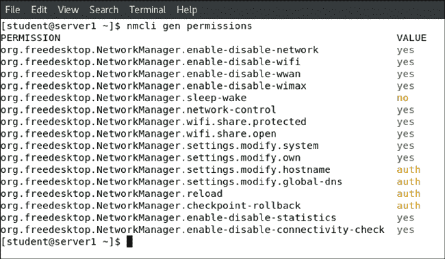

**图 8-1** 验证更改网络配置的当前权限

### 使用 nmcli 配置网络

在本章的早些部分，你已经学习了如何使用 `ip` 来验证网络配置。你还应用了 `ip addr add` 命令在网络接口上临时设置 IP 地址。然而，你使用 `ip` 命令执行的任何操作都是非持久性的。如果你想让配置持久化，请使用 `nmtui` 或 `nmcli`。

良好的开始是使用 `nmcli` 显示所有连接。这会显示活跃的和未活跃的连接。你可以轻松地看出区别，因为未活跃的连接当前未分配设备（参见示例 8-5）。

**示例 8-5** 显示当前连接状态

点击此处查看代码图像

```
[root@server1 ~]# nmcli con show

NAME    UUID                                     TYPE           DEVICE
ens33   db6f53bd-654e-45dd-97ef-224514f8050a     ethernet       ens33
```

找到连接名称后，你可以使用 `nmcli con show` 后接连接名称来查看连接的所有属性。注意，此命令显示了许多属性。示例 8-6 显示了此命令的输出。

**示例 8-6** 显示连接属性

点击此处查看代码图像

```
[root@server1 ~]# nmcli con show ens33

connection.id:                             ens33
connection.uuid:                           db6f53bd-654e-45dd-97ef-224514f8050a
connection.stable-id:                      --
connection.type:                            802-3-ethernet
connection.interface-name:                 ens33
connection.autoconnect:                    yes
connection.autoconnect-priority:           0
connection.autoconnect-retries:            -1 (default)
```


`connection.multi-connect`: 0 (default)

`connection.auth-retries`: -1

`connection.timestamp`: 1558778720

`connection.read-only`: no

`connection.permissions`: --

`connection.zone`: --

`connection.master`: --

`connection.slave-type`: --

`connection.autoconnect-slaves`: -1 (default)

`connection.secondaries`: --

`connection.gateway-ping-timeout`: 0

`connection.metered`: unknown

`connection.lldp`: default

`connection.mdns`: -1 (default)

`connection.llmnr`: -1 (default)

`802-3-ethernet.port`: --

`802-3-ethernet.speed`: 0

`802-3-ethernet.duplex`: --

`802-3-ethernet.auto-negotiate`: no

`802-3-ethernet.mac-address`: --

`802-3-ethernet.cloned-mac-address`: --

`802-3-ethernet.generate-mac-address-mask`: --

`802-3-ethernet.mac-address-blacklist`: --

`802-3-ethernet.mtu`: auto

`802-3-ethernet.s390-subchannels`: --

`802-3-ethernet.s390-nettype`: --

`802-3-ethernet.s390-options`: --

`802-3-ethernet.wake-on-lan`: default

`802-3-ethernet.wake-on-lan-password`: --

`ipv4.method`: auto

`ipv4.dns`: --

`ipv4.dns-search`: --

`ipv4.dns-options`: ""

`ipv4.dns-priority`: 0

`ipv4.addresses`: --

`ipv4.gateway`: --

`ipv4.routes`: --

`ipv4.route-metric`: -1

`ipv4.route-table`: 0 (unspec)

`ipv4.ignore-auto-routes`: no

`ipv4.ignore-auto-dns`: no

`ipv4.dhcp-client-id`: --

`ipv4.dhcp-timeout`: 0 (default)

`ipv4.dhcp-send-hostname`: yes

`ipv4.dhcp-hostname`: --

`ipv4.dhcp-fqdn`: --

`ipv4.never-default`: no

`ipv4.may-fail`: yes

`ipv4.dad-timeout`: -1 (default)

`ipv6.method`: auto

`ipv6.dns`: --

`ipv6.dns-search`: --

`ipv6.dns-options`: ""

`ipv6.dns-priority`: 0

`ipv6.addresses`: --

`ipv6.gateway`: --

`ipv6.routes`: --

`ipv6.route-metric`: -1

`ipv6.route-table`: 0 (unspec)

`ipv6.ignore-auto-routes`: no

`ipv6.ignore-auto-dns`: no

`ipv6.never-default`: no

`ipv6.may-fail`: yes

`ipv6.ip6-privacy`: -1 (unknown)

`ipv6.addr-gen-mode`: stable-privacy

`ipv6.dhcp-duid`: --

`ipv6.dhcp-send-hostname`: yes

`ipv6.dhcp-hostname`: --

`ipv6.token`: --

`proxy.method`: none

`proxy.browser-only`: no

`proxy.pac-url`: --

`proxy.pac-script`: --

`GENERAL.NAME`: ens33

`GENERAL.UUID`: db6f53bd-654e-45dd-97ef-224514f8050a

`GENERAL.DEVICES`: ens33

`GENERAL.STATE`: activated

`GENERAL.DEFAULT`: yes

`GENERAL.DEFAULT6`: no

`GENERAL.SPEC-OBJECT`: --

`GENERAL.VPN`: no

`GENERAL.DBUS-PATH`: `/org/freedesktop/NetworkManager/ActiveConnection/1`

`GENERAL.CON-PATH`: `/org/freedesktop/NetworkManager/Settings/1`

`GENERAL.ZONE`: --

`GENERAL.MASTER-PATH`: --

`IP4.ADDRESS[1]`: 192.168.4.210/24

`IP4.GATEWAY`: 192.168.4.2

`IP4.ROUTE[1]`: dst = 0.0.0.0/0, nh = 192.168.4.2, mt = 100

`IP4.ROUTE[2]`: dst = 0.0.0.0/0, nh = 192.168.4.2, mt = 100

`IP4.DNS[1]`: 192.168.4.2

`IP4.DOMAIN[1]`: localdomain

`DHCP4.OPTION[1]`: domain_name

`DHCP4.OPTION[2]`: expiry = 1558780229

`DHCP4.OPTION[3]`: requested_address = 192.168.4.210

`DHCP4.OPTION[4]`: requested_dhcp_server_identifier = 1

`DHCP4.OPTION[5]`: requested_domain_name = 1

`DHCP4.OPTION[6]`: requested_domain_name_servers = 192.168.4.2

`DHCP4.OPTION[7]`: requested_host_name = 1

`DHCP4.OPTION[8]`: requested_interface_mtu = 1

`DHCP4.OPTION[9]`: requested_domain_search = 1

`DHCP4.OPTION[10]`: requested_ms_classless_static_routes = 1

`DHCP4.OPTION[11]`: requested_nis_domain = 1

`DHCP4.OPTION[12]`: requested_nis_servers = 1

`DHCP4.OPTION[13]`: requested_ntp_servers = 1

`DHCP4.OPTION[14]`: requested_rfc3442_classless_static_routes = 1

`DHCP4.OPTION[15]`: requested_routers = 1

`DHCP4.OPTION[16]`: requested_static_routes = 1

`DHCP4.OPTION[17]`: requested_subnet_mask = 1

`DHCP4.OPTION[18]`: requested_time_offset = 1

`DHCP4.OPTION[19]`: requested_wpad = 1

`DHCP4.OPTION[20]`: routers = 192.168.4.2

`DHCP4.OPTION[21]`: subnet_mask = 255.255.255.0

`IP6.ADDRESS[1]`: fe80::959:3b1a:9607:8928/64

`IP6.GATEWAY`: --

`IP6.ROUTE[1]`: dst = fe80::/64, nh = ::, mt = 100

`IP6.ROUTE[2]`: dst = ff00::/8, nh = ::, mt = 256, table=255


要确切了解这些设置的具体作用，请执行 `man 5 nm-settings`。你也可以使用 `nmcli` 来显示当前配置设备的概述以及这些设备的状态。例如，输入 `nmcli dev status` 命令可以显示所有设备列表，输入 `nmcli dev show <devicename>` 可以显示特定设备的设置。

### 提示

使用 `nmcli` 看起来可能很难。其实不然，因为它提供了优秀的命令行自动补全功能——只需确保已安装了 `bash-completion` 包即可。尝试输入 `nmcli` 试试，但不要按回车！相反，按两次 Tab 键——你将看到 `nmcli` 此时期望的所有可用选项。选择一个选项，例如 `connection`，然后按两次 Tab 键。这种方法可以帮助你组合长命令，而无需记忆任何内容！

在练习 8-3 中，你将学习如何使用 `nmcli` 命令创建连接并在连接之间切换。

在本次练习中，你使用 `nmcli con add` 创建了网络连接。你也可以通过 `nmcli con mod` 修改当前连接的属性。

在练习 8-4 中，你将学习如何使用 `nmcli` 修改连接参数。

这就是 RHCSA 考试中关于 `nmcli` 你需要了解的所有内容。正如你所注意到的，`nmcli` 是一个功能丰富的命令。该命令的精确语法可能很难记忆。幸运的是，有一个包含示例的优秀 man 页面。输入 `man nmcli-examples` 显示该帮助页；你会发现，如果能找到这个帮助页，你就可以用 `nmcli` 做任何事情。此外，在操作 `nmcli` 时不要忘记使用 Tab 补全。

### 使用 `nmtui` 配置网络

如果你不喜欢 `nmcli` 命令行复杂的语法，也许你可能会喜欢 `nmtui`。这是一个文本用户界面，允许你轻松地创建网络连接。图 8-2 显示了 `nmtui` 界面的样子。

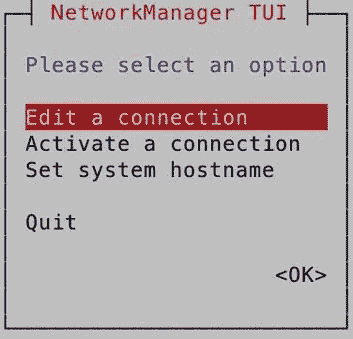

**图 8-2** `nmtui` 界面

`nmtui` 界面由三个菜单选项组成：

- **Edit a Connection（编辑连接）**：使用此选项创建新连接或编辑现有连接。
- **Activate a Connection（激活连接）**：使用此选项（重新）激活连接。
- **Set System Hostname（设置系统主机名）**：使用此选项设置你计算机的主机名。

编辑连接选项提供了你在处理网络连接时可能需要的所有功能。它确实允许你完成在 RHCSA 考试中需要进行的任何操作。你可以用它添加任何类型的连接——不仅是以太网连接，还支持网络桥接和团队网络驱动程序等高级连接类型。

当你选择“Edit a Connection”选项时，你将进入一个丰富的界面，允许你编辑网络连接的大多数属性。编辑连接后，你需要先停用它再重新激活它。这应该会自动生效，但事实是它并不会。

### 提示

如果你喜欢图形用户界面（GUI）工具，那么你很幸运。请使用 `nm-connection-editor` 代替 `nmtui`，但要准备好该界面提供的选项集相对有限。它不包含某些高级选项，例如创建网络团队接口和管理网络桥接接口的选项。不过，它提供了管理网络连接地址配置所需的所有内容。通过 `nm-connection-editor` 命令或通过 GNOME 图形界面中的插件来启动它。图 8-3 显示了该工具默认界面的样子。

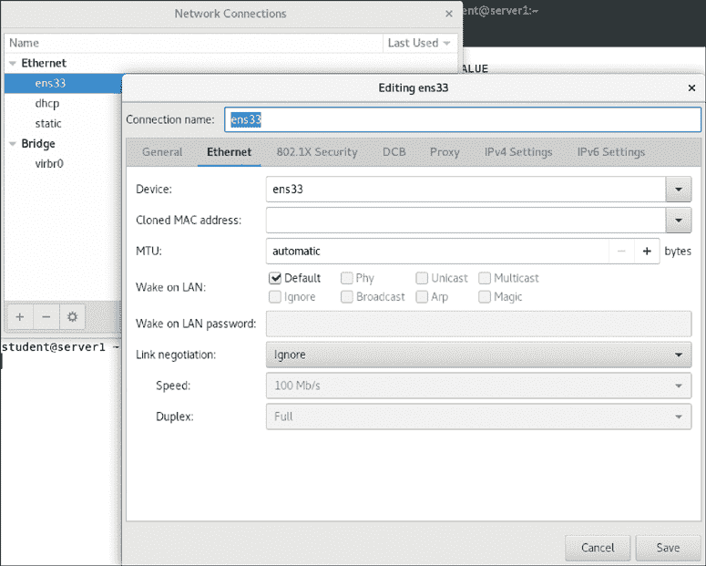

**图 8-3** `nm-connection-editor` 界面

### 处理网络配置文件

你创建的每一个连接都存储在 `/etc/sysconfig/network-scripts` 目录下的配置文件中。文件名以 `ifcfg-` 开头，随后紧跟网络接口的名称。在示例 8-7 中，你可以看到此类文件的样式。

**示例 8-7** `ifcfg` 配置文件示例

点击此处查看代码图像

```
[root@server1 ~]# cat /etc/sysconfig/network-scripts/ifcfg-ens33

TYPE="Ethernet"

PROXY_METHOD="none"

BROWSER_ONLY="no"

BOOTPROTO="dhcp"

DEFROUTE="yes"

IPV4_FAILURE_FATAL="no"

IPV6INIT="yes"

IPV6_AUTOCONF="yes"

IPV6_DEFROUTE="yes"

IPV6_FAILURE_FATAL="no"

IPV6_ADDR_GEN_MODE="stable-privacy"

NAME="ens33"

UUID="db6f53bd-654e-45dd-97ef-224514f8050a"

DEVICE="ens33"

ONBOOT="yes"
```

如果你不喜欢使用 `nmcli` 或 `nmtui` 修改网络配置，可以直接编辑配置文件。

### 提示

你可以在配置文件中将 `BOOTPROTO` 设置为 `dhcp`。完成更改后，使用 `nmcli up` 激活新配置。你可以在配置文件中将 `BOOTPROTO` 设置为 `static`，同时指定 IP 地址。执行此操作请使用 `nmcli up`。

### 设置主机名和解析

为了与其他主机通信，使用了主机名。作为管理员，必须知道如何设置主机名。你还需要通过设置主机名来确保主机之间可以相互联系。在本节中，你将学习如何操作。

#### 主机名

由于主机名用于访问服务器及其提供的服务，因此了解如何设置系统主机名非常重要。主机名通常由多个部分组成：主机名称和所在的域名。这两个部分共同构成了完全限定域名（FQDN），类似于 `server1.example.com`。始终指定 FQDN 而不仅仅是主机名的良好做法，因为 FQDN 在互联网上提供了唯一标识。更改主机名有多种方法：

- 使用 `nmtui` 并选择 Change Hostname 选项。
- 使用 `hostnamectl set-hostname`。
- 编辑配置文件 `/etc/hostname` 的内容。

可以使用类似 `hostnamectl set-hostname myhost.example.com` 的命令来配置主机名。设置主机名后，可以使用 `hostnamectl status` 显示当前主机名。示例 8-8 显示了该命令的输出。

**示例 8-8** 显示主机名配置

点击此处查看代码图像

```
[root@server1 ~]# hostnamectl status

   Static hostname : server1.example.com

         Icon name : computer-vm

           Chassis : vm

        Machine ID : 5aa095b495ed458d934c54a88078c165

           Boot ID : 5fdef4be9cab48c59873af505d778761

    Virtualization : vmware

  Operating System : Red Hat Enterprise Linux 8.0 (Ootpa)

       CPE OS Name : cpe:/o:redhat:enterprise_linux:8.0:GA

           Kernel   : Linux 4.18.0-80.el8.x86_64

      Architecture : x86-64
```

使用 `hostnamectl status` 时，你不仅可以看到关于主机名的信息，还能看到关于 Linux 内核、虚拟化类型等更多信息。

另一种，你也可以使用 `nmtui` 接口设置主机名。图 8-4 显示了执行此操作的屏幕。

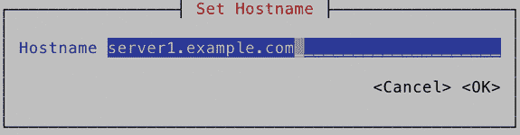

**图 8-4** 使用 `nmtui` 更改主机名

要设置主机名解析，你通常使用 DNS。配置 DNS 服务器不是 RHCSA 的目标，但你需要知道如何配置服务器以使用现有的 DNS 服务器进行主机名解析。除了 DNS 之外，你还可以在 `/etc/hosts` 文件中配置主机名解析。示例 8-9 显示了 `/etc/hosts` 文件的内容。

**示例 8-9** `/etc/hosts` 示例内容

点击此处查看代码图像

```
[root@server1 ~]# cat /etc/hosts

127.0.0.1    localhost localhost.localdomain localhost4 localhost4.
  localdomain4

::1          localhost localhost.localdomain localhost6 localhost6.
  localdomain6
```

在 `/etc/hosts` 中设置的所有主机名–IP 地址定义将在 DNS 中的主机名在使用之前应用。这在 `/etc/nsswitch.conf` 的 `hosts` 行中被配置为默认，其默认内容如下：

```
hosts: files dns myhostname
```

设置 `/etc/hosts` 文件非常简单；只需确保它包含至少两列。第一列是特定主机的 IP 地址，第二列指定主机名。主机名可以用短名称（如 `server1`）或完全限定域名（FQDN）的形式提供。在 FQDN 中，主机名和完整的 DNS 名称都包含在，例如 `server1.example.com`。

如果一个主机有多个名称（例如短名称和完全限定 DNS 名称），你可以在 `/etc/hosts` 中指定它们两者。在这种情况下，第二列必须包含 FQDN，第三列可以包含别名。示例 8-10 显示了一个主机名配置示例。

**示例 8-10** `/etc/hosts` 配置示例

点击此处查看代码图像

```
[root@server2 ~]# cat /etc/hosts

127.0.0.1    localhost localhost.localdomain localhost4 localhost4.
  localdomain4

::1          localhost localhost.localdomain localhost6 localhost6.
  localdomain6

10.0.0.10     server1.example.com server1

10.0.0.20     server2.example.com server2
```


### DNS 名称解析

如果你想能够与互联网上的其他主机通信，仅使用`/etc/hosts`文件对于名称解析是不够的。你还应该使用 DNS。要指定使用哪个 DNS 服务器，请如之前所述，使用`nmcli`或`nmtui`设置 DNS 服务器。NetworkManager 将 DNS 信息存储在网络连接的配置文件中，位于`/etc/sysconfig/network-scripts`，并从那里将配置推送到`/etc/resolv.conf`文件，该文件用于 DNS 名称服务器解析。不要直接编辑`/etc/resolv.conf`，因为在下次重启 NetworkManager 时它会被覆盖。

建议始终设置两个要联系的 DNS 名称服务器。如果第一个名称服务器没有响应，将联系第二个名称服务器。要指定你想使用的 DNS 名称服务器，你有几种不同的选项：

- 使用`nmtui`设置 DNS 名称服务器。图 8-5 显示了可以执行此操作的界面。

  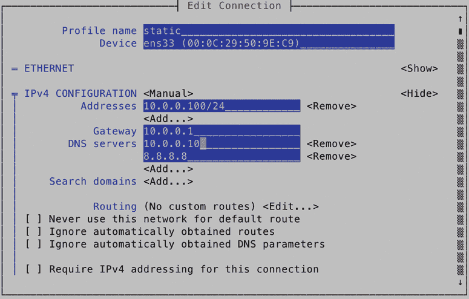

  **图 8-5** 从`nmtui`接口设置 DNS 服务器

- 在`/etc/sysconfig/network-scripts`中的`ifcfg`网络连接配置文件设置`DNS1`和`DNS2`参数。
- 使用配置为分发 DNS 名称服务器地址的 DHCP 服务器。
- 使用`nmcli con mod <connection-id> [+]ipv4.dns <ip-of-dns>`。

注意，如果你的计算机配置为从 DHCP 服务器获取网络配置，则 DNS 服务器也是通过 DHCP 服务器设置的。如果你不想发生这种情况，你有两个选项：

- 编辑`ifcfg`配置文件以包含选项`PEERDNS=no`。
- 使用`nmcli con mod <con-name> ipv4.ignore-auto-dns yes`。

要验证主机名解析，你可以使用`getent hosts <servername>`命令。该命令同时在`/etc/hosts`和 DNS 中搜索以解析指定的主机名。

**考试提示**

不要直接在`/etc/resolv.conf`中指定 DNS 服务器。当 NetworkManager（重）启动时，它们会被覆盖。

### 总结

在本章中，你学习了如何使用 DNS 和`/etc/hosts`文件配置主机名解析。

## 8. 哪个命令显示当前的路由配置？

## 9. 如何验证 NetworkManager 服务的当前状态？

## 10. 哪个命令允许你更改网络连接上的当前 IP 地址和默认网关？

### 章末实验

为了完成书中后续章节的练习，建议准备一个包含至少两个服务器的测试环境。要完成本实验中的练习，请确保已安装了第二台服务器。

### 实验 8.1

1. 配置第一个服务器使用 FQDN`server1.example.com`。配置第二台服务器使用`server2.example.com`。
2. 在`server1.example.com`上，使用`nmtui`配置主网卡通过`DHCP`获取 IP 地址。同时设置固定 IP 地址为`192.168.4.210`。在`server2`上，将固定 IP 地址设置为`192.168.4.220`。
3. 确保从`server1`可以`ping` `server2`，反之亦然。
4. 为了允许你访问互联网上的服务器，请确保你的本地`DHCP`服务器提供了默认路由器和 DNS 服务器。

# 第二部分 运行操作系统

## 第 9 章：软件管理

本章涵盖了以下主题：

- 使用`yum`管理软件包
- 使用`yum`
- 管理软件包模块流（Package Module Streams）
- 使用`rpm`管理软件包

本章涵盖了以下 RHCSA 考试目标：

- 从 Red Hat 网络（RHN）、远程仓库或本地文件系统安装和更新软件软件包
- 与软件包模块流（Package Module Streams）进行工作

管理软件包是 Red Hat Enterprise Linux 管理员的一项重要任务。在本章中，你将学习如何使用`yum`工具通过命令行管理软件包。你还将学习存储库在`YUM`软件管理中扮演什么角色。接下来，我们将介绍软件包模块流的使用，这是一种让你能够在环境中使用特定版本软件包的解决方案。在本章的最后部分，你将学习如何使用`rpm`命令管理软件，这对于查询新的和已安装的软件包非常有用。

### “我已经掌握这些了吗？”测验

“我已经掌握这些了吗？”测验可以帮助你评估应该是仔细通读整个章节，还是直接跳到“考试准备任务”部分。如果你对这些问题的答案或对自己这些主题知识的评估有疑问，请阅读整个章节。`表 9-1`列出了本章的主要标题及其对应的“我已经掌握这些了吗？”测验题。你可以在`附录 A`中找到“我已经掌握这些了吗？”测验和“复习题”的答案。

| 基础主题章节 | 题目 |
| --- | --- |
| 使用`yum`管理软件包 | 1–4 |
| 使用`yum` | 5 |
| 管理软件包模块流 | 6–7 |
| 使用`rpm`管理软件包 | 8–10 |

**表 9-1** “我已经掌握这些了吗？”章节与题目映射

## 1. 在用于指示应使用哪些仓库的`.repo`文件中，以下哪个不是强制性组件？

1. `[label]`
2. `name=`
3. `baseurl=`
4. `gpgcheck=`

## 2. 如果服务器没有在 RHN 注册，RHEL 将使用哪种安装源？

1. 使用安装介质。
2. 不使用安装源。
3. 使用基础 RHN 仓库，但不更新。
4. 你拥有 RHN 仓库的完全访问权限，但你使用的软件不受支持。

## 3. 在`.repo`文件中应该使用哪项来引用本地文件系统中`/repo`目录下的仓库？

1. `file=/repo`
2. `baseurl=file://repo`
3. `baseurl=file:///repo`
4. `file=http:///repo`

## 4. 关于基于 GPG 的仓库安全性，以下哪项描述是正确的？

1. 如果仓库中的软件包已签名，你则需要将 GPG 密钥复制到正确的位置。
2. GPG 软件包签名是强制的。
3. GPG 软件包签名可以防止仓库中的软件包被更改。
4. 在互联网仓库上建议进行 GPG 软件包签名，但对于仅供内部使用的本地仓库，该要求不是强制的。

## 5. 哪个命令允许你搜索包含`semanage`文件的软件包？

1. `yum search semanage`
2. `yum search all semanage`
3. `yum provides semanage`
4. `yum whatprovides */semanage`

## 6. 哪个 yum 模块组件允许你并排使用不同的版本？

1. 应用配置（Application profile）
2. 应用流（Application stream）
3. 模块版本（Module version）
4. RPM 组

## 7. 以下哪个命令允许你安装 PHP 7.1 应用流的 devel 配置？

1. `yum module install php:7.1 devel`
2. `yum module install php:7.1 --devel`
3. `yum module install php:7.1/devel`
4. `yum module install php:7.1@devel`

## 8. 你应该使用哪个命令安装已下载到计算机上的 RPM 文件？

1. `yum install`
2. `yum localinstall`
3. `rpm -ivh`
4. `rpm -Uvh`

## 9. 哪个命令允许你找到特定文件属于哪个 RPM 包？

1. `rpm -ql /my/file`
2. `rpm -qlf /my/file`
3. `rpm -qf /my/file`
4. `rom -qa /my/file`

## 10. 哪个命令允许你分析刚下载的 RPM 文件中是否存在脚本？

1. `rpm -qs packagename.rpm`
2. `rpm -qps packagename.rpm`
3. `rpm -qp --scripts packagename.rpm`
4. `rpm -q --scripts packagename`

### 基础主题

### 使用 yum 管理软件包

Red Hat Enterprise Linux 上用于管理软件包的默认工具是`yum`，它的全称是 Yellowdog Updater, Modified。`yum`设计用于配合仓库，仓库是可用软件包的在线仓库。在本节中，你将学习如何创建和管理仓库，以及根据仓库的内容管理软件包。

### 注意

RHEL 中的软件基于 Fedora。在 RHEL 8 所基于的 Fedora 版本中，`yum`最近已被`dnf`工具取代。因此，人们预计在 RHEL 8 发布时，`yum`命令也将被`dnf`命令取代。Red Hat 做出了不同的决定。在 RHEL 8 中，引入了新版本的`yum`，它是基于`dnf`命令的。你会发现，在许多情况下请求有关`yum`的信息时，会被重定向到`dnf`资源。

使用`yum`的另一个主要优势是处理软件包依赖关系的方式。在 Linux（以及大多数其他现代操作系统）中，软件软件包之间具有依赖关系。这意味着为了安装一个软件包，必须存在其他软件包。如果不使用存储库，这意味着必须手动安装这些软件包。

`yum`存储库系统会自动处理这些依赖关系。如果要安装某个软件包，它将包含有关所需依赖项的信息。然后，`yum`命令会在系统配置的存储库中查找以自动获取这些依赖项。如果一切顺利，安装程序只会看到一个简短的依赖项列表，这些项将作为安装该软件包的依赖被安装。如果你正在使用通过红帽网络（RHN）提供的存储库的 RHEL，那么没有理由此过程无法运行，安装软件的尝试通常会成功。

在安装 RHEL 8 时，系统会要求你向红帽客户门户（Red Hat Customer Portal）进行注册，该门户提供了不同的存储库。注册后，你可以自动安装经红帽验证的软件软件包。如果你选择在不注册的情况下安装 RHEL，它将无法连接到红帽存储库，导致你没有任何存储库可以使用。在这种情况下，你必须自行指定想要使用的存储库。如果你使用的是 CentOS，你将获得 CentOS 存储库的访问权限且无需注册。

注意，存储库是针对特定系统的。因此，如果你在使用 RHEL，应该只使用 RHEL 存储库。不要尝试（例如）将 CentOS 存储库添加到 RHEL 服务器。如果你想为 RHEL 服务器提供来自 Fedora 项目的额外软件（出于支持考虑，不建议这样做），可以考虑添加 EPEL（企业级 Linux 额外软件包）存储库。更多信息请参阅`https://fedoraproject.org/wiki/EPEL`。

### 警告

在向 RHEL 添加 EPEL 存储库之前，请确保它不会破坏你当前的支持状态。EPEL 软件包不由红帽管理，添加它们可能会破坏受支持的红帽软件包。

### 注册红帽企业级 Linux 获取支持

红帽企业级 Linux（Red Hat Enterprise Linux）是一种受支持的 Linux 操作系统，需要你进行注册。要注册 RHEL，你需要一个有效的权限（entitlement）。该权限与你在红帽客户门户上的账户关联。你可以通过购买 RHEL 订阅或加入红帽开发者计划来获取权限，该计划提供免费的红帽企业级开发者订阅。你可以在`https://developers.redhat.com`注册红帽开发者订阅。

在获得有效的红帽企业级 Linux 订阅后，你可以使用红帽订阅管理（RHSM）工具来管理你的权限。管理权限涉及四项基本任务：

- **注册（Register）：** 在注册订阅时，你将其连接到你当前的红帽账户。因此，`subscription-manager`工具可以对系统进行清点。如果某个系统不再使用，也可以取消注销。
- **订阅（Subscribe）：** 对系统进行订阅使其能够访问你订阅权限内的红帽产品更新。此外，通过订阅，你将获得与你的账户关联的支持级别。
- **启用存储库（Enable repositories）：** 订阅系统后，你将获得一组默认存储库。某些存储库默认是禁用的，但在订阅系统后可以启用。
- **查看与跟踪（Review and track）：** 你可以查看并跟踪当前使用的订阅。

### 管理订阅

你可以从 GNOME 图形界面或从命令行管理订阅。`subscription-manager`工具用于从命令行管理订阅。你可以通过以下方式使用它：

- **注册系统：** 输入`subscription-manager register`进行注册。它会提示你输入红帽用户名和密码，输入这些信息后，你的 RHEL 服务器将完成注册。
- **列出可用订阅：** 每个账户都可以访问特定的订阅。输入`subscription-manager list --available`查看你的账户拥有哪些权限。
- **自动绑定订阅：** 仅注册服务器是不够访问存储库的。使用`subscription-manager attach --auto`将你的订阅自动绑定到可用的存储库。
- **获取概览：** 要查看你当前在使用哪些订阅，输入`subscription-manager --consumed`。
- **取消注销：** 如果你准备停止一个系统，请使用`subscription-manager unregister`。如果你只能访问有限数量的注册系统，取消注销对于确保你不会用完可用许可非常重要。

在你注册并绑定订阅后，权限证书将被写入`/etc/pki`目录。在`/etc/pki/product`中，存储的证书指示此系统上安装了哪些红帽产品。在`/etc/pki/consumer`中，存储的证书识别了关联的红帽账户。`/etc/pki/entitlement`目录包含有关已绑定的订阅的信息。

### 指定使用的存储库

在大多数情况下，服务器安装完成后，它会配置好要使用的存储库列表。你有时需要告诉服务器应该使用哪些存储库：

- 你想通过存储库分发额外的软件包。
- 你在没有注册红帽的情况下安装红帽企业级 Linux。

告诉服务器使用哪个存储库并不困难，但了解如何操作很重要（对于 RHCSA 考试也是如此）。


#### 重要！

学习如何操作存储库和软件包，不要使用默认提供的存储库。因此，如果你安装的是 RHEL，不要使用`subscription-manager`；如果你安装的是 CentOS，请删除`/etc/yum.reposd`下的所有文件。

要告诉服务器使用哪个存储库，你需要在`/etc/yum.reposd`中创建一个以`.repo`结尾的文件。在该文件中你需要包含：

- `[label]`：`.repo`文件可以包含多个存储库，每个部分以一个标识特定存储库的标签开头。
- `name=`：使用此项指定你想要使用的存储库名称。
- `baseurl=`：此选项包含指向特定存储库位置的 URL。

在默认提供的存储库文件中，你可能会在一个文件中发现多个存储库，如示例 9-1 所示。这对于将相关的存储库分组在一个文件中很有用，通常出现在默认提供的存储库文件中。如果你是自己创建存储库文件，可以自由为每个存储库创建单独的文件。

示例 9-1 显示了一个基于 CentOS 8 默认安装存储库的存储库文件。

**示例 9-1** 存储库文件示例

点击此处查看代码图片

```text
[root@server1 yum.repos.d]# cat CentOS-Base.repo

# CentOS-Base.repo

#

# 镜像系统使用客户端的连接 IP 地址以及

# 每个镜像的更新状态，来选择已更新且

# 在地理位置上靠近客户端的镜像。你应该使用它进行 CentOS

updates 更新

# 除非您正在手动选择其他镜像。

#

# 如果 mirrorlist= 对您不起作用，作为回退方案，您可以

# 尝试使用被注释掉的 baseurl= 行。

#

#

[base]

name=CentOS-$releasever - Base

mirrorlist=http://mirrorlist.centos.org/?release=$releasever&arch=

  $basearch&repo=os

#baseurl=http://mirror.centos.org/centos/$releasever/os/$basearch/

gpgcheck=1

gpgkey=file:///etc/pki/rpm-gpg/RPM-GPG-KEY-CentOS-8

#已发布的更新

[updates]

name=CentOS-$releasever - Updates

mirrorlist=http://mirrorlist.centos.org/?release=$releasever&arch=

  $basearch&repo=updates

#baseurl=http://mirror.centos.org/centos/$releasever/updates/$basearch/

gpgcheck=1

gpgkey=file:///etc/pki/rpm-gpg/RPM-GPG-KEY-CentOS-8

#可能有用的额外包

[extras]

name=CentOS-$releasever - Extras

mirrorlist=http://mirrorlist.centos.org/?release=$releasever&arch=

  $basearch&repo=extras

#baseurl=http://mirror.centos.org/centos/$releasever/extras/$basearch/
```


```ini
gpgcheck=1

gpgkey=file:///etc/pki/rpm-gpg/RPM-GPG-KEY-CentOS-8

# 扩展现有包功能的额外包

[centosplus]

name=CentOS-$releasever - Plus

mirrorlist=http://mirrorlist.centos.org/?release=$releasever&arch=$basearch&repo=centosplus

#baseurl=http://mirror.centos.org/centos/$releasever/centosplus/$basearch/

gpgcheck=1

enabled=0

gpgkey=file:///etc/pki/rpm-gpg/RPM-GPG-KEY-CentOS-8
```

在来自示例 9-1 的仓库配置文件中，你可以看到使用了一些选项。表 9-2 总结了这些选项。

| 选项 | 说明 |
| --- | --- |
| `[label]` | 包含在仓库文件中用作标识的标签。 |
| `name=` | 指定仓库的名称。 |
| `mirrorlist=` | 指向可以获取该服务器镜像服务器信息的 URL。通常仅用于大型在线仓库。 |
| `baseurl=` | 指向存放 RPM 包的基准 URL。 |
| `gpgcheck=` | 如果需要对包执行 GNU 隐私守护（GPG）完整性检查，则设置为 1。如果设置为 1，则需要 GPG 密钥。 |
| `gpgkey=` | 指定用于检查包完整性的 GPG 密钥的位置。 |

**表 9-2** `.repo` 文件中的关键选项

当你创建仓库文件时，`baseurl` 参数是最重要的，因为它告诉你的服务器去哪里寻找要安装的文件。`baseurl` 的参数是需要从其安装文件的 URL。这通常是一个 HTTP 或 FTP URL，但也可以是基于文件的 URL。

当你使用 URL 时，包含两个组件。首先，URL 标识了要使用的协议，格式为 `protocol://`，例如 `http://`、`ftp://` 或 `file://`。紧随 URL 之后的是该 URL 精确位置。这可以是 Web 服务器或 FTP 服务器的名称，包括文件所在的子目录。如果 URL 是基于文件的，文件系统上的位置也以 `/` 开头。

因此，对于基于文件系统的 URL，`baseurl` 中会有三个斜杠，例如 `baseurl:///repo`，它指向本地文件系统上的 `/repo` 目录。

### 理解仓库安全

使用仓库允许你透明地从互联网安装软件包。这种能力虽然非常方便，但也涉及安全风险。在安装 RPM 包时，你是在 root 权限下执行的，如果在 RPM 包脚本代码中执行了代码（这很常见），它也将以 root 身份执行。因此，你需要确保你可以信任你正在尝试安装的软件包。这就是为什么仓库通常使用密钥对包进行签名。这也是为什么在 Red Hat Enterprise Linux 上，只使用通过 RHN 提供的仓库是一个好主意。

为了确保仓库包的安全，这些包通常用 GPG 密钥签名。这使得检查包自仓库所有者提供以来是否被更改变得可能。用于签名软件包的 GPG 密钥通常也通过仓库提供。仓库的用户可以下载该密钥并将其存储在本地，以便在每次从仓库下载包时都能自动执行包签名检查。

如果仓库安全性受到破坏，且入侵者成功黑入仓库服务器并在上面放置了一些伪包，那么 GPG 密钥签名将不匹配，`yum` 在安装新包时会报错。这是为什么在使用互联网仓库时强烈建议使用 GPG 密钥。

如果你使用的是经过 GPG 签名的仓库，首次接触该仓库时，`rpm` 命令将提示下载密钥。这是一个透明的过程不需要额外操作。

> **提示**
>
> 对于内部仓库，安全风险并不高。

**示例 9-2** 首次接触仓库时密钥下载

点击此处查看图像

```console
[root@server1 ~]# yum install kernel

Loaded plugins: fastestmirror

Loading mirror speeds from cachedfile

 * base: centos.mirror1.spango.com
 * extras: centos.mirror1.spango.com
 * updates: centos.mirror1.spango.com

Resolving Dependencies

Dependencies Resolved

=======================================
=======================================

Package                         Arch                  Repository                Size

=======================================

Installing:

  kernel                       x86_64                3.10.0-229.1.el8         updates               31M

Updating for dependencies:

  linux-firmware                noarch                20190911-0.1.git365e80c.el7base               17 M

Transaction Summary

=======================================

Install 1 Package

Upgrade              ( 1 Dependent package)

Total size: 48 M

Is this ok [y/d/N]: y

Downloading packages:

warning: /var/cache/yum/x86_64/8/base/packages/linux-firmware-20140911-0.1.git365e80c.el7.noarch.rpm: Header V3 RSA/SHA256 Signature, key ID f4a80eb5: NOKEY

Retrieving key from file:///etc/pki/rpm-gpg/RPM-GPG-KEY-CentOS-8

Importing GPG key 0xF4A80EB5:

 Userid : "CentOS-8 Key (CentOS 7 Official Signing Key)"
   <security@centos.org>"

 Fingerprint: 6341 ab27 53d7 8a78 a7c2 7bb1 24c6 a8a7 f4a8 0eb5

 Package : centos-release-8-0.1406.el7.centos.2.3.x86_64 (@anaconda)

 From : /etc/pki/rpm-gpg/RPM-GPG-KEY-CentOS-8
```

创建自己的仓库并不是 RHCSA 考试的要求，但如果你想测试仓库的设置和操作，那么了解如何这样做将很有帮助。此外，在你进行此书中的练习时，了解如何设置自己的仓库非常重要，因为你不应该使用在线提供的仓库。

建立自己的仓库允许你将自己的 RPM 软件包放在一个目录中，并将该目录发布为仓库。如果你安装了 RHEL 但没有连接到 `RHN`，那么这样做也非常有用，因为这意味着你没有任何仓库。

该过程本身并不难总结。你需要确保所有的 `RPM` 软件包都位于你想要作为仓库的目录中，之后，你需要使用 `createrepo` 命令生成元数据，以便你将该目录作为仓库使用。练习 9-1 描述了如何创建自己的仓库。

**示例 9-3** 使用 `yum repolist` 验证仓库可用性

点击此处查看代码图像

```console
[root@server3 yum.repos.d]# yum repolist

Updating Subscription Management repositories.

Unable to read consumer identity

This system is not registered to Red Hat Subscription Management.

  You can use subscription-manager to register.

AppStream                               194 MB/s | 5.3 MB        00:00
BaseOS                                   86 MB/s | 2.2 MB        00:00

Last metadata expiration check: 0:00:01 ago on Sat 25 May 2019
  09:20:19 AM EDT.

repo id                        repo name                         status

AppStream                      AppStream                         4,672
BaseOS                         BaseOS                            1,658
```

### 使用 `yum`

到此时，你应该有了可以运行的仓库，是时候开始使用它们了。要使用仓库，你需要 `yum` 命令。该命令允许你对仓库执行若干任务。表 9-3 提供了常用 `yum` 任务的概述。


| 任务 | 解释 |
| --- | --- |
| `search` | 搜索软件包的精确名称。 |
| `what provides */name` | 对软件包进行深度搜索，以查找包内的特定文件。 |
| `info` | 提供有关软件包的更多信息。 |
| `install` | 安装软件包。 |
| `remove` | 移除软件包。 |
| `list all \| installed` | 列出所有或已安装的软件包。 |
| `group list` | 列出软件包组。 |
| `group install` | 安装组中的所有软件包。 |
| `update` | 更新指定的软件包。 |
| `clean all` | 所有存储的元数据。 |

**表 9-3** 常用 `yum` 任务

#### 使用 `yum` 查找软件包

要使用 `yum` 安装软件包，你首先需要知道软件包的精确名称。`yum search` 命令可以帮助你。当你使用 `yum search` 时，它首先联系在线仓库（这可能需要一分钟），之后它会将最新的仓库元数据下载到本地机器。然后，`yum search` 在包名和描述中查找你正在寻找的字符串。在示例 9-4 中，你可以看到使用 `yum search user` 后的结果。

**示例 9-4** `yum search` 示例输出

```console
[root@server3 ~]# yum search user

Updating Subscription Management repositories.

Unable to read consumer identity

This system is not registered to Red Hat Subscription Management.

  You can use subscription-manager to register.

Last metadata expiration check: 0:02:23 ago on Sat 25 May 2019
  09:20:19 AM EDT.

====================  Name & Summary Matched: user ====================

trousers-lib.x86_64    : TrouSerS libtspi library
trousers-lib.i686      : TrouSerS libtspi library
trousers-lib.x86_64    : TrouSerS libtspi library
gnome-user-docs.noarch : GNOME User Documentation
gnome-user-docs.noarch : GNOME User Documentation
xdg-user-dirs.x86_64   : Handles user special directories
xdg-user-dirs.x86_64   : Handles user special directories
util-linux-user.x86_64 : libuser based util-linux utilities

...
```

由于 `yum search` 命令只在包名和摘要中查找，它通常不会显示你需要的内容。你通常需要查找包含特定文件的软件包。为了这一点，`yum whatprovides` 命令或 `yum provides` 命令将帮助你。（这两个命令之间在功能上没有区别）。为了明确你正在寻找包含特定文件的软件包，你需要将文件名指定为 `*/filename`，或者使用你想要使用的文件的完整路径名。例如，如果你需要查找包含特定文件 `semanage` 的软件包，请使用 `yum whatprovides */semanage`。它将显示软件包的名称。

#### 获取有关软件包更多信息

在安装软件包之前，获取一些软件包信息是个好主意。由于 `yum` 命令的设计非常直观，请使用 `yum info` 后面加上包名。在示例 9-5 中，你看到了 `nmap` 软件包的情况（顺便说一下，这是一个非常有用的工具）。只需尝试 `nmap 192.168.4.100` 即可，但请注意，某些网络管理员真的不喜欢 `nmap`，可能会将其视为敌对攻击。

**示例 9-5** `yum info nmap` 示例输出

点击此处查看代码图像

```console
[root@server3 ~]# yum info nmap

Updating Subscription Management repositories.

Unable to read consumer identity

This system is not registered to Red Hat Subscription Management.

  You can use subscription-manager to register.

Last metadata expiration check: 0:05:01 ago on Sat 25 May 2019
  09:20:19 AM EDT.

Available Packages

Name          : nmap

Epoch         : 2

Version       : 7.70

Release       : 4.el8

Arch          : x86_64

Size          : 5.8 M

Source        : nmap-7.70-4.el8.src.rpm

Repo          : AppStream

Summary       : Network exploration tool and security scanner

URL           : http://nmap.org/

License       : Nmap

Description   : Nmap is a utility for network exploration or security auditing. It supports ping scanning (determine which hosts are up), many port scanning techniques (determine what services the hosts are offering), and TCP/IP fingerprinting (remote host operating system identification). Nmap also offers flexible target and port specification, decoy scanning, determination of TCP sequence predictability characteristics, reverse-identd scanning, and more. In addition to the classic command-line nmap executable, the Nmap suite includes a flexible data transfer, redirection, and debug tool（netcat utility ncat），一个用于比较扫描结果的工具（ndiff），以及一个数据包生成和响应分析工具（nping）。
```

#### 安装和移除软件包

如果在查看 `yum info` 的输出后你对该软件包满意，那么下一步就是安装它。与你使用 `yum` 进行的任何其他操作一样，推测如何做并不困难：使用 `yum install nmap`。当以这种方式使用时，`yum` 命令会请求确认。如果你在输入 `yum install` 命令时确定自己在做什么，大可以使用 `-y` 选项，它会向 `yum` 通常发出的确认提示传递一个“是”（yes）。示例 9-6 显示了结果的样式。

**示例 9-6** 使用 `yum` 安装软件

点击此处查看代码图片

```console
[root@server3 ~]# yum install nmap
```


更新订阅管理仓库。

无法读取使用者身份。

此系统未注册到 Red Hat Subscription Management。

你可以使用`subscription-manager`进行注册。

上次元数据过期检查：0:06:16 之前，时间为 2019 年 5 月 25 日星期六上午 09:20:19（EDT）。

依赖关系已解决。

```text
=======================================================================

 Package     Arch          Version            Repository       Size

=======================================================================

Installing:

 nmap        x86_64        2:7.70-4.el8      AppStream            5.8 M

Transaction Summary

=======================================================================

Install  1 Package

Total size: 5.8 M

Installed size: 24 M

Is this ok [y/N]: y

Downloading Packages:

Running transaction check

Transaction check succeeded.

Running transaction test

Transaction test succeeded.

Running transaction

  Preparing         :                                          1/1 

  Installing        : nmap-2:7.70-4.el8.x86_64                 1/1 

  Running scriptlet : nmap-2:7.70-4.el8.x86_64                 1/1 

  Verifying         : nmap-2:7.70-4.el8.x86_64                 1/1 

Installed products updated.

Installed:

  nmap-2 :7.70-4.el8.x86_64                                                                      

Complete!
```

在示例 9-6 中，你可以看到`yum`首先分析将要安装的内容。一旦确定了这一点，它会提供将安装的软件包的概述，包括它的依赖项。然后，软件包本身会被安装到系统中。

要从机器上删除软件包，请使用`yum remove`命令。该命令也会进行依赖分析，这意味着它不仅会删除选定的软件包，还会删除所有依赖于它的软件包。这有时会导致产生长长的待删除软件软件包列表。为了避免不悦的惊喜，你不应该在配合`-y`选项时使用`yum remove`。

### 注意

某些软件包受保护的。因此，你无法轻易删除它们。如果`yum remove`遇到受保护的软件包，它将拒绝删除它们。

### 显示软件包列表

在使用`yum`工作时，你也可以使用`yum list`命令来显示软件包列表。在不带参数使用时，`yum list`会显示所有可用软件包的列表，包括它们安装自哪个仓库。你可以看到表 9-2 列出的仓库名称以及`@anaconda`仓库。如果显示了仓库名称，则该软件包在该特定仓库可用。如果列出了`@anaconda`，则该软件包已安装在该系统上。示例 9-7 显示了`yum list`命令的部分输出。

#### 示例 9-7 `yum list`命令的局部输出

点击此处查看代码图片

```text
[root@server3 ~]# yum list | less

Updating Subscription Management repositories.

Unable to read consumer identity

This system is not registered to Red Hat Subscription Management.

  You can use subscription-manager to register.

Last metadata expiration check: 0:09:31 ago on Sat 25 May 2019

  09:20:19 AM EDT.

Installed Packages

GConf2.x86_64                          3.2.6-22.el8        @AppStream

ModemManager.x86_64                    1.8.0-1.el8         @anaconda 

ModemManager-glib.x86_64               1.8.0-1.el8         @anaconda 

NetworkManager.x86_64                  1:1.14.0-14.el8     @anaconda 

NetworkManager-adsl.x86_64             1:1.14.0-14.el8     @anaconda 

NetworkManager-bluetooth.x86_64        1:1.14.0-14.el8     @anaconda 

NetworkManager-config-server.noarch    1:1.14.0-14.el8     @anaconda 

NetworkManager-libnm.x86_64            1:1.14.0-14.el8     @anaconda 

NetworkManager-team.x86_64             1:1.14.0-14.el8     @anaconda 

NetworkManager-tui.x86_64              1:1.14.0-14.el8     @anaconda
```

如果你想查看服务器上安装了哪些软件包，可以使用`yum list installed`命令。当配合特定软件包名称使用时，`yum list`命令也可能有用。例如，输入`yum list kernel`来显示实际安装了哪个版本的内核，以及仓库中提供了哪些版本的内核。示例 9-8 显示了此命令的结果。

#### 示例 9-8 使用`yum list` `packagename`获取已安装和可用版本信息

点击此处查看代码图片

```text
[root@server3 ~]# yum list kernel

Updating Subscription Management repositories.

Unable to read consumer identity

This system is not registered to Red Hat Subscription Management.

  You can use subscription-manager to register.

Last metadata expiration check: 0:11:57 ago on Sat 25 May 2019

  09:20:19 AM EDT.

Installed Packages

kernel.x86_64                   4.18.0-80.el8        @anaconda
```

### 更新软件包

与`yum`仓库工作的主要优势之一是仓库使得更新软件包变得简单。维护仓库的人负责将更新的软件包拷贝到仓库中。仓库中的索引始终包含软件包的当前版本。在本地机器上也有一个包含当前软件包版本的数据库。当你使用`yum update`命令时，会将已安装软件包的当前版本与仓库中这些软件包的版本进行比较。如示例 9-9 所示，`yum`将显示可更新软件包的概述。从该概述，输入`y`安装更新。

注意，更新软件包时，旧版本会被新版本替换。有一个例外，就是内核软件包。即使你使用`yum update kernel`命令，内核软件包也不会更新，而是将新内核安装在旧内核旁边，以便在启动时你可以选择想要使用的内核。如果新内核由于硬件兼容性问题无法工作，这将非常有用。在这种情况下，你可以中断 GRUB 2 启动过程（详情见第 17 章“管理和理解启动过程”）以启动旧内核。

```text
[root@server1 ~]# yum update kernel

Updating Subscription Management repositories.

Red Hat Enterprise Linux 8 for x86_64 - AppStream (RPMs)

  2.4 kB/s | 4.5 kB     00:01    

Red Hat Enterprise Linux 8 for x86_64 - BaseOS (RPMs)

  2.5 kB/s | 4.0 kB     00:01   

created by dnf config-manager from file:///repo

  0.0  B/s |   0  B     00:00    

Failed to synchronize cache for repo 'repo', ignoring this repo.

Dependencies resolved.

======================================================================

 Package        Arch    Version             Repository         Size

======================================================================

Installing:

 kernel         x86_64  4.18.0-80.1.2.el8_0 rhel-8-for-x86_ 

                                              64-baseos-rpms   406 k

Installing dependencies:

 kernel-modules x86_64  4.18.0-80.1.2.el8_0 rhel-8-for-x86_

                                              64-baseos-rpms   20 M

 kernel-core    x86_64  4.18.0-80.1.2.el8_0 rhel-8-for-x86_

                                              64-baseos-rpms   24 M

Transaction Summary

======================================================================

Install  3 Packages

Total download size: 44 M

Installed size: 76 M

Is this ok [y/N]: y
```

### 使用 yum 软件包组

在 Linux 机器上管理特定服务时，你通常需要多个不同的软件包。例如，如果你想让你的机器成为虚拟化宿主机，你需要 KVM 软件包，还需要所有支持的包，如`qemu`、`libvirt`以及客户端包。或者在配置你的服务器作为 Web 服务器时，在许多情况下，你还需要安装如`PHP`等额外的软件包。

为了方便管理特定功能，你可以不使用特定的软件包，而是使用软件包组（package groups）。软件包组定义在存储库中，`yum`提供了组管理命令来处理这些组。要查看所有当前组的概述，请使用`yum groups list`。其输出如示例 9-10 所示。

#### 提示

命令名称为`yum groups`，但存在别名，可以确保`yum group`甚至像`yum groupinstall`get 命令也能正常工作。因此，你可以使用其中任何命令。

#### 示例 9-10 显示可用的`yum`组

点击此处查看代码

```text
[root@server1 ~]# yum groups list

Updating Subscription Management repositories.

created by dnf config-manager from file:///repo

  0.0  B/s |   0  B     00:00    

Failed to synchronize cache for repo 'repo', ignoring this repo.

Last metadata expiration check: 0:01:08 ago on Sat 25 May 2019

  09:34:12 AM EDT.

Available Environment Groups:

   Server

   Minimal Install

   Workstation

   Virtualization Host

   Custom Operating System

Installed Environment Groups:

   Server with GUI

Installed Groups:

   Container Management

   Headless Management

Available Groups:

   RPM Development Tools

   Smart Card Support

   .NET Core Development

   Network Servers

   Development Tools

   System Tools

   Graphical Administration Tools

   Scientific Support

   Security Tools

   Legacy UNIX Compatibility
```

注意，某些`yum`组默认不会列出。要显示这些组，请输入`yum groups list hidden`。你会发现显示的组列表长得多。区别在于`yum groups list`显示的是环境组（environment groups），它们包含基础功能。在环境组内部，可以使用不同的子组；这些子组只有在使用`yum groups list hidden`时才会显示。

要获取有关组中可用软件包的信息，请使用`yum groups info`。由于组名通常包含空格，请不要将整个组名放在引号之间。因此，输入`yum groups info "Basic Web Server"`来查看 Basic Web Server 组中的内容。如示例 9-11 所示，该命令显示了组中的强制项（mandatory items）和可选项（optional items）。这些项可以是组或单个软件包。

#### 示例 9-11 使用`yum groups info`显示组内容

点击此处查看代码图片

```text
[root@server1 ~]# yum groups info "Basic Web Server"

Updating Subscription Management repositories.

created by dnf config-manager from file:///repo

  0.0  B/s |   0  B     00:00    

Last metadata expiration check: 0:02:55 ago on Sat 25 May 2019

  09:34:12 AM EDT.

Group: Basic Web Server

 Description: These tools allow you to run a Web server on the

  system.

 Mandatory Packages:

   httpd

 Default Packages:

   httpd-manual

   mod_fcgid

   mod_ssl

 Optional Packages:

   libmemcached
```

### 使用 yum history

当你在使用`yum`操作时，所有的操作都已经被记录了。你可以使用`history`命令获取所有操作的概述。从历史记录中撤销特定的操作；使用`history undo`后加上特定操作编号。

在示例 9-12 中，你看到了`history`命令的结果，每个操作都有其自己的 ID。

#### 示例 9-12 使用 history 显示过去的 yum 操作

```text
[root@server1 ~]# yum history

Updating Subscription Management repositories.

ID   | Command line           | Date and time     | Action(s)| Altered

------------------------------------------------------
```


| ID | 操作 | 日期和时间 | 类型 | 数量 |
| --- | --- | --- | --- | --- |
| 3 | `install dnf-utils` | 2019-05-25 09:07 | Install | 1 |
| 2 | `install stratis-cli stra` | 2019-05-24 07:13 | Install | 9 |
| 1 |  | 2019-05-19 06:20 | Install | 336 |

### 管理软件包模块流

在 RHEL 8 中，Red Hat 引入了软件包模块流（Package Module Streams）。在之前的 RHEL 版本中，处理不同版本的软件包非常困难。例如，RHEL 7 一直将 Python 2.x 作为默认 Python 版本，即使 Python 3.x 已经可用。使用不同版本的用户空间软件包（如 Python）非常困难，因为需要添加不同的存储库来提供 Python 3，这反过来又会给想要使用旧版本 Python 用户带来麻烦。为了将核心操作系统软件包与用户空间软件包分开，RHEL 8 提供了两个主要的存储库，如前所述：BaseOS 和 Application Stream。在 BaseOS 中，你会找到以 RPM 包形式提供的核心操作系统软件包。这些软件包的生命周期与之前的 RHEL 版本相当。

#### 模块

在 Application Stream 存储库中提供了具有不同生命周期的内容。内容既以传统的 RPM 包形式提供，也以模块的形式提供。模块描述了一组共同的 RPM 软件包。通常，模块围绕特定版本的应用程序组织，在模块中，你会找到模块软件包以及该特定版本的所有依赖项。

每个模块可以包含一个或多个应用流（application streams）。`stream` 包含一个特定的版本，更新是针对特定流提供的。当你处理具有不同流的模块时，同一时间只能启用一个流。

模块还可以拥有一个或多个配置（profiles）。`profile` 是为了特定用例而一起安装的软件包列表。例如，你可能会发现一个最小化配置、一个默认配置、一个服务器配置等等。在处理模块时，你可以选择想要使用的配置。表 9-4 提供了处理模块时关键术语的概述。

| 项目 | 解释 |
| --- | --- |
| RPM | 默认的包格式。包含文件以及描述如何安装这些文件的元数据。可选情况下，还可能包含安装前和安装后脚本。 |
| 模块（Module） | 一安装 RPM 包的交付机制。在模块中，可以提供不同的版本和配置。 |
| 应用流（Application stream） | 模块的特定版本。 |
| 配置（Profile） | 为特定用例一起安装的软件包集合。 |

**表 9-4** Yum 模块术语

### 管理模块

RHEL 8 中的 `yum` 命令支持使用 `yum module` 命令处理模块。要查找哪些可用模块，你可能想从 `yum module list` 命令开始。你可以在示例 9-13 中查看其示例输出。

**示例 9-13** 使用 `yum module list` 显示 Yum 模块

```text
[root@server3 ~]# yum module list

Updating Subscription Management repositories.

Unable to read consumer identity

This system is not registered to Red Hat Subscription Management.

  You can use subscription-manager to register.

Last metadata expiration check: 0:21:12 ago on Sat 25 May 2019

  09:36:47 AM EDT.

AppStream

Name                 Stream       Profiles      Summary 

389-ds               1.4                        389 Directory Server

                                                  (base)

ant                  1.10 [d]     common [d]    Java build tool 

container-tools      1.0          common [d]    Common tools and

                                                  dependencies for

                                                  container runtimes

container-tools      rhel8 [d][e] common [d]    Common tools and

                                                  dependencies for

                                                  container runtimes

freeradius           3.0 [d]      server [d]    High-performance and

                                                  highly configurable

                                                  free RADIUS server

gimp                 2.8 [d]      common [d], devel gimp module 

go-toolset           rhel8 [d]    common [d]    Go 

httpd                2.4 [d]      common [d], devel Apache HTTP Server

                                  , minimal         

idm                  DL1          common [d], adtru The Red Hat

                                    Enterprise Linux Identity

                                    Managest, client, dns, ment

                                    system module server            

idm                  client [d]   common [d]    RHEL IdM long term

                                                  support client   module

inkscape             0.92.3 [d]   common [d]    Vector-based drawing

                                                  program using SVG      

javapackages-runtime 201801 [d]   common [d]    Basic runtime

                                                  utilities   to

                                                  support Java

                                                  applications

...

pki-core             10.6                       PKI Core

pki-deps             10.6                       PKI Dependencies 

postgresql           10 [d]       client, server [d] PostgreSQL server

                                                       and client module

postgresql           9.6          client, server [d] PostgreSQL server

                                                       and client module

python27             2.7 [d]      common [d]         Python programming

                                                       language, version

                                                       2.7    

python36             3.6 [d][e]   common [d], build  Python programming

                                                       language, version   3.6    

redis                5 [d]        common [d]         Redis persistent

                                                       key-value database

rhn-tools            1.0 [d]      common [d]         Red Hat Satellite

                                                       5 tools for RHEL

ruby                 2.5 [d]      common [d]           An interpreter of

                                                       object-oriented

                                                       scripting language

rust-toolset         rhel8 [d]    common [d]         Rust 

satellite-5-client   1.0 [d][e]   common [d], gui    Red Hat Satellite

                                                       5 client packages 

scala                2.10 [d]     common [d]     A hybrid

                                                       functional/object-

                                                       oriented language

                                                       for the JVM

squid                4 [d]        common [d]     Squid - Optimising

                                                       Web Delivery

subversion           1.10 [d]     common [d],    Apache Subversion

                                    server           

swig                 3.0 [d]      common [d],    Connects C/C++/

                                    complete           Objective C to

                                                       some high-level

                                                       programming

                                                       languages

varnish              6 [d]        common [d]     Varnish HTTP cache 

virt                 rhel [d][e]  common [d]     Virtualization

                                                              module

Hint: [d]efault, [e]nabled, [x]disabled, [i]nstalled
```

在模块列表中，你可以看到模块是否已安装以及特定流是否已启用。要列出模块特定流，请使用 `yum module list <modulename>` 命令。例如，使用 `yum module list perl` 获取 Perl 模块可用流详情，如示例 9-14 所示。

**示例 9-14** 使用 `yum module list` 显示模块模块详情

```text
[root@server3 ~]# yum module list perl

Updating Subscription Management repositories.

Unable to read consumer identity

This system is not registered to Red Hat Subscription Management.

  You can use subscription-manager to register.

Last metadata expiration check: 0:26:17 ago on Sat 25 May 2019

  09:36:47 AM EDT.

AppStream

Name       Stream          Profiles                  Summary                                      

perl       5.24            common [d], minimal       Practical

Extraction and Report Language     

perl       5.26 [d]        common [d], minimal       Practical

Extraction and Report Language     

Hint: [d]efault, [e]nabled, [x]disabled, [i]nstalled
```

在你找到可用的模块流（streams）之后，下一步是获取特定配置（profiles）的信息。你可以使用 `yum module info` 来获取这些信息。例如，使用 `yum module info perl` 获取更多关于 Perl 模块的信息。这将提供所有模块流中均可用的配置信息。要查找特定流的配置信息，可以提供流版本作为参数。例如，使用 `yum module info perl:5.26`（参见示例 9-15）。

**示例 9-15** 使用 `yum module list` 显示 Yum 模块信息

```text
[root@server3 ~]# yum module info perl:5.26

Updating Subscription Management repositories.

Unable to read consumer identity

This system is not registered to Red Hat Subscription Management.

  You can use subscription-manager to register.

Last metadata expiration check: 0:29:59 ago on Sat 25 May 2019

  09:36:47 AM EDT.

Name              : perl

Stream            : 5.26 [d][a]

Version           : 820181219174508

Context           : 9edba152

Profiles          : common [d], minimal

Default profiles  : common
```


**Repo**: `AppStream`

**Summary**: Practical Extraction and Report Language

**Description**: Perl is a high-level programming language with roots in C, `sed`, `awk` and shell scripting. Perl is good at handling processes and files, and is especially good at handling text. Perl's hallmarks are practicality and efficiency.

While it is used to do a lot of different things, Perl's most common applications are system administration utilities and web programming.

**Hint**: `[d]`efault, `[e]`nabled, `[x]`disabled, `[i]`nstalled, `[a]`active


在找到模块信息后，下一步是启用模块流并安装模块。每个模块都有一个默认模块流，提供特定版本的访问。如果该版本正是你需要的，你无需启用任何内容。如果你想使用不同的版本，应该从启用相应的模块流开始。例如，输入`yum module enable perl:5.24`来启用该特定版本。

在开始使用特定模块之前启用模块流并非强制性的。如果你只是使用`yum module install`从模块安装软件包，将安装来自默认模块流的软件包。你还可以在应用程序流版本之间切换。例如，如果你现在正在使用`php:7.1`并且想切换到`php:7.2`，你只需要输入`yum module install php:7.2`。这将禁用旧流并启用新流。执行此操作后，为了确保模块本身之外的所有依赖包也得到更新，你应该输入`yum distro-sync`来完成该过程。

在练习 9-3 中，你可以练习在 RHEL 8 中操作 Yum 模块。

### 使用 rpm 管理软件包

曾几何时，仓库（repositories）并不存在，下载软件包文件后使用`rpm`命令安装包文件。这种方法行得通，但存在一个主要问题：依赖地狱（dependency hell）。因为 RPM 软件包一直关注特定功能，为了安装特定软件，通常需要一组 RPM 软件包。因此，用户在尝试安装 RPM 软件包时，经常收到“缺少依赖项”的消息，这意味着为了安装选定的包，需要先安装其他包。有时需要安装整条依赖链才能最终获得所需的功能。这让操作 RPM 软件包不再是一件愉快的体验。

在现代的 RHEL 系统中，使用了仓库，并使用`yum`安装软件包。`yum`命令考虑所有的软件包依赖关系，并尝试在当前可仓库中查找它们。在配置为从 RHN 获取更新的 RHEL 系统，或在使用一致仓库的 CentOS 系统上，结果是现在的软件包安装没有问题，且软件安装不再需要使用`rpm`命令。

即使在下载了 RPM 软件包文件后，你也不需要使用`rpm -Uvh packagename`命令来安装它（即使它仍然有效）。更好的替代方案是`yum install packagename`，它会安装软件包并考虑仓库以自动解决依赖关系。（在 RHEL 的早期版本中，使用`yum localinstall`命令来执行此操作；在 RHEL 8 中，`yum localinstall`已弃用。）这并不意味着`rpm`命令已完全无用。你仍然可以使用它来查询 RPM 软件包。

### 提示

在你的系统中维护着两个软件包数据库：YUM 数据库和 RPM 数据库。当你通过`yum`安装软件包时，首先更新 YUM 数据库，然后将更新信息同步到 RPM 数据库。如果你使用`rpm`命令安装软件包，更新将只写入 RPM 数据库，而不会更新到 YUM 数据库，这就是不再再使用`rpm`命令安装软件包的一个重要原因。

#### 理解 RPM 文件名

当你直接操作 RPM 软件包时，理解 RPM 文件名的组成方式是有意义的。一个典型的 RPM 文件名看起来像`autofs-5.0.7-40.el7.x86_64.rpm`。这个名称由几个部分组成：


- `autofs`：软件包的实际名称。
- `5.0.7`：软件包的版本。
- `-40`：软件包发布者的子版本。
- `el7`：该软件包创建的 Red Hat 版本。
- `x86_64`：该软件包创建的平台（32 位或 64 位）。

#### 查询 RPM 数据库

`rpm`命令允许你获取关于软件包的信息。使用 RPM 查询是发现软件如何配置和使用的非常有效的方法。首先，可以使用`rpm -qa`命令。类似于`yum list installed`，该命令列出所有已安装的软件。对此命令使用`grep`可以查找特定的包名。对 RPM 软件包执行查询时，只需要名称而版本信息。

找到你想获取更多信息的软件包后，可以从一些通用查询开始。在后续示例中，假设你正在对 nmap 软件包进行 RPM 查询。首先，输入`rpm -qi nmap`获取软件包的描述。这将对系统中已安装的软件包进行查询，并查询软件包数据库获取更多详细信息。

下一步是使用`rpm -ql nmap`显示软件包中所有文件的列表。对于某些软件包，结果可能是很长的文件名列表，并不有用。要获取更特定的信息，使用`rpm -qd nmap`显示该软件包可用的所有文档，或使用`rpm -qc nmap`显示软件包中所有的配置文件。

使用 RPM 查询确实可以帮助发现有关软件包的更有用的信息。你唯一需要知道特定文件所属的 RPM 软件包名称。要找到它，使用`rpm -qf`加上你正在查找的具体文件名。例如，使用`rpm -qf /bin/ls`查找`ls`命令所在的 RPM 软件包名称。在接下来的练习 9-4 中，你将看到这种方式使用 RPM 查询是有多有用的。

#### 查询 RPM 软件包文件

RPM 查询默认在 RPM 数据库上执行，你查询的是已安装的 RPM 软件包。有时，在实际安装 RPM 软件包之前对该软件包文件进行查询是有意义的。要实现这一点，你需要在查询中添加`-p`选项，因为如果没有`-p`选项，查询的是数据库而不是软件包文件。此外，在查询软件包文件时，你需要引用完整的文件名，包括版本号以及在查询 RPM 数据库时不需要使用的其他信息。例如，命令`rpm -qp --scripts httpd-2.4.6-19.el7.centos.x86_64.rpm`会查询特定的 RPM 文件，以查看其是否包含脚本。

一个需要特别关注的查询选项是`--scripts`，它查询 RPM 软件包或软件包文件以查看其包含哪些脚本（如果有）。当该选项与`-p`选项结合使用时尤为重要，用以确定你将安装的软件包文件是否包含任何脚本。

当你安装 RPM 软件包时，是以 root 身份执行的。在从未知源安装 RPM 软件包之前，你需要确保它不包含任何恶意脚本。如果不这样做，你就有可能在不知情的情况下在计算机上安装恶意软件。

表 9-5 描述了最重要的 RPM 查询选项。


| 命令 | 用途 |
| --- | --- |
| `rpm -qf` | 使用文件名作为参数查找该文件所属的特定 RPM 软件包。 |
| `rpm -ql` | 使用 RPM 数据库提供 RPM 软件包的文件列表。 |
| `rpm -qi` | 使用 RPM 数据库提供软件包信息（等同于`yum info`）。 |
| `rpm -qd` | 使用 RPM 数据库显示软件包中所有可用文档。 |
| `rpm -qc` | 使用 RPM 数据库显示软件包中所有可用配置文件。 |
| `rpm -q --scripts` | 使用 RPM 数据库显示软件包中使用的脚本。这与`-p`选项结合使用时特别有用。 |
| `rpm -qp <pkg>` | `-p`选项与之前列的所有选项配合使用，用于查询单个 RPM 软件包文件而不是 RPM 软件包数据库。安装前使用此选项可以帮助你发现软件包中实际包含的内容。 |
| `rpm -qR` | 显示特定软件包的依赖关系。 |
| `rpm -V` | 显示特定软件包自安装以来哪些部分发生了变化。 |
| `rpm -Va` | 验证所有已安装的软件包，并显示软件包自安装以来哪些部分发生了变化。这是一种简单方便的软件包完整性检查方法。 |
| `rpm -qa` | 列出此服务器上安装的所有软件包。 |

**表 9-5** 常见 RPM 查询命令

## 使用 repoquery

虽然`rpm -qp`提供了安装前查询软件包的有用工具，但该命令存在一个小问题：它只对 RPM 软件包文件有效，不能直接从仓库中查询文件。如果你想在软件包安装之前从仓库进行查询，你需要`repoquery`。此二进制文件默认没有安装，因此请确保已安装`yum-utils` RPM 软件包以使用它。

`repoquery`命令与`rpm -q`命令非常相似，并使用了许多类似的选项。仅缺少一个重要的选项：`--scripts`。简单的解决方法是确保只使用受信任的仓库，以防止安装包含危险脚本代码的软件。

如果你需要彻底分析 RPM 软件包在安装时执行的操作，可以将其下载到你的机器上，这样你就可以对软件包使用`rpm -qp --scripts`命令。要从仓库将软件包下载到本地目录，可以使用`yumdownloader`命令，它来自`yum-utils`软件包。

现在你已经学习了所有的 RPM 查询选项，你可以在练习 9-4 中练习这些新获得的技能，以获取有关你 RHEL 系统上安装软件的更多信息。

> 提示：处理 RPM 查询是 RHCSA 考试中一项极具价值的技能。如果你知道如何处理查询，就可以找到所有相关的配置文件和文档。

### 总结

在本章中，你学习了如何在 Red Hat Enterprise Linux 上操作软件。你学习了如何使用`yum`来管理来自仓库的软件包。你还学习了如何使用`rpm`命令对系统上的软件包进行查询。确保你熟练掌握这些本质技能；它们是在 Red Hat Enterprise Linux 上完成工作的关键。

### 考试准备任务

正如绪引言中“如何使用本书”节所提到的，你有几种考试准备选择：章末实验；附录 B 中的记忆表；第 27 章“最终准备”；以及模拟考试。

### 复习所有关键主题

复习本章最重要的主题，这些主题在页外边边处用关键主题图标标记。表 9-6 列出了这些关键主题的参考及其所在的页码。


| 关键主题元素 | 描述 | 页码 |
| --- | --- | --- |
| 段落 | 如何创建仓库的描述 | 203 |
| 表 9-3 | 常见`yum`任务 | 210 |
| 列表 | RPM 软件包名称组件 | 226 |
| 表 9-5 | 常见 RPM 查询命令 | 227 |

**表 9-6** 第 9 章关键主题

### 记忆完成表格和列表

打印附录 B“记忆表”在配套网站上）或至少本章的章节，并根据记忆完成表格和列表。附录 C“记忆表答案对照](#appc.xhtml_appc)”包含了完整的表格和列表以检查你的工作。

## 定义术语

定义本章的关键术语并在术语表中检查你的答案：

- `yum`](glo.xhtml_glo1_292)
- `repository`](glo.xhtml_glo1_204)
- `dependency`](glo.xhtml_glo1_051)
- `package`](glo.xhtml_glo1_157)
- 红帽网络（RHN）
- `package groups`](glo.xhtml_glo1_158)
- `dependency hell`](glo.xhtml_glo1_052)
- `RPM`](glo.xhtml_glo1_212)
- `module`](glo.xhtml_glo1_136)
- `application stream`](glo.xhtml_glo1_008)
- `application profile`](glo.xhtml_glo1_007)

### 复习题

以下问题旨在帮助你测试对概念和术语的理解以及知识面。你可以在附录 A 中找到这些问题的答案。

1. 你有一个包含 RPM 软件包的目录并并将其变成仓库。哪个命令可以实现这一点？
2. 仓库文件中需要什么来指向[`server.example.com/repo`](http://server.example.com/repo)仓库？
3. 你为你的 RHEL 计算机配置了一个新仓库。哪个命令可以验证该仓库确实可用？
4. 哪个命令可以查找包含`useradd`文件的 RPM 软件包？
5. 你需要哪两个命令来显示包含安全工具的 yum 组的名称并显示该组包含的内容？
6. 使用哪个命令可以确保所有 PHP 相关的软件包将使用旧版本 5.1 进行安装，而无需实际安装任何内容？
7. 你想要确保下载的 RPM 包不包含任何危险的脚本代码。哪一个命令可以让你实现这一目标？
8. 哪个命令可以显示 RPM 包中的所有文档？
9. 哪一个命令可以显示某个文件来自哪个 RPM 包？
10. 哪一个命令可以允许你从仓库中查询软件？

### 章末实验

在这些章节末实验中，你将使用一些关键的 RHEL 软件包管理技能。所有作业都可以在一个服务器上完成。

### 实验 9.1

1. 从安装磁盘复制一些 RPM 文件到`/myrepo`目录。将此目录设置为仓库，并确保你的服务器正在使用该仓库。
2. 列出你的服务器上正在使用的仓库。
3. 搜索包含仅缓存 DNS 名称服务器的包。先不要安装它。
4. 对该包进行详细查询，以便在安装之前知道它包含哪些文件、有哪些依赖项，以及在哪里找到文档和配置。
5. 检查 RPM 包是否包含任何脚本。你可以下载它，但现在还不能安装它；你想在实际安装之前知道包中包含哪些脚本，对吧？
6. 安装你在第 3 步中找到的包。
7. 取消安装。

### 实验 9.2

1. 查找 Perl 模块可用的哪些应用程序流（application streams）。
2. 使用最新的应用程序流版本安装 Perl，并使用最精简的安装选项。
3. 降级，以后使用之前的版本的 Perl 应用程序。
4. 确保系统中所有依赖包也都被降级。

## 第 10 章：管理进程

本章涵盖了以下主题：

- 进程管理简介
- 管理 Shell 作业
- 使用常用命令行工具管理进程
- 使用`top`管理进程
- 使用`tuned`优化性能

本章涵盖了以下 RHCSA 目标：

- 识别 CPU/内存密集型进程并杀死进程
- 调整进程调度

进程管理是 Linux 管理员的一项重要任务。在本章中，你将学习从服务器日常运行角度管理进程所需的知识。你将学习如何处理 Shell 作业和通用进程。你还将学习如何使用`tuned`进行系统性能优化。

### “我已经掌握了吗？”测试

“我已经掌握了吗？”测试可以让你评估是应该仔细阅读整个章节，还是跳转到“考试准备任务”部分。如果你对这些问题的答案或对自己主题知识的评估有疑问，请阅读整个章节。表 10-1 列出了本章的主要标题及其对应的“我已经掌握了吗？”测试题。你可以在附录 A 中的“‘我已经掌握了吗？’测试和‘复习题’的答案”中找到答案。

| 基础知识章节 | 题目 |
| --- | --- |
| 进程管理简介 | 1 |
| 管理 Shell 作业 | 2–3 |
| 使用常用命令行工具管理进程 | 4–8 |
| 使用`top`管理进程 | 9 |
| 使用`tuned`优化性能 | 10 |

**表 10-1** “我已经掌握了吗？”章节与题目映射

### 1.

下列哪项通常不被认为是一种进程类型？（选择两项。）

1. Shell 作业
2. cron 作业
3. 守护进程（daemon）
4. 线程

### 2.

下列哪项可以将作业移动到后台？

1. 按`&`
2. 按`Ctrl-Z`然后输入`bg`
3. 按`Ctrl-D`然后输入`bg`
4. 按`Ctrl-Z`，紧接着按`&`

### 3.

哪种键组合可以让你取消当前的交互式 Shell 作业？

1. `Ctrl-C`
2. `Ctrl-D`
3. `Ctrl-Z`
4. `Ctrl-Break`

### 4.

关于线程，以下哪些说法是正确的？

1. 线程不能由管理员单独管理。
2. 多线程进程可以提高效率。
3. 线程只能在支持的平台上使用。
4. 使用进程通常比使用线程更高效。

### 5.

如果你想查找线程的详细信息，哪个命令最合适？

1. `ps`
2. `top`
3. `nice`
4. `aux`

### 6.

在以下`nice`值中，哪一个会增加选中进程的优先级？

1. 100
2. 20
3. -19
4. -100

### 7.

更改优先级的正确语法是哪一个？

1. `renice`
2. `renice`
3. `renice -n`
4. `nice -p`

### 8.

下列哪一个命令不能向进程发送信号？

1. `kill`
2. `mkill`
3. `pkill`
4. `killall`

### 9.

在`top`中你会使用哪个命令来更改进程的优先级？

1. `r`
2. `n`
3. `c`
4. `k`

### 10.

下列哪一个命令会将当前的性能配置设置为 powersave？

1. `tuneadm profile powersave`
2. `tuned-adm profile powersave`
3. `tuneadm profile --set`
4. `tuned-adm profile --set`

### 基础知识

### 进程管理简介

对于 Linux 服务器上发生的一切事情，都会启动进程。因此，进程管理是管理员必须掌握的关键技能之一。为了高效完成工作，你需要了解你正在处理的是哪种进程。

- Shell 作业是从命令行启动的命令。它们与启动进程时当前的 Shell 关联。
- 守护进程（daemon）是提供服务的进程。它们通常在计算机启动时启动，并且并非在所有情况下都以 root 权限运行。
- 内核线程是 Linux 内核的一部分。你无法使用常用工具管理它们，但对于监控系统性能，关注它们是非常重要的。

当一个进程启动时，它可以使用多个线程。线程是由进程启动的任务，由专用 CPU 服务。Linux Shell 不提供管理单个线程的工具。线程管理应该在内部完成。

#### 在后台运行作业

默认情况下，任何执行的命令都会作为前台作业启动。这意味着在命令完成之前，你无法在启动命令的终端上进行任何操作。对于许多命令来说，这其实并不重要，因为命令通常需要一点时间才能完成，完成后它会将控制权返回给启动它的 shell（终端）。有时，在后台启动命令可能是很有用的。对于那些不需要用户交互且需要长时间完成的进程，这样做是有意义的。需要用户交互的进程在后台运行时将无法获取交互，因此在移动到后台时通常会挂起。你可以通过两种不同的方法在后台运行进程。

如果你知道某个作业将花费很长时间才能完成，可以在命令后面加上一个`&`来启动它。该命令会立即在后台启动该作业，为从命令行启动其他任务腾出空间。要将最后一个在后台启动的作业移回前台作业，请使用`fg`命令。该命令会立即且无需额外提问将上一个作业带回前台。如果当前后台有多个作业在运行，可以通过添加`jobs`命令显示的作业 ID 来将某个作业移回前台。

有时启动的作业耗时可能比预期的要长（得多）。如果发生这种情况，你可以使用`Ctrl-Z`临时停止该作业。这不会将作业从内存中移除，它只是暂停作业以便进行管理。一旦作业被暂停，你可以使用`bg`命令将其作为后台作业继续运行。用于管理 shell 作业的替代键组合是`Ctrl-C`。此键组合会停止当前作业并将其从内存中移除。

另一个相关的键组合是`Ctrl-D`，它向当前作业发送文件结束符（EOF）字符。结果是作业将停止等待进一步输入，以便完成它当前正在执行的操作。按下`Ctrl-D`的结果有时与`Ctrl-C`的结果相似，但存在区别。当使用`Ctrl-C`时，作业会被直接取消，没有任何内容能被正常关闭。当使用`Ctrl-D`时，作业停止等待进一步输入并随后终止，这通常正是以正确方式完成任务所需的。

### 管理 Shell 作业

当你在前台和后台之间移动作业时，拥有所有当前作业的概览可能会有用。要获取此类概览，请使用`jobs`命令。如表 10-2 所示，该命令提供了所有当前作为后台作业运行的作业概览，包括在后台启动时分配给作业的作业编号。这些作业编号可以作为`fg`和`bg`命令的参数来执行作业管理任务。在练习 10-1 中，你学习了如何从 shell 执行常见的作业管理任务。


| 命令 | 用途 |
| --- | --- |
| `&`（用在命令行末尾） | 立即在后台启动命令。 |
| `Ctrl-Z` | 临时停止作业以便对其管理。例如，可以将其移动到后台。 |
| `Ctrl-D` | 向当前作业发送文件结束符（EOF）字符，指示其应停止等待进一步输入。 |
| `Ctrl-C` | 可取消当前交互式作业。 |
| `bg` | 在后台继续运行通过`Ctrl-Z`冻结的作业。 |
| `fg` | 将上一个移动到后台执行的作业带回前台。 |
| `jobs` | 显示当前从此 shell 运行的作业。显示可以作为`bg`和`fg`命令参数的作业编号。 |

**表 10-2** 作业管理概览

### 注意

在本节中你学习了如何管理交互式 shell 作业。注意，所有这些作业也是进程。作为启动作业的用户，你也可以管理它。在下一节中，你将学习如何使用进程管理来管理由其他用户启动的作业。

### 管理父子关系

当进程从 shell 启动时，它就成为该 shell 的子进程。在进程管理中，进程之间的父子关系非常重要。需要父进程来管理进程。因此，所有从 shell 启动的进程在该 shell 停止时终止。这为终止不再需要的进程提供了一种简单的方法。

在后台启动的进程在启动它们的父 shell 被杀死时不会被杀死。要终止这些进程，你需要使用本章稍后描述的`kill`命令。

### 注意

在较早版本的 Bash shell 中，当启动它们的 shell 终止时，后台进程也会杀死。为了防止这种情况，可以在进程前加上`nohup`命令来启动。在 RHEL 8 中，不再需要为此目的使用`nohup`。如果父进程在子进程仍活动时被杀死，子进程将变为`systemd`的子进程。

## 使用常用的命令行工具进行进程管理

在 Linux 服务器上，通常运行着许多进程。在普通的服务器或桌面计算机上，通常有 100 多个活动进程。由于有如此多的活动进程，可能会出现问题。如果发生这种情况，了解如何停止非交互式进程或如何调整这些进程的优先级以为其他进程释放更多系统资源是非常有利的。

### 理解进程和线程

Linux 任务通常是启动的。一个进程可以启动多个线程。使用线程是有意义的，如果进程非常繁忙，线程将由不同的 CPU 处理。作为管理员，你无法管理单个线程。

获取当前运行进程概览的最常用命令是`ps`。如果不带任何参数直接使用，`ps`命令将仅显示由当前用户启动的进程。你可以使用许多不同的选项来显示不同的进程属性。如果你正在寻找活动进程的简要摘要，请使用`ps aux`（如你在示例 10-1 中所示）。如果你不仅想查看进程名称，还想查看启动进程的精确命令，请使用`ps -ef`（参见示例 10-2）。`ps`也有其他使用方法，例如`ps fax`命令，它可以显示父进程和子进程之间的层级关系（参见示例 10-3）。

#### 示例 10-2：使用`ps -ef`查看启动进程的精确命令

点击此处查看代码图像

```text
```


```bash
[root@server3 ~]# ps -ef

UID     PID  PPID  C STIME TTY      TIME    CMD

root      1     0  0 08:25 ?      00:00:02  /usr/lib/systemd/systemd
                                              --switched-root
                                              --system --deserialize
                                              17

...

root  34948     2  0 12:16 ?      00:00:00  [kworker/0:1-events]

root  34971  1030  0 12:17 ?      00:00:00  sshd: root [priv]

root  34975 34971  0 12:17 ?      00:00:00  sshd: root@pts/2

root  34976 34975  0 12:17 pts/2  00:00:00  -bash

root  35034     1  0 12:17 pts/2  00:00:00  sleep 3600

root  35062     2  0 12:20 ?      00:00:00  [kworker/u256:2]

root  35064     2  0 12:20 ?      00:00:00  [kworker/0:3-cgroup_destroy]

root  35067     2  0 12:20 ?      00:00:00  [kworker/1:2-events_freezable_power_]

root  35087   939  0 12:21 ?      00:00:00  sleep 60

root  35088 33127  0 12:22 pts/1  00:00:00  ps -ef
```

##### 注意事项

对于许多命令，选项需要以连字符开头。对于某些命令，情况并非如此，使用连字符是可选的。由于历史原因，`ps`命令就是这些命令之一。在旧的 UNIX 时代，有两种主要的流派：System V 派（在选项前使用连字符是强制性的）和 BSD 派（使用连字符是可选的）。`ps`命令同时基于这两种流派，因此某些选项不必得以连字符开头。

#### 示例 10-3 使用 `ps fax` 显示进程间的父子关系

点击此处查看代码图像

```bash
[root@server3 ~]# ps fax

      PID TTY      STAT   TIME  COMMAND

        2 ?        S      0:00  [kthreadd]

        3 ?        I<     0:00  \_ [rcu_gp]

        4 ?        I<     0:00  \_ [rcu_par_gp]

...

  2460 ?           Ssl    0:00  \_ /usr/bin/pulseaudio --daemonize=no

  2465 ?           Ssl    0:00  \_ /usr/bin/dbus-daemon --session
                                  --address=systemd: --nofork
                                  --nopidfile --systemd-activation --

  2561 ?           Ssl    0:00  \_ /usr/libexec/at-spi-bus-launcher

  2566 ?           Sl     0:00  |   \_ /usr/bin/dbus-daemon --config-
                                  file=/usr/share/defaults/at-spi2/
                                  accessibility.conf --nofork

  2569 ?           Sl     0:00  \_ /usr/libexec/at-spi2-registryd
                                  --use-gnome-session

  2589 ?           Ssl    0:00  \_ /usr/libexec/xdg-permission-store

  2594 ?           Sl     0:00  \_ /usr/libexec/ibus-portal

  2704 ?           Sl     0:00  \_ /usr/libexec/ibus-portal
                                  --use-gnome-session

  2589 ?           Ssl    0:00  \_ /usr/libexec/xdg-permission-store

  2594 ?           Sl     0:00  \_ /usr/libexec/ibus-portal

  2704 ?           Sl     0:00  \_ /usr/libexec/ibus-portal
                                  --use-gnome-session

  2566 ?           Sl     0:00  |   \_ /usr/bin/dbus-daemon --config-
                                  file=/usr/share/defaults/at-spi2/
                                  accessibility.conf --nofork

  2561 ?           Ssl    0:00  \_ /usr/libexec/at-spi-bus-launcher
```

让我们来看如何使用`nice`和`renice`的示例。命令`nice -n 5 dd if=/dev/zero of=/dev/null &`会启动一个无限的 I/O 密集型作业，但调整了 niceness（优先级值），以便为其他进程留出空间。要调整当前运行进程的 niceness，你需要该进程的 PID。以下两个命令展示了如何使用`ps aux`找到之前示例中`dd`任务的 PID。接下来，你将看到如何使用`renice`命令更改该命令的 niceness：

1. 使用`ps aux | grep dd`找到刚刚启动的`dd`命令的 PID。PID 位于命令输出的第二列。
2. 使用`renice -n 10 -p 1234`（假设 1234 是你找到的 PID）。

注意，普通用户只能降低运行进程的优先级。你必须拥有 root 权限才能提高进程的优先级。

## 使用 `kill`、`killall` 和 `pkill` 向进程发送信号

在开始考虑使用`kill`命令或向进程发送其他信号之前，最好了解 Linux 进程具有层级关系。每个进程都有一个父进程，只要父进程存活着，它就要负责它创建的子进程。在旧版本的 Linux 中，杀死一个父进程也会杀死其所有的子进程。在 RHEL 8 中，如果你杀死一个父进程，其所有的子进程将成为 systemd 进程的进程。

Linux 内核允许向进程发送许多信号。使用`man 7 signals`可以查看可用信号的完整概述。这些信号中有三个适用于所有进程：

- 信号`SIGTERM (15)`用于请求进程停止。
- 信号`SIGKILL (9)`用于强制进程停止。
- `SIGHUP (1)`信号用于挂起进程。其效果是进程将重新读取其配置文件，这使得该信号在修改进程配置文件后使用时非常有用。

要向进程发送信号，你使用`kill`命令。最常见的用法是需要停止进程，你可以通过使用`kill`命令后跟进程的 PID 来实现。这会向进程发送`SIGTERM`信号，通常会导致进程停止活动并关闭所有打开的文件。

有时`kill`命令不起作用，因为你想要杀掉的进程可能会忽略它。在这种情况下，你可以使用`kill -9`向进程发送`SIGKILL`信号。因为`SIGKILL`信号无法被忽略，它强制进程停止，但在使用此命令时你也面临丢失数据的风险。通常，使用`kill -9`是一个坏主意：

- 你面临丢失数据的风险。
- 如果其他进程依赖于你刚刚杀死的进程，你的系统可能会变得不稳定。

**提示**：使用`kill -l`显示可以用于`kill`的可用信号列表。

有些命令与`kill`有关：`killall`和`pkill`。`pkill`命令稍微有用，因为它接受进程名称而非 PID 作为参数。如果你需要同时杀死多个使用相同名称的进程，可以使用`killall`命令。

当 Linux 环境是多进程而非多线程时，使用`killall`特别常见。在多进程环境中，服务器启动了多个具有相同名称的命令，很难根据它们各自的单独 PID 逐一停止这些命令。使用`killall`允许你同时终止所有这些进程。

在多线程环境中，使用`killall`的冲动较小。因为通常只有一个进程在生成多个线程，所有这些线程都会通过停止启动它们的进程来终止。尽管如此，你仍然可以使用`killall`来终止服务器上启动的许多具有相同名称的进程。在练习 10-2 中，你将练习使用`ps`、`nice`、`kill`和相关工具来管理进程。

## 使用 `top` 管理进程

管理进程的一个便捷工具是`top`。对于常见的进程管理任务，`top`是非常棒的，因为它提供了当前运行的最活跃进程的概述（因此得名`top`）。这让你能够轻松找到可能需要关注的进程。从`top`中，你还可以执行常见的进程管理任务，例如调整当前进程优先级和杀死进程。[图 10-1] 显示了启动`top`时出现的界面。

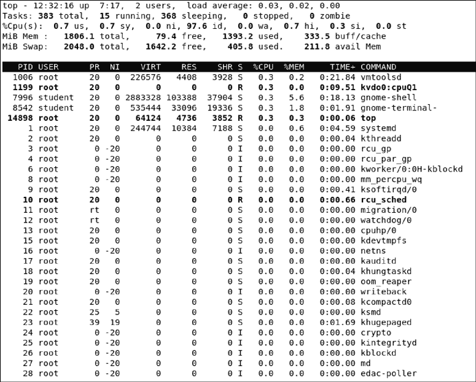

**图 10-1** `top`让进程管理变得简单

从`top`工具中可以方便获取的信息之一是进程状态。[表 10-3] 提供了你可能观察到的不同进程状态的概述。

| 状态 | 含义 |
| :--- | :--- |
| 运行 (R) | 进程当前活跃或处于可运行进程队列中。 |
| 睡眠 (S) | 进程正在等待事件完成。 |
| 不中断睡眠 (D) | 进程处于无法停止的睡眠状态。这通常发生在进程等待 I/O 时。 |
| 停止 (T) | 进程已停止，通常用于交互式 shell，使用 Ctrl-Z。 |
| 僵尸 (Z) | 进程已停止但未能被父进程移除。 |

**表 10-3** Linux 进程状态

现在你已经知道如何从命令行使用`kill`和`nice`命令，在`top`中使用相同的功能将更简单了。在`top`中输入`k`；`top`然后会提示你想要发送信号的进程的 PID。默认选择最活跃的进程。输入 PID 后，`top`询问你想发送哪个信号。默认使用信号 15 即`SIGTERM`。然而，如果你想坚持一下，可以输入`9`即`SIGKILL`。现在按回车键终止进程。

要从`top`调整运行进程的优先级，输入`r`。你首先会被提示输入想要重新调整优先级的进程的 PID。输入 PID 后，系统会提示你想要使用的`nice`值。输入正值降低进程优先级，输入负值提高进程优先级。

从`top`获取的另一个重要参数是平均负载。平均负载表示处于可运行状态（R）或阻塞状态（D）的进程数量。显示过去 1、5、15 分钟的平均负载，你可以在`top`屏幕右上角看到当前值。或者，你可以使用`uptime`命令显示当前的平均负载统计信息。

**示例 10-4** 使用`uptime`获取负载信息

```bash
[root@server3 ~]# uptime

12:43:03 up  4:17,  3 users,  load average: 4.90, 0.98, 0.19
```


按照经验法则，平均负载（load average）不应高于系统中的 CPU 核心数。你可以使用 `lscpu` 命令来查看系统中的 CPU 核心数。如果长时间的平均负载高于系统中的 CPU 数量，说明你可能存在性能问题。在练习 10-3 中，你将调查平均负载统计并学习如何管理平均负载。

### 使用 tuned 优化性能

为了从一开始就提供最佳性能，RHEL 8 附带了 `tuned`。它提供了一个监控系统活动并提供某些配置（profiles）的守护进程。通过这些配置，管理员可以自动调整系统，以获得最佳延迟、吞吐量或功耗表现。

根据已安装系统的属性，安装时会自动选择一个 `tuned` 配置文件，安装后也可以手动更改当前配置。管理员还可以更改 `tuned` 配置文件中的设置。表 10-4 给出了默认配置的概述。

| 配置文件 (Profile) | 用途 |
| --- | --- |
| `balanced` | 功耗与性能之间的最佳折中 |
| `desktop` | 基于 `balanced` 配置，但针对对交互式应用的更好的响应进行了优化 |
| `latency-performance` | 针对最大吞吐量进行了优化 |
| `network-latency` | 基于 `latency-performance`，带有额外的选项以降低网络延迟 |
| `network-throughput` | 基于 `throughput-performance`，为流媒体内容优化旧版 CPU |
| `powersave` | 针对最大节电进行了优化 |
| `throughput-performance` | 针对最大吞吐量进行了优化 |
| `virtual-guest` | 针对 Linux 作为虚拟机运行进行了优化 |
| `virtual-host` | 针对 Linux 作为 KVM 宿主机使用进行了优化 |

**表 10-4** Tuned 配置文件概述

创建自定义配置相对简单。此外，当你安装特定的软件包时，可能会添加配置。因此，你可能会发现服务器上存在一些额外的性能配置。

为了管理性能配置，系统提供了 `tuned-adm` 命令。它与 `tuned` 守护进程通信，因此在使用它之前，请运行 `systemctl enable --now tuned` 来启动 `tuned` 配置。接下来，使用 `tuned-adm active` 查找当前选择了哪个配置。要查看服务器上可用配置的概述，输入 `tuned-adm list`。要选择另一个配置，输入 `tuned-adm profile profile-name`。`tuned` 服务还可以为你的系统推荐一个 `tuned` 配置：使用 `tuned-adm recommend`。在练习 10-4 中，你可以练习使用 `tuned`。

### 总结

管理进程是 Linux 系统管理员的常见任务。在本章中，你学习了如何查找特定进程以及如何使用 `nice` 和 `kill` 更改它们的优先级。你还学习了如何使用 `tuned` 选择最符合你服务器工作负载的性能配置。

### 考试准备任务

如引言中“如何使用本书”节所示，你有几种考试准备考试方法：章节末的实验；附录 B 中的记忆备忘表；第 27 章 中的“最终准备”；以及模拟考试。

### 复习所有关键主题

复习本章最重要的主题，这些主题在页外边上用“关键主题”（Key Topic）图标标记。表 10-5 列出了这些关键主题的索引及其所在的页码。


| 关键主题元素 | 描述 | 页码 |
| --- | --- | --- |
| 表 10-2 | 作业管理概述 | 238 |
| 列表 | 核心信号概述 | 244 |
| 表 10-3 | Linux 进程状态概述 | 247 |

**表 10-5** 第 10 章 关键主题

### 凭记忆完成表格和列表

打印附录 B“记忆备忘表”（在配套网站上）或至少打印本章节的部分，并根据记忆完成表格和列表。附录 C“记忆备忘表答案密钥”包含了完整的表格和列表以供检查你的答案。

### 定义关键术语

定义本章的以下关键术语，并在词表中检查你的答案：

- `job`
- `process`
- `background`
- `foreground`
- `nice`
- `kill`
- `signal`
- `PID`
- `thread`
- `tuned`
- `profile`
- `zombie`

### 复习题

以下问题旨在帮助测试你对概念和术语的理解。你可以在附录 A 找到这些问题的答案。

1. 哪个命令提供了所有当前 shell 的概述？
2. 你如何停止当前 shell 以在后台继续运行？
3. 你可以使用哪种按键组合来取消当前 shell？
4. 用户要求你取消他启动的作业之一。你无法访问该用户正在工作的 shell。你仍然可以做什么？
5. 你使用哪个命令来显示父子关系？
6. 哪个命令允许你将 PID 1234 的优先级提高更高的优先级？
7. 在你的系统中，当前有 20 个 `dd` 进程正在运行。停止所有这些进程最简单的方法是什么？
8. 哪个命令允许你停止名为 `mycommand` 的命令？
9. 在 `top` 中使用哪个命令杀死进程？
10. 选择匹配你系统的性能配置需要什么？

### 章节末实验

在章节末实验中，你将应用一些重要的进程管理任务。使用你认为方便的工具完成这些实验。

### 实验 10.1

1. 以后台作业的形式启动三次命令 `dd if=/dev/zero of=/dev/null`。
2. 使用 `nice` 值 `-5` 提高其中一个的优先级。再次更改同一进程的优先级，但这次使用 `-15`。观察差异。
3. 杀死你刚刚启动的所有 `dd` 进程。
4. 确保 `tuned` 已安装并激活，设置 `throughput-performance` 配置。

## 第 11 章 使用 Systemd

本章涵盖以下主题：

- 理解 Systemd
- 通过 Systemd 管理单元

本章涵盖以下 RHCSA 考试目标：

- 启动和停止服务并配置服务在启动时自动启动

### “我掌握这些了吗？”测试

“我已经学会这些了吗？”测验可以让你评估自己应该是彻彻底阅读整个章节，还是直接跳到“考试准备任务”部分。如果你对这些问题的答案或自己对这些主题知识水平的评估有疑问，请阅读整个章节。表 11-1 列出了本章中的主要标题以及它们对应的“我已经学会这些了吗？”测验题。你可以在附录 A 中的“‘我已经学会这些了吗？’测验和‘复习题’的答案”中找到答案。

| 基础主题章节 | 问题 |
| --- | --- |
| 理解 Systemd | 1–5 |
| 通过 Systemd 管理单元 | 6–10 |

**表 11-1** “我已经学会这些了吗？”章节与问题的映射表

**1.** 哪条命令可以显示系统上当前加载的所有服务单元文件？

1. `systemctl --type=service`
2. `systemctl --type=service --all`
3. `systemctl --list-services`
4. `systemctl --show-units | grep services`

**2.** 关于 Systemd wants 的陈述哪一个*不是*正确的？

1. 你可以使用 `systemctl enable` 命令创建 wants。
2. 特定 want 所属的 target（目标）与相关的 wants 无关。
3. Wants 始终在 `/usr/lib/systemd/system` 目录中管理。
4. 每个服务都知道应该将它的 wants 添加到哪个 target 中。

**3.** 避免不兼容单元之间发生冲突的最佳解决方案是什么？

1. 无；单元文件已为自己定义了它们与哪些单元是不兼容的。
2. 使用 `systemctl disable` 禁用服务。
3. 使用 `systemctl unmask` 取消服务的掩码（mask）。
4. 使用 `systemctl mask` 掩码（mask）服务。

**4.** 下列哪项不是 Systemd 服务的有效状态？

1. Running(active)
2. Running(exited)
3. Running(waiting)
4. Running(dead)

**5.** 关于 socket 单元，下述陈述哪一个*不是*正确的？

1. socket 单元需要一个同名的服务单元。
2. socket 单元可以监听端口，并仅在端口发生活动时激活服务。
3. socket 单元不能包含应启动的关联二进制文件的名称。
4. socket 单元可以对路径活动做出反应。

**6.** 下列哪项不是有效的 Systemd 单元类型？

1. service
2. udev
3. mount
4. socket

**7.** 你想找出哪些其他 Systemd 单元对特定单元有依赖。你会使用哪条命令？

1. `systemd list-dependencies --reverse`
2. `systemctl list-dependencies --reverse`
3. `systemctl status my.unit --show-deps`
4. `systemd status my.unit --show-deps -r`

**8.** 如何将 Systemd 使用的默认编辑器更改为 `vim`？

1. `export EDITOR=vim`
2. `export SYSTEMD_EDITOR=vim`
3. `export EDITOR=/bin/vim`
4. `export SYSTEMD_EDITOR=/bin/vim`

**9.** 如果你想确保在依赖项失败时启动过程不会失败，你应该使用以下哪个关键字来定义 Systemd 依赖关系？

1. Required
2. Requisite
3. Before
4. Wants

**10.** 在 `systemctl` 中操作单元时，下列哪项*不是*有效命令？

1. `systemctl unit start`
2. `systemctl status -l unit`
3. `systemctl mask unit`
4. `systemctl disable unit`

### 基础主题

### 理解 Systemd

Systemd 是 Red Hat Enterprise Linux 8 的一部分，不仅启动服务，还启动各种其他项目。在本章中，你将学习 Systemd 是如何组织的，以及从 Systemd 启动了哪些项目。

通俗地说，你可以说 Systemd 系统和服务管理器是用来启动东西的。这些东西被称为 *units*（单元）。单元可以是许多东西。最重要的单元类型之一是服务（service）。通常，服务是提供特定功能并允许外部客户端连接的进程，例如 SSH 服务、Apache Web 服务等许多。除了服务之外，还存在其他单元类型，例如 socket、mount 和 target。要显示可用单元列表，请输入 `systemctl -t help`（参见示例 11-1）。


**示例 11-1** Systemd 中的单元类型

点击此处查看代码图像

```text
[root@server1 ~]# systemctl -t help

Available unit types:

service

socket

target

device

automount

swap

timer

path

scope
```

### 理解 Systemd 单元位置

与以前管理服务的方法相比，使用 Systemd 的主要优势是它提供了一个统一的启动单元接口。单元文件可能出现在三个位置：

- `/usr/lib/systemd/system` 包含来自 RPM 包的默认单元文件。你不应该直接编辑这些文件。
- `/etc/systemd/system` 包含自定义单元文件。它可能由 `systemctl edit` 命令生成。
- `/run/systemd/system` 包含自动生成的单元文件。

如果单元文件存在于这些多个位置，`/run` 目录中的优先级最高，并将覆盖其他设置。`/etc/systemd/system` 优先级次之，`/usr/lib/systemd/system` 最后。

### 理解 Systemd 服务单元

可能最重要的单元类型是服务单元。它被用于启动进程。你可以通过服务单元启动任何类型的进程。

示例 11-2 显示了一个服务文件 `vsftpd.service`，用于安全 FTP 服务。

**示例 11-2** 服务单元

点击此处查看代码图像

```ini
[Unit]
Description=Vsftpd ftp daemon
After=network.target

[Service]
Type=forking
ExecStart=/usr/sbin/vsftpd /etc/vsftpd.conf

[Install]
WantedBy=multi-user.target
```

从这个单元文件示例可以看出单元相对容易理解。任何 Systemd *服务*单元都包含以下三个部分（其他类型具有不同的部分）：


- **[Unit]**：描述单元并定义依赖。此部分还包含重要的 `After` 语句以及可选的 `Before` 语句。这些语句定义了单元之间的依赖关系，并且是相对于该单元的。`Before` 语句表示该单元在指定的单元之前启动。`After` 语句表示该单元在指定的单元之后启动。
- **[Service]**：描述如何启动和停止服务并请求状态。通常，你可以预期有一个 `ExecStart` 行，指示如何启动单元，或有一个 `ExecStop` 行，指示如何停止单元。注意 `Type` 选项，它用于指定进程应如何启动。`forking` 类型常用于守护进程，但你也可以使用其他类型，例如 `oneshot`，它可以从 Systemd 单元启动任何命令。更多信息请参见 `man 5 systemd.service`。
- **[Install]**：指明单元必须在哪个 target 中启动。本章稍后的“理解 Systemd target 单元”部分解释了如何操作 target。

#### 理解 mount 单元

挂载单元（mount unit）指定了文件系统如何挂载到特定目录。示例 11-3 显示了一个挂载单元文件 `tmp.mount`。

**示例 11-3** 挂载单元文件

点击此处查看代码图片

```ini
[Unit]
Description=Temporary Directory (/tmp)
Documentation=man:hier(7)
Documentation=https://www.freedesktop.org/wiki/Software/systemd/APIFileSystems
ConditionPathIsSymbolicLink=!/tmp
DefaultDependencies=no
Conflicts=umount.target
Before=local-fs.target umount.target
After=swap.target

[Mount]
What=tmpfs
Where=/tmp
Type=tmpfs
Options=mode=1777,strictatime,nosuid,nodev
```

示例 11-3 中的 `tmp.mount` 单元文件在其章节中显示了一些有趣的额外配置选项：

- `[Unit]`：`Conflicts` 语句用于列出无法与此单元一起使用的单元。使用此语句处理互斥的单元。
- `[Mount]`：该章节精确定义了挂载执行的具体位置。在这里你可以看到通常在任何 `mount` 命令中使用的参数。

### 理解 Systemd 套接字（Socket）单元

另一种值得关注的单元类型是套接字。套接字为应用程序之间的通信创建了一种方法。套接字可以定义为一个文件，也可以定义为 Systemd 监听传入连接的端口。这样，服务不需要持续运行，而是只有当指定的套接字收到连接时才会启动。每个套接字都需要一个对应的服务文件。示例 11-4 显示了 `cockpit.socket` 文件的内容；注意此文件需要一个名为 `cockpit.service` 的服务文件。

**示例 11-4** Socket 单元文件

点击此处查看代码图片

```ini
[Unit]
Description=Cockpit Web Service Socket
Documentation=man:cockpit-ws(8)
Wants=cockpit-motd.service

[Socket]
ListenStream=9090
ExecStartPost=-/usr/share/cockpit/motd/update-motd '' localhost
ExecStartPost=-/bin/ln -snf active.motd /run/cockpit/motd
ExecStopPost=-/bin/ln -snf /usr/share/cockpit/motd/inactive.motd /run/cockpit/motd

[Install]
WantedBy=sockets.target
```


示例 11-4 中的重要选项是 `ListenStream`。该选项定义了 Systemd 应该监听传入连接的 TCP 端口。也可以为 UDP 端口创建套接字，在这种情况下你应该使用 `ListenDatagram` 而不是 `ListenStream`。


### 理解 Systemd 目标（Target）单元

单元文件用于构建服务器所需的功能。为了能够按照正确的顺序和时机加载它们，你使用特定类型的单元：目标单元（target unit）。目标单元的简单定义是“一组单元”。某些目标用于定义服务器应该启动的状态。因此，目标单元类似于早期版本中 RHEL 中使用的运行级别（runlevels）。

其他目标仅仅是一组服务，使得不仅易于管理单个单元，而且易于管理实现特定功能的所有单元。`printer.target` 就是这样一个目标示例；你可以用它轻松地启动或停止提供打印功能所需的所有单元。

目标本身可以对其他目标有依赖。这些依赖关系定义在目标单元中。这种依赖关系的一个示例是 `basic.target`。该目标定义了所有应该始终启动的单元。你可以使用 `systemctl list-dependencies` 命令查看任何现有依赖概述。

示例 11-5 显示了目标单元文件 `multi-user.target` 的定义，它定义了 RHEL 服务器的正常运行状态。

**示例 11-5** 目标单元文件

点击此处查看代码图片

```
[Unit]

Description=Multi-User System

Documentation=man:systemd.special(7)

Requires=basic.target

Conflicts=rescue.service rescue.target

After=basic.target rescue.service rescue.target

AllowIsolate=yes

[Install]

Alias=default.target
```

你可以看到，目标单元本身并不包含太多内容。它只是定义了它所需以及它不能与哪些服务和目标共存。它还通过 `[Unit]` 章节中的 `After` 语句定义了加载顺序。目标文件不包含任何关于应包含的单元的信息；这些信息定义在不同单元文件的 `[Install]` 章节中。

当管理员使用 `systemctl enable` 命令来确保单元在启动时自动启动时，会考虑该单元的 `[Install]` 章节来确定应将单元添加到哪个目标。

当添加一个单元时，会考虑 `[Install]` 章节以确定该单元应该被添加到哪个目标。

### 如何通过 Systemd 管理单元

通过 Systemd 管理单元涉及启动和停止单元。练习 11-1 显示了如何操作。`systemctl` 命令是管理单元的主要工具。

**提示**：`systemctl` 有许多选项，初看起来可能会很 overwhelming。只需确保安装了 `bash-completion` 包并使用 Tab 补全。


**示例 11-6** 使用 `systemctl` 请求单元

点击此处查看代码图片

```
[root@server1 ~]# systemctl status vsftpd

   vsftpd.service - ftp daemon

   Loaded: loaded (/lib/systemd/system/vsftpd.service; disabled;

   vendor preset: disabled

   Active: active (running) since Mon 2019-06-10 06:44:18 EDT; 5s

  Process: 10044 ExecStart=/usr/sbin/vsftd /etc/vsftd/vsftpd.conf (code=exited, status=0/SUCCESS)

  Main PID: 10045 (vsftd)

    Tasks: 1 (limit: 11365)

   Memory: 696.0K

   CGroup: /system.slice/vsftpd.service

           └–10045 /usr/sbin/vsftd /etc/vsftd/vsftpd.conf

Jun 10 06:44:18 server1.example.com systemd[1]: Starting Secure File Daemon...

Jun 10 06:44:18 server1.example.com systemd[1]: Started Very Secure File Daemon.
```

像示例 11-6 那样请求单元的状态时，你可以看到关于它的各种信息。表 11-2 显示了使用 `systemctl status` 命令时可以获取单元文件的各种信息。

| 状态 | 描述 |
| --- | --- |
| Loaded | 单元已处理且处于激活状态。 |
| Active(running) | 单元正在运行，有一个或多个活动进程。 |
| Active(exited) | 单元已成功完成一次性运行。 |
| Active(waiting) | 单元正在运行并等待事件。 |
| Inactive(dead) | 单元未运行。 |
| Enabled | 单元将在启动时启动。 |
| Disabled | 单元在启动时不会启动。 |
| Static | 单元无法被启用，但可能由另一个单元自动启动。 |

**表 11-2** Systemd 状态概览

作为管理员，你通常也需要获取 Systemd 单元文件的当前状态概览。不同的命令（部分在表 11-3 中显示）可以帮助你获取这些信息。


| 命令 | 说明 |
| --- | --- |
| `systemctl --type=service` | 只显示服务单元 |
| `systemctl list-units --type=service` | 显示所有激活的服务单元（与上一个命令相同） |
| `systemctl list-units --type=service --all` | 显示非激活和激活的服务单元 |
| `systemctl --failed --type=service` | 显示所有失败的服务 |
| `systemctl status -l your.service` | 显示服务的详细状态信息 |

**表 11-3** `systemctl` 单元概览命令

#### 管理依赖关系

通常情况下，管理 Systemd 依赖关系有两种方式：

- `socket` 和 `path` 等单元类型与服务单元直接相关。访问这些单元中的中的一个将自动触发服务类型。
- 可以在单元内部定义依赖关系，使用 `Requires`、`Requisite`、`After` 和 `Before` 等关键字。

作为管理员，你可以请求单元依赖关系列表。输入 `systemctl list-dependencies` 后跟单元名称以查找它具有哪些依赖；添加 `--reverse` 选项可以查找哪些单元是该单元的依赖项。示例 11-7 显示了该命令的示例。

**示例 11-7** 显示单元依赖关系

点击此处查看代码图片

```
[root@server1 ~]# systemctl list-dependencies vsftpd

  vsftpd.service

└–system.slice

└–basic.target

  ├–alsa-restore.service

  ├–alsa-state.service

  ├–firewalld.service

  ├–microcode.service

  ├–rhel-autorelabel-mark.service

  ├–rhel-autorelabel.service

  ├–rhel-configure.service

  ├–rhel-dmesg.service

  ├–rhel-loadmodules.service

  ├–paths.target

  ├–slices.target

  │ ├–-.slice

  │ ├–system.slice

  ├–sockets.target

  ├–avahi-daemon.socket

  ├–cups.socket

  ├–dbus.socket

  ├–dm-event.socket

  ├–iscsid.socket

  ├–iscsiuio.socket

  ├–lvm2-lvmetad.socket

  ├–rpcbind.socket

  ├–systemd-initctl.socket

  ├–systemd-journald.socket

  ├–systemd-shutdownd.socket

  ├–systemd-udevd-control.socket

  ├–systemd-udevd-kernel.socket

  ├–sysinit.target

  │ ├–dev-hugepages.mount

  │ ├–dev-mqueue.mount

  ├–dmraid-activation.service

  ├–iscsi.service
```

为了确保准确的依赖管理，你可以在单元的 `[Unit]` 部分使用不同的关键字：

- `Requires`：如果此单元加载，此处列出的单元也将加载。如果其他单元中的任一个被去激活，则此单元也会被去激活。
- `Requisite`：如果此处列出的单元尚未加载，则此单元将执行失败。
- `Wants`：此单元希望加载此处列出的单元，但如果列出的任何一个单元失败，此单元也不会失败。
- `Before`：此单元将在 `Before` 指定的单元之前启动。
- `After`：此单元将在 `After` 指定的单元之后启动。

在接下来的练习 11-2 中，你将学习如何使用这些选项来管理单元依赖关系。

#### 管理单元选项

在处理 Systemd 单元文件时，你可能会被大量的选项所淹没。每个单元文件都可以配置不同的选项。要确定特定单元可用哪些选项，请使用 `systemctl show` 命令。例如，`systemctl show sshd` 命令显示了 `sshd.service` 单元中可以配置的所有 Systemd 选项，包括它们当前的默认值。示例 11-8 显示了该命令的输出。

**示例 11-8** 使用 `systemctl show` 显示可用选项

点击此处查看代码图片

```
[root@server1 ~]# systemctl show | head -20

Id=sshd.service

Names=sshd.service

Requires=basic.target

Wants=sshd-keygen.service system.slice

WantedBy=multi-user.target

ConsistsOf=sshd-keygen.service

Conflicts=sshd-keygen.service

After=network.target

Before=network.target

After=sshd-keygen.service

After=sshd.service

Description=sshd.service
```


打印附录 B“记忆表”（可在配套网站上找到）或至少本章的内容，并根据记忆完成表格和列表。附录 C“记忆表答案密钥”包含了完成的表格和列表，以便你检查工作结果。

### 定义关键术语

定义本章的以下关键术语并在术语表中检查你的答案：

- `unit`
- `wants`
- `target`
- `Systemd`
- `dependencies`

### 复习题

后续的问题旨在帮助你测试对概念、术语以及知识广度的掌握。你可以在附录 A 中找到这些问题的答案。

1. 什么是 `unit`（单元）？
2. 使用哪个命令显示所有当前加载的 service units？
3. 如何为服务创建一个 `want`（依赖关系）？
4. 如何更改 `systemctl` 的默认编辑器？
5. 哪个目录包含自定义的 `Systemd` unit 文件？
6. 应该包含什么以确保 unit 文件会自动加载另一个 unit 文件？
7. 哪个命令显示 `httpd.service` unit 的可用的配置选项？
8. 哪个命令显示特定 unit 的所有依赖项？
9. 如果 `systemctl status` 显示 unit 处于 dead（死亡）状态，意味着什么？
10. 如何创建 `Systemd` 覆盖（override）文件？

### 章末实验

你现在已经学习了如何操作 `Systemd`。在继续之前，做一个实验是一个好主意，有助于确保你能应用在本章中学的技能。

#### 实验 11.1

1. 安装 `vsftpd` 和 `httpd` 服务。
2. 将 `systemctl` 的默认编辑器设置为 `vim`。
3. 编辑 `httpd.service` unit 文件，使得启动 `httpd` 总是自动启动 `vsftpd`。编辑 `httpd` 服务，使其在失败后 10 秒内自动重新启动。

## 第 12 章：任务调度

**本章涵盖以下主题：**

- 配置 `cron` 以自动执行循环任务
- 配置 `at` 以调度未来任务

本章涵盖了以下 RHCSA 考试目标：

- 使用 `at` 和 `cron` 调度任务

在 Linux 服务器上，让某些任务在特定时间运行是非常重要的。这可以通过使用 `at` 和 `cron` 服务来实现，这些服务可以配置为未来运行任务。`at` 服务用于一次性执行未来任务，而 `cron` 服务用于定期循环的常规任务。在本章中，你将学习如何配置这两者。

### “我已经学会了吗？”测验

“我已经学会了吗？”测验允许你评估是否应该彻底阅读整个章节内容，还是跳到“考试准备任务”部分。如果你对这些问题的答案或对自己这些主题知识的评估有疑问，请阅读整章内容。表 12-1 列出了本章的主要章节标题及其对应的“我已经学会了吗？”测验题。你可以在附录 A 中的“‘我已经学会了吗？’测验和‘复习题’的答案”找到答案。

| 基础主题章节 | 题目 |
| --- | --- |
| 配置 `cron` 以自动执行循环任务 | 1–8 |
| 配置 `at` 以调度未来任务 | 9–10 |

**表 12-1** “我已经学会了吗？”章节与题目映射表

1. 以下哪个命令允许你检查 `crond` 服务的当前状态？
   1. `service crond status`
   2. `systemctl status crond`
   3. `/usr/sbin/crond --status`
   4. `chkconfig crond --show`

2. 下面哪个项将在周日上午 11 点运行 cron 任务？
   1. `11 7 * * *`
   2. `0 11 * 7 *`
   3. `0 11 * * 7`
   4. `11 0 * 7 *`

3. 下面哪一项会从周一到周五每五分钟启动一次作业？
   1. `*/5 * * * 1-5`
   2. `0 * * * * 1-5`
   3. `0 11 * * * 7`
   4. `11 0 * * * 7`

4. 如何为特定用户创建 crontab？
   1. `crontab -e`
   2. `crontab -l`
   3. `crontab -r`
   4. `crontab -u`

5. 哪个目录主要供 cron 使用？
   1. `/etc/cron.d`
   2. `/etc/cron`
   3. `/var/cron`
   4. `/var/spool/cron`

6. 下面哪项不是指定作业推荐的方法？
   1. `/etc/crontab`
   2. `/etc/cron.d`
   3. `crontab -e`
   4. `/etc/cron.daily`

7. 哪个服务负责执行 `/etc/cron.hourly`、`/etc/cron.daily`、`/etc/cron.weekly` 和 `/etc/cron.monthly` 中的作业？
   1. `cron`
   2. `crontab`
   3. `atd`
   4. `anacron`

8. 关于 cron 安全性的哪个陈述是正确的？
   1. 默认情况下，所有用户都允许通过 cron 调度任务，因为 `/etc/cron.allow` 文件关键字 `all`。
   2. 如果 `cron.deny` 文件存在，则必须创建一个 `cron.allow` 文件。
   3. 对于每个用户，在 `cron.allow` 文件或 `cron.deny` 文件中必须存在匹配的条目。
   4. 如果 `cron.allow` 文件存在，用户必须列在其中才能调度任务。

9. 在 at shell 中输入命令后，哪个命令允许你关闭 at shell？
   1. `Ctrl-V`
   2. `Ctrl-D`
   3. `exit`
   4. `:wq`

10. 哪个命令允许你查看当前的 at 任务？
    1. `atrm`
    2. `atls`
    3. `atq`
    4. `at`

### 基础主题

### 配置 cron 以自动执行循环任务

在 Linux 服务器上，让某些任务在特定时间运行是非常重要的。这可以通过使用 `at` 和 `cron` 服务来实现，这些服务可以配置为未来运行任务。`at` 服务用于一次性执行未来任务，而 `cron` 服务用于定期循环的常规任务。在本章中，你将学习如何配置这两者。

#### 管理 `crond` 服务

`crond` 服务默认在每个 RHEL 系统上启动。该服务是必要的，因为某些系统任务通过 `crond` 运行。例如是 logrotate，这是一个清理日志文件并定期运行的服务，但其他重要的维护过程也通过 cron 自动启动。

管理 `crond` 服务本身非常简单：它不需要大量的管理。其他服务可能需要重新加载或重启才能激活配置更改，但 `crond` 不需要。`crond` 守护进程每分钟唤醒一次，并检查其配置以查看是否有需要启动的任务。

要监控 cron 服务的当前状态，可以使用 `systemctl status crond -l` 命令。示例 12-1 显示该命令的输出。

### 示例 12-1：监控 crond 服务的当前状态

点击此处查看代码图像

```text
[root@server1 ~]# systemctl status crond -l

   crond.service - Command Scheduler

   Loaded: loaded (/usr/lib/systemd/system/crond.service; enabled;

             vendor preset: enabled)

   Active: active (running) since Sat 2019-06-08 03:34:57 EDT;

             28min ago

 Main PID: 1101 (crond)

    Tasks: 2 (limit: 11363)

   Memory: 2.3M

   CGroup: /system.slice/crond.service

           ├–1101 /usr/sbin/crond -n

           └–3600 /usr/sbin/anacron -s

Jun 08 03:34:57 server1.example.com crond[1101]: (CRON) STARTUP

  (1.5.2)

Jun 08 03:34:57 server1.example.com crond[1101]: (CRON) INFO (Syslog

  will be used instead of sendmail>

Jun 08 03:34:57 server1.example.com crond[1101]: (CRON) INFO (RANDOM_

  DELAY will be scaled with factor>

Jun 08 03:34:58 server1.example.com crond[1101]: (CRON) INFO (running

  with inotify support)

Jun 08 04:01:01 server1.example.com CROND[3591]: (root) CMD (run-parts

  /etc/cron.hourly)

Jun 08 04:01:01 server1.example.com anacron[3600]: Anacron started on

  2019-06-08

Jun 08 04:01:01 server1.example.com anacron[3600]: Will run job

  'cron.daily' in 33 min.

Jun 08 04:01:01 server1.example.com anacron[3600]: Will run job

  'cron.weekly' in 53 min.

Jun 08 04:01:01 server1.example.com anacron[3600]: Will run job

  'cron.monthly' in 73 min.

Jun 08 04:01:01 server1.example.com anacron[3600]: Jobs will be

  executed sequentially
```

`systemctl status crond` 命令输出中最重要的部分在开头，它表示 cron 服务已加载并启用。服务已启用（enabled）意味着当该服务重启时，它会自动启动。命令输出的最后部分显示了当前状态信息。通过 `journald` 服务，`systemctl` 命令可以发现 `crond` 服务实际上正在发生什么。

#### 理解 cron 定时

在通过 cron 调度服务时，你需要精确指定服务何时需要启动。在 crontab 配置中（下一节将进行更详细介绍），你使用时间字符串来指示任务应该在何时启动。表 12-2 显示了所使用的时间和日期字段（按指定顺序）。


| 字段 | 取值 |
| --- | --- |
| minute | 0–59 |
| hour | 0–23 |
| day of month | 1–31 |
| month | 1–12（或尽量避免使用的名称） |
| day of week | 0–7（星期日为 0 或 7，或[尽量避免使用的名称]） |

**表 12-2** cron 时间和日期字段

在这些任何字段中，你可以使用 `*` 作为通配符来引用任何值。允许使用数字范围、列表和模式。接下来列了一些示例：


- `* 11 * * *` 11:00 到 11:59 之间的每分钟（可能不是你想要的）
- `0 11 * * 1-5` 仅在工作日的每天上午 11 点
- `0 7-18 * * 1-5` 工作日上午 7 点到下午 6 点之间每小时的整点
- `0 */2 2 12 5` 12 月 2 日以及 12 月每个周五每两个小时整点一次

> **提示**
>
> 你不需要记住这些；`man 5 crontab` 显示了所有可能的结构。

#### 管理 cron 配置

cron 的主配置文件是 `/etc/crontab`，但你不会直接修改此文件。不过，它确实提供了 cron 中可以使用的不同时间规范的方便概览。它还设置了通过 cron 执行的命令的环境变量（参见示例 12-2）。要修改 cron 任务，还有其他指定 cron 任务的地方。

**示例 12-2** `/etc/crontab` 示例内容

点击此处查看代码图像

```text
[root@server2 ~]# cat /etc/crontab

SHELL=/bin/bash

PATH=/sbin:/bin:/usr/sbin:/usr/bin

MAILTO=root

# 详情请参见 man 4 crontabs

# 任务示例

# ----------------------------------------------------------------

# minute  hour  day  month  day_of_week  command

# ----------------------------------------------------------------

# *       *     *     *     *            *            /usr/bin/daily
```

在这些目录中，你通常会找到从 RPM 软件包中放入的脚本（这些脚本并非符合 crontab 语法要求的文件）。打开这些脚本时，请注意它们没有包含任何关于命令应执行时间的信息。这是因为执行的确切时间实际上并不重要。唯一重要的是任务会在每小时、每天、每周或每月启动一次。

### 了解 `anacron` 的用途

为了确保任务的定期执行，cron 使用了 `anacron` 服务。该服务负责启动每小时、每天、每周和每月的 cron 任务，无论具体在什么时间执行。要确定如何执行此操作，anacron 使用了 `/etc/anacrontab` 文件。示例 12-4 显示了 `/etc/anacrontab` 文件的内容，该文件用于指定如何执行 `anacron` 任务。

**示例 12-4** anacontab 配置

点击此处查看代码图像

```text
[root@server1 spool]# cat /etc/anacrontab

# /etc/anacrontab: anacron 配置文件

# 详细信息请参阅 anacron(8) 和 anacrontab(5)。

SHELL=/bin/sh

PATH=/sbin:/bin:/usr/sbin:/usr/bin

MAILTO=root

# 在任务基础延迟增加的最大随机延迟

RANDOM_DELAY=45

# 任务仅在以下小时段内启动

START_HOURS_RANGE=3-22

# 周期（天）  延迟（分钟） 任务标识符  命令

1        5  cron.daily            nice run-parts  /etc/cron.daily

7        25 cron.weekly           nice run-parts  /etc/cron.weekly

@monthly 45 cron.monthly          nice run-parts  /etc/cron.monthly
```


在`/etc/anacrontab`中，要执行的任务在包含四个字段的行中指定，如示例 12-4 所示。第一个字段指定任务执行的频率，以天为单位。第二个字段指定`anacron`在执行任务前等待多长时间，后面是包含任务标识符的第三个字段。第四个字段指定应执行的命令。

### 提示

虽然了解`anacron`的工作原理很有用，但它通常不是一个直接配置的服务。通过`/etc/cron.hourly`、`cron.daily`、`cron.weekly`和`cron.monthly`文件消除了通过`anacron`配置服务的需求。

#### 注意事项

要概述实际安排执行的 cron 任务并不容易。没有单一命令可以显示所有当前安排的 cron 任务。`crontab -l`命令确实列出了 cron 任务，但仅限当前用户。

## 管理 cron 安全

默认情况下，所有用户都可以输入 cron 任务。可以使用`/etc/cron.allow`和`/etc/cron.deny`配置文件来限制哪些用户允许调度 cron 任务。如果`cron.allow`文件存在，则用户必须列在其中才能使用 cron。如果`/etc/cron.deny`文件存在，则用户不能列在其中才能设置 cron 任务。这两个文件不应同时存在于同一系统上。如果两个文件都不存在，则只有 root 可以使用 cron。

在练习 12-1 中，你应用了一些 cron 基础并使用不同的机制调度 cron 任务。

## 配置 at 以调度未来任务

cron 用于调度需要定期执行的任务，而`atd`服务则适用于只需要执行一次的服务。在 RHEL 8 上，默认提供了`atd`服务，因此所有需要做的就是调度任务。

要通过`atd`服务运行任务，你将使用`at`命令，后跟任务需要执行的时间。可以是一个特定时间，例如`at 14:00`，但也可以是一个时间指示，如`at teatime`或`at noon`。输入这些内容后，`at` shell 会打开。从该 shell 中，你可以输入几条命令，这些命令将在指定的特定时间执行。输入命令后，按 Ctrl-D 退出`at` shell。

在用`at`调度任务后，你可以使用`atq`命令（`q`代表队列）获取所有当前安排任务的概述。也可以删除当前的 at 任务。要这样做，请使用`atrm`命令，可选地跟上想要删除的 at 任务编号。在练习 12-2 中，你学习了如何使用`at`调度任务在特定时间执行。

### 提示

`batch`命令的作用与`at`类似，但更复杂一些。使用`batch`时，你可以指定仅当系统性能参数允许时启动任务。通常，当系统负载低于 0.8 时。此值在现代多 CPU 系统上有点低，这就是为什么在启动`atd`时可以使用`-l`命令行选项手动指定负载值。例如，使用`atd -l 3.0`以确保当系统负载高于 3.0 时不启动任何批任务。

### 总结

在本章中，你学习了如何调度任务在未来执行。你还学习了如何配置 cron 在特定时间执行。此外，你学习了`anacron`服务，它用于确保`/etc/cron.{hourly|daily|monthly}`中的任务确实被执行，即使系统未可用。在本章的末尾，你学习了如何使用`atd`服务调度执行一次的任务。

## 考试备习任务

正如`ch27`中“如何使用本书”节所述，你有几种准备考试的方案：章末实验；附录 B 中的表格；以及练习模拟考试。

## 回习所有关键主题

回顾章中最重要的主题，已用“关键主题”图标标记。


| 关键主题 | 描述 | 页码 |
| --- | --- | --- |
| 表 12-2 | cron 时间指示 | 276 |
| 表 12-2 | cron 时间指示示例 | 276 |
| 表 12-3 | 进入 crontab 方法 | 277 |

**表 12-3** 第十二章关键主题

### 定义关键术语

定义本章的关键术语并在词表中检查你的答案：

`cron`](glo.xhtml_glo1_47)

`anacron`](glo.xhtml_glo1_05)

`at`](glo.xhtml_glo1_10)

## 回习题

以下问题旨在帮助你测试对概念和术语的理解以及知识面。你可以在附录 A 中找到这些问题的答案。

1. 在哪里配置每两周执行一次的 cron 任务？

2. 如何指定每月执行两次（每月 1 号和 15 号下午 2 点）的 cron 任务执行时间？

3. 如何指定每天每分钟运行一次的 cron 任务？

4. 如何指定 9 月 19 日以及 9 月每个星期四执行的任务？

5. 你可以使用哪三个有效的日期指示符来指定 cron 任务在周日执行？

6. 使用哪个命令可以让你为用户 lisa 调度 cron 任务？

7. 如何指定用户 boris 永远不允许通过 cron 调度任务？

8. 你需要确保某个任务每天执行一次，即使服务器在执行时临时不可用。你该如何做？

9. 调度任务时必须运行哪个服务？

10. 哪个命令可以让你发现是否有任何当前正在运行的任务已计划执行？

### 章节结束实验

在本章末的实验中，你将处理任务和 cron 任务。

### 实验 12.1

1. 创建一个 cron 任务，在每天晚上 11 点对你计算机上的所有软件进行更新。
2. 安排你的机器在明天早上 3 点重启。

# 第 13 章

## 配置日志记录

本章涵盖了以下主题：

- 理解系统日志
- 配置`rsyslogd`
- 日志文件轮转
- 使用`journald`

本章涵盖了以下 RHCSA 考试目标：

- 定位和解释系统日志文件和日志
- 保留系统日志

分析日志文件是系统管理员的一项任务。如果 Linux 系统出现任何问题，答案通常在日志文件中。在 RHEL 8 中，两个不同的日志系统并排运行，知道哪些信息可以在哪里找到非常重要。本章将教你所有相关知识。你将学习如何读取日志文件、如何配置`rsyslogd`和`journald`，以及如何设置系统进行日志轮转，以防止磁盘被过度记录日志的服务完全填满。

### “我已经掌握这些了吗？”测验

“我已经掌握这些了吗？”测验可以让你评估自己应该透彻地读完整个章节，还是跳到“考试准备任务”部分。如果你对这些问题的答案或自己对这些主题知识的评估有疑问，请阅读整个章节。表 13-1 列出了本章的主要标题及其对应的“我已经掌握这些了吗？”测验问题。你可以在附录 A，“‘我已经掌握这些了吗？测验和‘复习题’的答案](#appa.xhtml_appa)”找到答案。

| 基础主题章节 | 问题 |
| --- | --- |
| 理解系统日志 | 1–3 |
| 配置`rsyslogd` | 4–7 |
| 日志文件轮转 | 8 |
| 使用`journald` | 9–10 |

**表 13-1** “我已经掌握这些了吗？”章节与问题映射

### 1. 关于`journald`的以下陈述哪一个不是正确的？

1. `journald`记录内核消息。
2. `journald`写入日志，默认情况下在重启之间不会持久化。
3. `journald`是`rsyslogd`的替代品。
4. 要读取日志中的文件，你使用`journalctl`命令。

### 2. 你应该读取哪个日志来查找与身份验证错误相关的消息？

1. `/var/log/messages`
2. `/var/log/lastlog`
3. `/var/log/audit/audit.log`
4. `/var/log/secure`

### 3. 你应该读取哪个日志来查找与 SELinux 事件相关的信息？

1. `/var/log/messages`
2. `/var/log/lastlog`
3. `/var/log/audit/audit.log`
4. `/var/log/secure`

### 4. `rsyslogd`配置文件的名称是什么？

1. `/etc/rsyslog.conf`
2. `/etc/sysconfig/rsyslogd.conf`
3. `/etc/rsyslogd/`
4. `/etc/systemd/journald`

### 5. `rsyslogd`配置文件的名称是什么？（等等，检查上下文：问题 4 和 5 在源文件中似乎相似，但遵循提供的文本）

根据提供的文本进行修正：提供的文本再次询问`rsyslogd`配置文件的名称。

1. `/etc/rsyslog.conf`
2. `/etc/sysconfig/rsyslogd.conf`
3. `/etc/rsyslogd/`
4. `/etc/systemd/journald`

实际上，查看 rquiz13_5 的文本：

#### 5. 要使`journal`持久化，使用`journalctl`命令。你需要更改`journald`的行为。以下哪项描述了这一点？

1. `/etc/systemd/journald.conf`
2. `/etc/systemd/journald`
3. `/etc/systemd/journald.conf`
4. `/etc/systemd/`

### 6. 在`rsyslog.conf`文件中，以下哪项指的是？

1. `/var/log/journal`
2. `/var/log/messages`
3. `journald`
4. `apache`

### 7. 使用哪个设施（facility）来配置消息？

1. `daemon`
2. `apache`
3. `syslog`
4. `local0`

### 8. 你想将日志的大小限制为 10 MB。在哪里配置这一点？

1. `/etc/systemd/journald.conf`
2. `cron job`
3. `logrotate`
4. 无法做到。

### 9. 哪个目录用于存储`journal`？

1. `/var/log/journal`
2. `/var/run/journal`
3. `/run/log`
4. `/run/journal`

### 10. 为了使`journal`持久化，你需要做什么？

1. `/var/log/journal`
2. `/etc/sysconfig/journald`
3. `/etc/systemd/journald.conf`
4. `/var/log/journal`

## 基础主题

### 理解系统日志

大多数在 Linux 服务器上运行的服务将信息写入日志文件。这些信息可以写入不同的目的地，服务使用了多种方法：

- **直接写入**：某些服务直接写入日志文件——甚至包括 Apache Web 服务器和 Samba 文件服务器等重要服务。
- **`rsyslogd`**：`rsyslogd`是`syslogd`的增强，syslog 是管理日志文件的服务。Syslog 已经存在很久。
- **`journald`**：随着 Systemd 的引入，引入引入`journald`日志服务。该服务与 Systemd 深度集成，允许管理员在使用`systemctl status`命令监控状态的同时读取有关消息的详细信息。

#### `rsyslogd`和`journald`的角色

(Images/key_topic_icon.jpg)

在 RHEL 8 中，`journald`（由`systemd-journald`守护进程实现）提供了高级日志管理系统。`journald`收集来自内核、整个启动过程服务的服务的，并将这些消息写入事件日志。事件日志以二进制格式存储，可以使用`journalctl`命令进行查询。`journalctl`命令允许你访问已记录消息的深层细节，因为它是 Systemd 的组成部分，因此接收了由 Systemd 产生的所有消息。

由于`journald`写入的日志在重启之间不会持久化，消息也会被转发到`rsyslogd`服务，该服务将消息写入`/var/log`目录下的文件中。`rsyslogd`还提供了`journald`不具备的功能，例如集中日志记录和通过模块过滤消息。有许多模块可以增强 rsyslog 日志记录，例如允许管理员将消息存储在数据库中的输出模块。

在 RHEL 8 的当前状态下，`journald`并不是`rsyslog`的替代品；它只是另一种记录信息的方式。`journald`与`Systemd`深度集成；因此，它会记录服务器正在执行的所有操作。`rsyslogd`则增加了一些服务。特别是，它负责将日志信息写入特定的文件（这些文件在重启之间是持久的），并允许你配置远程日志和日志服务器。

除了`rsyslogd`和`systemd-journald`之外，还有`auditd`服务。该服务提供审计功能，即对特定服务、进程或用户执行的操作进行深度追踪。审计配置超出了 RHCSA 考试的范围，但你会发现，例如，`SELinux`会向`auditd`服务记录详细信息。

为了获取更多关于运行 RHEL 的机器上发生过的事件的信息，管理员必须采取三种方法：

- 监控`/var/log`中由`rsyslogd`写入的文件。
- 使用`journalctl`命令从日志中获取更详细的信息。
- 使用`systemctl status <unit>`命令获取由`Systemd`单元通过`journald`记录的最后重要事件的简要概述。该命令显示服务的状态，以及最后记录的几行内容。示例 13-1 显示了该服务记录的一些状态日志消息。

**示例 13-1** 使用`systemctl status`显示相关日志信息

点击此处查看代码图像

```text
[root@server1 ~]# systemctl status sshd -l

   sshd.service - OpenSSH server daemon

   Loaded: loaded (/usr/lib/systemd/system/sshd.service; enabled;

             vendor preset: enabled)

   Active: active (running) since Sat 2019-06-08 03:34:56 EDT;

             55min ago

     Docs: man:sshd(8)

           man:sshd_config(5)

 Main PID: 1055 (sshd)

    Tasks: 1 (limit: 11363)

   Memory: 5.5M

   CGroup: /system.slice/sshd.service

           └–1055 /usr/sbin/sshd -D -oCiphers=aes256-gcm@openssh.com,

                chacha20-poly1305@openssh.com,ae>

Jun 08 03:34:56 server1.example.com systemd[1]: Starting OpenSSH

  server daemon...

Jun 08 03:34:56 server1.example.com sshd[1055]: Server listening on

  0.0.0.0 port 22.

Jun 08 03:34:56 server1.example.com sshd[1055]: Server listening on ::

  port 22.

Jun 08 03:34:56 server1.example.com systemd[1]: Started OpenSSH server

  daemon.

Jun 08 03:57:38 server1.example.com sshd[3368]: Accepted password for

  root from 192.168.4.1 port 5470>

Jun 08 03:57:38 server1.example.com sshd[3368]: pam_unix(sshd:

  session):session opened for user root
```


#### 读取日志文件

除了 `journald` 写入日志并可以使用 `journalctl` 命令读取的消息外，在 Linux 系统中，你还会在 `/var/log` 目录中找到不同的日志文件。该目录中的大多数文件由 `rsyslogd` 管理，但也有某些文件是由特定服务直接创建的。你可以使用 `less` 等分页器工具读取这些文件。

`/var/log` 目录中文件的确切数量会取决于服务器的配置以及在该服务器上运行的服务。然而，在大多数情况下，某些文件确实存在，作为管理员，你应该知道它们是哪些文件以及这些文件中可以预期什么内容。表 13-2 提供了在该目录下创建的一些标准文件的概述。


| 日志文件 | 说明 |
| --- | --- |
| `/var/log/messages` | 包含最常用的日志文件；它是通用日志文件，大多数消息都写入此处。 |
| `/var/log/dmesg` | 包含内核日志消息。 |
| `/var/log/secure` | 包含身份认证相关的消息。在此查看服务器上发生了哪些认证错误。 |
| `/var/log/boot.log` | 包含与系统启动相关的消息。 |
| `/var/log/audit/audit.log` | 包含审计消息。`SELinux` 写入此文件。 |
| `/var/log/maillog` | 包含邮件相关的消息。 |
| `/var/log/samba` | 为 `Samba` 服务提供日志文件。注意 `Samba` 默认不通过 `rsyslog` 管理，而是直接写入 `/var/log` 目录。 |
| `/var/log/sssd` | 包含审计消息。`SELinux` 写入此文件。 |
| `/var/log/cups` | 包含审计消息。`SELinux` 写入此文件。 |
| `/var/log/httpd` | 包含审计消息。`SELinux` 写入此文件。 |
| `/var/log/cron` | 包含审计消息。`SELinux` 写入此文件。 |

#### 理解日志文件

作为管理员，你需要能够解释日志文件的内容。例如，示例 13-2 显示每行记录都包含特定的元素：

- **日期和时间**：每条日志消息都以时间戳开头。为了方便过滤，时间戳采用军事时间。
- **主机**：产生消息的主机。这很重要，因为 `rsyslog` 也可以配置为处理远程日志。
- **服务或进程名称**：生成消息的服务或进程的名称。
- **消息内容**：消息的内容，包含了记录的精确消息。

要读取日志文件的内容，你可以使用如 `less` 这样的分页器工具，也可以像下一节描述的那样实时监控日志文件中正在发生的情况。

在 Linux 上配置服务时，实时查看发生的情况可能会有所帮助。例如，你可以同时打开两个终端会话。在一个终端会话中，你配置并测试该服务；在另一个终端会话中，你实时查看发生的情况。`tail -f <logfile>` 命令会实时显示哪些行被添加到了日志文件中。下一节中的练习 13-1 展示了一个使用 `tail -f` 的小示例。当你使用 `tail -f` 监控日志文件时，跟踪将将保持打开，直到你按下 `Ctrl-C` 将其关闭。

#### 使用 logger

大多数服务都会自动或通过 `rsyslogd` 将信息写入日志文件。`logger` 命令允许用户从命令行或脚本向 `rsyslog` 写入消息。使用该命令非常简单。只需输入 `logger`，后跟你想要写入日志的消息内容即可。通过这种方式，`logger` 工具为从脚本写入消息提供了一个方便的解决方案。这允许你在出现问题时让脚本写入 syslog。

使用 `logger` 时，你还可以指定要日志记录的优先级（priority）和设施（facility）。例如，命令 `logger -p kern.err hello` 将 `hello` 写入内核设施，并使用了错误优先级（在本章稍后会讨论）。此选项允许你测试特定 `rsyslog` 设施的工作情况。在练习 13-1 中，你使用 `tail -f` 实时监控日志文件，并使用 `logger` 将日志消息写入日志文件。

## 配置 rsyslogd

为了确保需要记录的信息被写入你希望找到的位置，你可以通过 `/etc/rsyslog.conf` 文件配置 `rsyslogd` 服务。在该文件中，你会发现不同的部分，允许你指定信息应该在何时以及如何写入。

### 理解 rsyslogd 配置文件

与 RHEL 8 许多其他服务一样，`rsyslogd` 的配置并没有仅仅定义在一个配置文件中。`/etc/rsyslog.conf` 文件是配置 `rsyslogd` 的中心位置。从该文件开始，还包含（include）了 `/etc/rsyslog.d` 目录的内容。该目录可以通过在服务器上安装 RPM 软件包来填充。在寻找特定的日志配置时，请确保始终考虑此目录的内容。

如果需要在启动时向 `rsyslogd` 服务传递特定选项，可以通过使用 `/etc/sysconfig/rsyslog` 文件来实现。该文件默认包含一行，内容为 `SYSLOGD_OPTIONS=""`。在这一行上，你可以指定 `rsyslogd` 的启动参数。`SYSLOGD_OPTIONS` 变量包含在启动 `rsyslogd` 的 Systemd 文件中。从理论上讲，你可以在此文件中更改启动参数，但不建议这样做。（有关 Systemd 配置的更多细节，请参见第 17 章，“管理和理解引导过程”。）

### 理解 rsyslog.conf 部分

`rsyslog.conf` 文件用于指定应该记录什么以及记录在何处。为了实现，你会在 `rsyslog.conf` 文件中找到不同的部分：

- **MODULES（模块）**：`rsyslogd` 是模块化的。包含模块是为了增强 `rsyslogd` 支持的功能。
- **GLOBAL DIRECTIVES（全局指令）**：该部分用于指定全局参数，例如写入辅助文件的位置或默认的时间戳格式。
- **RULES（规则）**：这是 `rsyslog.conf` 文件最重要的部分。它包含了规则，指定了什么信息应该记录到哪个目的地。

### 理解设施、优先级和日志目的地

为了指定应该将什么信息记录到哪个目的地，`rsyslogd` 使用了设施（facilities）、优先级（priorities）和目的地（destinations）：

- `facility`（设施）指定了记录信息的类别。`rsyslogd` 使用一个固定的设施列表，无法扩展。这是由于为了与旧版 syslog 服务向后兼容。
- `priority`（优先级）用于定义需要记录的消息的严重程度。当你指定一个优先级时，默认情况下所有该优先级以及更高优先级的消息都会被记录。
- `destination`（目的地）定义了消息写入的位置。典型的目的地是文件，但 `rsyslog` 模块也可以目的地，允许通过 `rsyslogd` 模块进行进一步处理。

示例 13-3 显示了 `rsyslog` 中的 RULES 部分。

**示例 13-3** `rsyslog.conf` 中的 RULES 部分。

点击此处查看代码图像

```text
#### RULES ####

# 将所有内核消息写入控制台。

# 记录过多其他内容会让屏幕变得混乱。

#kern.*                                    /dev/console

# 记录除邮件以外的 info 或更高级别的任何内容。

# 不要记录私有的身份验证消息！

*.info;mail.none;authpriv.none;cron.none   /var/log/messages

# authpriv 文件有访问限制。

authpriv.*                                 /var/log/secure

# 将所有邮件消息写入一个地方。

mail.*                                     -/var/log/maillog

# 记录 cron 任务

cron.*                                     /var/log/cron

# 所有人紧急消息

*.emerg                                    :omus

# 将紧急消息写入文件。

# 保存 crit 级别的新闻。

uucp,news.crit                             var/log/spool
```

在示例 13-3 中，你可以看到设施和优先级如何被定义记录的位置。表 13-3](#appb.xhtml_13tab03) 显示了可用的设施，表 13-4](#appb.xhtml_13tab04) 显示了所有优先级。

当你指定目的地时，通常使用文件。如果文件名以连字符开头（如 `-/var/log/maillog`），日志消息将不会立即提交到文件，而是缓存以提高效率。也可以设备文件，例如 `/dev/console`。如果使用此设备，消息将写入控制台。这在现代服务器上通常没有意义，因为管理员通常远程登录，看不到服务器控制台上发生的情况。


| 设施 | 用 |
| --- | --- |
| `auth/authpriv` | 与身份验证相关的消息。 |
| `cron` | `crond` 服务生成的消息。 |
| `daemon` | 守护进程使用的通用设施。 |
| `kern` | 内核消息。 |
| `lpr` | 通过旧版 `lpd` 打印系统生成的消息。 |
| `mail` | 电子邮件相关消息。 |
| `mark` | 用于定期写入标记的特殊设施。 |
| `news` | 由 NNTP 新闻系统生成的消息。 |
| `security` | 等于 `auth/authpriv`。不应再使用。 |
| `syslog` | 由 syslog 系统生成的消息。 |
| `user` | 用户空间生成的消息。 |
| `uucp` | 由旧版 UUCP 系统生成的消息。 |
| `local0-7` | 由配置 `local0` 到 `local7` 设施的服务生成的消息。 |

**表 13-3** `rsyslog` 设施

syslog 设施定义于 20 世纪 80 年，为了保证向后兼容，无法添加新设施。结果是某些设施仍然存在但基本上已不再使用，而某些在后期变得重要的服务没有自己的设施。作为解决方案，可以使用两种特定的设施类型。`daemon` 设施是任何守护进程都可以通用设施。此外，`local0` 到 `local7` 设施也可以使用。

如果没有自己的 `rsyslogd` 设施的服务仍然需要将日志消息写入特定的日志文件，则可以将这些服务配置为使用 `local0` 到 `local7` 任何一个设施（facility）。接下来，你必须配置这些服务以使用这些设施。执行此操作的程序特定于你正在使用的服务。然后，你需要在 `rsyslog.conf` 文件中添加一条规则，将通过该设施传入的消息发送到特定的日志文件。

要确定应该记录哪些类型的消息，你可以在 `rsyslog.conf` 的行中使用不同的严重性级别（severities）。这些级别级别就是 syslog 优先级。表 13-4 提供了按升序排列的可用优先级概述。


| 优先级 | 描述 |
| --- | --- |
| `debug` | 调试消息，将尽可能提供有关服务运行的信息。 |
| `info` | 关于正常服务运行的信息消息。 |
| `notice` | 关于以后可能变成问题的提示性消息。 |
| `warning / warn` | 某些情况并非最优，但尚未出现实际错误。 |
| `err / error` | 发生了非关键错误。 |
| `crit` | 发生了严重错误。 |
| `alert` | 当服务的可用性即将停止时使用的消息。 |
| `emerg / panic` | 当服务的可用性停止时生成的消息。 |

**表 13-4** `rsyslogd` 优先级

当使用特定优先级时，所有具有该优先级及更高优先级的消息将根据该特定规则使用的规范进行记录。如果你需要配置详细的日志记录，将不同优先级的消息发送到不同的文件，可以在优先级前加一个等号（`=`）来指定优先级，如下行所示，该行将所有仅具有 `debug` 优先级的 `cron` 消息写入名为 `/var/log/cron.debug` 的特定文件。行首的 `-` 指定缓冲写入，以便以更高效的方式记录信息。

点击此处查看代码图像

```text
cron.=debug -/var/log/cron.debug
```

> **提示**
>
> 你不需要死硬背 `rsyslogd` 设施和优先级的名称。它们都列在 `man 5 rsyslog.conf` 中。在考试中，你可以访问 man 页，因此这些信息很容易获取。

练习 13-2 显示了如何更改 `rsyslog.conf`。你配置 Apache 服务通过 syslog 记录消息，并创建了一个将调试消息记录特定日志文件的规则。

### 日志文件轮转

为了防止 syslog 消息完全填满你的系统，你可以对日志消息进行轮转。这意味着当达到某个阈值时，会关闭旧日志文件并打开一个新的日志文件。`logrotate` 工具通过 `crond` 服务定期启动以处理日志文件的轮转。

当日志文件被轮转时，旧日志文件通常会被复制到一个包含轮转日期的文件中。因此，如果 `/var/log/messages` 在 2021 年 6 月 8 日轮转，轮转后的文件名将是 `/var/log/messages-20210608`。默认情况下，系统保留四个旧日志文件。早于该期的文件将自动从系统中删除。

> **警告**
>
> 已轮转的日志文件没有存储在任何地方；它们直接消失了。如果你的公司政策要求你能够访问五周以前发生的事件的信息（例如），你应该备份日志文件，或者配置一个集中日志服务器，让 `logrotate` 在那里保留轮转消息更长时间。

日志轮转的默认设置保留在 `/etc/logrotate.conf` 文件中（参见示例 13-4）。

**示例 13-4** `/etc/logrotate.conf` 示例内容

点击此处查看代码图像

```text
# 详情请见 "man logrotate"

# 每周轮转日志文件

weekly

# 保留 4 周的备份

rotate 4

# 在轮转旧文件后创建新的（空）日志文件

create

# 使用日期作为轮转文件的后缀

dateext

# 如果你想压缩日志文件，请取消此行的注释

#compress

# RPM 包将日志轮转信息放入此目录

include /etc/logrotate.d

# 系统特定的日志也可以在此处进行配置
```

此配置文件中最重要的设置告诉 `logrotate` 每周轮转文件并保留该文件的四个旧版本。你可以通过 `man logrotate` 命令获取有关此文件中其他参数的更多信息。

如果特定文件需要特定设置，你可以在 `/etc/logrotate.d` 中为该文件创建一个配置文件。该特定文件的设置将覆盖 `/etc/logrotate.conf` 中的默认设置。你会发现该目录中已经存在不同的文件来处理某些配置文件。

#### 使用 journald 工作

`systemd-journald` 服务将日志消息存储在 journal（日志）中，这是一个临时存储在文件 `/run/log/journal` 中的二进制文件。可以使用 `journalctl` 命令检查该文件。

#### 使用 journalctl 查找事件

使用 `journalctl` 最简单的方法是直接输入命令。让 `journalctl` 成为灵活命令的原因是它的许多过滤选项允许显示你所需要的内容。练习 13-3 显示了一些最有趣的选项。

在之前的练习中，你输入了 `journalctl -o verbose` 来显示详细的输出。示例 13-6 显示了 `verbose` 输出的一个示例。如你所见，它为所有已记录条目提供了详细信息，包括 `PID`、关联的用户和组账户的 ID、关联命令等。这些详细信息可能帮助你调试特定的 `Systemd` 单元。

### 示例 13-6：使用 `journalctl -o verbose` 显示详细日志信息

点击此处查看代码图片

```text
[root@server1 ~]# journalctl _SYSTEMD_UNIT=sshd.service -o verbose

-- Logs begin at Sat 2019-06-08 04:45:34 EDT, end at Sat 2019-06-08

  05:01:40 EDT. --

Sat 2019-06-08 04:45:52.633752 EDT s=53e57e2481434e078e8306367dc5645c;

  i=898;b=f35bb68348284f9ead79c3>

    _BOOT_ID=f35bb68348284f9ead79c3c6750adfa1

    _MACHINE_ID=5aa095b495ed458d934c54a88078c165

    _HOSTNAME=server1.example.com

    PRIORITY=6

    _UID=0

    _GID=0

    _SYSTEMD_SLICE=system.slice

    _CAP_EFFECTIVE=3fffffffff

    _TRANSPORT=syslog

    SYSLOG_FACILITY=10

    SYSLOG_IDENTIFIER=sshd

    SYSLOG_PID=1211

    MESSAGE=Server listening on 0.0.0.0 port 22.

    _PID=1211

    _COMM=sshd

    _EXE=/usr/sbin/sshd

    _CMDLINE=/usr/sbin/sshd -D -oCiphers=aes256-gcm@openssh.com,

       chacha20-poly1305@openssh.com,aes256->
```


`_SELINUX_CONTEXT=system_u:system_r:sshd_t:s0-s0:c0.c1023`

`_SYSTEMD_CGROUP=/system.slice/sshd.service`

`_SYSTEMD_UNIT=sshd.service`

`_SYSTEMD_INVOCATION_ID=728a7dfecd7d436387dcd6e319c208c7`

`_SOURCE_REALTIME_TIMESTAMP=1559983552633752`

`Sat 2019-06-08 04:45:52.634696 EDT [s=53e57e2481434e078e8306367dc5645c; i=899;b=f35bb68348284f9ead79c3>`

`_BOOT_ID=f35bb68348284f9ead79c3c6750adfa1`

`lines 1-26`

### 持久 Systemd 日志

默认情况下，日志存储在`/run/log/journal`中。整个`/run`目录仅用于当前进程状态的信息，这意味着日志在系统重启时会被清空。要让日志在系统重启之间保持持久化，你应该确保目录`/var/log/journal`存在。

要永久存储日志，需要在`/etc/systemd/journal.conf`中设置`Storage=auto`参数。该参数有不同的值：

* `Storage=auto`：如果目录`/var/log/journal`存在，日志将写入磁盘。
* `Storage=volatile`：日志仅存储在`/run/log/journal`目录中。
* `Storage=persistent`：日志将存储在磁盘的`/var/log/journal`目录中。如果该目录不存在，将自动创建。
* `Storage=none`：不会存储任何数据，但转发到其他目标（如内核日志缓冲区或 syslog）仍然有效。

即使日志被写入`/var/log/journal`中的持久化文件，也不意味着日志会被永久保存。日志内置了日志轮转机制，每月使用一次。此外，日志的大小限制为其所在文件系统大小的 10%，如果文件系统剩余空间少于 15%，则它将停止增长。如果发生这种情况，日志中旧的消息将被自动丢弃，以为新消息留出空间。要更改这些设置，你可以修改`/etc/systemd/journald.conf`文件，如示例 13-7 所示（以及你可以设置的其他参数）。

### 示例 13-7：通过`/etc/systemd/journald.conf`设置 journald 参数

点击此处查看代码图片

```ini
[Journal]

#Storage=auto

#Compress=yes

#Seal=yes

#SplitMode=uid

#SyncIntervalSec=5m

#RateLimitIntervalSec=30s

#RateLimitBurst=10000

#SystemMaxUse=

#SystemKeepFree=

#SystemMaxFileSize=

#SystemMaxFiles=100

#RuntimeMaxUse=

#RuntimeKeepFree=

#RuntimeMaxFileSize=

#RuntimeMaxFiles=100

#MaxRetentionSec=

#MaxFileSec=1month

#ForwardToSyslog=no

#ForwardToKMsg=no

#ForwardToConsole=no

#ForwardToWall=yes

#TTYPath=/dev/console

#MaxLevelStore=debug

#MaxLevelSyslog=debug
```


### 总结

让 `journald` 日志持久化并不困难。练习 13-4

## 9. 在配置了持久性日志的系统中，哪条命令可以让你查看自上一次重启以来的 `journald` 消息？

## 10. 哪种步骤可以让你使 `journald` 日志变为持久化？

### 章末实验

你现在已经学习了如何在 Red Hat Enterprise Linux 8 上处理日志，并了解了如何配置 `rsyslogd` 和 `journald`。你现在可以完成章末实验来强化这些新掌握的技能。

### 实验 13.1

1. 配置日志在系统重启后仍保持持久化。
2. 创建一个配置文件，将所有优先级为 `info` 的消息写入文件 `/var/log/messages.info`。
3. 配置 `logrotate` 保留十个旧版本的日志文件。

## 第 14 章：管理存储

**本章涵盖了以下主题：**

- 理解 MBR 和 GPT 分区
- 管理分区和文件系统
- 挂载文件系统

本章涵盖以下 RHCSA 考试目标：

- 在 MBR 和 GPT 磁盘上列出、创建和删除分区
- 配置系统通过通用标识符（`UUID`）或标签在启动时挂载文件系统
- 添加新分区和逻辑卷，并以非破坏性的对系统进行交换
- 创建、挂载、卸载和使用 VFAT、Ext4 和 XFS 文件系统

处理存储是 Linux 管理员的一项重要任务。在本章中，你将获得第一组基本的存储技能。你学习了如何创建和管理分区，使用所需的文件系统对它们进行格式化，并挂载这些文件系统。

### “我已经掌握这些了吗？”测验

“我已经掌握这些了吗？”测验可以让你评估自己应该透彻阅读整个章节，还是跳到“考试准备任务”部分。如果你对这些问题的答案或对自己这些主题知识的评估有疑问，请阅读整个章节。表 14-1 列出了本章的主要标题及其对应的“我已经掌握这些了吗？”测验问题。你可以在附录 A，“‘我已经掌握这些了吗？”测验和“复习题”的答案”中找到答案。

| 基础主题章节 | 题目 |
| --- | --- |
| 理解 MBR 和 GPT 分区 | 1–2 |
| 管理分区和文件系统 | 3–6 |
| 挂载文件系统 | 7–10 |

**表 14-1** “我已经掌握这些了吗？”章节与题目映射

## 1. 下列哪项不是使用 GUID 分区表优于使用 MBR 分区表的优势？

1. 访问目录的时间更快。
2. 单个分区可以寻址 `8 ZiB` 的总容量。
3. 使用 GUID 分区，会自动创建分区表的备份副本。
4. 总共可以有 128 个分区。

## 2. 你想创建一个大小为 `1024⁵` 字节的分区。它的大小应该是？

1. `1 PB`
2. `1 PiB`
3. `1 EB`
4. `1 EiB`

## 3. 哪种分区类型通常用于创建 Linux 分区？

1. 81
2. 82
3. 83
4. 8e

## 4. 你预期在 KVM 虚拟机中看到的默认磁盘设备名称是什么？

1. `/dev/sda`
2. `/dev/hda`
3. `/dev/vda`
4. `/dev/xsda`

## 5. 下列哪个说法不是正确的？

1. 永远不要在 MBR 磁盘上使用 `gdisk`。
2. `fdisk` 也提供了管理 GPT 分区的支持。
3. 根据你的需求，可以在同一块磁盘上创建 MBR 和 GPT 分区。
4. 如果你的服务器从 EFI 启动，你必须使用 GPT 分区。

## 6. 哪种文件系统是 RHEL8 的默认系统？

1. Ext4
2. XFS
3. btrfs
4. Ext3

## 7. 哪条命令可以让你找到服务器上文件系统设置的 UUID？

1. `mount`
2. `df -h`
3. `lsblk`
4. `blkid`

## 8. 为了根据其唯一 ID `42f419c4-633f-4ed7-b161-519a4dadd3da` 挂载文件系统，你应该在 `/etc/fstab` 的设备列放置什么？

1. `42f419c4-633f-4ed7-b161-519a4dadd3da`
2. `/dev/42f419c4-633f-4ed7-b161-519a4dadd3da`
3. `ID=42f419c4-633f-4ed7-b161-519a4dadd3da`
4. `UUID=42f419c4-633f-4ed7-b161-519a4dadd3da`

## 9. 下列哪条 `/etc/fstab` 行会对文件系统进行检查，但仅在根文件系统成功检查后才进行？（选择两个）

1. `/dev/sda1 /data xfs defaults 1 1`
2. `/dev/sda1 /data xfs defaults 1 2`
3. `/dev/sda1 /data xfs defaults 1 1`
4. `/dev/sda1 /data xfs defaults 0 2`

## 10. 哪种步骤可以让你使 `journald` 日志变为持久化？

1. `network`
2. `netdev`
3. `network`
4. `netdev`

### 基础主题

### 理解 MBR 和 GPT 分区

要使用硬盘，它必须有分区。某些操作系统将所有内容安装在一个分区中，而像 Linux 等其他操作系统通常在一个硬盘上有多个分区。使用多个分区是有几个原因的：

- 更容易区分不同类型的数据。
- 可以使用特定的挂载选项来增强安全或性能。
- 更容易创建备份策略，只备份操作系统的相关部分。
- 如果一个分区意外完全填满，其他分区仍然可用，你的系统可能不会崩溃。

> 注意：除了使用多个不同的分区，你还可以使用 LVM 逻辑卷。逻辑卷的管理包含在第 15 章“管理高级存储”中。

在 RHEL 8 上，提供了两种不同的分区方案。在创建第一个分区之前，你应该理解这些方案并能够确定哪种方案最适用于特定环境。

#### 理解 MBR 分区方案

当个人电脑在 20 世纪 80 年代发明时，需要一种系统来定义磁盘布局。这种系统被称为主引导记录（MBR）分区方案。在启动计算机时，会加载基本输入输出系统（BIOS）以访问硬件设备。从 BIOS 开始，读取可启动磁盘设备，并在该可启动设备上分配 MBR。MBR 包含了启动计算机所需的所有内容，包括引导加载程序和分区表。

MBR 被定义为计算机硬盘上的前 512 字节。在 MBR 中，存在一个操作系统引导加载程序（例如 `GRUB 2`；参见第 17 章，“管理和理解引导过程”）以及一个分区表。用于分区表的大小相对较小，仅为 64 字节，导致 MBR 中不能创建超过四个分区。由于分区大小数据存储在 32 位值中，且使用的默认扇区大小为 512 字节，分区允许的最大大小被限制为 2 TiB（这在 20 世纪 80 年代初期并不是问题）。

在 MBR 中，只能创建四个分区。由于许多 PC 操作系统需要四个以上的分区，因此找到了一种突破四个数量限制的解决方案。在 MBR 中，可以将一个分区创建为扩展分区，而其他分区则创建为主分区。在扩展分区内部，可以创建多个逻辑分区，从而使 Linux 内核可以寻址共 15 个分区。

### 理解 GPT 分区的必要性

目前的计算机硬盘已经变得太大，无法通过 MBR 分区寻址。这就是需要一种新分区方案的主要原因之一。这种分区方案就是 GUID 分区表（GPT）。在采用新的统一可扩展固件接口（UEFI）替代旧 BIOS 系统的计算机上，GPT 分区是寻址磁盘的唯一方法。此外，使用 BIOS 而非 UEFI 的旧版计算机系统也可以配置 GUID 分区，如果需要寻址大小大于 2 TiB 的磁盘，这是必要的。

使用 GUID 有许多优势：

- 最大分区大小为 8 zebibyte（ZiB），即 1024 × 1024 × 1024 × 1024 gibibytes（GiB）。
- 在 GPT 中，最多可以创建 128 个分区。
- 2-TiB 的限制不再存在。
- 由于存储分区的可用空间远大于 MBR 中使用的 64 字节，不再需要区分主分区、扩展分区和逻辑分区。
- GPT 使用 128 位全局唯一标识（GUID）来识别分区。
- 默认在磁盘末尾创建 GUID 分区表的备份副本，这消除了 MBR 分区表存在的单点故障问题。

### 理解存储测量单位

在谈论存储时，我们使用不同的测量单位。在某些情况下，使用兆字节（MB）等单位。在其他情况下，使用二进制兆字节（MiB）等单位。两者之间的区别是，兆字节是 1000 的倍数，而二进制兆字节是 1024 的倍数。在计算机中，讨论 1024 的倍数是有意义的，因为计算机处理项目的方式。然而，很久以前硬件厂商开始用兆字节代替二进制兆字节，造成了混淆。

在计算早期，这种差异并不重要。千字节（KB）和奇千字节（KiB）之间的差异仅为 24 字节。数字越大，差异就越大。例如，一个千字节（GB）是 1,000 × 1,000 × 1,000 字节，即 1,000,000,000 字节；而一个奇千字节（GiB）是 1024 × 1024 × 1024 字节，总计为 1,073,741,824 字节，比 1 GB 大了 70 多 MB。

在当前的 Linux 发行版中，二进制数字（MiB 而 MB）已成为标准——但请注意某些工具仍然以 MB 而非 MiB 进行。在表 14-2 中，你可以看到所使用值的概述。

过去，KB、MB 等在十进制和二进制情况下均被使用；有时甚至被混合使用。例如，1-Mbps 的线速是每秒一百万位。曾经著名的“1.44 MB”软磁盘实际大小为 1,440,000 字节（80 道 × 2 磁头 × 9 扇区 × 512 字节扇区），产生了 MB 的混合含义：1.44 ×（十进制 K）×（二进制 K）。


| 符号 | 名称 | 数值 | 符号 | 名称 | 数值 |
| --- | --- | --- | --- | --- | --- |
| KB | Kilobyte | 1000¹ | KiB | Kibibyte | 1024¹ |
| MB | Megabyte | 1000² | MiB | Mebibyte | 1024² |
| GB | Gigabyte | 1000³ | GiB | Gibibyte | 1024³ |
| TB | Terabyte | 1000⁴ | TiB | Tebibyte | 1024⁴ |
| PB | Petabyte | 1000⁵ | PiB | Pebibyte | 1024⁵ |
| EB | Exabyte | 1000⁶ | EiB | Exbibyte | 1024⁶ |
| ZB | Zettabyte | 1000⁷ | ZiB | Zebibyte | 1024⁷ |
| YB | Yottabyte | 1000⁸ | YiB | Ybibyte | 1024⁸ |

**表 14-2** 磁盘大小

### 管理分区和文件系统

如前节所述，可以使用两种类型的分区。除了 `fdisk` 和 `gdisk`，还有其他分区工具，其中 `parted` 可能是最重要的。对于 MBR 和 GPT，你都需要指定磁盘的名称。表 14-3 显示了常见的设备名称。


| 设备名称 | 描述 |
| --- | --- |
| `/dev/sda` | 使用 SCSI 驱动程序的硬盘。常见于物理服务器，也常见于 VMware 虚拟机。 |
| `/dev/nvme0n1` | NVM Express（NVMe）接口上的第一个磁盘。NVMe 是一种寻址 SSD 设备的服务器级方法。注意设备名称末尾，在这种情况下第一个磁盘被称为 `n1` 而非 `a`（如其他类型）。 |
| `/dev/hda` | （旧式）IDE 设备类型。在现代计算机上很少见。 |
| `/dev/vda` | 使用 virtio 驱动程序的 KVM 虚拟机中的磁盘。这是 KVM 虚拟机的常用设备类型。 |
| `/dev/xvda` | 使用 Xen 驱动程序的 Xen 虚拟机中的磁盘。当你以虚拟机形式安装 RHEL 时会看到。RHEL 8 不能用作 Xen 调优程序，但在 Xen 调优之上可能会看到使用这些设备类型的 RHEL 8 虚拟机。 |

**表 14-3** 常见设备类型

#### 使用 `fdisk` 创建 MBR 分区

要创建 MBR 磁盘分区，你需要执行多步骤的操作，如练习 14-1 所示。

> 注意：只有当你看到“重新读取分区表失败，错误 16”的消息时，你正在一个已挂载某些分区的磁盘上添加分区。如果你在一个没有挂载分区的空磁盘上操作，将不会看到此错误，也不需要使用 `partprobe` 命令。

#### 在 MBR 上使用扩展分区和逻辑分区

在之前的步骤中，你已经学习了如何添加主分区。如果已经创建了三个分区，那么还有空间容纳一个额外的主分区，之后分区表就完全填满了。如果你想在 MBR 磁盘上创建四个以上的分区，则必须创建一个扩展分区。随后，你可以在扩展分区内创建逻辑分区。

使用逻辑分区确实允许你突破 MBR 四个分区的限制；但它也有缺点。所有的逻辑分区都存在于扩展分区之中。如果扩展分区出现问题，那么存在其中的所有逻辑分区都会出现问题。如果你需要比四个更多的独立存储分配单元，使用 LVM 而不是逻辑分区可能会更合适。在练习 14-2 中，你将学习到如何操作扩展分区和逻辑分区。

##### 注意事项

扩展分区仅用于创建逻辑分区的目的。你不能直接在扩展分区上创建文件系统！

### 提示

`fdisk` 实用只有在你输入 `w`（即 `fdisk` 写入命令）时才会将更改写入磁盘。如果你犯了错误并想退出，请按 `q` 退出。

在练习 14-2 中，你使用了 `partprobe` 命令将分区表的更改推送到内核分区表。这通常运行良好，但在某些情况下并不生效。如果你在使用 `partprobe` 时遇到任何错误，请使用 `reboot` 命令重启电脑。如果分区没有正确地写入你的系统，你真的不想继续修改和管理分区，因为你可能会面临在服务器上产生严重问题的风险。

### 使用 `gdisk` 创建 GPT 分区

如果一个磁盘配置为 GUID 分区表（GPT），或者该磁盘是一个尚未包含任何内容且大小超过 2 TiB 的新磁盘，则你需要使用 `gdisk` 实用工具来创建 GUID 分区。该实用工具与 `fdisk` 有许多相似之处，但也存在不同之处。以下步骤显示了如何在 `gdisk` 中创建分区。

### 警告！

不要在已用 `fdisk` 格式化且已包含 `fdisk` 分区的磁盘上使用 `gdisk`。`gdisk` 会检测到存在 MBR，并将其转换为 GPT（见下文的代码列表）。执行此操作后，你的计算机可能无法启动！

点击此处查看代码图像

```text
[root@localhost ~]# gdisk /dev/sda

GPT fdisk (gdisk) version 1.0.3

Partition table scan:

  MBR: MBR only

  BSD: not present

  APM: not present

  GPT: not present

***********************************************************************

Found invalid GPT and valid MBR; converting MBR to GPT format in

memory. 此操作可能具有破坏性！如果不想将 MBR 分区转换为 GPT 格式，请输入 'q' 退出！

***********************************************************************

Command (? for help):
```


为了省去麻烦，我验证了它的功能确实如描述的那样。在将 MBR 转换为 GPT 之后，你的机器将无法再次启动。

练习 14-3 展示了如何使用`gdisk`创建分区。

### 使用 parted 创建 GPT 分区

如前提到的，除了`fdisk`和`gdisk`之外，还可以使用`parted`实用工具来创建分区。由于它缺乏对高级功能的支持，我重点关注`fdisk`和`gdisk`，但我想向你快速概述一下如何使用`parted`。

要使用`parted`，你需要了解它有一个交互式 shell，你可以在其中使用不同的选项。练习 14-4 将引导你完成使用`parted`创建分区的步骤。

### 创建文件系统

到此时，你已经知道如何创建分区。分区本身并没有用。只有当你决定对其进行操作时，它才会变得有用。这通常意味着你需要在上方放置文件系统。在本节中，你将学习如何这样做。

RHEL 8 支持不同的文件系统。表 14-4 提供了最常用文件系统的概述。


| 文件系统 | 说明 |
| --- | --- |
| XFS | RHEL 8 的默认文件系统。 |
| Ext4 | RHEL 旧版本的默认文件系统；在 RHEL 8 中仍然可用并受支持。 |
| Ext3 | Ext4 的上一个版本。在 RHEL 8 上不再需要使用 Ext3。 |
| Ext2 | 20 世纪 90 年代开发的非常基础的文件系统。在 RHEL 8 上不再需要使用这种文件系统。 |
| BtrFS | 一种较新的文件系统，RHEL 8 不支持。 |
| NTFS | 与 Windows 兼容的文件系统，RHEL 8 不支持。 |
| VFAT | 一种提供 Windows 和 Mac 兼容性的文件系统，功能等同于 FAT32 文件系统。适用于与其他计算机交换数据的 U 盘，但不适用于服务器的硬盘。 |

**表 14-4** 文件系统概述

要使用其中一种支持的文件系统格式化分区，可以使用`mkfs`命令，并使用`-t`参数指定要使用的文件系统。或者，你可以使用特定文件系统的工具，如`mkfs.ext4`。

##### 注意事项

如果你在使用任何指定的情况下`mkfs`，将格式化 Ext2 文件系统。这可能不是你想要的，所以不要忘记指定要使用的文件系统。

要使用默认的 XFS 文件系统格式化分区，请使用命令`mkfs -t xfs`。示例 14-1 显示了该命令的输出。

**示例 14-1** 使用 XFS 格式化文件系统

点击此处查看代码图像

```
[root@localhost ~]# mkfs -t xfs /dev/sda

meta-data=/dev/sda         isize=512    agcount=4, agsize=6400 blks

           =                sectsz=512   attr=2, projid32bit=1

           =                crc=1        finobt=1, sparse=1, rmapbt=0

           =                reflink=1

data       =                bsize=4096   blocks=25600, imaxpct=25

           =                sunit=0      swidth=0 blks

naming     =version 2       bsize=4096   ascii-ci=0, ftype=1

log        =internal log    bsize=4096   blocks=1368, version=2

           =                sectsz=512   sunit=0 blks, lazy-count=1

realtime   =none            extsz=4096   blocks=0, rtextents=0
```

在练习 14-5 中，你将在之前创建的分区`/dev/sda3`上创建文件系统。

### 修改文件系统属性

处理文件系统时，你也可以管理一些属性。文件系统属性取决于你正在使用的文件系统，因此你对不同的文件系统使用不同的属性和工具。

#### 管理 Ext4 文件系统属性

管理 Ext4 文件系统属性的通用工具是`tune2fs`。该工具在很多以前为 Ext2 文件系统开发，同时也兼容 Ext3 和 Ext4。当你管理 Ext4 文件系统属性时，`tune2fs -l`是一个很好的开始命令。示例 14-2 展示了该命令的输出，其中显示了不同的文件系统属性。

```
[root@localhost ~]# tune2fs -l /dev/sda3

tune2fs 1.44.3 (10-July-2018)

Filesystem volume name:   <none>

Last mounted on:          <not available>

Filesystem UUID:          ad8c3cf0-675b-4540-bc9a-4cfe63a90ffa

Filesystem magic number:  0xEF53

Filesystem revision #:    1 (dynamic)

Filesystem features:      has_journal ext_attr resize_inode dir_index

                            filetype extent 64bit flex_bg sparse_super

                            large_file huge_file dir_nlink extra_isize

                            metadata_csum

Filesystem flags:         signed_directory_hash 

Default mount options:    user_xattr acl

Filesystem state:         clean

Errors behavior:          Continue

Filesystem OS type:       Linux

Inode count:              25688

Block count:              102400

Reserved block count:     5120

Free blocks:              93504

Free inodes:              25677

First block:              1

Block size:               1024

Fragment size:            1024

Group descriptor size:    64

Reserved GDT blocks:      256

Blocks per group:         8192

Fragments per group:      8192

Inodes per group:         1976

Inode blocks per group:   247

Flex block group size:    16

Filesystem created:       Wed Jun 19 03:29:06 2019

Last mount time:           n/a

Last write time:           Wed Jun 19 03:29:06 2019

Mount count:              0

Maximum mount count:       -1

Last checked:              Wed Jun 19 03:29:06 2019

Check interval:            0 (<none>)

Lifetime writes:           4441 kB

Reserved blocks uid:       0 (user root)

Reserved blocks gid:       0 (group root)

First inode:               11

Inode size:                128

Journal inode:             8

Default directory hash:    half_md4

Directory Hash Seed:       54b529bb-2ef1-4983-ae42-dfdef7ba8797

Journal backup:            inode blocks

Checksum type:             crc32c

Checksum:                  0xf36c81e5
```

如你所示，`tune2fs -l`命令显示了许多文件系统属性。其中一个有趣的属性是文件系统标签，它显示为`Filesystem volume name`。标签用于为文件系统设置唯一名称，这使得文件系统即使底层设备名称发生变化，也能以一致的方式挂载。同样感兴趣的还有文件系统特性和默认挂载选项。

要更改任何默认文件系统选项，你可以配合其他参数使用`tune2fs`命令。这里列了一些常用的用法示例：

- 使用`tune2fs -o`来设置默认的文件系统挂载选项。一旦设置到文件系统，通过`/etc/fstab`挂载时就不再需要指定该选项了。例如，使用`tune2fs -o acl,user_xattr`来开启访问控制列表和用户扩展属性。在选项前加上`^`符号再次关闭它，如`tune2fs -o ^acl,user_xattr`。
- Ext 文件系统还带有可能作为默认开启的文件系统特性。要开启某项文件系统特性，使用`tune2fs -O`后跟该特性。要关闭该特性，在特性名称前加上`^`。
- 使用`tune2fs -L`为文件系统设置标签。正如本章后面“挂载文件系统”节介绍的，你可以使用文件系统标签根据名称而不是设备名称来挂载文件系统。与`tune2fs -L`不同，`e2label`命令允许你在文件系统上设置标签。

### 管理 XFS 文件系统属性

XFS 文件系统是一个完全不同的文件系统，因此它也拥有一套完全不同的工具来管理其属性。它不允许你在文件系统元数据中设置文件系统属性。不过，你可以使用`xfs_admin`命令更改一些 XFS 属性。例如，使用`xfs_admin -L mylabel`将文件系统标签设置为`mylabel`。

### 添加交换分区

你将 Linux 服务器上的大多数分区都用于常规文件系统。在 Linux 上，交换空间通常分配在磁盘设备上。它可以是一个分区或 LVM 逻辑卷（在第 15 章中讨论）。紧急情况下，你甚至可以使用文件来扩展可用交换空间。

在 Linux 上使用交换是改进 Linux 内核内存使用的方便方法。当发生物理内存不足时，最近未使用的内存页可以移动到交换空间，为需要访问内存页的程序释放更多内存。由于由于，大多数 Linux 服务器都配置了一定数量的交换。如果交换开始被频繁使用，你可能会遇到麻烦，这就是为什么应该密切监控交换的使用情况。

有时，分配更多的交换空间是有意义的。当发生内存短缺时。

### 添加交换文件

如果你没有足够的空间创建交换分区，可以使用交换文件。从性能角度来看，使用交换文件和分区并没有区别。要添加交换文件，你需要先创建该文件。`dd if=/dev/zero of=/swapfile bs=1M count=100`命令会将 100MB 的`/dev/zero`输出`/swapfile`。得到的文件可以配置为交换空间。要这样做，可以遵循与分区类似的步骤。首先使用`mkswap /swapfile`将文件标记为交换空间，然后使用`swapon /swapfile`激活它。

### 挂载文件系统

仅仅创建分区并在上面放置文件系统是不够的。要使用分区，你还必须挂载它。通过挂载分区（或挂载其上的文件系统），你可以通过特定的目录访问其内容。

挂载文件系统需要某些信息：

- **挂载什么**：这是强制性信息，指定要挂载的设备名称。
- **挂载到哪里**：这同样是强制性信息，指定挂载设备的目录。
- **挂载什么类型的文件系统**：可选指定文件系统类型。大多数情况下，这不是必要的。`mount`命令会检测设备上使用的文件系统并确保使用正确的驱动程序。
- **挂载选项**：挂载设备时可以使用许多挂载选项。使用选项是可选的，取决于你对文件系统的需求。

#### 手动挂载文件系统

手动挂载文件系统时使用`mount`命令。卸载已挂载的文件系统时使用`umount`命令。使用这些命令相对简单。例如，将`/dev/sda5`上的文件系统挂载到`/mnt`目录可以使用以下命令：

```
mount /dev/sda5 /mnt
```

要卸载挂载，可以使用`umount`指定设备名称或想要卸载的挂载点。因此，以下两个命令都有效：

```
umount /dev/sda5

umount /mnt
```

要挂载设备，你可以使用设备名称，如命令`mount /dev/sda5 /mnt`所示。如果你的服务器用于使用动态存储拓扑的环境中，这并不总是最佳方法。你现在可能有一个存储设备`/dev/sda5`，在存储拓扑发生变化后，服务器下次重启，它可能会变成`/dev/sdb5`。这就是为什么在默认的 RHEL 8 安装中，使用的是 UUID 而不是设备名称。

每个文件系统默认都关联有一个`UUID`——不是用于存储文件的文件系统，还包括交换文件系统（swap file system）等特殊文件系统。你可以使用`blkid`命令来获取系统中当前文件系统的概述以及该文件系统所使用的`UUID`。

在 UUID 常用之前，文件系统通常配置为通过标签（labels）工作，可以使用`e2label`命令或`xfs_admin -L`命令进行设置。这在最近的 Linux 版本中已变得不那么常见。如果文件系统有标签，`blkid`命令也会显示它，如示例 14-3 所示。

#### 示例 14-3 使用 `blkid` 查找当前文件系统的 UUID

点击此此处查看代码图像

```
[root@server3 ~]# blkid

/dev/sda1: UUID="02305166-840d-4f74-a868-c549b3229e65" TYPE="xfs"

/dev/sda2: UUID="Hasz5q-nZF3-XN94-L2fm-xUwz-3VEq-qVCAYi"

             TYPE="LVM2_member"

/dev/sda5: UUID="42f419c4-633f-4ed7-b161-519a4dadd3da" TYPE="xfs"

/dev/mapper/centos-swap: UUID="5867ba02-fd89-475c-be56-7922febde43b"

                           TYPE="swap"

/dev/mapper/centos-root: UUID="b2022ac4-73c6-4e6b-a52f-703e3e2476b7"

                           TYPE="xfs"
```

要基于`UUID`挂载文件系统，你使用`UUID=nnnnn`而不是设备名称。因此，如果你想根据示例 14-3 中的`UUID`挂载`/dev/sda5`，命令如下：

点击此此处查看代码图像

```
mount UUID="42f419c4-633f-4ed7-b161-519a4dadd3da" /mnt
```

手动使用`UUID`挂载设备并不一定更简单。然而，如果像下一节讨论的那样是自动挂载，那么使用`UUID`而不是设备名称是有意义的。

要使用标签挂载文件系统，你使用`mount LABEL=labelname`命令。例如，使用`mount LABEL=mylabel /mnt`在`/mnt`目录上临时挂载名为`mylabel`的文件系统。

#### 通过 /etc/fstab 自动挂载文件系统

通常，你并不希望手动挂载文件系统。一旦你对它们满意了，让它们自动挂载是一个好主意。实现此点的传统方法是通过`/etc/fstab`文件。示例 14-4 显示了该文件的示例内容。

#### 示例 14-4 示例 /etc/fstab 文件内容

点击此此处查看代码图像

```
[root@server3 ~]# cat /etc/fstab

#

# /etc/fstab

# Created by anaconda on Fri Jan 16 10:28:41 2015

#

# 可访问的文件系统，通过引用维护在

  '/dev/disk'

# 更多信息请参见 man pages fstab(5), findfs(8), mount(8) 和/或 blkid(8)

#

/dev/mapper/centos-root /      xfs   defaults  1 1

UUID=02305166-840d-4f74-a868-c549b3229e65 /      xfs   defaults  1 2

/dev/mapper/centos-swap swap   swap  defaults  0 0
```


在`/etc/fstab`文件中，一切都指定为自动挂载文件系统。出于此目的，每行有六个字段，如表 14-5 所示。


| 字段 | 描述 |
| --- | --- |
| 设备 | 必须挂载的设备。可以使用设备名称、`UUID`或`label`。 |
| 挂载点 | 需要挂载设备的目录或内核接口。 |
| 文件系统 | 文件系统类型。 |
| 挂载选项 | 挂载选项。 |
| Dump | 文件系统是否备份。 |
| 自动检查 | 是否在启动时检查文件系统。 |

**表 14-5** `/etc/fstab`字段

在`/etc/fstab`文件中，一切都指定为自动挂载文件系统。出于此目的，每行有六个字段，如表 14-5 所示。

| 选项 | 用途 |
| --- | --- |
| `auto` / `noauto` | 自动挂载系统。 |
| `acl` | 支持访问控制列表。 |
| `userattr` | 支持用户属性。 |
| `ro` | 以只读模式挂载系统。 |
| `atime` / `noatime` | 禁用或启用访问时间。 |
| `noexec` / `exec` | 禁止或允许执行文件系统中的程序。 |
| `netdev` | 挂载网络。此选项告诉`fstab`在网络可用之前挂载此系统。 |

**表 14-6** 常用挂载选项

在`/etc/fstab`文件中，一切都指定为自动挂载文件系统。出于此目的，每行有六个字段，如表 14-5 所示。

## 总结

挂载设备，你可以使用设备名称，如命令`mount /dev/sda5 /mnt`所示。如果你的服务器用于使用动态存储拓扑的环境中，这并不总是最佳方法。你现在可能有一个存储设备`/dev/sda5`，在存储拓扑发生变化后，服务器下次重启，它可能会变成`/dev/sdb5`。这就是为什么在默认的 RHEL 8 安装中，使用的是`UUID`而不是设备名称。

每个文件系统默认都关联有一个`UUID`——不是用于存储文件的文件系统，还包括交换文件系统等特殊文件系统。你可以使用`blkid`命令来获取系统中当前文件系统的概述以及该文件系统所使用的`UUID`。

在`UUID`常用之前，文件系统通常配置为通过标签工作，可以使用`e2label`命令或`xfs_admin -L`命令进行设置。这在最近的 Linux 版本中已变得不那么常见。如果文件系统有标签，`blkid`命令也会显示它，如示例 14-3 所示。

要基于`UUID`挂载文件系统，你使用`UUID=nnnnn`而不是设备名称。因此，如果你想根据示例 14-3 中的`UUID`挂载`/dev/sda5`，命令如下：

```bash
mount UUID="42f419c4-633f-4ed7-b161-519a4dadd3da" /mnt
```

手动使用`UUID`挂载设备并不一定更简单。然而，如果像下一节讨论的那样是自动挂载，那么使用`UUID`而不是设备名称是有意义的。

要使用标签挂载文件系统，你使用`mount LABEL=labelname`命令。例如，使用`mount LABEL=mylabel /mnt`在`/mnt`目录上临时挂载名为`mylabel`的文件系统。

## 通过`/etc/fstab`自动挂载文件系统

通常，你并不希望手动挂载文件系统。一旦你对它们满意了，让它们自动挂载是一个好主意。实现此点的传统方法是通过`/etc/fstab`文件。示例 14-4 显示了该文件的示例内容。

在`/etc/fstab`文件中，一切都指定为自动挂载文件系统。出于此目的，每行有六个字段，如表 14-5 所示。

复习章节最重要的主题，这些主题在页面外边页用“关键主题”（Key Topic）图标标记。表 14-7 列出了这些关键主题及其对应的页码。


| 关键主题元素 | 描述 | 页码 |
| --- | --- | --- |
| 表 14-2 | 磁盘大小规格 | 314 |
| 表 14-3 | 常见的磁盘设备类型 | 315 |
| 表 14-4 | 文件系统类型 | 326 |
| 表 14-5 | `/etc/fstab`字段 | 333 |
| 表 14-6 | 常见的挂载选项 | 334 |

**表 14-7** 第 14 章关键主题

### 记忆表格和列表

打印附录 B“记忆表”（可在配套网站找到）或至少打印本章节的部分，并根据记忆完成表格和列表。附录 C“记忆表答案密钥”包含了完整的表格和列表，供你检查答案。

### 定义关键术语

定义本章中的以下关键术语，并在术语表中检查你的答案：

- `BIOS`
- `MBR`
- `partition`（分区）
- `primary partition`（主分区）
- `extended partition`（扩展分区）
- `logical partition`（逻辑分区）
- `GPT`
- `mount`（挂载）
- `umount`（卸挂载）
- `UUID`
- `label`（标签）
- `Ext2`
- `Ext3`
- `Ext4`
- `XFS`
- `BtrFS`
- `VFAT`
- `fstab`

### 复习题

以下问题采用开放式格式，旨在帮助你测试对概念、术语以及知识广度的掌握程度。你可以在附录 A 中找到这些问题的答案。

1. 你使用什么工具创建 GUID 分区？
2. 你使用什么工具创建 MBR 分区？
3. RHEL 8 上的默认文件系统是什么？
4. 用于在启动时自动挂载分区的文件名称是什么？
5. 如果你想让某个文件系统在启动时不自动挂载，你应该使用哪种挂载选项？
6. 哪个命令允许你对类型为 82 的分区使用适当的文件系统进行格式化？
7. 你刚刚添加了几个用于启动时自动挂载的分区。如何在不实际重启的情况下安全地测试这是否有效？
8. 如果在不指定任何文件系统规格的情况下使用`mkfs`命令，会创建什么文件系统？
9. 如何格式化 Ext4 分区？
10. 你如何找到电脑上所有设备的`UUID`？

### 章节结束实验

在本章的练习中，你已经创建了分区。在开始此章节结束实验之前，从干净的安装开始会更好。在练习 14-1 中，你创建了一些备份文件。在开始此实验之前，请执行以下两个步骤恢复原始设置：

1. 输入`dd if=/root/diskfile of=/dev/sda`。
2. 使用以下步骤恢复原始设置。

```bash
dd if=/root/diskfile of=/dev/sda
```

2. `pvdisplay`
3. `pvs`
4. `pvlist`

#### 6. 关于调整 LVM 逻辑卷大小的陈述中哪一项不是正确的？

1. Ext4 文件系统可以增大和缩小大小。
2. 使用带有`-r`选项的`lvextend`自动调整文件大小。
3. XFS 文件系统不能调整大小。
4. 要增大逻辑卷的大小，需要在卷组中有可分配空间。

#### 7. Stratis 文件系统中用于元数据存储的是多少存储空间？

1. 527 MiB
2. 1 GiB
3. 4 MiB
4. 4 GiB

#### 8. 下列哪行正确地显示了如何通过`/etc/fstab`挂载 Stratis 文件系统？

1. `UUID=abcd /stratis xfs defaults 0 0`
2. `/dev/stratis/stratis1 /stratis xfs defaults,x-systemd.requires=stratis.service 0 0`
3. `UUID=abcd /stratis xfs defaults,x-systemd.requires=stratis.service 0 0`
4. `/dev/stratis/stratis1 /stratis xfs defaults 0 0`

#### 9. 哪些环境可以受益于使用 VDO？（选择所有适用项）

1. 虚拟化
2. 数据库
3. 容器
4. 云存储

#### 10. 在使用 XFS 文件系统格式化 VDO 设备时，应该使用哪个选项来确保空闲块不会被立即丢弃？

1. `-k`
2. `-K`
3. `-d`
4. `-D`

## 基础主题

## 理解 LVM

在 Linux 服务器的早期，存储是通过在磁盘上创建分区来处理的。尽管这种方法可行，但存在一些缺点，其中最重要的一点是磁盘缺乏活性。这就是为什么引入了逻辑卷管理器（Logical Volume Manager）。虽然无法动态扩展磁盘空间耗尽的分区，但在使用 LVM 时这是可以的。LVM 还提供了许多其他优势，你将在本章中学习这些内容。

### LVM 架构

在 LVM 架构中，可以区分出几个层。在最底层，使用的是存储设备。这些可以是任何存储设备，例如完整的磁盘、分区、存储区域网络（SAN）上的逻辑单元（LUNs），以及现代存储拓扑中实现的任何设备。在本章中，你将学习如何使用分区作为物理卷（Physical Volumes），这是推荐的做法。通过使用分区而不是完整磁盘设备，其他工具更容易识别出块设备上已经配置了某些存储，从而减少了发生配置错误的可能性。

存储设备需要被标记为物理卷，这样它们在 LVM 环境中才是可用的，并且让尝试访问逻辑卷的其他程序可以使用。作为物理卷的存储设备可以添加到卷组（Volume Group）中，卷组是所有可用存储的抽象。“抽象”意味着卷组不是固定的，而是可以根据需要调整大小，这使得在卷的磁盘空间耗尽时，可以在卷组级别添加更多空间。其原理很简单：如果你逻辑卷的磁盘空间耗尽了，你就从卷组获取可用磁盘空间。如果卷组中没有可用空间，你只需通过添加物理卷来增加空间。

卷组之上是逻辑卷（Logical Volumes）。逻辑卷并不直接作用于磁盘，而是从卷组的可用磁盘空间获取磁盘空间。这意味着一个逻辑卷可能由多个物理卷的可用存储组成，这为存储配置增加了一层重要的额外灵活性。

> **注意**
>
> 避免逻辑卷跨越多个物理卷是一个好主意；如果其中一个物理卷损坏，LVM 文件系统上的所有文件将无法访问。

实际的文件系统是创建在逻辑卷上的。由于逻辑卷在大小上是灵活的，这使得文件系统也具有灵活性。如果文件系统的磁盘空间耗尽，相对容易扩展文件系统，或者在文件系统允许的情况下缩小它。请注意，为了在调整逻辑卷大小时调整文件系统，文件系统必须提供相应的支持。

图 15-1 提供了 LVM 架构的概述。

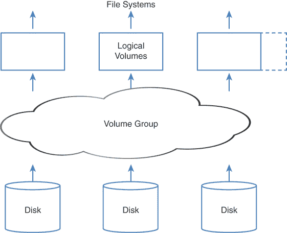

**图 15-1** LVM 架构概述

### LVM 特性

LVM 如此优秀有几个原因。最重要的是 LVM 为管理存储提供了一个灵活的解决方案。卷不再受到物理硬盘的限制。如果需要额外的存储空间，可以通过添加新的物理卷轻松地扩展卷组。缩小卷的大小也是可能的，但前提是创建在上面的文件系统支持该功能。

管理员喜欢使用 LVM 的另一个重要原因是对快照的支持。快照保留了逻辑卷当前的状态，可以用于恢复到之前的状态，或者在卷打开时对文件系统进行备份。使用快照在备份策略中至关重要。

LVM 快照通过将描述当前状态的逻辑卷管理数据（元数据）复制到快照卷来创建。只要没有变化，LVM 快照就会指向原始块。当块被修改时，包含文件之前状态的块会被复制到快照卷，因此快照卷会增长。使用这种方法确保了通过访问 LVM 快照卷，可以访问快照创建时文件的精确状态。因为当原始卷上的文件发生变化时快照会增长，所以在计划快照时，你应该确保有足够的磁盘空间。此外，快照应该是暂时的：一旦快照完成了它的作用，就可以将其删除。

使用 LVM 逻辑卷的第三个重要优势是可以轻松地更换故障的硬件。如果硬盘发生故障，可以在卷组内移动数据（通过`pvmove`命令），然后将故障磁盘从卷组中移除，并动态添加新硬盘，而不需要逻辑卷本身的任何停机时间。

## 创建 LVM 逻辑卷

创建 LVM 逻辑卷涉及创建 LVM 架构中的三层。你必须先将物理设备（如磁盘或分区）转换为物理卷（PV）；然后你需要创建卷组（VG）并将 PV 分配给它。最后一步是创建逻辑卷（LV）本身。在本节中，你将学习创建这三层所需的内容。

有不同的工具用于创建 LVM 逻辑卷。本章重点关注使用命令行工具。这些工具相对容易使用，并且适用于所有环境（无论你是否在运行图形界面）。

对于 RHCSA 考试，你完全不需要背本章讨论的命令。你真正需要记忆的是`pv`、`vg`和`lv`。打开终端，输入`pv`并按两次 Tab 键。这将显示所有以`pv`开头的命令，这些命令都是用于管理物理卷（physical volumes）的。找到你需要的命令后，使用`--help`选项运行该命令。这将显示一个用法摘要，列出了创建你所需的元素时必须执行的所有操作。示例 15-1 显示了`pvcreate --help`命令的示例（将在下一个小节中解释）。

**示例 15-1** 为`pvcreate`命令请求帮助

点击此处查看代码图像

```text
[root@control ~]# pvcreate --help

  pvcreate - Initialize physical volume(s) for use by LVM

  pvcreate PV ...

        [ -f|--force ]

        [ -M|--metadatatype lvm2 ]

        [ -u|--uuid String ]

        [ -Z|--zero y|n ]

        [    --dataalignment Size[k|UNIT] ]

        [    --dataalignmentoffset Size[k|UNIT] ]

        [    --bootloaderareasize Size[m|UNIT] ]

        [    --labelsector Number ]

        [    --pvmetadatacopies 0|1|2 ]

        [    --metadatasize Size[m|UNIT] ]

        [    --metadataignore y|n ]

        [    --norestorefile ]

        [    --setphysicalvolumesize Size[m|UNIT] ]

        [    --reportformat basic|json ]

        [    --restorefile String ]

        [ COMMON_OPTIONS ]

  Common options for lvm:

        [ -d|--debug ]

        [ -h|--help ]

        [ -q|--quiet ]

        [ -v|--verbose ]

        [ -y|--yes ]

        [ -t|--test ]

        [    --commandprofile String ]

        [    --config String ]

        [    --driverloaded y|n ]

        [    --nolocking ]

        [    --lockopt String ]

        [    --longhelp ]

        [    --profile String ]

        [    --version ]

  Use --longhelp to show all options and advanced commands.
```

### 创建物理卷

在可以使用 LVM 工具创建物理卷之前，你需要先创建一个标记为 LVM 分区类型的分区。这与第 14 章中描述的步骤相同，唯一区别是在向磁盘写入更改之前，你需要更改分区类型。

在`fdisk`和`gdisk`中，你可以使用菜单中的`t`来更改类型。如果你使用的是 MBR 磁盘，分区类型为`8e`。如果你使用的是 GUID 磁盘，使用分区类型`8e00`。如果你使用`parted`创建分区，需要在`parted`界面内使用`set n lvm on`命令（其中`n`是你想标记为用于 LVM 的分区编号）。

创建分区并将其标记为 LVM 分区类型后，你需要使用`pvcreate`将其标记为物理卷。这会在分区中写入一些元数据，允许其用于卷组（volume group）。整个过程总结在练习 15-1 中，在该练习中创建一个物理卷。另请参阅示例 15-2 以获取此过程的概述。

**示例 15-3** 验证物理卷

点击此处查看代码图像

```text
[root@server1 ~]# pvs

  PV         VG   Fmt  Attr PSize    PFree

  /dev/sda2  rhel lvm2 a--   <19.00g       0

  /dev/sdc1       lvm2 ---  1023.00m 1023.00m
```

除了显示物理卷及其属性摘要的`pvs`命令外，你还可以使用`pvdisplay`命令来显示更多详细信息。示例 15-4 显示了该命令输出的一个示例。

**示例 15-4** `pvdisplay`命令示例输出

点击此处查看代码图像

```text
[root@server1 ~]# pvdisplay

  --- Physical volume ---

  PV Name               /dev/sda2

  VG Name               rhel

  PV Size               <19.00 GiB / not usable 3.00 MiB

  Allocatable           yes (but full)

  PE Size               4.00 MiB

  Total PE              4863
```


```
Free PE               0
Allocated PE          4863
PV UUID               h9seBL-Z0AK-05xH-RNjO-UiO
```

当你创建卷组（volume groups）时，会使用物理区（physical extent）。物理区大小定义了用于创建逻辑卷（logical volumes）的构建块的大小。逻辑卷的大小始终是物理区大小的整数。如果你需要创建巨大的逻辑卷，使用较大的物理区大小会更有效。如果你不指定任何内容，将使用默认的 4.00 MiB 区大小。物理区大小始终指定为 2 MiB 的倍数，最大大小为 128 MiB。使用`vgcreate -s`选项来指定你想使用的物理区大小。

#### 注意事项

在使用 LVM 时，有一个`physical`（物理）区大小需要考虑。这是 LVM 配置中使用的基础构建块的大小。当你使用 ext4 文件系统时，使用的是`logical`（逻辑）区（extents）。LVM 上的区大小与文件系统上使用的区大小完全没有关系。

创建卷组后，你可以使用`vgs`命令请求卷组详情以获取简要摘要，或使用`vgdisplay`命令获取更多信息。示例 15-6 显示了`vgdisplay`命令输出的示例。

**示例 15-6**显示当前卷组属性

点击此处查看代码图像

```
[root@server1 ~]# vgdisplay

...

  --- Volume group ---

  VG Name                vgdata

  System ID             

  Format                 lvm2

  Metadata Areas         1

  Metadata Sequence No   2

  VG Access              read/write

  VG Status              resizable

  MAX LV                 0

  Cur LV                 1

  Open LV                0

  Max PV                 0

  Cur PV                 1

  Act PV                 1

  VG Size                1020.00 MiB

  PE Size                4.00 MiB

  Total PE               255

  Alloc PE / Size        127 / 508.00 MiB

  Free  PE / Size        128 / 512.00 MiB

  VG UUID                b68TU5-UPQv-xQRB-7Djx-SuZf-agDb-vAujYD
```

### 创建逻辑卷和文件系统

现在卷组已经创建，你就可以开始从它创建逻辑卷了。此过程比创建物理卷或卷组稍微复杂，因为有更多的选项需要选择。在创建逻辑卷时，你必须指定卷名称和大小。

卷的大小可以使用`-L`选项指定为绝对值。例如，使用`-L 5G`创建一个大小为 5-GiB 的 LVM 卷。或者，你可以使用`-l`选项使用相对大小。例如，使用`-l 50%FREE`使用所有可用磁盘空间的一半。你还需要指定逻辑卷所属的卷组名称，并且可选地（但强烈建议），你可以使用`-n`来指定逻辑卷的名称。例如，使用`lvcreate -n lvvol1 -L 100M vgdata`创建一个名为 lvvol1 的逻辑卷并将其添加到 vgdata 卷组。一旦逻辑卷创建，你就可以使用`mkfs`工具在它之上创建文件系统。

### 理解 LVM 设备命名

现在逻辑卷已经创建，你就可以开始使用它了。要做到这一点，你需要知道设备名称。LVM 卷设备名称可以通过多种方式寻址。简单的方法是将设备寻址为`/dev/vgname/lvname`。例如，如果你创建了一个名为 lvdata 的卷，它的可用磁盘空间从 vgdata 卷组获取，那么设备名称将是`/dev/vgdata/lvdata`，它实际上是设备映射器（device mapper）名称的符号链接（接下来将解释）。

对于 LVM 卷命名，另一个系统起了作用：设备映射器（device mapper）。设备映射器（简称为`dm`）是 Linux 内核用于寻址存储设备的通用接口。设备映射器被多种设备类型使用，例如 LVM 卷，以及软件 RAID 和高级网络设备（如多路径设备）。

设备映射器设备在检测到时生成，并使用如`/dev/dm-0`和`/dev/dm-1`这样没有意义的名称。为了方便访问这些设备，设备映射器在`/dev/mapper`目录下创建指向这些无意义设备名称的符号链接。符号链接遵循结构`/dev/mapper/vgname-lvname`。

因此，设备`/dev/vgdata/lvdata`也被称为`/dev/mapper/vgdata-lvdata`。在使用 LVM 逻辑卷时，你可以使用这两个设备名称之一。示例 15-7 显示了设备映射器提供的不同 LVM 设备名称概述。在练习 15-2 中，你将学习如何创建卷组和逻辑卷。

**示例 15-7** LVM 设备名称概述

点击此处查看代码图像

```
[root@server1 ~]# \ls /dev/vgdata/lvdata

...

  --- Volume group ---

  VG Name                vgdata

  System ID             

  Format                 lvm2

  Metadata Areas         1

  Metadata Sequence No   2

  VG Access              read/write

  VG Status              resizable

  MAX LV                 0

  Cur LV                 1

  Open LV                0

  Max PV                 0

  Cur PV                 1

  Act PV                 1

  VG Size                1020.00 MiB

  PE Size                4.00 MiB

  Total PE               255

  Alloc PE / Size        127 / 508.00 MiB

  Free  PE / Size        128 / 512.00 MiB

  VG UUID                b68TU5-UPQv-xQRB-7Djx-SuZf-agDb-vAujYD
```

### 调整 LVM 卷的大小

使用 LVM 的主要优势之一是 LVM 卷很容易调整大小，这在你的文件系统可用可用磁盘空间时非常有用。如果使用的是 XFS 文件系统，卷可以增大但不能减小。其他文件系统如 Ext4 也支持减小大小。Ext4 文件系统只能在离线状态下减小，这意味着你需要卸载它后才能调整大小。在本节中，你将学习如何增大 LVM 逻辑卷的大小。要增大逻辑卷的大小，你需要在卷组中有可用磁盘空间，因此我们先处理这个问题。

#### 调整卷组大小

LVM 灵活性最重要的特征之一在于，调整卷组以及使用卷组空间的逻辑卷非常简单。`vgextend`命令用于向卷组添加存储空间，`vgreduce`命令用于从卷组中移除物理卷（这可能会导致一些复杂性）。对于 RHCSA 考试，你需要知道如何扩展卷组的可用存储。此过程相对简单：

1. 确保有一个可用的物理卷或设备添加到卷组。
2. 使用`vgextend`扩展卷组。新的磁盘空间将立即显示在卷组中。

扩展卷组后，你可以使用`vgs`命令验证是否已向卷组添加物理卷。在示例 15-8 中，你可以看到 vgdata VG 包含两个物理卷，如 #PV 列所示。

### 示例 15-8：使用`vgs`验证 VG 调整大小操作

点击此处查看图像

```
[root@server1 ~]# vgs

  VG      #PV  #LV  #SN   Attr     VSize      VFree  

  centos    1    2    0   wz--n-   <19.00g    0 

  vgdata    2    1    0   wz--n-   1020.00m   512.00m
```


## 调整逻辑卷和文件系统的所有权

就像卷组可以通过`vgextend`命令扩展一样，逻辑卷也可以通过`lvextend`命令进行扩展。该命令有一个非常有用的选项`-r`，可以同时扩展逻辑卷上的文件系统；建议使用此选项，而不是采用分别扩展逻辑卷和在逻辑卷之上扩展文件系统的替代方法。如果文件系统正在增大，大多数文件系统调整大小的操作都可以在线完成，而无需卸载文件系统。

要增大逻辑卷的大小，请使用`lvextend`或`lvresize`，后接`-r`选项来调整其使用的文件系统的大小。然后指定你希望调整后的卷的大小。最简单且直观的方法是使用`-L`后跟`+`号以及你想要添加的磁盘空间，例如`lvresize -L +1G -r /dev/vgdata/lvdata`。

调整逻辑卷的另一种方法是使用`-l`选项。该选项后跟着添加到逻辑卷的逻辑区数量，或者卷组中使用的逻辑区的绝对或相对百分比。例如，你可以使用以下命令来调整逻辑卷：


- `lvresize -r -l 75%VG /dev/vgdata/lvdata`：这将调整逻辑卷，使其占用卷组中总磁盘空间的 75%。
- `lvresize -r -l +75%VG /dev/vgdata/lvdata`：这尝试将卷组总大小的 75% 添加到逻辑卷中。（注意与上一个命令的区别。）
- `lvresize -r -l +75%FREE /dev/vgdata/lvdata`：这将所有可用磁盘空间数的 75% 添加到逻辑卷。
- `lvresize -r -l 75%FREE /dev/vgdata/lvdata`：这将逻辑卷调整为总大小等于可用磁盘空间数量的 75%。（注意与上一个命令的区别。）

逻辑区（logical extent）是创建逻辑卷时使用的逻辑构建块，它映射到物理区，物理区的大小可以在创建卷组时指定。所有的调整大小操作都需要匹配完整的逻辑区。你有时会发现调整大小的大小会向上或向下舍整到逻辑区的大小。你也可以直接通过使用`lvresize`命令的`-l`选项，直接指定需要添加或删除的逻辑区数量。

如你所见，调整逻辑卷有很多选项，你需要务必使用正确的选项，因为很容易出错！在练习 15-3 中，你将学习如何调整逻辑卷以及运行在其之上的文件系统。

### 注意事项

XFS 文件系统的大小不能减小，只能增大。如果你需要一个可以缩小尺寸的文件系统，请使用 Ext4 而不是 XFS。

## 配置 Stratis

在 RHEL 8 中，Red Hat 添加了两种高级存储类型：Stratis 和 VDO。Stratis 是一种所谓的卷管理文件系统，它引入了以前 RHEL 版本中不具备的高级存储功能：

- **精简配置（Thin provisioning）：** 此功能允许 Stratis 文件向用户呈现比其实际大小大多的空间。这在许多环境中有用，例如虚拟桌面，每个用户可能会看到 20 GiB。
- **快照（Snapshots）：** 快照允许用户对当前状态拍摄“照片”。
- **缓存层（Cache tier）：** 缓存层使数据访问更快。
- **编程 API：** 编程 API 确保数据可以进行配置。
- **监控与修复：** Stratis 具有监控和修复自身的功能。

### 理解 Stratis 架构

Stratis 的最底层是池（pool）。从功能角度来看，池类似于 LVM 卷组。一个 Stratis 池由一个或多个存储设备（称为块设备`blockdev`）组成。Stratis 仅与 XFS 工作。当创建文件系统时，它是精简配置的；不指定大小，精简卷会随着数据的增加自动增长。

### 创建 Stratis 存储

创建 Stratis 卷是一个多步骤过程。本节提供了层级概述，然后练习 15-44 将引导你完成该过程。你首先创建一个池。一旦添加了池，你就可以从它创建文件系统。

1. 使用`yum`安装 Stratis 软件，安装`stratis-cli`和`stratisd`软件包。
2. 使用`systemctl enable --now stratisd`并启用用户空间守护进程。
3. 一旦守护进程运行，使用`stratis pool create`命令创建你要使用的池。例如，使用`stratis pool create mypool /dev/sdd`根据块设备`/dev/sdd`创建池。以后你可以添加额外的块设备，使用`stratis pool add-data poolname blockdevname`，例如`stratis pool add-data mypool /dev/sde`。
4. 创建池后，使用`stratis fs create poolname fsname`添加文件系统。
5. 使用`stratis fs list`命令验证创建成功。
6. 创建文件系统后，你可以挂载它。要在`/etc/fstab`中挂载 Stratis 文件系统，必须使用`UUID`；不支持设备名称。此外，在`/etc/fstab`中挂载 Stratis 卷时，包含`x-systemd.requires=stratisd.service`挂载选项，以确保 Systemd 在`stratisd`服务加载之前激活此设备。

## 管理 Stratis

创建 Stratis 文件系统后，你可以执行多种管理任务。首先，你可以使用`stratis pool add-data`动态扩展池。此外，你需要使用 Stratis 特有的工具监控 Stratis 卷，因为传统的 Linux 工具无法处理精简配置卷。可用命令如下：

- `stratis blockdev`：显示所有用于 Stratis 的块设备的信息。
- `stratis pool`：提供有关 Stratis 池的信息。特别注意`Physical Used`（物理用量）参数，该参数不应过于接近`Physical Size`（物理大小）参数。
- `stratis filesystem`：允许你监控单个文件系统。

你必须管理的另一个 Stratis 特性是快照（snapshot）。快照包含了创建时瞬间文件系统的状态。创建后，可以对快照进行修改。同样需要了解的是，快照与其源之间是没有链接的，这使得快照的寿命可以比创建它的文件系统更长。这与 LVM 快照有本质区别，在 LVM 快照中，如果其关联的卷被删除，快照将无法存在。

在练习 15-4 中，你将设置一个带有 Stratis 卷的环境。

## 配置 VDO

在上一节中，你学习了 Stratis。在本节中，你将学习虚拟数据优化器（VDO），这是一种为了提供数据去重功能而开发的解决方案。

### 理解 VDO

虚拟数据优化器是 RHEL 8 另一种高级存储解决方案。VDO 的开发是为了通过应用去重功能来减少块设备的磁盘空间占用。VDO 创建卷，在任何类型的现有块设备上实现去重。在 VDO 设备之上，你可以创建一个文件系统，或者将其用作 LVM 设置中的物理卷。

VDO 的主要目的是数据去重。它通过三种常用技术对数据进行去重：

- 零块消除（Zero-block elimination）过滤掉只包含零的数据块。
- 数据去重（Deduplication）减少冗余数据块。
- 当`kvdo`内核模块压缩数据块时，会发生压缩（Compression）。

VDO 在特定环境中特别有用。典型的用例是容器和虚拟机的主机平台，在那里去重引擎确保了更高效的磁盘存储使用。通常，在此类环境中工作，可以使用高达物理大小十倍的逻辑大小。

另一个 VDO 表现良好的典型环境是云块存储。例如，如果将 VDO 作为 Ceph 存储的底层存储层，则可以使用高达物理大小三倍的逻辑大小。

### 设置 VDO

要配置 VDO，你首先需要确保底层块设备的最小大小为 4 GiB。接下来，你需要安装`vdo`和`kmod-vdo`包。这些包确保了所需的内核模块可用。

接下来，使用`vdo create`命令创建设备。在创建设备时，你可以使用`--vdoLogicalSize=`选项指定卷的逻辑大小。例如，使用`vdo create --name=vdo1 --device=/dev/sde --vdoLogicalSize=1T`创建逻辑大小为 1 TiB 的卷。

创建设备后，你可以使用`mkfs.xfs -K /dev/mapper/vdo1`在其上方创建一个 XFS 文件系统。`mkfs.xfs`的`-K`选项防止文件系统中的未使用块立即丢弃，这使得命令运行速度显著加快。

文件系统一旦创建，你可以在`/etc/fstab`中添加一行来自动挂载它。确保包含挂载选项`x-systemd.requires=vdo.service,discard`，这将触发`vdo systemd`服务的加载。要验证所有工作运行正常，你现在可以使用`vdostats --human-readable`命令。

### 提示

记住使 VDO 挂载持久化的选项可能具有挑战性。幸运的是，`/usr/share/doc/vdo/examples/systemd`中有一个 Systemd 挂载文件示例，如示例 15-9 所示。只需根据你的需求修改挂载文件的设置并将其复制到`/etc/systemd/system/*yourmountpoint*.mount`。不要忘记启用它，它将在下次重启时自动挂载。

### 示例 15-9 VDO 示例 Systemd 挂载单元文件

```ini
[Unit]

Description = Mount filesystem that lives on VDO

name = VDO.mount

Requires = vdo.service systemd-remount-fs.service

After = multi-user.target

Conflicts = umount.target

[Mount]

What = /dev/mapper/my_vdo

Where = /VDO

Type = xfs

Options = discard

[Install]

WantedBy = multi-user.target

[root@localhost systemd]# pwd

/usr/share/doc/vdo/examples/systemd
```


练习 15-5 引导你完成创建精简分配 VDO 卷的步骤。

### 总结

在本章中，你学习了如何在 RHEL 8 上使用高级存储。首先，你阅读了如何使用 LVM 为存储带来活性。通过使用 LVM，你获得了易于调整大小的卷和多设备逻辑卷的优势。接下来，你接触了 Stratis，这是一种卷管理文件系统。Stratis 为 RHEL 8 带来了下一代存储功能，并默认创建精简分配的文件系统。最后，你学习了如何使用虚拟数据优化器（VDO）在特定场景下实现数据去重。

### 考试准备任务

如“如何使用本书”节所述，你已经（此处原文不完整，根据语境推断，翻译已在此结束）...

## 6.](#appa.xhtml_raquiz15_6) 假设卷组中有可用磁盘空间，哪条命令可以向逻辑卷 `lvvol1` 添加 100 MB 空间？

## 7.](#appa.xhtml_raquiz15_7) 在使用 Stratis 时，你应该在 `/etc/fstab` 中添加哪行内容来挂载 Stratis 卷？

## 8.](#appa.xhtml_raquiz15_8) 你使用哪个命令来创建一个基于块设备 `/dev/sdd` 的 Stratis 池？

## 9.](#appa.xhtml_raquiz15_9) 你使用哪个命令来创建一个虚拟大小为 1 TiB 的 VDO 设备？

## 10.](#appa.xhtml_raquiz15_10) 使用 `mkfs.xfs` 时，需要哪个选项才能在 VDO 精简置备卷上成功创建 XFS 文件系统？

### 章节末实验

为了完成以下章节末实验，你需要一个专用的磁盘设备。在开始之前，请使用 USB 闪存盘或向你的虚拟环境中添加一个新的虚拟磁盘。

### 实验 15.1

1. 创建一个名为 `lvgroup` 的 500 MB 逻辑卷。使用 XFS 文件系统对其格式化并持久挂载到 `/groups`。重启服务器以验证挂载是否正常。
2. 重启后，为你创建的 `lvgroup` 卷再添加 250 MB。在调整卷的同时，验证文件系统是否也进行了调整。
3. 验证卷扩展是否成功。

### 实验 15.2

1. 创建一个大小为 5 GiB 的 Stratis 池。在该池中创建两个 Stratis 文件系统，并确保它们自动挂载。
2. 向 Stratis 池添加一个额外的块设备，并验证池的大小已成功扩展。

### 实验 15.3

1. 创建一个虚拟大小为 1 TiB 的 VDO 卷。
2. 使用示例 Systemd 单元文件确保 VDO 卷被自动挂载。
3. 重启服务器以验证一切仍然运行正常。

# 第三部分

## 执行高级系统管理任务

## 第 16 章

# 基础内核管理

本章涵盖了以下主题：

- 理解 Linux 内核的作用
- 内核模块
- 升级 Linux 内核

Linux 内核是 Linux 操作系统的核心。它负责许多事务，包括硬件管理。在本章中，你将从 RHCSA 的视角学习 Linux 内核所需的所有知识。事实上，你甚至会学到更多。本章包含了不在当前 RHCSA 目标列表中的主题信息。我认为了解这些主题是有好处的。任何严肃的 Linux 管理员都应该能够处理与本章讨论的主题相关的问题。

### “我已经掌握这些了吗？”测验

“我已经掌握这些了吗？”测验可以让你评估自己应该仔细阅读整个章节，还是跳到“考试准备任务”部分。如果你对这些问题的答案或对自己这些主题知识的评估有疑问，请通读整个章节。表 16-1 列出了本章的主要标题及其对应的“我已经掌握这些了吗？”测验题。你可以在附录 A，“‘我已经掌握这些了吗？’测验和‘复习题’的答案](#appa.xhtml_appa)”中找到答案。

| 基础主题章节 | 题目 |
| --- | --- |
| 理解 Linux 内核的作用 | 1–4 |
| 内核模块 | 5–9 |
| 升级 Linux 内核 | 10 |

**表 16-1** “我已经掌握这些了吗？”章节与题目映射

## 1.](#appa.xhtml_rquiz16_1) 什么会导致内核被污染（tainted）？

1. 无法作为开源驱动程序提供的内核驱动程序
2. 为不同操作系统开发但已移植到 Linux 的驱动程序
3. 运行失败的驱动程序
4. 不支持的驱动程序

## 2.](#appa.xhtml_rquiz16_2) 显示启动以来内核事件的命令名称是什么？

1. `logger`
2. `dmesg`
3. `klogd`
4. `journald`

## 3.](#appa.xhtml_rquiz16_3) 哪条命令可以找到正在使用的内核实际版本？

1. `uname -r`
2. `uname -v`
3. `procinfo -k`
4. `procinfo -l`

## 4.](#appa.xhtml_rquiz16_4) 哪条命令显示你正在使用的 RHEL 版本？

1. `uname -r`
2. `cat /proc/rhel-version`
3. `cat /etc/redhat-release`
4. `uname -k`

## 5.](#appa.xhtml_rquiz16_5) 帮助内核正确初始化硬件设备的进程名称是什么？

1. `systemd-udevd`
2. `hwinit`
3. `udev`
4. `udevd`

## 6.](#appa.xhtml_rquiz16_6) 你的系统在哪里寻找用于初始化新硬件设备的默认规则？

1. `/etc/udev/rules.d`
2. `/usr/lib/udev/rules.d`
3. `/usr/lib/udev.d/rules`
4. `/etc/udev.d/rules`

## 7.](#appa.xhtml_rquiz16_7) 你应该使用哪条命令卸载内核模块，包括其所有的依赖项？

1. `rmmod`
2. `insmod -r`
3. `modprobe -r`
4. `modprobe`

## 8.](#appa.xhtml_rquiz16_8) 哪条命令可以让你查看服务器硬件是否已加载适当的内核模块？

1. `lsmod`
2. `modprobe -l`
3. `lspci -k`
4. `lspci`

## 9.](#appa.xhtml_rquiz16_9) 你在哪里指定内核参数以使其持久化？

1. `/etc/modules.conf`
2. `/etc/modprobe.conf`
3. `/etc/modprobe.d/somefilename`
4. `/usr/lib/modprobe.d/somefilename`

## 10.](#appa.xhtml_rquiz16_10) 关于更新内核的哪些陈述不正确？

1. `yum update kernel` 命令将安装新内核而不是更新它。
2. `yum install kernel` 命令将安装新内核并保留旧内核。
3. 内核包应该设置为 `yum` 保护包，以确保更新后旧内核仍然可用。
4. 安装新内核版本后，你必须运行 `grub2-mkconfig` 命令修改 GRUB 2 启动菜单，以便显示旧内核和新安装的内核。

### 基础主题

### 理解 Linux 内核的作用

Linux 内核是操作系统的核心。它是位于 shell 环境下操作 Linux 的用户与计算机可用硬件之间的层。内核管理接收来自软件的 I/O 指令，并将其翻译为中央处理器和计算机其他硬件执行的处理指令。内核还负责处理重要的操作系统任务。此类任务的一个例子是调度器，它确保在操作系统上启动的任何进程都由 CPU 处理。

#### 理解内核线程和驱动程序的使用

内核执行的操作系统任务由不同的内核线程实现。可以使用 `ps aux` 这样的命令轻松识别内核线程。内核线程名称列在方括号中（参见示例 16-1）。

**示例 16-1** 使用 `ps aux` 列出内核线程

```text
[root@server1 ~]# ps aux | head -n 20

USER   PID %CPU %MEM    VSZ   RSS TTY   STAT  START  TIME COMMAND

root   1   1.8  0.6   52980  6812 ?      Ss   11:44  0:02 /usr/lib/
systemd/systemd --switched-root --system --deserialize 23

root   2   0.0  0.0    0    0 ?    S   11:44  0:00  [kthreadd]

root   3   0.0  0.0    0    0 ?    S   11:44  0:00  [ksoftirqd/0]

root   4   0.0  0.0    0    0 ?    S   11:44  0:00  [kworker/0:0]

root   5   0.0  0.0    0    0 ?    S<  11:44  0:00  [kworker/0:0H]

root   6   0.0  0.0    0    0 ?    S   11:44  0:00  [kworker/u128:0]

root   7   0.1  0.0    0    0 ?    S   11:44  0:00  [migration/0]

root   8   0.0  0.0    0    0 ?    S   11:44  0:00  [rcu_bh]

root   9   0.0  0.0    0    0 ?    S   11:44  0:00  [rcuob/0]

root   10  0.0  0.0    0    0 ?    S   11:44  0:00  [rcuob/1]

root   11  0.0  0.0    0    0 ?    S   11:44  0:00  [rcuob/2]

root   12  0.0  0.0    0    0 ?    S   11:44  0:00  [rcuob/3]

root   13  0.0  0.0    0    0 ?    S   11:44  0:00  [rcuob/4]

root   14  0.0  0.0    0    0 ?    S   11:44  0:00  [rcuob/5]

root   15  0.0  0.0    0    0 ?    S   11:44  0:00  [rcuob/6]

root   16  0.0  0.0    0    0 ?    S   11:44  0:00  [rcuob/7]

root   17  0.0  0.0    0    0 ?    S   11:44  0:00  [rcuob/8]

root   18  0.0  0.0    0    0 ?    S   11:44  0:00  [rcuob/9]

root   19  0.0  0.0    0    0 ?    S   11:44  0:00  [rcuob/10]
```

在早期的 Linux 时代，内核必须编译以包含支持计算机硬件所需的所有驱动程序。其他特定功能也需要编译到内核中。自 20 世纪 90 年代中期 Linux 内核 2.0 发布以来，内核不再是编译的，而是模块化的。*模块化内核*由一个较小的核心内核组成，并通过需要时加载的模块提供驱动支持。模块化内核非常高效，因为它们只包含了真正需要的模块。

### 提示

内核模块实现特定的内核功能。内核模块用于加载允许与硬件设备进行适当通信的驱动程序，但不仅限于加载硬件驱动程序。例如，文件系统支持是作为模块加载的。其他内核特性也可以作为模块加载。

### 理解硬件初始化

驱动程序的加载是一个自动化过程，其大致如下：

1. 在启动期间，内核会探测可用硬件。
2. 一旦检测到硬件组件，`systemd-udevd` 进程就会负责加载相应的驱动程序并使硬件设备可用。
3. 为了决定如何初始化设备，`systemd-udevd` 会读取 `/usr/lib/udev/rules.d` 中的规则文件。这些是系统提供的规则文件，不应修改。
4. 在处理完系统提供的 `udev` 规则文件后，`systemd-udevd` 进入 `/etc/udev/rules.d` 目录读取任何自定义规则（如果存在）。
5. 结果是，所需的内核模块会自动加载，关于内核模块和相关硬件的状态会被写入 `sysfs` 文件系统，该系统挂载在 `/sys` 目录上。Linux 内核使用此伪文件系统来跟踪硬件相关的设置。

`systemd-udevd` 进程不是一个一次性进程；它会持续监控新硬件设备的插拔。为了直观地了解其工作原理，你可以以 root 身份输入命令 `udevadm monitor`。这会列出在激活新硬件设备时处理的所有事件。例如，如果在该命令运行时你插入了一个 USB 设备，你可以确切地看到正在发生什么。按 Ctrl-C 关闭 `udevadm monitor` 的输出。

示例 16-4 显示了 `udevadm monitor` 命令的输出。在该命令中，你可以看到硬件提供的功能是如何通过内核和 `systemd-udevd` 协作工作自动发现的。硬件探测的每个阶段都通过在 `/sys` 文件系统中创建一个文件来结束。一旦硬件完全初始化，你也可以看到某些内核模块被加载。

### 注意

虽然了解硬件初始化很有用，但它并不包含在当前的 RHCSA 目标中。

**示例 16-4** `udevadm monitor` 命令的输出

```text
[root@server2 ~]# udevadm monitor

monitor will print the received events for:

UDEV - udev 在处理规则后发出的事件

KERNEL - 内核 uevent

KERNEL[132406.831270] add /devices/pci0000:00/0000:00:11.0/0000:02:
  04.0/usb1/1-1 (usb)

KERNEL[132406.974110] add /devices/pci0000:00/0000:00:11.0/0000:02:
  04.0/usb1/1-1/1-1:1.0 (usb)

UDEV [132406.988182] add /devices/pci0000:00/0000:00:11.0/0000:02:
  04.0/usb1/1-1 (usb)

KERNEL[132406.999249] add /module/usb_storage (module)

UDEV [132407.001203] add /module/usb_storage (module)

KERNEL[132407.002559] add /devices/pci0000:00/0000:00:11.0/0000:02:
  04.0/usb1/1-1/1-1:1.0/host33 (scsi)

UDEV [132407.002575] add /devices/pci0000:00/0000:00:11.0/0000:02:
  04.0/usb1/1-1/1-1:1.0 (usb)

KERNEL[132407.002583] add /devices/pci0000:00/0000:00:11.0/0000:00:11.0/0000:02:
  04.0/usb1/1-1/1-1:1.0/host33/scsi_host/host33 (scsi_host)

KERNEL[132407.002590] add /bus/usb/drivers/usb-storage (drivers)

UDEV [132407.004479] add /bus/usb/drivers/usb-storage (drivers)

UDEV [132407.005798] add /devices/pci0000:00/0000:00:11.0/0000:02:
  04.0/usb1/1-1/1-1:1.0/host33 (scsi)

UDEV [132407.007385] add /devices/pci0000:00/0000:00:11.0/0000:02:
  04.0/usb1/1-1/1-1:1.0/host33/scsi_host/host33 (scsi_host)

KERNEL[132408.008331] add /devices/pci0000:00/0000:00:11.0/0000:02:
  04.0/usb1/1-1/1-1:1.0/host33 (scsi_host)
```

# 示例 16-6 使用 `modinfo` 显示模块信息

点击此处查看代码图像

```text
[root@server1 ~]# modinfo e1000

filename:       /lib/modules/4.18.0-80.el8.x86_64/kernel/drivers/net/
                  ethernet/intel/e1000/e1000.ko.xz

version:        7.3.21-k8-NAPI

license:        GPL

description:    Intel(R) PRO/1000 Network Driver

author:         Intel Corporation, <linux.nics@intel.com>

rhelversion:    8.0

srcversion:     A2C44EC5D0B865EE9C972D5

alias:          pci:v00008086d00002E6Esv*sd*bc*sc*i*

...

depends:

intree:         Y

name:           e1000

vermagic:       4.18.0-80.el8.x86_64 SMP mod_unload modversions

sig_id:         PKCS#7

signer:         Red Hat Enterprise Linux kernel signing key
```


```text
sig_key:        20:16:97:CB:B1:7E:D5:A0:A7:3C:0B:40:E2:54:80:2D:83:F1:
                72:5A

sig_hashalgo:   sha256

signature:      97:3A:58:F6:4E:B7:F1:CE:44:50:65:5E:84:41:D8:A7:A3:
                A2:2D...

parm:           TxDescriptors:Number of transmit descriptors (array
                of int)

parm:           RxDescriptors:Number of receive descriptors (array
                of int)

parm:           Speed:Speed setting (array of int)

parm:           Duplex:Duplex setting (array of int)

parm:           AutoNeg:Advertised auto-negotiation setting (array
                of int)

parm:           FlowControl:Flow Control setting (array of int)

parm:           XsumRX:Disable or enable Receive Checksum offload
                (array of int)

parm:           TxIntDelay:Transmit Interrupt Delay (array of int)

parm:           TxAbsIntDelay:Transmit Absolute Interrupt Delay
                (array of int)

parm:           RxIntDelay:Receive Interrupt Delay (array of int)

parm:           RxAbsIntDelay:Receive Absolute Interrupt Delay
                (array of int)

parm:           InterruptThrottleRate:Interrupt Throttling Rate
                (array of int)

parm:           SmartPowerDownEnable:Enable PHY smart power down
                (array of int)

parm:           copybreak:Maximum size of packet that is copied to
                a new buffer on receive (uint)

parm:           debug:Debug level (0=none,...,16=all) (int)
```

要手动加载和卸载模块，可以使用`modprobe`和`modprobe -r`命令。在早期的 Linux 版本中，你可能使用过`insmod`和`rmmod`命令。现在应再使用它们，因为它们不会加载内核模块依赖项。在练习 16-1 中，你将学习如何使用这些命令管理内核模块。

## 检查硬件设备的驱动可用性

在现代 Linux 服务器上，支持许多硬件设备。有时，你可能会发现某些设备没有被正确支持，因为它们的模块尚未加载。检查你的硬件是否出现这种情况的最佳方法是使用`lspci`命令。如果不带参数使用，它会显示在 PCI 总线上检测到的所有硬件设备。一个非常有用的参数是`-k`，它会列出用于已检测 PCI 设备的所有内核模块。示例 16-7 显示了`lspci -k`命令的示例输出。

## 示例 16-7 检查内核模块可用性

点击此处查看代码图像

```text
[root@server1 ~]# lspci -k | head

00:00.0 Host bridge: Intel Corporation 440BX/ZX/DX - 82443BX/ZX/DX
  Host bridge (rev 01)
       Subsystem: VMware Virtual Machine Chipset
       Kernel driver in use: agpgart-intel

00:01.0 PCI bridge: Intel Corporation 440BX/ZX/DX - 82443BX/ZX/
  DX AGP bridge (rev 01)

00:07.0 ISA bridge: Intel Corporation 82371AB/EB/MB PIIX4 ISA (rev 08)
       Subsystem: VMware Virtual Machine Chipset

00:07.1 IDE interface: Intel Corporation 82371AB/EB/MB PIIX4 IDE
  (rev 01)
       Subsystem: VMware Virtual Machine Chipset
       Kernel driver in use: ata_piix
       Kernel modules: ata_piix, ata_generic

00:07.3 Bridge: Intel Corporation 82371AB/EB/MB PIIX4 ACPI (rev 08)
       Subsystem: VMware Virtual Machine Chipset
       Kernel modules: i2c_piix4

00:07.7 System peripheral: VMware Virtual Machine Communication
  Interface (rev 10)
       Subsystem: VMware Virtual Machine Communication Interface
       Kernel driver in use: vmw_vmci
       Kernel modules: vmw_vmci

00:0f.0 VGA compatible controller: VMware SVGA II Adapter
       Subsystem: VMware SVGA II Adapter
       Kernel driver in use: vmwgfx
       Kernel modules: vmwgfx

00:10.0 SCSI storage controller: LSI Logic / Symbios Logic 53c1030
  PCI-X Fusion-MPT Dual Ultra320 SCSI (rev 01)
       Subsystem: VMware LSI Logic Parallel SCSI Controller
       Kernel driver in use: mptspi
       Kernel modules: mptspi

00:11.0 PCI bridge: Intel Corporation 440BX/ZX/DX - 82443BX/ZX/

00:15.0 PCI bridge: VMware PCI Express Root Port (rev 01)
       Kernel driver in use: pcieport
```


如果你发现 PCI 设备可以加载内核模块，你可能正在处理一个不支持的设备。更好的方法是检查硬件是否完全支持。

### 管理内核参数

有时，你可能希望带有参数加载内核模块。要这样做，你首先需要找到要使用的参数。如果你找到了要使用的参数，可以手动加载，并在参数名后加上值。要使此过程自动化，你可以在`/etc/modprobe.d`目录下创建一个文件。在练习 16-2 中，你将看到如何使用`cdrom`模块来实现。

### 升级 Linux 内核

你需要升级内核。升级内核时会安装新版本并设置为默认内核。不过，旧版本仍然可用。这确保了如果新安装的内核有问题，计算机仍然可以启动。要安装新版本的内核，可以使用`yum upgrade kernel`命令。`yum install kernel`命令同样有效。

最后安装的四个内核文件将保留在`/boot`目录中。`GRUB 2`引导程序会自动识别该目录中的所有内核。这允许你在启动时选择旧内核。

### 总结

在本章中，你学习了如何与 Linux 内核工作。你了解到 Linux 内核是模块化的，以及处理内核模块的重要性。你还学习了如何管理内核模块，以及在处理新硬件时如何自动管理内核模块。

## 考试任务

正如引言中“如何使用本书”所示，你有多种准备考试的选择：章末实验、附录 B 中的记忆表、第 27 章“最终准备”以及模拟考试。

### 复习所有关键主题

回顾章节中最重要的主题，这些主题在页外边缘标有关键主题图标。表 16-3 列出了这些关键主题的索引及其页码。

| 关键主题元素 | 描述 | 页码 |
| --- | --- | --- |
| 列表 | 内核相关工具概述 | 371 |
| 表 16-2 | 内核模块概述 | 376 |

**表 16-3** 第 16 章 关键主题

### 记忆完成表格和列表

打印附录 B“记忆表格”（在随附网站上找到）或至少打印本章节的内容，并根据记忆完成表格和列表。附录 C“记忆表格答案密钥”包含完成后的表格和列表，以供你检查工作结果。

### 定义关键术语

定义本章中的以下关键术语，并在术表中检查你的答案：

- `kernel`
- `module`
- `dmesg`
- `udev`
- `sysfs`
- `proc`
- `tainted kernel`

### 复习题

以下问题旨在帮助你测试对概念、术语以及知识广度的掌握。你可以在附录 A 中找到这些问题的答案。

1. **1.**](#appa.xhtml_raquiz16_1) 哪个命令可以显示计算机上使用的内核当前版本？
2. **2.**](#appa.xhtml_raquiz16_2) 在哪里可以找到你的 RHEL 8 安装的当前版本信息？
3. **3.**](#appa.xhtml_raquiz16_3) 哪个命令可以显示当前加载的内核模块列表？
4. **4.**](#appa.xhtml_raquiz16_4) 哪个命令允许你发现内核模块参数？
5. **5.**](#appa.xhtml_raquiz16_5) 如何卸载内核模块？
6. **6.**](#appa.xhtml_raquiz16_6) 在尝试卸载内核模块时遇到错误消息，你可以做什么？
7. **7.**](#appa.xhtml_raquiz16_7) 如何找到支持哪些内核模块参数？
8. **8.**](#appa.xhtml_raquiz16_8) 在哪里指定应该持久化使用的内核模块参数？
9. **9.**](#appa.xhtml_raquiz16_9) 假设`cdrom`模块有一个参数`debug`，该参数必须设置为 1 才能启用调试模式，你会在自动加载该模块的文件中包含哪一行代码？
10. **10.**](#appa.xhtml_raquiz16_10) 如何安装新版本的内核？

### 章节末实验

在章节末实验中，你将安装一个新版本的内核并与内核模块进行操作。

### 实验 16.1

1. 检查是否有新版本的内核。如果有，请安装它并重启计算机以使用。
2. 使用适当的命令显示内核记录的近期事件。
3. 找到网卡使用的内核模块。找出它是否具有选项。尝试手动加载这些内核模块选项之一；如果成功，则采取必要措施持久化加载此选项。

# 第 17 章：管理和理解启动过程

**本章涵盖了以下主题：**

- 管理`Systemd Target`
- 与`GRUB 2`工作

本章涵盖了以下 RHCSA 考试目标：

- 配置系统自动启动到特定目标
- 修改系统引导加载程序

在本章中，你将学习 Red Hat Enterprise Linux 上的启动过程是如何组织的。在本章的第一部分，你将学习`Systemd target`以及如何使用它们将你的 Linux 系统启动到特定状态。本章的第二部分讨论了`GRUB2`以及如何对`GRUB 2`引导加载程序应用更改。故障排除不是本章的主题；它位于第 18 章“必要的故障排除技能”。

### “我已经知道了吗？”测试题

“我已经知道了吗？”测试题允许你评估应该仔细阅读整个本章，还是跳转到“考试准备任务”部分。如果你对这些问题的答案或对自己这些主题知识的评估有疑问，请阅读整个章节。表 17-1 列出了本章的主要标题以及它们对应的“我已经知道了吗？”测试题。你可以在附录 A 中找到‘我已经知道了吗？测试题和‘复习题’的答案”。

| 基础主题章节 | 题目 |
| --- | --- |
| 与`Systemd`工作 | 1–7 |
| 与`GRUB`工作 | 8–10 |

**表 17-1** “我知道吗？”

1. **1.**](#appa.xhtml_raquiz16_1) 为了允许 target 隔离，需要在单元文件中一个特定的语句。以下哪项描述了这一点？
   - `AllowIsolate`
   - `Isolate`
   - `SetIsolate`
   - `Isolated`
2. **2.**](#appa.xhtml_raquiz16_2) 哪个 target 被认为是正常的？
   - `2`
   - `3`
   - `4`
   - `5`
3. **3.**](#appa.xhtml_raquiz16_3) 以下哪项不是 target 的示例？
   - `rescue.target`
   - `restart.target`
   - `multi-user.target`
   - `graphical.target`
4. **4.**](#appa.xhtml_raquiz16_4) 在哪里定义启用时启动的 target？
   - 单元文件
   - 目录
   - `systemctl.conf`文件
   - `[Install]`部分
5. **5.**](#appa.xhtml_raquiz16_5) 管理员想要将当前的`multi-user.target`改为`rescue.target`。她应该怎么做？
   - `systemctl isolate rescue.target`
   - `systemctl start rescue.target`
   - 重启系统并在 GRUB 提示符指定启动`rescue.target`
   - `systemctl enable rescue.target --now`
6. **6.**](#appa.xhtml_raquiz16_6) `multi-user.target`对应于 System V 级别？
   - `2`
   - `3`
   - `4`
   - `5`
7. **7.**](#appa.xhtml_raquiz16_7) 更改`GRUB 2`配置的文件名称是什么？
   - `/boot/grub/menu.lst`
   - `/boot/grub2/grub.cfg`
   - `/etc/sysconfig/grub`
   - `/etc/default/grub`
8. **8.**](#appa.xhtml_raquiz16_8) 在应用`GRUB 2`配置后，你需要写入这些更改。以下哪个命令可以为你完成？
   - `grub2 -o /boot/grub/grub.cfg`
   - `grub2-mkconfig > /boot/grub2/grub.cfg`
   - `grub2 > /boot/grub2/grub.cfg`
   - `grub2-install > /boot/grub2/grub.cfg`
9. **9.**](#appa.xhtml_raquiz16_9) UEFI 系统上生成的`GRUB2`配置文件的名称是什么？
   - `/boot/efi/redhat/grub.cfg`
   - `/boot/efi/EFI/redhat/grub.cfg`
   - `/boot/EFI/grub.cfg`
   - `/boot/EFI/efi/grub.cfg`

`Systemd target`（目标）基本上是一组共同所属的单元（units）。某些 target 仅仅是如此，别无其他；而其他 target 则可以定义系统启动时的状态，因为这些 target 有一个普通 target 不具备的特定属性：它们是可以被隔离的（isolated）。可隔离 target（Isolatable targets）包含了系统启动或更改当前状态所需的所有内容。启动过程中可以使用以下四种 target：

- `emergency.target`：在此目标中，仅会启动极少数的单元，足以在系统出现严重问题时进行修复。你会发现它是非常精简的，因为重要的单元并没有启动。
- `rescue.target`：该目标会启动运行一个完全正常的 Linux 系统所需的所有单元，但它不会启动非本质的服务。
- `multi-user.target`：该目标经常被用作系统启动的默认目标。它会启动全系统功能所需的一切，通常用于服务器。
- `graphical.target`：该目标也常用。它会启动完整功能所需的所有单元，以及图形界面。

## 操作 Target

操作 target 看起来可能很复杂，但其实不然。它细化为三个常见任务：

- 添加需要自动启动的单元
- 设置默认 target
- 运行非默认 target 以进入故障排除模式

在第 11 章中，你学习了如何使用`systemctl enable`和`systemctl disable`命令向 target 添加服务或从 target 中移除服务。在本章中，你将学习如何设置默认 target 以及如何运行非默认 target 以进入故障排除模式。但首先，让我们仔细观察 target 底层的工作原理。


## 理解 Target 单元

在 target 背后，存在着一些配置。这些配置由两部分组成：

- target 单元文件（unit file）
- “wants”目录，它包含了进入特定 target 时需要加载的所有单元文件的引用。

target 本身可以对其他 target 有依赖，这些依赖定义在 target 单元文件中。示例 17-1 展示了`multi-user.target`文件的定义，该文件定义了 RHEL 服务器的正常运行状态。

**示例 17-1** `multi-user.target`文件

点击此处查看代码图像

```bash
[root@localhost ~]# systemctl cat multi-user.target

# /usr/lib/systemd/system/multi-user.target

# Description=Multi-user system

# After=sysinit.target

[Unit]

Wants=network-online.target..target

Before=basic.target multi-user.target

[Install]

WantedBy=getget.target
```

```text
root@localhost ~]# systemctl --type=target --all

  UNIT                     LOAD      ACTIVE   SUB    DESCRIPTION                  

  basic.target             loaded    active   active Basic System                 

  bluetooth.target         loaded    active   active Bluetooth                    

  cryptsetup.target        loaded    active   active Local Encrypted

                                                       Volumes      

  dbus.target              not-found inactive dead   dbus.target

  emergency.target         loaded    inactive dead   Emergency Mode

  getty-pre.target         loaded    active   active Login Prompts

                                                       (Pre)        

  getty.target             loaded    active   active Login Prompts

                                graphical.target          loaded    active   active Graphical

                                                       Interface

  initrd-fs.target         loaded    inactive dead   Initrd File

                                                       Systems

  initrd-root-device.targetloaded    inactive dead   Initrd Root

                                                       Device

  initrd-root-fs.target    loaded    inactive dead   Initrd Root File

                                                       System      

  initrd-switch-root.targetloaded    inactive dead   Switch Root

  initrd.target            loaded    inactive dead   Initrd Default

                                                       Target        

  local-fs-pre.target      loaded    active   active Local File

                                                       Systems (Pre)     

  local-fs.target          loaded    active   active Local File

                                                       Systems           

  multi-user.target        loaded    active   active Multi-User

                                                       System

  network-online.target    loaded    active   active Network is

                                                       Online            

  network-pre.target       loaded    active   active Network (Pre)

  network.target           loaded    active   active Network

  nfs-client.target        loaded    active   active NFS client

                                                       services          

  nss-lookup.target        loaded  inactive dead     Host and Network

                                                       Name Lookups

  nss-user-lookup.target   loaded    active   active User and Group

                                                       Name Lookups  

  paths.target             loaded    active   active Paths
```


```text
remote-fs-pre.target     loaded    active   active Remote File
                                                   Systems (Pre)

remote-fs.target         loaded    active   active Remote File
                                                   Systems

rescue.target            loaded    inactive dead   Rescue Mode

rpc_pipefs.target        loaded    active   active rpc_pipefs.
                                                   target

rpcbind.target           loaded    active   active RPC Port Mapper

shutdown.target          loaded    inactive dead   Shutdown

slices.target            loaded    active   active Slices

sockets.target           loaded    active   active Sockets

sound.target             loaded    active   active Sound Card

sshd-keygen.target       loaded    active   active sshd-keygen.
                                                   target

swap.target              loaded    active   active Swap

sysinit.target           loaded    active   active System
                                                   Initialization
```

在你系统中的目标（targets）中，有几个起着重要作用，因为可以通过启动（隔离）它们来决定服务器启动时的状态。这些目标也可以被设置为默认目标。这些目标也大致对应于早期版本 RHEL 中运行级别（runlevels）。以下是这些目标：

| 目标 | 运行级别 |
| :--- | :--- |
| `poweroff.target` | `runlevel 0` |
| `rescue.target` | `runlevel 1` |
| `multi-user.target` | `runlevel 3` |
| `graphical.target` | `runlevel 5` |
| `reboot.target` | `runlevel 6` |

如果你查看这些每个目标的内容，还会发现它们包含`AllowIsolate=yes`这一行。这意味着你可以使用`systemctl isolate`命令将计算机的当前状态切换到这些目标之一。练习 17-1 向你展示了如何进行操作。


### 设置默认目标

设置默认目标是一个简单的过程，可以从命令行完成。输入`systemctl get-default`查看当前的默认目标，并使用`systemctl set-default`设置所需的默认目标。

要将`graphical.target`设置为默认目标，你需要确保已安装了所需的软件包。如果情况并非如此，你可以使用`yum group list`命令显示所有 RPM 软件包组列表。“server with gui”和“GNOME Desktop”软件包组均适用。使用`yum group install "server with gui"`在尚未安装 GUI 软件包的服务器上安装所有 GUI 软件包。

### 使用 GRUB 2 工作

GRUB 2 加载程序是启动 Linux 服务器时需要良好运行的内容之一。作为管理员，你有时需要对 GRUB 2 加载器配置进行修改。本节解释了如何操作。RHEL 8 的启动过程将在第 18 章中详细讨论，那里也涵盖了故障排除的主题。

#### 理解 GRUB 2

GRUB 2 加载程序确保你可以启动 Linux。GRUB 2 安装在服务器硬盘的引导区中，并配置为加载 Linux 内核和 initramfs：


- 内核是操作系统的核心，允许用户与服务器上安装的硬件进行交互。
- initramfs 包含了启动服务器所需的驱动程序。它包含启动期间挂载的微文件系统。其中包含了启动过程中所需的内核模块（例如访问磁盘的 SCSI 模块）。

通常，GRUB 2 运行良好，不需要维护。但在某些情况下，你可能需要更改其配置。应用 GRUB 2 配置的起点是`/etc/default/grub`文件，该文件包含了告诉 GRUB 执行什么以及如何执行的选项。示例 17-3 显示了 RHEL 8 默认设置下的该文件内容。


**示例 17-3** `/etc/default/grub`文件的内容

点击此处查看图像

```bash
[root@localhost ~]# cat /etc/default/grub

GRUB_TIMEOUT=5

GRUB_DISTRIBUTOR="$(sed 's, release .*$,,g' /etc/system-release)"

GRUB_DEFAULT=saved

GRUB_DISABLE_SUBMENU=true

GRUB_TERMINAL_OUTPUT="console"

GRUB_CMDLINE_LINUX="crashkernel=auto resume=/dev/mapper/rhel-swap rd.lvm.lv=rhel/root
rd.lvm.lv=rhel/swap rhgb quiet"

GRUB_DISABLE_RECOVERY="true"

GRUB_ENABLE_BLSCFG=true
```


如你所见，`/etc/default/grub` 文件并不包含太多信息。它配置的最重要部分是 `GRUB_CMDLINE_LINUX` 选项。这一行包含了服务器内核的启动参数。

> **提示**
>
> 对于 RHCSA 考试，请确保你理解 `/etc/default/grub` 文件的内容。无论如何这都是 GRUB 2 配置中最重要的部分。

除了`/etc/default/grub`中的配置外，`/etc/grub.d`中还有几个配置文件。在这些文件中，你会发现一些相当复杂的 shell 代码，这些代码告诉 GRUB 应该加载什么以及如何加载。你通常不需要修改这些文件。如果你想获得在启动时从不同内核进行选择的能力，也不需要修改任何内容。GRUB 2 会自动检测到新内核并自动将其添加到启动菜单中，因此无需手动添加。

### 理解 GRUB 2 配置文件

根据之前提到的配置文件，系统会生成一个主配置文件。如果你的系统是 BIOS 系统，该文件名为`/boot/grub2/grub.cfg`。在 UEFI 系统上，该文件被写入 RHEL 的`/boot/efi/EFI/redhat`或 CentOS 的`/boot/efi/EFI/centos`。在修改 GRUB 2 配置后，你需要重新生成相关的配置文件，这就是为什么你应该知道适用于你系统架构的文件名。不要手动编辑它，因为该文件是自动生成的。

### 修改默认的 GRUB 2 启动选项

要对 GRUB 2 启动加载程序应用修改，`/etc/default/grub` 文件是你的入口。该文件中最重要的行是`GRUB_CMDLINE_LINUX`，它定义了 Linux 内核应该如何启动。在此行中，你可以对 GRUB 2 配置应用永久修复。某些可能删除的候选选项是`rhgb`和`quiet`。这些选项告诉内核在启动时隐藏所有输出。对于终端用户来说，隐藏这些困惑信息是好事，但如果你是服务器管理员，你可能只想删除这些选项。

> **提示**
>
> 在考试中，你希望立即知道某些事情运行是否顺利。为了实现这一点，删除`rhgb`和`quiet`启动选项是一个好主意。没有了这些选项，你就不需要猜测为什么服务器重启后需要很长时间；你将能够看到一切。

另一个有趣的参数是`GRUB_TIMEOUT`。它定义了服务器在继续自动启动之前等待你访问 GRUB 2 启动菜单的时间。如果你的服务器运行在物理硬件上，且通过 BIOS 检查需要很长时间，那么稍微增加这个时间可能会很有趣。

在使用 GRUB 2 期间，你需要了解一些内核启动参数。有许多这样的参数，其中大多数你可能永远不会使用，但知道在何处找到它们是好的。输入`man 7 bootparam`可以查看帮助页，其中包含了对启动内核时可能使用的所有启动参数的精彩描述。

要将修改后的配置写入适当的文件，你需要使用`grub2-mkconfig`命令并将其输出重定向到相应的配置文件。在 BIOS 系统上，命令为`grub2-mkconfig -o /boot/grub2/grub.cfg`，在 UEFI 系统上，命令为`grub2-mkconfig -o /boot/efi/EFI/redhat/grub.cfg`。

在练习 17-2 中，你将学习如何对 GRUB 2 配置应用修改并将其写入`/boot/grub2/grub.cfg`配置文件。

> **提示**
>
> 你应该知道如何对 GRUB 配置应用更改，但你也应该知道，默认的 GRUB 2 配置对于几乎所有计算机来说运行良好良好。因此，你可能根本不需要应用任何更改！


### 总结

在本章中，你学习了如何使用 Systemd 和 GRUB 2 让你的服务器在启动过程结束处于你所需的的状态。你还学习了 Systemd 是如何组织的，以及如何使用目标（targets）配置单元自动启动。最后，你阅读了如何对默认的 GRUB 2 启动加载程序应用更改。在下一章中，你将学习如何排查启动过程并修复一些常见问题。

### 考试准备任务

正如引言中“如何使用本书”节提到的，你对考试准备有几种选择：章节末的实验；附录 B 中的记忆表；第 27 章“最终准备”；以及模拟考试。

### 复习所有关键主题

回顾本章中最重要的主题，这些主题在页外边缘用关键主题（Key Topic）图标标记。表 17-2 列出了这些关键主题的参考及其所在的页码。


| 关键主题元素 | 说明 | 页码 |
| --- | --- | --- |
| 章节 | 理解目标单元 | 389 |
| 章节 | 管理 Systemd 目标 | 390 |
| 练习 17-1 | 隔离目标 | 393 |
| 列表 | 内核和 initramfs 角色的解释 | 394 |
| 练习 17-2 | 对 GRUB 2 启动加载程序应用更改 | 394 |
| 章节 | 修改 GRUB 2 配置 | 396 |

*（注：原文表格最后一行“运行良好良好”为原文重复，翻译已修正）*

- 手动启动到不同的目标
- 中断启动过程以获取系统访问权限

在第 17 章“管理和理解启动过程”中，你已经学习了 RHEL 8 服务器是如何启动的，以及引导加载程序`GRUB 2`和`Systemd`在该过程中扮演了什么角色。在本章中，你将学习当服务器启动出现常见问题时可以做什么。本章教授了通用的方法，帮助修复启动过程中可能发生的一些常见问题。请务必熟掌握本章讨论的话题；它们在某一天可能会救你的（职业）命！

### “我已经掌握这些了吗？”测验

“我已经掌握这些了吗？”测验可以让你评估自己应该彻底阅读整个章节，还是跳到“考试准备任务”部分。如果你对这些问题的答案或对你自己对这些主题知识的评估有疑虑，请阅读整个章节。表 18-1 列出了本章的主要标题及其对应的“我已经掌握这些了吗？”测验问题。你可以在附录 A“‘我已经掌握这些了吗？测验和‘复习题’的答案”中找到答案。

| 基础主题章节 | 问题 |
| --- | --- |
| 理解 RHEL 8 启动过程 | 1 |
| 传递内核启动参数 | 2–6 |
| 使用救援磁盘 | 7 |
| 修复常见问题 | 8–9 |
| 恢复虚拟机的访问权限 | 10 |

**表 18-1** “我已经掌握这些了吗？”章节与问题映射

**1.** 在 Red Hat Enterprise Linux 8 启动过程中，以下哪项排在最前面？

1. Systemd
2. 内核
3. `GRUB 2`
4. Initramfs

**2.** 你刚刚在`GRUB 2`启动提示符上输入了一个内核参数。按下哪个键可以让你使用此启动参数启动？

1. ZZ
2. Ctrl-X
3. Esc
4. Enter

**3.** 你的 initramfs 似乎有故障，无法初始化磁盘上的 LVM 卷。你应该检查哪个配置文件以查看使用的选项？

1. `/etc/dracut.d/dracut.conf`
2. `/etc/dracut.conf`
3. `/etc/sysconfig/dracut`
4. `/etc/mkinitrd.conf`

**4.** 你没有 root 密码并想重置它。哪一个内核参数提供了重置它的推荐方法？

1. `init=/bin/bash`
2. `init=/bin/sh`
3. `systemd.unit=emergency.target`
4. `rd.break`

**5.** 你想确切看到系统启动时发生了什么。你应该从`GRUB 2`启动提示符中移除哪两个启动选项？（选择两个。）

1. `rhgb`
2. `logo`
3. `quiet`
4. `silent`

**6.** 你想进入最简约的故障排除模式，其中加载尽可能少的服务。你应该使用哪个启动参数？

1. `systemd.unit=break.target`
2. `systemd.unit=emergency.target`
3. `systemd.unit=rescue.target`
4. `1`

**7.** 下列哪些情况只能使用救援磁盘才能解决？

1. 内核停止加载。
2. initramfs 停止加载。
3. 你永远无法进入`GRUB 2`启动提示符。
4. 系统提示输入维护模式的 root 密码。

**8.** 你已进入故障排除模式，磁盘访问是只读的。你应该怎么办？

1. 重启故障排除模式并向内核传递`rw`启动选项。
2. 使用`rd.break`启动参数手动进入 initramfs 模式。
3. 使用`mount -o remount,rw /**`。
4. 使用`mount /`。

**9.** 你的服务器仅在启动时显示闪烁的光标。没有`GRUB 2`菜单。排除此问题的第一步是什么？

1. 从救援磁盘尝试“从本地磁盘启动（Boot from local disk）”选项。
2. 启动救援环境并重新安装`GRUB`。
3. 启动救援环境并重建 initramfs。
4. 使用`rd.break`启动参数。

**10.** 在恢复虚拟机访问权限时，你需要使镜像中的存储设备可用。假设镜像文件名为`/home/user/lab1.img`，哪个命令可以实现？

1. `/home/user/lab1.img`
2. `/home/user/lab1.img`
3. `/home/user/lab1.img`
4. `/home/user/lab1.img`

### 基础主题

### 理解 RHEL 8 启动过程

为了修复问题，良好地理解启动过程至关重要。以下步骤总结了启动是如何发生的：


1. **执行 POST**：开启。从现代扩展固件接口（UEFI）或经典的基本输出系统（BIOS）执行电源自检（POST），并初始化启动所需的硬件。
2. **选择启动设备**：从 UEFI 或 BIOS 定位启动设备。
3. **加载引导加载程序**：从启动设备定位引导加载程序。在 RHEL 上，通常是`GRUB 2`。
4. **加载内核**：内核与 initramfs 一起加载。
5. **启动`/sbin/init`**：内核加载到内存后，从 initramfs 加载第一个进程。这是`/sbin/init`进程，在 RHEL 上链接到`Systemd`。
6. **处理`init.target`**：Systemd 执行`init.target`中的所有单元，准备一个最小操作环境，并将磁盘上的根文件系统挂载到`/sysroot`。此时已有足够的信息传递给磁盘上的系统。
7. **切换到根文件系统**：系统切换到磁盘上的根文件系统，此时也可以从磁盘加载 Systemd 进程。
8. **运行默认目标**：Systemd 查找默认目标并运行其所有单元。在此过程中，会显示登录界面，用户可以身份验证。注意，登录提示可能会在所有 Systemd 单元文件成功加载之前出现。因此，看到登录提示并不意味着你的服务器已完全正常运行。

故障排除一直是 RHCSA 考试的一部分。如果你遇到问题，请确保你能够识别问题发生在启动过程的哪个阶段，以及如何修复它。

关于在哪个阶段配置以及出现问题时可以采取的排除措施总结：

| 启动阶段 | 配置位置 | 排除方法 |
| --- | --- | --- |
| POST | 硬件配置（F2、Esc、F10 或其他键） | 更换硬件 |
| 选择启动设备 | BIOS/UEFI 配置或硬件启动菜单 | 更换硬件或使用救援系统 |
| 加载引导程序 | 使用`grub2-install`并修改`/etc/defaults/grub`。 | 使用 GRUB 启动提示符并修改`/etc/defaults/grub`，然后运行`grub2-mkconfig`。 |
| 加载内核 | 修改 GRUB 配置和`/etc/dracut.conf`。 | 使用 GRUB 启动提示符并修改`/etc/defaults/grub`，然后运行`grub2-mkconfig`。 |
| 启动`/sbin/init` | 编译进 initramfs。 | 使用`init = kernel`启动参数、`rd.break`内核启动参数。 |
| 处理`initrd.target` | 编译进 initramfs。 | 使用`dracut`命令。（你通常不需要为此进行故障排除。） |
| 切换到根文件系统 | 修改`/etc/fstab`文件。 | 对`/etc/fstab`文件应用修改。 |
| 运行默认目标 | 使用`systemctl set-default`创建`/etc/systemd/system/default.target`符号链接 | 将`rescue.target`作为内核启动参数启动。 |

**表 18-2** 启动阶段配置与故障排除概述

在下一节中，你将学习如何应用表中所述的不同故障排除技术。

#### 传递内核启动参数

如果你的服务器无法正常启动，GRUB 启动提示符提供了一种方便的方法，可以在启动过程中停止引导并向内核传递特定选项。在本节中，你将学习如何访问启动提示符以及如何在启动时向内核传递特定的启动参数。

#### 访问启动提示符

当服务器启动时，你会短时间看到 GRUB 2 菜单。动作要快，因为它只会持续几秒钟。从此启动菜单，你可以输入`e`进入编辑命令的模式，或输入`c`进入完整的 GRUB 命令提示符，如图 18-1 所示。要向启动内核传递选项，请使用`e`。

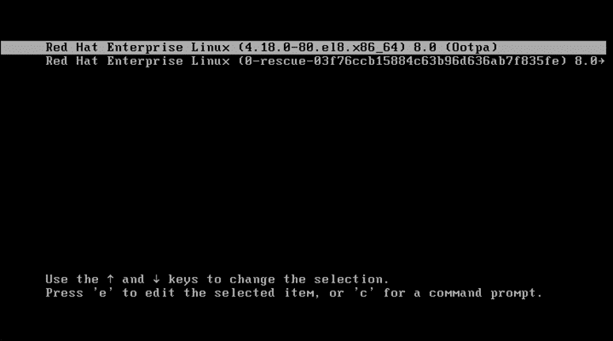

**图 18-1** 进入 GRUB 启动提示符

在 GRUB 启动菜单中传递`e`后，你将看到图 18-2 所示的界面。从该界面，向下滚动找到以`linux ($root)/vmlinuz`开头并跟着大量参数的章节。这一行告诉 GRUB 如何启动内核，默认情况下它看起来像这样：

点击此处查看代码图像

```
linux ($root)/vmlinuz-4.18.0-80.el8.x86_64 root=/dev/mapper/rhel-root
  ro crash kernel=auto resume=/dev/mapper/rhel-swap rd.lvm.lv=rhel/
  root rd.lvm.lv=rhel/swap rhgb quiet
```


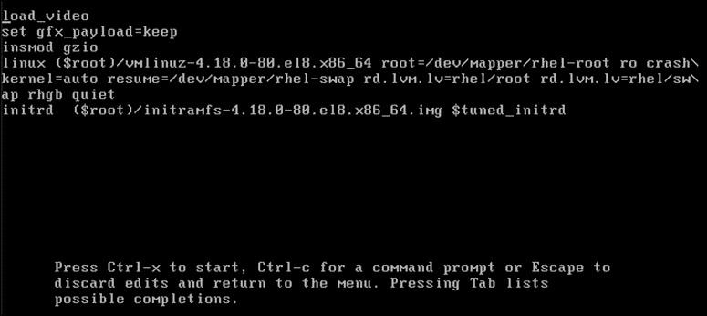

**图 18-2** 在以 `linux` 开头的行上输入启动参数

开始，删除此行中的 `rhgb` 和 `quiet` 部分是一个好主意；这些参数会为你隐藏启动消息，而通常你确实想看到启动时发生了什么。在下一节中，你将学习一些可以从 GRUB 启动提示符中输入的故障排除选项。

输入你想要使用的启动选项后，按 `Ctrl-X` 使用这些选项启动内核。注意，这些选项仅生效一次，并且不是持久的。要让它们持久，你必须修改 `/etc/default/grub` 配置文件的内容，并使用 `grub2-mkconfig -o /boot/grub2/grub.cfg` 来应用修改。（有关此过程的更多细节，请参考第 17 章。）

#### 启动故障排除目标

如果你在启动服务器时遇到问题，你可以在 GRUB 启动提示符上输入几个选项：


* `rd.break`：这会在仍处于 `initramfs` 阶段时停止引导。如果你没有 root 密码，此选项非常有用。恢复丢失 root 密码的完整步骤将在本章后后介绍。
* `init=/bin/sh` 或 `init=/bin/bash`：这指定在加载内核和 `initrd` 之后立即启动 shell。这是一个用的选项，但它不是最佳选项，因为某些情况下你会丢失控制台访问权限或错过其他功能。
* `systemd.unit=emergency.target`：进入一个加载最少数量 Systemd 单元的模式。它需要 root 密码。要查看只加载了极少数的单元文件，你可以输入 `systemctl list-units` 命令。
* `systemd.unit=rescue.target`：启动更多的 Systemd 单元将你带入一个更完整的运行模式。它确实需要 root 密码。要查看只加载了极少数的单元文件，你可以输入 `systemctl list-units` 命令。

在练习 18-1 中，你将学习如何进入 `rescue.target`。

#### 使用救援磁盘

如果你遇到问题，可能需要一个救援磁盘。如果你运气稍差，会在无法启动的系统上看到一个闪烁的光标。Red Hat Linux 的救援镜像位于安装磁盘上。

#### 使用救援磁盘恢复系统访问

选择故障排除（Troubleshooting）选项后，你会看到如下选项，如图 18-3 所示：

* `Install Red Hat Linux 8 in Basic Graphics Mode`：此选项重新安装你的机器。除非你需要排除正常安装无效的情况，否则不要使用它。通常情况下，你永远不需要使用此选项。
* `Rescue a Red Hat Linux System`：这是最灵活的救援系统。在练习 18-2 中，你可以详细探索。这是使用救援磁盘时的首选选项。
* `Run a Memory Test`：遇到内存错误时运行此选项。它允许你标记坏内存颗粒，以便机器能够正常启动。
* `Boot from Local Drive`：如果你无法从硬盘上的 GRUB 启动，先尝试此选项。它提供了一个尝试从你的机器硬盘安装的引导程序，因此是入侵性最小的选项。

屏幕显示了“Troubleshooting”（故障排除）选项。选项有 `Install Red Hat Linux 8 in Basic Graphics Mode`、`Rescue a Red Hat Linux System`、`Run a Memory Test`、`Boot from Local Drive`、`Return to main menu`，以及在菜单项上按键获取完整的配置选项。(Images/18fig03.jpg)

**图 18-3** 从救援磁盘启动

启动救援系统后，你需要启用对磁盘上安装内容的完全访问权限。通常，救援磁盘会检测你的安装并将其挂载到 `/mnt/sysimage` 目录。为了修复配置文件及其默认位置的访问权限（使其能够像在磁盘上那样可用），请使用 `chroot /mnt/sysimage` 命令使该目录的内容成为你实际的工作环境。如果你不使用此 `chroot` 命令，许多工具将无法工作，因为如果它们写入配置文件，将将是只读磁盘上的版本。使用 `chroot` 命令可以确保所有配置文件的路径引用都是正确的。

# 使用救援盘重装 GRUB

你可能需要启动救援盘的常见原因之一是 GRUB 2 引导加载程序损坏。如果发生此类情况，你可能需要重新安装它。在用救援盘恢复对服务器的访问权限后，重新安装 GRUB 2 并不困难，它包含两个步骤：

* 确保你已经如前所述，使用 `chroot` 使 `/mnt/sysimage` 目录的内容对你的当前工作环境可用。
* 使用 `grub2-install` 命令，后紧跟你想要重装 GRUB 2 的设备名称。因此，在 KVM 虚拟机上，要使用的命令是 `grub2-install /dev/vda`；在物理服务器或 VMware 或 VirtualBox 虚拟机上，则是 `grub2-install /dev/sda`。

## 使用救援盘重新创建 Initramfs

偶尔，`initramfs` 镜像也可能会损坏。如果发生这种情况，你无法引导服务器进入正常运行模式。在进入救援环境后修复 `initramfs` 镜像，你可以使用 `dracut` 命令。如果不带任何参数使用该命令，它将为当前加载的内核创建一个新的 `initramfs`。

或者，你可以带有多个选项使用 `dracut` 命令为特定的内核环境创建 `initramfs`。还有一个名为 `/etc/dracut.conf` 的配置文件，你可以在重新创建 `initramfs` 时使用它包含特定选项。`dracut` 配置分布在不同的位置：

* `/usr/lib/dracut/dracut.conf.d/*.conf` 包含系统默认配置文件。
* `/etc/dracut.conf.d` 包含自定义的 `dracut` 配置。
* `/etc/dracut.conf` 作为主配置文件。

示例 18-1 显示了默认 `dracut.conf` 配置文件的示例。

**示例 18-1** `/etc/dracut.conf` 默认内容

点击此处查看代码图像

```bash
[root@server1 ~]# cat /etc/dracut.conf

# 将你的配置放在此处或放在命名为 *.conf 的独立文件中

# 在 /etc/dracut.conf.d 中

# 查看 man dracut.conf(5)

# 示例 dracut 配置

# logfile=/var/log/dracut.log

# fileloglvl=6

# 要使用的 dracut 模块精确列表。此处未列出的

# 模块将被包含。如果你只想添加某些可选模块，

# 请使用 add_dracutmodules 选项。

dracutmodules=""

# 要排除的 dracut 模块

omit_dracutmodules=""

# 添加到默认的 dracut 模块

add_dracutmodules=""

# 额外的内核模块

add_drivers=""

# 包含在通用 initramfs 中的内核文件系统列表

filesystems=""

# 仅为当前硬件构建 initrd

hostonly="yes"

## install local /etc/mdadm.conf

mdadmconf="no"

# install local /etc/lvm/lvm.conf

lvmconf="no"

# 要安装的 fsck 工具列表。如果没有指定，则

# 默认使用硬编码的：mount /sbin/fsck xfs_check xfs_repair e2fsck jfsfsck reiserfsck btrfsck"。

# 只要是机会性的，因此不存在的工具会被忽略。

fscks=""

# 禁止安装任何 fsck 工具

nofscks="yes"

# 默认以只读方式挂载

ro="no"

# 设置临时文件的默认目录：/var/tmp

tmpdir=/tmp
```

提示

根据 RHCSA 目标，你不应该在考试中需要使用救援盘。然而，作为 Linux 管理员，你应该预料意外情况，因此确保你能够处理常见以及不常见的情况是一个好主意。

## 修复常见问题

在像这样短小的章节中，无法考虑在操作 Linux 时可能遇到的所有问题。尽管如此，有些问题比其他问题更容易发生。在本节中，你将学习一些更常见的问题。

### 重装 GRUB

引导程序代码不会凭空消失，但偶尔会发生 GRUB 2 引导代码损坏。在这种情况下，你最好知道如何重装 GRUB。具体方法取决于你的服务器是否仍处于可引导状态。如果是，重装 GRUB 2 非常简单。只需输入 `grub2-install` 后跟你想要安装的设备名称。如果你在 KVM 虚拟机中，运行 `grub2-install /dev/vda`；如果你在物理磁盘上，运行 `grub2-install /dev/sda`。

如果机器处于不可引导状态，重装 GRUB 2 会变得复杂一点。如果发生这种情况，你首先需要启动救援系统并从救援系统恢复对服务器的访问。（参见练习 18-2 的具体操作。）将服务器的文件系统挂载到 `/mnt/sysimage` 并使用 `chroot /mnt/sysimage` 使挂载的系统映像成为根映像后，重装如之前描述简单：只需运行 `grub2-install` 到目标安装设备。

### 修复 Initramfs

在少数情况下，`initramfs` 可能会损坏。如果你仔细分析引导过程，你将发现 `initramfs` 有问题，因为你永远看不到根文件系统挂载到根目录，也不会看到任何 Systemd 单元启动。如果你怀疑 `initramfs` 有问题，重新创建它是很容易的。要使用所有默认设置重新创建（在大多数情况下可以），你只需运行 `dracut --force` 命令。（没有 `--force`，命令将拒绝覆盖现有的 `initramfs`。）

运行 `dracut` 命令时，你可以使用 `/etc/dracut.conf` 配置文件来指定具体写入 `initramfs` 的内容。在该文件中，你可以看到如 `lvmconf="no"` 等选项，用于开启或关闭特定功能。使用这些选项确保你的 `initramfs` 中包含所有所需的功能。

### 从文件系统问题中恢复

如果你对文件系统挂载进行了错误配置，引导过程可能会以“Give root password for maintenance”（输入维护根密码）的消息结束。这条消息特别是由 `fsck` 命令生成的，它尝试在启动时验证 `/etc/fstab` 中文件系统的完整性。如果 `fsck` 失败，则需要人工干预，这在引导期间可能会导致此消息。确保当这种情况发生时你知道该做什么！

提示

务必很好掌握这个主题。文件系统相关主题在 RHCSA 目标中占很大权重，你可能需要创建分区和/或逻辑卷并将它们放入 `/etc/fstab` 以自动挂载。这使得出现故障的可能性也增加，如果在考试中发生了，你最好确保自己知道如何修复它！

如果引用了不存在的设备，或者用于挂载设备的 UUID 存在错误（例如），Systemd 首先会等待设备是否会自动返回。如果没有发生这种情况，它会给出“Give root password for maintenance”的消息（参见图 18-5）。如果发生这种情况，你应尽首先输入根密码。然后你可以按照建议输入 `journalctl -xb` 来查看日志中是否写入提供了问题信息的消息。如果问题是文件系统方面的，输入 `mount -o remount,rw /` 以确保根文件系统以读写模式挂载，并分析 `/etc/fstab` 文件中的错误并进行修复。


**图 18-5** 如果你看到这个，通常说明存在 `/etc/fstab` 问题

## 重置 root 密码

Linux 管理员经常遇到的一种场景是 root 密码丢失。如果发生这种情况，你需要重置它。做到这一点的方法是进入最小模式（minimal mode），这允许你在不输入密码的情况下登录。按照以下步骤操作：


1. 在系统启动时，当显示 GRUB 2 启动菜单时按 `e`。
2. 在加载内核的行中输入 `rd.break` 作为启动参数，并按 `Ctrl-X` 使用此选项启动。
3. 现在你将被放置在启动阶段的末尾，此时 `initramfs` 已经加载，且正处于根文件系统挂载到目录 `/` 之前。
4. 输入 `mount -o remount,rw /sysroot` 以获取系统镜像的读写权限。
5. 此时，通过输入 `chroot /sysroot` 将 `/sysimage` 目录的内容变为你的新根目录。
6. 现在你可以输入 `passwd` 为用户 `root` 设置新密码。
7. 由于在这一非常早的启动阶段 SELinux 尚未激活，`/etc/shadow` 上的上下文类型会被破坏。如果你在此时重启，将无法登录。因此，你必须确保上下文类型被设置正确。要做到这一点，此时你应该使用 `load_policy -i` 加载 SELinux 策略。你可以在第 22 章“管理 SELinux”中找到更多关于 SELinux 的信息。
8. 现在你可以手动为 `/etc/shadow` 设置正确的上下文类型。为此为此，输入 `chcon -t shadow_t /etc/shadow`。
9. 重启。你现在可以使用更改后的密码登录 `root` 用户。

### 注意

在之前的操作中，你已经学习了如何使用 `load_policy -i` 和 `chcon` 命令来修复 `/etc/shadow` 文件的标签。另一种（更简单）的方法是创建一个名为 `/.autorelabel` 的文件，这将强制 SELinux 恢复设置在整个文件系统上的标签。

## 恢复对虚拟机的访问

故障排除的一种特殊情况是涉及虚拟机的情况。如果你在虚拟机中遇到问题，且无法通过 Virtual Machine Manager 或 `virsh console` 访问它，你也无法通过 SSH 连接它。然而，仍然有一个选项。这里描述的技术有点高级，但因为它可能某一天帮助你重新建立对可能会丢失的虚拟机的访问，所以它是值得的。

### 提示

这里描述的过程相对复杂，除非你在考试期间发生了严重的失误，否则你不应该应用它。因此，与其背诵这个过程，不如只需非常小心以防止此类问题的发生！

1. 首先，在 KVM 宿主机上打开一个 root shell。从该宿主机文件开始，使用 `virsh destroy vmname` 确保虚拟机已停止。（使用 `virsh list` 命令列出的虚拟机名称。）
2. 找到磁盘镜像文件。它通常存储在 `/var/lib/libvirt/images` 目录下。如果你在那里没有找到它，请使用 `virsh dumpxml vmname | grep "source file="` 来查找源文件名：

   点击此处查看代码图像

   ```bash
   [root@lab ~]# virsh dumpxml sander-vm1 | grep "source file="

          <source file='/home/sander/lab1.img'/>

          <source file='/var/lib/libvirt/images/sander-vm1.img'/>
   ```
3. 现在你已经知道了虚拟机镜像文件的名称，可以使用 `kpartx -a` 命令将其挂载到宿主机环境中。该命令分析虚拟机上的磁盘布局，并创建存储设备，允许你在宿主机文件系统中挂载虚拟机中的设备：

   点击此处查看代码图像

   ```bash
   [root@lab ~]# kpartx -av /home/sander/lab1.img

   add map loop0p1 (253:5): 0 1024000 linear /dev/loop0 2048

   add map loop0p2 (253:6): 0 7362560 linear /dev/loop0 1026048
   ```
4. `kpartx` 命令创建了允许你访问虚拟机中两个分区的设备。这是一个典型的 RHEL 8 设置，第一个分区是 `/boot` 分区，第二个分区通常用于 LVM 逻辑卷。你可以使用 `mount /dev/mapper/loop0p1 /mnt` 轻松地挂载 `/boot` 分区。
5. 要访问虚拟机第二个分区中存在的逻辑卷，请使用 `pvscan` 命令：

   点击此处查看代码图像

   ```bash
   [root@lab mapper]# pvscan /dev/mapper/loop0p2

      PV /dev/sda3 VG centos lvm2 [48.83 GiB / 0 free]

      PV /dev/sda4 VG centos lvm2 [50.00 GiB / 20.00 GiB free]

      PV /dev/sda5 VG vglvm lvm2 [347.32 GiB / 329.32 GiB free]

      PV /dev/mapper/loop0p2 VG centvm lvm2 [3.51 GiB / 0 free]

      Total: 4 [449.65 GiB] / in use: 4 [449.65 GiB] / in no VG: 0 [0 ]
   ```


6. 你现在激活了虚拟机内部 LVM 配置。如果你输入 `lvs` 命令，你应该也能看到逻辑卷，但处于未激活状态。

7. 在你修复了虚拟机中的所有问题后，首先需要卸载所有当前挂载的文件系统。接下来你需要使用 `kpartx -dv /home/sander/lab1.img` 命令移除根据虚拟机内容创建的设备。（确保使用你计算机实际使用的镜像文件名。）

> **警告**
>
> 此过程运行良好，除非虚拟机内部使用的 VG 名称与主机名相同（我们通常希望主机名是唯一的）。但是，如果名称不唯一，你就会面临混淆并操作错误逻辑卷的风险。

## 总结

在本章中，你学习了如何排查 Red Hat Enterprise Linux 启动过程的故障。你通学习了服务器启动时通常发生了什么，以及在哪些特定点可以干预以修复错误。你还学习了在某些特定情况下的处理方法。确保你熟悉这些过程；你可能会在考试中遇到它们。

# 表 18-3 第 18 章主题

## 记忆完成表格和列表

打印附录 B“记忆表格”（可在配套网站找到）或至少打印本章对应的章节，并根据记忆完成表格和列表。附录 C“记忆表格答案”包含了完成的表格和列表，用于你检查自己的工作。

## 定义关键术语

定义本章中的以下关键术语，并在术表中检查你的答案：

- `target`
- `GRUB`
- `initramfs`
- `dracut`

## 复习题

以下问题旨在帮助测试你对概念、术语的掌握程度以及知识的广度。你可以在附录 A 中找到这些问题的答案。

1. 1 需要按下哪个键进入 GRUB 启动菜单编辑器模式？
2. 2 在启动过程中，启动程序没有完成，服务器而是请求 root 密码。这可能的原因是什么？
3. 3 你想进入故障排除模式，但不知道 root 密码。你会向内核传递哪个参数以进入一个可以访问机器大部分功能的模式？
4. 4 你启动了服务器但什么都没有发生。你只看到一个闪烁的光标。解决此问题的第一步是什么？
5. 5 你想知道在特定的故障排除环境中哪些单元是可选。你会使用哪个命令？
6. 6 你想开始对丢失的 root 密码进行故障排除。你会向 GRUB 2 引导程序传递哪个参数？
7. 7 从你启动的用于故障排除 root 用户丢失密码的 shell 中，你想加载 SELinux 策略。哪个命令可以让你实现这一点？
8. 8 在故障排除 root 密码时，你需要做什么来确保 SELinux 标签设置正确？
9. 9 你已经对 GRUB 2 引导程序应用了更改并想保存它们。你应该如何操作？
10. 10 你知道想要进入最最小故障排除模式的机器的 root 密码。你会使用哪个 GRUB 2 启动参数？

## 章末实验

实验 18.1 向你展示如何排除一些常见问题。

### 实验 18.1

1. 重启服务器并从相应的故障排除模式更改 root 密码。
2. 在 `/etc/fstab` 中更改一个设备名称，以便在下次重启时该文件系统无法挂载。重启并修复你遇到的问题。
3. 使用救援磁盘从救援磁盘以完全故障排除模式启动你的服务器。
4. 重新创建 `initramfs`。

# 第 19 章：Bash Shell 脚本入门

本章涵盖了以下主题：

- 理解 Shell 脚本核心元素
- 使用变量和输入
- 使用条件循环

Shell 脚本编写本身是一门科学。然而，在这一章中你不会学习与该科学相关的所有细节。相反，你将学习如何应用基础的 shell 脚本元素，这允许你编写简单的 shell 脚本并分析 shell 脚本中发生了什么。

## “我已经掌握了吗？”测试

“我已经掌握了吗？”测试让你能够评估自己是否应该仔细阅读整个章节内容，还是跳到“考试准备任务”部分。如果你对这些问题的答案或对你自己对主题知识的评估有疑，请阅读整个章节内容。表 19-1 列出了本章的主要标题及其对应的“我已经掌握了吗？”测试题。你可以在附录 A 找到答案，“‘我已经掌握了吗？测试和‘复习题’的答案](#appa.xhtml_appa)”。

| 基础主题章节 | 问题 |
| --- | --- |
| 理解 Shell 脚本核心元素 | 1–2 |
| 使用变量和输入 | 3–5 |
| 使用条件循环 | 6–10 |

**表 19-1** “我已经掌握了吗？”章节与问题映射表

1. 1 每一个 Bash shell 脚本应该以哪行开头？
   1. `/bin/bash`
2. 2 在脚本末尾使用的 `exit 0` 命令的作用是什么？
3. 3 如何停止脚本允许用户提供输入？
4. 4 哪行存储启动脚本时提供的第一个参数的值？
5. 5 区分传递给脚本的不同参数的最佳方法是什么？
6. 6 用什么来关闭 `if` 循环？
7. 7 下述脚本在点号处缺失了什么？
8. 8 下述脚本在点号处缺失了什么？
9. 9 如果脚本中出现问题，使用哪个命令向 root 用户发送主题为“error”的消息？
10. 10 在 `case` 语句中，包含一行适用于所有其他情况是一个好主意。以下哪项可以实现这一点？

## 基础主题

## 理解 Shell 脚本核心元素

这个基础脚本包含了所有脚本都应该使用的几个元素。首先是 shebang（解释器路径）。这一行是 `#!/bin/bash`。当脚本从父 shell 环境中启动时，它会打开一个子 shell。在这个子 shell 中，会执行不同的命令。这些命令可以以任何方式被解释，为了清楚地说明它们应该如何被解释，便使用了 shebang。在这种情况下，shebang 明确了该脚本是一个 Bash shell 脚本。也可以指定其他 shell。例如，如果你的脚本包含 Perl 代码，shebang 应该是 `#!//usr/bin/perl`。

以 shebang 开头脚本是一个良好的习惯；如果省略了它，脚本代码将由父 shell 中使用的 shell 来执行。由于你的脚本也可能被（例如）kshsh 的用户执行，因此使用 shebang 调用 `/bin/bash` 作为子 shell 对于避免混淆至关重要。

紧接 shebang 之后，有一部分解释了脚本的主题。在每个脚本中包含几行注释都是一个好主意。在短脚本中，脚本在做什么通常是显而易见的。如果脚本变得越来越长，随着越来越多的人参与编写和维护脚本，脚本作者的意图往往会变得不再清晰。为了避免这种情况，请确保你包含了以 `#` 开头的注释行。不仅要在脚本的开头包含它们，还要在脚本的每个子章节开头包含它们。如果你在几个月后阅读自己的脚本，且不记得在创建它时具体在尝试做什么，这些注释无疑将非常有帮助！你也可以在行内使用注释。无论 `#` 使用在哪个位置，从 `#` 直到行尾的所有内容都是注释文本。

接下来是脚本的主体。在示例 19-1 中，主体只是一个包含几个按顺序执行的命令的简单脚本。随着脚本的发展，主体可能会变大。

在脚本的末尾，我包含了 `exit 0` 语句。`exit` 语句告诉父 shell 脚本执行成功。`0` 表示成功，其他任何值都意味着脚本遇到了问题。脚本中最后一条命令的退出状态就是脚本本身的退出状态，除非在脚本末尾使用了 `exit` 命令。但了解你可以通过 `exit` 来告知父 shell 执行情况是有好处的。要从父 shell 请求最后一条命令的退出状态，请使用 `echo $?` 命令。这个请求对于确定某些功能没有生效以及为什么没有生效很有用。

写完脚本后，确保它是可以执行的。最常用的方法是赋予它执行权限。所以，如果脚本名为 `hello`，请使用 `chmod +x hello` 使其变为可执行。脚本也可以作为 `bash` 命令的参数执行，例如。使用 `bash hello` 来运行 hello 脚本。如果作为 `bash` 命令的参数启动，则脚本不需要具有执行权限。

你基本上可以将脚本存储在任何你想存放的地方，但如果你打算将其存储在未包含 `$PATH` 中的位置，你需要在脚本名前加上 `./` 来执行它。因此，仅输入 `hello` 是不足以运行你的脚本的；请输入 `./hello` 来运行。注意，如果你想从当前目录运行脚本，也需要 `./`，因为在 Linux 上，当前目录没有包含在 `$PATH` 变量中。或者将其放在包含在 `$PATH` 变量的标准目录中，如 `/usr/local/bin`。在练习 19-1 中，你将应用这些技能并编写一个简单的 shell 脚本。

# 使用变量和输入

Bash 脚本远不止是按顺序执行的命令列表。脚本的一个优点是它们可以使用变量和输入变得灵活。在本节中，你学习如何使用变量和输入。

## 位置参数

在启动脚本时，你可以使用参数。参数是指你放在脚本后面的任何内容。参数可以使脚本变得更灵活。例如 `useradd` 命令。在脚本中，参数指定了需要执行什么。在这种情况下，一个名为 `lisa` 的用户必须被创建。参数是脚本的。在脚本中，第一个参数被称为 `$1`，第二个参数被称为 `$2`，依此类推。示例 19-2 展示了如何使用参数。使用任何你想用的参数尝试一下吧！

**示例 19-2** 使用参数的脚本

点击查看代码图像

```bash
#!/bin/bash

# 带有几个参数运行此脚本

echo 第一个参数是 $1

echo 第二个参数是 $2

echo 第三个参数是 $3
```

如果你尝试运行示例 19-2 中的示例代码，你可能会注意到其内容并不完美。如果你使用三个参数，其内容并不完美。如果你使用三个参数，其内容并不完美。如果你使用三个参数，其内容并不完美。（等一下，让我重读逻辑）。所以，如果你想使用参数，最好使用更灵活的方法。

## 使用变量


变量是一个标签，用于引用内存中包含特定值的特定位置。变量可以通过 `NAME=value` 静态定义，也可以以动态方式定义。动态定义变量有两种方案：


- 在脚本中使用 `read` 来向运行脚本的用户请求输入。
- 使用命令替换来使用命令的结果并将结果赋值给变量。例如，`date +%d-%m-%y` 命令显示日-月-年格式的当前日期。要在脚本中将该日期赋值给变量，你可以使用 `TODAY=$(date + %d-%m-%y)` 命令。

在命令替换中，你只需要将想要使用的命令及其结果括在圆括号内，并在左括号前加上一个美元符号（`$`）即可。作为这种表示法法的替代方案，你也可以使用反引号（backquotes）。因此，执行 `TODAY=\`date +%d-%m-%y\`` 命令的效果完全相同。

在上一节关于位置参数的内容中，你学习了如何在启动脚本时提供参数。在某些情况下，更有效的方法是在发现缺少某些信息时请求该信息。示例 19-4 中的脚本展示了如何使用 `read` 来实现。

**示例 19-4** 使用 `read` 命令的脚本

点击此处查看代码图片

```bash
#!/bin/bash

if [ -z $1 ]; then
    echo enter a name
    read NAME
else
    NAME=$1
fi

echo you have entered the text $NAME

exit 0
```

在示例 19-4 中，使用了 `if ... then ... else ... fi` 语句来检查参数 `$1` 是否存在。这是通过使用 `test` 命令实现的，它可以用两种方式编写：`test` 或 `[ ... ]`。在示例 19-4 中，执行 `if [ -z $1 ]` 这一行是为了检查测试 `-z $1` 是否为真。`-z $1` 用于检查 `$1` 是否不存在。换句话说，`if [ -z $1 ]` 行检查 `$1` 是否为空；如果是，则意味着在启动此脚本时没有提供参数。如果情况如此，将执行 `then` 语句之后的命令。请注意，当你使用方括号编写 `test` 命令时，必须在左括号后包含一个空格，并在右括号前包含一个空格；如果没有这些空格，命令将无法工作。

请注意 `then` 语句紧跟在 `test` 命令之后。这是可以的，因为使用了分号（`;`）。分号是命令分隔符，可以替换脚本中的换行符。在 `then` 语句中执行了两个命令：一个在屏幕上显示消息的 `echo` 命令和一个 `read` 命令。`read` 命令会停止脚本，以便处理用户输入并存储在变量 `NAME` 中。因此，`read NAME` 行将所有用户输入放入变量 `NAME` 中，该变量将在脚本稍后使用。

在示例 19-4 中，下一部分由 `else` 语句引入。`else` 语句之后的命令在所有其他情况下都会执行，在这种情况下意味着“如果提供了参数”。如果是这样，则定义变量 `NAME` 并将 `$1` 的当前值赋值给它。

注意变量是如何定义的：在变量名之后直接有一个 `=` 号，后面跟着 `$1`。请注意，在定义变量时永远不要使用空格。

然后，用 `fi` 语句结束 `if` 循环。一旦 `if` 循环完成，你就可以确定变量 `NAME` 已经定义并有一个值。脚本的最后一行读取变量 `NAME` 的值，并通过 `echo` 命令将此值显示到标准输出（STDOUT）。注意，为了请求变量的当前值，脚本引用了变量名，并在前面加上了 `$` 符号。

在练习 19-3 中，你可以练习处理输入。

## 使用条件循环

正如你已经看到的，你可以在脚本中使用条件循环。这些条件循环只有在满足特定条件时才会执行。在 Bash 中，常用的条件循环如下：


- `if ... then ... else`：当特定条件为真时执行
- `for`：用于范围内的循环
- `while`：只要条件为真就一直执行
- `until`：直到条件为真为止执行
- `case`：用于匹配特定值

### 使用 `if ... then ... else` 进行工作

`if ... then ... else` 结构常用于评估特定条件。你已经在示例 19-4 中看到了它的用法。这种条件循环通常与 `test` 命令配合使用，以检查文件是否存在。

> **提示**
>
> 查看 `test` 命令的帮助页。

基础的 `if` 结构是 `if ... then ... fi`。这种结构评估单个条件，如下所示：

```bash
if [ -z $1 ]
then
    echo no value
fi
```

在示例 19-4 中，你看到了如何通过包含 `else` 来评估两个条件。示例 19-5 展示了如何通过将 `else` 与 `if` 连接变为 `elif` 来评估多个条件。这种结构在需要评估许多值值非常有用。

**示例 19-5** 使用 `if ... then ... else` 的脚本

点击此处查看代码图片

```bash
#!/bin/bash

# 带参数运行此脚本

# 目标是判断是文件还是目录

if [ -f $1 ]
then
    echo "$1 is a file"
elif [ -d $1 ]
then
    echo "$1 is a directory"
else
    echo "I do not know what $1 is"
fi

exit 0
```

### 使用 `||` 和 `&&`

与其编写完整的 `if ... then` 语句，你可以使用运算符 `||` 和 `&&`。`||` 是逻辑或操作，只有当第一部分不为真时才会执行第二部分；`&&` 是逻辑与操作，只有当第一部分为真时才会执行第二部分。考虑这两个单行命令：

点击此处查看代码图片

```bash
[ -z $1 ] && echo no argument provided

ping -c 1 10.0.0.20 2>/dev/null || echo node is not available
```

在第一个示例中，执行了一个测试（使用替代 `test` 语法）来检查 `$1` 是否为空。如果该测试为真（这意味着 `test` 命令以代码 0 退出），则执行第二个命令。

在第二个示例中，使用 `ping` 命令检查主机的可用性。逻辑或在本示例中被用于在 `ping` 命令未成功时输出“node is not available”文本。在练习 19-4 中，你可以练习一些 `if ... then ... else` 技能，可以使用 `if ... then ... else` 或 `&&` 和 `||`。

在示例 19-6 中，你可以看到条件是一个赋值给变量 `COUNTER` 的数字范围。该变量首先初始化为值 100，只要该值大于 1，在每次迭代中就会减去 1。只要条件为真，就会使用 `echo` 命令显示 `$COUNTER` 变量的值。

示例 19-7 展示了我最喜欢的 `for` 单行命令之一。这次的范围被定义为一系列数字，从 100 开始到 104。

**示例 19-7** 使用 `for` 的单行命令

点击此处查看代码图片

```bash
for i in {100..104}; do ping -c 1 192.168.4.$i >/dev/null && echo 192.168.4.$i is up; done
```

注意范围是如何定义的：你指定第一个数字，后面跟着两个点，并以范围内的最后一个数字结束。通过 `for i in`，这些数字中的每一个都会赋值给变量 `i`。对于这些数字中的每一个，都会执行一次 `ping` 命令，其中选项 `-c 1` 确保只发送一个 ping 请求。

在这个 `ping` 命令中，重要的不是结果本身，这就是为什么结果被重定向到 `/dev/null` 设备。根据 `ping` 命令的退出状态，将执行 `&&` 之后的部分。因此，如果可以访问该主机，就会回显一行，表示其处于在线状态。

## 理解 `while` 和 `until`

虽然你刚刚读到的 `for` 语句对于处理项目范围很有用，但如果你想监控类似进程可用性的内容，`while` 语句就会很有用。在示例 19-8 中，你可以看到如何使用 `while` 来监控进程活动。

**示例 19-8** 使用 `while` 监控进程

点击此处查看代码图片

```bash
#!/bin/bash
#
# usage: monitor <processname>
```


```bash
while ps aux | grep $1 | grep -v grep > ~/output.txt
do
    sleep 5
done

clear

echo your process has stopped

logger $1 is no longer present

mail -s "process $1 has stopped" root < .
```

示例 19-8 中的脚本由两部分组成。首先是`while`循环。其次是`while`循环不再为真时需要执行的所有内容。`while`循环的核心是`ps`命令，通过`grep`查找`$1`是否出现。注意使用`grep -v grep`，它会从结果中排除包含`grep`命令的行。请记住，`ps`命令将包含所有运行中的命令，包括管道到`ps`命令输出的`grep`命令。这可能导致假阳性匹配。`ps aux`命令的结果被重定向到文件`~/output.txt`。这使得以后需要时可以从`~/output.txt`读取结果，但默认情况下不会显示。

如果语句评估为真，需要执行的命令将跟在`while`语句之后。在这种情况下，命令是`sleep 5`，它基本上会让脚本暂停 5 秒。只要`while`命令评估为真，它就会继续运行。如果它不再为真（在这种情况下意味着进程不再可用），它将停止并执行`while`循环之后的命令。

在`mail -s "process $1 has stopped" root < .`这一行中，使用 RHEL 8 默认运行的内部邮件处理程序向用户 root 发送消息。`mail`命令将主题作为第一个参数，使用`-s`选项指定。注意命令末尾的`< .`。

通常在交互模式下使用`mail`命令时，会打开一个可以在其中编写消息体的编辑器。通过提供一个只包含点的行来关闭此编辑器。在这条命令中，点是通过重定向 STDIN 提供的。这允许在不需要任何进一步用户活动的情况下处理消息。

`while`的对应物是`until`，它会开启一个持续到条件为真的迭代。在示例 19-9 中，`until`用于过滤`users`命令的输出以查找`$1`（这是一个用户名）的出现。在此命令为真之前，迭代将继续。当在`users`的输出中找到用户名时，迭代结束并执行`until`循环之后的命令。

**示例 19-9** 使用`until`监控用户登录

点击此处查看代码图片

```bash
#!/bin/bash

#

until users | grep $1 > /dev/null
do
    echo $1 is not logged in yet
    sleep 5
done

echo $1 is logged in

mail -s "process $1 has stopped" root < .
```

### 理解 `case`

`case`语句是一种根据单个变量处理多种条件的强大方法。在示例 19-10 中，你可以看到`case`是如何使用的。

**示例 19-10** 使用`case`处理特定情况

点击此处查看代码图片

```bash
case "$1" in
    start)
        start;;
    stop)
        rm -f lockfile;;
    restart)
        restart;;
    reload)
        reload;;
    status)
        status;;
    *)
        echo "Usage: $0 (start|stop|restart|reload|status)";;
esac
```


`case` 语句有一些特殊之处。首先，通用语法是 `case 要的项目 in`。该语法之后是可能值的列表。每个项目用括号 `)` 结束。该 `)` 后面跟着需要执行的命令列表。每个命令列表用双分号 `;;` 结束。`;;` 可以直接跟在最后一个命令后面，也可以单独一行。此外，注意 `*` 指未指定的其他选项；它是一个“通配”语句。`case` 迭代循环通过 `esac` 语句结束。

注意 `case` 中的评估是顺序执行的。一旦匹配到第一个，`case` 语句将不再评估其他内容。在评估内部，可以使用通配符的模式。这在 `*` 评估中得到了体现，它可以匹配所有内容。

在本章中，你学习了如何编写 shell 脚本。你还练习了几个示例，现在已经熟悉了创建成功脚本所需的一些基本元素。

### 考试准备任务

如引言中的“如何使用本书”章节所示，你有几种方法来准备考试：章末的实验；附录 B 中的记忆表；第 27 章“期末准备”；以及模拟考试。

### 复习所有关键主题

复习章节中最重要的主题，这些主题在页外边上用“关键主题”图标标记出。表 19-2 列出了这些关键主题的参考及其所在的页码。


| 关键主题元素 | 描述 | 页码 |
| --- | --- | --- |
| 段落 | 变量定义 | 430 |
| 列表 | 动态定义变量 | 430 |
| 列表 | 条件循环概览 | 432 |

**表 19-2** 第 19 章关键主题

### 定义关键术语

定义本章中的以下关键术语并在词表表中检查你的答案：

- shebang
- 父 shell
- 子 shell
- 变量
- 迭代
- 条件循环
- OR
- AND

### 复习题

以下问题旨在帮助你测试对概念、术语以及知识广度的掌握情况。你可以在附录 A 中找到这些问题的答案。

1. 如果脚本**没有**以 shebang 开头会有什么影响？
2. 如何检查变量 `VAR` 是否没有值？
3. 在脚本中用什么来计算已使用的参数数量？
4. 用什么来引用启动脚本时使用的所有参数？
5. 如何在脚本中处理用户输入？
6. 测试文件是否存在的最简单方法是什么？如果不存在则执行 `echo "file does not exist"` 命令。
7. 你执行哪种测试来确定一个项目是文件还是目录？
8. 使用哪种结构来评估一个范围的项目？
9. 在脚本中如何关闭 `elif` 语句？
10. 在 `case` 语句中，你评估一个范围的项目。对于每个项目，你执行一个或多个命令。在最后一个命令后你需要什么来关闭特定项目？

### 章末实验

在章末实验中，你将应用脚本技能编写两个简单的脚本。

### 实验 19.1

1. 编写一个可以处理参数的脚本。如果使用了参数 `one`，脚本应该创建一个名为 `/tmp/one` 的文件。如果使用了参数 `two`，脚本应该向 root 用户发送一条包含主题为“two”的消息。
2. 编写一个倒计时脚本。该脚本应该使用一个参数（不超过一个）。该参数指定要倒计数的分钟数。它应该从该分钟数开始每秒倒计时一次，在每次迭代时写入文本“there are nn seconds remaining”。使用 `sleep` 来定义秒。当没有剩余时间时，脚本应该 `echo "time is over"` 并退出。

# 第四部分：管理网络服务

## 第 20 章：配置 SSH

**本章涵盖以下主题：**

- 加固 SSH 服务器
- 使用其他 sshd 选项
- 配置带密码保护的密钥认证

本章涵盖了以下 RHCSA 考试目标：

- 为 SSH 配置基于密钥的认证

Secure Shell（SSH）是系统管理员使用的最重要的工具之一。在第 5 章中，你学习了如何使用 SSH 连接到远程服务器。

### 复习所有关键主题

复习章节中最重要的主题，这些主题在页外边上用“关键主题”图标标记出。表 20-3 列出了这些关键主题的参考及其所在的页码。


| 关键主题元素 | 描述 | 页码 |
| --- | --- | --- |
| 段落 | 变量定义 | 430 |
| 列表 | 动态定义变量 | 430 |
| 列表 | 条件循环概览 | 432 |

**表 20-3** 第 20 章主要主题

### 定义关键术语

定义本章中的以下关键术语，并在词表中检查你的答案：

- shebang
- 父 shell
- 子 shell
- 变量
- 迭代
- 条件循环
- OR
- AND
- passphrase
- connection

### 复习题

以下问题旨在帮助你测试对概念、术语以及知识广度的掌握情况。你可以在附录 A 中找到这些问题的答案。

1. 如果脚本**没有**以 shebang 开头会有什么影响？
2. 如何检查变量 `VAR` 是否没有值？
3. 在脚本中用什么来计算已使用的参数数量？
4. 用什么来引用启动脚本时使用的所有参数？
5. 如何在脚本中处理用户输入？
6. 测试文件是否存在的最简单方法是什么？如果不存在则执行 `echo "file does not exist"` 命令。
7. 你执行哪种测试来确定一个项目是文件还是目录？
8. 使用哪种结构来评估一个范围的项目？
9. 在脚本中如何关闭 `elif` 语句？
10. 在 `case` 语句中，你评估一个范围的项目。对于每个项目，你执行一个或多个命令。在最后一个命令后你需要什么来关闭特定项目？

### 章末实验

在章末实验中，你将应用脚本技能编写两个简单的脚本。

### 实验 19.1

1. 编写一个可以处理参数的脚本。如果使用了参数 `one`，脚本应该创建一个名为 `/tmp/one` 的文件。如果使用了参数 `two`，脚本应该向 root 用户发送一条包含主题为“two”的消息。
2. 编写一个倒计时脚本。该脚本应该使用一个参数（不超过一个）。该参数指定要倒计数的分钟数。它应该从该分钟数开始每秒倒计时一次，在每次迭代时写入文本“there are nn seconds remaining”。使用 `sleep` 来定义秒。当没有剩余时间时，脚本应该 `echo "time is over"` 并退出。

1. 将密码句复制到 `~/.ssh/passphrase` 文件。
2. 运行 `ssh-add /bin/bash`，然后运行 `ssh-agent`。
3. 运行 `ssh-agent /bin/bash`，然后运行 `ssh-add`。
4. 这是不行的；你每当创建连接时都必须输入密码句。

### 复习题：SSH 选项

#### 10. `MaxSessions` 选项可以用于调整同时打开的最大会话数。它的默认值是多少？

1. 10
2. 25
3. 100
4. 1000

### 基础主题

### 加固 SSH 服务器

SSH 是一个重要且方便的解决方案，帮助你建立与服务器的远程连接。它也是一个危险的。如果你的 SSH 服务器可以直接从互联网可见，那么你可以确定，迟早会有入侵者尝试连接到你的服务器，并意图造成破坏。

针对 SSH 服务器的字典攻击非常常见。攻击者利用 SSH 服务器通常在端口 22 上提供服务，以及每个 Linux 服务器都有 root 账户这一事实。基于这些信息，攻击者很容易通过猜密码尝试以 root 身份登录。如果密码的复杂性有限，且没有采取额外的安全措施，入侵者迟早就能连接上。幸运的是，你可以采取一些措施来保护 SSH 服务器免受此类攻击：

- 禁用 root 登录
- 禁用密码登录
- 为 SSH 配置非默认监听端口
- 仅允许特定用户通过 SSH 登录

在接下来的小节中，你将学习更改这些选项涉及的内容。

#### 限制 root 访问

SSH 服务器默认启用 root 登录是一个最大的安全问题。禁用 root 登录很容易；你只需要修改 `/etc/ssh/sshd_config` 中的 `PermitRootLogin` 参数并重新加载或重启服务即可。重启后，验证你确实无法再次以 root 身份登录。

**提示**

某些服务会自动获取配置文件的更改。大多数服务在执行 `systemctl reload servicename` 命令后获取更改，而其他服务仅在执行 `systemctl restart servicename` 命令后才会获取更改。为了避免在考试中浪费时间，在任何情况下都应该使用 `systemctl restart servicename`。至少这样你可以确保服务会加载新配置。

禁用 root 登录后，你必须使用 `ssh user@servername` 或 `ssh -l user servername` 指定你想要用于登录的用户名。如果你不指定用户名，它将使用尝试打开 SSH 会话的客户端上的当前用户名。

#### 配置备端口

Linux 服务器上的许多安全问题都始于攻击者发起的端口扫描。扫描所有 65,535 个可能监听的端口需要花费大量时间，但大多数端口扫描只关注已知端口，而 SSH 端口 22 始终在这些端口之中。不要低估端口扫描的风险。在几次情况下，我发现监听在端口 22 的 SSH 端口在服务器安装后一小时内就会被发现。

为了防止端口扫描，你可以配置你的 SSH 服务器在另一个端口上。默认情况下，`sshd_config` 包含 `Port 22` 这一行，告诉 SSH 监听特权端口 22。要让 SSH 监听在其他端口，你必须将端口 22 更改为其他内容。可以使用不同的端口。你可以选择使用一个完全随机的端口（如 2022），但将 SSH 配置为监听端口 443 也可能非常方便。

端口 443 默认分配给使用传输层安全协议（TLS）提供加密的 Web 服务器。如果想要访问 SSH 服务器的用户通常位于仅允许流量通过 80 和 443 端口的代理之后，那么将 SSH 配置为监听端口 443 可能是有意义的。但是，你应该意识到，这样做之后端口 443 将无法再被你的 Web 服务器使用；一个端口只能分配给一个服务！所以，只有在你没有计划运行启用 TLS 的 Web 服务器机器上才执行此操作！

**提示**

为了避免在远程连接时修改 SSH 监听端口后被锁定在服务器之外，为你的 SSH 服务器打开两个会话是一个好主意。使用一个会话应用更改并进行测试，使用另一个会话保持当前的连接选项。重启 SSH 服务器后，活动会话不会断开（除非未能成功重启 SSH 服务器）。

#### 修改 SELinux 以允许端口更改

更改 SSH 端口后，你还需要配置 SELinux 以允许此更改。网络端口被标记有 SELinux 安全标签，以防止服务访问它们不应该访问的端口。要允许服务连接到非默认端口，你需要使用 `semanage port` 来更改目标端口上的标签。在此之前，最好检查该端口是否已经有了标签。你可以通过使用 `semanage port -l` 命令来实现此。

如果端口尚未设置安全标签，请使用 `-a` 为端口添加标签。如果已经设置了安全标签，请使用 `-m` 修改当前的安全标签。例如，使用命令 `semanage port -a -t ssh_port_t -p tcp 2022` 为端口 2022 标记标签以供 sshd 访问。如果你想重新标记一个已由另一个服务使用的端口，你必须使用 `semanage port -m` 来修改当前的安全标签。如果你想让 SSH 能够绑定到端口 443，就需要此操作。

#### 限制用户访问

只需通过浏览 `sshd_config` 文件，你就能找到许多 sshd 选项。最有趣的选项之一是 `AllowUsers`。该选项接受一个所有允许通过 SSH 登录的用户的空格分隔列表。注意，这是一个强大的选项，它将登录限制为仅这些用户。如果 root 用户仍然需要直接登录，你必须在允许用户列表中也将 root 包含进去。

当你使用此参数时，考虑你想要允许或拒绝访问的用户名是有意义的。在脚本化的暴力破解攻击中，入侵者通常会尝试 `admin`、`Administrator` 和 `jsmith` 等常用用户名。通过选择一个不常用的用户名，很容易增加一层安全性。注意关于 `AllowUsers` 参数的以下几：

- `AllowUsers` 选项默认不会出现在默认 `/etc/ssh/sshd_config` 文件的任何地方。
- `AllowUsers` 选项是 `PermitRootLogin` 更好的选项，因为它比仅仅拒绝 root 登录更具限制性。
- 如果 `AllowUsers` 选项没有指定 root，你可以在作为普通用户建立连接后通过 `su -` 变成 root。

一个看起来很有前景但具有误导性的参数是 `MaxAuthTries`。你可能认为该选项在最大失败登录尝试次数后锁定 SSH 登录提示。这种功能在连接到本地服务器时（如果需要，可以轻松更改配置）证明有用，但在具有互联网访问权限的 SSH 服务器上，这是一个相当危险的选项，容易对服务器实施拒绝服务攻击。入侵者只需要运行一个尝试作为特定用户登录的脚本即可阻止该用户的访问。这就是为什么 `MaxAuthTries` 的作用并不如你认为的那样。它只是在指定的成功登录尝试次数的一半之后开始记录失败的登录尝试。

尽管如此，`MaxAuthTries` 选项仍然很有用。对于分析与你的 SSH 服务器相关的安全事件，了解用户何时不小心输入一或两次错误密码并不十分有趣。只有在出现多次失败尝试后，情况才会变得有趣。尝试次数越高，入侵者试图侵入的可能性就越大。SSH 将有关失败登录尝试的日志信息写入 `AUTHPRIV` syslog 设施。默认情况下，该设施被配置为将登录失败信息写入 `/var/log/secure`。

在练习 20-1 中，你应用了目前为止学过的常用 SSH 选项。

### 使用其他常用的 `sshd` 选项

除了安全相关的选项外，还有一些实用的杂项选项，你可以用来优化 SSH 性能。在接下来的两个章节中，你将介绍这些选项中最为重要的一些。

#### 会话选项

首先，有一个 `GSSAPIAuthentication` 选项，它在 RHEL 8 上默认设置为 `yes`（这与 man 页对其的描述矛盾）。该选项在使用了 Kerberos 认证的环境中非常有用。如果你的环境中没有 Kerberos，你也可以最好将其关闭，因为开启此功能会减慢认证过程。

下一个有趣的选项是 `UseDNS`。该选项默认开启，并指示 SSH 服务器查找远程主机名，并通过 DNS 检查远程主机解析出的主机名是否映射回相同的 IP 地址。尽管该选项具有某些安全方面的益处，但它涉及重大的性能损失。如果客户端连接缓慢，请确保将其设置为 `no`，以完全关闭客户端主机名验证。

第三个与会话相关的选项是 `MaxSessions`。该选项指定了从一个 IP 地址同时打开的会话最大数量。如果你预计多个用户将使用同一个 IP 地址登录你的 SSH 服务器，你可能需要将此选项增加到超过其默认值 10。

#### 连接保持存活选项

总的来说，TCP 连接是相对稀缺的资源，这就是为什么一段时间未使用的连接通常会超时。你可以使用几个选项让非活动连接保持更长时间。

`TCPKeepAlive` 选项用于监控客户端是否仍然可用。使用此选项（默认开启）可以确保任何空闲一段时间的机器连接被释放。然而，如果单独使用它，可能会导致未使用的连接也被释放，这就是为什么使用 `ClientAliveInterval` 选项是有意义的。该选项设置了一个间隔（以秒为单位），如果没有检测到活动，服务器将向客户端发送一个数据包。`ClientAliveCountMax` 参数指定了应该发送多少此类数据包。例如，如果 `ClientAliveInterval` 设置为 30，而 `ClientAliveCountMax` 设置为 10，则非活动连接将保持大约五分钟。将此项设置为你希望保持非活动连接开启的时间长度是一个好主意。

`ClientAliveInterval` 和 `ClientAliveCountMax` 选项只能在服务器上指定。这些选项也有对应的客户端选项。如果你无法更改 SSH 服务器的配置，请使用 `ServerAliveInterval` 和 `ServerAliveCountMax` 选项从客户端机器发起连接保持存活流量。如果这些选项需要适用于该机器上的所有用户，则设置在 `/etc/ssh/ssh_config` 文件中；如果适用于单个用户，则设置在 `~/.ssh/config` 中。

表 20-2 提供了最常用 SSH 选项的概述。


| 选项 | 用途 |
| --- | --- |
| `Port` | 定义 TCP 监听端口。 |
| `PermitRootLogin` | 指明允许或不允许 root 登录。 |
| `MaxAuthTries` | 指定认证尝试的最大次数。在达到该数字的一半后，失败将记录到 syslog。 |
| `MaxSessions` | 指明从一个 IP 地址可以打开的最大会话数。 |
| `AllowUsers` | 指定允许连接到服务器的用户的空格分隔列表。 |
| `PasswordAuthentication` | 指定是否允许密码认证。此选项默认开启。 |
| `GSSAPIAuthentication` | 指明是否需要启用通过 GSSAPI 进行认证。用于基于 Kerberos 的认证。 |
| `TCPKeepAlive` | 指定是否清理非活动的 TCP 连接。 |
| `ClientAliveInterval` | 指定发送到客户端的数据包间隔（以秒为单位），以判断客户端是否仍然存活。 |
| `ClientAliveCountMax` | 指定需要发送的客户端生存数据包数量。 |
| `UseDNS` | 如果开启，则使用 DNS 名称查找将传入的 IP 地址匹配到名称。 |
| `ServerAliveInterval` | 指定客户端向服务器发送数据包的间隔（以秒为单位），以保持连接存活。 |
| `ServerAliveCountMax` | 指定客户端发送的数据包最大数量。 |

**表 20-2** 最常用的 `sshd` 选项

### 记忆完整表格和列表

打印附录 B“记忆表格”（可在辅助网站找到）或至少打印本章章节，并凭记忆完成表格和列表。附录 C“记忆表格答案密钥”包含了完整的表格和列表，用于你检查自己的答案。

### 复习题

以下问题旨在帮助你测试对概念、术语以及知识广度的掌握情况。你可以在附录 A 中找到这些问题的答案。

1. 你需要哪两个命令来缓存设置在私钥上的短口密码？
2. 你想禁止 root 登录并只允许用户 lisa 登录你的服务器。你会如何做？
3. 你如何配置你的 SSH 服务器使其监听两个不同的端口？
4. 主 SSH 配置文件的名称是什么？
5. 在配置缓存以存储密钥的短口密码时，该短口密码将存储在哪里？
6. 包含所有用户 SSH 客户端设置的文件名称是什么？
7. 你应该使用哪个设置将最大并发 SSH 会话数设置为 10？
8. 你如何配置 SELinux 以允许 SSH 绑定到端口 2022？
9. 你如何配置 SSH 服务器上的防火墙，以允许到端口 2022 的入站连接？
10. 如果尝试建立 SSH 连接时遇到长时间超时，你可以使用哪个设置？

### 复习题答案

1. 你需要哪两个命令来缓存设置在私钥上的短口密码？

   `ssh-add`、`ssh-keygen`

2. 你想禁止 root 登录并只允许用户 lisa 登录你的服务器。你会如何做？

   `PermitRootLogin no`、`AllowUsers lisa`

3. 你如何配置你的 SSH 服务器使其监听两个不同的端口？

   `Port`

4. 主 SSH 配置文件的名称是什么？

   `/etc/ssh/sshd_config`

5. 在配置缓存以存储密钥的短口密码时，该短口密码将存储在哪里？

   内存中（通过 `ssh-agent`）。

6. 包含所有用户 SSH 客户端设置的文件名称是什么？

   `/etc/ssh/ssh_config`

7. 你应该使用哪个设置将最大并发 SSH 会话数设置为 10？

   `MaxSessions`

8. 你如何配置 SELinux 以允许 SSH 绑定到端口 2022？

   `semanage port -a -t ssh_port_t -p tcp 2022`

9. 你如何配置 SSH 服务器上的防火墙，以允许到端口 2022 的入站连接？

   `firewall-cmd --add-port=2022/tcp`

10. 如果尝试建立 SSH 连接时遇到长时间超时，你可以使用哪个设置？

    `ServerAliveInterval`

### 章末实验

在本次章末实验中，你将配置 SSH 以增强安全性并优化连接设置。使用 server1 建立 SSH 服务器，并使用 server2 作为 SSH 客户端。

### 实验 20.1

1. 配置你的 SSH 服务器，使空闲会话至少保持一小时。
2. 加固你的 SSH 服务器，使其仅监听端口 2022，并且只允许用户 lisa 登录。
3. 从 server2 测试这些设置。确保防火墙和 SELinux 均已配置以支持你的设置。

# 第 21 章：管理 Apache HTTP 服务

**本章涵盖以下主题：**

- 配置基础 Apache 服务器
- 理解 Apache 配置文件
- 创建 Apache 虚拟主机

本章涵盖了以下 RHCSA 考试目标：

- 没有 RHCSA 考试目标直接涉及 Apache，但要精通与 SELinux 相关的目标，需要基本的 Apache 知识。

这是书中唯一讨论了甚至未列在 RHCSA 目标中的主题的章节。然而对于红帽服务器管理员来说，了解如何处理 Apache Web 服务非常重要。在随后的章节中，你将学习如何配置 SELinux 和安装服务器。如果不了解如何处理 Apache Web 服务，这些主题将很难理解。此外，在第 11 章“处理 Systemd”中，你学习了如何在 RHEL 8 环境中处理服务。了解如何配置像 Apache Web 服务这样的通用服务将有助于这样做。这就是为什么本章解释了 Apache Web 服务器的基础知识。

### “我已经掌握了吗？”测试

“我已经掌握了吗？”测试可以让你评估自己是应该通读整个章节，还是直接跳到“考试准备任务”部分。如果你对这些问题的答案或对这些主题知识的自我评估有疑问，请阅读整个章节。表格 21-1 列出了本章的主要标题及其对应的“我已经掌握了吗？”测试题。你可以在附录 A 中的“‘我已经掌握了吗？’测试和‘复习题’的答案”中找到答案。

| 基础主题章节 | 问题 |
| --- | --- |
| 配置基础 Apache 服务器 | 1–4 |
| 理解 Apache 配置文件 | 5–7 |
| 创建 Apache 虚拟主机 | 8–10 |

**表格 21-1** “我已经掌握了吗？”章节与问题映射

### 配置基础 Apache 服务器

Apache HTTP 服务器是一个强大且灵活的 Web 服务器。要开始使用，你需要安装软件包并配置基础文档根。

#### 安装

在 RHEL 上，你可以使用 `dnf` 安装 `httpd` 软件包：

```bash
dnf install httpd
```


```bash
dnf install httpd
```

安装完成后，启动服务并设置开机自启：

```bash
systemctl start httpd
systemctl enable httpd
```

## 基础配置

主配置文件位于`/etc/httpd/conf/httpd.conf`。在这里你可以定义全局设置、模块和默认文档根。

默认文档根为`/var/www/html`。你可以将 HTML 文件放置在这里由服务器提供服务。

```bash
ls /var/www/html/
```

## 虚拟主机

虚拟主机允许你在单台服务器上托管多个网站。这些通常通过在`/etc/httpd/conf.d/`中创建单独的配置文件来配置。简单的虚拟主机配置示例：

```apache
<VirtualHost *:80>
    ServerName example.com
    DocumentRoot /var/www/example
</VirtualHost>
```

## 使用 SELinux 安全

由于 Apache 通过网络提供服务，你必须确保 SELinux 允许它访问 Web 目录并使用必要的端口。

```bash
semanage port -a -t httpd_port_t -p tcp 8080
chcon -R httpd_sys_content_t /var/www/example
```

Apache Web 服务器的配置通过不同的配置文件来实现。本章稍后的“理解 Apache 配置文件”部分提供了有关这些文件组织方式的概述。Apache 的主配置文件是`/etc/httpd/conf/httpd.conf`。在本节中，指定了许多参数。设置基础 Web 服务器时最需要理解的参数是`DocumentRoot`参数。该参数指定了 Apache Web 服务器查找其内容的默认位置。

另一个重要的配置参数是`ServerRoot`。它定义了 Apache 查找配置文件的默认目录。默认情况下，`/etc/httpd`目录用于此目的，但也可以使用备用目录。`httpd.conf`文件中引用了许多其他配置文件，其中一部分如示例 21-1 所示。使用额外的配置文件使得应用程序能够安装从 RPM 软件包引入并由 Apache 服务器包含的插件文件（snap-in files）。所有这些配置文件的名称都相对于`ServerRoot` `/etc/httpd`。

**示例 21-1** `/etc/httpd/conf/httpd.conf`配置文件的部分内容

点击此处查看代码图像

```apache
[root@localhost ~]# grep -v '#' /etc/httpd/conf/httpd.conf 

ServerRoot "/etc/httpd"

Listen 80

Include conf.modules.d/*.conf

User apache

Group apache

ServerAdmin root@localhost

<Directory />
    AllowOverride none
    Require all denied
</Directory>

DocumentRoot "/var/www/html"

<Directory "/var/www">
    AllowOverride None
    Require all granted
</Directory>

<Directory "/var/www/html">
    Options Indexes FollowSymLinks
    AllowOverride None
    Require all granted
</Directory>

<IfModule dir_module>
    DirectoryIndex index.html
</IfModule>

<Files ".ht*">
    Require all denied
</Files> 

ErrorLog "logs/error_log"

LogLevel warn

<IfModule log_config_module>
    LogFormat "%h %l %u %t \"%r\" %>s %b \"%{Referer}i\" \"%
      {User-Agent}i\"" combined

    LogFormat "%h %l %u %t \"%r\" %>s %b" common

    <IfModule logio_module>
      LogFormat "%h %l %u %t \"%r\" %>s %b \"%{Referer}i\" \"%
        {User-Agent}i\" %I %O" combinedio
    </IfModule>

    CustomLog "logs/access_log" combined
</IfModule>

<IfModule alias_module>
    ScriptAlias /cgi-bin/ "/var/www/cgi-bin/"
</IfModule>

<Directory "/var/www/cgi-bin">
    AllowOverride None
    Options None
    Require all granted
</Directory>

<IfModule mime_module>
    TypesConfig /etc/mime.types
    AddType application/x-compress .Z
    AddType application/x-gzip .gz .tgz
    AddType text/html .shtml
    AddOutputFilter INCLUDES .shtml
</IfModule>

AddDefaultCharset UTF-8

<IfModule mime_magic_module>
    MIMEMagicFile conf/magic
</IfModule>

EnableSendfile on

IncludeOptional conf.d/*.conf
```

### 创建 Web 服务器内容

在确定了 Web 服务器的`DocumentRoot`后，你就掌握了配置基础 Web 服务器所需的所有知识。Apache Web 服务器默认会查找名为`index.html`的文件，并在使用浏览器访问 Web 服务器时向客户端展示该文档的内容。只需配置该文件非常基本的内容即可，例如一行“Welcome to my web server”就可以。

要测试 Web 服务器，你可以启动浏览器。RHEL 8 的所有图形化安装版本默认安装了 Firefox 浏览器。如果你的服务器没有运行图形界面，请使用`yum install curl`从命令行操作 Apache。

在练习 21-1 中，你将学习如何设置基础的 Apache Web 服务器——并不复杂，仅足以让你开始运行并测试 Web 服务器的功能。

**示例 21-2** 使用`systemctl status`验证 Apache Web 服务器的可用性

点击此处查看代码图像

```bash
[root@localhost ~]# systemctl status httpd

   httpd.service - The Apache HTTP Server

   Loaded: loaded (/usr/lib/systemd/system/httpd.service; enabled;
     vendor preset: disabled)

   Active: active (running) since Fri 2019-07-05 03:06:02 EDT; 2s ago

     Docs: man:httpd.service(8)

 Main PID: 4540 (httpd)

   Status: "Started, listening on: port 443, port 80"

    Tasks: 213 (limit: 11222)

   Memory: 24.2M

   CGroup: /system.slice/httpd.service

           ├–4540 /usr/sbin/httpd -DFOREGROUND

           ├–4542 /usr/sbin/httpd -DFOREGROUND

           ├–4543 /usr/sbin/httpd -DFOREGROUND

           ├–4544 /usr/sbin/httpd -DFOREGROUND

           └–4545 /usr/sbin/httpd -DFOREGROUND
```


### 理解 Apache 配置文件

你首先注意到的是存在三个指向日志、模块和运行目录的符号链接。这些链接的创建是为了允许 Apache 能够在 `chroot` 环境中启动。


`chroot` 环境提供了一个伪根目录。它是文件系统中的一个目录，呈现为在 `chroot` 环境中运行的进程的根目录。这样做是为了安全考虑：在 `chroot` 环境中运行的进程只能访问该 `chroot` 环境中的文件，这降低了当入侵者成功利用 Web 服务器身份获取登录 shell 并尝试在文件系统中遍历以执行未经授权的操作时，发生安全事件的风险。

Apache Web 服务器的配置文件位于 `/etc/httpd/conf` 目录。首先，有一个 `httpd.conf` 文件，它包含了最重要的配置参数。此外，还有一个名为 `magic` 的文件。该文件被浏览器用于解释如何显示 Web 服务器的内容。它确保了 Web 服务器内容在不同的浏览器中都能正确显示。

`/etc/httpd/conf.d` 目录包含在 Apache 配置中的文件。文件通过 `httpd.conf` 中的 `Include conf.d/*.conf` 行被引入。该目录可以被包含 Apache 插件文件的 RPM 包使用。与 `ServerRoot` 的情况类似，这种方法允许添加定义不同 Web 页面的配置文件，而无需修改 `/etc/httpd/conf/httpd.conf` 的内容。

最后一个配置目录是 `/etc/httpd/conf.modules.d`。Apache 是一个模块化的 Web 服务器。因此，通过添加启用许多不同功能的模块，可以轻松扩展 Apache Web 服务器的功能。如果使用了模块，它们可以使用自己的特定模块的配置文件，这些文件会被存放在 `/etc/httpd/conf.modules.d` 目录中。再次，这种方法的目的是保持 `/etc/httpd/conf.d/httpd.conf` 中的配置尽可能整洁，并确保在更新 Apache 通用配置时，模块特定的配置不会被覆盖。

## 创建 Apache 虚拟主机

许多公司托管了多个网站。幸运的是，你不需要为每个想要运行的网站安装一个新的 Apache 服务器。Apache 可以配置为与虚拟主机协同工作。虚拟主机是为唯一主机名创建的独立 Apache 配置文件或部分。当你使用虚拟主机时，访问主机的程序大致如下：

1. 客户端向特定的虚拟主机建立会话，通常是通过启动浏览器并输入客户端想要使用的网站 URL。
2. DNS 帮助解析虚拟主机的 IP 地址，该地址是托管不同虚拟主机的 Apache 服务器 IP 地址。
3. Apache 进程接收其所托管的所有虚拟主机的请求。
4. Apache 进程读取每个请求的 HTTP 头部，以分析该请求需要转发到哪个虚拟主机。
5. Apache 读取特定的虚拟主机配置文件，以查找该特定虚拟主机使用的文档根（document root）。
6. 请求被转发到特定文档根中相应的内容文件。

当你使用虚拟主机时，有几点需要注意：


- 如果你的 Apache 服务器配置了虚拟主机，则它托管的所有服务器都应该由虚拟主机处理。为了给所有指向此主机但没有特定虚拟主机文件的 HTTP 请求创建一个“全捕获”条目，你可以为 `default_:80` 创建一个虚拟主机。如果不这样做，通过 DNS 域名解析成功到达你的服务器但未找到匹配虚拟主机的数据包将发送到 Apache 进程找到的第一个虚拟主机配置的主机。这会导致不可预知的结果。
- 基于名称的虚拟主机是最常见的解决方案。在这种解决方案中，虚拟主机使用不同的名称但相同的 IP 地址。
- 基于 IP 的虚拟主机较常见，但如果必须将 Web 服务器的名称解析为唯一的 IP 地址，则需要它们。基于 IP 的虚拟主机确实需要在同一台机器上有多个 IP 地址，并且在 Apache 服务器使用 TLS 安全连接的配置中很常见。

配置虚拟主机不是 RHCSA 的目标，但作为 Linux 管理员，了解如何配置它们是有用的。因此，`练习 21-2` 将带你完成整个操作过程。

### 总结

在本章中，你学习了 Apache 基础知识。本章中的信息帮助你配置基础的 Apache Web 服务器，这有助于测试后续章节中涵盖的高级主题，如防火墙配置或 SELinux 配置。

### 考试准备任务

如引言中的“如何使用此书”节所示，你有若干种准备考试的方案：章末实验；`附录 B` 中的记忆表；`第 27 章`，“最终准备”；以及模拟考试。

### 复习所有关键主题

复习本章中最重要的主题，这些主题在页外边距处用关键主题图标标记。`表 21-2` 列出了这些关键主题的参考索引及其所在的页码。


| 关键主题元素 | 描述 | 页码 |
| --- | --- | --- |
| 段落 | `chroot` 解释 | `465` |
| 列表 | 虚拟主机解释 | `466` |

**表 21-2** `第 21 章` 关键主题

### 定义关键术语

定义本章中的以下关键术语并在术语表中检查答案：

`DocumentRoot`

`virtual host`

`chroot`

### 复习题

接下来的问题旨在帮助测试你对概念、术语以及知识广度的掌握。你可以在 `附录 A` 中找到这些问题的答案。

1. 哪个 `yum` 模块包含许多实用的 Apache 包？
2. 如何启用 `httpd` 服务在启动时自动启动？
3. RPM 放置可供 Apache 服务器考虑的插件配置文件的默认位置是哪里？
4. 哪个命令允许你从没有提供图形界面的服务器上测试 Web 服务器？
5. 哪个命令允许你测试 Web 服务器？默认配置文件名称是什么？
6. 哪个目录被用作文档根？
7. Apache 进程默认在文档根中查找哪个文件？
8. 哪个命令允许你查看 Web 服务器是否正在运行？
9. 哪个位置更适合存储虚拟主机配置文件？
10. `ServerRoot` 默认设置在哪个目录？

### 章末实验

在章末实验中，你将安装并配置一个基础 Web 服务器。

## 实验 21.1

1. 安装运行 Web 服务器所需的软件包。确保 Web 服务器进程在服务器重启时自动启动。*不要*使用虚拟服务器。
2. 使用 `curl` 确保 Web 服务器显示默认页面。
3. 输入 `yum install httpd-manual` 安装 Apache 文档。
4. 使用浏览器测试访问 `/manual`。

## 第 22 章：管理 SELinux

**本章涵盖了以下主题：**

- `理解 SELinux 工作模式`
- `理解上下文设置与策略`
- `恢复默认文件上下文`
- `使用布尔值修改 SELinux 设置`
- `诊断和解决 SELinux 策略违反`

本章涵盖了以下 RHCSA 考试目标：

- 设置 SELinux 的强制（enforcing）和允许（permissive）模式
- 列出并识别 SELinux 文件和进程上下文
- 恢复默认文件上下文
- 使用布尔值修改系统 SELinux 设置
- 诊断和解决常规 SELinux 策略违反

自从 Linux 早期，文件权限一直是保护 Linux 系统的标准方法。某些情况下，文件权限不足以完全保护服务器。让我们来看一个例子：

有一天早上我发现服务器被入侵了。入侵者通过我 Web 服务器上的一个糟糕脚本破入，并获得了作为 `httpd` 用户的 shell 访问权限——这是由于我使用的 shell 代码中的一个漏洞导致的。利用这种文件访问权限，他创建了成千上万个小的 PHP 脚本，参与了大规模的 DDoS 攻击。

从安全角度来看，有趣的是，这台服务器的安全设置并没有什么真正的问题。所有权限都设置得恰当，而且 `httpd` 用户像 Linux 服务器上的任何其他用户一样，确实有权限在 `/var/tmp` 和 `/tmp` 目录下创建文件。那么，防止此类问题的良好解决方案是什么呢？

当然，你可以认为 Web 服务器的管理员本应该做得更好，并应该监控服务器上运行的脚本在执行什么。但这通常不是 Linux 服务器的正常使用方式。Linux 服务器管理员并不一定深入了解运行在 Linux 服务器上的所有应用程序的内部机制，而应用程序管理员对 Linux 的了解也不足以确保此类事件绝不会发生。

另一种解决方案是应用更进一步的安全措施。例如，如果通过使用 `noexec` 挂载选项取消了从 `/tmp` 和 `/var/tmp` 目录运行程序文件的权限，这种特定情况就会被避免。但即使这对于特定情况有效，它并不是一个防止应用程序执行其不该执行操作的良好整体安全解决方案。基本上，Linux 只需要一个覆盖所有设置的默认安全解决方案。

这正是发明 SELinux 的原因。SELinux 为 Linux 服务器提供了强制访问控制，在这里，除非被专门允许，否则所有系统调用都被拒绝。本章解释了如何使用 SELinux 来确保你的服务器上永远不会发生严重的安全事件。

### 提示

无论如何，请确保在考试结束时 SELinux 在你的服务器上正在运行。如果没有运行，它将让你损失很多分！

### “我已经知道这些了吗？”测验

“我已经知道这些了吗？”测验让你评估自己应该透彻阅读整个章节，还是跳到“考试准备任务”部分。如果你对这些问题的答案或自己对这些主题知识的评估有疑问，请阅读整个章节。表 22-1 列出了本章的主要标题及其对应的“我已经知道这些了吗？”测验问题。你可以在附录 A 中的“我已经知道这些了吗？”测验和复习题的答案”中找到答案。

| 基础主题章节 | 题目 |
| --- | --- |
| 理解 SELinux 工作模式 | 1–2 |
| 理解上下文设置和策略 | 3–6 |
| 恢复默认文件上下文 | 7 |
| 使用布尔设置修改 SELinux 设置 | 8 |
| 诊断和解决 SELinux 策略违规 | 9–10 |

**表 22-1** “我已经知道这些了吗？”章节到题目映射

**1.** 下列哪项不是有效的 SELinux 模式？

1. Enforcing（强制模式）
2. Permissive（宽容模式）
3. Disabled（禁用）
4. Enabled（启用）

**2.** 下列哪些命令可以让你查看当前的 SELinux 模式？（选择两个）

1. `sestatus`
2. `lsmode`
3. `semode`
4. `getenforce`

**3.** 上下文标签中的以下哪一项对 SELinux 系统管理任务最重要？

1. Type（类型）
2. User（用户）
3. Role（角色）
4. Mission（任务）

**4.** SELinux 安全*不能*应用于以下哪项？

1. Users（用户）
2. Files（文件）
3. Ports（端口）
4. 可以应用于上述所有项

**5.** 哪个命令行开关用于许多命令以显示 SELinux 相关信息？

1. `-S`
2. `-X`
3. `-Z`
4. `-D`

**6.** 应该使用以下哪个命令将目录 `/web` 的上下文类型设置为 `httpd_sys_content_t`？

1. `chcon -t httpd_sys_content_t /web`
2. `semanage -t httpd_sys_content_t "/web(/.*)?"`
3. `semanage fcontext -t httpd_sys_content_t "/web(/.*)?"`
4. `semanage fcontext -a -t httpd_sys_content_t "/web(/.*)?"`

**7.** 在将文件移动到另一个位置后，必须运行哪个命令以确保文件具有适当的 SELinux 上下文？

1. `reboot`
2. `restorecon /new/filename`
3. `chcon`
4. `restorecon -R /etc/selinux -v`

**8.** 哪个命令允许更改布尔值使其重启后依然？

1. `chcon boolean -P`
2. `setsebool -P`
3. `setsebool`
4. `semanage boolean`

**9.** 哪个文件包含排错 SELinux 消息所需的所有信息？

1. `/var/log/audit/audit.log`
2. `/var/log/audit/selinux`
3. `/var/log/messages`
4. `/var/log/syslog`

**10.** 你想 `grep` SELinux 日志文件。下列哪些字符串是你应该使用的？

1. `selinux`
2. `deny`
3. `violation`
4. `avc`

### 基础主题

#### 理解 SELinux 工作模式

如果 SELinux 已启用，除非被专门允许，否则所有系统调用都被拒绝。为了精确指定哪些是允许的，使用了策略。在这些策略中，规则定义了源域访问目标域。源域是尝试访问某些内容的对象。为了定义哪些是允许的，使用了上下文标签。表 22-2 显示该文件的内容。

**示例 22-1** `/etc/sysconfig/selinux` 文件的内容

```
SELINUX=enforcing

SELINUXTYPE=targeted
```

```bash
[root@server1 ~]# cat /etc/sysconfig/selinux

# This file controls the state of SELinux on the system.

# SELINUX= can take one of these three values:

#      enforcing - SELinux security policy is enforced.

#      permissive - SELinux prints warnings instead of enforcing.

#      disabled - No SELinux policy is loaded.

SELINUX=enforcing

# SELINUXTYPE= can take one of these two values:

#      targeted - Targeted processes are protected,

#      minimum - Modification of targeted policy. Only selected

         processes are protected.

#      mls - Multi Level Security protection.

SELINUXTYPE=targeted
```

如你所见，在这个在启动时读取的文件中，你可以选择将 SELinux 置于强制（enforcing）、宽容（permissive）或禁用（disabled）模式。

在当前已启用 SELinux 的服务器上，你可以使用 `getenforce` 命令来查看 SELinux 当前处于强制模式还是宽容模式。要在宽容模式和强制模式之间切换，你可以使用 `setenforce`。命令 `setenforce 0` 临时将 SELinux 置于宽容模式，而 `setenforce 1` 则将 SELinux 临时处于强制模式。要永久更改默认模式，你需要将其写入 `/etc/sysconfig/selinux`。

另一个有用的命令是 `sestatus`。如果配合选项 `-v` 使用，该命令会显示服务器上 SELinux 当前状态的详细信息。示例 22-2 显示了 `sestatus -v` 命令的输出。它不仅向你显示 SELinux 的哪些部分已启用，还显示了加载的策略当前版本以及系统某些关键部分的上下文标签。

**示例 22-2** 使用 `sestatus -v` 获取当前保护状态的详细信息

点击此处查看代码图像

```bash
[root@server1 ~]# sestatus -v

SELinux status:                enabled

SELinuxfs mount:               /sys/fs/selinux

SELinux root directory:        etc/selinux

Loaded policy name:            targeted

Current mode:                  enforcing

Mode from config file:         enforcing

Policy MLS status:             enabled

Policy deny_unknown status:    allowed

Memory protection checking:    actual (secure)

Max kernel policy version:     31

Process contexts:

Current context:               unconfined_u:unconfined_r:unconfined_

                                 t:s0-s0:c0.c1023

Init context:                  system_u:system_r:init_t:s0

/usr/sbin/sshd                 system_u:system_r:sshd_t:s0-s0:c0.c1023

File contexts:

Controlling terminal:          unconfined_u:object_r:user_devpts_t:s0

/etc/passwd                    system_u:object_r:passwd_file_t:s0
```


```text
/etc/shadow                    system_u:object_r:shadow_t:s0

/bin/bash                      system_u:object_r:shell_exec_t:s0

/bin/login                     system_u:object_r:login_exec_t:s0

/bin/sh                        system_u:object_r:bin_t:s0 ->
                                 system_u:object_r:shell_exec_t:s0

/sbin/agetty                   system_u:object_r:getty_exec_t:s0

/sbin/init                     system_u:object_r:bin_t:s0 ->
                                 system_u:object_r:init_exec_t:s0

/usr/sbin/sshd                 system_u:object_r:sshd_exec_t:s0
```

在练习 22-1 中，你将练习操作这些不同的模式。

### 提示

无论你做什么，在考试中都不要更改`/etc/sysconfig/selinux`文件的内容。你的考试系统必须配置为强制模式的 SELinux。要排查 SELinux 问题，你可以通过使用`setenforce 0`临时将其处于宽容模式。在这种模式下，你可以排查任何 SELinux 问题，但至少可以确保在重启后，你的服务器是以启用 SELinux 的模式启动的，这是通过考试的必要要求。

请注意，在真实的 Red Hat 服务器上，SELinux 有时会被设置为禁用。将 SELinux 置于禁用模式确实让管理员更容易运行应用程序。然而，这也会服务器的安全性大大降低。通常，系统管理员的无知是 SELinux 被设置为禁用的唯一原因。如果应用程序供应商告诉你只有在禁用 SELinux 的情况下才支持该程序，这仅意味着该供应商对 SELinux 并不了解。

如果你的服务器直接从互联网被访问，那么完全强制的系统尤为重要。如果你的服务器无法从互联网直接访问且处于安全的内部网络，那么启用 SELinux 并不是严格必要的（但我仍然建议始终保持在强制模式）。然而，在 RHCSA 考试中，你必须确保 SELinux 已启用并充分保护了你的服务器。

### 注意

服务器上经常禁用 SELinux，要么是因为管理员的懒惰，要么是因为不知道如何处理它的应用程序供应商指示管理员禁用。在很多情况下，即使是不知道与 SELinux 工作的应用程序，在启用 SELinux 的服务器上也可以完全运行。这只需要花一点精力来弄清楚在启用 SELinux 的系统上需要创建哪些规则。

## 理解上下文设置和策略

上下文设置是 SELinux 操作的重要部分。上下文是可应用于不同对象的标签：

- 文件和目录
- 端口
- 进程
- 用户

上下文标签定义了对象的性质，而 SELinux 规则用于匹配源对象的标签到目标对象的标签。因此，设置正确的上下文标签对于管理员来说是一个非常重要的技能。你将在本章后面学习如何操作。

### 注意

管理 SELinux 上下文标签是 SELinux 系统的关键技能。尽管它未列入 RHCSA 考试目标中，但我仍将对上下文标签如何工作给出一个合理的解释，因为上下文标签的不匹配会导致大量的 SELinux 相关问题。

### 监控当前上下文标签

要查看之前列表中对象的当前上下文设置，许多命令支持`-Z`选项。在示例 22-3 中，你看到`ls -Z`如何显示`/`文件系统中某些目录的上下文设置。其他命令也支持`-Z`选项来显示当前的上下文标签设置。例如`ps Zaux`（显示所有进程列表，包括它们的上下文标签）或`ss -Ztul`（显示所有网络端口以及每个端口关联的当前上下文标签）。

**示例 22-3** 使用`ls -Z`显示文件上的上下文标签

点击此处查看代码图像

```text
[root@server1 /]# ls -Z

       system_u:object_r:bin_t:s0 bin    unconfined_u:object_r:
                                           default_t:s0 repo

       system_u:object_r:boot_t:s0 boot  system_u:object_r:admin_
                                           home_t:s0 root

     system_u:object_r:device_t:s0 dev   system_u:object_r:var_
                                           run_t:s0 run

       system_u:object_r:etc_t:s0 etc    system_u:object_r:bin_t:
                                           s0 sbin

  system_u:object_r:unlabeled_t:s0 files system_u:object_r:var_t:
                                           s0 srv

  system_u:object_r:home_root_t:s0 home  system_u:object_r:root_t:
                                           s0 stratis

       system_u:object_r:lib_t:s0 lib    system_u:object_r:unlabeled_
                                           t:s0 stratis1

       system_u:object_r:lib_t:s0 lib64  system_u:object_r:sysfs_t:
                                           s0 sys

       system_u:object_r:mnt_t:s0 media  system_u:object_r:tmp_t:
                                           s0 tmp

       system_u:object_r:mnt_t:s0 mnt    system_u:object_r:usr_t:
                                           s0 usr

       system_u:object_r:usr_t:s0 opt    system_u:object_r:var_t:
                                           s0 var

      system_u:object_r:proc_t:s0 proc   system_u:object_r:
                                           unlabeled_t:s0 vdo1
```

每个上下文标签始终由三个不同的部分组成：


- **用户（User）**：可以通过上下文标签中的`u`来识别用户；在示例 22-3 中的大多数目录中，它被设置为`system_u`。SELinux 用户与 Linux 用户不同，且它们在 RHCSA 考试中并不重要。
- **角色（Role）**：可以通过上下文标签中的`_r`来识别。在示例 22-3 中，大多数对象都被标记为`object_r`角色。在高级的 SELinux 管理中，可以为特定的 SELinux 用户分配特定 SELinux 角色的权限。对于 RHCSA 考试，你不需要知道如何配置角色。
- **类型（Type）**：类型上下文可以通过上下文标签中的`_t`来识别。在示例 22-3 中，你可以看到`/`文件系统中的目录应用了各种上下文类型。确保你了解如何处理上下文类型，因为这正是 RHCSA 考试要求你掌握的内容。

### 提示

为了确保你关注的是 RHCSA 考试中真正重要的部分，你只需要处理上下文类型即可。你可以安全地忽略上下文标签中的用户和角色部分。

## 设置上下文类型

作为管理员，你需要知道如何设置上下文类型。你可以在文件、目录和其他对象（如网络端口）上设置这些上下文类型。让我们先关注任务。

你可以使用两个命令来设置上下文类型：

- `semanage`：这是你想使用的命令。`semanage`命令将新上下文写入 SELinux 策略，从中将其应用于文件系统。
- `chcon`：此命令仅用于特定情况，通常应该避免。`chcon`命令将新上下文写入文件系统而不是策略。所有通过`chcon`应用的内容在文件系统重新打标签或从策略恢复原始上下文到文件系统时，都会被覆盖。**不要**使用此命令！

### 注意事项

你可能想知道，既然你不应该使用`chcon`，我为什么要费心提到它。嗯，你经常会在文档中看到`chcon`命令，这可能会给人一种它是一个有用命令的印象。其实并不是，因为如果文件系统重新打标签，所有通过`chcon`应用的更改都会丢失。如果你是 SELinux 新手，文件系统重新打标签的操作可能会让你措手不及，如果在通过`chcon`应用了 SELinux 上下文的文件系统上发生了重新打标签，你将会通过考试。所以我重复一遍：**不要**使用它。

### 提示

`semanage`命令可能没有安装。幸运的是，你可以输入`yum whatprovides */semanage`来找到包含`semanage`的 RPM 包然后安装它。不要背所有相关 RPM 的名称；只需记住`yum whatprovides`即可。它可以找到你需要的任何 RPM。更多信息请参见第 9 章“管理软件”，关于`yum`命令的使用和一般的软件包管理。

要使用`semanage`设置上下文，首先需要找到合适的上下文（将在下一节深入讨论）。查找合适上下文的一种简单方法是查看`ls -Z`输出，如下所示：

```text
[root@server1 /]# ls -Z

       system_u:object_r:bin_t:s0 bin    unconfined_u:object_r:
                                           default_t:s0 repo

       system_u:object_r:boot_t:s0 boot  system_u:object_r:admin_
                                           home_t:s0 root

     system_u:object_r:device_t:s0 dev   system_u:object_r:var_
                                           run_t:s0 run

       system_u:object_r:etc_t:s0 etc    system_u:object_r:bin_t:
                                           s0 sbin

  system_u:object_r:unlabeled_t:s0 files system_u:object_r:var_t:
                                           s0 srv

  system_u:object_r:home_root_t:s0 home  system_u:object_r:root_t:
                                           s0 stratis

       system_u:object_r:lib_t:s0 lib    system_u:object_r:unlabeled_
                                           t:s0 stratis1

       system_u:object_r:lib_t:s0 lib64  system_u:object_r:sysfs_t:
                                           s0 sys

       system_u:object_r:mnt_t:s0 media  system_u:object_r:tmp_t:
                                           s0 tmp

       system_u:object_r:mnt_t:s0 mnt    system_u:object_r:usr_t:
                                           s0 usr

       system_u:object_r:usr_t:s0 opt    system_u:object_r:var_t:
                                           s0 var

      system_u:object_r:proc_t:s0 proc   system_u:object_r:
                                           unlabeled_t:s0 vdo1
```

要使用`semanage`设置上下文后，如果你想更改 Web 服务器的上下文，可以使用以下命令：

```bash
semanage fcontext -a -t httpd_sys_content_t "/web(/.*)"
```

在策略中设置上下文后，你需要将其应用到文件系统：

```bash
restorecon -R -v /var
```


现在是进行练习的时间。在练习 22-2 中，你将学习如何更改 Apache Web 服务器的文档根，并正确地标记新的文档根。

### 寻找所需的上下文类型

设置 SELinux 上下文的挑战部分之一是找到你所需的上下文。大致有三种方法：

- 查看默认环境。
- 读取配置文件。
- 使用 `man -k _selinux` 查找适用于服务的 SELinux 专用手册页（man pages）。

获取所需 SELinux 信息最强大的方法是使用 `man -k _selinux`，它会在手册页数据库中搜索名称或描述中包含 `_selinux` 的条目。然而，在 RHEL 8 上，这些手册页默认并没有安装。如要安装它们，你需要安装 `policycoreutils-devel` 包，之后你可以使用命令 `sepolicy manpage -a -p /usr/share/man/man8` 来安装 SELinux 手册页。练习 22-3 将引导你完成安装特定应用程序 SELinux 手册页所需的步骤。

**提示**

练习 22-3 展示了一项基本技能。请确保在考试之前掌握此操作流程。

### 恢复默认文件上下文

在上一节中，你学习了如何使用 `semanage` 应用上下文类型。你还使用 `restorecon` 将策略中的上下文设置应用到文件系统。`restorecon` 命令是一个非常有用的命令，因为策略中为你的计算机上的大多数文件和目录定义了默认设置。如果应用了错误的上下文设置，你只需要输入 `restorecon` 即可从策略中重新应用到文件系统。

这样使用 `restorecon` 对于修复新文件的问题非常有用。在解释如何操作之前，让我们来看新的上下文设置是如何应用的：


- 如果创建了新文件，它将继承父目录的上下文设置。
- 如果将文件复制到目录，这被视为新文件，因此它将继承父目录的上下文设置。
- 如果移动了文件，或者在保留属性的情况下复制文件（使用 `cp -a`），则将应用文件的原始上下文设置。

这三种情况中的后一种很容易通过使用 `restorecon` 来修复。练习 22-4 模拟了这个问题，你将使用 `restorecon` 来修复它。

也可以对整个文件系统进行重新标记。这样做会将策略中定义的所有上下文设置应用到文件系统。由于策略应该始终处于领先并包含正确的上下文设置，因此重新标记文件系统可能是一个好主意。要重新标记文件系统，你可以使用命令 `restorecon -Rv /**` 或创建一个名为 `/.autorelabel` 的文件。当服务器下次重启时，文件系统将自动重新标记。一旦文件系统完成重新标记，`/.autorelabel` 文件将被删除。

重新标记操作有时会自发发生。如果你在排除服务器故障时，以禁用 SELinux 的模式启动了服务器，并且对文件系统应用了修改，SELinux 将检测到文件系统在没有 SELinux 监控的情况下发生了变化。这将导致整个文件系统的自动重新标记。注意，在大文件系统上，重新标记文件系统可能花费大量时间。

### 使用布尔值修改 SELinux 设置

在 SELinux 策略中有很多许多规则。其中某些规则允许特定活动，而另一些规则则拒绝该活动。更改规则并不容易，这就是为什么提供了 SELinux 布尔值（Booleans）来方便地更改规则的行为。

布尔值示例是 `ftpd_anon_write`，它默认设置为关闭（off）。这意味着即使你配置了 FTP 服务器允许匿名写入，该布尔值仍然会拒绝，匿名用户无法上传任何文件。如果服务配置文件中的参数设置与布尔值之间存在冲突，布尔值始终具有更高优先级。但布尔值很容易更改。

要获取系统上的布尔值列表，输入 `getsebool -a`。如果你正在寻找针对特定服务的布尔值，请使用 `grep` 过滤结果。在示例 22-5 中，你可以看到如何使用该命令显示匹配 FTP 的当前布尔值。

显示当前布尔值设置的另一种方法是使用 `semanage boolean -l` 命令。该命令提供了更多细节因为它因为它了当前的布尔值设置和默认的布尔值设置。

**示例 22-5** 显示布尔值设置

点击此处查看代码图片

```bash
root@server1 ~]# getsebool -a | grep ftp

ftp_home_dir --> off

ftpd_anon_write --> off

ftpd_connect_all_unreserved --> off

ftpd_connect_db --> off

ftpd_full_access --> off

ftpd_use_cifs --> off

ftpd_use_fusefs --> off

ftpd_use_nfs --> off

ftpd_use_passive_mode --> off

httpd_can_connect_ftp --> off

httpd_enable_ftp_server --> off

sftpd_anon_write --> off

sftpd_enable_homedirs --> off

sftpd_full_access --> off

sftpd_write_ssh_home --> off

tftp_anon_write --> off

tftp_home_dir --> off
```

更改布尔值可以使用 `setsebool`。例如，如果你想切换 `ftpd_anon_write` 布尔值以允许匿名写入，请使用 `setsebool ftpd_anon_write on`。这更改了布尔值的运行时值，但没有永久更改。要永久更改布尔值，请使用 `setsebool -P`。注意这需要更长时间，因为需要重新编译策略部分以应用修改。在练习 22-5 中，你应用这些命令来查看布尔值是如何工作的。

### 诊断和解决 SELinux 策略违反

带有 SELinux 配置系统是一项挑战。为了更容易理解正在发生的情况，SELinux 会记录它所做的一切。获取日志的主要来源是审计日志，它位于 `/var/log/audit/audit.log`。SELinux 消息在审计日志带有 `type=AVC` 标记。因此，要查看 SELinux 在做什么，可以使用命令 `grep AVC /var/log/audit/audit.log`。如果记录了 SELinux 消息，该命令将显示如示例 22-6 所示的结果。

**示例 22-6** 从 `audit.log` 获取 SELinux 消息

点击此处查看代码图片

```text
[root@server1 ~]# grep AVC /var/log/audit/audit.log | grep http

type=AVC msg=audit(1559986797.093:185): avc:  denied  { getattr }

  for  pid=32939 comm="httpd" path="/web/index.html" dev="dm-0"

  ino=35321780 scontext=system_u:system_r:httpd_t:s0 tcontext=

  unconfined_u:object_r:default_t:s0 tclass=file permissive=0

type=AVC msg=audit(1559986797.093:186): avc:  denied  { getattr }

  for  pid=32939 comm="httpd" path="/web/index.html" dev="dm-0"

  ino=35321780 scontext=system_u:system_r:httpd_t:s0 tcontext=

  unconfined_u:object_r:default_t:s0 tclass=file permissive=0

type=AVC msg=audit(1559986815.360:188): avc:  denied  { getattr }

  for  pid=32939 comm="httpd" path="/web/index.html" dev="dm-0"

  ino=35321780 scontext=system_u:system_r:httpd_t:s0 tcontext=

  unconfined_u:object_r:default_t:s0 tclass=file permissive=0

type=AVC msg=audit(1559986815.360:189): avc:  denied  { getattr }

  for  pid=32939 comm="httpd" path="/web/index.html" dev="dm-0"

  ino=35321780 scontext=system_u:system_r:httpd_t:s0 tcontext=

  unconfined_u:object_r:default_t:s0 tclass=file permissive=0

type=AVC msg=audit(1559986883.549:192): avc:  denied  { getattr }

  for  pid=33214 comm="httpd" path="/web/index.html" dev="dm-0"

  ino=35321780 scontext=system_u:system_r:httpd_t:s0 tcontext=

  unconfined_u:object_r:default_t:s0 tclass=file permissive=0

type=AVC msg=audit(1559986883.550:193): avc:  denied  { getattr }

  for  pid=33214 comm="httpd" path="/web/index.html" dev="dm-0"

  ino=35321780 scontext=system_u:system_r:httpd_t:s0 tcontext=

  unconfined_u:object_r:default_t:s0 tclass=file permissive=0

type=AVC msg=audit(1559986927.406:197): avc:  denied  { getattr }

  for  pid=33214 comm="httpd" path="/web/index.html" dev="dm-0"

  ino=35321780 scontext=system_u:system_r:httpd_t:s0 tcontext=

  unconfined_u:object_r:default_t:s0 tclass=file permissive=1

type=AVC msg=audit(1559986927.406:198): avc:  denied  { read } for

  pid=33214 comm="httpd" name="index.html" dev="dm-0" ino=35321780 sco

  ntext=system_u:system_r:httpd_t:s0 tcontext=unconfined_u:object_r:

  default_t:s0 tclass=file permissive=1

type=AVC msg=audit(1559986927.406:198): avc:  denied  { open }

  for  pid=33214 comm="httpd" path="/web/index.html" dev="dm-0"

  ino=35321780 scontext=system_u:system_r:httpd_t:s0 tcontext=

  unconfined_u:object_r:default_t:s0 tclass=file permissive=1

type=AVC msg=audit(1559986927.406:199): avc:  denied  { map }

  for  pid=33214 comm="httpd" path="/web/index.html" dev="dm-0"

  ino=35321780 scontext=system_u:system_r:httpd_t:s0 tcontext=

  unconfined_u:object_r:default_t:s0 tclass=file permissive=1
```

乍看之下，SELinux 日志看起来非常复杂。但如果你仔细观察，它们其实并不难。让我们仔细看看文件的最后一行：

```text
type=AVC msg=audit(1559986927.406:199): avc:  denied  { map } for

  pid=33214 comm="httpd" path="/web/index.html" dev="dm-0"

  ino=35321780 scontext=system_u:system_r:httpd_t:s0 tcontext=unconfined_u:object_r:

  default_t:s0 tclass=file permissive=1
```

这一行中的相关部分是 `avc: denied { map }`。这意味着 `map` 请求被拒绝了，因此某个进程尝试读取文件属性时违反策略被拒绝。跟随这条消息，我们可以看到 `comm=httpd`，这意味着尝试执行 `getattr` 请求的命令是 `httpd`；我们可以看到 `path="/web/index.html"`，这是进程尝试访问的文件。

在日志的最后部分，我们可以获取源上下文（source context）和目标上下文（target context）。源上下文（`httpd` 命令的设置）设置为 `http_t`，而目标上下文（`/web/index.html` 的设置）设置为 `default_t`。显然，SELinux 并不喜欢这样。因此，为了修复这个问题，你需要对文件进行重新打标签。

### 让 SELinux 分析变得更容易

根据你在 `audit.log` 中发现的信息，你可能可以判断如何修复问题。由于 `audit.log` 中的信息并不容易理解，有了 `sealert`。首先，你可能需要通过 `yum install setroubleshoot-server` 安装 `sealert`。然后一个好主意是重启服务器以确保相关进程正确重启。下次写入 SELinux 消息时，一条更容易理解的消息会被写入 `syslog`，并且可以在 `/var/log/messages` 中读取。示例 2-7 显示了一个输出示例：

```text
Nov 2 10:01:40 server1 setroubleshoot: Exception restorecon

Nov 2 10:01:40 server1 setroubleshoot: SELinux is preventing /usr/sbin/httpd from getattr access on the file. 对于完整的 SELinux 消息，运行 `sealert -l 0ed2423-1149-4561-b6a0-8ea295732ea

Nov 2 10:01:40 server1 python: SELinux is preventing /usr/sbin/httpd from getattr access on the file.

***** catchall_labels (83.8%) 如果你想允许 `httpd` 获取文件的 `getattr` 权限，你需要更改 `$FIX_TARGET_PATH` 的标签：

semanage fcontext -a -t FILE_TYPE '$FIX_TARGET_PATH'
```

其中 `FILE_TYPE` 是以下之一：`NetworkManager_exec_t`、`NetworkManager_log_t`。（删除了“以下之一”的输出）

然后执行：

```bash
restorecon -v '$FIX_TARGET_PATH'
```

```text
***** catchall (17.1%) 如果你认为 `httpd` 默认应该被允许 `getattr` 权限，那么你应该将其作为一个 报告。你可以生成本地策略模块来允许这种访问。
```

现在通过执行以下命令允许这种访问：

```bash
grep httpd /var/log/audit/audit.log | audit2allow -M mypol

semodule -i mypol.pp
```


`sealert` 有用之处在于它尝试分析发生了什么，并根据分析建议你如何修复问题。不太实用的部分是，在某些情况下（如本例所示），会显示数百种可能的上下文类型，管理员必须选择正确的一个（为了保持可读性，我在示例 2-6 中删除了五页输出）。因此，如果你不知道自己在做什么，就有完全迷失的风险。

在使用 `sealert` 时，你可以看到不同的插件，每个插件都有一个置信度评分。如果像示例 2-6 所示，一个插件的置信度分数为 83.8%，而另一个只有 17.1%，那么显而易见，你应该选择前一种方法。然而，它并不总是那么易读。

**提示**：如果你不确定 SELinux 想要告诉你什么，请安装 `setroubleshoot-server` 软件包并分析 `sealert` 显示的内容。`sealert` 显示的信息通常要易读得多。

### 准备考试中的 SELinux 范围

如果你是第一次阅读关于 SELinux 的内容，可能会觉得很复杂。这是正常的，因为 SELinux 确实很复杂。在本章中，我试图为你提供关于 SELinux 如何运行的相当完整的概述。幸好的是，RHCSA 考试不需要掌握所有的材料。

In the current specification of the RHCSA exam, there is nothing about configuration of services. SELinux is mostly useful for configuring services, but you don’t have to install and secure any web, FTP, or file services on the RHCSA 8 exam. What does remain are the following tasks, and you better make sure you master them well before taking the exam:

- Ensure that SELinux is enabled and in enforcing mode by editing `/etc/sysconfig/selinux`.
- Use `restorecon` to reapply the right context to a file or directory.
- Use `sealert` to troubleshoot why SELinux isn’t working.
- Make sure you know how to troubleshoot SELinux port-related issues.

### Summary

This chapter provided an RHCSA-level introduction to SELinux. You learned why SELinux is needed for security and how SELinux uses context as the main feature to apply security. You also learned how to set the default SELinux mode and how to analyze in case things go wrong.

### Exam Preparation Tasks

As mentioned in the section “How to Use This Book” in the Introduction, you have several choices for exam preparation: the end-of-chapter labs; the memory tables in Appendix B; Chapter 27, “Final Preparation”; and the practice exams.

### Review All Key Topics

Review the most important topics in the chapter, noted with the Key Topic icon in the outer margin of the page. Table 22-3 lists a reference of these key topics and the page number on which each is found.


| Key Topic Element | Description | Page |
| --- | --- | --- |
| Table 22-2 | SELinux core elements | 475 |
| List | Elements a context label can be applied to | 479 |
| List | Three parts of a context label | 480 |
| List | How new context settings are applied | 486 |

**Table 22-3** Key Topics for Chapter 22

### Complete Tables and Lists from Memory

Print a copy of Appendix B, “Memory Tables” (found on the companion website), or at least the section for this chapter, and complete the tables and lists from memory. Appendix C, “Memory Tables Answer Key,” includes completed tables and lists to check your work.

### Define Key Terms

Define the following key terms from this chapter and check your answers in the glossary:

- policy
- enforcing
- permissive
- context
- context type
- source context
- target context
- audit log

### Review Questions

The questions that follow are meant to help you test your knowledge of concepts and terminology and the breadth of your knowledge. You can find the answers to these questions in Appendix A.

1. You want to put SELinux temporarily in permissive mode. Which command do you use?
2. You need a list of all available Booleans. Which command do you use?
3. You do not see any service-specific SELinux man page. What solution do you need to apply?
4. What is the name of the package you need to install to get easy-to-read SELinux log messages in the audit log?
5. What commands do you need to run to apply the `httpd_sys_content_t` context type to the directory `/web`?
6. When would you use the `chcon` command?
7. Which file do you need to change if you want to completely disable SELinux?
8. Where does SELinux log all of its messages?
9. You have no clue which context types are available for the ftp service. What command enables you to get more specific information?
10. Your service does not work as expected, and you want to know whether it is due to SELinux or something else.

### End-of-Chapter Lab

You have now learned how SELinux works. To practice, go through this end-of-chapter lab.

1. Change the SELinux mode in `/etc/sysconfig/selinux`.
2. Use `restorecon` to reapply the right context to a file or directory.
3. Use `sealert` to troubleshoot why SELinux isn’t working.
4. Create a file named `/web/index.html` and set its context:

```bash
chcon -t httpd_sys_content_t /web/index.html
```

5. Check the context of the file:

```bash
ls -Z /web/index.html
```

## 6. 下哪项显示了将端口持久地添加到当前 Firewalld 配置的正确语法？

1. `firewall-cmd --addport=2022/tcp --permanent`
2. `firewall-cmd --add-port=2022/tcp --permanent`
3. `firewall-cmd --addport=2022/tcp --persistent`
4. `firewall-cmd --add port=2022/tcp --persistent`

## 7. 对于一个处于网络上的接口，由于该网络上的所有其他计算机都是信任的，因此只需要最少的防火墙保护，你应该使用哪个区域？

1. Trusted（信任）
2. Home（家庭）
3. Work（工作）
4. Private（私有）

## 8. 关于配合 `firewall-cmd` 使用 `--permanent` 命令行选项，以下哪个陈述是正确的？

1. 使用 `--permanent` 添加的配置会立即激活，并在（重）启动 Firewalld 后自动激活。
2. 使用 `--permanent` 添加的配置会立即激活。
3. 使用 `--permanent` 添加的配置不会立即激活，只能通过使用 `systemctl restart firewalld` 激活。
4. 要激活使用 `--permanent` 选项添加的配置，你需要使用 `firewall-cmd --reload` 重新加载防火墙配置。

## 9. 哪个命令允许你获取所有区域的所有当前防火墙配置的概览？

1. `firewall-cmd --show-current`
2. `firewall-cmd --list-all`
3. `firewall-cmd --list-current`
4. `firewall-cmd --show-all`

## 10. 关于 `firewall-config` GUI 工具，以下哪个陈述**不是**正确的？

1. 在 `firewall-config` 中创建的所有配置都会自动激活并持久化存储。
2. `firewall-config` 工具提供了一个易于使用的接口来向区域添加端口。
3. 在默认屏幕上，`firewall-config` 显示所有区域。
4. `firewall-config` 连接到 Firewalld 服务。如果该服务未运行，你使用 `firewall-config` 工作时可能会遇到问题。

# 基础主题（Foundation Topics）

## 理解 Linux 防火墙


你可以使用防火墙来限制进入服务器或离开服务器的流量。防火墙功能在 Linux 内核中通过 `netfilter` 子系统实现。`netfilter` 允许内核模块检查每个入站、出站或转发的数据包，并通过允许或阻塞该数据包来对其进行操作。因此，内核防火墙允许对入站数据包、出站数据包，以及当 RHEL 服务器提供路由功能时从一个接口穿越到另一个接口的数据包进行检查。

### 理解先前的解决方案

为了与 `netfilter` 交互，可以使用不同的解决方案。在较早的 Red Hat Enterprise Linux 版本中，`iptables` 是配置 `netfilter` 数据包过滤的默认解决方案。该方案配合命令行工具 `iptables` 使用，该工具提供了一种复杂且详尽的方法来定义防火墙规则，但由于 `iptables` 命令的语法复杂，且规则的顺序可能会变得相对复杂，对于偶尔维护的管理员来说也具有挑战性。

Red Hat Enterprise Linux 8 不再提供 `iptables` 服务。它被 `nftables` 取代了，这是一种较新的解决方案，提供了比 `iptables` 更先进的选项。`nftables` 命令行工具提供了一个高级接口，可以直接将规则写入 `nftables`。

### 理解 Firewalld


在 Red Hat Enterprise Linux 7 中，引入了一种新的防火墙解决方案：Firewalld 是一项系统服务，可以使用不同的接口来配置防火墙规则。管理员可以在 Firewalld 环境中管理规则，但更重要的是，应用程序可以使用 DBus 消息系统请求打开端口，这意味着不需要系统管理员采取任何直接操作即可添加或删除规则，这允许应用程序从用户空间处理防火墙。

Firewalld 是作为一种管理 Linux 防火墙的全新解决方案而开发的。它使用 Firewalld 服务来管理 `netfilter` 防火墙配置。

### 理解 Firewalld 区域（Zones）

`Firewalld` 通过与“区域”（zones）配合工作使防火墙管理变得更简单。`zone`（区域）是规则的集合，应用于匹配特定源地址或网络接口的入站数据包。默认情况下，Firewalld 仅对入站数据包进行处理，且不对出站数据包进行过滤。


区域的使用在具有多个接口的服务器上特别重要。在这些服务器上，区域允许管理员轻松地分配特定的规则集。对于只有一个网络接口的服务器，你可能只需要一个区域，即默认区域。进入系统的每个数据包都会对其源地址进行分析，并根据该源地址，Firewalld 分析该数据包是否属于某个特定区域。如果不是，则使用入站网络接口的区域。如果没有可用的特定区域，则由默认区域的设置处理数据包。

Firewalld 与一些默认区域配合。表 23-2 描述了这些默认区域。


| 区域名称（Zone Name） | 默认设置（Default Settings） |
| --- | --- |
| block | 入站网络连接会被“icmp-prohibited”消息拒绝。仅允许在该系统中发起的连接。 |
| dmz | 用于非军事化区的计算机。仅接受入站连接，并允许对内部网络进行有限访问。 |
| drop | 任何入站数据包被丢弃且不进行回复。 |
| external | 用于启用了伪装（NAT）的外部网络，特别用于路由器。仅接受入站连接。 |
| home | 用于家庭网络。同一网络上的大多数计算机都是信任的，且仅接受入站连接。 |
| internal | 用于内部网络。同一网络上的大多数计算机都是信任的，且仅接受入站连接。 |
| public | 用于公共区域。同一网络中的其他计算机不受信任，且仅接受有限的连接。这是所有新创建接口的默认区域。 |
| trusted | 接受所有网络连接。 |
| work | 用于工作区域。同一网络上的大多数计算机都是信任的，且仅接受入站连接。 |

**表 23-2** Firewalld 默认区域


### 理解 Firewalld 服务（Services）

在使用 Firewalld 时，第二个关键元素是服务（service）。注意，Firewalld 中的服务**并不等同于** Systemd 中的服务；Firewalld 服务指定了防火墙中哪些流量应该被正确接受入站和出站流量。它通常包括要打开的端口，以及应该加载的支持内核模块。在 Firewalld 中，定义了一些默认服务，这允许管理员轻松地允许或拒绝访问服务器上的特定端口。

每个服务后面都有一个配置文件，解释了涉及哪些 UDP 或 TCP 端口，以及在需要时必须加载哪些内核模块。要获取你的计算机上所有可用服务的列表，你可以使用 `firewall-cmd --get-services` 命令（参见示例 23-1）。

**示例 23-1** 使用 `firewall-cmd --get-services` 获取所有可用服务列表

点击此处查看代码图像

```bash
[root@server1 ~]# firewall-cmd --get-services

RH-Satellite-6 amanda-client amanda-k5-client amqp amqps apcupsd
```


`audit bacula bacula-client bgp bitcoin bitcoin-rpc bitcoin-testnet bitcoin-testnet-rpc ceph ceph-mon cfengine cockpit condor-collector ctdb dhcp dhcpv6 dhcpv6-client distcc dns docker-registry docker-swarm dropbox-lansync elasticsearch etcd-client etcd-server finger freeipa-ldap freeipa-ldaps freeipa-replication freeipa-trust ftp ganglia-client ganglia-master git gre high-availability http https imap imaps ipp ipp-client ipsec irc ircs iscsi-target isns jenkins kadmin kerberos kibana klogin kpasswd kprop kshell ldap ldaps libvirt libvirt-tls lightning-network llmnr managesieve matrix mdns minidlna mongodb mosh mountd mqtt mqtt-tls ms-wbt mssql murmur mysql nfs nfs3 nmea-0183 nrpe ntp nut openvpn ovirt-imageio ovirt-storageconsole ovirt-vmconsole plex pmcd pmproxy pmwebapi pmwebapis pop3 pop3s postgresql privoxy proxy-dhcp ptp pulseaudio puppetmaster quassel radius redis rpc-bind rsh rsyncd rtsp salt-master samba samba-client samba-dc sane sip sips slp smtp smtp-submission smtps snmp snmptrap spideroak-lansync squid ssh steam-streaming svdrp svn syncthing syncthing-gui synergy syslog syslog-tls telnet tftp tftp-client tinc tor-socks transmission-client upnp-client vdsm vnc-server wbem-http wbem-https wsman wsmans xdmcp xmpp-bosh xmpp-client xmpp-local xmpp-server zabbix-agent zabbix-server`

本质上说，在操作 Firewalld 时，关键在于将正确的服务添加到正确的区域（zones）。在特殊情况下，可以使用更具体的设置来增强配置。在下一节中，你将学习可以使用哪些工具来实现此目的。

每个服务都是一个 XML 配置文件。这些 XML 文件可以轻松修改。默认（RPM 安装的）XML 文件存储在`/usr/lib/firewalld/services`中。自定义 XML 文件可以添加到`/etc/firewalld/services`目录中，并在重启 Firewalld 服务后自动被读取。

## 示例 23-2：服务文件的内容

### 示例 23-2：`ftp.xml`服务文件的内容

点击此处查看代码图像

```xml
[root@server1 services]# cat ftp.xml

<?xml version="1.0" encoding="utf-8"?>

<service>

  <short>FTP</short>

  <description>FTP 是一种用于远程文件传输的协议。

  如果你计划让你的 FTP

  服务器公开可用，请启用此选项。你需要安装 vsftpd

  包才能使此选项发挥作用。</description>

  <port protocol="tcp" port="21"/>

  <module name="nf_conntrack_ftp"/>

</service>
```


### 使用 Firewalld

在本节中，你将学习如何使用 Firewalld 命令行工具 `firewall-cmd` 来配置防火墙。Firewalld 服务还提供了该工具的图形界面版本 `firewall-config`，但 RHCSA 考试目标仅列出了 `firewall-cmd`，因此本节将侧重于命令行操作。这个易于使用的工具可以实现复杂的配置。

在使用这两个工具之一时，请注意修改修改的具体位置。这两个工具都可以在操作配置的内存状态外，还可以操作磁盘上的配置状态（永久状态）。在使用其中任一个工具时，请确保在继续操作之前将更改提交到磁盘。

`firewall-cmd` 工具是一个易于使用的工具，它允许管理员更改防火墙的运行时配置并将此配置写入磁盘。在学习此多功能命令的所有可用选项之前，在练习 23-1 中，你将学习一些 `firewall-cmd` 提供的最重要选项。

**提示**

在考试中，尽可能多地使用服务。只有在没有服务包含你想要打开的端口时，才使用特定端口。

在前面的练习中，你操作了区域和服务和服务，并学习了如何向默认区域添加服务和端口。你应该尽可能多地使用服务；添加单个端口不是推荐的做法。`firewall-cmd` 接口提供了更多选项。表 23-3 描述了一些最重要的命令行选项。


| `firewall-cmd` 选项 | 解释 |
| --- | --- |
| `--get-zones` | 列出所有可用区域 |
| `--get-default-zone` | 显示当前设置为默认区域的区域 |
| `--set-default-zone=<ZONE>` | 更改默认区域 |
| `--get-services` | 显示所有可用服务 |
| `--list-services` | 显示所有运行的服务 |
| `--add-service=<SERVICE> --zone=<ZONE>` | 在指定区域添加服务 |
| `--remove-service=<SERVICE> --zone=<ZONE>` | 从指定区域移除服务 |
| `--list-all` | 列出所有配置 |
| `--add-port=<PORT/PROTOCOL> --zone=<ZONE>` | 在指定区域添加端口 |
| `--remove-port=<PORT/PROTOCOL> --zone=<ZONE>` | 从指定区域移除端口 |
| `--add-rich-rule=<RULE> --zone=<ZONE>` | 在指定区域添加富规则 |
| `--remove-rich-rule=<RULE> --zone=<ZONE>` | 从指定区域移除富规则 |
| `--add-source=<SOURCE/CIDR> --zone=<ZONE>` | 在指定区域添加源地址 |
| `--remove-source=<SOURCE/CIDR> --zone=<ZONE>` | 从指定区域移除源地址 |
| `--permanent` | 将更改写入磁盘 |
| `--reload` | 重新加载磁盘上的配置 |

表 23-3 `firewall-cmd` 选项

### 总结

在本章中，你学习了如何使用 `firewall-cmd` 命令行工具配置防火墙，并将服务添加到 Firewalld 区域。

### 考试准备

正如介绍如何使用本书节中所提到的，你有几种考试准备选择：章节末的练习；附录 B](#appb.xhtml_appb)中的表格；第 27 章](#ch27.xhtml_ch27)“最终准备”以及模拟考试。

### 关键主题

回顾本章中最重要的主题，这些主题在页边留有关键主题图标标记。表 23-4 列出了这些主题及其所在的页码。


| 关键主题元素 | 说明 | 页码 |
| --- | --- | --- |
| 段落 | 介绍内核中的防火墙 | 500 |
| 段落 | 与其他工具对比 `netfilter` | 500 |
| 段落 | 介绍如何使用 Firewalld 区域 | 501 |
| 表 23-2 | Firewalld 默认区域 | 501 |
| 节 | 介绍 Firewalld 服务概念 | 502 |
| 表 23-3 | 常见的 `firewall-cmd` 选项 | 505 |

表 23-4 第 23 章关键主题](#ch23.xhtml_ch23)

### 定义关键术语

定义本章中的关键术语，并在术表中检查你的答案：

`firewall`

`netfilter`

`iptables`

`nftables`

`Firewalld`

`zones`

`services`

### 记忆完成表格和列表

打印附录 B“记忆表”（可在配套网站上找到）或至少打印本章章节，并根据记忆完成表格和列表。附录 C“记忆表答案”包含已完成的表格和列表用于检查你的工作结果。

### 复习题

接下来的问题旨在帮助你测试对概念的掌握程度以及知识面宽度。你可以在附录 A 中找到这些问题的答案。

1. `appa.xhtml_raquiz23_1` 在尝试使用 `firewall-config` 创建防火墙配置之前，应该运行哪种服务？
2. `appa.xhtml_raquiz23_2` 哪个命令向默认区域的防火墙配置中添加 UDP 端口 2345？
3. `appa.xhtml_raquiz23_3` 哪个命令允许你列出所有区域的所有防火墙配置？
4. `appa.xhtml_raquiz23_4` 哪个命令允许你从当前防火墙配置中移除 `vnc-server` 服务？
5. `appa.xhtml_raquiz23_5` 哪个 `firewall-cmd` 命令允许你激活已通过 `--permanent` 添加的新配置？
6. `appa.xhtml_raquiz23_6` 哪个 `firewall-cmd` 选项允许你验证新配置已添加到当前区域并现在处于激活状态？
7. `appa.xhtml_raquiz23_7` 哪个命令允许将接口 `eno1` 添加到公共（public）区域？
8. `appa.xhtml_raquiz23_8` 如果你在未指定区域的情况下向防火墙配置添加新接口，它会被哪个区域？
9. `appa.xhtml_raquiz23_9` 哪个命令允许向默认区域添加源 IP 地址 `192.168.0.0/24`？
10. `appa.xhtml_raquiz23_10` 哪个命令允许你列出 `Firewalld` 中当前可用的所有服务？

### 章末实验

你现在已经学习如何在 Red Hat Enterprise Linux 8 服务器上操作 `Firewalld`。通过完成此章末实验，确保掌握这些技能。

#### 实验 23.1

1. 创建一个防火墙配置，允许访问你的服务器上可能运行的以下服务：
   * web
   * ftp
   * ssh
2. 确保配置是持久的，并将在服务器重启后激活。

## 第 24 章：访问网络存储

本章涵盖了以下主题：

* `ch24.xhtmllev1sec3` 使用 NFS 服务
* `ch24.xhtmllev1sec4` 使用 CIFS 服务
* `ch24.xhtmllev1sec5` 通过 `fstab` 挂载远程文件系统
* `ch24.xhtmllev1sec6` 使用 `Automount` 挂载远程文件系统

本章涵盖了以下 RHCSA 考试目标：

* 使用 NFS 挂载和卸载网络文件系统

RHCSA 考试要求你了解如何访问网络存储。这包含了不同的主题。在本章中，我们将讨论通过 CIFS 和 NFS 提供的网络存储访问。你将学习如何通过 `fstab` 文件挂载网络存储，以及如何使用 `automount` 自动挂载这些存储。

### 我已经掌握这些吗？测试

“我已经掌握这些吗？”测试允许你评估是否应该仔细阅读整个章节，还是直接跳到“考试准备任务”部分。如果你对这些问题的答案或对自己对这些主题知识的评估有疑问，请阅读整个章节。`ch24.xhtmlch24tab01` 列出了本章中的主要标题及其对应的“我已经掌握这些吗？”测试题。你可以在附录 A 中找到“我已经掌握这些吗？”测试和“复习题”的答案。

| 基础主题章节 | 问题 |
| --- | --- |
| 使用 NFS 服务 | 1–4 |
| 使用 CIFS 服务 | 5 |
| 通过 `fstab` 挂载远程文件系统 | 6 |
| 使用 `Automount` 挂载文件系统 | 7–10 |

**表 24-1** “我已经掌握这些吗？”章节与问题的映射表

1. `appa.xhtml_raquiz24_1` 你应该使用哪个命令列出由 NFS 服务器提供的共享？
   * `lsmount`
   * `showmount -e`
   * `lsexport`
   * `showexport`
2. `appa.xhtml_raquiz24_2` 以下哪不是 NFSv4 的新功能？
   * 与 Active Directory 集成
   * Kerberos 安全性
   * 在 TCP 端口 2049 上提供的服务
   * 根挂载（root mount）
3. `appa.xhtml_raquiz24_3` 在 NFS 客户端上挂载 NFS 共享需要安装的包名为？
   * `nfs-client`
   * `nfs-tools`
   * `nfs-utils`
   * `nfs`
4. `appa.xhtml_raquiz24_4` 你输入命令 `showmount -e` 来显示 NFS 服务器上的可用挂载，但没有得到任何结果。以下哪种是最可能的解释？
   * NFS 客户端未运行。
   * 你使用的 `UID` 在服务器上不存在。
5. `appa.xhtml_raquiz24_5` 你想登录 SMB 共享。以下哪种语法正确？
   * `mount -o=sambauser1 //server/share`
   * `mount -o username=sambauser1 //server/share`
   * `mountuser1//server/share`
   * `mount -o sambauser1 //server/share`
6. `appa.xhtml_raquiz24_6` 你使用哪个命令发现服务器提供的 CIFS？
   * `showmount -e`
   * `lsmount`
   * `smbclient -L`
   * `showmount`
7. `appa.xhtml_raquiz24_7` 以下哪不是配置 `automount` 的必要步骤？
   * 在 `/etc/auto.master` 中识别 `automount` 目录名称。
   * 在 `/etc/auto` 中创建一个间接文件。
   * 启动并启用 `autofs` 服务。
   * 在本地挂载点上设置适当权限。
8. `appa.xhtml_raquiz24_8` 假设让 `automount` 监控的目录名为 `myfiles`，配置文件的推荐名称是什么？
   * `/etc/automount/myfiles`
   * `/etc/auto.myfiles`
   * `/etc/myfiles.auto`
   * 没有推荐名称。
9. `appa.xhtml_raquiz24_9` 以下哪行正确识别了使用 NFS 协议通配符 `automount` 配置语法？
   * `&.-rw server:/homes/***`
   * `&.rw. server:/homes/***`
   * `***rw server:/homes/&`
   * `*** rw. server:/homes/&`
10. `appa.xhtml_raquiz24_10` `automount` 使用的服务名称是什么？
    * `autofs`
    * `automount`
    * `autofiles`
    * `auto`

自 20 世纪 90 年代以来，`NIS` 已经不再被频繁使用。然而，`NFS` 仍然是一个非常受欢迎的服务，主要因为它速度快且易于配置。如果没有 `NIS`，提供基于用户的安全的功能将被移除，这可能导致 `NFS` 看起来像是一个不安全的解决方案。让我们来看一个例子：假设在 `server1` 上，用户 `linda` 的 UID 为 `1001`。在作为 `NFS` 服务器的 `server2` 上，UID `1001` 被用户 `bob` 使用。从 `server1` 成功连接到 `server2` 后，`server1` 的用户 `linda` 将拥有与用户 `bob` 相同的 `server2` 访问权限。这显然是一个不受希望的情况。

为了防止这种情况发生，你应该将 `NFS` 与集中认证服务一起使用。通常，使用轻量级目录访问协议（`LDAP`）和 `Kerberos` 的组合来实现此功能。`NFS` 与 `LDAP` 以及 `Kerberos` 的配置与集成未包含在 RHCSA 考试范围内，因此在此不再介绍。

## RHEL 8 NFS 版本

在红帽企业 Linux 8 上，`NFS 4` 是 `NFS` 的默认版本。如果在挂载 `NFS` 时，`NFS` 服务器提供了之前的版本的 `NFS`，客户端会自动回退到该版本。在客户端，你也可以通过 `mount` 选项 `nfsvers=` 强制挂载使用特定的 `NFS` 版本。如果你连接的是仅提供 `NFS 3` 的服务器或设备，这种技术可能非常有用。幸运的是，这种类型的服务器或设备现在越来越少见了。

## 设置 NFS

设置 `NFS` 服务器不是 RHCSA 考试的一部分。但是，为了练习基于 `NFS` 的技能，建立自己的 `NFS` 测试服务器是有用的。要做到这一点，你需要完成几个任务：

1. 创建你想共享的本地目录。
2. 编辑 `/etc/exports` 文件以定义 `NFS` 共享。
3. 启动 `NFS` 服务器。
4. 配置防火墙允许入的 `NFS` 流量。

`[Exercise 24-1]` 将引导你完成这些步骤。

## 挂载 NFS 共享

要挂载 `NFS` 共享，你首先需要找到共享名称。这些信息可以由管理员提供，但也可以自己发现。要发现哪些共享可用，你有多种选择：

* 如果服务器上使用了 `NFSv4`，你可以使用根挂载（root mount）。这意味着只需挂载 `NFS` 服务器的根目录，在挂载点下你只能看到你有权访问共享。
* 使用 `showmount -e nfsserver` 命令查找哪些共享可用。

### 警告

`showmount` 命令对于位于防火墙后的 `NFSv4` 服务器可能会出现问题。原因是 `showmount` 依赖于 `portmapper` 服务，该服务在建立连接时使用随机 `UDP` 端口，而 `firewalld nfs` 服务仅开启 `2049` 端口，不允许 `portmapper` 流量。如果防火墙设置正确，则还需要向防火墙添加 `mountd` 和 `rpc-bind` 服务。很有可能共享已经在服务器上正确设置，但你无法看到它们，因为 `showmount` 无法穿透防火墙。如果你怀疑是这种情况，请按照 `[Exercise 24-2]` 中的说明使用 `NFS` 根挂载，或者直接尝试挂载 `NFS` 共享。

## 使用 CIFS 服务

20 世纪 90 年代，微软发布了其服务器消息块（`SMB`）协议的技术规范。该协议是 Windows 环境中创建的所有共享的基础。发布这些规范启动了 `Samba` 项目。该项目的目标是在其他操作系统上提供 `SMB` 服务。多年来，`Samba` 已经成为不同操作系统之间共享文件的事实标准。

`Samba` 是适用于 `UNIX` 和 `Linux` 的标准 Windows 互操作程序包。随着 `Samba` 成为如此常见的解决方案，它已经过标准化，现在通常被称为通用互联网文件系统（`CIFS`）。

### 发现 CIFS 共享

在挂载 `CIFS` 共享之前，确保客户端上安装了 `cifs-utils` 和 `samba-client` RPM 包。安装后，你可以使用 `smbclient -L servername` 命令发现可用的 `Samba` 共享。

`smbclient` 命令会询问当前用户的密码。这是因为 `smbclient` 是一个非常通用的工具，允许你列出共享，还可以登录到远程服务器上的 `Samba` 共享并从远程服务器获取文件。然而，列出共享不需要凭据。所以，当命令提示密码时，只需按 Enter 即可。`[Example 24-1]` 显示 `smbclient -L` 命令的结果。

#### 示例 24-1 发现 CIFS 共享

[点击此处查看代码图像]

```
[root@server1 ~]# smbclient -L server2.example.com

Enter SAMBA\root's password: 

Anonymous login successful

       Sharename       Type      Comment

       ---------       ----      -------

       print$          Disk      Printer Drivers

       sambashare      Disk      sambashare

       IPC$            IPC       IPC Service (Samba 4.9.1)

Reconnecting with SMB1 for workgroup listing.

Anonymous login successful

       Server                 Comment

       ---------              -------

       Workgroup              Master

       ---------              -------
```


在`[Example 24-1]`中，你可以看到如何使用`smbclient -L`命令发现 IP 地址`192.168.4.201`上的共享。（为了规避可能的名称解析问题，你使用 IP 地址而不是名称。）命令随后提示密码。接下来，将显示服务器当前的域或工作组以及可用的共享。

### 挂载 Samba 共享

使用`mount`命令。你可以使用`-t cifs`选项指定该挂载为 Samba 共享，但没有此选项它也能工作，因为`mount`命令足够智能，可以自己发现它是 Samba 共享。如果共享允许访客访问，你可以指定`-o guest`选项以访客用户身份无密码验证。或者，使用`-o username=guest`选项实现相同。完整的`mount`命令所示：

[点击此处查看代码图像]

```bash
mount -t cifs -o username=guest //192.168.4.200/data /mnt
```

此命令将`192.168.4.200`上的`/data`共享挂载到本地的`/mnt`目录。注意，你可以访问共享中的文件，但不能在其中写入文件，因为你是以访客用户身份验证的，该用户对共享具有有限的访问权限。

### 验证 Samba 共享身份

在上一节中，你学习了如何使用访客凭据挂载共享。如果你想对共享进行某些操作，你应该以有效的`Samba`用户身份验证。这是一个特定的用户账户，拥有连接到`Samba`共享所需的凭据。（普通的 Linux 用户无法做到。）为了这个目的，必须创建一个`Samba`用户。

要指定你想使用的 Samba 用户名，你可以添加`-o username=someone`挂载选项：

[点击此处查看代码图像]

```bash
mount -o username=sambauser1 //server/share /somewhere
```

当你执行操作时，`mount`命令会提示密码。

对于 RHCSA 考试，你不需要配置 Samba 服务器。为了让你能够在自己的环境中练习 Samba，练习 24-3 将引导你完成设置 Samba 服务器所需的步骤。请在名为`server2.example.com`的独立服务器上执行这些步骤。请确保通过使用`/etc/hosts`设置了主机名解析，以便从`server1.example.com`能够通过主机名访问这台服务器。

在练习 24-4 中，你将学习到如何从命令行发现并挂载 Samba 共享目录。

## 通过 fstab 挂载远程文件系统

现在你已经知道如何从命令行手动挂载 NFS 和 SMB 文件系统。如果某个文件系统需要持久化可用，则需要使用不同的解决方案。挂载可以通过使用`/etc/fstab`文件或使用`autofs`服务来实现自动化。在本节中，你将学习如何通过`/etc/fstab`进行挂载。如果你需要远程文件系统永久可用，这是一个方便的解决方案。

### 通过 fstab 挂载 NFS 共享

正如你在前面的章节中学到的，`/etc/fstab`文件用于挂载服务器重启时需要自动挂载的文件系统。只有`root`用户可以向此配置文件添加挂载项，从而为所有用户提供可用共享。`/etc/fstab`文件也可以用于挂载 NFS 文件系统以及 Samba。要通过`/etc/fstab`挂载 NFS 文件系统，请确保包含以下行：

点击此处查看代码图像

```fstab
server1:/share /nfs/mount/point nfs sync 0 0
```

在通过`fstab`进行 NFS 挂载时，你有几个选项需要考虑：


- 在第一列中，你需要指定服务器和共享名称。在服务器名称后使用冒号，以识别该挂载为 NFS 共享。
- 第二列是你想要执行挂载的文件系统；这与普通挂载没有区别。
- 第三列包含 NFS 文件系统类型。
- 第四列用于指定挂载选项，包括`sync`选项。这确保了修改过的文件会立即提交到远程文件系统，而不是先放在写入缓冲区中（这会增加数据丢失的风险）。
- 第五列包含零，意味着没有请求通过`dump`工具进行备份支持。
- 第六列也包含零，表示在启动时不需要对该文件系统执行`fsck`来检查文件系统的完整性。文件系统的完整性需要在服务器上检查，而不是在客户端。

### 通过 fstab 挂载 Samba 共享

通过`/etc/fstab`挂载 Samba 文件系统时，你需要考虑一个特定的挑战：你需要指定执行挂载所需的用户凭据。在 NFS 共享上，这一步是不必要的，因为访问共享文件系统的用户默认使用其自己的凭据。在通过`/etc/fstab`挂载 Samba 共享时，这些用户凭据通常用`username=`和`password=`挂载选项指定，但在`/etc/fstab`文件中以明文存储这些内容并不是好主意。以下行显示了你如何自动挂载在练习 24-3 中创建的文件系统：

点击此处查看代码图像

```fstab
//server2/sambashare /sambamount cifs username=linda,password=password 0 0
```

## 使用 Automount 挂载远程文件系统

作为使用`/etc/fstab`的替代方案，你可以配置 automount 来自动挂载共享。Automount 可用于 SMB 以及 NFS 挂载，主要的区别在于通过 automount 挂载是按需触发的，而不是默认的。因此，使用 automount 可以确保不会挂载并不真正需要的文件系统。

### 理解 Automount

Automount 是由`autofs`服务实现的，该服务在尝试访问共享时负责挂载。这意味着它是按需挂载的，不需要永久挂载。使用 automount 的一个重要好处是它完全在用户空间运行，并且与通过`mount`命令创建的挂载不同，它不需要`root`权限。

### 在 Automount 中定义挂载项

在 automount 中，挂载通过两个步骤进行定义。首先，你需要编辑主配置文件`/etc/auto.master`。在该目录中，你识别挂载点（例如`/nfsdata`）。接下来，在同一行中，你识别辅助文件的名称，因为所有后续配置都在该辅助文件中进行。你创建的行可能如下：

```text
/nfsdata /etc/auto.nfsdata
```

在辅助文件中，你将将在挂载点目录创建的子目录名称作为相对文件名放入。例如，你以`files`开头，以挂载`/nfsdata/files`。在子目录名称之后，你指定 NFS 挂载选项，以及访问 NFS 共享的服务器和共享名称。该行可能如下：

```text
files -rw server2:/nfsdata
```

### 为 NFS 配置 Automount

配置 automount 是一个多步骤的过程。为了展示它是如何工作的，练习 24-5 列出了所有相关步骤。

### 在 Automount 使用通配符

在练习 24-5 中，你学习了如何基于固定目录进行 automount。在某些情况下，这并不好用，使用动态目录名称更好。例如，对于挂载家目录的情况。对于家目录，一个非常有用的解决方案是在用户登录时自动挂载其家目录。

因此，为了创建一个通配符挂载，你将使用类似`* -rw server2:&`的行。在该行中，`*`代表挂载点，`&`代表远程服务器上的匹配项。显然，你也可以选择导出`/home`目录，但这增加了一个用户访问另一个用户家目录的风险。

### 总结

在本章中，你学习了如何挂载远程文件系统以及如何配置 automount。你首先学习了如何从命令行手动挂载 NFS 或 SMB 文件系统。然后学习了如何通过`/etc/fstab`或 automount 实现这些挂载的自动化。在本章的最后节中，你学习了如何设置允许文件上传。

### 考试准备任务

正如引言中“如何使用本书”节提到的，你有多种选择来进行考试准备：章节末的实验；附录 B 中的记忆表；第 27 章“期末准备 (Final Preparation)”；以及模拟考试。

### 复习所有关键主题

回顾章节中最重要的主题，这些主题在页面外边处有关键主题图标标记。表 24-2 列出了这些关键主题的索引及其所在页码。

| 关键主题元素 | 描述 | 页码 |
| --- | --- | --- |
| 列表 | 通过 fstab 进行 NFS 挂载时需要考虑的选项 | 520 |

# 表 24-2 第 24 章关键主题

### 定义关键术语

定义本章中的以下关键术语，并在术表中检查你的答案：

- `SMB`
- `CIFS`
- `NFS`
- `automount`

### 复习题

以下问题旨在帮助测试你对概念、术语的理解程度以及知识的广度。你可以在附录 A 中找到这些问题的答案。

**1.** 在你的 NFS 服务器上，你已经验证了`nfs`服务处于激活状态，且防火墙允许访问 TCP 端口`2049`。客户端对你的服务器使用`showmount`但没有看到任何导出项（exports）。最可能的解释是什么？

**2.** 哪个命令允许你显示`server1`上可用的 NFS 挂载？

**3.** 哪个命令允许你挂载位于`server1:/share`的可用 NFS 共享目录？

**4.** 你可以使用哪个命令来发现特定服务器上的 SMB 挂载？

**5.** 在进行 SMB 挂载之前，必须在 SMB 客户端上安装哪个包？

**6.** 如何在本地目录`/mnt`上挂载`server1`上具有访客访问的 Samba 共享数据？

**7.** `/etc/fstab`中使用哪种文件系统类型来挂载由 Samba 服务器导出的共享目录？

**8.** 主 automount 配置文件的名称是什么？

**9.** 实现`automount`的服务名称是什么？

**10.** 你需要在`automount`客户端防火墙中开放哪些端口？

### 章末实验

在本章中，你学习了如何挂载远程文件系统并使用`/etc/fstab`或`automount`自动化这些挂载。你还学习了如何设置 FTP 服务器，并了解了典型 FTP 服务器的核心部分。在章末实验中，你将以与考试中要求类似的方式来练习这些技能。

### 实验 24.1

1. 设置一个 NFS 服务器，共享`server2`上的`/home`目录。
2. 配置`server1`使用`automount`访问 NFS 共享的家目录。你需要使用通配符 automount 来完成此操作。

# 第 25 章

## 配置时间服务

**本章涵盖了以下主题：**

- 理解本地时间
- 使用网络时间协议
- 在红帽企业级 Linux 上管理时间

本章涵盖了以下 RHCSA 考试目标：

- 配置时间服务客户端

通过 Linux 服务器提供的服务越来越多地依赖于服务器时间的正确配置。考虑如数据库同步、Kerberos 身份验证等服务。在本章中，你将学习如何在 Linux 服务器上配置时间。

### “我已经掌握了吗？”测验题

“我已经掌握了吗？”测验题可以帮助你评估是否应该仔细阅读整个章节，还是直接跳到“考试准备任务”部分。如果你对这些问题的答案或对自己这些主题的知识评估有疑问，请阅读整章内容。表 25-1 列出了本章的主要标题及其对应的“我已经掌握了吗？”测验题。你可以在附录 A 中的“‘我已经掌握了吗?’测验题和‘复习题’答案”中找到答案。

| 基础知识章节 | 题目 |
| --- | --- |
| 理解本地时间 | 1–2 |
| 使用网络时间协议 | 4–5 |
| 在红帽企业级 Linux 上管理时间 | 3, 6–10 |

**表 25-1** “我已经掌握了吗？”章节与题目映射表

**1.** 系统启动时，最初从哪里获取时间？

1. NTP
2. 软件
3. 硬件
4. 网络

**2.** 下列哪个说法*不是*正确的？

1. 本地时间是。
2. 考虑了夏令时 (DST)。
3. 系统时间通常对应于。
4. 硬件时间是。

**3.** RHEL 中哪个命令设置时区？

1. `hwclock`
2. `tz`
3. `date`
4. `timedatectl`

**4.** 对于不连接任何服务器的服务器，你推荐哪种时类型？

1. RTC
2. UTC
3. 原子钟 (Atomic)
4. NTP

**5.** 哪个文件包含默认服务器列表？

1. `/etc/ntp/ntp.conf`
2. `/etc/ntp.conf`
3. `/etc/chrony/chronyd.conf`
4. `/etc/chrony.conf`

**6.** 设置时间的正确语法是？

1. `date`
2. `date -s`
3. `date --s`
4. `ntp`

**7.** 哪个命令将时间戳转换为可读时间？

1. `date @`
2. `time --`
3. `time #`
4. `date $`

**8.** 使用哪个命令将系统时间设置为硬件时间？

1. `hwclock --hcy`
2. `hwclock --systos`
3. `hwclock --hct`
4. `ntp`

**9.** 哪个命令允许你显示包含本地时间、硬件时间和时区的信息？

1. `timedatectl --all`
2. `timedatectl --tz`
3. `timedatectl -ht`
4. `timedatectl`

**10.** 你可以使用哪个命令验证运行的 chrony 客户端已成功同步？

1. `timedatectl`
2. `chronyc sources`
3. `systemctl chrony status`
4. `chronyc status`

### 基础知识

### 理解本地时间


当 Linux 服务器启动时，会读取硬件钟（也称为实时钟）。该时钟通常位于计算机的主板上，它定义的时间被称为硬件时间。通常，只要主板电池或电源为其供电，即使计算机关机它也会运行。系统从硬件钟获取初始时间设置。


*系统时间*由操作系统维护。一旦系统启动，系统钟就与硬件钟完全独立。因此，当更改系统时间时，新的系统时间不会自动与硬件钟同步。

操作系统维护的系统时间以 UTC 保存。运行在服务器上的应用程序将系统时间转换为本地时间。本地时间是当前时区的实际时间。本地时间考虑了夏令时 (DST)，以便该系统始终显示准确的时间。表 25-2 概述了在 Linux 时间管理中起作用的不同概念。

| 概念 | 解释 |
| --- | --- |
| 硬件钟 | 位于计算机系统主板上的时钟 |
| 实时时钟 | 与硬件时钟相同 |
| 系统时间 | 由操作系统维护的时间 |
| 软件时钟 | 与系统时间相似 |
| 协调世界时 (UTC) | 全球标准时间 |
| 夏令时 | 当发生夏令时 (DST) 变化时，自动更改时间的计算方法 |
| 本地时间 | 与当前时区对应的时间 |

**表 25-2** 理解 Linux 时间

### 使用网络时间协议 (NTP)

正如你所学的，当前系统时间是基于硬件时钟的。硬件时钟通常是计算机主板的一部分，它可能是不可靠的。由于其潜在的不可靠性，使用来自更可靠源是一个好主意。通常情况下，有两种解决方案。

一种方案是购买更可靠的硬件时钟。例如，一个直接连接到计算机上的非常精确的原子钟。当使用这种非常可靠的时钟时，可以确保系统时间的准确性提高。使用外部硬件时钟是保证数据中心时间的常用解决方案，即使暂时无法连接到外部网络进行时间同步也是如此。

另一种更常见的解决方案是配置你的服务器使用网络时间协议 (NTP)。NTP 是一种通过互联网上的 NTP 服务器提供的维护系统时间的方法。为服务器提供准确的时间是一个简单的解决方案，因为大多数服务器无论如何都连接到了互联网。

要确定应该使用哪个互联网 NTP 服务器，使用了“分层 (stratum)”的概念。分层定义了 NTP 时间源的可靠性，分层越低，越可靠。通常，互联网时间服务器使用分层 1 或 2。在配置本地时间服务器时，你可以使用较高的分层数字来将本地时间服务器配置为备用，但当互联网时间可用时，它永远不会被使用。

这是一个良好的实践，例如，在具有非常可靠硬件时钟的本地时间服务器上设置分层 5，在不太可靠的本地时间服务器上设置分层 8。对于每个使用 NTP 时间的节点，本地时钟可以使用分层 10 的设置。这使得服务器在没有外部连接时仍能拥有同步的时间。分层 15 则用于那些希望表示自己不应被用于时间同步的时钟。


如果服务器已经连接到互联网，那么在 RHEL 8 上设置服务器使用 NTP 时间是非常简单的。如果是这样，`/etc/chrony.conf`文件被配置了互联网上应该联系的标准 NTP 服务器列表。管理员需要做的唯一事情就是通过`timedatectl set-ntp 1`开启 NTP。

### 在 Red Hat Enterprise Linux 上管理时间

在 Red Hat Enterprise Linux 上管理时间涉及不同的命令。表 25-3 提供了概览。


| 命令 | 简要描述 |
| --- | --- |
| `date` | 管理本地时间 |
| `hwclock` | 管理硬件时间 |
| `timedatectl` | 开发用于管理 RHEL 8 上的所有时间方面 |

**表 25-3** 与 RHEL 8 时间管理相关的命令


在 Linux 系统上，时间被计算为纪元时间 (epoch time) 的偏移量。*纪元时间 (Epoch time)* 是自 UTC 1970 年 1 月 1 日以来的秒数。在某些日志（例如`/var/log/audit/audit.log`）中，你会发现纪元时间的时间戳而不是人类可读的时间。要将此类纪元时间转换为人类可读时间，你可以使用`--date`选项，后跟纪元字符串并以 @ 开头：


`date --date '@1420987251'`

纪元时间的使用在 Linux 上也产生了一个潜在的时间问题。在 32 位系统上，预留用于时间表示的字段可以计数的秒数将在 2037 年超过。（如果你在 32 位内核上，请尝试将时间设置为 2050 年的某个地方；它将不起作用。）然而，64 位系统可以处理一直到 22 世纪遥远的时间。

### 使用 `date`

`date` 命令允许你管理系统时间。你也可以用它来显示不同格式的当前时间。这里列出了 `date` 的一些常见用法示例：

- `date`：显示当前系统时间
- `date +%d-%m-%y`：显示当前的系统日期、月份和年份
- `date -s 16:03`：将当前时间设置为下午 4 点过 3 分

### 使用 `hwclock`

`date` 命令允许你设置和显示当前系统时间。使用 `date` 命令不会更改你系统上使用的硬件时间。要管理硬件时间，你可以使用 `hwclock` 命令。`hwclock` 命令有许多选项，其中一些特别有用：

- `hwclock --systohc`：将当前系统时间同步到硬件时钟
- `hwclock --hctosys`：将当前硬件时间同步到系统时钟

### 使用 `timedatectl`

RHEL 7 引入的一种允许你管理时间许多方面的新命令是 `timedatectl`。如示例 25-1 所示，在不带任何参数使用时，此命令会显示关于时间的详细信息。

**示例 25-1** 使用 `timedatectl` 获取详细信息

```text
[root@server1 ~]# timedatectl

                Local time: 2019-06-10 08:27:57 EDT

            Universal time: 2019-06-10 12:27:57 UTC

                  RTC time: 2019-06-10 12:27:57

                 Time zone: America/New_York (EDT, -0400)

 System clock synchronized: yes

               NTP service: active

           RTC in local TZ: no
```

`timedatectl` 命令与其他命令配合执行时间操作。表 25-4 提供了相关命令的概览。


| 命令 | 说明 |
| --- | --- |
| `status` | 显示当前时间设置 |
| `set-time TIME` | 设置当前时间 |
| `set-timezone ZONE` | 设置当前时区 |
| `list-timezone` | 显示所有时区的列表 |
| `set-local-rtc [0\|1]` | 控制 RTC（通常称为硬件时钟）处于本地时间 |
| `set-ntp [0\|1]` | 控制 NTP 是否启用 |

**表 25-4** `timedatectl` 命令概览

`timedatectl` 命令被开发为在 RHEL 7 上管理时间的通用解决方案。它有一些通过其他命令提供的功能，但该命令的目的是最终取代其他用于管理时间和日期设置的命令。当使用 `timedatectl` 开启 NTP 时间时，它会与 `chronyd` 进程通信。练习 25-1 将引导你完成在 RHEL 8 服务器上管理时间的常用选项。

```text
[root@server1 ~]# systemctl status -l chronyd

    chronyd.service - NTP client/server

    Loaded: loaded (/usr/lib/systemd/system/chronyd.service; enabled;

              vendor preset: enabled)

    Active: active (running) since Mon 2019-06-10 05:22:30 EDT;

              3h 8min ago

      Docs: man:chronyd(8)

            man:chrony.conf(5)

  Main PID: 1062 (chronyd)

     Tasks: 1 (limit: 11365)

    Memory: 1.5M

    CGroup: /system.slice/chronyd.service

            └–1062 /usr/sbin/chronyd 

Jun 10 07:21:04 server1.example.com chronyd[1062]: Selected source

  5.200.6.34

Jun 10 07:28:40 server1.example.com chronyd[1062]: Selected source

  213.154.236.182

Jun 10 07:28:42 server1.example.com chronyd[1062]: Source

  149.210.142.45 replaced with 195.242.98.57

Jun 10 07:43:51 server1.example.com chronyd[1062]: Selected source

  5.200.6.34

Jun 10 07:53:35 server1.example.com chronyd[1062]: Selected source

  195.242.98.57

Jun 10 08:16:24 server1.example.com chronyd[1062]: Forward time jump

  detected!

Jun 10 08:16:24 server1.example.com chronyd[1062]: Can't synchronise:

  no selectable sources

Jun 10 08:20:44 server1.example.com chronyd[1062]: Selected source

  213.154.236.182

Jun 10 08:22:57 server1.example.com chronyd[1062]: Source 195.242.98.57 replaced with

  195.191.113.251

Jun 10 08:25:05 server1.example.com chronyd[1062]: Selected source

  5.200.6.34
```

### 管理时区设置

在 Linux 服务器之间，时间通常通过 UTC 进行通信。这允许位于不同时区的服务器使用相同的时间设置，从而使大型组织的时间管理变得简单得多。然而，为了方便终端用户，必须设置本地时间。要做到这一点，你需要选择合适的时区。

在 Red Hat Enterprise Linux 8 上，你有三种方法来设置正确的本地时区：

- 进入 `/usr/share/zoneinfo` 目录，你会在那里找到不同的子目录，包含每个已定义时区的文件。要设置服务器的本地时区，可以创建一个名为 `/etc/localtime` 的符号链接，指向相关的时区文件。例如，如果你想将本地时间设置为洛杉矶时间，请使用 `ln -sf /usr/share/zoneinfo/America/Los_Angeles /etc/localtime`。
- 使用 `tzselect` 工具。该工具会启动示例 25-3 所示的界面，从中可以选择合适的区域和语言（locale）。
- 使用 `timedatectl` 设置时区信息。

**示例 25-3** 使用 `tzselect` 选择时区

```text
[root@localhost ~]# tzselect

Please identify a location so that time zone rules can be set

correctly.

Please select a continent, ocean, "coord", or "TZ".

 1) Africa (非洲)

 2) Americas (美洲)

 3) Antarctica (南极洲)

 4) Asia (亚洲)

 5) Atlantic Ocean (大西洋)

 6) Australia (澳洲)

 7) Europe (欧洲)

 8) Indian Ocean (印度洋)

 9) Pacific Ocean (太平洋)

10) coord - 我想使用地理坐标。

11) TZ - 我想使用 Posix TZ 格式指定时区。

#? 1

Please select a country whose clocks agree with yours.

 1) Algeria (阿尔及利亚)              20) Gambia (冈比亚)           39) Sao Tome & Principe (圣多美和普林林克)

 2) Angola (安哥拉)               21) Ghana (加纳)            40) Senegal (塞内加尔)

 3) Benin (贝宁)                22) Guinea (几内亚)           41) Sierra Leone (塞拉昂)

 4) Botswana (博茨瓦纳)             23) Guinea-Bissau (几内亚比绍)    42) Somalia (索马利亚)

 5) Burkina Faso (布基纳法索)         24) Kenya (尼日利亚)          43) South Africa (南非洲)

 6) Burundi (布隆迪)              25) Lesotho (莱索托)          44) South Sudan (南苏丹)

 7) C?te d'Ivoire (科特迪瓦)        26) Liberia (利比利亚)          45) Spain (西班牙)

 8) Cameroon (喀麦隆)             27) Libya (利比亚)          46) St Helena (圣赫勒拿岛)

 9) Central African Rep. (中非共和国) 28) Madagascar (马达加斯加)       47) Sudan (苏丹)

10) Chad (乍得)                 29) Malawi (马拉维)          48) Swaziland (斯威士兰)

11) Comoros (科摩罗斯)              30) Mali (马里)             49) Tanzania (坦桑尼亚)

12) Congo (刚果)              31) Mauritania (毛里塔尼亚)       50) Togo (多哥)

13) Congo (Dem.) (刚果金金)        32) Mayotte (马约特)          51) Tunisia (突尼斯)

14) Djibouti (吉布提)             33) Morocco (摩洛哥)          52) Uganda (乌干达)

15) Egypt (埃及)               34) Mozambique (莫桑比克)       53) Western Sahara (西撒哈拉)

16) Equatorial (赤道几内亚)          35) Namibia (纳米比亚)          54) Yemen (也门)

17) Eritrea (厄特里亚)             36) Niger (尼日尔)             55) Zimbabwe (津巴布韦)

18) Ethiopia (埃塞俄比亚)             37) Gabon (加蓬)

19) Gabon (加蓬)              38) Rwanda (卢旺达)
```


## 复习题

以下问题旨在帮助你测试对概念、术语以及知识广度的掌握程度。你可以在附录 A 中找到这些问题的答案。

1. 哪条命令允许你将系统时间设置为下午 4:24？
2. 哪条命令将硬件时间设置为当前系统时间？
3. 哪条命令允许你将时间戳显示为人类可读的时间？
4. 哪条命令允许你将系统时钟与硬件时间同步？
5. RHEL 8 使用哪种服务来管理 NTP 时间？
6. 哪条命令允许你在服务器上使用 NTP 时间？
7. 哪个配置文件包含将要使用的 NTP 服务器列表？
8. 哪条命令允许你列出时区？
9. 哪条命令允许你设置当前时区？
10. 你如何使用 `chrony` 设置系统时间？

## 章节末实验

在本章中，你学习了如何管理 Linux 服务器上的时间。由于确保服务器使用正确的时间非常重要，你现在可以练习在本章中获得的一些最核心技能。

### 实验 25.1

1. 对比当前硬件时间与系统时间。如果存在差异，请确保同步时间。
2. 将时区设置为与波士顿（美国东海岸）当前时间对应。

# 第 26 章 管理容器

本章涵盖了以下主题：

- 理解容器
- 运行容器
- 使用容器镜像
- 管理容器
- 管理容器存储
- 作为 `systemd` 服务运行容器

本章涵盖了以下 RHCSA 目标：

- 在 RHEL 上管理容器

容器彻底改变了数据中心 IT。在不久前的过去，服务还直接运行在服务器操作系统上，而现在服务通常以容器的形式提供。Red Hat Enterprise Linux 8 包含一个运行容器的完整平台。在本章中，你将学习如何与它们一起。

## “我已经知道这些了吗？”测试题

“我已经知道这些了吗？”测试题可以让你评估自己应该彻底阅读整个章节，还是直接跳到“考试准备任务”部分。如果你对这些问题的答案或对自己对这些主题知识的评估有疑问，请阅读整个章节。表 26-1 列出了本章的主要标题及其对应的“我已经知道这些了吗？”测试题问题。你可以在附录 A 中的“‘我已经知道这些了吗？’测试题和复习题的答案”中找到答案。

| 基础主题章节 | 题目 |
| --- | --- |
| 理解容器 | 1, 2 |
| 运行容器 | 3, 4 |
| 使用容器镜像 | 5, 6 |
| 管理容器 | 7 |
| 管理容器存储 | 8, 9 |
| 作为 `systemd` 服务运行容器 | 10 |

**表 26-1** “我已经知道这些了吗？”章节与题目的映射

1. 容器的成功取决于不同的 Linux 特性。以下哪项不是其中？
   1. Cgroups
   2. Semaphores
   3. Namespaces
   4. SELinux

2. 红帽为容器添加可扩展性和可用性等企业级功能的解决方案名称是什么？
   1. OpenStack
   2. OpenShift
   3. Kubernetes
   4. JBoss

3. 如何在不关闭容器的情况下从运行中的容器中分离？
   1. `exit`
   2. `quit`
   3. `detach`
   4. `q`

4. 哪条命令会在后台运行容器？
   1. `podman run`
   2. `podman run -d`
   3. `podman run --background`
   4. `podman run -it`

5. 使用哪个命令来检查尚未拉取的镜像？
   1. `podman inspect`
   2. `buildah inspect`
   3. `skopeo inspect`
   4. `docker inspect`

6. 哪条命令显示当前使用的概述？
   1. `podman info`
   2. `podman status`
   3. `podman search`
   4. `podman registries`

7. 有许多方法可以确定是否需要任何变量。你可以使用以下哪项？
   1. 使用 `podman inspect`
   2. 使用 `podman run`
   3. 使用 `podman logs`
   4. 以上所有

8. 在想要暴露给容器的主机目录上必须设置什么 SELinux 上类型？
   1. `container_t`
   2. `container_file_t`
   3. `container_storage_t`
   4. `public_content_rw_t`

9. 以下哪些命令显示了在内部暴露的主机目录上自动设置 SELinux 上下的正确语法？
   1. `podman run --name nginx -v /opt/nginx/lib`
   2. `podman run --name nginx --bind /opt/nginx/lib`
   3. `podman run --name nginx -v /opt/nginx/lib:Z`
   4. `podman run --name nginx --bind /opt/nginx/lib:Z`

10. 为了确保用户 anna 创建的容器可以在系统启动时作为 `systemd` 服务启动，而不仅仅是在用户 anna 登录时，需要什么？
    1. 将容器配置为 `systemd` 服务。
    2. 使用 `loginctl enable-linger anna`。
    3. 使用 `systemctl enable-linger anna`。
    4. 仅使用 `systemctl --user enable`。

要使用容器，你需要从容器镜像运行容器。该容器镜像位于容器注册表中，它可以被比作托管智能手机应用程序的 App Store。结果就是容器，它本质上是容器镜像的可运行实例。

运行容器，你需要一个包含容器引擎的宿主机操作系统，以及一些用于管理容器的工具。在之前的 RHEL 版本中，这些功能是由 `Docker` 支持的。`Docker` 提供了容器引擎以及管理容器的工具。在 RHEL 8 中，红帽用一个新的解决方案取代了 `Docker`：`CRI-o` 是容器引擎，而红帽提供了三个主要的工具来管理容器：

- `podman`：主工具，用于启动、停止和管理容器
- `buildah`：一个帮助你创建自定义镜像的专用工具
- `skopeo`：用于管理和测试容器镜像的工具

## 容器宿主机要求

有时人们说容器就是 Linux，这确实如此。容器严重依赖 Linux 内核提供的功能。这些功能包括：

- 用于进程隔离的命名空间（Namespaces）
- 用于资源管理的控制组（Control groups）
- 用于安全的 `SELinux`

让我们探索这些每一个功能。首先，容器需要命名空间。命名空间为系统资源提供了隔离。为了最好地理解命名空间是什么样的，让我们来看看 `chroot` 监狱（jail），这是 20 世纪 90 年代引入的功能。`chroot` 监狱是一个安全特性，它将目录的内容呈现为 마치系统的根目录。`chroot` 监狱对于安全至关重要。当一个进程被限制为仅限 `chroot` 监狱的内容时，它就没有访问操作系统其他部分的风险。

`chroot` 监狱仍然存在，但其功能现在被利用，并成为所谓的“存储命名空间”的一部分。以下是一些其他命名空间的概述。请注意，未来还会添加新的命名空间。

- `Mount`（挂载）：挂载命名空间等同于 `chroot` 命名空间。目录的内容以这种方式呈现，无法访问其他目录。
- `Process`（进程）：进程命名空间确保运行在此命名空间中的进程无法访问或连接到其他命名空间中的进程。
- `Network`（网络）：网络命名空间可以与 `VLAN` 相比。连接到特定网络命名空间的节点无法看到其他网络命名空间中发生的情况，只有通过路由器才能与其他命名空间进行通信。
- `User`（用户）：用户命名空间可用于分离命名空间之间的用户 ID（UID）和组 ID（GID）。因此，用户账户特定于每个命名空间，在一个命名空间中可用的用户在另一个命名空间中可能不可。
- `Interprocess communication (ipc)`（进程间通信）：进程间通信是进程相互连接的方式，这些命名空间确保了连接只能与同一命名空间中的进程建立。

运行容器的第二个重要要求是控制组，或 `cgroup`。`cgroups` 是一种允许限制资源访问的内核功能。默认情况下，对进程访问的内存量或 CPU 周期数没有限制。`cgroups` 使创建这种限制成为可能，使得每个容器对可用资源的访问受到严格限制。

容器的最后一个重要支柱在 RHEL 中通过使用 `SELinux` 实现。正如你在此本书的其他地方学到的，`SELinux` 通过使用资源标签来保护访问。在 RHEL 8 上，添加了特定的上下文标签，以确保容器只能访问它们需要的资源，而无法访问其他任何内容。

## RHEL 8 容器

自 2014 年发布以来，`Docker` 一直是领先的容器解决方案。到 RHEL 7 为止，`Docker` 是红帽企业 Linux 上使用的默认容器栈。随着 RHEL 8 的发布，红帽决定停止对 `Docker` 的支持并提供自己的栈。该栈基于 `CRI-o` 容器运行时，并使用 `podman` 作为运行容器的主要工具。新解决方案相比 `Docker` 解决方案具有几个优势：

- 在 RHEL 8 中，容器默认以非 root 用户身份运行。
- 在基于 `podman` 的 RHEL 8 解决方案中，用户可以运行自己的容器，在此过程中容器运行在用户命名空间中，它们被严格隔离，其他用户无法访问。
- RHEL 8 解决方案不需要守护进程（daemon），容器运行在轻量级的 `CRI-o` 容器运行时之上。

使用 `podman` 的一个重要益处是无根容器（rootless container）。在 RHEL 8 上，无根容器由非 root 用户启动，不需要 root 权限。这使得运行容器变得安全得多，但也带来了一些挑战。无根容器无法访问宿主机操作系统上任何需要 root 权限的组件。例如，无根容器没有 IP 地址（因为分配 IP 地址需要 root 权限），并且只能绑定到非特权端口。此外，如果无根容器需要访问基于主机的存储，运行容器的用户必须是提供存储的目录的所有者。

## 容器编排

本章讨论的运行容器的解决方案都是关于在单宿主机上运行独立容器的。如果该宿主机宕机，你将不再有任何运行中的容器。当容器被用于运行任务关键服务时，就需要额外的功能。这些功能包括：

- 轻松连接到各种类型的外部存储类型
- 对敏感数据的安全访问
- 解耦，使得站点特定数据与容器环境内部的代码严格分离
- 可扩展性，例如当工作负载增加时，可以添加额外的实例
- 可用性，确保容器主机的故障不会导致容器不可用

为了实现这些功能，`Kubernetes` 已发展成为行业标准。`Kubernetes` 是开源的，目前它是为容器添加企业级功能的唯一重要解决方案。红帽有自己的 `Kubernetes` 发行版，称为 `OpenShift`。为了构建基于容器的可扩展、灵活且可靠的基础设施，你应该研究 `Kubernetes` 或 `OpenShift` 提供的选项。

### 运行容器

为了熟悉容器，让我们从运行一些开始。为了充分访问 RHEL 8 提供的运行容器的所有工具，你应该首先安装相应的软件。你可以通过 `sudo yum module install container-tools` 来实现。安装此软件后，你可以通过 `podman run` 启动你的第一个容器，这不需要任何 root 权限。你可以为该命令使用许多参数，但真正需要的参数是镜像的名称。正如我们稍后讨论的，镜像是从一个容器注册表中获取的。运行你的第一个容器，请使用命令 `podman run nginx`。你可以在示例 26-1 中看到运行此命令的结果。

**示例 26-1** 使用 `podman run nginx` 运行你的第一个容器

点击此处查看代码图像

```text
[student@podman ~]$ podman run nginx

Trying to pull registry.access.redhat.com/nginx...

  unsupported: This repo requires terms acceptance and is only

available on registry.redhat.io

Trying to pull registry.redhat.io/nginx...

  unable to retrieve auth token: invalid username/password:

unauthorized: Please login to the Red Hat Registry using your Customer

Portal credentials. Further instructions can be found here:

https://access.redhat.com/RegistryAuthentication

Trying to pull docker.io/library/nginx...

Getting image source signatures

Copying blob d15953c0e0f8 done

Copying blob 655316c160af done

Copying blob ebd81fc8c071 done

Copying blob d121f8d1c412 done

Copying blob 2ee525c5c3cc done

Copying config 7e4d58f0e5 done

Writing manifest to image destination

Storing signatures

/docker-entrypoint.sh: /docker-entrypoint.d/ is not empty, will

attempt to perform configuration

/docker-entrypoint.sh: Looking for shell scripts in

/docker-entrypoint.d/

/docker-entrypoint.sh: Launching /docker-entrypoint.d/10-listen-on-

ipv6-by-default.sh

10-listen-on-ipv6-by-default.sh: Getting the checksum of /etc/nginx/

conf.d/default.conf

10-listen-on-ipv6-by-default.sh: Enabled listen on IPv6 in /etc/nginx/

conf.d/default.conf

/docker-entrypoint.sh: Launching /docker-entrypoint.d/20-envsubst-

on-templates.sh

/docker-entrypoint.sh: Configuration complete; ready for start up
```

正如你在示例 26-1 中所示，运行容器时，`podman` 首先会连接几个容器仓库。在 Docker 仓库中找到 nginx 镜像后，它开始下载（“拉取”）该镜像。镜像是从 DockerHub 拉取的这可能令人惊讶，但这是因为 `podman` 仍然在使用 Docker 格式的容器镜像。容器镜像通常由多个层组成，这就是为什么你会看到不同的 blob 在被复制。当镜像文件在本地服务器上可用时，nginx 容器就会启动。正如你所注意到的，容器在前台运行。使用 `Ctrl-c` 终止容器。

你通常希望在分离模式（在后台运行容器）或在你可以访问容器控制台的模式下运行容器。你可以通过 `podman run -d nginx` 以分离模式运行容器。当你以分离模式运行时，它实际上会像守护进程一样在后台运行。或者，你可以在交互式 TTY 模式下运行。在这种模式下，你可以访问容器的 TTY 并在容器内进行操作。要在交互式 TTY 模式下启动容器，请使用命令 `podman run -it nginx`。以这种方式启动容器后，你就有了 TTY 的访问权限，你输入的所有命令都将进入容器，而不是宿主机操作系统。

当你运行在交互模式时，有两种方法可以退出：

- 使用 `exit` 退出 TTY 模式。取决于你启动容器的方式，此命令可能会关闭容器。
- 使用 `ctrl-p`、`ctrl-q` 进行分离。这种方法确保了在所有情况下容器都会以分离模式在后台继续运行。

要获取当前运行容器的概述，你可以使用 `podman ps` 命令。如果你还想查看运行过但现在处于非活动状态的容器，请使用 `podman ps -a`。在示例 26-2 中你可以看到 `podman ps -a` 命令的输出。

**示例 26-2** `podman ps -a` 输出

点击此处查看代码

```text
student@podman ~]$ podman ps -a

CONTAINER ID  IMAGE          COMMAND    CREATED          STATUS     PORTS          NAMES

1f6426109d3f  docker.io/     sh         6 minutes ago    Exited (0) 6 minutes ago  adoring_

              library/                                                             feynman

              busybox: latest

0fa670dc56fe  docker.io/     nginx -g   8 minutes ago    Up 8 minutes              web1

              library/       daemon o...                 ago

              nginx:latest
```


15520f225787  docker.io/      nginx -g  32 minutes ago   Exited (0) 32 minutes ago peaceful_

              library/       daemon o...                                           visvesvaraya

             nginx:latest

```

在 `podman ps` 命令的输出中，你会看到不同的列。表 26-2 总结了这些列的用途。

| 列 | 用途 |
| --- | --- |
| `CONTAINER_ID` | 自动生成的容器 ID；通常用于为该容器创建的文件名。 |
| `IMAGE` | 用于此容器的镜像的完整仓库引用。 |
| `COMMAND` | |
| `CREATED` | 容器创建的时间。 |
| `STATUS` | 当前状态。 |
| `PORTS` | 此容器配置的端口。 |
| `NAMES` | 容器的名称。 |

**表 26-2** `podman ps` 输出列

在练习 26-1 中你可以练习运行容器和基础管理。

### 提示

当你运行无根容器时，容器文件复制到 `~/.local/share/containers`。确保你有足够的磁盘空间。每个容器平均大小为 60 MB。

## 处理镜像

容器的基础是镜像。容器是镜像的实例，添加了可写层。要成功处理镜像，你需要了解如何访问容器仓库以及如何找到合适的镜像。容器镜像是以 Docker 格式创建的。这就是为什么你可以在 RHEL 中无缝运行它们。

### 使用仓库

容器镜像通常从仓库获取，仓库在 `/etc/containers/registries.conf` 配置文件中指定。运行无根容器的用户可以创建 `~/.config/containers/registries.conf`。在冲突情况下，用户文件的设置将覆盖通用文件的设置。

在 `registries.conf` 文件中默认使用了三个仓库。


- `[registries.search]` 列出了默认使用的仓库。当你搜索镜像时，将按照指定的顺序使用仓库。
- `[registries.insecure]` 可用于添加未使用 TLS 密钥的仓库。
- `[registries.block]` 可用于排除在其他地方指定的仓库。在用户仓库文件中使用 `[registries.block]` 非常有用，用于禁用 `/etc/containers/registries.conf` 中开启的特定仓库。

要查看哪些仓库，你可以使用 `podman info` 命令。除了使用的仓库的信息外，该命令还显示了关于当前环境的其他有用信息。示例 26-3 显示了该命令可能的输出。

```text
[student@podman ~]$ podman info

host:

  BuildahVersion: 1.12.0-dev

  CgroupVersion: v1

  Conmon:

    package: conmon-2.0.6-1.module_el8.2.0+305+5e198a41.x86_64

    path: /usr/bin/conmon

    version: 'conmon version 2.0.6, commit: a2b11288060ebd7abd20e0b4eb1a834bbf0aec3e'

  Distribution:

    distribution: '"centos"'

    version: "8"

  IDMappings:

    gidmap:

    - container_id: 0

      host_id: 1000

      size: 1

    - container_id: 1

      host_id: 100000

      size: 65536

    uidmap:

    - container_id: 0

      host_id: 1000

      size: 1

    - container_id: 1

      host_id: 100000

      size: 65536

  MemFree: 1585213440

  MemTotal: 3934281728

  OCIRuntime:

    name: runc

    package: runc-1.0.0-65.rc10.module_el8.2.0+305+5e198a41.x86_64

    path: /usr/bin/runc

    version: 'runc version spec: 1.0.1-dev'

  SwapFree: 4240437248

  SwapTotal: 4240437248

  arch: amd64

  cpus: 2

  eventlogger: journald

  hostname: podman.example.com

  kernel: 4.18.0-193.19.1.el8_2.x86_64

  os: linux

  rootless: true

  slirp4netns:

    Executable: /usr/bin/slirp4netns

    Package: slirp4netns-0.4.2-3.git21fdece.module_el8.2.0+305+5e198a41.x86_64

    Version: |-

      slirp4netns version 0.4.2+dev

      commit: 21fdece2737dc24ffa3f01a341b8a6854f8b13b4

  uptime: 56m 37.1s

registries:

  blocked: null

  insecure: null

  search:

  - registry.access.redhat.com

  - registry.redhat.io

  - docker.io

store:

  ConfigFile: /home/student/.config/containers/storage.conf

  ContainerStore:

    number: 3

  GraphDriverName: overlay

  GraphOptions:

    overlay.mount_program:

      Executable: /usr/bin/fuse-overlayfs

      Package: fuse-overlayfs-0.7.2-5.module_el8.2.0+305+5e198a41.x86_64

      Version: |-

        fuse-overlayfs: version 0.7.2

        FUSE library version 3.2.1

        using FUSE kernel interface version 7.26

  GraphRoot: /home/student/.local/share/containers/storage

  GraphStatus:

    Backing Filesystem: xfs

    Native Overlay: "false"

    Supports d_type: "true"

    Using metacopy: "false"

  ImageStore:

    number: 2

  RunRoot: /run/user/1000

  VolumePath: /home/student/.local/share/containers/storage
```

### 注意

容器环境中的大部分内容遵循 Open Containers Initiative (OCI) 标准。所有公司都在努力让其容器符合 OCI 标准，因此你可以在 `podman` 环境中使用 Docker 镜像。

## 查找镜像

可以使用 `podman search` 命令来查找可用镜像。如果你需要访问 Red Hat 仓库，首先需要登录，因为 Red Hat 仓库仅对有效的 Red Hat 用户开放。使用 `podman login` 输入你的 Red Hat 用户名和密码即可访问这些仓库。登录时必须指定仓库名称，例如，使用 `podman login registry.access.redhat.com` 登录该仓库，并使用 `podman login registry.redhat.io` 访问 `registry.redhat.io` 中的镜像。

启用 Red Hat 仓库访问后，使用 `podman search` 查找你需要的镜像。[26-5] 显示了 `podman search` 的部分结果。

```text
[student@podman ~]$ podman info

host:

  BuildahVersion: 1.12.0-dev

  CgroupVersion: v1

  Conmon:

    package: conmon-2.0.6-1.module_el8.2.0+305+5e198a41.x86_64

    path: /usr/bin/conmon

    version: 'conmon version 2.0.6, commit: a2b11288060ebd7abd20e0b4eb1a834bbf0aec3e'

  Distribution:

    distribution: '"centos"'

    version: "8"

  IDMappings:

    gidmap:

    - container_id: 0

      host_id: 1000

      size: 1

    - container_id: 1

      host_id: 100000

      size: 65536

    uidmap:

    - container_id: 0

      host_id: 1000

      size: 1

    - container_id: 1

      host_id: 100000

      size: 65536

  MemFree: 1585213440

  MemTotal: 3934281728

  OCIRuntime:

    name: runc

    package: runc-1.0.0-65.rc10.module_el8.2.0+305+5e198a41.x86_64

    path: /usr/bin/runc

    version: 'runc version spec: 1.0.1-dev'

  SwapFree: 4240437248

  SwapTotal: 4240437248

  arch: amd64

  cpus: 2

  eventlogger: journald

  hostname: podman.example.com

  kernel: 4.18.0-193.19.1.el8_2.x86_64

  os: linux

  rootless: true

  slirp4netns:

    Executable: /usr/bin/slirp4netns

    Package: slirp4netns-0.4.2-3.git21fdece.module_el8.2.0+305+5e198a41.x86_64

    Version: |-

      slirp4netns version 0.4.2+dev

      commit: 21fdece2737dc24ffa3f01a341b8a6854f8b13b4

  uptime: 56m 37.1s

registries:

  blocked: null

  insecure: null

  search:

  - registry.access.redhat.com

  - registry.redhat.io

  - docker.io

store:

  ConfigFile: /home/student/.config/containers/storage.conf

  ContainerStore:

    number: 3

  GraphDriverName: overlay

  GraphOptions:

    overlay.mount_program:

      Executable: /usr/bin/fuse-overlayfs

      Package: fuse-overlayfs-0.7.2-5.module_el8.2.0+305+5e198a41.x86_64

      Version: |-

        fuse-overlayfs version 0.7.2

        FUSE library version 3.2.1

        using FUSE kernel interface version 7.26

  GraphRoot: /home/student/.local/share/containers/storage

  GraphStatus:

    Backing Filesystem: xfs

    Native Overlay: "false"

    Supports d_type: "true"

    Using metacopy: "false"

  ImageStore:

    number: 2

  RunRoot: /run/user/1000

  VolumePath: /home/student/.local/share/containers/storage
```

```bash
student@podman ~]$ podman inspect busybox
[
    {
        "Id": "6858809bf669cc5da7cb6af83d0fae838284d12e1be0182f92f6bd96559873e3",
        "Digest": "sha256:d366a4665ab44f0648d7a00ae3fae139d55e32f9712c67accd604bb55df9d05a",
        "RepoTags": [
            "docker.io/library/busybox:latest"
        ],
        "RepoDigests": [
            "docker.io/library/busybox@sha256:2ca5e69e244d2da7368f708ea3ad0653c3ce7aaccd0b8823d11b0d5de956002",
            "docker.io/library/busybox@sha256:d366a4665ab44f0648d7a00ae3fae139d55e32f9712c67accd604bb55df9d05a"
        ],
        "Parent": "",
        "Comment": "",
        "Created": "2020-09-09T01:38:02.334927351Z",
        "Config": {
            "Env": [
                "PATH=/usr/local/sbin:/usr/local/bin:/usr/sbin:/bin:/sbin:/bin"
            ],
            "Cmd": [
                "sh"
            ]
        },
        "Version": "18.09.7",
        "Author": "",
        "Architecture": "amd64",
        "Os": "linux",
        "Size": 1454611,
        "VirtualSize": 1454611,
        "GraphDriver": {
            "Name": "overlay",
            "Data": {
                "UpperDir": "/home/student/.local/share/containers/storage/overlay/be8b8b42328a15af9dd6af4cba85821aad30adde28d249d1ea03c74690530d1c/diff",
                "WorkDir": "/home/student/.local/share/containers/storage/overlay/be8b8b42328a15af9dd6af4cba85821aad30adde28d249d1ea03c74690530d1c/work"
            }
        },
        "RootFS": {
            "Type": "layers",
            "Layers": [
                "sha256:be8b8b42328a15af9dd6af4cba85821aad30adde28d249d1ea03c74690530d1c"
            ]
        },
        "Labels": null,
        "Annotations": {},
        "ManifestType": "application/vnd.docker.distribution.manifest.v2+json",
        "User": "",


```json
"History": [
    {
        "created": "2020-09-09T01:38:02.18459328Z",
        "created_by": "/bin/sh -c #(nop) ADD file:72be520892d0a903df801c6425de761264d7c1bc7984d5cf285d778147826586 in / "
    },
    {
        "created": "2020-09-09T01:38:02.334927351Z",
        "created_by": "/bin/sh -c #(nop)  CMD [\"sh\"]",
        "empty_layer": true
    }
]
```

当你使用 `podman inspect` 时，你应该关注的最有趣的信息是命令（`Cmd`）。这是镜像在作为容器启动时默认运行的命令。记住：容器只是启动应用程序的一种特殊方式，而 `Cmd` 行会告诉你是哪一个应用程序。

### 提示

要运行容器，你可以使用 `podman run`。该命令首先拉取镜像，将其存储在你的本地系统中，然后运行容器。你也可以先使用 `podman pull` 存储镜像而不运行它，在拉取之后，你仍然可以运行它。第二种方法更安全，因为它允许你在运行镜像之前检查镜像的内容。

### 执行镜像维护

对于你启动过的每一个容器，镜像都会被下载并存储在本地。为了防止你的系统被占满，你可能需要定期进行一些清理。要删除容器镜像，请使用 `podman rmi` 命令。注意，该命令仅在容器不再使用时才有效。如果 `podman rmi` 给出错误信息，请确保容器已先停止并删除。练习 26-2 展示了如何管理你的容器镜像。

### 管理容器

在处理容器工作时，你需要意识到几项操作管理任务：

- 管理容器状态
- 在容器中运行命令
- 管理容器端口
- 管理容器环境变量

在本节中你将学习如何执行这些任务。

### 管理容器状态

你已经学习了 `podman ps` 如何显示当前运行的容器列表，以及你如何通过 `podman ps -a` 扩展此列表以显示已停止的容器。但让我们讨论一下让容器进入停止状态的原因。

理解容器，你需要理解它们只是运行应用程序的一种特殊方式。容器运行应用程序，包括所有的应用程序依赖项，但最终，容器的目的是运行应用程序。在某些情况下，应用程序是一个旨在一直运行的进程。在其他情况下，应用程序只是一个 Shell 或另一个运行并产生输出的命令。在某些情况下，应用程序是旨在一直运行的进程。在其他情况下，应用程序只是一个 Shell 或另一个运行并产生输出的命令。在某些情况下，应用程序是旨在一直运行的进程。在其他情况下，应用程序只是一个 Shell 或另一个运行并产生输出的命令。在继续之前，让我让我解释一下困惑来源。这种类型的信息。

有时，容器被认为类似于虚拟机。例如，如果你启动一个 Ubuntu 虚拟机，它将运行直到有人使用它。容器不是虚拟机。每个容器镜像都配置了一个默认命令，正如刚才讨论的，容器运行该命令并在完成后退出。

对于那些在启动后仍保持运行的容器，你可以使用几个命令：

- `podman stop` 向容器发送 `SIGTERM` 信号。如果那 10 秒后没有结果，则会发送 `SIGKILL` 命令。
- `podman kill` 立即发送 `SIGKILL` 命令。通常情况下这是必要的，因为 `podman stop` 在 10 秒后也会发送 `SIGKILL`。
- `podman restart` 重启正在运行的容器。
- `podman start` 启动停止的容器。

此外，不要忘记停止容器后它仍然在本地系统中。这种可用性非常方便，因为它允许你轻松重新启动，并保留在运行期间应用于存储在可写层中的修改。但如果你频繁启动并停止容器且不需要保留容器文件，请使用 `podman rm` 删除这些容器文件。或者，使用 `podman run --rm` 来运行你的容器。该命令确保在它运行后，容器文件会被清理。

### 在容器中运行命令

当容器启动时，它执行容器入口点命令。这是在镜像中指定的默认命令。在某些情况下，你可能还需要容器内部运行其他命令。为此，你可以使用 `podman exec` 命令。这允许你在容器内部运行第二个命令，前提是该命令在命名空间容器文件系统中可用（通常是一个只包含基本实用工具的小文件系统）。

在运行命令时，你可以将其作为一次性命令运行。在这种情况下，命令输出被写入 `STDOUT`。你也可以在交互式模式下使用 `podman exec` 在容器内运行多个命令。例如，你可以使用 `podman exec mycontainer uname -r` 运行命令并将其输出写入 `STDOUT`，或者使用 `podman exec -it mycontainer /bin/bash` 在容器中打开一个 Bash Shell 并在其中运行多个命令。在练习 26-3 中，你将练习在容器中运行命令。

### 管理容器端口

`podman run` 中的无根（rootless）容器在运行时没有网络地址，因为无根容器没有足够的权限来分配网络地址。为了让运行在容器中的服务可以从外部访问，你需要配置端口转发，即使用宿主机上的一个端口来访问容器内应用程序的端口。请注意，由于你运行的是无根容器，你只能访问主机上的非特权端口：端口 1–1024 仅供 root 用户访问。

### 提示

如果你确实想要运行一个具有 IP 地址并可以绑定到特权端口的容器，你需要运行一个根（root）容器。使用 `sudo podman run ...` 来运行根容器。如果你运行了根容器，也需要使用 `sudo podman ps` 来验证它正在运行。根容器运行在 root 用户命名空间中，因此普通用户无法访问或看到它。反之亦然：如果你输入 `sudo podman ps`，你只会看到根容器，而不会看到用户启动的无根容器。

要运行带有端口转发的容器，你需要在 `podman run` 命令中添加 `-p` 选项。使用 `podman run --name nginxport -d -p 8080:80 nginx` 运行 nginx 镜像作为容器，并让 nginx 进程在宿主机端口 8080 上可访问，该端口将转发到 nginx 提供的服务的标准 http 端口 80。之后别忘记使用 `sudo firewall-cmd --add-port 8080/tcp --permanent; sudo firewall-cmd --reload` 在防火墙中打开该端口！在宿主机端口上暴露 Web 服务器容器后，你可以使用 `curl localhost:8080` 来验证访问情况。练习 26-4 将引导你完成此过程。

### 管理容器环境变量

许多容器可以在不提供任何额外信息的情况下启动。某些容器需要进一步指定它们如何工作。由于这些信息通常通过环境变量传递。一个著名的例子是，你必须传递环境变量才能成功运行 mariadb 容器。

如果容器需要环境变量来工作，有几种方法可以确定这一点：

- 直接不带任何环境变量运行容器。它会立即停止，并且主程序将生成一条错误消息。在你的容器上使用 `podman logs` 来读取日志，获取有关错误原因的信息。
- 使用 `podman inspect` 查看容器镜像中是否存在 `usage` 行，该行会告诉你如何运行容器。

找到如何运行容器后，使用 `-e` 选项指定环境变量并运行它。例如，要运行 mariadb 实例，你可以使用 `podman run -d -e MYSQL_ROOT_PASSWORD=password -e MYSQL_USER=anna -e MYSQL_PASSWORD=password -e MYSQL_DATABASE=mydb -p 3306:3306 mariadb`。练习 26-5 将引导你完成使用环境变量运行容器的过程。

### 管理容器存储

当从镜像启动容器时，容器会添加一个可写层。该可写层是瞬态的：对容器镜像的修改会被写入可写层，但当容器被删除时，应用于容器的所有所有修改也会被删除。因此，如果你在容器中运行应用程序并确保修改被持久化存储，你需要添加持久化存储。

要为 Podman 容器添加持久化存储，你需要将宿操作系统上的目录绑定挂载（bind-mount）到容器中。绑定挂载是一种特定的挂载类型，挂载的是目录而非块设备。这样做确保了宿操作系统上的目录内容在容器内是可用的。因此，当文件在容器内写入绑定挂载的目录时，它们也会被提交到宿操作系统，确保数据在容器生命周期结束后仍然可用。对于更高级的存储，你应该使用编排解决方案。当你使用 OpenShift 或 Kubernetes 时，可以很容易地向容器暴露不同类型的云和数据中心存储。

要从容器访问宿主机目录，需要对该目录进行准备：

- 宿主机目录必须对运行容器的用户账户具有可写权限。
- 必须将相应的 SELinux 上文标签设置为 `container_file_t`。

显然，`container_file_t` 上文标签可以使用具有管理员权限的用户手动设置，命令为 `semanage fcontext -a -t container_file_t "/hostdir(/.*)?"; restorecon`。它也可以自动设置，但只有当运行容器的用户是该目录的所有者时才起作用。仅仅让用户对目录有写权限是不够的！

要挂载卷，你使用 `--volume host_dir:container_dir` 命令。如果运行容器的用户是所有者，或者容器是根容器，你可以使用 `--volume host_dir:container_dir:Z` 作为自动设置 SELinux 上文的替代方案。因此，为了确保启动 mariadb 数据库的方式是将数据库文件存储在宿主机，你使用 `podman run -d --name mydb -v /home/$(id -un)/dbfiles:/var/lib/mysql:Z -e MYSQL_USER=user -e MYSQL_PASSWORD=password -e MYSQL_DATABASE=mydatabase registry.redhat.io/rhel8/mariadb-103`。练习 26-6 中你可以练习使用存储运行容器。

### 作为 systemd 服务运行容器

随着容器日益成为启动服务的常用方式，需要一种方法自动启动它们。当你使用 Kubernetes 或 OpenShift 来编排容器时，这很容易：编排平台确保容器自动启动，除非你认为不需要。在运行无根容器的独立平台上，需要 systemd 来自动启动容器。

在 systemd 中，可以使用 root 权限轻松启动并启用服务，例如使用 `systemctl enable --now myservice.service`。如果没有 root 权限，你需要使用 `systemctl --user`。`--user` 选项允许用户在用户空间运行常用的 systemd 命令。这适用于任何不需要 root 权限的服务；例如，使用 `systemctl --user start myservice.service` 启动 myservice 服务。

默认情况下，使用 `systemctl --user` 时，服务只有在用户会话启动时才能自动启动。这种异常可以使用 `loginctl` 会话管理器，它是 systemd 为特定用户启用“留存”（linger）的解决方案。如果你使用 `loginctl enable-linger myuser`，则为用户 myuser 启用了此功能。启用留存用户的 systemd 服务将在系统启动时启动，而不仅仅是用户登录时。

下一步是生成启动容器的 systemd 文件。显然，你可以自己编写这些文件，也可以使用 `podman generate systemd --name mycontainer --files` 生成。注意，此容器文件必须生成在 `~/.config/systemd/user/` 目录下，因此在运行 `podman generate` 命令之前，你需要创建该目录并进入。

`podman generate systemd` 命令假设已创建一个名为 mycontainer 的容器，并将生成一个可以使用 `systemctl --user enable container-mycontainer.service` 启用的单元文件。在示例 26-6 中你可以看到这样的单元文件的样式。

**示例 26-6** Podman 生成的容器服务文件

点击此处查看代码图片

```ini
# container-mynginx.service

# autogenerated by Podman 1.9.3

# Thu Sep 24 16:00:53 CEST 2020

[Unit]

Description=Podman container-mynginx.service

Documentation=man:podman-generate-systemd(1)

Wants=network.target

After=network-online.target

[Service]

Environment=PODMAN_SYSTEMD_UNIT=%n

Restart=on-failure

ExecStart=/usr/bin/podman start mynginx

ExecStop=/usr/bin/podman stop -t 10 mynginx

PIDFile=/run/user/1001/containers/overlay-containers/554ead617fd692884fcd8dbcd38c3f53727d91f84be8d9785c503f71136df1f9/userdata/conmon.pid

KillMode=none

23

~z

[Install]

WantedBy=multi-user.target
```


在启用 systemd 用户服务之前，必须确保服务单元文件中的 `WantedBy` 行已更改。默认情况下，它读取的内容是 `WantedBy=multi-user.target`。然而，systemd 用户环境并没有 `multiuser.target`，因此这一行应该更改为 `WantedBy=default.target`。

在练习 26-7 中，你可以练习使用 Podman 自动生成的 systemd 单元文件。

### 考试准备任务

正如引言中“如何使用本书”一节提到的，你有几种准备考试的方案：章末实验、附录 B 中的记忆表、第 27 章中的“最后的准备”以及模拟考试。

### 复习所有关键知识点

回顾章节中最重要的主题，这些主题在页面的外边页用“关键主题”图标标记。表 26-4 列出了这些关键知识点的清单及其对应的页码。


| 关键知识点元素 | 描述 | 页 |
| --- | --- | --- |
| 列表 | 管理容器的三种主要工具 | 546 |
| 列表 | 容器所需的 Linux 内核特性 | 546 |
| 列表 | `registries.conf` 设置 | 553 |
| 列表 | 管理容器状态的命令 | 561 |
| 列表 | 查找使用的变量信息 | 564 |
| 列表 | 准备主机存储 | 565 |

**表 26-4** 第 26 章关键知识点

### 完成表格与记忆

本章中没有记忆表或列表。

### 定义关键术语

定义本章中的以下关键术语，并在词表中检查你的答案：

`container`、`container engine`、`CRI-O`、`Docker`、`image`、`Kubernetes`、`linger`、`namespace`、`OpenShift`、`orchestration`、`registry`。

### 复习题

后续的问题旨在帮助你测试对概念的理解以及知识面。你可以在附录 A 中找到这些问题的答案。

1. Red Hat 为 RHEL 8 包含的用于处理容器镜像的工具名称是什么？
2. 容器环境中需要的三个 Linux 特性是什么？
3. RHEL 8 上容器引擎的名称是什么？
4. 哪个文件定义了当前使用的注册表？
5. 在你使用 `podman run ubuntu` 启动容器后，`podman ps` 没有显示它正在运行。发生了什么？
6. Red Hat 提供作为所有基于 RHEL 产品基础的通用容器镜像名称是什么？
7. 如何找到容器镜像在启动时将使用的默认命令？
8. 如何启动一个基于 Ubuntu 的容器，打印 `/etc/os-release` 的内容然后退出？
9. 你需要做什么才能运行一个 Podman Nginx 容器，使得主机端口 82 将流量转发到容器端口 80？
10. 你使用哪种命令为名为 `nginx` 的容器生成 systemd 单元文件？

### 章末实验

到此，你已经掌握了 systemd 服务的知识。现在你可以通过章末实验来强化技能。

#### 实验 26.1

1. 确保你已经通过 Red Hat 注册表登录。
2. 下载 MariaDB 镜像。
3. 启动 MariaDB，满足以下要求：
   1. 端口 3206。
   2. 设置 `MYSQL_ROOT_PASSWORD`。
   3. 创建名为 `mydb` 的数据库。
   4. 配置 systemd 自动启动 MariaDB。

## 第 27 章：最后的准备

恭喜！你已经读完了这本书，现在是时候准备 RHCSA 考试了。本章帮助你准备考试。在本章中，你将了解到更多关于考试的过程以及如何注册考试。你还将获得一些考试期间实用的建议。

### 通用建议

在本节中，你将获得关于考试的一些通用建议。你将学习如何验证你的准备情况、如何注册考试以及考试时的注意事项。

#### 验证你的准备情况

只有当你认为自己准备好通过考试时才注册。本书包含了许多帮助你验证考试准备情况的内容。首先，你应该能够回答每章开头的“我了解这些吗？”测试题。你还应该成功完成章节中的练习以及章末实验。实验是测试准备情况的第一个真实方法，因为其题目与真实考试相似，是衡量你是否准备好的好方法。

#### 注册考试

参加 RHCSA 考试有两种方式。你可以参加教室考试或亭式考试（kiosk）。教室考试通常在周五举行，主要由 Red Hat 提供，旨在课程结束后提供考试。因此，与你一起考试的人大多数在考试前参加了 4 天的课程培训。由于这个原因，教室考试的次数有限。

长期以来，教室考试是唯一的考试方式。一段时间以来，Red Hat 也提供了亭式考试。亭式考试的好处是可以按照方便的时间和地点安排考试。

如果你预约了教室考试，将收到考试预定日期和时间的邀请。如果你预约了自助机考试（kiosk exam），将获得一个代金码，可以使用该代码选择考试地点、时间和日期。

### 考试当天

请务必携带适当的身份证明参加考试。为了获得许可，你需要经过批准的政府身份证明。通常情况下，护照或驾照即可；你所在的国家也可能接受其他证明。请不要忘记携带身份证明；如果没有身份证明，将不允许参加考试。

此外，请确保准时。在考试预定开始时间前 30 分钟到达是一个好主意。如果你迟到，通常会被允许参加考试，但不会获得额外时间。所以，请务必准时。

在验证身份后，你将会被介绍考试环境。由于每位受考者都与 `Red Hat` 签署了保密协议，我无法详细告诉你考试环境的具体样子。但我可以告诉你，这将由一个或多个服务器组成的环境。此外还有一份必须执行的任务列表。请逐一完成这些任务，仔细并彻底地阅读所有内容。如果你准备充分，就能通过考试。

### 考试期间

你在考试期间必须处理的任务并不一定是以逻辑顺序呈现的。因此，在开始处理第一个作业之前，先通读所有任务是一个好主意。在通读所有任务时，你可以决定创建所需配置的最佳顺序。为自己确定最佳可能的顺序，因为这可能并不显而易见。

你有 2 小时 30 分钟来完成所有考试作业。预计大约有 17 个作业；你看到的可能会多一点或少一点。

另一个非常重要的提示是仔细阅读。这项技能并没有多少人教过。IT 管理员非常擅长扫描网页以检索他们需要的信息，那项技能在考试中对你没有帮助。阅读能力才有用。这一点我怎么强调都不为过。我估计 40% 的考试不及格者是因为他们没有仔细阅读考试题，他们只是在扫视。所以，让我为你提供一些关于如何阅读考试题目的建议：

- 如果英语不是你的母语，你可以切换题目呈现的语言。也许英语题目对你来说并不清晰，但翻译成另一种语言的题目就清晰了。因此，如果有疑问，请也阅读翻译版本。
- 因为题目是用英文编写的——这是默认语言，也是大多数考生的偏好——它们在那种形式下往往是完美的，因为 `Red Hat` 付出了巨大的努力来确保它们完美。`Red Hat` 必须依靠翻译人员来确保题目翻译正确，因此英文题目的质量是最好的。你可以自由使用翻译后的题目，但应该将英文题目作为你的主要来源。
- 为了确保你不漏掉任何内容，请为每个问题创建一个任务列表。考试期间你随身带有草稿纸。用它列出你必须完成的任务简表，并逐一处理。这种方法可以帮助你专注于考试题目实际要求的内容。
- 在完成所有作业后，去喝杯咖啡吧。（考试期间允许中途休息。）当你回来时，再次阅读所有题目，以确保你没有漏掉任何内容。稍作休息是很重要的；它让你从考试中抽离，之后你应该像第一次看到这些题目一样去阅读。

考试的另一个重要部分是你处理作业的顺序。无论具体的考试内容如何，某些主题都需要在其他主题之前处理。请确保你先处理这些主题。如果不这样做，将使完成其他作业变得更加困难或不可能。简单来说，你应该处理考试主题的顺序如下：

1. 确保你的服务器启动且你拥有其 `root` 权限。
2. 按照预期方式配置网络。
3. 配置你需要的任何仓库。
4. 安装并启用所有考试结束时需要运行的服务。
5. 处理所有与存储相关的任务。
6. 创建所有必需的用户和组账户。
7. 设置权限。
8. 确保 `SELinux` 正在运行并按要求配置。
9. 处理其他所有事项。

关于考试你需要了解的第三点是，你应该至少重启几次。成功的重启允许你验证在重启之前一切都运行正常。在重启之前，从 `GRUB` 引导加载程序移除 `rhgb` 和 `quiet` 选项是一个好主意。移除它们允许你看到实际上发生了什么，并让故障排除变得容易得多。

不要只在考试结束时重启，因为如果在那时遇到问题，你可能没有足够的时间来修复。你至少应该在完成所有与存储相关的作业后确保重启。

### 保密协议

`RHCSA` 认证是目前 IT 领域最受青睐的认证。它代表了真实的价值，因为它证明了通过 `RHCSA` 考试的人员能够处理一系列现实作业并成功完成工作。帮助维护 `RHCSA` 认证的高价值符合每个人的利益。保密协议（`NDA`）是其中重要组成部分。

1. 你需要创建一个共享组环境，使得 `sales` 组的成员可以轻松互相共享权限。你建议采用哪种方法？
2. 你需要将计算机的 `hostname` 修改为其他名称并使其持久生效。你会如何操作？
3. 在你的磁盘上，你需要创建一个大小为 500 MB、名为 `my_lv` 的逻辑卷。你还没有 LVM 卷。请列出创建逻辑卷并将其作为 `Ext4` 文件系统挂载到 `/data` 目录的步骤。同时，确保该逻辑卷使用的区大小（extent size）为 8 MiB。
4. 在第 3 步创建的逻辑卷上，你需要设置一个 ACL，赋予账户组成员读取和执行权限。所有其他权限设置可以保持不变。你会如何操作？
5. 启动时，你的服务器报错并显示“Enter root password for maintenance mode。（输入维护模式的 root 密码）”。这个问题最可能的解释是什么？
6. 你需要访问位于 `ftp://server.example.com/pub/repofiles` 的仓库。你会如何操作？
7. 你想通过修改 `eth0` 接口的相关配置文件来手动编辑网络配置。该文件的名称是什么？你是否还需要进行其他操作以确保配置不会再次自动改回？需要重启哪个服务来使更改生效？
8. 你会在哪个配置文件中添加哪行配置，以调度一个 cron 任务，在每个工作日的凌晨 2 点执行命令 `logger it is 2 AM`？（你需要排除周六和周日。）
9. 你配置了 Web 服务器监听 8082 端口，但现在它不再启动了。你如何进行故障排除？
10. 你可以访问服务器控制台，但你没有登录该服务器的 root 密码。请逐步描述你如何通过更改用户 `root` 的密码来获取服务器的访问权限。
11. 请准确描述为 LDAP 用户自动挂载主目录需要执行的操作。主目录位于 `nfs://server.example.com/home/ldapusers`，并且它们应该在本地机器的 `/home/ldapusers` 处进行自动挂载。
12. 你需要安装包含 `sealert` 文件的 RPM 包，但你不知道该包的名称。找到包名的最佳方法是什么？
13. 你刚刚从一个 FTP 服务器下载了一个新的内核文件；该更新在仓库中不可用。你如何使用它来更新内核，既能让你安装新内核，又能保留旧内核以备启动备份，以防万一出现问题？
14. 你正尝试查找与关键词 `user` 匹配的相关帮助手册（man pages）。你输入 `man -k user` 但得到“nothing appropriate（无合适内容）”的消息。如何修复这个问题？
15. 如何在不修改现有（辅助）组分配的情况下，将用户添加到名为 `sales` 的新辅助组中？
16. 你如何创建一个名为 `vdodata` 的 5-GiB VDO 卷并将其自动挂载到 `/vdodata`？
17. 你将如何配置 `timesync`，使服务器与 `server10.example.com` 同步时间？
18. 你将如何检查推荐的 `tuned` 配置并将其设置为默认配置？

# 第 28 部分

## RHCSA RHEL 8 模拟考试

### RHCSA 模拟考试 A

#### 通用说明

以下是确保你的考试在洁净环境中开始的一些提示：

- 你不需要外部服务器或资源。
- **不要**注册或连接到外部仓库。
- 根据每份模拟考试中的说明安装新的虚拟机。
- 这些模拟考试不提供示例答案。在实际考试中，你必须能够自己验证解决方案。
- 你应该能够在两小时内完成每场考试。

1. 安装一个符合以下要求的 RHEL 8 或 CentOS 8 虚拟机：
   - 2 GB 内存。
   - 20 GB 磁盘空间，使用默认分区。
   - 一个额外的 20-GB 磁盘，且未安装任何分区。
   - 带有 GUI 安装模式的服务器。
2. 创建用户 `student`，密码为 `password`，以及用户 `root`，密码为 `password`。
3. 配置系统将安装磁盘的 ISO 回环挂载到 `/repo` 目录。配置系统将此回环挂载的 ISO 作为唯一用于安装的仓库。**不要**使用 `subscription-manager` 注册你的系统，并移除所有可能已存在的外部仓库引用。
4. 重启你的服务器。假设你不知道 `root` 密码，并使用相应的模式进入不需要密码的 root shell。将 `root` 密码设置为 `mypassword`。
5. 为新用户设置默认值。将默认密码有效期设置为 90 天，并将用于新用户的第一个 UID 设置为 2000。
6. 创建用户 `edwin` 和 `santos`，并让他们成为辅助组 `livingopensource` 的成员。同时，创建用户 `serene` 和 `alex`，并让他们成为辅助组 `operations` 的成员。
7. 创建共享组目录 `/groups/livingopensource` 和 `/groups/operations`，并确保组满足以下要求：
   - `livingopensource` 组成员对其目录有完全访问权限。
   - `operations` 组成员对其目录有完全访问权限。
   - 在组中创建的新文件属于组所有者。
   - 其他人对目录没有访问权限。
   - `livingopensource` 的成员对 `/groups/livingopensource` 有读取权限。
8. 使用 8-MiB 区创建一个 2-GiB 的卷组。在该卷组中，创建一个名为 `mydata` 的 500 MiB 逻辑卷，并将其持久地挂载到目录 `/data`。
9. 找到所有属于用户 `edwin` 的文件，并将它们复制到 `/rootedfiles`。
10. 调度一个任务，在每天周一至周五凌晨 2 点运行命令 `touch /etc/motd`。
11. 为你的虚拟机添加一个新的 10-GiB 虚拟磁盘。在该磁盘上添加一个大小为 20 GiB 的 VDO 卷并将其持久地挂载。
12. 创建用户 `bob` 并设置该用户的 shell，使得只有该用户可以更改密码。
13. 安装 `vsftpd` 服务并确保在重启时自动启动。
14. 创建一个运行 `rsyslog` 容器。该容器应配置为将日志文件持久地写入主机操作系统的 `/var/log/logcontainer/`。使用 `rsyslog` 服务通常使用的账户运行此容器。
15. 配置此容器使其在系统启动时作为系统服务自动启动。

### RHCSA 模拟考试 B

#### 通用说明

以下是确保你的考试在洁净环境中开始的一些提示：

- 你不需要外部服务器或资源。
- 不要注册或连接到外部仓库。
- 根据每份模拟考试中的说明安装新的虚拟机。
- 这些模拟考试不提供示例答案。在实际考试中，你必须能够自己验证解决方案。
- 你应该能够在两小时内完成每场考试。

1. 安装一个符合以下要求的 RHEL 8 或 CentOS 8 虚拟机……
2. 创建用户 `student`，密码为 `password`，以及用户 `root`，密码为 `password`。
3. 配置你的系统，将安装磁盘的 ISO 自动循环挂载到目录 `/repo`。配置你的系统，将此循环挂载的 ISO 设置为安装所需的唯一存储。*不要*使用 `subscription-manager` 注册你的系统，并删除所有可能存在的外部存储的引用。
4. 在 `/dev/sdb` 上创建一个 1-GB 的 XFS 分区。使用标签 `mylabel` 将其持久地挂载到目录 `/mydata`。
5. 为新用户设置默认值。确保在每个创建的新用户的主目录中都复制一个名为 `NEWFILE` 的空文件。
6. 创建用户 `laura` 和 `linda`，并将他们作为 `livingopensource` 组的辅助组成员。同时，创建用户 `lisa` 和 `lori`，并将他们作为 `operations` 组的辅助组成员。
7. 创建共享组目录 `/groups/livingopensource` 和 `/groups/operations`，并确保这些组满足以下要求：
   - `livingopensource` 组的成员对其目录有完全访问权限。
   - `operations` 组成员对其目录有完全访问权限。
   - 用户应仅允许删除自己的文件。
   - 其他人对任何目录都没有访问权限。
8. 创建一个 2-GiB 的交换分区并将其持久地挂载。
9. 调整包含根文件系统的 LVM 逻辑卷并增加 1 GiB。
10. 将你的服务器设置为推荐的 tuned 配置文件。
11. 使用自定义 UID `2008` 创建用户 `vicky`。
12. 配置你的服务器与 `myserver.example.com` 同步时间。（注意，该服务器不需要存在。）
13. 安装一个 Web 服务器并确保它自动启动。

## 附录 A

## “我已经知道这些了吗？”测试和复习题答案

### “我已经知道这些了吗？”测试答案

#### 第 1 章

1. **1.** A. Fedora 是一个实验性/爱好者版本，包含许多组件，这些组件可能进入或不会进入 RHEL 分发树，也不会进入 RHCSA 考试。
2. **2.** D. 所有的 RHEL 软件更新在 CentOS 中也会提供。
3. **3.** A. 特别是在处理虚拟机时，如果有一个可以使用的 GUI，你会感到很高兴。
4. **4.** C. XFS 被用作默认文件系统。当红帽决定使用哪个文件系统作为默认文件系统时，Btrfs 还没有足够稳定。
5. **5.** A. XFS 文件系统的大小无法减小。
6. **6.** C. Fedora 项目也试图制作一个稳定的分发版。全球有许多 Fedora 用户将其作为生产分发版。
7. **7.** D. 从磁盘启动时可以使用“诊断现有安装”（Troubleshoot an Existing Installation）选项，而不是安装摘要屏幕上。
8. **8.** D. 你被允许使用不安全的密码；你只需要确认两次。
9. **9.** D. 语言设置可以在安装后更改。这可以通过图形界面中的“设置”（Settings）选项轻松完成。
10. **10.** B. 即使将 `/var` 放在专用分区是有意义的，但这并不是默认安装的一部分。

#### 第 2 章

1. **1.** B. 你必须先将标准输出重定向到文件，然后使用 `2>&1` 指定对错误以相同的方式进行处理。
2. **2.** A 和 B. `/etc/profile` 是处理所有启动登录 shell 的用户的文件。`/etc/bashrc` 在启动子 shell 时被处理，在启动登录 shell 时也会被包含。
3. **3.** C. 在 Linux 上，当前目录没有设置在 `PATH` 变量中。
4. **4.** D. 使用管道处理第一个命令的输出，并将其作为第二个命令的输入。
5. **5.** A. 在 Linux 上，当前目录没有设置在 `PATH` 变量中。
6. **6.** C. Fedora 项目也试图制作一个稳定的分发版。全球有许多 Fedora 用户将其作为生产分发版。
7. **7.** D. 从磁盘启动时可以使用“诊断现有安装”（Troubleshoot an Existing Installation）选项，而不是安装摘要屏幕上。
8. **8.** D. 你被允许使用不安全的密码；你只需要确认两次。
9. **9.** D. 语言设置可以在安装后更改。这可以通过图形界面中的“设置”（Settings）选项轻松完成。
10. **10.** B. 即使将 `/var` 放在专用分区是有意义的，但这并不是默认安装的一部分。

#### 第 5 章

1. B. 控制台是你工作的屏幕。在控制台上，启动了一个终端（terminal）作为工作环境。在终端中，运行着一个 shell 用来解释你输入的命令。
2. A. 控制台是你工作的屏幕。在控制台上，启动了一个终端（terminal）作为工作环境。在终端中，运行着一个 shell 用来解释你输入的命令。
3. C. 控制台是你工作的屏幕。在控制台上，启动了一个终端（terminal）作为工作环境。在终端中，运行着一个 shell 用来解释你输入的命令。
4. B. Linux 默认提供的六个虚拟控制台编号从 `/dev/tty1` 到 `/dev/tty6`。设备 `/dev/pts/6` 用于引用第六个伪终端，它是通过在图形环境中打开六个终端窗口创建的。
5. A 和 C. 使用 SSH 或从图形界面打开新终端时，会创建一个伪终端设备。
6. D. 通常，只有在对正在使用的内核和内核模块进行更改后，才需要重启服务器。更改网络配置通常不需要重启，因为只需重启网络服务即可。
7. C. Windows 不原生支持 SSH。你需要安装 PuTTY 或类似的软件来通过 SSH 远程连接到 Linux。
8. D. 你之前连接过的主机密钥指纹存储在你的家目录下的 `.ssh` 子目录下，名为 `known_hosts` 的文件中。
9. C. `/etc/ssh/ssh_config` 文件中的 `ForwardX11` 选项启用了通过 SSH 支持图形应用程序。
10. C. 要启动基于密钥的远程认证，你应该将公钥复制到远程服务器。最方便的方法是使用 `ssh-copy-id` 命令。

#### 第 6 章

1. C. 特权用户是非特权用户的对面。特权用户可以在内核空间执行任务，而不受进一步限制。默认情况下，只有 `root` 用户作为特权用户。
2. D. 在 `sudo` 配置中，所有 `wheel` 组成员都获得访问权限。
3. B. 不存在 `runas` 命令。
4. B. 哈希后的密码存储在 `/etc/shadow` 中。
5. C. `useradd` 文件是 `/etc/default`。
6. A. `chage -l` 命令管理密码。
7. B. `/etc/profile` 文件。
8. A. `chgrp` 命令显示所有权。
9. C. `id` 和 `groups` 命令显示用户所属的组。
10. D. 当没有用户尝试登录时，会创建 `/etc/nologin` 文件。

#### 第 7 章

1. C. `newgrp` 命令设置会话的主组。它会影响新文件。
2. A. `find -user linda` 搜索由 Linda 拥有的文件。注意 `find` 还有一个 `-uid` 选项，用于根据特定的 UID 搜索文件。
3. C. `chgrp sales myfile` 并没有设置组所有权。该命令中的顺序是组名，后是所有者名称。
4. C. 在相对模式下，使用三个数字来指定用户、组和其他人的权限。
5. C. `chmod g+s /dir` 添加 SGID 权限。`chmod u+s /dir` 为目录添加 SUID，而 `chmod 1770 /dir` 中的 1 将设置粘滞位（sticky bit）。
6. D. 默认不提供 ACL。如果收到“operation not supported”错误消息，确保添加 `acl` 挂载选项并重新挂载文件系统。注意，在 RHEL 8 XFS 上不需要这样做。
7. B. 虽然答案 A 和 B 都会设置默认 ACL，但答案 B 更好，因为它在权限中添加了 `x`。如果没有 `x`，`sales` 组的成员将无法使用 `cd` 命令进入目录。
8. A. `umask` 是系统级设置，不能应用于特定目录。使用答案 A 所示的默认 ACL 来执行此任务。
9. C. 在 `umask` 中，第一位的 0 赋予文件所有者所有权限，第二位的 2 确保所有组成员可以读取文件，第三位的 7 剥夺了所有人的权限。
10. C. `lsattr` 命令显示文件的当前属性设置。`ls` 命令无法显示文件属性，且列出的其他命令并不存在。

#### 第 8 章

1. D. 根据 `/26` 子网掩码，网络为 `192.168.4.0`、`192.168.4.64`、`192.168.4.128` 和 `192.168.4.192`。这意味着 IP 地址 II、III 和 IV 属于同一个网络。
2. B. `169.254.0.0` 网络地址不属于私有地址范围，私有地址范围为 `10.0.0.0/8`、`172.16.0.0/12` 和 `192.168.0.0/16`。`169.254.0.0` 地址来自 APIPA 范围。这是一个由尝试连接到无法访问的 DHCP 服务器的客户端自动分配的 IP 地址范围。
3. C. 默认情况下，网络设备名称基于设备类型、位置和标识。只有当网卡驱动程序无法显示有关其物理位置的信息时，你才能看到旧名称 `eth0`。
4. D. `ifconfig` 命令已弃用；请改用 `ip` 命令。`ip addr show` 命令显示接口状态信息以及当前的 IP 地址分配情况。
5. A. 网络服务在 RHEL 8 中已不再存在。
6. B. 创建 `nmcli-examples` 手册页是为了让操作 `nmcli` 中的长命令变得稍微容易一些。注意 `nmcli` 也具有出色的命令行补全功能。
7. C. 在 RHEL 8 上，`nmtui` 是设置和修改网络接口的默认实用工具。注意 RHEL 8 不再包含旧版本 RHEL 中用于配置网络的 `system-config` 工具。
8. D. 当添加连接时，你使用 `ip4` 和 `gw4`，不带 `v`。
9. A. 你不应该直接在 `/etc/resolv.conf` 中设置 DNS 服务器，因为该文件是由 NetworkManager 服务自动写入的。
10. C. 包含主机名的配置文件名称为 `/etc/hostname`。你应该使用 `hostnamectl` 来更改其内容。

#### 第 9 章

1. D. `gpgcheck=` 行表示是否使用 GPG 密钥检查存储中包的完整性。虽然此功能很有用，但并不是强制性的。
2. B. 如果 RHEL 系统未向 RHEL 注册，则没有可用的存储。在 RHCSA 考试中意识到这一点很重要，因为这意味着你在安装任何内容之前，需要连接到存储库。
3. C. 使用 `baseurl` 指定要使用哪个 URL。如果 URL 基于本地文件系统，它将使用 URI `file://` 后紧跟本地文件系统的路径，在这种情况下路径为 `/repo`。这解释了为什么 `baseurl` 中有三个斜杠。
4. D. GPG 包签名用于对包设置校验和，以便于识别被修改过的包。对包进行签名的主要目的是保护互联网存储库上的包。对于互联网用户无法访问的内部存储库，添加 GPG 包签名的需求并不那么紧迫。
5. D. `yum provides` 和 `yum whatprovides` 命令都可以用于搜索特定包内的文件。文件模式必须指定为 `*/filename` 或完整路径，这就是为什么答案 D 是唯一正确答案。如果文件名前面没有 `*/`，你可能会得到基于包描述的匹配结果，而不是基于文件名的匹配。
6. B. `yum` 模块应用流（application stream）允许并排运行不同版本的用户空间软件。
7. C. 要从 `yum` 模块应用流中安装特定的配置文件，请使用 `/` 将配置文件名称添加到应用流版本中。
8. A. `yum install` 命令在安装单独下载的 RPM 文件时，会在当前存储库中查找包依赖关系。这比使用 `rpm -ivh` 好，因为后者不考虑 `yum` 存储库。在 RHEL 的早期版本中，使用 `yum localinstall` 命令来安装下载到本地文件系统的包，但该命令现在已弃用。
9. C. 使用 `rpm -qf` 命令查找特定文件来自哪个 RPM 包。
10. C. `--scripts` 选项检查 RPM 包中是否存在脚本。如果你想查询包文件而不是已安装的 RPM 数据库，需要在 `-q` 选项上添加 `-p` 选项，后者用于执行 RPM 查询。

#### 第 10 章

1. B 和 D. 有两种不同类型的进程，每种进程都需要不同的管理方法。这些是 shell 作业（shell jobs）和守护进程（daemons）。定时任务（cron job）和线程（thread）是这些通用类别的划分。
2. `Ctrl-Z` 命令临时冻结当前作业，之后可以使用 `bg` 命令在后台恢复该作业。
3. `Ctrl-C` 命令取消当前作业。`Ctrl-D` 向当前作业发送 EOF 字符，如果这允许作业正常完成，则会导致停止。与 `Ctrl-C` 的区别在于，作业在不考虑它正在做什么的情况下被取消。`Ctrl-Z` 键入会冻结作业。
4. A 和 B. 单个线程无法由管理员管理。使用线程使得在多 CPU 环境下的工作更高效，因为一个进程无法同时在多个 CPU 上运行，除非该进程正在使用线程。
5. A. `ps ef` 命令显示所有进程。
6. C. 要提高优先级，你需要一个 nice 值。注意，`-20` 是可设置的最小值。
7. C. 使用 `renice` 命令更改正在运行的进程优先级。要引用你指定的进程，请使用 `-p` 选项。
8. B. `mkill` 不是发送信号的当前命令。
9. A. 在 `top` 中更改优先级，使用 `r` 进行 renice。
10. B. 要设置 tuned 性能配置，使用 `tuned-adm profile`，后跟配置名称。

#### 第 11 章

1. A. `--type=service` 参数显示所有当前加载的服务。
2. C. Wants 是针对特定系统的，因此通过 `/etc/systemd/system` 管理，而不是 `/usr/lib/systemd/system`。
3. D. 屏蔽（mask）服务会导致无法启用。
4. D. `Running(dead)` 不是 systemd 服务的有效状态。对于当前未激活的单元，你会看到 `(dead)`。
5. D. Socket 监控套接字活动，可以是访问文件或网络端口。它们不监控 `PATH`。这是由 path 类型完成的。
6. B. `udev` 不是有效的 systemd 类型，其他选项都是。
7. B. 答案 A 和 B 非常相似，但答案 A 使用了错误的命令。你必须使用 `systemctl` 命令而不是 `systemd` 命令。
8. D. `SYSTEMD_EDITOR` 变量定义了使用哪个编辑器。你需要为该编辑器设置完整路径名。
9. D. Wants 依赖类型定义了想要某个特定单元，但不设置硬性要求。
10. A. 单词顺序错误。应该是 `systemctl start unit`，而不是 `systemctl unit start`。

#### 第 12 章

1. B. RHEL 8 上的 `systemctl` 命令用于管理服务。如果配合 `status` 选项，它会检查服务的当前状态，并显示有关该服务的最新日志消息。在这种情况下，要检查的服务名称是 `crond`。
2. C. cron 定时中的字段是分钟、小时、日期、月份和星期几。答案 C 符合此模式，可以在每周的第七天上午 11 点运行该任务。
3. A. 若要从周一到周五启动作业，你应该在时间指示符的最后部分使用 `1-5`。分钟指示符 `*/5` 将每五分钟启动一次作业。
4. A 和 D。你不能直接修改用户的 cron 文件，而必须通过 `crontab` 编辑器。该编辑器通过 `crontab -e` 命令启动。
5. B. `/etc/cron.d` 目录用于存储需要通过 cron 执行任务的各个服务的 cron 文件。该目录主要通过安装包含 cron 任务的 RPM 文件来填充。
6. A. 尽管添加到 `/etc/crontab` 的 cron 作业会被执行，但 `/etc/crontab` 文件被视为不应直接修改的系统文件。
7. D. `anacron` 是一种在不需要指定特定时间的情况下定期执行作业的服务。
8. D. 默认情况下，`cron.allow` 文件不存在。如果该文件存在，则必须在其中列出用户才能编写 cron 作业。
9. B. `Ctrl-D` 键序列向 `at` shell 发送文件结束（EOF）字符并关闭它。
10. C. `atq` 命令查询 `at` 服务并提供当前计划执行的作业概览。

#### 第 13 章

1. C. `journald` 不是 `rsyslogd` 的替代品。它是一个额外的服务，将信息记录到 `journal` 中。在 RHEL 8 中，它们集成在一起工作，为你提供所需的日志信息。
2. D. 大多数消息被写入 `/var/log/messages` 文件，但与身份验证相关的消息写入 `/var/log/secure`。检查 `/etc/rsyslog.conf` 的内容并查找 `authpriv` 以确定该设施（facility）到底发生了什么。
3. C. `SELinux` 事件通过 audit 服务记录，该服务在 `/var/log/audit/audit.log` 中维护其日志。
4. A. `rsyslogd` 配置文件是 `/etc/rsyslog.conf`。
5. D. `/etc/sysconfig/rsyslog` 文件是通过编辑 `SYSLOGD_OPTIONS` 参数更改 `rsyslogd` 启动参数的默认位置。
6. C. `rsyslogd` 目标通常是文件。但为了进一步处理，日志信息可以发送到 `rsyslogd` 模块。如果是这种情况，模块的名称被称为 `:modulename:`。
7. D. 本地设施 `local0` 到 `local7` 可用于配置默认不使用 `rsyslog` 的服务，将消息发送到特定的 `rsyslog` 目标，这需要在 `rsyslog.conf` 文件中进一步配置。
8. A. `logrotate` 服务可以根据最大文件大小轮转文件。配置此内容的推荐方法是在 `/etc/logrotate.d` 中放入一个包含该特定文件参数的文件。
9. D. 如果 `systemd-journald` 已配置为持久化存储日志，则日志存储在 `/var/log/journal` 中。注意，默认情况下 systemd 日志不是持久化存储的。
10. A. 要使 `journald` 日志持久化，必须创建目录 `/var/log/journal` 并为该目录设置适当的权限。

#### 第 14 章

1. A. 使用 GUI 分区具有许多优势，但它不会让访问目录变得更快。
2. B. `1` pebibyte（`PiB`）等于 `1024 × 1024 × 1024`。
3. C. 在 `GPT` 上，LVM 分区必须标记为 `83`。
4. C. `KVM` 虚拟机使用 `virtio` 驱动。
5. C. `XFS` 可以有一个分区。
6. B. `Ext4` 用于现代文件系统。
7. D. `blkid` 命令显示所有文件系统及其 `UUID`。
8. D. 挂载文件系统时在 `/etc/fstab` 中使用 `UUID=`。
9. B. 在启动时检查文件系统，在 `/etc/fstab` 中加入 `fsck`。
10. B. `netdev` 选项指定文件系统依赖网络。

#### 第 15 章

1. B. 常见做法是在逻辑卷上创建文件系统，显示为 `/dev/sda`。
2. C. 写复制（copy on write）是 `Btrfs` 等文件系统提供的功能。它在创建新文件之前复制原始块，允许用户恢复到之前的状态。写复制不是 `LVM` 的功能。
3. D. 在 `GPT` 上，LVM 分区必须标记为 `8e00`。
4. C. `lvcreate` 命令用于创建逻辑卷。使用 `-n` 指定名称。`-l 50%FREE` 将分配 50% 的可用空间，`vgdata` 是从中分配的卷组。
5. B 和 C。`pvdisplay` 命令用于显示物理卷的详细信息。`pvs` 命令显示物理卷属性的摘要。
6. C. 你可以增大 `XFS` 文件系统的大小，但无法缩小。
7. A. 为了写入元数据，每个 `Stratis` 卷需要 `527` `MiB` 的存储。
8. C. 你需要使用 `UUID` 而不是设备名称挂载 `Stratis` 卷。此外，需要包含 `x-systemd.requires=stratisd.service`，以确保在 systemd 尝试挂载 Stratis 卷之前加载了 `stratisd.service`。
9. A、C、D。由于数据去重功能，`VDO` 在写入冗余数据的环境中表现非常好。这特别适用于云存储、容器和虚拟化。
10. B. `-K` 配合 `mkfs.xfs` 命令使用，确保不立即丢弃数据块。

#### 第 16 章

1. A. 污染内核是由未提供开源驱动的驱动引起的。使用这些驱动可能会对 Linux 操作系统的稳定性产生影响，因此有一个轻松识别它们的选项很好。
2. B. `dmesg` 工具显示内核环形缓冲区的内容。这是 Linux 内核记录信息的内存区域，因此它提供了近期内核事件的清晰概览。
3. A. `uname -r` 命令显示当前内核版本。`uname -v` 命令提供关于你计算机硬件的信息，而 `procinfo` 命令并不存在。
4. C. `/etc/redhat-release` 文件包含你正在使用的 RHEL 当前版本的信息，包括更新级别。
5. A. 在像 RHEL 8 等基于 systemd 的操作系统上，`systemd-udevd` 进程负责初始化新的硬件设备。
6. B. 硬件初始的默认规则位于 `/usr/lib/udev/rules.d` 目录；自定义规则应存储在 `/etc/udev/rules.d` 中。
7. C. `modprobe` 命令是用于管理内核模块的唯一命令，因为它还会考虑内核模块的依赖关系。使用 `modprobe` 加载内核模块，使用 `modprobe -r` 将其从内存中卸载。
8. C. `lspci -k` 命令列出在 PCI 总线上检测到的设备以及为这些设备加载的支持内核模块。或者，`lspci -v` 显示关于当前加载模块的更详细信息。
9. C. `/etc/modprobe.d` 目录用于存放创建自定义配置的文件。`/etc/modules.conf` 和 `modprobe.conf` 文件过去曾用于此目的。在 RHEL 8 上，如果内核模块参数用于操作系统管理的持久性参数，则通过 `/usr/lib/modprobe.d` 传递。
10. C 和 D. 内核不是更新的，而是安装的。你可以使用 `yum update kernel` 或 `yum install kernel` 来执行此操作。没有额外的要求，这使得答案 C 和 D 是错误的。

#### 第 17 章

1. A. `systemctl enable` 命令在目标中为服务单元文件中 `[Install]` 部分列出的当前单元创建一个意向（want）。
2. C. 服务器通常不运行图形界面，并将启动 `multi-user.target`。
3. B. 没有 `restart.target`。
4. D. 单元文件包含一个 `[Install]` 部分，用于指定单元应该在哪个 target 中启动。
5. A. 所需的语句是 `AllowIsolate`。这里提到的其他语句都是无效的。
6. A. 要从单元文件较多的 target 切换到单元文件较少的 target，请使用 `systemctl isolate`。
7. B. `multi-user.target` 大致对应于 System V 环境中使用的运行级别 3。
8. D. 对 GRUB 2 的更改需要应用于 `/etc/default/grub`，而不是 `/boot/grub2/grub.cfg`。`/boot/grub2/grub.cfg` 文件不能直接编辑；你必须对 `/etc/default/grub` 应用更改并运行 `grub2-mkconfig` 命令将它们写入适当的配置文件。
9. B. `grub2-mkconfig` 命令允许你重新生成 GRUB 2 配置。默认情况下，结果回显到屏幕。使用重定向将其写入文件。
10. B. `/boot/efi/EFI/redhat/grub.cfg` 文件用于在 UEFI 系统上存储 GRUB 2 引导程序。

#### 第 18 章

1. C. 在启动过程中，GRUB 2 引导程序首先加载。从这里开始，加载带有关联 initramfs 的内核。一旦完成，就可以加载 systemd。
2. B. `Ctrl-X` 键序列将离开 GRUB 2 shell 并继续启动。
3. B. `/etc/dracut.conf` 文件用于管理 initramfs 文件系统。
4. D. `rd.break` 启动选项进入 initrd 阶段的末尾。根文件系统尚未挂载到 `/` 上，这有助于排查故障。
5. A 和 C. `rhgb` 和 `quiet` 选项使得无法查看启动信息。
6. B. `emergency.target` systemd 目标用于排查故障。
7. C. 当根文件系统挂载时使用 `initramfs`。
8. C. `mount -o rw` 选项将 `/` 以读写模式重新挂载。
9. A. 因为错误发生在 GRUB 加载之前，你需要救援磁盘。
10. C. `partx -av` 命令分析镜像包含的分区。

#### 第 19 章

1. B. 脚本的第一行包含 shebang，它定义了 shell。
2. A. 脚本末尾的 `exit 0` 语句告知其执行成功。
3. C. `read` 语句停止脚本，允许用户提供输入。如果 `read` 使用变量名，输入将存储在该变量中。
4. D. 要将 `$1` 存储在名为 `NAME` 的变量中，使用 `NAME=$1`。确保没有空格。
5. D. `$@` 和 `$*` 都可以用于引用所有参数，但 `$@` 是优选方法，因为它允许脚本区分各个参数，而 `$*` 将所有参数作为一个整体。
6. D. 条件循环以 `if` 开始，以 `fi` 结束。
7. C. 如果 `if` 循环内部开启一个新的检查，该检查以 `elif` 开始。
8. B. 在 `for` 循环启动条件后，使用 `do` 开始在条件为真时需要执行的命令。
9. D. `mail` 命令需要用 `-s` 指定主题。`mail` 命令通常等待空行上的一个点后开始发送消息。这个点可以使用标准输入重定向（使用 `<`）传递给 `mail` 命令。
10. A. 在 `case` 语句中，不同的选项后面都跟着一个 `)`。`*)` 指代脚本中未具体说明的所有选项。

#### 第 20 章

1. A. X11 转发适用于已授权的会话。禁用它并防止暴力破解攻击。
2. C. `AllowUsers` 参数可以将 SSH 访问限制为特定用户。
3. D. 如果要在 SELinux 中更改 SSH 监听的端口，必须也允许该端口。要这样做，使用 `semanage port`。上下文类型需要设置为 `ssh_port_t`。
4. B. `MaxAuthTries` 设置在达到此处指定的次数的一半后开始记录失败的登录尝试。
5. D. 登录相关的日志会被记录到 `/var/log/secure`。
6. C. SSH 尝试对目标 IP 地址的 DNS 名称进行反向查询。如果 DNS 配置错误，这将会花费很长时间。
7. D. `UseDNS` 与 SSH 会话保持活动（keepalive）无关。
8. A. 适用于特定用户的 SSH 客户端设置可以存储在 `~/.ssh/ssh_config` 中。
9. C. `ssh-agent` 命令为 shell 添加 SSH 凭据缓存。接下来，你需要运行 `ssh-add` 将特定密钥添加到缓存中。
10. A. 默认情况下，SSH 服务器仅支持十个会话。

#### 第 21 章

1. A. `httpd` 软件包包含 Apache Web 服务器的核心组件。可以使用 `yum install httpd` 进行安装。
2. A. 默认的 Apache 配置文件为 `/etc/httpd/conf/httpd.conf`。
3. C. `DocumentRoot` 参数指定 Apache Web 服务器查找内容的位置。
4. A. `ServerRoot` 参数定义了 Apache 查找配置文件的位置。`httpd.conf` 配置文件中的所有文件引用都相对于此目录。
5. B. `/etc/http/conf` 目录包含 Apache 主配置文件 `httpd.conf`。
6. D. `/etc/httpd/modules.d` 目录包含特定 Apache 模块使用的配置文件。
7. C. `/etc/httpd/conf.d` 目录供 RPM 使用，它们可以向该目录投放文件而无需更改主 Apache 配置文件的内容。
8. A. 基于名的虚拟主机是默认的虚拟主机类型。它允许在同一个 IP 地址上托管多个虚拟主机。
9. A. `VirtualHost` 参数用于打开虚拟主机定义。`*` 指所有 IP 地址，而 `:80` 定义了它应该监听的端口。
10. C. 不需要安装额外的软件包来启用虚拟主机。默认的 `httpd` RPM 软件包已支持虚拟主机。

#### 第 22 章

1. A. `Enabled` 不是一个可以使用 `setenforce` 或 `/etc/sysconfig/selinux` 文件设置的有效模式。
2. A 和 D. `getenforce` 命令用于请求当前的 SELinux 模式。也可以使用 `sestatus` 命令。它显示当前模式以及一些额外的安全相关信息。
3. A. 对于基础 SELinux 配置，你需要确保设置了正确的上下文类型。用户和角色仅供高级使用。
4. D. SELinux 安全应用于用户、文件和端口。
5. C. `-Z` 显示 SELinux 相关信息，可以与许多命令配合使用。
6. D. 这是唯一提供 `semanage` 正确用法信息的命令。记住应始终避免 `chcon`。
7. B. 当你移动文件时，原始文件的上下文会随文件移动。为了确保文件具有与新文件位置适当的上下文，你应该对它使用 `restorecon`。
8. B. 更改布尔值请使用 `setsebool`；要使更改持久，使用 `-P`。
9. A. SELinux 消息由 `auditd` 记录，它将日志写入 `/var/log/audit/audit.log`。只有在安装了 `sealert` 时，消息才会写入 `/var/log/messages`，但这不是默认行为。
10. D. SELinux 日志消息始终包含文本 `avc`，它代表访问向量缓存（access vector cache）。

#### 第 23 章

1. A. 在 `trusted` 区域中，没有不可信的区域。
2. C. Netfilter 是防火墙实现的名称。Iptables 长期以来一直是默认选择，在 Red Hat Linux 7 中，增加了 `firewalld` 作为管理的替代方案。
3. D. Firewalld 和 iptables 是互斥的。
4. C. `firewall-cmd --get-services` 命令显示所有服务。
5. C. 管理防火墙的工具名称是 `firewall-cmd`。
6. B. 答案 B。
7. A. `trusted` 区域是为接口提供的。
8. D. 使用 `--permanent` 添加的配置不会立即激活，需要重启 firewalld 或执行 `firewall-cmd --reload` 命令。
9. B. `--list-all` 命令显示所有配置。
10. A. 在使用 `firewall-cmd` 时，你需要在运行时（runtime）和持久性（persistent）之间选择。

#### 第 24 章

1. A. `showmount` 可用于获取挂载的信息。使用 `showmount -e` 获取所有挂载列表。
2. A. NFSv4 不提供与 Active Directory 的直接集成。使用 Kerberos 选项提供了类似的功能。
3. C. `nfs-utils` 软件包包含了挂载 NFS 共享所需的所有内容。
4. D. `showmount` 使用 portmapper，它使用随机端口建立连接。当将 `nfs` 服务添加到防火墙时，portmapper 流量不会被自动允许。确保 `rpc-bind` 和 `mountd` 服务已添加到防火墙，以便 `showmount` 命令正常工作。
5. A. 要验证 Samba 共享，你需要使用 `-o username=sambauser` 参数来指定用户名。
6. B. 要发现服务器提供的 CIFS 挂载，使用 `smbclient -L`。
7. D. 为了让自动挂载生效，你不需要在本地文件系统中设置权限。
8. B. 每个自动挂载目录都应该有一个与自动挂载目录名称匹配的配置文件。对于 `/myfiles`，应该是 `/etc/auto.my`。
9. C. 第一个元素是 `*`，指本地目录中可以访问的所有目录。`&` 匹配 NFS 共享上的该目录。`-rw` 用于指定 NFS 挂载选项。
10. A. 自动挂载使用 `autofs` 服务。

#### 第 25 章

4. C. 原子钟可以作为普通硬件时钟的非常准确替代方案。
5. D. `/etc/chrony.conf` 文件包含了 RHEL 8 上应该连接的默认 NTP 服务器列表。
6. C. `-s` 选项用于设置当前时间，且默认使用军用时间格式。
7. A. 要将时间戳（epoch time）转换为人类可读的时间，你需要在时间戳字符串前面加上 `@`。
8. A. 使用 `hwclock --hctosys` 将系统时间与硬件时间同步。
9. D. 在不带参数使用时，`timedatectl` 会提供服务器上当前时间设置的完整概述。
10. B. `chronyc sources` 命令将显示所有当前源，以及从这些源获取的层（stratum）。

#### 第 26 章

1. B. 容器基于 Linux 特性实现，例如用于资源分配和限制的 `cgroups`、用于隔离的 `namespaces` 以及用于增强安全性的 `SELinux`。
2. B. Red Hat OpenShift 提供了一个基于 Kubernetes 的容器编排平台。
3. D. 从运行的容器中，使用 `Ctrl-p,q` 可以在不退出主应用程序的情况下进行分离。
4. B. 运行容器时，它默认在前台运行。若要在分离模式下运行，请使用 `podman run -d`，这会让它在后台启动。
5. C. 要检查尚未拉取的镜像，可以使用 `skopeo`。该命令的结果在镜像拉取后不如 `podman inspect` 或 `buildah inspect` 的结果相同。
6. A. `podman info` 命令提供有关完整 Podman 工作环境的信息。它包含了当前正在使用的注册表列表。
7. D. 如果启动容器需要环境变量，则所使用的环境变量在镜像内以及注册表的文档中都有详尽记录。或者，你也可以直接运行容器并在其失败后读取容器日志。
8. B. 在你想要绑定挂载（bind-mount）的主机目录上，必须设置 `container_file_t` SELinux 上下文类型，使其在容器内部可用。
9. C. 要执行绑定挂载，必须在 `podman run` 时使用 `-v` 选项。要自动设置 SELinux 上下文，必须在容器内的目录名称之后使用 `:Z` 选项。此外，你必须确保运行此命令的用户是主机操作系统上该目录的所有者。
10. B. 在使用 `systemctl --user enable` 启用容器后，容器服务将在用户登录时启动。要让容器在系统启动时启动，请通过 `loginctl enable-linger` 启用 linger 功能。

# 复习题答案

## 第 1 章

1. 使用 CentOS 创建一个环境来练习考试，而无需购买 RHEL 许可。
2. 网卡可能未启用。
3. 你需要 1 GB 的内存来安装最小化系统。
4. 默认情况下，更新和安装额外的软件包需要连接互联网。
5. 使用 ISO 镜像在计算机上安装虚拟机。
6. 要以简单的方式管理虚拟化，你需要 `virt-manager`，这是一个 GUI 工具。
7. XFS 是 RHEL 8 的默认文件系统。
8. 如果你没有互联网访问，可以安装 RHEL。但你无法向 RHN 注册，因此安装完成后你无法访问仓库。
9. 注册你的 RHEL 8 安装可以获得 RHEL 仓库的权限，以便安装和更新软件包。
10. 如果内存非常有限，请使用最小化安装（Minimal Install）模式。

## 第 2 章

1. 使用 CentOS 创建一个环境来练习考试，而无需购买 RHEL 许可。
2. 网卡可能未启用。
3. 你需要 1 GB 的内存来安装最小化系统。
4. 默认情况下，更新和安装额外的软件包需要连接互联网。
5. 使用 ISO 镜像在计算机上安装虚拟机。
6. 要以简单的方式管理虚拟化，你需要 `virt-manager`，这是一个 GUI 工具。
7. XFS 是 RHEL 8 的默认文件系统。
8. 如果你没有互联网访问，可以安装 RHEL。但你无法向 RHN 注册，因此安装完成后你无法访问仓库。
9. 注册你的 RHEL 8 安装可以获得 RHEL 仓库的权限，以便安装和更新软件包。
10. 如果内存非常有限，请使用最小化安装（Minimal Install）模式。

### 终端与 SSH

1. 通常情况下，控制台是 Linux 服务器上的主屏幕。
2. 按 `Ctrl-Alt-F2` 从文本登录提示符切换回当前的 GUI 工作界面。
3. `w` 或 `who` 显示所有当前在 Linux 服务器上打开了终端会话的用户。
4. `/dev/pts/0` 是在没有运行 GUI 的服务器上打开第一个 SSH 会话所使用的设备名称。
5. `ssh -v` 显示 SSH 在登录时正在执行的详细信息。
6. `ssh -X` 启动一个支持图形应用程序的 SSH 会话。
7. 需要编辑 `~/.ssh/config` 来修改 SSH 客户端设置。
8. `scp /etc/hosts lisa@server2:/tmp` 使用用户名 `lisa` 将 `/etc/hosts` 文件复制到 `server2` 的 `/tmp` 目录。
9. `~/.ssh/authorized_keys` 存储用于基于密钥认证的远程用户的公钥。
10. `ssh-keygen` 生成 SSH 公钥/私钥对。

## 第 6 章

1. `0` 是用户 `root` 的 UID。
2. `sudo` 定义在 `/etc/sudoers` 中。
3. 使用 `visudo` 修改 `sudo` 配置。
4. `/etc/default/useradd` 和 `/etc/login.defs` 可用于创建用户时使用的设置。
5. 无，因为组是在 `/etc/group` 中创建的。
6. 将用户变为 `wheel` 组成员可以让该用户通过 `sudo` 访问所有管理命令。
7. 使用 `vigr` 手动修改 `/etc/group` 文件。
8. `passwd` 和 `chage` 可更改用户密码信息。
9. `/etc/shadow` 存储用户密码。
10. `/etc/group` 存储组账户。

## 第 7 章

1. `chown :groupname filename` 或 `chown .groupname filename` 设置文件的组所有者。
2. `find / -user username` 查找所有属于特定用户的文件。
3. `chmod -R 770 /data` 为 `/data` 下的所有文件赋予用户和组所有者读、写、执行权限，同时不对其他人设置任何权限。
4. 在相对权限模式下，使用 `chmod +x file` 为想要可执行的文件添加执行权限。
5. 使用 `chmod g+s /directory` 确保在目录中创建的所有文件的组所有者都设置为该目录的组所有者。
6. `chmod +t /directory` 确保用户只能删除其拥有的文件或位于其拥有目录下的文件。
7. `setfacl -m g:sales:r` 添加一条 ACL，授予 `sales` 组成员对当前目录下所有现有文件的读权限。
8. 使用 `setfacl -R -m g:sales:rx /dir` 和 `setfacl -m d:g:sales:rx /dir`，确保 `sales` 组成员对当前目录及其所有子目录中的所有文件，以及未来在该目录中创建的所有文件具有读权限。
9. 确保 `umask` 的最后一位是 7。
10. `chattr +i myfile` 确保没有人意外删除 `myfile`。

## 第 8 章

1. `213.214.215.96` 是 `213.214.215/99` 中的网络地址。
2. `ip link show` 显示链路状态而非 IP 地址。
3. `NetworkManager` 在 RHEL 8 中管理网络配置。
4. `/etc/hostname` 包含 RHEL 8 中的主机名。
5. `hostnamectl` 允许轻松设置主机名。
6. 在手动更改 `/etc/sysconfig/ifcfg` 文件内容后运行 `nmcli con up`。
7. 修改 `/etc/hosts` 以启用特定 IP 地址的主机解析。
8. `ip route show` 显示路由配置。
9. `systemctl status NetworkManager` 验证服务的当前状态。
10. `nmcli con mod "static" ipv4.addresses "10.0.0.20/24" 10.0.0.100` 更改网络连接上的当前 IP 地址和默认网关。

## 第 9 章

1. `createrepo` 允许将包含 RPM 包集合的目录变为仓库。
2. 仓库文件中需要 `[some-label] name=some-name baseurl=http://server.example.com/repo` 这一行。
3. `yum repolist` 验证仓库是否可用。
4. `yum provides useradd` 允许你搜索包含 `useradd` 文件的 RPM 包。
5. 使用 `yum group list` 后接 `yum group info "Security Tools"`，显示包含安全工具的 yum 组名称和内容。
6. `yum module enable php:5.1` 确保所有与 PHP 相关的包将使用旧版本 5.1 进行安装，但尚未实际安装。
7. `rpm -pq --scripts packagename` 允许你确保下载的 RPM 包不包含危险的脚本代码。
8. `rpm -qd packagename` 显示 RPM 包中的所有文档。
9. `rpm -qf /path/to/file` 显示某个文件来自哪个 RPM 包。
10. `repoquery` 允许你从仓库查询软件。

## 第 10 章

1. `jobs` 提供所有当前 shell 任务的概览。
2. 按 `Ctrl-Z` 并输入 `bg`，停止当前 shell 任务以便在后台继续运行。
3. 按 `Ctrl-C` 取消当前 shell 任务。
4. 使用 `ps` 和 `kill` 等进程管理工具取消任务。
5. `ps fax` 显示进程之间的父子关系。
6. 使用 `renice -nn -p PID`，其中 `nn` 是 `-1` 到 `-20` 之间的值。注意，你需要 `root` 权限才能增加进程优先级。
7. `killall dd` 停止所有运行的进程。
8. `pkill mycommand` 停止 `mycommand`。
9. `k` 用于杀死进程。
10. 必须运行 `tuned` 服务才能选择性能配置。

## 第 11 章

1. 单元（unit）是由 `systemd` 启动。有不同类型的单元，例如服务、挂载、套接字等。
2. 使用 `systemctl list-units` 显示所有已加载的服务单元。
3. 使用 `systemctl enable` 命令创建服务的启动依赖。
4. 在 `/etc/profile` 中设置 `SYSTEMD_EDITOR` 变量以更改 `systemctl` 的默认编辑器。
5. `/etc/systemd/system/` 包含自定义的 systemd 单元文件。
6. 包含 `Requires` 以确保单元文件会自动加载另一个单元文件。
7. `systemctl show httpd` 显示 `httpd.service` 单元的配置选项。
8. `systemctl list-dependencies --reverse` 显示特定单元的所有依赖项。
9. `systemctl status` 的输出显示单元处于 `dead` 状态并不严重；它仅意味着服务当前未运行。
10. 对你想要修改的单元使用 `systemctl edit` 会创建一个 systemd 覆盖文件。

## 第 12 章

1. 每两周执行一次的 cron 任务被配置为 `/etc/cron.d` 中的特定 cron 文件，或者使用 `crontab -e -u username` 将其绑定到某个用户账户。
2. `0 14 1,15 * *` 指定了一个 cron 任务的执行时间，该任务每月执行两次，分别在每月 1 号和 15 号下午 2 点。
3. `*/2 * * * *` 指定每天每两分钟运行一次任务的 cron 执行时间。
4. `0 0 19 9 4` 指定了一个任务在 9 月 19 日以及 9 月的每个星期四执行。
5. `sun`、`0` 和 `7` 都指定 cron 任务在周日执行。
6. `crontab -e -u lisa` 允许你为用户 `lisa` 调度 cron 任务。
7. 创建文件 `/etc/cron.deny` 并确保它包含用户名 `boris`。
8. 在 `/etc/anacrontab` 中指定任务，并确保 `anacron` 服务正在运行。
9. `atd` 服务必须运行才能调度 `at` 任务；使用 `systemctl status atd` 进行验证。
10. 使用 `atq` 查看是否有任何当前 `at` 任务已计划执行。

## 第 13 章

1. `/etc/rsyslog.conf` 用于配置 `rsyslogd`。
2. `/var/log/secure` 包含与认证相关的消息。
3. 日志文件默认在五周后轮转：当前文件保留一周，旧文件保留四周。
4. `logger -p user.notice "some text"` 从命令行向用户设施记录消息，使用 notice 优先级。
5. 在 `/etc/rsyslog.d` 中创建一个文件。名称并不重要。为其赋予以下内容：`*.=info /var/log/messages.info`。
6. 你可以在 `/etc/systemd/journald.conf` 中配置 journal 超过默认的大小限制。
7. `journalctl -f` 实时显示 journal 中的新消息。
8. `journalctl _PID=1 --since 9:00:00 --until 15:00:00` 显示上午 9:00 到下午 3:00 之间 PID 为 `1` 的所有 journald 消息。
9. 在配置了持久化日志的系统上，`journalctl -b` 显示自上次重启以来的 journald 消息。
10. 使 journald 日志持久化需要按顺序执行以下四个命令：

```bash
mkdir /var/log/journal
chown root:systemd-journal /var/log/journal
chmod 2755 /var/log/journal
systemctl restart systemd-journald
```


`mkdir /var/log/journal`

`chown root:systemd-journal /var/log/journal`

`chmod 2755 /var/log/journal`

`killall -USR1 systemd-journald`


## 第 14 章

1. `gdisk` 用于创建 GUID 分区。
2. `fdisk` 用于创建 MBR 分区。
3. XFS 是 RHEL 8 默认文件系统。
4. `/etc/fstab` 用于在启动时自动挂载分区。
5. `noauto` 挂载选项用于指定启动时不挂载某个文件系统。
6. `mkswap` 允许你将类型为 `8` 的分区格式化为适当的文件。
7. `mount -a` 允许你在无需重启的情况下测试分区的自动挂载是否有效。
8. 如果使用 `mkfs` 命令而未指定文件系统，将创建 `2`。
9. 使用 `mkfs.ext4` 或 `mkfs -t ext4` 格式化 Ext4 分区。
10. 使用 `blkid` 查找计算机上所有设备的 UUID。

## 第 15 章

1. `0` 分区类型用于需要在 LVM 中使用的 GUID 分区。
2. `vgcreate vggroup -s 4M /dev/sdb3` 创建指定的卷组。
3. `pvs` 显示系统上物理卷的简要摘要以及它们所属的卷组。
4. 只输入 `vgextend vggroup /dev/sdd`。你不需要对磁盘设备进行任何操作。
5. 使用 `lvcreate -L 6M -n lvvol1 vgname`。注意，只有当你创建卷组时物理区区大小为 2M 的情况下，此操作才有效。
6. `lvextend -L +100M /dev/vgname/lvvol1` 为逻辑卷 `lvvol1` 添加 100 MB。
7. `UUID=xxx /stratis xfs defaults,x-systemd.requires=stratis.service 0 0`
8. `stratis pool mypool /dev/sdd` 创建一个基于块设备 `/dev/sdd` 的 Stratis 池。
9. `vdo create --name=vdo1 --device=/dev/sde --vdoLogicalSize=1T` 创建一个逻辑大小为 1T 的 VDO 设备。
10. 使用 `mkfs.xfs` 的选项 `-k` 在 VDO 精简配置卷上创建 XFS 文件系统。

## 第 16 章

1. `uname -r` 显示计算机当前的内核版本。
2. RHEL 8 的当前版本信息位于 `/etc/redhat-release`。
3. `lsmod` 显示当前加载的内核模块。
4. `modinfo modulename` 显示内核模块参数。
5. `modprobe -r` 卸载内核模块。
6. 使用 `lsmod` 查看哪些其他内核模块需要此内核模块，并先卸载这些模块。注意，这并不总是有效的，特别是当考虑硬件在使用时。
7. 使用 `modinfo` 查找支持的内核模块参数。
8. 在 `/etc/modprobe.d` 中创建一个文件并在 `options` 包含参数。
9. 在自动加载 cdrom 模块的文件包含 `options cdrom debug=1`。
10. `yum upgrade kernel` 安装新内核。

## 第 17 章

1. 单元是由 systemd 启动的。有多种类型，例如服务、挂载、套字等。
2. 使用 `systemctl mask` 确保目标在系统启动时不再启动。
3. 修改 `/etc/default/grub` 以对 GRUB 2 应用常用更改。
4. `systemctl --type=service` 显示所有当前加载的服务单元。
5. 通过对服务使用 `systemctl enable` 创建服务的想要（want）。
6. `systemctl isolate rescue.target` 将当前运行目标切换到救援目标。
7. 目标有两种类型：可以独立运行的目标和不能独立运行的目标。检查目标单元文件以获取更多信息，并确保目标是可隔离的（这意味着它可以独立运行）。
8. `systemctl list-dependencies --reverse` 显示哪些其他单元对 systemd 服务有依赖。
9. 在 `/etc/default/grub` 中对 GRUB 2 应用更改。
10. 在应用 GRUB 2 配置更改后，运行 `grub2-mkconfig > /boot/grub2/grub.cfg`。

## 第 18 章

1. 按 `e` 进入 GRUB 启动菜单编辑器模式。
2. `/etc/fstab` 中的错误会导致该文件系统上的 `fsck` 命令无法成功完成。
3. 向加载内核的 Grub 行传递 `rd.break`，以启动重置 root 密码的程序。
4. 从救援系统启动。
5. `systemctl list-units` 显示特定故障排除环境中哪些单元可用。
6. 向 GRUB 2 启动加载程序传递 `rd.break` 以对丢失的 root 密码进行故障排除。
7. `load_policy -i` 加载 SELinux 策略。
8. `chcon -t shadow_t /etc/shadow` 确保 SELinux 标签设置正确。
9. `grub2-mkconfig -o /boot/grub2/grub.cfg` 保存应用到 GRUB 2 启动加载器的更改。
10. `systemd.unit=emergency.target` 进入最简约的故障排除模式。

## 第 19 章

1. 脚本将由与父 shell 相同的 shell 解析。
2. 可以 `test -z $VAR` 或 `[ -z $VAR ]` 来检查变量 `VAR` 是否为空。
3. 使用 `$#` 统计已使用的参数数量。
4. 使用 `$@` 引用启动脚本时使用的所有参数。
5. 使用 `read SOMEVAR` 在脚本中处理用户输入。
6. `[ -f filename ] || echo file does not exist` 判断文件是否存在，如果不存在则执行指定的命令。
7. `[ -e filename ]` 可用于判断项目是文件还是目录。
8. `for` 语句通常用于评估范围内的项。
9. 你不需要；它是由 `fi` 结尾的 `if` 语句的一部分。
10. 在最后一个命令后使用 `;;` 关闭特定项。

## 第 20 章

1. 使用 `ssh-agent` 和 `ssh-add` 缓存设置在私钥上的密码短语。
2. 使用 `AllowUsers lisa` 禁止 root 登录并仅允许用户 `lisa` 登录你的服务器。
3. 两次指定 `Port` 行以配置你的 SSH 服务器监听两个不同的端口。
4. 主 SSH 配置文件是 `/etc/ssh/sshd_config`。
5. 密码短语将存储在内存中的保护区域。
6. `/etc/ssh/ssh_config` 包含所有用户的 SSH 客户端设置。
7. 管理此功能的 `MaxSessions` 参数已设置为 10，因此你不需要更改任何内容。
8. `semanage port -a -t ssh_port_t -p tcp 2022` 配置 SELinux 允许 SSH 绑定到端口 2022。
9. `firewall-cmd --add-port 2022/tcp --permanent; firewall-cmd --reload` 配置防火墙允许访问端口 2022。
10. 尝试 `UseDNS`。该选项默认启用，用于验证目的获取主机名。

## 第 21 章

1. Basic Web Server 组包含 Apache。
2. `systemctl enable --now httpd` 在启动时启动 httpd 服务。
3. `/etc/httpd/conf.d` 是存储文件的位置。
4. `curl` 允许你测试服务器。
5. `/etc/httpd/httpd.conf` 是默认配置。
6. `/var/www/html` 是默认根目录。
7. `systemctl status` 显示服务是否运行。
8. `systemctl status httpd` 检查状态。
9. `/etc/httpd/conf.d` 用于虚拟主机。
10. `/etc/httpd/conf.d` 包含配置。

## 第 22 章

1. `setenforce 0` 将 SELinux 切换到允许模式（permissive）。
2. `getenforce -a` 或 `semanage boolean -l` 提供布尔值列表。
3. `semanage man` 显示 SELinux 策略。
4. `setroubleshoot` 提供易读的信息。
5. `semanage fcontext -a -t httpd_sys_t "/web(/)"` 将 `httpd_sys_t` 上下文应用于 `/web`。
6. `restorecon`。
7. `/etc/sysconfig/selinux` 完全禁用 SELinux。
8. `/var/log/audit/audit.log` 记录所有消息。
9. `man -k ftp` 显示 FTP 服务的上下文类型。
10. 再次尝试 `setenforce 0`。

## 第 23 章

1. 在尝试使用 `firewall-cmd` 创建防火墙配置之前，firewalld 应该是运行的。
2. `firewall-cmd --add-port=2345/udp` 将 UDP 端口 2345 添加到默认区域的防火墙配置。
3. `firewall-cmd --list-all` 列出所有区域的防火墙配置。
4. `firewall-cmd --remove-service=vnc-server` 从当前配置中移除 vnc-server 服务。
5. `--reload` 激活通过 `--permanent` 选项添加的新配置。
6. `--list-all` 允许你验证新配置已添加到当前区域并已生效。
7. `firewall-cmd --add-interface=eno1 --zone=public` 将接口 eno1 添加到公共区域。
8. 新接口将被添加到默认区域。
9. `firewall-cmd --permanent --add-source=192.168.0.0/24` 将源 IP 地址 192.168.0.0/24 添加到默认区域。
10. `firewall-cmd --get-services` 列出 firewalld 中当前所有服务。

## 第 24 章

1. `showmount` 命令还需要在防火墙中开放 `mountd` 和 `rpc.bind` 服务。
2. `showmount -e server1` 显示 `server1` 上可用的 NFS 挂载。注意，`showmount` 命令无法通过防火墙。
3. `mount [-t nfs] server1:/share /somewhere` 挂载位于 `server1:/share` 上的 NFS 共享。
4. `smbclient -L` 显示特定服务器上的 SMB 挂载。
5. 在进行 SMB 挂载之前，必须在 SMB 客户端上安装 `cifs-utils`。
6. `mount -t cifs -o guest //server1/data /mnt` 以来宾访问挂载 `server1` 上的 Samba 共享到本地目录 `/mnt`。
7. 要挂载 Samba 导出的文件系统，请在 `/etc/fstab` 中使用 `cifs` 文件系统类型。
8. `auto.master` 是自动挂载的主要配置文件。
9. `autofs` 实现自动挂载。
10. 无。你需要在服务器上打开端口，而不是在客户端上。

## 第 25 章

1. `date -s 16:24` 将系统时间设置为下午 2:24。
2. `hwclock --systohc` 将硬件时间设置为当前系统时间。
3. `date -d '@nnnnnnn'` 将 Unix 时间戳（epoch time）显示为人类可读的时间。
4. `hwclock --hctosys` 将系统时与硬件时间同步。
5. `chronyd` 用于在 RHEL 8 上管理 NTP 时间。
6. `timedatectl set-ntp 1` 允许在服务器上使用 NTP 时间。
7. `/etc/chrony.conf` 包含要使用的 NTP 服务器列表。
8. 使用 `timedatectl list-timezones` 或 `tzselect` 可以列出时区。
9. `timedatectl set-timezone ZONE` 用于设置当前时区。
10. `timedatectl set-time TIME` 用于设置系统时间。

## 第 26 章

1. RHEL 8 包含了 `buildah` 用于处理容器镜像。
2. 容器环境中需要命名空间（Namespaces）、`cgroups` 和 `SELinux`。
3. `CRI-o` 是 RHEL 8 容器引擎。
4. `/etc/containers/registries.conf` 文件定义了当前使用的仓库（registries）。
5. 容器镜像中指定了默认命令。当你启动容器时，会执行该默认命令。执行默认命令后，容器将停止。在 Ubuntu 和 Fedora 等通用系统镜像中，默认命令被设置为 `/bin/bash`，因此如果你不指定其他内容，容器将立即停止。
6. Red Hat 提供了通用基础镜像（UBI）作为所有基于 RHEL 的容器产品的基础。
7. 在镜像上使用 `podman inspect` 并查找 `Cmd` 字段。
8. 使用 `podman run ubuntu cat /etc/os-release` 命令。
9. 你需要通过 `sudo podman run -d -p82:80 nginx` 以 root 容器的形式运行它。接下来，你需要使用 `sudo firewall-cmd --add-port 82/tcp --permanent; sudo firewall-cmd --reload` 打开防火墙。
10. 使用 `podman generate systemd --name nginx --files` 命令。

## 术语表

`$PATH` 一个变量，包含一个目录列表，当用户输入命令时，会在这些目录中搜索可执行文件。

`.` 当前目录。可以使用 `pwd` 请求其值。

### A

- `absolute filename`（绝对文件名）：完整且从根目录开始的文件名。
- `access control list (ACL)`（访问控制列表）：在 Linux 权限中，ACL 还允许多个用户访问。
- `anacron`：用于确保在服务器关闭时执行重要任务的服务。
- `AND`：脚本中的逻辑构造结构。
- `Application profile`（应用程序配置文件）：一组可能安装的软件包集合。
- `Application Stream`（应用程序流）：Yum 模块的特定版本。
- `archiving`（存档）：一种确保数据可以妥善备份的系统。
- `at`：用于调度未来任务的服务。
- `attribute`（属性）：可以设置的属性。例如，具有不可变属性（immutable attribute）的文件即使是 root 用户也无法删除。
- `audit log`（审计日志）：位于 `/var/log/audit/audit.log` 的主日志文件，默认包含所有消息。
- `auditd`：一个在 RHEL 上默认运行的服务，可以配置为记录 SELinux 相关的消息。在 RHEL 上，审计系统负责处理发生的情况。
- `autofs`：一个在访问目录时自动挂载文件系统的服务。
- `automount`（自动挂载）：由 `autofs` 服务启动的过程。

### B

- `background process`（后台进程）：在系统上运行且未活动占用控制台的进程。可以通过在启动进程的命令后添加 `&` 在后台启动进程。
- `backup`（备份）：可以恢复的重要数据的副本。
- `Bash`：在 RedHEL Linux 上使用的默认 shell。
- `Basic Input Output System (BIOS)`（基本输入输出系统）：在旧版 IBM 兼容计算机启动时启动的首个软件。可以使用 BIOS 设置程序更改 BIOS 中的设置。
- `binary`（二进制）：一种基于位值（可以开启或关闭）的计数方案。二进制数是 0 和 1。由于二进制数难以使用，通常使用十进制、十六进制或八进制数。
- `boot loader`（引导加载程序）：计算机启动时最先的程序，负责加载操作系统内核和 `initramfs`。
- `BtrFS`：一种通用 Linux 文件系统，预计将成为 Red Hat Enterprise Linux 未来版本中的默认文件系统。

### C

- `cache`（缓存）：在内存管理中，存储最近使用文件的内存区域。缓存是加速服务器读取的重要机制。
- `capability`（能力）：在 Linux 上可以执行的特定任务。root 用户拥有所有能力的访问权限；普通用户仅拥有有限能力集的访问权限。
- `CentOS`：一种 Linux 发行版，它使用了所有 Red Hat 软件包，但从这些软件包中移除了 Red Hat 标志，以便免费分发软件。如果你没有 RHEL 的访问权限，CentOS 是 RHCSA 考试的最佳选择。
- `certificate`：在 PKI 密码学中，包含证书颁发者的公钥。该公钥由证书颁发机构的证书进行签名，这确证了其可靠性。
- `certificate authority (CA)`：一种常用的组织，用于保证 PKI 证书的可靠性。证书颁发机构提供用于签署公钥证书的证书。除了使用常用组织外，也可以将自签名证书用于内部目的。
- `chrony`：在 Red Hat Enterprise Linux 中提供时间同步服务的程序。
- `chroot`：一种环境，其中文件系统的部分被呈现为文件系统的根。chroot 被用作安全功能，用于隐藏特定服务不需要的操作系统部分。
- `CIFS`：*参阅* 通用网络文件系统。
- `cloud`：一种允许灵活使用托管计算资源的计算平台。
- `Common Internet File System (CIFS)`：微软 Server Message Block (SMB) 协议的标准版本，用于以与 Windows 服务器和客户端兼容的方式提供对共享打印机、文件和目录的访问。CIFS 已成为 IT 领域文件共享的事实标准。
- `compression`：一种通过分析冗余模式并以更高效的方式存储它们来减小文件大小的技术。
- `conditional loop`：在 shell 脚本中，一组仅在满足特定条件时执行的命令。
- `connection (in network card configuration)`：网卡配置中，与网络接口关联的一组网络配置参数。
- `connection (in network communication)`：双方之间已初始化的会话，将一直存在到连接断开为止。
- `console`：在 Linux 中，用户工作的主要终端。它也是一个名为 `/dev/console` 的特定设备。
- `container`：一种从镜像启动的即插可用应用程序，包含了所有应用程序依赖项。
- `container engine`：允许你在操作系统上运行容器的代码。
- `context`：在 SELinux 中，一种用于定义用户、进程、端口和目录的安全属性的标签。这些上下文被用于 SELinux 策略中，以定义安全规则。
- `context switch`：当 CPU 从执行一个任务切换到执行另一个任务时。
- `context type`：在 SELinux 中，一种标识用户、进程、端口和进程 SELinux 属性的标签。
- `Coordinated Universal Time (UTC)`：一种全球统一的时间标准，无论用户处于哪个特定的时区。UTC 大致对应格林尼治标准时间 (GMT)。
- `credentials file`：可用于 `/etc/fstab` 文件自动挂载 CIFS 文件系统。凭据文件存储在安全的地方（如 root 家目录），包含用于挂载远程文件系统的用户名和密码。
- `CRI-o`：RHEL 8 默认的容器引擎。读音应为 *CRY-o*。
- `cron`：一个在特定时间重复启动服务的程序。
- `cryptography`：一种保护数据的技术，通常通过将信息转换为不可读状态，并使用密钥解密加密后的数据。密码学不仅用于保护传输中的文件，还用于保护验证程序。

### D

- `deduplication`：一种存储技术，通过分析要存储在磁盘上的数据并提取重复模式以实现更高效的存储。用于 VDO。*另见* 虚拟数据优化器 (VDO)。
- `default route`：默认用于转发目的地位于外部网络的 IP 数据包的路由。
- `dependency`：通常情况下，指一个项目需要另一个项目的情况。依赖关系在 Linux 中存在多个层次。在 RPM 包管理中，依赖项是指安装另一个包时必须存在的软件包。在 Systemd 中，依赖项是指在加载另一个单元之前必须加载的 Systemd 单元。
- `dependency hell`：依赖地狱，指在安装包时需要其他包，而这些包本身也可能需要依赖的情况。依赖地狱问题通过引入基于仓库的系统得到了解决。
- `destination`：在 rsyslog 中，日志系统应向发送日志消息的地方。目标通常是文件，也可以是输入模块、输出模块、用户或主机。
- `device`：附加到计算机上以执行特定任务的外设设备。
- `device file`：在 `/dev` 目录中创建的、用于表示和与设备交互的文件。
- `device mapper`：Linux 内核用于与存储设备通信的程序。Device mapper 被 LVM、multipath 以及其他设备使用，但不被普通硬盘使用。由 device mapper 创建的设备文件可以在 `/dev/mapper` 目录中找到。
- `directory`：文件系统中的文件夹，用于组织地存储文件。
- `disabled mode`：SELinux 的一种模式，此时 SELinux 完全禁用。
- `distribution`：一种自带安装程序或即插即用的 Linux 版本。由于 Linux 是不同工具和其他组件的合集，Linux 发行版收集了这些工具和其他组件（可能也可能对其进行增强），并将其分发，使用户无需自行收集所有不同的组件。
- `dmesg`：用于读取内核环形缓冲区的工具，其中包含了 Linux 内核生成的日志消息。
- `Docker`：一种常用的容器解决方案。Docker 曾是 RHEL 8 的默认容器解决方案，但不再受支持，已被 CRI-o/podman 取代。
- `dracut`：用于生成 initramfs 的工具，initramfs 是 Linux 系统的重要部分，包含了启动系统所需的驱动和其他文件。
- `dynamic route`：由自动路由协议管理的网络路由。

### E

- `enforcing mode`：SELinux 的一种模式，此时 SELinux 完全运行并应用为特定系统配置的所有限制。
- `environment`：用户或进程执行工作时使用的设置集合。
- `epoch time`：在 Linux 中，自 epoch（对应 1970 年 1 月 1 日午夜）以来经过的秒。某些工具写入 epoch 时间而非时钟时间。
- `escaping`：在 shell 环境中，使用特殊语法确保特定字符不被 shell 解释。在屏幕上显示特定字符或确保正则表达式元字符先被 bash shell 解释之前，可能需要转义。
- `export`：在 NFS 中，在 NFS 服务器上共享的目录，允许其他服务器访问。
- `Ext2, 3, and 4`：三种不同版本的 Ext 文件系统。直到 RHEL 6 为止，Ext4 是默认文件系统。现在被认为无法满足现代存储需求，因此 RHEL 7 中的 Ext4 已被 XFS 替换为默认文件系统。
- `extended partition`：扩展分区。一种在 MBR 磁盘上创建四个以上分区的解决方案。在 MBR 磁盘上，分区表最多可以存储四个分区。为了实现超过这一数量，可以将四个分区中的一个创建为扩展分区。在扩展分区内可以创建逻辑分区，逻辑分区的运行方式与普通分区相同，允许系统管理员创建更多分区。
- `external command`：外部命令。以文件形式存在于磁盘上的命令。

### F

- `facility`：设施。在 `rsyslogd` 中，指日志信息的来源。`rsyslogd` 中定义了数量严格限制的设施。
- `Fedora`：由 Red Hat 赞助的自由开源 Linux 发行版。在 Fedora 中，会提供并测试新功能。其中某些功能将包含在 Red Hat 企业级 Linux 的后续发布版本中。
- `FHS`：*另见* 文件系统层级标准。
- `file descriptor`：文件描述符。Linux 进程用于指向正被该进程使用的文件的指针。
- `file system`：文件系统。在存储设备上创建的逻辑结构。在 Linux 文件系统中，inode 用于文件系统管理，而实际数据被写入块中。*另见* inode。
- `Filesystem Hierarchy Standard (FHS)`：文件系统层级标准。定义了哪些 Linux 目录应该用于什么用途的标准。阅读 `man 7 hier` 可获取 FSH 的规范。
- `firewall`：防火墙。一种用于过滤网络数据包的解决方案。防火墙用于确保只有授权的流量才能到达系统。防火墙可以通过 Linux 内核的 Netfilter 功能提供，但通常也作为网络设备提供。
- `firewalld`：一种在 RHEL 7 和 RHEL 8 中使用的现代服务（取代了 `iptables`），用于基于 Linux 内核防火墙框架实现防火墙。
- `folder`：文件夹。也称为目录（directory），文件系统中一种用于组织关联文件的结构。
- `foreground process`：前台进程。由用户启动的 Linux 进程可以在前台或后台启动。如果一个进程作为前台进程启动，则在它完成或移动到后台之前，无法在同一终端中启动其他进程。*另见* 后台进程。
- `fstab`：一种在 Linux 上用于在系统启动时自动挂载文件系统的配置文件。

### G

- `GECOS`：`/etc/passwd` 文件中的一个字段，可用于存储 Linux 操作系统上用户的个人数据。GECOS 原意是通用电气综合操作系统监员（General Electric Comprehensive Operating Supervisor）。
- `global unique ID (GUID)`：全局唯一标识。一种由部分组成的标识数字，确保其在全球范围内是唯一的。
- `GPT`：*另见* GUID 分区表。
- `group`：组。项的集合。在用户管理中，组用于同时向多个用户分配权限。在 Linux 中，每个用户都是至少一个组的成员。
- `group owner`：组所有者。被设置为文件或目录所有者的组。在 Linux 上，每个文件和目录都有一个所有者和一个组所有者。组所有权在创建文件时设置，除非另有配置，否则被设置为创建文件的用户的主组。
- `GRUB`：*另见* GRUB 2。
- `GRUB 2`：安装在大多数需要启动 Linux 的系统上的引导加载程序。GRUB 2 提供了一个启动提示符，可以在其中输入不同的内核启动选项，这在需要排查启动故障时有用。
- `GUID`：*另见* 全局唯一标识。
- `GUID Partition Table (GPT)`：GUID 分区表。一种在硬硬盘上存储分区的现代解决方案，以较于旧的 MBR 分区表。在 GUID 分区中，总共可以创建 128 个分区，主分区、扩展分区和逻辑分区之间不再有区别。
- `gzip`：Linux 上最常用的工具之一，用于文件的压缩和解压。

### H

- `hard link`：硬链接。与 inode 关联的名称。inode 用于存储 Linux 文件。inode 包含文件的完整管理信息，包括存储文件的块。不具有至少一个硬链接的文件被视为已删除文件。为了增加文件的可访问性，可以为同一个 inode 创建多个硬链接。
- `hardware time`：硬件时间。由计算机硬件提供的时间，通常是 BIOS 时钟。当 Linux 系统启动时，它会根据硬件时间设置软件时间。由于硬件时间通常不准确，大多数 Linux 系统使用网络时间协议（NTP）将系统时间与可靠的时间源同步。
- `hexadecimal`：十六进制。一种基于 4 字节组的 16 进制计数。十六进制数从 0 到 9 开始，随后是 A 到 F。由于十六进制在计算机技术中效率得多，因此经常使用十六进制。在 IPv6 中，IP 地址以十六进制形式写入。
- `hypervisor`：虚拟机管理程序。一种创建和运行虚拟机的计算机软件、固件或硬件。在 Linux 中，KVM 被用作常用的虚拟机管理软件。

### I

- `image`：镜像。启动容器的只读实例。
- `inheritance`：继承。在权限管理中，指在目录中创建的新文件继承其父目录权限设置的情况。
- `init`：进程。Linux 内核和 initramfs 加载后启动的第一个进程。所有其他进程都从 init 进程启动。从 RHEL 7 开始，init 进程已被 systemd 取代。
- `initramfs`：初始内存文件系统。包含启动 Linux 系统阶段所需的驱动程序和其他文件。在红帽企业级 Linux 中，initramfs 在安装期间生成，并可以使用 `dracut` 工具手动重建。
- `inode`：包含文件完整信息的结构。每个 Linux 文件都有一个 inode，inode 包含文件的所有属性但不包含文件名。
- `input module`：输入模块。在 `rsyslog` 中，允许 `rsyslog` 从特定源接收日志信息的模块。
- `interface`：接口。在 Linux 网络中，为特定设备激活的参数集。设备可以存在多个接口配置，但同一只能有一个接口激活。
- `internal command`：内部命令。作为 Shell 的一部分而非文件形式存在的命令。
- `Internet Protocol (IP)`：互联网协议。计算机通信的主要协议。互联网协议存在两个版本（IPv4 和 IPv6）。除了节点地址之外，它定义了路由，使得节点能够相互接触。
- `IP`：*另见* 互联网协议。
- `iptables`：一种在 Linux 操作系统上创建防火墙规则的旧解决方案。与 Netfilter 内 filter 功能交互，是早期版本 RHEL 创建软件防火墙的默认解决方案。从 RHEL 7 开始，iptables 已被 firewalld 取代。
- `IPv4`：互联网协议第 4 版本。开发于 20 世纪 70 年，1981 年引入。它通过使用 32 位地址空间理论上最多允许约 40 亿个节点。它仍然是最重要的 IP 版本。
- `IPv6`：互联网协议第 6 版本。开发于 20 世纪 90 年以解决地址短问题。它使用 128 位地址空间，允许加密 3,4e38 个节点，因此被认为是无限的地址空间。
- `iteration`：迭代。在 Shell 脚本中，条件循环处理的其中一次，直到达到预期结果。

### J

- `job`：在 Linux shell 中，指在当前终端中运行的任务。作业可以在前台和后台启动。每个作业也以进程的形式可见。
- `journalctl`：Systemd 中负责处理日志消息的部分。
- `journald`：Systemd 中负责记录有关已发生事件信息的部分。`journald` 的引入确保了无论服务本身如何配置以处理待记录信息，所有服务的信息都可以被记录。

### K

- `kernel`：内核，操作系统的核心组件。它管理来自软件的 I/O 请求，并将其转换为计算机硬件的数据处理指令。
- `kernel ring buffer`：内核环形缓冲区，内存的一部分，用于存储内核生成的消息。`dmesg` 命令允许你读取内核环形缓冲区的内容。
- `kernel space`：内核空间，预留用于运行特权指令的内存区域。内核空间通常可操作系统内核、内核扩展和大多数设备驱动程序访问。应用程序通常运行在用户空间中，这确保了故障的应用程序不会导致计算机系统崩溃。
- `Kernel-based Virtual Machine (KVM)`：基于内核的虚拟机，一种作为虚拟机程序的 Linux 内核模块，允许直接在 Linux 内核上运行虚拟机。
- `key-based login`：在 SSH 中，使用公钥/私钥证明想要登录的用户身份的登录方式。密钥登录通常认为比基于密码的登录更安全。
- `kill`：一个可以向 Linux 进程发送信号的命令。定义了许多信号（参见 `man 7 signal`），但只有少数是常用的，包括 `SIGTERM` 和 `SIGKILL`，两者都用于停止进程。
- `Kubernetes`：容器编排的标准，也是 Red Hat OpenShift 的基础。
- `KVM`：*参见* Kernel-based Virtual Machine。

### L

- `label`：标签，可以分配给文件系统的名称。使用标签是一个好主意，因为一旦分配了标签，它永远不会更改，这保证了即使设备名称等其他参数发生变化，文件系统仍然可以挂载。然而，UUID 被认为比标签更，因为意外产生重复标签的概率远高于重复 UUID 的概率。*另见* 通用唯一标识符 (UUID)。
- `line anchor`：行锚点，在正则表达式中指代行中特定位置的字符。
- `linger`：驻留，Systemd 的一项功能，用于系统启动时而非用户登录时启动 Systemd 用户单元。
- `Linux`：一种类 Unix 操作系统，由最初由 Linus Torvalds 开发的内核组成（因此名为 Linux）。当前的 Linux 操作系统由一个内核和许多提供完整操作系统的开源工具组成。Linux 以发行版的形式封装。目前，红帽企业 Linux（Red Hat Enterprise Linux）是最广泛使用的 Linux 发行版之一。
- `log rotation`：日志轮转，确保日志文件不会过大的服务。根据特定参数（如最大年龄或大小）对日志文件进行监控。达到该参数后，关闭日志文件并打开一个新的日志文件。旧日志文件将保留一段时间，通常在几周后被删除。
- `package`：一种用于分发软件的包。包通常包含文件的压缩归档和元数据，其中包含了如何安装这些文件的指令。
- `package group`：一组软件包，可以使用 `yum groups install` 命令作为组进行安装。
- `package group (in Yum)`：一组可以通过单条命令进行安装的软件包包。
- `pager`：一个可以用于逐页浏览文本文件的程序。`less` 实用提供了 Linux 中常用的分页器之一。
- `parent shell`：启动 shell 脚本或程序的环境。进程或子脚本将继承父 shell 的设置。
- `partition`：硬盘的子区域，可以在上面创建文件系统并将其挂载到目录结构中。
- `passphrase`：基本上是一个密码，但它被认为应该比密码更长且更安全。
- `password`：用于身份验证的令牌。密码是一个可以由单个用户设置的秘密单词，并会以加密方式存储。
- `path`：指文件位置的完整引用。
- `permissions`：可以在文件或目录上设置的属性，允许用户或用户组访问这些文件或目录。
- `permissive mode`：SELinux 模式，在此模式下，没有任何操作被阻止，但所有操作都会记录在审计日志中。此模式通常用于排查 SELinux 问题。
- `physical extent`：创建 LVM 物理卷时使用的物理构建块。通常大小为几兆字节的倍数。
- `physical volume`：LVM 配置的基础构建块。物理卷通常对应于分区或整个磁盘设备。
- `PID`：*参见* 进程 ID。
- `pipe`：一种可以将一个命令的输出转发到另一个命令的结构。
- `policy`：*参见* SELinux 策略。
- `port`：进程用于通过网络连接提供进程访问的数字。
- `port forwarding`：一种防火墙技术，将从特定端口进入的流量转发到另一个端口，该端口可能在同一主机上或不同的主机上。
- `Portable Operating System Interface (POSIX)`：一种为了维护操作系统之间兼容性而创建的标准。该标准主要适用于 UNIX，并保证了不同版本的 Linux 和 UNIX 之间相互兼容。
- `portmapper`：需要在提供 RPC 服务的系统上运行的远程过程调用服务。Portmapper 使用不对应特定 TCP 或 UDP 端口的动态端口；服务将选择一个 UDP 或 TCP 端口，只要进程活动就会一直使用。当进程重启时，可能会使用不同的端口。它们需要映射到固定的 UDP 和 TCP 端口，以便为这些端口打开防火墙。NFS 服务的组件仍在使用 Portmapper。
- `POSIX`：*参见* 可移植操作系统接口。
- `primary group`：在 `/etc/passwd` 中用户组组成字段中列出的组。每个 Linux 用户都是一个主组的成员。此外，用户还可以成为次级组的成员。
- `primary partition`：在 MBR 中，主引导记录中可以创建的最多四个分区之一。*另见* 扩展分区。
- `priority (in process handling)`：指定进程的重要性。进程优先级用数字表示（可以使用 `nice` 进行修改）。优先级数字较小的进程会在比优先级数字较大的进程之前被处理。
- `priority (in rsyslog)`：用于指定日志事件的严重程度。根据严重程度，可以采取特定的操作。
- `private key`：在公钥/私钥加密中，用于生成加密数据的密钥。
- `privileged user`：*参见* root。
- `proc`：一个提供访问内核信息和内核可调参数的内核接口。该接口通过 `/proc` 文件系统可用。
- `process`：运行在 Linux 机器上的任务。简单来说，一个进程对应于一个程序，尽管一个程序可以启动多个进程。
- `process identification number (PID)`：用于标识 Linux 系统上运行的进程的唯一数字。
- `profile`：在 tuned 中，一组可以方便应用的性能设置集合。
- `protocol`：一组在计算中使用的规则，例如在计算机网络中用于在两台计算机之间建立通信。
- `Pseudo Root File System`：在当前的 NFS 版本 NFSv4 中，这是一种由 NFS 服务器导出多个共享的解决方案。NFS 客户端不是挂载每个单独的共享，而是挂载 NFS 服务器上的根文件系统，从而访问客户端有权访问的所有共享。
- `pseudo root mount`：在 NFSv4 中，对根目录系统或另一个高级目录的挂载，该目录未被 NFS 服务器专门导出，但它可以访问客户端有权访问的所有导出文件系统。
- `public key`：在密码学中，通常由服务器发送给客户端的密钥，以便客户端可以返回加密数据。
- `PV`：*参见* 物理卷。

### Q

- `queue`：在进程管理中，进程在执行之前等待的地方。

### R

- `real-time clock`：安装在计算机主板上的硬件时钟。
- `reboot`：停止计算机并重新启动的程序。
- `Red Hat Customer Portal`：红帽提供的平台，用于为拥有活动订阅的客户提供补丁。为了提供这些补丁和更新，红帽网络提供了此目的所需的存储库。
- `Red Hat Enterprise Linux (RHEL)`：红帽销售订阅的软件名称。它提供服务器版和桌面版。
- `Red Hat Package Manager`：RHEL 上用于软件包和包管理软件的包格式的名称。`RPM` 已成为许多其他 Linux 发行版的包管理标准。
- `reference clock`：在 NTP 时间配置中作为时间源的钟。通常，参考时钟是互联网上非常可靠的钟，也可以是计算机主板上的内部时钟。
- `registry`：启动容器镜像的位置。
- `regular expression`：一种搜索模式，允许用户以灵活的方式搜索文本模式。不要与 shell 元字符混淆。
- `relative filename`：相对于非根目录的相对文件名。
- `Remote Procedure Calls (RPC)`：一种进程间通信方法，允许程序在另一个地址空间执行代码。远程过程调用是一种旧协议，因此仍用于网络文件系统。
- `repository`：一种安装源，包含可安装软件包以及一个包含可安装软件包信息的索引，以便安装程序 Yum 可以比较当前安装的软件包版本与存储库中可用的软件包版本。
- `resident memory`：程序正在使用的内存页。
- `resolver`：DNS 客户端部分，包含用于联系解析 DNS 查询的 DNS 服务器列表。
- `RHEL`：*参见* 红帽企业 Linux。
- `rich rules`：firewalld 中的规则，允许使用更复杂的语法以便定义更复杂的规则。
- `root`：用于系统管理任务的特权用户账户。用户 root 拥有所有权限，这意味着权限限制不适用于 root 用户，且 root 用户账户资源几乎是无限制的。
- `root directory`：文件系统层次结构的起始点，记为 `/`。
- `RPC`：*参见* 远程过程调用。
- `RPM`：*参见* 红帽软件包管理器。
- `RTC`：*参见* 实时时钟。
- `rsyslogd`：用于记录消息的通用守护进程。

### S

- `Samba`：实现 SMB 协议的 Linux 服务的名称。
- `SAN`：*参见* 存储区域网络。
- `scheduler`（调度器）：Linux 内核的一部分，负责监控可运行进程队列并为这些进程分配 CPU 时间。
- `Scientific Linux`：一种基于红帽软件包的 Linux 发行版，其已移除了红帽标志。对于正在寻找红帽企业 Linux免费替代方案的人来说，这是一个非常好的选择。
- `secondary group`（辅助组）：用户所属的组，但其成员关系未定义在 `/etc/passwd` 文件中。创建新文件时，辅助组不会成为这些文件的所有者。
- `Secure Shell (SSH)`：一种允许用户在远程服务器上打开 shell 的解决方案，通过使用公钥/私钥加密来实现安全性。
- `Secure Sockets Layer (SSL)`：*参见* 传输层安全协议 (TLS)。
- `SELinux`：一个 Linux 内核安全模块，提供了一种支持访问控制安全策略的机制。
- `SELinux Policy`（SELinux 策略）：用于定义 SELinux 安全性的规则集。
- `Server Message Block (SMB)`：一种用于提供文件、打印机和串口端口共享访问的应用层协议，在 Linux 上通过 Samba 服务器实现。
- `services (in firewalld)`：一种用于允许访问特定进程的防火墙设置配置。
- `services (in systemd)`：运行需要启动以提供特定功能的进程。
- `share`（共享）：一个使用 NFS 或 CIFS 等远程文件系统协议配置了远程访问的目录。
- `shebang`（解释器路径）：脚本中使用的字符，用于指示应该使用哪个 shell 来执行脚本中的代码。如果不使用 shebang，脚本代码将由父 shell 解释，这在某些情况下会导致错误。shebang 以 `#` 开头，后面跟着一个 `!` 和 shell 的完整路径，例如 `#!/bin/bash`。
- `shell`（外壳）：可以在其中执行命令的环境。Bash 是 Linux 上的默认 shell，但也存在其他 shell。
- `shell metacharacters`（shell 元字符）：诸如 `*`、`?` 和 `[a-z]` 等字符，允许用户以灵活的方式引用文件名中的字符。
- `signal`（信号）：一种可以发送给进程的指令。存在常见的信号，如 `SIGTERM` 和 `SIGKILL`，但 Linux 内核允许使用 32 种不同的信号。要向进程发送信号，请使用 `kill` 命令。
- `SMB`：*参见* 服务器消息块协议。
- `snapshot`（快照）：文件系统实际状态的“照片”。
- `software time`（软件时间）：*参见* 系统时间。
- `source context`（源上下文）：在 SELinux 中，发起操作的进程或用户的上下文。SELinux 上下文是标识允许操作的标签。SELinux 环境中的一切事物都有上下文。
- `SSH`：*参见* 安全外壳协议。
- `standard error (STDERR)`（标准错误）：程序发送错误消息的默认位置。
- `standard input (STDIN)`（标准输入）：程序获取输入内容的默认位置。
- `standard output (STDOUT)`（标准输出）：程序发送常规输出的默认位置。
- `static route`（静态路由）：由网络管理员手动定义的路由。
- `STDERR`：*参见* 标准错误。
- `STDIN`：*参见* 标准输入。
- `STDOUT`：*参见* 标准输出。
- `storage-area network (SAN)`（存储区域网络）：一种在网络上以块级共享磁盘设备的解决方案。因此，它们可以像 Linux 系统上的本地磁盘设备一样使用。`iSCSI` 和 `Fibre Channel`（光纤）是常见的 SAN 协议。
- `Stratis`：RHEL 8 中新的卷管理文件系统。
- `stratum`（层）：在时间同步中，用于指示服务器与权威互联网时间源之间的距离。
- `subnet mask`（子网掩码）：IP 网络的逻辑划分。
- `subshell`（子 shell）：从另一个 shell 启动的 shell。通常，子 shell 通过运行 shell 脚本启动。
- `symbolic link`（符号链接）：一种特殊类型的文件，以绝对或相对路径的形式包含对另一个文件或目录的引用。
- `sysfs`：挂载在 `/sys` 上的内核接口，用于访问用于管理硬件设置的参数。
- `system time`（系统时间）：由操作系统维护的时间。当 Linux 系统启动时，系统时间被设置为当前硬件时间，而在操作系统运行时，通常使用网络时间协议（NTP）进行同步。
- `systemd`：服务管理器，它是内核加载后启动的第一个进程，负责启动其他进程和服务。

### T

- `tainted kernel`（污染内核）：加载了不支持的模块的内核。
- `tar`：归档工具；用于创建和提取备份的默认 Linux 工具。
- `target`（目标）：在 Systemd 中，一组可以共同管理的单元文件。
- `target context`（目标上下文）：设置到目标对象（如端口、文件或目录）的 SELinux 上下文。
- `terminal`（终端）：最初用户输入命令的屏幕。在 Linux 系统上，每个终端都有 TTY 名称，即 `tty1-6` 虚拟 TTY 或 `/dev/pts/0-nn` 伪终端。伪终端提供了一个用户输入命令的 shell 窗口。
- `udev`：一个与 Linux 内核配合工作初始化硬件的服务。
- `UEFI`：*参阅* 统一可扩展固件接口。
- `umask`：一个八进制值，作为一种 shell 属性定义默认权限。
- `umount`：用于将文件系统从其挂载的目录中解离的命令。
- `Unified Extensible Firmware Interface (UEFI)`：它是在旧版 IBM 兼容计算机上使用的基本输入输出系统（BIOS）的替代品，作为计算机启动时运行的第一个程序。UEFI 是位于操作系统和计算机固件之间的层。
- `unit`：一个由 Systemd 管理的项。存在不同类型的单元，包括服务、path、mount 和 target 单元。
- `universally unique ID (UUID)`：一个由长随机十六进制数组成的标识符，在全局范围内是唯一的。
- `unprivileged user`：一个普通的非 root 用户账户，根据权限设置对其施加访问限制。
- `user`：Linux 中用于提供特定系统资源访问的实体。用户可以代表人员，但许多服务也有专门的用户账户，允许服务以该服务所需的特定权限运行。
- `user space`：以非 root 权限启动的应用程序软件可以访问的内存区域。
- `UTC`：*参阅* 协调世界时。
- `UUID`：*参阅* 通用唯一标识符。

### V

- `value`：分配给特定属性、变量或记录的数据。
- `variable`：一个包含特定值的标签，该值可以动态更改。在脚本中，变量经常被用于使脚本具有灵活性。
- `VDO`：*参阅* 虚拟数据优化器。
- `VFAT`：用于访问基于 FAT 的文件系统的 Linux 内核驱动程序。FAT 是 Windows 环境中常用的文件系统。Linux VFAT 驱动允许使用这种文件系统。
- `VG`：*参阅* 卷组。
- `Virtual Data Optimizer (VDO)`：RHEL 8 中一种新的高级存储解决方案，它通过使用去重来压缩数据，因此可以用于存储卷的精简分配。
- `virtual host`：在 Apache Web 服务器中，一组用于标识 Web 服务器的配置设置。使其成为虚拟主机的是，一个安装的 Apache Web 服务器可以配置多个虚拟主机，允许管理员在一个 Apache 服务器上运行多个网站。
- `virtual memory`：可寻址内存的总量。虚拟内存被称为虚拟内存，因为它并不指代真实存在的内存。它的唯一目的是确保 Linux 程序可以设置一个唯一的且未被其他程序占用的地址指针。
- `volume group`：逻辑卷管理器（Logical Volume Manager）中的抽象层，用于表示由物理卷呈现的所有可用存储，并可以从这些物理卷中创建逻辑卷。

### W

- `want`：Systemd 单元文件的一种指示，表示它应该从特定的 Systemd 目标启动。
- `wildcard`：字符 `*`，在 shell 环境中指代任意字符的无限数量。

### X

- `XFS`：一种由 SGI 在 1993 年创建的高 64 位文件系统，在 RHEL 8 中用作默认文件系统。

### Y

- `Yellowdog Update, Modified`：Yum 的全名，它是一种元包处理器，在 RHEL 8 中用于从 yum 仓库安装软件包。
- `Yum`：*参阅* Yellowdog Update, Modified。

### Z

- `zombie`：一个失去与其父进程联系的进程，因此无法使用常规工具进行管理。
- `zone`：在 firewalld 中，一组或多个与特定的 firewalld 规则相关联的网络接口。

## 索引

### 符号

- `&`（ampersand）命令，237–238
- `\`（backslash）转义字符，433
- `~/.bash_profile`，43
- `~/.bashrc`，43
- `/boot` 目录，56–57
- `/dev` 目录，56
- `.`（dot），91
- `/etc` 目录，56
- `/etc/anacrontab`，278–279
- `/etc/bashrc`，43
- `/etc/crontab` 文件，管理，276–278
- `/etc/default/grub`，395
- `/etc/default/useradd`，132–133
- `/etc/dracut.conf`，412–413
- `/etc/fstab`，332–335
  - NFS 共享挂载，520–521
  - Samba 共享挂载，521
- `/etc/group`，136–137
- `/etc/gshadow`，137
- `/etc/hosts`，191
- `/etc/httpd`，464–465
- `/etc/httpd/conf/httpd.conf`，460–463
- `/etc/issue`，43
- `/etc/login.defs`，133
- `/etc/logrotate.conf`，298
- `/etc/motd`，43
- `/etc/passwd`，89
- `/etc/shadow`，128
- `/etc/profile`，43
- `/etc/selux`，476
- `/etc/systemd/journal.conf`，303
- `help`，44
- `home`，56
- `&&`，433
- `||`，433
- `/media`，56
- `/mnt`，56
- `/opt`，56
- `$`，33
- `/proc`，56
- `/root`，56
- `/run`，56
- `#!`，426
- `/srv`，56
- `/sys`，56
- `/tmp`，57
- `/usr`，57
- `/usr/share`，49
- `/var`，57
- `/var/log`，290
- `/var/log/messages`，290–292

### A

- 绝对路径，63–64
- 从容器访问主机目录，565
- 仓库，8
- 账户。*参阅* 组账户；用户账户
- ACL（访问控制列表），156–160
  - 更改/查看设置，157–159
  - 默认 ACL，159–160
  - 文件系统准备，157
  - 支持，156–157
- 高级权限，152–156
- 别名，33
- 备端口配置，447
- `ampersand (&)` 命令，237–238
- `anacron`，配置，278–279
- AND，433

### Apache 服务器

- 配置文件，460，464–465
- 内容创建，463–464
- 软件需求，460
- 验证可用性，464
- 虚拟主机，465–467

### Application Stream

- `apropos` 命令，47

### 归档文件

- 提取 tar 文件，73
- 使用 `tar`，72

### 参数

- 已定义，33
- 在 shell 脚本中，428–429
- `at` 命令，任务调度，281
- `atq` 命令，281
- `atrm` 命令，281
- 属性，用户扩展，162–163
- 审计日志，包含 SELinux 消息，488–490

### 认证

- 基于密钥，114–115，451–452
- 到 Samba 共享，518

### autofs

- 配置，522
- 定义挂载点，522
- 概述，521
- 通配符中的，523

### automount

- 配置，522
- 定义挂载点，522
- 概述，521
- 通配符中的，523

### awk

- `awk` 命令，93–94

### B

### 后台进程

- 运行，236–237
- 类型，239

### 命令

- 命令行自动补全，39
- 执行，33
- 帮助，44–49
- 历史，37–38
- I/O 重定向，34–35
- 管道，36
- 语法，32–33
- 已定义，32
- 转义，90

### 启动过程

- `GRUB` 2，394–397
- 修改配置，394–395
- 配置文件，395–396
- 修改默认选项，396–397
- 步骤，404–405

### systemd 目标

- 启用服务，390–391
- 隔离，391–394
- 设置默认，394
- 目标单元，389–390
- 任务，388–389
- 类型，388
- 查看，391–393
- 想要，390

### 故障排除

- 访问启动提示，406–407
- 文件系统问题，414–415
- 概述，405
- 恢复虚拟机访问，416–418
- 重新创建 initramfs 镜像，414
- 重装 `GRUB` 2，413–414
- 救援磁盘用法，408–413
- 重置根密码，416
- 故障排除目标，407–408

### C

### 缓存层

- 356

### CentOS

- 安装，10–24
- 获取，7
- Cert 环境，9–10

### 共享

- 认证，518
- 发现，517–518，520
- 挂载，518，520

### 配置文件

- 用于 Apache 服务器，460–465
- GRUB 2，395–396
- ifcfg，189
- 修改，131
- rsyslogd，293，297
- 在 shell 环境中，43
- 用于用户管理，132–133

### 连接

- 设备对比，180
- 固定和动态 IP 地址用于，189
- SSH 服务器选项，450
- 查看属性，182–185
- 查看状态，181

### 控制台

- 定义，102，555
- 本地控制台
  - 登录，102–103
  - 伪终端，106
  - 切换终端，103–105
- 远程访问
  - 使用 Secure Shell，108–110，112
  - 传输文件，111–112

### 容器

- 容器镜像，546，552
  - 查找，555–557
  - 检查，557–559
  - 管理，559–560
  - 注册表，553–555
  - 删除，559
- CRI-o 与 Docker，548
- 定义，546
- 主机要求，546–547
- 管理，560–566
  - 环境变量，564–565
  - 持久化存储，565–566
  - 端口转发，563
  - 在其中运行命令，561–562
  - 状态，560–561
  - 编排，548–549
  - 运行，549–552，559
  - 作为 systemd 服务，566–569
  - 停止，561
  - 虚拟机（VMs）对比，561

### SELinux

- 上下文标签，479–481
- 上下文类型，481–485
- 通过 man pages 查找，484–485
- 恢复默认值，485–486
- 设置，481–484

### 复制文件

- `cp` 命令，65–66
- `scp` 命令，112

### Cron

- `anacron` 服务，278–279
- 组件，274
- 配置文件管理，276–278
- `crond` 管理，274–275
- 练习，280
- 安全性，280
- 定时，276
- `crontab` 命令，277

### D

- 守护进程，236
- `date` 命令，532
- 夏令时，530
- 调试脚本，438
- 默认 ACL，159–160
- 修改默认启动选项，396
- 默认上下文，485–486
- 默认所有权，148–149
- 默认权限，160–161
- 默认目标，394
- firewalld 中的默认区域，501
- 删除文件，66
- 单元的依赖，263–264
- 依赖地狱，225
- rsyslogd 中的目的地，294–296
- 设备文件，35

### 设备

- 连接对比，180
- 挂载，57–61，331–332
- 命名，351–352
- `df -hT` 命令，61
- `df -Th` 命令，59
- 字典攻击，446
- 直接日志，288
- 目录，在 FHS 中，56–57
- 目录，132
- 列出，64–65
- 管理，62–63
- 挂载，57–58

### 所有权

- 修改组，148
- 修改用户，147–148
- 默认所有权，148–149
- 查看，146–147

### 权限

- ACL，156–160
- 高级，152–156
- 基础，149–152
- 默认，160–161
- 用户扩展属性，162–163

### 禁用

- root 登录，446
- SELinux，478–479

### 动态 IP 地址

- 174，189

### E

- `echo` 命令，43，434
- 使用 `vim` 编辑文件，39–41
- 提升权限
  - 运行任务与，125
  - PolicyKit，126
  - `su` 命令，125
  - `sudo` 命令，126
- `elif` 语句，432
- `else` 语句，431，432
- 紧急重置，108
- `emergency.target`，388
- 启用
  - 模块，223
  - SELinux，475–476
  - 服务，390–391
  - 权限，201
- `env` 命令，42
- 容器的环境变量，564–565
- EPEL（Extra Packages for Enterprise Linux）仓库，201
- epoch time，532
- `esac` 语句，437
- 转义
  - 字符，433
  - 正则表达式，90

### examples

- `/etc/crontab` 文件，277
- `/etc/default/grub`，395
- `/etc/default/useradd`，132–133
- `/etc/dracut.conf`，412–413
- `/etc/fstab`，333
- `/etc/group`，136
- `/etc/hosts`，191–192
- `/etc/httpd`，464
- `/etc/httpd/conf/httpd.conf`，461–463
- `/etc/logrotate.conf`，298
- `/etc/passwd`，89，128
- `/etc/shadow`，129
- `/etc/sysconfig/selinux`，476
- `/etc/systemd/journald.conf`，303
- `/var/log/messages`，291
- `blkid` 命令，332
- `case` 语句，437
- `CIFS` 共享，17
- 使用 `wc` 命令计数，89
- `df -h` 命令，61
- 文件所有权显示，147
- 使用 `XFS` 格式化文件系统，326–327
- 使用 `cut` 命令过滤，87
- `findmnt` 命令，59–60
- 防火墙配置，504
- `firewalld` 服务，502
- `for` 循环，434
- GPG 密钥下载，206–207
- 组 ACL 更改，158
- 主机配置，190–191
- `hostnamectl` 状态命令，373
- `id` 命令，124
- `if...then...else` 结构，433
- `ifcfg` 配置文件，189
- `ip addr show` 命令，176
- `ip link show` 命令，177
- `ip route show` 命令，178–179
- `journalctl -o verbose` 命令，301–302
- 内核线程查看，239–240
- 行锚点，90
- 链接属性，70
- 列出内核线程，370
- 从 `journald` 查看日志文件，299–300
- 使用 `systemctl status` 命令查看日志文件，289
- 使用 Secure Shell（SSH）登录，110
- `lsblk` 命令，349
- `lsmod` 命令，376
- `lspci` 命令，379–380
- LVM 设备，352
- `modinfo` 命令，377–378
- 监控时间，534–535
- `mount` 命令，58–59
- `multi-user.target`，389
- `newgrp` 命令，149
- 权限，158
- 物理卷，348
- podman 自动生成的服务文件，567–568
- `podman inspect`，557–559
- `podman ps`，551
- `podman run`，549–550
- `ps aux` 命令，88
- `ps -ef` 命令，240–241
- `ps fax` 命令，241–242
- `pvcreate` 命令，345
- `pvdisplay` 命令，348
- shell 脚本中的读取，430
- 正则表达式，90
- 仓库可用性，209
- 仓库文件，204–205
- `rsyslog.conf` 的规则，294
- `screen` 命令，115–116
- `sealert` 命令，490–491
- `audit.log` 中的 SELinux 消息，489
- `semanage fcontext` 使用，483
- 服务单元，257
- `sestatus` 命令，477
- socket，259
- `ss -lt` 命令，179
- `systemctl list-dependencies` 命令，263–264
- `systemctl show` 命令，265
- `systemctl status` 命令，262
- `systemctl status crond -l` 命令，275
- `systemd mount units for VDO`，360–361
- `systemd targets`，391–393
- target 单元，260
- 时区设置，536–537
- `timedatectl` 命令，533
- `tune2fs` 命令，327–328
- `udevadm monitor` 命令，375
- systemd 中的单元类型，256
- `until` 循环，436
- `uptime` 命令，247
- `vgdisplay` 命令，350
- 卷组扩容验证，354
- Web 服务器可用性验证，464
- `while` 循环，435
- `yum groups info` 命令，218
- `yum groups list` 命令，217
- `yum history` 命令，219
- `yum info nmap` 命令，211–212
- `yum install nmap` 命令，212–213
- `yum list` 命令，214
- `yum list kernel` 命令，215
- `yum module info` 命令，223
- `yum module list` 命令，221–222
- `yum module list perl` 命令，223
- `yum search` 命令，210
- `yum update` 命令，215–216
- 执行权限，149–152
- 执行命令，33

## RHCSA 模拟题 C

### 注意事项

以下是确保考试从干净环境中开始的一些提示：

- 你不需要任何外部服务器或资源。
- **不要**注册或连接到任何外部仓库。
- 根据每个模拟题的说明安装一个新的虚拟机。
- 这些模拟题不提供示例答案。你需要自己验证答案。
- 你应该能够在两小时内完成每场考试。

1. 安装一个符合以下要求的 RHEL 8 或 CentOS 8 虚拟机：
   - 2 GB 内存
   - 20 GB 磁盘，使用默认分区
   - 一块额外的 20 GB 磁盘，不进行任何分区
   - 带有 GUI 安装模式的服务器
2. 创建密码为 `password` 的用户 `student`，以及密码为 `password` 的用户 `root`。
3. 配置系统自动将安装磁盘 ISO 挂载到 `/repo` 目录。配置系统将此挂载的 ISO 作为唯一的安装仓库。**不要**使用 `subscription-manager` 注册系统，并移除可能存在的外部仓库。
4. 重启服务器。假设你不知道 root 密码，使用相应的模式进入不需要密码的 root shell。将 root 密码设置为 `mypassword`。
5. 为新用户设置默认值。确保任何用户密码至少为六字符，并且在重置前必须使用三天。
6. 创建用户 `edwin` 和 `santos` 并让他们成为 `sales` 组的成员。同样，创建用户 `serene` 和 `alex` 并让他们成为 `account` 组的成员。
7. 创建共享组目录 `/groups/sales` 和 `/groups/account`，并使这些组满足：
   - `sales` 组的成员对其目录有完全访问权限。
   - `account` 组的成员对其目录有完全访问权限。
   - 用户只有删除自己文件的权限，但 `alex` 是管理员，因此用户 `alex` 有权删除所有用户的文件。
8. 创建一个 4 GiB 的卷组，物理分区大小为 2 MiB。在此卷组创建一个名为 `myfiles` 的 1 GiB 逻辑卷，并将其持久挂载到 `/myfiles`。
9. 创建组 `sysadmins`。让用户 `edwin` 和 `santos` 成为该组成员，并确保该组的所有成员都可以使用 `sudo` 运行管理命令。
10. 使用优化吞吐量的配置优化你的服务器。
11. 为虚拟机添加一个大小为 10 GiB 的磁盘。在此磁盘上创建一个大小为 50 GiB 的 VDO 卷并将其持久挂载。
12. 配置你的服务器与 `serverabc.example.com` 同步时间，其中 `serverabc` 是 `myserver.example.com` 的别名。注意，完成此练习不需要该服务器存在。
13. 配置 Web 服务器使用非默认文档根 `/webfiles`。在该目录下创建一个内容为 `hello world` 的 `index.html` 文件并测试运行。
14. 配置系统自动启动 `mariadb` 容器。该容器应在端口 3306 暴露其服务，并使用主机上的目录 `/var/mariadb-container` 作为其写入 `/var` 目录的文件的持久存储。
15. 配置系统，使第 14 步中创建的容器作为 Systemd 用户容器自动启动。

## RHCSA 模拟题 D

### 注意事项

以下是确保考试从干净环境中开始的一些提示：

- 你不需要任何外部服务器或资源。
- **不要**注册或连接到任何外部仓库。
- 根据每个模拟题的说明安装一个新的虚拟机。
- 这些模拟题不提供示例答案。在实际考试中，你需要自己验证答案。
- 你应该能够在两小时内完成每场考试。

1. 安装一个符合以下要求的 RHEL 8 或 CentOS 8 虚拟机：
   - 2 GB 内存
   - 20 GB 磁盘空间，使用默认分区
   - 一块额外的 20 GB 磁盘，不进行任何分区
   - 带有 GUI 安装模式的服务器
2. 配置你的系统，使其能够自动将安装磁盘的 ISO 循环挂载到 `/repo` 目录。配置你的系统，将此循环挂载的 ISO 作为安装使用的唯一存储库。**不要**使用 `subscription-manager` 注册你的系统，并移除所有可能存在的外部存储库的引用。
3. 在你的第二个硬盘上创建一个 500-MiB 的分区，并使用 `Ext4` 文件系统对其进行格式化。使用标签 `mydata` 将其持久地挂载到 `/mydata` 目录。
4. 为新用户设置默认值。用户在当前密码过期前三天应收到警告。此外，新密码的最大寿命应为 120 天。
5. 创建用户 `edwin` 和 `santos`，并将他们作为次要组员加入 `livingopensource` 组。同时，创建用户 `serene` 和 `alex`，并将他们作为次要组加入 `operations` 组。
6. 创建共享组目录 `/groups/livingopensource` 和 `/groups/operations`，并确保这些组满足以下要求：
   - `livingopensource` 组的成员对其目录拥有完全访问权限。
   - `operations` 组的成员对其目录拥有完全访问权限。
   - 其他人对任何目录均无访问权限。
   - Alex 是总经理，因此用户 `alex` 对两个目录中的所有文件具有读取权限，并有删除两个目录中创建的所有文件的权限。
7. 创建一个 1-GiB 的交换分区并进行持久挂载。
8. 找到所有设置了 `SUID` 权限的文件，并将结果写入文件 `/root/suidfiles`。
9. 创建一个 1-GiB 的 `LVM` 卷组。在此卷组中，创建一个 512-MiB 的交换卷并对其进行持久挂载。
10. 为你的虚拟机添加一个 10-GiB 的磁盘。在该磁盘上，创建一个 `Stratis` 池和卷。卷使用名为 `stratisvol`，并将其持久地挂载到目录 `/stratis`。
11. 安装一个 Web 服务器并配置其监听在 8080 端口。
12. 创建一个配置，允许用户 `edwin` 使用 `sudo` 运行所有管理命令。

## 附录 B：内存表

### 第 2 章

#### 表 2-2：标准输入、输出和错误概述

| 名称 | 默认目标 | 重定向中的用法 | 文件描述符数字 |
| --- | --- | --- | --- |
| `STDIN` | 计算机键盘 | `<`（同于 `0<`） | 0 |
| `STDOUT` | 计算机显示器 | `>`（同于 `1>`） | 1 |
| `STDERR` | 计算机显示器 | `2>` | 2 |

#### 表 2-3：常用 Bash 重定向符

| 重定向符 | 说明 |
| --- | --- |
| `>`（同于 `1>`） | 重定向 `STDOUT`。如果重定向到文件，该文件的当前内容将被覆盖。 |
| `>>`（同于 `1>>`） | 重定向 `STDOUT`。如果输出写入文件，则输出将追加到文件末尾。 |
| `2>` | 重定向 `STDERR`。 |
| `2>&1` | 将 `STDERR` 重定向到与 `STDOUT` 相同的目的地。注意必须与普通输出重定向结合使用，例如 `ls whuhiu > errout 2>&1`。 |
| `<`（同于 `0<`） | 重定向 `STDIN`。 |

#### 表 2-4：`vim` 基础命令

| `vim` 命令 | 说明 |
| --- | --- |
| `Esc` | 从输入模式切换到命令模式。在输入任何命令之前按此键。 |
| `i`、`a` | 在当前光标位置通过 `i` 或 `a` 之后从命令模式切换到输入模式。 |
| `o` | 在当前光标位置下方打开新行并进入输入模式。 |
| `:wq` | 保存当前文件并退出。 |
| `:q!` | 退出文件而不应用任何更改。`!` 强制命令执行其工作。只有在你确实知道自己在做什么时才添加 `!`。 |
| `:w filename` | 使用文件名保存当前文件。 |
| `dd` | 删除当前行。 |
| `yy` | 复制当前行。 |
| `p` | 粘贴当前选中的内容。 |
| `v` | 进入视觉模式，允许你使用方向键选择文本块。使用 `d` 剪切选中文或使用 `y` 复制它。 |
| `u` | 撤销上一个命令。根据需要重复操作。 |
| `Ctrl-r` | 重做上一次撤销。 |
| `gg` | 跳到文档的第一行。 |
| `G` | 跳到文档的最后一行。 |
| `/text` | 从当前光标位置向后搜索 `text`。 |
| `?text` | 从当前光标位置向后搜索 `text`。 |
| `^` | 跳到当前行的第一个位置。 |
| `$` | 跳到当前行的最后一个位置。 |
| `!ls` | 在当前文件中添加 `ls`（或任何其他命令）的输出。 |
| `:%s/old/new/g` | 将所有出现的 `old` 替换为 `new`。 |

### 第 3 章

#### 表 3-2：FHS 概述

| 目录 | 用途 |
| --- | --- |
| `/` | 指定根目录。文件系统树的起点。 |
| `/boot` | 包含启动 Linux 内核所需的文件和目录。 |
| `/dev` | 包含访问物理设备的设备文件。该目录在启动期间至关重要。 |
| `/etc` | 包含服务器程序和服务使用的配置文件。该目录在启动期间至关重要。 |
| `/home` | 用于本地用户家目录。 |
| `/media`、`/mnt` | 用于在文件系统树中挂载设备的目录。 |
| `/opt` | 用于安装在服务器上的可选软件包。 |
| `/proc` | 用于 proc 文件系统。这是一种获取内核信息的文件系统结构。 |
| `/root` | 指定 root 用户的家目录。 |
| `/run` | 包含自上次启动以来创建的进程和用户信息。 |
| `/srv` | 可能用于 NFS、FTP 和 HTTP 等服务的数据。 |
| `/sys` | 作为由 Linux 内核和相关进程管理的不同硬件设备的接口。 |
| `/tmp` | 包含临时文件，在启动期间可能会在无警告的情况下删除。 |
| `/usr` | 包含程序文件的子目录、这些程序的库以及关于它们的文档。 |
| `/var` | 包含可能动态变化大小的文件，例如日志文件、邮箱和打印池临时文件。 |

### 第 4 章

#### 表 4-2：管理文本文件内容的常用工具

| 命令 | 解释 |
| --- | --- |
| `less` | 在分页器中打开文本文件，便于阅读 |
| `cat` | 将文本文件的内容输出到屏幕上 |
| `head` | 显示文本文件的前十行 |
| `tail` | 显示文本文件的最后十行 |
| `cut` | 用于从文本文件中过滤特定的列或字符 |
| `sort` | 对文本文件的内容排序 |
| `wc` | 统计文件中行数、单词数和字符数 |

#### 表 4-3：最重要的正则表达式

| 正则表达式 | 用途 |
| --- | --- |
| `^text` | 匹配以指定文本开的行。 |
| `text$` | 匹配以指定文本结尾的行。 |
| `.` | 通配符（匹配任意单个字符）。 |
| `[abc]` | 匹配 `a`、`b` 或 `c`。 |
| `*` | 匹配前一个字符零次到无限次。 |
| `\{2}` | 匹配恰好两个前一个字符。 |
| `\{1,3}` | 匹配前一个字符至少一次，最多三次。 |
| `colou?r` | 匹配前一个字符零次一次。这使得前一个字符变为可选，在示例中，它会同时匹配 `color` 和 `colour`。 |

#### 表 4-4：最有用的 `grep` 选项

| 选项 | 用途 |
| --- | --- |
| `-i` | 不区分大小写。匹配大写和小字母。 |
| `-v` | 仅显示不包含正则表达式的行。 |
| `-r` | 搜索当前目录及所有子目录中的文件。 |
| `-e` | 搜索匹配多个正则表达式的行。 |
| `-A <number>` | 显示匹配正则表达式之后的 `<number>` 行。 |
| `-B <number>` | 显示匹配正则表达式之前的 `<number>` 行。 |

### 第 5 章

#### 表 5-2：常用的 `ssh` 选项

| 选项 | 用途 |
| --- | --- |
| `-v` | 详细模式；显示建立连接时正在发生的细节 |
| `-Y` | 启用对图形应用程序的支持 |
| `-p <PORT>` | 用于连接未监听在默认端口 22 的 SSH 服务 |

#### 表 5-3：常用的 `rsync` 选项

| 选项 | 用途 |
| --- | --- |
| `-r` | 同步整个目录树 |
| `-l` | 也同步符号链接 |
| `-p` | 保留符号链接 |
| `-n` | 仅执行空运行，不实际同步任何内容 |
| `-a` | 使用归档模式，从而确保整个子目录树和所有文件属性都被同步 |
| `-A` | 使用归档模式，并额外同步 ACL |
| `-X` | 同时同步 SELinux 上下文 |

### 表 7-3：权限的数值表示

| 权限 | 数值 | 相对值 | 在文件上 | 在目录上 |
| --- | --- | --- | --- | --- |
| SUID | 4 | `u+s` | 用户以文件所有者的权限执行文件。 | 无意义。 |
| SGID | 2 | `g+s` | 用户以组所有者的权限执行文件。 | 在目录中创建的文件获得相同的组所有者。 |
| 粘位 | 1 | `+t` | 无意义。 | 防止用户删除其他用户的文件。 |

### 表 7-4：SUID、SGID 和粘位操作

| 值 | 应用于文件 | 应用于目录 |
| --- | --- | --- |
| 0 | 读和写 | 所有 |
| 1 | 读和写 | 读和写 |
| 2 | 读 | 读和执行 |
| 3 | 读 | 读 |
| 4 | 写 | 写和执行 |
| 5 | 写 | 写 |
| 6 | 无 | 执行 |
| 7 | 无 | 无 |

### 表 7-5：`umask` 值及其结果

### 第 8 章

#### 表 8-2：二进制-十进制转换概述

| 二进制值 | 十进制值 |
| --- | --- |
| `00000000` | 0 |
| `00100000` | 32 |
| `01000000` | 64 |
| `01100000` | 96 |
| `10000000` | 128 |
| `10100000` | 160 |
| `11000000` | 192 |
| `11100000` | 224 |

### 第 9 章

#### 表 9-2：`.repo` 文件中的关键选项

| 选项 | 解释 |
| --- | --- |
| `[label]` | 包含在仓库文件中用作标识的标签。 |
| `name=` | 指定仓库名称。 |
| `mirrorlist=` | 指向获取该服务器镜像服务器信息的 URL。通常用于大型在线仓库。 |
| `baseurl=` | 指定软件包所在的基准 URL。 |
| `gpgcheck=` | 如果需要执行 GPG 检查，则设置为 1。 |
| `gpgkey=` | 指定 GPG 密钥的位置。 |

#### 表 9-3：常用的 `yum` 任务

| 任务 | 解释 |
| --- | --- |
| `search` | 搜索软件包的精确名称。 |
| `provides */name` | 在软件包中对特定文件进行深度搜索。 |
| `info` | 提供有关软件包的更多信息（等同于 `yum info`）。 |
| `install` | 安装软件包。 |
| `remove` | 移除软件包。 |
| `list [all \| installed]` | 列出所有或已安装的软件包。 |
| `group list` | 列出软件包组。 |
| `group install` | 安装组的所有软件包。 |
| `update` | 更新指定的软件包。 |
| `clean all` | 删除所有存储的元数据。 |

#### 表 9-4：Yum 术语

| 项目 | 解释 |
| --- | --- |
| RPM | 默认软件包格式。包含文件以及描述如何安装文件的元数据。可选包含安装前和安装后脚本。 |
| Module | 安装 RPM 软件包的交付机制。在一个模块中可以提供不同的版本和配置。 |
| Application stream | 模块的特定版本。 |
| Profile | 为特定用例一起安装的软件包集合。 |

#### 表 9-5：常用 RPM 查询命令

| 命令 | 用途 |
| --- | --- |
| `rpm -qf` | 使用文件名作为参数查找文件所属的特定 RPM 软件包。 |
| `rpm -ql` | 使用 RPM 数据库提供 RPM 包的文件列表。 |
| `rpm -qi` | 使用 RPM 数据库提供软件包信息。 |
| `rpm -qd` | 使用 RPM 数据库显示软件包中所有的可用文档。 |
| `rpm -qc` | 使用 RPM 数据库显示软件包中所有的配置文件。 |
| `rpm -q --scripts` | 使用 RPM 数据库显示软件包中使用的脚本。当与 `-p` 选项结合时特别有用。 |
| `rpm -qp <pkg>` | `-p` 选项与之前列出的所有选项一起使用，查询单个 RPM 包文件而不是 RPM 数据库。在安装之前使用此选项可以帮助了解软件包的实际内容。 |
| `rpm -qR` | 显示特定软件包的依赖关系。 |
| `rpm -V` | 显示特定软件包自安装以来发生了哪些变化。 |
| `rpm -Va` | 验证所有已安装的软件包，并显示自安装以来发生了哪些变化。这是一种检查软件包完整性的简单且方便的方法。 |
| `rpm -qa` | 列出此服务器上安装的所有软件包。 |

### 第 10 章

#### 表 10-2：作业管理概述

| 命令 | 用途 |
| --- | --- |
| `&`（用在命令行末尾） | 立即在后台启动命令。 |
| `Ctrl-Z` | 临时停止作业以便进行管理。例如，可以将其移动到后台。 |
| `Ctrl-D` | 向当前作业发送文件结束符（EOF），指示其应停止等待进一步输入。 |
| `Ctrl-C` | 可用于取消当前的交互式作业。 |
| `bg` | 在后台继续运行刚使用 `Ctrl-Z` 冻结的作业。 |
| `fg` | 将上一个移动到后台执行的作业带回前台。 |
| `jobs` | 显示当前从此 shell 运行的作业。显示的作业编号可以用 `bg` 和 `fg` 命令的参数。 |

#### 表 10-3：Linux 进程状态概述

| 状态 | 含义 |
| --- | --- |
| Running (R) | 进程当前处于状态并使用 CPU 时间，或者在可运行进程队列中等待服务。 |
| Sleeping (S) | 进程正在等待某个事件完成。 |
| Uninterruptible sleep (D) | 进程处于无法停止的睡眠状态。这通常发生在进程等待 I/O 时。 |
| Stopped (T) | 进程已停止，通常是使用 `Ctrl-Z` 键序列的交互式 shell 进程。 |
| Zombie (Z) | 进程已停止但未能被父进程移除，使其处于不可管理的状态。 |

#### 表 10-4：Tuned 配置文件概述

| 配置文件 | 用途 |
| --- | --- |
| `balanced` | 功耗与性能之间的最佳平衡点 |
| `desktop` | 基于 `balanced` 配置文件，但针对交互式应用程序有更好的响应。 |
| `latency-performance` | 针对最大吞吐量进行了优化。 |
| `network-latency` | 基于 `latency-performance`，但带有减少网络延迟的其他选项。 |
| `network-throughput` | 基于 `throughput-performance`，为流媒体内容优化了旧版 CPU。 |
| `powersave` | 针对最大节能进行了优化。 |
| `throughput-performance` | 针对最大吞吐量进行了优化。 |
| `virtual-guest` | 针对作为虚拟机运行的 Linux 优化。 |
| `virtual-host` | 针对作为 KVM 主机使用的 Linux 优化。 |

### 第 11 章

#### 表 11-2：Systemd 状态概述

| 状态 | 描述 |
| --- | --- |
| Loaded | 单位文件已处理且单元处于激活状态。 |
| Active(running) | 单元正在运行一个或多个活动进程。 |
| Active(exited) | 单元已成功完成一次性运行。 |
| Active(waiting) | 单元正在运行并等待事件。 |
| Inactive(dead) | 单元未运行。 |
| Enabled | 单元将在启动时启动。 |
| Disabled | 单元将在启动时不启动。 |
| Static | 单元无法启用，但可能由另一个单元自动启动。 |

#### 表 11-3：`systemctl` 单元概述命令

| 命令 | 描述 |
| --- | --- |
| `systemctl --type=service` | 仅显示服务单元 |
| `systemctl list-units --type=service` | 显示所有激活的服务单元（与上一个命令相同） |
| `systemctl list-units --type=service --all` | 显示非激活的服务单元以及激活的服务单元 |
| `systemctl --failed --type=service` | 显示所有失败的服务 |
| `systemctl status -l your.service` | 显示有关服务的详细状态信息 |

### 第 13 章

#### 表 13-2：系统日志文件

| 日志文件 | 解释 |
| --- | --- |
| `/var/log/messages` | 通用日志文件。 |
| `/var/log/dmesg` | 内核消息。 |
| `/var/log/secure` | 身份验证相关的消息。 |
| `/var/log/boot.log` | 启动消息。 |
| `/var/log/audit.log` | 审计消息。 |
| `/var/log/maillog` | 邮件相关的消息。 |
| `/var/log/sssd` | 由 sssd 生成的消息。 |
| `/var/log/cups` | 打印消息。 |
| `/var/log/httpd` | Web 服务器消息。 |
| `/var/log/samba` | Samba 消息。 |

#### 表 13-3：`rsyslogd` 设施

| 设施 | 使用者 |
| --- | --- |
| `auth` | 与认证相关的消息。 |
| `cron` | `crond` 服务生成的消息。 |
| `daemon` | 可用于未指定守护程序的通用设施。 |
| `kern` | 内核消息。 |
| `lpr` | 通过旧版 `lpd` 打印系统生成的消息。 |
| `mail` | 与电子邮件相关的消息。 |
| `mark` | 可定期写入标记的特殊设施。 |
| `news` | 由 NNTP 新闻系统生成的消息。 |
| `security` | 与 `auth/authpriv` 相同。不应再使用。 |
| `syslog` | `syslog` 系统生成的消息。 |
| `user` | 在用户空间生成的消息。 |
| `uucp` | 由旧版 `UUCP` 系统生成的消息。 |
| `local0-7` | 由配置 `local0` 到 `local7` 任一设施的服务生成的消息。 |

#### 表 13-4：`rsyslogd` 优先级

| 优先级 | 描述 |
| --- | --- |
| `debug` | 关于服务的尽可能调试信息。 |
| `info` | 关于正常运行的信息消息。 |
| `notice` | 可能会变成问题的通知性消息。 |
| `warning` | 情况不理想，但尚未出现错误。 |
| `err` | 发生了非关键错误。 |
| `crit` | 发生了严重错误。 |
| `alert` | 服务即将停止时使用的消息。 |
| `emerg` | 服务停止可用时生成的消息。 |

### 第 14 章

#### 表 14-3：常见磁盘设备类型

| 设备名称 | 描述 |
| --- | --- |
| `/dev/sda` | 使用 SCSI 驱动器的硬盘。用于 SCSI 和 SATA 设备。常见于物理服务器，也位于 VMware 虚拟机。 |
| `/dev/nvme0n1` | NVM Express（NVMe）接口上的第一个磁盘。NVMe 是处理高级 SSD 设备的方法。注意设备名称末尾，在这种情况下第一个磁盘被称为 `n1` 而不是 `a`（如其他类型所示）。 |
| `/dev/hda` | （旧）IDE 磁盘设备类型。在现代计算机上很少看到这种设备类型。 |
| `/dev/vda` | 使用 virtio 磁盘驱动器的 KVM 虚拟机磁盘。这是 KVM 虚拟机常见的磁盘设备类型。 |
| `/dev/xvda` | 使用 Xen 虚拟磁盘驱动器的 Xen 虚拟机磁盘。在 Xen 虚拟化中安装 RHEL 时会看到它。RHEL 8 不能用作 Xen 主机，但你可能会在 Xen 主机上看到使用这些磁盘类型的 RHEL 8 虚拟机。 |

#### 表 14-4：文件系统概述

| 文件系统 | 描述 |
| --- | --- |
| `XFS` | RHEL 8 的默认文件系统。 |
| `Ext4` | RHEL 之前版本的默认文件系统；在 RHEL 8 中仍然可用并支持。 |
| `Ext3` | Ext4 的上一个版本。在 RHEL 8 中，不再需要使用 Ext3。 |
| `Ext2` | 20 世纪 90 年代开发的非常基础的文件系统。在 RHEL 8 中不再需要使用这种文件系统。 |
| `BtrFS` | 较新的文件系统，在 RHEL 8 中不支持。 |
| `NTFS` | Windows 兼容的文件系统，在 RHEL 8 中不支持。 |
| `VFAT` | 一种与 Windows 和 Mac 兼容的文件系统，其功能等同于 FAT32 文件系统。适用于与其他计算机交换数据的 USB 闪存盘，但不适用于服务器的硬盘。 |

#### 表 14-5：`/etc/fstab` 字段

| 字段 | 描述 |
| --- | --- |
| 设备 | 必须挂载的设备。可以使用设备名、UUID 或标签。 |
| 挂载点 | 需要挂载设备的目录或内核接口。 |
| 文件系统 | 文件系统的类型。 |
| 挂载选项 | 挂载选项。 |
| 备份支持 | 使用 1 启用使用 `dump` 实用程序备份的支持。这对于某些备份解决方案可能是必要的。 |
| 自动检查 | 此字段指定在启动时是否应自动检查文件系统。使用 0 禁用自动检查；如果是根文件系统且必须自动检查，则使用 1；对于其他需要在启动时自动检查的文件系统使用 2。网络文件系统应将此设置为 0。 |

#### 表 14-6：常用挂载选项

| 选项 | 用途 |
| --- | --- |
| `auto / noauto` | 自动挂载或不挂载文件系统。 |
| `acl` | 添加对文件系统访问控制列表的支持。 |
| `user_xattr` | 添加对用户扩展属性的支持。 |
| `ro` | 以只读模式挂载文件系统。 |
| `atime / noatime` | 禁止或启用访问时间修改。 |
| `noexec / exec` | 拒绝或允许从文件系统执行程序文件。 |
| `_netdev` | 挂载网络文件系统。此选项告诉 `fstab` 等网络可用后再挂载此文件系统。 |

### 第 15 章

#### 表 15-2：LVM 管理基本命令

| 命令 | 解释 |
| --- | --- |
| `pvcreate` | 创建物理卷 |
| `pvs` | 显示可用物理卷的摘要 |
| `pvdisplay` | 显示物理卷列表及其属性 |
| `pvremove` | 从块设备上移除物理卷签名 |
| `vgcreate` | 创建卷组 |
| `vgs` | 显示可用卷组的摘要 |
| `vgdisplay` | 显示卷组的详细列表及其属性 |
| `vgremove` | 移除卷组 |
| `lvcreate` | 创建逻辑卷 |
| `lvs` | 显示所有可用逻辑卷的摘要 |
| `lvdisplay` | 显示可用逻辑卷的详细列表及其属性 |
| `lvremove` | 移除逻辑卷 |

### 第 16 章

#### 表 16-2：Linux 内核模块管理概述

| 命令 | 用途 |
| --- | --- |
| `lsmod` | 列出当前加载的内核模块 |
| `modinfo` | 显示内核模块信息 |
| `modprobe` | 加载内核模块，包括所有依赖项 |
| `modprobe -r` | 卸载内核模块，考虑内核模块依赖关系 |

### 第 18 章

#### 表 18-2：启动阶段配置与故障排除概述

| 启动阶段 | 配置方法 | 修复 |
| --- | --- | --- |
| POST | 硬件配置（F2、Esc、F10 或其他键）。 | 更换硬件。 |
| 选择启动设备 | BIOS/UEFI 配置或硬件启动菜单。 | 更换硬件或使用救援系统。 |
| 加载引导加载程序 | `grub2-install` 并编辑 `/etc/defaults/grub`。 | 使用 GRUB 启动提示符并编辑 `/etc/defaults/grub`，然后运行 `grub2-mkconfig`。 |
| 加载内核 | 编辑 GRUB 配置和 `/etc/dracut.conf`。 | 使用 GRUB 启动提示符并编辑 `/etc/defaults/grub`，然后运行 `grub2-mkconfig`。 |
| 启动 `/sbin/init` | 编译到 initramfs 中。 | 使用内核启动参数 `init= kernel` 和 `rd.break`。 |
| 处理 `initrd.target` | 编译到 initramfs 中。 | 使用 `dracut` 命令。（你通常不需要排错这个问题。） |
| 切换到根文件系统 | 编辑 `/etc/fstab` 文件。 | 对 `/etc/fstab` 文件应用编辑。 |
| 运行默认目标 | 使用 `systemctl set-default` 创建 `/etc/systemd/system/default.target` 符号链接。 | 作为内核启动参数启动 `rescue.target`。 |

### 第 20 章

#### 表 20-2：常用 `sshd` 配置

| 选项 | 用途 |
| --- | --- |
| `Port` | 定义 TCP 监听端口。 |
| `PermitRootLogin` | 表示是否允许或禁止 root 登录。 |
| `MaxAuthTries` | 指定身份验证的最大次数。达到该数字的一半后，失败将记录到 syslog。 |
| `MaxSessions` | 表示从一个 IP 地址可以打开的最大会话数。 |
| `AllowUsers` | 指定允许连接到服务器的用户列表（用空格分隔）。 |
| `PasswordAuthentication` | 指定是否允许密码认证。此选项默认开启。 |
| `GSSAPIAuthentication` | 表示是否需要启用通过 GSSAPI 进行认证。用于基于 Kerberos 的认证。 |
| `TCPKeepAlive` | 指定是否清理非活动的 TCP 连接。 |
| `ClientAliveInterval` | 指定向客户端发送包的间隔（秒），以确定客户端是否仍然活跃。 |
| `ClientAliveCountMax` | 指定需要发送的客户端活动包数量。 |
| `UseDNS` | 如果开启，则使用 DNS 名称查找将传入的 IP 地址与名称匹配。 |
| `ServerAliveInterval` | 指定客户端向服务器发送包的间隔（秒），以保持连接活跃。 |
| `ServerAliveCountMax` | 指定客户端向服务器发送包的最大数量。 |

### 第 22 章

#### 表 22-2：SELinux 核心元素

| 元素 | 用途 |
| --- | --- |
| Policy | 定义源对目标访问权限的规则集合。 |
| Source domain | 尝试访问目标的对象。通常是用户或进程。 |
| Target domain | 源域尝试访问的事物。通常是文件或端口。 |
| Context | 用于分类 SELinux 对象的安全标签。 |
| Rule | 策略的特定部分，确定源域对目标的哪些访问权限。 |
| Labels | 等同于上下文标签，用于确定源域访问权限。 |

### 第 23 章

#### 表 23-2：Firewalld 默认区域

| 区域名称 | 默认设置 |
| --- | --- |
| `block` | 以“icmp-host-prohibited”消息拒绝传入连接。仅允许在本系统中发起的连接。 |
| `dmz` | 用于非军事化区内的计算机。接受选定的传入连接，并允许对内部网络进行有限访问。 |
| `drop` | 丢弃任何传入包且不作回应。 |
| `external` | 用于开启了伪装（网络地址转换 [NAT]）的外部网络，特别适用于路由器。接受选定的传入连接。 |
| `home` | 用于家庭网络。同一网络中的大多数计算机都是信任的，且仅接受选定的传入连接。 |
| `internal` | 用于内部网络。同一网络中的大多数计算机都是信任的，且仅接受选定的传入连接。 |
| `public` | 用于公共区域。同一网络中的其他计算机不被信任，仅接受有限的连接。这是所有新创建网络接口的默认区域。 |
| `trusted` | 接受所有网络连接。 |
| `work` | 用于工作区域。同一网络中的大多数计算机都是受信任的，仅接受特定的入站连接。 |

#### 表 23-3：常用 `firewall-cmd` 选项

| `firewall-cmd` 选项 | 解释 |
| --- | --- |
| `--get-zones` | 列出所有可用区域 |
| `--get-default-zone` | 显示当前设置为默认区域的区域 |
| `--set-default-zone=<ZONE>` | 更改默认区域 |
| `--get-services` | 显示所有可用服务 |
| `--list-services` | 显示当前正在使用的服务 |
| `--add-service=<service-name> [--zone=<ZONE>]` | 将服务添加到当前默认区域或指定的区域 |
| `--remove-service=<service-name>` | 从配置中移除服务 |
| `--list-all-zones` | 显示所有区域的配置 |
| `--add-port=<port/protocol> [--zone=<ZONE>]` | 添加端口和协议 |
| `--remove-port=<port/protocol> [--zone=<ZONE>]` | 从配置中移除端口 |
| `--add-interface=<INTERFACE> [--zone=<ZONE>]` | 将接口添加到默认区域或指定的区域 |
| `--remove-interface=<INTERFACE> [--zone=<ZONE>]` | 从特定区域移除接口 |
| `--add-source=<ipaddress/netmask> [--zone=<ZONE>]` | 添加特定的 IP 地址 |
| `--remove-source=<ipaddress/netmask> [--zone=<ZONE>]` | 从配置中移除 IP 地址 |
| `--permanent` | 将配置写入磁盘而非运行时 |
| `--reload` | 重新加载磁盘上的配置 |

### 第 25 章

#### 表 25-2：理解 Linux 时间

| 概念 | 解释 |
| --- | --- |
| 硬件时钟 | 存在于计算机系统主板上的硬件时钟 |
| 实时时钟 | 与硬件时钟相同 |
| 系统时间 | 由操作系统维护的时间 |
| 软件时钟 | 与系统时间相似 |
| 协调世界时（UTC） | 全球标准时间 |
| 夏令时间 | 在发生夏令时间变化时自动更改时间的计算方法 |
| 本地时间 | 对应当前时区的时间 |

#### 表 25-3：与 RHEL 8 时间管理相关的命令

| 命令 | 简要描述 |
| --- | --- |
| `date` | 管理本地时间 |
| `hwclock` | 管理硬件时间 |
| `timedatectl` | 用于管理 RHEL 8 的所有时间方面 |

#### 表 25-4：`timedatectl` 命令概述

| 命令 | 解释 |
| --- | --- |
| `status` | 显示当前时间设置 |
| `set-time TIME` | 设置当前时间 |
| `set-timezone ZONE` | 设置当前时区 |
| `list-timezone` | 显示所有时区的列表 |
| `set-local-rtc [0\|1]` | 控制 RTC（实时时钟，通常称为硬件时钟）是否使用本地时间 |
| `set-ntp [0\|1]` | 控制是否启用 NTP |

## 附录 C：内存表答案页

### 第 2 章

#### 表 2-2：标准输入、输出和错误概述

| 名称 | 默认目标 | 在重定向中的用法 | 文件描述符数字 |
| --- | --- | --- | --- |
| `STDIN` | 计算机键盘 | `<`（同于 `0<`） | 0 |
| `STDOUT` | 计算机显示器 | `>`（同于 `1>`） | 1 |
| `STDERR` | 计算机显示器 | `2>` | 2 |

#### 表 2-3：常用的重定向符

| 重定向符 | 解释 |
| --- | --- |
| `>`（同于 `1>`） | 重定向 `STDOUT`。如果重定向到文件，该文件的当前内容将被覆盖。 |
| `>>`（同于 `1>>`） | 重定向 `STDOUT`。如果输出写入文件，则输出将追加到文件末尾。 |
| `2>` | 重定向 `STDERR`。 |
| `2>&1` | 将 `STDERR` 重定向到与 `STDOUT` 相同的目标。注意这必须结合普通输出重定向使用，例如 `ls whuhiu > errout 2>&1`。 |
| `<`（同于 `0<`） | 重定向 `STDIN`。 |

#### 表 2-4：`vim` 核心命令

| vim 命令 | 解释 |
| --- | --- |
| `Esc` | 从输入模式切换到命令模式。在输入任何命令之前按下此键。 |
| `i`、`a` | 从命令模式切换到光标位置之前（`i`）或之后（`a`）的输入模式。 |
| `o` | 在光标下方打开新行。 |
| `:wq` | 保存并退出。 |
| `:q!` | 在不应用任何更改的情况下退出。 |
| `:w filename` | 将当前文件写入文件名。 |
| `dd` | 删除当前行。 |
| `yy` | 复制当前行。 |
| `p` | 粘贴选中文。 |
| `v` | 进入可视模式，允许使用方向键选择块。使用 `d` 剪切或 `y` 复制。 |
| `u` | 撤销上一次命令。根据需要重复使用。 |
| `Ctrl-r` | 重做撤销的操作。 |
| `gg` | 跳转到文档的第一行。 |
| `G` | 跳转到文档的最后一行。 |
| `/text` | 从光标位置向前搜索 *text*。 |
| `?text` | 从光标位置向后搜索 *text*。 |
| `^` | 跳转到行的开头。 |
| `$` | 跳转到行的结尾。 |
| `!ls` | 将 `ls`（或其他命令）的输出添加到当前文件中。 |
| `:%s/old/new/g` | 替换所有的 *old* 为 *new*。 |

### 第 3 章

#### 表 3-2：FHS 概述

| 目录 | 用途 |
| --- | --- |
| `/` | 指定根目录。文件系统树的起点。 |
| `/boot` | 包含启动 Linux 内核所需的文件和目录。 |
| `/dev` | 包含访问物理设备的设备文件。该目录在启动期间至关重要。 |
| `/etc` | 包含服务器程序和服务使用的配置文件。该目录在启动期间至关重要。 |
| `/home` | 用于本地用户家目录。 |
| `/media`、`/mnt` | 用于在文件系统树中挂载设备的目录。 |
| `/opt` | 用于安装在服务器上的可选软件包。 |
| `/proc` | 用于 proc 文件系统。这是一种获取内核信息的文件系统结构。 |
| `/root` | 指定 root 用户的家目录。 |
| `/run` | 包含自上次启动以来创建的进程和用户信息。 |
| `/srv` | 可能用于 NFS、FTP 和 HTTP 等服务的数据。 |
| `/sys` | 作为由 Linux 内核和相关进程管理的不同硬件设备的接口。 |
| `/tmp` | 包含临时文件，在启动期间可能会在无警告的情况下删除。 |
| `/usr` | 包含程序文件的子目录、这些程序的库以及关于它们的文档。 |
| `/var` | 包含可能动态变化大小的文件，例如日志文件、邮箱和打印池临时文件。 |

### 第 4 章

#### 表 4-2：管理文本文件内容的常用工具

| 命令 | 解释 |
| --- | --- |
| `less` | 在分页器中打开文本文件，便于阅读 |
| `cat` | 将文本文件的内容输出到屏幕上 |
| `head` | 显示文本文件的前十行 |
| `tail` | 显示文本文件的最后十行 |
| `cut` | 用于从文本文件中过滤特定的列或字符 |
| `sort` | 对文本文件的内容排序 |
| `wc` | 统计文件中行数、单词数和字符数 |

#### 表 4-3：最重要的正则表达式

| 正则表达式 | 用途 |
| --- | --- |
| `^text` | 匹配以指定文本开的行。 |
| `text$` | 匹配以指定文本结尾的行。 |
| `.` | 通配符。（匹配任意单个字符。） |
| `[abc]` | 匹配 `a`、`b` 或 `c`。 |
| `*` | 匹配前一个字符零次到无限次。 |
| `\{2}` | 匹配恰好两个前一个字符。 |
| `\{1,3}` | 匹配前一个字符至少一次，最多三次。 |
| `colou?r` | 匹配前一个字符零次一次。这使得前一个字符变为可选，在示例中，它会同时匹配 `color` 和 `colour`。 |

#### 表 4-4：最有用的 `grep` 选项

| 选项 | 用途 |
| --- | --- |
| `-i` | 不区分大小写。匹配大写和小字母。 |
| `-v` | 仅显示不包含正则表达式的行。 |
| `-r` | 搜索当前目录及所有子目录中的文件。 |
| `-e` | 搜索匹配多个正则表达式的行。 |
| `-A <number>` | 显示匹配正则表达式之后的 `<number>` 行。 |
| `-B <number>` | 显示匹配正则表达式之前的 `<number>` 行。 |

### 第 5 章

#### 表 5-2：常用的 `ssh` 选项

| 选项 | 用途 |
| --- | --- |
| `-v` | 详细模式；显示建立连接时正在发生的细节 |
| `-Y` | 启用对图形应用程序的支持 |
| `-p <PORT>` | 用于连接未监听在默认端口 22 的 SSH 服务 |

#### 表 5-3：常用的 `rsync` 选项

| 选项 | 用途 |
| --- | --- |
| `-r` | 同步整个目录树 |
| `-l` | 也同步符号链接 |
| `-p` | 保留符号链接 |
| `-n` | 仅执行空运行，不实际同步任何内容 |
| `-a` | 使用归档模式，从而确保整个子目录树和所有文件属性都被同步 |
| `-A` | 使用归档模式，并额外同步 ACL |
| `-X` | 同时同步 SELinux 上下文 |

### 第 6 章

#### 表 6-2：使用提升权限运行任务的方法

| 方法 | 描述 |
| --- | --- |
| `su` | 以不同用户身份打开子 shell，优点是命令仅在子 shell 中以 root 身份执行 |
| `sudo` | 允许你设置一个环境，使特定任务以管理员权限执行 |
| `PolicyKit` | 允许你设置以管理员权限运行的图形化工具 |

### 第 7 章

#### 表 7-2：读、写、执行权限的使用

| 权限 | 应用于文件 | 应用于目录 |
| --- | --- | --- |
| 读 | 打开文件 | 列出目录内容 |
| 写 | 修改文件内容 | 创建和删除文件 |
| 执行 | 运行程序文件 | 切换目录 |

#### 表 7-3：权限的数值表示

| 权限 | 数值表示 |
| --- | --- |
| 读 | 4 |
| 写 | 2 |
| 执行 | 1 |

#### 表 7-4：SUID、SGID 和粘位操作

| 权限 | 数值 | 相对值 | 在文件上 | 在目录上 |
| --- | --- | --- | --- | --- |
| SUID | 4 | `u+s` | 用户以文件所有者的权限执行文件。 | 无意义。 |
| SGID | 2 | `g+s` | 用户以组所有者的权限执行文件。 | 在目录中创建的文件获得相同的组所有者。 |
| 粘位 | 1 | `+t` | 无意义。 | 防止用户删除其他用户的文件。 |

#### 表 7-5：`umask` 值及其结果

| 值 | 应用于文件 | 应用于目录 |
| --- | --- | --- |
| 0 | 读和写 | 所有 |
| 1 | 读和写 | 读和写 |
| 2 | 读 | 读和执行 |
| 3 | 读 | 读 |
| 4 | 写 | 写和执行 |
| 5 | 写 | 写 |
| 6 | 无 | 执行 |
| 7 | 无 | 无 |

### 第 8 章

#### 表 8-2：二进制-十进制转换概述

| 二进制值 | 十进制值 |
| --- | --- |
| `00000000` | 0 |
| `00100000` | 32 |
| `01000000` | 64 |
| `01100000` | 96 |
| `10000000` | 128 |
| `10100000` | 160 |
| `11000000` | 192 |
| `11100000` | 224 |

### 第 9 章

#### 表 9-2：`.repo` 文件中的关键选项

| 选项 | 解释 |
| --- | --- |
| `[label]` | 包含在仓库文件中用作标识的标签。 |
| `name=` | 指定仓库名称。 |
| `mirrorlist=` | 指向获取该服务器镜像服务器信息的 URL。通常用于大型在线仓库。 |
| `baseurl=` | 指定软件包所在的基准 URL。 |
| `gpgcheck=` | 如果需要执行 GPG 检查，则设置为 1。 |
| `gpgkey=` | 指定 GPG 密钥的位置。 |

#### 表 9-3：常用的 `yum` 任务

| 任务 | 解释 |
| --- | --- |
| `search` | 搜索软件包的精确名称。 |
| `provides */name` | 在软件包中对特定文件进行深度搜索。 |
| `info` | 提供有关软件包的更多信息（等同于 `yum info`）。 |
| `install` | 安装软件包。 |
| `remove` | 移除软件包。 |
| `list [all \| installed]` | 列出所有或已安装的软件包。 |
| `group list` | 列出软件包组。 |
| `group install` | 安装组的所有软件包。 |
| `update` | 更新指定的软件包。 |
| `clean all` | 删除所有存储的元数据。 |

#### 表 9-4：Yum 术语

| 项目 | 解释 |
| --- | --- |
| RPM | 默认软件包格式。包含文件以及描述如何安装文件的元数据。可选包含安装前和安装后脚本。 |
| Module | 安装 RPM 软件包的交付机制。在一个模块中可以提供不同的版本和配置。 |
| Application stream | 模块的特定版本。 |
| Profile | 为特定用例一起安装的软件包集合。 |

#### 表 9-5：常用 RPM 查询命令

| 命令 | 用途 |
| --- | --- |
| `rpm -qf` | 使用文件名作为参数查找文件所属的特定 RPM 软件包。 |
| `rpm -ql` | 使用 RPM 数据库提供 RPM 包的文件列表。 |
| `rpm -qi` | 使用 RPM 数据库提供软件包信息。 |
| `rpm -qd` | 使用 RPM 数据库显示软件包中所有的可用文档。 |
| `rpm -qc` | 使用 RPM 数据库显示软件包中所有的配置文件。 |
| `rpm -q --scripts` | 使用 RPM 数据库显示软件包中使用的脚本。当与 `-p` 选项结合时特别有用。 |
| `rpm -qp <pkg>` | `-p` 选项与之前列出的所有选项一起使用，查询单个 RPM 包文件而不是 RPM 数据库。在安装之前使用此选项可以帮助了解软件包的实际内容。 |
| `rpm -qR` | 显示特定软件包的依赖关系。 |
| `rpm -V` | 显示特定软件包自安装以来发生了哪些变化。 |
| `rpm -Va` | 验证所有已安装的软件包，并显示自安装以来发生了哪些变化。这是一种检查软件包完整性的简单且方便的方法。 |
| `rpm -qa` | 列出此服务器上安装的所有软件包。 |

### 第 10 章

#### 表 10-2：作业管理概述

| 命令 | 用途 |
| --- | --- |
| `&`（用在命令行末尾） | 立即在后台启动命令。 |
| `Ctrl-Z` | 临时停止作业以便进行管理。例如，可以将其移动到后台。 |
| `Ctrl-D` | 向当前作业发送文件结束符（EOF），指示其应停止等待进一步输入。 |
| `Ctrl-C` | 可用于取消当前的交互式作业。 |
| `bg` | 在后台继续运行刚使用 `Ctrl-Z` 冻结的作业。 |
| `fg` | 将上一个移动到后台执行的作业带回前台。 |
| `jobs` | 显示当前从此 shell 运行的作业。显示的作业编号可以用 `bg` 和 `fg` 命令的参数。 |

#### 表 10-3：Linux 进程状态概述

| 状态 | 含义 |
| --- | --- |
| Running (R) | 进程当前处于状态并使用 CPU 时间，或者在可运行进程队列中等待服务。 |
| Sleeping (S) | 进程正在等待某个事件完成。 |
| Uninterruptible sleep (D) | 进程处于无法停止的睡眠状态。这通常发生在进程等待 I/O 时。 |
| Stopped (T) | 进程已停止，通常是使用 `Ctrl-Z` 键序列的交互式 shell 进程。 |
| Zombie (Z) | 进程已停止但未能被父进程移除，使其处于不可管理的状态。 |

#### 表 10-4：Tuned 配置文件概述

| 配置文件 | 用途 |
| --- | --- |
| `balanced` | 功耗与性能之间的最佳平衡点 |
| `desktop` | 基于 `balanced` 配置文件，但针对交互式应用程序的良好响应进行了优化 |
| `latency-performance` | 针对最大吞吐量进行了优化 |
| `network-latency` | 基于 `latency-performance`，但带有减少网络延迟的其他选项 |
| `network-throughput` | 基于 `throughput-performance`，为流媒体内容优化了旧版 CPU |
| `powersave` | 针对最大节能进行了优化 |
| `throughput-performance` | 针对最大吞吐量进行了优化 |
| `virtual-guest` | 针对作为虚拟机运行的 Linux 优化 |
| `virtual-host` | 针对作为 KVM 主机使用的 Linux 优化 |

### 第 11 章

#### 表 11-2：Systemd 状态概述

| 状态 | 描述 |
| --- | --- |
| Loaded | 单位文件已处理且单元处于激活状态。 |
| Active(running) | 单元正在运行一个或多个活动进程。 |
| Active(exited) | 单元已成功完成一次性运行。 |
| Active(waiting) | 单元正在运行并等待事件。 |
| Inactive(dead) | 单元未运行。 |
| Enabled | 单元将在启动时启动。 |
| Disabled | 单元将在启动时不启动。 |
| Static | 单元无法启用，但可能由另一个单元自动启动。 |

#### 表 11-3：`systemctl` 单元概述命令

| 命令 | 描述 |
| --- | --- |
| `systemctl --type=service` | 仅显示服务单元 |
| `systemctl list-units --type=service` | 显示所有激活的服务单元（与上一个命令相同） |
| `systemctl list-units --type=service --all` | 显示非激活的服务单元以及激活的服务单元 |
| `systemctl --failed --type=service` | 显示所有失败的服务 |
| `systemctl status -l your.service` | 显示有关服务的详细状态信息 |

### 第 13 章

#### 表 13-2：系统日志文件

| Log File | Explanation |
| --- | --- |
| `/var/log/messages` | 通用日志文件。 |
| `/var/log/dmesg` | 内核消息。 |
| `/var/log/secure` | 身份验证相关的消息。 |
| `/var/log/boot.log` | 启动消息。 |
| `/var/log/audit.log` | 审计消息。 |
| `/var/log/maillog` | 邮件相关的消息。 |
| `/var/log/sssd` | 由 sssd 生成的消息。 |
| `/var/log/cups` | 打印消息。 |
| `/var/log/httpd` | Web 服务器消息。 |
| `/var/log/samba` | Samba 消息。 |

#### 表 13-3：`rsyslogd` 设施

| Facility | Used by |
| --- | --- |
| `auth` | 与认证相关的消息。 |
| `cron` | `crond` |
| `daemon` | 未指定的守护进程。 |
| `kern` | 内核消息。 |
| `lpr` | 旧的 `lpd`。 |
| `mail` | 邮件相关的消息。 |
| `mark` | 标记。 |
| `news` | `ntp` 系统。 |
| `security` | `authpriv`。 |
| `syslog` | syslog 系统。 |
| `user` | 用户空间。 |
| `uucp` | 旧的 `uucp` 系统。 |
| `local0-7` | 由 `local0` 到 `local7` 配置的服务。 |

#### 表 13-4：`rsyslogd` 优先级

| Priority | Description |
| --- | --- |
| `debug` | 关于服务的尽可能调试信息。 |
| `info` | 关于正常运行的信息消息。 |
| `notice` | 可能会变成问题的通知性消息。 |
| `warning` | 情况不理想，但尚未出现错误。 |
| `err` | 发生了非关键错误。 |
| `crit` | 发生了严重错误。 |
| `alert` | 服务即将停止时使用的消息。 |
| `emerg` | 服务停止可用时生成的消息。 |

### 第 14 章

#### 表 14-3：常见磁盘设备类型

| Device Name | Description |
| --- | --- |
| `/dev/sda` | 使用 SCSI 驱动器的硬盘。用于 SCSI 和 SATA 设备。常见于物理服务器，也位于 VMware 虚拟机。 |
| `/dev/nvme0n1` | NVM Express（NVMe）接口上的第一个磁盘。NVMe 是处理高级 SSD 设备的方式。注意设备名称末尾，在这种情况下第一个磁盘被称为 `n1` 而不是 `a`（如其他类型所示）。 |
| `/dev/hda` | （旧）IDE 磁盘设备类型。在现代计算机上很少看到这种设备类型。 |
| `/dev/vda` | 使用 virtio 磁盘驱动器的 KVM 虚拟机磁盘。这是 KVM 虚拟机常见的磁盘设备类型。 |
| `/dev/xvda` | 使用 Xen 虚拟磁盘驱动器的 Xen 虚拟机磁盘。在 Xen 虚拟化中安装 RHEL 时会看到它。RHEL 8 不能用作 Xen 主机，但你可能会在 Xen 主机上看到使用这些磁盘类型的 RHEL 8 虚拟机。 |

#### 表 14-4：文件系统概述

| File System | Description |
| --- | --- |
| `XFS` | RHEL 8 的默认文件系统。 |
| `Ext4` | RHEL 之前版本的默认文件系统；在 RHEL 8 中仍然可用并支持。 |
| `Ext3` | Ext4 的上一个版本。在 RHEL 8 中，不再需要使用 Ext3。 |
| `Ext2` | 20 世纪 90 年代开发的非常基础的文件系统。在 RHEL 8 中不再需要使用这种文件系统。 |
| `BtrFS` | 较新的文件系统，在 RHEL 8 中不支持。 |
| `NTFS` | Windows 兼容的文件系统，在 RHEL 8 中不支持。 |
| `VFAT` | 一种与 Windows 和 Mac 兼容的文件系统，其功能等同于 FAT32 文件系统。适用于与其他计算机交换数据的 USB 闪存盘，但不适用于服务器的硬盘。 |

#### 表 14-5：`/etc/fstab` 字段

| 字段 | 描述 |
| --- | --- |
| 设备 | 必须挂载的设备。可以使用设备名、UUID 或标签。 |
| 挂载点 | 需要挂载设备的目录或内核接口。 |
| 文件系统 | 文件系统的类型。 |
| 挂载选项 | 挂载选项。 |
| 备份支持 | 使用 1 启用使用 `dump` 实用程序备份的支持。这对于某些备份解决方案可能是必要的。 |
| 自动检查 | 此字段指定在启动时是否应自动检查文件系统。使用 0 禁用自动检查；如果是根文件系统且必须自动检查，则使用 1；对于其他需要在启动时自动检查的文件系统使用 2。网络文件系统应将此设置为 0。 |

#### 表 14-6：常用挂载选项

| 选项 | 用途 |
| --- | --- |
| `auto / noauto` | 自动挂载或不挂载文件系统。 |
| `acl` | 添加对文件系统访问控制列表的支持。 |
| `user_xattr` | 添加对用户扩展属性的支持。 |
| `ro` | 以只读模式挂载文件系统。 |
| `atime / noatime` | 禁止或启用访问时间修改。 |
| `noexec / exec` | 拒绝或允许从文件系统执行程序文件。 |
| `_netdev` | 挂载网络文件系统。此选项告诉 `fstab` 等网络可用后再挂载此文件系统。 |

### 第 15 章

#### 表 15-2：LVM 管理基本命令

| 命令 | 解释 |
| --- | --- |
| `pvcreate` | 创建物理卷 |
| `pvs` | 显示可用物理卷的摘要 |
| `pvdisplay` | 显示物理卷列表及其属性 |
| `pvremove` | 从块设备上移除物理卷签名 |
| `vgcreate` | 创建卷组 |
| `vgs` | 显示可用卷组的摘要 |
| `vgdisplay` | 显示卷组的详细列表及其属性 |
| `vgremove` | 移除卷组 |
| `lvcreate` | 创建逻辑卷 |
| `lvs` | 显示所有可用逻辑卷的摘要 |
| `lvdisplay` | 显示可用逻辑卷的详细列表及其属性 |
| `lvremove` | 移除逻辑卷 |

### 第 16 章

#### 表 16-2：Linux 内核模块管理概述

| 命令 | 用途 |
| --- | --- |
| `lsmod` | 列出当前加载的内核模块 |
| `modinfo` | 显示内核模块信息 |
| `modprobe` | 加载内核模块，包括所有依赖项 |
| `modprobe -r` | 卸载内核模块，考虑内核模块依赖关系 |

### 第 18 章

#### 表 18-2：启动阶段配置与故障排除概述

| 启动阶段 | 配置方法 | 修复 |
| --- | --- | --- |
| POST | 硬件配置（F2、Esc、F10 或其他键）。 | 更换硬件。 |
| 选择启动设备 | BIOS/UEFI 配置或硬件启动菜单。 | 更换硬件或使用救援系统。 |
| 加载引导加载程序 | `grub2-install` 并编辑 `/etc/defaults/grub`。 | 使用 GRUB 启动提示符并编辑 `/etc/defaults/grub`，然后运行 `grub2-mkconfig`。 |
| 加载内核 | 编辑 GRUB 配置和 `/etc/dracut.conf`。 | 使用 GRUB 启动提示符并编辑 `/etc/defaults/grub`，然后运行 `grub2-mkconfig`。 |
| 启动 `/sbin/init` | 编译到 initramfs 中。 | 使用内核启动参数 `init= kernel` 和 `rd.break`。 |
| 处理 `initrd.target` | 编译到 initramfs 中。 | 使用 `dracut` 命令。（你通常不需要排错这个问题。） |
| 切换到根文件系统 | 编辑 `/etc/fstab` 文件。 | 对 `/etc/fstab` 文件应用编辑。 |
| 运行默认目标 | 使用 `systemctl set-default` 创建 `/etc/systemd/system/default.target` 符号链接。 | 作为内核启动参数启动 `rescue.target`。 |

### 第 20 章

#### 表 20-2：常用 `sshd` 配置

| 选项 | 用途 |
| --- | --- |
| `Port` | 定义 TCP 监听端口。 |
| `PermitRootLogin` | 表示是否允许或禁止 root 登录。 |
| `MaxAuthTries` | 指定身份验证的最大次数。达到该数字的一半后，失败将记录到 syslog。 |
| `MaxSessions` | 表示从一个 IP 地址可以打开的最大会话数。 |
| `AllowUsers` | 指定允许连接到服务器的用户列表（用空格分隔）。 |
| `PasswordAuthentication` | 指定是否允许密码认证。此选项默认开启。 |
| `GSSAPIAuthentication` | 表示是否需要启用通过 GSSAPI 进行认证。用于基于 Kerberos 的认证。 |
| `TCPKeepAlive` | 指定是否清理非活动的 TCP 连接。 |
| `ClientAliveInterval` | 指定向客户端发送包的间隔（秒），以确定客户端是否仍然活跃。 |
| `ClientAliveCountMax` | 指定需要发送的客户端活动包数量。 |
| `UseDNS` | 如果开启，则使用 DNS 名称查找将传入的 IP 地址与名称匹配。 |
| `ServerAliveInterval` | 指定客户端向服务器发送包的间隔（秒），以保持连接活跃。 |
| `ServerAliveCountMax` | 指定客户端向服务器发送包的最大数量。 |

### 第 22 章

#### 表 22-2：SELinux 核心元素

| 元素 | 用途 |
| --- | --- |
| Policy | 定义源对目标访问权限的规则集合。 |
| Source domain | 尝试访问目标的对象。通常是用户或进程。 |
| Target domain | 源域尝试访问的事物。通常是文件或端口。 |
| Context | 用于分类 SELinux 对象的安全标签。 |
| Rule | 策略的特定部分，确定源域对目标的哪些访问权限。 |
| Labels | 等同于上下文标签，用于确定源域访问权限。 |

### 第 23 章

#### 表 23-2：Firewalld 默认区域

| 区域名称 | 默认设置 |
| --- | --- |
| `block` | 以“icmp-host-prohibited”消息拒绝传入连接。仅允许在本系统中发起的连接。 |
| `dmz` | 用于非军事化区内的计算机。接受选定的传入连接，并允许对内部网络进行有限访问。 |
| `drop` | 丢弃任何传入包且不作回应。 |
| `external` | 用于开启了伪装（网络地址转换 [NAT]）的外部网络，特别适用于路由器。接受选定的传入连接。 |
| `home` | 用于家庭网络。同一网络中的大多数计算机都是信任的，且仅接受选定的传入连接。 |
| `internal` | 用于内部网络。同一网络中的大多数计算机都是信任的，且仅接受选定的传入连接。 |
| `public` | 用于公共区域。同一网络中的其他计算机不被信任，仅接受有限的连接。这是所有新创建网络接口的默认区域。 |
| `trusted` | 接受所有网络连接。 |
| `work` | 用于工作区域。同一网络中的大多数计算机都是受信任的，仅接受特定的入站连接。 |

#### 表 23-3：常用 `firewall-cmd` 选项

| `firewall-cmd` | 解释 |
| --- | --- |
| `--get-zones` | 列出所有可用区域 |
| `--get-default-zone` | 显示当前设置为默认区域的区域 |
| `--set-default-zone=<ZONE>` | 更改默认区域 |
| `--get-services` | 显示所有可用服务 |
| `--list-services` | 显示当前正在使用的服务 |
| `--add-service=<service-name> [--zone=<ZONE>]` | 将服务添加到当前默认区域或指定的区域 |
| `--remove-service=<service-name>` | 从配置中移除服务 |
| `--list-all-zones` | 显示所有区域的配置 |
| `--add-port=<port/protocol> [--zone=<ZONE>]` | 添加端口和协议 |
| `--remove-port=<port/protocol> [--zone=<ZONE>]` | 从配置中移除端口 |
| `--add-interface=<INTERFACE> [--zone=<ZONE>]` | 将接口添加到默认区域或指定的区域 |
| `--remove-interface=<INTERFACE>` | 从特定区域移除接口 |
| `--add-source=<ipaddress/netmask> [--zone=<ZONE>]` | 添加特定的 IP 地址 |
| `--remove-source=<ipaddress/netmask> [--zone=<ZONE>]` | 从配置中移除 IP 地址 |
| `--permanent` | 将配置写入磁盘而非运行时 |
| `--reload` | 重新加载磁盘上的配置 |

### 第 25 章

#### 表 25-2：理解 Linux 时间

| 概念 | 解释 |
| --- | --- |
| 硬件时钟 | 存在于计算机系统主板上的硬件时钟 |
| 实时时钟 | 与硬件时钟相同 |
| 系统时间 | 由操作系统维护的时间 |
| 软件时钟 | 与系统时间相似 |
| 协调世界时（UTC） | 全球标准时间 |
| 夏令时间 | 在发生夏令时间变化时自动更改时间的计算方法 |
| 本地时间 | 对应当前时区的时间 |

#### 表 25-3：与 RHEL 8 时间管理相关的命令

| 命令 | 简要描述 |
| --- | --- |
| `date` | 管理本地时间 |
| `hwclock` | 管理硬件时间 |
| `timedatectl` | 用于管理 RHEL 8 的所有时间方面 |

#### 表 25-4：`timedatectl` 命令概述

| 命令 | 解释 |
| --- | --- |
| `status` | 显示当前时间设置 |
| `set-time TIME` | 设置当前时间 |
| `set-timezone ZONE` | 设置当前时区 |
| `list-timezone` | 显示所有时区的列表 |
| `set-local-rtc [0\|1]` | 控制 RTC（实时时钟，通常称为硬件时钟）是否使用本地时间 |
| `set-ntp [0\|1]` | 控制是否启用 NTP |

## 附录 D：学习计划

| 模拟测试 | 阅读 | 任务 | 目标日期 | 首次完成日期 | 第二次完成日期（可选） | 备注 |
| --- | --- | --- | --- | --- | --- | --- |
| 简介 | 阅读简介 | | | | | |
| 1. 安装 Red Hat Enterprise Linux | 阅读基础主题 | | | | | |
| 1. 安装 Red Hat Enterprise Linux | 复习关键主题 | | | | | |
| 1. 安装 Red Hat Enterprise Linux | 定义关键术语 | | | | | |
| 1. 安装 Red Hat Enterprise Linux | 回答章节复习题 | | | | | |
| 1. 安装 Red Hat Enterprise Linux | 完成章节实验 | | | | | |
| 2. 使用基础工具 | 阅读基础主题 | | | | | |
| 2. 使用基础工具 | 完成章节练习 | | | | | |
| 2. 使用基础工具 | 复习关键主题 | | | | | |
| 2. 使用基础工具 | 完成记忆表 | | | | | |
| 2. 使用基础工具 | 定义关键术语 | | | | | |
| 2. 使用基础工具 | 回答章节复习题 | | | | | |
| 2. 使用基础工具 | 完成章节实验 | | | | | |
| 3. 基础文件管理工具 | 阅读基础主题 | | | | | |
| 3. 基础文件管理工具 | 完成章节练习 | | | | | |
| 3. 基础文件管理工具 | 复习关键主题 | | | | | |
| 3. 基础文件管理工具 | 完成记忆表 | | | | | |
| 3. 基础文件管理工具 | 定义关键术语 | | | | | |
| 3. 基础文件管理工具 | 回答章节复习题 | | | | | |
| 3. 基础文件管理工具 | 完成章节实验 | | | | | |
| 4. 处理文件 | 阅读基础主题 | | | | | |
| 4. 处理文件 | 完成章节练习 | | | | | |
| 4. 处理文件 | 复习关键主题 | | | | | |
| 4. 处理文件 | 完成记忆表 | | | | | |
| 4. 处理文件 | 定义关键术语 | | | | | |
| 4. 处理文件 | 回答章节复习题 | | | | | |
| 4. 处理文件 | 完成章节实验 | | | | | |
| 5. 连接 Red Hat Enterprise Linux | 阅读基础主题 | | | | | |
| 5. 连接 Red Hat Enterprise Linux | 完成章节练习 | | | | | |
| 5. 连接 Red Hat Enterprise Linux | 复习关键主题 | | | | | |
| 5. 连接 Red Hat Enterprise Linux | 完成记忆表 | | | | | |
| 5. 连接 Red Hat Enterprise Linux | 定义关键术语 | | | | | |
| 5. 连接 Red Hat Enterprise Linux | 回答章节复习题 | | | | | |
| 5. 连接 Red Hat Enterprise Linux | 完成章节实验 | | | | | |
| 6. 用户和组管理 | 阅读基础主题 | | | | | |
| 6. 用户和组管理 | 完成章节练习 | | | | | |
| 6. 用户和组管理 | 复习关键主题 | | | | | |
| 6. 用户和组管理 | 完成记忆表 | | | | | |
| 6. 用户和组管理 | 定义关键术语 | | | | | |
| 6. 用户和组管理 | 回答章节复习题 | | | | | |
| 6. 用户和组管理 | 完成章节实验 | | | | | |
| 7. 权限管理 | 阅读基础主题 | | | | | |
| 7. 权限管理 | 完成章节练习 | | | | | |
| 7. 权限管理 | 复习关键主题 | | | | | |
| 7. 权限管理 | 完成记忆表 | | | | | |
| 7. 权限管理 | 定义关键术语 | | | | | |
| 7. 权限管理 | 回答章节复习题 | | | | | |
| 7. 权限管理 | 完成章节实验 | | | | | |
| 8. 配置网络 | 阅读基础主题 | | | | | |
| 8. 配置网络 | 完成章节练习 | | | | | |
| 8. 配置网络 | 复习关键主题 | | | | | |
| 8. 配置网络 | 完成记忆表 | | | | | |
| 8. 配置网络 | 定义关键术语 | | | | | |
| 8. 配置网络 | 回答章节复习题 | | | | | |
| 8. 配置网络 | 完成章节实验 | | | | | |
| 9. 管理软件 | 阅读基础主题 | | | | | |
| 9. 管理软件 | 完成章节练习 | | | | | |
| 9. 管理软件 | 复习关键主题 | | | | | |
| 9. 管理软件 | 完成记忆表 | | | | | |
| 9. 管理软件 | 定义关键术语 | | | | | |
| 9. 管理软件 | 回答章节复习题 | | | | | |
| 9. 管理软件 | 完成章节实验 | | | | | |
| 10. 进程管理 | 完成章节练习 | | | | | |
| 10. 进程管理 | 复习关键主题 | | | | | |
| 10. 进程管理 | 完成记忆表格 | | | | | |
| 10. 进程管理 | 定义关键术语 | | | | | |
| 10. 进程管理 | 回答章节复习题 | | | | | |
| 10. 进程管理 | 完成章节实验 | | | | | |
| 11. 使用 Systemd | 基础知识 | | | | | |
| 11. 使用 Systemd | 完成章节练习 | | | | | |
| 11. 使用 Systemd | 复习关键主题 | | | | | |
| 11. 使用 Systemd | 完成记忆表格 | | | | | |
| 11. 使用 Systemd | 定义关键术语 | | | | | |
| 11. 使用 Systemd | 回答章节复习题 | | | | | |
| 11. 使用 Systemd | 完成章节实验 | | | | | |
| 12. 任务调度 | 阅读基础知识 | | | | | |
| 12. 任务调度 | 完成章节练习 | | | | | |
| 12. 任务调度 | 复习关键主题 | | | | | |
| 12. 任务调度 | 定义关键术语 | | | | | |
| 12. 任务调度 | 回答章节复习题 | | | | | |
| 12. 任务调度 | 完成章节实验 | | | | | |
| 13. 日志配置 | 阅读基础知识 | | | | | |
| 13. 日志配置 | 完成章节练习 | | | | | |
| 13. 日志配置 | 复习关键主题 | | | | | |
| 13. 日志配置 | 完成记忆表格 | | | | | |
| 13. 日志配置 | 定义关键术语 | | | | | |
| 13. 日志配置 | 回答章节复习题 | | | | | |
| 13. 日志配置 | 完成章节实验 | | | | | |
| 14. 存储管理 | 阅读基础知识 | | | | | |
| 14. 存储管理 | 完成章节练习 | | | | | |
| 14. 存储管理 | 复习关键主题 | | | | | |
| 14. 存储管理 | 完成记忆表格 | | | | | |
| 14. 存储管理 | 定义关键术语 | | | | | |
| 14. 存储管理 | 回答章节复习题 | | | | | |
| 14. 存储管理 | 完成章节实验 | | | | | |
| 15. 高级存储管理 | 阅读基础知识 | | | | | |
| 15. 高级存储管理 | 完成章节练习 | | | | | |
| 15. 高级存储管理 | 复习关键主题 | | | | | |
| 15. 高级存储管理 | 完成记忆表格 | | | | | |
| 15. 高级存储管理 | 定义关键术语 | | | | | |
| 15. 高级存储管理 | 回答章节复习题 | | | | | |
| 15. 高级存储管理 | 完成章节实验 | | | | | |
| 16. 基础内核管理 | 阅读基础知识 | | | | | |
| 16. 基础内核管理 | 完成章节练习 | | | | | |
| 16. 基础内核管理 | 复习关键主题 | | | | | |
| 16. 基础内核管理 | 完成记忆表格 | | | | | |
| 16. 基础内核管理 | 定义关键术语 | | | | | |
| 16. 基础内核管理 | 回答章节复习题 | | | | | |
| 16. 基础内核管理 | 完成章节实验 | | | | | |
| 17. 启动过程的管理与理解 | 阅读基础知识 | | | | | |
| 17. 启动过程的管理与理解 | 完成章节练习 | | | | | |
| 17. 启动过程的管理与理解 | 复习关键主题 | | | | | |
| 17. 启动过程的管理与理解 | 定义关键术语 | | | | | |
| 17. 启动过程的管理与理解 | 回答章节复习题 | | | | | |
| 17. 启动过程的管理与理解 | 完成章节实验 | | | | | |
| 18. 核心故障排除技能 | 阅读基础知识 | | | | | |
| 18. 核心故障排除技能 | 完成章节练习 | | | | | |
| 18. 核心故障排除技能 | 复习关键主题 | | | | | |
| 18. 核心故障排除技能 | 完成记忆表格 | | | | | |
| 18. 核心故障排除技能 | 定义关键术语 | | | | | |
| 18. 核心故障排除技能 | 回答章节复习题 | | | | | |
| 18. 核心故障排除技能 | 完成章节实验 | | | | | |
| 19. Bash 脚本入门 | 阅读基础知识 | | | | | |
| 19. Bash 脚本入门 | 完成章节练习 | | | | | |
| 19. Bash 脚本入门 | 复习关键主题 | | | | | |
| 19. Bash 脚本入门 | 定义关键术语 | | | | | |
| 19. Bash 脚本入门 | 回答章节复习题 | | | | | |
| 19. Bash 脚本入门 | 完成章节实验 | | | | | |
| 20. SSH 配置 | 阅读基础知识 | | | | | |
| 20. SSH 配置 | 完成章节练习 | | | | | |
| 20. SSH 配置 | 复习关键主题 | | | | | |
| 20. SSH 配置 | 完成记忆表格 | | | | | |
| 20. SSH 配置 | 定义关键术语 | | | | | |
| 20. SSH 配置 | 回答章节复习题 | | | | | |
| 20. SSH 配置 | 完成章节实验 | | | | | |
| 21. Apache 服务管理 | 阅读基础知识 | | | | | |
| 21. Apache 服务管理 | 完成章节练习 | | | | | |
| 21. Apache 服务管理 | 复习关键主题 | | | | | |
| 21. Apache 服务管理 | 定义关键术语 | | | | | |
| 21. Apache 服务管理 | 回答章节复习题 | | | | | |
| 21. Apache 服务管理 | 完成章节实验 | | | | | |
| 22. SELinux 管理 | 阅读基础知识 | | | | | |
| 22. SELinux 管理 | 完成章节练习 | | | | | |
| 22. SELinux 管理 | 复习关键主题 | | | | | |
| 22. SELinux 管理 | 完成记忆表格 | | | | | |
| 22. SELinux 管理 | 定义关键术语 | | | | | |
| 22. SELinux 管理 | 回答章节复习题 | | | | | |
| 22. SELinux 管理 | 完成章节实验 | | | | | |
| 23. 防火墙配置 | 阅读基础知识 | | | | | |
| 23. 防火墙配置 | 完成章节练习 | | | | | |
| 23. 防火墙配置 | 复习关键主题 | | | | | |
| 23. 防火墙配置 | 完成记忆表格 | | | | | |
| 23. 防火墙配置 | 定义关键术语 | | | | | |
| 23. 防火墙配置 | 回答章节复习题 | | | | | |
| 23. 防火墙配置 | 完成章节实验 | | | | | |
| 24. 网络存储访问 | 阅读基础知识 | | | | | |
| 24. 网络存储访问 | 完成章节练习 | | | | | |
| 24. 网络存储访问 | 复习关键主题 | | | | | |
| 24. 网络存储访问 | 定义关键术语 | | | | | |
| 24. 网络存储访问 | 回答章节复习题 | | | | | |
| 24. 网络存储访问 | 完成章节实验 | | | | | |
| 25. 时间服务配置 | 阅读基础知识 | | | | | |
| 25. 时间服务配置 | 完成章节练习 | | | | | |
| 25. 时间服务配置 | 复习关键主题 | | | | | |
| 25. 时间服务配置 | 完成记忆表格 | | | | | |
| 25. 时间服务配置 | 定义关键术语 | | | | | |
| 25. 时间服务配置 | 回答章节复习题 | | | | | |
| 25. 时间服务配置 | 完成章节实验 | | | | | |
| 26. 容器管理 | 阅读基础知识 | | | | | |
| 26. 容器管理 | 完成章节练习 | | | | | |
| 26. 容器管理 | 复习关键主题 | | | | | |
| 26. 容器管理 | 定义关键术语 | | | | | |
| 26. 容器管理 | 回答章节复习题 | | | | | |
| 26. 容器管理 | 完成章节实验 | | | | | |
| 27. 最终准备 | 阅读章节 | | | | | |
| 27. 最终准备 | 复习所有章节中的关键主题 | | | | | |
| 27. 最终准备 | 完成附录 B 中的所有记忆表 | | | | | |
| 27. 最终准备 | 完成所有章节中的所有练习 | | | | | |
| 27. 最终准备 | 完成所有章节中的实验 | | | | | |
| 28. 理论预评估考试 | 参加章节中的评估 | | | | | |
| 28. 理论预评估考试 | 参加书中的模拟考试 A | | | | | |
| 28. 理论预评估考试 | 参加书中的模拟考试 B | | | | | |
| 28. 理论预评估考试 | 参加辅助页面上的模拟考试 C | | | | | |
| 28. 理论预评估考试 | 参加辅助页面上的模拟考试 D | | | | | |

## 代码片段

许多标题包含编程代码或配置示例。为了优化这些元素的显示效果，请以单列横屏模式查看电子书，并将字体大小调整为最小设置。除了以重流文本格式展示代码和配置外，我们还包含了模拟纸质版书中显示效果的代码图像；因此，当重流格式可能会损害代码列表的显示效果时，您将看到“点击此处查看代码图像”的链接。点击链接即可查看高保真代码图像。要返回到之前查看的页面，请点击设备或应用程序上的“返回”按钮。


1. i
2. ii
3. iii
4. iv
5. v
6. vi
7. vii
8. viii
9. ix
10. x
11. xi
12. xii
13. xiii
14. xiv
15. xv
16. xvi
17. xvii
18. xviii
19. xix
20. xx
21. xxi
22. xxii
23. xxiii
24. xxiv
25. xxv
26. xxvi
27. xxvii
28. xxviii
29. xxix
30. xxx
31. xxxi
32. xxxii
33. xxxiii
34. xxxiv
35. xxxv
36. xxxvi
37. xxxvii
38. xxxviii
39. xxxix
40. 2
41. 3
42. 4
43. 5
44. 6
45. 7
46. 8
47. 9
48. 10
49. 11
50. 12
51. 13
52. 14
53. 15
54. 16
55. 17
56. 18
57. 19
58. 20
59. 21
60. 22
61. 23
62. 24
63. 25
64. 26
65. 27
66. 28
67. 29
68. 30
69. 31
70. 32
71. 33
72. 34
73. 35
74. 36
75. 37
76. 38
77. 39
78. 40
79. 41
80. 42
81. 43
82. 44
83. 45
84. 46
85. 47
86. 48
87. 49
88. 50
89. 51
90. 52
91. 53
92. 54
93. 55
94. 56
95. 57
96. 58
97. 59
98. 60
99. 61
100. 62
101. 63
102. 64
103. 65
104. 66
105. 67
106. 68
107. 69
108. 70
109. 71
110. 72
111. 73
112. 74
113. 75
114. 76
115. 77
116. 78
117. 79
118. 80
119. 81
120. 82
121. 83
122. 84
123. 85
124. 86
125. 87
126. 88
127. 89
128. 90
129. 91
130. 92
131. 93
132. 94
133. 95
134. 96
135. 97
136. 98
137. 99
138. 100
139. 101
140. 102
141. 103
142. 104
143. 105
144. 106
145. 107
146. 108
147. 109
148. 110
149. 111
150. 112
151. 113
152. 114
153. 115
154. 116
155. 117
156. 118
157. 119
158. 120
159. 121
160. 122
161. 123
162. 124
163. 125
164. 126
165. 127
166. 128
167. 129
168. 130
169. 131
170. 132
171. 133
172. 134
173. 135
174. 136
175. 137
176. 138
177. 139
178. 140
179. 141
180. 142
181. 143
182. 144
183. 145
184. 146
185. 147
186. 148
187. 149
188. 150
189. 151
190. 152
191. 153
192. 154
193. 155
194. 156
195. 157
196. 158
197. 159
198. 160
199. 161
200. 162
201. 163
202. 164
203. 165
204. 166
205. 167
206. 168
207. 169
208. 170
209. 171
210. 172
211. 173
212. 174
213. 175
214. 176
215. 177
216. 178
217. 179
218. 180
219. 181
220. 182
221. 183
222. 184
223. 185
224. 186
225. 187
226. 188
227. 189
228. 190
229. 191
230. 192
231. 193
232. 194
233. 195
234. 196
235. 197
236. 198
237. 199
238. 200
239. 201
240. 202
241. 203
242. 204
243. 205
244. 206
245. 207
246. 208
247. 209
248. 210
249. 211
250. 212
251. 213
252. 214
253. 215
254. 216
255. 217
256. 218
257. 219
258. 220
259. 221
260. 222
261. 223
262. 224
263. 225
264. 226
265. 227
266. 228
267. 229
268. 230
269. 231
270. 232
271. 233
272. 234
273. 235
274. 236
275. 237
276. 238
277. 239
278. 240
279. 241
280. 242
281. 243
282. 244
283. 245
284. 246
285. 247
286. 248
287. 249
288. 250
289. 251
290. 252
291. 253
292. 254
293. 255
294. 256
295. 257
296. 258
297. 259
298. 260
299. 261
300. 262
301. 263
302. 264
303. 265
304. 266
305. 267
306. 268
307. 269
308. 270
309. 271
310. 272
311. 273
312. 274
313. 275
314. 276
315. 277
316. 278
317. 279
318. 280
319. 281
320. 282
321. 283
322. 284
323. 285
324. 286
325. 287
326. 288
327. 289
328. 290
329. 291
330. 292
331. 293
332. 294
333. 295
334. 296
335. 297
336. 298
337. 299
338. 300
339. 301
340. 302
341. 303
342. 304
343. 305
344. 306
345. 307
346. 308
347. 309
348. 310
349. 311
350. 312
351. 313
352. 314
353. 315
354. 316
355. 317
356. 318
357. 319
358. 320
359. 321
360. 322
361. 323
362. 324
363. 325
364. 326
365. 327
366. 328
367. 329
368. 330
369. 331
370. 332
371. 333
372. 334
373. 335
374. 336
375. 337
376. 338
377. 339
378. 340
379. 341
380. 342
381. 343
382. 344
383. 345
384. 346
385. 347
386. 348
387. 349
388. 350
389. 351
390. 352
391. 353
392. 354
393. 355
394. 356
395. 357
396. 358
397. 359
398. 360
399. 361
400. 362
401. 363
402. 364
403. 365
404. 366
405. 367
406. 368
407. 369
408. 370
409. 371
410. 372
411. 373
412. 374
413. 375
414. 376
415. 377
416. 378
417. 379
418. 380
419. 381
420. 382
421. 383
422. 384
423. 385
424. 386
425. 387
426. 388
427. 389
428. 390
429. 391
430. 392
431. 393
432. 394
433. 395
434. 396
435. 397
436. 398
437. 399
438. 400
439. 401
440. 402
441. 403
442. 404
443. 405
444. 406
445. 407
446. 408
447. 409
448. 410
449. 411
450. 412
451. 413
452. 414
453. 415
454. 416
455. 417
456. 418
457. 419
458. 420
459. 421
460. 422
461. 423
462. 424
463. 425
464. 426
465. 427
466. 428
467. 429
468. 430
469. 431
470. 432
471. 433
472. 434
473. 435
474. 436
475. 437
476. 438
477. 439
478. 440
479. 441
480. 442
481. 443
482. 444
483. 445
484. 446
485. 447
486. 448
487. 449
488. 450
489. 451
490. 452
491. 453
492. 454
493. 455
494. 456
495. 457
496. 458
497. 459
498. 460
499. 461
500. 462
501. 463
502. 464
503. 465
504. 466
505. 467
506. 468
507. 469
508. 470
509. 471
510. 472
511. 473
512. 474
513. 475
514. 476
515. 477
516. 478
517. 479
518. 480
519. 481
520. 482
521. 483
522. 484
523. 485
524. 486
525. 487
526. 488
527. 489
528. 490
529. 491
530. 492
531. 493
532. 494
533. 495
534. 496
535. 497
536. 498
537. 499
538. 500
539. 501
540. 502
541. 503
542. 504
543. 505
544. 506
545. 507
546. 508
547. 509
548. 510
549. 511
550. 512
551. 513
552. 514
553. 515
554. 516
555. 517
556. 518
557. 519
558. 520
559. 521
560. 522
561. 523
562. 524
563. 525
564. 526
565. 527
566. 528
567. 529
568. 530
569. 531
570. 532
571. 533
572. 534
573. 535
574. 536
575. 537
576. 538
577. 539
578. 540
579. 541
580. 542
581. 543
582. 544
583. 545
584. 546
585. 547
586. 548
587. 549
588. 550
589. 551
590. 552
591. 553
592. 554
593. 555
594. 556
595. 557
596. 558
597. 559
598. 560
599. 561
600. 562
601. 563
602. 564
603. 565
604. 566
605. 567
606. 568
607. 569
608. 570
609. 571
610. 572
611. 573
612. 574
613. 575
614. 576
615. 577
616. 578
617. 579
618. 580
619. 581
620. 582
621. 583
622. 584
623. 585
624. 586
625. 587
626. 588
627. 589
628. 590
629. 591
630. 592
631. 593
632. 594
633. 595
634. 596
635. 597
636. 598
637. 599
638. 600
639. 601
640. 602
641. 603
642. 604
643. 605
644. 606
645. 607
646. 608
647. 609
648. 610
649. 611
650. 612
651. 613
652. 614
653. 615
654. 616
655. 617
656. 618
657. 619
658. 620
659. 621
660. 622
661. 623
662. 624
663. 625
664. 626
665. 627
666. 628
667. 629
668. 630
669. 631
670. 632
671. 633
672. 634
673. 635
674. 636
675. 637
676. 638
677. 639
678. 640
679. 641
680. 642
681. 643
682. 644
683. 645
684. 646
685. 647
686. 648
687. 649
688. 650
689. 651
690. 652
691. 653
692. 654
693. 655
694. 656
695. 657
696. 658
697. 659
698. 660
699. 661
700. 662
701. 663
702. 664
703. 665
704. 666
705. EC-1
706. EC-2
707. ED-1
708. ED-2
709. B-1
710. B-2
711. B-3
712. B-4
713. B-5
714. B-6
715. B-7
716. B-8
717. B-9
718. B-10
719. B-11
720. B-12
721. B-13
722. B-14
723. B-15
724. B-16
725. B-17
726. B-18
727. C-1
728. C-2
729. C-3
730. C-4
731. C-5
732. C-6
733. C-7
734. C-8
735. C-9
736. C-10
737. C-11
738. C-12
739. C-13
740. C-14
741. C-15
742. C-16
743. C-17
744. C-18
745. D-1
