# Red Hat RHCSA™ 9 认证指南 EX200

## 商标

本书中提及的所有已知商标或服务标志均已适当大写。Pearson IT Certification 无法证明此信息的准确性。本书中使用任何术语不应视为影响任何商标或服务标志的有效性。

Red Hat 和 RHCSA 是 Red Hat, Inc. 在美国和其他国家的注册商标。

Pearson IT Certification 和 Sander van Vugt 与 Red Hat, Inc. 没有关联。RED HAT 和 RHCSA 商标仅用于识别目的，不旨在表示与 Red Hat, Inc. 的关联或得到其认可。

## 警告和免责声明

已尽一切努力确保本书尽可能完整和准确，但不暗示任何保证或适用性。所提供的信息基于“原样”基础。作者和出版商对任何个人或实体因本书所含信息引起的任何损失或损害不承担任何责任。

## 特别销售

有关批量购买本书的信息，或有关特别销售机会（可能包括电子版本；定制封面设计；以及针对您的业务、培训目标、营销重点或品牌利益的特定内容），请通过 `corpsales@pearsoned.com` 或 `(800) 382-3419` 联系我们的企业销售部门。

有关政府销售咨询，请联系 `governmentsales@pearsoned.com`。

有关美国以外销售的问题，请联系 `intlcs@pearson.com`。

## Pearson 对多元化、公平性和包容性的承诺

Pearson 致力于创建无偏见的内容，反映所有学习者的多样性。我们拥抱多元化的多个方面，包括但不限于种族、民族、性别、社会经济地位、能力、年龄、性取向以及宗教或政治信仰。

教育是推动世界公平和变革的强大力量。它具有提供改善生活和实现经济流动性的机会的潜力。在我们与作者合作为每种产品和服务创建内容时，我们承认我们有责任展示包容性并纳入多元化的学术成果，以便每个人都能通过学习发挥其潜力。作为世界领先的教育公司，我们有责任帮助推动变革，并履行我们的使命，帮助更多人创造更好的生活并创造更美好的世界。

我们的目标是为以下世界做出有目的的贡献：

- 每个人都有公平的终身学习成功机会。
- 我们的教育产品和服务具有包容性，并代表学习者的丰富多样性。
- 我们的教育内容准确反映了我们所服务学习者的历史和经验。
- 我们的教育内容能引发学习者更深入的讨论，并激励他们拓展自己的学习（和世界观）。

尽管我们努力提供无偏见的内容，但我们希望听取您对本 Pearson 产品的任何顾虑或需求，以便我们进行调查和解决。

请通过 <https://www.pearson.com/report-bias.html> 联系我们，提出任何潜在偏见的问题。

## 目录

引言 xxx

# 第一部分 执行基本系统管理任务

## 第 1 章 安装红帽企业 Linux

- “我是否已掌握此内容？”测验 3
- 基础主题 6
  - 准备安装红帽企业 Linux 6
    - 什么是红帽企业 Linux 9 服务器？ 6
    - 获取软件 7
    - 使用红帽企业 Linux 7
    - 使用 CentOS Stream 7
    - 其他发行版 8
    - 理解软件仓库访问 8
    - 设置要求 9
    - 认证指南环境描述 9
  - 执行安装 10
- 总结 22
- 考试准备任务 23
  - 复习所有关键主题 23
  - 定义关键术语 23
  - 复习题 23
  - 章末实验 24
    - 实验 1.1 24

## 第 2 章 使用基本工具

- “我是否已掌握此内容？”测验 27
- 基础主题 30
  - 基本 Shell 技能 30
    - 理解命令 30
    - 执行命令 30
    - I/O 重定向 32
    - 使用管道 34
    - 历史记录 35
    - Bash 补全 37
  - 使用 `vim` 编辑文件 37
  - 理解 Shell 环境 40
    - 理解变量 40
    - 识别环境配置文件 41
    - 使用 `/etc/motd` 和 `/etc/issue` 42
  - 查找帮助 43
    - 使用 `--help` 43
    - 使用 `man` 43
    - 查找正确的 `man` 页面 44
    - 更新 `mandb` 46
    - 使用 `info` 47
    - 使用 `/usr/share/doc` 文档文件 48
- 总结 49
- 考试准备任务 49
  - 复习所有关键主题 49
  - 根据记忆完成表格和列表 49
  - 定义关键术语 50
  - 复习题 50
  - 章末实验 51
    - 实验 2.1 51

## 第 3 章 基本文件管理工具

- “我是否已掌握此内容？”测验 53
- 基础主题 56
  - 处理文件系统层次结构 56
    - 定义文件系统层次结构 56
    - 理解挂载 57
  - 管理文件 61
    - 使用通配符 61
    - 管理和处理目录 61
    - 处理绝对和相对路径名 62
    - 列出文件和目录 64
    - 复制文件和目录 64
    - 移动文件和目录 65
    - 删除文件和目录 66

## 第 4 章 处理文本文件

- “我掌握了吗？”测验
- 基础主题
  - 使用常见的文本文件相关工具
    - 用 `less` 做更多事
    - 用 `cat` 显示文件内容
    - 用 `head` 和 `tail` 显示文件的开头或结尾行
    - 用 `cut` 过滤特定列
    - 用 `sort` 对文件内容和输出进行排序
    - 用 `wc` 统计行数、单词数和字符数
  - 正则表达式入门
    - 使用行锚点
    - 在正则表达式中使用转义
    - 使用通配符和乘数
    - 使用扩展正则表达式
  - 使用 `grep` 分析文本
  - 使用其他有用的文本处理工具
- 摘要
- 备考任务
  - 复习所有关键主题
  - 默写完成表格和列表
  - 定义关键术语
  - 复习题
  - 章末实验
    - 实验 4.1

## 第 5 章 连接到红帽企业 Linux 9

- “我掌握了吗？”测验
- 基础主题
  - 在本地控制台上工作
    - 登录本地控制台
    - 在图形环境中切换终端
    - 在非图形环境中使用多个终端
    - 理解伪终端设备
    - 启动、重新启动和关闭系统
  - 使用 `SSH` 及相关工具
    - 使用 `SSH` 访问远程系统
    - 在 `SSH` 环境中使用图形应用程序
    - 在系统之间安全传输文件
      - 使用 `scp` 安全地复制文件
      - 使用 `sftp` 安全地传输文件
      - 使用 `rsync` 同步文件
    - 为 `SSH` 配置基于密钥的身份验证
    - 是否使用密码短语？
- 摘要
- 备考任务
  - 复习所有关键主题
  - 默写完成表格和列表
  - 定义关键术语
  - 复习题
  - 章末实验
    - 实验 5.1
    - 实验 5.2

## 第 6 章 用户和组管理

- “我掌握了吗？”测验
- 基础主题
  - 理解不同的用户类型
    - Linux 上的用户
    - 以 `root` 身份工作
    - 使用 `su`
    - `sudo`
    - PolicyKit
  - 创建和管理用户账户
    - 系统账户和普通账户
    - 创建用户
      - 修改配置文件
      - 使用 `useradd`
      - 主目录
      - 默认 shell
    - 管理用户属性
    - 用户管理默认配置文件
    - 管理密码属性
    - 创建用户环境
  - 创建和管理组账户
    - 理解 Linux 组
    - 创建组
      - 使用 `vigr` 创建组
      - 使用 `groupadd` 创建组
    - 管理组属性
- 摘要
- 备考任务
  - 复习所有关键主题
  - 默写完成表格和列表
  - 定义关键术语
  - 复习题
  - 章末实验
    - 实验 6.1
    - 实验 6.2

## 第 7 章 权限管理

- “我掌握了吗？”测验
- 基础主题
  - 管理文件所有权
    - 显示所有权
    - 更改用户所有权
    - 更改组所有权
    - 理解默认所有权
  - 管理基本权限
    - 理解读、写和执行权限
    - 应用读、写和执行权限
  - 管理高级权限
    - 理解高级权限
    - 应用高级权限
  - 使用 `umask` 设置默认权限
  - 使用用户扩展属性
- 摘要
- 备考任务
  - 复习所有关键主题
  - 默写完成表格和列表
  - 定义关键术语
  - 复习题
  - 章末实验
    - 实验 7.1

## 第 8 章 配置网络

- “我掌握了吗？”测验
- 基础主题
  - 网络基础
    - IP 地址
    - IPv6 地址
    - IPv4 网络掩码
    - 二进制表示法
    - MAC 地址
    - 协议和端口
  - 管理网络地址和接口
    - 验证网络配置
      - 验证网络地址配置
      - 验证路由
      - 验证端口和服务的可用性
    - 使用 `nmtui` 和 `nmcli` 管理网络配置
      - 更改网络配置所需的权限
      - 使用 `nmcli` 配置网络
      - 使用 `nmtui` 配置网络
    - 在网络配置文件上工作
  - 设置主机名和名称解析
    - 主机名
    - DNS 名称解析
- 摘要
- 备考任务
  - 复习所有关键主题
  - 默写完成表格和列表
  - 定义关键术语
  - 复习题
  - 章末实验
    - 实验 8.1

# 第二部分 操作运行中的系统

## 第 9 章 管理软件

- “我掌握了吗？”测验
- 基础主题
  - 使用 `dnf` 管理软件包
    - 理解仓库的作用
      - 注册红帽企业 Linux 以获得支持
      - 管理订阅
      - 指定使用哪个仓库
      - 理解仓库安全性
      - 创建你自己的仓库
    - 使用 `dnf`
      - 使用 `dnf` 查找软件包
      - 获取有关软件包的更多信息
      - 安装和删除软件包
      - 显示软件包列表
      - 更新软件包
      - 使用 `dnf` 软件包组
      - 使用 `dnf` 历史记录
  - 管理软件包模块
    - 理解 `dnf` 模块
    - 管理模块
  - 使用 `rpm` 管理软件包
    - 理解 RPM 文件名
    - 查询 RPM 数据库
    - 查询 RPM 软件包文件
    - 使用 `repoquery`
- 摘要
- 备考任务
  - 复习所有关键主题
  - 默写完成表格和列表
  - 定义关键术语
  - 复习题
  - 章末实验
    - 实验 9.1

## 第 10 章 管理进程

- “我掌握了吗？”测验
- 基础主题
  - 管理进程优先级
  - 使用 `kill`、`killall` 和 `pkill` 向进程发送信号
  - 清理僵尸进程
  - 使用 `top` 管理进程
  - 使用 `tuned` 优化性能
- 摘要
- 备考任务
  - 复习所有关键主题
  - 默写完成表格和列表
  - 定义关键术语
  - 复习题
  - 章末实验
    - 实验 10.1

## 第 11 章 使用 Systemd

- “我掌握了吗？”测验
- 基础主题
  - 理解 Systemd
    - 理解 Systemd 单元位置
    - 理解 Systemd 服务单元
    - 理解 Systemd 挂载单元
    - 理解 Systemd 套接字单元
    - 理解 Systemd 目标单元
  - 通过 Systemd 管理单元
    - 管理依赖关系
    - 管理单元选项
- 摘要
- 备考任务
  - 复习所有关键主题
  - 默写完成表格和列表
  - 定义关键术语
  - 复习题
  - 章末实验
    - 实验 11.1

## 第 12 章 调度任务

- “我已经掌握这部分内容了吗？”测验
- 基础主题
  - 理解 RHEL 中的任务调度选项
  - 使用 Systemd 定时器
  - 配置 `cron` 以自动执行周期性任务
    - 管理 `crond` 服务
    - 理解 `cron` 定时规则
    - 管理 `cron` 配置文件
    - 理解 `anacron` 的作用
    - 管理 `cron` 安全性
  - 配置 `at` 以调度未来任务
- 总结
- 考试准备任务
  - 复习所有关键主题
  - 定义关键术语
  - 复习题
- 章末实验
  - 实验 12.1

## 第 13 章 配置日志

- “我已经掌握这部分内容了吗？”测验
- 基础主题
  - 理解系统日志
    - 理解 `systemd-journald` 和 `rsyslogd` 的作用
    - 阅读日志文件
    - 理解日志文件内容
    - 实时日志文件监控
    - 使用 `logger`
  - 使用 `systemd-journald`
    - 使用 `journalctl` 查找事件
    - 保留 Systemd 日志
  - 配置 `rsyslogd`
    - 理解 `rsyslogd` 配置文件
    - 理解 `rsyslog.conf` 各部分
    - 理解设施、优先级和日志目标
    - 轮转日志文件
- 总结
- 考试准备任务
  - 复习所有关键主题
  - 凭记忆完成表格和列表
  - 定义关键术语
  - 复习题
- 章末实验
  - 实验 13.1

## 第 14 章 管理存储

- “我已经掌握这部分内容了吗？”测验
- 基础主题
  - 理解 MBR 和 GPT 分区
    - 理解 MBR 分区方案
    - 理解 GPT 分区的必要性
    - 理解存储度量单位
  - 管理分区和文件系统
    - 使用 `fdisk` 创建 MBR 分区
    - 在 MBR 上使用扩展和逻辑分区
    - 使用 `gdisk` 创建 GPT 分区
    - 使用 `parted` 创建 GPT 分区
    - 创建文件系统
    - 更改文件系统属性
    - 管理 Ext4 文件系统属性
    - 管理 XFS 文件系统属性
    - 添加交换分区
    - 添加交换文件
  - 挂载文件系统
    - 手动挂载文件系统
    - 使用设备名称、UUID 或磁盘标签
    - 通过 `/etc/fstab` 自动挂载文件系统
    - 使用 Systemd 挂载
- 总结
- 考试准备任务
  - 复习所有关键主题
  - 凭记忆完成表格和列表
  - 定义关键术语
  - 复习题
- 章末实验
  - 实验 14.1

## 第 15 章 管理高级存储

- “我已经掌握这部分内容了吗？”测验
- 基础主题
  - 理解 LVM
    - LVM 架构
    - LVM 特性
    - 创建 LVM 逻辑卷
    - 创建物理卷
    - 创建卷组
    - 创建逻辑卷和文件系统
    - 理解 LVM 设备命名
  - 调整 LVM 逻辑卷大小
    - 调整卷组大小
    - 调整逻辑卷和文件系统大小
    - 缩减卷组
  - 配置 Stratis
    - 理解 Stratis 架构
    - 创建 Stratis 存储
    - 管理 Stratis
- 总结
- 考试准备任务
  - 复习所有关键主题
  - 凭记忆完成表格和列表
  - 定义关键术语
  - 复习题
- 章末实验
  - 实验 15.1
  - 实验 15.2

# 第三部分 执行高级系统管理任务

## 第 16 章 基础内核管理

- “我已经掌握这部分内容了吗？”测验
- 基础主题
  - 理解 Linux 内核的作用
    - 理解内核线程和驱动程序的使用
    - 分析内核正在执行的操作
  - 使用内核模块
    - 理解硬件初始化
    - 管理内核模块
    - 检查硬件设备的驱动程序可用性
    - 管理内核模块参数
  - 升级 Linux 内核
- 总结
- 考试准备任务
  - 复习所有关键主题
  - 凭记忆完成表格和列表
  - 定义关键术语
  - 复习题
- 章末实验
  - 实验 16.1

## 第 17 章 管理和理解启动过程

- “我已经掌握这部分内容了吗？”测验
- 基础主题
  - 管理 Systemd 目标
    - 理解 Systemd 目标
    - 使用目标
    - 理解目标单元
    - 理解 Wants
    - 管理 Systemd 目标
    - 隔离目标
    - 设置默认目标
  - 使用 GRUB 2
    - 理解 GRUB 2
    - 理解 GRUB 2 配置文件
    - 修改默认 GRUB 2 启动选项
- 总结
- 考试准备任务
  - 复习所有关键主题
  - 定义关键术语
  - 复习题
- 章末实验
  - 实验 17.1
  - 实验 17.2

## 第 18 章 基本故障排除技能

- “我已经掌握这部分内容了吗？”测验
- 基础主题
  - 理解 RHEL 9 启动过程
  - 传递内核引导参数
  - 访问引导提示符
  - 启动故障排除目标
  - 使用救援磁盘
  - 使用救援磁盘恢复系统访问权限
  - 使用救援磁盘重新安装 GRUB
  - 使用救援磁盘重新创建 Initramfs
  - 修复常见问题
    - 重新安装 GRUB 2
    - 修复 Initramfs
    - 从文件系统问题中恢复
    - 重置 Root 密码
- 总结
- 考试准备任务
  - 复习所有关键主题
  - 凭记忆完成表格和列表
  - 定义关键术语

## 第 19 章 Bash Shell 脚本自动化简介

- “我已经掌握这部分内容了吗？”测验
- 基础主题
  - 理解 Shell 脚本核心元素


- 使用变量和输入
  - 使用位置参数
  - 使用变量
- 使用条件循环
  - 使用`if … then … else`
  - 使用`||`和`&&`
  - 应用`for`
  - 理解`while`和`until`
  - 理解`case`
  - Bash Shell脚本调试
- 总结
- 考试准备任务
  - 复习所有关键主题
  - 定义关键术语
  - 复习题
- 章末实验
  - 实验 19.1

## 第四部分 管理网络服务

## 第20章 配置SSH

- “我已经掌握这部分内容了吗？”测验
- 基础主题
  - 加固SSH服务器
    - 限制Root访问
    - 配置替代端口
    - 修改SELinux以允许端口更改
    - 限制用户访问
  - 使用其他有用的`sshd`选项
    - 会话选项
    - 连接保活选项
  - 配置基于密码短语的密钥认证
- 总结
- 考试准备任务
  - 复习所有关键主题
  - 凭记忆完成表格和列表
  - 定义关键术语
  - 复习题
- 章末实验
  - 实验 20.1

## 第21章 管理Apache HTTP服务

- “我已经掌握这部分内容了吗？”测验
- 基础主题
  - 配置基本Apache服务器
    - 安装所需软件
    - 识别主配置文件
    - 创建Web服务器内容
  - 理解Apache配置文件
  - 创建Apache虚拟主机
- 总结
- 考试准备任务
  - 复习所有关键主题
  - 定义关键术语
  - 复习题
- 章末实验
  - 实验 21.1

## 第22章 管理SELinux

- “我已经掌握这部分内容了吗？”测验
- 基础主题
  - 理解SELinux工作模式
  - 理解上下文设置和策略
    - 监控当前上下文标签
    - 设置上下文类型
    - 查找所需的上下文类型
  - 恢复默认文件上下文
  - 管理端口访问
  - 使用布尔设置修改SELinux设置 485
  - 诊断和解决SELinux策略违规 487
  - 让SELinux分析更简单 489
- 总结 490
- 考试准备任务 491
  - 复习所有关键主题 491
  - 凭记忆完成表格和列表 491
  - 定义关键术语 491
  - 复习题 491
- 章末实验 492
  - 实验 22.1 492

## 第23章 配置防火墙

- “我已经掌握了吗？”小测验 495
- 基础主题 498
  - 理解 Linux 防火墙 498
  - 了解之前的解决方案 498
  - 理解 Firewalld 498
  - 理解 Firewalld 区域 499
  - 理解 Firewalld 服务 500
  - 使用 Firewalld 501
- 总结 504
- 考试准备任务 504
  - 复习所有关键主题 505
  - 凭记忆完成表格和列表 505
  - 定义关键术语 505
  - 复习题 505
- 章末实验 506
  - 实验 23.1 506

## 第24章 访问网络存储

- “我已经掌握了吗？”小测验 509
- 基础主题 512
  - 使用 NFS 服务 512
  - 理解 NFS 安全 512
  - RHEL NFS 版本 512
  - 设置 NFS 513
  - 挂载 NFS 共享 514
  - 通过`fstab`挂载远程文件系统 515
  - 通过`fstab`挂载 NFS 共享 515
  - 使用自动挂载挂载远程文件系统 516
    - 理解自动挂载 516
    - 在自动挂载中定义挂载 516
    - 为 NFS 配置自动挂载 517
    - 在自动挂载中使用通配符 517
- 总结 518
- 考试准备任务 518
  - 复习所有关键主题 519
  - 定义关键术语 519
  - 复习题 519
- 章末实验 520
  - 实验 24.1 520

## 第25章 配置时间服务

- “我已经掌握了吗？”小测验 523
- 基础主题 526
  - 理解本地时间 526
  - 使用网络时间协议 527
  - 在 Red Hat Enterprise Linux 上管理时间 527
    - 使用`date` 528
    - 使用`hwclock` 528
    - 使用`timedatectl` 529
    - 管理时区设置 531
    - 配置时间服务客户端 533
- 总结 534
- 考试准备任务 535
  - 复习所有关键主题 535
  - 复习题 536
- 章末实验 536
  - 实验 25.1 536

## 第26章 管理容器

- “我已经掌握了吗？”小测验 539
- 基础主题 542
  - 理解容器 542
    - 容器主机要求 543
    - RHEL 9 上的容器 544
    - 容器编排 545
  - 运行容器 545
  - 使用容器镜像 550
    - 使用注册表 550
    - 查找镜像 552
    - 检查镜像 553
    - 执行镜像维护 556
    - 从`Containerfile`构建镜像 556
  - 管理容器 558
    - 管理容器状态 558
    - 在容器中运行命令 559
    - 管理容器端口 561
    - 管理容器环境变量 562
  - 管理容器存储 563
  - 将容器作为`Systemd`服务运行 566
- 总结 568
- 考试准备任务 569
  - 复习所有关键主题 569
  - 凭记忆完成表格和列表 569
  - 定义关键术语 569
  - 复习题 569
  - 章末实验 570
  - 实验 26.1 570

xxvi Red Hat RHCSA 9 认证指南：EX200

## 第27章 最终准备

- 通用建议 573
- 验证你的准备情况 573
- 注册考试 574
- 考试当天 574
- 考试过程中 575
- 保密协议 576

## 第28章 理论预评估考试

## 第五部分 RHCSA 9 模拟考试

- RHCSA 模拟考试 A 581
- RHCSA 模拟考试 B 583

### 附录 A：“我已经掌握了吗？”小测验和复习题答案 585

### 附录 B：Red Hat RHCSA 9 认证指南：EX200 考试更新 617

### 术语表 619

### 索引 641

**在线资源：**

- RHCSA 模拟考试 C
- RHCSA 模拟考试 D
- 附录 C：记忆表
- 附录 D：记忆表答案钥匙
- 附录 E：学习计划表
- 术语表

### 关于作者

**Sander van Vugt** 是一位独立的 Linux 培训师、作家和顾问，居住在荷兰。Sander 是畅销书 *Red Hat Certified System Administrator (RHCSA) Complete Video Course* 和 *Red Hat Certified Engineer (RHCE) Complete Video Course* 的作者。他还撰写了大量关于各种 Linux 相关主题的书籍以及为世界各地的 Linux 出版物撰写了众多文章。Sander 自 1994 年以来一直在教授 Red Hat、Linux+ 和 LFCS 课程。作为顾问，他专注于 Linux 高可用性解决方案和性能优化。你可以在 Sander 的网站 `https://www.sandervanvugt.com` 上找到更多关于他的信息。

如需了解更多关于 RHCSA 认证和额外资源的信息，请访问作者的 Red Hat 认证页面 `https://www.rhatcert.com/`。

### 致谢

本书的编写离不开所有为此做出贡献的人的帮助。我要特别感谢 Pearson 的 Denise Lincoln、Harry Misthos 和 Ellie Bru。多年来我们密切合作，这本书是我们成功之路上的又一个里程碑！

### 关于技术审阅者

**John McDonough** 是 Fortinet 的云架构师/云 DevOps 工程师，为全球客户提供创新的云部署和自动化解决方案。在加入 Fortinet 之前，John 曾担任 Cisco Systems DevNet 的开发者布道师。在近 35 年的职业生涯中，John 为开源项目、Ansible 和 OpenStack 做出了贡献，曾在 20 多次 Cisco Live 活动中担任杰出演讲者，并在 HashiConf、SXSW、Devopsdays、Cisco Live、Apidays 等众多行业活动上就开源贡献以及数据中心和云自动化发表演讲。

**William "Bo" Rothwell** 在 14 岁这个易受影响的年纪，与 TRS-80 微型计算机系统（被亲切地称为 Trash 80）不期而遇。不久之后，负责照顾 Bo 的大人们犯了一个错误——把他和 TRS-80 独自留在一起。他立即拆解了这台计算机，并开办了他的第一个计算机课程，向朋友们展示这个“计算机玩意”是如何工作的。

从这次经历开始，Bo 对理解计算机工作原理以及与他人分享这一知识的热情，成就了他在 IT 培训领域的充实职业生涯。他的经验涵盖 Linux、Unix、IT 安全、DevOps 以及 Perl、Python、Tcl 和 Bash 等编程语言。Bo 是 IT 培训机构 One Course Source 的创始人和首席讲师。

Bo 是多本书的作者，包括 *Linux for Developers: Jumpstart Your Linux Programming Skills*、*Linux Essentials for Cybersecurity* 和 *LPIC-2 Cert Guide*。可以通过 LinkedIn 联系他：`https://www.linkedin.com/in/bo-rothwell/`。

### 我们希望听到您的声音！

作为本书的读者，*您*是我们最重要的批评者和评论者。我们重视您的意见，希望了解我们做得好的地方、可以改进的地方、您希望我们出版哪些领域的书籍，以及任何您愿意分享的其他真知灼见。

我们欢迎您的评论。您可以发邮件或写信告诉我们您对本书喜欢或不喜欢的地方——以及我们可以如何改进我们的书籍。

*请注意，我们无法帮助您解决与本书主题相关的技术问题。*

来信时，请务必注明本书的书名和作者，以及您的姓名和电子邮件地址。我们将仔细审阅您的评论，并与参与本书编写的作者和编辑分享。

电子邮件：`community@informit.com`

### 读者服务

在 `www.pearsonitcertification.com` 注册您持有的 *Red Hat RHCSA 9 认证指南：EX200* 副本，以便在下载、更新和勘误发布时便捷获取。要开始注册流程，请前往 `www.pearsonitcertification.com/register` 并登录或创建账户*。输入产品 ISBN `9780138096274` 并点击提交。流程完成后，您可以在已注册产品下找到所有可用的额外内容。

*请务必勾选您希望接收我们消息的复选框，以获取未来版本的独家折扣。

### 引言

欢迎阅读 *Red Hat RHCSA 9 认证指南：EX200*。Red Hat 考试是业界最严格的考试之一，本指南将成为帮助你准备 Red Hat 认证系统管理员（RHCSA）考试的重要工具。

作为一名拥有 20 多年 Red Hat Enterprise Linux 教学经验的讲师，我曾多次参加 RHCSA 考试（以及 RHCE 考试），以便紧跟考试的演变、了解新增内容和变化之处。在这本全面的认证指南中，我将我的知识与你分享，帮助你获得通过 RHCSA 考试所需的指导。

本书包含了通过 2022 版 RHCSA 考试所需了解的所有内容。正如你将看到的，认证指南涵盖了考试中的所有目标，共包含 28 章、80 多个练习、4 套模拟考试、一份详尽的术语表以及数小时的视频培训。这本认证指南是你准备和通过 RHCSA 考试所能获得的最佳资源。

### 目标和方法

为了学习本书中描述的主题，建议你创建自己的测试环境。如果不进行大量练习，你是无法成为 RHCSA 的。在本书每一章的练习中，你将找到理解考试内容和彻底掌握通过考试所需材料的所有示例。各章中的练习提供了你可以遵循的分步流程，帮助你找到可行的解决方案，从而在参加考试前获得真实的实践经验。

每一章还包含一个或多个章末实验。这些实验提出的问题与你在考试中可能遇到的问题类似。这些实验不提供解答，这是有意为之，因为你需要在考试前训练自己验证自己的工作。在考试中，你也必须能够自己验证解决方案是否按预期工作。请务必同时访问本书的配套网站，该网站提供额外的模拟考试、附录和视频培训——这些都是学习和通过考试的关键组成部分。

为了尽可能简化本书中作业的使用，完整的实验环境为自带环境（Bring Your Own）。在第 1 章中，你将学习如何在虚拟机中安装 Red Hat Enterprise Linux 9，这就是完成所有实验所需的全部准备。

本书包含了你通过考试所需的一切，但如果你需要更多的指导和练习，我还有许多视频培训课程可以帮助你学习，包括以下内容：

- *Linux 基础*，第二版
- *Red Hat 认证系统管理员 (RHCSA) RHEL 9*

除了这些产品，你可能还会欣赏我的网站 `https://rhcert.com`。通过这个网站，我提供对考生有用的所有更新。我建议你注册该网站，这样我就可以向你发送关于我已发布的重要更新的消息。此外，你还可以在我的 YouTube 频道 rhcert 上找到偶尔的视频更新。我希望所有这些资源都能以负担得起的方式为你提供通过 Red Hat 认证系统管理员考试所需的一切。祝你好运！

### 谁应该阅读本书？

本书是作为 RHCSA 考试准备指南编写的。这意味着如果你想增加通过 RHCSA 考试的机会，你应该阅读它。本书的第二个用途是作为 Red Hat 系统管理员的参考指南。作为管理员，你会喜欢那些描述如何在 Red Hat Enterprise Linux 上完成工作的解释和步骤。

那么，你为什么要考虑通过 RHCSA 考试呢？这个问题很简单：Linux 已经成为一个非常重要的操作系统，全世界都急需合格的专业人士。如果你想成为一名 Linux 专业人士并证明你的技能，RHCSA 证书确实很有帮助，也是 IT 行业最受追捧的证书之一。拥有此证书可以大大提高你被聘为 Linux 专业人士的机会。

### 本书的组织结构

本书组织成一个参考指南，帮助你准备 RHCSA 考试。如果你是这些主题的新手，你可以从头到尾阅读。你也可以阅读你需要提高技能的个别章节。每章都以“我已经知道这个了吗？”测验开始，该测验询问关于本章涵盖的十个主题的问题，并提供一个简单的工具来检查你是否已经熟悉本章涵盖的主题。

本书还提供两份 RHCSA 模拟考试；这些是让你为真正的考试体验做好准备的重要部分。你可能能够回答章节中选择题的正确答案，但这并不意味着你在参加考试时能够创建配置。配套网站包括两份额外的模拟考试、来自 *Red Hat 认证系统管理员 (RHCSA) RHEL 9* 的两小时视频，以及额外的附录。以下大纲描述了各章节涵盖的主题：

#### 第一部分：执行基本系统管理任务

- **第 1 章：安装 Red Hat Enterprise Linux：** 在本章中，你将学习如何安装 Red Hat Enterprise Linux Server (RHEL)。它还展示了如何设置可用于本书实验和练习的环境。
- **第 2 章：使用基本工具：** 本章涵盖了一些 Linux 基础知识，包括使用 shell 和 Linux 命令。如果你是 Linux 新手，本章尤其重要。
- **第 3 章：基本文件管理工具：** 在本章中，你将学习如何使用工具管理 Linux 文件系统。这是一项重要的技能，因为 Linux 上的一切都非常依赖文件系统。
- **第 4 章：处理文本文件：** 在本章中，你将学习如何处理文本文件。本章教你如何创建文本文件，以及如何在不同的文本文件中查找特定内容。
- **第 5 章：连接到 Red Hat Enterprise Linux 9：** 本章描述了可用于连接到 RHEL 9 的不同方法。它解释了本地登录和远程登录，以及为此目的使用的不同终端类型。
- **第 6 章：用户和组管理：** 在 Linux 上，用户是可供需要访问特定资源的人或进程使用的实体。本章解释了如何创建用户，并通过使用组使用户管理更轻松。
- **第 7 章：权限管理：** 在本章中，你将学习如何通过基本的读、写和执行权限管理 Linux 权限，以及通过特殊权限和访问控制列表进行管理。
- **第 8 章：配置网络：** 如果服务器未连接到网络，则毫无用处。在本章中，你将学习管理网络连接所需的基本技能。

#### 第二部分：操作运行系统

- **第 9 章：管理软件：** Red Hat 提供了一个先进的软件包管理系统。本章教你它的工作原理。
- **第 10 章：管理进程：** 作为管理员，你需要知道如何处理可以在 Linux 上运行的不同任务。本章展示了如何做到这一点，通过向进程发送信号以及更改进程优先级。
- **第 11 章：使用 Systemd：** Systemd 是 RHEL 9 中服务及更多内容的标准管理器。在本章中，你将学习如何使用 Systemd 管理服务。
- **第 12 章：调度任务：** 在本章中，你将学习如何将任务调度在最适合你的时间执行。
- **第 13 章：配置日志记录：** 作为管理员，你需要知道服务器上发生了什么。`rsyslogd` 和 `systemd-journald` 服务用于此目的。本章解释了如何使用它们。
- **第 14 章：管理存储：** 存储管理是 Linux 管理员需要掌握的重要技能。本章解释了如何将硬盘组织成分区，以及如何将这些分区挂载到文件系统中。
- **第 15 章：管理高级存储：** 将磁盘划分为分区不是很灵活。如果你需要最佳灵活性，你需要 LVM 逻辑卷，这在安装 Red Hat Enterprise Linux 时默认使用。本章展示了如何管理这些逻辑卷。你还将学习如何使用 Stratis 和 VDO 存储技术。

#### 第三部分：执行高级系统管理任务

- **第 16 章：基本内核管理：** 内核是操作系统负责处理硬件的部分。本章解释了其工作原理，以及管理员在自动化过程运行不佳时可以做什么来分析当前配置和管理硬件设备。


- **第 17 章：管理和理解启动过程：** Linux 服务器启动时会发生很多事情。本章详细描述了启动过程，并重点介绍了启动过程的关键方面，包括 GRUB 2 引导加载程序和 Systemd 服务管理器。
- **第 18 章：基本故障排除技能：** 有时配置错误可能导致你的服务器无法正常启动。本章教你一些在正常服务器启动不再可能时可以应用的技术。
- **第 19 章：使用 Bash Shell 脚本实现自动化简介：** 有些任务很复杂，需要反复执行。这些任务是通过 shell 脚本进行优化的理想候选。在本章中，你将学习如何在 shell 脚本中使用条件结构来高效地自动化任务。

#### 第四部分：管理网络服务

- **第 20 章：配置 SSH：** 安全外壳 (SSH) 是 RHEL 9 上默认启用的基本服务之一。使用 SSH 允许你远程连接到服务器。在本章中，你将学习如何设置 SSH 服务器。
- **第 21 章：管理 Apache HTTP 服务：** Apache 是 Linux 上最常用的服务。本章展示了如何设置 Apache Web 服务，包括 Apache 虚拟主机的配置。
- **第 22 章：管理 SELinux：** 许多 Linux 管理员只知道如何关闭 SELinux，因为 SELinux 很难管理，并且通常是服务无法访问的原因。在本章中，你将学习 SELinux 的工作原理以及配置它的方法，以便你的服务仍然可以工作，并且将更好地防止可能的滥用。
- **第 23 章：配置防火墙：** 除了 SELinux，RHEL 9 还自带防火墙作为主要安全措施之一，由 `firewalld` 服务实现。在本章中，你将学习此服务的组织方式，以及你可以做什么来阻止或启用对特定服务的访问。
- **第 24 章：访问网络存储：** 当你在服务器环境中工作时，管理远程挂载是一项重要技能。远程挂载允许客户端计算机访问通过远程服务器提供的文件系统。这些远程挂载可以通过 `/etc/fstab` 中的持久挂载，或使用 `automount` 服务来完成。本章教你如何设置其中任何一个，并展示如何配置 FTP 服务器。
- **第 25 章：配置时间服务：** 对于许多服务，如数据库和 Kerberos，拥有正确的时间至关重要。这就是为什么作为管理员，你需要能够在 Linux 上管理时间。本章教你如何操作。
- **第 26 章：管理容器：** 容器已经革新了数据中心 IT。不久之前，服务还直接运行在服务器操作系统之上，而现在服务通常作为容器提供。Red Hat Enterprise Linux 9 包含一个完整的平台来运行容器。在本章中，你将学习如何使用它。
- **第 27 章：最后准备：** 在本章中，你将获得一些最后的考试准备任务。它包含许多技巧，可帮助您最大化通过 RHCSA 考试的机会。
- **第 28 章：理论预评估考试：** 本章提供一份 RHCSA 理论预评估考试，帮助你评估你的技能，并确定为考试学习的最佳路径。

#### 第五部分：RHCSA 9 模拟考试

本部分提供两套 RHCSA 模拟考试，以便您在参加考试前进一步测试自己的知识和技能。另有两套模拟考试可在配套网站上获取。

### 如何使用本书

为了帮助您根据本书定制学习时间，核心章节设计了多种功能，助您高效利用时间：

- **“我已掌握这些内容吗？”测验：** 每章开头都有一个测验，帮助您判断需要花费多少时间学习该章以及需要重点关注哪些具体主题。
- **基础主题：** 这是每章的核心部分。它们解释了该章主题的协议、概念和配置。
- **备考任务：** 在每章的“基础主题”部分之后，“备考任务”部分列出了一系列您应完成的学习活动。每章都包含了针对该章主题最有效的学习活动。这些活动包括：
  - **回顾所有关键主题：** 关键主题图标显示在章节“基础主题”部分最重要的项目旁。“回顾所有关键主题”活动列出了本章的关键主题及其对应页码。虽然整个章节的内容都可能出现在考试中，但您绝对应该掌握每个关键主题中列出的信息。
  - **凭记忆填写表格和列表：** 为了帮助您锻炼记忆力并记住一些事实，章节中许多更重要的列表和表格都包含在配套网站上的一个文档中。该文档仅提供部分信息，让您完成表格或列表。
  - **定义关键术语：** 本节列出了本章最重要的术语，要求您写出简短定义，并将您的答案与本书末尾的术语表进行比较。
- **复习题：** 每章末尾的这些问题用于评估您对章节中讨论主题的理解深度。
- **章末实验：** 真实的实验能让您正确了解考试任务的样子。章末实验是您了解考试任务真正样貌的第一步。

### 其他特色

除了各核心章节的特色外，本书作为一个整体，还在配套网站上提供了额外的学习资源，包括：

- **两套模拟考试：** *《Red Hat RHCSA 9 认证指南：EX200》* 包含四套模拟考试。您会在书中找到两套，另外两套在配套网站上获取；这些都以 PDF 形式提供，以便您在参加考试中心的考试前，可以额外练习测试您的技能。
- **超过一小时的视频培训：** 配套网站包含超过一小时的教学内容，源自畅销的 *《Red Hat 认证系统管理员 (RHCSA) RHEL 9 完整视频课程》*。

### 考试目标与章节对应关系

表 1 详细列出了 RHCSA 考试的每个目标在本书中的涵盖位置，以便您更容易地制定通过考试的成功计划。

表 1 RHCSA 考试目标覆盖情况

| 考试目标 | 章节标题 | 章节 |
| --- | --- | --- |
| **理解并使用基本工具** | | |
| 访问 shell 提示符并使用正确的语法执行命令 | 使用基本工具 | 2 |
| 使用输入输出重定向 (`>`, `>>`, `|`, `2>`, 等) | 使用基本工具 | 2 |
| 使用 `grep` 和正则表达式分析文本 | 处理文本文件 | 4 |
| 使用 SSH 访问远程系统 | 连接到 Red Hat Enterprise Linux 9 | 5 |
| 在多用户目标中登录和切换用户 | 连接到 Red Hat Enterprise Linux 9 | 5 |
| 使用 `tar`、`star`、`gzip` 和 `bzip2` 归档、压缩、解包和解压缩文件 | 基本文件管理工具 | 3 |
| 创建和编辑文本文件 | 处理文本文件 | 4 |
| 创建、删除、复制和移动文件和目录 | 基本文件管理工具 | 3 |
| 创建硬链接和软链接 | 基本文件管理工具 | 3 |
| 列出、设置和更改标准 ugo/rwx 权限 | 权限管理 | 7 |
| 定位、阅读和使用系统文档，包括 `man`、`info` 和 `/usr/share/doc` 中的文件 | 使用基本工具 | 2 |
| **创建简单的 shell 脚本** | | |
| 条件执行代码 (使用: `if`、`test`、`[]`、等) | Bash Shell 脚本自动化简介 | 19 |
| 使用循环结构 (`for`、等) 处理文件、命令行输入 | Bash Shell 脚本自动化简介 | 19 |
| 处理脚本输入 (`$1`、`$2`、等) | Bash Shell 脚本自动化简介 | 19 |
| 在脚本中处理 shell 命令的输出 | Bash Shell 脚本自动化简介 | 19 |
| **操作运行中的系统** | | |
| 正常启动、重启和关闭系统 | 连接到 Red Hat Enterprise Linux 9 | 5 |
| 手动将系统引导到不同的目标 | 基本故障排除技能 | 18 |
| 中断引导过程以访问系统 | 基本故障排除技能 | 18 |
| 识别 CPU/内存密集型进程并终止进程 | 进程管理 | 10 |
| 调整进程调度 | 进程管理 | 10 |
| 管理调优配置文件 | 进程管理 | 10 |
| 定位和解释系统日志文件和日志 | 配置日志记录 | 13 |
| 保存系统日志 | 配置日志记录 | 13 |
| 启动、停止和检查网络服务的状态 | 配置网络 | 8 |
| 在系统之间安全地传输文件 | 连接到 Red Hat Enterprise Linux 9 | 5 |
| **配置本地存储** | | |
| 列出、创建和删除 MBR 和 GPT 磁盘上的分区 | 管理存储 | 14 |
| 创建和移除物理卷 | 管理高级存储 | 15 |
| 将物理卷分配给卷组 | 管理高级存储 | 15 |
| 创建和删除逻辑卷 | 管理高级存储 | 15 |
| 配置系统在启动时通过通用唯一标识符 (UUID) 或标签挂载文件系统 | 管理存储 | 14 |
| 向系统非破坏性地添加新分区、逻辑卷和交换空间 | 管理存储 | 14 |
| **创建和配置文件系统** | | |
| 创建、挂载、卸载并使用 vfat、ext4 和 xfs 文件系统 | 管理存储 | 14 |
| 使用 NFS 挂载和卸载网络文件系统 | 访问网络存储 | 24 |
| 配置 `autofs` | 访问网络存储 | 24 |
| 扩展现有的逻辑卷 | 管理高级存储 | 15 |
| 创建和配置用于协作的 set-GID 目录 | 权限管理 | 7 |
| 诊断和纠正文件权限问题 | 权限管理 | 7 |
| **部署、配置和维护系统** | | |
| 使用 `at` 和 `cron` 调度任务 | 任务调度 | 12 |
| 启动和停止服务，并配置服务在启动时自动启动 | 使用 Systemd | 11 |
| 配置系统在启动时自动引导到特定目标 | 管理和理解引导过程 | 17 |
| 配置时间服务客户端 | 配置时间服务 | 25 |
| 从 Red Hat Network、远程仓库或本地文件系统安装和更新软件包 | 管理软件 | 9 |
| 修改系统引导加载程序 | 管理和理解引导过程 | 17 |
| **管理基本网络** | | |
| 配置 IPv4 和 IPv6 地址 | 配置网络 | 8 |
| 配置主机名解析 | 配置网络 | 8 |
| 配置网络服务在启动时自动启动 | 配置网络 | 8 |
| 使用 `firewall-cmd`/`firewall` 限制网络访问 | 配置防火墙 | 23 |
| **管理用户和组** | | |
| 创建、删除和修改本地用户账户 | 用户和组管理 | 6 |
| 更改密码并调整本地用户账户的密码有效期 | 用户和组管理 | 6 |

### 简介

| 目标 | 章节标题 | 章节 |
|---|---|---|
| 创建、删除和修改本地组及组成员身份 | 用户与组管理 | 6 |
| 配置超级用户访问权限 | 用户与组管理 | 6 |
| **管理安全** | | |
| 使用 `firewall-cmd`/`firewalld` 配置防火墙设置 | 配置防火墙 | 23 |
| 管理默认文件权限 | | |
| 为 SSH 配置基于密钥的身份验证 | 配置 SSH | 20 |
| 为 SELinux 设置强制模式和宽容模式 | 管理 SELinux | 22 |
| 列出并识别 SELinux 文件和进程上下文 | 管理 SELinux | 22 |
| 恢复默认文件上下文 | 管理 SELinux | 22 |
| 管理 SELinux 端口标签 | | |
| 使用布尔值设置修改系统 SELinux 设置 | 管理 SELinux | 22 |
| 诊断并处理常规的 SELinux 策略违规 | 管理 SELinux | 22 |
| **管理容器** | | |
| 从远程仓库查找并检索容器镜像 | 管理容器 | 26 |
| 检查容器镜像 | 管理容器 | 26 |
| 使用 `podman` 和 `skopeo` 等命令执行容器管理 | 管理容器 | 26 |
| 从 Containerfile 构建容器 | 管理容器 | 26 |
| 执行基本的容器管理，如运行、启动、停止和列出运行中的容器 | 管理容器 | 26 |
| 在容器内运行服务 | 管理容器 | 26 |
| 配置容器作为 systemd 服务自动启动 | 管理容器 | 26 |
| 将持久存储附加到容器 | 管理容器 | 26 |

### 配套内容文件在哪里？

注册此 *Red Hat RHCSA 9 认证指南：EX200* 的纸质版本，即可在线访问额外内容。

此纸质版本附带一个包含配套内容的网站。您可以通过以下步骤在线访问这些文件：

1. 访问 `www.pearsonitcertification.com/register` 并登录或创建新账户。
2. 输入 ISBN：9780138096274。
3. 回答验证问题以证明购买。
4. 点击账户页面“已注册产品”部分中的 **Access Bonus Content**（访问额外内容）链接，即可跳转到可下载内容的页面。

请注意，许多配套内容文件可能非常大，尤其是图像和视频文件。

如果您无法按照上述步骤找到此标题的文件，请访问 `www.pearsonitcertification.com/contact` 并选择“站点问题/评论”选项。客服代表将协助您。

本书还包含一项独家优惠，可享受 *Red Hat Certified System Administrator (RHCSA) RHEL 9 完整视频课程* 七折优惠。

### 图片版权

封面图片：eniegoite/Shutterstock

图 1-1 至图 1-12、图 5-1、图 5-2、图 8-1、图 8-2、图 8-4、图 8-5、图 10-1、图 18-1 至图 18-5：Red Hat, Inc

图 8-3：GNOME Project

---

**本章涵盖以下主题：**

- 准备安装红帽企业 Linux
- 执行安装

本章不涵盖任何考试目标。

### 第 1 章：安装红帽企业 Linux

要学习如何作为管理员使用红帽企业 Linux (RHEL)，您首先需要安装它。本章将教您如何设置一个环境，以便您可以执行本书中的所有练习。

在红帽认证系统管理员 (RHCSA) 考试中，您不需要安装红帽企业 Linux。然而，由于您需要安装一个允许您测试本书讨论的所有内容的环境，因此您将在本章开始安装红帽企业 Linux。本章描述了在执行 RHEL 9 安装时您会遇到的所有步骤。它还讨论了如何设置一个环境，以便您可以执行本书中的所有练习。

##### “我是否已经了解此内容？”测验

“我是否已经了解此内容？”测验使您能够评估是否应该彻底阅读本章的全部内容，或者直接跳转到“考试准备任务”部分。如果您对这些问题的答案或您自己对主题知识的评估有疑问，请阅读整个章节。表 1-1 列出了本章中的主要标题及其对应的“我是否已经了解此内容？”测验问题。您可以在附录 A “‘我是否已经了解此内容？’测验和复习题答案”中找到答案。

表 1-1 “我是否已经了解此内容？”部分到问题的映射

| 基础主题部分 | 问题 |
|---|---|
| 准备安装红帽企业 Linux | 1, 2, 6 |
| 执行安装 | 3–5, 7–10 |

1. 您想安装一个测试环境来为 RHCSA 考试做准备。您应该避免使用以下哪个发行版？
   - a. 最新的 Fedora 版本
   - b. CentOS Stream
   - c. AlmaLinux
   - d. Rocky Linux

2. RHEL 和 CentOS Stream 都提供以下哪项功能？
   - a. 硬件认证
   - b. 软件认证
   - c. 获得支持电话的权利
   - d. 软件更新

3. 为什么您应该使用 GUI 安装模式安装服务器？
   - a. 为了准备 RHCSA，您需要一些只能在 GUI 中运行的工具。
   - b. 最小安装不完整。
   - c. 如果您不立即安装 GUI，以后添加会很困难。
   - d. Server with GUI 是 Red Hat 推荐的默认安装。

4. RHEL 9 中使用的默认文件系统是哪个？
   - a. Ext3
   - b. Ext4
   - c. XFS
   - d. Btrfs

5. 以下哪项功能在 Ext4 中支持，但在 XFS 中不支持？
   - a. 缩小文件系统的能力
   - b. 快照
   - c. 文件系统配额
   - d. 超过 2 TB 的最大容量

6. 以下哪项不是应该避免使用 Fedora 的原因？
   - a. Fedora 包含可能在未来的 RHEL 版本中提供也可能不提供的功能。
   - b. Fedora 发行版显示的开发状态比 RHEL 更靠后。
   - c. Fedora 软件不稳定。
   - d. Fedora 中的软件可能与 RHEL 中的相同软件不同。

7. 以下哪个选项在“安装摘要”屏幕上不可用？
   - a. 时间与日期
   - b. 键盘
   - c. 语言支持
   - d. 故障排除现有安装

8. 设置了您想要使用的 root 密码后，您无法继续安装。最可能的原因是什么？
   - a. 密码不安全，且不接受不安全的密码。
   - b. 密码不符合密码策略的要求。
   - c. 您还需要创建一个用户。
   - d. 如果使用不安全的密码，您需要点击“完成”两次。

9. 关于系统语言，以下哪项陈述是*不*正确的？
   - a. 您可以从“安装摘要”屏幕更改系统语言。
   - b. 您可以在从安装介质启动后直接更改系统语言。
   - c. 设置安装语言时，您也可以选择键盘布局。
   - d. 安装后，您无法更改语言设置。

10. 安装使用 LVM 逻辑卷的服务器时，您将获得至少三个存储卷（分区或 LVM）。以下哪项不属于它们？
    - a. `/boot`
    - b. `/var`
    - c. `/`
    - d. `swap`

##### 基础主题

## 准备安装红帽企业 Linux

在开始安装红帽企业 Linux 之前，进行一些准备工作会有所帮助，正如本节所讨论的。您首先了解红帽企业 Linux 到底是什么。然后您了解如何获取软件。接着我们讨论安装要求。在您了解了所有这些之后，您将继续下一节，在那里您将学习如何安装红帽企业 Linux。

###### 什么是红帽企业 Linux 9 服务器？


RHEL 9 是一个 Linux 发行版。正如您可能知道的，Linux 是一个免费的操作系统。这意味着所有程序的源代码都是免费提供的。然而，一些企业 Linux 发行版作为商业产品销售，附带捆绑的支持和维护，RHEL 9 就是这种情况。要免费使用 RHEL 9，您可以在 <https://developers.redhat.com> 注册一个免费的红帽开发者订阅。通过此订阅，您可以在您想要的任何环境中运行最多 16 个不受支持的 RHEL 实例。

要使用 RHEL 9，您需要一个订阅。只有使用有效的订阅，您才能获得免费的补丁和更新。当您为红帽企业 Linux 付费时，Red Hat 为您提供了受支持的企业 Linux 操作系统，它具有一些在企业环境中通常是必需的关键优势：

- 经过彻底测试程序监控的更新和补丁
- 根据您购买的订阅类型提供不同级别的支持和帮助
- 经过认证的操作系统，保证在特定硬件型号上运行并得到支持
- 用于运行企业应用程序（如 SAP 中间件、Oracle 数据库等）的经过认证的平台
- 访问 Red Hat 客户门户 <https://access.redhat.com>，在那里您可以找到许多仅对客户开放的详细文档

Red Hat 理解并非所有潜在客户都对这些企业功能感兴趣。这就是为什么 Red Hat 也参与了两个免费替代方案：

- CentOS Stream
- Fedora

除了上述内容，还有两个社区项目提供了 RHEL 的免费替代品，这些替代品包含相同的软件，但移除了 Red Hat 的品牌标识：

- Rocky Linux
- AlmaLinux

你将在本章后续章节中了解更多关于这些免费替代品的信息。

## 获取软件

获取执行本书所有练习所需软件有多种途径。本节将介绍可供选择的方式。

## 使用 Red Hat Enterprise Linux

如果你想学习如何使用 Red Hat Enterprise Linux 9 中提供的各种程序、工具和服务，最简单的方法是使用 Red Hat 提供的开发者计划。访问 <https://developers.redhat.com> 注册免费的开发者计划。该计划可让你免费使用 Red Hat Enterprise Linux，从而在无需购买的情况下，在自己的测试环境中操作 RHEL。

在官方 RHEL 9 服务器版本中，最重要的权益是可以访问 Red Hat 客户门户。通过此门户，除了 Red Hat 网络提供的更新外，你还能获取关于 RHEL 的各类信息。特别是 Red Hat 知识库，它极具价值；你可以利用它查找由 Red Hat 顾问发布的众多常见问题的解决方案。

## 使用 CentOS Stream

CentOS 是社区企业操作系统。CentOS 最初是 RHEL 的重新编译版本，移除了 RHEL 软件中所有非免费的项目。实际上，只是更改了名称，并从所有 CentOS 软件包中移除了 Red Hat 的专有徽标。2020 年之前，CentOS 是 RHEL 一个良好且完全免费的替代品。

近年来，Red Hat 收购了 CentOS 并改变了其政策。如今，CentOS 以 CentOS Stream 的形式提供。CentOS Stream 是一个 Linux 发行版，它引入了将在 RHEL 下一个版本中发布的新功能。在 RHEL 的开发周期中，新功能首先在 Fedora 中引入。经过 Fedora 测试后，部分功能会被引入 CentOS Stream，作为功能被纳入 RHEL 之前的最后一个测试平台。新功能在 CentOS Stream 中持续集成，因此它没有像 RHEL 9.1 这样的子版本。这使得 CentOS Stream 不适合作为生产环境的选择。

## 其他发行版

另一个与 Red Hat Enterprise Linux 密切相关的 Linux 发行版是 Fedora，这是一个完全开源的免费 Linux 发行版。Red Hat 有大量员工致力于为 Fedora 项目做贡献，因为 Red Hat 将 Fedora 用作 RHEL 的开发平台。其结果是 Fedora 提供了访问最新、最优秀软件的途径，在大多数情况下，这些软件比 RHEL 经过彻底测试的软件组件要新得多（这也是你不应使用 Fedora 来准备 RHCSA 考试的原因）。Red Hat 还将 Fedora 用作测试新功能的试验场，这些功能未来可能会也可能不会包含在 RHEL 的发行版中。如果你选择 Fedora，你将处理一些在 RHEL 中不可用的项目，这意味着在考试中你不得不采用不同的方式操作。所以，不要用它！

AlmaLinux 和 Rocky Linux 是提供与 RHEL 相同软件的社区发行版，但没有任何许可限制或支持。这些发行版是独立开发的，完全不受 Red Hat 的监督。如果你想使用一个与 RHEL 百分之百兼容、且不受任何许可条件约束的替代品，AlmaLinux 和 Rocky Linux 都是不错的选择。

## 理解仓库访问权限

RHEL 与其他发行版之间的一个重要区别在于仓库的访问权限。仓库是用于安装软件的安装源。如果你使用的是 AlmaLinux 等免费软件，正确的仓库会自动设置，无需进一步操作。如果你使用的是带订阅的 Red Hat Enterprise Linux，你将需要使用订阅管理器软件来获取仓库访问权限。

> **提示** 如果你从 RHEL 9 安装光盘安装 Red Hat 但未注册，你将无法访问仓库，这就是为什么你需要了解如何手动设置仓库访问。手动设置仓库是你需要在考试中掌握的关键技能。在第 9 章“管理软件”中，你将学习如何操作。

## 安装要求

RHEL 9 可以安装在物理硬件和虚拟硬件上。对于特定功能的可用性，使用哪种类型的硬件并不重要，只要满足以下最低条件：

- 1 GiB 内存
- 10 GiB 硬盘
- 网卡

> **提示** 1 GB 是 1000 × 1000 × 1000 字节。硬件厂商通常使用 1000 的倍数；然而，这与计算机的工作方式不符，这就是为什么大多数计算机软件使用 KiB、MiB 和 GiB。在此上下文中，1 GiB 是 1024 × 1024 × 1024 字节（即 1.07 GB）。

上述要求允许你运行 RHEL 的最小安装，但如果你想创建一个能执行本书所述所有练习的环境，请确保满足以下最低要求：

- 64 位平台支持，基于 Intel 或 ARM
- 2 GiB 内存
- 20 GiB 硬盘
- DVD 驱动器（虚拟或物理）
- 网卡

> **注意** 互联网上的一些资源提到了不同的最低要求。对于 RHCSA 考试来说，这没什么大不了的。

## 认证指南环境描述

为了搭建一个通读本书的工作环境，我建议你首先按照下一节的说明安装一台 RHEL 9 服务器。对于第四部分“管理网络服务”的章节，如果你有第二台服务器会很有用。这第二台服务器没有特定要求。

要搭建认证指南环境，我建议你使用桌面虚拟化解决方案，例如 VMware Workstation（如果你使用 Mac，则为 VMware Fusion）、Microsoft Hyper-V 或 Oracle VM VirtualBox。使用这些解决方案的好处是可以使用快照，使你能够轻松恢复到配置的先前状态。其他虚拟化解决方案，如 KVM，也受支持，但由于 KVM 运行在 Linux 上，如果你想从 KVM 开始，你需要具备一定的 Linux 知识。你也可以安装在真实硬件上，但那种方案灵活性较差。

> **提示** 在所有章节中，你都会找到分步练习，告诉你如何配置特定服务。在所有章节末尾，你会找到章末实验室，提供与你将在考试中遇到的作业类型非常相似的任务。为了充分利用章末实验室，从一个干净的环境开始是个好主意。最有效的方法是在开始章节时创建虚拟机状态的快照。这允许你恢复到开始处理该章节时虚拟机的状态，同时仍然保留你在先前章节中完成的所有工作。

## 执行安装

即使 RHEL 9 可以从其他介质（如安装服务器或 USB 密钥）安装，最常见的安装是从安装 DVD 开始，或者在虚拟机中操作时，从安装 DVD 的 ISO 文件开始。因此，取出你的安装 DVD（或其 ISO），并在要安装软件的计算机上启动。以下步骤描述了从看到安装 DVD 启动屏幕后的操作流程：

**步骤 1.** 从 DVD 启动后，你将看到 RHEL 9 启动菜单。从这个菜单中，你可以选择不同的选项：

- **安装 Red Hat Enterprise Linux 9.0**：选择此项进行正常安装。
- **测试此媒体并安装 Red Hat Enterprise Linux 9.0**：如果你想在安装前测试安装介质，请选择此项。请注意，测试需要相当长的时间，在大多数情况下并非必要。
- **故障排除**：选择此选项以获取一些故障排除选项。如果 RHEL 安装后无法正常从计算机硬盘启动，此选项很有用。

当安装程序启动时，你可以向内核传递启动选项，以启用或禁用特定功能。要访问可以添加这些选项的提示符，请在安装菜单中按 Tab 键。这将显示将要使用的内核启动行，并提供更改启动参数的选项。

# 第 1 章：安装 Red Hat Enterprise Linux 17

**步骤 2.** 要开始正常安装，请选择 **Install Red Hat Enterprise Linux 9.0** 启动选项（见图 1-1）。请注意，如果你安装的是 RHEL 9 的更高版本，确切的子版本号会发生变化。

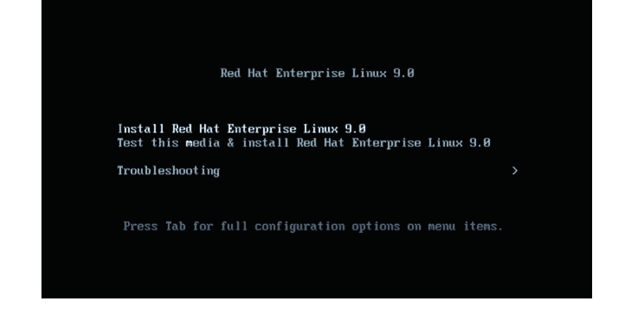

**图 1-1** 选择 Install Red Hat Enterprise Linux 9.0 以开始安装

**步骤 3.** 一旦用于执行安装的基础系统加载完毕，你将看到 Red Hat Enterprise Linux 9.0 欢迎屏幕。从这个屏幕，你可以选择语言和键盘设置。对于 RHCSA 考试，选择英语以外的任何选项都没有意义。如果你使用的是非美国键盘，可以在此屏幕选择键盘设置。确保选择正确的键盘设置，然后点击 **Continue** 继续（见图 1-2）。

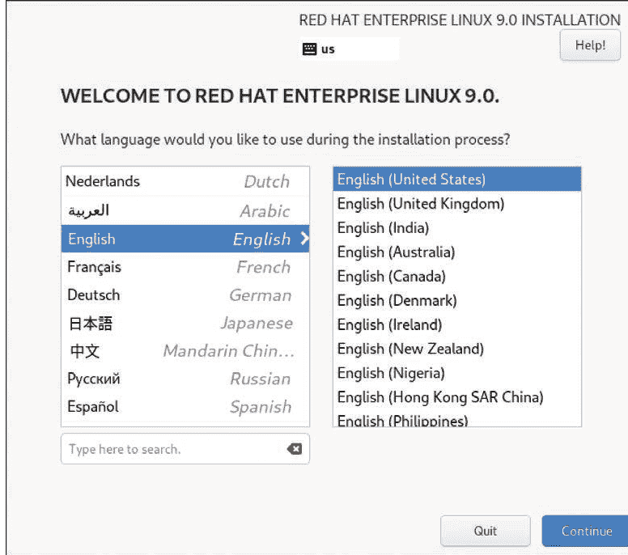

**图 1-2** 在继续之前选择合适的语言和键盘设置

**步骤 4.** 选择键盘和语言设置后，你将看到“安装摘要”屏幕（见图 1-3）。从这个屏幕，你可以指定要使用的所有设置。在此屏幕上，你有几个不同的选项：

- **键盘：** 用于更改键盘布局。
- **语言支持：** 用于添加对其他语言的支持。
- **时间和日期：** 用于指定当前时间和日期，以及时区。
- **Root 密码：** 用于启用或禁用 root 用户，如果启用此用户，则设置密码。

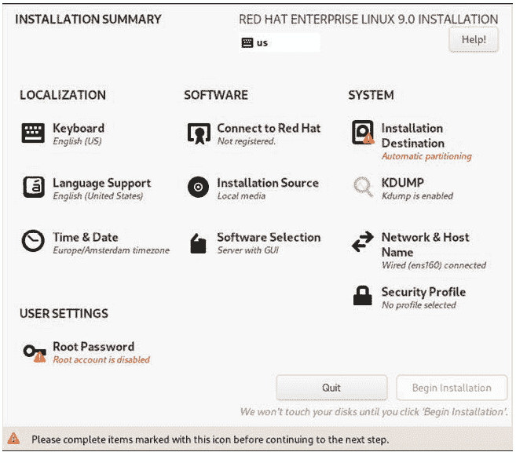

**图 1-3** 从“安装摘要”屏幕指定服务器的完整配置

- **用户创建：** 用于创建非 root 用户帐户，并可选地将此用户标记为管理员。
- **连接到 Red Hat：** 用于在开始安装前将你的系统注册到 Red Hat。请注意，本书中的所有练习都假设你的系统是使用 Red Hat 安装的！
- **安装源：** 用于指定从何处进行安装。通常，你将从安装 DVD（称为本地介质）进行安装。
- **软件选择：** 提供不同的安装模式，以便轻松安装一组默认软件包。
- **安装目标：** 用于指定安装过程中将文件复制到哪个磁盘。
- **KDUMP：** 允许你使用 KDUMP 内核。这是一个在出现错误时创建核心转储的内核。
- **网络和主机名：** 允许你在此设置 IP 地址和相关设置。
- **安全配置：** 提供有限的安全策略集，使你能够轻松地加固服务器。

从这个“安装摘要”屏幕，你可以看到哪些项目仍然需要配置——这些项目用红色文本标记了感叹号和描述。只要存在任何问题，你就无法点击“开始安装”按钮（即它是禁用的）。并非所有情况下都需要更改每个选项的设置，但为了完整性，以下步骤描述了“安装摘要”屏幕中可用的不同设置，并在适当时提供建议的更改。

**步骤 5.** 点击 **键盘** 选项以查看配置键盘布局的设置。从此屏幕，你还可以选择次级键盘布局，这在你的服务器由使用不同键盘布局的管理员使用时很有用。不仅支持不同的语言设置，还支持不同的硬件布局。例如，如果许多管理员使用 Apple Mac 电脑，你可以在相应区域选择 Mac 的标准键盘布局。

添加另一个键盘布局后，你还可以配置布局切换选项。这是一个用于在不同布局类型之间切换的键序列。选择 **选项** 来指定你为此目的要使用的键组合。指定要使用的配置后，点击 **完成** 返回到“安装摘要”屏幕。

**步骤 6.** “安装摘要”屏幕上的“语言支持”选项与你在本过程第 3 步中使用的“语言支持”选项相同。如果你已经配置了要使用的语言设置，则无需在此处进行任何更改。

**步骤 7.** 点击 **时间和日期**，你将看到一张世界地图，可以轻松点击你所在的时区（见图 1-4）。或者，你可以从相应的下拉列表框中选择你所在的区域和城市。你还可以设置当前日期和时间，设置网络后，你可以指定网络时间协议（NTP）以与互联网上的时间服务器同步时间。如果网络不可访问，则无法访问此选项——你必须先设置网络连接才能访问此选项。使用网络时间时，你可以通过点击屏幕右上角部分的配置图标来添加要使用的网络时间服务器。指定要使用的设置后，点击屏幕左上角的 **完成** 以写入设置。

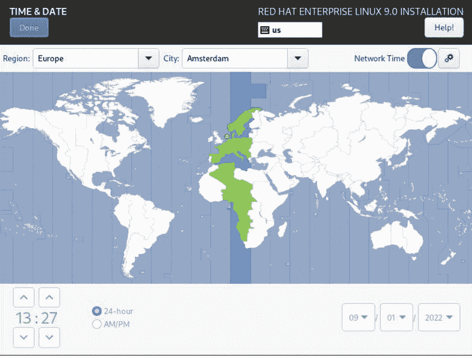

**图 1-4** 选择时间和日期设置

**步骤 8.** 在“用户设置”部分，选择 **Root 密码**。这将打开你在图 1-5 中看到的屏幕。默认情况下，root 用户帐户是禁用的。如果你想能够以 root 身份工作，你需要在此处设置密码。输入相同的密码两次，然后点击 **完成** 继续。

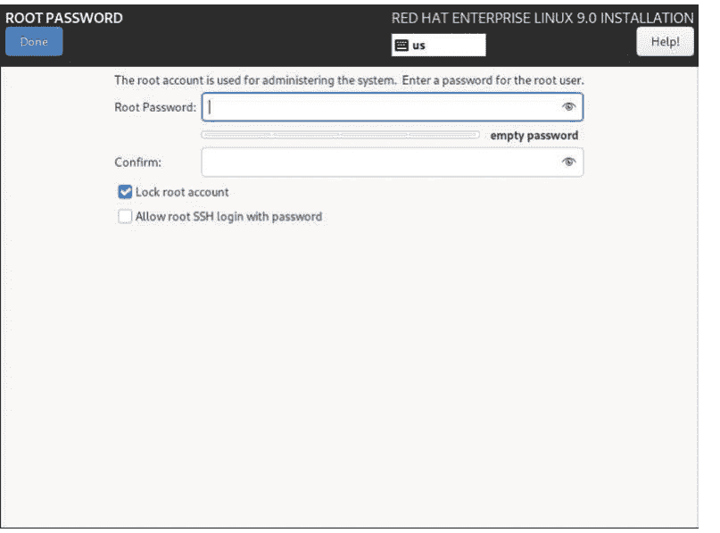

**图 1-5** 设置 Root 用户密码

**步骤 9.** 为 root 用户设置密码后，向下滚动以访问 **用户创建** 选项。点击打开它，你将看到图 1-6 所示的屏幕。在此屏幕中，在“全名”和“用户名”字段中输入 **student** 并设置密码。同时，选择选项 **将此用户设为管理员**，然后点击 **完成** 继续。

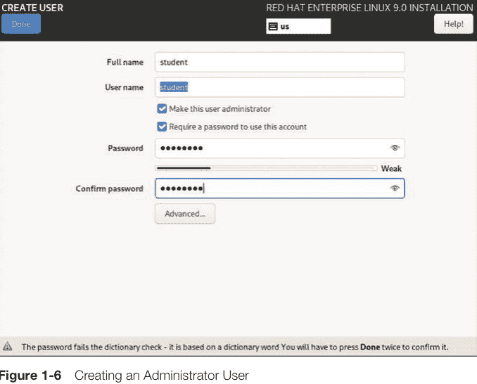

**图 1-6** 创建管理员用户

**步骤 10.** 在“安装摘要”屏幕的“软件”部分，点击 **安装源** 以查看图 1-7 所示的屏幕。如果你从普通安装光盘启动，则无需指定任何内容。如果你从最小启动环境启动，可以指定提供其他软件包的网络 URL，以及需要使用的其他软件仓库。RHCSA 考试不需要这样做，但如果你要设置安装服务器，知道此选项存在很有用。点击 **完成**。

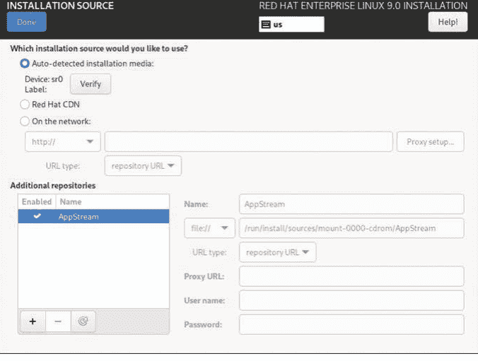

**图 1-7** 选择安装源

**步骤 11.** 点击 **软件选择** 以访问安装过程的重要部分（见图 1-8）。从这里，你可以选择基础环境，并为所选环境选择可用的其他软件。“最小安装”选项非常常见。此基础环境允许你在最小大小的硬盘上安装 RHEL，仅提供必要的软件，没有其他内容。对于本书，我假设你使用 **Server with GUI** 选项安装服务器。要执行 RHCSA 考试中需要执行的任务，有一些易于使用的图形工具可用，因此即使你永远不会在生产环境中这样做，安装带有图形用户界面（GUI）的服务器也是有意义的。所有其他软件包都可以稍后添加。此时，你不必选择任何其他软件包。点击 **完成**。

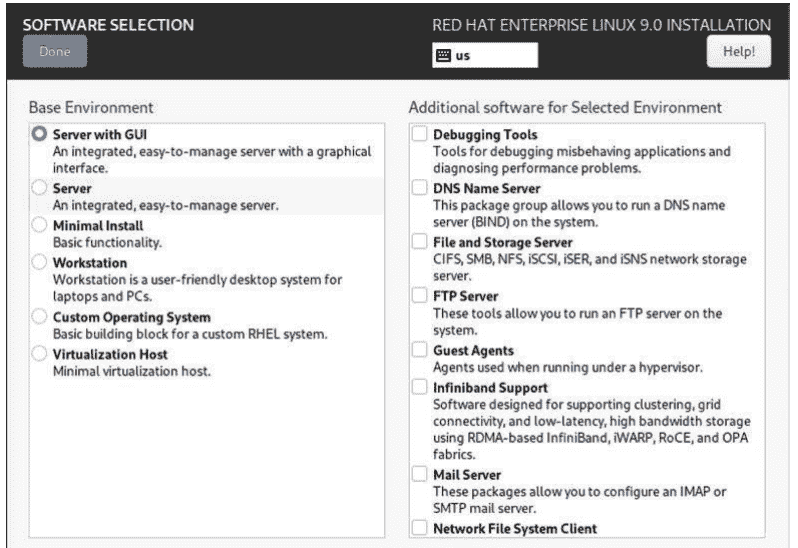

**图 1-8** 确保为你将在本书练习中使用的每台服务器选择 Server with GUI

Humble Bundle Pearson Networking and Security Certification Bundle – © Pearson. Do Not Distribute.

> **注意** 有人说，真正的管理员不会使用带图形用户界面的安装模式。但准备 RHCSA 考试的目标并非成为“真正的”管理员。使用带图形用户界面的安装模式的一大优势在于其提供了易于使用的界面。本书讨论的一些工具只能在图形用户界面下运行。此外，使用带图形用户界面的服务器时，你可以同时打开多个终端窗口，这让操作 RHEL 命令行变得非常轻松！

**步骤 12.** 安装软件后，你需要指定安装位置。在安装摘要屏幕上，点击 **安装目的地**。默认情况下，自动分区选项已被选中，你只需确认要用于自动分区的磁盘设备（参见图 1-9）。还有许多高级选项可用。你可以使用存储配置下的“自动”选项进行安装，以确保无论服务器如何启动，所有配置都能使其正确引导，并且你的文件系统使用默认的 XFS 文件系统。

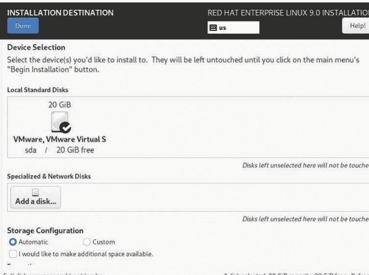

**图 1-9** 点击“完成”以继续并自动创建存储配置

**步骤 13.** 安装摘要屏幕的下一部分允许你设置网络。注意，你必须配置某些内容。如果你不做任何操作，你的服务器可能无法连接到任何网络。点击 **网络和主机名** 来设置网络。这将打开你在图 1-10 中看到的屏幕。

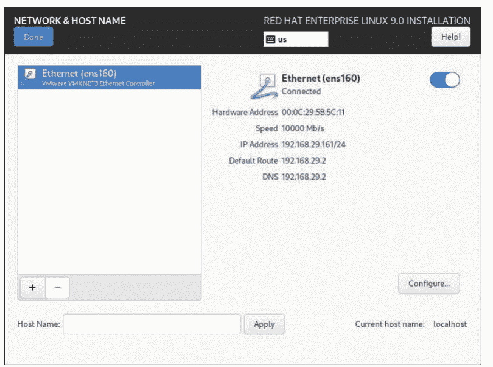

**图 1-10** 在“网络和主机名”屏幕上，确保网卡已连接

开启网络连接（如果尚未开启）后，将主机名设置为 **server1.example.com**。接下来，你可以点击 **配置** 以添加进一步的设置。网络配置将在第 8 章“配置网络”中详细讨论，因此你现在不必进行此项操作，只需保留默认设置，即通过动态主机配置协议服务器获取 IP 地址。完成后点击 **完成** 返回主屏幕。

**步骤 14.** 安全配置文件选项无需任何更改。

**步骤 15.** 在安装摘要屏幕中指定所有设置后，你可以点击 **开始安装** 来启动安装。这会立即开始安装过程，并显示如图 1-11 所示的屏幕。

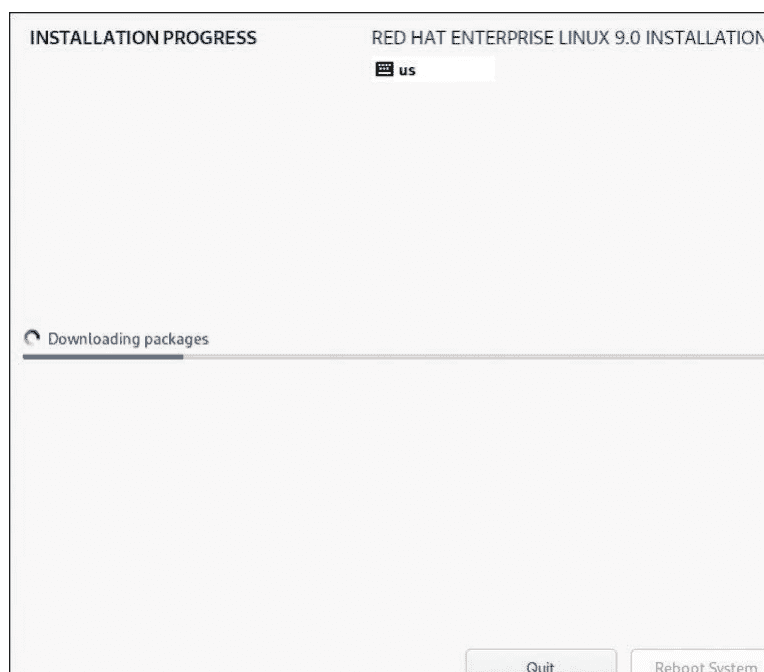

**图 1-11** 开始安装


**步骤 16。** 安装完成后，你将看到如图 1-12 所示的屏幕。现在你需要点击**重启系统**来重新启动计算机并最终完成安装。

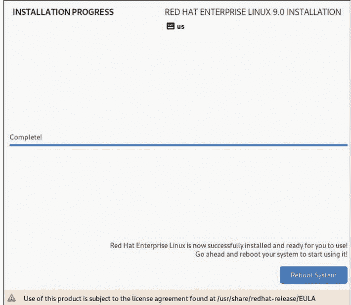

**图 1-12** 重启以完成安装

**步骤 17。** 重启后，你必须完成几个额外的设置步骤来配置你的用户环境。首先，系统会提示你进行导览。你可以选择“不，谢谢”来跳过此次导览，否则它将向你介绍 GNOME 图形桌面的工作方式。接下来你会看到一个提示，说明你的系统未注册。点击关闭此提示；此刻你**不应该**注册你的系统，因为这会使你在第 9 章中找到的所有关于仓库管理的练习变得复杂。

## 总结

在本章中，你了解了什么是 Red Hat Enterprise Linux 以及它与其他一些 Linux 发行版的关系。你还学习了如何安装 Red Hat Enterprise Linux 9。现在你已准备好设置一个基本环境，可用于完成本书中的所有练习。

## 考试准备任务

正如引言中“如何使用本书”一节所提到的，你有几种选择来准备考试：章末实验；附录 C 中的记忆表；第 27 章“最后冲刺”；以及模拟考试。

### 复习所有关键主题

复习本章中最重要的主题，这些主题在页面边距处用“关键主题”图标标记。表 1-2 列出了这些关键主题的参考及其所在页码。

**表 1-2** 第 1 章的关键主题

| 关键主题元素 | 描述 | 页码 |
|---|---|---|
| 列表 | 如何执行 RHEL 9 安装 | 10 |

### 定义关键术语

定义本章中的以下关键术语，并在术语表中核对你的答案：

发行版，Linux，Red Hat，CentOS，Fedora，AlmaLinux，Rocky Linux

### 复习题

以下问题旨在帮助你测试对概念和术语的理解，以及你知识的广度。你可以在附录 A 中找到这些问题的答案。

1. 你不想购买 RHEL 许可证，但想创建一个练习环境来备考。你应该使用哪个发行版？

2. 如果你在安装过程中未指定任何内容，网络配置会怎样？

3. 你想安装一个最小系统。你需要多少内存？

4. 为什么在你安装的所有服务器上都有互联网访问权限是个好主意？

5. 你想在一台没有光驱的计算机上安装虚拟机。执行安装最简单的替代方法是什么？

6. 为什么安装图形用户界面是个好主意？

7. RHEL 9 的默认文件系统是什么？

8. 如果你没有互联网访问权限，能否安装 RHEL？

9. 使用订阅管理器注册你的 RHEL 9 安装，最重要的好处是什么？

10. 如果你可用的磁盘空间非常有限，应该使用哪种安装模式？

## 章末实验

在本章中，你学习了如何设置 Red Hat Enterprise Linux。此时，你应该已经有一台服务器启动并运行。本书后续章节中的练习需要另一台额外的服务器。

### 实验 1.1

重复“执行安装”过程来安装另一台服务器。有关此服务器的其他配置的详细信息将在后续章节的练习中介绍。目前，只需确保满足以下条件即可：

- 使用服务器名称 `server2.example.com`。
- 将网络配置设置为自动获取 IP 地址。
- 使用最小安装模式安装此服务器。

*此页有意留白*


**本章涵盖以下主题：**

- 基本的 Shell 技能
- 使用 `vim` 编辑文件
- 理解 Shell 环境
- 查找帮助

**本章涵盖以下 RHCSA 考试目标：**

- 使用输入输出重定向（`>`, `>>`, `|`, `2>` 等）
- 访问 Shell 提示符并使用正确的语法发出命令
- 创建和编辑文本文件
- 定位、阅读和使用系统文档，包括 `man`、`info` 和 `/usr/share/doc` 中的文件

# 使用基本工具

本章专门介绍每个人在尝试参加 RHCSA 考试之前应该掌握的基本 Linux 技能。

## “我已经掌握这些内容了吗？”测验

“我已经掌握这些内容了吗？”测验使你能够评估是否需要通读本章的全部内容，或者直接跳转到“考试准备任务”部分。如果你对自己的答案或对自身主题知识的评估存在疑虑，请通读全章。表 2-1 列出了本章中的主要标题及其对应的“我已经掌握这些内容了吗？”测验问题。你可以在附录 A“‘我已经掌握这些内容了吗？’测验和复习题答案”中找到答案。

**表 2-1** “我已经掌握这些内容了吗？”部分与问题的对应关系

| 基础主题部分 | 问题 |
|---|---|
| 基本的 Shell 技能 | 1, 3–7 |
| 使用 vim 编辑文件 | 8 |
| 理解 Shell 环境 | 2, 9 |
| 查找帮助 | 10 |

1. 以下哪个命令可以让你将标准输出和标准错误都重定向到一个文件？

   - a. `1&2> file`
   - b. `> file 2>&1`
   - c. `>1&2 file`
   - d. `1>2& file`

2. 你想要设置一个在每个 shell 中对所有用户都可用的本地变量。你应该使用以下哪个文件？

   - a. `/etc/profile`
   - b. `/etc/bashrc`
   - c. `~/.bash_profile`
   - d. `~/.bashrc`

3. 一个用户创建了一个名为 `myscript` 的脚本。该用户尝试使用 `myscript` 命令运行脚本，但脚本没有启动。用户已确认脚本权限已设置为可执行。以下哪项是最可能的原因？

   - a. 内部命令阻止了脚本的启动。
   - b. 用户被禁止运行脚本。
   - c. 包含该脚本的目录不在 `$PATH` 变量中。
   - d. 脚本没有适当的权限。

4. 你需要将 `ls` 命令的输出作为 `less` 命令的输入。以下哪个示例可以实现这一点？

   - a. `ls > less`
   - b. `ls >> less`
   - c. `ls >| less`
   - d. `ls | less`

5. 一个用户不小心输入了密码，该密码现在显示为历史记录中的第 299 条。为了确保密码不会被存储在历史记录中，你建议采取以下哪项操作？

   - a. 删除 `~/.bash_history` 文件并输入 `history -c`。
   - b. 输入 `history -c`。
   - c. 删除 `~/.bash_history` 文件。
   - d. 输入 `history -d 299`。

6. 以下哪项*不是*从历史记录中重复执行命令的有效方法？

   - a. 按 `Ctrl-r` 并开始输入命令的一部分。
   - b. 输入 `!` 后跟命令的首字母。
   - c. 输入 `!` 后跟历史记录中列出的命令编号。
   - d. 按 `Ctrl-x` 后跟历史记录中的编号。

7. Bash 补全功能可用于以下哪些项目？

   - a. 命令
   - b. 文件
   - c. 变量
   - d. 以上所有

8. 以下哪个命令可以让你在使用 `vim` 打开的文本文件中将所有 `old` 替换为 `new`？

   - a. `:%s/old/new/g`
   - b. `:%r/old/new/`
   - c. `:%s/old/new/`
   - d. `r:/old/new`

9. 如果你想在登录过程中向所有刚刚在你的服务器上登录 shell 会话的用户显示一条消息，以下哪种方法最有效？

   - a. 将消息放在 `/etc/issue` 中。
   - b. 将消息放在 `/etc/motd` 中。
   - c. 将消息放在 `/etc/profile` 中。
   - d. 将消息放在 `/etc/bashrc` 中。

10. 你正在使用 `man -k user`，但得到了 "nothing appropriate" 的消息。以下哪种解决方案最有可能解决这个问题？

   - a. 输入 `sudo updatedb` 来更新 mandb 数据库。
   - b. 输入 `sudo makewhatis` 来更新 mandb 数据库。
   - c. 输入 `sudo mandb` 来更新 mandb 数据库。
   - d. 使用 `man -K`，而不是 `man -k`。

## 基础主题

### 基本 Shell 技能

`shell` 是 Linux 管理员的默认工作环境。它是用户和管理员输入由操作系统执行的命令的环境。Linux 有不同的 shell 可用，但 Bash 是最常见的 shell。因此，当我们在本书中谈论"shell"时，我们实际上谈论的是 `Bash` shell。本章概述了你在使用 shell 时会遇到的一些内容。

### 理解命令

使用 shell 就是使用命令语法。通常，命令语法有三个基本部分：命令、选项和参数。

命令是命令本身，例如 `ls`。此命令显示当前目录中的文件列表。要修改命令的行为，可以使用*选项*。选项是程序代码的一部分，它们修改命令的执行方式。例如，当你将 `-l`（小写字母*l*，不是数字 1）选项与 `ls` 命令一起使用时，会显示文件名和属性的详细列表。

*参数*这个词有点令人困惑。一般来说，它指的是命令所处理的任何内容，因此放在命令后面的任何内容都是参数（包括选项）。除了可用作参数的选项之外，命令还可以有其他参数，这些参数作为命令的目标。

让我们看一个示例：命令 `ls -l /etc`。此命令有两个不同的参数：`-l` 和 `/etc`。第一个参数是选项，修改命令的行为。第二个参数是指定命令应在其上执行操作的目标。你会在 Linux 环境中几乎所有使用的命令中找到这三个要素。

#### 执行命令

Linux shell 的目的是提供一个可以执行命令的环境。shell 负责正确解释用户输入的命令。为此，shell 区分三种类型的命令：

- 别名
- 内部命令
- 外部命令

*别名*是用户可以根据需要定义的命令。默认情况下提供了一些别名；在命令行上输入 `alias` 可以获取概览。要定义别名，请使用 `alias newcommand='oldcommand'`（就像默认别名 `ll='ls -l --color=auto'`，该别名已在你的系统上创建）。别名在其他所有内容之前执行。因此，如果你有一个名为 `ll` 的别名，同时也有一个名为 `ll` 的命令，别名始终优先于该命令，除非使用完整的路径名如 `/usr/bin/ls`。

*内部命令*是 shell 本身的一部分，因此不需要从磁盘单独加载。*外部命令*是作为可执行文件存在于计算机磁盘上的命令。因为它必须在第一次使用时从磁盘读取，所以速度稍慢。当用户执行命令时，shell 首先检查它是否是内部命令；如果不是，它会在磁盘上查找与命令名称匹配的可执行文件。要确定一个命令是 Bash 内部命令还是磁盘上的可执行文件，你可以使用 `type` 命令。例如，使用 `type pwd` 可以找出将要执行的 `pwd` 命令实际上是一个别名。

要更改 shell 查找外部命令的方式，请使用 `$PATH` 变量。此变量定义了当用户输入命令时搜索匹配文件名的目录列表。要找出 shell 将确切使用哪个命令，你可以使用 `which` 命令。例如，输入 `which ls` 可以找出 shell 将从哪里获取 `ls` 命令。一个更强大的命令是 `type`，它也适用于内部命令和别名。

你应该注意，出于安全原因，当前目录不在 `$PATH` 变量中，Linux 不会在当前目录中查找特定命令是否可用。这就是为什么你需要在当前目录中但不在 `$PATH` 中的命令前加上 `./` 来运行它。点代表当前目录，通过以 `./` 的方式运行，你告诉 Bash 在当前目录中查找命令。虽然以这种方式运行命令并不常见，但你必须这样做才能运行你在当前目录中创建的脚本。

`$PATH` 变量可以为特定用户设置，但通常大多数用户将使用相同的 `$PATH` 变量。唯一的例外是 root 用户，它需要访问特定的管理命令。在练习 2-1 中，你将学习一些关于使用命令的基础知识。

#### 练习 2-1 从 Shell 使用内部和外部命令

1. 使用你在第 1 章"安装 Red Hat Enterprise Linux"中创建的用户在你创建的 `server1` 服务器上进行身份验证。

2. 单击 **Activities**。在出现的搜索栏中，输入 `term` 并单击显示的终端图标以打开终端。本书中的所有练习都旨在在终端中执行。

3. 输入 `time ls`。这将执行 `ls` 命令，其中 Bash 内部命令 `time` 显示完成此命令所花费的时间信息。

4. 输入 `which time`。这将显示在 `$PATH` 变量中找到的文件名 `/usr/bin/time`。

5. 输入 `time`，这将显示 `time` 是一个 shell 关键字。

6. 输入 `echo $PATH` 以显示 `$PATH` 变量的内容。你可以看到 `/usr/bin` 包含在列表中，但由于还有一个内部命令 `time`，除非你明确告诉 shell 这样做，否则路径中的 `time` 命令不会被执行——步骤 2 中的命令由于命令优先级已经为你执行了内部命令。

7. 输入 `/usr/bin/time ls` 在执行 `ls` 时运行 `/usr/bin/time` 命令。你会注意到输出完全不同。忽略输出的含义；我们稍后会回到这一点。现在重要的是你要意识到这确实是两个不同的命令。

### I/O 重定向

默认情况下，当命令执行时，它会在你正在使用的计算机屏幕上显示结果。计算机显示器用作输出的标准目标，也称为 STDOUT。shell 还有发送错误消息（STDERR）和接受输入（STDIN）的默认标准目标。表 2-2 概述了这三者。

| 名称 | 默认目标 | 重定向中的用法 | 文件描述符编号 |
|---|---|---|---|
| `STDIN` | 计算机键盘 | `<`（等同于 `0<`） | 0 |
| `STDOUT` | 计算机显示器 | `>`（等同于 `1>`） | 1 |
| `STDERR` | 计算机显示器 | `2>` | 2 |

### 使用管道

I/O 重定向器用于替代键盘和计算机显示器，而**管道**则可用于捕获一个命令的输出，并将其作为另一个命令的输入。例如，如果用户运行 `ls` 命令，该命令的输出会显示在屏幕上，因为屏幕是默认的 STDOUT。如果用户使用 `ls | less`，则命令 `ls` 和 `less` 会并行启动。`ls` 命令的标准输出连接到 `less` 的标准输入。`ls` 写入标准输出的所有内容都可供 `less` 从标准输入中读取。结果是 `ls` 的输出显示在 `less` 分页器中，用户可以在其中方便地上下浏览结果。

作为 Linux 管理员，你会经常使用管道。使用管道使 Linux 成为一个灵活的操作系统；通过使用管道组合多个命令，你可以创建"超级"命令，使几乎任何操作都成为可能。在练习 2-2 中，你将使用 I/O 重定向器和管道。

因此，如果你运行一个命令，该命令会期望从键盘接收输入，并且通常会将其输出发送到计算机的显示器，而不会区分正常输出和错误。然而，有些命令是在后台启动的，而不是从当前终端会话中启动的，因此这些命令没有显示器或控制台会话来发送输出，它们也不会监听键盘输入来接受标准输入。这就是重定向派上用场的地方。如果你想从其他位置（如文件）获取输入，**重定向**也很有用。

从命令行启动的程序不知道它们在从什么读取或写入什么。如果它们想从标准输入读取，就从 Linux 内核称为文件描述符 0 的地方读取；它们写入文件描述符 1 来显示非错误输出（也称为"标准输出"）；如果有错误消息要输出，则写入文件描述符 2。默认情况下，这些**文件描述符**连接到键盘和屏幕。如果你使用重定向符号（如 `<`、`>` 和 `|`），shell 会将文件描述符连接到文件或其他命令。我们首先来看重定向器 `<` 和 `>`。稍后我们讨论管道（`|` 符号）。表 2-3 显示了 Bash shell 中最常用的重定向器。

| 重定向器 | 说明 |
|---|---|
| `>`（等同于 `1>`） | 重定向 STDOUT。如果重定向到文件，则该文件的当前内容将被覆盖。 |
| `>>`（等同于 `1>>`） | 以追加模式重定向 STDOUT。如果输出写入文件，则输出将追加到该文件中。 |
| `2>` | 重定向 STDERR。 |
| `2>&1` | 将 STDERR 重定向到与 STDOUT 相同的目标。请注意，这必须与正常输出重定向结合使用，如 `ls whuhiu > errout 2>&1`。 |
| `<`（等同于 `0<`） | 重定向 STDIN。 |

在 I/O 重定向中，文件可以用来替代默认的 STDIN、STDOUT 和 STDERR。你还可以重定向到**设备文件**。Linux 上的设备文件是用于访问特定硬件的文件。例如，你的硬盘在大多数情况下可以称为 `/dev/sda`，服务器的控制台称为 `/dev/console` 或 `/dev/tty1`，如果你想丢弃命令的输出，可以重定向到 `/dev/null`。请注意，要访问大多数设备文件，你需要具有 root 权限。

#### 练习 2-2 使用 I/O 重定向和管道

1. 以用户 `student` 身份打开一个 shell，然后输入不带任何参数的 `cd`。这确保在进行本练习时，该用户的主目录是当前目录。输入 `pwd` 进行验证。

2. 输入 `ls`。你会看到 `ls` 命令的输出显示在屏幕上。

3. 输入 `ls > /dev/null`。这会将 STDOUT 重定向到 null 设备，结果是你不会看到输出。

4. 输入 `ls ilwehgi > /dev/null`。此命令会在屏幕上显示"没有该文件或目录"的消息。你看到该消息是因为它不是 STDOUT，而是写入 STDERR 的错误消息。

5. 输入 `ls ilwehgi 2> /dev/null`。现在你将不再看到错误消息。


6. 输入`ls ilwehgi /etc 2> /dev/null`。这会显示`/etc`文件夹的内容，同时隐藏错误消息。

7. 输入`ls ilwehgi /etc 2> /dev/null > output`。在此命令中，你仍然将错误消息写入`/dev/null`，同时将`STDOUT`发送到名为`output`的文件中，该文件将在你的主目录中创建。

8. 输入`cat output`显示该文件的内容。

9. 输入`echo hello > output`。这会覆盖`output`文件的内容。使用`cat output`再次验证。

10. 输入`ls >> output`。这会将`ls`命令的结果追加到`output`文件中。输入`cat output`进行验证。

11. 输入`ls -R /`。这会显示大量的文件和文件夹在你的计算机显示器上滚动。（你可能需要按`Ctrl-C`停止[或者等待一段时间]。）

12. 输入`ls -R / | less`。这会显示相同的结果，但在`less`分页器中，你可以使用键盘上的方向键上下滚动。

13. 输入`q`关闭`less`。这也会结束`ls`程序。

14. 输入`ls > /dev/tty1`。这会产生错误消息，因为你是以普通用户身份执行命令，而普通用户不能直接访问设备文件（除非你登录到了`tty1`）。只有`root`用户才有权限直接写入设备文件。

## 历史记录

Bash shell 的一个便捷功能是 Bash 历史记录。Bash 默认配置为保留用户使用的最后 1,000 条命令。当 shell 会话关闭时，该会话的历史记录会更新到历史记录文件中。此文件的名称是`.bash_history`，它在启动特定 shell 会话的用户的主目录中创建。请注意，历史记录文件仅在 shell 会话关闭时才被写入；在此之前，历史记录中的所有命令都保存在内存中。

历史记录功能使重复执行复杂命令变得简单。有几种使用历史记录的方法：

- 输入`history`显示 Bash 历史记录中所有命令的列表。
- 按`Ctrl-r`打开提示符，你可以从中反向搜索之前使用过的命令。只需输入一个字符串，Bash 就会在命令历史记录中反向查找包含该字符串作为命令名或其参数之一的任何命令。再次按`Ctrl-r`重复上一次反向搜索。
- 输入`!number`执行历史记录中具有特定编号的命令。
- 使用`history -d number`从历史记录中删除特定命令。请注意，此命令将重新编号历史记录中的所有其他行：如果你删除了第 31 行，之前编号为第 32 行的行现在将变为第 31 行。
- 输入`!sometext`执行最后一个以`sometext`开头的命令。请注意，这是一个潜在危险的命令，因为找到的命令会立即执行！

在某些情况下可能需要清除 Bash 历史记录。例如，如果你不小心以明文形式输入了密码，此功能就很有用。如果发生这种情况，你可以输入`history -c`清除当前历史记录。退出当前会话后，此会话的命令将不会写入历史记录文件。如果你想同时删除当前历史记录和`.bash_history`文件的内容，那么在运行`history -c`命令后立即输入`history -w`。或者，使用`history -d number`从历史记录中删除特定命令。

练习 2-3 将引导你了解一些历史记录功能。

## 练习 2-3 使用历史记录

1. 确保你已以用户`student`身份打开了一个 shell。
2. 输入`history`查看你之前使用的命令概览。
3. 输入一些命令，例如以下命令：

   ```bash
   ls
   pwd
   cat /etc/hosts
   ls -l
   ```

   目的是丰富一下历史记录。

4. 在你的服务器上打开第二个终端。为此，单击左上角的`Activities`，然后在搜索栏中输入`term`。接下来，单击终端窗口以启动它。

5. 从这个第二个终端窗口输入`history`。注意你看不到刚刚在另一个终端中输入的命令。原因是历史记录文件尚未更新。

6. 从第一个终端会话中，按`Ctrl-r`。从现在打开的提示符中，输入`ls`。你会看到你上次使用的`ls`命令。再次按`Ctrl-r`。你会看到你正在向后搜索，并且上一个`ls`命令被高亮显示。按 Enter 执行它。

7. 输入`history | grep cat`。`grep`命令在历史记录输出中搜索包含文本`cat`的命令。记下你之前使用过的某个`cat`命令的编号。

8. 输入`!nn`，其中`nn`替换为你在步骤 7 中记下的编号。你会看到上一个`cat`命令被重复执行。

9. 输入`exit`关闭此终端。

10. 从剩余的终端窗口中，输入`history -c`。这将清除当前内存中的所有历史记录。同样关闭此终端会话。

11. 打开一个新的终端会话并输入`history`。结果可能有点出乎意料，但你仍然会看到一系列命令。原因是`history -c`清除的是内存中的历史记录，但并不会删除你主目录中的`.bash_history`文件。

## Bash 补全

Bash shell 的另一个有用特性是命令行补全。此功能可以帮助你找到所需的命令，它同样适用于变量和文件名。

Bash 补全在使用命令时非常有用。只需输入命令的开头部分，然后按 Tab 键。如果只有一个补全选项，Bash 会自动为你完成命令。如果有多个选项，你需要再按一次 Tab 键来查看所有可用选项的概览。在练习 2-4 中，你将学习如何使用这些强大的功能。

## 练习 2-4 使用 Bash 补全

1. 仍然在用户 shell 中，输入`gd`并按 Tab 键。你会看到没有任何反应。
2. 再次按 Tab 键。Bash 现在会显示以字母`gd`开头的所有命令的简短列表。
3. 为了明确告知 Bash 你的意图，输入`i`（此时你的提示符会显示命令`gdi`）。再次按 Tab 键。Bash 现在会将命令补全为`gdisk`。按 Enter 启动它，再按 Enter 关闭它。
4. 使用`cd /etc`进入`/etc`目录。
5. 输入`cat ps`并按 Tab 键。因为只有一个以`pas`开头的文件，Bash 知道该怎么做，并自动将文件名补全为`passwd`。按 Enter 执行命令。

## 使用 vim 编辑文件

管理 Linux 通常意味着处理文件。Linux 上的大部分配置都是通过文件完成的。要完成管理任务，你经常需要使用文本编辑器修改配置文件的内容。

多年来，Linux 上已经创建了许多文本编辑器。但有一个编辑器至关重要，那就是`vi`。即使其他一些文本编辑器更易于使用，`vi`是唯一始终可用的文本编辑器。这就是为什么作为 Linux 管理员，你需要知道如何使用`vi`。一个常见的替代选择是`vim`，即“`vi` improved”（`vi`增强版）；它是对`vi`的完全重写，包含许多使`vi`使用更方便的增强功能，例如对许多配置文件的语法高亮，这使得你很容易识别输入错误。你在本节中学到的关于`vim`的所有内容同样适用于`vi`。

使用`vim`时的一个重要概念是它使用不同的模式。其中两种模式尤为重要：*命令模式*和*输入模式*。这些模式常常令人困惑，因为在命令模式下你只能输入命令，而不能编辑文本文件的内容。要更改文本文件的内容，你需要进入输入模式。

使用`vim`的挑战在于可用的命令数量庞大。有些人甚至制作了`vim`速查表，列出了所有可用的命令。不要使用它们。相反，专注于真正重要的最少数量的命令。表 2-4 总结了最基本的`vim`命令。使用这些（且仅使用这些）命令，你就能在 RHCSA 考试中表现良好。

> **提示** 在使用`vim`时，*不要*试图使用尽可能多的命令。只需使用最少量的命令并经常使用它们。你会看到；你会习惯这些命令并在考试中记住它们。此外，你可能会喜欢`vimtutor`命令。（你可能需要使用`dnf install vim-enhanced`来安装它；第 9 章“管理软件”提供了更多关于软件安装的详情。）此命令会打开一个`vim`教程，引导你完成一些不错的额外练习。

**表 2-4** `vim`基本命令

| `vim`命令 | 说明 |
|---|---|
| `Esc` | 从输入模式切换到命令模式。在输入任何命令之前按此键。 |
| `i`, `a` | 从命令模式切换到输入模式，在当前光标位置之前（`i`）或之后（`a`）。 |
| `o` | 在当前光标位置下方打开一个新行并进入输入模式。 |
| `:wq` | 写入当前文件并退出。 |
| `:q!` | 不应用任何更改直接退出文件。`!`强制执行该命令。仅在你确实知道自己在做什么时才添加`!`。 |
| `:w filename` | 以新文件名写入当前文件。 |
| `dd` | 删除当前行并将被删除行的内容放入内存中。 |
| `yy` | 复制当前行。 |
| `p` | 粘贴已剪切或复制到内存中的内容。 |
| `v` | 进入可视模式，允许你使用方向键选择文本块。使用`d`剪切选中内容或使用`y`复制它。 |
| `u` | 撤销上一个命令。根据需要重复执行。 |
| `Ctrl-r` | 重做上一次撤销。（不能重复执行超过一次。） |
| `gg` | 跳转到文档的第一行。 |
| `G` | 跳转到文档的最后一行。 |
| `/text` | 从当前光标位置向前搜索`text`。 |
| `?text` | 从当前光标位置向后搜索`text`。 |
| `^` | 跳转到当前行的第一个位置。 |
| `$` | 跳转到当前行的最后一个位置。 |
| `!ls` | 在当前文件中插入`ls`（或任何其他命令）的输出。 |
| `:%s/old/new/g` | 将所有出现的`old`替换为`new`。 |

现在你已经了解了使用`vim`的最基本命令。练习 2-5 让你有机会实践它们。

```text
练习 2-5  vim 练习

1. 输入 vim ~/testfile。这将启动 vim 并打开 ~ 目录中名为 testfile 的文件，~ 代表你当前的主目录。

2. 输入 i 进入输入模式，然后输入以下文本：
   cow
   sheep
   ox
   chicken
   snake
   fish
   oxygen

3. 按 Esc 返回命令模式，然后输入 :w 以相同的文件名保存文件。

4. 输入 :3 跳转到第 3 行。

5. 输入 dd 删除这一行。

6. 再次输入 dd 删除另一行。

7. 输入 u 撤销上一次删除。

8. 输入 o 打开一个新行。

9. 在当前光标位置输入更多文本：
   tree
   farm

10. 按 Esc 返回命令模式。

11. 输入 :%s/ox/OX/g 并注意包含 ox 的那一行的变化。

12. 输入 :wq 保存文件并退出。如果由于某种原因不起作用，请使用 :wq!
```

Red Hat RHCSA 9 Cert Guide: EX200

## 理解 Shell 环境

当你从 shell 中工作时，会创建一个*环境*，以确保所有操作都以正确的方式进行。此环境由定义用户环境的变量组成，例如前面讨论过的`PATH`变量。在本节中，你将简要了解 shell 环境及其创建方式。

### 理解变量

Linux shell 环境由许多变量组成。*变量*是可以被赋予动态值的固定名称。变量的一个例子是`LANG`，在我的 shell 中它被设置为`en_US.UTF-8`。此值（在你的系统上可能不同）确保我可以使用英语环境中常用的设置以英语进行工作（想想日期和时间的显示方式）。

使用变量进行脚本和编程的优势在于，程序只需使用变量的名称，而无需关心分配给该变量的具体值。由于不同用户有不同的需求，用户环境中设置的变量也会有所不同。要查看当前 shell 环境中定义的变量概览，请输入`env`命令，它将显示用于设置重要系统设置的环境变量。示例 2-1 显示了此命令输出的若干行。

**示例 2-1** 显示当前环境

```bash
[user@server1 ~]$ env
MAIL=/var/spool/mail/user
PATH=/usr/local/bin:/bin:/usr/bin:/usr/local/sbin:/usr/sbin:/home/user/.local/bin:/home/user/bin
PWD=/home/user
LANG=en_US.UTF-8
HISTCONTROL=ignoredups
SHLVL=1
HOME=/home/user
LOGNAME=user
LESSOPEN=||/usr/bin/lesspipe.sh %s
_=/bin/env
OLDPWD=/etc
```

如示例 2-1 所示，要定义一个变量，你需要输入变量名，后跟一个等号（`=`）和赋给该特定变量的值。要读取变量的值，你可以使用`echo`命令（以及其他命令），后跟变量名，例如`echo $PATH`，它会读取`$PATH`变量的当前值并将其打印到标准输出。目前，你不需要对变量了解太多。你可以在第 19 章“Bash Shell 脚本自动化简介”中阅读关于变量更高级用法的内容。

### 识别环境配置文件

当用户登录时，系统会自动为该用户创建一个环境。这基于以下四个配置文件，在这些文件中可以指定一些脚本代码并定义变量：

- **`/etc/profile`：**这是所有用户登录时都会处理的通用文件。
- **`/etc/bashrc`：**当启动子 shell 时会处理此文件。
- **`~/.bash_profile`：**在此文件中，可以定义用户特定的登录 shell 变量。
- **`~/.bashrc`：**在此用户特定文件中，可以定义子 shell 变量。

正如你所见，这些文件区分了*登录 shell*和*子 shell*。登录 shell 是用户登录后为用户打开的第一个 shell。从登录 shell 中，用户可以运行脚本，这将启动该登录 shell 的一个子 shell。Bash 允许在登录 shell 和子 shell 中创建不同的环境，但为了确保在所有 shell 中使用相同的设置，最好在登录 shell 中也包含子 shell 的设置。

### 使用`/etc/motd`和`/etc/issue`

要在登录过程中显示消息，Bash 使用`/etc/motd`和`/etc/issue`文件。`/etc/motd`中的消息在用户成功登录 shell 后显示。（注意，图形环境中的用户在图形登录后不会看到其内容。）使用`/etc/motd`可以是系统管理员通知用户有关问题或安全策略的一种便捷方式。

另一种向用户发送信息的方式是使用`/etc/issue`。此文件的内容在用户从基于文本的控制台界面登录之前显示。使用此文件为尚未登录的用户提供登录说明是一种极好的方式。

在练习 2-6 中，你可以练习本节讨论的主题。

## 练习 2-6 管理 Shell 环境

1. 打开一个 shell，你以`student`用户身份登录。
2. 输入`echo $LANG`以显示设置系统键盘和语言环境的变量内容。
3. 输入`ls --help`。你会看到`ls`命令的帮助信息以你计算机的当前语言设置显示。
4. 输入`LANG=es_ES.UTF-8`。这会临时将语言变量设置为西班牙语。再次输入`ls --help`进行验证。
5. 输入`exit`关闭终端窗口。由于你没有更改上述任何文件的内容，当你打开新的 shell 时，将使用`LANG`变量的原始值。
6. 再次以`user`身份打开一个 shell。
7. 输入`echo $LANG`验证`LANG`变量的当前值。
8. 输入`vim .bashrc`打开`.bashrc`配置文件。
9. 在此文件中，添加行`COLOR=red`以设置名为`COLOR`的变量并为其赋值`red`。注意这个变量实际上不会改变系统中的任何内容；它只是设置了一个变量。
10. 关闭用户 shell 并打开一个新的用户 shell。
11. 使用`echo $COLOR`验证变量`COLOR`是否已设置。由于`.bashrc`文件包含在登录过程中，该变量在登录后被设置。

## 查找帮助

在一个普通的 Linux 系统上，有数百个可用命令——多到根本无法全部记住，这就是为什么使用计算机上的帮助资源如此重要。`man`命令是获取命令语法和用法帮助的最重要资源。除此之外，你可以使用`command --help`显示命令选项的简洁列表。

### 使用`--help`

获取命令使用概览的最快方式是使用`--help`选项运行命令。几乎所有命令在使用此选项时都会显示用法摘要。在此摘要中，你会看到该命令可以使用的所有选项。注意选项没有严格的顺序；你可以按任意顺序使用它们。

以这种方式显示的选项列表主要在你已经大致了解如何使用该命令并需要快速了解可用选项时才有用——它不会提供对不了解该命令的用户有帮助的详细信息。

> **提示** 几乎所有命令在使用`--help`选项时都会提供简短的帮助概览。有些命令不支持该选项并将其视为错误。幸运的是，这些命令会友好地显示一条错误消息，列出该命令的有效选项，这实际上意味着你仍然能得到所需的信息。

### 使用`man`

使用 Linux 命令行时，你迟早会查阅 man 手册页。`man`命令使得从命令行工作成为可能。如果你不知道某个命令的用法，该命令的 man 手册页会提供宝贵的参考。本节介绍一些`man`的基础知识。


首先，`man` 手册页中最重要的部分通常位于手册页的底部。你会找到两个重要的部分：在很多情况下有示例；如果没有示例，总会有一个“另请参阅”部分。你在这里找到的主题是相关的 `man` 手册页，如果你没有找到正确的手册页，这会很有用。要尽快到达 `man` 手册页的底部，请使用 `G` 命令。你也可以输入 `/example` 在 `man` 手册页中搜索任何示例。图 2-1 展示了 `man` 手册页末尾的样子。

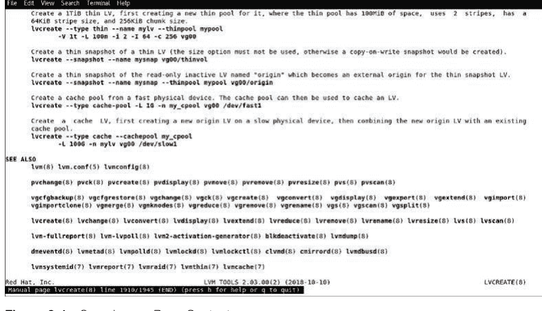

### 找到正确的 `man` 手册页

要在 `man` 手册页中查找信息，你可以使用 `apropos` 或 `man -k` 搜索 `mandb` 数据库。如果数据库是最新的，获取所需信息很容易。只需输入 `man -k`，后跟你要搜索的关键词。此命令会在 `mandb` 数据库中存储的所有 `man` 手册页的摘要中进行搜索。如果运行此命令时得到“没有匹配项”的结果，请参阅本章后面的“更新 `mandb`”部分。示例 2-2 展示了此命令的部分结果。

**示例 2-2 使用 `man -k` 搜索 `man` 手册页**

```text
[root@server1 ~]# man -k partition
addpart (8)             - simple wrapper around the "add partition" ioctl
cfdisk (8)              - display or manipulate disk partition table
cgdisk (8)              - Curses-based GUID partition table (GPT)
                        manipulator
delpart (8)              - simple wrapper around the "del partition" ioctl
fdisk (8)               - manipulate disk partition table
fixparts (8)            - MBR partition table repair utility
gdisk (8)               - Interactive GUID partition table (GPT)
                        manipulator
iostat (1)              - Report Central Processing Unit (CPU) statistics
                        and in...
kpartx (8)              - Create device maps from partition tables
mpartition (1)          - partition an MSDOS hard disk
os-prober (1)           - Discover bootable partitions on the local
                        system
partprobe (8)           - inform the OS of partition table changes
partx (8)              - tell the Linux kernel about the presence and
                        numbering...
pvcreate (8)            - initialize a disk or partition for use by LVM
pvresize (8)            - resize a disk or partition in use by LVM2
resizepart (8)          - resize a disk or partition for use by LVM2
sfdisk (8)              - partition table manipulator for Linux
sgdisk                  (- Command-line GUID partition table (GPT)
                        manipulator fo...
systemd-efi-boot-generator (8) - Generator for automatically mounting
                        the EFI...
systemd-gpt-auto-generator (8) - Generator for automatically
                        discovering and ..
```

根据 `man -k` 提供的信息，你大概可以确定需要查阅哪个 `man` 手册页来完成你想做的事情。但请注意，`man -k` 并不完美；它只搜索每个已安装命令的简短摘要。如果你的关键词不在摘要中，你将找不到任何内容并得到“没有匹配项”的错误消息。

> **提示** 你可以使用 `apropos` 命令代替 `man -k`，两者是等效的。

当使用 `man -k` 从手册页中查找特定信息时，有时会得到大量信息。如果发生这种情况，使用 `grep` 命令过滤一下结果可能会有所帮助。但如果你想这样做，重要的是要知道你要找什么。

手册页按不同部分分类。对系统管理员最相关的部分如下：

- **1**：可执行程序或 Shell 命令
- **5**：文件格式和约定
- **8**：系统管理命令

还有一些部分提供关于 Linux 系统的详细信息，例如关于系统调用和库调用的部分。使用 `man -k` 时，你会得到所有这些部分的结果。要限制显示的结果，使用 `grep` 仅显示与你需要相关的那些部分是有意义的。因此，如果你正在寻找与密码相关的配置文件，使用 `man -k password | grep 5`；如果你正在寻找管理员用来创建分区的命令，使用 `man -k partition | grep 8`。

另一个有用的 `man` 选项是 `-f`。命令 `man -f <somecommand>` 显示在 `mandb` 数据库中找到的项目的简短描述。当你决定这个手册页是否包含你正在寻找的信息时，这个描述可能会有所帮助。

### 更新 `mandb`

如前所述，当你使用 `man -k` 命令时，会查询 `mandb` 数据库。此数据库通过计划任务自动创建。偶尔，你可能会查找一些应该有文档记录的内容，但得到的只是“nothing appropriate”的消息。如果发生这种情况，你可能需要手动更新 `mandb` 数据库。这样做很容易：只需以 root 用户身份运行 `mandb` 命令，无需任何参数。它会查看是否安装了新的手册页，并相应地更新 `mandb` 数据库。

> **提示** 不要试图记住完成特定任务所需的所有命令。相反，要记住如何找到这些命令，以及阅读哪个手册页以获取有关该命令的更多信息。在练习 2-7 中，你会看到这是如何工作的。

假设你正在使用 `man -k` 查找一个命令，但得到的只是“nothing appropriate”的消息，并且你不记得如何解决它。练习 2-7 展示了在这种情况下你可以做什么。

**练习 2-7 使用 `man -k`**

1. 确保你以 `student` 帐户登录。
2. 因为 `man -k` 没有给出预期的结果，所以查看 `man` 命令的手册页以获取有关 `man -k` 的额外信息是有意义的。键入 `man man` 打开 `man` 的手册页。进入手册页后，键入 `/-k` 以查找 `-k` 选项的描述。键入 `n` 几次，直到找到描述该选项的行。你会看到 `man -k` 等同于 `apropos`，并且你可以阅读 `apropos` 的手册页以获取更多详细信息。因此，键入 `q` 退出此手册页。
3. 键入 `man apropos` 并阅读描述的第一段。你会看到 `apropos` 搜索的数据库由 `mandb` 程序更新。
4. 键入 `man mandb`。此手册页解释了如何运行 `mandb` 来更新 `mandb` 数据库。正如你将读到的，你所要做的就是键入 `mandb`，它会为你完成工作。
5. 键入 `sudo mandb` 来更新 `mandb` 数据库。请注意，如果 `mandb` 数据库已经是最新的，你不会看到很多手册页被添加。

### 使用 `info`

除了在手册页中可以找到的信息外，另一个系统提供了有关命令用法的帮助。这就是 `info` 系统。大多数命令在手册页中有文档记录，但有些命令的主要文档在 `info` 系统中，并且在手册页中只显示简短的使用摘要。如果是这种情况，该命令手册页的“另请参阅”部分会告诉你“...的完整文档维护为 Texinfo 手册”。然后你可以使用 `pinfo` 或 `info` 命令阅读 info 页面。两个命令都可以工作，但在 `pinfo` 中，特殊项目（如菜单项）会被清楚地标出，这就是为什么使用 `pinfo` 更容易。

使用 `info` 时，请查看查看器的顶行。这显示了在 info 文档中的当前位置。特别有趣的是 Up、Next 和 Previous 指示器，它们告诉你如何导航。Info 页面像网页一样组织，这意味着它们以层次结构组织。要浏览该层次结构，键入 `n` 转到下一页，键入 `p` 转到上一页，或键入 `u` 在层次结构中向上移动。

在 info 页面中，你还会找到菜单。每个用星号（`*`）标记的项目都是一个菜单项。使用箭头键选择特定的菜单项。这会使你下降一级。要返回上一级，键入 `u`。这会将你带回到 `pinfo` 层次结构中的原始起点。图 2-2 显示了 info 页面的外观。

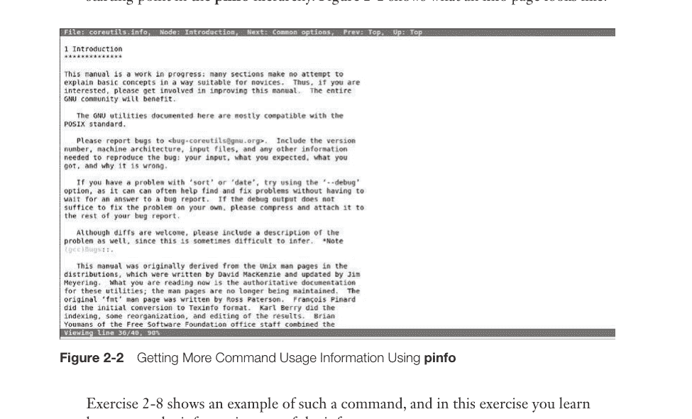

**图 2-2** 使用 `pinfo` 获取更多命令使用信息

练习 2-8 展示了这样一个命令的示例，在这个练习中，你将学习如何从 info 页面中获取信息。

**练习 2-8 使用 `info`**

1. 键入 `man ls`。键入 `G` 转到手册页的末尾，并查看“另请参阅”部分。它告诉你 `ls` 的完整文档维护为 Texinfo 手册，可以使用 `info` 命令显示。按 `q` 退出手册页。
2. 键入 `pinfo '(coreutils) ls invocation'`。这会在 `pinfo` 页面中显示有关 `ls` 使用的信息。通读它，完成后按 `q`。或者，你可以使用 `info` 命令，但 `pinfo` 显示的格式更好。

### 使用 `/usr/share/doc` 文档文件

第三个信息源包括有时复制到 `/usr/share/doc` 目录的文件。这些文件特别适用于服务和一些较为复杂的较大系统。你通常不会找到太多关于像 `ls` 这样的命令的信息，但一些服务确实在 `/usr/share/doc` 中提供了有用的信息。

一些服务在此目录中存储非常有用的信息，例如 rsyslog、bind、Kerberos 和 OpenSSL。对于某些服务，甚至包含示例文件。

### 总结

在本章中，你阅读了关于基本的 Linux 管理任务。你学习了一些重要的 Shell 基础知识，例如重定向 I/O、使用历史记录以及管理环境。你还学习了如何使用 `vim` 编辑器编辑文本文件。在本章的最后一部分，你学习了如何使用 `man` 和相关命令查找信息。

### 考试准备任务

正如引言中“如何使用本书”一节所述，你有多种选择来准备考试：章节末尾的实验室；附录 C 中的记忆表；第 27 章“最终准备”；以及模拟考试。

#### 复习所有关键主题

复习本章中最重要的主题，这些主题在页面边距中用关键主题图标标出。表 2-5 列出了这些关键主题的参考以及每个主题所在的页码。

**表 2-5** 第 2 章关键主题

| 关键主题元素 | 描述 | 页码 |
| :--- | :--- | :--- |
| 表 2-4 | `vim` 基本命令 | 38 |
| 列表 | `man` 中的重要部分 | 46 |

#### 凭记忆完成表格和列表

打印附录 C“记忆表”（可在随附网站上找到）的副本，或至少打印本章的相应部分，并凭记忆完成表格和列表。附录 D“记忆表答案键”包含已完成的表格和列表，供你检查。

#### 定义关键术语

定义本章的以下关键术语，并在词汇表中检查你的答案：

`shell`、Bash、内部命令、外部命令、`$PATH`、`STDIN`、`STDOUT`、`STDERR`、重定向、文件描述符、设备文件、管道、环境、变量、登录 shell、子 shell

#### 复习题

以下问题旨在帮助你测试对概念和术语的知识以及知识的广度。你可以在附录 A 中找到这些问题的答案。

1. 什么是变量？
2. 哪个命令使你能够根据关键词用法找到正确的手册页？
3. 如果你想在用户 bob 登录时设置一个变量，需要更改哪个文件？
4. 在分析如何使用一个命令时，你读到文档是使用 Techinfo 系统维护的。如何阅读这些信息？
5. Bash 存储其历史记录的文件名是什么？
6. 哪个命令使你能够更新包含 man 关键词的数据库？
7. 如何在 `vim` 中撤销你应用的最后一次修改？
8. 你可以向命令添加什么以确保它不显示错误消息，假设你也不关心错误消息中的信息？
9. 如何读取 `$PATH` 变量的当前内容？
10. 如何重复你使用的上一个包含字符串 dog 的命令？

#### 章末实验

你现在已经学习了 Linux 管理员应掌握的一些最重要的基础技能。请通过完成以下章末实验来应用这些技能。章末实验没有提供解答；你应该在没有任何额外帮助的情况下独立完成这些实验。

##### 实验 2.1

1. 修改你的 shell 环境，使得在每次启动子 shell 时，都会设置一个变量。变量名应为 `COLOR`，值应设置为 `red`。验证其是否生效。
2. 使用合适的工具查找可用于更改用户密码的命令。使用此命令是否需要 root 权限？
3. 从你的主目录开始，输入命令 `ls -al wergihl *`，并确保错误信息以及常规输出都被重定向到名为 `/tmp/lsoutput` 的文件中。


本章涵盖以下主题：

- 使用文件系统层次结构
- 管理文件
- 使用链接
- 使用归档和压缩文件

本章涵盖以下 RHCSA 考试目标：

- 创建、删除、复制和移动文件及目录
- 使用 `tar`、`star`、`gzip` 和 `bzip2` 归档、压缩、解包和解压文件
- 创建硬链接和软链接

Humble Bundle Pearson Networking and Security Certification Bundle – © Pearson. 请勿分发。

# 第 3 章 基础文件管理工具

Linux 是一个面向文件的操作系统。这意味着管理员在 Linux 上需要做的许多事情都可以追溯到管理 Linux 操作系统上的文件。此外，当使用硬件设备时，也会涉及文件。本章向你介绍基础的文件管理技能。你将学习 Linux 文件系统的组织方式，以及如何操作文件和目录。你还将学习如何管理链接以及压缩或未压缩的归档文件。

## “我对此已经了解了吗？”测验

“我对此已经了解了吗？”测验使你可以评估是否应该通读本章全部内容，还是直接跳转到“考试准备任务”部分。如果你对这些问题的答案或对自己相关主题知识的评估存在疑虑，请通读整章。表 3-1 列出了本章的主要标题及其对应的“我对此已经了解了吗？”测验问题。你可以在附录 A“‘我对此已经了解了吗？’测验与复习题答案”中找到答案。

**表 3-1** “我对此已经了解了吗？”部分与问题对应表

| 基础主题部分 | 问题 |
| --- | --- |
| 使用文件系统层次结构 | 1–4 |
| 管理文件 | 5–7 |
| 使用链接 | 8–9 |
| 使用归档和压缩文件 | 10 |

1. 你期望在哪个目录下找到自上次启动以来动态创建的临时文件？
   - a. `/boot`
   - b. `/bin`
   - c. `/sbin`
   - d. `/run`

2. 你期望在哪个目录下找到日志文件？
   - a. `/proc`
   - b. `/run`
   - c. `/var`
   - d. `/usr`

3. 当 `/home` 挂载到不同的设备时，可以提供额外的挂载选项以增强安全性。以下哪些是这些选项的示例？
   - a. `ro`
   - b. `nodev`
   - c. `noexec`
   - d. `nosuid`

4. 以下哪个命令能提供最准确的已挂载磁盘设备概览（而不显示太多关于已挂载系统设备的信息）？
   - a. `mount`
   - b. `mount -a`
   - c. `df -hT`
   - d. `du -h`

5. 哪个命令能让你显示当前目录中的所有文件，并且最新的文件列在最后？
   - a. `ls -lRt`
   - b. `ls -lrt`
   - c. `mls -alrt`
   - d. `ls -alr`

6. 哪个命令能让你将 `/home/$USER` 中的隐藏文件和常规文件都复制到当前目录？
   - a. `cp -a /home/$USER`
   - b. `cp -a /home/$USER/*`
   - c. `cp -a /home/$USER/.`


`d. cp -a home/$USER.`

## 7. 哪个命令能让你将文件 `myfile` 重命名为 `mynewfile`？

a. `mv myfile mynewfile`

b. `rm myfile mynewfile`

c. `rn myfile mynewfile`

d. `ren myfile mynewfile`

## 8. 关于硬链接，以下哪项陈述是*不*正确的？

a. 硬链接不能创建到目录。

b. 硬链接不能引用其他设备上的文件。

c. inode维护一个硬链接计数器。

d. 如果原始硬链接被删除，所有其他硬链接都将失效。

## 9. 哪个命令在 `/tmp` 目录中创建指向 `/home` 目录的符号链接？

a. `ln /tmp /home`

b. `ln /home /tmp`

c. `ln -s /home /tmp`

d. `ln -s /tmp /home`

## 10. 哪个 `tar` 选项能让你更新现有的tar归档文件？

a. `-a`

b. `-A`

c. `-r`

d. `-u`

# 基础主题

## 使用文件系统层次结构

要管理Linux系统，你应该熟悉几乎所有Linux系统上都存在的默认目录。本节将描述这些目录，并解释如何使用挂载来构建文件系统层次结构。

### 定义文件系统层次结构

大多数Linux系统上的文件系统组织方式类似。Linux文件系统的布局在*文件系统层次结构标准（FHS）*中定义，该文件系统层次结构在`man 7 file-hierarchy`中有描述。表3-2概述了红帽企业Linux（RHEL）系统中你会遇到的最重要目录，这些目录是FHS规定的。

### 表3-2 FHS概述

| 目录 | 用途 |
|---|---|
| `/` | 指定根目录。这是文件系统树的起点。 |
| `/boot` | 包含启动Linux内核所需的所有文件和目录。 |
| `/dev` | 包含用于访问物理设备的设备文件。此目录在启动过程中至关重要。 |
| `/etc` | 包含服务器上程序和服务使用的配置文件。此目录在启动过程中至关重要。 |
| `/home` | 用于本地用户的主目录。 |
| `/media`，`/mnt` | 包含用于在文件系统树中挂载设备的目录。 |
| `/opt` | 用于可能安装在服务器上的可选软件包。 |
| `/proc` | 由proc文件系统使用。这是一个提供内核信息访问的文件系统结构。 |
| `/root` | 指定root用户的主目录。 |
| `/run` | 包含自上次启动以来创建的与进程和用户相关的信息。 |
| `/srv` | 可被NFS、FTP和HTTP等服务用于存放数据。 |
| `/sys` | 用作Linux内核及其相关进程管理的不同硬件设备的接口。 |
| `/tmp` | 包含临时文件，这些文件在启动时可能会被无警告地删除。 |
| `/usr` | 包含程序文件、这些程序文件的库以及相关文档的子目录。 |
| `/var` | 包含大小可能动态变化的文件，例如日志文件、邮箱和假脱机文件。 |

### 理解挂载

要理解Linux文件系统的组织方式，你需要理解挂载这个重要概念。**挂载**是设备与目录之间的连接。Linux文件系统呈现为一个层次结构，以*根目录*（`/`）作为其起点。这个层次结构可以分布在不同的设备甚至不同的计算机系统上，这些设备或系统被挂载到根目录中。

在挂载过程中，一个**设备**被连接到一个特定的目录，这样在成功挂载后，该目录就可以访问设备的内容。

挂载设备使得以灵活的方式组织Linux文件系统成为可能。将所有文件存储在一个文件系统中存在几个缺点，这为使用多个挂载提供了几个充分的理由：

- 一个区域的高度活动可能会填满整个文件系统，这将对服务器上运行的服务产生负面影响。
- 如果所有文件都在同一设备上，就很难保护访问权限并区分具有不同安全需求的文件系统区域。通过挂载单独的文件系统，你可以添加挂载选项以满足特定的安全需求。
- 如果单设备文件系统完全填满，可能很难提供额外的存储空间。

为了避免这些陷阱，通常将Linux文件系统组织在不同的设备（甚至是其他计算机系统上的共享）上，例如磁盘分区和逻辑卷，并将这些设备挂载到文件系统层次结构中。通过将设备配置为专用挂载，你还可以使用特定的挂载选项来限制对该设备的访问。某些目录通常挂载在专用设备上：

- **`/boot`：** 此目录通常挂载在单独的设备上，因为它包含了计算机启动所需的关键信息。由于根目录（`/`）通常位于逻辑卷管理器（LVM）逻辑卷上，而从该...

# Linux启动与文件系统管理

Linux默认无法启动，内核及相关文件需要单独存储在专用的`/boot`设备上。

- **`/boot/EFI`：** 如果系统使用可扩展固件接口（EFI）启动，则需要专用挂载点，以提供启动过程最早阶段所需的所有文件。
- **`/var`：** 此目录通常位于专用设备上，因为其增长是动态且不可控的（例如，由于写入`/var/log`的日志文件）。将其放在专用设备上，可以确保它不会填满服务器上的所有存储空间。
- **`/home`：** 出于安全原因，此目录通常位于专用设备上。将其放在专用设备上，可以使用特定选项（如`noexec`和`nodev`）进行挂载，以增强服务器的安全性。当重新安装操作系统时，将主目录放在单独的文件系统中是一个优势。这样，主目录可以在系统重装后得以保留。
- **`/usr`：** 此目录仅包含操作系统文件，普通用户通常不需要对其进行写入访问。将此目录放在专用设备上，允许管理员将其配置为只读挂载。

除了这些目录，您可能会发现服务器上还有其他目录挂载在专用分区或卷上。毕竟，由管理员自行决定哪些目录获得自己的专用设备。

要获取所有设备及其挂载点的概览，您可以使用不同的命令：

- **`mount`** 命令提供了所有已挂载设备的概览。要获取此信息，内核读取`/proc/mounts`文件，其中包含所有当前挂载的信息。它还会显示内核接口，这可能导致显示的已挂载设备列表很长。示例3-1显示了该命令的示例输出。

**示例3-1** 部分 `mount` 命令输出

```text
[root@server1 ~]# mount
sysfs on /sys type sysfs (rw,nosuid,nodev,noexec,relatime,seclabel)
proc on /proc type proc (rw,nosuid,nodev,noexec,relatime)
devtmpfs on /dev type devtmpfs (rw,nosuid,seclabel,size=909060k,
nr_inodes=227265,mode=755)
securityfs on /sys/kernel/security type securityfs (rw,nosuid,nodev,
    noexec,relatime)
tmpfs on /dev/shm type tmpfs (rw,nosuid,nodev,seclabel)
devpts on /dev/pts type devpts (rw,nosuid,noexec,relatime,seclabel,
    gid=5,mode=620,ptmxmode=000)
tmpfs on /run type tmpfs (rw,nosuid,nodev,seclabel,mode=755)
tmpfs on /sys/fs/cgroup type tmpfs (ro,nosuid,nodev,noexec,seclabel,
    mode=755)
...
/dev/nvme0n1p1 on /boot type xfs (rw,relatime,seclabel,attr2,inode64
    , noquota)
sunrpc on /var/lib/nfs/rpc_pipefs type rpc_pipefs (rw,relatime)
tmpfs on /run/user/42 type tmpfs (rw,nosuid,nodev,relatime,seclabel,
    size=184968k,mode=700,uid=42,gid=42)
tmpfs on /run/user/1000 type tmpfs (rw,nosuid,nodev,relatime,seclabel,
    size=184968k,mode=700,uid=1000,gid=1000)
gvfsd-fuse on /run/user/1000/gvfs type fuse.gvfsd-fuse
    (rw,nosuid,nodev,relatime,user_id=1000,group_id=1000)
/dev/sr0 on /run/media/student/RHEL-9-0-BaseOS-x86_64 type iso9660
    (ro,nosuid,nodev,relatime,nojoliet,check=s,map=n,blocksize=2048,
    uid=1000,gid=1000,dmode=500,fmode=400,uhelper=udisks2)
tmpfs on /run/user/0 type tmpfs (rw,nosuid,nodev,relatime,seclabel,
    size=184968k,mode=700))
```

- **`df -Th`** 命令旨在显示已挂载设备上的可用磁盘空间；它包含大多数系统挂载点。由于它会查看所有已挂载的文件系统，因此是获取当前系统挂载概览的便捷命令。`-h`选项以人类可读的方式汇总命令输出，`-T`选项显示不同挂载点上使用的文件系统类型。
- **`findmnt`** 命令显示挂载点以及不同挂载点之间的关系。由于`mount`命令的输出有点冗长，您可能会喜欢`findmnt`的输出。请注意，由于书籍页面的宽度限制，属于OPTIONS列的内容出现在页面的左侧。

在练习3-1中，您将使用不同的命令来获取当前已挂载设备的概览。

### 练习3-1 获取当前挂载概览

1. 以**student**用户身份登录并输入`mount`。注意命令的输出相当冗长。但如果您仔细阅读，会看到Linux目录结构中的几个目录及其对应的挂载点。
2. 输入`df -hT`。注意显示的设备少得多。此命令的输出示例如示例3-2所示。

**示例3-2** `df -hT` 示例输出

```text
[root@server1 ~]# df -hT
Filesystem            Type        Size  Used Avail Use% Mounted on
/dev/mapper/centos-root xfs       5.9G  3.9G  2.1G  66% /
devtmpfs              devtmpfs    908M     0  908M   0% /dev
tmpfs                 tmpfs       918M  144K  917M   1% /dev/shm
tmpfs                 tmpfs       918M   21M  897M   3% /run
tmpfs                 tmpfs       918M     0  918M   0% /sys/fs/cgroup
/dev/sda1             xfs         197M  131M   67M  67% /boot
```

现在您已经输入了`mount`和`df`命令，让我们仔细看看示例3-2中`df -hT`命令的输出。

**`df`** 的输出显示在七列中：

- **Filesystem：** 与所用磁盘设备交互的设备文件的名称。输出中的真实设备以`/dev`开头（这指的是用于存储设备文件的目录）。您还可以看到几个`tmpfs`设备。这些是内核设备，用于在RAM中创建临时文件系统。
- **Type：** 所使用的文件系统类型。
- **Size：** 已挂载设备的大小。
- **Used：** 设备已使用的磁盘空间量。
- **Avail：** 未使用的磁盘空间量。
- **Use%：** 设备当前已使用的百分比。
- **Mounted on：** 设备当前挂载的目录。

请注意，当使用`df`命令时，大小以kibibyte为单位报告。选项`-m`将以mebibyte显示这些数据，使用`-h`将以人类可读的格式（KiB、MiB、GiB、TiB或PiB）显示。

## 管理文件

作为管理员，您需要能够执行常见的文件管理任务。这些任务包括：

- 使用通配符
- 管理和使用目录
- 使用绝对和相对路径名
- 列出文件和目录
- 复制文件和目录
- 移动文件和目录
- 删除文件和目录

以下小节将解释如何执行这些任务。

### 使用通配符

处理文件时，使用通配符可以使您的工作轻松很多。通配符是一种shell功能，可以帮助您以简单的方式引用多个文件。表3-3提供了概览。

#### 表3-3 通配符概览

| 通配符 | 用途 |
|---|---|
| `*` | 表示任意数量的任意字符。例如，`ls *`显示当前目录中的所有文件（名称以点开头的文件除外）。 |
| `?` | 用于表示一个特定的字符，可以是任何字符。`ls c?t`将匹配*cat*和*cut*。 |
| `[auo]` | 表示一个字符，可以从方括号内指定的范围内选择。`ls c[auo]t`将匹配*cat*、*cut*和*cot*。 |

### 管理和使用目录

为了组织文件，Linux使用*目录*（也称为*文件夹*）。您已经阅读了FHS定义的一些默认目录。当用户开始创建文件并将其存储在服务器上时，提供一个目录结构也是有意义的。作为管理员，您必须能够遍历目录结构。练习3-2为您提供练习使用目录的机会。

#### 练习3-2 使用目录

1. 以**student**用户身份打开一个shell。输入`cd`。然后输入`pwd`，它代表*打印当前工作目录*。您将看到您当前位于主目录；即`/home/<username>`。
2. 输入`touch file1`。此命令在服务器上创建一个名为`file1`的空文件。因为您当前位于主目录，所以可以创建任何想要的文件。
3. 输入`cd /`。这将当前目录更改为根目录（`/`）。输入`touch file2`。您会看到“权限被拒绝”消息。普通用户只能在其拥有所需权限的目录中创建文件。
4. 输入`cd /tmp`。这会带您进入`/tmp`目录，所有用户都具有写入权限。再次输入`touch file2`。您会看到您可以在`/tmp`目录中创建项目（除非已经存在由其他人拥有的`file2`）。
5. 输入不带任何参数的`cd`。此命令将您带回到主目录。
6. 输入`mkdir files`。这在当前目录中创建一个名为`files`的目录。`mkdir`命令使用需要创建的目录的名称作为相对路径名；它相对于您当前所在的位置。
7. 输入`mkdir /home/$USER/files`。在此命令中，您使用变量`$USER`，它将被替换为您的当前用户名。`mkdir`的完整参数是到您尝试创建的`files`目录的绝对文件名。因为此目录已经存在，您将得到“文件已存在”错误消息。
8. 输入`rmdir files`以删除您刚刚创建的`files`目录。`rmdir`命令使您能够删除目录，但它仅在目录为空且不包含任何文件时才有效。

### 使用绝对和相对路径名

在上一节中，您使用了`cd`和`mkdir`命令。您使用这些命令浏览目录结构。您还使用了相对文件名和绝对文件名。

绝对文件名，或称绝对路径名，是你想要操作的文件或目录的完整路径引用。该路径名以根目录开头，后跟所有子目录，直到实际文件名。无论你当前位于哪个目录，绝对文件名始终有效。绝对文件名的一个示例是`/home/lisa/file1`。

相对文件名是相对于`pwd`命令所显示的当前目录而言的。它仅包含从当前目录到达所需项目所需的元素。假设你的当前目录是`/home`（如`pwd`命令所示）。当你引用相对文件名`lisa/file1`时，你实际上引用的是绝对文件名`/home/lisa/file1`。

使用相对文件名时，有时需要向上移动一级目录。假设你以root身份登录，并且想要将文件`/home/lisa/file1`复制到目录`/home/lara`。以下几种方案都可以实现：

- 使用`cp /home/lisa/file1 /home/lara`。因为在此命令中你使用的是绝对路径名，所以这个命令在任何时候都能正常工作。
- 确保你的当前目录是`/home`，然后使用`cp lisa/file1 lara`。注意，源文件和目标文件都是以相对文件名引用的，因此它们不以`/`开头。但这样存在风险：如果此示例中的`lara`目录不存在，`cp`命令会创建一个名为`lara`的文件。如果你想确保是复制到一个目录中，并且在目录不存在时生成错误信息，请使用`cp lisa/file1 lara/`。
- 如果当前目录设置为`/home/lisa`，你也可以使用`cp file1 ../lara`。在此命令中，目标文件名使用了`..`，表示向上移动一级。`..`后面跟着`/lara`，因此目标文件的完整名称将被解释为“向上移动一级”（于是你将位于`/home`），然后从那里查找`/lara`子目录。

> **提示** 如果你是 Linux 新手，理解相对文件名并不总是那么容易。不过有一个简单的变通方法。只需确保你始终使用绝对路径名即可。使用绝对路径名需要多输入一些内容，但更加简单，因此你会犯更少的错误。


在第 2 章“使用基本工具”中，你学习了如何使用 Bash 通过 Tab 键进行补全。使用 Bash 补全可以让操作长命令变得更加容易。Bash 补全同样适用于文件名。如果你有一个很长的文件名，比如`my-long-file-name`，可以尝试输入`my-`并按下 Tab 键。如果在当前目录中，只有一个文件以`my-`开头，文件名将自动补全。如果有多个文件以`my-`开头，你需要按两次 Tab 键才能看到所有可用文件名的列表。

### 列出文件和目录

在操作文件和目录时，显示当前目录的内容非常有用。为此，你可以使用`ls`命令。如果不带参数使用，`ls`将显示当前目录的内容。一些常用参数使得使用`ls`更加便捷。表 3-4 给出了概览。

**表 3-4** `ls`常用命令行选项

| 命令 | 用途 |
|---|---|
| `ls -l` | 显示详细列表，包括文件属性信息，如创建日期和权限。 |
| `ls -a` | 显示所有文件，包括隐藏文件。 |
| `ls -lrt` | `-t`选项按修改日期排序显示。由于`-r`选项，最近修改的文件会显示在列表最后。这是一个非常有用的命令。 |
| `ls -d` | 显示目录名称，而不是显示与`ls`命令中使用的通配符匹配的所有目录的内容。 |
| `ls -R` | 显示当前目录及其所有子目录的内容；即递归地遍历所有子目录。 |

> **提示** Linux 上的隐藏文件是以点号开头的文件名。尝试以下操作：`touch .hidden`。然后输入`ls`。你将看不到该文件。接着输入`ls -a`。你就能看到了。

使用`ls`和`ls -l`时，你会发现文件以不同颜色显示。不同文件类型使用不同的颜色，便于区分各类文件。不过不必过于关注颜色，因为所使用的颜色取决于变量设置，在其他 Linux shell 或其他 Linux 服务器上可能会有所不同。

### 复制文件和目录

为了在服务器上组织文件，你经常需要复制文件。`cp`命令可以帮助你完成此操作。复制单个文件并不困难：只需使用`cp /<文件路径> /<目标路径>`即可。例如，要将文件`/etc/hosts`复制到目录`/tmp`，使用`cp /etc/hosts /tmp`。这会将`hosts`文件写入`/tmp`。

> **提示** 如果你将文件复制到一个目录但目标目录不存在，则会创建一个以目标目录名称命名的文件。在很多情况下，这不是最佳解决方案，更好的做法是直接获取错误信息。你可以通过在目录名后加上`/`来实现，使用`cp /etc/hosts /tmp/`而不是`cp /etc/hosts /tmp`。

使用`cp`命令，你还可以复制整个子目录，包括其内容及所有子项。为此，使用`-R`选项，表示递归。（你还会在许多其他 Linux 命令中看到`-R`选项。）例如，要将目录`/etc`及其所有内容复制到目录`/tmp`，使用命令`cp -R /etc /tmp`。

使用`cp`命令时，你需要考虑文件的权限和其他属性。如果不使用额外选项，这些属性可能不会被复制。如果你想确保保留当前权限，请使用`-a`选项，它使`cp`以归档模式工作。此选项确保在复制过程中权限和所有其他文件属性都会被保留。因此，要将你的主目录及其所有内容的完整状态复制到`/tmp`目录，使用`cp -a ~ /tmp`。

使用`cp`时的一个特殊情况是隐藏文件。默认情况下，隐藏文件不会被复制。有三种方法可以同时复制隐藏文件：

- `cp /somedir/.* /tmp`：这会将所有以点号开头的文件（即隐藏文件）复制到`/tmp`。它会对`/somedir`中以点号开头的目录产生错误信息，因为没有使用`-R`选项。
- `cp -a /somedir/ .`：这会将整个`/somedir`目录（包括其内容）复制到当前目录。因此，结果是在当前目录中创建一个名为`somedir`的子目录。
- `cp -a /somedir/. .`：这会将所有文件（常规文件和隐藏文件）复制到当前目录（注意此命令末尾两个点号之间的空格）。

### 移动文件和目录

要移动文件和目录，你需要使用`mv`命令。该命令将文件从当前位置移除并放到新位置。你也可以用它来重命名文件（实际上，重命名只不过是复制后删除原始文件而已）。让我们看一些示例：

- `mv myfile /tmp`将文件`myfile`从当前目录移动到`/tmp`。
- `mkdir somefiles; mv somefiles /tmp`首先创建一个名为`somefiles`的目录，然后将该目录移动到`/tmp`。注意，即使目录中包含文件，此操作同样有效。
- `mv myfile mynewfile`将文件`myfile`重命名为新文件`mynewfile`。

### 删除文件和目录

最后一个常见的文件管理任务是文件删除。要删除文件和目录，你需要使用`rm`命令。当此命令用于单个文件时，该文件将被删除。你也可以对包含文件的目录使用它。为此，需要加上`-r`选项，它同样表示递归。

> **注意** 许多命令都有创建递归行为的选项。某些命令使用`-R`选项，而其他命令使用`-r`选项。这容易让人困惑，但事实就是如此。

在 RHEL 9 上，如果你以 root 身份使用`rm`命令，它会提示确认。原因是通过`/root/.bashrc`，`rm`被定义为`rm -i`的别名。如果你不喜欢这样，可以使用`-f`选项或从`/root/.bashrc`中删除该别名。确保你在移除此安全功能后知道自己在做什么，因为删除文件时你将不再收到任何警告。

在练习 3-3 中，你将使用常见的文件管理工具。

> **注意** 在本练习中，点号很重要，它是命令的一部分。为避免混淆，如果通常用于表示句子结尾的点号紧跟在命令之后，在本练习中我将其省略了。

### 练习 3-3 使用文件

图 3-1 概述了你在本练习中使用的目录结构。

1. 以普通用户身份打开一个 shell。
2. 输入`pwd`。

   你应该位于`/home/$USER`目录中。

### 使用链接

Linux 中的链接类似于赋予文件的别名。链接分为符号链接和硬链接。要理解链接，你需要对 Linux 文件系统如何使用 inode 进行文件系统管理有所了解。

#### 理解硬链接

Linux 将文件的管理数据存储在`inode`中。inode 用于存储关于文件的所有管理数据。Linux 上的每个文件都有一个 inode，其中存储了文件的重要信息：

- 存储文件内容的数据块
- 创建、访问和修改日期
- 权限
- 文件所有者

有一个重要信息不存储在 inode 中：文件名。名称存储在目录中，每个文件名都知道它必须引用哪个 inode 来访问进一步的文件信息。有趣的是，inode 不知道自己有哪些名称；它只知道有多少个名称与之关联。这些名称被称为**硬链接**。因此，每个文件至少有一个硬链接，那就是文件的名称。

当你创建一个文件时，你给它一个名字。本质上，这个名字就是一个硬链接。在 Linux 文件系统上，可以为一个文件创建多个硬链接。如果相同内容的文件需要在多个位置可用，并且你需要一个简单的解决方案来保持内容一致，这就很有用。如果对任何硬链接进行了更改，所有其他硬链接也会显示，因为所有硬链接都指向相同的数据块。不过，硬链接有一些限制：

- 硬链接必须全部存在于同一个设备（分区、逻辑卷等）上。
- 不能为目录创建硬链接。
- 当文件的最后一个名称（硬链接）被移除时，对文件数据的访问也会被移除。

硬链接的好处在于，第一个硬链接和第二个硬链接之间没有区别。它们都只是硬链接，如果一个文件的第一个硬链接被移除，这不会影响仍然存在的其他硬链接。Linux 操作系统在许多位置使用链接，以使文件更易于访问。

#### 理解符号链接

**符号链接**（也称为**软链接**）不直接链接到 inode，而是链接到文件的名称。这使得符号链接更加灵活，但也有一些缺点。符号链接的优点是它们可以链接到其他设备上的文件，也可以链接到目录。主要缺点是，当原始文件被移除时，符号链接会变得无效，不再起作用。

图 3-2 展示了 inode、硬链接和符号链接之间关系的示意图。

### 创建链接

使用`ln`命令创建链接。它使用与`cp`和`mv`相同的参数顺序：首先提到源名称，然后是目标名称。如果要创建符号链接，请使用选项`-s`，然后指定源文件或目录以及目标文件或目录。有一个重要的限制：要创建硬链接，你必须是想要链接的项目的拥有者。

表 3-5 显示了一些示例。

**表 3-5** `ln`使用示例

| 命令 | 说明 |
|---|---|
| `ln /etc/hosts .` | 在当前目录创建到文件`/etc/hosts`的链接 |
| `ln -s /etc/hosts .` | 在当前目录创建到文件`/etc/hosts`的符号链接 |
| `ln -s /home /tmp` | 在目录`/tmp`中创建到目录`/home`的符号链接 |

`ls`命令可以显示文件是否是链接：

- 在`ls -l`命令的输出中，如果文件是符号链接，则第一个字符是`l`。
- 如果文件是符号链接，`ls -l`的输出会在文件名后显示它链接到的项目名称。
- 如果文件是硬链接，`ls -l`会显示硬链接计数器。在示例 3-3 的输出中，对于`hosts`文件，这个数字是`root root`之前的数字 3。

#### 示例 3-3 使用 `ls -l` 显示链接属性

```text
[root@localhost tmp]# \ls -l
total 3
lrwxrwxrwx. 1 root root 5 Jan 19 04:38 home -> /home
-rw-r--r--. 3 root root 158 Jun 7 2013 hosts
```

> **注意** 在示例 3-3 中，使用的命令是`\ls -l`，而不是`ls -l`。`ls`命令默认是一个别名，用于在显示`ls`输出时使用不同的颜色；命令前的`\`会使命令不使用别名。

#### 移除链接

移除链接可能很危险。为了向你展示原因，让我们考虑以下过程。

1. 在你的主目录中创建一个名为`test`的目录：`mkdir ~/test`
2. 将`/etc`中所有以 a、b、c、d 或 e 开头的文件复制到此目录：`cp /etc/[a-e]* ~/test`
3. 输入`ls -l ~/test/`以验证`test`目录的内容。
4. 确保你在主目录中，使用不带参数的`cd`。
5. 输入`ln -s test link`。
6. 输入`rm link`。这将移除符号链接。（*不要*使用`-r`或`-f`来移除符号链接，即使它们是子目录。）
7. 输入`ls -l`。你会看到符号链接已被移除。
8. 让我们再试一次。输入`ln -s test link`重新创建链接。
9. 输入`rm -rf link/`（这是使用 Bash 命令行补全时你会得到的结果）。
10. 输入`ls`。你会看到目录`link`仍然存在。
11. 输入`ls test/`。你会看到目录`test`现在是空的。

在练习 3-4 中，你将学习如何使用符号链接和硬链接。

### 练习 3-4 使用符号链接和硬链接

> **注意** 在本练习中，点很重要，并作为命令的一部分。为避免混淆，如果通常会使用点来表示句子的结尾，那么在本练习中，如果它紧跟在命令之后，我已经将其省略。

1. 以`student`用户身份打开一个 shell。
2. 从你的主目录，输入`ln /etc/passwd .`（确保命令以点结尾，并且点前面有空格！）此命令会给你一个“操作不允许”的错误，因为你不是`/etc/passwd`的所有者。
3. 输入`ln -s /etc/passwd .`（再次确保命令以空格和点结尾！）这行得通；你不必是所有者才能创建符号链接。
4. 输入`ln -s /etc/hosts`（这次命令末尾没有点）。你会注意到这个命令也有效。如果未指定目标，则在当前目录中创建链接。
5. 输入`touch newfile`并使用`ln newfile linkedfile`为该文件创建一个硬链接。
6. 输入`ls -l`并注意`newfile`和`linkedfile`的链接计数器，当前设置为 2。
7. 输入`ln -s newfile symlinkfile`为`newfile`创建一个符号链接。
8. 输入`rm newfile`。
9. 输入`cat symlinkfile`。你会得到“没有这样的文件或目录”错误消息，因为找不到原始文件。
10. 输入`cat linkedfile`。这没有问题。
11. 输入`ls -l`并查看`symlinkfile`的显示方式。也查看`linkedfile`，其链接计数器现在设置为 1。
12. 输入`ln linkedfile newfile`。
13. 再次输入`ls -l`。你会看到原始情况已恢复。

### 处理归档和压缩文件

另一个重要的文件相关任务是管理归档和压缩文件。要在 Linux 计算机上创建文件归档，通常使用`tar`命令。此命令最初设计用于将文件流式传输到磁带，而不对文件进行压缩，它默认仍然不压缩任何内容。如果你还想压缩文件，则必须使用特定的压缩工具或指定选项在创建归档文件时对其进行压缩。在本节中，你将学习如何处理归档文件和压缩文件。

#### 使用 tar 管理归档文件

磁带归档工具（`tar`）用于归档文件。尽管最初设计用于将文件流式写入备份磁带，但目前`tar`主要用于将文件写入归档文件。在 RHCSA 考试中，你必须能够使用`tar`完成四项重要任务：

- 创建归档文件
- 列出归档文件的内容
- 提取归档文件
- 压缩和解压缩归档文件

#### 使用 tar 创建归档文件

要创建归档文件，请使用以下语法：

`tar -cf archivename.tar /files-you-want-to-archive`

如果你想查看操作过程，可以同时使用`-v`选项。要将文件放入归档文件，你至少需要对文件具有读取权限，并对文件所在目录具有执行权限。以 root 用户身份使用`tar -cvf /root/homes.tar /home`，将`/home`目录及其所有内容写入`/root`目录下的`homes.tar`文件。注意所使用的选项；这些选项的顺序很重要。

最初，tar 并不在其选项前使用破折号（-）。现代 tar 实现使用破折号，其他所有 Linux 程序也是如此，但为了向后兼容，它们仍然允许不使用破折号的旧用法。有关所用相关选项的完整概述，请参见下一节中的表 3-6。

在使用 tar 管理归档文件时，也可以向现有归档文件添加文件或更新归档文件。要向归档文件添加文件，请使用`-r`选项。例如，使用`tar -rvf /root/homes.tar /etc/hosts`将`/etc/hosts`文件添加到归档文件中。

要更新当前存在的归档文件，可以使用`-u`选项。因此，使用`tar -uvf /root/homes.tar /home`将`/home`中所有文件的较新版本写入归档文件。

#### 监控和提取 tar 文件

在提取文件之前，最好先了解其中可能包含的内容。可以使用选项`-t`来查看。例如，输入`tar -tvf /root/homes.tar`以查看 tar 归档文件的内容。

> **提示** 创建带有`.tar`或`.tgz`等扩展名的归档文件是一个好习惯，这样它们可以被轻松识别，但并非每个人都这样做。如果你认为某个文件是 tar 归档文件但不确定，可以使用`file`命令。例如，如果你输入`file somefile`，该命令会分析其内容并在命令行上显示它是哪种类型的文件。

要提取归档文件的内容，请使用`tar -xvf /archivename.tar`。这会将归档文件解压到*当前*目录中。这意味着，如果你在输入`tar -xvf /root/homes.tar`时位于`/root`目录，并且文件包含一个`/home`目录，那么提取后你将得到一个新的`/root/home`目录，其中包含该文件的所有内容。这可能不是你想要的结果。有两种方法可以将提取的内容直接放到你想要的位置：

- 在提取归档文件之前，使用`cd`命令进入你想要提取文件的目录。
- 使用选项`-C /targetdir`指定你想要将文件提取到的目标目录。例如，如果你想要将`/root/homes.tar`的内容放入`/tmp`目录，可以使用`tar -xvf homes.tar -C /tmp`。

> **注意** RHCSA 目标提到你还需要知道如何使用`star`。`star`工具旨在提供对非默认文件属性（如访问控制列表（参见第 7 章“权限管理”）或 SELinux 文件上下文（参见第 22 章“管理 SELinux”））的归档支持。在其当前版本中，`tar`也提供了此功能，因此实际上不再需要使用`star`。你还会注意到，它甚至未包含在默认安装模式中。

除了提取整个归档文件外，也可以从归档文件中提取单个文件。为此，请使用`tar -xvf /archivename.tar file-you-want-to-extract`。例如，如果你的归档文件`etc.tar`包含你想要提取的文件`/etc/hosts`，请使用`tar -xvf /root/etc.tar etc/hosts`。

### 使用压缩


许多文件包含大量冗余。压缩程序可以通过消除这些冗余来减少文件占用的磁盘空间。如果没有冗余，使用压缩不会带来太大好处。在你迄今为止看到的所有 `tar` 命令示例中，没有压缩任何字节。最初，在创建归档文件后，必须使用单独的压缩工具（如 `gzip` 或 `bzip2`）进行压缩。创建 `home.tar` 后，你可以使用 `gzip home.tar` 进行压缩。`gzip` 会将其压缩版本 `home.tar.gz` 替换 `home.tar`，这显著减少了所需空间。

作为使用 `gzip` 的替代方案，你可以使用 `bzip2` 工具。最初，`bzip2` 使用更高效的加密算法，从而产生更小的文件大小，但目前 `bzip2` 和 `gzip` 的结果在文件大小上几乎没有差异。压缩文件的另一个替代方案是最近引入的 `xz` 工具。

要解压缩使用 `gzip` 或 `bzip2` 压缩的文件，你可以使用 `gunzip` 和 `bunzip2` 工具；你将在练习 3–5 中使用该命令的一些示例。

作为从命令行使用这些工具的替代方案，你可以在使用 `tar` 创建归档文件时包含 `-z`（gzip）、`-J`（xz）或 `-j`（bzip2）选项。这将在创建归档文件时立即对其进行压缩。在提取时无需使用此选项。`tar` 工具会识别压缩内容并自动为你解压缩。在练习 3–5 中，你将应用新获得的 `tar` 技能。表 3–6 概述了最重要的 `tar` 选项。

### 表 3–6 tar 选项概述

| 选项 | 用途 |
| :--- | :--- |
| `c` | 创建归档文件。 |
| `v` | 在 `tar` 工作时显示详细输出。 |
| `t` | 显示归档文件的内容。 |
| `z` | 在创建归档文件时使用 `gzip` 压缩/解压缩。 |
| `j` | 使用 `bzip2` 压缩/解压缩归档文件。 |
| `J` | 使用 `xz` 压缩/解压缩归档文件。 |
| `x` | 提取归档文件。 |
| `u` | 更新归档文件；只有较新的文件才会被写入归档文件。 |
| `C` | 在执行命令之前更改工作目录。 |
| `r` | 将文件附加到归档文件。 |

### 练习 3-5 使用 tar

1. 在你的服务器上打开一个 root shell。登录后，用户 root 的主目录将成为当前目录，因此本练习中使用的所有相对文件名都引用 `/root/`。
2. 输入 `tar cvf etc.tar /etc` 以归档 `/etc` 目录的内容。
3. 输入 `file etc.tar` 并阅读该命令提供的信息。应如下所示：

   ```text
   [root@server1 ~]# file etc.tar
   etc.tar: POSIX tar archive (GNU)
   ```

4. 输入 `gzip etc.tar` 以压缩 tar 文件，将其打包为 `etc.tar.gz` 文件。
5. 输入 `tar tvf etc.tar.gz`。注意 `tar` 命令在读取 `gzip` 压缩文件时没有问题。同时注意归档内容由所有相对文件名组成。
6. 输入 `tar xvf etc.tar.gz etc/hosts`。
7. 输入 `ls -R`。注意在当前目录中创建了一个子目录 `etc`。在此子目录中，`hosts` 文件已被恢复。
8. 输入 `gunzip etc.tar.gz`。这会解压缩文件，但不会对 `tar` 命令产生其他任何影响。
9. 输入 `tar xvf etc.tar -C /tmp etc/passwd`。这会将密码文件及其相对路径名解压到 `/tmp` 目录。使用 `ls -l /tmp/etc/passwd` 进行验证。
10. 输入 `tar cjvf homes.tar /home`。这会在用户 root 的主目录中创建 home 目录的压缩归档文件。
11. 输入 `rm -f *gz *tar` 以从 `/root` 的主目录中删除本章练习产生的所有文件。

### 总结

在本章中，你学习了如何使用基本的文件管理工具。你学习了 Linux 目录结构的默认组织方式，以及哪些目录中可以期望哪些文件类型。你还学习了如何在目录结构中查找文件并操作文件。

### 考试准备任务

正如引言中“如何使用本书”部分所述，你有多种考试准备选择：章末实验；附录 C 中的记忆表；第 27 章“最终准备”；以及模拟考试。

### 回顾所有关键主题

回顾本章最重要的主题，它们在页边空白处用关键主题图标标出。表 3-7 列出了这些关键主题及其所在页码的参考。

### 表 3-7 第 3 章关键主题

| 关键主题元素 | 描述 | 页码 |
|---|---|---|
| 表 3-2 | FHS 概览 | 56 |
| 表 3-3 | 通配符概览 | 61 |
| 段落 | 绝对文件名的定义 | 63 |
| 段落 | 相对文件名的定义 | 63 |
| 表 3-4 | `ls` 常用命令行选项 | 64 |
| 段落 | inode 的定义 | 68 |
| 表 3-5 | `ln` 用法示例 | 69 |
| 表 3-6 | `tar` 选项概览 | 74 |

### 凭记忆完成表格和列表

打印附录 C“记忆表”（可在配套网站上找到）的副本，或至少打印本章对应的部分，并凭记忆完成表格和列表。附录 D“记忆表答案”包含已完成的表格和列表，可用于核对你的答案。

### 定义关键术语

定义本章的以下关键术语，并在词汇表中核对答案：

- 文件系统层次结构标准 (FHS)、挂载、根目录、设备、目录、文件夹、绝对文件名、路径、相对文件名、inode、硬链接、符号链接、`tar`、`star`、压缩、`gzip`、`bzip2`、`xz`

### 复习题

以下问题旨在帮助你测试对概念和术语的理解以及知识的广度。你可以在附录 A 中找到这些问题的答案。

1. 如果你正在寻找配置文件，你会进入哪个目录？
2. 哪个命令可以让你列出当前目录的内容，最新的文件排在最前面？
3. 哪个命令可以让你将文件 myfile 重命名为 yourfile？
4. 哪个命令可以让你彻底删除整个目录结构，包括其所有内容？
5. 你如何在你的主目录中创建一个指向目录 `/tmp` 的链接？
6. 你将如何从目录 `/etc` 中复制所有文件名以 a、b 或 c 开头的文件到你当前的目录？
7. 哪个命令可以让你在主目录中创建一个指向目录 `/etc` 的链接？
8. 删除指向目录的符号链接的安全选项是什么？
9. 你如何创建目录 `/etc` 和 `/home` 的压缩归档文件，并将该归档文件写入 `/tmp/etchome.tgz`？
10. 你将如何从你上一步创建的 `/tmp/etchome.tgz` 中提取文件 `/etc/passwd`？

### 章末实验

在本章中，你学习了如何执行基本的文件管理任务。管理文件是 Linux 管理员的一项基本任务。这个章末实验使你能够练习这些技能，并确保在参加 RHCSA 考试之前掌握它们。

### 实验 3.1

1. 以用户 `student` 登录，并使用 `sudo -i` 打开一个 root shell。在 root 的主目录中，创建一个归档文件，其中包含 `/home` 目录和 `/etc` 目录的内容。使用名称 `/root/essentials.tar` 作为该归档文件。
2. 将此归档文件复制到 `/tmp` 目录。同时在 `/` 目录中为此文件创建一个硬链接。
3. 将文件 `/essentials.tar` 重命名为 `/archive.tar`。
4. 在用户 root 的主目录中创建一个符号链接，指向 `/archive.tar`。使用 `link.tar` 作为该符号链接的名称。
5. 删除文件 `/archive.tar`，并查看符号链接发生了什么变化。同时删除该符号链接。
6. 压缩 `/root/essentials.tar` 文件。

本章涵盖以下主题：

- 使用常用文本文件相关工具
- 正则表达式使用入门
- 使用 `grep` 分析文本
- 使用其他实用的文本处理工具

本章涵盖以下 RHCSA 考试目标：

- 使用 `grep` 和正则表达式分析文本
- 创建和编辑文本文件

# 第 4 章：处理文本文件

自 UNIX 早期以来，处理文本文件就是一项重要的管理员技能。即使在像 Red Hat Enterprise Linux 9 这样的现代 Linux 版本上，处理文本文件仍然是一项重要技能，因为你在 Linux 上执行的所有操作都存储为文本文件。通过应用正确的工具，你可以轻松找到并修改所有东西的配置。本章就是关于这些工具的。确保你熟练掌握它们，因为熟练掌握这些工具确实会让你作为 Linux 管理员的工作轻松很多。同时，它也会增加你通过 RHCSA 考试的机会。

## “我已经知道了吗？”测验

“我已经知道了吗？”测验使你能够评估是否应该通读整个本章，还是直接跳到“考试准备任务”部分。如果你对这些问题的答案或自己对这些主题知识的评估有疑问，请阅读整个章节。表 4-1 列出了本章的主要标题及其对应的“我已经知道了吗？”测验问题。你可以在附录 A“‘我已经知道了吗？’测验与复习题答案”中找到答案。

### 表 4-1 “我已经知道了吗？”部分与问题映射

| 基础主题部分 | 问题 |
|---|---|
| 使用常用文本文件相关工具 | 1–5 |
| 正则表达式使用入门 | 6–8 |
| 使用 `grep` 分析文本 | 10 |
| 使用其他实用的文本处理工具 | 9 |

1. 哪个命令是为只显示文本文件的前十行而开发的？
   - a. `head`
   - b. `top`
   - c. `first`
   - d. `cat`

2. 哪个命令可以让你统计文本文件中的单词数？
   - a. `count`
   - b. `list`
   - c. `ls -l`
   - d. `wc`

3. 在 `less` 中，你需要按键盘上的哪个键来跳转到当前文本文件的最后一行？
   - a. `End`
   - b. `Page Down`
   - c. `q`
   - d. `G`

4. 假设你想从 `/etc/passwd` 文件中过滤出第一个字段，并且用作字段分隔符的字符是 :，那么以下命令中缺少哪个选项（...）？

   `cut ... : -f 1 /etc/passwd`

   - a. `-d`
   - b. `-c`
   - c. `-t`
   - d. `-x`

5. 如果你想对 `ps aux` 命令输出的第三列进行排序，缺少哪个选项（...）？

   `ps aux | sort ...`

   - a. `-k3`
   - b. `-s3`
   - c. `-k f 3`
   - d. `-f 3`

6. 以下哪个命令只会显示 `/etc/passwd` 文件中以文本 `anna` 开头的行？
   - a. `grep anna /etc/passwd`
   - b. `grep -v anna /etc/passwd`
   - c. `grep $anna /etc/passwd`
   - d. `grep ^anna /etc/passwd`

7. 你使用哪个正则表达式可以使前一个字符变为可选？
   - a. `?`
   - b. `.`
   - c. `*`
   - d. `&`

8. 如果你希望前一个字符至少出现一次，你会使用哪个正则表达式？
   - a. `?`
   - b. `.`
   - c. `*`
   - d. `+`

9. 假设使用字段分隔符 :，如果一行中出现文本 user，哪个命令会打印 `/etc/passwd` 文件中该行的第四个字段？
   - a. `awk '/user/ { print $4 }' /etc/passwd`
   - b. `awk -d : '/user/ { print $4 }' /etc/passwd`
   - c. `awk -F : '/user/ $4' /etc/passwd`
   - d. `awk -F : '/user/ { print $4 }' /etc/passwd`

10. 你会使用 `grep` 的哪个选项来只显示不包含所用正则表达式的行？
    - a. `-x`
    - b. `-v`
    - c. `-u`
    - d. `-q`

## 使用常用文本文件相关工具

在我们开始讨论查找包含特定文本的文本文件的最佳方式之前，让我们先看看如何高效地显示文本文件。表 4-2 概述了一些常用于此目的的常用命令。

### 表 4-2 管理文本文件内容的基本工具

| 命令 | 解释 |
| :--- | :--- |
| `less` | 在分页器中打开文本文件，便于阅读 |
| `cat` | 将文本文件的内容转储到屏幕上 |
| `head` | 显示文本文件的开头部分 |
| `tail` | 显示文本文件的结尾部分 |
| `cut` | 用于从文本文件中过滤特定的列或字符 |
| `sort` | 对文本文件的内容进行排序 |
| `wc` | 统计文本文件中的行数、单词数和字符数 |

除了直接用于文本文件，这些命令在与管道结合使用时也非常有用。例如，你可以使用命令 `less /etc/passwd` 在 `less` 分页器中打开 `/etc/passwd` 文件的内容，但你也可以使用命令 `ps aux | less`，将 `ps aux` 命令的输出发送到 `less` 分页器，以便于阅读。

### 更多使用 less 的技巧

在许多情况下，作为 Linux 管理员，你需要阅读文本文件的内容。`less` 实用程序提供了一种便捷的方式。要使用 `less` 打开文本文件的内容，只需输入 `less` 后跟要查看的文件名，如 `less /etc/passwd`。

在 `less` 中，你可以使用键盘上的 Page Up 和 Page Down 键来浏览文件内容。看够了？然后你可以按 `q` 退出 `less`。同样非常有用的是，你可以使用 `/sometext` 进行向前搜索，使用 `?sometext` 进行向后搜索，轻松地在 `less` 中搜索特定内容。使用 `n` 重复上一次搜索。

如果你觉得这听起来很熟悉，确实如此。你已经在 `vim` 和 `man` 中看到过类似的行为。原因是所有这些命令都基于相同的代码。

> **注意** 曾几何时，`less` 因其提供了比经典 UNIX 工具 `more` 更多功能而被开发出来，`more` 最初是为逐页浏览文件内容而设计的。所以，当时的理念是用 `less` 做更多的事。但开发者们对此并不满意，于是他们也增强了 `more` 命令的功能。结果就是，`more` 和 `less` 都提供了许多相似的功能，使用哪个工具其实已经不太重要了。不过，两者之间有一个显著的区别：`more` 工具在到达文件末尾时会终止。要防止此行为，可以使用 `-p` 选项启动 `more`。另一个区别是，`more` 工具是任何 Linux 和 UNIX 安装的标准组成部分。而 `less` 则不然，它可能需要单独安装。

在练习 4-1 中，你将应用一些基本的 `less` 技巧来处理文件内容和命令输出。

### 练习 4-1 应用基本的 less 技巧

1. 在终端中，输入 `less /etc/passwd`。这将在 `less` 分页器中打开 `/etc/passwd` 文件。
2. 输入 `/root` 以查找文本 `root`。你会看到所有出现的文本 `root` 都被高亮显示。
3. 按 `G` 跳转到文件的最后一行。
4. 按 `q` 退出 `less`。
5. 输入 `ps aux | less`。这会将 `ps aux` 命令（显示所有进程列表）的输出发送给 `less`。浏览该列表。
6. 按 `q` 退出 `less`。

### 使用 cat 显示文件内容

`less` 工具对于阅读长文本文件很有用。如果文本文件不是那么长，你可能最好使用 `cat`，它只是将文本文件的内容转储到启动它的终端。如果文本文件较短，这很方便。然而，如果文本文件很长，你会看到所有内容在屏幕上滚动，只有能放入终端屏幕的行才会显示。使用 `cat` 很简单。只需输入 `cat`，后跟你想查看的文件名。例如，使用 `cat /etc/passwd` 在你的计算机屏幕上显示该文件的内容。

> **提示** `cat` 工具将文件的内容从头到尾转储到屏幕，这意味着对于一个长文件，你可能只能看到文件的最后几行。如果你对前几行感兴趣，可以使用 `tac` 工具，它给出 `cat` 的反向结果。

### 使用 head 和 tail 显示文件的首部或尾部行

如果一个文本文件包含大量信息，对输出进行一些过滤可能会很有用。你可以使用 `head` 和 `tail` 工具来完成此操作。对文本文件使用 `head` 默认将显示该文件的前十行。对文本文件使用 `tail` 默认将显示最后十行。你可以通过添加 `-n` 后跟你想要查看的行数来调整显示的行数。所以，`tail -n 5 /etc/passwd` 显示 `/etc/passwd` 文件的最后五行。

> **提示** 在旧版本的 `head` 和 `tail` 中，你必须使用 `-n` 选项来指定要查看的行数。在两个工具的当前版本中，你也可以省略 `-n` 选项。因此，使用 `tail -5 /etc/passwd` 或 `tail -n 5 /etc/passwd` 会得到完全相同的结果。


另一个可以与`tail`一起使用的有用选项是`-f`。此选项开始时显示指定文件的最后十行，但当文件添加新行时会刷新显示。这对于监视日志文件很方便。命令`tail -f /var/log/messages`（必须以 root 用户运行）是一个常用的命令，用于实时显示写入主日志文件`/var/log/messages`的消息。要结束此命令，请按`Ctrl-C`。

通过组合`tail`和`head`，你也可以做一些聪明的事情。例如，假设你想查看`/etc/passwd`文件的第 11 行。为此，请使用`head -n 11 /etc/passwd | tail -n 1`。管道之前的命令显示文件的前 11 行。结果被发送到管道，然后对该结果使用`tail -n 1`，从而只显示第 11 行。在练习 4-2 中，你将应用一些基本的`head`和`tail`操作来获得你想要的确切结果。

### 练习 4-2：使用基本的 head 和 tail 操作

1. 在 root shell 中，输入`tail -f /var/log/messages`。你将看到`/var/log/messages`的最后几行被显示出来。该文件不会自动关闭。
2. 按`Ctrl-C`退出上一条命令。
3. 输入`head -n 5 /etc/passwd`以显示`/etc/passwd`的前五行。
4. 输入`tail -n 2 /etc/passwd`以显示`/etc/passwd`的最后两行。
5. 输入`head -n 5 /etc/passwd | tail -n 1`以仅显示`/etc/passwd`文件的第 5 行。

### 使用 cut 过滤特定列

在处理文本文件时，过滤出特定字段可能很有用。假设你需要查看`/etc/passwd`文件中的所有用户列表。在该文件中，定义了多个字段，其中第一个字段包含定义的用户名称。要过滤出特定字段，`cut`命令很有用。为此，使用`-d`选项指定字段分隔符，后跟`-f`和你想要过滤出的特定字段的编号。因此，如果你想过滤出`/etc/passwd`文件的第一个字段，完整的命令是`cut -d : -f 1 /etc/passwd`。你可以在示例 4-1 中看到结果。

### 示例 4-1：使用 cut 过滤特定字段

```text
[root@localhost ~]# cut -d : -f 1 /etc/passwd
root
bin
daemon
adm
lp
sync
shutdown
halt
...
```

### 使用 sort 对文件内容和输出进行排序

另一个在文本文件上使用的非常有用的命令是`sort`。正如你可能猜到的，这个命令对文本进行排序。例如，如果你输入`sort /etc/passwd`，`/etc/passwd`文件的内容将按字节顺序排序。你也可以对命令的输出使用`sort`命令，如`cut -f 1 -d : /etc/passwd | sort`，这将对`/etc/passwd`文件的第一列内容进行排序。

默认情况下，`sort`命令按字节顺序排序，即字符在 ASCII 文本表中的出现顺序。请注意，这看起来像字母顺序，但并非如此，因为所有大写字母都显示在小写字母之前。所以`Zoo`会排在`apple`之前。在某些情况下，这并不方便，因为需要排序的内容可能是数字或其他格式。`sort`命令提供了不同的选项来帮助对这些特定类型的数据进行排序。例如，输入`cut -f 3 -d : /etc/passwd | sort -n`以按数字顺序对`/etc/passwd`文件的第三字段进行排序。按反向顺序排序也很有用；如果你使用命令`du -h | sort -rn`，你将得到一个文件列表，其中目录中最大的文件排在第一位。

你也可以使用`sort`命令并指定要排序的列。为此，例如使用`sort -k3 -t : /etc/passwd`，它使用字段分隔符`:`对`/etc/passwd`文件的第三列进行排序。在命令中添加`-n`以按数字顺序排序，而不是按字母顺序排序。

另一个示例见示例 4-2，其中对`ps aux`命令的输出进行了排序。该命令提供了 Linux 系统上运行进程的概述。第四列指示内存使用情况，通过对命令输出应用数字排序，你可以看到进程是按内存使用量排序的，这样消耗内存最多的进程列在最后。

### 示例 4-2：使用 `ps aux` 查找 Linux 服务器上最繁忙的进程

```text
[root@localhost ~]# ps aux | sort -k 4 -n
root          897  0.3  1.1 348584 42200 ?        Ssl  08:12   0:00
    /usr/bin/python3 -s /usr/sbin/firewalld --nofork --nopid
student      2657  1.0  1.1 2936188 45200 ?      Ssl  08:14   0:00
    /usr/bin/gjs /usr/share/org.gnome.Characters/org.gnome.Characters.BackgroundService
student      2465  0.3  1.3 143976 52644 ?        S    08:14   0:00
    /usr/bin/Xwayland :0 -rootless -noreset -accessx -core -auth /run/user/1000/.mutter-Xwaylandauth.OSRUV1 -listenfd 4 -listenfd 5 -displayfd 6 -initfd 7
student      2660  1.9  1.4 780200 53412 ?        Ssl  08:14   0:00
    /usr/libexec/gnome-terminal-server
root         2480  2.1  1.6 379000 61568 ?        Ssl  08:14   0:00
    /usr/bin/python3 /usr/libexec/rhsm-service
student      2368  0.9  1.6 1057048 61096 ?      Sl   08:14   0:00
    /usr/libexec/evolution-data-server/evolution-alarm-notify
root         1536  0.6  1.8 555908 69916 ?       Ssl  08:12   0:00
    /usr/libexec/packagekitd
student      2518  0.6  1.8 789408 70336 ?        Ssl  08:14   0:00
    /usr/libexec/gsd-xsettings
student      2540  0.5  1.8 641720 68828 ?        Sl   08:14   0:00
    /usr/libexec/ibus-x11 --kill-daemon
student      2381  4.7  1.9 1393476 74756 ?      Sl   08:14   0:00
    /usr/bin/gnome-software --gapplication-service
student      2000 16.0  7.8 3926096 295276 ?      Ssl  08:14   0:03
    /usr/bin/gnome-shell
```

### 使用 wc 统计行数、单词数和字符数

在处理文本文件时，你有时会得到大量输出。在决定哪种方法最适合处理特定情况下的大量输出之前，你可能想了解一下你拥有的文本量。

#### 正则表达式入门指南

处理。在这种情况下，`wc`命令很有用。在其输出中，该命令会给出三个不同的结果：行数、单词数和字符数。

以`ps aux`命令为例。当以 root 用户身份执行时，该命令会列出服务器上运行的所有进程。统计确切进程数量的一种方法是将`ps aux`的输出通过管道传递给`wc`，如`ps aux | wc`所示。你可以在示例 4-3 中看到该命令的结果，它显示总行数为 90，命令输出中有 1,045 个单词和 7,583 个字符。

### 示例 4-3：使用 wc 统计行数、单词数和字符数

```text
[root@localhost ~]# ps aux | wc
     90       1045      7583
```

处理文本文件是 Linux 管理员的一项重要技能。你不仅必须知道如何创建和修改现有的文本文件，还必须知道如何找到包含特定文本的文本文件。

有时，你寻找的特定文本会很明确。但有时则不然。例如，你是在找`color`还是`colour`？两种拼写都可能匹配。这只是一个例子，说明了在查找文本时使用灵活模式为何能证明是有用的。在 Linux 中，这些灵活的模式被称为**正则表达式**，通常也简称为**regex**。

为了更好地理解正则表达式，让我们看一个文本文件示例，如示例 4-4 所示。此文件包含`/etc/passwd`文件的最后六行。（此文件用于存储 Linux 帐户；更多详情请参阅第 6 章“用户和组管理”。）

### 示例 4-4：/etc/passwd 文件中的示例行

```text
[root@localhost ~]# tail -n 6 /etc/passwd
anna:x:1000:1000::/home/anna:/bin/bash
rihanna:x:1001:1001::/home/rihanna:/bin/bash
annabel:x:1002:1002::/home/annabel:/bin/bash
anand:x:1003:1003::/home/anand:/bin/bash
joanna:x:1004:1004::/home/joanna:/bin/bash
joana:x:1005:1005::/home/joana:/bin/bash
```

现在假设你要查找用户 anna。在这种情况下，你可以使用通用正则表达式解析器`grep`通过命令`grep anna /etc/passwd`在文件`/etc/passwd`中查找该特定字符串。示例 4-5 显示了该命令的结果，正如你所看到的，显示的结果太多了。

### 示例 4-5：为什么你需要了解正则表达式的示例

```text
[root@localhost ~]# grep anna /etc/passwd
anna:x:1000:1000::/home/anna:/bin/bash
rihanna:x:1001:1001::/home/rihanna:/bin/bash
annabel:x:1002:1002::/home/annabel:/bin/bash
joanna:x:1004:1004::/home/joanna:/bin/bash
```

正则表达式是一种搜索模式，允许你以高级和灵活的方式查找特定文本。

### 使用行锚点

在示例 4-5 中，假设你想指定查找以文本`anna`开头的行。指定输出行中预期结果所在位置的正则表达式类型称为*行锚点*。

要仅显示以你查找的文本开头的行，你可以使用正则表达式`^`（在此例中，表示你只查找`anna`在行首的行；参见示例 4-6）。

### 示例 4-6：查找以特定模式开头的行

```text
[root@localhost ~]# grep ^anna /etc/passwd
anna:x:1000:1000::/home/anna:/bin/bash
annabel:x:1002:1002::/home/annabel:/bin/bash
```

另一个与特定文本在特定行中位置相关的正则表达式是`$`，它表示行以某些文本结尾。例如，命令`grep ash$ /etc/passwd`显示`/etc/passwd`文件中所有以文本`ash`结尾的行。此命令显示所有具有 shell 且能够登录的帐户（更多详情请参阅第 6 章）。

### 在正则表达式中使用转义

虽然不是强制性的，但在使用正则表达式时，最好使用*转义*以防止正则表达式被 shell 解释。当输入命令行时，Bash shell 会解析命令行，查找任何特殊字符，如`*`、`$`和`?`。然后它会解释这些字符。关键在于正则表达式也使用其中的一些字符，为了确保 Bash shell 不解释它们，你应该使用转义。

在许多情况下，使用转义并非绝对必要；但在某些情况下，不使用转义正则表达式会失败。为了防止这种情况发生，最好将正则表达式放在引号内。因此，与其输入`grep ^anna /etc/passwd`，不如使用`grep '^anna' /etc/passwd`，即使在这种情况下两种写法都有效。

### 使用通配符和乘数器

在某些情况下，你可能知道要查找的文本，但不知道具体文本的写法。或者你可能只想使用一个正则表达式来匹配不同的模式。在这些情况下，通配符和乘数器就派上用场了。

首先是点（`.`）正则表达式。它用作*通配符*字符来查找一个特定字符。因此，正则表达式`r.t`将匹配字符串`rat`、`rot`和`rut`。

在某些情况下，你可能想更具体地指定要查找的字符。如果是这种情况，你可以指定一个要查找的字符范围。例如，正则表达式`r[aou]t`匹配字符串`rat`、`rot`和`rut`，但不匹配`rit`和`ret`。

另一个有用的正则表达式是*乘数器*`*`。它匹配零个或多个前面的字符。这看起来似乎不太有用，但正如你将在本节末尾的示例中看到的，它确实很有用。

如果你确切知道要查找多少个前面的字符，你也可以指定一个数字，如`re\{2\}d`，它将匹配`reed`，但不匹配`red`。最后一个需要了解的有用正则表达式是`?`，它匹配零个或一个前面的字符。

### 使用扩展正则表达式

正则表达式有时难以理解的原因在于存在不同的正则表达式集合。到目前为止讨论的基础正则表达式得到`grep`等工具的支持。还有一组扩展正则表达式，默认情况下不受支持。与`grep`一起使用时，你必须添加`-E`选项来表示它是扩展正则表达式。`+`可用于表示一个字符应出现一次或多次，`?`用于表示一个字符应出现零次或一次。在`grep`中使用时，别忘了使用`grep -E`以确保它们被解释为扩展正则表达式！

### 表 4-3：最重要的正则表达式

| 正则表达式 | 用途 |
| --- | --- |
| `^text` | 匹配以指定文本开头的行。 |
| `text$` | 匹配以指定文本结尾的行。 |
| `.` | 通配符。（匹配任何单个字符。） |
| `[abc]` | 匹配`a`、`b`或`c`。 |
| `?` | 扩展正则表达式，匹配零个或一个前面的字符。 |
| `+` | 扩展正则表达式，匹配一个或多个前面的字符。 |
| `*` | 匹配零到无限个前面的字符。 |
| `\{2\}` | 精确匹配两个前面的字符。 |
| `\{1,3\}` | 匹配最少一个、最多三个前面的字符。 |
| `colou?r` | 匹配零个或一个前面的字符。这使得前面的字符是可选的，在此示例中将同时匹配`color`和`colour`。 |
| `(...)` | 用于将多个字符分组，以便正则表达式可以应用于该组。 |

让我们看一个来自 man 页面 `semanage-fcontext` 的正则表达式示例，它与管理 SELinux 相关（参见第 22 章“管理 SELinux”）。示例行包含以下正则表达式：

```text
"/web(/.*)?"
```

在此正则表达式中，引用了文本`/web`。此文本字符串后面可以跟着正则表达式`(/.*)?`。要理解该正则表达式，首先看`?`，它引用了花括号之间的部分，表示花括号之间的部分可能发生零次或一次。在花括号内，模式是

以斜杠开头，斜杠后跟零个或多个字符。这意味着仅目录名就能匹配，目录名后仅跟一个斜杠，或斜杠后跟文件名也能匹配。

正则表达式的难点在于并非只有一种正则表达式；还有扩展正则表达式。更复杂的是，扩展正则表达式需要特定命令。众所周知的`grep`命令（下文介绍）默认处理基础正则表达式。若要使用扩展正则表达式，需使用`grep -E`或`egrep`。

两种常见的扩展正则表达式是`+`和`?`。`+`用于查找前一字符出现一次或多次的模式，`?`用于查找前一字符不出现或仅出现一次的模式。通过以下步骤了解这些扩展正则表达式可能带来的混淆：

- **步骤 1。** 创建名为`regex.txt`的文本文件，内容如下：

  ```text
  bat

  boot

  boat

  bt
  ```

- **步骤 2。** 使用`grep 'b.*t' regex.txt`查看任何以`b`开头、以`t`结尾的行。

- **步骤 3。** 使用`grep 'b.+t' regex.txt`。你可能期望只看到至少三个字符的行，但实际并非如此，因为你使用的是扩展正则表达式，而`grep`在未使用额外选项时不识别扩展正则表达式。

- **步骤 4。** 使用`grep -E 'b.+t' regex.txt`。此时可看到扩展正则表达式按预期工作。

### 使用 grep 分析文本

处理正则表达式的终极工具是`grep`，即“通用正则表达式解析器”。你已见过的许多示例都基于`grep`命令。`grep`命令有几个实用选项能提升效率。表 4-4 描述了最常用的一些选项。

### 表 4-4：最实用的 grep 选项

| 选项 | 用途 |
| --- | --- |
| `-i` | 匹配大小写字母（即不区分大小写）。 |
| `-v` | 仅显示不包含正则表达式的行。 |
| `-r` | 搜索当前目录及所有子目录中的文件。 |


| `-e` | 搜索匹配多个正则表达式的行。在每个正则表达式前使用`-e`。 |

| `-E` | 将搜索模式解释为扩展正则表达式。 |

| `-A` *\<number\>* | 显示匹配正则表达式之后的*\<number\>*行。 |

| `-B` *\<number\>* | 显示匹配正则表达式之前的*\<number\>*行。 |

在练习4-3中，你将通过示例使用这些`grep`选项。

**练习4-3 使用常用grep选项**

1. 输入`grep ' #' /etc/services`。这将显示`/etc/services`文件中以注释符`#`开头的行。

2. 要查看真正重要的配置行，输入`grep -v '^#' /etc/services`。这将仅显示不以`#`开头的行。

3. 输入`grep -v '^#' /etc/services -B 5`。这将显示不以`#`开头的行及其前面的五行，这很有用，因为前面的行通常包含如何使用特定参数的注释。但你也会看到许多空行。

4. 输入`grep -v -e '^#' -e '^$' /etc/services`。这将排除所有空行和以`#`开头的行。

## 使用其他实用的文本处理工具

`grep`是一个强大的工具，允许你使用正则表达式。但它并非唯一工具。还有更强大的工具，如`awk`和`sed`，它们功能极其丰富，各自值得专著介绍。这些工具诞生于计算机通常不配备屏幕的时代，因此它们能很好地以脚本方式处理文本文件。

作为21世纪的Linux管理员，你不必成为这些工具的专家。但了解如何使用这些工具执行常见任务确实很有意义。最有用的用例总结在以下示例中。

以下命令显示`/etc/passwd`中的第四字段：

```
awk -F : '{ print $4 }' /etc/passwd
```

这也可以用`cut`工具完成，但`awk`在区分文件命令输出中的字段方面更成功。关键是如果`cut`不奏效，应尝试`awk`工具。

你也可以使用`awk`工具执行通常使用`grep`的任务。考虑以下示例：

```
awk -F : '/user/ { print $4 }' /etc/passwd
```

此命令在`/etc/passwd`文件中搜索文本`user`，并打印匹配行的第四字段。

在以下示例中：

```
sed -n 5p /etc/passwd
```

`sed`是从文本文件中过滤文本的强大工具（类似`grep`），但其优势在于还允许你对文本文件进行修改，如下例所示：

```
sed -i s/old-text/new-text/g ~/myfile
```

此示例中，`sed`用于在`~/myfile`中搜索文本`old-text`并将其替换为`new-text`。注意`sed`默认行为是将输出写入STDOUT，但选项`-i`会将结果直接写入文件。使用此命令前请确保你清楚自己在做什么，因为以此方式应用的文件修改可能难以恢复。

如果你曾遇到文件中某行包含错误的工具，你会喜欢以下示例：

```
sed -i -e '2d' ~/myfile
```

使用此命令，你可以基于特定行号删除一行。你也可以对行号进行更复杂的引用。例如，使用`sed -i -e '2d;20,25d' ~/myfile`删除文件`~/myfile`中的第2行和第20至25行。

**提示** 不要过于专注于`awk`和`sed`。这些工具很强大，但许多使用它们能完成的任务也可以用其他工具完成。`awk`和`sed`功能非常丰富，如果你尝试深入挖掘，很容易迷失其中。

## 总结

本章中，你学习了如何处理文本文件。你掌握了一些重要技能，如使用`grep`搜索文本文件，以及使用不同工具显示文本文件或其部分内容。你还了解了如何使用正则表达式使搜索结果更具体。最后，你认识了非常复杂的工具`awk`和`sed`，它们允许你对文本文件执行更高级的操作。

## 备考任务

如引言“如何使用本书”部分所述，你有几种备考选择：章节末实验；附录C中的记忆表；第27章“最终准备”；以及模拟考试。

### 回顾所有关键主题

回顾本章最重要的主题，即页面边距中标有关键主题图标的主题。表4-5列出了这些关键主题的参考及对应页码。

#### 表4-5 第4章关键主题

| 关键主题元素 | 描述 | 页码 |

| :--- | :--- | :--- |

| 表4-2 | 管理文本文件内容的基本工具 | 84 |

| 段落 | 正则表达式的定义 | 90 |

| 表4-3 | 最重要的正则表达式 | 92 |

| 表4-4 | 最实用的`grep`选项 | 94 |

### 凭记忆完成表格和列表

打印附录C“记忆表”（可在配套网站找到）的副本，或至少打印本章部分，并凭记忆完成表格和列表。附录D“记忆表答案键”包含已完成的表格和列表以供核对。

### 定义关键术语

定义本章中的以下关键术语，并在词汇表中核对答案：

- 分页器、正则表达式、行锚点、转义、通配符、乘法器

### 复习题

以下问题旨在帮助你测试对概念和术语的理解及知识广度。你可以在附录A中找到答案。

1. 哪个命令允许你以易于浏览结果的方式查看`ps aux`命令的结果？

2. 哪个命令允许你显示`~/samplefile`的最后五行？

3. 如果想知道`~/samplefile`中有多少单词，使用哪个命令？

4. 使用`tail -f ~/mylogfile`打开命令输出后，如何停止显示输出？

5. 排除所有以`#`或`;`开头的行应使用哪个`grep`选项？

6. 匹配一个或多个前一字符应使用哪个正则表达式？

7. 哪个`grep`命令允许你查看文件中的`text`和`TEXT`？

8. 哪个`grep`命令允许你显示所有以`PATH`开头的行及其前五行？

9. 显示`~/samplefile`中的第9行应使用哪个`sed`命令？

10. 哪个命令允许你将`~/samplefile`中所有`user`替换为`users`？

## 章末实验

在本章末实验中，你将使用一些最重要的文本处理实用工具。

### 实验 4.1

1. 描述两种显示`/etc/passwd`文件第5行的方法。

2. 你将如何在服务器上查找所有包含当前IP地址的文本文件？你需要使用正则表达式来完成吗？

3. 你刚刚使用了`sed`命令，将文本`Administrator`的所有出现替换为`root`。你的Windows管理员对此不太满意。你如何还原？

4. 假设在`ps aux`命令中，第五行包含有关内存使用情况的信息，你将如何处理该命令的输出，使内存使用量最大的进程显示在结果列表的最前面？

5. 哪个命令可以过滤`ps aux`输出的第六列？

6. 你如何从文件`~/myfile`中删除第六行？

**本章涵盖以下主题：**

- 在本地控制台上工作

- 使用SSH及相关实用工具

**本章涵盖以下RHCSA考试目标：**

- 使用SSH访问远程系统

- 在多用户目标中登录和切换用户

- 正常启动、重启和关闭系统

- 在系统之间安全传输文件

- 为SSH配置基于密钥的身份验证

## 连接到 Red Hat Enterprise Linux 9

你已经学习了如何从图形环境登录Linux。在本章中，你将学习其他一些访问Linux shell并开始工作的方法。你将学习如何从本地控制台和通过安全shell（SSH）连接到Linux进行工作。你还将学习如何从这些环境执行一些基本任务。

### "Do I Know This Already?" 小测

"Do I Know This Already?" 小测可帮助你评估是否应该通读本章全文，还是直接跳到"考试准备任务"部分。如果你对这些问题的答案或对自己相关主题知识的评估不太确定，请通读整章。表5-1列出了本章中的主要标题及其对应的"Do I Know This Already?"测验题目。你可以在附录A"‘Do I Know This Already?'小测和复习题答案"中找到答案。

#### 表5-1 "Do I Know This Already?" 章节到题目映射

| 基础主题章节 | 题目 |

| --- | --- |

| 在本地控制台上工作 | 1–6 |

| 使用SSH及相关实用工具 | 7–10 |

1. 以下描述的正确术语是什么？

   "用于指代你作为用户当前正在查看的物理屏幕"

   a. 终端

   b. 控制台

   c. Shell

   d. 接口

2. 以下描述的正确术语是什么？

   "用户可以在此环境中使用shell并输入命令"

   a. 终端

   b. 控制台

   c. Shell

   d. 接口

3. 以下描述的正确术语是什么？

   "提供命令行的环境，用户可以在其中输入要使用的命令"

   a. 终端

   b. 控制台

   c. Shell

   d. 接口

4. 使用Alt-F6按键序列后打开的虚拟控制台关联的设备文件是哪个？

   a. `/dev/console6`

   b. `/dev/tty6`

   c. `/dev/vty6`

   d. `/dev/pts/6`

5. 以下哪些方法会打开伪终端设备？（选择两项）

   a. 使用SSH会话登录

   b. 按Alt-F2打开新的非图形登录

   c. 在搜索菜单中输入`terminal`并打开它

   d. 在非图形控制台上输入用户名和密码

6. 有时重启服务器可能是完成某项任务所必需的。以下哪项通常*不是*重启的原因之一？

   a. 从服务器挂起和内核恐慌等严重问题中恢复

   b. 应用内核更新

   c. 对当前正在使用且无法轻易重新加载的内核模块应用更改

   d. 应用网络配置的更改

7. 关于从Windows环境远程访问Linux服务器，以下哪项是正确的？

   a. 在Windows上打开shell终端并输入`ssh`以远程访问Linux服务器。`ssh`命令是Windows操作系统的默认组件。

   b. 如果你想访问运行`sshd`进程的Linux服务器，请在Windows上配置远程访问。

   c. 在Windows上安装PuTTY程序，以从Windows访问Linux上的`sshd`服务。

   d. 你无法从Windows远程访问Linux机器。

8. 存储你过去连接过的SSH服务器的公钥指纹的文件叫什么名字？

   a. `/etc/ssh/remote_hosts`

   b. `/etc/ssh/known_hosts`

   c. `~/.ssh/remote_hosts`

   d. `~/.ssh/known_hosts`

9. 要允许通过SSH会话使用图形应用程序，你可以在`/etc/ssh/ssh_config`文件中设置一个参数。使用此参数后，就不必每次启动SSH会话时都使用`-X`命令行选项。以下哪个参数应该被使用？

   a. `Host *`

   b. `TunnelX11 yes`

   c. `ForwardX11 yes`

   d. `Xclient yes`

10. 关于基于密钥的SSH身份验证，以下哪项陈述是正确的？

    a. 创建密钥对后，你需要将私钥复制到远程服务器。

    b. 使用`scp`将公钥复制到远程服务器。

    c. 使用`ssh-copy-id`将公钥复制到远程服务器。

    d. 在服务器上使用`ssh-keygen`生成与客户端密钥匹配的密钥对。

## 基础主题

### 在本地控制台上工作

你已经学习了如何使用图形控制台登录Linux。在本节中，你将进一步了解使用图形Linux控制台或基于文本的Linux控制台工作时的可能性。

在深入细节之前，有必要强调`console`（控制台）和`terminal`（终端）这两个词之间的区别。在本书中，我遵循通用的概念，将控制台视为用户正在查看的环境。这意味着控制台基本上就是你看着计算机屏幕时所看到的东西。

终端是在控制台上打开的环境，提供对非图形shell（通常是Bash）的访问。这是可用于输入命令的命令行环境。在使用图形控制台时，终端可以通过窗口提供，但也可以作为你在文本控制台中看到的唯一内容打开。你也可以使用SSH打开远程终端。

这意味着在文本环境中，`console`（控制台）和`terminal`（终端）这两个词或多或少是等价的。在图形环境中，它们则不是。可以这样理解：你可以在一个控制台上打开多个终端，但你不能在一个终端中打开多个控制台。

#### 登录本地控制台

大致来说，有两种方式可以让Linux服务器识别你。有时你只需坐在Linux控制台前，从显示的登录提示符进行交互式登录。在其他情况下，会建立远程连接。本章的第二部分是关于从远程会话登录；在本部分中，你将学习如何从本地控制台工作。

如果Linux服务器以图形环境（即所谓的图形目标）启动，你会看到一个登录提示符，要求你选择用户名并输入密码。不过，许多Linux服务器根本不使用图形环境，而是显示一个基于文本的控制台，如图5-1所示。

要从文本控制台登录，你需要知道应该使用哪个用户账户。在许多安装中，不受限制的系统管理员用户`root`是可用的，但使用此账户进行工作通常不是一个好主意。用户`root`没有访问系统的限制，因此可能造成很大的破坏。一个小错误就可能产生巨大的影响。在RHEL的旧版本中，用户`root`默认是启用的。在RHEL 9中，你可以在安装时指定`root`用户是否应设有密码。如果`root`用户没有设置密码，你将只能使用管理员用户登录。这是一个只有在使用`sudo`命令时才会获得root超级权限的用户。

如果`root`用户已启用，你不应该使用它。通常，最好以本地定义的用户之一登录，这样做的原因有很多，包括：

- 以这种方式登录将使犯严重错误变得更加困难。

- 在许多情况下，你根本不需要root权限。

- 如果你只允许普通用户访问而不允许root访问，这将迫使攻击者猜测两个不同的东西：该特定用户的名称以及该用户的密码。

- 如果你确实需要root访问权限，你可以从本地用户环境使用`sudo -i`命令来打开root shell。请注意，只有当你拥有`sudo`权限时才允许这样做，而且你必须在使用命令后输入当前用户的密码。

- 如果你知道root用户密码，可以使用`su -`来打开root shell。此命令将提示输入root用户密码，你将能够以root身份工作直到输入`exit`。请注意，`sudo -i`命令仅对授权用户有效，并且不需要用户输入root密码，因此被认为更安全。

- 使用`sudo`仅为特定用户配置特定的管理任务。更多信息请参见第6章"用户和组管理"。

#### 在图形环境中切换终端

当你在图形环境中工作时，打开多个不同的工作环境相对容易，例如可以从中使用shell的不同终端窗口。在图形界面的左上角部分，单击"活动"，在出现的搜索栏中输入`term`，这将显示一个打开终端的图标。因为终端是作为**子shell**打开的，所以你不必再次登录每个终端，并将以最初用于登录图形环境的相同用户账户访问（参见图5-2）。

##### 图5-2 从图形环境使用不同的终端窗口

在图形环境中工作非常方便。作为管理员，你可以打开多个终端窗口，在每个终端窗口中，可以使用`su -`命令打开一个shell，以不同的用户身份进行操作，或者使用`sudo -i`打开一个root shell。这样你就可以轻松测试各种功能，并立即看到测试结果。练习5-1将引导你完成一个常见场景，体验在一个终端窗口中进行测试、在另一个终端窗口中监控的便利操作方式。

##### 练习5-1 同时使用多个终端窗口

1. 启动计算机，确保从图形登录窗口以非root用户账户登录。你应该有一个名为`student`、密码为`password`的本地用户可以用于此目的。

2. 点击**Activities**，输入`term`。然后点击终端图标打开一个新的终端窗口。

3. 在屏幕顶部的终端菜单中，选择**New Window**。

4. 在其中一个终端窗口中，输入命令`sudo -i`并输入`student`用户的密码。然后输入`tail -f /var/log/secure`。这将打开对文件`/var/log/secure`的跟踪，你可以实时监控安全事件。

5. 在另一个终端窗口中，输入`su -`。当提示输入密码时，通常应输入`root`用户的密码。此处输入一个错误的密码。

6. 现在查看仍然开着`/var/log/secure`跟踪的终端窗口。你会看到一条错误信息已被写入该文件。

7. 按Ctrl-C关闭`/var/log/secure`文件上的`tail -f`会话。

#### 在非图形环境中使用多个终端

在上一节中，你学习了如何在图形环境中使用多个终端。这相对简单，因为你只需打开一个新的终端窗口。而在非图形环境中，你只有一个可用的终端界面，这使得在不同用户shell环境中工作变得有些困难。

为了提供一种可以在同一台服务器上使用多个控制台工作的方案，Linux引入了*虚拟终端*的概念。此功能允许你同时从同一个控制台打开六个不同的终端窗口，并使用按键组合在它们之间进行切换。要打开这些终端窗口，可以使用Alt-F1到Alt-F6的按键组合。以下虚拟控制台可用：

- F1：访问GNOME显示管理器（GDM）图形登录界面

- F2：访问当前图形控制台

- F3：返回当前图形会话

- F4–F6：访问非图形控制台


> **提示** 除了使用 Alt-功能键组合外，`chvt` 命令提供了一个便捷的替代方案。该命令使你可以直接从当前环境切换到不同的虚拟环境。如果你当前处于图形控制台，打开一个终端并输入 `chvt 4`。这将把你带到虚拟终端 4 的登录提示符。使用 `chvt 3` 命令切换回图形环境，或使用 `chvt 1` 切换回图形登录提示符。

在这些虚拟控制台中，第一个被用作默认控制台。它通常被称为*虚拟控制台 tty1*，在`/dev`目录中有对应的设备文件，名为`/dev/tty1`。其他虚拟控制台也有对应的设备文件，编号为`/dev/tty1`到`/dev/tty6`。

当你在图形环境中工作时，也可以打开不同的虚拟控制台。因为 Alt 键与功能键的组合通常在图形环境中已有特定含义，你需要改用 Ctrl-Alt-功能键。所以，不要使用 Alt-F4 从图形环境打开`/dev/tty4`，而应使用 Ctrl-Alt-F4。要返回图形控制台，可以使用 Alt-F3 按键组合。Alt-F6 和 Ctrl-Alt-F6 按键组合本质上是相同的。从图形界面切换到文本环境时，务必同时使用 Ctrl 键。而从文本环境返回图形环境时，Ctrl 键的使用是可选的。

> **注意** 很久以前，使用的是大型中央计算机，上面连接着哑终端设备。这些哑终端设备不过是一个显示器和一个键盘。通过每一个哑终端设备，都可以启动一个到操作系统的控制台会话。在现代 Linux 服务器上，已经不再连接哑终端了，取而代之的是这里介绍的虚拟终端。

### 了解伪终端设备

Linux 环境中使用的每个终端都有一个与之关联的设备文件。你刚刚了解到，在非图形环境中启动的终端通常通过设备`/dev/tty1`到`/dev/tty6`来标识。

对于从图形环境启动的终端窗口，则会启动伪终端。这些伪终端使用`/dev/pts`目录中的编号来标识。因此，从图形环境启动的第一个终端窗口显示为`/dev/pts/1`，第二个终端窗口显示为`/dev/pts/2`，以此类推。在练习 5-2 中，你将学习如何使用这些伪终端设备，并查看哪个用户在哪个伪终端上处于活动状态。

> **注意** 在早期版本的 Linux 中，伪终端被视为 pty 设备。此类终端现已弃用，已被前面介绍的 pts 终端类型所取代。

### 练习 5-2 使用伪终端

1. 使用非 root 用户账户登录图形控制台。
2. 打开一个终端窗口。
3. 在终端窗口中，输入 `w`。这将显示所有当前已登录用户的概览。注意提及用户所在 tty 的列，你会看到 tty2 指的就是终端窗口。
4. 打开另一个图形终端窗口。输入 `su -` 成为 root 用户。
5. 再次输入 `w` 显示所有当前已登录用户的概览。注意第二个 `su -` 会话并没有显示为一个额外的用户账户，因为两者都是从图形界面（即 tty2）启动的。

至此，你已经了解了如何使用控制台、终端、虚拟终端和伪终端。在本章后面的“使用 SSH 及相关工具”一节中，你将使用 SSH 打开到服务器的终端会话。这些会话同样显示为伪终端。

### 启动、重启和关闭系统

作为 Linux 服务器的管理员，你偶尔需要**重启** Linux 服务器。重启服务器虽然不常是必需的，但它可以使你的工作变得更加轻松，因为它会确保服务器上所有正在运行的进程和任务重新读取其配置并正确初始化。

> **提示** 在 RHCSA 考试中，重启 Linux 服务器是一项重要的操作。你所配置的所有内容在服务器重启后都应该仍然正常工作。因此，请确保在考试期间至少重启一次，同时在对服务器配置进行关键修改后也要重启。如果你的服务器在应用关键修改后无法再重启，至少你知道该从哪里着手解决问题。

对于一个真正深入了解 Linux 的管理员来说，重启服务器很少是必要的。经验丰富的管理员通常可以触发适当的参数来强制进程重新读取其配置。但在某些情况下，即使是经验丰富的 Linux 管理员也不得不重启：

- 从严重问题中恢复，例如服务器挂起和内核崩溃
- 应用内核更新
- 应用当前正在使用的内核模块的更改，这些模块无法轻松重新加载

当服务器重启时，所有正在运行的进程都需要正确关闭。如果仅仅是拔掉电源线来停止服务器，通常会丢失大量数据。原因是，写入数据的进程通常不会直接将数据写入磁盘，而是将其存储在内存缓冲区（缓存）中，在操作系统认为方便时再提交到磁盘。

要执行正确的重启，你必须通知`Systemd`进程。`Systemd`进程是服务器启动时启动的第一个进程，负责直接或间接地管理所有其他进程。因此，在系统重启或关机时，`Systemd`进程需要确保所有这些进程会停止。要告诉`Systemd`进程需要执行此操作，你可以使用以下命令：

- `systemctl reboot` 或 `reboot`
- `systemctl halt` 或 `halt`
- `systemctl poweroff` 或 `poweroff`

关闭机器时，可以使用`systemctl halt`命令或`systemctl poweroff`命令。这两个命令的区别在于，`systemctl poweroff`命令会与机器的电源管理通信以关闭机器电源。使用`systemctl halt`时通常不会执行此操作。

> **注意** 使用刚才描述的方法通常会重启或停止你的机器。在某些情况下，这些命令可能无法工作。对于此类场景，还有一个紧急重置选项。如果无法物理访问机器，使用此选项可能会很有用。要强制重置机器，你可以在 root shell 中输入 `echo b > /proc/sysrq-trigger`。此命令会立即重置机器，不保存任何内容。请注意，此命令应仅在没有其他选项时使用！

### 使用 SSH 及相关工具

在本章前面的部分中，你已经了解了如何在直接访问服务器控制台的情况下访问终端。许多管理员操作的服务器是无法物理访问的。要管理这些服务器，通常使用安全外壳（SSH）。在本节中，你将学习如何使用 SSH。

在现代 Linux 发行版上，安全外壳是通过网络访问其他机器的常用方法。在 SSH 中，使用密码学来确保你连接的是预期的服务器。同时，传输过程中的流量也会被加密。

#### 使用 SSH 访问远程系统

要使用 SSH 访问服务器，你需要`sshd`服务器进程和一个 SSH 客户端。在你要访问的远程服务器上，`sshd`服务必须正在运行并提供服务（它默认在其端口 22 上提供服务），并且不应被防火墙阻止。安装后，Red Hat Enterprise Linux 会自动启动`sshd`进程，并且默认情况下不会被防火墙阻止。

如果 SSH 端口是开放的，你可以从命令行使用`ssh`命令访问它。`ssh`命令默认尝试连接到服务器端口 22 上的`sshd`进程。如果你已将`sshd`进程配置为在其他端口上提供服务，请使用`ssh -p`后跟你想要连接的端口号。

`ssh`命令在所有 Linux 发行版上都可用，在 Apple Mac 计算机上也可用，可以从 Mac 终端启动。

如果你使用的 Windows 版本没有 Linux 的 Windows 子系统，`ssh`命令不是 Windows 操作系统的原生部分。如果你想从 Windows 计算机通过 SSH 访问 Linux 服务器，你需要在 Windows 上安装一个 SSH 客户端，如 PuTTY。从 PuTTY，可以与 Linux 机器建立不同类型的远程会话。Windows 也有其他 SSH 客户端可用，例如 MobaXterm、KiTTY、mRemoteNG、Bitvise 和 Xshell。

从 Linux 终端访问另一台 Linux 机器相对容易。只需输入`ssh`后跟另一台 Linux 机器的名称或 IP 地址。连接后，如果使用默认配置，系统会提示你输入密码。这是与你当前用户账户同名的用户账户的密码，但该账户应存在于远程机器上。

远程连接到 Linux 服务器时，SSH 客户端会尝试以你当前在本地机器上登录的用户账户进行连接。如果你想使用其他用户账户连接，可以在命令行中指定此用户的名称，格式为`user@server`。例如，如果你想以用户 root 身份建立 SSH 会话连接到远程服务器，请输入`ssh root@remoteserver`。在练习 5-3 中，你将学习如何使用 SSH 登录到远程服务器。

> **练习 5-3 使用 SSH 登录到远程服务器**

本练习假定远程服务器可用且可达。在此练习中，server1 用作本地服务器，server2 是远程服务器，其`sshd`进程应已启动并运行。如果你无法访问远程服务器来执行练习中的步骤，你也可以将 server2 替换为 localhost。显然，这样做你不会登录到远程服务器，但你仍然可以使用`ssh`命令连接到`sshd`进程，并获得使用`ssh`的完整体验。

1. 在 server2 上打开一个 root shell。输入`systemctl status sshd`。这应该会显示`sshd`进程当前正在运行。
2. 输入`ip a l grep 'inet '`。（注意`inet`和右引号之间的空格。）注意你服务器当前使用的 IPv4 地址。在本练习的其余部分中，假设 server2 使用 IP 地址 192.168.4.220。请将该地址替换为你在此处找到的地址。
3. 在 server1 上以非特权用户身份打开一个 shell。
4. 在 server1 上，输入`ssh root@192.168.4.220`。这会连接到 server2 上的`sshd`进程并打开一个 root shell。
5. 在提示输入密码之前，你会看到一条消息，指示无法建立主机 192.168.4.220 的真实性（参见示例 5-1）。显示此消息是因为你连接的主机在当前主机上尚不知名，这可能涉及安全风险。输入`yes`继续。
6. 当提示时，输入 root 密码。输入后，你现在就登录到了 server2。
7. 输入`w`。注意你刚刚打开的 SSH 会话显示为另一个伪终端会话，但你将在 FROM 列中看到源 IP 地址。
8. 输入`exit`关闭 SSH 会话。

**示例 5-1** 首次登录到远程服务器时显示的安全消息

```
[student@localhost ~]$ ssh root@192.168.29.161
The authenticity of host '192.168.29.161 (192.168.29.161)' can't be established.
ED25519 key fingerprint is SHA256:+1vqdHo9iV/
RNOq26LHsgcASPPW1ga6kxEVjYyAKWIk.
This key is not known by any other names
Are you sure you want to continue connecting (yes/no/[fingerprint])? y
```

> **注意** 在某些情况下，使用`ssh`访问服务器会很慢。如果你想知道原因，请在`ssh`命令中使用`-v`选项。这将启动 SSH 的详细模式，并显示所有联系到的单独组件。通过这样做，你可能会了解服务器变慢的原因。

示例 5-1 中的安全消息被显示是因为远程服务器以前从未被联系过，因此无法验证远程服务器的身份。你连接到远程服务器后，一个公钥指纹将被存储在文件`~/.ssh/known_hosts`中。

下次你连接到同一服务器时，此指纹将与远程服务器发送的用于初始化联系的加密密钥进行比对。如果指纹匹配，你将不再看到此消息。

在某些情况下，远程主机密钥指纹与本地存储的密钥指纹不匹配。这是一个潜在的危险情况。你可能不是连接到预期的服务器，而是连接到了恶意用户的服务器。但是，如果你连接到一个以前连接过但现在被不同服务器使用的 IP 地址，或者`sshd`服务被删除并重新安装，这种情况也可能发生。

如果你遇到这种主机密钥与缓存密钥不匹配的情况，只需从客户端计算机的`~/.ssh/known_hosts`文件中删除密钥指纹即可。你可以轻松地使用`sed`完成此操作。例如，使用`sed -i -e '25d' ~/.ssh/known_hosts`从 known_hosts 文件中删除第 25 行（假设该行包含错误的密钥）。

### 在 SSH 环境中使用图形应用程序

默认情况下，无法从 SSH 会话启动图形应用程序。这是因为安全原因；远程主机未经特定许可无法在你的计算机上显示屏幕。通过 SSH 连接启动图形应用程序有两个要求：

- 客户端计算机上必须运行 X 服务器。X 服务器是创建图形屏幕的软件组件。
- 必须允许远程主机在本地计算机上显示屏幕。

允许远程主机在你的计算机上显示图形屏幕的最简单方法是在`ssh`命令中添加`-Y`选项。因此，如果你想以 linda 身份连接到 server2，并且还能启动图形应用程序，请使用`ssh -Y linda@server2`。

正如你所注意到的，`ssh`命令提供了一些选项。表 5-2 显示了一些最常见的可用选项。

**表 5-2 常见 SSH 选项**

| 选项 | 用途 |
|---|---|
| `-v` | 详细模式；详细显示建立连接时发生的情况 |
| `-Y` | 启用图形应用程序支持 |
| `-p <PORT>` | 用于连接到未在默认端口 22 上监听的 SSH 服务 |

作为管理员，您还可以创建一个系统范围的配置，允许您使用 X 转发，即通过 SSH 会话启动图形应用程序。以 root 身份打开配置文件`/etc/ssh/ssh_config`，并确保其包含以下行：

```
ForwardX11 yes
```

下次您使用`ssh`命令时，X 转发将默认可用。

### 在系统间安全传输文件

如果主机正在运行`sshd`服务，该服务也可用于在系统间安全传输文件。为此，如果您想复制文件，可以使用`scp`命令；如果您想同步文件，则可以使用`rsync`命令。此外，`sftp`命令是 SSH 解决方案的一部分，允许用户使用 FTP 命令行语法通过`sshd`传输文件。

#### 使用 scp 安全复制文件

`scp`命令类似于用于复制本地文件的`cp`命令，但它还包含一个选项，使其能够与远程主机配合使用。您可以使用`scp`将文件和子目录从远程主机复制到本地，或从本地复制到远程主机。例如，要使用当前用户账户将`/etc/hosts`文件复制到`server2`上的`/tmp`目录，请使用以下命令：

```
scp /etc/hosts server2:/tmp
```

如果您想以 root 用户身份连接到`server2`以将`/etc/passwd`文件复制到您的主目录，请使用以下命令：

```
scp root@server2:/etc/passwd ~
```

您也可以使用`scp`复制整个子目录结构。为此，请使用`-r`选项，如下所示：

```
scp -r server2:/etc/ /tmp
```

请注意，`scp`命令也可以配置为连接到非默认的 SSH 端口。这有点令人困惑，但要在`scp`命令中执行此操作，您需要使用`-P`选项，后跟您要连接的端口号。请注意，`ssh`使用`-p`（小写）来指定其需要连接的端口；而`scp`命令则使用大写的`-P`。

#### 使用 sftp 安全传输文件

`sftp`命令提供了安全传输文件的替代方案。虽然`scp`命令提供了一个与`cp`命令非常相似的接口，但`sftp`命令提供了一个类似 FTP 的接口。由于即使是现代的 FTP 服务器仍在不加密的情况下传输密码和其他敏感数据，因此应将`sftp`视为一种替代方案。

使用`sftp`时，您会打开一个到远程服务器的 FTP 客户端会话，远程服务器上唯一的要求是它应该运行`sshd`进程。从 FTP 客户端会话中，您可以使用典型的 FTP 客户端命令，例如`put`上传文件或`get`下载文件。

请注意，使用`sftp`时，本地目录很重要，即使打开 FTP 会话后您只看到服务器上的远程目录。当您使用`get`命令下载文件时，文件将存储在当前的本地目录中；当您使用`put`上传文件时，将在本地目录中查找该文件。练习 5-4 将指导您使用`sftp`命令和接下来讨论的`rsync`命令。

#### 使用 rsync 同步文件

`rsync`命令使用 SSH 在远程目录和本地目录之间同步文件。同步文件的优点在于只需要考虑差异。因此，例如，如果您同步一个 100 MiB 的文件，而自上次同步以来只有几个块发生了更改，那么只有更改的块会被同步。这种方法也称为增量同步。

当您使用`rsync`命令时，有多种选项可用。表 5-3 提供了概述。

**表 5-3 常用 rsync 选项**

| 选项 | 用途 |
|---|---|
| `-r` | 同步整个目录树 |
| `-l` | 将符号链接复制为符号链接 |
| `-p` | 保留权限 |
| `-n` | 仅执行试运行，不实际同步任何内容 |
| `-a` | 使用归档模式，从而确保整个子目录树和所有文件属性都将被同步 |
| `-A` | 使用归档模式，并且还会同步 ACL |
| `-X` | 同时同步 SELinux 上下文 |

### 练习 5-4 使用 SFTP 管理远程服务器上的文件

1. 从一个 sudo shell 中，添加一行与`server2` IP 地址匹配的条目到主机名`server2`。
2. 在终端中，输入`sftp student@server2`。这将为您打开一个在`server2`上的 SFTP 提示符。
3. 输入`ls`。您将看到远程服务器上当前工作目录中的文件。
4. 输入`pwd`。这将显示远程服务器上的当前目录。
5. 输入`lpwd`。这将显示您本地的当前目录。
6. 输入`lcd /tmp`。这将把本地当前目录更改为`/tmp`。
7. 输入`put /etc/hosts`。此文件将把`/etc/hosts`文件从`server1`上传到`server2`上的用户`student`的主目录。
8. 输入`exit`以关闭您的 SFTP 会话。

### 配置基于密钥的 SSH 身份验证


如果 SSH 在互联网上使用，允许密码登录可能不是一个好主意。当使用公钥/私钥进行身份验证时，SSH 更安全。这种身份验证方法通常默认启用，因为它比基于密码的身份验证更安全。只有在无法使用公钥时，才会使用密码登录。您需要做的只是创建密钥对来启用`基于密钥的登录`；其他一切都已默认设置好。

当使用基于公钥/私钥的身份验证时，想要连接到服务器的用户会生成一个公钥/私钥对。私钥需要保密，绝不会被分发。`公钥`存储在 SSH 服务器上目标用户的主目录中的`.ssh/authorized_keys`文件中。

当使用密钥对进行身份验证时，用户会生成一个从`私钥`派生的哈希值。此哈希值被发送到服务器，如果服务器上的哈希值与存储在服务器上的公钥匹配，则用户通过身份验证。

### 是否使用密码短语？

创建公钥/私钥对时，系统会提示您输入密码短语。如果您想要最高的安全性，您应该输入密码短语。每次使用私钥对远程主机进行身份验证时，系统都会提示您输入该密码短语。这非常安全，但不太方便。要创建一个允许最大便利性的配置，您可以在生成公钥/私钥对时按两次 Enter 键以确认您不想设置密码短语。这是受信任环境中服务器之间身份验证的典型配置，因为那里无论如何都无法从外部访问。

要创建密钥对，请使用`ssh-keygen`命令。接下来，使用`ssh-copy-id`命令将公钥复制到目标服务器。在练习 5-5 中，您将创建一个公钥/私钥对以登录到`server2`主机。（如果没有远程主机可用，您可以使用`localhost`作为替代来验证该过程。）

### 练习 5-5 使用公钥/私钥连接到远程服务器

1. 在`server1`上，打开一个 root shell。
2. 输入`ssh-keygen`。
3. 当被问及要存储（私）密钥的文件名时，接受默认文件名`~/.ssh/id_rsa`。
4. 当被要求输入密码短语时，按两次 Enter 键。
5. 私钥现在将写入`~/.ssh/id_rsa`文件，公钥将写入`~/.ssh/id_rsa.pub`文件。
6. 使用`ssh-copy-id server2`将您刚刚创建的公钥复制到`server2`。然后，您将最后一次被要求输入远程服务器的密码。
7. 复制公钥后，验证它是否确实可用于身份验证。为此，输入`ssh server2`。您现在应该无需输入远程用户账户的密码即可通过身份验证。

将公钥复制到远程主机后，它将被写入该主机上的`~/.ssh/authorized_keys`文件。请注意，如果多个用户使用该特定账户通过密钥登录，`authorized_keys`文件可能包含很多公钥。确保永远不要覆盖它，因为那样也会清除其他用户使用的所有密钥！

## 总结

在本章中，您学习了如何连接到 Red Hat Enterprise Linux 9。您了解了控制台、终端和 shell 之间的区别，并学习了如何在本地和远程设置终端会话。您还学习了如何使用 SSH 连接远程服务器，以及如何在服务器之间安全地复制文件。

## 考试准备任务

正如引言中“如何使用本书”一节所述，你有多种考试准备选择：章节末的实验；附录C中的记忆表格；第27章“最终准备”；以及模拟考试。

### 复习所有关键主题

复习本章中最重要的主题，这些主题在页边空白处用关键主题图标标出。表5-4列出了这些关键主题及其所在页码的参考。


**表5-4 第5章的关键主题**

| 关键主题元素 | 描述 | 页码 |
|---|---|---|
| 段落 | `console` 和 `terminal` 这两个词的定义 | 104 |
| 列表 | 通常需要服务器重启的情形 | 109 |
| 表5-2 | 常用的`ssh`选项 | 113 |

### 从记忆中完成表格和列表

打印附录C“记忆表格”（可在配套网站上找到）的副本，或者至少打印本章的部分，并从记忆中完成表格和列表。附录D“记忆表格答案”包含了完成的表格和列表，供你核对。

### 定义关键术语

定义本章中的以下关键术语，并在词汇表中核对答案：

`console`、`terminal`、`subshell`、`reboot`、`Systemd`、`key-based login`、`public key`、`private key`

### 复习题

以下问题采用开放格式，旨在帮助你测试对概念和术语的掌握程度以及知识的广度。你可以在附录A中找到这些问题的答案。

1. 什么是控制台？
2. 在一台当前具有可操作图形界面的服务器上，你处于基于文本的登录提示符。要切换回图形界面上当前的工作，你会使用哪个键序列？
3. 哪个命令可以显示当前所有打开到Linux服务器终端会话的用户？
4. 在一台没有图形界面运行的服务器上，你预期第一个打开到该服务器的SSH会话将使用的设备名称是什么？
5. 你会使用哪个命令来获取SSH登录过程中正在执行的操作的详细信息？
6. 如何发起一个支持图形应用程序的SSH会话？
7. 需要编辑哪个配置文件来修改SSH客户端设置？
8. 如何使用用户名`lisa`将`/etc/hosts`文件复制到服务器`server2`的`/tmp`目录？
9. 对于希望使用基于密钥的身份验证登录到本机的远程用户，公钥存储在哪个文件中？
10. 哪个命令可以生成SSH公钥/私钥对？

## 章节末实验

章节末的实验帮助你练习本章所学内容。第一个实验是关于本地连接到RHEL 9，第二个实验是关于使用SSH登录远程服务器。

### 实验5.1

1. 登录到服务器`server1`的本地控制台。确保`server1`不再显示图形界面，只显示基于文本的登录提示符。
2. 从该环境登录并激活`tty6`。从`tty6`，切换回图形界面，并使用正确的键序列进入图形界面。

### 实验5.2

1. 设置基于SSH的身份验证。从服务器`server2`，使用SSH连接到`server1`。
2. 确保通过SSH会话支持图形应用程序。同时设置基于密钥的身份验证，以便在连接到远程服务器时无需输入密码。


**本章涵盖以下主题：**

- 理解不同的用户类型
- 创建和管理用户账户
- 创建和管理组账户

**本章涵盖以下RHCSA考试目标：**

- 创建、删除和修改本地用户账户
- 更改密码并调整本地用户账户的密码过期设置
- 创建、删除和修改本地组及组成员资格
- 配置超级用户访问权限

# 第6章

## 用户和组管理

在Linux系统上，通常运行着各种进程。这些进程需要访问Linux系统上的特定资源。为了确定如何访问这些资源，需要区分以内核模式运行的进程和没有完全操作系统权限的进程。在后者的情况下，需要用户账户，不仅是为了向进程授予所需权限，也是为了确保人们能够完成他们的工作。本章解释如何设置用户和组账户。

### “我是否已了解这部分内容？”测验

“我是否已了解这部分内容？”测验使你能够评估是否应该通读本章，还是直接跳到“考试准备任务”部分。如果你对这些问题的答案或你对本章主题的知识评估有疑问，请阅读整章。表6-1列出了本章的主要标题及其对应的“我是否已了解这部分内容？”测验问题。你可以在附录A“‘我是否已了解这部分内容？’测验和复习题答案”中找到答案。

**表6-1 “我是否已了解这部分内容？”部分与问题映射**

| 基础主题部分 | 问题 |
|:---|:---|
| 理解不同的用户类型 | 1–4 |
| 创建和管理用户账户 | 3–6 |
| 创建和管理组账户 | 7–10 |

1. 为了增强系统安全性，你应该对 root 用户账户采取什么措施？
   - a. 不设置密码。
   - b. 允许无密码`sudo`。
   - c. 删除 root 用户。
   - d. 禁用 root 用户的 SSH 登录。

2. 在 RHEL 9 服务器的默认安装中，用户通常需要属于哪个组才能使用`sudo`运行所有管理命令？
   - a. `admin`
   - b. `root`
   - c. `sys`
   - d. `wheel`

3. 以下哪个`sudo`配置允许用户 amy 更改所有用户的密码，但不能更改 root 密码？
   - a. `amy ALL=! /usr/bin/passwd root, /usr/bin/passwd`
   - b. `amy ALL=/usr/bin/passwd, ! /usr/bin/passwd root`
   - c. `amy ALL=passwd, ! passwd root`
   - d. `amy ALL=! passwd root, passwd`

4. 以下哪个命令展示了在`sudo`环境中使用带有管道的命令的正确语法？
   - a. `sudo -c "cat /etc/passwd | grep root"`
   - b. `sudo "cat /etc/passwd | grep root"`
   - c. `sudo sh -c "cat /etc/passwd | grep root"`
   - d. `sudo cat /etc/passwd | grep root`

5. 应该更改哪个配置文件来设置所有新用户主目录的默认位置？
   - a. `/etc/login.defaults`
   - b. `/etc/login.defs`
   - c. `/etc/default/useradd`
   - d. `/etc/default/login.defs`

6. 哪个命令可以获取密码属性（如密码过期）的信息？
   - a. `chage -l`
   - b. `usermod --show`
   - c. `passwd -l`
   - d. `chage --show`

7. 当用户启动登录 shell 时，以下哪个文件不会被处理？
   - a. `/etc/profile`
   - b. `/etc/.profile`
   - c. `~/.bashrc`
   - d. `~/.bash_profile`

8. 以下哪个选项提供了修改用户组成员资格的最佳方式？
   - a. `vigr`
   - b. `vipw`
   - c. `vipasswd`
   - d. `usermod`

9. 可以使用哪个命令列出用户所属的所有组？
   - a. `userlist`
   - b. `grouplist`
   - c. `id`
   - d. `groups`

10. 你可以做什么来确保除了 root 用户外，没有用户能够临时登录？
    - a. 将默认 shell 设置为`/usr/sbin/nologin`。
    - b. 将默认 shell 设置为`/bin/false`。
    - c. 创建一个名为`/etc/nologin`的文件。
    - d. 创建一个名为`/etc/nologin.txt`的文件。

## 基础主题

### 理解不同的用户类型

在本章中，你将学习如何创建和管理**用户**账户。在深入了解用户管理的细节之前，你首先了解用户在Linux环境中的使用方式。


#### Linux上的用户

在Linux上，看待系统安全有两种方式。有**特权用户**，也有**非特权用户**。默认的特权用户是**root**。该用户账户对Linux服务器上的所有内容都有完全访问权限，并被允许在系统空间中不受限制地工作。root用户账户旨在执行系统管理任务，且应仅用于此目的。对于所有其他任务，应使用非特权用户账户。

在像RHEL 9这样的现代Linux发行版中，root用户账户通常被禁用。在安装RHEL 9期间，你可以选择如何处理root用户。如果你创建一个常规用户并选择“使此用户成为管理员”选项，你就无需设置root**密码**，并且在需要管理员权限时可以使用`sudo`。如果你想能够直接以root身份登录，可以为root用户设置密码。

要获取有关用户账户的信息，可以使用`id`命令。在命令行上使用此命令时，你可以查看有关当前用户的详细信息。你也可以将其用于其他用户账户以获取有关这些账户的详细信息。示例6-1展示了该命令输出的示例。

**示例6-1 使用 id 获取更多用户信息**

```text
[root@localhost ~]# id linda
uid=1001(linda) gid=1001(linda) groups=1001(linda)
```

#### 以root身份工作

在所有Linux系统上，默认情况下都存在用户 root，也称为超级用户。此账户用于管理Linux，没有任何限制。例如，root可以在系统上创建其他用户账户。某些任务需要root权限。例如安装软件、管理用户和在磁盘设备上创建分区。一般来说，所有涉及直接访问设备的任务都需要 root 权限。

### 使用`su`

由于 root 账户在管理 Linux 环境时非常有用，有些人习惯直接以 root 身份登录。这是不建议的，尤其是在登录图形环境时。当你以 root 身份登录图形环境时，所有执行的任务也以 root 身份运行，这会带来不必要的安全风险。因此，你应该使用表 6-2 中描述的替代方法之一。

**表 6-2 以提升权限运行任务的方法**

| 方法 | 描述 |
|---|---|
| `su` | 以不同用户身份打开一个子 shell，其优点是命令仅在子 shell 中以 root 身份执行 |
| `sudo` | 允许授权用户以管理员权限进行操作 |
| `PolicyKit` | 允许你设置图形工具以管理员权限运行 |

从终端窗口中，你可以使用`su`命令启动一个子 shell，在其中以另一个身份进行操作。例如，要执行管理任务，你可以使用普通用户账户登录并输入`su`来打开一个 root shell。这样做的好处是 root 权限仅在 root shell 中使用。不过你确实需要输入 root 密码，从安全角度来看这是最佳实践。

如果你只输入`su`命令，默认隐含的用户名为 root。但`su`也可以用于以其他用户身份运行任务。例如，输入`su linda`可以以用户 linda 的身份打开一个子 shell。当普通用户使用`su`时，系统会提示你输入密码，输入密码后你将获得目标用户的凭证：

```text
[linda@localhost ~]$ su
Password:
[root@localhost linda]#
```

使用`su`启动的子 shell 中，你可以以目标用户账户进行操作，但该用户账户的环境设置并未加载。如果你需要完全访问该用户账户的整个环境，可以使用`su -`来启动一个登录 shell。如果启动登录 shell，构成用户环境的所有脚本都会被处理，这使得你可以在与以该用户身份登录时完全相同的环境中工作。

**提示** 如果你要使用`su`，使用`su -`比使用`su`更好。使用`-`时会启动登录 shell；不使用`-`时，某些变量可能无法正确设置。所以，你最好直接使用`su -`。但别忘了，要以管理员权限运行任务，最好使用`sudo`。

在练习 6-1 中，你将练习切换用户账户。

### 练习 6-1 切换用户账户

1. 以非特权用户身份登录系统并打开终端。
2. 输入`whoami`查看当前使用的用户账户。同时输入`id`，注意使用`id`时可以获取更详细的当前凭证信息。
3. 输入`su -`。系统提示输入密码时，输入 root 密码。再次输入`id`。你可以看到当前是 root 用户。
4. 输入`useradd bob`创建一个用于测试的用户。
5. 仍然在 root shell 中，使用`su - bob`并确认无需输入密码即可登录。注意用户 bob 甚至没有设置当前密码。
6. 输入`exit`退出用户 bob 的 shell。再次输入`exit`退出 root shell 并返回到普通用户 shell。

#### `sudo`

如果非 root 用户需要执行特定的系统管理任务，该用户不需要 root 访问权限；相反，系统管理员可以配置`sudo`来赋予该用户管理员权限以执行特定任务。然后用户通过以`sudo`开头运行命令来执行任务（并在提示时输入该用户的密码）。因此，你可以使用启用了`sudo`的用户账户，输入`sudo useradd`来代替以 root 用户身份使用`useradd`等命令。这种方法绝对更安全，因为你仅在运行此特定命令时才拥有管理员权限。

在第 1 章"安装 Red Hat Enterprise Linux"中描述的安装过程中创建 Linux 用户时，你可以选择授予该特定用户管理员权限。如果你选择这样做，该用户将能够使用`sudo`执行所有管理员命令。也可以在安装后通过将用户添加到`wheel`组来设置`sudo`权限。最简单的方法是使用以下简单的两步流程：

1. 使用`usermod -aG wheel user`将管理用户账户添加为`wheel`组的成员。
2. 输入`visudo`并确保包含`%wheel ALL=(ALL) ALL`这一行。

除了这种赋予用户所有管理命令访问权限的方法外，你还可以使用`visudo`编辑`/etc/sudoers`配置文件，仅赋予用户特定命令的访问权限。例如，如果你在该文件中添加`linda ALL=/usr/bin/useradd, /usr/bin/passwd`这一行，将允许用户 linda 仅以管理员权限运行`useradd`和`passwd`命令。


**提示** 使用`sudo`时，系统会提示你输入密码。根据此密码会生成一个令牌，使你无需再次输入密码即可运行新的`sudo`命令。但是，此令牌仅在五分钟内有效。可以延长令牌的有效期：在`/etc/sudoers`中（使用`visudo`）添加以下内容，将令牌有效期延长至 240 分钟：

```text
Defaults timestamp_timeout=240
```

如果你想为用户设置特定的`sudo`权限，请注意`passwd`命令。如果用户对`passwd`命令拥有`sudo`权限，那么该用户也可以设置或更改 root 用户的密码。不过，可以通过添加例外来轻松防止这种情况。只需包含`linda ALL=/usr/bin/useradd, /usr/bin/passwd, ! /usr/bin/passwd root`这一行。这将允许用户 linda 更改所有用户的密码，但不能更改 root 的密码。

要为单个用户或用户组分配`sudo`权限，你可以使用`visudo`更改`/etc/sudoers`的内容。更好的做法是在`/etc/sudoers.d`目录中创建一个附加文件。此附加文件的内容与你对`/etc/sudoers`所做的修改完全相同，好处是自定义配置与安装 Linux 时创建的标准配置分开。`/etc/sudoers.d`中的文件在使用`sudo`时始终会被包含。

**提示** 在`sudo`命令中使用管道很方便。默认情况下这是不允许的，但如果你使用`sudo sh -c`，就可以使用任何包含管道的命令作为参数。例如，使用`sudo sh -c "rpm -qa | grep ssh"`来获取所有名称中包含"ssh"字符串的软件包列表。

## PolicyKit

大多数具有图形用户界面的管理程序使用 PolicyKit 以 root 用户身份进行身份验证。如果不属于 wheel 组的普通用户访问此类应用程序，该用户将被提示进行身份验证。如果属于 wheel 组的用户打开 PolicyKit 应用程序，该用户必须输入自己的密码。对于 RHCSA 考试，你不必了解 PolicyKit 的细节，但最好知道你可以使用`pkexec`命令作为`sudo`的替代方案，以防你完全失去对系统的`sudo`访问权限。在这种情况下，只需使用`pkexec visudo`就可以修复`sudo`配置。

在练习 6-2 中，你将练习使用`sudo`。

## 练习 6-2：切换用户账户

1. 以`student`用户身份登录系统并打开终端。
2. 输入`sudo -i`打开一个 sudo root shell。系统提示输入密码时，输入分配给 student 用户的密码。
3. 使用`useradd betty; useradd amy`创建两个用户。
4. 输入`echo password | passwd --stdin betty; echo password | passwd --stdin amy`为这两个用户设置密码。输入`exit`返回到 student 用户 shell。
5. 使用`su - betty`以 betty 用户身份打开 shell。系统提示输入密码时，输入你刚才为 betty 用户设置的密码。
6. 输入`sudo ls /root`，输入 betty 用户的密码并注意错误消息。
7. 输入`exit`返回到你作为 student 用户的 shell。使用`whoami`验证当前用户 ID。
8. 输入`sudo sh -c 'echo "betty ALL=(ALL) ALL" > /etc/sudoers.d/betty'`为 betty 授予完全的`sudo`访问权限。
9. 使用`su - betty`以 betty 身份打开 shell，系统提示时输入该用户的密码。
10. 使用`sudo ls -l /root`验证`sudo`访问权限是否正常工作。由于该目录的权限设置，`/root`目录只能由 root 用户查看。
11. 使用`sudo sh -c ' echo "amy ALL=/usr/sbin/useradd, /usr/bin/passwd, ! /usr/bin/passwd root" > /etc/sudoers.d/amy'`允许用户 amy 创建用户和重置用户密码，但不能更改 root 的密码。
12. 输入`su - amy`，系统提示时输入 amy 用户的密码。
13. 使用`sudo passwd betty`验证以 amy 用户身份可以更改密码。
14. 使用`sudo passwd root`验证不允许更改 root 用户的密码。
15. 输入`exit`和`exit`返回到 student 用户 shell。使用`whoami`验证你在正确的 shell 中。

## 创建和管理用户帐户

既然你已经知道如何以管理员或非管理员身份执行任务，现在是时候学习如何在 Linux 上管理用户帐户了。在本节中，你将了解其中涉及的内容。

### 系统帐户和普通帐户

典型的 Linux 环境有两类用户帐户。有供需要在服务器上工作且需要受限访问该服务器资源的人员使用的普通用户帐户。这些用户帐户通常有一个密码，用于向系统验证用户身份。还有系统帐户，供服务器提供的服务使用。这两种类型的用户帐户共享通用属性，这些属性存储在文件`/etc/passwd`和`/etc/shadow`中。示例 6-2 显示了`/etc/passwd`文件内容的一部分。

### 示例 6-2：`/etc/passwd`用户配置文件的部分内容

```text
ntp:x:38:38::/etc/ntp:/sbin/nologin
chrony:x:994:993::/var/lib/chrony:/sbin/nologin
abrt:x:173:173::/etc/abrt:/sbin/nologin
pulse:x:171:171:PulseAudio System Daemon:/var/run/pulse:/sbin/nologin
gdm:x:42:42::/var/lib/gdm:/sbin/nologin
gnome-initial-setup:x:993:991::/run/gnome-initial-setup/:/sbin/nologin
postfix:x:89:89::/var/spool/postfix:/sbin/nologin
sshd:x:74:74:Privilege-separated SSH:/var/empty/sshd:/sbin/nologin
tcpdump:x:72:72::/:/sbin/nologin
user:x:1000:1000:user:/home/user:/bin/bash
```

> **注意** 在许多 Linux 服务器上，几乎没有由人使用的用户帐户。许多 Linux 服务器的安装是为了运行特定的服务，如果人员与该服务交互，他们将在该服务内进行身份验证。

如示例 6-2 所示，要定义一个用户帐户，`/etc/passwd`中使用了不同的字段。这些字段彼此之间用冒号分隔。以下是对这些字段的总结，随后简要描述了它们的用途。

- **用户名：** 这是用户的唯一名称。用户名对于将用户与其密码匹配非常重要，密码单独存储在`/etc/shadow`中（见下一个要点）。在 Linux 上，用户名中不能有空格，通常最好用全小写字母指定用户名。
- **密码：** 过去，`/etc/passwd`的第二个字段用于存储用户经过哈希处理的密码。由于`/etc/passwd`文件可被所有用户读取，这构成了安全威胁，因此在当前的 Linux 系统上，经过哈希处理的密码存储在`/etc/shadow`中（将在下一节讨论）。
- **UID：** 每个用户都有一个唯一的用户 ID（UID）。这是一个数字 ID。真正决定用户能做什么的是 UID。当为用户设置权限时，存储在文件元数据中的是 UID（而不是用户名）。UID 0 保留给 root，即不受限制的用户帐户。较低的 UID（通常到 999）用于系统帐户，较高的 UID（默认从 1000 开始）保留给需要将目录连接到服务器的人员。用于创建常规用户帐户的 UID 范围在`/etc/login.defs`中设置。
- **GID：** 在 Linux 上，每个用户都是至少一个组的成员。这个组被称为*主组*，正如本章后面将讨论的，该组在权限管理中起着核心作用。用户可以是其他组的成员，这些组在`/etc/group`文件中进行管理。
- **注释字段：** 正如你可能猜到的，注释字段用于为用户帐户添加注释。此字段是可选的，但可用于描述创建用户帐户的用途。一些实用程序，例如已过时的`finger`实用程序，可用于从此字段获取信息。该字段也称为`GECOS`字段，代表通用电气综合操作系统，在 1970 年代初通用电气仍是重要的服务器制造商时，该字段有用于标识作业的特定用途。
- **目录：** 这是用户登录后进入的初始目录，也称为*主目录*。如果用户帐户由人使用，这就是该人存储其个人文件和程序的地方。对于系统用户帐户，这是服务在运行期间可以存储所需文件的环境。
- **Shell：** 这是用户成功连接到服务器后启动的程序。对于大多数用户来说，这将是`/bin/bash`，即默认的 Linux shell。对于系统用户帐户，通常将是像`/sbin/nologin`这样的 shell。`/sbin/nologin`命令是一个特定的命令，它会静默拒绝用户访问（以确保如果入侵者意外登录到服务器，他们无法获得任何 shell 访问权限）。或者，你可以创建一个`/etc/nologin.txt`文件，在这种情况下，只有 root 可以登录，但其他用户在他们的登录被拒绝时将看到此文件的内容。

用户属性的一部分存储在刚刚讨论的`/etc/passwd`中。用户属性配置的另一部分存储在`/etc/shadow`文件中。此文件中的设置用于设置密码属性。只有用户 root 和以 root 身份运行的进程才能访问`/etc/shadow`。示例 6-3 显示了`/etc/shadow`的内容。

### 示例 6-3：`/etc/shadow`的示例内容

```text
[root@localhost ~]# tail -n 10 /etc/shadow
ntp:!!:16420::::::::
chrony:!!:16420::::::::
abrt:!!:16420::::::::
pulse:!!:16420::::::::
gdm:!!:16420::::::::
gnome-initial-setup:!!:16420::::::::
postfix:!!:16420::::::::
sshd:!!:16420::::::::
tcpdump:!!:16420::::::::
user:$6$3VZbGx1djo6FfyZo$/Trg7Q.3foIsIFYxBm6UnHuxxBrxQxHDnDuZxqS.
We/MAuHn8HboBZzpaMD8qfm.fmlB/ML9LnuaT7CbwVXx31:16420:0:99999:7:::
```

`/etc/shadow`中包含以下字段：

- **登录名：** 注意`/etc/shadow`不包含任何 UID，只包含用户名。这为多个用户使用相同但不同密码的 UID 提供了可能性（顺便说一句，这是不推荐的）。
- **加密密码：** 此字段包含以安全方式存储密码所需的所有内容。如果该字段为空，则未设置密码，用户无法登录。如果该字段以感叹号开头，则该帐户的当前登录被禁用。
- **自 1970 年 1 月 1 日以来的天数，密码最后更改的日期：** Linux 上的许多内容都参考这个日期，在 Linux 上它被认为是时间的起点。它也被称为*新纪元*。
- **密码更改前的天数：** 这允许系统管理员使用更严格的密码策略，即在密码更改后不能立即改回原始密码。通常此字段设置为值 0。
- **必须更改密码前的天数：** 此字段包含密码的最大有效期。注意示例 6-3 的最后一行，它被设置为 99,999（大约 274 年），这是默认值。
- **密码到期前警告用户的天数：** 此字段用于在强制密码更改即将到来时警告用户。注意示例 6-3 的最后一行，它被设置为 7 天，这是默认值（即使密码有效期设置为 99,999 天）。
- **密码到期后帐户被禁用的天数：** 使用此字段强制更改密码。密码到期后，用户将无法登录。帐户达到最长有效期后，帐户将被锁定。此字段允许一个宽限期，在此期间用户可以更改她的密码，但仅限于在登录过程中。此字段以天为单位设置，默认未设置。
- **自 1970 年 1 月 1 日以来的天数，帐户被禁用的日期：** 管理员可以设置此字段以在特定日期禁用帐户。这通常比删除帐户更好的方法，因为帐户的所有关联属性和文件将被保留，但该帐户无法再用于在你的服务器上进行身份验证。请注意，此字段没有默认值。
- **一个保留字段，曾被添加为“供将来使用”：** 此字段很早以前就被保留了；它可能永远不会被使用。

大多数密码属性可以使用`passwd`或`chage`命令进行管理，这些命令将在本章后面讨论。

## 创建用户

在 Linux 服务器上创建用户有许多解决方案。首先，你可以使用`vipw`命令在编辑器中直接编辑`/etc/passwd`和`/etc/shadow`配置文件的内容（有出错的风险，可能导致任何人都无法登录）。另一个选项是使用`useradd`，这是你应该用于创建用户的实用程序。要删除用户，你可以使用`userdel`命令。使用`userdel -r`来删除用户和完整的用户环境。

### 修改配置文件

通过修改配置文件创建用户帐户只需在`/etc/passwd`中添加一行，在`/etc/shadow`中添加另一行，在其中定义用户帐户及其所有属性。不过，不推荐这种创建用户的方法。如果出错，你可能会破坏文件的一致性，导致任何人都无法登录。此外，如果一个管理员试图直接修改文件内容，而另一个管理员想用某个工具写入修改，你可能会遇到锁定问题。

如果你坚持直接修改配置文件，你应该使用`vipw`。此命令在你的配置文件上打开一个编辑器界面，更重要的是，它在配置文件上设置适当的锁以防止损坏。然而，它*不*检查语法，所以请确保你知道你在做什么，因为即使一个拼写错误也可能严重搞乱你的服务器。如果你想使用此工具修改`/etc/shadow`文件，请使用`vipw -s`。要编辑

### 使用 `useradd`

`useradd`工具可能是 Linux 上最常用的添加用户的工具。它允许你通过使用众多参数从命令行添加用户账户。例如，使用命令`useradd -m -u 1201 -G sales,ops linda`可以创建用户 linda，其属于附加组 sales 和 ops，UID 为 1201，同时为该用户账户添加主目录。（附加组将在本章后面的"理解 Linux 组"部分中介绍。）

#### 主目录

所有普通用户都会有一个主目录。对于人类用户来说，主目录是存储个人文件的目录。对于系统账户，主目录通常包含该服务账户的工作环境。

作为管理员，你通常不会更改系统账户的主目录相关设置，因为它们是在安装相关软件包时通过 RPM 安装后脚本自动创建的。如果有人需要用户账户，你可能确实需要对主目录内容进行一些管理。

创建主目录时（这在创建用户时默认发生），"骨架"目录的内容会被复制到用户主目录中。骨架目录是`/etc/skel`，它包含在创建主目录时被复制到用户主目录的文件。这些文件还会获得适当的权限，以确保新用户可以使用和访问它们。

默认情况下，骨架目录主要包含决定用户环境如何设置的配置文件。如果你的环境中需要某些特定文件出现在所有用户的主目录中，你可以通过将这些文件添加到骨架目录来实现。

#### 默认 Shell

大多数普通用户通常有一个默认 shell。这是成功认证后启动的程序。对于大多数用户，此 shell 设置为`/bin/bash`。系统用户不应将交互式 shell 作为默认 shell。对于大多数系统用户，此 shell 设置为`/sbin/nologin`。要使用`useradd`或`usermod`设置或更改默认 shell，请使用`-s`选项。例如，使用`useradd caroline -s /sbin/nologin`来确保此用户将不被允许登录。

#### 管理用户属性

更改用户属性的规则与创建用户账户相同。你可以直接使用`vipw`在配置文件中操作，也可以使用命令行工具。

修改用户属性的终极命令行工具是`usermod`。它可用于设置存储在`/etc/passwd`和`/etc/shadow`中的所有用户属性，以及一些额外任务，例如管理组成员关系。它有一项任务做得不好：设置密码。尽管`usermod`有一个`-p`选项，告诉你"对新密码使用加密密码"，但它期望你在添加用户账户之前完成密码加密。这使得它并不是特别实用。如果你作为 root 想要更改用户密码，你会使用`passwd`命令。

## 用户管理默认值的配置文件

当你使用`useradd`等工具时，会采用一些默认值。这些默认值在两个配置文件中设置：`/etc/login.defs`和`/etc/default/useradd`。示例 6-4 显示了`/etc/default/useradd`的内容。

### 示例 6-4：`/etc/default/useradd`中的 `useradd` 默认值

```text
[root@localhost skel]# cat /etc/default/useradd
# useradd defaults file
GROUP=100
HOME=/home
INACTIVE=-1
EXPIRE=
SHELL=/bin/bash
SKEL=/etc/skel
CREATE_MAIL_SPOOL=yes
```

如示例 6-4 所示，`/etc/default/useradd`文件包含一些在使用`useradd`时应用的默认值。


在`/etc/login.defs`文件中，设置了不同的登录相关变量。此文件被不同的命令使用，它与为新用户设置适当的环境相关。以下是从`/etc/login.defs`中设置的一些最重要的属性列表：

- `MOTD_FILE`：定义用作“每日消息”文件的文件。在此文件中，你可以包含用户成功登录服务器后显示的消息。
- `ENV_PATH`：定义`$PATH`变量，即登录后应搜索可执行文件的目录列表。
- `PASS_MAX_DAYS`、`PASS_MIN_DAYS`和`PASS_WARN_AGE`：定义创建新用户时的默认密码过期属性。
- `UID_MIN`：指示创建新用户时使用的第一个 UID。
- `CREATE_HOME`：指示是否为新用户创建主目录。

### 管理密码属性

你已经了解了可以在`/etc/shadow`中设置的密码属性。你可以使用两个命令来更改用户的这些属性：`chage`和`passwd`。只要你知道各个选项的用途，这些命令就相当直观。例如，命令`passwd -n 30 -w 3 -x 90 linda`将用户`linda`的密码设置为最少使用 30 天，90 天后过期，其中在过期前 3 天会生成警告。

许多可以通过`passwd`完成的任务也可以通过`chage`完成。例如，使用`chage -E 2025-12-31 bob`使用户`bob`的账户在 2025 年 12 月 31 日过期。要查看当前密码管理设置，使用`chage -l`（参见示例 6-5）。`chage`命令还有一个交互模式；如果你输入`chage anna`，该命令会交互式地提示你设置所有密码属性。

**示例 6-5** 使用`chage -l`显示密码过期信息

```text
linux:~ # chage -l linda
Last password change                : Apr 11, 2020
Password expires                    : never
Password inactive                   : never
Account expires                     : never
Minimum number of days between password change   : 0
Maximum number of days between password change   : 99999
Number of days of warning before password expiry : 7
```

### 创建用户环境

当用户登录时，会创建一个环境。该环境由一些决定用户工作方式的变量组成。其中一个变量是`$PATH`，它定义了用户输入命令时应搜索的目录列表。

要构建用户环境，有几个文件发挥作用：

- `/etc/profile`：用于启动登录 shell 时所有用户的默认设置。
- `/etc/bashrc`：用于定义启动子 shell 时所有用户的默认值。
- `~/.profile`：启动登录 shell 时应用于单个用户的特定设置。
- `~/.bashrc`：启动子 shell 时应用于单个用户的特定设置。

登录时，这些文件按此顺序读取，其中定义的变量和其他设置会被应用。如果一个变量或设置出现在多个文件中，则以最后一个文件中的为准。

在练习 6-3 中，你将应用常用解决方案来创建用户账户。

### 练习 6-3 创建用户账户

1. 在 sudo shell 中，输入`vim /etc/login.defs`打开配置文件`/etc/login.defs`，并在开始创建用户之前将`PASS_MAX_DAYS`设置为 99。找到参数`CREATE_HOME`，确保其设置为“yes”。
2. 使用`cd /etc/skel`进入`/etc/skel`目录。输入`mkdir fotos`和`mkdir files`为所有用户主目录添加两个默认目录。同时更改`.bashrc`文件的内容，添加行`export EDITOR=/usr/bin/vim`，这会为需要修改文本文件的工具设置默认编辑器。
3. 输入`useradd linda`为用户`linda`创建账户。然后，输入`id linda`验证`linda`是名为`linda`的组的成员且不属于其他任何组。同时验证`fotos`和`files`目录已在用户`linda`的主目录中创建。
4. 使用`passwd linda`为你刚创建的用户设置密码。使用密码`password`。
5. 输入`passwd -n 30 -w 3 -x 90 linda`更改密码属性。这将使密码在 90 天后过期（`-x 90`）。在过期前三天，用户会收到警告（`-w 3`），并且密码必须至少使用 30 天（`-n 30`）后才能更改。
6. 创建更多用户：`lucy`、`lori`和`bob`，使用`for i in lucy lori bob; do useradd $i; done`。你可能会收到用户已存在的错误消息。此消息可以安全忽略。
7. 使用`grep lori /etc/passwd /etc/shadow /etc/group`。这会显示在所有三个关键文件中创建的用户`lori`，并确认它们已正确设置。

### 创建和管理组账户

每个 Linux 用户都必须至少是一个组的成员。在本节中，你将学习如何管理 Linux 组账户的设置。

#### 理解 Linux 组

Linux 用户可以属于两种不同类型的组。首先，是**主组**。每个用户必须属于一个主组，并且一个用户只能有一个主组。当用户创建文件时，该用户的主组将成为文件的组所有者。（文件所有权在第 7 章“权限管理”中有详细讨论。）用户也可以访问其主组有权访问的所有文件。用户的主组成员资格在`/etc/passwd`中定义；组本身则存储在`/etc/group`配置文件中。

除了必须的主组外，用户也可以是一个或多个**附加组**的成员。一个用户可以在主组之外再属于一个附加组。附加组对于获取文件访问权限非常重要。如果用户所属的组有权访问特定文件，该用户也将获得对这些文件的访问权限。使用附加组非常重要，特别是在使用 Linux 作为文件服务器、允许不同部门的人员相互共享文件的环境中。你也已经看到，通过使用户成为`wheel`组的成员，可以利用附加组成员身份通过`sudo`启用用户的管理权限。

#### 创建组

与创建用户一样，创建组也有不同的选项。可以直接使用`vigr`或命令行实用程序`groupadd`来修改组配置文件。

##### 使用`vigr`创建组

使用`vigr`命令，你可以直接打开`/etc/group`配置文件的编辑器界面。在这个文件中，每个组在四行字段中定义（见示例 6-6）。

**示例 6-6** `/etc/group`内容示例

```text
kvm:x:36:qemu
qemu:x:107:
libstoragemgmt:x:994:
rpc:x:32:
rpcuser:x:29:
"/etc/group.edit" 65L, 870C
```

`/etc/group`中使用以下字段：

- **组名：** 如字段名称所示，它包含组的名称。
- **组密码：** 适用时，此字段包含组密码，这是一个几乎不再使用的功能。组密码可由希望临时加入该组的用户使用，以便获得访问该组有权访问的文件的权限。如果使用了组密码，它将存储在`/etc/gshadow`文件中，因为该文件仅 root 可访问。
- **组 ID：** 此字段包含唯一的数字组标识号。
- **成员：** 这里你可以找到将该组作为附加组的用户成员的名字。请注意，此字段不显示将该组作为其主组的用户。

如前所述，除了`/etc/group`，还有`/etc/gshadow`文件。此文件通常不用于存储组密码（因为几乎没人再使用它们），但它确实有一个很酷的功能。在该文件的第三个字段中，你可以列出管理员。这是一个逗号分隔的用户列表，他们可以更改组成员（列在该文件的第四个字段中）的密码。请注意，在这里指定组成员是可选的，但如果指定了，组成员名称必须与`/etc/group`中的组成员相同。

##### 使用`groupadd`创建组

创建新组的另一种方法是使用`groupadd`命令。此命令易于使用。只需使用`groupadd`后跟要添加的组名即可。有一些高级选项；唯一重要的是`-g`，它允许你在创建组时指定组 ID。

##### 管理组属性

要管理组属性，可以使用`groupmod`。你可以使用此命令来更改组的名称或组 ID，但它不允许你添加组成员。请注意，更改这两个属性可能都不是一个好主意，因为它可能影响已存在的组拥有的文件。要执行此操作，你使用`usermod`。如前所述，`usermod -aG`将用户添加到将用作其附加组的新组中。由于组没有太多属性，因此通常直接使用`vigr`命令在`/etc/group`文件中管理组属性。

要查看哪些用户是某个组的成员，请使用`lid`命令。例如，使用`lid -g sales`来检查哪些用户是`sales`组的成员。

在练习 6-4 中，你将创建两个组，并将一些用户添加到这些组中作为成员。

> **TIP** 因为用户的组成员资格在两个不同的位置定义，所以可能很难确定用户究竟属于哪些组。一个方便的检查命令是`groupmems`。例如，使用命令`groupmems -g sales -l`可以查看哪些用户是`sales`组的成员。这会显示将该组作为附加组分配的用户，也会显示将该组作为主组分配的用户。

### 练习 6-4 使用组

1. 打开一个`sudo` shell，键入`groupadd sales`，然后键入`groupadd account`以添加名为`sales`和`account`的组。
2. 使用`usermod`将用户`linda`和`laura`添加到`sales`组，将`lori`和`bob`添加到`sales`组账户：
3. 键入`id linda`以验证用户`linda`是否已正确添加到`sales`组。在此命令的结果中，你可以看到`linda`被分配到一个名为`linda`的组。这是用户`linda`的主组，并用`gid`选项表示。`groups`参数显示用户`linda`当前所属的所有组，包括主组以及刚刚分配的附加组`sales`。

```bash
usermod -aG sales linda
usermod -aG sales lucy
usermod -aG account lori
usermod -aG account bob
linux:~ # id linda
```

```text
uid=1000(linda) gid=1000(linda) groups=1000(linda),1001(sales)
```

### 总结

在本章中，你学习了如何创建和管理用户与组。你学习了用于存储用户和组的配置文件，以及这些文件中使用了哪些属性。你还学习了可用于管理用户和组账户的实用程序。

### 考试准备任务

如引言“如何使用本书”一节所述，你有几种考试准备选择：章末实验；附录 C 中的记忆表；第 27 章“最终准备”；以及模拟考试。

#### 复习所有关键主题

复习本章最重要的主题，这些主题在页面边距处用关键主题图标标出。表 6-3 列出了这些关键主题及其所在页码的参考。

**表 6-3** 第 6 章关键主题

| 关键主题元素 | 描述 | 页码 |
|---|---|---|
| 节 | Linux 上的用户 | 124 |
| 表 6-2 | 使用提升权限运行任务的方法 | 125 |
| 列表 | `/etc/passwd`中用户账户字段的描述 | 129 |
| 列表 | `/etc/shadow`中密码属性字段的描述 | 131 |
| 列表 | 可从`/etc/login.defs`设置的重要属性 | 134 |
| 列表 | 在构建用户环境中起作用的文件 | 136 |

#### 从记忆中完成表格和列表

打印附录 C“记忆表”（可在配套网站上找到）的副本，或至少打印本章的部分，并从记忆中完成表格和列表。附录 D“记忆表答案键”包含已完成的表格和列表，可用于检查你的工作。

#### 定义关键术语

定义本章的以下关键术语，并在词汇表中检查你的答案：

`user`、`privileged user`、`unprivileged user`、`root`、`password`、`GECOS`、`group`、`primary group`、`secondary group`

#### 复习题

以下问题旨在帮助你测试对概念和术语的理解以及知识的广度。你可以在附录 A 中找到这些问题的答案。

1. 在输入`sudo`密码后生成的`sudo`令牌，你可以更改哪个默认参数来延长其生命周期？
2. `sudo`在哪个配置文件中定义？
3. 你应该使用哪个命令来修改`sudo`配置？
4. 如果你对`sudo`配置犯了错误，并且因此导致`sudo`不再工作（假设 root 用户没有设置密码），你能做什么？
5. 你可以在`/etc/passwd`中为一个用户账户分配多少个组？
6. 如果你想通过`sudo`授予用户访问所有管理命令的权限，你应该让该用户成为哪个组的成员？
7. 你应该使用哪个命令手动修改`/etc/group`文件？
8. 你可以使用哪两个命令来更改用户密码信息？
9. 存储用户密码的文件叫什么名字？
10. 存储组账户的文件叫什么名字？

### 章末实验

你现在已经学习了如何设置一个环境，使用户账户可以登录你的服务器并访问服务器上的资源。在这些章末实验中，你将学习如何为用户和组配置环境。

#### 实验 6.1

设置一个满足以下要求的共享组环境：

- 创建两个组：`sales`和`account`。
- 创建用户`joana`、`john`、`laura`和`beatrix`。确保他们的主组设置为一个与用户名相同的私有组。

## 权限管理

要在 Linux 上访问文件，你需要使用权限。这些权限被分配给三个实体：文件所有者、组所有者和其他人（即所有其他人）。在本章中，你将学习如何应用权限。本章首先概述基本权限，然后讨论特殊权限。在本章结尾，你将学习如何通过`umask`设置默认权限，以及如何管理用户扩展属性。

### “我已经掌握这部分了吗？”测验

“我已经掌握这部分了吗？”测验能让你评估是否应该仔细阅读本章全部内容，还是直接跳转到“备考任务”部分。如果你对这些问题的答案或自己对本章主题掌握程度的评估有疑虑，请阅读本章全文。表 7-1 列出了本章的主要标题及其对应的“我已经掌握这部分了吗？”测验题。你可以在附录 A“‘我已经掌握这部分了吗？’测验与复习题答案”中找到答案。

**表 7-1** “我已经掌握这部分了吗？”章节与问题对应表

| 基础主题章节 | 问题 |
|---|---|
| 管理文件所有权 | 1–3 |
| 管理基本权限 | 4–5 |
| 管理高级权限 | 6–7 |
| 使用`umask`设置默认权限 | 8–9 |
| 使用用户扩展属性 | 10 |

1. 一个用户需要在一个会话中工作，直到会话关闭前，该用户创建的所有新文件都将由组`sales`拥有。哪个命令可以实现这一点？
   - a. `chgrp sales`
   - b. `setgid sales`
   - c. `newgrp sales`
   - d. `setgroup sales`
2. 哪个命令可以让你找到系统上所有由用户`linda`拥有的文件？
   - a. `find / -user linda`
   - b. `find / -uid linda`
   - c. `ls -l | grep linda`
   - d. `ls -R | find linda`
3. 哪个命令不会将文件`myfile`的组所有权设置为组`sales`？
   - a. `chgrp sales myfile`
   - b. `chown .sales myfile`
   - c. `chgrp myfile sales`
   - d. `chown :sales myfile`
4. 应使用哪个命令来允许用户和组所有者拥有读写权限，而其他人则没有任何权限？
   - a. `chown 007 filename`
   - b. `chmod 077 filename`
   - c. `chmod 660 filename`
   - d. `chmod 770 filename`
5. 你想递归地应用执行权限，使得只有所有子目录（而不是这些目录中的文件）获得执行权限。如何做到这一点？
   - a. 使用`chmod +x */`
   - b. 使用`chmod +X *`
   - c. 使用`umask 444`，然后使用`chmod +x *`
   - d. 使用`umask 444`，然后使用`chmod +X *`
6. 哪个命令可以让你在目录上设置 SGID 权限？
   - a. `chmod u+s /dir`
   - b. `chmod g-s /dir`
   - c. `chmod g+s /dir`
   - d. `chmod 1770 /dir`
7. 在观察当前的权限设置时，你注意到`passwd`程序文件设置了执行权限。你应该怎么做？
   - a. 对你的系统运行安全扫描，因为显然有问题。
   - b. 检查系统日志，找出是谁错误地应用了此权限。
   - c. 检查是否也设置了执行权限。如果没有，问题不大。
   - d. 什么都不做，因为`passwd`程序文件需要 SUID 权限才能更新安全`/etc/shadow`文件中的密码。
8. 如何确保 root 用户拥有与普通用户不同的`umask`？
   - a. 你不必做任何事；这是默认发生的。
   - b. 在`/etc/login.defs`中设置默认的`umask`。


c. 在`~/.bash_profile`文件中为 root 用户设置特定的`umask`。

d. 在`/etc/profile`文件中使用 if 语句为 root 用户应用特定的`umask`。

## 9. 以下哪个`umask`设置满足以下要求？

- 授予文件所有者所有权限
- 授予文件的组所有者读权限
- 不授予其他人任何权限

a. `740`

b. `750`

c. `027`

d. `047`

## 10. 哪个命令可以让你检查`myfile`上当前设置的所有属性？

a. `ls --attr myfile`

b. `getattr myfile`

c. `lsattr myfile`

d. `listattr myfile`

# 基础主题

## 管理文件所有权

在我们讨论权限之前，你需要了解文件和目录所有权的作用。文件和目录所有权对于使用权限至关重要。在本节中，你将首先学习如何查看所有权。然后你将学习如何更改文件和目录的用户和组所有权。

### 显示所有权

在 Linux 上，每个文件和每个目录都有两个所有者：用户所有者和组所有者。除此之外，还有“其他人”实体，该实体也被视为确定用户权限的一个实体。当使用`ls -l`命令列出权限时，用户、组和其他人（ugo）所有者会被一起显示。

这些所有者是在创建文件或目录时设置的。在创建时，创建文件的用户成为用户所有者，该用户的主要组成为组所有者。要确定你作为用户是否有权访问文件或目录，shell 会检查所有权。检查顺序如下：

1. shell 首先检查你是否是你想要访问的文件的用户所有者（也称为文件的用户）。如果你是该用户，你将获得为用户设置的权限，shell 不会再继续检查。
2. 如果你不是用户所有者，shell 会检查你是否是组所有者的成员（也称为文件的组）。如果你是该组的成员，你将获得组权限来访问文件，shell 不会再继续检查。
3. 如果你既不是用户所有者也不是组所有者，并且没有通过访问控制列表（ACL）获得权限，你将获得“其他人”实体的权限。

要查看当前的所有权分配，你可以使用`ls -l`命令。该命令显示用户所有者和组所有者。在示例 7-1 中，你可以看到`/home`目录中目录的所有权设置。

**示例 7-1** 显示当前文件所有权

```text
[root@server1 home]# ls -l
total 8
drwx-------. 3 bob bob 74 Feb 6 10:13 bob
drwx-------. 3 caroline caroline 74 Feb 6 10:13 caroline
drwx-------. 3 fozia fozia 74 Feb 6 10:13 fozia
drwx-------. 3 lara lara 74 Feb 6 10:13 lara
drwx-------. 5 lisa lisa 4096 Feb 6 10:12 lisa
drwx-------. 14 user user 4096 Feb 5 10:35 user
```

使用`ls`命令，你可以显示给定目录中文件的所有权。有时，获取系统上所有以特定用户或组作为所有者的文件列表可能会很有用。为此，你可以使用带有`-user`参数的`find`命令。例如，以下命令显示所有以用户 linda 作为所有者的文件：

```bash
find / -user linda
```

你也可以使用`find`来搜索以特定组作为所有者的文件。例如，以下命令搜索所有由组`users`拥有的文件：

```bash
find / -group users
```

### 更改用户所有权

要应用适当的权限，首先要考虑的是所有权。为此，你可以使用`chown`命令。该命令的语法不难理解：

```bash
chown who what
```

例如，以下命令将文件 files 的所有权更改为用户 linda：

```bash
chown linda files
```

`chown`命令有一些选项，其中特别有用的一个是`-R`。你可能会猜到它的作用，因为这个选项在许多其他命令中也可用。它允许你递归地设置所有权，从而可以设置当前目录及其下所有内容的所有权。以下命令将目录`/files`及其下的所有内容的所有权更改为用户 linda：

```bash
chown -R linda /files
```

### 更改组所有权

实际上有两种更改组所有权的方法。你可以使用`chown`来完成，但也有一个专门的命令`chgrp`可以实现同样的功能。如果要使用`chown`命令，请在组名前加上`.`或`:`。以下命令将目录`/home/account`的组所有者更改为 account 组：

```bash
chown .account /home/account
```

你可以使用`chown`以多种方式更改用户和/或组所有权，以下是各种方式的概述：

- `chown lisa myfile`将用户 lisa 设置为`myfile`的所有者。
- `chown lisa.sales myfile`将用户 lisa 设置为用户所有者，将 sales 组设置为`myfile`的组所有者。
- `chown lisa:sales myfile`将用户 lisa 设置为用户所有者，将 sales 组设置为`myfile`的组所有者。
- `chown .sales myfile`将 sales 组设置为`myfile`的组所有者，不更改用户所有者。
- `chown :sales myfile`将 sales 组设置为`myfile`的组所有者，不更改用户所有者。

你也可以使用`chgrp`命令来更改组所有权。考虑以下示例，其中使用`chgrp`将目录`/home/account`的组所有权设置为 account 组：

```bash
chgrp account /home/account
```

与`chown`一样，你也可以将`-R`选项与`chgrp`一起使用来递归更改组所有权。

### 理解默认所有权

你可能已经注意到，当用户创建文件时，会应用默认所有权。创建文件的用户自动成为用户所有者，该用户的主要组自动成为组所有者。通常，这是在`/etc/passwd`文件中设置为用户主要组的组。但是，如果用户属于多个组，用户可以使用`newgrp`命令更改有效的主组，这样新文件就会以新的主组作为组所有者。

Humble Bundle Pearson Networking and Security Certification Bundle – © Pearson. Do Not Distribute.

要显示当前的主组，用户可以使用`groups`命令。在列出的组中，主组是`:`字符后的第一个名称：

```text
[root@server1 ~]# groups lisa
lisa : lisa account sales
```

如果当前用户 linda 想要更改有效的主组，用户 linda 可以使用`newgrp`命令，后跟她想要设为新有效主组的组名。这将打开一个新的 shell，并在其中设置新的临时主组。该组将一直作为有效主组使用，直到用户 linda 使用`exit`命令或注销为止。示例 7-2 展示了用户 linda 如何使用此命令将 sales 设为她的有效主组。

**示例 7-2** 使用`newgrp`更改有效主组

```text
[lisa@server1 ~]$ groups
lisa account sales
[lisa@server1 ~]$ newgrp sales
[lisa@server1 ~]$ groups
sales lisa account
[lisa@server1 ~]$ touch file1
[lisa@server1 ~]$ ls -l
total 0
-rw-r--r--. 1 lisa sales 0 Feb 6 10:06 file1
```

更改有效主组后，用户创建的所有新文件都会将该组作为其组所有者。要恢复到原始的主组设置，使用`exit`。

要能够使用`newgrp`命令，用户必须是该组的成员。或者，可以使用`gpasswd`命令为该组设置组密码，但这种方式很少使用。如果用户使用`newgrp`命令但不是目标组的成员，shell 会提示输入组密码。用户输入正确的组密码后，新的有效主组即被设置。

## 管理基本权限

Linux 权限系统发明于 20 世纪 70 年代。由于当时的计算需求有限，所创建的基本权限系统也相当有限。这个基本权限系统使用三种权限，可以应用于文件和目录。在本节中，你将了解该系统的工作原理以及如何修改这些权限。

### 理解读取、写入和执行权限

三种基本权限允许用户读取、写入和执行文件。当应用于文件或目录时，这些权限的效果有所不同。如果应用于文件，读取权限赋予打开文件进行查看的权利。因此，你可以读取其内容，但这也意味着你的计算机可以打开文件并对其进行操作。例如，需要访问库的程序文件需要对该库的读取权限。由此可见，读取权限是你处理文件所需的最基本权限。

如果应用于目录，读取权限允许你列出该目录的内容。你应该注意，此权限并不允许你同时读取目录中的文件。Linux 权限系统没有继承机制，读取文件的唯一方式是使用该文件上的读取权限。但是，要打开文件进行读取，需要同时拥有对该目录的读取和执行权限，否则你将无法看到该文件。

你可能已经猜到，写入权限如果应用于文件，允许你修改文件的内容。换句话说，写入权限允许你修改现有文件的内容。但是，它不允许你创建或删除新文件。要完成这些操作，你需要对要创建文件的目录拥有写入权限。要修改文件的权限，你不需要对该文件拥有任何权限；你只需要是所有者或 root 用户。对于目录，此权限还允许你创建和删除新的子目录。

执行权限是运行程序文件所必需的。此外，如果你想在目录中执行任何操作，也需要对该目录拥有执行权限。执行权限默认永远不会被设置，这使得 Linux 几乎完全不受病毒影响。只有用户所有者和 root 用户可以设置执行权限。

虽然对文件拥有执行权限意味着你被允许运行程序文件，但如果应用于目录，则意味着你被允许使用`cd`命令进入该目录。这意味着执行权限对目录来说是一个重要的权限，你会看到它通常作为目录的默认权限被应用。没有它，就无法切换到该目录！表 7-2 总结了基本权限的用途。

**表 7-2** 读取、写入和执行权限的用途

| 权限 | 应用于文件 | 应用于目录 |
| :--- | :--- | :--- |
| 读取 | 查看文件内容 | 列出目录内容 |
| 写入 | 修改文件内容 | 创建和删除文件及子目录 |
| 执行 | 运行程序文件 | 切换到该目录 |

### 应用读取、写入和执行权限

要应用权限，你需要使用`chmod`命令。使用`chmod`时，你可以为用户、组和其他人设置权限。此命令有两种模式：相对模式和绝对模式。在绝对模式下，使用三位数字来设置基本权限。这三位数字分别应用于用户、组和其他人。表 7-3 概述了权限及其数字表示。

**表 7-3** 权限的数字表示

| 权限 | 数字表示 |
| :--- | :--- |
| 读取 | 4 |
| 写入 | 2 |
| 执行 | 1 |

设置权限时，计算你需要的值。例如，如果你想为用户设置读取、写入和执行权限，为组设置读取和执行权限，为其他人设置读取和执行权限，针对文件`/somefile`，你可以使用以下`chmod`命令：

```bash
chmod 755 /somefile
```

当你以这种方式使用`chmod`时，所有当前权限都将被你设置的权限替换。如果你想相对于当前权限进行修改，可以使用`chmod`的相对模式。在相对模式下使用`chmod`时，你需要使用三个指示符来指定要执行的操作：

- 首先，指定你要为谁更改权限。为此，你可以选择 user（`u`）、group（`g`）、others（`o`）和 all（`a`）。
- 然后，使用运算符从当前模式添加或删除权限，或以绝对方式设置权限。
- 最后，使用`r`、`w`和`x`来指定要设置的权限。

在相对模式下更改权限时，你可以省略“为谁”部分，以便为所有实体添加或删除权限。例如，以下命令为所有用户添加执行权限：

```bash
chmod +x somefile
```

在相对模式下工作时，你也可以使用更复杂的命令。例如，以下命令为组添加写权限，并移除其他用户的读权限：

```bash
chmod g+w,o-r somefile
```

在递归模式下应用时，执行权限需要特别注意。通过以下操作步骤，你可以了解其中的原因：

1. 打开一个 root shell 并输入`mkdir ~/files`。
2. 使用`cp /etc/[a-e]* ~/files`。忽略你看到的错误和警告。
3. 输入`ls -l ~/files/`并观察文件上设置的权限。
4. 使用`chmod -R a+x ~/files`。
5. 再次输入`ls -l ~/files/`。你会注意到所有文件也变得可执行了。

文件以不受控的方式变为可执行状态是一个主要的安全问题。因此，如果你想以递归方式应用执行权限，应该使用`X`而不是`x`。所以不要使用`chmod -R a+x files`，而是使用`chmod -R a+X files`。这将确保子目录获得执行权限，但执行权限不会应用到任何文件上。

在练习 7-1 中，你将学习如何通过为之前创建的组创建目录结构来使用基本权限。你还需要为这些目录分配正确的权限。

> **练习 7-1 管理基本权限**
>
> 1. 从 root shell 中，输入`mkdir -p /data/sales /data/account`。
> 2. 在设置权限之前，使用`chown linda.sales /data/sales`和`chown linda.account /data/account`更改这些目录的所有者。
> 3. 设置权限以允许用户和组所有者向这些目录写入文件，并拒绝所有其他用户的所有访问：`chmod 770 /data/sales`，然后`chmod 770 /data/account`。
> 4. 使用`su - laura`切换到用户 laura 并进入`/data/account`目录。使用`touch emptyfile`在该目录中创建一个文件。这能成功吗？输入`groups`查明原因。
> 5. 仍然作为用户 laura，使用`cd /data/sales`并使用`touch emptyfile`在该目录中创建一个文件。这能成功吗？输入`groups`查明原因。

## 管理高级权限

除了你刚刚读到的基本权限外，Linux 还有一组高级权限。这些不是你默认会设置的权限，但它们有时可以作为有用的补充，以实现更高级的场景。在本节中，你将了解它们是什么以及如何设置它们。

### 理解高级权限

有三种高级权限。第一种是设置用户 ID（SUID）权限。在某些非常特殊的情况下，你可能希望将此权限应用于可执行文件。默认情况下，运行可执行文件的用户以其自己的权限运行该文件。对于普通用户来说，这通常意味着该程序的使用受到限制。然而，在某些情况下，用户仅在执行特定任务时需要特殊权限。

例如，考虑用户需要更改其密码的情况。为此，用户需要将其新密码写入`/etc/shadow`文件。然而，没有 root 权限的用户无法写入此文件：

```bash
[root@hnl ~]# ls -l /etc/shadow
----------. 1 root root 1184 Apr 30 16:54 /etc/shadow
```

SUID 权限为此问题提供了解决方案。在`/usr/bin/passwd`实用程序上，默认应用了此权限。这意味着当用户更改其密码时，用户临时具有 root 权限，因为`/usr/bin/passwd`实用程序由 root 用户所有，这允许用户写入`/etc/shadow`文件。你可以通过`ls -l`看到 SUID 权限，在通常期望看到用户权限的`x`位置显示为一个`s`（小写`s`表示同时设置了 SUID 和执行权限，而大写`S`表示仅设置了 SUID）：

```bash
[root@hnl ~]# ls -l /usr/bin/passwd
-rwsr-xr-x. 1 root root 32680 Jan 28 2010 /usr/bin/passwd
```

SUID 权限看起来可能很有用（在某些情况下确实如此），但同时它也具有潜在的危险。如果应用不当，你可能会意外泄露 root 权限。因此我建议仅在极其谨慎的情况下使用它，或者更好的做法是：不要将其应用于任何文件。它设置在某些操作系统文件上，应该保留不变，但真的没有充分的理由在其他文件上设置它。

第二种特殊权限是设置组 ID（SGID）。此权限有两个效果。如果应用于可执行文件，它会赋予执行该文件的用户该文件的组所有者的权限。因此，SGID 可以完成与 SUID 大致相同的功能。然而，SGID 很少被用于此目的。

与 SUID 权限一样，SGID 作为默认设置应用于某些系统文件。

当应用于目录时，SGID 可能很有用，因为你可以使用它来设置在该目录中创建的文件和子目录的默认组所有权。默认情况下，当用户创建文件时，用户的有效主组被设置为该文件的组所有者。这并不总是很有用，特别是在 Red Hat Enterprise Linux 上，用户的主组被设置为与用户同名的组，而用户是该组的唯一成员。因此，默认情况下，用户创建的文件不会与任何其他用户共享组。

想象一下这样的情况：用户 linda 和 lori 都在会计部门工作，并且都是 account 组的成员。默认情况下，这些用户是其各自的私有组的成员，他们是该组中唯一的成员。然而，这两个用户同时也是会计组的成员，但作为辅助组设置。


默认情况下，当这两个用户中的任何一个创建文件时，主组成为所有者。因此，默认情况下，用户 `linda` 无法访问用户 `lori` 创建的文件，反之亦然。然而，如果你创建一个共享组目录（比如`/groups/account`），并确保 SGID 权限应用于该目录，并且将组 `account` 设置为该目录的组所有者，那么在此目录及其所有子目录中创建的所有文件也将默认以 `account` 组作为组所有者。因此，SGID 权限是在共享组目录上设置的一个非常有用的权限。

SGID 权限在`ls -l`的输出中显示为通常找到组执行权限位置上的一个`s`（小写`s`表示同时设置了 SGID 和执行权限，而大写`S`表示仅设置了 SGID）：

```
[root@hnl data]# ls -ld account
drwxr-sr-x. 2 root account 4096 Apr 30 21:28 account
```

第三种特殊权限是粘滞位。此权限用于在多个用户对同一目录具有写权限的环境中保护文件免受意外删除。如果应用了粘滞位，用户只有在是文件的所有者或包含该文件的目录的所有者时才能删除文件。因此，粘滞位作为默认权限应用于`/tmp`目录，它也可以用于共享组目录。

如果没有粘滞位，如果用户可以在目录中创建文件，该用户也可以从该目录中删除文件。在共享组环境中，这可能会令人烦恼。再次想象用户 `linda` 和 `lori`，他们对`/data/account`目录都有写权限，这些权限源于他们在会计组中的成员资格。因此，用户 `linda` 可以删除用户 `lori` 创建的文件，反之亦然。

当你应用粘滞位时，用户只有在满足以下条件之一时才能删除文件：

- 用户具有 root 访问权限。
- 用户是文件的所有者。
- 用户是文件所在目录的所有者。

使用`ls -l`时，你可以看到粘滞位显示在通常看到其他用户执行权限的位置上为一个`T`（小写`t`表示同时设置了粘滞位和其他用户的执行权限，而大写`T`表示仅设置了粘滞位）：

```
[root@hnl data]# ls -ld account/
drwxr-sr-T 2 root account 4096 Apr 30 21:28 account/
```

> **提示** 确保你知道如何管理这些高级权限。RHCSA 目标明确提到你需要能够使用 SGID 创建共享组目录。

### 应用高级权限

要应用 SUID、SGID 和粘滞位，你也可以使用`chmod`。SUID 的数值为 4，SGID 的数值为 2，粘滞位的数值为 1。如果你想应用这些权限，需要在`chmod`中添加一个四位数字参数，其中第一位数字指的是特殊权限。例如，以下命令将 SGID 权限添加到一个目录，并为用户设置 rwx，为组和其他用户设置 rx：

```
chmod 2755 /somedir
```

在使用绝对模式的`chmod`之前，必须查找当前设置的权限，这相当不切实际。（如果不这样做，你有覆盖权限的风险。）因此，我建议在需要应用任何特殊权限时使用相对模式：

- 对于 SUID，使用`chmod u+s`。
- 对于 SGID，使用`chmod g+s`。
- 对于粘滞位，使用`chmod +t`，后跟你要设置权限的文件或目录的名称。

表 7-4 总结了管理特殊权限时需要了解的所有重要内容。

表 7-4 使用 SUID、SGID 和粘滞位

| 关键主题 | 权限 | 数字值 | 相对值 | 在文件上 | 在目录上 |
| :--- | :--- | :--- | :--- | :--- | :--- |
| SUID | 4 | `u+s` | 用户以文件所有者的权限执行文件。 | 无意义。 |
| SGID | 2 | `g+s` | 用户以组所有者的权限执行文件。 | 在目录中创建的文件将获得相同的组所有者。 |
| 粘滞位 | 1 | `+t` | 无意义。 | 防止用户删除其他用户的文件。 |

在练习 7-2 中，你将使用特殊权限，使组成员更容易在共享组目录中共享文件。请确保在开始本练习之前已完成练习 7-1。你将设置组 ID 位和粘滞位，并观察到设置这些位后，会增加一些功能，使组成员更容易协同工作。

**练习 7-2：使用特殊权限**

1. 从 root shell 开始本练习。
2. 使用`su - linda`打开一个终端，此时你作为用户 `linda`。
3. 使用`cd /data/sales`进入 sales 目录。使用`touch linda1`和`touch linda2`创建两个属于 `linda` 的文件。
4. 输入`exit`返回 root shell，接下来使用`su - laura`将当前用户身份切换为用户 `laura`，她也是 sales 组的成员。
5. 再次使用`cd /data/sales`，然后在该目录下使用`ls -l`。你将看到用户 `linda` 创建的两个文件，它们的组所有者是 linda 组。使用`rm -f linda*`。这将删除这两个文件。
6. 使用命令`touch laura1 laura2`创建两个属于用户 `laura` 的文件。
7. 使用`su -`将你当前的权限提升到 root 级别。
8. 使用`chmod g+s,o+t /data/sales`为共享组目录设置组 ID 位和粘滞位。
9. 使用`su - linda`并输入`cd /data/sales`。首先，使用`touch linda3 linda4`。你现在应该看到你创建的两个文件属于 sales 组，该组是目录`/data/sales`的组所有者。
10. 使用`rm -rd laura*`。通常，粘滞位会阻止你这样做，但因为用户 `linda` 是包含这些文件的目录的所有者，所以无论如何都被允许执行此操作！

### 使用 umask 设置默认权限

要设置默认权限，你可以使用文件 ACL 或`umask`。ACL 曾在 RHCSA 考试的早期版本范围内，但对于 RHCSA 9 考试，你不必了解它们。在本节中，你将学习如何使用`umask`修改默认权限。

你可能已经注意到，创建新文件时会设置一些默认权限。这些权限由`umask`设置决定。这个 shell 设置在登录系统时应用于所有用户。在`umask`设置中，使用一个数字值，该值从可以自动设置给文件的最大权限中减去；文件的最大设置是 666，目录是 777。

`umask`中使用的数字与`chmod`命令的数字参数类似，第一个数字指的是用户权限，第二个数字指的是组权限，最后一个指的是为其他人设置的默认权限。默认的`umask`设置 022 会为服务器上创建的所有新文件赋予 644 权限，为所有新目录赋予 755 权限。表 7-5 显示了所有`umask`数字值及其结果的完整概述。

表 7-5 `umask`值及其结果

| 值 | 应用于文件 | 应用于目录 |
| :--- | :--- | :--- |
| 0 | 读写 | 所有权限 |
| 1 | 读写 | 读写 |
| 2 | 读 | 读和执行 |
| 3 | 读 | 读 |
| 4 | 写 | 写和执行 |
| 5 | 写 | 写 |
| 6 | 无权限 | 执行 |
| 7 | 无权限 | 无权限 |

查看`umask`设置如何工作的一个简单方法如下：从文件的默认权限 666 开始，减去`umask`得到实际权限。对于目录，从其默认权限 777 开始，减去`umask`得到实际权限。

更改`umask`设置有两种方式：针对所有用户和针对单个用户。如果你想为所有用户设置 `umask`，必须确保在启动由`/etc/profile`指导的 shell 环境文件时考虑 `umask` 设置。正确的方法是在`/etc/profile.d`目录中创建一个名为`umask.sh`的 shell 脚本，并在该脚本中指定你要使用的 umask。如果在此文件中更改了`umask`，它将在登录服务器后应用于所有用户。

除了通过`/etc/profile`及相关文件将`umask`应用于登录系统的所有用户之外，另一种方法是在名为`.profile`的文件中更改`umask`设置，该文件创建在单个用户的主目录中。在此文件中应用的设置仅适用于该单个用户；因此，如果你需要更精细的控制，这是一个很好的方法。我个人喜欢这个特性，将用户 root 的默认`umask`更改为 027，而普通用户使用默认的`umask`022。

### 使用用户扩展属性

处理权限时，用户或组对象与这些用户或组对象对文件或目录拥有的权限之间始终存在关系。另一种保护 Linux 服务器上文件安全的方法是使用属性。属性无论访问文件的用户是谁，都能发挥作用。

许多属性都有文档记录。有些属性可用但尚未实现。不要使用它们，它们对你没有帮助。以下是你可以应用的最有用的属性：

- **A**：此属性确保文件的访问时间不会被修改。通常，每次打开文件时，必须将文件访问时间写入文件的元数据。这会对性能产生负面影响；因此，对于定期访问的文件，可以使用 **A** 属性禁用此功能。
- **a**：此属性允许向文件添加内容，但不允许删除。
- **c**：如果你使用的文件系统支持卷级压缩，此文件属性可确保在压缩引擎首次激活时压缩文件。
- **D**：此属性确保对文件的更改立即写入磁盘，而不是先写入缓存。对于重要的数据库文件，这是一个有用的属性，可以确保它们不会在文件缓存和硬盘之间丢失。
- **d**：此属性确保文件在使用旧版`dump`实用程序的备份中不被备份。
- **I**：此属性为启用它的目录启用索引。
- **i**：此属性使文件不可变。因此，根本无法对文件进行任何更改，这对于需要额外保护的文件很有用。
- **s**：此属性在文件删除后用 0 覆盖文件存储的块。这确保了文件删除后无法恢复。
- **u**：此属性保存未删除信息。这允许开发一个使用该信息来恢复已删除文件的实用程序。

> **注意** 虽然可以使用相当多的属性，但请注意，大多数属性都是实验性的，只有在应用程序可以处理给定属性时才有任何用处。例如，如果没有开发可以使用此属性恢复已删除文件的应用程序，那么应用 **u** 属性就没有意义。

如果你想应用属性，可以使用`chattr`命令。例如，使用`chattr +s somefile`为 somefile 应用属性。需要再次删除该属性吗？那么使用`chattr -s somefile`即可删除。你应该尝试一下，以了解属性是你甚至可以阻止 root 用户访问的罕见情况之一：

1. 打开一个 root shell。
2. 创建一个文件：`touch /root/myfile`。
3. 设置不可变权限：`chattr +i /root/myfile`。
4. 尝试删除文件：`rm -f /root/myyou`。你无法做到！
5. 再次删除属性：`chattr -i /root/myfile`。

要获取当前应用的所有属性的概览，请使用`lsattr`命令。

### 本章小结

在本章中，你学习了如何处理权限。你了解了基本权限以及高级权限。你还学习了如何使用`umask`设置来应用默认权限。在本章的最后部分，你学习了如何使用用户扩展属性来为文件系统安全增加一个额外的层级。

### 考试准备任务

正如引言中“如何使用本书”部分所述，你有多种选择来准备考试：章末练习、附录 C 中的记忆表、第 27 章“最终准备”，以及模拟考试。

#### 复习所有关键主题

复习本章中最重要的主题，这些主题在页面边栏中标记了关键主题图标。表 7-6 列出了这些关键主题及其所在页码的参考信息。

表 7-6 第 7 章关键主题

| 关键主题要素 | 描述 | 页码 |
| :--- | :--- | :--- |
| 表 7-2 | 读、写和执行权限的使用 | 152 |
| 表 7-3 | 权限的数字表示法 | 153 |
| 表 7-4 | 处理 SUID、SGID 和粘滞位 | 158 |
| 表 7-5 | `umask`值及其结果 | 159 |

#### 凭记忆完成表格和列表

打印附录 C “记忆表”（可在配套网站上找到）的副本，或者至少打印本章的部分，并凭记忆完成表格和列表。附录 D “记忆表答案”包含了已完成的表格和列表，可用于核对你的答案。

#### 定义关键术语

定义本章中的以下关键术语，并在词汇表中核对你的答案：

所有权、权限、继承、属性

#### 复习题

以下问题采用开放式格式，旨在帮助你测试对概念和术语的掌握程度以及知识的广度。你可以在附录 A 中找到这些问题的答案。

1. 你如何使用`chown`来设置文件的组所有者？
2. 哪个命令可以找到属于特定用户的所有文件？
3. 如何为`/data`目录下的所有文件设置用户和组所有者的读、写和执行权限，同时为其他用户设置无权限？
4. 哪个命令允许你在相对权限模式下，为希望设为可执行的文件添加执行权限？
5. 哪个命令可以确保在目录中创建的所有新文件的组所有权都设置为该目录的组所有者？
6. 你希望确保用户只能删除他们是其所有者的文件，或者位于他们是其所有者的目录中的文件。哪个命令可以实现这一点？
7. 如果你永远不想让“其他用户”对新文件拥有任何权限，你需要设置哪个`umask`？
8. 哪个命令可以确保没有人意外删除 myfile？
9. 如何搜索所有设置了 SUID 权限的文件？
10. 你使用哪个命令来检查是否已应用任何属性？

### 章末实验

在第 6 章“用户和组管理”中，你创建了一些用户和组。执行本实验需要这些用户和组。

#### 实验 7.1

1. 设置一个共享组环境。如果你尚未在之前的练习中创建这些目录，请创建两个目录：`/data/account`和`/data/sales`。将 sales 组设为 sales 目录的所有者，将 account 组设为 account 目录的所有者。
2. 配置权限，使用户所有者（必须是 root）和组所有者对该目录拥有完全访问权限。不应为“其他用户”实体分配任何权限。
3. 确保两个目录中的所有新文件都继承其各自目录的组所有者。这意味着在`/data/sales`中创建的所有文件都将属于 sales 组，而在`/data/account`中创建的所有文件都将属于 account 组。
4. 确保只允许用户删除他们是其所有者的文件。

# 第 8 章

## 配置网络

网络是现代服务器上最关键的项目之一。在 RHEL 9 上，网络由 NetworkManager 服务管理。旧的 network 服务已不存在，这意味着像`nmcli`和`nmtui`这样的现代 NetworkManager 相关工具是管理网络设置的唯一方式。

### “我已经知道这个了吗？”测验

“我已经知道这个了吗？”测验使你能够评估是否应该彻底阅读本章，还是直接跳到“考试准备任务”部分。如果你对这些问题的答案或自己对主题知识的评估有疑问，请阅读整章。表 8-1 列出了本章中的主要标题及其对应的“我已经知道这个了吗？”测验问题。你可以在附录 A “‘我已经知道这个了吗？’测验和复习题答案”中找到答案。

表 8-1 “我已经知道这个了吗？”部分与问题映射

| 基础主题部分 | 问题 |
| :--- | :--- |
| 网络基础 | 1–2 |
| 管理网络地址和接口 | 3 |
| 验证网络配置 | 4 |
| 使用 nmtui 和 nmcli 管理网络配置 | 5–8 |
| 设置主机名和名称解析 | 9–10 |

**本章涵盖以下主题：**

- 网络基础
- 管理网络地址和接口
- 验证网络配置
- 使用 nmtui 和 nmcli 管理网络配置
- 设置主机名和名称解析

**本章涵盖以下 RHCSA 考试目标：**

- 配置 IPv4 和 IPv6 地址
- 配置主机名解析

1. 以下哪些 IP 地址属于同一网络？

   I. `192.168.4.17/26`  
   II. `192.168.4.94/26`  
   III. `192.168.4.97/26`  
   IV. `192.168.4.120/26`

   a. I 和 II  
   b. II 和 III  
   c. III 和 IV  
   d. II、III 和 IV

2. 以下哪项*不是*私有 IP 地址？

   a. `10.10.10.10`  
   b. `169.254.11.23`  
   c. `172.19.18.17`  
   d. `192.168.192.192`

3. 以下哪项可能是 RHEL 9 系统上的网络接口名称？

   a. `p6p1`  
   b. `eth0`  
   c. `eno1677783`  
   d. `e0`

4. 哪个命令显示了显示网络接口及其 IP 配置信息的推荐方式？

   a. `ifconfig -all`  
   b. `ipconfig`  
   c. `ip link show`  
   d. `ip addr show`

5. 关于 NetworkManager，以下哪项陈述*不正确*？

   a. 禁用 NetworkManager 而使用 network 服务是安全的。  
   b. NetworkManager 管理应用于网络接口的网络连接。  
   c. NetworkManager 有一个名为`nmtui`的基于文本的用户界面。  
   d. NetworkManager 是 RHEL 9 中管理网络的默认服务。

6. 哪个 man 手册页包含关于`nmcli`用法的优秀示例？

   a. `nmcli`  
   b. `nmcli-examples`  
   c. `nm-config`  
   d. `nm-tools`

7. 以下哪项是指定网络连接属性的文本用户界面的名称？

   a. `system-config-network`


- `system-config-networkmanager`

- `nmtui`

- `nmcli`

## 8. 设置固定 IP 地址

以下哪个命令显示了使用`nmcli`为连接设置固定 IP 地址的正确语法？

a. `nmcli con add con-name "static" ifname eth0 autoconnect no type ethernet ipv4 10.0.0.10/24 gw4 10.0.0.1`

b. `nmcli con add con-name "static" ifname eth0 autoconnect no type ethernet ipv4 10.0.0.10/24 gwv4 10.0.0.1`

c. `nmcli con add con-name "static" ifname eth0 type ethernet ipv4 10.0.0.10/24 gw4 10.0.0.1`

d. `nmcli con add con-name "static" ifname eth0 autoconnect no type ethernet ip4 10.0.0.10/24 gw4 10.0.0.1`

## 9. DNS 服务器配置

以下哪项*不是*指定使用哪些 DNS 服务器的推荐方式？

a. 编辑`/etc/resolv.conf`。

b. 在`/etc/sysconfig/network-scripts/ifcfg-<ID>`中设置 DNS 选项。

c. 使用`nmcli`设置 DNS 服务器名称。

d. 使用`nmtui`设置 DNS 服务器名称。

## 10. 主机名配置

你会在哪个配置文件中设置主机名？

a. `/etc/sysconfig/network`

b. `/etc/sysconfig/hostname`

c. `/etc/hostname`

d. `/etc/defaults/hostname`

# 基础主题

## 网络基础

要在服务器上设置网络，你的服务器需要拥有一个网络上的唯一地址。为此目的，使用了*互联网协议（IP）*地址。目前，有两个版本的 IP 地址是相关的：


- **IPv4 地址：** 这些地址基于 32 位地址，包含四个八位字节，用点分隔，例如`192.168.10.100`。
- **IPv6 地址：** 这些地址基于 128 位地址，写成八组十六进制数，每组 16 位，用冒号分隔。一个 IPv6 地址可能类似于`fe80:badb:abe01:45bc:34ad:1313:6723:8798`。

在本章中，你将学习如何使用 IPv4 地址。IPv6 地址仅简要介绍（但足够详细以应对考试），因为 IPv4 仍然是大多数管理员使用的协议。

### IP 地址

最初，IP 地址是分配给计算机和路由器的。如今，许多其他设备也需要 IP 地址来进行通信，例如智能手机、工业设备以及几乎所有其他连接到互联网的设备。本章使用*节点*一词来指代所有这些设备。你也会偶尔遇到*主机*这个词。主机通常是指在网络上提供服务的服务器。

为了使计算机之间更容易通信，每个 IP 地址都属于一个特定的网络，而与另一个网络上的计算机通信，则需要使用路由器。路由器是一种机器（通常是为此目的而创建的专用硬件），它将网络相互连接。

要在互联网上进行通信，每台计算机都需要一个全球唯一的 IP 地址。这些地址是稀缺的；理论上最多有四十亿个 IP 地址可用，这不足以给地球上的每个设备都分配一个 IP 地址。IPv6 是该问题的最终解决方案，因为 IPv6 可以创建非常多的 IP 地址。然而，由于许多网络仍在使用 IPv4，因此存在另一种解决方案：私有网络地址。

私有网络地址是仅供内部网络使用的地址。一些特定的 IP 网络地址已为此目的保留：


- `10.0.0.0/8`（单个 A 类网络）
- `172.16.0.0/12`（16 个 B 类网络）
- `192.168.0.0/16`（256 个 C 类网络）

当使用私有地址时，使用它们的节点无法直接访问互联网，来自互联网的节点也无法轻松访问它们。由于这不太方便，通常在将私有网络连接到互联网的路由器上使用网络地址转换（NAT）。在 NAT 中，节点使用私有 IP 地址，但在访问互联网时，此私有 IP 地址会被 NAT 路由器的 IP 地址替换。因此，互联网上的节点认为它们是在与 NAT 路由器通信，而不是与各个主机通信。

NAT 路由器反过来使用表来跟踪网络中主机的所有现有连接。基于此表，NAT 路由器有助于使拥有私有 IP 地址的计算机能够连接到互联网上的主机。NAT 的使用非常普遍；它被内置在用于家庭和小型企业网络的大多数路由器中，用于将这些网络中的计算机和其他设备连接到互联网。

### IPv6 地址

让我们看一个有效的 IPv6 地址，例如`02fb:0000:0000:0000:90ff:fe23:8998:1234`。在此地址中，你可以看到出现了一长串的零。为了使 IPv6 地址更具可读性，你可以用`::`来替代其中一段零。另外，如果 IPv6 地址以引导零开头，你可以省略它。因此，前面提到的 IPv6 地址可以重写为`2fb::90ff:fe23:8998:1234`。

### IPv4 网络掩码

要了解计算机属于哪个网络，每个 IP 地址都使用一个子网掩码。*子网掩码*定义了网络地址的哪部分表示网络，哪部分表示节点。子网掩码可以用无类别域间路由（CIDR）表示法书写，它表示子网掩码中的位数，或者用经典表示法书写，并且它们总是需要与网络地址一起指定。示例包括`192.168.10.100/24`（CIDR 表示法），它表示使用 24 位网络地址，以及`192.168.10.100/255.255.255.0`（经典表示法），它表示完全相同的内容。

通常，网络掩码使用多个字节。在使用`192.168.10.100/24`的示例中，前 3 个字节（192.168.10 部分）构成网络部分，最后一个字节（数字 100）是该网络上的主机部分。

在讨论网络地址时，你也使用一个 4 字节的数字，其中节点地址设置为 0。因此，在`192.168.10.100/24`的示例中，网络地址是`192.168.10.0`。在 IPv4 网络中，也总是有一个*广播地址*。这是可用于寻址网络中所有节点的地址。在广播地址中，所有节点位都设置为 1，如果指整个字节，则对应于十进制数字 255。因此，在地址`192.168.10.100/24`的示例中，广播地址是`192.168.10.255`。

### 二进制表示法

由于 IPv4 地址的数量有限，在现代 IPv4 网络中使用可变长度的网络掩码。这些是像`212.209.113.33/27`这样的网络掩码。在可变长度子网掩码中，只有一部分字节用于节点寻址，另一部分用于网络寻址。在子网掩码`/27`中，最后一个字节的前 3 位用于网络寻址，后 5 位用于节点寻址。如果你用二进制表示法写下地址，这一点会变得更清晰：

**IP 地址：**

```text
212.209.113.33 = 11010100.11010001.00001010.00100001
```

**子网掩码：**

```text
/27 = 11111111.11111111.11111111.11100000
```

当将子网掩码应用于 IP 地址时，你可以看到 IP 地址的前 3 位属于网络，因此网络是 00100000。如果你使用二进制计算器，你会看到它对应于十进制 IP 地址 32。使用`/27`子网掩码允许多个网络的创建。表 8-2 提供了概述。

表 8-2 二进制-十进制转换概述

| 二进制值 | 十进制值 |
|---|---|
| `00000000` | 0 |
| `00100000` | 32 |
| `01000000` | 64 |
| `01100000` | 96 |
| `10000000` | 128 |
| `10100000` | 160 |
| `11000000` | 192 |
| `11100000` | 224 |

因此，基于此信息，如果你再次考虑 IP 地址`212.209.113.33/27`，你可以看到它属于网络`212.209.113.32/27`，并且在该网络中，广播地址（其节点部分全部设置为 1）是`212.209.113.63`；因此，使用`/27`子网掩码，每个网络可以寻址 30 个节点。你将获得 32 个 IP 地址，但其中 2 个是网络地址和广播地址，不能用作主机 IP 地址。

> **考试提示** 在 RHCSA 考试中，你不需要进行这种计算，但它有助于理解 IP 网络寻址的工作原理。

### MAC 地址

IP 地址是允许节点与互联网上任何其他节点通信的地址。然而，它们并非使用的唯一地址。每张网卡还有一个 12 字节的 MAC 地址。MAC 地址用于本地网络（即本地物理网络或本地 WLAN，仅到遇到的第一个路由器）；它们不能用于不同网络上节点之间的通信。MAC 地址很重要，因为它们有助于计算机找到 IP 地址所属的特定网卡。

MAC 地址的一个示例是`00:0c:29:7d:9b:17`。请注意，每个 MAC 地址由两部分组成。前 6 个字节是供应商 ID，后 6 个字节是唯一的节点 ID。供应商 ID 是注册的，通过使用注册的供应商 ID，可以分配唯一的 MAC 地址。

### 协议和端口

在上一节中，你学习了如何使用 IP 地址来标识单个节点。在这些节点上，你通常会运行服务，例如 Web 服务器或 FTP 服务器。为了标识这些服务，使用了*端口*地址。每个服务都有一个特定的端口地址，例如超文本传输协议（HTTP）的端口 80 或安全外壳（SSH）服务器的端口 22，并且在网络通信中，发送方和接收方都使用端口地址。因此，网络通信中涉及一个目标端口地址和一个源端口地址。

由于并非所有服务都以类似方式寻址，因此在 IP 地址和端口地址之间使用特定的*协议*，例如传输控制协议（TCP）、用户数据报协议（UDP）或互联网控制消息协议（ICMP）。每个协议都有特定的属性：TCP 通常用于网络通信必须可靠且必须保证交付时；UDP 用于必须快速且无需保证交付的情况。

## 管理网络地址和接口

作为 Linux 服务器管理员，你需要管理网络地址和网络*接口*。网络地址可以通过两种方式分配：

- **固定 IP 地址**：适用于服务器和其他需要始终通过相同 IP 地址访问的计算机。
- **动态分配的 IP 地址**：适用于终端用户设备和云环境中的实例。要动态分配 IP 地址，通常使用*动态主机配置协议（DHCP）*服务器。

长期以来，Linux 中的网卡都有默认名称，如`eth0`、`eth1`和`eth2`。这种命名方式是根据网卡检测顺序分配的。因此，`eth0`是第一个检测到的网卡，`eth1`是第二个，依此类推。在节点只有一两个网卡的环境中，这种方式运作良好。然而，如果节点有多个需要动态添加和移除的网卡，这种方式就不那么好用了，因为很难确定哪个物理网卡使用哪个名称。

在 RHEL 9 中，网卡的默认名称基于固件、设备拓扑和设备类型。这导致网卡名称通常包含以下部分：

- 以太网接口以*en*开头，WLAN 接口以*wl*开头，WWAN 接口以*ww*开头。
- 名称的下一部分代表适配器类型。*o*用于板载设备，*s*用于热插拔插槽，*p*用于 PCI 位置。管理员也可以使用*x*来创建基于网卡 MAC 地址的设备名称。
- 接着是一个数字，用于表示索引、ID 或端口。
- 如果无法确定固定名称，则使用`eth0`等传统名称。

根据这些信息，可以使用类似`eno16777734`的设备名称，它代表一个板载以太网设备及其唯一的索引号。

除了这种默认的设备命名方式，网卡还可以基于 BIOS 设备名称进行命名。在这种命名方案中，可以使用类似`em1`（嵌入式网卡 1）或`p4p1`（PCI 插槽 4，端口 1）的名称。

## 验证网络配置

在学习如何设置网络信息之前，你必须知道如何验证当前的网络信息。在本节中，你将学习如何操作，并检查以下网络项目：

- IP 地址和子网掩码
- 路由
- 端口和服务的可用性

### 验证网络地址配置

要验证网络地址的配置，你需要使用`ip`工具。`ip`工具是一个现代化的工具，能够考虑过去几十年中引入的高级网络功能。使用`ip`工具，你可以监控网络的多个方面：

- 使用`ip addr`配置和监控网络地址。
- 使用`ip route`配置和监控路由信息。
- 使用`ip link`配置和监控网络链路状态。

除了这些项目，`ip`工具还可以管理网络的许多其他方面，但对于 RHCSA 考试，你不需要了解这些。

> **警告** 在早期的 Linux 版本和一些其他类 UNIX 操作系统中，`ifconfig`工具过去和现在都被用于验证网络配置。不要在现代 Linux 发行版上使用此工具。因为 Linux 已成为云计算的重要参与者，网络已发生很大演变以满足云计算需求，Linux 网络中添加了许多新功能。使用`ifconfig`工具，你无法管理或验证这些概念。即使`ifconfig`在某些操作系统（如 macOS）上仍然是默认工具，你也绝不应该在 Linux 上再使用它！

要显示当前的网络设置，你可以使用`ip addr show`命令（可以缩写为`ip a s`，甚至`ip a`）。`ip`命令相对智能，并不总是要求你输入完整的选项。

`ip addr show`命令的结果如示例 8-1 所示。

#### 示例 8-1 使用`ip addr show`监控当前网络配置

```text
[root@server1 ~]# ip addr show
1: lo: <LOOPBACK,UP,LOWER_UP> mtu 65536 qdisc noqueue state UNKNOWN
     group default qlen 1000
    link/loopback 00:00:00:00:00:00 brd 00:00:00:00:00:00
    inet 127.0.0.1/8 scope host lo
       valid_lft forever preferred_lft forever
    inet6 ::1/128 scope host
       valid_lft forever preferred_lft forever
2: ens33: <BROADCAST,MULTICAST,UP,LOWER_UP> mtu 1500 qdisc fq_codel
     state UP group default qlen 1000
    link/ether 00:0c:29:50:9e:c9 brd ff:ff:ff:ff:ff:ff
    inet 192.168.4.210/24 brd 192.168.4.255 scope global dynamic
         noprefixroute ens33
       valid_lft 1370sec preferred_lft 1370sec
    inet6 fe80::959:3b1a:9607:8928/64 scope link noprefixroute
       valid_lft forever preferred_lft forever
```

在此命令的结果中，你可以看到计算机中所有网络接口的列表。通常你会看到至少两个接口，但在特定配置下，可能会有更多接口。在示例 8-1 中，显示了两个接口：回环接口`lo`和板载以太网卡`ens33`。

回环接口用于进程间通信。一些进程使用 IP 协议进行内部通信。因此，你总会发现一个回环接口，并且回环接口的 IP 地址始终设置为`127.0.0.1`。该命令输出的重要部分是关于板载以太网卡的。该命令显示了有关其当前状态的以下项目：

- **当前状态：** 此行最重要的部分是文本`state UP`，它表示此网卡当前已启动并可用。
- **MAC 地址配置：** 这是为每个网卡设置的唯一 MAC 地址。你可以看到 MAC 地址本身（`00:0c:29:50:9e:c9`），以及相应的广播地址。
- **IPv4 配置：** 此行显示当前设置的 IP 地址以及使用的子网掩码。你还可以看到此网络配置使用的广播地址。请注意，在某些接口上，你可能会找到多个 IPv4 地址。
- **IPv6 配置：** 此行显示当前的 IPv6 地址及其配置。即使你没有配置任何内容，每个接口也会自动获得一个 IPv6 地址，该地址仅可用于本地网络上的通信。

如果你只对网络接口的链路状态感兴趣，可以使用`ip link show`命令。此命令（其输出如示例 8-2 所示）重复`ip addr show`命令的链路状态信息。如果添加选项`-s`，你还可以看到当前的链路统计信息，其中包括传输和接收数据包的信息，以及数据包传输过程中发生的错误概述。

#### 示例 8-2 `ip link show`输出


```bash
[root@server1 ~]# ip -s link show
1: lo: <LOOPBACK,UP,LOWER_UP> mtu 65536 qdisc noqueue state UNKNOWN
   mode DEFAULT group default qlen 1000
      link/loopback 00:00:00:00:00:00 brd 00:00:00:00:00:00
      RX: bytes  packets  errors  dropped overrun mcast
               0        0       0        0        0       0
      TX: bytes  packets  errors  dropped carrier collsns
               0        0       0        0        0       0
2: ens33: <BROADCAST,MULTICAST,UP,LOWER_UP> mtu 1500 qdisc fq_codel
   state UP mode DEFAULT group default qlen 1000
      link/ether 00:0c:29:50:9e:c9 brd ff:ff:ff:ff:ff:ff
      RX: bytes  packets  errors  dropped overrun mcast
         143349      564       0        0        0       0
      TX: bytes  packets  errors  dropped carrier collsns
         133129      541       0        0        0       0
```

如果`ip link show`命令显示当前链路状态为`down`，你可以使用`ip link set`暂时将其恢复为`up`状态，后面跟着`dev 设备名称`和`up`（例如，`ip link set dev ens33 up`）。

在练习 8-1 中，你将学习如何使用`ip`工具和其他工具来管理和监控网络。

## 练习 8-1 验证网络配置

1. 打开 root shell。
2. 输入`ip -s link show`。此命令会显示所有现有网络连接，以及已发送数据包数量和相关错误消息的统计信息。
3. 输入`ip addr show`。你将看到服务器上网络接口的当前地址分配。

## 验证路由

网络的一个重要方面是路由。对于每个需要与其他网络上的节点进行通信的网络，路由是必需的。每个网络都至少设置了一个默认路由器（也称为默认网关），你可以通过使用命令`ip route show`来查看哪个路由器被用作默认路由器（参见示例 8-3）。

你应该始终执行一次快速检查，以验证你的路由器是否设置正确：默认路由器必须始终与你的网卡使用的本地 IP 地址处于同一网络。

### 示例 8-3 `ip route show` 输出

```text
[root@server1 ~]# ip route show
default via 192.168.4.2 dev ens33 proto dhcp metric 100
192.168.4.0/24 dev ens33 proto kernel scope link src 192.168.4.210 metric 100
192.168.122.0/24 dev virbr0 proto kernel scope link src 192.168.122.1 linkdown
```

在示例 8-3 中，你可以看到标识本地连接网络的行。在启动时，也会为每个本地网络添加一个条目，在此示例中，这适用于网络 192.168.4.0 和 192.168.122.0。这些路由是自动生成的，无需管理。

## 验证端口和服务的可用性

网络问题可能与本地 IP 地址和路由器设置有关，但也可能与你的服务器或远程服务器上不可用的网络端口有关。要验证你的服务器上的端口可用性，你可以使用`netstat`命令或较新的`ss`命令，它们提供相同的功能。

练习 8-2 展示了如何验证网络设置。通过输入`ss -lt`，你将看到本地系统上所有监听的 TCP 端口（参见示例 8-4）。

### 示例 8-4 使用 `ss -lt` 显示本地系统上的所有监听端口

```text
[root@server1 ~]# ss -lt
State      Recv-Q Send-Q Local Address:Port               Peer Address:Port
LISTEN     0      32     192.168.122.1:domain               0.0.0.0:*
LISTEN     0      128    0.0.0.0:ssh                        0.0.0.0:*
LISTEN     0      5      127.0.0.1:ipp                      0.0.0.0:*
LISTEN     0      128    0.0.0.0:sunrpc                     0.0.0.0:*
LISTEN     0      128    [::]:ssh                           [::]:*
LISTEN     0      5      [::1]:ipp                          [::]:*
LISTEN     0      128    [::]:sunrpc                        [::]:*
```

注意端口正在监听的位置。某些端口仅监听 IPv4 回环地址 `127.0.0.1` 或 IPv6 回环地址 `::1`，这意味着它们仅可从本地访问，无法从外部机器访问。其他端口监听于`*`（代表所有 IPv4 地址）或`::*`（代表所有 IPv6 地址上的所有端口）。

## 练习 8-2 验证网络设置

1. 打开到服务器的 root shell，并输入`ip addr show`。这将显示当前网络配置。记下所使用的 IPv4 地址和网络设备名称；你将在本练习的后续步骤中需要它们。
2. 输入`ip route show`以验证路由配置。
3. 如果你的计算机连接到互联网，你现在可以使用`ping`命令来验证与互联网的连接是否正常工作。例如，输入`ping -c 4 8.8.8.8`向 IP 地址 8.8.8.8 发送四个数据包。如果你的互联网连接正常，你应该会收到“echo reply”响应。
4. 输入`ip addr add 10.0.0.10/24 dev <你的设备名称>`。这将临时设置一个新的 IP 地址。
5. 输入`ip addr show`。你将看到新设置的 IP 地址，以及已经使用的 IP 地址。
6. 输入`ifconfig`。注意，你没有看到新设置的 IP 地址（并且`ifconfig`命令没有选项允许你查看它）。这是一个说明为什么你不应该再使用`ifconfig`命令的例子。
7. 输入`ss -tul`。你现在将看到你的服务器上所有正在监听的 UDP 和 TCP 端口列表。

## 使用 `nmtui` 和 `nmcli` 管理网络配置

正如本章前面提到的，RHEL 9 上的网络由 NetworkManager 服务管理。你可以使用`systemctl status NetworkManager`命令来验证其当前状态。

当 NetworkManager 启动时，它会读取网卡配置脚本，这些脚本位于`/etc/NetworkManager/system-connections`目录中，名称以配置所适用的网络接口名称开头，例如`ens160.nmconnection`。

在使用 RHEL 9 中的网络配置时，你应该了解设备和连接之间的区别：

- *设备*是 一块网卡。
- *连接*是在设备上使用的配置。

在 RHEL 9 中，你可以为一个设备创建多个连接。这在移动计算机上很有意义，例如，可以区分用于连接家庭网络的设置和用于连接公司网络的设置。在终端用户计算机上，切换设备上的连接很常见，但在服务器上则不那么常见。

要管理你想分配给设备的网络连接，你可以使用`nmtui`命令或`nmcli`命令。

> **考试提示**  
> `nmcli`工具很酷且功能非常强大，但它不是最简单的可用工具。要快速高效地更改网络配置，你应该使用基于菜单的`nmtui`实用程序。它可能不如`nmcli`那么酷，但它允许你在不到一分钟的时间内完成所需的操作，之后你可以继续处理其他任务。

### 更改网络配置所需的权限

显然，root 用户可以对当前网络进行修改。但是，如果普通用户登录到本地控制台，该用户也能够更改网络配置。只要用户使用系统键盘输入图形控制台或基于文本的控制台，就会授予这些权限。原因是用户应该能够将其本地系统连接到网络。

请注意，使用`ssh`连接到服务器的普通用户不允许更改网络配置。要检查你当前的权限，请使用`nmcli general permissions`命令，如图 8-1 所示。

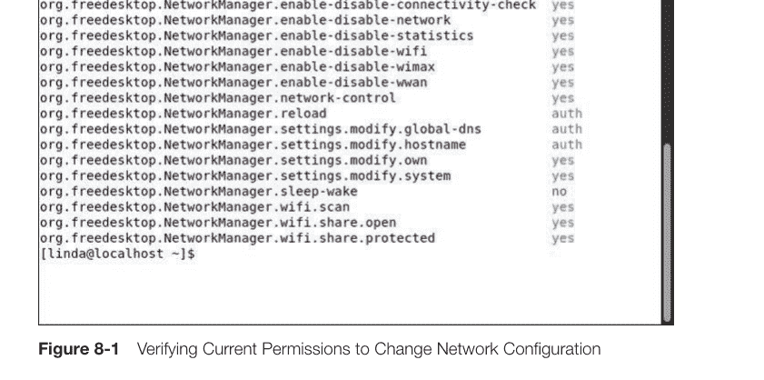

### 使用 `nmcli` 配置网络

在本章前面，你学习了如何使用`ip`来验证网络配置。你也已经应用了`ip addr add`命令来临时设置网络接口上的 IP 地址。然而，你用`ip`命令所做的所有操作都是非持久的。如果你想使配置持久化，请使用`nmtui`或`nmcli`。

一个好的开始是使用`nmcli`来显示所有连接。这会显示活动和非活动的连接。你可以很容易地区分它们，因为非活动连接当前未分配给设备（参见示例 8-5）。

### 示例 8-5 显示当前连接状态

```text
[root@server1 ~]# nmcli con show
NAME     UUID                                  TYPE      DEVICE
ens33    db6f53bd-654e-45dd-97ef-224514f8050a  ethernet  ens33
```

找到连接名称后，你可以使用`nmcli con show`后跟连接名称来查看该连接的所有属性。请注意，此命令会显示许多属性。示例 8-6 显示了此命令的部分输出。

### 示例 8-6 显示连接属性

```text
[root@server1 ~]# nmcli con show ens33
connection.id:                           ens33
connection.uuid:                         db6f53bd-654e-45dd-97ef-
                                         224514f8050a
connection.stable-id:                    --
connection.type:                         802-3-ethernet
connection.interface-name:               ens33
connection.autoconnect:                  yes
connection.autoconnect-priority:         0
connection.autoconnect-retries:          -1 (default)
connection.multi-connect:                0 (default)
...
DHCP4.OPTION[21]:                        requested_wpad = 1
DHCP4.OPTION[22]:                        routers = 192.168.4.2
DHCP4.OPTION[23]:                        subnet_mask = 255.255.255.0
IP6.ADDRESS[1]:                          fe80::959:3b1a:9607:8928/64
IP6.GATEWAY:                             --
IP6.ROUTE[1]:                            dst = fe80::/64, nh = ::,
                                         mt = 100
IP6.ROUTE[2]:                            dst = ff00::/8, nh = ::,
                                         mt = 256, table=255
```

要确切了解这些设置的功能，请执行`man 5 nm-settings`命令。你也可以使用`nmcli`来查看当前配置的设备概览及其状态。例如，输入`nmcli dev status`命令可显示所有设备列表，而`nmcli dev show <devicename>`则可显示特定设备的设置。

> **提示**  
> 使用`nmcli`可能看起来很难。其实不然，因为它提供了出色的命令行补全功能——只需确保已安装`bash-completion`软件包。尝试输入`nmcli`，但不要按回车！而是按两次 Tab 键——你将看到`nmcli`此刻期望的所有可用选项。选择一个选项，例如`connection`，然后再次按两次 Tab 键。使用这种方法有助于你组合长命令，而无需记忆任何内容！

在练习 8-3 中，你将学习如何使用`nmcli`命令创建连接以及在连接之间切换。

### 练习 8-3 使用 `nmcli` 管理网络连接

在本练习中，你将创建一个新连接并管理其状态。此连接需要连接到网络设备。本练习中使用的设备是 ens33。如有必要，请将其更改为你的计算机上正在使用的网络设备的名称。请从控制台会话运行此练习，不要使用 SSH 连接。

1. 通过输入`nmcli con add con-name dhcp type ethernet ifname ens33 ipv4.method auto`创建一个新的网络连接。
2. 创建一个名为*static*的连接以定义静态 IP 地址和网关：`nmcli con add con-name static ifname ens33 autoconnect no type ethernet ip4 10.0.0.10/24 gw4 10.0.0.1 ipv4.method manual`。网关在你的配置中可能不存在，但这没关系。
3. 输入`nmcli con show`以显示连接，并使用`nmcli con up static`激活静态连接。使用`nmcli con up dhcp`切换回 DHCP 连接。

在本练习中，你使用了`nmcli con add`创建了网络连接。你也可以使用`nmcli con mod`更改当前连接的属性。

在练习 8-4 中，你将学习如何使用`nmcli`更改连接参数。

### 练习 8-4 使用 `nmcli` 更改连接参数

1. 使用`nmcli con mod static connection.autoconnect no`确保静态连接不会自动连接。
2. 使用`nmcli con mod static ipv4.dns 10.0.0.10`为静态连接添加一个 DNS 服务器。请注意，在添加网络连接时，你使用`ip4`，但在修改现有连接的参数时，你通常改用`ipv4`。这不是笔误；这只是它的运作方式。
3. 要为同一参数添加第二项，请使用加号。通过添加第二个 DNS 服务器来测试此功能，使用`nmcli con mod static +ipv4.dns 8.8.8.8`。
4. 使用`nmcli con mod`，你还可以更改诸如现有 IP 地址之类的参数。尝试使用`nmcli con mod static ipv4.addresses 10.0.0.100/24`进行此操作。
5. 要添加第二个 IP 地址，你再次使用加号：`nmcli con mod static +ipv4.addresses 10.20.30.40/16`。
6. 更改连接属性后，你需要激活它们。为此，你可以使用`nmcli con up static`。

这就是你在 RHCSA 考试中需要了解的关于`nmcli`的全部内容。正如你所注意到的，`nmcli`是一个功能非常丰富的命令。该命令的确切语法可能很难记住。

不过幸运的是，有一份带示例的优秀 man 页面。输入`man nmcli-examples`可显示此 man 页面；你会注意到，如果你能找到这份 man 页面，你几乎可以用`nmcli`做任何事情。另外，处理`nmcli`时，别忘了使用 Tab 补全。

## 使用 `nmtui` 配置网络

如果你不喜欢`nmcli`命令行的复杂语法，你可能会喜欢`nmtui`。这是一个文本用户界面，允许你轻松创建网络连接。图 8–2 展示了`nmtui`界面的样子。

`nmtui`界面包含三个菜单选项：

- **编辑连接**：使用此选项创建新连接或编辑现有连接。
- **激活连接**：使用此选项（重新）激活连接。


- **设置系统主机名**：使用此选项设置计算机的主机名。

Humble Bundle Pearson Networking and Security Certification Bundle – © Pearson。请勿分发。

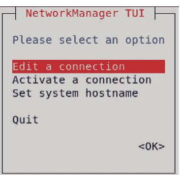

**图 8-2** `nmtui` 界面

编辑连接的选项提供了你在处理网络连接时可能需要的几乎所有功能。它当然允许你在 RHCSA 考试中完成任何需要做的事情。你可以使用它添加任何类型的连接——不仅是以太网连接，还支持高级连接类型，如网络桥接和组合网络驱动器。

当你选择“编辑连接”选项时，你会访问一个丰富的界面，允许你编辑网络连接的大部分属性。编辑连接后，你需要先停用它，然后再重新激活它。

> **提示** 如果你喜欢图形用户界面工具，那你很幸运。使用 `nm-connection-editor` 代替 `nmtui`，但要准备好这个界面提供的选项集相对受限。它不包含高级选项，例如创建网络组合接口和管理网络桥接接口的选项。然而，它确实提供了管理网络连接上地址配置所需的一切。使用 `nm-connection-editor` 命令或通过 GNOME 图形界面中的小程序启动它。图 8-3 展示了该工具默认界面的样子。

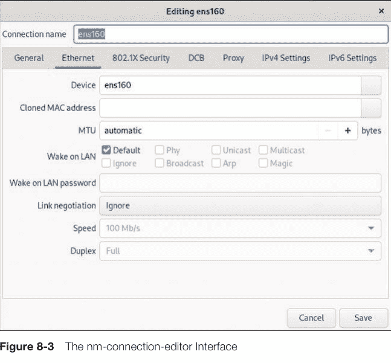

**图 8-3** `nm-connection-editor` 界面

### 处理网络配置文件

你创建的每个连接都作为配置文件存储在目录 `/etc/NetworkManager/system-connections` 中。配置文件的名称以连接名称开头，后跟 `.nmconnection`。在示例 8-7 中，你可以看到此类配置文件的样例。

在 RHEL 的早期版本中，网络连接存储在 `/etc/sysconfig/network-scripts` 目录中。如果 NetworkManager 在此目录中发现旧的连接脚本，它们仍然会被使用，但 NetworkManager 连接脚本不再默认存储在此位置。

```text
示例 8-7 NetworkManager 连接文件示例
[root@server1 ~]# cat /etc/NetworkManager/system-connections/
ens160.nmconnection
[connection]
id=ens160
uuid=5e4ddb28-2a00-3c27-9ba6-c773de3d7bcb
type=ethernet
autoconnect-priority=-999
interface-name=ens160
timestamp=1663070258

[ethernet]

[ipv4]
address1=192.168.29.5/24,192.168.29.2
dns=8.8.8.8;8.8.4.4;
method=manual

[ipv6]
addr-gen-mode=eui64
method=auto
```

### 设置主机名和名称解析

为了与其他主机通信，需要使用主机名。作为管理员，你必须知道如何设置主机名。你还需要确保通过设置主机名解析，使主机能够基于主机名相互联系。在本节中，你将学习如何操作。

#### 主机名

因为主机名用于访问服务器及其提供的服务，所以知道如何设置系统主机名很重要。主机名通常由不同的部分组成。这些部分是主机的名称和主机所在的**域名系统**域名。这两部分共同构成了**完全限定域名（FQDN）**，其形式类似于 `server1.example.com`。始终指定 FQDN 而不仅仅是主机名是一个好习惯，因为 FQDN 在互联网上提供了唯一的标识。更改主机名的方法有多种：

- 使用 `nmtui` 并选择**更改主机名**选项。
- 使用 `hostnamectl set-hostname`。
- 编辑配置文件 `/etc/hostname` 的内容。

要使用 `hostnamectl` 配置主机名，您可以使用类似 `hostnamectl set-hostname myhost.example.com` 的命令。设置主机名后，您可以使用 `hostnamectl status` 来显示当前主机名。示例 8-8 展示了该命令的输出。

#### 示例 8-8 显示当前主机名配置

```text
[root@server1 ~]# hostnamectl status
   Static hostname : server1.example.com
         Icon name: computer-vm
           Chassis: vm
        Machine ID: 5aa095b495ed458d934c54a88078c165
           Boot ID: 5fdef4be9cab48c59873af505d778761
    Virtualization: vmware
  Operating System: Red Hat Enterprise Linux 9.0 (Ootpa)
       CPE OS Name: cpe:/o:redhat:enterprise_linux:9.0:GA
            Kernel: Linux 4.18.0-80.el9.x86_64
           Architecture: x86-64
```

使用 `hostnamectl status` 时，您不仅可以看到有关主机名的信息，还可以看到有关 Linux 内核、虚拟化类型等许多信息。

或者，您也可以使用 `nmtui` 界面来设置主机名。图 8-4 显示了可以执行此操作的屏幕。


#### 图 8-4 使用 `nmtui` 更改主机名

要设置主机名解析，您通常使用 DNS。配置 DNS 服务器不是 RHCSA 的考核目标，但您需要知道如何将服务器配置为使用现有的 DNS 服务器进行主机名解析。除了 DNS，您还可以在 `/etc/hosts` 文件中配置主机名解析。示例 8-9 展示了安装后默认生成的 `/etc/hosts` 文件内容。

#### 示例 8-9 `/etc/hosts` 示例内容

```text
[root@server1 ~]# cat /etc/hosts
127.0.0.1       localhost localhost.localdomain localhost4 localhost4.localdomain4
::1             localhost localhost.localdomain localhost6 localhost6.localdomain6
```

在使用 DNS 中的主机名之前，所有在 `/etc/hosts` 中定义的主机名-IP 地址映射都会被优先应用。这是在 `/etc/nsswitch.conf` 的 `hosts` 行中配置的，默认情况下如下所示：

```text
hosts: files dns myhostname
```

设置 `/etc/hosts` 文件很简单；只需确保它包含至少两列。第一列是特定主机的 IP 地址，第二列指定主机名。主机名可以提供为简短名称（如 `server1`）或完全限定域名（FQDN）。在 FQDN 中，主机名和完整的 DNS 名称都包含在内，例如 `server1.example.com`。

如果一个主机有多个名称，例如一个简短名称和一个完全限定 DNS 名称，您可以在 `/etc/hosts` 中同时指定它们。在这种情况下，第二列必须包含 FQDN，第三列可以包含别名。示例 8-10 展示了一个主机名配置示例。

#### 示例 8-10 `/etc/hosts` 配置示例

```text
[root@server2 ~]# cat /etc/hosts
127.0.0.1       localhost localhost.localdomain localhost4 localhost4.localdomain4
::1             localhost localhost.localdomain localhost6 localhost6.localdomain6
10.0.0.10       server1.example.com server1
10.0.0.20       server2.example.com server2
```

#### DNS 名称解析

如果您想能够与 Internet 上的其他主机通信，仅使用 `/etc/hosts` 文件进行名称解析是不够的。您也应该使用 DNS。要指定应使用哪个 DNS 服务器，请按照前面讨论的方法，使用 `nmcli` 或 `nmtui` 设置 DNS 服务器。NetworkManager 配置将 DNS 信息存储在网络连接的配置文件中（位于 `/etc/sysconfig/network-scripts`），然后从那里将配置推送到用于 DNS 名称服务器解析的 `/etc/resolv.conf` 文件。请勿直接编辑 `/etc/resolv.conf`，因为它在您下次重启 NetworkManager 时会被覆盖。

建议始终设置至少两个 DNS 名称服务器以备联系。如果第一个名称服务器没有响应，则会联系第二个名称服务器。要指定您想使用哪些 DNS 名称服务器，您有几个不同的选择：

- 使用 `nmtui` 设置 DNS 名称服务器。图 8-5 显示了您可以执行此操作的界面。
- 使用配置为分发 DNS 名称服务器地址的 DHCP 服务器。
- 使用 `nmcli con mod <connection-id> [+]ipv4.dns <ip-of-dns>`。

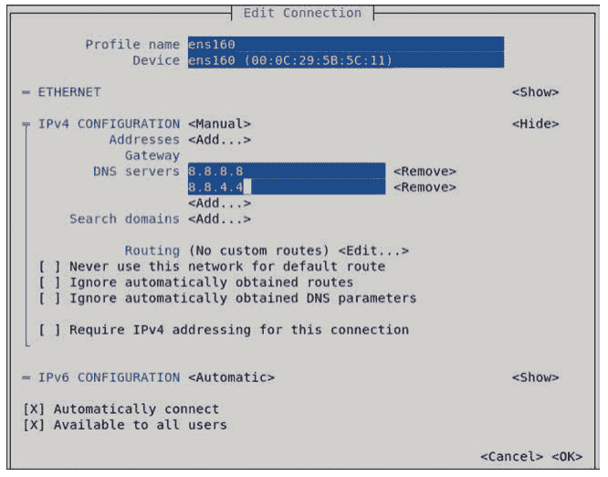

#### 图 8-5 从 `nmtui` 界面设置 DNS 服务器

请注意，如果您的计算机配置为从 DHCP 服务器获取网络配置，则 DNS 服务器也会通过 DHCP 服务器设置。如果您不希望这样发生，请使用以下命令：`nmcli con mod <con-name> ipv4.ignore-auto-dns yes`。

要验证主机名解析，您可以使用 `getent hosts <servername>` 命令。此命令会在 `/etc/hosts` 和 DNS 中搜索以解析指定的主机名。

**考试提示** 请*不要*直接在 `/etc/resolv.conf` 中指定 DNS 服务器。它们将在 NetworkManager（重新）启动时被覆盖。

### 总结

在本章中，您学习了如何在 RHEL 9 中配置网络。首先，您阅读了如何使用 IP 协议连接计算机，然后阅读了用于使主机之间服务可访问的技术。接下来，您阅读了如何使用 `ip` 实用程序和一些相关实用程序来验证网络配置。在本章的最后一部分，您阅读了如何使用 `nmcli` 或 `nmtui` 实用程序以永久方式设置 IP 地址和其他主机配置。

### 考试准备任务

正如引言“如何使用本书”一节所述，您有多种考试准备选择：章节末的实验；附录 C 中的记忆表；第 27 章“最终准备”；以及模拟考试。

#### 复习所有关键主题

复习本章最重要的主题，这些主题在页面边距中用关键主题图标标记。表 8-3 列出了这些关键主题的参考信息及所在的页码。

##### 表 8-3 第 8 章关键主题

| 关键主题元素 | 描述 | 页码 |
| :--- | :--- | :--- |
| 列表 | IPv4 和 IPv6 简要描述 | 170 |
| 列表 | 私有网络地址 | 170 |
| 表 8-2 | 二进制-十进制转换概览 | 172 |
| 列表 | IP 地址类型 | 174 |

#### 凭记忆完成表格和列表

打印一份附录 C “记忆表”（可在配套网站上找到）的副本，或至少打印本章的部分，并凭记忆完成表格和列表。附录 D “记忆表答案”包含已完成的表格和列表以供您检查。

#### 定义关键术语

定义本章的以下关键术语，并在术语表中核对您的答案：

Internet 协议（IP）、IPv4、IPv6、子网掩码、端口、协议、接口、动态主机配置协议（DHCP）、连接、域名系统（DNS）、完全限定域名（FQDN）

#### 复习题

以下问题旨在帮助您测试对概念和术语的掌握程度以及知识的广度。您可以在附录 A 中找到这些问题的答案。

1. 在地址 `213.214.215.99/29` 中，网络地址是什么？
2. 哪个命令只显示链路状态而不显示 IP 地址？
3. 您手动编辑了 `/etc/resolv.conf` 文件以包含 DNS 服务器。重启后，您的修改消失了。发生了什么？
4. 在 RHEL 9 中，哪个文件包含主机名？
5. 哪个命令可以让您轻松设置主机名？
6. NetworkManager 将其生成的配置存储在哪里？
7. 您可以更改哪个配置文件以为特定 IP 地址启用主机名解析？
8. 非管理员用户是否被允许更改 NetworkManager 连接？
9. 如何验证 NetworkManager 服务的当前状态？
10. 哪个命令可以让您更改网络连接上的当前 IP 地址和默认网关？

### 章节末实验

为了进行本书后续章节中的实验，建议拥有一个至少包含两台服务器的测试环境。要完成本实验中的练习，请确保您已安装第二台服务器。

#### 实验 8.1

1. 如果您之前没有设置，请将第一台服务器设置为使用 FQDN `server1.example.com`。将第二台服务器设置为使用 `server2.example.com`。
2. 在 `server1.example.com` 上，使用 `nmtui` 并将您的主网卡配置为通过 DHCP 自动获取 IP 地址。同时设置一个固定 IP 地址 `192.168.4.210`。在 server2 上，设置固定 IP 地址为 `192.168.4.220`。
3. 确保从 server1 可以 ping 通 server2，反之亦然。
4. 为了使您能够访问 Internet 上的服务器，请确保您的本地 DHCP 服务器提供默认路由器和 DNS 服务器。

**本章涵盖以下主题：**

- 使用 `dnf` 管理软件包
- 使用 `dnf`
- 管理软件包模块
- 使用 `rpm` 管理软件包

**本章涵盖以下 RHCSA 考试目标：**

- 从红帽网络、远程仓库或本地文件系统安装和更新软件包

# 第 9 章：管理软件

管理软件包是红帽企业 Linux 管理员的一项重要任务。在本章中，你将学习如何使用 `dnf` 工具从命令行管理软件包。你还将了解仓库在 `dnf` 软件管理中所扮演的角色。接下来，我们将介绍软件包模块，这是一种允许你在需要时处理特定版本软件包的解决方案。在本章的最后部分，你将学习如何使用 `rpm` 命令管理软件，这对于查询新软件包和已安装的软件包非常有用。

## “我是否已经掌握了这部分内容？”测验

“我是否已经掌握了这部分内容？”测验使你能够评估是否应该通读本章全部内容，或者直接跳转到“考试准备任务”部分。如果你对这些问题的答案或自己对主题知识的评估有任何疑问，请阅读整章内容。表 9-1 列出了本章的主要标题及其对应的“我是否已经掌握了这部分内容？”测验题目。你可以在附录 A“‘我是否已经掌握了这部分内容？’测验和复习题的答案”中找到答案。

**表 9-1** “我是否已经掌握了这部分内容？”章节到问题的映射

| 基础主题章节 | 问题 |
|---|---|
| 使用 `dnf` 管理软件包 | 1–4 |
| 使用 `dnf` | 5 |
| 管理软件包模块 | 6–7 |
| 使用 `rpm` 管理软件包 | 8–10 |

196 Red Hat RHCSA 9 认证指南: EX200

1. 以下哪项*不是*用于指示应使用哪些仓库的 `.repo` 文件中的强制组件？

   a. `[label]`

   b. `name=`

   c. `baseurl=`

   d. `gpgcheck=`

2. 如果服务器未在红帽注册，RHEL 上使用哪个安装源？

   a. 使用安装介质。
   b. 不使用任何安装源。
   c. 使用基础红帽仓库，但不包含更新。
   d. 你可以完全访问红帽仓库，但你使用的软件不受支持。

3. 在 `.repo` 文件中，以下哪项应被用来引用本地文件系统 `/repo` 目录中的仓库？

   a. `file=/repo`
   b. `baseurl=file://repo`
   c. `baseurl=file:///repo`
   d. `file=http:///repo`

4. 以下哪项关于基于 GPG 的仓库安全性的描述是正确的？

   a. 如果仓库中的软件包已签名，你需要在首次从该仓库安装软件包时导入 GPG 密钥。
   b. GPG 软件包签名是强制性的。
   c. GPG 软件包签名可以防止仓库中的软件包被更改。
   d. 在互联网仓库上推荐使用 GPG 软件包签名，但在仅供内部使用的本地仓库上则不需要。

5. 哪个命令允许你搜索包含文件 `semanage` 的软件包？

   a. `dnf search seinfo`
   b. `dnf search all seinfo`
   c. `dnf provides seinfo`
   d. `dnf whatprovides */seinfo`

6. 以下哪个 `dnf` 模块组件允许你并行处理不同版本？

   a. 应用程序配置文件
   b. 应用程序流
   c. 模块版本
   d. RPM 组

7. 以下哪个命令允许你安装 PHP 8.1 应用程序流的 devel 配置文件？

   a. `dnf module install php:8.1 devel`


b. `dnf module install php:8.1 --devel`

c. `dnf module install php:8.1/devel`

d. `dnf module install php:8.1@devel`

## 8. 你应该使用哪个命令来安装已下载到你计算机上的 RPM 文件？

a. `dnf install`

b. `dnf localinstall`

c. `rpm -ivh`

d. `rpm -Uvh`

## 9. 哪个命令允许你查找特定文件所属的 RPM 软件包？

a. `rpm -ql /my/file`

b. `rpm -qlf /my/file`

c. `rpm -qf /my/file`

d. `rpm -qa /my/file`

## 10. 哪个命令允许你分析刚下载的 RPM 软件包文件中是否包含脚本？

a. `rpm -qs packagename.rpm`

b. `rpm -qps packagename.rpm`

c. `rpm -qp --scripts packagename.rpm`

d. `rpm -q --scripts packagename.rpm`

### 基础主题

#### 使用 `dnf` 管理软件包

在红帽企业 Linux 上管理软件包的默认工具是 `dnf`。`dnf` 设计用于与仓库（即可用软件包的在线存储库）配合工作。在本节中，你将学习如何创建和管理仓库，以及如何基于仓库内容管理软件包。

##### 理解仓库的角色

红帽企业 Linux 上的软件以 *Red Hat Package Manager (RPM)* 格式提供。这是一种用于归档软件包并提供软件包元数据的特定格式。

当你在 RHEL 上处理软件时，仓库扮演着关键角色。使用仓库可以轻松地使你的服务器保持最新状态：仓库的维护者会在仓库中发布更新的软件包，其结果是，每当你使用 `dnf` 命令安装软件时，都会自动使用软件的最新版本。

使用 `dnf` 的另一个主要好处是处理软件包依赖关系的方式。在 Linux（以及大多数其他现代操作系统）上，软件包具有依赖关系。这意味着要能够使用一个软件包，可能需要其他软件包也存在。如果不使用仓库，那将意味着这些软件包必须手动安装。

仓库系统可以自动处理依赖关系解析。如果要安装一个软件包，它会包含关于所需依赖项的信息。然后，`dnf` 命令会在系统上配置的仓库中查找，以自动获取依赖项。如果一切顺利，安装程序只会看到一个简短的依赖项列表，这些依赖项将作为安装该软件包的依赖项被安装。如果你使用的是为红帽企业 Linux 注册安装提供的仓库，那么这个过程没有理由不成功，软件安装尝试通常会成功。

在安装 RHEL 9 时，它会要求你注册红帽客户门户，该门户提供不同的仓库。注册后，你可以自动安装经过红帽验证的软件包。如果你选择在没有注册的情况下安装 RHEL，它将无法连接到红帽仓库，你最终将没有任何仓库。在这种情况下，你必须能够自己配置仓库客户端来指定要使用的仓库。

请注意，仓库特定于操作系统。因此，如果你使用的是 RHEL，则应仅使用 RHEL 仓库。例如，不要尝试将 CentOS 仓库添加到 RHEL 服务器。如果你想为 RHEL 服务器提供来自 Fedora 项目的额外软件（出于支持原因，不推荐这样做），你可以考虑添加 EPEL（Extra Packages for Enterprise Linux）仓库。更多信息，包括如何配置你的系统以使用 EPEL 仓库的信息，请参见 <https://fedoraproject.org/wiki/EPEL>。

> **警告** 在将 EPEL 仓库添加到 RHEL 之前，请确保它不会破坏你当前的支持状态。EPEL 软件包不由红帽管理，添加它们可能会破坏受支持的红帽软件包。

##### 注册红帽企业 Linux 以获取支持

红帽企业 Linux 是一个受支持的 Linux 操作系统，需要你进行注册。要注册 RHEL，你需要一个有效的授权。此授权与你的红帽客户门户账户相关联。你可以通过购买 RHEL 订阅或加入红帽开发者计划来获得授权，该计划提供访问免费的红帽企业开发者订阅。使用开发者订阅，你最多可以安装 16 个 RHEL 系统。你不会获得这些系统的任何支持，但你将能够访问红帽仓库并接收更新。你可以在 <https://developers.redhat.com> 注册红帽开发者订阅。

获得有效的红帽企业 Linux 订阅后，你可以使用红帽订阅管理（RHSM）工具来管理你的授权。管理授权涉及四个基本任务：

- **注册：** 注册订阅时，你将其连接到你当前的红帽账户。因此，`subscription-manager` 工具可以清点系统。如果某个系统不再使用，也可以取消注册。
- **订阅：** 订阅系统可使其访问你的订阅所授权的红帽产品更新。此外，通过订阅，你将获得与你的账户相关联的支持级别访问权限。
- **启用仓库：** 订阅系统后，你将获得一组默认仓库的访问权限。某些仓库默认是禁用的，但在订阅系统后可以启用。
- **审查与跟踪：** 你可以审查和跟踪当前正在使用的订阅。

###### 管理订阅

你可以通过 GNOME 图形界面或命令行来管理订阅。`subscription-manager` 工具用于从命令行管理订阅。你可以使用它执行以下操作：

- **注册系统**：输入 `subscription-manager register` 进行注册。它将提示你输入 Red Hat 用户帐户的名称和密码，输入后，你的 RHEL 服务器将被注册。
- **列出可用订阅**：每个帐户都有权访问特定的订阅。输入 `subscription-manager list --available` 查看你的帐户有权使用哪些订阅。
- **自动附加订阅**：仅注册服务器不足以访问软件仓库。使用 `subscription-manager attach --auto` 自动将你的订阅附加到可用的软件仓库。
- **获取概览**：要查看当前正在使用哪些订阅，请输入 `subscription-manager list --consumed`。
- **注销**：如果你要废弃一个系统，使用 `subscription-manager unregister`。如果你只能访问有限数量的已注册系统，注销对于确保不会耗尽可用许可证非常重要。

注册并附加订阅后，权利证书将被写入 `/etc/pki` 目录。在 `/etc/pki/product` 中，存储的证书表明此系统上安装了哪些 Red Hat 产品。在 `/etc/pki/consumer` 中，存储的证书标识系统注册到的 Red Hat 帐户，而 `/etc/pki/entitlement` 目录包含有关附加到此系统的订阅的信息。

###### 指定使用哪个软件仓库

在大多数情况下，服务器安装完成后，会配置一个应使用的软件仓库列表。有时你需要告诉服务器应该使用哪些软件仓库；例如，如果：

- 你想通过软件仓库分发非默认的软件包。
- 你正在安装 Red Hat Enterprise Linux 但不注册它。

告诉服务器使用哪个软件仓库并不困难，但你知道如何操作这一点很重要（对于 RHCSA 考试也是如此）。

> **重要提示！** 要学习如何处理软件仓库和软件包，请*不要*使用默认提供的软件仓库。因此，如果你安装了 RHEL，请*不要*使用 `subscription-manager` 注册；如果你安装了 CentOS，请删除 `/etc/yum.repos.d` 中的所有文件。如果你在早期安装时忽略了此要求，可以使用 `subscription-manager unregister` 删除所有注册信息。

要告诉服务器使用哪个软件仓库，你需要在 `/etc/yum.repos.d` 目录中创建一个名称以 `.repo` 结尾的文件。以下是常用参数：

- `[label]`：`.repo` 文件可以包含不同的软件仓库，每个部分以一个标识特定软件仓库的标签开头。
- `name=`：使用此项指定要使用的软件仓库的名称。
- `baseurl=`：此选项包含指向特定软件仓库位置的 URL。
- `gpgcheck=`：使用此选项指定是否应使用 GNU 隐私保护（GPG）密钥有效性检查来验证软件包未被篡改。

在旧版本的 RHEL 中，你需要记住如何创建软件仓库客户端文件。在 RHEL 9 中，即使在最小化安装中，也可使用 `dnf config-manager` 工具为你创建软件仓库客户端文件。要轻松生成软件仓库客户端文件，请使用 `dnf config-manager --add-repo=http://reposerver.example.com/BaseOS`。只需确保将此示例中的 URL 替换为指向你要使用的软件仓库位置的正确 URI。例如，如果你已将 RHEL 9 安装磁盘的内容复制到 `/repo` 目录，则可以使用 `file://` URI。在这种情况下，以下命令将添加 BaseOS 软件仓库：`dnf config-manager --add-repo=file:///repo/BaseOS`。

如果你使用 `dnf config-manager` 工具添加软件仓库，则需要在添加后编辑 `/etc/yum.conf.d` 中的软件仓库文件，使其包含行 `gpgcheck=0`。没有此选项，`dnf` 工具将对传入的软件包执行 GPG 检查，这需要额外的复杂配置，而这在 RHCSA 考试中并不需要。在示例 9-1 中，你可以看到生成的软件仓库文件的外观。在练习 9-1 中，你将找到设置自己的软件仓库并配置访问权限所需的所有说明。

###### 示例 9-1 软件仓库文件示例

```text
[root@server1 ~]# cat /etc/yum.repos.d/repo_BaseOS.repo
[repo_BaseOS]
name=created by dnf config-manager from file:///repo/BaseOS
baseurl=file:///repo/BaseOS
enabled=1
gpgcheck=0
```

在软件仓库配置文件中，可以使用多个选项。表 9-2 总结了一些最常用的选项。

###### 表 9-2 `.repo` 文件中的关键选项

| 选项 | 说明 |
|---|---|
| `[label]` | 包含用作软件仓库文件中标识符的标签。 |
| `name=` | 必需选项，指定软件仓库的名称。 |
| `mirrorlist=` | 可选参数，指向一个 URL，可从中获取有关此服务器镜像服务器的信息。通常仅用于大型在线软件仓库。 |
| `baseurl=` | 必需选项，指向可找到 RPM 软件包的基础 URL。 |
| `gpgcheck=` | 如果需要对软件包执行 GNU 隐私保护（GPG）完整性检查，则设置为 1。如果设置为 1，则需要 GPG 密钥。 |
| `gpgkey=` | 指定用于检查软件包完整性的 GPG 密钥的位置。 |

创建软件仓库文件时，`baseurl` 参数是最重要的，因为它告诉服务器在哪里找到要安装的文件。`baseurl` 以需要从中安装文件的 URL 作为其参数。这通常是 HTTP 或 FTP URL，但也可以是基于文件的 URL。

使用 URL 时，包含两个组成部分。首先，URL 标识要使用的协议，格式为 `protocol://`，例如 `http://`、`ftp://` 或 `file://`。URL 之后是该 URL 上的精确位置。这可以是 Web 服务器或 FTP 服务器的名称，包括文件所在的子目录。如果 URL 是基于文件的，则文件系统上的位置也以 `/` 开头。

因此，对于基于文件系统的 URL，`baseurl` 中会有三个斜杠，例如 `baseurl:///repo`，它引用本地文件系统上的 `/repo` 目录。

#### 了解软件仓库安全性

使用软件仓库允许你从 Internet 透明地安装软件包。此功能很方便，但也涉及安全风险。安装 RPM 软件包时，你使用 root 权限执行，如果 RPM 软件包脚本代码被执行（这很常见），它也将以 root 身份执行。因此，你需要确保可以信任你尝试安装的软件包。这就是为什么软件仓库通常使用密钥对软件包进行签名。这也是为什么在 Red Hat Enterprise Linux 上最好只使用受信任的软件仓库。

为了确保软件仓库中软件包的安全，这些软件包通常使用 GPG 密钥进行签名。这可以检查自软件仓库所有者提供软件包以来，软件包是否已被更改。用于签名软件包的 GPG 密钥通常也通过软件仓库提供。软件仓库的用户可以下载该密钥并将其存储在本地，以便每次从软件仓库下载软件包时都可以自动执行软件包签名检查。

如果软件仓库安全性受到损害，并且入侵者设法入侵软件仓库服务器并放置一些伪造的软件包，则 GPG 密钥签名将不匹配，`dnf` 命令在安装新软件包时会报错。这就是为什么强烈建议在使用 Internet 软件仓库时使用 GPG 密钥。

如果你使用的软件仓库使用了 GPG 软件包签名，在首次与该软件仓库接触时，`dnf` 命令将建议下载用于软件包签名的密钥（见示例 9-2）。这是一个透明的过程，无需进一步操作。用于软件包签名的 GPG 密钥默认安装到 `/etc/pki/rpm-gpg` 目录。

> **提示** 对于内部软件仓库，安全风险没那么高。因此，在 RHCSA 考试中，你不需要知道如何处理 GPG 签名的软件包。

###### 示例 9-2 首次接触软件仓库时，GPG 密钥被下载

```text
[root@localhost ~]# dnf install nmap
Updating Subscription Management repositories.
Red Hat Enterprise Linux 9 for x86_64 - AppStream (RPMs)
10 MB/s | 9.3 MB 00:00
Red Hat Enterprise Linux 9 for x86_64 - BaseOS (RPMs)
4.0 MB/s | 3.6 MB 00:00
```

# Red Hat RHCSA 9 认证指南：EX200

```text
Dependencies resolved.
 Package            Architecture        Version                Repository            Size
=====================================================================================================================
Installing:
 nmap               x86_64              3:7.91-10.el9          rhel-9-for-x86_64-appstream-rpms 5.6 M

Transaction Summary
=====================================================================================================================
Install  1 Package

Total download size: 5.6 M
Installed size: 24 M
Is this ok [y/N]: y
Downloading Packages:
nmap-7.91-10.el9.x86_64.rpm
          9.8 MB/s | 5.6 MB      00:00
Total
          9.8 MB/s | 5.6 MB      00:00
=====================================================================================================================
Red Hat Enterprise Linux 9 for x86_64 - AppStream (RPMs)
          3.5 MB/s | 3.6 kB      00:00
Importing GPG key 0xFD431D51:
 Userid     : "Red Hat, Inc. (release key 2) <security@redhat.com>"
 Fingerprint: 567E 347A D004 4ADE 55BA 8A5F 199E 2F91 FD43 1D51
 From       : /etc/pki/rpm-gpg/RPM-GPG-KEY-redhat-release
Is this ok [y/N]:
```

#### 创建你自己的软件仓库

创建自己的软件仓库并非 RHCSA 考试的要求，但了解如何操作对于测试软件仓库的设置和使用非常有用。此外，如果你使用的 RHEL 系统未连接到 Red Hat 的软件仓库，那么这将是安装软件包的唯一方法。

其流程本身不难总结。你需要确保所有 RPM 软件包都位于你希望用作软件仓库的目录中，完成此操作后，你需要使用 `createrepo` 命令生成元数据，以便将该目录用作软件仓库。如果你使用的是 RHEL 9 安装光盘，流程会更加简单，因为无需生成软件仓库元数据。练习 9-1 描述了如何使用 RHEL 9 安装光盘创建你自己的软件仓库。

**练习 9-1 创建你自己的软件仓库**

要执行此练习，你需要能够访问 RHEL 或 CentOS 安装光盘或 ISO 文件。

1. 将安装光盘插入你的虚拟机，并确保其已挂接并可用。
2. 打开一个 root shell 并输入 `mkdir /repo`，这样你就有了一个可用于挂载 ISO 文件的挂载点。
3. 将以下行添加到 `/etc/fstab` 配置文件的末尾：`/dev/sr0 /repo iso9660 defaults 0 0`
4. 输入 `mount -a`


# 示例 9-3 使用 `dnf repolist` 验证软件仓库可用性

```text
[root@server1 ~]# dnf repolist
Updating Subscription Management repositories.
Unable to read consumer identity
This system is not registered with an entitlement server. You can use subscription-manager to register.
repo id                            repo name
repo_AppStream                     created by dnf
  config-manager from file:///repo/AppStream
repo_BaseOS                        created by dnf
  config-manager from file:///repo/BaseOS
```

## 使用 `dnf`

此时，你应该已经有了可用的软件仓库，那么是时候开始使用它们了。要使用软件仓库，你需要 `dnf` 命令。此命令使你能够在软件仓库上执行多项任务。表 9-3 概述了常见的 `dnf` 任务。

### 表 9-3 常见的 `dnf` 任务

| 任务 | 说明 |
| :--- | :--- |
| `search` | 在软件包名称或摘要中搜索包含特定字符串的软件包。 |
| `search all` | 在软件包名称、摘要或描述中搜索包含特定字符串的软件包。 |
| `[what]provides */name` | 在软件包中执行深度搜索，以查找特定文件。 |
| `info` | 提供有关软件包的更多信息。 |
| `install` | 安装软件包。 |
| `remove` | 移除软件包。 |
| `list [all \| installed]` | 列出所有或已安装的软件包。 |
| `group list` | 列出软件包组。 |
| `group install` | 安装某个软件包组中的所有软件包。 |
| `update` | 更新指定的软件包。 |
| `clean all` | 删除所有存储的元数据。 |

## 使用 `dnf` 查找软件包

要使用 `dnf` 安装软件包，你首先需要知道软件包的名称。`dnf search` 命令可以帮你做到这一点。当你使用 `dnf search` 时，它首先会连接到在线软件仓库（这可能需要一分钟），之后它会将最新的软件仓库元数据下载到本地计算机。然后，`dnf search` 会在软件包名称和描述中查找你输入的字符串。如果这没有得到预期结果，可以尝试使用 `dnf search all`，它会在软件包描述中也进行更深入的搜索。在示例 9-4 中，你可以看到使用 `dnf search user` 后的结果。

### 示例 9-4 `dnf search` 示例输出

```text
[root@server1 ~]# dnf search user
Updating Subscription Management repositories.
Unable to read consumer identity

This system is not registered with an entitlement server. You can use
subscription-manager to register.

Last metadata expiration check: 0:01:45 ago on Wed 14 Sep 2022
10:52:12 AM CEST.
======================================================================= Name & Summary ========================================================
Matched: user ======================================================================================================================================
gnome-user-docs.noarch : GNOME User Documentation
libuser.x86_64 : A user and group account administration library
libuser.i686 : A user and group account administration library
perl-User-pwent.noarch : By-name interface to Perl built-in user name resolver
usermode.x86_64 : Tools for certain user account management tasks
usermode-gtk.x86_64 : Graphical tools for certain user account management tasks
userspace-rcu.x86_64 : RCU (read-copy-update) implementation in user-space
userspace-rcu.i686 : RCU (read-copy-update) implementation in user-space
util-linux-user.x86_64 : libuser based util-linux utilities
xdg-user-dirs.x86_64 : Handles user special directories
======================================================================= Name ================================================================
Matched: user ======================================================================================================================================
anaconda-user-help.noarch : Content for the Anaconda built-in help system
gnome-shell-extension-user-theme.noarch : Support for custom themes in GNOME Shell
xdg-user-dirs-gtk.x86_64 : Gnome integration of special directories
======================================================================= Summary =============================================================
Matched: user ======================================================================================================================================
NetworkManager.x86_64 : Network connection manager and user applications
PackageKit-command-not-found.x86_64 : Ask the user to install command line programs automatically
accountsservice.x86_64 : D-Bus interfaces for querying and manipulating user account information
anaconda-gui.x86_64 : Graphical user interface for the Anaconda installer...
```

因为 `dnf search` 命令只在软件包名称和摘要中搜索，它通常无法显示你需要的结果。在某些情况下，你可能需要找到包含特定文件的软件包。为此，`dnf whatprovides` 命令或 `dnf provides` 命令会对你有所帮助。（这两个命令在功能上没有区别，甚至还有第三个选项完全相同：`dnf wp`。）为了明确你正在寻找包含特定文件的软件包，你需要将文件名指定为 `*/filename`，或使用要使用的文件的完整路径名。因此，例如，如果你需要查找包含 `Containerfile` 文件的软件包，请使用 `dnf whatprovides */Containerfile`。作为结果，它将显示软件包的名称。

## 获取有关软件包的更多信息

在安装软件包之前，最好获取有关该软件包的更多信息。因为 `dnf` 命令设计得非常直观，你几乎可以猜出它是如何工作的。只需使用 `dnf info`，后跟软件包的名称。在示例 9-5 中，你可以看到 `nmap` 软件包（顺便说一句，这是一个非常有用的工具）的输出。它是一个网络嗅探器，允许你查找其他主机上打开的端口。只需使用 `nmap 192.168.4.100` 就可以尝试一下，但要注意，一些网络管理员确实不喜欢 `nmap`，可能会认为这是一种敌对攻击。

### 示例 9-5 `dnf info nmap` 的示例输出

```text
[root@server1 ~]# dnf info nmap
Updating Subscription Management repositories.
Unable to read consumer identity
This system is not registered with an entitlement server. You can use
subscription-manager to register.
Last metadata expiration check: 0:04:47 ago on Wed 14 Sep 2022
10:52:12 AM CEST.
Available Packages
Name        : nmap
Epoch       : 3
Version     : 7.91
Release     : 10.el9
Architecture : x86_64
Size        : 5.6 M
Source      : nmap-7.91-10.el9.src.rpm
Repository  : repo_AppStream
```

| 字段 | 值 |
| :--- | :--- |
| 概述 | 网络探索工具和安全扫描器 |
| URL | http://nmap.org/ |
| 许可证 | Nmap |
| 描述 | Nmap 是一个用于网络探索或安全审计的实用程序。它支持 ping 扫描（确定哪些主机在线）、多种端口扫描技术（确定主机提供哪些服务）以及 TCP/IP 指纹识别（远程主机操作系统识别）。Nmap 还提供灵活的目标和端口指定、诱饵扫描、TCP 序列可预测性特征确定、反向 identd 扫描等功能。除了经典的命令行 `nmap` 可执行文件外，Nmap 套件还包括一个灵活的数据传输、重定向和调试工具（netcat 实用程序 `ncat`）、一个用于比较扫描结果的实用程序（`ndiff`）以及一个数据包生成和响应分析工具（`nping`）。 |

### 安装和删除软件包

在查看了 `dnf info` 的输出并确认该软件包符合你的需求后，下一步就是安装它。就像使用 `dnf` 进行的其他操作一样，你很容易猜到如何操作：使用 `dnf install nmap`。以这种方式使用时，`dnf` 命令会要求确认。如果你在输入 `dnf install` 命令时非常确定自己的操作，不妨使用 `-y` 选项，它会向 `dnf` 通常发出的确认提示发送一个 "yes"。示例 9-6 展示了结果的样子。

### 示例 9-6 使用 `dnf` 安装软件

```text
[root@server1 ~]# dnf install nmap
Updating Subscription Management repositories.
Unable to read consumer identity

This system is not registered with an entitlement server. You can use
subscription-manager to register.

Last metadata expiration check: 0:05:58 ago on Wed 14 Sep 2022
10:52:12 AM CEST.
Dependencies resolved.
================================================================================
 Package            Architecture      Version               Repository       Size
================================================================================
Installing:
 nmap               x86_64            3:7.91-10.el9         repo_AppStream  5.6 M

Transaction Summary
================================================================================
Install  1 Package

Total size: 5.6 M
Installed size: 24 M
Is this ok [y/N]: **y**
Downloading Packages:
Running transaction check
Transaction check succeeded.
Running transaction test
Transaction test succeeded.
Running transaction
  Preparing        :
  1/1
  Installing       : nmap-3:7.91-10.el9.x86_64
  1/1
  Running scriptlet: nmap-3:7.91-10.el9.x86_64
  1/1
  Verifying        : nmap-3:7.91-10.el9.x86_64
  1/1
Installed products updated.

Installed:
  nmap-3:7.91-10.el9.x86_64

Complete!
```

在示例 9-6 中，你可以看到 `dnf` 首先分析将要安装的内容。一旦明确，它会给出将要安装的软件包的概览，包括其依赖项。然后，软件包本身被安装到系统上。

要从机器上删除软件包，请使用 `dnf remove` 命令。该命令也会进行依赖分析，这意味着它不仅会删除选定的软件包，还会删除所有依赖于它的软件包。这有时可能导致一长串将被删除的软件包。为避免不愉快的意外，你不应使用带 `-y` 选项的 `dnf remove`。

> **注意** 有些软件包是受保护的。因此，你不能轻易删除它们。如果 `dnf remove` 遇到受保护的软件包，它会拒绝删除它们。

## 显示软件包列表

使用 `dnf` 时，你还可以使用 `dnf list` 命令来显示软件包列表。不带参数使用时，`dnf list` 会显示所有可用软件包的列表，包括它们安装自的仓库——假设该软件包已安装。如果显示了仓库名称，则表示该软件包在该特定仓库中可用。如果列出 `@anaconda`，则表示该软件包已安装在此系统上。示例 9-7 显示了 `dnf list` 命令的部分输出。

### 示例 9-7 `dnf list` 命令的部分输出


```bash
[root@server3 ~]# dnf list | less
Updating Subscription Management repositories.
Unable to read consumer identity

This system is not registered with an entitlement server. You can use subscription-manager to register.

Last metadata expiration check: 0:12:17 ago on Wed 14 Sep 2022
10:52:12 AM CEST.
Installed Packages
ModemManager.x86_64                    1.18.2-3.el9    @anaconda
ModemManager-glib.x86_64              1.18.2-3.el9    @anaconda
NetworkManager.x86_64              1:1.36.0-4.el9_0       @anaconda
NetworkManager-adsl.x86_64        1:1.36.0-4.el9_0       @anaconda
NetworkManager-bluetooth.x86_64   1:1.36.0-4.el9_0       @anaconda
NetworkManager-config-server.noarch 1:1.36.0-4.el9_0      @anaconda
NetworkManager-libnm.x86_64       1:1.36.0-4.el9_0       @anaconda
NetworkManager-team.x86_64        1:1.36.0-4.el9_0       @anaconda
NetworkManager-tui.x86_64         1:1.36.0-4.el9_0       @anaconda
NetworkManager-wifi.x86_64        1:1.36.0-4.el9_0       @anaconda
NetworkManager-wwan.x86_64        1:1.36.0-4.el9_0       @anaconda
PackageKit.x86_64                  1.2.4-2.el9             @AppStream
PackageKit-command-not-found.x86_64 1.2.4-2.el9           @AppStream
PackageKit-glib.x86_64             1.2.4-2.el9            @AppStream
PackageKit-gstreamer-plugin.x86_64 1.2.4-2.el9            @AppStream
PackageKit-gtk3-module.x86_64      1.2.4-2.el9            @AppStream
abattis-cantarell-fonts.noarch     0.301-4.el9            @AppStream
accountsservice.x86_64             0.6.55-10.el9          @AppStream
accountsservice-libs.x86_64        0.6.55-10.el9          @AppStream
...
```

如果你只想查看服务器上安装了哪些软件包，可以使用`dnf list installed`命令。当以特定软件包名称作为参数使用时，`dnf list`命令也可能很有用。例如，输入`dnf list kernel`可以显示实际安装的内核版本以及仓库中可用的最新版本。如果你的系统使用在线仓库并想检查是否有更新版本的软件包可用，这尤其有用。示例 9-8 显示了来自已注册 RHEL 9 系统的此命令结果。

### 示例 9-8 使用`dnf list packagename`获取已安装和可用版本的信息

```bash
[root@localhost ~]# dnf list kernel
Updating Subscription Management repositories.
Last metadata expiration check: 0:04:09 ago on Wed 14 Sep 2022
11:02:40 AM CEST.
Installed Packages
kernel.x86_64                 5.14.0-70.13.1.el9_0   @anaconda

Available Packages
kernel.x86_64                 5.14.0-70.22.1.el9_0   rhel-9-for-x86_64-baseos-rpms
```

### 更新软件包

使用`dnf`仓库的主要好处之一是仓库使软件包更新变得容易。仓库维护者负责将更新的软件包复制到仓库中。仓库中的索引始终包含仓库中软件包的当前版本。在本地机器上，也有一个数据库，其中包含所使用软件包的当前版本。当你使用`dnf update`命令时，已安装软件包的当前版本会与仓库中这些软件包的版本进行比较。如示例 9-9 所示，`dnf`接下来会显示可更新软件包的概览。从这个概览中，输入`y`以安装更新。

请注意，更新软件包时，旧版本的软件包会被新版本的软件包替换。有一个例外，那就是内核软件包。即使你使用`dnf update kernel`命令，内核软件包也不会被更新，而是会在旧内核之外安装新的内核，这样在启动时你可以选择要使用的内核。如果新内核因硬件兼容性问题而无法工作，这很有用。在这种情况下，你可以中断 GRUB 2 启动过程（有关更多详细信息，请参见第 17 章“管理和理解启动过程”）以启动旧内核。

### 示例 9-9 使用`dnf update`

```bash
[root@localhost ~]# dnf update kernel
Updating Subscription Management repositories.
Last metadata expiration check: 0:06:25 ago on Wed 14 Sep 2022
11:02:40 AM CEST.

Dependencies resolved.
 Package            Architecture Version
 Repository                   Size

Installing:
 kernel            x86_64
5.14.0-70.22.1.el9_0         rhel-9-for-x86_64-baseos-rpms
595 k
```

214 Red Hat RHCSA 9 认证指南：EX200

安装依赖项：

```text
kernel-core                              x86_64    5.14.0-70.22.1.el9_0        34 M      rhel-9-for-x86_64-baseos-rpms

kernel-modules                           x86_64    5.14.0-70.22.1.el9_0        21 M      rhel-9-for-x86_64-baseos-rpms

事务摘要

================================================================================

安装  3 个软件包

总下载大小：56 M

已安装大小：93 M

是否继续 [y/N]：
```

### 使用 dnf 软件包组

在管理 Linux 机器上的特定服务时，你通常需要几个不同的软件包。例如，如果你想将机器设置为虚拟化主机，你需要 KVM 软件包，但也需要所有支持性软件包，如 qemu、libvirt 和客户端软件包。或者在将服务器配置为 Web 服务器时，很多情况下还需要安装额外的软件包，如 PHP。

为了更轻松地管理特定功能，而不是特定软件包，你也可以使用软件包组。**软件包组**是在仓库中定义的，`dnf`提供了组管理命令来处理这些组。要查看所有当前组的概览，请使用`dnf group list`。这会显示如示例 9-10 所示的输出。

> **提示** 该命令的名称是`dnf group`，但也存在别名，确保`dnf groups`甚至像`dnf groupinstall`这样的命令也能工作。因此，你可以使用其中任何一个命令。

### 示例 9-10 显示可用的`dnf`组

```bash
[root@localhost ~]# dnf group list
Updating Subscription Management repositories.
Last metadata expiration check: 0:11:10 ago on Wed 14 Sep 2022 11:02:40 AM CEST.
Available Environment Groups:
   Server
   Minimal Install
   Workstation
   Virtualization Host
   Custom Operating System
Installed Environment Groups:
    Server with GUI
Installed Groups:
    Container Management
    Headless Management
Available Groups:
    .NET Development
    Console Internet Tools
    RPM Development Tools
    Scientific Support
    Legacy UNIX Compatibility
    Network Servers
    Graphical Administration Tools
    Development Tools
    Security Tools
    Smart Card Support
    System Tools
```

请注意，并非所有`dnf`组都默认列出。要同时显示这些组，请输入`dnf group list hidden`。你会看到显示的组列表明显更长。区别在于`dnf group list`显示的是包含基本功能的环境组。在一个环境组内，可以使用不同的子组；这些子组仅在使用`dnf group list hidden`时才会显示。

要获取组中可用软件包的信息，请使用`dnf group info`。因为组名通常包含空格，不要忘记将整个组名放在引号中。因此，输入`dnf group info "Container Management"`以查看“容器管理”组中的内容。如示例 9-11 所示，该命令显示组中的必需项和可选项。这些项可以是组和单个软件包。

### 示例 9-11 使用`dnf group info`显示组内容

```bash
[root@localhost ~]# dnf group info "Container Management"
Updating Subscription Management repositories.
Last metadata expiration check: 0:12:49 ago on Wed 14 Sep 2022 11:02:40 AM CEST.
Group: Container Management
Description: Tools for managing Linux containers

Mandatory Packages:
    buildah
    containernetworking-plugins
    podman
Optional Packages:
    python3-psutil
    toolbox
```

### 使用 dnf 历史记录

当你在使用`dnf`时，所有操作都会被记录。你可以使用`dnf history`命令来获取所有已发出操作的概览。从历史文件中，可以撤销特定操作；使用`dnf history undo`后跟你想撤销的特定操作的编号。

在示例 9-12 中，你可以看到`dnf history`命令的结果，其中每个操作都有自己的 ID。

### 示例 9-12 使用`dnf history`显示过去的`dnf`操作

```bash
[root@localhost ~]# dnf history
Updating Subscription Management repositories.
ID     | Command line                                     | Date and time       | Action(s)        | Altered
--------------------------------------------------------------------------------------------------------------
     2 | install nmap                                     | 2022-09-14 10:45    | Install          |     1  
     1 |                                                  | 2022-09-14 10:40    | Install          |     3  
```

如你所见，操作编号 2 更改了一个软件包，并用于安装软件包。要完全撤销此操作，请输入`dnf history undo 2`。在练习 9-2 中，你将应用一些最常用的`dnf`命令来完成常见的软件包管理任务，如前所述。

### 练习 9-2 使用`dnf`进行软件包管理

1. 输入`dnf repolist`以显示你系统当前使用的仓库列表。
2. 输入`dnf search scinfo`。这将不会给出匹配结果。
3. 输入`dnf provides scinfo`。该命令显示`setools-console-<version>`软件包包含此文件。
4. 使用`dnf install -y setools-console`安装此软件包。根据你当前的配置，你可能会注意到还需要安装相当多的依赖项。
5. 输入`dnf list setools-console`。你会看到该软件包被列为已安装。
6. 输入`dnf history`并记下你使用的最后一个`dnf`命令的编号。
7. 输入`dnf history undo <nn>`（其中`<nn>`替换为你在步骤 6 中找到的编号）。这会撤销最后一个操作，因此它会移除你刚刚安装的软件包。
8. 重复`dnf list setools-console`命令。该软件包现在被列为可用但未安装。

### 管理软件包模块

直到 Red Hat Enterprise Linux 7，所有软件包都在一个仓库中提供。这使得软件包版本管理具有挑战性，因为 Red Hat 一直坚持在发行版生命周期内不应更改软件包主要版本的原则。问题在于，更改任何软件包的主要版本通常也涉及更改依赖项，如果发生这种情况，很难保证所有软件包都以正确的版本安装。由于坚持这一原则，Red Hat 无法在 RHEL 7 生命周期内引入 Python 3。然而，包含在 RHEL 7 中的当前 Python 2 版本已被弃用，客户很难理解这一点。

为了提供更高程度的灵活性，Red Hat 在引入 RHEL 8 时引入了两个不同的仓库。BaseOS 仓库用于核心操作系统软件包，该仓库中的所有软件包在发行版生命周期内不会更改其主要版本。Application Stream (AppStream) 仓库包含其他软件包，这些软件包可能在发行版生命周期内更改其主要版本。重要的应用程序（如 Python）作为 AppStream 软件包提供，以确保如果在发行版生命周期内有新的主要版本可用，可以包含该主要版本。

### 理解 dnf 模块

在 AppStream 仓库中，提供了具有不同生命周期的内容。此内容可能以传统 RPM 软件包的形式提供，也可能以模块的形式提供。*模块*描述了一组相互关联的 RPM 软件包，并为软件包管理添加了功能。通常，模块围绕特定版本的应用程序组织，在模块中，你会找到模块软件包以及该特定版本的所有依赖项。

每个模块可以有一个或多个应用程序流。*流*包含一个特定版本，并为特定流提供更新。通过使用流，可以通过相同的仓库提供不同版本的软件包。当你使用具有不同流的模块时，一次只能启用一个流。这允许用户选择其环境中所需的软件包版本。

模块也可以有一个或多个配置文件。*配置文件*是为特定用例一起安装的软件包列表。例如，你可能会发现一个最小配置文件、一个默认配置文件、一个服务器配置文件以及更多。当你使用模块时，你可以选择要使用的配置文件。表 9-4 提供了使用模块时关键术语的概览。

### 表 9-4 dnf 模块术语

| 项目 | 解释 |
| --- | --- |
| RPM | 默认软件包格式。包含文件，以及描述如何安装文件的元数据。可选地，也可能包含安装前和安装后脚本。 |
| 模块 | 安装 RPM 软件包的一种交付机制。在一个模块中，可以提供不同的版本和配置文件。 |
| 应用程序流 | 模块的特定版本。 |
| 配置文件 | 为特定用例一起安装的软件包集合。 |

### 管理模块


在 RHEL 9 中，`dnf` 命令支持使用 `dnf module` 命令来处理模块。要了解哪些模块可用，你可能想从 `dnf module list` 命令开始。你可以在示例 9-13 中看到其示例输出。

> **注意**：在 RHEL 9.0 中未提供任何模块。预计在未来的更新中会提供模块。为了展示 `dnf module` 命令的用法，所有示例均取自 CentOS Stream。

### 示例 9-13 使用 `dnf module list` 显示 `dnf` 模块

```text
[root@localhost ~]# dnf module list
Last metadata expiration check: 2:51:45 ago on Wed 14 Sep 2022
08:39:28 AM CEST.
CentOS Stream 9 - AppStream
Name       Stream         Profiles
Summary
maven      3.8            common [d]
Java project management and project comprehension tool
nodejs     18             common [d], development, minimal, s2i
Javascript runtime
php        8.1            common [d], devel, minimal         PHP
scripting language
ruby       3.1            common [d]                         An
interpreter of object-oriented scripting language
Hint: [d]efault, [e]nabled, [x]disabled, [i]nstalled
```

在模块列表中，你可以查看模块是否已安装，以及特定的流（stream）是否已启用。要列出特定模块的流，请使用 `dnf module list modulename` 命令。例如，使用 `dnf module list maven` 可以获取 Maven 模块可用流的详细信息，如示例 9-14 所示。

### 示例 9-14 使用 `dnf module list` 显示 `dnf` 模块的详细信息

```text
[root@localhost ~]# dnf module list maven
Last metadata expiration check: 2:53:36 ago on Wed 14 Sep 2022
08:39:28 AM CEST.
CentOS Stream 9 - AppStream
Name       Stream         Profiles
Summary
maven      3.8            common [d]        Java
project management and project comprehension tool

Hint: [d]efault, [e]nabled, [x]disabled, [i]nstalled
```

在找出哪些模块流可用之后，下一步是获取特定配置文件（profile）的信息。你可以使用 `dnf module info` 来获取此信息。例如，使用 `dnf module info php` 可以获取关于 php 模块的更多信息。这将提供所有模块流中可用配置文件的信息。要查找特定流的配置文件信息，你可以提供流版本作为参数。例如，使用 `dnf module info php:8.1`（参见示例 9-15）。

### 示例 9-15 使用 `dnf module info` 显示 `dnf` 模块的信息

```text
[root@localhost ~]# dnf module info php:8.1
Last metadata expiration check: 2:55:06 ago on Wed 14 Sep 2022
08:39:28 AM CEST.
Name            : php
Stream          : 8.1
Version         : 920220706080036
Context         : 9
Architecture    : x86_64
Profiles        : common [d], devel, minimal
Default profiles : common
Repo            : appstream
Summary         : PHP scripting language
Description     : php 8.1 module
Requires        :
Artifacts       : apcu-panel-0:5.1.21-1.module_el9+137+d73770a9.
                  noarch
                  : php-0:8.1.8-1.module_el9+158+97f99411.src
                  : php-0:8.1.8-1.module_el9+158+97f99411.x86_64
                  : php-bcmath-0:8.1.8-1.module_el9+158+97f99411.x86_64
                  : php-bcmath-debuginfo-0:8.1.8-1.module_el9+158+
                  97f99411.x86_64
                  : php-cli-0:8.1.8-1.module_el9+158+97f99411.x86_64
                  : php-cli-debuginfo-0:8.1.8-1.module_el9+158+
                  97f99411.x86_64
                  : php-common-0:8.1.8-1.module_el9+158+97f99411.x86_64
                  : php-common-debuginfo-0:8.1.8-
...
1.module_el9+158+97f99411.x86_64
                  : php-process-0:8.1.8-1.module_el9+158+97f99411.
                  x86_64
                  : php-process-debuginfo-0:8.1.8-1.module_el9+158+97f99411.x86_64
                  : php-snmp-0:8.1.8-1.module_el9+158+97f99411.x86_64
                  : php-snmp-debuginfo-0:8.1.8-1.module_el9+158+97f99411.x86_64
                  : php-soap-0:8.1.8-1.module_el9+158+97f99411.x86_64
                  : php-soap-debuginfo-0:8.1.8-1.module_el9+158+97f99411.x86_64
                  : php-xml-0:8.1.8-1.module_el9+158+97f99411.x86_64
                  : php-xml-debuginfo-0:8.1.8-1.module_el9+158+97f99411.x86_64
```

提示：`[d]efault`（默认），`[e]nabled`（已启用），`[x]disabled`（已禁用），`[i]nstalled`（已安装），`[a]ctive`（活动）。

在找到模块信息后，下一步是启用模块流并安装模块。每个模块都有一个默认的模块流，提供对特定版本的访问。如果该版本是你所需要的，那么你无需启用任何内容。如果你想使用不同的版本，则应首先启用相应的模块流。例如，输入 `dnf module enable php:8.1` 来启用该特定版本。

在开始使用特定模块之前启用模块流并非强制性的。如果你只是使用 `dnf module install` 从模块安装软件包，那么将安装来自默认模块流的软件包。你也可以在应用程序流版本之间切换。例如，如果你当前使用 php:8.1 并想更改为 php:8.2，只需输入 `dnf module install php:8.2`。这将禁用旧流并启用新流。完成此操作后，为确保所有不在模块本身中的依赖软件包也得到更新，请输入 `dnf distro-sync` 以最终完成该过程。

## 使用 RPM 管理软件包

很久以前，仓库（repository）还不存在，人们在下载软件包文件后使用 `rpm` 命令进行安装。这行得通，但有一个主要问题：*依赖地狱*。因为 RPM 包总是专注于特定的功能，所以要安装特定的软件，通常需要一组 RPM 包。因此，在用户尝试安装 RPM 包时，经常会收到“缺少依赖”的消息，这意味着要安装所选的包，需要先安装其他包。有时需要安装一整条依赖链才能最终获得所需的功能。这使得使用 RPM 包的体验并不愉快。

在现代 RHEL 系统上，使用仓库，并使用 `dnf` 安装软件包。`dnf` 命令会考虑所有软件包的依赖关系，并尝试在当前可用的仓库中查找它们。在配置为从 Red Hat 获取更新的 RHEL 系统上，或在使用一致仓库的 CentOS 系统上，结果是现在安装软件包没有问题，并且 `rpm` 命令不再用于软件安装。

即使在下载了 RPM 包文件之后，你也不需要使用 `rpm -Uvh packagename` 命令来安装它（即使它仍然有效）。一个更好的替代方案是 `dnf install packagename`，它会安装软件包，并同时考虑仓库以自动解决依赖关系。这并不意味着 `rpm` 命令已经完全无用。你仍然可以使用它来查询 RPM 包。

> **提示**：在你的系统上，维护着两个软件包数据库：`dnf` 数据库和 RPM 数据库。当你通过 `dnf` 安装软件包时，首先更新 `dnf` 数据库，之后更新后的信息会同步到 RPM 数据库。如果你使用 `rpm` 命令安装软件包，那么更新只会写入 RPM 数据库，而不会更新到 `dnf` 数据库，这是不使用 `rpm` 命令安装软件包的一个重要原因。

### 理解 RPM 文件名

当你直接处理 RPM 包时，理解 RPM 文件名的构成是有意义的。一个典型的 RPM 文件名类似于 `autofs-5.0.7-40.el7.x86_64.rpm`。这个名称由几个部分组成：

- `autofs`：实际包的名称。
- `5.0.7`：包的版本。这通常对应于包创建者发布时的包名称。
- `-40`：包的子版本。
- `el7`：创建此包所针对的 Red Hat 版本。
- `x86_64`：创建此包所针对的平台（32 位或 64 位）。

### 查询 RPM 数据库

`rpm` 命令使你能够获取关于软件包的大量信息。使用 RPM 查询可以是一种非常有用的方法，用于了解软件如何配置和使用。首先，你可以使用 `rpm -qa` 命令。与 `dnf list installed` 类似，此命令显示机器上安装的所有软件的列表。使用 `grep` 对……

此命令可用于查找特定的软件包名称。要对 RPM 软件包执行查询，你只需提供名称，而无需版本信息。

找到你想要了解更多信息的软件包后，可以从一些通用查询开始，以了解软件包中包含的内容。在以下示例中，我假设你正在对 nmap RPM 软件包使用 RPM 查询。首先，输入 `rpm -qi nmap` 来获取该软件包的描述。此命令将对系统上已安装的软件包执行查询，并查询软件包数据库以获取更多详细信息。

接下来是使用 `rpm -ql nmap`，它会显示该软件包中所有文件的列表。对于某些软件包，结果可能是一长串文件名，并不特别有用。要获取更具体的信息，可以使用 `rpm -qd nmap` 来显示软件包中所有可用的文档，或者使用 `rpm -qc nmap` 来显示软件包中所有的配置文件。

使用 RPM 查询确实有助于获取更多关于软件包的有用信息。你唯一需要知道的是某个特定文件所属的 RPM 软件包名称。要查找此信息，请使用 `rpm -qf`，后跟你正在查找的特定文件名。例如，使用 `rpm -qf /bin/ls` 来查找 `ls` 命令所属的 RPM 软件包名称。在接下来的练习 9-3 中，你将看到以这种方式使用 RPM 查询有多实用。

### 查询 RPM 软件包文件

RPM 查询默认用于 RPM 数据库，你所查询的是已安装的 RPM 软件包。有时在实际安装之前查询 RPM 软件包文件是很有意义的。要执行此操作，你需要在查询中添加 `-p` 选项，因为没有 `-p` 选项，你查询的是数据库而非软件包文件。此外，查询软件包文件时，你需要提供完整的文件名，包括版本号以及查询 RPM 数据库时无需提供的所有其他信息。例如，`rpm -qp --scripts httpd-2.4.6-19.el7.centos.x86_64.rpm` 命令查询特定的 RPM 文件以查看其是否包含脚本。

一个需要特别注意的查询选项是 `--scripts`，它查询 RPM 软件包或软件包文件以查看其包含的脚本（如果有的话）。当与 `-p` 选项结合使用时，此选项尤其重要，可以查明你即将安装的软件包文件是否包含任何脚本。

安装 RPM 软件包时，你是以 root 身份执行操作的。在从未知来源安装 RPM 软件包之前，你需要确保其中不包含任何恶意脚本。否则，你可能会在毫不知情的情况下在计算机上安装恶意软件。

表 9-5 描述了最重要的 RPM 查询选项。

**表 9-5 常用 RPM 查询命令**

| 命令 | 描述 |
|---|---|
| `rpm -qf` | 以文件名作为参数，查找该文件所属的特定 RPM 软件包。 |
| `rpm -ql` | 使用 RPM 数据库提供 RPM 软件包中的文件列表。 |
| `rpm -qi` | 使用 RPM 数据库提供软件包信息（等同于 `yum info`）。 |
| `rpm -qd` | 使用 RPM 数据库显示软件包中所有可用的文档。 |
| `rpm -qc` | 使用 RPM 数据库显示软件包中所有可用的配置文件。 |
| `rpm -q --scripts` | 使用 RPM 数据库显示软件包中使用的脚本。与 `-p` 选项结合使用时尤其有用。 |
| `rpm -qp <pkg>` | `-p` 选项与上述所有选项配合使用，用于查询单个 RPM 软件包文件而非 RPM 软件包数据库。在安装前使用此选项可帮助你了解软件包中实际包含的内容。 |
| `rpm -qR` | 显示特定软件包的依赖关系。 |
| `rpm -V` | 显示自安装以来特定软件包的哪些部分已被更改。 |
| `rpm -Va` | 验证所有已安装的软件包，并显示自安装以来软件包的哪些部分已被更改。这是一种简单便捷的软件包完整性检查方式。 |
| `rpm -qa` | 列出此服务器上已安装的所有软件包。 |

### 使用 repoquery

虽然 `rpm -qp` 提供了在安装前查询软件包的有用工具，但此命令存在一个小问题：它仅适用于 RPM 软件包文件，无法直接从软件仓库查询文件。如果你想在安装之前从软件仓库查询软件包，则需要 `repoquery`。此程序默认未安装，请确保安装 `dnf-utils` RPM 软件包以使用它。

`repoquery` 命令与 `rpm -q` 命令非常相似，并使用许多类似的选项。只是缺少一个重要的选项：`--scripts`。一个简单的解决方案是确保只使用受信任的软件仓库，以防止安装包含危险脚本代码的软件。

如果你需要彻底分析 RPM 软件包在安装时执行的操作，可以将其下载到你的机器上，这样你就可以使用 `rpm -qp --scripts` 命令来分析该软件包。要将软件包从软件仓库下载到本地目录，你可以使用 `yumdownloader` 命令，它来自 `yum-utils` 软件包。

现在你已经了解了所有关于 RPM 查询选项的知识，可以在练习 9-3 中实践这些新掌握的技能，以获取更多关于 RHEL 系统上已安装软件的信息。

> ### 练习 9-3 使用 RPM 查询

1. 要练习使用 `rpm`，我们需要一个软件包。具体是哪个软件包并不重要。输入 `dnf install -y dnsmasq`（你可能会收到该软件包已安装的消息）。
2. 输入 `which dnsmasq`。此命令给出 `dnsmasq` 命令的完整路径名。
3. 输入 `rpm -qf $(which dnsmasq)`。这会对 `which dnsmasq` 命令的结果执行 RPM 文件查询；你将在第 19 章“Bash Shell 脚本自动化简介”中了解更多关于此技术的知识。
4. 既然你知道了 dnsmasq 二进制文件来自 dnsmasq 软件包，使用 `rpm -qi dnsmasq` 来显示更多关于该软件包的信息。
5. `rpm -qi` 显示的信息很有用，但它并不提供开始使用该软件包中软件所需的详细信息。使用 `rpm -ql dnsmasq` 来显示软件包中所有文件的列表。


6. 使用`rpm -qd dnsmasq`显示可用的文档。注意，此命令显示有一个手册页，但在`/usr/share/doc/dnsmasq-version`目录中还有一个`doc.html`文件和一个`setup.html`文件。用浏览器打开这些文件，以获取更多关于`dnsmasq`使用方法的信息。

7. 输入`rpm -qc dnsmasq`，查看`dnsmasq`使用了哪些配置文件。

8. 安装后执行此操作意义不大，但了解软件包安装时执行了哪些脚本总是好的。使用`rpm -q --scripts dnsmasq`，显示可从该 RPM 执行的脚本代码。

> **提示**：在 RHCSA 考试中，使用 RPM 查询是一项非常有价值的技能。如果你知道如何处理查询，就能找到所有相关的配置文件和文档。

## 总结

在本章中，你学习了如何在 Red Hat Enterprise Linux 上使用软件。你学习了如何使用`dnf`来管理来自软件仓库的软件包。你还学习了如何使用`rpm`命令来查询系统上的软件包。请确保你熟练掌握这些基本技能；它们是在 Red Hat Enterprise Linux 上完成工作的关键。

## 考试准备任务

如引言中“如何使用本书”一节所述，你有多种考试准备选择：章末实验；附录 C 中的记忆表；第 27 章“最终准备”；以及模拟考试。

### 复习所有关键主题

复习本章中最重要的主题，这些主题在页面边距中以关键主题图标标记。表 9-6 列出了这些关键主题及其所在页码的参考信息。

**表 9-6** 第 9 章关键主题

| 关键主题元素 | 描述 | 页码 |
| :--- | :--- | :---: |
| 表 9-3 | 常用`dnf`任务 | 206 |
| 列表 | RPM 软件包名称组成部分 | 222 |
| 表 9-5 | 常用 RPM 查询命令 | 224 |

### 凭记忆完成表格和列表

打印附录 C“记忆表”（可在随书网站上找到）的副本，或至少打印本章对应的部分，并凭记忆完成表格和列表。附录 D“记忆表答案”包含已完成的表格和列表，供你核对答案。

### 定义关键术语

定义本章中的以下关键术语，并在术语表中核对你的答案：

软件包、`dnf`、Red Hat 软件包管理器（RPM）、软件仓库、依赖关系、Application Stream（AppStream）、软件包组、模块、流、配置文件、依赖地狱。

### 复习题

以下问题旨在帮助你测试对概念、术语及知识广度的掌握情况。你可以在附录 A 中找到这些问题的答案。

1. 你有一个目录包含若干 RPM 软件包，希望将该目录设置为软件仓库。哪个命令可以实现？
2. 仓库文件中需要包含什么内容，才能指向位于`http://server.example.com/repo`的仓库？
3. 你刚配置了一个新的仓库供你的 RHEL 计算机使用。哪个命令能让你验证该仓库确实可用？
4. 哪个命令可以让你搜索包含文件`useradd`的 RPM 软件包？
5. 需要使用哪两个命令来显示包含安全工具的`dnf`组名称，并查看该组中包含哪些内容？
6. 你想确保所有与 PHP 相关的软件包都将使用旧版本 7.1 进行安装，但又不实际执行安装，该使用哪个命令？
7. 你想确保下载的 RPM 软件包不包含任何危险的脚本代码。哪个命令可以做到这一点？
8. 哪个命令可以显示 RPM 软件包中的所有文档？
9. 哪个命令可以显示某个文件来自哪个 RHEL 软件包？
10. 哪个命令可以让你查询软件仓库中的软件？

## 章末实验

在本章末实验中，你将运用一些基本的 RHEL 软件包管理技能。所有任务可以在一台服务器上完成。

### 实验 9.1

1. 从安装光盘复制一些 RPM 文件到`/myrepo`目录。将该目录设置为软件仓库，并确保你的服务器正在使用此仓库。
2. 列出你服务器上当前正在使用的所有软件仓库。
3. 搜索包含仅缓存 DNS 名称服务器的软件包。暂不安装。
4. 对该软件包进行详细查询，以便在安装前了解其包含的文件、依赖关系以及文档和配置的存放位置。
5. 检查该 RPM 软件包是否包含任何脚本。你可以下载它，但暂时不要安装；你想在实际安装前知道软件包中有哪些脚本，对吧？
6. 安装你在步骤 3 中找到的软件包。
7. 撤销安装。

## 本章涵盖以下主题

- 进程管理简介
- 管理 Shell 作业
- 使用常用命令行工具进行进程管理
- 使用`top`管理进程
- 使用`tuned`优化性能

## 本章涵盖以下 RHCSA 考试目标

- 识别 CPU/内存密集型进程并终止进程
- 调整进程调度
- 管理调优配置文件

# 进程管理

进程管理是 Linux 管理员的一项重要任务。在本章中，你将从服务器日常运维的角度学习管理进程所需的知识。你将学习如何处理 Shell 作业和通用进程。你还将了解如何使用`tuned`进行系统性能优化。

## “我已经掌握这些内容了吗？”测验

“我已经掌握这些内容了吗？”测验使你能够评估是否应该彻底阅读本章全文，还是直接跳转到“考试准备任务”部分。如果你对这些问题的答案或自己对主题掌握程度的评估存有疑问，请通读整章。表 10-1 列出了本章的主要标题及其对应的“我已经掌握这些内容了吗？”测验问题。你可以在附录 A“‘我已经掌握这些内容了吗？’测验与复习题答案”中找到答案。

**表 10-1** “我已经掌握这些内容了吗？”部分-问题映射

| 基础主题部分 | 问题 |
| :--- | :---: |
| 进程管理简介 | 1 |
| 管理 Shell 作业 | 2–3 |
| 使用常用命令行工具进行进程管理 | 4–8 |
| 使用`top`管理进程 | 9 |
| 使用`tuned`优化性能 | 10 |

1. 以下哪项通常不被视为一种进程类型？（选择两项。）
   - a. Shell 作业
   - b. cron 作业
   - c. 守护进程
   - d. 线程

2. 以下哪项可用于将作业移至后台？
   - a. 按`&`
   - b. 按 Ctrl-Z，然后输入`bg`
   - c. 按 Ctrl-D，然后输入`bg`
   - d. 按 Ctrl-Z，然后按`&`

3. 哪个快捷键组合可以让你取消当前的交互式 Shell 作业？
   - a. Ctrl-C
   - b. Ctrl-D
   - c. Ctrl-Z
   - d. Ctrl-Break

4. 以下关于线程的说法哪些是正确的？（选择两项。）
   - a. 管理员无法单独管理线程。
   - b. 多线程进程可以使进程的工作更高效。
   - c. 线程只能在受支持的平台上使用。
   - d. 通常，使用多进程比使用多线程更高效。

5. 如果你想查找关于命令及其如何启动的详细信息，以下哪个命令最合适？
   - a. `ps ef`
   - b. `ps aux`
   - c. `ps`
   - d. `ps fax`

6. 在以下`nice`值中，哪个会增加所选进程的优先级？
   - a. 100
   - b. 20
   - c. -19
   - d. -100

7. 以下哪个命令展示了更改当前进程（PID 1234）优先级的正确语法？
   - a. `nice -n 5 1234`
   - b. `renice 5 1234`
   - c. `renice 5 -p 1234`
   - d. `nice 5 -p 1234`

8. 以下哪个命令不能用于向进程发送信号？
   - a. `kill`
   - b. `mkill`
   - c. `pkill`
   - d. `killall`

9. 在`top`中，你会使用以下哪个命令来更改进程的优先级？
   - a. `r`
   - b. `n`
   - c. `c`
   - d. `k`

10. 以下哪个命令将当前性能配置文件设置为节能模式？
    - a. `tuneadm profile set powersave`
    - b. `tuned-adm profile powersave`
    - c. `tuneadm profile --set powersave`
    - d. `tuned-adm profile --set powersave`

## 基础主题

### 进程管理简介

Linux 服务器上发生的每一件事都会启动一个进程。因此，进程管理是管理员必须掌握的关键技能之一。要高效地完成此任务，你需要了解正在处理哪种类型的**进程**。三种主要进程类型之间有一个重要区别：

- **Shell 作业**是从命令行启动的命令。它们与启动进程时活动的 Shell 相关联。Shell 作业也称为**交互式进程**。
- **守护进程**是提供服务的进程。它们通常在计算机启动时启动，并且经常（但并非所有情况）以 root 权限运行。
- **内核线程**是 Linux 内核的一部分。你无法使用常规工具管理它们，但为了监控系统性能，密切关注它们很重要。

当一个进程启动时，它可以使用多个线程。**线程**是由进程启动的任务，可以由专用 CPU 处理。Linux Shell 没有提供管理单个线程的工具。线程管理应从命令内部处理。

如果你想高效地管理一个进程，了解你正在处理的进程类型至关重要。Shell 作业需要与计算机启动时自动启动的进程不同的处理方法。

### 管理 Shell 作业

当用户输入命令时，一个 Shell **作业**就启动了。如果没有采取特别措施，该作业将作为**前台进程**启动，占用其启动的终端，直到完成工作。作为 Linux 管理员，你需要知道如何将 Shell 作业作为前台进程或**后台进程**启动，以及你可以做些什么来管理 Shell 作业。

#### 在前台和后台运行作业

默认情况下，任何执行的命令都作为前台作业启动。这意味着在命令完成工作之前，你无法在启动它的终端上进行任何操作。

好的。对于许多命令来说，这并不重要，因为命令通常需要一点时间来完成，之后它会返回到启动它的 shell 的访问权限。有时，将命令在后台启动可能会很有用。这对于不需要用户交互且需要较长时间才能完成的进程来说是有意义的。需要用户交互的进程在后台运行时将无法获得交互，因此通常会在移到后台时停滞。你可以采用两种不同的方法来在后台运行进程。

如果你知道某个作业将需要很长时间才能完成，可以在其后面加上`&`来启动它。此命令会立即将作业置于后台，从而为从命令行启动其他任务腾出空间。要将最后一个在后台启动的作业移回前台作业，请使用`fg`命令。此命令会立即、无需进一步询问，将最后一个作业带回前台。如果当前有多个作业在后台运行，你可以通过添加作业 ID（由`jobs`命令显示）来将特定作业移回前台。

有时启动的作业可能花费（比预计）更长的时间。如果发生这种情况，你可以使用 Ctrl-Z 暂时停止该作业。这不会将作业从内存中移除；它只是暂停作业以便进行管理。一旦作业暂停，你可以使用`bg`命令将其作为后台作业继续运行。你可以用于管理 Shell 作业的另一个按键序列是 Ctrl-C。此组合键会停止当前作业并将其从内存中移除。

一个相关的组合键是 Ctrl-D，它向当前作业发送文件结束符（EOF）。结果是该作业停止等待进一步输入，从而可以完成当前正在执行的操作。按下 Ctrl-D 的结果有时与按下 Ctrl-C 的结果相似，但存在差异。当使用 Ctrl-C 时，作业只是被取消，没有正确关闭任何内容。当使用 Ctrl-D 时，作业停止等待进一步输入并随后终止，这通常正是以正确方式完成作业所需的操作。

### 管理 Shell 作业

当你在前台和后台之间移动作业时，有一个所有当前作业的概览可能会很有用。要获得这样的概览，请使用`jobs`命令。如表 10-2 所示，此命令显示当前作为后台作业运行的所有作业的概览，包括启动作业时分配的作业编号。这些作业编号可以用作`fg`和`bg`命令的参数来执行作业管理任务。在练习 10-1 中，你将学习如何在 Shell 中执行常见的作业管理任务。

**表 10-2** 作业管理概览

| 命令 | 用途 |
| :--- | :--- |
| `&`（在命令行末尾使用） | 立即将命令在后台启动。 |
| Ctrl-Z | 暂时停止作业以便进行管理。例如，可以将其移动到后台。 |
| Ctrl-D | 向当前作业发送 EOF 字符，表示其应停止等待进一步输入。 |
| Ctrl-C | 可用于取消当前的交互式作业。 |
| `bg` | 继续刚刚使用 Ctrl-Z 冻结的作业，在后台运行。 |
| `fg` | 将上一个被移到后台执行的作业带回前台。 |
| `jobs` | 显示当前从此 Shell 运行的作业。显示可以用作`bg`和`fg`命令参数的作业编号。 |

#### 练习 10-1 管理作业

1. 打开 root Shell 并输入以下命令：

```bash
sleep 3600 &
dd if=/dev/zero of=/dev/null &
sleep 7200
```

2. 因为你在启动最后一个命令时没有在命令后加上`&`，所以你必须等待 2 小时才能重新获得 Shell 的控制权。按 Ctrl-Z 停止该命令。

3. 输入`jobs`。你将看到刚刚启动的三个作业。其中前两个处于运行状态，最后一个作业当前处于停止状态。

4. 输入`bg 3`以在后台继续运行作业 3。注意，因为它是最后一个启动的作业，你实际上不必添加数字 3。

5. 输入`fg 1`以将作业 1 移至前台。

6. 按 Ctrl-C 取消作业 1，然后输入`jobs`确认它已消失。

7. 使用相同的方法取消作业 2 和 3。

8. 在你的服务器上打开第二个终端。

9. 在第二个终端中，输入`dd if=/dev/zero of=/dev/null &`。

10. 输入`exit`以关闭第二个终端。

11. 从另一个终端启动`top`。你将看到`dd`作业仍在运行。它应该显示在`top`运行进程列表的顶部。从`top`中，按`k`来终止`dd`作业。它将提示输入要终止的 PID；确保输入要终止的进程的 PID，然后按 Enter 应用默认值。

> **注意**：你在本节中学习了如何管理交互式 Shell 作业。请注意，所有这些作业也都是进程。作为启动作业的用户，你也可以管理它。在下一节中，你将学习如何使用进程管理来管理其他用户启动的作业。

### 理解父子关系

当从 Shell 启动一个进程时，它就成为该 Shell 的子进程。在进程管理中，进程之间的父子关系非常重要。父进程是管理子进程所必需的。因此，当 Shell 停止时，从该 Shell 启动的所有进程也会被终止。这也提供了一种终止不再需要的进程的简单方法。

在后台启动的进程不会在其启动的父 Shell 被终止时被杀死。要终止这些进程，你需要使用`kill`命令，如本章后面所述。

> **注意**：在早期版本的 Bash Shell 中，当从其启动的 Shell 终止时，后台进程也会被杀死。为防止这种情况，可以在进程前使用`nohup`命令启动它。在 RHEL 9 中，不再需要为此目的使用`nohup`。如果在子进程仍然活跃时父进程被终止，子进程将成为`systemd`的子进程。

### 使用通用命令行工具进行进程管理

在 Linux 服务器上，通常运行着许多进程。在一般的服务器或桌面计算机上，通常有超过 100 个活动进程。由于有这么多进程处于活动状态，事情可能会出错。如果发生这种情况，了解如何停止非交互式进程或如何调整这些进程的优先级以为其他进程提供更多系统资源是很有帮助的。

#### 理解进程和线程

Linux 上的任务通常作为进程启动。一个进程可以启动多个工作线程。使用线程是有意义的，因为如果进程非常繁忙，线程可以由机器中可用的不同 CPU 或 CPU 核心处理。作为 Linux 管理员，你无法管理单个线程；但你可以管理进程。多线程应用程序的程序员必须定义线程如何相互关联。

在我们讨论管理进程的不同方法之前，最好知道有两种不同类型的后台进程：内核线程和守护进程。**内核线程**是 Linux 内核的一部分，每个都以其自己的**进程标识号（PID）**启动。在管理进程时，你可以轻松识别内核进程，因为它们的名称在方括号之间。示例 10-1 显示了命令`ps aux | head`（本章后面讨论）输出的进程列表，其中你可以看到几个内核线程。

作为管理员，你需要知道内核线程无法管理。你无法调整它们的优先级；也无法杀死它们，除非关闭整个机器。

#### 示例 10-1 使用`ps aux`显示内核线程


```bash
[root@server3 ~]# ps aux | head
USER       PID %CPU %MEM    VSZ   RSS TTY      STAT START   TIME COMMAND
root         1  0.0  0.4 252864 7792 ?        Ss   08:25   0:02 /usr/lib/systemd/systemd --switched-root --system --deserialize 17
root         2  0.0  0.0      0    0 ?        S    08:25   0:00 [kthreadd]
root         3  0.0  0.0      0    0 ?        I<   08:25   0:00 [rcu_gp]
root         4  0.0  0.0      0    0 ?        I<   08:25   0:00 [rcu_par_gp]
root         6  0.0  0.0      0    0 ?        I<   08:25   0:00 [kworker/0:0H-kblockd]
root         8  0.0  0.0      0    0 ?        I<   08:25   0:00 [mm_percpu_wq]
root         9  0.0  0.0      0    0 ?        S    08:25   0:00 [ksoftirqd/0]
root        10  0.0  0.0      0    0 ?        I    08:25   0:00 [rcu_sched]
root        11  0.0  0.0      0    0 ?        S    08:25   0:00 [migration/0]
```

## 使用 `ps` 获取进程信息

获取当前运行进程概览最常用的命令是 `ps`。如果不使用任何参数，`ps` 命令只会显示由当前用户启动的进程。你可以使用许多不同的选项来显示不同的进程属性。

如果你想要一个关于活动进程的简短摘要，请使用 `ps aux`（如示例 10-1 所示）。如果你不仅需要进程的名称，还需要用于启动该进程的确切命令，请使用 `ps -ef`（参见示例 10-2）。使用 `ps` 还有其他替代方式，例如命令 `ps fax`，它显示父进程和子进程之间的层次关系（参见示例 10-3）。

### 示例 10-2 使用 `ps -ef` 查看启动进程所用的精确命令

```bash
[root@server3 ~]# ps -ef
UID        PID  PPID  C STIME TTY          TIME CMD
root         1     0  0 08:25 ?        00:00:02 /usr/lib/systemd/systemd --switched-root --system --deserialize 17
...
root     34948     2  0 12:16 ?        00:00:00 [kworker/0:1-events]
root     34971  1030  0 12:17 ?        00:00:00 sshd: root [priv]
root     34975 34971  0 12:17 ?        00:00:00 sshd: root@pts/2
root     34976 34975  0 12:17 pts/2    00:00:00 -bash
root     35034     1  0 12:17 pts/2    00:00:00 sleep 3600
root     35062     2  0 12:20 ?        00:00:00 [kworker/u256:2]
root     35064     2  0 12:20 ?        00:00:00 [kworker/0:3-cgroup_destroy]
root     35067     2  0 12:20 ?        00:00:00 [kworker/1:2-events_freezable_power_]
root     35087   939  0 12:21 ?        00:00:00 sleep 60
root     35088 33127  0 12:22 pts/1    00:00:00 ps -ef
```

> **注意** 对于许多命令，选项需要以连字符开头。对于某些命令，情况并非如此，使用连字符是可选的。`ps` 命令就是这些命令之一，这是由于历史原因。在 UNIX 的早期时代，存在两种主要风格：System V 风格，其中在选项前使用连字符是强制性的；以及 BSD 风格，其中使用连字符是可选的。`ps` 命令基于这两种风格，因此有些选项不必以连字符开头。

### 示例 10-3 使用 `ps fax` 显示进程间的父子关系

```bash
[root@server3 ~]# ps fax
       PID TTY      STAT   TIME COMMAND
         2 ?        S      0:00 [kthreadd]
         3 ?        I<     0:00  \_ [rcu_gp]
         4 ?        I<     0:00  \_ [rcu_par_gp]
...
      2460 ?        Ssl    0:00  \_ /usr/bin/pulseaudio --daemonize=no
      2465 ?        Ssl    0:00  \_ /usr/bin/dbus-daemon --session --address=systemd: --nofork --nopidfile --systemd-activation --
      2561 ?        Ssl    0:00  \_ /usr/libexec/at-spi-bus-launcher
      2566 ?        Sl     0:00  |   \_ /usr/bin/dbus-daemon --config-file=/usr/share/defaults/at-spi2/ accessibility.conf --nofork
      2569 ?        Sl     0:00  \_ /usr/libexec/at-spi2-registryd --use-gnome-session
      2589 ?        Ssl    0:00  \_ /usr/libexec/xdg-permission-store
      2594 ?        Sl     0:00  \_ /usr/libexec/ibus-portal
      2704 ?        Sl     0:00  \_ /usr/libexec/dconf-service
      2587 ?        Sl     0:00  /usr/libexec/ibus-x11 --kill-daemon
      2758 ?        Sl     0:00  /usr/bin/gnome-keyring-daemon --daemonize --login
      2908 tty3     Sl     0:00  /usr/libexec/ibus-x11 --kill-daemon
      2936 ?        Ssl    0:00  /usr/libexec/geoclue
      3102 tty3     Sl+    0:00  /usr/libexec/gsd-printer
      3173 tty3     Sl+    0:12  0:00  /usr/bin/vmtoolsd -n vmusr
      3378 ?        Ssl    0:00  /usr/libexec/fwupd/fwupd
      3440 ?        Ss     0:00  gpg-agent --homedir /var/lib/fwupd/gnupg --use-standard-socket --daemon
      3455 ?        S      0:00  /usr/libexec/platform-python /usr/libexec/rhsmd
     33093 ?        Ss     0:00  /usr/lib/systemd/systemd --user
     33105 ?        S      0:00  \_ (sd-pam)
     33117 ?        S<sl   0:00  \_ /usr/bin/pulseaudio --daemonize=no
     33123 ?        Ssl    0:00  \_ /usr/bin/dbus-daemon --session --address=systemd: --nofork   --nopidfile --systemd-activation --
     35034 pts/2    S      0:00  sleep 3600
```

从 `ps` 命令中获取的一个重要信息是 PID。许多任务需要 PID 才能操作，这就是为什么像 `ps aux | grep dd` 这样的命令（它会显示有关 `dd` 的进程详细信息，包括其 PID）非常常见。

获得相同结果的另一种方法是使用 `pgrep` 命令。使用 `pgrep dd` 可以获取所有名称中包含字符串 `"dd"` 的 PID 列表。

## 理解进程优先级

在现代 Linux 系统中，使用 cgroups 来分配系统资源。在 cgroups 中，定义了三个系统区域，即所谓的*切片*：

- `system`：所有 systemd 管理的进程都在此处运行。
- `user`：所有用户进程（包括 root 进程）都在此处运行。
- `machine`：这个可选的切片用于虚拟机和容器。

默认情况下，所有切片具有相同的 `CPUWeight`。这意味着如果需求很高，CPU 容量将被平均分配。系统切片中的所有进程与用户切片中的所有进程获得相同的 CPU 周期，这可能导致令人惊讶的行为。

在切片内部，可以使用 `nice` 和 `renice` 来管理进程优先级。

## 探索切片之间的关系

如前所述，默认情况下，系统切片中的所有进程与用户切片中的所有进程获得相同的 CPU 周期。在 RHCSA 考试中，你不会被问到这个问题，但由于它可能导致令人惊讶的情况，了解其工作原理还是有好处的。应用以下步骤来发现其可能的结果。

1. **步骤 1。** 打开一个 root shell 并克隆课程的 git 仓库：`git clone https://github.com/sandervanvugt/rhcsa`
2. **步骤 2。** 使用 `cp rhcsa/stress* /etc/systemd/system`
3. **步骤 3。** 输入 `systemctl daemon-reload` 以确保 systemd 读取新文件。
4. **步骤 4。** 输入 `systemctl start stress1`，然后输入 `systemctl start stress2`
5. **步骤 5。** 使用 `top` 监控进程的 CPU 使用率。你会看到有两个非常活跃的 `dd` 进程，每个进程大约获得总 CPU 容量的 50%。保持 `top` 屏幕打开。
6. **步骤 6。** 打开一个终端，并以非 root 用户身份，输入 `while true; do true; done`
7. **步骤 7。** 观察 `top` 中正在发生的事情。如果你使用的是单核系统，你会看到两个 `dd` 进程都获得总 CPU 周期的 50%，而刚刚启动的用户 bash 进程也获得总 CPU 周期的 50%。这证明一个非常繁忙的用户进程可能对系统进程产生重大影响。
8. **步骤 8。** 如果在上一步中你没有看到描述的行为，请在 `top` 界面中输入 `1`。这将为你的系统中的每个 CPU 核心显示一行。你应该能看到多个 CPU 核心。
9. **步骤 9。** 要临时关闭一个 CPU 核心，请使用命令 `echo 0 > /sys/bus/cpu/devices/cpu1/online`。对除 cpu0 外的每个 CPU 重复此命令。
10. **步骤 10。** 要启用你刚刚禁用的任何 CPU 核心，请使用 `echo 1 > /sys/bus/cpu/devices/cpu1/online` 或 `reboot`。
11. **步骤 11。** 使用 `killall dd` 确保所有 `dd` 进程都被终止。

正如你刚刚看到的，cgroup 切片的标准配置可能导致意外结果。如果你不喜欢这种行为，可以增加系统切片的优先级。使用 `systemctl set-property system.slice CPUWeight=800` 将系统切片中所有进程的 CPUWeight 设置为用户切片中所有进程的八倍。

## 管理进程优先级

当 Linux 进程启动时，它们以特定的优先级启动。默认情况下，所有常规进程是平等的，并以相同的优先级启动，即优先级号 20，如 `top` 等实用程序所示。

在某些情况下，更改进程启动时分配的默认优先级是有用的。你可以使用 `nice` 和 `renice` 命令来完成此操作。如果你想以调整后的优先级启动一个进程，请使用 `nice`。使用 `renice` 来更改当前活动进程的优先级。或者，你可以使用 `top` 实用程序中的 `r` 命令来更改当前运行进程的优先级。

更改进程优先级可能在两种不同的场景中有意义。例如，假设你即将启动一个不一定需要快速完成的备份作业。通常，备份作业相当耗费资源，因此你可能希望以降低其优先级的方式启动备份作业，以免过于打扰其他用户。

另一个例子是你即将启动一个非常重要的计算作业。为了确保它得到尽可能快的处理，你可能希望给予它更高的优先级，从其他进程那里获取 CPU 时间。

在早期的 Linux 版本中，过度增加某个作业的优先级可能是危险的，因为存在其他进程（包括重要的内核进程）可能被完全阻塞的风险。在当前的 Linux 内核中，由于以下原因，这种风险被最小化了：

- 现代 Linux 内核区分作为实时进程启动的必要内核线程和普通用户进程。增加用户进程的优先级将永远不会阻塞内核线程或其他作为实时进程启动的进程。

## 使用 `kill`、`killall` 和 `pkill` 向进程发送信号

现代计算机通常拥有多个 CPU 核心。以最高优先级运行的单线程进程永远无法超越其所在 CPU 的边界。

正如你之前所读到的，进程是以时间片方式运行的，默认情况下，每个时间片可以占用与其他时间片相同数量的 CPU 周期。

使用 `nice` 或 `renice` 调整进程优先级时，你可以从 -20 到 19 的值中选择。进程的默认 nice 值设置为 0（这会导致优先级值为 20）。通过应用负的 nice 值，你可以提高优先级。使用正的 nice 值可以降低优先级。一个好主意是不要立即使用极限值。相反，以 5 为增量进行调整，观察其对应用程序的影响。

> **提示** 不要将进程优先级设置为 -20；这存在阻塞其他进程获得服务的风险。

让我们看看如何使用 `nice` 和 `renice` 的示例：

1. 运行命令 `nice -n 5 dd if=/dev/zero of=/dev/null &` 来启动一个无限期的 I/O 密集型作业，但调整了 nice 值，以便为其他进程留出一些空间。
2. 使用 `ps aux | grep dd` 查找刚刚启动的 `dd` 命令的 PID。PID 位于命令输出的第二列。
3. 使用 `renice -n 10 -p 1234`（假设 1234 是你刚刚找到的 PID）。
4. 使用 `top` 验证调整后的进程优先级，并停止刚刚启动的 `dd` 进程。

请注意，普通用户只能降低正在运行的进程的优先级。你必须是 root 用户才能使用负的 `nice` 值来增加进程的优先级。

在你开始考虑使用 `kill` 命令或向进程发送其他*信号*之前，最好了解 Linux 进程具有层次关系。每个进程都有一个父进程，只要父进程存活，它就对其创建的子进程负责。在较旧的 Linux 版本中，终止父进程也会终止其所有子进程。在 RHEL 9 中，如果你终止一个父进程，其所有子进程将成为 systemd 进程的子进程。

Linux 内核允许向进程发送许多信号。使用 `man 7 signal` 可以获取所有可用信号的完整概述。其中三个信号适用于所有进程：

- 信号 SIGTERM (15) 用于请求进程停止。
- 信号 SIGKILL (9) 用于强制进程停止。
- SIGHUP (1) 信号用于挂起进程。其效果是进程将重新读取其配置文件，这使得该信号在修改进程配置文件后很有用。

要向进程发送信号，你使用 `kill` 命令。最常见的用法是需要停止一个进程，你可以通过在 `kill` 命令后跟进程的 PID 来实现。这会向进程发送 SIGTERM 信号，通常会导致进程停止活动并关闭所有打开的文件。

有时 `kill` 命令不起作用，因为你想终止的进程可能会忽略它。在这种情况下，你可以使用 `kill -9` 向进程发送 SIGKILL 信号。因为 SIGKILL 信号不能被忽略，它强制进程停止，但使用此命令时你也有丢失数据的风险。通常，使用 `kill -9` 是个坏主意：

- 你有丢失数据的风险。
- 如果其他进程依赖于你刚刚终止的进程，你的系统可能会变得不稳定。

> **提示** 使用 `kill -l` 显示可用于 `kill` 的信号列表。


有一些命令与`kill`相关：`killall`和`pkill`。`pkill`命令更容易使用，因为它接受进程名称而不是 PID 作为参数。如果多个使用相同名称的进程需要同时终止，你可以使用`killall`命令。但是，建议使用`kill`后跟你要停止的进程的确切 PID，因为否则你可能会意外终止本不需要终止的进程。

在 Linux 环境是多进程而不是多线程的时代，使用`killall`尤其常见。在一个多进程环境中，服务器启动多个同名的命令，根据各自的 PID 逐一停止这些命令并不容易。使用`killall`可以同时终止所有这些进程。

在多线程环境中，使用`killall`的冲动较弱。因为通常只有一个进程生成多个线程，通过停止启动它们的进程，所有这些线程都会被终止。不过，你仍然可以使用`killall`来终止服务器上启动的许多同名进程。

在练习 10-2 中，你将练习使用`ps`、`nice`、`kill`和相关工具来管理进程。

### 练习 10-2：从命令行管理进程

1. 打开一个 root shell。在此 shell 中，输入`dd if=/dev/zero of=/dev/null &`。重复此命令三次。
2. 输入`ps aux | grep dd`。此命令显示所有输出行中包含字母`dd`的行；你将看到不仅仅是`dd`进程，但这应该不重要。你刚刚启动的进程列在最后。
3. 使用其中一个`dd`进程的 PID 来调整 nice 值，使用`renice -n 5 <PID>`。
4. 输入`ps fax | grep -B5 dd`。`-B5`选项显示匹配的行，包括其前五行。因为`ps fax`显示进程之间的层次关系，你还应该找到启动所有`dd`进程的 shell 及其 PID。
5. 找到启动`dd`进程的 shell 的 PID，然后输入`kill -9 <PID>`，将`<PID>`替换为你刚刚找到的 shell 的 PID。因为`dd`进程是作为后台进程启动的，所以当它们的父 shell 被终止时，它们不会被终止。相反，它们已被向上移动，现在是 systemd 进程的子进程。
6. 使用`killall`终止所有剩余的`dd`进程。

### 清除僵尸进程

**僵尸**是具有特殊状态的进程。僵尸进程是已执行完毕但仍列在进程表中的进程。你可以使用`ps aux | grep defunct`检查是否有僵尸进程。虽然僵尸进程是无害的，但拥有它们很烦人，你可能想采取一些措施来清理它们。

僵尸进程的问题在于，你无法以适用于普通进程的方式终止它们。重启系统是一个解决方案，但对于并未造成任何实际损害的进程来说，这样做有点过分。幸运的是，在最近的 RHEL 系统中，通常——并非所有情况——可以通过以下步骤来摆脱僵尸进程：

**步骤 1.** 确保你已克隆书籍 git 仓库，使用`git clone https://github.com/sandervanvugt/rhcsa`。

**步骤 2.** 进入 rhcsa 目录，使用`cd rhcsa`，并使用`./zombie`启动示例僵尸进程。

**步骤 3.** 使用`ps aux | grep zombie`验证僵尸进程正在运行。你应该看到两个进程，一个是负责僵尸进程的父进程，另一个是僵尸进程本身。

**步骤 4.** 使用`kill <childpid>`，其中`<childpid>`替换为你在步骤 3 中找到的子进程的实际 PID。注意，这会失败。

**步骤 5.** 使用`kill -SIGCHLD <parentpid>`。这将告诉父进程移除其子进程。现在僵尸进程将被 systemd 收养，并在几秒钟后被移除。

**步骤 6.** 如果僵尸进程未被此过程终止，请使用`kill -9`终止父进程。

### 使用 top 管理进程

一个管理进程的便捷工具是`top`。对于常见的进程管理任务，`top`非常有用，因为它提供了当前运行的最活跃进程的概览（因此得名`top`）。这使你能够轻松找到可能需要关注的进程。从`top`中，你还可以执行常见的进程管理任务，例如调整当前进程优先级和终止进程。图 10-1 显示了启动`top`时出现的界面。

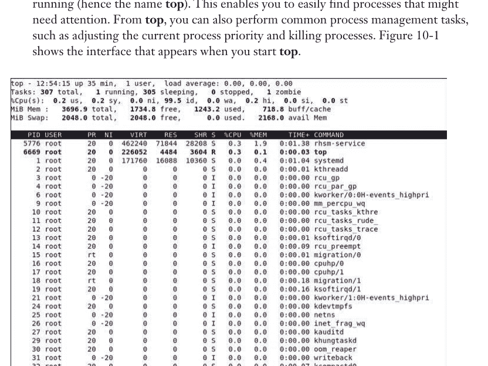

从`top`实用工具中可以方便获取的信息之一是进程状态。表 10-3 概述了你可能观察到的不同进程状态。

**表 10-3 Linux 进程状态概述**

| 状态 | 含义 |
|---|---|
| 运行中 (R) | 进程当前处于活动状态并使用 CPU 时间，或者在可运行进程队列中等待获得服务。 |
| 睡眠 (S) | 进程正在等待某个事件完成。 |
| 不可中断睡眠 (D) | 进程处于无法停止的睡眠状态。这通常发生在进程等待 I/O 时。此状态也称为阻塞状态。 |
| 已停止 (T) | 进程已被停止，这通常发生在交互式 Shell 进程中，通过按 Ctrl-Z 键序列实现。 |
| 僵尸 (Z) | 进程已停止但无法被其父进程移除，这使其处于无法管理的状态。 |

既然你知道如何从命令行使用`kill`和`nice`命令，那么从`top`中使用相同功能甚至更容易。在`top`中，输入`k`；然后`top`会提示你输入要发送信号的进程的 PID。默认情况下，会选择最活跃的进程。输入 PID 后，`top`会询问你要发送哪个信号。默认情况下，使用信号 15 (SIGTERM)。但是，如果你想坚持更强制一些，可以输入`9`表示 SIGKILL。现在按 Enter 键终止该进程。

要从`top`中重新调整正在运行的进程的优先级，请输入`r`。首先会提示你输入要调整优先级的进程的 PID。输入 PID 后，会提示你输入要使用的`nice`值。输入正值以降低进程优先级，或输入负值以提高进程优先级。

另一个可以从`top`获取的重要参数是平均负载。平均负载表示处于可运行状态 (R) 或阻塞状态 (D) 的进程数量。如果进程当前正在运行或等待被服务，则处于可运行状态。如果进程正在等待 I/O，则处于阻塞状态。平均负载显示为最近 1、5 和 15 分钟的值，你可以在`top`屏幕的右上角看到当前值。或者，你可以使用`uptime`命令显示当前的平均负载统计信息（参见示例 10-4）。

248 Red Hat RHCSA 9 认证指南：EX200

### 示例 10-4：使用 uptime 获取平均负载信息

```text
[root@server3 ~]# uptime
 12:43:03 up  4:17,  3 users,  load average: 4.90, 0.98, 0.19
```

根据经验法则，平均负载不应高于系统中的 CPU 核心数。你可以通过使用`lscpu`命令来查找系统中的 CPU 核心数。如果较长时间内的平均负载高于系统中的 CPU 数量，你可能遇到了性能问题。在练习 10-3 中，你将研究平均负载统计信息并学习如何管理平均负载。

> ### 练习 10-3：管理平均负载
>
> 1. 打开一个 root Shell。在此 Shell 中，输入`dd if=/dev/zero of=/dev/null &`。重复此命令三次。
> 2. 输入`top`并观察当前的平均负载。几秒钟后，使用`q`退出`top`。
> 3. 从命令行，输入`uptime`。你应该会看到平均负载缓慢增加时显示的数字。
> 4. 输入`lscpu`并查找 CPU 数量。同时查找“每 CPU 核心数”参数，以便你可以计算 CPU 核心总数。
> 5. 使用`killall dd`杀掉所有`dd`进程。

### 使用 tuned 优化性能

为了从一开始就提供最佳性能，RHEL 9 附带了`tuned`。它提供了一个守护进程，可以监控系统活动并提供一些配置文件。在**配置文件**中，管理员可以自动调整系统以获得最佳延迟、吞吐量或功耗。

根据已安装系统的属性，`tuned`配置文件在安装时会自动选择，安装后可以手动更改当前配置文件。管理员也可以更改`tuned`配置文件中的设置。表 10-4 概述了最重要的默认配置文件。

Humble Bundle Pearson 网络与安全认证包 – © Pearson. 请勿分发。

**表 10-4 tuned 配置文件概述**

| 配置文件 | 用途 |
|---|---|
| `balanced` | 在功耗和性能之间取得最佳平衡 |
| `desktop` | 基于 balanced 配置文件，但针对交互式应用程序的更好响应进行了调整 |
| `latency-performance` | 针对最大吞吐量进行调整 |
| `network-latency` | 基于 latency-performance，但增加了减少网络延迟的选项 |
| `network-throughput` | 基于 throughput-performance，为流式内容优化旧 CPU |
| `powersave` | 针对最大节能进行调整 |
| `throughput-performance` | 针对最大吞吐量进行调整 |
| `virtual-guest` | 优化 Linux 以作为虚拟机运行 |
| `virtual-host` | 优化 Linux 以用作 KVM 主机 |

创建自定义配置文件相对容易。此外，当你安装特定软件包时，可能会添加配置文件。因此，你可能会发现你的服务器上存在一些额外的性能配置文件。

要管理性能配置文件，提供了`tuned-adm`命令。它与`tuned`守护进程通信，因此在使用它之前，运行`systemctl enable --now tuned`以启动`tuned`守护进程。接下来，使用`tuned-adm active`查找当前选择了哪个配置文件。要查看服务器上可用配置文件的概览，请输入`tuned-adm list`。要选择另一个配置文件，请输入`tuned-adm profile profile-name`。tuned 服务还可以为你的系统推荐一个 tuned 配置文件：使用`tuned-adm recommend`。在练习 10-4 中，你可以练习使用 tuned。

### 练习 10-4：使用 tuned

- 使用`dnf -y install tuned`确保已安装 tuned。（可能已经安装了。）
- 输入`systemctl status tuned`检查 tuned 当前是否正在运行。如果没有，使用`systemctl enable --now tuned`。
- 输入`tuned-adm active`查看当前使用的是哪个配置文件。
- 输入`tuned-adm recommend`查看推荐的是哪个 tuned 配置文件。
- 要选择并激活`throughput-performance`配置文件，请输入`tuned-adm profile throughput-performance`。

### 总结

管理进程是 Linux 系统管理员的常见任务。在本章中，你学习了如何查找特定进程以及如何使用`nice`和`kill`更改其优先级。你还学习了如何使用`tuned`选择最符合服务器工作负载的性能配置文件。

### 考试准备任务

正如引言“如何使用本书”部分所述，你有多种考试准备选择：章节末尾的实验；附录 C 中的记忆表；第 27 章“最终准备”；以及模拟考试。

#### 复习所有关键主题

复习本章中最重要的主题，这些主题在页面边距处用关键主题图标标出。表 10-5 列出了这些关键主题及其所在页码的参考。

### 表 10-5：第 10 章关键主题

| 关键主题元素 | 描述 | 页码 |
|---|---|---|
| 表 10-2 | 作业管理概述 | 236 |
| 列表 | 重要信号概述 | 244 |
| 表 10-3 | Linux 进程状态概述 | 247 |

#### 从记忆中完成表格和列表

打印附录 C“记忆表”（可在配套网站上找到）的副本，或至少打印本章的部分，并从记忆中完成表格和列表。附录 D“记忆表答案”包含已完成的表格和列表，可用于检查你的工作。

#### 定义关键术语

定义本章的以下关键术语，并在术语表中检查你的答案：

进程、线程、作业、前台进程、后台进程、进程标识号 (PID)、`nice`、`kill`、信号、僵尸、配置文件、`tuned`

#### 复习题

以下问题旨在帮助你测试自己对概念和术语的掌握程度，以及知识的广度。你可以在附录A中找到这些问题的答案。

1. 哪个命令可以概览所有当前的 shell 作业？
2. 如何暂停当前的 shell 作业，以便在后台继续运行？
3. 你可以使用哪个按键组合来取消当前的 shell 作业？
4. 一名用户要求你取消他已启动的某个作业。你无法访问该用户当前正在使用的 shell。你如何才能仍然取消他的作业？
5. 你会使用哪个命令来显示进程间的父子关系？
6. 你会使用哪个命令将 PID 1234 的优先级调高？
7. 你的系统上目前运行着 20 个`dd`进程。停止所有这些进程最简单的方法是什么？
8. 哪个命令可以让你停止名为`mycommand`的命令？
9. 在`top`界面中，你会使用哪个命令来终止一个进程？
10. 要选择最符合你系统需求的性能配置文件，需要什么条件？

### 章末实验

在这个章末实验中，你将应用一些最重要的进程管理任务。使用你认为最方便的工具来完成这些实验。

#### 实验 10.1

1. 作为后台作业，启动命令`dd if=/dev/zero of=/dev/null`三次。
2. 使用`nice`值`-5`增加其中一个命令的优先级。再次更改同一进程的优先级，但这次使用值`-15`。观察两者的区别。
3. 终止你刚刚启动的所有`dd`进程。
4. 确保`tuned`已安装并激活，并设置`throughput-performance`配置文件。

## 本章涵盖以下主题

- 理解 Systemd
- 通过 Systemd 管理单元

## 本章涵盖以下 RHCSA 考试目标

- 启动、停止和检查网络服务的状态
- 启动和停止服务，并配置服务在引导时自动启动

# 使用 Systemd

在本章中，你将学习 Systemd，这是自 RHEL 7 起在 RHEL 上使用的系统和服务管理器。你将探索 Systemd 所能完成的所有事情，在有了良好的总体理解之后，你将学习如何使用 Systemd 服务。Systemd 还参与将你的系统引导至所需状态，这被称为 *target（目标）*。该主题在第17章“管理和理解引导过程”中介绍。

## “我是否已经掌握本章内容？”小测验

“我是否已经掌握本章内容？”小测验能让你评估是否应该通读本章的全部内容，还是直接跳到“考试准备任务”部分。如果你对这些问题的答案或自己对相关主题知识的评估有疑问，请通读整章。表11-1列出了本章的主要标题及其对应的“我是否已经掌握本章内容？”小测验问题。你可以在附录A“‘我是否已经掌握本章内容？’小测验和复习题答案”中找到答案。

**表 11-1** “我是否已经掌握本章内容？”部分到问题的映射

| 基础主题部分 | 问题 |
|---|---|
| 理解 Systemd | 1–5 |
| 通过 Systemd 管理单元 | 6–10 |

1. 哪个命令显示系统上当前已加载的所有服务单元文件？
   - a. `systemctl -t service`
   - b. `systemctl -t service --all`
   - c. `systemctl --list-services`
   - d. `systemctl --show-units | grep services`
2. 关于 Systemd wants（想要），以下哪项陈述是*不*正确的？
   - a. 你可以使用`systemctl enable`命令来创建 wants。
   - b. 一个特定 want 所应用的目标与其关联的 wants 无关。
   - c. Wants 始终在`/usr/lib/systemd/system`目录中进行管理。
   - d. 每个服务都知道它想要被添加到哪个目标。
3. 避免不兼容单元之间冲突的最佳解决方案是什么？
   - a. 无需处理；单元文件已为自己定义了哪些单元与其不兼容。
   - b. 使用`systemctl disable`禁用该服务。
   - c. 使用`systemctl unmask`取消掩码该服务。
   - d. 使用`systemctl mask`掩码该服务。
4. 以下哪项不是 Systemd 服务的有效状态？
   - a. Active(running)
   - b. Active(exited)
   - c. Active(waiting)
   - d. Running(dead)
5. 关于套接字单元（socket units），以下哪项陈述是*不*正确的？
   - a. 一个套接字单元需要一个同名的服务单元。
   - b. 套接字单元可以监听端口，并且仅当端口上有活动发生时才激活服务。
   - c. 套接字单元不能包含应启动的关联二进制文件的名称。
   - d. 套接字单元可以对路径活动做出反应。
6. 以下哪项不是有效的 Systemd 单元类型？
   - a. service
   - b. udev
   - c. mount
   - d. socket


7. 你想找出哪些其他 Systemd 单元依赖于特定单元。你会使用哪个命令？

   a. `systemd list-dependencies --reverse`

   b. `systemctl list-dependencies --reverse`

   c. `systemctl status my.unit --show-deps`

   d. `systemd status my.unit --show-deps -r`

8. 如何将 Systemd 使用的默认编辑器更改为 `vim`？

   a. `export EDITOR=vim`

   b. `export SYSTEMD_EDITOR=vim`

   c. `export EDITOR=/bin/vim`

   d. `export SYSTEMD_EDITOR=/bin/vim`

9. 如果你希望确保引导过程不会因依赖项失败而失败，应使用以下哪个关键字来定义 Systemd 依赖关系？

   a. `Required`

   b. `Requisite`

   c. `Before`

   d. `Wants`

10. 在使用 `systemctl` 处理单元时，以下哪项**不**是有效命令？

   a. `systemctl unit start`

   b. `systemctl status -l unit`

   c. `systemctl mask unit`

   d. `systemctl disable unit`

## 理解 Systemd

*Systemd* 是红帽企业 Linux 中负责启动服务以及各种其他项目的部分。在本章中，你将学习 Systemd 是如何组织的，以及哪些项目是由 Systemd 启动的。

用通用的方式描述，Systemd 系统和服务管理器用于启动“东西”。这些“东西”被称为*单元（units）*。单元可以是许多东西。最重要的单元类型之一是服务（service）。通常，服务是提供特定功能并允许外部客户端连接的进程，例如 SSH 服务、Apache Web 服务等等。除了服务之外，还存在其他单元类型，如套接字（socket）、挂载（mount）和目标（target）。要显示可用单元的列表，请输入 `systemctl -t help`（参见示例 11-1）。

### 示例 11-1 Systemd 中的单元类型

```text
[root@server1 ~]# systemctl -t help
Available unit types:
service
socket
target
device
mount
automount
swap
timer
path
slice
scope
```

### 理解 Systemd 单元位置

与红帽以前用于管理服务的方法相比，使用 Systemd 的主要好处是它提供了一个统一的接口来启动单元。此接口在单元文件中定义。单元文件可以出现在三个位置：

- `/usr/lib/systemd/system`：包含从 RPM 包安装的默认单元文件。你不应直接编辑这些文件。
- `/etc/systemd/system`：包含自定义单元文件。它也可能包含管理员编写的文件或由 `systemctl edit` 命令生成的文件。
- `/run/systemd/system`：包含自动生成的单元文件。

如果一个单元文件存在于多个位置，`/run` 目录中的单元具有最高优先级，将覆盖在其他地方定义的任何设置。`/etc/systemd/system` 中的单元具有第二高优先级，而 `/usr/lib/systemd/system` 中的单元优先级最低。

### 理解 Systemd 服务单元

最重要的单元类型可能是服务单元（service unit）。它用于启动进程。你可以使用服务单元启动任何类型的进程，包括守护进程和命令。

示例 11-2 显示了 Very Secure FTP 服务的服务单元文件 `vsftpd.service`。

### 示例 11-2 服务单元文件示例

```ini
[Unit]
Description=Vsftpd ftp daemon
After=network.target

[Service]
Type=forking
ExecStart=/usr/sbin/vsftpd /etc/vsftpd/vsftpd.conf

[Install]
WantedBy=multi-user.target
```

从这个单元文件示例中，你可以看到单元文件相对容易理解。Systemd *服务*单元文件通常包含以下三个部分（其他类型的单元文件有不同的部分）：

- `[Unit]`：描述单元并定义依赖关系。此部分还包含重要的 `After` 语句以及可选的 `Before` 语句。这些语句定义了不同单元之间的依赖关系，并且它们是从本单元的角度出发的。`Before` 语句表示本单元应在指定单元之前启动。`After` 语句表示本单元应在指定单元之后启动。

### 理解 Systemd 挂载单元

一个挂载单元指定了如何将文件系统挂载到特定目录。挂载单元是挂载文件系统的另一种方式，替代使用 `/etc/fstab` 文件，关于后者你将在第 14 章“管理存储”中了解更多。示例 11-3 展示了一个挂载单元文件 `tmp.mount`。

**示例 11-3** 一个挂载单元文件

```ini
[root@server1 ~]# cat /usr/lib/systemd/system/tmp.mount
[Unit]
Description=Temporary Directory /tmp
Documentation=https://systemd.io/TEMPORARY_DIRECTORIES
Documentation=man:file-hierarchy(7)
Documentation=https://www.freedesktop.org/wiki/Software/systemd/
    APIFileSystems
ConditionPathIsSymbolicLink=!/tmp
DefaultDependencies=no
Conflicts=umount.target
Before=local-fs.target umount.target
After=swap.target

[Mount]
What=tmpfs
Where=/tmp
Type=tmpfs
Options=mode=1777,strictatime,nosuid,nodev,size=50%,nr_inodes=1m

######## Make 'systemctl enable tmp.mount' work:
[Install]
WantedBy=local-fs.target
```

示例 11-3 中的 `tmp.mount` 单元文件在各节中展示了一些有趣的附加配置选项：

- `[Unit]` `Conflicts` 语句用于列出不能与此单元一起使用的单元。请将此语句用于互斥的单元。
- `[Mount]` 此节精确定义了挂载执行的位置。这里你可以看到通常在任何 `mount` 命令中使用的参数。

### 理解 Systemd 套接字单元

另一种值得研究的单元类型是套接字。套接字为应用程序之间的通信创建了一种方法。套接字可以定义为一个文件，但也可以定义为一个端口，Systemd 将在此端口监听传入连接。这样，服务就不必持续运行，而只会在指定的套接字有连接传入时启动。每个套接字都需要一个对应的服务文件。示例 11-4 展示了 `cockpit.socket` 文件的样子；请注意此文件需要一个名为 `cockpit.service` 的服务文件。

**示例 11-4** 一个套接字单元文件

```ini
[Unit]
Description=Cockpit Web Service Socket
Documentation=man:cockpit-ws(8)
Wants=cockpit-motd.service

[Socket]
ListenStream=9090
ExecStartPost=-/usr/share/cockpit/motd/update-motd '' localhost
ExecStartPost=-/bin/ln -snf active.motd /run/cockpit/motd
ExecStopPost=-/bin/ln -snf /usr/share/cockpit/motd/inactive.motd /run/cockpit/motd

[Install]
WantedBy=sockets.target
```

示例 11-4 中重要的选项是 `ListenStream`。此选项定义了 Systemd 应该监听传入连接的 TCP 端口。也可以为 UDP 端口创建套接字，此时应使用 `ListenDatagram` 而不是 `ListenStream`。

### 理解 Systemd 目标单元

单元文件用于构建服务器所需的功能。为了使其能按正确顺序和正确时刻加载，你需要使用一种特定类型的单元：目标单元。**目标**单元的一个简单定义是“一组单元”。有些目标用于定义服务器应启动的状态。因此，目标单元可与早期 RHEL 版本中使用的运行级别相比较。

其他目标仅仅是一组服务，这使得管理不仅单个单元，而且管理实现特定功能所需的所有单元变得容易。`sound.target` 就是这样的一个目标；你可以用它轻松地启动或停止系统上启用声音所需的所有单元。

目标本身可以依赖于其他目标。这些依赖关系在目标单元中定义。这种依赖关系的一个例子是 `basic.target`。此目标定义了应始终启动的所有单元。你可以使用 `systemctl list-dependencies` 命令来查看任何现有依赖关系的概览。

示例 11-5 展示了一个目标单元文件 `multi-user.target` 的定义，它定义了 RHEL 服务器的正常运行状态。

**示例 11-5** 一个目标单元文件

```ini
[Unit]
Description=Multi-User System
Documentation=man:systemd.special(7)
Requires=basic.target
Conflicts=rescue.service rescue.target
After=basic.target rescue.service rescue.target
AllowIsolate=yes
```

你可以看到，目标单元本身不包含任何关于它应启动哪些单元的信息。它只是定义了它需要什么，以及它不能与哪些服务和目标共存。它还通过使用 `[Unit]` 节中的 `After` 语句定义了加载顺序。目标文件不包含任何关于应包含哪些单元的信息；那是在不同单元文件的 `[Install]` 节中定义的。

当管理员使用 `systemctl enable` 命令以确保单元在引导时自动启动时，会考虑该单元的 `[Install]` 节，以确定该单元应添加到哪个目标。

当你将一个单元添加到目标时，实际上是在 `/etc/systemd/system` 中的目标目录中创建了一个符号链接。例如，如果你启用了 `vsftpd` 服务以自动启动，你会发现创建了一个符号链接 `/etc/systemd/system/multi-user.target/wants/vsftpd.service`，它指向 `/usr/lib/systemd/system/vsftpd.service` 中的单元文件，从而确保该单元将自动启动。在 Systemd 术语中，这个符号链接被称为 **want**，因为它定义了目标在被处理时想要启动的内容。

### 通过 Systemd 管理单元

管理 Systemd 单元的当前状态是 RHEL 管理员的一项重要任务。管理单元不仅意味着管理它们的当前状态，还包括更改不同单元使用的选项。

管理 Systemd 单元从启动和停止单元开始。作为管理员，你使用 `systemctl` 命令来执行此操作。在练习 11-1 中，你将启动、停止和管理一个单元。在配置单元使其可以无问题启动后，你需要确保它能在重启后自动重启。你可以通过启用或禁用单元来实现这一点。

> **提示**：`systemctl` 命令有大量的选项，初看可能令人应接不暇，但无需感到压力。只需确保已安装 `bash-completion` 软件包，并在 `systemctl` 命令上使用 Tab 补全，这提供了对所有可用选项的便捷访问。

**练习 11-1 使用 systemctl 管理单元**

1. 在 root shell 中，输入 `dnf -y install vsftpd` 以安装“非常安全的 FTP 服务”。
2. 输入 `systemctl start vsftpd` 以在你的机器上激活 FTP 服务器。
3. 输入 `systemctl status vsftpd` 以获得如示例 11-6 所示的输出，你可以看到 `vsftpd` 服务当前正在运行。在 `Loaded` 行中，你还可以看到该服务当前处于禁用状态，这意味着在系统重启时它不会被激活。供应商预设也显示为禁用，这意味着默认情况下，安装后此单元不会自动启用。
4. 输入 `systemctl enable vsftpd` 以在 `multiuser` 目标的 wants 目录中创建一个符号链接，确保服务在重启后自动启动。
5. 再次输入 `systemctl status vsftpd`。你会看到单元文件已从禁用变为启用。

### 示例 11-6 使用 systemctl status 请求当前单元状态

```text
[root@server1 system]# systemctl status vsftpd
● vsftpd.service - Vsftpd ftp daemon
     Loaded: loaded (/usr/lib/systemd/system/vsftpd.service; enabled; vendor preset: disabled)
     Active: active (running) since Thu 2022-09-15 08:42:50 CEST; 6s ago
   Process: 33967 ExecStart=/usr/sbin/vsftpd /etc/vsftpd/vsftpd.conf (code=exited, status=0/SUCCESS)
  Main PID: 33968 (vsftpd)
     Tasks: 1 (limit: 23272)
    Memory: 708.0K
       CPU: 2ms
    CGroup: /system.slice/vsftpd.service
            └─33968 /usr/sbin/vsftpd /etc/vsftpd/vsftpd.conf

Sep 15 08:42:50 server1.example.com systemd[1]: Starting Vsftpd ftp daemon...
Sep 15 08:42:50 server1.example.com systemd[1]: Started Vsftpd ftp daemon. .
```

如示例 11-6 所示，当请求 Systemd 单元的当前状态时，你可以看到关于它的不同类型的信息。表 11-2 展示了使用 `systemctl status` 命令时，你可以获得的关于单元文件的不同种类信息。

### 表 11-2 Systemd 状态概览

| 状态 | 描述 |
|---|---|
| 已加载 | 单元文件已被处理，且单元处于活动状态。 |
| 活动（运行中） | 单元正在运行，有一个或多个活动进程。 |
| 活动（已退出） | 单元已成功完成一次运行。 |
| 活动（等待中） | 单元正在运行并等待事件。 |
| 未活动（已停止） | 单元未在运行。 |
| 已启用 | 单元将在启动时启动。 |
| 已禁用 | 单元不会在启动时启动。 |
| 静态 | 单元无法被启用，但可能被另一个单元自动启动。 |

作为管理员，你经常也需要概览当前 Systemd 单元文件的状态。不同的命令（其中一些如表 11-3 所示）可以帮助你获取这些信息。

### 表 11-3 systemctl 单元概览命令

| 命令 | 描述 |
|---|---|
| `systemctl -t service` | 仅显示服务单元 |
| `systemctl list-units -t service` | 显示所有活动的服务单元（与前一个命令结果相同） |
| `systemctl list-units -t service --all` | 同时显示活动和不活动的服务单元 |
| `systemctl --failed -t service` | 显示所有已失败的服务 |
| `systemctl status -l your.service` | 显示服务的详细状态信息 |

## 管理依赖关系

通常，有两种方式来管理 Systemd 依赖关系：

- 像 socket、timer 和 path 这样的单元类型直接关联到一个服务单元。Systemd 能够建立这种连接，因为它们名称的第一部分是相同的：`cockpit.socket` 与 `cockpit.service` 协同工作。访问这两种单元类型中的任何一种都会自动触发生服务类型的单元。
- 依赖关系可以在单元内部使用关键字如 `Requires`、`Requisite`、`After` 和 `Before` 来定义。

作为管理员，你可以请求一个单元的依赖关系列表。输入 `systemctl list-dependencies` 后跟一个单元名称，以找出它有哪些依赖；添加 `--reverse` 选项可以找出启动此单元需要哪些单元。示例 11-7 展示了此命令的一个示例。

### 示例 11-7 显示单元依赖关系


```text
[root@server1 ~]# systemctl list-dependencies vsftpd
vsftpd.service
└─system.slice
  └─basic.target
    ├─alsa-restore.service
    ├─alsa-state.service
    └─firewalld.service
    ├─microcode.service
    ├─rhel-autorelabel-mark.service
    ├─rhel-autorelabel.service
    ├─rhel-configure.service
    ├─rhel-dmesg.service
    ├─rhel-loadmodules.service
    ├─paths.target
    ├─slices.target
    │ ├─-.slice
    │ ├─system.slice
    ├─sockets.target
    │ ├─avahi-daemon.socket
    │ ├─cups.socket
    │ ├─dbus.socket
    │ ├─dm-event.socket
    │ ├─iscsid.socket
    │ ├─iscsiuio.socket
    │ ├─lvm2-lvmetad.socket
    │ ├─rpcbind.socket
    │ ├─systemd-initctl.socket
    │ ├─systemd-journald.socket
    │ ├─systemd-shutdownd.socket
    │ ├─systemd-udevd-control.socket
    │ ├─systemd-udevd-kernel.socket
    ├─sysinit.target
    │ ├─dev-hugepages.mount
    │ ├─dev-mqueue.mount
    │ ├─dmraid-activation.service
    │ ├─iscsi.service
```

为了确保准确的依赖关系管理，你可以在单元的`[Unit]`部分使用不同的关键字：

- **Requires：** 如果此单元加载，此处列出的单元也将加载。如果其他列出的单元之一被停用，此单元也将被停用。
- **Requisite：** 如果此处列出的单元尚未加载，此单元将失败。
- **Wants：** 此单元希望加载此处列出的单元，但如果任何列出的单元失败，它不会失败。
- **Before：** 此单元将在`Before`指定的单元之前启动。
- **After：** 此单元将在`After`指定的单元之后启动。

在接下来的练习 11-2 中，你将学习如何使用这些选项来管理单元依赖关系。

### 管理单元选项

处理 Systemd 单元文件时，你可能会被其众多的选项弄得不知所措。每个单元文件都可以使用不同的选项进行配置。要找出特定单元有哪些可用选项，请使用`systemctl show`命令。例如，`systemctl show sshd`命令会显示可在`sshd.service`单元中配置的所有 Systemd 选项，包括它们的当前默认值。示例 11-8 展示了该命令的输出。

#### 示例 11-8 使用 systemctl show 显示可用选项

```text
[root@server1 ~]# systemctl show | head -20
Id=sshd.service
Names=sshd.service
Requires=basic.target
Wants=sshd-keygen.service system.slice
WantedBy=multi-user.target
ConsistsOf=sshd-keygen.service
Conflicts=shutdown.target
ConflictedBy=sshd.socket
Before=shutdown.target multi-user.target
After=network.target sshd-keygen.service systemd-journald.socket
  basic.target system.slice
Description=OpenSSH server daemon
LoadState=loaded
ActiveState=active
SubState=running
FragmentPath=/usr/lib/systemd/system/sshd.service
UnitFileState=enabled
InactiveExitTimestamp=Sat 2015-05-02 11:06:02 EDT
InactiveExitTimestampMonotonic=2596332166
ActiveEnterTimestamp=Sat 2015-05-02 11:06:02 EDT
ActiveEnterTimestampMonotonic=2596332166
ActiveExitTimestamp=Sat 2015-05-02 11:05:22 EDT
ActiveExitTimestampMonotonic=2559916100
InactiveEnterTimestamp=Sat 2015-05-02 11:06:02 EDT
```

当更改单元文件以应用选项时，你需要确保更改写入`/etc/systemd/system`，这是创建自定义单元文件的位置。推荐的做法是使用`systemctl edit`命令。此命令会在`/etc/systemd/system`下为你正在编辑的服务创建一个子目录；例如，如果你使用`systemctl edit sshd.service`，你会得到一个名为`/etc/systemd/systemd/sshd.service.d`的目录，其中会创建一个名为`override.conf`的文件。在此文件中应用的所有设置会覆盖`/usr/lib/systemd/system`中服务文件的任何现有设置。在练习 11-2 中，你将学习如何对 Systemd 单元应用更改。

> **提示** 默认情况下，Systemd 使用`nano`编辑器。并非所有人都喜欢它（包括我）。如果你想让`vim`代替`nano`，请编辑`/root/.bash_profile`文件，添加以下行：`export SYSTEMD_EDITOR="/bin/vim"`，并将此行添加到`~/.bashrc`文件中。重新登录后，`vim`将作为默认编辑器使用。如果你希望将`/bin/vim`作为所有需要外部编辑器的命令（包括`systemctl`）的默认编辑器，你也可以改为包含`export EDITOR="/bin/vim"`。

#### 练习 11-2 更改单元配置

1. 从 root shell，输入`dnf -y install httpd`来安装 Apache Web 服务器软件包。
2. 使用`systemctl cat httpd.service`显示启动 Apache Web 服务器的单元文件的当前配置。
3. 输入`systemctl show httpd.service`以获取此单元文件可用配置选项的概览。
4. 输入`export SYSTEMD_EDITOR=/bin/vim`以确保在本次会话期间使用`vim`作为默认编辑器。（可选地，将此行添加到`~/.bashrc`使其持久化。）
5. 使用`systemctl edit httpd.service`更改默认配置，并添加一个包含`Restart=always`和`RestartSec=5s`行的`[Service]`部分。
6. 输入`systemctl daemon-reload`以确保 Systemd 接收新配置。
7. 输入`systemctl start httpd`启动 httpd 服务，并使用`systemctl status sshd`验证 sshd 服务确实在运行。
8. 使用`killall httpd`命令终止 httpd 进程。
9. 输入`systemctl status httpd`命令，然后等待 5 秒钟后再次查看。你会注意到 httpd 进程会自动重启。

### 本章小结

在本章中，你学习了如何使用 Systemd。你阅读了如何管理 Systemd 服务状态以及如何更改 Systemd 中的不同选项。在下一章中，你将学习如何使用 cron 和 at 服务来调度任务。

### 考试准备任务

正如引言中“如何使用本书”一节所述。

#### 复习所有关键主题

复习本章中最重要的主题，这些主题在页面边距中标有关键主题图标。表 11-4 列出了这些关键主题的参考及其所在的页码。

**表 11-4** 第 11 章关键主题

| 关键主题元素 | 描述 | 页码 |
|---|---|---|
| 示例 11-1 | Systemd 中的单元类型 | 256 |
| 列表 | Systemd 单元文件的三个部分 | 257 |
| 章节 | 理解 Systemd 目标单元 | 260 |
| 练习 11-1 | 使用`systemctl`管理单元 | 261 |
| 表 11-3 | `systemctl`单元概览命令 | 263 |

#### 凭记忆完成表格和列表

打印附录 C 的副本。

#### 定义关键术语

定义本章中的以下关键术语，并在词汇表中检查你的答案：

Systemd、单元、目标、想要。

#### 复习题

以下问题旨在帮助你测试对概念和术语的理解以及知识的广度。你可以在附录 A 中找到这些问题的答案。

1. 什么是单元？
2. 应该使用哪个命令来显示当前已加载的所有服务单元？
3. 如何为服务创建“想要”关系？
4. 如何更改`systemctl`的默认编辑器？
5. 哪个目录包含自定义的 Systemd 单元文件？
6. 为确保一个单元文件会自动加载另一个单元文件，应包含什么内容？
7. 哪个命令显示`httpd.service`单元可用的配置选项？
8. 哪个命令显示特定单元的所有依赖项？
9. 如果`systemctl status`显示单元状态为“dead”，这意味着什么？
10. 如何创建 Systemd 覆盖文件？

### 章末实验

你现在已经学习了如何使用 Systemd。在继续之前，最好进行一个实验，以帮助确保你能应用在本章中掌握的技能。

#### 实验 11.1

1. 安装 vsftpd 和 httpd 服务。
2. 将`systemctl`的默认编辑器设置为`vim`。
3. 编辑 httpd.service 单元文件，使得启动 httpd 时总是自动启动 vsftpd。编辑 httpd 服务，使得其在失败后能在 10 秒内自动重新启动。

## 第 12 章：调度任务

在 Linux 服务器上，确保某些任务在特定时间运行非常重要。这可以通过使用 at 和 cron 服务来实现，这些服务可以配置为在未来运行任务。at 服务用于一次性执行未来任务，而 cron 服务用于执行重复的定期任务。除了这些在所有以前版本的 RHEL 中都存在的服务外，Systemd 还提供了定时器单元，可作为替代方案。在本章中，你将学习如何配置 cron 和 at，以及 Systemd 定时器。

### “我已经知道这个了吗？”测验

“我已经知道这个了吗？”测验使你能够评估是否应该通读本章的全部内容，还是直接跳转到“考试准备任务”部分。如果你对这些问题的答案或自己对主题知识的评估有疑问，请阅读整章内容。表 12-1 列出了本章的主要标题及其对应的“我已经知道这个了吗？”测验问题。你可以在附录 A “‘我已经知道这个了吗？’测验和复习题的答案”中找到答案。

**表 12-1** “我已经知道这个了吗？”部分与问题的对应关系

| 基础主题部分 | 问题 |
|---|---|
| 理解 RHEL 中的调度选项 | 1 |
| 使用 Systemd 定时器 | 2–4 |
| 配置 cron 以自动化重复任务 | 5–8 |
| 配置 at 以调度未来任务 | 9–10 |

1. RHEL 9 中调度重复作业的默认解决方案是什么？
   - a. Systemd 定时器
   - b. cron
   - c. anacron
   - d. at

2. 如何配置定时器在特定时间启动？
   - a. 在`[Timer]`部分使用 cron 风格的启动时间表示法。
   - b. 在`[Timer]`部分使用`OnCalendar`。
   - c. 在`[Timer]`部分使用`OnTime`。
   - d. 通过 cron 调度它。

3. 你希望定时器在 Systemd 服务启动后 1 分钟启动。你应该使用哪个选项？
   - a. `OnCalendar`
   - b. `OnUnitActiveSec`
   - c. `OnBootSec`
   - d. `OnStartupSec`

4. 你希望 systemd 用户单元在用户登录后 2 分钟启动。以下哪项是正确的？
   - a. `OnCalendar`
   - b. `OnUserLogin`
   - c. `OnUserActiveSec`
   - d. `OnStartupSec`

5. 以下哪项会在周日上午 11 点运行 cron 任务？
   - a. `* 11 7 * *`
   - b. `0 11 * 7 *`
   - c. `0 11 * * 7`
   - d. `11 0 * 7 *`

6. 以下哪项会从周一到周五每 5 分钟启动一个作业？
   - a. `*/5 * * * 1-5`
   - b. `*/5 * 1-5 * *`
   - c. `0/5 * * * 1-5`
   - d. `0/5 * 1-5 * *`

7. 如何为特定用户创建 cron 作业？
   - a. 以该用户身份登录，然后输入`crontab -e`打开 cron 编辑器。
   - b. 在用户主目录中打开 crontab 文件并添加你想添加的内容。
   - c. 以 root 身份，输入`crontab -e username`。
   - d. 以 root 身份，输入`crontab -u username -e`。

8. 以下哪项不是指定应使用 cron 执行的作业的推荐方式？
   - a. 修改`/etc/crontab`。
   - b. 将作业放在`/etc/cron.d`中的单独脚本中。
   - c. 使用`crontab -e`创建用户特定的 cron 作业。
   - d. 将脚本放在`/etc/cron.{hourly|daily|weekly|monthly}`中以自动执行。

9. 在 at shell 中输入命令后，哪个命令使你能够关闭 at shell？
   - a. Ctrl-V
   - b. Ctrl-D
   - c. `exit`
   - d. `:wq`

10. 哪个命令使你能够查看当前计划执行的 at 作业？
    - a. `atrm`
    - b. `atls`
    - c. `atq`
    - d. `at`

274 Red Hat RHCSA 9 认证指南：EX200

### 基础主题

#### 理解 RHEL 中的调度选项

RHEL 9 提供了不同的任务调度解决方案：

- Systemd 定时器现在是确保特定任务在特定时间启动的默认解决方案。
- cron 是传统的调度服务。它仍然受到支持，并负责调度一些服务。
- at 用于调度偶尔执行的用户作业以备将来执行。

#### 使用 Systemd 定时器

自 RHEL 7 首次出现以来，systemd 一直取代着许多服务。自 RHEL 9 发布以来，它也负责调度任务。现在它是执行此操作的主要机制，这意味着如果你想知道如何执行未来任务，你应该首先考虑 systemd 定时器。

systemd 定时器始终与服务文件一起使用，并且名称应该匹配。例如，logrotate.timer 文件用于修饰 logrotate.service 文件。服务单元定义了应如何启动服务，而定时器定义了何时启动它。如果需要由定时器启动服务，你应该启用定时器，而不是服务。示例 12-1 显示了 logrotate.timer 文件的内容。

```text
[root@server1 system]# systemctl cat logrotate.timer
######## /usr/lib/systemd/system/logrotate.timer
[Unit]
Description=Daily rotation of log files
Documentation=man:logrotate(8) man:logrotate.conf(5)

[Timer]
OnCalendar=daily
AccuracySec=1h
Persistent=true

[Install]
WantedBy=timers.target
```

#### 练习 12-1：使用 Systemd 定时器

要定义定时器的启动方式，定时器单元包含一个`[Timer]`段。在示例 12-1 的代码中，你可以看到其中列出了三个选项：

- **OnCalendar：** 描述定时器何时执行。在此例中设置为 daily，确保每天执行一次。
- **AccuracySec：** 表示定时器应在其中执行的时间窗口。在示例 12-1 中设置为 1 小时。如果定时器需要在更精确的时间执行，通常将其设置为更小的值。使用 1us 可获得最佳精度。
- **Persistent：** 作为`OnCalendar=daily`的修饰符，它指定应将上次执行时间存储在磁盘上，以便下次执行时间恰好在一天之后。

在 systemd 定时器中，可以使用不同的选项来指示何时启动相关服务。表 12-2 列出了最重要的选项。


## 表 12-2 Systemd 定时器中的计时选项

| 选项 | 用途 |
|---|---|
| `OnActiveSec` | 定义相对于定时器激活时刻的计时器。 |
| `OnBootSec` | 定义相对于机器启动时间的计时器。 |
| `OnStartupSec` | 指定相对于服务管理器启动时间的时间。在大多数情况下这与 `OnBootSec` 相同，但在使用 systemd 用户单元时则不同。 |
| `OnUnitActiveSec` | 定义相对于定时器所激活的单元上次被激活时间的计时器。 |
| `OnCalendar` | 基于日历事件表达式定义定时器，例如 `daily`。详情请参见 `man systemd.time`。 |

在练习 12-1 中，你将学习如何探索 systemd 定时器的组织方式。

1. 使用 `systemctl list-units -t timer` 显示所有定时器的列表。
2. 输入 `systemctl list-unit-files logrotate.*`，应显示有一个 `logrotate.service` 和一个 `logrotate.timer`。
3. 输入 `systemctl cat logrotate.service` 以验证 `logrotate.service` 单元文件的内容。注意它没有 `[Install]` 段。
4. 使用 `systemctl status logrotate.service`，将显示其被标记为由 `logrotate.timer` 触发。
5. 使用 `systemctl status logrotate.timer` 验证相关定时器的状态。
6. 安装 sysstat 软件包，使用 `dnf install -y sysstat`。
7. 验证从此软件包添加的单元文件，使用 `systemctl list-unit-files sysstat*`。
8. 输入 `systemctl cat sysstat-collect.timer` 查看 sysstat-collect 定时器的作用。你将看到 `OnCalendar=*:00/10` 这一行，确保它每 10 分钟运行一次。

### 配置 cron 以自动化重复性任务

任务调度在 Linux 上已经很常见了，过去 `crond` 服务是调度任务的主要工具。

`crond` 服务由两个主要组件组成。首先是 cron 守护进程 `crond`，在 RHEL 9 中它也作为 systemd 服务启动。该守护进程每分钟检查一次是否有工作要做。其次，这些要做的工作定义在 cron 配置中，该配置由多个文件协同工作，在正确的时间向正确的服务提供正确的信息。在本节中，你将学习如何配置 cron。

> **考试提示** 即使 systemd 定时器现在是运行重复性任务的默认解决方案，cron 仍然可用。请确保你熟练掌握两者，以便为 RHCSA 考试做好准备！

### 管理 crond 服务

`crond` 服务在每个 RHEL 系统上默认启动。管理 `crond` 服务本身很容易：它不需要太多管理。其他服务需要重新加载或重启以激活配置更改，而 `crond` 不需要这样做。`crond` 守护进程每分钟唤醒一次，检查其配置以确定是否需要启动任何内容。

要监控 `crond` 服务的当前状态，你可以使用 `systemctl status crond` 命令。示例 12-2 展示了该命令的输出。

#### 示例 12-2 监控 crond 服务的当前状态

```text
[root@localhost ~]# systemctl status crond
• crond.service - Command Scheduler
     Loaded: loaded (/usr/lib/systemd/system/crond.service; enabled;
     vendor preset: enabled)
     Active: active (running) since Mon 2022-11-21 12:19:12 CET; 1h
     21min ago
   Main PID: 1169 (crond)
      Tasks: 2 (limit: 23284)
     Memory: 1.5M
        CPU: 66ms
     CGroup: /system.slice/crond.service
             ├─1169 /usr/sbin/crond -n
             └─6689 /usr/sbin/anacron -s
Nov 21 13:01:01 localhost.localdomain anacron[6689]: Will run job
'cron.daily' in 12 min.
Nov 21 13:01:01 localhost.localdomain anacron[6689]: Will run job
'cron.weekly' in 32 min.
Nov 21 13:01:01 localhost.localdomain anacron[6689]: Will run job
'cron.monthly' in 52 min.
Nov 21 13:01:01 localhost.localdomain anacron[6689]: Jobs will be
executed sequentially
Nov 21 13:01:01 localhost.localdomain run-parts[6691]: (/etc/cron.
hourly) finished 0anacron
Nov 21 13:01:01 localhost.localdomain CROND[6675]: (root) CMDEND
(run-parts /etc/cron.hourly)
Nov 21 13:13:01 localhost.localdomain anacron[6689]: Job 'cron.daily'
started
Nov 21 13:13:01 localhost.localdomain anacron[6689]: Job 'cron.daily'
terminated
Nov 21 13:33:01 localhost.localdomain anacron[6689]: Job 'cron.weekly'
started
Nov 21 13:33:01 localhost.localdomain anacron[6689]: Job 'cron.weekly'
terminated
```

`systemctl status crond` 命令输出中最重要的部分在开头，它表明 cron 服务已加载并启用。服务被启用意味着每当该服务重启时它将自动启动。命令输出的最后一部分显示当前的状态信息。通过 journald 服务，`systemctl` 命令可以了解 `crond` 服务的实际运行情况。

#### 理解 cron 计时

通过 cron 调度服务时，你需要指定服务确切的启动时间。在 crontab 配置中（下一节将更深入地讲解），你使用时间字符串来指示任务何时启动。表 12-3 显示了使用的时间和日期字段（按指定顺序排列）。

## 表 12-3 cron 时间和日期字段

| 字段 | 值 |
|---|---|
| 分钟 | 0–59 |
| 小时 | 0–23 |
| 月中日期 | 1–31 |
| 月份 | 1–12（或月份名称） |
| 星期几 | 0–7（星期日为 0 或 7），或星期名称 |

在任何这些字段中，你可以使用 `*` 作为通配符表示任何值。允许使用数字范围、列表和模式。以下列出一些示例：

- `* * * * *` 每分钟执行一次（可能不是你想要的）。
- `0 11 * * 1-5` 仅在工作日的上午 11 点每天执行。
- `0 7-18 * * 1-5` 工作日上午 7 点到下午 6 点之间每小时整点执行。
- `0 */2 2 12 5` 12 月 2 日及 12 月每个星期五每两小时整点执行。

> **提示** 你不需要记住所有这些；`man 5 crontab` 显示所有可能的构造方式。

### 管理 cron 配置文件

cron 的主配置文件是 `/etc/crontab`，但你不会直接修改此文件。不过它确实为你提供了一个方便的概览，展示了 cron 中可以使用的一些时间规范。它还设置了通过 cron 执行的命令所使用的环境变量（参见示例 12-3）。要对 cron 任务进行修改，还有其他位置可以指定 cron 任务。

#### 示例 12-3 `/etc/crontab` 示例内容

```text
[root@server2 ~]# cat /etc/crontab
SHELL=/bin/bash
PATH=/sbin:/bin:/usr/sbin:/usr/bin
MAILTO=root

# For details see man 4 crontabs

# Example of job definition:
# .---------------- minute (0 - 59)
# |  .------------- hour (0 - 23)
# |  |  .---------- day of month (1 - 31)
# |  |  |  .------- month (1 - 12) OR jan,feb,mar,apr ...
# |  |  |  |  .---- day of week (0 - 6) (Sunday=0 or 7) OR sun,mon,tue,wed,thu,fri,sat
# |  |  |  |  |
# * * * * * user-name command to be executed
```

不要修改 `/etc/crontab`，而是使用不同的 cron 配置文件：

- `/etc/cron.d` 中的 cron 文件。
- `/etc/cron.hourly`、`cron.daily`、`cron.weekly` 和 `cron.monthly` 中的脚本。
- 使用 `crontab -e` 创建的用户特定文件。

在本节中，你将概览这些位置。

> **注意** 如果你想试验 cron 的工作方式，应留出足够的时间让任务执行。`crond` 服务每分钟读取一次其配置，之后新任务可以安排在下一分钟执行。因此，如果你想确保任务尽快执行，请在保存 cron 配置和执行时间之间留出三分钟的安全间隔。

首先，可以为特定用户启动 cron 任务。要创建用户特定的 cron 任务，以该用户身份登录后输入 `crontab -e`，或以 root 身份输入 `crontab -e -u username`。这些用户特定的 cron 任务是通过 cron 调度额外任务的最常用方式。

当你使用 `crontab -e` 时，默认编辑器会打开并创建一个临时文件。编辑 cron 配置后，临时文件会被移动到 `/var/spool/cron` 目录中的最终位置。在此目录中，会为每个用户创建一个文件。

这些文件永远不应直接编辑！当文件由 `crontab -e` 保存时，它会被自动激活。

在 RHEL 早期版本中，`/etc/crontab` 文件是直接修改的，而在 RHEL 9 中你不再需要这样做。如果你想添加 cron 任务，请将它们添加到 `/etc/cron.d` 目录。只需在该目录中放入一个文件（确切的名称并不重要），并确保它符合典型 cron 任务的语法。在示例 12-4 中，你可以看到 `/etc/cron.d/0hourly.cron` 文件的示例，该文件负责通过 cron 运行每小时任务。

#### 示例 12-4 `/etc/cron.d` 中的示例 cron 任务

```text
[root@server1 cron.d]# ls
0hourly
[root@server1 cron.d]# cat 0hourly
# Run the hourly jobs
SHELL=/bin/bash
PATH=/sbin:/bin:/usr/sbin:/usr/bin
MAILTO=root
01 * * * * root run-parts /etc/cron.hourly
```

此示例首先设置环境变量。这些是在运行此特定任务时应考虑的环境变量。最后一行定义了任务本身。此定义的第一部分指定了任务应何时运行。在这种情况下，它将在每小时的第 1 分钟、每月的每一天、每年的每个月以及每周的每一天运行。该任务将以 root 用户身份执行，任务本身涉及 `run-parts` 命令，该命令负责运行 `/etc/cron.hourly` 中的脚本化 cron 任务。

安排 cron 任务的最后一种方式是通过以下目录：

- `/etc/cron.hourly`
- `/etc/cron.daily`
- `/etc/cron.weekly`
- `/etc/cron.monthly`

在这些目录中，你通常会找到脚本（不是符合 crontab 语法要求的文件），这些脚本是从 RPM 包文件中放进去的。打开这些脚本时，请注意其中不包含命令应何时执行的时间信息。原因是确切的执行时间并不重要。唯一重要的是任务每小时、每天、每周或每月启动一次，而 `anacron` 会负责处理其余所有事情。

### 理解 anacron 的用途

为确保任务的定期执行，cron 使用 `anacron` 服务。该服务负责启动每小时、每天、每周和每月的 cron 任务，无论确切时间是什么。为了确定应如何执行，anacron 使用 `/etc/anacrontab` 文件。示例 12-5 显示了 `/etc/anacrontab` 文件的内容，该文件用于指定 anacron 任务应如何执行。

#### 示例 12-5 anacrontab 配置

```text
[root@server1 spool]# cat /etc/anacrontab
####### /etc/anacrontab: configuration file for anacron

# See anacron(8) and anacrontab(5) for details.

SHELL=/bin/sh
PATH=/sbin:/bin:/usr/sbin:/usr/bin
MAILTO=root
# the maximal random delay added to the base delay of the jobs
RANDOM_DELAY=45
# the jobs will be started during the following hours only
START_HOURS_RANGE=3-22

#period in days  delay in minutes  job-identifier  command
1                5                 cron.daily      nice run-parts  /etc/cron.daily
7                25                cron.weekly     nice run-parts  /etc/cron.weekly
@monthly         45                cron.monthly    nice run-parts  /etc/cron.monthly
```

在 `/etc/anacrontab` 中，要执行的任务在包含四个字段的行中指定，如示例 12-5 所示。第一个字段指定任务执行的频率，以天为单位。第二个字段指定 anacron 在执行任务之前等待的时间，其后是第三个字段，其中包含任务标识符。第四个字段指定应执行的命令。

> **提示** 虽然了解 anacron 的工作原理很有用，但它通常不是直接配置的服务。通过 anacron 配置服务的需求已被 `/etc/cron.hourly`、`cron.daily`、`cron.weekly` 和 `cron.monthly` 文件所取代。

> **注意** 要全面了解实际安排执行的 cron 任务并不容易。没有单个命令可以显示所有当前安排的 cron 任务。`crontab -l` 命令确实会列出 cron 任务，但仅限于当前用户账户。

### 管理 cron 安全性

默认情况下，所有用户都可以输入 cron 任务。可以使用 `/etc/cron.allow` 和 `/etc/cron.deny` 配置文件来限制哪些用户被允许安排 cron 任务。如果 `cron.allow` 文件存在，用户必须在其中列出才能被允许使用 cron。如果 `/etc/cron.deny` 文件存在，用户不得在其中列出才能被允许设置 cron 任务。这两个文件不应同时存在于同一系统上。如果两个文件都不存在，则只有 root 可以使用 cron。

## 练习 12-2 通过 cron 运行计划任务

1. 打开 root shell。输入 `cat /etc/crontab` 以了解 `/etc/crontab` 配置文件的内容。
2. 输入 `crontab -e`。这将打开一个编辑器界面，默认使用 `vi` 作为编辑器。添加以下行：

   `0 2 * * 1-5 logger message from root`

3. 使用 `vi` 命令 `:wq!` 关闭编辑会话并写入更改。
4. 输入 `cd /etc/cron.hourly`。在此目录中，创建一个名为 `eachhour` 的脚本文件，包含以下行：

   `logger This message is written at $(date)`

5. 使用 `chmod +x eachhour` 使脚本可执行；如果你未能使其可执行，它将无法工作。
6. 进入目录 `/etc/cron.d`，并在此目录中创建一个名为 `eachhour` 的文件。在文件中放入以下内容：

   `11 * * * * root logger This message is written from /etc/cron.d`

7. 将修改保存到配置文件，然后继续到下一节。（为获得最佳效果，请在几个小时后执行第 8 步。）


8. 几个小时后，输入`grep written /var/log/messages`并阅读消息以验证 cron 是否正确运行。

### 配置 at 以调度未来的任务

cron 用于调度需要定期执行的任务，而 atd 服务适用于只需要执行一次的任务。在 RHEL 9 上，atd 服务默认可用，因此你只需要安排任务即可。

要通过 atd 服务运行任务，你需要使用`at`命令，后跟任务需要执行的时间。这可以是特定时间，如`at 14:00`，但也可以是时间指示，如`at teatime`或`at noon`。输入此命令后，`at` shell 会打开。在此 shell 中，你可以输入多个命令，这些命令将在指定的特定时间执行。输入命令后，按 Ctrl-D 退出 at shell。

使用 at 安排任务后，你可以使用`atq`命令（`q`代表`queue`）来概览所有当前已安排的任务。也可以删除当前的 at 任务。为此，使用`atrm`命令，可选后跟要删除的 at 任务编号。在练习 12-3 中，你将学习如何使用 at 来调度任务在特定时间执行。

> **提示** `batch`命令的工作方式类似于`at`，但它更为智能。使用`batch`时，你可以指定仅在系统性能参数允许时启动任务。通常，这是在系统负载低于 0.8 时。这个值在现代多 CPU 系统上有点低，这就是为什么在使用`-l`命令行选项启动`atd`时可以手动指定负载值。例如，使用`atd -l 3.0`可确保在系统负载高于 3.0 时不会启动任何 batch 任务。

### 练习 12-3：使用 at 调度任务

1. 输入`systemctl status atd`。在以 Loaded: 开头的行中，此命令应向你显示该服务当前已加载并启用，这意味着它已准备好开始接收任务。
2. 输入`at 15:00`（或替换为你进行此练习时附近的任何时间）。
3. 输入`logger message from at`。按 Ctrl-D 关闭 at shell。
4. 输入`atq`以验证该任务确实已被安排。

### 总结

在本章中，你学习了如何调度未来的任务。RHEL 9 提供了三种解决方案：systemd 定时器已成为默认解决方案，传统的 cron 服务仍然存在，而 at 可用于调度延迟的用户任务。

### 考试准备任务

正如引言中“如何使用本书”一节所提到的，你有多种方式准备考试：章节末的实验室；附录C中的记忆表；第27章“最终准备”；以及模拟考试。

### 复习所有关键主题

复习本章最重要的主题，这些主题在页面边距中用关键主题图标标出。表12-4列出了这些关键主题及其所在页码的参考信息。


表12-4 第12章关键主题

| 关键主题元素 | 描述 | 页码 |
|---|---|---:|
| 表 12-2 | Systemd计时器中的定时选项 | 275 |
| 表 12-3 | cron的时间和日期字段 | 278 |
| 列表 | crontab时间指示符示例 | 278 |
| 列表 | 输入crontab信息的方法 | 279 |

### 定义关键术语

定义本章的以下关键术语，并在词汇表中核对你的答案：

- 定时器 (timer), cron守护进程 (crond), anacron, at

### 复习题

以下问题旨在帮助你测试对概念和术语的理解，以及知识的广度。你可以在附录A中找到这些问题的答案。

1. 你在哪里配置一个需要每两周执行一次的cron任务？
2. 如何配置一个服务在系统启动后5分钟启动？
3. 你已启用一个systemd服务单元文件由定时器启动，但它不工作。你应该检查什么？
4. 每7小时启动一个服务的最简单方法是什么？
5. 如何将特定的定时器与特定的服务匹配？
6. 哪个命令允许你为用户lisa调度cron任务？
7. 如何指定用户boris永远不允许通过cron调度任务？
8. 你需要确保一个任务每天执行，即使在执行时服务器暂时不可用。你如何做到这一点？
9. 调度at任务时必须运行哪个服务？
10. 哪个命令可以让你查出是否有任何当前的at任务已调度执行？

### 章节末实验室

在这个章节末实验室中，你将处理at任务和cron任务。

### 实验室 12.1

1. 创建一个cron任务，每天晚上11点更新你电脑上的所有软件。
2. 调度你的机器在明天凌晨3点重启。
3. 使用一个systemd定时器，在系统启动5分钟后启动vsftpd服务。


**本章涵盖以下主题：**

- 理解系统日志
- 使用`systemd-journald`
- 配置`rsyslogd`
- 轮转日志文件

**本章涵盖以下RHCSA考试目标：**

- 定位并解释系统日志文件和日志
- 保留系统日志

# 第 13 章：配置日志记录

分析日志文件是系统管理员的一项重要任务。如果 Linux 系统上出现任何问题，答案通常都在日志文件中。在 RHEL 9 上，使用了两种不同的日志系统，重要的是要知道在哪里可以找到哪些信息。本章将向你全面介绍。你将学习如何读取日志文件，如何配置`rsyslogd`和`journald`，以及如何设置系统进行日志轮转，以防止磁盘被那些日志记录过于活跃的服务完全填满。

## “我已经知道这个了吗？”测验

“我已经知道这个了吗？”测验使你可以评估是否应该彻底阅读本章的全部内容，还是直接跳到“考试准备任务”部分。如果你对这些问题的答案或你自己对主题知识的评估有疑问，请阅读整章。表13-1列出了本章中的主要标题及其对应的“我已经知道这个了吗？”测验问题。你可以在附录A“‘我已经知道这个了吗？’测验和复习题答案”中找到答案。

表13-1 “我已经知道这个了吗？”部分到问题的映射

| 基础主题部分 | 问题 |
|---|---:|
| 理解系统日志 | 1–3 |
| 使用systemd-journald | 4–6 |
| 配置rsyslogd | 7–9 |
| 轮转日志文件 | 10 |

1. 以下关于`systemd-journald`的陈述哪一项*不*正确？
   - a. systemd-journald记录内核消息。
   - b. systemd-journald写入日志，该日志默认在两次启动之间不持久化。
   - c. systemd-journald是`rsyslogd`的替代品。
   - d. 要从systemd日志中读取文件，你使用`journalctl`命令。

2. 你会读取哪个日志来查找与认证错误相关的消息？
   - a. `/var/log/messages`
   - b. `/var/log/lastlog`
   - c. `/var/log/audit/audit.log`
   - d. `/var/log/secure`

3. 你会读取哪个日志来查找与 SELinux 事件相关的信息？
   - a. `/var/log/messages`
   - b. `/var/log/lastlog`
   - c. `/var/log/audit/audit.log`
   - d. `/var/log/secure`

4. 哪个目录用于持久化存储 systemd 日志？
   - a. `/var/log/journal`
   - b. `/var/run/journal`
   - c. `/run/log`
   - d. `/run/log/journal`

5. 为了使 systemd 日志持久化，你需要做什么？
   - a. 创建目录`/var/log/journal`。
   - b. 打开`/etc/sysconfig/journal`并将 PERSISTENT 选项设置为`yes`。
   - c. 打开`/etc/systemd/journald.conf`文件并将 PERSISTENT 选项设置为`yes`。
   - d. 创建`/var/log/journal`文件并设置适当的权限。

6. 在使 systemd 日志持久化后，你应该做什么来立即激活此更改？
   - a. 重启你的服务器。
   - b. 什么都不做，它会自动被识别。
   - c. 使用`systemctl daemon-reload`。
   - d. 使用`systemctl restart systemd-journal-flush`。

7. `rsyslogd`的配置文件叫什么名字？
   - a. `/etc/rsyslog.conf`
   - b. `/etc/sysconfig/rsyslogd.conf`
   - c. `/etc/sysconfig/rsyslog.conf`
   - d. `/etc/rsyslog.d/rsyslogd.conf`

8. 在`rsyslog.conf`文件中，以下哪个目标指向一个特定的`rsyslogd`模块？
   - a. `-/var/log/maillog`
   - b. `/var/log/messages`
   - c. `:omusrmsg:*`
   - d. `*`

9. 如果你想配置 Apache Web 服务器通过`rsyslog`记录消息，哪个设施是最佳解决方案？
   - a. daemon
   - b. apache
   - c. syslog
   - d. local0-7

10. 你想将日志文件的最大文件大小设置为10 MB。你在哪里配置这个？
    - a. 在`/etc/logrotate.d`中创建一个文件并在该文件中指定最大大小。
    - b. 将最大大小放入 logrotate 的 cron 任务中。
    - c. 使用最大大小选项配置目标。
    - d. 这无法完成。

## 基础主题

### 理解系统日志记录

Linux 服务器上使用的大多数服务都会将信息写入日志文件。这些信息可以写入不同的目标，并且有多种方法可以在系统日志中找到相关信息。服务可以使用不少于三种不同的方法来写入日志信息：

- **Systemd-journald:** 随着 Systemd 的引入，日志服务`systemd-journald`也被引入。此服务与 Systemd 紧密集成，允许管理员在使用`systemctl status`命令或`journalctl`命令监视服务状态的同时，从日志中读取详细信息。`systemd-journald`是 RHEL 9 中日志记录的默认解决方案。
- **直接写入:** 一些服务直接将日志信息写入日志文件——甚至一些重要的服务，如 Apache Web 服务器和 Samba 文件服务器。这种日志记录方法不推荐使用。
- **rsyslogd:** `rsyslogd`是`syslogd`的增强版，后者是一个负责管理集中式日志文件的服务。`syslogd`已经存在很长时间。即使`systemd-journald`现在是日志记录的默认选项，`rsyslogd`提供了`systemd-journald`未提供的功能，因此它仍在 RHEL 9 上提供。此外，`rsyslogd`的配置仍然像旧版本的 RHEL 一样工作，这意味着你仍然可以使用它生成的日志文件来获取所需的日志信息。

#### 理解 systemd-journald 和 rsyslogd 的角色

在 RHEL 9 上，`systemd-journald`提供了一个先进的日志管理系统。它收集来自内核、整个启动过程和服务的这些消息，并将它们写入一个事件日志。此事件日志以二进制格式存储，你可以使用`journalctl`命令查询它。`journalctl`命令使你能够访问有关已记录消息的详细信息，因为它是 Systemd 的集成部分，因此会接收所有由 Systemd 单元生成的消息。

由于`systemd-journald`写入的日志在两次重启之间不持久化，消息也会被转发到`rsyslogd`服务，后者将消息写入`/var/log`目录中的不同文件。`rsyslogd`还提供了日志中不存在的功能，例如集中式日志记录和通过使用

模块。众多模块可用于增强 rsyslog 日志功能，例如输出模块允许管理员将消息存储到数据库中。由于`rsyslogd`的高级功能被广泛使用，RHEL 9 仍将其作为`systemd-journald`的补充提供日志记录服务。

`Systemd-journald`与 systemd 紧密集成；因此，它会记录服务器的所有操作。`rsyslogd`为其添加了一些服务功能。特别是，它负责将日志信息写入特定文件（这些文件在重启之间将保持持久），并且允许配置远程日志记录和日志服务器。

除了`rsyslogd`和`systemd-journald`，还有`auditd`服务。该服务提供审计功能，深入追踪特定服务、进程或用户的操作记录。审计配置超出了 RHCSA 考试范围，但您会注意到，例如 SELinux 会将详细消息记录到`auditd`服务中。

要获取有关 RHEL 运行机器上发生事件的更多信息，管理员需采取三种方法：

- 使用`journalctl`命令从日志中获取更详细的信息。
- 使用`systemctl status <unit>`命令获取`systemd-journald`记录的 systemd 单元最新重要事件的简要概览。该命令显示服务状态以及最近写入的日志条目。示例13-1显示了为此服务记录的一些状态日志消息。
- 监控由`rsyslogd`写入的`/var/log`目录中的文件。

**示例 13-1** 使用`systemctl status`显示相关日志信息

```text
[root@server1 ~]# systemctl status sshd -l
   sshd.service - OpenSSH server daemon
     Loaded: loaded (/usr/lib/systemd/system/sshd.service; enabled; vendor preset: enabled)
     Active: active (running) since Sat 2019-06-08 03:34:56 EDT; 55min ago
       Docs: man:sshd(8)
             man:sshd_config(5)
    Main PID: 1055 (sshd)
       Tasks: 1 (limit: 11363)
     Memory: 5.5M
        CGroup: /system.slice/sshd.service
           └─1055 /usr/sbin/sshd -D -oCiphers=aes256-gcm@openssh.com,
           chacha20-poly1305@openssh.com,ae>

Jun 08 03:34:56 server1.example.com systemd[1]: Starting OpenSSH server daemon...
Jun 08 03:34:56 server1.example.com sshd[1055]: Server listening on 0.0.0.0 port 22.
Jun 08 03:34:56 server1.example.com sshd[1055]: Server listening on :: port 22.
Jun 08 03:34:56 server1.example.com systemd[1]: Started OpenSSH server daemon.
Jun 08 03:57:38 server1.example.com sshd[3368]: Accepted password for root from 192.168.4.1 port 5470>
Jun 08 03:57:38 server1.example.com sshd[3368]: pam_unix(sshd:session):session opened for user root
```

### 阅读日志文件

除了通过`journalctl`命令可读取的`systemd-journald`写入日志的消息外，在 Linux 系统中您还会在`/var/log`目录中找到不同的日志文件。此目录中的大多数文件由`rsyslogd`管理，但有些文件由特定服务直接创建。您可以使用分页工具（如`less`）读取这些文件。

`/var/log`目录中文件的确切数量会根据服务器配置及其上运行的服务而变化。然而，在大多数情况下存在一些特定文件，作为管理员您应了解这些文件是什么以及其中可能包含的内容。表13-2概述了该目录中创建的一些标准文件。

**表 13-2** 系统日志文件概览

| 日志文件 | 说明 |
|---|---|
| `/var/log/messages` | 这是最常用的日志文件；是记录大多数消息的通用日志文件。 |
| `/var/log/dmesg` | 包含内核日志消息。 |
| `/var/log/secure` | 包含与认证相关的消息。可在此查看服务器上发生的认证错误。 |
| `/var/log/boot.log` | 包含与系统启动相关的消息。 |
| `/var/log/audit/audit.log` | 包含审计消息。SELinux 会写入此文件。 |
| `/var/log/maillog` | 包含与邮件相关的消息。 |
| `/var/log/httpd/` | 包含由 Apache Web 服务器（如果已安装）写入的日志文件。请注意，Apache 直接将消息写入这些文件，而非通过`rsyslog`。 |

### 理解日志文件内容

作为管理员，您需要能够解读日志文件的内容。例如，示例13-2展示了`/var/log/messages`文件的部分内容。

**示例 13-2** `/var/log/messages`示例内容


```text
[root@localhost ~]# tail -10 /var/log/messages
Jan 26 09:45:06 localhost systemd[1590]: Reached target Exit the Session.
Jan 26 09:45:06 localhost systemd[1]: user@42.service: Deactivated successfully.
Jan 26 09:45:06 localhost systemd[1]: Stopped User Manager for UID 42.
Jan 26 09:45:06 localhost systemd[1]: Stopping User Runtime Directory /run/user/42...
Jan 26 09:45:06 localhost systemd[1]: run-user-42.mount: Deactivated successfully.
Jan 26 09:45:06 localhost systemd[1]: user-runtime-dir@42.service: Deactivated successfully.
Jan 26 09:45:06 localhost systemd[1]: Stopped User Runtime Directory /run/user/42.
Jan 26 09:45:06 localhost systemd[1]: Removed slice User Slice of UID 42.
Jan 26 09:45:06 localhost systemd[1]: user-42.slice: Consumed 3.786s CPU time.
Jan 26 09:45:15 localhost systemd[1]: fprintd.service: Deactivated successfully..
```

如示例 13-2 所示，记录的每一行都有特定元素：

- **日期和时间：** 每条日志消息都以时间戳开头。为便于筛选，时间戳采用 24 小时制书写。
- **主机：** 消息来源主机。这很重要，因为 `rsyslogd` 可配置为处理远程日志记录。
- **服务或进程名及 PID：** 生成消息的服务或进程名称。
- **消息内容：** 消息的具体内容，包含已记录的确切信息。

要阅读日志文件的内容，您可以使用分页工具（如 `less`），或按照下一节所述实时监控日志文件中的动态。

### 实时日志文件监控

在 Linux 上配置服务时，实时查看发生的情况可能很有用。例如，您可以同时打开两个终端会话。在一个终端会话中配置和测试服务，在另一个终端会话中实时查看发生的情况。`tail -f <logfile>` 命令实时显示添加到日志文件中的行。后续章节中的练习 13-1 展示了一个使用 `tail -f` 的小示例。当您使用 `tail -f` 监控日志文件时，跟踪将持续保持打开状态，直到您按 `Ctrl-C` 关闭它。

### 使用 `logger`

大多数服务自行或通过 `rsyslogd` 将信息写入日志文件。`logger` 命令使用户能够从命令行或脚本向 `rsyslog` 写入消息。使用此命令很简单。只需键入 `logger`，后跟您想写入日志的消息。通过这种方式，`logger` 工具提供了一种方便的解决方案，可以从脚本写入消息。这允许您在脚本中出现问题时写入 `syslog`。

使用 `logger` 时，您还可以指定记录的优先级和设施。例如，命令 `logger -p kern.err hello` 将 `hello` 写入内核设施，使用错误优先级（优先级和设施将在本章后面更详细地讨论）。此选项使您能够测试特定 `rsyslog` 设施的工作情况。在练习 13-1 中，您将使用 `tail -f` 实时监控日志文件，并使用 `logger` 向日志文件写入日志消息。

> **练习 13-1：使用实时日志监控和 `logger`**
>
> 1. 打开一个 root shell。
> 2. 从 root shell 中，键入 `tail -f /var/log/messages`。
> 3. 打开第二个终端窗口。在此终端窗口中，键入 `su - student`，以用户 student 身份打开子 shell。
> 4. 键入 `su -` 打开一个 root shell，但输入错误的密码。
> 5. 查看文件 `/var/log/messages`。您会看到此处记录了一条错误消息。
> 6. 从 student shell 中，键入 `logger hello`。您将看到消息实时出现在 `/var/log/messages` 文件中。
> 7. 在 `tail -f` 终端中，按 `Ctrl-C` 停止跟踪 messages 文件。
> 8. 键入 `tail -20 /var/log/secure`。这将显示 `/var/log/secure` 的最后 20 行，其中也显示了先前 `su -` 密码错误生成的消息。

### 使用 `systemd-journald`

`systemd-journald` 服务将日志消息存储在日志（journal）中，日志是一个二进制文件，暂时存储在 `/run/log/journal` 文件中。可以使用 `journalctl` 命令来查看该文件。

### 使用 `journalctl` 查找事件

使用 `journalctl` 最简单的方法是直接输入该命令。它会显示自服务器上次启动以来写入日志的近期事件。该命令的结果会显示在 `less` 分页器中，默认情况下你会看到日志的开头部分。因为日志从服务器启动那一刻起就开始记录，所以输出的开头部分显示的是与启动相关的日志消息。

如果你想查看最后记录的消息，可以使用 `journalctl -f`，它会显示消息的末尾部分，新的日志行会自动添加进来。你也可以输入 `journalctl`，然后使用（大写的）`G` 跳转到日志的末尾。另外请注意，搜索选项 `/` 和 `?` 在 `journalctl` 输出中同样可用。示例 13-3 展示了该命令的部分结果。

#### 示例 13-3：查看 `systemd-journald` 生成的日志信息

```text
Logs begin at Sat 2019-06-08 04:45:34 EDT, end at Sat 2019-06-08 04:56:11 EDT. --
Jun 08 04:45:34 server1.example.com kernel: Linux version 4.18.0-80.el8.x86_64 (mockbuild@x86-vm-08b>
Jun 08 04:45:34 server1.example.com kernel: Command line: BOOT_IMAGE=(hd0,msdos1)/vmlinuz-4.18.0-80.e
Jun 08 04:45:34 server1.example.com kernel: Disabled fast string operations
Jun 08 04:45:34 server1.example.com kernel: x86/fpu: Supporting XSAVE feature 0x001: 'x87 floating po>'
Jun 08 04:45:34 server1.example.com kernel: x86/fpu: Supporting XSAVE feature 0x002: 'SSE registers'
Jun 08 04:45:34 server1.example.com kernel: x86/fpu: Supporting XSAVE feature 0x004: 'AVX registers'
Jun 08 04:45:34 server1.example.com kernel: x86/fpu: Supporting XSAVE feature 0x008: 'MPX bounds regi>'
Jun 08 04:45:34 server1.example.com kernel: x86/fpu: Supporting XSAVE feature 0x010: 'MPX CSR'
Jun 08 04:45:34 server1.example.com kernel: x86/fpu: xstate_offset[2]: 576, xstate_sizes[2]: 256
Jun 08 04:45:34 server1.example.com kernel: x86/fpu: xstate_offset[3]: 832, xstate_sizes[3]: 64
Jun 08 04:45:34 server1.example.com kernel: x86/fpu: xstate_offset[4]: 896, xstate_sizes[4]: 64
Jun 08 04:45:34 server1.example.com kernel: x86/fpu: Enabled xstate features 0x1f, context size is 96>
```

`journalctl` 命令之所以灵活，是因为其众多的过滤选项可以让你精确地显示所需的内容。练习 13-2 展示了一些最实用的选项。

#### 练习 13-2：探索 `journalctl`

1. 输入 `journalctl`。你将看到自服务器上次启动以来日志的内容，从日志的开头开始显示。内容以 `less` 方式展示，因此你可以使用常用的 `less` 命令来浏览文件。
2. 输入 `q` 退出分页器。现在输入 `journalctl --no-pager`。这会不使用分页器直接显示日志内容。
3. 输入 `journalctl -f`。这会打开 `journalctl` 的实时视图模式，让你实时看到新消息滚动显示。按 `Ctrl-C` 中断。
4. 输入 `journalctl`，按空格键，然后按 Tab 键两次。当提示是否查看所有可能的选项时，输入 `y`，然后按回车键。这会显示可用于过滤的特定选项。例如，输入 `journalctl _UID=1000` 来显示你的学生用户账户记录的日志消息。
5. 输入 `journalctl -n 20`。`-n 20` 选项显示日志的最后 20 行（与 `tail -n 20` 类似）。
6. 输入 `journalctl -p err`。此命令仅显示错误信息。
7. 如果你想查看在特定时间段内写入的日志消息，可以使用 `--since` 和 `--until` 命令。这两个选项接受的时间参数格式为 YYYY-MM-DD hh:mm:ss。此外，你还可以使用 `yesterday`、`today` 和 `tomorrow` 作为参数。因此，输入 `journalctl --since yesterday` 来显示自昨天以来写入的所有消息。
8. `journalctl` 还允许你组合不同的选项。所以，如果你想显示自昨天以来写入的所有优先级为错误的消息，可以使用 `journalctl --since yesterday -p err`。
9. 如果你需要尽可能详细的信息，可以使用 `journalctl -o verbose`。这会显示写入日志时使用的各种选项（参见示例 13-4）。所有这些选项都可以用来告诉 `journalctl` 命令你需要查找哪些具体信息。例如，输入 `journalctl _SYSTEMD_UNIT=sshd.service` 来显示 sshd Systemd 单元的更多信息。
10. 输入 `journalctl --dmesg`。这仅显示与内核相关的消息。使用此命令的人不多，因为 `dmesg` 命令能提供完全相同的结果。

在前面的练习中，你输入了 `journalctl -o verbose` 来显示详细输出。示例 13-4 展示了 `verbose` 输出的示例。如你所见，这为所有已记录的条目提供了详细信息，包括 PID、关联的用户和组账户 ID、关联的命令等。这些详细信息可能有助于你调试特定的 Systemd 单元。

#### 示例 13-4：使用 `journalctl -o verbose` 显示详细日志信息

```text
[root@server1 ~]# journalctl _SYSTEMD_UNIT=sshd.service -o verbose
-- Logs begin at Sat 2019-06-08 04:45:34 EDT, end at Sat 2019-06-08
05:01:40 EDT. --
Sat 2019-06-08 04:45:52.633752 EDT [s=53e57e2481434e078e8306367dc5645c;i=898;b=f35bb68348284f9ead79c3>
    _BOOT_ID=f35bb68348284f9ead79c3c6750adfa1
    _MACHINE_ID=5aa095b495ed458d934c54a88078c165
    _HOSTNAME=server1.example.com
    PRIORITY=6
    _UID=0
    _GID=0
    _SYSTEMD_SLICE=system.slice
    _CAP_EFFECTIVE=3fffffffff
    _TRANSPORT=syslog
    SYSLOG_FACILITY=10
    SYSLOG_IDENTIFIER=sshd
    SYSLOG_PID=1211
    MESSAGE=Server listening on 0.0.0.0 port 22.
    _PID=1211
    _COMM=sshd
    _EXE=/usr/sbin/sshd
    _CMDLINE=/usr/sbin/sshd -D -oCiphers=aes256-gcm@openssh.com,
chacha20-poly1305@openssh.com,aes256->
    _SELINUX_CONTEXT=system_u:system_r:sshd_t:s0-s0:c0.c1023
    _SYSTEMD_CGROUP=/system.slice/sshd.service
    _SYSTEMD_UNIT=sshd.service
    _SYSTEMD_INVOCATION_ID=728a7dfecd7d436387dcd6e319c208c7
    _SOURCE_REALTIME_TIMESTAMP=1559983552633752
Sat 2019-06-08 04:45:52.634696 EDT [s=53e57e2481434e078e8306367dc5645c;i=899;b=f35bb68348284f9ead79c3>
    _BOOT_ID=f35bb68348284f9ead79c3c6750adfa1
lines 1-26
```

还有一些更有趣的选项可以与 `journalctl` 命令配合使用。`-b` 选项显示启动日志，其中仅包含启动过程中生成的消息。`-x` 选项为显示的信息添加解释说明，这些说明使解读特定消息变得更加容易。你还应该考虑使用 `-u` 选项，它允许你仅查看特定 systemd 单元的日志消息。例如，使用 `journalctl -u sshd` 来查看 sshd 服务记录的所有日志消息。表 13-3 提供了最实用的 `journalctl` 选项概览。

#### 表 13-3：最实用的 `journalctl` 选项

| 选项 | 用途 |
|---|---|
| `-f` | 显示日志末尾并实时添加新生成的消息 |
| `-b` | 显示启动日志 |
| `-x` | 为已记录的条目添加额外解释说明 |
| `-u` | 用于仅过滤特定单元的日志消息 |
| `-p` | 允许按特定优先级过滤消息 |

### 持久化 Systemd 日志

默认情况下，日志存储在 `/run/log/journal` 文件中。整个 `/run` 目录仅用于存储当前进程状态信息，这意味着系统重启时日志会被清除。要使日志在系统重启之间保持持久化，你应该创建 `/var/log/journal` 目录。

永久存储日志需要 `/etc/systemd/journald.conf` 中的 `Storage=auto` 参数，该参数是默认设置。此参数可以有不同的值：

- **`Storage=auto`：** 如果 `/var/log/journal` 目录存在，日志将写入磁盘。
- **`Storage=volatile`：** 日志仅存储在 `/run/log/journal` 目录中。
- **`Storage=persistent`：** 日志将存储在 `/var/log/journal` 目录的磁盘上。如果该目录不存在，将自动创建。
- **`Storage=none`：** 不存储任何数据，但转发到其他目标（如内核日志缓冲区或 syslog）仍然有效。

即使日志被写入 `/var/log/journal` 中的永久文件，也并不意味着日志会永久保留。日志具有内置的**日志轮转**功能，每月会自动执行。此外，日志的大小限制为其所在文件系统大小的 10%，当文件系统的可用空间不足 15% 时，日志将停止增长。如果出现这种情况，日志中最旧的消息会被自动删除，以便为更新的消息腾出空间。要更改这些设置，你可以修改 `/etc/systemd/journald.conf` 文件，如示例 13-5 所示（以及其他可设置的参数）。

## 示例 13-5：通过 `/etc/systemd/journald.conf` 设置 journald 参数


```ini
[Journal]
#Storage=auto
#Compress=yes
#Seal=yes
#SplitMode=uid
#SyncIntervalSec=5m
#RateLimitIntervalSec=30s
#RateLimitBurst=10000
#SystemMaxUse=
#SystemKeepFree=
#SystemMaxFileSize=
#SystemMaxFiles=100
#RuntimeMaxUse=
#RuntimeKeepFree=
#RuntimeMaxFileSize=
#RuntimeMaxFiles=100
#MaxRetentionSec=
#MaxFileSec=1month
#ForwardToSyslog=no
#ForwardToKMsg=no
#ForwardToConsole=no
#ForwardToWall=yes
#TTYPath=/dev/console
#MaxLevelStore=debug
#MaxLevelSyslog=debug
```

使 `systemd` 日志持久化并不难。练习 13-3 展示了具体的操作步骤。

## 练习 13-3：使 `systemd` 日志持久化

1. 打开 root shell 并输入 `mkdir /var/log/journal`。

2. 在 `journald` 将日志写入此目录之前，你需要设置所有权。输入 `chown root:systemd-journal /var/log/journal`，然后输入 `chmod 2755 /var/log/journal`。

3. 使用 `systemctl restart systemd-journal-flush` 重新加载新的 `systemd-journald` 参数。

4. `systemd` 日志现在可以在重启后持久保存。

### 配置 `rsyslogd`

为了确保需要记录的信息被写入到你期望的位置，你可以通过 `/etc/rsyslog.conf` 文件和 `/etc/rsyslog.d` 中的可选附加文件来配置 `rsyslogd` 服务。在 `/etc/rsyslog.conf` 文件中，你会看到不同的部分，允许你指定信息的写入位置和方式。

#### 理解 `rsyslogd` 配置文件

与 RHEL 上的许多其他服务一样，`rsyslogd` 的配置并非仅在一个配置文件中定义。`/etc/rsyslog.conf` 文件是 `rsyslogd` 配置的中心位置。从该文件中，包含了 `/etc/rsyslog.d` 目录的内容。该目录可以通过在服务器上安装 RPM 包来填充。在查找特定的日志配置时，请务必同时考虑该目录中的内容。

#### 理解 `rsyslog.conf` 的各个部分

`rsyslog.conf` 文件用于指定应记录什么内容以及记录到哪里。为此，你会在 `rsyslog.conf` 文件中找到不同的部分：

- `#### MODULES ####`：`rsyslogd` 是模块化的。通过包含模块来增强 `rsyslogd` 支持的功能。
- `#### GLOBAL DIRECTIVES ####`：此部分用于指定全局参数，例如辅助文件的写入位置或默认时间戳格式。
- `#### RULES ####`：这是 `rsyslog.conf` 文件中最重要的部分。它包含指定哪些信息应记录到哪个目标的规则。

### 理解设施、优先级和日志目标

为了指定哪些信息应记录到哪个目标，`rsyslogd` 使用设施、优先级和目标：

- **设施**指定所记录信息的类别。`rsyslogd` 使用固定的设施列表，无法扩展。这是因为需要与旧版 `syslog` 服务保持向后兼容。
- **优先级**用于定义需要记录的消息的严重程度。当你指定一个优先级时，默认情况下，该优先级及所有更高优先级的消息都会被记录。
- **目标**定义消息应写入的位置。典型的目标是文件，但 `rsyslog` 模块也可以用作目标，以便通过 `rsyslogd` 模块进行进一步处理。

示例 13-6 展示了 `rsyslog` 中的 `RULES` 部分。

```text
#### RULES ####

# Log all kernel messages to the console.
# Logging much else clutters up the screen.
#kern.*                                       /dev/console

# Log anything (except mail) of level info or higher.
# Do not log private authentication messages!
*.info;mail.none;authpriv.none;cron.none        /var/log/messages

# The authpriv file has restricted access.
authpriv.*                                      /var/log/secure

# Log all the mail messages in one place.
mail.*                                          -/var/log/maillog


# Log cron stuff
cron.*                                          /var/log/cron


# Everybody gets emergency messages
*.emerg                                         :omusrmsg:*

# Save news errors of level crit and higher in a special file.
uucp,news.crit                                  /var/log/spooler
```

在示例 13-6 中，你可以看到不同的设施和优先级如何被用来定义信息记录的位置。可用的设施和优先级是固定的，无法添加新的。表 13-4 显示了可用的设施，表 13-5 显示了所有优先级的列表。

当你指定目标时，通常使用文件。如果文件名以连字符开头（如 `-/var/log/maillog`），日志消息不会立即写入文件，而是先进行缓冲，以提高写入效率。设备文件也可以使用，例如 `/dev/console`。如果使用此设备，消息将实时写入控制台。在现代服务器上，这通常没有意义，因为管理员通常通过远程登录，无法看到服务器控制台上发生的事情。

#### 表 13-4：`rsyslogd` 设施

| 设施 | 用途 |
|---|---|
| auth/authpriv | 与认证相关的消息。 |
| cron | 由 `crond` 服务生成的消息。 |
| daemon | 可用于未指定守护进程的通用设施。 |
| kern | 内核消息。 |
| lpr | 通过旧版 `lpd` 打印系统生成的消息。 |
| mail | 与电子邮件相关的消息。 |
| mark | 可用于定期写入标记的特殊设施。 |
| news | 由 NNTP 新闻系统生成的消息。 |
| security | 与 auth/authpriv 相同。不应再使用。 |
| syslog | 由 syslog 系统生成的消息。 |
| user | 在用户空间中生成的消息。 |
| uucp | 由旧版 UUCP 系统生成的消息。 |
| local0-7 | 由配置为使用 local0 到 local7 中任意设施的服务生成的消息。 |

`syslog` 设施定义于 1980 年代，为了保证向后兼容性，无法添加新的设施。结果是，一些实际上已不再有用途的设施仍然存在，而一些后来才变得重要的服务却没有自己的设施。作为解决方案，可以使用两种特定的设施类型。`daemon` 设施是一个通用设施，可由任何守护进程使用。此外，还可以使用 `local0` 到 `local7` 设施。

如果那些没有自己专属 `rsyslogd` 设施的服务需要将日志消息写入特定的日志文件，这些服务可以被配置为使用 `local0` 到 `local7` 中的任意设施。接下来，你需要配置服务以使用这些设施。执行此操作的步骤取决于你所使用的服务。然后，你需要在 `rsyslog.conf` 文件中添加一条规则，将通过该设施传入的消息发送到特定的日志文件。

要确定哪些类型的消息应该被记录，你可以在 `rsyslog.conf` 行中使用不同的严重级别。这些严重级别就是 syslog 优先级。表 13-5 按升序概述了可用的优先级。

#### 表 13-5：`rsyslogd` 优先级

| 优先级 | 描述 |
|---|---|
| debug | 调试消息，提供尽可能多的服务运行信息。 |
| info | 关于服务正常运行的信息性消息。 |
| notice | 关于可能在后续成为问题的项目的信息性消息。 |
| warning (warn) | 某些方面不够理想，但尚未出现真正的错误。 |
| error (err) | 发生了非严重错误。 |
| crit | 发生了严重错误。 |
| alert | 当服务的可用性即将中断时使用的消息。 |
| emerg (panic) | 当服务的可用性中断时生成的消息。 |

当使用特定优先级时，该优先级及所有更高优先级的消息将按照该特定规则中使用的规范进行记录。如果你需要以详细方式配置日志，将不同优先级的消息发送到不同的文件，你可以在优先级前加上等号（`=`）来指定，如下所示，该行将仅把具有 `debug` 优先级的 `cron` 消息写入名为 `/var/log/cron.debug` 的特定文件。行前的 `-` 表示缓冲写入，使信息以更高效的方式被记录。

```text
cron.=debug -/var/log/cron.debug
```

> **提示**：你不需要死记硬背 `rsyslogd` 设施和优先级的名称。它们都列在 `man 5 rsyslog.conf` 中。在考试中，你可以查阅 man 手册页，因此这些信息很容易获取。

练习 13-4 展示了如何更改 `rsyslog.conf`。你将配置 Apache 服务通过 syslog 记录消息，并创建一条规则将调试消息记录到特定的日志文件。

#### 练习 13-4：修改 `rsyslog.conf` 规则

1. 默认情况下，Apache 服务不会通过 `rsyslog` 进行日志记录，而是保留自己的日志机制。你将要改变这一设置。首先，输入 `dnf install -y httpd` 以确保 Apache 服务已安装。

2. 安装 Apache 服务后，打开其配置文件 `/etc/httpd/conf/httpd.conf`，确认其中包含以下行：

   `ErrorLog syslog:local1`

3. 输入 `systemctl restart httpd`。

4. 在 `/etc/rsyslog.conf` 文件中创建一行配置，将所有接收到的 facility local1（现由 `httpd` 服务使用）的消息发送到文件 `/var/log/httpd-error.log`。为此，请在文件的 `#### RULES ####` 部分添加以下行：

   `local1.error /var/log/httpd-error.log`

5. 使用 `systemctl restart rsyslog` 告知 `rsyslogd` 重新加载其配置。

6. 现在，所有 Apache 错误消息都将被写入 `httpd-error.log` 文件。

7. 从 Firefox 浏览器访问 `http://localhost/index.html`。由于尚未存在 `index.html` 页面，该请求将被记录到错误日志中。

8. 创建一个插件文件，将调试消息记录到特定文件中。为此，输入 `echo "*.debug /var/log/messages-debug" > /etc/rsyslog.d/debug.conf`。

9. 再次使用 `systemctl restart rsyslog` 重启 `rsyslogd`。

10. 使用命令 `tail -f /var/log/messages-debug` 对新创建的文件进行实时跟踪。

11. 在第二个终端中，输入 `logger -p daemon.debug "Daemon Debug Message"`。你将看到调试消息滚动显示。

12. 按 Ctrl-C 关闭调试日志文件。

### 轮转日志文件

为防止 syslog 消息填满你的系统，你可以对日志消息进行轮转。这意味着当达到某个阈值时，旧的日志文件将被关闭，并打开一个新的日志文件。`logrotate` 工具会定期启动以处理日志文件的轮转工作。

当日志文件被轮转时，旧的日志文件通常会被复制到一个文件名中包含轮转日期的文件中。因此，如果 `/var/log/messages` 在 2023 年 6 月 8 日被轮转，轮转后的文件名将是 `/var/log/messages-20230608`。默认情况下，系统上会保留四个旧日志文件。超过该时间期限的文件将被自动从系统中删除。

> **警告**：已轮转的日志文件不会存储在任何地方；它们直接被删除了。例如，如果你的公司策略要求你能够访问超过五周前发生的事件信息，你应该备份日志文件或配置一个集中式日志服务器，让 `logrotate` 将轮转后的消息保存更长的时间。

日志轮转的默认设置保存在文件 `/etc/logrotate.conf` 中（参见示例 13-7）。

### 示例 13-7：`/etc/logrotate.conf` 示例内容

```text
[root@server1 cron.d]# cat /etc/logrotate.conf
# see "man logrotate" for details

# global options do not affect preceding include directives

# rotate log files weekly
weekly

# keep 4 weeks worth of backlogs
rotate 4

# create new (empty) log files after rotating old ones
create

# use date as a suffix of the rotated file
dateext

# uncomment this if you want your log files compressed
#compress

# packages drop log rotation information into this directory
include /etc/logrotate.d

# system-specific logs may be also be configured here.
```

该配置文件中最重要的设置是告诉 `logrotate` 按周轮转文件，并保留四个旧版本的文件。你可以通过 `man logrotate` 命令获取关于该文件中其他参数的更多信息。

如果特定文件需要特定设置，你可以在 `/etc/logrotate.d` 中为该文件创建一个配置文件。该特定文件的设置会覆盖 `/etc/logrotate.conf` 中的默认设置。你会发现该目录中已经存在不同的文件来处理某些配置文件。

## 总结

在本章中，你学习了如何配置日志记录。你阅读了 `rsyslogd` 和 `journald` 服务在 RHEL 上如何用于保存日志信息，并学习了如何管理这些服务写入的日志。你还学习了如何配置日志轮转以及使 journal 持久化。

## 考试准备任务

正如前言中“如何使用本书”部分所述，你有多种考试准备选择：章末实验；附录 C 中的记忆表；第 27 章“最终准备”；以及模拟考试。

### 复习所有关键主题

复习本章中最重要的主题，它们在页面边距中以关键主题图标标注。表 13-6 列出了这些关键主题的参考信息及其所在页码。

**表 13-6：第 13 章关键主题**

| 关键主题元素 | 描述 | 页码 |
|---|---|---|
| 段落 | `systemd-journald` 说明 | 290 |
| 段落 | `rsyslogd` 说明 | 290 |
| 表 13-2 | 系统日志文件概览 | 292 |
| 表 13-3 | 最实用的 `journalctl` 选项 | 298 |
| 练习 13-3 | 使 systemd Journal 持久化 | 300 |
| 表 13-4 | `rsyslogd` 设施 | 302 |
| 表 13-5 | `rsyslogd` 优先级 | 303 |

### 凭记忆完成表格和列表

打印附录 C“记忆表”（可在配套网站上找到）的副本，或至少打印本章对应的部分，然后凭记忆完成表格和列表。附录 D“记忆表答案”包含已完成的表格和列表，供你核对。

### 定义关键术语

定义本章的以下关键术语，并在术语表中核对你的答案：

- `systemd-journald`、`rsyslogd`、`journalctl`、日志轮转、facility、priority（优先级）、destination（目标）

### 复习题

以下问题旨在帮助你测试对概念和术语的知识及其广度。你可以在附录 A 中找到这些问题的答案。

1. 哪个文件用于配置 `rsyslogd`？

2. 哪个日志文件包含与身份验证相关的消息？

3. 如果你不进行任何配置，日志文件多久会被轮转删除？

4. 哪个命令使你能够从命令行以 notice 优先级向 user facility 记录一条消息？

5. 你会添加哪一行配置将所有 info 优先级的消息写入文件 `/var/log/messages.info`？

6. 哪个配置文件使你能够允许 journal 增长超过其默认大小限制？

7. 哪个命令使你能够检查 systemd journal 中的启动消息，并且包含解释说明？


8. 哪个命令使你能够查看在上午 9:00 到下午 3:00 之间为 PID 1 写入的所有 `journald` 消息？

9. 你使用哪个命令来查看为 `sshd` 服务记录的所有消息？

10. 哪个操作步骤使你能够使 `systemd journal` 持久化？

### 章末实验

你现在已经学会了如何在 Red Hat Enterprise Linux 9 上使用日志记录，并知道如何配置 `rsyslogd` 和 `journald`。你现在可以完成章末实验来巩固这些新获得的技能。

#### 实验 13.1

1. 将 `journal` 配置为在系统重启后保持持久化。
2. 创建一个配置文件，将所有 `info` 优先级的消息写入文件 `/var/log/messages.info`。
3. 配置 `logrotate` 保留十个旧版本的日志文件。

# 理解 MBR 和 GPT 分区

**本章涵盖以下主题：**

- 理解 MBR 和 GPT 分区
- 管理分区和文件系统
- 挂载文件系统

**本章涵盖以下 RHCSA 考试目标：**

- 在 MBR 和 GPT 磁盘上列出、创建、删除分区
- 配置系统通过通用唯一标识符（UUID）或标签在启动时挂载文件系统
- 向系统非破坏性地添加新分区和逻辑卷，以及交换空间
- 创建、挂载、卸载并使用 `vfat`、`ext4` 和 `xfs` 文件系统

## 第14章：管理存储

对于Linux管理员而言，处理存储是一项重要任务。在本章中，你将掌握第一组必备的存储技能。你将学习如何创建和管理分区、使用所需的文件系统对其进行格式化，以及挂载这些文件系统。

### “Do I Know This Already?” 小测验

“Do I Know This Already?” 小测验使你能够评估自己是否应该通读本章全部内容，还是直接跳到“备考任务”部分。如果你对这些问题的答案或自己对本章知识掌握程度的评估存在疑虑，请通读整章。表14-1列出了本章的主要标题及其对应的“Do I Know This Already?”小测验问题。答案请见附录A“Answers to the 'Do I Know This Already?' Quizzes and Review Questions”。

**表14-1** “Do I Know This Already?”章节与问题对应关系

| 基础主题部分 | 问题 |
|---|---|
| 理解MBR和GPT分区 | 1–2 |
| 管理分区和文件系统 | 3–6 |
| 挂载文件系统 | 7–10 |

1. 以下哪项**不是**使用GUID分区表（GPT）相对于使用主引导记录（MBR）分区表的优势？

   a. 访问目录的速度更快。  
   b. 分区可寻址的总容量为8 ZiB。  
   c. 使用GUID分区时，分区表的备份副本会自动创建。  
   d. 总共可以有多达128个分区。

2. 关于GPT分区，以下哪项陈述是不正确的？

   a. 你可以使用 `gdisk` 轻松地将现有的MBR磁盘转换为GPT。  
   b. 你可以使用 `fdisk` 写入GPT磁盘标签。  
   c. GPT中的分区类型是四个字符，而不是两个字符。  
   d. GPT分区可以在MBR以及EFI系统上创建。

3. 哪种分区类型通常用于创建交换（swap）分区？

   a. 81  
   b. 82  
   c. 83  
   d. 8e

4. 在KVM虚拟机中，你预期会看到的默认磁盘设备名称是什么？

   a. `/dev/sda`  
   b. `/dev/hda`  
   c. `/dev/vda`  
   d. `/dev/xsda`

5. 以下哪项陈述是**不正确的**？

   a. 你不应该在MBR磁盘上使用 `gdisk`。  
   b. `fdisk` 也提供了管理GPT分区的支持。  
   c. 根据你的需要，可以在同一磁盘上创建MBR和GPT分区。  
   d. 如果你的服务器从EFI启动，你必须使用GPT分区。

6. 以下哪个文件系统是RHEL 9中的默认文件系统？

   a. Ext4  
   b. XFS  
   c. btrfs  
   d. Ext3

7. 哪个命令可以让你找到服务器上文件系统当前设置的UUID？

   a. `mount`  
   b. `df -h`  
   c. `lsblk`  
   d. `blkid`

8. 要基于其唯一ID `42f419c4-633f-4ed7-b161-519a4dadd3da` 挂载文件系统，你应在 `/etc/fstab` 的设备列中填写什么？

   a. `42f419c4-633f-4ed7-b161-519a4dadd3da`  
   b. `/dev/42f419c4-633f-4ed7-b161-519a4dadd3da`  
   c. `ID=42f419c4-633f-4ed7-b161-519a4dadd3da`  
   d. `UUID=42f419c4-633f-4ed7-b161-519a4dadd3da`

9. 在启动之前，你可以使用哪个命令来验证 `/etc/fstab` 的内容？

   a. `fsck --fstab`  
   b. `findmnt --verify`  
   c. `mount -a`  
   d. `reboot`

10. 创建 `systemd` 挂载单元文件时，需要不同的元素。以下哪项**不是**其中之一？

    a. 挂载单元文件名与挂载点对应。  
    b. 包含一个 `[Install]` 部分以设置默认运行级别。  
    c. 包含一个 `what` 语句来指明应挂载什么。  
    d. 包含一个 `where` 语句来指明设备应挂载到何处。

### 基础主题

#### 理解MBR和GPT分区

要使用硬盘，它需要被划分为*分区*。某些操作系统将所有内容安装到一个分区，而其他操作系统（如Linux）通常在一个硬盘上有多个分区。在系统上使用多个分区有多种原因：

- 更容易区分不同类型的数据。
- 可以使用特定的挂载选项来增强安全性或性能。
- 更容易创建仅备份操作系统相关部分的备份策略。
- 如果一个分区意外地完全填满，其他分区仍然可用，并且你的系统可能不会立即崩溃。

> **注意** 除了使用多个不同的分区外，你还可以使用LVM逻辑卷或Stratis文件系统。管理逻辑卷和Stratis文件系统将在第15章“管理高级存储”中介绍。

在RHEL的最新版本中，有两种不同的分区方案可用。在创建第一个分区之前，你应该理解这些方案。

##### 理解MBR分区方案

在20世纪80年代初发明个人电脑时，需要一个系统来定义硬盘布局。这个系统被称为***主引导记录（MBR）***分区方案。在启动计算机时，会加载***基本输入/输出系统（BIOS）***以访问硬件设备。从BIOS中，会读取可引导磁盘设备，并在此可引导设备上分配MBR。MBR包含了启动计算机所需的一切，包括引导加载程序和分区表。

在20世纪80年代初，当硬盘首次为PC推出时，用户可以在上面安装不同的操作系统。其中一些包括MS-DOS/PC-DOS、PC/IX（IBM为8086 PC开发的UNIX）、CPM86和MPM86。磁盘会被分区，以便每个安装的操作系统都能获得磁盘的一部分。其中一个分区将被设置为活动状态，这意味着MBR引导扇区中的代码将读取该活动分区的第一个扇区并运行该代码。该代码随后将加载操作系统的其余部分。这就解释了为什么四个分区被认为是“足够”的。

MBR被定义为计算机硬盘上的第一个512字节，在MBR中存在一个操作系统引导加载程序（例如GRUB 2；参见第17章“管理和理解启动过程”）以及一个分区表。用于分区表的空间相对较小，只有64字节，结果是在MBR中最多只能创建四个分区。由于分区大小数据以32位值存储，并且使用默认的512字节扇区大小，分区可使用的最大大小被限制为2 TiB（在20世纪80年代初几乎不是问题）。

在MBR中，只能创建四个分区。由于许多PC操作系统需要超过四个分区，人们找到了一种突破四个限制的解决方案。在MBR中，可以创建一个**扩展分区**，而其他分区则创建为**主分区**。在扩展分区内，可以创建多个**逻辑分区**，以达到Linux内核可寻址的总共15个分区。

##### 理解GPT分区的必要性

当前的计算机硬盘已经变得太大，无法用MBR分区进行寻址。这是需要新分区方案的主要原因之一。这个分区方案就是**GUID分区表（GPT）**。在使用新的**统一可扩展固件接口（UEFI）**代替旧BIOS系统的计算机上，GPT分区是寻址磁盘的唯一方式。此外，使用BIOS而非UEFI的旧计算机系统也可以配置为使用全局唯一标识符（GUID）分区，如果需要寻址大小超过2 TiB的磁盘，这是必要的。

使用GUID提供了许多好处：

- 最大分区大小为8泽字节（ZiB），即1024 × 1024 × 1024 × 1024吉比字节。
- 在GPT中，最多可以创建128个分区。
- 2 TiB的限制不再存在。
- 由于可用于存储分区的空间远大于MBR中使用的64字节，因此不再需要区分主分区、扩展分区和逻辑分区。
- GPT使用128位GUID来标识分区。

默认情况下，GUID分区表的备份副本会创建在磁盘的末尾，这消除了MBR分区表中存在的单点故障。

##### 理解存储计量单位

谈论存储时，我们使用不同的计量单位。在某些情况下，使用像兆字节（MB）这样的单位。在其他情况下，则使用像Mebibyte（MiB）这样的单位。这两者之间的区别在于，兆字节是1,000的倍数，而Mebibyte是1,024的倍数。在计算机中，讨论1,024的倍数是有意义的，因为这是计算机寻址项目的方式。然而，很久以前硬件供应商开始使用兆字节而不是Mebibyte时，造成了混淆。

在计算的早期，这种差异并不那么重要。千字节（KB）和Kibibyte（KiB）之间的差异只有24字节。数字越大，差异就变得越大。例如，一个吉字节（GB）是1,000 x 1,000 x 1,000字节，即1,000,000,000字节，而一个Gibibyte（GiB）是1,024 x 1,024 x 1,024字节，总共是1,073,741,824字节，比1 GB大超过70 MB。

在当前的Linux发行版中，二进制数字（MiB，而不是MB）已成为标准。在表14-2中，你可以看到所使用数值的概览。

过去，KB、MB等既用于十进制情况，也用于二进制情况；有时它们甚至混用。例如，1-Mbps的线路速度是每秒一百万个比特。曾经著名的“1.44 MB”软盘的实际大小是1,440,000字节（80磁道 x 2磁头 x 9扇区 x 512字节/扇区），这创造了一种混合的MB含义：1.44 x（十进制K）x（二进制K）。

**表14-2** 磁盘大小规格

| 符号 | 名称 | 值 | 符号 | 名称 | 值 |
|---|---|---|---|---|---|
| KB | 千字节 | 1000^1 | KiB | Kibibyte | 1024^1 |
| MB | 兆字节 | 1000^2 | MiB | Mebibyte | 1024^2 |
| GB | 吉字节 | 1000^3 | GiB | Gibibyte | 1024^3 |
| TB | 太字节 | 1000^4 | TiB | Tebibyte | 1024^4 |
| PB | 拍字节 | 1000^5 | PiB | Pebibyte | 1024^5 |
| EB | 艾字节 | 1000^6 | EiB | Exbibyte | 1024^6 |
| ZB | 泽字节 | 1000^7 | ZiB | Zebibyte | 1024^7 |
| YB | 尧字节 | 1000^8 | YiB | Yobibyte | 1024^8 |

#### 管理分区和文件系统

如前一节所述，RHEL上可以使用两种不同类型的分区。为了匹配不同的分区类型，也有两种不同的分区工具。`fdisk` 工具已经存在很长时间，可用于创建和管理MBR以及GPT分区。`gdisk` 工具用于创建GPT分区。在本节中，你将学习如何使用这两种工具。

除了 `fdisk` 和 `gdisk`，还有其他分区工具，其中 `parted` 可能是最重要的。有些人喜欢它，因为它相对容易使用，但同时它也隐藏了一些更高级的功能。因此，本章重点介绍如何使用 `fdisk` 和 `gdisk`，并仅简要介绍 `parted`。

对于MBR和GPT分区，你都需要指定磁盘设备的名称作为参数。使用 `lsblk` 命令打印系统上所有可用磁盘设备的列表。表14-3显示了你在RHEL上最常使用的磁盘设备名称。

**表14-3** 常见磁盘设备类型

| 设备名称 | 描述 |
|:---|:---|
| `/dev/sda` | 使用SCSI驱动的硬盘。用于SCSI和SATA磁盘设备。在物理服务器上很常见，但也存在于VMware虚拟机中。 |
| `/dev/nvme0n1` | NVM Express (NVMe)接口上的第一个硬盘。NVMe是一种用于高级SSD设备的服务器级寻址方法。请注意，在设备名称的末尾，第一个磁盘在这种情况下被称为*n1*，而不是像其他类型那样常见的*a*。 |
| `/dev/hda` | （旧的）IDE磁盘设备类型。你很少会在现代计算机上看到这种设备类型。 |
| `/dev/vda` | 使用virtio磁盘驱动的KVM虚拟机中的磁盘。这是KVM虚拟机的常见磁盘设备类型。 |
| `/dev/xvda` | 使用Xen虚拟磁盘驱动的Xen虚拟机中的磁盘。当你在Xen虚拟化中安装RHEL作为虚拟机时，你会看到这个。RHEL 9不能用作Xen管理程序，但你可能会在Xen管理程序上使用这些磁盘类型的RHEL 9虚拟机。 |

如表14-3所示，几乎所有的磁盘设备名称都以字母*a*结尾。原因是它是你的服务器中找到的第一个磁盘。例如，第二个SCSI磁盘将具有名称`/dev/sdb`。如果服务器中安装了许多磁盘，你最多可以有`/dev/sdz`甚至更多。在`/dev/sdz`之后，内核继续创建名称如`/dev/sdaa`和`/dev/sdab`的设备。请注意，在NVMe设备上，使用数字而不是字母。因此，第一个NVMe磁盘是`nvme0n1`，第二个NVMe磁盘是`nvme0n2`，依此类推。

##### 使用fdisk创建MBR分区

要创建MBR磁盘分区，你必须应用一个多步骤过程，如练习14-1所示。

##### 练习14-1 使用fdisk创建MBR分区

本练习旨在使用包含未使用磁盘的RHEL安装。你可以轻松地向你的环境添加第二个磁盘。这可以是通过虚拟化程序添加的虚拟磁盘，如果你在物理安装上工作，也可以是USB闪存驱动器。在这种情况下，请确保将本练习中的设备名称替换为与你的硬件匹配的设备名称。

1. 打开一个root shell并输入 `lsblk`。这将列出可用的块设备。

2. 打开一个root shell并运行 `fdisk` 命令。此命令需要将你要创建分区的磁盘设备的名称作为其参数。本练习使用 `/dev/sdb`。如果需要，请根据你的硬件进行更改。

```text
[root@server1 ~]# fdisk /dev/sdb
Welcome to fdisk (util-linux 2.37.4).
Changes will remain in memory only, until you decide to write them.
Be careful before using the write command.

Device does not contain a recognized partition table.
Created a new DOS disklabel with disk identifier 0x2c00c707.
Command (m for help):
```

3. 在执行任何操作之前，检查你有多少可用磁盘空间是一个好主意。按 `p` 查看当前磁盘分配的概览：

```text
Command (m for help): p
Disk /dev/sdb: 20 GiB, 21474836480 bytes, 41943040 sectors
Disk model: VMware Virtual S
Units: sectors of 1 * 512 = 512 bytes
Sector size (logical/physical): 512 bytes / 512 bytes
Disklabel type: dos
Disk identifier: 0x2c00c707
```

在此命令的输出中，特别注意扇区总数和当前使用的最后一个扇区。如果最后一个分区没有在最后一个扇区结束，那么你就有可用空间来创建新分区。在这种情况下，这不应该是问题，因为本练习要求你使用新磁盘。

4. 输入 `n` 以添加新分区：

```text
Command (m for help): n

Partition type
   p   primary (0 primary, 0 extended, 4 free)
   e   extended (container for logical partitions)
Select (default p):
```

5. 按 `p` 创建主分区。接受现在建议的分区号，应该是`/dev/sdb1`。

6. 指定新分区在磁盘上开始的第一个扇区。默认情况下建议使用第一个可用扇区，因此按Enter接受。

7. 输入 `+1G` 将其设为一个1 GiB的分区。如果你直接按Enter，将建议磁盘上可用的最后一个扇区。如果你使用它，在本次练习后，你将没有任何磁盘空间来创建额外的分区或逻辑卷，因此你应该使用另一个最后扇区。要使用另一个最后扇区，你可以执行以下操作之一：

   - 输入你要使用的最后一个扇区的编号。
   - 输入 `+number` 来创建一个占用特定扇区数的分区。
   - 输入 `+number(K,M,G)` 来指定要分配给分区的大小，单位为KiB、MiB或GiB。


```text
Command (m for help): n

Partition type
   p   primary (0 primary, 0 extended, 4 free)
   e   extended (container for logical partitions)
Select (default p): p
Partition number (1-4, default 1):
I/O size (minimum/optimal): 512 bytes / 512 bytes
First sector (2048-41943039, default 2048):
Last sector, +/-sectors or +/-size{K,M,G,T,P} (2048-41943039, default 41943039): +1G
Created a new partition 1 of type 'Linux' and of size 1 GiB.
```

在你输入分区的结束边界后，`fdisk` 将显示确认信息。

8. 此时，你可以定义分区类型。默认情况下，使用 Linux 分区类型。如果你希望分区为其他类型，可以使用 `t` 进行更改。本练习无需更改分区类型。常见分区类型包括：

- `82`：Linux swap
- `83`：Linux
- `8e`：Linux LVM

9. 如果对修改满意，按 `w` 将更改写入磁盘并退出 `fdisk`。

10. 输入 `lsblk` 验证新分区是否创建成功。

### 在 MBR 上使用扩展分区和逻辑分区

在前面的步骤中，你学习了如何添加主分区。如果已创建三个 MBR 分区，则还有一个主分区的空间，之后分区表将被完全填满。如果希望在 MBR 磁盘上超过四个分区，必须创建扩展分区。随后，可以在扩展分区内创建逻辑分区。

使用逻辑分区确实允许你突破 MBR 四个分区的限制；但也有一个缺点。所有逻辑分区都存在于扩展分区内。如果扩展分区出现问题，其中的所有逻辑分区也会受影响。如果你需要超过四个独立的存储分配单元，使用 LVM 可能比逻辑分区更好。如果是全新磁盘，你可能只想创建 GPT 分区。在练习 14-2 中，你将学习如何处理扩展分区和逻辑分区。

> **注意**：扩展分区仅用于创建逻辑分区。你无法直接在扩展分区内创建文件系统！

### 练习 14-2：创建逻辑分区

1. 在 root shell 中，输入 `fdisk /dev/sdb` 打开 `fdisk` 界面。

2. 输入 `n` 创建新分区。要创建逻辑分区，当 `fdisk` 提示选择分区类型时，输入 `e`。这允许你创建扩展分区，这是后续添加逻辑分区所必需的。

```text
Command (m for help): n
Partition type
    p   primary (1 primary, 0 extended, 3 free)
    e   extended (container for logical partitions)
Select (default p): e
```

3. 如果扩展分区是写入 MBR 的第四个分区，它也将是最后一个可添加到 MBR 的分区。因此，它应该填满计算机硬盘的剩余空间。按 Enter 接受默认的第一个扇区，并在 `fdisk` 提示输入最后一个扇区时再次按 Enter（即使这还不是第四个分区）。

```text
    Select (default p): e
    Partition number (2-4, default 2):
    First sector (2099200-41943039, default 2099200):
    Last sector, +/-sectors or +/-size{K,M,G,T,P} (2099200-41943039, default 41943039):
    Created a new partition 2 of type 'Extended' and of size 19 GiB.
```

4. 现在扩展分区已创建，你可以在其中创建逻辑分区。仍在 `fdisk` 界面中，再次按 `n`。由于驱动器的所有空间都已分配给分区，该工具将默认建议添加编号为 5 的逻辑分区。

```text
    Command (m for help): n
    All space for primary partitions is in use.
    Adding logical partition 5
    First sector (2101248-41943039, default 2101248):
```

5. 按 Enter 接受默认的第一个扇区。当要求输入最后一个扇区时，输入 `+1G`：

```text
    First sector (2101248-41943039, default 2101248):
    Last sector, +/-sectors or +/-size{K,M,G,T,P} (2101248-41943039, default 41943039): +1G
    Created a new partition 5 of type 'Linux' and of size 1 GiB.
```

6. 现在逻辑分区已创建，输入 `w` 将更改写入磁盘并退出 `fdisk`。

> **提示**：在某些情况下，`fdisk` 将分区写入磁盘后会打印一条消息，说明无法更新分区表。如果发生这种情况，你可以尝试使用 `partprobe` 命令手动更新分区表。使用 `lsblk` 验证它现在是否可见。如果不可见，使用 `reboot` 重启系统。

### 使用 gdisk 创建 GPT 分区

如果磁盘配置为 GUID 分区表（GPT），或者它是一个大小超过 2 TiB 的全新磁盘，你需要创建 GUID 分区。最简单的方法是使用 `gdisk` 工具。该工具与 `fdisk` 有许多相似之处，但也存在一些差异。

请注意，你只能在初始化未使用的磁盘时决定创建哪种类型的分区表。一旦在磁盘上创建了 MBR 或 GPT 分区，就无法更改其类型。创建 GPT 分区的首选工具是 `gdisk`。或者，在新磁盘上启动 `fdisk` 后，你可以使用 `g` 命令初始化 GPT。练习 14-3 展示了如何在 `gdisk` 中创建尚未有任何分区的磁盘上的分区。

> **警告！** 切勿在已使用 `fdisk` 格式化并包含 `fdisk` 分区的磁盘上使用 `gdisk`。`gdisk` 会检测到 MBR 的存在，并将其转换为 GPT（参见以下代码清单）。执行此操作后，你的计算机很可能无法启动！当你看到以下消息时，使用 `q` 立即退出 `gdisk`，不要保存任何内容！

```text
[root@server1 ~]# gdisk /dev/sda
GPT fdisk (gdisk) version 1.0.7

Partition table scan:
  MBR: MBR only
  BSD: not present
  APM: not present
  GPT: not present

***********************************************
Found invalid GPT and valid MBR; converting MBR to GPT format
in memory. THIS OPERATION IS POTENTIALLY DESTRUCTIVE! Exit by
typing 'q' if you don't want to convert your MBR partitions
to GPT format!
***********************************************
Warning! Secondary partition table overlaps the last partition by
33 blocks!

You will need to delete this partition or resize it in another
utility.

Command (? for help):
```

为了省去你的麻烦，我验证了它确实如所述那样工作。将 MBR 转换为 GPT 后，你的机器将无法再启动。

### 练习 14-3：使用 gdisk 创建 GPT 分区

要应用本练习中的过程，你需要一个新的磁盘设备。不要使用包含你要保留的数据的磁盘，因为本练习将删除其上的所有数据。如果你在虚拟机上使用此练习，可以通过虚拟化软件添加新磁盘。如果你在物理机上工作，可以使用 USB 闪存驱动器作为本练习的磁盘设备。请注意，本练习在 BIOS 启动而非 EFI 启动的计算机上完美运行；你只需要一个专用的磁盘设备。

1. 要使用 `gdisk` 创建分区，打开 root shell 并输入 `gdisk /dev/sdc`。（将 `/dev/sdc` 替换为计算机上使用的确切设备名称。）`gdisk` 将尝试检测磁盘的当前布局，如果未检测到任何内容，它将创建 GPT 及其相关的磁盘布局。

```text
[root@server1 ~]# gdisk /dev/sdc
GPT fdisk (gdisk) version 1.0.7

Partition table scan:
  MBR: not present
  BSD: not present
  APM: not present
  GPT: not present

Creating new GPT entries in memory.

Command (? for help):
```

2. 输入 `n` 添加新分区。你可以选择 1 到 128 之间的任何分区号，但接受建议的默认分区号是明智的。

```text
Command (? for help): n
Partition number (1-128, default 1): 1
```

3. 现在要求你输入第一个扇区。默认情况下，将使用磁盘上第一个可用的扇区，但你也可以指定偏移量。这没有意义，因此只需按 Enter 接受建议的默认第一个扇区。

```text
First sector (34-2097118, default = 2048) or {+-}size{KMGTP}:
```

4. 当要求输入最后一个扇区时，默认建议磁盘上最后一个可用的扇区（这将创建一个填满整个硬盘的分区）。你可以指定不同的最后一个扇区，或使用 +、大小和 KMGTP 指定磁盘大小。因此，要创建一个 1 GiB 的磁盘分区，使用 `+1G`。

```text
Partition number (1-128, default 1): 1
First sector (34-41943006, default = 2048) or {+-}size{KMGTP}:
Last sector (2048-41943006, default = 41943006) or {+-}size{KMGTP}: +1G
Current type is 8300 (Linux filesystem)
Hex code or GUID (L to show codes, Enter = 8300):
```

5. 现在要求你设置分区类型。如果你不进行任何操作，分区类型将设置为 8300，即 Linux 文件系统分区类型。还有其他选项可用。你可以按 L 显示可用分区类型的列表。

```text
Current type is 'Linux filesystem'
Hex code or GUID (L to show codes, Enter = 8300): 1
0700 Microsoft basic data  0c01 Microsoft reserved  2700 Windows RE
3000 ONIE boot  3001 ONIE config  3900 Plan 9
4100 PowerPC PReP boot  4200 Windows LDM data  4201 Windows LDM metadata
4202 Windows Storage Spaces  7501 IBM GPFS  7f00 ChromeOS kernel
7f01 ChromeOS root swap  7f02 ChromeOS reserved  8200 Linux
8300 Linux filesystem / home  8301 Linux reserved  8302 Linux
8303 Linux x86 root (/) ARM64 root (/)  8304 Linux x86-64 root (/)  8305 Linux
```

#### Linux `/srv` 快速入门

```text
8306 Linux /srv
8307 Linux ARM32 根分区（/）
8400 Intel
8e00 Linux LVM
bootloader 2
a000 Android 引导加载程序
a001 Android
a002 Android 启动杂项
a003 Android 恢复
a004 Android
a005 Android 元数据缓存
a006 Android 系统
a007 Android
a008 Android 数据工厂
a009 Android 持久数据
a00a Android
a00b Android 快速启动/临时磁盘标签
a00c Android OEM
a500 FreeBSD
a501 FreeBSD 启动 UFS
a502 FreeBSD 交换空间
a503 FreeBSD
a504 FreeBSD ZFS BSD 数据
a505 FreeBSD Vinum/RAID
a580 Midnight
a581 Midnight BSD 启动 BSD UFS
a582 Midnight BSD 交换空间
a583 Midnight
a584 Midnight BSD ZFS 磁盘标签
a585 Midnight BSD Vinum
a600 OpenBSD
a800 Apple UFS FFS
a901 NetBSD 交换空间
a902 NetBSD
a903 NetBSD LFS 加密
a904 NetBSD 连接
a905 NetBSD
a906 NetBSD RAID HFS/HFS+
ab00 恢复 HD
af00 Apple
af01 Apple RAID 标签
af02 Apple RAID 离线
af03 Apple
```

相关的分区类型如下：

- `8200`：Linux 交换空间
- `8300`：Linux 文件系统
- `8e00`：Linux LVM

请注意，这些与 MBR 中使用的分区类型相同，只是 ID 后面添加了两个 0。你也可以直接按 Enter 键接受默认的分区类型 8300。

6. 分区现已创建（但尚未写入磁盘）。按 `p` 显示概览，以便验证这确实是你想要使用的分区。

```text
Command (? for help): p

Disk /dev/sdc: 41943040 sectors, 20.0 GiB

Model: VMware Virtual S

Sector size (logical/physical): 512/512 bytes

Disk identifier (GUID): 49433C2B-16A9-4EA4-9D79-285E3AF7D133

Partition table holds up to 128 entries

Main partition table begins at sector 2 and ends at sector 33

First usable sector is 34, last usable sector is 41943006

Partitions will be aligned on 2048-sector boundaries

Total free space is 39845821 sectors (19.0 GiB)

Number  Start (sector)    End (sector)      Size       Code  Name

   1           2048         2099199   1024.0 MiB    8300  Linux filesystem

Command (? for help):
```

7. 如果你对当前的分区方案满意，按 `w` 将更改写入磁盘并提交。这将给出一个警告，你可以通过输入 `Y` 安全地忽略它，之后新的分区表将被写入 GUID 分区表。

```text
Command (? for help): w

Final checks complete. About to write GPT data. THIS WILL OVERWRITE EXISTING PARTITIONS!!

Do you want to proceed? (Y/N): Y

OK; writing new GUID partition table (GPT) to /dev/sdc.

The operation has completed successfully.
```

8. 如果此时你收到一条错误消息，指示分区表正在使用中，请输入 `partprobe` 以更新内核分区表。

### 使用 parted 创建 GPT 分区

如前所述，除了 `fdisk` 和 `gdisk`，还可以使用 `parted` 实用程序来创建分区。由于它缺乏对高级功能的支持，我主要关注 `fdisk` 和 `gdisk`，但我想快速概述一下如何使用 `parted`。

要使用 `parted`，你需要知道它有一个交互式 shell，你可以在其中使用其不同的选项。练习 14-4 将指导你完成使用 `parted` 创建分区的过程。此练习假设你有一个新的且未使用的磁盘设备 `/dev/sdd` 可用。

**练习 14-4：使用 parted 创建分区**


你需要一个新的磁盘来进行此操作。此练习假设新磁盘名称为`/dev/sdd`。

1. 从 root shell 中，输入`parted /dev/sdd`。这将打开交互式`parted` shell。
2. 输入`help`以获取可用命令的概览。
3. 输入`print`。你将看到一条关于无法识别的磁盘标签的消息。
4. 输入`mklabel`并按 Enter 键。`parted`现在将提示输入磁盘标签类型。按两次 Tab 键以查看可用的磁盘标签类型列表。从列表中选择`gpt`并按 Enter 键。
5. 输入`mkpart`。实用程序会提示输入分区名称。输入`part1`（分区名称并不重要）。
6. 现在实用程序会提示输入文件系统类型。这是一个非常容易混淆的选项，因为它暗示你在此处设置文件系统类型，但事实并非如此。另外，使用 Tab 补全时，你会看到一系列你可能从未使用过的文件系统。实际上，你可以直接按 Enter 键接受默认建议`ext2`，因为该设置无论如何都不会被使用，但我建议使用一个接近你计划在分区上使用的文件系统类型。因此，输入`xfs`并按 Enter 键继续。
7. 现在你被提示输入起始位置。你可以将起始位置指定为块数，或从设备起始位置的偏移量。请注意，你可以输入`1M`来指定分区从 1 兆字节处开始，或者输入`1 MiB`来让它从 1 MiB 处开始。这很令人困惑，因此请确保在此处指定适当的值。此时，输入`1MiB`并按 Enter 键。
8. 输入`1GiB`来指定分区的结束位置。完成此操作后，输入`print`以打印当前分区表，然后输入`quit`以退出实用程序并提交你的更改。
9. 输入`lsblk`以验证新分区已创建。它应显示为`/dev/sdd1`。
10. 使用`mkfs.ext4 /dev/sdd1`将此分区格式化为 Ext4 文件系统。

### 创建文件系统

至此，你知道如何创建分区了。单个分区本身用处不大。只有当你决定在其上执行某些操作时，它才变得有用。这通常意味着你必须在其上创建文件系统。在本节中，你将学习如何做到这一点。

RHEL 9 上可以使用不同的文件系统。表 14-4 提供了最常见文件系统的概览。

**表 14-4 文件系统概览**

| 文件系统 | 描述 |
| :--- | :--- |
| `XFS` | RHEL 9 中的默认文件系统。 |
| `Ext4` | RHEL 以前版本中的默认文件系统；在 RHEL 9 中仍然可用且受支持。 |
| `Ext3` | Ext4 的早期版本。在 RHEL 9 上，不再需要使用 Ext3。 |
| `Ext2` | 一种在 1990 年代早期开发的非常基础的文件系统。在 RHEL 9 上不再需要使用此文件系统。 |
| `BtrFS` | 一种相对较新的文件系统，在 RHEL 9 中不受支持。 |
| `NTFS` | 一种与 Windows 兼容的文件系统，在 RHEL 9 上不受支持。 |
| `VFAT` | 一种提供与 Windows 和 macOS 兼容性的文件系统，功能上等同于 FAT32 文件系统。适用于与其他计算机交换数据的 USB 闪存盘，但不适用于服务器的硬盘。 |

要使用受支持的文件系统之一格式化分区，你可以使用`mkfs`命令，并使用`-t`选项指定要使用的具体文件系统。或者，你可以使用特定于文件系统的工具之一，例如`mkfs.ext4`来格式化 Ext4 文件系统。

> **注意** 如果你使用`mkfs`而不进一步指定要格式化的文件系统类型，将格式化一个 Ext2 文件系统。这可能不是你想要使用的，因此不要忘记指定要使用的文件系统。

要使用默认的 XFS 文件系统格式化分区，请使用命令`mkfs.xfs`。示例 14-1 展示了该命令的输出。

**示例 14-1 使用 XFS 格式化文件系统**

```text
[root@server1 ~]# mkfs.xfs /dev/sdb1
meta-data=/dev/sdb1           isize=512    agcount=4, agsize=65536 blks
         =                       sectsz=512   attr=2, projid32bit=1
         =                       crc=1        finobt=1, sparse=1, rmapbt=0
         =                       reflink=1    bigtime=1 inobtcount=1
data     =                       bsize=4096   blocks=262144, imaxpct=25
         =                       sunit=0      swidth=0 blks
naming   =version 2              bsize=4096   ascii-ci=0, ftype=1
log      =internal log           bsize=4096   blocks=2560, version=2
         =                       sectsz=512   sunit=0 blks, lazy-count=1
realtime =none                   extsz=4096   blocks=0, rtextents=0
```

在练习 14-5 中，你将在之前创建的分区`/dev/sdb1`上创建一个文件系统。

**练习 14-5 创建文件系统**

在练习 14-1 中，你创建了一个分区`/dev/sdb1`。在此练习中，你将其格式化为 XFS 文件系统。此练习只有一个步骤。

1. 从 root shell 中，输入`mkfs.xfs /dev/sdb1`。

### 更改文件系统属性

在使用文件系统时，你也可以管理一些属性。文件系统属性是你所使用的文件系统特有的，因此你需要为不同的文件系统使用不同的属性和不同的工具。

#### 管理 Ext4 文件系统属性

管理 Ext4 文件系统属性的通用工具是`tune2fs`。这个工具是在很久以前为 Ext2 文件系统开发的，也与 Ext3 和 Ext4 兼容。当你管理 Ext4 文件系统属性时，`tune2fs -l`是一个很好的入手命令。示例 14-2 展示了该命令的输出，其中显示了不同的文件系统属性。请注意，你必须首先使用`mkfs.ext4`创建一个 Ext4 文件系统，然后才能使用`tune2fs`。

##### 示例 14-2 使用 tune2fs -l 显示文件系统属性

```text
[root@server1 ~]# tune2fs -l /dev/sdd1
tune2fs 1.46.5 (30-Dec-2021)
Filesystem volume name:    <none>
Last mounted on:          <not available>
Filesystem UUID:          5d34b37c-5d32-4790-8364-d22a8b8f88db
Filesystem magic number:  0xEF53
Filesystem revision #:    1 (dynamic)
Filesystem features:      has_journal ext_attr resize_inode dir_index filetype extent 64bit flex_bg sparse_super large_file huge_file dir_nlink extra_isize metadata_csum
Filesystem flags:         signed_directory_hash
Default mount options:    user_xattr acl
Filesystem state:         clean
Errors behavior:          Continue
Filesystem OS type:       Linux
Inode count:              65536
Block count:              262144
Reserved block count:     13107
Overhead clusters:        12949
Free blocks:              249189
Free inodes:              65525
First block:              0
Block size:               4096
Fragment size:            4096
Group descriptor size:    64
Reserved GDT blocks:      127
Blocks per group:         32768
Fragments per group:      32768
Inodes per group:         8192
Inode blocks per group:   512
Flex block group size:    16
Filesystem created:       Thu Sep 15 11:56:26 2022
Last mount time:          n/a
Last write time:          Thu Sep 15 11:56:26 2022
Mount count:              0
Maximum mount count:      -1
Last checked:             Thu Sep 15 11:56:26 2022
Check interval:           0 (<none>)
Lifetime writes:          533 kB
Reserved blocks uid:        0  (user root)
Reserved blocks gid:        0  (group root)
First inode:                11
Inode size:                 256
Required extra isize:      32
Desired extra isize:       32
Journal inode:              8
Default directory hash:    half_md4
Directory Hash Seed:       ba256a6f-1ebe-4d68-8ff3-7a26064235bf
Journal backup:             inode blocks
Checksum type:              crc32c
Checksum:                   0x49ee65b4
```

如你所见，`tune2fs -l`命令显示了许多文件系统属性。一个有趣的属性是文件系统标签，它显示为“Filesystem volume name”。标签用于为文件系统设置一个唯一的名称，这使得即使底层设备名称发生变化，文件系统也能以一致的方式挂载。同样有趣的还有文件系统特性以及默认的**挂载**选项。

要更改任何默认的文件系统选项，你可以使用`tune2fs`命令配合其他参数。下面列出了一些常见的用法示例：

- 使用`tune2fs -o`设置默认文件系统挂载选项。一旦为文件系统设置了此选项，在通过`/etc/fstab`挂载时就无需再指定该选项。例如，使用`tune2fs -o acl,user_xattr`来启用访问控制列表和用户扩展属性。使用选项前的`^`可以再次关闭该选项，如`tune2fs -o ^acl,user_xattr`。
- Ext 文件系统也带有可被默认启用的文件系统特性。要启用某个文件系统特性，使用`tune2fs -O`后跟该特性名称。要关闭某个特性，在特性名称前使用`^`。
- 使用`tune2fs -L`为文件系统设置标签。正如本章后面“挂载文件系统”一节所述，你可以使用文件系统标签来挂载文件系统，而不是基于设备名称。除了`tune2fs -L`，`e2label`命令也允许你为文件系统设置标签。

#### 管理 XFS 文件系统属性

XFS 文件系统是一个完全不同的文件系统，因此也有一套完全不同的工具来管理其属性。它不允许你在文件系统元数据中设置文件系统属性。然而，你可以使用`xfs_admin`命令更改一些 XFS 属性。例如，使用`xfs_admin -L mylabel`将文件系统标签设置为`mylabel`。

### 添加交换分区

你在 Linux 服务器上使用的大部分分区都是用于常规文件系统。在 Linux 上，交换空间通常分配在磁盘设备上。它可以是一个分区或一个 LVM 逻辑卷（在第 15 章讨论）。在紧急情况下，你甚至可以使用一个文件来扩展可用的交换空间。

在 Linux 上使用交换空间是提高 Linux 内核内存使用效率的一种便捷方式。如果发生物理内存不足的情况，最近未使用的内存页面可以被移动到交换空间，从而为需要访问内存页面的程序释放更多的 RAM。因此，大多数 Linux 服务器都配置了一定量的交换空间。不过，如果交换空间开始被大量使用，你可能会遇到麻烦，这就是为什么要密切监视交换空间使用情况的原因。

有时，分配更多的交换空间是有意义的。如果发生内存短缺，在某些情况下，可以通过分配更多的交换空间来缓解这种短缺。这是通过一个过程来完成的：首先创建一个具有交换分区类型的分区，然后将该分区格式化为交换空间。练习 14-6 描述了如何操作。

#### 练习 14-6 创建交换分区

1. 输入`fdisk /dev/sdb`在`fdisk`中打开你的磁盘。
2. 按`n`添加一个新分区。指定起始柱面和大小以创建一个 1 GiB 的分区。
3. 输入`t`更改分区类型。如果你使用的是`fdisk`，输入`swap`将交换分区类型设置为 82。如果你使用的是`gdisk`，则使用分区类型`8200`。按`w`写入并退出。
4. 使用`mkswap`将分区格式化为交换空间。例如，如果你刚创建的分区是`/dev/sdb6`，则使用`mkswap /dev/sdb6`。
5. 输入`free -m`。你将看到当前已分配的交换空间量。这不包括你刚创建的交换空间，因为它还需要被激活。
6. 使用`swapon`开启新分配的交换空间。例如，如果你刚创建的交换设备是`/dev/sdb6`，则使用`swapon /dev/sdb6`激活交换空间。
7. 再次输入`free -m`。你会看到新的交换空间已添加到你的服务器中。
8. 用编辑器打开文件`/etc/fstab`，并在最后一行添加以下内容，以确保交换空间在重启后仍然可用：`/dev/sdb6 none swap defaults 0 0`

### 添加交换文件

如果你没有空闲磁盘空间来创建交换分区，并且确实需要紧急添加交换空间，你也可以使用交换文件。从性能角度来看，使用交换文件与使用交换设备（如分区或逻辑卷）相比，并没有太大的差别，这可能有助于你及时满足紧急需求。

要添加交换文件，你需要首先创建该文件。命令`dd if=/dev/zero of=/swapfile bs=1M count=100`会从`/dev/zero`设备（生成 0）向`/swapfile`文件添加 100 个大小为 1 MiB 的块。结果是一个 100 MiB 的文件，可以被配置为交换空间。为此，你可以遵循与交换分区相同的步骤。首先使用`mkswap /swapfile`将文件标记为交换文件，然后使用`swapon /swapfile`激活它。同时，将其放入`/etc/fstab`文件中，以便它能自动初始化，使用如下一行：

```text
/swapfile none swap defaults 0 0
```

### 挂载文件系统

仅仅创建分区并在其上创建文件系统并不足以开始使用它。要使用分区，你还必须挂载它。通过挂载一个分区（或者更准确地说，是其上的文件系统），你可以通过一个特定的目录访问其内容。

挂载文件系统需要一些信息：

- **挂载什么（What to mount）：** 这是必需的信息，指定需要挂载的设备名称。
- **挂载到哪里（Where to mount it）：** 这也是必需的信息，指定设备应被挂载到的目录。
- **挂载哪种文件系统（What file system to mount）：** 可选地，你可以指定文件系统类型。在大多数情况下，这不是必需的。`mount`命令会检测设备上使用的文件系统，并确保使用正确的驱动程序。

#### 手动挂载文件系统

**挂载选项：** 挂载设备时可以使用许多挂载选项。使用选项是可选的，取决于你对文件系统的需求。

要手动挂载文件系统，你可以使用`mount`命令。要断开已挂载的文件系统，你可以使用`umount`命令。使用这些命令相对简单。例如，要将位于`/dev/sdb5`的文件系统挂载到`/mnt`目录，请使用以下命令：

```bash
mount /dev/sdb5 /mnt
```

要断开挂载，你可以使用`umount`命令并指定设备名称或要断开的挂载点名称。因此，以下两条命令都可以生效：

```bash
umount /dev/sdb5
umount /mnt
```

#### 使用设备名称、UUID 或磁盘标签


要挂载设备，你可以使用设备名称，例如命令 `mount /dev/sdb5 /mnt`。如果你的服务器在使用动态存储拓扑的环境中运行，这并不总是最佳方法。你今天可能有一个存储设备 `/dev/sdb5`，但在存储拓扑变更后，它在服务器下次重启后可能变为 `/dev/sdc5`。这就是为什么在默认的 RHEL 9 安装中，使用通用唯一标识符（UUID）而不是设备名称。

每个文件系统默认都有一个与之关联的 UUID——不仅是用于存储文件的文件系统，还有特殊的文件系统（如交换文件系统）。你可以使用 `blkid` 命令来概览当前系统上的文件系统及其使用的 UUID。

在 UUID 广泛使用之前，文件系统通常配置为使用标签，可以通过 `e2label` 命令、`xfs_admin -L` 命令或在创建文件系统时使用 `mkfs.xxxx -L` 命令来设置标签。这在最近的 Linux 版本中已变得不太常见。如果文件系统有标签，`blkid` 命令也会显示它。在示例 14-3 中你可以看到 `blkid` 输出的示例。

### 示例 14-3 使用 `blkid` 查找当前文件系统 UUID

```text
[root@server1 ~]# blkid
/dev/mapper/rhel-swap: UUID="3f377db9-7a25-4456-bdd4-0bac9aa50515" TYPE="swap"
/dev/sdd1: PARTLABEL="part1" PARTUUID="97ddf1cb-6f5e-407e-a9d1-e4345862283d"
/dev/sdb5: UUID="5d34b37c-5d32-4790-8364-d22a8b8f88db" BLOCK_SIZE="4096" TYPE="ext4" PARTUUID="e049881b-05"
/dev/sdb1: UUID="1e6b3b75-3454-4e03-b5a9-81e5fa1f0ccd" BLOCK_SIZE="512" TYPE="xfs" PARTUUID="e049881b-01"
/dev/sdb6: UUID="b7ada118-3586-4b22-90db-451d821f1fcf" TYPE="swap" PARTUUID="e049881b-06"
/dev/sr0: BLOCK_SIZE="2048" UUID="2022-04-19-20-42-48-00" LABEL="RHEL-9-0-0-BaseOS-x86_64" TYPE="iso9660" PTUUID="3a60e52f" PTTYPE="dos"
/dev/mapper/rhel-root: UUID="1e9d930d-4c05-4c91-9bca-a1b13b45ee24" BLOCK_SIZE="512" TYPE="xfs"
/dev/sdc1: PARTLABEL="Linux filesystem" PARTUUID="c021ce85-8a1b-461a-b27f-d911e2ede649"
/dev/sda2: UUID="bKb2nd-kGTl-voHS-h8GJ-AjTD-fORt-X53K9A" TYPE="LVM2_member" PARTUUID="908faf3e-02"
/dev/sda1: UUID="6c2b4028-1dcb-44cb-b5b7-c8e52352b06c" BLOCK_SIZE="512" TYPE="xfs" PARTUUID="908faf3e-01"
```

要基于 UUID 挂载文件系统，你需要使用 `UUID=nnnnn` 代替设备名称。因此，如果你要基于 UUID 挂载示例 14-3 中的 `/dev/sdb5`，命令变为如下形式：

```text
mount UUID="5d34b37c-5d32-4790-8364-d22a8b8f88db" /mnt
```

使用 UUID 手动挂载设备并不见得更容易。然而，如果挂载是自动化的（如下一节所讨论的），使用 UUID 代替设备名称确实有意义。

要使用标签挂载文件系统，你可以使用 `mount LABEL=labelname` 命令。例如，使用 `mount LABEL=mylabel /mnt` 可以将名为 `mylabel` 的文件系统临时挂载到 `/mnt` 目录。

## 通过 `/etc/fstab` 自动化文件系统挂载

通常，你不希望手动挂载文件系统。一旦你对挂载配置满意，最好让它们自动挂载。经典的方法是通过 `/etc/fstab` 文件实现。示例 14-4 展示了该文件的内容可能是什么样的。

### 示例 14-4 `/etc/fstab` 文件内容示例

```text
[root@server1 ~]# cat /etc/fstab
#
# /etc/fstab
# Created by anaconda on Thu Sep  1 12:06:40 2022
#
# Accessible filesystems, by reference, are maintained under '/dev/disk/'.
# See man pages fstab(5), findfs(8), mount(8) and/or blkid(8) for more info.
#
# After editing this file, run 'systemctl daemon-reload' to update systemd
# units generated from this file.
#
/dev/mapper/rhel-root    /                        xfs     defaults        0 0
UUID=6c2b4028-1dcb-44cb-b5b7-c8e52352b06c /boot                 xfs     defaults        0 0
/dev/mapper/rhel-swap    none                     swap    defaults        0 0
/dev/sr0                 /repo                    iso9660 defaults        0 0
```

在 `/etc/fstab` 文件中，所有内容都是为了自动挂载文件系统而指定的。为此，每行有六个字段，如表 14-5 所汇总。

### 表 14-5 `/etc/fstab` 字段

| 字段 | 描述 |
| :--- | :--- |
| 设备 | 必须挂载的设备。可以使用设备名称、UUID 或标签。 |
| 挂载点 | 设备需要挂载到的目录或内核接口。 |
| 文件系统 | 文件系统类型。 |
| 挂载选项 | 挂载选项。 |
| Dump 支持 | 使用 1 启用使用 `dump` 工具备份的支持。某些备份解决方案可能需要此项。 |
| 自动检查 | 此字段指定文件系统在启动时是否应自动检查。使用 0 禁用自动检查，如果这是根文件系统且必须自动检查则使用 1，对于其他需要在启动时自动检查的文件系统使用 2。网络文件系统应将此选项设置为 0。 |

基于之前关于 `mount` 命令的讨论，你应该能够轻松理解 `/etc/fstab` 中的设备、挂载点和文件系统字段。注意，并非所有文件系统都使用目录名作为挂载点。一些系统设备（如交换分区）不挂载到目录上，而是挂载到内核接口上。识别内核接口很容易：其名称不以 `/` 开头（并且在服务器的文件系统中不存在）。

挂载选项字段定义了可以使用的特定挂载选项。如果不需要特定选项，该行只会显示 `"defaults"`。要提供特定功能，可以在此处指定大量挂载选项。表 14-6 概述了一些较常见的挂载选项。

### 表 14-6 常见挂载选项

| 选项 | 用途 |
| --- | --- |
| `auto / noauto` | 自动挂载/不自动挂载文件系统。 |
| `acl` | 添加文件系统访问控制列表支持（参见第 7 章“权限管理”）。 |
| `user_xattr` | 添加用户扩展属性支持（参见第 7 章）。 |
| `ro` | 以只读模式挂载文件系统。 |
| `atime / noatime` | 禁用/启用访问时间修改。 |
| `noexec / exec` | 拒绝/允许从文件系统执行程序文件。 |

`/etc/fstab` 的第五列指定了 `dump` 工具的支持，该工具是很久以前为创建文件系统备份而开发的。在现代文件系统上不需要此选项，这就是为什么在大多数情况下你会看到它被设置为 0。

最后一列表示文件系统完整性是否需要在启动时检查。如果你完全不想检查文件系统则输入 0，如果这是根文件系统且需要在其他操作之前检查则输入 1，如果这是非根文件系统且需要在启动时检查则输入 2。由于文件系统一致性现在通常通过其他方式检查，此选项通常设置为值 0。

在将挂载项添加到 `/etc/fstab` 后，最好检查一下是否犯了任何错误。如果 `/etc/fstab` 包含错误，你将无法启动系统，而在 RHCSA 考试中可能导致你考试不及格。以下选项可用于验证 `/etc/fstab` 的内容：

- `findmnt --verify` — 验证 `/etc/fstab` 语法，并在发现任何不正确之处时提醒你。
- `mount -a` — 挂载 `/etc/fstab` 中有条目且当前未挂载的所有文件系统。

在练习 14-7 中，你将学习如何通过 `/etc/fstab` 挂载分区，具体操作是挂载你在先前练习中创建的 XFS 格式分区 `/dev/sdb5`。

### 练习 14-7 通过 `/etc/fstab` 挂载分区

| 步骤 | 操作说明 |
| --- | --- |
| 1. | 在 root shell 中，输入 `blkid`。使用鼠标复制 `/dev/sdb5` 对应的 `UUID="nnnn"` 部分。 |
| 2. | 输入 `mkdir -p /mounts/data` 为此分区创建一个挂载点。 |
| 3. | 在编辑器中打开 `/etc/fstab` 并添加以下行：`UUID="nnnn" /mounts/data xfs defaults 0 0` |
| 4. | 在尝试重启自动挂载之前，最好先测试配置。输入 `mount -a`。此命令会挂载 `/etc/fstab` 中指定的所有尚未挂载的项。 |
| 5. | 输入 `df -h` 以验证分区是否已正确挂载。 |

## 使用 Systemd 挂载

`/etc/fstab` 文件自 UNIX 早期以来就一直用于自动化挂载。在较新的 RHEL 版本中，它被用作创建 systemd 挂载单元的输入文件，因为最终是由 systemd 负责挂载文件系统。你可以在 `/run/systemd/generator` 目录中找到由 `/etc/fstab` 生成的文件。在示例 14-5 中，你可以看到其内容可能是什么样子。

### 示例 14-5 示例 Systemd 挂载文件

```text
[root@server1 ~]# cat /run/systemd/generator/repo.mount
# Automatically generated by systemd-fstab-generator

[Unit]
Documentation=man:fstab(5) man:systemd-fstab-generator(8)
SourcePath=/etc/fstab
Before=local-fs.target
After=blockdev@dev-sr0.target

[Mount]
What=/dev/sr0
Where=/repo
Type=iso9660
```

由于挂载由 systemd 处理，你也可以选择用这种方式挂载文件系统。为此，你需要在 `/etc/systemd/system` 中创建一个挂载文件，并满足以下要求：

- 文件名对应于你要挂载其设备的目录。因此，如果你要挂载到 `/data`，文件就是 `data.mount`。
- 文件包含一个 `[Mount]` 段，其中有 `What`、`Where` 和 `Type` 行。
- 文件有一个 `[Install]` 段，包含 `WantedBy=some.target`。没有此段，挂载单元无法启用。

在练习 14-8 中，你将为之前创建的 `/dev/sdc1` 设备创建一个挂载文件。

### 练习 14-8 创建 Systemd 挂载文件

1. 使用 `mkfs.ext4 /dev/sdc1` 将 `/dev/sdc1` 格式化为 Ext4 文件系统。
2. 输入 `mkdir /exercise` 创建挂载点。
3. 使用 `vim /etc/systemd/system/exercise.mount` 并为文件设置以下内容。
4. 使用 `systemctl enable --now exercise.mount` 启用并启动挂载单元。
5. 输入 `mount | grep exercise` 以验证挂载已创建。
6. 使用 `systemctl status exercise.mount` 以验证单元文件。

```ini
[Unit]
Before=local-fs.target

[Mount]
What=/dev/sdc1
Where=/exercise
Type=ext4

[Install]
WantedBy=multi-user.target
```

## 总结

在本章中，你学习了如何在 RHEL 9 上处理分区和文件系统。你学习了如何为 MBR 和 GPT 磁盘创建分区，以及如何在分区上创建文件系统。你还学习了如何手动挂载这些分区，以及如何通过 `/etc/fstab` 或使用 systemd 单元文件自动挂载它们。

_Humble Bundle Pearson Networking and Security Certification Bundle - © Pearson. Do Not Distribute._

## 考试准备任务

如前言“如何使用本书”一节所述，你有几种考试准备选择：章末实验室；附录 C 中的记忆表；第 27 章“最终准备”；以及模拟考试。

### 复习所有关键主题

复习本章最重要的主题，这些主题在页面边距中标有关键主题图标。表 14-7 列出了这些关键主题的参考信息及其所在页码。


### 表 14-7 第 14 章关键主题

| 关键主题元素 | 描述 | 页码 |
|---|---|---|
| 表 14-2 | 磁盘尺寸规格 | 316 |
| 表 14-3 | 常见磁盘设备类型 | 317 |
| 表 14-4 | 文件系统概览 | 328 |
| 表 14-5 | `/etc/fstab` 字段 | 336 |
| 表 14-6 | 常用挂载选项 | 337 |

### 凭记忆完成表格和列表

打印附录 C“记忆表”（可在配套网站上找到）的副本，或者至少打印本章对应的部分，并凭记忆完成表格和列表。附录 D“记忆表答案”包含已完成的表格和列表，供你核对答案。

### 定义关键术语

定义本章中的以下关键术语，并在词汇表中检查你的答案：

分区、主引导记录（MBR）、基本输入输出系统（BIOS）、扩展分区、主分区、逻辑分区、GUID 分区表（GPT）、统一可扩展固件接口（UEFI）、XFS、Ext4、Ext3、Ext2、BtrFS、VFAT、挂载、卸载、通用唯一标识符（UUID）、标签、fstab

### 复习题

以下问题采用开放式格式，旨在帮助你测试对概念和术语的理解以及知识的广度。你可以在附录 A 中找到这些问题的答案。

1. 你使用哪个工具创建 GUID 分区？
2. 你使用哪个工具创建 MBR 分区？
3. RHEL 9 的默认文件系统是什么？
4. 用于在启动时自动挂载分区的文件叫什么名字？
5. 如果你希望文件系统在启动时不自动挂载，应使用哪个挂载选项？
6. 哪个命令允许你使用适当的文件系统格式化类型为 82 的分区？
7. 你刚刚添加了几个分区以在启动时自动挂载。如何在不实际重启的情况下安全测试这是否有效？
8. 如果你使用 `mkfs` 命令而不指定文件系统，会创建什么文件系统？
9. 你如何格式化一个 Ext4 分区？
10. 你如何找到计算机上所有设备的 UUID？

## 章末实验室

要执行此章末实验室，你需要添加一个新的未使用的磁盘设备。使用你正在使用的虚拟化软件创建此新磁盘设备，或者添加一个空的 USB 闪存驱动器。

### 实验室 14.1

1. 为你的服务器添加两个分区。将两个分区大小都创建为 100 MiB。其中一个分区必须配置为交换空间；另一个分区必须用 Ext4 文件系统格式化。
2. 配置你的服务器以自动挂载这些分区。将 Ext4 分区挂载到 `/mounts/data`，并将交换分区作为交换空间挂载。
3. 重启你的服务器并验证所有分区是否已正确挂载。如果出现问题，请阅读第 18 章“基本故障排除技巧”以获取故障排除提示。


**本章涵盖以下主题：**

- 理解 LVM
- 创建 LVM 逻辑卷
- 调整 LVM 逻辑卷大小
- 配置 Stratis

**本章涵盖以下 RHCSA 考试目标：**

- 创建和删除物理卷
- 将物理卷分配给卷组
- 创建和删除逻辑卷
- 扩展现有逻辑卷

# 第 15 章

## 管理高级存储

在第 14 章“管理存储”中，你学习了如何管理硬盘上的分区。在磁盘上创建多个分区很有用，因为它允许你将不同类型的数据保存在单独的分区中，但它不提供高级存储解决方案所提供的灵活性。在本章中，你将学习如何使用高级存储解决方案，包括逻辑卷管理器（LVM）和 Stratis。

## “我对此已经了解了吗？”测验


“我对此已经了解了吗？”测验使你能够评估是否应该深入阅读本章的全部内容，还是直接跳转到“考试准备任务”部分。如果你对这些问题的答案或自己对主题的知识评估有疑问，请阅读整个章节。表 15-1 列出了本章的主要标题及其对应的“我对此已经了解了吗？”测验问题。你可以在附录 A“‘我对此已经了解了吗？’测验和复习题答案”中找到答案。

##### 表 15-1 “我对此已经了解了吗？”章节-问题对应

| 基础主题章节 | 问题 |
|---|---|
| 理解 LVM | 1–2 |
| 创建 LVM 逻辑卷 | 3–5 |
| 调整 LVM 逻辑卷大小 | 6–8 |
| 配置 Stratis | 9–10 |

1. 以下哪项不是 LVM 设置中的标准组件？

   a. 逻辑卷  
   b. 文件系统  
   c. 卷组  
   d. 物理卷

## 理解 LVM

在 Linux 服务器的早期阶段，存储是通过在磁盘上创建分区来处理的。即使这种方法有效，也存在一些缺点，其中最重要的是分区不够灵活。这就是引入逻辑卷管理器的原因。虽然无法动态扩容一个磁盘空间不足的分区，但使用 LVM 就可以做到这一点。LVM 还提供了许多其他优势，您将在本章中了解到。

### LVM 架构

在 LVM 架构中，可以区分出几个层次。最底层使用存储设备。这些可以是任何存储设备，例如完整的磁盘、分区、存储区域网络上的逻辑单元，以及现代存储拓扑结构支持的任何其他设备。在本章中，您将学习如何使用分区作为物理卷，这是推荐的做法。通过使用分区而不是完整的磁盘设备，其他工具更容易识别出某些存储已配置在该块设备上，从而降低配置错误的可能性。

存储设备需要被标记为物理卷，这使得它们可以在 LVM 环境中使用，也使得其他试图访问逻辑卷的实用程序可以使用它们。作为物理卷的存储设备可以添加到卷组中，卷组是对所有可用存储的抽象。“抽象”意味着卷组不是固定的，而是可以在需要时调整大小，这使得在逻辑卷空间不足时，可以在卷组级别添加更多空间。其原理很简单：如果逻辑卷的磁盘空间不足，您就从卷组中获取可用的磁盘空间。如果卷组中没有可用的磁盘空间，只需添加一个物理卷即可添加空间。

卷组之上是逻辑卷。逻辑卷不直接操作磁盘，而是从卷组中的可用磁盘空间获取其存储空间。这意味着一个逻辑卷可能由来自多个物理卷的可用存储组成，这为存储配置增加了一个重要的额外灵活性层。

> **注意**：最好避免逻辑卷跨越多个物理卷；如果其中一个物理卷损坏，LVM 文件系统上的所有文件都将无法访问。

实际的文件系统是在逻辑卷上创建的。由于逻辑卷在大小方面是灵活的，这也使得文件系统变得灵活。如果文件系统空间不足，相对容易扩展该文件系统，或者在文件系统允许的情况下缩减它。请注意，为了在调整逻辑卷大小时调整文件系统大小，文件系统必须提供相应的支持。

图 15-1 概述了 LVM 架构。

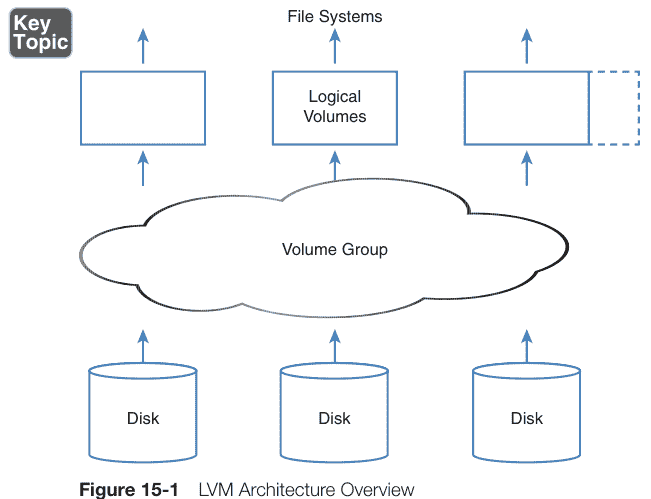

### LVM 特性

LVM 之所以优秀有几个原因。最重要的原因是 LVM 为管理存储提供了灵活的解决方案。卷不再受限于物理硬盘的限制。如果需要额外的存储空间，可以通过添加新的物理卷轻松扩展卷组，从而为逻辑卷添加磁盘空间。也可以减小逻辑卷的大小，但前提是在该卷上创建的文件系统支持缩减文件系统大小的功能。Ext4 支持扩展和缩减；XFS 的大小只能增加。

管理员喜欢使用 LVM 的另一个重要原因是支持快照。快照保留逻辑卷的当前状态，可用于恢复到以前的状态，或者在逻辑卷打开时对其上的文件系统进行备份。在备份策略中使用快照至关重要。

LVM 快照是通过将描述文件当前状态的逻辑卷管理数据复制到快照卷来创建的。只要没有更改，就会通过 LVM 快照元数据寻址原始卷中的原始块。当块被修改时，包含文件先前状态的块会被复制到快照卷中，因此快照卷会增长。使用此方法可确保通过访问 LVM 快照卷，可以访问文件在创建快照时的确切状态。因为当原始卷上的文件更改时，快照会增长，所以在规划快照时，应确保有足够的磁盘空间可用。此外，快照应该是临时的：一旦快照完成了它的使命，就可以将其删除。

使用 LVM 逻辑卷的第三个重要优势是能够轻松更换故障硬件。如果硬盘出现故障，可以在卷组内移动数据，然后将故障磁盘从卷组中移除，并动态添加新硬盘，而无需逻辑卷本身进行任何停机。

## 创建 LVM 逻辑卷

创建 LVM 逻辑卷涉及创建 LVM 架构中的三个层次。您必须首先将物理设备（如磁盘或分区）转换为物理卷；然后需要创建卷组并将物理卷分配给它。最后一步是创建逻辑卷本身。在本节中，您将了解创建这三个层次涉及哪些内容。

创建 LVM 逻辑卷存在不同的实用程序。本章重点介绍使用命令行实用程序。它们相对易于使用，并且在所有环境中都可用（无论您是否运行图形界面）。

> **提示**：对于 RHCSA 考试，您绝对不需要记住本章讨论的命令。您真正需要记住的是 `pv`、`vg` 和 `lv`。打开命令行，输入 `pv`，然后按两次 Tab 键。这将显示所有以 `pv` 开头的命令，这些都是用于管理物理卷的命令。找到所需的命令后，使用 `--help` 选项运行该命令。这将显示一个使用摘要，列出了创建所需元素必须执行的所有操作。示例 15-1 展示了 `pvcreate --help` 命令的示例（将在下一小节中解释）。

2. 以下哪项不是 LVM 特性？

   - a. 卷大小调整
   - b. 热插拔更换故障磁盘
   - c. 写时复制
   - d. 快照

3. 在 GPT 分区上，您需要哪种分区类型来将其标记为 LVM 分区类型？

   - a. `83`
   - b. `8e`
   - c. `8300`
   - d. `8e00`

4. 以下哪个命令正确展示了如何创建一个使用卷组中 50% 可用磁盘空间的逻辑卷？

   - a. `vgadd -n lvdata -l +50%FREE vgdata`
   - b. `lvcreate lvdata -l 50%FREE vgdata`
   - c. `lvcreate -n lvdata -l 50%FREE vgdata`
   - d. `lvadd -n lvdata -l 50% FREE /dev/vgdata`

5. 哪些命令显示可用物理卷的概览？（选择两个。）

   - a. `pvshow`
   - b. `pvdisplay`
   - c. `pvs`
   - d. `pvlist`

6. 关于调整 LVM 逻辑卷大小，以下哪个陈述是**不**正确的？

   - a. Ext4 文件系统可以增加和减小大小。
   - b. 使用 `lvextend` 命令的 `-r` 选项可以自动调整文件系统大小。
   - c. XFS 文件系统不能调整大小。
   - d. 要增加逻辑卷的大小，您需要在卷组中有可分配的空间。

7. 您想要从卷组 `vgdata` 中移除物理卷 `/dev/sdd2`。关于此移除过程，以下哪个陈述是**不**正确的？

   - a. 文件系统必须支持缩减。
   - b. 您需要 `/dev/sdd2` 上使用的区段数量在剩余设备上可用。
   - c. 在使用 `vgreduce` 之前，您必须将使用的区段移动到剩余的卷上。
   - d. 使用 `pvmove` 来移动使用的区段。

8. 您已经扩展了逻辑卷的大小，但没有扩展其包含的 XFS 文件系统。以下哪种解决方案可以用来修复？

   - a. 再次使用 `lvresize`，但这次带上 `-r` 选项。该命令将只调整文件系统大小。
   - b. 将逻辑卷恢复到其原始大小，然后再次使用 `lvresize -r`。
   - c. 以后使用 `fsresize` 来调整文件系统大小。
   - d. 使用 `xfs_growfs` 将文件系统扩展到逻辑卷中可用的大小。

9. Stratis 文件系统中，用于元数据存储占用了多少存储空间？

   - a. 527 MiB
   - b. 1 GiB
   - c. 4 MiB
   - d. 4 GiB

10. 以下哪行正确展示了如何通过 `/etc/fstab` 挂载 Stratis 文件系统？

   - a. `UUID=abcd /stratis xfs defaults 0 0`
   - b. `/dev/stratis/stratis1 /stratis xfs defaults,x-systemd.requires=stratis.service 0 0`
   - c. `UUID=abcd /stratis xfs defaults,x-systemd.requires=stratis.service 0 0`
   - d. `/dev/stratis/stratis1 /stratis xfs defaults 0 0`

# 第 15 章：管理高级存储

### 示例 15-1 请求 `pvcreate` 命令的帮助

```text
[root@server1 ~]# pvcreate --help
pvcreate - Initialize physical volume(s) for use by LVM

pvcreate PV ...
    [ -f|--force ]
    [ -M|--metadatatype lvm2 ]
    [ -u|--uuid String ]
    [ -Z|--zero y|n ]
    [ --dataalignment Size[k|UNIT] ]
    [ --dataalignmentoffset Size[k|UNIT] ]
    [ --bootloaderareasize Size[m|UNIT] ]
    [ --labelsector Number ]
    [ --pvmetadacopies 0|1|2 ]
    [ --metadatasize Size[m|UNIT] ]
    [ --metadataignore y|n ]
    [ --norestorefile ]
    [ --setphysicalvolumesize Size[m|UNIT] ]
    [ --reportformat basic|json ]
    [ --restorefile String ]
    [ COMMON_OPTIONS ]

Common options for lvm:
    [ -d|--debug ]
    [ -h|--help ]
    [ -q|--quiet ]
    [ -v|--verbose ]
    [ -y|--yes ]
    [ -t|--test ]
    [ --commandprofile String ]
    [ --config String ]
    [ --driverloaded y|n ]
    [ --nolocking ]
    [ --lockopt String ]
    [ --longhelp ]
    [ --profile String ]
    [ --version ]
    [ --devicesfile String ]
    [ --devices PV ]
    [ --nohints ]
    [ --journal String ]

Use --longhelp to show all options and advanced commands.
```

Humble Bundle Pearson Networking and Security Certification Bundle – © Pearson. Do Not Distribute.

## 创建物理卷

在使用 LVM 工具创建**物理卷（PV）**之前，你应该先创建一个分区并将其标记为 LVM 分区类型。这基本上与第 14 章描述的过程相同，唯一的区别是在将更改写入磁盘之前，你需要更改分区类型。

在 `fdisk` 和 `gdisk` 中，你可以使用菜单中的 `t` 来更改类型。如果你使用的是 MBR 磁盘，分区类型是 `8e`。如果你使用的是 GUID 磁盘，则使用分区类型 `8e00`。在 `fdisk` 中，你也可以直接输入 `lvm` 作为要使用的分区类型，因为 RHEL 9 版本的 `fdisk` 支持使用别名。如果你使用 `parted` 创建分区，则需要使用 `parted` 界面中的 `set n lvm on` 命令（其中 `n` 是你想要标记为用于 LVM 的分区编号）。

创建分区并将其标记为 LVM 分区类型后，你需要使用 `pvcreate` 将其标记为物理卷。这会将一些元数据写入分区，从而允许其在卷组中使用。整个过程在练习 15-1 中进行了总结，在该练习中你将创建一个物理卷。另请参阅示例 15-2 以了解此过程的概述。

### 练习 15-1 创建物理卷

要进行此练习，你需要一个具有可用（未分区）磁盘空间的硬盘。推荐的提供磁盘空间的方法是在你的虚拟机环境中添加一个新的硬盘。在本练习中，我使用一个干净的 `/dev/sdd` 设备来创建分区。你可能需要更改设备名称以匹配你的配置。

1. 打开 root shell 并输入 `fdisk /dev/sdd`。
2. 输入 `p`。这将显示当前分区表布局。此时应该没有任何分区。
3. 输入 `g` 以创建 GPT 分区表。
4. 输入 `n` 以创建一个新分区。当提示输入分区号以及第一个扇区时，按 Enter 键。
5. 当提示输入最后一个扇区时，输入 `+1G` 以创建一个 1 GiB 的分区。
6. 输入 `t` 以更改分区类型。由于此时你只有一个分区，因此该分区将被自动选中。当提示输入分区类型时，输入 `lvm`。
7. 按 `p` 键以验证分区是否已成功创建。
8. 重复此过程以创建另外三个 1 GiB 的 LVM 分区以备将来使用。
9. 按 `w` 键将新分区写入磁盘并退出 `fdisk`。
10. 使用 `lsblk` 命令验证新分区是否已成功创建。
11. 输入 `pvcreate /dev/sdd1` 以将新分区标记为 LVM 物理卷（参见示例 15-3）。
12. 输入 `pvs` 以验证物理卷是否已成功创建。

### 示例 15-2 在 `fdisk` 中创建 LVM 分区

```console
[root@server1 ~]# fdisk /dev/sdd

Welcome to fdisk (util-linux 2.37.4).
Changes will remain in memory only, until you decide to write them.
Be careful before using the write command.

Command (m for help): g
Created a new GPT disklabel (GUID:
  3BCE8E49-EFDF-9144-ACD5-290F4FCCDA07).

Command (m for help): n
Partition number (1-128, default 1):
First sector (2048-41943006, default 2048):
Last sector, +/-sectors or +/-size{K,M,G,T,P} (2048-41943006, default 41943006): +1G

Created a new partition 1 of type 'Linux filesystem' and of size 1 GiB.

Command (m for help): t
Selected partition 1
Partition type or alias (type L to list all): lvm
Changed type of partition 'Linux filesystem' to 'Linux LVM'.

Command (m for help): p
Disk /dev/sdd: 20 GiB, 21474836480 bytes, 41943040 sectors
Disk model: VMware Virtual S
Units: sectors of 1 * 512 = 512 bytes
Sector size (logical/physical): 512 bytes / 512 bytes
I/O size (minimum/optimal): 512 bytes / 512 bytes
Disklabel type: gpt
Disk identifier: 3BCE8E49-EFDF-9144-ACD5-290F4FCCDA07

Device     Start     End Sectors  Size Type
/dev/sdd1  2048 2099199 2097152    1G Linux LVM

Command (m for help): w
The partition table has been altered.
Calling ioctl() to re-read partition table.
Syncing disks.
```

### 示例 15-3 验证物理卷

```console
[root@server1 ~]# pvcreate /dev/sdd1
  Physical volume "/dev/sdd1" successfully created.
[root@server1 ~]# pvs
  PV         VG   Fmt  Attr PSize   PFree
  /dev/sda2  rhel lvm2 a--  <19.00g     0
  /dev/sdd1       lvm2 ---   1.00g  1.00g
```

除了显示物理卷及其属性摘要的 `pvs` 命令外，你还可以使用 `pvdisplay` 命令来显示更多详细信息。示例 15-4 展示了该命令的输出示例。


## 示例 15-4：`pvdisplay` 命令输出示例

```bash
[root@server1 ~]# pvdisplay /dev/sdd1
  "/dev/sdd1" is a new physical volume of "1.00 GiB"
  --- NEW Physical volume ---
  PV Name               /dev/sdd1
  VG Name               
  PV Size               1.00 GiB
  Allocatable           NO
  PE Size               0   
  Total PE              0
  Free PE               0
  Allocated PE          0
  PV UUID               cjdhpJ-bRh9-fg3B-KlPh-XQzD-unXV-ycVK36
```

如果你想获得服务器当前存储配置的简明概述，你可能也会喜欢`lsblk`命令。如示例 15-5 所示，该命令以层次结构概述了哪些磁盘和分区用于哪些 LVM 卷组和逻辑卷。

## 示例 15-5：使用`lsblk`简明概述当前存储配置

```bash
[root@server1 ~]# lsblk
NAME        MAJ:MIN RM  SIZE RO TYPE MOUNTPOINTS
sda           8:0    0   20G  0 disk
├─sda1        8:1    0    1G  0 part /boot
└─sda2        8:2    0   19G  0 part
  ├─rhel-root 253:0  0   17G  0 lvm  /
  └─rhel-swap 253:1  0    2G  0 lvm  [SWAP]
sdb           8:16   0   20G  0 disk
├─sdb1        8:17   0    1G  0 part
├─sdb2        8:18   0    1K  0 part
├─sdb5        8:21   0    1G  0 part
└─sdb6        8:22   0    1G  0 part
sdc           8:32   0   20G  0 disk
└─sdc1        8:33   0    1G  0 part /exercise
sdd           8:48   0   20G  0 disk
└─sdd1        8:49   0    1G  0 part
sr0           11:0   1    8G  0 rom  /repo
nvme0n1     259:0    0   20G  0 disk
```

### 创建卷组

现在物理卷已经创建好了，你可以将其分配给一个**卷组（VG）**。可以将物理卷添加到现有的卷组中（这将在本章后面讨论），但在这里你将学习如何创建一个新的卷组并将物理卷添加到其中。这是一个简单的单命令过程。只需输入`vgcreate`，后跟你要创建的卷组的名称和要添加到其中的物理设备的名称即可。因此，如果物理卷名称是`/dev/sdd1`，则完整命令是`vgcreate vgdata /dev/sdd1`。你可以自由选择卷组的名称。我喜欢以`vg`开头命名所有卷组，这样如果有许多卷组，就很容易找到它们，但你可以自由选择任何你喜欢的名字。

### 创建逻辑卷和文件系统

在前一节和上一段落之间，你已经了解了如何通过两步流程创建卷组：首先使用`pvcreate`命令创建物理卷，然后使用`vgcreate`命令添加卷组。你也可以使用单步流程来完成（此时无需单独使用`pvcreate`命令）。

单步流程在添加完整的磁盘设备时尤其有用。例如，如果你想添加磁盘`/dev/sdc`，只需输入`vgcreate vgdata /dev/sdc`即可创建一个包含`/dev/sdc`设备的卷组`vgdata`。当你这样操作以添加尚未标记为物理卷的设备时，`vgcreate`工具会自动将其标记为物理卷，以便你在使用`pvs`命令时可以看到它。

在创建卷组时，会使用到物理盘区大小。*物理盘区*大小定义了用于创建逻辑卷的构建块的大小。逻辑卷的大小始终是物理盘区大小的倍数。如果你需要创建巨大的逻辑卷，使用较大的物理盘区大小会更有效率。如果不指定任何内容，则默认使用 4 MiB 的盘区大小。物理盘区大小始终指定为 2 MiB 的倍数，最大为 128 MiB。请使用`vgcreate -s`选项来指定你想要使用的物理盘区大小。

> **注意** 使用 LVM 时，你需要考虑物理盘区大小。这是 LVM 配置中使用的基本构建块的大小。使用 ext4 文件系统时，则会使用到逻辑盘区。LVM 上的盘区大小与文件系统上使用的盘区大小没有任何关联。

创建卷组后，你可以使用`vgs`命令获取卷组的简短摘要，或使用`vgdisplay`命令获取更详细的信息。示例 15-6 展示了`vgdisplay`命令输出的示例。

## 示例 15-6：显示当前卷组属性

```bash
[root@server1 ~]# vgdisplay vgdata
  --- Volume group ---
  VG Name               vgdata
  System ID             
  Format                lvm2
  Metadata Areas       1
  Metadata Sequence No  1
  VG Access            read/write
  VG Status            resizable
  MAX LV               0
  Cur LV               0
  Open LV              0
  Max PV               0
  Cur PV               1
  Act PV               1
  VG Size              1020.00 MiB
  PE Size              4.00 MiB
  Total PE             255
  Alloc PE / Size      0 / 0
  Free  PE / Size      255 / 1020.00 MiB
  VG UUID              KrzkCo-QUFs-quJm-Z6pM-qMh0-ZchJ-c677c2
```

### 创建逻辑卷和文件系统

既然卷组已经创建好了，你可以开始从中创建一个或多个**逻辑卷（LVs）**。这个过程比创建物理卷或卷组稍显复杂，因为需要做出更多的选择。在创建逻辑卷时，你必须指定一个卷名称和一个大小。

卷的大小可以使用`-L`选项指定为一个绝对值。例如，使用`-L 5G`创建一个大小为 5 GiB 的 LVM 卷。或者，你可以使用`-l`选项指定相对大小。例如，使用`-l 50%FREE`来使用所有可用磁盘空间的一半。你也可以使用`-l`选项来指定逻辑卷所需的盘区数量。你还需要指定逻辑卷被分配到的卷组的名称，以及可选的（但强烈推荐）使用`-n`来指定逻辑卷的名称。例如，使用`lvcreate -n lvdata -l 100 vgdata`来创建一个名为`lvdata`、大小为 100 个盘区的逻辑卷，并将其添加到`vgdata`卷组中。逻辑卷创建完成后，你可以使用`mkfs`工具在其上创建文件系统。

### 理解 LVM 设备命名

现在逻辑卷已经创建好了，你可以开始使用它了。为此，你需要知道设备名称。LVM 卷设备名称可以通过多种方式来寻址。简单的方法是将设备寻址为`/dev/vgname/lvname`。

所以，例如，如果你创建了一个名为`lvdata`的卷，它从`vgdata`卷组获取可用的磁盘空间，那么设备名称就是`/dev/vgdata/lvdata`，这实际上是一个指向设备映射器名称的符号链接（接下来会解释）。

对于 LVM 卷的命名，另一个系统也起着作用：设备映射器。***设备映射器***（简称 dm）是 Linux 内核用来寻址存储设备的一个通用接口。设备映射器被多种设备类型使用，例如 LVM 卷，但也被软件 RAID 和高级网络存储设备（如多路径设备）使用。

设备映射器设备在检测时生成，并使用在启动时生成的名称，如`/dev/dm-0`和`/dev/dm-1`。为了使这些设备更容易访问，设备映射器在`/dev/mapper`目录中创建指向这些无意义设备名称的符号链接。符号链接遵循命名结构`/dev/mapper/vgname-lvname`。

所以，设备`/dev/vgdata/lvdata`也会被称为`/dev/mapper/vgdata-lvdata`。在使用 LVM 逻辑卷时，你可以使用这两种设备名称中的任何一种。示例 15-7 展示了由设备映射器提供的不同 LVM 设备名称的概述。在练习 15-2 中，你将学习如何创建卷组和逻辑卷。

## 示例 15-7：LVM 设备名称概述

```bash
[root@server1 ~]# ls -l /dev/mapper/vgdata-lvdata /dev/vgdata/lvdata
lrwxrwxrwx. 1 root root 7 Sep 16 11:34 /dev/mapper/vgdata-lvdata -> ../dm-2
lrwxrwxrwx. 1 root root 7 Sep 16 11:34 /dev/vgdata/lvdata -> ../dm-2
```

## 练习 15-2：创建卷组和逻辑卷

在练习 15-1 中，你创建了一个物理卷。在本练习中，你将继续操作该物理卷，并将其分配给一个卷组。然后你从该卷组中添加一个逻辑卷。只有在成功完成练习 15-1 后，你才能进行此练习。

1. 打开一个 root shell。输入`pvs`以验证你机器上物理卷的可用性。你应该能看到之前创建的`/dev/sdd1`物理卷。
2. 输入`vgcreate vgdata /dev/sdd1`。这将创建一个卷组，并将物理卷分配给它。
3. 输入`vgs`以验证卷组是否创建成功。同时输入`pvs`。注意此命令现在显示了物理卷的名称及其被分配到的卷组名称。
4. 输入`lvcreate -n lvdata -l 50%FREE vgdata`。这会创建一个名为`lvdata`的 LVM 逻辑卷，它将使用`vgdata`卷组中 50% 的可用磁盘空间。
5. 输入`lvs`以验证卷是否添加成功。
6. 此时，你已经准备好在逻辑卷上创建文件系统了。输入`mkfs.ext4 /dev/vgdata/lvdata`来创建文件系统。
7. 输入`mkdir /files`来创建一个用于挂载该卷的文件夹。
8. 在`/etc/fstab`的底部添加以下行：

   `/dev/vgdata/lvdata /files ext4 defaults 0 0`

9. 输入`mount -a`以验证挂载是否正常工作并挂载文件系统。
10. 使用`lsblk`来验证分区是否挂载成功。

表 15-2 总结了创建逻辑卷的相关命令。

## 表 15-2：LVM 管理基本命令

| 命令 | 说明 |
|:---|:---|
| `pvcreate` | 创建物理卷 |
| `pvs` | 显示可用物理卷的摘要 |
| `pvdisplay` | 显示物理卷列表及其属性 |
| `pvremove` | 从块设备中移除物理卷签名 |
| `vgcreate` | 创建卷组 |
| `vgs` | 显示可用卷组的摘要 |
| `vgdisplay` | 显示卷组的详细列表及其属性 |
| `vgremove` | 移除卷组 |
| `lvcreate` | 创建逻辑卷 |
| `lvs` | 显示所有可用逻辑卷的摘要 |
| `lvdisplay` | 显示可用逻辑卷的详细列表及其属性 |
| `lvremove` | 移除逻辑卷 |

### 调整 LVM 逻辑卷大小

使用 LVM 的主要优势之一是 LVM 卷可以轻松调整大小，这在文件系统可用磁盘空间不足时非常有用。如果使用 XFS 文件系统，卷可以扩大，但不能缩小。其他文件系统如 Ext4 还支持缩小文件系统大小。你只能在 Ext4 文件系统离线状态下缩小其大小，这意味着你需要先卸载它，然后才能调整大小。在本节中，你将学习如何增大 LVM 逻辑卷的大小。要增大逻辑卷的大小，你需要在卷组中有可用的磁盘空间，因此我们首先讨论这一点。

#### 调整卷组大小

LVM 灵活性最重要的特点在于，调整卷组以及使用卷组磁盘空间的逻辑卷的大小非常容易。`vgextend`命令用于向卷组添加存储，`vgreduce`命令用于将物理卷从卷组中移除。向卷组添加存储的过程相对简单：

1. 确保有可用的物理卷或设备可以添加到卷组中。
2. 使用`vgextend`扩展卷组。新的磁盘空间将立即显示在卷组中。

扩展卷组后，你可以使用`vgs`命令验证物理卷是否已添加到卷组中。在示例 15-8 中，你可以看到`vgdata` VG 包含两个物理卷，如`#PV`列所示。

**示例 15-8** 使用`vgs`验证 VG 调整操作

```bash
[root@server1 ~]# vgs
  VG     #PV #LV #SN Attr   VSize   VFree
  centos   1   2   0 wz--n- <19.00g    0
  vgdata   2   1   0 wz--n- 1020.00m 512.00m
```

#### 调整逻辑卷和文件系统大小

就像卷组可以使用`vgextend`命令进行扩展一样，逻辑卷可以使用`lvextend`命令进行扩展。该命令有一个非常有用的选项`-r`，可以在扩展逻辑卷的同时自动处理逻辑卷上文件系统的扩展；建议使用此选项，而不是分别扩展逻辑卷和其上文件系统的替代方法。大多数文件系统调整大小的操作都可以在线完成，只要文件系统需要扩展而无需卸载。

要增大逻辑卷大小，请使用`lvextend`或`lvresize`，后跟`-r`选项来同时调整其上使用的文件系统大小。然后指定你希望调整后的卷的大小。最简单和最直观的方法是使用`-L`后跟一个加号和要添加的磁盘空间量，如`lvresize -L +1G -r /dev/vgdata/lvdata`。调整逻辑卷大小的另一种方法是使用`-l`选项。此选项后面可以跟添加到逻辑卷的区段数量，或者跟卷组中将被使用的区段的绝对或相对百分比。例如，你可以使用以下命令来调整逻辑卷大小：

- `lvresize -r -l 75%VG /dev/vgdata/lvdata`将逻辑卷调整为占用卷组总磁盘空间的 75%。请注意，如果当前逻辑卷已使用超过卷组磁盘空间的 75%，此命令将尝试缩小逻辑卷大小！
- `lvresize -r -l +75%VG /dev/vgdata/lvdata`尝试将卷组总大小的 75% 添加到逻辑卷中。这仅在当前卷组至少有 75% 未使用时才有效。（注意与上一条命令的区别。）
- `lvresize -r -l +75%FREE /dev/vgdata/lvdata`将所有可用磁盘空间的 75% 添加到逻辑卷中。
- `lvresize -r -l 75%FREE /dev/vgdata/lvdata`将逻辑卷调整为等于可用磁盘空间量 75% 的总大小，这可能导致尝试缩小逻辑卷大小。（注意与上一条命令的区别。）

*逻辑区段*是创建逻辑卷时使用的基本逻辑构建块，它映射到物理区段，物理区段的大小可以在创建卷组时指定。所有调整大小操作都必须匹配完整的逻辑区段。你有时会注意到调整大小会向上或向下取整到逻辑区段大小。你也可以通过在`lvresize`命令中使用`-l`选项直接指定需要添加或移除的逻辑区段数量。

如你所见，调整逻辑卷大小有很多选项，你需要注意使用正确的选项，因为很容易出错！在练习 15-3 中，你将学习如何调整逻辑卷及其上使用的文件系统的大小。

> **注意** XFS 文件系统的大小无法缩小，只能增大。如果你需要一个可以缩小大小的文件系统，请使用 Ext4，而不是 XFS。

#### 练习 15-3：调整逻辑卷大小

在练习 15-1 和 15-2 中，你创建了一个物理卷、卷组和逻辑卷。在本练习中，你将扩展逻辑卷及其上使用的文件系统的大小。

1. 输入`pvs`和`vgs`显示当前的物理卷和卷组配置。
2. 使用`lsblk`验证你有一个可用的未使用分区可以添加到卷组中。在练习 15-1 中，你为此目的创建了分区`/dev/sdd2`。
3. 输入`vgextend vgdata /dev/sdd2`使用`/dev/sdd2`设备的全部大小扩展`vgdata`。
4. 输入`vgs`验证可用卷组大小已增加。
5. 输入`lvs`验证逻辑卷`lvdata`的当前大小。
6. 输入`df -h`验证`lvdata`上文件系统的当前大小。
7. 输入`lvextend -r -l +50%FREE /dev/vgdata/lvdata`使用卷组中所有可用磁盘空间的 50% 扩展`lvdata`。
8. 再次输入`lvs`和`df -h`验证添加的磁盘空间已可用。

### 缩小卷组


如果一个卷组由多个 PV 组成，当剩余 PV 有足够的空闲空间来分配当前使用的区段时，可以从 VG 中移除一个 PV。如果剩余 PV 已被完全使用，则此过程将无法进行。从 VG 中移除 PV 是一个两步过程。首先，使用`pvmove`将要移除的 PV 上已使用的区段移动到任何剩余的卷上。接下来，使用`vgreduce`完成 PV 移除。在练习 15-4 中你可以进行练习。

### 练习 15-4：从 PV 中移除 VG

1. 使用`fdisk`创建两个大小各为 2 GiB 的分区，并将类型设置为`lvm`。在本练习的剩余部分，我假设你使用分区`/dev/sdd3`和`/dev/sdd4`来完成此操作。
2. 使用`vgcreate vgdemo /dev/sdd3`创建一个卷组。
3. 输入`lvcreate -L 1G -n lvdemo /dev/vgdemo`创建一个大小为 1 GiB 的逻辑卷。请注意，务必不要使用所有可用的磁盘空间！
4. 输入`vgextend vgdemo /dev/sdd4`扩展卷组。
5. 使用`pvs`验证`/dev/sdd3`和`/dev/sdd4`上的区段使用情况。你应该看到`sdd3`大约使用了其一半的区段，而`/dev/sdd4`上的所有区段仍未被使用。
6. 现在输入`lvextend -L +500M /dev/vgdemo/lvdemo /dev/sdd4`来增大`lvdemo`逻辑卷。请注意，你必须添加`/dev/sdd4`以确保空闲区段将从`sdd4`设备中分配。
7. 输入`pvs`验证设备上当前的区段使用情况。
8. 使用`mkfs.ext4 /dev/vgdemo/lvdemo`创建文件系统。
9. 使用`mount /dev/vgdemo/lvdemo /mnt`临时挂载逻辑卷。
10. 使用`df -h`验证磁盘空间使用情况。
11. 使用`dd if=/dev/zero of=/mnt/bigfile bs=1M count=1100`。此大小确保文件数据分布在两个 PV 上。
12. 现在你可以准备移除`sdd4`。第一步，你需要将其使用的所有区段移动到`sdd3`的未使用区段上。输入以下命令执行此操作：`pvmove -v /dev/sdd4 /dev/sdd3`。这可能需要一两分钟才能完成。
13. 输入`pvs`，它将显示`/dev/sdd4`现在未被使用。
14. 此时你可以使用`vgreduce vgdemo /dev/sdd4`移除未使用的物理卷。

### 配置 Stratis

在 RHEL 9 中，Red Hat 提供 Stratis 作为高级存储解决方案。`Stratis` 是一种所谓的*卷管理文件系统*，它引入了 RHEL 8 之前不可用的高级存储功能。Red Hat 旨在以此提供替代其他环境中使用的 Btrfs 和 ZFS 文件系统的选择。Stratis 提供以下功能：

- **精简配置：**此功能使 Stratis 文件系统向用户呈现时比实际大小大得多。这在许多环境中非常有用，例如虚拟桌面，在这种情况下，每个用户可能总共看到 20 GiB 的可用存储空间，但实际分配给每个用户的数量要低得多。
- **快照：**Stratis **快照**允许用户拍摄文件系统当前状态的“图片”。此快照使得轻松恢复到文件系统的先前状态变得容易，回滚任何已进行的更改。
- **缓存层：**缓存层是 Ceph 存储的一项功能，可确保存储在物理上更靠近 Ceph 客户端，从而加快数据访问速度。
- **编程 API：**编程 API 确保存储可以通过 API 访问轻松地进行配置和修改。这在云环境中尤其有价值，因为直接从云原生应用程序设置存储极其有用。
- **监控与修复：**旧的文件系统需要像`fsck`这样的工具来验证文件系统的完整性，而 Stratis 具有内置功能来监控文件系统的健康状况，并在必要时进行修复。

#### 理解 Stratis 架构

Stratis 架构的最底层是*池*。从功能角度看，Stratis 池类似于 LVM 卷组。一个池代表所有可用存储，由一个或多个存储设备组成，在 Stratis 环境中被称为`blockdev`。这些块设备在底层硬件级别可能不是精简配置的。Stratis 为每个池创建一个`/dev/stratis/poolname`目录。

从 Stratis 池中，创建 XFS 文件系统。请注意，Stratis 仅与 XFS 一起工作，并且它使用的 XFS 文件系统与 Stratis 卷集成在一起。创建文件系统时，不指定大小，每个文件系统可以增长到池中所有可用存储空间的大小。Stratis 文件系统始终是精简配置的。当更多数据添加到文件系统时，精简卷会自动增长。

#### 创建 Stratis 存储

创建 Stratis 卷是一个多步骤的过程。本节提供一个高层次的概述，然后下一节的练习 15-5 将指导你完成整个过程。首先创建一个池。添加池后，你可以从中创建文件系统。在开始之前，请确保要在 Stratis 中使用的块设备的大小至少为 5 GiB。每个 Stratis 文件系统即使没有数据复制到文件系统，也至少占用 527 MiB 的磁盘空间。

1. 使用`dnf`安装`stratis-cli`和`stratisd`包来安装 Stratis 软件。
2. 启动并启用用户空间守护进程，使用`systemctl enable --now stratisd`。
3. 一旦守护进程运行，使用`stratis pool create`命令创建你要使用的池。例如，使用`stratis pool create mypool /dev/sdd`创建一个基于块设备`/dev/sdd`的池。你可以稍后使用`stratis pool add-data pool-name blockdevname`添加额外的块设备，如`stratis pool add-data mypool /dev/sde`。
4. 创建池后，使用`stratis fs create pool-name fsname`添加一个文件系统。
5. 要验证所有操作是否成功完成，请使用`stratis fs list`命令。
6. 创建文件系统后，你可以挂载它。要通过`/etc/fstab`挂载 Stratis 文件系统，你*必须*使用 UUID；不支持使用设备名称。此外，通过`/etc/fstab`挂载 Stratis 卷时，请包含挂载选项`x-systemd.requires=stratisd.service`，以确保 Systemd 在加载 `stratisd` 服务之前不会激活此设备。没有此选项，你将无法启动系统。

#### 管理 Stratis

创建 Stratis 文件系统后，你可以执行多种不同的管理任务。首先，你可以使用`stratis pool add-data`动态扩展池。此外，你需要使用 Stratis 特定的工具来监控 Stratis 卷，因为传统的 Linux 工具无法处理精简配置的卷。以下命令可用：

- `stratis blockdev`：显示有关用于 Stratis 的所有块设备的信息。
- `stratis pool`：提供有关 Stratis 池的信息。特别注意 Physical Used 参数，它不应过于接近 Physical Size 参数。
- `stratis filesystem`：使你能够监控单个文件系统。

你可能想要管理的另一个 Stratis 功能是快照。快照包含创建快照时文件系统的状态。创建后，可以修改快照。同样需要知道的是，快照与其源文件系统没有链接，这允许快照比创建它的文件系统生存得更久。这与（例如）LVM 快照根本不同，如果它们链接的卷被删除，LVM 快照就无法存活。

在练习 15-5 中，你将设置一个包含 Stratis 卷的环境。

### 练习 15-5：管理 Stratis 卷

你需要一个至少 5 GiB 大小的专用磁盘来执行此练习中的步骤。在此练习中，磁盘名称`/dev/sde`仅用作示例。请将此名称替换为你的硬件上显示的磁盘设备名称。

1. 键入`dnf install stratisd stratis-cli`安装所有必需的软件包。
2. 键入`systemctl enable --now stratisd`启用 Stratis 守护进程。
3. 键入`stratis pool create mypool /dev/sde`将整个磁盘`/dev/sde`添加到存储池。
4. 键入`stratis pool list`验证池是否成功创建。
5. 键入`stratis fs create mypool stratis1`创建第一个 Stratis 文件系统。注意，你不必指定文件系统大小。
6. 键入`stratis fs list`验证文件系统的创建。
7. 键入`mkdir /stratis1`为 Stratis 文件系统创建一个挂载点。
8. 键入`stratis fs list`查找 Stratis 卷的 UUID。
9. 将以下行添加到`/etc/fstab`以启用卷的自动挂载。确保使用你的 Stratis 文件系统使用的 UUID 名称。

```fstab
UUID=xxx /stratis1 xfs defaults,x-systemd.requires=stratisd.service 0 0
```

10. 键入`mount -a`挂载 Stratis 卷。使用`mount`命令验证此过程是否成功完成。
11. 键入`cp /etc/[a-f]* /stratis1`将一些文件复制到 Stratis 卷。
12. 键入`stratis filesystem snapshot mypool stratis1 stratis1-snap`为你刚刚创建的卷创建一个快照。请注意，此命令可能需要最多一分钟才能完成。
13. 键入`stratis filesystem list`获取当前文件系统使用情况的统计信息。
14. 键入`rm -f /stratis1/a*`删除所有名称以`a`开头的文件。
15. 键入`mount /dev/stratis/mypool/stratis1-snap /mnt`并验证名称以`a`开头的文件在`/mnt`目录中仍然可用。
16. 重新启动你的服务器。重启后，验证 Stratis 卷是否仍然自动挂载。

### 总结

在本章中，你学习了如何在 RHEL 9 上使用高级存储。首先，你阅读了如何使用 LVM 为存储带来灵活性。通过使用 LVM，你可以获得可以轻松调整大小的卷和多设备逻辑卷的优势。接下来，你了解了 Stratis，这个卷管理文件系统。Stratis 为 RHEL 9 带来了下一代存储功能，并默认创建精简配置的文件系统。

### 考试准备任务

正如引言中“如何使用本书”部分所述，你有多种考试准备选择：章节末的实验；附录 C 中的记忆表；第 27 章“最终准备”；以及模拟考试。

#### 复习所有关键主题

复习本章中最重要的主题，这些主题在页边距中用“关键主题”图标标记。表 15-3 列出了这些关键主题的参考及其所在页码。

表 15-3 第 15 章关键主题

| 关键主题元素 | 描述 | 页码 |
| --- | --- | --- |
| 图 15-1 | LVM 架构概述 | 347 |
| 表 15-2 | LVM 管理基本命令 | 357 |
| 列表 | LVM `lvresize` 命令 | 359 |

#### 从记忆中完成表格和列表

打印附录 C“记忆表”（可在随书网站上找到）的副本，或至少打印本章的部分，并从记忆中完成表格和列表。附录 D“记忆表答案”包含了完成的表格和列表以供你检查。

#### 定义关键术语

定义本章中的以下关键术语，并在术语表中检查你的答案：

快照、物理卷 (PV)、卷组 (VG)、物理范围、逻辑卷 (LV)、设备映射器、逻辑范围、Stratis

#### 复习题

以下问题旨在帮助你测试对概念和术语的掌握程度以及知识的广度。你可以在附录A中找到这些问题的答案。

1. 在需要用于 LVM 的 GUID 分区上使用哪种分区类型？
2. 哪个命令可以让你创建一个名为`vgroup`的卷组，该卷组包含物理设备`/dev/sdb3`并使用 4 MiB 的物理区域大小？
3. 哪个命令可以显示系统上物理卷的简要摘要以及这些物理卷所属的卷组？
4. 要将整个硬盘`/dev/sdd`添加到卷组`vgroup`中，你需要做什么？
5. 哪个命令可以让你创建一个大小为 6 MiB 的逻辑卷`lvvol1`？
6. 假设卷组中有可用的磁盘空间，哪个命令可以让你向逻辑卷`lvvol1`添加 100 MB 的空间？
7. 哪两个命令用于从卷组中移除物理卷？
8. 使用 Stratis 时，你需要在`/etc/fstab`中添加哪一行来挂载 Stratis 卷？
9. 你使用哪个命令来创建一个基于块设备`/dev/sdd`的 Stratis 池？
10. 你如何为 Stratis 卷格式化 Ext4 文件系统？

### 章末实验

要完成以下章末实验，你需要一个专用的磁盘设备。请在开始前使用 USB 拇指驱动器或为你的虚拟环境添加一个新的虚拟磁盘。

#### 实验 15.1

1. 创建一个名为`lvgroup`的 500 MB 逻辑卷。使用 XFS 文件系统格式化它，并将其永久挂载到`/groups`。重启你的服务器以验证挂载是否正常工作。
2. 重启后，向你刚创建的`lvgroup`卷再添加 250 MB 空间。验证在调整卷大小的同时，文件系统也进行了扩展。
3. 验证卷扩展是否成功。

#### 实验 15.2

1. 创建一个大小为 5 GiB 的 Stratis 池。在此池中，创建两个 Stratis 文件系统，并确保它们能自动挂载。
2. 向 Stratis 池添加一个额外的块设备，并验证池的大小是否已成功扩展。
3. 确保新的 Stratis 设备在重启时自动挂载到目录`/stratis`。

---

**本章涵盖以下主题：**

- 理解 Linux 内核的作用
- 使用内核模块
- 升级 Linux 内核

---

# 第 16 章：基本内核管理

Linux 内核是 Linux 操作系统的核心。它负责处理许多事务，包括硬件管理。在本章中，你将从 RHCSA（红帽认证系统管理员）的角度学习所有关于 Linux 内核的知识。事实上，你甚至会学到更多。本章涵盖的主题*不*包含在当前的 RHCSA 考试目标中，但任何认真的 Linux 管理员都应该能够处理与内核相关的问题，因此我在本章中进行了讲解。

## “我已掌握此知识吗？”小测验

“我已掌握此知识吗？”小测验使你能够评估是否应该彻底阅读本章，还是直接跳转到“备考任务”部分。如果你对这些问题的答案或自己对相关主题知识的评估有疑问，请阅读整个章节。表 16-1 列出了本章的主要标题及其对应的“我已掌握此知识吗？”小测验问题。你可以在附录 A“‘我已掌握此知识吗？’小测验和复习题答案”中找到答案。

**表 16-1** “我已掌握此知识吗？”章节-问题映射

| 基础主题章节 | 问题 |
| --- | --- |
| 理解 Linux 内核的作用 | 1–4 |
| 使用内核模块 | 5–9 |
| 升级 Linux 内核 | 10 |

1. 什么会导致内核被标记为“tainted”（受污染）？
   - a. 一个没有开源驱动程序可用的内核驱动
   - b. 一个为其他操作系统开发但已移植到 Linux 的驱动
   - c. 一个已失败的驱动
   - d. 一个不受支持的驱动

2. 哪个命令显示自启动以来的内核事件？
   - a. `logger`
   - b. `dmesg`
   - c. `klogd`
   - d. `journald`

3. 哪个命令使你能够找到正在使用的内核的实际版本？
   - a. `uname -r`
   - b. `uname -v`
   - c. `procinfo -k`
   - d. `procinfo -l`

4. 哪个命令显示你正在使用的 RHEL 的当前版本？
   - a. `uname -r`
   - b. `cat /proc/rhel-version`
   - c. `cat /etc/redhat-release`
   - d. `uname -k`

5. 帮助内核正确初始化硬件设备的进程叫什么？
   - a. `systemd-udevd`
   - b. `hwinit`
   - c. `udev`
   - d. `udevd`

6. 你的系统在哪里找到用于初始化新硬件设备的默认规则？
   - a. `/etc/udev/rules.d`
   - b. `/usr/lib/udev/rules.d`
   - c. `/usr/lib/udev.d/rules`
   - d. `/etc/udev.d/rules`

7. 你应该使用哪个命令来卸载内核模块，包括其所有依赖项？
   - a. `rmmod`
   - b. `insmod -r`
   - c. `modprobe -r`
   - d. `modprobe`

8. 哪个命令使你能够查看为服务器中的硬件加载了哪些适当的内核模块？
   - a. `lsmod`
   - b. `modprobe -l`
   - c. `lspci -k`
   - d. `lspci`

9. 你在哪里指定内核模块参数以使其持久化？
   - a. `/etc/modules.conf`
   - b. `/etc/modprobe.conf`
   - c. `/etc/modprobe.d/somefilename`
   - d. `/usr/lib/modprobe.d/somefilename`


## 10. 关于更新内核，以下哪些陈述是**不正确**的？

a. `dnf update kernel` 命令将安装一个新内核，而不是更新它。

b. `dnf install kernel` 命令将安装一个新内核，并保留旧内核。

c. 内核包应设置为 `dnf` 保护包，以确保更新后旧内核仍然可用。

d. 安装新的内核版本后，你必须运行 `grub2-mkconfig` 命令来修改 GRUB 2 启动菜单，使其显示旧内核和新安装的内核。

# 基础主题

## 理解 Linux 内核的作用

Linux 内核是操作系统的核心。它是在通过 shell 环境使用 Linux 的用户和计算机中可用硬件之间的一层。*内核*管理它从软件接收到的 I/O 指令，并将它们转换为由计算机中的中央处理器和其他硬件执行的处理指令。内核还负责处理基本的操作系统任务。此类任务的一个例子是调度器，它确保操作系统上启动的任何进程都由 CPU 处理。

## 理解内核线程和驱动程序的使用

由内核执行的操作系统任务由不同的内核线程实现。使用像 `ps aux` 这样的命令可以轻松识别内核线程。内核线程名称列在方括号内（参见示例 16-1）。

### 示例 16-1 使用 `ps aux` 列出内核线程

```text
[root@server1 ~]# ps aux | head -n 20
USER       PID %CPU %MEM    VSZ   RSS TTY      STAT START   TIME COMMAND
root         1  1.8  0.6  52980  6812 ?        Ss   11:44   0:02 /usr/lib/systemd/systemd --switched-root --system --deserialize 23
root         2  0.0  0.0      0     0 ?        S    11:44   0:00 [kthreadd]
root         3  0.0  0.0      0     0 ?        S    11:44   0:00 [ksoftirqd/0]
root         4  0.0  0.0      0     0 ?        S    11:44   0:00 [kworker/0:0]
root         5  0.0  0.0      0     0 ?        S<   11:44   0:00 [kworker/0:0H]
root         6  0.0  0.0      0     0 ?        S    11:44   0:00 [kworker/u128:0]
root         7  0.1  0.0      0     0 ?        S    11:44   0:00 [migration/0]
root         8  0.0  0.0      0     0 ?        S    11:44   0:00 [rcu_bh]
root         9  0.0  0.0      0     0 ?        S    11:44   0:00 [rcuob/0]
root        10  0.0  0.0      0     0 ?        S    11:44   0:00 [rcuob/1]
root        11  0.0  0.0      0     0 ?        S    11:44   0:00 [rcuob/2]
root        12  0.0  0.0      0     0 ?        S    11:44   0:00 [rcuob/3]
root        13  0.0  0.0      0     0 ?        S    11:44   0:00 [rcuob/4]
root        14  0.0  0.0      0     0 ?        S    11:44   0:00 [rcuob/5]
root        15  0.0  0.0      0     0 ?        S    11:44   0:00 [rcuob/6]
root        16  0.0  0.0      0     0 ?        S    11:44   0:00 [rcuob/7]
root        17  0.0  0.0      0     0 ?        S    11:44   0:00 [rcuob/8]
root        18  0.0  0.0      0     0 ?        S    11:44   0:00 [rcuob/9]
root        19  0.0  0.0      0     0 ?        S    11:44   0:00 [rcuob/10]
```

Linux 内核的另一项重要任务是硬件初始化。为了确保硬件能够正常工作，Linux 内核使用驱动程序。每种硬件都包含特定的功能特性，要使用这些特性，就必须加载相应的驱动程序。Linux 内核是模块化的，驱动程序以内核模块的形式加载，你将在本章后续内容中了解更多相关信息。

在某些情况下，驱动程序的可用性是一个问题，因为硬件制造商并不总是愿意提供能够与 Linux 内核良好集成的开源驱动程序。这可能导致驱动程序无法提供硬件的全部功能。

如果制造商不愿意提供开源驱动程序，另一种方式是使用闭源驱动程序。虽然闭源驱动程序使得在 Linux 中使用硬件成为可能，但这种方案并不理想。因为驱动程序在内核空间中执行特权指令，一个存在缺陷的驱动程序可能会导致整个内核崩溃。如果问题出现在开源驱动程序上，Linux 内核社区可以帮助调试并确保问题得到修复。如果问题出现在闭源驱动程序上，Linux 内核社区则无能为力。但是，专有驱动程序可能会提供其开源等效版本所不具备的功能。

为了便于判断一个内核是否使用了闭源驱动程序，引入了“污染内核”的概念。*污染内核*是指包含闭源驱动程序的内核。污染内核的概念有助于排查驱动程序问题。如果你的 RHEL 内核被标记为受污染，Red Hat 支持团队可以将其识别为污染内核，并确认是哪个驱动程序导致了污染。为了解决问题，Red Hat 可能会要求你移除导致内核受污染的驱动程序。

## 分析内核的运行情况

为了帮助分析内核的运行情况，Linux 操作系统提供了一些工具：

- `dmesg` 实用程序
- `/proc` 文件系统
- `uname` 实用程序

如果你需要关于内核活动的详细信息，首先应该考虑使用的工具是 `dmesg`。该实用程序显示内核环形缓冲区的内容，这是 Linux 内核用于存储其最近日志消息的一块内存区域。获取内核环形缓冲区中相同信息的另一种方法是使用 `journalctl --dmesg` 命令，该命令等同于 `journalctl -k`。在示例 16-2 中，你可以看到 `dmesg` 命令的部分输出结果。

### 示例 16-2 使用 `dmesg` 分析内核活动

```text
[   8.153928] sd 0:0:0:0: Attached scsi generic sg0 type 0
[   8.154289] sd 0:0:1:0: Attached scsi generic sg1 type 0
[   8.154330] sd 0:0:2:0: Attached scsi generic sg2 type 0
[   8.154360] sd 0:0:3:0: Attached scsi generic sg3 type 0
[   8.154421] sr 4:0:0:0: Attached scsi generic sg4 type 5
[   8.729016] ip_tables: (C) 2000-2006 Netfilter Core Team
[   8.850599] nf_conntrack version 0.5.0 (7897 buckets, 31588 max)
[   8.939613] ip6_tables: (C) 2000-2006 Netfilter Core Team
[   9.160092] Ebtables v2.0 registered
[   9.203710] Bridge firewalling registered
[   9.586603] IPv6: ADDRCONF(NETDEV_UP): eno16777736: link is not ready
[   9.587520] e1000: eno16777736 NIC Link is Up 1000 Mbps Full Duplex, Flow Control: None
[   9.589066] IPv6: ADDRCONF(NETDEV_CHANGE): eno16777736: link becomes ready
[  10.689365] Rounding down aligned max_sectors from 4294967295 to 4294967288
[  5158.470480] Adjusting tsc more than 11% (6940512 vs 6913395)
[21766.132181] e1000: eno16777736 NIC Link is Down
[21770.391597] e1000: eno16777736 NIC Link is Up 1000 Mbps Full Duplex, Flow Control: None
[21780.434547] e1000: eno16777736 NIC Link is Down
```

在 `dmesg` 的输出中，显示了所有与内核相关的信息。每条信息都以时间指示器开头，表明事件被记录时的具体秒数。这个时间指示器是相对于内核启动时刻的，让你能够准确地看到从内核启动到某个特定事件之间经过了多少秒。（请注意，`journalctl -k` 和 `journalctl --dmesg` 命令显示的是时钟时间，而不是相对于内核启动的时间。）这个时间指示器清楚地表明了发生了什么事情以及发生的时间。

另一个有价值的信息来源是 `/proc` 文件系统。*/proc* 文件系统是与 Linux 内核交互的一个接口，其中包含有关服务器上正在发生的事情的详细状态信息文件。许多与性能相关的工具都从 `/proc` 文件系统中获取更多信息。

作为系统管理员，你会发现 `/proc` 中的某些文件非常易读，其中包含有关 CPU、内存、挂载点等方面的状态信息。例如，看看 `/proc/meminfo`，它提供了关于每个内存段的详细信息以及这些内存段中具体发生了什么。

最后一个有用的信息来源是 `uname` 命令。该命令可以提供关于操作系统的各类信息。例如，输入 `uname -a` 可以查看所有相关参数的概览，或输入 `uname -r` 可以查看当前使用的内核版本。这些信息在你使用 `hostnamectl status` 命令时也会显示出来，该命令还会显示一些有用的附加信息（参见示例 16-3）。

> **提示**：在某些情况下，你可能需要了解所使用的 RHEL 版本的具体信息。要获取该信息，请运行 `cat /etc/redhat-release` 命令并查看其输出；它会告诉你正在使用哪个 Red Hat 版本以及应用了哪个更新级别。

### 示例 16-3 获取更多系统信息

```text
[root@server1 ~]# hostnamectl status
Static hostname: server1.example.com
      Icon name: computer-vm
        Chassis: vm
     Machine ID: d04b1233036748edbcf73adc926c98e3
        Boot ID: 21e4e2e53648413dbe7975f64f570e51
Virtualization: vmware
Operating System: Red Hat Enterprise Linux 9.0 (Plow)
     CPE OS Name: cpe:/o:redhat:enterprise_linux:9::baseos
          Kernel: Linux 5.14.0-70.13.1.el9_0.x86_64
    Architecture: x86-64
 Hardware Vendor: VMware, Inc.
  Hardware Model: VMware Virtual Platform
```

## 使用内核模块

在 Linux 的早期时代，内核必须编译进所有支持计算机硬件所需的驱动程序。其他特定的功能也需要编译到内核中。自 1996 年 Linux 内核 2.0 发布以来，内核不再以单一编译方式构建，而是采用了模块化设计。模块化内核由一个相对较小的核心内核组成，并通过在需要时加载的*模块*来提供驱动程序支持。模块化内核非常高效，因为它们只包含真正需要的模块。

> **提示**：内核模块实现了特定的内核功能。内核模块用于加载驱动程序，以实现与硬件设备的正常通信，但不仅限于加载硬件驱动程序。例如，文件系统支持也是以模块形式加载的。其他内核功能也可以作为模块加载。

### 理解硬件初始化

驱动程序的加载是一个自动化过程，大致流程如下：

1. 在启动过程中，内核会探测可用的硬件。
2. 检测到硬件组件后，`systemd-udevd` 进程负责加载相应的驱动程序并使硬件设备可用。
3. 为了决定如何初始化设备，`systemd-udevd` 会读取 `/usr/lib/udev/rules.d` 中的规则文件。这些是系统提供的规则文件，不应被修改。
4. 处理完系统提供的 udev 规则文件后，`systemd-udevd` 会转到 `/etc/udev/rules.d` 目录，读取任何自定义规则（如果存在的话）。
5. 作为结果，所需的内核模块会自动加载，并且内核模块和相关硬件的状态信息会写入 sysfs 文件系统，该系统挂载在 `/sys` 目录上。Linux 内核使用这个伪文件系统来跟踪与硬件相关的设置。

`systemd-udevd` 进程不是一次性运行的；它会持续监控新硬件设备的插拔。为了了解其工作方式，你可以以 root 身份输入命令 `udevadm monitor`。它会列出激活新硬件设备过程中处理的所有事件。例如，如果在此命令运行时插入 USB 设备，你就可以看到具体发生了什么。按 Ctrl-C 关闭 `udevadm monitor` 输出。

示例 16-4 显示了 `udevadm monitor` 命令的输出。通过该命令，你可以看到硬件提供的功能是如何由内核和 systemd-udevd 协同工作来自动发现的。硬件探测的每个阶段都以在 `/sys` 文件系统中创建文件为结束。一旦硬件被完全初始化，你还可以看到一些内核模块已被加载。

> **注意**：虽然了解硬件初始化很有用，但它不包含在当前 RHCSA 考试目标中。

# 第 16 章：内核基础管理

### 示例 16-4：`udevadm monitor` 命令的输出


```bash
[root@server2 ~]# udevadm monitor
monitor will print the received events for:
UDEV - the event which udev sends out after rule processing
KERNEL - the kernel uevent
KERNEL[132406.831270] add /devices/pci0000:00/0000:00:11.0/0000:02:04.0/usb1/1-1 (usb)
KERNEL[132406.974110] add /devices/pci0000:00/0000:00:11.0/0000:02:04.0/usb1/1-1/1-1:1.0 (usb)
UDEV [132406.988182] add /devices/pci0000:00/0000:00:11.0/0000:02:04.0/usb1/1-1 (usb)
KERNEL[132406.999249] add /module/usb_storage (module)
UDEV [132407.001203] add /module/usb_storage (module)
KERNEL[132407.002559] add /devices/pci0000:00/0000:00:11.0/0000:02:04.0/usb1/1-1/1-1:1.0/ host33 (scsi)
UDEV [132407.002575] add /devices/pci0000:00/0000:00:11.0/0000:02:04.0/usb1/1-1/1-1:1.0 (usb)
KERNEL[132407.002583] add /devices/pci0000:00/0000:00:11.0/0000:00:11.0/0000:02:04.0/usb1/1-1/1-1:1.0/ host33/scsi_host/host33 (scsi_host)
KERNEL[132407.002590] add /bus/usb/drivers/usb-storage (drivers)
UDEV [132407.004479] add /bus/usb/drivers/usb-storage (drivers)
UDEV [132407.005798] add /devices/pci0000:00/0000:00:11.0/0000:02:04.0/usb1/1-1/1-1:1.0/ host33 (scsi)
UDEV [132407.007385] add /devices/pci0000:00/0000:00:11.0/0000:02:04.0/usb1/1-1/1-1:1.0/ host33/scsi_host/host33 (scsi_host)
KERNEL[132408.008331] add /devices/pci0000:00/0000:00:11.0/0000:02:04.0/usb1/1-1/1-1:1.0/ host33/target33:0:0 (scsi)
KERNEL[132408.008355] add /devices/pci0000:00/0000:00:11.0/0000:00:11.0/0000:02:04.0/usb1/1-1/1-1:1.0/ host33/target33:0:0/33:0:0:0 (scsi)
...
KERNEL[132409.381930] add /module/fat (module)
KERNEL[132409.381951] add /kernel/slab/fat_cache (slab)
KERNEL[132409.381958] add /kernel/slab/fat_inode_cache (slab)
KERNEL[132409.381964] add /module/vfat (module)
UDEV [132409.385090] add /module/fat (module)
UDEV [132409.385107] add /kernel/slab/fat_cache (slab)
UDEV [132409.385113] add /kernel/slab/fat_inode_cache (slab)
UDEV [132409.386110] add /module/vfat (module)
```

## 内核模块管理

通常情况下，Linux内核模块会为需要它们的设备自动加载，但极少数情况下你需要手动加载对应的内核模块。另一种加载内核模块的方法是通过`/etc/modules-load.d`目录，你可以在这个目录中创建配置文件，让那些无法通过systemd-udevd方法自动加载的模块实现自动加载；对于需要始终加载的默认模块，`/usr/lib/modules-load.d`目录中会存放对应的配置文件。

有少量命令可用于手动管理内核模块，表16-2对此进行了概述。

**表16-2 Linux内核模块管理概览**

| 命令 | 用途 |
|---|---|
| `lsmod` | 列出当前已加载的内核模块 |
| `modinfo` | 显示内核模块的相关信息 |
| `modprobe` | 加载内核模块，包括其所有依赖项 |
| `modprobe -r` | 卸载内核模块，会考虑内核模块的依赖关系 |

操作内核模块时首先要使用的命令是`lsmod`，该命令会列出所有当前正在使用的内核模块，包括被特定模块调用的其他模块。示例16-5展示了`lsmod`命令输出的前10行内容。

### 示例16-5：使用`lsmod`列出已加载的模块

```bash
[root@server1 ~]# lsmod | head
Module                  Size  Used by
nls_utf8               16384  1
isofs                  45056  1
fuse                  126976  3
rfcomm                 90112  6
xt_CHECKSUM            16384  1
ipt_MASQUERADE         16384  1
xt_conntrack            16384  1
ipt_REJECT             16384  1
nft_counter            16384  16
```

**提示** 多数Linux命令的输出会以多列形式呈现，不一定能直观看出每一列对应的是哪种信息。大部分这类命令的输出首行会带有表头行。因此，如果你在查看某条命令的输出时无法确定内容含义，可以将命令输出通过管道传给`head`命令查看是否存在表头行，也可以将命令输出传给`less`命令，通过该命令你可以轻松翻到输出的首行。

如果你想获取特定内核模块的更多信息，可以使用`modinfo`命令。该命令会输出特定内核模块的完整信息，其中包含两个值得关注的部分：alias（别名）和parms（参数）。模块别名是可用于标识该模块的另一个名称；parms行则指的是加载模块时可设置的参数。（本章后续的“管理内核模块参数”一节会介绍如何操作内核模块参数。）

示例16-6展示了`modinfo e1000`命令的部分输出内容。

### 示例16-6：使用`modinfo`显示模块信息

```bash
[root@server1 ~]# modinfo e1000
filename: /lib/modules/5.14.0-70.13.1.el9_0.x86_64/kernel/drivers/net/ethernet/intel/e1000/e1000.ko.xz
license: GPL v2
description: Intel(R) PRO/1000 Network Driver
author: Intel Corporation, <linux.nics@intel.com>
rhelversion: 9.0
srcversion: 55BD0A50779C0A80232DEDD
alias: pci:v00008086d00002E6Esv*sd*bc*sc*i*
alias: pci:v00008086d000010B5sv*sd*bc*sc*i*
alias: pci:v00008086d00001099sv*sd*bc*sc*i*
...
depends:
retpoline: Y
intree: Y
name: e1000
vermagic: 5.14.0-70.13.1.el9_0.x86_64 SMP preempt mod_unload modversions
sig_id: PKCS#7
signer: Red Hat Enterprise Linux kernel signing key
sig_key: 41:63:79:65:D6:4F:EC:E6:A4:AB:67:F7:77:10:AD:65:DC:C3
:CA:C6
sig_hashalgo: sha256
...
parm: TxDescriptors:Number of transmit descriptors (array of int)
parm: RxDescriptors:Number of receive descriptors (array of int)
parm: Speed:Speed setting (array of int)
parm: Duplex:Duplex setting (array of int)
parm: AutoNeg:Advertised auto-negotiation setting (array of int)
parm: FlowControl:Flow Control setting (array of int)
parm: XsumRX:Disable or enable Receive Checksum offload (array of int)
parm: TxIntDelay:Transmit Interrupt Delay (array of int)
parm: TxAbsIntDelay:Transmit Absolute Interrupt Delay (array of int)
parm: RxIntDelay:Receive Interrupt Delay (array of int)
parm: RxAbsIntDelay:Receive Absolute Interrupt Delay (array of int)
parm: InterruptThrottleRate:Interrupt Throttling Rate (array of int)
parm: SmartPowerDownEnable:Enable PHY smart power down (array of int)
parm: copybreak:Maximum size of packet that is copied to a new buffer on receive (uint)
parm: debug:Debug level (0=none,...,16=all) (int)
```

要手动加载和卸载模块，你可以使用`modprobe`和`modprobe -r`命令。在较早的Linux版本中，你可能使用过`insmod`和`rmmod`命令，这两个命令现已不再推荐使用，因为它们不会自动加载内核模块的依赖项。在练习16-1中，你将学习如何使用上述命令管理内核模块。

### 练习16-1：通过命令行管理内核模块

1. 打开root用户的shell，输入`lsmod | less`，该命令会显示所有当前已加载的内核模块。
2. 输入`modprobe vfat`以加载vfat内核模块。
3. 使用`lsmod | grep vfat`命令验证模块是否已加载，你可以看到该模块已被加载，同时还会显示它的部分依赖项。
4. 输入`modinfo vfat`获取vfat内核模块的相关信息，你会发现该模块没有任何参数。
5. 输入`modprobe -r vfat`再次卸载vfat内核模块。
6. 输入`modprobe -r xfs`尝试卸载xfs内核模块，你会发现系统返回了错误提示，因为该内核模块当前正在被使用。

## 检查硬件设备的驱动可用性

现代Linux服务器支持大量硬件设备，但偶尔你会发现部分设备无法正常工作，因为它们对应的内核模块尚未加载。要判断你的硬件是否属于这种情况，最佳方法是使用`lspci`命令。如果不加任何参数运行该命令，它会显示所有在PCI总线上检测到的硬件设备。

`-k`是一个非常实用的参数，使用该参数时会列出所有检测到的PCI设备所使用的内核模块。示例16-7展示了`lspci -k`命令的示例输出。

### 示例16-7：检查内核模块可用性

```text
[root@server1 ~]# lspci -k | head
00:00.0 Host bridge: Intel Corporation 440BX/ZX/DX - 82443BX/ZX/DX Host bridge (rev 01)
	Subsystem: VMware Virtual Machine Chipset
	Kernel driver in use: agpgart-intel
00:01.0 PCI bridge: Intel Corporation 440BX/ZX/DX - 82443BX/ZX/DX AGP bridge (rev 01)
00:07.0 ISA bridge: Intel Corporation 82371AB/EB/MB PIIX4 ISA (rev 08)
	Subsystem: VMware Virtual Machine Chipset
00:07.1 IDE interface: Intel Corporation 82371AB/EB/MB PIIX4 IDE (rev 01)
	Subsystem: VMware Virtual Machine Chipset
	Kernel driver in use: ata_piix
	Kernel modules: ata_piix, ata_generic
00:07.3 Bridge: Intel Corporation 82371AB/EB/MB PIIX4 ACPI (rev 08)
	Subsystem: VMware Virtual Machine Chipset
	Kernel modules: i2c_piix4
00:07.7 System peripheral: VMware Virtual Machine Communication Interface (rev 10)
	Subsystem: VMware Virtual Machine Communication Interface
	Kernel driver in use: vmw_vmci
	Kernel modules: vmw_vmci
```

00:0f.0 VGA兼容控制器：VMware SVGA II 适配器

子系统：VMware SVGA II 适配器

正在使用的内核驱动：vmwgfx

内核模块：vmwgfx

00:10.0 SCSI存储控制器：LSI Logic / Symbios Logic 53c1030 PCI-X Fusion-MPT 双通道Ultra320 SCSI（修订版01）

子系统：VMware LSI Logic 并行SCSI控制器

正在使用的内核驱动：mptsas

内核模块：mptspi

00:11.0 PCI桥接器：VMware PCI桥接器（修订版02）

00:15.0 PCI桥接器：VMware PCI Express根端口（修订版01）

正在使用的内核驱动：pcieport

如果您发现存在无法加载内核模块的PCI设备，那么您很可能遇到了不支持的设备。您可以尝试寻找闭源内核模块，但需要意识到这样做可能会危及内核的稳定性。更好的做法是在购买特定硬件之前，先向硬件厂商确认该硬件对Linux有完整的支持。

## 管理内核模块参数

偶尔您可能需要使用特定参数加载内核模块。要执行此操作，您首先需要确定要使用哪个参数。如果已经找到要使用的参数，您可以手动加载它，指定参数名称，后跟要分配的值。若要使其成为自动化流程，您可以在`/etc/modprobe.d`目录中创建一个文件，在其中加载模块，同时包含您想要加载的参数。在练习16-2中，您将看到如何使用cdrom内核模块完成此操作。

### 练习16-2：加载带参数的内核模块

1. 输入`lsmod | grep cdrom`。如果您在计算机中使用过光盘驱动器，则该模块应该已被加载，并且应该显示它正被sr_mod模块使用。
2. 输入`modprobe -r cdrom`。这将无法正常工作，因为该模块正被sr_mod模块使用。
3. 输入`modprobe -r sr_mod; modprobe -r cdrom`。这应该会卸载两个模块，但很可能会失败。（如果当前没有挂载光盘设备，则不会失败。）
4. 输入`umount /dev/sr0`以卸载已挂载的cdrom文件系统，然后使用`modprobe -r sr_mod`。现在这应该可以正常工作。
5. 输入`modinfo cdrom`。这会显示有关cdrom模块的信息，包括它支持的参数。其中一个是`debug`参数，其值支持布尔类型。
6. 输入`modprobe cdrom debug=1`。这将加载设置了`debug`参数为开启状态的cdrom模块。
7. 输入`dmesg`。对于某些内核模块，加载信息会写入内核环形缓冲区，可使用`dmesg`命令显示。不幸的是，cdrom内核模块不属于这种情况。
8. 创建一个名为`/etc/modprobe.d/cdrom.conf`的文件，并为其设置以下内容：


```bash
options cdrom debug=1
```

这会在每次加载`cdrom`内核模块时启用该参数。

## 升级Linux内核

不时您需要升级Linux内核。升级Linux内核时，会安装内核的新版本并将其用作默认内核。不过旧版本的内核文件仍然可用。这可确保如果新内核包含不受支持的功能，您的计算机仍然可以启动。要安装新版本的内核，您可以使用`dnf upgrade kernel`命令。`dnf install kernel`命令也可行。这两个命令都会将新内核安装在旧内核旁边。您在服务器上安装的最后四个内核的内核文件将保留在`/boot`目录中。`GRUB 2`引导加载程序会自动拾取它在目录中找到的所有内核。这允许您在启动时选择旧内核版本，如果新安装的内核无法正常启动，这会非常有用。

## 本章总结

在本章中，您学习了如何使用Linux内核。您了解到Linux内核是模块化的，以及使用内核模块的重要性。您还学习了如何管理内核模块，以及在使用新硬件时内核模块是如何被自动管理的。

## 考前准备任务

如引言中“如何使用本书”部分所述，您有多种选择来进行考前准备：章末实验；附录C中的记忆表格；第27章“最终准备”；以及模拟考试。

### 复习所有关键主题

复习本章中最重要的主题，这些主题在页面边缘用“关键主题”图标标记。表16-3列出了这些关键主题的参考及所在的页码。

| 关键主题元素 | 描述 | 页码 |
|---|---|---|
| 列表 | 内核相关工具概览 | 373 |
| 表16-2 | Linux内核模块管理概览 | 378 |

### 凭记忆完成表格和列表

打印附录C“记忆表格”（可在配套网站上找到）的副本，或至少打印本章的对应部分，并凭记忆完成其中的表格和列表。附录D“记忆表格答案钥匙”中包含已完成的表格和列表，可用于核对您的工作结果。

### 定义关键术语

定义以下本章中的关键术语，并在词汇表中核对您的答案：内核、被污染的内核、`dmesg`、`/proc`、模块。

### 复习题

以下问题旨在帮助您测试对概念、术语及知识广度的掌握程度。您可以在附录A中找到这些问题的答案。

1. 哪个命令可以显示计算机上当前使用的内核版本？
2. 在哪里可以找到有关RHEL安装的当前版本信息？

### 章末实验

在章末实验中，您将安装新版本的内核并操作内核模块。

#### 实验16.1

1. 检查是否有新版本的内核可用。如果有，请安装它并重新启动计算机，以便使用新内核。
2. 使用适当的命令显示内核记录的最近事件。
3. 找到您的网卡所使用的内核模块。检查它是否有可配置选项。尝试手动加载其中一个内核模块选项；如果成功，请采取必要措施持久加载该选项。


**本章涵盖以下主题：**

- ■ 管理`systemd`目标
- ■ 使用`GRUB 2`

**本章涵盖以下RHCSA考试目标：**

- ■ 配置系统以自动启动到特定目标
- ■ 修改系统引导加载程序

# 第17章 管理并理解引导过程

在本章中，您将了解Red Hat Enterprise Linux的引导过程的组织方式。本章第一部分将向您介绍`Systemd`目标以及如何使用它们将Linux系统引导到特定状态。本章第二部分讨论`GRUB 2`以及如何对`GRUB 2`引导加载程序进行更改。故障排除不是本章的主题，相关内容在第18章“基本故障排除技能”中介绍。

## “我是否已掌握该内容？”小测

“我是否已掌握该内容？”小测可帮助您评估是否需要通读整章，还是可以直接跳转到“考前准备任务”部分。如果您对问题的答案或自身对主题的掌握程度存疑，请阅读整章内容。表17-1列出了本章的主要小节及其对应的“我是否已掌握该内容？”小测问题。您可以在附录A“‘我是否已掌握该内容？’小测和复习题答案”中找到这些问题的答案。

表17-1 “我是否已掌握该内容？”章节-问题对应关系

| 基础主题小节 | 问题 |
|---|---|
| 管理`systemd`目标 | 1–7 |
| 使用`GRUB 2` | 8–10 |

1. 以下哪种是定义系统期望的最有效方式？
   - a. 使用`systemctl enable`命令。
   - b. 在单元文件的`[Service]`部分定义期望。
   - c. 在`/usr/lib/system/system`目录中创建符号链接。
   - d. 在`/etc/system/system`目录中的单元`wants`目录里创建符号链接。

# 第17章：管理和理解启动流程

## 基础主题

### 管理`Systemd`目标

`Systemd`是红帽企业Linux 9中负责启动各类组件的服务，`Systemd`的作用远不止启动服务，其他组件也由`Systemd`启动。在第11章“使用Systemd”中，你已经学习了Systemd的基础知识，本章将介绍如何使用Systemd目标将系统启动到特定状态。

#### 理解`Systemd`目标

`systemd target`（目标）本质上就是一组关联在一起的单元（unit）。部分目标仅是这样的一组单元，而另一些目标可用于定义系统启动时的状态，因为这些目标具备普通目标没有的特性：可被隔离。可隔离目标包含了系统启动或切换当前状态所需的全部组件。启动时可使用以下四个目标：

- `emergency.target`：在该目标下仅会启动最少数量的单元，仅足够在系统出现严重故障时进行修复，你会发现这个环境非常精简，因为部分关键单元并未启动。
- `rescue.target`：该目标会启动运行完整Linux系统所需的全部单元，但不会启动非必要服务。
- `multi-user.target`：该目标常被用作系统的默认启动目标，会启动完整系统功能所需的所有组件，通常用于服务器场景。
- `graphical.target`：该目标也常被使用，会启动完整功能所需的全部单元以及图形界面。

#### 操作目标

操作目标看起来可能比较复杂，但实际上并不难，主要涉及三类常见任务：

- 添加需要自动启动的单元
- 设置默认目标
- 运行非默认目标进入故障排查模式

在第11章中，您已经学习了使用`systemctl enable`和`systemctl disable`命令向目标添加服务或从目标移除服务，本章您将学习如何设置默认目标，以及如何运行非默认目标进入故障排查模式。首先我们先深入了解目标的底层运行原理。

#### 理解目标单元

每个目标背后都有对应的配置，该配置由两部分组成：

- 目标单元文件
- “wants”目录，其中包含进入特定目标时需要加载的所有单元文件的引用

目标自身可以具备对其他目标的`dependencies`（依赖），这些依赖在目标`unit`（单元）文件中定义。示例17-1展示了`multi-user.target`文件的定义，该文件定义了RHEL服务器的正常运行状态。

##### 示例17-1：`multi-user.target`文件

```ini
[root@localhost ~]# systemctl cat multi-user.target
# /usr/lib/systemd/system/multi-user.target
# SPDX-License-Identifier: LGPL-2.1+
#
# This file is part of systemd.
#
# systemd is free software; you can redistribute it and/or modify it
# under the terms of the GNU Lesser General Public License as
# published by the Free Software Foundation; either version 2.1 of the License,
# or (at your option) any later version.
[Unit]
Description=Multi-User System
Documentation=man:systemd.special(7)
Requires=basic.target
Conflicts=rescue.service rescue.target
After=basic.target rescue.service rescue.target
AllowIsolate=yes
```

你可以看到目标单元本身没有太多内容，仅定义了它的依赖项，以及哪些服务和目标无法与之共存，还通过`[Unit]`部分中的`After`语句定义了加载顺序。目标文件中没有包含任何需要包含的单元的相关信息，这些信息存储在独立的单元文件和`wants`中（后续“理解Wants”部分会详细讲解）。

`Systemd`目标看起来和旧版本RHEL中使用的运行级别有些相似，但目标的功能远不止于此。目标是一组单元的集合，存在多种不同的目标。部分目标（如`multi-user.target`和`graphical.target`）定义了系统需要进入的特定状态，其他目标仅用于将一组单元捆绑在一起，如`nfs.target`和`sound.target`，这些目标会被`multi-user.target`或`graphical.target`等其他目标包含。

#### 理解`Wants`

理解“want”的概念只需要理解英文中动词`want`的用法，比如“I want a cookie”。`Systemd`中的`Wants`定义了`Systemd`在启动特定目标时需要加载的单元。当使用`systemctl enable`命令启用`Systemd`单元时，就会创建对应的`Wants`，具体操作是在`/etc/systemd/system`目录中创建符号链接。在该目录下，每个目标都有一个子目录，其中包含指向需要启动的特定服务的符号链接形式的`Wants`。例如`multi-user.target`的`Wants`存储在`/etc/systemd/system/multi-user.target.wants/`目录中。

### 管理`Systemd`目标

作为管理员，你需要确保服务器启动时所需的服务都能正常启动，为此需要使用`systemctl enable`和`systemctl disable`命令。你不需要考虑服务具体要在哪个目标下启动，通过服务单元文件中的`[Install]`部分，服务自身会明确需要在哪些目标下启动，当启用服务时，会自动在对应目标下创建`Wants`。以下步骤将引导你完成启用服务的操作：

1. 输入`dnf install -y vsftpd`，随后输入`systemctl status vsftpd`。如果该服务尚未启用，`Loaded`行会显示当前处于禁用状态：

   ```text
   [root@server202 ~]# systemctl status vsftpd
   vsftpd.service - Vsftpd ftp daemon
   Loaded: loaded (/usr/lib/systemd/system/vsftpd.service; disabled)
   Active: inactive (dead)
   ```

2. 服务器通常启动进入哪个目标被视为正常目标？
   - a. `graphical.target`
   - b. `server.target`
   - c. `multi-user.target`
   - d. `default.target`

3. 以下哪项*不是*`systemd`目标的示例？
   - a. `rescue.target`
   - b. `restart.target`
   - c. `multi-user.target`
   - d. `graphical.target`

4. 如果启用单元，需要在哪里定义该单元应在哪个目标下启动？
   - a. 目标单元文件
   - b. `wants`目录
   - c. `systemctl.conf`文件
   - d. 单元文件中的`[Install]`部分

5. 要允许目标被隔离，需要在目标单元文件中加入特定语句，以下哪项描述了该语句？
   - a. `AllowIsolate`
   - b. `Isolate`
   - c. `SetIsolate`
   - d. `Isolated`

6. 管理员想要将当前的`multi-user.target`切换为`rescue.target`，管理员应该执行以下哪项操作？
   - a. 使用`systemctl isolate rescue.target`命令。
   - b. 使用`systemctl start rescue.target`命令。
   - c. 重启系统，在GRUB启动提示符处指定启动`rescue.target`。
   - d. 使用`systemctl enable rescue.target --now`命令。

7. `multi-user.target`对应哪个传统System V运行级别？
   - a. 2
   - b. 3
   - c. 4
   - d. 5

8. 应该在哪个文件中修改`GRUB 2`配置？
   - a. `/boot/grub/menu.lst`
   - b. `/boot/grub2/grub.cfg`
   - c. `/etc/sysconfig/grub`
   - d. `/etc/default/grub`

9. 修改完`GRUB 2`配置后，需要将更改写入配置，以下哪个命令可以完成该操作？
   - a. `grub2 -o /boot/grub/grub.cfg`
   - b. `grub2-mkconfig > /boot/grub2/grub.cfg`
   - c. `grub2 > /boot/grub2/grub.cfg`
   - d. `grub2-install > /boot/grub2/grub.cfg`

10. 在UEFI系统上生成的`GRUB2`配置文件名称是什么？
    - a. `/boot/efi/redhat/grub.cfg`
    - b. `/boot/efi/EFI/redhat/grub.cfg`
    - c. `/boot/EFI/grub.cfg`
    - d. `/boot/EFI/efi/grub.cfg`

2. 输入`ls /etc/systemd/system/multi-user.target.wants`。你会看到用于在机器上启动不同服务的符号链接。你也可以发现`vsftpd.service`链接不存在。

3. 输入`systemctl enable vsftpd`。该命令会显示它正在为`/usr/lib/systemd/system/vsftpd.service`文件创建指向`/etc/systemd/system/multi-user.target.wants`目录的符号链接。本质上，启用Systemd单元文件时，后台会自动创建对应的符号链接。

> **提示** 在RHCSA考试中，你大概率需要启用多个服务。建议通读考试题目，识别出需要启用的服务并一次性全部启用，确保重启后这些服务能自动启动。这样可以避免你太过专注于配置服务，而完全忘记启用它。

### 隔离目标

如前所述，`Systemd`系统中有多个目标。你也知道目标是一组单元的集合。其中部分目标有特殊作用，因为它们可以被隔离。这些也是系统启动后可以进入的目标。隔离某个目标时，会启动该目标及其所有依赖项。只有启用了`isolate`选项的目标才能被隔离。我们将在本节后续部分介绍`systemctl isolate`命令。在此之前，先查看你计算机上的默认目标。

要查看当前所有已加载的目标列表，输入`systemctl --type=target`。你会看到所有当前处于活动状态的目标列表。如果你的服务器运行图形环境，这个列表还会包含安装图形目标所需的所有依赖项。但该列表仅显示活动目标，而非所有目标。输入`systemctl -t target --all`即可查看你计算机上存在的所有目标的概览。你接下来还会看到非活动目标（见示例17-2）。

##### 示例17-2 展示系统目标

```text
root@localhost ~]# systemctl --type=target --all

UNIT                LOAD   ACTIVE   SUB    DESCRIPTION

basic.target       loaded active   active Basic System

bluetooth.target   loaded inactive dead  Bluetooth

cryptsetup.target  loaded active   active Local Encrypted Volumes

dbus.target        not-found inactive dead  dbus.target

emergency.target   loaded inactive dead  Emergency Mode

getty-pre.target   loaded active   active Login Prompts (Pre)

getty.target       loaded active   active Login Prompts

graphical.target   loaded active   active Graphical Interface

initrd-fs.target   loaded inactive dead  Initrd File Systems

initrd-root-device.target loaded inactive dead  Initrd Root Device

initrd-root-fs.target   loaded inactive dead  Initrd Root File System

initrd-switch-root.target loaded inactive dead  Switch Root

initrd.target      loaded inactive dead  Initrd Default Target

local-fs-pre.target loaded active active  Local File Systems (Pre)

local-fs.target    loaded active   active Local File Systems

multi-user.target  loaded active   active Multi-User System

network-online.target loaded active active  Network is Online

network-pre.target network active active  Network (Pre)

network.target     loaded active   active Network
```


`nfs-client.target` loaded active active NFS client services

`nss-lookup.target` loaded inactive dead Host and Network Name Lookups

`nss-user-lookup.target` loaded active active User and Group Name Lookups

`paths.target` loaded active active Paths

`remote-fs-pre.target` loaded active active Remote File Systems (Pre)

`remote-fs.target` loaded active active Remote File Systems

`rescue.target` loaded inactive dead Rescue Mode

`rpc_pipefs.target` loaded active active `rpc_pipefs.target`

`rpcbind.target` loaded active active RPC Port Mapper

`shutdown.target` loaded inactive dead Shutdown

`slices.target` loaded active active Slices

`sockets.target` loaded active active Sockets

`sound.target` loaded active active Sound Card

`sshd-keygen.target` loaded active active `sshd-keygen.target`

`swap.target` loaded active active Swap

`sysinit.target` loaded active active System Initialization

```
```

你系统中的部分目标有重要作用，因为它们可以被启动（隔离）来确定服务器的启动状态。这些也可以被设置为默认目标。这些目标大致对应旧版本 RHEL 中使用的运行级别。具体包括以下目标：

- `poweroff.target`：运行级别 0
- `rescue.target`：运行级别 1
- `multi-user.target`：运行级别 3
- `graphical.target`：运行级别 5
- `reboot.target`：运行级别 6

查看每个目标的内容时，你还会看到它们包含 `AllowIsolate=yes` 行。这意味着你可以使用 `systemctl isolate` 命令将计算机的当前状态切换到上述任意一个目标。练习 17-1 将向你展示具体操作方法。

### 练习 17-1：隔离目标

1. 在 root 用户的 shell 中，进入 `/usr/lib/systemd/system` 目录。输入 `grep Isolate *.target`。该命令会显示所有允许隔离的目标列表。
2. 输入 `systemctl isolate rescue.target`。该命令会将你的计算机切换到 `rescue.target`。你需要在服务器的控制台输入 root 密码登录。
3. 输入 `systemctl isolate reboot.target`。该命令会重启你的计算机。

### 设置默认目标

设置默认目标是一个简单的流程，可以通过命令行完成。输入 `systemctl get-default` 查看当前默认目标，输入 `systemctl set-default` 设置你想要的默认目标。

要将 `graphical.target` 设置为默认目标，你需要确保已安装所需的软件包。如果尚未安装，可以使用 `dnf group list` 命令查看所有 RPM 软件包组的列表。其中，`server with GUI` 软件包组符合需求。使用 `dnf group install "server with gui"` 命令在尚未安装 GUI 的服务器上安装所有 GUI 软件包。

### 使用 GRUB 2

GRUB 2 引导加载程序是 Linux 服务器启动时首先需要正常工作的组件之一。作为管理员，你有时需要对 GRUB 2 引导加载程序的配置进行修改。本节将介绍具体操作方法。RHEL 9 的启动流程将在第 18 章更详细地讨论，其中也涵盖了故障排除相关主题。

#### 了解 GRUB 2

GRUB 2 引导加载程序确保你可以启动 Linux。GRUB 2 安装在服务器硬盘的引导扇区，配置为加载 Linux 内核和 `initramfs`：

- 内核是操作系统的核心，允许用户与服务器中安装的硬件进行交互。
- `initramfs` 包含启动服务器所需的驱动程序，它包含一个在启动过程中挂载的迷你文件系统，其中有启动流程后续所需的内核模块（例如，访问默认不支持的磁盘所需的 LVM 模块和 SCSI 模块）。

通常情况下，GRUB 2 运行状态良好，几乎不需要维护。但某些情况下，你可能需要修改它的配置。要对 GRUB 2 配置应用更改，首先要修改 `/etc/default/grub` 文件，该文件包含的选项可用于告知 GRUB 执行哪些操作以及如何执行。示例 17-3 展示了 RHEL 9 默认设置安装完成后该文件的内容。

#### 示例 17-3：`/etc/default/grub` 文件的内容

```bash
[root@localhost ~]# cat /etc/default/grub

GRUB_TIMEOUT=5

GRUB_DISTRIBUTOR="$(sed 's, release .*$,,' /etc/system-release)"

GRUB_DEFAULT=saved

GRUB_DISABLE_SUBMENU=true

GRUB_TERMINAL_OUTPUT="console"

GRUB_CMDLINE_LINUX="crashkernel=auto resume=/dev/mapper/rhel-swap rd.lvm.lv=rhel/root rd.lvm.lv=rhel/swp rhgb quiet"

GRUB_DISABLE_RECOVERY="true"

GRUB_ENABLE_BLSCFG=true
```


如你所见，`/etc/default/grub`文件包含的信息并不多。它配置的最重要部分是`GRUB_CMDLINE_LINUX`选项，该行包含服务器的内核启动参数。

> **提示** 对于RHCSA认证考试，请务必掌握`/etc/default/grub`文件的内容，这毕竟是GRUB 2配置中最重要的部分。

除了`/etc/default/grub`中的配置外，`/etc/grub.d`目录下还有一些配置文件。在这些文件中，你会看到相当复杂的Shell代码，用于告知GRUB加载什么内容以及如何加载。通常情况下你不需要修改这些文件。如果你想要在启动时能够选择不同的内核，也不需要修改任何内容。GRUB 2会自动识别新内核并将其添加到启动菜单中，因此无需手动添加任何内容。

### 了解GRUB 2配置文件

基于之前提到的配置文件，会生成主配置文件。如果你的系统是BIOS系统，该文件的名称为`/boot/grub2/grub.cfg`；在UEFI系统上，RHEL系统会将文件写入`/boot/efi/EFI/redhat/grub.cfg`，CentOS系统则写入`/boot/efi/EFI/centos/grub.cfg`。修改GRUB 2配置后，你需要使用`grub2-mkconfig`命令重新生成对应的配置文件，因此你需要知道适用于你的系统架构的文件名。**不要**手动编辑该文件，因为它是自动生成的。

### 修改默认GRUB 2启动选项

要对GRUB 2引导加载器应用修改，`/etc/default/grub`文件是你的入口。该文件中最重要的行是`GRUB_CMDLINE_LINUX`，它定义了Linux内核的启动方式。你可以在这一行中对GRUB 2配置应用永久修复。其中很可能需要删除的选项是`rhgb`和`quiet`，这两个选项会告知内核在启动时隐藏所有输出。该功能可隐藏可能让最终用户困惑的消息，但如果你是服务器管理员，你可能更希望删除这两个选项，以便在启动时查看运行情况。

> **提示** 在认证考试中，如果出现运行异常，你肯定希望第一时间发现。为此，建议删除`rhgb`和`quiet`启动选项。删除这两个选项后，你无需猜测服务器重启后长时间无响应的原因，可以直接看到具体情况。

另一个有趣的参数是`GRUB_TIMEOUT`，它定义了服务器在自动继续启动前，等待你访问GRUB 2启动菜单的时长。如果你的服务器运行在需要通过BIOS检查耗时较长的物理硬件上，可以适当增加这个时长，以便你有更多时间访问启动菜单。使用GRUB 2时，你需要了解一些内核启动参数的相关知识。这类参数有很多，大多数你可能永远不会用到，但知道在哪里可以找到它们总是有用的。输入`man 7 bootparam`即可查看手册页，其中包含所有可用于内核启动的参数的详细说明。

要将修改后的配置写入对应的文件，你需要使用`grub2-mkconfig`命令并将其输出重定向到对应的配置文件。在BIOS系统上，命令为`grub2-mkconfig -o /boot/grub2/grub.cfg`；在UEFI系统上，命令为`grub2-mkconfig -o /boot/efi/EFI/redhat/grub.cfg`。在练习17-2中，你将学习如何对GRUB 2配置应用修改，并将修改写入`/boot/grub2/grub.cfg`配置文件。

> **提示** 你需要掌握如何对GRUB配置应用修改，但也要知道，默认的GRUB 2配置在几乎所有计算机上都能正常运行，因此你可能根本不需要做任何修改！

### 练习17-2 修改GRUB 2配置

1. 使用编辑器打开`/etc/default/grub`文件，从`GRUB_CMDLINE_LINUX`行中删除`rhgb`和`quiet`选项。
2. 在同一文件中，将`GRUB_TIMEOUT`参数设置为10秒，保存文件更改后关闭编辑器。
3. 在命令行中输入`grub2-mkconfig > /boot/grub2/grub.cfg`，将更改写入GRUB 2。（注意，除了使用重定向符`>`将更改写入`grub.cfg`文件外，你也可以使用`-o`选项，两种方法的结果相同。）
4. 重启系统，验证启动过程中可以看到滚动的启动消息。

### 总结

在本章中，你学习了如何使用Systemd和GRUB 2在启动流程结束时将服务器调整为你所需的确切状态。你还学习了Systemd的组织结构，以及如何通过target实现单元的自动启动配置。最后，你了解了如何对默认GRUB 2引导加载器应用修改。在下一章中，你将学习如何对启动流程进行故障排除，并修复一些常见问题。

### 考试准备任务

如引言部分《如何使用本书》中所述，你有多种考试准备选择：章末实验、附录C中的记忆表、第27章《最终准备》以及模拟考试。

#### 复习所有关键主题

复习本章最重要的主题，这些主题在页面侧边标注有关键主题图标。表17-2列出了这些关键主题的参考信息及其对应的页码。

##### 表17-2 第17章关键主题

| 关键主题元素 | 描述 | 页码 |
|---|---|---|
| 章节 | 了解目标单元 | 391 |
| 章节 | 管理Systemd目标 | 392 |
| 练习17-1 | 隔离目标 | 396 |
| 列表 | 内核与initramfs的作用说明 | 396 |
| 示例17-3 | `/etc/default/grub`文件的内容 | 397 |
| 练习17-2 | 修改GRUB 2配置 | 399 |

#### 定义关键术语

定义以下本章的关键术语，并在术语表中核对答案：Systemd、target、依赖、单元、want、引导加载程序、GRUB、内核、initramfs

#### 复习题

以下问题旨在帮助你测试自身对概念、术语的掌握程度以及知识广度。你可以在附录A中找到这些问题的答案。

1. 什么是单元？
2. 哪个命令可以确保目标在系统启动时不再符合自动启动条件？
3. 要对GRUB 2应用常规修改，应该修改哪个配置文件？
4. 应该使用哪个命令显示当前已加载的所有服务单元？
5. 如何为服务创建want？
6. 如何将当前运行目标切换到`rescue.target`？
7. 为什么会出现目标无法被隔离的提示？
8. 你想要关闭某个Systemd服务，但在关闭前需要了解有哪些其他单元依赖于该服务，应该使用哪个命令？
9. 用于对GRUB 2应用修改的GRUB 2配置文件的名称是什么？
10. 对GRUB 2配置应用修改后，应该运行哪个命令？

### 章末实验

你已经学会了如何使用Systemd目标和GRUB 2引导加载程序。在继续学习之前，完成一些实验来确保你能运用本章所学技能是个不错的选择。

#### 实验17.1

1. 将默认目标设置为`multi-user.target`。
2. 重启系统以验证配置生效且符合预期。

#### 实验17.2

1. 修改GRUB 2引导配置，以便在启动时能看到引导消息。

**本章涵盖以下主题：**

- 理解RHEL 9引导流程
- 传递内核引导参数
- 使用救援磁盘
- 修复常见问题

**本章涵盖以下RHCSA考试目标：**

- 手动将系统引导至不同目标
- 中断引导过程以获取系统访问权限

# 第18章：核心故障排查技能

在第17章《管理与理解引导流程》中，你了解了RHEL 9服务器的引导方式，以及引导加载程序GRUB 2和Systemd在该流程中的作用。在本章中，你将了解在服务器引导出现常见问题时可以采取的应对措施。本章讲解通用解决方法，帮助你修复引导过程中可能出现的一些最常见问题。请务必熟练掌握本章讨论的主题；总有一天它们可能会挽救你的（职业生涯）！

## “我是否已掌握这些内容？”小测

“我是否已掌握这些内容？”小测可以帮助你评估是需要通读全章，还是可以直接跳到“考试准备任务”部分。如果你对这些问题的答案，或者对自身知识掌握程度的评估存疑，请通读全章。

表18-1列出了本章的主要标题及其对应的“我是否已掌握这些内容？”小测问题。你可以在附录A“‘我是否已掌握这些内容？’小测和复习题答案”中找到这些问题的答案。

### 表18-1 “我是否已掌握这些内容？”章节-问题对应表

| 基础主题章节 | 问题 |
|---|---|
| 理解RHEL 9引导流程 | 1 |
| 传递内核引导参数 | 2–6 |
| 使用救援磁盘 | 7 |
| 修复常见问题 | 8–10 |

1. 在Red Hat Enterprise Linux 9引导流程中，以下哪一项最先执行？  
   a. `Systemd`  
   b. `内核`  
   c. `GRUB 2`  
   d. `初始ramfs`
2. 你刚在GRUB 2引导提示符中输入了一条内核引导参数，按下哪个键可以带着该参数启动系统？  
   a. `ZZ`  
   b. `Ctrl-X`  
   c. `Esc`  
   d. `回车键`
3. 你的初始ramfs似乎有故障，无法初始化磁盘上的LVM卷，你应该检查哪一个配置文件中的相关配置项？  
   a. `/etc/dracut.d/dracut.conf`  
   b. `/etc/dracut.conf`  
   c. `/etc/sysconfig/dracut`  
   d. `/etc/mkinitrd.conf`
4. 你忘记了root密码想要重置，以下哪个内核引导参数是推荐的重置方式？  
   a. `init=/bin/bash`  
   b. `init=/bin/sh`  
   c. `systemd.unit=emergency.target`  
   d. `rd.break`
5. 你希望清楚地看到系统启动过程中发生了什么，需要从GRUB 2引导提示符中移除哪两个引导选项？（选择两个。）  
   a. `rhgb`  
   b. `logo`  
   c. `quiet`  
   d. `silent`
6. 你希望进入最简故障排查模式，尽可能少加载服务，应该使用哪个引导参数？  
   a. `systemd.unit=break.target`  
   b. `systemd.unit=emergency.target`  
   c. `systemd.unit=rescue.target`  
   d. `1`
7. 以下哪种情况只能通过使用救援磁盘解决？  
   a. 内核停止加载  
   b. 初始ramfs停止加载  
   c. 你始终无法进入GRUB 2引导提示符  
   d. 系统提示你输入root密码以进入维护模式
8. 你已进入故障排查模式，但磁盘访问权限为只读，应该怎么做？  
   a. 重启故障排查模式，并向内核传递`rw`引导选项  
   b. 使用`rd.break`引导参数手动进入初始ramfs模式  
   c. 执行`mount -o remount,rw /`  
   d. 执行`mount /`
9. 你的服务器启动时仅显示闪烁的光标，没有GRUB 2菜单，排查该问题的第一步是什么？  
   a. 从救援磁盘启动，尝试“从本地磁盘启动”选项  
   b. 启动救援环境并重新安装GRUB  
   c. 启动救援环境并重新创建初始ramfs  
   d. 使用`rd.break`引导参数
10. 通过使用`init=/bin/bash`内核引导参数启动的环境重置root密码后，如何正常重启系统？  
    a. `reboot`  
    b. `systemctl isolate multi-user.target`  
    c. `exec /usr/lib/systemd/system`  
    d. `exit`

## 基础主题

### 理解RHEL 9引导流程

要修复引导问题，透彻理解引导流程至关重要。如果引导过程中出现问题，你需要能够判断问题出现在引导流程的哪个阶段，以便选择合适的工具来修复问题。

以下步骤总结了Linux上的引导流程：

1. **执行加电自检（POST）：** 机器上电后，系统固件（可以是现代的统一可扩展固件接口（UEFI）或传统的基本输入/输出系统（BIOS））会执行加电自检（POST），并初始化启动系统所需的硬件。
2. **选择可引导设备：** UEFI引导固件或BIOS会定位到可引导设备。
3. **加载引导加载程序：** 从可引导设备中定位到引导加载程序。在RHEL上，这通常是GRUB 2。
4. **加载内核：** 引导加载程序可能会向用户展示引导菜单，也可以配置为自动启动默认操作系统。要加载Linux系统，内核会与**初始ramfs**一同加载。**初始ramfs**包含引导所需的所有硬件内核模块，以及进入下一引导阶段所需的初始脚本。在RHEL 9上，初始ramfs包含一个完整的操作系统（可用于故障排查）。
5. **启动`/sbin/init`：** 内核加载到内存后，会加载第一个进程，此时仍从初始ramfs中加载，这个进程就是`/sbin/init`，在RHEL上它链接至Systemd。同时会加载`systemd-udevd`守护进程，用于处理后续的硬件初始化。所有这些操作仍然是从初始ramfs镜像中执行的。
6. **处理`initrd.target`：** Systemd进程会执行`initrd.target`中的所有单元，准备最小的运行环境，将磁盘上的根文件系统挂载到`/sysroot`目录中。此时已加载足够的组件，可以切换到写入硬盘上的系统安装环境。
7. **切换至根文件系统：** 系统切换到磁盘上的根文件系统，此时也可以从磁盘加载Systemd进程。
8. **运行默认目标：** Systemd会查找要执行的默认目标，并运行其所有单元。在此过程中，会呈现登录界面，用户可进行身份验证。请注意，登录提示符可能在所有Systemd单元文件成功加载之前就出现，因此看到登录提示符并不一定意味着你的服务器已完全正常运行；部分服务可能仍在后台加载。

上述每个阶段都可能因配置错误或其他问题出现故障。表18-2总结了各阶段的配置位置，以及出现问题时可以采取的故障排查方法。

> **提示** 故障排查一直是RHCSA考试的一部分。如果你遇到问题，请确保能够判断问题出现在引导流程的哪个阶段，以及可以采取什么方法修复它。

### 表18-2 引导阶段配置与故障排查概览

| 引导阶段 | 配置方式 | 修复方法 |
|---|---|---|
| 加电自检（POST） | 硬件配置（按`F2`、`Esc`、`F10`或其他按键） | 更换硬件 |
| 选择可引导设备 | BIOS/UEFI配置或硬件引导菜单 | 更换硬件或使用救援系统 |
| 加载引导加载程序 | 执行`grub2-install`命令并编辑`/etc/defaults/grub`文件 | 使用GRUB引导提示符并编辑`/etc/defaults/grub`文件，之后执行`grub2-mkconfig`命令 |
| 加载内核 | 编辑GRUB配置和`/etc/dracut.conf`文件 | 使用GRUB引导提示符并编辑`/etc/defaults/grub`文件，之后执行`grub2-mkconfig`命令 |
| 启动`/sbin/init` | 编译到初始ramfs中 | 使用`init=`内核引导参数、`rd.break`内核引导参数 |
| 处理`initrd.target` | 编译到初始ramfs中 | 使用`dracut`命令。（你不需要经常排查该阶段的问题） |
| 切换至根文件系统 | 编辑`/etc/fstab`文件 | 对`/etc/fstab`文件应用修改 |
| 运行默认目标 | 使用`systemctl set-default`命令创建`/etc/systemd/system/default.target`符号链接 | 将`rescue.target`作为内核引导参数传入启动 |

### 传递内核启动参数

在下一节中，你将学习如何应用本节描述的不同的故障排除技术。

#### 访问启动提示符

服务器启动时，你会短暂看到GRUB 2菜单。注意快速查看，因为它只会显示几秒钟。在这个启动菜单中，你可以输入`e`进入可以编辑命令的模式，或者输入`c`进入完整的GRUB命令行提示符，如图18-1所示。要向正在启动的内核传递启动选项，请使用`e`。

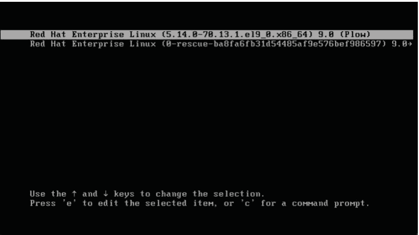

在GRUB启动菜单中输入`e`后，你会看到如图18-2所示的界面。在这个界面中，向下滚动找到以`linux ($root)/vmlinuz`开头、后跟大量参数的部分。这条指令告诉GRUB如何启动内核，默认情况下它如下所示：

```
linux ($root)/vmlinuz-{versionnumber}.el9.x86_64 root=/dev/mapper/rhel-root ro crash kernel=[options] resume=/dev/mapper/rhel-swap rd.lvm.lv=rhel/root rd.lvm.lv=rhel/swap rhgb quiet
```


```text
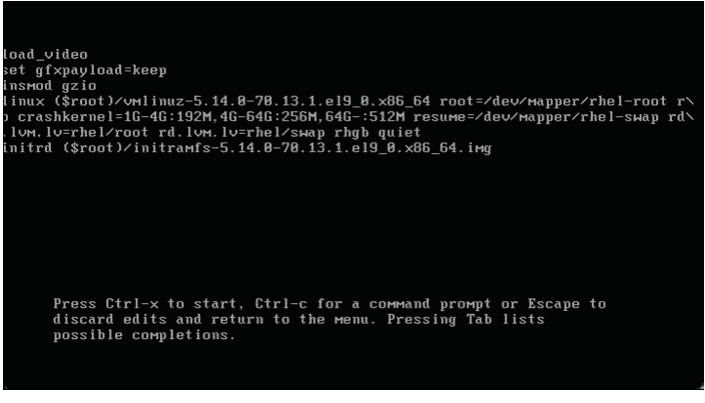
```

图18-2 在linux开头的行中输入启动参数

首先，建议从这一行中删除`rhgb`和`quiet`部分；这些参数会为你隐藏启动消息，而通常在启动时你确实希望看到正在发生什么。

在下一节中，你将了解一些可以从GRUB启动提示符输入的故障排除选项。输入想要使用的启动选项后，按Ctrl-X以使用这些选项启动内核。注意，这些选项仅能使用一次，不会持久化。要使它们持久化，你必须修改`/etc/default/grub`配置文件的内容，并使用`grub2-mkconfig -o /boot/grub2/grub.cfg`命令来应用修改。（有关此过程的更多详细信息，请参阅第17章。）

### 启动故障排除目标

如果服务器启动时遇到问题，你可以在GRUB 2启动提示符中输入以下几个选项：

- `rd.break`：此选项会在initramfs阶段停止启动流程。此时系统仍处于启动的initramfs阶段，这意味着根文件系统尚未挂载到`/`下。你需要提供root密码才能进入此模式。
- `init=/bin/sh`或`init=/bin/bash`：此选项指定在加载内核和initrd后立即启动shell。该选项可让你尽早访问正在运行的系统。你无需输入root密码，但请注意此时仅挂载了根文件系统，且仍为只读状态。有关此选项的更多信息，请参阅本章后面的“重置root密码”部分。
- `systemd.unit=emergency.target`：此选项会进入仅加载最少Systemd单元的模式。需要输入root密码。若要确认仅加载了极少数的单元文件，可以输入`systemctl list-units`命令。
- `systemd.unit=rescue.target`：此选项会启动更多Systemd单元，让你进入更完整的运行模式。需要输入root密码。若要确认仅加载了极少数的单元文件，可以输入`systemctl list-units`命令。

在练习18-1中，你将学习如何进入故障排除目标。此处列出的其他模式将在后续章节中讨论。

### 练习18-1 探索故障排除目标

1. （重新）启动计算机。当GRUB菜单出现时，选择菜单中的第一行，然后按`e`。
2. 向下滚动到以`linux ($root)/vmlinuz`开头的行。在这行的末尾输入`systemd.unit=rescue.target`。同时从该行中删除`rhgb`和`quiet`选项。按Ctrl-X以使用这些修改启动。
3. 出现提示时输入root密码。
4. 输入`systemctl list-units`。此命令会显示当前加载的所有单元文件，你可以看到已经加载了一个基础系统环境。
5. 输入`systemctl show-environment`。此命令会显示当前的shell环境变量。
6. 输入`systemctl reboot`重启你的计算机。
7. 当GRUB菜单出现时，再次按`e`进入编辑模式。在加载内核的行的末尾输入`systemd.unit=emergency.target`。按Ctrl-X以使用此选项启动。
8. 出现提示时输入root密码登录。
9. 成功登录后，输入`systemctl list-units`。请注意加载的单元文件数量已减少到最少。
10. 输入`reboot`将系统重启到默认目标。

### 使用救援磁盘

如果你遇到问题时比较幸运，仍然可以从硬盘启动。如果你运气稍差，会在一台完全无法启动的系统上只看到一个闪烁的光标。如果出现这种情况，你需要救援磁盘。Red Hat Enterprise Linux的默认救援镜像位于安装磁盘上。从安装磁盘启动时，你会看到一个“故障排除”菜单项。选择该菜单项即可获取修复计算机所需的选项。

### 使用救援磁盘恢复系统访问权限

选择“故障排除”选项后，会出现以下选项，如图18-3所示：

- **以基本图形模式安装Red Hat Enterprise Linux 9**：此选项会重新安装你的计算机。除非你遇到正常安装无法运行且需要基本图形模式进行故障排除的情况，否则不要使用此选项。通常情况下，你永远不需要使用此选项来修复损坏的安装。
- **救援Red Hat Enterprise Linux系统**：这是最灵活的救援系统。在练习18-2中，你可以详细探索它。使用救援磁盘时，这应该是首选选项。
- **运行内存测试**：如果遇到内存错误，请运行此选项。它允许你标记损坏的内存芯片，以便计算机可以正常启动。
- **从本地驱动器启动**：如果无法从硬盘上的GRUB启动，请先尝试此选项。它提供的引导加载程序会尝试从你的计算机硬盘启动，因此是侵入性最小的可用选项。

```text
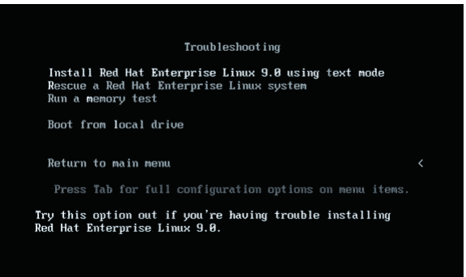
```

图18-3 从救援磁盘启动

启动救援系统后，你通常需要启用对磁盘上安装系统的完全访问权限。通常，救援磁盘会检测到你的安装系统并将其挂载到`/mnt/sysimage`目录。要修复对配置文件及其默认位置的访问（使其与磁盘上的可用状态一致），请使用`chroot /mnt/sysimage`命令将该目录的内容设为实际工作环境。如果不使用此`chroot`命令，许多工具将无法正常工作，因为如果它们写入配置文件，写入的将是只读磁盘上的版本。使用`chroot`命令可确保所有配置文件的路径引用都是正确的。

在练习18-2中，你将学习如何使用“救援Red Hat Enterprise Linux系统”选项来排查无法再启动的系统的故障。

### 练习18-2 使用救援选项

1. 从安装磁盘重启你的服务器。选择**故障排除**菜单选项。
2. 在“故障排除”菜单中，选择**救援Red Hat Enterprise Linux系统**。系统会提示你按Enter开始安装。无需担心，此选项不会覆盖你当前的配置，只会加载救援系统。
3. 救援系统现在会提示它将尝试找到已安装的Linux系统并将其挂载到`/mnt/sysimage`。按1接受**继续**选项（见图18-4）。

```text
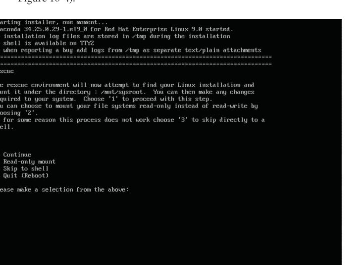
```

图18-4 救援系统查找已安装的系统镜像并为你挂载

## 第18章：必备故障排查技能 413

4. 如果检测到有效的Red Hat安装，系统会提示你的系统已被挂载到`/mnt/sysimage`目录下。此时你可以按Enter键进入救援shell。
5. 此时你可以通过`/mnt/sysimage`目录访问Linux安装。输入`chroot /mnt/sysimage`。此时你可以访问根文件系统，也能获取修复系统访问权限所需的所有工具。
6. 输入`exit`退出`chroot`环境，输入`reboot`以正常模式重启你的机器。

### 使用救援磁盘重新安装GRUB

需要启动救援磁盘的常见原因是GRUB 2引导加载程序损坏。如果出现这种情况，你可能需要重新安装它。在使用救援磁盘恢复服务器的访问权限后，重新安装GRUB 2并不困难，仅需两步：

- 确保如之前所述，使用`chroot`将`/mnt/sysimage`目录的内容对当前工作环境可用。
- 使用`grub2-install`命令，后面跟上你想要重新安装GRUB 2的设备名称。因此在KVM虚拟机中，要使用的命令是`grub2-install /dev/vda`，而在物理服务器或VMware、Virtual Box虚拟机中，对应命令为`grub2-install /dev/sda`。

### 使用救援磁盘重新创建Initramfs

偶尔initramfs镜像也可能损坏。如果出现这种情况，你的服务器将无法启动到正常操作模式。要在进入救援环境后修复initramfs镜像，你可以使用`dracut`命令。如果该命令不带任何参数运行，会为当前加载的内核创建新的initramfs。另外，你也可以使用`dracut`命令配合多个选项，为特定内核环境创建initramfs。`dracut`的配置分散在多个位置：

- `/usr/lib/dracut/dracut.conf.d/*.conf`包含系统默认配置文件。
- `/etc/dracut.conf.d`包含自定义dracut配置文件。
- `/etc/dracut.conf`现已弃用，不应再使用。请将你的配置放在`/etc/dracut.conf.d/`目录下的文件中。

Humble Bundle Pearson 网络与安全认证捆绑包 — © Pearson. 请勿分发。

> **TIP** 根据RHCSA的考核目标，考试中你不需要使用救援磁盘。但作为Linux管理员，你应当预见意外情况，因此确保你能处理常见以及不太常见的故障排查场景是个好主意。

### 修复常见问题

像这样的小章节不可能涵盖使用Linux时可能遇到的所有问题。不过确实有一些问题比其他问题更可能发生。在本节中，你将了解一些更常见的问题。

#### 重新安装GRUB 2

引导加载程序代码不会莫名其妙消失，但偶尔GRUB 2引导代码可能会损坏。在这种情况下，你需要知道如何重新安装GRUB 2。具体方法取决于你的服务器是否仍可启动。如果可以，重新安装GRUB 2相当简单。只需输入`grub2-install`，后面跟上你要安装它的设备名称即可。该命令有许多不同的选项可微调具体安装内容，但你大概率不需要使用它们，因为默认情况下，该命令会安装所有让你的系统重新可启动所需的内容。

如果你的机器无法启动，重新安装GRUB 2会稍显复杂。如果出现这种情况，你首先需要启动救援系统，并从救援系统中恢复对服务器的访问权限。（具体操作步骤见练习18-2。）在将服务器的文件系统挂载到`/mnt/sysimage`，并使用`chroot /mnt/sysimage`将挂载的系统镜像设为你的根镜像后，重新安装就和之前描述的一样简单：只需运行`grub2-install`即可将GRUB 2安装到目标安装设备。因此，如果你在KVM虚拟机中，运行`grub2-install /dev/vda`；如果你在物理磁盘上，运行`grub2-install /dev/sda`。

#### 修复Initramfs

在少数情况下，initramfs可能会损坏。如果你仔细分析启动流程，你会发现initramfs存在问题，因为你永远不会看到根文件系统被挂载到根目录，也不会看到任何Systemd单元被启动。如果你怀疑initramfs出现问题，重新创建它很简单。要使用所有默认设置重新创建（大多数情况下这样即可），你只需运行`dracut --force`命令。（如果不加`--force`，该命令会拒绝覆盖你现有的initramfs。）

#### 从文件系统问题中恢复

如果你对文件系统挂载做了错误配置，启动流程可能会以“请输入根密码进行维护”的消息结束。这条消息尤其是由`fsck`命令生成，它在启动时尝试验证`/etc/fstab`中文件系统的完整性。如果`fsck`失败，就需要手动干预，这可能会导致启动时出现这条消息。务必清楚遇到这种情况时该如何操作！

> **TIP** 务必彻底掌握这个知识点。文件系统相关知识点在RHCSA考核目标中占比较高，你很可能会需要创建分区和/或逻辑卷，并将它们加入`/etc/fstab`以实现自动挂载。这也使得出现问题的可能性较高，如果这种情况发生在考试中，你最好确保自己知道如何修复！

如果引用的设备不存在，或者用于挂载设备的UUID有误，Systemd会先等待该设备是否会自动出现。如果没有出现，它会给出“请输入根密码进行维护”的消息（见图18-5）。如果出现这种情况，你首先应当输入根密码。然后你可以按照建议输入`journalctl -xb`，查看启动日志中是否有关于问题原因的相关信息。如果问题是文件系统相关的，输入`mount -o remount,rw /`确保根文件系统以读/写方式挂载，分析`/etc/fstab`文件中的问题并修复它。

##### 图18-5 如果看到此提示，通常说明存在/etc/fstab问题

```text
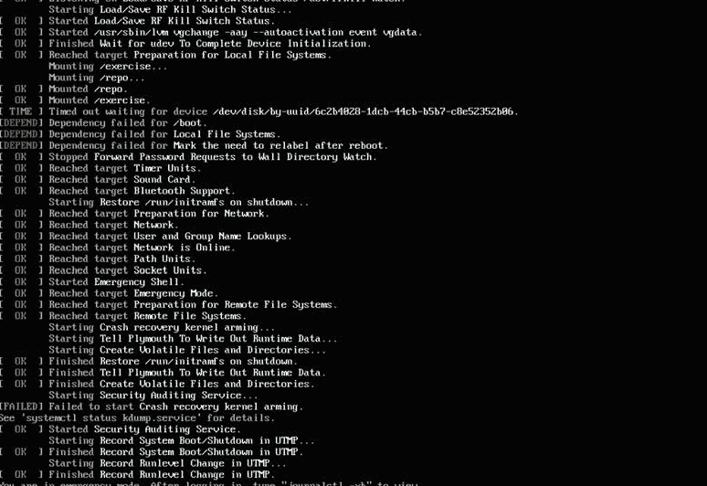
```

#### 重置根密码

Linux管理员常见的场景是忘记了根密码。如果出现这种情况，你需要重置它。唯一的方法是以最小模式启动，这样你无需输入密码即可登录。操作步骤如下：

1. 系统启动时，当显示GRUB 2引导菜单时，按`e`。
2. 在加载内核的那一行输入`init=/bin/bash`作为启动参数，然后按Ctrl-X以此选项启动。
3. 一旦打开root shell，输入`mount -o remount,rw /`以获得对根文件系统的读/写权限。
4. 现在你可以输入`passwd`，为用户root设置新密码。
5. 因为在这个非常早期的启动阶段SELinux尚未激活，`/etc/shadow`的上下文类型会出错。输入`touch /.autorelabel`在根目录下创建autorelabel文件。这将确保重启时SELinux安全标签会被正确设置。
6. 输入`exec /usr/lib/systemd/systemd`，用Systemd替换当前的PID 1（即`/bin/bash`）。这会以正常方式启动你的系统。注意你不能使用`reboot`命令，因为此时`/bin/bash`是PID 1，而`reboot`命令需要Systemd作为PID 1。
7. 重启后验证你可以以root用户登录。

在前面的流程中，你通过`init=/bin/bash` shell修改了root密码。退出`init=/bin/bash`环境比较特殊，因为此时Systemd尚未加载。因此你无法直接使用`reboot`命令重启，因为`reboot`会调用Systemd。输入`exit`也不可行，因为你将退出PID 1，导致内核没有PID 1进程。因此你必须手动启动Systemd。在这个bash作为PID 1的特殊环境中，你无法直接输入`/usr/lib/systemd/systemd`来启动Systemd。这是因为输入命令通常会产生当前进程的子进程——这类进程统称为“forking”。但在此场景中这行不通，因为Systemd需要作为PID 1运行。前面流程中使用的解决方案是使用`exec /usr/lib/systemd/systemd`。`fork`会创建当前进程的子进程，而`exec`会用以此方式启动的命令替换当前进程。这使得Systemd可以作为PID 1启动，而这正是此场景下所需要的。

### 总结

在本章中，你学习了如何排查Red Hat Enterprise Linux 9的启动流程故障。你总体了解了服务器启动时的流程，以及可以在哪些特定节点介入修复出现问题的地方。你还了解了在一些特定情况下该如何操作。务必熟练掌握这些流程，你很有可能在考试中遇到它们。

### 考试准备任务

如引言中“如何使用本书”部分所述，你有多种考试准备选择：章末实验；附录C中的记忆表格；第27章“最终准备”；以及模拟考试。

### 复习所有关键主题

复习本章最重要的主题，这些主题在页面页边距处标有关键主题图标。表18-3列出了这些关键主题的参考信息及其所在的页码。

| 关键主题元素 | 描述 | 页码 |
| --- | --- | --- |
| 列表 | 启动过程中处理的阶段摘要 | 406 |
| 表18-2 | 启动阶段配置与故障排除概述 | 407 |
| 列表 | 用于故障排除的相关GRUB 2启动选项摘要 | 409 |
| 小节 | 重置根密码 | 416 |

### 默写完成表格和列表

打印附录C《记忆表格》（可在配套网站找到）的副本，或至少打印本章对应的部分，然后默写出所有表格和列表。附录D《记忆表格答案》包含已完成的表格和列表，可用于核对你的答案。

### 定义关键术语

定义本章的以下关键术语，并在术语表中核对答案：initramfs、GRUB、`dracut`、`fork`、`exec`

### 复习题

以下问题用于帮助你测试对概念、术语的掌握程度以及知识广度。你可以在附录A中找到这些问题的答案。

1. 要进入GRUB启动菜单编辑器模式，你需要按下哪个按键？
2. 启动过程中启动流程未完成，服务器转而要求输入根密码，可能的原因是什么？
3. 你想进入故障排除模式，但不知道根密码，应该向内核传递哪个参数以进入可访问机器大部分功能的模式？
4. 你启动服务器后没有任何反应，只看到一个闪烁的光标，针对这个问题应该首先采取什么故障排查步骤？
5. 你想了解特定故障排除环境中可用的单元有哪些，应该使用哪个命令？
6. 你刚刚通过`init=/bin/bash`环境修改了根密码，现在要让系统正常启动，应该怎么做？
7. 如何确保重置根密码后所有文件都具备正确的SELinux上下文标签？
8. 你处于故障排除模式，无法向根文件系统写入任何文件，且根文件系统已正确挂载，要让它恢复可写状态可以怎么做？
9. 你已经对GRUB 2引导加载程序做了修改并希望保存，应该怎么做？
10. 你想在一台不知道根密码的机器上进入最精简的故障排除模式，应该使用哪个GRUB 2启动参数？

### 章末实验

实验18.1将教你如何排查一些常见问题。

### 实验18.1 -

- 重启服务器，通过对应的故障排除模式修改根密码。
- 在`/etc/fstab`中修改其中一个设备名称，使得下次重启时其上的文件系统无法挂载，重启后修复你遇到的问题。
- 使用救援磁盘，从救援磁盘启动服务器并进入完整的故障排除模式。
- 重新创建initramfs。

**本章涵盖以下主题：**

- 理解Shell脚本核心元素
- 使用变量与输入
- 使用条件循环

**本章涵盖以下RHCSA考试目标：**

- 条件执行代码（使用if、test、[]等）
- 使用循环结构（如for等）处理文件和命令行输入
- 处理脚本输入（`$1`、`$2`等）
- 处理脚本中Shell命令的输出

## 第19章

### Bash Shell脚本自动化入门

Shell脚本本身就是一门独立的学科。不过本章不会涉及这门学科的所有细枝末节，而是教你如何应用基础Shell脚本元素，从而让你能够编写简单的Shell脚本并分析Shell脚本的运行逻辑。

#### “我是否已掌握这些内容？”测验

“我是否已掌握这些内容？”测验可帮助你评估是需要通读全章还是直接跳转到“考试准备任务”部分。如果你对这些问题或自身知识掌握程度的评估存疑，请通读全章。

表19-1列出了本章的主要小节及其对应的“我是否已掌握这些内容？”测验问题。你可以在附录A《“我是否已掌握这些内容？”测验与复习题答案》中找到答案。

| 基础主题小节 | 问题 |
| :--- | :--- |
| 理解Shell脚本核心元素 | 1–2 |
| 使用变量与输入 | 3–5 |
| 使用条件循环 | 6–10 |

1. 每个Bash shell脚本应该以哪一行开头？
   - a. `/bin/bash`
   - b. `#!/bin/bash`
   - c. `!#/bin/bash`
   - d. `!/bin/bash`
2. 脚本末尾可使用的`exit 0`命令的作用是什么？
   - a. 通知父Shell脚本执行过程中没有出现问题。
   - b. 确保脚本可以正常停止。
   - c. 仅在使用了`for`循环来关闭`for`循环结构时才需要该命令。
   - d. 用于终止脚本中的条件结构。
3. 如何暂停脚本以允许用户提供输入？
   - a. `pause`
   - b. `break`
   - c. `read`
   - d. `stop`
4. 哪一行可以将启动脚本时提供的第一个参数值存储到变量NAME中？
   - a. `NAME = $1`
   - b. `$1 = NAME`
   - c. `NAME = $@`
   - d. `NAME=$1`
5. 区分传入Shell脚本的不同参数的最佳方式是什么？
   - a. `$?`
   - b. `$#`
   - c. `$*`
   - d. `$@`
6. 用于关闭`if`循环的是什么？
   - a. `end`
   - b. `exit`
   - c. `stop`
   - d. `fi`
7. 以下脚本中省略号位置缺少什么内容？
```bash


```bash
if [ -f $1 ]

then

    echo "$1 is a file"

elif [ -d $1 ]

then

    echo "$1 is a directory"

else

    echo "I do not know what \$1 is"

fi
```

8. 以下脚本中省略号位置缺少什么内容？

```bash
for (( counter=100; counter>1; counter-- ));

do

echo $counter

done

exit 0
```

a. `in`  
b. `do`  
c. `run`  
d. `start`

9. 如果脚本执行出现异常，应该使用哪个命令向root用户发送主题为“error”的消息？

a. `mail error root`  
b. `mail -s error root`  
c. `mail -s error root .`  
d. `mail -s error root < .`

10. 在case语句中，最好添加一行匹配所有其他情况的规则，以下哪一项可以实现该功能？

a. `*)`  
b. `*`  
c. `else`  
d. `or`

## 理解Shell脚本核心元素

本质上，Shell脚本是一个按顺序执行的命令列表，其中包含一些可选的脚本逻辑，可让代码仅在特定条件下执行。为了理解复杂的Shell脚本，我们先来看一个非常基础的脚本，如示例19-1所示。

**示例19-1 基础脚本**

```bash
#!/bin/bash

#

# This is a script that greets the world

# Usage: ./hello

clear

echo hello world

exit 0
```

这个基础脚本包含所有脚本都应使用的几个元素。首先是释伴，也就是`#!/bin/bash`这一行。当脚本从父Shell环境中启动时，会打开一个子Shell。在这个子Shell中会执行不同的命令，这些命令可以用任意方式解析，而释伴的作用就是明确命令的解析方式。本例中的释伴明确表明这是一个Bash Shell脚本，也可以指定其他Shell。例如，如果你的脚本包含Perl代码，释伴应该写为`#!/usr/bin/perl`。最佳实践是在脚本开头添加释伴；如果省略它，脚本代码将由父Shell中使用的Shell执行。由于你的脚本可能由ksh用户等执行，因此使用释伴调用`/bin/bash`作为子Shell非常重要，可以避免混淆。

释伴之后紧跟着的部分用于说明脚本的功能。在所有脚本中添加几行注释是个好习惯。对于短脚本，它的功能往往一目了然；但如果脚本变长，参与编写和维护脚本的人变多，脚本编写者的意图往往会变得不清晰。为了避免这种情况，请确保添加以`#`开头的注释行，不仅要加在脚本开头，还要加在脚本每个小节的开头。注释如果几个月后你重新阅读自己编写的脚本，已经记不清当初编写时究竟想做什么，它肯定会非常有用！你还可以在行内添加注释。无论`#`出现在什么位置，从`#`开始到行尾的所有内容都是注释文本。

接下来是脚本的主体部分。在示例19-1中，主体只是一个包含若干按顺序执行的命令的简单脚本。随着脚本的迭代开发，主体部分可能会不断扩充。脚本末尾我添加了`exit 0`语句。`exit`语句用于告知父级Shell脚本是否执行成功：0代表执行成功，其他任何值都表示脚本遇到了问题。除非在脚本末尾使用了`exit`命令，否则脚本最后一条命令的退出状态就是脚本本身的退出状态。不过了解你可以通过`exit`向父级Shell反馈脚本的整体执行情况也很有用。如果需要获取最后一条命令的退出状态，可以在父级Shell中使用`echo $?`命令。这个请求可以用来判断某个操作是否失败以及失败原因，非常实用。

写完脚本后，要确保它可以被执行。最常用的方法是给脚本添加执行权限。因此，如果你的脚本名为`hello`，可以使用`chmod +x hello`命令赋予其可执行权限。你也可以将脚本作为`bash`命令的参数来执行，比如使用`bash hello`来运行`hello`脚本。如果作为`bash`命令的参数启动脚本，该脚本不需要具备可执行权限。

你基本上可以把脚本存放在任意你喜欢的位置，但如果要把它放在`$PATH`环境变量未包含的路径下，就需要在脚本名前加`./`来执行。因此，仅输入`hello`不足以运行你的脚本，需要输入`./hello`来运行。注意，如果你想从当前目录运行脚本，也需要加上`./`，因为Linux系统中当前目录默认未包含在`$PATH`环境变量里。或者你也可以把它放到`$PATH`环境变量包含的标准目录下，比如`/usr/local/bin`。

在练习19-1中，你将运用这些技能编写一个简单的Shell脚本。

### 练习19-1 编写简单的Shell脚本

- 使用`vim`在你的home目录下创建名为`hello`的脚本。
- 给该脚本填入示例19-1中的内容，然后保存退出。
- 使用`./hello`尝试执行它，你会收到“权限不足”的错误提示。
- 输入`chmod +x hello`后再次尝试执行，你会发现脚本现在可以正常运行了。

## 使用变量与输入

Linux Bash脚本远不止是按顺序执行命令的列表。脚本的一大优势是它可以处理变量和输入，从而具备更高的灵活性。在本节中，你将学习如何使用变量和输入。

### 使用位置参数

启动脚本时，你可以传入参数。参数是启动脚本时放在脚本命令后面的任意内容。参数可以用来提升脚本的灵活性。举个例子，`useradd lisa`命令中，命令是`useradd`，参数`lisa`指定了要执行的操作，本例中需要创建一个名为`lisa`的用户，这里的`lisa`就是命令`useradd`的参数。在脚本中，第一个参数称为`$1`，第二个参数称为`$2`，以此类推。示例19-2中的脚本展示了如何使用参数，你可以随意传入参数尝试运行！

**示例19-2 使用参数的脚本**

```bash
#!/bin/bash

# run this script with a few arguments

echo The first argument is $1

echo The second argument is $2

echo The third argument is $3
```

如果你尝试运行示例19-2的示例代码，可能会发现它的内容并不完美：如果用3个参数运行该脚本，它能正常工作；如果只传2个参数，第三条`echo`语句会打印出`$3`的空值；如果传入4个参数，第四个值（会存储在`$4`中）永远不会被用到。因此，如果要使用参数，更推荐采用更灵活的方式。示例19-3展示了一个采用更灵活方式的脚本。

**示例19-3 以灵活方式使用参数的脚本**

```bash
#!/bin/bash

# run this script with a few arguments

echo You have entered $# arguments

for i in $@

do

echo $i

done

exit 0
```

示例19-3中引入了两个与参数相关的新变量：

- `$#`是一个计数器，显示启动脚本时传入的参数数量。
- `$@`指代启动脚本时传入的所有参数。

要评估启动脚本时传入的参数，你可以使用带`for`的条件循环。在`for`条件循环中，只要条件为真，就会一直执行命令。在这个脚本中，条件是`for i in $@`，意思是“针对每一个参数”。脚本每次执行循环时，都会将`$@`变量中的一个值赋值给`$i`变量。因此，只要还有参数，脚本的主体就会一直执行。`for`循环的主体总是以`do`开头，以`done`结尾，这两个关键字之间列出需要执行的命令。因此，示例19-3中的脚本会通过`echo`命令打印每个参数的值，直到没有更多参数可处理为止。

在练习19-2中，你可以自己动手尝试编写一个使用位置参数的脚本。

### 练习19-2 处理位置参数

- 打开编辑器，创建名为`ex192a`的脚本，将示例19-2的内容复制到该脚本中。
- 保存脚本并赋予其可执行权限。
- 运行`./ex192a a b c`命令，你会看到输出了三行内容。
- 运行`./ex192a a b c d e f`命令，你会发现输出的仍然是三行内容。
- 打开编辑器，创建名为`ex192`的脚本，将示例19-3的内容复制到该脚本中。
- 保存脚本并赋予其可执行权限。
- 运行`./ex192 a b c d e`命令，你会看到输出了五行内容。
- 不带参数运行`./ex192`命令，你会发现该命令不会输出任何参数内容，但会提示输入了0个参数。

### 使用变量

`variable`是一个标签，用于指向内存中存储特定值的特定位置。变量可以通过`NAME=value`的语法静态定义，也可以通过动态方式定义。有两种方式可以动态定义变量：

- 在脚本中使用`read`命令，请求运行脚本的用户输入内容。
- 使用命令替换，将命令的执行结果赋值给变量。

举个例子，`date +%d-%m-%y`命令会以“日-月-年”的格式输出当前日期。要将该日期赋值给脚本中的变量，可以使用`TODAY=$(date +%d-%m-%y)`命令。在命令替换中，只需要把要使用其结果的命令用括号括起来，并在左括号前加上美元符号即可。作为这种写法的替代方案，你也可以使用反引号，因此`TODAY=\`date +%d-%m-%y\``命令能达到完全相同的效果。

在之前的位置参数部分，你已经学会了如何在启动脚本时传入参数。在某些情况下，当你发现缺少必要信息时，主动请求用户输入是更高效的做法。示例19-4中的脚本展示了如何使用`read`实现这一功能。

### 示例19-4 使用read命令的脚本

```bash
#!/bin/bash

if [ -z $1 ]; then

echo Enter a name

read NAME

else

NAME=$1

fi

echo you have entered the text $NAME

exit 0
```

在示例19-4中，使用了`if ... then ... else ... fi`语句来检查参数`$1`是否存在。这是通过`test`命令实现的，该命令有两种写法：`test`或`[ ... ]`。在示例19-4中，`if [ -z $1 ]`这一行会执行测试`-z $1`是否为真。`-z`测试用于检查`$1`是否为空；如果为空，说明启动脚本时没有传入参数。如果满足该条件，就会执行`then`语句后面的命令。

注意，使用方括号写`test`命令时，必须在左括号后和右括号前各加一个空格，缺少这两个空格会导致命令无法运行。注意`then`语句紧跟在`test`命令之后，这是因为中间使用了分号（`;`）作为分隔符，分号是命令分隔符，可以替代脚本中的换行符。在`then`语句中，会执行两条命令：一条是在屏幕上显示消息的`echo`命令，另一条是`read`命令。`read`命令会暂停脚本运行，等待并处理用户输入，然后将输入内容存储到`NAME`变量中。因此，`read NAME`这一行会将所有用户输入存储到`NAME`变量中，供脚本后续使用。

在示例19-4中，下一部分由`else`语句引入。`else`语句之后的命令会在所有其他情况下执行，在本场景中这意味着“如果提供了参数”。如果情况如此，则会定义变量`NAME`，并将`$1`的当前值赋值给它。注意变量的定义方式：变量名称后直接跟一个`=`号，后面跟着`$1`。注意定义变量时千万不要使用空格。随后，`if`循环会通过`fi`语句结束。一旦`if`循环执行完毕，你就可以确定变量`NAME`已被定义且拥有值。脚本的最后一行会读取变量`NAME`的值，并通过`echo`命令将该值输出到标准输出（STDOUT）。注意，要获取变量的当前值，脚本会在变量名称前加上`$`符号来引用该变量。

### 练习19-3 处理输入

- 打开编辑器，创建一个名为`ex193`的脚本。将示例19-4的内容输入到该脚本中。
- 将脚本写入磁盘，使用`chmod +x ex193`命令为其添加可执行权限。
- 不带额外参数运行`./ex193`脚本，你会看到它提示你输入内容。
- 使用`hello`作为参数运行该脚本，它会在标准输出（STDOUT）中回显“你输入的文本是hello”。

## 使用条件循环

如你所见，你可以在脚本中使用条件循环。这类条件循环仅会在特定条件为真时执行。在Bash中，常用的条件循环有以下几种：

- `if ... then ... else`：用于在特定条件为真时执行代码
- `for`：用于对一系列值执行命令
- `while`：用于在特定条件为真时持续执行代码
- `until`：用于在特定条件为真之前持续执行代码
- `case`：用于评估特定值，适合预先已知可取值的数量有限的情况


### 使用if ... then ... else

`if ... then ... else`结构常用于评估特定条件。你在示例19-4中已经见过它的使用示例。这种条件循环通常和`test`命令搭配使用，之前你已经见过它被用来检查文件是否存在。这个命令还能实现很多其他功能，比如比较文件、比较整数等等。

> **提示** 查看`test`命令的man手册页。`if`的基础结构是`if ... then ... fi`，该结构仅评估单个条件，示例如下：

```bash
if [ -z $1 ]

then

echo no value provided

fi
```

在示例19-4中，你已经了解如何通过在语句中加入`else`来评估两个条件。示例19-5展示了如何通过将`else`和`if`组合为`elif`来评估多个条件。如果需要检查多种不同的值，这种结构非常实用。注意在示例19-5中也使用了多个`test`命令。

### 示例19-5 含if ... then ... else的脚本

```bash
#!/bin/bash

# run this script with one argument

# the goal is to find out if the argument is a file or a directory

if [ -f $1 ]

then

echo "$1 is a file"

elif [ -d $1 ]

then

echo "$1 is a directory"

else

echo "I do not know what \$1 is"

fi

exit 0
```

另外注意示例19-5中对反斜杠（`\`）的使用。该字符会通知Shell不要解释后续字符，这一操作被称为转义字符。显然，如果你想打印`$1`的值而非字符串`$1`，就需要去掉这个`\`。

### 使用`||`和`&&`

你无需编写完整的`if ... then`语句，而是可以使用逻辑运算符`||`和`&&`。`||`是逻辑或运算符，仅当第一部分不为真时才会执行语句的第二部分；`&&`是逻辑与运算符，仅当第一部分为真时才会执行语句的第二部分。来看下面两行单行命令：

```bash
[ -z $1 ] && echo no argument provided

ping -c 1 10.0.0.20 2>/dev/null || echo node is not available
```

第一个示例中执行了一个测试（使用替代的`test`命令语法），检查`$1`是否为空。如果该测试为真（基本等同于`test`命令以退出码0退出），则会执行第二个命令。第二个示例中使用`ping`命令检查主机是否可用。本例中使用逻辑或运算符，如果`ping`命令执行失败，就会回显“node is not available”文本。你会发现，实际使用中通常会用`&&`和`||`组合，而非完整的`if ... then`语句。在练习19-4中，你可以练习`if ... then ... else`的相关技能，可以选择使用`if ... then ... else`，也可以选择使用`&&`和`||`。

### 练习19-4 使用if ... then ... else

- 打开编辑器，创建一个名为`filechk`的脚本。
- 将示例19-5的内容复制到该脚本中。
- 运行几组测试，例如：`./filechk /etc/hosts`、`./filechk /usr`、`./filechk non-existing-file`

## 应用for循环

`for`条件语句是处理数据范围的绝佳方案。在示例19-6中，你可以看到第一个使用`for`的脚本，其中定义了一个范围，只要该范围内还有未处理的值，就会持续处理。

### 示例19-6 含for循环的脚本

```bash
#!/bin/bash

for (( COUNTER=100; COUNTER>1; COUNTER-- )); do

echo $COUNTER

done

exit 0
```

`for`条件语句始终以`for`开头，其后是需要检查的条件。接下来是`do`，其后是条件为真时需要执行的命令，最后用`done`闭合该条件语句。在示例19-6中，你可以看到条件是一个赋值给变量`COUNTER`的数字范围。变量`COUNTER`首先被初始化为100，只要值大于1，在每个迭代中就会减1。只要条件为真，就会通过`echo`命令输出`$COUNTER`变量的值。

### 示例19-7 for循环单行命令

```bash
for i in {100..104}; do

ping -c 1 192.168.4.$i >/dev/null && echo 192.168.4.$i is up;

done
```


注意范围的定义方式：你指定第一个数字，后面跟两个点，最后以该范围的最后一个数字结尾。使用`for i in`时，每个数字都会被赋值给变量`i`。针对每个数字，都会执行一次`ping`命令，其中`-c 1`选项确保仅发送一次`ping`请求。在这个`ping`命令中，我们不需要它的输出结果，因此将结果重定向到`/dev/null`设备。根据`ping`命令的退出状态，会执行`&&`之后的部分。因此，如果主机可达，就会回显一行表示主机在线的内容。

### 理解`while`和`until`

你刚才读到的`for`语句适合处理条目范围，而如果你需要监控进程可用性这类场景，`while`语句更为适用。在示例19-8中，你可以看到如何使用`while`监控进程活动。

#### 示例19-8 使用`while`监控进程

```bash
#!/bin/bash

#
# usage: monitor <processname>

while ps aux | grep $1 | grep -v grep > ~/output.txt
do
    sleep 5
done

clear

echo your process has stopped

logger $1 is no longer present
```

示例19-8中的脚本由两部分组成：首先是`while`循环，其次是`while`循环不再判断为真时需要执行的所有内容。`while`循环的核心是`ps`命令，我们会用`grep`过滤其中包含`$1`的行。注意`grep -v grep`的使用，它会从结果中排除包含`grep`命令的行。要记住，`ps`命令会包含所有正在运行的命令，包括接收`ps`命令输出并传入管道的`grep`命令本身，这可能会导致误匹配。`ps aux`命令的结果会被重定向到`~/output.txt`文件中。这样如果后续需要，就可以从`~/output.txt`中读取结果，但默认情况下不会显示这些内容。如果语句判断为真，需要执行的命令位于`while`语句之后。本例中的命令是`sleep 5`，它基本会让脚本暂停5秒。只要`while`语句判断为真，就会持续运行。如果不再为真（本例中即进程不再可用），循环就会停止，随后可以执行`while`循环之后的命令。`while`的对应语句是`until`，它会开启一个迭代，直到条件为真时才会停止。在示例19-9中，`until`被用来过滤`users`命令的输出，查找`$1`（即用户名）是否存在。在该命令判断为真之前，迭代会持续进行。当在`users`的输出中找到该用户名时，迭代结束，随后可以执行`until`循环之后的命令。

#### 示例19-9 使用`until`监控用户登录

```bash
#!/bin/bash

# until users | grep $1 > /dev/null

do
    echo $1 is not logged in yet
    sleep 5
done

echo $1 has just logged in
```

### 理解`case`语句

重要的循环语句中最后一种是`case`语句。`case`语句用于匹配多个预期值。尤其，`case`语句在旧版RHEL中用于启动服务的Linux启动脚本里非常重要。

在`case`语句中，你需要定义所有预期的特定参数，每个参数后跟着若使用该参数需要执行的命令。在示例19-10中，你可以看到旧版RHEL服务脚本中用于启动几乎所有服务的`case`语句模板。该语句作用于变量`$1`，也就是启动脚本的名称。在脚本名称之后，用户可以输入`start`、`stop`、`restart`等参数。

#### 示例19-10 使用`case`匹配特定场景

```bash
case "$1" in
    start) start;;
    stop) rm -f $lockfile stop;;
    restart) restart;;
    reload) reload;;
    status) status ;;
    *) echo "Usage: $0 (start|stop|restart|reload|status)" ;;
esac
```

Humble Bundle Pearson网络与安全认证捆绑包 – © Pearson。禁止分发。

`case`语句有一些特殊之处。首先，其通用语法为`case`待匹配项`in`。该语法后跟着所有需要匹配的可能值列表，每个匹配项以右括号结尾。右括号后跟着若使用对应参数需要执行的命令列表，命令列表以双分号`;;`结尾。这两个分号可以直接放在最后一条命令之后，也可以单独占一行。

另外需要注意，`\*)`代表所有之前未指定的其他选项，这是一个“兜底”匹配项。`case`语句以`esac`语句结尾。

注意，`case`中的匹配是按顺序执行的，一旦匹配到第一个符合条件的项，`case`语句就不会再继续匹配其他内容。匹配过程中可以使用通配符模式，这在`\*)`的匹配中体现，它会匹配所有内容。你也可以使用类似`start|Start|START)`的匹配规则，来匹配不同大小写的输入。

### Bash Shell脚本调试

当脚本的运行结果不符合你的预期时，调试脚本是非常有用的。可以尝试通过给`bash -x`命令传参的方式运行脚本。该命令会逐行显示脚本正在尝试执行的操作，如果运行失败还会显示具体的错误信息。

示例19-11展示了使用`bash -x`运行的脚本，从中可以立刻发现`grep`命令运行不符合预期的原因：它缺少要处理的操作参数。

#### 示例19-11 使用`bash -x`调试脚本

```bash
[root@server1 ~]# bash -x 319.sh

+ grep

Usage: grep [OPTION]... PATTERN [FILE]...

Try 'grep --help' for more information.

+ users

+ echo is not logged in yet

is not logged in yet

+ sleep 5
```


### 本章小结

在本章中，你学习了如何编写 Shell 脚本。此外你还完成了若干示例练习，现在已经熟悉了编写可正常运行脚本所需的一些基础元素。

### 考前准备任务

如引言部分“如何使用本书”中所述，你有多种备考选择：章末实验、附录 C 中的记忆表格、第 27 章“最终准备”以及模拟考试。

#### 复习所有关键主题

复习本章最重要的主题，这些主题在页面页边距处标注有关键主题图标。表 19-2 列出了这些关键主题的对照信息及对应页码。

#### 表 19-2 第 19 章关键主题

| 关键主题元素 | 描述 | 页码 |
|:---|:---|:---|
| 段落 | 变量定义 | 427 |
| 列表 | 动态定义变量 | 427 |
| 列表 | 条件循环概述 | 429 |

#### 定义关键术语

定义本章以下关键术语，并在术语表中核对答案：`shebang`、父 Shell、子 Shell、变量、条件循环、`OR`、`AND`、迭代。

#### 复习题

以下问题用于帮助你检验对概念、术语的掌握程度，以及知识的广度。你可以在附录 A 中找到这些问题的答案。

1. 如果脚本*没有*以 `shebang` 开头，会有什么影响？
2. 如何检查变量 `VAR` 是否为空值？
3. 在脚本中你会使用什么来统计已使用的参数数量？
4. 引用脚本启动时使用的所有参数，你会使用什么？
5. 如何在脚本中处理用户输入？
6. 测试文件是否存在，若不存在则执行 `echo "文件不存在"` 命令的最简单方法是什么？
7. 你会执行什么测试来判断一个对象是文件还是目录？
8. 你会使用什么结构来匹配一系列项？
9. 在脚本中如何结束 `elif` 语句？
10. 在 `case` 语句中，你会匹配一系列项。针对每个匹配项，你需要执行一条或多条命令。结束特定匹配项时，需要在最后一条命令后使用什么？

### 章末实验

在本章末实验中，你将运用脚本编写技能完成两个简单脚本的编写。

#### 实验 19.1

1. 编写一个可处理参数的脚本。如果使用了 `one` 参数，脚本需要创建一个名为 `/tmp/one` 的文件。如果使用了 `two` 参数，脚本需要向 `root` 用户发送一封主题为“two”的消息。
2. 编写一个倒计时脚本。该脚本仅能使用一个参数，该参数指定倒计时的分钟数。脚本需要从指定的分钟数开始逐秒倒计时，每次迭代输出文本“还剩 nn 秒”。使用 `sleep` 命令设置秒数间隔。当时间耗尽时，脚本需要输出“时间到”并退出。


本章涵盖以下主题：

- 加固 SSH 服务器
- 使用其他实用的 `sshd` 选项
- 配置带密码的密钥认证

本章涵盖以下 RHCSA 考试目标：

- 配置 SSH 的密钥认证

# 第 20 章

## 配置 SSH

安全外壳（SSH）是系统管理员使用的最重要的工具之一。在第 5 章

### “我是否已经掌握了这些内容？”小测

“我是否已经掌握了这些内容？”小测可以帮助你评估是需要通读本章，还是可以直接跳到“考前准备任务”部分。如果你对这些问题的答案或自身的知识掌握程度存疑，请阅读整章内容。

表 20-1 列出了本章的主要小节及其对应的“我是否已经掌握了这些内容？”小测问题。你可以在附录 A“‘我是否已经掌握了这些内容？’小测和复习题答案”中找到答案。

#### 表 20-1 “我是否已经掌握了这些内容？”小节-问题对应表

| 基础主题小节 | 对应问题 |
|:---|:---|
| 加固 SSH 服务器 | 1–5 |
| 使用其他实用的 `sshd` 选项 | 6–8、10 |
| 配置带密码的密钥认证 | 9 |

1. 以下哪项*不是*防止 SSH 服务器遭受暴力破解攻击的常见方法？
   - a. 禁用 X11 转发
   - b. 让 SSH 监听非默认端口
   - c. 禁用密码登录
   - d. 仅允许特定用户登录
2. 以下哪项可以成功将 SSH 服务器访问权限限制为仅 `bob` 和 `lisa` 用户？
   - a. `LimitUsers bob,lisa`
   - b. `AllowedUsers bob lisa`
   - c. `AllowUsers bob lisa`
   - d. `AllowedUsers bob,lisa`
3. 以下哪条命令用于为 2022 非默认端口配置正确的 SELinux 标签？
   - a. `semanage ports -m -t ssh_port_t -p 2022`
   - b. `semanage port -m -t ssh_port_t -p tcp 2022`
   - c. `semanage ports -a -t sshd_port_t -p tcp 2022`
   - d. `semanage port -a -t ssh_port_t -p tcp 2022`
4. 以下哪项对 `MaxAuthTries` 选项的描述是正确的？
   - a. 达到此处指定的尝试次数后，账户将被锁定。
   - b. 该选项指定最大登录尝试次数。达到此处指定次数的一半后，额外的失败尝试会被记录。
   - c. 达到此处指定的尝试次数后，发起登录尝试的 IP 地址将被封禁。
   - d. 此处指定的数值表示每分钟的最大登录尝试次数。
5. 你会分析哪个日志文件来获取 SSH 登录失败的相关信息？
   - a. `/var/log/auth`
   - b. `/var/log/authentication`
   - c. `/var/log/messages`
   - d. `/var/log/secure`
6. 测试环境中的 SSH 登录耗时很长。以下哪项选项最有可能导致连接时间问题？
   - a. `UseLogin`
   - b. `GSSAPIAuthentication`
   - c. `UseDNS`
   - d. `TCPKeepAlive`
7. 以下哪个选项*不*用于保持 SSH 连接存活？
   - a. `TCPKeepAlive`
   - b. `ClientAliveInterval`
   - c. `ClientAliveCountMax`
   - d. `UseDNS`
8. SSH 客户端计算机上需要添加哪个文件，以便为单个用户设置 `ServerKeepAliveInterval`？
   - a. `~/.ssh/ssh_config`
   - b. `~/.ssh/config`
   - c. `/etc/ssh/config`
   - d. `/etc/ssh/ssh_config`
9. 假设已经创建了受密码短语保护的公钥/私钥对，如何配置会话才能只需输入一次密码短语？
   - a. 将密码短语复制到 `~/.ssh/passphrase` 文件中。
   - b. 运行 `ssh-add /bin/bash`，随后运行 `ssh-agent`。
   - c. 运行 `ssh-agent /bin/bash`，随后运行 `ssh-add`。
   - d. 这不可能；每次创建连接时都必须输入密码短语。
10. `MaxSessions` 选项可用于调节可同时打开的最大会话数，它的默认值是多少？
    - a. 10
    - b. 25
    - c. 100
    - d. 1000

### 基础主题

#### 加固 SSH 服务器

SSH 是一个重要且便捷的解决方案，可帮助您建立与服务器的远程连接。它也是一个存在风险的解决方案。如果您的 SSH 服务器可以直接从互联网访问，您可以肯定，迟早会有入侵者尝试连接您的服务器并意图造成破坏。针对 SSH 服务器的字典攻击十分常见。在字典攻击中，攻击者会使用常见密码（即字典）尝试重复登录。攻击者利用了 SSH 服务器通常在 22 端口提供服务、且仍有大量 Linux 服务器允许 `root` 账户通过 SSH 登录这一事实。基于这些信息，攻击者只需猜测密码就能轻易尝试以 `root` 身份登录。如果密码复杂度不足，且未采取任何额外安全措施，入侵者迟早能够成功连接。

幸运的是，您可以采取一些措施保护 SSH 服务器抵御这类攻击：

- 禁用 `root` 登录
- 禁用密码登录
- 配置 SSH 监听的非默认端口
- 仅允许特定用户通过 SSH 登录

在接下来的小节中，您将了解修改这些选项的具体操作。

##### 限制 root 访问

在 RHEL 的旧版本中，`root` 用户被允许通过 SSH 进行本地和远程登录。在 RHEL 9 中这一问题已得到修复。RHEL 9 安装程序现在新增了“不为 root 用户设置密码”的选项，启用该选项即可禁用 root 登录。此外，默认情况下 root 用户不允许通过 SSH 登录，这是通过默认配置的 `PermitRootLogin prohibit-password` 选项实现的。该选项仅允许持有有效公钥/私钥对的 root 用户登录，且不建议修改该设置。

即使 SSH 的 root 登录已被禁用，仍然可以执行远程管理任务。要完成该操作，您首先需要以非 root 用户身份远程登录，使用类似 `ssh student@remoteserver` 的命令。一旦与远程服务器的会话建立，如果您使用的是支持 `sudo` 的用户，请使用 `sudo -i` 打开 root shell；对于不支持 `sudo` 的用户，使用 `su -` 即可。如果未设置 root 密码，也需要遵循此流程。

##### 配置替代端口

Linux 服务器上的许多安全问题都始于攻击者发起的端口扫描。扫描所有可能监听的 65535 个端口需要大量时间，但大多数端口扫描仅关注已知端口，而 SSH 的 22 端口始终是扫描列表中的首批端口之一。不要低估端口扫描的风险。我此前多次发现，服务器安装后仅 1 小时，监听在 22 端口的 SSH 服务就会被发现。

为防范端口扫描，您可以将 SSH 服务器配置为监听其他端口。默认情况下，`sshd_config` 文件包含 `Port 22` 这一行配置，用于指定 SSH 监听特权端口 22。要让 SSH 监听其他端口，必须将 22 端口修改为其他端口，可以选择不同的端口：既可以选用类似 2022 的完全随机端口，也可以将 SSH 配置为监听 443 端口，后者往往更实用。443 端口默认分配给使用传输层安全（TLS）提供加密的 Web 服务器。如果要访问 SSH 服务器的用户通常在仅允许 80 和 443 端口流量的代理后方，将 SSH 配置为监听 443 端口是合理的选择。但您需要意识到，这样做后您的 Web 服务器将无法再使用 443 端口；一个端口同一时间只能分配给一个服务！因此，仅在不计划运行启用 TLS 的 Web 服务器的机器上执行此操作！

> **提示** 为避免在修改 SSH 监听端口后因远程连接被锁定而无法访问服务器，建议同时打开两个到 SSH 服务器的会话。其中一个会话用于应用更改和测试，另一个会话保持当前的连接状态。重启 SSH 服务器后，活跃的会话不会被断开（除非您未能成功重启 SSH 服务器）。

##### 修改 SELinux 以允许端口变更

修改 SSH 端口后，您还需要配置 SELinux 以允许这一变更。（有关 SELinux 的更多详情，请参阅第 22 章“管理 SELinux”。）网络端口会被打上 SELinux 安全标签，以防止服务访问不应访问的端口。要允许服务连接到非默认端口，需要使用 `semanage port` 命令更改目标端口的标签。执行此操作前，建议先检查该端口是否已有标签，您可以使用 `semanage port -l` 命令完成检查。如果该端口尚未设置安全标签，使用 `-a` 参数为端口添加标签；如果已经设置了安全标签，使用 `-m` 参数修改当前安全标签。例如，使用 `semanage port -a -t ssh_port_t -p tcp 2022` 命令可为 `sshd` 访问标记 2022 端口。如果要重新标记已被其他服务使用的端口，需要使用 `semanage port -m` 命令修改当前的端口分配。例如，如果您希望 SSH 能够绑定到 443 端口，就需要执行此操作。

##### 限制用户访问

您只需浏览 `sshd_config` 文件就能找到许多 `sshd` 相关配置选项。其中一个最实用的选项是 `AllowUsers`。该选项接受以空格分隔的用户列表，这些用户被允许通过 SSH 登录。请注意这是一个功能强大的选项，会将登录权限限制为仅这些用户，排除所有其他用户（包括 root 用户）。使用 `AllowUsers` 参数时，请仔细考虑要允许或拒绝访问的用户名。在脚本化暴力攻击中，入侵者通常也会尝试 `admin`、`Administrator`、`jsmith` 等常见用户名。选择不常用的用户名就能轻松增加一层安全防护。关于 `AllowUsers` 参数请注意以下几点：

- 默认情况下，`AllowUsers` 选项不会出现在默认的 `/etc/ssh/sshd_config` 文件的任何位置。
- `AllowUsers` 选项比 `PermitRootLogin` 更合适，因为它比仅禁止 root 登录的限制性更强。
- 如果 `AllowUsers` 选项未指定 root，您仍可以在以普通用户身份连接后通过 `su -` 或 `sudo -i` 成为 root。

`MaxAuthTries` 是一个看似实用实则误导的参数。您可能认为该选项会在登录尝试失败达到最大次数后锁定 SSH 登录提示符的访问。这类功能在连接本地服务器时很有用（需要时很容易修改配置），但在面向互联网的 SSH 服务器上，这是一个相当危险的选项，会使对服务器发起拒绝服务攻击变得容易。入侵者只需运行一个尝试以特定用户登录的脚本，就能在一段时间内阻止该用户的访问。这就是 `MaxAuthTries` 不会实现您预期功能的原因：它仅会在达到此处指定成功登录尝试次数的一半后开始记录失败的登录尝试。

尽管如此，`MaxAuthTries` 选项仍然有用。分析与 SSH 服务器相关的安全事件时，了解用户偶然输错一两次密码并不重要，只有在多次失败尝试后才有分析价值。尝试次数越高，就越可能是入侵者试图进入。SSH 会将登录失败的相关信息写入 `AUTHPRIV` 系统日志工具。默认情况下，该工具被配置为将登录失败信息写入 `/var/log/secure`。

在练习 20-1 中，你将应用目前讨论过的常用 SSH 选项。

###### 练习 20-1 配置 SSH 安全选项

本练习需要在 `server1` 上配置 `sshd` 进程，使用第二台服务器 `server2` 测试对 `server1` 的访问权限。

- 在 `server1` 上打开 root 权限 shell，然后在该 shell 中使用编辑器打开 `sshd` 配置文件 `/etc/ssh/sshd_config`。
- 找到 `Port` 行，在该行下方添加 `Port 2022` 行。该配置会告知 `sshd` 进程需要绑定到两个不同的端口，确保即使出现配置错误，依然可以建立 SSH 会话。
- 同时在 SSH 配置文件中添加 `AllowUsers student` 行。
- 保存配置文件更改，使用 `systemctl restart sshd` 重启 `sshd` 服务，此时会看到错误提示。
- 输入 `systemctl status -l sshd`，你会看到 SSH 尝试连接 2022 端口时出现“权限拒绝”错误。
- 输入 `semanage port -a -t ssh_port_t -p tcp 2022`，为 2022 端口应用正确的 SELinux 标签。
- 同样开启 2022 端口的防火墙规则，依次输入 `firewall-cmd --add-port=2022/tcp` 和 `firewall-cmd --add-port=2022/tcp --permanent`。
- 再次输入 `systemctl status -l sshd`，你会看到 `sshd` 进程现在已经监听两个端口。
- 使用 `ssh -p 2022 student@server1` 从另一台服务器登录 SSH 服务器，打开用户 shell 后，输入 `su -` 获取 root 权限。

#### 其他实用的 `sshd` 选项

除了安全相关的选项外，还有一些实用的杂项选项可用于优化 SSH 性能。接下来的两个小节将介绍其中最重要的部分。

##### 会话选项

首先介绍 `UseDNS` 选项。该选项默认开启，会指示 SSH 服务器查询远程主机名，并通过 DNS 校验解析得到的远程主机名是否与 IP 地址匹配。虽然该选项有一定安全优势，但会带来明显的性能损耗。如果客户端连接速度较慢，请将其设置为 `no`，完全关闭客户端主机名校验。

另一项会话相关选项是 `MaxSessions`，该选项指定了同一 IP 地址同时可打开的最大会话数。如果有多个用户需要从同一 IP 地址登录 SSH 服务器，你可能需要将该选项值改为大于默认值 10。

##### 连接保活选项

TCP 连接本身属于相对稀缺的资源，因此长时间未使用的连接通常会自动超时。你可以通过几个选项让非活跃连接保持更长时间的存活状态。

`TCPKeepAlive` 选项用于监测客户端是否仍然在线。启用该选项（默认开启）可确保处于非活跃状态达到指定时长的机器的连接被释放。但仅使用该选项时，可能会导致未使用的连接也被释放，因此搭配 `ClientAliveInterval` 选项使用更为合理。该选项以秒为单位设置间隔，当服务器在指定时间内未检测到客户端活动时，会向客户端发送数据包。`ClientAliveCountMax` 参数用于指定这类数据包的发送次数。例如，若 `ClientAliveInterval` 设置为 30，`ClientAliveCountMax` 设置为 10，则非活跃连接可保持约 5 分钟的存活状态。建议将该参数设置为你希望非活跃连接保持开启的时长。

`ClientAliveInterval` 和 `ClientAliveCountMax` 选项仅可在服务器端配置。这些选项也有客户端对应的版本。如果你无法修改 SSH 服务器的配置，可使用 `ServerAliveInterval` 和 `ServerAliveCountMax` 选项，由客户端机器发起连接保活流量。如果需要给该机器的所有用户应用这些选项，可在 `/etc/ssh/ssh_config` 文件中设置，若仅给单个用户应用，则可在 `~/.ssh/config` 文件中设置。

表 20-2 汇总了最实用的 SSH 选项。

##### 表 20-2 最实用的 `sshd` 配置选项

| 选项 | 用途 |
|---|---|
| `Port` | 定义 TCP 监听端口。 |
| `PermitRootLogin` | 指示是否允许或禁止 root 登录。 |
| `MaxAuthTries` | 指定最大身份验证尝试次数。达到该数值的一半时，失败记录会被写入系统日志。 |
| `MaxSessions` | 指示同一 IP 地址可同时打开的最大会话数。 |
| `AllowUsers` | 指定允许连接到服务器的用户列表，用户之间用空格分隔。 |
| `PasswordAuthentication` | 指定是否允许密码身份验证，该选项默认开启。 |
| `TCPKeepAlive` | 指定是否清理非活跃 TCP 连接。 |
| `ClientAliveInterval` | 指定向客户端发送存活探测包的间隔（单位：秒），用于确认客户端是否仍在线。 |
| `ClientAliveCountMax` | 指定需要发送的客户端存活探测包数量。 |
| `UseDNS` | 开启时，使用 DNS 域名查询将传入的 IP 地址与域名匹配。 |
| `ServerAliveInterval` | 指定客户端向服务器发送保活数据包的间隔（单位：秒）。 |
| `ServerAliveCountMax` | 指定客户端为保持连接存活向服务器发送的最大数据包数量。 |

#### 配置带密码短语的密钥对身份验证

默认情况下，RHEL 上的 SSH 服务器允许密码身份验证。如果使用了第 5 章提到的公钥/私钥对，则会优先使用该密钥对进行身份验证。如果你只想允许基于公钥/私钥的身份验证，完全禁用基于密码的身份验证，可将 `PasswordAuthentication` 选项设置为 `no`。

使用公钥/私钥时，可以设置密码短语。使用*密码短语*可增强密钥对的安全性：不仅入侵者需要获取私钥，拿到私钥后还需要知道密码短语才能使用该密钥。因此，建议在使用公钥/私钥建立客户端/服务器连接时使用密码短语。

如果不进行额外配置，使用密码短语意味着每次建立连接前用户都需要输入密码短语，非常不便。为了简化密码短语的使用流程，你可以将密码短语缓存到当前会话中。完成该操作需要用到 `ssh-agent` 和 `ssh-add` 命令。假设公钥/私钥对已经创建完成，只需三步即可完成操作：

- **步骤 1.** 输入 `ssh-agent /bin/bash` 为当前（Bash）shell 启动代理。
- **步骤 2.** 输入 `ssh-add` 添加当前用户私钥的密码短语，此时密钥已被缓存。
- **步骤 3.** 连接远程服务器，你会发现不再需要输入密码短语。该流程需要在每次创建新会话时重复执行。

### 总结

在本章中，你学习了如何使用高级选项配置 SSH 服务器，还学习了如何设置 `sshd` 的安全选项，以及如何设置特定的客户端选项来延长连接的存活时间。

### 备考任务

如引言部分“如何使用本书”中所述，你有多种备考选择：章末实验；附录 C 中的速记表；第 27 章“最终备考”；以及模拟考试。

#### 复习所有关键主题

复习本章最重要的主题，该主题在页面页边标注有关键主题图标。表 20-3 列出了该关键主题的参考信息及对应的页码。

#### 表 20-3 第 20 章关键主题

| 关键主题元素 | 描述 | 页码 |
|---|---|---|
| 表 20-2 | 最实用的 `sshd` 配置选项 | 447 |

#### 凭记忆完成表格和列表

打印附录 C“记忆表格”（可在配套网站上找到）的副本，或至少打印本章对应的部分，并凭记忆完成其中的表格和列表。附录 D“记忆表格答案”包含已完成的表格和列表，可用于核验你的答案。

#### 定义关键术语

定义本章以下关键术语，并在术语表中核验你的答案：连接、密码短语。

#### 复习题

以下问题用于帮助你测试对概念、术语的掌握程度以及知识面的广度。你可以在附录 A 中找到这些问题的答案。

1. 要缓存设置在私钥上的密码短语，你需要哪两条命令？
2. 你想禁止 root 登录，仅允许用户 `lisa` 登录你的服务器，你会怎么做？
3. 如何配置 SSH 服务器使其监听两个不同的端口？
4. SSH 主配置文件的名称是什么？
5. 配置缓存以存储密钥的密码短语时，该密码短语会存储在哪里？
6. 包含所有用户 SSH 客户端设置的文件的名称是什么？
7. 要将并发 SSH 会话的最大数量设置为 10，应使用哪个配置项？
8. 如何配置 SELinux 以允许 SSH 绑定到 2022 端口？
9. 如何配置 SSH 服务器上的防火墙以允许 2022 端口的传入连接？
10. 如果尝试建立 SSH 连接时出现长时间超时，可以使用哪个配置项？

### 章末实验

在本章末实验中，你将配置 SSH 以增强安全性并优化连接设置。使用 `server1` 搭建 SSH 服务器，使用 `server2` 作为 SSH 客户端。

#### Lab 20.1

- 1. 配置 SSH 服务器，使非活动会话至少保持开启 1 小时。
- 2. 保护 SSH 服务器，使其仅监听 2022 端口，且仅允许用户 `lisa` 登录。
- 3. 从 `server2` 测试配置。确保防火墙和 SELinux 均已配置为支持你的设置。

本页故意留空


本章涵盖以下主题：

- 配置基础 Apache 服务器
- 了解 Apache 配置文件
- 创建 Apache 虚拟主机

## 管理 Apache HTTP 服务

本章讨论的主题未列入 RHCSA 考试目标。但对于红帽服务器管理员来说，掌握处理 Apache Web 服务的方法很重要。在第 22 章“管理 SELinux”中，你将学习如何配置 SELinux。为了学习 SELinux，了解一些可通过 SELinux 保护的服务会很有帮助，因此掌握如何配置 Apache 服务器非常有用。此外，你在第 11 章“使用 Systemd”中学习了如何在 RHEL 环境中管理服务。掌握如何配置 Apache Web 服务这类常见服务，肯定会对你有所帮助。因此本章将介绍 Apache Web 服务器的基础知识。

### “我是否已掌握这些内容？”测验

“我是否已掌握这些内容？”测验可帮助你评估是需要通读本章，还是直接跳转到“考试准备任务”部分。如果你对这些问题的答案或自身对主题知识的评估存疑，请通读整个章节。

表 21-1 列出了本章的主要小节及其对应的“我是否已掌握这些内容？”测验问题。你可以在附录 A“‘我是否已掌握这些内容？’测验与复习题答案”中找到这些问题的答案。

#### 表 21-1 “我是否已掌握这些内容？”小节-问题对应表

| 基础主题小节 | 对应问题 |
|---|---|
| 配置基础 Apache 服务器 | 1–4 |
| 了解 Apache 配置文件 | 5–7 |
| 创建 Apache 虚拟主机 | 8–10 |

1. 哪条命令用于安装配置 Apache Web 服务器所需的软件包？
   - a. `dnf install httpd`
   - b. `dnf install web-server`
   - c. `dnf install apache`
   - d. `dnf install apache2`
2. Apache 主配置文件的名称是什么？
   - a. `/etc/httpd/conf/httpd.conf`
   - b. `/etc/httpd/httpd.conf`
   - c. `/etc/apache2/apache.conf`
   - d. `/etc/httpd/default-server.conf`
3. Apache 配置文件中用于指定 Apache 提供文档来源位置的参数是哪一个？
   - a. `ServerRoot`
   - b. `ServerDocuments`
   - c. `DocumentRoot`
   - d. `DocumentIndex`
4. Apache 主配置文件中定义 Apache 进程查找配置文件位置的参数是哪一个？
   - a. `ServerRoot`
   - b. `ServerDocuments`
   - c. `DocumentRoot`
   - d. `DocumentIndex`
5. 哪个目录包含 Apache 主配置文件？
   - a. `/etc/httpd`
   - b. `/etc/httpd/conf`
   - c. `/etc/httpd/conf.d`
   - d. `/etc/httpd/conf.modules.d`
6. 哪个目录包含不同 Apache 模块的配置文件？
   - a. `/etc/httpd`
   - b. `/etc/httpd/conf`
   - c. `/etc/httpd/conf.d`
   - d. `/etc/httpd/conf.modules.d`
7. 用于存放从 RPM 包安装的配置文件的目录是哪一个？
   - a. `/etc/httpd`
   - b. `/etc/httpd/conf`
   - c. `/etc/httpd/conf.d`
   - d. `/etc/httpd/conf.modules.d`
8. 哪种虚拟主机类型允许你在同一 IP 地址上运行多个虚拟主机？
   - a. 基于名称的
   - b. 基于 IP 的
   - c. 基于配置的
   - d. 默认
9. 哪一行用于启动在当前服务器所有 IP 地址的 80 端口上监听的虚拟主机定义？
   - a. `<VirtualHost *:80>`
   - b. `<VirtualHost *>`
   - c. `<NameHost *:80`
   - d. `<NameHost *>`
10. 以下关于虚拟主机的陈述中，*哪一项不正确*？
    - a. 当通过 `httpd` 进程提供虚拟主机时，默认配置不再生效。
    - b. 虚拟主机的名称必须可通过 `/etc/hosts` 或 DNS 解析。
    - c. 要使用虚拟主机，必须安装 `mod_virt` 软件包。
    - d. 虚拟主机配置可在 `httpd.conf` 中指定。

### 配置基础 Apache 服务器

配置基础 Apache 服务器并不困难，仅需几个简单步骤：

- 1. **步骤 1.** 安装所需的软件包。
- 2. **步骤 2.** 确定主配置文件。
- 3. **步骤 3.** 创建一些 Web 服务器内容。

#### 安装所需的软件包

Apache 服务器以不同的软件包形式提供。基础软件包是 `httpd`，它包含运行基础 Web 服务器所需的所有组件。此外还有一些附加软件包。使用 `dnf group install "Basic Web Server"` 命令即可一次性安装所有相关软件包。

#### 确定主配置文件

Apache Web 服务器的配置涉及多个不同的配置文件。本章稍后的“了解 Apache 配置文件”部分将概述这些文件的组织方式。Apache 主配置文件为 `/etc/httpd/conf/httpd.conf`，该文件中指定了许多参数。搭建基础 Web 服务器时需要了解的最重要参数是 `DocumentRoot` 参数，该参数指定了 Apache Web 服务器查找其内容的默认位置。另一个重要的配置参数是 `ServerRoot`，它定义了 Apache 查找配置文件的默认目录。默认情况下使用 `/etc/httpd` 目录作为该路径，但也可以使用其他替代目录。`httpd.conf` 文件中引用许多其他配置文件，其中一部分内容如示例 21-1 所示。使用额外的配置文件使应用程序能够轻松安装将被 Apache 服务器从 RPM 包中包含的配置文件，所有这些配置文件的名称均相对于 `ServerRoot` 路径 `/etc/httpd`。

示例 21-1 `/etc/httpd/conf/httpd.conf` 配置文件的部分内容
``` 亚洲欧美


```bash
[root@localhost ~]# grep -v '#' /etc/httpd/conf/httpd.conf

ServerRoot "/etc/httpd"

Listen 80

Include conf.modules.d/*.conf

User apache

Group apache

ServerAdmin root@localhost

<Directory />

    AllowOverride none

    Require all denied

</Directory>

DocumentRoot "/var/www/html"

<Directory "/var/www">

    AllowOverride None

    Require all granted

</Directory>

<Directory "/var/www/html">

    Options Indexes FollowSymLinks

    AllowOverride None

    Require all granted

</Directory>

<IfModule dir_module>

    DirectoryIndex index.html

</IfModule>

<Files ".ht*">

    Require all denied

</Files>
```

```apache
ErrorLog "logs/error_log"
LogLevel warn

<IfModule log_config_module>
    LogFormat "%h %l %u %t \"%r\" %>s %b \"%{Referer}i\" \"%{User-Agent}i\"" combined
    LogFormat "%h %l %u %t \"%r\" %>s %b" common

    <IfModule logio_module>
        LogFormat "%h %l %u %t \"%r\" %>s %b \"%{Referer}i\" \"%{User-Agent}i\" %I %O" combinedio
    </IfModule>

    CustomLog "logs/access_log" combined
</IfModule>

<IfModule alias_module>
    ScriptAlias /cgi-bin/ "/var/www/cgi-bin/"
</IfModule>

<Directory "/var/www/cgi-bin">
    AllowOverride None
    Options None
    Require all granted
</Directory>

<IfModule mime_module>
    TypesConfig /etc/mime.types
    AddType application/x-compress .Z
    AddType application/x-gzip .gz .tgz
    AddType text/html .shtml
    AddOutputFilter INCLUDES .shtml
</IfModule>

AddDefaultCharset UTF-8

<IfModule mime_magic_module>
    MIMEMagicFile conf/magic
</IfModule>

EnableSendfile on

IncludeOptional conf.d/*.conf
```

## 创建 Web 服务内容

确定 Web 服务的`DocumentRoot`后，你就已经掌握了配置基础 Web 服务器所需的全部知识。Apache Web 服务器默认会查找名为`index.html`的文件，并将该文档的内容呈现给通过浏览器访问 Web 服务的客户端。只需为该文件配置极基础的内容即可，例如输入一行“欢迎访问我的 Web 服务器”就足够了。

要测试 Web 服务器，你可以启动浏览器。Firefox 浏览器默认预装在所有 RHEL 9 的图形化安装版本中。如果你的服务器未运行图形界面，可以使用`dnf install curl`命令从命令行操作 Apache。

### 练习 21-1：搭建基础 Web 服务器

- 输入`dnf install httpd`。
- 使用编辑器打开 Apache 主配置文件，查找以`DocumentRoot`开头的行。该行标识了 Apache 服务器将查找其要提供内容的存储位置，确认该位置被设置为`/var/www/html`。
- 在`/var/www/html`目录中，创建名为`index.html`的文件。在该文件中输入以下内容：**欢迎访问我的 Web 服务器**。
- 要启动并启用 Web 服务器，输入`systemctl enable --now httpd`。该命令会启动 Web 服务器，并确保服务器重启后自动启动。使用`systemctl status httpd`检查 Web 服务器是否处于运行状态，示例 21-2 展示了该命令的预期输出结果。
- 输入`dnf install curl`安装 elinks 文本浏览器。输入`curl http://localhost`连接 Web 服务器并验证其是否正常运行。

*Red Hat RHCSA 9 认证指南：EX200*

### 示例 21-2：使用`systemctl status`验证 Apache Web 服务器的可用性

```text
[root@localhost ~]# systemctl status httpd
httpd.service - The Apache HTTP Server
Loaded: loaded (/usr/lib/systemd/system/httpd.service; enabled; vendor preset: disabled)
Active: active (running) since Fri 2022-07-05 03:06:02 EDT; 2s ago
Docs: man:httpd.service(8)
Main PID: 4540 (httpd)
Status: "Started, listening on: port 443, port 80"
Tasks: 213 (limit: 11222)
Memory: 24.2M
CGroup: /system.slice/httpd.service
├─4540 /usr/sbin/httpd -DFOREGROUND
├─4542 /usr/sbin/httpd -DFOREGROUND
├─4543 /usr/sbin/httpd -DFOREGROUND
├─4544 /usr/sbin/httpd -DFOREGROUND
└─4545 /usr/sbin/httpd -DFOREGROUND
Jul 05 03:06:02 localhost.localdomain systemd[1]: Starting The Apache HTTP Server...
Jul 05 03:06:02 localhost.localdomain httpd[4540]: AH00558: httpd: Could not reliably determine the server's
Jul 05 03:06:02 localhost.localdomain httpd[4540]: Server configured, listening on: port 443, port 80
Jul 05 03:06:02 localhost.localdomain systemd[1]: Started The Apache HTTP Server.
```

## 了解 Apache 配置文件

Apache Web 服务器的默认安装会在`/etc/httpd`目录中生成一个相对复杂的配置目录树。示例 21-3 展示了该目录的默认内容。如果你的服务器上安装了额外软件，该目录的内容可能会有所不同。Apache 是模块化设计的，安装额外的 Apache 模块后，可能会在此处安装不同的配置文件。

*Humble Bundle Pearson 网络与安全认证捆绑包 – © Pearson。禁止分发。*

### 示例 21-3：`/etc/httpd`目录的默认内容

```text
[root@server1 httpd]# ls -l
total 8
drwxr-xr-x. 2 root root 35 Feb 23 03:12 conf
drwxr-xr-x. 2 root root 4096 Feb 25 12:41 conf.d
drwxr-xr-x. 2 root root 4096 Feb 25 12:41 conf.modules.d
lrwxrwxrwx. 1 root root 19 Feb 17 13:26 logs -> ../../var/log/httpd
lrwxrwxrwx. 1 root root 29 Feb 17 13:26 modules -> ../../usr/lib64/httpd/modules
lrwxrwxrwx. 1 root root 10 Feb 17 13:26 run -> /run/httpd
```

你首先会注意到存在三个指向`logs`、`modules`和`run`目录的符号链接。这些链接的作用是允许 Apache 在 chroot 环境中启动。`chroot`环境提供一个伪根目录，这是文件系统中的一个目录，会被呈现为运行在`chroot`环境中的进程的根目录。设置这一机制是出于安全考虑：运行在`chroot`环境中的进程仅能访问该`chroot`环境内的文件，这降低了安全事件发生的风险——例如当入侵者利用 Web 服务器身份获取登录 shell，并试图遍历文件系统执行未授权操作时，这种限制能起到防护作用。

Apache Web 服务器的主配置文件位于`/etc/httpd/conf`目录。其中，`httpd.conf`文件包含了最重要的配置参数。此外，还有一个名为`magic`的文件，浏览器会使用该文件来解析 Web 服务器内容应当如何呈现，确保 Web 服务器内容在不同浏览器中都能正确显示。

`/etc/httpd/conf.d`目录包含被纳入 Apache 配置的文件，这些文件通过`httpd.conf`文件中的`Include conf.d/*.conf`行引入。RPM 包可以使用该目录存放 Apache 附加配置文件。和`ServerRoot`的配置逻辑一致，这种方式可以在不修改`/etc/httpd/conf/httpd.conf`文件内容的前提下，新增用于定义不同网页的配置文件。

最后一个配置目录是`/etc/httpd/conf.modules.d`。Apache 是模块化 Web 服务器，因此可以通过添加实现多种不同功能的额外模块，轻松扩展其功能。若使用模块，模块可以使用自身专属的配置文件，这些文件会被存放到`/etc/httpd/conf.modules.d`目录中。这种方式的目的是尽可能保持`/etc/httpd/conf/httpd.conf`配置文件的整洁，同时确保 Apache 通用配置更新时，不会覆盖模块专属的配置。

## 配置 Apache 虚拟主机

许多公司需要托管多个网站。幸运的是，无需为每个要运行的网站安装新的 Apache 服务器，只需将 Apache 配置为支持虚拟主机即可。*虚拟主机*是针对唯一主机名创建的独立 Apache 配置文件或配置段。

使用虚拟主机时，访问主机的流程大致如下：

- 客户端启动到特定虚拟主机会话，通常是通过启动浏览器，输入要访问的网站 URL 实现。
- DNS 帮助解析虚拟主机的 IP 地址，该 IP 地址就是可托管多个不同虚拟主机的 Apache 服务器的 IP 地址。
- Apache 进程接收其托管的所有虚拟主机的请求。
- Apache 进程读取每个请求的 HTTP 头，分析该请求需要转发到哪个虚拟主机。
- Apache 读取对应虚拟主机的专属配置文件，查找该虚拟主机使用的文档根目录。
- 请求被转发到该文档根目录中对应的内容文件。

配置虚拟主机时，需要注意以下几点：

- 如果 Apache 服务器配置为支持虚拟主机，那么其托管的所有服务都应由虚拟主机处理。若要为所有发往该主机、但无对应专属虚拟主机配置文件的 HTTP 请求创建兜底规则，可以创建一个针对`_default_:80`的虚拟主机。如果不这样做，那些通过 DNS 解析成功到达服务器、但未找到匹配虚拟主机的数据包，会被发送到 Apache 进程第一个读取到配置的虚拟主机，这会导致不可预期的结果。
- 基于名称的虚拟托管是最常见的方案，该方案下虚拟主机使用不同的主机名，但共用同一个 IP 地址。
- 基于 IP 的虚拟主机使用较少，但在 Web 服务器名称必须解析到唯一 IP 地址的场景下必须使用。基于 IP 的虚拟主机需要同一台机器上配置多个 IP，常见于 Apache 服务器使用 TLS 加密连接的配置中。

配置虚拟主机并非 RHCSA 的考试目标，但作为 Linux 管理员，了解如何配置虚拟主机大有裨益。

### 练习 21-2：配置虚拟主机

本练习将带你逐步完成配置流程。

#### 注意

我之前说过，你永远不该关闭 SELinux。只有这次我会为这个重要的安全规则破例。为了专注于 Apache Web 服务器需要完成的操作，我们只聚焦 Apache 本身，暂不配置 SELinux，这样会简单很多。

1. 在`server1`和`server2`上，使用编辑器打开`/etc/hosts`文件，添加两行内容，将你即将创建的虚拟主机的域名解析到对应虚拟机的 IP 地址：

   ```text
   192.168.4.210 server1.example.com server1
   192.168.4.220 server2.example.com server2
   192.168.4.210 account.example.com account
   192.168.4.210 sales.example.com sales
   ```

2. 在`server1`上，打开 root 用户 shell，将以下内容添加到`/etc/httpd/conf/httpd.conf`文件中（其余设置可保持不变）。

   ```apache
   <Directory /www/docs>
       Require all granted
       AllowOverride None
   </Directory>
   ```

3. 在`server1`上，打开 root 用户 shell，在`/etc/httpd/conf.d`目录下创建名为`account.example.com.conf`的配置文件，为该文件填入以下内容：

   ```apache
   <VirtualHost *:80>
       ServerAdmin webmaster@account.example.com
       DocumentRoot /www/docs/account.example.com
       ServerName account.example.com
       ErrorLog logs/account.example.com-error_log
       CustomLog logs/account.example.com-access_log common
   </VirtualHost>
   ```

4. 关闭配置文件，在 root 用户 shell 中输入`mkdir -p /www/docs/account.example.com`。

5. 在 account 的文档根目录下创建名为`index.html`的文件，确保其内容为：欢迎访问 account 站点。

6. 使用`setenforce 0`命令临时关闭 SELinux。

7. 使用`systemctl restart httpd`重启 Apache Web 服务器。

8. 使用`curl http://account.example.com`访问。此时你应该能看到 account 站点的欢迎页面（如果未安装 curl，可使用`dnf install -y curl`命令安装）。

9. 回到 root 用户 shell，将`/etc/httpd/conf.d/account.example.com.conf`文件复制为`/etc/httpd/conf.d/sales.example.com.conf`。

10. 使用`vi`编辑器打开`sales.example.com.conf`文件，执行`vi`命令`:%s/account/sales/g`，即可将所有 "account" 替换为 "sales"。

11. 创建`/www/docs/sales.example.com`文档根目录，在其中创建`index.html`文件，内容为“欢迎访问销售服务器。”

12. 重启`httpd`服务，验证 account 和 sales 站点均可正常访问。

## 摘要

在本章中，你学习了 Apache 的基础知识。本章内容可帮助你配置基础的 Apache Web 服务器，为后续章节中涉及的高级主题（如防火墙配置、SELinux 配置）的测试提供支撑。

## 考试准备任务

如引言部分《本书使用指南》中所述，你有多种考试准备选择：完成章末实验、查阅附录 C 中的记忆表格、学习第 27 章《最终准备》以及参加模拟考试。

### 复习所有核心主题

复习本章最重要的主题，这些主题在页面页边距处标有核心主题图标。表 21-2 列出了这些核心主题的参考信息及其对应的页码。

**表 21-2 第 21 章核心主题**

| 核心主题元素 | 描述 | 页码 |
|---|---|---:|
| 段落 | chroot 环境说明 | 461 |
| 列表 | 虚拟主机说明 | 462 |

### 定义核心术语

定义本章以下核心术语，并在术语表中核对答案：`DocumentRoot`、`chroot`、虚拟主机。

### 复习题

以下问题用于帮助你测试对概念、术语的掌握程度以及知识面的广度，你可以在附录 A 中找到这些问题的答案。

1. 可以使用哪个`dnf`软件组来安装 Apache 及相关软件包？
2. 如何设置`httpd`服务在系统启动时自动运行？
3. RPM 包可将需要 Apache 服务器读取的插件配置文件默认存放到哪个位置？
4. 哪个命令可以在无图形界面的服务器上测试 Web 服务器？


### 5. Apache 默认配置文件的名称是什么？

### 6. Apache 默认使用的文档根目录是哪个？

### 7. Apache 进程默认会在文档根目录中查找哪个文件？

### 8. 哪个命令可以查看 Apache Web 服务器当前是否正在运行？

### 9. 存储虚拟主机配置文件的首选位置是哪里？

### 10. Apache 主配置文件中配置文件和目录的名称是相对于 `ServerRoot` 的，`ServerRoot` 默认设置为哪个目录？

## 章末实验

在本章末实验中，你将安装并配置一个基础的 Apache Web 服务器。

### 实验 21.1

1. 安装运行基础 Web 服务器所需的软件包，确保 Web 服务器进程在服务器重启时自动启动，**不要**使用虚拟服务器。
2. 使用 `curl` 确认 Web 服务器会显示默认页面，页面内容为“欢迎访问我的 Web 服务器。”
3. 输入 `dnf install httpd-manual` 安装 Apache 官方文档。
4. 使用浏览器测试访问服务器上的 `/manual` 网页，该页为故意留白。


## 本章涵盖以下主题

- 理解 SELinux 工作模式
- 理解上下文设置与安全策略
- 恢复默认文件上下文
- 管理端口访问权限
- 使用布尔值设置修改 SELinux 配置
- 诊断并解决 SELinux 策略违规问题

## 本章涵盖以下 RHCSA 考试目标

- 设置 SELinux 的强制模式与宽容模式
- 列出并识别 SELinux 文件与进程上下文
- 恢复默认文件上下文
- 使用布尔值设置修改系统 SELinux 配置
- 诊断并处理常规 SELinux 策略违规问题
- 管理 SELinux 端口标签

# 第 22 章 管理 SELinux

自 Linux 诞生之初，文件权限就是保护 Linux 系统的标准方式。但在某些场景下，仅靠文件权限不足以完全保护服务器。我们来看一个示例：

> 有一天早上我发现我的服务器被入侵了。攻击者攻破了我 Web 服务器上的一个存在漏洞的脚本，获取了 `httpd` 用户的 shell 访问权限——这要归咎于我使用的 shell 代码中存在 bug。攻击者利用该文件访问权限，创建了数千个 PHP 脚本，用于发起大规模 DDoS 攻击。从安全角度来看，值得注意的是，这台服务器的安全设置其实没有任何问题：所有权限都设置得十分合理，`httpd` 用户和 Linux 服务器上的其他用户一样，确实拥有在 `/var/tmp` 和 `/tmp` 目录下创建文件的权限。那么，如何避免这类问题发生呢？你可能会说，Web 服务器管理员本可以做得更好，应当监控服务器上所有脚本的运行状态，但这并不是 Linux 服务器的常规使用方式：Linux 服务器管理员未必对所有运行在服务器上的应用程序的内部逻辑有深入了解，而应用程序管理员也不具备足够的 Linux 知识来确保这类事件永远不会发生。另一种方案是采取更多安全措施：例如，如果通过 **noexec mount** 挂载选项移除了从 `/tmp` 和 `/var/tmp` 目录运行程序文件的权限，本次特定事件就可以被避免。但即便这一方案对当前场景有效，它也不是一个能阻止应用程序执行非预期操作的通用安全解决方案。本质上，Linux 需要一个能覆盖所有设置的默认安全方案，这也是 SELinux 诞生的原因。SELinux 为 Linux 服务器提供了强制访问控制，所有系统调用默认都会被拒绝，除非被明确允许。本章将讲解如何使用 SELinux，确保你的服务器永远不会发生严重的安全事件。

提示：无论如何，请确保考试结束后 SELinux 在你的服务器上正常运行。如果没有，你将会被扣除很多分数！

## “我已掌握这些内容吗？”小测

“我已掌握这些内容吗？”小测可以帮助你评估是需要通读本章内容，还是直接跳到“考试准备任务”部分。如果你对这些问题的答案，或自己对相关主题的掌握程度没有把握，请阅读全章。

表 22-1 列出了本章的主要小节及其对应的“我已掌握这些内容吗？”小测问题。你可以在附录 A《“我已掌握这些内容吗？”小测及复习题答案》中找到这些问题的答案。

**表 22-1** “我已掌握这些内容吗？”小节与问题对应表

| 基础主题小节 | 问题 |
|---|---|
| 理解 SELinux 工作模式 | 1–2 |
| 理解上下文设置与策略 | 3–5 |
| 恢复默认文件上下文 | 6 |
| 管理端口访问 | 7 |
| 使用布尔设置修改 SELinux 配置 | 8 |
| 诊断并解决 SELinux 策略违规问题 | 9–10 |

1. 以下哪项操作可以将 RHEL 9 中的 SELinux 设置为禁用模式？

   a. 在 root 用户的 shell 中执行 `setenforce 0`

   b. 使用 GRUB 内核启动参数 `selinux=0`

   c. 在 `/etc/sysconfig/selinux` 中设置 `selinux=disabled`

   d. 使用 `dnf remove selinux` 移除 SELinux 软件包

2. 以下哪些命令可以用来查看当前 SELinux 的工作模式？（选择两项）

   a. `sestatus`

   b. `lsmode`

   c. `semode`

   d. `getenforce`

3. 在上下文标签中，以下哪一项对 SELinux 系统管理任务最为关键？

   a. 类型

   b. 用户

   c. 角色

   d. 任务

4. 许多命令可使用哪个命令行参数来显示与 SELinux 相关的信息？

   a. `-S`

   b. `-X`

   c. `-Z`

   d. `-D`

5. 以下哪条命令应该用于将 `/web` 目录的上下文类型设置为 `httpd_sys_content_t`？

   a. `chcon -t httpd_sys_content_t /web`

   b. `semanage -t httpd_sys_content_t "/web(/.*)?"`

   c. `semanage fcontext -t httpd_sys_content_t "/web(/.*)?"`

   d. `semanage fcontext -a -t httpd_sys_content_t "/web(/.*)?"`

6. 将文件移动到其他位置后，需要运行哪条命令来确保该文件拥有正确的 SELinux 上下文？

   a. `reboot`

   b. `restorecon /new/filename`

   c. `chcon`

   d. `restorecon -R /etc/selinux -v`

7. 使用 `semanage port -a -t ssh_port_t -p tcp 443` 设置端口上下文时，收到报错提示该端口已被定义。以下哪项说法是正确的？

   a. 无法修改 443 这类默认端口设置，因为该端口已被 https 协议占用。

   b. 你之前已经执行过该命令。

   c. 需要使用 `-m` 参数修改端口上下文，而不是使用 `-a` 参数添加。

   d. 你使用的语法有误。

8. 哪条命令可以修改布尔值，且修改后的设置会在重启后保留？

   a. `chcon boolean -P`

   b. `setsebool -P`

   c. `setsebool`

   d. `semanage boolean`

9. 哪个文件包含排查 SELinux 消息所需的所有信息？

   a. `/var/log/audit/audit.log`

   b. `/var/log/selinux/selinux.log`

   c. `/var/log/messages`

   d. `/var/log/selinux.log`

10. 你想从审计日志中筛选出 SELinux 日志消息，应该使用 `grep` 命令匹配以下哪个字符串？

    a. `selinux`

    b. `deny`

    c. `violation`

    d. `AVC`

## 基础主题

### 理解 SELinux 工作模式

如果启用 SELinux 且未进行其他配置，所有系统调用都会被拒绝。为了明确允许的操作内容，需要使用策略。在策略中，规则定义了哪个源域可以访问哪个目标域。源域是尝试访问其他对象的对象，通常是进程或用户。目标域是被访问的对象，通常是文件、目录或网络端口。为了精确定义允许的操作，需要使用上下文标签。使用这些标签是 SELinux 的核心，因为这些标签用于定义访问规则。

表 22-2 总结了 SELinux 最重要的组成部分。

**表 22-2 SELinux 核心元素**

| 元素 | 用途 |
|---|---|
| *策略* | 一组规则的集合，用于定义哪个源可以访问哪个目标。 |
| 源域 | 尝试访问目标的对象，通常是用户或进程。 |
| 目标域 | 源域尝试访问的对象，通常是文件或端口。 |
| *上下文* | 用于对 SELinux 中的对象进行分类的安全标签。 |
| 规则 | 策略的特定组成部分，用于确定哪个源域对哪个目标域拥有哪些访问权限。 |
| 标签 | 也被称为上下文标签，用于确定哪个源域可以访问哪个目标域。 |

在 Linux 系统中，你可以选择启用或禁用 SELinux。当 SELinux 启用时，会加载 SELinux 的内核支持，且部分支持 SELinux 的应用程序会改变其行为，因为在启用 SELinux 的系统中会使用特定的库。如果 SELinux 被禁用，则完全不会发生任何 SELinux 相关活动。在 SELinux 启用模式和禁用模式之间切换需要重启系统，原因是 SELinux 是一项与 Linux 内核深度交织的功能。

如果系统上的 SELinux 处于启用状态，你可以选择将 SELinux 设置为强制模式或宽容模式。在*强制*模式下，SELinux 会完全运行，并强制执行策略中的所有 SELinux 规则。如果 SELinux 处于宽容模式，所有 SELinux 相关的活动都会被记录，但不会阻止任何访问。这使得 SELinux 宽容模式非常适合用于故障排查，但同时也会让你的系统暂时处于不安全状态。*宽容*模式还是一种很好的测试方式，你可以通过分析写入 `/var/log/audit/audit.log` 的消息，从 SELinux 的视角观察操作结果，这有助于构建更高效的新策略。

要设置启动时的默认 SELinux 模式，请使用 `/etc/sysconfig/selinux` 文件。示例 22-1 展示了该文件的内容。

#### 示例 22-1 `/etc/sysconfig/selinux` 文件的内容

```text
[root@server1 ~]# cat /etc/sysconfig/selinux
# This file controls the state of SELinux on the system.
# SELINUX= can take one of these three values:
# enforcing - SELinux security policy is enforced.
# permissive - SELinux prints warnings instead of enforcing.
# disabled - No SELinux policy is loaded.
# See also:
# https://docs.fedoraproject.org/en-US/quick-docs/getting-started-
# with-selinux/#getting-started-with-selinux-selinux-states-and-modes
#
# NOTE: In earlier Fedora kernel builds, SELINUX=disabled would also
# fully disable SELinux during boot. If you need a system with
# SELinux
# fully disabled instead of SELinux running with no policy loaded, if
# you
# need to pass selinux=0 to the kernel command line. You can use
# grubby
# to persistently set the bootloader to boot with selinux=0:
#
# grubby --update-kernel ALL --args selinux=0
#
# To revert back to SELinux enabled:
#
# grubby --update-kernel ALL --remove-args selinux
# SELINUX=enforcing
# SELINUXTYPE= can take one of these three values:
# targeted - Targeted processes are protected,
# minimum - Modification of targeted policy. Only selected
# processes are protected.
# mls - Multi Level Security protection.
SELINUXTYPE=targeted
```

如你所见，在这个启动时会被读取的文件中，你可以选择将 SELinux 设置为强制模式或宽容模式。在较早版本的 RHEL 中，可以将禁用模式设置为默认模式；但在 RHEL 9 中已无法执行此操作。要将 SELinux 设置为禁用模式，请使用 GRUB 内核启动参数 `selinux=0`。你也可以通过传递内核启动选项 `enforcing=0`，从 GRUB shell 中设置宽容模式。在当前已启用 SELinux 的服务器上，你可以使用 `getenforce` 命令查看 SELinux 当前处于强制模式还是宽容模式。要在宽容模式和强制模式之间切换，可以使用 `setenforce` 命令。`setenforce 0` 命令会将 SELinux 临时设置为宽容模式，`setenforce 1` 命令会将 SELinux 临时设置为强制模式。要持久更改默认模式，你需要将其写入 `/etc/sysconfig/selinux` 文件，或者修改 GRUB 内核启动参数。另一个实用的命令是 `sestatus`。如果搭配 `-v` 选项使用，该命令会显示服务器上 SELinux 当前状态的详细信息。

示例 22-2 展示了 `sestatus -v` 命令的输出结果。该命令不仅会显示 SELinux 的哪些部分已启用，还会显示当前加载的策略版本，以及系统部分关键组件的上下文标签。

#### 示例 22-2 使用 `sestatus -v` 获取当前防护状态的详细信息

```text
[root@server1 ~]# sestatus -v
SELinux status: enabled
SELinuxfs mount: /sys/fs/selinux
SELinux root directory: /etc/selinux
Loaded policy name: targeted
Current mode: enforcing
Mode from config file: enforcing
Policy MLS status: enabled
Policy deny_unknown status: allowed
Memory protection checking: actual (secure)
Max kernel policy version: 33
Process contexts:
Current context: unconfined_u:unconfined_r:unconfined_t:s0-s0:c0.c1023
Init context: system_u:system_r:init_t:s0
/usr/sbin/sshd system_u:system_r:sshd_t:s0-s0:c0.c1023
```

## 476 Red Hat RHCSA 9 认证指南：EX200

```text
文件上下文：
控制终端：unconfined_u:object_r:user_devpts_t:s0
/etc/passwd system_u:object_r:passwd_file_t:s0
/etc/shadow system_u:object_r:shadow_t:s0
/bin/bash system_u:object_r:shell_exec_t:s0
/bin/login system_u:object_r:login_exec_t:s0
/bin/sh system_u:object_r:bin_t:s0 -> system_u:object_r:shell_exec_t:s0
/sbin/agetty system_u:object_r:getty_exec_t:s0
/sbin/init system_u:object_r:bin_t:s0 -> system_u:object_r:init_exec_t:s0
/usr/sbin/sshd system_u:object_r:sshd_exec_t:s0
```

### 练习 22-1 操作 SELinux 模式

1. 在服务器上打开 root 控制台，输入 `getenforce`。通常你会看到 SELinux 处于强制模式。如果 `getenforce` 的输出显示为 Disabled，编辑 `/etc/default/grub` 文件，在启动 Linux 内核的那一行（以 `linux` 开头的那行）添加参数 `selinux=1`。然后保存文件，使用命令 `grub2-mkconfig -o /boot/grub2/grub.cfg`，再重启系统，之后继续操作。
2. 输入 `setenforce 0`，再次输入 `getenforce`。此时 SELinux 会切换到宽容模式。
3. 输入 `setenforce 1`，验证 SELinux 是否已回到强制模式。


- 4. 输入`sestatus -v`，阅读 SELinux 的当前状态信息。注意，在实际的 Red Hat 服务器上，SELinux 偶尔会被设置为禁用模式。将 SELinux 设置为禁用模式确实会让管理员运行应用程序更轻松，但也会让服务器的安全性大幅降低。通常，系统管理员的认知不足是 SELinux 被设置为禁用模式的唯一原因。如果应用程序供应商告诉你只有禁用 SELinux 才能支持他们的应用，那通常只是说明该供应商对 SELinux 一无所知。高级管理员可以使用`sepolicy generate`来让几乎所有应用程序在启用 SELinux 的环境中运行。如果你的服务器直接被互联网用户访问，完全强制运行的系统尤为重要。如果你的服务器无法直接从互联网访问，且处于安全的内部网络中，启用 SELinux 并非严格必要（但我仍然建议始终保持强制模式）。不过，在 RHCSA 考试中，你必须确保 SELinux 已启用，并且完全保护你的服务器。

### 了解上下文设置与策略

上下文设置是 SELinux 运行的重要组成部分。上下文是可以应用于不同对象的标签：

- 文件和目录
- 端口
- 进程
- 用户

上下文标签用于定义对象的性质，SELinux 规则被创建为将源对象（通常称为源域）的上下文标签与目标对象（称为目标域）的上下文标签进行匹配。因此，设置正确的上下文标签是系统管理员非常重要的技能。你将在本章后续内容中学习如何操作。

> 【注意】管理 SELinux 上下文标签是保障启用 SELinux 的系统安全的关键技能。不过它并未列入 RHCSA 考试目标中。尽管如此，我还是会详细解释上下文标签的工作原理，因为上下文标签不匹配会引发大量与 SELinux 相关的问题。

### 监控当前上下文标签

要查看上一节项目符号列表中对象的当前上下文设置，许多命令都支持使用`-Z`选项。在示例 22-3 中，你可以看到`ls -Z`如何显示根文件系统中部分目录的上下文设置。其他命令也支持`-Z`选项来显示当前的上下文标签设置，例如`ps Zaux`会显示所有进程的列表，包含其上下文标签；`ss -Ztul`则会显示所有网络端口以及每个端口关联的当前上下文标签。

#### 示例 22-3 使用`ls -Z`显示文件的上下文标签

```text
[root@server1 /]# ls -Z
system_u:object_r:bin_t:s0 bin
unconfined_u:object_r:default_t:s0 repo
system_u:object_r:boot_t:s0 boot
system_u:object_r:admin_home_t:s0 root
system_u:object_r:device_t:s0 dev
system_u:object_r:var_run_t:s0 run
system_u:object_r:etc_t:s0 etc
system_u:object_r:bin_t:s0 sbin
system_u:object_r:unlabeled_t:s0 files
system_u:object_r:var_t:s0 srv
system_u:object_r:home_root_t:s0 home
system_u:object_r:root_t:s0 stratis
system_u:object_r:lib_t:s0 lib
system_u:object_r:unlabeled_t:s0 stratis1
system_u:object_r:lib_t:s0 lib64
system_u:object_r:sysfs_t:s0 sys
system_u:object_r:mnt_t:s0 media
system_u:object_r:tmp_t:s0 tmp
system_u:object_r:mnt_t:s0 mnt
system_u:object_r:usr_t:s0 usr
system_u:object_r:usr_t:s0 opt
system_u:object_r:var_t:s0 var
system_u:object_r:proc_t:s0 proc
system_u:object_r:unlabeled_t:s0 vdo1
```

每个上下文标签始终由三个不同的部分组成：

- **用户：** 上下文标签中的`_u`可用于识别用户；在示例 22-3 的大多数目录中，用户被设置为`system_u`。SELinux 用户与 Linux 用户不同，在 RHCSA 考试中也不重要。

- **角色：** 上下文标签中的`_r`可用于识别角色。在示例 22-3 中，大多数对象都标记为`object_r`角色。在高级 SELinux 管理中，可以为特定的 SELinux 用户分配特定 SELinux 角色的权限。在 RHCSA 考试中，你不需要了解如何配置角色。

- **类型：** 上下文标签中的`_t`可用于识别类型。在示例 22-3 中，你可以看到根文件系统的目录应用了多种不同的上下文类型。请务必掌握上下文类型的操作方法，因为这是 RHCSA 考试要求你掌握的内容。

> 【提示】为了确保你专注于 RHCSA 考试中真正重要的内容，你只需要操作上下文类型即可。你可以放心忽略上下文标签中的用户和角色部分。

### 设置上下文类型

作为管理员，你需要了解如何在目标域中设置上下文类型。如果当前应用程序未按预期运行，通常可以通过为目标域设置合适的上下文使其恢复正常。在 RHCSA 考试中，这是你应该掌握的核心 SELinux 技能。你可以在文件、目录以及网络端口等其他对象上设置上下文类型。我们首先聚焦于这项任务。设置上下文类型有两个命令：

- **`semanage`：** 这是你应该使用的命令。`semanage`命令会将新的上下文写入 SELinux 策略，随后该策略会应用到文件系统中。

- **`chcon`：** 该命令仅适用于特定场景，通常应避免使用。`chcon`命令仅将新的上下文写入文件系统，而不会写入策略。当文件系统重新标记，或从策略恢复原始上下文到文件系统时，通过`chcon`应用的所有更改都会被覆盖。请不要使用此命令！

> 【注意】你可能好奇既然不该使用`chcon`，我为什么还要提及它。这是因为你仍会在旧文档中看到`chcon`命令的引用，可能会误以为它是有用的命令。实际上并非如此，因为如果文件系统被重新标记，所有通过`chcon`应用的更改都会丢失。如果你是 SELinux 新手，文件系统重新标记操作可能会让你措手不及，如果你在某个文件系统上使用`chcon`应用了 SELinux 上下文，之后不小心触发了文件系统重新标记，你就会考试失败。所以，我再强调一次：不要使用它。

> 【提示】`semanage`命令可能默认未安装。幸运的是，你可以输入`dnf whatprovides */semanage`来查找包含`semanage`的`policycoreutils-python-utils` RPM 包，然后安装它。不需要死记所有相关 RPM 包的名称，只要记住`dnf whatprovides`即可。这个命令可以找到你需要的任何 RPM 包。有关`dnf`命令的使用及软件包管理的更多信息，请参阅第 9 章《管理软件》。

要使用`semanage`设置上下文，首先需要找到合适的上下文（相关内容将在下一节“查找你需要的上下文类型”中深入讲解）。查找合适上下文的简便方式是参考已有项目的默认上下文设置。例如，如果你想修改自定义Web服务器的DocumentRoot的上下文，可以输入`ls -Z /var/www`查看默认Web服务器DocumentRoot的上下文设置：

```text
[root@server1 /]# ls -Z /var/www
drwxr-xr-x. root root system_u:object_r:httpd_sys_script_exec_t:s0 cgi-bin
drwxr-xr-x. root root system_u:object_r:httpd_sys_content_t:s0 html
```

可以看到，`/var/www/html`的上下文设置是`httpd_sys_content_t`。（提醒一下，我们这里只看上下文类型，因为用户和角色仅用于高级用途。）

如果你想将这种上下文类型设置给要用作DocumentRoot的任意新目录，请使用以下命令：

```bash
semanage fcontext -a -t httpd_sys_content_t "/mydir(/.*)?"
```

在这个命令中，`-a`选项用于添加上下文类型，所有你手动创建的目录都需要执行这一步。接下来使用`-t`选项修改上下文类型（而非用户和角色）。命令的最后一部分是正则表达式，用于指代`/mydir`目录以及该目录下可能存在的所有内容。

不过，仅这样设置上下文是不够的，因为这样只会将设置写入策略，而不会写入文件系统。要完成整个配置，你需要将策略设置应用到文件系统，步骤如下：

```bash
restorecon -R -v /mydir
```

你会看到新的上下文已经生效，httpd进程因此可以访问该目录。

> **提示** `semanage`命令不太好记。幸运的是，它有非常详尽的使用手册。输入`man semanage`，然后按`G`键跳转到手册页末尾，就能看到“参见”部分，其中提到了`semanage-fcontext`，这是关于使用`semanage`管理文件上下文的手册页。输入`man semanage-fcontext`打开该手册页，再输入`/example`，就能看到非常贴合你所需知识的示例（见示例22-4）。

现在来做练习吧。在练习22-2中，你将学习如何修改Apache Web服务器的DocumentRoot，以及如何正确标记新的DocumentRoot。

#### 示例22-4 来自手册页的`semanage fcontext`使用示例

```text
EXAMPLE remember to run restorecon after you set the file context
Add file-context for everything under /web
# semanage fcontext -a -t httpd_sys_content_t "/web(/.*)?"
# restorecon -R -v /web
Substitute /homel with /home when setting file context
# semanage fcontext -a -e /home /homel
# restorecon -R -v /homel
For home directories under top level directory, for example /disk6/home, execute the following commands.
# semanage fcontext -a -t home_root_t "/disk6"
# semanage fcontext -a -e /home /disk6/home
# restorecon -R -v /disk6
SEE ALSO selinux (8), semanage (8)
AUTHOR This man page was written by Daniel Walsh <dwalsh@redhat.com>
20130617 semanage-fcontext(8)
```

#### 练习22-2 为非默认Apache DocumentRoot设置上下文标签

- 打开root shell，输入`dnf install httpd curl -y`。

- 仍在root shell中，输入`mkdir /web`。

- 输入`vim /web/index.html`，在文件中写入以下内容：**欢迎访问我的Web服务器**。

- 输入`vim /etc/httpd/conf/httpd.conf`打开Apache配置文件，找到`DocumentRoot`参数，将其修改为`DocumentRoot "/web"`。

- 在同一个`httpd.conf`配置文件中，添加以下配置段，否则阻止新DocumentRoot访问的将是Apache而非SELinux：

```apache
<Directory "/web">
AllowOverride None
Require all granted
</Directory>
```

- 输入`systemctl enable --now httpd`启动并启用httpd服务。注意，如果httpd服务已经在运行，你需要使用`systemctl restart httpd`重启服务，这样才能使`httpd.conf`配置文件的修改生效。

- 输入`curl http://localhost`，你会看到默认的 Red Hat 网页，而不是你刚刚创建的`index.html`文件的内容。

- 输入`setenforce 0`将 SELinux 切换为宽容模式。

- 重复第7步，此时你就可以访问自定义网页了，这证明 SELinux 此前阻止了访问。

- 输入`semanage fcontext -a -t httpd_sys_content_t "/web(/.*)?"`将新的上下文标签应用到`/web`目录。

- 输入`restorecon -R -v /web`。`-v`（详细输出）选项能让你看到操作过程，以及新的上下文被应用到`/web`目录的过程。

- 使用`setenforce 1`将 SELinux 重新设置为强制模式。

- 输入`curl http://localhost`，此时你就可以访问自定义网页了，因为 SELinux 现在已经允许访问该目录。

### 查找你需要的上下文类型

设置 SELinux 上下文的难点之一就是找到你需要的上下文，大致有以下三种方法：

- 查看默认环境。
- 读取配置文件。
- 使用`man -k _selinux`查找与你服务对应的 SELinux 专属手册页。

获取所需 SELinux 信息最有效的方式是使用`man -k _selinux`，该命令会在手册页数据库中搜索名称或描述包含`_selinux`的手册页。不过，在 RHEL 9 上，这些手册页默认并未安装。要安装它们，你需要安装`selinux-policy-doc`软件包。在练习22-3中，你将学习如何完成安装并使用 SELinux 手册页。

#### 练习22-3 安装 SELinux 专属手册页

- 输入`man -k _selinux`，你很可能只会看到一两个手册页。

- 输入`dnf search selinux`，该命令会展示多个软件包，其中就包含`selinux-policy-doc`软件包。

- 使用`dnf install selinux-policy-doc`安装该软件包。

- 输入`man -k _selinux`，此时你应该能看到一长串手册页列表。

- 如果`man -k _selinux`没有展示手册页列表，输入`mandb`更新存储所有已安装手册页名称和描述的数据库。

- `mandb`命令执行完成后（可能需要一分钟），输入`man -k _selinux`，此时你会看到一长串手册页滚动展示。

- 输入`man -k _selinux | grep http`查找记录httpd服务 SELinux 设置的手册页并浏览，你会发现这是所有可在httpd服务上执行的 SELinux 操作的完整列表。

### 恢复默认文件上下文

上一节中，你学习了如何使用`semanage`应用上下文类型，也学习了如何使用`restorecon`将策略中的上下文设置应用到文件系统。`restorecon`命令非常实用，因为策略中已定义了计算机上大多数文件和目录的默认设置。如果应用了错误的上下文设置，你只需输入`restorecon`，就能从策略中重新将正确的设置应用到文件系统。这种方式使用`restorecon`可以用于修复新文件的问题。在讲解具体操作前，我们先看一下新上下文设置的生效规则：

- 如果创建了新文件，它会继承父目录的上下文设置。
- 如果将文件复制到目录中，该文件会被视为新文件，因此会继承父目录的上下文设置。
- 如果移动文件，或使用`cp -a`复制文件并保留其属性，文件会沿用原有的上下文设置。

以上三种情况中，最后一种情况尤其适合用`restorecon`修复。练习22-4模拟了该问题，你将使用`restorecon`解决这个问题。

同样可以对整个文件系统重新打标签。这样做会将策略中定义的所有上下文设置应用到文件系统上。由于策略应始终作为权威依据且包含正确的上下文设置，因此对文件系统重新打标签可能是个不错的选择。要对文件系统重新打标签，你可以使用`restorecon -Rv /`命令，或者创建一个名为`.autorelabel`的文件。如果存在`.autorelabel`文件，那么下次重启服务器时，文件系统会自动重新打标签。文件系统完成重新打标签后，`.autorelabel`文件会被自动删除。如果你不确定当前的上下文标签是否与 SELinux 策略设置一致，使用`.autorelabel`是个不错的选择。重新打标签操作有时会自发触发。如果在排查服务器故障时，你将服务器启动到了 SELinux 禁用的模式，并且对文件系统做了修改，SELinux 会检测到在它未监控的情况下文件系统发生了变化。这将导致整个文件系统自动重新打标签。注意，对于大型文件系统，重新打标签可能耗费大量时间；而在 RHCSA 考试所使用的这类精简系统上，完整的文件系统重新打标签应在 2 分钟内完成。

#### 练习22-4 使用`restorecon`重新为文件打标签

1. 在 root 用户的 Shell 中，输入`ls -Z /etc/hosts`。你会看到该文件的上下文标签为`net_conf_t`。

2. 输入`cp /etc/hosts ~`将文件复制到 root 用户的主目录。由于复制操作被视为创建新文件，因此`~/hosts`文件的上下文设置会被设为`admin_home_t`。使用`ls -Z ~/hosts`可以验证这一点。

3. 输入`mv ~/hosts /etc`，确认你要覆盖现有文件。


4. 输入`ls -Z /etc/hosts`，确认上下文类型仍为`admin_home_t`。

5. 输入`restorecon -v /etc/hosts`来重新应用正确的上下文类型。`-v`选项会显示操作的具体过程。

6. 输入`touch /.autorelabel`并重启服务器。重启过程中请确保按 Esc 键，这样就能看到启动消息。你会看到文件系统会自动重新打标签。

### 管理端口访问权限

管理文件上下文是考试中的关键技能，但并非唯一重要的技能。当服务被配置为在非默认端口监听时，你需要为端口设置合适的上下文，否则访问请求将被拒绝。要设置端口标签，请使用`semanage port`命令。例如，如果你希望 Apache Web 服务器在 8008 端口提供服务，可以使用`semanage port -a -t http_port_t -p tcp 8008`命令。修改端口标签后，无需运行`restorecon`工具，更改会立即生效。在练习 22-5 中，你将学习如何修改端口标签。

#### 练习 22-5 修改端口标签

1. 在 root 用户的 Shell 中，输入`vim /etc/httpd/conf/httpd.conf`。找到以`Listen`开头的行，将其修改为`Listen 82`。

2. 使用`systemctl restart httpd`命令重启 Apache 服务器以应用新设置。你会看到一条错误消息。

3. 输入`systemctl status httpd`。日志消息会显示“权限被拒绝……无法绑定到地址 0.0.0.0:82”。

4. 使用`setenforce 0`将 SELinux 设置为宽容模式，再使用`systemctl restart httpd`重启 Apache。此时服务将正常运行，说明问题是由 SELinux 导致的。

5. 输入`setenforce 1`切换回强制模式。

6. 输入`semanage port -a -t http_port_t -p tcp 82`应用正确的端口标签。

7. 使用`systemctl restart httpd`重启 Apache。此时服务将无报错正常重启。

### 使用布尔设置修改 SELinux 配置

SELinux 策略包含大量规则。其中部分规则允许特定操作，另一部分规则则拒绝该操作。修改规则并非易事，因此 SELinux 提供了布尔值来轻松调整规则的行为。启用某个布尔值后，多条规则会被修改为允许或拒绝特定行为。

例如`ftpd_anon_write`就是一个布尔值，默认状态下为关闭（off）。这意味着即便你已经将 FTP 服务器配置为允许匿名写入，该布尔值仍然会拒绝这一请求，匿名用户无法上传任何文件。如果某个布尔值拒绝特定操作，那么无论配置文件的设置如何，该操作都始终会被拒绝。反之亦然：如果某个布尔值允许某操作，但配置文件中未启用该功能，操作依然无法生效。

要查看系统中的布尔值列表，请输入`getsebool -a`。如果你要查找为特定服务设置的布尔值，可以使用`grep`命令过滤结果。在示例 22-5 中，你可以看到该命令如何用于展示与 FTP 匹配的当前布尔值。

另一种查看当前布尔值设置的方法是使用`semanage boolean -l`命令。该命令会提供更多细节，因为它会同时展示当前的布尔值设置和默认的布尔值设置。

#### 示例 22-5 展示布尔值设置

```text
root@server1 ~]# getsebool -a | grep ftp
ftp_home_dir --> off
ftpd_anon_write --> off
ftpd_connect_all_unreserved --> off
ftpd_connect_db --> off
ftpd_full_access --> off
ftpd_use_cifs --> off
ftpd_use_fusefs --> off
ftpd_use_nfs --> off
ftpd_use_passive_mode --> off
httpd_can_connect_ftp --> off
httpd_enable_ftp_server --> off
sftpd_anon_write --> off
sftpd_enable_homedirs --> off
sftpd_full_access --> off
sftpd_write_ssh_home --> off
tftp_anon_write --> off
tftp_home_dir --> off
```

要修改布尔值，你可以使用`setsebool`命令。例如，如果你希望将`ftpd_anon_write`布尔值设置为允许匿名写入，可以使用`setsebool ftpd_anon_write on`命令。该命令会修改布尔值的运行时值，但不会永久生效。

要使布尔值的修改永久生效，需使用`setsebool -P`命令。注意该操作耗时更长，因为需要重新编译部分策略来应用修改。在练习 22-6 中，你将使用这些命令来了解布尔值的工作方式。

#### 练习 22-6 操作 SELinux 布尔值

1. 在 root 用户的 Shell 中，输入`getsebool -a | grep ftp`。你会看到`ftpd_anon_write`布尔值，其当前值设置为 off。

2. 输入`setsebool ftpd_anon_write on`。该操作会修改运行时的值。

3. 输入`getsebool ftpd_anon_write`。你会看到该布尔值的值显示为 on。

4. 输入`semanage boolean -l | grep ftpd_anon`。注意该命令显示运行时配置为 on，但永久设置仍为 off。

5. 使用`setsebool -P ftpd_anon_write on`命令，将布尔值的运行时值和默认设置都切换为 on。

6. 再次执行`semanage boolean -l | grep ftpd_anon`。注意此时两个值都显示为 on。

### 诊断和解决 SELinux 策略违规问题

配置启用 SELinux 的系统是一项具有挑战性的任务。为了便于了解系统运行情况，SELinux 会记录其所有操作。获取日志信息的主要来源是`audit log`（审计日志），其路径为`/var/log/audit/audit.log`。SELinux 消息在审计日志中的类型为`type=AVC`。

因此，要查看 SELinux 的操作记录，你可以使用`grep AVC /var/log/audit/audit.log`命令。如果存在已记录的 SELinux 消息，该命令会返回如示例 22-6 所示的结果。

#### 示例 22-6 从 `audit.log` 中获取 SELinux 消息

```text
[root@server1 ~]# grep AVC /var/log/audit/audit.log | grep http
type=AVC msg=audit(1559986797.093:185): avc: denied { getattr } for pid=32939 comm="httpd" path="/web/index.html" dev="dm-0" ino=35321780 scontext=system_u:system_r:httpd_t:s0 tcontext=unconfined_u:object_r:default_t:s0 tclass=file permissive=0
type=AVC msg=audit(1559986797.093:186): avc: denied { getattr } for pid=32939 comm="httpd" path="/web/index.html" dev="dm-0" ino=35321780 scontext=system_u:system_r:httpd_t:s0 tcontext=unconfined_u:object_r:default_t:s0 tclass=file permissive=0
type=AVC msg=audit(1559986815.360:188): avc: denied { getattr } for pid=32939 comm="httpd" path="/web/index.html" dev="dm-0" ino=35321780 scontext=system_u:system_r:httpd_t:s0 tcontext=unconfined_u:object_r:default_t:s0 tclass=file permissive=0
type=AVC msg=audit(1559986815.360:189): avc: denied { getattr } for pid=32939 comm="httpd" path="/web/index.html" dev="dm-0" ino=35321780 scontext=system_u:system_r:httpd_t:s0 tcontext=unconfined_u:object_r:default_t:s0 tclass=file permissive=0
type=AVC msg=audit(1559986883.549:192): avc: denied { getattr } for pid=33214 comm="httpd" path="/web/index.html" dev="dm-0" ino=35321780 scontext=system_u:system_r:httpd_t:s0 tcontext=unconfined_u:object_r:default_t:s0 tclass=file permissive=0
```

```text
type=AVC msg=audit(1559986883.550:193): avc: denied { getattr } for pid=33214 comm="httpd" path="/web/index.html" dev="dm-0" ino=35321780 scontext=system_u:system_r:httpd_t:s0 tcontext=unconfined_u:object_r:default_t:s0 tclass=file permissive=0
type=AVC msg=audit(1559986927.406:197): avc: denied { getattr } for pid=33214 comm="httpd" path="/web/index.html" dev="dm-0" ino=35321780 scontext=system_u:system_r:httpd_t:s0 tcontext=unconfined_u:object_r:default_t:s0 tclass=file permissive=1
type=AVC msg=audit(1559986927.406:198): avc: denied { read } for pid=33214 comm="httpd" name="index.html" dev="dm-0" ino=35321780 scontext=system_u:system_r:httpd_t:s0 tcontext=unconfined_u:object_r:default_t:s0 tclass=file permissive=1
type=AVC msg=audit(1559986927.406:198): avc: denied { open } for pid=33214 comm="httpd" path="/web/index.html" dev="dm-0" ino=35321780 scontext=system_u:system_r:httpd_t:s0 tcontext=unconfined_u:object_r:default_t:s0 tclass=file permissive=1
type=AVC msg=audit(1559986927.406:199): avc: denied { map } for pid=33214 comm="httpd" path="/web/index.html" dev="dm-0" ino=35321780 scontext=system_u:system_r:httpd_t:s0 tcontext=unconfined_u:object_r:default_t:s0 tclass=file permissive=1
```

乍看之下，SELinux 日志消息似乎很复杂。但如果你稍加仔细观察，其实它们并不难理解。接下来我们仔细查看日志文件的最后一行：

```text
type=AVC msg=audit(1559986927.406:199): avc: denied { map } for pid=33214 comm="httpd" path="/web/index.html" dev="dm-0" ino=35321780 scontext=system_u:system_r:httpd_t:s0 tcontext=unconfined_u:object_r:default_t:s0 tclass=file permissive=1
```

这一行中第一个相关部分是文本`avc: denied { map }`。这意味着映射请求被拒绝，即某个进程尝试读取文件的属性，但该请求因为违反了策略而被拒绝。在该消息之后，我们可以看到`comm=httpd`，这说明发起`getattr`请求的命令是`httpd`；还可以看到`path="/web/index.html"`，这是该进程尝试访问的文件。

在日志行的最后部分，我们可以获取源上下文和目标上下文的相关信息。源上下文（即`httpd`命令的上下文配置）被设置为`http_t`，目标上下文（即`/web/index.html`文件的上下文配置）被设置为`default_t`。显然 SELinux 并不认可这一配置。因此，要修复这个问题，你需要如本章前述内容所讨论的那样，重新标记该文件。

### 让 SELinux 分析更简单

根据你在`audit.log`中找到的信息，你可能能够确定修复问题所需采取的操作。由于`audit.log`中的信息不易理解，系统提供了`sealert`命令来生成关于 SELinux 相关事件的简化消息。

你可能需要使用`dnf -y install setroubleshoot-server`命令安装`sealert`。安装完成后，建议重启服务器，以确保所有涉及的进程都能被正确重启。下次有 SELinux 消息写入审计日志时，一条更易于理解的消息会被写入 systemd 日志。

#### 示例 22-7：`sealert`让 SELinux 日志分析更简单

```text
[root@server1 ~]# journalctl | grep sealert
Oct 26 08:21:42 server1.example.com setroubleshoot[36518]: SELinux is preventing /usr/sbin/httpd from name_bind access on the tcp_socket port 82. For complete SELinux messages run: sealert -l fde99ca7-d84d-4956-beec-aa55d0a68044
Oct 26 08:21:43 server1.example.com setroubleshoot[36518]: SELinux is preventing /usr/sbin/httpd from name_bind access on the tcp_socket port 82. For complete SELinux messages run: sealert -l fde99ca7-d84d-4956-beec-aa55d0a68044
```

若要获取更多详细信息，你应该运行提示中给出的命令。该命令会从 SELinux 事件数据库中提取信息，其中包含修复问题的相关建议。

#### 示例 22-8：查看 `sealert` 消息

```text
[root@server1 ~]# sealert -l fde99ca7-d84d-4956-beec-aa55d0a68044
SELinux is preventing /usr/sbin/httpd from name_bind access on the tcp_socket port 82.
***** Plugin bind_ports (99.5 confidence) suggests *********************
If you want to allow /usr/sbin/httpd to bind to network port 82
Then you need to modify the port type.
Do # semanage port -a -t PORT_TYPE -p tcp 82
where PORT_TYPE is one of the following:
http_cache_port_t, http_port_t, jboss_management_port_t, jboss_messaging_port_t, ntop_port_t, puppet_port_t.
***** Plugin catchall (1.49 confidence) suggests *********************
```

如果你认为 `httpd` 默认就应该被允许访问 82 端口的 `tcp_socket` 的 `name_bind` 权限，那么你应该将此问题作为缺陷上报。你可以生成一个本地策略模块来允许该访问。目前你可以通过执行以下命令临时允许该访问：

```bash
# ausearch -c 'httpd' --raw | audit2allow -M my-httpd
# semodule -X 300 -i my-httpd.pp
```


补充信息：`sealert`的有用之处在于，它会尝试分析已发生的事件，并基于分析结果给出修复问题所需的操作建议。不太友好的是，某些情况下会显示数百种可能的上下文类型，需要管理员自行选择正确的类型。因此，如果你不清楚自己在做什么，就可能完全迷失方向。而在另一些情况下，输出会非常有帮助，比如示例22-8中的输出就建议运行`semanage port`命令来修复问题。使用`sealert`时，你会看到会调用不同的插件，每个插件都有一个置信度得分。如果像示例22-8中的例子一样，一个插件的置信度得分为99.5%，而另一个只有1.49%，那么显然前者是更合适的选择。但遗憾的是，输出并不总是这么易读。

> **提示**
>
> 如果你不确定SELinux想要传达什么信息，请安装`setroubleshoot-server`软件包，并分析`sealert`显示的内容。`sealert`显示的信息通常易读得多。有时它完全帮不上忙，但有时这些信息又能起到相当大的作用。

## 总结

本章提供了RHCSA级别的SELinux入门介绍。你了解了SELinux为何是安全所必需的，以及SELinux如何使用上下文作为应用安全策略的核心特性。你还学习了如何设置SELinux的默认模式，以及如何在出现问题时进行分析。

## 考试准备任务

如引言部分“如何使用本书”中所述，你有多种考试准备选择：章节末实验、附录C中的记忆表格、第27章“最终准备”以及模拟考试。

### 复习所有关键主题

复习本章最重要的主题，这些主题在页面页边栏中标有关键主题图标。表22-3列出了这些关键主题的参考信息以及各主题对应的页码。

**表22-3 第22章关键主题**

| 关键主题元素 | 描述 | 页码 |
|---|---|---:|
| 表22-2 | SELinux核心元素 | 473 |
| 列表 | 可应用上下文标签的元素 | 477 |
| 列表 | 上下文标签的三个部分 | 478 |
| 列表 | 新上下文设置的生效方式 | 483 |

### 默写完成表格和列表

打印一份附录C“记忆表格”（可在配套网站上找到），或至少打印本章对应的部分，然后默写完成其中的表格和列表。附录D“记忆表格答案 keys”包含已完成的表格和列表，可用于核对你的答案。

### 定义关键术语

定义本章的以下关键术语，并在术语表中核对你的答案：

- 策略
- 上下文
- 强制模式
- 宽容模式
- 上下文类型
- 审计日志
- 源上下文
- 目标上下文

### 复习题

接下来的问题旨在帮助你测试对概念、术语的理解，以及知识的广度。你可以在附录A中找到这些问题的答案。

1. 你希望将SELinux临时设置为宽容模式，应该使用什么命令？
2. 你需要获取所有可用布尔值的列表，应该使用什么命令？
3. 你看不到任何针对特定服务的SELinux手册页，需要应用什么解决方案？
4. 要获取审计日志中易于阅读的SELinux日志消息，你需要安装的包名是什么？
5. 你需要运行什么命令才能将`httpd_sys_content_t`上下文类型应用到`/web`目录？
6. 你会在什么情况下使用`chcon`命令？
7. 如果你想完全禁用SELinux，需要修改哪个文件？
8. SELinux会在哪里记录其所有消息？
9. 你不知道FTP服务有哪些可用的上下文类型，什么命令能帮你获取更具体的信息？
10. 你的服务未按预期运行，你想知道是SELinux导致的还是其他原因，最简单的方法是什么？

## 章末实验

你已经了解了SELinux的工作原理。为了练习管理这项核心服务，请完成本关于SELinux的章末实验。

### 实验22.1

1. 将Apache文档根目录更改为`/web`。在该目录中创建一个名为`index.html`的文件，为其填入内容`欢迎访问我的Web服务器`。重启`httpd`进程并尝试访问Web服务器，此时将无法访问。修复该问题。
2. 在root用户的主目录中，创建一个名为`hosts`的文件，为其填入以下内容：

   ```
   192.168.4.200 labipa.example.com
   192.168.4.210 server1.example.com
   192.168.4.220 server2.example.com
   ```

3. 将该文件移动到`/etc`目录，并执行必要操作为其设置正确的上下文。

本页故意留白

**本章涵盖以下主题：**

- 理解Linux防火墙
- 使用Firewalld

**本章涵盖以下RHCSA考试目标：**

- 使用`firewall-cmd`/`firewalld`配置防火墙设置

# 第23章：配置防火墙

如果服务器连接到互联网，就需要对其进行保护以防止未授权访问。如第22章“管理SELinux”所述，SELinux是防护的一部分，防火墙是另一部分。Linux内核通过`netfilter`框架实现防火墙功能。要配置允许或拒绝哪些数据包，RHEL 9中的默认解决方案是Firewalld。在本章中，你将学习如何在RHEL 9环境中创建基本的Firewalld配置。

## “我是否已掌握这些内容？”测验

“我是否已掌握这些内容？”测验可以帮助你评估是需要通读整章内容，还是可以直接跳转到“备考任务”部分。如果你对这些问题答案或自身对相关知识点的掌握程度存疑，请通读整章。表23-1列出了本章的主要小节及其对应的“我是否已掌握这些内容？”测验问题。你可以在附录A“‘我是否已掌握这些内容？’测验与复习题答案”中找到答案。

表23-1 “我是否已掌握这些内容？”小节与问题对应表

| 基础主题小节 | 对应问题 |
|---|---|
| 理解Linux防火墙 | 1-3、7 |
| 使用Firewalld | 4-6、8-10 |

496 Red Hat RHCSA 9 Cert Guide: EX200

1. 以下哪项不是标准的Firewalld区域？
   - a. `untrusted`
   - b. `trusted`
   - c. `external`
   - d. `internal`

2. 以下哪项是Linux内核中实现的防火墙服务的名称？
   - a. `iptables`
   - b. `firewalld`
   - c. `netfilter`
   - d. `firewall-mod`

3. 以下哪项**不是**Firewalld的优势？
   - a. 规则可以通过DBus修改。
   - b. 它拥有易于使用的命令行界面。
   - c. 它拥有易于使用的图形界面。
   - d. 它可以用于管理`iptables`服务。

4. 什么命令可以列出所有可用的Firewalld服务？
   - a. `firewall-cmd --list-services`
   - b. `firewall-cmd --list-all`
   - c. `firewall-cmd --get-services`
   - d. `firewall-cmd --show-services`

5. 哪款GUI工具可以让你轻松管理Firewalld配置？
   - a. `system-config-firewall`
   - b. `firewall-gtk`
   - c. `firewall-config`
   - d. `firewall-gui`

6. 以下哪项显示了将端口永久添加到当前Firewalld配置的正确语法？
   - a. `firewall-cmd --addport=2022/tcp --permanent`
   - b. `firewall-cmd --add-port=2022/tcp --permanent`
   - c. `firewall-cmd --addport=2022/tcp --persistent`
   - d. `firewall-cmd --add port=2022/tcp --persistent`

7. 对于处于某个网络中的接口，若该网络中所有其他计算机都是可信的、你只需要最低限度的防火墙保护，应该使用哪个区域？
   - a. `trusted`
   - b. `home`
   - c. `work`
   - d. `private`

8. 以下关于`firewall-cmd`中`--permanent`命令行选项的表述，哪项是正确的？
   - a. 使用`--permanent`添加的配置会立即生效，且会在（重新）启动Firewalld后自动生效。
   - b. 使用`--permanent`添加的配置会立即生效。
   - c. 使用`--permanent`添加的配置不会立即生效，只能通过`systemctl restart firewalld`命令来激活。
   - d. 要激活使用`--permanent`选项添加的配置，你需要使用`firewall-cmd --reload`命令重新加载防火墙配置。

9. 什么命令可以获取所有区域的当前防火墙配置概览？
   - a. `firewall-cmd --show-current`
   - b. `firewall-cmd --list-all`
   - c. `firewall-cmd --list-current`
   - d. `firewall-cmd --show-all`

10. 如何轻松将当前运行时配置写入永久配置？
    - a. 使用`firewall-cmd`时，在所有命令中添加`--permanent`选项。
    - b. 仅写入永久配置，并使用`systemctl restart firewalld`命令来同时在运行时激活永久配置。
    - c. 手动编辑Firewalld区域文件。
    - d. 将所有选项写入运行时配置，然后使用`firewall-cmd --runtime-to-permanent`命令将这些选项添加到持久化配置中。

## 基础主题

### 理解Linux防火墙

你可以使用*防火墙*来限制进入或离开服务器的流量。防火墙通过`netfilter`子系统在Linux内核中实现。*Netfilter*允许内核模块检查所有传入、传出或转发的数据包，并对其采取允许或拦截的操作。因此，如果RHEL服务器提供路由功能，内核防火墙可以检查传入数据包、传出数据包以及从一个接口遍历到另一个接口的数据包。

#### 了解先前的解决方案

要与`netfilter`交互，可以使用不同的解决方案。在较早版本的Red Hat Enterprise Linux中，`iptables`是配置`netfilter`包过滤的默认解决方案。该解决方案通过命令行工具`iptables`实现，它提供了复杂且详细的防火墙规则定义方式，但由于`iptables`命令的语法复杂，且排序规则可能相对繁琐，对于不经常使用的管理员来说上手难度较高。`iptables`服务已不再在RHEL中提供，它已被*nftables*取代，*nftables*是一款比`iptables`功能更先进的新解决方案。`nft`命令行工具提供了高级接口，可以直接向`nftables`写入规则。

#### 了解Firewalld

*Firewalld*是一项系统服务，可以通过不同的接口配置防火墙规则。管理员可以在Firewalld环境中管理规则，但更重要的是，应用程序可以通过DBus消息系统申请开放端口，这意味着无需系统管理员直接操作即可添加或删除规则，允许应用程序从用户空间操作防火墙。Firewalld是作为管理Linux防火墙的全新解决方案开发的，它使用`firewalld`服务管理`netfilter`防火墙配置，并使用`firewall-cmd`命令行工具。

### 了解Firewalld区域

Firewalld通过区域机制简化了防火墙管理。*区域*是一组规则的集合，适用于匹配特定源地址或网络接口的入站数据包。Firewalld默认仅处理入站数据包，不会对出站数据包进行过滤。对于拥有多个网口的服务器来说，区域机制尤为重要。这类服务器上，区域允许管理员轻松分配特定规则集。对于仅有一个网口的服务器，通常只需要一个区域，也就是默认区域。每个进入系统的数据包都会根据其源地址进行分析，Firewalld会基于该源地址判断数据包是否属于某个特定区域。如果不属于，则使用入站网络接口对应的区域。如果没有可用的特定区域，该数据包将按照默认区域的设置处理。

Firewalld自带一些默认区域。表23-2对这些默认区域进行了说明。

#### 表23-2 Firewalld默认区域

| Zone Name | Default Settings |
|---|---|
| `block` | Incoming network connections are rejected with an "icmp-host-prohibited" message. Only network connections that were initiated on this system are allowed. |
| `dmz` | For use on computers in the demilitarized zone. Only selected incoming connections are accepted, and limited access to the internal network is allowed. |
| `drop` | Any incoming packets are dropped and there is no reply. |
| `external` | For use in external networks with masquerading (Network Address Translation [NAT]) enabled, used especially on routers. Only selected incoming connections are accepted. |
| `home` | For use with home networks. Most computers on the same network are trusted, and only selected incoming connections are accepted. |
| `internal` | For use in internal networks. Most computers on the same network are trusted, and only selected incoming connections are accepted. |
| `public` | For use in public areas. Other computers in the same network are not trusted, and limited connections are accepted. This is the default zone for all newly created network interfaces. |
| `trusted` | All network connections are accepted. |
| `work` | For use in work areas. Most computers on the same network are trusted, and only selected incoming connections are accepted. |

### 了解Firewalld服务

使用Firewalld时的第二个核心要素是服务。注意：Firewalld中的*服务*与Systemd中的服务*不是*同一个概念；Firewalld的*服务*用于定义防火墙中哪些入站和出站流量应当被放行，通常包含需要开放的端口，以及需要加载的支持性内核模块。所有服务的定义都由背后的XML文件完成，这些文件存放于`/usr/lib/firewalld/services`目录中。

Firewalld预定义了大量默认服务，管理员可以借此轻松允许或拒绝服务器特定端口的访问。每个服务背后都有一个配置文件，其中说明了涉及哪些UDP或TCP端口，以及需要时应当加载哪些内核模块。要获取本机所有可用服务的列表，可以使用`firewall-cmd --get-services`命令（见示例23-1）。


```bash
[root@server1 ~]# firewall-cmd --get-services RH-Satellite-6 RH-Satellite-6-capsule amanda-client amanda-k5-client amqp amqps apcupsd audit bacula bacula-client bb bgp bitcoin bitcoin-rpc bitcoin-testnet bitcoin-testnet-rpc bittorrent-lsd ceph ceph-mon cfengine cockpit collectd condor-collector ctdb dhcp dhcpv6 dhcpv6-client distcc dns dns-over-tls docker-registry docker-swarm dropbox-lansync elasticsearch etcd-client etcd-server finger foreman foreman-proxy freeipa-4 freeipa-ldap freeipa-ldaps freeipa-replication freeipa-trust ftp galera ganglia-client ganglia-master git grafana gre high-availability http https imap imaps ipp ipp-client ipsec irc ircs iscsi-target icinga jenkins kadmin kdeconnect kerberos kibana klogin kpasswd kprop kshell kube-apiserver kube-control-plane kube-controller-manager kube-scheduler kubelet-worker ldap ldaps libvirt libvirt-tls lightning-network llmnr managesieve matrix mdns memcache minidlna mongodb mosh mountd mqtt mqtt-tls ms-wbt mssql murmur mysql nbd netbios-ns nfs nfs3 nmea-0183 nrpe ntp nut openvpn ovirt-imageio ovirt-storageconsole ovirt-vmconsole plex pmcd pmproxy pmwebapis pmwebapis pop3 pop3s postgresql privoxy prometheus proxy-dhcp ptp pulseaudio puppetmaster quasel radius rdp redis redis-sentinel rpc-bind rquotad rsh rsyncd rtsp salt-master samba samba-client samba-dc sane sip sips slp smtp smtp-submission smpts snmp snmptrap spideroak-lansync spotify-sync squid ssdp ssh steam-streaming svdrp svn syncthing syncthing-gui synergy syslog syslog-tls telnet tentacle tftp tile38 tinc tor-socks transmission-client upnp-client vdsm vnc-server wbem-http wbem-https wireguard wsman wsmans xdmcp xmpp-bosh xmpp-client xmpp-local xmpp-server zabbix-agent zabbix-server
```

本质上，使用 Firewalld 的核心就是将正确的服务添加到正确的区域中。特殊情况下，还可以通过更具体的配置来优化设置。下一节将介绍可以用于实现该目标的相关工具。如需添加自定义服务，可将自定义服务 XML 文件放入`/etc/firewalld/services`目录，重启 Firewalld 服务后系统会自动加载这些文件。示例 23-2 展示了服务文件的内容样例。

### 示例 23-2：ftp.xml 服务文件的内容

```xml
[root@server1 services]# cat ftp.xml
<?xml version="1.0" encoding="utf-8"?>
<service>
  <short>FTP</short>
  <description>FTP is a protocol used for remote file transfer. If you plan to make your FTP server publicly available, enable this option. You need the vsftpd package installed for this option to be useful.</description>
  <port protocol="tcp" port="21"/>
  <module name="nf_conntrack_ftp"/>
</service>
```

## 使用 Firewalld

本节将介绍如何使用 Firewalld 命令行工具`firewall-cmd`配置防火墙。Firewalld 服务也提供了该工具的 GUI 版本`firewall-config`，但 RHCSA 认证的考试要求仅涵盖`firewall-cmd`，因此本节重点介绍命令行操作方式。

使用这两款工具时，需要注意修改的具体生效位置。两款工具都会同时操作配置的内存状态和磁盘上的永久状态。使用这两款工具时，请确保在继续下一步操作前将更改提交到磁盘。`firewall-cmd`工具是一款易用的工具，管理员可以通过它修改防火墙的运行时配置，并将配置写入磁盘。在学习这款功能丰富的命令的所有可用选项之前，你将在练习 23-1 中体验`firewall-cmd`提供的最重要的一些选项。

### 练习 23-1：使用 firewall-cmd 管理防火墙

1. 打开 root shell。输入`firewall-cmd --get-default-zone`，该命令会显示当前的默认区域，默认值为 public（公共）。

2. 要查看所有可用区域，输入`firewall-cmd --get-zones`。

3. 输入`firewall-cmd --get-services`即可查看服务器上所有可用的服务。注意，所有`firewall-cmd --get`类选项都会展示本服务器上可用的相关内容，因此你可以通过`firewall-cmd --get-<条目>`来请求特定条目的信息。

4. 输入`firewall-cmd --list-services`即可查看当前区域下启用了哪些服务。你会看到一个简短的列表，其中包含动态主机配置协议（DHCP）客户端、安全外壳（SSH）以及 Cockpit 网页管理界面。在 public（公共）区域中，默认仅启用了少量服务。

5. 输入`firewall-cmd --list-all`，查看输出结果并与`firewall-cmd --list-all --zone=public`的结果对比。两条命令都会展示当前防火墙配置的完整概览，如示例 23-3 所示。你会发现，输出内容不仅包含区域及区域内配置的服务，还包括网口信息及其他高级配置项。

### 示例 23-3：展示当前防火墙配置

```text
[root@server1 ~]# firewall-cmd --list-all
public (active)
  target: default
  icmp-block-inversion: no
  interfaces: ens160
  sources:
  services: cockpit dhcpv6-client ssh
  ports:
  protocols:
  masquerade: no
  forward-ports:
  source-ports:
  icmp-blocks:
  rich rules:
```

6. 输入`firewall-cmd --add-service=vnc-server`，在防火墙中开放 VNC 服务器的访问权限。使用`firewall-cmd --list-all`进行验证。

7. 输入`systemctl restart firewalld`，然后再次执行`firewall-cmd --list-all`。你会发现 vnc-server 服务不再出现在列表中，原因是上一条命令仅将该服务添加到了运行时配置，而非持久化配置。

8. 再次添加 vnc-server 服务，这次要设置为持久生效，使用`firewall-cmd --add-service vnc-server --permanent`命令。

9. 再次输入`firewall-cmd --list-all`验证。你会发现 VNC 服务器服务仍未出现在列表中。已经添加到磁盘配置中的服务不会自动添加到运行时配置。输入`firewall-cmd --reload`，将磁盘配置重新加载到运行时配置中。

10. 依次输入`firewall-cmd --add-port=2020/tcp --permanent`和`firewall-cmd --reload`。使用`firewall-cmd --list-all`验证，你会发现防火墙配置中已经添加了一个端口。

> **提示** 在考试中，尽可能使用服务来配置。仅当没有对应你想要开放端口的服务时，才使用指定端口的方式。在前面的练习中，你已经接触了区域和服务，学会了如何向默认区域添加服务和端口。你应该尽可能使用服务来配置，不推荐添加单个端口的做法。你还了解了使用运行时配置和持久化配置可能带来的低效问题。有一种替代方案：将所有配置先写入运行时配置，之后使用`firewall-cmd --runtime-to-permanent`命令将运行时配置设置为持久化配置。`firewall-cmd`接口还提供诸多其他选项。

### 表 23-3：常用的 firewall-cmd 选项

| firewall-cmd 选项 | 说明 |
| --- | --- |
| `--get-zones` | 列出所有可用区域 |
| `--get-default-zone` | 显示当前设置为默认区域的区域 |
| `--set-default-zone=<ZONE>` | 更改默认区域 |
| `--get-services` | 显示所有可用服务 |
| `--list-services` | 显示当前正在使用的服务 |
| `--add-service=<服务名称> [--zone=<ZONE>]` | 将服务添加到当前默认区域或指定的特定区域 |
| `--remove-service=<服务名称>` | 从配置中移除服务 |
| `--list-all-zones` | 显示所有区域的配置 |
| `--add-port=<端口/协议> [--zone=<ZONE>]` | 添加端口和协议 |
| `--remove-port=<端口/协议> [--zone=<ZONE>]` | 从配置中移除端口 |
| `--add-interface=<接口> [--zone=<ZONE>]` | 将接口添加到默认区域或指定的特定区域 |
| `--remove-interface=<接口> [--zone=<ZONE>]` | 从特定区域中移除接口 |
| `--add-source=<IP地址/子网掩码> [--zone=<ZONE>]` | 添加指定的 IP 地址 |
| `--remove-source=<IP地址/子网掩码> [--zone=<ZONE>]` | 从配置中移除 IP 地址 |
| `--permanent` | 将配置写入磁盘，而非运行时配置 |
| `--runtime-to-permanent` | 将当前运行时配置添加到持久化配置中 |
| `--reload` | 重新加载磁盘配置 |

## 总结

在本章中，你学会了如何搭建基础防火墙环境，将 Firewalld 服务添加到 Firewalld 区域中，以允许计算机访问特定服务。你还学会了如何使用`firewall-cmd`命令行工具搭建基础防火墙。

## 考试准备任务

如引言部分“如何使用本书”一节所述，你有多种考试准备选择：章末实验、附录 C 中的记忆表格、第 27 章“最终准备”以及模拟考试。

Humble Bundle Pearson 网络与安全认证套装 – © Pearson。禁止分发。

### 复习所有关键主题

复习本章最重要的主题，这些主题在页面页边距中带有“关键主题”图标。表 23-4 列出了这些关键主题的参考信息以及对应的页码。

#### 表 23-4：第 23 章关键主题

| 关键主题元素 | 描述 | 页码 |
| --- | --- | --- |
| 段落 | 介绍 Linux 内核中的防火墙机制 | 498 |
| 段落 | 介绍 netfilter，对比其他防火墙工具 | 498 |
| 段落 | 介绍 Firewalld 区域的使用方法 | 499 |
| 表 23-2 | Firewalld 默认区域 | 499 |
| 小节 | 理解 Firewalld 服务 | 500 |
| 表 23-3 | 常用的`firewall-cmd`选项 | 503 |

### 凭记忆完成表格和列表

打印附录 C“记忆表格”（可从配套网站获取）的副本，至少包含本章对应的部分，凭记忆完成其中的表格和列表。附录 D“记忆表格答案键”包含已完成的表格和列表，可用于核对你的答案。

### 定义关键术语

定义本章的以下关键术语，并在术语表中核对你的答案：防火墙、netfilter、iptables、nftables、firewalld、区域、服务。

### 复习题

以下问题旨在帮助你测试对概念、术语以及知识广度的掌握情况。你可以在附录 A 中找到这些问题的答案。

1. 在使用`firewall-config`创建防火墙配置之前，应该运行哪项服务？

2. 哪条命令可以将 UDP 端口 2345 添加到默认区域的防火墙配置中？

3. 哪条命令可以列出所有区域中的所有防火墙配置？

4. 哪条命令可以从当前防火墙配置中移除 vnc-server 服务？

5. 哪条`firewall-cmd`命令可以激活使用`--permanent`选项添加的新配置？

6. 哪条`firewall-cmd`选项可以验证新配置是否已添加到当前区域并处于激活状态？

7. 哪条命令可以将接口 eno1 添加到 public 区域？

8. 如果在未指定区域的情况下将新接口添加到防火墙配置，该接口会被添加到哪个区域？

9. 哪条命令可以将源 IP 地址 192.168.0.0/24 添加到默认区域？

10. 哪条命令可以列出 Firewalld 中所有当前可用的服务？

## 章末实验

你已经学会了如何在 Red Hat Enterprise Linux 9 服务器上使用 Firewalld。请通过完成本章的章末实验来熟练掌握这些技能。

### 实验 23.1

1. 创建防火墙配置，允许访问服务器上可能运行的以下服务：

   - web
   - ftp
   - ssh

2. 确保配置是持久化的，在服务器重启后仍然会自动生效。

*本页故意留白*


本章涵盖以下主题：

- 使用 NFS 服务
- 通过 fstab 挂载远程文件系统
- 使用 Automount 自动挂载远程文件系统

本章涵盖以下 RHCSA 考试目标：

- 使用 NFS 挂载和卸载网络文件系统
- 配置 autofs

# 第 24 章：访问网络存储

RHCSA 考试要求你掌握访问网络存储的相关知识，这涵盖多个不同主题。本章我们将讨论通过 NFS 提供的网络存储的访问方法。你将学习如何通过 fstab 文件挂载网络存储，以及如何使用 automount 按需自动挂载此类存储。

## “我是否已掌握该内容？”小测

“我是否已掌握该内容？”小测可以帮助你评估是需要通读本章，还是直接跳到“考试准备任务”部分。如果你对问题的答案没有把握，或者认为自己对相关主题的掌握程度有待确认，请通读整章。表 24-1 列出了本章的主要小节及其对应的“我是否已掌握该内容？”小测问题。你可以在附录 A““我是否已掌握该内容？”小测和复习题答案”中找到这些问题的答案。

### 表 24-1：“我是否已掌握该内容？”小节与问题对应关系

| 基础主题小节 | 问题 |
| --- | --- |
| 使用 NFS 服务 | 1–5 |
| 通过 fstab 挂载远程文件系统 | 6 |
| 使用 Automount 自动挂载远程文件系统 | 7–10 |

1. 要列出 NFS 服务器提供的共享，应该使用哪条命令？

   a. `lsmount`

   b. `showmount -e`

   c. `lsexport`

   d. `showexport`

2. 以下哪项不是 NFSv4 的特性？

   a. 与活动目录（Active Directory）集成

   b. 支持 Kerberos 的安全机制

   c. 基于 TCP 端口 2049 提供服务

   d. 根挂载

3. 要在 NFS 客户端挂载 NFS 共享，需要安装的包的名称是什么？

   a. nfs-client

   b. nfs-tools

   c. nfs-utils

   d. nfs

4. 你输入`showmount -e`命令来显示 NFS 服务器上可用的共享，但没有得到任何结果。以下哪项是最可能的原因？

   a. NFS 客户端软件未运行。

   b. 你使用的 UID 在服务器上不存在。

   c. SELinux 未正确配置。

   d. 防火墙未放行`showmount`的流量。

5. 提供 NFS 共享的 systemd 服务的名称是什么？

   a. `nfs.service`

   b. `nfs-kernel-server.service`


c. `nfs-server.service`

d. `netmount.service`

### 6. 要在`/etc/fstab`中成功挂载NFS共享，需要使用哪个挂载选项？

a. `_netdev`

b. `_netfs`

c. `none`

d. `nfs`

### 7. 以下哪项不是配置自动挂载的必填步骤？

a. 在`/etc/auto.master`中识别自动挂载目录的名称。

b. 在`/etc/auto.something`中创建间接映射文件。

c. 启动并启用`autofs`服务。

d. 在本地挂载点上设置合适的权限。

### 8. 假设你要自动挂载监控的目录名称是`/myfiles`，那么对应的配置文件的推荐名称是什么？

a. `/etc/automount/auto.myfiles`

b. `/etc/auto.myfiles`

c. `/etc/myfiles.auto`

d. 没有推荐的名称。

### 9. 以下哪行正确标识了使用NFS协议的通配符自动挂载配置的语法？

a. `&. -rw server:/homes/*`

b. `&. rw. server:/homes/*`

c. `* -rw server:/homes/&`

d. `* rw. server:/homes/&`

### 10. 自动挂载使用的服务的名称是什么？

a. `autofs`

b. `automount`

c. `autofiles`

d. `auto`

512 Red Hat RHCSA 9认证指南：EX200

## 基础主题

### 使用NFS服务

在前面的章节中，你学习了如何操作本地文件系统并将其挂载到文件系统结构中。在本章中，你将学习如何操作网络文件系统。经典网络文件系统是**网络文件系统（NFS, Network File System）**。它是Sun公司在20世纪80年代初为UNIX开发的协议，在Linux上已经存在了很长时间。它的目的是让将远程文件系统挂载到本地文件系统层次结构中成为可能。

#### 了解NFS安全机制

20世纪80年代开发NFS时，它通常与网络信息服务（NIS, Network Information Service）一起使用，NIS是一种提供基于网络的认证服务器的解决方案。使用NIS时，所有连接到NIS的服务器都使用相同的用户账户，安全工作由NIS服务器负责。NFS服务器上唯一需要配置的是主机访问权限。因此，NFS的默认安全机制仅限于允许和限制特定主机访问它。自20世纪90年代以来，NIS已不再常用。然而，NFS仍然是非常流行的服务，主要是因为它的速度快且易于配置。没有NIS后，提供基于用户的安全机制的功能已被移除，这可能让NFS看起来像是一个不安全的解决方案。

来看一个例子：假设在`server1`上，用户`linda`的UID是1001。在作为NFS服务器的`server2`上，UID 1001由用户`bob`使用。从`server1`成功连接到`server2`后，`server1`上的用户`linda`将拥有与`server2`上的用户`bob`相同的资源访问权限。这显然是意料之外的情况。

为了防止此类情况发生，你应该将NFS与集中式认证服务搭配使用。通常，我们会组合使用轻量级目录访问协议（LDAP, Lightweight Directory Access Protocol）和Kerberos来提供此功能。NFS与LDAP和Kerberos的配置和集成不包含在RHCSA考试目标中，因此此处不会讲解。

#### RHEL上的NFS版本

在Red Hat Enterprise Linux上，NFS 4是NFS的默认版本。如果创建NFS挂载时NFS服务器提供的是旧版本的NFS，客户端会自动回退到该版本。从客户端，你还可以通过使用`mount`选项`nfsvers`强制指定挂载使用的NFS版本。如果你连接的是仅提供NFS 3的服务器或设备，这个技术会很有用。幸运的是，这类服务器或设备现在越来越少了。

### 搭建NFS服务

搭建NFS服务器不在RHCSA考试范围内。不过，为了练习基于NFS的技能，搭建自己的NFS测试服务器很有用。要完成这一步，你需要执行几个任务：

- 创建你想要共享的本地目录。
- 编辑`/etc/exports`文件来定义NFS共享。
- 启动NFS服务器。
- 配置防火墙以允许传入的NFS流量。

练习24-1会带你完成这些步骤。

> **练习24-1 提供NFS共享**

你需要一台第二台服务器来完成这个练习。使用最小服务器安装模式安装的RHEL服务器就足够了。本练习假设有一台名为`server2.example.com`的服务器可用于提供这些服务。

1. 输入`mkdir -p /nfsdata /users/user1 /users/user2`来创建一些将要被共享的本地目录。
2. 使用`cp /etc/[a-c]* /nfsdata`命令将一些随机文件复制到该目录。
3. 使用`vim`创建`/etc/exports`文件，并写入以下内容：

```
/nfsdata *(rw,no_root_squash)
/users *(rw,no_root_squash)
```

4. 输入`dnf install -y nfs-utils`来安装所需的软件包。
5. 输入`systemctl enable --now nfs-server`来启动并启用NFS服务器。
6. 输入`firewall-cmd --add-service nfs --permanent`来添加nfs服务。同时输入`firewall-cmd --add-service rpc-bind --permanent`和`firewall-cmd --add-service mountd --permanent`来添加rpc-bind和mountd服务。
7. 要让新添加的服务立即生效，输入`firewall-cmd --reload`。

### 挂载NFS共享

要挂载NFS共享，你首先需要找到共享的名称。这些信息可以由管理员提供，但你自己也有办法查到。要发现可用的共享，你有多个选项：

- 如果服务器上使用的是NFSv4，你可以使用根挂载。这意味着你只需挂载NFS服务器的根目录，在挂载点下你只会看到你有权限访问的共享。
- 使用`showmount -e nfsserver`命令来查找可用的共享。你将在练习24-2中练习挂载NFS共享。

> **警告**

`showmount`命令在防火墙后的NFSv4服务器上可能存在问题。原因是`showmount`依赖端口映射器服务，该服务在建立连接时使用随机UDP端口，而firewalld的nfs服务仅开放2049端口，不允许端口映射器流量通过。如果防火墙配置正确，需要将mountd和rpc-bind服务也添加到防火墙规则中。很有可能服务器上的共享已经配置正确，但你无法看到它们，因为`showmount`无法透过防火墙。

如果你怀疑是这种情况，可以使用NFS根挂载，或者直接尝试如练习24-2中所述的方式挂载NFS共享。

> **练习24-2 挂载NFS共享**

1. 在`server1`上，输入`dnf install -y nfs-utils`来安装包含`showmount`工具的RPM软件包。
2. 输入`showmount -e server2.example.com`来查看`server2`提供的所有导出共享。
3. 在`server1`上，输入`mount server2.example.com:/ /mnt`。（注意命令中斜杠之间的空格。）这将执行NFSv4伪根挂载，挂载所有NFS共享。
4. 输入`mount | grep server2`来验证挂载是否成功。
5. 仍在`server1`上，输入`ls /mnt`。这将显示子目录`data`和`home`，分别对应NFS服务器提供的挂载共享。

#### 通过fstab挂载远程文件系统

你现在已经知道如何从命令行手动挂载NFS文件系统了。如果某个文件系统需要持久可用，就需要使用其他方案。挂载可以通过`/etc/fstab`文件或`autofs`服务实现自动化。在本节中，你将学习如何通过`/etc/fstab`完成挂载。如果你需要远程文件系统永久可用，这是一个很便捷的方案。

#### 通过fstab挂载NFS共享

如前面章节所学，`/etc/fstab`文件用于挂载服务器重启时需要自动挂载的文件系统。只有root用户可以在此配置文件中添加挂载项，从而提供所有用户都可使用的共享资源。`/etc/fstab`文件不仅可以挂载NFS文件系统，还可以挂载Samba等其他基于网络的文件系统。要通过`/etc/fstab`挂载NFS文件系统，请确保包含下面这行配置：

```
server1:/share /nfs/mount/point nfs sync 0 0
```

通过fstab配置NFS挂载时，你需要考虑以下几个配置项：

- 第一列需要指定服务器和共享名称。在服务器名称后加冒号，用于标识这是一个NFS共享。
- 第二列是你要挂载NFS共享的目标目录，这和常规挂载没有区别。
- 第三列是NFS文件系统类型。
- 第四列用于指定挂载选项，包含sync选项。该选项可以确保修改后的文件立即写入远程文件系统，而不会先放入写缓冲区（这可能会增加数据丢失的风险）。在旧版本的RHEL中，这一列需要包含`_netdev`选项，以确保只有在网络服务启动后再执行此挂载。由于依赖处理机制的改进，现在已经不再需要该选项了。
- 第五列是0，表示不需要通过dump工具进行备份。
- 第六列也是0，表示启动时不需要对此文件系统执行fsck检查来验证文件系统完整性。文件系统完整性需要在服务器端而非客户端检查。

### 使用自动挂载挂载远程文件系统

作为`/etc/fstab`的替代方案，你可以配置自动挂载来实现共享的自动挂载。*自动挂载*既可用于SMB挂载，也可用于NFS挂载，最大的区别在于自动挂载是按需激活，而非默认挂载。因此使用自动挂载可以确保不会挂载实际不需要的文件系统。

在RHEL 9中，有两种方案可以提供自动挂载服务：第一种是存在已久的旧版`autofs`服务；第二种是systemd提供的自动挂载单元文件，这类文件会和挂载单元文件配合使用，确保仅在对应目录被访问时才执行挂载。针对RHEL 9 RHCSA考试的要求，你不需要了解systemd自动挂载，因为考试仅覆盖autofs相关内容，主要原因是autofs支持通配符挂载，而这是systemd自动挂载不支持的功能。

#### 了解自动挂载

自动挂载由`autofs`服务实现，会在尝试访问共享时自动完成挂载。这意味着它是按需挂载，无需永久挂载。使用自动挂载的一个重要优势是它完全在用户空间运行，且与通过`mount`命令执行的挂载不同，不需要root权限。

#### 定义自动挂载项

在自动挂载中，挂载项通过两步流程定义。首先，你需要编辑主配置文件`/etc/auto.master`，在该文件中指定挂载点（例如`/nfsdata`）；紧接着在同一行指定二级配置文件的名称，因为所有后续配置都在这个二级文件中完成。你创建的配置行示例如下：

```
/nfsdata /etc/auto.nfsdata
```

在二级文件中，你要以相对文件名的方式填写将在挂载点目录下创建的子目录名称。例如，你可以以`files`开头，用于挂载`/nfsdata/files`。子目录名称后，你需要指定NFS挂载选项，以及访问NFS共享的服务器和共享名称，配置行示例如下：

```
files -rw server2:/nfsdata
```

### 配置NFS自动挂载

配置自动挂载方案是一个多步骤流程。为了演示具体操作，练习24-3列出了所有相关步骤。请按照本练习的步骤操作，亲自了解如何配置自动挂载。

#### 练习24-3 配置直接映射和间接映射以挂载NFS共享

本练习在`server1`上执行，将使用你在练习24-1中创建的、由`server2`提供的NFS共享。

- 输入`dnf install -y autofs`安装autofs软件包。
- 输入`showmount -e server2.example.com`，该命令会显示`server2`提供的NFS导出共享。
- 输入`vim /etc/auto.master`，并添加如下配置行：`/nfsdata /etc/auto.nfsdata`
- 输入`vim /etc/auto.nfsdata`，并添加如下配置行：`files -rw server2:/nfsdata`
- 输入`systemctl enable --now autofs`以启动并启用autofs服务。
- 输入`ls /`，你会发现不存在`/nfsdata`目录。
- 输入`cd /nfsdata/files`以访问`/nfsdata`目录。
- 输入`mount`，你会发现挂载输出的最后三行是由autofs服务创建的。

#### 在自动挂载中使用通配符

在练习24-3中，你学习了如何基于固定的目录名称执行自动挂载。但在某些场景下这种方式并不实用，使用通配符是更好的选择。例如自动挂载主目录的场景就属于此类。通过通配符，自动挂载会尝试挂载与访问的目录名称匹配的共享。

针对主目录，一个非常实用的方案是当特定用户登录时，自动挂载该用户的主目录。这样管理员就可以将主目录集中存储在NFS服务器上，而非各个独立的工作站。例如，当用户`linda`登录时，她会获得对NFS导出共享`/home/linda`的访问权限；当用户`anna`登录时，她会获得对`/home/anna`的访问权限。

自动挂载中的通配符功能是完成这一需求的绝佳工具。要创建通配符挂载，你需要使用类似`* -rw server2:/users/&`的配置行。在这行配置中，`*`代表本地挂载点，此场景下可匹配任意名称；`&`代表远程服务器上的对应匹配项。

当然，你也可以选择导出`/home`目录并直接挂载整个`/home`目录，但这会增加用户`anna`访问用户`linda`主目录的风险。因此，使用通配符挂载是更优的解决方案，如练习24-4所示。

#### 练习24-4 配置通配符挂载

本练习在`server1`上执行，将使用你在练习24-1中创建的、由`server2`提供的NFS共享。在`server2`上，`/users`目录已被导出，模拟一个导出主目录的NFS服务器。你将配置通配符挂载，使得访问`/users/user1`时挂载对应的精确目录，访问`/users/user2`时挂载对应的目录。

- 打开`/etc/auto.master`文件，确保其中包含如下配置行：`/users /etc/auto.users`
- 创建`/etc/auto.users`文件，并写入以下内容：`* -rw server2:/users/&`
- 输入`systemctl restart autofs`以重启autofs服务。
- 输入`cd /users/user1`以访问server2上的NFS导出共享`/users/user1`。

### 总结

在本章中，你学习了如何挂载远程文件系统以及如何配置自动挂载。首先你学习了如何从命令行手动挂载NFS文件系统，之后你学习了如何通过`/etc/fstab`或自动挂载实现这些挂载的自动化。

### 考试准备任务

如引言中“如何使用本书”部分所述，你有多种考试准备选择：章末实验、附录C中的记忆表格、第27章“最终准备”以及模拟考试。

#### 复习所有关键主题

回顾本章最重要的主题，该主题在页面页边距处标注有关键主题图标。表24-2列出了该关键主题的参考信息及其对应的页码。

| 关键主题要素 | 说明 | 页码 |
| --- | --- | --- |
| 列表 | 通过fstab配置NFS挂载时需要考虑的选项 | 515 |

#### 定义关键术语

定义本章的以下关键术语，并在术语表中核对答案：网络文件系统（NFS）、自动挂载

#### 复习题

以下问题用于帮助你测试对概念、术语的掌握程度以及知识的广度。你可以在附录A中找到这些问题的答案。

1. 在你的NFS服务器上，你已经验证nfs服务处于运行状态，且防火墙允许访问TCP 2049端口。客户端对你的服务器使用`showmount`命令却看不到任何导出项，最可能的原因是什么？
2. 哪个命令可以显示server1上可用的NFS挂载点？
3. 哪个命令可以挂载server1上可用的、路径为`/share`的NFS共享？
4. 如何将`nfsserver`提供的所有NFS共享挂载到`/shares`目录？
5. 要在`/etc/fstab`中添加哪个额外挂载选项，才能确保NFS共享仅在网络服务启动后才被挂载？
6. 要在`/etc/fstab`中包含哪个选项，才能确保已挂载文件系统的更改立即写入NFS服务器？
7. systemd automount不支持autofs的哪个特性？
8. 自动挂载的主配置文件名称是什么？
9. 实现自动挂载服务的名称是什么？
10. 需要在自动挂载客户端的防火墙中打开哪些端口？

### 章末实验

在本章中，你学习了如何挂载远程文件系统，以及如何使用`/etc/fstab`或自动挂载功能自动化这些挂载。在本章末实验中，你将练习这些技能，练习方式与考试中要求你完成操作的方式类似。

#### 实验 24.1

1. 设置一台NFS服务器，使其共享server2上的`/home`目录。
2. 配置server1使用自动挂载访问NFS共享的主目录，你需要使用通配符自动挂载来完成此操作。

本页有意留白


本章涵盖以下主题：

- 理解本地时间
- 使用网络时间协议
- 在红帽企业级Linux中管理时间

本章涵盖以下RHCSA考试目标：

- 配置时间服务客户端

Humble Bundle Pearson网络与安全认证合集 – © Pearson。禁止分发。

## 第25章 配置时间服务

越来越多的Linux服务器提供的服务依赖于服务器上时间的正确配置，例如数据库同步、Kerberos身份验证等服务。在本章中，你将学习如何在Linux服务器上配置时间。

### “我是否已掌握这些内容？”测验


“我是否已掌握这些内容？”测验可以帮助你评估是否需要通读全章，还是可以直接跳到“考试准备任务”部分。如果你对这些问题的答案或自身对相关主题知识的掌握程度存疑，请阅读全章。表25-1列出了本章的主要小节及其对应的“我是否已掌握这些内容？”测验问题。你可以在附录A““我是否已掌握这些内容？”测验和复习题答案”中找到这些答案。

| 基础主题小节 | 对应问题 |
| --- | --- |
| 理解本地时间 | 1–2 |
| 使用网络时间协议 | 4–5 |
| 在红帽企业级Linux中管理时间 | 3、6–10 |

1. 系统启动时，最初从何处获取系统时间？
   - a. NTP
   - b. 软件时间
   - c. 硬件时钟
   - d. 网络时间

2. 以下关于本地时间的陈述，哪一项*不*正确？
   - a. 本地时间是当前时区的当前时间。
   - b. 本地时间会考虑夏令时（DST）。
   - c. 系统时间通常应对应当前本地时间。
   - d. 硬件时间通常对应当前本地时间。

3. 在RHEL 9中，设置本地时区的推荐命令是什么？
   - a. `hwclock`
   - b. `tz`
   - c. `date`
   - d. `timedatectl`

4. 对于一台*未*连接到任何其他服务器、但需要配置尽可能准确时间的服务器，你推荐哪种时钟类型？
   - a. RTC
   - b. UTC
   - c. 原子钟
   - d. NTP

5. 哪个配置文件包含RHEL 9中应联系的默认NTP服务器列表？
   - a. `/etc/ntp/ntp.conf`
   - b. `/etc/ntp.conf`
   - c. `/etc/chrony/chronyd.conf`
   - d. `/etc/chrony.conf`

6. 以下哪项显示了将当前系统时间设置为晚上9:30的正确语法？
   - a. `date 9:30`
   - b. `date --set 9.30 PM`
   - c. `date -s 21:30`
   - d. `date 2130`

7. 哪个命令可以将时间戳（epoch time）转换为人类可读的时间？
   - a. `date --date '@1420987251'`
   - b. `time --date '$1420987251'`
   - c. `time --date '#1420987251'`
   - d. `time --date '1420987251'`

8. 你可以使用哪个命令将系统时间设置为当前硬件时间？
   - a. `hwclock --hctosys`
   - b. `hwclock --systohc`
   - c. `date --set-hc`
   - d. `ntpdate`

9. 哪个命令可以显示包含本地时间、硬件时钟以及系统当前所在时区的信息？
   - a. `timedatectl --all`
   - b. `timedatectl --tz`
   - c. `timedatectl -ht`
   - d. `timedatectl`

10. 你可以使用哪个命令来验证运行chrony服务的时间客户端是否已成功同步？
    - a. `timedatectl`
    - b. `chronyc sources`
    - c. `systemctl chrony status`
    - d. `chronyc status`

## 基础主题

### 理解本地时间

当Linux服务器启动时，会读取硬件时钟，也称为*实时时钟（RTC）*。该时钟通常位于计算机硬件中，它定义的时间被称为*硬件时间*。通常情况下，硬件时钟是主板上的一个集成电路，完全独立于操作系统的当前状态，只要主板电池或电源为其供电，即使计算机关机也会持续运行。

系统会从硬件时钟获取初始时间设置。Linux服务器上的硬件时钟时间通常设置为*协调世界时（UTC）*。UTC是全球各地都相同的标准时间，基于UTC可以计算出当前本地时间。（你将在本章后续内容中了解其工作原理。）

*系统时间*由操作系统维护。系统启动完成后，系统时钟完全独立于硬件时钟。因此，当系统时间被修改时，新的系统时间不会自动与硬件时钟同步。操作系统维护的系统时间以UTC格式存储。服务器上运行的应用程序会将系统时间转换为本地时间。

本地时间是当前时区的实际时间。本地时间会考虑夏令时（DST），因此其显示的时间始终对当前系统来说是准确的。

**表25-2 理解Linux时间**

| 概念 | 说明 |
| --- | --- |
| 硬件时钟 | 位于计算机系统主板上的硬件时钟 |
| 实时时钟 | 与硬件时钟相同 |
| 系统时间 | 由操作系统维护的时间 |
| 软件时钟 | 与系统时间类似 |
| 协调世界时（UTC） | 全球标准时间 |
| 夏令时 | 夏令时变更时自动调整时间的计算规则 |
| 本地时间 | 与当前时区时间对应的时间 |

### 使用网络时间协议

如你所知，当前系统时间基于硬件时钟。该硬件时钟通常是计算机主板的一部分，可能并不稳定。由于存在不稳定的可能，使用更可靠来源的时间是个不错的选择。总体而言，有两种解决方案。

第一种方案是购买更可靠的硬件时钟，例如可直接连接到计算机的高精度原子钟。使用这类极为可靠的时钟时，系统时间的精度会得到保障。使用外部硬件时钟是保障数据中心时间同步的常用方案，即便外部网络的*时间同步*连接暂时中断也没问题。

另一种更常见的方案是配置服务器使用**网络时间协议（NTP）**。NTP是通过互联网上的NTP服务器提供的一种维护系统时间的方式。该方案能为服务器提供精准的时间，因为绝大多数服务器本就连接着互联网。

要确定应使用哪台互联网NTP服务器，需用到“层级”这一概念。*层级*定义了NTP时间源的可靠性，层级数值越低，可靠性越高。通常，互联网时间服务器使用1级或2级。

配置本地时间服务器时，可设置更高的层级数值将其作为备用服务器，不过当互联网时间可用时，该备用服务器不会被启用。例如，最佳实践是：为配备高可靠性硬件时钟的本地时间服务器设置5级，为可靠性较低的本地时间服务器设置8级。使用NTP时间的每个节点的本地时钟可设置为10级，这样即便没有外部连接，服务器仍能维持时间同步。希望表明自身不应用于时间同步的时钟可使用15级。

如果服务器已连接互联网，那么在RHEL 9上配置服务器使用NTP时间非常简单。这种情况下，`/etc/chrony.conf`文件会预配置一份应联系的标准互联网NTP服务器列表。管理员唯一需要做的是使用`timedatectl set-ntp 1`命令开启NTP。

### 在Red Hat Enterprise Linux上管理时间

在Red Hat Enterprise Linux上管理时间涉及多条命令，表25-3给出了相关概览。

**表25-3** RHEL 9时间管理相关命令

| 命令 | 简短说明 |
| :--- | :--- |
| `date` | 管理本地时间 |
| `hwclock` | 管理硬件时间 |
| `timedatectl` | 专为管理RHEL 9上所有时间相关功能开发 |

在Linux系统中，时间以纪元时间的偏移量计算。*纪元时间*是指自1970年1月1日UTC（协调世界时）起至今的秒数。在某些日志（如`/var/log/audit/audit.log`）中，你会发现时间戳使用的是纪元时间而非人类可读时间。要将这类纪元时间戳转换为人类可读时间，可使用`--date`选项，后接以`@`开头的纪元字符串：

```bash
date --date '@1420987251'
```

纪元时间的使用在Linux上也会带来潜在的时间问题。在32位系统中，时间标识字段可容纳的秒数将在2037年超出限制。（如果你使用的是32位内核，尝试将时间设置为2050年左右的任意时间，会发现设置失败。）不过64位系统可支持时间直到22世纪远期的日期。

#### 使用date

`date`命令可用于管理系统时间，也可用来展示不同格式的当前时间。以下列出`date`的一些常用用法示例：

- `date`：显示当前系统时间
- `date +%d-%m-%y`：显示当前系统的日、月、年（两位格式）
- `date -s 16:03`：将当前时间设置为下午4点03分

#### 使用hwclock

`date`命令可用于设置和展示当前系统时间，但使用`date`命令不会修改系统使用的硬件时间。要管理硬件时间，可使用`hwclock`命令。

`hwclock`命令有众多选项，其中部分选项尤为实用：

- `hwclock --systohc`：将当前系统时间同步到硬件时钟
- `hwclock --hctosys`：将当前硬件时间同步到系统时钟

#### 使用timedatectl

RHEL 7引入的`timedatectl`命令可用于管理多项时间相关配置。如示例25-1所示，该命令在不带任何参数使用时，会展示当前时间和日期的详细信息，同时还会显示系统所在时区，以及NTP*网络时间*和夏令时（DST）的使用相关信息。

**示例25-1** 使用`timedatectl`获取当前时间设置的详细信息

```text
[root@server1 ~]# timedatectl

Local time: Mon 2019-06-10 08:27:57 EDT

Universal time: Mon 2019-06-10 12:27:57 UTC

RTC time: Mon 2019-06-10 12:27:57

Time zone: America/New_York (EDT, -0400)

System clock synchronized: yes

NTP service: active

RTC in local TZ: no
```

`timedatectl`命令可配合其他命令执行时间操作，表25-4对相关命令进行了概览。

**表25-4** timedatectl命令概览

| 命令 | 说明 |
| :--- | :--- |
| `status` | 显示当前时间设置 |
| `set-time TIME` | 设置当前时间 |
| `set-timezone ZONE` | 设置当前时区 |
| `list-timezone` | 显示所有时区的列表 |
| `set-local-rtc [0|1]` | 控制RTC（硬件时钟）是否使用本地时间 |
| `set-ntp [0|1]` | 控制是否启用NTP |

`timedatectl`命令是专为RHEL系统管理时间开发的一站式解决方案。它具备部分其他命令提供的功能，但该命令的定位是最终替代其他用于管理时间和日期设置的命令。使用`timedatectl`开启NTP时间时，它会与`chronyd`进程通信。

练习25-1将带你了解在RHEL 9服务器上管理时间的部分常用选项。

#### 练习25-1 管理本地时间

1. 打开root shell，输入`date`。
2. 输入`hwclock`，查看其显示的时间是否与第1步中`date`显示的时间大致相同。
3. 输入`timedatectl status`以显示当前时间设置。
4. 输入`timedatectl list-timezones`以显示所有时区定义的列表。
5. 输入`timedatectl set-timezone Europe/Amsterdam`将当前时区设置为阿姆斯特丹。
6. 输入`timedatectl show`，并注意其与之前输出的差异。
7. 输入`timedatectl set-ntp 1`以开启NTP。你可能会看到“failed to issue method call.”的错误提示。如果出现该提示，输入`dnf -y install chrony`后重试即可。
8. 打开配置文件`/etc/chrony.conf`，查找server行，这些行用于指定应于NTP时间同步的服务器。
9. 输入`systemctl status chronyd`，验证chrony服务是否已启动并启用。若未启用，使用`systemctl start chronyd; systemctl enable chronyd`确保其正常运行。
10. 输入`systemctl status -l chronyd`并阅读状态信息。示例25-2展示了该命令的预期输出结果。

##### 示例25-2 监控当前时间同步状态

```text
[root@server1 ~]# systemctl status -l chronyd

chronyd.service - NTP client/server

   Loaded: loaded (/usr/lib/systemd/system/chronyd.service; enabled; vendor preset: enabled)

   Active: active (running) since Mon 2019-06-10 05:22:30 EDT; 3h 8min ago

     Docs: man:chronyd(8) man:chrony.conf(5)

 Main PID: 1062 (chronyd)

    Tasks: 1 (limit: 11365)

   Memory: 1.5M

   CGroup: /system.slice/chronyd.service

           └─1062 /usr/sbin/chronyd
```

6月10日 07:21:04 server1.example.com chronyd[1062]：已选择时间源 5.200.6.34  
6月10日 07:28:40 server1.example.com chronyd[1062]：已选择时间源 213.154.236.182  
6月10日 07:28:42 server1.example.com chronyd[1062]：时间源 149.210.142.45 被替换为 195.242.98.57  
6月10日 07:43:51 server1.example.com chronyd[1062]：已选择时间源 5.200.6.34  
6月10日 07:53:35 server1.example.com chronyd[1062]：已选择时间源 195.242.98.57  
6月10日 08:16:24 server1.example.com chronyd[1062]：检测到时间前跳！  
6月10日 08:16:24 server1.example.com chronyd[1062]：无法同步：无可选择的时间源  
6月10日 08:20:44 server1.example.com chronyd[1062]：已选择时间源 213.154.236.182  
6月10日 08:22:57 server1.example.com chronyd[1062]：时间源 195.242.98.57 被替换为 195.191.113.251  
6月10日 08:25:05 server1.example.com chronyd[1062]：已选择时间源 5.200.6.34

#### 管理时区设置

在Linux服务器之间，时间通常以协调世界时（UTC）格式传输。这使得不同时区的服务器可以使用相同的时间设置，让大型组织的时间管理工作轻松很多。不过，为了便于最终用户使用，还需要设置本地时间。要完成这项操作，你需要选择合适的时区。在红帽企业Linux 9中，你有三种方法来设置正确的本地时区：

- 前往`/usr/share/zoneinfo`目录，该目录下包含多个子目录，每个子目录中都有对应已定义时区的文件。要设置服务器的本地时区，你可以创建名为`/etc/localtime`的符号链接，指向对应的时区文件。例如，如果你想把本地时间设置为洛杉矶时间，可以使用`ln -sf /usr/share/zoneinfo/America/Los_Angeles /etc/localtime`命令。
- 使用`tzselect`工具。该工具会启动示例25-3中所示的界面，你可以通过该界面选择合适的区域和地区设置。
- 使用`timedatectl`命令设置时区信息，这是推荐的方法。

##### 示例25-3 使用`tzselect`选择时区

```text
[root@localhost ~]# tzselect

请确定一个位置，以便正确设置时区规则。请选择大洲、海洋、“coord”或“TZ”。

1) 非洲
2) 美洲
3) 南极洲
4) 亚洲
5) 大西洋
6) 澳大利亚
7) 欧洲
8) 印度洋
9) 太平洋
10) coord - 我要使用地理坐标。
11) TZ - 我要使用Posix TZ格式指定时区。

#? 1

请选择与您的时钟一致的国家。

1) 阿尔及利亚
20) 冈比亚
39) 圣多美和普林西比
2) 安哥拉
21) 加纳
40) 塞内加尔
3) 贝宁
22) 几内亚
41) 塞拉利昂
4) 博茨瓦纳
23) 几内亚比绍
42) 索马里
5) 布基纳法索
24) 肯尼亚
43) 南非
6) 布隆迪
25) 莱索托
44) 南苏丹
7) 科特迪瓦
26) 利比里亚
45) 西班牙
8) 喀麦隆
27) 利比亚
46) 圣赫勒拿
9) 中非共和国
28) 马达加斯加
47) 苏丹
10) 乍得
29) 马拉维
48) 斯威士兰
11) 科摩罗
30) 马里
49) 坦桑尼亚
12) 刚果（金）
31) 毛里塔尼亚
50) 多哥
13) 刚果（布）
32) 马约特
51) 突尼斯
14) 吉布提
33) 摩洛哥
52) 乌干达
15) 埃及
34) 莫桑比克
53) 西撒哈拉
16) 赤道几内亚
35) 纳米比亚
54) 赞比亚
17) 厄立特里亚
36) 尼日尔
55) 津巴布韦
18) 埃塞俄比亚
37) 尼日利亚
19) 加蓬
38) 卢旺达

#? 54

已提供的信息如下：

赞比亚

中非时间

因此将使用TZ='Africa/Maputo'。
```


当前所选时间为：2019年7月22日 星期一 12:03:41 CAT 2019。

当前协调世界时为：2019年7月22日 星期一 10:03:41 UTC 2019。

以上信息是否正确？

1. 是
2. 否

`#? 1`

您可以将`TZ='Africa/Maputo'; export TZ`这一行附加到您主目录的`.profile`文件中，然后注销并重新登录，即可为自己永久应用此更改。

以下是再次输出的`TZ`值，此次为标准输出，您可以在 shell 脚本中使用`/usr/bin/tzselect`命令：

```text
Africa/Maputo
```


# 配置时间服务客户端

默认情况下，`chrony`服务配置为从互联网获取准确时间。作为默认配置，会使用`pool.ntp.org`中高可靠的时间服务器来同步时间。不过，在企业环境中，时间客户端通常不需要访问互联网，而应改用本地时间服务。只需对`chrony.conf`配置文件进行简单修改，即可完成该配置。

默认情况下，`chrony.conf`配置文件中包含一行`pool 2.rhel.pool.ntp.org`的配置。如果你在这行前面加上`#`号注释掉该行，并添加一行`server yourtimeserver.example.com`，就会使用你配置的时间服务器，替代`pool.ntp.org`中的服务器。练习25-2将介绍如何进行此项修改。注意该练习需要访问两台服务器，其中`server1`配置为时间服务器，`server2`配置为时间客户端。

## 练习25-2 配置NTP时间客户端

- 在`server1`上打开root shell，使用`vim /etc/chrony.conf`命令编辑`chrony`主配置文件。
- 在`pool 2.rhel.pool.ntp.org`这一行前面加上`#`号，注释掉该行。
- 添加一行`允许 192.168.0.0/16`，允许所有使用`192.168`开头的本地IP地址的客户端访问。
- 同时添加一行`本地层 8`。这样可以确保本地时间服务器以8的层（stratum）广播自身，这意味着只有无法访问互联网时间服务器时，客户端才会使用该服务器。接下来关闭配置文件。
- 使用`systemctl restart chronyd`命令重启`chrony`进程，以应用新设置。
- 仍在`server1`上，输入`firewall-cmd --add-service ntp --permanent`，然后输入`firewall-cmd --reload`，开放防火墙的时间服务端口。
- 在`server2`上打开root shell。
- 在`server2`上打开`/etc/chrony.conf`配置文件，注释掉`时间池 2.rhel.pool.ntp.org`这一行。
- 添加一行`server server1.example.com`。请确保`server1.example.com`的名称解析已配置，若未配置，请改用`server1`的IP地址。
- 输入`systemctl restart chronyd`命令重启`chrony`服务，以应用新设置。
- 在`server2`上，输入`chronyc sources`命令。输出应显示`server1`的名称或IP地址、广播的层为8，以及同步状态，表明`server2`已成功同步时间。

## 总结

在本章中，你学习了Linux上的时间工作原理。你了解了操作系统如何通过硬件时间、系统时间和本地时间获取时间。你还学习了如何使用`date`、`hwclock`和`timedatectl`命令管理时间。

## 考试准备任务

如引言部分“如何使用本书”中所述，你有多种考试准备选择：章末实验、附录C中的背诵表格、第27章“最终准备”以及模拟考试。

### 复习所有关键主题

复习本章中最重要的主题，这些主题在页面边缘以关键主题图标标注。表25-4列出了这些关键主题的参考信息及对应的页码。

| 关键主题元素 | 描述 | 页码 |
| --- | --- | --- |
| 段落 | 硬件时间的定义 | 526 |
| 段落 | 系统时间的定义 | 526 |
| 表25-2 | 理解Linux时间 | 526 |
| 段落 | 使用NTP时间 | 527 |
| 表25-3 | RHEL 9时间管理相关命令 | 528 |
| 段落 | 纪元时间的解释 | 528 |
| 表25-4 | `timedatectl`命令概览 | 529 |

### 背诵完成表格和列表

打印附录C“背诵表格”（可在配套网站获取）的副本，至少打印本章对应的部分，然后凭记忆完成表格和列表。附录D“背诵表格答案键”包含已完成的表格和列表，可用于核对你的答案。

### 定义关键术语

定义本章的以下关键术语，并在术语表中核对你的答案：实时时钟（RTC）、硬件时间、协调世界时（UTC）、系统时间、时间同步、网络时间协议（NTP）、层（stratum）、纪元时间、网络时间。

### 复习题

以下习题旨在帮助你测试自身对概念、术语的理解程度，以及知识的广度。你可以在附录A中找到这些习题的答案。

1. 哪个命令可以将系统时间设置为下午4:24？
2. 哪个命令可以将硬件时间设置为当前系统时间？
3. 哪个命令可以将纪元时间显示为人类可读的时间格式？
4. 哪个命令可以将系统时钟与硬件时间同步？
5. 在RHEL 9中，哪个服务用于管理NTP时间？
6. 哪个命令可以在服务器上启用NTP时间？
7. 哪个配置文件包含要使用的NTP服务器列表？
8. 哪个命令可以列出时区？
9. 哪个命令可以设置当前时区？
10. 如何使用`chrony`设置系统时间？

## 章末实验

在本章中，你学习了如何在Linux服务器上管理时间。由于确保服务器使用正确的时间非常重要，现在你可以练习本章所学的最核心技能。

### 实验25.1

1. 对比当前硬件时间与系统时间。如果两者存在差异，请确保完成时间同步。
2. 将时区设置为对应美国东海岸波士顿的当前时间。

本章涵盖以下主题：

- 理解容器
- 运行容器
- 操作容器镜像
- 管理容器
- 管理容器存储
- 以`Systemd`服务形式运行容器

本章涵盖以下RHCSA考试目标：

- 从远程仓库查找并拉取容器镜像
- 检查容器镜像
- 使用`podman`、`skopeo`等命令执行容器管理操作
- 基于`Containerfile`构建容器
- 执行基础容器管理操作，例如运行、启动、停止和列出正在运行的容器
- 在容器内运行服务
- 配置容器以`systemd`服务的形式自动启动
- 为容器挂载持久化存储

# 第26章 管理容器

容器已经彻底改变了数据中心IT领域。不久前服务还是直接运行在服务器操作系统之上，如今服务通常以容器的形式提供。Red Hat Enterprise Linux 9包含了一整套用于运行容器的平台。在本章中，你将学习如何使用容器。

## “我是否已掌握？”测验

“我是否已掌握？”测验旨在帮助你评估是需要通读整章内容，还是可以直接跳转到“考试准备任务”部分。如果你对这些习题的答案没有把握，或对自身相关知识的掌握情况存疑，请阅读整章内容。

表26-1列出了本章各主要小节及其对应的“我是否已掌握？”测验习题。你可以在附录A“《我是否已掌握？》测验与复习题答案”中找到这些习题的答案。

### 表26-1 “我是否已掌握？”小节-习题对应表

| 基础主题小节 | 对应习题 |
| :--- | :--- |
| 理解容器 | 1、2 |
| 运行容器 | 3、4 |
| 操作容器镜像 | 5、6 |
| 管理容器 | 7 |
| 管理容器存储 | 8、9 |
| 以`Systemd`服务形式运行容器 | 10 |

1. 容器的成功应用依赖于多种Linux特性。以下哪一项不属于这些特性？
   - a. `Cgroups`
   - b. 信号量
   - c. 命名空间
   - d. `SELinux`
2. Red Hat推出的、可为容器添加可扩展性、可用性等企业级特性的解决方案叫什么名字？
   - a. `OpenStack`
   - b. `OpenShift`
   - c. `Kubernetes`
   - d. `JBoss`
3. 如何在不关闭运行中容器的情况下与其分离？
   - a. 退出
   - b. 退出
   - c. `detach`
   - d. `Ctrl-P`、`Ctrl-Q`
4. 哪个命令可以在后台运行应用容器？
   - a. `podman run nginx`
   - b. `podman run -d nginx`
   - c. `podman run --background nginx`
   - d. `podman run -it nginx`
5. 要检查尚未拉取到本地系统的镜像，你会使用哪个命令？
   - a. `podman inspect`
   - b. `buildah inspect`
   - c. `skopeo inspect`
   - d. `docker inspect`
6. 要查看当前正在使用的镜像仓库的概览，你会使用哪个命令？
   - a. `podman info`
   - b. `podman status`
   - c. `podman search`
   - d. `podman registries`
7. 有多种方法可以判断容器是否需要环境变量。以下哪些方法可以使用？
   - a. 使用`podman inspect`检查你想要运行的镜像。通常你可以在镜像中找到使用说明。
   - b. 使用`podman run`运行容器。如果需要环境变量，容器运行会失败。之后你可以使用`podman logs`检查输出到STDOUT的日志信息。
   - c. 阅读容器仓库提供的文档。
   - d. 以上所有方法。
8. 如果你想通过绑定挂载的方式将主机目录作为持久化存储暴露给容器，需要在该主机目录上设置哪种SELinux上下文类型？
   - a. `container_t`
   - b. `container_file_t`
   - c. `container_storage_t`
   - d. `public_content_rw_t`
9. 以下哪个命令的语法是正确的，能够自动为需要作为容器内持久化存储的主机目录设置正确的SELinux上下文类型？
   - a. `podman run --name mynginx -v /opt/nginx:/var/lib/nginx nginx`
   - b. `podman run --name mynginx --bind /opt/nginx:/var/lib/nginx nginx`
   - c. `podman run --name mynginx -v /opt/nginx:/var/lib/nginx:Z nginx`
   - d. `podman run --name mynginx --bind /opt/nginx:/var/lib/nginx:Z nginx`
10. 要确保用户anna创建的容器可以在系统启动时作为`systemd`服务启动，而不仅仅是在用户anna登录时启动，需要做什么？
    - a. 将容器配置为`systemd`服务。
    - b. 使用`loginctl enable-linger anna`为用户anna启用lingering功能。
    - c. 使用`systemctl enable-linger anna`为用户anna启用lingering功能。
    - d. 仅需使用`systemctl --user enable`启用该容器即可。

## 基础主题

### 理解容器

在过去十年间，容器彻底改变了服务的提供方式。不久前我们还需要安装物理服务器或虚拟机来提供应用访问服务，如今这项工作通过容器即可完成。但究竟什么是容器？我们先从简单的概念描述入手：`容器`是一种便捷的运行应用的方式，它基于包含运行该应用所需全部依赖的容器镜像运行。

要在服务器上安装非容器化应用，服务器管理员必须确保不仅安装了应用本身，还要安装应用所需的所有其他软件依赖，例如兼容的底层操作系统正确版本。这使得应用开发人员需要为应用提供大量版本以适配所有当前主流操作系统，工作难度大幅提升。

容器是一个完整的软件包，运行在`容器引擎`之上，而容器引擎是主机操作系统的集成组件。容器可以类比为你智能手机上的应用：你从手机应用商店获取完整的应用包并安装到手机上。要使用容器，你需要从容器镜像运行容器。该容器镜像存储在容器`仓库`中，可以类比为托管智能手机应用的应用商店。

运行后得到的容器就是容器镜像的可运行实例。要运行容器，你需要一个包含容器引擎以及若干容器管理工具的主机操作系统。在RHEL 8之前的RHEL版本中，这一功能由`Docker`提供，Docker同时提供了容器引擎和容器管理工具。

在RHEL 8中，Red Hat用一套新的解决方案替代了Docker，这套方案在RHEL 9中仍在使用：`CRI-o`是容器引擎，Red Hat提供了三款主要工具用于管理容器：

- `podman`：核心工具，用于启动、停止和管理容器。
- `buildah`：专用工具，可帮助你创建自定义镜像。
- `skopeo`：用于管理和测试容器镜像的工具。

### 容器主机要求

常有人说容器就是Linux，这种说法没错。这是因为容器高度依赖Linux内核提供的功能，包括以下几项：

- 用于进程间隔离的命名空间。
- 用于资源管理的控制组（`cgroup`）。
- 用于安全防护的`SELinux`。

接下来我们逐一了解这些功能。首先，容器需要用到命名空间。命名空间可为系统资源提供隔离。为了更好理解命名空间的作用，我们来看看1990年代推出的一个功能——`chroot`监牢。`chroot`监牢是一种安全功能，它会将某个目录的内容呈现为系统的根目录，因此运行在`chroot`监牢中的进程只能看到该目录的内容，无法访问其他内容。`chroot`监牢在安全方面非常重要：当进程被限制在`chroot`监牢的范围内运行时，它无法访问操作系统的其他部分，不会产生安全风险。不过要确保该功能正常运行，进程运行所需的所有依赖项都必须存在于`chroot`监牢中。如今`chroot`监牢依然存在，但其功能已经被复用，成为所谓挂载命名空间的一部分。

以下是挂载命名空间及其他部分命名空间的概览（请注意，未来也可能会新增命名空间类型）：

- **挂载（Mount）：** 挂载命名空间等同于`chroot`命名空间，它会以这样的方式呈现目录内容：用户无法访问其他目录。
- **进程（Process）：** 进程命名空间可确保运行在该命名空间内的进程无法访问或连接到其他命名空间中的进程。
- **网络（Network）：** 网络命名空间可以类比为VLAN。连接到特定网络命名空间的节点无法看到其他网络命名空间中发生的操作，仅能通过路由器与其他命名空间通信。
- **用户（User）：** 用户命名空间可用于隔离不同命名空间间的用户ID和组ID。因此，用户账号是每个命名空间独有的，在某个命名空间中存在的用户在其他命名空间中可能并不存在。
- **进程间通信（IPC）：** 进程间通信是进程用于相互连接的功能，这类命名空间可确保仅能连接到同一命名空间内的进程。

在容器中，几乎所有命名空间都被启用，以确保容器是完全隔离的运行环境。仅网络命名空间默认未启用，这是为了确保容器间的通信不会被默认限制。

运行容器所需的第二个重要Linux组件是控制组，简称`cgroup`。`cgroup`是内核提供的一项功能，可用于限制资源访问权限。默认情况下，进程可访问的内存大小和CPU周期数不受限制。而`cgroup`可以实现这类限制，让每个容器对可用资源的访问都受到严格约束。

容器的最后一个重要支柱在RHEL上通过`SELinux`实现。如你在本书其他章节所学，`SELinux`通过使用资源标签来保障访问安全。在RHEL上，系统会添加特定的上下文标签，确保容器仅能访问其需要访问的资源，无法访问其他资源。

### RHEL 9上的容器

自2014年发布以来，`Docker`一直是运行容器的领先解决方案。在RHEL 7及更早版本中，`Docker`是Red Hat Enterprise Linux默认的容器技术栈。如前所述，随着RHEL 8的发布，Red Hat决定停止对`Docker`的支持，推出自有技术栈。该技术栈基于`CRI-o`容器运行时，使用`Podman`作为运行容器的主要工具。

新方案相较于Docker方案有若干优势：

- 在`Podman`中，普通用户无需任何提升的权限即可启动容器，这种模式称为无根容器。
- 用户启动容器时，容器会运行在用户命名空间中，与其他用户完全隔离，其他用户无法访问。
- `Podman`容器运行在轻量的`CRI-o`容器运行时之上，无需任何守护进程即可完成工作。

使用`Podman`的一个重要优势是无根容器。在RHEL 8和9中，无根容器由非root用户启动，无需root权限。这让容器的运行安全性大幅提升，但也带来了一些挑战。无根容器无法访问主机操作系统中需要root权限才能访问的组件。例如，无根容器没有独立的IP地址（因为分配IP地址需要root权限），且仅能绑定到非特权TCP或UDP端口。此外，如果无根容器需要访问主机存储，运行该容器的用户必须是提供存储的目录的所有者。

### 容器编排

本章讨论的容器运行方案均针对单主机上的独立容器。如果该主机出现故障，你将没有任何正在运行的容器留存。当容器用于运行关键业务服务时，需要额外的功能支持，包括以下几项：

- 轻松对接多种外部存储类型。
- 安全访问敏感数据。
- 解耦，使站点特定数据与容器环境内的代码完全隔离。
- 可扩展性，在工作负载增加时能够轻松新增实例。
- 高可用性，确保容器主机故障不会导致容器无法使用。

为实现上述功能，`Kubernetes`已成为行业标准。`Kubernetes`是开源项目，目前它是为容器添加企业级功能的唯一重要解决方案。Red Hat有自己的`Kubernetes`发行版，名为`OpenShift`。若要构建基于容器的可扩展、灵活、高可靠的架构，你可以了解`Kubernetes`或`OpenShift`提供的选项。这些内容超出了RHCSA考试的范围，因此本书不再赘述。

## 运行容器

为了熟悉容器，我们从运行容器开始。要完整使用RHEL提供的所有容器运行工具，首先需要安装对应的软件，你可以通过`sudo dnf install container-tools`命令完成安装。安装该软件后，即可使用`podman run`命令启动第一个容器，该命令无需任何root权限。该命令支持大量参数，但真正必需的参数仅为你想要运行的镜像名称。我们稍后会提到，镜像会从默认配置的容器仓库中拉取。要运行第一个容器，请使用`podman run nginx`命令，该命令会尝试从已知仓库之一启动`nginx`镜像。你可以在示例26-1中看到运行该命令的结果。

### 示例26-1 Podman可能会提示选择要使用的仓库

```text
[root@server1 ~]# podman run nginx

? Please select an image:

registry.fedoraproject.org/nginx:latest

registry.access.redhat.com/nginx:latest
```


`registry.centos.org/nginx:latest`

`quay.io/nginx:latest`

`docker.io/library/nginx:latest`

使用 `podman run` 命令时，你可能不清楚想要运行的镜像该从哪个仓库拉取。此时 `podman` 命令会提示从可用仓库中选择一个，如示例 26-1 所示。你可以在镜像名称中包含完整的仓库名称来避免这个提示：如果使用 `podman run docker.io/library/nginx` 命令，Podman 就会知道需要从 `docker.io` 仓库拉取镜像。示例 26-2 展示了这一操作的效果。

### 示例 26-2 使用 `podman run nginx` 运行第一个容器

```text
[root@server1 ~]# podman run docker.io/library/nginx

Resolved "nginx" as an alias (/var/cache/containers/short-name-aliases.conf)

Trying to pull docker.io/library/nginx:latest...

Getting image source signatures

Copying blob eef26ceb3309 done

Copying blob 71689475aec2 done

Copying blob 8e3ed6a9e43a done

Copying blob f88a23025338 done

Copying blob 0df440342e26 done

Copying blob e9995326b091 done

Copying config 76c69feac3 done

Writing manifest to image destination

Storing signatures

/docker-entrypoint.sh: /docker-entrypoint.d/ is not empty, will attempt to perform configuration

/docker-entrypoint.sh: Looking for shell scripts in /docker-entrypoint.d/

/docker-entrypoint.sh: Launching /docker-entrypoint.d/10-listen-on-ipv6-by-default.sh

10-listen-on-ipv6-by-default.sh: info: Getting the checksum of /etc/nginx/conf.d/default.conf

10-listen-on-ipv6-by-default.sh: info: Enabled listen on IPv6 in /etc/nginx/conf.d/default.conf

/docker-entrypoint.sh: Launching /docker-entrypoint.d/20-envsubst-on-templates.sh

/docker-entrypoint.sh：正在启动 /docker-entrypoint.d/30-tune-worker-processes.sh
/docker-entrypoint.sh：配置完成；准备启动
2022/10/31 07:27:27 [notice] 1#1：使用 "epoll" 事件方法
2022/10/31 07:27:27 [notice] 1#1：nginx/1.23.2
2022/10/31 07:27:27 [notice] 1#1：由 gcc 10.2.1 20210110（Debian 10.2.1-6）编译
2022/10/31 07:27:27 [notice] 1#1：操作系统：Linux 5.14.0-70.13.1.el9_0.x86_64
2022/10/31 07:27:27 [notice] 1#1：getrlimit(RLIMIT_NOFILE)：1048576:1048576
2022/10/31 07:27:27 [notice] 1#1：启动工作进程
2022/10/31 07:27:27 [notice] 1#1：启动 24 号工作进程
2022/10/31 07:27:27 [notice] 1#1：启动 25 号工作进程
```

如示例 26-2 所示，运行容器时，Podman 会首先从你要使用的注册中心拉取容器镜像。容器镜像通常由多个层组成，因此你会看到不同的二进制大对象被复制。当镜像文件在你的本地服务器上可用时，就会启动 `nginx` 容器。你还会注意到，容器以前台模式运行，按下 Ctrl-C 即可终止容器。通常你会希望以分离模式（后台运行容器）或者能访问容器控制台的模式运行容器。你可以通过 `podman run -d nginx` 命令以分离模式运行容器。注意，所有修改 `podman` 命令的选项（本场景下是 `podman run`）都需要放在 `podman` 命令之后、镜像名称之前，不能放在镜像名称后面。以分离模式运行的容器实际上就像后台运行的守护进程一样。

另外，你也可以以交互式 TTY 模式运行容器。这种模式下你可以访问容器的 TTY，从而在容器内部进行操作。不过，这种模式只有在容器被配置为以 shell 作为默认启动命令时才有意义。如果没有，你可能需要给容器镜像添加 `/bin/sh`，使其启动 shell 而非默认命令。下面我们来看具体如何操作：

- **步骤 1.** 要以交互式 TTY 模式启动 `nginx` 镜像，请使用 `podman run -it nginx` 命令。
- **步骤 2.** 此时你已经连接到了一个只能访问 `nginx` 进程输出的 TTY，这没有实用价值，按下 Ctrl-C 退出即可。
- **步骤 3.** 现在使用 `podman run -it nginx /bin/sh` 命令启动容器，这样会启动 `/bin/sh` 命令而非容器的默认命令，你就可以获得 shell 访问权限。

通过这种方式启动容器后，你就可以访问 TTY，你输入的所有命令都是在容器内执行，而非主机操作系统中。

> **提示** 容器镜像通常被创建为极简环境，因此你可能无法运行 bash shell，这就是前面示例中我们使用 `/bin/sh` 的原因。`/bin/sh` 是一个极简 shell，无论你使用哪种容器镜像，它都始终存在。

以交互模式运行容器时，有两种退出方式：

- 使用 `exit` 命令退出 TTY 模式。如果你是通过 `podman run -it nginx /bin/sh` 启动的容器，执行 `exit` 会停止容器，这是因为 `exit` 命令会终止容器的主命令，一旦该命令被终止，容器就没有继续存在的必要了。
- 按下 Ctrl-P、Ctrl-Q 组合键分离会话。这种方式可以确保容器始终以分离模式在后台运行。不过这种方式并不总是很有用，比如在之前的示例中，如果你以 `/bin/sh` 作为默认命令启动了 `nginx` 镜像（而非 `nginx` 服务），让容器持续运行就没有太大意义，因为它根本没有提供任何功能。

要查看当前正在运行的容器概览，你可以使用 `podman ps` 命令，该命令只会显示当前正在运行的容器。如果某个容器已经被启动但已经停止，你就不会在列表中看到它。如果你想查看曾经运行过、但当前处于非活跃状态的容器，可以使用 `podman ps -a` 命令。示例 26-3 展示了 `podman ps -a` 命令的输出结果。

### 示例 26-3

`podman ps -a`

输出：

```text
[student@podman ~]$ podman ps -a

CONTAINER ID IMAGE COMMAND CREATED STATUS PORTS NAMES

1f6426109d3f docker.io/library/busybox:latest sh 6 minutes ago Exited (0) 6 minutes ago adoring_feynman

0fa670dc56fe docker.io/library/nginx:latest nginx -g 8 minutes ago Up 8 minutes ago web1

15520f225787 docker.io/library/nginx:latest nginx -g 32 minutes ago Exited (0) 32 minutes ago peaceful_visvesvaraya
```

请注意 `podman ps` 命令输出中的各个列。**表 26-2** 汇总了这些列的用途。

### 表 26-2

`podman ps` 输出列概览

| 列名 | 用途 |
| --- | --- |
| `CONTAINER_ID` | 系统自动生成的容器 ID，通常用于为该容器创建的文件命名。 |
| `IMAGE` | 用于该容器的镜像的完整注册中心引用。 |
| `COMMAND` | 启动容器时作为默认命令执行的命令。 |
| `CREATED` | 容器的创建时间标识。 |
| `STATUS` | 当前状态。 |
| `PORTS` | 如果有，为容器配置或转发的端口。 |
| `NAMES` | 容器的名称。如果未指定名称，系统会自动生成一个名称。 |

在练习 26-1 中你可以练习运行容器和基础的容器管理操作。

### 练习 26-1 使用 `podman` 运行容器

1. 使用 `sudo dnf install container-tools` 命令安装容器相关软件。
2. 输入 `podman ps -a` 查看当前已存在的容器概览，观察 `STATUS` 字段，该字段显示容器当前是否处于活跃状态。
3. 输入 `podman run -d nginx`，该命令会以分离模式启动一个 `nginx` 容器。
4. 输入 `podman ps` 并观察输出，在 `CONTAINER ID` 字段中你会看到生成的唯一 ID，同时观察 `NAME` 字段，你会看到自动生成的名称。
5. 输入 `podman run -it busybox`，该命令会运行 busybox 云镜像，这是一个被精简的 Linux 发行版，通常被用作构建自定义容器的基础。
6. 由于 busybox 容器镜像被配置为以 shell 作为默认启动命令，你可以访问其运行的 shell，输入 `ps aux` 查看该容器命名空间中运行的进程。你会注意到 `ps` 命令可以正常执行，但你使用的其他容器镜像不一定支持这一点。
7. 输入 `exit` 关闭 busybox 的 shell。
8. 输入 `podman ps`，由于上一步你已经退出了 busybox 容器，因此你不会再看到它。
9. 再次输入 `podman run -it busybox`，当你进入其交互式 shell 后，按下 Ctrl-P、Ctrl-Q 组合键分离会话。
10. 使用 `podman ps` 命令，你会发现 busybox 容器仍在运行，查看 `NAME` 列找到自动生成的容器名称。
11. 使用 `podman attach <名称>` 命令，其中 `<名称>` 需要替换为上一步中找到的容器名称，该命令会重新连接到 busybox 容器中仍在等待的 shell。
12. 再次按下 Ctrl-P、Ctrl-Q 组合键分离会话。
13. 输入 `podman stop <名称>` 命令，该命令会停止 busybox 容器。

> **提示** 运行非 root 容器时，容器文件会被复制到 `~/.local/share/containers/storage` 目录中，请确保用户主目录有足够的存储空间，每个容器的平均文件大小约为 60 MB，磁盘空间会被很快占用！

## 使用容器镜像

每个容器的基础都是容器镜像，容器是镜像的运行实例，容器运行时会添加一个可写层，用于存储对容器所做的更改。要成功操作镜像，你需要知道如何访问容器注册中心，以及如何从这些注册中心中找到合适的镜像。容器镜像采用 Docker 格式创建。Docker 格式已经成为定义容器镜像的重要标准，因此你可以在 RHEL 中毫无问题地运行 Docker 格式的容器镜像。

### 使用注册中心

容器镜像通常从容器注册中心拉取，注册中心的具体信息在 `/etc/containers/registries.conf` 配置文件中指定。运行无 root 权限容器的用户可以创建 `~/.config/containers/registries.conf` 文件。如果出现配置冲突，用户专属文件中的设置会覆盖通用文件中的设置。在 `registries.conf` 文件中，默认使用多个不同的注册中心，你不需要太在意这些注册中心的具体名称，因为它们通常会在不同版本之间发生变化。

不同版本的 RHEL。在众多镜像仓库中，你可以找到提供授权软件访问权限的 Red Hat 镜像仓库。要访问这些镜像仓库，你需要输入你的 Red Hat 凭证。此外，还会用到 Docker 镜像仓库。Docker 托管着当前最大的容器镜像仓库，包含超过 1000 万个镜像，将 Docker 镜像仓库添加为最后一个镜像仓库，可以提升你找到所需容器镜像的概率。

在 `registries.conf` 文件中，所有容器镜像仓库都被列为非限定搜索镜像仓库。这是因为 Red Hat 建议使用完整的镜像名称（包含你想要从中拉取镜像的仓库地址）来避免歧义。因此不要使用 `podman run -d nginx`，而是使用 `podman run -d docker.io/library/nginx`。要查看当前使用的镜像仓库，你可以使用 `podman info` 命令。除了已使用的镜像仓库相关信息外，该命令还会显示当前环境的其他有用信息。示例 26-4 展示了该命令的输出结果样例。

```text
[student@server1 ~]$ podman info | grep -A 10 registries

registries:

  search:

    - registry.fedoraproject.org

    - registry.access.redhat.com

    - registry.centos.org

    - quay.io

    - docker.io

  store:

    configFile: /home/student/.config/containers/storage.conf

    containerStore:

      number: 0

      OsArch: linux/amd64

      Version: 4.0.2
```

> **注意** 容器化环境中的大部分操作都被 Open Containers Initiative（OCI，开放容器计划）标准化了。目前所有涉及容器的公司都在大力推动其容器符合 OCI 标准，因此你可以在 `podman` 环境中无任何问题地使用 Docker 镜像。

### 查找镜像

要查找可用的镜像，你可以使用 `podman search` 命令。如果你还需要访问仅限订阅者的 Red Hat 镜像仓库中的镜像，你需要先登录镜像仓库，因为 Red Hat 镜像仓库仅对持有有效 Red Hat 账号的用户开放。使用 `podman login` 输入你当前的 Red Hat 用户名和密码，即可获得这些镜像仓库的访问权限。要登录镜像仓库，你需要指定想要登录的仓库名称，例如使用 `podman login registry.access.redhat.com` 即可登录该特定镜像仓库。开通所需使用的 Red Hat 镜像仓库的访问权限后，使用 `podman search` 查找你需要的镜像。示例 26-5 展示了 `podman search mariadb` 命令输出的部分结果。

### 示例 26-5 `podman search mariadb` 部分结果

```text
INDEX NAME DESCRIPTION STARS OFFICIAL AUTOMATED

docker.io docker.io/panubo/mariadb-galera MariaDB Galera Cluster 23 [OK]

docker.io docker.io/demyx/mariadb Non-root Docker image running Alpine Linux a... 0 [OK]

docker.io docker.io/toughIQ/mariadb-cluster Dockerized Automated MariaDB 41 [OK]

docker.io docker.io/bianjp/mariadb-alpine Lightweight MariaDB docker image with Alpine... 15 [OK]

docker.io docker.io/clearlinux/mariadb MariaDB relational database management syste... 2 [OK]

docker.io docker.io/jonbaldie/mariadb Fast, simple, and lightweight MariaDB Docker... 2 [OK]

docker.io docker.io/tiredofit/mariadb Docker MariaDB server w/ S6 Overlay, Zabbix ... 1 [OK]
```


`podman search`的输出结果中使用不同字段描述找到的镜像，表 26-3 给出了相关概览。

#### 表 26-3 `podman search` 输出字段

| 字段 | 用途 |
| :--- | :--- |
| `INDEX` | 找到该镜像的镜像仓库名称 |
| `NAME` | 镜像的完整名称 |
| `DESCRIPTION` | 更详细的描述，使用`--no-trunc`参数可查看完整描述 |
| `STARS` | 社区认可度，以星标数量体现 |
| `OFFICIAL` | 标识该镜像是否由软件供应商提供 |
| `AUTOMATED` | 标识该镜像是否为自动构建生成 |

你可能已经发现，部分情况下`podman search`命令会返回大量结果。如果要筛选结果，你可以使用`--filter`参数。例如使用`podman search --filter is-official=true alpine`仅查看应用厂商创建的 Alpine 镜像，或使用`podman search --filter stars=5 alpine`仅显示获得至少 5 颗星标的 Alpine 镜像。Alpine 是非常常用的云镜像，使用率很高，因为它体积非常小。

> **提示** 查找镜像时，可以在 Red Hat 镜像仓库中搜索 UBI 镜像。UBI 是通用基础镜像（Universal Base Image）的缩写，它是所有 Red Hat 产品的基础镜像。

### 检查镜像

由于镜像由开源社区提供，在使用前获取更多信息非常重要，这能帮助你了解镜像的具体功能。完成这一操作的最佳方式是使用`skopeo inspect`命令。使用`skopeo`检查镜像的优势在于，检查过程直接从镜像仓库发起，无需先拉取镜像。此外你也可以检查本地镜像，此时可以使用`podman inspect`命令。该命令仅适用于本地系统中已存在的镜像，但输出结果比`skopeo inspect`更详细。使用`podman images`可以查看本地可用的镜像列表，先使用`podman pull`拉取镜像后再进行检查。示例 26-6 展示了`podman inspect`命令的部分输出结果。

#### 示例 26-6 使用`podman inspect`验证镜像内容

```
student@podman ~]$ podman inspect busybox
[
  {
    "Id": "6858809bf669cc5da7cb6af833d0fae838284d12e1be0182f92f6bd96559873e3",
    "Digest": "sha256:d366a4665ab44f0648d7a00ae3fae139d55e32f9712c67accd604bb55df9d05a",
    "RepoTags": [
      "docker.io/library/busybox:latest"
    ],
    "RepoDigests": [
      "docker.io/library/busybox@sha256:2ca5e69e244d2da7368f7088ea3ad0653c3ce7aaccd0b8823d11b0d5de956002",
      "docker.io/library/busybox@sha256:d366a4665ab44f0648d7a00ae3fae139d55e32f9712c67accd604bb55df9d05a"
    ],
    "Parent": "",
    "Comment": "",
    "Created": "2020-09-09T01:38:02.334927351Z",
    "Config": {
      "Env": [
        "PATH=/usr/local/sbin:/usr/local/bin:/usr/sbin:/usr/bin:/sbin:/bin"
      ],
      "Cmd": [
        "sh"
      ]
    },
    "Version": "18.09.7",
    "Author": "",
    "Architecture": "amd64",
    "Os": "linux",
    "Size": 1454611,
    "VirtualSize": 1454611,
    "GraphDriver": {
      "Name": "overlay",
      "Data": {
        "UpperDir": "/home/student/.local/share/containers/storage/overlay/be8b8b42328a15af9dd6af4cba85821aad30adde28d249d1ea03c74690530d1c/diff",
        "WorkDir": "/home/student/.local/share/containers/storage/overlay/be8b8b42328a15af9dd6af4cba85821aad30adde28d249d1ea03c74690530d1c/work"
      }
    },
```

```json
[ {
  "RootFS": {
    "Type": "layers",
    "Layers": [
      "sha256:be8b8b42328a15af9dd6af4cba85821aad30adde28d249d1ea03c74690530d1c"
    ]
  },
  "Labels": null,
  "Annotations": {},
  "ManifestType": "application/vnd.docker.distribution.manifest.v2+json",
  "User": "",
  "History": [
    {
      "created": "2020-09-09T01:38:02.18459328Z",
      "created_by": "/bin/sh -c #(nop) ADD file:72be520892d0a903df801c6425de761264d7c1bc7984d5cf285d778147826586 in / "
    },
    {
      "created": "2020-09-09T01:38:02.334927351Z",
      "created_by": "/bin/sh -c #(nop) CMD [\"sh\"]",
      "empty_layer": true
    }
  ]
} ]
```

使用`podman inspect`时，你最需要关注的信息是`Cmd`（命令）字段。这是镜像作为容器启动时默认运行的命令。请记住：容器只是启动应用程序的一种便捷方式，`Cmd`行会告诉你启动的是哪个应用程序。

> **提示** 要运行容器，你可以使用`podman run`命令。该命令会先拉取镜像，将其存储到本地系统，再运行容器。你也可以先使用`podman pull`命令将镜像存储到本地但不运行，拉取完成后仍可以随时运行它。第二种方法更安全，因为它允许你在运行镜像前先检查其内容。

### 执行镜像清理

你启动过的每一个容器，对应的镜像都会被下载并存储到本地。为了避免系统被占满，你可能需要时不时进行一些清理工作。要删除容器镜像，请使用`podman rmi`命令。注意只有容器不再被使用时，该命令才会生效。如果`podman rmi`报错，请先确保对应的容器已经停止并被删除。

#### 练习 26-2 管理容器镜像

1. 执行`podman info | grep -A 10 registries`命令，查看当前正在使用的镜像仓库。
2. 使用`podman login registry.access.redhat.com`命令，输入你的红帽账户凭证，确保拥有红帽镜像仓库的完全访问权限。
3. 使用`podman search registry.access.redhat.com/ubi`命令，仅在`registry.access.redhat.com`中搜索所有 UBI 镜像。
4. 使用`skopeo inspect docker://registry.access.redhat.com/ubi9`命令查看该容器镜像的相关信息。你能看到该镜像默认启动的命令是什么吗？（注意使用`skopeo`无法获取该信息。）
5. 现在使用`podman pull registry.access.redhat.com/ubi9`命令拉取该镜像。
6. 执行`podman images`命令，验证该镜像已在本地可用。
7. 执行`podman inspect registry.access.redhat.com/ubi9`命令，查找该镜像默认启动的命令。第 4 步中你使用了`skopeo inspect`，而现在使用的是`podman inspect`，后者会显示更多详细信息。

### 基于 Containerfile 构建镜像

容器镜像为应用程序的分发提供了便捷方式。使用容器时，应用程序开发人员不再需要提供可在所有常见操作系统上运行的安装程序文件，只需要构建一个容器镜像，该镜像就可以在任何符合 OCI 规范的容器引擎上运行，无论是 Docker 还是 Podman 都可以。

构建容器镜像时，通常会先使用通用系统镜像，再向其添加特定应用程序。为了简化镜像构建流程，Docker 推出了 Dockerfile，在 Podman 中该文件被标准化为 Containerfile。在 Containerfile 中，可以使用不同的指令配合`podman build`命令构建自定义镜像。示例 26-7 中有一个简单的 Containerfile 内容示例。

#### 示例 26-7 Containerfile 内容示例

```dockerfile
FROM registry.access.redhat.com/ubi8/ubi:latest
RUN dnf install nmap
CMD ["/usr/sbin/nmap", "-sn", "192.168.29.0/24"]
```

> **提示** 在 RHCSA 考试中，你只需要操作现有的 Containerfile，不需要自行创建。

#### 表 26-4 常用的 Containerfile 指令

| 指令 | 用途 |
| :--- | :--- |
| `FROM` | 标识要使用的基础镜像 |
| `RUN` | 指定构建自定义镜像时在基础镜像中要运行的命令 |
| `CMD` | 标识自定义镜像默认要启动的命令 |

要基于 Containerfile 构建自定义容器镜像，请使用`podman build -t 镜像名:标签 .`命令。该命令末尾的点（`.`）代表当前目录，你可以将其替换为存放目标 Containerfile 的其他目录的名称。`-t`选项用于指定镜像标签，镜像标签由两部分组成：镜像名称和后缀的特定标签，该标签可用于提供版本信息。例如，要基于示例 26-7 中的 Containerfile 构建自定义镜像，可以使用`podman build -t mymap:1.0 .`命令。构建完成自定义镜像后，使用`podman images`命令验证该镜像是否已成功添加。

#### 练习 26-3 使用 Containerfile 构建自定义镜像

1. 执行`mkdir exercise264; cd exercise264`命令，确保你的 Containerfile 会被创建在自定义目录中。
2. 使用编辑器创建一个包含以下内容的 Containerfile：

```dockerfile
FROM docker.io/library/alpine
RUN apk add nmap
CMD ["nmap", "-sn", "172.16.0.0/24"]
```


```text
3. 执行`podman build -t alpmap:1.0 .`命令。
4. 验证镜像是否构建成功。构建完成后，使用`podman images`命令确认该镜像已被添加。
5. 使用`podman run alpmap:1.0`命令运行你刚刚创建的镜像。如果`nmap`命令卡住，请使用`Ctrl+C`中断它。
```

在练习26-3中，你已经基于`alpine`镜像创建了自定义镜像。`Alpine`是非常流行的轻量级云镜像，使用十分广泛。即使你是在红帽系统上运行容器化应用，也并不意味着必须使用红帽提供的通用基础镜像`UBI`。如果你希望镜像更小、效率更高，更推荐使用`alpine`。

## 管理容器

在使用容器时，你需要了解几项运维管理任务：

- 管理容器状态
- 在容器中运行命令
- 管理容器端口
- 管理容器环境变量

本节将介绍如何执行这些任务。

### 管理容器状态

你已经了解了`podman ps`可以列出当前正在运行的容器，也知道通过`podman ps -a`可以扩展该列表，显示已停止的容器。现在我们来讨论导致容器进入停止状态的原因。要理解容器，你需要明白：容器只是运行应用程序的便捷方式。容器会运行包含所有依赖项的应用程序，但归根结底，容器的目的就是运行应用程序。有些情况下，应用程序是需要一直运行的进程；另一些情况下，应用程序只是一个shell，或者是执行后会输出结果并退出的其他命令，正如你在练习26-3中看到的那样。后一类容器启动后会运行对应命令，随后就会停止，因为命令已经成功执行，这完全正常。

在继续之前，我先解释一下人们为什么会混淆容器的“停止”状态。有时，人们会将容器视为类似虚拟机的东西。比如你启动一台Ubuntu虚拟机，它会一直运行，直到有人手动停止它。但容器不是虚拟机。每个容器镜像都配置了默认命令，正如刚才讨论的，容器运行完默认命令后就会退出，这和普通命令执行完退出的逻辑一致。不过有些容器运行的是常驻服务，会一直保持运行状态。对于这类启动后会持续运行的容器，你可以使用以下命令来停止和启动它们：


- `podman stop`会向容器发送`SIGTERM`信号。如果10秒后仍未生效，则会发送`SIGKILL`信号。
- `podman kill`会立即发送`SIGKILL`信号。大多数情况下不需要使用这个命令，因为`podman stop`会在10秒后自动发送`SIGKILL`信号。
- `podman restart`用于重启当前正在运行的容器。

还要注意，停止容器后，它仍然会保留在你的本地系统中。这种特性非常方便，因为你既可以轻松重启容器，也能保留之前对容器运行时添加的可写层所做的修改。不过，如果你频繁启停容器，且不再需要保留这些容器文件，可以使用`podman rm`命令删除这些容器文件。另外，也可以使用`podman run --rm`命令运行容器，该命令会确保容器运行结束后自动清理对应的容器文件。

### 在容器中运行命令

容器启动时会执行其入口点命令，也就是容器镜像中配置的默认启动命令。有时你可能需要在容器内部运行其他命令，此时可以使用`podman exec`命令。该命令允许你在已启动的容器中运行第二条命令，前提是该命令存在于容器的命名空间文件系统中（通常这是一个只包含必要工具的小型文件系统）。如果容器镜像中没有你需要的命令，你可以使用镜像所属操作系统的包管理器安装它，但在很多情况下这并不合理。安装额外命令只会让容器镜像变得更大，运行速度也更慢，因此更推荐你使用容器镜像自带的内置工具。

运行命令时，你可以将其作为单次执行命令运行，这种情况下命令的输出会写入标准输出（`STDOUT`）。你也可以在交互式`TTY`模式下使用`podman exec`在容器内运行多条命令。

例如，你可以使用`podman exec mycontainer uname -r`运行该命令并将其输出写入`STDOUT`，或者使用`podman exec -it mycontainer /bin/bash`在容器内打开`Bash` shell并从中运行多条命令。在练习26-4中，你将练习在容器内运行命令。

#### 练习26-4 在容器中运行命令

- 使用`podman run -d --rm --name=web2 docker.io/library/nginx`。
- 输入`podman ps`验证`web2`容器是否正常运行。
- 使用`podman exec -it web2 /bin/bash`在容器内打开`Bash` shell。
- 在容器shell中输入`ps aux`。你会发现`nginx`容器中没有`ps`命令；原因是许多容器甚至不包含基础的标准工具。
- 输入`ls /proc`，你会发现有几个目录是数字命名的，这些就是`PID`目录；如果你无法使用`ps`命令，就可以通过这种方式查找进程信息。
- 每个`/proc/<PID>`目录下都有一个名为`cmdline`的文件，输入`cat /proc/1/cmdline`即可查看`nginx`进程已在容器内以`PID 1`启动。
- 输入`exit`关闭刚才在容器中打开的`Bash` shell。
- 输入`podman ps`确认`web2`容器仍在运行。它理应处于运行状态，因为上一步使用的`exit`命令仅退出了`Bash` shell，并未终止容器内运行的主进程。
- 在容器宿主机上输入`uname -r`确认当前内核版本，内核名称中的`el9`部分表明这是`Enterprise Linux`内核，你只会在`RHEL`、`CentOS`及相关发行版中看到该内核。
- 输入`podman run -it docker.io/library/ubuntu`，这将运行Docker Hub中的最新Ubuntu镜像并授予shell访问权限。由于该镜像已将shell设置为入口点命令（即默认启动命令），因此你无需再指定shell的名称。
- 输入`cat /etc/os-release`确认这确实是Ubuntu容器。
- 输入`uname -r`查看你在第6步中见过的`Enterprise Linux`内核。原因是无论上层运行的是哪个Linux发行版的容器，所有容器实际上都运行在同一内核上。
- 输入`exit`关闭交互式`TTY`。该命令会关闭容器吗？
- 使用`podman ps`验证Ubuntu容器已不再处于活动状态。第13步使用`exit`时，你退出了容器内运行的入口点命令，因此现在没有其他正在执行的进程了。

### 管理容器端口

`Podman`中的无根容器无法获得网络地址，因为无根容器没有足够的权限分配网络地址。根容器可以获得专属IP地址，但该IP位于隔离网络中，无法从外部网络直接访问。无论哪种情况，要想让容器内运行的服务可被外部访问，都需要配置端口转发，即使用容器宿主机上的端口来访问容器应用内的端口。注意，如果你运行的是无根容器，只能访问宿主机上的非特权端口：1-1024端口仅root用户可访问。

> **提示：**如果你确实想要运行具有IP地址且可绑定到特权端口的容器，需要运行根容器。使用`sudo podman run ...`运行根容器。如果运行根容器，你还需要使用`sudo podman ps`验证其处于运行状态。根容器运行在root用户命名空间中，因此普通用户无法访问或看到它。反之亦然：如果你输入`sudo podman ps`，只会看到根容器，看不到普通用户启动的无根容器。

要运行带有端口转发的容器，需要在`podman run`命令中添加`-p`选项。使用`podman run --name nginxport -d -p 8080:80 nginx`将`nginx`镜像作为容器运行，使`nginx`进程可在宿主机8080端口访问，该端口会转发到`nginx`提供服务的标准HTTP 80端口。之后不要忘记使用`sudo firewall-cmd --add-port 8080/tcp --permanent; sudo firewall-cmd --reload`在防火墙中开放该端口！将Web服务器容器暴露在宿主机端口后，你可以使用`curl localhost:8080`验证访问是否正常。

#### 练习26-5 管理容器端口映射

- 输入`podman run --name nginxport -d -p 8080:80 nginx`运行`nginx`容器并将其暴露在宿主机8080端口上。
- 输入`podman ps`验证容器已成功启动且端口转发已启用。
- 使用`sudo firewall-cmd --add-port 8080/tcp --permanent; sudo firewall-cmd --reload`在宿主操作系统的防火墙中开放该端口。
- 输入`curl localhost:8080`验证你能够访问`nginx`默认欢迎页。

### 管理容器环境变量

许多容器无需提供额外信息即可启动。部分容器需要额外指定其运行方式，这类信息通常通过环境变量传递。一个需要传递环境变量才能成功运行的知名例子是`mariadb`，这一数据库服务至少需要知道要使用的root用户密码。

如果容器需要环境变量才能正常运行，你可以通过以下几种方式获取所需配置：

- 不带任何环境变量直接运行容器，它会立即停止，主应用程序会生成错误提示。使用`podman logs`命令查看容器的日志，获取出错相关信息。
- 使用`podman inspect`查看容器镜像中是否存在`usage`行，该行会说明如何运行容器。这种方式不一定始终有效，取决于镜像创建者是否在容器镜像中添加了`usage`行。

找到容器的运行方式后，使用`-e`选项指定环境变量即可运行它。例如，要运行`mariadb`实例，你可以使用`podman run -d -e MYSQL_ROOT_PASSWORD=password -e MYSQL_USER=anna -e MYSQL_PASSWORD=password -e MYSQL_DATABASE=mydb -p 3306:3306 mariadb`。

#### 练习26-6 管理容器环境变量

- 使用`podman run docker.io/library/mariadb`，运行会失败（你会在`STDOUT`中看到错误提示）。
- 使用`podman ps -a`查看启动失败的`mariadb`容器自动生成的名称。
- 使用`podman logs 容器名称`查看入口点应用程序的错误日志，请确保将容器名称替换为你在第2步中找到的名称。
- 使用`podman inspect mariadb`并查找`usage`行，你不会看到相关内容。
- 使用`podman search registry.redhat.io/rhel9/mariadb`查找RHEL镜像仓库中`mariadb`镜像的准确版本号。
- 使用`podman login registry.redhat.io`并提供有效凭据完成登录。
- 使用`podman run registry.redhat.io/rhel9/mariadb-nnn`（请确保将`nnn`替换为你在第5步中找到的版本号），运行也会失败，但会在`STDOUT`中显示更多使用细节。原因是Red Hat的`mariadb`镜像和本流程第一步从Docker Hub拉取的镜像并不相同。
- 使用`podman inspect registry.redhat.io/rhel9/mariadb-nnn`，在命令输出中查找`usage`行，它会准确告诉你如何运行`mariadb`镜像。
- 根据你找到的说明，输入`podman run -d -e MYSQL_USER=bob -e MYSQL_PASSWORD=password -e MYSQL_DATABASE=mydb -e MYSQL_ROOT_PASSWORD=password -p 3306:3306 registry.redhat.io/rhel9/mariadb-105`。（到你阅读本文时，版本号可能已发生变化，如果运行该命令时遇到失败，请务必核对镜像的版本号）
- 使用`podman ps`，你会看到`mariadb`容器现在已经成功启动。

### 管理容器存储

从镜像启动容器时，会为容器添加一个可写层。该可写层是临时性的：对容器镜像的修改会写入可写层，但当容器被删除时，所有在容器中做的修改也会被一并删除。因此，如果你在容器中运行应用程序并希望确保修改被持久化存储，就需要添加持久化存储。

要为`Podman`容器添加持久化存储，你需要在容器中绑定挂载宿主机操作系统上的一个目录。绑定挂载是一种特定类型的挂载方式，挂载的是目录而非块设备。这样做可以确保宿主机操作系统上的目录内容在容器内可访问，因此当文件在容器内写入绑定挂载的目录时，也会同步写入宿主机操作系统，从而保证数据在容器生命周期结束后仍然可用。

针对更高级的存储需求，你应该使用*编排*方案。当你使用`OpenShift`或`Kubernetes`时，可以轻松将不同类型的云存储和数据中心存储暴露给容器。

要从容器访问宿主机目录，需要提前完成准备：


- 宿主机目录必须对运行容器的用户账户可写。
- 需要设置合适的SELinux上下文标签为`container_file_t`。

显然，具有管理员权限的用户可以手动设置`container_file_t`上下文标签，使用命令`semanage fcontext -a -t container_file_t "/hostdir(/.*)?"; restorecon`即可实现。它也可以自动设置，但仅当运行容器的用户是该目录的所有者时才生效。仅有目录的写权限是不够的！若要轻松应用正确的SELinux上下文，建议优先采用自动解决方案。

要挂载存储卷，需使用`-v host_dir:container_dir`命令。如果运行容器的用户是目录所有者，或者容器为root容器，则可以使用`-v host_dir:container_dir:Z`作为自动设置SELinux上下文的替代方案。

因此，要确保MariaDB数据库启动后数据文件存储在主机操作系统中，需执行如下命令：`podman run -d --name mydb -v /home/$(id -un)/dbfiles:/var/lib/mysql:Z -e MYSQL_USER=user -e MYSQL_PASSWORD=password -e MYSQL_DATABASE=mydatabase registry.redhat.io/rhel9/mariadb-105`。你可以在练习26-7中练习运行挂载了存储的容器。

#### 练习26-7 为容器挂载存储

1. 使用`sudo mkdir /opt/dbfiles; sudo chmod o+w /opt/dbfiles`在主机操作系统上创建目录。
2. 使用`podman login registry.redhat.io`并提供有效凭据完成登录。
3. 执行如下命令：`podman run -d --name mydbase -v /opt/dbfiles:/var/lib/mysql:Z -e MYSQL_USER=user -e MYSQL_PASSWORD=password -e MYSQL_DATABASE=mybase registry.redhat.io/rhel9/mariadb-105`。该命令的输出会提示“operation not permitted”（操作不被允许）。
4. 输入`podman ps -a`，你会发现容器启动失败。
5. 使用`podman logs mydbase`排查启动失败的原因。由于错误与容器应用无关，日志不会输出任何有效信息，问题根源在于Linux权限配置。
6. 使用`podman rm mydbase`删除失败的容器。
7. 输入`sudo chown $(id -un) /opt/dbfiles`。
8. 再次执行步骤3中的命令，这次会执行成功。
9. 使用`ls -ldZ /opt/dbfiles`，你会发现`container_file_t`SELinux上下文已被自动设置。

要了解无root权限容器的实际运行机制，有必要进一步探究。无root权限的容器在专属命名空间中启动。系统会为每个用户创建一个命名空间，所有容器都在该命名空间中启动。命名空间提供隔离能力，使得命名空间内的容器可以root用户身份运行，而这种root级权限在命名空间外部并不存在。为了实现这一机制，容器命名空间内使用的UID与命名空间外部的UID相互独立。为确保访问权限正常工作，系统会在命名空间与主机操作系统之间建立UID映射。这种UID映射允许容器命名空间内的任意UID映射到容器主机上的有效UID。`podman unshare`命令可用于在容器命名空间内执行命令，某些场景下该命令是确保容器正确启动的必要操作。首先，以非root用户身份输入`podman unshare cat /proc/self/uid_map`，该命令会显示root用户（UID 0）映射到当前用户ID，在示例26-8中该ID显示为UID 1000。

```bash
[student@server1 ~]$ podman unshare cat /proc/self/uid_map
         0       1000          1
         1     100000      65536
```

若要在无root权限容器的绑定挂载目录上设置合适的目录所有权，需要进行额外操作：

**步骤1.** 查找运行容器主应用程序的用户的UID。多数情况下，`podman inspect imagename`命令会输出该信息。

**步骤2.** 使用`podman unshare chown nn:nn directoryname`将容器UID设置为主机上该目录的所有者。注意，该目录*必须*位于无root权限用户的主目录下，否则它不会属于用户命名空间的一部分。

**步骤3.** 使用`podman unshare cat /proc/self/uid_map`验证用户ID映射。

**步骤4.** 使用`ls -ld ~/directoryname`验证映射的用户是否为主机上的目录所有者。

你可以在练习26-8中练习无root权限容器的绑定挂载：

1. 确保你处于非root shell环境中。


2. 使用`podman search mariadb | grep quay`。`quay.io`上的镜像针对Red Hat环境进行了优化，且大部分天生支持无root权限运行。

3. 输入`podman run -d --name mydb -e MYSQL_ROOT_PASSWORD=password quay.io/centos7/mariadb-103-centos7`。

4. 使用`podman exec mydb grep mysql /etc/passwd`验证`mysql`用户的UID，该UID被设置为27。

5. 执行`podman stop mydb; podman rm mydb`，因为接下来需要先配置好具有正确权限的存储环境，才能再次启动容器。

6. 输入`mkdir ~/mydb`。

7. 使用`podman unshare chown 27:27 mydb`在用户命名空间内设置合适的权限。

8. 输入`podman unshare cat /proc/self/uid_map`检查UID映射。

9. 使用`ls -ld mydb`验证主机操作系统中使用的目录所有者UID。

10. 此时UID已正确配置。输入`podman run -d --name mydb -e MYSQL_ROOT_PASSWORD=password -v /home/student/mydb:/var/lib/mysql:Z quay.io/centos7/mariadb-103-centos7`启动无root权限的MariaDB容器。

11. 使用`ls -Z mydb`验证数据库文件是否已成功创建。

## 将容器作为Systemd服务运行

随着容器作为服务启动方式的应用日益广泛，需要具备自动启动容器的能力。当使用Kubernetes或OpenShift对容器使用进行编排时，这非常简单：除非你明确指定不需要该行为，否则编排平台会确保容器自动启动。在运行无root权限容器的独立平台上，需要使用systemd来实现容器的自动启动。在systemd中，使用`systemctl enable --now myservice.service`这类命令可以轻松以root权限启动并启用服务。如果没有root权限，则需要使用`systemctl --user`。`--user`选项允许用户仅在用户空间中运行常用的systemd命令，该选项适用于所有无需root权限即可运行的服务；例如，使用`systemctl --user start myservice.service`即可启动`myservice`服务。默认情况下，使用`systemctl --user`时，服务仅在用户会话启动时才会自动启动。若要设置例外情况，可以使用`loginctl`会话管理器，它是systemd解决方案的一部分，用于为特定用户账户启用`linger`（驻留）功能。若执行`loginctl enable-linger myuser`，即可为用户`myuser`启用该功能。启用linger后，为该特定用户启用的systemd服务不仅会在用户登录时启动，还会在系统启动时自动启动。

下一步是生成用于启动容器的systemd单元文件。显然你可以手动编写这些文件，但更简单的方法是使用`podman generate systemd --name mycontainer --files`来生成。注意，该容器文件必须在`~/.config/systemd/user/`目录下生成，因此运行`podman generate`命令前需要先创建该目录并切换到该目录下。`podman generate systemd`命令默认名为`mycontainer`的容器已经创建完成，生成的单元文件可以通过`systemctl --user enable container-mycontainer.service`启用。

### 示例26-9 Podman自动生成的容器服务文件


```bash
[student@server1 ~]$ cat container-wbe2.service
# container-wbe2.service
# autogenerated by Podman 4.0.2
# Mon Oct 31 10:35:47 CET 2022

[Unit]
Description=Podman container-wbe2.service
Documentation=man:podman-generate-systemd(1)
Wants=network-online.target
After=network-online.target
RequiresMountsFor=/run/user/1000/containers

[Service]
Environment=PODMAN_SYSTEMD_UNIT=%n
Restart=on-failure
TimeoutStopSec=70
ExecStart=/usr/bin/podman start wbe2
ExecStop=/usr/bin/podman stop -t 10 wbe2
ExecStopPost=/usr/bin/podman stop -t 10 wbe2
PIDFile=/run/user/1000/containers/overlay-containers/2a7fe7b225bdbbfd3b3deb6488b9c57400530b2e77310fd3294b6d08b8dc630b/userdata/conmon.pid
Type=forking

[Install]
WantedBy=default.target
```

####### 练习26-9 将容器作为Systemd服务运行
1. 使用`sudo useradd linda`创建用户`linda`。
2. 使用`sudo passwd linda`为用户`linda`设置密码。
3. 输入`sudo loginctl enable-linger linda`为用户`linda`启用常驻特性。
4. 使用`ssh linda@localhost`登录。该流程无法在`su`或`sudo`环境中运行。
5. 输入`mkdir -p ~/.config/systemd/user`；`cd ~/.config/systemd/user`创建并进入用于存放systemd用户文件的目录。
6. 使用`podman run -d --name mynginx -p 8081:80 nginx`启动一个nginx容器。
7. 输入`podman ps`验证nginx容器已成功启动。
8. 使用`podman generate systemd --name mynginx --files`生成systemd用户文件。
9. 将创建一个名为`container-mynginx.service`的systemd单元文件。
10. 输入`systemctl --user daemon-reload`确保systemd加载最新的变更。
11. 使用`systemctl --user enable container-mynginx.service`启用systemd用户服务。（*不要*尝试启动该服务，因为它已经处于运行状态！）
12. 输入`systemctl --user status container-mynginx.service`验证服务已处于启用状态。
13. 重启服务器，重启完成后以普通非root用户身份打开shell。
14. 输入`ps faux | grep -A3 -B3 mynginx`查看mynginx容器是否已成功启动，并以用户`linda`的身份运行。

###### 本章小结
在本章中，你学习了容器相关的知识。首先，你了解了容器在Linux操作系统中的底层运行原理，之后学习了运行容器所需的全部相关知识，包括镜像管理、容器与容器存储管理，以及将容器作为systemd服务运行的方法。

###### 考试准备任务
如引言部分“如何使用本书”中所述，你可以选择多种方式进行考试准备：完成章末实验、附录C中的记忆表格、学习第27章“最终准备”，以及练习模拟题。

####### 复习所有关键主题
复习本章中最重要的主题，这些主题在页面页边距中标有“关键主题”图标。表26-5列出了这些关键主题的参考信息及其对应的页码。

表26-5 第26章关键主题
| 关键主题元素 | 描述 | 页码 |
|---|---|---|
| 列表 | 管理容器的三大核心工具 | 542 |
| 列表 | 容器所需的Linux内核核心特性 | 543 |
| 列表 | 管理容器状态的命令 | 559 |
| 列表 | 查找所需变量的相关信息 | 562 |
| 列表 | 准备主机存储 | 563 |

####### 默写完成表格和列表
本章没有记忆表格或列表。

####### 定义关键术语
定义本章以下关键术语，并在术语表中核对你的答案：容器、容器引擎、镜像仓库、CRI-O、命名空间、Docker、Kubernetes、OpenShift、镜像、编排、常驻（linger）

### 复习问题
以下问题旨在帮助你测试对概念、术语的掌握程度，以及你的知识广度。你可以在附录A中找到这些问题的答案。
1. Red Hat在RHEL 9中随系统提供的、无需先从镜像仓库下载即可操作容器镜像的工具名称是什么？
2. 容器环境所需的三大Linux特性是什么？
3. RHEL 9中的容器引擎名称是什么？
4. 哪个文件定义了当前使用的镜像仓库？
5. 使用`podman run ubuntu`启动容器后，执行`podman ps`没有显示其正在运行，这是发生了什么？
6. 要启动一个绑定挂载当前用户主目录下目录的无root权限容器，你需要做什么？
7. 如何查找容器镜像启动时使用的默认命令？
8. 如何启动一个基于Ubuntu的容器，使其打印`/etc/os-release`的内容后退出？
9. 要让podman的nginx容器实现将主机82端口转发到容器80端口，你需要做什么？
10. 你要使用什么命令来生成名为`nginx`的容器的systemd单元文件？

###### 章末实验
此时，你已经熟悉了在RHEL环境中运行容器的方法。现在你可以完成章末实验，巩固这些新掌握的技能。

####### 实验26.1
1. 确保你已经登录，以获得Red Hat容器镜像仓库的访问权限。
2. 将`mariadb`容器镜像下载到本地计算机。
3. 启动`mariadb`容器，需满足以下要求：
   - 容器必须在3206端口可访问。
   - `MYSQL_ROOT_PASSWORD`必须设置为“password”
   - 需创建一个名为`mydb`的数据库。
   - 需支持绑定挂载：主机上的`/opt/mariadb`目录必须映射到容器的`/var/lib/mysql`目录。
4. 配置systemd，在计算机（重新）启动时，以用户systemd单元的形式自动启动该容器。

本页故意留白
Humble Bundle Pearson 网络与安全认证合集 – © Pearson。禁止分发。

## 第27章 最终准备
恭喜你坚持读完了本书，现在到了为RHCSA考试做最后准备的时刻。本章将帮助你做好应试准备，通过考试。在本章中，你将了解更多关于考试流程以及如何报名参加考试的信息，同时还会获得一些实用技巧，帮助你规避考试中常见的疏漏。

#### 通用技巧
本节将为你提供一些考试通用建议，你将学习如何验证自己的应试准备程度、如何报名参加考试，以及考试当天需要注意的事项。

####### 验证应试准备程度
只有当你认为自己已经准备好通过考试时，再报名参加考试。本书包含大量内容，帮助你验证应试准备是否充分。首先，你应该能够回答每章开头的“我是否已掌握这些内容？”测验题，还应该成功完成所有章内练习和章末实验。实验是检验准备程度的第一手途径，因为其问题设计与真实考试题目类似，能够很好地帮你判断是否已经具备应试能力。

####### 报名参加考试
参加RHCSA考试有三种方式：你可以选择在考试中心的机考考点参加考试，也可以作为红帽培训课程的一部分参加考试，或者选择在家参加线上考试。在家考试的选择让全球各地的考生更容易获得认证，目前已经成为最普遍的考试方式。机考考试在测试中心进行，一对一监考，你在考试终端电脑上完成考试任务，全程会有多个摄像头远程监控你的一举一动。机考考试的好处是，你可以自由选择方便的时间和地点参加考试，在家考试也具备这一优势。在家考试可以在你自己家中进行，你需要能够在一个安静、不受干扰的房间内参加考试，桌面除电脑外不得摆放其他物品。你还需要携带有效的身份证件，以及一个内置摄像头和一个外置摄像头，用于注册和参加在家考试时进行身份和考场环境核验。开始考试前，你会通过摄像头展示你的身份证件和所在的考试房间。要开启在家考试，你需要下载并运行红帽考试环境，该环境支持你安全登录远程考试系统。该环境完全从U盘运行，不会在你的个人电脑上安装任何软件。第三种考试方式是作为课堂教学形式的红帽培训课程的一部分参加考试。红帽提供为期五天的RHCSA考试备考课程，课程最后一天专门用于参加考试，你和同班同学将在本地监考员的监督下，在教室内完成考试。你可以通过Redhat.com（在Services & support选项卡下找到相关链接）或者培训机构报名参加考试，无论通过哪种渠道报名，你参加的考试都是完全相同的。不过，通过本地培训机构报名可能更容易获得折扣；而通过红帽直接报名通常速度更快，因为你可以直接对接红帽官方。

####### 考试当天
确保携带符合要求的身份证件参加考试，在家考试的话要确保身份证件在手边。只有携带官方认可的身份证件才能参加考试，通常护照或驾驶证即可，部分国家可能接受其他类型的身份证明。千万不要忘记携带身份证件，没有证件将无法参加考试。同时要确保准时到场。对于在考试中心参加的考试，建议在考试预定开始时间前30分钟到达考点。如果迟到，通常仍可参加考试，但不会获得额外的答题时间。因此，请务必准时到场。如果你参加的是在家考试，建议你在考试预定时间前30分钟启动考试环境，因为环境完全加载需要一定时间。完成身份核验后，你将进入考试环境。由于每位考生都要与红帽签署保密协议，我无法向你详细描述考试环境的具体样貌，但我可以告诉你，考试环境包含一台或多台服务器，你可以通过运行红帽Linux的图形桌面环境访问这些服务器。还有一个你必须完成的任务。请认真完成所有任务，彻底阅读所有内容，只要准备充分，你就能通过考试。

##### 考试期间
考试期间需要完成的任务不一定会按照最合理的顺序呈现。因此，最好在开始处理第一道题目前先通读所有任务。通读所有任务时，你可以确定完成所需配置的最佳顺序。请自行确定最合适的顺序，因为最佳顺序可能并不明显。你有2小时30分钟的时间完成所有考试任务，预计约有17道题，你可能会遇到略多或略少的情况。

另一个非常重要的提示是仔细阅读，这项技能很多人并没有学好。IT管理员非常擅长快速浏览网页来获取所需信息，但这种技能在考试中帮不上忙，仔细阅读的技能才行。这一点我怎么强调都不为过。据我估计，40%的考试不及格者都是因为没有仔细阅读题目（他们只是走马观花地看）。

那么，我给你一些如何阅读考试题目的提示：
- 如果英语不是你的母语，你可以切换题目显示的语言。也许英文版题目你看不太懂，但翻译成其他语言的题目你能理解，所以如果有疑问，也可以阅读翻译版本。
- 由于题目最初是用英语编写的——英语是默认语言，也是大多数考生的首选语言，所以英文版的题目通常更完善，因为Red Hat投入了大量精力来优化英文题目。而Red Hat需要依赖译者来确保翻译正确，因此英文题目的质量是最高的。你可以使用翻译后的题目，但应该以英文题目为主要参考。
- 为了确保不遗漏任何内容，请为每道题列一个任务清单。考试期间你会得到草稿纸，用它列出你需要完成的任务的简短清单，逐一完成即可。这种方法能帮助你专注于题目实际要求的内容。
- 完成所有题目后，可以短暂休息一下（考试期间允许休息）。回来之后，请重新阅读所有题目，确保没有遗漏任何内容。短暂休息很重要，它能让你暂时脱离考试状态，之后你就能像第一次看到题目一样重新阅读。

考试的另一个重要部分是你完成题目的顺序。无论具体考试内容是什么，有些主题都需要先于其他主题完成。请确保先处理这些主题，否则会让其他题目的完成变得更加困难，甚至无法完成。大致来说，你应该按照以下顺序完成考试主题：
- 确保服务器可以启动，并且你有root权限。
- 按照要求配置网络。
- 配置你需要的任何软件仓库。
- 安装并启用所有需要在考试结束时处于运行状态的服务。
- 完成所有与存储相关的任务。
- 创建所有必需的用户和组账户。
- 设置权限。
- 确保SELinux正常运行且符合要求。
- 处理其他所有内容。

关于考试你需要知道的第三点是，你应该至少重启两三次。成功重启可以验证你在重启前配置的所有内容都正常运行。重启前，最好从GRUB引导加载程序中移除`rhgb`和`quiet`参数。移除这些参数可以让你看到实际发生的启动过程，让故障排查变得容易得多。不要只在考试结束时重启，因为如果那时遇到问题，你可能没有足够的时间修复。你至少应该在完成所有与存储相关的任务后重启一次。

##### 保密协议
RHCSA认证是当前IT领域最受追捧的认证。它具有很高的含金量，因为通过RHCSA考试的人证明了自己能够完成一系列真实的实操任务并成功交付结果。维护RHCSA认证的高含金量符合所有人的利益，而保密协议（NDA）就是其中非常重要的一部分。

RHCSA考试考察的是实操技能，因为考试内容并未公开。请不要讨论你在考试中见过的题目，以帮助维护这些考试的价值。任何在考前知道考题的人，考试都会比你轻松，这意味着认证的含金量会下降，你付出的努力也会贬值。所以，请帮你保护自己努力争取来的成果，不要向任何人透露考试内容。

另外，你要知道，签署保密协议后泄露考试题目会受到处罚。如果你已经通过考试，你会被撤销认证；如果你没有通过，你将被禁止再次参加考试。

## CHAPTER 28
#### 理论预评估考试
本章提供了一套RHCSA理论预评估试题，帮助你明确自己知道什么、不知道什么。这套理论试题旨在让你评估自己的技能水平，确定考试的最佳备考方向。RHCSA考试是100%的实操考试，你需要完成真实的配置任务，在考试结束时提交可用的配置。因此，通过这门实操考试要求你具备RHEL 9的实际操作知识。本章可以帮你检查是否具备所需的知识。

在下面的考前理论试题中，你会被问到如何处理一些基础任务。目的是让你自行检查是否走在正确的备考方向上。你不需要提供详细的步骤流程，只需要知道需要做什么即可。例如，如果题目问的是如何为非默认的Web服务器文档根目录设置正确的SELinux上下文类型，只要你回答“查看`semanage-fcontext`手册页”，就说明你知道该怎么做。如果你回答不出其中任何问题，就说明你需要针对这些主题进行额外的学习。

这套理论预评估试题涵盖了一些关键知识点。这套测试*并非*100%全面；它仅聚焦部分最核心的技能。
- 你需要创建一个共享组环境，让`sales`组的成员可以轻松地互相共享权限，你会建议采用什么方案？
- 你需要将计算机的主机名修改为其他名称，并且要持久生效，你会怎么做？
- 你需要在磁盘上创建一个大小为500MB、名称为`my_lv`的逻辑卷。你目前还没有LVM卷。请列出创建该逻辑卷并将其以Ext4文件系统挂载到`/data`目录的步骤，同时确保该逻辑卷的扩展大小为8 MiB。
- 服务器启动时报错，显示“输入root密码进入维护模式”，这个问题最可能的原因是什么？
- 你需要访问位于`ftp://server.example.com/pub/repofiles`的软件仓库，你会怎么做？
- 你需要安排一个命令每天凌晨以用户`bob`的身份自动执行，你会怎么做？
- 如何创建一个禁止登录的用户？
- 你将Web服务器配置为监听8082端口后，它现在无法启动了，你会如何排查故障？
- 你可以访问服务器控制台，但没有root密码无法登录该服务器，请描述你通过修改root用户密码获取服务器访问权限的步骤。
- 如何配置服务器以使用最佳性能配置文件？
- 你需要安装包含`sealert`文件的RPM包，但你不知道这个包的名称，找到包名的最佳方法是什么？
- 你需要在`/etc`目录下查找所有包含“root”文本的文件，你会怎么做？
- 你尝试查找匹配`user`关键词的相关手册页，输入`man -k 用户`后却收到“没有合适的手册页”的提示，如何解决这个问题？
- 如何将用户添加到一个名为`sales`的新次要组，同时不修改其现有的次要组分配？
- 你会如何创建一个名为`stratisdata`的5 GiB Stratis卷，并将其自动挂载到`/stratisdata`目录？
- 你会如何配置时间同步，让服务器与`server10.example.com`同步时间？
- 如何配置自动挂载，使得任何用户访问`/home/ldapusers`下的自己的主目录时，会自动挂载`nfsserver:/home/ldapuser/`下对应的目录？

## RHCSA 模拟考试 A
### 通用说明
以下提示可确保你的考试从干净的环境开始：
- 你不需要外部服务器或资源。
- 不要注册或连接到外部仓库。
- 按照每个练习考试的说明安装新的虚拟机。
- 这些练习考试不提供示例解决方案。在真实考试中，你也需要能够自行验证解决方案。
- 你应该能够在两小时内完成每个考试。

应用这些提示后，你就可以开始准备了。祝你好运！
1. 安装满足以下要求的 RHEL 9 虚拟机：
   - 2GB 内存
   - 使用默认分区的 20GB 磁盘空间
   - 一块未分区的额外 20GB 磁盘
   - 带图形界面的服务器（Server with GUI）安装模式
2. 创建用户`student`，密码为`password`；创建用户`root`，密码为`password`。
3. 配置系统自动将安装盘的 ISO 挂载到`/repo`目录，配置系统将此循环挂载的 ISO 作为唯一的安装源，删除其他仓库。不要使用`subscription-manager`注册系统，删除所有已存在的外部仓库引用。
4. 重启服务器。假设你不知道 root 密码，使用适当模式进入无需密码的 root shell，将 root 密码设置为`mypassword`。
5. 设置新用户的默认值：将默认密码有效期设为 90 天，新用户的起始 UID 设为 2000。
6. 创建用户`edwin`和`santos`，作为次要组成员加入`livingopensource`组；创建用户`serene`和`alex`，作为次要组成员加入`operations`组。确保用户`santos`的 UID 为 1234，且无法启动交互式 shell。
7. 创建共享组目录`/groups/livingopensource`和`/groups/operations`，满足以下要求：
   - `livingopensource`组成员对其目录拥有完全访问权限
   - `operations`组成员对其目录拥有完全访问权限
   - 组目录中新建的文件属于父目录的组所有者
   - 其他用户对组目录无访问权限
8. 创建名为`myvg`的 2GiB 卷组，使用 8MiB 的物理扩展大小。在此卷组中创建名为`mydata`的 500MiB 逻辑卷，将其持久挂载到`/mydata`目录。
9. 查找所有属于用户`edwin`的文件，将它们复制到`/rootedwinfiles`目录。
10. 安排定时任务，每周一至周五每天凌晨 2 点执行`touch /etc/motd`命令。
11. 向虚拟机添加一块 10GiB 的虚拟磁盘，在此磁盘上创建 Stratis 卷并持久挂载。
12. 创建用户`bob`，设置其 shell 使得该用户只能修改密码，无法执行其他操作。
13. 安装 vsftpd 服务，并确保其在系统重启时自动启动。
14. 创建一个运行 HTTP 服务器的容器，确保将主机目录`/httproot`挂载到容器的`/var/www/html`目录。
15. 配置该容器，使其在系统启动时作为系统用户服务自动启动。
16. 创建名为`/users`的目录，确保其包含子目录`linda`和`anna`。使用 NFS 服务器导出此目录。
17. 创建用户`linda`和`anna`，将其主目录设置为`/home/users/linda`和`/home/users/anna`。确保这些用户访问其主目录时，使用 autofs 挂载来自同一服务器的 NFS 共享`/users/linda`和`/users/anna`。

## RHCSA 模拟考试 B
### 通用说明
以下提示可确保你的考试从干净的环境开始：
- 你不需要外部服务器或资源。
- 不要注册或连接到外部仓库。
- 按照每个练习考试的说明安装新的虚拟机。
- 这些练习考试不提供示例解决方案。在真实考试中，你也需要能够自行验证解决方案。
- 你应该能够在两小时内完成每个考试。

应用这些提示后，你就可以开始准备了。祝你好运！
1. 安装满足以下要求的 RHEL 9 虚拟机：
   - 2GB 内存
   - 使用默认分区的 20GB 磁盘空间
   - 一块未分区的额外 20GB 磁盘
   - 带图形界面的服务器（Server with GUI）安装模式
2. 创建用户`student`，密码为`password`；创建用户`root`，密码为`password`。
3. 配置系统自动将安装盘的 ISO 挂载到`/repo`目录，配置系统将此循环挂载的 ISO 作为唯一的安装源，删除其他仓库。不要使用`subscription-manager`注册系统，删除所有已存在的外部仓库引用。
4. 在 `/dev/sdb` 上创建一个 1GB 分区，格式化为 vfat 文件系统，使用标签`mylabel`将其持久挂载到`/mydata`目录。
5. 设置新用户的默认值：确保每个新创建的用户的主目录中都会复制一个名为`NEWFILE`的空文件。
6. 创建用户`laura`和`linda`，作为次要组成员加入`livingopensource`组；创建用户`lisa`和`lori`作为次要组成员加入`operations`组。
7. 创建共享组目录`/groups/livingopensource`和`/groups/operations`，满足以下要求：
   - `livingopensource`组成员对其目录拥有完全访问权限
   - `operations`组成员对其目录拥有完全访问权限
   - 用户仅允许删除自己的文件
   - 其他用户对所有目录无访问权限
8. 创建一个 2GiB 的交换分区并持久挂载。
9. 调整包含根文件系统的 LVM 逻辑卷大小，增加 1GiB，执行所有必要操作。
10. 查找所有属于用户`linda`的文件，将它们复制到`/tmp/lindafiles/`目录。
11. 创建用户`vicky`，自定义 UID 为`2008`。
12. 安装 Web 服务器并确保其自动启动。
13. 配置一个运行`docker.io/library/mysql:latest`镜像的容器，满足以下条件：
    - 在用户`linda`的账户下以无根容器运行
    - 配置使用 mysql root 密码`password`
    - 将主机目录`/home/student/mysql`绑定挂载到容器的`/var/lib/mysql`目录
    - 通过 systemd 作业自动启动，无需用户`linda`登录即可运行。

## 附录 A
### “我是否已掌握这些？”测验与复习题答案
### 第 1 章
1. A 和 B。Fedora 是一个实验性/爱好者版本，包含许多可能进入 RHEL 发行版树并纳入 RHCSA 考试、也可能不会纳入的组件。CentOS Stream 同样不是最佳选择，因为它持续迭代更新。
2. D。所有 RHEL 软件更新也会在 CentOS 中发布。至于其他部分，CentOS Stream 是一个不受支持的平台。
3. A。特别是当使用虚拟机时，若能使用图形界面会非常方便。
4. C。XFS 被用作默认文件系统。当 Red Hat 决定将哪个文件系统作为默认文件系统时，Btrfs 还不够稳定。
5. A。XFS 文件系统的大小无法缩小。
6. C。Fedora 项目也在努力制作稳定的发行版。全球有许多 Fedora 用户将其作为生产发行版使用。
7. D。“故障排查现有安装”选项在从磁盘启动时可用，而不是在安装摘要屏幕上。
8. D。你可以使用不安全的密码；只需要确认两次即可。
9. D。语言设置可以在安装后更改。通过图形界面中的“设置”选项可以轻松完成此操作。
10. B。即使将 `/var` 放在独立分区上很有意义，但这不属于默认安装的一部分。

## 第1章
1. B. 首先需要将标准输出重定向到文件，随后使用`2>&1`指定错误信息需要按照和标准输出相同的规则处理。
2. B. 启动子 shell 时会处理`/etc/bashrc`文件，启动登录 shell 时也会加载该文件。
3. C. 在Linux系统中，当前目录不会被添加到`$PATH`环境变量中。
4. D. 管道符（`|`）用于处理第一条命令的输出，并将其作为第二条命令的输入。
5. D. `history -c`命令会清空当前shell的历史记录文件中的内存状态，这不会仅删除包含密码的那一行，而是会清空所有历史记录。如果需要删除指定行号的历史记录，请使用`history -d <行号>`命令。
6. D. Ctrl-X不是有效的历史记录操作命令。
7. D. 如果已完成相关配置（比如SSH命令的主机名配置），Bash自动补全功能支持命令、文件、变量及其他名称的补全。
8. A. 你需要使用`: %s/旧内容/新内容/g`命令将所有的*旧内容*替换为*新内容*。其中`%`表示该命令需要作用于整个文件，`s`是substitute（替换）的缩写，`g`选项用于让命令对每一行中的所有匹配项生效，而非仅替换每行第一个匹配项（这是默认行为）。
9. B. `/etc/motd`文件存储的内容会在用户登录终端会话后显示，如果想在用户登录前展示消息，需要编辑`/etc/issue`文件。
10. C. `man -k`命令会通过数据库查找你搜索的关键词。在RHEL 9系统中，该数据库通过`mandb`命令更新；在更早版本的RHEL（RHEL 7之前）系统中，则使用`makewhatis`命令完成更新。

#### 第2章
1. D. `/run`是创建临时文件的默认位置。需要注意的是，临时文件也可以在`/tmp`目录中创建，但`/run`目录下会创建专门的目录结构，确保每个进程都有独立且其他进程无法访问的运行环境，因此`/run`的安全性更高。
2. C. Linux系统中的`/var`目录用于存储可能意外增长的各类文件。
3. B、C、D。`nodev`选项指定挂载点不能用于访问设备文件；`noexec`选项禁止从挂载点启动可执行文件；`nosuid`选项禁止使用SUID权限。
4. C. `df -h`命令会显示已挂载的设备以及这些设备当前的磁盘使用量；`-T`选项可以辅助识别真实文件系统（而非内核接口），因为该选项会同时显示文件系统类型。
5. C. 其中`-a`选项用于显示隐藏文件，`-l`选项用于输出长格式列表，`-r`选项用于反转排序，使最新的文件显示在列表末尾，`-t`选项按修改时间排序，默认情况下最新的文件会显示在列表最前。
6. C. 要同时复制隐藏文件和常规文件，需要在文件所在目录名称的末尾添加一个`.`。选项A虽然也能复制隐藏文件，但会在当前目录下创建一个名为`$USER`的子目录。
7. A. `mv`命令可用于移动文件和重命名文件。
8. D. 对于硬链接而言，首个硬链接和后续创建的硬链接没有区别。
9. C. `-s`选项用于创建软链接，创建链接时需要先指定源文件，再指定目标路径。
10. D. 需要使用`-u`选项来更新已有的tar归档文件。

#### 第3章
1. A. `head`命令默认显示文本文件的前十行内容。
2. D. `wc`命令用于显示文件的行数、单词数和字符数。
3. D. 使用`less`命令时，按下`G`键会跳转到当前文件的末尾。
4. A. 使用`cut`命令时，`-d`选项用于指定字段分隔符，以此区分文件中的不同字段。
5. A. `sort`命令可以根据指定键对文件或命令输出进行排序，如果没有指定特定键，则会按照字段排序。因此，`-k3`选项会对`ps aux`命令输出的第三字段进行排序。
6. D. 在正则表达式中，搜索文本前的`^`符号表示该文本必须位于行首。
7. A. `?`正则表达式用于匹配前一个字符的零次或一次出现，即前一个字符为可选匹配。例如当正则表达式为`colou?r`时，既可以匹配*美式拼写color*，也可以匹配*英式拼写colour*。
8. D. `+`用于表示前一个字符需要出现一次或多次。需要注意的是这属于扩展正则表达式，多数工具需要额外的选项才能支持扩展正则表达式。
9. D. 使用`awk`命令时首先需要指定字段分隔符，这里通过`-F :`选项指定；随后需要指定要搜索的字符串`/user/`；如果要输出匹配行的第四个字段，需要添加`{ print $4 }`命令。
10. B. 使用`grep -v`可以排除结果中包含指定正则表达式的行。

#### 第4章
1. B. 控制台是你正在使用的屏幕，在控制台上会启动终端作为工作环境，终端中运行的shell会解释你输入的命令。
2. A. 控制台是你正在使用的屏幕，在控制台上会启动终端作为工作环境，终端中运行的shell会解释你输入的命令。
3. C. 控制台是你正在使用的屏幕，在控制台上会启动终端作为工作环境，终端中运行的shell会解释你输入的命令。
4. B. Linux系统默认提供的6个虚拟控制台编号为`/dev/tty1`到`/dev/tty6`，`/dev/pts/6`设备用于指代第六个伪终端，在图形化环境中打开6个终端窗口时会创建该设备。
5. A和C。通过SSH打开新终端，或从图形化界面打开新终端时，都会创建伪终端设备。
6. D. 通常只有在修改正在使用的内核和内核模块后才需要重启服务器，修改网络配置一般不需要重启，因为可以直接重启网络服务完成生效。
7. C. Windows系统原生不支持SSH，需要安装PuTTY或类似软件才能通过SSH远程连接Linux系统。
8. D. 你之前连接过的主机的密钥指纹会存储在你的主目录下的`.ssh`子目录中，文件名为`known_hosts`。
9. C. `/etc/ssh/ssh_config`文件中的`ForwardX11`选项用于启用通过SSH运行图形化应用的支持。
10. C. 要启用基于密钥的远程认证，需要将公钥复制到远程服务器，最便捷的方式是使用`ssh-copy-id`命令。

#### 第5章
1. A和D。RHEL 9安装程序提供了为root用户设置空密码的选项，该操作会直接禁用root用户账户。如果你希望允许root用户登录，最好不要勾选允许root用户登录的选项。无法删除root用户，因为大量系统功能都需要用到该用户。
2. D. 在`sudo`配置文件中，默认情况下`wheel`组的所有成员都拥有所有管理员任务的执行权限。

## 附录A：“我是否已掌握这些内容？”小测与复习题答案 589
3. B. 定义规则例外时，需要将例外规则放在通用规则的后面，而非前面。需要注意的是选项C也可能生效，但其结果依赖当前的PATH配置，因此不建议这样使用。
4. C. 要在sudo shell中使用管道，需要将整个命令作为`sh -c`命令的参数执行。选项D看起来也正确，但实际上并非如此，因为`grep`命令没有以sudo权限执行。
5. C. 创建新用户账户时会读取`/etc/default/useradd`文件以获取默认配置。需要注意的是该文件仅包含部分配置，其中包括默认主目录的名称，大部分用户相关配置存储在`/etc/login.defs`中。
6. A. `chage -l`命令可用于管理密码属性。
7. B. 系统中不存在`/etc/.profile`文件。
8. A. `vigr`命令会创建`/etc/group`文件的副本，以便安全地应用修改。
9. C和D。`id`和`groups`命令可显示用户所属的所有组的列表。
10. C. 如果存在`/etc/nologin`文件，则只有root用户被允许登录。如果想向尝试登录的用户展示提示消息，可以将消息内容写入`/etc/nologin.txt`文件。

#### 第6章
1. C. `newgrp`命令用于设置有效主组，该设置会在当前shell会话结束前，影响新创建文件的默认所属组；`chgrp`命令用于设置已有文件的所属组，该命令与用户账户无关，仅影响新创建的文件。
2. A. `find / -user linda`命令会搜索所有属于用户`linda`的文件。需要注意的是`find`命令还提供了`-uid`选项，允许你根据指定的UID查找文件，该选项不支持通过用户名搜索文件，但可以通过特定用户的UID查找对应文件。
3. C. `chgrp myfile sales`命令无法设置`myfile`文件的所属组，该命令的语法顺序错误，`chgrp`命令需要先指定组名，再指定需要设置所属组的文件。
4. C. 使用相对模式设置权限时，三位数字分别用于指定用户、所属组和其他用户的权限，其中数值6代表赋予读和写权限。
5. D. 该题的核心考点是大写`X`，也被称为“特殊X权限”，该权限仅修改目录的执行权限，不会修改普通文件的权限。

Humble Bundle Pearson 网络与安全认证学习包 – © Pearson 培生集团。禁止分发。

#### 第7章
6. C. `chmod g+s /dir` 命令会给 `/dir` 添加（+）SGID（设置组ID）权限；`chmod u+s /dir` 命令会给目录添加SUID（设置用户ID）权限；`chmod g-s /dir` 命令会移除SGID权限；而 `chmod 1770 /dir` 中的 1 会设置粘滞位，而非SGID。
7. D. `passwd` 命令需要被设置SUID（设置用户ID）权限，这样才能将修改内容写入 `/etc/shadow` 文件。
8. A. root 用户需要更高的安全级别，因此其 umask（用户掩码）与普通用户不同。
9. C. umask 027 会赋予文件所有者所有权限，赋予用户组读权限，其他用户无任何权限。
10. C. `lsattr` 命令可以显示文件当前的属性设置。`ls` 命令无法显示文件属性，且列表中列出的其他命令均不存在。

#### 第8章
1. D. 基于 /26 子网掩码，网络地址为 192.168.4.0、192.168.4.64、192.168.4.128 和 192.168.4.192。这意味着IP地址 II、III 和 IV 属于同一网络。
2. B. 169.254.0.0 网络地址不属于私有地址范围，私有地址范围分别是 10.0.0.0/8、172.16.0.0/12 和 192.168.0.0/16。169.254.0.0 地址属于 APIPA（自动专用IP寻址）范围。该范围的IP地址可由尝试访问无法抵达的DHCP服务器的客户端自动自行分配。
3. A、B 或 C。在 RHEL 9 中，网络设备名称会自动生成，最终获得的准确名称取决于所用内核驱动披露的信息。如果驱动未披露特定信息，则会使用旧的 `eth0` 名称。
4. D. `ifconfig` 命令已被弃用，请改用 `ip` 命令。`ip addr show` 命令可显示接口状态信息以及当前的IP地址分配情况。
5. A. network 服务在 RHEL 9 中已不复存在。
6. B. `nmcli-examples` 手册页的创建是为了让使用 `nmcli` 的长命令变得更简单。请注意 `nmcli` 还具备出色的命令行自动补全功能。
7. C. 在 RHEL 9 中，`nmtui` 是设置和修改网络接口的默认工具。
8. D. 添加连接时，需使用 `ip4` 和 `gw4`（不带 *v*）。
9. A. 不应直接在 `/etc/resolv.conf` 中设置DNS服务器，因为该文件由 NetworkManager 服务自动写入。
10. C. 存放主机名的配置文件名为 `/etc/hostname`，应使用 `hostnamectl` 命令修改其内容。

#### 第9章
1. D. `gpgcheck=` 行用于指定是否使用GPG密钥检查仓库中包的完整性。尽管该功能很有用，但并非在所有情况下都是必选的。
2. B. 如果RHEL系统未在红帽注册，则没有可用的仓库。这一点在RHCSA考试中尤为重要，意味着安装任何软件包前都需要先连接到仓库。
3. C. 使用 `baseurl` 指定要使用的URL。如果URL基于本地文件系统，则使用 URI `file://` 后接本地文件系统路径，本例中路径为 `/repo`，这就是`baseurl`中出现三条斜杠的原因。
4. A、D。GPG包签名用于为包设置校验和，以便轻松识别被篡改的包。包签名的主要目的是便于保护互联网仓库中的包。对于互联网用户无法访问的内部仓库，添加GPG包签名的需求没那么迫切。首次访问已签名的仓库时，`dnf` 命令会询问是否导入GPG密钥。
5. C、D。`dnf provides` 和 `dnf whatprovides` 这两个命令均可用于搜索特定包内的文件。使用 `dnf whatprovides` 时，文件模式必须指定为 `*/filename` 或完整路径。
6. B. dnf 模块应用程序流支持并行使用不同版本的用户空间软件。
7. C. 要从 dnf 模块应用程序流安装特定配置文件，需使用 `/` 将配置文件名称添加到应用程序流版本后。
8. A. `dnf install` 命令可安装单独下载的RPM文件，同时会在当前仓库中查找包依赖关系。这比使用 `rpm -ivh` 更优，因为后者不会考虑 `dnf` 仓库。在较早版本的RHEL中，`dnf localinstall` 命令用于安装下载到本地文件系统的包，但该命令现已弃用。
9. C. 使用 `rpm -qf` 命令可查找特定文件所属的RPM包。
10. C. `--scripts` 选项用于检查RPM包中是否包含脚本。如果要查询包文件而非已安装RPM的数据库，需要将 `-p` 选项添加到用于执行RPM查询的 `-q` 选项中。

## **第10章**
1. B 和 D。共有两种不同类型的进程，需要采用不同的管理方式，分别是shell作业和守护进程。cron作业和线程是这两类通用进程的细分类型。
2. B. Ctrl-Z 命令可临时暂停当前作业，之后可使用 `bg` 命令在后台恢复该作业。
3. A. Ctrl-C 命令会终止当前作业。Ctrl-D 会向当前作业发送EOF字符，如果该操作能让作业正常完成，则作业会停止。与Ctrl-C的区别在于，Ctrl-C 终止作业时不会考虑作业当前的执行状态。Ctrl-Z 按键会冻结作业。
4. A 和 B。线程无法被管理员单独管理。使用线程可提升多CPU环境下的运行效率，因为除非进程使用线程，否则一个进程无法同时在多个CPU上运行。
5. A. `ps -ef` 命令可显示所有进程，包括启动进程所用的准确命令。
6. C. 要提高进程优先级，需要使用负的nice值（优先级调整值）。注意 -20 是可用最低值。
7. C. 使用 `renice` 命令可更改正在运行进程的优先级。使用 `-p` 选项指定要调整优先级的进程。
8. B. `mkill` 不是用于向进程发送信号的现有命令。
9. A. 要在 `top` 中更改进程优先级，使用 `r` 按键执行renice操作。
10. B. 要设置 tuned 性能配置文件，使用 `tuned-adm profile` 后接要设置的配置文件名。

## **第11章**
1. A. `-t service` 参数仅显示所有当前已加载的服务。
2. C. Wants（弱依赖）是针对特定系统的，因此通过 `/etc/systemd/system`（而非 `/usr/lib/systemd/system`）管理。
3. D. 屏蔽服务后，将无法启用该服务。
4. D. Running(dead) 不是 systemd 服务的有效状态。当前未激活的单元显示为 Inactive(dead)。
5. D. Socket单元监控套接字活动，套接字活动包括文件被访问或网络端口被访问。它们不监控PATH活动，PATH活动由path单元类型处理。
6. B. udev 不是有效的 systemd 单元类型（device 是有效的单元类型）。其余选项均为有效单元类型。
7. B. 选项A和B非常相似，但选项A使用了错误的命令。必须使用 `systemctl` 命令，而非 `systemd` 命令。
8. C 和 D。`SYSTEMD_EDITOR` 变量用于定义使用的编辑器，需要为该编辑器设置完整路径名。另外，也可使用 `EDITOR` 变量为所有需要使用编辑器的命令设置默认编辑器。
9. D. Wants 依赖类型用于定义需要某个特定单元，但不设置强制要求。
10. A. 词序错误。正确写法应为 `systemctl start unit`，而非 `systemctl unit start`。

## 第12章
1. A. 在RHEL 9中，systemd定时器是默认的定时任务调度方案。
2. B. 使用systemd定时器指定启动时间时，需使用 `OnCalendar` 参数。
3. D. 使用 `OnStartupSec` 指定定时器在systemd启动后的特定时间运行。
4. D. 在用户级systemd服务中，使用 `OnStartupSec` 指定服务在用户级systemd服务启动后的特定时间启动。
5. C。cron定时配置的字段依次为分钟、小时、月份中的日期、月份、星期中的日期。选项C符合该模式，可在每周第七天（星期日）的上午11点运行任务。
6. A。要在周一至周五启动作业，时间指示器的最后一部分应使用 `1-5`。分钟指示器 `*/5` 会每5分钟启动一次作业。
7. A 和 D。无法直接修改用户cron文件，必须通过crontab编辑器修改。该编辑器通过 `crontab -e` 命令启动。作为root用户，可使用 `crontab -u <username> -e` 编辑指定用户的crontab。
8. A. 不应直接编辑 `/etc/crontab` 文件，仅能通过存放在用户环境或 `/etc/cron.*/` 目录中的输入文件修改。

9. B. Ctrl-D键序列会向at shell发送文件结束符（EOF）并关闭该shell。
10. C. `atq`命令用于查询at服务，提供当前已调度待执行任务的概览。

#### 第13章
1. C. systemd-journald并非rsyslogd的替代品。它是一个附加的日志服务，负责将日志信息写入日志存储。在RHEL 9中，二者集成协作，为你提供所需的日志信息。
2. D. 大多数消息会写入`/var/log/messages`文件，但身份验证相关的消息会写入`/var/log/secure`。检查`/etc/rsyslog.conf`的内容，查找`authpriv`设施的相关配置，即可明确该设施的日志处理逻辑。
3. C. SELinux事件通过审计服务记录日志，审计服务的日志存储于`/var/log/audit/audit.log`中。
4. D. 若systemd-journald已配置为持久化存储日志，则日志会保存在`/var/log/journal`目录中。注意，默认情况下systemd日志不会持久化存储。
5. D. 要实现systemd日志的持久化，你需要创建`/var/log/journal`目录，并确保其拥有适当的权限。
6. D. `systemd-journal-flush`服务会更新systemd日志，使其使用当前配置。
7. A. rsyslogd的配置文件为`/etc/rsyslog.conf`。
8. C. rsyslogd的目标通常是文件。但为进行进一步处理，日志信息也可以发送至rsyslogd模块。若出现此类情况，模块名称会被记为`:modulename:`。
9. D. `local0`至`local7`本地设施可用于配置默认不向rsyslog发送消息的服务，使其将消息发送到指定的rsyslog目标，该目标需要在`rsyslog.conf`文件中进一步配置。
10. A. logrotate服务可以基于最大文件大小轮转文件。配置此功能的推荐方式是在`/etc/logrotate.d`目录下放入一个包含该特定文件参数的配置文件。

#### 第14章
1. A. 使用图形化分区表有很多优势，但不会提升目录的访问速度。
2. A. 没有简单的方法可以将MBR分区转换为GPT分区。
3. B. 82型分区通常用于创建Linux分区。
4. C. KVM虚拟机使用virtio驱动访问硬盘。该驱动会将第一个磁盘设备生成为`/dev/vda`。
5. C. 一块磁盘只能有一个分区表。因此，同一块磁盘上不能同时存在MBR和GPT分区。
6. B. XFS是默认文件系统；分区仍可使用Ext4等其他文件系统格式化。
7. D. `blkid`命令可以显示所有文件系统、它们的UUID，以及适用情况下的标签。
8. D. 要基于UUID挂载文件系统，需在`/etc/fstab`文件的设备列中使用`UUID=nnnn`格式。
9. B. 验证`/etc/fstab`内容的最佳方式是使用`findmnt --verify`命令。该命令会检查行中的错误，无论设备的当前挂载状态如何。`mount -a`命令也有帮助，但它仅对当前未挂载的设备生效。
10. B. 尽管使用方便，但只有在需要启用挂载单元文件时，才需要配置[Install]部分。

#### 第15章
1. B. 通常在逻辑卷上创建文件系统，但这并非强制要求。例如，逻辑卷可以用作呈现为磁盘设备的虚拟机存储设备。
2. C. 写时复制是现代文件系统（如Btrfs）提供的功能。它会在创建新文件前复制文件原先使用的存储块，允许用户轻松将文件恢复到之前的状态。写时复制并非LVM的功能。
3. D. 在GPT磁盘上，LVM分区必须标记为`8e00`分区类型。
4. C. `lvcreate`命令用于创建逻辑卷。使用`-n <name>`指定逻辑卷名称，`-l 50%FREE`选项会分配50%的可用磁盘空间，`vgdata`是分配该逻辑卷所属的卷组。
5. B和C。`pvdisplay`命令用于显示物理卷的详细信息。`pvs`命令仅显示物理卷核心属性的摘要。
6. C. 你可以增大XFS文件系统的大小，但无法缩小它。
7. A. 缩小卷组并不总是需要同时缩小其包含的逻辑卷，这意味着你可以在不缩小逻辑卷的情况下缩小卷组，这种情况下不需要执行文件系统缩小操作。
8. D. 你之后总是可以使用对应文件系统的专属工具增大文件系统大小。
9. A. 要写入元数据，每个Stratis卷需要527 MiB的存储空间。
10. C. 你需要通过UUID挂载Stratis卷，而非使用设备名称。此外，必须包含`x-systemd.requires=stratisd.service`选项，以确保systemd尝试挂载Stratis卷前，`stratisd.service`已经加载完成。

#### 第16章
1. A. 被污染的内核是由未以开源形式提供的驱动导致的。使用这类驱动可能影响Linux操作系统的稳定性，因此能够轻松识别这类驱动是很有必要的。
2. B. `dmesg`实用工具会显示内核环形缓冲区的内容。这是Linux内核记录日志的内存区域，因此它可以清晰展示近期的内核事件。你也可以使用`journalctl -k`作为替代方案。
3. A. `uname -r`命令显示当前内核版本。`uname -v`命令提供计算机硬件相关信息，`procinfo`命令并不存在。
4. C. `/etc/redhat-release`文件包含你正在使用的RHEL当前版本信息，包括更新级别。
5. A. 在RHEL 9这类基于systemd的操作系统中，`systemd-udevd`进程负责初始化新的硬件设备。
6. B. 硬件初始化的默认规则存储在`/usr/lib/udev/rules.d`目录中；自定义规则应存储在`/etc/udev/rules.d`目录中。
7. C. `modprobe`命令是唯一推荐用于管理内核模块的命令，因为它会考虑内核模块的依赖关系。使用`modprobe`加载内核模块，使用`modprobe -r`将其从内存中卸载。
8. C. `lspci -k`命令会列出在PCI总线上检测到的设备，以及已为这些设备加载的支持内核模块。另外，`lspci -v`会显示当前已加载模块的更详细信息。
9. C. `/etc/modprobe.d`目录用于存放自定义配置文件。`/etc/modules.conf`和`modprobe.conf`文件过去用于实现此功能。在RHEL 9中，如果内核模块参数用于操作系统管理的永久参数，则通过`/usr/lib/modprobe.d`目录传递。
10. C和D。内核不会被更新，只会被安装。你可以使用`dnf update kernel`或`yum install kernel`来安装新内核。没有额外要求，因此选项C和D是错误的。

## 第17章
1. A. `systemctl enable`命令会在服务单元文件[Install]部分所列的目标中，为当前单元创建一个启用依赖。
2. C. 服务器通常不会运行图形界面，会启动`multi-user.target`（多用户目标）。
3. B. 不存在`restart.target`（重启目标）。
4. D. 单元文件包含[Install]部分，用于指定单元应在哪个目标中启动。
5. A. 所需的配置语句是`AllowIsolate`。此处提到的其他所有语句均无效。
6. A. 要从包含更多单元文件的目标切换到包含更少单元文件的目标，使用`systemctl isolate`命令。
7. B. `multi-user.target`大致对应System V环境中的运行级别3。
8. D. GRUB 2的配置变更需要应用到`/etc/default/grub`，而非`/boot/grub2/grub.cfg`。`/boot/grub2/grub.cfg`文件无法直接编辑；你需要将变更应用到`/etc/default/grub`后，运行`grub2-mkconfig`命令将变更写入对应的配置文件。
9. B. `grub2-mkconfig`命令可以重新生成GRUB 2配置。默认情况下，结果会输出到屏幕。使用重定向操作将其写入文件。
10. B. `/boot/efi/EFI/redhat/grub.cfg`文件用于在UEFI系统上存储GRUB 2引导加载程序。

#### 第18章
1. C. 启动过程中，首先加载GRUB 2引导加载程序。随后加载内核及关联的initramfs，该步骤完成后会加载systemd。
2. B. Ctrl-X键序列会退出GRUB 2 shell并继续启动流程。
3. B. `/etc/dracut.conf`文件用于管理initramfs（初始内存文件系统）。
4. A和B。`init=/bin/bash` GRUB 2启动选项允许你打开root shell而无需输入密码，`init=/bin/sh`也能实现相同功能。
5. A和C。`rhgb`和`quiet`启动选项会隐藏启动过程中的所有运行信息。
6. B. `emergency.target`（紧急目标）systemd目标仅提供一个root shell，无其他额外功能。此处提到的其他所有选项也包含多个systemd单元文件的加载。

7. C. 如果您没有进入GRUB 2启动提示符，将无法选择备用启动机制。这种情况需要您使用救援光盘来重新安装GRUB。如果内核或initramfs无法成功加载，您可能也需要使用救援光盘，但在多数情况下系统会默认提供备用内核。
8. C. `mount -o remount,rw /` 选项会以读/写模式重新挂载`/`文件系统。
9. A. 由于错误发生在GRUB 2菜单加载之前，修复此问题的唯一方法是使用救援光盘。
10. C. 当您使用`init=/bin/bash`内核启动选项进入Linux系统时，系统中没有systemd。选项A和B依赖systemd，因此无法生效。此外`exit`命令也无法使用，因为它会关闭当前shell，使您没有可用的运行环境。唯一有效的选项是`exec /usr/lib/systemd/system`，它会用systemd替换当前的bash shell。

## 第19章
1. B. Bash shell脚本的第一行包含*释伴*，它定义了执行脚本代码时应使用的子shell。
2. A. 脚本末尾的`exit 0`语句是可选的，用于通知父shell脚本代码已成功执行。
3. C. `read`语句会暂停脚本运行，允许用户提供输入。如果`read`以变量名作为参数，用户输入将存储在该变量中。
4. D. 第一个参数被称为`$1`。要将`$1`存储到指定名称的变量中，请使用命令`NAME=$1`。请确保命令中不包含任何空格，这就是选项A错误的原因。
5. D. `$@`和`$*`都可以用于引用启动脚本时提供的所有参数，但`$@`是首选方法，因为它能让脚本区分不同的独立参数，而`$*`会将所有提供的参数视为一个整体。
6. D. 以`if`开头的条件循环以`fi`结尾。
7. C. 如果在`if`循环内开启新的条件判断，该判断以`elif`开头。
8. B. 在`for`循环定义完条件后，使用`do`来启动条件为真时需要执行的命令。
9. D. `mail`命令需要使用`-s`选项指定邮件主题。`mail`命令默认会等待用户在空行输入一个点号后才开始发送邮件，这个点号可以通过STDIN重定向（使用`<`）传递给`mail`命令。
10. A. 在case语句中，不同选项的后方带有`)`。`*)`指代所有其他未在脚本中明确列出的选项。

#### 第20章
1. A. X11转发适用于已经完成授权的会话，禁用该功能无法防范暴力破解攻击。
2. C. `AllowUsers`参数可用于将SSH访问权限限制为仅特定用户。
3. D. 若要在SELinux中修改SSH的监听端口，还必须预先允许该端口。要完成此操作，请使用`semanage port`命令，并将上下文类型设置为`ssh_port_t`。
4. B. `MaxAuthTries`配置项会在登录尝试次数达到设定值的一半时，开始记录失败的登录尝试。
5. D. 与登录相关的配置会被记录到`/var/log/secure`文件中。
6. C. SSH会尝试反向查找目标IP地址对应的DNS名称，如果DNS配置有误，该过程会消耗大量时间。
7. D. `UseDNS`配置项与SSH会话保活功能无关。
8. A. 仅对特定用户生效的SSH客户端配置可以存储在`~/.ssh/config`文件中。
9. C. `ssh-agent`命令会为shell添加SSH凭据缓存，之后您需要运行`ssh-add`命令将指定密钥添加到缓存中。
10. A. 默认情况下，SSH服务器最多仅支持10个并发会话。

## 第21章
1. A. `httpd`软件包包含Apache Web服务器的核心组件，可以通过`yum install httpd`命令安装。
2. A. Apache的默认配置文件为`/etc/httpd/conf/httpd.conf`。
3. C. `DocumentRoot`参数指定Apache Web服务器查找网站内容的目录。
4. A. `ServerRoot`参数定义Apache查找配置文件的根目录，`httpd.conf`配置文件中的所有文件引用都相对该目录生效。
5. B. `/etc/httpd/conf`目录包含Apache的主配置文件`httpd.conf`。
6. D. `/etc/httpd/conf.modules.d`目录包含特定Apache模块使用的配置文件。
7. C. `/etc/httpd/conf.d`目录供RPM包使用，RPM包可以将配置文件放入该目录，无需修改Apache主配置文件的内容。
8. A. 基于名称的虚拟主机是默认的虚拟主机类型，支持多个虚拟主机托管在同一个IP地址上。
9. A. `VirtualHost`参数用于开启虚拟主机定义，`*`指代所有IP地址，`:80`定义虚拟主机监听的端口。
10. C. 启用虚拟主机功能无需安装额外软件包，默认的`httpd` RPM包已支持虚拟主机。

#### 第22章
1. B. 在旧版本Red Hat系统中，可以通过修改`/etc/sysconfig/selinux`文件添加`selinux=disabled`配置来禁用SELinux；在RHEL 9中，只能通过GRUB启动参数`selinux=0`启动禁用模式的系统。
2. A和D。`getenforce`命令用于查询当前SELinux运行模式，也可以使用`sestatus`命令，该命令会显示当前模式及额外的安全相关信息。
3. A. 基础SELinux配置需确保设置了正确的上下文类型，用户和角色配置仅用于高级场景。
4. C. `-Z`选项可用于显示SELinux相关信息，支持与多数命令搭配使用。
5. D. 这是唯一能提供`semanage`正确用法信息的命令，请记住应始终避免使用`chcon`命令。
6. B. 移动文件时，原始文件的上下文属性会随文件一起转移，为确保文件适配新位置的上下文要求，应当对其运行`restorecon`命令。
7. C. 如果端口已经配置了标签，请使用`semanage port -m`命令修改其配置。
8. B. 修改布尔值配置请使用`setsebool`命令，若要使修改持久生效，需添加`-P`参数。
9. A. SELinux消息由`auditd`服务记录，日志会写入`/var/log/audit/audit.log`文件。仅当安装了`sealert`工具时，消息才会同时写入`/var/log/messages`，但该行为默认不会开启。
10. D. 审计日志中的SELinux日志消息始终包含文本*avc（访问向量缓存）*，是Access Vector Cache的缩写。

#### 第23章
1. A. 默认配置下，firewalld中没有不信任区域。
2. C. Netfilter是Linux内核中防火墙实现的名称，存在多种工具集用于管理netfilter防火墙。Iptables长期以来一直是默认管理工具，在Red Hat Enterprise Linux 7中，firewalld被添加为防火墙管理的替代方案。
3. D. Iptables是旧版服务，已被nftables工具取代，firewalld用于为nftables提供易用的管理接口。
4. C. `firewall-cmd --get-services`命令会显示firewalld中所有可用的服务。
5. C. 可用于管理防火墙配置的GUI工具名称为`firewall-config`。
6. B. 选项B展示了正确的命令语法。
7. A. 受信任区域是为需要最低级别防护的接口预设的区域。
8. D. 通过`--permanent`选项添加的配置不会立即生效，需要重启firewalld服务或执行`firewall-cmd --reload`命令才能激活。
9. B. 不带附加参数的`--list-all`命令会显示所有区域的全部配置。
10. D. `--runtime-to-permanent`选项会将所有当前运行时配置写入永久配置，尽管选项B也能实现相同效果，但选项D是首选，因为它无需重启firewalld服务。

## 第24章
1. B. `showmount`命令可用于获取NFS挂载相关信息，执行`showmount -e`可查看所有已导出的挂载列表。
2. A. NFSv4不提供与Active Directory的直接集成，通过启用Kerberos安全相关选项可以实现类似功能。
3. C. `nfs-utils`软件包包含了挂载NFS共享所需的所有组件。
4. D. `showmount`依赖NFS端口映射器工作，该组件使用随机UDP端口建立连接。将`nfs`服务添加到防火墙时，端口映射器的流量不会被自动放行，因为`showmount`所需的RPC端口会被防火墙拦截，需要将`rpc-bind`和`mountd`服务添加到防火墙规则，才能让`showmount`命令正常工作。
5. C. Systemd的`nfs-server.service`单元文件用于提供NFS服务。
6. C. SSH会尝试反向查找目标IP地址对应的DNS名称，如果DNS配置有误，该过程会消耗大量时间。
7. D. `UseDNS`配置项与SSH会话保活功能无关。
8. A. 仅对特定用户生效的SSH客户端配置可以存储在`~/.ssh/config`文件中。
9. C. `ssh-agent`命令会为shell添加SSH凭据缓存，之后您需要运行`ssh-add`命令将指定密钥添加到缓存中。
10. A. 默认情况下，SSH服务器最多仅支持10个并发会话。

6. B. 在较早的 RHEL 版本中，需要在 `/etc/fstab` 中指定 `_netdev` 挂载选项，以表明在启动 NFS 服务前需要先启动网络服务。由于 systemd 改进了依赖项处理机制，当前版本的 RHEL 不再需要额外的挂载选项。
7. D. 自动挂载要生效，不需要设置本地文件系统的权限。
8. B. 每个自动挂载的目录都应有一个配置文件，其名称与自动挂载目录的名称对应。例如针对 `/myfiles` 目录，配置文件应为 `/etc/auto.myfiles`。
9. C. 第一个元素是 `*`，指代本地目录中所有可访问的目录。`&` 用于匹配 NFS 共享上的对应目录。`-rw` 选项用于指定 NFS 挂载选项。
10. A. 自动挂载使用 autofs 服务。

#### 第25章
1. C. 服务器启动时会读取硬件时钟，并根据硬件时钟设置本地时间。
2. D. Linux 服务器的硬件时钟通常设置为 UTC 时区，但本地管理员可以选择打破这一普遍惯例。
3. D. 作为 RHEL 7 引入的全新解决方案，`timedatectl` 命令可用于管理时间的多个方面。
4. C. 原子钟可作为普通硬件时钟的极高精度替代方案。
5. D. `/etc/chrony.conf` 文件包含 RHEL 9 默认的联系 NTP 服务器列表。
6. C. `-s` 选项用于设置当前时间，且默认采用24小时军事时间格式。
7. A. 要将纪元时间转换为人类可读时间，需要在纪元时间字符串前加上 `@` 符号。
8. A. 使用 `hwclock --hctosys` 可将系统时间与硬件时间同步。
9. D. 不带任何参数使用 `timedatectl` 时，会输出服务器当前时间设置的完整概览。
10. B. `chronyc sources` 命令会显示所有当前的同步源，以及从这些源获取的时钟层信息。

## 第26章
1. B. 容器基于 Linux 特性实现，包括用于资源分配与限制的 cgroups、用于隔离的命名空间，以及用于增强安全性的 SELinux。
2. B. Red Hat OpenShift 是一个基于 Kubernetes 的容器编排平台。
3. D. 从运行中的容器退出时，可使用 Ctrl-P、Ctrl-Q 组合键脱离容器，而不会退出主容器应用。
4. B. 运行容器时，默认以前台模式运行。若要以后台分离模式运行，可使用 `podman run -d` 命令，该命令会在后台启动容器。
5. C. 要检查尚未拉取的镜像，可使用 `skopeo inspect` 命令。该命令返回的结果不如拉取镜像后使用 `podman inspect` 或 `buildah inspect` 详尽。
6. A. `podman info` 命令可输出完整的 Podman 工作环境信息，包含当前正在使用的镜像仓库列表。
7. D. 如果容器启动需要环境变量，所需的环境变量会在镜像说明文档以及容器镜像仓库的文档中明确列出。此外，你也可以直接运行容器，待其启动失败后查看容器日志获取相关信息。
8. B. 若要在宿主机目录挂载到容器内部作为存储使用，需要将该宿主机目录的 SELinux 上下文类型设置为 `container_file_t`。
9. C. 要执行绑定挂载，需要在 `podman run` 命令中使用 `-v` 选项。如需自动设置正确的 SELinux 上下文，需要在容器内的目录名称后紧跟 `:Z` 选项。同时，需要确保执行该命令的用户是宿主机上该目录的所有者。
10. B. 使用 `systemctl --user enable` 启用容器服务后，该容器服务会在用户登录时启动。若要让容器在系统启动时自动运行，需要使用 `loginctl enable-linger` 命令启用延迟登录（linger）特性。

## 复习题答案
### 第1章
1. 你有多种选择：推荐选择通过 developers.redhat.com 获取的免费版 RHEL，也可以选择使用 Rocky Linux 或 AlmaLinux。
2. 可能是网卡未启用，这与你所使用的运行环境有关。如果网卡已启用，系统会自动从 DHCP 服务器获取网络配置。
3. 安装最小化系统需要 1GB 内存。
4. 默认情况下，系统更新和额外软件包的安装需要互联网连接。
5. 可使用 ISO 镜像在计算机上安装虚拟机。
6. 并排打开两个终端窗口会更方便操作。
7. XFS 是 RHEL 9 的默认文件系统。
8. 即使没有互联网连接也可以安装 RHEL，但无法注册 RHN（红帽网络），因此安装完成后将无法访问软件仓库，需要手动配置软件仓库访问权限。
9. 注册 RHEL 9 系统后可获得 RHEL 软件仓库的访问权限，从而能够安装和更新软件包。
10. 如果可用磁盘空间非常有限，请选择最小化安装模式。

#### 第2章
1. 变量是包含特定值的占位符，可在脚本中用于处理动态内容。
2. `man -k` 支持通过关键词查找对应的 man 手册页。
3. 修改 `/etc/bashrc` 文件可确保每个启动的 shell 都设置该变量。
4. 使用 `pinfo` 命令可阅读相关信息。
5. Bash 会将命令历史记录存储在 `~/.bash_history` 文件中。
6. `mandb` 命令用于更新包含 man 手册关键词的数据库。
7. 在 `vim` 中使用 `u` 命令可撤销最近一次修改。
8. 在命令末尾添加 `2> /dev/null` 可确保命令不输出错误信息。
9. 使用 `echo $PATH` 命令可查看 `$PATH` 路径环境变量的当前值。
10. 按下 Ctrl-R 组合键后输入 `dog` 即可。

#### 第3章
1. `/etc` 目录存放配置文件。
2. `ls -alt` 命令可列出当前目录的内容，最新修改的文件会排在前面（`-a` 参数还会显示名称以点号开头的隐藏文件）。
3. `mv 原文件名 新文件名` 命令可重命名文件。
4. `rm -rf /目录路径` 命令可删除整个目录结构及其所有内容。
5. `ln -s /tmp ~` 命令可在用户主目录中创建指向 `/tmp` 的软链接。
6. `cp /etc/[abc]* .` 命令可将 `/etc` 目录下所有名称以 a、b 或 c 开头的文件复制到当前目录。
7. `ln -s /etc ~` 命令可在用户主目录中创建指向 `/etc` 的软链接。
8. 使用 `rm 符号链接名` 命令可安全删除指向目录的符号链接。如果 `rm` 命令被别名为 `rm -i`，且你不想逐个确认删除每个文件，可使用 `\rm` 命令代替。
9. `tar zcvf /tmp/etchome.tgz /etc /home` 命令可将 `/etc` 和 `/home` 目录打包为压缩归档文件，并输出到 `/tmp/etchome.tgz`。
10. `tar xvf /tmp/etchome.tgz /etc/passwd` 命令可从 `/tmp/etchome.tgz` 归档文件中提取 `/etc/passwd` 文件。

#### 第4章
1. `ps aux | less` 命令可以易浏览的方式展示 `ps aux` 命令的输出结果。
2. `tail -n 5 ~/samplefile` 命令可显示 `~/samplefile` 文件的最后 5 行内容。
3. `wc ~/samplefile` 命令可统计 `~/samplefile` 文件的行数、字数和字节数，添加 `-w` 参数可仅显示单词数量。
4. 按下 Ctrl-C 组合键可停止命令输出。
5. `grep -v -e '^#' -e '^;' 文件名` 命令可过滤掉所有以 `#` 或 `;` 开头的行。
6. 使用 `+` 可匹配其前面字符的一次或多次重复。
7. `grep -i text 文件名` 命令可在文件中同时查找小写的 *文本* 和大写的 *文本*。
8. `grep -B 5 '^PATH' 文件名` 命令可显示所有以 *路径* 开头的行，以及这些行之前的 5 行内容。
9. `sed -n 9p ~/samplefile` 命令可显示 `~/samplefile` 文件的第 9 行内容。
10. `sed -i 's/user/users/g' ~/samplefile` 命令可将 `~/samplefile` 文件中的 *user* 替换为 *users*。

#### 第5章
1. 通常，控制台是 Linux 服务器的主屏幕。
2. 按下 Ctrl-Alt-F2 组合键可从文本登录界面切换回当前的图形界面工作环境。
3. `w` 或 `who` 命令可显示所有当前登录 Linux 服务器并开启终端会话的用户。
4. `/dev/pts/0` 是连接到未运行图形界面的服务器的第一个 SSH 会话所使用的设备名称。
5. `ssh -v` 命令可显示 SSH 登录过程中的详细信息。
6. `ssh -X` 命令可发起支持图形应用的 SSH 会话。
7. 需要编辑 `~/.ssh/config` 文件来修改 SSH 客户端配置。
8. `scp /etc/hosts lisa@server2:/tmp` 命令可使用用户 `lisa` 的权限，将本机的 `/etc/hosts` 文件复制到 server2 服务器的 `/tmp` 目录下。
9. `~/.ssh/authorized_keys` 文件用于存储希望通过密钥认证方式登录的远程用户的公钥。
10. `ssh-keygen` 命令用于生成 SSH 公钥/私钥对。

#### 第6章
1. `timestamp_timeout` 参数可在 `/etc/sudoers` 文件的 Default 配置项中设置。
2. `sudo` 的相关配置在 `/etc/sudoers` 文件中定义。
3. 使用 `visudo` 命令可修改 `sudo` 配置，更推荐的做法是使用编辑器在 `/etc/sudoers.d/` 目录下创建 `sudo` 配置文件。
4. 使用 `pkexec visudo` 命令可带着 `sudo` 权限运行 `visudo` 命令。
5. `/etc/group` 文件中仅定义了一个额外的用户组成员资格。
6. 将用户添加到 `wheel` 用户组后，该用户即可通过 `sudo` 执行所有管理员命令。
7. 使用 `vigr` 命令可手动修改 `/etc/group` 文件。
8. `passwd` 和 `chage` 命令可用于修改用户密码相关信息。
9. `/etc/shadow` 文件用于存储用户密码。
10. `/etc/group` 文件用于存储用户组账号信息。

#### 第7章
1. `chown :组名 文件名` 或 `chown .组名 文件名` 命令可设置文件的所属用户组。
2. `find / -user 用户名` 命令可查找指定用户拥有的所有文件。

3. `chmod -R 770 /data` 命令可为 `/data` 目录下所有文件的所属用户和所属组设置读、写、执行权限，同时不给其他用户分配任何权限。
4. 在相对权限模式下，使用 `chmod +x 文件` 可为需要设置为可执行的文件添加执行权限。
5. 使用 `chmod g+s /目录` 可确保目录内所有新建文件的所属组被设置为该目录的所属组。
6. `chmod +t /目录` 可确保用户只能删除自己拥有的文件，或是自己拥有权限的目录内的文件。
7. 应设置 `umask 027`，其中第三位的7表示不给“其他用户”分配任何默认权限。
8. 需要使用仅追加（a）扩展属性，使用 `chattr +a <文件名>` 即可设置该属性。
9. 使用 `find / -perm +4000`，其中 `find` 命令的 `-perm` 参数用于检索权限，你要查找的权限模式第一位为4。加上前缀+并将其余权限位指定为0，表示允许匹配任意其他权限。
10. 文件属性不会通过 `ls` 命令显示，应改用 `lsattr` 命令查看。

#### 第8章
1. 213.214.215.96 是网段 213.214.215.99/29 的网络地址。
2. `ip link show` 命令用于查看链路状态，而非IP地址。
3. `/etc/resolv.conf` 文件由网络管理器（NetworkManager）自动生成，重启网络管理器后该文件会被重写，本地修改的内容会丢失。
4. RHEL 9 系统中，主机名存储在 `/etc/hostname` 文件中。
5. `hostnamectl set-hostname` 命令可让你轻松设置主机名。
6. 网络管理器（NetworkManager）将其创建的连接配置存储在 `/etc/NetworkManager/` 目录下。
7. 修改 `/etc/hosts` 文件可为指定IP地址启用主机名解析。
8. 非管理员用户可根据已设置的权限修改网络管理器配置，使用 `nmcli general permissions` 命令可查看当前权限概览。
9. `systemctl status NetworkManager` 命令可验证网络管理器服务的当前运行状态。
10. `nmcli con mod "static" ipv4.addresses "10.0.0.20/24" 10.0.0.100` 命令可修改当前网络连接的IP地址和默认网关。

#### 第9章
1. `createrepo` 命令可将存放RPM软件包集合的目录制作为软件仓库。
2. 仓库文件中需要包含形如 `[some-label] name=some-name baseurl=http://server.example.com/ repo` 的配置行。
3. `dnf repolist` 命令可验证软件仓库是否可用。
4. `dnf provides */useradd` 命令可查找包含 `useradd` 文件的RPM软件包。
5. 依次执行 `dnf group list` 和 `dnf group info "Security Tools"` 命令，可查看包含安全工具的 dnf 软件组的名称和内容。
6. `dnf module enable php:5.1` 命令可确保所有PHP相关软件包都安装为旧版本5.1，且该操作不会实际安装任何软件包。
7. `rpm -pq --scripts 软件包名` 命令可用于检查下载的RPM软件包是否包含危险的脚本代码。
8. `rpm -qd 软件包名` 命令可查看RPM软件包内的所有文档。
9. `rpm -qf /文件路径` 命令可查看某个文件所属的RPM软件包。
10. `repoquery` 命令可用于查询软件仓库中的软件。

#### 第10章
1. `jobs` 命令可查看所有当前Shell作业的概览。
2. 按下Ctrl+Z后输入 `bg`，可暂停当前Shell作业并让其继续在后台运行。
3. 按下Ctrl+C可终止当前Shell作业。
4. 可使用 `ps`、`kill` 等进程管理工具终止作业。
5. `ps fax` 命令可查看进程间的父子关系。
6. 使用 `renice -nn -p PID` 命令调整进程优先级，其中nn的取值范围为-1到-20。注意提高进程优先级需要root权限。
7. `killall dd` 命令可终止所有正在运行的dd进程。
8. `pkill mycommand` 命令可终止名为`mycommand`的进程。
9. `k` 命令用于终止进程。
10. 要选择性能配置文件，必须运行 `tuned` 服务。

#### 第11章
1. 单元（unit）是由systemd启动的对象，存在多种类型的单元，比如服务、挂载、套接字等。
2. 使用 `systemctl list-units` 命令可查看当前已加载的所有服务单元。
3. 为服务创建开机自启标记意味着将该服务设置为系统启动时自动启动，可通过 `systemctl enable` 命令完成该操作。
4. 在 `/etc/profile` 文件中设置 `SYSTEMD_EDITOR` 环境变量，即可修改 `systemctl` 命令的默认编辑器。
5. 自定义的systemd单元文件存储在 `/etc/systemd/system/` 目录下。
6. 在单元文件中添加 `Requires` 依赖项，可确保该单元会自动加载另一个单元文件。
7. `systemctl show httpd` 命令可查看 `httpd.service` 单元可用的配置选项。
8. `systemctl list-dependencies --reverse` 命令可查看指定单元的所有依赖项。
9. 如果 `systemctl status` 命令的输出显示单元为dead状态，无需紧张，这仅代表该服务当前未运行。
10. 对需要修改的单元执行 `systemctl edit` 命令，会生成一个systemd覆盖配置文件。

## 第12章
1. 需要每两周执行一次的cron任务，可通过两种方式配置：一是作为特定cron文件存放在 `/etc/cron.d` 目录下，二是通过 `crontab -e -u 用户名` 命令绑定到指定用户账户。
2. 使用带有 `OnBoot` 选项的systemd定时器，可指定对应服务在系统启动后多久启动。
3. 如果服务需要由定时器触发启动，必须启用定时器而非服务本身，请确认你已完成该操作。
4. 创建使用 `OnUnitActive` 选项的systemd定时器，可指定服务激活后间隔多久再次启动。
5. 定时器和服务需要同名才能关联，因此要激活 `my.service` 服务，就需要创建名为 `my.timer` 的定时器。
6. `crontab -e -u lisa` 命令可为用户`lisa`配置定时任务。
7. 创建 `/etc/cron.deny` 文件，并确保文件中包含用户名`boris`。
8. 在 `/etc/anacrontab` 文件中指定任务，并确保anacron服务处于运行状态。
9. 调度at任务需要运行`atd`服务，使用 `systemctl status atd` 命令可验证服务状态。
10. 使用 `atq` 命令可查看当前已调度的at任务。

#### 第13章
1. `/etc/rsyslog.conf` 文件用于配置rsyslogd日志服务。
2. `/var/log/secure` 目录下存储与身份验证相关的日志消息。
3. 日志文件默认每5周轮转一次（当前日志文件保存1周，旧日志文件保存4周）。
4. `logger -p user.notice "某段文本"` 命令可将命令行输入的消息以notice优先级记录到user日志设施中。
5. 在 `/etc/rsyslog.d/` 目录下创建一个文件，文件名无特殊要求，写入以下内容即可：`*.=info /var/log/messages.info`。
6. 可在 `/etc/systemd/journald.conf` 文件中配置日志存储规则，允许日志超出默认大小上限。
7. `journalctl -xb` 命令可查看启动日志，其中包含部分解释信息，方便理解日志内容。
8. `journalctl _PID=1 --since 9:00:00 --until 15:00:00` 命令可查看上午9点到下午3点之间PID为1的进程产生的所有日志。
9. 使用 `journalctl -u sshd` 命令可查看`sshd`服务的所有日志，也可以使用 `systemctl status sshd` 命令便捷地查看该服务的最新日志。
10. 将systemd日志设置为持久化存储需要依次执行以下4条命令：`mkdir /var/log/journal; chown root:systemd-journal /var/log/journal; chmod 2755 /var/log/journal; killall -USR1 systemd-journald`。

#### 第14章
1. 任何分区工具都可管理GPT，可使用 `fdisk`、`gdisk` 或 `parted` 进行操作。
2. `fdisk` 或 `parted` 工具用于创建MBR分区。
3. RHEL 9 的默认文件系统为XFS。
4. `/etc/fstab` 文件用于在系统启动时自动挂载分区。
5. `noauto` 挂载选项用于指定文件系统开机时无需自动挂载。
6. `mkswap` 命令可将类型为82的分区格式化为交换分区。

7. `mount -a` 使你可以无需实际重启系统，就能测试系统启动时自动挂载分区是否能正常工作。或者，也可以使用`findmnt --verify`。
8. 如果使用`mkfs`命令时不指定文件系统类型，就会创建Ext2文件系统。
9. 可以使用`mkfs.ext4`或`mkfs -t ext4`来格式化Ext4分区。
10. 使用`blkid`可以查找你计算机上所有设备的UUID。

#### 第15章
1. `8e00`分区类型用于**GUID**分区，该分区需在LVM中使用。
2. `vgcreate vggroup -s 4MiB /dev/sdb3` 会创建指定的卷组。
3. `pvs` 会显示你系统上物理卷的简短概览，以及它们所属的卷组。
4. 只需输入`vgextend vggroup /dev/sdd`即可，你无需对磁盘设备本身做任何操作。
5. 使用`lvcreate -L 6M -n lvvol1 vgname`。注意，仅当你创建卷组时使用了2 MiB的物理区段大小，该命令才会生效。
6. `lvextend -L +100M /dev/vgname/lvvol1` 会为逻辑卷`lvvol1`增加100 MB容量。
7. 首先使用`pvmove`将已使用的区段移动到剩余的物理卷上，接下来使用`vgreduce`将物理卷从卷组中移除。
8. 将`UUID=xxx /stratis1 xfs defaults,x-systemd.requires=stratisd.service 0 0`这一行添加到`/etc/fstab`中，即可挂载Stratis卷。
9. `stratis pool create mypool /dev/sdd` 会创建一个基于块设备`/dev/sdd`的Stratis存储池。
10. 你无法做到。Stratis默认使用XFS文件系统，且该默认设置无法更改。

#### 第16章
1. `uname -r` 会显示计算机当前运行的内核版本。
2. 你的RHEL安装的当前版本信息可以在`/etc/redhat-release`文件中找到。
3. `lsmod` 会显示当前已加载的内核模块列表。
4. `modinfo modulename` 用于显示内核模块的参数。
5. `modprobe -r` 用于卸载内核模块。
6. 使用`lsmod`查找当前依赖该内核模块的其他内核模块，并先卸载这些模块。注意该方法并不总是有效，尤其是当相关硬件当前正在使用时。
7. 使用`modinfo`查找支持的内核模块参数。
8. 在`/etc/modprobe.d`目录下创建一个文件，使用`options`语句写入相关参数。
9. 在会自动加载`cdrom`模块的文件中加入`options cdrom debug=1`。
10. `yum upgrade kernel` 用于安装新版本的内核。

## 第17章
1. 单元是由systemd启动的对象，存在多种类型的单元，例如服务、挂载、套接字等。
2. 使用`systemctl mask`可以确保目标在系统启动时不再符合自动启动的条件。
3. 修改`/etc/default/grub`文件可对GRUB 2应用通用更改。
4. `systemctl --type=service` 会显示当前所有已加载的服务单元。
5. 通过在目标服务上执行`systemctl enable`，即可创建该服务的启动依赖。
6. `systemctl isolate rescue.target` 会将当前运行目标切换为救援目标。
7. 目标分为两类：可独立运行的目标和不可独立运行的目标。查看目标单元文件可了解更多相关信息，并确保目标可被隔离（即可以独立运行）。
8. `systemctl list-dependencies --reverse` 会显示哪些其他单元依赖于指定的systemd服务。
9. 在`/etc/default/grub`中对GRUB 2应用更改。
10. 完成GRUB 2配置更改后，运行`grub2-mkconfig > /boot/grub2/grub.cfg`。

#### 第18章
1. 按下`e`键进入GRUB启动菜单编辑模式。
2. `/etc/fstab`中的错误会导致对应文件系统上的`fsck`命令无法成功完成。
3. 在加载内核的GRUB配置行传入`init=/bin/bash`参数，即可启动重置root密码的流程。
4. 从救援系统启动。
5. `systemctl list-units` 会显示特定故障排查环境中可用的所有单元。
6. 使用`exec /usr/lib/systemd/systemd`将bash进程替换为systemd进程。
7. `touch /.autorelabel` 可确保系统重启时，所有文件的SELinux上下文标签都会被恢复。
8. 使用`mount -o remount,rw /`将根文件系统重新挂载为可写模式。
9. `grub2-mkconfig -o /boot/grub2/grub.cfg` 会保存对GRUB 2引导程序应用的更改。
10. `systemd.unit=emergency.target` 可进入最简化的故障排查模式。

## 第19章
1. 脚本将由父shell使用的同一款shell解释执行。
2. `test -z $VAR` 或 `[ -z $VAR ]` 可用于检查变量`VAR`是否无值。
3. 使用`$#` 统计已传入的参数数量。
4. 使用`$@` 引用启动脚本时传入的所有参数。
5. 使用`read SOMEVAR` 处理脚本中的用户输入。
6. `[ -f filename ] || echo file does not exist` 用于判断文件是否存在，若不存在则执行指定的命令。
7. `[ -e filename ]` 可用于判断一个对象是文件还是目录。
8. `for` 语句通常用于遍历一系列项目。
9. 你不需要手动关闭该关键字，它是`if`语句的一部分，由`fi`结束。
10. 在最后一条命令后使用`;;` 即可关闭当前匹配项。

#### 第20章
1. 使用`ssh-agent`和`ssh-add`可以缓存你私钥设置的密码短语。
2. 使用`AllowUsers lisa` 可禁止root登录，仅允许用户`lisa`登录你的服务器。
3. 在SSH服务器配置文件中指定两次`Port` 行，即可将服务器配置为监听两个不同的端口。
4. SSH服务的主配置文件是`/etc/ssh/sshd_config`。
5. 密码短语会被存储在受保护的内存区域中。
6. `/etc/ssh/ssh_config` 包含所有用户的SSH客户端配置。
7. 管理该多会话功能的`MaxSessions` 参数默认已设为10，因此你无需更改任何设置。
8. `semanage port -a -t ssh_port_t -p tcp 2022` 用于配置SELinux，允许SSH绑定到2022端口。
9. `firewall-cmd --add-port 2022/tcp --permanent; firewall-cmd --reload` 用于配置SSH服务器上的防火墙，允许传入到2022端口的连接。
10. 尝试使用`UseDNS`选项。该选项默认处于启用状态，会通过DNS获取目标主机名用于验证。

## 第21章
1. 基础Web服务器组包含了实用的Apache软件包。
2. `systemctl enable --now httpd` 可使`httpd`服务在系统启动时自动启动。
3. `/etc/httpd/conf.d` 是默认目录，RPM包可将需要Apache服务器读取的插件配置文件放置于此。
4. `curl`使你能够在无图形界面的服务器上测试Web服务器。
5. `/etc/httpd/conf/httpd.conf` 是默认的Apache配置文件。
6. `/var/www/html` 被用作默认的Apache文档根目录。
7. Apache进程会查找`index.html`文件。
8. 可以使用`systemctl status httpd` 或 `ps aux | grep httpd` 检查Apache Web服务器当前是否正在运行。
9. `/etc/httpd/conf.d` 是存储虚拟主机配置文件的优先目录。
10. `ServerRoot`默认设置为`/etc/httpd`。

#### 第22章
1. `setenforce 0` 可临时将SELinux设置为宽容模式。
2. `getenforce -a` 或 `semanage boolean -l` 可提供所有可用布尔值的列表。
3. 安装包含手册页的RPM软件包：`dnf install selinux-policy-doc`。
4. 安装`setroubleshoot-server`软件包，可在审计日志中获取易于阅读的SELinux日志消息。
5. 执行`semanage fcontext -a -t httpd_sys_content_t "/web(/.*)?"` 后跟`restorecon`，即可将`httpd_sys_content_t`上下文类型应用于`/web`目录。
6. 永远不要这么做！
7. 在`/etc/default/grub`中配置内核的启动行加入参数`selinux=0`，之后使用`grub2-mkconfig -o /boot/grub2/grub.cfg`写入新的引导程序配置。
8. SELinux将其所有日志记录在`/var/log/audit/audit.log`中。

## 附录A：“我是否已掌握这些内容？”测验和复习题答案 615
9. `man -k selinux | grep ftp` 会显示FTP服务可用的所有SELinux相关手册页，包括`ftpd_selinux`。阅读该手册页可获取更多信息。
10. 使用`setenforce 0` 临时将SELinux切换为宽容模式后重试。

#### 第23章
1. 在使用`firewall-config`创建防火墙配置前，应确保firewalld正在运行。
2. `firewall-cmd --add-port=2345/udp` 会向默认区域中的防火墙添加UDP 2345端口。
3. `firewall-cmd --list-all-zones` 会列出所有区域中的所有防火墙配置。
4. `firewall-cmd --remove-service=vnc-server` 会从当前防火墙配置中移除`vnc-server`服务。
5. 添加`--permanent`参数后，需使用`--reload`参数激活新配置。
6. 使用`--list-all`参数可验证新配置是否已添加到当前区域并处于激活状态。
7. `firewall-cmd --add-interface=eno1 --zone=public` 会将接口`eno1`添加到`public`区域。
8. 新接口将被添加到默认区域。
9. `firewall-cmd --permanent --add-source=192.168.0.0/24` 会将源IP地址`192.168.0.0/24`添加到默认区域。
10. `firewall-cmd --get-services` 会列出firewalld中当前所有可用的服务。

## 第24章
1. `showmount`命令需要`mountd`和`rpc-bind`服务也已在防火墙中开放。
2. `showmount -e server1` 会显示`server1`上可用的NFS挂载点。注意，`showmount`命令无法穿透防火墙。
3. `mount [-t nfs] server1:/share /somewhere` 用于挂载`server1:/share`上提供的NFS共享。
4. 使用NFS根挂载：`mount nfsserver:/ /mnt`。
5. 由于RHEL 9中改进了依赖处理，无需额外选项。
6. 在`/etc/fstab`中加入`sync`选项，可确保对挂载文件系统的更改立即写入NFS服务器。
7. Systemd自动挂载无法用于通配符挂载。

Humble Bundle Pearson 网络与安全认证合集 - © Pearson。禁止分发。

8. `auto.master` 是主要的自动挂载配置文件。
9. `autofs` 实现了自动挂载功能。
10. 无。你需要在服务器上（而非客户端）开放端口。

#### 第25章
1. `date -s 16:24` 可将系统时间设置为下午4:24。
2. `hwclock --systohc` 可将硬件时间设置为当前系统时间。
3. `date -d '@nnnnnnnn'` 可将纪元时间转换为人类可读的时间格式并展示。
4. `hwclock --hctosys` 可将系统时钟与硬件时间同步。
5. `chronyd` 用于管理 RHEL 9 上的 NTP 时间。
6. `timedatectl set-ntp 1` 可启用你服务器上的 NTP 时间功能。
7. `/etc/chrony.conf` 文件中包含待使用的 NTP 服务器列表。
8. `timedatectl list-timezones` 和 `tzselect` 均可用于列出时区。
9. `timedatectl set-timezone ZONE` 用于设置当前时区。
10. `timedatectl set-time TIME` 用于设置系统时间。

## 第26章
1. RHEL 9 集成了 `skopeo` 工具，用于处理容器镜像。
2. 容器环境需要命名空间、cgroup 和 SELinux 支持。
3. CRI-o 是 RHEL 9 上的容器引擎。
4. `/etc/containers/registries.conf` 文件定义了当前正在使用的容器镜像仓库。
5. 容器镜像中会指定默认命令。启动容器时会执行该默认命令，执行完成后容器便会停止。在 Ubuntu、Fedora 这类通用系统镜像中，默认命令被设置为 `/bin/bash`，因此如果你不指定其他执行命令，容器会立即停止。
6. 先找到容器使用的 UID，再通过 `podman unshare` 命令将该UID设为你希望授予访问权限的目录的所有者。
7. 对镜像执行 `podman inspect` 命令，查找其中的 `Cmd` 字段。
8. 使用 `podman run ubuntu cat /etc/os-release` 命令。
9. 你需要通过 `sudo podman run -d -p82:80 nginx` 命令以 root 权限运行容器。接下来，你需要通过 `sudo firewall-cmd --add-port 82/tcp --permanent; sudo firewall-cmd --reload` 命令开放防火墙端口。
10. 使用 `podman generate systemd --name nginx --files` 命令。

## 附录B
### Red Hat RHCSA 9 认证指南：EX200 考试更新
随着时间推移，读者的反馈帮助 Pearson 评估出考生在参加考试时哪些知识点最容易遇到问题。为了帮助考生攻克这些难点，作者会创作新的补充材料，对这些容易出错的知识点进行澄清和拓展。如本书引言中所述，与考试相关的额外内容收录在本书配套网站的PDF文件中，地址为：`https://www.pearsonITcertification.com/title/9780138096274`。
如果 Red Hat 公司基于本书对应的考试做出了微调，本附录旨在为你提供最新的相关信息。如果 Red Hat 公司发布了全新的考试版本，改动幅度通常较大，无法在本简易更新附录中列全，这种情况下你可能需要查阅本书的新版本来获取更新后的内容。本附录旨在填补印刷版书籍存在的更新空白。具体来说，本附录包含以下内容：
- 提及书中其他位置可能未涉及的技术要点
- 若 Red Hat 公司随时间推移为考试新增内容，则覆盖这些新主题
- 提供获取考试内容最新实时信息的渠道

## 随时获取图书产品页的最新版本
你正在阅读的是本书印刷时对应的附录版本。但由于本附录的核心定位是持续更新的动态文档，因此你需要访问本书配套网站查询最新在线版本。操作步骤如下：
1. **步骤1.** 访问 `www.pearsonITcertification.com/title/9780138096274`。
2. **步骤2.** 点击“更新”选项卡。
3. **步骤3.** 如果页面有新版附录B文档，请下载最新的附录B文件。

> 注意
> 下载的文档包含版本号。将印刷版附录B的版本（1.0版）与最新在线版本的附录B对比后，请执行以下操作：
> - **版本相同：** 忽略从配套网站下载的PDF文件。
> - **网站有更新的版本：** 忽略本书中的附录B，仅阅读从配套网站下载的最新版本。

## 技术内容
当前1.0版本的附录未包含额外的技术拓展内容。

### 术语表
#### A
- **$PATH**：一个包含目录列表的变量，当用户输入命令时，系统会搜索这些目录中的可执行文件。
- **.** ：当前目录，可通过 `pwd` 命令查询其值。
- **绝对文件名**：完整的文件名，以根目录名称开头，包含从根目录到当前文件/目录的所有中间目录。
- **访问控制列表（ACL）**：在Linux权限体系中，一种允许为多个用户和多个组单独授予权限的系统。访问控制列表还允许管理员为特定目录设置默认权限。
- **Alma Linux**：Red Hat Enterprise Linux的免费开源替代品，由移除了所有许可证限制的RHEL源代码构成。
- **anacron**：一种服务，可确保关键cron任务在服务器处于任务常规执行时间关机状态时仍能被运行，可视为cron的扩展功能。
- **AND（与运算）**：可在脚本中使用的逻辑结构。在AND结构中，仅当第一条命令成功执行后，才会执行第二条命令。
- **应用程序配置文件**：可按特定安装配置文件用于安装特定版本软件的软件包集合。
- **应用程序流**：可作为独立单元安装的dnf模块的特定版本。
- **归档**：一种确保数据可被妥善备份的系统。
- **at**：一种服务，可用于调度仅执行一次的未来任务。
- **属性**：可设置给文件或目录的属性，无论有访问权限的哪个用户访问该文件，该属性都会被强制执行。例如，设置了不可变（i）属性的文件无法被删除，即使root用户也不例外。但root用户拥有修改该属性的权限，修改后即可删除该文件。

#### B
- **审计日志**：`/var/log/audit/audit.log` 中的主日志文件，默认情况下包含`auditd`服务记录的所有消息。
- **auditd**：Red Hat Enterprise Linux上默认运行的服务，可配置为记录RHEL上发生的非常详细的信息。审计功能是系统日志的补充，可用于合规性需求。在RHEL上，审计系统负责记录与SELinux相关的消息，因此它是一个相对重要的系统服务。
- **autofs**：一种服务，负责在访问特定目录时自动挂载文件系统。该服务在集中式用户管理系统中实现用户主目录的自动挂载时非常有用，可通过LDAP服务实现此类集中式用户管理。
- **自动挂载**：由`autofs`服务启动的进程。更多详情参见*autofs*。
- **后台进程**：在系统上运行但不占用控制台的进程。可通过在启动进程的命令后添加`&`符号，将进程置于后台运行。另见*前台进程*。
- **备份**：重要数据的副本，如果原始数据在任何时候丢失，都可从备份中恢复。
- **Bash**：Red Hat Enterprise Linux上使用的默认shell。
- **基本输入/输出系统（BIOS）**：在较旧的IBM兼容计算机上，计算机启动时首先运行的软件。BIOS的设置可通过BIOS设置程序修改。另见*统一可扩展固件接口（UEFI）*。
- **二进制**：基于位值（开或关）的计数系统，二进制数字为0和1。由于二进制数字难以使用，因此通常使用十进制、十六进制或八进制数字。
- **BIOS**：参见*基本输入/输出系统*。
- **引导加载程序**：计算机启动时首先运行的程序，负责加载操作系统内核和initramfs。
- **BtrFS**：一种通用Linux文件系统，预计将在未来版本中成为Red Hat Enterprise Linux的默认文件系统。
- **bzip2**：一种压缩工具，可作为gzip的替代品使用。

#### C
##### **缓存**
在内存管理中，最近使用的文件存储的内存区域。缓存是提高服务器读取速度的重要机制。
##### **能力**
Linux中可执行的特定任务。root用户拥有所有能力的访问权限；普通用户仅能访问有限的能力集合。
##### **CentOS**
一个使用所有Red Hat软件包但移除了这些软件包中所有Red Hat标识的Linux发行版，以便可以免费分发该软件。如果你没有RHEL的使用权限，CentOS是备考RHCSA考试的最佳选择。
##### **证书**
在公钥基础设施（PKI）密码学中，包含证书颁发者的公钥。该公钥由证书颁发机构的证书签名，保证其可靠性。
##### **证书颁发机构（CA）**
一个广为人知的可用于保证PKI证书可靠性的组织。证书颁发机构会提供可用于签名公钥证书的证书。除了使用广为人知的组织外，内部场景也可以使用自签名证书。
##### **chrony**
Red Hat Enterprise Linux中提供时间同步服务的服务。
##### **chroot**
一种环境，其中部分文件系统被呈现为文件系统的根目录。chroot作为一种安全特性使用，可隐藏特定服务不需要的操作系统部分。
##### **CIFS**
参见通用互联网文件系统（Common Internet File System）。
##### **云**
一种计算平台，允许灵活使用托管计算资源。
##### **通用互联网文件系统（CIFS）**
微软服务器消息块（SMB）协议的标准化版本，用于以兼容Windows服务器和客户端的方式提供对共享打印机、文件和目录的访问。CIFS已成为IT领域文件共享的事实标准。
##### **压缩**
一种用于通过分析冗余模式并更高效地存储数据来减小文件大小的技术。
##### **条件循环**
在shell脚本中，仅当满足特定条件时才会执行的一组命令。
##### **网络接口配置中的连接**
与网络接口关联的一组网络配置参数。
##### **网络通信中的连接**
通信双方之间已初始化、在连接断开前一直存在的会话。
##### **控制台**
Linux中用户使用的主终端，也是一个名为`/dev/console`的特定设备。
##### **容器**
从镜像启动的就绪型应用程序，包含所有应用程序依赖项。
##### **容器引擎**
允许容器在操作系统之上运行的代码。
##### **上下文**
在SELinux中，用于定义用户、进程、端口和目录安全属性的标签。这些上下文在SELinux策略中用于定义安全规则。
##### **上下文切换**
CPU从执行一个任务切换到执行另一个任务的过程。
##### **上下文类型**
在SELinux中，用于标识用户、端口和进程的SELinux属性的标签。
##### **协调世界时（UTC）**
全球统一的时间标准，无论用户处于哪个时区都相同。UTC大致对应格林尼治标准时间（GMT）。
##### **凭据文件**
可用于通过`/etc/fstab`文件自动挂载CIFS文件系统的文件。该文件存储在安全位置（如root用户的主目录），包含用于挂载远程文件系统的用户名和密码。
##### **CRI-o**
RHEL 9的默认容器引擎，发音为*CRY-o*。
##### **cron**
一种负责在特定时间重复启动服务的服务。
##### **密码学**
一种用于保护数据的技术，通常通过将信息转换为不可读状态，并使用密钥解密乱码数据实现。密码学不仅用于保护传输中的文件，还用于保障身份验证流程的安全。

#### D
##### **重复数据删除**
一种存储技术，可分析要存储到磁盘上的数据，并去除重复模式以实现更高效的存储。
##### **默认路由**
用于转发目的地为外部网络的IP数据包的默认路由。
##### **依赖**
通常指一个项目需要另一个项目的情况。Linux中的依赖存在于多个层级：在RPM包管理中，依赖是指安装另一个软件包时需要存在的软件包；在Systemd中，依赖是指加载另一个单元前必须加载的Systemd单元。
##### **依赖地狱**
安装软件包时需要其他软件包，而这些软件包本身又可能有其他依赖的情况。依赖地狱的问题已通过基于仓库的系统的引入得到解决。
##### **目标**
在rsyslog中，日志系统应将日志消息发送到的位置。目标通常是文件，也可能是输入模块、输出模块、用户或主机。
##### **设备**
附加到计算机以执行特定任务的外部设备。
##### **设备文件**
在`/dev`目录中创建的文件，用于表示设备和与设备交互。
##### **设备映射器**
Linux内核用于与存储设备通信的服务。LVM、多路径和其他设备会使用设备映射器，但普通硬盘不会使用。设备映射器创建设备文件位于`/dev/mapper`目录下。
##### **目录**
文件系统中用于有序存储文件的目录。
##### **禁用模式**
SELinux完全停用的模式。
##### **发行版**
自带安装程序或可直接使用的Linux版本。由于Linux是不同工具和其他组件的集合，Linux发行版会聚合这些工具和其他组件，可能会对其进行增强，再分发给用户，使用户无需自行收集所有不同组件。
##### **dmesg**
可用于读取内核环形缓冲区的工具，该缓冲区包含Linux内核生成的日志消息。
##### **dnf**
RHEL 9中替代`yum`工具的新软件管理器。
##### **Docker**
运行容器的常见解决方案。Docker曾是RHEL 8的默认容器解决方案，但不再受支持，在RHEL 9中被CRI-o/Podman取代。
##### **域名系统（DNS）**
用于将逻辑服务器名称匹配到IP地址的全球性系统。
##### **dracut**
用于生成initramfs的工具，initramfs是Linux操作系统的重要组成部分，包含启动Linux系统所需的驱动程序和其他关键文件。
##### **动态主机配置协议（DHCP）**
一种用于确保主机可以自动获取IP地址及相关信息的协议。
##### **动态路由**
由自动路由协议管理的网络路由。

#### E
##### **强制模式**
SELinux完全运行、并应用为特定系统配置的所有限制的模式。
##### **环境**
用户或进程用于执行工作的一组设置的集合。
##### **纪元时间**
在Linux中，指自纪元（对应1970年1月1日午夜）以来经过的秒数。部分实用工具会输出纪元时间而非实际时钟时间。
##### **转义**
在shell环境中，使用特殊语法确保特定字符不被shell解析。转义可能是为了在屏幕上显示特定字符，或确保正则表达式元字符不被bash shell优先解析。
##### **exec**
一种系统调用，可将当前进程替换为另一个进程。*另见* fork。
##### **export**
在NFS中，NFS服务器上共享以供其他服务器访问的目录。
##### **Ext2、Ext3和Ext4**
Ext文件系统的三个不同版本。在RHEL 6及更早版本中，Ext4是默认文件系统。现在它被认为不满足现代存储需求，因此在RHEL 7中Ext4被XFS取代为默认文件系统。
##### **扩展分区**
在MBR磁盘上创建超过四个分区的解决方案。MBR磁盘的分区表中最多可存储4个分区。为了突破这一限制，可将四个分区中的一个创建为扩展分区。在扩展分区内可创建逻辑分区，其功能与普通分区一致，使系统管理员能够创建更多分区。
##### **外部命令**
以磁盘文件形式存在的命令。

#### F
##### **设施**
在rsyslogd中，日志信息的来源。rsyslogd中定义了数量严格受限的设施。
##### **Fedora**
由Red Hat赞助的自由开源Linux发行版。在Fedora中会提供并测试新功能，其中部分功能会被纳入后续版本的Red Hat Enterprise Linux中。

#### F
- **FHS** *参见* 文件系统层次标准（Filesystem Hierarchy Standard）。
- **文件描述符** 是Linux进程用来指代其正在使用的文件的指针。
- **文件系统** 是创建在存储设备上的逻辑结构。在Linux文件系统中，索引节点（inode）用于文件系统管理，实际数据会写入到数据块中。*另见* inode。
- **文件系统层次标准（FHS）** 是定义Linux各目录应承担用途的标准。阅读`man 7 file-hierarchy`可获取FHS的规范说明。
- **防火墙** 是可用于过滤网络数据包的解决方案。防火墙用于确保只有授权流量能够访问系统。防火墙可通过Linux内核netfilter功能实现，也常作为独立的网络设备提供。
- **firewalld** 是自RHEL 7起启用的现代服务（替代iptables），用于基于Linux内核防火墙框架实现防火墙功能。
- **文件夹** 也称为目录，是文件系统中用于组织归类相关文件的结构。
- **前台进程** 指在系统上运行并占用其所在控制台的进程。用户启动的Linux进程可以前台或后台方式运行。如果进程以前台方式启动，那么在该进程完成或被移至后台前，无法在同一终端启动其他进程。*另见* 后台进程。
- **fork** 是一个系统调用，用于创建当前进程的子进程，这也是执行命令的默认方式。*另见* exec。
- **fstab** 是Linux上用于在系统启动时自动挂载文件系统的配置文件。
- **完全限定域名（FQDN）** 是包含主机名（如`myserver`）及其所在DNS域名（如`example.com`）的完整DNS主机名。

#### G
- **GECOS** 是Linux操作系统`/etc/passwd`文件中的一个字段，可用于存储用户的个人数据。GECOS最初是通用电气综合操作系统监督器（General Electric Comprehensive Operating Supervisor）的缩写。
- **全局唯一标识符（GUID）** 是由多个部分组成的标识号，可确保其全局唯一。
- **GPT** *参见* GUID分区表（GUID Partition Table）。
- **组** 是项目的集合。在用户管理中，组用于同时为多个用户分配权限。在Linux中，每个用户至少属于一个组。
- **组所有者** 指被设置为文件或目录所有者的组。在Linux中，每个文件和目录都有用户所有者和组所有者。组所有权在文件创建时设置，除非另行配置，否则会设置为创建文件的用户的主组。
- **GRUB 2** 是安装在大多数需要启动Linux的系统上的引导加载程序。GRUB 2提供引导提示符，可输入不同的内核引导选项，在需要排查引导问题时非常有用。
- **GUID** *参见* 全局唯一标识符（globally unique ID）。
- **GUID分区表（GPT）** 是存储硬盘分区的现代方案，相较于旧版的主引导记录（MBR）分区表。在GUID分区中，最多可创建128个分区，不再区分主分区、扩展分区和逻辑分区。
- **gzip** 是Linux上最常用的文件压缩与解压实用工具之一。

#### H
- **硬链接** 是与索引节点（inode）关联的名称。索引节点（inode）用于存储Linux文件，包含文件的完整管理信息，包括文件存储所在的数据块。没有至少一个硬链接的文件被视为已删除文件。为提升文件可访问性，可为一个索引节点（inode）创建多个硬链接。
- **硬件时间** 指由计算机硬件提供的时间，通常为BIOS时钟。Linux系统启动时，会基于硬件时间设置软件时间。由于硬件时间通常不准确，大多数Linux系统使用网络时间协议（NTP）与可靠的时间源同步系统时间。
- **十六进制** 是基于4字节组的16进制计数系统。十六进制数字以0-9开头，后跟A-F。由于十六进制在计算机技术中效率高得多，因此常被使用。在IPv6中，IP地址以十六进制数字书写。
- **虚拟机监控程序** 是用于创建并运行虚拟机的计算机软件、固件或硬件。在Linux中，KVM是常用的虚拟机监控程序软件。

#### I
- **镜像** 是启动容器所用的只读实例。
- **继承** 在权限管理中，指目录中新创建的文件继承父目录权限设置的情况。
- **init** 是Linux内核和initramfs加载后启动的第一个进程，所有其他进程都从init进程派生启动。自RHEL 7起，init进程已被Systemd替代。
- **initramfs**（初始RAM文件系统）包含引导Linux系统初始阶段所需的驱动程序和其他文件。在红帽企业Linux上，initramfs在安装过程中生成，可使用`dracut`实用工具手动重新创建。
- **索引节点（inode）** 是包含文件完整管理信息的结构。每个Linux文件都有对应的inode，inode包含文件的所有属性，但不包含文件名。
- **输入模块** 在rsyslog中，是允许rsyslog从特定来源接收日志消息的模块。
- **接口** 在Linux网络中，是为特定设备激活的一组配置参数。一个设备可存在多个接口配置，但同一时间只能有一个接口对设备处于激活状态。
- **内部命令** 是shell的一部分，在磁盘上没有对应的文件。
- **互联网协议（IP）** 是计算机通信使用的主要通信协议。互联网协议存在两个版本（IPv4和IPv6），除节点寻址外，它还定义了路由功能，使节点能够相互通信。
- **IP** *参见* 互联网协议（Internet Protocol）。
- **iptables** 是Linux操作系统中较旧的防火墙规则创建方案，它与Linux内核netfilter防火墙功能交互，是早期RHEL版本中创建软件防火墙的默认方案。自RHEL 7起，iptables已被firewalld替代。
- **IPv4**（互联网协议第4版）于20世纪70年代开发，1981年推出。它使用32位地址空间，理论上最多可寻址约40亿个节点，至今仍是最重要的在用IP版本。
- **IPv6**（互联网协议第6版）于20世纪90年代开发，用于解决IPv6地址短缺问题。它使用128位地址空间，可寻址3.4e38个节点，因此被视为近乎无限的地址空间。
- **迭代** 在shell脚本中，指条件循环为达到预期结果而进行的单次重复处理。

#### J
- **作业** 在Linux shell中，指当前终端中运行的任务。作业可以以前台或后台方式启动，每个作业也对应一个独立的进程。
- **journalctl** 是用于管理systemd-journald的命令。
- **journald** *参见* systemd-journald。

#### K
- **内核** 是操作系统的核心组件，负责处理来自软件的I/O请求，并将其转换为计算机硬件的处理指令。
- **内核环形缓冲区** 是存储内核生成消息的内存区域。使用`dmesg`命令可读取内核环形缓冲区的内容。
- **内核空间** 是保留用于运行特权指令的内存区域。内核空间通常仅操作系统内核、内核扩展和大多数设备驱动程序可访问。应用程序通常在用户空间运行，这确保了有缺陷的应用程序不会导致整个计算机系统崩溃。
- **基于内核的虚拟机（KVM）** 是作为虚拟机监控程序运行的Linux内核模块，支持直接在Linux内核上运行虚拟机。
- **密钥登录** 在SSH中，指使用公钥/私钥对验证欲登录用户身份的登录方式。密钥登录通常被认为比密码登录更安全。
- **kill** 是用于向Linux进程发送信号的命令。系统定义了多种信号（参见`man 7 signal`），但常用的只有少数几种，包括SIGTERM和SIGKILL，二者均用于终止进程。
- **Kubernetes** 是容器编排领域的标准，也是Red Hat OpenShift的基础。
- **KVM** *参见* 基于内核的虚拟机（Kernel-based Virtual Machine）。

## 632 术语表
#### L
- **标签** 是指可赋给文件系统的名称。使用标签是不错的选择，因为一旦为文件系统分配了标签，标签就永远不会变更，这能保证即使设备名称等其他参数发生变化，文件系统仍可正常挂载。不过，UUID 被认为比标签更安全，因为意外出现重复标签的概率远高于出现重复 UUID 的概率。另见通用唯一标识符（UUID）。
- **行锚点** 在正则表达式中，指代行内特定位置的字符。
- **linger** 是 Systemd 的一项功能特性，用于在系统启动时（而非用户登录时）启动 Systemd 用户单元。
- **Linux** 是类 UNIX 操作系统，其内核最初由 Linus Torvalds 开发（这也是其名称 Linux 的由来）。当前的 Linux 操作系统由内核以及大量开源工具构成完整的操作系统体系。Linux 以发行版的形式对外分发。目前，Red Hat Enterprise Linux 是应用最广泛的 Linux 发行版之一。
- **日志轮转** 是一项确保日志文件不会过度增长的服务。会按照特定参数（如最大存在时长、文件大小）监控日志文件，一旦达到设定阈值，就会关闭当前日志文件并打开新的日志文件。旧日志文件会被保留一段时间后删除，通常仅留存数周。
- **逻辑区段** 是 LVM 中用于创建逻辑卷的构建块，通常大小为几兆字节，与所使用的物理区段大小对应。
- **逻辑分区** 是在扩展分区中创建的分区。另见扩展分区。
- **逻辑卷** 在 LVM 中，是用于创建文件系统的实体。逻辑卷在 RHEL 中常被使用，因为它提供了诸多重要优势，例如可动态调整逻辑卷及其承载的文件系统的大小。
- **逻辑卷管理器（LVM）** 是支持操作逻辑卷的软件。
- **登录 shell** 是用户完成登录后直接启动的 shell。
- **LVM** 见逻辑卷管理器。

#### M
- **地址伪装** 是一种解决方案，能够让无法从外部网络直接访问的私有 IP 地址段，通过路由器暴露出的一个公网 IP 地址实现访问。这也被称为网络地址转换（NAT）。
- **主引导记录（MBR）** 在 BIOS 系统中，是主硬盘的前 512 字节内容，包含引导加载程序和分区表，可用于访问该计算机硬盘上的不同分区。
- **MBR** *见* 主引导记录。
- **模块** 是指一段可插入的代码片段。Linux 的多个系统都会使用模块，例如内核、GRUB 2、rsyslog 等。借助模块，Linux 组件可以轻松扩展，新增功能无需对软件进行全面重写。
- **模块（DNF 中）** 是一组可作为统一实体管理的软件包集合，可包含同款软件的不同版本。
- **挂载** 是指在设备和目录之间建立的连接。要访问特定存储设备上的文件，需要将该存储设备挂载到某个目录上，该目录会成为访问存储设备上文件的入口点。挂载操作通常由系统管理员配置，最终用户不可见。
- **量词** 在正则表达式中，指代可指示前置字符出现多次的字符。

#### N
- **命名空间** 是由 Linux 内核创建的隔离环境，支持以完全隔离的方式运行容器。命名空间针对操作系统的多个层面存在，包括挂载、进程、用户等。
- **Netfilter** 是 Linux 内核中实现防火墙功能的部分。
- **子网掩码** *见* 子网掩码。
- **网络地址转换（NAT）** *见* 地址伪装。
- **网络文件系统（NFS）** 是一种常见的 UNIX 解决方案，用于将物理文件系统导出到网络上的其他主机。其他主机可以将导出的 NFS 目录挂载到自身的本地文件系统中。
- **网络时间** 指网络上提供的时间。
- **网络时间协议（NTP）** 是用于为网络中的服务器提供可靠时间的标准，RHEL 9 中的 NTP 由 chronyd 服务实现。
- **NFS** *见* 网络文件系统。
- **Nftables** 是管理内核防火墙的服务，是旧版 iptables 服务的替代品。
- **nice** 是调整 Linux 进程优先级的方法。负的 nice 值会让进程优先级更高（对应更低的优先级数值）；正的 nice 值会让进程优先级更低，将资源让给其他进程。
- **NTP** *见* 网络时间协议。

#### O
- **八进制** 是一种仅使用 0 至 7 数字的计数系统，在使用 `umask` 设置或 `chmod` 命令处理 Linux 权限时会用到。
- **OpenShift** 是 Red Hat 推出的、基于 Kubernetes 的容器编排平台。
- **或运算** 是一种逻辑运算，仅当第一个命令无法执行时，才会执行第二个命令。
- **编排** 是一种技术，可确保容器能以可扩展、高可用的方式在企业环境中提供服务。
- **输出模块** 在 rsyslog 中，是用于将日志消息发送到特定目标的模块。输出模块让 rsyslogd 具备灵活性，支持使用 rsyslog 原生不支持的目标作为日志存储位置。
- **所有权** 在文件系统权限中，是用户具备有效权限的基础。每个文件都会分配一个用户所属主和一个组所属主。

#### P
- **软件包** 是用于分发软件的打包单元，通常包含压缩的文件归档，以及包含文件安装说明的元数据。
- **软件包组** 是一组可通过 `dnf groups install` 命令整体安装的软件包集合。
- **软件包组（DNF 中）** 是一组可通过单条命令安装的软件包集合。
- **分页器** 是一种可以逐页浏览文本文件的程序，`less` 工具是最常用的 Linux 分页器之一。
- **父 shell** 是启动 shell 脚本或程序时所处的环境，子进程或子脚本会继承父 shell 的配置。
- **分区** 是硬盘的细分区域，可在其中创建文件系统并挂载到目录结构中。
- **口令** 本质上是密码，但通常比普通密码更长、安全性更高。
- **密码** 是用于身份验证的令牌，是可由个人用户设置的保密字符串，会以加密方式存储。
- **路径** 是文件位置的完整引用。
- **权限** 是可在文件或目录上设置的属性，用于控制用户或组对这些文件或目录的访问权限。
- **宽容模式** 是 SELinux 的一种模式，该模式下不会拦截任何操作，但所有操作都会被记录到审计日志中，通常用于排查 SELinux 相关问题。
- **物理区段** 是创建 LVM 物理卷时使用的物理构建块，通常大小为若干兆字节。
- **物理卷** 是 LVM 配置的基础构建块，通常对应一个分区或整块磁盘设备。
- **进程标识号** *见* 进程标识号。
- **管道** 是一种可用于将一条命令的输出作为另一条命令输入的结构。
- **策略** *见* SELinux 策略。
- **端口** 是进程用于通过网络连接对外提供访问的编号。
- **端口转发** 是一种防火墙技术，将进入特定端口的流量转发到同一主机或不同主机上的另一个端口。
- **可移植操作系统接口（POSIX）** 是一项为确保操作系统之间兼容性而制定的标准，主要适用于 UNIX，保障不同版本的 Linux 和 UNIX 之间相互兼容。
- **端口映射器** 是需要在提供 RPC 服务的系统上运行的远程过程调用服务，使用动态端口，其编号与特定TCP或UDP端口；服务会选取一个UDP或TCP端口，只要进程处于活动状态就会一直使用该端口。当进程重启时，大概率会使用不同的端口。为了能对这些端口开放防火墙，需要将它们映射到固定的UDP和TCP端口。NFS服务的组件仍然使用端口映射器（Portmapper）。
- **POSIX** *参见*可移植操作系统接口。
- **primary group** 主组，即`/etc/passwd`文件中用户组成员资格字段列出的组。每个Linux用户都是一个主组的成员。除此之外，用户也可以被设为辅助组的成员。
- **primary partition** 主分区，在MBR分区表中，最多可在主引导记录中创建的四个分区之一。*另参见*扩展分区。
- **priority (in process handling)** 进程调度中的优先级，用于指定进程的重要程度。进程优先级用数字表示（可通过`nice`命令修改）。优先级数字越低的进程，比优先级数字高的进程更先获得服务。
- **priority (in rsyslog)** rsyslog中的优先级，用于指定日志事件的严重程度。基于严重程度，可以执行特定的操作。
- **private key** 私钥，在公私钥加密体系中，用于生成加密数据的密钥。
- **privileged user** 特权用户，*参见*root。
- **proc** proc是内核提供的接口，用于访问内核信息和内核可调参数。该接口可通过`/proc`文件系统访问。
- **process** 进程，即在Linux机器上运行的任务。大致上，进程对应一个程序，不过一个程序可以启动多个进程。
- **process identification number (PID)** 进程标识号（PID），用于唯一标识Linux系统上运行进程的数字。
- **profile** 配置文件，在`tuned`工具中，指可轻松应用的一组性能设置集合。
- **protocol** 协议，一组用于计算领域的规则，比如计算机网络中用于建立两台计算机之间通信的规则。
- **public key** 公钥，在密码学中，通常由服务器发送给客户端，以便客户端回传加密数据的密钥。
- **PV** PV，*参见*物理卷。

#### Q
##### queue
队列，在进程管理中，指进程在获得执行权之前等待的位置。

#### R
- ### real-time clock (RTC) 实时时钟（RTC），安装在计算机主板上的硬件时钟。
- ### reboot 重启，指停止计算机后再次启动的操作流程。
- ### Red Hat Customer Portal 红帽客户门户，红帽为持有有效订阅的客户提供补丁的平台。为提供这些补丁和更新，红帽网络（Red Hat Network）会提供所需的软件仓库。
- ### Red Hat Enterprise Linux (RHEL) 红帽企业Linux（RHEL），红帽销售订阅的软件产品名称，有服务器版和桌面版两种版本。
- ### Red Hat Package Manager (RPM) 红帽包管理器（RPM），RHEL上用于软件包和包管理软件的包格式名称。RPM已成为许多其他Linux发行版包管理的标准。
- ### reference clock 参考时钟，在NTP时间配置中用作时间源的时钟。通常参考时钟是互联网上的高可靠性时钟，也可以是计算机主板上的内部时钟。
- ### registry 镜像仓库，容器镜像的启动来源。
- ### regular expression 正则表达式，一种搜索模式，允许用户灵活地搜索文本模式。注意不要和shell元字符混淆。
- ### relative filename 相对文件名，相对于非根目录的路径的文件名。
- ### Remote Procedure Calls (RPC) 远程过程调用（RPC），一种进程间通信方法，允许程序在另一个地址空间中执行代码。远程过程调用是一种旧协议，因此在网络文件系统（NFS）中仍被使用。
- ### repository 软件仓库，包含可安装软件包和可安装软件包信息索引的安装源，以便安装程序`dnf`可以比较当前已安装软件包的版本与仓库中可用软件包的版本。
- ### resident memory 常驻内存，程序正在使用的内存页。
- ### resolver 解析器，DNS客户端部分，包含用于联系以解析DNS查询的DNS服务器列表。
- ### RHEL RHEL，*参见*红帽企业Linux。
- ### rich rules 富规则，firewalld中的规则，允许使用更复杂的语法，从而定义更复杂的规则。
- ### Rocky Linux Rocky Linux，红帽企业Linux的免费开源替代品，由移除了所有许可证限制的RHEL源代码构成。
- ### root root用户，用于系统管理任务的特权用户账户。root用户拥有所有权限，这意味着权限限制不适用于root用户，root用户账户的权限几乎是无限的。
- ### root directory 根目录，文件系统层级的起点，记为`/`。
- ### RPC RPC，*参见*远程过程调用。
- ### RPM RPM，*参见*红帽包管理器。
- ### rsyslogd rsyslogd，通用的日志记录守护进程。
- ### RTC RTC，*参见*实时时钟。

Humble Bundle 发行的 Pearson 网络与安全认证捆绑包 — © Pearson。禁止分发。

#### S
##### Samba
Samba，实现SMB协议的Linux服务名称。
##### SAN
SAN，*参见*存储区域网络。
##### scheduler
调度器，Linux内核的一部分，监控可运行进程队列，并为这些进程分配CPU时间。
##### secondary group
辅助组，用户所属但其成员资格未定义在`/etc/passwd`文件中的组。创建新文件时，辅助组不会自动成为这些文件的所有者。
##### Secure Shell (SSH)
安全外壳（SSH），一种允许用户在远程服务器上打开shell的解决方案，其安全机制通过公私钥密码学实现。
##### Secure Sockets Layer (SSL)
安全套接层（SSL），参见传输层安全（TLS）。
##### SELinux
SELinux，Linux内核安全模块，提供支持访问控制安全策略的机制。
##### SELinux Policy
SELinux安全策略，用于定义SELinux安全规则集合。
##### Server Message Block (SMB)
服务器消息块（SMB），一种应用层协议，用于提供文件、打印机和串行端口的共享访问，在Linux上由Samba服务器实现。
##### service (in firewalld)
服务（firewalld中），一种防火墙设置配置，用于允许对特定进程的访问。
##### services (in Systemd)
服务（Systemd中），为提供特定功能而需要启动的进程。
##### share
共享，通过远程文件系统协议（如NFS或CIFS）配置了远程访问的目录。
##### shebang
释伴（Shebang），脚本中用于指示执行脚本代码应使用哪个shell的字符。如果未使用释伴，脚本代码将由父shell解释，在某些情况下可能导致错误。释伴以`#`开头，后面跟着`!`和shell的完整路径名，例如`#!/bin/bash`。
##### shell
Shell（命令解释器），可执行命令的环境。Bash是Linux上的默认shell，不过也存在其他shell。
##### shell metacharacters
shell元字符，比如`*`、`?`和`[a-z]`这类字符，允许用户灵活地匹配文件名中的字符。
##### signal
信号，可发送给进程的指令。存在常用信号，比如SIGTERM和SIGKILL，不过Linux内核总共允许使用32种不同的信号。要向进程发送信号，需使用`kill`命令。
##### SMB
SMB，*参见*服务器消息块。
##### snapshot
快照，文件系统当前状态的“快照”。
##### software time
软件时间，*参见*系统时间。
##### source context
源上下文，在SELinux中，指发起操作的进程或用户的上下文。SELinux中的上下文是标识允许操作的标签。SELinux环境中的所有内容都有对应的上下文。
##### SSH
SSH，*参见*安全外壳。
##### standard error (STDERR)
标准错误（STDERR），程序发送错误消息的默认位置。
##### standard input (STDIN)
标准输入（STDIN），程序获取输入的默认位置。
##### standard output (STDOUT)
标准输出（STDOUT），程序发送常规输出的默认位置。
##### star
star，`tar`的旧版扩展版本，提供对扩展属性的支持。目前已不再需要，因为其所有功能都已集成到`tar`中。
##### static route
静态路由，由网络管理员手动定义的路由。
##### STDERR
STDERR，*参见*标准错误。
##### STDIN
STDIN，*参见*标准输入。
##### STDOUT
STDOUT，*参见*标准输出。
##### storage-area network (SAN)
存储区域网络（SAN），一种在网络上块级别共享磁盘设备的解决方案，因此可以像Linux系统上的本地磁盘设备一样使用。iSCSI和光纤通道是常见的SAN协议。

**Stratis** 是 RHEL 8 中引入的新型卷管理文件系统。
**stratum** 是时间同步中的术语，用于表示服务器与权威互联网时间源之间的距离。
**子网掩码** 是对 IP 网络的逻辑细分。
**子 shell** 是指由另一个 shell 启动的 shell，通常通过运行 shell 脚本启动。
**符号链接** 是一种特殊的文件，包含以绝对路径或相对路径形式指向另一个文件或目录的引用。
**sysfs** 是挂载到 `/sys` 目录的内核接口，用于提供访问可用于管理硬件设置的参数的入口。
**系统调用** 是一种低层级操作系统指令。
**系统时间** 是由操作系统维护的时间。Linux 系统启动时，系统时间会被设置为当前的硬件时间，操作系统运行期间通常会通过网络时间协议（NTP）进行同步。
**Systemd** 是 RHEL 9 中的服务管理器，它是内核加载后启动的第一个进程，负责启动 Linux 系统上的所有其他进程和服务。
**systemd-journald** 是 Systemd 中负责记录事件日志信息的组件，journald 的出现确保了所有服务的信息都能被记录，不受服务自身日志配置的影响。

#### T
**被污染的内核** 是指加载了不受支持内核模块的内核。
**tar**（磁带归档器）是 Linux 中用于创建和提取备份的默认工具。
**目标单元** 是 Systemd 中可统一管理的一组单元文件。
**目标上下文** 是分配给目标对象（如端口、文件或目录）的 SELinux 上下文。
**终端** 最初指用户输入命令所使用的屏幕，现代 Linux 系统中可用伪终端替代，伪终端会提供一个 shell 窗口，用户可在其中输入需要执行的命令。
**精简置备** 是存储领域的一种方案，通过重复数据删除等智能数据存储技术，让系统向存储用户呈现的存储容量大于实际可用容量。
**线程** 是进程的子单元，多数进程是单线程的，即该进程本质上是需要被调度的单一实体。在多核或多 CPU 计算机系统中，使用多线程进程是合理的，这样不同的核心可以处理不同的线程，使进程能够受益于多核或多线程环境。
**时间同步** 是确保多台服务器使用完全相同时间的系统，实现时间同步通常使用网络时间协议（NTP）定义的外部时间服务器。
**定时器单元** 是 Systemd 的一种单元类型，可作为 cron 任务的替代方案，在指定时间运行单元。
**时间戳** 是一种可用于文件、数据库记录及其他类型数据的标识符，用于标识最后一次修改的时间，许多服务依赖时间戳，要确保基于时间戳的系统正常运行，需要配置时间同步。
**TLS** *参见* 传输层安全。
**传输层安全（TLS）** 是一种为保障计算机网络通信安全而设计的加密协议，TLS 中使用公钥和私钥，通过证书验证通信对方身份，TLS 曾被称为 SSL。
**TTY** 是 Linux 上提供虚拟终端的程序，每个终端都有对应的 TTY 名称，虚拟 TTY 的名称为 tty1-6，伪终端的名称为 `/dev/pts/0-nn`。
**tuned** 是 RHEL 上的一个服务，管理员可以通过配置文件轻松应用性能设置。

#### U
**udev** 是与 Linux 内核配合初始化硬件的服务。
**UEFI** *参见* 统一可扩展固件接口。
**umask** 是一个八进制值，用于作为 shell 属性定义默认权限。
**umount** 是用于将文件系统与其挂载的目录分离的命令。
**统一可扩展固件接口（UEFI）** 是老式 IBM 兼容计算机上基本输入输出系统（BIOS）的替代品，是计算机启动时运行的第一个程序，是操作系统与计算机固件之间的中间层。
**单元** 是 Systemd 管理的对象，存在多种类型的单元，包括服务单元、路径单元、挂载单元和目标单元。
**通用唯一标识符（UUID）** 是由一串全局唯一的随机十六进制数组成的识别编号。
**非特权用户** 是指受权限限制的普通非 root 用户账户。
**用户** 是 Linux 中用于提供特定系统资源访问权限的实体，用户可用于代表人员，但许多服务也有专属的用户账户，使服务能够以自身所需的特定权限运行。
**用户空间** 是指以非 root 权限启动的应用程序可访问的内存区域。
**UTC** *参见* 协调世界时。
**UUID** *参见* 通用唯一标识符。

#### V
**值** 是分配给特定属性、变量或记录的数据。
**变量** 是包含可动态修改的特定值的标签，在脚本编写中经常使用变量来提升脚本的灵活性。
**VFAT** 是用于访问基于 FAT 的文件系统的 Linux 内核驱动，FAT 是 Windows 环境中常用的文件系统，Linux 的 VFAT 驱动支持使用该文件系统。
**VG** *参见* 卷组。
**虚拟主机** 是 Apache 服务器中用于配置 Web 服务器的一组设置，之所以称为虚拟主机，是因为一套 Apache 服务器安装可以配置多个虚拟主机，使管理员能够在单台 Apache 服务器上运行多个网站。
**虚拟内存** 是指可寻址的内存总量，之所以称为*虚拟*内存，是因为它并不指代实际存在的内存，其唯一作用是确保 Linux 程序可以设置唯一且不被其他程序占用的地址指针。
**卷组（VG）** 是逻辑卷管理器中的抽象层，用于表示物理卷提供的所有可用存储，可基于这些存储创建逻辑卷。

#### W
**期望** 是 Systemd 单元文件中的一个标识，用于指示该单元需要在指定 Systemd 目标启动时启动。
**通配符** 是 shell 环境中用于指代任意数量任意字符的 * 字符。

#### X
**XFS** 是由 SGI 于 1993 年开发的高性能 64 位文件系统，在 RHEL 9 中作为默认文件系统使用。
**Xz** 是一种压缩工具，可作为 gzip 或 bzip2 的替代方案。

#### Y
**Yellowdog Update, Modified** 是旧版 RHEL 中用于从 yum 仓库安装包的元包管理器，现已替换为`dnf`。
**Yum** *参见* Yellowdog Update, Modified。

#### Z
**僵尸进程** 是指与父进程失去联系、因此无法通过常规工具管理的进程。
**区域** 是 firewalld 中的概念，指关联了特定 firewalld 规则的一个或多个网络接口的集合。

## 索引
### 符号
- `&`（ampersand，与号），235、431
- `*`（asterisk，星号），61、91–92、278
- `\`（backslash，反斜杠），430–431
- `#!/bin/bash`，424
- `^`（caret，脱字符），39
- `$`（dollar sign，美元符号），39
- `.`（dot，点）正则表达式，91–92
- `=`（equal sign，等号），41、303
- `>`（greater than symbol，大于号），33
- `<`（less than symbol，小于号），33
- `&&`（logical AND，逻辑与），431
- `||`（logical OR，逻辑或），431
- `!!s` 命令（vim），39
- `:%s/old/new/g` 命令（vim），39
- `|`（pipe，管道符），33–35、431
- `+`（plus sign，加号），92
- `:q!` 命令（vim），38
- `?`（question mark，问号），61、92
- `(...)` 正则表达式，92
- `/`（root directory，根目录），56
- `?text` 命令（vim），39
- `^text` 正则表达式，92
- `:w filename` 命令（vim），39
- `:wq` 命令（vim），38
- `\{1,3\}` 正则表达式，92
- `\{2\}` 正则表达式，92

#### A
- `a` 命令（vim），38
- 绝对路径文件名，62–64
- 账户
  - 组
    - 创建，137–138
    - 组属性，138–139
    - 主组，137
    - 辅助组，137
  - 用户
    - 创建，132–133、136
    - 默认值，134–135
    - 普通账户，129–132
    - 密码属性，135
    - 系统账户，129–132
    - 用户环境，135–136
    - 用户属性，134
- `AccuracySec` 选项（systemd），275
- `acl` 挂载选项，337
- 地址
  - 广播地址，172
  - IP（互联网协议），170–173
  - MAC（媒体访问控制），173
  - 网络 - 管理，174
  - 验证，175–178
- 管理员设置，16
- 告警优先级，rsyslogd，303
- `alias` 命令，31
- 别名，31
- `AllowUsers` 选项（SSH），444–445、447
- AlmaLinux，8
- ampersand（`&`，与号），235、431
- anacron 服务，281
- Apache 服务器配置
  - 配置文件，456–459、460–461
  - 内容创建，459–460
  - 软件安装，456
  - 虚拟主机，456
- 应用流（AppStream）
  - 仓库，205–206
- `apropos` 命令，45
- 归档文件，71–73
- 参数，30
- asterisk（`*`，星号），61、91、92、278
- `at` 命令，282–283
- `atd` 服务，282–283

#### A 部分
`atime` 挂载选项，337
- `atq` 命令，283
- 审计日志，487–488
- `[au]` 通配符，61
- `auth`/`authpriv` 设施，rsyslogd，302
- 认证，SSH（安全外壳），116–117、447–448
- `auto` 挂载选项，337
- autofs 服务，516
- 使用 crond 服务实现自动化
  - anacron，281
  - cron 配置文件，278–280
  - cron 时间/日期字段，278
  - 管理，276–277
  - 安全性，282
- 文件系统挂载自动化，335–338
- 使用 shell 脚本实现自动化
  - 条件循环，429–435
  - 核心要素，424–425
  - 调试，435
  - 变量与输入，426–429
- automount 服务，挂载来自 automount 的 NFS（网络文件系统）共享，516–518
- `autorelabel` 文件，417
- `awk` 命令，94–96

#### B 部分
后台进程，234–235
- 反斜杠（`\`），430–431
- 平衡配置文件，249
- `baseurl=` 选项，软件仓库，202
- `bash` 命令，425、435
- Bash shell。*参见* shell 条目
- `~/.bash_profile` 文件，41
- `~/.bashrc` 文件，41、136
- 基础图形模式，411
- 基本输入/输出系统（BIOS），314、315、323、406
- `batch` 命令，283
- `bg` 命令，235–237
- 二进制记法，172–173
- 在无根容器中进行绑定挂载，565–566
- `/bin/sh`，547
- `blkid` 命令，334、338
- 块区域，firewalld，499
- `blockdev` 命令，362
- 布尔设置，SELinux，485–487
- `/boot` 目录，56、57–58
- 启动流程
  - GRUB 2 引导加载程序，396–399
  - 引导选项，398–399
  - 启动组件，396
  - 配置文件，397–398
  - 重新安装，410–414
  - 概述，109–110
  - Systemd 目标，390–396
  - 隔离目标，393–396
  - 管理，392–393
  - 显示列表，393–396
  - 目标单元，391–392
  - 类型，390
  - 依赖，392
- 启动阶段故障排除
  - 配置，406–408
  - 引导提示符访问，408–409
  - 文件系统问题，415
  - GRUB 2 重新安装，410–414
  - initramfs，415
  - 救援磁盘，410–414
  - 重置 root 密码，416–417
  - 故障排除目标，409–410
- 引导提示符访问，408–409
- `/boot/efi/EFI/centos/grub.cfg` 文件，397–398
- `/boot/efi/EFI/redhat/grub.cfg` 文件，397–398
- `/boot/grub2/grub.cfg` 文件，397–398
- 广播地址，172
- BtrFS 文件系统，328
- `buildah` 工具，542
- `bunzip2` 工具，74
- `bzip2` 命令，74

#### C 部分
缓存层，362
- 脱字符（`^`），39
- `case` 循环，434–435
- `cat` 命令，84、85、375
- `cd` 命令，62、152
- CentOS Stream 发行版，7
- Cert Guide 环境，9–10
- `chage` 命令，135
- 字符计数，88–89
- `chattr` 命令，160
- `chcon` 命令，479–480
- `chgrp` 命令，150
- `chmod` 命令，153–154、156–158
- `chown` 命令，149–150
- chrony 服务，533–534
- chronyd 进程，529–530
- `chroot` 命令，411–413、414
- chroot 环境，461、543
- `chvt` 命令，107
- 无类域间路由（CIDR）记法，171
- SSH 的 `ClientAliveCountMax` 选项，446、447
- SSH 的 `ClientAliveInterval` 选项，446、447
- 客户端
  - SSH 选项，446–447
  - 时间服务客户端，533–534
- 时钟。*参见* 时间服务
- 命令行
  - 命令行自动补全，37
  - 挂载 NFS（网络文件系统）共享，514
- vim 命令模式，38
- 命令。*另参见* 各独立命令
  - 别名，31
  - 命令行自动补全，37
  - 执行，30–32
  - 帮助，43
  - 内部/外部命令，31–32
  - I/O 重定向，32–33
  - 管道，34–35
  - 在容器中运行，559–560
  - 语法，30
- 社区发行版，8
- 文件压缩，74–75
- 条件循环，429–435
  - `&&`（逻辑与），431
  - `||`（逻辑或），431
  - `case` 循环，434–435
  - `for` 循环，431–432
  - `if…then…else` 结构，430–431
  - `until` 循环，432–434
  - `while` 循环，432–434
- 配置。*另参见* 配置文件；安装
  - Apache 服务器
    - 配置文件，456–459、460–461
    - 内容创建，459–460
    - 软件安装，456
    - 虚拟主机，462–464
  - 启动流程配置，406–408
  - firewalld
    - `firewall-cmd` 选项，501–504
    - 概述，498
    - 服务，500–501
    - 区域，499
  - GRUB 2 引导加载程序
    - 引导选项，398–399
    - 配置文件，397–398
  - 网络
    - 配置文件，186–187
    - 主机名，187–189
    - 使用 `nmcli` 管理，180–184、190
    - 使用 `nmtui` 管理，184–185、190
    - 名称解析，189–191
    - 权限，181
    - 验证，175–180
  - NFS（网络文件系统）
    - automount，516–518
    - 服务器搭建，513
    - 服务器，513
    - 共享挂载，514–518
  - root 密码配置，416–417
  - rsyslogd 配置，300–304
    - 配置文件，300
    - 设施、优先级与目标，301–303
    - 规则修改，304
  - SSH（安全外壳）配置，442–448
    - 连接保活选项，446–447
    - 加固，442–445
    - 基于密钥的认证，447–448
    - 最常用选项，447
    - 密码短语，447–448
    - 会话选项，446
  - Stratis 配置，361–364
  - Systemd 单元配置，266–267
  - 时间服务配置
    - 客户端，533–534
    - 本地时间，526
    - NTP（网络时间协议），527
    - 时间管理命令，527–531
    - 时区，531–533

#### D 部分
守护进程
- crond 守护进程
  - anacron，281
  - cron 配置文件，278–280
  - cron 时间/日期字段，278
  - 管理，276–277
  - 安全性，282
- 定义，234
- rsyslogd，302
- systemd-udevd，376、406
- rpm 数据库，222–223
- `date` 命令，528
- cron 日期字段，278
- 夏令时（DST），526
- vim 的 `dd` 命令，39
- rsyslogd 调试优先级，303
- shell 脚本调试。*另参见* 故障排除
- SELinux 默认文件上下文，483–484
- 默认权限，159–160
- 默认 shell，133
- 默认用户账户值，134–135
- 依赖
  - 软件仓库与依赖，198
  - Systemd 目标，391–392
  - Systemd，263–265
- 依赖地狱，221
- 桌面配置文件，249
- rsyslogd 目标，301–303
- `/dev` 目录，56
- `/dev/hda` 设备，317
- 设备文件，33
- 设备映射器，356
- 设备名称
  - 文件系统设备名称，334–335
  - LVM（逻辑卷管理器）设备名称，355–356
- `/dev/mapper` 目录，356
- `/dev/nvme0n1` 设备，317
- `/dev/sda` 设备，317
- `/dev/vda` 设备，317
- `/dev/xvda` 设备，317
- `df -Th` 命令，59–61
- DHCP（动态主机配置协议），174
- 字典攻击，442
- 目录。*另参见* 各独立目录
  - 绝对路径与相对路径，62–64
  - 复制，64–65
  - 主目录，133
  - 列出，64
  - 移动，65–66
  - 所有权
    - 修改，149–150
    - 默认，150–151
    - 显示，148–149
  - 结构，61–62
  - 目录表，56–57
- 磁盘设备，317–318
- 红帽企业 Linux（RHEL）发行版，7–8
- `dmesg` 命令，373–375、383
- firewalld 的 `dmz` 区域，499
- `dnf` 命令
  - 常用 `dnf` 任务，206
  - 概述，198
  - 软件包
    - 查找，206–208
    - 安装/移除，209–211
    - 列出，211–213
    - 软件包组，214–216
    - 软件包模块，217–221
    - 返回软件包信息，208–209
    - 更新，213–214
  - 显示历史操作，216–217
  - 软件仓库
    - 创建，204–206
    - 选项，202
    - 作用，198–199
    - 安全性，203–204
    - 指定，200–202
- `dnf config-manager` 工具，201
- `dnf group install` 命令，206、214、396、456
- `dnf group list` 命令，206、214–216、396
- `dnf history` 命令，216–217
- `dnf info` 命令，206、208–209
- `dnf install` 命令，206、209–211
- `dnf install curl` 命令，459、464
- `dnf install httpd` 命令，459
- `dnf install kernel` 命令，383
- `dnf install vim-enhanced` 命令，38
- `dnf list` 命令，206、211–213
- `dnf module` 命令，217–221
- `dnf module enable` 命令，221
- `dnf module install` 命令，221
- `dnf module list` 命令，217–221
- `dnf remove` 命令，206、211
- `dnf search` 命令，206–208
- `dnf update` 命令，206、213–214
- `dnf upgrade kernel` 命令，383
- `dnf whatprovides` 命令，208、479
- DNS（域名服务），189–191
- Docker 工具，542、544
- Apache 的 `DocumentRoot` 参数，456–459
- 美元符号（`$`），39
- 点号（`.`）正则表达式，91、92
- `dracut` 命令，413、415
- 内核驱动，372–373
- firewalld 的 `drop` 区域，499

#### E - 转储工具，158、337、515
- 动态主机配置协议（DHCP），174
- `e2label` 命令，331、334
- `echo` 命令，41、428
##### 编辑器
- vi，38
- vim，37–40
- EFI（可扩展固件接口），57–58
- `else` 语句，429
- `emergency.target`，309
- `emerg`/`panic` 优先级，rsyslogd，303
- 文件结束符（EOF），235
- SELinux 强制模式，473–475
- 容器引擎，542
- `env` 命令，40
- `ENV_PATH`，135
- EPEL（企业版 Linux 额外软件包）仓库，199
- 纪元时间，528
- 等号（`=`），41、303
- `err`/`error` 优先级，rsyslogd，303
- `esac` 语句，435
- 转义，91、430–431
- `/etc` 目录，56
- `/etc/anacrontab` 文件，281
- `/etc/bashrc` 文件，41、136
- `/etc/containers/registries.conf` 文件，550–551
- `/etc/cron.allow` 文件，282
- `/etc/crontab` 文件，278–280
- `/etc/default/grub` 文件，396–397
- `/etc/default/useradd` 文件，134–135
- `/etc/fstab` 文件，335–338、515
- `/etc/group` 文件，137–138
- `/etc/gshadow` 文件，138
- `/etc/httpd/conf/httpd.conf` 文件，456–459、461
- `/etc/issue` 文件，42
- `/etc/login.defs` 文件，134–135
- `/etc/logrotate.conf` 文件，304–306
- `/etc/modprobe.d` 目录，382
- `/etc/modules-load.d` 目录，378
- `/etc/motd` 文件，42
- `/etc/NetworkManager/system-connections`，186
- `/etc/passwd` 文件，129–130
- `/etc/profile` 文件，41、136
- `/etc/rsyslog.conf` 文件，300
- `/etc/rsyslog.d` 文件，300
- `/etc/shadow` 文件，130–132
- `/etc/sysconfig/network-scripts` 目录，186
- `/etc/sysconfig/selinux` 文件，474–475
- `/etc/systemd/system` 目录，257
- `/etc/yum.repos.d` 目录，201
- 艾字节（EB），316
##### shell 环境
- 配置文件，41–43
- 定义，40
- 变量，40–41
##### 考试
- RHCSA 考试日技巧，574–576
- 保密协议（NDA），576–577
- 模拟考试，备考技巧，581–582、583–584
- 考试报名，573–574
- 理论预评估考试，579–580
- 考试更新，617–618
- 备考状态验证，573
- `exec` 命令，417
- `exec` 挂载选项，337
- 执行权限，152–154
- `exit` 命令，36、151、425、548
- 表达式，正则。*参见* 正则表达式
- Ext2，328
- Ext3，328
- Ext4，328、329–331
- 扩展分区，315、320–322
- 扩展正则表达式，91–93
- 可扩展固件接口（EFI），57–58
- 外部命令，31–32
- 外部区域（firewalld），499

#### F
- rsyslogd 设施，301–303
- `fdisk` 工具，317、318–322、350–352
- Fedora，8
- `fg` 命令，235–237
- `file` 命令，73
- 文件描述符，33
##### 文件系统。*另见* 目录
- BtrFS，328
- 创建，328–329
- `/etc/bashrc`，331–332
- Ext2，328
- Ext3，328
- Ext4，328、329–331
- 文件系统层次标准（FHS），56–57
- 挂载，57–61
- 通过 `/etc/fstab` 自动挂载，335–338
- 设备名称，334–335
- 磁盘标签，334–335
- 手动挂载，334
- 挂载要求，333–334
- systemd 挂载，338–339
- 通用唯一标识符（UUID），334–335
- NFS 配置，513
- NFS 历史，512
- NFS 安全，512
- 共享，挂载，514–518
- 版本，512–513
- NTFS，328
- 交换空间，333
- 故障排除，415
- VFAT，328
- 卷管理，361
- XFS，328、331–332、362
##### 文件。*另见* 目录；日志文件
- 绝对路径与相对路径文件名，62–64
- 归档文件，71–73
- 压缩，74–75
###### 配置
- Apache，456–459、460–461
- cron，278–280
- `/etc/bashrc`，136
- `/etc/default/useradd`，134–135
- `/etc/group`，137–138
- `/etc/gshadow`，138
- `/etc/login.defs`，134–135
- `/etc/passwd`，129–130
- `/etc/profile`，136
- `/etc/shadow`，130–132
- GRUB 2 引导加载程序，397–398
- 网络，186–187
- rsyslogd，300
- shell 环境，41–43
- 容器文件，556–558
- 复制，64–65、114
- 删除，66–67
- 设备文件，33
- 文件描述符，33
- 用 `cut` 命令过滤，87
- 用 `sort` 命令过滤，87–88
- 隐藏文件，64
###### 链接
- 创建，69–70
- 定义，68
- 硬链接，68、71
- 删除，70
- 符号（软）链接，69、71
- 列出，64
- 移动，65–66
- `multi-user.target`，390、391–392
###### 所有权变更
- 默认规则，150–151
- 显示，148–149
- rpm，222、223–224、225
- 安全文件传输，115
- 交换空间，333
- 同步，115
- Systemd，257–258
- 文本正则表达式，89–96
- 文本文件相关工具，84–89
- `/usr/share/doc`，48–49
- 通配符，61
- 用 `cut` 命令过滤文本文件，87
- 用 `sort` 命令过滤，87–88
- `find` 命令，149
- `findmnt` 命令，59、337
- `firewall-cmd` 命令，501–504
- `firewall-config` 命令，501
##### 防火墙
- 优势，498
- firewalld
  - 配置，501–504
  - 概述，498
  - 服务，500–501
  - 区域，499
- 文件夹。*参见* 目录
- `for` 循环，431–432
- 前台进程，234–235
- `fork` 命令，417
- 分叉，258
- 正斜杠（`/`），56
- FQDN（完全限定域名），187
- `free -m` 命令，332
- `fsck` 命令，415
- `fstab` 文件，515
- `ftp.xml` 文件，501
- 完全限定域名（FQDN），187
- 组所有权。*参见* 文件/目录所有权
- `groupadd` 命令，138
- `groupmems` 命令，139
- `groupmod` 命令，138–139
- `groups` 命令，151
###### GRUB 2 引导加载程序
- 启动选项，398–399
- 组件，396
- 配置文件，397–398
- 重装，410–414
- `grub2-install` 命令，413、414
- `grub2-mkconfig` 命令，397–398
- `gunzip` 工具，74
- `gzip` 命令，74

#### G
- `gdisk` 命令，317、322–326、350
- `getenforce` 命令，474–477
- `getent hosts` 命令，191
- `getsebool -a` 命令，484
- `gg` 命令（vim），39
- 吉字节（GB），316
### rsyslog.conf 的 GLOBAL DIRECTIVES 部分，300
- `gpasswd` 命令，151
- GPG 密钥，203–204
- `gpgcheck=` 选项，软件仓库，202
- `gpgkey=` 选项，软件仓库，202
- GPT（GUID 分区表）
  - 优势，315–316
  - 分区
    - 用 `gdisk` 创建，322–326
    - 用 `parted` 创建，327
- 图形化应用程序，113–114
- 图形化环境，多终端，105–106
- `graphical.target`，390
- 大于号（`>`），33
- `grep` 命令，36、93–94、433、484
#### 组账户
- 创建，137–138
- dnf 软件包组，214–216
- 组属性，138–139
- 主组，137
- 次要组，137

#### H
- `halt` 命令，109–110
- 硬链接，68、71
### SSH（安全外壳）加固
- 替代端口配置，443
- 限制 root 访问，442
- SELinux，443
- 硬件初始化，376–377
- `head` 命令，84、86
#### 帮助
- `--help` 选项，43
- `/usr/share/doc` 文档文件，48–49
- 隐藏文件，64
#### 历史
- Bash，35–37
- dnf，216–217
- `history` 命令，35–37
- 家目录，133
- `/home` 目录，56、58
- `home` 区域（firewalld），499
- 容器主机要求，543–544
- `hostnamectl set-hostname` 命令，187–188
- `hostnamectl status` 命令，187–188、375
- 主机名，187–189
- 虚拟主机，170、462–464
- `hwclock` 命令，528

#### I
- `i` 命令（vim），38
- `id` 命令，124
- `if...then...else` 循环，431–432
- `if...then...else...fi` 语句，428–429
- `ifconfig` 工具，175
### 容器镜像
- 从容器文件构建，556–558
- 查找，552–553
- 检查，553–555
- 管理，556
- 镜像仓库，550–551
- `info` 命令，47–48
- `info` 优先级，rsyslogd，303
- 继承，152
- `init=/bin/bash` 选项，409
- `init=/bin/sh` 选项，409
- initramfs，396、406、413、415
- `initrd.target`，406
- 索引节点，68
- shell 脚本输入，426–429
- vim 输入模式，38
#### 安装。*另见* 配置
- Apache 服务器软件，456
- GRUB 2，410–414
- 红帽企业版 Linux（RHEL）
  - 认证指南环境，9–10
  - 软件仓库，8
  - 安装要求，9
  - 软件选项，7–8
  - 分步安装流程，10–22
  - 订阅，6–7
  - SELinux 手册页，483
  - 软件包，209–211
- 安装源选项，16
- 安装摘要界面，12–21
- 交互式进程。*参见* shell 任务
- 接口管理，174
- 内部命令，31–32
- 内部区域，firewalld，499
- 进程间通信（IPC），543
- I/O 重定向，32–33
#### IP（互联网协议）地址
- 二进制表示，172–173
- IPv4 子网掩码，171–172
- IPv6，171
- `ip addr` 命令，175–178、182
- `ip link` 命令，175–178
- `ip route` 命令，175–178
- `ip route show` 命令，178–179
- iptables，498
- Systemd 目标隔离，393–396
- 迭代。*参见* 条件循环

#### J
- chroot 监牢，543
- 任务。*参见* shell 任务
- `jobs` 命令，235–237
- `journalctl` 命令，290–292、295–298、373–374、415

#### K
- KDUMP，14
- Kerberos，512
- `kern` 设施，rsyslogd，302
#### 内核。*另见* GRUB 2 引导加载程序
- 分析，373–375
- 驱动程序，372–373
- 模块，375–383
- 可用性检查，381–382
- 定义，375
- dnf，217–221
- 硬件初始化，376–377
- 管理，378–383
- 参数，382–383
- 作用，372–375
- 被污染，373
- 线程，234、238、372–373
- 升级，383
- 基于密钥的身份验证，116–117、203–204、447–448
- 键盘设置，12–14
- kibibyte（KiB），316
- `kill` 命令，243–245
- `killall` 命令，243–245
- kilobyte（KB），316
- Kubernetes，545、562
- KVM，9–10

#### L
- `[label]` 选项，软件仓库，202
### 标签
- 文件系统标签，334–335

#### L
- 标签 + **SELinux上下文标签**
  - 监控，477–478
  - 配置，481–482
- 语言设置，12
- 延迟性能配置集，249
- LDAP（轻量级目录访问协议），512
- `less`命令，84–85
- 小于号（`<`），33
- `lid`命令，139
- 轻量级目录访问协议（LDAP），512
- 行锚点，90
- 行数统计，88–89
- 保持活跃特性，541、566–568
- 链接
  - 创建，69–70
  - 定义，68
  - 硬链接，68、71
  - 删除，70
  - 符号（软）链接，69、71
- `ListenDatagram`，259
- `ListenStream`，259
- `list-timezone`命令，529
- 实时日志文件监控，294
- `ln`命令，69–70
- 负载平均值，247–248
- 本地控制台。参见“控制台，本地”
- 本地时间，526
- `local0–7`工具，rsyslogd，302
- `~/.local/share/containers/storage`目录，550
- 日志文件
  - 审计日志，487–488
  - 内容查看，293
  - 直接写入，290
  - 实时监控，294
  - `logger`，294
  - 概述，290
  - 读取，292
  - 轮转，304–306
  - rsyslogd服务，290–292、300–304
  - systemd-journald服务
    - 使用`journalctl`检查，295–298
    - 作用，290–292
    - 系统日志保存，298–300
- `logger`，294
- 逻辑与（`&&`），431
- 逻辑区段，354、359
- 逻辑或（`||`），431
- 逻辑分区，315、320–322
- 逻辑卷管理器。参见LVM（逻辑卷管理器）
- 逻辑卷
  - 创建，348–349、355、356–357
  - 调整大小，358–360
- `loginctl`会话管理器，566–568
- 登录，本地控制台，104–105
- `logrotate`命令，305
- 条件循环
  - `case`语句，434–435
  - `for`循环，431–432
  - `if…then…else`语句，430–431
  - 逻辑与（`&&`），431
  - 逻辑或（`||`），431
  - `until`循环，432–434
  - `while`循环，432–434
- `lpr`工具，rsyslogd，302
- `ls`命令，30、34–35、64、69、148–149、477–478
- `lsattr`命令，161
- `lsblk`命令，317–318、351、353、360
- `lsmod`命令，378
- `lspci`命令，381–382
- `lv`命令，348
- `lvcreate`命令，355、357、361
- `lvdisplay`命令，357
- `lvextend`命令，358–360
- LVM（逻辑卷管理器），57–58
  - 架构，346–347
  - 优势，346
  - 设备映射器，356
  - 设备命名，355–357
  - 特性，347–348
  - 逻辑区段，354、359
  - 逻辑卷
    - 创建，348–349、355–357
    - 调整大小，358–360
  - 物理卷创建，350–353
  - 快照，347–348
  - 卷组（VG）
    - 创建，353–357
    - 物理区段，354
    - 缩小，360–361
    - 调整大小，358
- `lvremove`命令，357
- `lvresize`命令，358–360
- `lvs`命令，357、360

#### M
- MAC（介质访问控制）地址，173
- `mail`工具，rsyslogd，302
- `man`命令，43–47、398、482–483
- `man logrotate`命令，305
- 手册页，44–47、480、483
- `man semanage`命令，480
- `mandb`命令，46
- `mark`工具，rsyslogd，302
- 主引导记录分区。参见MBR（主引导记录）分区
- `MaxAuthTries`选项（SSH），447
- `MaxSessions`选项（SSH），447
- MBR（主引导记录）分区
  - 使用`fdisk`创建，318–320
  - 扩展分区和逻辑分区，320–322
  - 概述，314–315
- 存储计量单位，316
- mebibyte（MiB），316
- `/media`目录，56
- 兆字节（MB），316
- 内存测试，411
- Microsoft Hyper-V，9–10
- `mirrorlist=`选项，软件仓库，202
- `mkdir`命令，62
- `mkfs`命令，328–329、355
- `mklabel`命令，327
- `mkpart`命令，327
- `mkswap`命令，332–333
- `/mnt`目录，56
- SELinux模式，473–477
- `modinfo`命令，378–380、383
- `modprobe`命令，378–382
- 模块，375–383
  - 检查可用性，381–382
  - 定义，375
  - dnf管理，217–221
  - 硬件初始化，376–377
  - 管理，378–383
  - 参数，382–383
  - rsyslog.conf中的`#### MODULES ####`节，300
- `more`命令，85
- `MOTD_FILE`，134
- `mount`命令，58–59、333–338、415、512–513、516
- `mount`命名空间，543
- `mount`单元，Systemd，258–259
- 挂载
  - 文件系统
    - 通过`/etc/fstab`自动挂载，335–338
    - 设备名称，334–335
    - 磁盘标签，334–335
    - 手动挂载，334
    - 要求，333
    - systemd挂载，338–339
    - UUID，334–335
  - NFS（网络文件系统）共享
    - 使用automount挂载，516–518
    - 从命令行挂载，514
    - 通过`/etc/fstab`文件挂载，515
- 正则表达式中的量词，91
- `multi-user.target`文件，390–392
- `mv`命令，65–66

#### N
- 名称解析，189–191
- `name=`选项，软件仓库，202
- 设备名称
  - 文件系统，334–335
  - LVM（逻辑卷管理器），355–356
- 命名空间，543–544
- nano编辑器，266
- NAT（网络地址转换），171
- NDA（保密协议），576–577
- netfilter，498
- `netstat`命令，179–180
- 网络地址转换（NAT），171
- 网络地址
  - 管理，174
  - 验证，175–178
- 网络文件系统。参见NFS（网络文件系统）
- 网络信息服务（NIS），512
- IPv4网络掩码，171–172
- 网络命名空间，543
- 网络时间协议（NTP），527
- 网络配置
  - 二进制表示法，172–173
  - 广播地址，172
  - 配置文件，186–187
  - 主机名，187–189
  - 接口管理，174
  - IP（互联网协议）地址，170–173
    - 二进制表示法，172–173
    - IPv4子网掩码，171–172
    - IPv6，171
    - MAC（介质访问控制）地址，173
  - 网络地址
    - 管理，174
    - 验证，175–178
  - NetworkManager，180
  - 端口，173、179–180
  - 协议，173
  - 使用`nmcli`管理，180–184、190
  - 使用`nmtui`管理，184–185、190
  - 名称解析，189–191
  - 权限，181
  - 验证，175–180
- 网络延迟配置集，249
- 网络吞吐量配置集，249
- `newgrp`命令，150
- `news`工具，rsyslogd，302
- NFS（网络文件系统）
  - 历史，512
  - 安全性，512
  - 服务器配置，513
  - 共享
    - 使用automount挂载，516–518
    - 从命令行挂载，514
    - 通过`/etc/fstab`文件挂载，515
  - 版本，512–513
- `nfsvrs=`选项（mount命令），512–513
- `nft`命令，498
- nftables，498
- `nice`命令，241–243
- NIS（网络信息服务），512
- `nmap`命令，558
- `nmcli`命令，182–184、190
- `nm-connection-editor`，185
- `nmtui`命令，184–185、190
- `noatime`挂载选项，337
- `noauto`挂载选项，337
- 节点，170
- `noexec`挂载选项，337、469
- `nohup`命令，237
- 保密协议（NDA），576–577
- 非图形环境中的多终端，107–108
- 普通账户，129–132
- `notice`优先级，rsyslogd，303
- NTFS，328
- NTP（网络时间协议），527
- NVM Express（NVMe）接口，317

#### O
- `o`命令（vim），38
- `OnActiveSec`选项（systemd），275
- `OnBootSec`选项（systemd），275
- `OnCalendar`选项（systemd），275
- `OnStartupSec`选项（systemd），275
- `OnUnitActiveSec`选项（systemd），275
- 开放容器倡议（OCI），551
- OpenShift，545、562
- 运算符
  - 逻辑与（`&&`），431
  - 逻辑或（`||`），431
- `/opt`目录，56
- 命令选项，30
- Oracle VM VirtualBox，9–10
- 容器编排，545、563、566
- 文件/目录所有权
  - 更改，149–150
  - 默认值，150–151
  - 显示，148–149

#### P
- 软件包
  - 使用`dnf`管理
    - 常用`dnf`任务，206
    - `dnf`历史，216–217
    - `dnf`软件包组，214–216
    - `dnf`软件包模块，217–221
    - 使用`dnf`查找软件包，206–208
    - 使用`dnf`安装/删除软件包，209–211
    - 概述，198
    - 使用`dnf`返回软件包信息，208–209
    - 使用`dnf`显示软件包列表，211–213
    - 使用`dnf`更新软件包，213–214
  - 使用`rpm`管理
    - 依赖地狱，221
    - 概述，221–222
    - `repoquery`，224–225
    - rpm数据库查询，222–223
    - rpm文件名，222
    - rpm软件包文件查询，223–225
  - Red Hat Enterprise Linux注册，199
  - 软件仓库
    - 创建，204–206
    - 选项，202
    - 作用，198–199
    - 安全性，203–204
    - 指定，200–202
    - 订阅管理，200
- 父shell，424
- 父子关系，237
- `parted`命令，317、327、350
- 分区
  - 定义，314
  - 磁盘设备类型，317–318
  - 扩展分区，315
  - GPT（GUID分区表）
    - 优势，315–316
    - 使用`gdisk`创建，322–326
    - 使用`parted`创建，327
  - 逻辑分区，315
  - MBR（主引导记录）
    - 使用`fdisk`创建，318–320
    - 扩展分区和逻辑分区，320–322
    - 概述，314–315
  - 主分区，315
  - 存储计量单位，316
  - swap分区，332–333
- `PASS_MAX_DAYS`，135
- `PASS_MIN_DAYS`，135
- `PASS_WARN_AGE`，135
- SSH（安全外壳）口令，116–117、447–448
- `passwd`命令，135
- `PasswordAuthentication`选项（SSH），447
- 密码
  - Red Hat Enterprise Linux（RHEL）安装，15
  - root密码重置，416–417
  - 用户账户密码，135
- 性能优化，248–249
- 权限
  - 属性，用户扩展，160–161
  - 默认值，159–160
  - 继承性，152
  - 网络配置，181
  - 读/写/执行，152–154
  - 设置组ID（SGID），155–159
  - 设置用户ID（SUID），155–159
  - 粘滞位，156–159
- SELinux宽容模式，473–475
- `PermitRootLogin`选项，447
- `PermitRootLogin prohibit-password`选项，442
- 持久修饰符，275
- 拍字节（PB），316
- `pgrep`命令，240
- 物理区段，354
- 物理卷创建，350–353
- PID（进程标识号），238
- `pinfo`命令，47–48
- 管道（`|`），33–35、431
- `pkexec`命令，127
- `pkill`命令，243–245
- 加号（`+`），92
- Podman，542、544
  - 容器内运行命令，559–560
  - 容器环境变量管理，562–563
  - 容器镜像
    - 构建，556–558
    - 查找，552–553
    - 检查，553–555
    - 管理，556
  - 容器端口管理，561
  - 容器状态管理，558–559
  - 容器存储管理，563–564
  - 容器运行，545–550、555、566–568
  - 注册中心查找，550–551
- `podman build`命令，556–558
 ## P - `podman exec` 命令，559–560、566 - `podman generate` 命令，567–568 - `podman generate systemd` 命令，567–568 - `podman info` 命令，550–551 - `podman inspect` 命令，553–555、562–563 - `podman kill` 命令，559 - `podman login` 命令，552 - `podman logs` 命令，562–564 - `podman ps` 命令，548–550、558–559 - `podman restart` 命令，559 - `podman rm` 命令，559 - `podman rmi` 命令，556 - `podman run` 命令，545–550、555、559、561 - `podman search` 命令，552–553 - `podman stop` 命令，559 - `podman unshare` 命令，565 - SELinux 策略违规，487–490 - PolicyKit，127 - Stratis 存储池，362–363 - SELinux 端口访问，484–485 - SSH 端口选项，447 ### 端口 - 173 - 容器，561 - SSH（安全外壳协议），443 - 端口验证，179–180 - 位置参数，426–427 - `poweroff` 命令，109–110 - 开机自检（POST），406 - 节能配置文件，249 - 模拟考试技巧，581–584 - 预评估考试，579–580 ### 《红帽企业 Linux（RHEL）安装认证指南》准备 - 环境准备，9–10 - 发行版选择，7–8 - 安装要求，9 - 分步安装流程，10–22 - 订阅配置，6–7 #### 针对 RHCSA 考试 - 考试日注意事项，574–576 - 保密协议（NDA），576–577 - 考试报名，573–574 - 备考状态核查，573 - 主组，137 - 主分区，315 ### 进程优先级 - 优先级管理，242–243 - 概述，241 - 资源切片间关系，241–242 - 私钥，116 - 特权用户，124 - `/proc` 目录，56、373–375 ### 进程管理 - 命令行工具 - `kill` 命令，243–245 - `killall` 命令，243–245 - `nice` 命令，241–243 - `pkill` 命令，243–245 - `ps aux | head` 命令，238 - `ps` 命令，239–240 - `renice` 命令，241–243 - `top` 命令，246–248 - `tuned` 命令，248–249 - 守护进程，234 - 内核线程，234 - 概述，234 - 性能优化，248–249 - 进程状态，247 - 进程类型，238 - Shell 任务，234–237 - 常见任务管理操作，235–237 - 定义，234 - 父子关系，237 - 前台/后台运行，234–235 - 向进程发送信号，243–245 - tuned 配置集，248–249 - 僵尸进程，245–246 - 进程命名空间，543 - `~/.profile` 文件，136 ### 配置集 - dnf，218 - RHEL 安装时设置，14 - tuned，248–249 - 编程 API，362 - Ext4 文件系统属性，329–331 - 组属性，138–139 - 密码属性，135 - 用户属性，134 - XFS 文件系统属性，331–332 - 协议，173 - `ps aux` 命令，88、238、245–246、372 - `ps` 命令，239–240 - `ps Zaux` 命令，477 - 伪终端设备，108–109 - 公钥，116 - firewalld 公共区，499 - `pv` 命令，348 - `pvcreate` 命令，348、350–352、354、357 - `pvdisplay` 命令，352–353、357 - `pvmove` 命令，348、360 - `pvremove` 命令，357 - `pvs` 命令，351–352、356–357、360 - `pwd` 命令，34、62–63 ## Q - 查询 - `repoquery`，224–225 - RPM 数据库，222–223 - RPM 软件包文件，223–225 - 问号（`?`），61、92 - GRUB 2 引导加载器的 `quiet` 选项，398 ## R - `rd.break`，409 - `read` 命令，427–429 - 读权限，152–154 ### 文本文件读取 - 使用 `cat` 命令，85 - 使用 `head` 和 `tail` 命令，86 - 使用 `less` 命令，84–85 - 实时时钟（RTC），526 - `reboot` 命令，109–110、417 - 系统重启，21–22、109–110 - 红帽客户门户，6–7、198 ### 红帽企业 Linux（RHEL） - 注册，199 - 订阅管理，200 ### 《红帽企业 Linux（RHEL）安装认证指南》 - 环境准备，9–10 - 软件仓库，8 - 安装要求，9 - 软件选项，7–8 - 分步安装流程，10–22 - 开始安装流程，21 - 安装摘要界面，12–21 - 重启系统流程，21–22 - 红帽企业 Linux 9.0 欢迎界面，11 - 订阅配置，6–7 - 红帽网络（RHN），7 - 红帽软件包管理器（RPM），198 页。*另见* `rpm` 命令 - 红帽订阅管理（RHSM）工具，199 - I/O 重定向，32–33 ### 注册 - 红帽企业 Linux 注册，199 - RHCSA 考试注册，573–574 - 容器镜像仓库，542、550–551 ### 正则表达式 - 与 `awk` 命令配合使用，94–96 - 定义，89 - 转义规则，91 - 示例，89–90 - 扩展正则，91–93 - 与 `grep` 命令配合使用，93–94 - 行锚点，90 - 通配符与量词，91 - SELinux 重新标记操作，484 - 相对文件名，62–64 ### 远程 NFS 共享 - 使用 automount 挂载，516–518 - 通过 `/etc/fstab` 文件挂载，515 - 通过 SSH（安全外壳协议）访问远程系统，110–113 - `renice` 命令，241–243 - `.repo` 文件。*另见* 软件仓库 - `repoquery`，224–225 ### 软件仓库 - 8 - Application Stream（AppStream）仓库，205–206 - 创建仓库，204–206 - EPEL（企业版 Linux 额外软件包）仓库，199 - 仓库选项，202 - 仓库作用，198–199 - 仓库安全，203–204 - 仓库指定，200–202 - 救援盘，410–414 - `rescue.target` 目标，390 ### 调整逻辑卷大小 - 卷组（VG），358 - `restorecon` 命令，483–484 - 恢复 SELinux 默认文件上下文，483–484 - RHCSA 考试。*另见* RHCSA 考试 - RHEL，274 - GRUB 2 引导加载器的 `rhgb` 选项，398 - `rm` 命令，66、70 - `rmdir` 命令，62 - Rocky Linux，8 - 限制 root 访问权限，442 - root 根目录（`/`），56 - root 密码，15、416–417 - root 用户（超级用户），124–125 - 无 root 容器，544 - 路由验证，179–180 ### RPM 命令 - 依赖地狱，221 - 概述，221–222 - `repoquery`，224–225 - RPM 数据库查询，222–223 - RPM 文件名，222 - RPM 软件包文件查询，223–225 - `rsync` 命令，114–115 ### Rsyslogd 服务 - 配置，300–304 - 配置文件，300 - 设施、优先级与目标，301–303 - 规则修改，304 - 作用，290–292 - 实时时钟（RTC），526 - rsyslogd 规则修改，304 - rsyslog.conf 配置文件中的 `#### RULES ####` 段，300–301 - `/run` 目录，56 - `/run/log/journal` 文件，298–300 - 运行（R）状态，247 - `run-parts` 命令，280 - `/run/systemd/system` 目录，257 ## S - Samba，515 - `/sbin/init`，406 ### 任务调度 - anacron 服务，281 - `at` 命令，282–283 - `atd` 服务，282–283 - `batch` 命令，283 #### Crond 服务 - anacron，281 - cron 配置文件，278–280 - cron 时间/日期字段，278 - 服务管理，276–277 - 通过该服务运行计划任务，282 - 服务安全，282 - RHEL，274 - systemd 定时器，274–276 - `scp` 命令，114 ### Shell 脚本编程 - 条件循环，429–435 - `case` 语句，434–435 - `for` 循环，431–432 - `if…then…else` 语句，430–431 - 逻辑与（`&&`），431 - 逻辑或（`||`），431 - `until` 循环，432–434 - `while` 循环，432–434 - 核心要素，424–425 - 调试，435 - 变量与输入，426–429 - `sealert` 命令，489–490 - 附属组，137–138 ### 安全 - cron，282 - NFS（网络文件系统），512 - 软件仓库，203–204 - rsyslogd，302 - 安全配置文件，14 ### SELinux - 布尔值设置，485–487 - 上下文设置，477 - 上下文标签监控，477–478 - 上下文标签设置，481–482 - 所需上下文类型查询，482–483 - 上下文类型设置，479–481 - 核心要素，473 - 恢复默认文件上下文，483–484 - 安装 man 手册页，483 - 概述，469 - 策略违规，487–490 - 端口访问管理，484–485 - 重新标记操作，484 - 工作模式，473–477 - `semanage` 命令，443–445、479–482、484–486、490、564 - `sepolicy generate` 命令，476 - 带图形界面的服务器选项，18 - SSH 的 `ServerAliveCountMax` 选项，447 - SSH 的 `ServerAliveInterval` 选项，447 - Apache 的 `ServerRoot` 参数，456–459 ### 服务器 - Apache 软件安装，456–460 - 虚拟主机，462–464 - 启动/重启，109–110 - 关机，109–110 - SSH（安全外壳协议）会话选项，446 - `sestatus` 命令，475–477 - 设置组 ID（SGID）权限，155–159 - `set n lvm on` 命令，350 - 设置用户 ID（SUID）权限，155–159 - `setenforce` 命令，474–477 - `set-local-rtc` 命令，529 - `set-ntp` 命令，529 - `setsebool` 命令，486 - `set-time` 命令，529 - `set-timezone` 命令，529 - `sftp` 命令，115 ### NFS 共享 - 使用 automount 挂载，516–518 - 通过命令行挂载，514 - 通过 `/etc/fstab` 文件挂载，515 - Shebang（`#!`），424 ### Shell 命令 - 另见各独立命令 - 别名，31 - 命令行自动补全，37 - 执行方法，30–32 - 帮助信息，43 - 内部/外部命令，31–32 - I/O 重定向，32–33 - 管道，34–35 - 容器内运行，559–560 - 命令语法，30 - 默认 Shell，133 - 定义，30 ### 环境配置文件 - 定义，40 - 变量，40–41 页。另见各独立变量 ### 帮助 - `--help` 选项，43 - `info`/`pinfo` 命令，47–48 - man 手册页，44–47 - `/usr/share/doc` 目录下的文档文件，48–49 - 历史命令，35–37 ### 本地控制台连接 - 启动/重启，109–110 - 登录方法，104–105 - 伪终端设备，108–109 - 关机，109–110 - 终端切换，105–108 - 与虚拟终端的区别，104 - 父 Shell，424 ### Shell 任务 - 常见任务管理操作，235–237 - 定义，234 - 父子关系，237 - 前台/后台运行，234–235 ### SSH（安全外壳协议） - 远程系统访问，110–113 - 配置，442–448、464 - 文件复制，114 - 文件同步，115 - 图形界面应用运行，113–114 - 密钥认证，116–117、447–448 - 通行短语，460–461 - 安全文件传输，115 
#### S
- shell
  - 安全文件传输，第115页
  - 子shell，第41–42、105、424页
  - 通配符，第61页
- shell任务，第234–237页
  - 常用任务管理操作，第235–237页
  - 定义，第234页
  - 父子关系，第237页
  - 前台/后台运行，第234–235页
- `showmount`命令，第514页
- 关闭系统，第109–110页
- SIGKILL命令，第559页
- SIGTERM信号，第559页
- skopeo，第542、553页
- 睡眠（S）状态，第247页
- 切片，第241页
  - 管理，第242–243页
  - 概述，第241页
  - 相互间关系，第241–242页
- 快照
  - LVM（逻辑卷管理器），第347–348页
  - Stratis，第362页
- Systemd的socket单元，第259页
- 软链接，第69、71页
- Red Hat Enterprise Linux（RHEL）软件，第7–8页
- 软件时钟，第526页
- 使用`dnf`进行软件管理
  - 常用`dnf`任务，第206页
  - `dnf`历史记录，第216–217页
  - `dnf`软件包组，第214–216页
  - `dnf`软件包模块，第217–221页
  - 使用`dnf`查找软件包，第206–208页
  - 使用`dnf`安装/卸载软件包，第209–211页
  - 概述，第198页
  - 使用`dnf`返回软件包信息，第208–209页
  - 使用`dnf`显示软件包列表，第211–213页
  - 使用`dnf`更新软件包，第213–214页
- Red Hat Enterprise Linux注册，第199页
- 软件仓库
  - 创建，第204–206页
  - 可用选项，第202页
  - 作用，第198–199页
  - 安全性，第203–204页
  - 指定，第200–202页
  - 使用`rpm`管理，第221–225页
  - 依赖地狱，第221页
    - 概述，第221–222页
    - `repoquery`，第224–225页
    - rpm数据库查询，第222–223页
    - rpm文件名，第222页
    - rpm软件包文件查询，第223–225页
- 订阅管理，第200页
- RHEL安装时的软件选择选项，第18页
- `sort`命令，第84、87–88页
- 源上下文，第488页
- `/srv`目录，第56页
- `ss`命令，第179–180、477页
- SSH（安全Shell）
  - 使用SSH访问远程系统，第110–113页
  - 配置，第464页
  - 连接保活选项，第446–447页
  - 安全加固，第442–445页
  - 基于密钥的认证，第447–448页
  - 最常用选项，第447页
  - 会话选项，第446页
  - 使用SSH复制文件，第114页
  - 文件同步，第115页
  - 在SSH中运行图形化应用，第113–114页
  - 基于密钥的认证，第116–117、447–448页
  - 密码短语，第460–461页
  - 安全文件传输，第115页
- `ssh`命令，第110–114页
- `ssh-add`命令，第448页
- `ssh-agent`命令，第448页
- `ssh-keygen`命令，第117页
- `st`命令，第274页
- star工具，第73页
- 启动Red Hat Enterprise Linux（RHEL）安装，第21页
- 进程状态，第247页
- 容器状态，第558–559页
- `status`命令，第529页
- 标准错误输出，第32–33页
- 标准输入，第32–33页
- 标准输出，第32–33页
- 黏着位，第156–159页
- 停止（T）状态，第247页
- 存储。参见容器；文件系统；LVM（逻辑卷管理器）；分区；Stratis
- Stratis，第361–364页
  - 架构，第362页
  - 特性，第361–362页
  - 管理，第363–364页
  - 快照，第362页
  - 卷的创建，第362–363页
- `stratis blockdev`命令，第363页
- `stratis filesystem`命令，第363页
- `stratis fs create`命令，第363页
- `stratis fs list`命令，第363页
- `stratis pool`命令，第363页
- stratum，第527页
- dnf流，第218页
- `su`命令，第125–126页
- 子网掩码，第172–173页
- 订阅管理，第200页
- `subscription-manager`工具，第199–201页
- Red Hat Enterprise Linux（RHEL）订阅，第6–7页
- 子shell，第41–42、105、424页
- `sudo`命令，第105、126–128页
- `sudo dnf install container-tools`命令，第545页
- `sudo podman ps`命令，第561页
- `sudo podman run`命令，第561页
- 超级用户，第124–125页
- 交换文件，第333页
- 交换分区，第332–333页
- `swapon`命令，第332–333页
- 符号链接，第69、71页
- 时间同步，第527、530–531页
- `/sys`目录，第56页
- rsyslogd的`syslog`设施，第302页
- 系统账户，第129–132页
- 系统日志记录。参见日志文件
- 系统时间，第526页
### Systemd
- 挂载，第338–339页
- 概述，第256页
- systemd-journald
  - 使用`journalctl`查看，第295–298页
  - 日志保留，第298–300页
  - 作用，第290–292页
- targets，第390–396页
  - 隔离，第393–396页
  - 管理，第392–393页
  - 显示列表，第393–396页
  - target单元，第391–392页
  - 类型，第390页
  - wants依赖，第392页
- 定时器，第274–276页
- 单元
  - 修改配置，第266–267页
  - 定义，第256页
  - 依赖关系，第263–265页
  - 显示列表，第256页
  - 存储位置，第256–257页
  - 管理，第261–263页
  - 挂载单元，第258–259页
  - 可用选项，第265–266页
  - socket单元，第259页
  - target单元，第260–261、391–392页
  - 单元文件，第257–258页
- systemd-udevd守护进程，第376、406页
- `systemd.unit=emergency.target`参数，第410页
- `systemd.unit=rescue.target`选项，第410页

#### T
- tail命令
  - T*
  - `tail`命令，第84、86、106、294页
- 被污染的内核，第373页
- `tar`命令，第72–75页
- 目标上下文，第488页
- systemd目标，第390–396页
  - 隔离，第393–396页
  - 管理，第392–393页
  - 显示列表，第393–396页
  - target单元，第260–261、391–392页
  - 故障排除，第409–410页
  - 类型，第390页
  - wants依赖，第392页
- 任务调度。参见调度
- SSH的`TCPKeepAlive`选项，第446、447页
- 太字节（TB），第316页
- `term`命令，第105页
- 终端，第107页
  - 与控制台的对比，第104页
  - 多终端
    - 图形化环境中的多终端，第105–106页
    - 非图形化环境中的多终端，第107–108页
  - 伪终端设备，第108–109页
- `test`命令，第428、431页
- vim的`/text`命令，第39页
- 文本编辑器
  - vi，第38页
  - vim，第37–40页
- 文本文件
  - 正则表达式，第89–96页
    - 与`awk`命令配合使用，第94–96页
    - 定义，第89页
    - 转义，第91页
    - 示例，第89–90页
    - 扩展正则表达式，第91–93页
    - 与`grep`命令配合使用，第93–94页
    - 行锚点，第90页
    - 通配符与乘符，第91页
    - `text$`正则表达式，第92页
  - 文本文件相关工具
    - `cat`，第85页
    - `cut`，第87页
    - `head`和`tail`命令，第86页
    - `less`，第84–85页
    - `sort`，第87–88页
    - 工具列表，第84页
    - `wc`，第88–89页
- 文本处理工具
  - `awk`，第94–96页
  - `grep`，第93–94页
- `then`语句，第428页
- 理论预评估考试，第579–580页
- 精简配置，第361–362页
- 内核线程，第234、238、372–373页
- 吞吐量-性能配置集，第249页
- 时间服务
  - 客户端配置，第533–534页
  - 纪元时间，第528页
  - 本地时间，第526页
  - NTP（网络时间协议），第527页
  - RTC（实时时钟），第526页
  - 系统时间，第526页
  - 时间管理命令，第527–531页
    - `date`命令，第528页
    - `hwclock`命令，第528页
    - `time`命令，第32页
    - `timedatectl`，第529–530页
  - 时间同步，第527、530–531页
  - 时区设置，第531–533页
- 时间/日期字段，第278页
- 时间/日期设置，第14–15页
- `timedatectl`命令，第527、529–533页
- Systemd定时器，第274–276页
- TLS（传输层安全），第443页
- `/tmp`目录，第57页
- `top`命令，第246–248页
- `touch /autorelabel`命令，第417页
- 传输层安全（TLS），第443页
- 故障排除
  - 启动问题
    - 启动阶段配置，第406–408页
    - 访问启动提示符，第408–409页
    - 文件系统问题，第415页
    - 重新安装GRUB 2，第414页
    - initramfs，第415页
    - 救援磁盘，第410–414页
    - 重置root密码，第416–417页
    - 故障排除目标，第409–410页
  - Red Hat Enterprise Linux（RHEL）安装，第10页
  - shell脚本调试，第435页
- firewalld的可信区域，第499页
- `tune2fs`命令，第329–331页
- `tuned`命令，第248–249页

#### U
- vim的`u`命令
- `udevadm monitor`命令
- UEFI（统一可扩展固件接口）
- `UID_MIN`
- `umask`命令
- `umount`命令
- `uname`工具
- 统一可扩展固件接口（UEFI）
- 不可中断睡眠（D）状态，第247页
### Systemd单元
- 修改配置，第266–267页
- 定义，第256页
- 依赖关系，第263–265页
- 显示列表，第256页
- 存储位置，第256–257页
- 管理，第261–263页
- 挂载单元，第258–259页
- 可用选项，第265–266页
- socket单元，第259页
- target单元，第260–261、391–392页
- 单元文件，第257–258页
- 通用扩展固件接口（UEFI）
- 通用唯一标识符（UUID）
- UNIX，第512页。另参见NFS（网络文件系统）
- 非特权用户
- `until`循环，第432–434页
- 更新
  - 考试相关内容，第617–618页
  - 软件包，第213–214页
- Linux内核升级，第383页
- `uptime`命令，第247–248页
- SSH的`UseDNS`选项，第447页
- 用户账户切换，第125–126页
- RHEL安装时的用户创建选项，第16页
- 用户环境，第135–136页
- rsyslogd的用户设施，第302页
#### 用户管理
- #### 组账户
  - 创建，第137–138页
  - 组属性，第138–139页
  - 主组，第137页
  - 附属组，第137页
- #### 用户账户
  - 创建，第132–133、136页
  - 默认值，第134–135页
  - 普通账户，第129–132页
  - 密码属性，第135页
  - 系统账户，第129–132页
  - 用户环境，第135–136页
  - 用户属性，第134页
- #### 用户类型
  - PolicyKit，第127页
  - 特权/非特权用户，第124页
  - root用户（超级用户），第124–125页
  - `su`命令，第125–126页
  - `sudo`命令，第126–128页
  - 切换，第125–126页
- 用户命名空间，第543页
- 用户所有权。参见文件/目录所有权
- `user_xattr`挂载选项，第337页
- `useradd`命令，第126、132–133页
- `userdel`命令，第132页
- 用户扩展属性，第160–161页
- `usermod`命令，第133–134、138–139页
- `/usr`目录，第57、58页
- `/usr/lib/modules-load.d`目录，第378页
- `/usr/lib/systemd/system`目录，第256页
- UTC（协调世界时），第526页
- rsyslogd的`uucp`设施，第302页
- 通用唯一标识符（UUID），第334–335页

#### V
- vim的`v`命令
- `-v host_dir:container_dir`命令，第564页
- 验证
  - 网络配置，第175–180页
    - 网络地址，第175–178页
    - 网络设置，第179–180页
    - 端口与服务，第179页
    - 路由，第178–179页
- `/var`目录，第57、58页
- 变量，第40–41页

`$LANG`，40
`$PATH`，31
容器环境变量，561
Shell脚本，426–429
定义，427–429
位置参数，426–427
`/var/log`目录，292–293
`/var/log/audit/audit.log`文件，487–488
非常安全的FTP服务，257
VFAT，328
`vg`命令，348
`vgcreate`命令，353–354、356–357、361
`vgdisplay`命令，354–355、357
`vgextend`命令，358、360
`vgreduce`命令，358、360–361
`vgremove`命令，357
`vgs`命令，354–355、357–358、360
vi编辑器，38
`vigr`命令，132–133、137–139
vim编辑器，37–40
`vimtutor`命令，38
`vipw`命令，132–134
Apache虚拟主机，462–464
虚拟终端，107–108
`virtual-guest`配置文件，249
`virtual-host`配置文件，249
`visudo`命令，127
VMware Workstation，9–10
卷组（VGs）
创建，353–357
物理扩展块，354
缩减，360–361
调整大小，358
卷管理文件系统，361。另见Stratis卷、Stratis，362–363
#### W
`wants`（单元依赖项），260–261、392
rsyslogd的`warning`/`warn`优先级，303
`wc`命令，88–89
`we`命令，84
Web服务器内容，创建，459–460
红帽企业Linux 9.0欢迎屏幕，11
`which`命令，31、225
`while`循环，432–434
`whoami`命令，126
通配符，61
在自动挂载中，517–518
在正则表达式中，91
单词，计数，88–89
工作区（firewalld），499
SELinux工作模式，473–477
写权限，152–154
#### X
Xen虚拟机，317
XFS文件系统，328、331–332、362
`xfs_admin`命令，331–332、334
`xz`工具，74
#### Y
尧字节（YB），316
`yumdownloader`命令，225
`yum-utils`包，225
`yy`命令（vim），39
#### Z
泽字节（ZB），316
僵尸进程，245–246、247
区域（firewalld），499

## RHCSA 实践考试 C ### 总体说明
以下提示可确保您的考试从干净的环境开始：
- 您不需要任何外部服务器或资源。
- 不要*注册*或连接任何外部仓库。
- 按照每个实践考试的说明安装新的虚拟机。
- 这些实践考试不提供示例解决方案。在实际考试中，您也需要能够自行验证解决方案。
- 您应该能够在两小时内完成每个考试。

应用这些提示后，您就可以开始准备了。祝您好运！
1. 安装一台满足以下要求的RHEL 9虚拟机：
   - 2 GB内存
   - 使用默认分区的20 GB磁盘空间
   - 一块未安装任何分区的额外20 GB磁盘
   - 带GUI的服务器安装模式
2. 创建用户`student`，密码为`password`，以及用户`root`，密码为`password`。
3. 将系统配置为自动将安装盘的ISO挂载到`/repo`目录。将系统配置为仅使用此循环挂载的ISO作为唯一的安装源。不要*使用`subscription-manager`注册系统*，并删除所有可能已存在的对外部仓库的引用。
4. 重启服务器。假设您不知道root密码，使用适当模式进入无需密码的root shell。将root密码设置为`mypassword`。
5. 设置新用户的默认值。确保任何新用户密码长度至少为6个字符，且在使用至少3天后才能重置。
6. 创建用户`linda`和`anna`，并将它们作为次要组成员添加到`sales`组。同时创建用户`serene`和`alex`，并将它们作为次要组成员添加到`account`组。
7. 配置SSH服务器以满足以下要求：
   - 允许root用户通过SSH连接。
   - 服务器在2022端口提供服务。
8. 创建共享组目录`/groups/sales`和`/groups/account`，并确保这些组满足以下要求：
   - `sales`组成员对其目录拥有完全访问权限。
   - `account`组成员对其目录拥有完全访问权限。
   - 用户仅能删除自己的文件，但Alex是总经理，因此用户`alex`有权删除所有用户的文件。
9. 创建一个4 GiB的卷组，物理扩展大小为2 MiB。在此卷组中，创建一个名为`myfiles`的1 GiB逻辑卷，使用Ext3文件系统格式化，并持久挂载到`/myfiles`。
10. 创建组`sysadmins`。将用户`linda`和`anna`设为该组成员，并确保该组所有成员都可以使用`sudo`运行所有管理命令。
11. 使用适当的吞吐量优化配置文件优化您的服务器。
12. 向虚拟机添加一块10 GiB的新磁盘。在此磁盘上创建一个5 GiB的LVM逻辑卷，将其配置为交换空间，并持久挂载。
13. 创建目录`/users/`，并使用一条命令在此目录中创建`user1`到`user5`的子目录。
14. 配置Web服务器使用非默认的文档根目录`/webfiles`。在此目录中创建内容为**hello world**的文件`index.html`，然后测试其是否正常工作。
15. 将系统配置为自动启动`mariadb`容器。该容器应在3306端口暴露其服务，并使用主机上的`/var/mariadb-container`目录持久存储其写入`/var`目录的文件。
16. 将系统配置为在步骤15中创建的容器作为Systemd用户容器自动启动。

## RHCSA 实践考试 D ### 总体说明
以下提示可确保您的考试从干净的环境开始：
- 您不需要任何外部服务器或资源。
- 不要*注册*或连接任何外部仓库。
- 按照每个实践考试的说明安装新的虚拟机。
- 这些实践考试不提供示例解决方案。在实际考试中，您也需要能够自行验证解决方案。
- 您应该能够在两小时内完成每个考试。

应用这些提示后，您就可以开始准备了。祝您好运！
1. 安装一台满足以下要求的RHEL 9虚拟机：
   - 2 GB内存
   - 使用默认分区的20 GB磁盘空间
   - 一块未安装任何分区的额外20 GB磁盘
   - 带GUI的服务器安装模式
2. 创建用户`student`，密码为`password`，以及用户`root`，密码为`password`。
3. 将系统配置为自动将安装盘的ISO挂载到`/repo`目录。将系统配置为仅使用此循环挂载的ISO作为唯一的安装源。不要*使用`subscription-manager`注册系统*，并删除所有可能已存在的对外部仓库的引用。
4. 在第二块硬盘上创建一个500 MiB的分区，使用Ext4文件系统格式化，并使用标签`mydata`持久挂载到`/mydata`目录。
5. 设置新用户的默认值。用户应在当前密码到期前3天收到警告。此外，新密码的最长有效期为120天。
6. 创建用户`lori`和`laura`，并将它们作为次要组成员添加到`sales`组。确保用户`lori`的UID为2000，用户`laura`的UID为2001。
7. 创建共享组目录`/groups/sales`和`/groups/data`，并确保这些组满足以下要求：
   - `sales`组成员对其目录拥有完全访问权限。
   - `data`组成员对其目录拥有完全访问权限。
   - 其他用户对这两个目录没有任何访问权限。
   - Alex是总经理，因此用户`alex`有权读取两个目录中的所有文件，并有权删除两个目录中创建的所有文件。
8. 创建一个1 GiB的交换分区，并持久挂载。
9. 查找所有设置了SUID权限的文件，并将结果写入`/root/suidfiles`文件。
10. 创建一个1 GiB的LVM卷组。在此卷组中，创建一个512 MiB的交换卷，并持久挂载。
11. 向虚拟机添加一块10 GiB的磁盘。在此磁盘上创建Stratis池和卷。将卷的名称设为`stratisvol`，并持久挂载到`/stratis`目录。
12. 安装HTTP Web服务器，并将其配置为在8080端口监听。
13. 创建配置，允许用户`laura`使用`sudo`运行所有管理命令。
14. 创建名为`/users`的目录，并确保其包含子目录`linda`和`anna`。使用NFS服务器导出此目录。
15. 创建用户`linda`和`anna`，并将它们的主目录设置为`/home/users/linda`和`/home/users/anna`。确保这些用户访问其主目录时，使用autofs挂载来自同一服务器的NFS共享`/users/linda`和`/users/anna`。

## 附录C
### 记忆速查表
#### 第2章
**表2-2** 标准输入、输出与错误概览
| 名称 | 默认目标 | 重定向用法 | 文件描述符编号 |
|------|-------------------|-------------------|----------------------|
| 标准输入（STDIN） | 计算机键盘 | `<`（等同于`0<`） | 0 |
| 标准输出（STDOUT） | 计算机显示器 | `>`（等同于`1>`） | 1 |
| 标准错误（STDERR） | — | `2>` | 2 |

**表2-3** 常用Bash重定向符
| 重定向符 | 说明 |
|-----------|-------------|
| `>` | 重定向标准输出。若重定向目标是文件，则会覆盖该文件原有内容。 |
| `>>` | 以追加模式重定向标准输出。若输出写入文件，内容会被追加到文件末尾。 |
| `2>` | 重定向标准错误。 |
| `2>&1` | 将标准错误重定向到和标准输出相同的目标。注意该操作需要和常规输出重定向配合使用，例如 `ls * > errout 2>&1`。 |
| `<` | 重定向标准输入。 |

**表2-4** vim核心命令
| vim命令 | 说明 |
|------------|-------------|
| `Esc` | 从输入模式切换到命令模式。输入任何命令前都需要先按此按键。 |
| `i` / `a` | 在当前光标位置的**（i）处**或**（a）之后**从命令模式切换到输入模式。 |
| `o` | 在当前光标位置下方打开新行，并进入输入模式。 |
| `:wq` | 保存当前文件并退出。 |
| `:q!` | 不保存任何修改直接退出文件。`!` 会强制命令执行，仅在确认操作无误时才可使用`!`。 |
| `:w <filename>` | 将当前文件以新文件名保存。 |
| `dd` | 删除当前行，并将删除行的内容存入内存。 |
| `yy` | 复制当前行。 |
| `p` | 将内存中剪切或复制的内容粘贴到当前位置。 |
| `v` | 进入可视化模式，可使用方向键选择文本块。使用`d`剪切选中内容，或使用`y`复制选中内容。 |
| `u` | 撤销上一步操作。可根据需要重复执行。 |
| `Ctrl+r` | 重做上一步撤销操作。（不可重复执行超过一次。） |
| `gg` | 跳转到文档第一行。 |
| `G` | 跳转到文档最后一行。 |
| `/text` | 从当前光标位置向前搜索*文本*。 |
| `?text` | 从当前光标位置向后搜索*文本*。 |
| `0` | 跳转到当前行的行首。 |
| `$` | 跳转到当前行的行尾。 |
| `:r!ls` | 将 `ls`（或其他任意命令）的输出添加到当前文件中。 |
| `:%s/old/new/g` | 将所有*旧内容*替换为*新内容*。 |

#### 第3章
**表3-2** 文件系统层次结构标准（FHS）概览
| 目录 | 用途 |
|-----------|-----|
| `/` | 根目录，文件系统中所有其他目录的父目录 |
| `/boot` | 引导相关文件，如引导加载程序、内核和initramfs |
| `/dev` | 系统中所有硬件设备的设备文件 |
| `/etc` | 系统全局配置文件 |
| `/home` | 普通非root用户的主目录 |
| `/media`、`/mnt` | 外部存储设备的临时挂载点 |
| `/opt` | 第三方可选软件的安装目录 |
| `/proc` | 提供进程和内核信息的虚拟文件系统 |
| `/root` | root用户的主目录 |
| `/run` | 运行时临时数据，如进程PID和锁文件 |
| `/srv` | 系统服务的数据存储目录，如Web和FTP服务 |
| `/sys` | 提供硬件和内核模块信息的虚拟文件系统 |
| `/tmp` | 临时文件目录，所有用户可写入，重启后内容可能被清除 |
| `/usr` | 系统程序、库、文档及其他共享数据的存储目录 |
| `/var` | 频繁变更文件的存储目录，如日志、邮件队列和打印队列 |

#### 第4章
##### 表4-2 管理文本文件内容的核心工具
| 命令 | 说明 |
|---------|-------------|
| `less` | 在分页器中打开文本文件，便于阅读 |
| `cat` | 将文本文件内容直接输出到屏幕 |
| `head` | 显示文本文件的开头部分 |
| `tail` | 显示文本文件的末尾部分 |
| `cut` | 用于从文本文件中过滤指定列或字符 |
| `sort` | 对文本文件内容进行排序 |
| `wc` | 统计文本文件的行数、字数和字符数 |

##### 表4-3 最常用的正则表达式
| 正则表达式 | 用途 |
|-------------------|-----|
| `^` | 匹配以指定文本开头的行 |
| `$` | 匹配以指定文本结尾的行 |
| `.` | 通配符，匹配任意单个字符 |
| `[abc]` | 匹配*a*、*b*或*c* |
| `?` | 扩展正则表达式，匹配前置字符的0次或1次出现 |
| `+` | 扩展正则表达式，匹配前置字符的1次或多次出现 |
| `*` | 匹配前置字符的0次到无限次出现 |
| `{2}` | 精确匹配前置字符的2次出现 |
| `{1,3}` | 匹配前置字符的1到3次出现 |
| `(u?)` | 匹配前置字符的0次或1次出现。该表达式会使前置字符变为可选，本示例中可同时匹配*color*和*colour* |
| `()` | 用于对多个字符分组，使正则表达式可对整组生效 |

##### 表4-4 最实用的`grep`选项
| 选项 | 用途 |
|--------|-----|
| `-i` | 匹配大写和小写字母（即不区分大小写） |
| `-v` | 仅显示*不*包含指定正则表达式的行 |
| `-r` | 搜索当前目录及所有子目录中的文件 |
| `-e <pattern>` | 搜索匹配多个正则表达式的行。每个要使用的正则表达式前需加`-e`参数 |
| `-E` | 将搜索模式解析为扩展正则表达式 |
| `-A <number>` | 显示匹配正则表达式的行之后的`<number>`行内容 |
| `-B <number>` | 显示匹配正则表达式的行之前的`<number>`行内容 |

#### 第5章
**表5-2** 常用`ssh`选项
| 选项 | 用途 |
|--------|-----|
| `-v` | 详细模式；输出连接建立过程中的详细日志 |
| `-X` | 启用图形应用程序支持 |
| `-p <port>` | 用于连接未监听默认22端口的SSH服务 |

##### 表5-3 常用`rsync`选项
| 选项 | 用途 |
|--------|-----|
| `-r` | 同步整个目录树 |
| `-l` | 将符号链接作为符号链接复制 |
| `-p` | 保留文件权限 |
| `-n` | 仅执行空运行，不实际同步任何内容 |
| `-a` | 使用归档模式，确保同步整个子目录树及所有文件属性 |
| `-A` | 使用归档模式，同时同步访问控制列表（ACL） |
| `-X` | 同时同步SELinux上下文 |

#### 第6章
| 方法 | 说明 |
|--------|-------------|
| `su` | 以其他用户身份打开子shell，优势是仅子shell中的命令以root身份执行 |
| `sudo` | 允许授权用户使用管理员权限执行操作 |
| `pkexec` | 支持配置图形工具以管理员权限运行 |

#### 第7章
| 权限 | 对文件生效 | 对目录生效 |
|------------|------------------|------------------------|
| 读（4） | 允许读取文件内容 | 允许列出目录内容 |
| 写（2） | 允许修改文件内容 | 允许在目录中添加、删除、修改文件 |
| 执行（1） | 允许将文件作为程序执行 | 允许进入目录（例如通过`cd`命令） |

| 权限 | 数字表示 |
|------------|------------------------|
| 读 | 4 |
| 写 | 2 |
| 执行 | 1 |

**表7-4** SUID、SGID与粘滞位的使用
| 权限 | 数值 | 相对值 | 对文件生效 | 对目录生效 |
| :--- | :--- | :--- | :--- | :--- |
| SUID | 4 | 4（例如4755） | 用户执行文件时拥有文件所有者的权限 | 无意义 |
| SGID | 2 | 2（例如2755） | 用户执行文件时拥有文件所属组的权限 | 目录中创建的文件会继承该目录的所属组 |
| 粘滞位 | 1 | 1（例如1755） | 无意义 | 禁止用户删除其他用户的文件 |

**表7-5** umask值及其结果
| 取值 | 对文件生效 | 对目录生效 |
| :--- | :--- | :--- |
| 0 | 666（rw-rw-rw-） | 777（rwxrwxrwx） |
| 1 | 666（rw-rw-rw-） | 776（rwxrwxrw-） |
| 2 | 664（rw-rw-r--） | 775（rwxrwxr-x） |
| 3 | 664（rw-rw-r--） | 774（rwxrwxr--) |
| 4 | 662（rw-rw-rw-） | 773（rwxrwx-wx） |
| 5 | 662（rw-rw-rw-） | 772（rwxrwx-w-） |
| 6 | 660（rw-rw-r--） | 771（rwxrwx--x） |
| 7 | 660（rw-rw-r--） | 770（rwxrwx---） |

#### 第8章
**表8-2** 二进制-十进制转换概览
| 二进制值 | 十进制值 |
| :--- | :--- |
| 00000000 | 0 |
| 00100000 | 32 |
| 01000000 | 64 |
| 01100000 | 96 |
| 10000000 | 128 |
| 10100000 | 160 |
| 11000000 | 192 |
| 11100000 | 224 |

#### 第9章
**表9-2** `.repo`文件中的核心选项
| 选项 | 说明 |
| :--- | :--- |
| `[label]` | 包含用作仓库文件标识符的标签 |
| `name` | 必填选项，用于指定仓库名称 |
| `mirrorlist` | 可选参数，指向可获取该仓库镜像服务器信息的URL，通常仅大型在线仓库会使用 |
| `baseurl` | 必填选项，指向存放RPM软件包的基础URL |
| `gpgcheck` | 若需要对软件包执行GNU隐私保护（GPG）完整性校验，设为1。设为1时需要提供对应的GPG密钥 |
| `gpgkey` | 指定用于校验软件包完整性的GPG密钥的位置 |

**表9-3** 常用`dnf`任务
| 任务 | 说明 |
| :--- | :--- |
| `dnf search <string>` | 搜索软件包名称或摘要中包含指定字符串的包 |
| `dnf search all <string>` | 搜索软件包名称、摘要或描述中包含指定字符串的包 |
| `dnf provides <file>` | 在软件包中深度搜索，查找包内包含的特定文件 |
| `dnf info <package>` | 显示软件包的详细信息 |
| `dnf install <package>` | 安装指定软件包 |
| `dnf remove <package>` | 卸载指定软件包 |
| `dnf list [all\|installed]` | 列出所有软件包或已安装的软件包 |
| `dnf group list` | 列出软件包组 |
| `dnf group install <group>` | 安装某个软件包组中的所有软件包 |
| `dnf update [package]` | 更新指定的软件包 |
| `dnf clean all` | 清除所有已存储的元数据 |

Humble Bundle Pearson 网络与安全认证合集 – © Pearson。禁止分发。

**表 9-4 *dnf* 模块术语**
| Item | Explanation |
|:---|:---|
| RPM | 默认的软件包格式。包含文件，以及描述如何安装这些文件的元数据，也可选择包含预安装和后安装脚本。 |
| Module | 一种安装 RPM 软件包的交付机制。在模块中可提供不同的版本和配置文件。 |
| Application stream | 模块的一个特定版本。 |
| Profile | 为特定用例共同安装的一组软件包。 |

**表 9-5 常见 RPM 查询命令**
| Command | Description |
|:---|:---|
| `rpm -qf` | 使用文件名作为参数，查找某个文件所属的特定 RPM 软件包。 |
| `rpm -ql` | 使用 RPM 数据库提供 RPM 软件包内的文件列表。 |
| `rpm -qi` | 使用 RPM 数据库提供软件包信息（等同于 `yum info`）。 |
| `rpm -qd` | 使用 RPM 数据库显示软件包中所有可用的文档。 |
| `rpm -qc` | 使用 RPM 数据库显示软件包中所有可用的配置文件。 |
| `rpm -q --scripts` | 使用 RPM 数据库显示软件包中使用的脚本，若结合 `-p` 选项使用则非常有用。 |
| `rpm -qp` | `-p` 选项可与之前列出的所有选项配合使用，用于查询单独的 RPM 软件包文件而非 RPM 软件包数据库。安装前使用该选项可帮助你在安装前了解软件包内的实际内容。 |
| `rpm -qR` | 显示特定软件包的依赖关系。 |
| `rpm -V` | 显示自安装以来特定软件包的哪些部分发生了变更。 |
| `rpm -Va` | 验证所有已安装的软件包，并显示自安装以来软件包的哪些部分发生了变更，是执行软件包完整性检查的简便方法。 |
| `rpm -qa` | 列出此服务器上安装的所有软件包。 |

### Chapter 10
**表 10-2 作业管理概览**
| Command | Use |
|:---|:---|
| `&` | 立即在后台启动命令。 |
| `Ctrl-Z` | 暂停作业以便管理，例如可将其移至后台。 |
| `Ctrl-D` | 向当前作业发送 EOF 字符，指示其停止等待更多输入。 |
| `Ctrl-C` | 可用于取消当前的交互式作业。 |
| `bg` | 在后台继续刚通过 Ctrl-Z 冻结的作业。 |
| `fg` | 调回最近移至后台执行的作业至前台。 |
| `jobs` | 显示当前 shell 中正在运行的作业，显示的作业编号可作为 `bg` 和 `fg` 命令的参数。 |

**表 10-3 Linux 进程状态概览**
| State | Meaning |
|:---|:---|
| R | 进程当前处于活动状态，正在占用 CPU 时间，或处于可运行进程队列中等待获取服务。 |
| S | 进程正在等待某个事件完成。 |
| D | 进程处于无法被中断的睡眠状态，通常发生在进程等待 I/O 时。 |
| T | 进程已被停止，这通常是交互式 shell 进程通过 Ctrl-Z 按键序列触发停止导致的。 |
| Z | 进程已被停止，但无法被其父进程移除，父进程已将其置于不可管理状态。 |

**表 10-4 tuned 配置文件概览**
| Profile | Use |
|:---|:---|
| balanced | 功耗与性能之间的最佳平衡。 |
| desktop | 基于平衡配置文件，但针对交互式应用的响应进行了调优。 |
| latency-performance | 针对最大吞吐量调优。 |
| network-latency | 基于延迟性能配置，但添加了额外选项以降低网络延迟。 |
| network-throughput | 基于吞吐量性能配置，针对流媒体内容优化旧版 CPU。 |
| powersave | 针对最大功耗节省进行调优。 |
| throughput-performance | 针对最大吞吐量进行调优。 |
| virtual-guest | 针对作为虚拟机运行优化 Linux。 |
| virtual-host | 针对作为 KVM 宿主机使用优化 Linux。 |

### Chapter 11
**表 11-2 Systemd 状态概览**
| Status | Description |
|:---|:---|
| Loaded | 单元文件已被处理，单元处于活动状态。 |
| Active(running) | 单元正在以一个或多个活动进程运行。 |
| Active(exited) | 单元已成功完成一次性运行。 |
| Active(waiting) | 单元正在运行并等待某个事件。 |
| Inactive(dead) | 单元未运行。 |
| Enabled | 单元将在启动时启动。 |
| Disabled | 单元不会在启动时启动。 |
| Static | 单元无法被启用，但可被其他单元自动启动。 |

**表 11-3 systemctl 单元概览命令**
| Command | Description |
|:---|:---|
| `systemctl -t service` | 仅显示服务单元。 |
| `systemctl list-units -t service` | 显示所有活动的服务单元（与上一条命令结果相同）。 |
| `systemctl list-units -t service --all` | 显示非活动服务单元以及活动服务单元。 |
| `systemctl --failed -t service` | 显示所有已失败的服务。 |
| `systemctl status -l your.service` | 显示关于服务的详细状态信息。 |

### Chapter 13
**表 13-2 系统日志文件概览**
| Log File | Explanation |
|:---|:---|
| `/var/log/messages` | 这是最常用的日志文件，属于通用日志文件，大多数消息都会写入其中。 |
| `/var/log/dmesg` | 包含内核日志消息。 |
| `/var/log/secure` | 包含与身份验证相关的消息，可在此查看服务器上发生的身份验证错误。 |
| `/var/log/boot.log` | 包含与系统启动相关的消息。 |
| `/var/log/audit/audit.log` | 包含审计消息，SELinux 会向此文件写入内容。 |
| `/var/log/maillog` | 包含与邮件相关的消息。 |
| `/var/log/httpd/` | 包含由 Apache Web 服务器（如果已安装）写入的日志文件，注意 Apache 会直接向这些文件写入消息，而非通过 rsyslog。 |

**表 13-4 rsyslogd 功能模块概览**
| Facility | Used by |
|:---|:---|
| auth / authpriv | 与身份验证相关的消息。 |
| cron | 由 `crond` 服务生成的消息。 |
| daemon | 可用于未指定守护进程的通用功能模块。 |
| kern | 内核消息。 |
| lpr | 通过传统 lpd 打印系统生成的消息。 |
| mail | 与邮件相关的消息。 |
| mark | 可用于定期写入标记的特殊功能模块。 |
| news | 由 NNTP 新闻系统生成的消息。 |
| security | 与 auth/authpriv 相同，不应再被使用。 |
| syslog | 由 syslog 系统生成的消息。 |
| user | 由用户空间生成的消息。 |
| uucp | 由传统 UUCP 系统生成的消息。 |
| local0-7 | 由通过 local0 到 local7 功能模块配置的任何服务生成的消息。 |

**表 13-5 rsyslogd 优先级**
| Priority | Description |
|:---|:---|
| debug | 调试消息，会提供尽可能多的服务运行相关信息。 |
| info | 关于服务正常运行的信息性消息。 |
| notice | 关于可能后续引发问题的项的信息性消息。 |
| warning (warn) | 存在运行次优情况，但尚未发生实际错误。 |
| err (error) | 发生了非关键错误。 |
| crit | 发生了关键错误。 |
| alert | 当服务即将停止可用性时使用的消息。 |
| emerg (panic) | 服务停止可用性时生成的消息。 |

### Chapter 14
**表 14-3 常见磁盘设备类型**
| Device Name | Description |
|:---|:---|
| `/dev/sda` | 使用 SCSI 驱动器的硬盘，用于 SCSI 和 SATA 磁盘设备，在物理服务器以及 VMware 虚拟机中较为常见。 |
| `/dev/nvme0n1` | NVM Express（NVMe）接口上的第一块硬盘，NVMe 是一种服务器级技术，用于访问高级 SSD 设备。注意设备名称末尾的标识，此情况下的第一块磁盘标记为 *n1*，而非其他类型中常见的 *a*。 |
| `/dev/hda` | 传统 IDE 磁盘设备类型，在现代计算机上较为少见。 |
| `/dev/vda` | KVM 虚拟机中采用 virtio 磁盘驱动器的磁盘，是 KVM 虚拟机的常见磁盘设备类型。 |
| `/dev/xvda` | Xen 虚拟机中采用 Xen 虚拟磁盘驱动器的磁盘，在 Xen 虚拟化中安装 RHEL 作为虚拟机时可见。RHEL 9 不能用作 Xen 管理程序，但你可能会看到基于 Xen 管理程序运行的 RHEL 9 虚拟机使用这类磁盘类型。 |

**表 14-4 文件系统概览**
| File System | Description |
|:---|:---|
| XFS | RHEL 9 中的默认文件系统。 |
| Ext4 | 旧版本 RHEL 中的默认文件系统，在 RHEL 9 中仍然可用并受支持。 |
| Ext3 | 是 Ext4 的上一个版本。在 RHEL 9 中，已不再需要使用 Ext3。 |
| Ext2 | 一种 20 世纪 90 年代早期开发的非常基础的文件系统。在 RHEL 9 中已不再需要使用该文件系统。 |
| BtrFS | 一种相对较新的文件系统，RHEL 9 不支持。 |
| NTFS | 一种与 Windows 兼容但 RHEL 9 不支持的文件系统。 |
| VFAT | 一种兼容 Windows 和 macOS、功能等同于 FAT32 文件系统的文件系统。适合用于与其他计算机交换数据的 U 盘，但不适用于服务器硬盘。 |

##### 表 14-5 /etc/fstab 字段
| Field | Description |
| --- | --- |
| 设备 | 必须挂载的设备。可以使用设备名称、UUID 或标签。 |
| 挂载点 | 设备需要挂载到的目录或内核接口。 |
| 文件系统类型 | 文件系统类型。 |
| 挂载选项 | 挂载选项。 |
| dump 支持 | 使用 1 可启用 dump 工具的备份支持。部分备份方案可能需要该设置。 |
| 自动检查 | 该字段指定系统启动时是否自动检查文件系统。使用 0 禁用自动检查；若为根文件系统且需要自动检查，使用 1；其他需要启动时自动检查的文件系统使用 2。网络文件系统应将该选项设为 0。 |

##### 表 14-6 常用挂载选项
| Option | Use |
| --- | --- |
| auto / noauto | 自动挂载 / 不自动挂载文件系统。 |
| acl | 添加对文件系统访问控制列表（ACL）的支持（参见第 7 章“权限管理”）。 |
| user_xattr | 添加对用户扩展属性的支持（参见第 7 章）。 |
| ro | 以只读模式挂载文件系统。 |
| atime / noatime | 禁用 / 启用访问时间修改。 |
| noexec / exec | 禁止 / 允许从文件系统执行程序文件。 |

#### 第 15 章
##### 表 15-2 LVM 管理基础命令
| Command | Explanation |
| --- | --- |
| `pvcreate` | 创建物理卷 |
| `pvs` | 显示可用物理卷的摘要信息 |
| `pvdisplay` | 显示物理卷列表及其属性 |
| `pvremove` | 从块设备中移除物理卷签名 |
| `vgcreate` | 创建卷组 |
| `vgs` | 显示可用卷组的摘要信息 |
| `vgdisplay` | 显示卷组的详细列表及其属性 |
| `vgremove` | 移除卷组 |
| `lvcreate` | 创建逻辑卷 |
| `lvs` | 显示所有可用逻辑卷的摘要信息 |
| `lvdisplay` | 显示可用逻辑卷的详细列表及其属性 |
| `lvremove` | 移除逻辑卷 |

#### 第 16 章
##### 表 16-2 Linux 内核模块管理概览
| Command | Use |
| --- | --- |
| `lsmod` | 列出当前已加载的内核模块 |
| `modinfo` | 显示内核模块的相关信息 |
| `modprobe` | 加载内核模块，包括其所有依赖项 |
| `modprobe -r` | 卸载内核模块，会自动处理内核模块依赖关系 |

#### 第 18 章
##### 表 18-2 启动阶段配置与故障排除概览
| Boot Phase | Configuring It | Fixing It |
| --- | --- | --- |
| 开机自检（POST） | 硬件配置（按 F2、Esc、F10 或其他按键）。 | 更换硬件。 |
| 选择可启动设备 | BIOS/UEFI 配置或硬件启动菜单。 | 更换硬件或使用救援系统。 |
| 加载引导加载程序 | 执行 `grub2-install` 并编辑 `/etc/default/grub` 文件。 | 使用 GRUB 启动提示符并编辑 `/etc/default/grub` 文件，之后执行 `grub2-mkconfig`。 |
| 加载内核 | 编辑 GRUB 配置和 `/etc/dracut.conf` 文件。 | 使用 GRUB 启动提示符并编辑 `/etc/default/grub` 文件，之后执行 `grub2-mkconfig`。 |
| 启动 `/sbin/init` | 编译进 initramfs。 | 使用 `init=` 内核启动参数、`rd.break` 内核启动参数。 |
| 处理 `initrd.target` | 编译进 initramfs。 | 使用 `dracut` 命令。（通常不需要排查该问题。） |
| 切换至根文件系统 | 编辑 `/etc/fstab` 文件。 | 对 `/etc/fstab` 文件应用编辑修改。 |
| 运行默认目标 | 使用 `systemctl set-default` 创建 `/etc/systemd/system/default.target` 符号链接。 | 将 `rescue.target` 作为内核启动参数传入。 |

#### 第 20 章
##### 表 20-2 最常用的 sshd 配置选项
| Option | Use |
| :--- | :--- |
| `Port` | 定义 TCP 监听端口。 |
| `PermitRootLogin` | 指示允许或禁止 root 用户登录。 |
| `MaxAuthTries` | 指定最大认证尝试次数。达到该数量的一半时，失败记录会被写入 syslog。 |
| `MaxSessions` | 指示单个 IP 地址最多可打开的会话数。 |
| `AllowUsers` | 指定允许连接到服务器的用户列表，用户之间用空格分隔。 |
| `PasswordAuthentication` | 指定是否允许密码认证。该选项默认开启。 |
| `TCPKeepAlive` | 指定是否清理非活跃的 TCP 连接。 |
| `ClientAliveInterval` | 指定向客户端发送探测包的时间间隔（单位为秒），用于确认客户端是否仍在线。 |
| `ClientAliveCountMax` | 指定为确认客户端在线需要发送的客户端存活探测包数量。 |
| `UseDNS` | 如果开启，会使用 DNS 域名查找来将传入的 IP 地址匹配到对应的主机名。 |
| `ServerAliveInterval` | 指定客户端为保持连接活跃向服务器发送数据包的时间间隔（单位为秒）。 |
| `ServerAliveCountMax` | 指定客户端为保持连接活跃向服务器发送的数据包最大数量。 |

#### 第 22 章
| Element | Use |
| :--- | :--- |
| 策略 | 定义哪些源可以访问哪些目标的一组规则。 |
| 源域 | 尝试访问目标的源对象。通常是用户或进程。 |
| 目标域 | 源域试图访问的对象。通常是文件或端口。 |
| 上下文 | 用于对 SELinux 中的对象进行分类的安全标签。 |
| 规则 | 策略中的特定部分，用于确定哪个源域对哪个目标域拥有哪些访问权限。 |
| 标签 | 也称为上下文标签，用于确定哪个源域可以访问哪个目标域。 |

#### 第 23 章
| Zone Name | Default Settings |
| :--- | :--- |
| block | 传入网络连接会被拒绝，并返回“icmp-host-prohibited”消息。仅允许本系统发起的网络连接。 |
| dmz | 用于隔离区（DMZ）中的计算机。仅接受部分传入连接，且仅允许访问内部网络的受限权限。 |
| drop | 所有传入数据包都会被丢弃，且不会返回任何响应。 |
| external | 用于启用了地址伪装（NAT，网络地址转换）的外部网络，尤其适用于路由器。仅接受部分传入连接。 |
| home | 用于家庭网络。同一网络中的大部分计算机被视为可信，仅接受部分传入连接。 |
| internal | 用于内部网络。同一网络中的大部分计算机被视为可信，仅接受部分传入连接。 |
| public | 用于公共区域。同一网络中的其他计算机不可信，仅接受受限连接。这是所有新建网络接口的默认区域。 |
| trusted | 接受所有网络连接。 |
| work | 用于工作区域。同一网络中的大部分计算机被视为可信，仅接受部分传入连接。 |

##### 表 23-3 常用的 firewall-cmd 选项
| firewall-cmd Option | Explanation |
| --- | --- |
| `--get-zones` | 列出所有可用区域 |
| `--get-default-zone` | 显示当前设为默认的区域 |
| `--set-default-zone=<ZONE>` | 更改默认区域 |
| `--get-services` | 显示所有可用服务 |
| `--list-services` | 显示当前正在使用的服务 |
| `--add-service=<service-name> [--zone=<ZONE>]` | 将服务添加到当前默认区域或指定区域 |
| `--remove-service=<service-name>` | 从配置中移除服务 |
| `--list-all-zones` | 显示所有区域的配置 |
| `--add-port=<port/protocol> [--zone=<ZONE>]` | 添加端口和协议 |
| `--remove-port=<port/protocol> [--zone=<ZONE>]` | 从配置中移除端口 |
| `--add-interface=<INTERFACE> [--zone=<ZONE>]` | 将接口添加到默认区域或指定区域 |
| `--remove-interface=<INTERFACE> [--zone=<ZONE>]` | 从指定区域中移除接口 |
| `--add-source=<ipaddress/netmask> [--zone=<ZONE>]` | 添加指定 IP 地址 |
| `--remove-source=<ipaddress/netmask> [--zone=<ZONE>]` | 从配置中移除 IP 地址 |
| `--permanent` | 将配置写入磁盘（而非仅写入运行时） |
| `--runtime-to-permanent` | 将当前运行时配置添加到永久配置中 |
| `--reload` | 重新加载磁盘上的配置 |

#### 第 25 章
### 表 25-2 Linux 时间管理基础概念
| Concept | Explanation |
| --- | --- |
| Hardware Clock | 计算机主板上的硬件时钟 |
| System Clock | 与硬件时钟相同 |
| System Time | 操作系统维护的时间 |
| Local Time | 与系统时间类似 |
| UTC | 全球通用标准时间 |
| DST | 夏令时变更时自动调整时间的计算规则 |
| Local Time Zone | 对应当前时区的时间 |

### 表 25-3 RHEL 9 时间管理相关命令
| Command | Short Description |
| --- | --- |
| `date` | 管理本地时间 |
| `hwclock` | 管理硬件时间 |
| `timedatectl` | 专为管理 RHEL 9 上的所有时间相关功能开发 |

### 表 25-4 timedatectl 命令概览
| Command | Explanation |
| --- | --- |
| `timedatectl status` | 显示当前时间设置 |
| `timedatectl set-time TIME` | 设置当前时间 |
| `timedatectl set-timezone TIMEZONE` | 设置当前时区 |
| `timedatectl list-timezones` | 显示所有时区的列表 |
| `timedatectl set-local-rtc 0/1` | 控制 RTC（硬件时钟）是否使用本地时间 |
| `timedatectl set-ntp 0/1` | 控制是否启用 NTP |

## 附录D
### 记忆表答案
#### 第2章
##### 表2-2 标准输入、输出和错误概览
| 名称 | 默认目标 | 重定向用途 | 文件描述符编号 |
| :--- | :--- | :--- | :--- |
| 标准输入（STDIN） | 计算机键盘 | `<`（与`0<`等价） | 0 |
| 标准输出（STDOUT） | 显示器 | `>`（与`1>`等价） | 1 |
| 标准错误（STDERR） | 显示器 | `2>` | 2 |

##### 表2-3 常用Bash重定向符
| 重定向符 | 说明 |
| :--- | :--- |
| `>`（与`1>`等价） | 重定向标准输出。如果重定向目标是文件，会覆盖该文件的现有内容。 |
| `>>`（与`1>>`等价） | 以追加模式重定向标准输出。如果输出写入文件，内容会被追加到该文件末尾。 |
| `2>` | 重定向标准错误。 |
| `2>&1` | 将标准错误重定向到与标准输出相同的目标。注意该重定向需要和常规输出重定向配合使用，例如`ls whuhiu > errout 2>&1`。 |
| `<`（与`0<`等价） | 重定向标准输入。 |

##### 表2-4 vim常用命令
| vim命令 | 说明 |
| :--- | :--- |
| `Esc` | 从输入模式切换到命令模式。输入任何命令前都需要先按此键。 |
| `i`、`a` | 从命令模式切换到输入模式，`i`在当前光标位置切换，`a`在当前光标位置之后切换。 |
| `o` | 在当前光标位置下方打开新行并进入输入模式。 |
| `:wq` | 保存当前文件并退出。 |
| `:q!` | 不保存任何修改直接退出文件。末尾的`!`用于强制执行该命令。仅在明确知晓操作后果时才可使用`!`。 |
| `:w filename` | 将当前文件保存为新文件名。 |
| `dd` | 删除当前行。 |
| `yy` | 复制当前行。 |
| `p` | 将剪切或复制到内存中的内容粘贴到当前位置。 |
| `v` | 进入可视模式，可使用方向键选择文本块。按`d`剪切选中内容，按`y`复制选中内容。 |
| `u` | 撤销上一步操作。可根据需要重复执行。 |
| `Ctrl-r` | 重做上一步撤销操作。（无法重复执行超过一次。） |
| `gg` | 跳转到文档第一行。 |
| `G` | 跳转到文档最后一行。 |
| `/text` | 从当前光标位置向前搜索*文本*。 |
| `?text` | 从当前光标位置向后搜索*文本*。 |
| `^` | 跳转到当前行首。 |
| `$` | 跳转到当前行尾。 |
| `!ls` | 将`ls`（或其他任意命令）的输出插入到当前文件光标位置。 |
| `:%s/old/new/g` | 将所有出现的*旧文本*替换为*新文本*。 |

#### 第3章
##### 表3-2 FHS概览
| 目录 | 用途 |
| :--- | :--- |
| `/` | 指定根目录，是文件系统树的起点。 |
| `/boot` | 包含启动Linux内核所需的所有文件和目录。 |
| `/dev` | 包含用于访问物理设备的设备文件，该目录在启动过程中必不可少。 |
| `/etc` | 包含服务器上程序和服务的配置文件，该目录在启动过程中必不可少。 |
| `/home` | 用于存放本地用户的主目录。 |
| `/media`、`/mnt` | 包含用于在文件系统树中挂载设备的目录。 |
| `/opt` | 用于安装服务器上可选软件包。 |
| `/proc` | 供proc文件系统使用，是一种可访问内核信息的文件系统结构。 |
| `/root` | 指定root用户的主目录。 |
| `/run` | 包含自上次启动以来创建的进程和用户专属信息。 |
| `/srv` | 可能被NFS、FTP、HTTP等服务用于存放数据。 |
| `/sys` | 作为接口供Linux内核及其关联进程管理的不同硬件设备使用。 |
| `/tmp` | 包含临时文件，启动过程中可能无需警告就被删除。 |
| `/usr` | 包含存放程序文件、这些程序文件的库以及相关文档的子目录。 |
| `/var` | 包含可能动态变化大小的文件，例如日志文件、邮箱文件和假脱机文件。 |

#### 第4章
##### 表4-2 管理文本文件内容的核心工具
| 命令 | 说明 |
| :--- | :--- |
| `less` | 在分页器中打开文本文件，便于阅读 |
| `cat` | 将文本文件的内容直接输出到屏幕 |
| `head` | 显示文本文件的前十行 |
| `tail` | 显示文本文件的后十行 |
| `cut` | 用于从文本文件中过滤指定的列或字符 |
| `sort` | 对文本文件的内容进行排序 |
| `wc` | 统计文本文件中的行数、单词数和字符数 |

##### 表4-3 最常用的正则表达式
| 正则表达式 | 用途 |
| :--- | :--- |
| `^text` | 匹配以指定文本开头的行。 |
| `text$` | 匹配以指定文本结尾的行。 |
| `.` | 通配符，匹配任意单个字符。 |
| `[abc]` | 匹配*文本a*、*文本b*或*文本c*。 |
| `?` | 扩展正则表达式，匹配前置字符的零次或一次出现。 |
| `+` | 扩展正则表达式，匹配前置字符的一次或多次出现。 |
| `*` | 匹配前置字符的零次到无限次出现。 |
| `\{2\}` | 匹配前置字符恰好两次。 |
| `\{1,3\}` | 匹配前置字符最少1次、最多3次。 |
| `colou?r` | 匹配前置字符的零次或一次出现，使前置字符可选，本示例中可同时匹配*颜色（美式拼写）*和*颜色（英式拼写）*。 |
| `(...)` | 用于分组多个字符，使正则表达式可应用于整个分组。 |

##### 表4-4 最常用的grep选项
| 选项 | 用途 |
| :--- | :--- |
| `-i` | 匹配大写和小写字母（即不区分大小写）。 |
| `-v` | 仅显示不包含指定正则表达式的行。 |
| `-r` | 在当前目录及所有子目录中搜索文件。 |
| `-e` | 用于搜索匹配多个正则表达式的行，每个要使用的正则表达式前都需要加`-e`。 |
| `-E` | 将搜索模式解释为扩展正则表达式。 |
| `-A <数字>` | 显示匹配正则表达式后的`<数字>`行内容。 |
| `-B <数字>` | 显示匹配正则表达式前的`<数字>`行内容。 |

#### 第5章
##### 表5-2 常用的SSH选项
| 选项 | 用途 |
| :--- | :--- |
| `-v` | 详细模式；建立连接过程中会详细显示当前操作。 |
| `-Y` | 启用图形应用程序支持。 |
| `-p <端口>` | 用于连接未监听默认端口22的SSH服务。 |

##### 表5-3 常用的rsync选项
| 选项 | 用途 |
| :--- | :--- |
| `-r` | 同步整个目录树。 |
| `-l` | 将符号链接作为符号链接复制。 |
| `-p` | 保留文件权限。 |
| `-n` | 仅执行空运行，不会实际同步任何内容。 |
| `-a` | 使用归档模式，确保所有子目录树和文件属性都会被同步。 |
| `-A` | 使用归档模式，同时同步ACL（访问控制列表）。 |
| `-X` | 同时同步SELinux上下文。 |

#### 第6章
##### 表6-2 提升权限运行任务的方法
| 方法 | 说明 |
| :--- | :--- |
| `su` | 打开以其他用户身份运行的子shell，优点是只有在该子shell中命令才会以root用户身份执行。 |
| `sudo` | 允许授权用户以管理员权限执行操作。 |
| PolicyKit | 可用于设置图形工具以管理员权限运行。 |

#### 第7章
##### 表7-2 读、写、执行权限的用途
| 权限 | 文件适用场景 | 目录适用场景 |
| :--- | :--- | :--- |
| 读 | 查看文件内容 | 列出目录内容 |
| 写 | 修改文件内容 | 创建和删除文件 |
| 执行 | 运行程序文件 | 切换到该目录 |

##### 表7-3 权限的数字表示
| 权限 | 数字表示 |
| :--- | :--- |
| 读 | 4 |
| 写 | 2 |
| 执行 | 1 |

##### 红帽RHCSA 9认证指南：EX200
###### 表7-4 SUID、SGID与粘滞位操作
| 权限 | 数值 | 相对值 | 作用于文件 | 作用于目录 |
|---|---|---|---|---|
| SUID | 4 | u+s | 用户以文件所有者的权限执行该文件 | 无实际意义 |
| SGID | 2 | g+s | 用户以文件所属组的权限执行该文件 | 目录中创建的文件将继承该目录所属组 |
| 粘滞位 | 1 | +t | 无实际意义 | 阻止用户删除其他用户的文件 |

###### 表7-5 umask值及其对应结果
| umask值 | 作用于文件 | 作用于目录 |
|---|---|---|
| 0 | 读和写 | 所有权限 |
| 1 | 读和写 | 读和写 |
| 2 | 读 | 读和执行 |
| 3 | 读 | 读 |
| 4 | 写 | 写和执行 |
| 5 | 写 | 写 |
| 6 | 无权限 | 执行 |
| 7 | 无权限 | 无权限 |

#### 第8章
##### 表8-2 二进制-十进制转换概览
| 二进制值 | 十进制值 |
|---|---|
| 00000000 | 0 |
| 00100000 | 32 |
| 01000000 | 64 |
| 01100000 | 96 |
| 10000000 | 128 |
| 10100000 | 160 |
| 11000000 | 192 |
| 11100000 | 224 |

#### 第9章
##### 表9-2 `.repo`文件中的关键选项
| 选项 | 说明 |
| :--- | :--- |
| `[label]` | 包含仓库文件中用作标识符的标签 |
| `name=` | 必选选项，指定仓库的名称 |
| `mirrorlist=` | 可选参数，指向可获取该仓库镜像服务器信息的URL，通常仅用于大型在线仓库 |
| `baseurl=` | 必选选项，指向存放RPM软件包的基础URL |
| `gpgcheck=` | 若需要对软件包执行GNU隐私保护（GPG）完整性检查则设为1，若设为1则需要提供GPG密钥 |
| `gpgkey=` | 指定用于检查软件包完整性的GPG密钥的位置 |

##### 表9-3 常见的dnf任务
| 任务 | 说明 |
| :--- | :--- |
| `search` | 在软件包名称或摘要中搜索指定字符串 |
| `search all` | 在软件包名称、摘要或描述中搜索指定字符串 |
| `[what]provides */name` | 深度搜索软件包内是否包含指定文件 |
| `info` | 提供软件包的详细信息 |
| `install` | 安装软件包 |
| `remove` | 移除软件包 |
| `list [all \| installed]` | 列出所有或已安装的软件包 |
| `group list` | 列出软件包组 |
| `group install` | 安装软件组中的所有软件包 |
| `update` | 更新指定软件包 |
| `clean all` | 移除所有存储的元数据 |

##### 表9-4 dnf模块术语
| 条目 | 说明 |
| :--- | :--- |
| RPM | 默认的软件包格式，包含文件以及描述如何安装这些文件的元数据，还可选择性包含安装前、安装后脚本 |
| Module | 安装RPM软件包的交付机制，模块中可提供不同版本和配置文件 |
| Application stream | 模块的特定版本 |
| Profile | 为特定用例共同安装的软件包集合 |

##### 表9-5 常见的RPM查询命令
| 命令 | 说明 |
| :--- | :--- |
| `rpm -qf` | 以文件名为参数，查找该文件所属的RPM软件包 |
| `rpm -ql` | 使用RPM数据库列出该软件包中的所有文件 |
| `rpm -qi` | 使用RPM数据库提供软件包信息（等同于`yum info`） |
| `rpm -qd` | 使用RPM数据库列出软件包中包含的所有文档 |
| `rpm -qc` | 使用RPM数据库列出软件包中包含的所有配置文件 |
| `rpm -q --scripts` | 使用RPM数据库列出软件包中使用的脚本，若结合`-p`选项使用则尤为实用 |
| `rpm -qp <pkg>` | 将`-p`选项与前述所有选项结合使用，可查询单独的RPM软件包文件而非RPM软件包数据库，在安装前使用该选项可提前确认软件包内的实际内容 |
| `rpm -qR` | 显示指定软件包的依赖关系 |
| `rpm -V` | 显示指定软件包自安装后被修改的部分 |
| `rpm -Va` | 验证所有已安装的软件包，并显示其自安装后被修改的部分，是执行软件包完整性检查的便捷方式 |
| `rpm -qa` | 列出当前服务器上安装的所有软件包 |

#### 第10章
##### 表10-2 作业管理概览
| 命令 | 用途 |
| :--- | :--- |
| `&`（用于命令行末尾） | 立即在后台启动命令 |
| `Ctrl-Z` | 临时暂停作业，以便对其进行管理，例如可将其移至后台 |
| `Ctrl-D` | 向当前作业发送EOF字符，指示其停止等待后续输入 |
| `Ctrl-C` | 可用于取消当前的交互式作业 |
| `bg` | 将刚通过Ctrl-Z暂停的作业在后台继续运行 |
| `fg` | 将最近移至后台执行的作业调回前台运行 |
| `jobs` | 显示当前shell下正在运行的作业，同时显示可作为`bg`和`fg`命令参数的作业号 |

##### 表10-3 Linux进程状态概览
| 状态 | 含义 |
| :--- | :--- |
| 运行中（R） | 进程当前处于活动状态，正在使用CPU时间，或位于可运行进程队列中等待获取服务 |
| 休眠（S） | 进程正在等待某个事件完成 |
| 不可中断休眠（D） | 进程处于无法被终止的休眠状态，通常发生在进程等待I/O操作时 |
| 已停止（T） | 进程已被停止，通常是通过Ctrl-Z键序列停止交互式shell进程导致的 |
| 僵尸（Z） | 进程已停止但无法被其父进程移除，处于无法管理的状态 |

##### 表10-4 Tuned配置文件概览
| 配置文件 | 用途 |
| :--- | :--- |
| `balanced` | 能耗与性能的最佳平衡方案 |
| `desktop` | 基于`balanced`配置文件，针对交互式应用的响应速度进行了优化 |
| `latency-performance` | 针对最大吞吐量进行调优 |
| `network-latency` | 基于`latency-performance`，额外添加了降低网络延迟的选项 |
| `network-throughput` | 基于`throughput-performance`，针对旧款CPU的流媒体内容传输进行了优化 |
| `powersave` | 针对最大能耗节省进行调优 |
| `throughput-performance` | 针对最大吞吐量进行调优 |
| `virtual-guest` | 针对以虚拟机身份运行的Linux系统进行优化 |
| `virtual-host` | 针对作为KVM宿主机使用的Linux系统进行优化 |

#### 第11章
##### 表11-2 Systemd状态概览
| 状态 | 说明 |
| :--- | :--- |
| Loaded | 单元文件已处理完成，单元处于激活状态 |
| Active(running) | 单元正在运行，有一个或多个活跃的进程 |
| Active(exited) | 单元已成功完成一次性运行任务 |
| Active(waiting) | 单元正在运行，等待某个事件触发 |
| Inactive(dead) | 单元未运行 |
| Enabled | 单元将在系统启动时自动启动 |
| Disabled | 单元不会在系统启动时自动启动 |
| Static | 单元无法手动启用，但可被其他单元自动启动 |

##### 表11-3 systemctl单元管理常用命令
| 命令 | 说明 |
| :--- | :--- |
| `systemctl -t service` | 仅显示服务类单元 |
| `systemctl list-units -t service` | 显示所有处于激活状态的服务类单元（与上一条命令结果相同） |
| `systemctl list-units -t service --all` | 同时显示处于非激活和激活状态的服务类单元 |
| `systemctl --failed -t service` | 显示所有启动失败的服务 |
| `systemctl status -l your.service` | 显示服务的详细状态信息 |

#### 第13章
##### 表13-2 系统日志文件概览
| 日志文件 | 说明 |
|---------|-------------|
| `/var/log/messages` | 这是最常用的日志文件；是通用日志文件，大部分消息都会写入其中。 |
| `/var/log/dmesg` | 包含内核日志消息。 |
| `/var/log/secure` | 包含身份验证相关的消息。如需查看服务器上发生的身份验证错误，可查看该文件。 |
| `/var/log/boot.log` | 包含与系统启动相关的消息。 |
| `/var/log/audit/audit.log` | 包含审计消息。SELinux会向该文件写入内容。 |
| `/var/log/maillog` | 包含邮件相关的消息。 |
| `/var/log/httpd/` | 包含Apache Web服务器（若已安装）写入的日志文件。注意，Apache会直接向这些文件写入消息，而非通过rsyslog。 |

##### 表13-4 rsyslogd设施概览
| 设施 | 使用者 |
|----------|---------|
| `auth` / `authpriv` | 与身份验证相关的消息。 |
| `cron` | `crond`服务生成的日志消息。 |
| `daemon` | 通用设施，可用于未指定的守护进程。 |
| `kern` | 内核消息。 |
| `lpr` | 通过旧版lpd打印系统生成的消息。 |
| `mail` | 与电子邮件相关的消息。 |
| `mark` | 特殊设施，可用于定期写入标记。 |
| `news` | 由NNTP新闻系统生成的消息。 |
| `security` | 与`auth`/`authpriv`相同。不应再使用。 |
| `syslog` | 由syslog系统生成的消息。 |
| `user` | 在用户空间生成的消息。 |
| `uucp` | 由旧版UUCP系统生成的消息。 |
| `local0-7` | 由通过`local0`至`local7`任一设施配置的服务生成的消息。 |

##### 表13-5 rsyslogd优先级
| 优先级 | 说明 |
|:--------:|:------------|
| `debug` | 调试消息，会尽可能提供有关服务运行的所有信息。 |
| `info` | 关于服务正常运行的信息性消息。 |
| `notice` | 关于可能稍后出现问题的信息性消息。 |
| `warning (warn)` | 情况不理想，但尚未出现实际错误。 |
| `err (error)` | 已发生非关键性错误。 |
| `crit` | 已发生关键性错误。 |
| `alert` | 当服务即将停止可用时使用的消息。 |
| `emerg (panic)` | 当服务已停止可用时生成的消息。 |

#### 第14章
##### 表14-3 常见磁盘设备类型
| 设备名称 | 说明 |
|:------------|:------------|
| `/dev/sda` | 使用SCSI驱动的硬盘。用于SCSI和SATA磁盘设备。在物理服务器和VMware虚拟机中都很常见。 |
| `/dev/nvme0n1` | NVM Express（NVMe）接口上的第一块硬盘。NVMe是面向高级SSD设备的服务级寻址方法。注意设备名称末尾的*n1*表示这是第一块磁盘，而非其他类型常见的*a*。 |
| `/dev/hda` | （旧版）IDE磁盘设备类型。在现代计算机上很少见到这种设备类型。 |
| `/dev/vda` | KVM虚拟机中使用virtio磁盘驱动的磁盘。这是KVM虚拟机的常见磁盘设备类型。 |
| `/dev/xvda` | Xen虚拟机中使用Xen虚拟磁盘驱动的磁盘。在Xen虚拟化中安装RHEL作为虚拟机时会看到该设备。RHEL 9不能作为Xen管理程序使用，但你可能在Xen管理程序上运行的RHEL 9虚拟机中看到使用这类磁盘类型的情况。 |

##### 表14-4 文件系统概览
| 文件系统 | 说明 |
|:------------|:------------|
| XFS | RHEL 9的默认文件系统。 |
| Ext4 | 之前版本RHEL的默认文件系统；在RHEL 9中仍可用且受支持。 |
| Ext3 | Ext4的旧版本。在RHEL 9中已无需使用Ext3。 |
| Ext2 | 20世纪90年代初研发的基础文件系统。在RHEL 9中已无需使用该文件系统。 |
| BtrFS | 相对较新的文件系统，RHEL 9不支持。 |
| NTFS | 与Windows兼容的文件系统，RHEL 9不支持。 |
| VFAT | 与Windows和macOS兼容的文件系统，是FAT32文件系统的功能等效项。适用于与其他计算机交换数据的U盘，不适用于服务器硬盘。 |

##### 表14-5 /etc/fstab字段
| 字段 | 说明 |
|:------|:------------|
| 设备 | 需要挂载的设备。可使用设备名称、UUID或标签。 |
| 挂载点 | 设备需要挂载到的目录或内核接口。 |
| 文件系统 | 文件系统类型。 |
| 挂载选项 | 挂载选项。 |
| Dump支持 | 设为1可启用dump工具备份支持。部分备份方案可能需要该选项。 |
| 自动检查 | 该字段指定系统启动时是否自动检查文件系统。设为0可禁用自动检查，若为需要自动检查的根文件系统则设为1，其他需要启动时自动检查的文件系统设为2。网络文件系统该选项应设为0。 |

##### 表14-6 常见挂载选项
| 选项 | 用途 |
|:-------|:----|
| `auto` / `noauto` | 自动挂载/不自动挂载文件系统。 |
| `acl` | 添加文件系统访问控制列表（ACL）支持（见第7章“权限管理”）。 |
| `user_xattr` | 添加用户扩展属性支持（见第7章）。 |
| `ro` | 以只读模式挂载文件系统。 |
| `atime` / `noatime` | 禁用/启用访问时间修改。 |
| `noexec` / `exec` | 禁止/允许从文件系统执行程序文件。 |

#### 第15章
##### 表15-2 LVM管理核心命令
| 命令 | 说明 |
|:--------|:------------|
| `pvcreate` | 创建物理卷 |
| `pvs` | 显示可用物理卷的摘要信息 |
| `pvdisplay` | 显示物理卷列表及其属性 |
| `pvremove` | 从块设备中移除物理卷签名 |
| `vgcreate` | 创建卷组 |
| `vgs` | 显示可用卷组的摘要信息 |
| `vgdisplay` | 显示卷组的详细列表及其属性 |
| `vgremove` | 移除卷组 |
| `lvcreate` | 创建逻辑卷 |
| `lvs` | 显示所有可用逻辑卷的摘要信息 |
| `lvdisplay` | 显示可用逻辑卷的详细列表及其属性 |
| `lvremove` | 移除逻辑卷 |

#### 第16章
##### 表16-2 Linux内核模块管理概览
| 命令 | 用途 |
|:--------|:----|
| `lsmod` | 列出当前已加载的内核模块 |
| `modinfo` | 显示内核模块的相关信息 |
| `modprobe` | 加载内核模块，包括其所有依赖项 |
| `modprobe -r` | 卸载内核模块，会考虑内核模块的依赖关系 |

#### 第18章
##### 表18-2 启动阶段配置与故障排除概览
| 启动阶段 | 配置方式 | 故障排除方法 |
|:-----------|:--------------|:----------|
| 开机自检（POST） | 硬件配置（按F2、Esc、F10或其他按键）。 | 替换硬件。 |
| 选择可启动设备 | BIOS/UEFI配置或硬件启动菜单。 | 替换硬件或使用救援系统。 |
| 加载启动引导器 | 执行`grub2-install`并编辑`/etc/default/grub`文件。 | 使用GRUB启动提示符并编辑`/etc/default/grub`文件，随后执行`grub2-mkconfig`。 |
| 加载内核 | 编辑GRUB配置和`/etc/dracut.conf`文件。 | 使用GRUB启动提示符并编辑`/etc/default/grub`文件，随后执行`grub2-mkconfig`。 |
| 启动`/sbin/init` | 编译进initramfs中。 | 使用`init=`内核启动参数、`rd.break`内核启动参数。 |
| 处理`initrd.target` | 编译进initramfs中。 | 使用`dracut`命令。（你不常需要排查该阶段问题。） |
| 切换至根文件系统 | 编辑`/etc/fstab`文件。 | 对`/etc/fstab`文件应用编辑。 |
| 运行默认目标 | 使用`systemctl set-default`创建`/etc/systemd/system/default.target`符号链接 | 将`rescue.target`作为内核启动参数启动。 |

#### 第20章
##### 表20-2 sshd最常用配置选项
| 选项 | 用途 |
|:--------|:----|
| `Port` | 定义TCP监听端口。 |
| `PermitRootLogin` | 指示是否允许或禁止root登录。 |
| `MaxAuthTries` | 指定最大认证尝试次数。达到该数值一半时，失败记录会被写入syslog。 |
| `MaxSessions` | 指示单个IP地址最多可打开的会话数。 |
| `AllowUsers` | 指定允许连接到服务器的用户列表，用户之间用空格分隔。 |
| `PasswordAuthentication` | 指定是否允许密码认证。该选项默认开启。 |
| `TCPKeepAlive` | 指定是否清理不活动的TCP连接。 |
| `ClientAliveInterval` | 指定向客户端发送探测包以确认客户端是否仍活跃的间隔时间，单位为秒。 |
| `ClientAliveCountMax` | 指定需要发送的客户端存活探测包数量。 |
| `UseDNS` | 若开启，会使用DNS名称查找将传入的IP地址匹配到对应的名称。 |
| `ServerAliveInterval` | 指定客户端发送数据包以保持连接存活的时间间隔，单位为秒。 |
| `ServerAliveCountMax` | 指定客户端为保持连接存活所发送的最大数据包数量。 |

#### 第22章
| 元素 | 用途 |
| --- | --- |
| Policy | 定义哪些源可访问哪些目标的规则集合。 |
| Source domain | 尝试访问目标的源对象，通常为用户或进程。 |
| Target domain | 源域尝试访问的目标对象，通常为文件或端口。 |
| Context | SELinux中用于对对象进行分类的安全标签。 |
| Rule | 策略中的具体规则，用于确定哪个源域对哪个目标域拥有何种访问权限。 |
| label | 也称作上下文标签，用于确定哪个源域可访问哪个目标域。 |

#### 第23章
| 区域名称 | 默认设置 |
| --- | --- |
| block | 传入的网络连接将被拒绝，并返回“icmp-host-prohibited”消息。仅允许由本系统主动发起的网络连接。 |
| dmz | 用于非军事区内的计算机，仅接受指定的传入连接，且允许对内网的有限访问。 |
| drop | 所有传入数据包将被直接丢弃，且不会返回任何响应。 |
| external | 用于启用网络地址转换（NAT）的外部网络环境，尤其适用于路由器，仅接受指定的传入连接。 |
| home | 用于家庭网络，同一网络中的多数计算机被视为可信，仅接受指定的传入连接。 |
| internal | 用于内部网络，同一网络中的多数计算机被视为可信，仅接受指定的传入连接。 |
| public | 用于公共区域，同一网络中的其他计算机不可信，仅接受受限连接。这是所有新建网络接口的默认区域。 |
| trusted | 接受所有网络连接。 |
| work | 用于工作区域，同一网络中的多数计算机被视为可信，仅接受指定的传入连接。 |

**表23-3** 常见`firewall-cmd`选项
| firewall-cmd选项 | 说明 |
| --- | --- |
| `--get-zones` | 列出所有可用区域 |
| `--get-default-zone` | 显示当前设定的默认区域 |
| `--set-default-zone=<ZONE>` | 更改默认区域 |
| `--get-services` | 显示所有可用服务 |
| `--list-services` | 显示当前正在使用的服务 |
| `--add-service=<service-name> [--zone=<ZONE>]` | 将服务添加到当前默认区域或指定区域中 |
| `--remove-service=<service-name>` | 从配置中移除服务 |
| `--list-all-zones` | 显示所有区域的配置 |
| `--add-port=<port/protocol> [--zone=<ZONE>]` | 添加端口及对应协议 |
| `--remove-port=<port/protocol> [--zone=<ZONE>]` | 从配置中移除端口 |
| `--add-interface=<INTERFACE> [--zone=<ZONE>]` | 将接口添加到默认区域或指定区域中 |
| `--remove-interface=<INTERFACE> [--zone=<ZONE>]` | 从指定区域中移除接口 |
| `--add-source=<ipaddress/netmask> [--zone=<ZONE>]` | 添加指定的IP地址 |
| `--remove-source=<ipaddress/netmask> [--zone=<ZONE>]` | 从配置中移除IP地址 |
| `--permanent` | 将配置写入磁盘，而非仅写入运行时 |
| `--runtime-to-permanent` | 将当前运行时配置添加到永久配置中 |
| `--reload` | 重新加载磁盘中的配置 |

#### 第25章
**表25-2** 了解Linux时间
| 概念 | 说明 |
| :--- | :--- |
| Hardware clock | 位于计算机系统主板上的硬件时钟 |
| Real-time clock | 与硬件时钟相同 |
| System time | 由操作系统维护的时间 |
| Software clock | 与系统时间类似 |
| Coordinated Universal Time (UTC) | 协调世界时（UTC），全球通用标准时间 |
| Daylight saving time | 夏令时（DST），用于在夏令时变更时自动调整时间的计算规则 |
| Local time | 与当前时区对应的时间 |

**表25-3** 与RHEL 9时间管理相关的命令
| 命令 | 简短说明 |
| :--- | :--- |
| `date` | 管理本地时间 |
| `hwclock` | 管理硬件时间 |
| `timedatectl` | 专为管理RHEL 9上所有时间相关配置而开发的工具 |

**表25-4** `timedatectl`命令概览
| 命令 | 说明 |
| :--- | :--- |
| `status` | 显示当前时间设置 |
| `set-time` *TIME* | 设置当前时间 |
| `set-timezone` *ZONE* | 设置当前时区 |
| `list-timezone` | 显示所有时区的列表 |
| `set-local-rtc` [**0**\|**1**] | 控制硬件时钟（RTC）是否使用本地时间 |
| `set-ntp` [**0**\|**1**] | 控制是否启用NTP |

## 红帽RHCSA 9认证指南
### EX200 附录E：学习规划表
**说明：**
- 阅读
- 任务

| 元素 | 任务 | 目标日期 | 首次完成日期 | 二次完成日期（可选） | 备注 |
| --- | --- | --- | --- | --- | --- |
| 简介 | 阅读简介 |  |  |  |  |
| 1. 安装红帽企业Linux | 阅读基础主题 |  |  |  |  |
| 1. 安装红帽企业Linux | 使用书籍或配套网站回顾关键主题 |  |  |  |  |
| 1. 安装红帽企业Linux | 使用书籍或配套网站定义关键术语 |  |  |  |  |
| 1. 安装红帽企业Linux | 完成本章的课后实验 |  |  |  |  |
| 1. 安装红帽企业Linux | 使用书籍重复DIKTA题目 |  |  |  |  |
| 2. 使用必备工具 | 阅读基础主题 |  |  |  |  |
| 2. 使用必备工具 | 使用书籍或配套网站回顾关键主题 |  |  |  |  |
| 2. 使用必备工具 | 使用书籍或配套网站定义关键术语 |  |  |  |  |
| 2. 使用必备工具 | 使用配套网站完成本章的所有记忆表格 |  |  |  |  |
| 2. 使用必备工具 | 完成本章的课后实验 |  |  |  |  |
| 2. 使用必备工具 | 使用书籍或PTP考试引擎重复DIKTA题目 |  |  |  |  |
| 3. 必备文件管理工具 | 阅读基础主题 |  |  |  |  |
| 3. 必备文件管理工具 | 使用书籍或配套网站回顾关键主题 |  |  |  |  |
| 3. 必备文件管理工具 | 使用书籍或配套网站定义关键术语 |  |  |  |  |
| 3. 必备文件管理工具 | 使用配套网站完成本章的所有记忆表格 |  |  |  |  |
| 3. 必备文件管理工具 | 完成本章的课后实验 |  |  |  |  |
| 3. 必备文件管理工具 | 使用书籍重复DIKTA题目 |  |  |  |  |
| 4. 处理文本文件 | 阅读基础主题 |  |  |  |  |
| 4. 处理文本文件 | 使用书籍或配套网站回顾关键主题 |  |  |  |  |
| 4. 处理文本文件 | 使用书籍或配套网站定义关键术语 |  |  |  |  |
| 4. 处理文本文件 | 使用配套网站完成本章的所有记忆表格 |  |  |  |  |
| 4. 处理文本文件 | 完成本章的课后实验 |  |  |  |  |
| 4. 处理文本文件 | 使用书籍重复DIKTA题目 |  |  |  |  |
| 5. 连接到红帽企业Linux 9 | 阅读基础主题 |  |  |  |  |
| 5. 连接到红帽企业Linux 9 | 使用书籍或配套网站回顾关键主题 |  |  |  |  |
| 5. 连接到红帽企业Linux 9 | 使用书籍或配套网站定义关键术语 |  |  |  |  |
| 5. 连接到红帽企业Linux 9 | 使用配套网站完成本章的所有记忆表格 |  |  |  |  |
| 5. 连接到红帽企业Linux 9 | 完成本章的课后实验 |  |  |  |  |
| 5. 连接到红帽企业Linux 9 | 使用书籍重复DIKTA题目 |  |  |  |  |
| 6. 用户与组管理 | 阅读基础主题 |  |  |  |  |
| 6. 用户与组管理 | 使用书籍或配套网站回顾关键主题 |  |  |  |  |
| 6. 用户与组管理 | 使用书籍或配套网站定义关键术语 |  |  |  |  |
| 6. 用户与组管理 | 使用配套网站完成本章的所有记忆表格 |  |  |  |  |
| 6. 用户与组管理 | 完成本章的课后实验 |  |  |  |  |
| 6. 用户与组管理 | 使用书籍重复DIKTA题目 |  |  |  |  |

#### 第一部分 执行基础系统管理任务
- 完成第一部分复习中的所有练习题

##### 7. 权限管理
- 阅读**基础主题**
- 使用教材或配套网站复习关键主题
- 使用教材或配套网站定义关键术语
- 使用配套网站完成本章所有记忆表格
- 完成本章的章末实验
- 使用教材重复DIKTA问题

##### 8. 配置网络
- 阅读**基础主题**
- 使用教材或配套网站复习关键主题
- 使用教材或配套网站定义关键术语
- 使用配套网站完成本章所有记忆表格
- 完成本章的章末实验
- 使用教材重复DIKTA问题

##### 9. 管理软件
- 阅读**基础主题**
- 使用教材或配套网站复习关键主题
- 使用教材或配套网站定义关键术语
- 使用配套网站完成本章所有记忆表格
- 完成本章的章末实验
- 使用教材重复DIKTA问题

##### 10. 管理进程
- 阅读**基础主题**
- 使用教材或配套网站复习关键主题
- 使用教材或配套网站定义关键术语
- 使用配套网站完成本章所有记忆表格
- 完成本章的章末实验
- 使用教材重复DIKTA问题

##### 11. 使用Systemd
- 阅读**基础主题**
- 使用教材或配套网站复习关键主题
- 使用教材或配套网站定义关键术语
- 使用配套网站完成本章所有记忆表格
- 完成本章的章末实验
- 使用教材重复DIKTA问题

##### 12. 计划任务
- 阅读**基础主题**
- 使用教材或配套网站复习关键主题
- 使用教材或配套网站定义关键术语
- 完成本章的章末实验
- 使用教材重复DIKTA问题

##### 13. 配置日志
- 阅读**基础主题**
- 使用教材或配套网站复习关键主题
- 使用教材或配套网站定义关键术语
- 使用配套网站完成本章所有记忆表格和练习题
- 完成本章的章末实验
- 使用教材重复DIKTA问题

##### 14. 管理存储
- 阅读**基础主题**
- 使用教材或配套网站复习关键主题
- 使用教材或配套网站定义关键术语
- 使用配套网站完成本章所有记忆表格和练习题
- 完成本章的章末实验
- 使用教材重复DIKTA问题

##### 15. 管理高级存储
- 阅读**基础主题**
- 使用教材或配套网站复习关键主题
- 使用教材或配套网站定义关键术语
- 使用配套网站完成本章所有记忆表格
- 完成本章的章末实验
- 使用教材重复DIKTA问题

#### 第二部分 操作运行中的系统
- 完成第二部分复习中的所有练习题

##### 16. 基础内核管理
- 阅读**基础主题**
- 使用教材或配套网站复习关键主题
- 使用教材或配套网站定义关键术语
- 使用配套网站完成本章所有记忆表格
- 完成本章的章末实验
- 使用教材重复DIKTA问题

##### 17. 管理并理解引导流程
- 阅读**基础主题**
- 使用教材或配套网站复习关键主题
- 使用教材或配套网站定义关键术语
- 完成本章的章末实验
- 使用教材重复DIKTA问题

##### 18. 必备故障排除技能
- 阅读**基础主题**
- 使用教材或配套网站复习关键主题
- 使用教材或配套网站定义关键术语
- 完成本章的章末实验
- 使用教材重复DIKTA问题

##### 19. Bash Shell脚本自动化入门
- 阅读**基础主题**
- 使用教材或配套网站复习关键主题
- 使用教材或配套网站定义关键术语
- 完成本章的章末实验
- 使用教材重复DIKTA问题

#### 第三部分 执行高级系统管理任务
- 完成第三部分复习中的所有练习题

##### 20. 配置SSH
- 阅读**基础主题**
- 使用教材或配套网站复习关键主题
- 使用教材或配套网站定义关键术语
- 使用配套网站完成本章所有记忆表格
- 完成本章的章末实验
- 使用教材重复DIKTA问题

##### 21. 管理Apache HTTP服务
- 阅读**基础主题**
- 使用教材或配套网站复习关键主题
- 使用教材或配套网站定义关键术语
- 完成本章的章末实验
- 使用教材重复DIKTA问题

##### 22. 管理SELinux
- 阅读**基础主题**
- 使用教材或配套网站复习关键主题
- 使用教材或配套网站定义关键术语
- 使用配套网站完成本章所有记忆表格和练习题
- 完成本章的章末实验
- 使用教材重复DIKTA问题

##### 23. 配置防火墙
- 阅读**基础主题**
- 使用教材或配套网站复习关键主题
- 使用教材或配套网站定义关键术语
- 使用配套网站完成本章所有记忆表格
- 完成本章的章末实验
- 使用教材重复DIKTA问题

##### 24. 访问网络存储
- 阅读**基础主题**
- 使用教材或配套网站复习关键主题
- 使用教材或配套网站定义关键术语
- 完成本章的章末实验
- 使用教材重复DIKTA问题

##### 25. 配置时间服务
- 阅读**基础主题**
- 使用教材或配套网站复习关键主题
- 使用教材或配套网站定义关键术语
- 使用配套网站完成本章所有记忆表格
- 完成本章的章末实验
- 使用教材重复DIKTA问题

##### 26. 管理容器
- 阅读**基础主题**
- 使用教材或配套网站复习关键主题
- 使用教材或配套网站定义关键术语
- 完成本章的章末实验
- 使用教材重复DIKTA问题
- 完成第四部分复习中的所有练习

#### 第四部分 管理网络服务
##### 27. 最终准备
- 阅读章节
- 使用配套网站或关键主题APP回顾所有章节的所有关键主题
- 完成附录C的所有记忆表格
- 完成所有章节的所有练习
- 完成所有章节的所有实验

##### 28. 理论前置评估考试
- 阅读章节
- 参加章节中的前置评估考试

### 最终复习
- 参加本书中的模拟考试A
- 参加本书中的模拟考试B
- 参加本书中的模拟考试C
- 参加本书中的模拟考试D

### 术语表
- **$PATH** 一个包含一系列目录的变量，当用户输入命令时，系统会在这类目录中搜索可执行文件。
- **pwd** 当前目录。可通过`pwd`命令请求输出其值。

#### A
- **绝对文件名** 完整且以根目录名称开头的文件名，包含从根目录到当前文件或目录的所有中间目录路径。
- **访问控制列表（ACL）** 在Linux权限体系中，一种允许为多个用户和多个组授予权限的系统。访问控制列表还允许管理员为特定目录设置默认权限。
- **Alma Linux** 红帽企业Linux（RHEL）的免费开源替代品，由RHEL源代码移除所有许可限制后构成。
- **anacron** 一项服务，用于确保关键cron任务在服务器处于任务应正常执行的时段但处于关机状态时仍可执行，可视为cron的扩展。
- **AND** 一种可在脚本中使用的逻辑结构。在AND结构中，仅当第一个命令成功执行后，才会执行第二个命令。
- **应用程序配置文件** 按照特定安装配置文件安装特定版本软件时可能使用的一组软件包集合。
- **应用程序流** 可作为独立单元安装的dnf模块的特定版本。
- **归档** 一种系统，用于确保数据可被正确备份。
- **at** 一项服务，可用于调度仅执行一次的未来任务。
- **属性** 可设置在文件或目录上的属性，无论具有访问权限的哪个用户访问该文件，该属性都会被强制执行。例如，设置了不可变（i）属性的文件无法被删除，即使是root用户也不例外。不过root用户拥有更改该属性的能力，因此仍可删除该文件。

#### B
- **审计日志** `/var/log/audit/audit.log`下的主日志文件，默认包含`auditd`服务记录的所有消息。
- **auditd** 一项默认在红帽企业Linux上运行的服务，可配置为记录RHEL上发生的非常详细的信息。审计是系统日志的补充，可出于合规性原因使用。在RHEL上，审计系统负责记录SELinux相关的消息，使其成为一个相对重要的系统。
- **autofs** 一项服务，负责在访问特定目录时自动挂载文件系统。该服务对于通过LDAP服务实现的集中用户管理系统中用户主目录的自动挂载非常有用。
- **自动挂载** 由`autofs`服务启动的进程。*详见* autofs。
- **后台进程** 在系统上运行但不主动占用控制台的进程。可通过在启动进程的命令后添加`&`将进程放到后台运行。*另见* 前台进程。
- **备份** 重要数据的副本，当原始数据在任何时刻丢失时都可被恢复。
- **Bash** 红帽企业Linux上使用的默认shell。
- **基本输入/输出系统（BIOS）** 在较旧的IBM兼容计算机上，计算机启动时首先运行的软件。可通过BIOS设置程序更改BIOS中的设置。*另见* 统一可扩展固件接口（UEFI）。
- **二进制** 基于可开启或关闭的位值的数制。二进制数字仅包含0和1。由于二进制数字难以使用，通常会使用十进制、十六进制或八进制数字。
- **BIOS** *参见* 基本输入/输出系统。
- **引导加载程序** 计算机启动时首先运行的程序，负责加载操作系统内核和initramfs。
- **BtrFS** 一种通用Linux文件系统，预计将在未来版本中成为红帽企业Linux的默认文件系统。
- **bzip2** 一种压缩工具，可作为gzip的替代方案使用。

#### C
- **缓存** 在内存管理中，存储最近使用过的文件的内存区域。缓存是加速服务器读取的重要机制。
- **能力** Linux上可执行的特定任务。root用户拥有所有能力的访问权限；普通用户仅拥有有限的能力集合。
- **CentOS** 一个Linux发行版，使用所有红帽软件包，但移除了所有这些软件包上的红帽徽标，以便可以免费分发该软件。如果你无法使用RHEL，CentOS是备考RHCSA考试的最佳选择。
- **证书** 在PKI加密体系中，包含证书颁发者的公钥。该公钥由证书授权机构的证书签名，以保证其可靠性。
- **证书授权机构（CA）** 一个广为人知的组织，可用于保证PKI证书的可靠性。证书授权机构提供可用于签名公钥证书的证书。除使用广为人知的组织外，内部用途也可使用自签名证书。
- **chrony** 红帽企业Linux中提供时间同步服务的服务。
- **chroot** 一种环境，其中文件系统的一部分被呈现为文件系统的根目录。chroot用作安全功能，可隐藏特定服务不需要的操作系统部分。
- **CIFS** *参见* 公共互联网文件系统。
- **云** 一种计算平台，支持灵活使用托管计算资源。
- **公共互联网文件系统（CIFS）** 微软服务器消息块（SMB）协议的标准化版本，用于提供与Windows服务器和客户端兼容的共享打印机、文件和目录访问权限。CIFS已成为IT领域文件共享的事实标准。
- **压缩** 一种技术，通过分析冗余模式并以更高效的方式存储来减小文件大小。
- **条件循环** 在shell脚本中，仅当满足特定条件时才执行的一组命令。
- **连接（网卡配置中）** 与网络接口关联的一组网络配置参数。

#### D
##### 连接（网络通信）
指双方已初始化、会持续存在直至连接被拆除的会话。
##### 控制台
在Linux中，是用户进行操作的主终端。它也是一种特定设备，设备名为`/dev/console`。
##### 容器
指从镜像启动的就绪型可运行应用程序，包含该应用所需的全部依赖项。
##### 容器引擎
是让容器能够运行在操作系统之上的代码。
##### 上下文（SELinux术语）
在SELinux中，是一种用于定义用户、进程、端口和目录安全属性的标签。这些上下文会被用于SELinux策略中，以定义安全规则。
##### 上下文切换
指CPU从执行一个任务切换到执行另一个任务的过程。
##### 上下文类型（SELinux术语）
在SELinux中，是用于标识用户、端口和进程的SELinux属性的标签。
##### 协调世界时（Coordinated Universal Time, UTC）
是一种全球统一的时间标准，不受用户所在具体时区影响。UTC大致与格林尼治标准时间（GMT）对应。
##### 凭据文件
指一种可用于通过`/etc/fstab`文件自动挂载CIFS文件系统的文件。该凭据文件会存储在安全位置（例如根用户的家目录），其中包含用于挂载远程文件系统的用户名和密码。
##### CRI-o
是RHEL 9的默认容器引擎，发音为*CRY-o*。
##### cron
是一项负责在特定时间重复启动服务的服务。
##### 密码学
是一门用于保护数据的技术，通常会将信息转换为不可读的状态，再通过密钥对乱码后的数据进行解密。密码学不仅可用于保护传输中的文件，也可用于保障认证流程的安全。
##### 动态主机配置协议（Dynamic Host Configuration Protocol, DHCP）
是一种用于确保主机可自动获取IP地址及相关信息的协议。
##### 动态路由
指由自动路由协议管理的网络路由。

#### E
##### 依赖
通常指一个项目需要另一个项目的情况。依赖在Linux中存在于多个层级：在RPM包管理中，依赖指安装另一软件包时需要存在的软件包；在Systemd中，依赖指加载另一单元前必须被加载的Systemd单元。
##### 依赖地狱
指安装软件包时，需要额外安装其他软件包，而这些软件包自身可能也存在依赖的情况。基于仓库的系统的出现解决了依赖地狱的问题。
##### 目标（rsyslog术语）
在rsyslog中，指日志系统需要发送日志消息的位置。目标通常是文件，也可能是输入模块、输出模块、用户或主机。
##### 设备
指连接到计算机、用于执行特定任务的外围设备。
##### 设备文件
指在`/dev`目录中创建、用于表示设备和与设备交互的文件。
##### 设备映射器
是Linux内核用于与存储设备通信的服务。LVM、多路径（multipath）和其他设备会使用设备映射器，但普通硬盘不会使用。设备映射器创建的设备文件可在`/dev/mapper`目录中找到。
##### 目录
是文件系统中用于有序存储文件的文件夹。
##### 禁用模式
是SELinux完全停用的模式。
##### 发行版
指自带安装程序、或可直接使用的Linux版本。由于Linux是不同工具和其他组件的集合，Linux发行版会将这些工具和组件整合（可能会对其进行增强），并分发给用户，用户无需自行收集所有不同组件。
##### dmesg
是用于读取内核环形缓冲区的工具，该缓冲区包含Linux内核生成的日志消息。
##### dnf
是RHEL 9中替代`yum`工具的新软件管理器。
##### Docker
是运行容器的常见解决方案。Docker曾是RHEL 8的默认容器解决方案，但已不再受支持，在RHEL 9中被CRI-o/Podman替代。
##### 域名系统（Domain Name System, DNS）
是用于将逻辑服务器名称与IP地址匹配的全球系统。
##### dracut
是用于生成initramfs的工具，initramfs是Linux操作系统的核心组成部分，包含启动Linux系统所需的驱动和其他关键文件。

#### F
##### 设施（rsyslogd术语）
在rsyslogd中，指日志信息的来源。rsyslogd中定义的设施数量是严格受限的。
##### Fedora
是由红帽赞助的自由开源Linux发行版。新功能会在Fedora中提供并测试，其中部分功能会被纳入后续版本的Red Hat Enterprise Linux中。
##### FHS
*请参阅* 文件系统层次结构标准（Filesystem Hierarchy Standard）。
##### 文件描述符
是Linux进程用于引用其正在使用的文件的指针。
##### 文件系统
是创建在存储设备上的逻辑结构。在Linux文件系统中，索引节点（inode）用于文件系统管理，实际数据会被写入块中。*另请参阅* 索引节点（inode）。
##### 文件系统层次结构标准（Filesystem Hierarchy Standard, FHS）
是用于定义不同Linux目录用途的标准。阅读`man 7 file-hierarchy`可获取FHS的规范说明。
##### 防火墙
是用于过滤网络数据包的解决方案，用于确保只有授权流量能够访问系统。防火墙可通过Linux内核的netfilter功能实现，也常以网络设备的形式提供。
##### firewalld
是现代服务（替代iptables），自RHEL 7起用于基于Linux内核防火墙框架实现防火墙功能。
##### 文件夹
又称目录，是文件系统中用于组织相关联文件的结构。
##### 前台进程
是正在系统上运行、并占用其所在控制台的进程。用户启动的Linux进程可以前台或后台模式启动。如果进程已作为前台进程启动，在该进程完成或被移至后台之前，无法在同一终端中启动其他进程。*另请参阅* 后台进程。
##### fork
是用于启动新进程、作为当前进程子进程的系统调用，这是执行命令的默认方式。*另请参阅* exec。
##### fstab
是Linux上用于在系统启动时自动挂载文件系统的配置文件。
##### 完全合格域名（fully qualified domain name, FQDN）
是完整的DNS主机名，包含主机名（例如`myserver`）以及其所属的DNS域名（例如`example.com`）。

#### G
##### GECOS
是Linux操作系统中`/etc/passwd`文件里的一个字段，可用于存储用户的个人数据。GECOS最初是通用电气综合操作系统监督器（General Electric Comprehensive Operating Supervisor）的缩写。
##### 全局唯一标识符（globally unique ID, GUID）
是一种由多个部分组成、可确保全局唯一的识别编号。
##### GPT
*请参阅* GUID分区表（GUID Partition Table）。

### 术语表
#### G
**组** 项目的集合。在用户管理中，组用于同时为多个用户分配权限。在Linux中，每个用户都至少属于一个组。
**组所有者** 被设置为文件或目录所有者的组。在Linux中，每个文件和目录都有用户所有者和组所有者。组所有权在文件创建时设置，除非另有配置，否则设置为创建文件的用户的主组。
**GRUB 2** 安装在大多数需要启动Linux的系统上的引导加载程序。GRUB 2 提供了一个引导提示符，可在其中输入不同的内核引导选项，这在需要排查引导故障时非常有用。
**GUID** 参见全局唯一ID。
**GUID分区表（GPT）** 一种用于在硬盘上存储分区的现代解决方案，相较于较早的MBR分区表。在GUID分区中，最多可创建128个分区，主分区、扩展分区和逻辑分区之间不再有区别。
**gzip** Linux上最常用的文件压缩解压工具之一。

#### H
**硬链接** 与索引节点关联的名称。索引节点用于存储Linux文件。索引节点包含文件的完整管理信息，包括存储文件的块。如果一个文件没有至少一个硬链接，则被视为已删除文件。为了提高文件可访问性，可以为同一个索引节点创建多个硬链接。
**硬件时间** 由计算机硬件（通常是BIOS时钟）提供的时间。当Linux系统启动时，会根据硬件时间设置软件时间。由于硬件时间通常不够准确，大多数Linux系统使用网络时间协议（NTP）与可靠的时间源同步系统时间。
**十六进制** 一种基于4字节组的16进制数制系统。十六进制数字以0-9开头，后跟A-F。由于十六进制在计算机技术中效率高得多，因此常被使用。在IPv6中，IP地址以十六进制数字表示。
**虚拟机管理程序** 一种创建并运行虚拟机的计算机软件、固件或硬件。在Linux中，KVM是常用的虚拟机管理程序软件。

#### I
**镜像** 用于启动容器的只读实例。
**继承** 在权限管理中，目录中新创建的文件继承父目录权限设置的情况。
**init** Linux内核和initramfs加载后启动的第一个进程。所有其他进程都从init进程启动。从RHEL 7开始，init进程已被Systemd取代。
**initramfs** 初始RAM文件系统。包含Linux系统启动初期所需的驱动和其他文件。在Red Hat Enterprise Linux上，initramfs在安装过程中生成，也可使用`dracut`工具手动重新创建。
**索引节点** 包含文件完整管理信息的结构。每个Linux文件都有一个索引节点，索引节点包含文件的所有属性，但不包含文件名。
**输入模块** 在rsyslog中，允许rsyslog从特定源接收日志消息的模块。
**接口** 在Linux网络环境中，可为特定设备激活的一组配置参数。一个设备可存在多个接口配置，但同一时间一个设备仅能有一个接口处于活动状态。
**内部命令** 作为shell一部分的命令，在磁盘上不存在对应的文件。
**互联网协议（IP）** 计算机通信使用的主要通信协议。互联网协议有两个版本（IPv4和IPv6）。除节点寻址外，它还定义了路由功能，使节点能够相互通信。
**IP** *参见* 互联网协议。
**iptables** 在Linux操作系统上创建防火墙规则的较早解决方案。它与Linux内核防火墙功能netfilter交互，是早期RHEL版本中创建软件防火墙的默认解决方案。从RHEL 7开始，iptables已被firewalld取代。
**IPv4** 互联网协议版本4。它于20世纪70年代开发，1981年推出。它使用32位地址空间，理论上最多可寻址约40亿个节点，至今仍是最重要的在用IP版本。
**IPv6** 互联网协议版本6。它于20世纪90年代开发，用于解决IPv6地址短缺问题。它使用128位地址空间，可寻址3.4e38个节点，因此被认为是几乎无限的地址空间。

#### J
**作业** 在Linux shell中，指在当前终端中运行的任务。作业可以在前台和后台启动，每个作业也显示为一个进程。
**journalctl** 用于管理systemd-journald的命令。
**journald** *参见* systemd-journald。

#### K
**内核** 操作系统的核心组件。它管理来自软件的I/O请求，并将其转换为计算机硬件的数据处理指令。
**内核环形缓冲区** 存储内核生成消息的内存区域。`dmesg`命令可用于读取内核环形缓冲区的内容。
**内核空间** 用于运行特权指令的内存区域。内核空间通常可由操作系统内核、内核扩展和大多数设备驱动程序访问。应用程序通常在用户空间运行，这确保了有故障的应用程序不会导致计算机系统崩溃。
**基于内核的虚拟机（KVM）** 作为虚拟机管理程序运行的Linux内核模块，使得可以直接在Linux内核之上运行虚拟机。
**密钥登录** 在SSH中，使用公钥/私钥证明待登录用户身份的登录方式。密钥登录通常被认为比密码登录更安全。
**kill** 可用于向Linux进程发送信号的命令。定义了多种信号（参见`man 7 signal`），但仅少数常用，包括SIGTERM和SIGKILL，两者均用于停止进程。
**Kubernetes** 容器编排的标准，也是Red Hat OpenShift的基础。
**KVM** *参见* 基于内核的虚拟机。

#### L
**标签** 可分配给文件系统的名称。使用标签是可行的方案，因为一旦分配标签，它将永远不会更改，这保证了即使设备名称等其他参数发生变化，文件系统仍然可以挂载。然而，UUID被认为比标签更安全，因为意外出现重复标签的概率远高于出现重复UUID的概率。*另见* 通用唯一标识符（UUID）。
**行锚点** 在正则表达式中，指向行中特定位置的字符。
**延迟残留** Systemd的一项功能，用于在系统启动时（而非用户登录时）启动Systemd用户单元。
**Linux** 一种类UNIX操作系统，由最初由Linus Torvalds开发的内核组成（因此得名Linux）。当前的Linux操作系统由内核和大量提供完整操作系统的开源工具组成。Linux以发行版的形式打包。目前，Red Hat Enterprise Linux是最广泛使用的Linux发行版之一。
**日志轮转** 一种确保日志文件不会过大的服务。日志文件根据特定参数（如最大使用年限或大小）进行监控，一旦达到该参数，日志文件将被关闭，并打开新的日志文件。旧日志文件会保留有限的一段时间，通常在几周后就会被删除。
**逻辑区段** LVM中用于创建逻辑卷的构建块。它通常有几兆字节的大小，与所使用的物理区段的大小对应。
**逻辑分区** 在扩展分区中创建的分区。*另见* 扩展分区。
**逻辑卷** 在LVM中，用于在其上创建文件系统的实体。逻辑卷通常在RHEL上使用，因为它们提供重要优势，例如可动态调整逻辑卷及其承载的文件系统的大小。
**逻辑卷管理器（LVM）** 使得能够使用逻辑卷的软件。
**登录shell** 用户登录后直接打开的shell。
**LVM** *参见* 逻辑卷管理器。

### 术语表
#### M
- **地址伪装**：一种解决方案，可使外部网络无法直接访问的私有 IP 地址段通过路由器暴露的公网 IP 地址实现访问，该方案也称作网络地址转换（NAT）。
- **主引导记录（MBR）**：在 BIOS 系统中，是主硬盘上的前 512 字节存储空间，包含引导加载程序和分区表，可用于访问该计算机硬盘上的各个分区。
- **MBR**：参见主引导记录（MBR）。
- **模块**：一段可插拔代码。Linux 的多个系统（如内核、GRUB 2、rsyslog 等）都会使用模块。借助模块可以轻松扩展 Linux 组件，新增功能无需对软件进行全面重写。
- **模块（dnf 中）**：可统一管理的软件包集合，其中可包含同一软件方案的不同版本。
- **挂载**：设备和目录之间的连接。要访问特定存储设备上的文件，需要将该存储设备挂载到指定目录，以此将该目录设置为存储设备文件的访问入口。挂载操作通常由系统管理员配置，终端用户无法看到。
- **量词符**：正则表达式中的一种字符，表示匹配前一个字符的多次重复。

#### N
- **命名空间**：由 Linux 内核创建的隔离环境，可用于完全隔离地运行容器。命名空间涵盖操作系统的多个层面，包括挂载、进程、用户等。
- **netfilter**：Linux 内核中实现防火墙功能的部分。
- **子网掩码**：参见子网掩码。
- **网络地址转换（NAT）**：参见地址伪装。
- **网络文件系统（NFS）**：UNIX 中常用的解决方案，可将物理文件系统导出到网络上的其他主机，其他主机可将导出的 NFS 目录挂载到本地文件系统中。
- **网络时间**：网络上提供的统一时间。
- **网络时间协议（NTP）**：一种用于为网络中的服务器提供可靠时间的标准，RHEL 9 中的 NTP 由 chronyd 服务实现。
- **NFS**：参见网络文件系统。
- **nftables**：管理内核防火墙的服务，是旧版 iptables 服务的替代品。
- **nice**：调整 Linux 进程优先级的方法。负的 nice 值会让进程更“积极”，获得更高的优先级（对应更低的优先级数值）；正的 nice 值会让进程更“谦让”，将优先级让给其他进程。
- **NTP**：参见网络时间协议。

#### O
- **八进制**：仅使用 0~7 数字的计数进制，在使用 `umask` 配置或 `chmod` 命令调整 Linux 权限时使用。
- **OpenShift**：红帽推出的、基于 Kubernetes 的容器编排平台。
- **或运算**：一种逻辑操作，仅当第一个命令执行失败时，才会执行第二个命令。
- **编排**：一种技术，可确保容器在企业环境中能够以可扩展、高可用的方式提供服务。
- **输出模块**：rsyslog 中用于将日志消息发送到指定目标的模块。输出模块让 rsyslogd 具备更高的灵活性，支持使用 rsyslog 原生不支持的其他日志存储目标。
- **所有权**：文件系统权限中，所有权是决定用户实际权限的基础。每个文件都会分配一个用户所有者和一个组所有者。

#### P
- **软件包**：用于分发软件的压缩包。软件包通常包含经过压缩的文件归档，以及包含文件安装说明的元数据。
- **软件包组**：可使用 `dnf groups install` 命令统一安装的软件包集合。
- **软件包组（dnf 中）**：可通过单条命令安装的软件包集合。
- **分页器**：可用于逐页浏览文本文件的程序，*less* 工具是最常用的 Linux 分页器之一。
- **父 Shell**：启动 shell 脚本或程序时所处的运行环境。进程或子脚本会继承父 Shell 中的配置。
- **分区**：硬盘的子分区，可在其上创建文件系统并挂载到目录结构中。
- **密码短语**：本质上是密码，但要求比普通密码更长、安全性更高。
- **密码**：用于身份验证的凭证。密码是用户自行设置的私密字符串，会以加密形式存储。
- **路径**：文件的完整存储路径。
- **权限**：可设置在文件或目录上的属性，用于允许用户或组访问这些文件或目录。
- **宽容模式**：SELinux 的一种模式，该模式下不会拦截任何操作，但所有操作都会被记录到审计日志中，通常用于排查 SELinux 相关问题。
- **物理区段**：创建 LVM 物理卷时使用的物理存储块，通常大小为几兆字节。
- **物理卷**：LVM 配置的基础构建块，通常对应一个分区或完整的磁盘设备。
- **PID**：参见进程标识符（PID）。
- **管道**：一种可用于将一条命令的输出转为另一条命令输入的结构。
- **策略**：参见 SELinux 策略。
- **端口**：进程用于通过网络连接对外提供服务的端口号。
- **端口转发**：一种防火墙技术，可将流入特定端口的流量转发到同一主机或不同主机上的其他端口。
- **可移植操作系统接口（POSIX）**：是为保证操作系统之间兼容性而制定的标准，主要适用于 UNIX 系统，可确保不同版本的 Linux 和 UNIX 之间相互兼容。
- **端口映射器**：远程过程调用（RPC）服务，需在提供 RPC 服务的系统上运行。端口映射器使用不与特定 TCP/UDP 端口绑定的动态端口，服务会随机选择一个 UDP 或 TCP 端口并在进程运行期间持续使用；进程重启后大概率会更换端口。需要将这些动态端口映射到固定的 UDP/TCP 端口，才能对防火墙放行这些端口。NFS 服务的部分组件仍会使用端口映射器。
- **POSIX**：参见可移植操作系统接口。
- **主组**：Linux 用户在 `/etc/passwd` 文件的组隶属字段中列出的组，每个 Linux 用户都拥有一个主组，此外用户也可同时属于若干辅助组。
- **主分区**：在 MBR 分区方案中，最多可在主引导记录中创建四个主分区，*参见* 扩展分区。
- **优先级（进程处理中）**：用于指定进程的重要性。进程优先级用数值表示（可通过 `nice` 命令修改），优先级数值越低的进程会先于优先级数值高的进程获得调度。
- **优先级（rsyslog 中）**：用于指定日志事件的严重程度，可根据严重程度执行对应的处理操作。
- **私钥**：在公私钥加密机制中，私钥是用于生成加密数据的密钥。
- **特权用户**：参见根用户（root）。
- **proc**：一种内核接口，可用于访问内核信息和内核可调参数，该接口通过 `/proc` 文件系统提供。
- **进程**：在 Linux 机器上运行的任务，大致对应一个程序，不过单个程序也可以启动多个进程。
- **进程标识符（PID）**：用于唯一标识 Linux 系统上运行进程的编号。
- **配置集（tuned 中）**：`tuned` 工具中的一组可快速应用的性能调优设置。
- **协议**：计算领域（如计算机网络）中用于建立两台计算机之间通信的规则集。
- **公钥**：在密码学中，公钥通常是服务器发送给客户端的密钥，客户端可使用该密钥回传加密数据。
- **PV**：参见物理卷。

#### Q
- **队列**：进程管理中，进程等待被执行的队列。

#### R
**实时时钟 (RTC)**：安装在计算机主板上的硬件时钟。
**重启**：停止计算机并重新启动的过程。
**红帽客户门户**：红帽为具有有效订阅的客户提供补丁的平台，红帽网络为此提供所需的软件源。
**红帽企业 Linux (RHEL)**：红帽销售订阅的软件名称，提供服务器版和桌面版。
**红帽软件包管理器 (RPM)**：RHEL 上用于软件包及包管理软件的包格式名称，如今也已成为许多其他 Linux 发行版包管理的标准。
**参考时钟**：NTP 时间配置中用作时间源的时钟，通常是互联网上高可靠度的时钟，也可以是计算机主板上的内部时钟。
**镜像仓库**：容器镜像启动的来源位置。
**正则表达式**：允许用户灵活搜索文本模式的搜索模式，注意不要与 shell 元字符混淆。
**相对文件名**：相对于非根目录的文件名。
**远程过程调用 (RPC)**：一种进程间通信方法，允许程序在另一个地址空间执行代码。远程过程调用是较为古老的协议，因此仍可在网络文件系统中使用。
**软件源**：包含可安装软件包及索引的安装源，索引中存有可安装软件包的相关信息，方便安装程序 `dnf` 对比当前已安装软件包的版本与软件源中可用的软件包版本。
**常驻内存**：程序正在使用的内存页。
**解析器**：DNS 客户端部分，包含用于解析 DNS 查询的 DNS 服务器列表。
**RHEL**：*参见* 红帽企业 Linux。
**富规则**：firewalld 中的规则，支持使用更复杂的语法，因此可以定义更复杂的规则。
**Rocky Linux**：红帽企业 Linux 的免费开源替代品，由移除了所有许可限制的红帽源代码组成。
**root 用户**：用于执行系统管理任务的特权用户账户。root 用户拥有所有权限，这意味着权限约束不适用于 root 用户，root 用户账户的权限实际上不受限制。
**根目录**：文件系统层级的起点，记为 `/`。
**RPC**：*参见* 远程过程调用。
**RPM**：*参见* 红帽软件包管理器。
**rsyslogd**：通用的日志记录守护进程。
**RTC**：*参见* 实时时钟。

#### S
**Samba**：实现 SMB 协议的 Linux 服务的名称。
**SAN**：*参见* 存储区域网络。
**调度器**：Linux 内核中监控可运行进程队列、并为这些进程分配 CPU 时间的部分。
**附属组**：用户所属但未在 `/etc/passwd` 文件中定义成员身份的组，新建文件时，附属组不会自动成为这些文件的所有者。
**安全外壳协议 (SSH)**：一种允许用户在远程服务器上打开 shell 的解决方案，通过公钥/私钥加密实现安全性。
**安全套接字层 (SSL)**：*参见* 传输层安全 (TLS)。
**SELinux**：提供访问控制安全策略支持机制的 Linux 内核安全模块。
**SELinux 策略**：用于定义 SELinux 安全的规则集合。
**服务器消息块 (SMB)**：应用层协议，用于提供文件、打印机和串行端口的共享访问，在 Linux 上由 Samba 服务器实现。
**服务（firewalld 中）**：用于允许访问特定进程的防火墙设置配置。
**服务（Systemd 中）**：需要启动以提供特定功能的进程。
**shebang**：脚本中用于指明执行脚本代码应使用的 shell 的字符，若未使用 shebang，脚本代码将由父 shell 解释，部分情况下可能导致错误。shebang 以 `#` 开头，后跟 `!` 和 shell 的完整路径，例如 `#!/bin/bash`。
**shell**：可执行命令的环境，Bash 是 Linux 上的默认 shell，同时存在其他多种 shell。
**shell 元字符**：诸如 `*`、`?`、`[a-z]` 之类的字符，允许用户灵活匹配文件名中的字符。
**信号**：可发送给进程的指令，存在 SIGTERM、SIGKILL 等常见信号，Linux 内核总共支持 32 种不同的信号。可使用 `kill` 命令向进程发送信号。
**SMB**：*参见* 服务器消息块。
**快照**：文件系统当前状态的“快照”。
**software time**：*参见* 系统时间。
**源上下文**：SELinux 中发起操作的进程或用户的上下文，SELinux 中的上下文是标识允许操作的标签，SELinux 环境中的所有对象都有对应的上下文。
**SSH**：*参见* 安全外壳协议。
**标准错误（STDERR）**：程序发送错误消息的默认位置。
**标准输入（STDIN）**：程序获取输入的默认位置。
**标准输出（STDOUT）**：程序发送常规输出的默认位置。
**star**：`tar` 的遗留扩展版本，支持扩展属性，目前不再需要，因为其所有功能都已集成到 `tar` 中。
**静态路由**：由网络管理员手动定义的路由。
**STDERR**：*参见* 标准错误。
**STDIN**：*参见* 标准输入。
**STDOUT**：*参见* 标准输出。
**存储区域网络 (SAN)**：在网络块级共享磁盘设备的解决方案，可像 Linux 系统上的本地磁盘设备一样使用，iSCSI 和光纤通道是常见的 SAN 协议。
**Stratis**：RHEL 8 中引入的新卷管理文件系统。
**阶层**：时间同步中用于指示服务器与权威互联网时间源之间距离的单位。
**子网掩码**：IP 网络的逻辑子划分。
**子 shell**：从另一个 shell 启动的 shell，通常通过运行 shell 脚本启动。
**符号链接**：一种特殊文件，包含以绝对或相对路径形式引用另一个文件或目录的指针。
**sysfs**：挂载在 `/sys` 目录下的内核接口，用于提供访问可用于管理硬件设置的参数。
**系统调用**：低级操作系统指令。
**系统时间**：操作系统维护的时间，Linux 系统启动时，系统时间会被设置为当前的硬件时间，操作系统运行期间通常通过网络时间协议（NTP）同步。
**Systemd**：RHEL 9 的服务管理器，是内核加载后启动的第一个进程，负责启动 Linux 系统上的所有其他进程和服务。
**systemd-journald**：Systemd 中负责记录已发生事件信息的部分，journald 的引入确保了所有服务的信息都可以被记录，无论服务本身如何配置日志信息的处理方式。

#### T
**被污染的内核**：加载了不受支持内核模块的内核。
**tar**：磁带归档器，是 Linux 上默认的用于创建和提取备份的实用程序。
**target**：Systemd 中可统一管理的一组单元文件。
**目标上下文**：分配给目标对象（如端口、文件或目录）的 SELinux 上下文。
**终端**：最初是用户输入命令所用的屏幕，现代 Linux 系统上可使用伪终端替代，伪终端提供 shell 窗口，用户可在此输入需要执行的命令。

## 20 术语表
**精简置备**
在存储领域，这是一种通过去重等智能存储技术，让存储系统向用户呈现的存储容量大于实际可用容量的方案。
**线程**
线程是进程的子划分。许多进程是单线程的，这意味着该进程本质上是需要被调度的单一实体。在多核或多CPU的计算机系统上，运行多线程进程是更合理的选择。这样可以利用不同的核心来处理不同的线程，让进程受益于多核或多线程环境。
**时间同步**
时间同步是一种确保多台服务器使用完全相同时间的系统。要实现时间同步，通常需要按照网络时间协议（NTP）的定义，使用外部时间服务器。
**定时器**
Systemd的一种单元类型，可作为cron定时任务的替代方案，在指定时间运行对应单元。
**时间戳**
时间戳是一种可用于文件、数据库记录及其他类型数据的标识符，用于标识数据的最后一次修改时间。许多服务都依赖时间戳。为确保基于时间戳的系统正常运行，需要配置时间同步。
**TLS** *参见* 传输层安全。
**传输层安全（TLS）**
传输层安全（TLS）是一种专为确保计算机网络通信安全而设计的加密协议。TLS使用公钥和私钥，并通过证书验证对方身份。TLS以前被称为SSL。
**TTY**
TTY是Linux上提供虚拟终端的程序。每个终端仍然有TTY名称，虚拟TTY的名称是tty1-6，伪终端的名称是`/dev/pts/0`到`/dev/pts/nn`。
**tuned**
RHEL上的一个服务，管理员可通过配置文件轻松应用性能设置。

#### U
**udev**
udev是一个与Linux内核协作初始化硬件的服务。
**UEFI** *参见* 统一可扩展固件接口。
**umask**
umask是一个八进制值，作为shell属性定义默认权限。
**umount**
umount是用于将文件系统从其挂载目录卸载的命令。
**统一可扩展固件接口（UEFI）**
统一可扩展固件接口（UEFI）是老式IBM兼容计算机上，作为计算机启动时首个运行程序的基本输入/输出系统（BIOS）的替代品。UEFI是操作系统与计算机固件之间的中间层。
**单元**
单元是由Systemd管理的项目。存在多种类型的单元，包括服务单元、路径单元、挂载单元和目标单元等。
**通用唯一标识符（UUID）**
通用唯一标识符（UUID）是由一长串随机十六进制数组成的、全球唯一的识别编号。
**非特权用户**
非特权用户指普通非root用户账号，该账号会受到权限规则带来的访问限制。
**用户**
Linux上的用户是用于管控特定系统资源访问权限的实体。用户可用于代表人，但许多服务也有专属的用户账号，使服务能够以该服务所需的特定权限运行。
**用户空间**
用户空间是指由非root权限启动的应用程序软件可访问的内存区域。
**UTC** *参见* 协调世界时。
**UUID** *参见* 通用唯一标识符。

#### V
**值**
值是指分配给特定属性、变量或记录的数据。
**变量**
变量是包含可动态修改的特定值的标签。在脚本编写中，变量被频繁使用，以使脚本具备灵活性。
**VFAT**
VFAT是Linux内核驱动，用于访问基于FAT的文件系统。FAT是Windows环境中常用的文件系统，Linux的VFAT驱动支持使用该文件系统。
**VG** *参见* 卷组。
**虚拟主机**
在Apache Web服务器中，虚拟主机是用于配置Web服务器的一组设置。它被称为虚拟主机的原因是，单次安装的Apache Web服务器可配置多个虚拟主机，让管理员能够在一台Apache服务器上运行多个网站。
**虚拟内存**
虚拟内存是指可被寻址的内存总量。它被称为虚拟内存，是因为它并非指真实存在的物理内存，其唯一作用是确保Linux程序可以分配唯一的、不被其他程序占用的地址指针。

#### W
**卷组（VG）**
卷组是逻辑卷管理器（LVM）中的抽象层，用于表示所有物理卷提供的可用存储，可基于这些存储创建逻辑卷。
**want**
want是Systemd单元文件中的指示项，表示该单元需要从指定的Systemd目标启动。
**通配符**
通配符指shell环境中的*字符，可代表任意数量的任意字符。

#### X
**XFS**
XFS是1993年由SGI开发的高性能64位文件系统，在RHEL 9中作为默认文件系统使用。
**Xz**
Xz是一种压缩工具，可作为gzip或bzip2的替代方案。

#### Y
**Yellowdog Update, Modified**
**Yellowdog Update, Modified** 是Yum的全称，Yum是元包管理器，在旧版RHEL中用于从yum仓库安装软件包，现已由`dnf`替代。
**Yum** 参见 Yellowdog Update, Modified。

#### Z
**僵尸进程**
僵尸进程是指已与父进程失联，因此无法通过常规工具管理的进程。
**区域**
在firewalld中，区域是指与特定firewalld规则关联的一个或多个网络接口的集合。

### 注册您的产品
- 下载可用的产品更新。
- 在适用时获取附加内容。
- 接收新版本及相关产品的专属优惠。（注册账户时勾选对应选项即可接收我们的通知。）
- 获得一张下次购买可用的35%折扣券，有效期30天。您的优惠码将在PITC购物车中提供。（您也可以在账户页面的“管理代码”板块找到它。）

注册权益因产品而异，所有权益将列在您账户页面的“已注册产品”板块下。

### PearsonITcertification.com——自定进度学习、企业级培训及课堂教学的解决方案
- 选购我们的图书、电子书、软件和视频培训课程。
- 享受我们的特别优惠和促销活动（pearsonitcertification.com/promotions）。
- 订阅特别优惠和内容资讯邮件（pearsonitcertification.com/newsletters）。
- 阅读信息技术专家撰写的免费文章、考试介绍和博客。
- 访问数千个免费章节和视频课程。

### 联系PITC——访问PearsonITcertification.com/community
了解PITC社区的活动和项目。

### PEARSON IT CERTIFICATION
Addison-Wesley • Cisco Press • IBM Press • Microsoft Press • Pearson IT Certification • Prentice Hall • Que • Sams • VMware Press

### 特别优惠：
### 配套视频课程
*Red Hat认证系统管理员（RHCSA）RHEL 9全套视频课程* 包含超过14小时的综合性视频培训，帮助你学习、练习并验证自身技能。资深培训师兼作者Sander van Vugt针对考试所有目标进行了专题式讲解，深入剖析Bash Shell、存储、容器和高级系统管理等重要概念。每节课都配有真实场景实验，方便你练习相关技能。本课程最后包含一套模拟考试。
- 模块1：Red Hat入门
- 模块2：基础任务入门
- 模块3：执行基础系统管理任务
- 模块4：执行日常管理任务
- 模块5：存储管理
- 模块6：执行高级系统管理任务
- 模块7：管理和保护网络服务
- 模块8：RHCSA RHEL 9 模拟考试

立省70%*——使用优惠码CVC-RHCSA-70 [pearsonITcertification.com/rhcsavideo](https://pearsonITcertification.com/rhcsavideo)
*优惠码CVC-RHCSA-70仅在pearsonitcertification.com购买指定视频课程时可享受标价七折优惠，优惠内容可能随时调整。*
