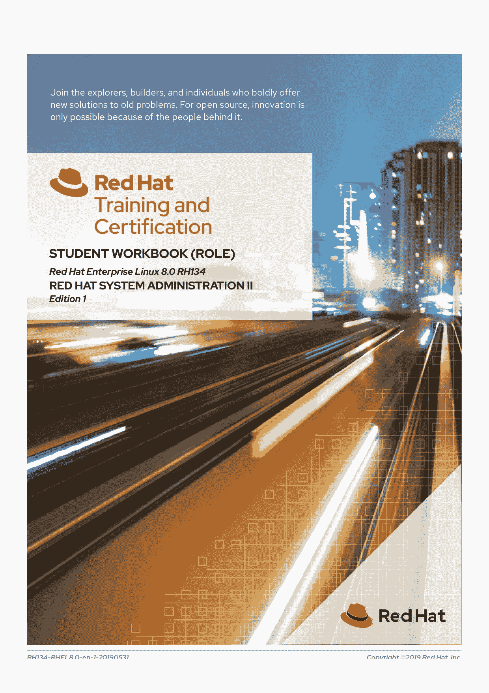
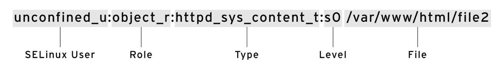
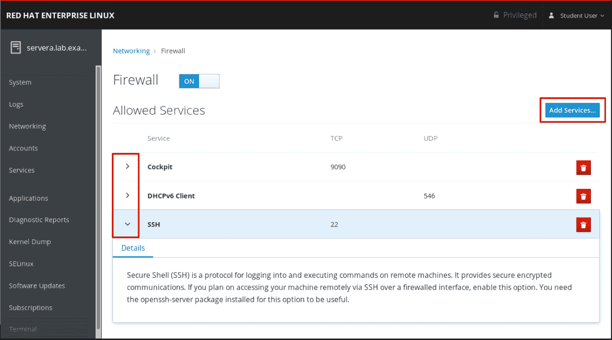
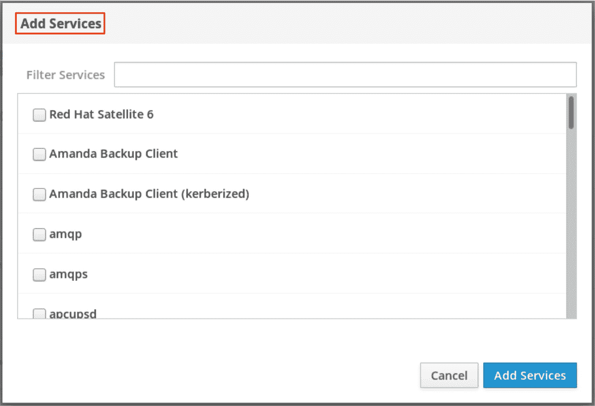
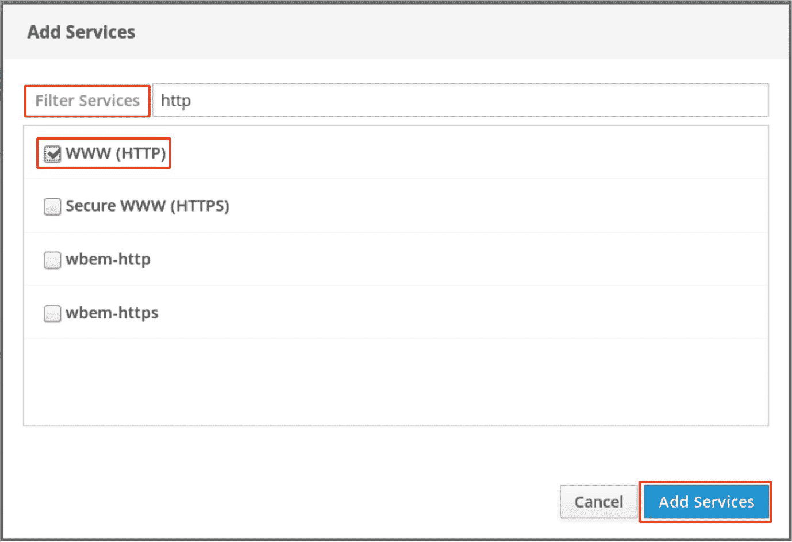
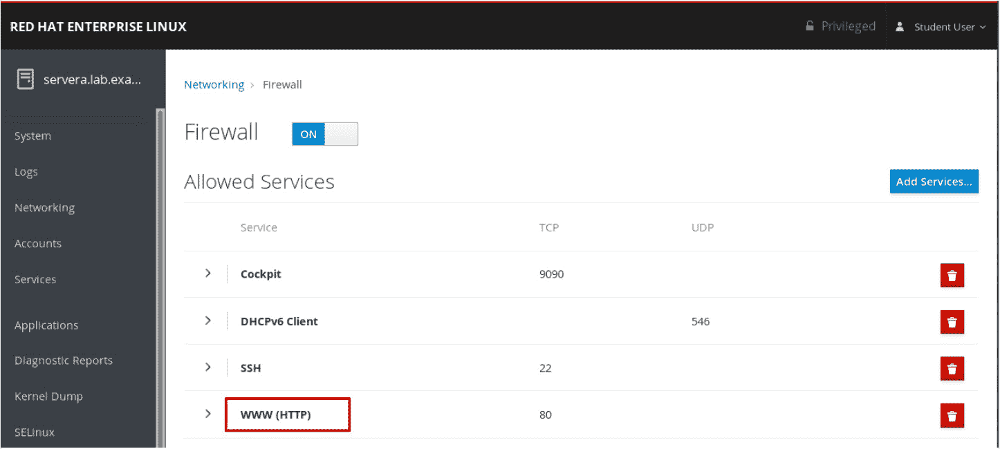
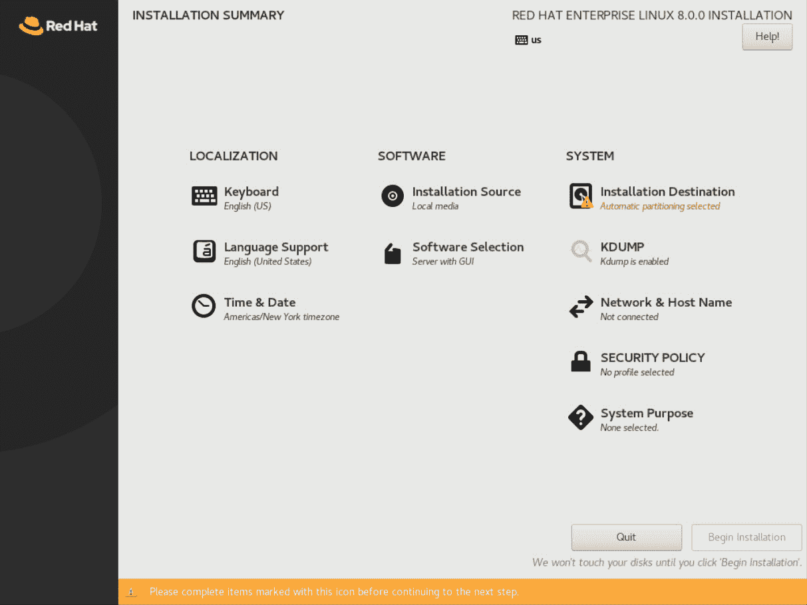
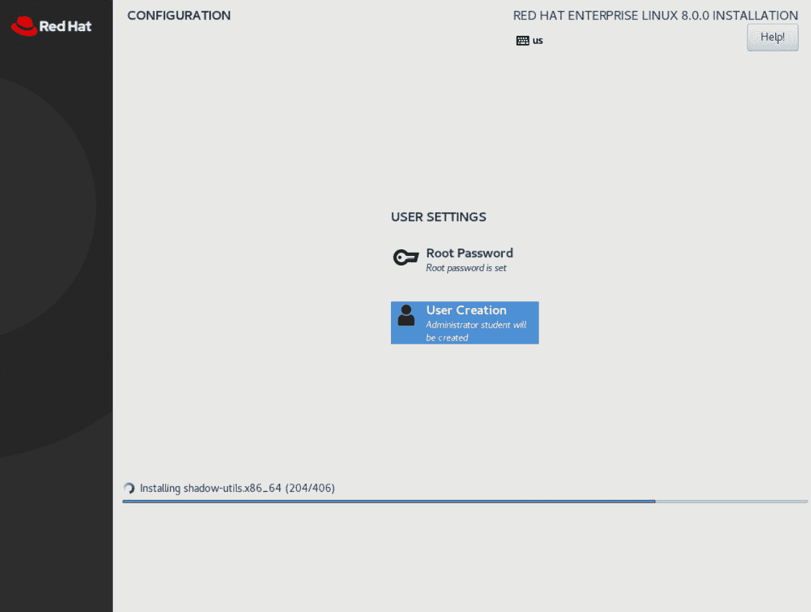
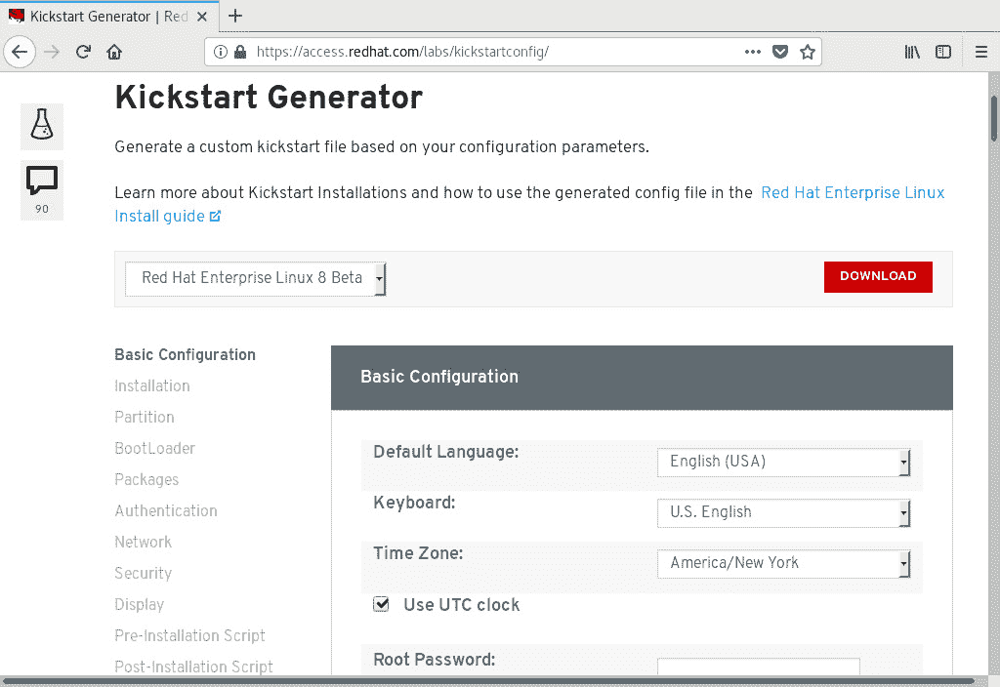
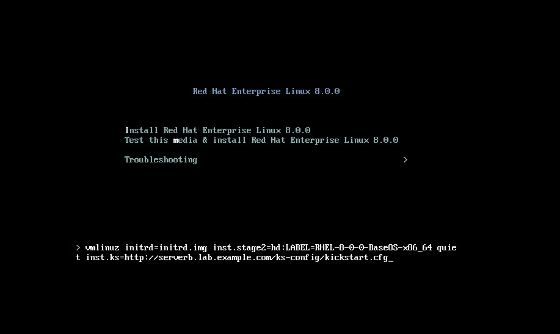

# Red Hat 系统管理 II 学生练习册





加入探险者、建设者以及大胆为旧问题提供新解决方案的个人。对于开源而言，创新之所以可能，是因为其背后的人。


**作者：**
Fiona Allen, Adrian Andrade, Herve Quatremain, Victor Costea, Snehangshu Karmakar, Marc Kesler, Saumik Paul

**编辑：**
Philip Sweany, Ralph Rodriguez, David Sacco, Seth Kenlon, Heather Charles


未经 Red Hat, Inc. 事先书许可，本出版物的任何部分不得存储在检索系统中，不得以任何方式传输或复制，包括但不限于影印、摄影、磁性、电子记录或其他记录。

本教学计划（包括此处提供的所有材料）均不提供 Red Hat, Inc. 的任何保证。Red Hat, Inc. 对因使用或误用此处内容或细节而引起的损害或法律行动不承担任何责任。

如果您认为红帽培训材料正被使用、复制或以不当分发，请发送电子邮件至 `training@redhat.com` 或拨打免费电话（美国）`+1 (866) 626-2994` 或 `+1 (919) 754-3700`。

Red Hat、Red Hat Enterprise Linux、Shadowman Logo、JBoss、Hibernate、Fedora、Infinity Logo 和 RHCE 均为 Red Hat, Inc. 在美国和其他国家注册的商标。

Linux® 是 Linus Torvalds 在美国及其他国家的注册商标。

Java® 是 Oracle 和/或其关联公司的注册商标。

XFS® 是 Silicon Graphics International Corp. 或其子公司在美国和/或其他国家的注册商标。

OpenStack® 标识和 OpenStack 标志均为 OpenStack Foundation 在美国及其他国家的注册商标/服务标记或商标/服务标记，并经 OpenStack Foundation 许可使用。我们与 OpenStack Foundation 或 OpenStack 社区没有附属关系，不受其认可或赞助。

所有其他商标均为其所有者的财产。

**贡献者：** Achyut Madhusudan, Rob Locke, Rudolf Kastl, Prashant Rastogi, Heider Souza, Michael Phillips, Dallas Spohn


## 指导练习：添加分区、文件系统和持久化挂载
## 管理交换空间
## 指导练习：管理交换空间
## 实验：管理基础存储
### 总结

## 8. 实现高级存储功能
### 使用 Stratis 管理分层存储
### 指导练习：使用 Stratis 管理分层存储
### 使用 VDO 进行存储压缩和去重
### 指导练习：使用 VDO 进行存储压缩和去重
### 实验：实现高级存储功能
### 总结

## 9. 访问网络附属存储
### 使用 NFS 挂载网络附属存储
### 指导练习：使用 NFS 管理网络附属存储
### 自动挂载网络附属存储
### 指导练习：自动挂载网络附属存储
### 实验：访问网络附属存储
### 总结

## 10. 控制启动过程
### 选择启动目标
### 指导练习：选择启动目标
### 重置根密码
### 指导练习：重置根密码
### 启动时修复文件系统问题
### 指导练习：启动时修复文件系统问题
### 实验：控制启动过程
### 总结

## 11. 管理网络安全
### 管理服务器防火墙
### 指导练习：管理服务器防火墙
### 控制 SELinux 端口标记
### 指导练习：控制 SELinux 端口标记
### 实验：管理网络安全
### 总结

## 12. 安装 Red Hat Enterprise Linux
### 安装 Red Hat Enterprise Linux
### 指导练习：安装 Red Hat Enterprise Linux
### 使用 Kickstart 自动化安装
### 指导练习：使用 Kickstart 自动化安装
### 安装和配置虚拟机
### Quiz：安装和配置虚拟机
### 实验：安装 Red Hat Enterprise Linux
### 总结

## 13. 综合复习
### 综合复习
### 实验：修复启动问题和维护服务器
### 实验：配置和管理文件系统与存储
### 实验：配置和管理服务器安全

## 文档规范
### 参考文献
`References` 描述了在哪里找到与主题相关的外部文档。

### 注释
`Notes` 是针对当前任务的提示、快捷方式或替代方案。忽略注释不会产生负面后果，但你可能会错过某些让工作变得更轻松的技巧。

#### 重要
`Important` 框详细说明了容易被忽略的内容：仅适用于当前会话的配置更改，或者在更新之前需要重启的服务。忽略标记为 `Important` 的框不会导致数据丢失，但可能会导致烦恼和沮丧。

### 警告
`Warnings` 不应被忽略。忽略警告极有可能导致数据丢失。

## 引言
### 红帽系统管理员 II
本课程专为已完成 Red Hat System Administration I (`RH124`) 的学生设计。Red Hat System Administration II (`RH134`) 侧重于成为全职 Linux 员所需的所需的关键任务，并通过红帽认证系统管理员（RHCSA）考试来验证这些技能。本课程将深入探讨企业级 Linux 管理，包括文件系统和分区、逻辑卷、SELinux、防火墙和故障排除。

## 课程目标
- 扩展和加强在 Red Hat System Administration I (`RH124`) 课程中学技能。
- 构建 `RHCSA` 认证红帽 Enterprise Linux 系统管理员所需的技能。

## 目标读者
- 本课程专为学生设计


已完成红帽系统管理 I (`RH124`) 的课程。主题的安排方式使得学生不适合将 `RH134` 作为课程的切入点。鼓励未修过之前的红帽课程的学生，如果他们是 Linux 新手，可以参加系统管理 I (`RH124`)；如果他们具有企业级 Linux（Enterprise Linux）管理经验，可以参加 RHCSA 快速通道课程 (`RH200`)。

## 先决条件
- 上过过红帽系统管理 I (`RH124`) 课程或具有同等知识。

RH134-RHEL8.0-en-1-20190531


### 简介

### 课堂环境介绍
图 0.1：课堂环境

在本课程中，用于实践学习活动的主要计算机系统是 `workstation`。

学生在这些活动还会使用另外两台机器：`servera` 和 `serverb`。这三个系统都在 `lab.example.com` 域下。

所有学生计算机系统都有一个标准用户账户 `student`，密码为 `student`。所有学生系统上的 root 密码均为 `redhat`。

### 课堂机器

| 机器名称 | IP 地址 | 角色 |
| :--- | :--- | :--- |
| `bastion.lab.example.com` | `172.25.250.254` | 连接学生私有网络到课堂服务器的网关系统（必须始终运行） |
| `workstation.lab.example.com` | `172.25.250.9` | 用于系统管理的图形工作站 |
| `servera.lab.example.com` | `172.25.250.10` | 第一台服务器 |
| `serverb.lab.example.com` | `172.25.250.11` | 第二台服务器 |

`bastion` 的主要功能是充当连接学生机器网络与课堂网络之间的路由器。如果 `bastion` 宕机，其他学生机器将只能访问单个学生网络上的系统。

RH134-RHEL8.0-en-20190531


简介

课堂中的几个系统提供支持服务。两台服务器 `content.example.com` 和 `materials.example.com` 是实践活动使用的软件和实验材料的来源。关于如何使用这些服务器的信息将在相应活动的说明中提供。它们由 `classroom.example.com` 虚拟机提供。为了正常使用实验室，`classroom` 和 `bastion` 应该始终运行。

### 注意事项
在登录 `servera` 或 `serverb` 时，你可能会看到一条关于激活 `cockpit` 的消息。可以忽略该消息。

```bash
[student@workstation ~]$ ssh student@serverb
Warning: Permanently added 'serverb,172.25.250.11' (ECDSA) to the list of known hosts.
Activate the web console with: systemctl enable --now cockpit.socket
[student@serverb ~]
```

## 控制你的系统
学生在红帽在线学习课堂中分配了远程计算机。这些计算机通过托管在 `rol.redhat.com` http://rol.redhat.com 的 Web 应用程序访问。学生应使用他们的红帽客户门户用户凭登录该站点。

### 控制虚拟机
你课堂环境中的虚拟机通过网页进行控制。课堂中每台虚拟机的状态显示在页面“在线实验室”（Online Lab）标签页下。

### 机器状态

| 虚拟机 | 说明 | 状态 |
| :--- | :--- | :--- |
| | 虚拟机正在启动。 | 启动中 (STARTING) |
| | 虚拟机正在运行并可用（或在启动时，很快将可用）。 | 已启动 (STARTED) |
| | 虚拟机正在关闭。 | 停止中 (STOPPING) |
| | 虚拟机已完全关闭。启动时，虚拟机将进入与关闭时相同的状态（磁盘将被保留）。 | 已停止 (STOPPED) |
| | 正在进行虚拟机的初始创建。 | 发布中 (PUBLISHING) |
| | 虚拟机正在等待其他虚拟机启动。 | 等待启动 (WAITING_TO_START) |

根据机器的状态，可以选择以下操作。

RH134-RHEL8.0-en-20190531


简介

### 课堂/机器操作

| 按钮或操作 | 说明 | 操作 |
| :--- | :--- | :--- |
| | 创建 ROL 课堂。创建课堂所需的所有虚拟机并启动它们。可能需要几分钟完成。 | 准备实验室 (PROVISION LAB) |
| | 删除 ROL 课堂。删除课堂中的所有虚拟机。注意：磁盘上生成的任何工作都会丢失。 | 删除实验室 (DELETE LAB) |
| | 启动课堂中的所有虚拟机。 | 启动实验室 (START LAB) |
| | 停止课堂中的所有虚拟机。 | 关闭实验室 (SHUTDOWN LAB) |
| | 在浏览器中打开新标签页并连接到虚拟机的控制台。学生可以直接登录虚拟机并运行命令。在大多数情况下，学生应该登录到 `workstation` 虚拟机并使用 `ssh` 连接到其他虚拟机。 | 打开控制台 (OPEN CONSOLE) |
| | 启动（电源）虚拟机。 | 启动 (ACTION → Start) |
| | 正常关闭虚拟机，保留磁盘内容。 | 关 (ACTION → Shutdown) |
| | 强制关闭虚拟机，保留磁盘内容。这等同于从物理机器断电。 | 关机 (ACTION → Power Off) |
| | 强制关闭虚拟机并将磁盘重置为初始状态。注意：生成的任何工作都会丢失。 | 重置 (ACTION → Reset) |

在练习开始时，如果指示重置单台虚拟机，点击 `ACTION → Reset`。在练习开始时，如果指示重置所有虚拟机，点击 `DELETE LAB` 删除整个环境。在实验室删除后，你可以点击 `PROVISION LAB` 准备一个新的实验室。

### 警告
`DELETE LAB` 操作无法撤销。你在课堂环境中已完成的所有工作都将丢失。

### 自动停止计时器
红帽在线学习入学学生可以使用一定的时间。为了帮助节省分配时间，ROL 课堂关联了一个倒计时计时器，计时器过期后将关闭课堂环境。

要调整计时器，点击 `MODIFY` 显示新的自动停止对话框。设置课堂应自动停止的小时。点击 `ADJUST TIME` 将此更改应用于计时器设置。

RH134-RHEL8.0-en-20190531


简介

# 国际化

## 用户语言选择
**用户可能希望在桌面环境中使用与系统默认设置不同的语言。他们可能还希望为账户使用不同的键盘布局或输入法。

### 语言设置
在 GNOME 桌面环境中，用户在首次登录时可能会被提示设置首选语言和输入法。如果没有，个人用户调整首选语言和输入法设置的最简单方法是使用“区域与语言”（Region & Language）应用程序。

你可以通过两种方式启动此应用程序：在终端窗口中运行 `gnome-control-center region` 命令，或者在顶栏右角的系统菜单中选择设置按钮（图标为交叉螺丝刀和扳手）。

在打开的窗口中，选择“区域与语言”。点击语言框并从列表中选择首选语言。这将把格式设置设置为该语言的默认值。下次登录时，这些更改将完全生效。

这些设置会影响 GNOME 桌面环境以及在其内部启动的应用程序（如 `gnome-terminal`）。但是默认情况下，如果通过远程系统的 `ssh` 登录或在虚拟控制台（如 `tty5`）上进行文本登录，这些设置不会适用于该账户。


你可以让你的 shell 环境使用与图形环境相同的 `LANG` 设置，即使你通过基于文本的虚拟控制台或 ssh 登录也是如此。实现此点的方法之一是在 `~/.bashrc` 文件中放置类似于下面的代码。此示例代码将文本登录时使用的语言设置为与用户当前的 GNOME 桌面环境设置的语言：

```bash
i=$(grep 'Language=' /var/lib/AccountsService/users/${USER} \
| sed 's/Language=//')

if [ "$i" != "" ]; then
export LANG=$i
fi
```

日语、韩语、中文以及其他非拉丁字符集的语言可能无法在文本的虚拟控制台上正常显示。

通过在命令行上设置 `LANG` 变量，可以让单个命令使用另一种语言：

RH134-RHEL8.0-en-1-20190531

xv


### 介绍
```
[user@host ~]$ LANG=fr_FR.utf8 date
jeu. avril 25 17:55:01 CET 2019
```
随后的命令将恢复到使用系统的默认语言进行输出。可以使用 `locale` 命令来确定 `LANG` 的当前值以及其他相关的环境变量。

### 输入法设置
Red Hat Enterprise Linux 7 或更高版本中的 GNOME 3 自动使用 IBus 输入法选择系统，这使得快速更改键盘布局和输入法变得简单。

可以使用“区域与语言”应用程序来启用备输入法。在“区域与语言”应用程序窗口中，“输入源”框显示当前可用的输入法。默认情况下，英语（美国）可能是唯一的可用方法。高亮英语（美国）并点击键盘图标可以查看当前的键盘布局。

要添加另一种输入法，请点击“输入源”窗口左下角的 `+` 按钮。

将打开“添加输入源”窗口。选择您的语言，然后选择您偏好的输入法或键盘布局。

当配置了多一个输入法时，用户可以通过输入 `Super+Space`（有时称为 `Windows+Space`）在它们之间快速切换。GNOME 顶部栏还会出现一个状态指示器，它具有两个功能：它指示哪种输入法处于激活状态，并作为一个菜单，用于在输入法之间切换或选择更复杂输入方法的高级功能。

某些方法标记有齿轮，这表示这些方法具有高级配置选项和功能。例如，日语（假名汉字）输入法允许用户用拉丁字母预编辑文本，并使用 `Down Arrow` 和 `Up Arrow` 键选择所需的正确字符。

美国英语使用者可能也会发现这很有用。例如，在“英语（美国）”下有一个键盘布局“英语（国际版 AltGr 死键）”，它将 PC 104/105 键键盘上的 `AltGr`（或右 Alt）视为视为“次级 Shift”修饰键和死键激活键，用于输入额外的字符。此外还有 Dvorak 和其他备用布局可用。

### 注意
如果你知道字符的 Unicode 代码点，则可以在 GNOME 桌面环境中输入任何 Unicode 字符。输入 `Ctrl+Shift+U`，然后输入代码点。在输入 `Ctrl+Shift+U` 之后，将显示一个带下划线的 `u`，表示系统正在等待输入 Unicode 代码点。

例如，希腊小写字母 lambda 的代码点为 `U+03BB`，可以通过输入 `Ctrl+Shift+U`，然后 `03BB`，最后按 `Enter` 来输入。

### 系统全局默认语言设置
系统的默认语言设置为美国英语，使用 Unicode 的 UTF-8 编码作为字符集（`en_US.utf8`），但可以在安装期间或之后进行更改。

从命令行，root 用户可以使用 `localectl` 命令更改系统全局区域语言设置。如果不带参数运行 `localectl`，它将显示当前的系统全局区域语言设置。

xvi
RH134-RHEL8.0-en-1-20190531


### 介绍
要设置系统全局默认语言，运行命令 `localectl set-locale LANG= locale`，其中 `locale` 是本章“语言代码参考”表中 `LANG` 环境变量的适当值。更改将在用户下次登录时生效，并存储在 `/etc/locale.conf` 中。

```
[root@host ~]# localectl set-locale LANG=fr_FR.utf8
```

在 GNOME 中，管理用户可以通过点击窗口右上角的“登录屏幕”按钮从“区域与语言”更改此设置。更改图形登录屏幕的语言也将调整存储在 `/etc/locale.conf` 配置文件中的全局默认语言设置。

#### 重要
如 `tty4` 等文本虚拟控制台在可以显示的字体方面比运行图形环境的虚拟控制台中的终端或 ssh 会话的伪终端更有限。例如，日语、韩语和中文字符在文本虚拟控制台上可能无法按预期显示。因此，你应该考虑使用英语或其他带有拉丁字符集的语言作为系统全局默认语言。

同样，文本虚拟控制台支持的输入法也较有限，而且这是与图形桌面环境分开管理的。

可用的全局输入设置可以通过 `localectl` 为文本虚拟控制台和图形环境进行配置。详情请参阅 `localectl` 和 `vconsole` 手页。

### 语言包
名为 `langpacks` 的特殊 RPM 包用于为特定语言提供支持。这些 `langpacks` 使用依赖关系为其他软件包安装本地化、字典和翻译。

要列出已安装和可能安装的 `langpacks`，使用 `yum list langpacks`：

```
[root@host ~]# yum list langpacks-*
```
更新订阅库。
已安装软件包
langpacks-en.noarch 1.0-12.el8 @AppStream
可用软件包
langpacks-af.noarch 1.0-12.el8 rhel-8-for-x86_64-appstream
langpacks-am.noarch 1.0-12.el8 rhel-8-for-x86_64-appstream
langpacks-ar.noarch 1.0-12.el8 rhel-8-for-x86_64-appstream
langpacks-as.noarch 1.0-12.el8 rhel-8-for-x86_64-appstream
langpacks-ast.noarch 1.0-12.el8 rhel-8-for-x86_64-appstream

要添加语言支持，请安装相应的 `langpacks` 包。例如，以下命令添加法语支持：

```bash
[root@host ~]# yum install langpacks-fr
```
RH134-RHEL8.0-en-1-20190531

xvii


### 介绍
使用 `yum repoquery --whatsupplements` 来确定由语言包可能安装的 RPM 包：

```
[root@host ~]# yum repoquery --whatsupplements langpacks-fr
```
更新订阅库。
更新订阅库。
上次元数据检查于 0:01:33 前（2019 年 2 月 6 日星期三 上 10:47:24 CST）。
glibc-langpack-fr-0:2.28-18.el8.x86_64
gnome-getting-started-docs-fr-0:3.28.2-1.el8.noarch
hunspell-fr-0:6.2-1.el8.noarch
hyphen-fr-0:3.0-1.el8.noarch
libreoffice-langpack-fr-1:6.0.6-9.el8.x86_64
man-pages-fr-0:3.70-16.el8.noarch
mythes-fr-0:2.3-10.el8.noarch

#### 重要
语言包包使用 RPM 弱依赖关系，以便在需要它的核心包也安装时才安装补充软件包。

例如，如前面的示例所示，安装 `langpacks-fr` 时，只有当系统中也安装了 `mythes` 同义词时，才会安装 `mythes-fr` 包。

如果随后在该系统上安装 `mythes`，由于已安装的 `langpacks-fr` 包的弱依赖关系，`mythes-fr` 包也将自动安装。

### 参考文献
`locale(7)`, `localectl(1)`, `locale.conf(5)`, `vconsole.conf(5)`, `unicode(7)` 和 `utf-8(7)` 手页


图形桌面环境 X11 布局名称与在 `localectl` 中的名称之间的转换可以在 `/usr/share/X11/xkb/rules/base.lst` 文件中找到。

# 语言代码参考

### 注意
此表可能未反映你系统上所有可语言包（langpacks）。使用 `yum info langpacks-SUFFIXIX` 获取有关特定语言包包的更多信息。

### 语言代码

| LANGUAGE | LANGPACKS | $LANG VALUE | SUFFIX |
| :--- | :--- | :--- | :--- |
| 英语（美国） | en | `en_US.utf8` | xviii RH134-RHEL8.0-en-1-20190531 |


### 简介

| LANGUAGE | LANGPACKS | $LANG VALUE | SUFFIX |
| :--- | :--- | :--- | :--- |
| 阿萨米亚语 | as | `as_IN.utf8` | xix RH134-RHEL8.0-en-1-20190531 |
| 孟加语 | bn | `bn_IN.utf8` | xx |
| 中文（简体） | zh_CN | `zh_CN.utf8` | |
| 中文（繁体） | zh_TW | `zh_TW.utf8` | |
| 法语 | fr | `fr_FR.utf8` | |
| 德语 | de | `de_DE.utf8` | |
| 古吉拉特语 | gu | `gu_IN.utf8` | |
| 印地语 | hi | `hi_IN.utf8` | |
| 意大利语 | it | `it_IT.utf8` | |
| 日语 | ja | `ja_JP.utf8` | |
| 卡纳纳达语 | kn | `kn_IN.utf8` | |
| 韩语 | ko | `ko_KR.utf8` | |
| 马耶拉姆语 | ml | `ml_IN.utf8` | |
| 马拉地语 | mr | `mr_IN.utf8` | |
| 奥里亚语 | or | `or_IN.utf8` | |
| 葡萄牙语（巴西） | pt_BR | `pt_BR.utf8` | |
| 旁遮普语 | pa | `pa_IN.utf8` | |
| 俄语 | ru | `ru_RU.utf8` | |
| 西班牙语 | es | `es_ES.utf8` | |
| 泰米尔语 | ta | `ta_IN.utf8` | |
| 泰卢固语 | te | `te_IN.utf8` | RH134-RHEL8.0-en-1-20190531 |


# 第 1 章：提高命令行效率

### 目标
通过使用 `Bash` shell 的高级功能、shell 脚本以及 Red Hat Enterprise Linux 提供的各种工具更高效地运行命令。

### 目标
- 通过编写简单的 shell 脚本实现命令序列的自动化。
- 在脚本或从命令行使用 `for` 循环和条件语句，对项目列表更高效地运行命令。
- 使用 `grep` 命令和正则表达式在日志文件和命令输出中查找匹配模式的文本。

### 节次
- 编写简单的 Bash 脚本（以及引导性练习）
- 使用循环更高效地运行命令（以及引导性练习）
- 使用正则表达式在命令输出中匹配文本（以及引导性练习）

## 实验：提高命令行效率
RH134-RHEL8.0-en-1-20190531
1


# 第 1 章 | 提高命令行效率：编写简单的 BASH 脚本

### 目标
完成本节后，你应该能够通过编写一个简单的 shell 脚本来实现命令序列的自动化。

### 创建和执行 BASH shell 脚本
许多简单、常见的系统管理任务可以使用命令行工具完成。具有更大复杂性的任务通常需要将多个命令链在一起，并在它们之间传递结果。使用 `Bash` shell 环境和脚本功能，可以将 Linux 命令组合成 shell 脚本，从而轻松地解决现实世界重复且困难的问题。

在最简单的形式中，`Bash` shell 脚本是一个包含命令列表的可执行文件，并可能带有用于控制整个任务决策的编程逻辑。如果编写得良好，shell 脚本本身就是一个强大的命令行工具，并可以被其他脚本利用。

熟练掌握 shell 脚本对于任何操作环境中的成功系统管理至关重要。在企业环境中，掌握 shell 脚本知识非常关键，因为脚本的使用可以提高常规任务完成的效率和性。

你可以通过在文本编辑器中打开一个新的空文件来创建一个 `Bash` shell 脚本。可以使用任何文本编辑器，但高级编辑器（如 `vim` 或 `emacs`）理解 `Bash` shell 语法并提供颜色高亮。高亮有助于识别常见错误，例如错误的语法、不配对的引号、未闭合的括号、大括号和括号等。

#### 指定命令解释器
脚本的第一行以 `#!` 符号开头，由于这两个字符（井号 sharp 和感叹号 bang）的名字，通常被称为 `sh-bang` 或 `she-bang`。这种特定的双字节魔数表示表示解释型脚本；符号随后的语法是处理此脚本行所需的正确命令解释器的完全限定文件名。

要了解魔数如何在 Linux 中指示文件类型，请参见 `file(1)` 和 `magic(5)` 手页。对于使用 `Bash` 脚本语法的脚本文件，shell 脚本的第一行如下：

```bash
#!/bin/bash
```

#### 执行 Bash shell 脚本
完成的 shell 脚本必须是可执行的才能作为普通命令运行。使用 `chmod` 命令添加执行权限，可能还会结合 `chown` 命令更改脚本的所有权。仅为脚本的预期用户授予执行权限。

如果你将脚本放在 shell 环境变量 `PATH` 列出的目录之一，你就可以像调用任何其他命令一样仅使用文件名来调用 shell 脚本。shell 使用第一行...

2
RH134-RHEL8.0-en-20190531


# 第 1 章 | 提高命令行效率：特殊字符的引用

许多字符和单词对 `Bash` shell 具有特殊含义。然而，你有时想要这些字符的字面值，而不是它们的含义。

为了实现这一点，请使用三种工具之一来移除（或转义）特殊含义：反斜杠（`\`）、单引号（`''`）或双引号（`""`）。

反斜杠（`\`）转义字符移除其后字符的特殊含义。例如，要使用 `echo` 命令显示字面字符串 `# not a comment`，`#` 不能被 `Bash` 解释为具有特殊含义。

```bash
echo \# not a comment
# not a comment
```

当你需要在字符串中转义多个字符时，可以使用多次转义字符或使用单引号（`''`）。单引号保留包含的所有字符的字面含义。观察转义字符和单引号的作用：

```bash
echo # not a comment
# not a comment
echo \# not a comment
# not a comment
echo \# not a comment
# not a comment
echo '# not a comment'
# not a comment
```

使用双引号抑制通配符扩展，但允许命令和变量替换。变量替换在概念上与命令替换相同，但可以使用括号语法。观察下方各种形式的引号使用示例。

问号（`?`）是一个也需要防止扩展的元字符。

```bash
var=$(hostname -s); echo $var
host
echo "***** hostname is ${var} *****"
***** hostname is host
echo Your username variable is \$USER.
```

3
RH134-RHEL8.0-en-20190531


# 第 1 章 | 提高命令行效率：变量替换和命令替换

```bash
echo "Will variable $var evaluate to $(hostname -s)?"
Will variable host evaluate to host?
echo 'Will variable $var evaluate to $(hostname -s)?'
Will variable $var evaluate to $(hostname -s)?
echo "\"Hello, world\""
"Hello, world"
echo '"Hello, world"'
'Hello, world'
```


# "Hello, world"

### 从 Shell 脚本提供输出

`echo` 命令通过将文本作为参数传递给命令来显示任意文本。

默认情况下，显示在标准输出 (`STDOUT`) 上，但也可以使用输出重定向将其定向到标准错误 (`STDERR`)。在接下来的简单 Bash 脚本中，`echo` 命令向 `STDOUT` 显示消息 "Hello, world"。

```bash
[user@host ~]$ cat ~/bin/hello

#!/bin/bash

echo "Hello, world"

[user@host ~]$ hello

Hello, world
```

### 注意
该用户可以直接在提示符处运行 `hello`，因为 `~/bin`（`/home/user/bin`）目录已在用户的 `PATH` 变量中，且其中的 `hello` 脚本是可执行的。只要在 `PATH` 列表中位于 `/home/user/bin` 之前的目录中没有名为 `hello` 的其他可执行文件，shell 就会在那里找到该脚本。

`echo` 命令在 shell 脚本中被广泛用于显示信息性或错误消息。

这些消息可以是脚本进展的有用指示，并可以重定向到标准输出、标准错误，或重定向到日志文件进行存档。显示错误消息时，将它们定向到 `STDERR` 是良好的做法，以便更容易区分错误消息和普通状态消息。

```bash
[user@host ~]$ cat ~/bin/hello

#!/bin/bash

echo "Hello, world"

echo "ERROR: Houston, we have a problem." >&2

[user@host ~]$ hello 2> hello.log

Hello, world

[user@host ~]$ cat hello.log

ERROR: Houston, we have a problem.
```

`echo` 命令在尝试调试有问题的 shell 脚本时也非常有帮助。在脚本中未符合预期的部分添加 `echo` 语句，有助于澄清正在执行的命令以及调用的变量值。

# 第 1 章 | 提高命令行效率

### 参考文献
`bash(1)`, `magic(5)`, `echo(1)` 和 `echo(1p)` 手册页。

## 引导练习：编写简单的 Bash 脚本

在本次练习中，你将编写一个包含命令序列的简单 Bash 脚本并从命令行运行它。

### 预期结果
你应该能够：
* 编写并执行一个简单的 Bash 脚本。
* 将简单 Bash 脚本的输出重定向到文件。

## 在开始之前
1. 使用密码 `student` 登录到工作站。
2. 在工作站上运行 `lab console-write start` 命令。该命令运行一个启动脚本，判断服务器 `servera` 是否在网络上可访问。如果不可用，脚本将提示你。它还需要需要时安装 `vim-enhanced` 包。

```bash
[student@workstation ~]$ lab console-write start
```

3. 从工作站以 `student` 身份开启 `servera` 的 SSH 会话。系统配置为使用 SSH 密钥认证，因此不需要密码。

```bash
[student@workstation ~]$ ssh student@servera
...output omitted...
[student@servera ~]$
```

### 2. 创建并执行一个简单的 Bash 脚本。
2.1. 使用 `vim` 编辑器在主目录下创建一个新文本文件，并命名为 `firstscript.sh`。

```bash
[student@servera ~]$ vim firstscript.sh
```

2.2. 插入以下文本并保存文件。注意井号（##）的数量是任意的。

```bash
#!/bin/bash
echo "This is my first script" > ~/output.txt
echo "#####################" >> ~/output.txt
```

2.3. 使用 `sh` 命令执行脚本。
```bash
[student@servera ~]$ sh firstscript.sh
```

2.4. 检查脚本生成的输出文件。
```bash
[student@servera ~]$ cat output.txt
This is my first script
```

### 3. 在 firstscript.sh 脚本中添加更多命令、执行并检查输出。
3.1. 使用 `vim` 编辑器编辑 `firstscript.sh`。
```bash
[student@servera ~]$ vim firstscript.sh
```

3.2. 将以下行追加到 `firstscript.sh` 文件。
```bash
#!/bin/bash
echo "This is my first script" > ~/output.txt
echo "#####################" >> ~/output.txt
echo "LIST DEVICES" >> ~/output.txt
lsblk >> ~/output.txt
echo "#####################" >> ~/output.txt
echo "FILESYSTEM FREE STATUS" >> ~/output.txt
df -h >> ~/output.txt
echo "#####################" >> ~/output.txt
```

3.3. 使用 `chmod` 命令使 `firstscript.sh` 文件变为可执行。
```bash
[student@servera ~]$ chmod +x firstscript.sh
```

3.4. 执行 `firstscript.sh` 脚本。
```bash
[student@servera ~]$ ./firstscript.sh
```

3.5. 检查脚本生成的输出文件。
```bash
[student@servera ~]$ cat output.txt
This is my first script
```

### 4. 删除练习文件并退出 servera。
4.1. 删除脚本文件 `firstscript.sh` 和输出文件 `output.txt`。
```bash
[student@servera ~]$ rm firstscript.sh output.txt
```

4.2. 退出 `servera`。
```bash
[student@servera ~]$ exit
logout
Connection to servera closed.
[student@workstation ~]$
```

### 完成
在在站上运行 `lab console-write finish` 脚本完成本次练习。
```bash
[student@workstation ~]$ lab console-write finish
```


```bash
[user@host ~]$ for HOST in host1 host2 host3; do echo $HOST; done host1
host2
host3
```

```bash
[user@host ~]$ for HOST in host{1,2,3}; do echo $HOST; done host1
host2
host3
```

```bash
[user@host ~]$ for HOST in host{1..3}; do echo $HOST; done host1
```

RH134-RHEL8.0-en-1-20190531
9


第 1 章 | 提高命令行效率
host2
host3

```bash
[user@host ~]$ for FILE in file*; do ls $FILE; done
filea
fileb
filec
```

```bash
[user@host ~]$ for FILE in file{a..c}; do ls $FILE; done
filea
fileb
filec
```

```bash
[user@host ~]$ for PACKAGE in $(rpm -qa | grep kernel); \ do echo "$PACKAGE was installed on \
$(date -d @$(rpm -q --qf "%{INSTALLTIME}\n" $PACKAGE))"; done
```
abrt-addon-kerneloops-2.1.11-12.el7.x86_64 was installed on Tue Apr 22 00:09:07 EDT 2014
kernel-3.10.0-121.el7.x86_64 was installed on Thu Apr 10 15:27:52 EDT 2014
kernel-tools-3.10.0-121.el7.x86_64 was installed on Thu Apr 10 15:28:01 EDT 2014
kernel-tools-libs-3.10.0-121.el7.x86_64 was installed on Thu Apr 10 15:26:22 EDT 2014

```bash
[user@host ~]$ for EVEN in $(seq 2 2 10); do echo "$EVEN"; done
2
4
6
8
10
```

## 在脚本中使用退出码（EXIT CODES）

脚本处理完所有内容后，会返回到调用它的进程。然而，某些情况下，我们希望在脚本完成之前退出，例如遇到错误条件时。这可以通过在脚本中使用 `exit` 命令来实现。当脚本遇到 `exit` 命令时，它会立即退出，不再处理脚本的剩余部分。

执行 `exit` 命令时可以带有一个可选的 `0` 到 `255` 之间的整数参数，该参数表示退出码。退出码是进程完成后返回的 own。退出码值 `0` 表示没有错误。所有其他非零值均表示错误退出码。你可以使用不同的非零值来区分遇到的不同类型的错误。

此退出码会传回父进程，父进程将其存储在 `?` 变量中，并可以如下例所示通过 `$?` 进行访问。

```bash
[user@host bin]$ cat hello
#!/bin/bash
echo "Hello, world"
exit 0

[user@host bin]$ ./hello
Hello, world

[user@host bin]$ echo $?
0
```

如果调用 `exit` 命令时没有带参数，则脚本将退出并将最后执行命令的退出状态传递给父进程。

10
RH134-RHEL8.0-en-1-20190531

第 1 章 | 提高命令行效率

## 测试脚本输入

为了确保万无一失，在执行脚本前应对输入进行测试。

条件结构允许用户在脚本中引入判断，以便在满足特定条件时执行脚本的部分内容。

### 使用 if/then 结构

Bash 中简单的条件结构是 `if/then` 结构，其语法如下：

```bash
if <条件>; then
<语句>
...
<语句>
fi
```

使用这种结构，如果满足给定的条件，将执行一个或多个操作。如果未满足给定条件，则不执行任何操作。之前演示的数值、字符串和文件测试常用于条件测试。

### 使用 if/then/else 结构

`if/then` 结构可以进一步扩展，根据条件是否满足执行不同的操作集。这是通过 `if/then/else` 结构实现的。

```bash
if <条件>; then
<语句>
...
<语句>
else
<语句>
...
<语句>
fi
```

以下代码段演示了如何使用 `if/then` 结构在 `psacct` 服务未激活时启动它：

```bash
[user@host ~]$ systemctl is-active psacct > /dev/null 2>&1
[user@host ~]$ if [ $? -ne 0 ]; then
  sudo systemctl start psacct
fi
```

使用 `if/then/else` 结构可以根据条件是否满足来执行不同的操作。在 `psacct` 服务已激活时停止它：

```bash
[user@host ~]$ systemctl is-active psacct > /dev/null 2>&1
[user@host ~]$ if [ $? -ne 0 ]; then
  sudo systemctl start psacct
else
  sudo systemctl stop psacct
fi
```


最后，`if/then/else` 结构可以进一步扩展以测试多个条件，并在满足某个条件时执行不同的操作 set。该结构如下例所示：

```bash
if <CONDITION>; then
    <STATEMENT>
    ...
    <STATEMENT>
elif <CONDITION>; then
    <STATEMENT>
    ...
    <STATEMENT>
else
    <STATEMENT>
    ...
fi
```

在这个条件结构中，Bash 会按照给出的顺序测试条件。当它找到一个为真的条件时，Bash 会执行与条件相关的操作，然后跳过该条件结构的剩余部分。如果没有任何条件为真，Bash 将执行 `else` 子句中列出的操作。

以下代码段演示了如何使用 `if/then/elif/then/else` 语句：如果 `mariadb` 服务处于状态，则运行 `mysql` 客户端；如果 `postgresql` 服务激活，则运行 `psql` 客户端；如果 `mariadb` 和 `postgresql` 服务均未激活，则运行 `sqlite3` 客户端。

```bash
[user@host ~]$ systemctl is-active mariadb > /dev/null 2>&1
MARIADB_ACTIVE=$?
[user@host ~]$ sudo systemctl is-active postgresql > /dev/null 2>&1
POSTGRESQL_ACTIVE=$?
[user@host ~]$ if [ "$MARIADB_ACTIVE" -eq 0 ]; then
> mysql
> elif [ "$POSTGRESQL_ACTIVE" -eq 0 ]; then
> psql
> else
> sqlite3
> fi
```

# 第 1 章 | 提高命令行效率

## 引导练习：使用循环更高效地运行命令

在此练习中，你将使用循环高效地打印来自多个服务器的主机名。

### 学习目标
你应该能够创建一个 `for` 循环，在命令行和 shell 脚本中遍历项目列表。

#### 准备工作
1. 使用用户 `student` 登录工作站，密码为 `student`。
2. 在工作站上运行命令 `lab console-commands start`。该命令运行一个启动脚本，判断 `servera` 和 `serverb` 主机在网络上是否可用。如果它们不可用，脚本会提示你。

```bash
[student@workstation ~]$ lab console-commands start
```

### 1. 使用 `ssh` 和 `hostname` 命令将 `servera` 和 `serverb` 的主机名打印到标准输出。

```bash
[student@workstation ~]$ ssh student@servera hostname
servera.lab.example.com
[student@workstation ~]$ ssh student@serverb hostname
serverb.lab.example.com
```

### 2. 创建一个 `for` 循环更高效地执行相同的任务。

```bash
[student@workstation ~]$ for HOST in servera serverb
do
ssh student@${HOST} hostname
done
servera.lab.example.com
serverb.lab.example.com
```

### 3. 创建一个 shell 脚本来执行相同的 for 。

#### 3.1. 创建 `/home/student/bin` 目录存放 shell 脚本。
```bash
[student@workstation ~]$ mkdir ~/bin
```

#### 3.2. 验证新创建的目录是否在你的环境变量 `PATH` 中。
```bash
[student@workstation ~]$ echo $PATH
/home/student/.local/bin:/home/student/bin::/usr/local/bin:/usr/bin:/usr/local/sbin:/usr/sbin
```

#### 3.3. 在 `/home/student/bin/printhostname.sh` 创建一个 shell 脚本来执行 for 。使用 `cat` 命令验证 `printhostname.sh` 的内容。

```bash
[student@workstation ~]$ vim ~/bin/printhostname.sh
[student@workstation ~]$ cat ~/bin/printhostname.sh
#!/bin/bash
#Execute for loop to print server hostname.
for HOST in servera serverb
do
ssh student@${HOST} hostname
done
exit 0
```

#### 3.4. 确保新创建的脚本具有执行权限。
```bash
[student@workstation ~]$ chmod +x ~/bin/printhostname.sh
```

#### 3.5. 从主目录运行脚本。
```bash
[student@workstation ~]$ printhostname.sh
servera.lab.example.com
serverb.lab.example.com
```

#### 3.6. 验证脚本的退出码是否为 0。
```bash
[student@workstation ~]$ echo $?
0
```

### 完成
在工作站上运行 `lab console-commands finish` 脚本完成本次练习。
```bash
[student@workstation ~]$ lab console-commands finish
```
引导练习结束。

---

## 使用正则表达式在命令输出中匹配文本

### 目标
完成本节后，学生应该能够：
- 创建匹配所需数据的正则表达式。
- 将正表达式应用到文本文件中。
- 使用 `grep` 搜索文件和数据。

### 编写正则表达式
正则表达式提供了一种便于查找内容的匹配机制。`vim`、`grep` 和 `less` 命令都可以使用它们。`Perl`、`Python` 和 `C` 等编程语言也可以使用它们。

**图 1.0: 正则表达式基础**

#### 描述简单的正则表达式
最简单的正则表达式是精确匹配。精确匹配是指正则表达式中的字符与数据匹配。假设用户正在查看以下文件查找 `cat` 的出现：

```text
cat
dog
concatenate
dogma
category
educated
boondoggle
vindication
chilidog
```
`cat` 是 `c` 后接 `a` 后接 `t` 的精确匹配。

#### 匹配行的开头和结尾
上一节使用了精确匹配正则表达式。注意，无论搜索字符串出现在行的什么位置（开头、结尾或中间），正则表达式都会匹配。使用行锚点来控制正则表达式的位置。

- 搜索行开头使用脱号符号 (`^`)。
- 搜索行结尾使用美元符号 (`$`)。

使用相同的文件，`^cat` 表达式会匹配两个单词。`$cat` 表达式将找不到任何单词。

```text
cat
dog
concatenate
dogma
category
educated
boondoggle
vindication
chilidog
```
要定位文件中以 `dog` 结尾的行，使用该精确表达式和结尾锚点创建正则表达式 `dog$`。将 `dog$` 应用于文件将找到两个匹配：

```text
dog
chilidog
```
要定位唯一的单词，，使用起始和行尾锚点。例如，要定位作为唯一单词的 `cat`，请使用 `^cat$`。

```text
cat dog
cat
horse cat
cat pig
```

#### 在正则表达式中添加通配符和倍数
正则表达式使用点 (`.`) 来匹配任意单个字符（换行符除外）。正则表达式 `c.t` 搜索包含 `c` 后接任意单个字符再接 `t` 的字符串。示例匹配包括 `cat`、`concatenate`、`vindication`、`c5t` 和 `c$t`。

使用无限制的通配符无法预测匹配通配符的字符。要匹配特定字符，可以将无限制通配符替换为允许的字符。将正则表达式改为 `c[aou]t` 可以匹配以 `c` 开头，接 `a`、`o` 或 `u`，最后是 `t` 的模式。


倍器（Multipliers）是一种经常与通配符配合使用的机制。倍器应用于正则表达式中的前一个字符。常用的倍器之一是星号，或星形字符（`*`）。在正则表达式中，此倍器意味着匹配前一个表达式的零次或多次。你可以将 `*` 用于表达式，而不仅仅是字符。例如，`c[aou]*t`。正则表达式 `c.*t` 可以匹配 `cat`、`coat`、`culvert` 甚至 `ct`（`c` 和 `t` 之间零个字符）。匹配任何以 `c` 开头、跟随零或多个字符、并以 `t` 结尾的数据。

另一种类型的倍器将指示模式中所需的前一个字符的数量。

使用显式倍器的示例是 `'c.\{2\}t'`。此正则表达式将匹配任何以 `c` 开头、跟随恰好任意两个字符并以 `t` 结尾的单词。

`'c.\{2\}t'` 将匹配下面示例中的两个单词：

```
cat
coat convert
cart covert
cypher
```

### 注意事项
建议使用单引号封装正则表达式，因为它们通常包含 shell 的元字符（如 `$`、`*` 和 `{}`）。这确保了字符是由命令解释的，而不是由 shell 解析。

### 注意事项
本课程介绍了两种不同的元字符文本解析系统：shell 模式匹配（也称为文件通配符或文件名扩展）和正则表达式。由于这两个系统都使用相似的元字符（例如星号 `*`），但在元字符的解释和规则上存在差异，在充分掌握每一个系统之前，这两个系统可能会让人产生困惑。

模式匹配是一种命令行解析技术，旨在方便地指定许多文件名，主要仅用于表示命令行上的文件名模式。正则表达式设计用于表示文本字符串中的任何形式或模式，无论其多么复杂。正则表达式受到许多文本处理命令（如 `grep`、`sed`、`awk`、`python`、`perl`）以及许多应用程序的支持，解释规则上存在某些取决于命令的微小差异。

# 正则表达式

| 选项 | 描述 |
| :--- | :--- |
| `.` | 句号 (`.`) 匹配任意字符。 |
| `?` | 前一个项目是可选的，最多匹配一次。 |
| `*` | 前一个项目将匹配零次或多次。 |
| `+` | 前一个项目将匹配一次或多次。 |

RH134-RHEL8.0-en-1-20190531
19


第 1 章 | 提高命令行生产力

| 选项 | 描述 |
| :--- | :--- |
| `{n}` | 前一个项目精确匹配 `n` 次。 |
| `{n,}` | 前一个项目匹配 `n` 次或多次。 |
| `{,m}` | 前一个项目最多匹配 `m` 次。 |
| `{n,m}` | 前一个项目至少匹配 `n` 次，但不超过 `m` 次。 |
| `[:alnum:]` | 数字字母：`[:alpha:]` 和 `[:digit:]`；在 `'C'` 区域设置和 ASCII 字符编码中，这等于 `[0-9A-Za-z]`。 |
| `[:alpha:]` | 字母：`[:lower:]` 和 `[:upper:]`；在 `'C'` 区域设置和 ASCII 字符编码中，这等于 `[A-Za-z]`。 |
| `[:blank:]` | 空字符：空格和制表符。 |
| `[:cntrl:]` | 控制字符。在 ASCII 中，这些字符的八进制代码为 `000` 到 `037` 以及 `177` (`DEL`)。在其他字符集中，如果有，这些是等效字符。 |
| `[:digit:]` | 数字：`0 1 2 3 4 5 6 7 8 9`。 |
| `[:graph:]` | 图形字符：`[:alnum:]` 和 `[:punct:]`。 |
| `[:lower:]` | 小写字母；在 `'C'` 区域设置和 ASCII 字符编码中，这是 `b c d e f g h i j k l m n o p q r s t u v w x y z`。 |
| `[:print:]` | 可打印字符：`[:alnum:]`、`[:punct:]` 和空格。 |
| `[:punct:]` | 标点符号；在 `'C'` 区域设置和 ASCII 字符编码中，这是 `! " # $ % & ' ( ) * + , - . / : ; < = > ? @ [ \ ] ^ _ ' { | } ~`。在其他字符集中，如果有，这些是等效字符。 |
| `[:space:]` | 空格字符：在 `'C'` 区域设置中，这是制表符、换行符、垂直制表符、分页符、回车和空格。 |
| `[:upper:]` | 大写字母：在 `'C'` 区域设置和 ASCII 字符编码中，这是 `A B C D E F G H I J K L M N O P Q R S T U V W X Y Z`。 |
| `[:xdigit:]` | 十六进制：`0 1 2 3 4 5 6 7 8 9 A B C D E F a b c d e f`。 |
| `\b` | 匹配单词边缘的空字符串。 |
| `\B` | 匹配空字符串，前提是不是单词边缘。 |
| `\<` | 匹配单词开头的空字符串。 |
| `\>` | 匹配单词结尾的空字符串。 |
| `\w` | 单词字符。等同于 `[:alnum:]`。 |
| `\W` | 非单词字符。等同于 `[^alnum:]`。 |
| `\s` | 空格字符。等同于 `[:space:]`。 |

20

RH134-RHEL8.0-en-1-20190531


| 选项 | 描述 |
| :--- | :--- |
| `\S` | 非空白字符。等同于 `[^space:]`。 |

## 使用 grep 匹配正则表达式

`grep` 命令用于在文件中搜索模式。以下示例使用 `grep` 查找特定模式。

### 注意事项
建议使用单引号封装正则表达式，因为它们通常包含 shell 的元字符（如 `$`、`*` 和 `{}`）。这确保了字符是由命令解释的，而不是由 shell 解析。

`grep` 命令可以通过管道符 (`|`) 与与其他命令结合使用。例如：

```
[root@host]# ps aux | grep chrony
root         662  0.0  2940 2468 ?       S    10:56   0:00 /usr/sbin/chronyd
```

`grep` 命令有许多选项可以调整其使用正则表达式的方式。

### 常用 grep 选项

| 选项 | 功能 |
| :--- | :--- |
| `-i` | 使用正则表达式但不强制区分大小写（忽略大小写）。 |
| `-v` | 仅显示不包含正则表达式的行。 |
| `-r` | 对一组文件或目录递归应用匹配正则表达式的数据搜索。 |
| `-A` | 显示匹配项后的 `n` 行。 |
| `-B` | 显示匹配项前的 `n` 行。 |
| `-e` | 当使用多个 `-e` 选项时，可以提供多个正则表达式并以逻辑或的关系使用。 |

`grep` 还有许多其他选项。通过帮助页（man page）研究它们。

# grep 示例

以下示例使用了各种配置文件和日志文件。

默认情况下，正则表达式是大小写敏感的。使用 `-i` 选项配合 `grep` 运行忽略大小写的搜索。以下示例搜索模式 `serverroot`。

```
[user@host ~]$ cat /etc/httpd/conf/httpd.conf
...输出省略...
ServerRoot "/etc/httpd"
```

```bash
[user@host ~]$ grep -i serverroot /etc/httpd/conf/httpd.conf
ServerRoot "/etc/httpd"
```


当你明确自己不想查找什么内容时，`-v` 选项非常有用。`-v` 选项只显示不匹配正则表达式的行。在下面的示例中，将返回所有忽略大小写且不包含正则表达式 `server` 的行。

```
[user@host ~]$ cat /etc/hosts

127.0.0.1 localhost localhost.localdomain localhost4 localhost4.localdomain4
::1 localhost localhost.localdomain localhost6 localhost6.localdomain6
172.25.254.254 classroom.example.com classroom
172.25.254.254 content.example.com content
172.25.254.254 materials.example.com materials
172.25.250.254 workstation.lab.example.com workstation
```

### rht-vm-hosts 文件列表，列出了要追加到 `/etc/hosts` 的条目
```
172.25.250.10 servera.lab.example.com servera
172.25.250.11 serverb.lab.example.com serverb
172.25.250.254 workstation.lab.example.com workstation
```

```
[user@host ~]$ grep -v -i server /etc/hosts

127.0.0.1 localhost localhost.localdomain localhost4 localhost4.localdomain4
::1 localhost localhost.localdomain localhost6 localhost6.localdomain6
172.25.254.254 classroom.example.com classroom
172.25.254.254 content.example.com content
172.25.254.254 materials.example.com materials
172.25.250.254 workstation.lab.example.com workstation
```

### rht-vm-hosts 文件列表，列出了要追加到 `/etc/hosts` 的条目
```
172.25.250.254 workstation.lab.example.com workstation
```

要查看一个文件而不被注释行干扰，请使用 `-v` 选项。在下面的示例中，正则表达式匹配所有以 `#` 或 `;` 开头的行（这些是指示行将被解释为注释的典型字符）。这些行将从输出中排除。

```
[user@host ~]$ cat /etc/ethertypes

#
# 以太网帧类型
## 此文件描述了以太网网络使用的各种以太网
# 协议类型。
#
# 可以在此处找到：
# http://www.iana.org/assignments/ethernet-numbers
# http://www.iana.org/assignments/ieee-802-numbers
#
# <name> <hexnumber> <alias1>...<alias35> #Comment
#
IPv4 0800 ip ip4 # Internet IP (IPv4)
X25 0805
ARP 0806 ether-arp #
FR_ARP 0808 # Frame Relay ARP [RFC1701]
RH134-RHEL8.0-en-1-20190531
23
```


第 1 章 | 提高命令行生产力

```
[user@host ~]$ grep -v '^[#;]' /etc/ethertypes

IPv4 0800 ip ip4 # Internet IP (IPv4)
X25 0805
ARP 0806 ether-arp #
FR_ARP 0808 # Frame Relay ARP [RFC1701]
```

带有 `-e` 选项的 `grep` 命令允许你一次搜索多个正则表达式。下面的示例结合了 `less` 和 `grep`，在 `/var/log/secure` 日志文件中定位了 `pam_unix`、`user root` 和 `Accepted publickey` 的所有出现位置。

```
[root@host ~]# cat /var/log/secure | grep -e 'pam_unix' \
-e 'user root' -e 'Accepted publickey' | less

Mar 19 08:04:46 jegui sshd[6141]: pam_unix(sshd:session): session opened for user root by (uid=0)
Mar 19 08:04:50 jegui sshd[6144]: Disconnected from user root 172.25.250.254 port 41170
Mar 19 08:04:50 jegui sshd[6141]: pam_unix(sshd:session): session closed for user root
Mar 19 08:04:53 jegui sshd[6168]: Accepted publickey for student from 172.25.250.254 port 41172 ssh2: RSA SHA256:M8ikhcEDm2tQ95Z0o7ZvufqEixCFCt
+wowZLNzNlBT0
```

要在使用 `vim` 或 `less` 打开的文件中搜索文本，请使用斜杠（`/`）并输入要查找的模式。按 `Enter` 开始搜索。按 `N` 查找下一个匹配项。

```
[root@host ~]# vim /var/log/boot.log
...output omitted...
Reached Initrd Default Target.
Starting dracut-pivot and hook...
Started dracut-pivot and cleanup hook.
Cleaning Up and Shutting Daemons...
Starting Plymouth service...
Starting Virtual Console...
Stopped Timers.
Stopped dracut-pivot and cleanup hook.
Stopped target Initrd Target.
```


第 1 章 | 提高生产力

```
[root@host ~]# less /var/log/messages
...output omitted...
Feb 26 15:51:07 jegui NetworkManager[689]: <info> [15521467.854] Loaded device plugin: NMFactoryusr/lib64/NetworkManager/14.0.el8/nm-device-plugin.so
Feb 26 15:51:07 jegui NetworkManager[689]: <info> [15521467.899] device (lo): carrier: link
Feb 26 15:51:07 jegui NetworkManager[689]: <info> [15521467.900] manager (lo): new device (/org/freedesktop/NetworkManager/Devices/1)
Feb 26 15:51:07 jegui NetworkManager[689]: <info> [15521467.923] manager (ens3): new device (/org/freedesktop/NetworkManager/Devices/2)
Feb 26 15:51:07 jegui NetworkManager[689]: <info> [15521467.953] device (ens3): state change: unmanaged -> unavailable (reason 'managed', sys-iface-state: 'external')
```

参考文献 `regex(7)` 和 `grep(1)`


第 1 章 | 提高生产力

引导练习：使用正则表达式匹配命令输出

在本实验中，你将在系统日志和命令输出中搜索文本以高效查找信息。

结果：你应该能够高效地搜索日志文件和配置文件。

## 在开始之前
使用密码登录到 workstation。在 workstation 上运行 `lab console-regex` 命令。此命令运行一个脚本，确定 `servera` 机器是否可以网络。它还会安装 `postfix` 软件包。

```
[student@workstation ~]$ lab console-regex
```

1. 使用 `ssh` 命令以 student 用户身份登录 `servera`。系统配置为使用 SSH 密钥认证，因此不需要密码。
```
[student@workstation ~]$ ssh student@servera
...output omitted...
```

2. 使用 `sudo -i` 命令切换到 root 用户。student 用户的密码是 student。
```
[student@servera ~]$ sudo -i
[sudo] password for student: student
```

3. `postfix` 软件包今天安装。使用 `grep` 命令查找 `postfix` 和 `postdrop` 组及用户的 `GID` 和 `UID`。为了减少 `grep` 的输出，从特定的时间显示所有日志。

3.1. 使用 `date` 命令确定当前时间。
```
[root@servera ~]$ date
Fri Mar 22 08:23:56 CET 2019
```

3.2. 使用带有日期、起始时间和 `GID` 选项的 `grep` 命令查找 `postfix` 和 `postdrop` 用户的 `GID` 和 `UID`。实验设置脚本在当前时间几分钟运行。在搜索 `/var/log/secure` 日志文件时考虑这一点。
```
[root@servera ~]# grep ' Mar 22 08:2.*GID' /var/log/secure
Mar 22 08:20:04 servera groupadd[2514]: group added to /etc/group: name=postdrop, GID=90
Mar 22 08:20:04 servera groupadd[2514]: new group: name=postdrop, GID=90
Mar 22 08:20:04 servera groupadd[2520]: group added to /etc/group: name=postfix, GID=89
Mar 22 08:20:04 servera groupadd[2520]: new group: name=postfix, GID=89
Mar 22 08:20:04 servera useradd[2527]: new user: name=postfix, UID=89, GID=89, home=/var/spool/postfix, shell=/sbin/nologin
```

4. 修改你的正则表达式以定位 `/var/log/maillog` 文件中的前两条消息。注意，在此搜索中你没有使用脱字符字符`^`），因为你不是在搜索行的第一个字符。
```
[root@servera ~]# grep 'postfix' /var/log/maillog | head -n 2
Mar 22 08:21:02 servera postfix/postfix-script[3879]: starting the Postfix mail system
Mar 22 08:21:02 servera postfix/master[3881]: daemon started -- version 3.3.1, configuration /etc/postfix
```

5. 你需要找到 Postfix 服务器队列目录的名称。搜索


`/etc/postfix/main.cf` 配置文件包含所有关于队列的信息。使用 `-i` 选项可以忽略大小写。

```bash
[root@servera ~]# grep -i 'queue' /etc/postfix/main.cf
```

# 测试。当启用 `soft_bounce` 时，邮件将保持在队列中直到
# `queue_directory` 指定了 Postfix 队列的位置。
`queue_directory = /var/spool/postfix`

# 队列和进程所有权
# `mail_owner` 参数指定 Postfix 队列的所有者
# 是兼容 Sendmail 的邮件队列列表命令。
# `setgid_group`: 用于邮件提交和队列管理的组 6\。

确认 `postfix` 正在向 `/var/log/messages` 写入消息。使用 `less` 命令以及斜杠字符 (`/`) 来搜索文件。按 `n` 移动到下一个匹配搜索的项。使用 `q` 键退出 `less` 命令。

```bash
[root@servera ~]# less /var/log/messages
```

...输出省略...

Mar 22 07:58:04 servera systemd[1]: Started Postfix Mail Transport Agent.
...输出省略...
Mar 22 08:12:26 servera systemd[1]: Stopping Postfix Mail Transport Agent...
Mar 22 08:12:26 servera systemd[1]: Stopped Postfix Mail Transport Agent.
...输出省略...

/Postfix
RH134-RHEL8.0-en-1-20190531
27


## 第 1 章 | 提高命令行生产力

7\. 使用 `ps aux` 命令确认 `postfix` 服务器正在运行。通过将 `ps aux` 与 `grep` 命令结合来减少输出内容。

```bash
[root@servera ~]# ps aux | grep postfix
root 3881 0.0 0.2 121664 5364 ? Ss 08:21 0:00 /usr/libexec/postfix/master -w
postfix 3882 0.0 0.4 147284 9088 ? S 08:21 0:00 pickup -l -t unix -u
postfix 3883 0.0 0.4 147336 9124 ? S 08:21 0:00 qmgr -l -t unix -u
```

8\. 确认 `qmgr`、`cleanup` 和 `pickup` 队列配置正确。使用带有 `-e` 选项的 `grep` 命令在同一文件中匹配多个项。配置文件为 `/etc/postfix/master.cf`。

```bash
[root@servera ~]# grep -e qmgr -e pickup -e cleanup /etc/postfix/master.cf
pickup unix n - n 60 1 pickup cleanup unix n - n - 0 cleanup qmgr unix n - n 300 1 qmgr #qmgr unix n - n 300 1 oqmgr 9\.
```

从 `servera` 注销。

```bash
[root@servera ~]# exit
logout
[student@servera ~]$ exit
logout
Connection to servera closed.
[student@workstation ~]$
```

### 完成
在工作站上，运行 `lab console-regex finish` 脚本完成此练习。

```bash
[student@workstation ~]$ lab console-regex finish
```

引导练习结束。

28
RH134-RHEL8.0-en-20190531


## 第 1 章 | 提高命令行生产力

### 实验：提高命令行生产力 - 检查
在本实验中，你将创建一个 Bash 脚本，可以过滤并获取来自不同主机的信息。

#### 结果
你应该能够：
* 创建 Bash 脚本并将其输出重定向到文件。
* 使用循环简化你的代码。
* 使用 `grep` 和正则表达式过滤相关内容。

#### 准备工作
使用密码 `student` 登录工作站。

在工作站上，运行 `lab console-review start` 命令。该命令运行一个启动脚本，判断工作站、`servera` 和 `serverb` 是否可以访问网络。如果不可用，脚本将提示你。如果需要，它还会安装 `vim-enhanced` 和 `util-linux` 包，配置 `sudo` 并准备 `servera` 和 `serverb` 的 `/var/log/secure` 内容。

```bash
[student@workstation ~]$ lab console-review start
```

1\. 在工作站上创建 `/home/student/bin/bash-lab` 脚本。

2\. 编辑新创建的文件以符合来自 `servera` 和 `serverb` 主机的请求信息。系统配置为使用 SSH 密钥；不需要密码。

| 命令或文件 | 请求的内容 |
| :--- | :--- |
| `hostname -f` | 获取所有输出 |
| `echo "#####"` | 获取所有输出 |
| `lscpu` | 获取获取字符串 `CPU` 开头的行 |
| `echo "#####"` | 获取所有输出 |
| `/etc/selinux/config` | 忽略空行。忽略以 `#` 开头的行 |
| `echo "#####"` | 获取所有输出 |
| `/var/log/secure` | 获取所有 "Failed password" 条目 |
| `echo "#####"` | 获取所有输出 |

RH134-RHEL8.0-en-20190531
29


## 第 1 章 | 提高命令行生产力

### 答案：提高命令行生产力
在本实验中，你将创建一个 Bash 脚本，可以过滤并获取来自不同主机的信息。

#### 结果
你应该能够：
* 创建 Bash 脚本并将其输出重定向到文件。
* 使用循环简化你的代码。
* 使用 `grep` 和正则表达式过滤相关内容。

#### 准备工作
使用密码 `student` 登录工作站。

在工作站上，运行 `lab console-review start` 命令。该命令运行一个启动脚本，判断工作站、`servera` 和 `serverb` 是否可以访问网络。如果不可用，脚本将提示你。如果需要，它还会安装 `vim-enhanced` 和 `util-linux` 包，配置 `sudo` 并准备 `servera` 和 `serverb` 的 `/var/log/secure` 内容。

```bash
[student@workstation ~]$ lab console-review start
```

1\. 在工作站上创建 `/home/student/bin/bash-lab` 脚本。

1.1\. 在工作站上，如果需要，创建 `/home/student/bin/` 文件夹。
```bash
[student@workstation ~]$ mkdir -p /home/student/bin
```

1.2\. 使用 `vim` 创建并编辑 `/home/student/bin/bash-lab` 脚本。
```bash
[student@workstation ~]$ vim ~/bin/bash-lab
```

1.3\. 插入以下文本并保存文件。
```bash
#!/bin/bash
```

1.4\. 赋予脚本文件执行权限。
RH134-RHEL8.0-en-20190531
31


```bash
[student@workstation ~]$ chmod a+x ~/bin/bash-lab
```

2\. 编辑新创建的文件以符合来自 `servera` 和 `serverb` 主机的请求信息。系统配置为使用 SSH 密钥；不需要密码。

| 命令或文件 | 请求的内容 |
| :--- | :--- |
| `hostname -f` | 获取所有输出 |
| `echo "#####"` | 获取所有输出 |
| `lscpu` | 获取以字符串 `CPU` 开头的行 |
| `echo "#####"` | 获取所有输出 |
| `/etc/selinux/config` | 忽略空行。忽略以 `#` 开头的行 |
| `echo "#####"` | 获取所有输出 |
| `/var/log/secure` | 获取所有 "Failed password" 条目 |
| `echo "#####"` | 获取所有输出 |

注意 你可以在 `servera` 和 `serverb` 主机上无需密码即可使用 `sudo`。记住使用循环来简化你的脚本。你也可以使用通过管道符 (`|`) 连接的多个 `grep` 命令。

2.1\. 使用 `vim` 打开并编辑 `/home/student/bin/bash-lab` 脚本文件。
```bash
[student@workstation ~]$ vim ~/bin/bash-lab
```

2.2\. 在 `/home/student/bin/bash-lab` 脚本文件中**加粗**追加以下行。

### 评估
在工作站上，运行 `lab console-review grade` 命令以确认此练习成功。

```bash
[student@workstation ~]$ lab console-review grade
```

完成
在工作站上，运行 `lab console-review finish` 脚本完成此练习。

```bash
[student@workstation ~]$ lab console-review finish
```

实验结束。

30


以下是如何实现所要求脚本的示例。在 Bash 脚本中，你可以采取不同的方法并获得相同的结果。

```bash
#!/bin/bash

#

USR='student'

OUT='/home/student/output'

#

for SRV in servera serverb

do
  ssh ${USR}@${SRV} "hostname -f" > ${OUT}-${SRV}
  echo "#####" >> ${OUT}-${SRV}
  ssh ${USR}@${SRV} "lscpu | grep '^CPU'" >> ${OUT}-${SRV}
  echo "#####" >> ${OUT}-${SRV}
  ssh ${USR}@${SRV} "grep -v '^$' /etc/selinux/config|grep -v '^#'" >> ${OUT}-${SRV}
  echo "#####" >> ${OUT}-${SRV}
  ssh ${USR}@${SRV} "sudo grep 'Failed password' /var/log/secure" >> ${OUT}-${SRV}
  echo "#####" >> ${OUT}-${SRV}
done
```

RH134-RHEL8.0-en-20190531

33


# 第 1 章 | 提高命令行效率

## 3. 执行 `/home/student/bin/bash-lab` 脚本，并检查工作站上的输出内容。

### 3.1.
在工作站上，执行 `/home/student/bin/bash-lab` 脚本。

```bash
[student@workstation ~]$ bash-lab
```

### 3.2.
检查 `/home/student/output-servera` 和 `/home/student/output-serverb` 的内容。

```bash
[student@workstation ~]$ cat /home/student/output-servera servera.lab.example.com
```

```text
#####
CPU op-mode(s): 32-bit, 64-bit
CPU(s): 2
CPU family: 21
CPU MHz: 2294.670
#####
SELINUX=enforcing
SELINUXTYPE=targeted
#####
Mar 21 22:30:28 servera sshd[3939]: Failed password for invalid user operator1 from 172.25.250.9 port 58382 ssh2
Mar 21 22:30:31 servera sshd[3951]: Failed password for invalid user sysadmin1 from 172.25.250.9 port 58384 ssh2
Mar 21 22:30:34 servera sshd[3953]: Failed password for invalid user manager1 from 172.25.250.9 port 58386 ssh2
#####
```

```bash
[student@workstation ~]$ cat /home/student/output-serverb
```

```text
serverb.lab.example.com
#####
CPU op-mode(s): 32-bit, 64-bit
CPU(s): 2
CPU family: 6
CPU MHz: 2294.664
#####
SELINUX=enforcing
SELINUXTYPE=targeted
#####
Mar 21 22:30:37 serverb sshd[3883]: Failed password for invalid user operator1 from 172.25.250.9 port 39008 ssh2
Mar 21 22:30:39 serverb sshd[3891]: Failed password for invalid user sysadmin1 from 172.25.250.9 port 39010 ssh2
Mar 21 22:30:43 serverb sshd[3893]: Failed password for invalid user manager1 from 172.25.250.9 port 39012 ssh2
#####
```

## 评估

在工作站上，运行实验控制台复 评分命令以确认本次练习的成功。

34

RH134-RHEL8.0-en-20190531


# 第 1 章 | 提高命令行效率

```bash
[student@workstation ~]$ lab console-review grade
```

### 完成

在工作站上，运行实验控制台复 完成 脚本以完成本次练习。

```bash
[student@workstation ~]$ lab console-review finish
```

实验此结束。

RH134-RHEL8.0-en-20190531

35


# 第 1 章 | 提高命令行效率

### 总结

在本章中，你学习了：

* 如何创建和执行简单的 Bash 脚本。
* 如何使用循环在命令行和 shell 脚本中遍历项目列表。
* 如何使用正则表达式和 `grep` 在日志文件和配置文件中搜索文本。

36

RH134-RHEL8.0-en-20190531


# 第 2 章 | 计划未来任务

### 目标

安排任务在未来自动执行。

### 学习目标

* 设置一个在未来某个时间运行一次的命令。
* 使用用户 `crontab` 安排循环执行的命令。
* 使用系统 `crontab` 安排循环执行的命令。
* 启用和禁用 `systemd` 定时器，并管理临时文件。

## 

* 延迟任务（引导式）
* 循环任务（引导式）
* 管理临时文件（引导式）

## 实验：计划未来任务

RH134-RHEL8.0-en-20190531

37


# 第 2 章 | 计划未来任务

## 引导练习：安排延迟任务

### 目标

完成本节后，你应该能够：

### 描述延迟任务

### 检查和管理延迟任务

要获取当前待处理任务的概览，使用 `atq` 或 `at -l` 命令。

```bash
[user@host ~]$ atq
```

```text
28  Mon Feb 2 05:13:00 2015  a  user
29  Mon Feb 3 16:00:00 2014  a  user
27  Tue Feb 4 12:00:00 2014  a  user
```

在前面的输出中，每一行代表一个安排在未来执行的不同任务。

* 该任务的唯一编号。
* 计划执行的日期和时间。
* 表示任务安排在默认队列 `a` 中。
* 任务的所有者（以及任务运行的用户）。

### 注意

非特权用户只能查看和控制自己的任务。root 用户可以查看并管理所有任务。

要检查执行时将运行的实际命令，使用 `at -c JOBNUMBER` 命令。该命令显示设置任务的环境，以反映创建任务的用户的环境，随后是实际运行的命令。

### 移除任务

`atrm JOBNUMBER` 命令删除已安排的任务。当任务不再需要时删除它，例如当远程防火墙配置成功且不需要重置时。

### 参考文献

`at(1)` 和 `atd(8)` 手页

`/usr/share/doc/at/timespec`

RH134-RHEL8.0-en-20190531

39


- 调度一个在未来指定时间运行的任务。
- 检查已调度任务运行的命令。
- 删除已调度的任务。

## 开始之前

使用密码 `student` 登录为 `student` 身份的工作站。

在工作站上，运行 `lab scheduling-at start` 开始练习。此脚本确保环境是整洁且配置正确的。

```bash
[student@workstation ~]$ lab scheduling-at start
```

## 1.

在工作站上，以 `student` 身份为 `servera` 开启一个 `SSH` 会话。

```bash
[student@workstation ~]$ ssh student@servera
```
...（省略输出）
[student@servera ~]$
```

## 2.

使用 `at` 命令调度一个在现在起三分钟后运行的任务。该任务必须将 `date` 命令的输出保存到 `/home/student/myjob.txt`。

### 2.1.

使用 `echo` 命令将字符串 `date >> /home/student/myjob.txt` 作为输入传递给 `at` 命令，以便任务在三分钟后运行。

```bash
[student@servera ~]$ echo "date >> /home/student/myjob.txt" | at now
+3min
warning: commands will be executed using /bin/sh
job 1 at Thu Mar 21 12:30:00 2019
```

### 2.2.

使用 `atq` 命令列出已调度的任务。

```bash
[student@servera ~]$ atq
1 Thu Mar 21 12:30:00 2019 a student
```

### 2.3.

使用 `watch atq` 命令实时监控延迟任务的队列。任务在执行后将从队列中移除。

```bash
[student@servera ~]$ watch atq
Every 2.0s: atq servera.lab.example.com: Thu Mar 21 12:30:00 2019
1 Thu Mar 21 12:30:00 2019 a student
```

上述的 `watch` 命令默认每两秒更新一次 `atq` 的输出。延迟任务从队列中移除后，按下 `Ctrl+c` 退出 watch 并返回 shell 提示符。

### 2.4.

使用 `cat` 命令验证 `/home/student/myjob.txt` 的内容是否与 `date` 命令的输出匹配。

```bash
[student@servera ~]$ cat myjob.txt
Thu Mar 21 12:30:00 IST 2019
```

上述输出与 `date` 命令的输出匹配，确认了调度任务已成功执行。

## 3.

使用 `at` 命令交互式地调度一个队列为 `g` 的任务，在 `teatime` (16:00) 运行。该任务应执行一个命令，将消息 `It's teatime` 输出到 `/home/student/tea.txt`。新消息应追加到文件 `/home/student/tea.txt`。

```bash
[student@servera ~]$ at -q g teatime
warning: commands will be executed using /bin/sh
at> echo "It's teatime" >> /home/student/tea.txt
at> Ctrl+d
job 2 at Thu Mar 21 16:00:00 2019
```

## 4. 使用 `at` 命令交互式地调度另一个队列为 `b` 的任务，在 16:05 运行。该任务应执行一个命令，将消息 `The cookies are good` 输出到 `/home/student/cookies.txt`。新消息应追加到文件 `/home/student/cookies.txt`。

```bash
[student@servera ~]$ at -q b 16:05
warning: commands will be executed using /bin/sh
at> echo "The cookies are good" >> /home/student/cookies.txt
at> Ctrl+d
job 3 at Thu Mar 21 16:05:00 2019
```

## 5. 检查待处理任务中的命令。

### 5.1.

使用 `atq` 命令查看待处理任务的任务号。

```bash
[student@servera ~]$ atq
2 Thu Mar 21 16:00:00 2019 g student
3 Thu Mar 21 16:05:00 2019 b student
```

注意上述输出中的任务号。这些任务号在你的系统中可能会有所不同。

### 5.2.

使用 `at` 命令查看任务号为 2 的待处理任务中的命令。

```bash
[student@servera ~]$ at -c 2
...（省略输出）...
echo "It's teatime" >> /home/student/tea.txt
```

注意上述调度任务执行了一个 `echo` 命令，将消息 `It's teatime` 追加到 `/home/student/tea.txt`。

### 5.3.

使用 `at` 命令查看任务号为 3 的待处理任务中的命令。

```bash
[student@servera ~]$ at -c 3
...（省略输出）...
echo "The cookies are good" >> /home/student/cookies.txt
```

注意上述调度任务执行了一个 `echo` 命令，将消息 `The cookies are good` 追加到 `/home/student/cookies.txt`。

## 6. 使用 `atq` 命令查看在 `teatime` 运行的任务号，并使用 `atrm` 命令将其删除。

```bash
[student@servera]$ atq
2 Thu Mar 21 16:00:00 2019 g student
3 Thu Mar 21 16:05:00 2019 b student
```

## 7. 验证在 `teatime` 调度的任务不再存在。

### 7.1.

使用 `atq` 命令查看待处理任务列表，确认在 `teatime` 调度的任务不再存在。

```bash
[student@servera ~]$ atq
3 Thu Mar 21 16:05:00 2019 b student
```

### 7.2.

退出 `servera` 登录。

```bash
[student@servera ~]$ exit
Connection to servera closed.
```

## 结束

在工作站上，运行 `lab scheduling-at finish` 完成本次练习。此脚本将删除整个练习过程中创建的文件，并确保环境是整洁的。

```bash
[student@workstation ~]$ lab scheduling-at finish
```

本次练习此结束。


当“日期”（Day of month）和“星期”（Day of week）字段均非 `*` 时，命令会在这两个字段中任一满足条件时执行。例如，要在每月的 15 号以及每个周五的 12:15 运行命令，请使用以下作业格式：

```
15 12 15 * Fri command
```

前五个字段均使用相同的语法规则：

- `*` 表示“不关心”/始终执行。
- 数字用于指定分钟、小时、日期或星期。对于星期，`0` 代表周日，`1` 代表周一，`2` 代表周二，以此此类推。`7` 也代表周日。
- `x-y` 表示范围，从 `x` 到 `y`（包含边界值）。
- `x,y` 表示列表。列表也可以包含范围，例如，在 `Minutes`（分钟）列中使用 `5,10-13,17` 表示该作业应在每小时的 `5`、`10`、`11`、`12`、`13` 和 `17` 分运行。
- `*/x` 表示间隔为 `x` 的间隔，例如，在 `Minutes` 列中使用 `*/7` 表示每七分钟运行一次作业。

此外，月份和星期都可以使用三个字母英语缩写，例如 `Jan`、`Feb` 以及 `Mon`、`Tue`。

最后一个字段包含要使用默认 shell 执行的命令。可以使用 `SHELL` 环境变量来更改调度命令所使用的 shell。如果命令中包含未转义的百分号（`%`），则该百分号被视为换行符，百分号之后的所有内容将通过 `stdin` 传递给命令。

RH134-RHEL8.0-en-1-20190531
45


# 第 2 章 | 调度未来任务

## 周期性用户作业示例

本节描述了一些周期性作业的示例。

- 下述作业将在每年 2 月 2 日上午 9 正整执行 `/usr/local/bin/yearly_backup`。

```
0 9 2 2 * /usr/local/bin/yearly_backup
```

- 下述作业将在 7 月的每个周五上午 9 点到下午 5 点之间，每五分钟向该作业的所有者发送一封包含 `Chime` 字的邮件。

```
*/5 9-16 * Jul 5 echo "Chime"
```

前面的 `9-16` 小时范围意味着作业计时器从第 9 小（`09:00`）开始，持续到第 16 小结束（`16:59`）。作业在 `09:00` 开始执行，最后一次是在 `16:55`，因为 `16:55` 之后五分钟是 `17:00`，超出了给定的小时范围。

- 下述作业将在每个工作日的午夜前两分钟运行命令 `/usr/local/bin/daily_report`。

```
58 23 * * 1-5 /usr/local/bin/daily_report
```

- 下述作业将在每个工作日（周一至周五）上午 9 点执行 `mutt` 命令，向接收者 `boss@example.com` 发送内容为 `Checking in` 的邮件。

```
0 9 * * 1-5 mutt -s "Checking in" boss@example.com % Hi there boss, just checking in.
```

### 参考文献

`crond(8)`、`crontab(1)` 和 `crontab(5)` 手页

46

RH134-RHEL8.0-en-20190531


# 第 2 章 | 调度未来任务

## 引导练习

### 调度周期性用户作业

在本次练习中，你将使用 `crontab` 命令以非特权用户的身份调度按重复计划运行的命令。

### 学习成果

你应该能够：

- 调度作为非特权用户运行的周期性作业。
- 检查调度的周期性作业运行的命令。
- 删除调度的周期性作业。

#### 准备工作

使用密码 `student` 以 `student` 身份登录工作站。

在工作站上，运行 `lab scheduling-cron start` 开始练习。该脚本将确保环境是干净且配置妥的。

```
[student@workstation ~]$ lab scheduling-cron start
```

1. 从工作站开始，以 `student` 身份建立 `servera` 的 SSH 会话。

```bash
[student@workstation ~]$ ssh student@servera
...output omitted...
[student@servera ~]$
```

2. 以 `student` 身份调度一个周期性作业，在每天上午 8 点到晚上 9 点之间，每两分钟将当前日期和时间追加到 `/home/student/my_first_cron_job.txt`。该作业仅在周一至周五运行，不在周六或周日运行。

**重要提示**

如果你在上述指令提到的日期时间之外进行此实验，应相应调整你的系统时间和和/或日期，以便作业在你工作时运行。

2.1. 使用 `crontab -e` 命令使用默认文本编辑器打开 crontab。

```bash
[student@servera ~]$ crontab -e
```

2.2. 插入以下内容。

RH134-RHEL8.0-en-20190531
47


# 2 章 | 调度未来任务

```
*/2 8-21 * * 1-5 date
```
/home/student/

2.3. 在编辑器中，按 `Esc` 并输入 `:wq` 保存更改。编辑器退出后，你应该看到：

```
...output omitted...
crontab: installing new crontab
```
前面的输出确认了作业已调度。

3. 使用 `crontab -l` 命令列出调度的作业。

```bash
[student@servera ~]$ crontab -l
*/2 8-21 * * 1-5 date
```
上述输出显示了你调度的作业。

4. 使用 `while` 命令验证 `/home/student/my_first_cron_job.txt` 文件是否存在。

```bash
[student@servera ~]$ while ! -f /home/student/my_first_cron_job.txt; do sleep 1; done
```
前面的 `while` 命令将睡眠直到文件创建。

5. 使用 `cat` 命令查看 `/home/student/my_first_cron_job.txt` 的内容。

```bash
[student@servera ~]$ cat /home/student/my_first_cron_job.txt
Fri Mar 22 13:56:01 IST 201
```
前面的输出可能因系统而异。

6. 删除 `student` 的所有周期性作业。

6.1. 使用 `crontab -r` 命令删除所有周期性作业。

```bash
[student@servera ~]$ crontab -r
```

6.2. 使用 `crontab -l` 命令验证 `student` 没有周期性作业。

```bash
[student@servera ~]$ crontab -l
no crontab for student
```

3. 退出 `servera`。

```bash
[student@servera ~]$ exit
logout
Connection to servera closed.
[student@workstation ~]$
```

完成

在工作站上，运行 `lab scheduling-cron finish` 完成本次练习。该脚本将删除整个过程中创建的文件并确保环境干净。

```bash
[student@workstation ~]$ lab scheduling-cron finish
```
引导练习结束。

RH134-RHEL8.0-en-20190531
49


# 第 2 章 | 调度未来任务

## 调度系统周期性作业

### 目标

完成本节后，你应该能够使用系统 crontab 文件和目录按重复计划调度命令。

### 说明系统周期性作业

系统管理员经常需要运行周期性作业。最佳实践是从系统账户运行这些作业，而不是用户账户。也就是说，不要使用 `crontab` 命令调度这些作业，而是使用系统级 crontab 文件。系统级 crontab 文件中的作业与用户 crontab 条目相似，不同在于系统级 crontab 文件在命令字段之前有一个额外字段；运行该命令的用户。

`/etc/crontab` 文件在包含的注释中有一个实用的语法图。

# 详情见 man 4 crontabs

# 作业定义示例：
# .---------------- minute (0 - 59)
# | .------------- hour (0 - 23)
# | | .---------- day of month (1 - 31)
# | | | .------- month (1 - 12) OR jan,feb,mar,apr ...
# | | | | .---- day of week (0 - 6) (Sunday=0 or 7) OR sun,mon,tue ...
# | | | | |
# * * * * * user-name command to be executed

周期性作业定义在两个位置：`/etc/crontab` 文件以及位于


# /etc/cron.d/

你应当始终在 `/etc/cron.d` 目录下创建自定义的 crontab 文件，以调度周期性的系统作业。将自定义的 crontab 文件放置在 `/etc/cron.d` 中是为了防止 `/etc/crontab` 的提供程序发生更新时覆盖它（因为更新可能会覆盖 `/etc/crontab` 中的现有内容）。需要周期性系统作业的软件包会将包含作业条目的 crontab 文件放在 `/etc/cron.d/` 中。管理员还利用此位置将相关作业分组到一个文件中。

crontab 系统还包含了每小时、每天、每周和每月运行脚本的仓库。这些仓库是名为 `/etc/cron.hourly/`、`/etc/cron.daily/`、`/etc/cron.weekly/` 和 `/etc/cron.monthly/` 的目录。再次，这些目录包含可执行的 shell 脚本，而不是 crontab 文件。

## 重要提示

记得对放置在这些目录中的任何脚本赋予可执行权限。如果脚本不可可执行，它将无法运行。要使脚本变为可执行，请使用 `chmod +x script_name`。

## 第 2 章 | 调度未来任务

从 `/etc/cron.d/0hourly` 文件调用的名为 `run-parts` 命令会运行 `/etc/cron.hourly/*` 脚本。`run-parts` 命令也会运行每日、每周和每月的作业，但它是从一个名为 `/etc/anacrontab` 的不同配置文件调用的。

### 注意

在过去，有一个名为 `anacron` 的独立服务用于处理 `/etc/anacrontab` 文件，但在 Red Hat Enterprise Linux 7 及更高版本中，标准的 `crond` 服务会解析此文件。

`/etc/anacrontab` 的作用是确保重要作业始终运行，而不会因为系统在作业应执行时处于关闭或休眠状态而被意外跳过。例如，如果一个每天运行一次的系统作业在上次应执行时间因系统正在重启而没有执行，则该作业将在系统准备就绪时执行。然而，根据 `/etc/anacrontab` 中为作业指定的 `Delay`（延迟分钟）参数的值，启动作业时可能会有几分钟的延迟。

`/var/spool/anacron/` 中为每个每日、每周和每月作业设有不同的文件，用于判断特定作业是否已运行。当 `crond` 从 `/etc/anacrontab` 启动作业时，它会更新这些文件的时间戳。相同的时间戳用于判断作业上次运行的时间。`/etc/anacrontab` 的语法与标准的 crontab 配置文件不同。它每行恰好包含四个字段，如下：

- **以天为周期 (Period in days)**：按重复计划运行的作业的间隔天数。该字段接受整数或宏作为值。例如，宏 `@daily` 等于整数 `1`，意味着该作业每天执行一次。同样，宏 `@weekly` 等于整数 `7`，意味着该作业每周执行一次。
- **分钟延迟 (Delay in minutes)**：`crond` 守护进程在启动此作业之前应等待的时间。
- **作业标识符 (Job identifier)**：在日志消息中标识作业的唯一名称。
- **命令 (Command)**：要执行的命令。

`/etc/anacrontab` 文件还包含使用 `NAME=value` 语法的环境变量声明。特别关注的是 `START_HOURS_RANGE` 变量，它指定了作业运行的时间范围。作业不会在此范围之外启动。如果某天作业没有在该时间间隔内运行，则该作业必须等到第二天才能执行。

## 引入 systemd 定时器

随着 systemd 在 Red Hat Enterprise Linux 7 中的出现，现在有了一个新的调度功能：`systemd timer` 单元。systemd 定时器单元会激活另一个类型的单元（例如服务），其单元名称与定时器单元名称匹配。定时器单元允许基于时间的触发来激活其他单元。为了方便调试，systemd 在系统日志中记录定时器事件。

## 示例定时器单元

`sysstat` 包提供了一个名为 `sysstat-collect.timer` 的 systemd 定时器单元，每 10 分钟收集一次系统统计数据。以下输出显示了 `/usr/lib/systemd/system/sysstat-collect.timer` 的配置行。

```ini
[Unit]
Description= system activity accounting tool every 10 minutes

[Timer]
OnCalendar=*:00/10

[Install]
WantedBy=sysstat.service
```

参数 `OnCalendar=*:00/10` 表示该定时器单元每 10 分钟激活一次相应的单元 (`sysstat-collect.service`)。然而，你可以指定更复杂的时间间隔。例如，在 `OnCalendar` 参数上指定 `2019-03-* 12:35,37,39:16` 值会导致定时器单元在 2019 年 3 月整个期间，每天的 `12:35:16`、`12:37:16` 和 `12:39:16` 激活相应的服务单元。你还可以使用 `OnUnitActiveSec` 等参数指定相对定时器。例如，`OnUnitActiveSec=15min` 选项会导致定时器单元...

**重要**
不要修改 `/usr/lib/systemd/system` 下的任何单元文件，因为软件包的更新可能会覆盖更改。

在更改单元配置后，使用 `systemctl daemon-reload` 命令确保 systemd 感知到这些更改。

在重新加载系统管理器配置后，使用以下 `systemctl` 命令激活定时器单元：

```bash
systemctl enable --now <unitname>.timer
```

## 引导练习：调度周期性系统作业

在此练习中，你将通过向系统 crontab 添加配置文件来按各种计划调度命令。

#### 结果
你应该能够：
- 调度一个计算活动用户数的周期性系统作业。
- 更新收集活动数据的 systemd 定时单元。

#### 准备工作
使用密码登录工作站。

在工作站运行 `lab scheduling-system start` 开始练习。该脚本确保环境干净且配置正确。

```bash
[student@workstation]$ lab scheduling-system start
```

### 1. 从工作站以 student 身份通过 SSH 连接到 `servera`。

```bash
[student@workstation]$ ssh student@servera
```

### 2. 使用 `sudo -i` 命令切换到 root 用户。

```bash
[student@servera ~]$ sudo -i
```

### 3. 调度一个周期性系统作业，生成指示系统当前活动用户数的日志消息。该作业必须每天运行。你可以使用 `w -h | wc -l` 命令获取系统当前活动用户数。此外，使用 `logger` 命令生成日志消息。

#### 3.1. 创建一个名为 `/etc/cron.daily/usercount` 的脚本文件，内容如下。你可以使用 `vi /etc/cron.daily/usercount` 命令创建该脚本文件。


`logger "There are currently ${USERCOUNT} active users"`

## 3.2. 使用 `chmod` 命令为 `/etc/cron.daily/usercount` 执行 (x) 权限。

```
[root@servera ~]# chmod +x /etc/cron.daily/usercount
```

## 4. `sysstat` 软件包提供了名为 `sysstat-collect.timer` 和 `sysstat-collect.service` 的 systemd 单元。定时器单元每 10 分钟触发一次服务单元，使用名为 `/usr/lib64/sa/sa1` 的 shell 脚本收集系统活动数据。确保已安装 `sysstat` 软件包，并修改定时器单元配置文件，以便每两分钟收集一次系统活动数据。

### 4.1. 使用 `yum` 命令安装 `sysstat` 软件包。

```
[root@servera ~]# yum install sysstat
...output omitted...

Is this ok [y/N]: y

...output omitted...

Installed:
sysstat-11.7.3-2.el8.x86_64 lm_sensors-
libs-3.4.0-17.20180522git70f7e08.el8.x86_64

Complete!
```

### 4.2. 将 `/usr/lib/systemd/system/sysstat-collect.timer` 拷贝到 `/etc/systemd/system/sysstat-collect.timer`。

```
[root@servera ~]# cp /usr/lib/systemd/system/sysstat-collect.timer \
/etc/systemd/system/sysstat-collect.timer
```

**重要**

你不应该编辑 `/usr/lib/systemd` 目录下的文件。通过 `systemd`，你可以将单元文件拷贝到 `/etc/systemd/system` 目录并编辑该副本。`systemd`进程将解析你自定义的副本，而不是 `/usr/lib/systemd` 目录下的文件。

### 4.3. 编辑 `/etc/systemd/system/sysstat-collect.timer`，使定时器每两分钟运行一次。此外，将整个单元配置文件（包括注释行中的）中所有的字符串 `10 minutes` 替换为 `2 minutes`。你可以使用 `vi /etc/systemd/system/sysstat-collect.timer` 命令来编辑配置文件。

```
...
# Activates activity collector every 2 minutes

[Unit]

54
RH134-RHEL8.0-en-1-20190531

CHAPTER 2 | Scheduling Future Tasks

Description=Run system activity accounting tool every 2 minutes

[Timer]
OnCalendar=*:00/02

[Install]
WantedBy=sysstat.service
```

上述更改会导致 `sysstat-collect.timer` 单元每两分钟触发一次 `sysstat-collect.service` 单元，该单元运行 `/usr/lib64/sa/sa1 1 1`。运行 `/usr/lib64/sa/sa1 1 1` 会将系统活动数据收集到 `/var/log/sa` 目录下的二进制文件中。

### 4.4. 使用 `systemctl daemon-reload` 命令确保 `systemd` 感知到这些更改。

```
[root@servera ~]# systemctl daemon-reload
```

### 4.5. 使用 `systemctl` 命令激活 `sysstat-collect.timer` 定时单元。

```
[root@servera ~]# systemctl enable --now sysstat-collect.timer
```

### 4.6. 使用 `while` 命令等待 `/var/log/sa` 目录下创建出二进制文件。等待你的 shell 提示符返回。

```
[root@servera ~]# while [ $(ls /var/log/sa | wc -l) -eq 0 ]; do sleep 1s; done
```

在上面的 `while` 命令中，`ls /var/log/sa | wc -l` 在文件不存在时返回 `0`，在存在时返回 `1`。`while` 判断此值是否等于 `0`，如果是，则进入循环并暂停一秒。当文件存在时，`while` 循环退出。

### 4.7. 使用 `ls -l` 命令验证 `/var/log/sa` 目录下的二进制文件在过去两分钟内被修改过。

```
[root@servera ~]# ls -l /var/log/sa
total 8
-rw-r--r--. 1 root root 5156 Mar 25 12:34 sa25
[root@servera ~]# date
Mon Mar 25 12:35:32 +07 2019
```

上述命令的输出在你的系统上可能有所不同。

### 4.8. 退出 root 用户的 shell。

```
[root@servera ~]# exit
logout
[student@servera ~]$
```

### 4.9. 从 servera 销登录。

```
[student@servera ~]$ exit
logout
Connection to servera closed.
[student@workstation ~]$
```

### 完成

在工作站上运行 `lab scheduling-system finish` 来完成本次练习。该脚本将删除整个练习过程中创建的文件，并确保环境整洁。

```
[student@workstation ~]$ lab scheduling-system finish
```

本指导性练习结束。


在你重新加载 systemd 管理配置后，使用以下 `systemctl` 命令激活 `systemd-tmpfiles-clean.timer` 单元。

```
[root@host ~]# systemctl enable --now systemd-tmpfiles-clean.timer
```

`systemd-tmpfiles --clean` 命令与 `systemd-tmpfiles --create` 命令解析相同的配置文件，但它不是创建文件和目录，而是清除所有访问、更改或修改时间晚于配置文件中定义的最大年龄的文件。

`systemd-tmpfiles` 配置文件的格式在 `tmpfiles.d(5)` 手册页中有详细说明。基本语法由七列组成：`Type`、`Path`、`Mode`、`UID`、`GID`、`Age` 和 `Argument`。`Type` 指 `systemd-tmpfiles` 应该执行的操作；例如，`d` 表示如果目录不存在则创建目录，或者 `Z` 用于递归恢复 SELinux 上下文以及文件权限和所有权。

以下是一些带有解释的示例。

```
d /run/systemd/seats 0755 root root -
```

在创建文件和目录时，如果 `/run/systemd/seats` 目录不存在则创建它，其所有者为用户 `root` 和用户组 `root`，权限设置为 `rwxr-xr-x`。此目录不会被自动清除。

```
D /home/student 0700 student student 1d
```

如果 `/home/student` 目录不存在则创建它。如果它存在，则清空其所有内容。当运行 `systemd-tmpfiles --clean` 时，删除所有超过一天未访问、更改或修改的文件。

```
L /run/fstablink - root root - /etc/fstab own
```

创建一个指向 `/etc/fstab` 的符号链接 `/run/fstablink`。永远不要自动清除此行。

### 配置文件优先级

配置文件可以存在于三个三个位置：

* `/etc/tmpfiles.d/*.conf`
* `/run/tmpfiles.d/*.conf`
* `/usr/lib/tmpfiles.d/*.conf`

`/usr/lib/tmpfiles.d/` 中的文件是由相关的 RPM 包提供的，你不应该编辑这些文件。`/run/tmpfiles.d/` 下的文件本身是易失性文件，通常用于守护进程管理其自身的运行时临时文件。`/etc/tmpfiles.d/` 下的文件用于管理员配置自定义的临时位置，并覆盖供应商提供的默认设置。

如果 `/run/tmpfiles.d/` 中的文件与 `/usr/lib/tmpfiles.d/` 中的文件同名，则使用 `/run/tmpfiles.d/` 中的文件。如果 `/etc/tmpfiles.d/` 中的文件与 `/run/tmpfiles.d/` 或 `/usr/lib/tmpfiles.d/` 中的任何文件同名，则使用 `/etc/tmpfiles.d/` 中的文件。

根据这些优先级规则，你可以通过将相关文件复制到 `/etc/tmpfiles.d/` 然后进行编辑来轻松覆盖供应商提供的设置。以这种工作方式确保了管理员提供的设置可以从中央配置管理系统轻松管理，而不会被包更新所覆盖。

**注意**

在测试新的或修改的配置时，仅应用一个配置文件的命令可能会有用。这可以通过在命令行上指定配置文件的名称来实现。

### 参考文献

`systemd-tmpfiles(8)`、`tmpfiles.d(5)`、`stat(1)`、`stat(2)` 和 `systemd.timer(5)` 手册页。

### 引导练习：管理临时文件

在此练习中，你将配置 `systemd-tmpfiles` 以更改其从 `/tmp` 移除临时文件的速度，并定期清除另一个目录中的文件。

### 预期结果

你应该能够：

* 配置 `systemd-tmpfiles` 从 `/tmp` 移除未使用的临时文件。
* 配置 `systemd-tmpfiles` 定期清除另一个目录中的文件。

## 开始之前

使用密码 `student` 以 `student` 身份登录工作站。

在工作站上运行 `lab scheduling-tempfiles start` 开始练习。该脚本创建必要的文件并确保环境设置正确。

```
[student@workstation ~]$ lab scheduling-tempfiles start
```

1. 从工作站作为 `student` 打开到 `servera` 的 SSH 会话。

```
[student@workstation ~]$ ssh student@servera
```
...输出省略...
```
[student@servera ~]$
```

2. 配置 `systemd-tmpfiles` 清理 `/tmp` 目录，使其不包含五天内未使用的文件。确保配置不会被任何包更新覆盖。

2.1 使用 `sudo -i` 命令切换到 `root` 用户。

```
[student@servera ~]$ sudo -i
[sudo] password for student: student
[root@servera ~]#
```

2.2 将 `/usr/lib/tmpfiles.d/tmp.conf` 复制到 `/etc/tmpfiles.d/tmp.conf`。

```
[root@servera ~]# cp /usr/lib/tmpfiles.d/tmp.conf /etc/tmpfiles.d/tmp.conf
```

2.3 在 `/etc/tmpfiles.d/tmp.conf` 中搜索适用于 `/tmp` 目录的行。将现有 `7` 天替换为新的 `5` 天。

2.4 使用 `systemd-tmpfiles --clean` 命令验证 `/etc/tmpfiles.d/tmp.conf` 文件包含正确的配置。

```
[root@servera ~]# systemd-tmpfiles --clean /etc/tmpfiles.d/tmp.conf
```


```bash
[root@servera ~]# sleep 30
```

### 4.3.

当 shell 提示符返回后，使用 `systemd-tmpfiles --clean` 命令根据 `/etc/tmpfiles.d/momentary.conf` 中提到的规则清理 `/run/momentary` 中的过期文件。

```bash
[root@servera ~]# systemd-tmpfiles --clean /etc/tmpfiles.d/momentary.conf
```

上述命令删除了 `/run/momentary/testfile`，因为该文件已未使用 30 秒，根据 `/etc/tmpfiles.d/momentary.conf` 中提到的规则，应该被删除。

### 4.4.

使用 `ls -l` 命令验证 `/run/momentary/testfile` 文件不存在。

```bash
[root@servera ~]# ls -l /run/momentary/testfile
ls: cannot access '/run/momentary/testfile': No such file or directory
```

### 4.5.

退出 root 用户 shell 回到学生用户。

```bash
[root@servera ~]# exit
logout
[student@servera ~]$
```

### 4.6.

从 servera 注销。

```bash
[student@servera ~]$ exit
logout
Connection to servera closed.
[student@workstation ~]$
```

### 完成

在 workstation 上，运行 `lab scheduling-tempfiles finish` 来完成此练习。该脚本将删除整个练习过程中创建的文件，并确保环境整洁。

```bash
[student@workstation ~]$ lab scheduling-tempfiles finish
```

62

RH134-RHEL8.0-en-1-20190531


## 第 2 章 | 调度未来任务

引导练习结束。

RH134-RHEL8.0-en-1-20190531

63


## 第 2 章 | 调度未来任务

## 验：调度未来任务

选择以下问题的正确答案。

1. 哪个命令显示所有当前计划作为延迟作业运行的用户作业？
a. `atq`
b. `atrm`
c. `at -c`
d. `at --display`

2. 哪个命令删除作业号为 5 的延迟用户作业？
a. `at -c 5`
b. `atrm 5`
c. `at 5`
d. `at --delete 5`

3. 哪个命令显示为当前登录用户调度的所有周期性用户作业？
a. `crontab -r`
b. `crontab -l`
c. `crontab -u`
d. `crontab -V`

4. 哪种作业格式在周一至周五的每天上午 9 点到下午 6 点每小时执行 `/usr/local/bin/daily_backup`？
a. `00 * * * Mon-Fri /usr/local/bin/daily_backup`
b. `* */9 * * Mon-Fri /usr/local/bin/daily_backup`
c. `00 */18 * * * /usr/local/bin/daily_backup`
d. `00 09-18 * * Mon-Fri /usr/local/bin/daily_backup`

5. 哪个目录包含旨在每天运行的 shell 脚本？
a. `/etc/cron.d`
b. `/etc/cron.hourly`
c. `/etc/cron.daily`
d. `/etc/cron.weekly`

64

RH134-RHEL8.0-en-1-20190531


## 第 2 章 | 调度未来任务

6. 哪个配置文件定义了每天、每周和每月运行的系统作业的设置？
a. `/etc/crontab`
b. `/etc/anacrontab`
c. `/etc/inittab`
d. `/etc/sysconfig/crond`

7. 哪个 systemd 单元定期触发临时文件的清理？
a. `systemd-tmpfiles-clean.timer`
b. `systemd-tmpfiles-clean.service`
c. `dnf-makecache.timer`
d. `unbound-anchor.timer`

RH134-RHEL8.0-en-1-20190531

65


## 第 2 章 | 调度未来任务

## 答案：调度未来任务

选择以下问题的正确答案。

1. 哪个命令显示所有当前计划作为延迟作业运行的用户作业？
a. `atq`
b. `atrm`
c. `at -c`
d. `at --display`

2. 哪个命令删除作业号为 5 的延迟用户作业？
a. `at -c 5`
b. `atrm 5`
c. `at 5`
d. `at --delete 5`

3. 哪个命令显示为当前登录用户调度的所有周期性用户作业？
a. `crontab -r`
b. `crontab -l`
c. `crontab -u`
d. `crontab -V`

4. 哪种作业格式在周一至周五的每天上午 9 点到下午 6 点每小时执行 `/usr/local/bin/daily_backup`？
a. `00 * * * Mon-Fri /usr/local/bin/daily_backup`
b. `* */9 * * Mon-Fri /usr/local/bin/daily_backup`
c. `00 */18 * * * /usr/local/bin/daily_backup`
d. `00 09-18 * * Mon-Fri /usr/local/bin/daily_backup`

5. 哪个目录包含旨在每天运行的 shell 脚本？
a. `/etc/cron.d`
b. `/etc/cron.hourly`
c. `/etc/cron.daily`
d. `/etc/cron.weekly`

64

RH134-RHEL8.0-en-1-20190531


## 第 2 章 | 调度未来任务

6. 哪个配置文件定义了每天、每周和每月运行的系统作业的设置？
a. `/etc/crontab`
b. `/etc/anacrontab`
c. `/etc/inittab`
d. `/etc/sysconfig/crond`

7. 哪个 systemd 单元定期触发临时文件的清理？
a. `systemd-tmpfiles-clean.timer`
b. `systemd-tmpfiles-clean.service`
c. `dnf-makecache.timer`
d. `unbound-anchor.timer`（等待，提供的文本在提示处存在重复/覆盖，我将遵循提供的文本）。

*(自纠：与答案部分的特定顺序对齐)*

1. 哪个命令显示所有当前计划作为延迟作业运行的用户作业？
a. `atq`
b. `atrm`
c. `at -c`
d. `at --display`

2. 哪个命令删除作业号为 5 的延迟用户作业？
a. `at -c 5`
b. `atrm 5`
c. `at 5`
d. `at --delete 5`

3. 哪个命令显示为当前登录用户调度的所有周期性用户作业？
a. `crontab -r`
b. `crontab -l`
c. `crontab -u`
d. `crontab -V`

4. 哪种作业格式在周一至周五的每天上午 9 点到下午 6 点每小时执行 `/usr/local/bin/daily_backup`？
a. `00 * * * Mon-Fri /usr/local/bin/daily_backup`
b. `* */9 * * Mon-Fri /usr/local/bin/daily_backup`
c. `00 */18 * * * /usr/local/bin/daily_backup`
d. `00 09-18 * * Mon-Fri /usr/local/bin/daily_backup`

5. 哪个目录包含旨在每天运行的 shell 脚本？
a. `/etc/cron.d`
b. `/etc/cron.hourly`
c. `/etc/cron.daily`
d. `/etc/cron.weekly`

6. 哪个配置文件定义了每天、每周和每月运行的系统作业的设置？
a. `/etc/crontab`
b. `/etc/anacrontab`
c. `/etc/inittab`
d. `/etc/sysconfig/crond`

7. 哪个 systemd 单元定期触发临时文件的清理？
a. `systemd-tmpfiles-clean.timer`
b. `systemd-tmpfiles-clean.service`
c. `dnf-makecache.timer`
d. `unbound-anchor.timer`

65

RH134-RHEL8.0-en-1-20190531


## 第 2 章 | 调度未来任务

### 总结

在本章中，你学习了：
- 调度一次的作业是延迟作业。
- 周期性用户作业执行重复计划。
- Systemd 定器单元可以执行延迟或周期性作业。

67

RH134-RHEL8.0-en-1-20190531


## 第 3 章 | 系统调优

### 目标

通过设置调优参数和调整进程优先级提高系统性能。

### 目标

- 通过由 tuned 守护管理的调优配置优化系统性能。
- 使用 `nice` 和 `renice` 命令对特定进程优先或降低优先级。

### 章节

- 调整调优配置（引导练习）
- 影响进程调度（引导练习）

## 实验：调优系统性能

### 目标

完成本节后，你应该能够通过由 tuned 守护管理的调优配置优化系统性能。

#### 系统调优

系统管理员可以根据各种用例负载调整各种设备设置来优化系统性能。tuned 守护进程静态和动态地应用调优调整，使用反映特定负载的调优配置。

#### 配置静态调优

tuned 守护进程在服务启动或选择新的调优配置时应用系统设置。静态调优在配置中配置预定义的内核参数。在静态调优中，内核参数是根据整体预期设置的，不会随着活动水平而调整。

#### 配置动态调优

在动态调优中，tuned 守护进程监控系统活动并根据运行时的变化调整设置。动态调优持续调整以适应当前负载，从调优配置声明的初始设置开始。

例如，存储设备在启动和登录期间使用率高，但当用户负载为使用浏览器和电子邮件客户端时，活动极少。同样，CPU 和网络设备在高峰期间活动会增加。tuned 守护进程监控这些组件的活动，并在高峰期间调整设置以最大化性能，在低活动期间减少设置。tuned 守护进程使用预定义调优配置提供的性能参数。

#### 安装并启用 TUNED

最小化的 Red Hat Enterprise Linux 8 安装默认包含并启用了 tuned 软件包。手动安装并启用该包：

```bash
[root@host ~]$ yum install tuned
[root@host ~]$ systemctl enable --now tuned
```
创建符号链接 `/etc/systemd/system/multi-user.target.wants/tuned.service` → `/usr/lib/systemd/system/tuned.service`。

#### 选择调优配置

tuned 应用提供了分为以下类的配置：

- 节能配置
- 性能增强配置

70

RH134-RHEL8.0-en-1-20190531


性能增强配置文件包含关注以下几个方面的配置文件：

* 存储和网络的低延迟
* 存储和网络的高吞吐量
* 虚拟机性能
* 虚拟化主机性能

# Red Hat Enterprise Linux 8 分发的调优配置方案

| TUNED PROFILE | 用途 |
| :--- | :--- |
| `balanced` | 适用于需要在节电和性能之间取得平衡的系统。 |
| `desktop` | 源自 `balanced` 配置文件。为交互式应用提供更快的响应。 |
| `throughput-performance` | 为最大吞吐量调优系统。 |
| `latency-performance` | 适用于牺牲功耗以换低延迟的服务器系统。 |
| `network-latency` | 源自 `latency-performance` 配置文件。它启用额外的网络调优参数以提供低网络延迟。 |
| `network-throughput` | 源自 `throughput-performance` 配置文件。应用额外的网络调优参数以实现最大网络吞吐量。 |
| `powersave` | 为最大节电调优系统。 |
| `oracle` | 基于 `throughput-performance` 配置文件，针对 Oracle 数据库负载进行了优化。 |
| `virtual-guest` | 如果系统在虚拟机上运行，则为最大性能调优系统。 |
| `virtual-host` | 如果系统作为虚拟机主机，则为最大性能调优系统。 |

# 从命令行管理配置文件

`tuned-adm` 命令用于更改 `tuned` 守护进程的设置。`tuned-adm` 命令可以查询当前设置、列出可用配置文件、为系统推荐调优配置、直接更改配置或关闭调优。

系统管理员使用 `tuned-adm active` 来识别当前当前激活的调优配置。

```bash
[root@host ~]# tuned-adm active
Current active profile: virtual-guest
```

`tuned-adm list` 命令列出所有可用的调优配置，包括内置配置和系统管理员创建的自定义调优配置。

```bash
[root@host ~]# tuned-adm list
Available profiles:
- balanced
- desktop
- latency-performance
- network-latency
- network-throughput
- powersave
- sap
- throughput-performance
- virtual-guest
- virtual-host
Current active profile: virtual-guest
```

使用 `tuned-adm profile profilename` 将活动配置切换到另一个更符合系统当前调优要求的配置。

```bash
[root@host ~]$ tuned-adm profile throughput-performance
[root@host ~]$ tuned-adm active
Current active profile: throughput-performance
```

`tuned-adm` 命令可以为系统推荐调优配置。该机制用于在系统安装后确定默认配置。

```bash
[root@host ~]$ tuned-adm recommend
virtual-guest
```

**注意**
`tuned-adm recommend` 的输出基于各种系统特性的，包括系统是否为虚拟机以及在系统安装期间选择的其他预定义类别。

要撤销当前配置所做的设置更改，可以切换到另一个配置或停用 `tuned` 守护进程。使用 `tuned-adm off` 关闭 `tuned` 调优活动。

```bash
[root@host ~]$ tuned-adm off
[root@host ~]$ tuned-adm active
No current active profile.
```

# 使用 Web 控制台管理配置文件

要使用 Web Console 管理系统性能配置，请使用特权登录。点击 `Reuse my password for privileged tasks`（在特权任务中重用密码）选项。这允许用户以 `sudo` 权限执行修改系统性能配置的命令。

作为特权用户，点击左侧导航栏中的 `Systems（系统）菜单。当前活动配置显示在 `Performance Profile（性能配置）字段中。要选择不同的配置，点击活动配置链接。

在 `Change Performance Profile（更改性能配置）用户界面中，滚动配置列表以选择最适合系统用途的配置。

要验证更改，返回系统主页，并确认 `Performance Profile` 字段中显示的是活动配置。

### 参考文献
`tuned(8)`, `tuned.conf(5)`, `tuned-main.conf(5)` 和 `tuned-adm(1)` 手页。

# 引导练习：调整调优配置

在此练习中，你将通过激活 `tuned` 服务并应用调优配置来调整服务器性能。

### 预期结果
你应该能够配置系统使用调优配置。

## 开始之前
在工作站上使用 `student` 密码以学生用户身份登录。

从工作站运行 `lab tuning-profiles start` 命令。该命令运行一个启动脚本以确定服务器主机在网络上是否可达。

```bash
[student@workstation ~]$ lab tuning-profiles start
```

## 1
从工作站使用 `SSH` 以学生用户身份登录 `servera`。系统配置为使用 `SSH` 密钥进行验证，因此不需要密码。

```bash
[student@workstation ~]$ ssh student@servera
...output omitted...
[student@servera ~]$
```

## 2
验证 `tuned` 包是否已安装、启用并启动。

### 2.1
使用 `yum` 确认 `tuned` 包是否已安装。

```bash
[student@servera ~]$ yum list tuned
...output omitted...
Installed Packages
tuned.noarch 2.10.0-15.el8
@anaconda
```

### 2.2
`systemctl is-enabled tuned; systemctl is-active tuned` 命令显示其启用和运行状态。

```bash
[student@servera ~]$ systemctl is-enabled tuned; systemctl is-active tuned
enabled
active
```

## 3
列出可用的调优配置并识别活动配置。如果 `sudo` 提示密码，请在提示后输入 `student`。

```bash
[student@servera ~]$ sudo tuned-adm list
[sudo] password for student: student
Available profiles:
- balanced
- desktop
- latency-performance
- network-latency
- network-throughput
- powersave
- sap
- throughput-performance
- virtual-guest
- virtual-host
Current active profile: virtual-guest
```

## 4
将当前活动配置更改为 `powersave`，然后确认结果。如果 `sudo` 提示密码，请在提示后输入 `student`。

### 4.1
更改当前的活动调优配置。

```bash
[student@servera ~]$ sudo tuned-adm profile powersave
```

### 4.2
确认 `powersave` 是活动配置。

```bash
[student@servera ~]$ sudo tuned-adm active
Current active profile: powersave
```

## 5
退出 `servera`。

```bash
[student@servera ~]$ exit
logout
Connection to servera closed.
[student@workstation ~]$
```

### 完成
在工作站上运行 `lab tuning-profiles finish` 脚本完成此练习。

```bash
[student@workstation ~]$ lab tuning-profiles finish
```


完成本节内容后，你应该能够使用 `nice` 和 `renice` 命令对特定进程进行优先级排序或取消优先级。

# LINUX 进程调度与多任务处理

现代计算机系统的跨度极广，从低端系统（任何时刻只能执行单条指令的单 CPU 系统）到高性能超级计算机，后者每个拥有数百个 CPU，且每个 CPU 都有几十个甚至上百个处理核心，从而允许并行执行海量的指令。所有这些系统都有一个共同点：需要运行的进程线程数量比它们的 CPU 数量多。

Linux 和其他操作系统使用称为“时间分片”（time-slicing）或“多任务”的技术来运行比处理单元更多的进程。操作系统的进程调度器在单个内核上于进程之间快速切换，产生多个进程同时运行的错觉。

# 相对优先级

不同的进程具有不同的重要性级别。进程调度器可以配置为不同的进程使用不同的调度策略。普通系统上运行的大多数进程使用的调度策略被称为 `SCHED_OTHER`（也称为 `SCHED_NORMAL`），但对于各种工作负载需求也存在其他策略。

由于并非所有进程都同等重要，使用 `SCHED_NORMAL` 策略运行的进程可以赋予相对优先级。这种优先级被称为进程的 `nice` 值，对于任何进程都被组织为 40 个不同的“谦性”（niceness）级别。

nice 值范围从 -20（最高优先级）到 19（最低优先级）。默认情况下，进程继承其父进程的 nice 级别，通常为 0。nice 值越高表示优先级越低（该进程更容易放弃 CPU 使用），而 nice 值越低表示优先级越高（进程越倾向于保留 CPU）。如果不存在资源竞争（例如当活动进程数少于可用 CPU 核心数时），即使是 nice 值较高的进程也会使用它们能获得的所有可用 CPU 资源。然而，当请求 CPU 时间的进程超过可用核心数时，nice 值较高的进程接收到的 CPU 时间将比 nice 值较低的进程少。

# 设置 nice 级别与权限

由于对 CPU 密集型进程设置低 nice 级别可能会负面影响同一系统上运行的其他进程的性能，因此只有 root 用户可以降低进程的 nice 值。

非特权用户仅允许增加其自身进程的 nice 值。他们不能降低自己进程的 nice 值，也无法修改其他用户进程的 nice 值。

RH134-RHEL8.0-en-20190531
77


第 3 章 | 调整系统性能

# 显示 nice 级别

若干工具可以显示运行进程的 nice 级别。进程管理工具（如 `top`）默认显示 nice 级别。其他工具（如 `ps` 命令）在使用适当选项时会显示 nice 级别。

## 使用 top 显示 nice 级别

使用 `top` 命令交互式查看和管理进程。默认配置显示了关于 nice 级别和优先级的两列。`NI` 列显示进程的 nice 值，`PR` 列显示其调度优先级。在 `top` 界面中，nice 级别映射到如下图所示的内部系统优先级队列。例如，nice 级别 -20 映射到 `PR` 列中的 0。nice 级别 19 映射到 `PR` 列中的优先级 39。

图 3.5：top 报告的 nice 级别

## 从命令行显示 nice 级别

`ps` 命令可以显示进程 nice 级别，但只有包含正确的格式选项时才。

以下 `ps` 命令列出了所有进程及其 `PID`、进程名、nice 级别和调度类，并按 nice 值降序排序。在 `CLS` 调度类列中显示 `TS` 的进程在 `SCHED_NORMAL` 调度策略下运行。nice 级别显示为折号 (-) 的进程在其他调度策略下运行，并被调度器解释为高优先级。其他调度策略的细节超出了本课程范围。

```bash
[user@host ~]$ ps axo pid,comm,nice,cls --sort=-nice

PID COMMAND NI CLS
30 khugepaged 19 TS
29 ksmd 5 TS
1 systemd 0 TS
2 kthreadd 0 TS
9 ksoftirqd/0 0 TS
10 rcu_sched 0 TS
11 migration/0 - FF
12 watchdog/0 - FF
...输出已省略...
```

# 以不同的 nice 级别启动进程

在进程创建期间，进程会继承其父进程的 nice 级别。当从命令行启动进程时，它将继承启动它的 shell 进程的 nice 级别。通常，这会导致新进程以 nice 级别 0 运行。

以下示例从 shell 启动进程，并显示进程的 nice 值。注意在 `ps` 中使用了 `PID` 选项来指定请求的输出。

RH134-RHEL8.0-en-20190531

第 3 章 | 调整系统性能

```bash
[user@host ~]$ sha1sum /dev/zero &
[1] 3480
[user@host ~]$ ps -o pid,comm,nice 3480
PID COMMAND NI
3480 sha1sum 0
```

所有用户都可以使用 `nice` 命令以默认或更高的 nice 级别启动命令。

不带选项时，`nice` 命令以默认 nice 级别启动命令。

以下示例显示从 shell 启动一个进程：

```bash
[user@host ~]$ sha1sum /dev/zero &
[1] 3480
[user@host ~]$ ps -o pid,comm,nice 3480
PID COMMAND NI
3480 sha1sum 0
```

使用 `-n` 选项应用用户定义的 nice 级别。默认是增加 10。以下示例以指定的 nice 级别启动后台任务：

```bash
[user@host ~]$ nice -n 15 sha1sum &
[1] 3521
[user@host ~]$ ps -o pid,comm,nice 3521
PID COMMAND NI
3521 sha1sum 0
```

# 修改现有进程的 nice 级别

可以使用 `renice` 命令更改现有进程的 nice 级别。此示例使用上一个示例中的 `PID` 将 15 改为 19。

```bash
[user@host ~]$ renice -n 19 3521
3521 (进程 ID) 旧优先级 15，新优先级 19
```

还可以使用 `top` 命令更改进程的 nice 级别。在 `top` 界面中，按下 `r` 选项进入 `renice` 命令，然后输入要更改的 `PID` 和新的 nice 级别。

RH134-RHEL8.0-en-20190531
79

第 3 章 | 调整系统性能

### 参考文献

`nice(1)`, `renice(1)`, `top(1)` 和 `sched_setscheduler(2)` 手册页。

80
RH134-RHEL8.0-en-20190531

第 3 章 | 调整系统性能

# 引导练习

# 影响进程调度

在此练习中，你将使用 `nice` 和 `renice` 命令调整进程的调度优先级，并观察这对进程执行的影响。

#### 结果

你应该能够调整进程的优先级。

#### 准备工作

以 `student` 用户身份登录 workstation，密码为 `student`。

在 workstation 上运行 `lab tuning-procscheduling start` 命令。该命令运行一个启动脚本以确定 `servera` 主机在网络上是否可用。

```bash
[student@workstation ~]$ lab tuning-procscheduling start
1.
```


```bash
[student@workstation ~]$ ssh student@servera

...output omitted...

[student@servera ~]$
```

## 2. 确定 `servera`  CPU 核心数，然后为每个核心启动两个 `sha1sum /dev/zero &` 命令的实例。

### 2.1. 使用 `grep` 从 `/proc/cpuinfo` 文件解析现有的虚拟处理器（CPU 核心）数量。

```bash
[student@servera ~]$ grep -c '^processor' /proc/cpuinfo
2
```

### 2.2. 使用循环命令启动多个 `sha1sum /dev/zero &` 命令的实例。为上一步找到的每个虚拟处理器启动两个。在本示例中，这将启动四个实例。你输出中的 `PID` 值将与示例不同。

```bash
[student@servera ~]$ for i in $(seq 1 4); do sha1sum /dev/zero & done
[1] 2643
[2] 2644
[3] 2645
[4] 2446
```

## 3. 验证每个 `sha1sum` 进程的后台作业都在运行。

```bash
[student@servera ~]$ jobs
[1] Running sha1sum /dev/zero &
[2] Running sha1sum /dev/zero &
[3]- Running sha1sum /dev/zero &
[4]+ Running sha1sum /dev/zero &
```

## 4. 使用 `ps` 和 `pgrep` 命令显示每个 `sha1sum` 进程的 CPU 占用百分比。

```bash
[student@servera ~]$ ps u $(pgrep sha1sum)
USER PID %CPU %MEM VSZ RSS TTY STAT START TIME COMMAND
student 2643 49.8 0.0 228360 1744 pts/0 R 11:15 6:09 sha1sum /dev/zero
student 2644 49.8 0.0 228360 1780 pts/0 R 11:15 6:09 sha1sum /dev/zero
student 2645 49.8 0.0 228360 1748 pts/0 R 11:15 6:09 sha1sum /dev/zero
student 2646 49.8 0.0 228360 1780 pts/0 R 11:15 6:09 sha1sum /dev/zero
```

## 5. 终止所有 `sha1sum` 进程，然后验证没有正在运行的作业。

### 5.1. 使用 `pkill` 命令终止所有名称模式为 `sha1sum` 的运行进程。

```bash
[student@servera ~]$ pkill sha1sum
[2] Terminated sha1sum /dev/zero
[4]+ Terminated sha1sum /dev/zero
[1]- Terminated sha1sum /dev/zero
[3]+ Terminated sha1sum /dev/zero
```

### 5.2. 验证没有正在运行的作业。

```bash
[student@servera ~]$ jobs
[student@servera ~]$
```

## 6. 启动多个 `sha1sum /dev/zero &` 实例，然后启动一个 nice 级别为 `10` 的额外 `sha1sum /dev/zero &` 实例。启动的实例数量至少等于系统的虚拟处理器数量。在本示例中，启动了 3 个普通实例，加上一个更高 nice 值的实例。

### 6.1. 使用循环启动三个 `sha1sum /dev/zero &` 实例。

```bash
[student@servera ~]$ for i in $(seq 1 3); do sha1sum /dev/zero & done
[1] 1947
[2] 1948
[3] 1949
```

### 6.2. 使用 `nice` 命令启动一个 nice 级别为 `10` 的第四个实例。

```bash
[student@servera ~]$ nice -n 10 sha1sum /dev/zero &
[4] 1953
```

## 7. 使用 `ps` 和 `pgrep` 命令显示每个进程的 `PID`、CPU 占用百分比、nice 值和可执行名称。nice 值为 `10` 的实例显示的 CPU 占用百分比应该比其他实例低。

```bash
[student@servera ~]$ ps -o pid,pcpu,nice,comm $(pgrep sha1sum)
PID %CPU NI COMMAND
1947 66.0 0 sha1sum
1948 65.7 0 sha1sum
1949 66.1 0 sha1sum
1953 6.7 10 sha1sum
```

## 8. 使用 `sudo renice` 命令降低上一步进程的 nice 级别。注意 nice 值为 `10` 的进程实例的 `PID` 值。使用该进程 `PID` 将其 nice 级别降低到 `5`。

```bash
[student@servera ~]$ sudo renice -n 5 1953
[sudo] password for student: student
1953 (process ID) old priority 10 new priority 5
```

## 9. 重复 `ps` 和 `pgrep` 命令显示 CPU 百分比和 nice 级别。

```bash
[student@servera ~]$ ps -o pid,pcpu,nice,comm $(pgrep sha1sum)
PID %CPU NI COMMAND
1947 63.8 0 sha1sum
1948 62.8 0 sha1sum
1949 65.3 0 sha1sum
1953 6.1 5 sha1sum
```

## 10. 从 `servera` 退出。

```bash
[student@servera ~]$ exit
Connection to servera closed.
```


## virtual-host - 为运行 KVM 虚拟机进行优化
当前活动配置：`virtual-guest`

### 1.5.
将当前活动调优配置更改为 `balanced` 配置。

```bash
[student@serverb ~]$ sudo tuned-adm profile balanced
```

### 1.6.
列出当前活动 tuned 策略的摘要信息。使用 `tuned-adm profile_info` 命令确认活动配置是否为 `balanced` 配置文件。

```bash
[student@serverb ~]$ sudo tuned-adm profile_info
```

配置名称：
balanced

配置摘要：
通用非专用 调优配置
...输出已省略...

RH134-RHEL8.0-en-1-20190531
87


第 3 章 | 调整系统性能

## 2.
`serverb` 上的两个进程正在大量的 CPU 资源。将每个进程的 `nice` 级别调整为 `10`，为其他进程留出更多 CPU 时间。

### 2.1.
确定 `serverb` 上 CPU 占用最高的两个进程。最高的 CPU 占用者列在命令输出的最后。CPU 百比值会有所不同。

```bash
[student@serverb ~]$ ps aux --sort=pcpu
USER PID %CPU %MEM VSZ RSS TTY STAT START TIME COMMAND
...输出已省略...
root 2983 100 0.0 228360 1744 ? R< 21:08 0:23 md5sum /dev/zero
root 2967 101 0.0 228360 1732 ? RN 21:08 0:23 sha1sum /dev/zero
[student@serverb ~]$
```

### 2.2.
识别两个最高 CPU 占用进程的当前 `nice` 级别。

```bash
[student@serverb ~]$ ps -o pid,pcpu,nice,comm $(pgrep sha1sum;pgrep md5sum)
PID %CPU NI COMMAND
2967 99.6 2 sha1sum
2983 99.7 -2 md5sum
```

### 2.3.
使用 `sudo renice -n 10 2967 2983` 命令将每个进程的 `nice` 级别调整为 `10`。使用在上一个命令输出中识别出的 `PID` 值。

```bash
[student@serverb ~]$ sudo renice -n 10 2967 2983
[sudo] password for student: student
2967 (process ID) old priority 2, new priority 10
2983 (process ID) old priority -2, new priority 10
```

### 2.4.
验证每个进程的当前 `nice` 级别为 `10`。

```bash
[student@serverb ~]$ ps -o pid,pcpu,nice,comm $(pgrep sha1sum;pgrep md5sum)
PID %CPU NI COMMAND
2967 99.6 10 sha1sum
2983 99.7 10 md5sum
```

### 2.5.
退出 `serverb`。

```bash
[student@serverb ~]$ exit
logout
Connection to serverb closed.
[student@workstation ~]$
```

### 评估
在 `workstation` 上，运行实验命令 `tuning-review grade` 以确认本次实验练习成功。

88
RH134-RHEL8.0-en-1-20190531

第 3 章 | 调整系统性能

```bash
[student@workstation ~]$ lab tuning-review grade
```

### 完成
在 `workstation` 上，运行实验脚本 `tuning-review finish` 以完成此项练习。

```bash
[student@workstation ~]$ lab tuning-review finish
```

本实验结束。

RH134-RHEL8.0-en-1-20190531
89

第 3 章 | 调整系统性能

### 总结
在本章中，你学习了：
- `tuned` 服务根据预定义的选定调优配置自动修改设备设置以满足特定的系统需求。
- 要撤销选定配置对系统设置进行的所有更改，可以切换到另一个配置或禁用 `tuned` 服务。
- 系统为进程分配一个相对优先级来确定其 CPU 访问。此优先级被称为进程的 `nice` 值。
- `nice` 命令在进程启动时为进程分配优先级。`renice` 命令修改运行中进程的优先级。

90
RH134-RHEL8.0-en-1-20190531


## 第 4 章 使用 ACL 控制文件访问

### 目标
解释并设置文件上的访问控制列表 (`ACLs`)，以处理需要复杂用户和组访问权限的情况。

### 学习目标
- 描述 `ACLs` 的用例，识别设置了 `ACLs` 的文件并解释这些 `ACLs` 的效果。
- 在文件上设置和删除 `ACLs`，并定义目录在新建创建的文件上自动设置的默认 `ACLs`。

### 章节
- 解释文件 ACL（引导练习）
- 使用 ACL 保护文件（引导练习）

### 实验：使用 ACL 控制文件
RH134-RHEL8.0-en-1-20190531
91

第 4 章 控制文件访问

## 解释文件 ACL

### 目标
完成本节后，你应该能够：
- 描述文件系统的 `ACLs`。
- 使用 `ls` 和 `getfacl` 查看并解释 `ACLs`。
- 描述 `mask`（掩码）。

### ACL 概念
标准 Linux 权限限于单个所有者和组。然而，访问控制列表 (`ACLs`) 为多个用户和组提供了灵活性。

### 文件系统支持
文件系统需要挂载 `ACL` 支持。`XFS` 文件系统内置 `ACL` 支持。其他文件系统（如 `ext3` 和 `ext4`）需要启用 `ACL` 选项。

### 查看并解释权限
`ls -l` 命令仅输出的 `ACL` 详情：

```bash
[user@host content]$ ls -l reports.txt
-rwxrw----+ 1 user operators Mar 19 23:56 reports.txt
```
权限字符串末尾的加号 (`+`) 表示此文件存在扩展 ACL。

92
RH134-RHEL8.0-en-1-20190531

第 4 章 控制文件访问

user：显示 ACL 设置与标准用户设置相同：`rwx`。
group：显示当前的 ACL 掩码而不是组所有者设置：`rw`。
other：显示 ACL 设置与标准其他设置相同：`---`。

### 注意
对带有 `ACL` 的文件使用 `chmod` 更改组权限不会更改组所有者，但会更改 ACL 掩码。如果要更新文件的组所有者权限，请使用 `setfacl -m g::perms`。

### 查看文件 ACL
要显示文件的 `ACL` 设置，使用 `getfacl`：

```bash
[user@host content]$ getfacl reports.txt
# file: reports.txt
# owner: user
# group: operators
user::rwx
user:consultant3:---
user:1005:rwx #effective:rw-
group::rwx #effective:rw-
group:consultant1:r--
group:2210:rwx #effective:rw-
mask::rw-
other::---
```

回顾上例的每个部分：

注释项：
# file: reports.txt
# owner: user
# group: operators
前三行是注释，标识文件名、所有者（user）和组所有者（operators）。如果有任何额外的文件标记（如 `setuid` 或 `setgid`），则会出现第四行注释显示设置了哪些标志位。

用户项：
user::rwx
user:consultant3:---
user:1005:rwx #effective:rw-
文件所有者权限：`user` 拥有 `rwx`。

93
RH134-RHEL8.0-en-1-20190531

第 4 章 控制文件访问

命名用户权限。每个与此文件关联的命名用户对应一个项目。


`consultant3` 没有权限。

命名用户权限。`UID` `1005` 拥有 `rwx`，但掩码（mask）将有效权限限制为 `rw`。

### 组条目：
```
group::rwx #effective:rw-
group:consultant1:r--
group:2210:rwx #effective:rw-
```

组所有者权限。`operators` 拥有 `rwx`，但掩码将有效权限限制为 `rw`。

命名组权限。每个与此文件关联的命名组条目。`consultant1` 仅拥有 `r`。

命名组权限。`GID` `2210` 拥有 `rwx`，但掩码将有效权限限制为 `rw`。

### 掩码条目：
```
mask::rw-
```
掩码设置显示了所有命名用户、组所有者和命名组可能的最大权限。`UID` `1005`、`operators` 和 `GID` `2210` 无法执行此文件，尽管每个条目都设置了执行权限。

### 其他条目：
```
other::---
```
其他或“世界”权限。所有其他 UID 和 GID 都没有权限。

## 查看目录 ACL

要显示目录上的 ACL 设置，请使用 `getfacl` 目录命令：

```
[user@host content]$ getfacl .
# file: .
# owner: user
# group: operators
# flags: -s-
user::rwx
user:consultant3:---
user:1005:rwx
group::rwx
group:consultant1:r-x
group:2210:rwx
mask::rwx
other::---
default:user::rwx
default:user:consultant3:---
default:group::rwx
```
94
RH134-RHEL8.0-en-1-20190531


第 4 章 | 使用 ACL 控制文件访问

```
default:group:consultant1:r-x
default:mask::rwx
default:other::---
```

### 复习上一个示例的每个部分：

#### 打开注释条目：
```
# file: .
# owner: user
# group: operators
# flags: -s-
```
前三行是注释，用于识别目录名、所有者（`user`）和组组（`operators`）。如果有额外的目录标志（setuid, setgid, sticky），则第四行注释将显示设置了哪些标志；在此例中，为 `setgid`。

#### 标准 ACL 条目：
```
user::rwx
user:consultant3:---
user:1005:rwx
group::rwx
group:consultant1:r-x
group:2210:rwx
mask::rwx
other::---
```
此目录上的 ACL 权限与之前显示的文件示例相同，但适用于目录。关键区别在于在这些条目中包含了执行权限（在适当的情况下），以允许目录搜索权限。

#### 默认用户条目：
```
default:user::rwx
default:user:consultant3:---
```
默认文件所有者 ACL 权限。文件所有者将获得 `rwx`，对新文件具有读/写权限，对新子目录具有执行权限。
默认命名用户 ACL 权限。每个命名用户有一个条目，该用户将自动获得应用于新文件或子目录的默认 ACL。`consultant3` 始终没有权限。

#### 默认组条目：
```
default:group::rwx
default:group:consultant1:r-x
```
默认组所有者 ACL 权限。文件组所有者将获得 `rwx`，对新文件具有读/写权限，对新子目录具有执行权限。

95
RH134-RHEL8.0-en-1-20190531

第 4 章 | 使用 ACL 控制文件访问

默认命名组 ACL 权限。每个命名组有一个条目，该组将自动获得应用于新文件或子目录的默认 ACL。新文件具有 `rx` 读/写权限，对新子目录具有执行权限。

#### 默认掩码条目：
```
default:mask::rwx
```
默认掩码设置显示了所有命名用户、组所有者和命名组可能的最大权限。

#### 默认其他条目：
```
default:other::---
```
默认其他或“世界”权限。所有其他 UID 和 GID 都没有权限。


在接下来的示例中，你可以看到用户有一个具有 `rw` 权限的 ACL 条目应用于 `/dev/sr0` 设备，这是一个 CD/DVD 驱动器。

```bash
[user@host ]$ getfacl /dev/sr0
```

getfacl: 从绝对路径名中删除前面的 `/`

```text
# file: dev/sr0
# owner: root
# group: cdrom
user::rw-
user:group:rw-
group::rw-
mask::rw-
other::---
```

### 参考文献
`acl(5)`, `getfacl(1)`, `journald.conf(5)`, `ls(1)`, `systemd-journald(8)` 和 `systemd-udevd(8)` 手册页。

98
RH134-RHEL8.0-en-1-20190531


# 第 4 章 | 使用 ACL 控制文件访问

## 测验：解释文件 ACL
将以下项目与表格中的对应项相匹配。

| ACL 操作 | 描述 |
| :--- | :--- |
| `default:m::rx /directory` | 将读取和执行权限设置为默认掩码。 |
| `default:user:mary:rx /directory` | 授予命名用户新文件的初始读取权限，以及对新子目录的读取和执行权限。 |
| `g::rw /directory` | 授予目录组所有者目录的读写权限。 |
| `g::rw file` | 授予文件组所有者文件的读写权限。 |
| `getfacl /directory` | 显示目录上的 ACL。 |
| `group:hug:rwx /directory` | 授予命名组目录的读、写和执行权限。 |
| `user::rx file` | 文件所有者对文件拥有读取和执行权限。 |
| `user:mary:rx file` | 命名用户对文件拥有读取和执行权限。 |

99
RH134-RHEL8.0-en-1-20190531


## 答案：解释文件 ACL
将以下项目与表格中的对应项相匹配。

| ACL 操作 | 描述 |
| :--- | :--- |
| `getfacl /directory` | 显示目录上的 ACL。 |
| `user:mary:rx file` | 命名用户对文件拥有读取和执行权限。 |
| `user::rx file` | 文件所有者对文件拥有读取和执行权限。 |
| `g::rw /directory` | 授予目录组所有者目录的读写权限。 |
| `g::rw file` | 授予文件组所有者文件的读写权限。 |
| `group:hug:rwx /directory` | 授予命名组目录的读、写和执行权限。 |
| `default:m::rx /directory` | 将读取和执行权限设置为默认掩码。 |
| `default:user:mary:rx /directory` | 授予命名用户新文件的初始读取权限，以及对新子目录的读取和执行权限。 |

100
RH134-RHEL8.0-en-20190531


# 第 4 章 | 使用 ACL 控制文件访问

## 使用 ACL 保护文件
### 目标
完成本节后，你应该能够：
- 使用 `setfacl` 修改普通 ACL 文件权限。
- 控制新文件和目录的默认 ACL 文件权限。

## 修改 ACL 文件权限
使用 `setfacl` 在文件和目录上添加、修改或删除标准 ACL。ACL 使用普通文件系统的权限表示，`"r"` 表示读取。

[content]
(注：由于提供的原始文本在后续部分存在大量重复内容，根据指令“不要重复输出原文”的要求，我将为您提供剩余非重复部分的翻译：)

原文中的 `QUIZ: INTERPRETING FILE ACLS` 和 `SOLUTION: INTERPRETING FILE ACLS` 表格内容翻译如下：

| ACL 操作 | 描述 |
| :--- | :--- |
`default:m::rx /directory` | 将读取和执行权限设置为默认掩码。
`default:user:mary:rx /directory` | 授予命名用户新文件的初始读取权限，以及对新子目录的读取和执行权限。
`g::rw /directory` | 授予目录组所有者目录的读写权限。
`g::rw file` | 授予文件组所有者文件的读写权限。
`getfacl /directory` | 显示目录上的 ACL。
`group:hug:rwx /directory` | 授予命名组目录的读、写和执行权限。
`user::rx file` | 文件所有者对文件拥有读取和执行权限。
`user:mary:rx file` | 命名用户对文件拥有读取和执行权限。


在对目录设置 ACL 时，使用 `-R` 选项递归应用 ACL。请记住，你可能希望在递归操作时使用 `"X"`（大写 X）权限，这样设置了执行权限的文件将保留该设置，而目录将设置执行权限以允许目录搜索。在非递归地设置 ACL 时，同样使用大写 `"X"` 被认为是一种良好的做法，因为可以防止管理员无意向普通文件添加执行权限。

```bash
[user@host ~]$ setfacl -R -m u:name:rX directory
```
这会将用户 `name` 添加到目录 `directory` 及其所有现有文件和子目录，并设置只读和条件执行权限。

### 删除 ACL

删除特定的 ACL 条目的基本格式与修改操作相同，不同之处在于不指定 `":perms"`。

```bash
[user@host ~]$ setfacl -x u:name,g:name file
```
这仅从 `file` 或 `directory` 的 ACL 中移除指定的用户和指定的组。任何其他存在的 ACL 条目仍将保持激活状态。

你可以在同一个 `setfacl` 操作中同时包含删除 (`-x`) 和修改 (`-m`) 操作。

只有在没有设置其他 ACL 的情况下（排除无法删除的基础 ACL）才能删除掩码（mask），因此必须在最后删除。该文件将不再拥有任何 ACL，`ls -l` 将不会在权限字符串旁边显示加号 (`+`)。或者，若要删除文件或目录上的所有 ACL 条目（包括目录上的默认 ACL），使用以下命令：

```bash
[user@host ~]$ setfacl -b file
```

### 默认 ACL 文件权限

为了确保在目录内创建的文件和目录继承某些 ACL，请对目录使用默认 ACL。你可以设置默认 ACL 以及任何标准 ACL 设置，包括默认掩码。

目录本身仍然需要标准 ACL 来进行访问控制，因为默认 ACL 并不实现目录的访问控制；它们仅提供 ACL 权限继承支持。例如：

RH134-RHEL8.0-en-1-20190531
103


第 4 章 | 使用 ACL 控制文件访问

```bash
[user@host ~]$ setfacl -m d:u:name:rx directory
```
这添加了一个默认指定用户 (`d:u:name`)，具有只读权限和对子目录的执行权限。

为每种 ACL 类型添加默认 ACL 的 `setfacl` 命令与标准 ACL 完全相同，但在前面加上了 `d:`。或者，也可以在命令行上使用 `-d` 选项。

#### 重要提示
在目录上设置默认 ACL 时，请确保通过在默认 ACL 中包含执行权限，使用户能够访问在其中创建的新子目录的内容。

用户不会自动获得新创建的普通文件的执行权限设置，因为与新目录不同，新普通文件的 ACL 掩码为 `rw-`。

### 注意
新文件和新子目录继续从创建它的用户处设置其所有者 UID 和主组 GID 值，除非父目录启用了 `setgid` 标志，在这种情况下，主组 GID 与父目录的 GID 相同。

### 删除默认 ACL 条目

以删除标准 ACL 的相同方式删除默认 ACL，在前面加上 `d:`，或使用 `-d` 选项。

```bash
[user@host ~]$ setfacl -x d:u:name directory
```
这删除了上一个示例中添加的默认 ACL 条目。

要删除目录上的所有默认 ACL 条目，使用 `setfacl -k directory`。

### 参考文献
`acl(5)`、`setfacl(1)` 和 `getfacl(1)` 手页

104
RH134-RHEL8.0-en-20190531


第 4 章 | 使用 ACL 控制文件访问

### 引导练习：使用 ACL 安全文件

在此练习中，你将使用 ACL 条目为某个组授予目录访问权限，并拒绝某个用户的访问权限，在目录上设置默认 ACL，并确认在该目录中创建的新文件继承了默认 ACL。

### 目标
你应该能够：
- 使用 ACL 条目授予某个组访问权限，并拒绝其其中一个成员的访问。
- 验证现有的文件和目录反映了新的 ACL 权限。
- 在目录上设置默认 ACL，并确认新文件和目录继承了其配置。

#### 准备工作
1. 使用密码 `student` 登录到工作站 `student`。
2. 在工作站上运行 `lab acl-secure start` 命令。该命令运行一个启动脚本，判断 `servera` 在网络上是否可访问。它还会创建练习中使用的用户、组、目录和文件。

```bash
[student@workstation ~]$ lab acl-secure start
```

管理员和顾问是一家 IT 支持公司的成员。他们需要开始共享信息。`servera` 包含一个位于 `/shares/content` 的配置正确的共享目录，其中存放了文件。

目前，只有 `operators` 组的成员可以访问此目录，但 `consultants` 组的成员需要完全访问此目录。

`consultant1` 用户是 `consultants` 组的成员，但多次引起问题，因此该用户不应拥有该目录的访问权限。

你的任务是对目录及其内容添加适当的 ACL 条目，以便 `consultants` 组拥有完全访问权限，但拒绝 `consultant1` 用户任何访问。确保未来存储在 `/shares/content` 中的文件和目录应用适当的 ACL 条目。

**重要信息：**
- `sysadmin1` 和 `operator1` 用户是 `operators` 组的成员。
- `consultant1` 和 `consultant2` 用户是 `consultants` 组的成员。
- `/shares/content` 目录包含一个名为 `server-info` 的子目录和许多测试文件。
- `/shares/content` 目录包含一个名为 `load.sh` 的可执行脚本，你可以用它进行测试。

RH134-RHEL8.0-en-20190531
105

第 4 章 | 使用 ACL 控制文件访问

- `sysadmin1`、`operator1`、`consultant1` 和 `consultant2` 用户密码设置为 `redhat`。
- 所有更改都应对 `/shares/content` 目录进行。

#### 1. 登录 servera
1.1 使用 `ssh` 命令以 `student` 用户身份登录 `servera`。系统配置了使用 SSH 密钥进行验证，因此不需要密码。
```bash
[student@workstation ~]$ ssh student@servera
...输出省略...
[student@servera ~]$
```
1.2 使用 `sudo -i` 命令切换到 root 用户。`student` 用户的密码为 `student`。
```bash
[student@servera ~]$ sudo -i
[sudo] password for student: student
[root@servera ~]#
```

#### 2. 为 /shares/content 目录及其内容添加 ACL
2.1 使用 `setfacl` 递归更新 `/shares/content` 目录，授予 `consultants` 组读、条件执行权限。
```bash
[root@servera ~]$ setfacl -Rm g:consultants:rwX /shares/content
```
`-R` 选项意味着递归，`-m` 选项意味着修改/添加，`rwX` 应用读、条件执行权限。

2.2 使用 `setfacl` 递归更新 `/shares/content` 目录，拒绝 `consultants` 组中的 `consultant1` 用户任何访问权限。
```bash
[root@servera ~]$ setfacl -Rm u:consultant1:- /shares/content
```
`-R` 选项意味着递归，`-m` 选项意味着修改/添加，`-` 表示不给予任何权限。

#### 3. 将 ACL 作为默认 ACL 以支持未来的文件和目录添加
3.1 使用 `setfacl` 为 `consultants` 组添加默认访问规则。授予内容目录读、写和执行权限。
```bash
[root@servera ~]$ setfacl -m d:g:consultants:rwx /shares/content
```
`-m` 选项意味着修改/添加，`d:g` 表示默认组，`rwx` 应用读、写、执行权限（对于正确创建子目录和访问是必要的）。

3.2 使用 `setfacl` 为 `consultant1` 用户添加默认访问规则。拒绝对内容目录的所有访问。


```bash
[root@servera ~]# setfacl -m d:u:consultant1:- /shares/content
```
`-m` 表示修改/添加，`d:u` 表示默认用户，`-` 表示无权限。

RH134-RHEL8.0-en-20190531
107


# 第 4 章 | 使用 ACL 控制文件访问

## 4. 验证你的 ACL 更改。

`consultant2` 应该能够读取任何文件，并创建一个包含新文件的目录。

`consultant1` 不应该能够读取、写入或执行任何文件；这包括无法列出目录内容。

使用 `su - user` 切换到你的测试用户。使用 `exit` 或 `Ctrl+D` 退出测试用户 shell。

```bash
[root@servera ~]# exit
[student@servera ~]$ su - consultant2
Password: redhat
[consultant2@servera ~]$ cd /shares/content/
```

### 4.1. 使用 `cat` 检查 `consultant2` 是否可以读取文件。

```bash
[consultant2@servera content]$ cat serverb-loadavg.txt
#################################################
serverb.lab.example.com
#################################################
Wed Mar 25 15:25:19 EDT 2019
#################################################
ldavg 0.18, 0.06, 0.05
#################################################
```

### 4.2. 使用 `loadavg.sh` 脚本检查 `consultant2` 是否可以执行文件。

```bash
[consultant2@servera content]$ ./loadavg.sh
ldavg 0.00, 0.00, 0.04
```

### 4.3. 创建名为 `reports` 的目录。

使用 `echo` 创建带有内容的文件，命名为 `test.txt`，并将其放入新目录。完成后切换回 `student`。

```bash
[consultant2@servera content]$ mkdir reports
[consultant2@servera content]$ echo "TEST REPORT" > reports/test.txt
[consultant2@servera content]$ exit
logout
[student@servera ~]$
```

### 4.4. 以 `consultant1` 用户身份登录。

使用 `cd` 尝试以 `consultant1` 身份进入目录，并尝试使用 `ls` 列出目录。这两个命令都应该失败并提示 `Permission denied`（拒绝访问）。

尝试 `consultant2` 使用的一个或多个命令，但以 `consultant1` 身份执行，以进一步验证缺乏访问。使用完整路径 `/shares/content`，因为你无法使用 `cd` 进入该目录。测试完 `consultant1` 后切换回 `student`。

108
RH134-RHEL8.0-en-20190531


# 第 4 章 | 使用 ACL 控制文件访问

```bash
[student@servera ~]$ su - consultant1
Password: redhat
[consultant1@servera ~]$ cd /shares/content/
-bash: cd: /shares/content/: Permission denied
[consultant1@servera ~]$ ls /shares/content/
ls: cannot open directory '/shares/content/': Permission denied
[consultant1@servera ~]$ cat /shares/content/serverb-loadavg.txt
cat: /shares/content/serverb-loadavg.txt: Permission denied
[consultant1@servera ~]$ exit
logout
```

### 4.5. 以 `sysadmin1` 用户身份登录。

使用 `getfacl` 查看 `/shares/content` 上所有的 ACL 条目以及 `/shares/content/reports` 的 ACL 条目。测试完 `consultant1` 后切换回 `student`。

```bash
[student@servera ~]$ su - sysadmin1
Password: redhat
[sysadmin1@servera ~]$ getfacl /shares/content
getfacl: Removing leading '/' from absolute path names
# file: shares/content/
# owner: root
# group: operators
# flags: -s-
user::rwx
user:consultant1:---
group::rwx
group:consultants:rwx
mask::rwx
other::---
default:user::rwx
default:user:consultant1:---
default:group::rwx
default:group:consultants:rwx
default:mask::rwx
default:other::---
[sysadmin1@servera ~]$ getfacl /shares/content/reports
getfacl: Removing leading '/' from absolute path names
# file: shares/content/reports
# owner: consultant2
# group: operators
# flags: -s-
user::rwx
user:consultant1:---
group::rwx
group:consultants:rwx
mask::rwx
other::---
default:user::rwx
default:user:consultant1:---
default:group::rwx
default:group:consultants:rwx
default:mask::rwx
default:other::---
[sysadmin1@servera ~]$ exit
logout
```

109
RH134-RHEL8.0-en-20190531


# 第 4 章 | 使用 ACL 控制文件访问

### 4.6. 退出 `servera`。

```bash
[student@servera ~]$ exit
logout
Connection to servera closed.
[student@workstation ~]$
```

### 完成

在工作站上，运行实验脚本 `acl-secure finish` 来完成本次练习。

```bash
[student@workstation ~]$ acl-secure finish
```
练习结束。
110
RH134-RHEL8.0-en-20190531


# 第 4 章 | 使用 ACL 控制文件访问

# 实验：使用 ACL 控制文件访问

## 性能检查

在本实验中，你将设置：
- 控制文件访问
- ACLs

### 预期结果

你应该能够：
- 为用户、组配置 setID 位，并为文件和目录设置 ACL。
- 为文件和目录配置默认 ACL。
- 验证你的 ACL。

## 开始之前

使用密码以 `student` 登录工作站。在工作站上，运行实验命令 `acl-review start`。该命令将判断你是否正确设置了共享目录。

```bash
[student@workstation ~]$ acl-review start
```

## 重要信息

- 共享目录：serverb 上的 `/shares/cases`
- `manager1` 和 `manager2` 用户是 `managers` 组的成员。
- `contractor1`、`contractor2` 和 `contractor3` 用户是 `contractors` 组的成员。
- 目录存在两个文件：`shortlist.txt` 和 `backlog.txt`。
- 所有用户密码均为 `redhat`。
- 所有更改针对 `/shares/cases` 目录及其文件；不要调整 `/shares` 目录。

## 1. cases 目录及其内容应属于 `managers` 组。添加到 cases 的文件应自动属于 `managers` 组。现有文件的用户和组应具有读写权限，其他用户应没有任何权限。

**注意**
提示：不要使用 `setfacl`。

## 2. 为目录及其内容添加 ACL 条目，允许 `contractors` 组的成员对文件具有读写权限，对目录具有执行权限。限制 `contractor3` 用户对文件具有读取权限，对目录具有执行权限。

## 3. 添加 ACL 条目，确保 cases 目录中的任何新文件或目录都为所有授权的用户和组应用了正确的权限。

## 4. 验证你已正确执行了 ACL 和文件系统的更改。

使用 `ls` 和 `getfacl` 查看你在 `/shares/cases` 上的设置。


作为学生用户，使用 `su - user` 先切换到 `manager1`，然后切换到 `contractor1`。验证你可以在新目录中写入文件、读取文件、创建目录并在新目录中写入文件。使用 `ls` 检查新目录的权限，并使用 `getfacl` 查看新目录的 ACL。

作为学生用户，使用 `su - contractor3` 切换用户。尝试写入文件（应该会失败）并尝试创建一个新目录（应该会失败）。作为 `contractor3` 用户，你应该能够读取 `cases` 目录下的 `shortlist.txt` 文件，并且你应该能够读取由 `manager1` 和 `contractor1` 用户创建的任何一个新目录中写入 "test" 文件。

### 注意事项
上述测试集是你可以执行的某些测试，用于检查访问权限是否正确。你应该为你的环境设计适当的访问测试。

### 评估
在工作站上，运行 `lab acl-review grade` 命令以确认本次练习的成功。

```bash
[student@workstation ~]$ lab acl-review grade
```

112
RH134-RHEL8.0-en-1-20190531

第 4 章 | 使用 ACL 控制文件访问

### 完成
在工作站上，运行 `lab acl-review finish` 命令以完成本次练习。

```bash
[student@workstation ~]$ lab acl-review finish
```

本实验结束。

RH134-RHEL8.0-en-1-20190531
113

第 4 章 | 使用 ACL 控制文件访问

### 解决方案
使用 ACL 控制文件访问

#### 性能检查清单
在本次实验中，你将为两个组的用户设置一个协作目录，结合 `setGID` 权限和默认 ACL 条目，以提供正确的访问权限。

### 预期结果
你应该能够：
- 在文件夹上配置 `set-GID` 权限，以使其内部的文件和文件夹继承组所有权。
- 配置 ACL 条目，允许或拒绝文件和目录上用户和组的读/写/执行权限。
- 配置默认 ACL，以便在新文件和目录上自动获得正确的 ACL 和文件权限。

## 在开始之前
使用密码 `student` 以 `student` 用户登录工作站。

在工作站上运行 `lab acl-review start` 命令。该命令运行一个启动脚本，确定 `serverb` 机器在网络上是否可用。它还创建了实验中使用的用户、组、目录和文件。

```bash
[student@workstation ~]$ lab acl-review start
```

一家股票金融机构正在设置一个协作共享目录存放案例文件，`managers` 组的成员将对该目录拥有读写权限。

该机构的联合创始人 `manager1` 决定 `contractors` 组的成员也应该能够对共享目录进行读写。然而，`manager1` 不信任 `contractor3` 用户（`contractors` 组的成员），因此 `contractor3` 对目录的访问权限应限制为只读。

`manager1` 已创建用户和组，并启动了设置共享目录的过程，复制了一些模板文件。由于 `manager1` 太忙，这项工作将由你来完成。

你的任务是完成共享目录的设置。该目录及其所有内容应由 `managers` 组所有，文件应更新为所有者和组（`managers`）可读写。其他用户不应任何权限。你还需要为 `contractors` 组提供读写权限，但 `contractor3` 除外，该用户仅获得读取权限。确保你的设置适用于现有和未来的文件。

**重要信息：**
114
RH134-RHEL8.0-en-1-20190531

第 4 章 | 使用 ACL 控制文件访问

- 共享目录：`serverb` 上的 `/shares/cases`。
- `manager1` 和 `manager2` 用户是 `managers` 组的成员。
- `contractor1`、`contractor2` 和 `contractor3` 用户是 `contractors` 组的成员。
- 目录存在两个文件：`shortlist.txt` 和 `backlog.txt`。
- 所有用户的密码均为 `redhat`。
- 所有更改应在 `/shares/cases` 目录及其文件上进行；不要调整 `/shares` 目录。

#### 1. `cases` 目录及其内容应属于 `managers` 组。添加到 `cases` 目录的新文件应自动属于 `managers` 组。现有文件的用户所有者和组所有者应具有读写权限，其他用户应有任何权限。

**注意**
提示：不要使用 `setfacl`。

##### 1.1. 以 `student` 用户登录 `serverb`。
```bash
[student@workstation ~]$ ssh student@serverb
...输出省略...
[student@serverb ~]$
```

##### 1.2. 使用 `sudo -i` 命令切换到 `root` 用户。`student` 用户的密码是 `student`。
```bash
[student@serverb ~]$ sudo -i
[sudo] password for student: student
[root@serverb ~]#
```

##### 1.3. 使用 `chgrp` 命令递归更新目录及其内容的组所有权。
```bash
[root@serverb ~]# chgrp -R managers /shares/cases
```

##### 1.4. 使用 `chmod` 命令更新目录上的 `set-GID` 标志。
```bash
[root@serverb ~]# chmod g+s /shares/cases
```

##### 1.5. 使用 `chmod` 更新所有现有文件的权限为所有者和组的 `rw`。
```bash
[root@serverb ~]# chmod 660 /shares/cases/*
```

#### 2. 为 `cases` 目录（及其内容）添加 ACL 条目，允许 `contractors` 组的成员对文件具有读/写权限。限制 `contractor3` 用户对文件的读取权限和对目录的执行权限。

134-RHEL8.0-en-1-20190531
115

第 4 章 | 使用 ACL 控制文件访问

##### 2.1. 递归更新 `cases` 目录及其内容的 ACL，允许 `contractors` 组的成员对文件具有读/写权限。
```bash
[root@serverb ~]# setfacl -Rm g:contractors:rwX /shares/cases
```

##### 2.2. 递归更新 `cases` 目录及其内容的 ACL，限制 `contractor3` 用户对文件的读取权限和对目录的执行权限。
```bash
[root@serverb ~]# setfacl -Rm u:contractor3:rx /shares/cases
```

#### 3. 添加 ACL 条目，确保 `cases` 目录中的任何新文件或目录对所有授权的用户和组具有正确的权限。

##### 3.1. 使用 `setfacl` 更新 `contractors` 组的默认权限。默认权限为读、写和执行（子目录需要）。
```bash
[root@serverb ~]# setfacl -m d:contractors:rwx /shares/cases
```

##### 3.2. 使用 `setfacl` 更新 `contractor3` 用户的默认权限。默认权限为读取和执行（子目录需要）。
```bash
[root@serverb ~]# setfacl -m d:u:contract3:rx /shares/cases
```

#### 4. 验证你的 ACL 和文件系统更改。使用 `ls` 和 `getfacl` 查看 `/shares/cases` 上的设置。

作为学生用户，使用 `su - user` 先切换到 `manager1`，然后切换到 `contractor1`。验证你可以在新目录中写入文件、读取文件、创建目录并在新目录中写入文件。使用 `ls` 检查新目录的权限，并使用 `getfacl` 查看新目录的 ACL。

作为学生用户，使用 `su - contractor3` 切换用户。尝试写入文件（应该会失败）并尝试创建一个新目录（应该会失败）。作为 `contractor3` 用户，你应该能够读取 `cases` 目录下的 `shortlist.txt` 文件，并且你应该能够读取由 `manager1` 和 `contractor1` 用户创建的任何一个新目录中写入 "test" 文件。

##### 4.1. 作为 `root` 用户，使用 `ls` 检查 `cases` 目录及其内容。查看组所有权、目录和文件权限。组权限中的 "s" 表示 `set-GID` 标志已设置，“+” 表示存在 ACL 条目。最后退出 root 用户会话。
```bash
[root@serverb ~]# ls -ld /shares/cases
drwxrws---+ 2 root managers 46 Mar 29 00:40 /shares/cases
```

116
RH134-RHEL8.0-en-1-20190531

第 4 章 | 使用 ACL 控制文件访问


```
[root@serverb ~]# ls -l /shares/cases

total 8

-rw-rw----+ 1 root managers 44 Mar 29 00:33 backlog.txt

-rw-rw----+ 1 root managers 46 Mar 29 00:33 shortlist.txt 4.2.
```
使用 `getfacl` 并查看其输出。查找标准 ACL 和默认 ACL 中的命名用户和命名组条目。

```bash
[root@serverb ~]# getfacl /shares/cases

# file: shares/cases
# owner: root
# group: managers
# flags: -s-
user::rwx
user:contractor3:r-x
group::rwx
group:contractors:rwx
mask::rwx
other::---
default:user::rwx
default:user:contractor3:r-x
default:group::rwx
default:group:contractors:rwx
default:mask::rwx
default:other::---
```

```bash
[root@serverb ~]# exit
```
退出登录

## 4.3.

切换到 `manager1` 用户并执行以下操作。检查是否获得了预期的访问行为。

```bash
[student@serverb ~]$ su - manager1
Password: redhat
[manager1@serverb ~]$ cd /shares/cases
[manager1@serverb cases]$ echo hello > manager1.txt
[manager1@serverb cases]$ cat shortlist.txt
###Shortlist of Clients to call###TEMPLATE###
[manager1@serverb cases]$ mkdir manager1.dir
[manager1@serverb cases]$ echo hello > manager1.dir/test.txt
[manager1@serverb cases]$ ls -ld manager1.dir
drwxrws---+ 2 manager1 managers 22 Mar 29 00:59 manager1.dir
[manager1@serverb cases]$ ls -l manager1.dir
total 4
-rw-rw----+ 1 manager1 managers 6 Mar 29 00:59 test.txt
[manager1@serverb cases]$ getfacl manager1.dir
# file: manager1.dir/
# owner: manager1
# group: managers
# flags: -s-
user::rwx
user:contractor3:r-x
group::rwx
group:contractors:rwx
mask::rwx
other::---
default:user::rwx
default:user:contractor3:r-x
default:group::rwx
default:group:contractors:rwx
default:mask::rwx
default:other::---
[manager1@serverb cases]$ exit
```
退出登录

117

第 4 章 | 使用 ACL 控制文件访问

## 4.4.

切换到 `contractor1` 用户并执行以下操作。检查是否获得了预期的访问行为。

```bash
[student@serverb ~]$ su - contractor1
Password: redhat
[contractor1@serverb ~]$ cd /shares/cases
[contractor1@serverb cases]$ echo hello > manager1.txt
[contractor1@serverb cases]$ cat shortlist.txt
###Shortlist of Clients to call###TEMPLATE###
[contractor1@serverb cases]$ mkdir contractor1.dir
[contractor1@serverb cases]$ echo hello > contractor1.dir/test.txt
[contractor1@serverb cases]$ ls -ld contractor1.dir
drwxrws---+ 2 contractor1 managers 22 Mar 29 01:05 contractor1.dir
[contractor1@serverb cases]$ ls -l contractor1.dir
total 4
-rw-rw----+ 1 contractor1 managers 6 Mar 29 01:07 test.txt
[manager1@serverb cases]$ getfacl contractor1.dir
# file: contractor1.dir/
# owner: contractor1
# group: managers
# flags: -s-
user::rwx
user:contractor3:r-x
group::rwx
group:contractors:rwx
mask::rwx
other::---
default:user::rwx
default:user:contractor3:r-x
default:group::rwx
default:group:contractors:rwx
default:mask::rwx
default:other::---
[contractor1@serverb cases]$ exit
```
退出登录

118

第 4 章 | 使用 ACL 控制文件访问

## 4.5.

切换到 `contractor3` 用户并执行以下操作。检查是否获得了预期的访问行为。

```bash
[student@serverb ~]# su - contractor3
Password: redhat
[contractor3@serverb ~]# cd /shares/cases
[contractor3@serverb cases]# echo hello > contractor3.txt
-bash: contractor3.txt: Permission denied
[contractor3@serverb cases]# cat shortlist.txt
###Shortlist of Clients to call###TEMPLATE###
[contractor3@serverb cases]# mkdir contractor3.dir
mkdir: cannot create directory ‘contractor3.dir’: Permission denied
[contractor3@serverb cases]# cat manager1.dir/test.txt
hello
[contractor3@serverb cases]# cat contractor1.dir/test.txt
[contractor3@serverb cases]# exit
```
退出登录

## 4.6.

上述测试集是你可以检查访问权限正确的某些测试。本实验结束。

RH134-RHEL8.0-en-20190531
119

第 4 章 | 使用 ACL 控制文件访问

### 总结

在本章中，你学习了：
- ACL 为文件和目录提供了细粒度的访问。
- `getfacl` 命令显示文件或目录的 ACL。
- `setfacl` 命令设置、修改和删除 ACL。
- 使用默认 ACL 用于新文件。
- Red Hat Enterprise Linux 使用 `systemd` 和 `udev` 对设备、文件夹和文件应用 ACL。

120


并非所有的安全问题都能提前预测。`SELinux` 实施了一组访问规则，防止一个应用程序的漏洞影响其他应用程序或底层系统。`SELinux` 提供了一个额外的安全层；但它增加了复杂性，这可能会让初接触该子系统的人感到无所从。学习使用 `SELinux` 可能需要时间，但强制执行策略意味着系统某部分的缺陷不会扩散到其他部分。如果 `SELinux` 与特定子系统的兼容性不佳，你可以关闭该特定服务的强制执行，直到找到底层问题的解决方案。

`SELinux` 有三种模式：

*   **Enforcing（强制执行）**：`SELinux` 执行访问控制规则。计算机通常在此模式下运行。
*   **Permissive（许可）**：`SELinux` 处于激活状态，但它不是执行访问控制规则，而是记录违反规则的警告。此模式主要用于测试和故障排除。
*   **Disabled（禁用）**：`SELinux` 完全关闭：没有任何 `SELinux` 违规行为被拒绝，也不会被记录。

气馁！

122

`RH134-RHEL8.0-en-1-20190531`




# 第 5 章 | 管理 SELinux 安全

安全增强 Linux (`SELinux`) 是系统安全的一个额外层。`SELinux` 的首要目标是保护用户数据免受已受攻击的系统服务的侵害。大多数 Linux 管理员熟悉标准的的用户/组/其他权限安全模型。这是一种基于用户和组的模型，被称为自主访问控制（DAC）。`SELinux` 提供了一个额外的安全层，它是基于对象的并由更复杂的规则控制的，被称为强制性访问控制（MAC）。

为了允许远程匿名访问 Web 服务器，必须打开防火墙端口。然而，这为恶意人员提供了通过安全漏洞破解系统的机会。如果他们成功攻破 Web 服务器进程，就会获得其权限。具体来说，就是 `apache` 用户和 `apache` 组的权限。该用户和组对文档根目录 `/var/www/html` 读取权限。它还可以访问 `/tmp`、`/var/tmp` 以及任何世界可写的文件和目录。

`SELinux` 是一组安全规则，决定了哪个进程可以访问哪些文件、目录和端口。每个文件、进程、目录和端口都有一个特殊的安全标签，称为 `SELinux` 上下文。上下文是 `SELinux` 策略用于判断进程是否可以访问文件、目录或端口的名称。默认情况下，除非显式规则允许访问，否则策略不允许任何交互。如果没有允许规则（allow rule），则不允许访问。

`SELinux` 标签有几种上下文：用户（user）、角色（role）、类型（type）和敏感性（sensitivity）。目标策略（targeted policy）是 Red Hat Enterprise Linux 中启用的默认策略，它的规则基于第三种上下文：类型上下文。类型上下文的名称通常以 `_t` 结尾。

图 5.1：SELinux 文件上下文

Web 服务器的类型上下文为 `httpd_t`。通常在 `/var/www/html` 中找到的文件和目录的类型上下文为 `httpd_sys_content_t`。通常在 `/tmp` 和 `/var/tmp` 中找到的文件和目录的上下文为 `tmp_t`。Web 服务器端口的类型上下文为 `http_port_t`。

Apache 的类型上下文为 `httpd_t`。策略中有一个规则允许 Apache 访问具有 `httpd_sys_content_t` 类型上下文的文件和目录。默认情况下，在 `/var/www/html` 和其他 Web 服务器目录下发现的文件具有 `httpd_sys_content_t` 类型上下文。

策略中对于通常在 `/tmp` 和 `/var/tmp` 中找到的文件没有允许规则，因此不允许访问。在启用 `SELinux` 的情况下，攻破了 Web 服务器进程的恶意用户无法访问 `/tmp` 目录。

MariaDB 服务器的类型上下文为 `mysqld_t`。默认情况下，在 `/data/mysql` 中找到的文件具有 `mysqld_db_t` 类型上下文。这种类型上下文允许 MariaDB 访问这些文件，但禁用了其他服务（如 Apache Web 服务）的访问。

`RH134-RHEL8.0-en-20190531`

123


# 第 5 章 | 管理 SELinux 安全

图 5.2：SELinux 访问

许多处理文件的命令使用 `-Z` 来显示或设置 SELinux 上下文。例如，`ps`、`ls`、`cp` 和 `mkdir` 都使用 `-Z` 选项来显示或设置 SELinux 上下文。

```
[root@host ~]# ps axZ
LABEL PID TTY STAT TIME COMMAND
system_u:system_r:init_t:s0 1 ? Ss 0:09 /usr/lib/systemd/...
system_u:system_r:kernel_t:s0 2 ? S 0:00 [kthreadd]
system_u:system_r:kernel_t:s0 3 ? S 0:00 [ksoftirqd/0]
...output omitted...
```

```
[root@host ~]# systemctl start httpd
[root@host ~]# ps -ZC httpd
LABEL PID TTY TIME CMD
system_u:system_r:httpd_t:s0 1608 ? 00:00:05 httpd system_u:system_r:httpd_t:s0 1609 ? 00:00:00 httpd
...output omitted...
```

```
[root@host ~]# ls -Z /home
drwx------ ...
```


使用 `ssh` 命令以 `student` 用户身份登录 `servera`。系统配置为使用 SSH 密钥进行认证，因此不需要密码。

```bash
[student@workstation ~]$ ssh student@servera
...output omitted...
[student@servera ~]$
```

## 2. 使用 `sudo -i` 命令切换到 `root` 用户。`student` 用户的密码为 `student`。

```bash
[student@servera ~]$ sudo -i
[sudo] password for student: student
[root@servera ~]#
```

## 3. 将默认 SELinux 模式更改为 permissive（宽容）模式并重启。

### 3.1. 使用 `getenforce` 命令验证 `servera` 是否处于 `enforcing`（强制）模式。

```bash
[root@servera ~]# getenforce
Enforcing
```

### 3.2. 使用 `vim` 命令打开 `/etc/selinux/config` 。将 `SELINUX` 参数从 `enforcing` 改为 `permissive`。

```bash
[root@servera ~]# vim /etc/selinux/config
```

### 3.3. 使用 `grep` 命令确认 `SELINUX` 参数已设置为 `permissive`。

```bash
[root@servera ~]# grep '^SELINUX' /etc/selinux/config
SELINUX=permissive
SELINUXTYPE=targeted
```

### 3.4. 使用 `systemctl reboot` 命令重启 `servera`。

```bash
[root@servera ~]# systemctl reboot
Connection to servera closed by remote host.
Connection to servera closed.
[student@workstation ~]$
```

## 4. `servera` 需要几分钟才能重启。几分钟后，以 `student` 用户身份登录 `servera`。使用 `sudo -i` 命令变为 `root`。使用 `getenforce` 命令显示当前的 SELinux 模式。

### 4.1. 在工作站上使用 `ssh` 命令以 `student` 用户身份登录 `servera`。

```bash
[student@workstation ~]$ ssh student@servera
...output omitted...
[student@servera ~]$
```

### 4.2. 使用 `sudo -i` 命令变为 `root`。

```bash
[student@servera ~]$ sudo -i
[sudo] password for student: student
[root@servera ~]#
```

### 4.3. 使用 `getenforce` 命令显示当前的 SELinux 模式。

```bash
[root@servera ~]# getenforce
Permissive
```

## 5. 在 `/etc/selinux/config` 文件中，将默认 SELinux 模式更改为 `enforcing`。此更改仅在下次重启后生效。

### 5.1. 使用 `vim` 命令打开 `/etc/selinux/config` 配置文件。将 `SELINUX` 改回 `enforcing`。

```bash
[root@servera ~]# vim /etc/selinux/config
```

### 5.2. 使用 `grep` 命令确认 `SELINUX` 参数已设置为 `enforcing`。

```bash
[root@servera ~]# grep '^SELINUX' /etc/selinux/config
SELINUX=enforcing
SELINUXTYPE=targeted
```

## 6. 使用 `setenforce` 命令在不重启的情况下将当前 SELinux 模式设置为 `enforcing`。使用 `getenforce` 命令确认模式已设置为 `enforcing`。

```bash
[root@servera ~]# setenforce 1
[root@servera ~]# getenforce
Enforcing
```

## 7. 退出 `servera`。

```bash
[root@servera ~]# exit
logout
[student@servera ~]$ exit
logout
Connection to servera closed.
[student@workstation ~]$
```

### 完成
在工作站上，运行 `lab selinux-opsmode finish` 脚本完成本次练习。

```bash
[student@workstation ~]$ lab selinux-opsmode finish
```
至此引导性练习结束。

---

# 控制 SELinux 文件上下文

### 目标
完成本节后，你应该能够：
- 使用 `semanage fcontext` 命令管理决定文件和目录默认上下文的 SELinux 策略规则。
- 使用 `restorecon` 命令将 SELinux 策略定义的上下文应用到文件和目录。

## 初始 SELinux 上下文
在运行 SELinux 的系统中，所有进程和文件都标记了标签。标签代表与安全相关的信息，即 SELinux 上下文。

新文件通常从父目录继承 SELinux 上下文，从而确保它们拥有正确的上下文。

但这种继承过程可以通过两种不同的方式被破坏：
1. 首先，如果你在最终目标位置以外的地方创建一个文件然后移动该文件，该文件仍然具有其创建所在目录的 SELinux 上下文，而不是目标目录的。
2. 其次，如果你在保留 SELinux 上下文的情况下复制文件（例如使用 `cp -a` 命令），SELinuxux 上下文反映的是原始文件的位置。

以下示例演示了继承及其陷阱。考虑在 `/tmp` 中创建的两个文件，其中一个移动到 `/var/www/html`，另一个复制到相同目录。注意文件的 SELinux 上下文。移动到 `/var/www/html` 的文件保留了创建所在目录的 SELinux 上下文。复制到相同目录的文件则从父目录继承 SELinux 上下文。

## 修改文件的 SELinux 上下文
更改 SELinux 上下文的命令包括 `semanage fcontext`、`restorecon` 和 `chcon`。

设置文件 SELinux 上下文的首选方法是用 `semanage fcontext` 声明默认标签，然后使用 `restorecon` 将上下文应用到文件。这确保了即使在完全重新标记后，标签也是符合预期的。


`drwxr-xr-x. root root unconfined_u:object_r:default_t:s0 /virtual` 正在定义 SELINUX 默认文件上上下文规则

`semanage fcontext` 命令用于显示和修改 `restorecon` 用于设置默认文件上下文的规则。它使用扩展正则表达式来指定路径和文件名。

`fcontext` 规则中最常用的扩展正则表达式是 `(/.*)?`，它的意思是

“可选地匹配一个 `/` 及其后的任意数量的字符”。它会递归地匹配表达式之前列出的目录以及该目录下的所有内容。

### 基础文件上下文操作

下表是 `semanage fcontext` 选项的参考，用于添加、删除或列出 SELinux 文件上下文。

**表格：`semanage fcontext` 命令**

| 选项 (OPTION) | 描述 |
| :--- | :--- |
| `-a, --add` | 添加指定对象类型的记录 |
| `-d, --delete` | 删除指定对象类型的记录 |
| `-l, --list` | 列出指定对象类型的记录 |

为了确保你拥有管理 SELinux 上下文的工具，请根据需要安装 `policycoreutil` 包和 `policycoreutil-python` 包。这些包分别包含了 `restorecon` 命令和 `semanage` 命令。

要确保目录中的所有文件具有正确的字节上下文，请运行 `semanage fcontext -l` 然后运行 `restorecon` 命令。在下面的示例中，请注意运行 `semanage` 和 `restorecon` 命令之前后每个文件的上下文。

```bash
[root@host ~]# ls -Z /var/www/html/file*
unconfined_u:object_r:user_tmp_t:s0 /var/www/html/file1
unconfined_u:object_r:httpd_sys_content_t:s0 /var/www/html/file2

[root@host ~]# semanage fcontext -l
...输出已省略...
/var/www(/.*)? all files system_u:object_r:httpd_sys_content_t:s0
...输出已省略...
```

RH134-RHEL8.0-en-1-20190531
131


第 5 章 | 管理 SELinux 安全

```bash
[root@host; ~]# restorecon -Rv /var/www/
Relabeled /var/www/html/file1 from unconfined_u:object_r:user_tmp_t:s0 to unconfined_u:object_r:httpd_sys_content_t:s0

[root@host ~]# ls -Z /var/www/html/file*
unconfined_u:object_r:httpd_sys_content_t:s0 /var/www/html/file1
unconfined_u:object_r:httpd_sys_content_t:s0 /var/www/html/file2
```

下面的示例展示了如何使用 `semanage` 为新目录添加上下文。

```bash
[root@host ~]# mkdir /virtual
[root@host ~]# touch /virtual/index.html
[root@host ~]# ls -Zd /virtual/
drwxr-xr-x. root root unconfined_u:object_r:default_t:s0 /virtual/

[root@host ~]# ls -Z /virtual/
-rw-r--r--. root root unconfined_u:object_r:default_t:s0 index.html

[root@host ~]# semanage fcontext -a -t httpd_sys_content_t '/virtual(/.*)?'
[root@host ~]# restorecon -RFvv /virtual
[root@host ~]# ls -Zd /virtual/
drwxr-xr-x. root root system_u:object_r:httpd_sys_content_t:s0 /virtual/

[root@host ~]# ls -Z /virtual/
-rw-r--r--. root root system_u:object_r:httpd_sys_content_t:s0 index.html
```

参考文献
`chcon(1)`, `restorecon(8)`, `semanage(8)` 和 `semanage-fcontext(8)` 帮助页

132
RH134-RHEL8.0-en-1-20190531


第 5 章 | 管理 SELinux 安全

### 引导练习：控制 SELINUX 文件上下文

在本次实验中，你将对目录及其内容的 SELinux 上文进行持久性更改。

#### 预期
你应该能够配置 Apache HTTP 服务器，使其从非标准的文档根发布 Web 内容。

## 在开始之前
在工作站上使用 `student` 作为密码登录学生用户。

在工作站上，运行 `lab selinux-filecontexts start` 命令。该命令运行一个启动脚本，用于确定 servera 机器是否可以通过网络访问。它还会安装 `httpd` 服务并配置 `servera` 上的防火墙以允许 HTTP 连接。

```bash
[student@workstation ~]$ lab selinux-filecontexts start
```

1. 使用 `ssh` 命令以学生用户身份登录 `servera`。系统配置为使用 `SSH` 密钥进行验证，因此不需要密码。

```bash
[student@workstation ~]$ ssh student@servera
...输出已省略...
[student@servera ~]$
```

2. 使用 `sudo -i` 命令切换到 root 用户。学生用户的密码是 `student`。

```bash
[root@servera ~]$ sudo -i
[sudo] password for student: student
[root@servera ~]#
```

3. 配置 Apache 使用新位置的文档根。
3.1. 使用 `mkdir` 命令创建新的文档根 `/custom`。
```bash
[root@servera ~]# mkdir /custom
```
3.2. 使用 `echo` 命令在 `/custom` 中创建 `index.html` 文件。
```bash
[root@servera ~]# echo 'This is SERVERA' > /custom/index.html
```
3.3. 使用 `vim` 将 `/etc/httpd/conf/httpd.conf` 文件中所有的 `/var/www/html` 替换为 `/custom`。
```bash
[root@servera ~]# vim /etc/httpd/conf/httpd.conf
```

4. 使用 `systemctl` 启动并启用 Apache 服务。
```bash
[root@servera ~]# systemctl enable --now httpd
```
4.1. 使用 `systemctl` 命令确认服务正在运行。
```bash
[root@servera ~]# systemctl status httpd
● httpd.service - Apache Server
   Loaded: loaded (/lib/systemd/system/httpd.service; enabled; preset: enabled)
   Active: active (running) since Mon 2024-05-25 19:16:00 UTC; 100ms;
   ...
```

5. 在工作站上打开浏览器并尝试 `http://servera/index.html`。你会收到无法访问该文件的错误消息。

6. 为了允许 `servera` 上的 `index.html`，必须配置 SELinux。定义一个 SELinux 文件上下文规则，将 `/custom` 目录及其所有内容的上下文设置为 `httpd_sys_content_t`。
```bash
[root@servera ~]# semanage fcontext -a -t httpd_sys_content_t '/custom(/.*)?'
```

7. 使用 `restorecon` 命令更改文件上下文。
```bash
[root@servera ~]# restorecon -Rv /custom
Relabeled /custom from unconfined_u:object_r:default_t:s0 to unconfined_u:object_r:httpd_sys_content_t:s0
Relabeled /custom/index.html from unconfined_u:object_r:default_t:s0 to unconfined_u:object_r:httpd_sys_content_t:s0
```

8. 再次尝试查看 `http://servera/index.html`。你应该看到消息 This SERVERA。

9. 退出 `servera`。
```bash
[root@servera ~]# exit
logout
[student@servera ~]$ exit
logout
Connection to servera closed.
```

完成。在工作站上，运行 `lab selinux-filecontexts finish` 脚本完成本次练习。

```bash
[student@workstation ~]$ lab selinux-filecontexts finish
```

### 通过布尔值调整 SELlinux 策略

SELinux 布尔值允许你在不重写整个策略的情况下切换特定的策略功能。

### 目标
在完成本节后，你应该能够：
- 使用 `setsebool` 激活和禁用 SELinux 策略规则。
- 使用 `semanage boolean -l` 命令管理 SELinux 布尔值的持久值。
- 查阅以 `_selinux` 结尾的帮助页以查找有关 SELinux 布尔值的有用信息。


SELinux 布尔值是改变 SELinux 策略行为的开关。SELinux 布尔值是可以启用或禁用的规则。安全管理员可以使用它们对策略进行调整，以便选择性的修改。

由 `selinux-policy-doc` 软件包提供的 SELinux 手页描述了可用布尔值的用途。`man -k '_selinux'` 命令可以列出这些帮助页。

用于管理 SELinux 布尔值的命令包括 `getsebool`（它用于列出布尔值及其状态）和 `setsebool`（它用于修改布尔值）。`setsebool -P` 则会修改 SELinux 策略以使修改持久化。而 `semanage boolean -l` 则报告某个布尔值是否持久化，并提供该布尔值的简要描述。

非特权用户可以运行 `getsebool` 命令，但必须是超级用户才能运行 `semanage boolean -l` 和 `setsebool -P`。

```bash
[user@host ~]$ getsebool -a

abrt_anon_write --> off

abrt_handle_event --> off

abrt_upload_watch_anon_write --> on

antivirus_can_scan_system --> off

antivirus_use_jit --> off

...output omitted...

[user@host ~]$ getsebool httpd_enable_homedirs

httpd_enable_homedirs --> off

[user@host ~]$ setsebool httpd_enable_homedirs on

Could not change active booleans. Please try as root: Permission denied

[user@host ~]$ sudo setsebool httpd_enable_homedirs on

[user@host ~]$ sudo semanage boolean -l | grep httpd_enable_homedirs
httpd_enable_homedirs (on , off) Allow httpd to enable homedirs

[user@host ~]$ getsebool httpd_enable_homedirs

httpd_enable_homedirs --> on
```

`-P` 选项将所有待处理值写入策略中，使它们在重启后依然有效。在接下来的示例中，请注意括号中的值：现在现在都已设置为 on。

136

RH134-RHEL8.0-en-1-20190531


第 5 章 | 管理 SELinux 安全

```bash
[user@host ~]$ setsebool -P httpd_enable_homedirs on

[user@host ~]$ sudo semanage boolean -l | grep httpd_enable_homedirs
httpd_enable_homedirs (on , on) Allow httpd to enable homedirs
列出当前状态与默认状态不同的布尔值，请运行 `semanage boolean -l -C`。

[user@host ~]$ sudo semanage boolean -l -C

SELinux boolean State Default Description
cron_can_relabel (off , on) Allow cron to can relabel REFERENCES
```

`booleans(8)`, `getsebool(8)`, `setsebool(8)`, `semanage(8)`, `semanage-boolean(8)` 手页

RH134-RHEL8.0-en-1-20190531

137


第 5 章 | 管理 SELinux 安全

## 引导练习：使用布尔值调整 SELINUX 策略

Apache 可以发布托管在用户目录中的 Web 内容，但 SELinux 默认禁止此操作。在此练习中，你将识别并更改允许 Apache 访问用户目录的 SELinux 布尔值。

### 目标
你应该能够配置 Apache 从用户目录发布 Web 内容。

## 在开始之前
1. 在工作站上使用密码 `student` 登录为学生用户。
2. 在工作站上，运行 `lab selinux-booleans start` 命令。该命令运行一个启动脚本，判断服务器 `servera` 机器是否可以通过网络访问。它还会安装 `httpd` 服务并配置 `servera` 上的防火墙以允许 HTTP 连接。

```bash
[student@workstation ~]$ lab selinux-booleans start
```

3. 使用 `ssh` 命令以学生用户身份登录 `servera`。系统配置为使用 `SSH` 密钥进行认证，因此不需要密码。

```bash
[student@workstation ~]$ ssh student@servera
...output omitted...
[student@servera ~]$
```

4. 使用 `sudo -i` 命令切换到 root 用户。学生用户的密码为 `student`。

```bash
[student@servera ~]$ sudo -i
[sudo] password for student: student
[root@servera ~]#
```

5. 要启用允许用户从家目录发布 Web 内容的 Apache 功能，必须编辑 `/etc/httpd/conf.d/userdir.conf` 配置文件。
注释掉将 `UserDir` 设置为 `disabled` 的行，并取消注释 `UserDir` 设置为 `public_html` 的行的。

```bash
[root@servera ~]# vim /etc/httpd/conf.d/userdir.conf
#UserDir disabled
UserDir public_html
```

6. 使用 `grep` 命令确认更改。

```bash
[root@servera ~]# grep '#UserDir' /etc/httpd/conf.d/userdir.conf
#UserDir disabled

[root@servera ~]$ grep '^ *UserDir' /etc/httpd/conf.d/userdir.conf
UserDir public_html
```

7. 启动并启用 Apache Web 服务使更改生效。

```bash
[root@servera ~]# systemctl enable --now httpd
```

8. 在另一个终端窗口中以学生身份登录。`SSH` 连接到 `servera`。创建一些从用户目录发布的 Web 内容。

### 6.1. 在另一个终端窗口中以学生身份登录。使用 `ssh` 命令以学生用户身份登录 `servera`。

```bash
[student@workstation ~]$ ssh student@servera
...output omitted...
[student@servera ~]$
```

### 6.2. 使用 `mkdir` 命令创建一个名为 `~/public_html` 的目录。

```bash
[student@servera ~]$ mkdir ~/public_html
```

### 6.3. 创建包含内容的 `index.html` 文件：

```bash
[student@servera ~]$ echo 'This is student content on SERVERA.' > ~/public_html/index.html
```

### 6.4. 使用 `chmod` 命令更改学生家目录的权限，以便 Apache 能够访问 `public_html` 子目录。

```bash
[student@servera ~]$ chmod 711 ~
```

9. 在工作站上打开浏览器并尝试查看以下 URL：`http://servera/~student/index.html`。你会收到一个错误信息，显示你没有访问文件的权限。

10. 在具有 root 权限的终端窗口中，使用 `getsebool` 命令查看是否有限制家目录访问的布尔值。

```bash
[root@servera ~]# getsebool -a | grep home
...output omitted...
httpd_enable_homedirs --> off
...output omitted...
```

11. 在具有 root 权限的终端窗口中，使用 `setsebool` 命令持久地启用家目录访问。

```bash
[root@servera ~]# setsebool -P httpd_enable_homedirs on
```

12. 再次尝试 `http://servera/~student/index.html`。你应该看到消息：`This is student content on SERVERA`。

13. 退出 servera。

```bash
[root@servera ~]# exit
logout
[student@servera ~]$ exit
logout
Connection to servera closed.
[student@workstation ~]$
```

### 完成
在工作站上运行 `lab selinux-booleans finish` 脚本完成此练习。

```bash
[student@workstation ~]$ lab selinux-booleans finish
```

引导练习此结束。

140

RH134-RHEL8.0-en-1-20190531


第 5 章 | 管理 SELinux 安全

## 调查与解决 SELINUX 问题

### 目标
完成本节后，你应该能够：
- 使用 SELinux 日志分析工具。
- 使用 `sealert` 命令在进行 SELinux 故障排除期间显示有用的信息。

### 故障排除 SELINUX 问题
1. 在考虑进行任何调整之前，请考虑 SELinux 可能正在通过禁止尝试的访问来正确执行其工作。如果 Web 服务器尝试访问 `/home` 中的文件，如果 Web 内容不是由用户发布的，这可能意味着服务被攻破。
2. 如果应该授予访问权限，则需要采取额外步骤来解决问题。
3. 最常见的 SELinux 问题是文件上下文不正确。这可能发生在文件在一个具有一种文件上下文的位置被创建，然后移动到一个期望具有不同上下文的地方。在大多数情况下，运行 `restorecon` 可以修复此问题。以这种方式修复问题对系统其他部分的安全影响非常小。


另一种解决访问限制过严的补方法是调整布尔值。例如，`ftpd_anon_write` 布尔值控制匿名 FTP 用户是否可以上传文件。你必须开启此布尔值，以允许匿名 FTP 用户向服务器上传文件。

调整布尔值需要更加小心，因为它们可能会对系统安全产生广泛影响。

## 4.

SELinux 策略可能存在 bug，该 bug 阻止了合法的访问。由于 SELinux 已经非常成熟，这种情况非常罕见。当确定已发现策略 bug 时，请联系 Red Hat 支持人员报告该 bug，以便其得到解决。

## 监控 SELINUX 违规行为

安装 `setroubleshoot-server` 软件包可以将 SELinux 消息发送到 `/var/log/messages`。

`setroubleshoot-server` 监听 `/var/log/audit/audit.log` 中的审计消息，并将一个简要摘要发送到 `/var/log/messages`。该摘要包含了 SELinux 违规行为的唯一标识符（`UUID`），这些 UUID 用于收集更多信息。使用 `sealert -l UUID` 命令可以为特定事件生成报告。使用 `sealert -a /var/log/audit/audit.log` 可以为该文件中所有的事件生成报告。

考虑在标准 Apache Web 服务器上的以下命令序列：

```bash
[root@host ~]# touch /root/file3
[root@host ~]# mv /root/file3 /var/www/html
[root@host ~]# systemctl start httpd
[root@host ~]# curl http://localhost/file3
```

你期望 Web 服务器交付 `file3` 的内容，但它却返回了权限拒绝（permission denied）错误。检查 `/var/log/audit/audit.log` 和 `/var/log/messages` 可以发现关于此错误的额外信息。

```bash
[root@host ~]# tail /var/log/audit/audit.log
...output omitted...
type=AVC msg=audit(1392944135.482:429): avc: denied { getattr } for pid=1609 comm="httpd" path="/var/www/html/file3" dev="vda1" ino=8980981
scontext=system_u:system_r:httpd_t:s0
tcontext=unconfined_u:object_r:admin_home_t:s0 tclass=file
...output omitted...

[root@host ~]# tail /var/log/messages
...output omitted...
Feb 20 19:55:42 host setroubleshoot: SELinux is preventing /usr/sbin/httpd from getattr access on the file . For complete SELinux messages. run sealert -l 613ca624-248d-48a2-a7d9-d28f5bbe2763
```

两个日志文件都表明 SELinux 拒绝是罪魁祸首。`/var/log/messages` 输出内容中的 `sealert` 命令提供了额外信息，包括可能的修复方案。

```bash
[root@host ~]# sealert -l 613ca624-248d-48a2-a7d9-d28f5bbe2763
SELinux is preventing /usr/sbin/httpd from getattr access on the file .
***** Plugin catchall (100\. confidence) suggests **************************
If you believe that httpd should be allowed getattr access on the file by default.
Then you should report this as a bug.
You can generate a local policy module to allow this access.
Do
allow this access for now by executing:
```bash
# grep httpd /var/log/audit/audit.log | audit2allow -M mypol
# semodule -i mypol.pp
```

**附加信息：**
- Source Context: `system_u:system_r:httpd_t:s0`
- Target Context: `unconfined_u:object_r:admin_home_t:s0`
- Target Objects: `[ file ]`
- Source: `httpd`
- Source Path: `/usr/sbin/httpd`
- Port: `<Unknown>`
- Host: `servera`
- Source RPM Packages: `httpd-2.4.6-14.el7.x86_64`
- Target RPM Packages:
- Policy RPM: `selinux-policy-3.12.1-124.el7.noarch`
- SELinux Enabled: `True`
- Policy Type: `targeted`
- Enforcing Mode: `Enforcing`
- Host Name: `servera`
- Platform: `Linux servera 3.10.0-84.el7.x86_64 #1`
- Alert Count: `2`
- First Seen: `2014-02-20 19:55:35`
- Last Seen: `2014-02-20 19:55:35`
- Local ID: `613ca624-248d-48a2-a7d9-d28f5bbe2763`

**原始审计消息：**
```
type=AVC msg=audit(1392944135.482:429): avc: denied { getattr } for pid=1609 comm="httpd" path="/var/www/html/file3" dev="vda1" ino=8980981
scontext=system_u:system_r:httpd_t:s0
tcontext=unconfined_u:object_r:admin_home_t:s0 tclass=file
AVC msg=audit(1392944135.482:429): avc: denied { getattr } for pid=1609 comm="httpd" path="/var/www/html/file3" dev="vda1" ino=8980981
scontext=system_u:system_r:httpd_t:s0
tcontext=unconfined_u:object_r:admin_home_t:s0 tclass=file
```
[/content]

，，，，，，，，，，翻译的翻译了。

[root@host ~]# tail /var/log/messages
...output omitted...
Feb 20 19:55:42 host setroubleshoot: SELinux is preventing /usr/sbin/httpd from getattr access on the file . For complete SELinux messages. run sealert -l 613ca624-248d-48a2-a7d9-d28f5bbe2763
```

两个日志文件都表明 SELinux 拒绝是罪魁祸首。`/var/log/messages` 输出内容中的 `sealert` 命令提供了额外信息，包括可能的修复方案。

```bash
[root@host ~]# sealert -l 613ca624-248d-48a2-a7d9-d28f5bbe2763
SELinux is preventing /usr/sbin/httpd from getattr access on the file .
***** Plugin catchall (100\. confidence) suggests **************************
If you believe that httpd should be allowed getattr access on the file by default.
Then you should report this as a bug.
You can generate a local policy module to allow this access.
Do
allow this access for now by executing:
```bash
# grep httpd /var/log/audit/audit.log | audit2allow -M mypol
# semodule -i mypol.pp
```

**附加信息：**
- Source Context: `system_u:system_r:httpd_t:s0`
- Target Context: `unconfined_u:object_r:admin_home_t:s0`
- Target Objects: `[ file ]`
- Source: `httpd`
- Source Path: `/usr/sbin/httpd`
- Port: `<Unknown>`
- Host: `servera`
- Source RPM Packages: `httpd-2.4.6-14.el7.x86_64`
- Target RPM Packages:
- Policy RPM: `selinux-policy-3.12.1-124.el7.noarch`
- SELinux Enabled: `True`
- Policy Type: `targeted`
- Enforcing Mode: `Enforcing`
- Host Name: `servera`
- Platform: `Linux servera 3.10.0-84.el7.x86_64 #1`
- Alert Count: `2`
- First Seen: `2014-02-20 19:55:35`
- Last Seen: `2014-02-20 19:55:35`
- Local ID: `613ca624-248d-48a2-a7d9-d28f5bbe2763`

**原始审计消息：**
```
type=AVC msg=audit(1392944135.482:429): avc: denied { getattr } for pid=1609 comm="httpd" path="/var/www/html/file3" dev="vda1" ino=8980981
scontext=system_u:system_r:httpd_t:s0
tcontext=unconfined_u:object_r:admin_home_t:s0 tclass=file
```

（注：抱歉，上面的回复中出现了逻辑重复和格式错误，以下是重新生成的完整正确翻译：)

[content]
另一种解决访问限制过严的补方法是调整布尔值。例如，`ftpd_anon_write` 布尔值控制匿名 FTP 用户是否可以上传文件。你必须开启此布尔值，以允许匿名 FTP 用户向服务器上传文件。

调整布尔值需要更加小心，因为它们可能会对系统安全产生广泛影响。

## 4.

SELinux 策略可能存在一个 bug，该 bug 阻止了合法的访问。由于 SELinux 已经非常成熟，这种情况非常罕见。当确定已发现策略 bug 时，请联系 Red Hat 支持人员报告该 bug，以便其得到解决。

## 监控 SELINUX 违规行为

安装 `setroubleshoot-server` 软件包可以将 SELinux 消息发送到 `/var/log/messages`。

`setroubleshoot-server` 监听 `/var/log/audit/audit.log` 中的审计消息，并将一个简要摘要发送到 `/var/log/messages`。该摘要包含了 SELinux 违规行为的唯一标识符（`UUID`），这些 UUID 用于收集更多信息。使用 `sealert -l UUID` 命令可以为特定事件生成报告。使用 `sealert -a /var/log/audit/audit.log` 可以为该文件中所有的事件生成报告。

考虑在标准 Apache Web 服务器上的以下命令序列：

```bash
[root@host ~]# touch /root/file3
[root@host ~]# mv /root/file3 /var/www/html
[root@host ~]# systemctl start httpd
[root@host ~]# curl http://localhost/file3
```

你期望 Web 服务器交付 `file3` 的内容，但它却返回了权限拒绝（permission denied）错误。检查 `/var/log/audit/audit.log` 和 `/var/log/messages` 可以发现关于此错误的额外信息。

```bash
[root@host ~]# tail /var/log/audit/audit.log
...output omitted...
type=AVC msg=audit(1392944135.482:429): avc: denied { getattr } for pid=1609 comm="httpd" path="/var/www/html/file3" dev="vda1" ino=8980981
scontext=system_u:system_r:httpd_t:s0
tcontext=unconfined_u:object_r:admin_home_t:s0 tclass=file
...output omitted...

[root@host ~]# tail /var/log/messages
...output omitted...
Feb 20 19:55:42 host setroubleshoot: SELinux is preventing /usr/sbin/httpd from getattr access on the file . For complete SELinux messages. run sealert -l 613ca624-248d-48a2-a7d9-d28f5bbe2763
```

两个日志文件都表明 SELinux 拒绝是罪魁祸首。`/var/log/messages` 输出内容中的 `sealert` 命令提供了额外信息，包括可能的修复方案。

```bash
[root@host ~]# sealert -l 613ca624-248d-48a2-a7d9-d28f5bbe2763
SELinux is preventing /usr/sbin/httpd from getattr access on the file .
***** Plugin catchall (100\. confidence) suggests **************************
If you believe that httpd should be allowed getattr access on the file by default.
Then you should report this as a bug.
You can generate a local policy module to allow this access.
Do
allow this access for now by executing:
```bash
# grep httpd /var/log/audit/audit.log | audit2allow -M mypol
# semodule -i mypol.pp
```

**附加信息：**
- Source Context: `system_u:system_r:httpd_t:s0`
- Target Context: `unconfined_u:object_r:admin_home_t:s0`
- Target Objects: `[ file ]`
- Source: `httpd`
- Source Path: `/usr/sbin/httpd`
- Port: `<Unknown>`
- Host: `servera`
- Source RPM Packages: `httpd-2.4.6-14.el7.x86_64`
- Target RPM Packages:
- Policy RPM: `selinux-policy-3.12.1-124.el7.noarch`
- SELinux Enabled: `True`
- Policy Type: `targeted`
- Enforcing Mode: `Enforcing`
- Host Name: `servera`
- Platform: `Linux servera 3.10.0-84.el7.x86_64 #1`
- Alert Count: `2`
- First Seen: `2014-02-20 19:55:35`
- Last Seen: `2014-02-20 19:55:35`
- Local ID: `613ca624-248d-48a2-a7d9-d28f5bbe2763`

**原始审计消息：**
```
type=AVC msg=audit(1392944135.482:429): avc: denied { getattr } for pid=1609 comm="httpd" path="/var/www/html/file3" dev="vda1" ino=8980981
scontext=system_u:system_r:httpd_t:s0
tcontext=unconfined_u:object_r:admin_home_t:s0
```


[student@servera ~]$

## 2.
使用 `sudo -i` 命令切换到 root 用户。student 用户的密码为 `student`。

```bash
[student@servera ~]$ sudo -i
[sudo] password for student: student
[root@servera ~]#
```

## 3.
在工作站上打开 浏览器并尝试访问 `http://servera/index.html`。你将看到一个错误消息，显示你没有权限访问该文件。

## 4. 使用 `less` 命令查看 `/var/log/messages` 的内容。使用 `/` 键搜索 `sealert`。复制建议的 `sealert` 命令以便在下一步步骤中使用。使用 `q` 键退出 `less` 命令。

```bash
[root@servera ~]# less /var/log/messages
...output omitted...
Mar 28 06:07:03 servera setroubleshoot[15326]: SELinux is preventing /usr/sbin/httpd from getattr access on the file /custom/index.html. For complete SELinux messages run: sealert -l b1c9cc8f-a953-4625-b79b-82c4f4f1fee3
Mar 28 06:07:03 servera platform-python[15326]: SELinux is preventing /usr/sbin/httpd from getattr access on the file /custom/index.html.
***** Plugin catchall (100% confidence) suggests ******
If you believe that httpd should be allowed getattr access on the index.html file by default, then you should report this as a bug. You can generate a local policy to allow this access. Do this access for now by executing: `ausearch -c 'httpd' | auditallow -M my-httpd; semodule -X 300 -i my-httpd.pp`
Mar 28 06:07:04 servera setroubleshoot[15326]: failed to retrieve rpm info for /custom/index.html...output omitted...
```

## 5.
运行建议的 `sealert` 命令。注意源上下文、目标对象、策略和强制模式。

```bash
[root@servera ~]# sealert -l b1c9cc8f-a953-4625-b79b-82c4f4f1fee3
SELinux is preventing /usr/sbin/httpd from getattr access on the file /custom/index.html.
***** Pluginall (100% confidence) suggests ******
If you believe that httpd should be allowed getattr access on the index.html file by default, then you should report this as a bug. You can generate a local policy to allow this access. Do this access for now by executing: `ausearch -c 'httpd' | auditallow -M my-httpd; semodule -X 300 -i my-httpd.pp`
Additional Information:
Source Context: `system_u:system_r:httpd_t:s0`
Target Context: `unconfined_u:object_r:default_t:s0`
Target Objects: `/custom/index.html`
Source Path: `/usr/sbin/httpd`
Host: `servera.lab.example.com`
Source RPM: (Unknown)
Target RPM: (Packages)
Policy: `selinux-policy-3.146.el8.noarch`
SELinux Enabled: `True`
Policy Type: `targeted`
Enforcing Mode: `Enforcing`
Alert Count: 18
First Seen: `2019-03-25 19:25:28 CET`
Last Seen: `2019-03-28 11:07:00 CET`
Local ID: `b1c9cc8f-a953-4625-b79b-82c4f4ffee3`
Raw Audit Messages:
type=AVC msg=audit(155376720.970:16958): avc: denied { getattr } for pid=15067 comm="httpd" path="/custom/index.html" dev="vda1" ino=420831 scontext=system_u:system_r:httpd_t:s0 tcontext=unconfined_u:object_r:default_t:s0 tclass=file permissive=0
Hash: httpd,httpd_t,default_t,getattr
```

## 6.
`sealert` 命令的 Raw Audit Messages 部分包含了来自 `/var/log/audit.log` 的信息。使用 `ausearch` 命令搜索 `/var/log/audit.log` 文件。`-m` 搜索消息类型。`-ts` 根据时间搜索。此条目识别了触发告警的相关进程和文件。进程是 `httpd` Web 服务器，文件是 `/custom/index.html`，上下文是 `system_r:httpd_t`。

```bash
[root@servera ~]# ausearch -m AVC -ts recent
time->Thu Mar 28 13:39:30 2019
type=PROCTITLE msg=audit(155377670.651:17000):
proctitle=2F7573722F7362696E2F6874747064002D44465245524F5E4
type=SYSCALL msg=audit(155377670.651:17000): arch=c000003e syscall=257 success=no exit=-13 a0=ffffff9c a1=7f8db803f598 a2=80000 a3=0 items=0
ppid=15063 pid=15065 auid=4294967295 uid=48 gid=48 euid=48 suid=48 fsuid=48 egid=48 sgid=48 fsgid=48 tty=(none) ses=4294967295 comm="httpd" exe="/usr/sbin/httpd" subj=system_u:system_r:httpd_t:s0 key=(null) type=AVC msg=audit(155376720.970:16958): avc: denied { getattr } for pid=15067 comm="httpd" path="/custom/index.html" dev="vda1" ino=420831 scontext=system_u:system_r:httpd_t:s0 tcontext=unconfined_u:object_r:default_t:s0 tclass=file permissive=0
```


在本实验中，你将解决一个 SELinux 拒绝访问的问题。当 SELinux 处于强制模式（enforcing mode）时，系统管理员无法让新的 Web 服务器向客户端交付内容。

### 目标

你应该能够：

- 识别日志文件中的问题。
- 调整 SELinux 配置。

## 开始之前

使用用户 `student` 和密码 `student` 登录工作站（workstation）。

在工作站上运行 `lab selinux-review start` 命令。该命令会运行一个启动脚本，确定 `serverb` 机器在网络上是否可访问。它还会安装 `httpd` Apache 服务器，为 Apache 创建一个新的 `DocumentRoot` 并更新配置文件。

```
[student@workstation ~]$ lab selinux-review start
```

## 1.

以 `root` 用户身份登录 `serverb`。

### 1.1.

使用 `ssh` 命令以 `student` 用户身份登录 `serverb`。系统已配置为使用 SSH 密钥进行验证，因此不需要密码。

```bash
[student@workstation ~]$ ssh student@serverb
```
...输出省略...
```bash
[student@serverb ~]$
```

### 1.2.

使用 `sudo -i` 命令切换到 `root` 用户。`student` 用户的密码为 `student`。

```bash
[student@serverb ~]$ sudo -i
[sudo] password for student: student
[root@serverb ~]#
```

## 2.

在工作站上启动 Web 浏览器并访问 `http://serverb/lab.html`。你将看到错误信息：你没有权限访问此服务器上的 `/lab.html`。

## 3.

研究并识别阻止 Apache 提供 Web 内容的 SELinux 问题。

### 3.1.

使用 `less` 命令查看 `/var/log/messages` 的内容。使用 `/` 键搜索 `sealert`。使用 `q` 键退出 `less` 命令。

```bash
[root@serverb ~]# less /var/log/messages
```

```
Mar 28 10:19:51 serverb setroubleshoot[27387]: SELinux is preventing /usr/sbin/httpd from getattr access on the file /lab-content/lab.html. For complete SELinux messages run: sealert -l 8824e73d-3ab0-4caf-8258-86e8792fee2d

Mar 28 10:19:51 serverb platform-python[27387]: SELinux is preventing /usr/sbin/httpd from getattr access on the file /lab-content/lab.html.
***** Plugin catchall (100. confidence) suggests
If you believe that httpd should be allowed getattr access on the lab.html file by default.
Then you should report this as a bug.
You can generate a local policy module to allow this access.
Do
allow this access for now by executing:
# ausearch -c 'httpd' --raw | audit2allow -M my-httpd
# semodule -X 300 -i my-httpd.pp
```

### 3.2.

运行建议的 `sealert` 命令。注意上下文（source context）、目标对象（target objects）、策略（policy）和强制模式（enforcing mode）。

```bash
[root@serverb ~]# sealert -l 8824e73d-3ab0-4caf-8258-86e8792fee2d SELinux is preventing /usr/sbin/httpd from getattr access on the file /lab-content/lab.html.
```

***** Plugin catchall (100. confidence) suggests
If you believe that httpd should be allowed getattr access on the lab.html file by default.
Then you should report this as a bug.
You can generate a local policy module to allow this access.
Do
allow this access for now by executing:
# ausearch -c 'httpd' --raw | audit2allow -M my-httpd
# semodule -X 300 -i my-httpd.pp

**附加信息：**
- 上源上下文（Source Context）：`system_u:system_r:httpd_t:s0`
- 目标上下文（Target Context）：`unconfined_u:object_r:default_t:s0`
- 目标对象（Target Objects）：`/lab-content/lab.html [ file ]`
- 源（Source）：`httpd`
- 源路径（Source Path）：`/usr/sbin/httpd`
- 端口（Port）：`<Unknown>`
- 主机（Host）：`serverb.lab.example.com`
- 策略 RPM：`selinux-policy-3.14.1-59.el8.noarch`
- SELinux 已启用：`True`
- 策略类型（Policy Type）：`targeted`
- 强制模式（Enforcing Mode）：`Enforcing`
- 主机（Host Name）：`serverb.lab.example.com`

### 3.3.

`sealert` 命令的“Raw Audit Messages”（原始审计消息）部分包含来自 `/var/log/audit/audit.log` 的信息。使用 `ausearch` 命令搜索 `/var/log/audit/audit.log`。`-m` 选项按类型搜索。`-ts` 选项按时间搜索。该记录识别了导致警告的相关进程和文件。进程是 `httpd` Apache 服务器，文件是 `/lab-content/lab.html`，上下文是 `system_r:httpd_t`。

```bash
[root@serverb ~]# ausearch -m AVC -ts recent
```

```
time Mar 28 15:19:46 2019 type=PROCTITLE msg=audit(155378276.213:864)proctitle=2F757372F73626E2F68747404002D446F5245E44 type=SYSCALL msg=audit(155378276.213:864)arch=c00003e syscall=6 success=no exit=-13 a0=7fb90004930 a1=7fb92ca8e0 a2=7fb92ca8e0 a3=1 items=0 ppid=15491 pid=15606 auid=4294967295 uid=48 gid=48 euid=48 suid=48
```

## 4.

显示新 HTTP 目录和原始 HTTP 目录的 SELinux 上文。解决阻止 Apache 提供内容的 SELinux 问题。

### 4.1.

使用 `ls -dZ` 比较 `/lab-content` 和 `/var/www/html`。

```bash
[root@serverb ~]# ls -dZ /lab-content /var/www/html
```
```
unconfined_u:object_r:default_t:s0 /lab-content/
system_u:object_r:httpd_sys_content_t:s0 /var/www/html
```

### 4.2.

创建一个规则，将 `/lab-content` 及其所有文件的默认类型设置为 `httpd_sys_content_t`。

```bash
[root@serverb ~]# semanage fcontext -a -t httpd_sys_content_t '/lab-content(/.*)?'
```

### 4.3.

使用 `restorecon` 命令为 `/lab-content` 中的文件设置 SELinux 上文。

```bash
[root@serverb ~]# restorecon -R /lab-content/
```

## 5.

验证 SELinux 问题已解决，且 Apache 能够提供 Web 内容。使用你的浏览器刷新 `http://serverb/lab.html` 链接。现在你应该可以看到一些 Web 内容。

## 6.

退出 `serverb`。

```bash
[root@serverb ~]# exit
logout
[student@serverb ~]$ exit
logout
Connection to serverb closed.
```

## 评估

在工作站上运行 `lab selinux-review grade` 脚本以确认练习成功。

```bash
[student@workstation ~]$ lab selinux-review grade
```

## 结束

在工作站上运行 `lab selinux-review finish` 脚本完成实验。

```bash
[student@workstation ~]$ lab selinux-review finish
```

实验结束。


### 目标

从命令行创建和管理存储设备、分区、文件系统和交换空间。

### 目标

- 创建存储分区，使用文件系统对其进行格式化，并挂载使用。
- 创建并管理交换空间以补充物理内存。

# 章节

- 添加分区、文件系统和持久性挂载（以及引导性练习）
- 管理交换空间（以及引导性练习）

# 实验
管理基础存储

RH134-RHEL8.0-en-1-20190531
157


## 第 6 章 | 管理基础存储

## 添加分区、文件系统和持久性挂载

### 目标

完成本节后，您应该能够创建存储分区，使用文件系统对其进行格式化，并挂载使用。

### 磁盘分区

磁盘分区允许系统管理员将硬盘划分为多个逻辑存储单元，称为分区。通过将磁盘划分为多个分区，系统管理员可以使用不同的分区执行不同的功能。

例如，在以下情况下，磁盘分区是必要或有益的：

- 限制应用程序或用户的可用空间。
- 将操作系统和程序文件与用户文件分离。
- 为内存交换创建一个独立区域。
- 限制磁盘空间的使用，以提高诊断工具和备份镜像制作的性能。

#### MBR 分区方案

自 1982 年以来，主引导记录（MBR）分区方案决定了运行 BIOS 固件的系统上如何对磁盘进行分区。该方案最多支持四个主分区。在 Linux 系统上，通过使用扩展分区和逻辑分区，管理员可以创建最多 15 个分区。由于分区大小数据是以 32 位值形式存储的，因此使用 MBR 方案分区的磁盘最大磁盘大小和分区大小为 2 TiB。

图 6.1：`/dev/vdb` 存储设备的 MBR 分区。由于物理磁盘变得越来越大，基于 SAN 的卷甚至更大，MBR 分区方案的 2 TiB 磁盘和分区大小限制不再是一个理论限制，而是系统管理员在生产环境中越来越多遇到的现实世界问题。因此，遗留的 MBR 方案正在被新的 GUID 分区表（GPT）磁盘分区方案取代。

#### GPT 分区方案

对于运行统一可扩展固件接口（UEFI）固件的系统，GPT 是在物理硬盘上布局分区表的标准。GPT 是 UEFI 标准的一部分，解决了旧的基于 MBR 的方案所施加的许多局限性。

GPT 提供最多 128 个分区。与 MBR 使用 32 位存储逻辑块地址和大小信息不同，GPT 为逻辑块地址分配了 64 位。这使得 GPT 能够容纳高达 8 泽字节（ZiB）或 80 亿太字节（TiB）的分区和磁盘。

除了解决 MBR 分区方案的局限性外，GPT 还提供了一些额外的功能和优势。GPT 使用全局唯一标识（GUID）来识别每个磁盘和分区。与具有单点故障的 MBR 相比，GPT 提供了分区表信息的冗余。主 GPT 位于磁盘头部，而备份副本（次级 GPT）存储在磁盘末尾。GPT 使用校验和来检测 GPT 头部和分区表中的错误和损坏。

图 6.2：`/dev/vdb` 存储设备的 GPT 分区

### 使用 parted 管理分区

分区编辑器是允许管理员对磁盘分区进行更改的程序，例如创建分区、删除分区和更改分区类型。为了执行这些操作，管理员可以使用 `parted` 分区编辑器来处理 MBR 和 GPT 分区方案。

`parted` 命令将整个磁盘的设备名称作为第一个参数，并接跟一个或多个子命令。以下示例使用 `print` 子命令显示 `/dev/vda` 磁盘上的分区表。

```bash
[root@host ~]# parted /dev/vda print

Model: Virtio Block Device (virtblk)
Disk /dev/vda: 53.7GB
Sector size (logical/physical): 512B/512B
Partition Table: msdos
Disk Flags:
Number Start End Size Type File system Flags
1 1049kB 10.7GB 10.7GB primary xfs boot
2 10.7GB 53.7GB 42.9GB primary xfs
```

如果您不提供子命令，`parted` 将打开一个交互会话以发布命令。

```bash
[root@host ~]# parted /dev/vda
GNU Parted 3.2
Using /dev/vda
Welcome to GNU Parted! 输入 'help' 查看命令列表。
(parted) print
Model: Virtio Block Device (virtblk)
Disk /dev/vda: 53.7GB
Sector size (logical/physical): 512B/512B
Partition Table: msdos
Disk Flags:
Number Start End Size Type File system Flags
1 1049kB 10.7GB 10.7GB primary xfs boot
2 10.7GB 53.7GB 42.9GB primary xfs
(parted) quit
```

默认情况下，`parted` 以 10 的幂显示大小。您可以通过 `unit` 子命令更改默认值，接受以下单位：KB, MB, GB。

```bash
[root@host ~]# parted /dev/vda unit s
Model: Virtio Block Device (virtblk)
Disk /dev/vda: 10485760
Sector size (logical/physical): 512B/512B
Partition Table: msdos
Disk Flags:
Number Start End Size Type File system Flags
1 2048s 20971486s 20969439s primary xfs boot
2 20971520s 104857535s xfs
```

如上面的示例所示，您也可以在同一行中指定多个子命令（此处为 `unit` 和 `print`）。

### 在新磁盘上写入分区表

为新驱动器分区之前，必须对其写入磁盘标签。磁盘标签指示使用何种分区方案。

注意 请记住 `parted` 会立即生效。对 `parted` 的误操作会导致数据丢失。

作为 root 用户，使用以下命令向磁盘写入 MBR 磁盘标签。

```bash
[root@host ~]# parted /dev/vdb mklabel msdos
```

写入 GPT 磁盘标签，使用以下命令。

```bash
[root@host ~]# parted /dev/vdb mklabel gpt
```

警告 `mklabel` 命令会擦除现有分区表。只有在打算重用磁盘而不考虑现有数据时才使用 `mklabel`。如果新标签更改了分区边界，文件系统中的所有数据将无法访问。

RH134-RHEL8.0-en-1-20190531
160


### 创建 MBR 分区

创建 MBR 磁盘分区涉及几个步骤：

1. 指定要创建分区的磁盘设备。
作为 root 用户，执行 `parted` 命令命令。这将以交互模式启动 `parted` 命令并显示命令提示符。

```bash
[root@host ~]# parted /dev/vdb
GNU Parted 3.2
Using /dev/vdb
Welcome to GNU Parted! 输入 'help' 查看命令列表。
(parted)
```

2. 使用 `mkpart` 子命令创建新的主分区或扩展分区。

```bash
(parted) mkpart
Partition type? primary/extended? primary
```

注意 对于在 MBR 分区磁盘上需要多于四个分区的情况，创建三个主分区和一个扩展分区。该扩展分区充当容器，您可以在其中创建多个逻辑分区。

3. 指定想在分区上创建的文件系统类型，例如 `xfs` 或 `ext4`。


这不会在分区上创建文件系统；它只是对分区类型的指示。

文件系统类型？`[ext2]`？`xfs`

要获取支持的文件系统类型列表，请使用以下命令：

```bash
[root@host ~]# parted /dev/ vdb help mkpart
```

`mkpart PART-TYPE [FS-TYPE] START END` 创建一个分区 `PART-TYPE` 可选：`primary`（主）、`logical`（逻辑）、`extended`（扩展）

`FS-TYPE` 可选：`btrfs`, `nilfs2`, `ext4`, `ext3`, `ext2`, `fat32`, `fat16`, `hfsx`, `hfs+`, `hfs`, `jfs`, `swsusp`, `linux-swap(v1)`, `linux-swap(v0)`, `ntfs`, `reiserfs`, `hp-ufs`, `sun-ufs`, `xfs`, `apfs2`, `apfs1`, `asfs`, `amufs5`, `amufs4`, `amufs3`, `amufs2`, `amufs1`, `amufs0`, `amufs`, `affs7`, `affs6`, `affs5`, `affs4`, `affs3`, `affs2`, `affs1`, `affs0`, `linux-swap`, `linux-swap(new)`, `linux-swap(old)`。`START` 和 `END` 是磁盘位置，例如 `4GB` 或 `10%`。负值从磁盘末尾计算。例如，`-1s` 确切指定最后一个扇区。

`mkpart` 创建分区，但不会在分区上创建新的文件系统。可以指定 `FS-TYPE` 来设置适当的分区 ID。

RH134-RHEL8.0-en-1-20190531
161


# 第 6 章 | 管理基础存储

## 4. 指定新分区开始的磁盘扇区。

起始位置？`2048s`

注意 `s` 后缀表示以扇区为单位提供值。你也可以使用 `MiB`、`GiB`、`TiB`、`MB`、`GB` 或 `TB` 后缀。如果你不提供后缀，默认为 `MB`。`parted` 可能会舍入你提供的值以满足磁盘限制。

当 `parted` 启动时，它会从设备检索磁盘拓扑。例如，磁盘物理块大小通常是 `parted` 收集的一个参数。根据这些信息，`parted` 确保你提供的起始位置能够让分区与磁盘结构对齐。正确的分区对齐对于优化性能非常重要。如果起始位置导致分区未对齐，`parted` 将显示警告。对于大多数磁盘，起始扇区是 `2048` 的倍数是一个安全的假设。

## 5. 指定新分区应该结束的磁盘扇区。

结束位置？`1000MB`

使用 `parted` 时，你无法直接提供分区的大小，但可以使用以下公式快速计算：

`Size = End - Start`

一旦你提供了结束位置，`parted` 就会用新的分区详情更新磁盘上的分区表。

## 6. 退出 parted。

```bash
(parted) quit
```

信息：你可能需要更新 `/etc/fstab`。

```bash
[root@host ~]#
```

## 7. 运行 `udevadm settle` 命令。

此命令等待系统检测到新分区并在 `/dev` 目录下创建关联的设备文件。它只在完成后才会返回。

```bash
[root@host ~]# udevadm settle
```

作为交互模式的替代，你也可以按照以下方式创建分区：

```bash
[root@host ~]# parted /dev/ vdb mkpart primary xfs 2048s 1000MB
```

# 创建 GPT 分区

GPT 方案也使用 `parted` 命令来创建新分区：

## 1. 指定要在哪个磁盘设备上创建分区。

162
RH134-RHEL8.0-en-1-20190531

# 第 6 章 | 管理基础存储

作为 root 用户，以磁盘设备作为唯一参数执行 `parted` 命令，以带有命令提示符的交互模式启动 `parted`。

```bash
[root@host ~]# parted /dev/ vdb
```

```
GNU Parted 3.2
Using /dev/vdb
Welcome to GNU Parted! 输入 'help' to 查看命令列表.
(parted)
```

## 2. 使用 `mkpart` 子命令开始创建新分区。

在 GPT 方案下，每个分区都被分配了一个名称。

```bash
(parted) mkpart
Partition name? []? usersdata
```

## 3. 指定你想在分区上创建的文件系统类型，例如 `xfs` 或 `ext4`。

这不会在分区上创建文件系统；它只是对分区类型的指示。

```bash
File system type? [ext2]? xfs
```

## 4. 指定新分区开始的磁盘扇区。

```bash
Start? 2048s
```

## 5. 指定新分区应该结束的磁盘扇区。

```bash
End? 1000MB
```

一旦你提供了结束位置，`parted` 就会用新的分区详情更新磁盘上的分区表。

## 6. 退出 parted。

```bash
(parted) quit
```

信息：你可能需要更新 `/etc/fstab`。

```bash
[root@host ~]#
```

## 7. 运行 `udevadm settle` 命令。

此命令等待系统检测到新分区并在 `/dev` 目录下创建关联的设备文件。它只在完成后才会返回。

```bash
[root@host ~]# udevadm settle
```

作为交互模式的替代，你也可以按照以下方式创建分区：

```bash
[root@host ~]# parted /dev/ vdb mkpart primary xfs 2048s 1000MB
```


# 由 anaconda 创建于 2019 年 2 月 13 日 周三 16:39:59

## 文件系统概述
可访问的文件系统通过引用维护在 `/dev/disk/` 下。
更多信息请参见 man 页 `fstab(5)`、`findfs(8)`、`mount(8)` 和/或 `blkid(8)`。

编辑此文件后，运行 `systemctl daemon-reload` 以更新由此文件生成的 systemd 。

RH134-RHEL8.0-en-1-20190531 | 165


# 第 6 章 | 管理基础存储

## fstab 配置
```text
UUID=a8063676-44dd-409a-b584-68be2c9f5570 / xfs defaults 0 0
UUID=7a20315d-ed8b-4e75-a5b6-24ff9e1f9838 /dbdata xfs defaults 0 0
```

当你在 `/etc/fstab` 文件中添加或删除条目时，运行 `systemctl daemon-reload` 命令或重启服务器，以便 systemd 注册新配置。

```bash
[root@host ~]# systemctl daemon-reload
```

### 设备识别
第一个字段指定设备。此示例使用 `UUID` 来指定设备。文件系统在创建时会在其超级块（super block）中创建并存储 `UUID`。或者，你可以使用设备文件，例如 `/dev/vdb1`。

**注意**
使用 `UUID` 优，因为块设备标识符在某些情况下可能会发生，例如云提供程序更改了虚拟机的底层存储层，或者磁盘在每次系统启动时检测到的顺序不同。
块设备文件名可能会更改，但 `UUID` 在文件系统的超级块中保持不变。

使用 `lsblk --fs` 命令扫描连接到机器的块设备并检索文件系统的 `UUIDs`

```bash
[root@host ~]# lsblk --fs
NAME FSTYPE LABEL UUID MOUNTPOINT
sr0
vda
└─vda1 xfs 8063676-44dd-409a-b584-68be2c9f5570 /
vdb
└─vdb1 xfs 7a20315d-ed8b-4e75-a5b6-24ff9e1f9838 /dbdata
```

第二个字段是目录挂载点，块设备将通过该目录在目录结构中访问。挂载点必须存在；如果不存在，请使用 `mkdir` 命令创建。

第三个字段包含文件系统类型，例如 `xfs` 或 `ext4`。

第四个字段是应用到设备的逗号分隔选项列表。`defaults` 是一组常用选项。`mount(8)` man 页文档说明了其他可用选项。

第五个字段用于 `dump` 命令来备份设备。其他备份应用程序通常不使用此字段。

最后一个字段是 `fsck` 顺序字段，决定在系统启动时是否应运行 `fsck` 命令来验证文件系统是否干净。该字段中的值表示 `fsck` 运行的顺序。对于 `XFS` 文件系统，将此字段设置为 `0`，因为 `XFS` 不使用 `fsck` 来检查其文件系统状态。对于 `ext4` 文件系统，将根文件系统设置为 `1`，将其他 `ext4` 文件系统设置为 `2`。这样，`fsck` 会先处理根文件系统，然后并发检查不同磁盘上的文件系统，并顺序检查同一块磁盘上的文件系统。

RH134-RHEL8.0-en-20190531 | 166


### 注意事项
**注意**
`/etc/fstab` 中存在错误的条目可能会导致机器无法启动。
管理员应通过卸载新文件系统并使用 `mount /mountpoint`（这会读取 `/etc/fstab`）重新挂载文件系统来验证条目是否有效。如果 `mount` 命令返回错误，请在重启机器之前进行修正。

作为替代方案，你可以使用 `findmnt --verify` 命令来控制 `/etc/fstab` 文件。

### 参考文献
- `info parted` (GNU Parted 用户手册)
- `parted(8)`、`mkfs(8)`、`mount(8)`、`lsblk(8)` 和 `fstab(5)` man 页。
更多信息，请参阅文件系统配置和管理指南：https://access.redhat.com/documentation/en-us/red_hat_enterprise_linux/8/html-single/configuring_and_managing_file_systems/

RH134-RHEL8.0-en-20190531 | 167


# 引导练习：添加分区、文件系统和持久性挂载

在本次练习中，你将在新的存储设备上创建一个分区，使用 `XFS` 文件系统对其进行格式化，将其配置为启动时挂载，并挂载以使用。

#### 结果
你应该能够使用 `parted`、`mkfs.xfs` 和其他命令在新磁盘上创建分区、进行格式化并进行持久性挂载。

## 开始之前
1. 在工作台上使用 `student` 作为密码登录 student 用户。
2. 在工作台上上运行 `lab storage-partitions start` 命令。该命令运行一个启动脚本，用于判断存储是否可访问。


更新 systemd 以使系统注册新的 `/etc/fstab` 配置。

```bash
[root@servera ~]# systemctl daemon-reload
```

### 6.5.
执行 `mount /archive` 命令，使用 `/etc/fstab` 中添加的新条目挂载新文件系统。

```bash
[root@servera ~]# mount /archive
```

### 6.6.
验证新文件系统已挂载到 `/archive`。

```bash
[root@servera ~]# mount | grep /archive
/dev/vdb1 on /archive type xfs (rw,relatime,seclabel,attr2,inode64,noquota)
```

170
RH134-RHEL8.0-en-1-20190531

第 6 章 | 管理基础存储

### 7.
重启 `servera`。服务器重启后，登录并验证 `/dev/vdb1` 是否挂载在 `/archive`。完成后，注销 `servera`。

### 7.1.
重启 `servera`。

```bash
[root@servera ~]# systemctl reboot
```
连接到 servera 已被远程主机关闭。
连接到 servera 已关闭。
`[student@workstation ~]$`

### 7.2.
等待几分钟让 `servera` 重启，并以学生用户登录。

```bash
[student@workstation ~]$ ssh student@servera
...省略输出...
[student@servera ~]$
```

### 7.3.
验证 `/dev/vdb1` 是否挂载在 `/archive`。

```bash
[student@servera ~]$ mount | grep /archive
/dev/vdb1 on /archive type xfs (rw,relatime,seclabel,attr2,inode64,noquota)
```

### 7.4.
注销 `servera`。

```bash
[student@servera ~]$ exit
logout
连接到 servera 已关闭。
[student@workstation ~]$
```

### 完成
在工作站上，运行实验脚本 `storage-partitions finish` 以完成本次练习。

```bash
[student@workstation ~]$ lab storage-partitions finish
```
此引导练习结束。

171
RH134-RHEL8.0-en-1-20190531

第 6 章 | 管理基础存储

# 管理交换空间 (SWAP SPACE)

### 目标
完成本节后，你应该能够创建和管理交换空间以补充物理内存。

## 交换空间概念介绍
交换空间（swap space）是 Linux 内核内存管理子系统控制的磁盘区域。内核使用交换空间通过持有活动内存页来补充系统 RAM。系统 RAM 加上交换空间称为虚拟内存。

当系统上的内存使用超过定义的限额时，内核会搜索 RAM 寻找分配给进程的空闲内存页。内核将这些空闲页写入交换区域，并将 RAM 页重新分配给其他进程。如果程序需要访问磁盘上的某个页面，内核会找到另一个空闲的内存页，将其写入磁盘，然后从交换区域中调回所需的页面。

由于交换区域位于磁盘上，与 RAM 相比，交换速度较慢。虽然它用于增强系统 RAM，但你不应将交换空间视为解决工作负载 RAM 不足的持续解决方案。

### 设置交换空间的大小
管理员应根据系统上的内存工作负载来确定交换空间的大小。应用程序供应商有时会就该主题提供建议。下表根据物理内存总量提供了一些指导。

#### RAM 与交换空间建议

| RAM | 交换空间 | 允许休眠时的交换空间 |
| :--- | :--- | :--- |
| 2 GiB 或更少 | RAM 的倍 | RAM 的倍 |
| 2 GiB 到 8 GiB 之间 | 与 RAM 相同 | RAM 的倍 |
| 8 GiB 到 64 GiB 之间 | 至少 4 GiB | RAM 的 1.5 倍 |
| 超过 64 GiB | 至少 4 GiB | 不建议休眠 |

笔记本和台式机的休眠功能在关闭系统前保存 RAM 内容。当你重新打开系统时，内核从交换空间恢复 RAM 内容，而不需要完全启动。对于这些系统，交换空间需要大于 RAM 的容量。

本节末尾参考部分的知识库文章提供了更多关于设置交换空间大小的指导。

172
RH134-RHEL8.0-en-1-20190531

第 6 章 | 管理基础存储

## 创建交换空间
要创建交换空间，你需要执行以下操作：
* 创建文件系统类型为 `linux-swap` 的分区。
* 在设备上放置交换签名。

### 创建交换分区
使用 `parted` 创建所需大小的分区，并将其文件系统类型设置为 `linux-swap`。过去，工具通过查看分区文件系统类型来确定是否应激活该设备；但现在不再如此。尽管实用程序不再使用分区文件系统类型，但设置该类型允许管理员快速确定分区的用途。

以下示例创建了一个 256 MB 的分区。

```bash
[root@host ~]# parted /vdb
GNU Parted 3.2
Using /vdb
Welcome to Parted! 输入 'help' 查看命令列表。
(parted) print
Model: Virtio Block Device
Disk /vdb
Unit: MiB
Free: 20480MiB
In: 20GiB
Partition table: gpt
Number  Start         End         Size     Type
1       1MiB          256MiB      linux-swap
(parted) mkpart linux-swap 1MiB 256MiB
(parted) quit
```
创建分区后，运行。

### 格式化设备
`mkswap` 命令在设备上应用交换签名。与其他格式化工具不同，`mkswap` 在设备头部写入一个块。

```bash
[root@host ~]# mkswap /vdb
Setting up swap version 1, size = 255848 KB (244 MiB)
```

### 激活交换空间
可以使用 `swapon` 激活已格式化的交换空间。使用设备作为参数运行 `swapon`，或者使用 `swapon -a` 激活 `/etc/fstab` 中列出的交换空间。使用 `swapon --show` 和 `free` 命令检查。

```bash
[root@host ~]# swapon /vdb
[root@host ~]# free
              total        used        free      shared  buff/cache   available
Mem:             ...             ...
Swap:            249848             0     249848
```可以使用 `swapoff` 命令禁用交换空间。如果交换空间中有写入的数据，`swapoff` 会尝试将这些页移动到其他交换空间或返回内存。如果无法将数据写入其他地方，`swapoff` 命令将失败，交换空间将保持激活。

### 持久化激活交换空间
要在每次启动时激活交换空间，需要在 `/etc/fstab` 文件中添加条目。下面的示例显示了根据上述创建的交换空间在 `/etc/fstab` 中的典型行。

```text
UUID=39e2667a-9458-42fe-9665-c5c85460581 swap swap defaults 0 0
```
示例使用 UUID 作为第一个字段。格式化设备时，`mkswap` 命令会显示该 `UUID`。如果你丢失了 `mkswap` 的输出，可以使用 `lsblk --fs` 命令。此外，你也可以在第一个字段中使用设备名称。


第四个字段是选项。示例使用了 `defaults` 选项。`defaults` 选项包含了挂载选项 `auto`，这意味着系统启动时会自动激活交换空间。

最后两个字段是 `dump` 标志和 `fsck` 顺序。交换空间不需要备份也不需要文件系统检查，因此这些字段应设置为零。

当你在 `/etc/fstab` 文件中添加或删除 entry 时，运行 `systemctl daemon-reload` 命令或重启服务器，以便 `systemd` 注册新配置。

```
[root@host ~]# systemctl daemon-reload
```

# 设置交换空间优先级

默认情况下，系统串行使用交换空间，这意味着内核使用第一个激活的交换空间直到其满，然后开始使用第二个交换空间。然而，你可以为每个交换空间定义优先级以强制执行该顺序。

要设置优先级，请在 `/etc/fstab` 中使用 `pri` 选项。内核首先使用优先级最高的交换空间。默认优先级为 `-2`。

示例显示了在 `/etc/fstab` 中定义的三个交换空间。内核首先使用最后一条目，其 `pri=10`。当该空间满时，它使用第二个条目，其 `pri=4`。最后，它使用第一条条目，其默认优先级为 `-2`。

```
UUID=af30cbb0-3866-466a-825a-58889a49ef33 swap swap defaults 0 0
UUID=39e2667a-9458-42fe-9665-c5c854605881 swap swap pri=4 0 0
UUID=fbd7fa60-b781-44a8-961b-37ac3ef572bf swap swap pri=10 0 0
```

使用 `swapon --show` 显示交换空间的优先级。

当交换空间具有相同优先级时，内核将以轮询方式写入它们。

# 参考

`mkswap(8)`, `swapon(8)`, `swapoff(8)`, `mount(8)` 和 `parted(8)` 手页。知识库：Red Hat 平台推荐的交换大小是多少？

https://access.redhat.com/solutions/15244

RH134-RHEL8.0-en-1-20190531

175


# 第 6 章 | 管理基础存储

## 引导练习：管理交换空间

在此练习中，你将创建并格式化一个分区作为交换空间，将其格式化为交换并持久地激活它。

### 成果

你应该能够使用 GPT 分区方案在磁盘上创建分区和交换空间。

## 开始之前

使用 `student` 作为密码登录工作站上的学生用户。

在工作站上，运行 `lab storage-swap start` 命令。该命令运行一个启动脚本，判断 `servera` 机器在网络上是否可访问。它还为 `servera` 上的第二个磁盘为练习做准备。

```
[student@workstation ~]$ lab storage-swap start
```

## 1.

使用 `ssh` 命令以 `student` 用户身份登录 `servera`。系统配置为使用 `SSH` 密钥进行验证，因此不需要密码。

```
[student@workstation ~]$ ssh student@servera
...output omitted...
[student@servera ~]$
```

## 2.

使用 `sudo -i` 命令切换到 root 用户。如果提示提示，使用 `student` 作为密码。

```
[student@servera ~]$ sudo -i
[sudo] password for student: student
[root@servera ~]#
```

### 3.

使用 `parted` 命令检查 `/dev/vdb` 磁盘。

```
[root@servera ~]# parted /dev/vdb print
Model: Virtio Block Device (virtblk)
Disk /dev/vdb: 5369MB
Sector size (logical/physical): 512B/512B
Partition Table: gpt
Disk Flags:
Number Start End Size File system Name Flags
1 1049kB 1001MB 1000MB data
```

176

RH134-RHEL8.0-en-1-20190531


第 6 章 | 管理基础存储

注意磁盘已经有一个分区表并使用 GPT 分区方案。此外，已经存在一个 1 GB 的分区。

### 4. 添加一个大小为 500 MB 的新分区作为交换空间使用。将分区类型设置为 `linux-swap`。

#### 4.1.

使用 `parted` 创建分区。因为磁盘使用 GPT 分区方案，你需要为分区命名。将其命名为 `myswap`。

```
[root@servera ~]# parted /dev/vdb mkpart myswap linux-swap 1001MB 1501MB
Information: You may need to update /etc/fstab.
```

注意在上一个命令中，起始位置 1001 MB 是现有第一个分区的结束位置。通过这种方式，`parted` 确保了新分区紧接上一个分区。

#### 4.2.

通过列出分区来验证你的工作。

*(注：原文后续存在重复内容，已根据逻辑处理完成)*


# 第 6 章 | 管理基础存储

## 实验：管理基础存储

### 性能检查清单
在本实验中，你将在新磁盘上创建多个分区，对某些分区进行文件系统格式化并挂载，并将另一些激活为交换空间。

### 学习目标
你应当能够：
* 使用 `parted` 命令显示和创建分区。
* 在分区上创建新的文件系统并持久地挂载它们。
* 创建交换空间并在启动时激活它们。

## 开始之前
使用密码 `student` 登录到工作站 `student`。

在工作站上，运行 `lab storage-review start` 命令。该命令会运行一个启动脚本，用于判断网络是否可以访问 `serverb` 机器。它还为 `serverb` 上的第二块磁盘为练习做好准备。

```bash
[student@workstation ~]$ lab storage-review start
```

### 1
`serverb` 上有新的磁盘。在第一块新磁盘上，创建一个名为 `backup` 的 2 GB GPT 分区。由于可能很难设置精确的大小，因此 1.8 GB 到 2.2 GB 之间的大小是可以接受的。在该分区上设置正确的文件系统类型以托管 XFS 文件系统。

`serverb` 上 `student` 用户账户的密码为 `student`。该用户通过 `sudo` 拥有完全 root 权限。

### 2
使用 XFS 文件系统格式化该 2 GB 分区，并将其持久地挂载到 `/backup`。

### 3
在同一块新磁盘上，创建两个名为 `swap1` 和 `swap2` 的 512 MB GPT 分区。460 MB 到 564 MB 之间的大小是可以接受的。在这些分区上设置正确的文件系统类型以托管交换空间。

### 4
将两个 512 MiB 分区初始化为交换空间，并配置它们在启动时激活。设置 `swap2` 分区的交换空间优先级高于其他分区。

### 5
为了验证你的工作，请重启 `serverb`。确认系统是否自动将第一个分区挂载到 `/backup`。同时，确认系统激活了两个交换空间。

完成后，注销 `serverb` 登录。

### 评估
在工作站上运行 `lab storage-review grade` 脚本以确认本次练习成功。

RH134-RHEL8.0-en-1-20190531
181


# 第 6 章 | 管理基础存储

```bash
[student@workstation ~]$ lab storage-review grade
```

## 结束
在工作站上，运行 `lab storage-review finish` 脚本以完成实验。

```bash
[student@workstation ~]$ lab storage-review finish
```

本实验结束。

182
RH134-RHEL8.0-en-20190531


# 第 6 章 | 管理基础存储

## 答案：管理基础存储

### 性能检查清单
在本实验中，你将在新磁盘上创建多个分区，对某些分区进行文件系统格式化并挂载，并将另一些激活为交换空间。

### 学习目标
你应当能够：
* 使用 `parted` 命令显示和创建分区。
* 在分区上创建新的文件系统并持久地挂载它们。
* 创建交换空间并在启动时激活它们。

## 开始之前
使用密码 `student` 登录到工作站 `student`。

在工作站上，运行 `lab storage-review start` 命令。该命令会运行一个启动脚本，用于判断网络是否可以访问 `serverb` 机器。它还为 `serverb` 上的第二块磁盘为练习做好准备。

```bash
[student@workstation ~]$ lab storage-review start
```

### 1
`serverb` 上有新的磁盘。在第一块新磁盘上，创建一个名为 `backup` 的 2 GB GPT 分区。由于可能很难设置精确的大小，因此 1.8 GB 到 2.2 GB 之间的大小是可以接受的。在该分区上设置正确的文件系统类型以托管 XFS 文件系统。

`serverb` 上 `student` 用户账户的密码为 `student`。该用户通过 `sudo` 拥有完全 root 权限。

#### 1.1
使用 `ssh` 命令以 `student` 用户身份登录 `serverb`。系统配置为使用 `SSH` 密钥进行身份验证，因此不需要密码。

```bash
[student@workstation ~]$ ssh student@serverb
...output omitted...
[student@serverb ~]$
```

#### 1.2
由于创建分区和文件系统需要 root 权限，使用 `sudo -i` 命令切换到 root 用户。如果系统提示，请使用 `student` 作为密码。

```bash
[student@serverb ~]$ sudo -i
[sudo] password for student: student
[root@serverb ~]#
```

RH134-RHEL8.0-en-20190531
183


# 第 6 章 | 管理基础存储

#### 1.3
使用 `lsblk` 命令识别新磁盘。这些磁盘不应该有任何分区。

```bash
[root@serverb ~]# lsblk
NAME MAJ:MIN RM SIZE RO TYPE MOUNTPOINT
sr0 11:0 1 1024M 0 rom
vda 252:0 0 10G 0 disk
└─vda1 252:1 0 10G 0 part /
vdb 252:16 0 5G 0 disk
vdc 252:32 0 5G 0 disk
vdd 252:48 0 5G 0 disk
```
注意第一块新磁盘 `vdb` 没有任何分区。

#### 1.4
确认磁盘没有标签。

```bash
[root@serverb ~]# parted /dev/vdb print
Error: /dev/vdb: unrecognised disk label
Model: Virtio Block Device (virtblk)
Disk /dev/vdb: 5369MB
Sector size (logical/physical): 512B/512B
Partition Table: unknown
Disk Flags:
```

#### 1.5
使用 `parted` 和 `mklabel` 子命令定义 GPT 分区方案。

```bash
[root@serverb ~]# parted /dev/vdb mklabel gpt
Information: You may need to update /etc/fstab.
```

#### 1.6
创建 2 GB 分区。将其命名为 `backup` 并将其类型设置为 `xfs`。从扇区 2048 开始该分区。

```bash
[root@serverb ~]# parted /dev/vdb mkpart backup xfs 2048s 2GB
Information: You may need to update /etc/fstab.
```

#### 1.7
确认新分区已正确创建。

```bash
[root@serverb ~]# parted /dev/vdb print
Model: Virtio Block Device (virtblk)
Disk /dev/vdb: 5369MB
Sector size (logical/physical): 512B/512B
Partition Table: gpt
Disk Flags:
Number Start End Size Name
1 2048s 2B backup
```

#### 1.8
运行 `udevadm settle` 命令。这会让系统等待检测新分区。

```bash
[root@serverb ~]# udevadm settle
```

RH134-RHEL8.0-en-20190531
184


# 第 6 章 | 管理基础存储

### 2
使用 XFS 文件系统格式化该 2 GB 分区，并将其持久地挂载到 `/backup`。

#### 2.1
使用 `mkfs.xfs` 命令格式化 `/dev/vdb1`。

```bash
[root@serverb ~]# mkfs.xfs /dev/vdb1
```

#### 2.2
创建 `/backup` 挂载点。

```bash
[root@serverb ~]# mkdir /backup
```

#### 2.3
在将新文件系统添加到 `/etc/fstab` 之前，获取其 `UUID`。

```bash
[root@serverb ~]# lsblk --fs /dev/vdb1
NAME FSTYPE LABEL UUID MOUNTPOINT
vdb1 xfs a3665c6b-4bff-49b6-a528...
```
你系统的 UUID 可能不同。

#### 2.4
编辑 `/etc/fstab` 并定义新的文件系统。

```bash
[root@serverb ~]# vim /etc/fstab
...output omitted...
UUID=a3665c6b-4bff-49b6-a528... /backup xfs defaults 0 0
```

#### 2.5
强制 `systemd` 重新读取 `/etc/fstab` 文件。

```bash
[root@serverb ~]# systemctl daemon-reload
```

#### 2.6
手动挂载 `/backup` 以验证你的工作。确认挂载成功。

```bash
[root@serverb ~]# mount /backup
[root@serverb ~]# mount | grep /backup
/dev/vdb1 on /backup type xfs (rw,relatime,seclabel,attr2,inode64,noquota)
```

### 3
在同一块新磁盘上创建两个名为 `swap1` 和 `swap2` 的 512 MB GPT 分区。460 MB 到 564 MB 之间的大小是可以接受的。在这些分区上设置正确的文件系统类型以托管交换空间。

#### 3.1
通过显示 `/dev/vdb` 的当前分区表，获取第一个分区的结束位置。在下一步中，你使用该值作为 `swap1` 分区的起始。

```bash
[root@serverb ~]# parted /dev/vdb print
Model: Virtio Block Device (virtblk)
Disk /dev/vdb: 5369MB
```


# 第 6 章 | 管理基础存储

扇区大小（逻辑/物理）：512B/512B
分区表：`gpt`


### 磁盘标记 (Disk Flags)
| 编号 | 开始 | 结束 | 大小 | 文件系统 | 名称 | 标记 |
| :--- | :--- | :--- | :--- | :--- | :--- | :--- |
| 1 | 1049kB | 2000MB | 1999MB | xfs | | backup |

#### 3.2. 创建第一个名为 `swap1` 的 512 MB 分区。将类型类型设置为 `linux-swap`。使用第一个分区的结束位置作为起始点。结束位置为 `2000 MB + 512 MB = 2512 MB`。

```
[root@serverb ~]# parted /dev/vdb mkpart swap1 linux-swap 2000MB 2512M
```
信息：你可能需要更新 `/etc/fstab`。

#### 3.3. 创建第二个名为 `swap2` 的 512 MB 分区。将类型设置为 `linux-swap`。使用上一个分区的结束位置作为起始点：`2512M`。结束位置为 `2512 MB + 512 MB = 3024 MB`。

```
[root@serverb ~]# parted /dev/vdb mkpart swap2 linux-swap 2512M 3024M
```
信息：你可能需要更新 `/etc/fstab`。

#### 3.4. 显示分区表以验证你的工作。

```
[root@serverb ~]# parted /dev/vdb print
```
模型：Virtio 块设备 (`virtblk`)
磁盘 `/dev/vdb`: 5369MB
扇区大小（逻辑/物理）：512B/512B
分区表：`gpt`

| 编号 | 开始 | 结束 | 大小 | 文件系统 | 名称 | 标记 |
| :--- | :--- | :--- | :--- | :--- | :--- | :--- |
| 1 | 1049kB | 2000MB | 1999MB | xfs | | backup |
| 2 | 2000MB | 2512MB | 513MB | | swap1 | swap |

#### 3.5. 运行 `udevadm settle` 命令。该命令会等待系统注册新分区并创建设备文件。

```
[root@serverb ~]# udevadm settle
[root@serverb ~]#
```


## 4. 将两个 512 MiB 分区初始化为交换空间，并配置它们在启动机时激活。将 `swap2` 分区的交换空间优先级设置为高于其他分区。

#### 4.1. 使用 `mkswap` 命令初始化交换分区。

```
[root@serverb ~]# mkswap /dev/vdb2
Setting up swapspace version 1, size = 489 MiB (512749568 bytes) no label, UUID=87976166-4697-47b7-86d1-73a02f0fc803
[root@serverb ~]# mkswap /dev/vdb3
Setting up swapspace version 1, size = 488 MiB (511700992 bytes) no label, UUID=4d9b847b-98e0-4d4e-9ef7-dfaaf736b942
```
记下这两个交换空间的 `UUIDs`。你将在下一步中使用这些信息。如果你已经无法看到 `mkswap` 的输出，请使用 `lsblk --fs` 命令来获取 `UUIDs`。

#### 4.2. 编辑 `/etc/fstab` 并定义新的交换空间。为了使 `swap2` 分区的交换空间优先级高于 `swap1`，请通过 `pri` 选项赋予其更高的优先级。

```
[root@serverb ~]# vim /etc/fstab
...输出已省略...
UUID=a3665c6b-4bfb-49b6-a528-74e268b058dd /backup xfs defaults 0 0
UUID= 87976166-4697-47b7-86d1-73a02f0fc803 swap swap pri=10 0 0
UUID= 4d9b847b-98e0-4d4e-9ef7-dfaaf736b942 swap swap pri=20 0 0
```

#### 4.3. 强制系统重新加载 `/etc/fstab`。

```
[root@serverb ~]# systemctl daemon-reload
```

#### 4.4. 运行 `swapon -a` 命令激活所有交换空间。使用 `swapon --show` 查看结果。

```
[root@serverb ~]# swapon -a
[root@serverb ~]# swapon --show
NAME           Type     Used    Free    Priority  Used
/dev/vdb2      swap     0B      489Mi   10         -
/dev/vdb3      swap     0B      488Mi   20         -
```


默认情况下，每个 `LE` 映射到一个 `PE`。设置特定的 `LV` 选项会更改此映射；例如，镜像（mirroring）会导致每个 `LE` 映射到两个 `PE`。

# 实现 LVM 存储

创建 LVM 存储需要几个步骤。第一步是确定使用哪些物理设备。在组好一组合适的设备后，它们会被初始化为物理卷（PV），以便被识别为属于 LVM。然后将物理卷组合为一个卷组（VG）。这创建了一个磁盘空间池，可以从中分配逻辑卷（LV）。

194

RH134-RHEL8.0-en-1-20190531


# 第 7 章 | 管理逻辑卷

从卷组可用空间创建的逻辑卷可以格式化为文件系统、激活为交换空间，并挂载或持久化激活。

图 7.1：逻辑卷管理组件

LVM 提供了一套完整的命令行工具，用于实现和管理 LVM 存储。这些命令行工具可以在脚本中使用，使其适用于自动化。

**重要提示**

以下示例使用设备 `vdb` 及其分区来说明 LVM 命令。在实践中，这些示例需要根据系统正在使用的磁盘和磁盘分区使用正确的设备。请使用 `lsblk`、`blkid` 或 `cat /proc/partitions` 命令来识别系统上的设备。

## 创建逻辑卷

要创建逻辑卷，请执行以下步骤：

### 准备物理设备。

使用 `parted`、`gdisk` 或 `fdisk` 创建一个用于 LVM 的新分区。始终在 LVM 分区上将分区类型设为 Linux LVM；对于 MBR 分区使用 `0x8e`。如有必要，使用 `partprobe` 向内核注册新分区。

RH134-RHEL8.0-en-1-20190531

195


第 7 章 | 管理逻辑卷

或者，使用整个磁盘、RAID 阵列或 SAN 磁盘。

只有在没有准备好的设备且需要新的物理卷来创建或扩展卷组时，才需要准备物理设备。

```
[root@host ~]# parted -s /dev/vdb mkpart primary 1MiB 769MiB
[root@host ~]# parted -s /dev/vdb mkpart primary 770MiB 1026MiB
[root@host ~]# parted -s /dev/vdb set 1 lvm on
[root@host ~]# parted -s /dev/vdb set 2 lvm on
```

### 创建物理卷。

使用 `pvcreate` 将分区（或其他物理设备）标记为物理卷。`pvcreate` 命令将物理卷划分为固定大小的物理范围区（`PEs`），例如 4 MiB 块。你可以通过使用用空格分隔的设备名称作为 `pvcreate` 的参数来同时标记多个设备。

```
[root@host ~]# pvcreate /dev/vdb2 /dev/vdb1
```

这会将设备 `/dev/vdb2` 和 `/dev/vdb1` 标记为 `PVs`，准备分配到卷组。

只有在没有空闲 `PVs` 可创建或扩展 `VG` 时，才需要创建 `PV`。

### 创建卷组。

使用 `vgcreate` 将一个或多个物理卷收集到一个卷组。卷组等同于硬盘；你将从卷组中的空闲物理范围区池中创建逻辑卷。

`vgcreate` 命令行由卷组名称以及一个或多个分配给该卷组的物理卷组成。

```
[root@host ~]# vgcreate vg01 /dev/vdb2 /dev/vdb1
```

这创建了一个名为 `vg01` 的 `VG`，其大小（以 `PE` 为单位）是两个 `PV` `/dev/vdb2` 和 `/dev/vdb1` 的总和。

只有在尚不存在时才需要创建 `VG`。出于管理原因，可能会创建额外的 `VGs` 来管理 `PVs` 和 `LVs` 的使用。否则，在需要时可以扩展现有 `VGs` 以容纳新的 `LVs`。

### 创建逻辑卷。

使用 `lvcreate` 从卷组中的可用物理范围区创建新的逻辑卷。`lvcreate` 命令至少包含 `-n` 选项来设置 `LV` 名称，`-L` 选项用于以字节设置 `LV` 大小或 `-l` 选项用于以范围区数量设置 `LV` 大小，以及托管此逻辑卷的卷组名称。

```
[root@host ~]# lvcreate -n lv01 -L 700M vg01
```

这在 `VG` `vg01` 中创建一个名为 `lv01` 的 700 MiB 的 `LV`。如果卷组没有足够的空闲物理范围区满足请求的大小，此命令将失败。

196

RH134-RHEL8.0-en-20190531


第 7 章 | 管理逻辑卷

另外注意，如果大小无法精确匹配，将取整为物理范围区大小的倍数。

你可以使用 `-L` 选项指定大小，该选项期望字节、兆字节（二进制兆字节，1024）、千字节（二进制千字节）或类似的单位。或者，使用 `-l`，它期望一个范围区的数量。

以下列表提供了一些创建 `LVs` 的示例：

- `lvcreate -L 128M`：将逻辑卷大小设为 128 MB。
- `lvcreate -l 128`：将逻辑卷大小设为 128 个范围区。

**重要提示**

以下示例使用设备 `vdb` 及其分区来说明 LVM 命令。在实践中，这些示例需要根据系统正在使用的磁盘和磁盘分区使用正确的设备。请使用 `lsblk`、`blkid` 或 `cat /proc/partitions` 命令来识别系统上的设备。

**添加文件系统。**

使用 `mkfs` 在逻辑卷上创建文件系统。例如，`ext4`。

```
[root@host ~]#
```

要使文件系统在重启后可用，请执行以下步骤：

- 使用 `mkdir` 创建挂载点。
```
[root@host ~]# mkdir /mnt/data
```
- 在 `/etc/fstab` 文件中添加项：`/dev/vg01/lv01 /mnt/data xfs defaults 0 0`。

**注意**

通过名称挂载逻辑卷等同于通过 UUID 挂载，因为 LVM 根据 UUID 查找物理卷。

```
[root@host ~]# mount /mnt/data
```

# 逻辑卷

要移除逻辑卷组件，请执行以下步骤：

### 将保留的数据移动到另一个文件系统。

使用 `umount` 命令卸载文件系统，然后删除与文件系统相关的 `/etc/fstab` 项。

```
[root@host ~]# umount /mnt/data
```

**警告**

删除逻辑卷会破坏逻辑卷上的所有数据。在删除逻辑卷之前，请备份或移动你的数据。

### 删除逻辑卷。

使用 `lvremove DEVICE_NAME` 删除不再需要的逻辑卷。

```
[root@host ~]# lvremove /dev/vg01/lv01
```

在运行此命令之前卸载 LV。命令在删除 `LV` 前会提示确认。`LV` 的物理范围区将被释放，并可分配给卷组中现有或新的 `LVs`。

### 删除卷组。

使用 `vgremove VG_NAME` 删除不再需要的卷组。

```
[root@host ~]# vgremove vg01
```

`VG` 的物理卷将被释放，并可分配给系统上现有或新的 `VGs`。

### 删除物理卷。

使用 `pvremove` 删除不再需要的物理卷。使用用空格分隔的 `PV` 设备列表可以一次删除多个。此命令从分区（或磁盘）中删除 `PV` 元数据。该分区现在可以重新分配或格式化。

```
[root@host ~]# pvremove /dev/vdb2 /dev/vdb1
```

# 查看 LVM 状态信息

## 物理卷

使用 `pvdisplay` 显示物理卷信息。列出所有物理卷的信息，请无参数使用命令。列出特定物理卷的信息，将该设备名称传递给命令。

```
[root@host ~]# pvdisplay /dev/vdb1
```

--- 物理卷 ---

PV Name /dev/vdb1

VG Name vg01

198


# RH134-RHEL8.0-en-1-20190531


## 第 7 章 | 管理逻辑卷

- PV 大小 768.00 MiB / 不可用 4.00 MiB
- 可分配 是
- PE 大小 4.00 MiB
- 总计 PE 191
- 空闲 PE 16
- 已分配 PE 175
- PV UUID JWzDpn-LG3e-n2oi-9Etd-VT2H-PMem-1ZXwP1

- `PV Name` 映射到设备名称。
- `VG Name` 显示分配 `PV` 的卷组。
- `PV Size` 显示 `PV` 的物理大小，包括任何不可用的空间。
- `PE Size` 是物理区大小，是逻辑卷可以分配的最小单位。它也是计算任何以 PE 单位报告的数值的大小（如 `Free PE`）时的倍数；例如：`26 PEs x 4 MiB`（`PE Size`）等于 `104 MiB` 的空闲空间。逻辑卷的大小会舍入为 PE 单位的倍数。
- `LVM` 会自动设置 `PE size`，也可以手动指定。
- `Free PE` 显示可分配给新逻辑卷的 PE 单位数量。

### 卷组

使用 `vgdisplay` 显示有关卷组的信息。要列出所有卷组的信息，请不带参数运行命令。要列出特定卷组的信息，请将该 `VG name` 传递给命令。

```bash
[root@host ~]# vgdisplay vg01

--- Volume group ---

VG Name vg01
System ID
Format lvm2
Metadata Areas 2
Metadata Sequence No 2
VG Access read/write
VG Status resizable
MAX LV 0
Cur LV 1
Open LV 1
Max PV 0
Cur PV 2
Act PV 2
VG Size 1016.00 MiB
PE Size 4.00 MiB
Total PE 254
Alloc PE / Size 175 / 700.00 MiB
Free PE / Size 79 / 316.00 MiB
VG UUID 3snNw3-CF71-CcYG-Llk1-p6EY-rHEv-xfUSez
```

`VG Name` 是卷组的名称。
- `VG Size` 是用于分配逻辑卷的存储池总大小。
- `Total PE` 是以 PE 单位表示的总大小。
- `Free PE / Size` 显示 `VG` 中剩余可分配给新 `LVs` 或扩展现有 `LVs` 的空间。

RH134-RHEL8.0-en-1-20190531
199


第 7 章 | 管理逻辑卷

### 逻辑卷

使用 `lvdisplay` 显示有关逻辑卷的信息。如果您不向命令提供参数，它将显示所有 `LVs` 的信息；如果提供 `LV device name` 作为参数，命令将显示该特定设备的信息。

```bash
[root@host ~]# lvdisplay /dev/vg01/lv01

--- Logical volume ---

LV Path /dev/vg01/lv01
LV Name lv01
VG Name vg01
LV UUID 5IyRea-W8Zw-xLHk-3h2a-IuVN-YaeZ-i3IRrN
LV Write Access read/write
LV Creation host, time host.lab.example.com, 2019-03-28 17:17:47 -0400
LV Status available
# open 1
LV Size 700 MiB
Current LE 175
Segments 1
Allocation inherit
Read ahead sectors auto
- current set to 256
Block device 252:0
```

- `LV Path` 显示逻辑卷的设备名称。某些工具可能会报告设备名称为 `/dev/mapper/vgname-lvname`；两者都代表同一个 `LV`。
- `VG Name` 显示分配 `LV` 的卷组。
- `LV Size` 显示 `LV` 的总大小。使用文件系统工具可以确定存储数据的空闲空间和用空间。
- `Current LE` 显示此 `LV` 使用的逻辑区数量。一个 `LE` 通常映射到 `VG` 中的物理区，因此映射到物理卷。

### 参考文献

`lvm(8)`, `pvcreate(8)`, `vgcreate(8)`, `lvcreate(8)`, `pvremove(8)`, `vgremove(8)`, `lvremove(8)`, `pvdisplay(8)`, `vgdisplay(8)`, `lvdisplay(8)`, `fdisk(8)`, `gdisk(8)`, `parted(8)`, `partprobe(8)` 和 `mkfs(8)` 手页。

200

RH134-RHEL8.0-en-1-20190531


第 7 章 | 管理逻辑卷

## 引导练习

### 创建逻辑卷

在本实验中，你将创建一个物理卷、卷组、逻辑卷和一个 XFS 文件系统。你还将持久地挂载逻辑卷文件系统。

#### 结果

你应该能够：
- 使用 LVM 工具创建物理卷、卷组和逻辑卷。
- 在逻辑卷上创建新的文件系统并持久地挂载它们。

#### 准备工作

在工作站上以 `student` 用户身份登录。

在工作站上运行 `lab lvm-creating start` 命令。该命令运行 `servera` 机器是否可用，验证存储是否可用以及安装了相应的软件包。

```bash
[student@workstation]# lab lvm-creating
```

1. 使用 `ssh` 命令以 `student` 用户登录 `servera`。系统配置为使用 SSH 密钥验证，因此不需要密码。
```bash
[student@workstation]# student@servera
...output...
[student@servera]$
```

2. 使用 `sudo -i` 命令切换到 root 用户。`student` 的密码是 `student`。
```bash
[student@servera]$ sudo -i
[sudo] password for student: student
[root@a]#
```

3. 创建物理资源。
   3.1. 使用 `parted` 创建两个 `256 MiB` 分区并设置为 LVM 类型。
```bash
[root@a]# parted -s /dev/vdb mklabel gpt
[root@a]# parted -s /dev/vdb mkpart primary 0 256MiB
[root@a]# parted -s /dev/vdb set 1 lvm
[root@a]# parted -s /dev/vdb mkpart primary 256MiB 512MiB
[root@a]# parted -s /dev/vdb set 2 lvm
```
3.2. 使用 `udevadm settle` 让系统注册新分区。
```bash
[root@a]# udevadm settle
```

4. 使用 `pvcreate` 将两个新分区作为 `PV`。
```bash
[root@a]# pvcreate /dev/vdb1 /dev/vdb2
Physical volume "/dev/vdb1" created.
Physical volume "/dev/vdb2" created.
```

5. 使用 `vgcreate` 从两个 `PV` 创建名为 `servera_01_vg` 的 VG。
```bash
[root@a]# vgcreate servera_01_vg /dev/vdb1 /dev/vdb2
Volume group "servera_01_vg" created.
```

6. 使用 `lvcreate` 从 `servera_01_vg` VG 创建名为 `servera_01_lv` 的 `400 MiB` LV。
```bash
[root@a]# lvcreate -n servera_01_lv -L 400M servera_01_vg
Logical volume "servera_01_lv" created.
```
这创建了一个名为 `/dev/servera_01_vg/servera_01_lv` 的设备，但上面没有文件系统。

7. 添加持久文件系统。
   7.1. 使用 `mkfs` 命令在 `servera_01_lv` LV 上添加 XFS 文件系统。
```bash
[root@a]# mkfs -t xfs /dev/servera_01_vg/servera_01_lv
...output...
```

7.2. 在 `/data` 创建挂载点。
```bash
[root@a]# mkdir /data
```

7.3. 在 `servera` 的 `/etc/fstab` 末尾添加以下行：
```
/dev/servera_01_vg/servera_01_lv /data xfs defaults 1 2
```

7.4. 使用 `systemctl daemon-reload` 使用新的 `/etc/fstab` 配置更新 systemd。
```bash
[root@a]# systemctl daemon-reload
```

7.5. 验证 `/etc/fstab` 并使用 `mount` 命令挂载新的 `servera_01_lv` LV 设备。
```bash
[root@a]# mount /data
```

8. 测试并检查你的工作。
   8.1. 最后测试，将一些文件复制到 `/data` 并验证复制了多少。
```bash
[root@a]# cp -a /etc/*.conf /data
[root@a]# ls /data | wc -l
34
```

8.2. `parted /dev/vdb print` 列出存在于 `/dev/vdb` 上的分区。
```bash
[root@a]# parted /dev/vdb print
Model: Virtio Block Device (virtblk)
Disk /dev/vdb: 5369MB
Sector size (logical/physical): 512B/512B
Partition Table: gpt
Disk Flags:
Number Start End Size File system Name Flags
1 1049kB 269MB 268MB primary lvm
2 271MB 539MB 268MB primary lvm
```
注意 `Number` 列，它包含值 `1` 和 `2`。它们分别对应 `/dev/vdb1` 和 `/dev/vdb2`。同样注意 `Flags` 列，它指示分区类型。

8.3. `pvdisplay` 显示每个物理卷的信息。可选地包含设备名称以限制细节到特定的 `PV`。
```bash
[root@servera]# pvdisplay /dev/vdb2

--- Physical volume ---

PV Name /dev/vdb2
VG Name servera_01_vg
PV Size 256.00 MiB / not usable 4.00 MiB
```


可分配 是

PE 大小 4.00 MiB

204

RH134-RHEL8.0-en-1-20190531


# 第 7 章 | 管理逻辑卷

总 PE 63
空闲 PE 26
已分配 PE 37

PV UUID `2z0Cf3-99YI-w9ny-alEW-wWhL-S8RJ-M2rfZk` 显示 `PV` 已分配给 `VG` `servera_01_vg`，大小为 256 MiB（尽管 4 MiB 无法使用），物理区大小（`PE Size`）为 4 MiB（最小可分配的 `LV` 大小）。

共有 63 个 `PE`，其中 26 个空闲供未来分配给 `LVs`，37 个当前已分配给 `LVs`。这些值转换为 MiB 值如下：

• 总计 252 MiB (63 个 `PE` x 4 MiB)；记住，4 MiB 是不可用的。
• 空闲 104 MiB (26 个 `PE` x 4 MiB)
• 已分配 148 MiB (37 个 `PE` x 4 MiB)

## 8.4.

`vgdisplay vgname` 显示名为 `vgname` 的卷组信息。

```bash
[root@servera ~]# vgdisplay servera_01_vg
```

验证以下值：

• `VG Size` 为 504.00MiB。
• 总计 `PE` 为 126。
• 已分配 `PE` / `Size` 为 100 / 400.00MiB。
• 空闲 `PE` / `Size` 为 26 / 104.00MiB。

## 8.5.

`lvdisplay /dev/vgname/lvname` 显示名为 `lvname` 的逻辑卷信息。

```bash
[root@servera ~]# lvdisplay /dev/servera_01_vg/servera_01_lv
```

检查 `LV` 路径、`LV Name`、`VG Name`、`LV Status`、`LV Size` 以及当前 `LE`（逻辑区，映射到物理区）。

## 8.6.

`mount` 命令显示所有挂载设备和任何挂载选项。它应该包含 `/dev/servera_01_vg/servera_01_lv`。

**注意**

许多工具报告的是设备映射器名称 `/dev/mapper/servera_01_vg-servera_01_lv`；它们是同一个逻辑卷。

```bash
[root@servera ~]# mount
```

你应该看到（可能在最后一行）`/dev/mapper/servera_01_vg-servera_01_lv` 挂载在 `/data` 上以及相关的挂载信息。

RH134-RHEL8.0-en-20190531
205


第 7 章 | 管理逻辑卷

## 8.7.

`df -h` 显示人类可读的磁盘可用空间。可选地，包含挂载点将细节限制到该文件系统。

```bash
[root@servera ~]# df -h /data
```

文件系统 容量 已用 可用 用% 挂载在
/dev/mapper/servera_01_vg-servera_01_lv 395M 24M 372M 6% /data 

考虑到文件系统元数据，这些值是符合预期的。

## 9.

退出 `servera` 登录。

```bash
[root@servera ~]# exit
logout
[student@servera ~]$ exit
logout
```

与 `servera` 的连接已关闭。
`[student@workstation ~]$### 完成

在工作站上，运行 `lab lvm-creating finish` 脚本完成此练习。该脚本移除练习期间在 `servera` 上配置的存储。

```bash
[student@workstation ~]$ lab lvm-creating finish
```

引导性练习结束。

206

RH134-RHEL8.0-en-20190531


第 7 章 | 管理逻辑卷

# 扩展逻辑卷

### 目标

完成本节后，你应该能够：

• 使用 `pvcreate` 和 `vgextend` 扩展卷组 (`VG`)，并使用 `vgdisplay` 验证结果。
• 使用 `pvmove` 和 `vgreduce` 缩小 `VG`。
• 使用 `lvextend` 扩展逻辑卷 (`LV`)。
• 使用 `xfs_growfs` 调整 XFS 文件系统的大小。
• 使用 `resize2fs` 调整 ext4 文件系统的大小。

## 扩展和缩小卷组

你可以通过添加额外的物理卷来向卷组添加更多磁盘空间。这被称为扩展卷组。然后，你可以将来自额外物理卷的新物理区分配给逻辑卷。

你可以从卷组中移除未使用的物理卷。这被称为缩小卷组。首先，使用 `pvmove` 命令将数据从一个物理卷上的区移动到卷组中其他物理卷上的区。通过这种方式，可以向现有卷组中添加新磁盘，并从现有磁盘移动数据。

**注意**

在某些情况下，向卷组中添加新磁盘，并从现有磁盘移动数据。这被称为扩展卷组。

你可以通过添加额外的物理卷来向卷组添加更多磁盘空间。这被称为扩展卷组。然后，你可以将来自额外的物理卷的新物理区分配给逻辑卷。

你可以从卷组中移除未使用的物理卷。这被称为缩小卷组。首先，使用 `pvmove` 命令将数据从一个物理卷上的区移动到卷组中其他物理卷上的区。通过这种方式，可以向现有卷组中添加新磁盘，并从现有磁盘移动数据。

**注意**

在某些情况下，向卷组中添加新磁盘，并从现有磁盘移动数据。

### 扩展卷组

要扩展卷组，请执行以下步骤：

1. **准备物理卷**。
在创建卷组时，必须创建设备。这需要扩展扩展卷组。

RH134-RHEL8.0-en-20190531
207


第 7 章 | 管理逻辑卷

2. **扩展卷组**。
使用 `vgextend` 将物理卷卷到组中。使用卷组名称和设备作为参数。

3. **验证卷组空间可用**。
使用 `vgdisplay` 确认空闲 PE。

### 缩小卷组

要缩小卷组，请执行以下步骤：

1. **移动物理区**。
使用 `pvmove` 移动你想要移除的区。这在有足够的空闲卷的情况下可行。

2. **缩小卷组**。
使用 `vgreduce` 从组中移除物理卷。

或者，可以使用 `pvremove` 永久停止使用该设备作为 PV。

RH134-RHEL8.0-en-20190531
208


第 7 章 | 管理逻辑卷

# 扩展逻辑卷和 XFS 系统

逻辑卷的一个优点可以在停机的情况下增加它们。卷组中的空闲物理区可以逻辑卷以扩展其容量，然后可以扩展其包含的文件系统。

### 扩展逻辑卷

要扩展逻辑卷，请执行以下步骤：

1. **验证卷组是否有可用空间**。
使用 `vgdisplay` 验证有足够的物理区可用。

如果空间不足，请相应扩展卷组。参见“扩展和缩小卷组”章节。

2. **扩展逻辑卷**。
使用 `lvextend` 将 LV 扩展到新大小。

这将逻辑卷 `lv01` 的大小增加 300 MiB。注意大小前面的加号 (+)，它表示将此值加到现有大小；否则，该值将定义 `LV` 的最终大小。

与 `lvcreate` 类似，有不同的方法来指定大小：`-l` 选项期望物理区数量作为参数。`-L` 选项期望字节、MiB、GiB 类似单位的尺寸。

以下列表提供了一些扩展 LV 的示例。

扩展 LV 示例


# 管理逻辑卷

## lvextend 命令示例

| 命令 | 结果 |
| :--- | :--- |
| `lvextend -l 128` | 将逻辑卷的大小调整为恰好 128 个逻辑区（extents）。 |
| `lvextend -l +128` | 在逻辑卷当前大小上增加 128 个逻辑区。 |
| `lvextend -L 128M` | 将逻辑卷的大小调整为恰好 128 MiB。 |
| `lvextend -L +128M` | 在逻辑卷当前大小上增加 128 MiB。 |

## 扩展文件系统

| 命令 | 结果 |
| :--- | :--- |
| `lvextend -l +50%FREE` | 将卷组（VG）中当前可用空间的 50% 添加到逻辑卷（LV）。 |

扩展文件系统。
使用 `xfs_growfs mountpoint` 扩展文件系统以占据扩展后的 LV。在使用 `xfs_growfs` 命令时，目标文件系统必须处于挂载状态。在调整大小的过程中，你可以继续使用该文件系统。

```
[root@host ~]# xfs_growfs /mnt/data
```

**注意**
一个常见的错误是运行了 `lvextend` 但忘记运行 `xfs_growfs`。连续执行这两个步骤的替代方案是在 `lvextend` 命令中包含 `-r` 选项。在 LV 扩展后使用 `fsadm(8)` 调整文件系统的大小。它适用于多种文件系统。

- 验证挂载文件系统的新大小：
`df -h /mountpoint`。

## 扩展逻辑卷和 EXT4 文件系统

扩展基于 ext4 的逻辑卷的步骤与扩展基于 XFS 的 LV 基本相同，除了调整文件系统大小的步骤。请查看“扩展逻辑卷和 XFS 文件系统”章节。

### 1. 验证卷组是否有可用空间。
使用 `vgdisplay VGNAME` 验证卷组是否有足够的可用物理逻辑区。

### 2. 扩展逻辑卷。
使用 `lvextend -l +extents /dev/vgname/lvname` 将逻辑卷 `/dev/vgname/lvname` 扩展 `extents` 指定的值。

### 3. 扩展文件系统。
使用 `resize2fs /dev/vgname/lvname` 扩展文件系统以占据新的扩展 LV。在运行扩展命令时，文件系统可以保持挂载并使用状态。你可以包含 `-p` 选项来监控调整大小操作的进度。

```
[root@host ~]# resize2fs /dev/vg01/lv01
```

**注意**
`xfs_growfs` 和 `resize2fs` 的主要区别在于用于识别文件系统的参数。`xfs_growfs` 接受挂载点，而 `resize2fs` 接受逻辑卷名称。

## 扩展逻辑卷和交换空间

格式化为交换空间（swap）的逻辑卷也可以扩展，但其过程与扩展 ext4 或 XFS 等文件系统不同。格式化文件系统的逻辑卷可以动态扩展而无需停机。格式化为交换空间的逻辑卷必须先离线才能进行扩展。

### 1. 验证卷组是否有可用空间。
使用 `vgdisplay vgname` 验证是否有足够的空闲物理逻辑区。

### 2. 停用交换空间。
使用 `swapoff -v /dev/vgname/lvname` 停用逻辑卷上的交换空间。

**警告**
当逻辑卷上的交换空间停用时，系统必须有足够的空闲内存或交换空间来处理需要换入的数据。

### 3. 扩展逻辑卷。
`lvextend -l +extents /dev/vgname/lvname` 将逻辑卷 `/dev/vgname/lvname` 扩展 `extents` 指定的值。

### 4. 将逻辑卷格式化为交换空间。
`mkswap /dev/vgname/lvname` 将整个逻辑卷格式化为交换空间。

### 5. 激活交换空间。
使用 `swapon -va /dev/vgname/lvname` 激活逻辑卷上的交换空间。

**参考文献**
`lvm(8)`, `pvcreate(8)`, `pvmove(8)`, `vgdisplay(8)`, `vgextend(8)`, `vgreduce(8)`, `lvextend(8)`, `fdisk(8)`, `gdisk(8)`, `parted(8)`, `partprobe(8)`, `xfs_growfs(8)`, `resize2fs(8)`, `swapoff(8)`, `swapon(8)`, `mkswap(8)` 手页。

## 引导练习：扩展逻辑卷

在实验中，你将扩展上一个练习中添加的逻辑卷。

### 学习目标
你应该能够：
- 扩展卷组以包含额外的物理卷。
- 在文件系统仍挂载并使用的状态下调整逻辑卷的大小。

## 开始之前
1. 在工作站上以学生用户身份登录，密码为 `student`。
2. 在工作站上运行 `lab lvm-extending start` 命令。该命令运行一个启动脚本，用于判断主机服务器 a 是否可以通过网络访问，并确保上一个引导练习中的存储设备可用。

```
[student@workstation ~]$ lab lvm-extending start
```

3. 使用 `ssh` 登录 `servera`，身份为 `student`。
```
[student@workstation ~]$ ssh student@servera
```

4. 使用 `sudo` 切换到 `root` 用户。
```
[student@servera]$ sudo -i
```

5. 使用 `vgdisplay` 检查卷组是否有可用空间。
```
[root@servera]# vgdisplay
```

6. 使用 `df -h` 查看当前挂载的文件系统空间。
```
[root@servera]# df -h /data
```

7. 使用 `parted` 在 `/dev/vdb` 上创建一个 512MiB 的分区。
```
[root@servera]# parted /dev/vdb
```

8. 设置分区类型为 `lvm`。
```
(parted) set unit MiB
(parted) unit primary
```

9. 使用 `mkpart` 创建主分区。
```
(parted) mkpart primary lvm 0B 512MiB
```

10. 使用 `pvcreate` 将 `/dev/vdb1` 初始化为物理卷。
```
[root@servera]# pvcreate /dev/vdb1
```

11. 使用 `vgextend` 将物理卷添加到卷组 `servera`。
```
[root@servera]# vgextend servera /dev/vdb1
```

12. 使用 `vgdisplay` 确认卷组空间情况。
```
[root@servera]# vgdisplay servera
```

13. 使用 `df -h` 检查文件系统大小。
```
[root@servera]# df -h /data
```

14. 使用 `lvextend` 将逻辑卷 `servera_01_lv` 扩展到 700MiB。
```
[root@servera]# lvextend -L 700M /dev/servera_01_lv
```

15. 使用 `xfs_growfs` 扩展 XFS 文件系统。
```
[root@servera]# xfs_growfs /data
```

16. 使用 `df` 和 `ls | wc` 检查新的文件系统大小并验证之前的


现有文件仍然存在。

```bash
[root@servera ~]# df -h /data

Filesystem Size Used Avail Use% Mounted on
/dev/mapper/servera_01_vg-servera_01_lv 695M 26M 670M 4% /data
```

```bash
[root@servera ~]# ls /data | wc -l
34
```

文件仍然存在，且文件系统的大小与指定的大小接近。

---
RH134-RHEL8.0-en-1-20190531


# 第 7 章 | 管理逻辑卷

## 10. 从 servera 退出

```bash
[root@servera ~]# exit
logout
[student@servera ~]$ exit
logout
Connection to servera closed.
[student@workstation ~]$
```

### 完成
在工作站上，运行 `lab lvm-extending finish` 命令来完成本次练习。该脚本将移除练习期间在 servera 上配置的存储。

```bash
[student@workstation ~]$ lab lvm-extending finish
```

引导练习到此结束。

---
RH134-RHEL8.0-en-1-20190531
215


# 实验：管理逻辑卷

## 性能清单
在本实验中，你将调整一个现有逻辑卷的大小，根据需要添加 LVM 资源，然后添加一个带有持久挂载 XFS 文件系统的新逻辑卷。

### 预期结果
你应该能够：
* 将 `serverb_01_lv` 逻辑卷的大小调整为 768 MiB。
* 创建一个名为 `serverb_02_lv` 的 128 MiB 新逻辑卷，并使用 XFS 文件系统将其持久地挂载到 `/storage/data2`。

## 开始之前
使用密码 `student` 以 `student` 身份登录到工作站。

在工作站上，运行 `lab lvm-review start` 命令。该命令会运行一个启动脚本，判断 `serverb` 机器在网络上是否可访问。它还会为练习准备 `serverb` 上的存储。

```bash
[student@workstation ~]$ lab lvm-review start
```

在 `serverb` 上，挂载在 `/storage/data1` 的名为 `serverb_01_lv` 的逻辑卷磁盘空间不足，你被将其扩展到 768 MiB。你必须确保 `serverb_01_lv` 保持持久挂载在 `/storage/data1`。

你还被要求创建一个名为 `serverb_02_lv` 的 128 MiB 新逻辑卷，并挂载在 `/storage/data2`。你被指示使用 XFS 文件系统格式化新逻辑卷。

`serverb_01_vg` 卷组持有逻辑卷。遗憾的是，它没有足够的空间来扩展现有逻辑卷并添加新卷。之前在 `/dev/vdb` 上创建了一个 512 MiB 的分区。你被指示在 `/dev/vdb` 上额外使用 512 MiB 空间。你必须创建这个新分区。

### 步骤
1. 在 `/dev/vdb` 上创建一个 512 MiB 分区，将其初始化为物理卷，并用它扩展 `serverb_01_vg` 卷组。
2. 将 `serverb_01_lv` 逻辑卷扩展到 768 MiB，包括文件系统。
3. 在现有卷组中创建一个名为 `serverb_02_lv` 的大小为 128 MiB 的新逻辑卷。添加 XFS 文件系统并将其持久地挂载到 `/storage/data2`。
4. 完成后重启你的 `serverb` 机器，然后从工作站机器运行 `lab lvm-review grade` 命令来验证你的工作。

等待 `serverb` 完全启动后继续运行评估。

---
RH134-RHEL8.0-en-1-20190531
216


# 评估
在工作站上，运行 `lab lvm-review grade` 脚本确认本次练习成功。

```bash
[student@workstation ~]$ lab lvm-review grade
```

### 完成
在工作站上，运行 `lab lvm-review finish` 脚本完成实验。

```bash
[student@workstation ~]$ lab lvm-review finish
```

实验此结束。

---
RH134-RHEL8.0-en-1-20190531
217


# 解决方案：管理逻辑卷

## 性能清单
在本实验中，你将调整一个现有逻辑卷的大小，根据需要添加 LVM 资源，然后添加一个带有持久挂载 XFS 文件系统的新逻辑卷。

### 预期结果
你应该能够：
* 将 `serverb_01_lv` 逻辑卷的大小调整为 768 MiB。
* 创建一个名为 `serverb_02_lv` 的 128 MiB 新逻辑卷，并使用 XFS 文件系统将其持久地挂载到 `/storage/data2`。

## 开始之前
使用密码 `student` 以 `student` 身份登录到工作站。

在工作站上，运行 `lab lvm-review start` 命令。该命令会运行一个启动脚本，判断 `serverb` 机器在网络上是否可访问。它还会为练习准备 `serverb` 上的存储。

```bash
[student@workstation ~]$ lab lvm-review start
```

在 `serverb` 上，挂载在 `/storage/data1` 的名为 `serverb_01_lv` 的逻辑卷磁盘空间不足，你被将其扩展到 768 MiB。你必须确保 `serverb_01_lv` 保持持久挂载在 `/storage/data1`。

你还被要求创建一个名为 `serverb_02_lv` 的 128 MiB 新逻辑卷，并挂载在 `/storage/data2`。你被指示使用 XFS 文件系统格式化新逻辑卷。

`serverb_01_vg` 卷组持有逻辑卷。遗憾的是，它没有足够的空间来扩展现有逻辑卷并添加新卷。之前在 `/dev/vdb` 上创建了一个 512 MiB 的分区。你被指示在 `/dev/vdb` 上额外使用 512 MiB 空间。你必须创建这个新分区。

### 步骤
1. 在 `/dev/vdb` 上创建一个 512 MiB 分区，将其初始化为物理卷，并用它扩展 `serverb_01_vg` 卷组。

#### 1.1 以 `student` 用户身份登录 `serverb`。
```bash
[student@workstation ~]$ ssh student@serverb
...output...
[student@serverb ~]$
```

#### 1.2 使用 `sudo -i` 命令切换到 root 用户。`student` 用户的密码是 `student`。
```bash
[student@serverb ~]$ sudo -i
[sudo] password for student: student
[root@serverb ~]#
```

#### 1.3 使用 `parted` 创建 512 MiB 分区并将其类型设置为 LVM。
```bash
[root@serverb ~]# parted -s /dev/vdb mkpart primary 512MiB 1024MiB
[root@serverb ~]# parted -s /dev/vdb set 2 lvm
```

#### 1.4 使用 `udevadm` 让系统注册新分区。
```bash
[root@serverb ~]# udevadm settle
```

#### 1.5 使用 `pvcreate` 初始化分区为 PV。
```bash
[root@serverb ~]# pvcreate /dev/vdb
Physical volume "/dev/vdb" created.
```

#### 1.6 使用 `vgextend` 使用新的 `/dev/vdb` PV 扩展名为 `serverb_01_vg` 的卷组。
```bash
[root@serverb ~]# vgextend serverb_01_vg /dev/vdb
Volume group "serverb_01_vg" extended
```

### 2. 将 `serverb_01_lv` 逻辑卷扩展到 768 MiB，包括文件系统。

#### 2.1 使用 `lvextend` 将 `serverb_01_lv` LV 扩展到 768 MiB。
```bash
[root@serverb ~]# lvextend -L 768M /dev/serverb_01_vg/serverb_01_lv
Size of logical volume serverb_01_vg/serverb_01_lv changed from 256.00 MiB (64 extents) to 768.00 MiB (192 extents).
Logical volume serverb_01_vg/serverb_01_lv successfully resized.
```
**注意**：你也可以使用 `-L +512M` 选项来调整 LV 大。

#### 2.2 使用 `xfs_growfs` 将 XFS 文件系统扩展到 LV 上的剩余空间。
```bash
[root@serverb ~]# xfs_growfs /storage/data1
meta-data=/dev/mapper/serverb_01_vg-serverb_01_lv isize=512 agcount=4, agsize=16384 blks
...output omitted...
```
**注意**：此示例显示了扩展文件系统的 `xfs_growfs` 步骤。另一种方法是在 `lvextend` 命令中添加 `-r` 选项。

### 3. 在现有卷组中，创建一个名为 `serverb_02_lv` 的大小为 128 MiB 的新逻辑卷。添加 XFS 文件系统并将其持久地挂载到 `/storage/data2`。

#### 3.1 使用 `lvcreate` 从 `serverb_01_vg` VG 创建名为 `serverb_02_lv` 的 128 MiB LV。
```bash
[root@serverb ~]# lvcreate -n serverb_02_lv -L 128M serverb_01_vg
Logical volume "serverb_02_lv" created
```

#### 3.2 使用 `mkfs` 在 `serverb_02_lv` LV 上放置 XFS 文件系统。使用 LV 设备名称。
```bash
[root@serverb ~]# mkfs -t xfs /dev/serverb_01_vg/serverb_02_lv
meta-data=/dev/serverb_01_vg/serverb_02_lv isize=512 agcount=4, agsize=8192 blks
```


### 3.3. 使用 `mkdir` 在 `/storage/data2` 创建挂载点。

```bash
[root@serverb ~]# mkdir /storage/data2
```

### 3.4.
在 `serverb` 的 `/etc/fstab` 末尾添加以下行：

`/dev/serverb_01_vg/serverb_02_lv /storage/data2 xfs defaults 1 2`

### 3.5.
使用 `systemctl daemon-reload` 更新 systemd 以加载新的 `/etc/fstab` 配置。

```bash
[root@servera ~]# systemctl daemon-reload
```

### 3.6.
使用 `mount` 验证 `/etc/fstab` 条目并挂载新的 `serverb_02_lv` LV 设备。

```bash
[root@serverb ~]# mount /storage/data2
```

### 4.
完成后，重启你的 `serverb` 机器，然后在工作站上运行 `lab lvm-review grade` 命令来验证你的工作。

```bash
[root@serverb ~]# systemctl reboot
```

等待 `serverb` 完全启动，然后进行评估。

#### 评估
在工作站上，运行 `lab lvm-review grade` 脚本以确认本次练习成功。

```bash
[student@workstation ~]$ lab lvm-review grade
```

## 第 7 章 | 管理逻辑卷

### 完成
在工作站上，运行 `lab lvm-review finish` 脚本以完成实验。

```bash
[student@workstation ~]$ lab lvm-review finish
```

本实验结束。

### 总结
在本章中，你学习了：
- LVM 允许通过在多个存储设备上分配空间来创建灵活存储。
- 物理卷、卷组和逻辑卷由 `pvcreate`、`vgreduce` 和 `lvextend` 等工具进行管理。
- 逻辑卷可以格式化为文件系统或交换空间，并且可以持久挂载。
- 可以向卷组添加额外的存储，并动态扩展逻辑卷。

---

## 第 8 章：实现高级存储功能

### 目标
使用 Stratis 本地存储管理系统管理存储，并使用 VDO 卷优化正在使用的存储空间。

### 目标
- 使用 Stratis 本地存储管理管理多个存储层。
- 通过 VDO 对存储设备上的数据进行压缩和去重，以优化存储空间的使用。

### 章节
- 使用 Stratis 管理分层存储（包含引导练习）
- 使用 VDO 对存储进行压缩和去重（包含引导练习）

### 实验：实现高级存储功能

---

## 使用 STRATIS 管理分层存储

### 目标
完成本节后，你应该能够使用 Stratis 本地存储管理管理多个存储层。

### 描述 Stratis 架构
Red Hat Enterprise Linux (RHEL) 当前的本地存储解决方案包含了许多稳定且成熟的技术，包括设备映射器 (`dm`)、逻辑卷管理器 (`LVM`) 和 `XFS` 文件系统。这些组件提供的功能包括大规模可扩展的文件系统、快照、冗余 (RAID) 逻辑设备、多路径、精简置备、缓存、去重以及对虚拟机和容器的支持。每个存储栈层（`dm`、`LVM` 和 `XFS`）都使用特定层的命令和工具进行管理，这要求系统管理员将物理设备、固定大小卷和文件系统作为独立的存储组件进行管理。

近年来出现了一种新型存储管理解决方案，被称为卷管理文件系统，它们在创建和调整文件系统大小时动态且透明地管理卷层。然而，尽管这些文件系统的社区开发持续了多年，但没有一个能达到成为 Red Hat Enterprise Linux 主要本地存储所需的功能支持和稳定性。

通过 RHEL 8，Red Hat 引入了 `Stratis` 存储管理解决方案。Stratis 像其他存储项目那样从零开始，而是与现有的 RHEL 存储组件配合。Stratis 作为服务运行，管理物理设备池，并为正在创建的文件系统透明地创建和管理卷。由于 Stratis 使用现有的存储驱动程序和工具，你在 `LVM`、`XFS` 和设备映射器中使用的所有高级存储功能都被 Stratis 支持。

在卷管理文件系统中，文件系统是使用名为“精简置备”（thin provisioning）的概念构建在共享的磁盘设备池中的。Stratis 文件系统没有固定大小，且不再预分配未使用的块空间。虽然文件系统仍构建在隐藏的 `LVM` 卷上，但 Stratis 会为你管理底层卷并在需要时扩展它。文件系统的实际使用大小被视为包含的文件实际占用的块量。文件系统的可用空间是其所属的池化设备中仍未使用的空间量。

Stratis 使用元数据来识别受管理的池、卷和文件系统。手动配置 Stratis 文件系统可能会导致这些元数据丢失，并防止 Stratis 识别其创建的文件系统。请使用 Stratis 的工具和命令。

### 描述简化的存储栈
Stratis 简化了一系列 Red Hat 产品本地存储配置和设置的许多方面。例如，在早期版本的 Anaconda 安装程序中，系统管理员必须将磁盘管理的每个方面层层叠加。现在，安装程序使用 Stratis 简化了磁盘设置。其他使用 Stratis 的产品包括 Cockpit、Red Hat Virtualization 和 Red Hat Enterprise Linux Atomic Host。对于所有这些产品，Stratis 使管理存储空间和快照变得简单且不易出错。

### 描述 Stratis 层
Stratis 内部使用 `Backstore` 子系统管理块设备，并使用 `Thinpool` 子系统管理池。`Backstore` 子系统有一个数据层，用于维护块设备上的磁盘上元数据，并检测和纠正数据损坏。缓存层使用高性能块设备作为数据层之上的缓存。`Thinpool` 子系统管理与 Stratis 文件系统关联的精简置备卷。该子系统使用 `dm-thin` 设备映射驱动程序在虚拟卷的大小调整和管理方面替代 `LVM`。`dm-thin` 创建的具有大虚拟大小的卷并用 `XFS` 格式化，但物理大小较小。当物理大小接近满时，Stratis 会自动扩大它。


# 图 8.3：Stratis 层级


## 第 8 章 | 实现高级存储功能 

## 管理精简置备文件系统

要使用 Stratis 存储管理解决方案管理精简置备文件系统，请安装 `stratis-cli` 和 `stratisd` 包。`stratis-cli` 包提供了 `stratis` 命令，该命令通过 `D-Bus API` 将用户请求翻译给 `stratisd` 服务。`stratisd` 包提供了 `stratisd` 服务，它实现了 `D-Bus` 接口，并管理和监控 Stratis 的元素，例如块设备、池和文件系统。如果 `stratisd` 服务正在运行，则可以使用 `D-Bus API`。

### 使用常用工具安装并激活 Stratis：

*   使用 `yum install` 命令安装 `stratis-cli` 和 `stratisd`。

```bash
[root@host ~]# yum install stratis-cli stratisd
...output omitted...

Is this ok [y/N]: y

...output omitted...

Complete!
```

*   使用 `systemctl` 命令激活 `stratisd` 服务。

```bash
[root@host ~]# systemctl enable --now stratisd
```

以下是使用 Stratis 存储管理解决方案执行常用的管理操作。

*   使用 `stratis pool create` 命令创建一个或多个块设备的池。

```bash
[root@host ~]# stratis pool create pool1 /dev/vdb
```
每个池都是 `/stratis` 目录下的子目录。

*   使用 `stratis pool list` 命令查看可用池列表。

```bash
[root@host ~]# stratis pool list

Name Total Physical Size Total Physical Used
pool1 5 GiB 52 MiB
```

*   使用 `stratis pool add-data` 命令向池添加额外的块设备。

```bash
[root@host ~]# stratis pool add-data pool1 /dev/vdc
```

*   使用 `stratis blockdev list` 命令查看池的块设备。

```bash
[root@host ~]# stratis blockdev list pool1

Pool Name Device Node Physical Size State Tier
pool1 /dev/vdb 5 GiB In-use Data
pool1 /dev/vdc 5 GiB In-use Data
```

*   使用 `stratis filesystem create` 命令从池中创建动态且灵活的文件系统。

```bash
[root@host ~]# stratis filesystem create pool1 filesystem1
```
指向 Stratis 文件系统的链接位于 `/stratis/pool1` 目录中。

*   Stratis 通过 `stratis filesystem snapshot` 命令支持文件系统快照。快照独立于源文件系统。

```bash
[root@host ~]# stratis filesystem snapshot pool1 filesystem1 snapshot1
```

*   使用 `stratis filesystem list` 命令查看可用文件系统的列表。

```bash
[root@host ~]# stratis filesystem list
...output omitted...
```

为了确保 Stratis 文件系统被持久挂载，请编辑 `/etc/fstab` 并指定文件系统的细节。以下命令显示了文件系统的 UUID，您应该在 `/etc/fstab` 中使用该 UUID 来识别文件系统。

```bash
[root@host ~]# lsblk --output=UUID /stratis/ pool1/ filesystem1

UUID
31b9363b-add8-4b46-a4bf-c199cd478c55
```

以下是 `/etc/fstab` 文件中持久挂载 Stratis 文件系统的示例条。

```text
UUID=31b9...8c55 /dir1 xfs defaults,x-systemd.requires=stratisd.service 0 0
```

`x-systemd.requires=stratisd.service` 挂载选项会延迟文件系统的挂载，直到启动过程中 `systemd` 启动了 `stratisd.service`。

**注意**
在 `/etc/fstab` 中为 Stratis 文件系统未使用 `x-systemd.requires=stratisd.service` 挂载选项，将导致机器在下次重启时进入 `emergency.target`。

### 参考文献
有关更多信息，请参阅《Red Hat Enterprise Linux 8：配置和管理文件系统》指南中的“使用 Stratis 管理分层本地存储”章节：
https://access.redhat.com/documentation/en-us/red_hat_enterprise_linux/8/html-single/configuring_and_managing_file_systems/

Stratis 存储
https://stratis-storage.github.io/

Stratis 从 ZFS、Btrfs 和 Linux Volume Manager 中学习到的教训
https://opensource.com/article/18/4/stratis-lessons-learned


## 引导练习：使用 Stratis 管理分层存储

在本次练习中，你将使用 Stratis 存储管理解决方案创建协同工作的池、卷和文件系统。

 预期结果
你 应该能够：
*   使用 Stratis 存储管理解决方案创建精简置备文件系统。
*   验证 Stratis 卷动态增长以支持实时数据增长。
*   从精简置备文件系统的快照访问数据。

## 开始之前
1. 使用密码 `student` 以 `student` 身份登录工作站。
2. 在工作站上，运行 `lab stratis start` 启动实验。
3. 连接到 `servera`。
```bash
[student@workstation ~]# ssh servera
```
4. 切换到 `root` 用户。
```bash
[student@servera]# sudo -i
```
5. 使用 `yum` 安装 `stratisd` 和 `stratis-cli` 包。
```bash
[root@servera]# yum install stratisd stratis-cli
```
6. 使用 `systemctl` 命令激活 `stratisd` 服务。
```bash
[root@servera]# systemctl enable --now stratisd
```
7. 使用 `stratis pool create` 命令创建一个名为 `pool1` 的 Stratis 池。
```bash
[root@servera]# stratis pool create pool1 /dev/vdb
```
8. 使用 `stratis pool list` 命令验证 `pool1` 的可用性。
```bash
[root@servera]# stratis pool list

Name Total Physical Size Total Physical Used
pool1 5 GiB 52 MiB
```
9. 通过 `stratis pool add-data` 命令使用 `/dev/vdc` 设备扩展 `pool1` 的容量。
```bash
[root@servera]# stratis pool add-data pool1 /dev/vdc
```
10. 使用 `stratis pool list` 命令验证 `pool1` 的大小。
```bash
[root@servera]# stratis pool list

Name Total Physical Size Total Physical Used
pool1 10 GiB 56 MiB
```
11. 使用 `stratis blockdev list` 命令验证当前属于 `pool1` 的块设备。
```bash
[root@servera]# stratis blockdev list pool1

Pool Name Device Node Physical Size State Tier
pool1 /dev/vdb 5 GiB In-use Data
pool1 /dev/vdc 5 GiB In-use Data
```
12. 使用 `stratis filesystem create` 命令在 `pool1` 上创建精简置备文件系统 `stratis-filesystem1`。
```bash
[root@servera]# stratis filesystem create pool1 stratis-filesystem1
```
13. 使用 `stratis filesystem list` 命令验证 `stratis-filesystem1` 的可用性。
```bash
[root@servera]# stratis filesystem list

Pool Name Name Used Created Device UUID
stratispool1 stratis-filesystem1 546 MiB Mar 29 2019 07:48 /
stratis/stratispool1/stratis-filesystem1 8714...e7db
```
14. 使用 `mkdir` 命令创建一个 `/stratisvol` 的目录。
```bash
[root@servera]# mkdir /stratisvol
```


使用 `mount` 命令将 `stratis-filesystem1` 挂载到 `/stratisvol`。

```bash
[root@servera ~]# mount /stratis/stratispool1/stratis-filesystem1 /
```

`stratisvol`

### 7.5. 使用 `mount` 命令验证 Stratis 文件系统 `stratis-filesystem1` 是否已挂载到 `/stratisvol`。

```bash
[root@servera ~]# mount
...output omitted...

/dev/mapper/stratis-1-5c0e...12b9-thin-fs-8714...e7db on /stratisvol type xfs (rw,relatime,seclabel,attr2,inode64,sunit=2048,swidth=2048,noquota)
```

### 7.6. 使用 `echo` 命令创建文本文件 `/stratisvol/file1`。

```bash
[root@servera ~]# echo "Hello World!" > /stratisvol/file1
```

## 8. 实现高级存储功能

验证精简配置的文件系统 `stratis-filesystem1` 是否随着文件系统数据的增长而动态扩展。

#### 8.1. 使用 `stratis filesystem list` 命令查看 `stratis-filesystem1` 的当前使用情况。

```bash
[root@servera ~]# stratis filesystem list
```

Pool Name Name Used Created Device UUID
stratispool1 stratis-filesystem1 546 MiB Mar 29 2019 07:48 /
stratis/stratispool1/stratis-filesystem1 8714...e7db

#### 8.2. 使用 `dd` 命令在 `stratis-filesystem1` 上创建一个 2 GiB 的文件。该命令可能需要一分钟完成。

```bash
[root@servera ~]# dd if=/dev/urandom of=/stratisvol/file2 bs=1M count=2048
```

#### 8.3. 使用 `stratis filesystem list` 命令验证 `stratis-filesystem1` 的使用情况。

```bash
[root@servera ~]# stratis filesystem list
```

Pool Name Name Used Created Device UUID
stratispool1 stratis-filesystem1 2.53 GiB Mar 29 2019 07:48 /
stratis/stratispool1/stratis-filesystem1 8714...e7db
```

之前的输出显示 `stratis-filesystem1` 的使用量已增加。使用量的增加证实了精简配置的文件系统已动态扩展，以适应你通过创建 `/stratisvol/file2` 导致的实时数据增长。

#### 创建名为 `stratis-filesystem1-snap` 的 `stratis-filesystem1` 快照。该快照将允许你能够访问从 `stratis-filesystem1` 中删除的任何文件。

#### 9.1. 使用 `stratis filesystem snapshot` 命令为 `stratis-filesystem1` 创建快照。该命令可能需要一分钟完成。

```bash
[root@servera ~]# stratis filesystem snapshot stratispool1 \ stratis-filesystem1 stratis-filesystem1-snap
```

#### 9.2. 使用 `stratis filesystem list` 命令验证快照的可用性。

```bash
[root@servera ~]# stratis filesystem list
...output omitted...

stratispool1 stratis-filesystem1-snap 2.53 GiB Mar 29 2019 10:28 /
stratis/stratispool1/stratis-filesystem1-snap 291d...8a16
```

#### 9.3. 删除 `/stratisvol/file1` 文件。

```bash
[root@servera ~]# rm /stratisvol/file1
rm: remove regular file '/stratisvol/file1'? y
```

#### 9.4. 使用 `mkdir` 命令创建目录 `/stratisvol-snap`。

```bash
[root@servera ~]# mkdir /stratisvol-snap
```

#### 9.5. 使用 `mount` 命令将 `stratis-filesystem1-snap` 快照挂载到 `/stratisvol-snap`。

```bash
[root@servera ~]# mount /stratis/stratispool1/stratis-filesystem1-snap \ /stratisvol-snap
```

#### 9.6. 确认你仍然通过 `stratis-filesystem1-snap` 快照访问从 `stratis-filesystem1` 中删除的文件。

```bash
[root@servera ~]# cat /stratisvol-snap/file1
Hello World!
```

#### 10. 使用 `umount` 命令卸载 `/stratisvol` 和 `/stratisvol-snap`。

```bash
[root@servera ~]# umount /stratisvol-snap
[root@servera ~]# umount /stratisvol
```

#### 11. 从系统中删除精简配置的文件系统 `stratis-filesystem1` 及其快照 `stratis-filesystem1-snap`。

#### 11.1. 使用 `stratis filesystem destroy` 命令销毁 `stratis-filesystem1-snap`。

```bash
[root@servera ~]# stratis filesystem destroy stratispool1 stratis-filesystem1-snap
```

#### 11.2. 使用 `stratis filesystem destroy` 命令销毁 `stratis-filesystem1`。

```bash
[root@servera ~]# stratis filesystem destroy stratispool1 stratis-filesystem1
```

#### 11.3. 退出 root 会话。

```bash
[root@servera ~]# exit
```

#### 11.4. 退出 servera 会话。

```bash
[student@servera ~]# exit
```

### 完成
在 workstation 上运行 `lab-stratis finish` 以完成实验。该脚本将删除整个过程中创建的分区，并确保环境干净。

```bash
[student@workstation ~]$ lab-stratis finish
```
实验结束。

---

### 使用 VDO 进行存储压缩和去重

### 目标
完成本节后，你将能够使用 VDO 对存储进行压缩和去重。

## 虚拟数据优化器
Red Hat Enterprise Linux 8 包含了虚拟数据优化器 (VDO)，它可以优化数据空间。VDO 是一种增加数据吐量的设备映射驱动。VDO 包含两个内核模块：用于透明控制压缩的 `kvdo` 和用于去重的 `uds`。

VDO 层放置在现有的块设备之上，例如 RAID 设备或本地磁盘。这些块设备也可以是加密设备。存储层（如 LVM 逻辑卷和文件系统）放置在 VDO 设备之上。

VDO 按照顺序对数据进行三个阶段的处理以减少空间占用：

1. **零块消除**过滤掉仅包含零（0）的数据块，仅在元数据中记录这些块的信息。非零数据块将被传递到下一个阶段。此阶段实现了 VDO 设备的精简配置功能。
2. **去重**消除冗余数据块。当你创建相同数据的多个副本时，VDO 会检测到重复数据块并更新元数据，将其作为原始数据的引用，而不是创建冗余数据。通用去重服务 (`uds`) 内核模块通过其维护的元数据检查冗余。该内核模块作为 VDO 的一部分发布。
3. **压缩**是最后一个阶段。`kvdo` 内核模块使用 LZ4 压缩数据块，并按 4 KB 块进行分组。


由于 `VDO` 卷是精简配置的（thinly provisioned），用户只能看到正在使用的逻辑空间，而无法感知实际可用的物理空间。如果你在创建卷时没有指定逻辑大小，`VDO` 将将实际物理大小视为该卷的逻辑大小。这种逻辑大小与物理大小的 1:1 映射比例提供了更好的性能，但对存储空间的利用效率较低。根据您的基础设施需求，您应该优先考虑性能或空间效率。

当 `VDO` 卷的逻辑大小大于实际物理大时，您应该主动监控卷统计信息，使用 `vdostats --verbose` 命令查看实际使用情况。

## 启用 VDO

安装 `vdo` 和 `kmod-kvdo` 包以在系统中启用 `VDO`。

```bash
[root@host ~]# yum install vdo kmod-kvdo
...output omitted...

Is this ok [y/N]: y

...output omitted...

Complete!
```

## 创建 VDO 卷

要创建一个 `VDO` 卷，请运行 `vdo create` 命令。

```bash
[root@host ~]# vdo create --name=vdo1 --device= /dev/vdd --vdoLogicalSize= 50 G
...output omitted...
```

如果省略了逻辑大小，生成的 `VDO` 卷将与其物理设备具有相同。

当 `VDO` 卷就绪后，您可以使用选择的文件系统类型对其进行格式化，并将其挂载到系统的文件系统层次下。

## 分析 VDO 卷

要分析 `VDO` 卷，请运行 `vdo status` 命令。该命令以 YAML 格式显示 `VDO` 系统的报告以及 `VDO` 卷的状态。它还会显示 `VDO` 卷的属性。使用 `--name=` 选项指定特定卷的名称。如果省略特定卷名称，`vdo status` 命令的输出将显示所有 `VDO` 卷的状态。

```bash
[root@host ~]# vdo status --name=vdo1
...output omitted...

238

RH134-RHEL8.0-en-1-20190531


```

第 8 章 | 实现高级存储功能 `vdo list` 命令显示当前已启动的 `VDO` 卷列表。您可以分别使用 `vdo start` 和 `vdo stop` 命令启动和停止 `VDO` 卷。

### 参考文献

有关更多信息，请参阅《Red Hat Enterprise Linux 8 存储去重与压缩指南》中的“开始使用 VDO”章节，网址为：https://access.redhat.com/documentation/en-us/red_hat_enterprise_linux/8/html-single/deduplicating_and_compressing_storage/

介绍虚拟数据优化器（Introducing Virtual Data Optimizer）

https://rhelblog.redhat.com/2018/04/11/introducing-virtual-data-optimizer-to-reduce-cloud-and-on-premise-storage-costs/

RH134-RHEL8.0-en-1-20190531

239


第 8 章 | 实现高级存储功能

## 引导练习：使用 VDO 对存储进行压缩和去重

在此练习中，您将创建一个 `VDO` 卷，使用文件系统对其进行格式化、挂载它、在其上存储数据，并调查压缩和去重对实际使用的存储空间的影响。

### 目标

您应该能够：

* 使用虚拟数据优化器创建卷，使用文件系统类型对其进行格式化，并在上面挂载文件系统。
* 调查数据去重和压缩对虚拟数据优化器卷的影响。

#### 准备工作

使用密码 `student` 以 `student` 用户登录工作站。

在工作站上，运行 `lab advstorage-vdo start` 开始练习。该脚本将确保 `/dev/vdd` 磁盘上没有分区并正确设置环境。

```bash
[student@workstation ~]$ lab advstorage-vdo start
```

1. 从工作站开始，以 `student` 身份建立 `servera` 的 SSH 会话。

```bash
[student@workstation ~]$ ssh student@servera
...output omitted...

[student@servera ~]$
```

2. 使用 `/dev/vdd` 设备创建 `VDO` 卷 `vdo1`。将其逻辑大小设置为 50 GB。

### 2.1. 切换到 root 用户。

```bash
[student@servera ~]$ sudo -i
[sudo] password for student: student
```

### 2.2. 确认已安装 `vdo` 包。

```bash
[root@servera ~]# yum list vdo
```
240

RH134-RHEL8.0-en-20190531


### 2.3. 使用 `vdo create` 命令创建 `vdo1` 卷。

```bash
[root@servera ~]# vdo create --name=vdo1 --device=/dev/vdd --vdoLogicalSize=50G
...output omitted...
```

### 2.4. 使用 `vdo list` 命令验证 `vdo1` 卷的可用性。

```bash
[root@servera ~]# vdo list
```

### 2.5. 验证 `vdo1` 卷已启用去重功能。

```bash
[root@servera ~]# vdo status --name=vdo1 | grep Deduplication
```

### 2.6. 验证 `vdo1` 卷已启用压缩功能。

```bash
[root@servera ~]# vdo status --name=vdo1 | grep Compression
```

### 4.1. 使用 XFS 文件系统格式化 `vdo1` 卷。

```bash
[root@servera ~]# mkfs.xfs -K /dev/vdo1
...output omitted...
```

### 4.2. 使用 `mkdir` 命令创建 `/mnt/vdo1` 。

```bash
[root@servera ~]# mkdir /mnt/vdo1
```

### 4.3. 使用 `mount` 命令挂载 `vdo1` 卷。

```bash
[root@servera ~]# mount /dev/vdo1 /mnt/vdo1
```

### 4.4. 验证 `vdo1` 卷已成功挂载。

```bash
[root@servera ~]# mount | grep /dev/vdo1
...output omitted...
```

### 5.1. 使用 `vdostats` 命令查看卷的统计信息。

```bash
[root@servera ~]# vdostats --human-readable
Device Size Used Available% Space saving%
/dev/mapper/vdo1 5.0G 3.0G 2.0G 60% 99%
```

### 5.2. 将 `/root/install.img` 复制到 `/mnt/vdo1/install.img.1` 并验证卷的统计信息。

```bash
[root@servera ~]# cp /root/install.img /mnt/vdo1/install.img.1
[root@servera ~]# vdostats --human-readable
Device Size Used Available% Space saving%
/dev/mapper/vdo1 5.0G 3.4G 1.6G 68% 5%
```

### 5.3. 将 `/root/install.img` 复制到 `/mnt/vdo1/install.img.2` 并验证卷的统计信息。

```bash
[root@servera ~]# cp /root/install.img /mnt/vdo1/install.img.2
[root@servera ~]# vdostats --human-readable
```


`/dev/mapper/vdo1` 5.0G 3.4G 1.6G 68% 51%

注意，已用卷空间并没有变化，而是节省卷空间的百分比增加了，这证明发生了数据去重，以减少相同文件冗余副本的空间占用。上输出中 `Space saving%` 的值在您的系统上可能会不同。

### 5.4.

退出 root 用户的 shell。

```bash
[root@servera ~]# exit
logout
[student@servera ~]$
```

### 5.5.

从 servera 注销。

```bash
[student@servera ~]$ exit
logout
Connection to servera closed.
[student@workstation ~]$
```

### Finish

在工作站上，运行 `lab advstorage-vdo finish` 来完成此练习。该脚本将删除整个练习过程中创建的文件，并确保环境整洁。

```bash
[student@workstation ~]$ lab advstorage-vdo finish
```

RH134-RHEL8.0-en-1-20190531
243


# 第 8 章 | 实现高级存储功能

引导性练习结束。

244
RH134-RHEL8.0-en-1-20190531


### 实验：实现高级存储功能

## 实现高级存储功能

在此练习中，你将使用 Stratis 存储管理解决方案创建能够随数据需求增长增长的文件系统，并使用 Virtual Data Optimizer (VDO) 创建卷以高效利用存储空间。

### 预期结果

你应该能够：

* 使用 Stratis 存储管理解决方案创建精简置备的文件系统。
* 验证 Stratis 卷是否动态增长以支持实时数据增长。
* 从精简置备文件系统的快照中访问数据。
* 使用 Virtual Data Optimizer 创建卷并将其挂载到文件系统上。
* 调查数据去重和压缩对 Virtual Data Optimizer 卷的影响。

#### 准备工作

使用密码 `student` 以 `student` 身份登录工作站。

在工作站上，运行 `lab advstorage-review start` 来启动实验。该脚本将正确设置环境，并确保 `serverb` 上的额外磁盘是干净的。

```bash
[student@workstation ~]$ lab advstorage-review start
```

1. 从工作站以 `student` 身份向 `serverb` 开启 SSH 会话。
2. 切换到 root 用户。
3. 使用 `yum` 安装 `stratisd` 和 `stratis-cli` 包。
4. 使用 `systemctl` 命令启动并启用 `stratisd` 服务。
5. 创建包含块设备 `/dev/vdb` 的 Stratis 数据池 `labpool`。
6. 使用系统中可用的磁盘 `/dev/vdc` 扩展 `labpool` 的容量。
7. 在 `labpool` 池中创建一个名为 `labfs` 的精简置备文件系统。将此文件系统挂载到 `/labstratisvol` 以使其在重启后依然有效。在 `labfs` 文件系统上创建一个包含文本 `Hello World!` 的文件 `labfile1`。忘记在 `/etc/fstab` 中使用 `x-systemd.requires=stratisd.service` 挂载选项。
8. 验证精简置备文件系统 `labfs` 是否随着文件系统数据的增长而动态增长。
9. 为 `labfs` 文件系统创建一个名为 `labfs-snap` 的快照。快照允许你访问从 `labfs` 删除的任何文件。
10. 使用设备 `/dev/vdd` 创建 VDO 卷 `labvdo`。将其逻辑大小设置为 50 GB。
11. 使用 `XFS` 文件系统将卷 `labvdo` 挂载到 `/labvdovol` 以使其重启后后有效。忘记在 `/etc/fstab` 中使用 `x-systemd.requires=vdo.service` 挂载选项。
12. 在卷 `labvdo` 上创建三个文件 `/root/install.img`。比较卷的统计信息以验证卷上发生的数据去重和压缩。

### 评估

在工作站上，运行 `lab advstorage-review grade` 命令以确认此练习的成功。

```bash
[student@workstation ~]$ lab advstorage-review grade
```

### Finish

在工作站上，运行 `lab advstorage-review finish` 来完成此练习。该脚本将删除整个练习过程中创建的分区和文件，并确保环境整洁。

```bash
[student@workstation ~]$ lab advstorage-review finish
```

实验结束。

246
RH134-RHEL8.0-en-1-20190531


# 第 8 章 | 实现高级存储功能解决方案

## 实现高级存储功能

在此练习中，你将使用 Stratis 存储管理解决方案创建能够随数据需求增长增长的文件系统，并使用 Virtual Data Optimizer (VDO) 创建卷以高效利用存储空间。

### 预期结果

你应该能够：

* 使用 Stratis 存储管理解决方案创建精简置备的文件系统。
* 验证 Stratis 卷是否动态增长以支持实时数据增长。
* 从精简置备文件系统的快照中访问数据。
* 使用 Virtual Data Optimizer 创建卷并将其挂载到文件系统上。
* 调查数据去重和压缩对 Virtual Data Optimizer 卷的影响。

#### 准备工作

使用密码 `student` 以 `student` 身份登录工作站。

在工作站上，运行 `lab advstorage-review start` 来启动实验。该脚本将正确设置环境，并确保 `serverb` 上的额外磁盘是干净的。

```bash
[student@workstation ~]$ lab advstorage-review start
```

1. 从工作站以 `student` 身份向 `serverb` 开启 SSH 会话。
2. 切换到 root 用户。
3. 使用 `yum` 安装 `stratisd` 和 `stratis-cli` 包。
4. 使用 `systemctl` 命令启动并启用 `stratisd` 服务。
5. 创建包含块设备 `/dev/vdb` 的 Stratis 数据池 `labpool`。
6. 使用系统中可用的磁盘 `/dev/vdc` 扩展 `labpool` 的容量。
7. 在 `labpool` 池中创建一个名为 `labfs` 的精简置备文件系统。将此文件系统挂载到 `/labstratisvol` 以使其在重启后依然有效。在 `labfs` 文件系统上创建一个包含文本 `Hello World!` 的文件 `labfile1`。忘记在 `/etc/fstab` 中使用 `x-systemd.requires=stratisd.service` 挂载选项。
8. 验证精简置备文件系统 `labfs` 是否随着文件系统数据的增长而动态增长。
9. 为 `labfs` 文件系统创建一个名为 `labfs-snap` 的快照。快照允许你访问从 `labfs` 删除的任何文件。
10. 使用设备 `/dev/vdd` 创建 VDO 卷 `labvdo`。将其逻辑大小设置为 50 GB。
11. 使用 `XFS` 文件系统将卷 `labvdo` 挂载到 `/labvdovol` 以使其重启后依然有效。忘记在 `/etc/fstab` 中使用 `x-systemd.requires=vdo.service` 挂载选项。
12. 在卷 `labvdo` 上创建三个文件 `/root/install.img`。比较卷的统计信息以验证卷上发生的数据去重和压缩。


```bash
[root@serverb ~]# stratis filesystem list
```
Pool Name Name Used Created Device UUID
labpool labfs  546 MiB Mar 29 2019 07:48 /stratis/labpool/labfs 9825...d6ca

```请注意 `labfs` 的当前使用情况。该文件系统的使用将在后续步骤中按需增加。

### 7.3.
使用 `lsblk` 命令确定 `labfs` 的 `UUID`。

```bash
[root@serverb ~]# lsblk --output=UUID /stratis/labpool/labfs UUID
```
9825e289-fb08-4852-8290-44d1b8f0d6ca

### 7.4.
编辑 `/etc/fstab`，使得精简置备的文件系统 `labfs` 在启动时挂载。使用你在上一步中确定的 `UUID`。以下显示了你应该添加到 `/etc/fstab` 中的行。你可以使用 `vi /etc/fstab` 命令编辑该文件。

```text
UUID= 9825...d6ca /labstratisvol xfs defaults,systemd.requires=stratisd.service 0 0
```

### 7.5.
使用 `mkdir` 命令创建一个名为 `/labstratisvol` 的目录。

```bash
[root@serverb ~]# mkdir /labstratisvol
```

### 7.6.
使用 `mount` 命令挂载精简置备的文件系统 `labfs`，以确认 `/etc/fstab` 文件包含正确的条目。

```bash
[root@serverb ~]# mount /labstratisvol
```
如果前面的命令产生任何错误，请重新检查 `/etc/fstab` 文件并确保它包含正确的条目。

### 7.7.
使用 `echo` 命令创建一个名为 `/labstratisvol/labfile1` 的文本文件。

```bash
[root@serverb ~]# echo "Hello World!" > /labstratisvol/labfile1
```

### 8.1.
使用 `stratis filesystem list` 命令查看 `labfs` 的当前使用情况。

```bash
[root@serverb ~]# stratis filesystem list
```
Pool Name Name Used Created Device UUID
labpool labfs 546 MiB Mar 29 2019 07:48 /stratis/labpool/labfs 9825...d6ca

### 8.2.
使用 `dd` 命令在 `labfs` 中创建一个 `2 GiB` 的文件。该命令可能需要一分钟才能完成。

```bash
[root@serverb ~]# dd if=/dev/urandom of=/labstratisvol/file2 bs=1M count=2048
```

### 8.3.
使用 `stratis filesystem list` 命令验证 `labfs` 的使用量已经增加。

```bash
[root@serverb ~]# stratis filesystem list
```
Pool Name Name Used Created Device UUID
labpool labfs 2.5 GiB Mar 29 2019 07:48 /stratis/labpool/labfs 9825...d6ca

### 8.4.
为 `labfs` 文件系统创建一个名为 `labfs-snap` 的快照。该快照允许你访问从 `labfs` 中删除的任何文件。

### 9.1.
使用 `stratis filesystem snapshot` 命令创建 `labfs` 的快照。该命令可能需要一分钟才能完成。

```bash
[root@serverb ~]# stratis filesystem snapshot labfs labfs-snap
```

### 9.2.
使用 `stratis filesystem list` 命令验证快照的可用性。

```bash
[root@serverb ~]# stratis filesystem list
```
Pool Name Name Used Created Device UUID
labpool labfs-snap 2.5 GiB Mar 29 2019 10:28 /stratis/labpool/labfs-snap 29d...a16

### 9.3.
删除 `/labstratisvol/file1` 文件。

```bash
[root@serverb ~]# rm /labstratisvol/file1
```

### 9.4.
使用 `mkdir` 命令创建 `/labstratisvol-snap` 目录。

```bash
[root@serverb ~]# mkdir /labstratisvol-snap
```

### 9.5.
使用 `mount` 命令将快照 `labfs-snap` 挂载到 `/labstratisvol-snap`。

```bash
[root@serverb ~]# mount /stratis/labpool/labfs-snap /labstratisvol-snap
```

### 9.6.
确认你仍然可以通过快照 `labfs-snap` 访问从 `labfs` 中删除的文件。

```bash
[root@serverb ~]# cat /labstratisvol-snap/file1
```
Hello World!

### 10.
创建 VDO 卷 `labvdo`，设备为 `/dev/vdd`。将其逻辑大小设置为 `50 GB`。

### 10.1.
使用 `vdo create` 命令创建卷 `labvdo`。

```bash
[root@serverb ~]# vdo create --name=labvdo --device=/dev/vdd
```

### 10.2.
使用 `vdo list` 命令验证卷 `labvdo` 的可用性。

```bash
[root@serverb ~]# vdo list
```

### 10.3.
使用 `mount` 命令将卷 `labvdo` 挂载到 `/labvdo`。

```bash
[root@serverb ~]# mount /dev/vdd /labvdo
```

### 10.4.
使用 `df -h` 命令查看 `labvdo` 的磁盘使用情况。

```bash
[root@serverb ~]# df -h /labvdo
```

### 11.1.
使用 `mkfs.xfs` 命令格式化卷 `labvdo`。

```bash
[root@serverb ~]# mkfs.xfs /dev/vdd
```

### 11.2.
使用 `umount` 命令卸载 `labvdo` 卷。

```bash
[root@serverb ~]# umount /labvdo
```

### 11.3.
使用 `mount` 命令将 `labvdo` 挂载到 `/labvdo`。

```bash
[root@serverb ~]# mount /dev/vdd /labvdo
```

### 11.4.
编辑 `/etc/fstab`，以便 `labvdo` 在启动时自动挂载。使用 `vi /etc/fstab` 命令编辑该文件。

```text
/dev/vdd /labvdo xfs defaults 0 0
```

### 11.5.
重新启动系统以测试自动挂载。

```bash
[root@serverb ~]# reboot
```

### 11.6.
使用 `df -h` 命令确认 `labvdo` 是否已挂载。

```bash
[root@serverb ~]# df -h /labvdo
```

### 12.1.
在 `/labvdo` 中创建一个名为 `file1` 的文件。

```bash
[root@serverb ~]# echo "Hello VDO!" > /labvdo/file1
```

### 12.2.
使用 `vdo list` 命令查看 `labvdo` 的状态。

```bash
[root@serverb ~]# vdo list
```

### 12.3.
在 `/labvdo` 中创建另一个名为 `file2` 的文件。

```bash
[root@serverb ~]# echo "Hello VDO!" > /labvdo/file2
```

### 12.4.
使用 `vdo list` 命令查看数据重压缩后的状态。

```bash
[root@serverb ~]# vdo list
```


"输入维护所需的 root 密码（或按 Control-D 继续）：" 你可能在 `/etc/fstab` 中犯了错误。在提供 redhat 的 root 密码后，你需要使用以下命令将根文件系统重新挂载为读写模式：

```bash
[root@serverb ~]# mount -o remount,rw /
```

按照解决方案指定的验证 `/etc/fstab` 配置正确。请特别注意与 `/labstratisvol` 和 `/labvdovol` 相关的行的挂载选项。

## 评估

在工作站上，运行 `lab advstorage-review grade` 命令以确认本次练习成功。

RH134-RHEL8.0-en-1-20190531
253


## 第 8 章 | 实现高级存储功能

```bash
[student@workstation ~]$ lab advstorage-review grade
```

## 结束

在工作站上，运行 `lab advstorage-review finish` 完成本次练习。该脚本将删除整个练习过程中创建的分区和文件，并确保环境整洁。

```bash
[student@workstation ~]$ lab advstorage-review finish
```

本实验课程结束。

254
RH134-RHEL8.0-en-1-20190531


## 第 8 章 | 实现高级存储功能总结

在本章中，你学习了：

• Stratis 存储管理解决方案实现了可随数据动态增长的灵活文件系统。
• Stratis 存储管理解决方案支持精简配置、快照和监控。
• 虚拟数据优化器 (VDO) 旨在降低数据存储成本。
• 虚拟数据优化器通过零块消除、数据去重和数据压缩来优化磁盘空间效率。

RH134-RHEL8.0-en-1-20190531
255

256
RH134-RHEL8.0-en-1-20190531


# 第 9 章 | 访问网络附属存储

### 目标
使用 `NFS` 协议访问网络附属存储。

### 目标
• 从命令行和启动时挂载、使用和卸载 NFS 导出项。
• 配置具有直接和间接映射的自动挂载器，以根据需要自动挂载 NFS 文件系统，并在不再使用时卸载。
• 使用新的 `nfsconf` 工具配置 NFS 客户端使用 `NFSv4`。

## 章节
• 使用 NFS 挂载网络附属存储（以及指导性练习）
• 自动挂载网络附属存储（以及指导性练习）

## 实验
访问网络附属存储

RH134-RHEL8.0-en-1-20190531
257


## 第 9 章 | 访问网络附属存储

### 使用 NFS 挂载网络附属存储

### 目标
完成本节后，你应该能够：

• 识别 NFS 共享信息。
• 创建目录作为挂载点。
• 使用 `mount` 命令或通过配置 `/etc/fstab` 文件挂载 NFS 共享。
• 使用 `umount` 命令卸载 NFS 共享。
• 使用新的 `nfsconf` 工具配置 NFS 客户端使用 `NFSv4`。

### 挂载和卸载 NFS 共享
NFS（网络文件系统）是一种互联网标准协议，被 Linux、UNIX 和类似的操作系统用作原生网络文件系统。它是一个开放标准，仍在不断增强中，支持原生的 Linux 权限和文件系统功能。

Red Hat Enterprise Linux 8 中的默认 NFS 版本是 `4.2`。支持 `NFSv4` 和 `NFSv3` 主版本。不再支持 `NFSv2`。`NFSv4` 仅使用 `TCP` 协议与服务器通信；早期的 NFS 版本可以使用 `TCP` 或 `UDP`。

NFS 服务器导出共享项（目录）。NFS 客户端将导出的共享挂载到本地挂载点（目录），该目录必须存在。NFS 共享可以通过多种方式进行挂载：

• 使用 `mount` 命令手动挂载。
• 在启动时使用 `/etc/fstab` 条目自动挂载。
• 使用 `autofs` 服务或 `systemd.automount`set 按需挂载。

#### 挂载 NFS 共享
要挂载 NFS 共享，请遵循以下三个步骤：

1. **识别**：NFS 客户端系统的管理员可以通过多种方式识别可用的 NFS 共享：
NFS 服务器管理员可能会提供导出详情，包括安全要求。
或者，客户端管理员可以通过挂载 NFS 服务器的根目录并浏览导出的目录来识别 `NFSv4` 共享。请以 root 用户身份执行此操作。
使用 Kerberos 安全的共享访问将被拒绝，但共享（目录）名称是可见的。其他共享目录可以浏览。

```bash
[user@host ~]$ sudo mkdir mountpoint
[user@host ~]$ sudo mount serverb:/ mountpoint
[user@host ~]$ sudo ls mountpoint
```

258
RH134-RHEL8.0-en-1-20190531

## 第 9 章 | 访问网络附属存储

2. **挂载点**：使用 `mkdir` 创建挂载点。

```bash
[user@host ~]$ mkdir -p mountpoint
```

3. **挂载**：在每情况下，必须以 root 用户身份运行这些命令使 NFS 共享可用。
• **临时挂载**：使用 `mount -t nfs -o rw,sync` 挂载 共享：
```bash
[user@host ~]$ sudo mount -t nfs -o rw,sync serverb:/ mountpoint
```
`-t nfs` 是文件系统类型。`-o sync` 选项告诉 `mount` 立即同步操作（默认是异步的）。
该命令用于使 NFS 共享可用，但不是持久的。
• **永久挂载**：编辑 `/etc/fstab` 文件以确保 NFS 共享在启动时可用。

```bash
[user@host ~]$ sudo vim /etc/fstab
```
...
```text
serverb:/ /mountpoint nfs rw 0 0
```
然后，挂载 NFS 共享：
```bash
[user@host ~]$ sudo mount /mountpoint
```
由于 `/etc/fstab` 中存在 NFS 共享和挂载选项，因此不需要指定这些。

#### 卸载 NFS 共享
作为 root 用户（或使用 `sudo`），使用 `umount` 命令卸载 NFS 共享。

```bash
[user@host ~]$ sudo umount mountpoint
```
**注意**：卸载共享不会删除其 `/etc/fstab` 条目。除非删除或注释掉该条目，否则下次启动或重启 NFS 客户端时将重新挂载。

### nfsconf 工具
Red Hat Enterprise Linux 8 引入了 `nfsconf` 工具来管理 NFS 客户端和服务器配置（早期版本的 `/etc/sysconfig/nfs` 文件已废弃）。

使用 `nfsconf` 获取、设置或取消 NFS 配置参数。

`nfs.conf` 配置文件由多个部分组成，每个部分以方括号中的关键字 `[keyword]` 开始。对于 NFS 服务器，配置 `[nfsd]` 部分。值赋值或键由值的名称、等号和值的设置组成，例如 `vers4.2=y`。以 `#` 或 `;` 开头的行会被忽略，任何空行也是如此。

```bash
[user@host ~]$ sudo cat /etc/nfs.conf
```
...输出省略...
```text
[nfsd]
# debug=0
# threads=8
# host=
# port=0
# grace-time=90
# lease-time=90
# tcp=y
# vers2=n
# vers3=y
# vers4=y
# vers4.0=y
# vers4.1=y
# vers4.2=y
# rdma=n
#
```
默认情况下，`[nfsd]` 部分的键值对被注释掉。然而，注释显示了在未更改的情况下将生效的默认选项。这为你进行 NFS 配置提供了一个良好的起点。

使用 `nfsconf --set section key value` 为指定部分中的键设置值。

```bash
[user@host ~]$ sudo nfsconf --set nfsd vers4.2 y
```
该命令更新了 `/etc/nfs.conf` 配置文件。


```bash
[user@host ~]$ sudo cat /etc/nfs.conf

...输出省略...

[nfsd]

vers4.2 = y

# debug=0

# threads=8

# host=

# port=0

# grace-time=90

# lease-time=90

# tcp=y

# vers2=n

# vers3=y

# vers4=y
```

260
RH134-RHEL8.0-en-1-20190531


# 第 9 章 | 访问网络附属存储

```bash
# vers4.0=y
# vers4.1=y
# vers4.2=y
# rdma=n
#
```

## 使用 `nfsconf` 配置 /etc/nfs.conf

使用 `nfsconf --get` 节键来获取指定节中键键的值：

```bash
[user@host ~]$ sudo nfsconf --get nfsd vers4.2
y
```

使用 `nfsconf --unset` 节键来取消指定节中键键的值：

```bash
[user@host ~]$ sudo nfsconf --unset nfsd vers4.2
```

## 配置仅限 NFSv4 的客户端

你可以通过在 `/etc/nfs.conf` 文件中设置以下值来配置仅限 NFSv4 的客户端。

首先禁用 UDP 以及其他与 NFSv2 和 NFSv3 相关的键：

```bash
[user@host ~]$ sudo nfsconf --set nfsd udp n
[user@host ~]$ sudo nfsconf --set nfsd vers2 n
[user@host ~]$ sudo nfsconf --set nfsd vers3 n
```

启用 TCP 和 NFSv4 相关的键：

```bash
[user@host ~]$ sudo nfsconf --set nfsd tcp y
[user@host ~]$ sudo nfsconf --set nfsd vers4 y
[user@host ~]$ sudo nfsconf --set nfsd vers4.0 y
[user@host ~]$ sudo nfsconf --set nfsd vers4.1 y
[user@host ~]$ sudo nfsconf --set nfsd vers4.2 y
```

与之前一样，更改将出现在 `/etc/nfs.conf` 配置文件：

```bash
[user@host ~]$ cat /etc/nfs.conf

[nfsd]
udp = n
vers2 = n
vers3 = n
tcp = y
vers4 = y
vers4.0 = y
vers4.1 = y
vers4.2 = y
```

261
RH134-RHEL8.0-en-20190531


# 第 9 章 | 访问网络附属存储

### 参考文献

`mount(8)`, `umount(8)`, `fstab(5)`, `mount.nfs(8)`, `nfs.conf(8)` 和 `nfsconf(8)` 手页。

262
RH134-RHEL8.0-en-20190531


# 第 9 章 | 访问网络附属存储

## 引导练习：使用 NFS 管理网络附属存储

### 性能检查清单

在此练习中，你将修改 `/etc/fstab` 文件，以便在启动时持久挂载 NFS 导出。

#### 结果

你应该能够：
* 使用 `mount` 命令测试 NFS 服务器。
* 在 `/etc/fstab` 配置文件中配置 NFS 共享，以便在系统重启后仍保存更改。
* 使用新的 `nfsconf` 工具配置 NFS 客户端使用 NFSv4。

## 在开始之前

使用密码 `student` 以 `student` 身份登录工作站。

在工作站上，运行 `lab netstorage-nfs start` 命令。该命令运行一个启动脚本，判断 servera 和 serverb 机器在网络上是否可访问。如果它们不可用，脚本将提示你。启动脚本会将 serverb 配置为 NFSv4 服务器，设置权限并导出目录。它会在 servera 和 serverb 上创建所需的 little 和用户组。

```bash
[student@workstation ~]$ lab netstorage-nfs start
```

一家运输公司使用中央服务器 serverb 来托管许多共享文档和目录。servera 上的用户（均为 `admin` 组的成员）需要访问持久挂载的 NFS 共享。

**重要信息：**
* serverb 共享 `/shares/public` 目录，该目录包含一些文本文件。
* `admin` 组的成员（`admin1`, `sysmanager1`）对 `/shares/public` 共享目录具有读写权限。
* servera 的主挂载点为 `/public`。
* 所有用户密码均设置为 `redhat`。

### 1. 以 `student` 用户登录 servera 并切换到 root 用户。

#### 1.1. 以 `student` 用户登录 servera。

263
RH134-RHEL8.0-en-20190531

# 第 9 章 | 访问网络附属存储

```bash
[student@workstation ~]$ ssh student@servera
...输出省略...
[student@servera ~]$
```

#### 1.2. 使用 `sudo -i` 命令切换到 root 用户。`student` 用户的密码为 `student`。

```bash
[student@servera ~]$ sudo -i
[sudo] password for student: student
[root@servera ~]#
```

### 2. 使用 `nfsconf` 工具配置 /etc/nfs.conf，使 NFS 客户端仅在版本 4.X 中工作，并确保启用 TCP 模式且禁用 UDP 模式。

#### 2.1. 使用 `nfsconf` 工具禁用 `udp`, `vers2`, `vers3`。

```bash
[root@servera ~]# nfsconf --set nfsd udp n
[root@servera ~]# nfsconf --set nfsd vers2 n
[root@servera ~]# nfsconf --set nfsd vers3 n
```

#### 2.2. 使用 `nfsconf` 工具启用 `tcp`, `vers4`, `vers4.0`, `vers4.1`, `vers4.2`。

```bash
[root@servera ~]# nfsconf --set nfsd tcp y
[root@servera ~]# nfsconf --set nfsd vers4 y
[root@servera ~]# nfsconf --set nfsd vers4.0 y
[root@servera ~]# nfsconf --set nfsd vers4.1 y
[root@servera ~]# nfsconf --set nfsd vers4.2 y
```

264
RH134-RHEL8.0-en-20190531

# 第 9 章 | 访问网络附属存储

### 3. 使用 servera 作为客户端测试 serverb 上的 NFS

#### 3.1. 在 servera 上创建 `/public` 挂载点。

```bash
[root@servera ~]$ mkdir /public
```

#### 3.2. 在 servera 上使用 `mount` 命令挂载 serverb 导出的 NFS 共享。

```bash
[root@servera ~]$ mount serverb.example.com:/shares/public /public
```

#### 3.3. 查看挂载共享的内容。

```bash
[root@servera ~]$ ls -l /public
total 16
-rw-r-- 1 root admin 42 May 31 Delivered.txt
-rw-r-- 1 root admin 46 May 31 NOTES.txt
-rw-r-- 1 root admin 20 May 31 README.txt
-rw-r-- 1 root admin 27 May 31 Trackings.txt
```

#### 3.4. 卸载 NFS 共享。

```bash
[root@servera ~]$ umount /public
```

### 4. 配置 servera 以确保共享在 `/etc/fstab` 中持久挂载。

#### 4.1. 打开 `/etc/fstab` 文件。

```bash
[root@servera ~]# vim /etc/fstab
```

在文件末尾添加以下行：
`serverb.example.com:/shares/public /public nfs rw,sync 0 0`

#### 4.2. 使用 `mount` 命令挂载共享。

```bash
[root@servera ~]# mount /public
```

#### 4.3. 查看挂载共享的内容。

```bash
[root@servera ~]# ls -l /public
total 16
-rw-r-- 1 root admin 42 May 31 Delivered.txt
-rw-r-- 1 root admin 46 May 31 NOTES.txt
-rw-r-- 1 root admin 20 May 31 README.txt
-rw-r-- 1 root admin 27 May 31 Trackings.txt
```

#### 4.4. 重启 servera 机器。

```bash
[root@servera ~]# reboot
```

### 5. servera 重启完成后，以 `admin1` 用户身份登录 servera 并测试持久挂载的 NFS 共享。

#### 5.1. 以 `admin1` 用户登录 servera。

```bash
[student@workstation ~]$ ssh admin1@servera
[admin1@servera ~]$
```

#### 5.2. 测试挂载在 `/public` 的 NFS 共享。

```bash
[admin1@servera ~]$ ls -l /public
total 16
-rw-r-- 1 root admin 42 May 31 Delivered.txt
-rw-r-- 1 root admin 46 May 31 NOTES.txt
-rw-r-- 1 root admin 20 May 31 README.txt
-rw-r-- 1 root admin 27 May 31 Trackings.txt
```

#### 5.3. 退出 servera。

```bash
[admin1@servera ~]$ exit
logout
Connection to servera closed.
```

### 完成

在工作站上，运行 `lab netstorage-nfs finish` 脚本以完成此练习。

```bash
[student@workstation ~]$ lab netstorage-nfs finish
```

引导练习结束。

RH134-RHEL8.0-en-20190531


- 使用直接和间接映射（包括通配符）自动挂载 NFS 共享。

# 使用自动挂载器挂载 NFS 共享

自动挂载器是一个服务 (`autofs`)，它可以“按需”自动挂载 NFS 共享，并在不再被使用时自动卸载。

## 自动挂载器的优势

- 用户不需要 root 权限即可运行 `mount` 和 `umount` 命令。
- 在自动挂载器中配置的 NFS 共享对机器上的所有用户可用（取决于访问权限）。
- NFS 共享不像 `/etc/fstab` 中的条目那样永久连接，从而释放网络和系统资源。
- 自动挂载器在客户端配置；不需要服务器端配置。
- 自动挂载器使用的选项与 `mount` 命令相同，包括安全选项。
- 自动挂载器支持直接和间接挂载点映射，增加了挂载点位置的活性。
- `autofs` 创建并删除间接挂载点，消除了手动管理。
- NFS 是默认的自动挂载网络文件系统，但其他网络文件系统也可以自动挂载。
- `autofs` 是像其他系统服务一样被管理的的服务。

## 创建自动挂载

配置自动挂载是一个多步骤过程：

### 1. 安装 `autofs` 软件包。

```bash
[user@host ~]$ sudo yum install autofs
```

此包包含了使用自动挂载器挂载 NFS 共享所需的所有内容。

### 2. 向 `/etc/auto.master.d` 添加一个主映射文件。该文件用于标识用于挂载点的基准目录，并标识用于创建自动挂载的映射文件。

```bash
[user@host ~]$ sudo vim /etc/auto.master.d/demo.autofs
```

268

RH134-RHEL8.0-en-1-20190531


第 9 章 | 访问网络附属存储

主映射文件的名称是任意的（尽管通常具有意义意义），但它必须具有 `.autofs` 扩展名，子系统才能识别它。你可以在单个主映射文件中放置多个条目；或者，你可以创建多个主映射文件，每个文件都有其逻辑分组的条目。

添加主映射条目，在本例中，针对间接映射挂载：

`/shares /etc/auto.demo`

此条目使用 `/shares` 目录作为间接自动挂载的基准。`/etc/auto.demo` 文件包含了挂载详情。使用绝对文件名。在启动 `autofs` 服务之前，需要创建 `auto.demo` 文件。

### 3. 创建映射文件。每个映射文件用于标识一组自动挂载的挂载点、挂载选项和挂载的源位置。

```bash
[user@host ~]$ sudo vim /etc/auto.demo
```

映射文件的命名规范为 `/etc/auto.name`，其中 `name` 反映了映射的内容。

`work -rw,sync serverb:/shares/work`

一个条目的格式为：挂载点、挂载选项和源位置。此示例显示了一个基本的间接映射条目。直接映射和使用通配符的间接映射将在本节的稍后部分介绍。

- 挂载点在帮助页中被称为键（key），由 `autofs` 服务自动创建和删除。在本例中，完全限定的挂载点为 `/shares/work`（见主映射文件）。`/shares` 目录和 `/shares/work` 目录会被自动创建和删除。
- 挂载点由 `autofs` 服务自动创建和删除。在本例中，完全限定的挂载点为 `/shares/work`（见主映射文件）。`/shares` 目录和 `/shares/work` 目录会被自动创建和删除。
- 挂载点由 `autofs` 服务自动创建和删除。在本例中，完全限定的挂载点为 `/shares/work`（见主映射文件）。`/shares` 目录和 `/shares/work` 目录会被自动创建和删除。
- 挂载点由 `autofs` 服务自动创建和删除。在本例中，完全限定的挂载点为 `/shares/work`（见主映射文件）。`/shares` 目录和 `/shares/work` 目录会被自动创建和删除。
- 挂载点由 `autofs` 服务自动创建和删除。在本例中，完全限定的挂载点为 `/shares/work`（见主映射文件）。`/shares` 目录和 `/shares/work` 目录会被自动创建和删除。
- 挂载点由 `autofs` 服务自动创建和删除。在本例中，完全限定的挂载点为 `/shares/work`（见主映射文件）。`/shares` 目录和 `/shares/work` 目录会被自动创建和删除。
- 挂载点由 `autofs` 服务自动创建和删除。在本例中，完全限定的挂载点为 `/shares/work`（见主映射文件）。`/shares` 目录和 `/shares/work` 目录会被自动创建和删除。
- 挂载点由 `autofs` 服务自动创建和删除。在本例中，完全限定的挂载点为 `/shares/work`（见主映射文件）。`/shares` 目录和 `/shares/work` 目录会被自动创建和删除。
- 挂载点由 `autofs` 服务自动创建和删除。在本例中，完全限定的挂载点为 `/shares/work`（见主映射文件）。`/shares` 目录和 `/shares/work` 目录会被自动创建和删除。
- 挂载点由 `autofs` 服务自动创建和删除。在本例中，完全限定的挂载点为 `/shares/work`（见主映射文件）。`/shares` 目录和 `/shares/work` 目录会被自动创建和删除。
- 挂载点由 `autofs` 服务自动创建和删除。在本例中，完全限定的挂载点为 `/shares/work`（见主映射文件）。`/shares` 目录和 `/shares/work` 目录会被自动创建和删除。
- 挂载点由 `autofs` 服务自动创建和删除。在本例中，完全限定的挂载点为 `/shares/work`（见主映射文件）。`/shares` 目录和 `/shares/work` 目录会被自动创建和删除。
- 挂载点由 `autofs` 服务自动创建和删除。在本例中，完全限定的挂载点为 `/shares/work`（见主映射文件）。`/shares` 目录和 `/shares/work` 目录会被自动创建和删除。
- 挂载点在帮助页中被称为键（key），由 `autofs` 服务自动创建和删除。在本例中，完全限定的挂载点为 `/shares/work`（见主映射文件）。`/shares` 目录和 `/shares/work` 目录会被自动创建和删除。（等等，原文中有重复的行）。

- 映射文件的命名规范为 `/etc/auto.name`，其中 `name` 反映了映射的内容。

`work -rw,sync serverb:/shares/work`

- `autofs` 是像其他系统服务一样被管理的的服务。
- 自动挂载器使用的选项与 `mount` 命令相同，包括安全选项。
- 自动挂载器支持直接和间接挂载点映射，增加了挂载点位置的活性。
- `autofs` 创建并删除间接挂载点，消除了手动管理。
- NFS 是默认的自动挂载网络文件系统，但其他网络文件系统也可以自动挂载。
- `autofs` 是像其他系统服务一样被管理的的服务。

- 挂载点在帮助页中被称为键（key），由 `autofs` 服务自动创建和删除。在本例中，完全限定的挂载点为 `/shares/work`（见主映射文件）。`/shares` 目录和 `/shares/work` 目录会被自动创建和删除。（等等，原文中有重复的行）。

- 映射文件的命名规范为 `/etc/auto.name`，其中 `name` 反映了映射的内容。

`work -rw,sync serverb:/shares/work`

- 一个条目的格式为：挂载点、挂载选项和源位置。此示例显示了一个基本的间接映射条目。直接映射和使用通配符的间接映射将在本节的稍后部分介绍。

- 挂载点在帮助页中被称为键（key），由 `autofs` 服务自动创建和删除。在本例中，完全限定的挂载点为 `/shares/work`（见主映射文件）。`/shares` 目录和 `/shares/work` 目录会被自动创建和删除。（等等，原文中有重复的行）。


- `serverb` 将 `/shares/indirect` 目录作为 NFS 共享进行导出，该目录包含 `west`、`central` 和 `east` 子目录。
- `serverb` 还将 `/shares/direct/external` 目录作为 NFS 共享进行导出。
- `operators` 组包含 `operator1` 和 `operator2` 用户。他们对共享目录 `/shares/indirect/west`、`/shares/indirect/central` 和 `/shares/indirect/east` 具有读写权限。
- `contractors` 组包含 `contractor1` 和 `contractor2` 用户。他们对 `/shares/direct/external` 共享目录具有读写权限。
- `servera` 的预期挂载点为 `/external` 和 `/internal`。

RH134-RHEL8.0-en-1-20190531
271


# 第 9 章 | 访问网络存储

- `/shares/direct/external` 共享目录应通过在 `/external` 上的直接映射（direct map）在 `servera` 上进行自动挂载。
- `/shares/indirect/west` 共享目录应通过在 `/internal/west` 上的间接映射（indirect map）在 `servera` 上进行自动挂载。
- `/shares/indirect/central` 共享目录应通过在 `/internal/central` 上的间接映射在 `servera` 上进行自动挂载。
- `/shares/indirect/east` 共享目录应通过在 `/internal/east` 上的间接映射在 `servera` 上进行自动挂载。
- 所有用户密码设置为 `redhat`。

## 1. 登录 `servera` 并安装所需的软件包。

### 1.1. 以 `student` 用户身份登录 `servera`。

```bash
[student@workstation ~]$ ssh student@servera
...output omitted...
[student@servera ~]
```

### 1.2. 使用 `sudo -i` 命令切换到 root 用户。`student` 用户的密码为 `student`。

```bash
[student@servera ~]$ sudo -i
[sudo] password for student: student
[root@servera ~]#
```

### 1.3. 安装 `autofs` 软件包。

```bash
[root@servera ~]# yum install autofs
...output omitted...
Is this ok [y/N]: y
...output omitted...
```

## 2. 使用来自 `serverb` 的共享在 `servera` 上配置自动挂载器直接映射。

使用名为 `/etc/auto.master.d/direct.autofs` 的文件创建主映射，使用 `/etc/auto.direct` 创建映射文件。使用 `/external` 目录作为 `servera` 上的主挂载点。

### 2.1. 在继续配置自动挂载器之前测试 NFS 服务器和共享。

```bash
[root@servera ~]# mount -t nfs serverb.lab.example.com:/shares/direct/external /mnt
[root@servera ~]# ls -l /mnt
total 4
-rw-r--r--. 1 root contractors 22 Apr 7 23:15 README.txt
[root@servera ~]# umount /mnt
```

### 2.2. 创建名为 `/etc/auto.master.d/direct.autofs` 的主映射文件，插入以下内容并保存更改。

```bash
[root@servera ~]# vim /etc/auto.master.d/direct.autofs
/- /etc/auto.direct
```

### 2.3. 创建名为 `/etc/auto.direct` 的直接映射文件，插入以下内容并保存更改。

```bash
[root@servera ~]# vim /etc/auto.direct
/external -rw,sync,fstype=nfs4 serverb.lab.example.com:/shares/direct/external
```

## 3. 使用来自 `serverb` 的共享在 `servera` 上配置自动挂载器间接映射。

使用名为 `/etc/auto.master.d/indirect.autofs` 的文件创建主映射，使用 `/etc/auto.indirect` 创建映射文件。使用 `/internal` 目录作为 `servera` 上的主挂载点。

### 3.1. 在继续配置自动挂载器之前测试 NFS 服务器和共享。

```bash
[root@servera ~]# mount -t nfs serverb.lab.example.com:/shares/indirect /mnt
[root@servera ~]# ls -l /mnt
total 0
drwxrws---. 2 root operators 24 Apr 7 23:34 central
drwxrws---. 2 root operators 24 Apr 7 23:34 east
drwxrws---. 2 root operators 24 Apr 7 23:34 west
[root@servera ~]# umount /mnt
```

### 3.2. 创建名为 `/etc/auto.master.d/indirect.autofs` 的主映射文件，插入以下内容并保存更改。

```bash
[root@servera ~]# vim /etc/auto.master.d/indirect.autofs
/internal /etc/auto.indirect
```

### 3.3. 创建名为 `/etc/auto.indirect` 的间接映射文件，插入以下内容并保存更改。

```bash
[root@servera ~]# vim /etc/auto.indirect
* -rw,sync,fstype=nfs4 serverb.lab.example.com:/shares/indirect/&
```

## 4. 启用自动挂载器。

### 4.1. 启用 `autofs` 服务。

```bash
[root@servera ~]# systemctl enable autofs
```

### 4.2. 启动 `autofs` 服务。

```bash
[root@servera ~]# systemctl start autofs
```


### 实验：访问网络附属存储

## 性能检查清单
在本实验中，你将使用间接映射设置自动挂载器（automounter），并使用 NFSv4 服务器的共享。

### 实验目标
你应当能够：
• 安装设置自动挂载器所需的软件包。
• 配置自动挂载器间接映射，从预配置的 NFSv4 服务器获取资源。
• 使用 `nfsconf` 工具配置 NFS 客户端仅使用 NFSv4。

#### 准备工作
使用用户名 `student` 和密码 `student` 登录到工作站（workstation）。

在工作站上，运行 `lab netstorage-review start` 命令。该启动脚本会确定 `servera` 和 `serverb` 系统在网络上是否可用。启动脚本会将 `serverb` 配置为 NFSv4 服务器，设置权限并导出目录。它还会在 `servera` 和 `serverb` 系统上创建所需的用户和组。

```bash
[student@workstation ~]$ lab netstorage-review start
```

一家 IT 支持公司使用中央服务器 `serverb` 在 `/remote/shares` 下为他们的组和用户托管一些共享目录。用户需要能够登录，并使其共享目录按需挂载到 `servera` 的 `/shares` 目录下备备使用。

**重要信息：**
• `serverb` 共享 `/shares` 目录，该目录包含管理（management）、生产（production）和操作（operation）子目录。
• `managers` 组由 `manager1` 和 `manager2` 用户组成。他们拥有 `/shares/management` 共享目录读写权限。
• `production` 组由 `dbuser1` 和 `sysadmin1` 用户组成。他们拥有 `/shares/production` 共享目录读写权限。
• `operators` 组由 `contractor1` 和 `consultant1` 用户组成。他们拥有 `/shares/operation` 共享目录读写权限。
• `servera` 的主挂载点是 `/remote` 目录。
• `/shares/management` 共享目录应自动挂载到 `servera` 的 `/remote/management`。
• `/shares/production` 共享目录应自动挂载到 `servera` 的 `/remote/production`。
• `/shares/operation` 共享目录应自动挂载到 `servera` 的 `/remote/operation`。
• 所有用户密码均设为 `redhat`。

## 实验步骤

1. **登录 `servera` 并安装所需的软件包。**
2. **使用 `nfsconf` 命令配置 `/etc/nfs.conf`。启用 NFS 客户端仅在 4.X 版本下工作，并确保启用 TCP 模式且禁用 UDP 模式。**
3. **使用 `serverb` 的共享在 `servera` 上配置自动挂载器间接映射。使用命名为 `/etc/auto.master.d/shares.autofs` 的文件创建主映射，使用 `/etc/auto.shares` 创建映射文件。使用 `/remote` 目录作为 `servera`上的主挂载点。重启 `servera` 以确定 `autofs` 服务是否自动启动。**
4. **使用不同的用户测试 autofs 配置。完成后，注销 `servera`。**

## 评估
在工作站上，运行 `lab netstorage-review grade` 命令以确认本次练习的成功。

```bash
[student@workstation ~]$ lab netstorage-review grade
```

### 完成
在工作站上，运行 `lab netstorage-review finish` 命令完成本次练习。

```bash
[student@workstation ~]$ lab netstorage-review finish
```

实验结束。

## 6.6.
测试对 `/external` 自动挂载共享目录的访问情况。

```bash
[operator1@servera ~]$ ls -l /external
ls: cannot open directory '/external': Permission denied
```

## 6.7.
注销 `servera`。

```bash
[operator1@servera ~]$ exit
logout
[student@servera ~]$ exit
logout
Connection to servera closed.
```


在配置自动挂载（automounter）之前，先测试 NFS 服务器。

```
[root@servera ~]# mount -t nfs serverb.lab.example.com:/shares /mnt

[root@servera ~]# ls -l /mnt

total 0
drwxrwx---. 2 root managers 25 Apr 4 01:13 management
drwxrwx---. 2 root operators 25 Apr 4 01:13 operation
drwxrwx---. 2 root production 25 Apr 4 01:13 production

[root@servera ~]# umount /mnt
```

### 3.2.
创建一个名为 `/etc/auto.master.d/shares.autofs` 的主文件，插入以下内容并保存更改。

```bash
[root@servera ~]# vim /etc/auto.master.d/shares.autofs

/remote /etc/auto.shares
```

### 3.3.
创建一个名为 `/etc/auto.shares` 的间接映射文件，插入以下内容并保存更改。

```bash
[root@servera ~]# vim /etc/auto.shares

* -rw,sync,fstype=nfs4 serverb.lab.example.com:/shares/&
```

### 3.4.
在 `servera` 上启动并启用 `autofs` 服务。

```bash
[root@servera ~]# systemctl enable --now autofs
Created symlink /etc/systemd/system/multi-user.target.wants/
autofs.service → /usr/lib/systemd/system/autofs.service.
```

### 3.5.
重启 `servera` 机器。

```
[root@servera ~]# systemctl reboot
```

## 4.
使用不同的用户测试 `autofs` 配置。完成后，从 `servera` 退出。

#### 4.1.
当 `servera` 机器完成启动后，以 `student` 用户身份登录 `servera`。

```bash
[student@workstation ~]$ ssh student@servera
...output omitted...

[student@servera ~]$
```

#### 4.2.
使用 `su - manager1` 命令切换到 `manager1` 用户并测试访问。

```bash
[student@servera ~]$ su - manager1
Password: redhat
[manager1@servera ~]$ ls -l /remote/management/
total 4
-rw-r--r--. 1 root managers 46 Apr 4 01:13 Welcome.txt

[manager1@servera ~]$ cat /remote/management/Welcome.txt
###Welcome to Management Folder on SERVERB###

[manager1@servera ~]$ echo TEST1 > /remote/management/Test.txt
[manager1@servera ~]$ cat /remote/management/Test.txt
TEST1

[manager1@servera ~]$ ls -l /remote/operation/
ls: cannot open directory '/remote/operation/': Permission denied

[manager1@servera ~]$ ls -l /remote/production/
ls: cannot open directory '/remote/production/': Permission denied

[manager1@servera ~]$ exit
logout
```

#### 4.3.
切换到 `dbuser1` 用户并测试访问。

```bash
[student@servera ~]$ su - dbuser1
Password: redhat
[dbuser1@servera ~]$ ls -l /remote/production/
total 4
-rw-r--r--. 1 root production 46 Apr 4 01:13 Welcome.txt

[dbuser1@servera ~]$ cat /remote/production/Welcome.txt
###Welcome to Production Folder on SERVERB###

[dbuser1@servera ~]$ echo TEST2 > /remote/production/Test.txt
[dbuser1@servera ~]$ cat /remote/production/Test.txt
TEST2

[dbuser1@servera ~]$ ls -l /remote/operation/
ls: cannot open directory '/remote/operation/': Permission denied

[dbuser1@servera ~]$ ls -l /remote/management/
ls: cannot open directory '/remote/management/': Permission denied

[dbuser1@servera ~]$ exit
```

#### 4.4.
切换到 `contractor1` 用户并测试访问。

```bash
[student@servera ~]$ su - contractor1
Password: redhat
[contractor1@servera ~]$ ls -l /remote/operation/
total 4
-rw-r--r--. 1 root operators 45 Apr 4 01:13 Welcome.txt

[contractor1@servera ~]$ cat /remote/operation/Welcome.txt
###Welcome to Operation Folder on SERVERB###

[contractor1@servera ~]$ echo TEST3 > /remote/operation/Test.txt
[contractor1@servera ~]$ cat /remote/operation/Test.txt
TEST3

[contractor1@servera ~]$ ls -l /remote/management/
ls: cannot open directory '/remote/management/': Permission denied

[contractor1@servera ~]$ ls -l /remote/production/
ls: cannot open directory '/remote/production/': Permission denied

[contractor1@servera ~]$ exit
```


#### 4.5.
探索 NFS 自动挂载共享的挂载选项。

```bash
[student@servera ~]$ mount | grep nfs
rpc_pipefs on /var/lib/nfs/rpc_pipefs type rpc_pipefs (rw,relatime) serverb.lab.example.com:/shares/management on /remote/management type nfs4
(rw,relatime,vers=4.2,rsize=262144,wsize=262144,namlen=255,sync,proto=tcp,timeo=600, retrans=2,sec=sys,clientaddr=172.25.250.10,local_lock=none,addr=172.25.250.11) serverb.lab.example.com:/shares/operation on /remote/operation type nfs4
(rw,relatime,vers=4.2,rsize=262144,wsize=262144,namlen=255,sync,proto=tcp,timeo=600, retrans=2,sec=sys,clientaddr=172.25.250.10,local_lock=none,addr=172.25.250.11)
```

#### 4.6.
从 `servera` 退出。

```bash
[student@servera ~]$ exit
logout
```


*   系统固件从磁盘读取引导加载程序，然后将系统控制权交给该引导加载程序。在 Red Hat Enterprise Linux 8 系统上，引导加载程序是 `GRand Unified Bootloader version 2` (`GRUB2`)。使用 `grub2-install` 命令进行配置，该命令将 `GRUB2` 安装为磁盘上的引导加载程序。

*   `GRUB2` 从 `/boot/grub2/grub.cfg` 文件加载配置，并显示一个菜单，你可以在其中选择要启动的内核。通过 `/etc/grub.d/` 目录、`/etc/default/grub` 文件以及 `grub2-mkconfig` 命令进行配置，用以生成 `/boot/grub2/grub.cfg` 文件。

*   在你选择内核或超时到期后，引导加载程序会从磁盘加载内核和 `initramfs` 并将其放入内存中。`initramfs` 是一个归档，包含了启动时所需的所有硬件的内核模块、初始化脚本等。在 Red Hat Enterprise Linux 8 上，`initramfs` 本身就包含了一个完整的可运行系统。通过 `/etc/dracut.conf.d/` 目录、`dracut` 命令以及 `lsinitrd` 命令进行配置，用于检查 `initramfs` 文件。

*   引导加载程序将控制权交给内核，并传递在引导加载程序内核命令行中指定的任何选项以及 `initramfs` 在内存中的位置。通过 `/etc/grub.d/` 目录、`/etc/default/grub` 文件以及 `grub2-mkconfig` 命令进行配置，用以生成 `/boot/grub2/grub.cfg` 文件。

*   内核初始化在 `initramfs` 中能找到驱动程序的所有硬件，然后从 `initramfs` 执行 `/sbin/init` 作为 PID 1。在 Red Hat Enterprise Linux 8 上，`/sbin/init` 是指向 `systemd` 的软链接。通过内核 `init=` 命令行参数进行配置。

*   来自 `initramfs` 的 `systemd` 实例执行针对 `initrd.target` 目标的所有单元。这包括将磁盘上的根文件系统挂载到 `/sysroot` 目录。通过 `/etc/fstab` 进行配置。

*   内核将根文件系统从 `initramfs` 切换（pivot）到 `/sysroot` 中的根文件系统。随后，`systemd` 使用安装在磁盘上的 `systemd` 副本重新执行自身。

*   `systemd` 查找默认目标（从内核命令行传递的或在系统上配置的之一），然后启动（并停止）单元以符合该目标的配置，自动解决单元之间的依赖关系。本质上，一个 `systemd` 目标是系统应该激活以达到所需状态的一组单元。这些目标通常会启动文本登录界面或图形化登录界面。通过 `/etc/systemd/system/default.target` 和 `/etc/systemd/system/` 进行配置。

# 重启和关机

要从命令行关闭或重启正在运行的系统，可以使用 `systemctl` 命令。

*   `systemctl poweroff` 停止所有正在运行的服务，卸载所有文件系统（在无法卸载时将其重新挂载为只读），然后关闭电源。
*   `systemctl reboot` 停止所有正在运行的服务，卸载所有文件系统，然后重启系统。

你也可以使用这些命令的短版本 `poweroff` 和 `reboot`，它们是对应 `systemctl` 等效命令的软链接。

### 注意
`systemctl halt` 和 `halt` 也可停止系统，但与 `poweroff` 不同，这些命令不会关闭电源；它们会将系统引导到一个可以手动关机的状态。

# 选择 systemd 目标

`systemd` 目标是系统为了达到所需状态应该启动的一组 `systemd` 单元。下表列出了最重要的目标。

| 目标 | 目的 |
| :--- | :--- |
| `graphical.target` | 系统支持多用户、图形化和文本登录。 |
| `multi-user.target` | 系统支持多用户，仅支持文本登录。 |
| `rescue.target` | sulogin 提示，基础系统初始化完成。 |
| `emergency.target` | sulogin 提示，initramfs 切换完成，且系统根目录以只读方式挂载在 /。 |

目标可以是另一个目标的一部分。例如，`graphical.target` 包含 `multi-user.target`，后者又依赖于 `basic.target` 等其他目标。你可以使用以下命令查看这些依赖关系。

```bash
[user@host ~]$ systemctl list-dependencies graphical.target | grep target
```
graphical.target
* └─multi-user.target
* ├─basic.target
* │ ├─paths.target
* │ ├─slices.target
* │ ├─sockets.target
* │ ├─sysinit.target
* │ │ ├─cryptsetup.target
* │ │ ├─local-fs.target
* │ │ └─swap.target

要列出可用目标，请使用以下命令。

```bash
[user@host ~]$ systemctl list-units --type=target --all
```
UNIT LOAD LOAD ACTIVE DESCRIPTION
---------------------------------------------------------------------------
basic.target loaded active active Basic System
cryptsetup.target loaded active active Local Encrypted Volumes
emergency.target loaded inactive dead Emergency
getty.target loaded inactive dead Prompts (Pre)
graphical.target loaded inactive dead Graphical Interface
multi-user.target loaded active active-user

# 运行时选择目标

在运行的系统上，管理员可以使用 `systemctl isolate` 命令切换到不同的目标。

```bash
[root@host ~]$ systemctl isolate multi-user.target
```
停止该目标（及其依赖项）不需要的服务，并启动尚未启动的服务。

### 注意
并非所有目标都可以隔离。你只能隔离在其单元文件中设置了 `AllowIsolate=yes` 的目标。例如，你可以隔离 `graphical` 目标，但不能隔离 `cryptsetup` 目标。

```bash
[user@host ~]$ systemctl cat graphical.target
```
[Unit]
Description=Graphical Interface
Documentation=systemd(7)
Requires=multi-user.target
Wants=display-manager.service
Conflicts=rescue.service rescue.target
After=multi-user.target rescue.target display-manager.service
AllowIsolate=yes

```bash
[user@host ~]$ systemctl cat cryptsetup.target
```

# 设置默认目标

当系统启动时，`systemd` 会激活 `default.target` 目标。通常 `/etc/systemd/system/` 中的默认目标是 `graphical.target` 或 `multi-user.target` 的软链接。与其手动编辑此软链接相反，`systemctl` 命令提供了两个子命令来管理它：`get-default` 和 `set-default`。

```bash
[root@host ~]$ systemctl get-default
multi-user.target
```

```bash
[root@host ~]$ systemctl set-default graphical.target
Removed /etc/systemd/system/default.target.
Created symlink /etc/systemd/system/default.target -> /usr/lib/systemd/system/graphical.target.
```

```bash
[root@host ~]$ systemctl get-default
graphical.target
```

# 在启动时选择不同目标

要在启动时选择不同的目标，请从引导加载程序命令行附加 `systemd.unit= target.target` 选项。例如，为了在几乎没有服务运行的情况下进入救援 shell 以更改系统配置，请从引导加载程序命令行添加以下选项：

`systemd.unit=rescue.target`

此配置更改仅影响单次启动，是调试启动过程的有用工具。使用此方法选择不同目标，请按照以下步骤：

1. 启动或重启系统。
2. 按任意键中断引导加载菜单倒计时（按 Enter 键将正常启动）。
3. 将光标移动到想要启动的内核条目。
4. 按 `e` 编辑当前条目。


将光标移动到以 `linux` 开头的行。这是内核命令行。

6.

末尾添加 `systemd.unit=target.target`。例如，

`systemd.unit=emergency.target.`

7.

按下 `Ctrl+x` 使用这些更改启动。

### 参考文献

info `grub2` ( GNU GRUB 手册)

`bootup(7)`, `dracut.bootup(7)`, `lsinitrd(1)`, `systemd.target(5)`, `systemd.special(7)`, `sulogin(8)` 和 `systemctl(1)` 手页。有关更多信息，请参阅`配置基础系统设置`指南中的“使用 systemd 管理服务”章节，地址位于：

https://access.redhat.com/documentation/en-us/red_hat_enterprise_linux/8/html-single/configuring_basic_system_settings/#managing-services-with-systemd

290

RH134-RHEL8.0-en-1-20190531


# 第 10 章 | 控制启动过程

## 引导性练习

### 选择启动目标

在此练习中，你将确定系统启动的默认目标，并引导系统启动到其他目标。

### 学习结果

你应当能够更新系统默认目标，并从启动加载程序使用临时目标。

### 准备之前

在工作站上以用户 `student` 登录，密码为 `student`。

在工作站上，运行 `lab boot-selecting start` 命令。该命令会运行一个启动脚本，为练习准备工作站。

```bash
[student@workstation ~]$ lab boot-selecting start
```

1.

在工作站上，打开终端并确认默认目标为 `graphical.target`。

```bash
[student@workstation ~]$ systemctl get-default
graphical.target
```

2.

在工作站上，在不重启的情况下手动切换到多用户目标。使用 `sudo` 命令，如果系统提示，请使用 `student` 作为密码。

```bash
[student@workstation ~]$ sudo systemctl isolate multi-user.target
[sudo] password for student: student
```

3.

访问文本控制台。使用相关按钮或菜单项使用 `Ctrl+Alt+F1` 键序列。使用 `redhat` 作为密码以 `root` 登录。

**注意**

提示：如果你通过网页使用终端，可以点击浏览器地址栏下方的“显示键盘”图标，然后点击机器 IP 地址的右侧。

```text
workstation login: root
Password: redhat
[root@workstation ~]#
```

RH134-RHEL8.0-en-1-20190531

291


# 第 10 章 | 控制启动过程

4. 配置工作站自动启动到多用户目标，然后重启工作站进行验证。完成后，将默认 systemd 目标改回图形目标。

4.1.

使用 `systemctl set-default` 命令设置默认目标。

```bash
[root@workstation ~]# systemctl set-default multi-user.target
Removed /etc/systemd/system/default.target.
Created symlink /etc/systemd/system/default.target -> /usr/lib/systemd/system/multi-user.target.
```

4.2.

重启工作站。

```bash
[root@workstation ~]# systemctl reboot
```

注意，重启后系统呈现的是文本控制台，不再是图形登录界面。

4.3.

使用 `redhat` 作为密码以 `root` 登录。

```text
workstation login: root
Password: redhat
Last login: Thu Mar 28 14:50:53 on tty1
[root@workstation ~]#
```

4.4.

将默认 systemd 目标改回图形目标。

```bash
[root@workstation ~]# systemctl set-default graphical.target
Removed /etc/systemd/system/default.target.
Created symlink /etc/systemd/system/default.target -> /usr/lib/systemd/system/graphical.target.
```

这结束了练习的第一部分，你练习了设置默认 systemd 目标。

292

RH134-RHEL8.0-en-1-20190531


# 第 10 章 | 控制启动过程

5.

在练习的第二部分中，你正在练习救援模式。

再次重启工作站以访问启动加载程序。从启动加载菜单内部，引导进入救援目标。

5.1.

启动重启。

```bash
[root@workstation ~]# systemctl reboot
```

5.2.

当启动加载菜单出现时，按任意键中断倒计时（`Enter` 除外，它将启动正常启动）。

5.3.

使用方向键高亮默认启动加载项。

5.4.

按下 `e` 编辑当前项。

5.5.

使用方向键导航到以 `linux` 开头的行。

5.6.

按下 `End` 将光标移动到行尾。

5.7.

在行尾添加 `systemd.unit=rescue.target`。

5.8.

按下 `Ctrl+x` 使用这些更改启动。

5.9.

登录救援模式。提示密码为 `redhat`。

```text
workstation login: root
Password: redhat
Give password for maintenance
(or press Control-D to continue): 
[root@workstation ~]#
```

6.

确认在救援模式下文件系统是读写模式。

```bash
[root@workstation ~]# mount
...output omitted...
/dev/sda1 on / type xfs (rw,relatime,seclabel,noquota)
```

7.

以 `student` 登录。运行 `lab boot-selecting finish` 脚本完成练习。

```bash
[student@workstation ~]$ lab boot-selecting finish
```

这结束了引导性练习。

RH134-RHEL8.0-en-1-20190531

293


# 第 10 章 | 控制启动过程

### 重置根密码

### 目标

完成本节后，你应该能够在根密码丢失时登录系统并更改密码。

### 从启动加载程序重置根密码

每个系统管理员都应该能够完成的任务就是重置丢失的根密码。如果管理员仍然登录（无论是具有完全 `sudo` 权限的非特权用户，还是 `root`），此任务轻而易举。当管理员未登录时，此任务变得复杂一些。

有多种方法可以设置根密码。例如，系统管理员可以使用 Live CD 启动系统，从那里挂载根系统并编辑 `/etc/shadow`。在本节中，我们将探索一种不需要外部媒介的方法。

**注意**

在 Enterprise Linux 及之前的版本上，管理员可以将系统启动到级别 1 以获取 root 提示符。在 Enterprise Linux 8 机器上，级别 1 的对应的是救援和紧急目标，两者都需要根密码才能登录。

在 Enterprise Linux 8 上，可以让从 initramfs 运行的脚本在某些点暂停，提供 root shell，并在 shell 退出后继续。这主要用于调试，但你也可以使用此方法重置丢失的根密码。

要访问该 root shell，请遵循以下步骤：

1. 重启系统。

2. 按任意键中断启动倒计时（`Enter`）。

3. 将光标移动到要启动的内核项。

4. 按下 `e` 编辑所选项。

5. 将光标移动到内核命令行（以 `linux` 开头的行）。

6. 添加 `rd.break`。使用该选项，系统会在 initramfs 将控制权交给实际系统之前中断。

7. 按下 `Ctrl+x` 使用这些更改启动。

此时，系统呈现一个 root shell，实际磁盘上的根文件系统以只读挂载在 `/sysroot` 上。由于故障排除通常需要修改根文件系统，你需要将根文件系统更改为读写。下面的步骤显示了使用 `mount` 命令的 `remount,rw` 选项如何重新挂载文件系统并设置新选项（`rw`）。


预构建的镜像可能会向内核传递多个 `console=` 参数，以支持各种实现场景。这些 `console=` 参数指示了用于控制台输出的设备。使用 `rd.break` 需要注意的是，尽管系统会将内核消息发送到所有控制台，但提示符最终会使用最后给出的控制台。如果你没有看到提示符，可能需要在从引导加载程序编辑内核命令行时，临时重新调整 `console=` 参数的顺序。

#### 重要

系统尚未启用 SELinux，因此你创建的任何文件都没有 SELinux 上下文。某些工具（例如 `passwd` 命令）会先创建一个临时文件，然后将其移动到要编辑的文件的位置，这实际上创建了一个没有 SELinux 上下文的新文件。因此，当你配合 `rd.break` 使用 `passwd` 命令时，`/etc/shadow` 文件将没有 SELinux 上下文。

从此处开始重置 root 密码，请使用以下步骤：

1. 将 `/sysroot` 重新挂载为读写。
```
switch_root:/# mount -o remount,rw /sysroot
```
2. 切换到 chroot 监狱，其中 `/sysroot` 被视为文件系统树的根。
```
switch_root:/# chroot /sysroot
```
3. 设置一个新的 root 密码。
```
sh-4.4# passwd root
```
4. 确保在启动期间，包括 `/etc/shadow` 在内的所有未标记文件都经过重新标记（relabel）。
```
sh-4.4# touch /.autorelabel
```
5. 输入两次 `exit`。第一个命令退出 chroot 监狱，第二个命令退出 initramfs 调试 shell。

此时，系统将继续启动，执行完整的 SELinux 重新标记，然后再次重启。

### 检查日志

查看之前失败启动的日志可能是很有用的。如果系统日志在重启后是持久化的，你可以使用 `journalctl` 工具检查这些日志。

请记住，默认情况下，系统日志在重启时会被清除。要将日志存储在跨越重启持久化的 `/var/log/journal` 目录中，请在 `/etc/systemd/journald.conf` 中将 `Storage` 参数设置为 `persistent`。

```bash
[root@host ~]# vim /etc/systemd/journald.conf

...output omitted...

[Journal]
Storage=persistent

...output omitted...

[root@host ~]# systemctl restart systemd-journald.service
```

要检查之前启动的日志，请使用 `journalctl` 的 `-b` 选项。在不带任何参数的情况下，`-b` 选项仅显示自启动以来的消息。使用负数作为参数，可以显示之前启动的日志。

```bash
[root@host ~]# journalctl -b -1 -p err
```
此命令显示上一次启动中所有评级为错误或更严重的消息。

### 修复 systemd 启动问题

为了排查启动时的服务启动问题，Red Hat Enterprise Linux 8 提供了以下工具。

#### 启用早期调试 Shell

通过 `systemctl enable debug-shell.service` 启用 `debug-shell` 服务，系统会在启动序列早期在 TTY9 (Ctrl+Alt+F9) 上产生一个 root shell。该 shell 会以 root 身份自动登录，以便管理员可以在操作系统仍在启动时对其进行调试。

### 警告

调试完成后，不要忘记禁用 `debug-shell.service` 服务，因为它会向任何具有本地控制台访问权限的人开放一个未经认证的 root shell。

#### 使用紧急和救援目标

通过从引导加载程序向内核命令行添加 `systemd.unit=rescue.target` 或 `systemd.unit=emergency.target`，系统将进入救援或紧急 shell，而不是正常启动。这两个 shell 都需要 root 密码。

紧急目标（emergency target）保持根文件系统挂载为只读，而救援目标（rescue target）等待 `sysinit.target` 完成，以便初始化更多的系统部分，例如日志服务或文件系统。此时，root 用户在驱动器重新挂载为读写状态之前，无法对 `/etc/fstab` 进行更改：
```
mount -o remount,rw /
```
管理员可以使用这些 shell 修复任何阻止系统正常启动的问题；；例如，服务之间的依赖循环或 `/etc/fstab` 中的错误条目。

退出这些 shell 将继续常规启动过程。

#### 识别卡住的任务

在启动过程中，systemd 会产生许多任务（jobs）。如果其中某些任务无法完成，它们将阻塞其他任务运行。要检查当前任务列表，管理员可以使用 `systemctl list-jobs` 命令。任何列为运行（running）的任务必须在列为等待（waiting）的任务继续之前完成。

### 参考文献

`dracut.cmdline(7)`、`systemd-journald(8)`、`journald.conf(5)`、`journalctl(1)` 和 `systemctl(1)` 手页。

### 引导练习

#### 重置 root 密码

在此练习中，你将重置系统上的 root 密码。

#### 结果

你应该能够重置丢失的 root 密码。

## 开始之前

在工作站上以 student 用户身份登录，密码为 `student`。

在工作站上，运行 `lab boot-resetting start` 命令。该命令运行一个启动脚本，用于判断服务器在网络上是否可达。它还会将 root 密码重置为随机字符串，并设置 GRUB 菜单的超时。

```bash
[student@workstation ~]$ lab boot-resetting start
```

1. 重启 servera，并在引导器菜单中中断倒计时。
   1.1. 找到适用于课堂环境的 servera 控制台图标。打开控制台。
   1.2. 当引导器菜单出现时，按任意键中断倒计时，而不是 `Enter`。

2. 编辑内存中的默认引导项，在内核挂载所有文件系统之后将控制权交给 systemd 之前。
   2.1. 使用方向键选中默认引导项。
   2.2. 按 `e` 编辑当前项。
   2.3. 使用方向键导航到以 linux 开头的行。
   2.4. 按 `End`键将光标移动到行尾。
   2.5. 在行尾附加 `rd.break`。
   2.6. 按 `Ctrl+x` 使用修改后的配置启动。

3. 在 `switch_root` 提示符处，将 `/sysroot` 文件系统重新挂载为读写，然后使用 `chroot` 进入 /sysroot 监狱。
```
switch_root:/# mount -o remount,rw /sysroot
switch_root:/# chroot /sysroot
```

4. 将 root 密码改回 `redhat`。
```
sh-4.4# passwd root
更改用户 root 的密码。
新密码: redhat
BAD PASSWORD: 密码少于 8 位
重输新密码: redhat
passwd: 所有身份验证已更新。
```

5. 配置系统在启动后自动执行完整的 SELinux 重新标记。这是必要的，因为 `passwd` 命令创建了没有 SELinux 上下文的 /etc/shadow 文件。
```
sh-4.4# touch /.autorelabel
```
6. 输入两次 `exit` 继续启动系统。系统将运行 SELinux 重新标记，然后自动重启。系统启动后，通过在控制台以 root 身份登录来验证你的工作。密码使用 `redhat`。

### 完成

在工作站上，运行 `lab boot-resetting finish` 脚本完成此练习。

```bash
[student@workstation ~]$ lab boot-resetting finish
```


# 诊断和修复文件系统问题

`/etc/fstab` 中的错误和文件系统损坏会导致系统无法启动。在大多数情况下，`systemd` 会进入一个需要 root 密码的紧急修复 shell。

下表列出了一些常见错误及其结果。

### 常见文件系统问题

| 问题 | 结果 |
| :--- | :--- |
| 文件系统损坏 | `systemd` 尝试修复文件系统。如果问题严重到无法自动修复，系统将把用户置于紧急 shell。 |
| 设备或 UUID 不存在 | `systemd` 会等待一段特定的时间，等待 `/etc/fstab` 中引用的设备可用。如果设备不可用，系统将在超时后用户置于紧急 shell。 |
| `/etc/fstab` 中不存在的挂载点 | 系统将用户置于紧急 shell。 |
| `/etc/fstab` 中指定了错误的挂载选项 | 系统将用户置于紧急 shell。 |

在所有情况下，管理员都可以使用紧急目标（emergency target）来诊断和修复问题，因为在显示紧急 shell 之前，没有任何文件系统被挂载。

#### 注意：
使用紧急 shell 解决文件系统问题时，不要忘记在编辑 `/etc/fstab` 后运行 `systemctl daemon-reload`。如果没有刷新，`systemd` 可能继续使用旧版本。

`/etc/fstab` 文件条目中的 `nofail` 选项允许系统即使在该文件系统挂载失败也能启动。在正常情况下不要使用此选项。使用 `nofail` 应用程序可以在缺少存储的情况下启动，可能会导致严重后果。

### 参考文献
`systemd-fsck(8)`、`systemd-fstab-generator(8)` 和 `systemd.mount(5)` 手页

---

# 引导练习：在启动时修复文件系统问题

在此练习中，你将从由于 `/etc/fstab` 配置错误导致启动失败的系统中恢复系统。

### 目标
你应该能够诊断 `/etc/fstab` 问题并使用紧急模式恢复系统。

#### 准备
在工作站上使用密码 `student` 以学生用户身份登录。

在工作站上，运行 `lab boot-repairing start` 命令。该命令运行一个启动脚本，确定 servera 机器在网络上是否可用。它还会引入一个文件系统问题，为 GRUB2 设置更高的超时时间，并重启 `servera`。

```
[student@workstation ~]$ lab boot-repairing start
```

#### 1. 访问 servera 控制台并注意启动过程在早期阶段卡住了。
1.1. 根据你的教室环境找到 `servera console` 图标。打开控制台。注意某个启动作业似乎没有完成。花一点时间推测这种行为可能的原因。
1.2. 若要重启，请使用相应的按钮或菜单项向系统发送 `Ctrl+Alt+Del`。对于这种特定的启动问题，此组合键可能不会立即终止正在运行的任务，你可能需要等待任务超时后系统才会重启。如果你在不发送 `Ctrl+Alt+Del` 的情况下等待任务超时，系统最终会自动生成紧急 shell。
1.3. 当启动加载程序菜单出现时，按任何键（`Enter` 除外）中断倒计时。

#### 2. 查看上次启动的错误，看起来系统部分仍然仍在运行。因为你知道 root 密码 `redhat`，请尝试紧急启动。
2.1. 使用光标键高亮默认启动加载程序项。
2.2. 按 `e` 编辑当前项。
2.3. 使用光标键导航到以 `linux` 开头的行。
2.4. 按 `End` 将光标移动到行末尾。
2.5. 在行尾附加 `systemd.unit=emergency.target`。
2.6. 按 `Ctrl+x` 使用修改后的配置启动。

#### 3. 登录紧急模式。root 密码为 `redhat`。
```
Give root password for maintenance (or press Control-D to continue): redhat
[root@servera ~]#
```

#### 4. 确定当前挂载了哪些文件系统。
```
[root@servera ~]# mount
...output omitted...
/dev/vda1 on / type xfs (ro,relatime,seclabel,attr2,inode64,noquota)
...output omitted...
```
注意根文件系统是以只读模式挂载的。

#### 5. 重新挂载根文件系统为读写模式。
```
[root@servera ~]# mount -o remount,rw /
```

#### 6. 使用 `mount -a` 命令尝试挂载所有其他文件系统。使用 `--all (-a)` 选项，命令将挂载 `/etc/fstab` 中列出的尚未挂载的文件系统。
```
[root@servera ~]# mount -a
mount: /RemoveMe: mount point does not exist.
```

#### 7. 编辑 `/etc/fstab` 以修复问题。
7.1. 移除或注释掉错误的行。
```
[root@servera ~]# vim /etc/fstab
...output omitted...
# /dev/sdz1 /RemoveMe xfs defaults 0 0
```
7.2. 更新 `systemd` 以让系统注册新的 `/etc/fstab` 配置。
```
[root@servera ~]# systemctl daemon-reload
[root@servera ~]#
```

#### 8. 通过尝试挂载所有条目验证验证 `/etc/fstab` 现在是正确的。
```
[root@servera ~]# mount -a
[root@servera ~]#
```

#### 9. 重启系统并等待启动完成。系统现在应该可以正常启动了。
```
[root@servera ~]# systemctl reboot
```

### 结束
在工作站上，运行 `lab boot-repairing finish` 脚本完成此练习。
```
[student@workstation ~]$ lab boot-repairing finish
```


在工作站上，运行 `lab boot-review start` 命令。该命令运行一个启动脚本，用于判断 `serverb` 机器在网络上是否可用。它还会引入文件系统问题、重置 root 密码、为 `GRUB2` 菜单设置更高的超时时间并重启 `serverb`。

```
[student@workstation ~]$ lab boot-review start
```

## 1. 在 `serverb` 上，将 root 密码重置为 `redhat`。

根据你的教室环境，找到 `serverb` 控制台图标。

在该控制台中进行操作。

### 1.1
使用相应的按钮或菜单项向系统发送 `Ctrl+Alt+Del`。

### 1.2
当启动加载程序菜单出现时，按任意键中断倒计时（`Enter` 除外）。

### 1.3
使用光标键高亮默认启动加载程序项。

### 1.4
按 `e` 编辑当前项。

### 1.5
使用光标键导航到以 `linux` 开头的行。

### 1.6
按 `End` 将光标移动到行末尾。

### 1.7
在行末尾追加 `rd.break`。

### 1.8
按 `Ctrl+x` 使用修改后的配置启动。

### 1.9
在 `switch_root` 提示符处，将 `/sysroot` 文件系统重新挂载为读写模式，然后使用 `chroot` 进入 `/sysroot` 的 `chroot` 监狱。

```
switch_root:/# mount -o remount,rw /sysroot
switch_root:/# chroot /sysroot
```

### 1.10
将 root 密码设置为 `redhat`。

```
sh-4.4# passwd root
Changing password for user root.
New password: redhat
BAD PASSWORD: The password is shorter than 8 characters
Retype new password: redhat
passwd: all authentication tokens updated successfully.
```

### 1.11
配置系统在启动后自动执行全 SELinux 重新标记（relabel）。

```
sh-4.4# touch /.autorelabel
```

### 1.12
输入两次 `exit` 继续启动系统。系统由于你在下一步中要解决的问题而无法启动。

## 2. 系统启动失败。一个启动作业似乎没有完成。从控制台修复此问题。

### 2.1
将系统引导到紧急模式。要执行此操作，使用相应的按钮或菜单项向系统发送 `Ctrl+Alt+Del` 来重启 `serverb`。

### 2.2
当启动加载程序菜单出现时，按任意键中断倒计时（`Enter` 除外）。

### 2.3
使用光标键高亮默认启动加载程序项。

### 2.4
按 `e` 编辑当前项。

### 2.5
使用光标键导航到以 `linux` 开头的行。

### 2.6
按 `End` 将光标移动到行末尾。

### 2.7
在行末尾追加 `systemd.unit=emergency.target`。

### 2.8
按 `Ctrl+x` 使用修改后的配置启动。

### 2.9
登录紧急模式。root 密码为 `redhat`。

```
Give root password for maintenance
(or press Control-D to continue): redhat
[root@serverb ~]#
```

### 2.10
将 `/` 文件系统重新挂载为读写模式。

```
[root@serverb ~]# mount -o remount,rw /
```

### 2.11
使用 `mount -a` 命令尝试挂载所有其他文件系统。

```
[root@serverb ~]# mount -a
```

### 2.12
编辑 `/etc/fstab` 以注释掉错误的行。

```
[root@serverb ~]# vim /etc/fstab
...output omitted...
#UUID=4d5c85a5-8921 /olddata xfs defaults 0
```

### 2.13
更新 `systemd` 以注册新的 `/etc/fstab` 配置。

```
[root@serverb ~]# systemctl daemon-reload
[root@serverb ~]#
```

### 2.14
通过尝试挂载所有项来验证 `/etc/fstab` 现在是正确的。

```
[root@serverb ~]# mount -a
[root@serverb ~]#
```

### 2.15
重启系统并等待启动完成。由于你在第一步中创建了 `/.autorelabel` 文件，在设置 root 密码后，系统运行 SELinux 重新标记，然后再次重启。系统现在应该正常启动。

```
[root@serverb ~]# systemctl reboot
```

## 3. 修改 `serverb` 的默认 systemd 目标，以便在启动时自动启动图形界面。

`serverb` 上尚未安装图形界面。对于此练习，只需设置目标，无需安装软件包。

### 3.1
以 root 用户登录 `serverb`。使用 `redhat` 作为密码。

### 3.2
使用 `systemctl set-default` 命令将 `graphical_target` 设置为默认目标。

```
[root@serverb ~]# systemctl set-default graphical_target
```

### 3.3
使用 `systemctl get-default` 命令验证你的工作。

```
[root@serverb ~]# systemctl get-default
graphical_target
```

### 3.4
退出 `serverb`。

```
[root@serverb ~]# exit
```

## 评估

在工作站上，运行 `lab boot-review grade` 脚本确认此练习成功。

```
[student@workstation ~]$ lab boot-review grade
```

## 结束

在工作站上，运行 `lab boot-review finish` 脚本完成实验。

```
[student@workstation ~]$ lab boot-review finish
```

实验结束。


Linux 内核还包含了 `nftables`，这是一个新的过滤和数据包分类子系统，它增强了 `netfilter` 代码的部分内容，但保留了 `netfilter` 架构，例如网络栈钩子、连接跟踪系统和日志设施。`nftables` 更新的优势在于数据包处理更快、规则集更新更快，并且可以通过同一条规则同时处理 IPv4 和 IPv6 数据。`nftables` 与原始 `netfilter` 的另一个主要区别在于它们的接口。`Netfilter` 通过多个实用程序框架进行配置，包括 `iptables`、`ip6tables`、`arptables` 和 `ebtables`，这些现在已被弃用。`Nftables` 使用单一的 `nft` 用户空间工具，允许所有协议管理都通过单一接口进行，消除了了由多样化前端和多个 `netfilter` 接口引起的历史冲突。

# 介绍 firewalld

`firewalld` 是一个动态防火墙管理器，是使用 `nft` 命令的 `nftables` 框架前端。在引入 `nftables` 之前，`firewalld` 使用 `iptables` 命令直接配置 `netfilter`，作为 `iptables` 服务的改进替代。在 RHEL 8 中，`firewalld` 仍然是推荐的前端，使用 `nft` 管理防火墙规则集。

`firewalld` 仍然能够读取和管理 `iptables` 配置文件和规则集，使用 `xtables-nft-multi` 将 `iptables` 对象直接翻译为 `nftables` 规则和对象。尽管强烈建议不要，但在现有 `iptables` 规则集无法被 `nft` 翻译正确处理的复杂用例中，可以将 `firewalld` 配置回 `iptables` 后端。

应用程序通过 `D-Bus` 接口查询子系统。`firewalld` 子系统由 `firewalld` RPM 包提供，未包含最小安装中，但包含在基础安装中。通过 `firewalld`，通过将所有网络流量分类为区域，简化了防火墙管理。根据数据包的源 IP 地址或进入的网络接口等标准，流量被重定向到相应区域的防火墙规则中。每个区域都有自己的端口和服务列表，这些列表可以是开放或关闭的。

注意
对于经常更改网络的笔记本电脑或其他机器，可以使用 `NetworkManager` 自动为连接设置防火墙区域。这些区域使用适用于特定连接的规则进行自定义。这在家庭、工作场所和公共无线网络之间往来时特别有用。用户可能希望在连接到家庭和公司网络时，其系统的 `sshd` 服务是可访问的，但在连接到当地咖啡馆的公共无线网络时不可访问。

`firewalld` 会检查进入系统的每个数据包的源地址。如果该源地址分配给特定区域，则应用该区域的规则。如果源地址未分配给区域，`firewalld` 将数据包与入网络接口的区域关联，并应用该区域的规则。如果由于某些原因网络接口未与区域关联，则 `firewalld` 将数据包与默认区域关联。

默认区域不是一个独立的区域，而是对现有区域的指定。起初，`firewalld` 将 `public` 区域指定为默认区域，并将 `lo` 回环接口映射到 `trusted` 区域。

大多数区域允许流量通过防火墙，这匹配了特定的端口和协议列表（例如 `631/udp`）或预定义的服务（例如 `ssh`）。如果流量不匹配允许的端口、协议或服务，它通常会被拒绝。（默认允许所有流量的 `trusted` 区域是此的一个例外。）

## 预定义区域

`firewalld` 具有预定义的区域，每个区域都可以进行自定义。默认情况下，所有区域都允许任何由系统发起的通信入站流量以及所有出站流量。下表详细说明了这些初始区域配置。

### Firewalld 区域的默认配置

| 区域名称 | 默认配置 |
| :--- | :--- |
| `trusted` | 允许所有入站流量。 |
| `home` | 拒绝入站流量，除非与出站流量相关或匹配 `ssh`、`mdns`、`ipp-client`、`samba-client` 或 `dhcpv6-client` 预定义服务。 |
| `internal` | 拒绝入站流量，除非与出站流量相关或匹配 `ssh`、`mdns`、`ipp-client`、`samba-client` 或 `dhcpv6-client` 预定义服务（初始与 `home` 区域相同）。 |
| `work` | 拒绝入站流量，除非与出站流量相关或匹配 `ssh`、`ipp-client` 或 `dhcpv6-client` 预定义服务。 |
| `public` | 拒绝入站流量，除非与出站流量相关或匹配 `ssh` 或 `dhcpv6-client` 预定义服务。新添加网络接口的默认区域。 |
| `external` | 拒绝入站流量，除非与出站流量相关或匹配 `ssh` 预定义服务。通过此区域转发的出站 IPv4 流量将被伪装成源自出站网络接口的 IPv4 地址。 |
| `dmz` | 拒绝入站流量，除非与出站流量相关或匹配 `ssh` 预定义服务。 |
| `block` | 拒绝所有入站流量，除非与出站流量相关。 |
| `drop` | 丢弃所有入站流量，除非与出站流量相关（甚至不响应 ICMP 错误）。 |

有关可用预定义区域的列表和预期用途，请参见 `firewalld.zones(5)`。

## 预定义服务

`firewalld` 拥有许多预定义服务。这些服务定义帮助你识别要配置特定的网络服务。例如，无需研究 `samba-client` 服务的相关端口，只需指定预构建的 `samba-client` 服务即可配置正确的端口和协议。下表列出了初始防火墙区域使用的预定义服务。

### 选定的 Firewalld 服务

| 服务名称 | 配置 |
| :--- | :--- |
| `ssh` | 本地 SSH 服务器。访问 `22/tcp` |
| `dhcpv6-client` | 本地 DHCPv6 客户端。访问 `fe80::/64` 上的 `546/udp` |
| `ipp-client` | 本地 IPP 打印。访问 `631/udp` |
| `samba-client` | 本地 Windows 文件和打印共享客户端。访问 `137/udp` 和 `138/udp` |
| `mdns` | 多播 DNS (mDNS) 本地链路名称解析。访问 `5353/udp` 到 `224.0.0.251` (IPv4) 或 `ff02::fb` (IPv6) 多播地址。 |

注意
许多预定义服务包含在 `firewalld` 包中。使用 `firewall-cmd --get-services` 可以列出它们。预定义服务的配置文件位于 `/usr/lib/firewalld/services`，其格式由 `firewalld.zone(5)` 定义。

# 配置防火墙

管理员通过三种方式与 `firewalld` 交互：

- 直接编辑 `/etc/firewalld/` 中的配置文件（本章未讨论）
- Web Console 图形界面
- `firewall-cmd` 命令行工具

## 使用 Web Console 配置防火墙服务

要使用 Web Console 配置防火墙服务，请点击“重复我的密码用于特权任务”选项以权限访问登录。这允许用户以 `sudo` 权限执行命令以修改防火墙服务。

点击左侧导航菜单中的 `Networking` 选项，在主网络页面显示防火墙部分。点击 `Firewall` 链接以访问允许的服务列表。


列出的允许的服务是当前防火墙允许通过的服务。点击服务名称左侧的箭头（` > `）可查看服务详情。要添加服务，点击“防火墙允许服务”（Firewall Allowed Services）页面右上角的“添加服务...”（Add Services...）按钮。

RH134-RHEL8.0-en-1-20190531
317





# 第 11 章 | 管理网络安全

图 11.3：Web 控制台防火墙允许服务列表。添加服务页面显示了可用的预定义服务。

图 11.4：Web 控制台添加服务界面

要选择服务，请滚动列表或在“过滤服务”（Filter Services）文本框中输入选择。在接下来的示例中，在搜索文本框中输入字符串 `http` 以查找包含该字符串的服务；即网络相关的服务。勾选服务左侧的复选框以允许通过防火墙。点击“添加服务”（Add Services）按钮完成过程。

318

RH134-RHEL8.0-en-1-20190531





# 第 11 章 | 管理网络安全

图 11.5：Web 控制台服务过滤搜索

界面返回“防火墙允许服务”页面，您可以在此处检查更新后的允许服务列表。

图 11.6：Web 控制台服务列表

## 从命令行配置防火墙

`firewall-cmd` 命令与 `firewalld` 动态防火墙管理器交互。它作为主 `firewalld` 软件包的一部分进行安装，适用于偏好在命令行中工作的管理员、在没有图形环境的系统上工作，或者用于为防火墙设置编写脚本。

下表列出了许多常用的 `firewall-cmd` 命令及其说明。请注意，除非另有指定，否则除非指定 `--permanent` 选项，几乎所有命令都将在运行时配置上生效。如果指定了 `--permanent` 选项

RH134-RHEL8.0-en-1-20190531
319


# 第 11 章 | 管理网络安全

您必须通过运行 `firewall-cmd --reload` 命令来激活设置，该命令会读取当前的永久配置并将其作为新的运行时配置。列出的许多命令使用 `--zone= ZONE` 选项来确定它们影响的区域。如果需要网掩码，请使用 CIDR 表示法，例如 `192.168.1/24`。

### FIREWALL-CMD 命令

| 命令 | 说明 |
| :--- | :--- |
| `--get-default-zone` | 查询当前默认区域。 |
| `--set-default-zone= ZONE` | 设置默认区域。这会同时更改运行时和永久配置。 |
| `--get-zones` | 列出所有可用区域。 |
| `--get-active-zones` | 列出所有当前使用的区域（已绑定接口或源的区域），以及它们对应的接口和源信息。 |
| `--add-source= CIDR [--zone= ZONE]` | 将所有来自 IP 地址或网络/掩码的流量路由到指定的区域。如果没有提供 `--zone=` 选项，则使用默认区域。 |
| `--remove-source= CIDR [--zone= ZONE]` | 移除路由所有来自 IP 地址或网络/掩码的区域流量的规则。如果没有提供 `--zone=` 选项，则使用默认区域。 |
| `--add-interface= INTERFACE [--zone= ZONE]` | 将所有来自接口的流量路由到指定的区域。如果没有提供 `--zone=` 选项，则使用默认区域。 |
| `--change-interface= INTERFACE [--zone= ZONE]` | 将接口更改到指定的区域。如果没有提供 `--zone=` 选项，则使用默认区域。 |
| `list-all` | 列出指定区域或默认区域的所有配置。 |
| `--add-service= SERVICE [--zone= ZONE]` | 在指定区域中允许特定的服务。 |
| `--add-port= PORT/PROTOCOL [--zone= ZONE]` | 在指定区域允许特定的端口/协议。 |
| `--remove-service= SERVICE [--zone= ZONE]` | 从指定区域移除特定的服务。 |
| `--remove-port= PORT/PROTOCOL [--zone= ZONE]` | 从指定区域移除特定的端口/协议。 |
| `--reload` | 重新加载永久配置，将其应用于运行时配置。 |


```bash
[student@workstation ~]$ curl -k https://servera.lab.example.com curl: (7) Failed to connect to servera.lab.example.com port 443: No route to host
```

## 7. 以 student 用户身份登录到 `servera`。

```bash
[student@workstation ~]$ ssh student@servera
```
...省略部分输出...
```bash
[student@servera ~]$
```

## 8. 在 `servera` 上，确保 `nftables` 服务被屏蔽（masked），且 `firewalld` 服务已启用并正在运行。

### 8.1. 确定 `nftables` 服务的状态是否被屏蔽。

```bash
[student@servera ~]$ sudo systemctl status nftables
[sudo] password for student: student
● nftables.service - Netfilter Tables
Loaded: loaded (/usr/lib/systemd/system/nftables.service; disabled; vendor preset: disabled)
Active: inactive (dead)
Docs: man:nft(8)
```

结果显示 `nftables` 已禁用（disabled）且未激活（inactive），但未屏蔽（masked）。运行以下命令屏蔽该服务。

```bash
[student@servera ~]$ sudo systemctl mask nftables
Created symlink /etc/systemd/system/nftables.service → /dev/null.
```

### 8.2. 验证 `nftables` 服务的状态是否被屏蔽。

```bash
[student@servera ~]$ sudo systemctl status nftables
● nftables.service
Loaded: masked (Reason: Unit nftables.service is masked.) Active: inactive (dead)
```

### 8.3. 验证 `firewalld` 服务的状态是否启用并运行。

```bash
[student@servera ~]$ sudo systemctl status firewalld
● firewalld.service - firewalld - dynamic firewall daemon Loaded: loaded (/usr/lib/systemd/system/firewalld.service; enabled; vendor preset: enabled)
Active: active (running) since Wed 2019-05-22 15:36:02 CDT; 5min ago
Docs: man:firewalld(1)
Main PID: 703 (firewalld)
Tasks: 2 (limit: 11405)
Memory: 29.8M
CGroup: /system.slice/firewalld.service
└─703 /usr/libexec/platform-python -s /usr/sbin/firewalld --nofork --nopid
May 22 15:36:01 jegui.ilt.example.com systemd[1]: Starting firewalld - dynamic firewall daemon...
May 22 15:36:02 jegui.ilt.example.com systemd[1]: Started firewalld - dynamic firewall daemon.
```

### 8.4. 退出 `servera`。

```bash
[student@servera ~]$ exit
logout
Connection to servera closed.
[student@workstation ~]$
```

## 9. 从工作站上打开 `Firefox` 并登录运行在 `servera` 上的 Web 控制，将 `httpd` 服务添加到公共网络区域（public network zone）。

### 9.1. 打开 `Firefox` 并访问 `https://servera.lab.example.com:9090` 以访问 Web 控制。通过添加异常来接受 `servera` 使用的自签名证书。

### 9.2. 勾选 `Reuse my password for privileged tasks` 旁边的框以确保管理权限。使用 student 密码以 student 用户身份登录。

### 9.3. 点击左栏中的 `Networking`。

### 9.4. 点击 Networking 主页面中的 `Firewall` 链接。

### 9.5. 点击 Firewall 页面右上角的 `Add Services` 按钮。

### 9.6. 在 Add Services 界面中，向下滚动或使用 `Filter Services` 找到并勾选 `WWW (HTTPS)` 服务旁边的框。

### 9.7. 点击 Add Services 界面右下角的 `Add Services` 按钮。

## 10. 返回工作站终端，通过尝试查看 `servera` 的网页内容来验证你的工作。

### 10.1. 此命令应该执行失败：
```bash
[student@workstation ~]$ curl -k http://servera.lab.example.com curl: (7) Failed to connect to servera.lab.example.com port 80: No route to host
```

### 10.2. 此命令应该执行成功：
```bash
[student@workstation ~]$ curl -k https://servera.lab.example.com
```

**注意**：如果你使用 `Firefox` 连接到 Web 服务器，如果成功通过防火墙，它会提示验证主机。在工作站上，运行 `labsecurity-firewalls finish` 脚本以完成此练习。
```bash
[student@workstation ~]$ labsecurity-firewalls finish
```

# 控制 SELINUX 端口标签标记

### 目标
完成本节后，你应该能够验证网络端口是否具有正确的 SELinux 类型，以便服务能够绑定到这些端口上。

## SEL 端口标签标记
SELinux 的功能不仅限于文件和进程标记。网络流量也受到 SELinux 策略的严格执行。SELinux 用于控制网络流量的方法之一是给网络端口标记；例如，在目标策略（targeted policy）中，端口 `22/TCP` 关联有 `ssh_port_t` 标签。默认的 HTTP 端口 `80/TCP` 和 `443/TCP` 关联有 `http_port_t` 标签。

每当进程想要监听某个端口时，SELinux 会检查与该进程（作用域）关联的标签是否允许绑定该端口标签。这可以防止恶意服务接管本由其他（合法的）网络服务使用的端口。

## 管理 SELINUX 端口标签
如果你决定在非标准端口上运行服务，SELinux 几乎会阻止流量。在这种情况下，你必须更新 SELinux 端口标签。在某些情况下，目标策略已经将该端口标记为可用的类型；例如，由于端口 `8008/TCP` 通常用于 Web 应用，该端口已标记为 `http_port_t`，这是 Web 服务器的默认端口类型。

### 列出端口标签
要获取所有当前端口标签分配的概述，请运行 `semanage port -l` 命令。`-l` 选项以这种形式列出所有当前分配：`port_label_t tcp|udp comma,separated,list,of,ports`。

示例输出：
```bash
[root@host ~]# semanage port -l
...省略部分输出...
http_cache_port_t tcp 8080, 8118, 8123, 10001-10010
http_cache_port_t udp 3130
http_port_t tcp 80, 81, 443, 488, 8008, 8009, 8443, 9000
...省略部分输出...
```

要精简搜索，使用 `grep` 命令：
```bash
[root@host ~]# semanage port -l | grep ftp
ftp_data_port_t tcp 20
ftp_port_t tcp 21, 989, 990
ftp_port_t udp 989, 990
tftp_port_t udp 69
```
注意，端口标签可能会输出中出现两次，一次针对 TCP，一次针对 UDP。

### 管理端口标签
使用 `semanage` 命令分配新的端口标签、删除端口标签或修改现有的标签。

**重要**
Linux 发行版中提供的大多数标准服务都提供设置端口标记的 SELinux 策略模块。你无法通过 `semanage` 更改这些端口的标签；要更改它们，你需要替换策略模块。编写和生成策略模块不在课程范围内。

要向现有端口标签（类型）添加端口，使用以下语法。`-a` 添加新端口标签，`-t` 指定类型，`-p` 指定协议。

```bash
[root@host ~]# semanage port -a -t port_label -p tcp|udp PORTNUMBER
```

例如，允许 gopher 服务监听端口 `71/TCP`：
```bash
[root@host~]# semanage port -a -t gopher_port_t -p tcp 71
```

要查看默认策略的本地更改，管理员可以为 `semanage` 命令添加 `-C` 选项。
```bash
[root@host~]# semanage port -l -C
```
SELinux Port Type Proto Port Number
gopher_port_t tcp 71

**注意**
目标策略带有大量的端口类型。

`selinux-policy-doc` 包中的服务的 SELinux 手页包含有关 SELinux 类型、布尔值和端口类型的文档。如果你的系统中尚未安装这些手页，请按照此程序操作：
```bash
[root@host ~]# yum -y install selinux-policy-doc
```

```bash
[root@host ~]# man -k _selinux
```


移除自定义端口标签的语法与添加端口标签的语法相同，但不再使用 `-a` 选项（添加），而是使用 `-d` 选项（删除）。

例如，要移除端口 71/TCP 到 `gopher_port_t` 的绑定：

```bash
[root@host ~]# semanage port -d -t gopher_port_t -p tcp 71
```

# 修改端口绑定

若需更改端口绑定（可能是因为因为需求发生了变化），请使用 `-m`（修改）选项。

这种方法比删除旧绑定再添加新绑定要高效得多。

例如，要将端口 71/TCP 从 `gopher_port_t` 修改为 `http_port_t`，管理员可以使用以下命令：

```bash
[root@server ~]# semanage port -m -t http_port_t -p tcp 71
```

与之前一样，使用 `semanage` 命令查看修改结果。

```bash
[root@server ~]# semanage port -l -C
```

SELinux 端口类型 协议 端口号

`http_port_t` tcp 71

```bash
[root@server ~]# semanage port -l | grep http
```

`http_cache_port_t` tcp 8080, 8118, 8123, 10001-10010

`http_cache_port_t` udp 3130

`http_port_t` tcp 71, 80, 81, 443, 488, 8008, 8009, 8443, 9000

`pegasus_http_port_t` tcp 5988

`pegasus_https_port_t` tcp 5989

### 参考文献

`semanage(8)`, `semanage-port(8)` 以及 `*_selinux(8)` 手页

RH134-RHEL8.0-en-1-20190531

329


第 11 章 | 网络安全管理

# 引导练习：控制 SELINUX 端口标记

在本实验中，你将配置 `servera` 系统以允许在非标准端口上的 HTTP 访问。

## 目标：

你将成功配置运行在 `servera` 上的 Web 服务器，使其使用非标准端口提供内容。

## 开始之前

在工作站上使用 `student` 作为密码登录学生用户。

在工作站上，运行 `lab netsecurity-ports start` 命令。该命令会运行一个启动脚本，判断 `servera` 机器在网络上是否可用。它还会安装 `httpd` 服务并配置 `servera` 防火墙以允许 http 连接。

```bash
[student@workstation ~]$ lab netsecurity-ports start
```

你的组织正在部署一个新的自定义 Web 应用程序。该 Web 应用程序运行在非标准端口；在此情况下为 82/TCP。

你的一位初级管理员已经在 `servera` 上配置了该应用程序。

然而，无法访问 Web 服务器的内容。

1.  使用 `ssh` 命令以学生用户的身份登录 `servera`。系统配置为使用 SSH 密钥进行认证，因此不需要密码。

```bash
[student@workstation ~]$ ssh student@servera
...output omitted...
[student@servera ~]$
```

2.  使用 `sudo -i` 命令切换到 root 用户。学生用户的密码为 `student`。

```bash
[student@servera ~]$ sudo -i
[sudo] password for student: student
[root@servera ~]#
```

3.  尝试通过重启 `httpd` 服务来解决 Web 内容问题。

### 3.1. 使用 `systemctl` 命令重启 `httpd.service`。预计该命令将失败。

```bash
[root@servera ~]# systemctl restart httpd.service
Job for httpd.service failed because the control process exited with error code.
See "systemctl status httpd.service" 和 "journalctl -xe"get 详情。
```

### 3.2. 使用 `systemctl status -l` 命令显示 `httpd` 服务的状态。注意权限拒绝的错误。

```bash
[root@servera ~]# systemctl status -l httpd.service
● httpd.service - The Apache HTTP Server
Loaded: loaded (/usr/lib/systemd/system/httpd.service; enabled; vendor preset: disabled)
Active: failed (Result: exit-code) since Mon 2019-04-08 14:23:29 CEST; 3min 33s ago
Docs: man:httpd.service(8)
Process: 28078 ExecStart=/usr/sbin/httpd $OPTIONS -DFOREGROUND
(code=exited, status=1/FAILURE)
Main PID: 28078 (code=exited, status=1/FAILURE)
Status: "Reading configuration..."
Apr 08 14:23:29 servera.lab.example.com systemd[1]: Starting The Apache HTTP Server...
Apr 08 14:23:29 servera.lab.example.com httpd[28078]: (13)Permission denied: AH00072: make_sock: could not bind to address [::]:82
Apr 08 14:23:29 servera.lab.example.com httpd[28078]: (13)Permission denied: AH00072: make_sock: could not bind to address 0.0.0.0:82
Apr 08 14:23:29 servera.lab.example.com httpd[28078]: no listening sockets available, shutting down
Apr 08 14:23:29 servera.lab.example.com httpd[28078]: AH00015: Unable to open logs
Apr 08 14:23:29 servera.lab.example.com systemd[1]: httpd.service: Main process exited, code=exited, status=1/FAILURE
Apr 08 14:23:29 servera.lab.example.com systemd[1]: httpd.service: Failed with result 'exit-code'.
```

### 3.3. 使用 `sealert` 命令检查 SELinux 是否阻止了 `httpd` 绑定端口 82/TCP。

```bash
[root@servera ~]# sudo sealert -a /var/log/audit/audit.log
```

SELinux 正在阻止 `httpd` 绑定端口 82/TCP。你需要修改端口类型。


# RH134-RHEL8.0-en-1-20190531

## 333


## 第 11 章 | 管理网络安全

## 实验：管理网络安全 - 检查清单

在本实验中，你将配置防火墙和 SELinux 设置，以允许访问运行在 `serverb` 上的多个 Web 服务器。

### 预期结果
你应该能够在 Web 服务器主机上配置防火墙和 SELinux 设置。

#### 准备工作
在 `workstation` 上使用密码 `student` 登录为 `student` 用户。

从 `workstation` 运行 `lab netsecurity-review start` 命令。该命令运行一个启动脚本，以确定 `serverb` 主机在网络上是否可达。

```bash
[student@workstation ~]$ lab netsecurity-review start
```

你的公司决定运行一个新的 Web 应用程序。该程序监听 `80/TCP` 和 `1001/TCP` 端口。用于 `ssh` 访问的 `22/TCP` 端口也必须可用。你所做的更改都应在重启后依然有效。

如果系统提示输入 `sudo`，请使用 `student` 作为密码。

**重要**：红帽在线学习环境使用的图形界面也需要保持 `5900/TCP` 端口可用。此端口也称为服务名 `vnc-server`。如果你不小心把自己锁在 `serverb` 之外，可以尝试从 `workstation` 机器通过 `ssh` 连接到 `serverb` 机器来恢复，或者重置你的 `serverb` 机器。如果你选择重置 `serverb` 机器，必须重新运行此实验的设置脚本。机器上的配置已经包含一个名为 `ROL` 的自定义区域，该区域开放了这些端口。

1. 从 `workstation` 测试访问 `http://serverb.lab.example.com` 上的默认 Web 服务器以及 `http://serverb.lab.example.com:1001` 上的虚拟主机。
2. 登录 `serverb` 以确定是什么阻止了 Web 服务器的访问。
3. 配置 SELinux 以允许 `httpd` 服务监听在端口 `1001/TCP`。
4. 从 `workstation` 测试访问 `http://serverb.lab.example.com` 上的默认 Web 服务器以及 `http://serverb.lab.example.com:1001` 上的虚拟主机。
5. 登录 `serverb` 以确定防火墙是否分配了正确的端口。
6. 将端口 `1001/TCP` 添加到 `public` 网络区域的永久配置中。确认你的配置。

## 334
7. 从 `workstation` 确认 `serverb.lab.example.com` 上的默认 Web 服务器返回 `SERVER B`，且 `serverb.lab.example.com:1001` 上的虚拟主机返回 `VHOST 1`。

### 评估
在 `workstation` 上运行 `lab netsecurity-review grade` 命令以确认此实验成功。

```bash
[student@workstation ~]$ lab netsecurity-review grade
```

### 完成
在 `workstation` 上运行 `lab netsecurity-review finish` 脚本完成本次练习。

```bash
[student@workstation ~]$ lab netsecurity-review finish
```
实验结束。

## 335


## 第 11 章 | 管理网络安全

## 解决方案：管理网络安全 - 检查清单
（重复实验内容以提供解决方案）

### 管理网络安全 - 检查清单
在本实验中，你将配置防火墙和 SELinux 设置，以允许访问运行在 `serverb` 上的多个 Web 服务器。

### 预期结果
你应该能够在 Web 服务器主机上配置防火墙和 SELinux 设置。

#### 准备工作
在 `workstation` 上使用密码 `student` 登录为 `student` 用户。

从 `workstation` 运行 `lab netsecurity-review start` 命令。该命令运行一个启动脚本，以确定 `serverb` 主机在网络上是否可达。

```bash
[student@workstation ~]$ lab netsecurity-review start
```

你的公司决定运行一个新的 Web 应用程序。该程序监听 `80/TCP` 和 `1001/TCP` 端口。用于 `ssh` 访问的 `22/TCP` 端口也必须可用。你所做的更改都应在重启后依然有效。

如果系统提示输入 `sudo`，请使用 `student` 作为密码。

**重要**：红帽在线学习环境使用的图形界面也需要保持 `5900/TCP` 端口可用。此端口也称为服务名 `vnc-server`。如果你不小心把自己锁在 `serverb` 之外，可以尝试从 `workstation` 机器通过 `ssh` 连接到 `serverb` 机器来恢复，或者重置你的 `serverb` 机器。如果你选择重置 `serverb` 机器，必须重新运行此实验的设置脚本。机器上的配置已经包含一个名为 `ROL` 的自定义区域，该区域开放了这些端口。

1. 从 `workstation` 测试访问 `http://serverb.lab.example.com` 上的默认 Web 服务器以及 `http://serverb.lab.example.com:1001` 上的虚拟主机。

#### 1.1. 测试对 `http://serverb.lab.example.com` Web 服务器的访问。目前测试失败。最终，Web 服务器应该返回 `SERVER B`。

```bash
[student@workstation ~]$ curl http://serverb.lab.example.com
curl: (7) Failed to connect to serverb.lab.example.com port 80: Connection refused
```

#### 1.2. 测试对 `http://serverb.lab.example.com:1001` 虚拟主机的访问。目前测试失败。最终，Web 服务器应该返回 `VHOST 1`。

```bash
[student@workstation ~]$ curl http://serverb.lab.example.com:1001
curl: (7) Failed to connect to serverb.lab.example.com port 1001: Connection refused
```

## 336

## 第 11 章 | 管理网络安全

2. 登录 `serverb` 以确定是什么阻止了对 Web 服务器的访问。

#### 2.1. 测试对 `http://serverb.lab.example.com` Web 服务器的访问。目前测试失败。最终，Web 服务器应该返回 `SERVER B`。

```bash
[student@workstation ~]$ curl http://serverb.lab.example.com
curl: (7) Failed to connect to serverb.lab.example.com port 80: Connection refused
```

#### 2.2. 测试对 `http://serverb.lab.example.com:1001` 虚拟主机的访问。目前测试失败。最终，Web 服务器应该返回 `VHOST 1`。

```bash
[student@workstation ~]$ curl http://serverb.lab.example.com:1001
curl: (7) Failed to connect to serverb.lab.example.com port 1001: Connection refused
```

2. 登录 `serverb` 以确定是什么阻止了对 Web 服务器的访问。

#### 2.1. 从 `workstation` 测试访问 `serverb.lab.example.com` 上的默认 Web 服务器以及 `serverb.lab.example.com:1001` 上的虚拟主机。
#### 2.2. 登录 `serverb` 以确定是什么阻止了对 Web 服务器的访问。
#### 2.3. 配置 SELinux 以允许 `httpd` 服务监听在端口 `1001/TCP`。
#### 2.4. 从 `workstation` 测试访问 `http://serverb.lab.example.com` 上的默认 Web 服务器以及 `http://serverb.lab.example.com:1001` 上的虚拟主机。
#### 2.5. 登录 `serverb` 以确定防火墙是否分配了正确的端口。
#### 2.6. 将端口 `1001/TCP` 添加到 `public` 网络区域的永久配置中。确认你的配置。

7. 从 `workstation` 确认 `serverb.lab.example.com` 上的默认 Web 服务器返回 `SERVER B`，且 `serverb.lab.example.com:1001` 上的虚拟主机返回 `VHOST 1`。

## 337

## 第 11 章 | 管理网络安全

2.5. 使用 `sealert` 命令检查 SELinux 是否阻止了 `httpd` 服务绑定到端口 `1001/TCP`。

```bash
[student@serverb ~]$ sudo sealert -a /var/log/audit/audit.log 100% done
found 1 alerts in /var/log/audit/audit.log
```


SELinux 阻止了 `/usr/sbin/httpd` 对 `tcp_socket` 端口 `1001` 的 `name_bind` 访问。

***** 插件 `bind_ports` (99.5% 置信度) 建议

************************

如果你想允许 `/usr/sbin/httpd` 绑定到网络端口 1001

那么你需要修改端口类型。

执行

```bash
semanage port -a -t PORT_TYPE -p tcp 1001
```

其中 `PORT_TYPE` 是以下类型之一：`http_cache_port_t`, `http_port_t`, `jboss_management_port_t`, `jboss_messaging_port_t`, `ntop_port_t`, `puppet_port_t`。

***** 插件 `catchall` (1.49% 置信度) 建议

**************************

...输出略...

338

RH134-RHEL8.0-en-1-20190531


第 11 章 | 管理网络安全

3.

配置 SELinux 以允许 httpd 服务在端口 1001/TCP 上进行监听。

3.1.

使用 `semanage` 命令找到正确的端口类型。

```bash
[student@serverb ~]$ sudo semanage port -l | grep 'http'

http_cache_port_t tcp 8080, 8118, 8123, 10001-10010
http_cache_port_t udp 3130
http_port_t tcp 80, 81, 443, 488, 8008, 8009, 8443, 9000
pegasus_http_port_t tcp 5988
pegasus_https_port_t tcp 5989
```

3.2.

使用 `semanage` 命令将端口 1001/TCP 绑定到 `http_port_t` 类型。

```bash
[student@serverb ~]$ sudo semanage port -a -t http http_port_t -p tcp 1001
[student@serverb ~]$
```

3.3.

确认端口 1001/TCP 已绑定到 `http_port_t` 端口类型。

```bash
[student@serverb ~]$ sudo semanage port -l | grep '^http_port_t'

http_port_t tcp 1001, 80, 81, 443, 488, 8008, 8009, 8443, 9000
```

3.4.

启用并启动 httpd 服务。

```bash
[student@serverb ~]$ sudo systemctl enable --now httpd
```

3.5.

验证 httpd 服务的运行状态。

```bash
[student@serverb ~]$ systemctl is-active httpd; systemctl is-enabled httpd

active
enabled
```

3.6.

退出 serverb。

```bash
[student@serverb ~]$ exit
logout
Connection to serverb closed.
[student@workstation ~]$
```

RH134-RHEL8.0-en-20190531

339


第 11 章 | 管理网络安全

4.

从工作站测试访问默认 Web 服务器 `http://serverb.lab.example.com` 以及位于 `http://serverb.lab.example.com:1001` 的虚拟主机。

4.1.

测试访问 `http://serverb.lab.example.com` Web 服务器。该 Web 服务器应返回 SERVER B。

```bash
[student@workstation ~]$ curl http://serverb.lab.example.com SERVER B
```

4.2.

测试访问 `http://serverb.lab.example.com:1001` 虚拟主机。测试仍然失败。

```bash
[student@workstation ~]$ curl http://serverb.lab.example.com:1001
curl: (7) Failed to connect to serverb.lab.example.com port 1001: No route to host
```

5.

登录 serverb 以确定防火墙是否分配了正确的端口。

5.1.

从工作站以 student 用户身份登录 serverb。

```bash
[student@workstation ~]$ ssh student@serverb
...输出略...
[student@serverb ~]$
```

5.2.

验证默认防火墙区域是否已设置为 public。

```bash
[student@serverb ~]$ firewall-cmd --get-default-zone
public
```

5.3.

如果上一步没有返回 public 作为默认区域，请使用以下命令进行纠正：

```bash
[student@serverb ~]$ sudo firewall-cmd --set-default-zone public
```

5.4.

确定 public 网络区域中列出的开放端口。

```bash
[student@serverb ~]$ sudo firewall-cmd --permanent --zone=public --list-all

[sudo] password for student: student

public
target: default
icmp-block-inversion: no
interfaces:
sources:
services: cockpit dhcpv6-client http ssh
ports:
protocols:
masquerade: no
```

340

RH134-RHEL8.0-en-20190531


第 11 章 | 管理网络安全

forward-ports:
source-ports:
icmp-blocks:
rich rules:

6.

向 public 网络区域添加端口 1001/TCP。

6.1.

确认你的配置。

```bash
[student@serverb ~]$ sudo firewall-cmd --permanent --zone=public --add-port=1001/tcp
```

6.2.

```bash
[student@serverb ~]$ sudo firewall-cmd --permanent --zone=public list-all

public
target: default
icmp-block-inversion: no
interfaces:
sources:
services: cockpit dhcpv6-client http ssh
ports: 1001/tcp
protocols:
masquerade: no
forward-ports:
source-ports:
icmp-blocks:
rich rules:
```

6.3.

重载防火墙。

```bash
[student@serverb ~]$ sudo firewall-cmd --reload
```

6.4.

退出 serverb。

```bash
[student@serverb ~]$ exit
logout
Connection to serverb closed.
[student@workstation ~]$
```

RH134-RHEL8.0-en-20190531

341


第 11 章 | 管理网络安全

7.

从工作站访问默认 Web 服务器 `http://serverb.lab.example.com` 以及位于 `http://serverb.lab.example.com:1001` 的虚拟主机。

7.1.

访问 `http://serverb.lab.example.com` Web 服务器。该 Web 服务器应返回 SERVER B。

```bash
[student@workstation ~]$ curl http://serverb.lab.example.com SERVER B
```

7.2.

访问 `http://serverb.lab.example.com:1001` 虚拟主机。测试仍然失败。

```bash
[student@workstation ~]$ curl http://serverb.lab.example.com:1001
curl: (7) Failed to connect to serverb.lab.example.com port 1001: No route to host
```

5.

登录 serverb 以确定防火墙是否分配了正确的端口。

5.1.

从工作站以 student 用户身份登录 serverb。

```bash
[student@workstation ~]$ ssh student@serverb
...输出略...
[student@serverb ~]$
```

5.2.

验证默认防火墙区域是否已设置为 public。

```bash
[student@serverb ~]$ firewall-cmd --get-default-zone
public
```

5.3.

如果上一步没有返回 public 作为默认区域，请使用以下命令进行纠正：

```bash
[student@serverb ~]$ sudo firewall-cmd --set-default-zone public
```

5.4.

确定 public 网络区域中列出的开放端口。

```bash
[student@serverb ~]$ sudo firewall-cmd --permanent --zone=public --list-all

[sudo] password for student: student

public
target: default
icmp-block-inversion: no
interfaces:
sources:
services: cockpit dhcpv6-client http ssh
ports:
protocols:
masquerade: no
```

340

RH134-RHEL8.0-en-20190531


第 11 章 | 管理网络安全

forward-ports:
source-ports:
icmp-blocks:
rich rules:

6.

向 public 网络区域添加端口 1001/TCP。

6.1.

确认你的配置。

```bash
[student@serverb ~]$ sudo firewall-cmd --permanent --zone=public --add-port=1001/tcp
```

6.2.

```bash
[student@serverb ~]$ sudo firewall-cmd --permanent --zone=public list-all

public
target: default
icmp-block-inversion: no
interfaces:
sources:
services: cockpit dhcpv6-client http ssh
ports: 1001/tcp
protocols:
masquerade: no
forward-ports:
source-ports:
icmp-blocks:
rich rules:
```

6.3.

重载防火墙。

```bash
[student@serverb ~]$ sudo firewall-cmd --reload
```

6.4.

退出 serverb。

```bash
[student@serverb ~]$ exit
logout
Connection to serverb closed.
[student@workstation ~]$
```

RH134-RHEL8.0-en-20190531

341


第 11 章 | 管理网络安全

7.

从工作站访问默认 Web 服务器 `http://serverb.lab.example.com` 以及位于 `http://serverb.lab.example.com:1001` 的虚拟主机。

7.1.

访问 `http://serverb.lab.example.com` Web 服务器。该 Web 服务器应返回 SERVER B。

```bash
[student@workstation ~]$ curl http://serverb.lab.example.com SERVER B
```

7.2.

访问 `http://serverb.lab.example.com:1001` 虚拟主机。测试仍然失败。

```bash
[student@workstation ~]$ curl http://serverb.lab.example.com:1001
curl: (7) Failed to connect to serverb.lab.example.com port 1001: No route to host
```

5.

登录 serverb 以确定防火墙是否分配了正确的端口。

5.1.

从工作站以 student 用户身份登录 serverb。

```bash
[student@workstation ~]$ ssh student@serverb
...输出略...
[student@serverb ~]$
```

5.2.

验证默认防火墙区域是否已设置为 public。

```bash
[student@serverb ~]$ firewall-cmd --get-default-zone
public
```

5.3.

如果上一步没有返回 public 作为默认区域，请使用以下命令进行纠正：

```bash
[student@serverb ~]$ sudo firewall-cmd --set-default-zone public
```

5.4.

确定 public 网络区域中列出的开放端口。

```bash
[student@serverb ~]$ sudo firewall-cmd --permanent --zone=public --list-all

[sudo] password for student: student

public
target: default
icmp-block-inversion: no
interfaces:
sources:
services: cockpit dhcpv6-client http ssh
ports:
protocols:
masquerade: no
```

340

RH134-RHEL8.0-en-20190531


第 11 章 | 管理网络安全

forward-ports:
source-ports:
icmp-blocks:
rich rules:

6.

向 public 网络区域添加端口 1001/TCP。

6.1.

确认你的配置。

```bash
[student@serverb ~]$ sudo firewall-cmd --permanent --zone=public --add-port=1001/tcp
```

6.2.

```bash
[student@serverb ~]$ sudo firewall-cmd --permanent --zone=public list-all

public
target: default
icmp-block-inversion: no
interfaces:
sources:
services: cockpit dhcpv6-client http ssh
ports: 1001/tcp
protocols:
masquerade: no
forward-ports:
source-ports:
icmp-blocks:
rich rules:
```

6.3.

重载防火墙。

```bash
[student@serverb ~]$ sudo firewall-cmd --reload
```

6.4.

退出 serverb。

```bash
[student@serverb ~]$ exit
logout
Connection to serverb closed.
[student@workstation ~]$
```

RH134-RHEL8.0-en-20190531

341


第 11 章 | 管理网络安全

这结束了实验。

342

RH134-RHEL8.0-en-20190531

这结束了章节。

[content] 
/ 

译文：

第 12 章

安装红帽 Linux 企业版

INSTALLING RED HAT

ENTERPRISE LINUX

目标

在服务器和虚拟机上安装红帽 Linux。

目标

- 在服务器上安装红帽 Linux。
- 使用 Kickstart 自动化安装过程。
- 使用 Cockpit 在你的红帽服务器上安装虚拟机。

章节

- 安装红帽 Linux（包含引导练习）
- 使用 Kickstart 自动化安装（包含引导练习）
- 安装和配置虚拟机（包含测试）

实验室

安装红帽 Linux

RH134-RHEL8.0-en-20190531

345


第 12 章 | 安装红帽 Linux 企业版

安装红帽企业版

ENTERPRISE LINUX

目标

在完成本节后，你应该能够在服务器上安装红帽 Linux。

选择安装媒体

红帽提供了多种安装媒体，你可以通过客户门户网站使用你的有效订阅进行下载。

- 二进制 DVD 包含 Anaconda、红帽 Linux 安装程序以及 BaseOS 和 AppStream 软件包仓库。这些仓库包含了完成安装所需的全部软件包。

- 启动引导 ISO 包含 Anaconda，但需要配置网络以访问通过 HTTP、FTP 或 NFS 提供的软件包仓库。

- QCOW2 镜像包含一个预构建的系统磁盘，准备好在云或企业虚拟化环境中部署。QCOW2（QEMU 写时复制）是红帽使用的标准镜像格式。


红帽提供了四种支持的处理器架构的安装媒体：x86 64 位（AMD 和 Intel）、IBM Power Systems（小端序）、IBM Z 和 ARM 64 位。

下载后，将 DVD 或启动 ISO 刻录到物理介质中，将每个镜像复制到 USB 闪存器或类似设备中，或者从网络服务器发布每个镜像以供 Kickstart 自动使用。

# 使用 Composer 构建镜像

Composer 是 RHEL 8 中可用的一种新工具。对于特定的用例，Composer 允许管理员构建自定义系统镜像，以便部署在云平台或虚拟环境中。

Composer 使用 `Cockpit` 图形化 Web 控制台。它也可以通过 `composer-cli` 命令从命令行进行调用。

# 使用 ANACONDA 进行手动安装

使用二进制 DVD 或启动 ISO，管理员可以在裸机服务器或虚拟机上安装新的 RHEL 系统。`Anaconda` 程序支持两种安装方法：

- 手动安装通过与用户交互，以查询 `Anaconda` 应该如何安装和配置系统。
- 自动安装使用 `Kickstart` 文件，该文件告诉 `Anaconda` 如何安装系统。随后的章节将更详细地讨论 Kickstart 安装。

# 使用图形界面安装 RHEL

当从二进制 DVD 或启动 ISO 启动系统时，`Anaconda` 作为图形化应用程序启动。




## 第 12 章 | 安装红帽企业 Linux

在“欢迎使用 Red Hat Enterprise Linux 8”屏幕上，选择安装期间使用的语言。这也会设置安装后的系统默认语言。个人用户可以在安装后选择他们自己账户的偏好语言。

`Anaconda` 会显示 `Installation Summary`（安装摘要）窗口，这是在开始安装之前自定义参数的中心位置。

图 12.1：安装摘要窗口

从此窗口，可以通过按任何顺序选择图标来配置安装参数。选择某项以查看或编辑。在任何项目中，点击 `Done`（完成）返回中心屏幕。

`Anaconda` 使用三角形警告符号和消息标记必选项目。屏幕底部橙色状态栏提醒您，在开始安装之前仍有必选项目需要完成。

根据需要完成以下项目：

- **Keyboard**（键盘） - 添加额外的键盘布局。
- **Language Support**（语言支持） - 选择要安装的额外语言。
- **Time & Date**（时间与日期） - 通过点击交互式地图选择系统所在的城市，或从下拉列表中选择。即使使用网络时间协议 (`NTP`)，也要指定本地时区。
- **Installation Source**（安装源） - 提供 `Anaconda` 安装所需的源包位置。如果使用二进制 DVD，则安装源字段已指向 DVD。
- **Software Selection**（软件选择） - 选择要安装的基础环境，以及任何额外的插件。`Minimal Install`（最小化安装）环境仅安装运行红帽企业 Linux 所需的核心包。




- **Installation Destination**（安装目标） - 选择并对要安装红帽企业 Linux 的磁盘进行分区。此项目要求管理员能够理解分区方案和文件系统选择标准。自动分区的默认单选按钮使用所有可用空间分配选定的存储设备。
- **KDUMP** - `Kdump` 是一个内核功能，在内核崩溃时收集系统内存内容。红帽工程师可以分析 `kdump` 以识别崩溃原因。使用此 `Anaconda` 项目来启用或禁用 `Kdump`。
- **Network & Host Name**（网络与主机名） - 左侧列出检测的网络连接。选择一个连接以显示详细信息。要配置所选的网络连接，点击 `Configure`。
- **SECURITY POLICY**（安全策略） - 通过激活安全策略配置（例如支付卡行业数据安全标准 `PCI DSS` 配置），`Anaconda` 在安装期间应用由选配置定义的限制和建议。
- **System Purpose**（系统用途） - 一项新安装功能，通过分配活动系统权限来匹配预期的系统用途。

根据需要，需要完成以下项目：

- **Keyboard** - 添加额外的键盘布局。
- **Language Support** - 选择要安装的额外语言。
- **Time & Date** - 通过点击交互式地图选择系统所在的城市，或从下拉列表中选择。即使使用网络时间协议 (`NTP`)，也要指定本地时区。
- **Installation Source** - 提供 `Anaconda` 安装所需的源包位置。如果使用二进制 DVD，则安装源字段已指向 DVD。
- **Software Selection** - 选择要安装的基础环境，以及任何额外的插件。`Minimal Install`（最小化安装）环境仅安装运行红帽企业 Linux 所需的核心包。

- **Installation Destination** - 选择并对要安装红帽企业 Linux 的磁盘进行分区。此项目要求管理员能够理解分区方案和文件系统选择标准。自动分区的默认单选按钮使用所有可用空间分配选定的存储设备。
- **KDUMP** - `Kdump` 是一个内核功能，在内核崩溃时收集系统内存内容。红帽工程师可以分析 `kdump` 以识别崩溃原因。使用此 `Anaconda` 项目来启用或禁用 `Kdump`。
- **Network & Host Name** - 左侧列出检测的网络连接。选择一个连接以显示详细信息。要配置所选的网络连接，点击 `Configure`。
- **SECURITY POLICY** - 通过激活安全策略配置（例如支付卡行业数据安全标准 `PCI DSS` 配置），`Anaconda` 在安装期间应用由选配置定义的限制和建议。
- **System Purpose** - 一项新安装功能，通过分配活动系统权限来匹配预期的系统用途。

在完成以下项目后，根据需要，完成：

- **Keyboard** - 添加额外的键盘布局。
- **Language Support** - 选择要安装的额外语言。
- **Time & Date** - 通过点击交互式地图选择系统所在的城市，或从下拉列表中选择。即使使用网络时间协议 (`NTP`)，也要指定本地时区。
- **Installation Source** - 提供 `Anaconda` 安装所需的源包位置。如果使用二进制 DVD，则安装源字段已指向 DVD。
- **Software Selection** - 选择要安装的基础环境，以及任何额外的插件。`Minimal Install`（最小化安装）环境仅安装运行红帽企业 Linux 所需的核心包。

- **Installation Destination** - 选择并对要安装红帽企业 Linux 的磁盘进行分区。此项目要求管理员能够理解分区方案和文件系统选择标准。自动分区的默认单选按钮使用所有可用空间分配选定的存储设备。
- **KDUMP** - `Kdump` 是一个内核功能，在内核崩溃时收集系统内存内容。红帽工程师可以分析 `kdump` 以识别崩溃原因。使用此 `Anaconda` 项目来启用或禁用 `Kdump`。
- **Network & Host Name** - 左侧列出检测的网络连接。选择一个连接以显示详细信息。要配置所选的网络连接，点击 `Configure`。
- **SECURITY POLICY** - 通过激活安全策略配置（例如支付卡行业数据标准 `PCI DSS` 配置），`Anaconda` 在安装期间应用由选配置定义的限制和建议。
- **System Purpose** - 一项新安装功能，通过分配活动系统权限来匹配预期的系统用途。

在完成以下项目后，根据需要，完成：

- **Keyboard** - 添加额外的键盘布局。
- **Language Support** - 选择要安装的额外语言。
- **Time & Date** - 通过点击交互式地图选择系统所在的城市，或从下拉列表中选择。即使使用网络时间协议 (`NTP`)，也要指定本地时区。
- **Installation Source** - 提供 `Anaconda` 安装所需的源包位置。如果使用二进制 DVD，则安装源字段已指向 DVD。
- **Software Selection** - 选择要安装的基础环境，以及任何额外的插件。`Minimal Install`（最小化安装）环境仅安装运行红帽企业 Linux 所需的核心包。

- **Installation Destination** - 选择并对要安装红帽企业 Linux 的磁盘进行分区。此项目要求管理员能够理解分区方案和文件系统选择标准。自动分区的默认单选按钮使用所有可用空间分配选定的存储设备。
- **KDUMP** - `Kdump` 是一个内核功能，在内核崩溃时收集系统内存内容。红帽工程师可以分析 `kdump` 以识别崩溃原因。使用此 `Anaconda` 项目来启用或禁用 `Kdump`。
- **Network & Host Name** - 左侧列出检测的网络连接。选择一个连接以显示详细信息。要配置所选的网络连接，点击 `Configure`。
- **SECURITY POLICY** - 通过激活安全策略配置（例如支付卡行业数据安全标准 `PCI DSS` 配置），`Anaconda` 在安装期间应用由选配置定义的限制和建议。
- **System Purpose** - 一项新安装功能，通过分配活动系统权限来匹配预期的系统用途。

# 排除安装

在红帽企业 Linux 8 安装期间，`Anaconda` 提供两个控制台。第一个由 `tmux` 终端复用器提供。你可以通过 `Ctrl+Alt+F1` 访问它。第二个控制台默认显示 `Anaconda` 图形界面。你可以通过 `Ctrl+Alt+F6` 访问它。

在第一个控制台中，`tmux` 提供 shell 提示符。在安装期间可以使用它来检查并排除故障。

下表列出了访问虚拟控制台和 `tmux` 窗口的按键组合。对于 `tmux`，快捷键的操作是：按下并释放 `Ctrl+b`，然后按下要访问的窗口数字。

| 按键 | 内容 | 序列 |
| :--- | :--- | :--- |
| `Ctrl + Alt + F1` | 访问 `tmux` 复用器。 | |
| `Ctrl + b 1` | 在 `tmux` 中，访问安装过程的主页。 | |
| `Ctrl + b 2` | 在 `tmux` 中，提供 root shell。`Anaconda` 将安装日志存储在 `/tmp` 中。 | |
| `Ctrl + b 3` | 在 `tmux` 中，显示 `/tmp/anaconda.log` 文件的内容。 | |
| `Ctrl + b 4` | 在 `tmux` 中，显示 `/tmp/storage.log` 文件的内容。 | |
| `Ctrl + b 5` | 在 `tmux` 中，显示 `/tmp/program.log` 文件的内容。 | |
| `Ctrl + Alt + F6` | 访问 `Anaconda` 图形界面。 | |

**注意**：为了兼容早期的红帽企业 Linux 版本，从 `Ctrl+Alt+F2` 到 `Ctrl+Alt+F5` 的虚拟控制台在安装期间也提供 root shell。

### 参考文献

更多信息，请参阅 RHEL 安装部署指南：https://access.redhat.com/documentation/en-us/red_hat_enterprise_linux/8/html-single/performing_a_standard_rhel_installation/index


# 引导练习：安装红帽企业 Linux

在此练习中，你将为其中一台服务器重新安装最小化版本的红帽企业 Linux。

#### 结果

你应该能够手动安装红帽企业 Linux。

## 开始之前

- 在工作站上使用 `student` 作为密码登录 student 用户。
- 在工作站上，运行 `lab installing-install start` 命令。该命令运行一个启动脚本以确定 `servera` 机器在网络上是否可达。
- 它还在 `GRUB2` 菜单中添加了一个新项，以便引导 `servera` 进入安装媒体。


```
[student@workstation ~]$ lab installing-install start
```

## 1. 访问 servera 的控制台并将系统引导到安装媒体。

### 1.1. 根据你的教室环境，找到 servera 控制台的图标。打开控制台。

### 1.2. 若要重启，请使用相关的键盘、虚拟设备或菜单项向系统发送 `Ctrl+Alt+Del`。

### 1.3. 当引导加载程序菜单出现时，选择 `Install Red Hat Enterprise Linux 8`。

### 1.4. 等待语言选择窗口出现。

## 2. 保持默认选择的语言并点击 `Continue`（继续）。

## 3. 在 `/dev/vda` 磁盘上使用自动分区。

### 3.1. 点击 `Installation Destination`（安装位置）。

### 3.2. 点击第一块磁盘 `vda` 以选择它。点击 `Done`（完成）使用自动分区的默认选项。

### 3.3. 在 `Installation Options`（安装选项）窗口中，点击 `Reclaim space`（回收空间）。由于 `/dev/vda` 磁盘已存在之前安装的分区和文件系统，此选择允许你清除磁盘以进行新安装。在 `Reclaim Disk Space` 窗口中，点击 `Delete all`（全部删除）然后点击 `Reclaim space`（回收空间）。

350
RH134-RHEL8.0-en-1-20190531

第 12 章 | 安装 Red Hat Enterprise Linux

## 4. 将服务器主机名设置为 `servera.lab.example.com` 并验证网络接口的配置。

### 4.1. 点击 `Network & Host Name`（网络与主机名）。

### 4.2. 在 `Host Name`（主机名）字段输入 `servera.lab.example.com`，然后点击 `Apply`（应用）。

### 4.3. 点击 `Configure`（配置），然后点击 `IPv4 Settings` 标签。

### 4.4. 确认网络参数正确。IP 地址为 `172.25.250.10`，子网掩码为 `24`，网关和 DNS 服务器均设置为 `172.25.250.254`。点击 `Save`（保存）。

### 4.5. 通过将 `ON/OFF` 设置为 `ON` 来确认网络接口已启用。

### 4.6. 点击 `Done`（完成）。

## 5. 将安装源字段设置为 `http://content.example.com/rhel8.0/x86_64/dvd`。

### 5.1. 点击 `Installation Source`（安装源）。

### 5.2. 在 `http://` 字段输入 `content.example.com/rhel8.0/x86_64/dvd`。

### 5.3. 点击 `Done`（完成）。

## 6. 选择运行最小化安装所需的软件。

### 6.1. 点击 `Software Selection`（软件选择）。

### 6.2. 从 `Base Environment`（基础环境）列表中选择 `Minimal Install`（最小化安装）。

### 6.3. 点击 `Done`（完成）。

## 7. 配置系统的用途。

### 7.1. 点击 `System Purpose`（系统用途）。

### 7.2. 选择角色 `Red Hat Enterprise Linux Server`（Red Hat Enterprise Linux 服务器）。

### 7.3. 选择 `SLA` 级别为 `Self-Support`（自支持）。

### 7.4. 选择用为 `Development/Test`（开发/测试）。

### 7.5. 点击 `Done`（完成）。

## 8. 点击 `Begin Installation`（开始安装）。

## 9. 在安装过程中，将 root 密码设置为 `redhat`。

### 9.1. 点击 `Root Password`（root 密码）。

### 9.2. 在 `Root Password` 字段输入 `redhat`。

### 9.3. 在 `Confirm`（确认）字段输入 `redhat`。

### 9.4. 密码较弱，你需要点击两次 `Done`。

351
RH134-RHEL8.0-en-1-20190531

第 12 章 | 安装 Red Hat Enterprise Linux

## 10. 在安装过程中，添加学生用户。

### 10.1. 点击 `User Creation`（用户创建）。

### 10.2. 在 `Full Name`（全名）字段输入 `student`。

### 10.3. 勾选 `Make this user administrator`（使此用户成为管理员），以便 `student` 可以使用 `sudo` 以 `root` 身份运行命令。

### 10.4. 在 `Password`（密码）字段输入 `student`。

### 10.5. 在 `Confirm password`（确认密码）字段输入 `student`。

### 10.6. 密码较弱，你需要点击两次 `Done`。

## 11. 安装完成后，点击 `Reboot`（重启）。

## 12. 当系统显示登录提示时，使用密码 `student` 登录 `student`。

### 完成
使用适用于教室环境的方法重置你的 `servera` 机器。引导练习到此结束。

352
RH134-RHEL8.0-en-1-20190531

第 12 章 | 安装 Red Hat Enterprise Linux

# 使用 KICKSTART 实现自动化安装

### 目标
完成本节后，你应该能够：
- 解释 Kickstart 概念和架构。
- 使用 Kickstart Generator 网站创建 Kickstart 文件。
- 使用文本编辑器修改现有的 Kickstart 文件并使用 `ksvalidator` 检查其语法。
- 将 Kickstart 文件发布到安装程序。
- 执行网络 Kickstart 安装。

## 创建 Kickstart 配置
你可以使用名为 Kickstart 的功能自动化 Red Hat Enterprise Linux 的安装。

使用 Kickstart，你可以在 Kickstart 文本文件中指定 `Anaconda` 完成安装所需的一切，包括磁盘分区、网络接口配置、软件包选择和其他参数。通过引用该文本文件，`Anaconda` 将无需进一步的用户交互即可执行安装。

### 注意
Red Hat Enterprise Linux 中的 Kickstart 类似于 Oracle Solaris 中的 Jumpstart 功能，类似于用于 Microsoft Windows 的无人 Setup 回答文件。

Kickstart 文件以命令列表开始，定义如何安装目标机器。以 `#` 字符开头的行是安装程序忽略的注释。额外的章节以第一个 `%` 字符开头的指令开始，并在带有 `%end` 指令的行结束。

`%packages` 章节指定了要在目标系统上安装的软件。通过名称（不带版本）指定单个软件包。通过名称或 ID 指定的软件包组通过 `@` 字符开头来识别。环境组通过以 `@` 字符开头的指令来识别，并以 `@stream/profile` 语法指定流、默认、。。。````````````````或或或软件包。。Kickstart 通常使用两个额外的章节 `%pre` 和 `%post`，包含 shell 脚本来配置系统。`%pre` 脚本在磁盘分区之前执行。`#post` 脚本在安装完成后执行。你必须在 `%pre`、`%post` 和 `%packages` 章节之前指定主分区 Kickstart 命令，否则，你可以将这些章节放在文件的任何位置。

RH134-RHEL8.0-en-1-20190531
353

第 12 章 | 安装 Red Hat Enterprise Linux

# KSTART 文件 命令

### 安装命令
定义安装源以及如何执行安装。每个命令后都有一个示例。
- `url`:指定指向安装媒体的 URL。
  `url --url="http://classroom.example.com/content/rhel8.0/x86_64/dvd/"`
- `repo`:指定在哪里查找额外的软件包。此选项必须指向有效的 yum 仓库。
  `repo --name="appstream" --baseurl=http://classroom.example.com/content/rhel8.0/x86_64/dvd/AppStream/`
- `text`:强制进行文本模式安装。
- `vnc`:允许通过 VNC 远程查看图形化安装。
  `vnc --password=redhat`

### 分区命令
定义使用的设备和分区方案。
- `clearpart`:在创建新分区之前从系统中删除分区。默认情况下，不删除分区。
  `clearpart --all --drives=sda,sdb --initlabel`
- `part`:指定分区的大小、格式和名称。
  `part /home --fstype=ext4 --label=homes --size=4096 --maxsize=8192 --grow`
- `autopart`:自动创建根分区、交换分区以及适用于架构的启动分区。在足够大的驱动器上，还会创建一个 `/home` 分区。
- `ignoredisk`:控制 Anaconda 对接到系统的磁盘的访问。
  `ignoredisk --drives=sdc`
- `bootloader`:定义安装引导程序的位置。
  `bootloader --location=mbr --boot-drive=sda`
- `volgroup`, `logvol`:创建 LVM 卷组和逻辑卷。
  `part pv.01 --size=8192`
  `volgroup myvg pv.01`
  `logvol / --vgname=myvg --fstype=xfs --size=2048 --name=rootvol --grow logvol /var --vgname=myvg --fstype=xfs --size=4096 --name=varvol`

354


RH134-RHEL8.0-en-1-20190531


# 第 12 章 | 安装 Red Hat Enterprise Linux

- `zerombr`: 初始化格式无法识别的磁盘。

## 网络命令

定义主机所使用的网络特性。

- `network`: 为目标系统配置网络信息。在安装环境中激活网络设备。

```
network --device=eth0 --bootproto=dhcp
```

- `firewall`: 为目标系统定义防火墙配置。

```
firewall --enabled --service=ssh,http
```

## 地位置与安全命令

配置与安全、语言和区域相关的设置。

- `lang`: 设置安装期间使用的语言以及安装系统的默认语言。必选。

```
lang en_US.UTF-8
```

- `keyboard`: 设置系统键盘类型。必选。

```
keyboard --vckeymap=us --xlayouts=''
```

- `timezone`: 定义时区、NTP 服务器以及硬件时钟是否使用 UTC。

```bash
timezone --utc --ntpservers=time.example.com Europe/Amsterdam
```

- `authselect`: 设置身份验证选项。`authselect` 识别的选项对此命令有效。参见 `authselect(8)`。

- `rootpw`: 定义初始 root 密码。

```bash
rootpw --plaintext redhat
```
或
```bash
rootpw --iscrypted $6$KUnFfrTzO8jv.PiH$YlBbOtXBkWzoMuRfb0.SpbQ....XDR1UuchoMG1
```

- `selinux`: 设置安装系统的 SELinux 模式。

```
selinux --enforcing
```

- `services`: 修改默认 systemd 目标下运行的默认集。

```
services --disabled=network,iptables,ip6tables --enabled=NetworkManager,firewalld
```

- `group`, `user`: 在系统上创建本地组或用户。

RH134-RHEL8.0-en-1-20190531
355


# 第 12 章 | 安装 Red Hat Enterprise Linux

```bash
group --name=admins --gid=10001
user --name=jdoe --gecos="John Doe" --groups=admins --password=changeme --plaintext
```

## 其他命令

配置安装期间与日志相关的杂项以及完成后的主机电源状态。

- `logging`: 该命令定义了 Anaconda 在安装期间如何执行日志。

```
logging --host=loghost.example.com --level=info
```

- `firstboot`: 如果启用，Setup Agent 在系统首次启动时启动。必须安装 `initial-setup` 包。

```
firstboot --disabled
```

- `reboot`, `poweroff`, `halt`: 指定安装完成后采取的最终操作。

> 注意
> `pykickstart` 包中的 `ksverdiff` 工具可用于识别两个 Red Hat Enterprise Linux 或 Fedora 版本之间 Kickstart 文件语法的更改。
> 例如，`ksverdiff -f RHEL7 -t RHEL8` 识别从 RHEL 7 到 RHEL 8 的语法更改。可用版本列在文件 `/usr/lib/python3.6/site-packages/pykickstart/version.py` 的顶部。

## 示例 KICKSTART 文件

文件的第一部分包含安装命令，例如磁盘分区和安装源。

```bash
#version=RHEL8
ignoredisk --only-use=vda
# 系统引导程序配置
bootloader --append="console=ttyS0 console=ttyS0,115200n8 no_timer_check net.ifnames=0 crashkernel=auto" --location=mbr --timeout=1 --boot-drive=vda
# 清除主引导记录
zerombr
# 分区清除信息
clearpart --all --initlabel
# 使用文本模式安装
text
repo --name="appstream" --baseurl=http://classroom.example.com/content/rhel8.0/x86_64/dvd/AppStream/
# 使用网络安装
url --url="http://classroom.example.com/content/rhel8.0/x86_64/dvd/"
# 键盘布局
# 旧格式: keyboard us
# 新格式:
keyboard --vckeymap=us --xlayouts=''
# 系统语言
lang en_US.UTF-8
# Root 密码
rootpw --plaintext redhat
# 系统授权信息
auth --enableshadow --passalgo=sha512
# SELinux 配置
selinux --enforcing
firstboot --disable
# 不配置 X Windows 系统
skipx
# 系统服务
services --disabled="kdump,rhsmcertd" --enabled="sshd,rngd,chronyd"
# 系统时区
timezone America/New_York --isUtc
# 磁盘分区信息
part / --fstype="xfs" --ondisk=vda --size=10000
```

第二部分包含 `%packages` 部分，详细说明了应该安装哪些软件包和包组，以及不应该安装哪些软件包。

```bash
%packages
@core
chrony
cloud-init
dracut-config-generic
dracut-norescue
firewalld
grub2
kernel
rsync
tar
-plymouth
%end
```

最后一部分包含任何 `%pre` 和 `%post` 安装脚本。

```bash
%post --erroronfail
# 对于云镜像，'eth0' 是可预测设备名称，因为
# 我们不想绑定到特定的虚拟 (!) 硬件
rm -f /etc/udev/rules.d/70*
ln -s /dev/null /etc/udev/rules.d/80-net-name-slot.rules
# 简单的 eth0 配置，再次未硬编码到构建硬件
cat > /etc/sysconfig/network-scripts/ifcfg-eth0 << EOF
DEVICE="eth0"
BOOTPROTO="dhcp"
ONBOOT="yes"
TYPE="Ethernet"
USERCTL="yes"
PEERDNS="yes"
IPV6INIT="no"
EOF
%end
```

RH134-RHEL8.0-en-1-20190531
357


# 第 12 章 | 安装 Red Hat Enterprise Linux

> 注意
> 在 Kickstart 文件中，缺少必要值会导致安装程序交互式提示答案或完全终止安装。

## KICKSTART 安装步骤

要成功自动化安装 Red Hat Enterprise Linux，请遵循以下步骤：
1. 创建 Kickstart 文件。
2. 将 Kickstart 文件发布到安装程序。
3. 启动 Anaconda 并将其指向 Kickstart 文件。

## 创建 KICKSTART 文件

使用以下两种方法之一创建 Kickstart 文件：

- 使用 Kickstart Generator 网站。
- 使用文本编辑器。

位于 `https://access.redhat.com/labs/kickstart/` 的 Kickstart Generator 网站提供了供用户输入的对话框，并根据用户的选择创建一个包含 Kickstart 指的文本文件。每个对话框对应 Anaconda 安装程序中的可配置项。

358

RH134-RHEL8.0-en-1-20190531




# 第 12 章 | 安装 Red Hat Enterprise Linux

图 12.3: 使用 Kickstart 的基本配置

> 注意
> 在编写本文时，Kickstart Generator 网站尚未提供 Red Hat Enterprise Linux 8 作为菜单选项。Red Hat Enterprise Linux 8 Beta 是一个有效的选择。

从头创建 Kickstart 文件通常太复杂，但编辑现有的 Kickstart 文件是常见且实用的。每次安装都会创建一个 `/root/anaconda-ks.cfg` 文件，其中包含安装中使用的 Kickstart 指令。该文件是在手动创建 Kickstart 文件时的一个很好的起点。

`ksvalidator` 是一个用于检查 Kickstart 文件语法错误的工具。它确保关键字和选项被正确使用，但不会验证 URL 路径、单个软件包或包组，或 `%post` 或 `%pre` 脚本的任何部分能够执行。例如，如果 `firewall --disabled` 指令拼写错误，`ksvalidator` 可能会产生以下错误之一：

```
[user@host ~]$ ksvalidator /tmp/anaconda-ks.cfg
The following problem occurred on line 10 of the kickstart file: Unknown command: frewall

[user@host ~]$ ksvalidator /tmp/anaconda-ks.cfg
The following problem occurred on line 10 of the kickstart file: no such option: --dsabled
```

`pykickstart` 包提供了 `ksvalidator`。

359




## 将 KICKSTART 文件发布到 ANACONDA

通过将 Kickstart 文件放在以下位置之一，使其对安装程序可用：

- 安装时通过 FTP、HTTP 或 NFS 可用的网络服务器。
- 可用的 USB 磁盘或 CD-ROM。
- 待安装系统的本地硬盘。


安装程序必须访问 Kickstart 文件以开始自动安装。最常用的自动化方法是使用网络服务器，例如 FTP、Web 或 NFS 服务器。网络服务器有助于 Kickstart 文件的维护，因为只需进行一次更改，即可立即用于未来的多次安装。

在 USB 或 CD-ROM 上提供 Kickstart 文件也很方便。Kickstart 文件可以嵌入到用于启动安装的引导介质中。但是，当 Kickstart 文件发生更改时，必须重新生成安装介质。

在本地磁盘上提供 Kickstart 文件允许您快速重建系统。

# 启动 ANACONDA 并指向 KICKSTART 文件

一旦选择了 Kickstart 方法，将通过向安装内核传递 `inst.ks= LOCATION` 参数来告诉安装程序定位 Kickstart 文件。示例示例：

- `inst.ks=http:// server/ dir/ file`
- `inst.ks=ftp:// server/ dir/ file`
- `inst.ks=nfs: server:/ dir/ file`
- `inst.ks=hd: device:/ dir/ file`
- `inst.ks=cdrom: device`

图 12.4：在安装期间指定 Kickstart 文件位置

360
RH134-RHEL8.0-en-20190531


第 12 章 | 安装 Red Hat Enterprise Linux

对于使用 Virtual Machine Manager 或 `virt-manager` 的虚拟机安装，可以在 URL Options（URL 选项）下的框中指定 Kickstart URL。在安装物理机时，使用安装介质引导并按 `Tab` 键中断引导过程。向安装内核添加 `inst.ks= LOCATION` 参数。

### 参考文献

- [高级 RHEL 安装中的 Kickstart 安装基础知识章节](https://access.redhat.com/documentation/en-us/red_hat_enterprise_linux/8/html-single/performing_an_advanced_rhel_installation/kickstart-installation-basics_installing-rhel-as-an-experienced-user#kickstart-installation-basics_installing-rhel-as-an-experienced-user)
- [高级 RHEL 安装中附录 B 的安装程序配置和流控制章节中的 Kickstart 命令](https://access.redhat.com/documentation/en-us/red_hat_enterprise_linux/8/html-single/performing_an_advanced_rhel_installation/kickstart-installation-basics_installing-rhel-as-an-experienced-user#kickstart-commands-for-installation-program-configuration-and-flow-control_kickstart-commands-and-options-reference)
- [高级 RHEL 安装中的引导选项章节](https://access.redhat.com/documentation/en-us/red_hat_enterprise_linux/8/html-single/performing_an_advanced_rhel_installation/kickstart-installation-basics_installing-rhel-as-an-experienced-user#kickstart-and-advanced-boot-options_installing-rhel-as-an-experienced-user)

361
RH134-RHEL8.0-en-20190531


第 12 章 | 安装 Red Hat Enterprise Linux

## 引导练习：使用 KICKSTART 自动化安装

在本实验中，你将创建一个 kickstart 文件并验证其语法。

### 预期结果

你应该能够：
- 创建一个 kickstart 文件。
- 使用 `ksvalidator` 验证 kickstart 文件的语法。

#### 准备工作

在工作站上使用密码 `student` 登录 student 用户。

在工作站上，运行 `lab installing-kickstart start` 命令。该命令运行一个启动脚本以确定服务器 servera 是否可以通过网络访问。它还会验证 servera 上是否安装并配置了 Apache。

```bash
[student@workstation ~]$ lab installing-kickstart start
```

1. 使用 `ssh` 命令以 `student` 用户身份登录 `servera`。系统配置为使用 SSH 密钥进行身份验证，因此不需要密码。

```bash
[student@workstation ~]$ ssh student@servera
...output omitted...
[student@servera ~]
```

2. 将 `servera`  `/root/anaconda-ks.cfg` 复制到名为 `/home/student/kickstart.cfg` 的文件中以便学生编辑。使用 `sudo cat /root/anaconda-ks.cfg > ~/kickstart.cfg` 命令将 `/root/anaconda-ks.cfg` 的内容复制到 `/home/student/kickstart.cfg`。如果 `sudo` 提示 `student` 用户的密码，请使用 `student` 作为密码。

```bash
[student@servera ~]$ sudo cat /root/anaconda-ks.cfg > ~/kickstart.cfg
[sudo] password for student: student
```

3. 对 `/home/student/kickstart.cfg` 进行以下更改。

3.1. 注释重启指令：
```bash
#reboot
```

3.2. 注释 BaseOS 存储库的 `repo` 命令。修改 AppStream 的 `repo` 命令指向教室的 AppStream 存储库：
```bash
#repo --name="koji-override-0" --baseurl=http://download-node-02.eng.bos.redhat.com/rhel-8//devel/candidate-trees/RHEL-8/
```
362
RH134-RHEL8.0-en-20190531


第 12 章 | 安装 Red Hat Enterprise Linux

3.3. 修改 `url` 命令以指定教室的 HTTP：
```bash
url="http://classroom.com/"
```
3.4. 注释 `network` 命令：
```bash
#network --proto=dhcp --device=link --activate
```
3.5. 设置 root 密码为 `redhat`：
```bash
rootpw redhat
```
3.6. 在 Red Hat Enterprise 8 中，`authselect` 命令取代了 `authconfig` 命令。
```bash
authselect sssd
```
3.7. 简化 `services` 命令为：
```bash
services --disabled="kdump,rhsm" --enabled="sshd,rng,chronyd"
```
3.8. 注释 `part` 和 `reqpart` 命令。添加 `autopart` 命令：
```bash
#part
#reqpart
autopart --fstype="xfs" --ondisk=vda --size=8000
```
3.9. 删除 `%post` 部分及其 `%end` 之间的所有内容。添加以下行：`echo "Kickstarted $(date)" >> /etc/issue`。
```bash
%post
echo "Kickstarted $(date)" >> /etc/issue
%end
```
3.10. 简化软件包规范为：
```bash
%packages
@core
chrony
dracut-config-generic
dracut-norescue
firewalld
grub2
kernel
rsync
tar
httpd
-plymouth
%end
```
完成编辑编辑后保存并退出。（注意：文本中包含根据上下文合并的 `RHEL-8/` 和 `AppStream` 等片段）。

363

第 12 章 | 安装 Red Hat Enterprise Linux

4. 使用 `ksvalidator` 命令检查 Kickstart 文件的语法错误。
```bash
[student@servera ~]$ ksvalidator kickstart.cfg
```

5. 将 `kickstart.cfg` 复制到 `/var/www/html/ks-config` 目录。
```bash
[student@servera ~]$ sudo cp ~/kickstart.cfg /var/www/html/ks-config
```

6. 退出 `servera`。
```bash
[student@servera ~]$ exit
logout
Connection to servera closed.
[student@workstation ~]
```

完成

在工作站上，运行 `lab installing-kickstart finish` 脚本完成此练习。
```bash
[student@workstation ~]$ lab installing-kickstart finish
```

引导练习结束。

364
RH134-RHEL8.0-en-20190531


第 12 章 | 安装 Red Hat Enterprise Linux

### 安装和配置虚拟机

### 目标

完成本节后，你应该能够使用 Cockpit 在你的 Red Hat Enterprise Linux 服务器上安装虚拟机。

### 介绍 KVM 虚拟化

虚拟化是一项允许将单台物理机划分为多个虚拟机（VM），每个虚拟机都可以运行独立的操作系统。

Red Hat Enterprise Linux 8 支持 KVM（基于内核的虚拟机），这是一种构建在标准 Linux 内核中的全虚拟化解决方案。KVM 可以运行多个 Windows 和 Linux 客户端操作系统。

图 12.5：KVM 虚拟化

在 Red Hat Enterprise Linux 中，可以使用 `virsh` 命令或 Cockpit 的虚拟机工具管理 KVM。


KVM 虚拟机技术适用于所有 Red Hat 产品，从独立的 Red Hat Enterprise Linux 物理实例到 Red Hat OpenStack Platform 均可用：

* 物理硬件系统运行 Red Hat Enterprise Linux 以提供 KVM 虚拟化支持。Red Hat Enterprise Linux 通常是一个“厚宿主机”（thick host），即在支持虚拟机的同时，还提供其他本地和网络服务、应用程序以及管理功能。
* Red Hat Virtualization (RHV) 提供了一个集化的 Web 界面，允许管理员管理整个虚拟基础架构。它包含了 KVM 迁移、冗余和高可用性等高级功能。Red Hat Virtualization Hypervisor 是经过调优的 Red Hat Enterprise Linux 版本，专门用于配置和支持虚拟机的这一单一目的。
* Red Hat OpenStack Platform (RHOSP) 提供了创建、部署和扩展公有云或私有云的基础。

# 第 12 章 | 安装 Red Hat Enterprise Linux

Red Hat 支持运行以下操作系统的虚拟机：

* Red Hat Enterprise Linux 6 及更高版本
* Microsoft Windows 10 及更高版本
* Microsoft Windows Server 2016 及更高版本

## 将 Red Hat Enterprise Linux 物理系统配置为虚拟化主机

管理员可以将 Red Hat Enterprise Linux 系统配置为虚拟化主机，适用于开发、测试、训练或需要同时运行多个操作系统的场景。

### 安装虚拟化工具

安装 `virt` Yum 模块以为系统成为虚拟化主机做准备。

```bash
[root@host ~]# yum module list virt
```
Name Stream Profiles Summary virt rhel [d][e] common [d] Virtualization module Hint: [d]efault, [e]abled, [x]disabled, [i]nstalled

```bash
[root@host ~]# yum module install virt
```
...输出省略...

### 验证系统要求

对于 x86 系统，KVM 需要带有 Intel VT-x 和 Intel 64 扩展的 Intel 处理器，或者带有 AMD-V 和 AMD64 扩展的 AMD 处理器。使用 `virt-host-validate` 命令验证您的硬件并检查系统要求。

```bash
[root@host ~]# virt-host-validate
```
QEMU: Checking for hardware virtualization : PASS
QEMU: Checking if device /dev/kvm exists : PASS
QEMU: Checking if device /dev/kvm is accessible : PASS
QEMU: Checking if device /dev/vhost-net exists : PASS
QEMU: Checking if device /dev/net/tun exists : PASS
QEMU: Checking for cgroup 'memory' controller support : PASS
QEMU: Checking for cgroup 'memory' controller mount-point : PASS
QEMU: Checking for cgroup 'cpu' controller support : PASS
QEMU: Checking for cgroup 'cpu' controller mount-point : PASS
QEMU: Checking for cgroup 'cpuacct' controller support : PASS
QEMU: Checking for cgroup 'cpuacct' controller mount-point : PASS
QEMU: Checking for cgroup 'cpuset' controller support : PASS
QEMU: Checking for cgroup 'cpuset' controller mount-point : PASS
QEMU: Checking for cgroup 'devices' controller support : PASS
QEMU: Checking for cgroup 'devices' controller mount-point : PASS
QEMU: Checking for cgroup 'blkio' controller support : PASS
QEMU: Checking for cgroup 'blkio' controller mount-point : PASS
QEMU: Checking for device assignment IOMMU support : PASS

系统必须通过所有验证项目才能作为 KVM 主机。

## 使用 COCKPIT 管理虚拟机

`virt` Yum 模块提供了 `virsh` 命令来管理您的虚拟机。Cockpit 工具为 KVM 管理和虚拟机创建提供了 Web 控制台界面。

安装 `cockpit-machines` 软件包以在 Cockpit 中添加“虚拟机”菜单。

```bash
[root@host ~]# yum install cockpit-machines
```

如果 Cockpit 尚未运行，请启动并启用它。

```bash
[root@host ~]# systemctl enable --now cockpit.socket
```

要使用 Cockpit 创建新的虚拟机，请访问 Cockpit Web 界面中的“虚拟机”菜单。从那里开始，点击“创建虚拟机”（Create VM），并在“创建新虚拟机”窗口中输入虚拟机配置。

* **名称 (Name)** 为虚拟机配置设置域名。此名称与您在安装的虚拟机中为系统设置的主主机无关。
* **安装源类型 (Installation Source Type)** 是获取安装 ISO 文件的方法。包括本地文件系统，或 HTTPS、FTP 或 NFS URL。
* **安装源 (Installation Source)** 提供安装源的路径。
* **操作系统供应商和操作系统 (OS Vendor and Operating System)** 指明虚拟机的操作系统。虚拟化层会呈现与所选操作系统兼容的硬件仿真。
* **内存 (Memory)** 是分配给新虚拟机的 RAM 容量。
* **存储大小 (Storage Size)** 是分配给新虚拟机的磁盘。安装后可以将额外的磁盘与虚拟机关联。
* **立即启动虚拟机 (Immediately Start VM)** 表示在点击“创建”后是否应立即启动虚拟机。

点击“创建”创建虚拟机并点击“安装”开始安装操作系统。Cockpit 会显示虚拟机控制台，您可以在其中安装系统。

### 参考文献

欲了解更多信息，请参阅 [URL] 上的虚拟化配置与管理指南。

什么是虚拟化？
[URL]

# 测验
（为了简洁省略了内容）

## 测验：安装和配置虚拟机

选择以下问题的正确答案：

1. Red Hat 支持哪三个操作系统作为 KVM 虚拟机？（选择三个）
   a. Fedora 28 及更高版本
   b. Red Hat Enterprise Linux 6 及更高版本
   c. CoreOS Container Linux 2023 及更高版本
   d. Microsoft Windows 7 SP1
   e. Microsoft Windows 10 及更高版本
   f. Microsoft Windows Server 2016 及更高版本

2. 两个组件用于将系统配置为虚拟化主机并使用 Web Console 管理虚拟机？（选择两个）
   a. `virt` Yum 模块
   b. openstack 软件包组
   c. `cockpit-machines` 软件包
   d. Virtualization Platform 软件包组
   e. `kvm` yum 模块
   f. `cockpit-virtualization` 软件包

3. 哪个命令可以验证您的系统支持虚拟化？
   a. `grep kvm /proc/cpuinfo`
   b. `virsh validate`
   c. `virt-host-validate`
   d. `rhv-validate`
   e. `cockpit-validate`

4. 在 Red Hat Enterprise Linux 系统上，可以使用哪两个工具启动和停止虚拟机？（选择两个）
   a. `vmctl`
   b. `libvirtd`
   c. `virsh`
   d. `openstack`
   e. Web Console


# f. cockpit-virtualization 软件包

### 3. 哪个命令可以验证你的系统支持虚拟化？

a. `grep kvm /proc/cpuinfo`
b. `virsh validate`
c. `virt-host-validate`
d. `rhv-validate`
e. `cockpit-validate`

### 4. 你可以使用哪两个工具在 Red Hat Enterprise Linux 系统上启动和停止你的虚拟机？（选择两个。）

a. `vmctl`
b. `libvirtd`
c. `virsh`
d. `openstack`
e. `Web Console (Web 控制台)`

---
## 第 12 章 | 安装 Red Hat Enterprise Linux
## 实验：安装 Red Hat Enterprise Linux 检查清单

在本实验中，你将创建一个 kickstart 文件并在 `serverb` 上执行 kickstart 安装。

### 预期结果
你应该能够：
* 创建一个 kickstart 文件。
* 使安装程序可以使用该 kickstart 文件。
* 执行 kickstart 安装。

#### 准备工作
使用用户名 `student` 和密码 `student` 登录到工作站（workstation）。

在工作站上，运行 `lab installing-review start` 命令。该命令运行一个启动脚本来判断 `servera` 和 `serverb` 机器在网络上是否可用，并在 `serverb` 上配置 Apache。它还配置了 `serverb` 的启动菜单，以便练习执行 kickstart 安装。

```bash
[student@workstation ~]$ lab installing-review start
```

按照指定在 `serverb` 上准备一个 kickstart 文件，并使其在 `http://serverb.lab.example.com/ks-config/kickstart.cfg` 可用。使用你准备的 kickstart 文件在 `servera` 上执行 kickstart 安装。

1.
在 `serverb` 上，将 `/root/anaconda-ks.cfg` 复制到 `/home/student/kickstart.cfg`，以便 `student` 用户编辑它。

2.
对 `/home/student/kickstart.cfg` 进行以下更改：
* 注释 `reboot` 命令。
* 注释 BaseOS 仓库的 `repo` 命令。修改 AppStream 仓库的 `repo` 命令，使其指向 `http://classroom.example.com/content/rhel8.0/x86_64/dvd/AppStream/`。仓库名称应设置为 `appstream`。
* 更改 `url` 命令，使用 `http://classroom.example.com/content/rhel8.0/x86_64/dvd/` 作为安装源。
* 注释 `network` 命令。
* 将 `rootpw` 命令改为使用明文，并将 root 密码设置为 `redhat`。
* 删除使用 `auth` 命令的行，并添加 `authselect select sssd` 行，将 `sssd` 服务设置为身份和认证源。
* 简化 `services` 命令，使仅禁用 `kdump` 和 `rhsmcertd` 服务。仅保留 `sshd`、`rngd` 和 `chronyd` 启用状态。
* 添加 `autopart` 命令。`part` 和 `reqpart` 命令应该已经被注释掉了。
* 简化 `%post` 部分，使其仅运行一个脚本，在 `/etc/issue` 文件末尾追加文本 `Kickstarted on DATE`。`DATE` 是变量信息，应由脚本使用不带额外选项的 `date` 命令生成。
* 如下简化 `%package` 部分：包含 `@core`、`chrony`、`dracut-config-generic`、`dracut-norescue`、`firewalld`、`grub2`、`kernel`、`rsync`、`tar` 和 `httpd` 包。确保不安装 `plymouth` 包。

3.
验证 `kickstart.cfg` 的语法。

4.
使 `/home/student/kickstart.cfg` 文件在 `http://serverb.lab.example.com/ks-config/kickstart.cfg` 可用。

5.
返回工作站系统检查你的工作。

### 评估
在工作站上，运行 `lab installing-review grade` 脚本为本次练习评分。
重启 `servera` 以执行 kickstart 安装。

```bash
[student@workstation ~]$ lab installing-review grade
```

如果在 `serverb` Web 服务器共享时出现任何错误，可以直接修改 `/var/www/html/ks-config/kickstart.cfg`，或者通过修改 `~/kickstart.cfg` 并将其复制到 `/var/www/html/ks-config/` 来修复。

重启 `servera` 以执行 kickstart 安装。在 `GRUB` 菜单中，选择 `Kickstart Red Hat Enterprise Linux 8` 并按回车。

### 完成
在工作站上，运行 `lab installing-review finish` 脚本完成本次练习。该脚本将移除练习期间在 `serverb` 上配置的 Web 服务器。

```bash
[student@workstation ~]$ lab installing-review finish
```

重置 `servera` 系统以恢复默认状态。
实验结束。

---
## 解决方案：安装 RED HAT ENTERPRISE LINUX 检查清单

在本实验中，你将创建一个 kickstart 文件并在 `serverb` 上执行 kickstart 安装。

### 预期结果
你应该能够：
* 创建一个 kickstart 文件。
* 使安装程序可以使用该 kickstart 文件。
* 执行 kickstart 安装。

#### 准备工作
使用用户名 `student` 和密码 `student` 登录到工作站（workstation）。

在工作站上，运行 `lab installing-review start` 命令。该命令运行一个启动脚本来判断 `servera` 和 `serverb` 机器在网络上是否可用，并在 `serverb` 上配置 Apache。它还配置了 `serverb` 的启动菜单，以便练习执行 kickstart 安装。

```bash
[student@workstation ~]$ lab installing-review start
```

按照指定在 `serverb` 上准备一个 kickstart 文件，并使其在 `http://serverb.lab.example.com/ks-config/kickstart.cfg` 可用。使用你准备的 kickstart 文件在 `servera` 上执行 kickstart 安装。

1.
在 `serverb` 上，将 `/root/anaconda-ks.cfg` 复制到 `/home/student/kickstart.cfg`，以便 `student` 用户编辑它。

1.1.
使用 `ssh` 登录 `serverb`。
```bash
[student@workstation ~]$ ssh student@serverb
```

1.2.
使用 `sudo cat /root/anaconda-ks.cfg > /home/student/kickstart.cfg` 将 `/root/anaconda-ks.cfg` 复制到 `/home/student/kickstart.cfg`。
```bash
[student@serverb ~]$ sudo cat /root/anaconda-ks.cfg > /home/student/kickstart.cfg
```
[sudo] password for student: student

2.
对 `/home/student/kickstart.cfg` 进行以下更改：
* 注释 `reboot` 命令。
* 注释 BaseOS 仓库的 `repo` 命令。修改 AppStream 仓库的 `repo` 命令，使其指向 `http://classroom.example.com/content/rhel8.0/x86_64/dvd/AppStream/`。仓库名称应设置为 `appstream`。

2.1.
注释 `reboot` 指令：
```text
#reboot
```

2.2.
`kickstart.cfg` 中发现了两次 `repo` 命令。注释 BaseOS 仓库的 `repo` 命令。修改 AppStream 仓库的 `repo` 命令，使其指向教室的 AppStream 仓库。


```bash
repo --name="koji-override-0" --baseurl=http://download-node-02.eng.bos.redhat.com/rhel-8/devel/candidate-trees/RHEL-8/
RHEL-8.0.0-20190213.0/compose/BaseOS/x86_64/os

repo --name="appstream" --baseurl=http://classroom.example.com/content/rhel8.0/x86_64/dvd/AppStream/
```

### 2.3.
修改 `url` 命令以指定课堂中使用的 HTTP 安装源介质：

```bash
url --url="http://classroom.example.com/content/rhel8.0/x86_64/dvd/"
```

### 2.4.
注释掉 `network` 命令：

```bash
#network --bootproto=dhcp --device=link --activate
```

### 2.5.
将 root 密码设置为 `redhat`。将以 `rootpw` 开头的行改为：`rootpw --plaintext redhat`

### 2.6.
删除使用 `auth` 命令的行，并添加 `authselect select sssd` 行以将 `sssd` 服务设置为身份和认证源。

```bash
authselect select sssd
```

### 2.7.
简化 `services` 命令，使其与以下内容完全一致：

```bash
services --disabled="kdump,rhsmcertd" --enabled="sshd,rngd,chronyd"
```

### 2.8.
注释掉 `part` 和 `reqpart` 命令。添加 `autopart` 命令：

```bash
#reqpart

# 磁盘分区信息
#part / --fstype="xfs" --ondisk=vda --size=8000
autopart
```

### 2.9.
删除 `%post` 部分及其对应的 `%end` 之间的所有内容。添加以下行：`echo "Kickstarted on $(date)" >> /etc/issue`。整个 `%post` 部分应该如下所示。

```bash
%post --erroronfail
echo "Kickstarted on $(date)" >> /etc/issue
%end
```

### 2.10.
简化包规范，使其与以下内容完全一致：

```text
%packages
@core
chrony
dracut-config-generic
dracut-norescue
firewalld
grub2
kernel
rsync
tar
httpd
-plymouth
%end
```

### 3.
验证 `kickstart.cfg` 的语法。

### 3.1.
使用 `ksvalidator` 命令检查 Kickstart 文件是否存在语法错误。

```bash
[student@serverb ~]$ ksvalidator kickstart.cfg
```

### 4.
使 `/home/student/kickstart.cfg` 文件在 `http://serverb.lab.example.com/ks-config/kickstart.cfg` 可用。

### 4.1.
将 `kickstart.cfg` 拷贝到 `/var/www/html/ks-config/` 。

```bash
[student@serverb ~]$ sudo cp ~/kickstart.cfg /var/www/html/ks-config
```

### 5.
返回工作站系统检查你的工作结果。

### 5.1.
退出 `serverb`。

```bash
[student@serverb ~]$ exit
logout
Connection to serverb closed.
[student@workstation ~]$
```

#### 评估
在工作站上，运行 `lab installing-review grade` 脚本对此练习进行评分。重启 `servera` 执行 kickstart 安装。

```bash
[student@workstation ~]$ lab installing-review grade
```

通过直接修改 `/var/www/html/ks-config/kickstart.cfg` 或通过修改 `~/kickstart.cfg` 并将其拷贝到 `/var/www/html/ks-config/`，来纠正从 `serverb` Web 服务器共享的 `kickstart.cfg` 中的任何错误。重启 `servera` 执行 kickstart 安装。在 GRUB 菜单中，选择 Kickstart Red Hat Enterprise Linux 8 并回车。

### 完成
在工作站上，运行 `lab installing-review finish` 脚本完成此练习。该脚本将移除练习期间在 `serverb` 上配置的 Web 服务器。

```bash
[student@workstation ~]$ lab installing-review finish
```

重置 `servera` 系统以恢复到默认状态。本实验结束。

---

### 总结
在本章中，你学习了：
- RHEL 8 二进制 DVD 包含了 Anaconda 和安装所需的所有仓库。
- RHEL 8 启动 ISO 包含了 Anaconda 安装程序，可在安装期间通过网络访问仓库。
- Kickstart 系统执行无人值安装。
- 可以使用 Kickstart Generator 网站或通过复制并编辑 `/root/anaconda-ks.cfg` 创建 Kickstart 文件。
- `virt` Yum 模块为 RHEL 系统成为虚拟化主机提供了所需的包。
- `cockpit-machines` 包为 Cockpit 添加了虚拟机菜单。

---

# 第 13 章：综合回顾

### 目标
回顾 Red Hat System Administration II（红帽系统管理二）中的任务。

### 学习目标
- 回顾 Red Hat System Administration II 中的任务。

## 章节
- 综合回顾
- 实验
    - 实验：修复启动问题和维护服务器
    - 实验：配置和管理文件系统与存储
    - 实验：配置和管理服务器安全

## 综合回顾
### 学习目标
完成本节后，你应该已经回顾并刷新了在 Red Hat System Administration II 中学习的知识和技能。

### 回顾 RED HAT SYSTEM ADMINISTRATION II
在开始本课程的综合回顾之前，你应该对每个章节涵盖的主题非常熟悉。你可以参考教科书中之前的章节进行额外学习。

#### 第 1 章，提高命令行效率
通过使用 Bash 壳 的高级功能、shell 脚本以及 Red Hat Enterprise Linux 提供的各种工具，更高效地运行命令。
- 通过编写简单的 shell 脚本自动化命令序列。
- 使用 `for` 循环和条件判断，在脚本或命令行中对项目列表高效地运行命令。
- 使用 `grep` 命令和正则表达式在日志文件和命令输出中查找匹配模式的文本。

#### 第 2 章，调度未来任务
调度在未来某个自动执行的任务。
- 设置一个在未来某个时间点运行一次的命令。
- 使用用户的 `crontab` 文件调度按周期循环运行的命令。
- 使用系统 `crontab` 文件和目录调度按周期循环运行的命令。
- 启用和禁用 `systemd` 定器，并配置一个管理临时文件的定时器。

#### 第 3 章，调优系统性能
通过设置调优参数和调整进程优先级来提高系统性能。
- 通过选择由 `tuned` 守护进程管理的调优配置文件来优化系统性能。
- 使用 `nice` 和 `renice` 命令对特定进程设置优先级或降低优先级。

#### 第 4 章，使用 ACL 控制文件访问
解释并设置文件上的访问控制列表 (ACL)，以处理需要复杂用户和组访问权限的情况。
- 描述 ACL 的用例，识别设置了 ACL 的，并解释这些 ACL 的影响。
- 在文件上设置和删除 ACL，并定义目录在新建创建的文件上自动设置的默认 ACL。

#### 第 5 章，管理 SELinux 安全
使用 SELinux 保护和管理服务器安全。
- 描述 SELinux 如何保护资源以及如何选择强制模式。
- 配置文件的 SELinux 上文，以控制进程如何与该文件交互。
- 配置 SELinux 布尔值，以允许根据不同的访问需求更改运行时策略。
- 调查 SELinux 日志消息并排查 SELinux AVC 拒绝问题。

#### 第 6 章，管理基础存储
从命令行创建和管理存储设备、分区、文件系统和交换空间。
- 创建存储分区，格式化为文件系统并挂载使用。
- 创建并管理交换空间以补充物理内存。

#### 第 7 章，管理逻辑卷
从命令行创建和管理包含文件系统和交换空间的逻辑卷。
- 从存储设备创建并管理逻辑卷，并将其格式化为文件系统或准备交换空间。
- 添加和移除分配给卷组的存储，并无破坏地扩展已格式化为文件系统的逻辑卷的大小。


# 第 8 章，实现高级存储功能
使用 Stratis 本地存储系统管理存储，并使用 VDO 卷优化使用的存储空间。

- 使用 Stratis 本地存储管理管理多个存储层。
- 通过使用 VDO 对存储设备上的数据进行压缩和去重，优化存储空间的使用。

# 第 9 章，访问网络附属存储
使用 NFS 协议访问网络存储。

- 从命令行和在启动时挂载、使用和卸载 NFS 导出。
- 配置具有直接和间接映射的自动挂载器，以根据需要自动挂载 NFS 文件系统，并在不再使用时卸载。
- 使用新的 `nfsconf` 工具配置 NFS 客户端使用 NFSv4。

# 第 10 章，控制启动过程
管理启动过程以控制提供的服务，并对问题进行诊断和修复。
- 描述 Red Hat Enterprise Linux 启动过程，设置启动时使用的默认目标，并将系统引导到非默认目标。
- 登录系统并在当前 root 密码丢失时更改 root 密码。
- 手动修复导致启动进程的文件系统配置或损坏问题。

# 第 11 章，管理网络安全
使用系统防火墙和 SELinux 规则控制服务的网络连接。
- 使用 `firewalld` 规则接受或拒绝系统服务的网络连接。
- 通过管理 SELinux 端口标签控制网络服务可以使用特定的网络端口。

# 第 12 章，安装 Red Hat Enterprise Linux
在服务器和虚拟机上安装 Red Hat Enterprise Linux。
- 在服务器上安装 Red Hat Enterprise Linux。
- 使用 Kickstart 自动化安装过程。
- 使用 `Cockpit` 在你的 Red Hat Enterprise Linux 服务器上安装虚拟机。

### 实验：修复启动问题和维护服务器
在本次回顾中，你将诊断并修复启动问题，并更新系统默认目标。你还将安排任务以普通用户身份按循环计划运行。

## 学习成果
你应该能够：
- 诊断问题并从紧急模式恢复系统。
- 将默认目标从 `graphical.target` 更改为 `multi-user.target`。
- 调度以普通用户运行的循环任务。

## 开始之前
在重置之前，将任何想要保留的文件或工作内容复制到其他系统。现在重置 `workstation`、`servera` 和 `serverb` 系统。

使用密码 `student` 以 `student` 用户身份登录 `workstation`。

在 `workstation` 上，运行 `lab rhcsa-compreview1 start` 开始综合回顾。该脚本创建必要的文件以正确设置环境。

```bash
[student@workstation ~]$ lab rhcsa-compreview1 start
```

## 操作说明
在 `serverb` 上执行以下任务完成综合回顾：

- 在 `workstation` 上，运行 `lab rhcsa-compreview1 break1` 命令。此中断脚本会导致 `serverb` 启动过程失败。它还在 `GRUB2` 菜单上设置了更长的超时以帮助中断启动过程，并重启 `serverb`。
诊断可能的原因并修复启动故障。修复必须确保 `serverb` 在无需干预的情况下重启。需要时，使用 `redhat` 作为超级用户的密码。

- 在 `workstation` 上，运行 `lab rhcsa-compreview1 break2` 命令。此中断脚本会导致 `serverb` 默认目标从 `multi-user` 目标切换到 `graphical` 目标。它还为 `GRUB2` 菜单设置了更长的超时以帮助中断启动过程，并重启 `serverb`。
在 `serverb` 上，修复默认目标使用 `multi-user` 目标。默认目标设置在重启后必须无需人工干预即可持续。

使用 `student` 用户（密码为 `student`）通过 `sudo` 命令执行特权命令。

- 以 `student` 用户身份调度一个循环任务，在除周六和周日以外的所有每天晚上 7 点到 9 点之间每小时执行一次 `/home/student/backup-home.sh` 脚本。
从 `http://materials.example.com/labs/backup-home.sh` 下载备份脚本。

`backup-home.sh` 备份脚本会将 `serverb` 的 `/home/student` 目录备份到 `servera` 的 `/home/student/serverb-backup` 目录。使用 `backup-home.sh` 脚本在 `serverb` 上以 `student` 用户身份调度循环任务。

- 重启系统并等待启动完成后评分。

## 评估
在 `workstation` 上，运行 `lab rhcsa-compreview1 grade` 脚本以确认本次练习的成功。修正任何报告的失败并重新运行脚本，直到成功。

```bash
[student@workstation ~]$ lab rhcsa-compreview1 grade
```

## 结束
在 `workstation` 上，运行 `lab rhcsa-compreview1 finish` 完成本次练习。该脚本将删除整个练习创建的文件和资源，并确保环境清洁。

```bash
[student@workstation ~]$ lab rhcsa-compreview1 finish
```

将任何想要保留的文件或工作内容保存到其他系统，然后在下一次练习之前重置 `workstation`、`servera` 和 `serverb`。

综合回顾结束。


-   在评分之前，重启系统并等待启动完成。

## 1
在 workstation 上，运行 `lab rhcsa-compreview1 break1` 命令。

```bash
[student@workstation ~]$ lab rhcsa-compreview1 break1
```

## 2
在 `serverb` 启动后，访问控制台并注意启动过程过早停止了。花一分钟思考这种行为的可能原因。

### 2.1
根据你的教室环境，找到 `serverb` 控制台的图标。打开控制台。

### 2.2
观察错误信息，似乎至少部分系统仍在运行。

### 2.3
按下 `Ctrl+Alt+Del` 重启 `serverb`。当启动加载程序菜单出现时，按下 Enter 以外的任意键来中断倒计时。

### 2.4
在内存中编辑默认的启动加载程序项，以进入紧急模式。按 `e` 编辑当前项。

### 2.5
使用光标键移动到以 `linux` 开头的行。在行末尾附加 `systemd.unit=emergency.target`。

### 2.6
按下 `Ctrl+x` 使用修改后的配置启动。

### 2.7
登录紧急模式。root 密码为 `redhat`。

```text
Give root password for maintenance
(or press Control-D to continue): redhat
[root@serverb ~]#
```

## 3
重新挂载 `/` 文件系统为读/写模式。使用 `mount -a` 命令尝试挂载所有其他文件系统。

### 3.1
重新挂载 `/` 文件系统为读/写以便编辑文件系统。

```bash
[root@serverb ~]# mount -o remount,rw /
```

### 3.2
使用 `mount -a` 命令尝试挂载所有其他文件系统。注意其中一个文件系统无法挂载。

```bash
[root@serverb ~]# mount -a
mount: /FakeMount: can't find UUID=fake.
```

### 3.3
编辑 `/etc/fstab` 来修复问题。删除或注释掉错误的行。

```bash
[root@serverb ~]# vim /etc/fstab
...output omitted...
#UUID=fake /FakeMount xfs defaults 0 0
```

### 3.4
更新 `systemd` 使系统注册新的 `/etc/fstab` 配置。

```bash
[root@serverb ~]# systemctl daemon-reload
[ 206.828912] systemd[1]: Reloading.
```

### 3.5
通过尝试挂载所有项，验证 `/etc/fstab` 现在是正确的。

```bash
[root@serverb ~]# mount -a
```

### 3.6
重启 `serverb` 并等待启动完成。系统现在应该正常启动。

```bash
[root@serverb ~]# systemctl reboot
```

## 4
在 workstation 上，运行 `lab rhcsa-compreview1 break2` 命令。

```bash
[student@workstation ~]$ lab rhcsa-compreview1 break2
```
等待重启完成后后再继续。

## 5
在 `serverb` 上，切换到多用户目标（multi-user target）。将默认目标设置为 `multi-user`。使用 `sudo` 命令运行任何所需的管理命令，如果提示密码，使用 `student` 作为密码。

### 5.1
从 workstation 以 `student` 用户身份打开到 `serverb` 的 SSH 会话。

```bash
[student@workstation ~]$ ssh student@serverb
...output omitted...
[student@serverb ~]$
```

### 5.2
在 `serverb` 上作为 `student` 用户，确定默认目标。

```bash
[student@serverb ~]$ systemctl get-default
graphical.target
```

### 5.3
切换到多用户目标。使用 `sudo` 命令，如果提示密码，使用 `student` 作为密码。

```bash
[student@serverb ~]$ sudo systemctl isolate multi-user.target
[sudo] password for student: student
```

### 5.4
将 `serverb` 设置为使用多用户目标作为默认目标。

```bash
[student@serverb ~]$ sudo systemctl set-default multi-user.target
Removed /etc/systemd/system/default.target.
Created symlink /etc/systemd/system/default.target -> /usr/lib/systemd/system/multi-user.target.
```

### 5.5
重启 `serverb` 以验证多用户目标已设置为默认目标。

```bash
[student@serverb ~]$ sudo systemctl reboot
Connection to serverb closed by remote host.
Connection to serverb closed.
[student@workstation ~]$
```

### 5.6
重启后，以 `student` 用户身份打开到 `serverb` 的 SSH 会话。验证多用户目标已设置为默认目标。

```bash
[student@workstation ~]$ ssh student@serverb
...output omitted...
[student@serverb ~]$ systemctl get-default
multi-user.target
```

## 6
以 `student` 用户身份调度一个周期任务，在每天晚上 7 点到 9 点之间每小时执行一次 `/home/student/backup-home.sh` 脚本，周一至周五执行。使用 `backup-home.sh` 脚本调度该任务。从 `http://example.com/labs/backup-home.sh` 下载脚本。

### 6.1
在 `serverb` 上，从 `http://example.com/labs/backup-home.sh` 下载脚本。使用 `chmod` 使脚本具有执行权限。

```bash
[student@serverb ~]$ wget http://example.com/labs/backup-home.sh
...output omitted...
[student@serverb ~]$ chmod +x backup-home.sh
```

### 6.2
使用 `crontab -e` 命令使用默认编辑器打开 crontab 文件。

```bash
[student@serverb ~]$ crontab -e
```

### 6.3
编辑文件添加以下行：
`0 19-21 * * Mon-Fri /home/student/backup-home.sh`
保存更改并退出编辑器。

### 6.4
使用 `crontab -l` 命令列出调度的周期任务。

```bash
[student@serverb ~]$ crontab -l
0 19-21 * * Mon-Fri /home/student/backup-home.sh
```

## 7
在评分之前，重启 `serverb` 并等待启动完成。

```bash
[student@serverb ~]$ sudo systemctl reboot
[sudo] password for student: student
Connection to serverb closed by remote host.
Connection to serverb closed.
[student@workstation ~]$
```

## 评估
在 workstation 上，运行 `lab rhcsa-compreview1 grade` 脚本确认此练习成功。修正任何报告的失败并重新运行脚本直到成功。

```bash
[student@workstation ~]$ lab rhcsa-compreview1 grade
```

### 完成
在 workstation 上，运行 `lab rhcsa-compreview1 finish` 完成此练习。该脚本将删除整个练习过程中创建的文件和资源，并确保环境整洁。

```bash
[student@workstation ~]$ lab rhcsa-compreview1 finish
```
将你想保留任何文件或工作保存到其他系统，然后在下次练习之前重置 workstation、servera 和 serverb。
综合复习结束。


# 第 13 章 | 综合回顾

- 确保名为 `/share` 的网络文件系统在重启后持久地挂载到 `/local-share`。NFS 服务器 `servera.lab.example.com` 导出了 `/share` 网络文件系统。NFS 导出路径为 `servera.lab.example.com:/share`。

- 在 `/dev/vdc` 磁盘上创建一个新的 512 MiB 分区作为交换空间。该交换空间必须在启动时自动激活。

- 创建一个名为 `production` 的新组。创建 `production1`、`production2`、`production3` 和 `production4` 用户。确保他们使用名为 `production` 的新组作为补充组。

RH134-RHEL8.0-en-1-20190531
...

- 配置你的系统，使用名为 `/run/volatile` 的新目录存储临时文件。如果该目录中的文件超过 30 秒未被访问，则应根据时间进行清理。该目录的八进制权限必须为 `0700`。确保你使用 `/etc/tmpfiles.d/volatile.conf` 文件来配置 `/run/volatile` 中文件的时间清理。

- 创建名为 `/webcontent` 的新目录。该目录的所有者和组都应为 `root`。`production` 组的成员应该能够读写该目录。`production1` 用户只能读取该目录。这些权限应适用于 `/webcontent` 目录下创建的所有新文件和目录。

## 评估

在工作站上，运行实验脚本 `rhcsa-compreview2 grade` 以确认本次练习是否成功。纠正任何报告的失败并重新运行脚本，直到成功。

```bash
[student@workstation ~]$ lab rhcsa-compreview2 grade
```

### 完成

在工作站上，运行 `lab rhcsa-compreview2 finish` 来完成本次练习。该脚本将删除在整个练习过程中创建的文件和资源，并确保环境干净。

```bash
[student@workstation ~]$ lab rhcsa-compreview2 finish
```

综合回顾结束。

---

# 解决方案

## 配置和管理文件系统与存储

在本次回顾中，你将创建一个 LVM 逻辑卷，挂载网络文件系统，创建一个在启动时自动激活的交换分区，配置从系统内核清理未使用的临时文件，并使用 ACL 保护目录。

### 预期结果

你应该能够：

- 创建一个 LVM 逻辑卷。
- 挂载网络文件系统。
- 创建一个在启动时自动激活的交换分区。
- 配置从系统内核清理未使用的临时文件。
- 使用 ACL 保护目录。

## 在开始之前

在重置之前，将任何你想要保留的文件或工作复制到其他系统。现在重置工作站、`servera` 和 `serverb` 系统，除非你刚刚在上一个练习结束时重置过它们。

使用密码 `student` 以 `student` 身份登录工作站。

在工作站上，运行 `lab rhcsa-compreview2 start` 开始综合回顾。该脚本将创建设置环境所需的文件。

```bash
[student@workstation ~]$ lab rhcsa-compreview2 start
```

## 指令

在 `serverb` 上执行以下任务以完成综合回顾。

- 在名为 `extra_storage` 的新 2 GiB 卷组中配置名为 `vol_home` 的新 1 GiB 逻辑卷。使用未分区的 `/dev/vdb` 磁盘创建分区。
- 逻辑卷 `vol_home` 应使用 `XFS` 文件系统类型格式化，并挂载到 `/home-directories`。
- 确保名为 `/share` 的网络文件系统在重启后持久地挂载到 `/local-share`。服务器 `servera.lab.example.com` 导出了 `/share` 网络文件系统。NFS 导出路径为 `servera.lab.example.com:/share`。
- 在 `/dev/vdc` 磁盘上创建一个新的 512 MiB 分区作为交换空间。该交换空间必须在启动时自动激活。
- 创建名为 `production` 的新组。创建 `production1`、`production2`、`production3` 和 `production4` 用户。确保他们使用名为 `production` 的新组作为补充组。

- 配置你的系统，使用名为 `/run/volatile` 的新目录存储临时文件。如果该目录中的文件超过 30 秒未被访问，则应根据时间进行清理。该目录的八进制权限必须为 `0700`。确保你使用 `/etc/tmpfiles.d/volatile.conf` 文件来配置 `/run/volatile` 中文件的时间清理。
- 创建名为 `/webcontent` 的新目录。该目录的所有者和组都应为 `root`。`production` 组的成员应该能够读写该目录。`production1` 用户只能读取该目录。这些权限应适用于 `/webcontent` 目录下创建的所有新文件和目录。

1. 从工作站开始，以 `student` 身份打开 `serverb` 的 SSH 会话。

```bash
[student@workstation ~]$ ssh student@serverb
```

2. 切换到 root 用户。

```bash
[student@serverb ~]$ sudo -i
[sudo] password for student: student
[root@serverb ~]#
```

3. 在 `/dev/vdb` 上创建一个 2 GiB 分区。

```bash
[root@serverb ~]# parted /dev/vdb mklabel msdos
[root@serverb ~]# parted /dev/vdb mkpart primary 1GiB 3GiB
```

4. 使用你在 `/dev/vdb` 上创建的 2 GiB 分区创建一个名为 `vol_home` 的逻辑卷。将卷组命名为 `extra_storage`。

4.1. 将块设备 `/dev/vdb1` 声明为物理卷。

```bash
[root@serverb ~]# pvcreate /dev/vdb1
```

4.2. 使用 `/dev/vdb1` 创建名为 `extra_storage` 的卷组。

```bash
[root@serverb ~]# vgcreate extra_storage /dev/vdb1
```

4.3. 创建名为 `vol_home` 的 1 GiB 逻辑卷。

```bash
[root@serverb ~]# lvcreate -L 1GiB -n vol_home extra_storage
```

5. 使用 `XFS` 文件系统类型格式化 `vol_home` 并将其挂载到 `/home-directories`。

5.1. 创建目录 `/home-directories`。

```bash
[root@serverb ~]# mkdir /home-directories
```

5.2. 使用 `XFS` 文件系统类型格式化 `/dev/extra_storage/vol_home`。

```bash
[root@serverb ~]# mkfs.xfs /dev/extra_storage/vol_home
```

5.3. 将 `/dev/extra_storage/vol_home` 持久地挂载到 `/home-directories`。在 `/etc/fstab` 中创建条目时使用 UUID。

```bash
[root@serverb ~]# lsblk -o UUID /dev/extra_storage/vol_home
988cf149-0667-4733-abca-f80c6ec50ab6
[root@serverb ~]# echo "UUID=988cf149-0667-4733-abca-f80c6ec50ab6 /home-directories xfs defaults 0 0" >> /etc/fstab
[root@serverb ~]# mount -a
```

6. 确保名为 `/share` 的网络文件系统在重启后持久地挂载到 `/local-share`。NFS 服务器 `servera.lab.example.com` 导出了 `/share` 网络文件系统。NFS 导出路径为 `servera.lab.example.com:/share`。

6.1. 创建目录 `/local-share`。

```bash
[root@serverb ~]# mkdir /local-share
```

6.2. 向 `/etc/fstab` 添加适当的条目，以便 `servera.lab.example.com:/share` 的网络文件系统在重启后持久地挂载到 `/local-share`。

```bash
[root@serverb ~]# echo "servera.lab.example.com:/share /local-share nfs rw,sync 0 0" >> /etc/fstab
```

6.3. 根据 `/etc/fstab` 中的条目挂载网络文件系统到 `/local-share`。

```bash
[root@serverb ~]# mount /local-share
```

7. 在 `/dev/vdc` 磁盘上创建一个新的 512 MiB 分区作为交换空间。该交换空间必须在启动时自动激活。

7.1. 在 `/dev/vdc` 上创建一个 512 MiB 分区。

```bash
[root@serverb ~]# parted /dev/vdc mklabel msdos
[root@serverb ~]# parted /dev/vdc mkpart primary 1MiB 513MiB
```

7.2. 将 `/dev/vdc1` 设置为交换空间。

```bash
[root@serverb ~]# mkswap /dev/vdc1
```


激活交换空间以便其在重启后依然有效。在 `/etc/fstab` 中创建条目时，请使用该结构的 UUID。

```bash
[root@serverb ~]# lsblk -o UUID /dev/vdc1
```
```
UUID
cc18ccb6-bd29-48a5-8554-546bf3471b69
```

```bash
[root@serverb ~]# echo "UUID= cc18...1b69 swap \ swap defaults 0 0" >> /etc/fstab
[root@serverb ~]# swapon -a
```

### 8. 创建 `production1`、`production2`、`production3` 和 `production4` 用户。确保他们使用名为 `production` 的新组作为附加组。

```bash
[root@serverb ~]# groupadd production
[root@serverb ~]# for i in 1 2 3 4; do useradd -G production production$i; done
```

### 9. 配置系统，使其使用名为 `/run/volatile` 的新目录存储临时文件。如果此目录中的文件超过 30 秒未被访问，则应进行基于时间的清理。该目录的八进制权限必须为 `0700`。

确保你使用 `/etc/tmpfiles.d/volatile.conf` 文件来配置 `/run/volatile` 中文件的基于时间的清理。

#### 9.1. 创建名为 `/etc/tmpfiles.d/volatile.conf` 的文件，内容如下。

```
d /run/volatile 0700 root root 30s
```

#### 9.2. 使用 `systemd-tmpfiles --create` 命令创建 `/run/volatile` 目录（如果不存在）。

```bash
[root@servera ~]# systemd-tmpfiles --create /etc/tmpfiles.d/volatile.conf
```

### 10. 创建 `/webcontent` 的新目录。目录的所有者和组所有者应该是 `root`。`production` 组的成员应该能够读写该目录。`production1` 用户只能读取该目录。

这些权限应应用于 `/webcontent` 目录下创建的所有新文件和目录。

#### 10.1. 创建 `/webcontent` 目录。

```bash
[root@serverb ~]# mkdir /webcontent
```

#### 10.2. 使用 `setfacl` 配置 `/webcontent` 的权限，使得 `production` 组的成员具有读写写权限，但 `production1` 用户除外，该用户仅被授予读取权限。

```bash
[root@serverb ~]# setfacl -m u:production1:rx /webcontent
[root@serverb ~]# setfacl -m g:production:rwx /webcontent
```

#### 10.3. 使用 `setfacl` 设置 `/webcontent` 的默认权限，使得你在上一步中应用的权限也适用于 `/webcontent` 目录下创建的所有新文件和目录。

```bash
[root@serverb ~]# setfacl -m d:u:production1:rx /webcontent
[root@serverb ~]# setfacl -m d:g:production:rwx /webcontent
```

#### 10.4. 退出 root 用户的 shell。

```bash
[root@serverb ~]# exit
logout
```

#### 10.5. 从 `serverb` 注销。

```bash
[student@serverb ~]$ exit
logout
Connection to serverb closed.
```

### 评估

在工作站上，运行实验脚本 `rhcsa-compreview2 grade` 以确认本次练习成功。修正任何报告的失败并重新运行脚本直到成功。

```bash
[student@workstation ~]$ lab rhcsa-compreview2 grade
```

### 结束
在工作站上，运行 `lab rhcsa-compreview2 finish` 完成本次练习。该脚本将删除整个练习过程中创建的文件和资源并确保环境整洁。

```bash
[student@workstation ~]$ lab rhcsa-compreview2 finish
```

本次综合复习结束。

---

# 实验：配置与管理服务器安全

在本次复习中，你将配置 SSH 密钥认证、更改防火墙设置、调整 SELinux 模式和一个 SELinux 布尔值，并排排除 SELinux 问题。

### 预期结果
你应该能够：
* 为密钥认证配置 SSH 密钥。
* 配置防火墙设置。
* 调整 SELinux 模式和 SELinux 布尔值。
* 排除 SELinux 问题。

## 在开始之前
使用密码 `student` 以 `student` 身份登录工作站。

在工作站上，运行 `lab rhcsa-compreview3 start` 开始综合复习。该脚本将创建必要的文件来正确设置环境。

```bash
[student@workstation ~]$ lab rhcsa-compreview3 start
```

### 指令
执行以下任务以完成综合复习：

* 为 `serverb` 上的 `student` 用户生成 SSH 密钥。私钥不要设置密码。
* 在 `servera` 上，配置 `student` 用户接受使用为 `serverb` 上的 `student` 创建的 SSH 密钥对登录认证。`serverb` 上的 `student` 用户应该能够 `SSH` 登录 `servera` 而无需输入密码。如果需要，使用 `student` 作为 `student` 用户的密码。
* 在 `servera` 上，将默认 SELinux 模式更改为 `permissive`。
* 配置 `serverb`，当 `production5` 用户登录时，自动挂载网络文件系统 `/home-directories/production5` 作为主目录。该网络文件系统从 `servera.lab.example.com` 导出。
* 调整相应的 SELinux 布尔值，使得 `production5` 在通过 SSH 密钥认证后，可以在 `serverb` 上使用 NFS 挂载的主目录。`production5` 用户的密码为 `redhat`。
* 在 `serverb` 上，调整防火墙设置，拒绝来自 `servera` 的 `SSH` 连接。
* 在 `serverb` 上，调查并修复 Apache HTTPD 守护进程的问题，该进程配置为监听端口 `30080/TCP` 但启动失败。适当调整防火墙设置，允许 `30080/TCP` 端口的入站连接。

### 评估
在工作站上，运行实验脚本 `rhcsa-compreview3 grade` 以确认本次练习成功。修正任何报告的失败并重新运行脚本直到成功。

```bash
[student@workstation ~]$ lab rhcsa-compreview3 grade
```

### 结束
在工作站上，运行 `lab rhcsa-compreview3 finish` 完成本次练习。该脚本将删除整个练习过程中创建的文件和资源并确保环境整洁。

```bash
[student@workstation ~]$ lab rhcsa-compreview3 finish
```

保存任何想要保留的文件或工作到其他系统，然后重置 `workstation`、`servera` 和 `serverb`。


- 在 `serverb` 上，调整防火墙设置，拒绝来自 `servera` 的 SSH 连接。
- 在 `serverb` 上，调查并修复 Apache HTTPD 守护进程的问题。该进程配置为监听端口 `30080/TCP`，但未能启动。适当调整防火墙设置，使端口 `30080/TCP` 针对入站连接开放。

## 1.
从工作站，以 `student` 身份打开到 `serverb` 的 SSH 会话。

```bash
[student@workstation ~]$ ssh student@serverb
...output omitted...
```

## 2.
使用 `ssh-keygen` 命令为 `serverb` 上的 `student` 用户生成 SSH 密钥。不要为私钥设置密码。

```bash
[student@serverb ~]$ ssh-keygen

Generating public/private rsa key pair.
Enter file in which to save the key (/home/student/.ssh/id_rsa): Enter
Created directory '/home/student/.ssh'.
Enter passphrase (empty for no passphrase): Enter
Enter same passphrase again: Enter

Your identification has been saved in /home/student/.ssh/id_rsa.
Your public key has been saved in /home/student/.ssh/id_rsa.pub.
The key fingerprint is:
SHA256:1TPZ4TXYwiGWfExUGtRTHgfKQbF9hVuLa+VmH4vgkFY
student@serverb.lab.example.com
The key's randomart image is:
+---[RSA 2048]----+
| .+@BO**|
| .=.#+B*|
| . X.*o=|
| . E +.+ |
| S o + |
| + . o = |
| . o o + +|
| . . ..|
| |
+----[SHA256]-----+
```

### 3.
在 `servera` 上，配置 `student` 用户使用你为 `serverb` 上的 `student` 创建的 SSH 密钥对接受登录验证。`serverb` 上的 `student` 用户应该能够 SSH 登录 `servera` 而无需输入密码。需要时，使用 `student` 作为 `student` 用户的密码。

#### 3.1.
使用 `ssh-copy-id` 命令将 `serverb` 上的 `student` SSH 密钥对的公钥传输到 `servera` 上的 `student`。如果提示，使用 `student` 作为 `student` 用户的密码。

```bash
[student@serverb ~]$ ssh-copy-id student@servera
/usr/bin/ssh-copy-id: INFO: Source of key(s) to be installed: "/home/student/.ssh/id_rsa.pub"
The authenticity of host 'servera (172.25.250.10)' can't be established.
ECDSA key fingerprint is SHA256:g/fIMtVzDWTbTi1l0OwC30sL6cHmro9Tf563NxmeyyE.
Are you sure you want to continue connecting (yes/no)? yes
/usr/bin/ssh-copy-id: INFO: attempting to log in with the new key(s), to filter out any that are already installed
/usr/bin/ssh-copy-id: INFO: 1 key(s) remain to be installed -- if you are prompted now it is to install the new keys
student@servera's password: student
Number of key(s) added: 1
Now try logging into the machine, with: "ssh 'student@servera'"
and check to make sure that only the key(s) you wanted were added.
```

#### 3.2.
使用 `ssh` 命令验证 `student` 用户可以从 `serverb` 登录 `servera`。

```bash
[student@serverb ~]$ ssh@@a
...output omitted...
[student@servera ~]$
```

### 4.
在 `servera` 上，将默认 SELinux 模式更改为 permissive。

#### 4.1.
编辑 `/etc/sysconfig/selinux` 将 `SELINUX` 参数值设置为 `permissive`。可以使用 `sudo vi /etc/sysconfig/selinux` 命令以超级用户身份编辑文件。如果提示，使用 `student` 密码。

```bash
#SELINUX=enforcing
SELINUX=permissive
...output omitted...
```

#### 4.2.
使用 `sudo systemctl reboot` 命令以超级用户身份重启系统。

```bash
[student@servera ~]$ sudo systemctl reboot
Connection to servera closed by remote host.
Connection to servera closed.
[student@server ~]$
```

### 5.
配置 `serverb` 在 `production5` 用户登录时通过网络系统 `/home-directories` 自动挂载家目录。该网络系统从 `servera` 导出。调整相应的 SELinux 布，以便 `production5` 在通过 SSH 密钥认证后可以使用 `serverb` 上挂载的家目录。`production5` 用户的密码为 `redhat`。

#### 5.1.
在 `serverb` 上，使用 `sudo -i` 命令切换到 root 账户。

```bash
[student@serverb ~]$ sudo -i
[sudo] password for student: student
[root@serverb ~]#
```

#### 5.2.
安装 `autofs` 包。

```bash
[root@serverb ~]# yum install autofs
...output omitted...
Is this ok [y/N]: y
...output omitted...
Installed: autofs-5.1.4-29.el8.x64
Complete!
```

#### 5.3.
创建名为 `/etc/auto.master.d/production5` 的 autofs 映射文件，内容如下：

```text
/- /etc/production5
```

#### 5.4.
创建包含以下内容的 `/etc/auto.5` 文件：

```text
/home/production5 -rw servera.example.com:/home-directories/production5
```

#### 5.5.
重启 `autofs` 服务。

```bash
[root@serverb ~]# systemctl restart autofs
```

### 6.
在 `servera` 上验证 `production5` 用户无法使用 SSH 公钥认证登录 `serverb`。SELinux 导致了此问题，你将在后续步骤中修复它。

#### 6.1.
从工作站，以 `student` 身份打开到 `servera` 的 SSH 会话。

```bash
[student@workstation ~]$ ssh student@servera
...output omitted...
[student@servera ~]$
```

#### 6.2.
使用密码 `redhat` 切换到 `production5` 用户。

```bash
[student@servera ~]$ su - production5
Password: redhat
[production5@servera ~]$
```

#### 6.3.
使用 `ssh-keygen` 命令为 `production5` 生成 SSH 密钥。

```bash
[production5@servera ~]$ ssh-keygen
Generating public/private rsa key pair.
Enter file in which to save the key (/home/production5/.ssh/id_rsa): Enter
Created directory '/home/production5/.ssh'.
Enter passphrase (empty for no passphrase): Enter
Enter same passphrase again: Enter

Your identification has been saved in /home/production5/.ssh/id_rsa.
Your public key has been saved in /home/production5/.ssh/id_rsa.pub.
The key fingerprint is:
SHA256:zmin1nmCt4H8gR9nSdPxQ7KL8czpViXal6BousK54TY
production5@servera.lab.example.com
The key's randomart image is:
+---[RSA 2048]----+
| .oo.o. |
| .. .o o |
| . o o E |
| . o + * |
| * . . |
| o . = |
| * *+=. |
| o.=o |
+----[SHA256]-----+
```

#### 6.4.
使用 `ssh-copy-id` 命令将 `servera` 上的 `production5` SSH 密钥对的公钥传输到 `serverb` 上的 `production5`。如果提示，使用 `redhat` 作为 `production5` 用户的密码。

```bash
[production5@servera ~]$ ssh-copy-id production5@serverb
/usr/bin/ssh-copy-id: INFO: Source of key(s) to be installed: "/home/production5/.ssh/id_rsa.pub"
The authenticity of host 'serverb (172.25.250.11)' can't be established.
ECDSA key fingerprint is SHA256:ciCkaRWF4g6eR9nSdPxQ7KL8czpViXal6BousK544TY..
Are you sure you want to continue connecting (yes/no)? yes
/usr/bin/ssh-copy-id: INFO: attempting to log in with the new key(s), to filter out any that are already installed
/usr/bin/ssh-copy-id: INFO: 1 key(s) remain to be installed -- if you are prompted now it is to install the new keys
production5@serverb's password: redhat
Number of key(s) added: 1
Now try logging into the machine, with: "ssh 'production5@serverb'"
and check to make sure that only the key(s) you wanted were added.
```

#### 6.5.
使用 SSH 公钥认证代替密码认证来以 `production5` 身份登录 `serverb`。此命令应该失败。

```bash
[production5@servera ~]$ ssh -o pubkeyauthentication=yes \
-o passwordauthentication=no production5@serverb
production5@serverb: Permission denied (publickey,gssapi-keyex,gssapi-with-mic,password).
```

### 7.
在 `serverb` 上设置相应的 SELinux 布值设置，以便 `production5` 能够通过 SSH 公钥认证登录 `serverb` 并使用家目录。

#### 7.1.


在 `serverb` 上以 `root` 身份，将 SELinux 布值 `use_nfs_home_dirs` 设置为 `true`。

```bash
[root@serverb ~]# setsebool -P use_nfs_home_dirs true
```

### 7.2.
使用 SSH 公钥认证代替密码认证，以 `production5` 身份登录 `serverb`。该命令应当执行成功。

```bash
[production5@servera ~]$ ssh -o pubkeyauthentication=yes \
-o passwordauthentication=no production5@serverb
...输出省略...

[production5@serverb ~]$
```

RH134-RHEL8.0-en-1-20190531
407

第 13 章 | 综合复

### 8.
在 `serverb` 上，调整防火墙设置，拒绝来自 `servera` 的 SSH 连接。`servera` 系统使用的 IPv4 地址为 `172.25.250.10`。

### 8.1.
使用 `firewall-cmd` 命令将 `servera` 的 IPv4 地址添加到名为 `block` 的 firewalld 区域。

```bash
[root@serverb ~]# firewall-cmd --add-source=172.25.250.10/32 \
--zone=block --permanent
success
```

### 8.2.
使用 `firewall-cmd --reload` 命令重载防火墙设置的更改。

```bash
[root@serverb ~]# firewall-cmd --reload
success
```

### 9.
在 `serverb` 上调查并修复 Apache HTTPD 守护进程的问题，该进程配置监听端口 `30080/TCP`，但启动失败。适当调整防火墙设置，允许端口 `30080/TCP` 的入站连接。

### 9.1.
使用 `systemctl` 命令重启 `httpd` 服务。该命令未能重启服务。

```bash
[root@serverb ~]# systemctl restart httpd.service
Job for httpd.service failed because the control process exited with error code.
See "systemctl status httpd.service" and "journalctl -xe" for details.
```

### 9.2.
使用 `systemctl status` 命令调查 `httpd` 服务失败的原因。

```bash
[root@serverb ~]# systemctl status httpd.service
● httpd.service - The Apache HTTP Server
Loaded: loaded (/usr/lib/systemd/system/httpd.service; disabled; vendor preset: disabled)
Active: failed (Result: exit-code) since Mon 2019-04-15 06:42:41 EDT; 5min ago
Docs: man:httpd.service(8)
Process: 27313 ExecStart=/usr/sbin/httpd $OPTIONS -DFOREGROUND
(code=exited, status=1/FAILURE)
Main PID: 27313 (code=exited, status=1/FAILURE)
Status: "Reading configuration..."
Apr 15 06:42:41 serverb.lab.example.com systemd[1]: Starting The Apache HTTP Server...
Apr 15 06:42:41 serverb.lab.example.com httpd[27313]: (13)Permission denied: AH00072: make_sock: could not bind to address [::]:30080
Apr 15 06:42:41 serverb.lab.example.com httpd[27313]: (13)Permission denied: AH00072: make_sock: could not bind to address 0.0.0.0:30080
Apr 15 06:42:41 serverb.lab.example.com httpd[27313]: no listening sockets available, shutting down
Apr 15 06:42:41 serverb.lab.example.com httpd[27313]: AH00015: Unable to open logs
Apr 15 06:42:41 serverb.lab.example.com systemd[1]: httpd.service: Main process exited, code=exited, status=1/FAILURE
Apr 15 06:42:41 serverb.lab.example.com systemd[1]: httpd.service: Failed with result 'exit-code'.
Apr 15 06:42:41 serverb.lab.example.com systemd[1]: Failed to start The Apache HTTP Server.
```

注意上述输出中的权限错误，这表明 `httpd` 守护进程未能绑定到端口 `30080/TCP`。SELinux 策略可能是应用程序绑定端口的潜在限制。按 `q` 退出之前的 `systemctl` 命令。

### 9.3.
使用 `sealert` 命令确定是否是 SELinux 策略阻止了 `httpd` 绑定端口 `30080/TCP`。

```bash
[root@serverb ~]# sealert -a /var/log/audit/audit.log
100% done
found 1 alerts in /var/log/audit/audit.log
--------------------------------------------------------------------------------
SELinux is preventing /usr/sbin/httpd from name_bind access on the tcp_socket port 30080
```

上述日志表明你需要使用：
`semanage port -a -t PORT_TYPE -p tcp 30080` 来允许 `/usr/sbin/httpd` 绑定到此端口，其中 `PORT_TYPE` 是以下类型之一：`http_port_t`, `jboss_port_t`, `messaging_port_t`, `puppet_port_t`。

RH134-RHEL8.0-en-1-20190531
408

第 13 章 | 综合复

