# Redhat 和 CentOS 8：Linux 快速管理员指南


## 前言

本书专为系统管理员或 Linux 爱好者编写。本书的编写方式涵盖了 `RedHat Enterprise Linux` 和 `Centos` 的实际操作方面。如果你计划部署 `Redhat Enterprise Linux` 第 8 版本或对其进行维护，那么这本书就是为你准备的。书中编写的所有步骤都直击要点，并配有相应的屏幕截图和输出示例。如果你时间紧迫且讨厌阅读厚重的书籍，那么这本书正适合你。它涵盖了从基础到高级水平的所有文章。

希望你会喜欢这本书。

感谢，

Shiv Kumar Goyal

## 第 1 章 介绍

操作系统是一种用于管理你计算机上硬件资源的软件。操作系统是运行在应用程序和硬件之间的一层。要运行任何应用程序，你都需要机器上安装操作系统。市场上有许多操作系统，如 `MS windows`、`Apple OS`、`Unix`、`Linux`。就像 `Windows 7`、`MS Windows 10` 和 `Mac OS` 一样，`Linux` 也是一种主流的操作系统。与其他操作系统不同，`Linux` 是一个开源操作系统，这意味着源代码是免费获取的。开源的好处是任何人都可以查看源代码并根据自己的需求进行修改。

1991 年，`Linus Torvalds` 启动了 `Linux` 项目。`Linux` 最初是为基于 Intel 的个人电脑开发的，但最终被移植到了其他平台。不仅是在 PC 上，`Linux` 内核还用于智能手机上的 `Android` 操作系统。由于 `Linux` 是一个开源项目，许多公司和个人使用了这些代码并开始创建自己的 Linux 发行版。今天，市场上有数千个 Linux 发行版，但某些发行版在 Linux 用户中占据了绝大部分份额。许多 Linux 社区和公司使用这些流行的发行版作为基础，通过修改或添加某些包来创建自己的版本。广义上，我们可以根据来源对 Linux 发行版分类，例如 `Centos`、`Oracle` 和 `Scientific Linux` 是基于 `Redhat` 的，而基于 `Debian` 的发行版有 `Ubuntu`、`Mint`、`tails` 等。

### 免费与付费

Linux 虽然是一个开源项目，但有两种类型的 Linux 发行版可用：一种是免费的，另一种是付费的。免费的发行版是不需要付费的，而付费的则需要费用。

- `RHEL 8` 分为两个主要仓库：`BaseOS` 和 `Application Stream`（`AppStream`）。
- 支持更高的内存，最高支持 `4PB` 物理内存。
- 默认显示服务器不再是 `Xorg` 而是 `Wayland`。
- `XFS` 现在支持共享写时复制（copy-on-write）数据范围区功能。
- `XFS` 文件系统的最大大小为 `1024 TiB`，在早期版本中为 `500 TiB`。
- `nftables` 代替 `iptables` 默认的网络过滤框架。
- `Python 3.6` 是默认的 Python 版本。
- `PHP 7.2`。
- `RHEL 8` 提供 `Node.js 10`。之前 `Node.js` 仅作为软件集合（Software Collection）可用。
- `Apache HTTP Server 2.4.37` 具有更好的安全性能。
- `GCC` 版本 `8.2`。
- `LUKS` 版本 2（`LUKS2`）格式取代了旧的 `LUKS`（`LUKS1`）格式用于加密卷。
- `Nginx 1.14` 在核心仓库中可用。
- `Varnish Cache`。

## 第 3 章 最小系统要求

以下是安装 `RHEL` 的最低要求。然而，为了获得机器的最佳性能，拥有比这些更多的资源是理想的。

- 处理器：`1GHz` 或更快
- 系统内存（`RAM`）：`2GB`
- 硬盘：`20GB`

`RHEL` 的图形化安装至少需要 `800x600` 的屏幕分辨率。如果您使用的设备分辨率较低，则应该进行 `VNC` 安装。

## 第 4 章 安装

在本章中，我们将介绍版本 `8` 的 `Redhat Enterprise Linux` 的安装。`RHEL` 的安装非常简单且直观。本章的设计使得即使您没有先前的 `Linux` 知识，也可以轻松地安装 `RHEL`，因为整个安装过程都通过截图逐步进行了说明。

安装 `RHEL` 涉及的步骤总结如下：

1. **下载媒体镜像**

   您可以使用用户名和密码从 Red Hat 客户门户 `https://access.redhat.com/downloads` 下载安装镜像。如果您没有用户名和密码，Red Hat 允许您获取评估版本。对于 Centos，请从 centos 网站下载镜像。

2. **验证镜像**

   一旦完成安装镜像，验证下载镜像的完整性是一个良好的习惯。

3. **将镜像写入介质**

   现在将镜像写入所需的介质。由于此镜像无法放入 `DVD`，您需要双层 `DVD`，或者可以使用 `USB 驱动器`。

4. **选择您想要的安装方式**

   有两种常用的安装方式：

   - **交互式**：交互式方法是普通的安装方法，可以是基于 `Text` 的或 `GUI`。这种安装方法在安装过程中需要用户交互进行输入。
   - **使用 Kickstart 自动化**：对于 `Kickstart` 安装，我们需要创建一个单文件，包含 `RHEL` 安装在交互式安装期间通常询问的所有问题的答案。一旦开始安装，就不需要用户干预。

5. **验证安装。**

## 交互式安装

在本节中，我们将介绍 `Redhat` 的普通交互式安装，如果您正在安装 `Centos`，步骤是相同的：-。

### 下载媒体镜像

首先，安装我们需要介质。为了准备介质，您必须下载安装 ISO 镜像。在您的 `MS windows` 机器上打开 Internet Explorer。打开 Redhat 客户门户网站或 `https://access.redhat.com/downloads`。

从列表中选择 `Red Hat Enterprise Linux 8` 并提供您的凭据。如果您没有 redhat 账户，可以请求评估副本。成功登录后，您将获得下载列表，选择 `Red Hat Enterprise Linux 8.0 Binary DVD` 并点击“立即下载”。

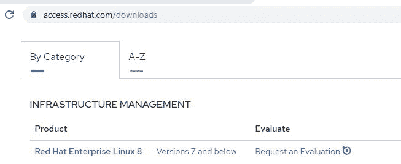

文件下载完成后，检查文件的完整性。如果您您在 `MS Windows 10` 电脑上下载了文件，进入下载文件的文件夹。按住 `shift` 键并点击鼠标左键。

这将打开菜单，点击“在此处打开 PowerShell 窗口”。

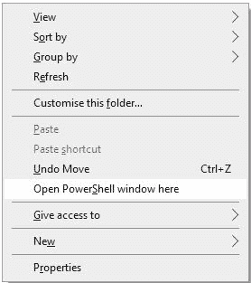

在 shell 提示符上输入命令：

```bash
Get-FileHash -Path .\rhel-8.0-x86_64-dvd.iso -Algorithm SHA256
```

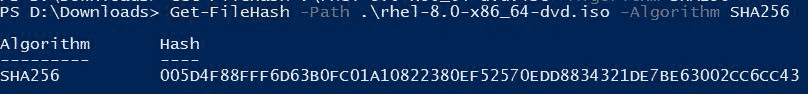

它将显示哈希值，将此值与下载页面提供的值进行比对。


### 将镜像写入介质

验证镜像后，您可以将 ISO 文件写入 `DVD`。如果计算机中的 `DVD 驱动器`无法工作或不存在，可以将此镜像写入 `USB 闪存盘`。写入 `USB 闪存盘` 的步骤如下所示：

#### 在 Windows 上创建 USB 介质

1. 从 `https://github.com/MartinBriza/MediaWriter/releases` 下载 `Fedora media writer`。

   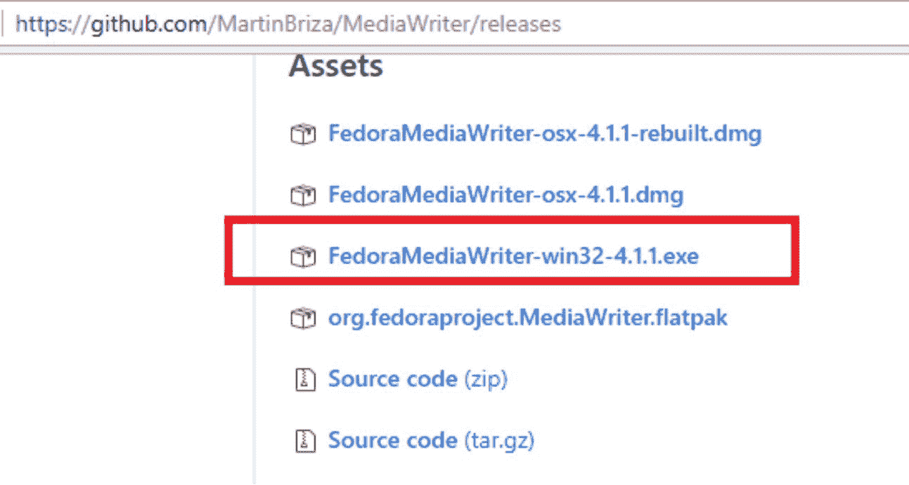

2. 双击下载的文件进行安装并遵循“向导”操作。
3. 安装完成后，从开始菜单运行 `Fedora Media Writer`。
4. 在主窗口点击 `Custom image` 并选择下载的 `RedHat enterprise Linux ISO Image`。
5. 从下拉菜单选择您想要使用的驱动器。
6. 点击 `Write to disk`。这将开始创建介质。
7. 一旦过程完成，卸载 `USB` 设备。
8. `USB 闪存盘` 已准备就绪。

### 安装步骤

#### 使用介质启动

介质就绪后。将 `USB` 设置为启动设备。一旦系统启动，将显示安装菜单。安装 `RHEL 8.0`。


在语言菜单选择 `Language` 并继续。

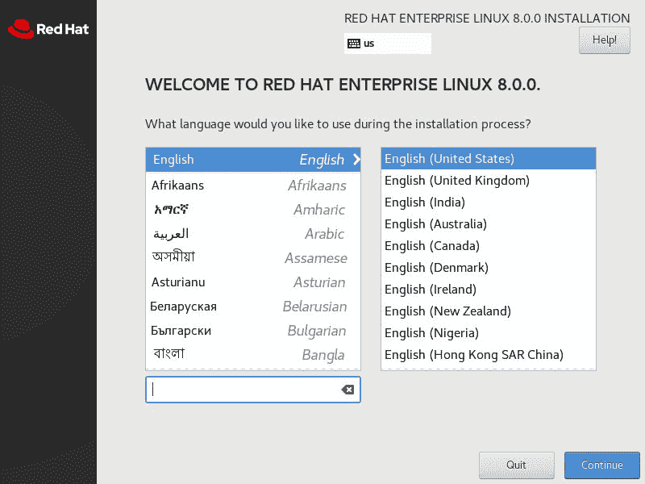

这将进入安装摘要。选择 `Date and time` 修改日期和时区。

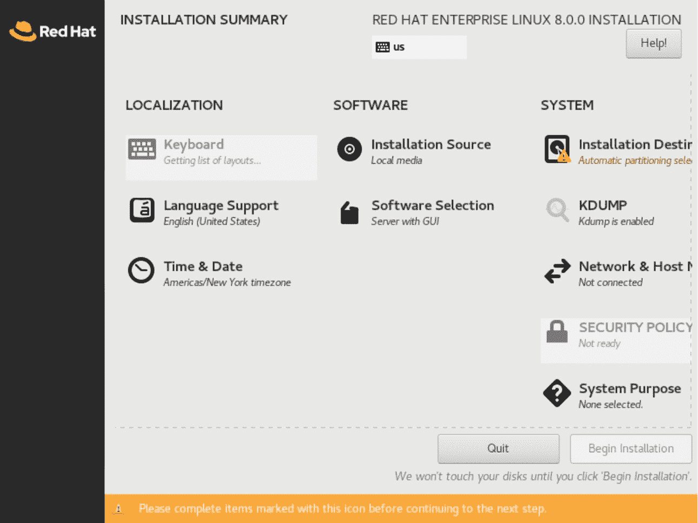

如果您使用 `Network Time`，可以进行配置。将 `Network` 按钮切换为开启状态并点击小齿轮进行网络设置。设置完成后点击 `Done`。

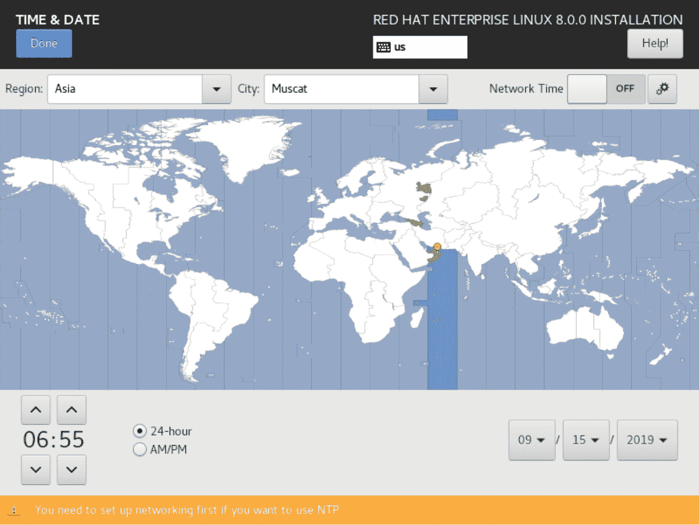

从屏幕上点击 `Software Selection` 并选择 `Base environment`。为了演示，我选择了 `Server with GUI` 并点击 `Done`。

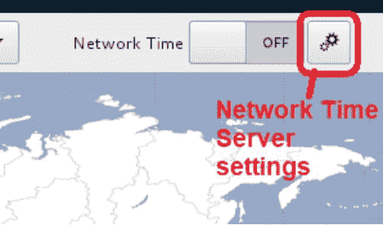

在安装摘要屏幕上，选择 `Installation Destination`。

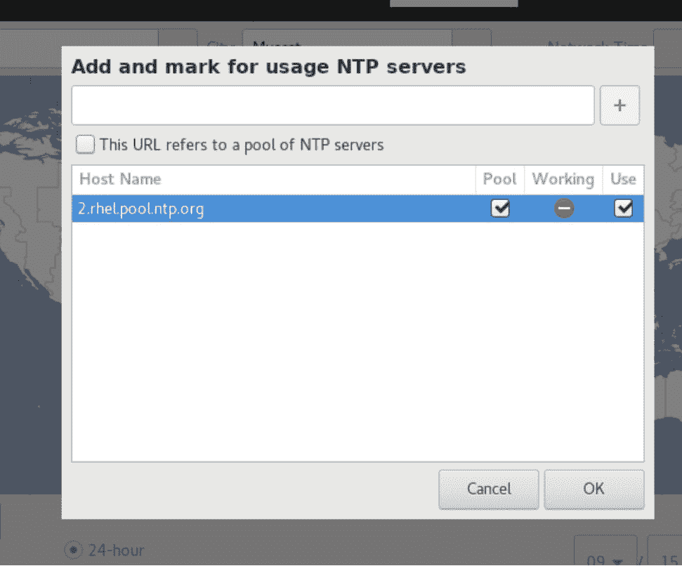

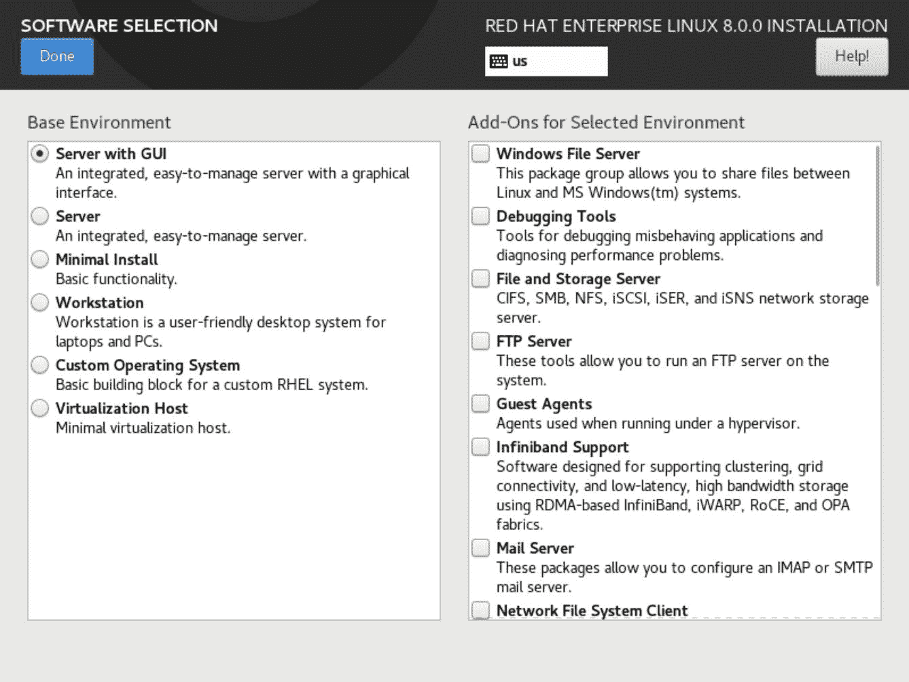

要么留给 `Automatic Configure`，或者选择 `I will configure partitioning` 进行手动分区。在选择 `Manual partitioning` 的情况下，虽然 `RedHat` 可以通过 root 和 swap 分区工作，但最好有三个分区。这三个分区分别是 `boot`、`/ (root)` 和 `swap`。`boot` 至少应 `1 GB`，`root` 至少 `20GB`，`swap` 分区应等于或大于物理 `RAM`。您可以使用易读格式编写容量，例如 `10G` 代表 `10GB`，`500M` 代表 `500MB`。

现在点击 `Network and Host Name` 配置网络设置和主机。

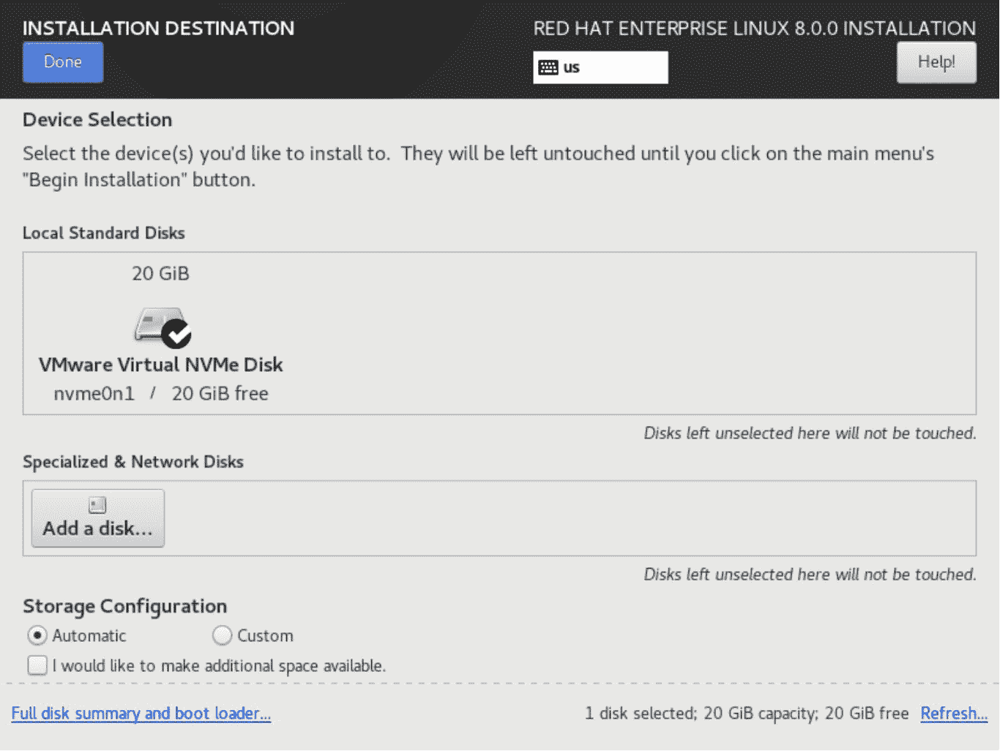

1. 在 `Host Name` 框中写入主机。
2. 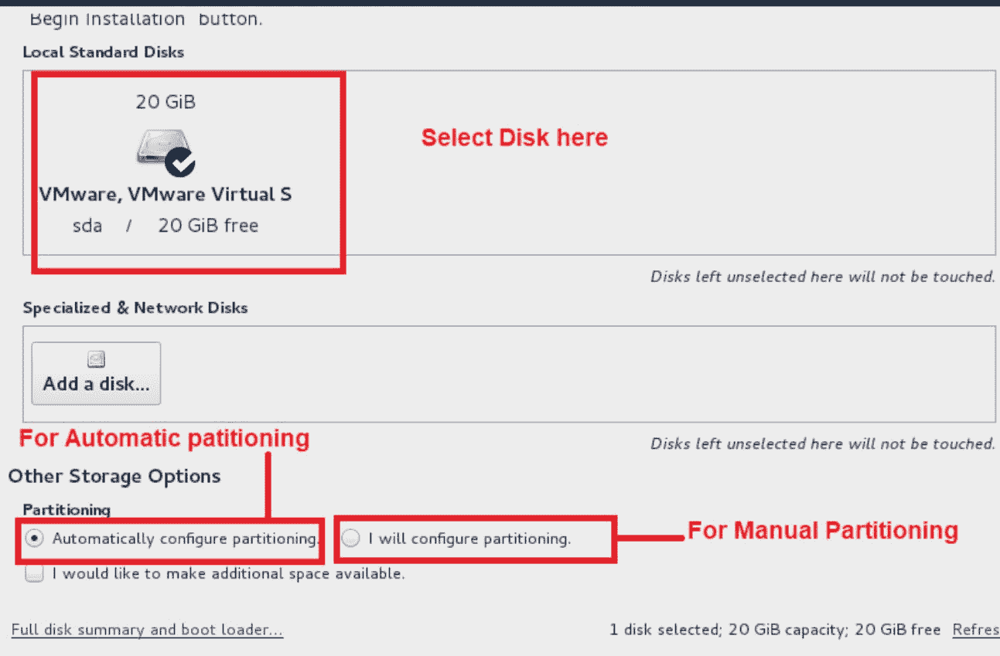 选择网卡。
3. 将 `Connected` 按钮切换到 `On`。
4. 点击 `configure` 按钮。

将进入网络配置屏幕。

1. 选择 `IPv4 setting` 标签页。
2. 如果有静态 `IP`，则从下拉菜单将 `method` 设置为 `manual`，否则留空 `Automatic`。
3. 在静态 `IP` 的情况下，点击 `Add` 按钮。
4. 填写 `IP address`、`Netmask` 和 `gateway`。
5. 添加 `DNS server IP Address`，如果有多个 `DNS server`，则用逗号分隔 `IP Address`。
6. 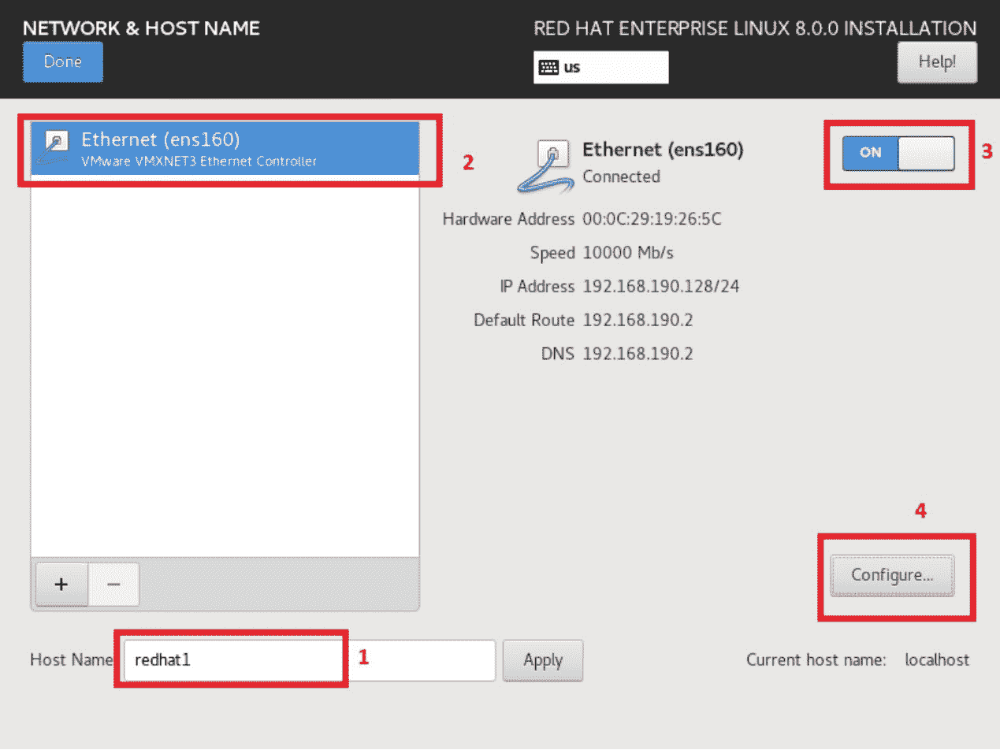 选择 `General Tab`。
7. 勾选 `Automatically connect to this network when it is available`。

点击 `Save` 保存设置。

点击 `Begin installation`。这将进入一个屏幕，其中显示安装进度、设置 `root password` 的选项以及创建一个新用户。

选择 Root 密码并提供 root 密码。点击 Done（完成）。

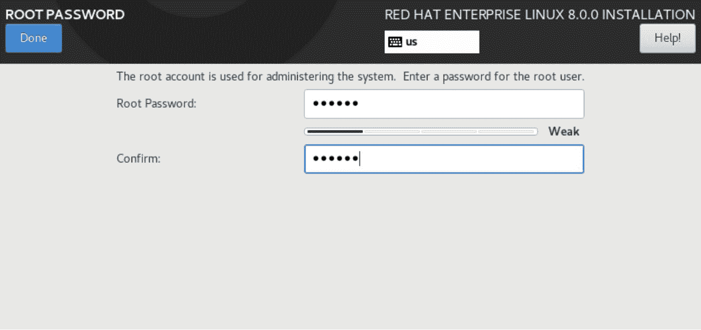

安装过程中，你需要创建一个普通用户。点击 `Create New user`（创建新用户）。提供用户的姓名、`username` 和密码并点击完成。如果你不想使用 root 用户进行管理，可以通过选择 `Make this user administrator`（将此用户设置为管理员）将该用户设置为管理员。

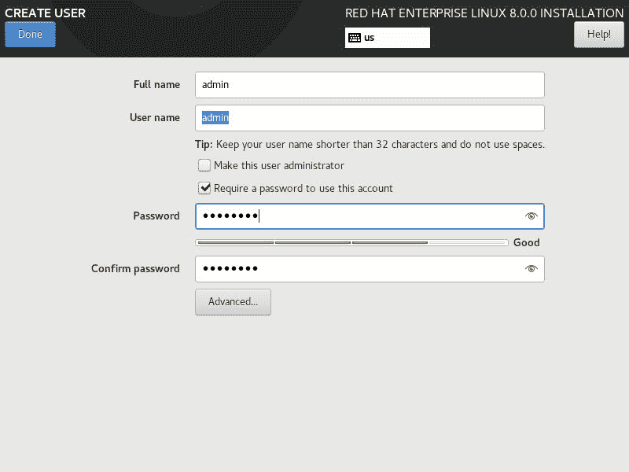

安装完成后点击 `Reboot`（重启）。

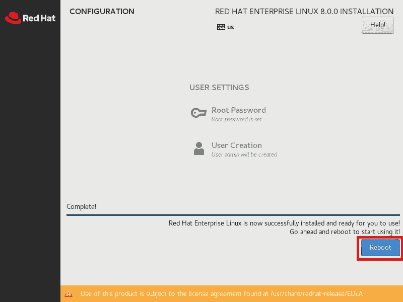

重启后系统将显示许可界面并添加 RedHat 订阅详情。

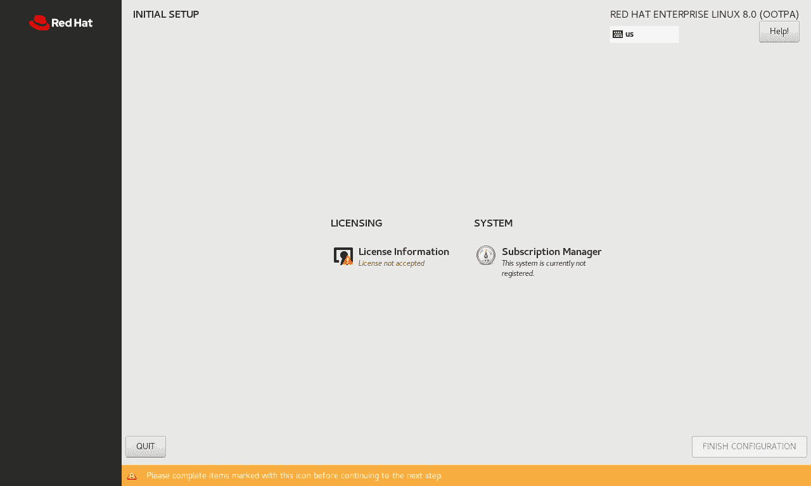

选择 `License information`（许可信息）。

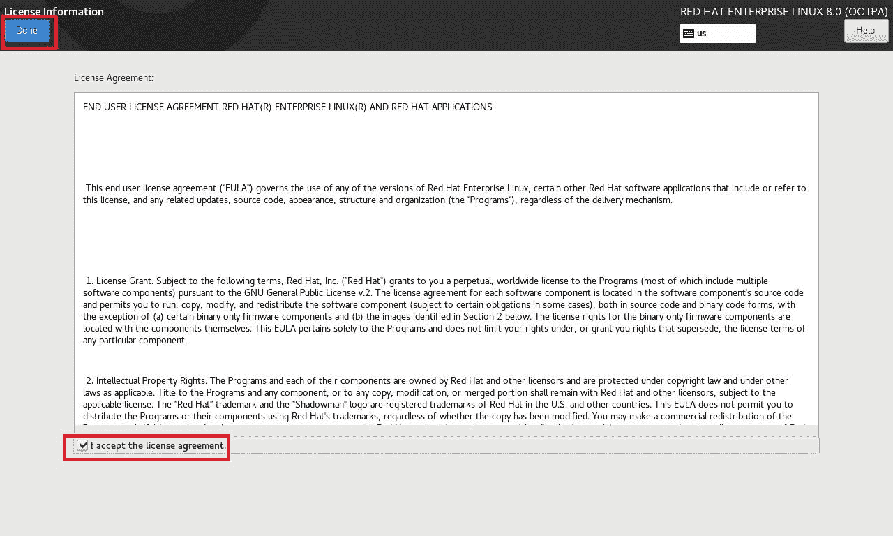

在下一个页面选择 `I accept the license agreement`（我接受许可协议）并点击 `Done`（完成）。

现在点击 `Subscription Manager`（订阅管理器）（这一步是可选的，你也可以以后进行）。

在下一个页面，如果你使用代理，请提供连接互联网的代理设置。点击 `Done`（完成）。

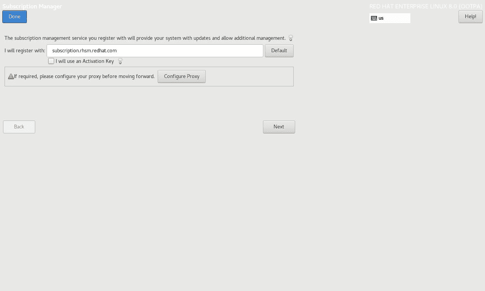

在下一个页面提供你的 redhat 订阅登录名和密码并点击 `Done`（完成）。

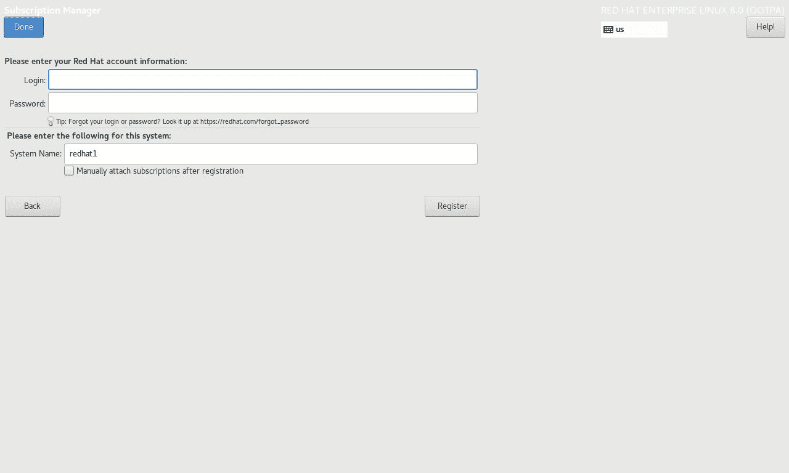

现在点击 `Finish Installation`（完成安装）。

现在你已经完成了安装。是时候从远程机器连接新创建的服务器了，我们将在下一章讨论如何连接你的 Windows 机器。

## 第 5 章 将你的 PC 连接到 RHEL 服务器

在现实生活中，你偶尔会物理性地操作服务器，但通常你是从 PC 连接并进行管理。你的 PC 上可能运行着 MS Windows 10。连接到 Linux 主机首先需要一个软件。有很多选项，如 `VanDyke`、`bitvise` 和 `putty`。其中 `PuTTY` 是免费且最流行的选项。

`PuTTY` 是一个 SSH 和 telnet 客户端，最初由 Simon Tatham 为 Windows 开发。它是一个为远程 MS Windows 机器上的服务器提供文本终端访问的软件。要安装 `putty`，打开 Internet Explorer 并从以下地址下载 `putty`：

`http://www.chiark.greenend.org.uk/~sgtatham/putty/latest.html`

下载好 `putty` 后，进行安装。

当你运行 `putty` 时会看到以下屏幕。在此屏幕上：

1. 填写新安装服务器的 IP 地址。
2. 选择协议为 `SSH`。
3. 给会话（Session）命名，如 `RHEL1` 或 `linux1` 等。
4. 点击 `Save`（保存）按钮。

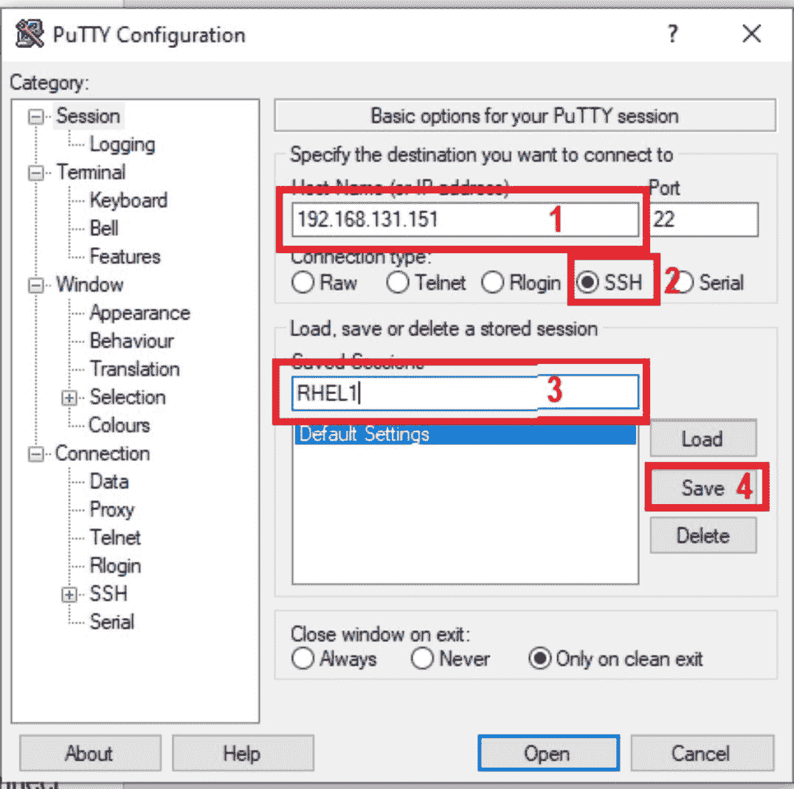

保存保存后，双击会话名称连接到 Linux 主机，或选择会话点击 `Load`（加载）然后点击 `Open`（打开）。

## 第 6 章 网络

网络是两个或多个连接在一起的计算机组。网络允许不同机器之间进行互连。每台计算机都需要网卡来连接。每张网卡都有一个物理地址，称为 `Media Access Control address`（MAC 地址）。`MAC address` 工作在 OSI 模型的第 2 层。网卡制造商为网卡分配 MAC 地址。由于网卡可能会故障并需要更换，随着网卡的更换，`MAC address` 会改变。为了解决这个问题，我们为网卡分配 `IP address`，它工作在 OSI 模型的第 3 层。由于 `IP address` 仍然是数值，因此很难记忆，而且在动态 IP 的情况下，`IP address` 可能会更改。为了方便人类使用，我们使用 `hostname`（主机名），这无非计算机的名字。

为了让你对 OSI 模型以及应用和设备及其对应层次有一个直观的概念，如下所示。

### OSI 七层与 TCP 映射

| OSI 模型 | TCP 模型 | 应用 | 地址 | 设备 |
| :--- | :--- | :--- | :--- | :--- |
| 7:应用层 | `ApplicationLayer` | `HTTP` / `Telnet` / `SSH` | 应用 `DNS`、`DHCP`、`ntp`、`HTTP` | |
| 6:表示层 | `SSL` / `MIME` | | | |
| 5:会话层 | `Sockets` 和远程过程调用（`RPC`） | | | |
| 4:传输层 | `Transportlayer` | 传输控制协议（`TCP`） | `TCP/UDP` | 网关 |
| 3:网络层 | `Internetlayer` | `IP` 协议（`IP`） | `IP4`、`IP6`、`IPX`、`ICMP` | 路由器、防火墙、三层交换机 |
| 2:数据链路层 | `Network AccessLayer` | `以太网` / `帧中继` | `MAC address`、`ARP` | 桥器、二层交换机 |
| 1:物理层 | `IEEE 802.x` | `以太网` | 集器 | |

## 检查网络配置的命令

在新安装之后，检查网络配置是一个好主意。作为最佳实践，请记录此配置。

### 显示 IP 地址

```bash
ip addr show
```

或

```bash
ifconfig -a
```

### 显示链路状态

```bash
ip link show
```

### 显示路由表

```bash
ip route
```

或

```bash
netstat -rn
```

### 修改主机名

#### 显示主机名

```bash
hostname
```

#### 修改主机名

当你想更改主机名时，必须分步完成：

1. 使用命令 `hostnamectl` 更改主机名。
2. 接下来修改 `/etc/hosts` 中的条目。
3. 输入 `hostnamectl` 命令状态来检查当前状态：

```bash
hostnamectl status
  Static hostname: RHEL1
       Icon name: computer
          Chassis: n/a
```

4. 修改主机名：


```bash
hostnamectl set-hostname RHEL1
```

3. 下一步是修改`/etc/hosts`：

```bash
edit /etc/hosts
```

`NetworkManager`是一个守护进程，为网络连接的简易配置和管理提供接口。在`RHEL`的之前的版本中，网络配置是通过文件处理的。然而在 RedHat 8 中，它由`network manager`处理。`Network manager`是一个动态网络配置和控制守护进程。它可以管理如`Wifi`、`Ethernet`和移动设备等网络接口。`Network manager`可以在有线网络不可用时自动从有线切换到 WiFi，反之亦然。

如果你来自旧版本的 RedHat 并且习惯于使用`ifup`和`ifdown`等网络脚本，那么在 RedHat 8 中，`ifup`和`ifdown`脚本已弃用，现在由`network manager`处理。传统使用的`ifcfg`配置文件在`RHEL`中仍然受支持，但默认不可用。

## Network Manager 配置以下内容

1. IP 地址
2. 静态路由
3. 网络别名
4. VPN 配置
5. DNS 信息

### 检查 networkmanager 守护进程状态

```bash
systemctl status NetworkManager
```

### 如果 Networkmanager 未运行，则启动它

```bash
systemctl start NetworkManager
```

### 设置其随系统启动自动启动

大多数情况下不需要，因为 networkmanager 默认配置为自动启动。

```bash
systemctl enable NetworkManager
```

## 使用图形界面设置静态 IP 地址

设置静态 IP 地址的步骤如下所示：

1. 以 root 身份登录。
2. 点击 network manager 图标并选择 Wired settings（有线设置）。


3.  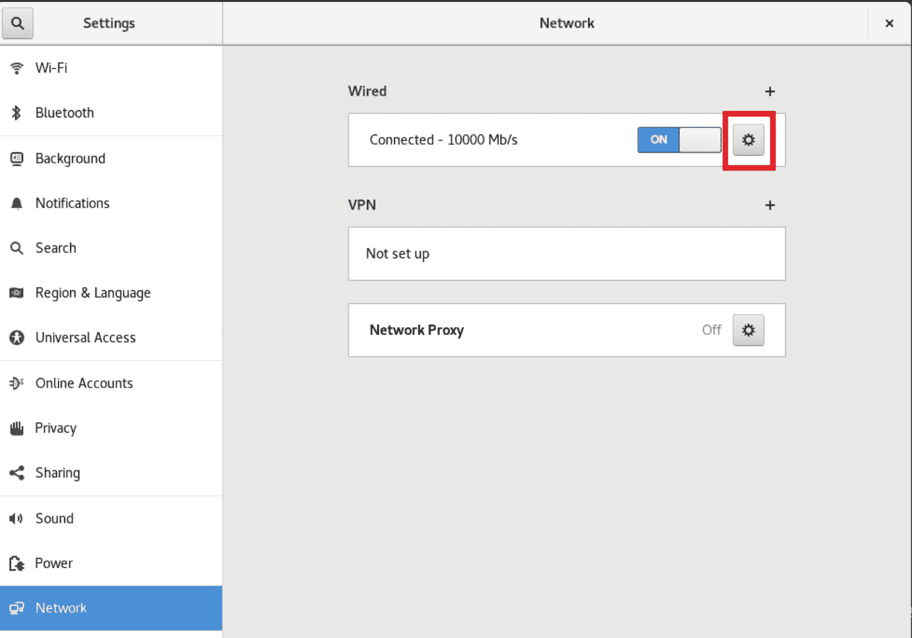 点击设置图标，小齿轮。
4. 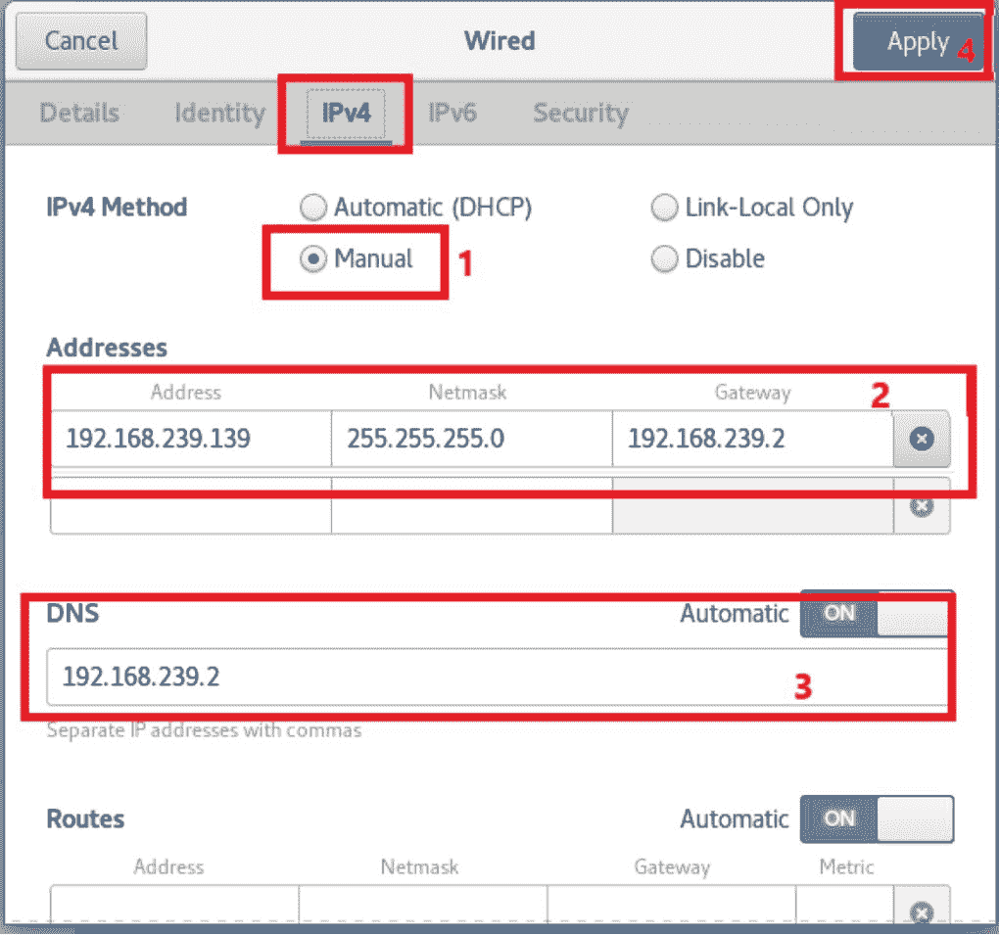 选择 IPv4 tab 设置。
5. 从 IPv4 Method 中选择`Manual`（手动）。
6. 提供 IP 地址、`Netmask`和`Gateway`。
7. 填写 DNS 服务器 IP 地址。如果你有多个 DNS，请用逗号分隔所有 IP 地址。
8. 按`Apply`（应用）。

## 使用基于文本的界面 nmtui 进行网络配置

`Nmtui`是一个配置网络的文本界面工具。如果你系统中没有安装 GUI，这个工具非常有帮助，特别是当你远程管理系统时。该工具在`RHEL`服务器安装时默认安装。如果不存在，你可以安装它。

```bash
yum install NetworkManager-tui
```

### 启动 nmtui

```bash
nmtui
```

## 命令

### 编辑连接设置

语法：

```bash
nmtui edit connection_name
```

示例：

```bash
nmtui edit ens33
```

### 连接已断开连接

语法：

```bash
nmtui connect connection_name
```

示例：

```bash
nmtui connect ens33
```

### 使用 nmtui 修改主机名

语法：

```bash
nmtui hostname new_hostname
```

示例：

```bash
nmtui hostname RHEL2
```

### 导航 NMTUI

由于`nmtui`是一个文本用户界面，你必须使用键盘进行导航。按`TAB`键移动光标到下一个字段，使用`SHIFT + TAB`向后移动。使用`SPACE`空格键打开下拉菜单。

## 使用 NMTUI 修改 IP 地址

启动`nmtui`：

```bash
nmtui
```

1. 选择`Edit a connection`（编辑连接）。
2. 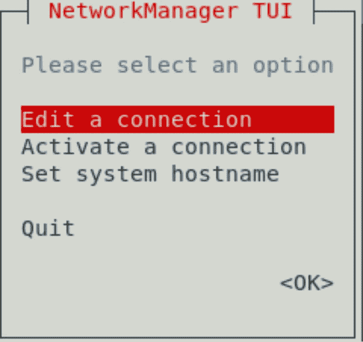 从列表中选择连接配置并按`Edit`（编辑）。

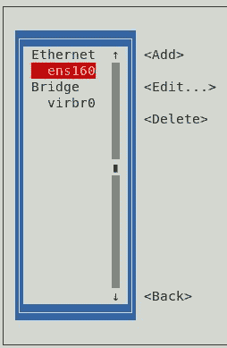

3. 在下一个界面的 IPv4 配置上按`SPACEBAR`键获取弹出菜单。
   1. 选择`Manual`设置静态 IP 地址。
   2. 按`TAB`键移动到`Address`字段并提供带有`Netmask`的 IP 地址。
   3. 按`TAB`键移动到`Gateway`列并提供`Gateway`。
   4. 按`TAB`键移动到`DNS Servers`。按`SPACE`键添加 DNS 服务器。你可以添加多个 DNS 服务器。
   5. 确保选中了`Automatically connect`（自动连接）。
   6. 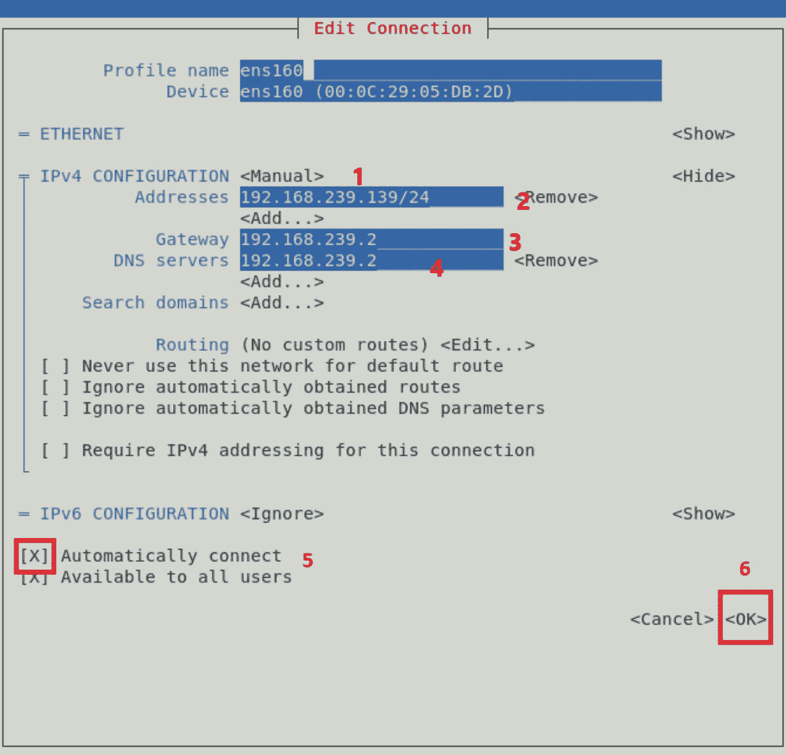 按`OK`（确定）。
4. 按`ESC`键退出`NMTUI`。

## 使用配置文件修改网络配置

如果你像我一样是一个老派的人，喜欢使用配置文件而不是 GUI 来工作。虽然在`RHEL8`中配置文件已弃用，但你仍然可以使用配置文件来控制网络。在这个示例中，我将解释如何使用配置文件更改主机的 IP 地址。

### 使用配置文件更改 IP 地址

1. 检查当前设置：

```bash
ip addr show
```

2. 检查当前设备：

```bash
[root@RHEL2]# nmcli d
DEVICE  TYPE      STATE      CONNECTION
ens33  ethernet connected  ens160
lo      loopback  unmanaged  --
```

3. 编辑`/etc/sysconfig/network-scripts/ifcfg-*`。其中`ifcfg-*`文件是你上一个命令中检查的设备文件。命令输出显示`ens160`为设备名，则文件名将是`ifcfg-ens160`。

```bash
vi /etc/sysconfig/network-scripts/ifcfg-ens160
```

4. 根据是否有静态 IP 地址还是使用 DHCP，更改`/etc/sysconfig/network-scripts/ifcfg-ens160`文件。

| 静态 | DHCP |
| :--- | :--- |
| `DEVICE=ens160BOOTPROTO=staticIPADDR =192.168.0.132NETMASK=255.255.255.0GATEWAY=192.168.0.1ONBOOT=yes` | `DEVICE=ens160BOOTPROTO=dhcp` |

5. 重启网络连接以更改 IP 地址无需重启。对于之前的版本使用脚本，当前版本中使用`networkManager`自动启动。

```bash
nmcli down
nmcli up
0
```

### 网络脚本

`Red Hat 8`中网络脚本已弃用。如果你需要这些脚本，可以通过以下命令在系统中安装它们：

```bash
yum install network-scripts
```

### 使用配置文件更改 DNS

编辑`/etc/resolv.conf`并添加`search`：

```text
search example.com // 自己的 FQDN
nameserver 8.8.8.8 // 第一 DNS
nameserver 8.8.4.4 // 第二 DNS
```

## 用户管理

用户管理描述了管理员管理用户对服务器资源及附加设备访问的能力。在多用户环境中，出于安全和隐私考虑，建议为每个用户创建独立的用户名，以便每个用户都能将其数据保存在各自的家目录中。用户和组的管理是系统管理的核心部分。

## 用户与组

用户是指任何使用计算机或网络服务的人。用户可以是人类，也可以是账户。为了方便管理，用户被分组在不同的组中。`Group`是一个根据不同属性将用户组织在一起的逻辑实体，可以基于相同的部门、相同的地点或相同的工作。有时，创建组仅仅是为了给不同的用户提供某些公共设施或权限。

## Root 用户对比普通用户

在安装时，安装屏幕提供了创建`root`用户密码和一个额外用户密码的选项。你也可以在同一屏幕上为该额外用户分配 root 权限。在 RHEL Linux 中，`root`是系统的默认管理员。`root`是 RHEL 服务器上所有用户中权限最大的用户。一旦你以`root`用户身份登录，就可以在服务器上执行任何操作。与普通用户不同，`root`用户可以读、写和修改所有其他用户的文件和目录。`root`用户甚至可以修改和删除系统文件。因此，妥善保管`root`用户的密码绝对重要。

## 在图形终端上以 root 用户身份登录

如果安装了图形桌面环境，系统启动后你将看到登录界面。

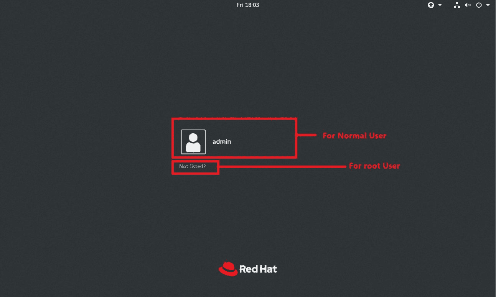 点击用户图标以普通用户身份登录。

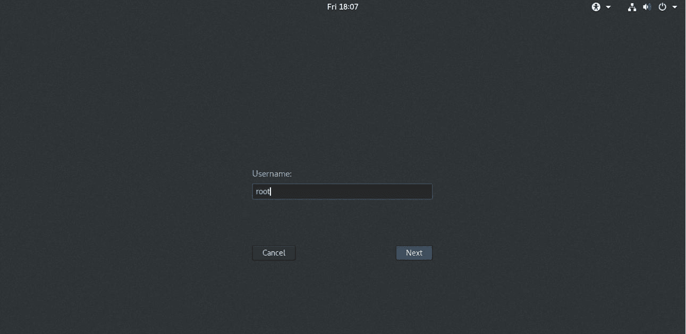 要以`root`用户身份登录，从图形登录界面选择`Not listed?`（未列出？）。

一旦出现登录名的框，输入`root`并按`ENTER`，在密码提示处输入安装期间选择的`root`密码，然后按`ENTER`。

## 使用 GUI 管理用户

在 RHEL 中创建用户：

1. 以`root`用户身份登录。
2. 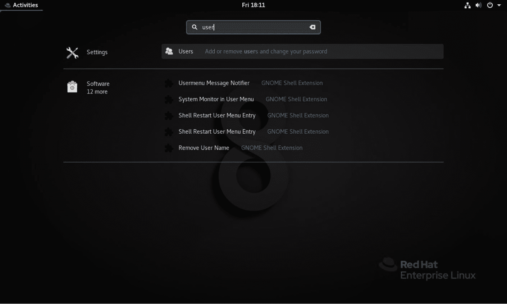 从面板点击`Activities`（活动），并在搜索栏中输入`users`，点击`users`。这将打开用户管理窗口。

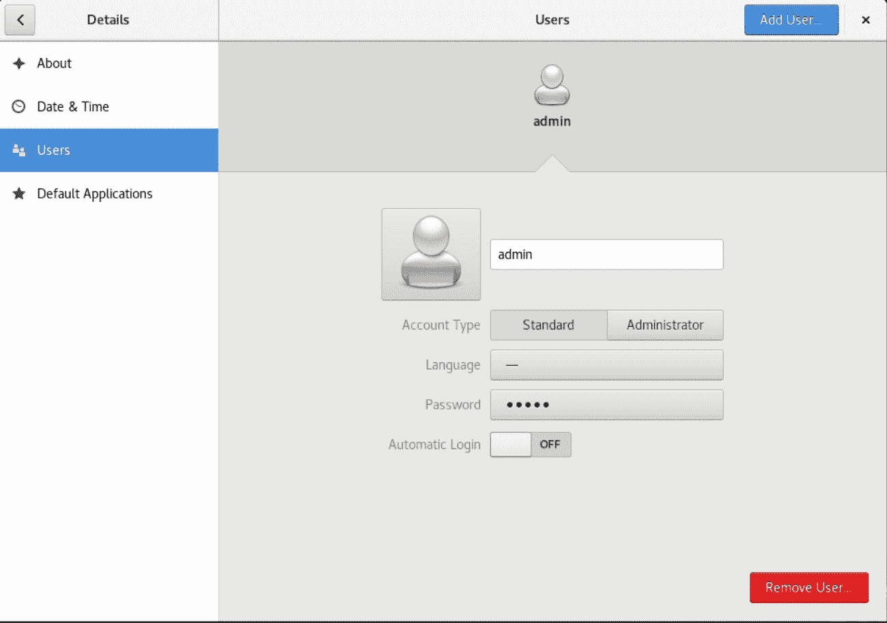

3. 点击`Add User`（添加用户）按钮添加用户。这将弹出包含以下字段的对话框：
   - `Account Type`（账户类型）：你有两个选项`Standard`（标准）或`administrator`（管理员）。
   - `Full Name`（全名）：输入用户的全名。
   - `Username`（用户名）：输入你想创建的用户名。
   - `Allow User to set password when they next login/Set a password now`（允许用户下次登录时设置密码/现在设置密码）：设置密码有两种方法。第一种是强制用户在下次登录时设置密码。另一种是由管理员设置临时密码，以便新用户可以方便地更改密码。这种方式增加了额外的安全层，使得在用户设置密码之前，未经授权的用户无法使用新创建的用户名。

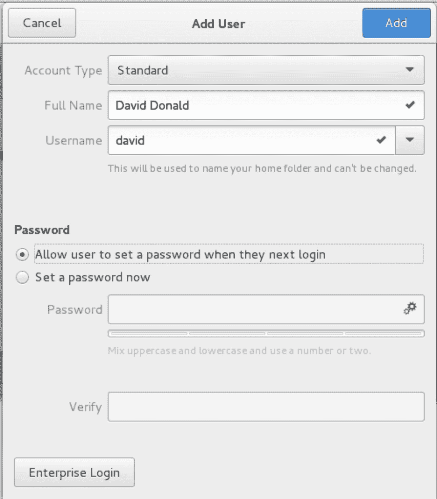

## 使用命令行管理用户

使用命令行进行用户管理非常有趣，并且提供了更多的选项和活性。

### 添加用户

语法：

```bash
useradd –c “Full name of user” username
```

示例：

```bash
useradd –c “Adam mark” adam1
```

### 现在设置密码

语法：

```bash
passwd username
```

示例：

```bash
passwd adam1
```

### 修改用户

语法：

```bash
usermod –c “Adam markwel” adam1
```

示例：

```bash
usermod –c “Adam markwel” adam1
```

### 删除/移除用户

语法：

```bash
userdel username
```

示例：

```bash
userdel adam1
```

### 显示用户信息

显示当前用户的信息。

语法：

```bash
id
```

示例：

```bash
id
```

显示其他用户的信息。

语法：

```bash
id username
```

示例：

```bash
id admin
```

为其他用户更改密码。

语法：

```bash
passwd username
```

示例：

```bash
passwd admin
```

更改自己的密码：

```bash
passwd
```

### 列出密码过期信息

语法：

```bash
chage –l username
```

示例：

```bash
chage –l admin
```

### 设置密码过期

`root`用户可以为任何用户设置密码过期日期。在本示例中，密码将在上次更改密码后 10 天过期。

语法：

```bash
chage -M no of days from last password change username
```

示例：

```bash
chage -l admin
chage -M 10 adam1
chage -l adam1
```

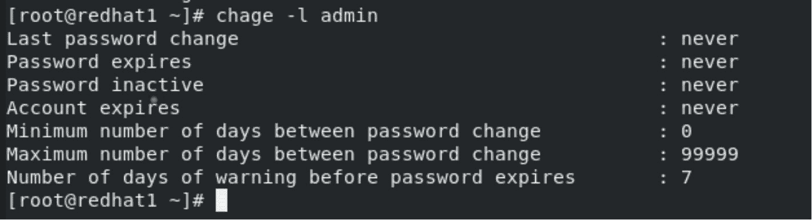

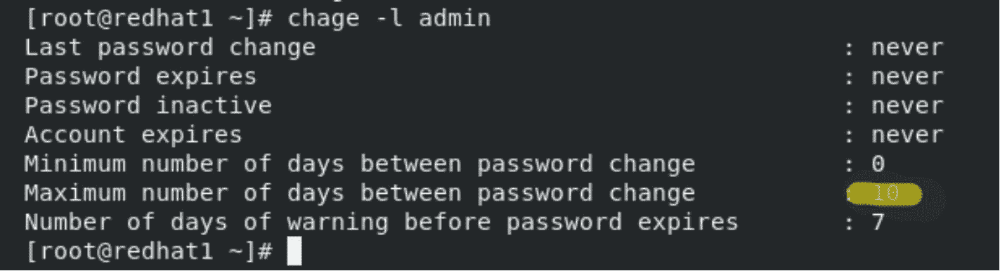

### 禁用用户的密码过期

语法：

```bash
chage –M 99999 username
```

示例：

```bash
chage -M 99999 admin
```

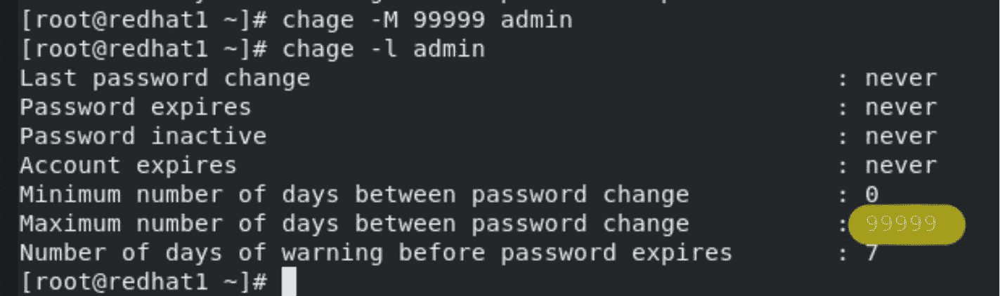

### 强制用户在下次登录时更改密码

语法：

```bash
chage –d0 username
```

示例：

```bash
chage –d0 adam1
```

### 锁定用户

语法：

```bash
usermod –L username
```

示例：

```bash
usermod –L adam1
```

### 解锁用户

语法：

```bash
usermod –U username
```

示例：

```bash
usermod –U adam1
```

## UID

唯一用户 ID，通常称为`UID`。系统上存在的每个用户都有一个`UID`。

| 用户 | UID |
| :--- | :--- |
| root | 0 |
| 系统用户 | 999 |
| 普通用户 | 1000+ |

## 组

通常称为`UID`的唯一用户 ID。系统上存在的每个用户都有一个`UID`。`/etc/passwd`文件包含了每个用户的`UID`。

用户是指任何使用计算机或网络服务的人。用户可以是人类，也可以是账户。为了方便管理，用户被分组在不同的组中。`Group`是一个根据不同属性将用户组织在一起的逻辑实体，可以基于相同的部门、相同的地点或相同的工作。有时，创建组仅仅是为了给不同的用户提供某些公共设施或权限。

### 主组

用户所属的主组。

更改辅助组：

```bash
usermod –G2 user1
```

### 添加新组

语法：

```bash
groupadd groupname
```

示例：

```bash
groupadd data1
```

### 删除组

语法：

```bash
groupdel groupname
```

示例：

```bash
groupdel data1
```

### `/etc/group`文件

`/etc/group`文件存储组信息。每行对应一个组，每行包含由冒号（:）分隔的字段。

| 字段 | 描述 |
| :--- | :--- |
| groupname | 组名。 |
| password | 通常不使用。 |
| GID | 组 ID。 |
| Group List | 该组的用户列表。用逗号分隔用户名。 |

示例：

`science:x:1003:class1, class2`

## `/etc/passwd`文件

`passwd`文件在登录时需要。这是一个纯文本文件，包含了系统账户。和`/etc/group`文件一样，每行对应一个用户，每行包含由冒号（:）分隔的字段，如用户 ID、组 ID、家目录和 shell。只有`root`用户对此有写权限。

格式：

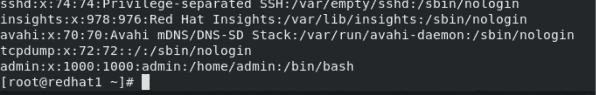

`username:x:UID:GID:Full_user_name:home_directory:shell`

| 字段 | 描述 |
| :--- | :--- |
| username | 用户名。应该是唯一的，最多 8 个字符。它区分大小写，通常全小写。 |
| x | x 字符表示加密密码存储在`/etc/shadow`文件中。 |
| UID | 用户 ID。 |
| GID | 组 ID。 |
| Full_user_name | 用户的全名。 |
| home_directory | 指定的用户家目录，用户将在此处存放文件。 |
| shell | 用户的默认 shell，通常设置为`/bin/bash`，也可以是`/etc/ksh`、`/etc/csh`或任何其他 shell。 |

示例：

`adam1:x:1004:1004:Adam mark:/home/adam1:/bin/bash`

## `/etc/shadow`

以加密格式存储实际密码。

格式：

`username:password:last_password_change:minimum`

| 字段 | 描述 |
| :--- | :--- |
| username | 最多 8 个字符。区分大小写，通常全小写。与`/etc/passwd`中的用户名直接匹配。 |
| password | 13 字符加密密码。空表示登录不需要密码（通常是个坏主意），“*”表示账户已禁用。 |


| 字段 | 说明 |
|---|---|
| `last_password_change` | 上次更改密码的日期。以自 1970 年 1 月 1 日以来的天数表示。 |
| 最小值（Minimum） | 密码前可以更改的天数（0 表示可以随时更改）。 |
| 最大值（Maximum） | 密码必须更改后的天数（99999 表示用户可以多年不更改密码）。 |
| 告警（Warn） | 密码即将过期前提醒用户的天数（7 表示整整一周）。 |
| 非活跃（Inactive） | 密码过期后账户被禁用的天数。 |
| 过期（Expire） | 以自 1970 年 1 月 1 日起计算的过期天数表示的过期日期（此后账户将被禁用）。 |

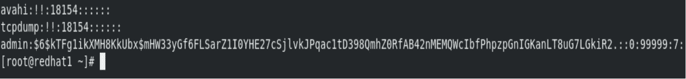

示例：

```text
user1:$6$0UseZ0gR$yxl3B9SilhVjpu6epAlir1:17261:0:99999:7:::
```

# 第 8 章：软件管理

每个 Linux 发行版都有一组在安装时自动安装的包。作为一个组织，你可能根据需要需要更多的软件，例如，你可能将此服务器用作 Web 服务器，因此需要 `Apache` 或其他 HTTP 服务器。为了安装额外的软件，你需要包。包是将所有可执行文件和数据文件封装成的单个文件。目前有两种类型的包可用：

## 1. 源码包

与一个程序相关的文件包，包括源代码、配置文件和文档。

## 2. 二进制包

二进制包是预编译的二进制文件及其元数据文件的包。

# 包的发行格式

如前所述，包有两种类型，因此以二进制或源码格式分发。主要的包发行系统有：

## Red Hat 包管理器（RPM）

顾如名，这种格式由 Red Hat 引入。这种格式不仅被 `RHEL` 和 `Fedora` 等基于 Red Hat 的发行版使用，还被 `SUSE` 和 `Mandriva` 等许多其他发行版采用。`RPM` 包使用扩展名为 `.rpm` 的文件。

## Debian 包管理器

该包发行系统由 Debian 引入。主要用于 Debian 以及基于 Debian 的发行版，如 `Ubuntu`、`Linux Mint` 和 `PureOS`。它使用扩展名为 `.deb` 的文件。

# 源码包

源码包可以以两种格式分发：

## 1. Tar 包文件（Tarball）

Tar 包分发是传统的包发行类型。这类包可以从任何第三方软件提供者获取，并需要 `make` 工具进行编译。

## 2. SRPM

基于 Red Hat 的发行版提供仓库，你可以在那里下载可用二进制文件的源码，我们称这些文件为 `SRPMS` 或源码 RPM。`SRPMs` 是仅包含源代码和 `rpm` spec 文件的 `rpm` 包，这些 spec 文件可以使用 `rpm` 安装，然后可以手动编译或修改。

# 包元数据

`RHEL` 使用 `.rpm` 包通过 `rpm` 命令安装软件。`RPM` 包只是一个包含某些文件和关于这些文件信息的文件。从技术上说，`RPM` 是一个包含 `cpio` 归包及其自身元数据的文件。`RPM` Header 包含元数据，这些元数据用于确定关于包的以下内容：

- 包的描述。
- 包中的文件列表。
- 包的版本和发布版本。
- 制作时间和制作者。
- 支持的架构。
- 包中所含文件的校验和。
- 依赖关系。
- 等。

# 包管理系统

`RHEL` 使用 `.rpm` 包通过 `rpm` 命令安装软件。`RPM` 包只是一个包含某些文件和关于这些文件信息的文件。从技术上说，`RPM` 是一个包含 `cpio` 归包及其自身元数据的文件。`RPM` Header 包含元数据，这些元数据用于确定关于包的以下内容：

- 包的描述。
- 包中的文件列表。
- 包的版本和发布版本。
- 制作时间和制作者。
- 支持的架构。
- 包中所含文件的校验和。
- 依赖关系。
- 等。

## Red Hat 订阅模式

与实施许可费模式不同，Red Hat 实施的是**订阅模式**。在订阅模式中，你无需支付任何预付款，只需按每台机器支付年度订阅费用。这种订阅模式根据订阅类型为客户提供不同类型的支持。

该模式最大的优点是，如果发布了新版本且你的订阅处于激活状态，你无需支付任何升级费用，即可免费下载并使用该版本。你将获得与旧版本相同的支持。

大致有三种类型的订阅：

- 自助支持（Self support）：仅提供下载和更新。
- 标准支持（Standard support）：通过网页和电话提供支持。
- 高级支持（Premium support）：通过网页和电话提供支持，此外其响应时间比标准支持快得多。例如，对于 1 级问题，标准支持的响应时间为 1 个工作小时，而高级支持为 1 小时。区别在于，工作时间可能取决于地区，可能是早上 9 点到下午 5 点，之后将不再提供支持，因此如果你在 Red Hat 中遇到任何问题，必须等候下一个工作日。此外，如果支持仅限于工作时间，则假日不提供支持。

# 使用 Red Hat 订阅注册系统

有两种方式可以向 Red Hat 注册你的服务器：

1. 在安装后的初始配置期间。
2. 在安装后的任何时间使用 `subscription-manager` 命令。

注册订阅的命令为：

```bash
subscription-manager register --username username --password password --auto-attach
```

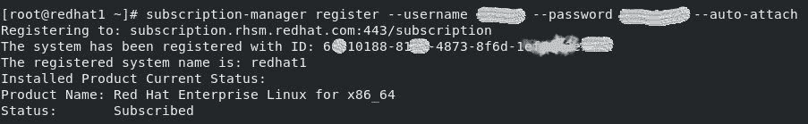

检查订阅情况：

```bash
subscription-manager list
```

或：

```bash
subscription-manager list --consumed
```

# 使用 Yum 进行包管理

## 列出所有已安装和可选软件

```bash
yum list
```

## 列出所有可用软件

```bash
yum list available
```

## 列出所有已安装软件

```bash
yum list installed
```

## 使用关键字搜索包名

语法：

```bash
yum search keyword
```

示例：

```bash
yum search bzip2
```

## 显示包信息

语法：

```bash
yum info package_name
```

示例：

```bash
yum info zip
```

## 安装包

语法：

```bash
yum install -y package_name
```

示例：

```bash
yum install -y firefox
```

## 删除包

语法：

```bash
yum remove package_name
```

示例：

```bash
yum remove firefox
```

## 检查哪个包提供特定文件

语法：

```bash
yum provides file-name
```

示例：

```bash
yum provides /etc/hosts
```

## 获取帮助

```bash
yum help
```

## 检查可用更新

```bash
yum check-update
```

## 更新由已启用库提供的所有软件

```bash
yum update
```

## 清理 Yum 缓存

```bash
yum clean all
```

## 交互式 Shell

```bash
yum shell
```

## 列出 Yum 历史

```bash
yum history list
```

# 包组（Package Group）

包组是一组软件，这些软件具有相同的安装目的，例如开发工具、Web 服务器、桌面环境等。它通过自动安装和下载依赖软件，简化了管理员的工作。例如，如果你想安装备份客户端，只需运行命令 `yum group install "Backup Client"`。

## 列出所有可用包组

```bash
yum group list
```

## 安装组包

语法：

```bash
yum group install package_name
```

示例：

```bash
yum group install "Backup Client"
```

## 移除包组

语法：

```bash
yum group remove package_name
```

示例：

```bash
yum group remove "Backup Client"
```

## 组包信息

语法：

```bash
yum group info package_name
```

示例：

```bash
yum group info "Development Tools"
```

# 模块（Modules）

## 流（Streams）和配置（Profiles）

### 模块流（Module Streams）

模块可以在一个或多个流可用，通常代表软件的版本，让你可以选择安装哪些版本的软件包。模块流类似于虚拟仓库。每个模块可能有一个默认流，该流通常提供组件的最新或推荐版本。默认流使得用户无需了解模块知识即可轻松安装软件包。模块使得你的系统可以有多个版本的软件供安装。

### 模块配置（Module Profiles）

为了进一步简化安装，模块通常根据特定的工作负载或用户用例分类为一组特定的软件包。这组包列表被称为配置（profile）。配置名称可以是任何内容，如服务器（server）、客户端（client）、开发（development）、极简安装（minimal install）等。

# 使用模块进行包管理

## 列出所有可用模块

```bash
yum module list
```

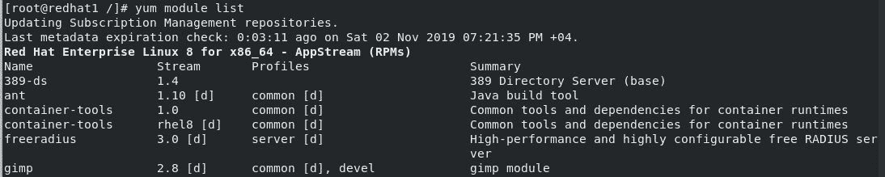

它将显示四列输出：

- 模块名称。
- 流（Stream）。
- 配置（Profile）。
- 摘要（Summary）。

输出在流和配置列中带有 `[d]`、`[e]`、`[x]` 和 `[i]`，显示模块流和配置的状态。其中：

- `[d]` 表示默认（default）。
- `[e]` 表示启用（enabled）。
- `[x]` 表示禁用（disabled）。
- `[i]` 表示已安装（installed）。

## 显示特定模块的信息

语法：

```bash
yum module info module_name
```

示例：

```bash
yum module info module_name
```

## 显示特定模块的配置信息

语法：

```bash
yum module info --profile module_name
```

示例：

```bash
yum module info --profile gimp
```

## 查找哪些模块提供了包

语法：

```bash
yum module provides package
```

示例：

```bash
yum module provides gimp
```

## 显示模块当前状态

语法：

```bash
yum module status module_name
```

原文注释：原文原文为 status status status status status status status status status status。

语法：

```bash
yum module enable module_name
```

## 启用模块

语法：

```bash
yum module enable module_name
```

示例：

```bash
yum module enable gimp
```

## 禁用模块

语法：

```bash
yum module disable module_name
```

示例：

```bash
yum module disable php
```

## 重置模块流

语法：

```bash
yum module reset module_name
```

示例：

```bash
yum module reset php
```

## 模块列表

语法：

```bash
yum module list module_name
```

示例：

```bash
yum module list gimp
```

## 模块信息

语法：

```bash
yum module info module_name
```

示例：

```bash
yum module info gimp
```

## 模块提供信息

语法：

```bash
yum module provides module_name
```

示例：

```bash
yum module provides gimp
```

## 启用模块

语法：

```bash
yum module enable module_name
```

示例：

```bash
yum module enable gimp
```

## 禁用模块

语法：

```bash
yum module disable module_name
```

示例：

```bash
yum module disable php
```

## 重置模块

语法：

```bash
yum module reset module_name
```

示例：


```bash
yum module reset php
```

## 模块

### 列出模块

语法：

```bash
yum module list module_name
```

示例：

```bash
yum module list gimp
```

### 显示模块信息

语法：

```bash
yum module info module_name
```

示例：

```bash
yum module info gimp
```

### 查找模块提供的软件包

语法：

```bash
yum module provides module_name
```

示例：

```bash
yum module provides gimp
```

### 启用模块

语法：

```bash
yum module enable module_name
```

示例：

```bash
yum module enable gimp
```

### 禁用模块

语法：

```bash
yum module disable module_name
```

示例：

```bash
yum module disable php
```

### 重置模块

语法：

```bash
yum module reset module_name
```

示例：

```bash
yum module reset php
```

## Red Hat 订阅模式

与实施许可费模式不同，Redhat 实施的是订阅模式。在订阅模式中，你无需支付任何预付款，只需按每台机器支付年度订阅费用。这种订阅模式根据订阅类型为客户提供不同类型的支持。

该模式最大的优点是，如果发布了新版本且你的订阅处于激活状态，你无需支付任何升级费用，即可免费下载并使用该版本。你将获得与旧版本相同的支持。

大致有三种类型的订阅：

- 自助支持（Self support）：仅提供下载和更新。
- 标准支持（Standard support）：通过网页和电话提供支持。
- 高级支持（Premium support）：通过网页和电话提供支持，此外其响应时间比标准支持快得多。例如，对于 1 级问题，标准支持的响应时间为 1 个工作小时，而高级支持为 1 小时。区别在于，工作时间可能取决于地区，可能是早上 9 点到下午 5 点，之后将不再提供支持。因此，如果你在 Redhat 中遇到任何问题，必须等候下一个工作日。此外，如果支持仅限于工作时间，则假日不提供支持。

## 使用 Red Hat 订阅注册系统

有两种方式可以向 Redhat 注册你的服务器：

1. 在安装后的初始配置期间。
2. 在安装后的任何时间使用 `subscription-manager` 命令。

注册订阅的命令为：

```bash
subscription-manager register --username username --password password --auto-attach
```


检查订阅情况：

```bash
subscription-manager list
```

或：

```bash
subscription-manager list --consumed
```

## 使用 Yum 进行包管理

### 列出所有已安装和可选软件

```bash
yum list
```

### 列出所有可用软件

```bash
yum list available
```

### 列出所有已安装软件

```bash
yum list installed
```

### 使用关键字搜索包名

语法：

```bash
yum search keyword
```

示例：

```bash
yum search bzip2
```

### 显示包信息

语法：

```bash
yum info package_name
```

示例：

```bash
yum info zip
```

### 安装包

语法：

```bash
yum install -y package_name
```

示例：

```bash
yum install -y firefox
```

### 移除包

语法：

```bash
yum remove package_name
```

示例：

```bash
yum remove firefox
```

### 检查哪个包提供特定文件

语法：

```bash
yum provides file-name
```

示例：

```bash
yum provides /etc/hosts
```

### 获取帮助

```bash
yum help
```

### 检查可用更新

```bash
yum check-update
```

### 更新由已启用库提供的所有软件

```bash
yum update
```

### 清理 Yum 缓存

```bash
yum clean all
```

### 交互式 Shell

```bash
yum shell
```

### 列出 Yum 历史

```bash
yum history list
```

## 包组（Package Group）

包组是一组软件，这些软件具有相同的安装目的，例如开发工具、Web 服务器、桌面环境等。它通过自动安装和下载依赖软件，简化了管理员的工作。

例如，如果你想安装备份客户端，只需运行命令 `yum group install "Backup Client"`。

### 列出所有可用包组

```bash
yum group list
```

### 安装组包

语法：

```bash
yum group install package_name
```

示例：

```bash
yum group install "Backup Client"
```

### 移除包组

语法：

```bash
yum group remove package_name
```

示例：

```bash
yum group remove "Backup Client"
```

### 显示组包信息

语法：

```bash
yum group info package_name
```

示例：

```bash
yum group info "Development Tools"
```

## 模块（Modules）

### 流（Streams）和配置（Profiles）

#### 模块流（Module Streams）

模块可以在一个或多个流中可用，通常代表软件的版本，让你可以选择安装哪些版本的软件包。模块流类似于虚拟仓库。

每个模块可能有一个默认流，该流通常提供组件的最新或推荐版本。默认流使得用户无需了解模块知识即可轻松安装软件包。模块使得你的系统可以有多个版本的软件供安装。

#### 模块配置（Module Profiles）

为了进一步简化安装，模块通常根据特定的工作负载或用户用例分类为一组特定的软件包。这组包列表被称为配置（Profile）。

配置名称可以是任何内容，如服务器（server）、客户端（client）、开发（development）、极简安装（minimal install）等。

## 使用模块进行包管理

### 列出所有可用模块

```bash
yum module list
```


它将显示四列输出：

- 模块名称
- 流（Stream）
- 配置（Profile）
- 摘要（Summary）

输出在流和配置列中带有 `[d]`、`[e]`、`[x]` 和 `[i]`，显示模块流和配置的状态：

- `[d]` 表示默认（default）。
- `[e]` 表示启用（enabled）。
- `[x]` 表示禁用（disabled）。
- `[i]` 表示已安装（installed）。

### 显示特定模块的信息

语法：

```bash
yum module info module_name
```

示例：

```bash
yum module info gimp
```

### 显示特定模块的配置信息

语法：

```bash
yum module info --profile module_name
```

示例：

```bash
yum module info --profile gimp
```

### 查找哪些模块提供了包

语法：

```bash
yum module provides package
```

示例：

```bash
yum module provides gimp
```

以下是相关输出：

```text
libc.so.6(GLIBC_2.14)(64bit)
libc.so.6(GLIBC_2.2.5)(64bit)
libc.so.6(GLIBC_2.3)(64bit)
libc.so.6(GLIBC_2.3.4)(64bit)
libc.so.6(GLIBC_2.4)(64bit)
```

<- 输出截断 ->

## 仓库（Repository）

如前所述，仓库是带有元数据的 RPM 软件包集合，这些元数据被 `yum` 命令使用。这是分发 Linux 发行版内容的更好方式。

仓库确保你获得的是安全且真实的内容。由于我们大多数时候都在使用互联网上的仓库，因此下载的仓库内容的真实性是一项首要要求。此外，下载也应该以安全的方式进行。

Red Hat 确保使用 RPM 包的端到端安全性。首先是使用 `https` 站点而不是 `http` 站点，这确保了内容通过安全通道分发。Red Hat 使用了独立的公钥基础设施（PKI）。

对于 RPM 包的安全，可以使用 RPM 包签名对 RPM 包实现加密完整性检查。在安装 RPM 包时，这些签名可以被验证，因为它们是 RPM 包的一部分。

要启用 RPM 签名检查，`yum` 仓库文件必须包含 `gpgcheck=1` 行，如下例所示：

```ini
[myrepo]
name=My Repository
baseurl=https:///download.myrepoex.com/version8/
enabled=1
gpgcheck=1
```

## 仓库操作

### 显示所有启用的仓库

```bash
yum repolist
```

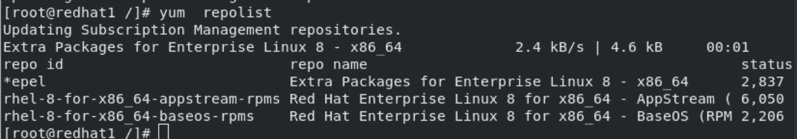

### 显示所有已启用和禁用的仓库

```bash
yum repolist all
```

### 显示特定仓库的软件包

```bash
yum list | grep baseos
```

### 添加、启用或禁用仓库

使用 `yum-config-manager` 命令启用、添加或禁用仓库。你需要安装 `yum-utils` 来使用 `yum-config-manager`。

```bash
yum install yum-utils
```

### 禁用已启用的仓库

首先列出所有仓库：

```bash
yum repolist all
```

要启用和禁用仓库，请使用通过列表命令获取的仓库 ID。

#### 语法

```bash
yum-config-manager --disable repository_id
```

#### 示例

```bash
yum-config-manager --disable InstallMedia-AppStream
```

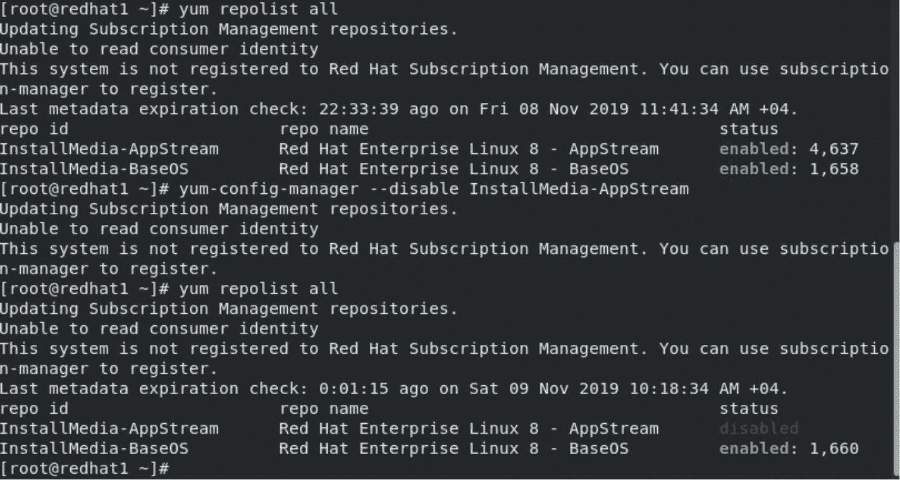

### 启用仓库

```bash
yum-config-manager --enable InstallMedia-AppStream
```

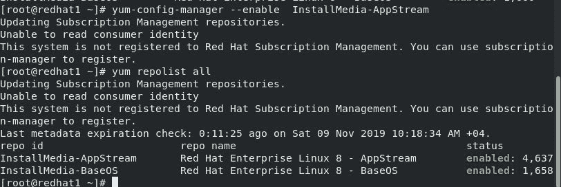

### 添加仓库

仓库通常提供其自己的 `.repo` 文件用于仓库配置。要添加提供 `.repo` 文件的仓库，可以使用此命令。

#### 语法

```bash
yum-config-manager --add-repo repository_url
```

#### 示例

```bash
yum-config-manager --add-repo https://www.example.com/abc.repo
```

## CodeReady Linux Builder 仓库

Red Hat 在所有类型的订阅中默认都提供 `BaseOS` 和 `AppStream` 仓库，这两个仓库默认都是启用的。

除了 `BaseOS` 和 `AppStream` 仓库外，还为开发者添加了一个名为 `CodeReady` 的新仓库。所有订阅都包含对新的 `CodeReady Linux Builder` 仓库的访问。

正如名称所示，`CodeReady Linux Builder` 适用于使用 Red Hat Enterprise Linux 基础设施开发 Linux 程序的开发者。它包含了开发者在构建应用程序时专门使用的包。

`CodeReady Linux Builder` 是一个类似于旧版本 Red Hat Enterprise Linux 中找到的可选仓库的仓库。`CodeReady Linux Builder` 包含了构建工具和 `-devel` 包。

## 启用仓库

要启用和禁用仓库，请使用通过列表命令获取的仓库 ID。

## 手动添加仓库

如前所述，你也可以通过手动创建仓库文件来添加仓库。仓库配置文件位于 `/etc/yum.repos.d/`，扩展名为 `.repo`。

在 Red Hat Enterprise Linux 8 中，如果你是从旧版本的 Red Hat 迁移过来的，仓库配置有所变化。现在你必须定义两个仓库而不是一个，即 `BaseOS` 和 `AppStream`。

使用以下命令创建 `.repo` 仓库配置文件：

```bash
vi /etc/yum.repos.d/rhiso.repo
```

文件内容如下：

```ini
[InstallMedia-BaseOS]
name=Red Hat Enterprise Linux 8 - BaseOS
metadata_expire=-1
gpgcheck=1
enabled=1
baseurl=file:///rhcd/BaseOS/
gpgkey=file:///etc/pki/rpm-gpg/RPM-GPG-KEY-redhat-release

[InstallMedia-AppStream]
name=Red Hat Enterprise Linux 8 - AppStream
metadata_expire=-1
gpgcheck=1
enabled=1
baseurl=file:///rhcd/AppStream/
gpgkey=file:///etc/pki/rpm-gpg/RPM-GPG-KEY-redhat-release
```

清理 Yum 缓存：

```bash
yum clean all
```

现在列出仓库：

```bash
yum repolist
```

## 自定义仓库

在某些情况下，你需要创建自己的仓库。例如，你开发了一个软件并将其转换为 RPM 格式进行分发，或者你下载了一组软件并想通过仓库进行分发。

为 RPM 软件包创建自己的自定义仓库的步骤如下：

1. 为你的自定义仓库创建目录。


```bash
mkdir /myrepo
```

2. 将文件传输/下载到此目录。

3. 使用 `createrepo` 创建 `repodata`。如果没有 `createrepo` 命令，请先安装 `createrepo` 命令。`createrepo` 由 `createrepo_c` 包提供。

```bash
yum -y install createrepo_c
createrepo /myrepo
```

4. 创建配置文件：

`/etc/yum.repos.d/mycustom.repo`

以下是自定义仓库文件的示例：

```ini
[mycustomrepo]
name=Custom Repository
baseurl=file:///myrepo/
enabled=1
gpgcheck=0
```

## 第 9 章：管理服务

系统启动时，它会启动和停止某些服务以达到系统所需的状态。假设你想以 GUI 模式启动系统，系统必须启动所有与桌面环境相关的服务。同样，如果你将服务器配置为 Web 服务器，你必须在启动过程中启动 Web 服务。即使是执行其基本任务，它也需要许多运行的服务，如网络、日期和时间等。

在旧版本的 Redhat Enterprise Linux 中，`SysV` 是默认的服务管理器。`SysV` 通常在启动时逐个地启动服务，这意味着下一个服务将在上一个服务启动完成后开始启动。在 RHEL 7 版本中，引入了 `Systemd`。

### systemd 简介

`Systemd` 是 RHEL 8 的系统和服务运行管理器。它与 `SysV` init 脚本具有有限的向后兼容性。它提供了许多新功能，如：

- 启动时并行启动系统服务
- 按需激活设备
- 基于依赖的服务控制逻辑
- 基于路径的激活：当特定文件或目录的状态发生变化时，按需激活服务
- 基于设备的激活（如 USB）
- 较早的 BOOT 日志

在 `systemd` 之前，旧版本的 RHEL 使用位于 `/etc/rc.d/init.d/` 目录下的 `SysV` 脚本来控制系统状态。使用 `Systemd` 后，这些脚本被服务单元（service units）取代，服务单元位于 `/etc/systemd/system/` 目录中。服务单元以 `.service` 文件扩展结尾。

`systemctl` 命令用于查看、启动、停止、重启、启用或禁用系统服务。如果你是从 Redhat 6 或更早版本过来的，以前有多个命令用于服务管理，例如用于服务状态管理的 `service` 命令和用于服务启动管理的 `chkconfig` 命令。在 `Systemd` 中，它被单一命令 `systemctl` 代替。现在，`systemctl` 命令可以同时处理服务管理及其启动时的启动。

### Systemd 单元文件位置

| 详情 | 命令 |
| :--- | :--- |
| `/usr/lib/systemd/system/` | Systemd 单元文件最初安装在这里。 |
| `/run/systemd/system/` | 在运行时会创建 Systemd 单元文件。此目录的优先级高于已安装的服务单元文件的目录。 |
| `/etc/systemd/system/` | 当你启用服务时，会在这里创建 Systemd 单元文件，并为扩展服务而添加单元文件。此目录的优先级高于运行时单元文件的目录。 |

### 服务状态管理

| 详情 | 命令 |
| :--- | :--- |
| 启动服务 | `systemctl start name.service`（示例：`systemctl start iscsi.service`） |
| 停止服务 | `systemctl stop name.service`（示例：`systemctl stop iscsi.service`） |
| 重启服务 | `systemctl restart name.service`（示例：`systemctl restart iscsi.service`） |
| 仅在服务运行时重启服务。 | `systemctl try-restart name.service`（示例：`systemctl try-restart iscsi.service`） |
| 重新加载配置 | `systemctl reload name.service`（示例：`systemctl reload iscsi.service`） |
| 检查服务是否正在运行。 | `systemctl status name.service`（示例：`systemctl status iscsi.service`、`systemctl is-active iscsi.service`） |

在 `systemd` 之前，旧版本的 RHEL 使用位于 `/etc/rc.d/init.d/` 目录下的 `SysV` 脚本来控制系统状态。使用 `Systemd` 后，这些 init 脚本被服务单元取代，服务单元位于 `/etc/systemd/system/` 目录中。服务单元以 `.service` 文件扩展结尾。

`systemctl` 命令用于查看、启动、停止、重启、启用或禁用系统服务。如果你是从 Redhat 6 或更早版本过来的，以前有多个命令用于服务管理，例如用于服务状态管理的 `service` 命令和用于服务启动管理的 `chkconfig` 命令。在 `Systemd` 中，它被单一命令 `systemctl` 代替。现在，`systemctl` 命令可以同时处理服务管理及其启动时的启动。

### Systemd 单元文件位置

| 详情 | 命令 |
| :--- | :--- |
| `/usr/lib/systemd/system/` | Systemd 单元文件最初安装在这里。 |
| `/run/systemd/system/` | 在运行时会创建 Systemd 单元文件。此目录的优先级高于已安装的服务单元文件的目录。 |
| `/etc/systemd/system/` | 当你启用服务时，会在这里在这里 Systemd 单元文件，并为扩展服务而添加单元文件。此目录的优先级高于运行时单元文件的目录。 |

### 服务状态管理

| 详情 | 命令 |
| :--- | :--- |
| 启动服务 | `systemctl start name.service`（示例：`systemctl start iscsi.service`） |
| 停止服务 | `systemctl stop name.service`（示例：`systemctl stop iscsi.service`） |
| 重启服务 | `systemctl restart name.service`（示例：`systemctl restart iscsi.service`） |
| 仅在服务运行时重启服务。 | `systemctl try-restart name.service`（示例：`systemctl try-restart iscsi.service`） |
| 重新加载配置 | `systemctl reload name.service`（示例：`systemctl reload iscsi.service`） |
| 检查服务是否正在运行。 | `systemctl status name.service`（示例：`systemctl status iscsi.service`、`systemctl is-active iscsi.service`） |

在 `systemd` 之前，旧版本的 RHEL 使用位于 `/etc/rc.d/init.d/` 目录下的 `SysV` 脚本来控制系统状态。使用 `Systemd` 后，这些 init 脚本被服务单元取代，服务单元位于 `/etc/systemd/system/` 目录中。服务单元以 `.service` 文件扩展结尾。

`systemctl` 命令用于查看、启动、停止、重启、启用或禁用系统服务。如果你是从 Redhat 6 或更早版本过来的，以前有多个命令用于服务管理，例如用于服务状态管理的 `service` 命令和用于服务启动管理的 `chkconfig` 命令。在 `Systemd` 中，它被单一命令 `systemctl` 代替。现在，`systemctl` 命令可以同时处理服务管理及其启动时的启动。

### Systemd 单元文件位置

| 详情 | 命令 |
| :--- | :--- |
| `/usr/lib/systemd/system/` | Systemd 单元文件最初安装在这里。 |
| `/run/systemd/system/` | 在运行时会创建 Systemd 单元文件。此目录的优先级高于已安装的服务单元文件的目录。 |
| `/etc/systemd/system/` | 当你启用服务时，会在这里创建 Systemd 单元文件，并为扩展服务而添加单元文件。此目录的优先级高于运行时单元文件的目录。 |

### 服务状态管理

| 详情 | 命令 |
| :--- | :--- |
| 启动服务 | `systemctl start name.service`（示例：`systemctl start iscsi.service`） |
| 停止服务 | `systemctl stop name.service`（示例：`systemctl stop iscsi.service`） |
| 重启服务 | `systemctl restart name.service`（示例：`systemctl restart iscsi.service`） |
| 仅在服务运行时重启服务。 | `systemctl try-restart name.service`（示例：`systemctl try-restart iscsi.service`） |
| 重新加载配置 | `systemctl reload name.service`（示例：`systemctl reload iscsi.service`） |
| 检查服务是否正在运行。 | `systemctl status name.service`（示例：`systemctl status iscsi.service`、`systemctl is-active iscsi.service`） |

在 `systemd` 之前，旧版本的 RHEL 使用位于 `/etc/rc.d/init.d/` 目录下的 `SysV` 脚本来控制系统状态。使用 `Systemd` 后，这些 init 脚本被服务单元取代，服务单元位于 `/etc/systemd/system/` 目录中。服务单元以 `.service` 文件扩展结尾。

`systemctl` 命令用于查看、启动、停止、重启、启用或禁用系统服务。如果你是从 Redhat 6 或更早版本过来的，以前有多个命令用于服务管理，例如用于服务状态管理的 `service` 命令和用于服务启动管理的 `chkconfig` 命令。在 `Systemd` 中，它被单一命令 `systemctl` 代替。现在，`systemctl` 命令可以同时处理服务管理及其启动时的启动。

### Systemd 单元文件位置

| 详情 | 命令 |
| :--- | :--- |
| `/usr/lib/systemd/system/` | Systemd 单元文件最初安装在这里。 |
| `/run/systemd/system/` | 在运行时会创建 Systemd 单元文件。此目录的优先级高于已安装的服务单元文件的目录。 |
| `/etc/systemd/system/` | 当你启用服务时，会在这里创建 Systemd 单元文件，并为扩展服务而添加单元文件。此目录的优先级高于运行时单元文件的目录。 |

### 服务状态管理

| 详情 | 命令 |
| :--- | :--- |
| 启动服务 | `systemctl start name.service`（示例：`systemctl start iscsi.service`） |
| 停止服务 | `systemctl stop name.service`（示例：`systemctl stop iscsi.service`） |
| 重启服务 | `systemctl restart name.service`（示例：`systemctl restart iscsi.service`） |
| 仅在服务运行时重启服务。 | `systemctl try-restart name.service`（示例：`systemctl try-restart iscsi.service`） |
| 重新加载配置 | `systemctl reload name.service`（示例：`systemctl reload iscsi.service`） |
| 检查服务是否正在运行。 | `systemctl status name.service`（示例：`systemctl status iscsi.service`、`systemctl is-active iscsi.service`） |

在 `systemd` 之前，旧版本的 RHEL 使用位于 `/etc/rc.d/init.d/` 目录下的 `SysV` 脚本来控制系统状态。使用 `Systemd` 后，这些 init 脚本被服务单元取代，服务单元位于 `/etc/systemd/system/` 目录中。服务单元以 `.service` 文件扩展结尾。

`systemctl` 命令用于查看、启动、停止、重启、启用或禁用系统服务。如果你是从 Redhat 6 或更早版本过来的，以前有多个命令用于服务管理，例如用于服务状态管理的 `service` 命令和用于服务启动管理的 `chkconfig` 命令。在 `Systemd` 中，它被单一命令 `systemctl` 代替。现在，`systemctl` 命令可以同时处理服务管理及其启动时的启动。

### Systemd 单元文件位置

| 详情 | 命令 |
| :--- | :--- |
| `/usr/lib/systemd/system/` | Systemd 单元文件最初安装在这里。 |
| `/run/systemd/system/` | 在运行时会创建 Systemd 单元文件。此目录的优先级高于已安装的服务单元文件的目录。 |
| `/etc/systemd/system/` | 当你启用服务时，会在这里创建 Systemd 单元文件，并为扩展服务而添加单元文件。此目录的优先级高于运行时单元文件的目录。 |

### 服务状态管理

| 详情 | 命令 |
| :--- | :--- |
| 启动服务 | `systemctl start name.service`（示例：`systemctl start iscsi.service`） |
| 停止服务 | `systemctl stop name.service`（示例：`systemctl stop iscsi.service`） |
| 重启服务 | `systemctl restart name.service`（示例：`systemctl restart iscsi.service`） |
| 仅在服务运行时重启服务。 | `systemctl try-restart name.service`（示例：`systemctl try-restart iscsi.service`） |
| 重新加载配置 | `systemctl reload name.service`（示例：`systemctl reload iscsi.service`） |
| 检查服务是否正在运行。 | `systemctl status name.service`（示例：`systemctl status iscsi.service`、`systemctl is-active iscsi.service`） |

在 `systemd` 之前，旧版本的 RHEL 使用位于 `/etc/rc.d/init.d/` 目录下的 `SysV` 脚本来控制系统状态。使用 `Systemd` 后，这些 init 脚本被服务单元取代，服务单元位于 `/etc/systemd/system/` 目录中。服务单元以 `.service` 文件扩展结尾。

`systemctl` 命令用于查看、启动、停止、重启、启用或禁用系统服务。如果你是从 Redhat 6 或更早版本过来的，以前有多个命令用于服务管理，例如用于服务状态管理的 `service` 命令和用于服务启动管理的 `chkconfig` 命令。在 `Systemd` 中，它被单一命令 `systemctl` 代替。现在，`systemctl` 命令可以同时处理服务管理及其启动时的启动。

| 任务 | 状态 |
| :--- | :--- |
| 启动服务 | `systemctl start name.service`（示例：`systemctl start iscsi.service`） |
| 停止服务 | `systemctl stop name.service`（示例：`systemctl stop iscsi.service`） |
| 重启服务 | `systemctl restart name.service`（示例：`systemctl restart iscsi.service`） |
| 仅在服务运行时重启服务。 | `systemctl try-restart name.service`（示例：`systemctl try-restart iscsi.service`） |
| 重新加载配置 | `systemctl reload name.service`（示例：`systemctl reload iscsi.service`） |
| 检查服务是否正在运行。 | `systemctl status name.service`（示例：`systemctl status iscsi.service`、`systemctl is-active iscsi.service`） |

| 字段 | 描述 |
| :--- | :--- |


在 `systemd` 之前，旧版本的 RHEL 使用位于 `/etc/rc.d/init.d/` 目录下的 `SysV` 脚本来控制系统状态。使用 `Systemd` 后，这些 init 脚本被服务单元取代，服务单元位于 `/etc/systemd/system/` 目录中。服务单元以 `.service` 文件扩展结尾。

`systemctl` 命令用于查看、启动、停止、重启、启用或禁用系统服务。如果你是从 Redhat 6 或更早版本过来的，以前有多个命令用于服务管理，例如用于服务状态管理的 `service` 命令和用于服务启动管理的 `chkconfig` 命令。在 `Systemd` 中，它被单一命令 `systemctl` 代替。现在，`systemctl` 命令可以同时处理服务管理及其启动时的启动。

| 任务 | 状态 |
| :--- | :--- |
| 启动服务 | `systemctl start name.service`（示例：`systemctl start iscsi.service`） |
| 停止服务 | `systemctl stop name.service`（示例：`systemctl stop iscsi.service`） |
| 重启服务 | `systemctl restart name.service`（示例：`systemctl restart iscsi.service`） |
| 启动时 |  |

## 安装新服务

安装新服务的步骤：

1. 安装新服务包：

   ```bash
   yum install service_name
   ```

2. 配置服务在启动时自动启动：

   ```bash
   systemctl enable name.service
   ```

3. 启动服务：

   ```bash
   systemctl start name.service
   ```

示例：

```bash
yum install httpd
systemctl enable httpd.service
systemctl start httpd.service
```

## systemd 目标

旧版本（如 RedHat 6 及更早版本）实现了运行级别（run levels）。运行级别是操作系统运行的某种模式。每个运行级别会导致某些服务的停止或启动，从而实现对机器行为的控制。然而，在 RHEL 7 中，它被 `systemd` 目标（targets）取代了。Redhat 6 或更早版本有七个运行级别，它们在新版本中已被相应的目标单元取代。

| 运行级别 | 描述 | 目标单元（Target unit） |
| :--- | :--- | :--- |
| 0 | 关机 | `poweroff.target` |
| 1 | 单用户模式 | `rescue.target` |
| 2 | 无 GUI 的命令行多用户模式 | `multiuser.target` |
| 3 | 无 GUI 的命令行多用户模式 | `multiuser.target` |
| 4 | 无 GUI 的命令行多用户模式 | `multiuser.target` |
| 5 | 带 GUI 的多用户模式 | `graphical.target` |
| 6 | 重启 | `reboot.target` |

列出当前加载的目标：

```bash
systemctl list-units --type target
```

## 默认目标（Default Target）

默认目标决定了 `systemd` 在启动时引导系统的方向。`/etc/inittab` 文件不再像在 RHEL 早期版本那样用于设置默认运行级别。现在，默认目标单元由 `/etc/systemd/system/default.target` 文件表示。该文件是当前设置目标的符号链接。假设当前目标设置为 graphical，此文件将指向 graphical 目标文件的符号链接。

### 修改默认目标

#### 语法

```bash
systemctl set-default <name of target>.target
```

#### 示例

```bash
systemctl set-default graphical.target
```

已删除符号链接 `/etc/systemd/system/default.target`。

已创建从 `/etc/systemd/system/default.target` 到 `/usr/lib/systemd/system/graphical.target` 的符号链接。

### 查看默认目标

```bash
systemctl get-default
```

### 修改当前目标

在更改默认目标后，当前目标在下次重启之前将保持不变。要在不重启的情况下更改当前目标，请使用：

#### 语法

```bash
systemctl isolate default
```

或：

```bash
systemctl default
```

将当前目标更改为默认目标以外的不同目标。假设你想启动单用户目标：

#### 语法

```bash
systemctl isolate newtarget.target
```

#### 示例

```bash
systemctl isoloate rescue.target
```

# 第 10 章：OpenSSH

SSH（安全外壳）在客户端-服务器架构中为不安全的网络提供了一个安全通道。SSH 是不安全协议 `telnet` 的替代品。它允许通过安全通道远程登录并执行命令，因为客户端和服务器之间的所有通信都是加密的。

RHEL 包含了用于 `ssh` 的 `OpenSSH` 包。随 RHEL 附带的 SSH 套件是 SSH 版本 2。OpenSSH 为安全通信提供了许多工具，如 `ssh`、`scp` 和 `sftp`。它还提供了安全隧道、不同的身份验证方法和易于配置的功能。

RHEL 8 包含了 `openssh`、`openssh-server` 和 `openssh-clients` 软件包。`openssh` 包还需要在系统中安装 `openssl-libs`，因为它为加密通信提供了加密库。RHEL 的默认安装预装了 `openssh`。如果没有，则需要使用此命令安装它们：

```bash
yum install openssh openssh-server openssh-clients openssl-libs
```

## 启动服务

```bash
systemctl start sshd.service
```

## 设置服务在系统启动时自动启动

```bash
systemctl enable sshd.service
```

## 检查状态

```bash
systemctl status sshd.service
```

## SSH 协议版本

SSH 有两个版本：版本 1 和版本 2。RHEL 8 提供的 OpenSSH 套件是 SSH 版本 2。SSH2 更安全，并且包含了 SFTP，其功能与 FTP 类似，但具有加密。`scp` 代替了 `rcp`。

检查你正在运行的 `ssh` 版本：

```bash
ssh -v localhost
```

此命令显示 `ssh` 的详细模式，请查找以下行：

`debug1: Local version string SSH-2.0-OpenSSH_7.8`

## 配置文件

| 文件 | 描述 |
| :--- | :--- |
| `/etc/ssh/sshd_config` | `sshd` 守护进程的默认配置文件 |
| `/etc/ssh/ssh_config` | SSH 客户端默认配置文件。如果存在 `~/.ssh/config`，则它会被覆盖 |
| `~/.ssh/config` | 客户端侧配置文件 |

## 从客户端连接

如果你在 Linux 客户端机器上并想要登录到远程 RHEL 服务器，你需要在客户端机器上安装 `ssh` 客户端，并在 RHEL 服务器上运行 SSH 服务端。从客户端执行此命令：

```bash
ssh –x user@ server-IPaddress_or_hostname
```

### 示例

```bash
ssh –x root@RHEL1
```

无法建立主机 `RHEL1 (192.168.131.152)` 的真实性。

ECDSA 密钥指纹为 `SHA256:kJkcVAsgMdv5FsbEeaHWNK33LJHHLaHSUC8WZE/Sri8`。

你确定要继续连接吗（yes/no）? `yes`

警告：已将 `RHEL1,192.168.131.152`（ECDSA）永久添加到已知主机列表。

`root@RHEL1's password:`

`[root@RHEL1 ~]`

它会询问 `ssh` 命令中指定的用户的密码。当第一次从客户端到服务器建立 `ssh` 连接时，服务器的公钥将存储在客户端本地，这样下次就可以验证其身份。

`Ctrl + d` 或 `exit` 命令将终止 `ssh` 会话。

从客户端终止 `ssh` 会话：

```bash
exit
```

## 使用 SSH 密钥免密登录

SSH 也允许客户端无密码登录。在本节中，我们将学习如何操作。客户端....... R111....1....1.1 keys 在上

111

11

```bash
ssh-keygen
```

2. 将公钥从 RHEL1 复制到第二台服务器 RHEL2：

   ```bash
   scp ~/.ssh/id_rsa.pub root@RHEL2:/root/
   ```

3. 在第二台服务器 RHEL2 的家目录下创建 `.ssh` 目录并将权限更改为 700（仅所有者可读写执行）：

   ```bash
   mkdir .ssh
   chmod 700 .ssh
   ```

4. 将早期复制到 `/root` 的公钥追加到 `authorized_keys` 文件并更改权限：

   ```bash
   cat id_rsa.pub >> .ssh/authorized_keys
   chmod 644 .ssh/authorized_keys
   ```

5. 现在尝试从 RHEL1 登录 RHEL2，将不需要密码：

   ```bash
   ssh root@RHEL2
   ```

### scp 工具

`scp` 是 `openssh` 套件的一部分，可以通过加密连接在机器间传输文件。它是 `rcp` 命令的安全替代方案。`scp` 命令的语法如下：

#### 语法

```bash
scp filename username@hostname:/directory
```

#### 示例

```bash
scp abc.txt user1@RHEL2:.
```

在此示例中，我们将 `abc.txt` 从主机 1 RHEL1 传输到远程机器 RHEL2。

从远程机器传输文件到本地系统：

#### 语法

```bash
scp username@hostname:remotefile localdirectory
```

#### 示例

在此示例中，我们将 `xyz.txt` 从远程主机 2 RHEL2 传输到本地机器 RHEL1。在 RHEL1 shell 提示符下：

```bash
scp user2@RHEL2:/home/user2/xyz.txt /home/user1/
```

### sftp 工具

文件传输协议（FTP）是用于计算机间传输文件的常用协议，特别是从互联网下载文件。然而，它使用未加密的通信，是不安全的。SSH 文件传输协议（SFTP）是 FTP 的一种 SSH 实现，提供了加密数据传输。`sftp` 提供交互式提示符。你可以使用命令向远程主机下载或上传文件。

使用 `sftp username@hostname` 或服务器 IP 地址连接远程系统，它会询问用户名的密码：

#### 语法

```bash
sftp username@hostname
```

#### 示例

```bash
sftp user1@RHEL2
```

### sftp 常用命令

| 命令 | 描述 |
| :--- | :--- |
| `?` | 帮助 |
| `ls` | 列出远程目录内容 |
| `lls` | 列出本地目录内容 |
| `cd` | 切换远程目录 |
| `lcd` | 切换本地目录 |
| `mkdir directoryname` | 在远程服务器上创建目录 |
| `lmdir directoryname` | 创建本地目录 |
| `rmdir directoryname` | 删除远程目录 |
| `put filename` | 将文件传输到远程服务器 |
| `mput files` | 将多个文件传输到远程机器 |
| `get filename` | 将文件下载到本地机器 |
| `mget files` | 下载多个文件 |
| `bye` | 退出 `sftp` |
| `! command` | 执行 shell 命令 |

# SFTP 命令

| 命令 | 说明 |
| :--- | :--- |
| `ls` | 列出远程目录内容 |
| `lls` | 列出本地目录内容 |
| `cd` | 切换远程目录 |
| `lcd` | 切换本地目录 |
| `mkdir directoryname` | 在远程服务器上创建目录 |
| `lmdir directoryname` | 创建本地目录 |
| `rmdir directoryname` | 删除远程目录 |
| `put filename` | 将文件传输到远程服务器 |
| `mput files` | 将多个文件传输到远程机器 |
| `get filename` | 将文件下载到本地机器 |
| `mget files` | 下载多个文件 |
| `bye` | 退出 `sftp` |
| `! command` | 执行 shell 命令 |

## 示例

### 获取帮助

```text
sftp> ?
```

可用命令：

- `bye`：退出 `sftp`
- `cd path`：将远程目录切换到 `path`
- `chgrp grp path`：将文件 `path` 的组更改为 `grp`

`[…输出截断.. ]`

### 上传单个文件

将文件从本地传输到远程机器：

```text
sftp> put xyz.txt
```

将 `xyz.txt` 上传到 `/home/user1/xyz.txt`：

`xyz.txt 100% 1508 1.5KB/s 00:00`

### 上传多个文件

```text
sftp> mput *.txt
```

正在将 `11.txt` 上传到 `/home/user1/11.txt`：

`11.txt 100% 1663 1.6KB/s 00:00`

正在将 `a2.txt` 上传到 `/home/user1/a2.txt`：

`a2.txt 100% 1715 1.7KB/s 00:00`

### 下载单个文件

将文件从远程传输到本地机器：

```text
sftp> get abc.txt
```

正在获取 `/home/user1/abc.txt` 到 `abc.txt`：

`/home/user1/abc.txt 100% 1508 1.5KB/s 00:00`

### 下载多个文件

```text
sftp> mget *.txt
```

### 切换目录

要在远程机器上从一个目录切换到另一个：

```text
sftp> cd Documents
```

在本地机器上：

```text
sftp> lcd Downloads
```

### 创建新目录

在远程机器上：

```text
sftp> mkdir julli
```

在本地机器上：

```text
sftp> lmkdir David
```

### 删除目录

```text
sftp> rmdir julli
```

### 退出 sftp

```text
sftp> bye
```

# 第 11 章：VNC

`VNC（Virtual Network Computing）` 是一种图形化桌面共享系统。它用于远程获取 Linux 服务器的 GUI 桌面。VNC 包含两个部分：一个是 `VNC server`，另一个是客户端 `VNC client`。`VNC server` 运行在 RHEL 服务器上，而客户端运行在 MS Windows 或 Linux 工作站上。`X Server` 运行在 RHEL 服务器上，而 `VNC client` 仅显示显示器的副本。

## 在想要共享桌面的服务器上配置 VNC

1. **安装**

   ```bash
   yum install tigervnc-server
   ```

2. **设置 VNC 密码**

   语法：

   ```bash
   su - user_name
   vncpasswd
   ```

   示例：``

3. **创建文件 `/etc/systemd/system/vncserver@.service`**

   ```bash
   vi /etc/systemd/system/vncserver@.service
   ```

   在此文件中添加以下行。请确保将用户名、组和主目录替换为上一步中设置密码的用户和主目录。

   ```ini
   [Unit]
   Description=远程桌面 VNC 服务
   After=syslog.target network.target

   [Service]
   Type=forking
   WorkingDirectory=/home/admin
   User=admin
   Group=admin
   ExecStartPre=/bin/sh -c '/usr/bin/vncserver -kill %i > /dev/null 2>&1 || :'
   ExecStart=/usr/bin/vncserver -autokill %i
   ExecStop=/usr/bin/vncserver -kill %i

   [Install]
   WantedBy=multi-user.target
   ```

4. **在显示数字为 1 的端口启动并启用 VNC 服务**

   ```bash
   systemctl start vncserver@:1.service
   systemctl enable vncserver@:1.service
   ```

5. **验证 VNC 服务是否在 5901 端口**

   ```bash
   netstat -tunlp | grep 5901
   ss -tunlp | grep 5901
   ```

   **开启防火墙端口**

   ```bash
   firewall-cmd --permanent --add-port=5901/tcp
   firewall-cmd --reload
   ```

6. 在 Windows 7/10 工作站从 tigervnc 网站下载 `vncviewer`。

7. 运行下载的文件，它将提示 vnc 服务器的 IP 地址和显示数字。按 `IPAddress:DisplayNumber` 格式输入 IP 地址和显示数字后，点击连接。


``

`8.  9. ` 虚拟

# 第 12 章：Web

HTTP（文本传输协议）

如果系统中启用了 SELinux，请更改新创建目录的上下文。

```bash
semanage fcontext -a -t httpd_sys_content_t "/var/www/html/abc_example.com(/.*)?"
semanage fcontext -a -t httpd_sys_content_t "/var/www/html/xyz_example.com(/.*)?"
restorecon -R -v /var/www/html/
```

## 验证上下文

```bash
ls -laZ /var/www/html/
```

## 5. 配置你的虚拟主机配置目录

为虚拟站的配置文件创建两个目录——一个目录用于所有已配置的网站（`sites-available`），另一个目录用于存放将发布的虚拟主机的符号链接（`sites-enabled`）。

```bash
mkdir -p /etc/httpd/sites-available
mkdir -p /etc/httpd/sites-enabled
```

## 6. 修改 Apache 配置文件

编辑主配置文件（`/etc/httpd/conf/httpd.conf`）以包含新的配置目录（`sites-enabled`），以便 Apache 将在该目录中查找虚拟主机。

```bash
vi /etc/httpd/conf/httpd.conf
```

在文件的最末尾添加此行：

```apache
IncludeOptional sites-enabled/*.conf
```

保存文件并退出 `vi`。

## 7. 创建虚拟主机配置文件

为每个虚拟主机创建配置文件。

```bash
vi /etc/httpd/sites-available/abc_example.com.conf
```

```apache
<VirtualHost *:80>
    ServerName www.abc_example.com
    ServerAlias abc_example.com
    DocumentRoot /var/www/html/abc_example.com
</VirtualHost>
```

```bash
vi /etc/httpd/sites-available/xyz_example.com.conf
```

```apache
<VirtualHost *:80>
    ServerName www.xyz_example.com
    ServerAlias xyz_example.com
    DocumentRoot /var/www/html/xyz_example.com
</VirtualHost>
```

在 `sites-enabled` 目录中创建虚拟主机配置文件的软链接（注意此命令是单行的，由于页面宽度限制它被折到了下一行。执行此命令时，请以单行执行）。

```bash
ln -s /etc/httpd/sites-available/abc_example.com.conf /etc/httpd/sites-enabled/abc_example.com.conf
ln -s /etc/httpd/sites-available/xyz_example.com.conf /etc/httpd/sites-enabled/xyz_example.com.conf
```

## 8. 验证配置文件并重启 httpd 服务

### 验证配置文件

```bash
apachectl configtest
```

### 重启服务

```bash
systemctl restart httpd
```

## 6. 在 `/etc/hosts` 文件或 DNS 服务器中创建 DNS 记录

如果你有 DNS 服务器，可以添加以下条目：

- `www.abc_example.com`
- `www.xyz_example.com`

为了测试目的，你可以在 `/etc/hosts` 中添加条目。

```bash
vi /etc/hosts
```

```text
192.168.131.152 www.abc_example.com
192.168.131.152 www.xyz_example.com
```

## 19. 创建虚拟主机配置文件

如果你有 DNS 服务器，可以添加以下条目：

- `www.abc_example.com`
- `www.xyz_example.com`

为了测试目的，你可以在 `/etc/hosts` 中添加条目。

```bash
vi /etc/hosts
```

```text
192.168.131.152 www.abc_example.com
192.168.131.152 www.xyz_example.com
```

## 20. 创建虚拟主机配置文件

为了测试目的，你可以在 `/etc/hosts` 中添加条目。

```bash
vi /etc/hosts
```

```text
192.168.131.152 www.abc_example.com
192.168.131.152 www.xyz_example.com
```

## 21. 创建虚拟主机配置文件

为了测试目的，你可以在 `/etc/hosts` 中添加条目。

```bash
vi /etc/hosts
```

```text
192.168.131.152 www.abc_example.com
192.168.131.152 www.xyz_example.com
```

## 22. 创建虚拟主机配置文件

为了测试目的，你可以在 `/etc/hosts` 中添加条目。

```bash
vi /etc/hosts
```

```text
192.168.131.152 www.abc_example.com
192.168.131.152 www.xyz_example.com
```

## 23. 创建虚拟主机配置文件

为了测试目的，你可以在 `/etc/hosts` 中添加条目。

```bash
vi /etc/hosts
```

```text
192.168.131.152 www.abc_example.com
192.168.131.152 www.xyz_example.com
```

## 24. 创建虚拟主机配置文件

为了测试目的，你可以在 `/etc/hosts` 中添加条目。

```bash
vi /etc/hosts
```

```text
192.168.131.152 www.abc_example.com
192.168.131.152 www.xyz_example.com
```

## 25. 创建虚拟主机配置文件

为了测试目的，你可以在 `/etc/hosts` 中添加条目。

```bash
vi /etc/hosts
```

```text
192.168.131.152 www.abc_example.com
192.168.131.152 www.xyz_example.com
```

## 26. 创建虚拟主机配置文件

为了测试目的，你可以在 `/etc/hosts` 中添加条目。

```bash
vi /etc/hosts
```

```text
192.168.131.152 www.abc_example.com
192.168.131.152 www.xyz_example.com
```

## 27. 创建虚拟主机配置文件

为了测试目的，你可以在 `/etc/hosts` 中添加条目。

```bash
vi /etc/hosts
```

```text
192.168.131.152 www.abc_example.com
192.168.131.152 www.xyz_example.com
```

## 28. 创建虚拟主机配置文件

为了测试目的，你可以在 `/etc/hosts` 中添加条目。

```bash
vi /etc/hosts
```

```text
192.168.131.152 www.abc_example.com
192.168.131.152 www.xyz_example.com
```

## 29. 创建虚拟主机配置文件

为了测试目的，你可以在 `/etc/hosts` 中添加条目。

```bash
vi /etc/hosts
```

```text
192.168.131.152 www.abc_example.com
192.168.131.152 www.xyz_example.com
```

## 30. 创建虚拟主机配置文件

为了测试目的，你可以在 `/etc/hosts` 中添加条目。

```bash
vi /etc/hosts
```

```text
192.168.131.152 www.abc_example.com
192.168.131.152 www.xyz_example.com
```

## 13. 探索 Shell

如果系统中启用了 SELinux，请更改新创建目录的上下文。

```bash
semanage fcontext -a -t httpd_sys_content_t "/var/www/html/abc_example.com(/.*)?"
```

### Shell

Shell 是输入到系统的人类可读界面。它是用户与系统之间的接口。

### 命令行界面

命令行界面（CLI）是与程序交互的方式。

### 命令提示符

虽然你可以自定义提示符，但通常会在提示符末尾看到 `#` 或 `$`。其中 `#` 表示用户以 root 身份登录，`$` 表示普通用户。你可以在提示符中显示额外信息，如用户名、当前目录和服务器名称。

### Shell 脚本

脚本用于自动化任务。它们通常以 `.sh` 结尾。

### Tab 补全

Tab 补全是 bash shell 最实用的功能之一。通过在输入部分命令、目录或文件名后按下 `TAB` 键，它可以自动补全单词，如果只有一个选项；否则它会提供所有可能的补全。

### Bash 历史记录

Shell 将你在 shell 提示符上输入的所有命令保存在用户主目录下的文件中。你可以通过输入 `history` 命令查看最近的命令。

```bash
$ history
```

列出所有以 `b` 开头且第二个字符为 1 到 5 之间的数字的文件。可以是 `b1`、`b2`、`b3`、`b4` 和 `b5`。

检查当前的 shell：

```bash
### echo $SHELL
```

# 第 14 章：备份与恢复

计算机数据备份对于防止数据丢失始终非常重要。在发生数据丢失时，备份可以为你提供保护。数据丢失有许多原因，如硬盘故障、操作系统故障、病毒、恶意软件或人为错误。在进行实际备份之前，你应该尝试回答三个 W：什么（what）、何时（when）和哪里（where）。

## 什么（What）

根据我作为管理员的经验，如果你询问任何用户哪些数据对备份很重要，简单的答案将是所有数据。作为管理员，你应该理解每天对整个系统进行备份是理想的，但在实践中，你首先需要一个可以容纳所有数据的巨大设备。其次，备份也需要时间。假设你对一台在线服务器进行全量备份，可能需要几个小时才能完成。在这种情况下，当你准备完成备份时，一半的数据已经发生了变化。因此，产生了数据一致性问题。获取一致数据备份的最佳方法是停止整个系统然后进行备份，但如果你的备份窗口很大，那么很难获得生产系统的停机时间。解决这个问题的方案是将数据分为两部分或多部分。第一部分数据是经常更改的。第二部分是偶尔更改的数据。这最好的例子是，在正常的生产环境中，你有极少变化的软件二进制文件和定期更新的数据文件。你可以每月或每季度对整个系统进行备份，并每天对数据文件进行备份。

### 哪里（Where）

下一个问题是你想把备份存在哪里。这个问题包含两个部分：第一部分是你想要进行备份的设备。可以是外部硬盘、磁带驱动器、DVD 甚至是 USB 驱动器。第二部分是你想要物理存放备份介质的位置。它可以存储在相同的位置（本地 onsite）或远程位置（离地 offsite）。存储在相同位置的处是在数据丢失时可以方便快速地获取，但当由于洪水、飓风或火灾导致站点完全损失时，离地备份更有用。根据最佳实践，你应该遵循 3-2-1 计划。在其中，你保留数据的三个份备份副本：两份在本地，第三份在离地。如果发生需要备份副本来恢复数据的情况，你本地有两个良好的数据副本，而且在发生完全灾难时，还有远程副本。

### 何时（When）

下一个问题是，何时进行备份？这完全取决于你的业务需求。数据备份的频率取决于数据的更改频率和重要性。定义备份时间的下一个因素是系统功能。用于服务器的系统和作为工作站的系统可能有不同的备份窗口。

## 备份类型（Backup type）

现在你已经知道了三个 W 的答案，是时候深入理解备份了。根据你备份的量，备份大致分为三种：

1. 全量备份（Full backup）
2. 差异备份（Differential backup）
3. 增量备份（Incremental backup）

### 全量备份（Full backup）

顾如其名，包含所有文件的备份。当你需要恢复时，只需要一份全量备份。

### 差异备份（Differential backup）

差异备份是自上一次全量备份以来更改的文件的累积备份。在恢复时，只需要上一次全量备份和上一次差异备份。

### 增量备份（Incremental backup）

增量备份仅备份自上次备份（无论是全量还是增量备份）以来更改的数据。假设你在周日执行了全量备份。周一，你将对自周日以来更改的文件进行增量备份。周二，如果你再次进行增量备份，它将只备份自上一次增量备份（即自周一）以来发生过更改的文件。然而，如果你在周二进行差异备份，它将备份自全量备份（即自周日）以来更改的所有文件。要恢复增量备份，你需要全量备份以及自上一次全量备份以来的所有增量备份。

## 用于 RHEL 的备份工具（Backup tools for RHEL）

RHEL 提供了一些基础工具来进行备份。如果你需要高级功能，可以使用专有工具，这些工具提供自动化备份、网络备份、使用自有数据库备份等功能。

RHEL 用于全量和部分备份的基础工具如下：

- `Tar`
- `CPIO`
- `dump` 和 `restore`

### RHEL 备份的高级实用（Advanced utility for RHEL backup）

高级马里兰自动网络磁盘归档器（`AMANDA`）客户端/服务器工具，它使用 `dump` 或 `tar` 进行网络备份。

### 备份的专有工具（Proprietary tools for backup）

一些更高级、功能丰富的企业备份工具：

- `IBM’s Tivoli Storage Manager`
- `Veritas Netbackup`
- `EMC NetWorker`
- `HPE StoreOnce`

## RHEL 备份工具详解（RHEL backup tools explained）

### Tar

`Tar` 是 Unix 和 Linux 中用于备份的多功能工具。`tar` 命令可以用于创建一个多个文件的归档文件。你可以将 `tar` 归档文件拷贝到磁带、DVD 或 USB 驱动器作为备份。你可以在创建归档文件时添加选项创建压缩文件。

#### 创建 tar（Create tar）

语法：

```bash
tar cvf name_of_archive_file files_or_directory_to_archive
```

其中：

- `c`：创建（create）
- `v`：详细（verbose）
- `f`：归档文件名类型

示例：

```bash
#### cd /var/log
#### tar cvf /backup/varlogs.tar *.log
```

输出：

```text
boot.log
vmware-vmsvc.log
vmware-vmusr.log
wpa_status.log
```

#### 创建压缩文件（Create compressed file）

在创建归档文件时添加选项也可以创建压缩文件。

#### Gzip 格式（Gzip format）

语法：

```bash
tar cvzf name_of_archive_file files_or_directory_to_archive
```

其中：

- `c`：创建
- `v`：详细
- `z`：gzip
- `f`：文件名

示例：

```bash
#### tar cvzf /backup/varlogs.tar *.log
```

#### Bzip 格式（Bzip format）

语法：

```bash
tar cvfj name_of_archive_file files_or_directory_to_archive
```

其中：

- `c`：创建
- `v`：详细
- `j`：bzip2
- `f`：文件名

示例：

```bash
#### tar cvfj /backup/varlogs.tarbz2 *.log
```

#### 提取（Extract）

使用 `tar` 命令恢复备份的文件。

语法：

```bash
tar xvf name_of_archive_file
```

其中：

- `x`：提取（extract）
- `v`：详细
- `f`：文件名

示例：

```bash
# tar xvf /backup/varlogs.tar
```

#### Gzip 格式

```bash
tar xvf /backup/varlogs.tar.gz
```

#### Bzip 格式

```bash
tar xvf /backup/varlogs.tar.bz2
```

#### 列出（List）


使用 `t` 选项显示归档文件的内容。相同的命令也可以列出压缩文件的内容。

### 语法

```bash
tar tvf name_of_archive_file
```

其中：

- `t`：列出（list）
- `f`：文件名

### 示例

```bash
tar tvf /backup/varlogs.tar
tar tvjf /backup/varlogs.tar.bz2
tar tvzf /backup/varlogs.gz
```

## CPIO

`CPIO` 工具用于在归档文件之间拷贝文件。它可以用于归档，并将文件从一个地方拷贝到另一个地方。

### 将 `/var/log` 文件夹中的所有文件归档到备份

```bash
cd /var/log
ls | cpio -ov > /backup/varlogs.cpio
```

### 从 CPIO 提取文件

```bash
mkdir newbackup
cd newbackup
cpio -idv < /backup/varlogs.cpio
```

### 从特定文件列表创建存档

示例：

```bash
find /var -iname *.log -print | cpio -ov > /backup/varlog.cpio
```

### 使用 CPIO 创建 tar 文件

```bash
ls | cpio -ovH tar -F abc.tar
```

## dump 和 restore

### xfsdump

`xfsdump` 工具用于备份整个文件系统，或备份自上次 `dump` 以来发生更改的文件。理想情况下，应该对静止的文件系统进行 `dump`，这样文件在备份期间就不会发生更改。

#### 语法

```bash
xfsdump <options> target_device filessystem_tobe backed_up
```

#### 示例

将整个根文件系统备份到设备 `st0`：

```bash
xfsdump -l 0 -f /dev/st0 /
```

其中：

- `-l`：备份级别。从 0 到 9 有十个备份级别。
- `0`：完全备份。
- `1`：自上次备份以来的增量备份。
- `2-9`：自上一次增量备份以来的增量备份。
- `-f`：设备名称。

### xfsrestore

```bash
xfsrestore
```

`xfsrestore` 命令用于恢复使用 `dump` 命令创建的备份。

#### 语法

```bash
xfsrestore <options> backupdevice target
```

#### 示例

恢复存储在 `/dev/st0` 设备上的备份：

```bash
xfsrestore -f /dev/st0 /home1
```

### 选项说明

- `-f`：用于指定设备名称。

# 第 15 章 归档与压缩

归档是将一组文件和目录收集并存储到一个文件的过程。`Tar`、`cpio`、`zip` 和 `ar` 是执行此操作的实用示例。而压缩是使用数学压缩算法减小文件的大小。这在通过互联网发送大文件时非常有用。压缩工具的示例有 `gzip`、`bzip2`、`xz` 等。

## GZIP

使用 `gzip` 可以压缩和解压单个文件。当你使用 `gzip` 命令压缩任何文件时，该文件将被替换为扩展名为 `.gz` 的文件，并保持相同的所有权模式、访问和修改时间。简单来说，你将看不到原始文件，只有压缩后的文件。

### 语法

```bash
gzip filename
```

### 示例

```bash
gzip sysctl.conf
```

### 解压

使用 `gunzip` 命令解压压缩文件。然而，此命令会删除压缩文件，你只会看到解压后的文件。

#### 语法

```bash
gunzip filename
```

#### 示例

```bash
gunzip sysctl.conf.gz
```

## BZIP2

`bzip` 使用名为 Burrows Wheel 块排序的压缩算法压缩文件。像 `gzip` 一样，它会删除原始文件并创建一个相同名称加 `.bz2` 扩展名的压缩文件。每个压缩文件与相应的原始文件具有相同的修改日期、权限，如果可能还具有相同的所有权。

### 语法

```bash
bzip2 filename
```

### 示例

```bash
bzip2 sysctl.conf
```

### 解压

使用 `bunzip2` 解压用 `bzip2` 命令压缩的文件。默认情况下，如果存在同名文件，它不会覆盖，除非你提供了 `-f` 选项。

#### 语法

```bash
bunzip2 filename
```

#### 示例

```bash
bunzip2 sysctl.conf.bz2
```

## XZ

`xz` 是 `lzma` 工具的继承者，它会自动为压缩文件添加 `.xz` 扩展并删除原始文件。像 `bzip` 和 `gzip` 一样，它将保持与原始文件相同的修改日期、权限，如果可能还具有相同的所有权。

### 语法

```bash
xz filename
```

### 示例

```bash
xz sysctl.conf
```

### 解压

#### 语法

```bash
unxz filename
```

#### 示例

```bash
unxz sysctl.conf.xz
```

## ZIP

`Zip` 是归档和压缩工具。它创建扩展名为 `.zip` 的文件。它是跨平台压缩工具，因此你可以从 Linux 到 Windows 压缩、解压文件，反之亦然。它会保持原始文件完整。

### 语法

```bash
zip zipfile.zip file/files_to_compress
```

### 示例

```bash
zip abc.zip sysctl.conf signond.conf
```

你也可以配合通配符使用 `zip`：

```bash
zip abc.zip s*
```

### 递归压缩文件（包含子目录）

#### 语法

```bash
zip -r zipfile.zip directoryname
```

#### 示例

```bash
zip -r asp.zip monk
```

### 列出压缩文件的内容

#### 语法

```bash
unzip -l zipfile.zip
```

#### 示例

```bash
unzip -l asp.zip
```

### 解压

使用 `unzip` 命令解压用 `zip` 命令压缩的文件。

#### 语法

```bash
unzip zipfile.zip
```

#### 示例

```bash
unzip asp.zip
```

## ar

`ar` 是 `rar` 不为人知的先驱，`rar` 在 RHEL 中仍在使用。它仅用于归档，因为它本身没有压缩功能。

### 创建归档

#### 语法

```bash
ar cvsr archivefile.a files_to_archive
```

#### 示例

```bash
ar cvsr abc.a s*
```

### 提取归档

#### 语法

```bash
ar xv archivefile.a
```

#### 示例

```bash
ar xv abc.a
```

有很多可以安装的第三方工具，你可以尝试以下工具：

- `peazip`
- `p7zip`
- `pax`
- `kgb`

等更多工具……

# 第 16 章 防火墙

根据字典，防火墙是旨在抑制或防止火灾蔓延的墙或隔层。在计算机世界中，防火墙是用于保护入站和出站连接的网络安全系统。它防止未经授权的访问，限制用户仅访问指定的服务。

## nftables

在 Redhat 的早期版本中，`iptables` 用于数据包过滤，但在 Redhat 8 中它被 `nftables` 取代了。它是所有 `iptables` 框架（如 `iptables`、`ip6tables`）的单一工具。

## Firewalld

`Firewalld` 是动态防火墙管理器。它使用区域（zones）和服务（services）。它将配置存储在 `/etc/firewalld/` 和 `/usr/lib/firewalld/` 中。

### 安装 firewalld

```bash
yum install firewalld
```

### 检查状态

```bash
systemctl status firewalld
```

或者：

```bash
firewall-cmd --state
```

## Firewalld 概念

### 配置选项

`firewalld` 的规则可以指定为永久性（Permanent）或运行时（Runtime）。运行时更改是立即生效但非永久的防火墙设置更改。永久性更改写入配置文件，但除非重新加载或重启机器，否则不会立即应用。

### 区域（Zones）

在 `firewalld` 中，区域的概念是基于网络接口的。所有网络接口都可以位于同一个默认区域，或者根据定义的信任级别划分到不同的区域。默认使用 `public` 区域。

## 区域列表说明

- `Drop`：丢弃所有入站连接，仅可用出站网络连接。
- `Block`：仅允许出站网络连接。使用 `icmp-host-prohibited` 消息拒绝所有入站连接。
- `Public`：你信任网络上的其他计算机。只接受选定的入站连接。用于公共区域。
- `Home`：仅接受选定的入站连接。用于家庭区域。
- `Work`：你大部分信任网络上的其他计算机。只接受选定的入站连接。用于工作区域。
- `DMZ`：用于 DMZ 非军事化区的计算机，这些计算机可公开访问但访问内部网络有限，只接受选定的入站连接。
- `External`：用于启用了伪装（masquerading）的外部网络。只接受选定的入站连接。
- `Internal`：用于内部网络。你大部分信任网络上的其他计算机。只接受选定的入站连接。
- `Trusted`：所有网络连接。

## Zones 命令

### 列出可用区域

```bash
firewall-cmd --get-zones
```

### 显示默认区域

```bash
firewall-cmd --get-default-zone
```

### 更改默认区域

```bash
firewall-cmd --set-default-zone=internal
```

### 检查接口关联的区域

```bash
firewall-cmd --get-zone-of-interface=ens33
```

其中 `ens33` 是接口名称，你可以使用 `ip add show` 命令进行检查。

## 更改接口的区域

```bash
firewall-cmd --permanent --zone=internal --change-interface=ens33
```

## 服务（Services）

`Firewalld` 服务允许基于预定义的规则允许网络流量。一个 `Firewalld` 服务可以是本地端口、协议和目的地的列表。你也可以为服务创建自己的自定义规则。`/usr/lib/firewalld/services` 目录包含默认支持服务的配置文件，用户创建的自定义服务文件位于 `/etc/firewalld/services` 目录。

### 列出默认区域（default zone）中的服务列表

```bash
firewall-cmd --list-services
```

### 将服务永久添加到默认区域

#### 语法

```bash
firewall-cmd --permanent --add-service=servicename
```

#### 示例

```bash
firewall-cmd --permanent --add-service=http
```

之后，你必须重新加载新配置：

```bash
firewall-cmd --reload
```

### 将服务添加到特定区域

```bash
firewall-cmd --permanent --zone=internal --add-service=http
```

## 端口（Port）

`Firewalld` 允许我们直接管理网络端口。

### 列出默认区域中的端口

```bash
firewall-cmd --list-ports
```

### 在防火墙中开放端口

要永久打开一个新端口（例如 `TCP/5903`），请使用以下命令：

```bash
firewall-cmd --permanent --zone=public --add-port=5903/tcp
```

然后重新加载配置：

```bash
firewall-cmd --reload
```

### 检查新配置

```bash
firewall-cmd --list-ports
```

## 使用 GUI 进行防火墙配置

如果你不喜欢使用命令，Redhat 还提供了用于配置防火墙的 GUI（图形化用户界面）。

### 安装

如果尚未安装 GUI 防火墙，可以通过以下命令安装：

```bash
yum install firewall-config
```

防火墙界面有两个版本：第一个是在 Gnome 环境下运行的版本，第二个可以在命令行中工作。这里我们将讨论 Gnome 版本。

### 在 Gnome 终端中以 root 身份启动 GUI 登录

1. 运行终端窗口。
2. 在终端窗口输入以下命令：

   ```bash
   firewall-config
   ```

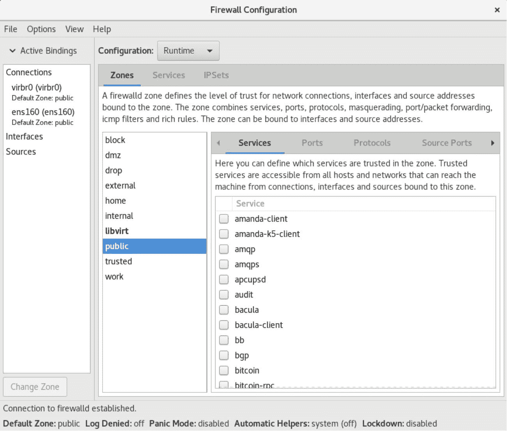

它将打开防火墙界面。

## 更改防火墙设置

### 更改配置

当你启动界面时，从配置下拉菜单中选择 `Runtime`（运行时）配置可以立即更改当前防火墙设置；或者，若要让设置在下次系统启动或防火墙配置重新加载时生效，请从下拉列表中选择 `Permanent`（永久）。

### 更改连接的区域

要为某个区域配置或添加连接，启动 `firewall-config`，从选项菜单中选择 `Change zone of connections`（更改连接区域）。它将显示带有可用连接列表的子菜单，从下拉菜单中选择所需的连接。从下一个下拉菜单选择 `Zone`（区域）。

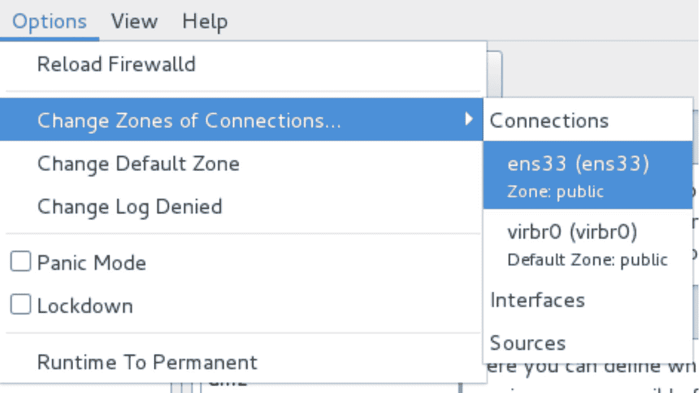

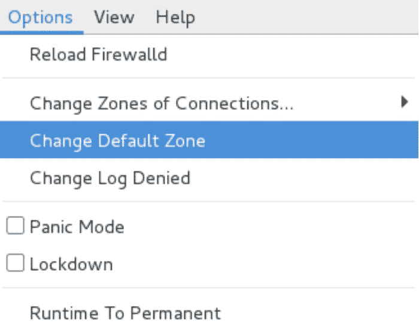

设置默认区域。

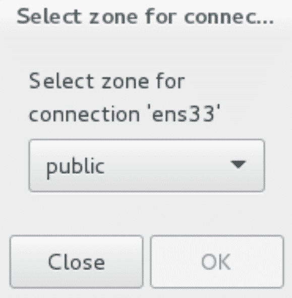

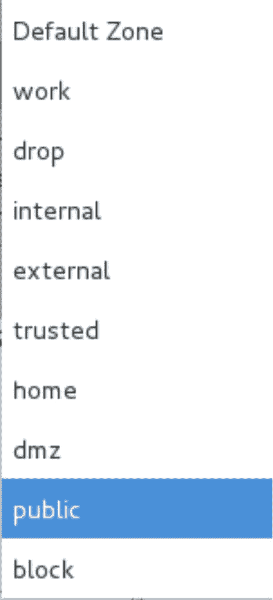

要为新接口设置默认区域或更改现有接口的默认区域，启动 `firewall-config`。首先选择所需的连接，然后从菜单栏中选择 `Options`，并从下拉菜单中选择 `Change Default Zone`。现在从菜单列表中选择所需的区域。

### 配置服务

`Firewall-config` 工具提供了启用和禁用预定义或自定义服务的界面。

1. 选择配置类型 `permanent` 或 `runtime`。
2. 选择 `zone`。
3. 选中或取消服务复选框。选中的复选框表示服务已启用，取消勾选的复选框用于阻止该服务。


## 分区（Partition）

硬盘或驱动器是安装在电脑或服务器上的硬件部分，用于存储数据并通过电磁电荷表面或芯片快速访问大量数据。今天硬盘的容量可以达到 GB（千字节）和 TB（太字节）。硬盘可以是内置或外部。随着硬盘容量的不断增加，你可能会想在同一台机器上安装多个操作系统，这就需要对硬盘分区。分区也有助于将操作系统、应用程序和数据分开，以便更好地管理。

### 分区

在计算机语言中，分区是将存储设备（主要是硬盘）划分为多个段，你可以在其中运行多个系统。存储分区有助于更好地管理和方便备份。Linux 中有多种存储工具，如 `fdisk`、`parted` 等。我们将讨论主要的工具 `fdisk` 和 `parted`。

### fdisk

`fdisk` 是一个强大且最流行的用于分区管理的命令行工具。它是一个基于文本的菜单驱动程序，用于创建和操作分区表。它支持多种类型的分区格式，包括 MS-DOS 和 GPT。它提供了在磁盘上显示、创建、调整大小、删除和修改分区的接口。

#### 使用 fdisk 管理分区

##### 列出分区表

```bash
fdisk -l
```

##### 列出特定设备的分区表语法

```bash
fdisk -l <device name>
```

#### 示例

在设备上创建新分区。在此示例中，`/dev/sdb` 被添加到了系统：

1. 首先打印所有存储设备的列表，并检查想要创建分区的设备名称：

   ```bash
   fdisk -l
   ```

   输出：

   `Disk /sdb: 21.5 GB, 21474836480 bytes, 41943040 sectors`

   `Units = sectors of 1 * 512 = 512 bytes`

   `Free space: 21474836480 bytes`

2. 在 `/dev/sdb` 设备上运行 `fdisk`，准备创建分区的设备：

   ```bash
   fdisk -l
   ```

   输出：

   `Disk /sdb: 21.5 GB, 21474836480 bytes, 41943040 sectors`

   `Units = sectors of 1 * 512 = 512 bytes`

   `Free space: 21474836480 bytes`

   `Sector size (logical/physical): 512 bytes / 512 bytes`

   `I/O size (minimum/optimal): 512 bytes / 512 bytes`

3. 在 `/设备上运行 `fdev `fdb`

   ```bash
   fdisk /dev/sdb
   ```

4. 打印分区表，输入 `p` 键：

   ```bash
   p
   ```

输出：


```
Disk /sdb: 21.5 GB, 21474836480 bytes, 41943040 sectors
Units = sectors of 1 * 512 = 512 bytes
Free space: 21474836480 bytes
Disk label type: dos
Disk identifier: 0xd397c54b
Device             Start         End   Sectors Id
```

1. 按 `n` 创建新分区。

   ```
   n
   ```

2. 按 `p` 设置分区类型为主分区，或按 `e` 设置扩展分区。

   ```
   p
   ```

3. 给分区编号，如 `1`、`2`、`3`、`4`。如果是设备上的第一个分区，则输入 `1`。

   ```
   1
   ```

4. 按回车使用默认起始扇区。如果不从默认扇区开始，可以输入值。

   ```
   2048
   ```

5. 对于最后一个扇区，你可以通过扇区数计算大小，也可以使用人类可读的值 `+1G` 来创建 1 GB 分区。如果你直接按回车不输入任何值，将在设备上创建剩余空间分区。

   ```
   +1G
   ```

6. 按 `w` 写入磁盘。

   ```
   w
   ```

### 删除分区

使用 `fdisk` 删除硬盘上存在的分区的步骤如下。在此示例中，设备名称为 `/dev/sdb`，我们想要删除 `/dev/sdb2` 分区。

#### 显示所需设备的分区表

```bash
fdisk -l /dev/sdb
```

输出：

```text
Disk /sdb: 21.5 GB, 21474836480 bytes, 41943040 sectors
Units = sectors of 1 * 512 = 512 bytes
Free space: 21474836480 bytes
Disk label type: dos
Disk identifier: 0xd397c54b
Device             Start         End   Sectors Id
/dev/sdb1 2048 1955839 976896 83 Linux
/dev/sdb2 1955840 41943039 19993600 83 Linux
```

一旦知道了要删除的分区，运行磁盘命令并指定设备名称：

```bash
fdisk /dev/sdb
```

输出：

```text
Welcome to fdisk (util-linux 2.23.2).

Changes 将仅留在内存中，直到你决定写入它们。

在使用 write 命令前请务小心。
```

### 删除分区

命令（输入 `m` 获取帮助）：

按下 `d` 删除分区。

命令（输入 `m` 获取帮助）：`d`

输入要删除的分区号。在此例中，分区号为 `2`。按下 `2` 并按回车。

分区号（1,2, 默认 2）：`2`

分区 2 已删除。

按下 `p` 和回车打印新的分区表。

命令（输入 `m` 获取帮助）：`p`

```text
Disk /dev/sdb: 21.5 GB, 21474836480 bytes, 41943040 sectors
Units = sectors of 1 * 512 = 512 bytes
Sector size (logical/physical): 512 bytes / 512 bytes
I/O size (minimum/optimal): 512 bytes / 512 bytes
Disk label type: dos
Disk identifier: 0xd397c54b

  Device Boot      Start           End         Blocks  Id System
/dev/sdb1           2048      1955839      976896  83 Linux
```

按下 `w` 键写入更改。如果你在不写入的情况下退出，将丢失所有更改，因为这些更改仍留在内存中。

命令（输入 `m` 获取帮助）：`w`

分区表已更改！

正在调用 `ioctl()` 重新读取分区表。

正在同步磁盘。

### 修改分区类型

你也可以使用 `fdisk` 修改分区。在本例中，我们将把分区类型从 `Linux` 更改为 `Linux LVM`。

1. 首先查看所选设备的当前分区表。
2. 针对所选设备运行 `fdisk`。
3. 通过按下分区号选择分区。
4. 按下 `t` 修改分区类型。
5. 现在按下 `L` 列出分区类型及其十六进制代码。
6. 提供所需的十六进制代码，在本例中为 `8e`。
7. 按下 `w` 写入更改。

```bash
[root@RHEL2 ~]# fdisk -l /dev/sdb

Disk /dev/sdb: 21.5 GB, 21474836480 bytes, 41943040 sectors
Units = sectors of 1 * 512 = 512 bytes
Sector size (logical/physical): 512 bytes / 512 bytes
I/O size (minimum/optimal): 512 bytes / 512 bytes
Disk label type: dos
Disk identifier: 0xd397c54b

  Device Boot      Start           End         Blocks  Id System
/dev/sdb1           2048      2099199     1048576  83 Linux
/dev/sdb2           2099200     41943039     19921920  83 Linux
```

现在运行设备名称运行 `fdisk`：

```bash
[root/RHEL2 ~]# fdisk /dev/sdb

Welcome to fdisk (util-linux 2.23.2).
Changes will remain in memory only, until you decide to write them.
Be careful before using the write command.

To change partition type
Command (m for help): t
Partition number (1,2, default 2): 1
Hex code (type L to list all codes): L
0  Empty           24  NEC DOS         81  Minix / old Lin bf Solaris
1  FAT12           27  Hidden NTFS Win 82  Linux swap / So c1  DRDOS/sec (FAT-
2  XENIX root      39  Plan 9           83  Linux           c4  DRDOS/sec (FAT-
3  XENIX usr        3c  PartitionMagic 84  OS/2 hidden C:  c6  DRDOS/sec (FAT-
4  FAT16 <32M      40  Venix 8026      85  Linux      c7  Syrinx
5  Extended        41  PPCRe Boot      86  NTFS set da  Non-FS data
6  FAT16           42  SFS             87  NTFS set db  CP/M /CTOS /
7  HPFS/NTFS/exFAT 4d  QNX.x           88  Linux plaintext de  Dell Utility
8  AIX             4e  QNX.x 2nd part 8e  Linux LVM      df
9  AIX bootable    4f  QNX.x 3rd part 93  Amoeba
a  OS/2 Boot Manag 50  OnTrack DM      94  Amoeba BBT      e3  DOS/O
b  W95 FAT32       51  OnTrack DM6 Aux 9f  BSD/OS      e4  SpeedStor
c  W95 FAT32 (LBA) 52  CP/M            a0  IBM Thinkpad eb  BeOS fs
e  W95 FAT16 (LBA) 53  OnTrack DM6 Aux a5  FreeBSD      ee  GPT
f  W95 Ext'd (LBA) 54  OnTrackDM6      a6  OpenBSD      ef  EFI (FAT-12/16/
10 OPUS            55  EZ-Drive        a7  NeXTSTEP      f0  Linux/PA-RISC
```

# 创建分区

1. 输入 `parted` 命令并指定所需的设备名称。
2. 使用 `mkpart` 命令。
3. 选择分区类型，可以是主分区（`primary`）或扩展分区（`extended`）。
4. 指定文件系统类型，默认为 `ext2`。
5. 类似于 `fdisk`，提供起始和结束扇区编号；如果是新磁盘，起始扇区将为 `1`，结束位置可以指定大小，如 `1G` 表示 1GB 的分区大小。

```
(parted) mkpart
Partition type? primary/extended? primary
File system type? [ext2]?
Start? 1
End? 1G
(parted) print
Model: VMware, VMware Virtual S (scsi)
Disk /dev/sdb: 21.5GB
Sector size (logical/physical): 512B/512B
Partition Table: msdos
Disk Flags:
Number  Start   End     Size   Type     File system Flags
  1       1049kB  1000MB  999MB  primary
(parted) quit
```

## 添加分区

如果你在硬盘上有可用空间并想再添加一个分区，可以在 `parted` 接口中输入 `mkpart` 命令。它会询问与创建第一个分区时相同的问题。然而，这次的起始位置将是上一个分区的结束位置，该起始位置加上分区的大小即该分区的结束位置。

在示例中，起始位置是 `1000MB`（因为第一个分区的结束于 `11000MB`）。如果你想添加 `1000MB` 的分区，则该分区的结束位置将是 `2000MB`（`1000MB + 1000MB`）。

```
(parted) mkpart
Partition type? primary/extended? primary
File system type? [ext2]?
Start? 1000MB
End? 2000MB
(parted) print
Model: VMware, VMware Virtual S (scsi)
Disk /dev/sdb: 21.5GB
Sector size (logical/physical): 512B/512B
Partition Table: msdos
Disk Flags:
Number  Start   End     Size   Type     File system Flags
1       1049kB  1000MB  999MB  primary
2       1000MB  2000MB  999MB  primary
```

## 删除分区

使用 `rm partition_number` 命令删除分区。

### 示例

```
(parted) print
Model: VMware, VMware Virtual S (scsi)
Disk /dev/sdb: 21.5GB
Sector size (logical/physical): 512B/512B
Partition Table: msdos
Disk Flags:
Number  Start   End     Size   Type     File system Flags
1       1049kB  1000MB  999MB  primary
2       1001MB  2001MB  999MB  primary
3       2001MB  3001MB  1000MB primary
(parted) rm 3
(parted) print
Model: VMware, VMware Virtual S (scsi)
Disk /dev/sdb: 21.5GB
Sector size (logical/physical): 512B/512B
Partition Table: msdos
Disk Flags:
Number  Start   End     Size   Type     File system Flags
1       1049kB  1000MB  999MB  primary
2       1001MB  2001MB  999MB  primary
```

在本章中，我们学习了如何管理分区。在下一章中，我们将讨论如何在这些分区上创建文件系统。

# 第 18 章 文件系统

文件系统是操作系统用于存储和检索数据的方法。文件系统有助于管理和安排数据。Linux 提供了不同类型的文件系统。每种文件系统都使用不同的结构和逻辑来存储和检索数据。

某些文件系统是专门为特定设备和应用程序设计的，例如 `ISO 9660` 文件系统用于 `CDROM` 等光盘。根据文件系统的类型，它可以是局部的，也可以是网络上的。

Linux 支持多种文件系统，每个文件系统都有其优缺点。我们将讨论 RHEL 中使用的一些常用文件系统。在 RHEL 8 中，`BTRFS` 文件系统已被移除。这意味着你将无法在 RHEL 8 上创建、挂载或安装 `btrfs` 文件系统。

## XFS

XFS 是一种高性能日志文件系统，最初由 Silicon Graphics, Inc. 为 `IRIX` 操作系统创建，后来移植到 Linux。XFS 支持元数据日志，这有助于更快地恢复崩溃。XFS 文件系统在挂载和激活状态下也可以进行碎片整理和扩展。

XFS 在将实际数据提交磁盘之前，会将文件系统的更新异步记录到循环缓冲区（日志）中。XFS 是 RHEL 8 的默认文件系统。

XFS 新增了写时复制（copy-on-write）数据段的新功能。此功能允许两个或多个文件共享一组公共数据。当共享块的任一个文件发生变化时，XFS 会断开与公共块的链接并创建一个新文件。这有助于节省空间和磁盘写入。

### 创建 XFS 文件系统

1. 使用 `fdisk` 创建分区。
2. 使用 `fdisk -l` 检查设备名称。
3. 使用 `mkfs -t xfs /dev/sdb1` 创建文件系统。
4. 创建挂载点。
5. 在 `/etc/fstab` 中添加配置。

```text
/dev/sdb2      307     614     1050280   82 Linux swap / Solaris

Press w to write partition to disk

Command (m for help): w

The partition table has been altered!

Calling ioctl() to re-read partition table.

Syncing disks.
```

### 2. 执行 `mkswap /dev/sdb2`

`sdb2` 是将用作交换区的分区名称。

```bash
~]# mkswap /dev/sdb2
```

```text
Setting up swapspace version 1, size = 1050276 KiB

no label, UUID=c1f98067-9548-4bf1-843d-5f09f5d5ba56
```

### 3. 在 `/etc/fstab` 中添加条目

```bash
~]# cat /etc/fstab
```

```text
/dev/mapper/cl-root /  xfs     defaults       1 1

UUID=6b761a5f-8c7c-465d-b58c-d29267938403 boot xfs     defaults       1 2

/dev/mapper/cl-swap swap               swap     defaults       0 0

/dev/sdb1      /test1         xfs     defaults       0 2

UUID=c1f98067-9548-..5ba56 swap swap     defaults       0 0
```

### 4. 激活交换区

`swapon -a` 将激活交换区：

```bash
swapon -a
```

### 5. 查看交换区状态

`swapon -s` 将显示所有交换区的状态：

```bash
~]# swapon -s
```

```text
Filename            Type            Size    Used    Priority

/dev/dm-1           partition       2097144 0       -1

/dev/sdb2           partition       1050272 0       -2
```

要停用交换空间：

```bash
# swapoff /dev/sdb2
```

# 第 20 章 逻辑卷管理器（LVM）

在前面的章节中，我们学习了如何创建 Linux 分区，但 Linux 提供了创建 LVM 类型分区的选项。LVM 比普通分区更复杂。LVM 提供了以下优势：

- 动态扩展文件系统
- 缩小文件系统
- 动态添加磁盘


- 镜像（Mirroring）
- 条带（Stripping）
- 文件系统的快照备份

## LVM 中使用的术语

### 物理卷（PV）

物理卷（PV）是块设备的物理存储单元，可以是分区或整个磁盘。要将设备用于 LVM，请使用`fdisk`创建类型为 LVM 的分区。

#### 1. 创建物理卷（PV）

如果你在运行时插了热拔磁盘或向虚拟机添加了虚拟磁盘，请使用以下脚本在 SCSI 总线上检测新磁盘。此脚本用于避免重启服务器；重启机器则不需要此步骤，因为启动过程会自动添加新安装的磁盘。

```bash
for host in `ls /sys/class/scsi_host/`;do
echo "- -" >/sys/class/scsi_host/${host}/scan;
done
```

#### 将磁盘分区更改为 LVM

使用`fdisk`命令创建类型为 Linux LVM 8e 的分区。如果整个磁盘被用作 PV，则可以忽略此步骤。

```bash
~]# fdisk /dev/sdb
WARNING: DOS-compatible mode 已弃用。强烈建议关闭该模式（命令 'c'）并将显示单位更改为扇区（命令 'u'）。
Command (m for help): n
Command action
  e  extended
  p  primary partition (1-4)
p
Partition number (1-4): 3
First cylinder (615-6132, default 615): Using default value 615
Last cylinder, +cylinders or +size{K,M,G} (615-6132, default 6132): +5G
Command (m for help): t
Partition number (1-4): 3
Hex code (type to list): 8e
Changed system of partition 3 to 8e (Linux LVM)
Command (m for help): p
Disk /devdb: 5 GB, 2147483648 bytes
171 heads, 40 sectors/track, 6132 cylinders
Units = cylinders
6132 = 3502080 bytes
Sector size (logical/physical): 512 bytes
Disk identifier: 0xdecee90
Device    Start   End     Blocks  Id  System
/dev/sdb1      1       307     104857683 Linux
/dev/sdb2      307     614     1050280 82 swap / Solaris
/dev/sdb3      615     5246280 e LVM
Command (m for help): w
The partition table has been altered!
```

#### 使用`pvcreate`创建 PV

使用`pvcreate`创建由`fdisk`创建的设备。如果是整个磁盘，使用设备名称。

```bash
~]# pvcreate /dev/sdb3
```

物理卷`/sdb3`创建成功。

```bash
~]# pvdisplay /sdb3
```

`/sdb3`是一个为 "5.00 GiB" 的新物理卷。

```text
--- NEW Physical volume ---

PV Name: /sdb3

VG Name:

PV Size: 5.00 GiB

Allocatable:

Total PE: 0

Free PE: 0

Allocated PE: 0

PV UUID: 7El-WiGK-Z0m5-gP95
```

### 2. 定义卷组（VG）

一旦定义了 PV，就可以在其上创建 VG。如果创建 VG 使用多个磁盘，首先为所有磁盘创建 PV。然后使用`vgcreate`命令和所有 PV 名称来定义 VG。

```bash
# vgcreate vg01 /dev/sdb3
```

卷组`vg01`创建成功。

### 3. 创建逻辑卷（LV）

上述 LV 是创建文件系统的基础。某些情况下 LV 也可以作为原始设备使用。使用`lvcreate`命令定义 LV。

```bash
lvcreate -n LV_name -L size VG_name
# lvcreate -n lv01 -L 1G vg01
```

逻辑卷`lv01`创建。

LV 也可以镜像。镜像 LV 在不同设备上维护相同的数据。当数据写入一个设备时，也会写入第二个设备以实现冗余。

#### 创建镜像 LV

```bash
# lvcreate -n lv01 -m1 -L 1G vg01
```

### 4. 在 LV 上创建文件系统

使用`mkfs`命令创建文件系统。

```bash
mkfs -t xfs /dev/VG_name/LV_name
```

其中，`-t`用于指定文件系统类型，逻辑卷名称按其卷组顺序指定。

```bash
# mkfs -t xfs /dev/vg01/lv01
```

### 5. 自动挂载新文件系统

为了在系统启动时自动挂载文件系统，必须在`/etc/fstab`文件中添加条目。有两种方法：使用设备名称，另一种使用设备通用唯一标识符。使用 UUID 的优点是它独立于操作系统赋予硬盘的实际设备号。如果添加新设备，设备名称可能会更改，但设备的 UUID 保持不变。

#### 使用设备名称在 fstab 文件中添加条目

```bash
# vi /etc/fstab
```

```text
/dev/sdb2 /newfs  xfs     defaults       1 2
```

#### 使用 UUID 在 fstab 文件中添加条目

1. 新创建文件系统的 UUID：

   ```bash
   # blkid /dev/vg01/lv01
   ```

2. 将条目添加到`/etc/fstab`以启动时自动挂载：

   ```text
   UUID=6acaa-5541139e830e  /newfs  xfs     defaults       1 2
   ```

### 6. 挂载文件系统

```bash
mount -a
```

## LVM 查表

### PV 命令

| 描述 | 命令 |
| :--- | :--- |
| 显示 PV 属性 | `pvdisplay` |
| 显示所有 LVM 块设备 | `pvscan` |
| 防止在 PV 上分配 PE | `pvchange -xn /dev/PV_name` |
| 移除 PV | `pvremove /dev/PV_name` |

### 卷组命令

| 描述 | 命令 |
| :--- | :--- |
| 显示 VG 属性 | `vgdisplay` |
| 显示 VG 列表 | `vgs` |
| 将 PV 添加到 VG | `vgextend vgname /dev/PV_name`（示例：`# vgextend vg01 /dev/sdb5`） |
| 从 VG 移除 PV | `vgreduce vg1 /dev/PV_name`（示例：`# vgreduce vg01 /dev/sdb5`） |
| 激活 VG | `vgchange -ay VG_name` |
| 停用 VG | `vgchange -ay VG_name` |
| 移除 VG | `vgremove VG_name`（示例：`vgremove /dev/vg02`） |
| 重新创建 VG 目录 | `vgmknodes` |

如果出现需要将整个卷组（Volume Group）从一个系统移动到另一个系统的情况，可能是由于当前系统的某些硬件问题，或者为了将旧存储迁移到新硬件，可以使用以下步骤。在这个示例中，有两个系统：一个是当前`VG`所在的旧系统，另一个是你想要移动到的新系统。

### 在旧系统上

1. 卸载所有属于该卷组的文件系统：

   ```bash
   umount /newfs
   ```

2. 使用`vgchange -an VG_name`命令停用 VG：

   ```bash
   [root@RHEL1 /]# vgchange -an sharedvg
   ```

3. 使用`vgexport VG_name`命令导出 VG：

   ```bash
   [root@RHEL1 /]# vgexport sharedvg
   ```

### 在新系统上

4. 将 HDD 连接到新系统后，使用`vgimport VG_name`命令导入 VG：

   ```bash
   [root@RHEL2 ~]# vgimport sharedvg
   ```

5. 使用`vgchange -ay VG_name`激活 VG：

   ```bash
   [root@RHEL2 ~]# vgchange -ay sharedvg
   ```

6. 在 VG 上挂载文件系统：

   ```bash
   [root@RHEL2 ~]# mount /dev/sharedvg/sharedlv /mnt
   ```

7. 检查文件系统内容：

   ```bash
   [root@RHEL2 ~]# cd /mnt
   ```

### 扩展文件系统

1. 检查当前 FS 大小：

   ```bash
   df -h /fsname
   /dev/mapper/vg01-lv01      1008M  34M  924M  4% /newfs
   ```

2. 检查是否有足够的空闲空间，即你想要扩展的 FS 所在的 VG 是否有空闲 PE。

   ```bash
   # vgdisplay vg01
     --- Volume group ---
     VG Name             vg01
     System ID
     Format               lvm2
     Metadata Areas        1
     Metadata Sequence No  5
     VG Access            read/write
     VG Status            resizable
     MAX LV               0
     Cur LV               1
     Open LV              1
     Max PV               0
     Cur PV               1
     Act PV               1
     VG Size              5.00 GiB
     PE Size              4.00 MiB
     Total PE             1280
     Alloc PE / Size      256 / 1.00 GiB
     Free PE / Size       1024 / 4.00 GiB
   ```

3. 使用`lvextend -L size /dev/vgname/lvname`扩展逻辑卷：

   ```bash
   # lvextend -L +200M /dev/vg01/lv01
   ```

4. 使用`xfs_growfs /fsname`扩展文件系统：

   ```bash
   # xfs_growfs /newfs
   ```

5. 检查 FS 大小：

   ```bash
   df -h /fsname
   /dev/mapper/vg01-lv01  1.2G  34M  1.1G
   ```

### 缩小文件系统

1. 检查当前 FS 大小：

   ```bash
   df -h /fs_name
   /dev/mapper/vg01-lv01  1.2G  34M  1.1G
   ```

2. 备份文件系统：

   ```bash
   # xfsdump -f /tmp/newfs.dump /newfs
   ```

3. 卸载文件系统：

   ```bash
   umount /fs_name
   # umount /newfs
   ```

4. 移除 LV：

   ```bash
   # lvremove /dev/mapper/vg01-lv01
   ```

5. 重新创建 LV：

   ```bash
   # lvcreate -n lv01 -L1G vg01
   ```

6. 重新创建文件系统：

   ```bash
   # mkfs.xfs /dev/vg01/lv01
   ```

7. 检查 UUID：

   ```bash
   # blkid /dev/vg01/lv01
   ```

8. 在`/etc/fstab`中修改文件系统的 UUID。

9. 挂载文件系统：

   ```bash
   # mount -a
   ```

10. 恢复备份：

    ```bash
    xfsrestore -f /tmp/newfs.dump /newfs
    ```

11. 检查文件系统：

    ```bash
    # df -h /newfs
    ```

# NFS

`NFS`（网络文件系统）是一种文件共享文件系统，基于服务器/客户端模式工作。服务器的共享文件系统挂载在客户端上。

NFS 有四个版本：

1. NFS V1
2. NFS V2
3. NFS V3
4. NFS V4

其中，`NFS V3`和`NFS V4`是较新的 NFS 版本，`V3`更安全且基于 UDP 协议，而`V4`增加了通过防火墙运行的优势并基于 TCP 运行。

要让客户端可以使用共享文件系统，必须从服务器进行导出。在 NFS 服务器上配置导出的方法有两种：

- 通过`/etc/exports`配置文件。
- 在命令行中显式地使用`exportfs`工具，但这种方法在每次重启后都需要重新执行。

## 在服务器上配置 NFS

### 安装包

```bash
# yum install nfs-utils
# yum install rpcbind
```

### 启动服务

```bash
# systemctl start rpcbind
# systemctl start nfs-server
```

### 让服务在下次重启时启动

```bash
# systemctl enable rpcbind
# systemctl enable nfs-server
```

### 手动不通过`/etc/exports`导出文件系统

```bash
# exportfs -i /user1
```

### 使用`/etc/exports`导出文件系统

编辑`/exports`文件以添加要向客户端共享的文件系统，格式如下：

`mountpoint [host][permissions/options]`

其中：

- `mountpoint`是要导出的文件系统。
- `host`是可选的，你想授予访问权限的客户端。
- `permissions`是可选的，可以是`ro`只读、`rw`读写、`sync`在命令完成前写入。

示例：

`/software/c1 192.168.10.12(rw,sync)`

### 导出文件系统

```bash
# exportfs -a
```

### 查看已导出的文件系统

```bash
# showmount -e
```

### 配置防火墙允许客户端访问 NFS 服务器

```bash
firewall-cmd --permanent --zone public --add-service mountd
firewall-cmd --permanent --zone public --add-service rpc-bind
firewall-cmd --permanent --zone public --add-service nfs
```

# 第 21 章 移动卷组

如果出现需要将整个卷组从一个系统移动到另一个系统的情况，可能是由于当前系统的某些硬件问题，或者为了将旧存储迁移到新硬件，可以使用以下步骤。在这个示例中，有两个系统：一个是当前`VG`所在的旧系统，另一个是你想要移动到的新系统。

```bash
rm -r abc
```

## more

当你想查看超过一个屏幕长度的文件时，可以使用`more`工具。`More`用于一次一屏地翻页查看文本。

### 语法

```bash
more filename
```

### 示例

```bash
more /etc/hosts
```

## less

`Less`是一个与`more`类似的程序，但它允许在文件中向后移动，也可以向前移动。

### 语法

```bash
less filename
```

### 示例

```bash
less /etc/hosts
```

## mv

`mv`命令用于将文件从一个位置移动到另一个位置。`mv`命令也可以用于重命名文件。

### 移动文件的命令

#### 语法

```bash
mv filename destination_directory
```

#### 示例

```bash
mv a.txt /tmp/.
```

它将`a.txt`文件从当前目录移动到`/tmp`目录。

### 重命名

#### 语法

```bash
mv filename newfilename
```

#### 示例

```bash
mv a.txt b.txt
```

## grep

从一个或多个文件中搜索字符串。显示包含该字符串的每一行。

### 语法

```bash
grep string file
```

### 示例

```bash
grep '127.0.0.1' /etc/hosts
```

## head

将文件的前 10 行打印到标准输出。你也可以指定显示多少行。

### 语法

```bash
head option file
```

### 示例

```bash
head -20 /tmp/abc.txt
```

该命令将显示`abc.txt`文件的前 20 行。

## tail

如果不带任何参数使用，将文件的最后 10 行打印到标准输出；否则，你可以指定显示的行数。

### 语法

```bash
tail option file
```

### 示例

```bash
tail -20 /var/log/logfile
```


它将显示最后 20 行。

使用 `tail` 持续监控动态文件：

```bash
tail -f /var/log/logfile
```

它将显示不断增长的文件末尾。按 `Ctrl + c` 中断。

### `diff`

比较两个文件。

#### 语法

```bash
diff First_file Second_file
```

#### 示例

```bash
diff abc.txt bbc.txt
```

### `file`

确定文件类型。

#### 语法

```bash
file file_name
```

#### 示例

```bash
file bbc.txt
```

### `echo`

将参数写入标准输出。

#### 语法

```bash
echo text
```

#### 示例

```bash
echo hello
```

### `date`

打印或更改系统日期和时间。

#### 语法

```bash
date
```

#### 示例

检查日期：

```bash
date
```

设置日期和时间：

```bash
date -s "24 feb 2017 19:00"
```

第 24 章。

# 管道与重定向

在上一章中，我们学习了 Linux 命令，在本章中，我们将看到如何结合使用 Linux 命令和文件，将简单的命令转换为更复杂的命令。这涉及到数据从一个命令到另一个命令，或从命令到文件，以及从文件到命令的移动。

这种从命令到另一个命令或从文件到命令或从命令到文件的数据传输被称为流（stream）。流有三种类型：

- 标准输入（`stdin`）
- 标准输出（`stdout`）
- 标准错误（`stderr`）

通常情况下，当用户在 PC 上工作时，标准输入从用户的键盘流到标准输出（即显示器），用户在那里获取输出。如果操作过程中出现错误，用户将在终端上看到标准错误。然而，我们可以通过角括号和管道来改变这种行为。有时我们通过它们对应的数字来引用这些流。

| 流 | 编号 | 符号 | 追加 |
| :--- | :--- | :--- | :--- |
| Stdin | 0 | `<` | `<<` |
| stdout | 1 | `>` | `>>` |
| stderr | 2 | `2>` | `2>>` |

## 重定向

当你想要更改数据的正常流向时，我们使用重定向。你可以将命令的输出发送到文件或设备。你也可以从文件或设备获取输入并交给命令。

### 将输出发送到文件（`>`）

通常，我们在屏幕上获取输出，但如果我们希望将其保存到文件中，则使用大于运算符（`>`）将标准输出发送到文件。请注意，此命令将覆盖现有输出文件的内容。

#### 语法

```bash
Command > filename
```

#### 示例

```bash
ls > abc.txt
```

### 从文件发送输入（`<`）

如果我们使用小于运算符（`<`），那么我们就可以从文件中读取数据并通过其 `STDIN` 流将其输入程序。

#### 语法

```bash
Command < filename
```

#### 示例

```bash
wc -l < abc.txt
```

### 将标准错误发送到文件

如果我们在大于运算符使用 `2`（`2>`），我们就可以将 `STDERR` 流发送到文件。

#### 语法

```bash
Command or script 2> filename
```

#### 示例

```bash
myscript 2>abc.log
```

### 追加

我们已经看到，使用单括号命令会覆盖文件的原有内容。要追加内容，我们可以使用双括号（`>>`）或（`2>>`）。

将标准输出追加到现有文件，如果文件不存在则创建一个新文件。

#### 语法

```bash
Command >> filename
```

#### 示例

```bash
# la -la >> abc.txt
```

将 `stderr` 流追加到文件。

#### 语法

```bash
Command 2>> filename
```

#### 示例

```bash
# myscript.sh 2>> abc.txt
```

有时，你可能想将标准输出和标准错误都重定向到同一个文件中。这通常用于自动化过程，以便你稍后检查输出和可能的错误。使用 `&>` 或 `&>>` 将标准输出和标准错误都重定向到同一个地方。另一种方法是使用流的数字 `2>&1`。

#### 语法

```bash
Command >outputfile 2>&1
```

#### 示例

```bash
ls b* >abc.log 2>&1
```

### 管道（`|`）

为了将数据从一个程序发送到另一个程序，我们使用管道（`|`）。

#### 语法

```bash
Command1 | Command2
```

#### 示例

```bash
ls | head -10
```

该命令仅显示 10 行。这是管道的一个简单示例。

```bash
sort abc.txt | uniq
```

第 25 章。

# 进程与线程

每一个进程都是执行中的程序。在 Linux 中，进程是分配处理器时间的最小单位。为了实现并行性，将进程分为多个线程。进程具有以下属性：

- 进程根据上下文切换运行。
- 每个进程提供所需的资源。
- 进程包含多个线程。
- 进程在前台或后台运行。

## 前台

是你直接运行并等待其完成的任何命令或任务。

## 后台进程

后台进程是在后台运行的进程。与前台进程不同，shell 不需要等待后台进程结束就可以运行。后台进程的数量取决于可用内存。

| 命令 | 说明 |
| :--- | :--- |
| `bg` | 将任务移至后台 |
| `fg` | 将任务移回前台 |
| `jobs` | 显示任务 |
| `kill` | 停止进程 |
| `ps` | 显示进程信息 |

如果命令以 `&` 结尾，shell 将后台执行该命令且不会等待。

### 示例

```bash
gcaltool &
```

将命令移回前台：

```bash
fg
```

`Ctrl + c`

检查运行的任务：

```bash
jobs
```

列出当前运行的进程：

```bash
ps -ef
```

或：

```bash
ps aux
```

强制杀死进程：

首先通过 `ps -ef` 检查进程 ID，然后：

```bash
sudo kill -9 <process –id>
```

使用 `ps` 命令监控进程。

`ps` 命令显示进程的 CPU 和内存利用百分比，当你的机器性能不佳时非常有用。`ps` 命令可以告诉你哪个进程正在占用资源。

## 进程调度

调度器是内核的一部分，负责选择下一个运行的进程。其目的是根据优先级运行进程。为了设置运行进程的优先级，使用了 `nice` 和 `renice` 命令，它们决定了给进程分配更长或更少的 CPU 时间。

`nice` 设置新进程的优先级或 nice 值。

`renice` 调整运行进程的 nice 值。

nice 值 -20 为优先级最高，19 为最低。默认优先级为 0。

### 示例

```bash
$ sudo nice -n 19 cp -r /as /map
```

显示运行进程的优先级：

```bash
ps -al
```

或：

```bash
top
```

更改优先级：

```bash
$ sudo renice -n 10 <pid>
```

注意：你需要 root / 超用户权限才能更改更高的优先级。

任务自动化在计算机领域非常重要。假设你必须在晚上 11:00 系统无人使用时进行每日备份。那么你就必须在深夜起来进行备份。然而，你可以对备份进行调度，这样计算机就会在晚上 11:00 自动运行备份脚本。第二天早晨，你可以验证备份情况。RHEL 提供了许多工具来实现任务自动化。这些工具可以用于自动化系统管理员定期执行或指定时间执行的任务。以下是主要的工具：

- `cron`
- `at`
- `batch`

# `cron`

`cron` 是一个守护进程，可以根据时间、日期、星期调度周期性任务的执行。

## 配置文件

`/etc/crontab`

## 命令描述

- `crontab –l` 列出 crontab 条目
- `crontab –e` 编辑 crontab
- `crontab –r` 删除 crontab

## 语法

`minutes hours Day_of_month Month Day_of_week Command`

## 参数说明

- 分钟（0 到 59）
- 小时（0 到 23）
- 日期（1 到 31）
- 月份（1 到 12）
- 星期（0 到 6）（0=星期日）

## 调度周期性任务

1. 通过命令 `crontab -e` 编辑 crontab。
2. 在文件末尾添加条目，按 `i` 键（注意此文件将在 `vi` 编辑器中打开，因此你可以使用所有 `vi` 命令）。

   假设你想每天晚上 23:30 运行备份脚本：

   ```bash
   30 23 * * * /myscripts/backup.sh
   ```

3. 按 `ESCAPE` 键，然后输入 `: write x` 并按 `ENTER` 键保存条目。

# `at` and `batch`

`crontab` 用于周期性任务，但对于指定时间执行的单次任务，可以使用 `at` 和 `batch` 命令。

运行 `at` 命令必须安装了 `rpm` 且 `atd` 服务必须正在运行。当你输入带有时间的 `at` 命令时，系统会向你显示 `at` 提示符。在 `at` 提示符下，你可以输入想要调度的命令。输入所有命令后，按 `CTRL + d` 键退出 `at` 提示符。

## 检查安装

```bash
# rpm -q at
```

## 安装 at 包

```bash
# yum install at
```

## 启动服务

```bash
# service start atd
```

## 启动命令

```bash
# at 4:00
at > ls
ctrl + d
```

`batch` 命令在系统平均负载低于 0.8 时执行单次任务：

```bash
~]# batch
at> ls -la
at> ctrl + d
```

## 显示待处理作业列表

```bash
# atq
```

# 第 27 章 启动过程

按下电源键进入 RHEL 登录提示界面后，系统会进行大量处理以带你进入登录界面。这个过程被称为启动过程。理解 Linux 的启动过程对于排除启动问题以及正确配置 Linux 至关重要。

以下步骤总结了 RHEL 中启动过程是如何进行的：

1. 计算机使用 `BIOS` 执行 `POST`（上电自检）。
2. `BIOS` 读取主引导记录（Master Boot Record）获取引导程序。
3. 控制权交给 `GRUB2`。它使用 `/boot/grub/grub.cfg` 选择内核镜像。
4. 内核：
   1. 根据 `grub.conf` 中指定的 `root=` 挂载根分区。
   2. 内核启动进程 ID 为 1（`PID 1`）的 `systemd` 进程。
   3. `initrd`（初始内存磁盘）被内核作为临时根文件系统，直到内核启动完成并挂载真实的根文件系统。它还包含了访问硬盘和其他必要的硬件所需的驱动程序。
5. `systemd`。

`systemd` 是 Linux 操作系统的系统和服务管理器。它提供了许多功能，例如在启动时并行启动系统服务。`systemd` 是系统中所有进程的父进程。`systemd` 确定默认系统目标，在旧版本中被称为运行级别（run level）。确定目标后，它执行系统初始化，包括：

1. 设置主机名。
2. 初始化网络。
3. 初始化系统硬件。
4. 挂载文件系统。
5. 启动交换分区。

# 第 28 章 日志管理

日志文件在系统故障排除中非常有用。日志文件对于审计系统是否存在未经授权的访问也很有用。日志文件让你了解系统在特定时间点正在做什么。假设作为 Linux 管理员，你的机器运行缓慢或工作不正常，首先要查找的就是日志。日志提供了问题何时以及如何开始的线索，以及操作系统的哪个部分出了问题。

Linux 环境下生成的日志文件通常可以分为四类：

- 应用日志
- 事件日志
- 服务日志
- 系统日志

RHEL 提供了保存日志信息的服务。RHEL 中的某些应用程序使用自己的机制直接将日志记录到其日志文件中，例如 `apache`。某些服务通过 `systemctl` 维护其日志。`systemctl` 进一步与 `Journald` 通信，由 `Journald` 跟踪日志信息。

`rsyslog` 是另一种日志记录方法。`rsyslog` 和 `Journal` 具有若干不同的特征，使得它们适用于特定的场景。在许多情况下，结合使用非常有效。

## `journald`

`journald` 守护进程是 `systemd` 的组件，用于日志管理。它收集了系统的所有消息。

### 使用 `journalctl` 查看日志

查看日志：

```bash
journalctl
```

查看所有条目的元数据：

```bash
journalctl -o verbose
```

实时查看日志：

```bash
journalctl -f
```

### 按优先级过滤

你可以根据优先级过滤日志。

语法：

```bash
journalctl -p priority
```

示例：在此示例中，我们只想查看日志中错误级别的行：

```bash
journalctl -p err
```

查看本次启动的日志条目：

```bash
journalctl -b
```

让日志持久化：

```bash
$ sudo mkdir -p /var/log/journal
```

然后重启 `journald` 以应用更改：

```bash
systemctl restart systemd-journal
```

## `syslogd`

某些日志由 `rsyslogd` 守护进程控制。它是 `sysklog` 的增强版。它提供了高性能、出色的安全性、模块化设计以及通过 TCP 或 UDP 协议传输的支持。每条日志消息至少包含时间和程序名称字段。

`/etc/rsyslog.conf` 文件是 `rsyslogd` 的主配置文件，用于记录系统上的日志消息。该文件指定了 `rsyslogd` 的记录规则。由 `rsyslogd` 维护的日志文件列表可以在 `rsyslog.conf` 配置文件找到。日志文件通常位于 `/var/log/` 目录。

### 样例 `rsyslog.conf`

```bash
etc]$ cat rsyslog.conf

# rsyslog v5 配置文件
# 更多信息请参 /usr/share/doc/rsyslog-*/rsyslog_conf.html
# 如果遇到问题，请访问 http://www.rsyslog.com/doc/troubleshoot.html

*.info;mail.none;cron.none  /var/log/messages # authpriv 文件具有限制访问。
authpriv.*                              /var/log/secure # 将所有邮件记录在一个处。
mail.*                                -var/log/maillog # 记录 cron 信息
cron.*                               /var/log/cron # 所有人都能接收紧急消息
*.emerg                                * # 将 crit 及以上的新闻错误保存到特殊文件中。
uucp,news.crit                         /var/log/spooler # 将启动消息也保存到 boot.log
local7.*                              /var/log/boot.log
```

### 使用 `rsyslog.conf` 进行日志过滤

系统产生了大量的日志，如果不进行过滤，几乎无法使用这些日志。为了过滤日志，我们使用 `/etc/rsyslog.conf` 文件。它包含两个参数 `facility`（设施）和 `priority`（优先级），用点（`.`）隔开。`Facility` 是你想要记录的进程名称，`priority` 指定日志级别，如 `debug`、`info`、`notice`、`warning`、`err`、`crit`、`alert`、`emerg` 或代表所有类型消息的 `*`。

### Example

#### `authpriv` 文件具有限制访问权限

```bash
authpriv.* /var/log/secure
```

#### 在一处记录所有邮件消息

```bash
mail.* -/var/log/maillog
```

在示例中，`authpriv` 和 `mail` 是设施，优先级为 `*`，意味着所有日志。

### 使用 `logrotate` 轮转日志

日志需要轮转以避免填充文件系统，并使日志更易管理。一旦日志文件被轮转，它将被重命名为新文件名。经过一定的轮转时间后，旧的日志文件将被删除以节省空间。

`logrotate` 包根据 `/etc/logrotate.conf` 中的配置或命令行选项指定，管理日志文件的自动轮转。

#### Install

```bash
sudo apt install logrotate
```

#### 验证 `logrotate` 是否安装成功

```bash
logrotate
```

`/etc/logrotate.conf` 文件中一些重要的配置设置有 `rotation-interval`、`log-file-size`、文件的 `permssions`、`missingok`、`rotation-count` 和 `compression`。对于每个日志，建议你在 `/etc/logrotate.d` 目录下创建文件。

### Example


```bash
[root@redhat1 logrotate.d]# cat bootlog

/var/log/boot.log

{
    missingok
    daily
    copytruncate
    rotate 7
    notifempty
}
```

在这个示例中，日志轮转工具 `rotate` 对 `boot` 进行了轮转，详情如下：

- `missingok`：如果日志缺失则忽略
- `daily`：日志每天进行一次轮转
- `copytruncate`：在创建副本后在原地截断原始日志文件
- `rotate 7`：保留 7 天的日志
- `notifempty`：如果日志为空则不进行轮转

### 重要日志

日志的主目录是 `/var/log`。该目录下一些值得关注的日志文件：

- `wtmp`
- `utmp`
- `dmesg`
- `messages`
- `maillog`
- `spooler`
- `auth.log` 或 `secure`
- `yum.log`
- `boot.log`

#### `/var/log/wtmp` 和 `/var/run/utmp`

`wtmp` 和 `utmp` 文件跟踪用户登录和退出系统的情况。这两个文件都是二进制文件。你不能直接使用文本编辑器、`cat` 或 `more` 命令读取这些文件的内容。你必须使用特定的命令。

`who` 命令使用 `/var/run/utmp` 文件提供当前登录系统的用户信息。

```bash
[root@RHEL2 log]# who
(unknown) :0      2018-10-02 05:34 (:0)
root     pts/0      2018-10-02 05:38 (192.168.131.1)
```

#### `/var/log/wtmp` 文件

该文件维护所有登录和退出用户的历史记录。`last` 命令使用此文件显示最后登录用户的列表。

```bash
[root@RHEL2 log] # last
root     pts/0      192.168.131.1    Tue Oct  2 05:38  still logged in
(unknown :0             :0               Tue Oct  2 05:34  still logged in
reboot    system boot  3.10.0-514.el7.x Tue Oct  2 05:33 - 05:47  (00:13)
root     pts/1      192.168.131.1    Mon Oct  1 13:23  crash
```

#### `dmesg`

`dmesg` 通过读取内核缓冲区获取数据。缓冲区是计算机内存的一部分，被留作临时从外部设备发送或接收数据的存放地。这些消息对于诊断设备故障非常重要。每当发生硬件变化时，大多数消息都会记录在这里。如果你遇到任何问题，请使用 `dmesg` 进行系统诊断。`dmesg` 工具存在于 `/var/log/`。

```bash
[root@RHEL2 log]# dmesg |more
```

#### `Messages`

通用日志在此文件中。要查看此文件，可以使用文本编辑器或任何常用的文本查看工具，如 `cat`、`less` 或 `more`。

```bash
[root@RHEL2 log] # cat messages
Oct  2 06:07:02 localhost rsyslogd: [origin="rsyslog"] swVersion="7.4.7" x-pid="1056" x-info="http://www.rsyslog.com"] rsyslogd was HUPed
```

#### `Maillog`

该文件记录运行服务器上的邮件服务器的消息。

```bash
[root@RHEL2 log]# cat maillog
```

#### `Spooler`

记录打印程序消息。`Spooler` 被打印队列用于打印。

#### `secure`

此文件捕获身份验证日志。要检查此文件，可以使用 `more` 或 `less` 命令。

#### `dnf.log`

在 RHEL 8 中，`yum` 是 `dnf` 命令的前端。`yum` 命令将消息记录在 `dnf.log` 文件。还有其他 dnf 日志文件，如 `dnf.librepo.log` 和 `dnf.rpm.log`。

`Selinux` 实现了 MAC，即强制访问控制（Mandatory Access Control）。`Selinux` 是一组安全规则，决定哪些进程可以访问哪些文件、目录或端口等。访问进程、目录和文件的 SELinux 策略被称为上下文（context）。`Selinux` 的目标之一是保护数据和系统。`Selinux` 有三种访问控制形式：

1. `Enforcing`（强制模式）
2. `Permissive`（许可模式）
3. `Disabled`（禁用）

### Enforcing

`Selinux` 根据 SELinux 策略规则拒绝访问。

### Permissive

`Selinux` 不拒绝访问，但对于在 `enforcing` 模式会被拒绝的操作会记录日志。

### Disabled

`Selinux` 已完全禁用。

### 检查安装

```bash
rpm -qa | grep selinux
```

### 安装 selinux

```bash
yum install policycoreutils-python
```

### 检查当前模式

```bash
getenforce
```

### 检查状态

```bash
sestatus
```

### 主配置文件

`/selinux/config`

### 更改模式

编辑 `/etc/selinux/config` 文件并将 `selinux=enforcing` 改为所需的模式，如 `selinux = permissive`。保存文件并重启服务器。如果你将模式设置为 permissive，可以检查日志查看 SELinux 正在做什么。

```bash
cat /var/log/messages | grep -i selinux
```

或者：

```bash
tail -f /var/log/audit.log
```

### 显示上下文的命令

| 描述 | 命令 |
| :--- | :--- |
| 列出进程 | `ps aux` |
| 显示用户上下文 | `id` |
| 显示文件上下文 | `ls -l` |
| 复制上下文 | `cp` |
| 创建上下文 | `mkdir` |

### 修改上下文的工具

```bash
semanage
```

### 显示上下文

```bash
semanage fcontext -1
```

### 类型

使用 targeted 策略的主要权限控制方法提供了高级的进程隔离。所有文件和进程都被标记为类型。SELinux 域（domain）定义：

- `httpd_sys_content_t`
- `tmp_t`

### 添加上下文

```bash
semanage fcontext -a -t httpd_sys_content_t /abc/zzz.txt
ls -Z
```

输出：`-rw-r-- root unconfined_u:object_r:samba_share_t:s0 zzz.txt`

### 设置默认上下文

```bash
restorecon -v /abc/zzz.txt
```

### 布值

SELinux 策略允许在运行时更改布值。

```bash
semanage boolean -l
```

### 配置布值

在此示例中，我们将允许读写用户目录：

1. 列出所有：

   ```bash
   semanage -l
   ```

2. 列出布值是否开启/关闭：

   ```bash
   getsebool -a
   ```

3. 允许读写用户目录：

   ```bash
   setsebool -P ftp_home_dir on
   ```

4. 检查：

   ```bash
   getsebool ftp_home_dir
   ```

   输出：`ftp_home_dir --> on`

# 第 30 章 系统监控工具

持续监控是系统管理的重要部分。系统监控有助于为项目合理配置资源。它还有助于调整服务器。适当监控可以避免资源瓶颈导致的不必要停机，可以使用工具预测硬件故障。

### 查看系统进程

`ps` 显示运行进程报告。它是当前进程的快照。查看系统上的所有进程及其所有信息：

```bash
ps aux
```

列出所有相关线程：

```bash
ps ax
```

### Top

`top` 命令显示 Linux 机器处理器活动。`top` 命令显示系统运行进程列表，还显示关于 CPU、内存和交换区的当前使用附加信息。

```text
top -21:59:05 up 5:58, 3 users, load average: 0.16, 0.03, 0.01
Tasks : 188 total, 187 sleeping, 0 stopped, 0 zombie
%Cpu(s) : 0.0 us, 0.7 sy, 0.0 ni, 97.7 id, 1.0 wa, 0.3 hi, 0.3 si
KiB Mem : 2045748 total, 168512 free, 1038120 used, 839116 buff/cache
KiB Swap : 2097148 total, 1906704 free, 190444 used, 89136 avail
PID USER PR NI VIRT RES SHR S %CPU %MEM TIME
1771 root 20 0 406112 10888 7084 S 0.3 0.5 0:30.40 vmtoolsd
5854 root 20 0 156652 3960 3456 R 0.3 0.2 0:00.03 top
1 root 20 0 215220 8316 5820 S 0.0 0.4 0:09.58 systemd
2 root 20 0 0 0 0 S 0.0 0.0 0:00.03 kthreadd
3 root 20 0 0 0 0 S 0.0 0.0 0:0:02.07
```

### 系统监控工具

持续监控是系统管理的重要部分。系统监控有助于为项目合理配置资源。它还有助于调整服务器。适当监控可以避免资源瓶颈导致的不必要停机，可以使用工具预测硬件故障。

# 管理概述

- 管理用户账户
- 管理服务
- 配置网络接口和防火墙
- 创建诊断报告
- Kdump 配置
- SELinux
- 软件更新
- 订阅
- 终端
- 管理虚拟机

## 安装 Cockpit

如果默认没有安装 Cockpit，你可以按照以下步骤进行安装。

### 安装

```bash
yum install cockpit
```

### 启动服务

```bash
systemctl start cockpit
```

### 设置服务开机自启

```bash
systemctl enable cockpit
```

### 检查服务是否正在运行

```bash
systemctl status cockpit.socket
```

在 RHEL 8 中，防火墙默认已为 Cockpit 开启；如果未开启，可以使用以下命令进行：

```bash
firewall-cmd --add-service=cockpit --permanent
firewall-cmd --reload
```

## 启动 Web 控制台（cockpit）

如果安装了 GUI，你可以在同一台服务器的 Firefox 浏览器中启动 cockpit。在 Windows 客户端上，你可以使用任何喜欢的 Web 浏览器。

Cockpit 默认的 HTTPS 端口为 `9090`，用户名和密码与系统凭据相同。

在此示例中，我从 Windows 10 工作站运行 cockpit，服务器 IP 地址为 `192.168.190.128`。因此，在 Chrome 或 Microsoft Internet Explorer 等浏览器地址栏中输入 `https://192.168.190.190:9090`。如果你在同一台服务器上运行，请在浏览器地址栏输入 `https://localhost:9090` 并回车。

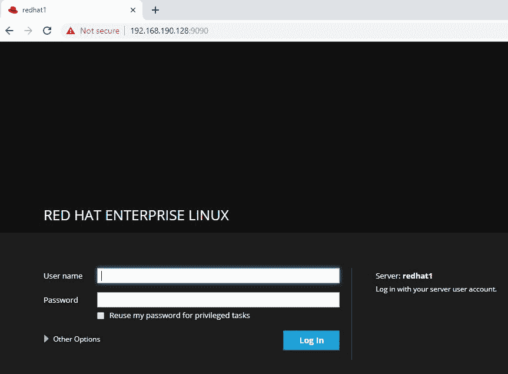

## 安装插件

要为 cockpit 添加插件模块：

### 语法

```bash
yum install package
```

### 示例

```bash
yum install cockpit-machines
```

若想在单一 UI 中管理多台机器，可以安装 dashboard 软件包：

```bash
yum install cockpit-dashboard
```

## 探索 Cockpit

在本节中，我将完成一些任务作为演示，遍历整个 UI 超出了本书的涵盖范围。

### 关机 / 重启服务器

使用 cockpit 关机或重启机器：

1. 从左侧面板选择 `System`（系统）> `Power options`（电源选项）。
2. 在 Power options 下拉菜单中选择你想要 `Restart`（重启）还是 `Shutdown`（关机）服务器。

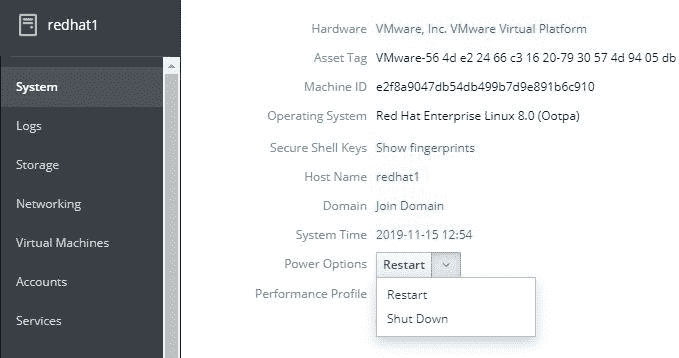

3. 在下一个页面指定你想要关机/重启机器的时间，以及你想发送给已登录用户的消息。

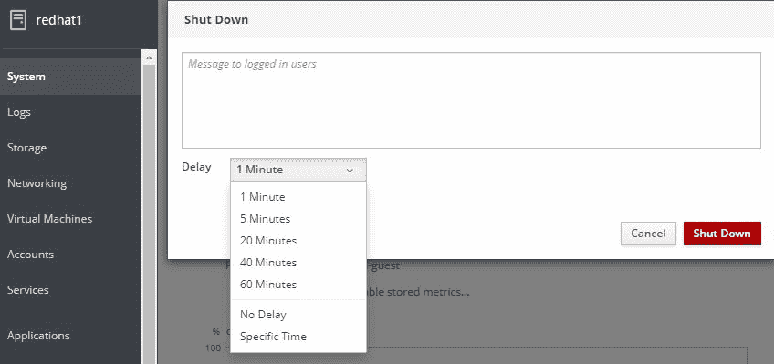

### 设置主机名

1. 在系统界面点击 `host name`（主机名）。
2. 在 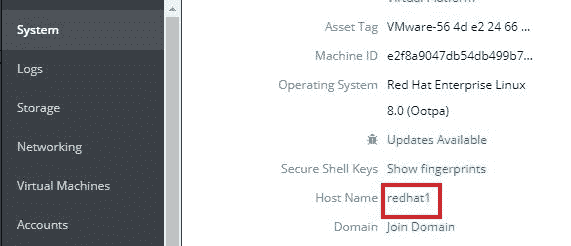 的下一个页面更改真实主机名并点击 `change`（更改）。


这些都是可以使用 cockpit 执行的任务示例。由于它是 GUI，你可以探索并学习更多内容。
