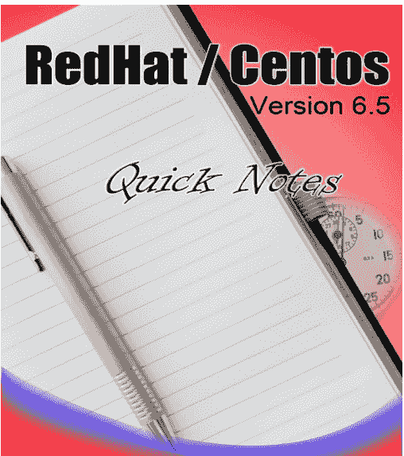
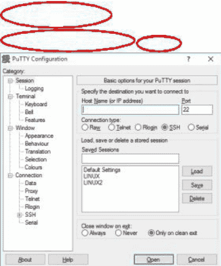
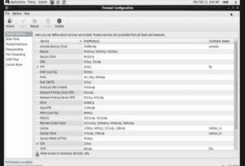
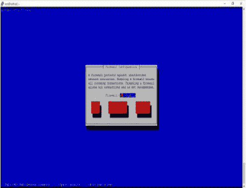
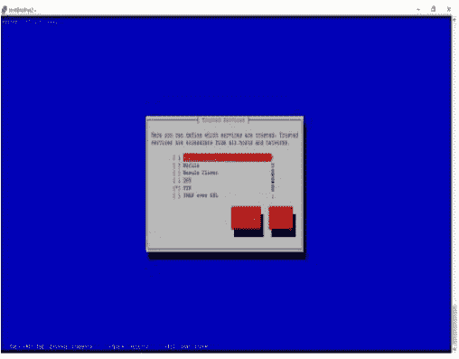
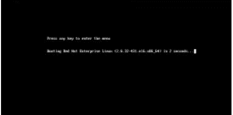
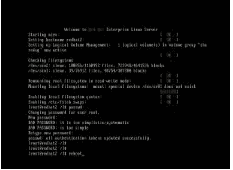

# Redhat and Centos Linux 快速指南：Linux 快速指南





# 前言

本书的编写初衷是考虑到了 Linux 系统管理员，他们想要学习 Redhat/Centos 但没有时间阅读大量的书籍。这本书是准备面试的极佳选择。

我尽力保持文字尽可能精确。
本书专门为 Redhat 的实际实施而准备。我希望它能帮助管理员们在生产环境中部署 Redhat。

此致，


# 第一章

# 

Linux 是一种类 Unix 操作系统。Linux 是由 Linus Torvalds 在 1991 年启动的开源项目。市场上有成千上万种 Linux 发行版，但大致可以根据其根发行版进行分类，例如：基于 Redhat 的 Centos、Oracle 和 Scientific Linux，以及基于 Debian 的发行版如 Ubuntu、Mint 等。免费 Linux 领域的主要参与者有 Ubuntu、Debian、Fedora、Opensuse 等。Redhat 和 SUSE 是非免费企业 Linux 发行版的主要参与者。Redhat 和 SUSE 是基于 RPM 包的发行版，而基于 Debian 的发行版采用 DEB 包格式。

## Fedora 与 Redhat

Fedora 是一个由 Redhat 赞助的免费发行版社区项目。Fedora 是 Redhat Enterprise Linux 的上游。Fedora 是新功能的测试场，这些功能可能会被整合到未来的 Redhat Linux 版本中。Fedora Linux 和 Redhat Enterprise Linux 之间的主要区别在于支持生命周期。Redhat 是商业支持的产品，而 Fedora 是社区支持。Redhat Enterprise Linux 的生命周期为几年，并支持最多 10 年，但 Fedora 每 6 个月发布新版本，且仅更新 13 个月。Redhat 提供服务水平协议、硬件和软件认证，这对于企业组织非常重要。

Oracle Linux、Centos Linux 和 Scientific Linux 发行版源自 Red Hat Enterprise Linux 源码。

# 第二章

### 安装

安装 Redhat 的常见方法：
1. 交互式 (Interactive)
2. Kickstart

交互方法可以是文本模式或 GUI。对于 Kickstart，你需要一个包含答案的 Kickstart 文件。安装期间不需要干预。

从 redhat 下载镜像。使用 DVD 启动。出现安装菜单后，选择现有媒体。


选择存储器。


选择语言。


选择主机名。


配置网络。

 对于静态 IP，选择手动并提供 IP 地址、子网掩码、网关和 DNS 服务器。点击应用。然后下一步。

在下一个屏幕上选择时区。由于时区具有地区性，请根据情况选择时区。

 提供 root 密码。

 选择分区。使用“使用全部”，在点击下一步之前勾选“修改布局”。

 在这里编辑布局。

 确认写入磁盘。在下一个屏幕上将要求你确认启动加载程序，点击下一步。

接下来是软件包选择菜单。如果你希望安装后使用命令行界面，请带默认设置点击下一步。如果你想要图形桌面，请点击“现在自定义”。

 在下一个屏幕上，在左侧面板选择桌面，在右侧面板选择桌面环境和字体。

 1. 它将开始安装软件包。

 安装完成后，按下重启。


重启后你将看到登录提示

## 将Windows电脑连接到Linux机器

- 1. 从 http://www.chiark.greenend.org.uk/~/ 下载 putty
2. 在Windows电脑上安装 putty

### 3. 安装后启动 putty



4. 输入Linux机器的IP地址和会话名称并

- 5. 双击会话名称连接到Linux机器。

# 第 3 章

## 网络

网络允许不同的机器互连。你需要在电脑上网卡才能连接。每个网卡都有一个物理地址，称为媒体访问控制地址（MAC地址）。MAC地址工作在 OSI 模型的第二层。网络接口卡的制造商分配 MAC 地址。为了访问网卡，我们为网卡分配 IP 地址，它工作在 OSI 模型的第三层。不同网络上的主机可以通过第三层进行连接。由于 IP 地址仍然是数值，因此很难记忆，而且存在 IP 地址可能会发生。为了方便起见，我们使用**主机名 (hostname)**。

### OSI 七层与 TCP 映射

| OSI 模型 | TCP 模型 | 应用程序 | 地址 |
|---|---|---|--|
| 7:应用层 | 应用层 | HTTP / Telnet / SSH | 应用程序 DNS, DHCP, ntp, H |
| 6:表示层 | | SSL / MIME | |
| 5:会话层 | | Sockets 和远程过程调用 (RPC) | |
| 4:传输层 | 传输层 | 传输控制协议 | TCP/UDP* |
| | | (TCP) | |
| 3:网络层 | 互联网层 | 际协议 (IP) | IP4, IP6, ICMP |
| 2:数据链路层 | 网络访问层 | 以太网 / 帧继 | MAC地址, ARP |
| 1:物理层 | | IEEE 802.x | 以太网 |

### 检查 IP 地址和路由表

### 显示 IP 地址

```
### ip addr show
```

或者

```
### ifconfig -a
```

### 显示链路状态

```
### ip link show
```

### 显示路由表

```
### ip route
```

或者

```
### netstat -rn
```

```
### hostname
```

首先修改 /etc/sysconfig/network 文件，并将 hostname更改为你的新主机名，在本例中为 redhat1。

```
### vi /etc/sysconfig/network
```

```
NETWORKING=yes
HOSTNAME=redhat1
```

下一步是修改 /etc/hosts 文件

| 127.0.0.1 redhat1 localhost.localdomain |
| localhost |

### 设置 DNS 名称解析

每当你使用主机名而不是 IP 地址来 ping 或连接 Linux 主机时，你有多种选项将主机名解析为 IP 地址。

- 本地文件，即 /etc/hosts
- DNS 服务器
- NIS

### /etc/hosts

使用本地文件 /etc/hosts 进行主机名到 IP 地址的映射，可以存储主机名及其对应 IP 地址的列表，你不需要查找 DNS 服务器。如果你因为范围或安全原因连接到有限的服务器，不依赖 DNS 服务器也非常有用。

### 格式

| IP_地址 | 主机名别名 |
|---|---|

### 示例

| 127.0.0.1 | redhat1 |
| localhost | |
| ::1 | redhat1 localhost |
| 192.168.228.129 | redhat2 |

### 使用域名服务器进行名称解析

### /etc/resolv.conf

为了将主机名解析为 IP 地址，系统会读取名为 resolv.conf 的文件。你需要将 DNS 服务器的 IP 地址放入此文件中。通常情况下，你需要一个名称服务器，但如果你想要冗余，可以包含最多三个。

如果列表中的第一个没有响应，系统将尝试使用列表中的下一个进行解析，依此类推。

编辑 /etc/resolv.conf 以添加名称服务器列表，如下：

```
nameserver 8.8.8.8
nameserver 8.8.8.9
nameserver 1.2.3.6
```

### 修改主机名解析顺序

/etc/nsswitch.conf

如果你的服务器中有 hosts 文件且 resolv.conf 中有 DNS 配置，每当你进行主机名解析时，系统都会查找本地文件 (/etc/hosts) 寻找主机名及其相应的 IP 地址条目。如果没有条目，它将查找 /etc/resolv.conf 文件中的 DNS 配置。如果没有 DNS 配置，它将检查 NIS 配置。然而，你可以通过更改 /etc/nsswitch.conf 来改变这种行为。

```
vi /etc/nsswitch.conf
#hosts: db files nisplus nis dns
hosts:      files dns
```

在本例中，搜索顺序是 files（即 /etc/hosts），然后是 DNS 服务器。

### 使用 GUI 修改网络


右键点击网络 > 编辑 > 选择有线选项卡 > 编辑 IPv4 设置 改为手动添加地址、子掩码、网关、DNS 服务器。

| DEVICE=eth0 |
BOOTPROTO=static |
IPADDR=192.168.1.1 |
NETMASK=255.255.255.0 |
GATEWAY=192.168.1.254 |
DNS=8.8.8.8,8.8.4.4 |
ONBOOT=yes |


```
### chage -l username
```

### 禁用用户密码过期

```bash
### chage -I -1 -m 0 -M 99999 -E -1 username
```

### 强制用户在下次登录时修改密码

```bash
### chage -d 0 user1
```

### 锁定用户

```bash
### usermod -L user1
```

### 解锁用户

```bash
### usermod -U user1
```

### UID

唯一用户标识（称为 UID）是系统中存在的每个用户的固定标识，对于 root 用户和普通用户，它都是固定的。

| 用户 | UID |
| :--- | :--- |
| root | 0 |
| 系统用户 | 1 – 499 |
| 普通用户 | 500 + |

### 组 (Groups)

我们创建的每个用户都属于一个组，所有组都有组 ID（GID）。可以在 `/etc/groups` 中找到所有可用组的列表，那里记录了这些组的所有用户成员。组共有两种类型：

- 主组 (primary group)
- 辅助组 (secondary group)

### 主组 (Primary group)

这是你登录时应用的组，并且在你创建新文件和目录时默认使用的组。它的名称通常与用户名相同。用户的主组 ID 写入在 `/etc/passwd` 文件中对应用户的第三字段中。

### 辅助组 (Secondary Group)

这些是用户除主组之外所属的组。

### /etc/group

```
组名:shadow密码:GID:组内用户列表
```

### 示例

```
science:x:1003:class1,class2
```

### 更改主组

```bash
usermod -g data1 user1
```

### 更改辅助组

```bash
usermod -G data2 user1
```

### 添加新组

```bash
groupadd groupname
```

### 删除组

```bash
groupdel groupname
```

### /etc/passwd

存储用户信息

### 格式

```
username:x:UID:GID:用户全名:home_
```

**用户名 (Username)** 最多 8 个字符。区分大小写。

**x** 密码存储在 `/etc/shadow` 文件中。

**UID** 用户 ID。

**GID** 组 ID。

**shell 账户** 通常设置为 `/bin/bash` 以提供对 bash shell 的访问，也可以是其他 shell，如 c shell 或 korn shell。

### 示例

```
root:x:0:0:root:/root:/bin/bash
```

密码为 13 位加密。空条目（例如 ::）表示登录时不需要密码（这通常不是个好主意），`*` 条目（例如 :*:`）表示该账户已禁用。

**last_password_change** 自上次更改密码以来（自 1970 年 1 月 1 日起）经过的天数。

**Minimum (最小):** 更改密码前所需的天数（0 表示可以随时更改）。

**Maximum (最大):** 密码过期后必须更改的天数（99999 表示用户可以多年多年都保持密码不变）。

**Warn (警告):** 密码即将过期前提醒用户的天数（7 天为一周）。

**Inactive (活动):** 密码过期后账户被禁用的天数。

**Expire (过期):** 自 1970 年 1 月 1 日起账户被禁用的天数。

### 示例

```
root:$6$YtTXd..cW9GYuWT9sNwX07B3i..11
```

# 第 5 章

## NFS 网络文件系统

NFS 是一种基于服务器/客户端模式的文件共享文件系统。服务器共享的文件系统被挂载在客户端上。NFS 有四个版本：

- 1. NFS V1
- 2. NFS V2
- 3. NFS V3
- 4. NFS V4

其中 NFS V3 和 NFS V4 是较新的版本，V3 更安全且基于 UDP 协议工作，而 V4 增加了通过防火墙工作的优势，并基于 TCP 协议工作。

### /etc/exports

用于将服务器上的文件系统导出到客户端的配置文件。

### 手动通过 /etc/exports 导出文件系统

```bash
### exportfs -i /user1
```

### 导出所有已导出的文件

```bash
### exportfs -ua
```

### 在没有防火墙的服务器上配置 NFS

禁用防火墙 System-config-firewall 选择防火墙 ok 

```bash
### service iptables stop
```

### 安装包

```bash
### yum install nfs-utils
### yum install rpcbind
### yum groupinstall 'NFS server'
```

### 启动服务

```bash
### service rpcbind start
### service nfs start
```

### 设置服务开机启动

```bash
### chconfig nfs on
### chconfig rpcbind on
```

编辑 /etc/exports 文件以添加你想共享给客户端的文件系统，格式如下：

| 挂载点 (mountpoint) | 主机 (host) | 权限选项 |
| :--- | :--- | :--- |
| **mountpoint** 是你想导出的文件系统 | **host** 是可选的，你想赋予访问权的客户端 | **permissions** 是可选的，可以是 **ro** 只读，**rw** 读写，**sync** 在命令完成前写入。 |

### 导出系统

```bash
### exportfs -a
```

### 查看导出的文件

```bash
### showmount -e
```

### 在客户端上

```bash
### mount -t nfs 192.168.0.1:/user /mnt

### 挂载 DVD

```bash
### mkdir /mnt
```

编辑 /etc/fstab 添加要挂载的 DVD 文件系统，格式如下：

| /cdrom | ro | 0 0 |
| :--- | :--- | :--- |

### 重启

```bash
### reboot
```

### 虚拟终端 (Virtual Console)

使用 Alt + F 切换切换控制台。

# 第 6 章

## 图形界面 (Graphics Interface)

当你安装 Linux 发行版时，图形界面管理变得简单。许多界面可用：

- GNOME
- KDE
- XFCE
- LXDE

GNOME 是默认的。

### 图形登录

当你启动系统时，会出现图形界面 

### 终端 (Terminal)

GNOME 终端是一个终端模拟器，允许你在图形界面下执行命令。对于 root 用户来说：

```
root:x:0:0:root:/root:/bin/bash
```

```redhat: _
```

### 命令 (Commands)

| 快捷键 | 功能 |
| :--- | :--- |
| Ctrl+a | 将光标移动到行首 |
| Ctrl+e | 将光标移动到行尾 |
| Ctrl+u | 清空当前行 |
| 鼠标中键点击 | 粘贴选中的文本 |
| Tab | 自动补全命令 |
| 上/下方向键 | 显示命令历史 |
| Ctrl+c | 终止当前进程 |
| Ctrl+z | 挂起当前进程 |

### 磁盘工具 (Disk Utility)

通过图形化磁盘工具你可以：

- 创建 / 删除分区
- 挂载 / 卸载文件系统
- 格式化为所需的文件系统类型
- 检查文件系统
- 修改文件系统标签
- 格式化驱动器

从左侧选择所需的设备，即可对其进行操作。

### 1.3 GB 硬盘 (dev/disk-0) - 磁盘工具

### 存储设备 (Storage Devices)

- 本地存储
- SATA 适配器 (0x837225e0004, PCI-E)
- SCSI 适配器 (533053 PCI-X, Dual U320 SCM)
- SATA 适配器 (通用)
- CD 驱动器
- NVMe 驱动器 (VMware, Virtual SCM)
- 周围设备
  - 优盘和其他
- 1.3 GB 硬盘 (VMware, Virtual 5)
- 2.1 GB 硬盘 (VMware, Virtual 5)

### 驱动器 (Drive)

| 属性 | 数值 |
| :--- | :--- |
| 型: - | 序列号: - |
| 固件版本: - | 全局名称: - |
| 位置: - | dev/disk-0 |
| 写入缓存: | 转速: - |
| 容量: 1.3 GB (1,283,457,624 bytes) | 连接: 未知 |
| 分区: 未分区 | SMART 状态: 不支持 |

### 卷 (Volumes)

| 使用情况: 文件系统 | 设备: dev/disk-0 |
| :--- | :--- |
| 分区类型: - | 容量: 1.3 GB (1,283,457,624 bytes) |
| 类型: Ext4 (版本 1.0) | 可用: - |
| 标签: - | 挂载点: 未挂载 |

挂载卷 (Mount Volume)
挂载卷

格式化卷 (Format Volume)
擦除或格式化卷


# 第 7 章

## 进程与线程

Linux 操作系统执行的每一个任务都与其相关的进程。进程的优先级基于其内部的上下文切换。

每个进程都提供执行程序所需的资源。

每个进程都从一个主线程（primary thread）启动。进程可以拥有多个线程。

进程可以在前台和后台运行。

### 命令

| 命令 | 说明 |
| --- | --- |
| bg | 将作业发送到后台 |
| fg | 将作业带到前台 |
| jobs | 显示当前作业 |
| kill | 停止进程 |
| ps | 显示进程信息 |
| & | 如果命令以 & 结尾，shell 将在后台执行该命令并返回 |

### 将命令带回前台

```
### fg
ctrl + c
```

### 检查运行中的作业

```
### jobs
```

### 列出当前运行的进程

```
# ps -ef|grep gcalctool
```

```
### ps aux
```

### 强制杀死进程

首先使用 ps -ef 命令检查进程 ID，然后：

```
### kill -9 <process -id>
```

### 使用 ps 命令监控进程

ps 命令显示进程的 CPU 和内存占用百分比，如果你的机器性能不佳，这个工具非常有用。**ps** 命令可以告诉你哪个进程正在占用内存/CPU。

### 进程调度

调度器是内核的一部分，负责选择下一个要运行的进程。其目的是根据优先级运行进程。使用 nice 和 renice 命令设置运行进程的优先级，这些命令决定了赋予进程多长的 CPU 时间。

**nice** 设置新进程的优先级或 nice 值。

**renice** 调整运行进程的 nice 值，-20 为最高优先级，19 为最低优先级。默认优先级为 0。

### 示例

```
### nice –n 19 cp–r /as /map
```

### 显示运行进程优先级的命令

```
### ps –al
```

或者

```
### top
```

### 修改优先级

```
### renice –n 10 <pid>
```

**注意：** 更改更高的优先级需要 root 权限。

# 第 8 章

## 任务自动化

Redhat 提供了实用工具来自动化系统管理员定期执行或在指定时间执行的任务。以下是主要的工具：

- cron
- at
- batch

### Cron

cron 是一个守护进程，可以根据时间、日期、星期来调度周期性任务的执行。

### 配置文件

/etc/crontab

### 命令

| 命令 | 说明 |
| --- | --- |
| crontab -l | 列出 crontab 条目 |
| crontab -e | 编辑 crontab |
| crontab -r | 删除 crontab |

### 格式

| 分钟 | 小时 | 日 | 月份 | 星期 | 命令 |

### 参数说明

**分钟** (从 0 到 59)

**小时** (从 0 到 23)

**日期** (从 1 到 31)

**月份** (从 1 到 12)

**星期** (从 0 到 6) (0=星期日)

### 调度周期性任务

通过执行命令编辑 crontab：

```
crontab -e
```

在文件底部添加条目，按 **i** 进入插入模式

假设你想在每晚 11:30 运行备份脚本

```
30 23 * * * /myscripts/backup.sh
```

按 [escape] 键，输入 : 写入 **x**，然后按 [enter] 保存条目

### at 和 batch

crontab 用于周期性任务，但对于指定时间执行的一次性任务，使用了 at 和 batch 命令。

要运行 at 命令，必须安装 rpm 且 atd 服务必须运行。

### 检查安装

```
### rpm -q at
```

### 安装 at 包

```
### yum install at
```

### 启动服务

```
### service start atd
```

### 启动命令

```
### at 4:00
at > ls
ctrl + d
```

**Batch** 命令在系统平均负载下降到 0.8 以下时执行一次性任务。

```
### at
at > ls
ctrl + d
```

### 显示待处理作业列表

```
atq
```

# 第 9 章

## 日志管理

日志文件在故障排除和授权系统访问审计中非常有用。在 Redhat 6 中，某些日志由 rsyslog 守护进程控制。它是 syslogd 的增强版。它提供了高性能、出色的安全特性、模块化设计以及支持通过 TCP 或 UDP 协议传输。

rsyslog 读取文件 /etc/rsyslog.conf。可以通过 rsyslog.conf 文件配置 rsyslogd。rsyslog 维护的日志列表可以在 rsyslog.conf 配置文件中找到。日志文件通常位于 /var/log/ 目录。

### 配置文件

/etc/rsyslog.conf

### rsyslog 示例

```
[root@redhat]# cat /etc/rsyslog
```

### 更多信息

/etc/rsyslog.conf

### rsyslog 示例

```
[root@redhat]# cat /etc/rsyslog
```

### rsyslog 示例

```
*/log-level
etc/rsyslog
```

# ####模块

```
$ModLoad imuxsock # 提供本地系统日志
```

```
$ModLoad imudp # 提供 UDP 接收
```

```
$ModLoad imtcp # 提供 TCP 接收
```

# #### 全局指令

$ActionFileDefaultTemplate
$ActionFileFormat

### 包含 /etc/rsyslog.d/ 中的所有配置。
$IncludeConfig /etc/rsyslog.d/

# #### 规则

### 将所有内核消息记录到控制台。
* /dev/console

### 记录除邮件以外的所有 info 或更级别的日志。
*.info;mail.none;cron.none;authpriv.none;daemon.none;user.none /var/log/messages

### 将所有邮件消息记录在一个处。
mail* /var/log/secure
authpriv.* /var/log/secure

### 记录 cron 相关内容
cron* /var/log/cron

### 将 crit 及更高级别的新闻错误保存在特殊文件中。
news.crit /var/log/spooler

### 将启动消息也保存到 boot.log
local7.* /var/log/boot

### 日志过滤

如果不对进行过滤，系统中的日志会太多，导致日志无法使用。为了过滤日志，我们使用 /etc/rsyslog.conf。它包含两个参数：facility（设施）和 priority（优先级），用点号隔开。facility 是你想要记录的进程名称，priority 指定日志级别，如 debug, info, notice, warning, alert, emerg。

### 示例

```
### authpriv 文件有访问限制。
authpriv.* /var/log/secure
```

在示例中，**authpriv** 和 **mail** 是 facility，* 表示所有日志。

### 日志轮转

日志需要轮转以防止填充文件系统并使其更于管理。一旦日志文件轮转，它将被重命名为新文件名。轮转一段时间后，旧的日志文件将被删除以节省空间。

**logrotate** 包根据 /etc/logrotate.conf 中的配置自动管理日志轮转。

### logwatch

**logwatch** 是一个通过邮件发送分析简报报告的程序。可以通过 /usr/share/logwatch/default.conf/logwa 配置文件进行配置。

### 安装

```
### yum install -y logwatch
```

### 配置

设置配置文件 /usr/share/logwatch/default.conf/logwa 发送每日摘要的电子邮件地址

### mailto =root

### 示例

```
### 默认发送报告的人。可以是本地账户或完整的电子邮件地址。
### 变量 Print 应设置为 No 以启用邮件功能。
MailTo = root
```

# 第 10 章

## 软件管理

### Redhat network

Red Hat Network 是一种集中化管理的服务，提供了向 Red Hat Enterprise Linux 系统部署软件和软件更新的功能。要为 Redhat 服务器接收更新，你需要获得 Redhat network 的订阅。

要向 RHN 注册你的系统：--
访问 Redhat 客户门户并创建用户


### 添加您的订阅

连接服务器到互联网

执行命令 **subscription-manager register**

```bash
### subscription-manager register
Username: abc74
Password:
系统已注册，ID为: bb304a30-c30e-4bb7-9d41-xxxxxx
```

通过列出所有池（pools）来确定您想要添加的池 ID

```
subscription-manager list --available
subscription-manager register
Username: abc74
```

```
Password:
系统已注册，ID为: bb304a30-c30e-4bb7-9d41-xxxxxx
[root@redhat1]# subscription-manager list --available
+------------------------------------------------------+
Available Subscriptions
+------------------------------------------------------+
Subscription Name: 30 Day Self-Supported Red Hat Enterprise Linux Developer Workstation Evaluation
```

将您的系统附加到所需的订阅

```bash
### subscription-manager attach --pool=pool_id
```

现在列出消耗了多少订阅

```
subscription-manager list --consumed
```

### 仓库 (Repository)

仓库是 Linux 软件的集合，可以存在于本地或远程。。仓库可用于安装额外软件或更新当前软件。当您订阅 RHN 时，在 /etc/yum.repos.d/ 目录下会创建一个仓库文件。

### 显示所有启用的仓库

```bash
### yum repolist
```

### 显示所有已启用和禁用的仓库

```bash
### yum repolist all
```

### yum

Yellow dog updater modifier (yum) 是一个用于软件包管理的命令行工具。yum 使用仓库来获取与您的系统兼容的特定软件包的正确版本。yum 允许软件包的自动更新和依赖关系管理。它允许从 RHN 仓库或定义的本地仓库（如 CD-ROM 或目录）自动下载软件包并安装它们。您也可以使用第三方仓库来安装如 OpenOffice、VLC 等额外软件包。

### 命令

### 软件包 (Package)

### 安装软件包

### 语法

```bash
### yum install -y package_name
```

### 示例

```bash
### yum install -y firefox
```

### 移除软件包

### 语法

```bash
### yum remove package_name
```

### 示例

```bash
### yum remove firefox
```

### 检查可用更新

```bash
### yum check-update
```

### 使用 yum 更新系统

```bash
### yum update
```

### 检查哪个软件包提供了文件

```bash
### yum provides file-name
```

### 获取帮助

```bash
### yum help
```

### 列出已安装和可用的软件

```bash
### yum list
```

### 使用关键字搜索包名

```bash
### yum search keyword
```

### 显示有关软件包的信息

### 语法

```bash
### yum info package_name
```

### 示例

```bash
### yum info zip
```

### 更新仓库提供的所有软件

```bash
### yum update
```

### 清理 yum 缓存

```bash
### yum clean all
```

### 交互式 shell

```bash
### yum shell
```

### 列出 yum 历史

```bash
### yum history list
```

### 软件包组 (Package group)

软件包组是具有相同安装目的软件组。它通过自动安装和下载依赖软件简化了管理员的工作。例如，您想安装 KDE 桌面环境，只需运行命令 yum groupinstall 'Backup Client'。

### 列出所有可用的软件包组

```bash
### yum grouplist
```

### 安装组包

### 语法

```bash
yum groupinstall package_name
```

### 示例

```bash
### yum groupinstall 'Backup Client'
```

### 移除组包

### 语法

```bash
yum groupremove package_name
```

### 示例

```bash
### yum groupremove 'Backup Client'
```

### 关于组包的信息

### 语法

```bash
yum groupinfo package_name
```

### 示例

```bash
### yum groupinfo 'Backup Client'
```

### 使用 RPM 命令安装软件包

## RPM

RPM 代表 Red Hat Package Manager。软件包以 .rpm 结尾。rpm 命令用于管理本地安装、更新和删除的软件。

### Commands

### 安装

### 语法

```bash
### rpm -ivh package_name
```

### 示例

```bash
### rpm -ivh package.rpm
```

### 更新

### 语法

```bash
### rpm -Uvh package_name
```

### 示例

```bash
### rpm -Uvh package.rpm
```

### 移除

### 语法

```bash
### rpm -e package_name
```

### 示例

```bash
### rpm -e package.rpm
```

### 查询已安装的软件包

### 语法

```bash
### rpm -q
```

### 示例

```bash
### rpm -q package
```

### 显示软件包的详细信息

### 语法

```bash
### rpm -qi package_name
```

### 示例

```bash
### rpm -qi package
```

### 列出软件包包含的文件

### 语法

```bash
### rpm -ql package_name
```

### 示例

```bash
### rpm -ql package
```

### 查询文件所属包

### 语法

```bash
### rpm -qf file_name
```

### 示例

```bash
### rpm -qf /usr/bin/ls
```


### 工具类

### Tar

用于将多个文件创建一个归档文件，用于磁带或其他介质备份。在创建归档文件时，也可以添加选项创建压缩文件。

### 创建 tar

### 语法

```
tar cvf name_of_archive_file files_or_directory_to_archive
```

其中

- c 创建
- v 详细模式
- f 归档文件类型类型

### 示例

```
[root@redhat1 share]# tar cvf abc.tar *
applications/
applications/preferred-mail-reader.desktop
applications/preferred-web-browser.desktop
gvfs-metadata/
[root@redhat1 share]# ls -la
total 96
drwxr-xr-x. 4 root root 4096 Feb 12 10:58 .
drwxr-xr-x. 3 root root 4096 Feb 4 12:46 ..
-rw-r--r--. 1 root root 81920 Feb 12 10:58
abc.tar
```

### 创建压缩 tar 文件

### 创建 gzip 格式 tar 文件

```
### tar cvfz abc.tar.gz name_of_files
```

### 创建 bzip 格式

```
### tar cvfj abc.tar.bz2 name_of_files
```

### untar

```
### tar xvf abc.tar
```

其中

- x 提取
- v 详细模式
- f 归档文件类型类型

### 解压缩

### 解压缩 gzip 格式

### 语法

tar xvfz filename

### 示例

```
### tar xvfz abc.tar.gz
```

### 创建 bzip 格式

### 语法

tar xvfj filename

### 示例

```
### tar xvfj abc.tar.bz2
```

### 列出归档 tar 文件

### 语法

tar tvf filename

### 示例

```
### tar tvf abc.tar
```

### 列出 gzip 压缩 tar 文件

### 语法

tar tzvf filename

### 示例

```
### tar tzvf abc.tar.gz
```

### 列出 bzip 压缩 tar 文件

### 语法

tar tjvf filename

### 示例

```
### tar tjvf abc.tar.bz2
```

### cp

复制文件的命令

### 语法

cp <options> source destination

### 示例

```
cp /home/abc.txt /home1/
```

# 递归复制目录下的所有文件

```
cp -R /home/* /home1/
```

# 在任何覆盖前提示

```
### cp -i /home /home1
```

# 将所有新文件复制到目标

```
# cp -u * /tmp
```

### 强制复制文件

```
# cp -f /tmp/abc.txt /backup/.
```

# 不经提示直接覆盖

```
# cp -n* t
```

### scp

scp 命令用于以安全的方式从一个主机复制文件到另一个主机。

### 从本地机器复制到远程机器

### 语法

scp filename remote_user@remote.host:/some/remote_dir

# 从远程主机复制 xyz 文件到本地主机

### 语法

```
scp remote_user@remote.host:some/remote_dir
```

### CPIO

从归档内部和外部复制文件。用于创建和提取归档，以及将文件从一个地方复制到另一个地方。

# 从目录 abc 创建归档到 /directory backup

```
### cd abc
# ls|cpio -ov> /backup/abc.cpio
```

### 提取

```
### mkdir newbackup
```

```
# cd newbackup
# cpio -idv < /backup/abc.cpio
```

### 创建特定文件列表的归档

示例 :- 备份所有日志文件

```
# find . -iname *.log -print|cpio -ov> backup/selog.cpio
```

### 使用 cpio 创建 tar 文件

```
### ls|cpio -ovH - abc.tar
```

### 使用 cpio 提取 tar 文件

```
### cpio -idv -F abc.tar
```

### Dump 和还原

# dump

dump 工具用于备份整个文件系统或自上次 dump 以来更改的文件。

### 语法

```
dump <options> target_device filesystem_to_be_up
```

### 示例：

备份整个文件系统到设备

```
### dump -uf /dev/st0
```

其中

0 是 dump 级别。从 0 到 9
- -0 自上次 dump 以来完整
- -1 自上次 dump 以来更新
- -2 自上次 dump 以来更改
- -3 自上次 dump 以来类似
- -9 自上次 dump 以来更新
- u 显示备份信息
- f 指定设备名称

### restore

restore 命令用于还原 dump 命令存储的备份。

### 语法

```
restore <options> backupdevice
```

### 示例：

从 /dev/st0 还原备份

```
# restore -if/0
```

其中选项 i 触发交互模式，允许选择文件和目录

### 还原特定文件

```
### restore -xf /etc/hosts
```

### ls

列出文件名

### 语法

ls <options>

### 示例

```
### ls -al
```

列出目录和文件

### cat

显示文本文件

### 语法

cat filename

### 示例

```
### cat abc.conf
```

### rm

删除文件、文件或目录

### 语法

```
rm filename
```

### 示例

```
# rm abc
```

递归删除 abc

```
### rm -r abc
```

### More

当你想查看大于一屏的文件时，可以使用 more 工具。它每次显示一屏文本。

### 语法

more filename

### 示例

```
### more /etc/hosts
```

### less

Less 程序与 more 类似，但允许在文件中后向和向前移动。

### 语法

less filename

### 示例

```
### less /etc/hosts
```

### mv

mv 命令用于将文件从一个位置移动到另一个位置。它也可以重命名文件。

# 移动文件

### 语法

mv filename destination_directory

### 示例

```
mv a.txt /tmp/
```

将 a.txt 从当前目录移动到 /tmp

### 重命名

### 语法

mv filename newfilename

### 示例

```
mv a.txt b.txt
```

### grep

在一个或多个文件中搜索字符串。显示包含字符串的每一行。

### 语法

grep string file

### 示例

```
### grep '127.0.0.1' /etc/hosts
```

### head

将文件的前 10 行打印到标准输出。你可以指定显示多少行。

### 语法

head file

### 示例

```
# head -20 /etc/mime.types
```

显示 mime.types 的前 20 行

### tail

将文件的最后 10 行打印到标准输出。你可以指定显示多少行。

### 语法

tail file

### 示例

```
# tail -20 /var/log/logfile
```

显示最后 20 行

# 使用 tail 持续监控文件

```
### tail -f /var/log/logfile
```

显示增长的文件末。按 Ctrl + c 中断

### Diff

比较两个文件。

### 语法

diff First_file Second_file

### 示例

```
### diff abc.txt bbc.txt
```

### file

确定文件类型

### 语法

file file_name

### 示例

```
# file bbc.txt
```

### Echo

显示文本

### 语法

echo text

### 示例

```
### echo hello
```

### Date

打印或更改系统日期时间。

### 语法

date

### 示例

```
# date
```

检查日期
# date -s "24 feb 2017 19:00"

# 第 12 章

## 管道和重定向

# 输出输出到文件 (>)

通常我们会在屏幕上看到输出，但如果我们希望将其保存到文件中，则使用大于符号 ( > ) 将标准输出发送到文件。

### 示例

```
### ls > abc.txt
```

# 从文件发送输入 (<)

如果我们使用小于符号 ( < )，我们就可以从文件中读取数据并通过程序的 STDIN 流将其输入给程序。

### 示例

```
# wc -l < abc.txt
```

### 管道 (|)

为了将数据从一个程序发送到另一个程序，我们使用管道 (|)

```
### ls | head -10
```

# 第 13 章

## 压缩工具

主要有三种工具可以压缩文件

| 压缩 | 扩展名 | 解压缩 |
|---|---|---|
| bzip2 | bz2 | bunzip2 |
| Gzip | gz | gunzip |
| Zip | zip | unzip |

# 压缩

# Bzip2 格式

### 语法

bzip2 file_to_backups filename

### 示例

```
### bzip2 * abc
```

# gzip 格式

### 语法

gzip file_to_backups filename

### 示例

```
### gzip * abc
```

# zip 格式

zip file_to_backups filename

### 示例

```
# zip * abc
```

### 解压缩

# Bzip2 格式

### 语法

bzip2 filename

### 示例

```
# bunzip2 abc.bz
```

# gzip 格式

### 语法

gunzip filename

### 示例

```
### gunzip abc.gz
```

# zip 格式

### 语法

unzip filename

### 示例

```
# unzip abc.zip
```

# 第 14 章


# 管理服务和守护进程

### 守护进程 (Daemons)

守护进程是在后台运行且不进行交互的进程。守护进程会在预定的时间执行预定义的操作。通常守护进程在启动时运行并持续到关机。大多数守护进程的名字以 **d.** 结尾。

### 服务 (Services)

服务是位于 /etc/rc.d/init.d 目录下的初始化脚本。这些脚本用于管理守护进程。可以使用 start、stop、restart、status 和 reload（重载）等参数调用服务脚本来管理守护进程。
可以使用 **chkconfig service_name on** 命令在系统启动时启动服务。

### 运行级别 (Run level)

运行级别是操作系统运行的运行或模式。每个运行级别都有一定数量的停止或启动的服务，从而控制机器的行为。共有七种种运行级别：

- 0 关机
- 1 单用户模式
- 2 未使用，用户可以使用
- 3 无 GUI 的命令行多用户模式
- 4 未使用，用户可以使用
- 5 带 GUI 的多用户模式

### 命令

### 检查当前运行级别

```
### runlevel
```

### 更改默认运行级别

在此示例中编辑 /etc/inittab 文件以更改命令行运行级别 3

```
Id:3:default:
```

# 管理服务启动

### 列出所有服务及其在每个运行级别下的状态

```
# chkconfig --list
```

### 列出特定服务的当前设置

### 语法

```
# chkconfig --list service_name
```

### 示例

```
# chkconfig --list vsftpd
```

### 在运行级别 2, 3, 4, 5 中启用服务

### 语法
```
# chkconfig Service_name on
```

### 示例
```
# chkconfig httpd on
```

### 在特定运行级别启用

```
# chkconfig service_name --level 35
```

### 在 2, 3, 4, 5 运行级别中禁用服务

### 语法
```
# chkconfig service_name off
```

### 示例
```
chkconfig httpd off
```

### 在特定运行级别禁用

### 语法
```
# chkconfig service_name off --level 3
```

### 示例
```
# chkconfig service_name off --level levelno
```

# 管理服务状态

### 确定服务是否正在运行

### 语法
```
# service service_name status
```

### 示例
```
# service vsftpd status
```

### 显示所有服务的状态

```
# service --status-all
```

### 启动服务

### 语法
```
# service service_name start
```

### 示例
```
### service httpd start
```

# 停止服务

### 语法
```
# service service_name stop
```

### 示例
```
# service httpd stop
```

# 重启服务

### 语法
```
# service service_name restart
```

### 示例
```
# service httpd restart
```

# 安装新服务

安装新服务的步骤：

- 1. 安装新服务包
   # yum install service_name
- 2. 配置服务在启动机时自动启动
   # chkconfig service_name on
- 3. 启动服务
   # service service_name start

### 示例
```
### yum install vsftpd
# chkconfig vsftpd on
### service vsftpd start
```

# 第 15 章

## SSH

SSH 在客户端/服务器架构中通过不安全的网络提供安全通道。SSH 是 telnet 的替代品，telnet 是不安全的协议。它允许安全地登录并执行命令，因为客户端和服务器之间的所有通信都是加密的。

```
ssh -x user@hostname
```

当首次对系统建立 ssh 连接时，远程系统的公钥将存储在本地，以便下次验证其身份。

**Ctrl + d** 或执行 exit 命令将终止 ssh 会话。

如果你从 MS windows 客户端连接到 Linux 服务器，您需要如 **putty** 这样的第三方软件。

# ssh 密钥

SSH 密钥有助于使用公钥加密和身份验证向服务器识别您的身份。SSH 密钥成公钥和私钥对生成。公钥用于共享，私钥必须妥善保存。持有公钥的服务器可以发送挑战，只有持有私钥的服务器才能回答。这允许在本示例中从 redhat1 到 redhat2 的无密码登录。

# 在 redhat1 上创建密钥
```
root@redhat1 ~]# ssh-keygen
```

# 将公钥从 redhat1 复制到第二个服务器 redhat2
```
root@redhat1 ~]# scp ~/.ssh/id_rsa.pub
```

在第二个服务器 redhat2 的家目录下创建 .ssh 目录（在本例中用户是 root，其家目录是 /root）并更改权限。
```
root@redhat2 ~]# mkdir .ssh
root@redhat2 ~]# chmod 700 .ssh
```

将公钥文件追加到 authorized_keys 文件并更改权限。
```
root@redhat2 ~]# cat id_rsa.pub >> .ssh/authorized_keys
root@redhat2 ~]# chmod 644 .ssh/authorized_keys
```

现在尝试从服务器（即 redhat1）登录到第二个服务器（即 redhat2），它不会提示密码。
```
root@redhat1 ~]# ssh root@redhat2
```

# 第 16 章

## VNC

VNC（虚拟网络计算）是图形化桌面共享。用于远程获取 Linux 服务器的 GUI 桌面。在 VNC 中，VNC 客户端安装在本地机器，用于连接到安装在远程服务器上的 VNC 服务器。要在想要共享桌面的服务器上配置 VNC：

```
### yum install tigervnc-server
```

### 添加用户

编辑 /etc/sysconfig/vncserver，首先将 root 更改为您想要配置的其他用户。其次，移除 -localhost 选项以防止 VNC 通过 ssh 远程连接。
```
VNCSERVERS=":1"
VNCARGS="-geometry 800x600"
```

### 设置 VNC 密码
```
vncpasswd
```

### 启动并启用 VNC 服务
```
### service vncserver start
# chkconfig vncserver on
```

# 在远程机器上安装 vncviewer
```
yum install tigervnc
```

# 在远程机器上连接

进入 Linux 机器的桌面打开终端
```
vncviewer username@servername:1
```


# 第 17 章

## FTP

FTP 是文件传输协议。用于在网络上的计算机之间传输文件。它基于客户端/服务器模型。客户端有三种：

- 1. GUI
- 2. 浏览器
- 3. 命令行

在 Redhat 衍生版中使用 vsftp（非常安全的 FTP）守护进程作为 FTP 服务器。

### 部署 vsftp

### 安装包
```
### yum install vsftpd
```

### 启动服务器
```
### service vsftpd start
```

### 设置自启动
```
# chkconfig vsftpd on
```

### 打开防火墙
```
### system-config-firewall
```

选择自定义启用 ftp > 完成

# 从远程机器测试

### 语法
```
# sftp IP 地址或主机
```

它会提示用户名和密码，使用 Linux 用户名和密码

# 在 ftp 提示符上上传文件
```
sftp>put file_name
```

```
root@redhat2 ~]# sftp redhat1
Connecting to redhat1...
root@redhat1's password:
sftp>pwd
Remote working directory: /root
sftp> cd /etc/
sftp>pwd
Remote working directory: /etc
sftp> get hosts
```
Fetching /etc/hosts to hosts
/etc/hosts
100% 84 0.1KB/s 00:00
sftp> bye
```

**注意** 您可以匿名连接到 ftp 服务器。您可以下载和上传文件到 /var/ftp 目录。
要配置服务器允许匿名用户，请编辑 /etc/vsftpd/vsftpd.conf

## Web 服务器

Web 服务器是一种允许浏览器客户端访问网页的程序。它使用 HTTP（超文本传输协议）。在 RedHat 和衍生版中使用 Apache HTTP 服务器。

### 部署 http 服务器

### 安装 http 服务器
```
### yum install httpd
```

### 启动服务
```
### service httpd start
```

### 设置启动机启动
```
# chkconfig httpd on
```

# http 保存内容的默认目录
/var/www/html

### 配置文件
/etc/httpd/conf/http.conf

### 测试

在目录 /var/www/html/ 中创建 index.html 文件并写入

# Hello

保存文件并退出

在 firefox 地址栏输入 http://localhost

你应该看到 hello


# 第19 章

## 防火墙

根据字典定义，防火墙是一种旨在抑制或防止火蔓延的墙或隔断。在计算机中，防火墙是一种网络安全系统，用于保护入站和出站连接。它可以防止未经授权的系统访问。它将限制用户只能访问指定的服务。

Redhat Linux 内核内置了防火墙，用于允许或拒绝入站和出站的网络流量。

配置防火墙我们有三种方法：第一是 GUI 模式，第二是 TUI 模式，第三是手动配置:-

### 在 GUI 模式下

```bash
### system-config-firewall
```

在这里你可以启用或禁用防火墙。你也可以允许或拒绝入站和出站的网络。配置的主要区域分为两个部分：左侧是类别，右侧是服务和端口号。



### 在文本模式下

```bash
#system-config-firewall-tui
```



选择 **Enable** 以启用防火墙，然后按 customize



### 在这里你可以配置哪些服务和端口是被信任的

### 手动配置

防火墙配置工具仅配置基础防火墙，如果你需要更细粒度的配置，iptables 和 ip6table 服务提供了配置防火墙的能力。

### 配置文件

/etc/sysconfig/iptables

### 显示当前规则

```bash
### iptables -L
```

### 开启防火墙

```bash
### service iptables start
```

### 关闭防火墙

```bash
### service iptables stop
```

### 保存配置

```bash
### service iptables save
```

### 开放端口

```bash
iptables -A INPUT -p tcp --dport 22 -j ACCEPT
```

或者

```bash
iptables -A INPUT -p tcp --dport 22 -m conntrack --ctstate NEW,ESTABLISHED -j ACCEPT
```

```bash
iptables -A OUTPUT -p tcp --sport 22 -m conntrack --ctstate ESTABLISHED -j ACCEPT
```

- - dport 定义了打开的端口，因为 ssh 使用 22 端口
- - p tcp 定义了使用的协议

同样，如果你想打开 http 连接，你必须打开 80 端口

```bash
iptables -A INPUT -p tcp --dport 80 -m conntrack --ctstate NEW,ESTABLISHED -j ACCEPT
iptables -A OUTPUT -p tcp --sport 80 -m conntrack --ctstate ESTABLISHED -j ACCEPT
```

使用 iptables 命令创建的规则存储在内存中，系统重启后不会持久化。要保存规则：

```bash
### service iptables save
```

或者你可以手动添加到

### /etc/sysconfig/iptables 文件中

### 防火墙使用的术语

1. iptables
2. tables（表）
3. chains（链）
4. rules（规则）

结构是 iptables > Tables > chains > Rules

# 第20 章

## Selinux

Selinux 是 **Security Enhanced Linux**（增强型 Linux）。Selinux 是一个改进 Linux 服务器安全性的内核模块。这是在 Linux 中实现访问控制的解决方案之一。

Selinux 实现了所谓的 **MAC** 强制性访问控制。Selinux 是一组安全规则，决定了哪个进程可以访问哪个文件、目录或端口等。Selinux 访问进程、目录、文件的策略被称为上下文（context）。Selinux 的目标之一是保护数据和系统。

Selin 有三种访问控制形式：

1. Enforcing（强制）
2. Permissive（宽容）
3. Disabled（禁用）

### Enforcing

Selinux 根据 selinux 策略规则拒绝访问。

### Permissive

Selinux 不拒绝访问，但会记录如果在 enforcing 模式下运行会被拒绝的操作。

### Disabled

Selinux 完全禁用

### 检查安装情况
```bash
### rpm -q | grep selinux
```

### 检查当前模式
```bash
### getenforce
```

### 检查状态
```bash
### sestatus
```

### 主配置文件

/etc/selinux/config

### 更改模式

编辑 `/etc/selinux/config` 文件并将 **selinux=enforcing** 更改为所需的模式，如 **selinux=permissive**。保存文件后重启服务器。如果你将模式设置为 **permissive**，你可以检查 Selinux 正在做什么：

```bash
### cat /var/log/messages | grep selinux
```

或者

```bash
tail -f /var/log/audit/audit.log
```

### 显示上下文的命令

| 描述 | 命令 |
| :--- | :--- |
| 列出进程上下文 | ps aux |
| 显示用户上下文 | ls |
| 显示带上下文的文件 | cp |
| 带有上下文的复制 | mkdir |

### 安装 selinux
```bash
### yum install policycoreutils
```

### 更改上下文的工具
```bash
### semanage
```

### 显示上下文
```bash
### semanage fcontext -l
```

类型 SELinux targeted 策略中用于提供进程隔离的主要权限控制方法是类型强制（Type Enforcement）。所有文件和进程都被标记为一种类型。Selinux 访问进程、目录、文件的策略被称为上下文。Selinux 的目标之一是保护数据和系统。

Selinux 有三种访问控制形式：

1. Enforcing
2. Permissive
3. Disabled

### Enforcing

Selinux 根据 selinux 策略规则拒绝访问。

### Permissive

Selinux 不拒绝访问，但会记录如果在 enforcing 模式下运行会被拒绝的操作。

### Disabled

Selinux 完全禁用


- ext3
- ext4

ext2, ext3 在 RHEL 5 之前出现，文件系统大小限制为 8TB / 16TB，文件大小限制为 2TB。
Ext4 在 RHEL 5.6 中引入，文件系统大小支持为 16TB。它高效、可靠且健壮。

### 创建文件系统

使用 fdisk 创建分区

fdisk -l 检查设备名称
mkfs -t ext4 /dev/sdb1 其中 sdb1 是设备名称，ext4 是文件系统类型。

```
[root@redhat1 ~]# mkmfs -t ext4 /dev/sdb1
mke2fs 1.41.12 (17-May-2010)
Filesystem label=
OS type: Linux
Block size=4096 (log=2)
Fragment size=4096 (log=2)
Stride=0 blocks, Stripe width=0 blocks
65536 inodes, 262144 blocks
13107 blocks (5.00%) reserved for the super user
First data block=0
Maximum filesystem blocks=268435456
8 block groups
32768 blocks per group, 32768 fragments
per group
8192 inodes per group
Superblock backups stored on blocks:
32768, 98304, 163840, 229376

Writing inode tables: done
Creating journal (8192 blocks): done
Writing superblocks and filesystem accounting information: done

此文件系统将每隔 34 次挂载或每 180 天自动检查一次。使用 tune2fs -c 或 -i 进行覆盖。
```

### 创建挂载点

```
[root@redhat1 ~]# mkdir /test1
```

### 在 /etc/fstab 中添加目

```
[root@redhat1 ~]# vi /etc/fstab
/dev/mapper/vg_redhat1-lv_swap swap
swap defaults 0 0
tmpfs /dev/shm tmpfs
defaults 0 0
devpts /dev/pts devpts
gid=5,mode=620 0 0
sysfs /sys sysfs
defaults 0 0
proc /proc proc
defaults 0 0
/dev/cdrom /cdrom iso9660
ro 0 0
/dev/sdb1 /test1 ext4
default 0 2
```

其中 /dev/sdb1 是设备，/test1 是挂载点，ext4 是分区类型，0 为 dump，2 为 fsck 顺序。

# 第 22 章

## 交换空间 (Swap space)

交换空间在 Linux 和 UNIX 中用于释放物理内存。不活动的数据会被写入较慢的存储（即硬盘）。写入不活动数据的区域称为交换空间。

### 添加交换空间

创建分区

```
[root@redhat1 ~]# fdisk /dev/sdb

WARNING: DOS 兼容模式已弃用。强烈建议
关闭该模式（命令 'c'）并将显示单位更改为扇区（命令 'u'）。

Command (m for help): n
Command action
  e extended
  p primary partition (1-4)
p
Partition number (1-4): 2
First cylinder (307-6132, default 307):
Using default value 307
Last cylinder, +cylinders or +size{K,M,G}
(307-6132, default 6132): +1G
```

通过对选定的分区按下 t 将类型更改为 82，即 linux swap

```
Command (m for help): t
Partition number (1-4): 2
Hex code (type L to list codes): 82
Changed system type of partition 2 to 82
(Linux swap / Solaris)
```

### 检查分区

```
Command (m for help): p
Disk/dev/sdb: 21.5 GB, 21474836480 bytes
171 heads, 40 sectors/track, 6132 cylinders
Units = cylinders of 6840 * 512 = 3502080 bytes
Sector size (logical/physical): 512 bytes / 512 bytes
I/O size (minimum/optimal): 512 bytes / 512 bytes
Disk identifier: 0xdec2ee90
```

| Device Id | Boot System | Start | End | Blocks |
|---|---|---|---|---|
| /dev/sdb1 | 83 Linux | 1 | 307 | 1048576 |
| /dev/sdb2 | 82 Linux swap / Solaris | 307 | 614 | 1050280 |

按下 w 将分区表写入磁盘

Command (m for help): w
The partition table has been altered!

Calling ioctl() to re-read partition table.
Syncing disks.

```

**mkswap /sdb2** 其中 sdb2 是将作为交换的分区的名称。

```
[root@redhat1 ~]# mkswap /sdb2
Setting up swap version 1, size = 1050276 KiB
no label, UUID=c1f98067-843-5f09dba6
```

在 /etc/fstab 中添加条目

```
[root@redhat1 ~]# cat /etc/fstab
sysfs /sys sysfs
defaults 0 0
proc /proc proc
defaults 0 0
/dev/cdrom /cdrom iso9660
ro 0 0
/dev/sdb1 /test1 ext4
default 0 2
```

使用 swapon -a 激活交换

```
[root@redhat1 ~]# swapon -s
```

| Filename | Type | Size | Priority |
|---|---|---|---|
| /dm-1 | partition | 2097144 | |
| /sdb-2 | partition | 1050272 | |

### 禁用交换空间

```
[root@redhat1 ~]# swapoff sdb2
```

# 第 23 章

### 逻辑卷 (Logical Volume)

在前面的节中我们学习了如何创建分区，但也可以创建 LVM（逻辑卷管理器）。LVM 管理分配的空间比普通分区更高级。LVM 具有以下优点：
- 动态扩展文件系统
- 动态缩小文件系统
- 动态磁盘
- 镜像
- 快照

### LVM 中的术语

### 物理卷 (Physical Volume)

物理卷 (PV) 是块设备或整个硬盘。使用 fdisk 创建 LVM 类型分区。

### 卷组 (Volume Groups)

将一个或多个物理卷组合成卷组 (VG)。

### 物理区 (Physical Extent)

物理卷空间被划分为固定大小的单位称为物理区（PE），它是同一 VG 中所有物理卷的单位。

### 逻辑区 (Logical extent)

PE 的映射形成逻辑区（LE）。默认情况下一个 PE 映射到一个 LE。在镜像情况下，可以将多个 PE 映射到一个 LE。

### 逻辑卷 (Logical Volume)

逻辑卷是逻辑区的组。逻辑卷不受限于磁盘大小。此外，硬件存储层是隔离。

### 使用新磁盘创建文件系统

创建物理卷 (PV)

使用命令 **pvcreate device_name** 其中 *device_name* 是用 fdisk 创建的设备

```
[root@redhat1 ~]# fdisk /dev/sdb
WARNING: DOS 兼容模式已弃用。强烈建议
关闭该模式（command 'c'）并将显示单位更改为扇区（command 'u'）。

Command (m for help): n
Command action
  e extended
  p primary partition (1-4)
p
Partition number (1-4): 3
First cylinder (615-6132, default 615):
Using default value 615
Last cylinder, +cylinders or +size{K,M,G}
(615-6132, default 6132): +5G

Command (m for help): t
Partition number (1-4): 3
Hex code (type L to list codes): 8e
Changed system type of partition 3 to 8e
(Linux LVM)
```

```
Command (m for help): p
Disk /dev/sdb: 21.5 GB, 21474836480 bytes
171 heads, 40 sectors/track, 6132 cylinders
Units = cylinders of 6840 * 512 = 3502080 bytes
Sector size (logical/physical): 512 bytes / 512 bytes
I/O size (minimum/optimal): 512 bytes / 512 bytes
Disk identifier: 0xdec2ee90
```

| Device | Boot System | Start | End | Blocks Id |
|---|---|---|---|---|
| /dev/sdb1 | Linux | 1 | 307 | 1048576 83 |
| /dev/sdb2 | | 307 | 614 | 1050280 82 |
| /dev/sdb3 | | 615 | 2148 | 5246280 |

Command (m for help): w
The partition table has been altered!

Calling ioctl() to re-read partition table.
WARNING: Re-reading the partition table failed with error 16: Device or busy.
内核仍在旧表。新表将在下次重启生效。

### 重启服务器

使用命令 **pvcreate device_name** 创建 PV 其中 *device_name* 是用 fdisk 创建的设备

```
[root@redhat1 ~]# pvcreate /dev/sdb3
Physical volume "/dev/sdb3" successfully created
[root@redhat1 ~]# pvsdisplay /dev/sdb3
"/dev/sdb3" 是一个大小为 "5.00 GiB" 的新物理卷
--- NEW Physical volume ---
PV Name       /sdb3
VG Name
PV Size       5.00 GiB
Allocatable   NO
PE Size       0
```

| Total PE | 0 |
| Free PE | 0 |
| Allocated PE | 0 |
| PV UUID | EQ7ElZ-WiGK-Z0m5-5gSN-gP95-MFSk-pKyTvS |

### 创建卷组 (VG)

```
**vgcreate VG_name PV_name**
```

[root@redhat1 ~]# vgcreate vg01 /dev/sdb3
Volume group "vg01" successfully created

### 创建新的逻辑卷(LV)

```
**lvcreate -n LV_name -L size VG_name**
```

[root@redhat1 ~]# lvcreate -n lv01 -L 1G vg01
Logical volume "lv01" created


### 在 LV 上创建文件系统
mkfs -t ext4 /dev/VG_name/LV_name

```
[root@redhat1 ~]# mkfs -t ext4 /dev/vg01/lv01
```

### 将条目添加到 /etc/fstab 以在启动时自动挂载文件系统

```
UUID=6acaa400-0cd3-4708-ba05-5541139ee830e /newfs ext4 defaults 1 2
```

挂载文件系统
mount -a

### PV 命令

| 说明 | 命令 |
| :--- | :--- |
| 显示 PV 属性 | pvdisplay |
| 显示所有 LVM 块设备 | pvscan |
| 防止在 PV 上分配 PE | pvchange -xn /dev/PV_name |
| 移除 PV | pvremove /dev/PV_name |

### 卷组 (VG) 命令

| 说明 | 命令 |
| :--- | :--- |
| 显示 VG 属性 | vgdisplay |
| 显示 VG 列表 | vgs |
| 将 PV 添加到 VG | vgextend vgname /dev/PV_name |
| **示例** | # vgextend vg01 /dev/sdb5 |
| 从 VG 移除 PV | vgreduce vg1 /dev/PV_name |
| **示例** | # vgreduce vg01 /dev/sdb5 |
| 激活 VG | vgchange -ay VG_name |
| 取消 VG | vgchange -an VG_name |
| 移除 VG | vgremove VG_name |

| | 示例 |
| :--- | :--- |
| | vgremove /dev/vg02 |
| 重建 VG 目录 | vgmknodes |

### 将卷组从一个系统移动到另一个系统

在当前运行 VG 的第一个系统上，卸载所有属于该 VG 的文件系统

```
umount /newfs
```

使用 `vgchange -an VG_name` 命令停用 VG

```
[root@redhat1 /]# vgchange -an sharedvg
```

使用 `vgexport VG_name` 命令导出 VG

```
[root@redhat1 /]# vgexport sharedvg
```

将硬盘连接到新系统后，使用 **vgimport VG_name** 命令导入 VG

```
[root@redhat2 ~]# vgimport sharedvg
```

使用 **vgchange -ay VG_name** 激活 VG

```
[root@redhat2 ~]# vgchange -ay sharedvg
```

挂载 VG 文件系统

```
[root@redhat2 ~]# mount
/dev/sharedvg/sharedlv/mnt
```

检查文件系统内容

```
[root@redhat2 ~]# cd /mnt
```

### 扩展文件系统

检查当前 FS 大小

```
df -h /fsname
```

| /dev/mapper/vg01-lv01 | 1008M 34M |
| 924M 4% /newfs |

检查你是否有足够的空闲空间，即想要扩展 FS 的 LV 所在的 VG 是否有空 PE。

```
[root@redhat1 ~]# vgdisplay vg01
--- Volume group ---
VG Name vg01
System ID  
Format lvm2
Metadata Areas 1
```

| 元数据序列号 | 5 |
| :--- | :--- |
| VG Access | read/write |
| VG Status | resizable |
| MAX LV | 0 |
| Cur LV | 1 |
| Open LV | 1 |
| Max PV | 0 |
| Cur PV | 1 |
| Act PV | 1 |
| VG Size | 5.00 GiB |
| PE Size | 4.00 MiB |
| Total PE | 1280 |
| Alloc PE / Size | 256 / 1.00 GiB |
| **Free PE / Size** | **1024 / 4.00 GiB** |
| VG UUID | EXKfhW-MfE4-4ZtU-uQuM-v9e4-AJ9k-Uo6z4B |

### 扩展逻辑卷 lvextend -L size /dev/vgname/lvname

```
[root@redhat1 ~]# lvextend -L+200M /dev/vg01/lv01
Extending logical volume lv01 to 1.20 GiB
Logical volume lv01 successfully resized
```

### 使用 resize2fs -p /dev/vgname/lvname 扩展文件系统

```
[root@redhat1 ~]# resize2fs -p /dev/mapper/vg01-lv01
```

### 检查 FS 大小 df -h /fsname

| /dev/mapper/vg01-lv01 | 1.2G 34M 1.1G 3% | /newfs |

### 缩小文件系统

检查当前 FS 大小

```
df -h /fs_name
```

/dev/mapper/vg01-lv01  1.2G 34M 1.1G
3% /newfs

卸载文件系统

```
umount /fs_name
```

```
[root@redhat1 ~]# umount /fs_name
```

检查文件系统

```
[root@redhat1 ~]# e2fsck -f /dev/mapper/vg01-lv1
```

使用 resize2fs -p /dev/vgname/lvname 调整 FS

```
[root@redhat1 ~]# resize2fs -p /dev/mapper/vg01-lv01 1G
```

在此示例中，将 FS 大小设为 GB，现在缩小 LV 大小，留出一些额外空间使用 lvreduce -L size /dev/vgname/lvname

```
[root@redhat1 ~]# lvreduce -L 1G /dev/mapper/vg01-lv01
```

挂载文件系统

```
[root@redhat1 ~]# mount /newfs
```

### LVM 快照

LVM 快照是逻辑卷的时间点拷贝。快照提供了原始卷的静态视图。一旦拍摄了快照，我们就可以使用此快照进行备份，因为快照是静态的，不会像动态的原始卷那样变化。快照卷应该足够存储快照拍摄后发生变化的数据。

### 创建快照 LV

检查想要创建快照的文件系统名称和大小

```
[root@redhat1 /]# df -hT /newfs
Filesystem      Type Size Avail Use% Mounted on
/dev/mapper/vg01-lv01 ext4 1.2G 34M 1.1G 3% /newfs
```

使用 `vgchange -an VG_name` 命令停用 VG

```
[root@redhat1 /]# vgchange -an sharedvg
```

使用 `vgexport VG_name` 命令导出 VG

```
[root@redhat1 /]# vgexport sharedvg
```

在将硬盘连接到新系统后，使用 **vgimport VG_name** 命令导入 VG

```
[root@redhat2 ~]# vgimport sharedvg
```

使用 **vgchange -ay VG_name** 激活 VG

```
[root@redhat2 ~]# vgchange -ay sharedvg
```

挂载 VG 上的文件系统

```
[root@redhat2 ~]# mount
/dev/sharedvg/sharedlv/mnt
```

检查文件系统内容

```
[root@redhat2 ~]# cd /mnt
```

### 创建快照 LV

检查想要创建快照的文件系统名称和大小

```
[root@redhat1 /]# df -hT /newfs
Filesystem      Type Size Avail Use% Mounted on
/dev/mapper/vg01-lv01 ext4 1.2G 34M 1.1G 3% /newfs
```

使用 `vgchange -an VG_name` 命令停用 VG

```
[root@redhat1 /]# vgchange -an sharedvg
```

使用 `vgexport VG_name` 命令导出 VG

```
[root@redhat1 /]# vgexport sharedvg
```

在将硬盘连接到新系统后，使用 **vgimport VG_name** 命令导入 VG

```
[root@redhat2 ~]# vgimport sharedvg
```

使用 **vgchange -ay VG_name** 激活 VG

```
[root@redhat2 ~]# vgchange -ay sharedvg
```

挂载 VG 上的文件系统

```
[root@redhat2 ~]# mount
/dev/sharedvg/sharedlv/mnt
```

检查文件系统内容

```
[root@redhat2 ~]# cd /mnt
```

### 创建快照 LV

检查想要创建快照的文件系统名称和大小

```
[root@redhat1 /]# df -hT /newfs
Filesystem      Type Size Avail Use% Mounted on
/dev/mapper/vg01-lv01 ext4 1.2G 34M 1.1G 3% /newfs
```

### 启动过程

1. BIOS
2. Master Boot Record
3. GRUB
使用 /boot/grub.conf 选择内核镜像

4. Kernel
挂载由 grub.conf 中 “root=” 指定的根系统
内核执行 /sbin/init 程序，这是第一个执行的程序

5. Init
initrd 代表初始内存磁盘。initrd 被内核作为临时根系统，直到真正的根系统挂载。它还包含了访问硬盘和其他所需的驱动程序。

6. Init 读取 /etc/inittab 文件来决定 Linux 运行级别以下是可用的运行级别

- 0 – 关机
- 1 – 单用户模式
- 2 – 无网络的多用户模式
- 3 – 多用户模式
- 4 – 未使用
- 5 – GUI
- 6 – 重启

通常你会将默认运行级别设置为 3 或 5。

## 6. 运行级别

根据 inittab 选择的运行级别，某些服务将启动，某些将停止，系统将从以下目录之一执行程序。

| 运行级别 | 目录 |
| :--- | :--- |
| 0 | /etc/rc.d/rc0.d |
| 1 | /etc/rc.d/rc1.d |
| 2 | /etc/rc.d/rc2.d |
| 3 | /etc/rc.d/rc3.d |
| 4 | /etc/rc.d/rc4.d |
| 5 | /etc/rc.d/rc5.d |
| 6 | /etc/rc.d/rc6.d |

在 /etc/rc.d/rc*.d 目录下，你会看到以 S 和 K 开头的程序，它们是 /etc/rc.d/init.d/ 目录中实际脚本的符号链接。程序名称中 S 和 K 后面跟着数字。这些数字是程序启动或关闭的顺序号。

# 第 26 章

# # 重置根密码

1. 在菜单处按任意键进入 GRUB 菜单



2. 在 GRUB 菜单按 **a**

3. 在行尾添加 single

```
GRUB version 0.97 (16384 lower / 2684376 upper memory)

Red Hat Enterprise Linux 6.2.32-431.x86_64

使用箭头键、< 和 > 键选择选中的项。
按回车启动选定的 OS，按 'e' 编辑启动前的命令，按 'a' 修改启动前的内核参数，或按 'c' 进入命令行。

< crashkernel=auto KEYBOARDTYPE=pc us=rd_NO_UM high quiet single
```

4. 按回车


5. 在 # prompt 下输入 write passwd 设置新密码并重启系统



6. 重启系统后将获得新的 root 密码

# 第 27 章

## 识别你的系统

### 了解 Redhat 版本

```
### /etc/redhat-release
```

或者

```
### lsb-release
```

### 了解运行内核版本

```
### uname -r
```

或者

```
### cat /proc/version
```

### 列出所有已安装内核版本

```
### yum list installed kernel\*
```

### 显示 CPU 信息

```
### lscpu
```

或者

```
### cat /proc/cpuinfo
```

### 列出所有 PCI 设备

```
### lspci
```

### 系统硬件详细描述

```
### dmidecode
```

### 显示内存信息

```
### cat /proc/meminfo
```

或者

```
### free -m 以 MB 为单位显示内存
```

### 列出块设备

```
### lsblk
```

### 列出所有分区

```
### fdisk -l
```

### 列出 CPU、内存、进程

```
### top
```

### 显示主机名

```
### hostname
```

### sosreport

“sosreport” 是一个用于收集 RHEL/CentOS 系统上故障排除数据的工具。它会生成 Linux 系统配置报告以及最重要的日志，并以 tarball 压缩格式输出，可以发送给 Redhat 以寻求针对任何问题或性能问题的支持。

### 安装包

```
### yum install sos
### yum install abrt-cli
```

### 生成报告

```
### sosreport
```

它会提示输入文件名以及你生成报告时所对应的案例号。如果你没有案例号。
