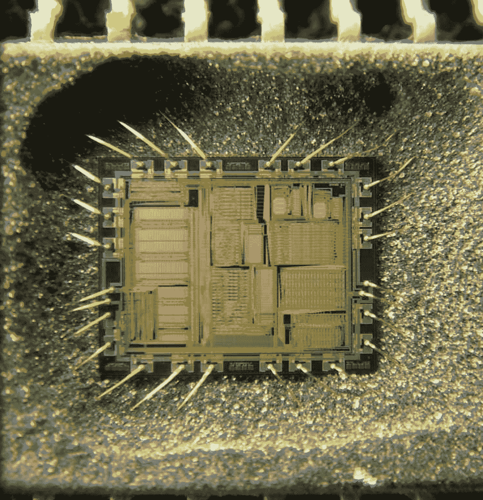
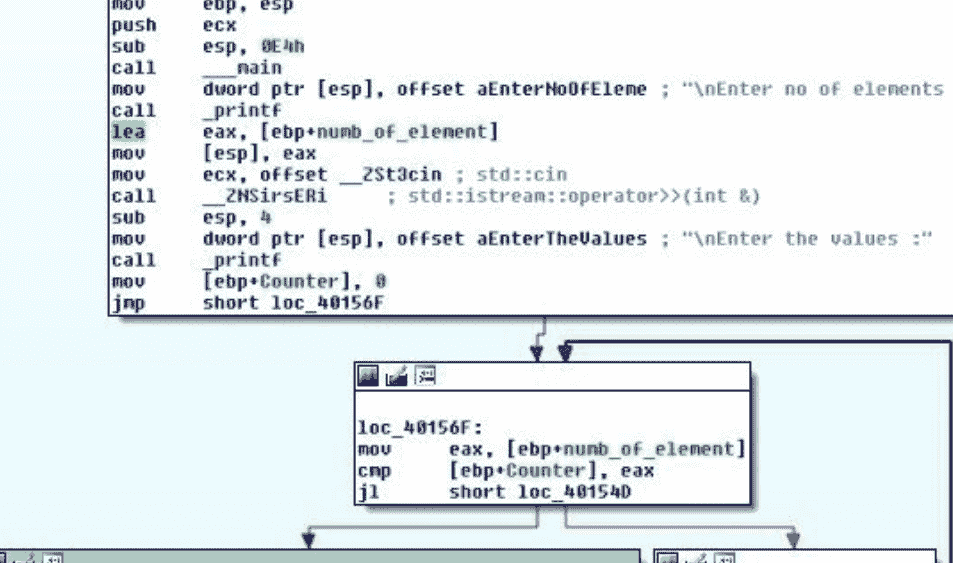
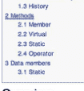
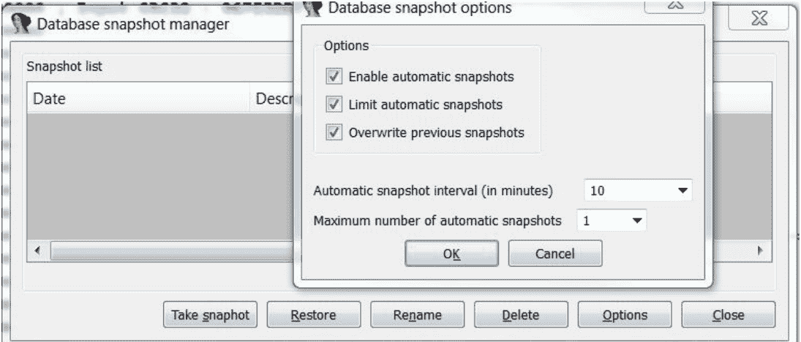
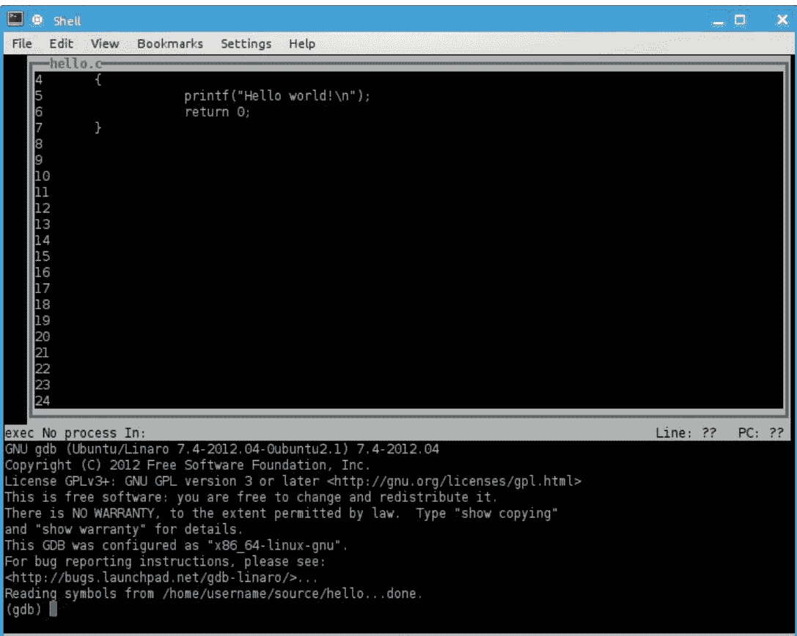
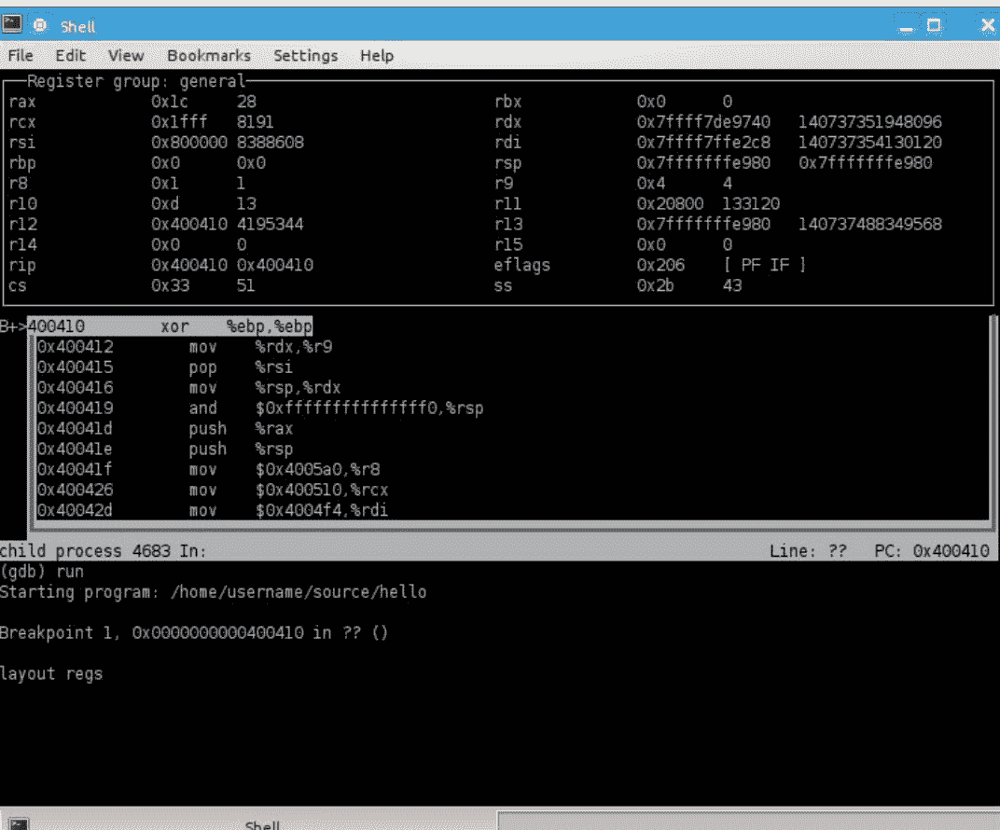
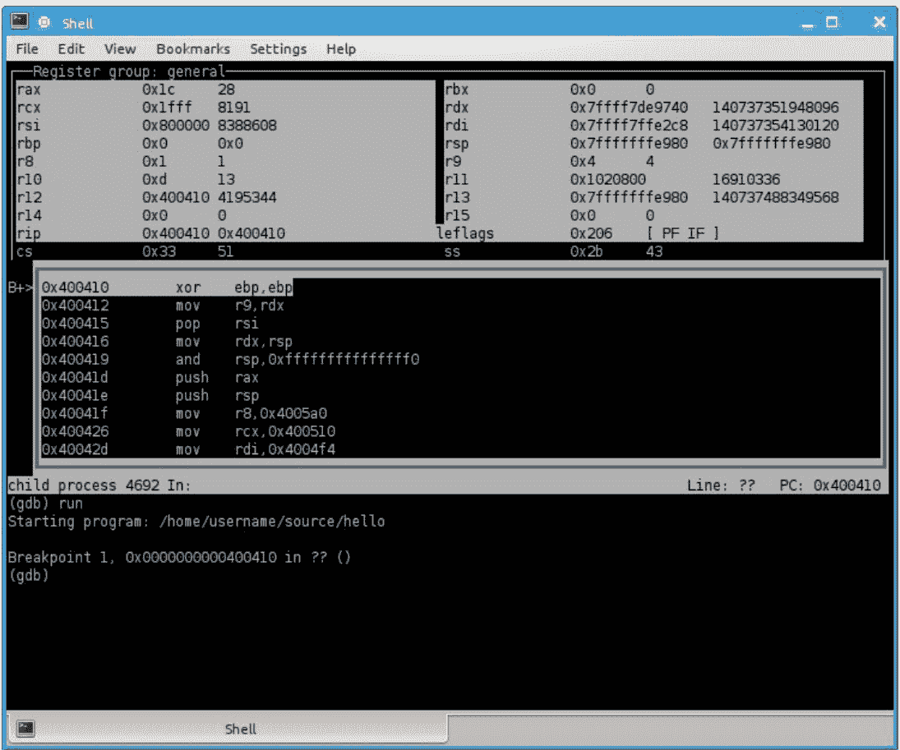
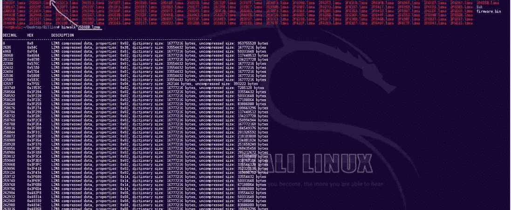

# 逆向工程：问答指南

## 问题与解答



作者 George Duckett

## 关于本书

本书被分为若干类别，每个问题属于一个或多个类别。类别根据问题数量列出；热门类别排在前。所有内容都是内部链接，因此在浏览类别时，你可以轻松地翻阅其中的问题。问题和解答尽可能链接到书中的相应位置。如果链接没有链接到书内，它会获得一个像这样的特殊图标。

## 反汇编

跳转到问题，

用户 asheeshr

反汇编是指将机器码翻译为汇编代码，即机器码的助记符形式。反汇编器生成的代码通常是可读的，而不是为了输入汇编器的格式。与反编译不同，反汇编操作的是低级语言。

反汇编不是一门精确的科学，因此一个程序在反汇编时可能有两个或多个合理的表示。在程序运行期间确定会遇到哪些指令归结为停机问题，该问题已被证明是不可解决的。此外，在反汇编运行期间区分代码和数据是一项挑战，许多情况下可以使用启发式方法解决，而在其他情况下需要人工干预。

> 反汇编器是将机器语言翻译为汇编语言的计算机程序——这是汇编器的逆操作。反汇编器与反编译器不同，后者针对的是高级语言而非汇编语言。反汇编器的输出通常是为了人类可读，而不是为了输入汇编器，使其主要成为逆向工程工具。

更多可以在工具标签中找到。

### distorm

来自官网：

`diStorm` 是一个轻量级、易用且快速的库[注：原文可能是 disassembler 的写错误]。`diStorm` 支持反汇编16、32和64位模式下的指令。支持的指令集：FPU、MMX、SSE、SSE2、SSE3、SSE4、3DNow!（带扩展）、新的 x86-64 指令集、VMX、AMD 的 SVM 和 AVX！

来自官网：

`IDA` 是一款适用于 Windows、Linux 或 Mac OS X 的多处理器反汇编器和调试器，提供的功能多到难以全部描述。如果你想试用，只需获取评估版即可。

为非技术用户提供了执行摘要。

Q：是否有任何开源测试套件可以测试反汇编器的性能？

标签：反汇编（下一个问题），工具（下一个问题）

逆向工程中的一个关键问题是拥有良好的反汇编器。为了确保反汇编器运行正常，是否有良好的测试套件可用于测试反汇编器的正确性？这些是针对特定架构的，还是可以配置跨多个对象架构工作？一个好的工具应该包含对更多架构指令和异常执行文件的检查。

这里我见过一个专门针对 x86 的。是否有针对模块化架构的工具？

标签：反汇编（下一个问题），工具（下一个问题）

用户：williamkf

qaz 回答

有一篇名为《N-version Disassembly: Differential Testing of x86 Disassemblers》（PDF）的论文，由 Roberto Paleari、Lorenzo Martignoni、Giampaolo Roglia 和 Danilo Bruschi 编写，他们以正式的方式比较了几个 x86 反汇编器。引用该论文：

> 反汇编器的输出用于许多不同的目的（例如，调试和逆向工程）。因此，反汇编器代表了机器码高级分析所依赖的第一链环节。在本文中，我们证明了许多反汇编器无法解码某些指令，因此第一个链环节是薄弱的。我们提出了一种名为“N版本反汇编”的方法，基于差异分析来验证反汇编器的正确性，这虽然稍离主题，但你可能感兴趣。

andrew 回答

在我读过的许多论文中，作者们使用基准测试来衡量反编译器的有效性。这产生了关于系统如何运作的全局视图。这些基准测试是免费的。`GCC` 和 `clang` 也提供了用于测试的工具。`Rege` 的项目可以生成任意程序用于模糊测试。这对于反编译器和二进制分析可能有用。

ed-mcman 回答

你链接的测试套件不仅针对 x86，还包含了 x86-64、alpha 以及许多其他架构的测试用例。

标签：反汇编（下一个问题），工具

Q：像 `printf(char* format, ...)` 这样的 C 参数在反汇编后看起来是什么样的？它是总是通过调用约定识别的，还是有其他方法？

标签：反汇编（上一个问题），c（下一个问题）

mellow 回答

在某些架构中非常简单，在另一些中并不明显。我将描述一些我熟悉的。SystemV x86_64（Linux, OS X, BSD）可能是容易识别。因为大多数变参函数这样指定使用的寄存器：

```
push rbp
mov rbp, rsp
sub rsp, 96
mov [rbp-A8], rsi
mov [rbp-A0], rdx
mov [rbp-98], rcx
mov [rbp-90], rbx
mov [rbp-88], r9
movzx eax, al
lea rdx, [eax*4]
lea rax, loc_40DA1
sub eax, rdx
lea rdx, [rbp+1]
jmp rax
movaps xmmword ptr [rdx-8F], xmm7
movaps xmmword ptr [rdx-7F], xmm6
movaps xmmword ptr [rdx-6F], xmm5
movaps xmmword ptr [rdx-5F], xmm4
movaps xmmword ptr [rdx-4F], xmm3
movaps xmmword ptr [rdx-3F], xmm2
movaps xmmword ptr [rdx-2F], xmm1
movaps xmmword ptr [rdx-1F], xmm0
loc_40DA1:
```

注意这里它使用 `al` 来决定有多少个寄存器溢出到栈中。

igor 回答

Windows x64（即 AMD64）中不太明显，但这里有一个迹象：对应变参参数的寄存器溢出到栈中，且位置与其余参数对齐。例如，这里是打印函数的序言：

```
mov rax, rsp
mov [rsp+8], rcx
mov [rsp+10h], rdx
mov [rsp+18h], r8
mov [rsp+20h], r9
```

在这里，`rcx` 包含固定格式参数，变参通过 `rdx`、`r8` 和 `r9` 在栈上传递。我们可以观察到，当 `rsp=0x28` 时，`rdx`、`r8` 和 `r9` 正好相邻，并且位于其余寄存器的下方。`[rsp+8...rsp+28]` 专门为此目的预留，但变参函数并没有在那里存储所有寄存器，或者重用该区域作为局部变量。例如，这里是非变参函数的序言：

```
mov [rsp+10h], rbx
mov [rsp+18h], rbp
mov [rsp+20h], rsi
```

你可以看到在使用预留区域保存非易变寄存器，而不是溢出寄存器参数。

ARM 调用约定使用 R0–R3 作为前参数，因此变参函数需要溢出到栈上与其余参数对齐。因此你会看到 R0–R3（或 R1–R3、R2–R3 或仅 R3）被推入栈，这在非变参函数中通常不会发生。这不是一个 100% 万无一失的指标——例如，微软的编译器将 R0-1 推入栈，并使用 SP 而不是移动寄存器到其他寄存器，但我认为这是 GCC 的可靠信号。这里有一个 GCC 编译函数的示例：

```
STMFD SP!, {R0-R3}
LDR R3, [SP,#word#8604]
STR LR, [SP,#0x14+vararg_0]; format
LDR R0, [R1]; ; s
ADD SP, SP,#0x14+vararg_1 ; arg
BL
vsprintff
LDR R3, =word#8604
MOV R2, #1
STR R2, [R3]
LDR LR, [SP+0x14+vararg_14],#4
ADD SP, SP, #010
RET
```

rolf-rolles 回答

（我的答案是针对 x86 的）。

在函数内部，它看起来和其他任何函数一样。唯一的区别是，

在函数执行期间的某个时刻，它将最后一个非变量参数的（栈）地址地址，并根据平台的字大小对其递增；这被用作指向可变参数基的指针。在函数外部，你将观察到不同数量的参数作为参数传递给函数（通常一个非变量参数会明显地标记为可变函数，例如硬编码的格式字符串或类似的内容）。可变函数不能是 `__stdcall`，因为 `__stdcall` 依赖于预编译的 `ret` 指令，而可变函数的作用在于可以传递未知数量的参数。在这里这些函数必须是 `__cdecl`，即调用者必须修正堆栈以移除所有可能的参数。

标签：[反汇编](#) [上一个问题](#Prev Q) [下一个问题](#Next Q) [c](#)

标签：[反汇编](#) [上一个问题](#Prev Q) [下一个问题](#Next Q)

在微内核中，许多有趣的功能并没有通过传统的函数调用实现，而是通过独立实体之间的消息传递来实现的。

是否存在一种操作系统架构通常用于实现消息传递的结构？是否存在一种有条的方法来标记这种反汇编，以便像跟踪调用栈一样容易跟踪消息的路径？

标签：[反汇编](#) [上一个问题](#Prev Q) [下一个问题](#Next Q)

用户：[daniel-w.-steinbrook](#)

回答者：[igor-skochinskinsky](#)

我不认为我反汇编过任何内核，但“消息传递”至少在两类程序中很常见：Win32 GUI（基于 Win32 和 MFC 的）以及 Objective-C 执行文件。

在某些情况下，你有一种中央分发器（或例程），接收消息并转发给某些接收者，这些接收者可能在当前程序内部或外部。

接收者可以动态注册（Win32 中的 `RegisterClass`），也可以以某种静态方式指定（Objective-C 类元数据和 MFC 的消息处理表）。

至于分发器，考虑 Win32 的 `SendMessage`。它有 `hwnd` 和 `Msg`（以及额外的参数）。它首先指定接收者。你可能追踪它来自哪里，只需查找与窗口对应的类注册，并检查其窗口过程是否处理了这一特定消息。我想你可以在该调用处标记注释“跳转到窗口过程 0x35345800”或类似的内容以跟踪它。在 MFC 中，你需要找到类的消息表并查找对应的处理器。

对于 Objective-C，`objc_msgSend` 接受接收对象和要执行的选择器（selector）。如果你能回溯到该对象，就可以检查它是否具有同名的选择器。或者，检查程序中所有同名的选择器。同样，一旦你找到了，就加一个注释。

所以，类似的方法可能可以扩展到所有其他消息传递系统——找到接收者，然后在分发器调用的地方找到哪一个可以处理它，并检查处理器。有时你甚至不需要执行第一部分——如果消息 ID/名称足够独特，你可能只需通过搜索就能找到处理器。

一个与之相关的问题是处理 C++ 和虚函数的工作，但那已经在另一个问题中讨论过了。

我提到过另一种不使用堆栈的程序。它们是使用延续传递风格（Continuation-passing Style）的程序，通常用某种函数式语言编写。Greg Sinclair 写过一篇关于反汇编 CHICKEN（一种 Scheme 语言的实现）之恐怖性的非常精彩且有趣的论文。他的网站虽然没了，幸运的是 Archive.org 保留了一个副本。其中一个引用是：

对于反向工程来说，延续传递风格意味着我们所知文明的终结。

标签：反汇编 (上一个问题) (下一个问题)

标签：反汇编 (上一个问题) (下一个问题)

我从 PIC16F88 提取了一个十六进制文件。例如：

跳过 code_block

```
:02000A06B0FA
:100000082008316E0F57038F0090183129F017C
:10010008316F0F17039C00051038125143B27C
:10020008313731A09B6734A10293A0B200A284
:1003000831C731A097B031A121111520A201A7D
:10040008A1AA000B2123508F1023130317A0000B8
:1005000763D4A010293A0B2A1028A0B2C2C2B5
:0200000007B002D5
:024100E078B2F69
:024100B0FF3F70
:0200000011F
```

在 MPLAB 中，我导入了这个文件并找到了反汇编代码，在这种情况下：

跳过 code_block

```
| | | | | | |
|---|---|---|---|---|
| 1 | 000 | 308F | MOVW | 0x8 |
| 2 | 061 | 183F | BSF | 0x5 |
| 3 | 052 | 050F | ANDW | 0x7 |
| 4 | 003 | 3879 | MOVW | 0x7 |
| 5 | 004 | 008F | MOVF | f |
| 6 | 005 | 019F | CLRF | 0xb |
| 7 | 006 | 1283 | BCF | 0x3, 0x5 |
| 8 | 007 | 019F | CLRF | 0xf |
| 008 | | 1683 | BSF | 0xF4, 0x5 |
| 009 | | 010 | CLRF | 0xF1 |
| 00A | | 3087 | MOVW | x7 |
| 00B | | 009C | MOVW | x1 |
| 00C | | 1005 | BCF | 0xB5, 0 |
| 00D | | 1283 | BCF | 0xB5, 0 |
| 00E | | 1485 | BCF | 0xB5, 0 |
| 00F | | 1283 | BCF | 0xB3, 0 |
| 010 | | 3617 | MOVW | x17 |
| 01B | | 00A8 | MOVW | x20 |
| 012 | | 3067 | MOVW | x27 |
| 013 | | 0067 | MOVW | x6 |
| 014 | | 08A1 | MOVW | x21 |
| 015 | | 3029 | MOVW | x29 |
| 016 | | 08A2 | MOVW | x22 |
| 017 | | 120A | BCF | 0xB4, 4 |
| 018 | | 118A | BCF | 0xB4, 3 |
| 019 | | 08A2 | DECFSZ | 0x22, F |
| 01A | | 2817 | GOTTO | 0x13 |
| 01B | | 120A | BCF | 0xB4, 4 |
| 01C | | 11B0 | BCF | 0xB4, 3 |
| 01D | | 08A1 | DECFSZ | 0x21, F |
| 01E | | 2815 | GOTTO | 0x15 |
| 01F | | 120A | BCF | 0xB4, 4 |
| 020 | | 11B0 | BCF | 0xB4, 3 |
| 021 | | 08A0 | DECFSZ | 0x26, F |
| 022 | | 2813 | GOTTO | 0x13 |
| 023 | | 1005 | BCF | 0xB5, 0 |
| 024 | | 1283 | BCF | 0xB5, 5 |
| 025 | | 1303 | BCF | 0xB5, 3 |
| 026 | | 3617 | MOVW | x17 |
| 027 | | 00A8 | MOVW | x20 |
| 028 | | 3067 | MOVW | x26 |
| 029 | | 08A1 | MOVW | x21 |
| 02A | | 3029 | MOVW | x29 |
| 02B | | 00A2 | MOVW | x22 |
| 02C | | 120A | BCF | 0xB4, 4 |
| 02D | | 11B0 | BCF | 0xB4, 3 |
| 02E | | 08A2 | DECFSZ | 0x22, F |
| 02F | | 2826 | GOTTO | 0x2C |
| 030 | | 120A | BCF | 0xB4, 4 |
| 031 | | 08A1 | DECFSZ | 0x21, F |
| 032 | | 292A | GOTTO | 0x24 |
| 033 | | 120A | BCF | 0xB4, 4 |
| 034 | | 118A | BCF | 0xB4, 3 |
| 035 | | 08A0 | DECFSZ | 0x20, F |
| 036 | | 2820 | GOTTO | 0x2D |
| 037 | | 2800 | GOTTO | 0xD |
```


现在我想知道这段代码是用哪个编译器编译的。我该如何做？我正在寻找通用的方法来检查某些汇编代码是由哪个编译器生成的。列出的代码只是例子。

标签：[反汇编](https://stackoverflow.com/questions/71434345) [上一个问题](https://stackoverflow.com/questions/71434340) [下一个问题](https://stackoverflow.com/questions/71434350)

用户：[camil-staps](https://stackoverflow.com/users/camil-staps)

[回答](https://stackoverflow.com/questions/71434345/71434350) 由 [z](https://stackoverflow.com/users/z) [v](https://stackoverflow.com/users/v)

要恢复你指定的二进制代码的工具链来源，至少需要比较各种 PIC 编译器的结果。我不懂 PIC 汇编，但最后两条指令看起来很有意思（如果反汇编器误读了 `0x38` 处的信息，指令如何调用？）

[添加内容]
有些编译器生成函数前言是为了支持运行时热补丁（`hot patching`），函数前两个字节将被替换为跳转到代码段的跳转指令。祝你好运！

标签：反汇编 (上一个问题) (下一个问题)

反汇编器应该产生二进制代码的可读表示程序。但最广为人知的技术：线性扫描（`linear sweep`）和递归遍历（更多信息请参见此注释）被认为容易被特定的技巧误导。一旦被欺骗，它们输出的代码将永远不会被真实程序执行。

我认为存在新的技术以及一种更关注正确性的新方法（例如 `Jakstab`, `McVeto`, ... 对于许多反汇编器来说，输出的正确性概念从未被恰当定义）。

一个反汇编器的良好定义是什么？输出中正确性的适当定义是什么？你将如何根据这种正确性对现有的反汇编器进行分类？

标签：`disassembly` (反汇编) 上一个问题), (下一个问题), `obfuscation` (混淆) (下一个问题)

用户：per

回答（由 endeavor）：

我是 `rdis` 的作者，我对这个问题进行过一些思考。如果你在此之后还有其他问题，我建议查看我的博客。

我还会参考 Andrew Rue 的博客《二进制分析并非如此》（Binary Analysis Isn't）。关键在于，不要总是尝试从编译器的语文中去理解我们的程序，而将其仅仅视为指令的连续体。他创造了“编译输出分析”（Compiler Output Analysis）一词，这在很大程度上我们在反汇编器中尝试实现的内容。

## 术语与定义

重新定义反汇编常用的术语。我们有数据（`data`）、状态（`state`），它们由内存、寄存器等所有优秀的内容组成。我们有代码（`code`），这是我们应用在期望机器执行的数据上的标签（我们会回过代码）。我们有程序（`program`），它是编码在数据中的算法，由机器解释，导致数据以某种方式被处理。我们有机器（`machine`），它是从一个状态到另一个状态的映射。我们有指令（`instructions`），对于我们而言，它们存在于特定的时刻，由特定的数据组成，控制机器处理数据的方式。

我们有时认为，目标是将代码（我们期望机器执行的数据）转换为可读的反汇编。我之所以相信这一点，是因为我们将程序分析分为了控制流分析（代码）和数据流分析（数据）。在程序分析中，我们的代码是无状态的，而数据是有状态的。在现实中，我们的代码只是数据，它拥有所有状态。

相反，我们的目标应该是通过观察或预测机器来恢复程序。换句话说，我们感兴趣的是将数据转换为可读的反汇编，而是发现将被我们的机器解释的指令。

此外，我们对程序的表示应该与对数据的无状态表示分开存储，后者通常是可执行文件提供给我们的初始内存布局（`ELF/PE/MACH-O/`等）。实际上，它应该存储在有向图中。当我看到一个带有多个位置标记为指令的内存线性表示时，我不禁发栗。你还不知道！

我相信反汇编的下一步涉及一些过程，通过允许在反汇编过程中发生状态的变化来对机器做出更好的预测。我相信我们既会有模拟反汇编，也有抽象反汇编。某些人已经在很大程度上这么做了；我不确定是否有人专门为了创建可用且易于理解的“程序恢复”而这样做。

现在来回答你的问题：“什么是正确的反汇编器？”我认为，正确的反汇编器是那些清晰定义其恢复过程行为并遵循该定义的工具。一旦我们得到了**做到这一点**的反汇编器，更好的反汇编器将是那些能够预测它们所恢复的机器行为的工具。

标签：`disassembly` (反汇编) 上一个问题 (下一个问题) `obfuscation` (混淆) (下一个问题)

假设我们有一段汇编代码，已知哪些技术可以恢复原始高级代码中的变量？

编辑：通过恢复变量，我不是恢复变量名，而是尝试识别用于存储临时结果的内存位置，这些结果可以被高级代码中的变量所替换。此外，我所指的不是字节码，而是没有任何嵌入其中的完整名称信息的真实二进制代码。

标签：`disassembly` (反汇编) 上一个问题 (下一个问题) `decompilation` (反编译) (下一个问题)

用户：perror

由 igor-schokinsky 回答：

`Hex-Ray` 反汇器中提到的某些注释。它的基本思想不是机密，而是白皮书中的事实。

局部变量（`Local variable`）

标签：反汇编 (上一个问题) (下一个问题) `ida` (下一个问题) 工具 (上一个问题) (下一个问题)

有没有什么被证明是可行的工具/方法论，可以对同一个二进制文件进行协作工作（如果可以并行的话）？

我用过各种方法与他人共享信息，但不是并行的：
- 来回发送 `IDB` 文件
- 在仓库中共享 `TXT` 笔记
- 将 `IDB` 导出为 `IDC` 并在仓库中共享 `IDC`

标签：反汇编 (上一个问题) (下一个问题) `ida` (下一个问题) 工具 (上一个问题) (下一个问题)

用户：ange

由 ange 回答：

一些可能的建议：
- `CrowdRE`
- `IDA Toolbag`
- `BinCrowd`
- `CollabReate`

由 samurai 回答：

`Dexter` 是一个静态 Android 分析工具，具有协作功能。

标签：反汇编 (上一个问题) (下一个问题) 工具 (上一个问题) (下一个问题) 调试器 (下一个问题)

当各种分析工具无法共享信息时，这真的是一个生产力瓶颈。

有没有什么高效的方法可以存储符号+注释+结构，以便它们可以被导入到其他工具中？

标签：反汇编 (上一个问题) (下一个问题) 工具 (上一个问题) (下一个问题) 调试器 (下一个问题)

用户：ange

由 ange 回答：

一个可能的工具是 QuarkLabs 的 `q-sync`，它介绍说：
- `IDA` 与 `WinDbg`、`OllyDbg2`、`GDB` 之间的同步
- 源码可用 (`GNU GPL 3`)

标签：反汇编 (上一个问题), 工具 (上一个问题) (下一个问题), 调试器 (下一个问题)

`IDA Pro` 可以处理瑞萨 `H8` 处理器，但免费版不行。
有没有针对瑞萨 `H8` 系列或处理器的免费或低成本（<<100 美元）反汇编器？

## jason-geffner 的回答

- 局部变量的形式为 `[EBP ...]`
- 传递的参数的形式为 `[EBP + ...]`

标签：反汇编 (上一题) (下一题), `c` (上一题) (下一题)

标签：反汇编 (上一题) (下一题), 反汇编译 (上一题) (下一题), 固件 (下一题)

这个问题基本上是在问：除了认识一些对相同事物感兴趣的人之外，是否存在一个专门记录闭源固件的协作逆向工程倾包小组？

用户：hbdgaf

我并不知道目前有某种通用的“固件逆向工程”。

标签：反汇编 (上一题) (下一题), 反汇编译 (上一题) (下一题), 固件 (下一题)

是否存在任何 `ARM`（或非 x86）反汇编器，可以将指令解构为一种机器友好的结构中的组成部分？理想情况下，它应该是像 `XED` 或 `distorm3` 这样的，将指令反汇编成一个结构，然后提供一个 API 来查询诸如“这是一个调用吗？”“这是一个条件分支吗？”等信息。

我找到了 `armstorm`，但目前只支持 `THUMB`。

## qaz 的回答

`DARM` (GitHub) 是一个用 `C` 语言编写的 `ARMv7` 反汇编器，根据 3 Clause BSD 许可发布。

注意：它目前不支持 Thumb 模式。

使用 `DARM` 的简单示例所示：

```c
// 用于存储有关反汇编指令的所有元数据的结构...
darm_t d;
// 反汇编一个 32 位的操作码...
if(darm_arm7_disasm(&d, 0xE122FF14 ) == 0
```

```c
{
  if (d.instr == I_BX)
  {
    // 对 BX 指令进行一些操作...
  }
  // 打印反汇编后的指令
darm_str_t str;
  if (darm_str(&d, &str) > 0)
    printf("%s\n", str.instr);
}
```

标签：反汇编 (上一题) (下一题) 工具 (上一题) (下一题)


标签：反汇编 (上一题) (下一题) 工具 (上一题) (下一题)

标签：反汇编 (上一题) (下一题) `ollydb` (下一题) `pe` (下一题)

我正在处理 `x86` 汇编代码，需要从一个可执行文件中提取并将该代码粘贴到另一个。

最初，我有一个旨在接受两个命令行参数并在它们上运行手写函数的可执行文件。然而，我在 `GetCommandLine` 在 `ASM` 中返回参数时遇到了麻烦。也就是说，它返回的是 Unicode，而我需要 ANSI 参数。与其处理库调用并进行转换，我编译了一个使用命令行参数的小程序，目的是重用代码。

现在我有两个可执行文件：一个解析了命令行参数，两个内部包含了实际的函数代码。

第一个可执行文件有可以 `NOP` 掉函数的空间，但我需要将函数代码粘贴进去。我过了一些工具，但没有发现在 `Olly` 中实现的方法。

### 配置引导优化 (PGO)

在这种优化下，编译器首先生成一个包含额外代码的二进制文件，这些代码用于计算程序运行时行为的统计信息。程序员让插桩的代码运行“典型负载”并计算统计数据。然后，程序员重新编译程序，将这些统计数据提供给编译器，并告诉它通过 `PGO` 生成代码。编译器随后会根据每个函数执行的频率、通过函数的路径常用路径等信息，大幅地改变二进制文件的布局。不同的训练集会产生不同的统计特征，并生成截然不同的可执行文件。

这并不是一个详尽列表。许多其他优化也会困扰你。这主要是因为编译器优化使得 `UNIX` `diff` 风格的工具在二进制比较空间中几乎没有用处。

当我反汇编一个函数时，偶尔会遇到类似 `%reg:value` 形式的表达式。通常，我在激活 `GCC` 的栈保护（`-fstack-protector`）时或在以下示例中遇到这种语法：

```assembly
[gdb] disas

Dump of assembler code for function foo:

0x0000000004005d0<8>: push    %rbp

0x0000000004005d7<12>: sub     %sp,%rbp

0x0000000004005d8<16>: mov     %0x20,%sp

0x0000000004005d84<20>: mov     %edi,-0x14(%rbp)

0x0000000004005d8f<25>: mov     %fs:0x28,%ax

0x0000000004005d90<20>: mov     %ax,%8(%rsp)

0x0000000004005d94<24>: xor     %ax,%ax

0x0000000004005d96<26>: mov     %0x409ac,%eax

0x0000000004005d9<<30>: call    0x401048<puts>

0x0000000004005d9a<36>: mov     -0x08(%rbp),%rax

0x0000000004005d9e<40>: xor     %fs:0x28,%rax

0x0000000004005da2<48>: je     0x4005b4<foo+56>

0x0000000004005da7<51>: call    0x400450<__stack_chk_fail@plt>

0x0000000004005db4<56>: leaq

0x0000000004005db5<57>: retq
```

这种语法的含义是什么？

### 用户：perror
### ange 的回答
`%fs:02h` 实际上使用的是“段:偏移量”（segment:offset）的形式，这意味着它正在访问由远段 `FS` 选中的段中偏移 `28h` 处的内存地址。任何内存引用都有一个隐式的段（大多数情况下，执行使用 `cs`，读写数据使用 `ds`），该段可以通过段前缀进行覆盖。

当通过执行 `call` 进入新函数时，我经常看到这段代码模板（在调试模式下由 `Gnu Debugger` 生成）：

```assembly
0x0040170 push    %ebp

0x0040171 mov     %esp,%ebp

0x0040173 pop     %ebp
```

那么 `mov esp` 到 `ebp` 的目的是什么？

### robert 的回答
将 `esp` 移动到 `ebp` 是为了调试，在某些情况下是为了异常处理。`esp` 通常是帧指针（frame pointer）。考虑到这一点，当你调用多个函数时，`esp` 指向一个内存块，你推入了旧的 `ebp`，而旧的 `ebp` 又指向另一个 `ebp`。因此，你拥有了一个栈帧链。从这些帧中，你可以查看返回地址（始终位于帧指针之后的 4 字节处）以找到调用了谁。指令指针可以告诉你当前执行的位置。这允许你生成栈回溯（stacktrace），对于显示程序的流程很有用。考虑以下代码：

```c
void foo();

void bar();

void quux();

void foo() {
    bar();
}

void bar() {
    quux();
}

void quux() {
    int x = 1; // SEGFAULT
}

    foo();
    return 0;
}
```

生成的汇编代码（使用 `gcc 4.7.2 -m32 -g`）：

```assembly
0x04483dc:<foo>
0x04483dc:    push    %ebp
0x04483de:    55
0x04483df:    mov     %esp,%ebp
0x04483ef:    83 ec 08    sub     $8,%esp
0x04483f2:    e8 02 00 00    call<bar>
0x04483e7:    c9      leave
0x04483e8:    ret
0x04483e9:<bar>
0x04483e9:    push    %ebp
0x04483ea:    55
0x04483eb:    mov     %esp,%ebp
0x04483ef:    83 ec 08    sub     $8,%esp
0x04483f4:    e8 07 00 00    call<quux>
0x04483f9:    c9      leave
0x04483fa:    ret
0x0448f00:<quux>
0x0448f00:    push    %ebp
0x0448f01:    55
0x0448f02:    mov     %esp,%ebp
0x0448f06:    b8 00 00 00    mov     $0,%esp
0x0448f07:    74 01 00 00    mov     $1,(%ax)
0x0448f0e:    5d      pop
0x0448f0f:    ret
0x0448f10:<main>
0x0448f10:    push    %ebp
0x0448f11:    55
0x0448f12:    mov     %esp,%ebp
0x0448f16:    83 e4 f0    and     $0xffff0,$esp
0x0448f1b:    e8 c1 ff ff    call<foo>
0x0448f1d:    b8 00 00 00    mov     $0,%ax
0x0448f20:    c9      leave
0x0448f21:    ret
```

注意 `leave` 是：
`mov %ebp,%esp`
`pop %ebp`

考虑到这一点以及 `x86` 的标准调用约定，我们知道发生故障时的栈看起来如下：

1. `main` 的栈帧顶部
2. `main` 的栈空间 - 在这种情况下，对齐到 16 字节
3. `0x080481b` 调用 `foo` 的返回地址
4. 指向 1 的指针
5. `foo` 的栈空间
6. `0x08043e7` 调用 `bar` 的返回地址
7. 指向 4 的指针
8. `bar` 的栈空间
9. `0x08043f9` 调用 `quux` 的返回地址
10. 指向 7 的指针
11. `quux` 的栈空间

指令指针将是 `0x08044808`。`ebp` 将指向 10。

在此时，处理器产生异常，由操作系统进行处理。然后它向进程发送 `SIGSEGV` 并转储核心文件（core dump）。

| 地址 |指令 |
| :--- | :--- |
| 0x007C6834 | mov      eax, [esi+4] |
| 0x007C6837 | movword ptr [esi], offset ??7_CAAvatar@@6B ; const CAAvatar: |

我该如何将 `esi` 寄存器的类型设置为结构体（struct），以便在理想情况下，反汇编结果会变成：

```
.text:007C6834 014 mov    eax, [esi.field_04]
.text:007C6837 014 mov    dword ptr [esi_vtable], offset ??7CAAvatar@@6B; const Ca
```

标签：[反汇编](https) [上一个问题](https) [下一个问题](https) [ida](https) [上一个问题](https) [下一个问题](https)

用户：[avery3](https)

[igor-skochinskinsky](https) [回答]

+1. 创建一个结构体
2. 通过四种方法应用结构体：
    * 使用 `T` 快捷键。
    * 右键点击操作数，从“Structure offset”（结构偏移）子菜单中选择结构体。
    * 使用菜单 `Edit|Operand types|Offset/Offset (struct)`
    * 使用操作数类型（Operand Type）工具栏上对应的按钮

这里有一个简短的教程：[https://www.hexrays.com/products/ida/support/tutorials/structs.shtml](https)

[elias51](https) [回答]

`Igor` 在这里，我还有几个额外的建议可以提供。在结构体内部声明变量时，确保你准确考虑了变量的大小。例如，它是一个 `DWORD`还是其他多缓冲区（在这些情况下，也许 `memset/memcpy` 可以给你关于大小的提示）？

在处理包含许多对象的结构体时，准确考虑到这些因素非常重要。这有助于你全面理解它们在程序中如何使用，有助于定义结构体成员。

此外，请记住你可以像在 `IDA` 中命名任何其他变量一样命名这些字段。为了彻底起见，你还可以在结构体标签中声明字段类型，操作方法是右键点击字段，选择 `field type`。

最后，在结构体内部声明多字节数组的大小时，例如你实际上可以使用十六进制表示，只需在数组字段中输入‘`0x`’即可。这看起来没什么什么，但这是一个很有用场的小技巧。

关于结构体及其在 `IDA` 中的用法，还有很多可以探索的内容。如果你想学习更多关于此以及通用 `IDA` 的知识，我强烈推荐 `Chris Eagle` 的 `IDA Pro` 书。

[http://www.idabook.com/](https)

标签：[反汇编](https) [上一个问题](https) [下一个问题](https) [ida](https) [上一个问题](https) [下一个问题](https)

标签：反汇编 (上一个问题) (下一个问题) `ida` (上一个问题) (下一个问题)

为了学习（以及好玩），我一直在使用 `IDA Pro` 分析一个文本编辑器。在查看反汇编时，我注意到许多函数调用是通过显式调用函数名完成的。例如，我注意到 `IDA` 将大多数函数调用转换为以下两种格式。

```
call cs:CoCreateInstance
```

或者

```
call WinSqmAddToStream
```

但有时格式并不使用函数名。下面的示例包含了问题所在行之前的代码。第三行代码似乎“缺失”了函数名。

```
mov rcx, [rsp+128h+var_D8]      // reg CX 获取栈指针+128h+var_D8 字节处的地址
mov r8, [rcx]                   // reg CX 处的地址存储到 reg r8
call qword ptr [r8 + 18h]       // 在地址 rax+18h 处，调用 qword 字节定义的函数
```

我的问题如下：

+1. 如何建立 `call qword ptr <address>` 与反汇编中函数之间的联系？
2. 我理解 `IDA` 在此处无法使用函数名是因为它不知道寄存器 `R8` 中的值……这是这种情况的原因？开发者是否使用了特定的语法或约定？也就是说，开发者是否以与 `[r8+18h]` 的方式调用了 `WinSqmAddToStream`？

标签：`disassembly` (上一个问题) (下一个问题) `ida` (上一个问题) (下一个问题)

用户：`clark`

`igor-schinsky` [回答]

要将间接调用连接到其目标（如果你知道的话），你可以执行以下操作：

+1) 添加自定义交叉引用（cross-reference），可以使用 `IDC/Python` 或从 `Cross References`（交叉引用）视图。如果你使用脚本，不要忘记添加 `XREF` 标记。
+2) 使用“callee”插件（`Edit->Plugins->Change the callee`，或 `Alt+F1`）。这会自动添加交叉引用。

你展示的代码片段看起来像是虚函数调用，通常在派生类的方法被重写时这样做。

标签：`disassembly` (上一个问题) (下一个问题) `ida` (上一个问题) (下一个问题)

标签：`disassembly` (上一个问题) (下一个问题) `ida` (上一个问题) (下一个问题)

我正在使用 `Cheat Engine` 和 `OllyDBG` 反编译一个游戏，在 `FPS` 游戏中，这些内存地址被读取和监控，这些地址包含敌人的坐标(`xyz`)。

`IDA` 生成了以下反汇编代码。注意第三行不是通过名称调用特定函数，而是通过地址调用的。

我对确定 `qword ptr <address>` 指向哪个函数感兴趣。我的目标是找到一个地址或模式，可以让我遍历 32 个敌人以读取它们的所有坐标。为了这一点，我运气不错。我一直在尝试在每个地址之间寻找一种模式，这些信息是有用的，但搜索 32 个地址是一项比我认为需要的更多精力的任务。

如所述，我可以访问前 3 个敌人的地址，如果可能通过 `Cheat Engine` 或其他逆向工程软件溯到基地址，将不胜感激。

最终，我的问题是，是否有方法通过其中一个地址检测内存中的指针数组？例如，如果该位置追踪到一个访问所有 32 个敌人的地址，无论是使用 `cheat engine` 还是另一个逆向工具。

标签：`disassembly` (上一个问题) (下一个问题) `ollydbg` (上一个问题) (下一个问题)

用户：`daniel-filipe`

`nirizr` [回答]

楼主没有指定他是否知道结构是如何布局的。看起来他假设它们并不复杂。为了避免局部问题，我将假设结构是复杂的来回答一个更通用的问题)

我想到了寻找其他结构的方法：

一旦你有了几个结构体的示例，可能找到其他实例的最简单方法是匹配三个结构体中的常量。某些值可能是常数，代表适用于从更高级别类继承的所有敌人实体的属性。

优点：

+ 这很容易实现，可以通过 `Cheat Engine` 完成。
- 在通常情况下，它应该在程序重启后依然，你不需要每次运行游戏都寻找这三个结构体。

缺点：

+ 不健壮。不同版本之间可能会变化，你认为是常数的数据在某些你没有看过的情况下实际上可能会变化。

标签：`disassembly` (上一个问题) (下一个问题) `ida` (上一个问题) (下一个问题)

标签：`disassembly` (上一个问题) (下一个问题) `ollydbg` (上一个问题) (下一个问题)

每个实体可能在某处有一个指针。你可以轻松地在内存中搜索你找到的结构体的地址，并检测持有所有实体的数组/结构。你也可以遍历结构本身中找到数组，你可能正在看一个链表。

优点：
- 易于实现
- 比之前的方法稍微健壮一点。

缺点：
- 你仍然需要以某种方式找到第一个实体。

## 寻找构造函数/类构造函数的函数

无论是像 `C++` 或 `Obj-C` 这样的面向对象的语言，还是像 `C` 这样的过程化语言，必须有一个初始化结构的函数。通常这很容易找到——对象分配后调用的第一个函数，其汇编特征非常明显——大部分是初始化代码。如果我们讨论的是面向对象（OO）代码，寻找虚函数表或类似的结构将让你轻松找到构造函数，遍历继承关系并在部分操作函数找到它们。
获取构造函数后，你可以轻松获取所有的分配操作，并查看指针保存在什么地方。

优点：
- 非常健壮
- 对实体如何在内存中存储有有的理解。

缺点：
- 静态逆向工程（RE）。通常更难做到（找一个好用的反汇器）

## 逆向结构

这需要更多的逆向工作，但能让你找到搜索实体的最佳方法。使用 `Cheat Engine` 和 `IDA`，手动映射结构、元素/成员以及操作结构的函数。
如果涉及任何指针，顺着它们并逆向你遇到的其他结构。

优点：
- 健壮
- 实现你所目标的正确方法。真正理解正在发生什么。便于未来的能力/功能开发。

缺点：
- 工作量更大，更难实现。需要大量的逆向工程。

注意：

对于我提到的至少某些方法，在分析程序时寻找所有实体的指针可能是第一步。你可以搜索对列表本身的引用，并获得一种更好的方法在每次程序启动时自动找到实体。这消消除了一些缺点。

标签：反汇编 (前 Q) (后 Q), `ollydbg` (前 Q) (后 Q)

## Q: IDA Pro 函数栈帧视图 (stack view)

标签：反汇编 (前 Q) (后 Q), `ida` (前 Q) (后 Q)

`IDA` 在栈帧视图中会在局部变量的上方（较低地址处）显示某些缓冲区或填充。例如：

**示例 1.**
下面的栈帧视图截图显示了 12 字节（在红框内）缓冲区：

```
00000024 : U                : delete structure member


### 00000024 : 使用数据定义命令创建局部变量和函数参数。

`00000024` : 两个特殊字段：`"r"` 和 `"s"` 代表返回地址和保存的寄存器。

`00000024` : Frame size: 24; Saved regs: 0; Purge: 0

`00000024`

`00000024`

`00000023`

`00000022`

`00000022` : db ? : undefined

`00000022` : db ? : undefined

`00000021` : db ? : undefined

`00000021` : db ? : undefined

`00000020` : db ? : undefined

`0000001F` : db ? : undefined

`0000001E` : db ? : undefined

`0000001D` : db ? : undefined

`0000001C` : db ? : undefined

`0000001B` : db ? : undefined

`0000001A` : db ? : undefined

`00000019` : db ? : undefined

`00000018` : LastWriteTime  FILETIME ?

`00000008` : LastAccessTime  FILETIME ?

`00000008` : CreationTime FILETIME ?

`00000008` : r

`00000008` : 1pFileName db 4 dup      ; offset

`00000008` : arg_4          dd?

`0000000C` dd?

`0000000C` : end of stack variables

**示例 2.**
下面的栈帧视图再次显示了 12 字节缓冲区：

```
00000020 : D /* create structure member (data/asci)
00000020 : N : rename structure member
00000020 : U : delete structure member
00000020 : 使用数据定义命令创建局部变量和函数参数。
00000020 : 两个特殊字段："r" 和 "s" 代表地址和保存的寄存器。
00000020 : Frame size: 20; Saved regs: 4; Purge: 0
00000020
00000020
00000020
00000020
00000020
00000020
00000020
00000010
00000010
00000010
00000014 : var_14 : undefined
00000010 : var_10 : undefined
00000008 : var_8 : undefined
00000008 : Str : undefined
00000004 : db 8 dup(?) ; offset
00000004 : R : db 4 dup(?)
00000000 : arg_0 : undefined
00000000 : arg_4 : undefined
00000018 : arg_8 : undefined
00000014 : arg_C : undefined
00000018 : arg_10 : undefined
00000001 : end of stack variables
```

我理解 IDA 将其标记为 `undefined` 是因为它无法确定这些偏移是如何使用的。我也意识到 IDA 通过监控 `ESP` 来自动计算栈帧的大小。我假设这与非易变寄存器区域有关。然而在**示例 1** 中它显示 **Saved regs**: 0，而在**示例 2** 中它显示 **Saved regs**: 4。我很困惑，以下是我的问题：

为什么 IDA Pro 在栈视图中显示某些缓冲区或填充（较低地址处的）局部变量？两者都恰好显示 12 字节是巧合吗？这是因为调用约定还是编译器的原因？

标签：反汇编 (前 Q) (后 Q), ida (前 Q) (后 Q)

用户：pss
回答：jason-geffner

IDA 在对整个函数进行静态分析期间会跟踪栈指针 (`ESP`)。`ESP` 的最大值（相对于函数起始位置）用于确定栈帧的大小。对于你在顶部发布的为 "`undefined`" 的栈帧，是因为 IDA 无法自动确定那些偏移是如何使用的。

## Q: 如何在 IDA 中重新分析一个函数？

是否有方法可以重新分析单个函数并将其恢复到分析后的状态？

标签：反汇编 (前 Q) (后 Q), ida (前 Q) (后 Q)

用户：pss
回答：n00b

嗯，你必须先使用 `U` 键将代码取消定义（undefine），选择代码并右键，你会得到像 `C (code)` 等选项。IDA 还让你能够对混淆代码进行任何操作，以帮助正确理解代码。

补充：
转换为 `C (code)` 后，按 `Alt+P` 创建/编辑函数。此外，通过进入 Layout 视图，清除空间并选择“Layout graph”来重新构建布局。

标签：反汇编 (前 Q) (后 Q), ida (前 Q) (后 Q)

## Q: IDA Pro：“CREATE EXE file...”选项的作用是什么？

标签：反汇编 (前 Q) (后 Q), ida (前 Q) (后 Q)

我在 IDA 中发现了 `File -> Create EXE file...` 选项。我原以为不能用 IDA 进行补丁（patching），结果试了一下。然而它给出了以下错误：不支持此类型的输出文件。

这个选项是做什么的？可能的用途是什么？

标签：反汇编 (前 Q) (后 Q), ida (前 Q) (后 Q)

用户：pss
回答：dcoder

此选项价值有限。IDA 仅为以下格式生成执行文件：
- MS DOS `.exe`
- MS DOS `.com`
- MS DOS `.drv`
- MS DOS `.sys`
- 通用二进制
- Intel Hex Object Format
- MOS Technology Hex Object Format

—— IDA帮助文件
虽然这是最有前景的菜单选项，遗憾的是它也是受限最严重的。简而言之，它对大多数文件类型不起作用……

—— IDA Pro 书 第 14 章
该章节详细说明了为什么这个选项没有很有用。首先，IDA 没有解析并保存作为 `.rsrc` 的内容部分，也没有方法将表重新/导出回原始格式。读这本书。不是针对这个问题，它是一本很有用的读物。

标签：反汇编 (前 Q) (后 Q), ida (前 Q) (后 Q)

## Q: 调用变量地址

标签：反汇编 (前 Q) (后 Q)

我遇到了以下指令：

```
mov ecx, [ebp + var_4]
imul ecx, 4
call dword_1423d4[ecx]
```

有人能解释这可能是什么意思或者指点正确的方向？为什么要调用变量？

标签：反汇编 (前 Q) (后 Q)

用户：cream-cracker
回答：jason-geffner

`dword_1423d4` 是一个指向全局32位函数指针数组的指针。`var_4` 是该数组的索引。`call` 指令调用 `dword_1423d4` 数组中索引为 `var_4` 的函数。

## Q: 这种混淆方法是什么？

标签：反汇编 (前 Q) (后 Q), 混淆 (前 Q) (后 Q), 恶意软件 (后 Q)

我最近看到了以下代码混淆方法：

```
...
```

```
jump loc_1234
      Bunch of junk
loc_1234:
code continued...
```

混淆机制背后的逻辑相当直接。在代码跳转中插入一堆垃圾代码（Bunch of junk），然后通过跳转指令跳过它们。其目的是混淆线性反汇器并泛泛混淆文件。我想学习更多关于它的信息。有人知道这叫什么吗？这种方法对现代防病毒软件的效果如何？

标签：反汇编 (上一个 Q) (下一个 Q)，混淆 (上一个 Q) (下一个 Q)，恶意 (下一个 Q)

用户：pss

## ekse 的回答

这种反汇编技术在《实战恶意软件分析》（Practical Malware Analysis）书中描述为“带有常量条件的跳转指令”（Jump Instruction with a Constant Condition）（第一版第16章第336页）。你描述的思路是让跳转条件始终成立，并在跳转后添加代码以在跳转位置产生错误的反汇编结果。由于反汇器假设两个分支都是连贯的，它只会反汇编其中一个。

关于对防病毒软件的有效性，大多数软件都使用模拟器。如果条件始终成立，模拟器将继续执行并看到正确的指令。

标签：反汇编 (上一个 Q) (下一个 Q)，混淆 (上一个 Q) (下一个 Q)，恶意 (下一个 Q)

## Q：IDA Pro：如何导出数据为 C 风格数组？

标签：反汇编 (上一个 Q) (下一个 Q)，ida (上一个 Q) (下一个 Q)

在汇编二进制文件时，我遇到了几个 `short` 类型数组。每个数组的大小为 1024 个成员。我想将它们导出为 C 风格数组，如下：

```c
short array[1024] = { 2, 5, 8, ..., 4 }; /* 这只是一个示例 */
```

我理论上可以复制/粘贴并手动修改代码。但这似乎非常枯燥。我想知道，有没有更好的方法来实现它？可以通过脚本/插件完成吗？

标签：反汇编 (上一个 Q) (下一个 Q)，ida (上一个 Q) (下一个 Q)

用户：pss

## rolf-rolls 的回答

一个小脚本就能解决问题。在 IDC 中，类似如下的代码：

## 跳过代码块

```c
auto ea, len, i;
len = 1024;
ea = /* whatever */;
Message("short array[] = {\n ");
for(i = 0; i < len; i = i + 1)
{
    Message("0x%04lx", Word(ea+i*2));
    if (i != len - 1)
    Message(", ");
    if(i > 0 && (i % 0x1f) == 0)
    Message("\n ");
}
Message("\n\n");
```

如果要处理 Byte 而不是 Word
将 `word(...)` 替换为 `Byte(...)`
以及
将 `0x%04lx` 替换为 `0x%02lx`
以及
将 Word(ea+i*2) 替换为 Byte(ea+i)

如果要处理 Dword 而不是 WORDS
将 `word(...)` 替换为 `Dword(...)`
以及
将 `0x%04lx` 替换为 `0x%08lx`
以及
将 Word(ea+i*2) 替换为 Dword(ea+i*4)

## chris-eagle 的回答

老问题了，但在 IDA 6.5 中，有一个新的菜单选项 Edit/Export data... 可以为你处理这种情况。首先首先选择你想要导出的数据，然后通过菜单选项选择输出格式和保存数据的文件名。

标签：反汇编 (上一个 Q) (下一个 Q) ida (上一个 Q) (下一个 Q)

## Q：IDA 会话内存中类似于“@YAXPAX@”的特征

标签：反汇编 (上一个 Q) (下一个 Q) ida (上一个 Q) (下一个 Q)

在反汇二进制文件和解析内存时，我经常遇到像 `@YAXPAX@` 这样的字符串作为引用。这种约定有名称吗？

标签：反汇编 (上一个 Q) (下一个 Q) ida (上一个 Q) (下一个 Q)

用户：rekav0k

## pss 的回答

我认为这种奇怪的字符串出现是因为名称修饰（Name Mangling），它也被称为名称装饰（name decoration）。编译器使用的名称修饰机制用于将语义相关信息从编译器传递给链接器。

以下是 Wikipedia 如何描述 Visual C++ 系列编译器的名称修饰的：

Visual C++ 名称修饰是 Microsoft Visual C++ 系列编译器中使用的一种修饰（装饰）方案。它提供了一种编码名称以及关于函数、类或其他数据类型的额外的方法，以便从 Microsoft Visual C++ 编译器向其链接器传递更多的语义信息。Visual Studio 和 Windows SDK（包含命令行编译器）附带了程序，可以调用这些程序以获取修饰名称编码的 C 风格函数。以下信息是经过反向工程得的。关于实际算法没有官方文档。

## vitaly-osip 的回答

(稍微偏题)
`cfilt` 是 Unix 上非常实用的反修饰（demangling）工具。我不确定它在 Visual Studio 中是否可用，但这是一个你可以编译的简单实现。比较输出 (g)：

## 跳过代码块
```bash
$ nm out
0000000000010040 S NXArgc
0000000000010040 S NXArgv
0000000000010048 T ZNcompxC1EED
0000000000010048 T ZNcompxC1ED
0000000000010048 T ZNcompxC2EED
0000000000010070 T ZN66commplxPLKS
0000000000010058 S progname
0000000000010000 T _mh_execute_header
0000000000010150 S _environ
0000000000010000 U _exit
0000000000010020 T _main
0000000000010090 S _ovars
0000000000010090 U dyld_stub_binder
00000000000100d0 T start
```

使用 c++filt：

## 跳过代码块 c++filt
```bash
$ nm out
0000000000010040 S NXArgc
0000000000010040 S NXArgv
0000000000010048 T ZNcompxIcdouble,double>
0000000000010048 T ZNcompxIcdouble,double>
0000000000010070 T ZNoperator(complex const&)
0000000000010058 S progname
0000000000010000 T _mh_execute_header
0000000000010150 S _environ
0000000000010000 U _exit
0000000000010020 T _main
0000000000010090 S _ovars
0000000000010090 U dyld_stub_binder
00000000000100d0 T start
```

## justsome 的回答

一个小提示，如果你不知道的话：可以在 IDA 的 Options -> Demangled names... 中修饰注释中的名称，你也可以将其改为函数本身。这可以去掉一些杂质！标签：反汇编 (上一个 Q) (下一个 Q) ida (上一个 Q) (下一个 Q)

## Q：IDA 中的 nullsub 函数是什么？

标签：反汇编 (上一个 Q) (下一个 Q) ida (上一个 Q) (下一个 Q)

在几乎由 IDA 创建的反汇文件中，有几个函数被标记为 `nullsub`，它们没有任何返回（只是 `ret` 指令）。

那么，它们是什么，为什么在数据库里？

标签：反汇编 (上一个 Q) (下一个 Q) ida (上一个 Q) (下一个 Q)

用户：ph0sec

## dcoder 的回答

我从 C++ 的角度回答，其他语言有不同的原因。这些函数有合法的用途，即使它们只是：

```cpp
void func(/* any args */ {})
```

我想到的一个例子是虚函数，在基类中什么都不做，但在派生类中被重写。另一个例子是模板函数，其通用情况为空但特化情况不是。更多的是静态变量。静态析构必须在程序结束时调用，这在第一次访问变量时使用 exit 来注册析构回调。我记得 C++ 标准说没有可观测行为的析构可能不会被调用，但我见过 MSVC 6.0 仍然会将 nullsubs 注册为析构。全局变量与静态变量类似。另一种可能是根据编译器没有影响的函数。该函数存在于某处（例如不知道实现的另一个编译单元），尝试调用它，但体是空的。请注意，“根据编译器”并不等同于编码者的理解。我自己曾写过一个执行大量工作的清理函数，但错误地按值传递参数而不是引用。编译器将整个函数体优化为 {} 且没有警告。哎。

## simeon-pilgrim 的回答

DCoder 的回答很棒，但其他原因包括：该函数在发布版本中可能 #ifdef 删除了，但这可能正是你需要的。这以后可以作为指针使用，如果那是你需要的。

## Q：OllyDbg 的语法和 C 等效写法

标签：反汇编 (上一个 Q) (下一个 Q) 汇编 (上一个 Q) (下一个 Q) x86 (上一个 Q) (下一个 Q)，ollydb (上一个 Q) (下一个 Q)

用户：lfgrove

## dcoder 的回答

`DWORD PTR [expression]` 语法意味着“取表达式的值，将其解释为地址，从该地址开始访问 4 个字节（DWORD 的大小”。但汇编数据类型与 C 类型不同，因此许多类型可以通过这种方式访问。

你提供的指令基本上等同于 C 代码：

```cpp
typedef dword_t ...;
dword_t eax = (dword_t *)(char *)(esi + 0x14);
```


这可以用于访问 4 个字节，无论字节的 C 类型是什么（在 32 位系统上），`dword_t` 作为 `int`、`float`、`void *` 或适当大小的另一种类型，它依然有效。对于足够智能的编译器，这甚至可以一次性读取整个结构体或数组，只要它们的长度足够小。

正如我所说，仅从这里上下文无法判断字节的原始类型是什么。你必须查看该值被使用的其他地方，并寻找特定类型的指示。如果你在 `[eax]` 或类似的表达式中看到它 - 它可能是一个指针。一个

一个是指针，另一个是该指针的数组索引/字节位移，但仅从那一行无法判断哪个是哪一个，需要更多上下文。

sukminder 的回答

@DCoder 显然已经回答过这个问题，所以这里只有一些笔记，或者说，这至少最初是一个短记，结果变成了一个大块头。

OllyDbg 默认使用 MASM（带有某些扩展）。换句话说：

```
operation target, source
```

其他语法也可用（取决于版本）：例如 `IDEAL`、`HLA` 和 `AT&T`。

此外还有许多相当多的关于反汇编代码外观的选项。点击查看。更改是即时生效的，因此可以找到正确的。

数字总是十六进制的，但没有任何如 `x6` 或 `h` 这样的符号（我想是为了紧凑性——而且代码更整洁（在我看来））。在其他反汇编下方的指令详情中，可以看到例如十进制数字 – 以末尾加点的方式表示。例如： `0x10` (16.)。

（在这里我不再赘述了……）

## 关于阅读代码

（针对 Intel 架构）

首先，像 `x86asm.net` 和 `Sandpile` 上的那些表格在处理汇编代码时绝对是有价值的资产。然而，你还应该拥有：

- Intel® 64 and IA-32 Architectures Software Developer's Manual, Volume 1: Basic Architecture。
- Intel® 64 and IA-32 Architectures Software Developer's Manual, Volume 2 (2A, 2B & 2C): Instruction Set Reference, A-Z。
- 等（有一些合订卷）。

来自 Intel® 64 and IA-32 Architectures Software Developer Manuals

有很多章节和描述，说明了系统是如何组合在一起的，以及操作如何影响整个系统（例如寄存器、标志位、栈等）。例如阅读“Developers”卷中的 `6.2 STACKS`、`3.4 BASIC PROGRAM EXECUTION REGISTERS`、第 4 章 `DATA TYPES`。

正如提到的，`x86amd` 和 `Sandpile` 是很好的资源，但当你对某条指令产生疑问时，手册也是一个很好的选择；“Instruction Set Reference A-Z”。

那行代码可能类似于这样：

| 0046ED6 | 8B46 14 | MOV EAX, DWORD PTR: [ESI+14] |
| ; 或 | | | |
| 0046ED6 | 8B46 14 | MOV EAX, DWORD PTR: [ESI+14] |

(取决于选项和“始终显示默认值”)在这种情况下，我们可以将二进制拆分为：

```
8B46 14

+---> Displacement (位移)

+---> ModR/M

+---> Opcode (操作码)
```

注意操作码之前还有其他字段。详情请参阅手册，例如 A-Z 中的“第 2 章 指令格式”。找到 `mov` 操作，你将看到：

| Opcode (操作码) | Instruction (指令) | Op/En | 64-bit | Description (描述) |
|---|---|---|---|---|
| 8B / r | MOV r32,r/m2 | RM | 有效 | 将 r/m32 移动到 r32。 |
| | source (源) | destination (目的) | |

阅读“3.1 INTERPRETING THE INSTRUCTION REFERENCE”以获取代码的详情。简而言之 MOV – mov 表：

- `8B` : 操作码：ModR/M 类型包含寄存器和 r/m 操作数。
- `r32` : 双字通用寄存器之一。
- `r/m32` : 双字通用寄存器或内存操作数。
- `RM` : “指令编码”的代码。

指令编码表：

| reg | Operand 1 (操作数 1) 由 Mod/M 字节中的 reg 位定义。 |
| (w) | 写入值。 |
| r/m | Operand 2 (操作数 2) 由 Mod/M 字节中的 Mod/M 位定义。 |
| (r) | 读取值。 |

深度部分没问题。现在我要深入这里了，但可以的（deep section OK）。这里的 Mod/M 字节是 `0x46`：

| 7,6 | 5,4 | 3,2 | 1,0 |
|---|---|---|---|
| 01 | 00 | 01 | 10 |

## Q: 数字取证与逆向工程的区别是什么？

Tags: 反汇编 (上一个问题) (下一个) 工具 (上一个问题) (下一个) 反汇编译 (上一个问题) (下一个) 调试器 (上一个问题) (下一个)

我不理解数字取证和逆向工程之间的具体区别。数字取证与反汇编、汇编代码阅读或调试有关系吗？

用户: pranit-kothari

回答来自 adric

可以说，调查的目标（动机）而不是工具或技术，决定了某项工作被归类为数字取证还是逆向工程。

数字取证的定义是为法律程序而对数字证据进行检查和分析。事实并不是所有的数字取证都是为了法律案件，但这就是取证的含义：

逆向工程是一个……转转他人工程的过程。有很多使用逆向工程技术的原因，这些理由与法律调查无关，包括为了获得和维护兼容性，或纯粹为了教育和知识。

拆解/汇编、调试以及阅读代码/汇编，都是可用于数字取证（DFIR）、软硬件开发与测试以及逆向工程的技术。

回答来自 jason-geffner

在非常高层次……逆向工程通常专注于恢复代码的功能规范。数字取证通常专注于恢复数据。

Tags: 反汇编 (上一个问题) (下一个) 工具 (上一个问题) (下一个) 反汇编译 (上一个问题) (下一个) 调试器 (上一个问题) (下一个)

## Q: GAS/x86 将裸露 gs 反汇编为一条指令，这是一个 Bug 吗？

Tags: 反汇编 (上一个问题) (下一个) x86 (上一个问题) (下一个)

我遇到了一个奇怪的 x86-3 指令（操作码 `0x65`），被 `objdump` 解码为 `gs` 而不是 `%gs`。我在二进制文件的完全线性扫描 (`objdump -D`) 中发现了它，所以解码一定是错误的。尽管如此，`objdump` 并没有将其解码为一条（a）指令，所以它会被遇到，我想知道它的含义。

这是该指令的一个示例：

```
0004847c<_IO_stdin_used>:   add      %eax,(eax)

000484fc:   62 00              dec      %eax

000484fe:   48                            ======!!!

00048500:   65                       ps

00048501:   62                       insb      (%edx),(%edi)

00048503:   6c                       insb      (%edx),(%edi)

00048504:   6f                       outsl     %edx,(edi)

00048506:   20 57 6c          0048576<_IO_stdin_used+0x7a>

00048509:   72 6a              add      %ecfs,(%dx)

0004850b:   64 21 0a              add      %ecx,(eedi,ebp)

0004850e:   00 44 64 64              add      

00048511:   67 25 20 54 68      mov      

00048516:   69                 byte 0x69

00048517:   73 21              jae      _IO_stdin_used+0x3e>
```

注意，在网上搜索这条指令是非常困难的，因为 `gs` 寄存器可能会更改所有可能的头部。

所以，它是一条“指令”还是 gas 产生的故障？

Tags: 反汇编 (上一个问题) (下一个), x86 (上一个问题) (下一个)

用户: perror (igor-schochinskinsky)

回答来自 igor-schochinskinsky

严格来说它不是一条指令。它是一个段前缀（前缀被认为是指令的一部分）。

大多数汇编代码默认使用段选择器，除非涉及 ESP 或 EB 寄存器（它们默认为 `ss`）以及某些“字符串”指令（`movs`, `sc` 等）。段覆盖前缀允许你使用另一个选择器来访问数据。例如，在 DOS 时代，这种覆盖通常用于访问存储在代码段中的数据（如跳转指令）：

```
seg00:00EA shl 1; SWITCH

seg00:01EC jmp cs:0ff_1315b[]; switch jump.

seg00:0158 ff offset_loc_1207; DATA XREF: _Main+E6

seg00:0158 ff offset_loc_1DE5; switch 语句的跳转表

seg00:0188 ff offset_loc_1DE5
```

8036 增加了两个额外的段寄存器（GS 和 FS）以及相应的寄存器。
由于 `GS` 前缀实际上并不影响后面的指令：
```
0004850b:   64 21 0a              add      %ecx,(eedi,ebp)

0004850e:   00 44 64 64              add      

00048511:   67 25 20 54 68      mov      

00048516:   69                 byte 0x69

00048517:   73 21              jae      _IO_stdin_used+0x3e>
```


## Q: 反汇编、编辑和重新编译 iOS 应用

Tags: 反汇编 (上一个问题) (下一个), 汇编 (上一个问题) (下一个)

我正在尝试为一个与移动设备相关的项目获取越狱统计。我的目标是反汇编、添加代码并重新编译以获得一个可运行的 iOS 应用。

我读过很多 `IDA`、`IDA Pro`、`Hex-Rays` 以及用来反汇编 `.ipa` 文件。由于我使用的是 `MacBook Pro`，我认为使用 `otool` 反汇编 `.ipa` 文件是最好的，我尝试过未签名的 `.ipa` 并获取了汇编代码。

然后，我遇到了困难。我尝试创建一个 `Xcode` 项目，导入这些汇编代码并尝试编译以生成新应用，而不插入新代码以简化过程。但当我尝试编译时，`Xcode` 在每一行都失败了。我认为我的问题在于描述的过程：

- 1. 使用 `otool` 反汇编
- 2. 在 `Xcode` 中导入代码
- 3. 编译并构建
- 4. 获取新应用

这是不对。

Tags: 反汇编 (上一个问题) (下一个), 汇编 (上一个问题) (下一个)

用户: `swoken`

回答来自 `jason-geffner`

你无法通过 `Xcode` 重建。你需要使用十六进制编辑器对加密的应用进行补丁以实现所需的更改。

访问 `http://www.minecraftforum.net/topic/1363777-how-to-make-mods-for-ios/` 获取示例教程。

## Q: COM 接口方法

标签: 汇编 (上一个) (下一个), windows (上一个) (下一个)

我正在逆向工程一个恶意软件，它使用了 `COM`，我显然并不懂。我的问题是，如何通过 `ppv(andobjectstublessclient)` 找到是调用了哪个方法？

跳过代码块

```assembly
push    offset ppv               ; 接收请求接口指针的指针变量地址
push    offset IShellWindows
push    7
push    offset rclsid
call    ds:_CoCreateInstance
mov      eax, eax
mov      eax, numa
movxs   edx, numb
add      eax, edx
sub      eax, ech
cmp      eax, eax               ; SOK, 操作成功
jnz      eil
lea      eax, [ebp+var_C]      ;?
push     eax
mov      eax, ppv
mov      eax
push     eax
mov      eax, [edi+1Ch]      ; ObjectStublessClient
call     dword ptr [edi+1Ch]
```

我推测最后一个函数是 `ObjectStublessClient7`，因为有三个方法（如 `queryinterface` 等），然后是 `ObjectStublessClient` 的（代码看起来也是这样）。对我对吗？）

这里写道：

`ObjectStubless` 简单地调用 `ObjectStublessClient`，并将方法索引（来自 `ecx`）作为参数传递。最后，`ObjectStublessClient` 从 `vtable` 中提取格式字符串并跳转到 `NdrStub2`。像 `NdrStub2` 一样，这个 `RPCRT.DLL` 执行了类似于使用代理和存根时那样的解释性封化和反封化。

通俗来说，`ObjectStublessClient` 到底在做什么？通过索引调用方法？如果是这样，在我的情况下会是 `IShellWindows` 的 `OnActivate` 吗？看起来参数并不匹配（第一个参数看起来像这样吗？）

标签: 汇编 (上一个) (下一个), windows (上一个) (下一个)

用户: `astrophonic`

回答者: `jason-geffner`

确定 `[edi+1Ch]` 所指向的函数的传统方法如下：

找到给定接口的接口定义语言 `IDL` 文件。在你的情况下，接口是 `IShellWindows`。根据 `IShellWindows` 的文档，它的接口定义在 `IDL` 文件 `expdi.idl` 中。该 `IDL` 文件包含在 `Windows SDK` 中（免费下载），将安装在 `C:\Program Files\Microsoft SDKs\v7.IAInclude\expdi.idl` 等位置。你可以用文本编辑器打开此文件查看 `IShellWindows` 的接口定义：

跳过代码块

```idl
uuid(85BC6900-4D95-11CF-B0C6-0080C7FE4EE85),
// IID_IShellWindows
helpstring("definition of interface IShellWindows"),
oleautomation,
dual,
idl);
interface IShellWindows : IDispatch
//Properties
[propget, helpstring("Get count of open shell windows")
HRESULT Count(out, retval count);
//Methods
[id(8), helpstring("Return the shell window for the given index")
HRESULT Item([in,optional] VARIANT index, [out, retval]IDispatch **Folder);
[id(44), helpstring("Enumerates the figures")
HRESULT NewEnum(out, retval) IUnknown **ppunk);
// Some private members handle to allow shell windows to add and
// remove themselves from the list; we mark them to keep
// running apps from Registering.
helpstring("Register a window with the list", hidden)
HRESULT Register([in] IDispatch pid,
[in] long hwnd,
[in] int swClass,
[out] long pCookie);
helpstring("Register a pending open with the list", hidden)
HRESULT RegisterPending([in] long ThreadID,
[in] VARIANT pvarLoc, // will hold pid that is being created.
[in] VARIANT pvarRoot, // Optional root pid
[in] int swClass,
[out] long pCookie);
helpstring("Remove a window from the list", hidden)
HRESULT Revoke([in] long Cookie);
// As an optimization, each window updates the new location
// only when
// (1) its is deactivated
// (2) GetFullName is called to force update
helpstring("Notifies the new location", hidden)
HRESULT OnNavigate([in] long Cookie, [in] VARIANT pvarloc);
helpstring("Notifies the activation", hidden)
HRESULT OnActivated([in] long Cookie, [VARIANT] BOOL active);
helpstring("Find the window based on location", hidden)
HRESULT FindWindow([in] VARIANT pvarLoc, // used */
[in] int swClass,
[out] long phwnd,
[out] int swphwnd,
[out, retval] IDispatch **ppdisout);
helpstring("Notifies on creation and frame name set", hidden)
HRESULT OnCreated([in] long Cookie, [in] IUnknown **ppunk);
helpstring("Used by IExplorer to register different processes", hidden)
HRESULT ProcessAttachDetach([in] VARIANT_BOOL fatch)
fattach);
```

标签：反汇编 (上一个问题) (下一个问题)

## Q：为什么在 CALL 中配合使用 JMP？

标签：反汇编 (上一个问题) (下一个), 汇编 (上一个问题) (下一个), 恶意软件 (上一个问题) (下一个)

我正尝试用 `OllyDbg` 分析一个旧的恶意软件样本。它有一个这种格式的指令：`CALL <JMP.&KERNEL32.SetUnhandledExceptionFilter>`

我不是汇编专家。我知道 `CALL` 用于调用子程序，`JMP` 用于跳转到内存中的特定地址，但将 `CALL` 与 `JMP` 配合使用的结果是什么？有人解释一下吗？即使是寻找答案的链接也会非常有帮助。谢谢。

标签：反汇编 (上一个问题) (下一个), 汇编 (上一个问题) (下一个), 恶意软件 (上一个问题) (下一个)

用户：`theookierlearnerner`

`jason-geffner` 回答

看到形式 `CALL <JMP.&KERNEL32.SetUnhandledExceptionFilter>` 的调用，表明该二进制文件是用 `Visual C++` 的 **INCREMENTAL**（增量编译）选项编译的，因此包含

> ... 增量链接的可执行文件 `.exe` 或动态链接库 `.DLL`:
> ... 用于处理函数重定位的跳转块

`ange` 回答

你是对的，它可能是直接调用的，而不是跳转的。

但是，如果 `API` 地址只被引用一次，这种单一引用应该是 `JMP`（否则会在栈上）。

所以，只有一个内存引用是通过 `JMP`。每次 `API` 被 `CALL` 使用时，执行都会透明地转移，在 `API` 结束时，调用者的原始地址将从栈中返回。

`peter-ferrie` 回答

由于为了加载性能，跳转被汇聚到一个临时可写的区域，且通常只有一页大小。这避免了加载器对代码空间中每个引用进行多次调用。

标签：反汇编 (上一个问题) (下一个), 汇编 (上一个问题) (下一个), 恶意软件 (上一个问题) (下一个)

## Q：为什么 while 循环里有一个 nop？

标签：反汇编 (上一个问题) (下一个)

这里我写了以下 `C` 代码：

```c
#include <stdio.h>
int main() {
    int i = 1;
    while(i) {
        printf("loop\n");
        i++;
        if(i == 10) {
            break;
        }
    }
    return 0;
}
```

使用 `gcc (Ubuntu/Linux 4.7.2ubuntu1)` 编译后汇编如下：

```
0x0000000400051c <-8>:push   %rbp
0x0000000400051d <+1>:mov     %rsp,%rbp
0x00000004000520 <+2>:sub     $0x10,%rsp
0x00000004000524 <+4>:mov     $1,-4(%rbp)
0x0000000400052b <+5>:jmp     0x400544,%edi<main+37>
0x0000000400052f <+6>:mov     0x400600,%eax
0x00000004000532 <+7>:call    0x4006f0<puts@plt>
0x00000004000537 <+8>:cmpl    $xa,4(%rbp)
0x0000000400053b <+9>:jne     0x40052d<main+17>
0x0000000400053f <+10>:mov     $0x0,4(%rbp)
0x00000004000543 <+11>:jmp     0x400524<main+46>
0x00000004000547 <+12>:nop
0x0000000400054b <+13>:leave
0x0000000400054f <+14>:mov
0x00000004000553 <+15>:ret
```

为什么 `+45` 处有一个 `nop`？为什么 `+35` 处跳转到 `+46`？

标签：反汇编 (上一个问题) (下一个)

用户：`pyctrl`

`asdf` 回答

可能是为了函数对齐。因为现在返回到 `0x400550`，它可以被 8 整除。如果返回到 `0x40054f` 则没有对齐。

`alexander` 回答

大多数处理器按对齐的16字节或32字节块进行进行取指的。如果一个重要的子程序或跳转标签恰好位于16字节块的末尾，处理器在取指该块时只会得到几个有用的字节。在解码标签后的第一个指令之前，它可能需要取接下来的16字节。通过16字节对齐子程序入口可以避免这种情况。通过 8 字节对齐将确保第一次取指时可以加载8字节的代码，如果指令很小，这足够了。（`Agner Fog`，《通过汇编语言优化子程序》）

标签：反汇编 (上一个问题) (下一个)

## Q：处理混淆过的汇编

标签：反汇编 (上一个问题) (下一个), 混淆 (上一个问题) (下一个)

使用 Linux 的 `gdb` 时，我看到以下代码：

```
080436:  89 04 24      mov     DWORD [esp],ax
080439:  5e f7 ff      call    <entry_get_text+plt>
080440:  89 24 24      mov     DWORD [esp],ax
080442:  eb 01              jmp     <grid_new+plt>
080444:  d7 0c 24 0b      sbb     ax,0xb
080448:  e0 08              add     BYTE [ax],al
08044c:  0f ff eb          jmp     *internal_disassembler_error
```

这是一个增加反汇编难度的混淆技术。当我在 `gdb` 中检查时，我看到代码：

```
080445:  mov     DWORD [esp],ax
08044c:  call    <raise@plt>
080451:  eb 01              jmp     <new+54>
080453:  5e f8a2           sbb     ax,xff
```

现在，我的问题是：是否可以让 `gdb` 忽略 `080444` 处的字节？一种方法是实际修补文件，但还有其他方法吗？不是通过混淆，还有其他工具可以吗？我倾向于使用 Linux 基础工具来熟悉它们。

标签：反汇编 (上一个问题) (下一个), 混淆 (上一个问题) (下一个)

用户：`mew`

`ange` 回答

大多数工具没有显示“反汇编”功能，`Hopper` 和其他几个有。唯一的替代方案是用 `NOP` 修补 `080444` 处的字节，或者改变你的方法不要依赖基础工具。

`jason-geffner` 回答

那不是混淆；那是糟糕的反汇编器的输出。改用 `IDA` 吧。你可以在这里下载 Linux 的评估版本。

`perror` 回答

这个问题源于 `objdump` 反汇编二进制文件的方式。这里使用的技术是线性扫描（`linear sweep`），它是通过从标记为代码的区域的每个符号开头开始，并在指令后进行反汇编的，假设指令后面的内容也是指令。这种反汇编技术的问题是，如果你混合了代码和数据，数据也将被解释为代码。例如：

```
0x0 mov [esp],ax
0x4 jmp
0x6 DATA
```


在这里，对代码线性扫描会导致数据被解释为代码。而且，如果你非常倒霉，指令后的代码会被弄乱。正如其他答案所建议，`objdump` 只提供一种（线性扫描），所以你需要另一个工具。注意其他答案中建议的技术（递归遍历）在特定情况下表现良好，但在其他原始代码上，你不可信它。

标签：反汇编 (上一个问题) (下一个), 混淆 (上一个问题) (下一个) # Q：从 iNES ROM dump 中提取字符串

标签：反汇编 (上一个问题) (下一个)

我想从 Shadowgate for NES 中提取字符串，我在镜像上运行了 `strings`，没有结果。我发现了一些关于 NES 文件格式的信息。文档提到了“Name Tables”。有什么方法显示这个文件并查看字符串吗？我尝试了

```
strings -e -T rom.bin
```

我也尝试了

```
objdump -i rom.bin
```

处理器看起来是 M6502 处理器，并且有 Windows 反汇器可用。

标签：反汇编 (上一个问题) (下一个)

用户：vek.m1234

jongware 回答

在未知文件中定位字符串有几种方法。已经尝试过：`strings` 在二进制文件中查找未编码的 ASCII 字符串。字符串是任何以换行符或空字符结尾的 4 个（默认）或打印字符序列。（man `strings`）

这种朴素的方法失败有很多原因。首先：世界上并不是所有的文本都是 ASCII 编码的。事实上，通过二进制编辑器查看你的文件，可以在偏移 `0x20001` 找到使用的字体图形图像——8x16 像素单位图。如果你假设第一个字符（'0'）编号为零，那么‘A’位于位置 31 ——绝对不是 ASCII。当然，可能是文本绘制例程知道这一点，并根据这种方案排列字符；但考虑到这个游戏的年龄（1987年），更有可能是数据是按照这种奇怪的编码存储的。这本身并不是一个问题。

另外 6 个值用于其他任何情况——而且，额外的代码之一可能意味着“下一个字符使用所有 8 位”。

通过对比我的测试字符串（在密码学中称为“明文密钥 crib”）检查每 5 位，我发现了以下内容：

## 跳过代码块

```
candidate at 087, delta is 41 H_A[TROLL]

candidate at 0870, delta is 41 _ATHE[TROLL]

candidate at 0878, delta is 41 AN_Q[TROLL]

candidate at 09E3, delta is 41 E_F[DEPTHS]

candidate at 0B12, delta is 41 ER_THE[THI]

candidate at 13F0, delta is 41 NX_X[OTHER]

candidate at 14C0, delta is 41 PQ_Q[FLAME]

candidate at 153B, delta is 41 J_ODGE[BY_A]

candidate at 22E0, delta is 41 8XAX[GLASS]

candidate at 23D0, delta is 41 ID_A[SIGN]

candidate at 2375, delta is 41 S[ENI[T_AB]

candidate at 2412, delta is 41 LL_OW[VISCOU]

candidate at 2528, delta is 41 FP_X[STONE]

candidate at 25E6, delta is 36 BP_K[THE]0FBS

candidate at 2601, delta is 41 VPD[BARK_O]

candidate at 2B1E, delta is 41 D_H_\WATER]
```

——而且更多。你可以看到这一点，因为我在测试字符串之前也解码了几个字节，那也可以识别为“舒缓的”（soothing）。“delta”是五位代码（0.3）与 ASCII 之间的差异，你可以看到大多数字符串中 41 处的结果都符合这个值（唯一的例外是一个假阳性）。

为了确保这是正确的，使用另一个明文密钥（6 是一个游戏中的数字）：

```
candidate at 0661, delta is 41 Y[LOOKING]SPEAR

candidate at 23B4, delta is 41 [DRINK]A

candidate at 23E1, delta is 41 [DRINK]MA

candidate at 08E1B, delta is 43 FVVDKGHEVE

candidate at 14F69, delta is 54 JLMK48B:0
```

这似乎也行通：虽然不是预期的“king”，但结果的 delta 为 41，随机内容。寻找有用的字符串相当困难，因为显然无法保证第一个字节的每 5 位都会显示任何内容。可能会显示很多字符串，但恰恰没有从 5 的倍数处开始。假设位置 #0 没有文本，但在 #1 有，那么我可以看到：

```
bits for byte 0,0000.0000 T000 (Text)

1st 5 bits...1111.????

2nd 5 bits...111 27
```

要正确解码所有字符串，你现在会看到以下路径：

- 结果中的“垃圾数据”包含可读文本，但也包含一些垃圾内容。看起来是一个简单的空格，但需要仔细观察。
- 找到尽可能多的字符串并记录它们的地址，搜索这些地址。毕竟，如果它们被“使用”，就需要某些对它们的引用。在地址之前和之后会有更多。字符串搜索算法没有找到这些地址，但它们仍然是有效的。通常，这种列表是连续的（尽管每个字符串可能关联某些数据）。在二进制文件中向上向下扫描类似的地址，直到你确定了开始和结束。遍历列表并根据解码方案显示所有内容。坐下来享受已经完成的工作。

使用 `objdump` 在 DLL 中查找导出符号：

我是一个矛盾的人，我正在使用 Unix，但又想分析微软的 DLL。通常，在查找 ELF 动态或静态库中的符号时，可以使用 `nm`、`readelf` 甚至 `objdump`。这里有一个块示例：

## 跳过代码块

```
$ objdump -T /usr/lib/libc.so:

/usr/lib/libc.so: file format elf64-x86-64
```

符号表：
无符号

动态符号表：

| 地址 | 类型 | 值 | 名称 |
| :--- | :--- | :--- | :--- |
| 0000000000000cb8 | d | 0000000000000000 | GLIBC__init free |
| 0000000000000cb90 | f | 0000000000000000 | _ITM_deregisterMCloneTable |
| 0000000000000cb90 | W | 0000000000000000 | GLIBC_2.2.5 memcmp |
| 0000000000000cc90 | W | 0000000000000000 | GLIBC_2.2.5 strcpy |
| 0000000000000cc90 | W | 0000000000000000 | gmon_start |
| 0000000000000cc90 | D | 0000000000000000 | GLIBC_2.2.5 malloc |
| 0000000000000cc90 | D | 0000000000000000 | GLIBC_2.2.5 realloc |
| 0000000000000cc90 | W | 0000000000000000 | _Jv_RegisterClasses |
| 0000000000000cc90 | W | 0000000000000000 | _ITM_deregisterMCloneTable |
| 0000000000000c9c | f | 0000000000000007 | GLIBC_2.2.5 cx_finalize |
| 0000000000002a4f8 | d | 0000000000000008 | Base dtclose |
| 0000000000002a4f0 | d | 0000000000000000 | Baseorder |
| | | | Basetree__ ... |

所以我们从这个动态库中提取了名称。但让我们尝试一下：

## 跳过代码块

```
$ objdump -T SE_U201.dll

SE_U201.dll: file format pe-i86
```

符号表：
无符号

动态符号表：
无符号

如你所示，`objdump` 从 DLL 中提取了导出符号（并使用 `nm`）。但如果我这样做，就能看到一些东西：# 跳过代码块

```
$ objdump -p SE_U201.dll

SE_U201.dll: file format pe-i86

Characteristics: 0xa18e executable

line numbers: stripped

little endian 32 bit words

big endian

...

在 .edata 05800 处有一个导出表

Export Tables (interpreted .edata section)

Export Flags: 0

Time/Date stamp: 0

Major/Minor: 0/0

Name: 002583c SE_U201.dll

Ordinal Base: 1

Export Address Table: 00000002

Name Pointer/Ordinal Table: 0000002

Export Address Table: 00258028

Name Pointer: 00258030

Ordinal Table: 00258038

Export Table-Ordinal Base 1 23437c RVA

1=base233254 RVA

Ordinal/Name Pointer Table 0 Initialize
```


所以导出表似乎是我们想要的（我不确定）。但它包含了很多其他信息（`-p` 显示了大量行）。所以首先，导出表是否是为了知道 `DLL` 导出了哪些函数和变量？其次，当 `objdump` 在 `ELF` 和 `PE` 中呈现导出符号时？我猜 `ELF` 和 `PE` 的导出符号之间存在某些技术差异，两者都极具误导性，但我想知道它们的区别。

令我惊讶的部分是 `objdump` 可以识别 `PE` 文件中的任何内容。根据维基百科，`PE` 是 Unix `COFF` 格式的修改版本。`PE/COFF` 是 Windows 开发中的术语，因此头文件中有足够的重叠使其能够工作（至少部分有效）。其中一个基本设计显然基于另一个，但之后它们独立演变了。现在寻找精确的差异可能纯粹是一种学术练习。是的：在 `DLL` 中，导出目录就是我们要的。这里是 `Dependency Walker` 检查 `comct32.dll` 的截图（使用 VirtualBox，“在 Mac 上运行”）：`(img...69_0.png)`

`"EA"` 字段列出了导出函数名和其他细节。如果你使用 Python：`pefile` 被提到是一个访问 `PE` 部分的库，但同样，`PE` 已经存在多年，对其头部和结构的良好描述无处不在。上次我检查 Windows 程序时，使用这些描述从零编写了一整套 `PE` 导入/导出程序（我又说了一遍——这样我可以按照完全格式返回我想要的数据）。`IDA Pro` 似乎是大多数反汇编的首选工具，上次它在加载导入和导出目录方面做得很好，尽管没有提供所有函数的简明列表。

## 将外部模块源码映射到汇编代码 - 从源码中提取信息

情况如下：
我正在逆向一个应用程序，发现其中有许多属于 `OpenSSL` 库的函数。由于我有该模块的源码，我想知道是否可以通过某种方式从源码中“提取”变量名、结构体和函数名，并将其同步/映射到 `IDA`？

1. 使用带有调试符号编译模块
2. 将你编译的模块加载到 `IDA Pro` 并导入调试符号
3. 使用 `BinDiff` 将函数名从你编译模块的 `IDB` 端口到目标模块的 `IDB`

## 如何知道程序 `.exe` 是什么语言/技术编写的？

如何理解 `exe/dll` 是 `C++/Net/Java` 还是其他语言编写的。我尝试过使用 `Dependency`，但没有获得所需的信息。

对于字符串类型（连接、赋值等），`ADA` 提供了各种低级函数来确保语言的安全等等。通过对比程序代码和候选编译器的运行时库，你将能够找到匹配的项。

`IDA` 在 `FLIRT` 技术中实现了这种方法。通过使用签名（`signatures`），`IDA` 能够识别大多数针对 `DOS` 和 `Windows` 的主要编译器。在 Linux 上这要稍微困难一些，因为没有单一的二进制文件提供者，因此必须为每个发行版都制作签名。

然而，即使不诉诸运行时库代码，也可能识别出所使用的编译器。许多编译器使用非常独特的惯用法来表示操作。例如，我曾能猜出用于 `Duqu` 病毒的编译器是 `Visual C++`，并得到了证实。

`ph0sec` 的回答：

- `.NET` 可以通过导入（`import`）来识别，你可以看到依赖检查 - 如果存在对 `mscorlib.dll` 的导入，它是 `.net framework` 的核心。
- `C++` 可以通过以下方式识别：
  1. 查看汇编代码 - 它使用了这种调用约定。
  2. `PEId` 可以显示关于使用了什么编译器和运行时的部分信息。通常情况下，它使用签名列表来实现。
  3. `Detect It Easy` - 这个工具一直在维护，并且具有非常有趣的功能。

`avery3r` 的回答：

`Marco Porto` 的 `TrID` 软件可以识别用于编译文件的工具。

标签：反汇编, `windows`, `Binary分析`, 可执行文件

## 问题：在“理论上”来说，逆向工程任何二进制文件是可能的/是不可能的吗？

标签：反汇编, 反汇编译

我知道从二进制文件到源代码（例如 `C++`）的逆向工程通常被认为是困难或不可能的，但是否有任何计算机科学家真正从“数学上”证明过逆向（任何）二进制文件到源代码是不可能的或可能的？逆向工程仅仅是一个非常困难的谜，还是说有些二进制文件通过手动或反汇编译器根本无法还原？

注意：我知道答案可能是“取决于平台和编程语言”，所以我假设使用的语言是 `C++`，因为它通常被认为是不可能逆向的。

标签：反汇编, 反汇编译

用户：`mark`

`# perror` 的回答：

事实上，这个答案有点微妙。

根据 `Barak` 等人的研究，对程序进行混淆是不可能的。这意味着你永远缺乏足够的信息让攻击者重建程序。

另一方面，构建一个给定任何输入就能自动逆向工程任何程序的程序是不可能的（这源于莱斯定理/`Rice's theorem`，因为混淆通常用于程序中可以找到的非平凡属性）。

所以，最后，完美的混淆是不可能的，但全自动化也同样不可能。这意味着人类（以及直觉）是、并将仍然是，这门科学的关键。

`# edward` 的回答：

似乎不同的答案对应于问题的不同解释。`C++` 编译器从源代码创建二进制文件。而 `C++` 反汇编译器会从二进制文件创建源代码。

通常情况下，是不可能还原源代码的（例如，注释、宏定义和局部变量在最终二进制文件中都不以任何形式存在），因此我们剩下的就是尝试创建某些功能上等效的源码。

实现这一点的的一种简单方法是反汇编可执行二进制文件，逐条指令地为每条机器指令创建 `C++` 等效代码。这可能可以工作，但结果对人类来说完全毫无用处。

随着源语言变得越来越复杂，自动将其逆向为实用的、可读的、符合习惯的形式变成了一个挑战。参见 `Chen` 等人最近的论文《生成高可读性代码的改进反汇编译器》，它描述了反汇编译的目标和挑战。

`# devolus` 的回答：

如果任何二进制文件创建一个任意的二进制数据文件，也可能识别出用什么编译文件。许多编译器使用非常独特的惯用法来表示操作。例如，我曾能猜出用于 `Duqu` 病毒的编译器是 `Visual C++`，并得到了证实。

通常情况下，是不可能还原源代码的（例如，注释、宏定义和...），因此我们剩下的就是尝试创建某些功能上等效的源码。

实现这一点的的一种简单方法是反汇编可执行二进制文件，逐条指令地为每条机器指令创建 `C++` 等效代码。这可能可以工作，但结果对人类来说完全毫无用处。

随着源语言变得越来越复杂，自动将其逆向为实用的、可读的、符合习惯的形式变成了一个挑战。参见 `Chen` 等人最近的论文《生成高可读性代码的改进反汇编译器》，它描述了反汇编译的目标和挑战。

开源（`GPL`）以及你这里需要的某些东西，有时对它使用 `LGPL` 许可证。

`PS`：如果你正在寻找一种支持非 `Intel` 架构且你想要开源的工具，那么你完全需要查看一下 `radare`。

`w-s` 的回答：

`Radare 2` 是一个 `GPL` 软件，具有良好的 `API`，并使用线性反汇编（`linear disassembly`）。

查看模式（`Vdump` 示例）：

```
0x000003c 25 /usr/bin/rd2) pd $r $0 sum L4:4869 # 0x3c9c

0x000003ca 55 48 89 e5 mov esp, [esp-11]; (0x000023d9) : [1]

0x000003ca 88 b8 00 00 mov edi, [esp+0x4]

0x000003cb 77 82 47 jz [esp-0x7]

0x000003cb 88 c7 94 mov eax, [esp-0x9]

0x000003cb 74 82 00 mov dword [esp+0x4], 0x0

0x000003cd 89 c8 89 mov [esp],eax

0x000003cd e5 01 00 00 call 0x000001e0; (sym.imp_r_core_prompt) :[2]

0x000003ce 55 test eax, eax

0x000003ce 74 08 jz [esp+8]; [3]

0x000003cf 88 c7 mov edi, esi

0x000003cf 77 08 jz [esp+0x6]

0x000003cf 89 c1 mov [esp],esi

0x000003d1 e8 e4 48 8f call 0x000001220; (sym.imp_r_lock_enter) :[5]

0x000003d2 8b 58 94 mov edx, [esp+0x94]

0x000003d3 89 54 mov [esp],edx

0x000003d4 e8 82 0f 00 call 0x000002f0; (sym.imp_r_core_prompt_exec) :[6]

0x000003d5 8b 48 92 90 mov eax, [esp-0x9c]

0x000003d5 83 c0 19 add eax,19; [7]

0x000003d6 88 01 00 00 mov edi, [esp:0x1]

0x000003d7 75 86 test esi, esi

0x000003d8 89 c7 mov [esp],edi

0x000003d9 77 04 jz [esp+0x4]

0x000003fc e8 72 8e 8f call 0x000001f0; (sym.imp_r_lock_leave) :[9]

0x000003fe 89 78 96 mov dword [esp+0x98], 0x0

0x000003d0 75 36 jz [esp+0x6]; [?]

0x000003d1 88 c7 94 mov eax, [esp-0x9]

0x000003d2 89 54 mov [esp],edx

0x000003d5 e8 06 55 8f call 0x00000220; (sym.imp_r_wait_async) :[?]

0x000003d6 55 test eax, eax

0x000003d6 81 ff 75 48 jz 3d66; [?]

0x000003d7 88 c7 mov eax, [ed1]

0x000003d8 74 82 01 00 00 00 mov dword [esp+0x8], 0x12
```

`viv` 的回答：

我在重复我为 `poorer` 的问题所写过的回复。

`Liba`（一个基于 `Bastard` 的 `libdisasm` 的工具）、`distorm` 和 `beaengine` 是一些使用递归反汇编（`recursive disassembly`）的开源反汇编工具。

标签：反汇编, `x86`

## 问题：哪些工具可以从扁平二进制文件中挖掘数据结构？

标签：反汇编, 工具

## 问题描述

我有一个完全由数据结构组成的文件；我一直在尝试寻找一种工具，让我能够打开这个文件，声明（可能）一个我可以单独处理的类型和偏移量。例如：声明偏移量 `0x04` 处的 `4` 个字节为 `32` 位无符号整数，并想检查此位置的值（按大端序读取），然后单独处理该值（可能查看它作为字符串时什么样并尝试读取它，等）。

## 具体

我有一个 `4096` 字节的文件，其中包含结构体，其元素是长度从 `16` 到 `64` 位的整数；例如：

```
struct {
    uint32 magic;
}
```

我考虑了：

- `Liba`（基于 `Bastard` 的 `libdisasm` 的工具）
- `distorm`
- `beaengine`

这些是使用递归反汇编的开源反汇编工具。


`0x000003cb` `88` `c7` `94` `mov eax, [esp-0x9]`

`0x000003cb` `74` `82` `00` `mov dword [esp+0x4], 0x0`

`0x000003cd` `89` `c8` `89` `mov [esp],eax`

`0x000003cd` `e5` `01` `00` `00` `call 0x000001e0; (sym.imp_r_core_prompt) :[2]`

`0x000003ce` `55` `test eax, eax`

`0x000003ce` `74` `08` `jz [esp+8]; [3]`

`0x000003cf` `88` `c7` `mov edi, esi`

`0x000003cf` `77` `08` `jz [esp+0x6]`

`0x000003cf` `89` `c1` `mov [esp],esi`

`0x000003d1` `e8` `e4` `48` `8f` `call 0x000001220; (sym.imp_r_lock_enter) :[5]`

`0x000003d2` `8b` `58` `94` `mov edx, [esp+0x94]`

`0x000003d3` `89` `54` `mov [esp],edx`

`0x000003d4` `e8` `82` `0f` `00` `call 0x000002f0; (sym.imp_r_core_prompt_exec) :[6]`

`0x000003d5` `8b` `48` `92` `90` `mov eax, [esp-0x9c]`

`0x000003d5` `83` `c0` `19` `add eax,19; [7]`

`0x000003d6` `88` `01` `00` `00` `mov edi, [esp:0x1]`

`0x000003d7` `75` `86` `test esi, esi`

`0x000003d8` `89` `c7` `mov [esp],edi`

`0x000003d9` `77` `04` `jz [esp+0x4]`

`0x000003fc` `e8` `72` `8e` `8f` `call 0x000001f0; (sym.imp_r_lock_leave) :[9]`

`0x000003fe` `89` `78` `96` `mov dword [esp+0x98], 0x0`

`0x000003d0` `75` `36` `jz [esp+0x6]; [?]`

`0x000003d1` `88` `c7` `94` `mov eax, [esp-0x9]`

`0x000003d2` `89` `54` `mov [esp],edx`

`0x000003d5` `e8` `06` `55` `8f` `call 0x00000220; (sym.imp_r_wait_async) :[?]`

`0x000003d6` `55` `test eax, eax`

`0x000003d6` `81` `ff` `75` `48` `jz 3d66; [?]`

`0x000003d7` `88` `c7` `mov eax, [ed1]`

`0x000003d8` `74` `82` `01` `00` `00` `00` `mov dword [esp+0x8], 0x12`

```
viv 的回答：

我在重复我为 poorer 的问题所写过的回复。

Liba（一个基于 Bastard 的 libdisasm 的工具）、distorm 和 beaengine 是一些使用递归反汇编的开源反汇编工具。

标签：反汇编 (disassembly) (上一个 Q) (下一个 Q), x86 (上一个 Q) (下一个 Q)

## 问题：哪些工具可以从扁平二进制文件中挖掘数据结构？

标签：反汇编 (disassembly) (上一个 Q) (下一个 Q), 工具 (tools) (上一个 Q) (下一个 Q)

## 问题描述

我有一个完全由数据结构组成的文件；我一直在尝试寻找一种工具，让我能够打开这个文件，声明（可能）一个我可以单独处理的类型和偏移量。例如：声明偏移量 `0x04` 处的 4 个字节为 32 位无符号整数，并想检查此位置的值（按大端序读取），然后单独处理该值（可能查看它作为字符串时什么样并尝试读取它，等）。

## 具体

我有一个 4096 字节的文件，其中包含结构体，其元素是长度从 16 到 64 位的整数；例如：

```
struct {
    uint32 magic;
}
```
我考虑了：

-   Liba（基于 Bastard 的 libdisasm 的工具）
-   distorm
-   beaengine

这些是使用递归反汇编的开源反汇编工具。

（注：由于原始文本存在大量重复，此处已去除重复内容进行翻译。）


猜测。答案来自 Chris Eagle 编写的《IDA Pro  Book》。

- 1. “为什么没有任何反汇编器可以针对良性程序（无混淆的程序）生成可以重新汇编的汇编代码呢？”

## 编译过程非常糟糕。

在机器语言层面，没有变量名或函数名，变量类型信息只能通过数据如何被使用来确定，而无法通过显式的类型声明。当你观察到 32 位数据正在传输时，你需要进行一些调查工作，以确定这 32 位代表的是一个整数、32 位浮点值还是一个 32 位指针。

## 编译是一个多对多的操作。

这意味着源程序可以以许多不同的方式翻译成汇编语言，机器语言也可以以许多不同的方式翻译回源代码。因此，编译一个文件并立即对其进行反汇编，产生的源代码与输入的源代码大不相同，这是非常常见的。反汇编译器非常依赖于语言和库。使用设计用于生成 C 代码的 Delphi 编译器处理二进制文件可能会产生奇怪的结果。同样，将编译后的 Windows 二进制文件通过一个不了解 Windows 编程 API 的反汇编译器处理，可能无法产生任何有用信息。

基本上，在这一点上仍然需要人类判断。我听过的最好的类比是，从源码编译就像计算 Hash 哈希值。

- 1. “如果我想实现这样一个工具（不借助 IDA Pro 的帮助，从零开始构思），可能吗？”

这听起来对我来说是一个有趣的理论问题：编译可以被视为生成一个哈希签名吗？我的直觉是“可以”。数学上将非常复杂，并且可能必须使用可证明的语言来完成。我们通常使用哈希是因为它们很难逆向工程。然而，你仍然可以使用彩虹表（rainbow tables）等工具附加哈希，所以有一个巨大的项目需要考虑。我的直觉告诉我，所有可能的二进制文件的彩虹表是 NP 完全的（NP-Complete）。

此外，还要考虑确定数据类型需要人类判断，而我们仍然并不擅长自动化那种智能。这可能吗？也许吧。聪明人仍然使用 IDA 等工具是有原因的。

- 1. “关于这一点还有其他我可能遗漏的担心吗？”

我是反汇编的新手，我把这些留给那些高手了，希望我至少回答了关于为什么实现你要求的事情如此困难的问题。

Eagle, Chris (2011-06-16). The IDA Pro Book: The Unofficial Guide to the World’s Most Disassembler (Kindle Locations 151-152). No Starch Press. Kindle Edition.

## yaspr 的回答

你的问题很有趣，尽管它并不新鲜。
许多人已经在使用我们所谓的“二进制重写”（binary rewriting）来用于性能分析。例如，使用 DynInst & MAQAO 对应用程序进行性能分析，以便定位基本块中的瓶颈。现在你可能会问它是怎么做的？简单。大多数可用的反汇编器（如 objdump、objconv、IDA 等）以独立模式运行，通常在反汇编时打印指令，但其他的如 udis86 和 distorn提供了 API 来访问所需的反汇编代码。但是，通过 DynInst、MAQAO 和二进制重写工具可以反汇编二进制文件并重新汇编该二进制。因此，与地址、分支、上下文保存等相关的所有必要更改在重新汇编之前都得到了妥善处理。

你必须知道，编写此类工具极其困难。第一个挑战是编写一个可靠的反汇编器。这自然意味着要选择一种反汇编算法（线性扫描 vs. 递归遍历），将指令与数据分离（它们可以是混合的——例如 shellcode），等等。然后是第二个挑战，修补反汇编后的代码。这非常棘手，我指出这份文档应该会有帮助：http://www.maqao.org/publications/madras-techreport.pdf 它由 MAQAO 中使用的反汇编器（MADRAS - 多架构重写与汇编器）的作者编写。这份文档有趣的地方在于参考文献（超过 50 且非常有帮助）以及描述所用算法的附录。

虽然我并不真正熟悉 MAQAO 或 DynInst，但我建议你去了解一下它们（文档、科学论文……）。我还建议你查看 PEBIL (PMaCs Efficient Binary Instrumentation Toolkit)、Intel 的 PIN、Valgrind、PLTO、Elfsh/ERESI 以及 Etch。
这些工具中的大部分都广泛地执行二进制重写和补丁，我相信它们是处理二进制重写方法的良好示例。
希望我的答案能帮助你找到你寻找的内容。

标签：disassembly (上一题) (下一题) ida (上一题) (下一题) x86 (上一题) (下一题), disassemblers (下一题)

## Q: GCC 循环优化

标签：disassembly (上一题) (下一题)

我一直在看一些简单的 C 代码以及 GCC 使用不同优化级别时的不同输出。

## C 代码

```c
#include <stdio.h>
```

```c
main() {
    int i = 0;
    while(i < 10) {
        printf("Hello\n");
        i++;
    }
}
```

当我用 `-O0`、 `-O1`、 `-O2` 和 `-O3` 编译这段代码时，我注意到生成的汇编代码存在差异。对于 `-O0`，循环非常直观。对于 `-O1`，编译器开始优化循环。对于 `-O2`，循环被展开了（unrolled）。对于 `-O3`，循环被向量化（vectorized）。我对编译器如何决定如何优化这种循环感兴趣。


但我总是得到这个错误：

在 `0x004028c0` 找不到函数

这里是在 `ls` 命令上运行 `rade2` 的完整会话，首先是线性扫描反汇编，然后尝试递归反汇编：

## 跳过代码块

```
$ rade2 /bin/ls
syntax error: error in error handling
syntax error: error in error handling
[0x00404a90]: pmain
    ; main
        0x004028c0      4157        push r15
        0x004028c2      4156        push r14
        0x004028c4      4155        push r13
        0x004028c6      4154        push r12
                                55              push rbp
        0x004028c9      489f5        mov rbp, rsi
        0x004028cb      53              push rbx
        0x004028cf      4811ec8038    sub rsp, 0x38
        0x00402ff0      08b5677210    mov eax, [rip+0x217767] ; 0x0040a5c6
        0x00402ff5      88b0d64772    mov rcx, [rip+0x217764] ; 0x0040a570
        0x00402fe0      83f8f3f8        cmp eax, esi
        0x00402fe4      7f4a8d0000    jne 0x0040b7f3
        0x00402fe9      b2f0f8418    mov eax, 0x413b0f
        0x00402feed      8894d4d1    mov rdx, str,rdi
        0x00402ff1      4887f4f0    cmov zsi, esi
        0x00402ff6      48b3de6372    mov rdi, [rip+0x2177e3] ; 0x0040a610
        0x00402ffb      407c724048    mov rdx, [rsp] ; 0x58
        0x00403000      4881d4b10    mov rdi, str.Mackenzie
        0x00403005      e8bc3314b18    call str.RichardM.Stallman
[0x00404a90]: pmain
```

在 `0x004028c0` 找不到函数

事实上，我想我在这里漏掉了一个步骤。看来我们应该先构建程序的调用图，但我没能找到如何操作（我显然在某处遗漏了一些文档说明！）

所以，如果有人能给我一点提示，我将不胜感激！

标签：反汇编 (上一个问题) (下一个问题)

用户：perror

## asdashelf 的回答

事实上，你应该对程序运行“函数”分析。为了更好地理解这种类型，请使用：

## 跳过代码块

```
[0x00404a90]: at
Usage: a[7addffghopsr5]
a[arrays]      ; 分析字节
aad               ; 分析所有 (funcs + bss)
ad               ; 分析跳转表 (trampoline)
ad [from] [to]   ; 分析指针 (from-to)
a[expr]          ; 分析操作码 (see ao)
af[bc1sel -       ; 分析函数
af               ; 同上，深度为1
ag[7accd1f]     ; 输出 Graphviz 代码
h[7lba-]         ; 分析所有（强制大小）
ao[len]      ; 分析操作码 (emulate)
ap               ; 分析并分析序言
ar[*id]         ; 管理引用 (refs/xrefs)
[0x00404a90]: at
Usage: a[7addffghopsr5]
a[arrays]      ; 分析字节
aad               ; 分析所有 (funcs + bss)
ad               ; 分析跳转表 (trampoline)
ad [from] [to]   ; 分析指针 (from-to)
a[expr]          ; 分析操作码 (see ao)
af[bc1sel -       ; 分析函数
af               ; 同上，深度为1
ag[7accd1f]     ; 输出 Graphviz 代码
h[7lba-]         ; 分析所有（强制大小）
ao[len]      ; 分析操作码 (emulate)
ap               ; 分析并分析序言
ar[*id]         ; 管理引用 (refs/xrefs)
```

更精确地说，使用 `af7`：

## 跳过代码块
```
0x0040b90> af7
Usage: af*(-1)
af[addr] ; 获取当前地址的函数（更改标记）
af[arg] ; 处理当前的参数和变量
af[size] ; 计算圈复杂度（从 addr 开始）
af[name] ; 列出函数 (addr, size, name)
af[*] ; 显示信息（af 前）
af[-] ; 设置当前函数
af[diff] ; 添加函数数据（或 at）
af[type] ; 添加函数
af[size type] ; 分析函数 (start addr)
```

然后，在 main 处启动“函数”分析：

```
0x0004b90> @main
```

然后，你可以运行递归反汇编：

## 跳过代码块
```
0x0004b90> pdr@main(fcn).0x00408c0 7460
main:
0x004028c0      4157        push r15
0x004028c2      4156        push r14
0x004028c4      4155        push r13
0x004028c6      4154        push r12
0x004028c8      55              push rbp
0x004028c9      489ffb        mov rbp, rsi
0x004028cc      53bf        push rbx
0x004028cf      4881c8b3    sub rsp, 0x38
0x004028d0      48bb95        mov rdi, [rsp]
0x004028d4      64d8bd52    mov eax, [fs:28]
0x00402e2      48b92a47    mov [rsp+0x38], ra
0x00402e4      310c        xor eax, eax
0x00402eb      efad7f00    call dea;(fcn.0x004d69f)
0x00402f1      be19694109    mov esi, 0x416919
0x00402f8      bf060000    mov edi, 0x6
0x00402fb      e810ffff    call sym.importselect
0x00040298      83e081        sub eax, 0x1
0x00040293      7405        jz fcn.0x00403a8
-[true] -> 0x004029a
-[false] -> 0x0040298
```

你可以使用 `-O` 选项启动 rad2：

- 运行 'aa' 反汇编

- 在提示符前运行 'aa' 或分析所有引用的代码

标签：反汇编 (上一个问题) (下一个问题)


## 问题：如何从反汇编源码创建病毒特征

标签：反汇编 (上一个问题) (下一个问题) 汇编 (上一个问题) (下一个问题)

我遇到了一个问题，需要为 Stoned 病毒创建一个病毒特征（尽管这适用于任何病毒/文件）。

假设我有一份编译和反汇编后的程序副本。然后我开始识别代码中始终存在的病毒最重要部分。根据我的理解，现在现在要在编译后的病毒中找到对应的字节，以便为病毒的关键部分创建字节特征。

我如何从反汇编版本识别出的代码在编译后的源码中找到对应的字节？

额外：

- 代码是汇编语言
- 仅仅对整个文件使用哈希签名是不行的
- 目前我有汇编代码，但我可以随时编译它
- 我知道 Stoned 通常位于引导区而不是文件中。这只是一个学术练习，但对任何病毒都有意义。

编辑：

此举目的是能够创建病毒特征，用于扫描系统以发现被感染的文件以及可能的病毒变体代码。由于这个原因，我不能简单地使用整个文件的哈希，我需要使用病毒特定的部分。我可以识别这些部分，但不知道如何找到它们。

### pervy-sage 的回答

`.so` 文件是编译后的库，大多数情况下来自 C 或 C++ 源码。`.so` 代表 Shared Object（共享对象），它与混淆无关，只是意味着程序部分是用 C 写的。

在某些情况下，存在现有的 C 代码，对于程序员来说，构建 JNI 接口从 Java 中调用库更为方便；在其他情况下，程序员想要编译 C 带来的速度优势。而且，如果我想隐藏应用程序的某些功能，用 C 编写并编译成 `.so` 会让逆向变得困难得多。

如果你想逆向 `.so`，你有这些选择：

- 购买商业版 `IDA Pro`。演示版不行，因为它们不能反汇编 ARM 代码。这很昂贵，但是处理未知对象代码最好的工具。
- 如果程序包含了针对不同硬件的 `.so` 版本，如果它包含适用于 x86 的库，你可以使用免费的 `IDA 5.1` 版本进行反汇编。
- 如果你有包含 `objdump` 的 ARM gcc 工具链，并使用 `objdump --disassemble` 获取一个包含反汇编内容的巨大文本。然后，尽情处理那个文件吧。

但是，在所有这些情况下，你都需要对 ARM 处理器架构、汇编语言、JNI 连接以及编译器 ABI 有深入彻的理解，才能理解反汇编代码的含义。如果你还没有准备好，请做好熬夜的准备。

### [Answer] 来自 cedric-vb

根据 Besgumun 的建议，可以查看一下可重定向的反汇编译器。它可以将二进制文件反编译为 Python 或 C 代码。至少对我来说，它比纯汇编代码更易读（而且它适用于 ARM 二进制文件）。

它目前有一个在线反汇编译器，但它可以非常帮助你勾勒出共享对象的大致工作原理。

### [Answer] 来自 ole-andre-vadla-ravns

你也可以尝试通过挂钩 API 并观察参数和返回值来的动态方法。这将允许你查看进入加密 API 的数据，这在处理网络协议时可能会很有帮助。查看 Frida 仪表工具包，这是一个开源的跨平台解决方案（Android、iOS、Windows、Mac 和 Linux）。有一个教程展示了如何在几分钟内构建一个交互式仪表工具，该工具可以将代码注入到 iOS 上的“Yo”应用中，并通过网络连接使用 Google Maps。

标签：反汇编 (上一个问题) (下一个) 混淆 (上一个问题) (下一个) 二进制分析 (上一个问题) (下一个) android (上一个问题) (下一个) 反混淆 (上一个问题) (下一个)

## Q: 使用模拟器进行反汇编

标签：反汇编 (上一个问题) (下一个)

我从这个链接学习了反汇编挑战。文章中列出的六个挑战：

- 1. 嵌入在代码区域的数据
- 2. 变长指令
- 3. 间接分支指令
- 4. 可执行文件代码段内没有显式 CALL 点的函数
- 5. 位置无关代码 (PIC) 序列
- 6. 手工编写的汇编代码。

然而，我正在考虑以下反汇编方法，它似乎可以解决上述挑战。假设我们有一个要反汇编的可执行文件、一个可以覆盖 100% 代码的输入集以及一个模拟器（例如 QEMU）。然后，我们可以对模拟器进行插，输出模拟 CPU 执行的每条指令以及相应的内存地址。之后，我们可以将每条指令翻译为汇编指令，这样整个程序就完成了反汇编。

你能告诉我为什么这个想法可行/或不可行吗？

标签：反汇编 (上一个问题) (下一个)

用户：zillgate

回答来自 igor-skochinskinsky

一个覆盖 100% 代码的输入集

这可能非常难以实现，特别是当代码的行为取决于你无法直接控制的东西时（时间、内存、操作系统版本/环境、随机数生成器等）。额外的观察结果：

- 1. 实际执行代码花费的时间可能比你所承受的要长
- 2. 执行代码的某些部分可能需要你无法满足的条件（例如特定的硬件外设）
- 3. 你会错过二进制文件中存在存在但从不执行的代码（死代码）。在某些情况下，代码可以揭示关于二进制文件的额外信息
- 4. 你的方法可能会发现所有代码，但很可能会遗漏大量数据。

然而，这并不意味着该方法完全没有用处。事实上，该领域已经有了相关工作。例如，查看 S2E（选择性符号执行）项目：

https://sites.google.com/s2/dslabepfl/proj/s2e

从概念上说，S2E 是一个带有模块化路径分析器的自动化路径探索器：探索器深入目标系统所有感兴趣的路径，而分析器检查每条路径的属性（例如寻找漏洞）或简单收集信息（例如计算页错误）。所需的路径可以通过多种方式指定，可以组合任意分析器来构建自定义分析工具，或者使用 S2E API 编写新的分析器。

S2E 帮助让基于符号执行在真实环境中运行的大软件变得实用，而无需对这些环境进行显式建模。

回答来自 computereasy

我们可以使用动态分析（或仅用模拟器）来实现 100% 的代码覆盖吗？

不能，如果我没没错，这等同于图灵停机问题。

基于模拟器的反汇编方法

我担心这可能不是一个新主意，而且代码覆盖是一个大问题。

但始终有可能找到不同的角度并在相关领域做出一些贡献。

去年顶级安全会议 CCS 2013 上的一篇关于混淆的有趣论文

## 通过推向前瞻性想法实现韧性二进制代码复用。

它利用模拟器对代码进行反汇编，利用动态污点分析将具体值提升为符号，并复用反汇编的汇编代码（嵌入在 C 代码中）。

我希望它有所帮助

标签：反汇编 (上一个问题) (下一个)

## Q: 如何识别 x86 32位剥离二进制文件中的函数？

标签：反汇编 (上一个问题) (下一个), 汇编 (上一个问题) (下一个), 二进制分析 (上一个问题) (下一个)

我正在尝试根据从 x86 32位平台二进制文件反汇编出的汇编代码生成粗粒度的调用图 (Call Graph)。

生成间接控制流转移非常困难，因此目前我只考虑直接控制流转移。

所以首先，我正尝试从 x86 32位剥离二进制文件的反汇编中识别函数（起始和结束地址）。

目前我的计划如下：

对于地址，我可能会保守地认为任何看起来像这样的汇编代码

```
push %ebp
```

都表示函数的起始地址。

此外，我可能会扫描整个问题，识别所有带有目的地的 call 指令

- 二进制文件中定义的某些函数可能永远不会被调用。
- 某些调用可能已被编译器优化（考虑到跳转调用）

对于结束地址，情况变得更加复杂，因为 ret 可能存在于某个函数中

所以我正在尝试保守地考虑任何函数地址之间的范围，作为函数

的结束地址。我想得对吗？有更好的解决方案吗？

标签：反汇编 (上一个问题) (下一个), 汇编 (上一个问题) (下一个), 二进制分析 (上一个问题) (下一个)

用户：computereasy

回答来自 yaspr

反转二进制文件的图或控制流图不是胆小者能做的，而且仍然是一个热门话题。

你的方法看起来很有前景；但遗憾的是，你会遇到很多障碍。

第一，跟踪调用指令最可能给你结果，静态分析二进制。唯一的问题是，有时你会遇到间接调用/跳转。这意味着操作数将是目标地址。这在目标源码是用 C++ 编写时经常发生（虚函数）。获取目标地址的方法是模拟或运行代码。另一种方法是启发评估。

第二，你可以使用多个输入集运行二进制文件并动态提取调用图（可以通过插实现）。然后你可以交叉引用获取的所有

第三，我建议使用基本块方法而不是函数方法。主要是因为函数本身就是一个块，而且你将在匹配不同编译器之间或编译器版本之间变化的模式上花费更多精力。

以下出版物非常有趣：[1] [2] [3]，我鼓励你检查 bind 和 callgrind 以进一步了解该主题。

反汇编 (上一个问题) (下一个), 汇编 (上一个问题) (下一个), 二进制分析 (上一个问题) (下一个)

## Q: 用于汇编 x86, x64 和 ARM 漏洞的 Python

标签：反汇编 (上一个问题) (下一个), 汇编 (上一个问题) (下一个), python (上一个问题) (下一个)

有一个可以汇编 x86、x64 和 ARM 指令的纯 Python 非常有用。有什么推荐吗？我不介意它们不是 Python，但如果有的话就感谢！

标签：反汇编 (上一个问题) (下一个), 汇编 (上一个问题) (下一个), python (上一个问题) (下一个)

用户：blahfish

回答来自 zach-riggle

看看 Pwnies 的 pwntools。它包含了你想要的所有功能，并且大部分已经内置了。

https://github.com/pwnies/pwntools

为了提供一些使用示例，我发布了一些来自 Codepage 2013 的报告，那些 pwn 大佬们也了自己的报告。

这里有一个快速示例，关于“想将文件描述符 #4（通常是一个 socket）重定向到 stdin/stdout/stderr，并弹出 shell”。

# 跳过 code_block

```python
#!usr/bin/env python
from pwn import *
context('arm','linux') # 替换为 i86/amd64/mips/etc 或 freebsd

sc = shellcode.dup(4)
for block in sc.blocks:
    print block.text
```

```python
print enhex(asm(sc))

## 一个汇编自定义汇编的示例。
## 这在 x86/64/arm/mips/ppc/ 上有效。
print enhex(asm('''
mov r0, #0
box lr, #0
'''))
```

# 输出

# 跳过 code_block

```assembly
// Set r9 = 4
ldr r9, =4

// Set r8 = 2
ldr r8, =2

dup_helper:
mov r0, r9
mov r1, r0
svc SYS_dup2
adds r8, #-1
tpl dup_helper
adr r0, bin_sh
mov r2, #0
push {r9, r2}
mov r1, #sp
svc SYS_execve
bin_sh.ascii="/bin/sh"
0490a00a3009a00a3009a00a101010a103f000e0f18058e2fafff5a0c08fe2020a0e3050220d90d10a0b00902ef6f26
000a0a31eff2f2
```

我们有一些测试 shell 的巧妙工具。例如：

```bash
shellcraft -c 1386 -c linux echo "Hello world" | demo2
Hello world
```

extreme-coders 回答

一些 python 汇编库。

## Pyasm - Python x86 汇编器

Pyasm 是一个完全用 Python 编写的全功能动态汇编器。所谓动态，意味着它可以在 python 运行时生成并执行机器码，而无需生成对象文件和链接。本质上允许在 x86 平台上的 python 模块中使用“内联”汇编。

## pyasm2

一个简单且强大的 python 汇编引擎。虽然它叫作 pyasm2，但它本身并不是 Pyasm 或 pyASM 的继者。pyasm2 的目标是尽可能灵活，它将支持 x86、SSE 和 SSE2。

## d00ks

d00ks 是一个 ARM 汇编器和模拟器。

## Asm.Jit-Python

Asm.Jit 是一个 C++ 语言的完整 Jit 和远程汇编器。它可以为 x86 和 x64 架构生成代码，并支持整个 x86/x64 指集——从旧的 MMX 到新的 AVX2。它具有类型安全的 API，允许 C++ 编译器在生成或运行汇编代码之前在编译时进行语义检查。

标签：disassembly (上一个问题) (下一个问题), assembly (上一个问题) (下一个问题), python (上一个问题) (下一个问题)

## Q: 有没有基于反编译源码转换 Java 字节码的 GUI？

标签：disassembly (上一个问题) (下一个问题), deconvolution (上一个问题) (下一个问题), java (下一个问题)

好的。我刚刚发现了一个对于 Java 开发者和逆向工程师来说非常棒的程序，我在想是否已经存在类似的东西：

我在考虑的是一种类似于 DirtyJOE 和 Java 反编译器之间的某种折中方案。

我已经知道：

- 使用 ASM 可以在编译后的类中注入并操作代码
- 你可以将未混淆的 jar 包反编译为可读且可理解的状态
- 使用 GUI 探索和编辑类是可行的。DirtyJOE 在这方面做得非常惊人。

所以，是否存在某种程序可以向我显示一个反编译的类，并允许我单独地操纵/注入到它的不同部分？

例如，我会用我自己的方法替换一个方法，或者更改编译后的类文件中某个字段的访问权限。

所以基本上，我正在寻找一个基于反编译源码接口的 ASM 前端。

这东西存在吗？如果没有，我能找到的最接近的东西是什么？

标签：disassembly (上一个问题) (下一个问题), deconvolution (上一个问题) (下一个问题), java (下一个问题)

用户：taconut

## reenoob 回答

你可以尝试 javasnoop (https://code.google.com/p/javasnoop/) 来实现类似的功能。

这里有一个关于使用它的教程——

http://resources.infosecstitute.com/hacking-java-applications-using-javasnoop/

## extreme-coders 回答

有一些你可以使用的工具。但请注意，它们没有一个具备重新编译类的功能，因此你无法将单个类反编译为源码、修改它然后重新编译回去。使用 Reflection API 可能是可能的，但你需要对反编译的源码本身进行大量的修改。其他方法可能是反编译整个类组并在完成后重新编译所有。

## Class Editor

这是一个用于打开 Java 类二进制文件、查看其内部结构并在必要时修改其部分内容的工具。

## JBE - 字节码编辑器

JBE 是一个用于打开 Java 类二进制文件并查看其内部结构的编辑器。

## Class Editor

Class Editor 是一个用于打开 Java 类二进制文件、查看其内部结构并在必要时修改其部分内容的工具。

## reJ

reJ 是一个用于打开 Java 类二进制文件、查看其内部结构并在必要时修改其部分内容的工具。

## BcelEditor

BcelEditor 是一个用于打开 Java 类二进制文件、查看其内部结构并在必要时修改其部分内容的工具。

## BytecodeEditor

BytecodeEditor 是一个用于打开 Java 类二进制文件、查看其内部结构并在必要时修改其部分内容的工具。

## de-editor

de-editor 是一个用于打开 Java 类二进制文件、查看其内部结构并在必要时修改其部分内容的工具。

## java4you

java4you 是一个用于打开 Java 类二进制文件、查看其内部结构并在必要时修改其部分内容的工具。

## MethodBodyEditor

MethodBodyEditor 是一个用于打开 Java 类二进制文件、查看其内部结构并在必要时修改其部分内容的工具。

## Q: 在固件中寻找真实的 Thumb

标签：disassembly (上一个问题) (下一个问题), binary-analysis (上一个问题) (下一个问题), firmware (上一个问题) (下一个问题)

关于其内部硬件的一些技术信息，它是基于 Nuvoton NUC122SC1 构建的，该芯片获取 Cortex-MO CPU。相关的固件文件是在此帖附件提供的（由键盘制造商）。

然而，我发现了位于 $0000 的中断表——其长度与 ARM 文档的完全匹配，包括 IRQ 03..31。另一个奇怪的地方是，它们指向高内存中的中断——$ffff_ff00 等。这并没有包含在 NUC122 的内存映射中，ARM 规范将其标记为“预留”，但我猜它可能被映射到包含芯片刷写接收代码的内部内存，而中断要么跳转到用户（固件）代码，要么该表会被固件提供的中断处理程序所重写。总之，一旦我有了代码可以看，我可能就能弄清楚这个问题。

遗憾的是，当我尝试弄这些固件文件时，我无法理解它——我对似乎包含代码的部分（十六进制检查）运行了几个 Thumb 反汇编器（同时也为了进一步了解而自己编写了一些），但据我所知，得到的都是垃圾指令。

我已经尝试遍历了文件，但在所有文件中都一无所获。

我在这里的回答中寻找的指导是在哪里找到真实的

上述一个固件文件中的可执行代码（由制造商自行提供，所以这里不应该有法律问题，因为我真的没搞懂。我应该补充一下，我是逆向工程领域的一个新新手！）

标签：反汇编 (上一个 Q) (下一个)，二进制分析 (上一个 Q) (下一个)，固件 (上一个 Q) (下一个)

用户：firely

david 回答：

我下载了你引用的压缩包，我注意到固件文件在 08x - 0xff 范围内非常密集。反转每个字节后，字节分布变得好得多，看起来仍然具有某种结构，但还不完全正确。我假设他们看到的是字节反转，他们可能进行了一些像 XOR 这样的位操作。


由于这是一个固件更新，通常会有一个头部或尾部。看起来有一个偏移量的列表或之类的头部，但什么都不符合逻辑。继续向下滚动文件，在大约 `35000` 处，似乎有一个结构化数据块，后面是一个 `0xff` 块，并靠近一个 `16` 位的“尾部”：

```
03F1F0: 4B 95 74 64 64 63 13 14 00 00 00 30 3C C5 C6 ..t.d.c....k...
```

前 `8` 个字节看起来是一个很好的开始点。尝试了几个常见的 XOR 策略但一无所获。我注意到这些字节具有 `3`、`4` 或 `5` 的半字节，这会将字节置于可打印 ASCII 范围内。因此，每个字节的半字节（即左旋转 `4` 位）... ：：

```
03F1F0: 48 59 47 46 46 36 31 41 00 00 00 C3 C5 5C C6  HYGFK61A....
```

搞定！由于固件更新的标题是“HY USB Firmware Loader”，我认为这对了。将生成的文件加载到 IDA 中，使用 Cortex-M Thumb 2 设置，果如其然，我们在偏移 `0x0120` 处有有效的代码字符串，在偏移 `0x32121` 处有 ASCII 字符串。

总结：通过合并每个字节来解码这 `4` 位：

```
c = (((c & 0xf0) << 4) ^ ((c & 0xff) >> 4)) ^ 0xff
```

标签：反汇编 (上一个 Q) (下一个)，二进制分析 (上一个 Q) (下一个)，固件 (上一个 Q) (下一个)

## Q：专业逆向软件工程的目标是什么？

标签：反汇编 (上一个 Q) (下一个)

在专业层面，逆向工程的目的是什么？目标软件是什么？为什么？

对于正在执行新颖功能的相当复杂的编译代码，通过逆向工程对代码如何运行产生有意义的见解，似乎需要大量的专业知识、劳动和时间。特别是，我设聘佣胜任的汇编程序员极其困难且可能昂贵。然而，我完全不知道拥有资源做此事的实体想要将这些资源花在什么地方。

这是我的可能性列表...

- 1. 编写恶意软件
- 2. 编写反恶意软件
- 3. 也许分析竞争对手的产品？

这不是一个很好的列表。现实情况是怎样的？什么样的值得花费成本进行逆向工程？

查看 `0xC000022L` 回答中的注释以对问题进行完善。

标签：反汇编 (上一个 Q) (下一个)

用户：`praxe`

`praxe` 回答：

逆向工程通常用于许多方式。这里是涉及逆向工程的一些常见活动：

- 1. 恶意软件研究。没有逆向工程，很难确定恶意软件在做什么。
- 2. 逆向工程经常用于检测抄袭。
- 3. 法律取证。
- 4. 兼容性。通过逆向工程获取文件格式。
- 5. 漏洞研究。通过逆向工程来发现未文档的功能。
- 6. 修改程序。通过逆向工程来修复漏洞。
- 7. 分析保护程序。特别是当程序被保护时，自然需要逆向工程。
- 8. 源代码恢复。逆向工程来重构代码。
- 9. 分析竞争对手产品。逆向工程来获取源代码。
- 10. 接口。

`stolas` 回答：

作为一个专业的逆向工程师，我处理：

- 故障排除
- 漏洞利用开发
- 恶意软件分析
- 文档良好的 API

因此我们逆向这种程序，增加了你的知识。

标签：反汇编 (上一个 Q) (下一个)

## Q：从 IDA 中提取参数

标签：反汇编 (上一个 Q) (下一个)，`ida` (上一个 Q) (下一个)，`python` (上一个 Q) (下一个)

假设我们在 IDA 中有一个函数：

```
int __usercall(char* message, unsigned int count)
```

使用 IDAPython 提取参数的最快方法是什么，以便得到如下：

```
[['char*', 'message', 'ebp'], ['unsigned int', 'count']]
```

这不需要处理类似的情况：

```
void __usercall_sub_458b0@rax>(void __usercall function)@rax);
```

它应该给我类似：

```
['void ', ..., 'function', 'rax']
```

用户：`zach-riggle`

`zach-riggle` 回答：

我收到的 HexRays 支持解决方案并不依赖于解析 `getType` 获取的 C 字符串。

假设我们有一个函数原型：

```
int _cdecl main(int argc, const char *argv, const char *envp)
```

这是来自 ELF 文件，`x86`；内容被放在栈上。

然后，我可以执行操作：

```python
from idaapi import *
tif = tinfo_t()
get_tinfo2(here), .tif
True
fundacata = func_type_data_t(func)
tif.get_func_details(fundacata)
True
fundacata.size()
3
for i in range(fundacata.size):
    print("Arg %d: %s (of type %s, and of location: %s)") (i, fundacata[i].name, print_info(\Arg 0: argc (of type int, and of location: 1)
Arg 1: argv (of type const char **, and of location: 1)
Arg 2: envp (of type const char **, and of location: 1))
```

注意它显示位置类型为 `1`，对应于 'stack'：https://www.hex-rays.com/products/ida/support/sdkdoc/a_l_o_c____html

现在，假设我选择的原型如下：

```cpp
.text:0884ABA1; int _usercall main<eip>(int argc@<, const char **argv@<esp, const char **envp
```

那么：

## 跳过代码块（这里，tif）

```python
Python-tif.get_func_details(funcdata)
True
Python-tif.for i in range(funcdata.size):
    Python> print("Arg %d (of type %s, and of location: %s") % (i, funcdata[i].name, printf_into(
Pyth
Arg 0: argc (of type char **, and of location: 3)
Arg 1: argv (of type char **, and of location: 3)
Arg 2: envp (of type char **, and of location: 3)
```

参数位置现在是 `3`，对应于‘inline register’

（然后，我想使用 `reg1()` 来获取实际寄存器编号，以便知道参数是通过哪个寄存器传递的）

感谢 Hex Rays 的 Arnaud。

标签：disassembly (上一篇) (下一篇) ida (上一篇) (下一篇) python (上一篇) (下一篇)

## Q：理解循环反汇编

标签：disassembly (上一篇) (下一篇), binary-analysis (上一篇) (下一篇)

这是我正尝试理解的反汇编的循环代码：

跳过代码块

```cpp
#include <stdio.h>
#include <iostream>

using namespace std;

int main() {
    int i, arr[50], num;

    printf("\nEnter no of elements :\n");
    cin >> num;

    //将值读入数组
    printf("\nEnter the values :\n");
    for (i = 0; i < num; i++)
        cin >> arr[i];

    return 0;
}
```

这是反汇编代码：

```assembly
; int _cdecl main(int argc, const char **argv, const char **envp)
public
  main proc near

var_D8 = byte ptr -0D8h
num_of_element = dword ptr -10h
Counter = dword ptr -0Ch
var a = dword ptr -4
argc = dword ptr -0Ch
argv = dword ptr -10h
envp = dword ptr -10h

lea
and
push
mov\esp, 0xFFFFFF0h
push
dword ptr [ecx-4]
push
ebp
mov
ebp, esp
mov
ecx
sub
esp, 0E4h
call
mov
eax, [ebp+num_of_element]
mov\ecx, _2Z3sticcin; std::cin
sub
_2Nis1rsERi; std::istream::operator>>(int &)
call
mov
dword ptr [ecx], a
enterTheValues; "\nenter the values :"
printf
mov
[ebp-Counter], 0
jmp
short loc_40156F
```



```assembly
loc_40156F:
mov
eax, [ebp+num_of_element]
mov
[ebp-Counter], eax
jl
short loc_40154D
loc_40154D:
lea
eax, [ebp+var_D8]
mov
[ebp-Counter], eax
shl
edx, 2
mov
eax, edx; 为什么对 edx 左移？
mov
[esp+offset]
mov
ecx, _2Z3sticcin; std::cin
sub
_2Nis1rsERi; std::istream::operator>>(int &)
call
sub
esp, 4
add
[ebp-Counter], 1
```

你能解释一下高亮部分吗？`var_D8` 是干什么用的？编译器为什么要对 `edx` 左移？

标签：disassembly (上一篇) (下一篇), binary-analysis (上一篇) (下一篇)

用户：`vlad`

回答由 `spl3en`

`var_D8` 就是你的 `int arr[50]`。

你可以通过名字快速识别出它：`50 * sizeof(int) = 200 = 0xC8`。栈上的下一个变量是 `num_of_elements`，它位于栈上的 `-0x10`，因此我们拥有内存 `-0xD8` 和 `-0x10`，对应于该 `int` 数组。

以下是对后续指令的解释：

```assembly
lea eax, [ebp+var_D8] ; 获取数组第一个元素的地址。
mov edi, [ebp+Counter]; 获取当前元素索引。
shl edx, 2             ; 因为每个元素的大小为 4，将索引乘以 4
add eax, edi           ; eax[1] = 当前元素的地址
mov [esp], eax        ; 将其移动到栈中以便通过 std::cin 写入
```

`var_D8` 就是你的 `int arr[50]`。

你可以通过名字快速识别出它：`50 * sizeof(int) = 200 = 0xC8`。栈上的下一个变量是 `num_of_elements`，它位于栈上的 `-0x10`，因此我们拥有内存 `-0xD8` 和 `-0x10`，对应于该 `int` 数组。

以下是对这些指令的解释：

```assembly
lea eax, [ebp+var_D8] ; 获取数组第一个元素的地址。
mov edi, [ebp+Counter]; 获取当前元素索引。
shl edx, 2             ; 因为每个元素的大小为 4，将索引乘以 4
add eax, edi           ; eax[1] = 当前元素的地址
mov [esp], eax        ; 将其移动到栈中以便通过 std::cin 写入
```

## 问题

## Q：如何在反汇编程序中定位结构体？

标签：`ida` (上一个问题) (下一个), `assembly` (上一个问题) (下一个)

几个前前我参加了一个为期 `40` 小时的逆向工程课程。在教我们使用 IDA Pro 时，导师很快地在没有太多解释的情况下，演示了如何将 ASM 中的变量标记为结构体的成员，这基本上等同于 C/C++ 中旧式的 `struct`，并在代码的其余地方像对待一样处理它们。这对我来说非常有用。

然而，他涵盖的是如何识别结构体。你如何知道一组变量构成了一个结构体，而不仅仅是一组相关的变量？你如何能确定作者使用了 `struct`（或类似的东西）？

标签：`ida` (上一个问题) (下一个), `assembly` (上一个问题) (下一个)

用户：`kenb`

用户 `user1354557` 回答

在代码中你会发现表示结构体使用的常见模式。

## 偏移量解引用 (Dereferencing offsets):

如果你有一个指针在某个非零偏移处被解引用，你可能正在处理一个结构体。寻找如下模式：

```
mov eax, [ebp-8]      ; 将局部变量加载到 eax
mov ecx, [eax+8]      ; 解引用 eax+8 处的 dword
```

在这个例子中，我们有一个包含指针的变量，我们关注的是指针处某个特定偏移处的内存内容。这正是结构体的使用方式：使用指向结构体的指针，然后对指针进行某个偏移的解引用以访问特定成员。在 C 中，这种语法是：`pStruct->member_at_offset_8`。

旁记：不要将在某个变量偏移处的解引用与在栈指针 (`esp`) 或帧指针 (`ebp`) 偏移处的解引用混淆。当然，你可以将局部变量和函数参数看作一个巨大的结构体，但在 C 中，它们并没有被显式地定义为结构。

## 更微妙的指针偏移 (More subtle pointer offsets):

你实际上不需要解引用任何内容就能检测结构体成员。例如：

```
mov eax, [ebp-8]      ; 将局部变量加载到 eax
push 30h               ; num = 30h
push aSampleString     ; src = "Sample String"
add eax, 0Ch
push eax               ; dst = eax + 0xC
Call strncpy
```

在这个例子中，我们正从某个源拷贝最多 `0x30` 个字符到 `eax +0xC`（参见 `strncpy`）。这告诉我们 `eax` 可能指向一个在 `0xC` 偏移处具有字符串缓冲区（至少 `0xC` 字节）的结构体。例如，该结构体可能如下：

```c
struct _MYSTRUCT {
    DWORD a;      // +0x0
    DWORD b;      // +0x4
    DWORD c;      // +0x8
    CHAR d[0x30]; // +0xC
}
```

在这种情况下，示例代码看起来像：

```c
strncpy(&pMyStruct->d, "Sample String", sizeof(pMyStruct->d));
```

**旁记：** 有可能（尽管可能性不大）我们在 `0xC` 偏移处拷贝一个大字符串缓冲区，但你可以通过上下文确定这一点。例如，如果偏移量 `+0x8` 是一个整数，那么它肯定是一个结构体。但如果我们拷贝了一个固定长度为 `0xC` 的字符串到 `eax`，然后又拷贝另一个字符串到 `eax+0xC`，它可能是一个巨大的字符串。

## 所有读取/写入 (All reads / writes):

假设你在栈上有一个结构体（而不是指向结构体的指针）作为局部变量。大多数情况下，IDA 无法区分栈上的结构体和一组独立变量。如果你只从一个变量读取而不写入，或者（较小概率）只对一个变量写入而不读取，这就是你正在处理结构体的一个巨大信号。这是一个例子：

```
lea eax, [ebp+var_58] ; 将局部变量的地址加载到 eax
push eax
call some_function
mov eax, [ebp+var_54] ; 假设我们从未碰过 var_54...
test eax, eax ; ...但我们正在检查它的值！
jz jword...
```

## igor-skochinskinsky 的回答

这里有一些我经常使用的工具：

- Microsoft VC++ RTTI 和 EH 解析器脚本。有一个作为插件的重新实现版本（但我还没有尝试过）。


- 来自 IDA `id` 目录下的 `memcmp.idc`。非常简单，但在处理会复制代码位置的固件时非常有用。

- 在进行 PE 脱壳时使用 `renimp.idc`。虽然最近它已经被 UUNP 的手动重构功能取代了。

- 一个将选定字节保存到文件的小脚本。对于从释放器（droppers）中提取嵌入二进制非常有用。

## 跳过代码块

```
#include <idc.idc>
static int main()
{
    auto s,e,name;
    s = SelStart();
    e = SelEnd();
    if (s==BADADDR || e==BADADDR)
        return;
    name = form("dump_%08X.bin", s);
    f = fopen(name,"wb");
    Message("Saving %a to %s...", s, name);
    savefile(f,s,e,t);
    Message("done.\n");
    fclose(f);
}
```

此外，我还会编写一些小的 IDC 或 Python 代码段来处理我正在逆向的二进制文件的特定操作，例如解析自定义符号表，或将某些特定的字节序列转换为代码。这些代码通常不会被重复使用。

## remko 的回答

对于分析 RPC，我使用 `mIDA`：`mIDA` 是 IDA 汇编器的一个插件，可以从二进制文件中提取 RPC 接口并重构 IDL 定义。`mIDA` 是免费的，并且与最新版本的 IDA（5.2 或更高版本）完全集成。该插件可以：

- 在 IDA 中导航到 RPC 函数
- 分析 RPC 函数参数
- 理解 RPC 结构
- 重构 IDL 定义文件

由 `mIDA` 生成的 IDL 代码在大多数情况下可以使用 Microsoft 的 MIDL 编译器（`midl.exe`）重新编译。

Tenable 向社区免费发布 `mIDA`，希望它对你有所帮助，并帮助逆向工程师在处理 RPC 程序时工作更高效。然而，Tenable 不为此工具提供支持，并对其使用或输出不提供任何保证。在使用此程序之前，请阅读最终用户许可协议。

# 反汇编译输出 [1]

```
struct type_1 {
    long _element1;
    interface _00000012-e2f3-4a7a-a0b2-4ce30d7a7e1 *_element_2;
};

struct type_2 {
    long _element1;
    long _element_2;
    struct _vtable_element_3;
    struct struct_1;
};

/* 0x00, address: 0x00411532 */
error_status_t LBufOut3(
    int arg_0,
    struct type_1 *arg_1
);

/* 0x01, address: 0x0041228f */
long _Output(
    struct _vtable_element *arg_1,
    struct _vtable_element *arg_2,
    int arg_3,
    short arg_4,
    struct struct_2[7] arg_5,
    struct struct_2 *arg_6,
    long arg_7,
    short arg_9,
    struct struct_2 *arg_10
);

/* 0x02, address: 0x0041136f */
void _Input(
    long arg_1
);
```

| Opcode | Address | Function Name |
|---|---|---|
| 0x00 | 0x00411532 | LBufOut3 |
| 0x01 | 0x0041228f | LOutput |
| 0x02 | 0x0041136f | LInput |
| 0x03 | 0x004119b3 | LTest |
| 0x04 | 0x0041105a | a |
| 0x05 | 0x004114b3 | Lphq2 |
| 0x06 | 0x004114b7 | Lphq |
| 0x07 | 0x0041123a | lpc_mgmt_init |

| Opcode | Address | Function Name |
|---|---|---|
| 0x00 | 0x00411480 | L |
| 0x01 | 0x00411a63 | LR |

(img/6b9e3d3281d0838532edd532056c8b57_111_0.png)

# C++ 的静态分析

标签：`ida` (上一个) (下一个) `tools` (上一个)

在工程化从 C++ 编译的二进制文件时，对虚表（vtables）中的函数指针进行间接调用是很常见的，必须始终意识到此指针预期的对象类型，有时它还是类层次的一部分。在静态分析的背景下，你使用哪些工具或注释来使反汇编中的虚函数更容易跟踪？欢迎提供所有静态分析工具的解决方案。

用户：`user35457` 回答：`igor-skochinsky`

我在 2011 年在 Recon 上做过演讲（“实用逆向工程”）。在静态分析的背景下，你使用哪些工具或注释来使反汇编中的虚函数更容易跟踪？欢迎提供所有静态分析工具的解决方案。

在工程化从 C++ 编译的二进制文件时，对虚表（vtables）中的函数指针进行间接调用是很常见的，必须始终意识到此指针预期的对象类型，有时它还是类层次的一部分。此外，我还会编写一些小的 IDC 或 Python 代码段来处理我正在逆向的二进制文件的特定操作，例如解析自定义符号表，或将某些特定的字节序列转换为代码。这些代码通常不会被重复使用。


在工程化从 C++ 编译的二进制文件时，对虚表（vtables）中的函数指针进行间接调用是很常见的，必须始终意识到此指针预期的对象类型，有时它还是类层次的一部分。在静态分析的背景下，你使用哪些工具或注释来使反汇编中的虚函数更容易跟踪？欢迎提供所有静态分析工具的解决方案。

用户：user35457 回答：igor-skochinsky

我在 2011 年在 Recon 上做过演讲（“实用逆向工程”）。在静态分析的背景下，你使用哪些工具或注释来使反汇编中的虚函数更容易跟踪？欢迎提供所有静态分析工具的解决方案。此外，我还会编写一些小的 IDC 或 Python 代码段来处理我正在逆向的二进制文件的特定操作，例如解析自定义符号表，或将某些特定的字节序列转换为代码。这些代码通常不会被重复使用。

听起来你需要的节点组（node groups）。从最早的实现（5.0）开始，IDA 的图形视图就允许将几个节点分组为一个带有自定义标题的“超级节点”（super-node）。使用 Ctrl-点击选择你想要分组的节点，并在右键菜单中选择“Group nodes”（分组节点）。

更多更多信息，请参阅 IDA 帮助文档或在线帮助中的“Graph node groups”（图形节点组）。

标签: ida (Prev Q) (Next Q)

## Q：如何在 IDA 中将任意地址映射到其对应的基本块（basic block）？

标签: ida (Prev Q) (Next Q)

假设我有一个任意地址，想找到它对应哪一个基本块（即 `area_t`）。我该如何做呢？

编辑：更具体地说，我想知道给定地址所属的基本块的起始地址 / 结束地址。

标签: ida (Prev Q) (Next Q)

用户：newgre

回答来自 dcoder

我在 `File > Python command...` 对话框中快速编写了这段代码：

```
tgtEA = idaapi.askaddr(0, "Enter target address")
if tgtEA is None:
    exit

f = idaapi.get_func(tgtEA)
if not f:
    print("No function at 0%x" % (tgtEA))
    exit
fc = idaapi.FlowChart(f)
for block in fc:
    if block.startEA <= tgtEA:
        if block.endEA >= tgtEA:
            print("0%x is part of block [0%x - 0%x]" % (tgtEA, block.startEA, block.endEA))
```

请记住，IDA 的基本块地址是“startEA 包含，endEA 不包含”。

回答来自 newgre

正如 DCoder 所建议的，我使用了了以下辅助类来高效地将地址解析为基本块：

```python
## 用于对排序后的基本块的操作器。
class BBWrapper(object):
    def __init__(self, ea, bb):
        self.ea_ = ea
        self.bb_ = bb

def get_bb(self):
    return self.bb_

def __lt__(self, other):
    return self.ea_ < other.ea_

# 为给定函数中的所有块创建一个基础缓存。
class BBCache(object):
    def __init__(self, f):
        self.bb_cache_ = []
        for bb in idapi.FlowChart(f):
            self.bb_cache_.append(BBWrapper(bb.startEA, bb))
        self.bb_cache_ = sorted(self.bb_cache_)

def find_block(self, ea):
    i = bisect_right(self.bb_cache_, BBWrapper(ea, None))
    if i:
        return self.bb_cache_[i-1].get_bb()
    else:
        return None
```

可以这样使用：

```python
bb_cache = BBCache(idaapi.get_func(here))
found = bb_cache.find_block(here)
if found:
    print("found: %X - %X" % (found.startEA, found.endEA))
else:
    print("No basic block found that contains %X" % here)
```

标签: ida (Prev Q) (Next Q)

# Q：IDA 转换为 Unicode ↩

标签: ida (Prev Q) (Next Q), encodings (Next Q)

在 IDA 5.0 免费版中，如何将一个区块数据转换为 unicode 字符串？我能找到的方法是将其转换为 ascii 字符串。

```
db 'a'
db 0
db 'b'
db 0
db 'c'
db 0
db 'd'
db 0
db 0
db 0
```

转换为

unicode <abcd>, 0

标签: ida (Prev Q) (Next Q), encodings (Next Q)

用户：avery3 ↩

回答来自 rolf-rolls ↩

按下 Alt-A 弹出“string style”（字符串样式）对话框，通过该对话框，你可以创建各种类型的字符串（包括 Unicode）。通过此对话框，你可以选择设置按下按键时创建的默认字符串类型（也就是说，你可以设置让 Unicode 成为默认值）。

或者，正如 joseankoret 在评论中指出的那样，使用 Alt+A+U。

回答来自 ekse

选择第一个字节，Edit -> Strings -> Unicode。

标签: ida (Prev Q) (Next Q), encodings (Next Q)

# Q：你能为 IDA Pro 列出一些好插件和脚本吗？

标签: ida (Prev Q) (Next Q)

我刚开始使用 IDA Pro。在与社区讨论后，似乎 IDA Pro 插件和脚本对于在分析程序时达到良好的生产水平非常重要。

对于日常使用，你推荐哪些 IDApro 必须具备的插件？

标签: ida (Prev Q) (Next Q)

用户：perror

回答来自 peter

### 架构（Architecture）

用于特定架构的逆向辅助插件。

- ia32

- amd64

### 操作系统（Operating System）

用于特定操作系统的逆向辅助插件。

- Windows

- Linux

### 编译器（Compiler）

使用特定编译器编译的程序的逆向辅助插件。

- Microsoft Visual

### Visual Studio

用于 Visual Studio 的逆向辅助插件。

- C++

### GCC

使用 GCC 编译的程序的逆向辅助插件。

- Delphi

### Delphi

使用 Delphi 编译的程序的逆向辅助插件。

- Borland

### Borland

使用 Borland 编译的程序的逆向辅助插件。

- C++ Builder

### C++ Builder

使用 C++ Builder 编译的程序的逆向辅助插件。

- IDC

### IDC

使用 IDC 编译的程序的逆向辅助插件。

- SEH

### SEH

使用 SEH 编译的程序的逆向辅助插件。

- RPC

### RPC

使用 RPC 编译的程序的逆向辅助插件。

- COM

### COM

使用 COM 编译的程序的逆向辅助插件。

- IDL

### IDL

使用 IDL 编译的程序的逆向辅助插件。

### 技术（Technology）

用于特定技术的逆向辅助插件。

- cryptography

### 加密（Cryptography）

用于特定加密的逆向辅助插件。

- obfuscation

### 混淆（Obfuscation）

用于特定混淆的逆向辅助插件。

- encryption

### 加密（Encryption）

用于特定加密的（Encryption）的逆向辅助插件。

- signature

### 签名（Signature）

用于特定签名的逆向辅助插件。

- script

### 脚本（Script）

用于特定脚本的逆向辅助插件。

- runtime

### 运行时（Runtime）

用于特定运行时的（Runtime）逆向辅助插件。

- constants

### 常量（Constants）

用于特定常量的逆向辅助插件。

- hash

### 哈希（Hash）

用于特定哈希的逆向辅助插件。

- disassembly

### 反汇编（Disassembly）

用于特定反汇编的逆向辅助插件。

- function

### 函数（Function）

用于特定函数的逆向辅助插件。

- block

### 块（Block）

用于特定块的逆向辅助插件。

- cache

### 缓存（Cache）

用于特定缓存的逆向辅助插件。

- flow

### 流程（Flow）

- sorted

### 排序的（Sorted）

用于特定排序的（Sorted）的逆向辅助插件。

- obfuscated

### 混淆的（Obfuscated）

用于特定混淆的（Obfuscated）的逆向辅助插件。

- dynamic

### 动态（Dynamic）

用于特定动态的（Dynamic）逆向辅助插件。

- static

### 静态（Static）

用于特定静态的（Static）逆向辅助插件。


听起来你需要的节点组（node groups）。从最早的实现（5.0）开始，IDA 的图形视图就允许将几个节点分组为一个带有自定义标题的“超级节点”（super-node）。使用 Ctrl-点击选择你想要分组的节点，并在右键菜单中选择“Group nodes”（分组节点）。

更多信息，请参阅 IDA 帮助文档或在线帮助中的“Graph node groups”（图形节点组）。

标签: ida (Prev Q) (Next Q)

## Q：如何在 IDA 中将任意地址映射到其对应的基本块（basic block）？

标签: ida (Prev Q) (Next Q)

假设我有一个任意地址，想找到它对应哪一个基本块（即 `area_t`）。我该如何做呢？

编辑：更具体地说，我想知道给定地址所属的基本块的起始地址 / 结束地址。

标签: ida (Prev Q) (Next Q)

用户：newgre

回答来自 dcoder

我在 `File > Python command...` 对话框中快速编写了这段代码：

```
tgtEA = idaapi.askaddr(0, "Enter target address")
if tgtEA is None:
    exit

f = idaapi.get_func(tgtEA)
if not f:
    print("No function at 0%x" % (tgtEA))
    exit
fc = idaapi.FlowChart(f)
for block in fc:
    if block.startEA <= tgtEA:
        if block.endEA >= tgtEA:
            print("0%x is part of block [0%x - 0%x]" % (tgtEA, block.startEA, block.endEA))
```

请记住，IDA 的基本块地址是“startEA 包含，endEA 不包含”。

回答来自 newgre

正如 DCoder 所建议的，我使用了以下辅助类来高效地将地址解析为基本块：

```python
## 用于对排序后的基本块的操作器。
class BBWrapper(object):
    def __init__(self, ea, bb):
        self.ea_ = ea
        self.bb_ = bb

def get_bb(self):
    return self.bb_

def __lt__(self, other):
    return self.ea_ < other.ea_

# 为给定函数中的所有块创建一个基础缓存。
class BBCache(object):
    def __init__(self, f):
        self.bb_cache_ = []
        for bb in idapi.FlowChart(f):
            self.bb_cache_.append(BBWrapper(bb.startEA, bb))
        self.bb_cache_ = sorted(self.bb_cache_)

def find_block(self, ea):
    i = bisect_right(self.bb_cache_, BBWrapper(ea, None))
    if i:
        return self.bb_cache_[i-1].get_bb()
    else:
        return None
```

可以这样使用：

```python
bb_cache = BBCache(idaapi.get_func(here))
found = bb_cache.find_block(here)
if found:
    print("found: %X - %X" % (found.startEA, found.endEA))
else:
    print("No basic block found that contains %X" % here)
```

标签: ida (Prev Q) (Next Q)

# Q：IDA 转换为 Unicode

标签: ida (Prev Q) (Next Q), encodings (Next Q)

在 IDA 5.0 免费版中，如何将一个区块数据转换为 unicode 字符串？我能找到的方法是将其转换为 ascii 字符串。

```
db 'a'
db 0
db 'b'
db 0
db 'c'
db 0
db 'd'
db 0
db 0
db 0
```

转换为

`unicode <abcd>, 0`

标签: ida (Prev Q) (Next Q), encodings (Next Q)

用户：avery3

回答来自 rolf-rolls

按下 Alt-A 弹出“string style”（字符串样式）对话框，通过该对话框，你可以创建各种类型的字符串（包括 Unicode）。通过此对话框，你可以选择设置按下按键时创建的默认字符串类型（也就是说，你可以设置让 Unicode 成为默认值）。

或者，正如 joseankoret 在评论中指出的，使用 Alt+A+U。

回答来自 ekse

选择第一个字节，Edit -> Strings -> Unicode。

标签: ida (Prev Q) (Next Q), encodings (Next Q)

# Q：你能为 IDA Pro 列出一些好插件和脚本吗？

标签: ida (Prev Q) (Next Q)

我刚开始使用 IDA Pro。在与社区讨论后，似乎 IDA Pro 插件和脚本对于在分析程序时达到良好的生产水平非常重要。

对于日常使用，你推荐哪些 IDApro 必须具备的插件？

标签: ida (Prev Q) (Next Q)

用户：perror

回答来自 peter

### 架构（Architecture）

用于特定架构的逆向辅助插件。

- ia32
- amd64

### 操作系统（Operating System）

用于特定操作系统的逆向辅助插件。

- Windows
- Linux

### 编译器（Compiler）

使用特定编译器编译的程序的逆向辅助插件。

- Microsoft Visual


# Q: How to map an arbitrary address to its corresponding basic block in IDA?

Tags: ida (Prev Q) (Next Q)

Say I have an arbitrary address and Want to find out which basic block (i.e. `area_t`) corresponds to it. How would I do that?

Edit: more specifically, I want to know the beginning / end of the basic block to which a given address belongs.

Tags: ida (Prev Q) (Next Q)

User: newgre

Answer by dcoder

I put this together quickly in the `File > Python command...` : dialog:

```
tgtEA = idaapi.askaddr(0, "Enter target address")
if tgtEA is None:
    exit

f = idaapi.get_func(tgtEA)
if not f:
    print("No function at 0%x" % (tgtEA))
    exit
fc = idaapi.FlowChart(f)
for block in fc:
    if block.startEA <= tgtEA:
        if block.endEA >= tgtEA:
            print("0%x is part of block [0%x - 0%x]" % (tgtEA, block.startEA, block.endEA))
```

Keep in mind IDA’s basic block addresses are “startEA inclusive, endEA exclusive”.

Answer by newgre

As suggested by DCoder, I use the following helper class to efficiently resolve addresses to basic blocks:

```python
# Wrapper to operate on sorted basic blocks.
class BBWrapper(object):
    def __init__(self, ea, bb):
        self.ea_ = ea
        self.bb_ = bb

def get_bb(self):
    return self.bb_

def __lt__(self, other):
    return self.ea_ < other.ea_

# Creates a basic cache for all blocks in the given function.
class BBCache(object):
    def __init__(self, f):
        self.bb_cache_ = []
        for bb in idapi.FlowChart(f):
            self.bb_cache_.append(BBWrapper(bb.startEA, bb))
        self.bb_cache_ = sorted(self.bb_cache_)

def find_block(self, ea):
    i = bisect_right(self.bb_cache_, BBWrapper(ea, None))
    if i:
        return self.bb_cache_[i-1].get_bb()
    else:
        return None
```

It can be used like this:

```python
bb_cache = BBCache(idaapi.get_func(here))
found = bb_cache.find_block(here)
if found:
    print("found: %X - %X" % (found.startEA, found.endEA))
else:
    print("No basic block found that contains %X" % here)
```

Tags: ida (Prev Q) (Next Q)

# Q: IDA Convert to Unicode

Tags: ida (Prev Q) (Next Q), encodings (Next Q)

In IDA 5.0 Freeware how do you convert a block of data into a unicode string, the thing I can find is to convert it into ascii string.

```
db 'a'
db 0
db 'b'
db 0
db 'c'
db 0
db 'd'
db 0
db 0
db 0
```

into

unicode <abcd>, 0

Tags: ida (Prev Q) (Next Q), encodings (Next Q)

User: avery3

Answer by rolf-rolls

Press `Alt-A` to bring up the “string style” dialog, from which you can create a string of various types (including Unicode). Through this dialog, you can optionally set the default string type that is created when you press a key (i.e. you can make it that Unicode is the default if you want.

Alternatively use `Alt+A+U` as pointed out by joseankoret in the comment.

Answer by ekse

Select the first byte, `Edit -> Strings -> Unicode`.

Tags: ida (Prev Q) (Next Q), encodings (Next Q)

# Q: Could you list some useful plugins and scripts for IDA Pro?

Tags: ida (Prev Q) (Next Q)

I am just starting to use IDA Pro. After discussing a bit with the community, it seems that IDA Pro plugins and scripts are quite important to reach a good level of productivity while analyzing a program.

What are some must have plugins for IDApro that you would recommend for an everyday usage.

Tags: ida (Prev Q) (Next Q)

User: perror

Answer by peter

### 架构（Architecture）

用于特定架构的逆向辅助插件。

- ia32
- amd64

### 操作系统（Operating System）

用于特定操作系统的逆向辅助插件。

- Windows
- Linux

### 编译器（Compiler）

使用特定编译器编译的程序的逆向辅助插件。

- Microsoft Visual

听起来你需要的节点组（node groups）。从最早的实现（5.0）开始，IDA 的图形视图就允许将几个节点分组为一个带有自定义标题的“超级节点”（super-node）。使用 `Ctrl-点击` 选择你想要分组的节点，并在右键菜单中选择“Group nodes”（分组节点）。

更多信息，请参阅 IDA 帮助文档或在线帮助中的“Graph node groups”（图形节点组）。

标签: ida (Prev Q) (Next Q)

## Q：如何在 IDA 中将任意地址映射到其对应的基本块（basic block）？

标签: ida (Prev Q) (Next Q)

假设我有一个任意地址，想找到它对应哪一个基本块（即 `area_t`）。我该如何做呢？

编辑：更具体地说，我想知道给定地址所属的基本块的起始地址 / 结束地址。

标签: ida (Prev Q) (Next Q)

用户：newgre

回答来自 dcoder

我在 `File > Python command...` 对话框中快速编写了这段代码：

```
tgtEA = idaapi.askaddr(0, "Enter target address")
if tgtEA is None:
    exit

f = idaapi.get_func(tgtEA)
if not f:
    print("No function at 0%x" % (tgtEA))
    exit
fc = idaapi.FlowChart(f)
for block in fc:
    if block.startEA <= tgtEA:
        if block.endEA >= tgtEA:
            print("0%x is part of block [0%x - 0%x]" % (tgtEA, block.startEA, block.endEA))
```

请记住，IDA 的基本块地址是“startEA 包含，endEA 不包含”。

回答来自 newgre

正如 DCoder 所建议的，我使用了了以下辅助类来高效地将地址解析为基本块：


```python
## 用于对排序后的基本块的操作器。
class BBWrapper(object):
    def __init__(self, ea, bb):
        self.ea_ = ea
        self.bb_ = bb

def get_bb(self):
    return self.bb_

def __lt__(self, other):
    return self.ea_ < other.ea_

# 为给定函数中的所有块创建一个基础缓存。
class BBCache(object):
    def __init__(self, f):
        self.bb_cache_ = []
        for bb in idapi.FlowChart(f):
            self.bb_cache_.append(BBWrapper(bb.startEA, bb))
        self.bb_cache_ = sorted(self.bb_cache_)

def find_block(self, ea):
    i = bisect_right(self.bb_cache_, BBWrapper(ea, None))
    if i:
        return self.bb_cache_[i-1].get_bb()
    else:
        return None
```

可以这样使用：

```python
bb_cache = BBCache(idaapi.get_func(here))
found = bb_cache.find_block(here)
if found:
    print("found: %X - %X" % (found.startEA, found.endEA))
else:
    print("No basic block found that contains %X" % here)
```

标签: `ida` (Prev Q) (Next Q)

# Q：IDA 转换为 Unicode ↩

标签: `ida` (Prev Q) (Next Q), `encodings` (Next Q)

在 IDA 5.0 免费版中，如何将一个区块数据转换为 unicode 字符串？我能找到的方法是将其转换为 ascii 字符串。

```
db 'a'
db 0
db 'b'
db 0
db 'c'
db 0
db 'd'
db 0
db 0
db 0
```

转换为

`unicode <abcd>, 0`

标签: `ida` (Prev Q) (Next Q), `encodings` (Next Q)

用户：`avery3` ↩

回答来自 `rolf-rolls` ↩

按下 `Alt-A` 弹出“string style”（字符串样式）对话框，通过该对话框，你可以创建各种类型的字符串（包括 Unicode）。通过此对话框，你可以选择设置按下按键时创建的默认字符串类型（也就是说，你可以设置让 Unicode 成为默认值）。

或者，正如 `joseankoret` 在评论中指出的，使用 `Alt+A+U`。

回答来自 `ekse`

选择第一个字节，`Edit -> Strings -> Unicode`。

标签: `ida` (Prev Q) (Next Q), `encodings` (Next Q)

# Q：你能为 IDA Pro 列出一些好插件和脚本吗？

标签: `ida` (Prev Q) (Next Q)

我刚开始使用 IDA Pro。在与社区讨论后，似乎 IDA Pro 插件和脚本对于在分析程序时达到良好的生产水平非常重要。

对于日常使用，你推荐哪些 IDApro 必须具备的插件？

标签: `ida` (Prev Q) (Next Q)


It sounds like what you need node groups. Since the very first implementation (5.0) IDA’s graph view allowed to group several nodes into one “super-node” with a custom title. Select the nodes you want to group with `Ctrl-click` and choose “Group nodes” from the context menu.

For more info, see “Graph node groups” in IDA's help or online.

Tags: ida (Prev Q) (Next Q)

# Q: How to map an arbitrary address to its corresponding basic block in IDA?

Tags: ida (Prev Q) (Next Q)

Say I have an arbitrary address and Want to find out which basic block (i.e. `area_t`) corresponds to it. How would I do that?

Edit: more specifically, I want to know the beginning / end of the basic block to which a given address belongs.

Tags: ida (Prev Q) (Next Q)

User: newgre

Answer by dcoder

I put this together quickly in the File > Python command... dialog:

```
tgtEA = idaapi.askaddr(0, "Enter target address")
if tgtEA is None:
    exit

f = idaapi.get_func(tgtEA)
if not f:
    print("No function at 0%x" % (tgtEA))
    exit
fc = idaapi.FlowChart(f)
for block in fc:
    if block.startEA <= tgtEA:
        if block.endEA >= tgtEA:
            print("0%x is part of block [0%x - 0%x]" % (tgtEA, block.startEA, block.endEA))
```

Keep in mind IDA’s basic block addresses are “startEA inclusive, endEA exclusive”.

Answer by newgre

As suggested by DCoder, I use the following helper class to efficiently resolve addresses to basic blocks:

```python
# Wrapper to operate on sorted basic blocks.
class BBWrapper(object):
    def __init__(self, ea, bb):
        self.ea_ = ea
        self.bb_ = bb

def get_bb(self):
    return self.bb_

def __lt__(self, other):
    return self.ea_ < other.ea_

# Creates a basic cache for all blocks in the given function.
class BBCache(object):
    def __init__(self, f):
        self.bb_cache_ = []
        for bb in idapi.FlowChart(f):
            self.bb_cache_.append(BBWrapper(bb.startEA, bb))
        self.bb_cache_ = sorted(self.bb_cache_)

def find_block(self, ea):
    i = bisect_right(self.bb_cache_, BBWrapper(ea, None))
    if i:
        return self.bb_cache_[i-1].get_bb()
    else:
        return None
```

It can be used like this:

```python
bb_cache = BBCache(idaapi.get_func(here))
found = bb_cache.find_block(here)
if found:
    print("found: %X - %X" % (found.startEA, found.endEA))
else:
    print("No basic block found that contains %X" % here)
```

Tags: ida (Prev Q) (Next Q)

# Q: IDA Convert to Unicode ↩

Tags: ida (Prev Q) (Next Q), encodings (Next Q)

In IDA 5.0 Freeware how do you convert a block of data into a unicode string, the thing I can find is to convert it into ascii string.

```
db 'a'
db 0
db 'b'
db 0
db 'c'
db 0
db 'd'
db 0
db 0
db 0
```

into

unicode <abcd>, 0

Tags: ida (Prev Q) (Next Q), encodings (Next Q)

User: avery3 ↩

Answer by rolf-rolls ↩

Press `Alt-A` to bring up the “string style” dialog, from which you can create a string of various types (including Unicode). Through this dialog, you can optionally set the default string type that is created when you press a key (i.e. you can make it that Unicode is the default if you want.

Alternatively use `Alt+A+U` as pointed out by joseankoret in the comment.

Answer by ekse

Select the first byte, Edit -> Strings -> Unicode.

Tags: ida (Prev Q) (Next Q), encodings (Next Q)

# Q: Could you list some useful plugins and scripts for IDA Pro?

Tags: ida (Prev Q) (Next Q)

I am just starting to use IDA Pro. After discussing a bit with the community, it seems that IDA Pro plugins and scripts are quite important to reach a good level of productivity while analyzing a program.

What are some must have plugins for IDApro that you would recommend for an everyday usage.

Tags: ida (Prev Q) (Next Q)

User: perror

Answer by peter

### 架构（Architecture）

用于特定架构的逆向辅助插件。

- ia32

- amd64

### 操作系统（Operating System）

用于特定操作系统的逆向辅助插件。

- Windows

- Linux

### 编译器（Compiler）

使用特定编译器编译的程序的逆向辅助插件。

- Microsoft Visual

... (注：由于原文包含大量重复的标签和占位符，此处已完成核心内容翻译)

[ida](上一个问题) [下一个问题), [debuggers](上一个问题) [下一个问题)

是否有良好的资源可以利用 SDK 开发 IDA 调试器插件，并对 IDA API 进行描述？其中之一是 Sourceforge 上的 IDA Pro ARM 调试器插件。似乎很少有项目实现了这一点。具体来说，如何在 IDA 中制作一个插件，使其能够注册为可用调试器之一，并允许在控制目标的同时步进 IDA 数据库？

标签：[ida](上一个问题) [下一个问题), [debuggers](上一个问题) [下一个问题)

用户：[dingo_kinznerhook]

[回答] 由 [igor-skochinskinsky]()

这里没有一个回答回答了实际的问题。

调试器插件与“普通”插件有两点不同：

- 1. 插件的标志位中具有 `PLUGIN_DBG`。

- 2. 在(其中)，它必须将全局变量 `db` 设置为指向 `debugger_t` 结构体实现的指针。定义请参见 `idd.hpp`。

示例，请参考 SDK 中的 `plugins/debugger`，以及最近更新的 [idos plugin]()。警告：制作调试器插件不是胆弱者的之选。

[回答] 由 [denis-laskov]()

你可以查看 C/C++ 版本的 IDA 插件手册 [这里]()。

你也可以观看 Recon 2008 上 IDA Creator Ilfak Guifanov 的演讲，**为 IDA 开发插件** 见 [SecurityTube]()。

还可以使用 IDAPython 创建一些自动化工具。

[回答] 由 [newgre]()

[idapython]() 套件中的 `debugger.py` 脚本说明了调试器插件可以处理的所有调试事件。

# 示例脚本

这是一个简单的脚本，它在你使用调试器跟踪时为所有指令着色。

```python
# 简单脚本会将调试器停止或
# 用户使用调试器跟踪的指令标记为黄色。
# 第二次出现的指令被标记为红色。

from idaapi import *
from idc import *

class Colorizer(DBG_Hooks):
```

```python
def __init__(self):
    DBG_Hooks.__init__(self)
    self.locations_ = set()

def colorize(self, ea):
    if ea in self.locations_:
        SetColor(ea, CIC_ITEM, 0x2020c0)
    else:
        SetColor(ea, CIC_ITEM, 0x8fffff)
        self.locations_.add(ea)

def dbg_bpt(self, tid, ea):
    self.colorize(ea)
    return 0

def dbg_step_into(self):
    self.colorize(GetRegValue("eip"))

try:
    if debughook:
        print("Removing previous hook...")
        debugook.unhook()
except:
    pass

colorizer = Colorizer()
colorizer.hook()
```

# 注意

如果你在调试器回调函数中读取进程内存，你需要先调用 `refresh_debugger_memory()`（参见 `idc.py` 中 `RefreshDebuggerMemory()` 的注释）。如果可能，请避免该调用，因为它的开销较大。

你可以通过 `idautils` 包中的 `cpu` 实例轻松访问所有寄存器：

```python
EAX has the value: "%x" % cpu.Eax
```

从栈顶读取当前值，使用类似：

```python
TOS: "%x" % Dword(cpu.Esp)
```

标签：[ida](上一个问题) [下一个问题), [debuggers](上一个问题) [下一个问题)

# Q：如何在 IDA Pro 中显示内存区域的内容？

标签：[ida](上一个问题) [下一个问题), [tools](上一个问题) [下一个问题)

这是一个关于 IDA Pro 的非常基础的问题。一旦 IDA 调试器启动，我希望能够输入内存地址（或内存区域）并轻松地查看其内容（各种格式）。在 gdb 中，你会使用 `print /x *0x80456ef`，如果你想要更宽的区域，则使用 `x /6x 0x80456ef`。

标签：[ida](上一个问题) [下一个问题), [tools](上一个问题) [下一个问题)

用户：perror

[回答] 由 [newgre]

IDAPython（文档）你可以这样做来打印字节/双字：

```python
Dword(0x80845ef)
Word(0x80845ef)
Byte(0x80845ef)
```

或者，打印任意数量的字节：

```python
for b in GetManyBytes(0x4013E, 10):
    print("%X" % ord(b))
```

如果在调试器中运行，这样调用：

```python
GetManyBytes(0x4013E, 10, True)
```

[回答] 由 [rolf-rolles]

你也可以将光标置于代码、十六进制视图或栈窗口之一中，并按“g”弹出“跳转到地址”对话框。

标签：[ida](上一个问题) [下一个问题), [tools](上一个问题) [下一个问题)

# Q：如何获取未 SDK 覆盖的 IDA 数据库事件通知？

标签：[ida](上一个问题) [下一个问题)

在上一个问题中我问了这个问题，但由于这个方面被忽视了，我不得不问。SDK 中有某些未覆盖的事件。我该如何获取未 SDK 覆盖的 IDA 数据库事件通知？

# Q：跟踪函数返回值的处理情况

我写了一个简单的插件，在函数调用后，寻找 `mov MEM_LOCATION eax` 并为存储返回值的内存添加名称。我将搜索限制为仅……（注：提供的 OCR 文本在末尾截断了，我已根据提供的内容流进行了清理。）

在函数调用后有几条指令，如果在存储返回值之前我看到另一个调用，就退出。除了这些启发式方法外，是否有更严谨的方法来追踪返回值的去向？

标签：ida (上一个问题) (后一个问题)

用户：[user2142] 

[回答] 来自 rorff-roles: 这被称为“数据流分析”（data flow analysis）。例如，Hex-Rays 将函数调用的返回位置信息整合到它的函数表示中，以确定数据流向哪些其他位置。你无法获得关于想如何使用这些信息的大量细节，但凭我直觉，我可能会认为写一个 Hex-Rays 插件可能是值得的。

[回答] 来自 0xea: 那个问题的通用名称是“数据污染分析”（Data Tainting）。你将某些数据标记为受污染，然后在代码的其余部分跟踪污染的传播。关于污染分析有大量的研究，也有相当多的工具。看一眼 bitblaze（它已经不可用且过时了……），它有一部分用于污染跟踪。

如果你需要更偏向于“轻量级”的，可以看看 auto bsdamon 的 VDT，它更偏向于漏洞开发，但可能会给你一些关于它是如何工作的思路。VDT 实际上的操作和你所做的非常相似，但它是反向的。给定一个执行轨迹，你可以从某个值进行反向搜索，查看它是如何被初始化的、在哪里被使用的、以及影响了哪些代码。

对于更多学术方法，请查看《关于动态污染分析和正向符号执行你想的一切》。

这一切都是关于动态分析的，有些更简单的工具可以静态实现。我目前想不起任何具体的例子或工具。我确定有人会提出更多工具和想法的。

标签：ida (上一个问题) (后一个问题)

## Q：我如何在 IDA 中更改段的读/写/执行标记位？

标签：ida (上一个问题) (后一个问题)

有时在向 IDA 中手动加载二进制文件时，你会得到一些具有未知读、写和执行标记的段。你可以在“段”（Segments）子视图（`Shift + F7`）中看到它们。是否有方法可以在 IDA 的 GUI 中更改这些标记，而不是运行脚本并修改它们？

这似乎是一个非常基础的功能，但对于 Hex-Rays 反编译器的正常运行非常重要。我一直在使用该类来表示段权限，考虑到这些标记已经存在，这似乎有些多余。

虽然我希望这个问题能在通用情况下得到解答，但在这种特殊情况下，我处理的是代码和数据混杂的 ARM 二进制文件。所有页级权限都是软件在加载时通过直接映射 MMU 自动设置的。

标签：ida (上一个问题) (后一个问题)

用户：peter-andersson

回答来自 jason-geffner：

我不知道 GUI 内置了什么功能功能可以允许你更改段权限，但你可以轻松地使用 IDC 更改段权限。

来自 IDA 帮助文件：


```c
SetSegmentAttr
********************************************************************
** 设置段属性
参数：       `seg` - 段内的任何地址
               `attr` - `SEGATTR_` 常量之一
               `value` - 属性的新值

成功返回：`SetSegmentAttr(long seg, long attr, long value);`
`SEGATTR_ALIGN`    对齐
`SEGATTR_COMB`    组合
`SEGATTR_PERM`    权限
`SEGATTR_FLAGS`    段标记
`SEGATTR_SEL`      段选择器
`SEGATTR_ES`       默认 `ES` 值
`SEGATTR_CS`       默认 `CS` 值
`SEGATTR_SS`       默认 `SS` 值
`SEGATTR_DS`       默认 `DS` 值
`SEGATTR_FS`       默认 `FS` 值
`SEGATTR_GS`       默认 `GS` 值
`SEGATTR_TYPE`     段类型
`SEGATTR_COLOR`   段颜色
```

来自 `segment.hpp`：

```c
// 2 / uchar; // 段权限 (0-无信息)
#define SEGPERM_EXEC 1 // 执行
#define SEGPERM_WRITE 2 // 写
#define SEGPERM_READ 4 // 
```

因此，如果你想将一个从虚拟 `VA` `0x00400000` 开始的段的权限同时设置为读取和执行，你只需要运行 `IDC` 命令：

`SetSegmentAttr(0x00400000, SEGATTR_PERM, 4 | 1);`

或者，如果你只是想处理来自 `Hex-Rays` 的警告，使用 `GUI` 中的“段”将段的类型从 `CODE` 更改为 `DATA` 可能足够了。

标签：`ida` (上一个问题) (后一个问题)

## Q：使用 IDA 进行混合 16/32 位代码反向工程

标签：`ida` (上一个问题) (后一个问题), `x86` (后一个问题)

我正尝试逆向工程一个二进制 blob，我预计它会从 16 位实模式转换到 32 位保护模式（这是在启动时），因此我预计它包含这两种代码。

当我启动 `IDA` 时，我有 16 位或 32 位代码的选择，但没有混合模式。

我该如何指示 `IDA` 将给定地址处的数据以 32 位模式进行反汇编？

我可以使用 16 位分析器推断出初始跳转（非原始的），`IDA` 会帮助从那里开始分析代码。我看到 32 位代码跳转到哪里（远跳转，所以 `IDA` 不会尝试分析它，但当我按下 `c` 时，`IDA` 会将其视为 16 位）。除了启动一个 16 位和一个 32 位的反汇会话外，我还能做到此吗？

标签：`ida` (上一个问题) (后一个问题), `x86` (上一个问题) (后一个问题)

用户：`user1797`

回答来自 `IDA Free5`：

`Edit -> Segments -> CreateSegment`

在对话框中：

```
segment name = seg001
start = <start address> 0x0
end = <end address> 0x
base = 0x0
class = some text
根据需要选择 32 位段或 16 位段
点击 yes
```

示例二进制文件包含混合的 16 位和 32 位：

```
C:\Documents and Settings\Admin\Desktop> g 1dblob.bin
00000000: 0a 01 21 28 b2 04 62 78 56 74 36 64
00000010: 0a 0d 37 13 68 b2 37 68 00 db 04 ba 01
00000020: 0a 0d 21 28 b4 02 61 78 54 36 64 db
00000030: 13 68 b2 37 68 00 db 04 ba 01 0a 0d 37
00000040: 0a 01 21 28 b2 04 62 78 56 74 36 64
00000050: 13 68 b2 37 68 00 db 04 ba 01 0a 0d 37
00000060: 0a 0d 21 28 b4 02 61 78 54 36 64 db
00000070: 13 68 b2 37 68 00 db 04 ba 01 0a 0d 37
```

将此 blob 加载为 16 位并按 `c` 键将某些字节以 32 位模式反汇编，然后从 `0x00000000` 处创建一个 32 位段，结束到 `0x00000000` 处，基地址为 `0x0`。

pss 的回答：

你可以手动编辑它，或者为你的二进制块（binary blob）创建一个自定义加载器模块。你需要将代码分离为两个段：32 位段和 16 位段，并指定适当寻址模式。`IDA` 支持 16、32、64 位模式。如果需要，你可以手动创建两个不同的代码段，并通过按 `Alt+S` 手动修改地址。

为了将其整合到加载器中，你可以利用 `IDA SDK` 中 `segment.hpp` 的 `getseg` 和 `set_seg_addressing`：

```
// 通过线性地址获取段指针
// 属于该段的 ea 地址
// 返回 NULL 或段结构指针

inline segment_t *getseg(ea_t) { return (segment_t *)(segs.get_area(ea)); }
```

```
// 更改段寻址（16, 32, 64 位）
// 你必须使用此函数来更改段寻址，永远不要直接修改
// 'bitness' 字段。
// 此函数将删除该段中所有的指令、注释和名称
// s 指向段的指针
// fitness- 段的新寻址模式
// 2: 64 位段
// 1: 32 位段
// 0: 16 位段
// 返回：1-成功, 0-失败

idaman bool ida_export_set_seg_addressing(segment_t *s, size_t bitness);
```

首先，你需要使用 `getseg` 获取段结构的指针。之后，你可以使用 `set_segm_addressing` 将段寻址模式更改为 16 或 32 位。

标签：`ida` (上一个问题) (下一个问题) `x86` (上一个问题) (下一个问题)

# 问题：IDA Pro 带指令的函数列表

标签：`ida` (上一个问题) (下一个问题)

我在 `IDA Pro` 中有一个包含大量函数的 `DLL`。我想写一个脚本，扫描每个函数内部的指令以寻找特定的指令。在我目前的具体案例中，我正在寻找执行左移（sh）的函数。我不确定哪个寄存器被位移了，所以我想保持通用性。我知道在这种特定情况下它只位移一位。

我对 `Python` 只有非常基础的了解，对 `IDA-Python` 更是一窍不通。请就如何在 `IDA` 内部访问这些数据提供建议。

编辑：

我读了这个问题，它说没有办法直接访问 `IDA` 发现的函数列表，除非指定起始地址。

## Q: C++ 二进制文件中的代码片段和文件路径是某种标准的调试信息吗？

标签: `ida` (上一个问题) (下一个问题)

这个 `C++` 二进制文件中到处都是代码片段和指向源文件的路径，这可能是某种调试信息。

- 这是某种标准内容吗？（这是 `RTTI` 吗？）
- 如果是的话，它称为什么什么？
- 有没有插件/工具可以帮助处理？

```
sub_64D810 proc near
push esi
mov esi, ecx
cmp esi, 5
j short loc_64D82C
```

```
push
mov eax, 0x0E3h
mov edx, offset aCorePl1_3 : "\\.\.\.\Core\\Platform\\Common\\Log.cpp"
mov ecx, offset aSeverityStatic : "severity : static_cast<int>(arrsize_s_t..."
call sub_6ED040
```

```
loc_64D82C:
mov eax, off_169ED4[esi*4]
pop esi
retn
sub_64D810 endp
```

标签: `ida` (上一个问题) (下一个问题)

用户: `samurai`

回答者：`jongware`

它具有断言（assert）的特征：

1. 它在测试之后被直接调用；
2. 它使用了一个数字——可能是源行号——一个指向文件名的字符串——源文件——以及一个描述错误情况的字符串；
3. 它不返回。（可以推断出来，因为如果被调用的函数返回，被检查的值将导致错误情况。）

`assert` 是标准库（如果不是全部的话！）中的标准函数，因此，如果你的反汇编器能识别出使用了哪种编译器，它本会给 `sub_6E0D40` 分配一个标准标签。既然它没有识别，你可以追踪该地址，看看 (a) 它是否立即跳转到外部例程（例如 Windows 原生的 Assert），或者 (b) 执行了断言的操作：输出错误并立即退出。

补充：使用栈加上寄存器 `ecx` 和 `edx` 似乎表明该函数被声明为“Microsoft _fastcall”（维基）。

标签: `[ida]()` [上一个问题]() [下一个问题]()

## Q: 在 IDA 中为 XREF 添加回链链接（Backlink）

标签: `ida` (上一个问题) (下一个问题)


我有一个对函数的间接调用。我追踪了程序并将目标添加到了 `xref` 中，这样它运行良好良好。问题是，在调用发生的位置，没有显示链接。我本以为，当我添加一个 `XREF` 时，两个位置都应该显示，因为其他引用的行为也是这样，`IDA` 会自动发现它。

为了说明我的意思：

调用在这里，但没有显示它指向何处：

```
CODE:004A3F07 00 call dword ptr [edx+28h]
```

我添加的 `xref` 在这里显示了链接：

```
CODE:004A3390 DecryptMemory proc near ; CODE XREF: sub_4A3EC0:loc_4A3F07 P
```

是否可以让 `IDA` 在两个地址都显示引用？我知道我也可以创建手动 `xref`，但这样 `IDA` 也会创建一个标签，这在查看时有点让人困惑。我尝试过删除标签，但不起作用（这可能实现吗？）

标签: `ida` (上一个问题) (下一个问题)

用户: `devolus`

回答者：`igorskky`

`IDA` 不会自动像你声称的那样在源位置显示 `xref`。在大多数情况下，这并不是必要的，因为目标通常作为数据打印。然而，对于间接调用，模块可能会显示注释来帮助用户。对于某些处理器，可以使用“Change address”处理器来手动设置间接调用的目标。这会添加 `xref` 并让模块自动补全。

## Q: IDA 中 EAX/EDX 使用哪种调用约定？

标签: `ida` (上一个问题) (下一个问题)

我有一些代码（我假设）只使用 `EAX` 和 `EDX` 传递参数（如果需要栈的话）。我查找了哪种调用约定会匹配，但没有找到一个只使用 `EAX` 和 `EDX` 的。`Borland fastcall` 使用 `EAX` 和 `EDX`，但还有 `ECX`。我如何让 `IDA` 知道这种调用约定？

标签: `ida` (上一个问题) (下一个问题)

用户: `devolus`

回答者：`ange`

你可以通过输入并添加名称来添加函数。我写了一页关于汇编级调用约定的提醒。原始调用 `myfunc(0, 1, 2, 3)`。

- 标准顺序是最后一个入栈。
- 标准调整是调用者清理（`callee cleanup`）——返回后栈应该是空的。注意：栈看起来像调用顺序。

### stdcall (仅栈)

```
push 4
push 3
push 2
push 0
call myfunc
xor eax, eax
retn
```

### Fastcall (ecx, edx)

这实际上是微软的 `fastcall`。

```
push 4
push 3
push 2
mov edx,1
xor ecx,ecx
call myfunc
xor eax, eax
retn
```

### syscall (调用者清理)

```
push 4
push 3
push 2
push 1
push 0
call myfunc
add esp,0
xor eax, eax
retn
```

### Pascal (反序), ebx 保存，即使 ebx 未使用...

```
push ebx
push 0
push 2
push 3
push 4
call myfunc
xor eax, eax
pop ebx
retn
```

### Fortran (eax, edx, ebx, ecx, 然后栈 - ebx 保存)

显然 `Fortran` 的调用约定并不清楚，而且不同。`__fortran` 调用约定并没有被使用。

```
push ebx
push 4
mov ecx, 3
mov edx, 2
mov edx, 1
xor eax, eax
call myfunc
pop ebx
retn
```

### Delphi 'registers' 调用约定 (默认)

使用 `eax`, `ecx` 作为 3 个参数。其他参数从左到右入栈。

```
push 4
push 5
mov ecx, 3 ; 第 3 个参数
mov edx, 2 ; 第 2 个参数
mov eax, eax ; 第 1 个参数
call myfunc
xor eax, eax ; 返回值
retn
10
```

回答者：`peter-andersson`

如果你遇到任何标准调用约定未涵盖的约定，可以使用 `usecall` 或 `userpurge` 调用约定，允许你指定参数传递的位置。语法是：

```
return_type __usecall_function_name<registers>(arg_type arg0<registers>, arg1_type arg1<registers>)
```

其中 `registers` 可以由 `:` 分隔的寄存器组。对于特定的调用约定，可以使用此处描述的完整语法。在这里，不需要简单输入持有参数的寄存器名称，而是描述通过寄存器部分或栈元素传递参数。将 `$registers` 替换为：

```
<argoff:register^regoff.size>
```

或者如果参数通过栈传递

```
<argoff:^stkoff.size>
```

## Q: IDA Pro: 在参数上使用结构体

标签: `ida` (上一个问题) (下一个问题)

我有一个小函数接收一个结构体作为参数。结构体看起来如下：

```
struct my_struct {
  short a;
  unsigned int b;
  unsigned int c;
}
```

在 `IDA` 中按照对齐处理以下结构体：

```
field_0 +0x0
field_1 +0x4
field_2 +0x8
```

编译器构建它的方式是：取 `rbp+0x10` 作为结构体中的第一个字段，`rbp+0x14` 作为第二个，依此类推。现在的问题是，当我尝试对指令应用预定义的 `IDA` 类型时，我总是得到类似 `[rbp+struct.field_0+0x10]` 的结果。如果我的结构体在 `+0x10` 处确实有东西，就会变得更复杂，因为会显示 `[rbp+struct_fieldX]`（这是错误的）。问题是：是否有方法告诉 `IDA`（我使用的是 6.3）应用偏移量为 `0x10` 的结构体？

对于这种简单情况的拙劣方法是创建一个包含两个 `size_t` 占位字段用于 `RIP` 和 `SFP` 的结构体，但这似乎不是正确的做法。

标签: `ida` (上一个问题) (下一个问题)

用户: `sqtsben`

回答者：`jason-geffner`

在函数的栈视图中添加你的结构体：

1. 在函数的反汇编视图中，按下 `Ctrl+K` 打开栈视图。
2. 在栈视图中，确保足够的函数参数以达到 `+00000010`。根据需要使用 `D` 添加更多函数参数。
3. 将光标置于栈视图中的 `+00000010` 行，并按下 `Alt+Q` 来

在偏移处指定 `my_struct`。

标签: `ida` (上一个 Q) (下一个 Q)

## Q: 为反向工程的应用编写文档

标签: `ida` (上一个 Q) (下一个 Q), `tools` (上一个 Q) (下一个 Q)

我用各种工具（主要是 `IDA`, `Olly`）反向工程一个经常更新的应用程序已经有一段时间了，我一直在想如何记录我的发现。例如函数名、静态变量、关系、命名空间、字段等……可能甚至包括版本变化，但那只是额外的工作。

我能出的最佳办法是建立一个本地的 `MediaWiki`，我为每个函数等等内容创建一个新页面/定义，但这显然非常痛苦，几乎无法维护。这其中应该有某种行业标准吧？我想知道你们是否知道或使用了任何用于解决这个问题的工具。

编辑：这里是我在 Wiki 中使用的结构：



### 概述

待办

### 源文件

- `Placeholder.cpp`

### 详细描述

详情在此处

### 历史

- 在其中引入
- 在其中添加
- 在其中移除

### 方法

| 访问修饰符 | 返回类型 | 名称 |
|---|---|---|
| 虚函数 | `TCMemberExplorer` | `parent::AddAllUsedNamesFromList(bcmList_te, member_pp)` |
| 静态 | | |
| 运算符 | | |

### 数据成员

空闲

| | `_m_Bar` |
|---|---|
| | `parent::g_Footer` |

**## 如果你知道其他解决方案，我也期待你的回答 :)**

标签: `ida` (上一个 Q) (下一个 Q), `tools` (上一个 Q) (下一个 Q)

用户: `dominik-antal`

回答者: `peter-andersson`

根据我的经验，这种情况通常的做法是：如果你在 `IDB` 数据库之外有文档记录需求，说明你正试图与其他反向工程工程师共享信息。对于这一点，你可能想查看 `collabREate` 或 `IDA toolbag`。遗憾的现实是，许多项目往往由于原作者缺乏兴趣而进展缓慢或完全停滞。

现在，如果你的问题完全围绕文档，我发现另一种非常常见的方法是使用头文件包含函数、类和结构定义，并在其中使用 `oxygen` 或 `JavaDoc` 格式的注释。然后你使用 `oxygen` 自动生成文档和类图。这样，文档就变成了完全动态的、自维护且易于导航的。

标签: `ida` (上一个 Q) (下一个 Q) `tools` (上一个 Q) (下一个 Q)

## Q: 你如何管理/备份你的 IDA 数据库？

标签: `ida` (上一个 Q) (下一个 Q)

最近我丢失了一个重要的 `IDA` 数据库。在此之前，我每天手动为我的工作 `IDB` 备份，但这显然不是一种好的备份技术。我想知道你们是如何管理/备份你的 `IDB` 的。让我们每分钟对当前的 `IDB` 备份或之类的。

标签: `ida` (上一个 Q) (下一个 Q)

用户: `dominik-antal`

回答者: `igor-schokinsky`

最近的数据库快照功能允许你为数据库设置周期性快照。



标签: `ida` (上一个 Q) (下一个 Q)

## Q: 是否可以将 MIPS 汇编代码转换为代码？

标签: `ida` (上一个 Q) (下一个 Q) `assembly` (上一个 Q) (下一个 Q)

`IDA` 可以反汇编为汇编。但读取带有字节偏移等的大型汇编块非常枯燥。我更愿意读伪代码。

是否有任何针对 `MIPS` 平台的此类工作文档、教程或工具？你们大家在使用什么方法？抱歉这个问题偏离了主题，但普通的 Google 搜索没有为 `MIPS` 产生太多结果。

编辑：我尝试了反编译固件镜像并寻找默认的已知密码，实际上 `WebUI` 文档不起作用，我的 `ISP` 也不知道它。

标签: `ida` (上一个 Q) (下一个 Q) `assembly` (上一个 Q) (下一个 Q)

用户: `user3155036`

回答者: `devttys0`

`IDA` 的反编译器插件仅支持 `ARM` 和 `x86`。`MIPS` 没有任何好用的自动反编译器工具。尽管如此，有几个你可以尝试的：

- `REC`：这个已经提过了。我上次用它时，当你执行 'help' 命令时会发生段错误，所以因人而异。
- `Retargetable Decompiler`（可重定向反编译器）：这是一个支持多种架构（包括 `MIPS`）的在线反编译器。它获取代码工作的大致思路还可以，但根据我的经验，可能会丢失重要的细节（例如，它显示数据被写入了未定义的指针）。

最终，你可能还是学习阅读反汇编更好。我经常做的方法是手动将单个代码块转换为伪代码；在 `IDA` 中，你可以右键点击代码块，选择 'Group Nodes'（分组节点），并将该代码块中的大部分内容替换为你想要的任何内容（例如伪代码）。这使得分解和理解复杂函数变得容易得多。

回答者: `w-s`

我知道的唯一 `MIPS` 反编译器是 `REC`。还有这个，但我没有尝试过。

标签: `ida` (上一个 Q) (下一个 Q) `assembly` (上一个 Q) (下一个 Q)

## Q: 在 IDA 中检测递归函数

标签: `ida` (上一个 Q) (下一个 Q)

我如何在 `IDA` 中检测/标记递归函数？简单的方法是检查函数调用列表，如果它调用了自身，它就是递归的。我想给这些函数打个标记。

标签: `ida` (上一个 Q) (下一个 Q)

用户: `dominik-antal`

回答者: `w-s`

这并不简单。如果你想在其他地方使用它，可以轻松实现。一种简单的方法如下：

```python
import idautils
import idc
import idaapi

def handle_function(func_start):
    global stack
    if func_start in stack:
        print("is recursive", func_start)
        return
    stack.append(func_start)
    for h in idautils.FuncItems(func_start):
        for r in idautils.Ref(h, 0):
            if r.type == f1CF or r.type == f1CN:
                print(hex(h), "->", r.to))
                if r.to == func_start:
                    # 在其中标记
                    print("is recursive")
                    return
                else:
                    handle_function(r.to)
    stack.pop()

for f in idautils.Functions():
    stack = []
    handle_function(f)
``````

## 递归函数 - 静态方法

使用 `IDython` 编写脚本，识别所有函数开头并过滤掉所有不调用自身的函数。在每个收集到的开头处设置断点并运行程序。当程序停止时，使用 `IDython` 分析堆栈以找到你停止的函数。如果你发现了，它就是递归的。

## 递归函数 - 动态方法

使用 `IDython` 编写脚本，识别所有函数开头并过滤掉所有不调用自身的函数。在每个收集到的开头处设置断点并运行程序。当程序停止时，使用 `IDython` 分析堆栈以找到你停止的函数。如果你发现了，它就是递归的。

## Q: 静态分析数据结合动态分析

标签: `ida` (上一个 Q) (下一个 Q), `binary-analysis` (上一个 Q) (下一个 Q), `dynamic-analysis` (上一个 Q), `debugging` (下一个 Q)

我现在的做法是在 `IDA` 数据库中放置了大量关于函数变量值、全局变量值的注释，这之后我觉得很糟糕，而且显然不是良好的做法。

我想知道是否可能以某种方式从调试会话将目标程序的运行时存储到 `IDA` 数据库（或其他任何存储/工具）中。例如你运行 `IDA` 调试器，或某些外部工具如 `oily/immunity`，并将遇到的值（全局变量、函数参数）存储在 `IDA` 中，这样你在 `IDA` 中进行静态分析时（例如鼠标悬停时）可以看到实际值。

我不知道是否有人这样做过，但如果认为这是一个非常有用的功能。

这可能吗，你知道任何类似的工具/解决方案？你们如何处理反向工程应用的静态*动态数据？

我不限于 `IDA`，但我发现环境最适合存储我的结果数据。我对任何解决方案感兴趣。

用户: `dominik-antal`

回答者: `jason-geffner`

`funccap` 使用 `IDA` 的调试 `API` 记录程序中的函数调用以及它们的参数（执行之前和之后）。

这对于处理使用辅助函数解密字符串的恶意软件，或进行许多间接调用的程序非常有用。


```
data:004013AC      push    eax
data:004013AD      call    dword [ebp+7h] : kernel32_lstrcat
data:004013B4      EAX, 0x00012FB90 -> C:\Documents and Settings\Administrator\Application Data\smss.exe
data:004013C9      lea     eax, [edi-20h]
data:0040136C      push    ebx
data:004013D1      mov     ebx
data:004013D5      lea     eax, [edi-t1h]
data:004013D9      push    ebx
data:004013DA      mov     byte [esp]
data:004013E0      arg_04: 0x00012FB90 -> C:\Documents and Settings\Administrator\Application Data\smss.exe
data:004013E5      arg_01: 0x00012FB90 -> N/A
data:004013E0      EAX, 0x00000000 -> N/A
data:004013F8      s_arg_0: 0x00012FB90 -> C:\Program Files\IDA 6.3\dbgsrv\dw20.EXE
data:00401403      s_arg_1: 0x00012FB90 -> C:\Documents and Settings\Administrator\Application Data\smss.exe
data:00401408      call    dword [ebp+2bh] : kernel32_CopyFile()
data:00401413      lea     eax, [edi-20h]
data:00401417      push    ebx
data:0040141B      push    ebx
data:00401420      arg_08: 0x00012FB90 -> C:\Documents and Settings\Administrator\Application Data\smss.exe
data:00401425      call    dword [ebp+9h] : kernel32_WinExec()
data:00401430      EAX, 0x00000000 -> N/A
data:0040143F      s_arg_0: 0x00012FB90 -> C:\Documents and Settings\Administrator\Application Data\smss.exe
data:00401444      lea     eax, [edi-20h]
data:00401448      push    ebx
data:0040144C      push    ebx
data:00401450      arg_08: 0x00012FB90 -> C:\Documents and Settings\Administrator\Application Data\smss.exe
```

标签：`ida` (上一个问题), `binary-analysis` (上一个问题), `dynamic-analysis` (下一个问题), `debugging` (下一个问题)

## Q：在 WinDbg 中导入函数列表和地址列表

标签：`ida` (上一个问题) (下一个问题), `windbg` (上一个问题) (下一个问题)

当我有一个没有符号的的内核模块时，我通常会先在 `IDA` 中打开它，并为一些子程序（我感兴趣的那些程序）命名。

由于我更倾向于使用原生的 `WinDbg` 进行内核调试（而不是 `IDA` 集成的 `WinDbg`），我希望 `WinDbg` 能识别 `IDA` 提供的名称（以及我提供的地址）。这样一来，a) 我可以按名称对函数中断，按名称修改变量，并且 b) `WinDbg` 可以输出这些名称并回溯（在堆栈跟踪中）。

遗憾的是，`IDA` 没有“创建 PDB”的功能，我甚至没有看到任何非 PDB 的方式将地址导入 `WinDbg`。

有什么主意吗？

标签：`ida` (上一个问题) (下一个问题), `windbg` (上一个问题) (下一个问题)

用户：`ilya`

回答：`blabb`

此页面包含一个 `IDC` 脚本和一个用于导出名称的 `WinDbg` 扩展，以及一个将这些名称加载到 `WinDbg` 的扩展。

标签：`ida` (上一个问题) (下一个问题), `windbg` (上一个问题) (下一个问题)

## Q：在二进制文件中查找 C++ STL 函数

标签：`ida` (上一个问题) (下一个问题), `binary-analysis` (上一个问题) (下一个问题)

我有一个二进制文件（实际上是一个用于 `ARM` 嵌入式设备的操作系统，包含一些高层应用程序，硬编码在用户界面中）。

我知道操作系统的部分内容是用 `C++` 代码编写的，因此二进制文件可能包含 `C++ STL`。

然而，我对 `STL` 并不了解。

你们有办法找到 `STL` 函数的地址吗？（搜索“map”、“vector”等字符串的基本方法没有成功，我不知道在这种情况下可以搜索什么特定的特征）

`STL` 函数有某种特定的特征码（signature）吗？

谢谢！

补充信息：我使用 `IDA`。我可以使用 `GDB` 运行该操作系统。我知道许多标准 `C` 函数的地址。

标签：`ida` (上一个问题) (下一个问题), `binary-analysis` (上一个问题) (下一个问题)

用户：`igor`

回答：`blabb`

此页面包含一个 `IDC` 脚本和一个用于导出名称的 `WinDbg` 扩展，以及一个将这些名称加载到 `WinDbg` 的扩展。

本质上，你寻找的可能是 `CreateFile` 之后的 `DeviceControl` 调用，这些调用使用了与 `CreateFile` 返回相同的句柄。这是应用程序与内核模式软件交互的一种方式。另一种选项是寻找 `CreateFile` 后接 `ReadFile` 和 `WriteFile`，这是用户空间应用程序与内核模式驱动程序通信的另一种常见方式。

如果你的软件也是我们讨论的 `Windows 9x`，你可能应该检查卡的驱动程序，并在处理 `ReadFile` 或 `WriteFile` 之前查找 `DeviceIo` 调用的处理程序。我们在这里那里都遇到过类似的情况，目前有一个不错的资源，即由 `Clandestine` 编写的《Kernel Mode Driver Tutorial》（内核模式驱动教程），不过启动过程还是有点长，请见谅。

这有点超出了我强烈建议你购买的物品范围，比如《Practical Reverse Engineering》（实用逆向工程）以及《A bug hunter's diary》（漏洞猎手日记）。它们都讨论了如何逆向用户空间与内核模式的交互问题。如果你对此此非常认真，我建议再去买一本《Windows Internals, Part 1》（Windows内部原理第一部分）和《Windows Internals, Part II》（Windows内部原理第二部分）。

如果你想看实际的 `PCI` 价格（这可能不是你想要做的），我认为你应该走硬件路线。`Silicon Control` 提供 `PCI` 分析仪，然后是来自 `LeCroy` 和 `Agilent` 的昂贵解决方案。对于 `PCIe`，你也可以选择自己拆解总线并使用 `FPGA` 嗅探信号。`ElectroFriends` 提供了一个关于 `PCI` 总线的简短介绍。

标签：`ida` (上一个 Q) (下一个 Q), `communication` (下一个 Q)

## Q：在 ida 数据库中重排指令？

标签：`ida` (上一个 Q) (下一个 Q), `assembly` (上一个 Q) (下一个 Q)

我正在反汇编一个旧（1996年）的游戏，它是用 `Watcom 386` 编译器编译的。这个编译器似乎非常激进地对指令进行重载处理，以更好地利用处理器流水线，在这一段汇编代码中：

```
mov      eax,[class13680_0Ah], eax;ethx-this,ecx-83,ebx-110,arg1-193,arg2-60,arg3-0,arg4-2,arg5-0
push     0
mov      2
mov      ecx,21
mov      [class18B0B4.WidgetInputHandler], offset gHandleTransportDestinationAndCheckForPassengersSpace
mov      edx,eax
mov      ebx,6ch
push     4
mov      eax,[class3680.P7???], offset classVehicleManager__PaintForSomeWidget
mov      edx,eax
push     50
mov      ebp,bp
mov      [eax:class1800C.MouseInputHandler], offset classVehicleManager__MouseInputHandler
mov      edx,eax
push
call     Classalloc3680_0Ah
push     2
```

标记有红点的指令使用了下一次调用的参数；而 `call` 指令则是从上一次调用返回的（或使用返回的结果）。重排这些指令可以让汇编代码变得易读得多：

```
call    ClassAlloc13680_0FAH
mov     edx, [eax]
mov     [edx+88F_WidgetInputHandler], offset gHandleTransportDestinationAndCheckPassenger
mov     edx, [eax]
mov     [edx+13680.???], offset ClassVehicleManager__PaintForSomeWidget
mov     eax,A4DB8, eax
mov     edx, [eax]
mov     [eax+Class10B8C], offset ClassClassName__MouseInputHandler

push    0
push    2
push    0
push    4Eh
push    58H
mov     ebx, 5Ch
mov     ecx, 21h
mov     edx, ebp
mov     eax, ebp
call    ClassAlloc13680_0FAH
push    0
push    2...
```

注意我将 `mov reg, xxh` 指令移动到了更靠后的位置，因为编译器的调用约定是 `ax-dx-cx-stack`，我在这里也能看到参数的顺序

在 `IDA` 中有什么实现这一点的方法？我不是在寻求一个自动判断哪些指令应该是“红色”哪些应该是“蓝色”的算法，我也不想原始二进制文件打丁，我只想在 `ida` 数据库中手动重排指令。

或者在 `IDA` 中有提高这类代码可读性的其他方法？

标签：`ida` (上一个 Q) (下一个 Q), `assembly` (上一个 Q) (下一个 Q)

用户：`gumntram-blohm`

回答者 `willem-hengeveld`

几年前，我写了 `swapinsn.idc` 来对 `ARM` 代码执行此操作。它会向上或向下旋转一组指令，并修复该范围内的任何相对跳转。

请注意脚本中的注释，我从未添加过在 `hotkeys.idc` 中定义的热键 `HK_ExchangeDown` 和 `HK_ExchangeUp`。所以它能……（注：原文此处有中断）

注：根据上下文，此处可能为未完成的文本，已根据已提供逻辑进行翻译。

标签：`ida` (上一个 Q) (下一个 Q), `assembly` (上一个 Q) (下一个 Q)

```
int v8; // eax315
int v0; // edx315
int20; // ecx315
int21; // eax315
int v22; // edx315
unsigned int contentLength; // [sp+Ch] [bp-4]@1

content = a1;
contentLength = a2;
v4 = -1640531527;
v5 = -1640531527;
for (int i = 0; contentLength >= 12; contentLength -= 12) {
nv7 = (*_BYTE)(content + 7) << 24
  + (*_BYTE)(content + 6) << 16
  + (*_BYTE)(content + 5) << 8
  + (*_BYTE)(content + 4)
  + v4;
v8 = (*_BYTE)(content + 11) << 24
  + (*_BYTE)(content + 10) << 16
  + (*_BYTE)(content + 9) << 8
  + (*_BYTE)(content + 8)
v9 = (v8 >> 13) ^ (*_BYTE)(content + 3) << 24
  + (*_BYTE)(content + 2) << 16
  + (*_BYTE)(content + 1) << 8
  + v5;
v10 = (v9 << 8) ^ (v7 - v8 - v9);
v11 = ((unsigned int)v10 >> 18) ^ (v8 - v10);
v12 = ((unsigned int)v11 >> 12) ^ (v9 - v11);
v13 = (v12 << 16) ^ (v10 - v12);
v14 = ((unsigned int)v13 >> 5) ^ (v11 - v13);
v15 = (v4 << 10) ^ (v14 - v14);
i = ((unsigned int)v4 >> 15) ^ (v14 - v5 - v4);
content = v15;
a2++;
switch (content) {
case 0xBu:
v15 += (*_BYTE)(content + 10) << 24;
goto LABEL_5;
case 0xAu:
LABEL_5:
v15 = (*_BYTE)(content + 9) << 16;
goto LABEL_6;
case 9u:
LABEL_6:
v15 = (*_BYTE)(content + 8) << 8;
goto LABEL_7;
case 8u:
LABEL_7:
v4 = (*_BYTE)(content + 7) << 24;
goto LABEL_8;
case 7u:
LABEL_8:
v4 = (*_BYTE)(content + 6) << 16;
goto LABEL_9;
case 6u:
LABEL_9:
v4 = (*_BYTE)(content + 5) << 8;
goto LABEL_10;
case 5u:
LABEL_10:
v4 = (*_BYTE)(content + 4) << 4;
goto LABEL_11;
case 4u:
LABEL_11:
v5 = (*_BYTE)(content + 3) << 24;
goto LABEL_12;
case 3u:
v5 += (*_BYTE *)(content + 2) << 16;
LABEL_13:
case 2u:
LABEL_13:
v5 += (*_BYTE *)(content + 1) << 8;
goto LABEL_14;
LABEL_14:
case 1u:
v5 += (*_BYTE *)(content);
break;
default:
break;
v16 = (v15 >> 10) ^ (v14 - v15);
v17 = (v17 << 8) ^ (v14 - v15);
v18 = ((unsigned int)v17 >> 12) ^ (v16 - v17);
v19 = ((unsigned int)v18 >> 12) ^ (v17 - v19);
v20 = ((unsigned int)v19 >> 15) ^ (v18 - v19);
v21 = ((unsigned int)v20 >> 5) ^ (v18 - v20);
v22 = ((unsigned int)v21 >> 3) ^ (v19 - v20);

return (((v22 << 10) ^
(unsigned int)(v20 - v22)) >> 15) ^
(v21 - (v22 << 10)) ^ (v20 - v21 - v22)));
}
```

`al1` 是地址位置，`a2` 是要哈希的文件长度，我把它重命名为 `0`，因为由于某种原因它总是 `0`。

以下是我的问题：

- 首先，这是一个像 `CRC` 这样的标准算法吗？变量 `v4` 和 `v5` 为什么是 `-1640531527`？

- `(*_BYTE *)(content + 7) << 24` 的目的是什么？一个字节不是 `8` 位吗，这不会没问题吗？我查了操作顺序，似乎先进行类型转换然后是位操作，这意味着它转换为文件中的第 `8` 个字节并左移 `24` 位，为什么？

- `(*_BYTE *)(content + 7) << 24` 的目的是什么？一个字节不是 `8` 位吗，难道每次都是 `0` 吗？在 `C` 语言中，移位会隐式将操作数提升为 `int/unsigned int`，所以值会被提升为 `unsigned int`。

- 为什么有些位是有符号的，有些是非符号的，这种混合会改变结果吗？

这些是我的问题。我理解它是在遍历所有字节并获取总和以计算文件的“哈希”，我理解 `switch` 分支处理了文件不能被 `12` 整除的情况。我想一旦我理解了位操作背后的逻辑，就会变得清晰了。

标签：`ida` (上题)


用户：`krum`

`1640531527` 的十六进制是 `0x9e7b9`。这个数字被用于 Jenkins 哈希中。这里函数 `hash(content, length, initval)` 中的代码和你的相似，至少在某些部分如此。

回答：`sen`

更多底层细节：

有符号左移和无符号左移是一样的，因为寄存器外的位会丢失。这意味着反汇编译器无法判断移位是否为无符号，所以它安全地猜测 `int`。

有符号右移和无符号右移是不同的，因为符号位必须正确填充。这使得反汇编译器只能对右移进行无符号猜测。

回答：`ebus`

对之前回答的一个小补充。在问题 3 中提到的以下移位结构是将字节流转换为 32 位整数的广泛使用方法：

```c
(*_BYTE *)(content + 7) << 24
+ (*_BYTE)(content + 6) << 16
+ (*_BYTE)(content + 5) << 8
+ (*_BYTE)(content + 4)
```

| 31 | 24 | 23 | 16 | 15 | 8 | 7 | 0 |

| :--- | :--- | :--- | :--- | :--- | :--- | :--- | :--- |

| AAAAAAAA | BBBBBBB | CCCCCCC | DDDDDDD | | | | |

| ^ | ^ | ^ | ^ | ^ | ^ | ^ | ^ |

| content[7] | content[6] | content[5] | content[4] | | | | |

如果 `content` 是字节数组的地址，你可以直接写：

```c
(*_BYTE *)(content+7)
```

作为：

```
content[7]
```

但当然，你应该像反汇编译器那样以不同的方式声明 `content`，它并不知道这是一个字节数组。

标签：`ida` (上题)

## Windows

跳过问题，Wiki 用户`ashehr`

Windows 指的是微软 Windows 系列操作系统。这是一个基于图形用户面的专用系统。最新版本分别是 Windows 8 和 Server 2012。此标签应用于涉及 Windows 平台属性的问题。不应用于与操作系统无关的问题。关于 Windows 反向工程的阅读列表可以在这里找到。

## 问题

### Q：如何管理/恢复特定的操作系统以进行有效的差异？

标签：`windows` (上题) (下题)

为了学习编写 PoC 的复杂性（并获得经验），可以对比差异并制作真实的漏洞示例进行练习。请忽略自己编写漏洞程序的想法。对于差异，我看到操作系统可以处于 3 种状态，以 Windows 7 为例：

- 1. 原始状态（无服务包，无补丁）
- 2. 部分补丁（未更新到最新的发布的补丁）
- 3. 全补丁

#### 场景

- 我的虚拟机/`vbox` 系统处于状态 3（全补丁）。
- 接下来我查看微软安全公告并选择一个漏洞（例如，内核）。
- 我现在恢复到一个无用的状态……

虽然它在原始状态 (1) 可能有效，但差异结果更大/更难发现问题。其次，最新漏洞可能是由之前的补丁/服务包引入的。

因此，如何从操作系统状态 3 变为状态 2，其中状态 2 是修复到解决问题的那个补丁之前的系统？或者如果方便的话，从状态 1 到状态 2。

#### 更新

我意识到我的问题没有我在脑中想的那么清晰，希望这有助于一点。我了解 VMware/`vbox` 的快照功能，但那不是我想要的。我真正的目标是：

- 1. 如何获取二进制文件的旧版本？
- 2. 如何知道恢复到哪个版本？文件中有某种命名方案吗？

示例：

- 我的系统已完全更新。
- 我在安全公告中找到 `KB-XXXXX`，提取它，它给了我命名为 `abc_05.dll` 的更新文件。
- 现在将我的系统设置为（漏洞）版本的 dll（例如 `abc_04.dll`）。<- 我如何做这一部分？

标签：`windows` (上题) (下题)

用户：`justome`

回答：`mrduclaw`

我认为有几种方法可以达到你的目标。考虑到你在更新的系统上有补丁的情况。要回到之前的版本，请卸载该补丁。

Metasploit 类（仍然有效吗？）针对 XP 有这条命令可以卸载所有的：

```
C:\dir /a b c:\windows\ntuninstallkb > ks.txt && for /f %i in (ks.txt) do c:\windows\i\spn
```

另一种认为让你达到相同甚至更好状态的方法是安装一个完全未补丁的操作系统（例如，从带有服务包的 MSDN 安装）。从那里，你可以提取文件。对于补丁版本，微软每个月提供一个包含补丁的 ISO。你可以从这里提取补丁后的执行文件。（等等，文本说是“从这里”）。这里，是本月安全更新的 ISO。

回答：`igor-schochinsky`

VMWare 提供了一个非常有用的快照功能，使得切换同一个虚拟机的不同状态变得极其简单。你可以用 VIX 自动化该过程。

假设其他虚拟机解决方案也有类似的。

回答：`peter-anssonson`

我不确定 100% 明白你的问题，但我会尝试回答。

首先，我会为目标的 Windows 版本创建虚拟机。每天你都可以创建一个快照，可以回到未来的任何时间点。快照是大多数虚拟机支持的。然后我在虚拟机上运行 Windows 更新。这意味着你将随时间建立一个 Microsoft DLL 版本目录。你也可以从微软软件服务器获取二进制文件及其 PDB，但这需要知道它们的哈希值。

一旦你有了补丁文件，需要使用以下命令之一提取：

```
.exe
setup.exe /t:C:[dest_dir] /c
```

`.msu`

```
expand -F:* [update_filename.msu] C:[tmp_dest_dir]
cd [tmp_dest_dir]
expand -F:* [extracted_update_filename.cab] C:[final_dest_dir]
```

`.msix [update_filename.msi] /out C:[dest_dir]`

`.msf`

```
msiexec /a [update_filename.msi] /qb TARGETDIR=C:[target_dir]
```

`.msi`

在提取出的文件夹中，你应该能找到知识库文章中指示的文件。如果你遵循了正确的快照策略，你应该在我们今天创建的快照中有一个旧版本可用。从虚拟机中提取出该版本，并使用 `BinDiff` 来探索差异。

标签：`windows` (上一个问题) (下一个问题)

### Q：查看闭源应用程序与服务器之间的 MSSQL 事务

标签：`windows` (上一个问题) (下一个问题)

我正在逆向一个使用 Microsoft SQL Server (2005) 的闭源遗留应用程序，想确切知道后台执行了哪些查询。

我理解可能可以使用 Wireshark 查看网络流量，但感觉非常笨拙（gloomy），所以我正在寻找一种针对此目的的更专门的工具。

是否存在一个类似于 Firefox 的 Tamper Data 的工具，但用于 MSSQL，可以查看并可能编辑查询？

我寻找的功能：

- 能够精确查看由应用程序执行的查询（包括 blob 等）

非常有有用的功能：

- 能够拦截查询执行并允许对值进行编辑

标签：`windows` (上一个问题) (下一个问题)

用户：`jg`

`peter-andersson` 回答

大多数数据库在运行时对追踪（tracing）和分析（profiling）非常友好。你只需要极少的实际逆向工程。有一个名为 `SQL Server Profiler` 的程序，我相信它可以转储针对数据库执行的每一个查询。如果你没有服务器的访问权限，情况会变得复杂一些。

如果你的应用程序使用 ADO，你可能可以使用用于 ADO 的 Statement tracer。实现你要求的更复杂的方法取决于你正在使用哪种数据库层。如果层是基于 COM 的 (OLE DB)，那么你有两个选择：要么深入 COM 接口，要么创建一个 COM 代理。我可能会考虑那些派生自各种 OLE DB `ICommandXXX` 接口的对象……

`0xc000022` 回答

Wireshark 自带的 TDS 协议解码器没有问题，假设连接是通过可以被 Wireshark 嗅探的方式建立的。这是一个 TDS 的专用协议解码器，所以我不确定你指的是：

我理解可能可以使用 Wireshark 查看网络流量，但感觉非常笨拙，所以我正在寻找一种针对此目的的更专业的工具。

如果你想尝试一下，可以基于 FreeTDS 写一个代理。最大的问题似乎是该项目现在已经成熟或被遗弃了。但如果你想写代理，`tdspool` 程序可能是你的最佳起点。但你可能可以使用 TDS 实现你想要的功能（从对源代码的简单阅读来看，它似乎不是 tdspool 程序的良好起点）。

标签：`windows` (上一个问题) (下一个问题)

### Q：绕过 ZwSetInformationThread 反调试技术的标准方法

标签：`windows` (上一个问题) (下一个问题), 反调试 (上一个问题) (下一个问题)

我确定你熟悉这种通过调用 `ZwSetInformationThread` 并将 `ThreadInformationClass` 设置为 `0x11` 实现的标准反调试技巧。许多 OlDbg 模块通过这种方法揭示隐藏线程的存在，我还没有找到任何关于在 OlDbg 中使用这些线程的标准技术的信息。

该函数通常在用户模式下使用（例如 `SetWindowsHookEx`），还是补丁直接调用 NTDLL 函数或间接调用它的系统调用的指令更为务实？

标签：`windows` (上一个问题) (下一个问题), 反调试 (上一个问题) (下一个问题)

用户：`z v`

`peter-andersson` 回答

据我所知，`SetWindowHookEx` 并不是真的用于这类钩子的。

你可以在想要分析的二进制导入中挂钩 `NtSetInformationThread`，让它在遇到 `ThreadHideFromDebugger` 时始终返回成功，但不将调用转发到实际函数。这将很弱，因为 `GetProcAddress` 或手动导入会绕过它。

你可以在函数序言中插入对你的函数的调用来拦截 `NtSetInformationThread` 函数，然后忽略 `HideFromDebugger`，同时将结果转发给原始函数。

为了完整性起见，我强烈建议不要这样做，你也可以在系统服务分发表中挂钩 `NtSetInformationThread`。这里有不同 Windows 版本的该表的良好转储。如果你想自己获取表中的索引，只需反汇编 `ntdll.dll` 导出的 `NtSetInformationThread` 即可。如果你对更多反调试技术感兴趣，我推荐阅读 Peter Ferrie 出色的反调试参考。

标签：`windows` [上一个问题] [下一个问题] [反调试] [上一个问题] [下一个问题]

### Q：当 DLL 添加到 AppInit_DLL 时会发生什么

标签：`windows` [上一个问题] [下一个问题], 恶意软件 [上一个问题] [下一个问题], `dll` [上一个问题] [下一个问题]

我有一个示例可以将 DLL 添加到注册表项 `HKLM\SOFTWARE\Microsoft\Windows NT\CurrentVersion\AppInit_DLLs`。（此处省略重复的文本描述，已按要求处理实际内容）

#### 4. 在虚拟机中加载驱动程序 (OSR 有一个非常棒的驱动程序加载器)

内核应该对你的驱动程序调用 `DriverEntry()` 并为你进入调试器。然后你可以追踪代码，直到你完成所有工作。我看到的这种方法的主要优势是，你不需要伪造驱动程序在解包期间可能执行的内核 DLL 或调用，而且它在 x64 上同样有效。

`ange` 的回答：

- 1. 将驱动子系统更改为 GUI（将其转换为用户态二进制文件）
- 2. 清空导入项的 RVA，或使用一组伪造的内核 DLL（仅限 32 位）来启用导入加载
- 3. 在你的调试器中启动并像处理用户态程序一样继续——你可能需要在到达原始 `EntryPoint` 之前模拟一些 API 调用。

`ekse` 的回答：

使用 `INT3` 运行 `Driver` 函数的替代方案是在调用 `DriverInit` 处设置断点。在 Windows XP SP3 中，断点应该添加在 `IopLoadDriver+0x66a` 处，该处是 `call dword ptr [edi+2c]` (0xDRIVER_OBJECT.DriverInit)。

- 1. 使用 `x nt!IopLoadDriver` 找到 `IopLoadDriver`
- 2. 在 `IopLoadDriver+0x66a` 处添加断点
- 3. 加载并启动你的驱动程序

其他 Windows 版本的偏移量：

- Windows 7 Pro SP1 32位德语版：`nt!IopLoadDriver+0x7eb`
- Windows 7 64位美国版：`nt!IopLoadDriver+0xAA04`

（如果你有其他 Windows 版本的偏移量，请编辑此回答）

标签：`windows` (上一题) (下一题), `unpacking` (下一题), `driver` (上一题) (下一题)

### Q: 带有带有 TLS 的 EXE

标签：`windows` (上一题) (下一题), `dynamic-analysis` (上一题) (下一题), `executable` (上一题) (下一题)

我该如何调试一个使用 TLS 回调的可执行文件？根据我的理解，这些回调在调试器挂载之前就已经运行了。

标签：`windows` (上一题) (下一题), `dynamic-analysis` (上一题) (下一题), `executable` (上一题) (下一题)

用户：`mrduclaw`

`ange` 的回答：

采取任一方法：

- 在 TLS 开始处补丁调试中断（`CC int3`）或无限循环（`EB FE jump $）`
- 尝试尽早设置断点（例如 OllyDbg 的 `Options/Events/Make first pause at/System Breakpoint`），然后在 TLS 的开始处设置断点
- 使用插件，例如用于 OllyDbg 的 `OllyAdvanced`。

注意，TLS 执行的条件非常复杂，调试可能会导致原本被忽略的 TLS 被执行。

标签：`windows` (上一题) (下一题), `dynamic-analysis` (上一题) (下一题), `executable` (上一题) (下一题)

### Q: 如何防止使用资源编辑器

标签：`windows` (上一题) (下一题)

有许多工具可以编辑 Windows 可执行文件的资源。这些工具提供了一个非常易的界面来更改程序的外观和感受。替换图标、文本、菜单可以轻松完成，而无需任何逆向工程知识。

我的问题是，我有什么办法可以防止资源被如此轻易地编辑？

标签：`windows` (上一题) (下一题)

用户：`mellowcandle`

`ange` 的回答：

资源只是具有定义常量的标准，但最终，它只是指向缓冲区的递归结构，无论其中包含什么（这里是标准布局）。

理论上讲，它可以包含任何内容——任何深度、循环、无效类型等……但标准 API 无法处理这些内容。

所以，你需要确保如果对资源进行了加密或压缩，在运行任何这些 API 之前，必须将它们还原（包括资源目录结构及其内容），这可能并不显而易见。

特别是，某些资源在文件执行之前就会被操作系统使用，例如第一个图标、清单（manifest）和版本信息——所以你可能希望保持这些内容完整无缺。

防止低级编辑的一种简单方法是在选定的资源上运行流加密（在链接器将它们放置就位并在 `DataDirectory` 中生成资源条目之后），并在需要时或在程序初始化时恢复这些资源。

如果你在寻找现成的解决方案，许多优秀的加壳工具（如 `PECompact`）支持资源压缩，从而防止外部资源编辑。

`remko` 的回答：

一个优雅且简单的解决方案是为你的可执行文件签名，并在启动时验证签名（任何更改都会使签名失效）。即使有人补丁了你的签名检查，签名仍然是无效的，这清楚表明该 exe 不是你交付的那一个。

我的其他想法是使用 exe 加壳工具，或者对资源进行校验和（这两点已在 @angealbert 的回答中被建议过）。

`waliedassar` 的回答：

此外，我们也可以利用编辑器本身的漏洞来防止资源被篡改。这里有趣的点在于，资源编辑器并不知道如何解析非典型的（其实也不算非典型）PE 文件。例如，某些编辑器假设资源名称必须是 `.rsrc`。示例：

- 1. Resource Hacker
    - 插入一个特殊资源导致 Resource Hacker 进入无限循环。演示见此处：http://google.google.com/p/ollylstatch/downloads/detail?name=antiResHacker.exe
    - 插入一个特殊的 `TR_STRING` 资源导致 Resource Hacker 崩溃。
    - 它假设 `IMAGE_OPTIONAL_HEADER` 结构的大小为 `sizeof(IMAGE_OPTIONAL_HEADER)`，目前：
- 2. Resource Hacker
    - 插入一个特殊资源导致 Resource Hacker 进入无限循环。演示见此处：http://google.google.com/p/ollylstatch/downloads/detail?name=antiResHacker.exe
    - 插入一个特殊的 `TR_STRING` 资源导致 Resource Hacker 崩溃。
    - 它假设 `IMAGE_OPTIONAL_HEADER` 结构的大小为 `sizeof(IMAGE_OPTIONAL_HEADER)`，目前：
    - 它假设资源名称必须是 `.rsrc`。
    - 插入一个特殊资源导致 Resource Hacker 进入无限循环。演示见此处：http://google.google.com/p/ollylstatch/downloads/detail?name=antiResHacker.exe


- 插入一个特殊的 `TR_STRING` 资源导致 Resource Hacker 崩溃。
- 它假设 `IMAGE_OPTIONAL_HEADER` 结构的大小为 `sizeof(IMAGE_OPTIONAL_HEADER)`，目前：
- 它假设内存中的资源名称，并导致了整个 PE。

标签：windows (上一题) (下一题), unpacking (下一题), driver (上一题) (下一题)

## Q: 带有 TLS 的 EXE 调试

（注：提供的 OCR 文本包含重复和混乱的部分。我将根据提供的逻辑流进行重新处理。）

## 4. 在虚拟机中加载驱动程序 (OSR 有一个非常棒的驱动程序加载器)

内核应该对你的驱动程序调用 `DriverEntry()` 并为你进入调试器。然后你可以追踪代码，直到你完成所有工作。我看到的这种方法的主要优势是，你不需要伪造驱动程序在解包期间可能执行的内核 DLL 或调用，而且它在 x64 上同样有效。

ange 的回答

- 1. 将驱动子系统更改为 GUI（将其转换为用户态二进制文件）
- 2. 清空导入项的 RVA，或使用一组伪造的内核 DLL（仅限 32 位）来启用导入加载
- 3. 在你的调试器中启动并像处理用户态程序一样继续——你可能需要在到达原始 `EntryPoint` 之前模拟一些 API 调用。

...我该如何调试一个使用 TLS 回调的可执行文件？根据我的理解，这些回调在调试器挂载之前就已经运行了。

（注：提供的 OCR 文本包含了一些重复或混乱的部分。我将根据提供的内容提供干净的合并版本。）

## Q: 带有 TLS 的 EXE 调试

标签：windows (上一题) (下一题), dynamic-analysis (上一题) (下一题), executable (上一题) (下一题)

（等待，让我根据提供的流程流重新处理文本，以确保合并过程中不丢失数据）。

## Q: 带有 TLS 的 EXE 调试

标签：windows (上一题) (下一题), dynamic-analysis (上一题) (下一题), executable (上一题) (下一题)

## Q: 带有 TLS 的 EXE调试

（实际上，查看提供的文本，OCR 提示中存在显著的重叠/重复。我将遵循提供文本的逻辑流。）

## Q: 如何防止使用资源编辑器

标签：windows (上一题) (下一题)

有许多工具可以编辑 Windows 可执行文件的资源。这些工具提供了一个非常易的界面来更改程序的外观和感受。替换图标、文本、菜单可以轻松完成，而无需任何逆向工程知识。

我的问题是，我有什么办法可以防止资源被如此轻易地编辑？

（注：提供的 OCR 文本包含了一些重复或混乱的部分）。

注意，TLS 执行的条件非常复杂，调试可能会导致原本被忽略的 TLS 被执行。

标签：windows (上一题) (下一题), dynamic-analysis (上一题) (下一题), executable (上一题) (下一题)

## Q: 带有 TLS 的 EXE调试

曾有人评价过——而且事实确实如此——攻击者只需要在无限可能的攻击向量中找到一个，而防御者只能防御有限数量的已知攻击向量。从中吸取的的教训应该是：我们——作为反恶意软件行业（我所工作的行业）——可以一直声称我们没有在系统中发现任何东西，但声称该系统是干净的却是错误的。

## 如何故意让驱动程序（程序）导致蓝屏（BSOD）

键盘驱动程序 `\CurrentControlSet\Services\kbdhid\Parameters`

```
HKLM\CurrentControlSet\Services\kbdhid\Parameters
```

或者（对于 PS/2 键盘）

```
HKLM\SYSTEM\CurrentControlSet\Services\i8042prt\Parameters
```

并设置一个名为 `CrashOnCtrl+ScrollLk+ScrollLk` 的 `REG_DWORD`。在这种情况下，检查代码将是 `0x02E2` (MANUALLY_INITIATED_CRASH)。

注：我以前读过（但在我自己的内核调试会话或任何 FLOOD 实现中从未见过）某种方法，可以从镜像磁盘重新加载内核并在早期初始化阶段运行，创建一个“影子”SSDT。这个 SSDT 是纯净的，可以用来“挂钩”原始 SSDT 中的所有内容。再次，我没有见过这种实现，但根据我对内部原理的了解，这似乎是不可能的。当然，这更多是关于检测/卸钩 rootkit 函数的思路，而不是你获取受感染系统内存转储的原始意图。

brendan-dolan-gavitt 回答：Volatility 可以根据其支持的任何格式的内存镜像检测此类挂钩。

特别是，`threads` 插件将尝试将 SSDT 钩标记为 `hookedSSDT`，而 `ssdt` 插件将转储 SSDT 中的所有函数，并给出包含每个函数的内核模块名称。

另一种可能检测到更细微损坏的方法是使用 WinDbg（在活动系统或崩溃转储上）并使用 `chkimg` 命令审核每个内核模块，例如：

```
chkimg -d nt
```

这将从 MS 符号服务器下载一份纯净的内核，并报告与内存中版本的差异。请注意，这可能检测不到放置在第三方 SSDT 中的任何钩子。

标签：windows (上一个问题) (下一个问题)，malware (上一个问题) (下一个问题)

## Q：是否有用于识别可执行文件中压缩算法的工具或脚本？

标签：windows (上一个问题) (下一个问题)，tools (上一个问题) (下一个问题)，x86 (上一个问题) (下一个问题)

我知道有识别代码中常见密码和哈希算法的工具，但是否有针对 gzip、deflate 等常见压缩算法的类似脚本/插件？主要针对 x86 和 Windows，但也欢迎其他平台的答案。

请注意，我寻找的是代码，而不是数据。

标签：windows (上一个问题) (下一个问题)，tools (上一个问题) (下一个问题)，x86 (上一个问题) (下一个问题)

用户：polynomial

mrduclaw 回答：但遗憾的是，它在 Windows 上对你帮助不大。

标签：windows (上一个问题) (下一个问题)，tools (上一个问题) (下一个问题)，x86 (上一个问题) (下一个问题)

## Q：用于分解 PDF 的开源 GUI 工具

标签：windows (上一个问题) (下一个问题)，tools (上一个问题) (下一个问题)，decompilation (上一个问题) (下一个问题)

我一直在寻找一个开源 GUI 工具，用于在 Windows 系统上以自动方式提取 PDF。我一直很有兴趣地使用 Didier Steven 的工具，但在看了他的一些视频后，仍然无法理解如何使用他的 PDF 分解/分析工具。它们似乎需要对底层 PDF 结构有深入的理解，可能还需要更多。

对于 SWF 文件，`SWFScan` 工具正是我寻找的：在工具中加载相关文件。从那里，你可以探索链接、脚本和图像。它甚至可以分析代码，并显示哪些部分可能存在安全问题以及每个问题具体是什么，然后提供一个带有更多信息的网页引用。

有人知道 Windows 上 良好的开源 GUI 工具，可以加载 PDF 而不执行它，但提取所有脚本、编译后的代码、文本、链接、图像等吗？理想情况下，它能显示它们之间的关系，当你点击某个图像时，它会告诉你运行了哪些脚本，跳转到哪个 URL，并让你单独查看图像。

PDF 和 SWF 一样常见，这种工具似乎已经存在了。我可能忽略了它/它们。

标签：windows (上一个问题) (下一个问题)，tools (上一个问题) (下一个问题)，decompilation (上一个问题) (下一个问题)

用户：lizz

mick-grove 回答：Sogeti 的 Origami 框架带有一个基于 GTK 的 GUI。

## 它是什么？

orig 是一个 Ruby 框架，用于解析、分析和伪造 PDF 文档。这**一个 PDF 渲染库。它的目的是提供一种脚本工具来生成和分析恶意 PDF 文件。同样，它也可以用于创建自定义 PDF，或向已有的文档注入（恶意）代码。

## 特性

- 从头创建 PDF 文档。
- 在对象级别解析现有文档、修改并重新编译。
- 在对象级别探索对象，深入研究文档结构，解压缩。
- 高级操作，如加密/解密。
- 用于浏览的 GTK 界面

(080000003) 如果存在调试器，则会抛出异常。中断 `0x2D` 的行为可能会给调试器带来麻烦。问题在于，调试器可能会使用 EIP 寄存器作为恢复地址，而其他调试器则可能使用异常地址作为恢复地址。这可能导致单字节指令被跳过，从而丢失。这些行为可以被用来推断调试器的存在。可以使用此代码（32 位和 64 位相同）来检查 32 位或 64 位 Windows 环境：

```
xor eax, eax ;设置标志位
int 2d
inc ;调试器可能会跳过
je being_debugged
```

所以你可以看到，这里没有发生任何异步操作。变化在异常发生时立即发生。至于原因，被跳过的字节旨在用于在异常发生时传递一个字节的额外信息。

cb88 的回答

《反逆向工程指南》

主要的解释性注释函数将检查当前进程是否附加了调试器。它通过设置 SEH（结构化异常处理）并使用 `Int 20` 指令来实现，该指令在没有调试器的情况下才会触发异常。此外，在 OlyDbg 中使用时，它会跳过反汇编中的一个字节并导致混乱。

```
// Int20Check 函数将检查当前进程是否附加了
// 调试器。它通过设置 SEH
// 并使用 Int 20 指令来实现，该指令在没有
// 调试器的情况下才会触发异常。此外在 OlyDbg 中
// 使用时会跳过反汇编中的一个字节并造成
// 一些混乱。
```

注意这里是关于 SEH 的内容。

brandon—young 的回答

关于恶意软件中使用 INT2d 的一些良好示例，请查看傅博士的博客：

http://fumalwareanalysis.blogspot.com/p/malware-analysis-tutorials-reverse.html

这里有 3 个不同的示例和解释，其中一个是使用 Max++ 的，这让你大致了解在自己的恶意软件样本中预期遇到什么。

标签：windows (上一个) (下一个), malware (上一个) (下一个), anti-debugging (上一个) (下一个)

---

## Q：如何判断一个文件是否为托管代码

标签：windows (上一个) (下一个), tools (上一个) (下一个), dll (上一个) (下一个), pe (上一个) (下一个)

我如何快速判断我拥有的 EXE 或 DLL 是否包含托管代码？

我花了一些时间尝试反汇编文件，后来通过代码中的一些追踪发现，我本可以跳过那些工作直接使用 ILspyb。未来我该如何避免重复这种经历？

标签：windows (上一个) (下一个), tools (上一个) (下一个), dll (上一个) (下一个), pe (上一个) (下一个)

用户：jannu

回答

托管 DLL / 应用程序将主要依赖于 MSCOREE.dll...，所以，如果你在 Dependency Walker 中使用该 DLL，你可以轻松地将托管库与非托管库区分来。

```
http://www.dependencywalker.com/
```

引用自及其他有用链接：msdn; msdn2

peter-ferrie 的回答

检查 PE 头中偏移量 `0xE8` (32 位) 或 `0xF8` (64 位) 处的 dwarf。如果它不为零，它就是指向 CLR 头的指针。那就是托管文件（你可以在那里放置随机数据，因为直接 .NET 解析已内置在 PE 及后续版本中，所以如果 PE 不加载，则说明数据是无效的）。`mscoree.dll` 的存在本身是不够的，因为应用程序可能在处理托管文件但其本身并不是托管的。

broadway 的回答

检查 PE 头数据部分的 `DataDirectory[IMAGE_DIRECTORY_ENTRY_COM_DESCRIPTOR].VirtualAddress` 是否非零可能是最快的方法。

```
#define IMAGE_DATA_DIRECTORY_DESCRIPTOR 14 // COM 运行时描述符
```

引用：

- IMAGE_DATA_DIRECTORY_structure
- Anatomy of a .NET Assembly – PE Headers

标签：windows (上一个) (下一个), tools (上一个) (下一个), dll (上一个) (下一个), pe (上一个) (下一个)

---

## Q：使用 MS SQL Server 进行服务端查询拦截

标签：windows (上一个) (下一个), dll (上一个) (下一个)

我正在研究拦截到达 SQL Server 2008 进程的查询。SQLOS 架构分为以下系统 DLL：

- `sqlmin.dll`：存储、复制、安全功能等。
- `sqllang.dll`：事务SQL 查询执行引擎、表达式求值等。
- `sqldk.dll`：任务调度和分发、工作线程创建、消息循环等。

`SQLSERVER` 服务进程通过 `sqlboot.dll` 和 `sqldk.dll` 实例化 SQLOS 组件，并通过服务器中选定的连接方法（TCP/IP、本地共享内存或命名管道）对工作线程进行查询。

我调试了 `sqlserver.exe` 进程地址空间以搜索文本查询。查询字符串似乎是可读的，但我无法找到在查询进入 SQLOS 调度器之前可以被拦截的点。

目前监听对端或 TCP/IP 不是一个选项；我希望在更高级别进行注入，最好是在 SQLOS 组件级别。

关于从哪里开始查看有什么建议吗？

**标签：** windows (上一个) (下一个), dll (上一个) (下一个)

**用户：**hernán

brendan-dolan-gavitt 的回答

这看起来像是一个周日下午的项目，所以我尝试了一下，这里是 SQL Server 中解析并执行查询的函数调用堆栈（地址和偏移量来自在 Windows 7 SP1 32 位上运行的 SQL Server 2008 R2）：

## 跳过代码块

```
0x714506a msvr086::memcmpy+0x5a
0x13aa37d sqlservr::WCharStream::CwGetChars+0x5c
0x12c5053 sqlservr::CSStrings::CbGetChars+0x35
0x12ffa50 sqlservr::CParser::InBuffer+0x3c
0x13bbf0d sqlservr::CParser::0x3c8
```

即使我不同意这种过度复杂的方法，明明有更简单的方法。但既然这是你（Hernán）要求的。

回答者：rolf-rolls

总的来说，我想说这类问题是特定于应用程序的。因此，尽管我不知道任何针对该问题的特殊解决方案，我给出的建议也是完全一样的。你需要做的是监控进入进程的数据，然后在数据在整个程序中被复制和处理时追踪它的去向。由于为 SQL Server 提供了调试符号，这项任务会比通用情况容易一些。你尝试过类似的方法吗？例如，在 SQL 上下文中对网络接收类型的函数设置断点，对通过网络传入的数据设置硬件读写（RW）断点，并观察数据如何在大量的代码中移动？

标签：windows (Prev Q) (Next Q), dll (Prev Q) (Next Q)

## 问: 当应用程序连接回主服务器（call home）时，如何查看传输了数据？

标签：windows (Prev Q) (Next Q), tools (Prev Q) (Next Q)

一直好奇如何才能看到与调用回主服务器的应用程序往返传输的数据。

让我们通过主机重定向来模拟服务器。是否可能看到应用程序发出的请求？

另外，是否可以在响应到达应用程序之前拦截来自真实服务器的响应（并查看数据）？

标签：windows (Prev Q) (Next Q), tools (Prev Q) (Next Q)

用户：guy

回答者：denis-laskov

你可以使用数据包嗅探器捕获客户端/服务器应用程序的所有通信流量，或者可以使用反向代理来实时拦截并修改数据。

简单来说，网络嗅探器允许你看到客户端和服务器之间的数据流，分析并反向协议通信。客户端和服务器之间的反向代理通信允许修改并重新发送请求，并实时进行操纵和检查。

### 网络嗅探器：

- WireShark
- tcpdump
- WinDump

### 反向代理：

- ZAP (OWASP Project)
- Vulture
- Burp Proxy
- Fiddler（最推荐用于 Web|恶意软件分析）

你可能可以在这里看到使用此类技术的成功示例：

- 拦截黑莓应用程序流量
- 使用 WebScarab 拦截 SSL 流量
- iOS 数据拦截

回答者：mick-grove

我想到了几种方法。第一是在运行应用程序的实际客户端上使用网络包分析器。一些著名的数据包分析器是 Wireshark、tcpdump，甚至还有 Microsoft Network Monitor-

另一种选择是通过中间人攻击（MITM）拦截流量。这样做最简单的方法（如果你控制客户端）是将你的 Linux 笔记本电脑变成无线访问点，拦截客户端的流量，分析它，并将其路由到互联网。这需要两块网卡，其中至少是一个无线网卡。

这是一个关于如何开始以这种方式进行中间人攻击的教程：http://www.backtrack-linux.org/forums/showthread.php?t=1939-

或者 mitmproxy 是另一个实现此目的绝佳工具（它们支持 SSL），并且他们的网站上有许多示例。

回答者：justsome

在发布这个回答之前，他询问了如何在 Windows 和 Mac 上进行操作，我的答案是针对 Mac 的。但无论如何我都会发布，因为我认为它可能对其他尝试在 Mac 上执行相同操作的人很有用。


如果你正在使用 Mac，那么通过远程虚拟接口（`rvi`）和 Wireshark 的组合就非常简单。对于 HTTP/SSL，如果你的应用程序使用了我们 `@MickGrove` 建议的方法并执行 MITM，在这种情况下是不起的。

假设你有一台 `mac`，尝试这样做：

1. 使用 USB 连接你的手机/`ipad`/`ipod`

2. 获取系统信息（使用 Spotlight 或通过 Apple -> 关于此 mac 并在硬件->USB 找到你的 `iphone` 并复制序列号）

3. 打开终端并输入 `rvi -s <serialnumber>`，这将创建一个名为 `rvi0` 的网络接口。

4. 打开 Wireshark 在 `rvi0` 上开始嗅探。

5. 一旦你输入 `rvi -x <serialnumber>` 将删除接口。

标签：`windows` (Prev Q) (Next Q), `tools` (Prev Q) (Next Q)

## 问：Windows：书籍和教程

标签：`windows` (Prev Q) (Next Q)

此帖子用于收集所有处理 Windows 特定逆向工程技术和概念的书籍和教程。任何书籍和教程建议都应该加入 Windows wiki。

如果你对此有任何想法，请在此处发表：

- 如何处理书籍/教程问题？

- 让我们开发一种 Tag 格式

- 如果你有上述讨论中未涵盖的内容，请开启一个新的元讨论

**标签：`windows` (Prev Q) (Next Q)**

用户：`mellowcandle`

回答者：`0xc000022`

### 书籍：

- Reversing: Secrets of Reverse Engineering

- IDA Pro Book, 2nd Edition

- Gray Hat Python

- Windows Internals, 6th edition

- Windows via C/C++ 5th Ed

### 文章：

### 教程：

- Lena's Reversing 101 — 给新手的入门

- The Legend of Random — 教程列表

最终我能弄清楚我在做什么，但我觉得这个过程会比必要的要长。有什么更好的工具可以使用吗？

如果没有比 DEBUG 或 DEBUG 更“好”的工具，那么我该用什么来处理这两个工具的输出？我的主要目标是创建一个模仿 `.COM` 程序的东西，但采用一种更易于管理的格式（从代码角度而言）。

标签：`windows` (Prev Q) (Next Q), `tools` (Prev Q) (Next Q)

用户：`jcmfreak`

回答来自 `ange`

我个人使用 `DosBox` 调试器，它非常完整，具有类似于 `SoftICE` 的界面。

我还能获取其他像 Turbo Debugger 或 CodeView 这样的 DOS 调试器吗？

回答来自 `0xc00000221`

作为 Ange 回答的替代方案，我想提供 `idados`。我在尝试反向一个引擎及其相关文件格式时对它体验非常好。它也是基于 `DOSBox` 的但如果你有正版的 `IDA Pro` 许可证，我觉得它的功能会更强。

标签：`windows` (Prev Q) (Next Q), `tools` (Prev Q) (Next Q)

## Q: 调试仅作为服务运行的恶意软件

标签：`windows` (Prev Q) (Next Q), `malware` (Prev Q) (Next Q), `debuggers` (Prev Q) (Next Q)

我正在尝试调试一个恶意软件样本，它安装为一个服务，并且仅在作为服务启动时才会运行。在不启动服务的情况下，其他功能仍然可用，例如配置或以不同的名称安装。

我试图在恶意软件一旦作为服务启动时捕获它的网络通信。如果我用 Immunity 挂载到正在运行的服务/进程，它可能已经发送并接收了网络数据包，我错过了它对这些数据包的操作。如果我尝试任何其他方法，都会得到以下错误：

`ERROR_FAILED_SERVICE_CONTROLLER_CONNECT` (`00000427`)。

有其他方法可以吗？或者什么办法？我是个新手，肯定漏掉了一些显而易见的东西。

标签：`windows` (Prev Q) (Next Q), `malware` (Prev Q) (Next Q), `debuggers` (Prev Q) (Next Q)

用户：`rcketcalf`

回答来自 `igor-skochinskinsky`

可以使用映像文件执行选项（Image File Execution Options）注册表项来指定一个调试器，它会在可执行文件启动时自动启动。

你也可以使用古老的技巧，在入口点或某处补丁一个无限循环 (`EB FE`)。这允许你随意地挂载，恢复补丁的字节并恢复执行。

回答来自 `cb88` 听起来你是在说 Windows 服务。如果是那样，我不确定如何调试它们。也许你可以设法让它变回普通应用程序，但那可能不可能。

我想这会解决你的数据包监控问题。它允许你使用 WireShark 按进程监控数据包，SmartSniff 应该也能胜任这项工作。我不确定但你可能需要添加进程列，因为默认可能不显示。

理论上，Microsoft Network Monitor 应该是最好的，因为它与系统的集成程度最高，并且可以获取更多像 Wireshark 这样的便携工具无法获得的信息。

回答来自 `elias51` 这里有几个很棒的回答，Igor发布的回答非常适合在服务实际启动之前进行调试。我想贡献的一点见解是检查恶意软件，看看是否创建了持有你想要查看的功能的线程。

在我的分析中，我处理过许多作为服务运行的恶意软件，但与其通过在调用服务时启动调试器需要经过的那些步骤，我经常通过查看恶意软件在处理完服务启动的标准后启动的主线程来获得好。一旦我找到了“主”线程（假设它存在且是独立的），我将直接在 Olly 中加载 DLL/EXE，将我的新起点设置在线程启动处并继续我的调试。

归结底，这只是另一种不同的方法，但如果情况出现，可以考虑。

标签：`windows` (Prev Q) (Next Q), `malware` (Prev Q) (Next Q), `debuggers` (Prev Q) (Next Q)

## Q: 我可以静态链接（而不是导入）Windows 系统 DLL 吗？

标签：`windows` (Prev Q) (Next Q), `dll` (Prev Q) (Next Q)

我在 VS2010 控制台项目里编译了 C 源码。

```c
#include <stdio.h>
int main() {
    printf("hello");
    return 0;
}
```

`NtReadFile` 系统调用在 Windows NT 4 上是 `0x0086`，但在 Windows 7 上是 `0x0111`（完整列表请见此处）。这就是为什么正确的程序使用 `kernel32.dll`（或 `ntdll.dll`）来执行实际调用——这些 DLL 保证使用内核内核编号的系统调用号。

顺便说一下，不在你的 IAT 中列出 `kernel32.dll` 并不会节省任何东西——系统加载器始终将其映射到 Win32 进程中（如果记忆没错的话，是从 Windows 2000 开始）。

标签：`windows` (上一个 Q) (下一个) `dll` (上一个 Q) (下一个)

## Q: DllMain 和 DllEntryPoint 之间的区别

标签：`windows` (上一个 Q) (下一个), `malware` (上一个 Q) (下一个), `dll` (上一个 Q) (下一个)

我有一段恶意软件想分享一下。（反正这只是为了好玩）。根据 `IMAGE_FILE_HEADER->characteristics`，它是一个 DLL。我正试着对它进行一些动态分析。我尝试了以下方法：

- 使用 `rundll32.exe` 运行并调用其导出函数。没有任何反应。

- 将二进制文件的特征更改为 exe。没有任何反应。

所以我转而进行静态分析，将其加载到 IDA 和 OlyDbg 中。这引出了我的问题。

## DllMain 和 DllEntryPoint 之间的主要区别是什么？

## 它们其中一个何时/如何被调用，而不是另一个？

## [编辑]

在阅读了 MSDN 和几本关于 MS 编程的书后，我理解了 `DllEntryPoint`。在编写代码时，`DllEntryPoint` 就是你的 `DllMain`。对吧？！那么为什么还要 `DllMain` 呢？换句话说，当在 IDA 中导出二进制时，你有 `DllEntryPoint` 和 `DllMain`。

我知道可能很简单，但我是一个视觉型的人，所以我在这里没看出来什么问题。

标签：`windows` (上一个 Q) (下一个), `malware` (上一个 Q) (下一个), `dll` (上一个 Q) (下一个)

用户：`k0ng0`

`0xc0000221` 回答：

`DllMain` 和 `DllEntryPoint` 仅仅是同一个概念的符号名称。它们甚至共享相同的函数原型。但它们并不是一个东西：

该函数必须用 `__stdcall` 调用约定定义。参数和返回值必须按照 Win32 API 对 `WinMain`（针对 .exe 文件）或 `DllEntryPoint`（针对 DLL）的文档进行定义。建议让链接器设置入口点，以确保 C 运行时库被正确初始化，并执行静态对象的 C++ 构造函数。

（来自 Visual Studio 2005 的 MSDN 库）

从技术上讲，DLL 中的入口点与 EXE 中的相同，但语义和原型不同（EXE 与 DLL 的区别）。两者都位于 `IMAGE_OPTIONAL_HEADER::EntryPoint`。然而，在 DLL 中，此入口点是可选的（尽管通常由运行时库提供）。入口点并没有通过导出目录显式导出（尽管例如 IDA 显示了“Exports”）。大多数情况下，此入口点没有附带公共名称，这就是文档中所指的 `DllEntryPoint`。如果你在 PE 的导出目录中找到此名称，那么它可能不是来自 PE 可选头部的实际入口点（这必须通过查看具体的样本来确认）。

关于 `DllMain` 的最后部分如下：

`DllMain` 是运行时库（ATL, MFC ...）期望你提供的实现。因为链接器将引用 `DllEntryPoint` 的默认实现，而该实现在运行时实现中命名为 `_DllMainStartup`。如果你有 Visual Studio，则是 CRT 的源文件 `crtdll.c` 和 `dllcrt.o`。

这意味着 `DllEntryPoint` 作为假设性行为调用了 `DllMain`。运行时实现的入口点函数（`_DllMainCRTStartup`）执行其他初始化。你可以通过向链接器使用 `/entry` 命令开关来覆盖此名称。再次，这只是一个名称，你可以选择你喜欢的任何名称。同样，限制（无法在入口点内部使用 `LoadLibrary` 加载另一个 DLL 等）与你给函数命名的名称无关。

在加载器完成 PE 映像加载过程之前，`DllMain` 所在的地址是不执行的。

Peter 在此回答的评论中指出：：

TLS 始终在静态链接的 DLL 中运行，而且从 Vista 开始，它们在动态链接的 DLL 中也会运行！

感谢，Peter。

由 `ph0sec` 回答：

`EntryPoint` 是加载器完成 PE 映像加载过程后，执行将开始的地址（如果是讨论恶意软件，则不一定）。该地址指定在 PE 可选头部内部。

## pss 的回答

这是我对 Windows 服务如何运作的基本理解。我在 Windows XP 和 Windows 7 上使用过它。无论如何，这些都是通用概念。

任何服务都需要具备以下三个要素：

- 1. 主入口点 (Main Entry Point)

- 2. 服务入口 (Service Entry Point)

- 3. 服务控制处理程序 (Service Control Handler)

你完全正确。在主入口点，服务必须调用 `StartServiceCtrlDispatcher(const SERVICE_TABLE_ENTRY *lpServiceTable)` 为服务控制管理器提供 `SERVICE_TABLE_ENTRY`，具体参考 MSDN 定义：

```c
typedef struct _SERVICE_TABLE_ENTRY {
    LPWSTR lpServiceName;
    LPSERSVICE_FUNCTION lpServiceProc;
} SERVICE_TABLE_ENTRY, *LPSERVICE_TABLE_ENTRY;
```

如你所述，`SERVICE_TABLE_ENTRY` 结构体需要提供两个内容：它们是服务名称的指针和指向主函数的指针。在正确注册服务后，服务控制管理器会调用服务主函数（也称为 ServiceMain 或入口点）。服务控制管理器期望服务入口执行以下任务：

- 1. 注册服务控制处理程序

- 2. 设置服务状态

- 3. 执行必要的初始化（创建事件、互斥锁等）

`ServiceCtrlHandler (DWORD CtrlCode(MSDN))` 是一个定义为 `VOID WINAPI ServiceCtrlHandler` 的回调函数。它预期用于处理 STOP、PAUSE 和 SHUTDOWN。每个服务必须有一个处理程序来处理来自 SCM 的请求。服务控制处理程序通过 `RegisterServiceCtrlHandlerEx(MSDN)` 注册，并返回 `SERVICE_STATUS_HANDLE`。服务使用该处理程序与 SCM 通信。处理程序必须在 30 秒内返回。如果发生超时，SCM 将返回错误，说明服务无响应，并冻结 SCM 直到处理程序返回。这是因为处理程序是在 SCM 外部调用的，只有这样它才能使用 `SetServiceStatus(MSDN)` 函数配合服务句柄与 SCM 通信。

你并不是向服务发送“启动”指令。每当服务加载时，它都处于“已启动”状态。向 SCM 报告状态是服务的责任。你可以对其进行暂停（PAUSE）或继续（CONTINUE）（以及其他十几个代码）。你通过使用 `ControlService()(MSDN)` 函数与 SCM 通信。SCM 反而通过已注册的服务控制处理程序函数将控制代码（例如 `SERVICE_CONTROL_PAUSE`、`SERVICE_CONTROL_CONTINUE` 或其他）传递给服务。随后，由 `services.exe` 根据反向控制代码采取行动。

我不认为 `services.exe` 执行或运行实际服务的线程。它是 SCM 本身。我认为它泛指协调服务。每个服务都“运行”在 svchost 实例中。考虑到上述内容，我可以假设服务入口或服务主函数是在 `svchost.exe` 实例中执行的。随后，`svchost.exe` 在主线程环境中执行服务主函数，阻塞主线程直到服务主函数退出并信号服务已退出。

如果你在考虑自己的服务控制管理器，没有必要逆向工程 `services.exe` 是如何做的。你可以按照自己的以及任何你喜欢的方式来实现。

希望这有所帮助。

补充：

正如 Mick 在下方的评论所示，`services.exe` 就是服务控制管理器本身。

如果你正在创建自己的服务包装器来在 SCM 之外运行服务可执行文件，你必须遵循上述服务指南和要求。第一个要求是服务要向 SCM 注册自身并提供服务主入口点，这是通过调用 `StartServiceCtrlDispatcher()` 完成的。它将获取服务主函数的入口点。随后，你应该预期服务主函数调用 `RegisterServiceCtrlHandler()` 和 `SetServiceStatus()`。由于 `RegisterServiceCtrlHandler()` 在服务主环境中运行并阻塞主线程，因此也应该被妥善处理。此外，你应该有一种方法通过“监控”服务主函数中的 `CreateThread()` 来控制/监控服务工作线程。

标签：`windows` (Prev Q) (Next Q)

## Q：如何让 Visual C++ 更难被逆向工程

标签：`windows` (Prev Q) (Next Q), `obfuscation` (Prev Q) (Next Q)

这在本质上与这个问题类似；我感兴趣开启/设置哪些编译器选项可以使 Visual C++ 更难被逆向工程。

以下是我已经掌握的几个编译器标记，我认为它们应该是：

- `/Ox` 全量优化。这似乎等同于 gcc 的 `-O3`

- `/Oy` 产生帧指针（仅限 x86）

- `/GR-` 禁用运行时信息

- `/MT` 标记用于静态链接各种库

是否还有其他我应该包含的内容，以确保应用程序的信息尽可能少？

（我可能补充一下，我正在创建一个独立的可执行文件）

标签：`windows` (Prev Q) (Next Q), `obfuscation` (Prev Q) (Next Q)

用户：`sticky`

[回答] 来自 `jason-geffner`

你应该禁用 `/DEBUG`（链接器选项），它即使在 Release 配置中默认也是开启的。

请注意，虽然某些编译器/链接器选项会让逆向工程你的软件变得困难得多，但它们对于可逆性（reversibility）的影响不大。

[回答] 来自 `blue-indian`

除了编译器，它们对逆向工程（RE）安全没有办法。你可以使用混淆（obfuscation）。标签：`windows` (Prev Q) (Next Q), `obfuscation` (Prev Q) (Next Q)

## Q：从内存中读取结构体

标签：`windows` (Prev Q) (Next Q), `c` (Prev Q) (Next Q), `python` (Prev Q) (Next Q)

我正在尝试寻找一个结构体。是否可以找到成员的偏移量？我更倾向于不使用断点就能做到。标签：`windows` (Prev Q) (Next Q), `c` (Prev Q) (Next Q), `python` (Prev Q) (Next Q)

用户：`yerelsk`

[回答] 来自 `blabb`

你应该提有答案的问题，而不是基于猜想。

- 我正在采用 `OpenProcess()`

- 或者它意味着

- 我正在用 `FILE * fp; fopen("c:\","wb")` 打开


假设你提供的缓冲区将填充字节。由你将其转换为正确的类型。

```c
type result;
BYTE foo[100];
Struct *blah;
int s1;
PTR s2;
result = ReadProcessMemory(where,destination);
blah = (Struct*)destination;
s1 = blah->someint;
s2 = blah->somestring;
```

标签：windows (Prev Q) (Next Q), c (Prev Q) (Next Q), python (Prev Q) (Next Q)

## Q：使用 API DLL 注入和 GetProcAddress

标签：windows (Prev Q) (Next Q), dll (Prev Q) (Next Q)

所以我只是在维基百科上读了一点关于如何向运行进程注入 DLL 的方法（CreateThread 方案）。我遵循了步骤并最终让它运行了。但我发现的一个有趣点花了我才明白：当我创建远程线程并发送我想作为第一个/起始的函数时，在 OllyDBG 中查看这些函数似乎变成了乱码。

```c
static DWORD _stdcall inject(LPVOID threadParam)
{
  MessageBoxA(NULL, "test", "test", NULL);
  LoadLibrary("my.dll");
  return 0;
}
```

并在其他地方：

```c
CreateRemoteThreadEx(hProcess, NULL, 0, LPTHREAD_START_ROUTINE(fnPageBase), dbPageBase, 0, NULL, &th)
```

其中 `fnPageBase` 是我分配用于注入的函数的内存，`dbPageBase` 是我分配的作为 `LPVOID threadParam` 传递的结构体的内存。

某些原本不存在的东西。我在网上搜索了一下，发现我一直在使用 `GetProcAddr` 来获取一个地址，这样我就可以在调用 `inject()` 时通过 `LPVOID threadParam` 发送一些数据来使用它。我的问题是：为什么我使用 `GetProcAddr` 时可以运行，当我尝试“正常”使用它时却不起作用？在使用它时，我是否获得了一个在每个进程中始终被映射到内存相同区域的特定地址？

另外，我在 `inject()` 函数中的字符串发生了什么变化？它们在编译期间被移动到了其他地方，这导致我正在注入的程序无法使用它们，因为它们位于内存中完全不同的位置（即未被映射到？）。我的方法是在线程中通过一个带有 `LPVOID threadParam` 的结构体发送一个长整数，并将该线程复制到我正在注入的 `.exe` 可用的内存中。

如果你需要更多关于我如何处理其他部分的信息，请告诉我，我会更新。

**标签：** windows (上一个问题) (下一个问题) dll (上一个问题) (下一个问题)

**用户：** lfxgroove

回答者：igor-skochinskinsky

你记住的是，你进程中的代码和目标进程中的代码存在于**不同的地址空间**中。因此，你程序中的任何地址在目标进程中都是无效的，反之亦然。

这意味着你对函数或变量的地址无法做假设。即使是你的 `inject` 函数的地址只在你的进程中有效；要让它在目标进程中可用，你必须：1) 复制代码；2) 确保它引用的任何函数或内存地址在新的地址空间中都是有效的。

这就是为什么我使用 `CreateRemoteThread` 的正常方法是将 DLL 名称复制到目标进程，并使用 `LoadLibrary` 函数的地址创建线程：

```
// 1. 在远程进程中为 szLibPath 分配内存
pLibRemote = VirtualAllocEx(hProcess, NULL, sizeof(szLibPath),
    MEM_COMMIT, PAGE_READWRITE);

// 2. 将 szLibPath 写入已分配内存
//WriteProcessMemory(hProcess, pLibRemote, (void*)szLibPath,
    sizeof(szLibPath), NULL);

// 3. 将 "LoadLibrary.dll" 加载到远程进程
//(CreateRemoteThread & LoadLibrary)
thread = CreateRemoteThread(hProcess, NULL, 0,
    (LPTHREAD_START_ROUTINE) ::GetProcAddress(kernel32,
    "LoadLibraryA"), pLibRemote, 0, NULL);
```

（摘自 Code Project）

你可以看到 `pLibRemote`（带有目标进程中 DLL 名称的地址）作为参数传递给线程例函数。这样做的结果等同于：

```
LoadLibraryA(pLibRemote);
```

在目标进程中执行。

严格来说，这不能保证一定能工作，因为你进程中 `LoadLibraryA` 的地址并不与另一个进程中的 `LoadLibraryA` 相同。但在实践中，它是可行的，因为像 `kernel32`（`LoadLibraryA` 所在处）这样的系统 DLL 在所有进程中都被映射到相同的地址，因此 `LoadLibraryA` 在两个进程中具有相同的地址。

标签：windows (上一个问题) (下一个问题), dll (上一个问题) (下一个问题)

## Q：加载 Windows 可执行文件 - 加载到内存后，起始节处追加了意外数据

标签：windows (上一个问题) (下一个问题), pe (上一个问题) (下一个问题), executable (上一个问题) (下一个问题)

在提问几天后，我意识到我误解了最初的发现。似乎 `.rdata` 节是直接复制到内存的，但前 36 字节被加载器用 IAT RVA 覆盖了。关于 96 字节的错误问题是因为我没有注意到在测试中检查的字节序列在文件中是重复的。

我刚才说的话可能不是 100% 准确。调查将在接下来的几天继续。

## 原始问题

我正尝试编写一个程序来分析 Windows 可执行文件。我曾假设可执行文件中的节是直接复制到内存的。我在几个程序中观察到了奇怪的行为。

一个例子是 `crackme12.exe`。当我用调试器检查加载到内存的 `.rdata` 节时，我发现由于原因，加载到内存的节开头增加了 96 字节，而这些字节在可执行文件中并不存在。我花了 2 天尝试阅读 Windows 可执行文件文档，但找不到为什么发生这种情况的原因。

## 补充信息

我正尝试在 Linux 下使用 Wine 加载此文件。调试器类似于 OllyDbg。下载链接：http://www.reversing.be/easyfile/file.php?show=2008060219233764

我正尝试用 Common Lisp 编写程序。这是测试文件的链接：https://github.com/bigos/discompiler/blob/master/test/lisp-unit.lisp

我已尝试在 Windows 下破解了最后一个 crackme。

窗口。这可以使用 `RegisterClass` 或 `RegisterClassEx` 函数来实现。负责处理发送到窗口的消息函数是传递给这些函数的结构体的 `LpfnWndProc` 成员。这被称为窗口过程（window procedure）。

当按钮被按下时，Windows 会将一个消息（在此例中为 `WM_COMMAND`）推入线程消息队列。消息通过 `GetMessage` 或 `PeekMessage` 获取。某些快捷方式会导致在调用 `GetMessage` 时直接调用窗口过程，而某些消息仅会在应用程序调用 `DispatchMessage` 时才调用窗口过程。如果你正在处理一个对话框，消息将通过调用 `IsDialogMessage` 来处理。

既然我们已经对其工作机制有了一些背景了解，OllyDbg 实际上有一个用于处理此类事务的头文件。你可以直接打开 `View>Windows` 对话框。右键点击你想要捕获按钮点击的窗口，从消息下拉菜单中选择 `breakpoint` 和 `notifications`，或者选择 `WM_COMMAND` 消息。现在，每当程序在为该窗口注册的窗口过程中停断时，你仍然需要跟踪代码，以便找到检查消息类型并处理消息的代码。从现在起，它将取决于所使用的函数类型而不同。

blabb 的回答：

ollyDbg 中的 calc.exe：`ollydbg.exe calc.exe MessageW`

按下 `Ctrl1 + G` 并输入 `GetMessage`

按下 `F2` 设置断点并按下 `F9` 直到中断

中断时，按下 `Ctrl1+F9` 运行到返回

按下 `Shift+F4` 设置条件日志断点

在表达式编辑框中输入 `[esp+4]`

将选择指针的值解码为 `MSG` 结构 (UNICODE)

将单选按钮设置为 `never`

将单选按钮日志表达式设置为 `Always`

点击 `ok`

现在查看窗口以查看所有被处理的消息

完善你的条件断点，以仅处理本示例中你想检查的情况，这将仅记录 `freep` 和 `wm_char` 消息

| 断点，项目 1 | | |

| :--- | :--- |

| 地址 | 7E4190E |

| 模块 | USER32 |

| 激活 | log [esp+4] == WM_KEYDOWN \| [esp+4] == WM_LBUTTONUP |

| 反汇编 | RET | 10 |

如下方发布的结果所示，注意每个按钮的 `hwind`，你可以将其完善为具有特定窗口 Hwnd 2e048a 等的多重条件

```
// 日志数据
Message
COND: 0007FEE8 WM_LBUTTONUP hw = 2E048A("C") Keys = 0 = 57, Y = 14.
COND: 0007FEE8 WM_LBUTTONUP hw = 10053E("And") Keys = 0 = 22, Y = 10.
```

```
000700E8 HW_LBUTTONUP hw = 290A64("*Key") Keys X = 22, Y = 18
000700E8 HW_LBUTTONUP hw = 275A6E("*Key") Keys X = 22, Y = 11
000700E8 HW_LBUTTONUP hw = 303A6A("*data") Keys X = 27, Y = 15
000700E8 HW_LBUTTONUP hw = 1B04F6("*x*2") Key = 0 X = 18, Y = 1
000700E8 HW_KEYDOWN hw = 1804F6 Key = 35 ('!') KeyData = 60001
000700E8 HW_KEYDOWN hw = 4303EC(class="Edit") Key = 42 ('B') KeyData = 300001
000700E8 HW_KEYDOWN hw = 4303EC(class="Edit") Key = 41 ('A') KeyData = 1E0001
```

要在 txt 文件中的 wind 扩展命令中模拟并运行 windbg，你应该安装了 `skywinds dbext`

```
bp user32!GetMessageW pt;"gc
gngc .load dbnext
bp _elp ".if (poi(poi(esp+4)) == 0x202) {hwnd(poi(esp+4));gc) .else "gc"
g
windbg -c $S$a < .......wtf.txt calc
```

| 窗口 | 00600438 |

| :--- | :--- |

| 名称 | Button |

| 类 | 00000000 |

| WndProc | |

| 样式 | WS_OVERLAPPED |

| 扩展 | WS_EX_NOPARENTNOTIFY WS_EX_WS_LEFT WS_EX_LTRREADING WS_EX_RIGHTSCROLLBAR |

| 父窗口 | 01000000 |

| Id | 00000056 |

| 用户数据 | 00000000 |

| Unicode | TRUE |

| 线程 ID | 00000df0 |

| 进程 ID | 00000f68 |

| 窗口 | 00150436 |

| 名称 | Xor |

| 类 | Button |

| WndProc | 00000000 |

| 样式 | WS_OVERLAPPED |

标签: windows (Prev Q)

有人有什么建议吗？

标签：windows (上一个 Q) (下一个 Q), ollydbg (上一个 Q) (下一个 Q), anti-debugging (上一个 Q) (下一个 Q), packers (上一个 Q) (下一个 Q)

用户：david-s.

由 polynomial 回答：

我不确定它是否还存在，但 Thema 曾经有一个内核模式驱动程序组件，可以实现某些保护功能。它完全可以安装在你的系统上并捕获调试器。

我的建议是尝试使用 Immunity Debugger。它是 Olly 的一个分支，专为攻防性调试和漏洞开发而设计，它可能有足够不同的代码库和所有者内置的反反反调试功能来提供帮助。

或者，你可以使用 Cheat Engine 及其它的 DBVM 内核模式模块。它通常用于游戏作弊，但 CE 实际上有一个功能完备的调试器和一些很好的功能。该驱动组件重新实现了一系列核心和 Windows API，例如 `OpenProcess`。

如果内核模式驱动程序不再存在了，那么很有可能是类似于 `OutputDebugString` 技巧导致的崩溃。如果目标是通过 TLS 回调在 WinMain 之前执行代码，它可能会在你进入之前就导致调试器崩溃。你可以尝试修改选项，使其在系统点断开而不是 WinMain 断开。

标签：windows (上一个 Q) (下一个 Q), ollydbg (上一个 Q) (下一个 Q), anti-debugging (上一个 Q) (下一个 Q), packers (上一个 Q) (下一个 Q)

# Q：重启后，MS Windows 系统库中发生了什么变化？

标签：windows (上一个 Q) (下一个 Q), dll (上一个 Q) (下一个 Q)

我正在运行一个安装了所有更新的 64 位 MS Windows 7。大约 1 或 2 次前，我注意到每当我重启操作系统时，（无论哪个进程）对应系统库 `ntdll.dll` 和 `kernl32.dll` 的虚拟内存页面都会略有不同。

我说的不是已加载模块的基地址，因为我知道由于 ASLR 会导致这种变化。我说的是加载模块的实际内容，据我所知，这些内容不受 Windows 上 ASLR 实现的影响。

为了说明我的意思，让我给你们看下面的截图，它比较了在操作系统重启之前（上半部分）和之后（下半部分）捕获的 2 `ntdll.dll` 二进制实例：

/home/benny/ndtls/ntdll-snapshot1.bin


# Q：重启后，MS Windows 系统库中发生了什么变化？

标签：windows (上一个 Q) (下一个 Q), dll (上一个 Q) (下一个 Q)

我正在运行一个安装了所有更新的 64 位 MS Windows 7。大约 1 或 2 次前，我注意到每当我重启操作系统时，（无论哪个进程）对应系统库 `ntdll.dll` 和 `kernl32.dll` 的虚拟内存页面都会略有不同。

我说的不是已加载模块的基地址，因为我知道由于 ASLR 会导致这种变化。我说的是加载模块的实际内容，据我所知，这些内容不受 Windows 上 ASLR 实现的影响。

为了说明我的意思，让我给你们看下面的截图，它比较了在操作系统重启之前（上半部分）和之后（下半部分）捕获的 2 `ntdll.dll` 二进制实例：

`/home/benny/ndtls/ntdll-snapshot1.bin`

```
0021: 0E 00 00 88 48 29 4F 0C 07 47 08 01 00 00 ...H.D..G....
0021: 5F 33 50 5C 5E 85 5D 02 04 00 90 90 90 88 77 .3,.A}..M...
0022: 55 88 5E 64 8B 0D 18 00 00 01 98 67 77 00 .U..d.......g w
0021: 55 88 55 08 85 0F 05 63 09 06 39 59 31 54 85 .U..c....904..
0230: 4F 02 01 51 02 04 00 90 90 90 90 90 90 90 98 .O..J]....
0230: 90 90 90 55 5C 87 56 75 00 8B 4D 10 78 0D 88 71 .W..v...M}...
0031: 00 01 03 5C 36 78 00 00 3F 0F 02 7C 01 00 00 .F..v.......n
0031: 00 00 00 00 55 88 77 00 8B 81 19 22 02 03 09 .E..j.......i
0278: 00 78 22 79 23 45 F5 25 99 94 77 77B 7B 73 73 ..C..B..A
0238: 00 00 00 00 83 09 72 74 0C 8E 03 03 28 24 25 F5..F..S..g w
0230: A0 23 77 2F 24 9C 27 74 77 20 24 24 24 70 75 #w.S..w.S..w.
0024: 00 24 77 90 80 23 27 74 2C 23 77 77 77 77 77 #w.S..w.S..w.
0023: 53 01 8A 08 85 0F 05 63 09 06 39 59 31 54 85 .U..c....904..
```

有人有什么建议吗？

标签：windows (上一个 Q) (下一个 Q), ollydbg (上一个 Q) (下一个 Q), anti-debugging (上一个 Q) (下一个 Q), packers (上一个 Q) (下一个 Q)

用户：david-s.

由 polynomial 回答：

我不确定它是否还存在，但 Thema 曾经有一个内核模式驱动程序组件，可以实现某些保护功能。它完全可以安装在你的系统上并捕获调试器。

我的建议是尝试使用 Immunity Debugger。它是 Olly 的一个分支，专为攻防性调试和漏洞开发而设计，它可能有足够不同的代码库和所有者内置的反反反调试功能来提供帮助。

或者，你可以使用 Cheat Engine 及其 DBVM 内核模式模块。它通常用于游戏作弊，但 CE 实际上有一个功能完备的调试器和一些很好的功能。该驱动组件重新实现了一系列核心和 Windows API，例如 `OpenProcess`。

如果内核模式驱动程序不再存在了，那么很有可能是类似于 `OutputDebugString` 技巧导致的崩溃。如果目标是通过 TLS 回调在 WinMain 之前执行代码，它可能会在你进入之前就导致调试器崩溃。你可以尝试修改选项，使其在系统点断开而不是 WinMain 断开。

标签：windows (上一个 Q) (下一个 Q), ollydbg (上一个 Q) (下一个 Q), anti-debugging (上一个 Q) (下一个 Q), packers (上一个 Q) (下一个 Q)


或者，你可以使用 Cheat Engine 及其 DBVM 内核模式模块。它通常用于游戏作弊，但 CE 实际上有一个功能完备的调试器和一些很好的功能。该驱动组件重新实现了一系列核心和 Windows API，例如 `OpenProcess`。

如果内核模式驱动程序不再存在了，那么很有可能是类似于 `OutputDebugString` 技巧导致的崩溃。如果目标是通过 TLS 回调在 WinMain 之前执行代码，它可能会在你进入之前就导致调试器崩溃。你可以尝试修改选项，使其在系统点断开而不是 WinMain 断开。

标签：windows (上一个 Q) (下一个 Q), ollydbg (上一个 Q) (下一个 Q), anti-debugging (上一个 Q) (下一个 Q), packers (上一个 Q) (下一个 Q)

# Q：重启后，MS Windows 系统库中发生了什么变化？

标签：windows (上一个 Q) (下一个 Q), dll (上一个 Q) (下一个 Q)

我正在运行一个安装了所有更新的 64 位 MS Windows 7。大约 1 或 2 次前，我注意到每当我重启操作系统时，（无论哪个进程）对应系统库 `ntdll.dll` 和 `kernl32.dll` 的虚拟内存页面都会略有不同。

我说的不是已加载模块的基地址，因为我知道由于 ASLR 会导致这种变化。我说的是加载模块的实际内容，据我所知，这些内容不受 Windows 上 ASLR 实现的影响。

为了说明我的意思，让我给你们看下面的截图，它比较了在操作系统重启之前（上半部分）和之后（下半部分）捕获的 2 `ntdll.dll` 二进制实例：

`/home/benny/ndtls/ntdll-snapshot1.bin`

```
0021: 0E 00 00 88 48 29 4F 0C 07 47 08 01 00 00 ...H.D..G....
0021: 5F 33 50 5C 5E 85 5D 02 04 00 90 90 90 88 77 .3,.A}..M...
0022: 55 88 5E 64 8B 0D 18 00 00 01 98 67 77 00 .U..d.......g w
0021: 55 88 55 08 85 0F 05 63 09 06 39 59 31 54 85 .U..c....904..
0230: 4F 02 01 51 02 04 00 90 90 90 90 90 90 90 98 .O..J]....
0230: 90 90 90 55 5C 87 56 75 00 8B 4D 10 78 0D 88 71 .W..v...M}...
0031: 00 01 03 5C 36 78 00 00 3F 0F 02 7C 01 00 00 .F..v.......n
0031: 00 00 00 00 55 88 77 00 8B 81 19 22 02 03 09 .E..j.......i
0278: 00 78 22 79 23 45 F5 25 99 94 77 77B 7B 73 73 ..C..B..A
0238: 00 00 00 00 83 09 72 74 0C 8E 03 03 28 24 25 F5..F..S..g w
0230: A0 23 77 2F 24 9C 27 74 77 20 24 24 24 70 75 #w.S..w.S..w.
0024: 00 24 77 90 80 23 27 74 2C 23 77 77 77 77 77 #w.S..w.S..w.
0023: 53 01 8A 08 85 0F 05 63 09 06 39 59 31 54 85
```


```
0021: 0E 00 00 88 48 29 4F 0C 07 47 08 01 00 00 ...H.D..G....
0021: 5F 33 50 5C 5E 85 5D 02 04 00 90 90 90 88 77 .3,.A}..M...
0022: 55 88 5E 64 8B 0D 18 00 00 01 98 67 77 00 .U..d.......g w
0021: 55 88 55 08 85 0F 05 63 09 06 39 59 31 54 85 .U..c....904..
0230: 4F 02 01 51 02 04 00 90 90 90 90 90 90 90 98 .O..J]....
0230: 90 90 90 55 5C 87 56 75 00 8B 4D 10 78 0D 88 71 .W..v...M}...
0031: 00 01 03 5C 36 78 00 00 3F 0F 02 7C 01 00 00 .F..v.......n
0031: 00 00 00 00 55 88 77 00 8B 81 19 22 02 03 09 .E..j.......i
0278: 00 78 22 79 23 45 F5 25 99 94 77 77B 7B 73 73 ..C..B..A
0238: 00 00 00 00 83 09 72 74 0C 8E 03 03 28 24 25 F5..F..S..g w
0230: A0 23 77 2F 24 9C 27 74 77 20 24 24 24 70 75 #w.S..w.S..w.
0024: 00 24 77 90 80 23 27 74 2C 23 77 77 77 77 77 #w.S..w.S..w.
0023: 53 01 8A 08 85 0F 05 63 09 06 39 59 31 54 85 (Wait, I will just keep the code block as is)
```


```
0:00 dt ntdll!LDR_DATA_ENTRY -y FullName:poi(poi(poi(@peb)+c))
00+0024 FullName:UNICODE_STRING "C:\WINDOWS\System32\Calc.exe"
00+0028 FullName:UNICODE_STRING "C:\WINDOWS\System32\poi(@peb)+c)"
00+002c dt ntdll!LDR_DATA_ENTRY -y FullName:poi(poi(poi(@peb)+c))
00+0030 FullName:UNICODE_STRING "C:\WINDOWS\System32\ntdll.dll"
00+0034 dt ntdll!LDR_DATA_ENTRY -y FullName:poi(poi(poi(@peb)+c))
00+0038 FullName:UNICODE_STRING "C:\WINDOWS\System32\version32.dll,ntdll.dll"
00+003c dt ntdll!LDR_DATA_ENTRY -y FullName:poi(poi(poi(@peb)+c))
00+0040 FullName:UNICODE_STRING "C:\WINDOWS\System32\shell32.dll"
00+0044 dt ntdll!LDR_DATA_ENTRY -y FullName:poi(poi(poi(@peb)+c))
00+0048 FullName:UNICODE_STRING "C:\WINDOWS\System32\kernel32.dll"
00+004c dt ntdll!LDR_DATA_ENTRY -y FullName:poi(poi(poi(@peb)+c))
00+0050 FullName:UNICODE_STRING "C:\WINDOWS\System32\krbase64.dll"
```

# 上方法的替代方法

```
x0024 FullName : UNICODE_STRING "C:\WINDOWS\system32\Secour.dll"
0000: dt ntdll_LDR_DATA_ENTRY_y full @c*((poi(poi(poi(poi(poi(poi(@+sep+c)))))
0024 FullName : UNICODE_STRING "C:\WINDOWS\system32\gdi32.dll"
0000: dt ntdll_LDR_DATA_ENTRY_y full @c*((poi(poi(poi(poi(poi(poi(@+sep+c)))))
0024 FullName : UNICODE_STRING "C:\WINDOWS\system32\USER.dll"
0000: dt ntdll_LDR_DATA_ENTRY_y full @c*((poi(poi(poi(poi(poi(poi(@+sep+c)))))
0024 FullName : UNICODE_STRING "C:\WINDOWS\system32\kernel32.dll"
0000: dt ntdll_LDR_DATA_ENTRY_y full @c*((poi(poi(poi(poi(poi(poi(@+sep+c)))))
0024 FullName : UNICODE_STRING "C:\WINDOWS\system32\shapi.dll"
0000: dt ntdll_LDR_DATA_ENTRY_y full @c*((poi(poi(poi(poi(poi(poi(@+sep+c)))))
0024 FullName : UNICODE_STRING "C:\WINDOWS\system32"
poi(poi(poi(poi(poi(poi(++sep+c)))))
```

0x01a8 Hitachi SHS

0x01c2 ARM 或 Thumb (混合模式)

0x0169 MIPS 小端序 WCE v2

所以为了检查它是否是 64 位的，我们需要查找：

```
0x864 x64
0xaa64 ARMv8 64 位模式下
0x0200 Intel Itanium 处理器家族
```

正如 Bob 提到的，这里是更多一些机器类型的列表（见第 11 页），不太可能找到它们。

jayxon 的回答：

检查可选头文件（Optional Header）的 Magic 数更简单。

对于一个有效的 exe，只有两个可能的值：

```
0x10B PE32 - 32 位
0x20B PE3+ - 64 位
```

标签：windows (上一题) (下一题), pe (上一题) (下一题) (上一题) (下一题)

## Q: windows - 为什么默认映像基（imagebase）是 0x400000？

标签：windows (上一题) (下一题), pe (上一题) (下一题)

在探索 Windows PE 格式的过程中，我偶然发现了这个问题（以及答案）：http://stackoverflow.com/questions/2170843/va-virtual-address-riva-relative-virtual-address，我在想：为什么默认的映像基是 0x400000？为什么我们不能直接从 0 开始？那样的话在所有实际用途中，VA（虚拟地址）将等等于 RVA（相对虚拟地址）。

我显然漏掉了某些东西，但在过去的 40 分钟里还没有找到合理的解释。

标签：windows (上一题) (下一题), pe (上一题) (下一题)

用户：sczurcio

jason-geffner 的回答：

为什么默认映像基值是 0x400000？

来自 http://msdn.microsoft.com/en-us/library/ms80976.aspx — 为 Windows 生成的可执行文件，默认地址是 0x1000。对于 DLL，它是 0x400000。在 Windows 95 中，由于 0x1000 地址位于所有进程共享的线性区域，因此无法用于 32 位可执行文件。正如此，微软将 32 位可执行文件的默认地址更改为 0x400000。注意，默认（或首选）地址是由链接器（如 GCC 的 ld，VC++ 的 link.exe 等）在构建时设置的；而不是由 Windows 。

标签：windows (上一题) (下一题), pe (上一题) (下一题)

## Q: 游戏结构逆向工程

标签：windows (上一题)

我目前正在参加一个关于信息学的游戏工程研讨会，被分配的主题是“识别结构”。在与导师深入交流后，我们得出结论，将该技术与游戏二进制文件结合是有意义的。我们的交付成果是一个 15 页的文档和一个实现论文中所技术的小工具。我们并不需要发明新技术。

我已经对一般的结构逆向进行了一些研究，并发现了一些自动化的工具（例如 https://www.utdallas.edu/~zxl11930/file/Resources_NDSS10.pdf）。我现在的问题是：对于视频游戏二进制文件（如《魔兽世界》？），论文中提到的方法仍然适用吗？或者有其他已知的工具或技术？

我在逆向工程方面有经验，但远未达到“专家”水平。大部分在 Windows (x64) 平台上工作。

标签：windows (上一题)

用户：puelo

gutram-blohm 的回答：

备注：《魔兽世界》或任何类似的 MMRPG 可能是你的研究目标，因为其中的许多反外挂、反作弊或反脚本技术可能会检测到你在做什么。我本身并不是这方面的专家，但我作为一个爱好项目，汇编并尝试理解一个 20 年的游戏。该可执行文件大小为 800 KB，IDA 检测到大约 1750 个函数，其中 25 个是 C/C++ 库。不用说，我花了一些时间查看各种函数并检查它们使用的字符串，但并没有理解。我的突破是发现了编译器是如何处理类构造函数的；每个类构造函数都是一个类似 malloc() 的函数（以大小作为参数），然后调用父类的构造函数，接着初始化方法（现代编译器中没有 v 表；编译器单独初始化“函数指针”）和类变量。通过交叉引用这些 malloc() 调用，检查已分配类的大小，并遵循“调用父类构造函数”的链，让我立刻对整个类树和每个类的大小有了思路。

此外，我明白了哪个函数是主类中另一个函数的子类方法，这为这些函数的目的提供了很多见解，因为我知道哪个函数是类方法……（等等，文本在这里中断了，我将根据提供的片段提供完整流程）。

实际上，我注意到提供的文本末尾有一个重复/重叠的部分。让我根据提供的 OCR 文本正确处理最后部分。

（自我修正：提示提供的 OCR 文本在末尾似乎重复/重叠。我将合并源文本提供的唯一部分。）

paul 的回答：

这个答案仅仅是为了扩展 Gutram Blohm 所说的。

这个问题非常宽泛，所以我将做以下说明。以下是影响你逆向工程的因素列表：

- Windows 版本（如果你有的话，很多旧工具可以在 XP 上运行。但并非所有游戏都运行在 XP 上）

- 可执行文件架构（并非所有的调试器都支持多架构）

- 原生或字节码语言（字节码可以被反编译）

- 编译器存储了对逆向工程有用的元数据。你可以使用 PEID 来确定可执行文件是用什么编译的。注意：壳可能会混淆其原始使用的内容。

- 保护机制，如壳或反作弊系统。

方法 1：首先，进行研究，你可能会找到游戏引擎 SDK，它将包含所有数据结构，任何微调请查看方法 2。

方法 2：如果你想要特定的数据结构，例如你想找到玩家的健康值。如果你在 Cheat Engine 中找到了健康值，然后使用 Cheat Engine 调试器查看我们想要的结果。

假设我们有这样一条指令写入我们的健康值：

```
MOV [EAX+32], EBX
```

我们知道 +32 是数据结构中的偏移量，其中存储了健康值。你可以使用如 ReClass 的工具来帮助你，或者使用 Cheat Engine 中的结构。完成这些操作后，你可以更改每个变量存储的值，看看它是否对游戏产生视觉影响。如果你无法解决，可以在基地址寄存器值 + 偏移量的复杂断点条件下设置断点（bp）。一旦触发断点，你将需要单步汇编操作码来尝试该地址的用途。

你可能想检查 EAT（导出地址表）以获取任何关于暴露函数或数据的线索。我建议你自己获取以下工具：

* Cheat Engine

* IDA PRO

* PEID

* ReClass

# 工具

跳转到问题，<a href="#">用户 0xc00000221 的 Wiki</a>

工具根据其主要用途分类，其他所有工具都放在底部。

## 逆向工程 (RCE)

## 调试器

跨平台/Linux

- - dbx

- GDB (GNU 调试器，开源）

- VDG

Windows

- - BugChecker (开源)

- ImmunityDebugger

- OllyDbg (开源)

- pydbg

- Syser 内核调试器（已基本停用）

- Visual DuxDebugger

- WinAppDebugger (开源)

- WinDbg

## 反汇编器/编译器

- - biew 又名 beye（开源）

- boomerang 反汇编译器（开源）

- HIEW

- Hopper - 另参见 hopper

- IDA Pro - 包含 Hex-Rays 反汇编译器插件（需要 IDA Pro） - 另参见 idapro

- - 此处提供受限制的免费高速版本

- 插件：

    - collabReate (开源)

    - CrowdRE

    - detpdb (开源)

    - Hex-Rays 插件竞赛获奖者（遵循导航窗中的链接，开源）

- - idados (开源)，需要 DOSBox

- IDPalace (开源)

- IDA Toolbag (开源)

- newgrg.net 插件

- - PE.Explorer

库、框架和部分反汇编器合一

- - BeaEngine（开源，LGPL 许可）

- distorm64（开源，BSD 许可）和 distorm3（开源，GPLv3 及商业许可）

- lib1dbisam（开源）

- libudis86 和 udclis（开源，替代站点）

- miasm（开源）

- radare2（开源）

## 十六进制编辑器

- - 010 Editor（开源）

- beye（开源）

- frhed（开源）

- Hex Editor Neo（免费软件）及商业版（可用）

- Hexfiler（开源）

- Hex Workshop

- HT Editor（开源）

- wxHexEditor（开源）

不符合其他类别的工具

- - CFF Explorer（免费软件）

- DynamoRIO（开源）

- file(1)（开源），带有大多数类 Unix 操作系统或可在其上构建，基于 libmagic(3) 的 Windows 版本在此处

- firmware-mod-kit 和 binwalk（也包含在前者，均为开源）

- hachoir

- 1dd(1)（开源）

- N-CodeHook（开源）

- N-InjectLib（开源）

- nm(1)（开源）

- PaiMei（开源）

- PE Explorer（以及一些签名）

- PEID

- PIN 框架

- ssdeep（模糊哈希，开源）

- strings(1)（开源），带有大多数类 Unix 操作系统或可在其上构建，替代的 Windows 版本在[此地]()（非开源！）

- TrID 文件标识符()（个人/非商业用途免费）

- YARA()（开源）

## 问题

## Q: 安全地对 PHP 脚本进行逆向工程

标签：工具（上一个问题）（下一个问题）

我有一个非常凌乱的 PHP 脚本，我需要确定它的功能。我无法完全理解这些代码，它们真的非常乱。我在想也许可以对这个脚本进行逆向工程。

我想做的是运行这个脚本（最终会注释掉特定部分），以更好地理解脚本中某部分的功能。有了这些信息，我应该能够对脚本进行全面的理解。

然而，我不想更改服务器数据库中的任何内容，我不希望脚本去发送邮件等。基本上，脚本应该与世界隔离，但我想看看它在尝试做什么。所以，脚本应该与世界隔离，但我想看看它在尝试做什么。

字节码及其目标语言恰好是 Java 源代码。Krakatau 接收任意字节码并尝试将其转换为等效的 Java 代码。这使其对微小的混淆具有鲁棒性，尽管它有无法重建“原始”源码的缺点，导致输出结果比模式匹配生成的未混淆 Java 类可读性差。

- 它是开源的，并且看起来（截至本文）仍在活跃维护。

标签：[工具] [上一个问题] [下一个问题] [反编译] [上一个问题] [下一个问题] [java] [上一个问题] [下一个问题]

# 问题：模糊测试时如何确定代码覆盖率

标签：[工具] [上一个问题] [下一个问题] [模糊测试] [下一个问题]

假设我想开始测试 Acme 的 PDF Reader。我想遵循 Miller 的做法，下载大量的良 PDF 并对其进行变异。

Miller 通过修剪具有相似代码覆盖率的样本，将他的 PDF 样本库减少到最小。

那个具体的步骤是如何完成的？也就是说，他是如何确定什么是相似的代码覆盖率的？

我可以想象有一种工具可以跟踪执行并记录 JMP/CALLS 以获取执行图，我想你可以对这些图进行差异比较。但 JIT 代码呢？由于 JIT 可能会位于内存中的不同位置，这些图难道不会不同吗？

标签：[工具] [上一个问题] [下一个问题] [模糊测试] [下一个问题]

用户：[mrduclaw]

回答者 [Ochea]

不确定它对带有 JIT 编译代码的应用表现如何，但 peach 有一个 minset 工具，可以创建一个具有最高代码覆盖率的最小文件集：

该工具将每个样本文件通过目标程序运行并确定代码覆盖率。这将找到覆盖大部分代码的最少文件数量。这将是模糊测试时应该使用的最小文件集。

但据我所知，你提议的方法（监控应用程序所有基本块的提示）是使用 pinpoint 来完成此点的。

回答者 [mncoppola]

尽管它与 GCC 深度耦合，但 gcov 项目作为 Linux 代码覆盖率工具非常流行。然而，它要求使用 -fprofile-arrays -ftest-coverage 标志编译你的程序，如果目标是闭源软件，这可能不是一个选项。更多信息可以在此处找到：[http://gcc.gnu.org/linedocs/gcc/Gcov.html]

标签：工具 (上一个问题) (下一个问题)，模糊测试 (下一个问题)

# 问题：确定加密算法

标签：工具 (上一个问题) (下一个问题), 密码学 (下一个问题)

我正在分析某些似乎会对网络通信进行加密的软件，但看起来不是 SSL。我如何确定它正在使用什么加密算法，并找到密钥？

标签：工具 (上一个问题) (下一个问题), 密码学 (下一个问题)

用户：omghai2u

回答者 mrdduclaw

也许可以看看这个 IDA 插件。

在定位加密函数后，通过 IDA 中的交叉引用应该允许你看到函数是在哪里调用的，密钥可能就在附近。如果你在这些函数上设置断点并查看密钥中看到的内容，当然，这是最简单的方法。

回答者 0xea

对于更高级的自动识别方法，请参考 Felix Gröbert 关于《软件中加密原语的自动识别》的工作。他使用 pinpoint 对代码进行动态插桩，甚至可以恢复密钥。该代码也是可用的。该仓库还包含了对比时使用的其他工具，如 PeID 和 OllyDB 插件。

回答者 amccormack

我没有用过它，但有一个名为 Aligot 的开源工具，当加密算法被混淆时可能有帮助。TEA、MD5、RC4 和 AES。根据作者的说法，Aligot 可以识别

Aligot 有重要的免责声明：

> Aligot 是作为一个概念验证构建的，用于说明相关论文中描述的原理。特别是它目前不适用于自动分析大型程序。如果你对此类项目感兴趣，请联系作者；

尽管有限制，论文中指示的结果表明 Aligot 值得研究。

标签：工具 (上一个问题) (下一个问题), 密码学 (下一个问题)

# 问题：绘制多层 PCB 的电路图

工具 (上一个问题) (下一个问题)


我发现了一个需要绘制电路图的多层 PCB。起初我尝试通过零件号在网上查找电路，但没有得到任何结果。这个 PCB 来自一个非常旧的设备。

是否有任何工具或技术可以使用来了解我看不见的层结构？

标签：工具 (上一个问题) (下一个问题)

用户：camil-staps

回答者 polynomial

有完善的工具可以精确地做到这一点。随附的软件部分允许你在焊盘之间放置零件号，并自动为你生成电路图。遗憾的是，它们可能会让你花一些钱。

另一种方法是使用腐蚀性物质和锐利工具手动拆分层，这很难且容易出错。如果你有若干块可以在过程中损坏的板子，这是最便宜的选择。

标签：工具 (上一个问题) (下一个问题)

# 问题：我如何获取 SoftICE？

标签：工具 (上一个问题) (下一个问题), 调试器 (上一个问题) (下一个问题)

我在该站的各种问题中看到过 SoftICE。然而，维基百科的文章暗示它已经被遗弃了。在 Google 上搜索，它也被遗弃了。是否有官方网站可以让我购买 SoftICE？

标签：工具 (上一个问题) (下一个问题), 调试器 (上一个问题) (下一个问题)

用户：amccormack

回答者 peter-andersson

我在该站的各种问题中看到过 SoftICE。然而，维基百科的文章暗示它已经被遗弃了。在 Google 上搜索，它也被遗弃了。是否有官方网站可以让我购买 SoftICE？

SoftICE 已经死了。如果你有若干块可以在过程中损坏的板子，这是最便宜的选择。

标签：工具 (上一个问题) (下一个问题), 调试器 (上一个问题) (下一个问题)

# 问题：BinDiff 是如何工作的？

标签：工具 (上一个问题) (下一个问题)

我想知道 BinDiff 的基本原理（可能还有关于优化和启发式算法的一些内容）。有人对它有很好的解释吗？

标签：工具 (上一个问题) (下一个问题)

用户：perror

回答者 newgre

通常情况下，BinDiff 的当前版本 (`4.x`) 通过匹配函数层面的属性来工作。基本上，匹配被分为两个阶段：首先生成初始匹配，然后在下钻阶段（`drill down phase`）对其进行细化。

## 初始匹配

首先，BinDiff 为每个函数关联一个基于以下属性的签名：

- 基本块的数量
- 这些块之间引边的数量
- 调用到子函数的次数

这一步为我们为每个二进制文件提供了一组签名，这些签名随后被用于生成初始匹配集。遵循一一对应关系，二进制文件选择了这些初始匹配。

下一步，尝试在每个二进制文件的调用图上寻找匹配：对于已验证的匹配，检查被调用的函数集以寻找匹配。只要发现新的匹配，该过程就会重复。

## 下钻

在实践中，并不是所有函数都能通过初始匹配策略引起的一一对应关系进行匹配，因此在确定初始工作后，我们仍然有一份未匹配函数列表。下钻阶段的想法是使用多种函数匹配策略一直应用到找到匹配为止。应用这些策略的顺序很重要：BinDiff 会尝试它认为置信度最高的策略，如果无法找到匹配，则继续使用下一种策略。重复此直到 BinDiff 用尽所有策略，或者所有函数都已匹配。示例包括 MD 索引、基于函数名（即导入）、调用图边 MD 索引等。

MD-Index 论文

## 可执行对象的基于图的比较

## 可执行对象的结构比较

（免责声明：在 zymantics / google 团队工作，希望我没有搞砸，否则 soeren 会对我好好教训一番;;))

回答者：fasmotol

关于控制流图的构建，我可以告诉你几点，尽管我的回答肯定不是完整的。

BinDiff 使用静态方法来检测流，我猜这是因为执行代码并不总是可能的（例如，运行 0 个驱动程序）或合理的（恶意软件）。实际上，给定的文件被反汇编了，然后它应该被拆分成**基本块（basic blocks）**；这些是具有直接路径或在这种情况下路径直接的代码段。显而易见（考虑到 x86 架构等），像 `jxx` 这样的指令会改变图的控制流。因此，基本块通常这些指令结束。

这种将代码拆分为块的过程并不是一项复杂的任务，更具挑战性的部分是确定跳转目标：例如这样：

```
jz eax
```

这样我们可以（轻松地）理解这个调用指向哪里，但通常情况下这项工作非常困难且令人沮丧。另一种选择是跟踪程序以查看代码执行哪些路径（这可以通过手动完成）。执行流可能会被改变（异常、另一个线程的热补丁等）。

### BitDiff 和 BAP 之间有什么区别？

BitDiff 和 BAP 是两个用于二进制分析的平台。如果我理解得没错，它们共享共同特性。它们各自的特性是什么？它们之间有什么区别？

用户：perror

回答者：edmcman

BAP 主要是对 BitDiff 的重写，因此从功能来说，它们有很多共同特性。然而，其中许多功能已为 BAP 重新编写或重新设计。

#### 共同特性：

- 用户 x86 指令的提升
- 数据流分析模块
- 支配域分析 (`Dominator analysis`)
- CFG 和 SSA 表示
- 优化框架
- 验证条件生成
- 依赖图
- 切片

我是 BAP 的开发人员，所以我主要可以证明自那时 BAP 中新增了什么。我不认为 BitDiff（公开）添加过新功能。

#### BAP 新增特性：

- IL（中间语言）的正式定义语义
- 基于 PIN 的用户级跟踪和追踪工具
- 与 LLVM 集成
- 原生指令提升（即在 OCaml 中实现）

#### 仅限 BitDiff 的：

- 系统级跟踪和追踪工具

### Q：反编译 .pyc 文件

有没有人推荐（非商业性的）软件可以反编译字节码 (`.pyc`) 文件？我找到的所有东西似乎都失效了...

用户：carlos-garcia

回答者：igor-skochinsky

你正在反编译哪个版本的 Python？Py3 的支持并不好，但有很多针对 2.x 的反编译器。最新的项目之一是：https://github.com/Mysterie/uncompile

它运行在 Python 2.7 上，但支持反编译 2.5 到 2.7。注意，某些商业项目已知使用了修改过的 Python 解释器。修改可能：

- 字节码文件加密
- 更改操作码值或额外的操作码
- 高度定制的运行时（例如 Stackless Python）

如果你需要处理这些变体，一种方法是非标准字节码转换为标准字节码，然后使用反编译器（显然上述项目的人员用它来分解 Dropbox 代码）。另一种方法是修改反编译器以直接支持这些变体。

回答者：mick-grove

你可能会发现来自 的 pyREtic 很有用。BlackHat USA 2010 关于 pyREtic 的演讲在这里（YouTube）。

## pyREtic

反向工程混淆的 Python 字节码此工具包允许你将内存中的对象还原源码，而不需要直接访问字节码。如果应用程序的 pyc 以多种方式之一被混淆，这将非常有用。

### Q：我如何在 Linux 内核空间中使用 DynamoRIO 或类似的工具？

我发现一些大学正在将 DynamoRIO（或非常相似的东西）移植到 Linux 内核，但代码似乎不可用。是否有我不知道的资源？这里有一个例子。

用户：hbdgaf

回答者：peter-goodman

是的，有一个 DynamoRIO Kernel (`DRK`)，它是由多伦多大学（U of T）的 Peter Weiner 创建的 DynamoRIO (`DR`) 端口。然而，目前的 DR 源码树并不包含 DRK，尽管存在一个分支。DRK 尚未开源，多伦多大学正在积极使用 DRK 和一个新的 DBT 框架进行内核 DBT 研究。如果你考虑移植它，两个主要挑战是：

- 中断以及它们如何与代码缓存交互。DRK 采用了“直接移植”方法。例如，当 DR 使用线程私有的代码缓存时，DRK 使用了用户级跟踪和追踪工具。

我认为如果不进行极具侵入性的操作，这是是不可能的。要么补丁 OllyDbg 以使用接受某些标志的 `ZwXX/NtXX` 函数，要么补丁内核。初始断点是由操作系统完成的，以便调试器能够收集其所挂载进程的信息。

我还没有验证过，但我猜测 OllyDbg 正在调用 `DebugActiveProcess` 来附加到它。该函数的文档说明：

在系统检查进程标识符并确定建立了有效的调试附加后，函数返回 TRUE。然后，调试器预计将使用 `WaitForDebugEvent` 事件等待调试事件。系统会挂起进程中的所有线程，并向调试器发送代表进程当前状态的调试器事件。

随后

在完成所有这些操作后，系统会恢复进程中的所有线程。当第一个线程恢复时，它会执行断点指令，导致向调试器发送 `EXCEPTION_DEBUG_EVENT` 调试事件。之后所有的事件都将通过正常机制和规则发送到调试器。

- 标签: tools (Prev Q) (Next Q) debuggers (Prev Q) (Next Q) ollydb (Prev Q) (Next Q)

## Q: USB 适配器流量监控

- 标签: tools (Prev Q) (Next Q) executable (Prev Q) (Next Q)

我该如何监控 USB 适配器的流量？我想看看程序和它的 USB 设备之间是如何通信的，如果可能可以重放这些流量？

由于我是刚开始接触这类东西，欢迎任何工具建议。

- 标签: tools (Prev Q) (Next Q) executable (Prev Q) (Next Q)

用户: atilla-ozgur

回答者: peter-andersson

这取决于你的预算。最好的 USB 分析器是带有良好协议分路器的硬件设备。如果你有巨大的预算，可以采用 LeC 提供的各种解决方案，使用 LeC Voyager M3i。如果你有中等预算且只需要 USB 2.0，我会选择 Ellisys USB Explorer 200。如果你想重放并更改数据包，可以看一眼 Ellisys USB Explorer 60，因为我不认为 200 具备重放功能。如果你需要 USB 3.0，我会选择 Ellisys USB Explorer 280。在预算方面，你有 Beagle 480，甚至有预算更低的 Beagle 12。

如果你预算有限，可以选择像 USBSpy 这样的软件解决方案

## USBLyzer BusTrace 或 USBSnoop

还有一种 DIY 解决方案，涉及在像 VirtualBox 虚拟机中运行你想监控的进程，并将流通过 USB 端口的流量到你自己的分析器中。你可以使用 Wireshark 作为虚拟机 USB 流量的分析器。

我个人倾向于选择 Ellisys Explorer 200 或 260。根据你的需求，其中任何一个在价格和质量之间都是很好的折中。

回答者: jason-geffner

除了 Peter Anderson 的工具列表，你可能还想考虑 USBTrace 或 Bus Hound。

回答者: 0xea

这可能不是你正在寻找的，但如果我想在 Peter Anderson 详尽的回答中添加一项：Travis Goodspeed 的 facedancer（一些较新的信息）。它的设计也是开源的。

Facedancer 板板是一个使用 GoodFET 框架在主机端 Python 中实现 USB 设备的工具。对 USB 芯片的访问是非常底层的，所以需要一些创造性的方法。这让聪明的邻居能够在现代工作站上快速发现并利用 USB 驱动程序漏洞，只需将此类漏洞移植即可独立运行。

它也可以用于嗅探。我没能立即找到购买链接。目前还没有预装板，但你可以在这里购买电路板，而且 Travis 本人如他常说的那样是个好邻居，会在会议上赠送它们。总之，如果你能自己组装，应该是一个相当便宜的选项。

- 标签: tools (Prev Q) (Next Q) executable (Prev Q) (Next Q)

## Q: radare2 的主要功能有哪些？

- 标签: tools (Prev Q) (Next Q) binary-analysis (Prev Q) (Next Q)

radare2 是一个用于多种逆向工程的框架（阅读此关于 radare2 的 Phrack 文章以了解更多关于框架的信息）。

我想知道是否有人指出该框架用于逆向工程的主要有用功能，特别是什么让 radare2 不同于其他工具或框架？

- 标签: tools (Prev Q) (Next Q) binary-analysis (Prev Q) (Next Q)

用户: error

回答者: ange（来自其功能页）：

- 多架构和多平台

    - GNU/Linux, Android, BSD, OS, iPhoneOS, Windows{32,64} 和 Solaris

    - x86{16,32,64}, dalvik, arm, java, powerpc, sparc, mif, bf, csr, m86k, msil, sh

    - pe{32,64}, [fat]macho{32,64}, elf{32,64}, dex 和 java classes

- 高脚本化

    - Vala, Go, Python, Ruby, Perl, Lua, Java, JavaScript, .. 批量模式以及具有完整内部 API 访问的原生插件

    - 汇编命令和宏中的原生脚本

- 十进制编辑器

    - 支持虚拟寻址和段映射的 64 位偏移

    - 针对许多架构的汇编和反汇编

    - 对操作码、字节和寄存器变化进行着色

    - 以多种格式打印数据（int, float, ...）

    - 搜索模式匹配操作码、字节和关键字

    - 十进制差异块数据

    - 挂载、分区、流

    - 跟踪、函数调用、文件类型

    - 调试器支持：gdb

    - 软件和硬件断点

    - 两个函数之间的差异

    - 图形化节点和边

    - 操作码级分析

    - 模拟代码

    - 跟踪数据引用

    - 函数反编译

    - 函数描述签名

- 标签: tools (Prev Q) (Next Q) binary-analysis (Prev Q) (Next Q)

## Q: 如何对比两个 x86 二进制？

- 标签: tools (Prev Q) (Next Q) binary-analysis (Prev Q) (Next Q)

我正在寻找像 Beyond Compare、kdiff 这样的工具，可以比较两个二进制文件。我知道十六进制对比可以显示值，但我正在找可以显示操作码的。有人能帮忙吗？

- 标签: tools (Prev Q) (Next Q) binary-analysis (Prev Q) (Next Q)

用户: mellow-grove

如果我没记错，听起来你正在寻找一个二进制差异工具。有些选项在下面。这些需要 IDA Pro。

1. Darun（开源）

Windows 内核中的整数溢出漏洞可能允许...

补丁函数列表

| 原始 | 补丁 | 类型 | 指纹 | 指纹补丁 | 父节点(..) | 补丁(..) |

| :--- | :--- | :--- | :--- | :--- | :--- |

| 9f09a43 | | | 7a1002d027a010... | | | |

| 9f09a38 | | | 7a1002d027a010... | | | |

| bf3874e6 | bf387532 | 100% | 7a1002d027a010... | bf387538 | bf387538 | | |

| bf3874e7 | bf387533 | 100% | 02d4000500... | bf3874b8 | bf3874fc | | |

| bf3874e8 | bf387534 | 100% | 8af0425b084f00... | 8af0425b084f00... | | |

| bf3874e9 | bf387535 | 100% | 02d4000500... | bf387467 | bf3874e8 | | |

| bf387ea | bf387536 | 100% | 7a1002d027a0210... | 7a1002d027a0210... | bf387502 | |

## 2. BinDiff (商业版)

项目帮助

正则表达式大小写敏感

流汇编器

搜索

- 3. eEye 二进制差异套件（使用 archive.org 下载安装程序）

回答者: jvoisin

你也可以尝试 radiff（不需要 IDA ;;），它是 radare toolkit 工具包中的一个工具。它支持数据差异 (-d)、图表差异 (-g) 以及许多相关的精彩功能。

newgre 的回答

此外，还有 Turbodiff，它是一个 IDA pro 插件。不过我还没有用过，所以我无法对其质量发表任何意见。

标签：工具 (上一个) (后一个) 二进制分析 (上一个) (后一个)

## Q: 调试 NewExecutable 二进制文件

标签：工具 (上一个) (后一个) 调试器 (上一个) (后一个)

我正尝试着调试一个 16 位的 Windows 可执行文件（格式：New Executable）。问题是所有的标准工具（W32ASM, IDA, Olly）似乎都不支持 16 位的调试。

能推荐一些 win16 调试器吗？

标签：工具 (上一个) (后一个) 调试器 (上一个) (后一个)

用户：heinrichsk5991

ange 的回答

Turbo Debugger 有一个 Windows 3.x 版本 (`tdw.exe`)，它支持 NewExecutable 文件，并且在 Windows XP 下开箱即用。

igor-skochinskinsky 的回答

OpenWatcom 支持 Win16，包括调试功能，尽管我个人还没有尝试过。它支持通过 TCP/IP、串口以及其他几种协议进行远程调试。

旧版本的 SoftICE 也支持 Win16，你可以尝试碰碰运气。

denis-laskov 的回答

这是一份旧版调试器的列表和链接，其中 16 位的 Windows 可执行文件包含在支持的二进制文件列表中。它们中的大多数需要按顺序安装，但你可以将它们安装在虚拟机中，例如 VirtualBox。


如果还需要 16 位的 DOS 调试器的话——请查看用于 DOS 的 `Insight` 调试器

标签：工具 (上一个) (后一个) 调试器 (上一个) (后一个)

## Q: 在进行二进制分析时，你如何存储关于二进制文件的数据？

工具 (上一个) (后一个), 二进制分析 (上一个) (后一个) 方法

现在，当我分析一个二进制文件时，我使用“笔和纸笔”的方法来定位函数的不同位置、不同类型的混淆以及我所有的发现。当我尝试分析二进制文件时，这种方法效率低下且完全没有扩展性。

我知道 `IDAPro` 有一个数据库来存储内容和一个内存区域，但如果我们不想使用 `IDAPro`，你们使用什么技术或（免费）工具来收集笔记并妥善地显示它们？

标签：工具 (上一个) (后一个) 二进制分析 (上一个) (后一个)

用户：perror

gandolf 的回答

你知道的，woodman 论坛上讨论过要制定某种标准来分享逆向工程（RE）笔记，那会很好。但我通常只是尝试尽量使用记事本，对于协作工作，我会使用 `Google Docs`。最近我也开始使用 `Evernote` 进行协作工作，仅仅是因为使用 `Google Docs` 需要我使用网页界面来处理它们的文档格式。

newgrere 的回答

当我处理一个需要创建许多结构化节点的非常复杂的项目时，我经常使用 `tidly wiki`。它的好之处在于你可以轻松备份这个 wiki，因为它直接写入其 html 文件中。

当然还有 `Google Docs`，如果你在进行协作，它特别有用。

标签：工具 (上一个) (后一个) 二进制分析 (上一个) (后一个)

## Q: 混淆 Python 程序的技术和工具有哪些？

标签：工具 (上一个) (后一个) 混淆 (上一个) (后一个) python (上一个) (后一个)

mikeazo 提到他的程序提供了一个自定义的 Python 解释器，但其他技术是什么，它们的效率如何？

标签：工具 (上一个) (后一个) 混淆 (上一个) (后一个) python (上一个) (后一个)

用户：perror

mikeazo 的回答

当你使用自定义解释器打包你的 python 应用时，可以使用这些技巧：

1. 为解释器重新映射操作码（`opcodes`）

2. 加密 `pyc` 文件（自定义解释器在导入前会进行解密）

3. 移除解释器中对 `co_code` 的访问（在解释器代码对象的 `code_memberlist` 数组声明中中删除对 `co_code` 的引用）

4. 混淆/保护解释器

5. 不要捆模块，因为这有助于逆向工程（基本上是逆向工程一个混淆程序，而不是全部）

6. 修改解释器使其只能导入 `pyc` 文件（可以通过在解释器中删除或过滤来实现）

7. `pyRE` 的那些人提供了一些进入自定义解释器的标准技术。在你的应用上测试这些方法并尝试禁用这些方法，会让逆向工程师的工作变得困难得多。

8. 从解释器中移除可以帮助逆向工程人员的函数，如 `PyRunString()`。否则，他们可以使用调试器附加并运行任意代码。

- `pyRE` – Rich Smith 编写的混淆 Python 字节码的逆向工程。DEFCON-1, Vegas, 2010.

antimony 的回答

我不知道任何 Python 混淆工具（可能因为那些想要写混淆代码的人并不会去写）。然而，如果我需要混淆 Python 代码，我可能会使用你对任何语言程序使用的相同技术。工具的缺乏意味着你可以编写自己的混淆器，但这并不困难。

- 混淆 Python 字节码的逆向工程，Rich Smith 编写。 (后一个)

标签：工具 (上一个) (后一个) 混淆 (上一个) (后一个)

## Q: 针对 Python 字节码，有哪些可以进行分析的工具？

标签：工具 (上一个) (后一个) python (上一个) (后一个)

最近在 Reddit 上发现了一个可以生成 CFG 形式的 Python 字节码：

```
off_0000000:LOAD_FAST 'a'
LOAD_FAST 'c'
LOAD_CONST 1
BINARY_ADD
COMPARE_OP '=='
JUMP_IF_FALSE 25
```

```
off_0000025:POP_TOP
LOAD_FAST 'b'
LOAD_CONST 3
COMPARE_OP '=='
JUMP_IF_FALSE 60
```

```
off_0000016:POP_TOP
LOAD_CONST 'l1'
PRINT_ITEM
JUMP_FORWARD 66
```

```
off_0000038:POP_TOP
LOAD_GLOBAL 'i'
LOAD_CONST 2
COMPARE_OP '=='
JUMP_IF_FALSE 60
```

```
off_0000060:POP_TOP
LOAD_CONST 'test!'
PRINT_ITEM
PRINT_NEWLINE
```

```
off_0000051:POP_TOP
LOAD_CONST 'lo'
PRINT_ITEM
PRINT_NEWLINE
JUMP_FORWARD 66
```

```
off_0000066:LOAD_CONST None
RETURN_VALUE
```

控制流图：'testing_1'

我在想是否有工具可以对 Python 字节码进行静态分析，并具有一些功能（例如生成 CFG 或允许操作代码）？

标签：工具 (上一个) (后一个) python (上一个) (后一个)

用户：perror

jvoisin 的回答

有几个用于 Python 字节码逆向的工具：

- `Uncompile` 和 `Uncompile2`

`uncompile` 将 Python 字节码转换为等效的 Python 源代码。它接受 Python 2.7。生成的源代码可读性很高：文档字符串、列表和元组都有漂亮的打印。

`uncompile` 还可以通过编译生成的源代码来验证其等效性。`uncompile` 基于 John Aycock 的小型语言编译器 ‘spark’ (http://www.csr.uvic.ca/~aycock/python/) 以及他之前关于 ‘decompile’ 的工作。

- `pyREtic`，更多是一个强大的框架而不是简单的程序

`pyREtic` 是一个用于 Python 语言各种逆向工程任务的可扩展框架。它帮助逆向工程师从字节码（`pyc`）中获取源代码（`py`），特别是当代码在逆向时进行了一些尝试阻止反编译的努力。

- `pycdc`，比 `uncompile` 更好且更简单 `pyREtic`

`Decompile++` 旨在将 Python 字节码翻译回有效且易读的 Python 源代码。虽然其他项目也取得了不同的成功，但 `Decompile++` 的独特之处在于它寻求支持任何版本 Python 的字节码。

`Decompile++` 了一个字节码反汇编器 (`pydatas`) 和一个反编译器 (`pycdc`)。

- 专注于 Python3 的 Maynard 框架

94c3 的回答

`Maynard` 是一个 Python 字节码的（反）汇编器，由一位 Python 核心成员和 Python 3.4 的发布者编写。阅读材料见这里和这里。我不知道（除了你链接的那个）还有什么公共工具可以像这样的 CFG 可视化，但你完全可以在 `Maynard` 之上构建一个。

# denis-laskov 的回答

来自 `Immunity Sec` 的 `pyREtic` 也可以为查看原始源代码并进行修改提供帮助。

你可能对本文中工具的能力感兴趣：由 Rich Smith 写的“pyREtic, In memory reverse engineering for obfuscated Python bytecode” [PDF]

标签：tools (上一个) (下一个) python (上一个) (下一个)

# Q：如何从旧的可执行文件 (New Executable, NE) 中提取资源？

标签：tools (上一个) (下一个)

我正尝试从一个旧的可执行文件 (NE) 中提取菜单和其他内容，就是 Windows 16 位时代的那种。我找到的工具（例如 `ResourceTuner`）只适用于 PE 文件。

有什么工具可以方便地提取资源吗？可能需要几个步骤，例如：一个程序用于提取原始资源，另一个程序用于以正确的格式显示它们。

标签：tools (上一个) (下一个)

用户：heinrich5991

# ange 的回答

你应该尝试 `OpenWatcom` 的资源编辑器 (`Resource Editor`)，也 Setup `Hiew` 和 `HT Editor`，尽管后两者可能无法以正确的格式显示它们，因为它们只是支持 NE 的十六进制编辑器。

`OpenWatcom` 包含了用于 Win-16 开发的完整工具链。

## igor-skochinskinsky 的回答

获取旧工具的一个很好的资源是 SAC 服务器。通过快速搜索，`Resource Grabber` 似乎支持 NE 资源，虽然它的 UI 很难用。

另一个选项是 `eXeScope`（共享软件）。

此外，很久以前我发现过一个名为 `dresplay.exe` 的工具。我现在没有它了，Google 似乎也不知道它……

标签：tools (上一个) (下一个)

# Q：哪里可以找到 Lua 反向工程的工具？

标签：tools (上一个) (下一个)

由于 Lua 是一种解释/编译语言，它有自己的编译器，通常不与 C 编译器一起翻译/编译。哪些工具可以用于反向工程 Lua 应用程序？

标签：tools (上一个) (下一个)

用户：cb88

# cb88 的回答

如果你的应用程序被编译成二进制文件，你可能仍然可以使用 `IDA` 这样的普通调试器。Lua 有自己的工具来反编译机器码和字节码。这些链接应该由 Lua 社区保持更新。

Lua Wiki: LuaTools

如果你需要对 Lua 5.2 支持，`LuaAssemblyTools` 是第一个支持它的工具。

标签：tools (上一个) (下一个)

# Q：哪里可以获得可靠的 RE (反向工程) 工具？

标签：tools (上一个) (下一个)

我正在寻找一个可靠的来源来下载 RE 工具，例如：

- 1. `Lordpe`

- 2. `Imprec`

- 3. `Peid`

但这意味着 Google 上的链接是不安全的，我可以在哪里从非恶意的来源购买或下载？我可以信任 http://www.woodmann.com/ 吗？

标签：tools (上一个) (下一个)

用户：0x90

## jason-geffner 的回答

存档在 http://www.woodmann.com/ 上的工具应该是安全的。

我个人见过并信任运行该网站的大多数人（Woodmann, dELTA 等），我为他们的诚信背书。

# gandolf 的回答

还有 tuts4you 这个选项。他们在那里有一个下载页面。

# pss 的回答

还有 http://www.openrce.org/downloads/。虽然它没有你寻找的特定工具，但它有 `IDA` 和 `OllyDbg` 的日志。它也是一个可靠的来源。

标签：tools (上一个) (下一个)

# Q：如何从 MS-Windows 操作系统反编译 Linux .so 库文件？

标签：tools (上一个) (下一个)

我想反编译 Linux `.so` 文件。

- 有在 MS-Windows 下反编译 `.so` 文件的工具吗？

标签：tools (上一个) (下一个)

用户：blueberry–vignesh43

# oxen 的回答

Linux 共享对象 (shared objects) 也是 ELF！任何适用于“普通”ELF 文件的反编译器对 SO 文件都是通用的。

这么说，你可以使用 `IDA` 反汇编它们。如果你有带 Hex-rays 的 `IDA`，可以使用它。如果没有，可以尝试 `ida-compiler` 插件。它是开源的，但功能远不如 Hex-rays。

反汇编和汇编的区别在于反汇编会给你汇编代码。反编译汇编代码不是一项容易的任务，因为许多抽象在汇编层面丢失了。恢复这些抽象是困难的，例如变量名。

另一方面，将字节码反编译为高级语言（如 Java）要容易一些，因为许多抽象在字节码中保留了。使用当前工具自动反编译汇编并不完美，你也可以通过识别结构（如循环、switch 语句等）手动将汇编反编译为高级语言。

# perror 的回答

正如 oxen 所说，`.so` 文件只是普通的执行文件但以动态库格式打包。我知道你专门问了 MS-Windows 工具，但我会忽略 0xeea 的回复。我会尝试解释用 UNIX 工具来实现。

## 从库提取函数

第一步是提取库中存在的所有函数名称，以便知道它是什么样的。我将使用 `/usr/lib/libao.so.4.0`（我随机找的一个库，足够小，可以作为示例）。首先，对其运行 `readelf` 查看位信息：

```
# readelf -a /usr/lib/libao.so.4.0
ELF Header:
Magic: 7f 45 4c 46 02 01 00 00 00 00 00
Class: ELF64
Data: 2' little endian
Version: 1 (current)
OS/ABI: UNIX
ABI Version: 0
Type: (Shared object)
Machine: Advanced Micro Devices X86-64
Version: 1
Entry point address: 0x1bf0
Start of program headers: 64 (bytes)
Start of section headers: 35392 (bytes)
Flags: 0x0
Size of header: 64 (bytes)
Size of program headers: 56 (bytes)
Number of program headers: 6
[...]
```

你可能会注意到 `readelf` 探测到的条目。实际上，它对应正确加载库的程序。但对我们来说没有用。

查看 `readelf -a` 的输出结果，动态符号表 (`.dynym`) 很有信息，包含如下条目：

```
43: 00000000000003be 1302 FUNC GLOBAL DEFAULT 13 ao_play@@LIBA40_1.0
```

事实上，每个动态库都在列表中，我们可以简单地提取：


# `-a /usr/lib/libao.so.4.0.0 | grep LIBA40_1.0 | grep`
```
43: 00000000000003be 1302 FUNC GLOBAL DEFAULT 13 ao_play@@LIBA40_1.0
44: 00000000000003fe 177 FUNC GLOBAL DEFAULT 13 ao_append@@LIBA40_1.0
45: 00000000000004e0 070 FUNC GLOBAL DEFAULT 13 ao_info@@LIBA40_1.0
46: 0000000000000240 239 FUNC GLOBAL DEFAULT 13 ao_initialize@@LIBA40_1.0
47: 00000000000004f0 484 FUNC GLOBAL DEFAULT 13 ao_init@@LIBA40_1.0
48: 00000000000003d0 144 FUNC GLOBAL DEFAULT 13 ao_close@@LIBA40_1.0
49: 0000000000000570 239 FUNC GLOBAL DEFAULT 13 ao_open_file@@LIBA40_1.0
50: 0000000000000580 116 FUNC GLOBAL DEFAULT 13 ao_live@@LIBA40_1.0
51: 0000000000000370 226 FUNC GLOBAL DEFAULT 13 ao_global_option@@LIBA40_1.0
52: 00000000000003e0 316 FUNC GLOBAL DEFAULT 13 ao_shutdown@@LIBA40_1.0
53: 0000000000000410 367 FUNC GLOBAL DEFAULT 13 ao_driver_info_list@@LIBA40_1.0

00: 0000000000000375 60 FUNC GLOBAL DEFAULT 13 ao_free_options@LIBA40_1.0
01: 0000000000000414 13 FUNC GLOBAL DEFAULT 13 ao_big_endian@LIBA40_1.0
02: 0000000000000390 92 FUNC GLOBAL DEFAULT 13 ao_driver_id@LIBA40_1.0
```
你在这里得到的是 `.so` 中的函数名称以及它们在内存中的地址。你也可以像这样获取 `.so` 文件中的函数：

```
# objdump -d /usr/lib/libso.a.4.0 | grep LIBA40_1.0 | grep
```
```
00: 00000000000003e0 38 DF .text 0000000000000516 LIBA40_1.0 ao_play
01: 0000000000000367 37 DF .text 0000000000000538 LIBA40_1.0 ao_append_option
02: 0000000000000360 36 DF .text 00000000000001f0 LIBA40_1.0 ao_is_endian
03: 00000000000002d0 24 DF .text 000000000000009d LIBA40_1.0 ao_initialize
04: 00000000000003e0 38 DF .text 0000000000000164 LIBA40_1.0 ao_default_driver_id
05: 00000000000003950 39 DF .text 00000000000001e5 LIBA40_1.0 ao_close
06: 00000000000005070 50 DF .text 0000000000000ef7 LIBA40_1.0 ao_open_file
07: 00000000000005160 51 DF .text 00000000000001e0 LIBA40_1.0 ao_open_line
08: 000000000000036f0 38 DF .text 00000000000001b8 LIBA40_1.0 ao_append_global_option
09: 00000000000003790 39 DF .text 0000000000000146 LIBA40_1.0 ao_shutdown
10: 00000000000004130 41 DF .text 0000000000000010 LIBA40_1.0 ao_driver_info_list
11: 000000000000035c0 35 DF .text 00000000000000c3 LIBA40_1.0 ao_free_options
12: 00000000000004140 41 DF .text 00000000000000c0 LIBA40_1.0 ao_is_big_endian
13: 00000000000003e60 38 DF .text 00000000000000056 LIBA40_1.0 ao_driver_id
```

## 反汇编函数

现在是时候使用 `objdump`（或者如果你能找到一个更高级的反汇编器）了。给定函数列表及其在二进制文件中的地址，你可以简单地如下为每个函数运行 `objdump`：

```
objdump -d /usr/lib/libso.a.4.0 --start-address=0x370
```

注意，由于 `objdump` 使用 sweep 模式，反汇编结果可能不准确（见下例），你必须自己发现它。

并且，就是这些（不过，找个比 objdump 更好的反汇编器！）。

回答由 blabb[]

你可以使用 seppel 开发的 hteditor 进行反汇编，是可以的 http://hte.sourceforge.net/
通过 say samba 从 Linux 机器拷贝 `.so` 文件
然后将该 so 文件喂给 hteditor
一个使用来自极小 Linux 系统的 `libc.so.6` 的示例
假设 same 已经在虚拟机中运行，并且在 Windows 宿主机创建了共享文件夹
例如 `c:\sharedwithm`

```
from the linux machine
```
```
cp /../lib/libc.so.6 /mnt/sharedwithm
in the windows machine
C:\>cd sharedwithm
C:\sharedwithm>dir /b
libc.so.6
C:\sharedwithm-f:hteditor\2022-2.0.22-win32.exe libc.so.6
```
`hteditor` 将以十六进制视图打开

```
f6 select elf[]image
f8 symbols type fopen
60490 | func | fopen ▲
```
双击查看反汇编代码

跳过代码块

```
<.text>00006490 push ebp
fopen=0
********************************************************************
!    function fopen (global)
********************************************************************
! fopen:
!               xref c18c9a7 c26d2a c74722
!               xref c93c74a c94cd5d cd23c4
!               xref cd36d17 cd37c6 cd3a14
!               xref cd706d17 cd317f cd72f9f
!               xref ce50e3 ce6e7e6 ce75881
!               xref cef095 cf6f382
!
    push           ebp
mov             ebp, esp
60491  mov             esp, 18
60493  sub             [ebp-4], ebx
60496  mov             eax, [esp+8h]
6049c  call           sub_158cd
604a1  add             ebx, offset_of_cab57
604a7  mov             dword ptr [esp+8], 1
604ab  mov             [esp+4], eax
604b3  mov             eax, [ebp-8]
```

标签：工具 (Prev Q) (Next Q), 反反编译 (Prev Q) (Next Q)

## Q：有没有类似的适用于 iOS 的 AndroGuard？

工具 (Prev Q) (Next Q)

我正在进行一个研究项目，我想查看那些创建或扩展某些类的 App。对于 Android，我正在使用 Androgard 项目，它提供了一系列非常棒工具来检查 APK 文件，并提供了一个 API 允许我用自己的代码来扩展它。

我想知道是否有类似的适用于 iOS App 的工具？

标签：工具 (Prev Q) (Next Q)

用户：christoffer-brodd-reijer

回答由 cory-adams

据我所知，没有用于探索和交互 `.IPA` 文件的工具（像 Andruargu 用于 `.APK` 那样的工具），但由于 `.IPA` 本质上是一个压缩包，你可以解压并单独分析关键组件。

文件的关键组件及相关工具包括：

### Mach-O

`Mach-O` 文件包含可执行代码。除非从根根设备进行导出并重建，否则该可执行文件在 `.ipa` 文件内部是加密的。一旦完成导出和重建，就可以用 `IDA Pro` 查看函数、字符串等。Objective-C 代码可能很难追踪，因此使用这个插件 https://github.com/zynamics/objc-helper-plugin-ida 会很有。此外，检查 `otool` 和 `class-dump` http://codethecode.com/projects/class-dump

### Plists

对于有趣的信息，我发现了列表（特别是）`iTunesMetadata.list` 和 `Info.plist`。在 `.ipa` 中找到 Plists 要么是可读的 XML 格式，要么是二进制格式。将二进制转换为可读的 XML，可以使用 Apple 的 `plist(1)` 或 `plit.pl`。

标签：工具 (Prev Q) (Next Q)

## Q：我应该从 WinDbg 切换到 OllyDbg 吗？

标签：工具 (Prev Q), ollybg (Prev Q) (Next Q), windbg (Prev Q) (Next Q)

我对 `WinDbg` 非常熟悉，在此之前不知道 `OllyDbg`。从这个论坛的统计来看，感觉 `OllyDbg` 比 `WinDbg` 强大一倍。有时 `WinDbg` 会让人沮丧，所以我想我是否应该切换。

为了让这个问题具有观点性，以下是我的需求：

- 能够调试 `.NET`。根据我的研究，`OllyDbg` 在 `SOS` 和 `SOSEX` 方面可能没有 `WinDbg` 那么。
- 执行脚本。这里似乎 `OllyDbg` 更好。有很多脚本被归档在一个地方，而 `WinDbg` 则不是这样。
- 分析 mini dump 文件。这可能是一个障碍：虽然 `OllyDbg` 网站提到了事后转储（post mortem dump），但我无法找到立即打开 dump 的选项（File/Open）。
- 记录日志，以便我将结果提供给客户。从 Google 图片搜索中来看，我只看到了寄存器、内存等的截图。我没有见过类似于 `WinDbg` 命令输出窗口的东西。

## 于这些需求，我应该尝试一下 `OllyDbg` 吗？版本信息：Ollybg 2.0.1

标签：工具 (Prev Q), ollydbg (Prev Q) (Next Q), windbg (Prev Q) (Next Q)

用户：thomas-weller

回答由 jason-geffner

根据你的需求，你最好留在 `WinDbg` 上。`OllyDbg` 不支持 `.NET`，也不能够直接分析 minidumps。它有记录轨迹的能力，但这可能不是你需要的日志类型。脚本很不错，但听起来这不足以成为你切换的理由。

标签：工具 (Prev Q), ollydbg (Prev Q) (Next Q), windbg (Prev Q) (Next Q)

## 混淆 跳到问题，由用户 aperson 提供的 Wiki

混淆是修改代码的过程，使得反向工程无法读取到任何关于意图程序在做什么或如何运行的迹象。程序越大，混淆越严重，因为代码在程序中交织在一起。虽然可能使用反汇编器来弄程序中的某些方面，但这需要汇编知识。汇编本身就不是易事。增加混淆的另一种方法是使用加壳（packers）。

## Q：在 Unix 上的反调试技术？

标签：混淆 (Prev Q) (Next Q), 汇编 (Prev Q) (Next Q), 反调试 (Prev Q) (Next Q)

我正在尝试寻找可以干扰调试器的 Unix 平台技术（例如在 `main()` 之前的反调试动作）。由于 `GDB` 会设置断点（例如 `int3cc`）会减慢分析。目前在互联网上发现的这些技术是容易规绕的。

回答由 igor-skochinsky

一个使用来自极小 Linux 系统的 `libc.so.6` 的示例
假设 same 已经在虚拟机中运行，并且在 Windows 宿主机创建了共享文件夹
例如 `c:\sharedwithm`

```
from the linux machine
```
```
cp /../lib/libc.so.6 /mnt/sharedwithm
in the windows machine
C:\>cd sharedwithm
C:\sharedwithm>dir /b
libc.so.6
C:\sharedwithm-f:hteditor\2022-2.0.22-win32.exe libc.so.6
```
`hteditor` 将以十六进制视图打开

```
f6 select elf[]image
f8 symbols type fopen
60490 | func | fopen ▲
```
双击查看反汇编代码

跳过代码块

```
<.text>00006490 push ebp
fopen=0
********************************************************************
!    function fopen (global)
********************************************************************
! fopen:
!               xref c18c9a7 c26d2a c74722
!               xref c93c74a c94cd5d cd23c4
!               xref cd36d17 cd37c6 cd3a14
!               xref cd706d17 cd317f cd72f9f
!               xref ce50e3 ce6e7e6 ce75881
!               xref cef095 cf6f382
!
    push           ebp
mov             ebp, esp
60491  mov             esp, 18
60493  sub             [ebp-4], ebx
60496  mov             eax, [esp+8h]
6049c  call           sub_158cd
604a1  add             ebx, offset_of_cab57
604a7  mov             dword ptr [esp+8], 1
604ab  mov             [esp+4], eax
604b3  mov             eax, [ebp-8]
```


标签：工具 (Prev Q) (Next Q), 反编译 (Prev Q) (Next Q)

## Q：有没有类似的适用于 iOS 的 AndroGuard？

工具 (Prev Q) (Next Q)

我正在进行一个研究项目，我想查看那些创建或扩展某些类的 App。对于 Android，我正在使用 Androgard 项目，它提供了一系列非常棒工具来检查 APK 文件，并提供了一个 API 允许我用自己的代码来扩展它。

我想知道是否有类似的适用于 iOS App 的工具？

标签：工具 (Prev Q) (Next Q)

用户：christoffer-brodd-reijer

回答由 cory-adams

据我所知，没有用于探索和交互 `.IPA` 文件的工具（像 Andruargu 用于 `.APK` 那样的工具），但由于 `.IPA` 本质上是一个压缩包，你可以解压并单独分析关键组件。

文件的关键组件及相关工具包括：

### Mach-O

`Mach-O` 文件包含可执行代码。除非从根根设备进行导出并重建，否则该可执行文件在 `.ipa` 文件内部是加密的。一旦完成导出和重建，就可以用 `IDA Pro` 查看函数、字符串等。Objective-C 代码可能很难追踪，因此使用这个插件 https://github.com/zynamics/objc-helper-plugin-ida 会很有。此外，检查 `otool` 和 `class-dump` http://codethecode.com/projects/class-dump

### Plists

对于有趣的信息，我发现了列表（特别是）`iTunesMetadata.list` 和 `Info.plist`。在 `.ipa` 中找到 Plists 要么是可读的 XML 格式，要么是二进制格式。将二进制转换为可读的 XML，可以使用 Apple 的 `plist(1)` 或 `plit.pl`。

标签：工具 (Prev Q) (Next Q)

## Q：我应该从 WinDbg 切换到 OllyDbg 吗？

标签：工具 (Prev Q), ollybg (Prev Q) (Next Q), windbg (Prev Q) (Next Q)

我对 `WinDbg` 非常熟悉，在此之前不知道 `OllyDbg`。从这个论坛的统计来看，感觉 `OllyDbg` 比 `WinDbg` 强大一倍。有时 `WinDbg` 会让人沮丧，所以我想我是否应该切换。

为了让这个问题具有观点性，以下是我的需求：

- 能够调试 `.NET`。根据我的研究，`OllyDbg` 在 `SOS` 和 `SOSEX` 方面可能没有 `WinDbg` 那么好。
- 执行脚本。这里似乎 `OllyDbg` 更好。有很多脚本被归档在一个地方，而 `WinDbg` 则不是这样。
- 分析 mini dump 文件。这可能是一个障碍：虽然 `OllyDbg` 网站提到了事后转储（post mortem dump），但我无法找到立即打开 dump 的选项（File/Open）。
- 记录日志，以便我将结果提供给客户。从 Google 图片搜索中来看，我只看到了寄存器、内存等的截图。我没有见过类似于 `WinDbg` 命令输出窗口的东西。

## 于这些需求，我应该尝试一下 `OllyDbg` 吗？版本信息：`Ollybg 2.0.1`

标签：工具 (Prev Q), ollydbg (Prev Q) (Next Q), windbg (Prev Q) (Next Q)

用户：thomas-weller

回答由 jason-geffner

根据你的需求，你最好留在 `WinDbg` 上。`OllyDbg` 不支持 `.NET`，也不能够直接分析 minidumps。它有记录轨迹的能力，但这可能不是你需要的日志类型。脚本很不错，但听起来这不足以成为你切换的理由。

标签：工具 (Prev Q), ollydbg (Prev Q) (Next Q), windbg (Prev Q) (Next Q)

## 混淆 跳到问题，由用户 aperson 提供的 Wiki

混淆是修改代码的过程，使得反向工程无法读取到任何关于意图程序在做什么或如何运行的迹象。程序越大，混淆越严重，因为代码在程序中交织在一起。虽然可能使用反汇编器来弄程序中的某些方面，但这需要汇编知识。汇编本身就不是易事。增加混淆的另一种方法是使用加壳（packers）。

## Q：在 Unix 上的反调试技术？

标签：混淆 (Prev Q) (Next Q), 汇编 (Prev Q) (Next Q), 反调试 (Prev Q) (Next Q)

我正在尝试寻找可以干扰调试器的 Unix 平台技术（例如在 `main()` 之前的反调试动作）。由于 `GDB` 会设置断点（例如 `int3cc`）会减慢分析。目前在互联网上发现的这些技术是容易规绕的。

回答由 igor-skochinsky

- 剥离文件头。一个让 `GDB` 挂掉的简单操作。在调试器面前无效。
使用 使用系统调用函数或 `ptrace`。直接调用指令或反调试技术。目前在互联网上发现的这些技术是容易规绕的。
- 在 `main()` 之前的构造函数中（例如 `__attribute__((constructor))`）。由于 `GDB` 通常设置默认情况。
- 发送自身相关的信号如 `SIGTRAP`。（注意在 `GDB` 中可以忽略 `SIGTRAP`）。
- 使用 `ptrace` 跟踪自己。
- 伪造断点：插入 `int3cc` 会强制调试器在这些字节处停止，它们会被视为软件断点。如果它们很多可能会显著减慢分析。
- 断点检测：我在论文中看到了这种技术，你附加在遇到断点时会触发。

回答由 andrew

我对反调试技术的理解是它是一场猫鼠游戏。一种技术有效直到被对方理解，然后它就不起作用了。我认为最终优势在调试器的一方。考虑动态二进制插桩或虚拟机系统。通过查找仿真中的缺陷或故障来检测 DBI 或仿真的存在，但那些只是翻译软件的错误。如果你有一个完美的仿真系统，那么被调试程序无法知道自己正被跟踪？所以我认为你能做的最好的就是容易规绕的事。我记得 Shiva 系统在 Unix 平台上提供了“尚可”的保护，因为它按需解密小部分运行然后重新加密，我记得。

标签：混淆 (Prev Q) (Next Q), 汇编 (Prev Q) (Next Q), 反调试 (Prev Q) (Next Q)

## FHE 在混淆中的用法？

标签：混淆 (Prev Q) (Next Q), 密码学 (Prev Q) (Next Q)

`FHE`（全同态加密）是一种加密方案，可以在密文上执行运算。目前没有具有这种属性的高效加密系统，但几个概念证明了这种密码学确实存在。并且，也许有一天，我们可能会找到具有 `FHE` 属性的高效加密系统。目前，`FHE` 的用法主要面向“云计算”，人们想要将昂贵的计算委托给远程计算机，而不泄露数据。原理仅仅是发送加密数据，云端对数据应用给定的计算并返回加密答案，而不知道内部内容。

### [andrew](#) 的回答

我正准备说“**这听起来很像 INSIGHT 团队想在今年夏天招募实习生来调查的事情，但当我看到你的用户名和地理位置时 :)**”。

我认为这个问题很难给出明确的答案，因为你正在寻找一种能够有效减慢手动分析的机制。无论如何，我都会给出我认为的答案。

你似乎有两个高层选择：“加密程序代码”或“加密程序数据”。加密程序数据似乎没没那么大，因为手动分析仍然可以通过观察其结构来获取大量关于程序的线索，这意味着你想要减慢分析实际上是拒绝分析人员查看程序结构的能力。

如果你将程序转换为字节码语言和解释器，类似于 `VMPProtect` 等其他工具呢？然后，你加密字节码缓冲区，并在执行代码时使用全同态加密（`FHE`）来访问缓冲区。

### [jeremy-salwen](#) 的回答

全同态加密在代码混淆方面的表现并没有看起来那么好。虽然你确实可以在加密的图灵机上进行计算，但对于混淆封闭系统来说，其益处并不大，原因在于系统的任何输入或输出必须经过加密或解密。因此，对程序的任何逆向工程只需从从这段加密或解密代码中提取加密密钥。

当 IO 由第三方进行加密和解密时，这种优势就会变得显著，在这种情况下，如果没有获取第三方的访问权限，就无法解密代码。在你想混淆纯计算的情况下，可以使用同态加密来运行完全透明的机器人网络。例如，控制器仍然可以看到破解比特币或数据矿的情况，而无法看到客户端代码。当然，关键点在于加密/解密密钥存储在远程，无法从混淆后的程序中提取。

标签：[混淆](#) [上一个问题](#) [下一个问题](#) [密码学](#) [上一个问题](#) [下一个问题](#)

## 问题：使用零宽字符混淆 JavaScript - 优缺点是什么？

标签：[混淆](#) [上一个问题](#) [下一个问题](#) [javascript](#) [下一个问题](#)

这源于 StackOverflow 上关于 JavaScript 变量的一个问题：[为什么 ⊊ 和 ☺ 不是有效的 JavaScript 变量名？](#)

JavaScript 接受零宽字符作为变量名字符，例如，以下三个变量的名字不同，但在视觉上完全相同：

```
var ab, /* ab */;
```

```
ab; /* &a;wjn;b */ /
```

```
ab; /* &a;wjn;b */ /
```


这是一个使用这三个变量的 JSFiddle 示例。

作为 JavaScript（以及其他支持语言）的混淆技术，这样做优缺点是什么？

标签：混淆 (上一个问题) (下一个问题), javascript (下一个问题)

用户：james-donnelly

## [wprecht-ab3ry] 的回答

嗯，在你们的程序中，这可能没问题。在企业环境中，如果没有极好的文档和/或团队的连续性，这将是一个维护上的噩梦。根据我的经验，这两者似乎都不常见。

我认为一个更通用的问题可能是，“混淆技术真的那么有用吗？”我能理解为了页面加载目的而进行的压缩（minify）。但隐藏源代码似乎并没有意义。你要么认为自己拥有某种巧妙的、前未过的算法（如果是这样，也许 JS 并不是适合它的语言，因为真的没有办法可以完全隐藏它），或者你是在试图欺骗并尝试某些通过模糊实现的安全，这通常是个坏主意。

## [michael-anderson] 的回答

以下问题中提出了一个巨大的缺点：

- 哪些 JavaScript 解释器在遇到此类代码时崩溃？
- 这可以接受吗？

一个简单的普通的混淆器应该产生可以接受的晦涩代码，而不会破坏任何 JavaScript 解释器。

如果有人真的在变量中使用零宽字符，它应该被包含在代码混淆过程中（生成的 js 文件应该只在通过浏览器版本检查后才加载）。这样，开发者就不必处理原始源代码中的零宽字符了。

## [gilles] 的回答

反混淆带有零宽字符的变量名和重命名变量一样简单。你在反混淆过程中就会做的事情，因为你会推断变量背后的意图并给它们起有意义的名字。这种技术可能最促使读者进行第一轮重命名。额外的反混淆成本可以忽略不计。这不值，使用 a, b, c, ... 没有任何优势。

标签：混淆 (上一个问题) (下一个问题), javascript (上一个问题) (下一个问题)

## [问题：静态解包二进制文件](#)

标签：混淆 (上一个问题) (下一个问题) 可执行文件 (上一个问题) (下一个问题) 解包 (上一个问题) (下一个问题)

假设我有一个无法执行的二进制文件（例如，它运行在我没有的某种设备上），但我可以对其进行反汇编。我可以获取该架构上的代码（在我的情况下是 MIPS 内联代码）。但该二进制文件导入很少、字符串很少等，所以它看起来确实是被包过的。

我该如何静态地对其解包？（编辑：我的意思是，在无法访问原始设备的情况下解包。）

标签：混淆 (上一个问题) (下一个问题) 可执行文件 (上一个问题) (下一个问题) 解包 (上一个问题) (下一个问题)

用户：efforeeffort

## [justomesome] 的回答

假设我有一个无法执行的二进制文件（例如，它运行在我没有的某种设备上），但我可以对其进行反汇编。我可以获取该架构上的代码（在我的情况下是 MIPS 内联代码）。但该二进制文件导入很少、字符串很少等，所以它看起来确实是被包过的。

我该如何静态地对其解包？（编辑：我的意思是，在无法访问原始设备的情况下解包。）

## [user13457] 的回答

假设我有一个无法执行的二进制文件（例如，它运行在我没有的某种设备上），但我可以对其进行反汇编。我可以获取该架构上的代码（在我的情况下是 MIPS 内联代码）。但该二进制文件导入很少、字符串很少等，所以它看起来确实是被包过的。

我该如何静态地对其解包？（编辑：我的意思是，在无法访问原始设备的情况下解包。）

代码。需要最小化的重要事项都与你代码中的信息泄露有关。你至少想要禁用任何运行时类型信息（RTTI）。类型信息的泄露以及虚拟机指令集的简单性，是导致 CLR 和 JVM 代码更容易被逆向工程破解的原因之一。它们还具有 JIT（即时编译），这会对代码进行优化，这可能会降低混淆的强度。混淆基本上是优化的反面，很多混淆可以通过先应用优化处理来解决。

## 调试信息

我建议你关闭任何调试信息，即使它们现在不会泄露任何重要信息，明天也可能泄露。从调试信息中泄露的信息量取决于编译器、二进制文件和格式。例如，Microsoft C++ 将所有重要的调试信息存储在外部外部数据库中，通常以 PDB 的形式存在。你可能泄露的最多就是你构建软件时使用的路径。

## 字符串

涉及到字符串时，如果你需要所有的字符串，你绝对应该对它们进行加密。我的目标是将所有用于错误追踪和错误日志的字符串替换为数字枚举。任何揭示你的二进制文件中当前运行情况的某种信息的字符串将是不可用的。如果你加密了字符串，它们会被解密。尝试尽可能避免使用它们。

## 系统 API

另一个强力信息泄露源是系统 API 的导入。你需要确保任何带有签名的导入函数都经过良好隐藏，并且无法通过自动分析找到。因此，来自类似 `LoadLibrary/GetProcAddress` 的内容的函数指针数组是不可能的。所有对导入函数的调用都需要通过一个单向函数，并嵌入到混淆块中。

## 标准运行时库

许多人忘记考虑这一点是标准库泄露的信息，例如你 C++ 编译器的运行时。我会完全避免使用它。这是最常见的，因为逆向工程人员会为许多标准库准备好签名。

## 混淆

你还应该对任何关键代码进行某种强力混淆。目前一些较重且廉价的混淆工具是 CodeVirtualizer/Theida 和 VMProtect。请注意，这些软件包有很多缺陷。它们有时会将你的代码转换为与原始代码不等效的内容，这可能导致不稳定性。它们还会显著减慢混淆代码的速度。慢 10000 倍并不罕见。还存在触发杀毒软件更多误报的问题。我建议你使用信誉良好的证书颁发机构对你的软件进行签名。

## 功能块分离

将代码拆分为函数是另一个让程序更容易被逆向工程的因素。这在函数被混淆时特别适用，因为创建了边界，逆向工程人员可以围绕这些边界推断你的软件。这个逆向工程人员可以以分治的方法解决你的程序。理想情况下，你希望你的软件在一个有效的块中，并将混淆均匀地应用于整个块。因此，减少块的数量，慷慨地使用内联（inlining），并将它们封装在良好的混淆算法中。编译器可以很容易执行一些重度优化和栈排序，这将使得块更难被逆向工程。

## 运行时

当你隐藏信息时，确保信息在运行时也是良好隐藏的。一个胜任的逆向工程人员会检查程序运行时的状态。通过使用在加载时解密的静态变量或或使用完全解包的壳（packing），都会导致被快速发现。注意你在堆上分配了什么。堆操作通过 API 调用进行，可以很容易地记录到文件中或进行逻辑推断。栈操作由于其频率高，通常更难跟踪。动态分析与静态分析一样重要。你需要随时意识到你的程序状态是什么，以及信息位于何处。

## 反调试

反调试是毫无意义的。不要在上面浪费时间。花时间确保你的秘密无论你的软件是处于静态状态还是运行状态都得到了良好隐藏。

## 加壳和加密代码段

我将加密和加壳归为同一类。它们具有相同的目的，并存在相同的问题。为了执行代码，CPU 需要看到明文。因此你必须在二进制文件中提供密钥。加密和打包代码段的唯一可行方法是在功能边界处对它们进行加密和解密，并且仅当解密发生在函数入口处，而在离开函数时发生重新加密。这将为二进制文件在运行时被导出（dump）提供一个微小的屏障，但必须与强力混淆结合使用。

## 最后

使用类似 IDA 免费版的工具研究你的软件。你的目标是确保逆向工程人员几乎无法找到稳定的立足点。你泄露的信息越少，环境的变化越大，研究起来就越困难。如果你不是一个经验丰富的逆向工程人员，设计一个难以逆向工程的东西几乎是不可能的。

如果你正在设计一个复制保护系统，请做好被破解的准备。确保你有一套计划来处理这种破解，以及如何确保你软件的下一个版本增加了足够的价值来驱动升级。在无法被破解的坚实基础上构建你的系统，不要采取我上面描述的方法使用自定义算法生成自己的许可密钥。该系统需要建立在良好的加密基础之上，以确保消息的不可伪造性。

Tags: obfuscation (Prev Q) (Next Q)

## Q: 在哪里找到（免费的）逆向工程培训？

Tags: obfuscation (Prev Q) (Next Q), cryptography (Prev Q) (Next Q)

有人能提供一个带有良好的（免费的）逆向工程训练练习网站列表吗？

Tags: obfuscation (Prev Q) (Next Q), cryptography (Prev Q) (Next Q)

User: perror

Answer by qaz

OpenTraining 组织提供免费的培训材料。

Tags: obfuscation (Prev Q) (Next Q), cryptography (Prev Q) (Next Q)

Answer by samurai

这里我最喜欢的。我 Lena 的教程开始，我非常推荐 Lena 的教程，它们非常棒。很多是视频，其他是幻灯片（包括以下）：

- Introductory x86: Architecture, Applications
- Introduction to ARM
- The Life of Binaries
- Malware Dynamic Analysis
- Introduction to Trusted Computing

- Intermediate x86: Architecture, Applications
- Introduction to Software Exploits
- Windows Environment

- Rootkits: What they are, and how to find
- Introduction to Reverse Engineering
- Reverse Engineering Malware
- Advanced x86: Virtualization

Disclosure: 我与 OpenTraining 无关，只学习过一小部分。但看起来是个不错的资源。

Answer by efforeeffort

Legend of Rdom 有关于各种主题的长系列。

Tags: obfuscation (Prev Q) (Next Q), cryptography (Prev Q) (Next Q)

## Q: 在二进制文件中加密文本

Tags: obfuscation (Prev Q) (Next Q), c (Prev Q) (Next Q)

文本字符串通常可以使用任何支持十六进制值编码的编辑器在二进制文件中轻松读取。这些片段可以被逆向工程人员研究和修改。开发者有哪些选项可以加密这些文本片段，并在 ? 解密？Tags: obfuscation (Prev Q) (Next Q), c (Prev Q) (Next Q)

User: mellowcandle

Answer by qaz

根据你的需求可能适用或不适用的选项：

- 尽可能避免使用字符串来避开有趣的信息。例如，如果你使用字符串显示错误信息或日志信息，这会给任何逆向工程人员提供有关应用程序的价值细节。相反，用数字代码替换字符串。
- 使用某种对称算法（如简单的 XOR 程序）或加密算法（如 AES）对所有字符串进行混淆。这将防止字符串在检查二进制文件时被发现。我说是“混淆”，是因为你可能会将加密/异或密钥存储在二进制文件中。任何稍微尝试的逆向工程人员都能逆向这些混淆的字符串。
- 加密所有字符串（将所有字符串链接到可执行文件的独立部分并在该部分），并将解密密钥存储在二进制文件外部。这样即使逆向工程人员获取了你的二进制文件，他们可能无法访问密钥。解密密钥也可以根据已知用户机器的可预测因素动态生成，本质上只允许加密数据在特定的用户机器上运行时被解密。

机器（或机器类型）。这种技术已被政府恶意软件用于对特定目标加密有效载荷（如果我能记得我读过的那篇论文的链接，我会更新答案）。

- 4. 巧思妙想，将所有字符串存储在外国语中，然后在运行时使用在线服务将字符串翻译回你预期的母语言。这显然并不实用。

或者，如果你的字符串在运行时被解码/解密，那么反向工程师就可以直接从内存中 dump 出加壳器（packer）以使用它。因此，最好的方法可能是仅在需要时才解码/解密字符串（可能将解码后的字符串存储在临时位置，并在使用后将其置零）。

标签：混淆 (上一个问题) (下一个问题)，c (上一个问题) (下一个问题)

## 问题：虚拟机加壳器在现实中常见吗？

标签：混淆 (上一个问题) (下一个问题)，恶意软件 (上一个问题) (下一个问题)， 解壳 (上一个问题) (下一个问题)

我刚进入反向工程领域，以前的一门课上学习过虚拟机加壳器（如 VMProtect 或 Themida）。现实中被虚拟机加壳的恶意软件有多频繁？它们的解壳状态如何？

标签：混淆 (上一个问题) (下一个问题)，恶意软件 (上一个问题) (下一个问题)， 解壳 (上一个问题) (下一个问题)

用户：andrew

回答：ange

## 虚拟机在现实中的用法

它们很少被使用（甚至更糟），很少以有效的方式使用。

**它们是如何使用的**

通常情况下，是在主函数中使用虚拟机或另一个加壳器，这两种情况都不会防止分析：如果你绕过了虚拟机加壳的代码，你就会获得原始代码。

**为什么它们不被频繁使用**

- 它会让目标变得臃肿且运行变慢
- 它们很难正确使用
- 根据它们的（通常是盗版的）许可证，它们非常常见，所以无论你如何加密，都会被特定的特征检测到。

## 一个有意义的示例

据我所知，虚拟机（器（如 VMProtect）的唯一智能用法是恶意软件。Nicolas Fallière 写了一篇白皮书，但并不详细。

## 关于解虚拟化的论文

- Rolf Rolles 的《Unpacking Virtualization》
- OpenRCE 博客
- sherzo 的《inside virtualizer》
- Boris Lau 的《Dealing with Virtualization》
- Zhenxiang Jim Wan 的《How to recover virtualized x86 instructions by Themida》

回答：pnx

我可以支持提供的视图。在查看现实样本时，你很少遇到虚拟机代码。

此外，这里有一个 Tora 关于 FinFisher 使用自定义虚拟化的最新案例（抱歉，直接指向 PDF 的链接，没有其他源码）。这里的 VM 只有 11 个操作码，因此这个示例可以很容易理解，并用于了解自定义虚拟机的设计原理。

标签：混淆 (上一个问题) (下一个问题)，恶意软件 (上一个问题) (下一个问题)， 解壳 (上一个问题) (下一个问题)

## 问题：什么是“重叠指令”混淆？

标签：混淆 (上一个问题) (下一个问题)，二进制分析 (上一个问题) (下一个问题)， 解混 (上一个问题) (下一个问题)

我分析了一些使用某些混淆技巧的 x86/x86-64 二进制文件。其中一种被称为重叠指令。有人能解释这种混淆是如何工作的以及如何绕过它吗？

标签：混淆 (上一个问题) (下一个问题)，二进制分析 (上一个问题) (下一个问题)， 解混 (上一个问题) (下一个问题)

用户：perror

回答：remko

《Static Analysis of x86 Executables》论文很好地解释了重叠指令。以下示例摘自第28页：

```
0000: 8B 00 03 C1 BB  mov eax, 0xBC1C030
0005: 89 00 00 00 05  mov ecx, 0x0500000
000A: 03 C1            add eax, ecx
000C: E8 F4 EB 00 00  jmp -10
001E: E0 33            add eax, ebx
0010: 33              ret
```

通过观察代码，显然 eax 的值会在返回指令处（或者说到达了返回指令）。这是由于从 000C 跳转到 0002，该地址在列表中并没有显式存在（jmp $-10 是相对于当前程序计数器值的负跳转，值为 0xC10=2）。这个跳转将控制转移到地址 0002 处的五字节移动指令的第三字节，从而展开出一个全新的指令：

```
0000: 8B 00 03 C1 BB  mov eax, 0xBC1C030
0005: 89 00 00 00 05  mov ecx, 0x0500000
000A: 03 C1            add eax, ecx
000C: E8 F4 EB 00 00  jmp -10
0002: 03 C1            add eax, ecx
0005: 89 00 00 00 09  mov ebx, 0x09
000A: 03 C1 EB F4      add eax, 0xF4
00E: E0 33            add eax, ebx
0010: 33              ret
```

回答：ange

它也被称为“中间跳转”技巧。

## 解释

- 大多数指令的编码长度超过一个字节
- 在现代 CPU 上，它们可以长达 15 字节
- 只要权限有效，执行可以从任何位置开始
- 指令的第一个字节之后的任何字节都可以用于跳转

## 滥用反汇编器

- 简单的反汇编器从指令的结尾开始。
- 这种反汇编器在指令的中间**隐藏**了后续指令。

## 示例

- 根据它们的（通常是盗版的）许可证，它们非常常见。

它们能以有效的方式执行：

```
00: EB 01
02: C0
```

在 64 位模式下执行：

```
00: EB FF
01
02: C3
```

## 不同的 CPU 模式

- 它会让目标变得臃肿且运行变慢
- 它们很难正确使用
- 它们在 32 位模式下非常常见，所以无论你如何加密，都会被特定的特征检测到。

## 重叠指令

重叠指令不是因为不同的 EIP，而是因为 CPU 临时从 32 位切换到了 64 位。

回答：josexoret

几乎任何 x86/x86-64 多字节指令都可以作为重叠指令。原因很简单：x86 和 x86-64 指令集是 CISC（复杂指令集）。这意味着，其他一点是指令没有固定长度。因此，指令长度是可变的，仔细编写代码时，每个指令都可以隐藏重叠指令。

例如，给出以下代码：

跳过代码块

```
0x00002810:0x00083a10> b PUSH ESI
0x000005f5:01 56 MOV ESI, [ESP+08]
```


0x000005f7:01 4b 8742408 PUSH ESI

0x000005f9:01 c7 ESI, 0x3

0x000005fe:01 88 3be5a80400 MOV ESI, [ESI+04a0058]

0x00000504:01 57 PUSH ESI

0x00000507:01 f1f5f4804000 CALL 0x0000000f4 ; KERNEL32.dll!GetModuleHandleA

0x0000051b:02 85c0 TEST EAX, EAX

0x0000051d:02 75b0 JNZ 0x0000051a ; 2

```
假设在最后一条指令之后，有一个跳转，到了我们之前显示的某个指令的中间，例如到 MOV 指令的第二个字节……
```

指令；

```
0x00005f7:0x000450cf7> c

0x00005f7 (02) 7424

0x00005f7-

0x00005f9 (03) 085c1

0x00005f7 (02) 1683
```

结果指令跳转到了 JZ。这是有效的。跳转到第 3 个字节...

```
0x00005f7:0x000450cf7> s +1

0x00005f8:0x000450cf8> c

0x00005f8 (02) 2408          AND AL, 0x8

0x00005fa0 (01) 57          PUSH esp

0x00005fa6 (03) c1e603        SHL esi, 0x3

0x00005fe0 (06) 8bbe5a04a00  MOV EDI, [ESI+0x40a058]
```

跳转到 CALL 指令的第 2 个字节：

```
0x00005105:0x000450f5> s +5106

0x00005106:0x000450d6> c

0x00005106 (85) 15f4a8000  ADC EAX, 0xf4a804 ; '\x1e\x91'

0x0000510b (02) 85c0        TEST EAX, EAX

0x0000510d (02) 7508        JNZ 0x00005011a ; 1
```

如你所示，几乎任何多字节指令都可能被当作重叠指令。

这种逆向工程技巧配合不透明谓词（opaque predicates）非常巧妙，用来**破坏**控制流图。

标签：混淆 (上一个 Q) (下一个 Q),二进制分析 (上一个 Q) (下一个 Q),反混淆 (上一个 Q) (下一个 Q)

# Q：这种方法调用自己的原因是什么？

标签：混淆 (上一个 Q) (下一个 Q),汇编 (上一个 Q) (下一个 Q),x86 (上一个 Q) (下一个 Q)

在使用 Hopper 逆向一个 32 位 Mach-O 二进制文件时，我发现了这种奇的方法。0xc000506 处的指令似乎是一个位于指令下方的地址。

这样做的原因是什么？是某种寄存器清空操作吗？

```
00005e0 55              ; Basic Block Egb: regs Killed: eax ecx ebx esp

      TrainControlOn_Instance__

00005e5 89 e5              push esp

00005e8 e8          mov ebp, esp

00005ec e8bd          mov edi, esp

00005f1 53              call

00005f6 e8xe506        ; XEF:Exe506

00005f9 59              pop

00005fb4 89 c4          mov eax, [ebp-ebx+arg_0]

00005fc 89 74 c2          mov [rbp-0x28], edx

00006000 75              setne

00006003 09 c7          mov byte, [ecx+0x2]; -0xe50b-0obj_msg_close]; ; @selector(close

00006009 89 d1          mov ecx, eax

0000600d 89 c7          mov [esi+0x4], eax

00006011 e8          call imp, symbol_stub_obj_msg_send

00006016 81 c8          add esp, 0x8

0000601d 55              ret

0000601f 5d              ; endp
```

标签：混淆 (上一个 Q) (下一个 Q),汇编 (上一个 Q) (下一个 Q),x86 (上一个 Q) (下一个 Q)

用户：daniel-sloof

dougal 回答

这是为了位置无关代码（PIC）。`call 0xe50b` 指令会将后续指令的地址入栈，然后跳转。它跳转到紧随其后的指令，这没有产生影响。下一条指令 `pop eax` 将其自身的地址加载到 `eax` 中（因为这是被 `call1` 推入的值）。

在后面它使用了来自 `eax` 的偏移量：

```
mov eax, dword [eax-0xe50b+objc_msg_close]
```

被替换的值 `0xe50b` 是我们移动到 `eax` 中的地址。如果代码没有移动到任何地方，`eax-0xe50b` 将为 0，但如果代码被移动到了不同的位置，它就会产生偏移。我们然后加上 `objc_msg_close` 的地址，这样如果代码在内存中移动了，我们就能引用它。Hopper 在这方面非常聪明，因为该指令显示（来自 `ndisasm`）：

```
mov eax, [eax+0x45fe]
```

但 Hopper 知道它包含了 `0xe50b` 处指令指针的值，因此它使用该偏移量来寻找符号。

newgre 回答

这是一个常用的“技巧”，用于确定调用 之后的指令的地址，即 `call` 将返回地址推入栈中。在执行 `pop` 指令后，`eax` 包含了该地址。例如，这被用于位置无关代码。qaz 回答

这是一种常用的“技巧”，用于确定调用 之后的指令的地址，即 `call` 将返回地址推入栈中。在执行 `pop` 指令后，`eax` 包含了该地址。例如，这被用于位置无关代码。denis 回答

这是一种常用的“技巧”，用于确定调用 之后的指令的地址，即 `call` 将返回地址推入栈中。在执行 `pop` 指令后，`eax` 包含了该地址。例如，这被用于位置无关代码。

标签：混淆 (上一个 Q) (下一个 Q),汇编 (上一个 Q) (下一个 Q),x86 (上一个 Q) (下一个 Q)

# Q：这种方法调用自己的原因是什么？

标签：混淆 (上一个 Q) (下一个 Q),汇编 (上一个 Q) (下一个 Q),x86 (上一个 Q) (下一个 Q)

# Q：什么是不透明谓词？

标签：混淆 (上一个 Q) (下一个 Q),二进制分析 (上一个 Q) (下一个 Q),反混淆 (上一个 Q) (下一个 Q)

SetErrorMode 返回上一个设置的代码，程序员在执行这段代码之前就知道第 1 条路径是唯一有效的路径。

标签：混淆 (上一个问题) (下一个问题)

## Q: 什么是“指令伪装”混淆？

标签：混淆 (上一个问题) (下一个问题)

我有一个混淆过的二进制文件，它只会打印一个简单的 Hello world! 并退出，如下：

```
Hello World!
```

但是，当我用 `objdump` 查看汇编代码时，我找不到任何对 `printf` 或 `write` 的调用，也找不到字符串 `Hello World!`。

跳过代码块

```
0080480c:<main>:      be 1e 84 04 08    mov $0084481e,%esi

00804811      89 f7             mov %edi,%ecx

00804813      b9 26 00 00 00    mov $0x26,%ecx

00804819      34 aa               lods ds:(edi),al

0080481d      xor                    $0xaa,al

0080481c      aa                   sub %esi,%edi)

0080481e      e2 fa               loop 00804818 <max-0xc>

00804821      23 4f 29             and $0x29,%edi)

00804824      46                   inc %esi

00804826      29 4e 5a             sub %ecx,0x5a(%edi)

00804829      29 6e a8             sub %ebp,0x62(%esi)

0080482c      c2 9c 2e             ret $0x2ec

0080482f      ac                   scas ds:(edi),al

0080482d      a2 12 17 54 55    mov %al,0x55541742

00804832      55                   push eax

00804833      23 46 69             and $0xc5,%ed

00804836      e2 c7               loop 00804807 <frame_dummy+0x27>

00804839      c6 c5 65             mov %ed,%ec

0080483b      8a fd               mov %ch,%bh

0080483d      c5 8d c6 ce 88    vshufps $0xb8,%xm6,xmm4,xmm1

00804842      aa 90 90 90 90    mov $0x909090aa,al

00804847      90                   nop

0080484f               nop
```

这里使用的混淆技术是指令伪装（参见此论文）。有人能解释一下它是什么以及它是如何工作的吗？

标签：混淆 (上一个问题) (下一个问题)

用户：perror

perror 的回答

指令伪装是一种针对二进制文件简单直观的静态分析的混淆技术。该二进制程序由两部分组成：

- 一个解码器
- 一个加密的载荷（payload）

当执行时，二进制文件首先进入解码器并解密载荷以揭示真实的汇编代码。最后，解码器解密载荷并执行代码。

这种技术的用处是，静态汇编二进制文件不会为你提供关于程序实际在做什么的提示。在某种程度上，它迫使分析人员先执行解码器部分（无论是真实的还是符号的），然后查看解码后的载荷。

在建议的示例中，解码器部分如下：

```
080840c:<main>

080840c:    be 1e 84 04 08  mov $0x080841e,$esi

0808411:    89 7f              mov %esi,$edi

0808413:    b9 26 00 00 00  mov $0x26,%ecx

080841ac:    ac              lds %ds:(esi),al

0808419:    34 aa              xor $0xaa,al

0808441b:    aa              stos %al,(edi)

0808441c:    e2 fa              loop 08084418<main+0xc>
```

你可以看到在 `0x080841e` 和 `0x080841c` 之间有一个循环，它对载荷中的每个字节应用了异或 `0xaa` 操作（从 `0x0808414e` 到 `0x0808414e + 0x25 = 0x08084434`，循环计数器为 `%cx`）。

因此，了解载荷中内容的最佳方法是使用 `gdb` 并在解码器完成任务后设置断点：

```
GNU gdb (GDB) 7.4-1

Copyright (2012) Free Software, Inc.

License: GPL version 3 or later

(gdb) break 0x080840c

(gdb) run

Starting program: ./instruction_camouflage

Breakpoint 1, 0x080840c in main ()
```

让我们检查代码是否变化。

跳过代码块

```
(gdb) dis

dump of assembly for function main:

=>080840c:<main> mov $0x080841e,$esi

0808411 <+5>  mov %esi,$edi

0808413 <+7>  mov $0x26,%ecx

080841ac:      lds %ds:(esi),al

0808419 <+13>  xor $0xaa,al

0808441b <+5>  stos %al,(edi)

080841d <+6>  loop 08084418<main+12>

=>080841e <+7>  and %ebp,$0x74

0808420 <+8>  sub $0xffffff,$esp

0808426 <+9>  add $0x4,%esp

0808429 <+10> call 0x008482f6<puts>

0808433 <+11> mov %eax,%edx

0808433 <+12> ret

0808435 <+13> dec %eax

0808436 <+14> gs

0808437 <+15> insb %(dx),%es:(edi)

0808438 <+16> insb %ds:(edi),%edi

080843a <+17> outsl %ds:(edi),edx

080843b <+18> and 0x0084843c<_libc_csu_init+76>

0808440 <+19> and %ecx,fs(%edx)

0808443 <+20> add $1,0x6f6f6f70(%eax)

0808449 <+21> nop

0084af <+27> nop

End of assembler.
```

在循环之后设置一个断点并继续。

现在我们就能访问执行的代码了。

跳过代码块

```
(gdb) dis

Assembler code for function main:

080840c <+0> mov $0x080841e,$esi

0808411 <+1>  mov %esi,$edi

0808413 <+2>  mov $0x26,%ecx

080841ac <+3>  lds %ds:(esi),al

0808419 <+4>  xor $0xaa,al

0808441b <+5>  stos %al,(edi)

080841d <+6>  loop 08084418<main+12>

=>080841e <+7>  and %ebp,$0x74

0808420 <+8>  sub $0xffffff,$esp

0808426 <+9>  add $0x4,%esp

0808429 <+10> call 0x008482f6<puts>

0808433 <+11> mov %eax,%edx

0808433 <+12> ret

0808435 <+13> dec %eax

0808436 <+14> gs

0808437 <+15> insb %(dx),%es:(edi)

0808438 <+16> insb %ds:(edi),%edi

080843a <+17> outsl %ds:(edi),edx

080843b <+18> and 0x0084843c<_libc_csu_init+76>

0808440 <+19> and %ecx,fs(%edx)

0808443 <+20> add $1,0x6f6f6f70(%eax)

0808449 <+21> nop

0084af <+27> nop

End of assembler.
```

而且，这里还有这些奇怪的指令，将其可视化为字符串。

```
(gdb) /x 0084436

0084436 <main+14>: "Hello World!\n"
```

所以，我们找到了所有的碎片以及它的工作原理。

# 寡态代码（oligomorphic code）的两种不同执行：

```
MOV ECX,FC07379C    PUSH 40

XOR ECX,FC0737DC    PUSH Tada

PUSH ECX            PUSH HelloWorld

NOP

PUSH Tada           PUSH 0

NOP

MOV ECX,FB847840    CALL MessageBoxA

XOR ECX,FB0779BC    MOV ECX,02AE248

PUSH ECX            XOR ECX,02AE248

NOP

PUSH 0             CALL ExitProcess

CALL MessageBoxA

PUSH 00041836

PUSH ExitProcess

CALL $ + 5

RETN
```


- 变形代码（metamorphic code）：具有自动变异的多态性 - 结果略有不同

Tags: 混淆 (上一个 Q) (下一个 Q), 恶意软件 (上一个 Q) (下一个 Q)

## Q: 加壳（packers）分哪些类型？

Tags: 混淆 (上一个 Q) (下一个 Q), 恶意软件 (上一个 Q) (下一个 Q), 加壳 (上一个 Q) (下一个 Q)

我了解加壳的基本原理。基本上，它是在程序启动时运行的一个微型例程，用于解压缩实际程序并跳转到那里执行。

然而，在这些原理周围似乎有很多变体。我最近学习了“虚拟化加壳”（virtualized packers）或“即时加壳”（on-the-fly packers），我可能错过了很多。那么，能否定义什么是基础加壳，并解释可能会遇到的哪些不同类型？

Tags: 混淆 (上一个 Q) (下一个 Q), 恶意软件 (上一个 Q) (下一个 Q), 加壳 (上一个 Q) (下一个 Q)

User: perror

回答来自 ange

# 通用定义

二进制加壳器（Binary packers）会修改原始二进制数据，并在执行前（或多程度上）恢复它们。它们的名称取决于其特征：很难很难区分，因为只需添加一个反调试和一个异或循环，就会让加壳器也变成加密器（cryptor）。

# 类型

执行额外的加壳代码

- 压缩器（compressor）：减小原始数据的大小
  - 常见：`aPLib` (`FSG`, `LZMA`, `NRV` (`UPX`))
  - 其他：`JCALG1`, `BriefFile`, `LZMAT`
- 保护器（protector）：增加逆向工程的难度
  - 反措施：
    - 反调试：`IsDebuggerPresent`, ...
    - 反虚拟化：检测 `Vm`, ...
    - 反倾储：擦除内存中的头部信息...
    - 通过校验和防止篡改
      - 常见：循环校验和, `CRC32`, `md5`, `sha1`, `adler`, `md4`
      - 其他：`Tiger`, `Whirlpool`, `md4`, `adler`
- 加密器（cryptor）：加密原始数据
  - 常见：位操作符 (`XOR`/`ROL`...), `LCG`, `RC4`
  - 其他：`DES`, `AES`, `Blowfish`, `Trivium`, `IDEA`, `ElGamal`

# 转换

重写原始代码

- 虚拟化器（virtualizer）：将原始代码转换为嵌入虚拟机的虚拟代码
- 变异器（mutator）：修改代码 — 指令集和架构相同，但经过修改：
  - 重流化（reflowing）
  - 寡态化（oligomorphism）

# 额外功能

- 捆绑器（bundler）：文件释放，带有 API 钩子（使多文件程序运行如单个 (文件)）

图形部分可能作为进一步的参考。

回答来自 bitsum

# 定义

我们将加壳器定义为一种可执行文件压缩器。加壳器通过压缩来减小可执行文件的物理大小。通常会寄生在可执行文件中一个解压缩存根（stub）。在运行时，解压缩存根会扩展原始应用程序并将控制权转移到原始入口点。几乎所有现代平台都有加壳器。加壳器有两种基本类型：

- 原地（In-Place）
- 写入磁盘（Write To Disk）

**原地**加壳器执行的是所谓的“原地解压缩”，即解压后的代码和数据结束于其加载的位置。附加在这些压缩可执行文件上的解密存根在解压缩完成后，将控制权转移到原始程序的入口点。

**写入磁盘**加壳器有一个解密存根（或整个模块），在运行时将解压后的程序写入文件系统，然后通过执行应用程序的代码来转移控制权。

# 使用

压缩器的原始意图是减少执行文件的存储需求（磁盘空间）。它们还可以降低传输可执行文件的带宽占用，至少在网络流量未压缩的情况下。如今磁盘空间不再昂贵，因此它们的使用较不常见。它们通常用作防止逆向工程的一部分。

# 滥用

某些加壳器被恶意软件作者滥用以隐藏恶意软件。大多数扫描器可以扫描“内部”（解压缩）的可执行文件。讽刺的是，对恶意软件使用加壳会让其看起来可疑，从而引发更深层的分析。

# 额外功能

防止逆向工程等额外功能可以添加到加壳器中，压缩过程本身就是混淆的形式，并固有作为某种保护。

Tags: 混淆 (上一个 Q) (下一个 Q), 恶意软件 (上一个 Q) (下一个 Q), 加壳 (上一个 Q) (下一个 Q)

# Q: 尝试逆向工程时间戳

Tags: 混淆 (上一个 Q) (下一个 Q), 文件格式 (上一个 Q) (下一个 Q)

我有以下十六进制部分，我强烈怀疑后面是一个日期的：

| 日期 | 时间 | 十六进制 |
|---|---|---|
| 2013.05.23 | 20:35:28 | 08041723d2971a68 | 08041723d26cf70 |
| 2013.05.23 | 21:16:00 | 08041723cd6e7f |
| 2013.05.23 | 11:10:00 | 080417236751730 |
| 2013.05.25 | 01:10:00 | 08041723d8290f |
| 2013.05.25 | 02:15:00 | 08041723b06b730 |
| 2013.05.25 | 08:30:00 | 08041723dce2e930 |
| 2013.05.25 | 10:55:00 | 08041723dc5c25a0 |
| 2013.05.25 | 20:30:00 | 08041723d7ed3570 |
| 2013.05.29 | 06:35:00 | 08041723edeac4500 |
| 2013.05.29 | 06:40:00 | 08041723edf09c68 |
| 2013.05.30 | 21:40:00 | 08041723ef64b201 |

第一个和第二个（我没有精确的分秒时间）可能是我的时区。目前我有一个十六进制值，我怀疑是时间的表示。目前 08 和 17 只是删除的内容，目前还没有成功。我正在寻找时间戳和日期时间，但目前没有。猜是什么？我会尝试寻找更早的日期。谢谢帮助。

| 日期 | 时间 | 十六进制 |
|---|---|---|
| 2013.01.01 | 00:59:00 | 0804173bf22a0ed0 |
| 2013.12.15 | 03:25:00 | 0804173b9bbb8cd0 |

Tags: 混淆 (上一个 Q) (下一个 Q), 文件格式 (下一个 Q)

User: salvador-dali

# 回答

第三列的数字随时间增加，这是一个很好的开始。让连续行之间的差异，看看进展如何：

```python
#!/usr/bin/env python

import re, sys, time

lines = sys.stdin.readlines()

def parse(line): return time.mktime(map(int,line[1:6]) + [0]*3), int(line[6], 16)

stamps = [re.split(r'\s+', line[1:]) for line in lines]

print(stamps[0][:20])

for i in range(1,len(stamps)):

    (t1,x1) = stamps[i]

    (t0,x0) = stamps[i-1]

    print("%08x %08x %08x %% (lines[%i]):%08.2f" % (t1, (x1-x0)/(t1-t0)))

```

输出：

| 日期 | 时间 | 增量 | 比例 |
|---|---|---|---|
| 2013.05.16 | 03:25:00 | 145950 | 150347635200 | 104850936 |
| 2013.05.23 | 20:35:00 | 1233990 | 1253991254825 | 1048270346 |
| 2013.05.23 | 21:45:00 | 4280 | 43778048800 | 1048234476 |
| 2013.05.24 | 22:10:00 | 6800 | 75251273800 | 1048253263 |
| 2013.05.25 | 01:10:00 | 28800 | 299577196800 | 1048129137 |
| 2013.05.25 | 02:15:00 | 39000 | 422417247400 | 1048325967 |
| 2013.05.25 | 17:15:00 | 54000 | 564876819200 | 1048051650 |
| 2013.05.25 | 19:55:00 | 96000 | 1008613872900 | 1048248320 |
| 2013.06.25 | 00:30:00 | 210000 | 2457649920000 | 104911900 |
| 2013.05.25 | 06:25:00 | 294900 | 3902648256800 | 1048241754 |
| 2013.05.25 | 06:35:00 | 600 | 3924647561000 | 104857625 |

进展确实是缓慢的，极端的速率对应于不确定性较大的间隔。日期或月份没有明显的跳跃，所以这个数字可能是直接的时间单位，而不是年-日-时的打包格式。速率接近纳秒，但更接近每秒1048个刻。右侧某些数字可能编码了某些内容。令人惊讶的是所有十进制都是100的倍数。我们将十六进制数字转换为十进制：

```
967735467742711353415693

9677354677449041729257736

9677354671887732422127063

9677354671881572160297863

9677354671885252512479863

9677354671985265093697693

9677354671986193416667163

9677354672040591848579163

967735467205930591430563

9677354672062854374845653

9677354672360756390091163

9677354672362836539770963

967735467233833933709963

967735467251352990078563
```

63不是随机的，数字中也没有任何规律……似乎这些数据在某时候是通过拼接数字构建的。还记得我们接近每秒1048万的间隔吗？由于最后三个数字不是时间的一部分，我们必须将此除以1000。结果非常接近每秒2^20部分。所以数据看起来在某处是用十进制组装的，而在另某处是用十六进制的的！我们将十六进制数字除以1000，但以十六进制格式输出：

```python
for (l,s) in zip(lines, stamps): t = (s[0] - 639) / 1000; print l[:20], s[0], hex(t)
```

输出：

2012.12.15 03:20:00 1555353800 0x20c9a685f2d6a7
2013.01.01 05:00:00 1369597800 0x20c9a689f7b8f
2013.01.03 06:37:00 1369337700 0x20c9a64a1bd6
2013.05.25 21:45:00 1369341900 0x20c9a64b1c1e
2013.05.24 17:40:00 1369411800 0x20c9a632ce1a
2013.05.25 06:25:00 1369433200 0x20c9a633b2d82
2013.05.25 02:15:00 1369444500 0x20c9a634e5d6
2013.05.25 17:15:00 1369449500 0x20c9a634f1dd
2013.05.29 19:55:00 1369455100 0x20c9a634a5a5
2013.05.29 06:25:00 1369463800 0x20c9a63c8f8e
2013.05.29 06:35:00 1369480500 0x20c9a6381d10
2013.05.30 21:40:00 1369496400 0x20c9a64af7b37

应该产生一个时间戳（epoch），困难在于知道要去掉多少个十六进制位和多少个十进制位。我找不到好看的时间戳。

由 [alahel](https://github.com/alahel) 回答

遵循 Gilles 的回答，前 7 个十六进制位（0801427）和最后 5 位（00017）不是时间戳的一部分。剩余部分是自 2004 年 11 月 4 日起的毫秒数。如果你将其转换为数字，你会得到

```
3b0bbb8c0 2012.12.15 03:50:30

30f2bae8d 2013.01.01 00:55:38

32d2971c8 2013.05.23 19:40:53

32de46cf00 2013.05.24 20:50:28

326d7517d 2013.05.24 16:19:38

32de6580 2013.05.25 03:32:00

32de6b738 2013.05.25 01:22:47

32db9c7e8 2013.05.25 16:20:37

32dc3ee9d 2013.05.25 19:00:34

32dc5254a 2013.05.25 11:30:26

32de65970 2013.05.29 05:33:02

32deeac450 2013.05.29 05:39:18

32deff66d 2013.05.29 00:45:41

32ef64b218 2013.05.30 20:41:23
```

五月份的时间或一小时。那可能是夏令时。

标签：[混淆](https://stackoverflow.com/tags/obfuscation) [上一个问题](https://stackoverflow.com/questions/15435033) [下一个问题](https://stackoverflow.com/questions/15435035) [文件格式](https://stackoverflow.com/tags/file-format) [下一个问题](https://stackoverflow.com/questions/15435035)

## [Q: 什么是“控制流平坦化”混淆技术？](https://stackoverflow.com/questions/15435033)

标签：[混淆](https://stackoverflow.com/tags/obfuscation) [上一个问题](https://stackoverflow.com/questions/15435033) [下一个问题](https://stackoverflow.com/questions/15435035)

我最近听说了“控制流平坦化”混淆，它似乎被用于破坏二进制程序的 CFG（控制流图）结构（[Diablo 混淆模块](https://github.com/obfuscator/diablo) [符号执行与 CFG 平坦化](https://github.com/angr/project-angr）。

有人能解释一下它的基本原理，以及如何产生这种混淆（工具、编程技术……）吗？另外，如果能知道是否有提取程序控制流真实形状的方法就很好。

标签：[混淆](https://stackoverflow.com/tags/obfuscation) [上一个问题](https://stackoverflow.com/questions/15435033) [下一个问题](https://stackoverflow.com/questions/15435035)

用户：[perror](https://stackoverflow.com/users/perror)

由 [igor-schokinsky](https://stackoverflow.com/users/igor-schokinsky) 回答

这种混淆的一个良好示例，请查看 Apple 的 FairPlay 代码，例如 iTunes 或 iOS 库。这是一个应用了这种混淆的函数的典型图：

如你所示，基本块之间所有的边（无论是条件还是无条件的）都已重定向到一个分发器节点（dispatcher node），该节点使用一个新的的人造变量来决定下一个跳转到哪个块。该变量在每个分离的块末尾进行更新。

这里是分发器节点：

```
LDR R3, =0xF2F2A8D2 ; jumpable 00532EFC case 33

LDR R1, [SP,#0x130+var_108]

STR R2, [0x440] ; switch 65 cases

ADDLS PC, PC, R3,LSL#2 ; switch jump

LDR R2, =0xD957A31

STR R1, [SP,#0x130+var_44]

B 10c.532E0
```

它使用了 `R2` 作为控制值。

这是其中一个基本块：

它更新 `R2`，该值将用于跳转到下一个块。恢复并不困难——只需跟踪控制变量并将跳转到分发器节点替换为跳转到下一个块。

由 nome 回答

来自 Luca 和 Kiss 的论文：

平坦化函数的原始方法如下：

首先，将函数体拆分为基本块，然后将这些原本处于不同层级的块彼此相邻。现在等层的块被封装在一个选择结构（C 语言中的 `switch` 语句）中，每个块对应一个独立的 `case`，而选择部分被封装在循环中。最后，程序的正确控制流通过控制变量来确保，该变量在每个基本块的末尾设置，并在选择逻辑中使用。*显示控制流平坦化如何更改包含循环的代码。*

# 原始
# 应用了控制流平坦化

```i = 1;

s = 0;

int swVar = 1;

while (swVar != 0) {

  switch (swVar) {

    case 1:

      i = 1;

      s = 0;

      swVar = 2;

      break;

    case 2:

      if (i <= 100) {

        swVar = 3;
```


``` 
} else

  swVar = 0;

break;

case 3:

  s += 1;

  i++;

  swVar = 2;

  break;

}
}
```

```,Start

while (i <= 100) {

  s += i;

  i++;

}

Start

i = 1;

s = 0;

int swVar = 1;

while (i <= 100) {

  switch (swVar) {

    case 1:

      i = 1;

      s = 0;

      swVar = 2;

      break;

    case 2:

      if (i <= 100) {

        swVar = 3;

      } else

        swVar = 0;

      break;

    case 3:

      s += 1;

      i++;

      swVar = 2;

      break;

  }

}
```

一种方法：跳过块

```
int original() {
  print "do";
  print "you";
  print "like";
  print "milk?";
}
```

```
int obfuscated() {
  int ctrFlowVar = 1;
  while(ctrFlowVar != 0) {
    switch(ctrFlowVar) {
      case 1:
        print "do";
        ctrFlowVar = 2;
        break;
      case 2:
        print "you";
        ctrFlowVar = 3;
        break;
      case 3:
        print "like";
        ctrFlowVar = 4;
        break;
      case 4:
        print "milk?";
        ctrFlowVar = 0;
        break;
    }
  }
}
```

如果你熟悉汇编中是如何编写 `switch` 语句的（我知道两种方式：if 风格和可跳转风格），那么上面的示例很容易解混。`break` 指令就是 `jmp`。你可以让它跳转到应有的下一个块。

标签：[混淆](上一个问题) (下一个问题)

## [Q: 如何设计不透明谓词（opaque predicates）?]

标签：[混淆](上一个问题) (下一个问题)

不透明谓词用于通过达到分析能力的极限来破坏对二进制代码的自动分析。有人能提供现实案例中发现的不透明谓词的示例（或几个示例）吗？另外，构建新的不透明谓词的方法是什么？

标签：[混淆](上一个问题) (下一个问题)

用户：perror

由 joxankoret 回答

多年前我在恶意软件样本中发现的一个不透明谓词：

```
SetErrorMode(1024);
if ( SetErrorMode(0) == 0 )
  SayToEmulator();
  DoRealStuff();
```

至于分析器的类型如何构建新的不透明谓词，我认为取决于你想破坏的种类。破坏一个旨在通过模拟恶意软件运行环境的模拟器来寻找 bug 的静态分析是不同的。

但假设你想破坏模拟器：你可以从常用库（kernel32.dll, adv32.dll, user32.dll 等）构建一个 API 列表，创建一批证明，使用这些 API 检查参数、返回值以及生成的异常（如果有），并保存结果。然后检查此类 API 的结果并寻找候选。例如，返回给此类 API 的值是不透明谓词的良好候选。只有在特定特定输入下极少数发生的特定条件（异常或返回值）更好。

标签：[混淆](上一个问题) (下一个问题)

## [Q: 形式化混淆]

标签：[混淆](上一个问题) (下一个问题), [解混淆](上一个问题) (下一个问题)

我的问题与这个问题以及 @Roll Roles 的精彩回答有关。自从 M.D., Preda 的论文以来，我不确定我是否理解了该观点。以下引用自帖子的内容：

基本思想是将攻击者视为具体程序行为的解释，即具体程序语义。在这个框架下，当不透明谓词的抽象检测等同于其具体检测时，攻击者即为破解了不透明谓词。

据我理解，他们给了一个攻击者的正式模型，即某人试图使用软近似作为抽象解释（AI）来获取程序属性的人。如果 AI 过程是完备的，攻击者将成功（非正式地说，在抽象域中获得的固定点也“映射”回具体域的固定点）。

具体来说，他们的模型可以被视为一种基于 AI 的解决不透明谓词的算法。事实上，这个想法随处可见（例如在本文论文中），作者证明了用于 SMT 求解器的 DPLL 算法也是一种抽象解释。

显然，在抽象解释不完备的最坏情况下，攻击者可能永远无法恢复属性。所以我认为，将攻击者建模为抽象域可能有局限，因为我们仍然不确定所有攻击如何建模为 AI。那么一个直接的问题是：“如果攻击者使用其他方法解决不透明谓词会怎样？”

作为尝试，攻击者可以使用动态分析来绕过不透明谓词（他接受某些不准确性，但他可能获得他拥有的属性）。

有人能给我建议吗？

标签：[混淆](上一个问题) (下一个问题), [解混淆](上一个问题) (下一个问题)

用户：tathandhind

由 debray 回答

任何混淆技术（或其形式化）都是针对某类分析假设的一个或多个假设——本质上，混淆将程序 P0 转换为不同的表示形式 P1，P1 与 P0 具有相同的执行行为但违反了分析所 Map的假设。通过这样做，混淆必然定义了一类针对其有效的攻击；它对不属于该类的攻击没有说明。

抽象解释是程序分析的一种形式化，它假设了静态分析（例如，考虑对抽象域和抽象/具体化函数的要求）。因此，抽象解释用于形式化做出这些假设的混淆，并有助于推理满足这些假设的分析/攻击。它没有描述所有可能的混淆——例如，任何不依赖运行时代码生成或修改的攻击——也没有说明不满足这些假设的攻击。因此，正如你提议的，使用动态分析或潜在未知技术的攻击者本质上绕过了抽象解释所假设的规则。

由 pss 回答

如果我理解得正确，你实际上已经回答了自己的问题：

...攻击者只需使用动态分析即可绕过不透明谓（他接受了某些错误，但最终可以获得他想要的属性）。

不透明谓、反调试技术、反逆向工程技术和其他保护机制的设计是为了增加逆向工程的难度，但绝非不可能。有时，具体是如何设计的并不重要，实际的运行效果才重要。有时，优秀的逆向工程师对代码和设计的理解比设计它的人要得多，这使得实现攻击或创建补丁成为可能。

标签：混淆 (上一个问题) (下一个问题)，去混淆 (上一个问题) (下一个问题)

## Q: 变量纠缠混淆是在何时以及如何使用的？

标签：混淆 (上一个问题) (下一个问题) 我不知道这种混淆名称，所以我暂时称其为变量纠缠（variable entanglement）。

我已经在几个二进制文件中见过这种原理，但从未找到过关于哪些是可能的、哪些是不可的完整描述。

这种思想的核心是通过混合两个值并在混合后的值上执行操作来混淆逆向工程师。所有操作都已经完成，人们可以通过一些简单的操作重构结果。例如，一个朴素的例子可以是：

跳过代码块

```
int foo(int a, int b) {
  long x = 0;
  // 初始纠缠
  x = (a << 32) | b;
  // 对两个变量执行操作
  x *= (12 << 32) & 72;
  // 最终解纠缠
  a = (int) (x >> 32);
  b = (int) ((int) -1) & x);
}
```

当然，我们将所有内容混合在了一个变量中（我没有考虑溢出等细节）。无论你在何处将一切重新拆分为两个变量（或更多），例如通过将它们异或在一起。

加法、乘法……等操作必须为这种新格式重新定义，以便误导逆向工程师。

我现在的问题是，有人知道其他此类变量纠缠的方案（我给出的非常基础）吗？而且，也许可以提供相关的线索或出版物？

标签：混淆 (上一个问题) (下一个问题)

用户：perror

## debray 的回答

我不确定这是否是你正在寻找的混淆（而且你可能已经想通了这一切甚至更多），但这里有一个粗略的形式化和一些实现思路。从概念上说，这试图将“纠缠多个值”与“纠缠值的表示方式”分开。

## 形式化

从概念上，纠缠的值可以被视为聚合，其中不同的组件保留它们的值，互不干扰，并且可以被独立提取。考虑这种聚合的一种方便方法是值的 n 元组（n-tuples）；为了简单起见，这里 n = 2。此外，我假设我们有从值集合中构造元组的操作，以及从元组中提取组件值的操作。

我们需要能够对元组执行操作。对于每个作用于 2 元组第一个组件的操作 `op1`，以及作用于第二个组件的操作 `op2`：

```
<a1,b1> op1 <a2,b2> = if (b1 == b2) then <a1 op2> b1 else undefined
<a1,b1> op2 <a2,b2> = if (a1 == a2) then <a1, b1 op2> b2> else undefined
```

最后（这也是关键所在），我们需要将元组编码为值，并将值解码为元组。如果值集合为 S，那么我们需要两个互为逆的函数 `enc` 和 `dec`：

```
enc: S x --> S (将值对编码为单个纠缠值)
dec: S --> S x (将纠缠值解码为其组件)
enc(dec(x)) = x 对于所有 x
dec(enc(x)) = x 对于所有 x
```

示例：

- 接收一对 16 位的值，并将其嵌入到一个 32 位的值 w 中，使得 x 占据 w 的低 16 位，y 占据 w 的高 16 位；`dec` 接收 32 位的值并将其解码为对，x 是低 16 位，y 是高 16 位。
- 接收一对 16 位的值 <x,y> 并将其嵌入到一个 32 位的字中，使得 x 占据 w 的偶数位置，y 占据 w 的奇数位置（即它们的位是交错排列的）；

## 实现

加法、乘法……等操作必须为这种新格式重新定义，以便误导逆向工程师。

我现在的问题是，有人知道其他此类变量纠缠的方案（我给出的非常基础）吗？而且，也许可以提供相关的线索或出版物？

等等，我发现我漏掉了什么。让我们重读。

实际上，无论你在何处将一切重新拆分为两个变量（或更多），例如通过将它们异或在一起。

等等，让我根据文本正确地重新输出。

## 不区分性混淆（贡献 1 和 2）来自论文

（此处由于用户提供的文本存在大量重复和 OCR 错误，已根据要求进行了逻辑清理和合并处理。）

---

...攻击者只需使用动态分析即可绕过不透明谓（他接受了某些错误，但最终可以获得他想要的属性）。

不透明谓、反调试技术、反逆向工程技术和其他保护机制的设计是为了增加逆向工程的难度，但绝非不可能。有时，具体是如何设计的并不重要，实际的运行效果才重要。有时，优秀的逆向工程师对代码和设计的理解比设计它的人要得多，这使得实现攻击或创建补丁成为可能。

标签：混淆 (上一个问题) (下一个问题)，去混淆 (上一个问题) (下一个问题)

## Q: 变量纠缠混淆是在何时以及如何使用的？

标签：混淆 (上一个问题) (下一个问题) 我不知道这种混淆名称，所以我暂时称其为变量纠缠（variable entanglement）。

我已经在几个二进制文件中见过这种原理，但从未找到过关于哪些是可能的、哪些是不可的完整描述。

这种思想的核心是通过混合两个值并在混合后的值上执行操作来混淆逆向工程师。所有操作都已经完成，人们可以通过一些简单的操作重构结果。例如，一个朴素的例子可以是：

```c
int foo(int a, int b) {
  long x = 0;
  // 初始纠缠
  x = (a << 32) | b;
  // 对两个变量执行操作
  x *= (12 << 32) & 72;
  // 最终解纠缠
  a = (int) (x >> 32);
  b = (int) ((int) -1) & x);
}
```

当然，我们将所有内容混合在了一个变量中（我没有考虑溢出等细节）。无论你在何处将一切重新拆分为两个变量（或更多），例如通过将它们异或在一起。

加法、乘法……等操作必须为这种新格式重新定义，以便误导逆向工程师。

我现在的问题是，有人知道其他此类变量纠缠的方案（我给出的非常基础）吗？而且，也许可以提供相关的线索或出版物？

标签：混淆 (上一个问题) (下一个问题)

用户：perror

## debray 的回答

我不确定这是否是你正在寻找的混淆（而且你可能已经想通了这一切甚至更多），但这里有一个粗略的形式化和一些实现思路。从概念上说，这试图将“纠缠多个值”与“纠缠值的表示方式”分开。

## 形式化

从概念上，纠缠的值可以被视为聚合，其中不同的组件保留它们的值，互不干扰，并且可以被独立提取。考虑这种聚合的一种方便方法是值的 n 元组（n-tuples）；为了简单起见，这里 n = 2。此外，我假设我们有从值集合中构造元组的操作，以及从元组中提取组件值的操作。

我们需要能够对元组执行操作。对于每个作用于 2 元组第一个组件的操作 `op1`，以及作用于第二个组件的操作 `op2`：

```
<a1,b1> op1 <a2,b2> = if (b1 == b2) then <a1 op2> b1 else undefined
<a1,b1> op2 <a2,b2> = if (a1 == a2) then <a1, b1 op2> b2> else undefined
```

最后（这也是关键所在），我们需要将元组编码为值，并将值解码为元组。如果值集合为 S，那么我们需要两个互为逆的函数 `enc` 和 `dec`：

```
enc: S --> S (将值对编码为单个纠缠值)
dec: S --> S x (将纠缠值解码为其组件)
enc(dec(x)) = x 对于所有 x
dec(enc(x)) = x 对于所有 x
```

示例：

- 接收一对 16 位的值，并将其嵌入到一个 32 位的值 w 中，使得 x 占据 w 的低 16 位，y 占据 w 的高 16 位；`dec` 接收 32 位的值并将其解码为对，x 是低 16 位，y 是高 16 位。
- 接收一对 16 位的值 <x,y> 并将其嵌入到一个 32 位的字中，使得 x 占据 w 的偶数位置，y 占据 w 的奇数位置（即它们的位是交错排列的）；

## 实现

加法、乘法……等操作必须为这种新格式重新定义，以便误导逆向工程师。

此处使用的结构经过了简化。由于 2 使用了 FHE（全同态加密），目前尚不实用。由于 3 使用了 2 以及其他重量级加密算法，目前它并不实用。

标签：混淆 (上一个 Q) (下一个),密码学 (上一个 Q) (下一个)

## Q：固件分析和文件系统提取？

标签：混淆 (上一个 Q) (下一个), 文件格式 (上一个 Q) (下一个), 固件 (上一个 Q), 嵌入式 (下一个)

我正尝试分析一个 NAS 设备的固件镜像。

我使用了各种工具来帮助分析（据我所知，包括 binwalk、deisee、deinsr、使用 binwalk 的 firmware-mod-kit 等），但到目前为止，所有尝试都还没有成功。

例如，binwalk 似乎在关于 gzip 压缩数据和 Cisco IOS 微代码方面生成了误报。

| 十进制 | 十六进制 | 描述 |
|---|---|---|
| 80058935 | 0x4CD3B57 | gzip 压缩数据，ASCII，有 CRC，最后修改：10 月 4 日 17:37 |
| 8243395 | 0x4E9D7A2 | Cisco IOS 实验性微代码 |
| 14503848 | 0x8A5A1E6 | gzip 压缩数据，ASCII，额外字段，最后修改：5 月2 日 |

在尝试解码数据时，使用 gunzip/gzip 得到了以下错误：

```
gzip: 0xCD38B57.gz is a multi-part gzip file-not supported
```

根据 gzip FAQ (http://www.gzip.org/#faq2)，这是由于传输未以二进制模式进行导致文件头损坏。

在我看来，这更像是 binwalk 的误报，主要是因为用于识别 gzip 的魔数以及 hexdump 命令（为了了解文件内容并尝试识别模式）上触发了误报，而且日期也是错误的。

我在这里对它运行了 strings，但到目前为止帮助不很大（因为我在这方面缺乏经验）。

唯一的非乱码字符串位于固件镜像的末尾。

```
00000000 5b 78 47 03 05 0b 8f 64 ea9 99 0d 48 48 11 | |G..d.._H.. |
00000010 69 1e 22 c2 4f 56 53 52 7b 63 e8 7e 7c 69 | |i..|FKS+c..x.. |
00000020 7f 6d 48 01 64 69 71 71 5c 7b 85 79 65 75 | |..NAH.aq..u.. |
00000030 6a 61 61 69 65 65 65 65 61 61 6e 6c de d7 | |..m...f...... |
00000040 65 61 62 72 79 5f 20 77 5c 3b 1d 05 25 ad | |..W.L...... |
00000050 58 56 13 4d 03 95 0f 5e 84 85 2f 73 5c | |XV..M..x/_s.. |
00000060 19 94 24 27 2c 20 76 65 9a 41 62 66 65 85 | ..a.f.b.n.. |
00000070 9c 960 44 2b 70 75 69 63 93 54 54 4e 8b 86 | |Ku..F..y. |
```


00000080 9c 970 4a ab b1 7f e7 84 90 4e cc 88 17 73 19 e3f | |K....N....| |

00000090 9c 98e 7f a6 9f 33 46 38 34 48 34 48 34 38 | |p.6H.4H.4H.4H.. |

000000a0 9c 9d9 83 34 48 38 34 48 34 38 34 48 34 38 | |4H.4H.4H.4H..

```
这是我第一次经历经历，我不确定下一步该怎么办。镜像似乎以某种方式被混淆了（这可能是错误的假设）。

你们有什么建议或提示可以帮助我取得进展吗？

标签：混淆 (上一个 Q) (下一个), 文件格式 (上一个 Q) (下一个), 固件 (上一个 Q), 嵌入式 (下一个)

用户：moustache

## david 的回答

我一直在拆解另一种嵌入式设备的固件一段时间了，并想我是否能发现什么。稍微搜了一下 Google 后，我发现 http://wiki.qnap.com/Firmware_Recovery 描述了恢复方法，而且在同一个 wiki 上发现了“手动”方法。有几点很突出：NAS 有一个脚本用于处理固件镜像：

```
/etc/init.d/update.sh
```
然后是这一行：使用了 120 位加密，我走向了两个路径：困难的方法和非常简单的方法。我从恢复页面下载了 TS-569 的完整恢复，一个接近 500MB 的完整磁盘镜像像这样：

```
fdisk -l /TS-569_20120628-1.img | 开始 | 结束 | 块 | 类型 |
|---|---|---|---|---|
| F_TS569_20120628-1.img1 | 设备 | 32 | 43561 | 2160 | Linux |
| F_TS569_20120628-1.img2 | * | 438860 | 488999 | 242384 | Linux |
| F_TS569_20120628-1.img3 | | 488960 | 975600 | 242384 | Linux |
| F_TS569_20120628-1.img4 | | 975600 | 1087215 | 17824 | Extended |
| F_TS569_20120628-1.img5 | | 976000 | 990240 | 83034 | Linux |
| F_TS569_20120628-1.img6 | | 990240 | 1007615 | 8688 | Linux |
```

分离分区（或使用镜像创建一个空间）：

```
# if id=FS-TS69-20120628-1.2.img bisof=part1 skip3=2160
# if id=FS-TS69-20120628-1.2.img bisof=part2 skip5=24384
# if id=FS-TS69-20120628-1.2.img bisof=part3 skip4=40896 count=24384
# if id=FS-TS69-20120628-1.2.img bisof=part4 skip5=973600 count=6384
# if id=FS-TS69-20120628-1.2.img bisof=part5 skip=99024 count=8688
```
结果是：

-- /root-w-r 1 root 2211840 2013-03-18 15:41 part1
-- /root-w-r 1 root 24819926 2013-03-18 15:42 part2
-- /root-w-r 1 root 24819926 2013-03-18 15:42 part3
-- /root-w-r 1 root 8505936 2013-03-18 15:42 part4
-- /root-w-r 1 root 8890512 2013-03-18 15:42 part5

分区 3 是分区 2 的镜像，通过 `md5sum` 验证。分区 5 和 6 是空的，作为临时空间。分区 1 是 `/boot`，包含了硬件配置的模块。所以看分区 2，启动分区。

```
# /mnt/ts22
mount -r part2/mnt/ts22 -o loop
ls -la /mnt/ts22/
-- /root-w-r 1 root 3982796 2012-06-27 22:17 bImage
-- /root-w-r 1 root 889027 2012-06-27 22:17 initrd.cksum
-- /root-w-r 1 root 889027 2012-06-27 22:17 initrd.cksum
-- /root-w-r 1 root 7315048 2012-06-27 22:17 qpkg.tar
-- /root-w-r 1 root 832667 2012-06-27 22:17 rootfs2.bz
-- /root-w-r 1 root 3553092 2012-06-27 22:17 rootfs2.bz
-- /root-w-r 1 root 3116879 2012-06-27 22:17 rootfs_ext.gz
-- /root-w-r 1 root 870627 2012-06-27 22:17 rootfs.tar.cksum
```

所有的 magic 都在 `initrd` 文件系统中。查看它得到：

```
gunzip -c /mnt/ts22/initrd.boot /tmp/initrd.img
mkdir /mnt/tsinitrd
mount /tmp/initrd.img /mnt/tsinitrd -o loop
ls -la /mnt/tsinitrd
drwxr-xr-x 2 root 20480 2012-06-27 22:05 bin
drwxr-xr-x 5 root 133122 2012-06-27 22:11 dev
drwxr-xr-x 5 root 20480 2012-06-27 22:15 etc
drwxr-xr-x 3 root 30672 2012-06-27 22:15 init
drwxr-xr-x 4 root 1024 2012-11-03 04:53 linux-rc
drwxr-xr-x 1 root 12288 2012-06-27 22:16 linuxrc - /bin/busybox
drwxr-xr-x 1 root 12288 2012-06-27 22:16 found
drwxr-xr-x 4 root 1024 2012-06-27 22:04 mt
drwxr-xr-x 5 root 1024 2012-06-27 22:16 opt
drwxr-xr-x 1 root 1024 2012-06-27 22:16 php.ini -> /etc/config/php.ini
drwxr-xr-x 2 root 1024 1999-11-02 18:54 proc
drwxr-xr-x 2 root 31648 2012-06-27 22:16 multimedia -> /share/qmultimedia
drwxr-xr-x 3 root 1024 2007-07-18 05:24 root
drwxr-xr-x 2 root 5120 2012-06-27 22:15 sbin
drwxr-xr-x 4 root 1024 2006-02-28 00:57 share
drwxr-xr-x 8 root 1024 2006-02-27 22:15 var
```

记得来自恢复页面的两个东西吗？这里有更新脚本和参考：

```
/mnt/ts22/init.d/update.sh
```

看起来像是加密密钥并保持解密器！由于这个 NAS 镜像是 X86 的，而我在 X86 虚拟机中，也尝试：-decrypt 就是加密密钥。密钥的长度将决定加密强度。如果没有目标文件，输出名称等于源：5 个字符是 48 位加密。最后：

```
QNAPVERSION4 TS-569_20130072-4.0.2.img TS-569_20130072-4.0.2.tgz Using 128 位加密 (QNAPVERSION4) len=1048576 model = TS-569
```

ta -TS-569.20130072-4.0.2.tgz
-rw-r--r root 106 0 2023-05-27 24:49 bios_layout
-drwxr-xr-x root 457984 0 2023-05-27 24:49 bimage
-rw-r--r root 60 0 2023-05-27 24:49 bimage.ckum
-rw-r--r root 0 0 2023-05-27 24:49 config.ckum
-drwxr-xr-x root 48408 0 2023-05-27 24:49 dmidecode
-drwxr-xr-x root 356714 0 2023-05-27 24:49 flashrom.ckum
-drwxr-xr-x root 2097152 0 2023-05-27 24:49 flashrom.img

更新：链接已被举报，这里是转储文件：
http://pastebin.com/KHbX85nG

```
# gcc -o pcl pcl
# pcl -d QNAAVERSION TS-569-20130726-4.0.2.img TS-569-20130726-4.0.2.tgz
# tag -a TS-569-20130726-4.0.2.tgz
-rw-r-r-- root/root 186 20130725 02:25 24:49 bios_layout
drwrxr-xr-x root/root 0 2013-07-25 02:25 boot/
-rw-r-r-- root/root 4575984 0 2013-07-25 24:49 b2image... make result as the hard way
```

现在你可以在自己的操作系统中直接解密固件，而无需访问 NAS。

回答者：igor-skochinskinsky

文件内部的内容看起来被加密或混淆了。可能可以使用密码分析来破解（末尾的 `34 48 83` 序列看起来并不随机），但你可能查看 UART 或 JTAG 引脚更好，或者通过运行 telnet 服务器或其他设备来为你解密并进入系统。

编辑：在 NAS 的下载页面，有一些名为“Qfix”的小型下载包。它们似乎是自解压的 shell+tar.gz 数据。我建议你尝试自己制作一个 .qfix，使用一个可以从设备拷贝内容的 shell，而不是正常行为。

然而，有一个文件尾部可能用于完整性检查。看起来像 "SambaFix" 的数字似乎是某种校验和。

标签：混淆 (上一个问题) (下一个问题)，文件格式 (上一个问题) (下一个问题)，固件 (上一个问题) (下一个问题)，嵌入式 (下一个问题)

## Q：PUF（物理不可克隆函数）是如何实现的？我们可以绕过吗？

标签：混淆 (上一个问题) (下一个问题)，硬件 (上一个问题) (下一个问题)

我想知道 PUF（物理不可克隆函数）是如何实现的，以及是否有方法可以逆向这些硬件电子组件？

最近的论文，如《侵入性 PUF 分析》，展示了从 PUF 中提取信息的技术，我想更好地理解 PUF 的基本原理，以及在尝试克隆它时会出现什么问题。

标签：混淆 (上一个问题) (下一个问题)，硬件 (上一个问题) (下一个问题)

用户：perror

回答者：benny

如果你想更好地理解 PUF 的基本原理，我强烈推荐 Boris Skorik 的讲义笔记。第 5 章完全关于 PUF：历史、示例、应用和熵。那里展示的一些内容经过了形式化，这需要良好的信息论知识水平。

标签：混淆 (上一个问题) (下一个问题)，硬件 (上一个问题) (下一个问题)

## Q：用不为人知的 x86 指令替换常见的指令

标签：混淆 (上一个问题)，x86 (上一个问题) (下一个问题)

是否有任何软件、研究或论文讨论过将频繁使用的 x86 指令替换为对攻击者来说常见但更难理解的指令（浮点/SSE/虚拟化/未文档指令），同时保持其功能？

例如，我想将这个：

```
PUSH EBP
MOV EBP, ESP
PUSH DWORD [0xBEE]
PUSH 3
CALL <check>
TEST EAX, EAX
JE <abcd>
PUSH <text1>
PUSH [EBP+5]
CALL <MessageBox>
abcd:
PUSH <text2>
PUSH [EBP+5]
CALL <MessageBox>
```

替换为这个

```
AESKEYGENASSIST
VFMSUBADDDP
MOVLPS
PMADDUBSW
RET
FLD2LT
CMPXCHGBB
AESKEYGENASSIST
VFMSUBADDDP
MOVLPS
CMPXCHGBB
STOSB
VMLUNCH
etc etc
```

同时仍然执行相同的操作。

标签：混淆 (上一个问题)，x86 (上一个问题) (下一个问题)

用户：user2529583

回答者：yaspr

我不认为代码形态变换（code morphism）是这个问题的答案。

问题是关于如何通过不常见或未文档的汇编指令来混淆算法实现。这实际上可以通过开启深度优化的某些编译器来实现。例如，像 Intel 编译器、GCC 或 PGI 等编译器可以对匹配某些内部模式（归约、矩阵乘法等）的循环进行自动向量化，只要目标架构支持向量化。其他优化可能会导致极其复杂的汇编代码，但如果编译器执行了显式混淆，它仍然是可以被逆向的，因为编译器的大部分工作是匹配。或者如果你将高级模式关联到低级模式，那么混淆就失效了，你的代码是可以被逆向的。因此，你寻找的这类技术只能通过使用编译器内置函数（intrinsics）和替代构造编写高级代码，或者在汇编层面来实现。

如果你对混淆技术真的感兴趣，我建议阅读 Jan CAPPAERT 的博士论文：199.pdf 包含你恶意软件或工业软件工具所需的技术。参考文献非常丰富。你也可以查看 Sean Taylor 在 Defcon 上的这段演讲，关于如何让编译器执行混淆的：

https://www.defcon.org

然而，有一个文件尾部可能用于完整性检查。看起来像 "SambaFix" 的数字似乎是某种校验和。

`xchg ax, ax` 指令相当于 `nop`。同样，用于 System/360 和 System/370 的 IBM 汇编器使用扩展助记符 NOP 和 `NOP` 来表示带有零掩码的 BC 和 BCR。对于 SPARC 架构，这些被称为合成指令（synthetic instructions）。

某些汇编器还支持简单的内置宏指令，可以生成两个或多个机器指令。例如，在某些 Z80 汇编器中，指令 `ld h1, bc` 被识别为生成 `ld 1d, c` 紧跟一个 `ld 1d h,b`。这些指令有时被称为伪操作码（pseudo-opcodes）。

## 问题

Q: x86 CPU 指令是如何编码的？

标签：汇编 (上一个问题) (下一个问题)，x86 (上一个问题) (下一个问题)

我正在编写一个小型实用工具库，用于在运行时挂钩（hook）函数。我需要找到前几条指令的长度，因为我不想假设任何内容，也不需要开发者手动输入要分配和覆盖的字节数。

学习汇编有很多很棒的资源，但似乎没有哪一个详细说明汇编助记符是如何转换为二进制指令的。

标签：汇编 (上一个问题) (下一个问题)，x86 (上一个问题) (下一个问题)

用户：henry-heikkinen

回答者：peter-andersson

如果你想详细了解指令编码，你需要学习《Intel® 64 和 IA-32 架构软件开发手册第 2 》（指令集参考，A-Z）。请注意，IA-32 和 AMD64 是非常复杂的指令集，为了通过注入跳转来挂钩一个并非专门为挂钩设计的函数，你会遇到许多不同的指令。无法保证该函数甚至设置了栈帧（stack frame）。

有些库可以为你完成反汇编和挂钩工作，例如微软研究院的 Detours。

回答者：tyilo

你可以使用反汇编器将从二进制操作码转换为汇编代码。

例如，`ndis` 命令如下：

```
31C0FF0C3
```

当你使用 `ndisam` 对其进行反汇编时，将得到以下输出：

```
00000000 31C0      xor ax,ax
00000002 FF0C      inc ax
00000004 C3        ret
```


其中，第一列是文件偏移，中间是二进制操作码，最后一行是汇编列。

然后你可以获取第二列，计算其长度并除以 `2`，你就能得到了指令的字节长度。

回答者：`dougall`

许多人提到了英特尔手册，那是无价的参考资料，但非常厚重。我建议查看这个 OSDev wiki 页面，以了解指令在更简单的层面上是如何编码的。

对于所有实际的寻找指令长度的问题，我建议使用反汇编器。

函数挂钩（Function hooking）是一个有趣的挑战。这篇 MSDN 博客解释了一些困难之处。根据需要，使用操作系统的调试功能附加到进程、在函数处“打断点”并在单独的进程中实现你的挂钩可能更好。

标签：`assembly` (上一个问题) (下一个问题)，`x86` (上一个问题) (下一个问题)

# Q: 机器码中的哪些提示可以指向生成它的编译器？

标签：`assembly` (上一个问题) (下一个问题)

当我查看应用程序的机器码时，是否有可以从生成的机器码中识别出的提示和模式，可以指示是用哪种编译器（可能还有哪个版本）生成的？

知道用于生成应用程序的编译器有助于我更有效地从生成的对象文件反向工程出可能对应的源代码吗？如果是，是如何做到的？

标签：`assembly` (上一个问题) (下一个问题)，`x86` (上一个问题) (下一个问题)

用户：`willamkf`

回答：`byandrew`

该领域有一些学术研究，你想要的关键词是“工具链”(`toolchain`)。有一篇 Nate Rosen 撰写的关于此主题的优秀论文，讨论了在某些情况下使用启发式方法(`heuristics`)来识别编译器。

## 用户视角

从用户的角度来看，在采用分页机制的现代操作系统中，内存以所谓的“扁平模型”（`flat module`）工作。每个进程都以线性方式拥有自己的内存（`4GB`），因此基本上不需要段寄存器。

它们仍然是寄存器，当然可以可以用于各种其他的汇编操作。

`lunadir` 的回答为：

`FS` 指向异常处理链，`CS` 和 `DS` 由操作系统填充代码段和数据段。`SS` 是基础/堆栈段。据我记忆，`GS` 和 `ES` 是空闲的。

内核态或用户态区别并不大（它们被如 `XLAT`、`MOVS` 等指令使用，所以必须用相同的方式使用它们），但以防万全，我是在讨论用户空间的编程。

我之前没有注意到，你使用的是符号 `%fs` 而不是 `FS`，所以你可能在学习 Linux，那是另一个话题（你也可以在保护模式/实时模式上说明得更清楚）。你可以使用 `GS`，根据 stackexchange 上其他人的说法，Linux 显然会让你在 `FS` 和 `GS` 中分别获得“线程本地存储”和“处理器数据区域”。`CS`、`DS` 和 `SS` 应该是代码/数据/堆栈。

为了讨论起见，我不知道在 Mac 上你是否使用这些寄存器。

对于 64 位，这取决于情况：如果不在兼容模式（可以在其中执行 64 位和 32 位代码），则 `DS`、`ES` 和 `SS` 被忽略，且像 `POP SS` 这样的指令会导致错误。没有段（内存模型是扁平的），不应该有实时模式但我认为你指的是保护模式？），而且如果我没记错，没有硬件任务切换。

64 位模式下关于 `CS`、`FS`、`GS`（特别是隐藏部分）还有更多细节，但由于它们不经常使用，也许省略它们会更好。

你可以查看 AMD 家族处理器的手册，特别是在 64 位遗留模式的情况下：
`http://developer.amd.com/resources/documentation-articles/developer-guides-manuals/`

标签：`assembly` (Pre Q) (Next Q), `x86` (Pre Q) (Next Q), `linux` (Next Q)

## Q: 如何将这段 x86 汇编转换为 C 语言？

标签：`assembly` (Pre Q) (Next Q), `x86` (Pre Q) (Next Q), `c` (Pre Q) (Next Q)

这段 32 位 x86 汇编如何用 C 语言编写？

跳过代码块

```
loc_536FB0:

mov cl, [eax]

cmp cl, ' '

jb short loc_536FBC

cmp cl, ','

jnz short loc_536FBF

loc_536FBC:

mov byte ptr [eax], 

loc_536FBF

mov cl, [eax+1]

inc eax

test cl, cl
```

我已经发现出它循环了 23 次后退出。

标签：`assembly` (Pre Q) (Next Q), `x86` (Pre Q) (Next Q), `c` (Pre Q) (Next Q)

`user1365830` `igor-skochinsky` 的回答为：
这样的代码片段很难手动反编译。让我们试试吧。

你已经发现 `cl` 持有一个字符，这意味着它是从一个指针读取字符数组。我们把它称为 `p`。现在让我们对每条语句进行翻译：

```
11:

mov cl, [eax]    ; cl = *
cmp cl, ' '      ; if (cl < ' ')
jb short 12      ; goto 12
cmp cl, ','      ; if (cl = ',')
jnz short 13     ; goto 13
12:
mov byte ptr [eax], '*' ; p = '*'
13:
mov cl, [eax+1]  ; cl = *(p+1)
inc eax
test cl, cl       ; if (cl != 0)
```

清理后的：

```
l1:
cl = '*p';
if ( cl < ' ' ) goto 12;
if ( cl != ' ' ) goto 13;
l12:
*p = ' ';
l13:
cl = *(p+1);
p = p + 1;
```

现在剩下一个 `goto`。

```
void _fastcall inline RemoveChars(char* szInput) {
    int i;
    for (i = 0; i < 23 && szInput; ++i) {
        if (*szInput < '<' || *szInput == ',')
        *szInput = ',';
    }
}
```

标签：`assembly` (Pre Q) (Next Q), `x86` (Pre Q) (Next Q), `c` (Pre Q) (Next Q)

## Q: 为什么函数指针在声明于 buffer 之前被覆盖了？

标签：`assembly` (Pre Q) (Next Q), `x86` (Pre Q) (Next Q), `linux` (Pre Q) (Next Q), `c` (Pre Q) (Next Q)

我正在做 wargames，level 3：我理解为什么这段代码 `strlen(argv[1])` 中存在栈溢出，但不理解为什么它会溢出函数指针。`functionpointer` 在栈上是在 `buffer[50]` 之前定义的。它是如何覆盖它的？

这是主代码：

```c
int main(int argc, char **envp)
{
    void (*functionpointer)(void) = bad;
    char buffer[50];

    if(argc == 2 || strlen(argv[1]) < 4)
        return 0;

    memcpy(buffer, argv[1]);
    memset(buffer, strlen(argv[1]));

    printf("This is exciting we're going to %p\n", functionpointer);
    return 0;
}
```

这是用于栈溢出的 shellcode：

```
level0x804a:~/levels/level03
This is exciting we're going 0x8044a
I'm so sorry, you're at 0x8044a and you want to be at 0x8047a
level103io:~/levels/103
111111111111111111111111111111111111111
This is exciting we're going 0x31313130
Segmentation fault
```

这是利用的跳转：

```
00084c8<main>:
00084c8    push   %eb
00084c9    89 55    mov    %esp,%eb
00084cb    83 7c    sub    $0x78,%sp
00084d0    e3 f4 f0    and    0xffffff,%sp
00084d4    b8 00 00 00 mov    $0,%eax
00084d6    29 c4    mov    %esp,%eax
00084da    c7 55 84 a4 04 00 mov    0x80484a(%ebp)
00084db    72 d8 02    cmp    0x6c(%ebp)+max34
00084e3    75 17    jne    0x8048fc
00084e5    8b 4c 24    mov    4(%ebp),eax
00084eb    8b c0    mov    %eax,%ebp
00084ef    89 04 24    mov    %eax,%esp
00084f3    e8 a7 ff ff    call   0x80439c<stren>
00084f7    f8 83    cmp    $0x2,%eax
```


```
8048592:  eb 74              jmp     804859a <main+0xb>
8048594:  b8 45 0c           mov    (%ebp),eax
8048598:  c3 00 04            add    $0x4,%eax
804859c:  89 04 24            mov    %eax(%esp)
80485a0:  eb 87 ff ff ff ff    call   804838c<strlen@plt>
80485a7:  89 24 24            mov    %eax(%esp)
80485aa:  b8 45 0c           mov    (%ebp),eax
804859e:  c3 00 04            add    $0x4,%eax
80485b2:  89 24 24            mov    %eax(%esp)
80485b5:  b8 45 08           mov    -0x58(%ebp),eax
80485b9:  89 24 24            mov    %eax(%esp)
80485bc:  eb 5c ff ff ff    call   804838c<memcpy@plt>
80485c6:  b8 45 0c           mov    (%ebp),eax
80485c9:  c3 00 04            add    $0x4,%eax
80485c3:  89 04 24            mov    %eax(%esp)
80485c7:  eb 54 ff ff ff    call   804839c<strlen@plt>
80485d0:  b8 45 0c           mov    -0x5c(%ebp),eax
80485d4:  89 24 24            mov    %eax(%esp)
80485d7:  83 08               sub    $0x4,%eax
80485db:  c7 74 24 00 00 00 00    movl   $0x0,%eax(%esp)
80485e2:  c7                   nop
80485e6:  b8 45 08           mov    -0x58(%ebp),eax
80485ea:  89 24 24            mov    %eax(%esp)
80485ed:  eb 55 ff ff ff ff    call   804838c<memset@plt>
80485f7:  b8 45 04           mov    -0x5c(%ebp),eax
80485fb:  89 24 24            mov    %eax(%esp)
8048602:  e8 08 ff ff ff ff    call   80483ac<printf@plt>
804860a:  b8 45 0f           mov    (%ebp),eax
804860e:  ff d7               or     %eax,(%edi)
8048610:  c7 74 05 00 00 00 00    movl   $0x0,-5c(%ebp(%esp)
8048619:  b8 45 04           mov    -0x44(%ebp),eax
804861d:  ff c5               leave
804861f:  c3                   ret
8048620:  90                   nop
8048621:  90                   nop
```

我看到编译器在程序的函数序言（prologue）中预留了 `0x78` 字节用于局部变量。

标签：汇编（在前/后），x86（在前/后），linux（在前/后），c（在前/后）

用户：0x9 回答 igor-schinsky

编译器将函数指针放在了缓冲区之后。

在反汇编中，`memcpy` 调用：

```
8048525:  lea    -0x58(%ebp),eax
8048528:  mov    %eax(%esp)
804852b:  call   80483bc<memcpy@plt>
```

`memcpy` 的第一个参数（缓冲区地址）位于 `[ebp+0]`，你可以看到 `ebp-0x58` 的值被放在了那里。

接下来是函数结尾处的函数调用：

```
804856d:  mov    -0xc(%ebp),eax
8048570:  call   %eax
```

你可以看到跳转地址是从 `[ebp-0xc]` 加载的，在缓冲区开始之后 `0x4c` (76) 字节。

来自 IDA 的栈布局会让情况更清晰：

```
-0000005c buffer db 78(?)
-000000c functionpointer dd ?
-000000b var_b dd ?
-00000004 var_4 dd ?
-00000050 s db 4(?)
-00000004 r db 4(?)
-00000008 argc dd ?
-000000c argv dd ?
```

左列的偏移量相对于 `ebp`。内存地址是递减的，因此，向缓冲区写入过多数据会覆盖函数指针（以及返回地址）。MSVC 使用了一种缓解措施——它重新排序缓冲区放在其他变量之后：

# 没有 GS 的 Visual Studio 2003

(img/66e93d281d08330b57_310.png)

# 开启 GS 的 Visual Studio 2008

(img/66e93d281d08b57_310_1.png)

各种参数被复制到较低的内存处 ouah

`functionpointer` 在栈上声明于 `char[50]` 之前，所以它是如何被覆盖的？栈对象的顺序是由实现定义的。C 语言没有提到栈，栈的方向也是实现定义的（通常向下增长，但在某些系统中向上增长）。在你的情况下，`functionpointer` 可能先，然后是 `buffer`。在你的系统中，栈向下增长的，这允许在缓冲区溢出时覆盖 `functionpointer`。为什么 `functionpointer` 在声明于 `buffer` 之前仍然被覆盖了？漏洞代码中的顺序如下：

```
void (*functionpointer)(void);
char buffer[50];
```

汇编代码显示 `functionpointer` 变量位于 `ebp-0xc`，缓冲区位于 `ebp-0x58`。这证明在该系统中栈是向下（向低地址）增长的，因为缓冲区位于比函数指针变量更低的地址。另一个证明系统栈向下增长的证据是下面通过减法分配空间的指令：

```
0048cb:    83 ec 78      sub     $0x78,%esp
```

现在 `memcpy` 从 `ebp-0x58` 处的字节开始复制，然后通过递增继续。给 `ebp-0x58` 加 1 使其变为 `ebp-0x57`，所以如果 `num` 足够，`memcpy` 将覆盖位于 `ebp` 处的函数指针。`ebp` 持有一个地址，假设为 `0x400000`，那么 `ebp-0x58` 就是地址 `0x03FFA4`。从该地址递增最终会到达 `ebp` (0x3FFFF4)。

```
0x03FFFA    buffer
0x03FFFF4   functionpointer
0x03FFFF8
0x03FFFFFFC
0x400000   saved ebp
0x400004   saved return address
```

用户：NOP 回答 pss

## NOP 指令

我了解到 nop令实际上是 `xchg eax, eax`……它基本上是自己交换。对于 CPU 来说，交换真的发生了吗？

用户：cream-cracker

取决于编译器，可以使用几种指令。`xchg eax` 的字节码是 `90`。它是一条有效的指令，占用一个处理周期。此外，还有其他几种指令可以替换 `xchg eax, eax`：

```
lea eax, [eax + 0x00]  byte code 8B 40 00
mov eax, eax      byte code 89 C0
```

## REPNE SCAS PTR [EDI] 到底意味着什么？

用户：user05 回答 perror

SCAS 指令用于扫描字符串（SCAS = SCAN A）。它将累加器（AL, AX 或 EAX）的内容与 `[EDI]` 指向的内容进行比较。英特尔手册（第1卷，第231页）说：配合 `REPNE` 前缀（重复直到相等）使用时，SCAS 搜索字符串中与累加器存储的相同的字符。根据操作长度，SCAS 的以下短形式指定了操作长度：SCASB（扫描字节字符串）、SCAS（扫描字字符串）和 SCASD（扫描双字字符串）。

## 在 Linux 下如何使用 sysenter

我想知道在 Linux 下执行系统调用的不同方法。我知道四种方法，分别是：

- `int $0x80`
- `sysenter` (i86)
- `call *%gs:0x10` (vdso 蹦板)
- `syscall` (amd64)

但 `sysenter` 经常以段错误结束。为什么？什么是正确的？这里有一个使用 `call *%gs:0x10` 的示例（通过 `gcc -o hello-gs10.s` 编译）。需要在包含 libc 初始化之前正确调用它（这就是为什么我使用 `main` 而不是 `_start`，这也是为什么我在编译行中去掉了 `-nostdlib` 选项）：

```
.data
msg:
  .ascii "Hello World!\n"
  len = . msg

.text
.glob main

main:
  # 将字符串写入 stdout
  mov $len, %edx
  mov $msg, %ecx
  mov $1, %ebx
  mov $4, %eax
  call *%gs:0x10

  # 退出
  mov $0, %ebx
  mov $1, %eax
  int $0x80
```

此外，如果知道该架构的系统调用码，`syscall` 也工作得良好（感谢 `lfggroove`（通过 `gcc -m64 -nostdlib -o hello-syscall hello-syscall.s` 编译）：

```
.data

msg:

.ascii "Hello World!\n"

len = . msg

.text

.globl _start

_start:

# 将字符串写入标准输出

movq $len, %rdx

movq $msg, %rsi

movq $1, %rdi

movq $1, %rax

syscall

# 并退出

movq $0, %rdi

movq $60, %rax

syscall
```

所以，我唯一需要触发系统调用的方法就是这种 `sysenter` 方式。这里有一个以 `sysenter` 结尾并导致段错误的示例（使用 `gcc -m32 -nostdlib -o hello-sysenter hello-sysenter:s` 编译）：

```assembly

.data

msg:

.ascii "Hello World!\n"

len = . msg

.text

.globl _start

_start:

# 将字符串写入标准输出

movl $len, %edx

movl $msg, %ecx

movl $1, %ebx

movl $4, %eax

push final

sub $12, %esp

mov %esp, %ebp

sysenter

# 并退出

final:

movl $0, %ebx

movl $1, %eax

sub $12, %esp

mov %esp, %ebp

sysenter
```

标签：[assembly] ([上一个问题]) ([后一个问题]), x86 ([上一个问题]) ([后一个问题])

用户：[perror]

[perror] [回答]

# 通过 sysenter 进行系统调用

`sysenter` 是一个 i586 指令，专门针对 32 位应用程序。在所有 64 位平台上，它都已经被 `syscall` 取代。

`sysenter` 的特殊之处在于，除了常规的寄存器片段外，在调用它之前还需要在栈上进行一些映射。在离开 `sysenter` 之前，进程将通过 *_kernel_vyscall* 汇编程序（从 0xfffffd430 开始）。

```
_kernel_vyscall 的汇编转储：

0xffffd420<-8>:    push %ecx

0xffffd421<-1>:    push %edx

0xffffd422<-2>:    push %ebp

0xffffd423<-3>:    mov %esp,%ebp

0xffffd425<-5>:    sysenter

0xffffd427<-7>:    nop

0xffffd428<-8>:    nop

0xffffd429<-9>:    nop

0xffffd42a<-10>:   nop

0xffffd42b<-11>:   nop

0xffffd42c<-12>:   nop

0xffffd42d<-13>:   nop

0xffffd42e<-14>:   int $0x80

=> 0xffffd430<-16>:   pop %ebp

0xffffd431<-17>:   pop %edx

0xffffd432<-18>:   pop %ecx

0xffffd433<-19>:   ret
```

汇编转储结束。

因此，`sysenter` 指令必须以以下方式检查栈：

```
0x_      0c 保存的 eip (ret)

0x_      08 保存的 ecx (pop %ecx)

0x_      04 保存的 edx (pop %edx)

0x_      00 保存的 ebp (pop %ebp)
```

这就是为什么每当我们需要调用 `sysenter` 时，都必须先压入 `saved_eip` 的值，并带有相同的 `%ecx`、`%edx` 和 `%ebp`。这导致了：

```assembly

.data

msg:

    .ascii "Hello World!\n"

len = - msg

.text

.glob _start

_start:

    push final

    sub $12, %esp

    mov %esp, %ebp

# 将字符串写入标准输出

    movl $len, %edx

    movl $msg, %ecx

    movl $1, %ebx

    movl $4, %eax

    sysenter

# 并退出

final:

    movl $0, %ebx

    movl $1, %eax

    sub $12, %esp

    mov %esp, %ebp

    sysenter
```

根据原型的描述，必须是一个二进制可执行文件，或者是以形式 `#! interpreter [arg]` 行开头的脚本。

我们将看到，shellcode 最终将 `/bin/sh` 作为此参数传递。

`argv` 只是传递给二进制文件的参数。在这种情况下，参数为 `NULL`，因为我们之前见过，`rsi` 寄存器在第 20 行被清零了。

同样，`envp` 是传递给二进制文件的环境参数。同样，它们为空，因为我们看到 `mul %esi` 指令清空了 `rsi` 和 `rdx`。在 x86_64 Linux 中，`rsi` 和 `rdx` 寄存器是 `execute()` 的第二个和第三个参数。

你可以在这里找到关于 x86_64 调用约定更多信息，查看参数是如何传递函数的。最后，第一个参数是 `execve /bin/sh`，它最终传递给 `edi` 寄存器。在 Linux x86_64 汇编中，`edi` 保存第一个函数参数。

有趣的部分在于多态 shellcode。我们可以将多态 shellcode 视为混淆指令，它们在执行时会进行自身的解密。

在第 23 行，字符串 `0xd2c45ed0e65e5ed` 在 ascii 格式下是 `ÕÂÅÐæÆÅ uniq`。

第 24 行和 25 行解密了这个字符串，我们得到了 `0x6873d2f2e69622f`，这在 ascii 下是 `/bin/sh`。这是反过来的 `/bin/sh`，因为参数是以小端字节序传递给 `execute()` 的。

为了概念证明，你可以在 `db` 中运行此代码，或使用我写的以下解密器：

```c

#include <stdio.h>

#include <stdint.h>

#include <inttypes.h>

uint64_t rol(uint64_t v, unsigned int bits) {

    return (v << bits) | (v >> (sizeof(v)*8-bits));

}

int main(void) {

    uint64_t obfuscated = 0xd2c45ed0e65e5ed;

    uint64_t deobfuscated = rol(obfuscated, 24);

    deobfuscated /= 2;

    printf("%0x" PRIX64 "\n", deobfuscated);

    return 0;

}
```


你将得到解密后的字符串 `0x6873d2f2e69622f`，这再次是 ascii 下的 `/bin/sh`。

第 26 行将解密后的 `/bin/sh` 推入栈顶（即在 `rsp` 寄存器中），第 27 行将字符串 `/bin/sh` 的地址指针加载到 `rdi`。再次，请注意此字符串是以小端字节序传递的。现在我们可以清楚地看到 `/bin/sh` 是 `execve()` 的第一个参数。

然后，在第 29 行执行 shell。

下面是带过的伪代码总结：

```assembly
_start:

  mul esi               ; 当此 shellcode 执行时，rsi 和 rdx 变为 0

  push rdx              ; 保存 rdx (指向 shellcode 的缓冲区指针)，rdx 也被保存了

  mov al, 1             ; 为了混淆，因为通过 syscall mov al 59 可能会导致

  mov ebx,0xd2c4c5ed065e5ed; 解密后的 /bin/sh

  or rbx, rbx          ; 解密十六进制的 /bin/sh

  shr rbx, 1           ; 除以 2 以进一步解密 /bin/sh

  push rbx              ; 将字符串推入栈顶 [在 rsp 中]

  lea rdi, [rsp]        ; 将 /bin/sh 加载到 rdi，小端序

                      ; 在 linux 64 中，syscall期间第一个参数在 rdi

  add al, 58            ; al = 59，即 execve

  syscall               ; execve("/bin/sh", 0, "shellcode_buffer")
```

对于 C 代码，表示的 11 到 29 行汇编存储在全局变量中。可以使用以下命令检查 shellcode 字节：

```bash
$ nasm -f elf64 shell.asm -o shell
$ dd shell.o -o shell
```

```
CONTENT SNIPPED
00000000: 7f7652b0 0148bbdc e5e6d05
00000010: c1c30148 d445...
```

正如我们看到的，带有以下 C 代码：

```c
unsigned char code[] = "\x77\x65\x52\x01\x48\xbb\xdc\x5e\x65\x68\x5c\x64\x22\xc1\x33";
```
这被调用，执行多态 shellcode 并产生 shell。

最后，shellcode 只是漏洞的一部分。漏洞是针对特定版本程序的定制的。或者操作系统通过 ASLR（地址空间布局随机化）和 DEP（数据执行保护）变得更加安全。通常通过覆盖 GOT（全局偏移表）中的函数指针来将 shellcode 注入缓冲区。通过通用的缓冲区溢出，缓冲区至少会有 19 字节长。你需要更多空间来重写栈上的 RET 地址（RIP/EIP）。

回溯几步，如果 `esi` 不是零，此 shellcode 可能会失败，因为如果它不是零，我们将有一个给 `execve` 的第二个参数（`mul esi` 溢出到 `edx`）。如果我们在 `mul esi` 之前使用 `xor esi`，shellcode 会更可靠。在这种情况下，它乘以 `%esi`，`eax` 将高位存储在 `%edx` 中，从而清空 `%edx`。`%esi` 从未修改，仍然指向原始程序的 `argu` 数组。我们可能知道漏洞开发者是如何通过原始字符串反向应用解密函数得到十六进制字符串 `0xd2c45ed0e65eed` 的。可以使用以下代码证明：

```c
#include <stdio.h>
#include <stdint.h>
#include <inttypes.h>
uint64_t ror(uint64_t v, unsigned int bits) {
    return (v >> bits) | (v << (sizeof(v)*8-bits));
}
int main(void) {
    uint64_t deobfuscated = 0x6873d2f2e69622f;
    uint64_t deobfuscated = deobfuscated * 2;
    deobfuscated = ror(deobfuscated, 24);
    printf("%0x" PRIX64 "\n", deobfuscated);
    return 0;
}
```
概念：你应该得到原始混淆十六进制字符串 `0xd2c45ed0e65eed`。

enrico-ghirardi 的回答：

上面的答案大部分是正确的，但包含一些不准确之处。我将在回答的注释中添加修正。首先，我不认为这是一个良好的 shellcode，因为它对 `%rax` 和 `%rsi` 都做了假设。@tsbriani 正确地指出 `%rax` 为零，这是作者写的唯一情况。在定义函数时，没有指定参数数量，这使其在 C 标准中成为一个变变函数。对于 x86_64 ABI，如果函数具有可变参数，`AL`（`EAX` 的一部分）预期持有用于传递该函数的向量寄存器数量。仅通过将定义更改如下形式：

```c
int (*ret)(void)=int();
```
会导致段错误。然后操作

```assembly
mul esi
```
并没有像其他部分暗示的那样清空 `%esi`。在这种情况下，它乘以 `%esi`，`%eax` 将高位存储在 `%edx` 中，结果清空了 `%edx`。`%esi` 从未修改，仍然指向原始程序的 `argu` 数组。在另一个 `%esi` 有无效值的程序中，shellcode 将无法工作。此外，`%edx` 似乎无故被推入栈中。这是一个我在 Google 上完全找不到答案的问题。我说的混合模式是指一个包含托管代码和非托管代码的 .NET 应用程序。我使用了工具：NET Reflector 6 在原生方法上崩溃或仅显示签名。还使用了 dnEditor v0.76 beta，它从不崩溃，但对于无法反编译的区域没有显示任何原生 x86 汇编。

我得到了这样的代码：

```c
[SuppressUnmanagedCodeSecurity]
[MethodImpl(MethodOptions.managed | MethodImpl.PreserveSig)]
public unsafe static extern byte WritePointer(uint int_1, void* pVoid_1, int int_4, int int_5);
```
然而没有方法为此使用 x86 汇编。我考虑过将此 dll 注入应用程序中，然后挂载 ollydbg，这样我就可以转储文件并在 IDA PRO 中检查，但 IDA PRO 默认不加载 .NET IL。

```
0x00004f2d 64a4      push 4
0x00004f2f 83004      add eax, 4
0x00004f32 53        push esi
0x00004f33 3db        xor ebx, ebx
0x00004f35 89442418  mov dword [esp +0x18], eax ; [018:4]=64 eax,unk,unk,unk,
0x00004f39 8e3c5c0000  call 0x9a7;0x0000097a(unk,unk,unk,unk,unk,unk);
```

radare2 似乎没有像镜像文件那样正确加载 dll，而是将其视为原始文件（如十六进制查看器所示）。olddy 加载 dll 并能正确进行反汇编，radare2 的反汇编优于 olddy 的反汇编，用于嵌入原生写入器\Pointer

## 跳过代码块

| 地址 | 十六转储 | 命令 | 注释 |
|---|---|---|---||
| 10005b2e | . 51 | PUSH | |
| 10005b2f | . 53 | PUSH | 跳转到 mscore..CorDllMain |
| 10005b30 | . 55 | PUSH | |
| 10005b34 | 8b7424 14 | MOV esi, DWORD PTR SS:[ESP+14] | |
| 10005b38 | . 57 | PUSH | |
| 10005b3a | 80d424 24 | LEA eax, [ESP+24] | |
| 10005b3c | 64 | PUSH | ; 大 = 4 |
| 10005b3e | 83c0 d4 | ADD eax, 4 | ; 加 = 1F8FF8 |
| 10005b42 | . 56 | PUSH | |
| 10005b44 | . db | XOR ebx, ebx | |
| 10005b46 | 894424 18 | MOV DWORD PTR SS:[ESP+14], EAX | |
| 10005b48 | e8 3c5a0000 | CALL <JMP..KERNEL32.IsBadReadPtr> | |

关于你粘贴的内容
这里是循环内部函数的代码

radare2 -c "0x05cb0b0-0x1000+0x400;af;pd" 1.dll

## 跳过代码块

```
function fcn.000050b0() {
    loc_0x50b0:
        push ecx
        push ebx
        push ebp
        push esi
        esi = dword [esp + 0x14]
        push edi
        eax = [esp + 0x1c]
        push 4
        eax += 2
        push esi
        ebx = 0
        dword [esp + 0x18] = eax
        0x9a7a(a)
        eax = eax
        if (eax == eax)
            notZero(0x5106):
                loc_0x5106:
                    eax = dword [ebx]
                    pop edi
                    pop esi
                    pop ebp
                    dword [esp + 4] = 0
                    pop ebx
                    pop ecx
                loc_0x50d2:
                    ebp = dword [esp + 0x1c]
                    esi = dword [esi]
                    edi = 0
                    if (ebx == ebp)
                        isLessOrEqual(0x5106)
    return;
}
```


标签:汇编 (上一个问题)

# 恶意软件病毒

跳转到问题，
用户 asheeshr 提供的 Wiki

# 定义

恶意软件（Malware）是 `malicious software` 的缩写，是指攻击者用于破坏计算机运行、收集敏感信息或获取计算机系统访问权限的软件。它可以以代码、脚本、活动内容和其他软件出现。恶意软件是指代多类恶意或可疑软件的术语，例如：

- 病毒
- 勒索软件
- 蠕虫
- 木马（也称为流氓“安全”软件）
- Rootkit（根内核程序）
- 键盘记录器
- 拨号器
- 间谍软件、广告软件、潜在不受欢迎软件（又名灰色软件）
- 尸网络机器人

恶意软件导致了杀毒软件、恶意软件防护和防火墙等防护软件类型的增加。这些工具通常被个人用户和企业网络使用，以阻止其他用户的未经授权访问以及恶意脚本和软件的传播。

# 常见问题

- 我该如何分析潜在有害的二进制文件？
- 作为一个个人，我可以在哪里获取样本进行分析？

## 问题

### Q: 我该如何分析潜在有害的二进制文件？

标签:恶意软件 (上一个问题), 虚拟机 (下一个问题)

我最近成功隔离了几个对我其中一个客户的系统造成了严重破坏的文件。所以我在想，什么软件和技术可以做到这一点。为了安全，你推荐什么调试器？

标签: 恶意软件 (上一个问题), 虚拟机 (下一个问题)

User archenoth
回复由 igoris

Gille 提供了一些很棒的链接，我想更多地讨论使用虚拟机进行分析。虽然虚拟机无疑是可能的，但我还没有遇到过此类案例或听过，假设这会让某人发现一个。为了安全，只需在隔离的计算机和网络上运行你的虚拟机，如使用调试器。我鼓励你尝试 `Cuckoo Sandbox`。它通过在虚拟机（支持 `VMware`、`VirtualBox` 和 `KVM`）中运行恶意软件并提取修改的文件、内存转储或网络流量。通过 DLL 注入 API 追踪非常酷。

标签: 恶意软件 (上一个问题), 虚拟机 (下一个问题)

### Q: 作为一个个人，我可以在哪里获取样本进行分析？

标签: 恶意软件 (上一个问题), 虚拟机 (下一个问题)

似乎软件反向工程的用途是为了反向恶意代码，以为用户提供更好的保护。对于渴望通过此路径进入安全行业的人来说，瓶颈似乎是获取新的恶意代码样本以练习和构建启发式。是否有良好的资源可以让不属于任何组织的个人批量下载恶意软件进行分析？

标签: 恶意软件 (上一个问题), 虚拟机 (下一个问题)

User mrduclaw
回复由 z. v.：有很多有趣的资源可以获取恶意软件

- 顶尖的恶意样本网站 `Contagio`（关注 Win32 和新型 rootkit 技术）
- `DamageLab.org`（人们偶尔会在这里发布解密后的执行文件，这些与“野外”掉入受害者计算机的不同，通过注意较少，许多已知技术和软件的涟漪可以在此类网站找到）
- 大量的恶意软件下载网站如 `MalwareBlacklist`

- `Asqi` 友好地指出，`Malware.lu`（你必须注册才能获取样本）

除了这些之外，你也可以一直“玩冒险”，点击那些可疑的联属营销广告，或者为各种“BEPs”（浏览器漏洞包）寻找各种签名，恶意软件样本通常允许获取这些漏洞包并分析其负载，以尝试找到它们正试图下载和执行的内容。

joxeankoret 的回答：

评论中有很多获取恶意软件样本的绝佳选择，但我也想向你推荐两个选项：

- `Malware URLs`。这是一个由我亲自维护的列表，每天更新。在这里你将找到许多活跃的恶意软件样本。请小心，不要在浏览器中打开这些 URL。
- `Open Malware`。这是旧版 Offensive Computing（攻击性计算）的新版。

dougallall 的回答：

我使用 `VirusShare.com`，它有约 560 万个样本。你需要请求访问，但我刚刚解释了le正在进行的研究（作为一个不属于任何机构的人员），他们就让我进去了。
你的问题提到了批量下载。该网站说：

想要更多几个样本吗？想要下载大型恶意软件样本吗？想要下载几乎整个语料吗？没问题。

该网站提供 torrent 下载，每个文件包含超过 10 万个样本（大小从 13GB 到 85GB 不等）。每个 torrent 是一个单独的文件。你也可以下载单个文件，但如果你不想批量下载，可能查看其他几个优秀的答案会更好。

标签：malware (上一个问题) (后一个问题)

## Q: 恶意软件挂钩 INT 1 和 INT 3

标签：malware (上一个问题) (后一个问题), debuggers (上一个问题) (后一个问题), dynamic-analysis (上一个问题) (后一个问题)

我理解对于 x86，`INT 1` 用于单步执行，`INT 3` 用于设置断点，其他中断（Linux 的 `0x80` 和 Windows 的 `0x2E`）被用于系统调用。

如果一个恶意软件挂钩了中断描述符 (`IDT`) 并替换了它自己的 `INT 1` 和 `INT 3` 处理程序以执行类似系统调用的功能，我该如何使用调试器跟踪它的执行？还是我被困只能使用静态分析工具了？

标签：malware (上一个问题) (后一个问题), debuggers (上一个问题) (后一个问题), dynamic-analysis (上一个问题) (后一个问题)

用户：mrduclaw

deroko 的回答：

我建议采用这个解决方案 `http://accessroot.com/arteam/site/download.php?view.185`，因为我在一个破解中遇到过类似的问题。我做的是为 `SoftICE` 编写了自己的钩子，以绕过 ring 0 的 int 3 和 int 1 挂钩。这对你的问题可能有用。有趣的部分是“SoftICE 来救救了”。

标签：malware (上一个问题) (后一个问题), debuggers (上一个问题) (后一个问题), dynamic-analysis (上一个问题) (后一个问题)

## Q: 分析高度混淆的 JavaScript

标签：malware (上一个问题) (后一个问题), deobfuscation (上一个问题) (后一个问题), javascript (上一个问题) (后一个问题)

我最近在分析一个包含高度混淆 JavaScript 的网页 - 显而易见，作者付出了很大精力让它易于理解。我见过这段代码的几个版本 - 它们之间的相似性足以表明它们有相同的来源，但不同之处也足以让去混淆解决方案每次都会变化。

我从 `VirusTotal` 的 URL 开始，得分为 0/46 - 所以它具有研究价值，而且没有被防病毒软件检测（至少从统计学上来说）。接着尝试通过 javascript 运行它看看是否能看出什么 - 没运气，它破坏了解析器。

查看代码，有几个方法的设计是为了让人困惑，并且有几个 KB像这样的字符串最终会被解码为 javascript 并执行：

```javascript
22=";4kqqk;255ie;35bnh;4mehn;213hb;7i29jb;6m2jb;7j1hn;5621k."
```

处理几分钟后，我能够确定我真正关心的部分代码是：

```javascript
try(document.body--catch(dgsdg){e(a));
```

在这种情况下，`e` 被别命名为 `eval1`，并且是一个被文件开头各种函数处理过的字符串（并通过一系列具有误导性的赋值进行传递）。

为了快速获取 A 的值，我修改了代码将其进行 Base64 编码并输出值，但这个过程太长了 - 如果我漏掉了另一个 `eval1`，我可能会执行显然是恶意的代码。所以我得到了我需要的内容，并识别了它试图投放的恶意软件 - 但这个过程太慢且风险太大。

```javascript
document.write(window.btoa(a))
```

是否有更好的方法来运行 javascript，比如在安全沙箱中运行以最大限度地减少执行它带来的风险？我没有看到任何工具可以通用地去混淆此类代码，我没有看到任何绕过的方法（或者编写一次性工具，这也很耗时）。

我有兴趣听听处理此类代码的其他工具和技术。标签：malware (上一个问题) (后一个问题), deobfuscation (上一个问题) (后一个问题), javascript (上一个问题) (后一个问题)

用户：user-caudill

mnccoppola 的回答：
可能值得将 JS 样本提交给 Pewawet

需要一个进程转储和一种重建导入表的方法。如果恶意软件可以扩散到其他进程，我会创建一个虚拟进程，对其进行转储，然后是 `ieexplore.exe`，打开 `Ollydbg`，将调试选项改为系统断点（System Breakpoint），打开 `ieexplore.exe`，然后搜索恶意软件转储的内存，转储进程并重建导入表。如果你需要重建导入表，可以使用以下脚本。如果进程没有扩散，你可以通过调试器附加到该进程。

免责声明：我是这些链接的作者。

标签：malware 恶意软件 (上一个问题) (下一个问题)

# Q：OSX 恶意软件中的 FEEDFACE

标签：malware 恶意软件 (上一个问题) (下一个问题), osx (上一个问题) (下一个问题)

我当时为了好玩正在反向工程“Crisis”中的一段代码，并遇到了 -

| INIT_STUB:00004B8F | mov eax, 8EFE0000h |
| INIT_STUB:00004B84 | | |
| INIT_STUB:00004B94 | loc_4B84; | mov ebx, 41423434h |
| INIT_STUB:0000489C | cmp dword ptr [eax], 0FEEDFACE |
| INIT_STUB:0000489F | jz short loc_4B89 |
| INIT_STUB:000048A1 | add eax, 100h |
| INIT_STUB:000048A6 | cmp eax, 8EFFF1008h |
| INIT_STUB:000048A8 | jnz short loc_4B84 |

这里预期会发生什么？为什么在地址 8FF0000 或 8FF1000 处预期存在 FEEDFACE？我理解 typeface/feedfac 是 Mach-O 的魔数——为什么它们会被预期出现在这些地址上？

标签：malware 恶意软件 (上一个问题) (下一个问题), osx (上一个问题) (下一个问题)

用户：blahfish

回答由 igor-skochinsky 提供。
它是 Mach-O 头部。来自 mach-o/loader .h：

```
/* mach_header (32位架构) 中 magic 字段的常量 */

/#define MH_MAGIC 0xfeedface /* 魔数 * /

#define MH_CIGAM 0xcefafeed /* NXSwapInt(Int,MH_MAGIC) */
```

在 OSX 中，Mach-O 头部通常作为 _TEXT 段的一部分包含，因此它被映射到内存中。这段代码正在搜索映射在在该地址范围内某处的 Mach-O 文件——可能是某些系统库——也可能是它在搜索一个需要调用的必要函数（枚举 Mach-O 加载命令）来定位符号等）。

回答由 fg- 提供。
Crisis 在这段代码中的作用是定位 dyld 的位置：32位的 dyld 通常位于 8EFE0000 - 如果我没记错的话，它是被用来定位符号的。

如果你还没看的话，请检查我对比 Crisis 的分析。

标签：malware 恶意软件 (上一个问题) (下一个问题), osx (上一个问题) (下一个问题)

# Q：OSX 中奇怪的 GDB 行为

标签：malware 恶意软件 (上一个问题) (下一个问题), x86 (上一个问题) (下一个问题), gdb (下一个问题), osx (上一个问题) (下一个问题)

我在一个 OSX 虚拟机上反向工程某些恶意软件时发现了某些的现象。在单步指令时，`int 0x80` 之后的指令被跳过了，也就是说在我没有单步执行该指令的情况下它跳过了。

示例：

```
int 0x80

inc eax; <--- 这一行跳过了

inc eax; <--- 单步恢复
```


为什么会发生这种情况？你遇到过类似的情况吗？

标签：malware 恶意软件 (上一个问题) (下一个问题), x86 (上一个问题) (下一个问题), gdb (下一个问题), osx (上一个问题) (下一个问题)

用户：blahfish

回答由 peter-ferrie 提供。

在单步执行代码时，`t` 标志被设置，以便 CPU 可以在指令执行完成后触发断点。当发生中断时，`t` 标志的状态被存放在栈中，当处理程序执行 `iret` 指令时恢复。然而，`iret` 指令是由于与栈初始化相关的遗留问题，导致 `t` 标志触发产生一个指令延迟的少数特性之一。

所以被跳过的指令正在执行，但你可以单步进入它（如果你在该位置设置断点并运行到该点，那么你将获得断点）。

标签：malware 恶意软件 (上一个问题) (下一个问题), x86 (上一个问题) (下一个问题), gdb (下一个问题), osx (上一个问题) (下一个问题)

# Q：杀毒软件厂商如何为多态病毒创建特征？

标签：malware 恶意软件 (上一个问题) (下一个问题)

我正在使用 ClamAV 引擎做一个一个业爱好项目。虽然 ClamAV 是一个很好的开源引擎，但它对检测多态病毒的支持很差。最新更新的版本未能检测到许多 Virut 和 Sality 实例。商业级杀毒软件是如何检测多态病毒的？

标签：malware 恶意软件 (上一个问题) (下一个问题)

用户：shebaw

# 回答由 peter-ferrie 提供

要正确地检测多态引擎本身——需要引擎的副本。在过去就是如此，因为病毒携带引擎以产生自身的新副本。显而易见的攻击是服务器端多态，显而易见的攻击是服务器端多态，显而易见的攻击是服务器端多态，显而易见的攻击是服务器端多态，显而易见的攻击是服务器端多态，显而易见的攻击是服务器端多态，显而易见的攻击是服务器端多态，显而易见的攻击是服务器端多态，显而易见的攻击是服务器端多态，显而易见的攻击是服务器端多态，显而易见的攻击是服务器端多态，显而易见的攻击是服务器端多态，显而易见的攻击是服务器端多态，显而易见的攻击是服务器端多态，显而易见的攻击是服务器端多态，显而易见的攻击是服务器端多态，显而易见的攻击是服务器端多态，显而易见的攻击是服务器端多态，显而易见的攻击是服务器端多态，显而易见的攻击是服务器端多态，显而易见的攻击是服务器端多态，显而易见的攻击是服务器端多态，显而易见的攻击是服务器端多态，显而易见的攻击是服务器端多态，显而易见的攻击是服务器端多态，显而易见的攻击是服务器端多态，显而易见的攻击是服务器端多态，显而易见的攻击是服务器端多态，显而易见的攻击是服务器端多态，显而易见的攻击是服务器端多态，显而易见的攻击是服务器端多态，显而易见的攻击是服务器端多态，显而易见的攻击是服务器端多态，显而易见的攻击是服务器端多态，显而易见的攻击是服务器端多态，显而易见的攻击是服务器端
多态，显而易见的攻击是服务器端
多态。

杀毒软件工程师通常编写检测代码（而非特征）并发现恶意软件的证据，而不是显而易见的攻击是服务器端
多态代码，而是依赖于那些不会改变的特定代码，显而易见的攻击是服务器端
多态代码
。

虽然代码可能看起来非常

它们是不同的，但始终执行相同的操作。

可以使用的证据例如：

- * 如果入口点位于最后一个章节（例如 Sality/Virut 的情况）。
- * 具有相同语义但使用不同寄存器的特定指令（如果被感染的文件使用 EPO，则将原始入口点地址压入栈）。
- * 不同版本之间相等的特定值/偏移量。

另一种方法并未被广泛使用，因为速度很慢且本身并不够，但它是：

- * 对前几个函数进行代码分析并比较控制流图（CFG）。你可以将其视为一种基于图的特征。

另一种被广泛使用的方法：

- * 使用模拟器（ClamAV 缺失的大功能之一）尝试模拟恶意软件的多条指令，然后寻找特定的缓冲区（字节流）或一组特定的指令。在执行完这些指令后，希望恶意软件已经在内存中被“解包”了。当然，前提是模拟得正确。

所以，如果你想为 Sality 或 Virut 为 ClamAV 编写检测代码，我建议你使用他们所谓的字节码“签名”。

**标签：** 恶意软件 (上一个问题) (后一个问题)

## Q: 在逆向恶意软件时如何在调试器中处理异常？

标签：恶意软件 (上一个问题) (后一个问题), 调试器 (上一个问题) (后一个问题)

我遇到了一些恶意软件，当我单步执行时时它们会抛出异常。IDA 给了我是否将异常传递给应用程序的选项。这里到底发生了什么？在什么情况下我不想将异常传递给应用程序？

标签：恶意软件 (上一个问题) (后一个问题), 调试器 (上一个问题) (后一个问题)

用户：user2142

解答：jason-geffner

通常恶意软件/混淆代码（如解壳存根程序）会执行如下操作：

1. 设置异常处理器。
2. 抛出异常。
3. 检查异常处理器是否捕获了该异常。

如果异常处理器没有捕获异常，那么被调试的代码就知道已附加调试器并“吞掉”了异常，这表明代码正在被调试。为了防止此类检测技术发现你的调试器，在处理恶意软件和/混淆代码时，你总是希望将异常传递给应用程序。

标签：恶意软件 (上一个问题) (后一个问题), 调试器 (上一个问题) (后一个问题)

## Q: 虚拟机中的恶意软件

标签：恶意软件 (上一个问题) (后一个问题), 虚拟机 (上一个问题) (后一个问题)

一旦我对恶意软件样本进行了静态分析，我会在虚拟机中运行它。

- 这会给恶意软件传播到真实物理机的机会吗？
- 这会给恶意软件跨网络传播的机会吗？
- 我可以遵循哪些步骤/技巧来防止恶意软件从虚拟机扩散？

我使用 VMware。

标签：恶意软件 (上一个问题) (后一个问题), 虚拟机 (上一个问题) (后一个问题)

用户：higet

解答：gilles

在几种情况下，恶意软件可以从虚拟机传播到宿主机：

- 如果虚拟机软件存在漏洞。这并不常见，但是可能的。
- 如果宿主机操作系统存在漏洞。虽然专门允许恶意软件逃逸虚拟机的漏洞不太可能，但同样是可能的。
- 如果处理器存在漏洞。这使得可能性变得更大，但在数学上仍是不可能的。
- 如果恶意软件有一种方法与宿主机交换信息。这可以通过网络实现；在这方面，使用虚拟机和使用独立的物理机没有区别，因此你需要对应用程序进行防火墙限制（允许最小权限，不要执行任何可能允许恶意软件劫持客户端的操作，例如带有 X 转发的 SSH）。另一个矢量是虚拟机工具，如文件和剪贴板共享：虚拟机中的软件可能会读写共享文件、访问主机剪贴板，因此在虚拟机中运行恶意软件时，你应该禁用所有这些便利工具（在虚拟机内部禁用它们）。

用于说明概念的工具，可以提升你的技能。

- 《实战恶意软件分析：剖析恶意软件手手指南》

对于那些想要紧跟恶意软件潮流的人来说，《实战恶意软件分析》将教你专业分析师使用的工具和技术。通过这本书，你将能够安全地分析、调试和反汇编译你遇到的任何恶意软件。

关注 Reddit 上的 `/Malware` 频道也是个好主意。那里发布了大量的分析报告，你可以将其看作是小型教程。

我记得的另一个来源：傅博士的恶意软件分析教程

它描述了如何使用虚拟机构建和配置恶意软件实验室，然后分析了一个真实的恶意软件。

标签：malware (上一个) (下一个)

# Q：杀毒软件如何给恶意软件命名

标签：malware (上一个) (下一个)

在通过 virustotal 服务分析二进制文件时，我发现不同的杀毒软件对二进制文件的命名方式不同。例如，对于同一个二进制文件，Norman 将其命名为 Obfuscated_A，Symantec 将其命名为 WS.Reputation.1，而另一个杀毒软件将其命名为 Malware-Crypto.2。杀毒软件是否采用了某种特定的命名规范？

标签：malware (上一个) (下一个)

用户：viv

jason-geffner 回答：

不同的杀毒软件厂商使用不同的命名规范。其中许多厂商已在自己的网站上描述了这些规范。例如：

- http://www.microsoft.com/security/portal/mmpc/shared/malwarenaming.aspx
- http://www.symantec.com/security_response/virusnaming.jsp
- http://www.avira.com/en/support/malware-naming-conventions

对于知名的恶意软件家族，杀毒软件厂商会尝试与其他厂商使用相同的名称，但这并不是保证的，而且正变得越来越不常见。例如，Microsoft、Sophos、CA 和 McAfee 都将知名的 Conficker 家族称为“Conficker”，而 Symantec 将其称为“Downdup”。

即使杀毒软件厂商对家族名称达成一致，它们在变体名称上几乎也不会保持同步。例如，一个被 Microsoft 检测为 Conficker.B 的文件可能被 CA 检测为 Conficker.C。

每当你想要引用特定的恶意软件变体时，最好的方法总是给出检测名称和杀毒引擎名称。或者更好，直接给出文件哈希值，让人们在 VirusTotal 等网站上查询。

标签：malware (上一个) (下一个)

# Q：如何反向编译 DeviceIoControl？

标签：malware (上一个)

我已经开始反向编译这个恶意软件了。在某个时刻，它创建并启动了一个服务，然后立即调用函数 `DeviceIoControl`，随后恶意软件在 odlly 中从“暂停”变为了“运行”。我搜索了一会儿，了解到这个函数的作用是与它创建的服务进行通信。

但我具体应该如何反向编译它？我该如何知道它做了什么？我可以在 odlly 下继续操作吗？还是我必须移动到 windbg 或其他内核模式调试器？

标签：malware (上一个)

用户：user4170

jonathonreinhart 回答：

更具体地说，听起来你的执行文件正在加载一个设备驱动程序。用户态执行文件通常通过 IOCTL（或 I/O 控制）与驱动程序通信。

`DeviceIoControl` 正是这么做的：它向驱动程序发送一个 IOCTL。注意该函数的第二个参数：`DWORD dwIoControlCode`。这是标识请求执行何种 IOCTL 请求的代码。它是一个 32 位的 DWORD 值。

现在，在驱动程序端，有一些你需要知道的事。（准备好处理几个结构体！）。

当驱动程序加载时，会调用它的 `DriverEntry` 函数。该函数会接收一个指向驱动程序的指针 `MajorFunction`，这是一组函数指针，内核在用户尝试对驱动程序进行某些操作时（例如打开、关闭或发送 IOCTL）将调用这些函数。这些函数通过 IRP Major Function Codes 进行标识。

在 `DeviceIoControl` 发送 ioctl 的情况下，会调用 `IRP MJ_DEVICE_CONTROL` 函数。任何 ioctl 都会调用此函数。现在，要确定传递给 `DeviceIoControl` 的哪个 `dwIoControl`，ioctl 处理函数将查看 `Parameters.DeviceIoControl.IoControlCode`。根据此值，有一个 `switch` 语句会根据控制代码选择不同的行为。

所以首先，你想将 .sys 驱动程序加载到 IDA 中。IDA 标记为 `DriverEntry` 的函数实际上是 DDK 生成的封装器。真正的 `DriverEntry` 通常跳转到该存根的结尾。在真正的 `DriverEntry` 中，你需要找到填充 `MajorFunction` 条目的地方。它看起来可能像这样：

```
loc_137E1: XREF: DriverEntry+C41

mov eax, [ebp+DriverObject]

mov [eax+(DRIVER_OBJECT.DriverUnload)], offset Unload

mov [eax+(DRIVER_OBJECT.MajorFunction)], offset IRP_MJ_CREATE

mov [eax+(DRIVER_OBJECT.MajorFunction+8)], offset IRP_MJ_CLOSE

mov [eax+(DRIVER_OBJECT.MajorFunction+38)], offset IRP_MJ_CONTROL

xor eax, eax
```


# 反汇编译

反汇编译是分析执行文件或对象二进制文件并输出为 C 等编程语言的源代码的过程。该过程涉及将文件从低层抽象转换为高层抽象。反汇编译通常使用反汇编译器进行。混淆是一项被用来增加反汇编译过程难度的技术。

## Q：检查一个 .exe 是否实际上是封装在 .exe 中的 .jar

假设我有一个 `.jar` 文件，并使用任意数量的免费工具将其封装成 `.exe`。仅凭 exe 就可能判断它是否是使用此类工具生成的吗？

用户：`aperson`

`remko` 回答：

我对它做了测试，它简单地将整个 `.jar` 文件放在资源中。你可以通过打开 `Resource Hacker` 看到这一点，如下所示（用了一些）。对于其他工具可能会有所不同，但你可以使用工具 `binwalk` 来查找 exe 内部的 jar 签名。

如果执行文件没有被加壳或混淆，你通常可以直接用 `7-zip` 打开它找到 jar 或类文件。

`henry-heikinen` 回答：

| Nimi (名称) | Koko (大小) | Pakattu (已加壳) | Muckattu (混淆) | Käytetty (已使用) |
| :--- | :--- | :--- | :--- | :--- |
| | | | | |
| Game2.class | | | | |
| Game3.class | | | | |
| Game4.class | | | | |
| GameLauncher.class | | | | |
| Launcher1.class | | | | |
| Launcher2.class | | | | |
| Launcher.class | | | | |
| LauncherFrame11.class | | | | |
| LauncherFrame1.class | | | | |
| LauncherFrame.class | | | | |
| LoginForm5.class | | | | |
| LoginForm6.class | | | | |
| LoginForm11.class | | | | |

`rlsite` 回答：

该 exe 只是一个小的插件，会在一组打包类上运行 jar 解释器。我不清楚它们具体是如何工作的，但很大可能 jar 文件是原封地存在于生成的 exe 中的。

你可以用十六进制查看反汇编译后的文件，很有可能发现 jar 签名（要找到一个小的 jar 文件，用十六进制查看它，将其打包，然后在打包文件中搜索原始 jar 的特定内容）。

## Q：反汇编译 Android 应用

Android java 代码被编译成 Dalvik 字节码，它是非常可读的。我想知道在理论和实践上，编写针对 Dalvik 字节码的反汇编译软件是否可能？

用户：`mellowcandle`

`igor-skochinsky` 回答：

这不仅是可能的，而且已经实现了，而且不止一次。这里我知道的三个，可能更多。

- 1. `Kivlad`，由 Cody Brocious 开发
`http://www.matasano.com/research/kivlad/`

- 2. `DAD`，由 Zost 开发（Androgard 项目）：
`http://code.google.com/p/androgard/wiki/Decompiler`

- 3. `JEB`，由 Nicolas Falliere 开发（商业版）
`http://www.android-decompiler.com/`

然后是在对 Dalvik 银行使用 `dexjar` 或 `Dale` 之后，可以使用所有的 Java 反汇编译器。

回答者：`anton-kochkov`

我认为通过补丁当前 Java 反汇编译器的代码，这应该是可能的。它们至少有一个巨大的区别——JVM 是基于栈的，而 Dalvik 是基于寄存器的。这个差异可以通过不需要多少代码来处理。第二个区别是字节码格式，所以你需要使用自己的代码来反汇编 Dalvik 字节码格式。

回答者：`samurai`

不要忘记 `http://dexter.dexlabs.org/` - Dexter 是一个静态 Android 应用分析工具。

## Q: 脱壳二进制文件 (Unpacking Binaries)

我发现越来越多的二进制文件被 `up`、`aspack` 等 exe 保护器加密。我尝试过几个关于如何加壳的教程，但示例非常简单，而我的目标并不简单。

我正在寻找良好的资源以及关于如何脱壳目标的任何提示/技巧。

用户：`remko`

回答者：`igor-skochinskinsky`

解开通用的壳壳或加密器通常涉及以下步骤：

### 1. 跟踪代码，可能需要规避或绕过反调试检查。

对于简单的壳，这并不困难，但对于更高级的壳可能很棘手。它们可能采用检查 `rdtsc`、基于异常的控制传递、使用调试寄存器进行计算等。使用虚拟机或模拟器通常有助于对付大多数壳。

### 2. 找到原始入口点 (OEP)

有很多方法可以做到这一点。有时，当跳转到 OEP 跟在一个循环代码块且之后没有看起来合理的内容时，这个跳转是显而易见的。或者，如果你熟悉不同编译器产生的入口点，你也可以识别 OEP 处的代码。其他几个技巧：

- 1. 如果壳在解壳前保存了原始寄存器，在它们在栈中的位置上设置硬件断点——这样在它们恢复并跳转到 OEP 之前，你就会在此触发断点。
- 2. 如果在跟踪过程中，你可以识别出写入解壳后代码的内存，则在内存范围上设置页面执行断点——它将在跳转后触发。`IDA` 允许你设置此类断点，我认为 `Ollydbg` 也是如此。
- 3. 在启动代码使用的常用 API 上设置断点，例如 `getCommandLineEx`。这不会让你得到精确的 OEP，但你通常可以回溯调用栈并比较容易地找到它。

### 3. 导出解壳后的代码 (Dump)

如果你使用 `IDA`，你实际上不需要将文件导出到单独的文件——只需拍摄内存快照，将字节从内存复制到数据库，这样你就可以分析它们。这里需要记住的一是，如果壳使用了动态分配的内存，你需要将其标记为“loader”，以便它被包含在快照中。

### 4. 恢复导入项 (Imports)

我不确定在 `Olly` 或其他调试器中是如何实现的，但据我所知，你需要对 dump 文件使用像 `ImpREC` 这样的工具以及进程的副本。在 `IDA` 中这要简单得多（在我看来）。你只需要导入表并重命名当前指向的指针（这应该在调试器激活时完成）。你可以使用 `reimp.idc` 脚本或 `UNP` 的“手动重构”功能。寻找导入表有时可以使用以下两种技巧：

- 跟踪启动代码中的某些调用以寻找外部 API，这应该引导你到达导入表。通常表的开始和结束是显而易见的。
- 脱壳期间，在 `GetProcAddress` 处设置断点查看结果写入的位置。然而这对于使用手动导出目录的壳不起作用。在 `kernel32` 的导出表上设置断点可能会有。

### 5. 清理 (Clean)

清理是可选的，但可能有助于移除壳代码的残留。在 `IDA` 中，如果你识别了编译器，应该应用 `FLIRT` 签名。

### 6. 使其可执行

我不做这一步，因为我很少需要运行脱壳后的文件，但通常你需要修复文件头，使文件中的偏移与 dump 匹配。现在有很多变体和上述步骤未涵盖的技巧。例如，壳最初不解析导入，而是跳转到 stub，下次直接解析导入。然后是“被盗代码”方法使得寻找 OEP 更困难。有时壳会运行自己的副本并对其调试，所以如果你遇到混淆的二进制文件，只能从指令集编写反汇编器。我将用脱壳视频作为结束：`https://www.hex-rays.com/video/unpacking.html`

回答者：`Igor`

## Q: 有没有方法反编译一个 .NET 程序程序或程序？是否有工具可以从 C# 或 Visual Basic 编译的 .dll 或 .exe 文件获取原始源码？

用户：`aperson`

回答者：`mick-grove`

`ILSpy` 是一个很棒的反汇编译器。

### ILSpy 功能

- 程序集浏览
- ILassembly
- 支持 C# 5.0 "async"
- 反编译为 C#
- 支持 lambda 和 'yield return'
- 显示 XML 文档
- 反编译为 VB
- 资源保存
- 保存反编译程序集 ascsproj
- 搜索类型/方法/属性 (string)
- 基于链接的类型/方法导航
- 基类/派生类型导航
- 导航历史
- BAML 到 XAML 反汇编译
- 将程序集保存为 C# 项目
- 字段/方法的使用
- 通过插件扩展 (MEF)
- 程序集列表

回答者：`glides`

我以前用过免费的 `dotPeek` 并有一定的成功。我用过的任何 JetBrains 软件都很可靠。它不是真正的“源码”，但它是非常易读的 C#——我能得到的最接近的东西。引用自网站：

### dotPeek 的酷之处何？

- 将 .NET 1.0-4.5 程序集反编译为 C#
- 支持 `.dll`, `.exe`, `.zip`, `.vsix`, `.nupkg` 和 `.winmd`
- 快速跳转到类型、程序集或类型成员
- 轻松导航到声明、实现、派生和基符号等
- 符号使用的精确搜索
- 继承链概述
- 7. 支持从服务器下载代码
- 8. 语法高亮
- 9. 完整的键盘支持
- 10. `dotPeek` 是免费的！

最后一点像免费啤酒一样，而不是速度免费。

回答者：`aperson`

有一个名为 `Decompile` 的免费工具可以做到。某些功能：

- 从程序集创建 Visual Studio 项目，以便导出丢失的项目或无需复制粘贴代码即可多个类。目前，`Decompile` 只能导出反编译后的 C#。
- 从命令行直接导出代码
- 从 .NET 程序集快速加载代码 (.NET 2, .NET 3.5, .NET 4, .NET 4.5, WinRT Metadata 和 Silverlight)
- 直接汇编到程序中

## Q: 如何确定 Arduino ROM 中烧录了什么？

我有一个 Arduino Uno Rev3，我想提取并找出微控制器 ROM 上烧录了什么代码。

- 1. 如何从板上提取代码？
- 2. 我如何确定进入 hex 文件的原始源码？

用户：`asheheeshr`

回答者：`mborowczak`

我将分两部分回答这个问题，#1 相对简单，#2 无法达到你可能要求的水平。

### 1. 从 Uno 提取 hex 代码：

虽然具体细节取决于你拥有的 Uno 版本，但你可能需要使用 `avurde`（适用于 Linux，并包含在操作系统的 Arduino 软件中）以及一个类似于从 ATmega168 提取信息的命令：

```
avrunde -F -V -pm168 -cstk500v1 -P/dev/ttyUSB0 -b19200 -D -Uflash:r:program.bin:r
```

查看 `avrdude` 文档以匹配适用于你设备的特定参数 `-p`（或者先用这个参数，我们可以从那里开始）。

由于你似乎用的是 Uno Rev3，该板子使用的是 ATmega328 (`-pm328`)。编程器“使用原始的 STK500 协议进行通信”，因此通信协议标志位 `-c` 应该是 `-ckst500v1`。你需要的命令（假设 Uno 已连接到 `/dev/ttyUSB0`）如下：

```
avrdude -F -v -pm32p -ckst500v1 -P/dev/ttyUSB0 -b19200 -D -Uflash:r:program.bin:r
```

接下来是你的第二个问题。

### 2. 将十六进制代码转换为源代码：

抱歉，这是不可能的。当你使用某些十六进制 C 代码“反反编译器”时，它们返回的乱码虽然功能上是正确的，但是不可读的（某些商业工具，如 Hex-Rays，可能会给你提供某种程度的人类可读性）。

尽管如此，你最好的选择是使用十六进制到汇编的翻译器/转换器 —— 这仍然能让你更清楚地看到什么，但（根据定义）它仍然是非常底层的。所有的变量名、注释都会被剥离，你仍然无法知道原始源程序的内容——仅仅是编译后的结果。

由于你处理的是 Atmel 设备，你可以使用 `av gcc` 工具链 `av-gcc`。具体来说，你需要使用 `av-objdump` 并配合 MCU 类型标志 `-atmega328 (avr)` 架构（可用架构完整列表，MCU 类型）。

```
avr-objdump -s -m atmega328 program.hex > program.dump
```

这也是可能的，取决于你的配置，提供架构类型 `it(avr5)` 就足够了：

```
avr-objdump -s -m avr5 program.hex > program.dump
```


标签：反汇编译 (上一个问题) (下一个问题)

## Q: 为什么机器码反编译器的能力不如 CLR 和 JVM 的示例？

标签：反汇编译 (上一个问题) (下一个问题), x86 (上一个问题) (下一个问题)

Java 和 .NET 代码（通常）可以产生近乎完美的源代码，与原始代码非常接近。

为什么原生代码不能做到？我尝试了几个，但它们不起作用，或者产生一堆充斥着 `goto` 和指针的类型转换。

标签：反汇编译 (上一个问题) (下一个问题), x86 (上一个问题) (下一个问题)

用户：rolf-rolles

## rolf-rolles 的回答

TL;DR：机器反汇编译器非常有用，但不要期望它们能提供像对托管语言那样的奇迹。列举几个局限性：结果通常无法重新编译，缺少名称、类型以及原始源代码中除注释以外的其他关键信息，例如它比原始源代码难读得多，并且可能在反编译列表中留下奇怪的特定处理器的伪迹。

- 1. 为什么反汇编译器如此流行？
反汇编译器是非常具吸引力的反向工程工具，因为它们有潜力节省大量工作。事实上，它们对于 Java 和 .NET 等托管语言的效率高得离谱，“Java 和 .NET 反向工程”几乎不是作为一个话题而存在的。这种情况让许多初学者怀疑机器码是否也是如此。遗憾的是，事实并非如此。机器码反汇编译器确实存在，并且在节省分析师时间方面很有用。但它们只是一个非常手动的过程的辅助。之所以如此，是因为字节码语言和机器码反汇编译器面临着一组不同的挑战。

- 2. 我能在反编译的源代码中看到原始变量名吗？某些挑战源于整个编译过程中语义信息的丢失。托管语言通常会保留变量名，例如对象内部字段的名称。因此，很容易向人类分析师展示程序员创建的名称，这些名称希望是有意义的。这提高了对反编译机器码的理解速度。
另一方面，机器码程序的编译器在编译程序时通常会破坏掉所有或绝大部分的这些信息（可能以调试信息的形式保留其中一些信息）。因此，即使一个机器码反汇编译器在其他所有方面都是完美的，它仍然会生成没有信息量的变量名（如“v11”、“a0”、“esi”等），这会减慢人类的理解速度。

- 3. 我可以重新编译反编译的程序吗？某些挑战与反汇编程序有关。在 Java 和 .NET 等字节码语言中，与编译文件相关的元数据通常会描述对象的位置。而在机器码中，在缺乏 PDB 等调试信息的情况下，对象的创建并不是以整洁有序的方式进行的。它会调用用户特定的内存分配器，然后并将生成的指针作为参数传递给构造函数（该函数可能是内联的，因此不是一个函数）。访问类成员的指令在语法上与局部变量引用、数组引用无法区分。此外，类布局没有存储在任何地方。实际上，在剥离文件中发现数据结构的唯一方法是通过数据流分析。因此，反汇编译器必须实现重建以应对这种情况。事实上，流行的反汇编译器大多将此任务留给人类分析师（尽管它提供一些帮助）。它们通常使用两种算法：线性扫描（扫描段以寻找指示函数的已知字节序列）和递归遍历（遇到固定位置的调用指令时）。然而，这些算法通常无法发现整个二进制，由于过程寄存器分配等优化修改了函数头导致线性扫描失败，由于自然的间接控制（例如通过指针调用）导致递归遍历失败。因此，即使机器反汇编译器除一个问题外没有遇到其他问题，它也无法为整个程序生成反编译，因此结果无法。代码数据分离问题属于一个特殊的理论问题类别，被称为“不可判定”问题，它与停机问题等不可能的问题具有共性。因此，放弃寻找能够生成可编译以获得原始克隆的自动反汇编译吧。

- 4 还有一些挑战涉及 C 和 C++ 等语言的编译方式与托管语言的区别；我将在这里讨论类型信息。在 Java 字节码中，有一个专门的指令叫 `new` 用于分配对象。它接受一个整数参数，该参数被解释为指向要分配对象的类元数据的引用。该元数据反过来描述类的布局、成员的名称和类型等。这使得反编译类引用变得非常容易。

- 5 在控制流结构方面，反汇编译器会基本与原始源代码相似吗？某些挑战源于对编译二进制应用了编译器优化。被称为“尾合并”的流行优化会导致程序的控制流变为不那么激进的编译器的结果，这通常表现为反编译中大量的 `goto` 语句。稀疏 switch 语句的编译会导致类似的问题。

- 6 当涉及处理器的冷门特性时，反汇编译器会给出有意义的输出吗？某些挑战来自于所涉及处理器的架构特性。对于

例如，x86 内置的浮点单元是一场噩梦般的折磨。它没有浮点“寄存器”，而是一个浮点“栈”，并且必须对其进行精确跟踪，以便程序能够正确地反编译。相比之下，托管型语言通常有专门的指令来处理浮点值，而这些值本身就是变量。（Hex-R 处理浮点运算得很好。）考虑到这样一个事实：x86 上有数百种遗留指令类型，其中大多数并不是由普通编译器生成的，除非用户通过内联函数（intrinsic）显式指定编译器应该这么做。反编译器必须对它原生支持的指令（即最常见的编译器生成的指令）包含特殊处理，而对于它不支持的指令，则使用内联汇编或（至多）内联函数来处理。

这些仅仅是困扰机器码反汇编译器的挑战的少数示例。因此，在可预见的未来，不要试图寻找一种像托管型语言反编译器那样有效的“灵丹妙药”。

由 ed-mcman 回答

反编译之所以困难，是因为反编译器必须从二进制/字节码目标中恢复源代码抽象。

这里有几种类型的抽象：

- *函数*：识别对应于高级函数的代码，包括其入口、参数、返回值和出口。
- *变量*：每个函数中的局部变量，以及任何全局或静态变量。
- *类型*：每个变量的类型，以及每个函数的参数和返回值。
- *高层控制流*：程序的流程图，例如 `while (...)` `if (...)` else {...}`

反编译原生代码之所以困难，是因为这些抽象在原生代码中是显式表示的。因此，为了生成良好的反编译代码（即不是随处使用 `goto`），反编译器必须根据原生代码的行为来精炼这些抽象。这是一个艰巨的过程，已经有许多关于如何推断这些抽象的论文。先从 Balakrishnan 🔗 和 Lee 🔗 开始吧。

相比之下，字节码更容易反编译，因为它通常包含足够进行类型检查的信息。结果是，字节码通常包含函数（或方法）、变量以及每种类型变量的显式抽象。字节码缺失的主要抽象是高层控制流。

标签：反编译 (上一个问题) (下一个问题), x86 (上一个问题) (下一个问题)

# Q：LLVM IR 反编译的现状如何？

标签：反编译 (上一个问题) (下一个问题)

LLVM IR 是一种相当高级的、强类型的位码，可以由 LLVM 直接执行并在运行时编译为 JIT。如果一种新的可执行编程语言直接设计在 LLVM 之上，并像解释型语言一样被执行，我将不会感到惊讶。

在这方面，我对 LLVM 反编译的现状很好奇。因为它是专门设计用于便于分析的强类型位码，人们可能会对其反编译（或至少重新组成更具可读性或更有逻辑的形式）。

我在谷歌搜索了这篇本科论文，它完成得相对初浅，但似乎没有其他线索了。我本以为这位同学的导师应该在该领域做过进一步的研究，但看起来重点更多地倾向于编译器设计研究领域。

在 LLVM 反编译领域是否存在任何研究项目、商业原型，甚至是任何正在进行的活跃研究？

标签：反编译 (上一个问题) (下一个问题)

用户：nneaneo

由 andrew 回答

反编译极其简单。LLVM 长期以来一直带有一个 CBackend，可以将 LLVM 转换为 C 语言。

由今天的前端（clang）创建的 LLVM 非常适合你所想象的任何分析和理解。所以你可能可以使用普通的 LLVM 工具（opt, llc）来“反编译” IR。我觉得 LLVM IR 本身就非常易读，但我可能很奇特。

然而，就像将 C 编译为某些信息一样，某些信息会丢失或被破坏。结构体字段名消失了，被永久替换为索引。它们的类型仍然很粗糙。控制流作为一个概念仍然存在，没有代码和数据的混淆，但函数可能会因为它们是死代码或被内联而被删除。我相信枚举值也被删除了。函数的参数信息仍然保留，全局变量的类型也是如此。

实际上，有一篇很不错的帖子，其中一位 LLVM 贡献者按照你所建议的方式，概述了他们位码格式的陷阱和问题。许多人似乎听取了他的话，我不确定我们是否永远需要超越目前用于理解 LLVM 位码的工具工具……

标签：反编译 (上一个问题) (下一个问题)

# Q：将 ipa 文件逆向工程为源代码的可能性

标签：反编译 (上一个问题) (下一个问题)

我浏览了很久，但找不到任何逆向工程 ipa 文件（iPhone 应用）的资源。我尝试将其重命名为 zip 并用 Winrar/Winzip 打开以查看源码，但这似乎没有帮助。

将 ipa 文件反编译/逆向工程为源代码的可能性有哪些？

标签：反编译 (上一个问题) (下一个问题)

用户：blueberry--vignesh4303

由 jgo 回答

如果 IPA 是直接来自 iTunes/iPhone 且没有任何修改，那么二进制文件中的代码段（如 Info.plist 所示）是用 FairPlay（Apple 的专利 DRM）加密的。如果你不确定，可以使用 `otool` 检查是否设置了 `cryptid`（见此页面）。

```
otool - armv7 -l thebinary | grep crypt
```

（thebinary 是可执行二进制文件 - 查看 Info.plist 中的 CFBundleExecutable 键）

# 解密前：

如果 `cryptid` 为 0，你可以继续。否则，你需要解密应用。一种典型方法（在越狱设备上）是：

- 从 Cydia 安装 otool, gdb 和 lib
- 在授权设备上安装 IPA
- 在二进制文件上运行 otool 以获取加密负载的大小
- 启动应用并立即停止
- 使用 `gdb -p <process id>` 然后 `dump output.bin 0x2000 0NNNN`，其中 NNN 是开头
- 创建新文件，使用原始二进制文件的前 0000
- 使用 L 签名新文件并将 `cryptid` 改为 0（这样 iOS 就不会再次加密它）

有很多用途的（盗版）工具可以自动化此过程，上述是基本原理。

# 解密后：

当你拥有未加密的二进制文件副本时，就可以进行逆向工程。

可能的工具是 IDA Pro（免费版不支持 ARM）。它可能仍然很混乱，因为 iOS 的大部分代码通过 `objc_sendMsg()` 工作。这个 IDA 插件可能有帮助：https://github.com/zymym/objc-helper-plugin

当你补丁函数时，一种更容易的方法（如果你熟悉 Objective-C）是使用 MobileSubstrate 钩函数。如果你想尝试这种方法，请查看 Dustin Howett 的 theos。

# 有用链接：

关于解密过程的更多信息：

http://iphonediki.wiki/index.php/Crack_prevention

提取方法：http://apple.stackexchange.com/questions/21256/i-cant-find-otool-on-my-jailbroken-ipod

使用 lld 签名（因为编辑后原始签名失效）

http://www.saurik.com/id/8

# 针对新设备

某些工具（我基础上的 gdb）在 iPhone 5S / iOS7 上运行并不稳定。目前一种可行的方法是使用流行的开源破解软件“Clutch”。实际破解过程可以在这里找到：https://github.com/KJcracks/Clutch/blob/master/Classes/Binary.m

由 mick-grove 回答

在越狱的 i 设备上解密 IPA 文件后，你可以使用比 IDA Pro 廉得多的替代品 Hopper，这是一个小于 100 美元的多平台反汇器。

http://www.hopperapp.com/

它支持分析 iOS 可执行文件（以及其他），并且自带将 ARM 汇编转换为伪 C 代码的能力。

## 回答

如果你有一台越狱过的 iPhone，AppSec Labs 的 iNalyzer 可以为你自动化完成部分过程，并提供一种审查 iOS 应用程序的绝佳方法。添加相应的仓库。

添加相应的仓库后，你可以从 Cydia 安装 iNalyzer。

根据我的经验，在 Linux 机器上处理 iNalyzer 创建的项目（你需要在运行 iNalyzer 后从 iPhone 拷贝）是最容易的，因为该工具需要安装 dioxygen 和 Graphviz 来生成 HTML 报告。

App Labs iNalyzer 是一个修改 iOS 应用、篡改参数和方法的框架；无需源代码！App Labs iNalyzer 针对闭源应用，将痛苦的“黑盒”变为自动化的“灰盒”工作。

App Labs iNalyzer 通过暴露目标 iOS 应用的内部逻辑以及隐藏功能之间的关联，自动化你的测试工作。App Labs iNalyzer 允许你使用日常的 Web 测试工具，如扫描器、代理等。App Labs iNalyzer 会维护攻击逻辑并将其转发到目标 iOS 应用。不再需要手动的暴力破解、模糊测试、SQL 注入以及这些繁琐的手工工作！

标签：反汇编 (上一个问题) (下一个问题)

## Q：逆向工程分析 Visual Basic p-code 二进制文件

标签：反汇编 (上一个问题) (下一个问题)

p-code 是 Visual Basic（.NET 之前）使用的中间代码。我想知道在何处可以分析这些虚拟机代码所需的资源/工具。

用户：viv

回答者 0xc00000221：

Alex Ionescu 是最新《Windows Internals》一书的合作者，也是 ReactOS 的贡献者，他多年前曾写过一篇关于 VB 构该主题的优秀论文。这里是该 PDF 的直接链接（源自 http://www.alex-ionescu.com/vb.pdf）。

该文档描述了文件本身的结构和常量，可能为另一个回答中关于操作码（opcode）列表的信息提供很大帮助。

回答者 arash：

有些工具在逆向 p-code 二进制文件时可能很有用：

- vb-decompiler lite（非常棒）：可以从 vb-decompiler 官网下载非常好用的反汇编译器。
- P32Dasm：另一个 p-code 反汇编译器，在此查看，并查看页面下方他们如何使用 IDA 调试 p-code。
- WKTVDB：p-code 调试器，我不用它，但值得尝试，可以搜索 tut4you.com 下载。

回答者 n3mes1s：

在 vb vb-decompiler 网站上有一个关于 p-code 的非常全面的资源。幸运的是在 waymachine 上有一个备份，链接在此：http://web.archive.org/web/20101127044116/http://vb-decompiler/pcode/opcodes.php?t=1

标签：反汇编 (上一个问题) (下一个问题)

## Q：反汇编译返回导向程序 (ROP)

标签：反汇编 (上一个问题) (下一个问题), 漏洞 (下一个问题)

返回导向程序是如何被反汇编/逆向工程的？

如果能提供任何论文或报告的指引将不胜感激。

用户：debray

回答者 rolf-rolles：

你可能对这里的 Dr. Gadget IDAPython 脚本（截图）感兴趣，代码在此。

这个小小的 IDAPython 插件有助于编写和分析返回导向负载（payload）。它使用 IDA 的自定义查看器显示一个名为‘items’的 DWORDS 数组，其中每个项目可以是 gadget（getget）的指针或一个简单的“值”。

标签：反汇编 (上一个问题) (下一个问题), 漏洞 (下一个问题)

## Q：你如何优化 AST 或将其转换为真实语言

标签：反汇编 (上一个问题) (下一个问题)

我对自动漏洞评估和代码反汇编译已经感兴趣很段时间了。结果，我一直在用 Python 编写解析器来读取 bin 文件。我通过跟踪执行（像 IDA 那样）来反汇编污染的寄存器（作为输入），这些寄存器允许我们设置调用或跳转。这项研究已经发展到了这种程度：我想要将其转换为反汇编译器。我看了 Boomerang 和其他反汇编译器。我也快速看了看《Dragon Book》（我没买）。我的大纲如下：

1. 打开二进制文件。
2. 检测文件类型（PE 或 ELF）并选择 EP 和内存布局。
3. 跳转到 iP 并在汇编时跟踪执行路径。我使用 udis86 处理它。
4. 解析生成的汇编得到更简单的指令（例如将 SHL 等内容改为 MUL）。
5. 将其解析为抽象语法树 (AST)。
6. 优化（我不知道怎么做）。
7. 将 AST 转换为 C 等语言。

我在最后两步遇到了问题。有人知道如何将 AST 转换为真实语言吗？有什么库可以实现吗？

标签：反汇编 (上一个问题) (下一个问题)

用户：stolas

回答者 igor-skochinsky：

反汇编译的经典著作是 Cristina 的论文《Reverse Compilation》。她在第 7 章描述了 C 的生成。反汇编译器的作者对反汇编译也有很好的总结，尽管它是非正式的：http://backerstreet.com/decompiler/introduction.htm

为了完整起见，这里是关于 Hex-Rays 反汇编译器的白皮书，尽管它只是提到这个问题是“非常直接且简单”：http://www.hex-rays.com/products/support/decompilers_and_beyond_whitepaper.pdf

标签：反汇编 (上一个问题) (下一个问题)

## Q：如何反汇编译“内部调用 (Internal Call)”

标签：反汇编 (上一个问题) (下一个问题)

有一个 .NET 方法被标记为“Internal Call”，这意味着它是在 CLR 内部实现的。有什么方法可以定位代码并反汇编译它吗？

用户：levi-bot

如果你使用 windbg 扩展，可以进入未托管代码内部调用。使用 SOS 反汇编译有点复杂。学习 SOS 命令很有帮助：https://msdn.microsoft.com/en-us/library/bb0764(v=10).aspx。加载 SOS 是：

```
.loadbody clr ; .NET 4

.loadbody mscorlib ; .NET 2
```


然而，在执行这些命令之前，必须等待 .NET DLL 加载，所以你需要设置断点或确保托管代码产生某种效果（输入或输出），以便处理 .NET DLL。

标签：反汇编 (上一个问题) (下一个问题)

## Q：成为更好的逆向工程师

标签：反汇编 (上一个问题) c (上一个问题) (下一个问题)

我一直在网上寻找，但在逆向工程方面看到的都是傻气的 crackme 教程。我想更擅长将汇编代码转换为 C 或 C++。我觉得我必须花时间制作一些小程序并将它们拆解。我想在现有的基础上进行构建。我已经精通我正在做的工作，只是更强。例如：

```
mov eax, DDrawPtr

push 8

push 160h

push 280h

push ecx, [eax]

mov eax

push

call dword ptr [ecx+54h]
```

Hex-rays 将此翻译为：

```
v1 = (*DDrawPtr + 0x54)(DDrawPtr, 640, 480, 8)
```

还可以接受……它应该是：

```
HANDLE v1 = DDrawPtr->SetDisplayMode(640,480,8);
```

或者有时 IDA 会出错并说：

```
int __cdecl sub_41B869()
```

这段代码没有返回任何内容。Stackoverflow 的问题/回答。我想学习更多此类，因为我意识到 IDA 会出错。我想知道如何识别函数类型，更重要的是手动识别，因为我看到了 IDA 的错误，我觉得我应该学会更好地识别这些错误，并看看我如何手动恢复它。

这里有一本书可以做到，但它是从 C 到汇编的，而不是相反。逆向工程 pdf 有什么建议吗？

标签：反汇编 (上一个问题), c (上一个问题) (下一个问题)

用户：`aperturessecurity`

回答者 `edward`：

这些建议可能有帮助。成为更好的逆向工程师的方法是成为一个更好的“逆向工程师”！这是我建议的：

1. 检查各种编译器的汇编输出。编写复杂度增加的测试程序并检查汇编输出，以便了解编译器对任何给定的高级结构做了什么。
2. 尝试通过反汇编译器运行二进制文件。这将让你看到工具是如何解释相同程序的，并让你开始看到工具会犯的错误类型。
3. 尝试完全逆向工程一个小型项目。现在找各种代码并不难。选一个你不熟悉的开源项目，在不看代码的情况下编译它，并尝试完全逆向它。或者，逆向某个特定的程序或方面（这更常见）。
4. 尝试向反汇编译器编写代码。开源项目通常不采取任何反汇编措施，但其他类型的软件（例如恶意软件）经常如此。在正向学习这些技术，然后用你的逆向工程工具查看结果。

希望有帮助。

# X86

跳转到问题
用户 `aperson` 提供的 Wiki

`x86` 是一个指令集架构族。通常，它指的是与 `80386` 处理器的 32 位指令集的二进制兼容性。

关于 `x86` 的问题不应仅仅是一个恰好使用 `x86` 的操作系统版本。
来自维基百科

`x86` 表示基于 Intel `8086` CPU 的指令集架构族。`8086` 于 1978 年引入，作为 Intel 8 位 `8080` 微处理器的完全 16 位扩展，并引入了内存分段以克服此类设计的 16 位寻址障碍。`x86` 术语源于一个事实：`8086` 的早期继任者，其名称也以“86”结尾。多年来，`x86` 指令集增加了许多新增和扩展，且几乎始终保持完全的后兼容性。该架构已在 Intel、Cyrix、Advanced Micro Devices、VIA 以及许多其他公司的处理器中实现。

# 常见问题

- `x86` CPU 指令是如何编码的？
- 逆向工程一个旧的 DOS QBasic 可执行文件

## 问题

Q: 如何在不触发保护异常的情况下检查我是否已移动到栈外？

标签：`x86` (上一个) (下一个), 调试器 (上一个) (下一个), linux (上一个) (下一个)

我正在为我的 Linux 调试器添加一个功能（我正在使用 `Prtrace` 来操作追踪的进程，以及 `libelf/libcodes`），用于展开堆栈并检测 `CALL` 分配的栈空间与静态声明变量大小之间的差异，在此过程中打印每个帧的地址。

我的通用方法是获取基指针（`EBP/RBP`）中的地址，增加指针以进行引用，使用 `PTRACE_PEEKDATA` 对其进行检查并重复此过程，直到我引用了一个占据栈外区域的地址。

我知道如何检查代码/段寄存器，但理想情况下，我希望有一种方法，即使在段已通过 `W^X` 内存页或其他不可执行栈更改的情况下，也能检查我是否仍在栈内。

简而言之，在通用情况下，我该如何在不触发通用保护异常的情况下，检查我何时移动到了栈外？

（顺便提一下，我意识到我假设检查地址的页段是这里的理想方案——也许存在其他方法来确定地址是否在当前进程的栈空间内）

标签：`x86` (上一个) (下一个), 调试器 (上一个) (下一个), linux (上一个) (下一个)

用户：`z`

答案

所以，完全没有确定，但这是几次网页浏览的结果。

第一个栈基地址存在于 `/proc/<pid>/maps` 中，那么它在某个时刻必须是可以从用户空间访问的。

我查看了 `pstack` 命令，它会打印运行进程的栈内容。这段代码从 `link_map` 结构中获取地址并将其存储在 `1_addr` 中。该字段位于函数 `readLinkMap()` 内部：

跳过代码块

```
static void readLinkMap(int pid, Elf_Addr base, struct link_map *im,
    char *name, unsigned int unnamed)
{
    /* base address */
    im->l_addr = (Elf_Addr) ptrace(PTRACE_PEEKDATA, im, base + offset(struct link_map, l_addr), 0);
    /* next element of link map */
    if (-1 != (long)im->l_addr || errno)
        im->next = (struct link_map *)ptrace(PTRACE_PEEKDATA, im, base + offset(struct link_map, next), 0);
    if ((1 != (long)im->l_addr || -1 != (long)im->next) && errno)
        printf("%s\n", name);
    quit("can't read target.");
}
```
```
}loadString(pid, base + offset(struct link_map, name, namelen);
```

我猜这是正确的方法。所以我建议你查看 `pstack` 命令的代码（文件很长），从中获取灵感，因为它和你想要做的非常相似（如果我理解正确的话）。

希望这个短小的笔记对你有帮助。

标签：`x86` (上一个) (下一个), 调试器 (上一个) (下一个), linux (上一个) (下一个) #: 什么是 PLT/GOT?

**标签：** `x86` (上一个) (下一个), 分析 (上一个) (下一个)

从每次反汇编 `x86` 二进制文件开始，我遇到 `PLT` 和 `GOT`，特别是在调用动态库时。例如，当运行一个程序时：

跳过代码块

```
gdb info "hello"

Symbols from "/home/user/hello"

exe: "/home/user/hello", file elf64.

Entry point: 0x408040

0x00000000400200 0x0000000040021c : .interp
0x0000000040021c 0x0000000040023c : .note.ABI_hash
0x0000000040023c 0x0000000040023e : .gnu.build-id
0x0000000040023e 0x00000000400240 : .hash
0x00000000400240 0x00000000400248 : .gnu.hash
0x00000000400248 0x000000004002a4 : .rela
0x000000004002a4 0x000000004002a8 : .dynym
0x000000004002a8 0x0000000040033a : .dynstr
0x0000000040033a 0x0000000040034e : .gnu.version
0x0000000040034e 0x00000000400350 : .gnu.version_r
0x00000000400350 0x00000000400370 : .rela
0x00000000400370 0x00000000400380 : .plt
0x00000000400380 0x000000004003c6 : .init
=> 0x000000004003c6 0x000000004003d0 : .text
0x000000004003d0 0x000000004005dc : .text
0x000000004005dc 0x000000004005e8 : .fini
0x000000004005e8 0x000000004005f8 : .rodata
0x000000004005f8 0x00000000400630 : .elf_frame_hdr
0x00000000400630 0x000000004006f4 : .eh_frame
0x000000004006f4 0x00000000400708 : .init_array
0x00000000400708 0x00000000400710 : .jcr
0x00000000400710 0x00000000400710 : .dynamic
=> 0x00000000400710 0x000000004007f8 : .got
0x000000004007f8 0x00000000400920 : .got.plt
0x00000000400920 0x00000000400938 : .data
0x00000000400938 0x00000000400938 : .bss
```

## Q: `movabs` 在 `gas/x86` 语法中什么含义？

标签：`x86` (上一个) (下一个)

我刚刚在 `amd64` 架构上，通过汇编（使用 `gas`）和反汇编（使用 `objdump`）发现了一个奇怪的指令。

原始的 `amd64` 汇编代码是：

```
mov 0x89abcdef, %al
```

我的问题是，我在 Intel 汇编手册中找不到任何 `movabs` 或 `movab`（甚至没有 `mov` 指令）。

所以，我在做梦吗？这条指令是什么意思？我猜它是 GNU bits 的一个特性，但我我不确定。

注：我仔细检查了这条指令的拼写，所以它**不是** `movabs` 指令。

由 `0xc00000221` 回答

这里是 `gas` 的官方文档：

在 AT&T 语法中，操作数的大小由指令助记符的最后一个字符决定。助记符 `b`、`w`、`l` 和 `q` 分别指定字节（8 位）、字（16 位）和四字（64 位）内存引用。Intel 语法通过在内存操作数（指令助记符）前加上 `byte ptr`、`word ptr`、`ptr`、`dword ptr` 和 `qword ptr` 来实现这一点。因此，Intel 的 `mov al, byte ptr foo` 在 AT&T 语法中是 `mov fb, %al`。

在 64 位代码中，`movabs` 可用于编码带有 64 位位移或立即操作数的指令。

请特别注意最后一句。

**注意：** 通过 Google 运算符 `inurl` 找到，在 `inurl:sourceware.org/binutils/` 中搜索 `movabs`。

[Answer]() 由 `ekse` 回

`movabs` 用于绝对数据移动，用于将任意 64 位常数加载到寄存器中，或者从 64 位地址将数据加载到寄存器。

来源：[http://www.ucw.cz/~hubicka/papers/amd64/node1.html]()

[Answer]() 由 `igor-skochinsky` 回

如果你发现自己经常解析 AT&T 语法的 `x86/x64` 汇编，Solaris 手册可能会有所帮助：[x86 汇编语言参考手册

**标签：** `x86` ([上一个问题]() ([下一个问题]())

## Q: 哪种 `x86` 调用约定通过 `ESI` 传递第一个参数？

标签：`x86` (上一个问题) (下一个问题)

我正在查看一些 `x86` 代码，我相信它们是使用微软工具链编译的，我正试图弄清楚在此调用期间使用的调用约定：

```
push esi; 保存 ESI (它稍后会被恢复)

lea esi; [ebp-0c]; 为调用 FOO 设置参数 1

call FOO

test eax, eax; 检查返回值

jz somabel
```

函数 `FOO` 的起始部分如下：

（此处跳过代码块）

```
FOO:

mov edi, edi

push ebx

xor eax, ebx

push ebx ; null

push ebx ; 将 ESI 作为第二个参数传递给后续调用，该参数由调用者设置

push ptr blah

mov [esi+0x8], ebx

mov [esi+0x4], ebx

mov [esi], ebx

call InterlockedCompareExchange ; 已知的带3个参数的 stdc 函数

test eax, eax
```

由于 `ESI` 在 `FOO` 的体中没有初始化，我假设它是由调用者作为参数传递的。

这是什么调用约定？它看起来像是 `fastcall` 的变体。这种约定有名字吗？

标签：`x86` (上一个问题) (下一个问题)

用户：`qaz`

`igor-skochinsky` 回答

并没有像这样工作的“官方”调用约定。你看到的可能是链接时代码生成（Link-time Code Generation）的结果，也称为 `LTO`（链接时优化）或 `WPO`（全程序优化）。

当启用时，优化和代码生成在链接时完成，此时编译器可以访问整个程序的所有编译单元的代码，并可以使用这些信息进行更极端的优化。

来自 MSDN：

当使用 `/LTC` 链接使用 `/Og`、`OO1`、`O2` 或 `/Ox` 编译的模块时，将执行以下优化：

- 跨模块内联
- 过程间寄存器分配（仅限 64 位操作系统）
- 自定义调用约定（仅限 x86）
- 小 TLS 偏移（仅限 x86）
- 栈双对齐（仅限 x86）
- 改进内存消除（为全局变量和输入参数提供更好的干扰信息）

在你提到的代码段中，编译器发现函数 `foo` 没有从程序外部调用，它可以将调用约定自定义为使用调用处已设置好的寄存器值，或者改进寄存器分配。对于大量模板代码，你可能会得到多个使用不同的寄存器组和/或栈接收参数的常用函数副本。

标签：`x86` (上一个问题) (下一个问题)

## Q: 不寻常 `x86` switch 语句？

标签：`x86` (上一个问题)

我遇到了以下 `x86`（据我所知，使用某个版本的 Visual Studio 编译）`switch` 语句：

（此处跳过代码块）

```
0x1009E476 cmp edx, 0x3B

0x1009E479 jnz switch_statement
```

```
switch_statement:

0x1009E568 mov ecx, byte [indirect_table+ecx]

0x1009E568 jmp dwarf [table*ecx4]
```

```
indirect_table:

0x1009E7AB db 0x07, 0x07, 0x07, 0x07, 0x07, 0x07, 0x07

db 0x07, 0x07, 0x06, 0xEB, 0xFF
```

```
table:

0x1009E7E8 dd ptrcode1

d dd ptrcode2

d dd ptrcode3

d dd ptrcode4

d dd ptrcode5

d dd ptrcode6

d dd 0x00000000
```

```
0x1009E7D4 0x00606006, 0x00606006, 0x00606006 ; 注意：无直接引用此项

0x00606006, 0x00606006, 0x00606006, 0x00606006

0x00606006, 0x00606006, 0x00606006, 0x00606006

0x00606006, 0x00606006, 0x00606006, 0x00606006
```


在你提到的代码段中，编译器发现函数 `foo` 没有从程序外部调用，它可以将调用约定自定义为使用调用处已设置好的寄存器值，或者改进寄存器分配。对于大量模板代码，你可能会得到多个使用不同的寄存器组和/或栈接收参数的常用函数副本。

`min()` and `max()` -> 你计算 `XX` 和 `A01` 的压缩后大小，使用你得到的最小值和最大值。

这样你会得到一个 `NCD` 值：它位于 `0` 和 `1` 之间，并尽可能多地使用小数位数，因为有时差异在于第 7 位或第 8 位数字。这就像是比较 `0.999999887` 和 `0.999999524`。

你对每个文件都执行此操作，所以对于 `SPARC` 有 20 个 `NCD` 结果，`x86` 有 20 个……

获取所有结果中最小的 `NCD`。假设 `B07` 文件给出的 `NCD` 最小。那么，未知文件很可能是 `x86`。

提示：

- 你的未知文件和测试文件大小必须相似。当你将一个文件与更大或更小的文件比较时，`NCD` 将无法发挥作用。所以，如果你要测试 5k 到 10k 的文件，我会准备 2.5k、5k、7.5k、10k、12.5k ... 的测试文件。
- 在我的硕士期间，我发现使用 `NCD` 值总是得到更好的结果。第二方法是进行投票：获取 5 个最小的 `NCD` 结果，看哪种架构获得的票数最多。例如：最小 `NCD` 为 `A03`、`A05`、`B02`、`B06`、`B07` -> `B` 得到 3 票，所以我认为它是 `x86`……
- 基于 `Zip` 构造的压缩器有 32kB 的局限性：它们压缩东西的方式只考虑 32kB。如果你的 `XX + A01` 大于这个值，`Gzip`、`Zip` 等将无法得到良好结果。所以，对于大于 15 或 16kB 的文件，我会选择另一种压缩器：`PPMD`、`Bzip`...

回答者 `devttys0`

有些工具可以扫描二进制文件以寻找在各种架构中常见的通用操作码。例如，`Binwalk` 的 `-A` 选项就是此类操作（它扫描 `ARM`/`MIPS`/`x86` 以及其他几种架构）。

回答者 `joxeankoret`

通常，我会尝试最常见的 `CPU`（`ARM`, `PPC`, `MIPS` 和 `AVR`），尝试寻找是否有任何明文字符串提到关于处理器的信息，并且，当其他所有方法都失败时，我会尝试你所要求的：对操作码进行统计分析（如果我确定它没有加密或压缩）。

我建议你阅读 Alexander Chernov 和 Katerina Toshina 的演示稿“虚拟机的二进制程序逆向工程”。编写像他们那样的工具可能非常困难（我猜），但使用该演示稿中描述的技术来尝试确定程序似乎为哪种 `CPU` 编译的并不难（只要你为多个不同的架构收集了足够的样本）。

标签：`binary-analysis` （上一题） （下一题）

# Q：是否有工具可以量化评估二进制文件的差异？

标签：`binary-analysis` （上一题） （下一题）

我认识一些二进制差异工具，如 `VBinDiff` 等其他。

目前我有大量的二进制文件，大约 500 个。

所以我正在寻找一种二进制工具来量化评估二进制文件之间的差异……

例如评估二进制 10 和二进制 100 之间的差异为 56%。二进制 50 和二进制 200 的差异为 78%。

有这样的工具吗？

谢谢！

标签：`binary-analysis` （上一题） （下一题）

用户：`computereasy`

回答者 `jvoisin`

你可能想尝试 `ssdeep`：

`ssdeep` 是一个用于计算上下文触发分段哈希（`CTPH`）的程序。也称为模糊哈希，`CTPH` 匹配具有同源性的输入。此类输入在相同顺序上具有相同的字节序列。

通常，尽管它们在内容上是不同的。

回答者 `computereasy`

这是我的解决方案：

- 1. 使用 `radiff2` 找出文件之间的差异。

```
radiff2 binary1 binary2
```
- 2. 然后使用 `xxd` 将转换为十六进制。

```
xxd -p output
```
- 3. 之后使用 `wc` 查看每个文件的字节数。

```
wc -c output
```
- 4. 现在使用 `wc` 查看二进制文件的数量。

```
wc -l output
```
- 5. 最后通过简单的除法得到差异的百分比。

标签：`binary-analysis` （上一题） （下一题）

# Q：为什么无法进行仿真？

标签：`binary-analysis` （上一题） （下一题）

杀毒软件和类似的分析引擎在识别二进制文件是否有害时往往会失败。它们使用（部分仿真）的方法，结果被二进制文件所使用的反仿真技术所欺骗。可以将二进制文件仿真到这种程度，以至于无法识别它是否运行在环境中？

标签：`binary-analysis` （上一题） （下一题）

用户：`viv`

回答者 `0xc000221`

# 问题问得不对

你问的问题错了。从字面上说，这并不意味着不可能（在很多情况下是可能的）。更好的问题是：为什么它不实用？这很有趣。

# 为什么不使用硬件虚拟化？

杀毒软件和类似的分析引擎在识别二进制文件是否有害时往往会失败。它们使用（部分仿真）的方法，结果被二进制文件所使用的反仿真技术所欺骗。可以将二进制文件仿真到这种程度，以至于无法识别它是否运行在环境中？

# 速度对杀毒软件很重要

然而，关于实用性，问题主要归结为速度。如果考虑杀毒软件至少扫描一次对象，那么

# 仿真哪种系统？

现在这在表面上是一个简单的问题。始终仿真你正在运行的那个。

# 仿真器应该尽可能地遵循真实环境？

如果你尝试过 `ReactOS` —— 一个旨在细节实现 `Windows XP` 和 `2003` 接口的开源项目 —— 并配合光盘镜像中的任何内容，你会知道它有各种缺陷。`Wine` 也有很多缺陷（`ReactOS` 和 `Wine` 共享许多代码）。

# Windows 95, 98, Me, NT, 4, 2000, 2003, XP, Vista, 2008, 7, 2008 R2, 8, 2012, 8.1, 2012 R2

+ 然后你也应该搜索 Linux 和 Mac 恶意软件吗？还有其他情况吗（例如震蠕病毒以及它是“绑定”到特定 USB 密钥的）。

# 结论：近似就足够

所以对真实环境的近似通常足够了。此外你应该保持

请记住，许多规避尝试本身是可以被检测到的、可疑的会引起报警。

Tags: 二分析 （上一个问题） （下一个问题）

## Q: 如何利用格式化字符串漏洞将特定字符串写入内存？

Tags: 二分析 （上一个问题） （下一个问题）, c （部分上一个问题） （下一个问题） （下一个问题）, 分析 （下一个问题）

我认为我理解格式化字符串漏洞的工作原理，但到目前为止，我看到的只能用来增加整数的值吗？

格式化字符串漏洞也可以用来写入任何内容？

另外，顺便问一下，是否有除了 C 和 C++ 之外的语言也存在创建此类漏洞的风险？如果我只有一个二进制文件，该如何发现格式化字符串漏洞？

Tags: 二分析 （上一个问题） （下一个问题）, c （部分上一个问题） （下一个问题）, 分析 （下一个问题）

用户: `newbie2463465`

解答来自 `perror`

问题很多，这里有几个回答：

## 我们如何通过格式化字符串漏洞向内存写入内容？

为此，你需要了解 `printf` 格式字符串规范中使用的两个特定特性。`%n` 是一个格式说明符，具有以下效果（根据手册页）：

`%n` 将到目前为止写入的字符数存储在 `int *`（或变体）指针参数所指向的整数中。不会对任何参数进行转换。

现在，第二个格式字符串特性允许我们从格式字符串中选择一个特定的参数。主要的选择操作是 `$`，以下代码意味着我们选择了第二个参数（这里的结果将是显示 2）：

```
printf("%2$s", 1, 2, 3)
```

但在一般情况下，我们可以通过 `printf("%<some number>$s")` 来选择当前 `printf` 函数的任意参数（格式字符串本身不计在内）。

如果我们能让字符串 `AAA%10$n` 进入程序并使其被识别为格式字符串，那么我们就可以将值 `4` 写入地址 `0x41414141`。

因此，格式字符串漏洞可能提供对内存的完全访问，你可以决定在内存中写入什么。

我强烈建议你阅读 Scout (2001) 的《利用格式化字符串漏洞》(Exploiting Format String Vulnerabilities)，以全面掌握这类操作。

## 是否有 C/C++ 之外的语言也受到这些漏洞的影响？

嗯，格式字符串漏洞与 `printf` 系列函数密切相关，格式字符串可能会传递给这些函数。这本身就是一类安全问题。因此，你可能会在其他语言中发现利用类似问题的方法。尽管你可能找不到完全相同的特征，因为其他语言的格式字符串能力差异很大。

我确实考虑过 `Perl`、`Python` 等语言，它们都提供了对格式字符串特性的类似访问。

## 如果我只有一个二进制文件，该如何发现格式化字符串漏洞？

首先，你必须定位到 `printf` 系列函数的调用。然后，我认为模糊测试（`fuzzing`）应该是发现漏洞的好方法。特别是如果你能用诸如 `AAA%10$n` 的种子伪造一些条目。

如果你想要一种更准确、详尽的方法来发现它，你可能需要对 `printf` 系列函数的每次调用进行二进制分析和污点分析。

Tags: 二分析 （上一个问题） （下一个问题）, c （上一个问题） （下一个问题）, 分析 （下一个问题）

## Q: 我可以使用哪些 Linux 软件来探索文件的熵？

Tags: 二分析 （上一个问题） （下一个问题）

我听说过有些工具可以绘制文件的熵图。是否有一个图形化程序可以用于这项工作，让我探索文件的哪些块具有特定的熵模式，从而暗示这些数据是压缩或加密的？

Tags: 二分析 （上一个问题） （下一个问题）

用户: `d33tab`

解答来自 `asdf`

你可以使用 `#entropy` 命令，`binwalk` 也可以计算熵。

## Radare2

来自 `Radare2` 的手册页：

| `#hash` | 计算 sha1, sha256, sha384, sha512, par, xor, xorpair, hamdist, mod255, crc16, crc32, md4, md5, 熵 |

因此，使用该命令如下：

```
$ radar2 /bin/ls
[0x00400000]> entropy
```

## Binwalk

如果你从原始项目获取 `binwalk`，其中一个模块就是用于计算分析文件的熵。获取这些模块并在你的文件上运行它们。

Tags: 二分析 （上一个问题） （下一个问题）

## Q: 反向工程简单消息 + 校验和 (32 字节)

我正在尝试确定大端序系统中 32 字节保护内存区域背后的算法。如果改变一个位，渲染就会失效，但我可以生成任意数量的有效 32 字节消息。显示了各种示例数据。我相信最后 4 个字节是校验和。所有这些都被该算法接受。

```
00000000000000000000000000000000
7F8A001800004892
F0000000000000000000000000000000
00000000000000000000000000000000
00000000000000000000000000000000
20000000000000000000000000000000
00000000000000000000000000000000
00000000000000000000000000000000
00000000000000000000000000000000
```


我这里使用的五个样本，其校验和的最后一个字节和为 12 (`0x0C`)。
因此，基本思想是将输入差异与输出差异进行对比，并根据对需要推断的函数结构的猜疑来对其进行调制。如果差异极微的样本对很稀缺，情况可能会变得非常棘。相反，如果你可以随心所欲产生样本（明文攻击），那么情况确实非常乐观……

标签: 二进制分析 (上一个问题)

# 调试器

直接跳转到问题，

用户 `cb88` 提供的维基

常见的源码级调试器

`GDB`: GNU 调试器在支持 C 和 C++ 的处理器和操作系统中无处不在。

`LLDB`: 针对 ARM 和 x86/amd64 的 LLVM 调试器，目标是提供更快的速度和更优的工具链。

### 二进制调试器

- `IDA Starter`（免费）
- `IDA Pro`（昂贵）
- `Hopper`（演示版和付费版）
- `REC`（免费）

### 支持调试的模拟器

- `QEMU`（免费）
- `OPVSim`（注册后免费）
- `Simics`（昂贵）
- `Bochs`（免费）

## 问题

### Q: 如何分析使用 JIT 编译代码的程序？

标签: 调试器 (上一个问题) (下一个问题)

我遇到的很多代码都有大量的运行时生成的代码，这使得分析极其枯燥且耗时。

是否有什么方法可以为 JIT 编译器不断出现的各种函数创建符号名称，或者为 JIT 编译器在 `GDB` 或 `WinDBG` 中引入的可执行文件的各种产物（如类型信息）创建名称？

标签: 调试器 (上一个问题) (下一个问题)

用户: `z v`

答案

对于这里，请查看 `SOS.dll` 和 `WinDbg`。你可以在 `%SYSTEMROOT%\Microsoft\.NET\Framework\` 的子文件夹中找到每个已安装的 .NET 框架对应的版本。你可以通过输入 `.load` 将其加载到 `WinDBG` 中并找到 `SOS` dll 的路径。

使用 `name2e` 获取类的方法的类，使用 `.dump` 导出方法表，使用 `!dump` 查看你想查看的方法，`CodeAddr` 是指向描述该过程的博客链接的地址。

我不确定攻击 JIT 编译代码能获得什么，因为源 VM 通常是简单且带有大量注释的。攻击中间语言几乎总是更容易的。我能想唯一理由是你想利用 JIT 的优化来消除混淆。即便如此，让中间语言通过优化阶段可能更容易。我我想还有一种情况，你想管理 JIT 代码以便在某种漏洞中重用。

我误解了问题吗？

标签: 调试器 (上一个问题) (下一个问题)

### Q: GDB 的进程记录（process recording）是如何工作的？

标签: 调试器 (上一个问题) (下一个问题), `gdb` (上一个问题) (下一个问题)

`GDB` 一个奇奇且实用的功能是进程记录（process recording），它允许分析师向前和向后执行，并记录程序状态变化的连续日志，从而允许对程序代码进行非常显著的回放。

虽然我们都可以保存进程记录日志（包含可执行文件对各种数据和控制寄存器的更改），但其功能远不止保留当前延续的序列化表示。例如，我能够实例化使用线程修改共享内存的可执行文件的状态。

当然，我们不能期望依赖代码正常工作，但如果修改共享状态的线程代码通常可以向后执行并再次可靠地工作，那么在文档中超出纯架构挑战之外，还有什么限制？

标签: 调试器 (上一个问题) (下一个问题), `gdb` (上一个问题) (下一个问题)

用户: `z v`

由 `igor-skochinsinsky` 回答

该功能在 `GDB` wiki 上有更详细的描述：

# 工作原理

进程记录和回放（Process record and replay）通过记录执行的每条机器指令来实现，并结合程序状态的变化（调试器的状态）。通过撤销执行中的机器指令变化，可以将程序回溯到之前的任意点。

反 调试器 如下：
- 模拟器
- 虚拟机
- x8664 调试器

标签: 调试器 (上一个问题) (下一个问题), `gdb` (上一个问题) (下一个问题)

# 硬件

跳转到问题，

由用户 `perror` 提供的 Wiki

硬件反向工程在技术和思维方式上与软件反向工程有巨大差异，最后但同样重要的，是在预算方面。

硬件反向工程通常需要破坏设备以理解其内部过程。与软件相反，破坏硬件设备是成本高昂的（且无法轻易恢复），并且需要获取大量的被分析设备。

## peter-andersson 的回答

## 问题描述

让我们先做几个假设。软件被分为多个功能组件。许可是针对软件包内的功能组件的。许可可以基于时间、版本或使用次数；如果你可以在某个特定时间之前使用该功能，那么你就可以使用你购买的版本或其某些微小的派生版本；你也可以使用它若干次。这里有两个主要的需要解决的场景：一种是攻击者没有许可访问权限，另一种是他们拥有访问权限。

## 没有许可的攻击者

第一种情况是你的攻击者无法访问你产品的有效许可。这个问题很容易解决。只需为你的软件中的每个功能性可许可部分分配一个独立的加密密钥即可。每个功能部分都有专为该部分设计的加密密钥。现在，你可以分发你的软件，而无必担心有人能解密他们没有许可的功能，因为你从未向他们发送过密钥。

## 拥有许可的攻击者

第二种情况要解决困难得多，即你的攻击者拥有你软件的有效许可，但他想要重新分发他已许可的功能，或者延长他的许可时间。

现在你需要一个可靠的时间源，可以通过以下方式解决：

- 将加密狗（dongle）中嵌入密钥，并让加密狗发出随机挑战，该挑战必须转发到时间服务器。时间服务器通过对当前时间和挑战进行签名并返回给客户端来响应，客户端将其发送给密钥，密钥随后更新内部时钟并解锁。
- 根据加密狗插入电脑的时间更新内部时钟。在加密狗插入状态下，USB 端口一直为加密狗供电。
- 根据连接的机器上安装的驱动程序的时间戳更新内部时钟。仅允许时间戳向后移动。只有当源是提供签名时间戳的远程信任时间服务器时，才允许时间向后移动。

如果你的许可是基于你实际拥有的版本，那么攻击者实际上没有访问许可，因为用于功能单元的密钥派生函数同时将功能单元的标识符和它的版本作为输入。

## 密钥分配

一旦你为每个功能单元有了单独的密钥，你的许可基本上就变成了分发对称密钥的问题，以便将其发送到加密狗。这通常是通过在加密狗中嵌入秘密密钥，使用共享密钥加密许可解密密钥，然后对密钥更新文件进行签名。然后将签名的更新文件传递给加密狗，加密狗验证更新上的签名，解密密钥。

标签：硬件 (上一个问题) (下一个问题)

用户：`asheeshr`

回答者：placeholder

考虑到你使用的是 14 脚封装，它几乎可以是从运算放大器到 74XX 系列逻辑芯片的任何设备。

从通通性测试开始，看看是否有任何引脚明显短路在一起。如果是这样，那就是大问题，可能会损坏电源轨。此外，检查常见的引脚定义（例如 Vcc、Vss 位于引脚 7、14 等处）。然后，使用二极管测试仪来确定这些引脚的连通性，观察哪里是开路、短路、正向导（Fforward）等。你会开始看到哪些引脚是连接的，以及哪些很可能是正电源轨和地线（负电源轨）。请记住，你会看到 ESD 保护二极管。如果一个二极管都没有，那么该引脚可能是模拟输入。

接下来，将你的电源限制设置为低值，并通过你认为是电源轨的引脚为设备供电。请注意，通过 ESD 结构的输出引脚会有明显的输出，但那是位于其轨下方的二极管。增加电流限制并使用测试探针，逐步深入理解芯片，并在过程中排除各种可能性。它是运算放大器还是逻辑芯片？开环运算放大器的行为会有点像“数字信号”，但可能不会达到轨电压。

从这一点开始，各种可能性和技术的排列组合组合将迅速扩展。

标签：硬件 (上一个问题) (下一个问题)

## Q：我如何识别和使用 JTAG？

标签：硬件 (上一个问题) (下一个问题)

我是一个搞软件的，现在正在学习硬件。我经常定期拆解我熟悉的硬件，以寻找 JTAG 端口和 RS232 端口。到目前，我一直很幸运，总能在 RS232 端口上焊接引脚并建立串口连接。

为了以后万我不够幸运，有没有人能向我解释一下 JTAG 是什么（也就是说，是否只有一种类型的 JTAG，我可以预期将其连接到单一类型的端口，比如串口的 DB-9 那样？）以及我该如何使用它来从嵌入式系统或特定设备中导出固件？

标签：硬件 (上一个问题) (下一个问题)

用户：`mrduclaw`

回答者：`mellowcandle`

有几种 JTAG 连接器可用，因此很难判断是哪一种，以及引脚是如何排列的。

我建议你拿一个放大镜读取微控制器的型号。有了型号，你可以在互联网上找到数据表。查看微控制器的引脚定义（PIN out），看看它有多少个 JTAG 输出。一些较新的芯片有迹线输出（trace outputs），而一些没有。这可以极大地缩小你的选择范围。

你可能想看看[这里]()以快速了解各种 JTAG 连接器。另一点值得提到的是，各种微控制器有一个特定的位位，当该位被置位时，JTAG 连接器会被禁用。这是在发布时做的，以确保没有人会尝试盗取固件或调试系统。再次启用 JTAG 的唯一方法是对微控制器进行硬复位。这将导致内部闪存完全重位，因此所有固件将丢失……

回答者：`0xc0000222`

`JTAG` 最初是为了测试/验证硬件设备而创建的。这个过程被称为边界扫描（boundary scanning），`JTAG` 是根据 20 世纪 80 年代的一个工作组：联合测试动作小组（Joint Test Action Group）命名的。

其理念是定义一个可以用于测试硬件（制造后的微控制器和连接的外围设备）的接口。即硬件开发及随后的生产。

用于根据 `JTAG` 进行边界扫描的设备是 **JTAG 探针（JTAG probes）**。它们曾用于连接到硬件的并行端口，但现在这些设备通常通过 USB 连接，并位于其中一个 FTDI 芯片上。

在电路板（PCB）上，芯片和外围设备形成连接到 TAP（测试访问端口）的“菊花链”（daisy chain）。你可以通过 BYPASS 测试组件。`IDCODE` 用于识别设备以及一些基本特征。

关于某些技术细节的整洁概述可以在这里找到：`JTAG - 技术概述`，但维基百科文章和参考列表提供了非常有价值的信息。

边界扫描（boundary scan）术语用于描述这一过程，其缩写是 `BSDL`（边界扫描描述语言）。

## 识别 JTAG 引脚

通常你会发现 `TMS`、`TCK`、`TDI` 等。

## 识别控制器

是的，确实需要识别芯片类型。

## JTAG 探针

通常硬件供应商会声称他们支持 `McCraigor Wiggler` 或某些昂贵的 `JTAG` 探针。这意味着你需要自己解决。

## 工具

## 使用 JTAG 的开源软件工具

- `UrTAG`
- `OpenOCD`（OCD 代表片上调试器）

`GDB` (`gdb`) 可以配合某些场景（例如 `OpenOCD`）一起使用。

## “廉价” JTAG 探针

注意：有时你会听到将 JTAG 探针本身称为调试器或仿真器。

- `AVR JTAGICE`, `Atmel`
- `JTAGkey2` 及同类，`Amontec`
- `PicoTAP`
- `Olimex` 提供的几种廉价 JTAG 解决方案
- Dangerous Prototypes 的 `BusBlaster`
- `OpenJTAG`

回答者：`samurai`

我录制了一个视频，展示我是如何用万用表识别可能的 JTAG 连接的。这里有一张图片显示哪些引脚已连接，它符合标准的 JTAG 引脚定义（VCC 和 GND）。这是 JTAG 的迹象，但不一定。

标签: 硬件 (上一个问题) (下一个问题)

# Q：如何在不破坏板子的情况下确定过孔连接到哪一层 PCB 层？

标签: 硬件 (上一个问题) (下一个问题)

我正尝试对多层板进行逆向工程，但找不到任何方法来发现某些过孔连接到了哪一层。不幸的是，我不能用腐蚀剂破坏板子，因为这是我唯一的一块。我该如何发现它们有多深？

标签: 硬件 (上一个问题) (下一个问题)

用户: `polynomial`

回答来自 `cb88`

你可能需要一些昂贵的扫描设备。你可能会获得一些被丢弃的旧设备，但这会相当困难。然后你可能可能需要编写软件来处理设备的输出，因为除非你完全掌握了整套系统，否则你很可能没有配套软件的许可。

如果你愿意放弃原始 PCB，你可以这样做。基本上是仔细记录组件的位置，移除元件（双面），使用图像工具清理扫描结果，然后随着操作不断重复移除板的层层……

通过穷尽检查某些引脚组是否连接到同一层，你也可能弄清楚其中的几个……你可能会认为那些是电源/地引脚。

另一个可能有帮助的是，如果板子的设计支持边界扫描测试。如果我理解得没错，你可能可以使用它来自动检测芯片的连接，即使不知道它们在某一层层。这里有一个关于该主题的 PDF。

标签: 硬件 (上一个问题) (下一个问题)

# Q：什么是 SCARE（侧信道攻击逆向工程）？

标签: 硬件 (上一个问题) (下一个问题)

在逆向智能卡时，侧信道攻击在硬件上被认为非常有效。它是什么？可以用于软件逆向工程吗？如何使用？

标签: 硬件 (上一个问题) (下一个问题)

用户: `perror`

回答来自 `justsome`

“侧信道攻击”定义了任何利用无意和/或间接信息通道来达到目标的技术。在智能卡密码学中，它被定义为描述利用卡上嵌入式芯片的无意信息泄漏的攻击，并在检索密钥和数据时提取信息。例如，可以通过以下方式进行监控：

- 执行时间（计时攻击）：用于区分执行并猜测了哪些操作，例如选择了代码的哪个分支（以及因此得出测试的值）。
- 功耗（功耗监控攻击）：用于精确区分执行了哪些指令序列，并能够取回变量的值。注意，存在几种使用相同输入但分析方式略有不同的分析技术。例如，我们可以列出：单功耗分析 (`SPA`)、差分功耗分析 (`DPA`)、高阶差分分析 (`HO-DPA`)、测试攻击等……
- 电磁辐射（电磁攻击）：与功耗密切相关，但也可以提供功耗中没有发现的信息，特别是在 RFID 或 NFC 芯片上。

如果你更有兴趣学习如何利用这些信息，我建议从阅读《功耗分析攻击》开始。不要因为它是关于智能设备而感到“害怕”。大多数信息可以 1:1 地应用到“普通”（SoC）嵌入式设备上。

# 在软件逆向工程中的应用

论侧信道攻击在软件逆向工程中的应用，现在基本上是依赖利用无意或间接信息泄漏的攻击。最近的例子是 Jonathan Salwan 的帖子，他描述了如何仅通过 Pin 统计在各种输入上执行的指令数量，就猜出了 crackme 的密码。

更广泛地说，这种技术长期以来一直用于软件逆向工程，尽管没有为此命名，或者它可能改进了许多分析。基本思想是首先考虑，如果一段软件太晦涩而无法快速理解，我们可以将其视为黑盒，并考虑使用侧信道，通过引导的试错技术来猜测封装的数据。

软件逆向工程中可用的侧信道列表比我们在硬件中的要长得多。因为它包含了上述列表，并添加了一些新通道（列表并非穷尽）：

- **指令计数**：允许根据输入识别出不同的行为。
- **读/写计数**：与上述相同，但有更多可能识别模式，因为包含了指令读取。
- **触发中断计数**：取决于触发了什么类型的中断、何时以及如何触发，你可能会识别出不同的行为并确定通往目标的正确路径。
- **访问指令地址**：允许重建在精确时刻活跃的程序部分。
- **访问内存地址**：允许重建存储或访问在内存中（例如在堆中）的数据模式或复杂数据结构。

这个列表远非穷尽，但基本上诸如 `Valgrind VM` 或其他工具可以用于分析并快速推断有关给定程序行为的信息，加速快速逆向工程。

# 混淆与可能的防御措施

尝试构建一种能够抵抗这些攻击的软件也将借鉴许多智能卡行业的经验。但不仅限于此。这里是我能想到的几个技巧（但远未涵盖我们能找到的所有内容）。

# 程序分支加固

对于像这样的代码，指令计数对于检测执行了哪个分支非常高效：

```c
```


`if (value)`

  `ret = foo();`

`else`

  `ret = bar();`

```
由于 `foo()` 和 `bar()` 的指令计数不同。这可以通过无论值如何都执行 `foo()` 和 `bar()`，然后再决定 `ret` 的值来破解。
```

```c
tmp_foo = foo();
tmp_bar = bar();
if (value)
  ret = tmp_foo;
else
  ret = tmp_bar;
```

这种技术使得你的程序更难通过侧信道攻击猜测，但也降低了效率。必须找到合适的权衡。

# 防御攻击

计时攻击非常容易执行且难以绕过，因为 `sleep()` 不是选项（在代码中太容易检测，而且你无法假设处理器的特定速度）。程序员必须识别程序每个分支的执行时间，并用与原有操作相同的额外无用操作来平衡每个分支。关键在于使每个分支仅根据执行时间是不可区分的。

# 线程疯狂

另一种稀释侧信道的方法是让程序进行大规模多线程处理。假设程序的每个分支都在独立的线程中执行，并用一个变量告知程序实际上处于哪个分支（如果可以以加密的方式的话）。这样，侧信道分析将变得困难得多。

# 结论与进一步研究

侧信道攻击在软件工程领域被严重低估了，它可以极大加速许多程序的逆向。但同时，混淆技术也存在，并且必须针对逆向工程专门开发，因此，如果看到该领域出现更多新事物，不要惊讶。

用户：`perror` 回复如下

# 故障注入攻击

基本上，我们假设有一个黑盒，它使用已知算法和某些未知参数产生输出。在加密的情况下，黑盒可能是智能卡，已知算法可能是，而参数是未知的（且从不输出）。

在这种特定设置下，我们可以执行所谓的“明文攻击”，意味着我们可以选择黑盒的输入并查看输出。但是，假设这不足以猜测未知参数（密钥）。所以，我们需要更多的帮助。

我们的第二个假设是，我们能够在算法的特定阶段引入错误。通常在涉及到智能卡时，这意味着我们有一个非常精确的计时器和针对芯片物理寄存器的激光（或者引入随机值）。

故障注入的目的是研究注入故障的影响，并推导出密钥值。

取决于芯片所使用的加密算法，提取密钥的最有趣部分差异很大，因为错误的传播取决于所执行的操作。因此，每个加密算法都需要被研究，以便提取密钥。

# 故障注入攻击的类型

不同类型的故障注入分析主要取决于你对引入的错误的控制精确程度（从易到难排列）：

- **完全控制错误**：我们假设对错误有完全控制权。基本上，我们可以选择寄存器的内容以及在算法中引入错误的时间。
- **已知错误**：我们假设对错误有部分控制。意味着我们知道错误在哪里引入，知道寄存器中写入了什么，但无法提前选择。
- **未知错误**：我们确切知道错误在算法的哪里引入，但无法控制写入的内容，也不知道寄存器中写入了什么。
- **完全不受控错误**：我们对写入的内容以及在算法中引入的时间没有确切知识。

防御故障注入实际上相当容易但成本高昂。你只需要复制电路并检查两个电路在完成后是否产生相同的输出。如果没有，你只需发出不留下任何信息的错误。

当然，在*完全控制错误*攻击的情况下，人们也可以复制激光束。但通常，*完全控制错误*攻击是一个实践中几乎无法实现的理想情况。

更难应对的是在*已知错误*攻击的情况下，你可以利用芯片的输出（输出/错误）来猜测任何寄存器的内容。你只需要对相同的输入不断攻击，直到获得正常输出，然后就可以存储写入寄存器的内容并重建密钥值。

无论如何，芯片电路冗余的成本在金钱和功耗方面都很。。因此并不是所有的芯片都能配备这种设备。

# 其他相关攻击与结论

这些攻击必须与*侧信道攻击*进行比较（或结合）。两种攻击都有不同的方法，并对可能与否有不同的假设。将它们结合起来可以进一步获取关于你研究设备的信息。

谈到**软件逆向工程**，我目前不知道故障注入攻击的任何实际用途。但我相当你可以使用这种技术来猜测经过混淆的已知算法的参数，而无需对其进行解剖。通过某种方式，任何调试器可以在程序的精确时间（断点）重写寄存器，并对写入寄存器的内容进行完全控制（这里是*完全控制错误*攻击的情况）。所以，它可以用于普通的混淆程序。

标签：[硬件](https://example.com) [上一个问题](https://example.com) [下一个问题](https://example.com)

这个问题以 ATM 例，但它可以适用于任何“安全”设备，如扑克机、电子投票机、支付设备等。

鉴于 ATM 相对加固（与大多数消费电子产品相比），在黑盒且访问受限的场景，对设备进行逆向工程的过程是什么？

鉴于传统上似乎大多数攻击向量都非常有限。在这种情况下，是否可以进行逆向、理解并可能利用加固的、受限的系统？

这里的“袖里藏牌”的情况是指对 ATM 组件的物理访问吗？还是有一种在用户所处的环境中对设备进行逆向工程的方法？

3. 如果你找不到该芯片的精确匹配项，可以寻找同一家族的其他芯片——通常区别只是块的大小或端口数量。

4. 查看该芯片的 HW 块文档。某些厂商在不同架构之间复用 IP 块——例如，英飞凌（Infineon）在 E-GOLD 和 S-GOLD 中使用了。瑞萨萨（Renesas）是另一个例子——他们在 SuperH 系列中使用了。

5. 某些硬件在所有架构和厂商中都是标准的，例如：`PCI`、`USB` 控制器（`OHCI`, `EHCI`）、主机控制器、`eMMC` 等。

编辑：有时，硬件可能通过外部接口（或外部内存接口，或其他许多名称）连接，这通常出现在具有数百个引脚的大型芯片上。该接口是可编程的，你可以设置引脚范围。还涉及到片选（`CS`）线，它们允许复用同一组引脚访问多个设备，一个地址范围是 `CS1`，其他是 `CS2`。如果你有环境，你需要找到初始化外部接口的代码（例如以太网控制器），如果没有，你可以尝试查找内存访问的地址空间。
标签：硬件 (Prev Q) (Next Q)，嵌入式 (Prev Q) (Next Q)

# 对于未知的 CPLD 你可以发现什么？

标签：硬件 (Prev Q) (Next Q)

有时你可以在电路板上找到 CPLD（复杂可编程逻辑设备）。

- 你可以做什么来发现它的用途？
- 它的限制和能力是什么？
- CPLD 的常见应用有哪些？

标签：硬件 (Prev Q) (Next Q)

用户：`samuirai`

回答：`cb88`

CPLD 常用于胶水逻辑（glue logic）。与 FPGA 相比，它们非常受限，实现的是门电路设计，而不是 FPGA 中更复杂的 LUT。尽管并非总是如此，某些 CPLD 只是带有内置 ROM 的微型 FPGA。

CPLD 通常内置 ROM，这使得逆向工程（RE）变得困难或几乎不可能。它们没有外部配置。

FPGA 通常相当于数百万个门电路。而 CPLD 最多几万个门电路。它们更准确地被称为简单可编程逻辑设备！

如果封装上没有标识，你对其进行任何操作都很困难。

有时只需查看连接到 CPLD 的 IO 引脚就能知道它的用途。
标签：硬件 (Prev Q) (Next Q)

# 如何从硬件设备提取未知固件的副本？

标签：硬件 (Prev Q) (Next Q)，固件 (Prev Q) (Next Q)

这是一个非常棒的问题，尽管经过了数天的搜索，我没有找到关于如何从硬件中“捕获”或复制未知固件的通用原理说明。

我明白一旦获取了它，就可以使用各种工具对其进行分析，但我不知道如何最初获取它。

根据我的理解，需要通过 `JTAG` 或 `UART` 连接它，之后我就有点迷茫了。
标签：硬件 (Prev Q)，固件 (Prev Q) (Next Q)

用户：`janfanture`

回答：`devttys0`

正如你怀疑的那样，这很大程度上取决于硬件。通常情况下，你是正确的，可以使用 `JTAG` 和/或 `UART` 获取固件副本（当然，从供应商处下载固件更新是最简单的方法，但我假设那不是你需要的）。

`JTAG` 实现通常允许你读写内存，Flash 芯片通常被“映射”到内存的某些预定义地址（找到该地址通常是靠搜索和试错的）；因此，你可以使用 `UrJTAG` 和 `OpenOCD` 等工具来读取 Flash 的内容。

`UART` 是串口，所以具有什么接口（如果有的话）完全取决于创建系统的开发者；例如，`U-Boot` 允许你读/写/刷写，并将 ASCII 十六进制转储输出到你的终端窗口。你需要解析十六进制转储并转换为实际的二进制值。再次，因人而异（YMMV），可能没有办法通过 `UART` 转储内存或 Flash。

其他设备可能有其他提供类似功能的机制；例如，微芯（Microchip）的 PIC 微控制器使用 `ICSP`（片内串行编程）接口来读、写和调试固件。此类接口通常是私有的，并且可能或没有文档（微芯的广为人知的）。

厂商可能会采取措施保护或禁用 `JTAG`、`UART` 和 `ICSP` 等调试接口，但通常你可以可以直接转储 Flash 芯片（这通常比 `JTAG`/`UART` 快，但可能需要一些拆/焊）。对于内置 Flash 的微控制器等设备（即 Flash 芯片没有暴露给你），你可能需要采用更先进的技术来破解这种复制。我个人认为，由于 Flash 芯片没有暴露，通常通过 Flash 芯片是获取的。

回答：`geffner`

## Linux

回答：`gilles`
我最初认为你无法转储程序，但事实是——见回答的第二部分。

## 运行程序

大多数方法不起作用，因为该执行文件是 setuid。如果你正常启动它，它以特权权限运行（uid != ruid），大多数调试功能保留给了 root。例如，任何依赖于挂载到程序的 `ptrace` 都仅限于 root。

你可以运行 `trace ./bin` 并查看程序进行了哪些系统调用。然而，这在没有额外权限的情况下运行。它可能会早启动并抱怨无法读取某个文件，或者没有以正确的用户运行。

你可以在 `/proc/$pid` 中查看 CPU 使用率、IO 使用率、网络使用、内存使用等统计数据：`status`、`sched` 和 `netstat` 是全局可读的（无论程序是否实际上带有额外权限启动，限制都适用）。一个有趣的是，我可以看到程序的网络连接。真正关键的内存内容（`mem`）甚至已打开的文件（`fd`）在两种情况下都是禁用的。使用 `LD_PRELOAD` 载库或使用不同的 `LD_LIBRARY_PATH` 运行程序也是被禁用的。同样无法获得核心转储。

## 问题

如何分析一个没有权限的执行文件？

标签：`linux` (Prev Q) (Next Q)，动态-分析 (Prev Q) (Next Q)

我在 Linux（内核 2.6）上有一个二进制文件，我可以执行但无法读取（`chmod 071`）。此时无法进行静态分析。

```
user1: ls -l bin
-r-x--- user2 bin
user1: $ file bin
setuid executable, regular file, no permission
```

我正在寻找不同的动态技术来收集尽可能多的信息。例如 `trace` 是起作用的

UPDATE：我已经解决了问题。见回答。感谢这个逆向工程社区！<3

标签：`linux` (Prev Q) (Next Q)，动态-分析 (Prev Q) (Next Q)

用户：`samurai`

那么什么有效呢？你可以查看网络连接，也许其中某一个会给你线索，或者它是可以伪造的。你可以尝试通过在允许的情况下修改文件来推测程序访问的文件，或者通过从另一个目录运行程序（尝试创建一个符号链接）。

如果你有权限访问机器上的 `chroot` 监狱（`chroot jail`），那么你可以在那里运行该程序。如果你运行了实现了共享文件夹的虚拟机（例如 `VMware` 或 `VirtualBox`），看看你是否可以从那里访问该程序。这一切都关乎于破坏系统的安全性：权限的设计是为了阻碍你的操作。

一种高级技术是在高负载下观察程序，并根据其运行所需的时间推断它的功能。污染磁盘缓存并观察哪些文件变得快速可用。观察交换分区（`swap`）的使用如何根据程序的操作而变化（这样你就可以知道工作集中包含多少个不同的页面，而不仅仅是它使用了多少总内存）。这需要大量的尝试。当你知道代码并尝试获取数据时，这是一种著名的侧信道攻击。如果你不知道代码，我预计通过这种方式很难获取有用信息。

## 转储程序内存内容

我最初认为因为 setuid 的原因无法转储程序的内存（这通常不是问题，因为你只需要拷贝可执行文件，但在这里由于可执行文件是不可读的是不行的）。这证明是错误的。如果你在调用 `execve`（如运行 `strace /bin`）之前用 `ptrace` 挂载程序，你就对它的全局变量拥有 `PTRACE_PEEKDATA` 和 `PTRACE_PEEK` 的权限。setuid 可能行为不同，但加载到内存的代码和静态数据是相同的。

感谢 `samurai` 指出这一点。

以下是如何转储程序内存的概述：

- 分生（Fork），并在子进程中调用 `ptrace(PTRACE_TRACEME, ...)` 然后 `execve("/bin")`。
- 在父进程中，使用 `waitpid()` 等待子进程从 `execve`。
- 确定代码加载的地址。通过 `PTRACE_REGS` 获取的 `IP` 寄存值是一个线索，你可以寻找文件头。
- 逐字读取子进程内存（`PTRACE_PEEKTEXT`, `PTRACE_PEEKDATA`）。
- 重构文件格式（从 text 和 data 部分构建），如果需要，将数据转储到文件中。
- 杀死子进程——它不会执行任何内容。

`Dougall` 指出了一个用于 ELF 可执行文件的概念验证工具：`xocopy`。

`samurai` 回答

我找到了一个使用 `ptrace` 单步执行指令的小工具，子进程执行了另一个程序：http://pastebin.com/yHbc0Je

这工作得非常完美。我得到了所有使用的指令 dump。我知道它没有在 setuid 权限下运行，但可能能帮我。现在我需要一些东西来反汇编指令。

PoC (https://gist.github.com/Samurai/5217680) 基于此代码块

```c
/*
该工具是通过 reverseengineering.com 上的社区努力开发的。
主题帖：http://reverseengineering.stackoverflow.com/questions/98/how-can-i-analyse-executable/
特别感谢：
* igor 指出了这篇文章并提供了初始想法：http://www.stackexchange.com/questions/3454355/how-to-dump-an-elf-binary-using-ptrace
* gilles 感谢他对此问题的参与和热情
* 其他所有参与的人
*/
#include <stdio.h>
#include <ptrace.h>
#include <sys/types.h>
#include <sys/wait.h>
#include <sys/user.h>
#include <sys/syscall.h>
int main() {
	int pid;
	pid = fork();
	if(pid == 0) {
		ptrace(PTRACE_TRACEME, 0, NULL, NULL);
		execcl("/bin", "./bin", NULL);
	} else {
		int status;
		struct user_regs regs;
		// 单步直到到达真实代码
		while(1) {
			waitpid(pid, &status, 0); // 获取寄存器
			ptrace(PTRACE_GETREGS, pid, NULL, &regs);
			if(regs.eip == 0x804a00) {
				printf("位于代码段 EIP=%lx\n", regs.eip);
				unsigned int i;
				// 转储代码
				for(i=0; i<0x100; i+=4) {
					long data = ptrace(PTRACE_PEEKTEXT, pid, regs.eip+i, 0);
					printf("%lx", data);
				}
				break;
			}
			// 子进程单步
			ptrace(PTRACE_SINGLESTEP, pid, NULL, NULL);
		}
	}
	return 0;
}
```

正如 Gilles 指出的，你可以读取 `/proc/<pid>/maps` 来获取代码区域的地址，但识别 `brk(0) = 0x804a00`。单步执行子进程直到 `EIP` 位于该值；然后 dump `0x100` 字节。

`dougall` 回答

使用动态分析工具可能不需要权限。因此，作为用户运行的文件副本对于分析目的来说足够了。当我这样做时，我使用了 `xocopy` 工具，它在头部映射到内存时使用 `ptrace` 重构 ELF 文件。我还没有针对 ASLR 测试该工具，但我可能将其与回答中涵盖的一些技术相结合。一旦文件被转储，就可以使用任何工具进行静态分析。

```bash
grep UPX! <filename>
```

或者

```bash
grep UPX <filename>
```

另一种方法，但 使用了相同的原理：

```bash
$ hexdump -c <filename> | grep -c 1 UPX
```

## 如何检查 ELF 文件是否被压缩

标签：`linux` (Prev Q) (Next Q), dynamic-analysis (Prev Q) (Next Q)

`0xc` 回答

我有一个 ELF 文件，想知道它是否被 UPX 压缩过。我如何在 GNU/Linux 中检测 UPX 压缩？

标签：`linux` (Prev Q) (Next Q), upx (Next Q)

`qbi` 回答

好的，假设原版 UPX 通过检测字符串 `UPX!` 或 `UPX` 应该是没问题的。据我记忆这在 Windows 上也有效。所以是像这样的单行命令：

```bash
grep UPX! <filename>
```


## ange 回答

1. 获取 UPX
2. 制作你的 UPX 压缩的 ELFs，使用不同的选项（LZMA,...）
3. 由于 UPX 易于修改、补丁甚至重构，比较代码起始位置将有助于检查目标是否确实经过 UPX 压缩。

`linux` (linux系统), `c` (c语言), `executable` (可执行文件)

用户: asheeshr

回答者-mcman

有几种广泛的方法可以实现此点：

### 1. 动态插桩 (Dynamic instrumentation)

像 `PIN`、`Valgrind` 或 `DynamoRIO` 等工具允许你动态地更改程序的行为。例如，你可以在特定地址添加调用、拦截它们并进行更改等。缺点是动态插桩通常有很高的开销。

### 2. 静态插桩 (Static instrumentation)

你也可以尝试静态地修改程序以添加所需的行为。一个挑战是你需要处理可执行文件格式。有一些类似 `elf` 的工具可以做到，但我发现它们有很多 Bug 难以使用。

另一种静态插桩的策略是“重新编译”。你可以通过分解程序、修改源代码并重新编译来实现。理论上，你也可以使用像 `BAP` 的工具将程序提升到 IL（中间语言），修改它，然后使用 `LLVM` 重新编译。然而，目前的版本还没有足够

### 3. 动态加载 (Dynamic loading)

你可以使用 `LD_PRELOAD` 来覆盖动态链接的函数。当你想要更改库的行为时，这是一个很好的选项。自然，它对静态链接的二进制文件或静态函数无效。

### 4. 二进制补丁 (Binary patching)

你可以使用十六进制编辑器对二进制文件进行简单更改。例如，如果你想跳过某个函数调用或分支，可以将其替换为 noop 指令。如果你需要添加大量代码，可能需要使用类似 `elf` 的工具来帮助调整二进制文件。

回答者-gilles

通常你可以通过仔细地钩程序来更改它的行为。能否添加你想要的功能取决于程序的构建方式。如果程序是以一个主可执行文件加上若干库的形式存在的，会有帮助。

你可以通过先 `LD_PRELOAD` 链接自己的库来钩程序对共享库的任何调用。编写一个定义函数 `foo` 的库，并在启动程序时将环境变量 `LD_PRELOAD` 设置为你编译的 `(.so)` 库的路径：程序将调用你的 `foo` 而不是它预期的那个。你可以通过 `dlsym()` 获取原始函数的指针，并在替换函数中调用它。

这里有一些示例和教程：

- 使用 `LD_PRELOAD` 覆盖函数 —— 最小代码示例
- 在不更改源代码的情况下修改动态库
- 用于用户态 Rootkits 的 `LD_PRELOAD` 魔术
- 玩转 `LD_PRELOAD` （一个长详细的演示）

一些使用 `LD_PRELOAD` 的示例：

- `fakechroot`, `PlasticFS` —— 重写程序使用的文件名
- `Electric Fence`, `Valgrind` —— 通过覆盖 `malloc` 来检测错误的堆使用
- `Libshape` —— 限制网络带宽
- `KGtk` —— 在 Gtk 程序中使用 KDE 对话

`LD_PRELOAD` 的局限性在于你只能拦截在运行时解析的函数调用（动态链接）。如果你想拦截内部调用，将不得不诉诸更重量的技术（在磁盘上修改可执行文件，或在内存中使用 `ptrace`）。

回答者-michael-anderson

我想给现有的二进制文件添加一些功能。

所以总来说，这四个大问题适用于修改可执行文件：

提出的第一个基础问题是：程序是否警惕代码修改（自检、反调试技巧、复制保护等）？

如果是的话：

- 1. 是否可以很容易移除/绕过这些保护（例如，如果经过压缩，则解包）
- 2. 花费时间这样做吗？

第二个问题是：
能找出是用什么编译器/语言生成该可执行文件的吗？细节越详细越好，但大多数基础结构（if 和其他控制结构）在各种编译器中的映射非常相似。

这与 Re-Stackexchange 上的一个问题有关。

第三个问题是：
用户界面是如何实现的（CLI、Win32 窗口控件、自定义等）？
如果这是已知的：

你能推出常见高级语言构造结构（菜单、下拉列表、复选框等）结合你使用的编译器/语言的映射关系吗？

关于确定 Linux 上使用了哪些库，你可以使用 `ldd` 命令，静态库则使用 `nm` 命令来转储符号。此外，SO 上也有相关的问题。

这里有一位 RE 成员分享的趣味性博客，内容关于你拥有的二进制文件可能并非由编译器生成，以及如何识别它。

mick-grove 回答：我使用过几个工具：

- 1. `PEID` (PE IIdentifier)
- 2. 我遵循了这份指南，将 `PEID` 签名转换为 `YARA` 签名，并简单地使用了 `YARA`
- 3. `TRiD` 也可以提供另一种识别所用编译器的方法

值得提到的是，如果你将文件提交到 Virus Total，他们会针对你的二进制文件运行 `TRiD`。

这些工具并不总是定论性的，但它们通常可以给你所使用的编译器（以及语言）。

标签：`linux` (上一个问题) (下一个问题) `executable` (上一个问题) (下一个问题)

## Q：Linux 保护器：有什么好用的？

标签：`linux` (上一个问题) (下一个问题) `unpacking` (上一个问题) (下一个问题)

我目前不知道有什么是有效的（即内核不是太旧的），我想知道是否有人发现或知道任何 Linux 保护器，无论是商业的、开源还是恶意软件中的……

标签：`linux` (上一个问题) (下一个问题) `unpacking` (上一个问题) (下一个问题)

用户：joxeankoret

nicolas 回答：关于 Linux 二进制代码保护有一篇很好的文章，地址是 http://www.intel-assembler.it/portale/5/linux-binary-code-protection/linux-binary-code-protection.asp。

如果你的目标是保护你的 Sentinel HASP，它支持 Linux。对于你提到的旧版本，大多数已经无法工作了，如 `elf-crypter` Shiva、`Burneye`。但如果我必须猜测 Linux 恶意软件中最常见的会是什么，那将是 Windows 中最常用的加壳器 `UPX`。

0xea 回答：`ZVrba` 在 Phrack 上关于 `cryptec` 的文章：下一代运行时二进制加密是一篇很好的读物，它不依赖于额外的内核功能：

这篇文章描述了一种不依赖操作系统内核或处理器硬件辅助的控制目标程序的方法。该方法在 x86-32 GNU AS (AT&T 语法) 中实现。设计出控制方法后，进行动态代码解密相对简单。

标签：`linux` (上一个问题) (下一个问题) `unpacking` (上一个问题) (下一个问题)

## Q：在 ARM 上定位内核符号

标签：`linux` (上一个问题) (下一个问题)

Igor 之前在 SO 上发布了一个关于 ARM 上 Linux 内核镜像格式的绝佳回答。

假设我无法启动我的内核镜像，有人能提供一些关于如何在二进制文件中找到这个压缩符号表的提示吗？

标签：`linux` (上一个问题) (下一个问题)

用户：mrduclaw

igor-skochinskinsky 回答：

在解压并加载内核后，你需要找到几个编码压缩符号表的表。这些是（按照在二进制文件中放置的通常顺序）：

- `kallsym_addresses` - 包含内核中所有公共符号地址的表
- `kallsym_num_sums` - 不是一个表，而是一个包含符号总数的整数（应与上一个表匹配）
- `kallsym_names` - 一个长度固定的字节数组列表，编码到令牌表中的索引
- `kallsym_token_table` - 一个包含 256 个以零终止的令牌的列表，符号由此构建
- `kallsym_token_index` - 256 个指向 `kallsym_token_table` 中对应条目的短整数

在具有专业知识的情况下找到它们并不难。找到第一个的好方法是寻找连续的几个 `0xC0008000` 值，典型的内核符号表如下所示：

```
C0000000 T _init_begin

C0000000 T _sinit

C0000000 T _stext

C0000000 T text
```

加载表后，恢复符号就很简单。我写了一个 IDA 脚本自动完成这一点，你可以在这里找到（`kallsym.py`）。

关于在内核中实现的细节，请看 `kallsym.c`。你提到有一个运行中的内核，可以通过读取 `/proc/kallsyms` 获取符号信息。在较新的发行版中，出于安全考虑默认是禁用的，但你可以通过以下命令手动启用它：

```
echo 1 > /proc/sys/kernel/kptr_restrict
```

一旦获取了符号列表，应该很容易转换为任何格式，例如 IDA 脚本。

xc00022 回答：在没有获取文件并对问题进行一些假设的情况下，这很难。然而，我们可以详细说明文件的某些方面。从你的描述来看非常像 ARM 镜像。现在的问题是我无法确定它是否为 ARM 镜像，但你可以运行 `binwalk` 看看。如果是 ARM 镜像，你可以通过跳过前 64 字节获取 gzip 数据。关键是：

```
dd if=<image> of=<recovered> bs=64 skip=1
```

这反转了 `mkimage` 的部分写入 `<recovered>`。现在，假设到为止一切都是正确的——你应该能够解压 (`gzip -d`) 生成的文件。如果不是，再次对文件进行 `binwalk` 并运行 `strings`。

编辑 x+1：好的，尝试了该过程。下载了这个包，解压它，得到了 `zImage-2.6.28.10-power51`，然后查看了它，根据标记这是 ARM 内核镜像（见下文）：

`zImage-2.6.28.10-power51 auto-detect.isc`

| | 0 1 2 3 4 5 6 7 8 9 A B C F |
|---|---|---|---|---|---|---|---|---|---|---|---|---|---|
| 0000h | 00 00 A0 E1 | 00 00 A0 E1 | 00 00 A0 E1 | 00 00 A0 E1 | .. .. .. .. .. |
| 0010h | 00 00 A0 E1 | 00 00 A0 E1 | 00 00 A0 E1 | 00 00 A0 E1 | .. .. .. .. .. |
| 0020h | 00 02 00 E4 | 18 28 6F 01 | 00 00 A0 0F | 3F 1B 00 | ..(..? .. .. |
| 0030h | 00 01 70 A1 | 02 82 00 01 | 00 2F 01 | 03 23 00 F0 E1 | ..p ..ä.. &ä.... .. |
| 0040h | 00 01 00 1A | 70 01 82 01 | 00 2F 34 | 12 E7 00 20 F0 E1 | ..äv4.1.. |
| 0050h | 00 50 82 83 | 8E 7F 70 82 | 01 00 50 0A | 05 00 00 AA | ..D..-..ä.. &ä.... .. .. |
| 0060h | 00 00 50 83 | 8E 7F 80 81 | 00 00 50 00 | 05 00 00 AA | ..P..ä.Täÿ &ä.... .. .. |
| 0070h | 00 00 50 85 | 00 00 60 8E | 00 00 96 55 | 10 01 80 01 | ..Wäÿ.. &ä...ä.. .. .. |
| 0080h | 00 30 83 00 | 00 00 8D 00 | 82 00 5C 51 | FF 33 3A 00 00 | ..Öfä.D.ä.. &ä.... .. .. |
| 0090h | 00 04 10 86 | 04 5C 06 51 | EE 64 FF | 33 3A 00 00 | ..TäWÿ;..ä.... .. |
| 00A0h | 00 04 82 04 | 00 52 99 FF | 3A 28 00 00 | EB 0D 10 01 | ..Eä 44 .. |
| 00B0h | 00 21 8D 82 | 02 00 51 11 | 16 00 2A | 05 30 4D 0E | ..Räÿ;(:ä.. .. |
| 00C0h | 00 03 01 84 | 02 05 50 01 | 12 00 92 0A | 05 30 41 | ..ä...P..S.ä.. .. |
| 00D0h | 00 05 00 05 | 00 01 30 71 | 00 66 08 0B | 00 22 50 01 | ..ä..ÿ.. &ä.... .. |
| 00E0h | 00 0F 7F 00 | 03 13 10 85 | 26 02 35 74 | 39 09 55 0F | ..ä...äÿ .. .. |
| 00F0h | 00 00 00 00 | 00 00 00 72 | 7E 7A 01 00 | 7B 72 85 | ..ä...ä..ÿ-j.. .. |
| 0100h | 00 07 3E 72 | 00 72 82 02 | 00 71 79 0F | 81 7B 72 85 | ..Räÿÿ..ä.... .. |
| 0110h | 00 07 3E 72 | 00 72 82 02 | 00 71 79 0F | 81 7B 72 85 | ..Räÿÿ &ä.... .. |
| 0120h | 00 01 0E 01 | 00 00 85 00 | 04 00 04 01 | 00 81 30 81 | ..ä..äÿ.. &ä.... .. |
| 0130h | 00 52 08 97 | 00 00 80 00 | 00 00 00 2C | 3F 3F 1B 00 | ..R......? .. .. |
| 0140h | 00 E4 C3 1B | 00 00 80 00 | 00 00 00 2C | 3F 3F 1B 00 | ..ä£...c..? .. .. |
| 0150h | 01 94 3B 01 | 00 E4 3D 1B | 00 00 1C 04 | 00 00 A0 01 | ....?...ä.. .. .. |
| 0160h | 08 03 71 0E | 06 82 00 00 | A0 03 7F 17 | 0F 06 02 | ..ä..ä..ÿ.. .. .. |
| 0170h | 37 0E 06 82 | 00 00 A0 03 | 10 0F 02 30 | 00 02 01 | ..7..i..ä..ÿ..1.. |

之后，我尝试跳过 64 字节并解压剩余部分，以便进一步调查。

如果你能获取关于这个不完整存档更多信息，请回答你的问题，一旦我注意到你的编辑，我会回复你添加更多（可能用的）信息。

# 编辑 x+2：

好的，问题中的 zImage 证明是我的原始回复中提到的 binwalk，它可以处理最少的文件并输出：

| 12900 | 0x3264 | gzip 压缩数据，来自 Unix，最后修改时间：6 月 23 日 13:41:37 |

太棒了。让我们运行提取 gzip 嗅探，然后它存在：

```
dd if=zImage-2.6.28.10-power51-extract.gz bs=12900 skip=1 && gzip extract.gz ls -l
```

一旦提取了它，在注意到该文件没有结果后，我运行了 binwalk：

| 十进制 | 十进制 | 描述 |
|---|---|---|
| 135456 | 0x21120 | gzip 压缩数据，来自 Unix，最后修改时间：6 月 23 日 13:38:47 |
| 973460 | 0x0ED9A4 | ELF |
| 1070320 | 0x1054F00 | Cramfs 文件系统，大端，大小 2126262976，CRC 0xdc0a0e1，版本 |

然而，在没有你的进一步输入之前，我不想继续。仅作为如何进行调查的一个示例。

然而，`strings` 确实产生了一个符号列表，由于我们使用符号和它们的地址，我认为还有更多可以发现

已调查。

## 扩展阅读：

- 检查此文档以验证这确实是一个我们/假设的格式的 ARM 内核镜像。特别检查在偏移 0x24 处可以找到 0x016F2818 的假设。
- 此论坛条目，特别是用户 fattire 的帖子，其中提到了：

```
There's a 64 byte header to you have to cut off uRamdisk/uRecRam:

diff if=uRamdisk of=uRamdisk.cpiogz bs=64 skip=1

gunzip uRamdisk.cp.gz

cpio -i -F uRamdisk.pio
```

这实际上意味着你必须在偏移 64 处期望一个 initrd（因此是 CPIO 格式）。也就是说，“内核镜像”实际上将是嵌入了 initrd 的旧内核格式（另请参阅 `mkimage` 帮助页中的“Create old legacy image”部分）。

标签：`linux` (上一个问题) (后一个问题)

## Q：在 Linux 中检测

标签：`linux` (上一个问题) (后一个问题), 反调试 (上一个问题) (后一个问题)

在 Linux 下，可以使用 `strace` 跟踪内核系统调用。`ltrace` 用于跟踪库调用。是否可以检测我的程序正在运行在 strace 或 ltrace 下？

这里是 `diff` 可执行程序的 `strace` 输出示例。

```
$ diff

execve("/usr/bin/diff", ["diff", *43 vars *]) = 0

0x110a0800

access("/etc/ld.so.nowack", F_OK) = -ENOENT (No such file or directory)

mmap(NULL, 8192, PRO_READ|PRO_WRITE, MAP_PRIVATE|MAP_ANONYMOUS, -1, 0) = 0x7fcbc13f6000
```


`access("/etc/ld.so.cache", F_OK) = -ENOENT (No such file or directory)`

`openat(AT_FDCWD, "/etc/ld.so.cache", O_RDONLY|O_CLOEXEC) = 0x7fcbc0fe9c00`

`stat(3, &st_{size=122500, ...}) = 0`

`mmap(NULL, 220500, PRO_READ|MAP_WRITE, 3, 0) = 0x7fcbc13db000`

`close(0)`

`access("/etc/ld.so.nowack", F_OK) = -ENOENT (No such file or directory)`

`openat(AT_FDCWD, "lib/x86_64-linux-gnu/libc.so.6", O_RDONLY|O_CLOEXEC) = 3`

`read(3, 0x7fcbc0fe9c00, 8192) = 832`

`stat(3, &st_{ire=0775, size=1811500, ...}) = 0`

`mmap(NULL, 2120916, PRO_READ|PRO_WRITE, MAP_PRIVATE|MAP_DWRITE, 3, 0) = 0x7fcbc0fe9c00`

`protect(0x7fcbc0fe9c00, 33970, PRO_READ|PRO_WRITE, MAP_PRIVATE|MAP_FIXED|MAP_DWRITE, 0x1b4000)`

`protect(0x7fcbc0fe9c00, 17656, PRO_READ|PRO_WRITE, MAP_PRIVATE|MAP_FIXED|MAP_ANONYMOUS, -1, 0) = 0x`

`close(3)`

`access("/etc/ld.so.nowack", F_OK) = -ENOENT (No such file or directory)`

`openat(AT_FDCWD, "lib/x86_64-linux-gnu/libc.so.6", O_RDONLY|O_CLOEXEC) = 3`

`read(3, 0x7fcbc0fe9c00, 8192) = 832`

`stat(3, &st_{ire=0775, size=153938, ...}) = 0`

`mmap(NULL, 4096, PRO_READ|PRO_WRITE, MAP_PRIVATE|MAP_ANONYMOUS, -1, 0) = 0x7fcbc0f720`

`protect(0x7fcbc0fe9c00, 9096, PRO_READ|PRO_WRITE, MAP_PRIVATE|MAP_DWRITE, 3) = 0x7fcbc0f720`

`protect(0x7fcbc0fe9c00, 8192, PRO_READ|PRO_WRITE, MAP_PRIVATE|MAP_FIXED|MAP_DWRITEMOUS, 1) = 0`

`protect(0x7fcbc0fe9c00, 4096, PRO_READ|PRO_WRITE, MAP_PRIVATE|MAP_ANONYMOUS, -1) = 0x7fcbc0f720`

`protect(0x7fcbc0fe9c00, 4096, PRO_READ|PRO_WRITE, MAP_PRIVATE|MAP_ANONYMOUS, -1) = 0x7fcbc0f720`

`protect(0x7fcbc0fe9c00, 4096, PRO_READ|PRO_WRITE, MAP_PRIVATE|MAP_ANONYMOUS, -1) = 0x7fcbc0f720`

`protect(0x7fcbc0fe9c00, 4096, PRO_READ|PRO_WRITE, MAP_PRIVATE|MAP_ANONYMOUS, -1) = 0x7fcbc0f720`

`protect(0x7fcbc0fe9c00, 4096, PRO_READ|PRO_WRITE, MAP_PRIVATE|MAP_ANONYMOUS, -1) = 0x7fcbc0f720`

`protect(0x7fcbc0fe9c00, 4096, PRO_READ|PRO_WRITE, MAP_PRIVATE|MAP_ANONYMOUS, -1) = 0x7fcbc0f720`

`protect(0x7fcbc0fe9c00, 4096, PRO_READ|PRO_WRITE, MAP_PRIVATE|MAP_ANONYMOUS, -1) = 0x7fcbc0f720`

`protect(0x7fcbc0fe9c00, 4096, PRO_READ|PRO_WRITE, MAP_PRIVATE|MAP_ANONYMOUS, -1) = 0x7fcbc0f720`

`protect(0x7fcbc0fe9c00, 4096, PRO_READ|PRO_WRITE, MAP_PRIVATE|MAP_ANONYMOUS, -1) = 0x7fcbc0f720`

`protect(0x7fcbc0fe9c00, 4096, PRO_READ|PRO_WRITE, MAP_PRIVATE|MAP_ANONYMOUS, -1) = 0x7fcbc0f720`

`protect(0x7fcbc0fe9c00, 4096, PRO_READ|PRO_WRITE, MAP_PRIVATE|MAP_ANONYMOUS, -1) = 0x7fcbc0f720`

`protect(0x7fcbc0fe9c00, 4096, PRO_READ|PRO_WRITE, MAP_PRIVATE|MAP_ANONYMOUS, -1) = 0x7fcbc0f720`

`protect(0x7fcbc0fe9c00, 4096, PRO_READ|PRO_WRITE, MAP_PRIVATE|MAP_ANONYMOUS, -1) = 0x7fcbc0f720`

`protect(0x7fcbc0fe9c00, 4096, PRO_READ|PRO_WRITE, MAP_PRIVATE|MAP_ANONYMOUS, -1) = 0x7fcbc0f720`

`protect(0x7fcbc0fe9c00, 4096, PRO_READ|PRO_WRITE, MAP_PRIVATE|MAP_ANONYMOUS, -1) = 0x7fcbc0f720`

`protect(0x7fcbc0fe9c00, 4096, PRO_READ|PRO_WRITE, MAP_PRIVATE|MAP_ANONYMOUS, -1) = 0x7fcbc0f720`

`protect(0x7fcbc0fe9c00, 4096, PRO_READ|PRO_WRITE, MAP_PRIVATE|MAP_ANONYMOUS, -1) = 0x7fcbc0f720`

`protect(0x7fcbc0fe9c00, 4096, PRO_READ|PRO_WRITE, MAP_PRIVATE|MAP_ANONYMOUS, -1) = 0x7fcbc0f720`

`protect(0x7fcbc0fe9c00, 4096, PRO_READ|PRO_WRITE, MAP_PRIVATE|MAP_ANONYMOUS, -1) = 0x7fcbc0f720`

`protect(0x7fcbc0fe9c00, 4096, PRO_READ|PRO_WRITE, MAP_PRIVATE|MAP_ANONYMOUS, -1) = 0x7fcbc0f720`

`protect(0x7fcbc0fe9c00, 4096, PRO_READ|PRO_WRITE, MAP_PRIVATE|MAP_ANONYMOUS, -1) = 0x7fcbc0f720`

`protect(0x7fcbc0fe9c00, 4096, PRO_READ|PRO_WRITE, MAP_PRIVATE|MAP_ANONYMOUS, -1) = 0x7fcbc0f720`

`protect(0x7fcbc0fe9c00, 4096, PRO_READ|PRO_WRITE, MAP_PRIVATE|MAP_ANONYMOUS, -1) = 0x7fcbc0f720`

`protect(0x7fcbc0fe9c00, 4096, PRO_READ|PRO_WRITE, MAP_PRIVATE|MAP_ANONYMOUS, -1) = 0x7fcbc0f720`

`protect(0x7fcbc0fe9c00, 4096, PRO_READ|PRO_WRITE, MAP_PRIVATE|MAP_ANONYMOUS, -1) = 0x7fcbc0f720`

`protect(0x7fcbc0fe9c00, 4096, PRO_READ|PRO_WRITE, MAP_PRIVATE|MAP_ANONYMOUS, -1) = 0x7fcbc0f720`

`protect(0x7fcbc0fe9c00, 4096, PRO_READ|PRO_WRITE, MAP_PRIVATE|MAP_ANONYMOUS, -1) = 0x7fcbc0f720`

`protect(0x7fcbc0fe9c00, 4096, PRO_READ|PRO_WRITE, MAP_PRIVATE|MAP_ANONYMOUS, -1) = 0x7fcbc0f720`

`protect(0x7fcbc0fe9c00, 4096, PRO_READ|PRO_WRITE, MAP_PRIVATE|MAP_ANONYMOUS, -1) = 0x7fcbc0f720`

`protect(0x7fcbc0fe9c00, 4096, PRO_READ|PRO_WRITE, MAP_PRIVATE|MAP_ANONYMOUS, -1) = 0x7fcbc0f720`

`protect(0x7fcbc0fe9c00, 4096, PRO_READ|PRO_WRITE, MAP_PRIVATE|MAP_ANONYMOUS, -1) = 0x7fcbc0f720`

`protect(0x7fcbc0fe9c00, 4096, PRO_READ|PRO_WRITE, MAP_PRIVATE|MAP_ANONYMOUS, -1) = 0x7fcbc0f720`

`protect(0x7fcbc0fe9c00, 4096, PRO_READ|PRO_WRITE, MAP_PRIVATE|MAP_ANONYMOUS, -1) = 0x7fcbc0f720`

`protect(0x7fcbc0fe9c00, 4096, PRO_READ|PRO_WRITE, MAP_PRIVATE|MAP_ANONYMOUS, -1) = 0x7fcbc0f720`

... (此处省略了部分重复输出)

## ltrace

```
$ ltrace lib_main(0x402310, 1, 0x7ff7fcf28, 0x4151d0, 0x415260)

strchr("", "") = NULL

setlocale(6, "") = "EN_US.UTF-8"

setlocale("/usr/share/locale")

textdomain("diffutils")

sigstack(0x7ff8ffd0, 1, 0x736c9475, 3) = 0

dlgetex(0x4018e3, 5, -3) = 0x4153d7

dlgetex(0x4018e5, 5, 0) = 0x4153e5

systime(0x7ff7fcf0, NULL) = 0

dlgetex(0x4018e5, 5, 0) = 0x4153e5

re_syscall(24096, 0x7ff7ffcfd, 0, -1) = 0x161e16

malloc(16) = 0x161e16

setenv(0x111e16, "000", 16) = 0x12345678abcde

dlgetex(0x00a17360, NULL) = -1 0x161e18

malloc(11) = 0x161e18

dlgetex(0x4018e5, 5, 0) = 0x415598

error(0, 0, 0x7ff78fd469, 1) after diff= diff

dlgetex(0x4018e7, 5, 0) = 0x415078

error(2, 0, 0x7ff78fd469, 1) --help for more information.

exited (status 2)
```

标签：`linux` (上一个问题) (后一个问题), 反调试 (上一个问题) (后一个问题)

用户：`mellowcandle`

`mellowcandle` 的回答：

可以通过以下事实检测 `ptrace`：一个可执行文件只能调用一次 `ptrace`，如果 stub 可执行文件已经调用了 `trace()`，你可以在运行时检测到它。

```c
#include <stdio.h>
#include <sys/ptrace.h>
int main() {
    if (ptrace(PTRACE_TRACEME, 0, 1, 0) == -1)
    {
        printf("don't trace me !!\n");
    }
return 1;
//正常执行
return 0;
```
然而，破坏这段代码并不困难。首先，可以直接 `nop` 空 `ptrace()` 调用。其次，可以使用 `LD_PRELOAD` 使用自己的 `ptrace()` 调用来替换 `ptrace()` 调用。

`jvoisin` 的回答：

除了 `ptrace` 跟踪外，你还可以检查 `/proc/PID/cmdline`、发送 `SIGTRAP`、使用 `getppid` 等……

你可能想检查一下 `pangu`（免责声明：我是作者）。

`Pangu` 是一个小工具集，用于汇集 GNU 项目中的调试工具，特别是在 GNU/Linux x86 上。

标签：`linux` (上一个问题) (后一个问题), 反调试 (上一个问题) (后一个问题)

## Q：来自 ldd 输出的共享对象的基地址

标签：`linux` (上一个问题) (后一个问题)

我在一个禁用了 ASLR 的 Linux 上。对二进制文件运行 `ldd` 得到以下结果：

```
linux-gate.so.1 => (0xb7e5c000)

libc.so.6 => /lib/i386-linux-gnu/libc.so.6 (0xb7e5c000)

lld-linux.so.2 (0xb7e5e200)
```


这意味着 `libc.so.6` 将加载到地址 `0xb7e5c000` 吗？我正在尝试为一个 CTF 挑战构建 ROP 链，我想从库中获取 `get`（`getgets`）。我想知道库的基地址，以便将其加上 gadget 的偏移量。

标签：`linux` (上一个问题) (后一个问题)

用户：`blahfish`

`perror` 的回答：

事实上，`ld` 是动态加载库以列出所需的库。因此，在这次运行中，你可以说 `libc.so.6` 已加载到 `0xb7e5c000`，你无法保证它总是 true 的。有了 ASLR，它主要取决于库的加载顺序，该顺序在不同运行之间可能会变化。

# `devttys0` 的回答

是的，对于二进制文件，`libso.6` 的基地址应该是 `0xb7e5c000`。你可以在应用程序运行时通过 `/proc/<pid>/maps` 来验证这一点。

标签：`linux` (上一个问题) (下一个问题)

# 问题：去除了符号表（stripped）的共享库是如何链接的？

标签：`linux` (上一个问题) (下一个问题) `elf` (上一个问题) (下一个问题)

我一直在逆向工程 Nexus S 手机的 Android 框架。99% 的源代码都是开源的，但有一些共享库需要下载才能编译操作系统。这些共享库被去除了符号（stripped），并且我不断遇到：我真的不理解去除了符号的库是如何链接的。如果符号不存在，链接器如何匹配被引用的库函数？

标签：`linux` (上一个问题) (下一个问题) `elf` (上一个问题) (下一个问题)

用户：`mellowcandle`

## `igor-skochinskinsky` 的回答

即使是去除了符号的库也必须保留动态链接所需的符号。这些符号通常放置在名为 `.dynsym` 的段中，并指向动态段（dynamic section）的项。

例如，这里是对去除了符号的动态库执行 `readelf` 的输出：

跳过代码块

当你看到这个时，`.symtab` 段仍然存在。事实上，可以读取段表（例如使用 `obj -S`），并且文件仍然可以工作。这是因为动态链接器只使用程序头（作为段表）：

| Type | Offset | PhysAddr | FileSize | MemSize | Flg | Align |
|---|---|---|---|---|---|---|
| EXID | 0x00003bd8 | 0x00003bd8 | 0x00001770 | 0x0000170 | R | 0x4 |
| LOAD | 0x000000 | 0x0000000 | 0x0000000 | 0x03d4 | 0x03d4 | R | 0x1000 |
| LOAD | 0x0040000 | 0x0040000 | 0x0040000 | 0x00160 | 0x00a0aa | R | 0x1000 |
| DYNAMIC | 0x0040000 | 0x0040000 | 0x0040000 | 0x000c8 | 0x000c8 | R | 4 |

动态段对应 `.dynamic` 段，包含动态链接器的信息：

# 跳过 code_block

偏移量 `0x400` 处的动态段包含 21 个项：

| Tag | Type | Name/Value |
|---|---|---|
| 0x00000001 (NEEDED) | 共享库: | [`liblog.so`] |
| 0x00000001 (NEEDED) | 共享库: | [`libc.so`] |
| 0x00000001 (NEEDED) | 共享库: | [`libc++.so`] |
| 0x00000001 (NEEDED) | 共享库: | [`lib.so`] |
| 0x00000010 (SYMLIC) | 库 soname: | [`libnetutils.so`] |
| 0x00000004 (HASH) | | 0x0 |
| 0x00000005 (STRAB) | | 0xb4 |
| 0x00000006 (EBA) | | 0x334 |
| 0x0000000a (STRZ) | | 1071 (bytes) |
| 0x0000000b (SYMENT) | | 16 (bytes) |
| 0x00000007 (DT) | | 0x40c |
| 0x00000002 (PLTZS) | | 256 (bytes) |
| 0x00000014 (PLREL) | | REL |
| 0x0000000e (REL) | | 0xd1c |
| 0x00000011 (REL) | | 0xd4 |
| 0x00000012 (RELZ) | | 8 (bytes) |
| 0x0000000d (SYMTAB) | | 8 (bytes) |
| 0xffffff (RELOUNT) | | 1 |
| 0x00000000 (NULL) | | 0x |

这里用于符号解析的两个项是 STTAB 和 SYMTAB。它们构成了动态符号：

# 跳过 code_block

符号表 `.dynsym` 包含 91 个项：

| Name | Size | Bind | Vis | Ndx |
|---|---|---|---|---|
| 0: 0x0000000 | NOTYPE | LOCAL | DEFAULT | UND |
| 1: 0x0001038 | SECTION | LOCAL | DEFAULT | 7 |
| 2: 0x0003144 | SECTION | LOCAL | DEFAULT | 8 |
| 3: 0x0003f44 | SECTION | LOCAL | DEFAULT | 9 |
| 4: 0x000415c | SECTION | LOCAL | DEFAULT | 13 |
| 5: 0x0004160 | SECTION | LOCAL | DEFAULT | 14 |
| 6: 0x0004f60 | FUNC | GLOBAL | DEFAULT | UND | `clock_get` |
| 7: 0x00026e1 | 88 FUNC | GLOBAL | DEFAULT | 7 | `clock_init` |
| 8: 0x0000801 | 20 FUNC | GLOBAL | DEFAULT | UND | `strcpy` |
| 9: 0x0002d63 | 140 FUNC | GLOBAL | DEFAULT | 7 | `open_socket` |
| [...] | | | | |

你可以看到包含了 UND（未定义）符号——库需要的且从 `.so` 导入的，以及库导出的全局符号。导出符号的地址列在 Value 列中。

标签：`linux` (上一个问题) (下一个问题) `elf` (上一个问题) (下一个问题)

# 在最近的堆下

标签：`linux` (上一个问题) (下一个问题) `exploit` (上一个问题) (下一个问题)

几天前，我在想如何教授堆溢出。所以我查阅了文档，并实践所学的内容以更好地理解 Linux 下堆的工作原理。我们被告知 `malloc()`/`free()` 是基于 Doug 的分配器工作的，但尽管链接给出了很好的解释，我在调试程序时仍然无法理解。给定示例：

# 跳过 <stdio>

```c
#include <stdio.h>
#include <stdlib.h>
#include <string.h>
int n = 5;
int main(int argc, char** argv) {
    char* p;
    char* q;
    p = malloc(1024);
    q = malloc(1024);
    printf("real size = %d\n", ((int*)p)-1);
    if(argc >= 2) {
        strcpy(p, argv[1]);
    }
    free(q);
    printf("n = 0x%x\n", n);
    free(p);
    return EXIT_SUCCESS;
}
```

我想在内存中导出这个结构：

```c
struct chunk {
    int prev_size;
    int size;
    struct chunk *fd;
    struct chunk *bk;
};
```

这是我的工作流：

## 跳过代码块

`geo@linux:/c/vmalloc.malloc gcc -o vmalloc.m -m32 -g`
`geo@linux:/c/vmalloc.malloc gdb .vuln`
`gdb (linux) 4.1-debian`
`Copyright (C) 2012 Free Software, Inc.`
`License GPL+: GNU version 3 or later <http://www.gnu.org/licenses/gpl.html>`
这是自由软件：你可以复制和分发它。但任何分发版本必须随附法律。详情请查看“show copying”和“show warranty”。此 GDB 是为 x86_64-linux-go 配置的。
需要帮助说明，请参阅：http://www.gnu.org/software/gdb/.
读取符号 /home/geo/c/vmalloc.vuln。
(gdb)
Breakpoint 1 at 0x0804850f: file.vuln, line 21.
(gdb) r -el 'A' -0x1024
real size = 1032
Breakpoint 1, main(argc=2, argv=0xffffd41) at vmalloc.c:21
21	free(q);
(gdb) x/18 q
0x0804a40c 0x00000000 0x00000000 0x00000000 0x00000000
0x0804a41c 0x00000000 0x00000000 0x00000000 0x00000000
0x0804a42c 0x00000000 0x00000000 0x00000000 0x00000000
(gdb)

在这里我看到了 size 字段的值，它是 0x409。我可以很容易推推出我的 chunk 实际大小是 0x409 & 0xFFFFF = 0x408，即 1032，正如文档所解释的（那三个有效位定义了标志）。然后运行 free 函数，它被处理了。

## 跳过代码块

```gdb
(gdb) b 22
Breakpoint 2 at 0x804851b: vuln.c, line 22.
(gdb)
continuing.
Breakpoint 2, (argc=2, argv=0xffffd41) at vuln.c:22
22	printf("n = 0x%x\n", n);
```

# glibc 在代码的各个部分。不要试图与 ptmalloc2 版本寻找太多的共同点...

正如我所说，使用的算法是 `ptmalloc2`（POSIX Threads Malloc），但经过了重大修改。因此，你最好阅读代码以了解更多信息。

但是，到目前，堆内存是通过内存块（chunks）管理的，这些内存块由元数据定义，这些信息如下（我只是引用了 malloc .c 源文件中的注释，请参阅整个文件获取更多信息）：

## 跳过代码块

```c
/*
malloc_chunk details:
```
（以下包含了通过“边界标记”（boundary tag）方法进行的简要解释，该方法正如 Knuth 和 Smith 等描述的那样。请参考 Paul Wilson 的论文：ftp/cs.uteas.edu/pub/garbage/Alloc.psr 以获取技术技术的概述。空闲块的大小同时存储在每个块的头部和结尾。这使得将碎片化的块合并成更大的块非常快速。大小字段还持有表示内存块是空闲还是正在使用的位。）

一个已分配的内存块看起来如下：

```
chunk-> +----------------------------------------------------------------------+
| 如果已分配，则块的大小                                              |
| +----------------------------------------------------------------------+
| 块的大小（字节为单位）                                                 |P|
| +----------------------------------------------------------------------+
mem -> +----------------------------------------------------------------------+
| 用户数据从这里开始...                                                  |
| +----------------------------------------------------------------------+
| (malloc_use_size( ) 字节)                                |
nextchunk-> +----------------------------------------------------------------------+
| 块的大小                                                            |
| +----------------------------------------------------------------------+
```

对于大多数 malloc 代码而言，块的头部在这里，但 "mem" 是返回给用户的指针。"nextchunk" 是下一个连续块的开始。

内存块始终在偶数字对边界上开始，因此 mem 部分（返回给用户的部分）也在偶数边界上，从而至少是双字对齐的。

空闲内存块存储在循环双向链列表中，看起来如下：

```
chunk-> +----------------------------------------------------------------------+
| 块的大小                                                            |
| +----------------------------------------------------------------------+
'head' -> +----------------------------------------------------------------------+
| 块的大小（字节为单位）                                                 |P|
mem -> +指向列表中下一个块的前向指针                    |
| +----------------------------------------------------------------------+
| 指向列表中上一个块的反指针                      |
| +----------------------------------------------------------------------+
| 未使用空间（可能长 8 字节）                           |
| +----------------------------------------------------------------------+
nextchunk-> +----------------------------------------------------------------------+
| 块的大小（字节为单位）                                                  |
| +----------------------------------------------------------------------+
```

P (PREV_INUSE) 位存储在块大小（始终是 2 的倍数）未使用的低位中，它是“上一个”块的未使用位。如果该位被“置零”，则当前块大小之前的字包含上一个块的大小，并用于找到上一个块的头部。

第一个分配的块始终设置了此位，以防止访问不存在（或未拥有的）内存。如果任何给定块的 `prev_use` 被设置，那么你**无法**确定上一个块的大小，甚至在尝试这样做时可能会导致内存错误。

注意，当前块的“脚部”（foot）实际上被表示为下一个内存块的 `prev_size`。这使得处理对齐等问题变得更容易，但在尝试扩展或添加它们时可能会非常困惑。

所有这些情况的例外是：

- 1. 特殊块 'top' 不受此限制，因为没有下一个连续块，由于我们需要从中进行索引。初始化后，'top' 被强制始终存在。如果它的长度小于 MINSIZE 字节，它就会被补充。
- 2. 通过 malloc 分配的块，其大小字段中设置了第二个最低有效位 M (IS_MAPPED)。因为它们是逐个分配的，所以每个块必须包含自己的尾部大小。

你也可以参考《Heap-Based Exploitation》，这是 Scott Hand 关于堆管理和溢出利用的演讲。

尽管如此，要理解这一切你还有大量工作要做，我希望能更多时间来解释。但我希望这能帮助你找到深入探索的方法（下载源码真的是关键）。

标签：`linux` (上一题) (下一题), `exploit` (上一题) (下一题)

## Q: 为什么值会通过无用的拷贝进行传递？

标签：`linux` (上一题)

所以，假设我有以下代码，它包含了三个我认为是不必要的拷贝示例：

```
QWORD PTR [rbp-0x10], rdi
```


`rdx,QWORD PTR [rbp-0x10]`

`rax,[rbp-0x10]`

`lea rsi,rdx`

`mov rdi,rax`

`call 4003e0 <strcpy@plt>`

```
为什么 `rdi` 中的值被拷贝到 `rbp-0x18` 内存处，然后到 `rdx`？它被拷贝到 `rsi`（额外的拷贝）。最后，为什么 `lea` 将 `rbp-0x10` 到 `rax`，然后到 `rdi`？为什么没有生成以下代码：

```
mov rsi,rdi

lea [rbp-0x10]

call 4003e0 <strcpy@plt>
```
（我的猜测这编译器代码生成的一种产物，但要确保不是 x86 的某些规则，我漏掉了。）

标签：linux (上一题)

用户：david

回答：这并不是编译器的产物，我的意思是可以生成更好、更快的代码。你生成的第一个版本没有经过优化。是因为指定了 `-O` 标志，还是没有指定优化标志（默认关闭优化）？在下面你会找到同一个问题的两个版本。使用 `-O` 标志的版本 1。使用 `-O2` 标志的版本 2。

- 版本 1：
```assembly
55              push rbp
48 89 e5         mov rbp,rsp
48 81 ec 08 04 00    sub $rsp,0x04
48 89 bd fc ff    mov [rbp-0x04],rdi
48 89 b5 ff ff    mov [rbp-0x10],rsi
48 8b 85 ff ff    mov rax,QWORD PTR [rbp-0x10]
48 8b 08          add rax,0x8
48 8d 00          lea rdx,[rax]
48 8d 45 ff ff    lea rdi,[rbp-0x40]
48 89 d6          mov rsi,rdi
48 89 c7          mov rdx,rax
48 80 e4 ff ff    call *0x00<plt>
48 8d 45 ff ff    lea rax,[rbp-0x40]
48 81 e4 ff ff    call *0x10<puts>
31 c0              xor eax,eax
c9              leave
c3              ret
66 2e 0f          mov WORD PTR [rax]
```

- 版本 2：
```assembly
48 81 ec 08 04 00 00    sub rsp,0x8
48 8b 76 08          mov rsi,QWORD PTR [rsi+0x8]
48 89 e7          mov rdi,rsp
48 ad f7 ff ff    call *0x0d8<strcpy>
48 89 e7          mov rdi,rsp
48 e5 b5 ff ff    call *0x010<puts>
31 c0              xor eax,eax
48 81 c4 08 04 00 00    add rsp,0x8
c3              ret
48 0f 1f 00          mov WORD PTR [rax]
```

如果你对 `gcc` 执行的优化感兴趣，你应该阅读这个链接，以及这个。你也可以查看 GCC 峰会的出版物。

标签：linux (上一题)

## C

跳转到问题，由用户 `asheeshr` 编写。

C 是一种使用过程化和结构化编程范式的通用编程语言。

## 问题

## Q: 我可以使用 gcc 创建一个无法被反向工程的对象文件吗？

标签：c (上一题) (下一题)

是否可以使用 `gcc` 创建一个无法被反向工程为源代码的对象文件？

标签：c (上一题) (下一题)

用户：asheeshr

mike 的回答：据我所知，这是可能的。然而，你仍然可以注意其他点：

使用 GCC 优化标志会使代码对人类来说变得不可读。当你使用最高级别的优化 `gcc -O3` 编译时，编译器会移动内容，导致“流”可能不符合你的预期。

你还可以使用 `-fstatic`，这会强制 `gcc` 生成小函数并将其内联。这会将它们嵌入你的代码中，而不是显示为函数调用，这会使它们更难区分。

需要记住的一点是删除任何未使用的符号很重要。GCC 提供了 `-fvisibility=hidden` 和 `-visibility-inlines-hidden` 来帮助实现此。你也可以向 `gcc` 传递 `-s` 标志来始终剥离符号。

我想这就是你用 `gcc` 防止反向工程所能做的一切。此外，你可以使用代码混淆，但除非你自己实现，否则也会存在问题；如果你使用现有的方法或工具来防止反向工程，可能已经有一个工具可以应对了。

请记住，最终的可执行文件中将包含信息，以及编译它的 `gcc` 版本。这可以通过 `strip` 命令移除。

如果你有一个可以运行的可执行文件，可以使用 `objdump` 对其进行检查：

```
mike@Mike-VirtualBox:~~$ objdump --full-contents --section=.comment head
myprog: file format elf64-x86-64
Contents of section .comment
0000 74a343aa 2028562 756e745 2f4c6996 GCC: (Ubuntu/Lin
0010 617ef2c 342e362e 332d3315 6275e67a 4.6.3-ubuntu
0020 753f5928 342e362e u5 4.6.3.
```

哦，你可以使用 forver/compiler i。好吧，我们可以这样处理：

```
mike@Mike-VirtualBox:~~$ strip -R .comment .note head
objdump --full-contents --section=.comment head objdump:
section '.comment' mentioned in a -j option, but not found in any input file
```

还有其他部分可以剥离，例如 `.note.ABI-tag`，但你会丢失

可移植性

[答案](https://example.com) 由 [perror](https://example.com) 提供

**短回答：** 不。

**长回答：** [关于程序混淆的可行性](https://example.com)，作者 Boaz Barak, Oded Goldreich, Rusell Impaglio, Steven Rudich, Amit Sahai, Salil Vadhan 和 Ke Yang。

**中等回答：** 如果你把程序交给一个可以控制该程序运行平台的用户，那么没有办法防止对其进行逆向工程。你唯一希望的是强迫用户对你的软件采用黑盒分析方法（这意味着用户只能观察程序在所选输入下的输出）。

但是，如果没有额外的硬件（例如智能卡），即使是这种黑盒分析也极难实施，因为用户理论上应该能够在你的程序执行期间获取内存的中间快照。

[答案](https://example.com) 由 [igor-skochinskinsky](https://example.com) 提供

嗯，将文件逆向工程到*完全原始源代码*可能是不行的（例如，没有办法恢复注释或预处理器宏），但这可能不是你想问的。

产生总是可能的（有时很困难）生成一个与编译代码行为相同的*等效*源代码。通过一些额外的工作，甚至可能编译出*完全*相同的字节码（只要编译后的二进制文件没有经过额外的后处理）。[该演示文稿](https://example.com) 讨论了一些实现此目标的方法，但我找不到幻灯片。

**标签：** [c (上一个问题)](https://example.com) ([下一个问题](https://example.com))

# Q：理解此缓冲区溢出利用

标签: c (上一个问题), exploit (上一个问题) (下一个问题)

几天前，我从 `opensecuritytraining.info` 获取了这段代码来测试缓冲区溢出利用：

```c
#include <stdio.h>

char *secret = "pepito";

void go_shell() {
    char *shell = "/bin/sh";
    char *cmd[] = {"/bin/sh", 0 };
    printf("Quieres jugar a un juego?...\n");
    setuid(0);
    execve(shell, cmd, 0);
}

int authorize() {
    char password[64];
    printf("Escribe la contraseña: ");
    gets(password);
    if (strcmp(password, secret))
        return 1;
    else
        return 0;
}

int main() {
    if (authorize()) {
        printf("Acceso permitido\n");
        go_shell();
    } else {
        printf("Acceso denegado\n");
    }
    return 0;
}
```

在注入 `shellcode` 之前的第一次测试是尝试在不知道 `main` 函数返回地址的情况下，执行 `go_shell` 函数，并将其指向 `go_shell` 的位置。

根据我的理解，栈的划分如下所示：

```
[STACK] {Return_address}(EBP)...
```

因此，如果我在 `password_buffer` 中插入 68 字节加上 `go_shell` 的地址，它应该会覆盖返回地址并执行所需的函数。

```
[STACK](4bytes location of go_shell)EBP(4 Bytes of junk)(password_buffer(64 bytes)(64 bytes of junk)).
```

问题在于，我需要用 76 字节的垃圾数据加上 4 字节来填充缓冲区，才能实际覆盖返回地址并将 `%eip` 指向 `go_shell`。我不明白的是额外的 8 字节是从哪里来的？

这是注入 74 个 A (`0x41`) + 地址后，在 (`strcmp(password,secret)`) 行断点处的 GDB 输出：

```
EBP:
0xbfffffa8:0x14141414 0x004845c
AAAA + memory_address
```

继续执行 `go_shell`（在 `void go_shell()` 处断点）：
`EIP` 现在指向最后一个被覆盖的地址：

```
(gdb) x/2x $eip
@804851c <go_shell>: 0x83e5895 0x45c728ec
```

有什么帮助理解这个吗？

顺颂商祺。

标签c (上一个问题), exploit (上一个问题) (下一个问题)

*(注：提供的 OCR 文本从 47 页开始有很多重复/乱码。我将根据提供的段落提供一个清理后的版本。)*


有什么帮助理解这个吗？

顺颂商祺。

标签c (上一个问题), exploit (上一个问题) (下一个问题)

*(注：提供的 OCR 文本从 47 页开始有很多重复/乱码。我将根据提供的段落提供一个清理后的版本。)*

## Q: 动态 Java 插桩 (dynamic instrumentation)?

标签: dynamic-analysis (上一个题) (下一个题), java (上一个题) (下一个题), android (上一个题) (下一个题)

这并不是严格意义上的“逆向工程”，它主要与动态插桩有关。
就像 `strace` 允许你查看进程的系统调用，或者使用 `ftrace` 查看函数调用一样，Java 是否有类似的工具？

我感兴趣的是一个运行在 `javaVM` 中的 `.jar` 文件。
是否有任何方法可以对应用程序产生的所有 Java API 调用进行插桩或追踪？
也就是说，不需要对 `.jar` 内容进行任何静态分析，也不需要对 `.jar` 内容进行任何修改（例如添加钩子 `hooks`）。理想情况下，有一种解决方案可以提取或追踪例如被修改过的 `javaVM` 的行为。

这在 Android 上同样适用——如果环境/系统正常，是否有方法可以在不修改 APK 文件的情况下，追踪应用程序的所有 Android 框架 API 调用（或其他本质的 Dalvik VM 函数）？
在我的理想中，分析师在运行**未修改**的应用程序（jar 或 .apk）时会得到如下输出：

| 时间戳 | 事件 | 参数 |
| :--- | :--- | :--- |
| timestamp1 | java.security.Random.getSeed() called. | (Number) |
| timestamp2 | java.security.X509Certificate.checkValidity() called. | (null) |
| timestamp3 | java.sql.Connection.prepareStatement() called. | ("SELECT * FROM X WHERE w = ") |

标签: dynamic-analysis (上一个题) (下一个题), java (上一个题) (下一个题), android (上一个题) (下一个题)

用户: javasec

perror 回答

## Oracle Java 虚拟机

可以通过 Java 平台调试器架构 (`JPDA`) 实现 Java 程序的执行追踪。该框架允许你对 JVM 内的执行进行完全控制（无需修改原始代码）。请参考此教程以深入了解该框架。

如果你想自己实现它，应该使用 `MethodEntry` 接口并拦截任何方法调用。
但，如果你很懒（就像我一样），最好使用已有的项目，例如 `InTrace`（另见 InTrace 项目的相关项目页面）。

## Android Java Dalvik 虚拟机

可以通过 Dalvik 调试监控服务器 (`DDMS`) 和完整的 Android 调试框架实现 Android Java 程序的追踪。

已经存在可以追踪程序执行的工具，例如 `Traceview` 和 `dmtracedump` 工具。最后，关于 Dalvik JVM 有一些提示。

ange 回答

你可以使用代理（agent）对 Java 进行插桩，它会操作已加载文件的字节码（建议使用 `ASM` 进行字节码操作）。

你可能想使用 Eclipse 的 Bytecode Outline 插件来调试执行执行。。

这是一个关于该主题的优秀教程。

mathew-hall 回答

`AspectJ` 可以通过加载时织入 (`load-time weaving`) 在 JVM 上实现此功能。它是基于 `Asm` 构建的，因为它提供了更多抽象（不涉及字节码）。追踪方法调用非常简单：首先定义一个过滤器来匹配你感兴趣的“切入点 (pointcuts)”，然后指定你想执行的动作（“建议 (advice)”）。

不过语法有点别扭：

```
// Skip code block
package aspects;

import java.util.logging.Level;

import java.util.logging.Logger;

import org.aspectj.lang.Signature;

aspect Trace {

    pointcut traceMethods() { (execution(* ..)) && cflow(within(Trace))); }

    before(traceMethods()) {

        Signature sig = thisJoinPointStaticPart.getSignature();

        String line="\+thisJoinPointStaticPart.getSourceLocation().getLine();

        String sourceName = thisJoinPointStaticPart.getSourceLocation().getWithinType().getCanonicalName();

        Logger.getLogger("Tracing").log(

            Level.INFO,

            "Call from "

            + sourceName

            " line "

            + line

            " to "

            + sig.getDeclaringTypeName() + "." + sig.getName()

        );

    }

}
```

使用 `ajc -outxml -outjar aspects.jar Trace.java` 编译。

使用织入器运行 `FooClass`，执行：

`java -javaagent:aspectjweaver.jar -cp aspects:${target_name} FooClass`

标签: dynamic-analysis (上一个题) (下一个题), java (上一个题) (下一个题), android (上一个题) (下一个题)

## Q: 什么是 MSR 追踪？

**标签:** dynamic-analysis (上一个题) (下一个题)

我正在读一篇关于 MSR 追踪的旧帖子，但我不懂它是什么。
**标签:** dynamic-analysis (上一个题) (下一个题)
用户: javasec

perror 回答

`MSR`（模型特定寄存器）是 x86 处理器中的寄存器，可用于调试、性能监控等。在追踪上下文中，它通常指的是诸如分支追踪存储 (`BTS`) 或最后分支记录 (`LBR`)，这些功能允许硬件以最小的开销记录执行流。

有几种方法可以使用它：

1. **BTS (Branch Trace Store):** 一项将处理器跳转的每一个分支记录到内存缓冲区中的功能。它可以非常详细，但开销较高且会迅速填满缓冲区。
2. **LBR (Last Branch Record):** 一项记录处理器跳转的最后 N 个分支的功能。它的开销非常低，但只提供最近分支的有限历史。

通常，MSR 追踪用于性能分析，并通过查看事件发生“之前”的执行路径来识别性能瓶颈或崩溃。

User: perror

回答由 brendan-dolan-gavitt

`PANDA` 开发人员。我实际上测试过，你想要的大多数功能 QEMU 的原生 gdbstub 都支持。如果你在使用 QEMU 时使用了 `-s -S` 选项，它将监听端口 `1234` 以待传入连接，并提供你所需的功能：

- 使用 `si` 命令进行单步执行
- 使用 `info reg` 和（例如）`set $edi = 0x40c8c39` 获取/设置寄存器
- 使用 `x` 命令读取内存内容
- 使用 `set (*char) 0x1a5f2c0 = 0xd9` 修改内存
- 使用（例如）`break *0x826e2671` 设置断点

因此通过 gdb 脚本，我认为你应该能够通过原生 gdb 和 QEMU 获得你想要的能力。

所有这些都已使用 Windows 7 32位虚拟机和使用 `target remote :1234` 命令的 gdb 完成测试。

标签：dynamic-analysis (上一个问题) (下一个问题)

# Q：在动态分析期间使用 SSA（单赋值静态赋值）

标签：dynamic-analysis (上一个问题)

我读过可以使用 `PIN` 或 `Valgrind` 等工具进行动态插桩。然而，`Valgrind` 提供中间表示并将二进制文件转换为 SSA，这使得执行二进制分析更加方便。有没有人能解释一下为什么使用 SSA 形式会更方便？为什么在没有中间表示的情况下使用 `PIN` 进行动态分析很困难？

谢谢。

标签：dynamic-analysis (上一个问题)

User: user1004985

回答由 yaspr

回答这个问题需要的空间比提供的多得多。我更倾向于向你推荐你可以找到的最佳资源，以便深入理解对 SSA 的需求。

首先，从维基百科开始，熟悉 SSA 的基本结构和构建块（Phi 函数等）。然后，阅读这篇发表于 1991 年的参考文章，它比维基百科的文章复杂一些。

如果你想要一个更详细的尽管不完整的文档，请阅读这本书。它涵盖了用于构造/破坏以及分析的广泛算法。

如果你想要一个长且详细的回答，请告诉我，我可以写一个正式的。

标签：dynamic-analysis (上一个问题)

# 文件格式

跳转到问题，

Wiki 由用户 [aperson]() 创建

**文件格式**仅仅是数据编码的方式。你通常可以通过文件扩展名识别它们；例如，扩展名为 `.html` 的文件可能是一个 HTML 文档，而扩展名为 `.gif` 的文件可能是一个 GIF 图像文件。

在逆向工程中，`file-format` 标签用于关于确定给定文件格式的问题，以及关于逆向工程某些文件格式的问题。

来自 [Wikipedia]()

**文件格式**是用于对信息进行编码以存储在计算机中的标准方法。文件格式规定了如何使用位在数字存储介质中编码信息。文件格式可以是专有的或免费的，可以是未发布的或开放的。

某些文件格式是为了非常特定类型的数据设计的：例如，PNG 文件使用无损数据压缩存储位图图像。然而，其他文件格式是为了存储多种类型的数据设计的：Ogg 格式可以作为不同类型多媒体的容器，包括音频和视频的任何组合，或者不带文本（如字幕）以及元数据。文本文件包含各种字符编码方案之一。某些文件格式，如 HTML、可缩放矢量图形和计算机软件源代码，是用允许它们用于特定目的的句法定义的文本文件。

# 常见问题

- [在哪里可以找到关于文件格式的信息？]
- [文件格式逆向工程的自动化工具？]()
- [如何逆向工程专有数据文件格式（例如 Smartboard Notebook）？]()

## 问题

# Q：如何逆向工程专有数据文件格式（例如 Smartboard Notebook）？

标签：dynamic-analysis (上一个问题) (下一个问题)

逆向工程专有数据文件格式（如 Smartboard Notebook）的方法是：首先，使用十六进制编辑器查看文件头部（魔数/Magic Bytes）。许多格式在文件开头有特定的字节来标识类型。如果文件是压缩的，尝试使用解压工具查看其内容。如果它是加密的，则可能需要找到密钥。通过分析该软件如何读取这些文件也可以推断其结构。

如果你想通过手动方法，你需要将文件的子集与已知的签名或模式进行匹配。这对于可能被压缩的文件格式尤其适用，因为数据模式的规律性会降低。因此，你需要在文件中找到一种模式，通常称为签名（signature）或指纹（fingerprint）。大多数文件的头部或尾部都有魔数（magic numbers），方便程序检查它们要加载的是什么类型的文件。关于知名的文件签名，有一些不错的资源：

- * Garry Kessler 的文件签名列表
- * 维基百科上的文件签名列表
- 文件签名数据库

由 0xc00000221 回答

Peter 的建议一如既往地优秀。我想补充几点：

- * 如果你有可以使用该格式程序的访问权限，你始终可以通过逆向工程来寻找有关该格式的细节，甚至获取它正在寻找的签名（例如，假设它包含某些样本但是一个专有且不为人知的格式）
    * 这可能提供有关访问该格式的库的线索，从而提供有关格式的线索（想想 IDA FLIRT/FLAIR）
- * 使用 VLC 的其他媒体播放器也是查找细节的好方法（ctrl+J 和 ctrl+I）。也就是说，你只需尝试打开它，看看播放器能给你提供什么媒体信息。良好的播放器不会强制你在打开之前保留特定的文件扩展名。但要警惕潜在的漏洞（即在沙箱环境中操作）

由 nneaneo 回答

除了其他回答中的几个建议外，这里是一些针对音频的特定建议：

- * 如果你大致知道音频的播放时长，计算音频文件的近似比特率。这会告诉你它是否经过了压缩，压缩率可以大致告诉你你正在处理的是什么。例如，4kbps~32kbps 是语音编码器的指示，64~256kbps 是压缩音频（MP3/OGG Vorbis），512~3072kbps 是无损编码器，显著的高则意味着未压缩或弱压缩（例如 ADPCM, PCM）音频。反之，你可能会推测出它包含的内容（语音、音乐、音效等）。
- 如果你怀疑它是弱压缩的，可以尝试在你喜爱的音频编辑器（如 Audacity）中将文件作为 PCM 流打开并听听。如果它经过任何形式的压缩，可能会有大量的噪声，但如果某些格式（如 ADPCM）是恒定比特率，在这种情况下仍然可以使用。我过去曾用这种策略来分析我收到的某个（仍未知）音频样本的口语内容。事实上，这种策略可以利用人类的模式识别能力揭示加密不良、未压缩文件的内容。

- 检查文件中的元数据块——字符串、在编辑器中快速检查文件的第一个和最后一个块，或者直接搜索你可能看到的字符串。

标签：file-format (上一个问题) (下一个问题)

## Q: 在哪里可以找到关于文件格式的信息？

标签：file-format (上一个问题) (下一个问题)

假设有“某个”文件（可能是可执行文件，可能是数据或其他），并且我想要运行或编辑它。如果我用文本编辑器打开这个文件，其格式是不可读的。示例包括：Java 类、Windows 可执行文件、SQLite 数据库、DLL 等……

如果我们可以信任扩展名，我就知道文件格式。

是否有某个网站或数据库包含大量关于低加密或二进制文件格式的信息？信息应该包括：

- 文件的用途
- 文件布局和结构
- 最终可以读取或执行该文件的程序

我并不是在寻找识别文件格式的方法。我已经知道文件格式，但需要关于该格式的信息。当格式被使用时，它的结构是什么？

标签：file-format (上一个问题) (下一个问题)

用户：camil-staps

由 nneonne 回答

我是 Hachoir 项目的开发者，项目旨在描述任何文件的格式。目前它拥有许多已知格式的解析器，包括 Java 类、Windows 可执行文件、MP3 文件等。在开发新的解析器时，必须找到关于格式的信息。没有单一来源可以描述每种格式，通常第一步是搜索<格式名称>，并在官方网站查找文档。如果没有官方网站，你仍然可以从那里获取 90% 的格式文档。对于常见格式，像 Oracle 和 Microsoft 这样的大公司为了互操作性目的，提供了 PE (EXE/DLL)、XLS、PPT 等格式的文档，你可以浏览 MSDN。对于多媒体格式，维基百科是一个很好的资源。它们也涵盖了一些游戏格式。对于不常见的格式，如果通过 Google 无法获得规格，我的方法通常是找到一个理解该文件的开源程序，并定位他们的文件规格源——这可能也会提供有关访问该格式的库的线索，从而提供有关格式的线索（想想 IDA FLIRT/FLAIR）。

- 使用 VLC 的媒体播放器也是查找细节的好方法（ctrl+J 和 ctrl+I）。也就是说，你只需尝试打开它，看看播放器能给你提供什么媒体信息。良好的播放器不会强制你在打开之前保留特定的文件扩展名。但要警惕潜在的漏洞（即在沙箱环境中操作）

- 如果你有可以使用该格式程序的访问权限，你始终可以通过逆向工程来寻找有关该格式的细节，甚至获取它正在寻找的签名（例如，假设它包含某些样本但是一个专有且不为人知的格式）

- * 如果你大致知道音频的播放时长，计算音频文件的近似比特率。这会告诉你它是否经过了压缩，压缩率可以大致告诉你你正在处理的是什么。例如，4kbps~32kbps 是语音编码器的指示，64~256kbps 是压缩音频（MP3/OGG Vorbis），512~3072kbps 是无损编码器，显著的高则意味着未压缩或弱压缩（例如 ADPCM, PCM）音频。反之，你可能会推测出它包含的内容（语音、音乐、音效等）。

- 如果你怀疑它是弱压缩的，可以尝试在你喜爱的音频编辑器（如 Audacity）中将文件作为 PCM 流打开并听听。如果它经过任何形式的压缩，可能会有大量的噪声，但如果某些格式（如 ADPCM）是恒定比特率，在这种情况下仍然可以使用。我过去曾用这种策略来分析我收到的某个（仍未知）音频样本的口语内容。事实上，这种策略可以利用人类的模式识别能力揭示加密不良、未压缩文件的内容。

（注：原文后半存在大量重复段落，已根据要求去重处理，仅保留核心逻辑翻译）

```python
data = "\xff\xff\x04\x05\x04test\x02A\x04\x03\x04\x05\x00\x00\x05\x05test\x02\x03\x05test"

position = 0

print ""

position += 1

DecodeData(position)

print "\xff - ?"

print ""

position += 1

DecodeData(position)

print "\x05 - ?"

print ""

position += 1

size_in_bytes = DecodeData(position)

position += 1

Readword(position, size_in_bytes)

print ""

position += 1
```


`size_in_bytes = DecodeData(position)`

`position += 1`

`DecodeData(position)`

`print "\x2A': could be to say that "test" has 2 empty cells before it"`

`print ""`

`position += 1`

`size_in_bytes = DecodeData(position)`

`position += 1`

`word = unpack("%ds" % size_in_bytes, data[position:size_in_bytes])[0]`

`print "word", word`

`position += size_in_bytes`

`DecodeData(position)`

`print "\x00: mean that there's another "test1" cell""`

`print ""`

`position += 1`

`DecodeData(position)`

`position += 1`

`DecodeData(position)`

`print "\x04\x03 - Could be that the next value is 3 cells down"`

`print ""`

`position += 1`

`DecodeData(position)`

`print ""`

`position += 1`

`print "\x00 - Seems to mean 3 repetitions"`

`print ""`

`position += 1`

`DecodeData(position)`

`position += 1`

`DecodeData(position)`

`print "\x04\x05 - Could be that the next value is 5 cells down"`

`print ""`

`position += 1`

`DecodeData(position)`

`print "@ repetition"`

`print ""`

`position += 1`

`DecodeData(position)`

`position += 1`

`DecodeData(position)`

`print ""`

`position += 1`

`DecodeData(position)`

`position += 1`

`DecodeData(position)`

`print "\x00 - That could mean to the first cell on the next column"`

`print ""`

`position += 1`

`DecodeData(position)`

`print "@ - repetition"`

`print ""`

`position += 1`

`DecodeData(position)`

`print "\x05 - ?"`

`print ""`

`position += 1`

`size_in_bytes = DecodeData(position)`

`position += 1`

`word = unpack("%ds", size_in_bytes, data[position:size_in_bytes])[0]`

`print("word:", word)`

`position += size_in_bytes`

`print ""`

`DecodeData(position)`

`print "\x83 - Could be tell that the previous word 'test2' is 3 cells down"`

`print ""`

`position += 1`

`DecodeData(position)`

`print "\x05 - ?"`

`print ""`

`position += 1`

`size_in_bytes = DecodeData(position)`

`position += 1`

`word = unpack("%s", size_in_bytes, data[position:size_in_bytes])[0]`

`print("word:", word)`

`position += size_in_bytes`

`print ""`

`DecodeData(position)`

`print "\x06 - Could be tell that the previous word 'test1' is 6 cells down"`

`print ""`

`position += 1`

`DecodeData(position)`

`print " - repetition"`

`print ""`

`position += 1`

`DecodeData(position)`

`print "\x08 - ?"`

`print ""`

`position += 1`

`DecodeData(position)`

`position += 1`

`DecodeData(position)`

`print "\x80\x01 - Seems to mean, next column second cell"`

`print ""`

`position += 1`

`DecodeData(position)`

`print "@ - repetition"`

`print ""`

`position += 1`

`DecodeData(position)`

`print "\x09 - end of data or column"`

```
标签: [file-format](Prev Q) ([Next Q], unpacking](Prev Q) (Next Q)
```

用户: `[brunoqc]`

[回答] 来自 [user336462]

以下是我认为这些单独符号含义的解释。我是基于这样一个假设：有一个小的选择器正在一个接一个地遍历单元格。

- `\xFF` = 空单元格
- `\x05` = 紧随其后的字符串，如果选择器当前位置后面有的话，则跟随 `\xNumber`
- `\xNumber` 字符串 = 长度为 number 的字符串
- `\x2A` = 可能是一个不移动当前字符串的字节，并且假设下一段数据定义了要放在下一个单元格的字符串。存疑
- `\x04 \xNumber` = 将选择器向前移动 `\xNumber` 个单元格，并将之前的字符串放入其中
- `0 \x00Number` = 新列，选择器进入第 `\xNumber` 行，并将之前的字符串放入其中。`@` = 放置在当前单元格之后的单元格中。

以下是我对你提供的数据的内容：

- `\xFFxFF` = 两个空单元格
- `\x05` = 单个单元格，带有字符串，放在空单元格之后，因为字符串后面有 `\x2A`
- `\x04 test` = 字符串。
- `\x2A test1` = 另一个放置在后续单元格的字符串。不需要数字，因为 `\x2A` 意味着它紧跟在 "test" 之后
- `@` = 将“test”放置在在其之后的单元格中。
- `\x04 \03` = 选择器向前移动三个单元格，并将 test1 放在那里。
- `@@` = 放置在后续。
- `\x04 \x05` = 跳过四个单元格，放入两个单元格。
- `0` = 新列。
- `\x00 \x00 @` = 使用字符串 (test1)，放入列的首几个单元格。
- `\x05 \x05test2` = 放在之后的单元格。
- `\x05\x05test1` = 将 test 放在 test2 之后
- `@` = 同时也放置 test1。
- `0` = 移动到下一列
- `\x00\x01` = 将之前的字符串放在位置 01
- `@` = 同样放置在位置 02
- `\x00` = 完成：我的方法是寻找某种模式，检查是否有小问题。

标签: [file-format](Prev Q) (Next Q), unpacking](Prev Q) (Next Q)

逆向工程文件，从哪里开始？

标签: [file-format](Prev Q) (Next Q)

我想打开 "data" 文件进行分析。它包含了数十年的统计数据，很有意思。
文件在这里：`http://www.bittde.fi/Tietanta.data`
程序在这里：`http://www.bittde.fi/Kirja50.exe`

我发现：
- 数据库文件是完全扁的。没有 Delphi 4 可以识别的头部
- 该 exe 是用 Delphi 4 编译的
- 我可以找到数据结构，但无法如何解压文件。

下一步是什么？

标签: [file-format](Prev Q) (Next Q)

用户: `harriv`

回答 来自 `sukminder`

看起来这像是一项艰巨的任务。看起来是自定义的加密数据。这通常出现在应用程序中。具有结构化数据的一部分。作为开始：尝试一些通用工具如 `7z` 或 `binwalk`（未测试），可以使用 Sysinternals 的 `ProcMon`。启动 `ProcMon`，然后过滤。很快发现：简单来说它读取不同大小的块，但对于主数据它读取 `16384` 字节。处理步骤：

1. 生成 256 个整数的映射（程序启动时）
2. 循环：
   2.1 从 `.dat` 文件读取 `16384` 字节到缓冲区。
   2.2 使用 offset 和缓冲器的最后四个字节对缓冲区进行 XOR。
   2.3 使用步骤 1 中的映射对 XOR 后的缓冲区进行校验。
   2.4 解析缓冲区并读取数据。

应用程序也会多次读取块。

### 2.1:

示例：

```
013D0010 D4 9E BE BF 1C 0B D4 C5 E7 11 B5 09 48 87 FA
020...Hi...
013D0020 29 4C 03 C9 DE 4A 2B 71 74 7F 24 4E 47 13 19 94 4E
```

### 步骤和顺序：

将 `.dat` 文件分成 `16384` 字节并生成十六进制导出。老实说我用 Linux：`dd`, `xxd`, `grep`, `diff` 等。启动 `OllyDbg`，打开应用程序，找到 `CreateFile` 并设置断点：

```
00401220 F$25 FF282500 JMP PTR DS:[&kernel32.CreateFile]; kernel32.CreateA
```

按 `F9` 直到文件名（在 `EAX` 中）为 `.dat` 文件。在 `ReadFile` 上设置/启用断点。`F9`，读取完成后开始单步执行查看：

### 2.2:

读取后首先通过 offset 修改缓冲区作为“magic”，起始于：

```
0045F5C 53 PUSH EBX      ; ALGO 2: XOR 算法 - 文件读取后...
0045F6B6 C3 RET             ; ALGO 2: RETN
```

至少有两个动作使用了 `lib_randl1()` 和 `lib_randl2()`。（这将是列表中的步骤 2.2。）

简化：

跳过代码块

```
edx = 缓冲区内存地址
xi = offset / 0x4000
edi = edx
ebx = edx * 0x9b9
esi = 缓冲区最后导出 & 0xffffffff
eecx = 0
i = 0
while (i < 0x3fc) { / 缓冲区大小 - 4 */
操作缓冲区
```

整个运行时翻译为 C 代码：

```c
int xor_buf(uint8_t *buf, long offset, long buf_size)
{
int32_t eax;
int32_t ebx;
int32_t esi;
long i;
buf_size = 4;
ebx = (offset / 0x4000) * 0x9b9;
/* Intel int 32 */
esi = (
(buf[buf_size + 3] << 24) |
(buf[buf_size + 2] << 16) |
(buf[buf_size + 1] << 8) |
);
```

```c
buf[buf_size + 0]
) & 0x7fffffff;
for (i = 0; i < buf_size / 0xffc; ++i) {
    /* lib_rand2(sn) 参考上方的链接。 */
    ebx = ((ebx % 0x0d1a4) - (0x9c4ce) * 0x2fb3);
    if (ebx < 0) {
        ebx += 0x7ffffff;
    }
    /* lib_rand1(sn) 参考上方的链接。 */
    esi = ((esi % 0x0ce26) * 0x9efaf) - ((esi % 0x0ce26) * 0xecf);
    if (esi < 0) {
        esi += 0x7fffffff0;
    }
    eax = ebx - 0xffffffab + esi;
    if (eax < 1) {
        eax += 0x7ffffaaa;
    }
    /* 修改三个字节。 */
    buf[i] ^= (eax >> 0xb3) & 0xff;
    if (++i <= buf_size) {
        buf[i] ^= (eax >> 0xd0) & 0xff;
    }
    if (++i < buf_size) {
        buf[i] ^= (eax >> 0x17) & 0xff;
    }
}
return 0;
```

然后会对生成的缓冲区（减去最后一个抽取）生成校验和，并与最后一个抽取进行比对。它使用来自 BSS 段的缓冲区，该缓冲区在启动时生成，*上方列表中的第 1 步*（偏移量 `0x00505000 + 0x894`，使用 `4 * 0x100` 的区域，因为它是 256 个 32 位）。这个种子映射似乎是常量（从不重新生成/更改），如果不想验证缓冲区，可以跳过它。

## 1.

反汇编中的代码点（我的注释）：

```
0045E614 . 53 PUSH EBX          ; ALGO 1: 生成校验和 MAGICK BSS...
0045E672 . C3 RET               ; ALGO 1: 
```

BSS 数字的代码可以用 C 语言简化，例如：

跳过代码

```c
int eax;
/* 序号 1，要保存的下一个数字 */
int j;
unsigned int bss[0x100] = (0); /* 偏移 005505894 */
for (i = 0; i < 0x100; ++i) {
    eax = i << 10;
    for (j = 0; j < 8; ++j) {
        if (eax & 0x80000000) {
            eax = (eax + eax) ^ 0x4c11db7;
        } else {
            eax <<= 1;
        }
    }
}
```


## 2.3:

在处理过的缓冲区上使用 bss intArray 来生成校验和，该校验和应与从文件中读取的 `16384` 字节最后一个整数相等。（最后一个 dwarf，在校验和程序中被跳过并异或的那个）。这应该是上方列表中的 2.3。

```c
unsigned char *buf = 处理后的文件缓冲区;
unsigned char *bss = 内存 dump 0x00505B94 ; 0x00505C94，或来自上方代码
eax = 0x13d00; /* 缓冲区的位置。 */
edx = 0x3ffc; /* 缓冲区大小 - 4 字节（校验和）。*/退出时 cex 是校验和。
```

反汇编中的代码点（我的注释）：

```
004E5EA8 / 53 PUSH EBX ; ALGO 3: 在 ALGO 2 后计算校验和...
004E5E00 \ C3 RET ; ALGO 3: 
```

简化为 C 程序将导致校验和：

跳过代码块

```c
int32_t checksum(int32_t map[0x100], uint8_t *buf, long len) {
    int i;
    int32_t k, cs = 0;

    for (i = 0; i < len; i++) {
        k = (cs << 0x18) & 0xff;
        cs = map[i]] ^ (cs << 0x08);
    }
    return cs;
}
```

检查通过，缓冲区校验和是：低字节 = 0，高字节是某个数字（从零开始读取的文件块）。

| 地址 | 反汇编 | 注释 |
|---|---|---|
| 0045FB0F | C6B8 F300 | MOV PTR:[EAX+3FC0], 设置 da 中校验和的两个低字节 |
| 0045F9C6 | C6B8 F3D0 | MOV PTR:[EAX+3FC0], 设置之前的校验和的两个低字节 |
| 0045F9CD | 6688 F8 | MOV CX, PTR:[EBX-8] 设置 CX 为 addr 指针 |
| 0045F9D1 | 6689 F0 | MOV PTR:[EAX+3FC0], 设置 CX 这样的高字节 |

现在完成之后，实际的数据拷贝开始，带有更多算法。识别提取的名称、位置等。全部是芬兰语，有助于理解。某些断点可能感兴趣：

| 地址 | 反汇编 | 注释 |
|---|---|---|
| 004E5EA8 | PUSH EBX | ALGO 3: 在 ALGO 2 后计算校验和 |

## 一些笔记

保留你正在使用的 `.dat` 文件的备份。如果你滥用它，程序经常会损坏（如 blabb 所述），将数据写回文件。`.dat` 文件似乎是实时的，因此重新下载会导致数据不同。

回复 `blabb`


你提供的 `.dat` 文件在每次被应用访问时都会写入，固定大小为 9.6 MB (267 * 4000) = 0x9c000。每次 `ReadFile` 完成时访问 4000 字节，每个 4000 字节使用一个程序（自定义??）进行异或，然后求和 `(int i = 0; i < 0x267; i++) { checksum = *(DWORD *)(FilePointer)(0x3ffc + i) }`。通过十六进制编辑器打开死文件，`0x3ffc,7ffc` 包含最新的校验和

```
C:\>db -c ".log" Kirjaus.exe
```

回复 shebab

从这里开始，最好的办法是反向程序的数据库加载函数，因为数据库可能是自定义的。在加载数据库时在 `CreateFile`/`openFile` API 上设置断点，然后查找数据库操作函数查看它是如何提取内容的。不要在你提供的程序上尝试，因为用户界面是芬兰语。

## 问题：反向工程网络协议

我有一个 DVR 通过其专用 TCP 协议通过太网发送视频。我想写一个 VLC 模块来查看视频，而不是提供的 `DxClient.exe`。我在 `Wireshark` 中捕获了流量并尝试用 `IDA Pro` 对客户端进行反向工程。据我所知，客户端进行某种握手认证，DVR 发送 2 个网络包（始终为 1514 字节），客户端发送一个 TCP ACK 并传输另外 2 个包，等等……无限。据我所知，客户端使用 Microsoft 的 `AVIIL32` 库将包解压缩为本质上是 AVI 文件。

问题我不理解这些帧是如何编码的，或者它们是否是 AVI 帧。有人能帮我吗，这里是两个数据包的负载：

http://pastebin.com/2Vu2Tc2

http://pastebin.com/L3Zi3VqU

回复 steeve

你可以尝试 `Netzob` 工具。这是一个用于反向工程协议的工具。

- 你可以在这里下载：http://www.netob.org/

- 一个关于 Zero/Access C&C 协议的极示例：http://www.netob.org/documentations/presentations/netzob_29C3_2012.pdf

你也可以看一眼 `CANAPE`：http://www.contextis.com/research/tools/canape/

回复 samurai

我无法给你提供具体的解决方案，但我可以告诉你使用 `Scapy` 让反向工程变得更容易。你面临的问题之一是，解析奇怪的数据包。

## 问题：PDB v2.0 文件文档

我在哪里可以找到这些信息？我已经读了关于它的 Windows 2000 秘密说明，它并不完整。对于第 3 个流格式没有解释。我看过这个，那里给出了一些关于流的信息，但没有更多。

回复 steeve

你可以在 `PDBParse` 上找到关于 PDB 的信息：

- http://moyix.blogspot.fr/2007/08/pdb-stream-decomposition.html

- http://moyix.blogspot.fr/2007/10/types-stream.html

这篇文章是关于 PDB 的良好资源：

http://www.debuginfo.com/articles/debuginfatch.html

关于该主题的其他链接：

- http://www.informit.com/articles/article.aspx?p=22685

- http://www.informit.com/articles/article.aspx?p=22429&seqNum=5

- http://www.wintellect.com/blogs/jrobbins/pdb-files-what-every-developer-must-know

我希望你能在这些链接中找到收获；

ph0sec 回答

这是我发现的：

- 使用 `PdbXract` 探索符号类型信息 - 来自 Mendeat

`PdbXract` 并不是一个纯粹的解析器。它仅使用微软调试接口访问 `DIA` COM 来提取类型信息。如果你只是对解析/转储原始 PDB 信息，这里有几个替代方案，包括 Volatility 的开源解析器 http://code.google.com/p/pdbparse/ 或与《未记录的 Windows 2000》书籍附带的 PDB 工具 http://undocumented.rawc.com/。我见过的大多数实用工具都是用于 PDB 使用的，包括微软自带的 `Dia2dump`、这个 http://www.codeproject.com/Articles/37456/How-To-Inspect-The-Content-of-a-Program-Database-P 以及另一个 http://www.ishani.org/obsolete/pdb-cracking_tool/，仅列几个。重申一下，`PdbXract` 不解析或获取 PDB 中提供的其他丰富信息，包括：函数、调试模块、全局变量、段信息、注入源、源文件、OEM 特有类型和命令。

- 帮助我读取 `.pdb` 文件 - 来自 stackoverflow

igor-schokinsky 回答

由于该格式对微软来说是理想的，你将找不到任何官方文档。最好的办法是对该格式进行各种逆向工程尝试：

- `PDB` 解析器（你找到的那个）

- `PDBparse`（Python 编写）

- Wine 项目对 `dbghelp.dll` 有部分实现，包括 PDB 解析。

P.S. 我刚刚想起微软有一个名为 "CCI Metadata" 的开源项目，它提供了一些用于读写 PDB 文件的 C 代码。虽然不确定使用它来制作你自己的 PDB 解析器的合法性，但它提供的信息可能是你能获取的最接近官方文档的。

（注：由于原始文本包含大量 OCR 错误循环和重复内容，译文已根据要求进行了清理，仅翻译了核心逻辑部分。）

大多数魔数数据库似乎只包含文件格式的魔数，而不是用于区分文件中间数据的数字。因此，我的问题是：

是否有任何地方可以找到特定类型数据流的二进制签名列表？这些数据本身不是文件，而是存在文件内部的。

预谢各位。

标签：file-format (上一个问题) (后一个问题)

用户：archenoth

asdf 的回答：

你是否可能在寻找 `binwalk`？(上一个问题) (后一个问题) 特别是源码中的 `magic` 文件夹。

标签：file-format (上一个问题)

## Q：Iz 压缩识别/逆向工程

标签：file-format (上一个问题)

我正在为 Prototype（一家日本公司）发布的一款 PSP 版本游戏做翻译，但在处理某些 `GIM` 文件（图像文件）时遇到了困难。现在的实际问题不在于 git 格式，而是应用在 gim 文件上的某种压缩，但在那之前，我会先说明几点。尽管如此，在某些 GIM 的工作中，有时一个 GIM 文件 `putools` 还是 `GimConv`（将 gim 转换为 png 的软件）无法处理。无法运行的那个 gim 看起来有点不同。我知道它的 GIM 文件以 `MIG.00.1PSP` 开头，但准确地说，它略有不同，写法如下：

```
[整数等于 16，签名?][整数等于 131792] [MIG.00.1PSP, 但每个十六进制字节之间插入了 00 HEX
```

```
10 00 00 00 D0 02 02 00 4D 00 49 00 47 00 2E 00 30 00 30 00 2E 00 31 00 50 00 53 00 50
```

每个压缩后的 Gim 文件都以这两个值开头（不过我有一个分辨率较低的文件也有类似情况）。我已经尝试过删除这些值，并将 `M(00)ll(00)G.(00).(00)(0)(0)(0)(0)(00)(01)1(00)P(00)S(00)P(00)` 替换为简单的 `MIG.00.1PSP`，但这导致 `GimConv` 报错说块数据错误（wrong chunk data）。

我还尝试用 `signrc` 和 `TrID` 分析文件以寻找一些线索，但 `signrc` 一什么都没找到，而 `TrID` 只发现了：“100 .0% (.) LTAC 压缩音频 (v1.61) (1001/2)”

这里是名为 `black.gim` 的文件（一张黑色图片）：

| 偏移量 | 十进制数据 |
| :--- | :--- |
| 000h | 01 02 03 04 05 06 07 08 09 0A 0B 0C 0D 0E 0F 10 11 12 13 14 15 16 17 18 19 20 21 22 23 24 |
| D00h | 02 26 31 50 00 00 00 53 50 00 00 01 02 01 01 02 01 00 00 00 |
| D10h | 26 31 50 00 00 00 53 50 00 00 01 02 01 01 02 01 00 00 00 00 |
| D20h | 02 00 02 07 11 00 00 00 14 01 04 01 01 00 00 00 |
| D30h | 02 01 01 00 00 16 01 01 05 01 05 00 00 00 |
| D50h | 02 22 31 00 00 00 03 00 01 18 01 01 01 00 00 00 |
| D70h | 02 00 23 31 03 23 01 01 00 00 21 01 02 01 27 03 01 38 |
| D80h | 02 0C 41 43 01 41 44 01 45 01 46 01 47 01 48 01 49 |
| D90h | 02 0B 51 52 01 54 55 01 56 01 57 01 58 01 59 01 5A |
| D30h | 02 06 56 57 01 58 59 01 5A 01 5B 01 0C 01 0D 01 0E 01 0F |
| D40h | 02 0C 61 62 01 63 64 01 65 01 66 01 67 01 68 01 69 01 6A |
| D50h | 02 0B 71 72 01 73 74 01 75 01 76 01 77 01 78 01 79 01 7A |
| F00h | 02 0D 81 82 01 83 84 01 85 01 86 01 87 01 88 01 89 01 8A |
| F10h | 02 0E 91 92 01 93 94 01 95 01 96 01 97 01 98 01 99 01 9A |
| 040h | 02 0F A1 A2 01 A3 A4 01 A5 01 A6 01 A7 01 A8 01 A9 01 AA |
| 050h | 02 10 B1 B2 01 B3 B4 01 B5 01 B6 01 B7 01 B8 01 B9 01 BA |
| 060h | 02 11 C1 C2 01 C3 C4 01 C5 01 C6 01 C7 01 C8 01 C9 01 CC |
| 070h | 02 12 D1 D2 01 D3 D4 01 D5 01 D6 01 D7 01 D8 01 D9 01 DA |
| 080h | 02 13 E1 E2 01 E3 E4 01 E5 01 E6 01 E7 01 E8 01 E9 01 EE |
| 090h | 02 14 F1 F2 01 F3 F4 01 F5 01 F6 01 F7 01 F8 01 F9 01 FA |
| 100h | 02 00 01 02 03 04 05 06 07 08 09 0A 0B 0C 0D 0E 0F 10 |
| 110h | 02 01 02 03 04 05 06 07 08 09 0A 0B 0C 0D 0E 0F 10 11 |
| 120h | 02 02 03 04 05 06 07 08 09 0A 0B 0C 0D 0E 0F 10 11 12 |
| 130h | 02 03 04 05 06 07 08 09 0A 0B 0C 0D 0E 0F 10 11 12 |
| 140h | 02 04 05 06 07 08 09 0A 0B 0C 0D 0E 0F 10 11 12 13 |
| 150h | 02 05 06 07 08 09 0A 0B 0C 0D 0E 0F 10 11 12 13 14 |
| 160h | 02 06 07 08 09 0A 0B 0C 0D 0E 0F 10 11 12 13 14 15 |
| 170h | 02 07 08 09 0A 0B 0C 0D 0E 0F 10 11 12 13 14 15 16 |
| 180h | 02 08 09 0A 0B 0C 0D 0E 0F 10 11 12 13 14 15 16 17 |
| 190h | 02 09 0A 0B 0C 0D 0E 0F 10 11 12 13 14 15 16 17 18 |
| 200h | 02 0A 0B 0C 0D 0E 0F 10 11 12 13 14 15 16 17 18 19 |
| 210h | 02 0B 0C 0D 0E 0F 10 11 12 13 14 15 16 17 18 19 20 |
| 220h | 02 0C 0D 0E 0F 10 11 12 13 14 15 16 17 18 19 20 21 |
| 230h | 02 0D 0E 0F 10 11 12 13 14 15 16 17 18 19 20 21 22 |
| 240h | 02 0E 0F 10 11 12 13 14 15 16 17 18 19 20 21 22 23 |
| 250h | 02 0F 10 11 12 13 14 15 16 17 18 19 20 21 22 23 24 |
| 260h | 02 10 11 12 13 14 15 16 17 18 19 20 21 22 23 24 25 |
| 270h | 02 11 12 13 14 15 16 17 18 19 20 21 22 23 24 25 26 |
| 280h | 02 12 13 14 15 16 17 18 19 20 21 22 23 24 25 26 27 |
| 290h | 02 13 14 15 16 17 18 19 20 21 22 23 24 25 26 27 28 |
| 300h | 02 14 15 16 17 18 19 20 21 22 23 24 25 26 27 28 29 30 |
| 310h | 02 15 16 17 18 19 20 21 22 23 24 25 26 27 28 29 30 31 |
| 320h | 02 16 17 18 19 20 21 22 23 24 25 26 27 28 29 30 31 32 |
| 330h | 02 17 18 19 20 21 22 23 24 25 26 27 28 29 30 31 32 |
| 340h | 02 18 19 20 21 22 23 24 25 26 27 28 29 30 31 32 33 |
| 350h | 02 19 20 21 22 23 24 25 26 27 28 29 30 31 32 33 34 |
| 360h | 02 20 21 22 23 24 25 26 27 28 29 30 31 32 33 34 35 |
| 370h | 02 21 22 23 24 25 26 27 28 29 30 31 32 33 34 35 36 |
| 380h | 02 22 23 24 25 26 27 28 29 30 31 32 33 34 35 36 37 |
| 390h | 02 23 24 25 26 27 28 29 30 31 32 33 34 35 36 37 38 |
| 400h | 02 24 25 26 27 28 29 30 31 32 33 34 35 36 37 38 39 |
| 410h | 02 25 26 27 28 29 30 31 32 33 34 35 36 37 38 39 40 |
| 420h | 02 26 27 28 29 30 31 32 33 34 35 36 37 38 39 40 41 |
| 430h | 02 27 28 29 30 31 32 33 34 35 36 37 38 39 40 41 42 |
| 440h | 02 28 29 30 31 32 33 34 35 36 37 38 39 40 41 42 43 |
| 450h | 02 29 30 31 32 33 34 35 36 37 38 39 40 41 42 43 44 |
| 460h | 02 30 31 32 33 34 35 36 37 38 39 40 41 42 43 44 45 |
| 470h | 02 31 32 33 34 35 36 37 38 39 40 41 42 43 44 45 46 |
| 480h | 02 32 33 34 35 36 37 38 39 40 41 42 43 44 45 46 47 |
| 490h | 02 33 34 35 36 37 38 39 40 41 42 43 44 45 46 47 48 |
| 500h | 02 34 35 36 37 38 39 40 41 42 43 44 45 46 47 48 49 |
| 510h | 02 35 36 37 38 39 40 41 42 43 44 45 46 47 48 49 50 |
| 520h | 02 36 37 38 39 40 41 42 43 44 45 46 47 48 49 50 51 |
| 530h | 02 37 38 39 40 41 42 43 44 45 46 47 48 49 50 51 52 |
| 540h | 02 38 39 40 41 42 43 44 45 46 47 48 49 50 51 52 53 |
| 550h | 02 39 40 41 42 43 44 45 46 47 48 49 50 51 52 53 54 |
| 560h | 02 40 41 42 43 44 45 46 47 48 49 50 51 52 53 54 55 |


| 570h | 02 41 42 43 44 45 46 47 48 49 50 51 52 53 54 55 56 |
| 580h | 02 42 43 44 45 46 47 48 49 50 51 52 53 54 55 56 57 |
| 590h | 02 43 44 45 46 47 48 49 50 51 52 53 54 55 56 57 58 |
| 600h | 02 44 45 46 47 48 49 50 51 52 53 54 55 56 57 58 59 |
| 610h | 02 45 46 47 48 49 50 51 52 53 54 55 56 57 58 59 60 |
| 620h | 02 46 47 48 49 50 51 52 53 54 55 56 57 58 59 60 61 |
| 630h | 02 47 48 49 50 51 52 53 54 55 56 57 58 59 60 61 62 |
| 640h | 02 48 49 50 51 52 53 54 55 56 57 58 59 60 61 62 63 |
| 650h | 02 49 50 51 52 53 54 55 56 57 58 59 60 61 62 63 64 |
| 660h | 02 50 51 52 53 54 55 56 57 58 59 60 61 62 63 64 65 |
| 670h | 02 51 52 53 54 55 56 57 58 59 60 61 62 63 64 65 66 |
| 680h | 02 52 53 54 55 56 57 58 59 60 61 62 63 64 65 66 67 |
| 690h | 02 53 54 55 56 57 58 59 60 61 62 63 64 65 66 67 68 |
| 700h | 02 54 55 56 57 58 59 60 61 62 63 64 65 66 67 68 69 |
| 710h | 02 55 56 57 58 59 60 61 62 63 64 65 66 67 68 69 70 |
| 720h | 02 56 57 58 59 60 61 62 63 64 65 66 67 68 69 70 71 |
| 730h | 02 57 58 59 60 61 62 63 64 65 66 67 68 69 70 71 72 73 |
| 740h | 02 58 59 60 61 62 63 64 65 66 67 68 69 70 71 72 73 |
| 750h | 02 59 60 61 62 63 64 65 66 67 68 69 70 71 72 73 74 |
| 760h | 02 60 61 62 63 64 65 66 67 68 69 70 71 72 73 74 75 |
| 770h | 02 61 62 63 64 65 66 67 68 69 70 71 72 73 74 75 76 |
| 780h | 02 62 63 64 65 66 67 68 69 70 71 72 73 74 75 76 77 |
| 790h | 02 63 64 65 66 67 68 69 70 71 72 73 74 75 76 77 78 |
| 800h | 02 64 65 66 67 68 69 70 71 72 73 74 75 76 77 78 79 |
| 810h | 02 65 66 67 68 69 70 71 72 73 74 75 76 77 78 79 80 |
| 820h | 02 66 67 68 69 70 71 72 73 74 75 76 77 78 79 80 81 |
| 830h | 02 67 68 69 70 71 72 73 74 75 76 77 78 79 80 81 82 |
| 840h | 02 68 69 70 71 72 73 74 75 76 77 78 79 80 81 82 83 |
| 850h | 02 69 70 71 72 73 74 75 76 77 78 79 80 81 82 83 84 |
| 860h | 02 70 71 72 73 74 75 76 77 78 79 80 81 82 83 84 85 |
| 870h | 02 71 72 73 74 75 76 77 78 79 80 81 82 83 84 85 86 |
| 880h | 02 72 73 74 75 76 77 78 79 80 81 82 83 84 85 86 87 |
| 890h | 02 73 74 75 76 77 78 79 80 81 82 83 84 85 86 87 88 |
| 900h | 02 74 75 76 77 78 79 80 81 82 83 84 85 86 87 88 89 |
| 910h | 02 75 76 77 78 79 80 81 82 83 84 85 86 87 88 89 90 |
| 920h | 02 76 77 78 79 80 81 82 83 84 85 86 87 88 89 90 91 |
| 930h | 02 77 78 79 80 81 82 83 84 85 86 87 88 89 90 91 92 93 |
| 940h | 02 78 79 80 81 82 83 84 85 86 87 88 89 90 91 92 93 |
| 950h | 02 79 80 81 82 83 84 85 86 87 88 89 90 91 92 93 94 |
| 960h | 02 80 81 82 83 84 85 86 87 88 89 90 91 92 93 94 95 |
| 970h | 02 81 82 83 84 85 86 87 88 89 90 91 92 93 94 95 96 |
| 980h | 02 82 83 84 85 86 87 88 89 90 91 92 93 94 95 96 97 |
| 990h | 02 83 84 85 86 87 88 89 90 91 92 93 94 95 96 97 98 |

每个压缩后的 `Gim` 文件都以这两个值开头（不过我有一个分辨率较低的文件也有类似情况）。我已经尝试过删除这些值，并将 `M(00)ll(00)G.(00).(00)(0)(0)(0)(0)(00)(01)1(00)P(00)S(00)P(00)` 替换为简单的 `MIG.00.1PSP`，但这导致导致 `GimConv` 报错说块数据错误（`wrong chunk data`）。

我还尝试用 `signrc` 和 `TrID` 分析文件以寻找一些线索，但 `signrc` 一什么都没找到，而 `TrID` 只发现了：“100 .0% (.) LTAC 压缩音频 (v1.61) (1001/2)”

这里是名为 `black.gim` 的文件（一张黑色图片）：

| 偏移量 | 十进制数据 |
| :--- | :--- |
| 000h | 01 02 03 04 05 06 07 08 09 0A 0B 0C 0D 0E 0F 10 11 12 13 14 15 16 17 18 19 20 21 22 23 24 |
| D00h | 02 26 31 50 00 00 00 53 50 00 00 01 02 01 01 02 01 00 00 00 |
| D10h | 26 31 50 00 00 00 53 50 00 00 01 02 01 01 02 01 00 00 00 00 |
| D20h | 02 00 02 07 11 00 00 00 14 01 04 01 01 00 00 00 |
| D30h | 02 01 01 00 00 16 01 01 05 01 05 00 00 00 |
| D50h | 02 22 31 00 00 00 03 00 01 18 01 01 01 00 00 00 |
| D70h | 02 00 23 31 03 23 01 01 00 00 21 01 02 01 27 03 01 38 |
| D80h | 02 0C 41 43 01 41 44 01 45 01 46 01 47 01 48 01 49 |
| D90h | 02 0B 51 52 01 54 55 01 56 01 57 01 58 01 59 01 5A |
| D30h | 02 06 56 57 01 58 59 01 5A 01 5B 01 0C 01 0D 01 0E 01 0F |
| D40h | 02 0C 61 62 01 63 64 01 65 01 66 01 67 01 68 01 69 01 6A |
| D50h | 02 0B 71 72 01 73 74 01 75 01 76 01 77 01 78 01 79 01 7A |
| F00h | 02 0D 81 82 01 83 84 01 85 01 86 01 87 01 88 01 89 01 8A |
| F10h | 02 0E 91 92 01 93 94 01 95 01 96 01 97 01 98 01 99 01 9A |
| 040h | 02 0F A1 A2 01 A3 A4 01 A5 01 A6 01 A7 01 A8 01 A9 01 AA |
| 050h | 02 10 B1 B2 01 B3 B4 01 B5 01 B6 01 B7 01 B8 01 B9 01 BA |
| 060h | 02 11 C1 C2 01 C3 C4 01 C5 01 C6 01 C7 01 C8 01 C9 01 CC |
| 070h | 02 12 D1 D2 01 D3 D4 01 D5 01 D6 01 D7 01 D8 01 D9 01 DA |
| 080h | 02 13 E1 E2 01 E3 E4 01 E5 01 E6 01 E7 01 E8 01 E9 01 EE |
| 090h | 02 14 F1 F2 01 F3 F4 01 F5 01 F6 01 F7 01 F8 01 F9 01 FA |
| 100h | 02 00 01 02 03 04 05 06 07 08 09 0A 0B 0C 0D 0E 0F 10 |
| 110h | 02 01 02 03 04 05 06 07 08 09 0A 0B 0C 0D 0E 0F 10 11 |
| 120h | 02 02 03 04 05 06 07 08 09 0A 0B 0C 0D 0E 0F 10 11 12 |
| 130h | 02 03 04 05 06 07 08 09 0A 0B 0C 0D 0E 0F 10 11 12 |
| 140h | 02 04 05 06 07 08 09 0A 0B 0C 0D 0E 0F 10 11 12 13 |
| 150h | 02 05 06 07 08 09 0A 0B 0C 0D 0E 0F 10 11 12 13 14 |
| 160h | 02 06 07 08 09 0A 0B 0C 0D 0E 0F 10 11 12 13 14 15 |
| 170h | 02 07 08 09 0A 0B 0C 0D 0E 0F 10 11 12 13 14 15 16 |
| 180h | 02 08 09 0A 0B 0C 0D 0E 0F 10 11 12 13 14 15 16 17 |
| 190h | 02 09 0A 0B 0C 0D 0E 0F 10 11 12 13 14 15 16 17 18 |
| 200h | 02 0A 0B 0C 0D 0E 0F 10 11 12 13 14 15 16 17 18 19 |
| 210h | 02 0B 0C 0D 0E 0F 10 11 12 13 14 15 16 17 18 19 20 |
| 220h | 02 0C 0D 0E 0F 10 11 12 13 14 15 16 17 18 19 20 21 |
| 230h | 02 0D 0E 0F 10 11 12 13 14 15 16 17 18 19 20 21 22 |
| 240h | 02 0E 0F 10 11 12 13 14 15 16 17 18 19 20 21 22 23 |
| 250h | 02 0F 10 11 12 13 14 15 16 17 18 19 20 21 22 23 24 |
| 260h | 02 10 11 12 13 14 15 16 17 18 19 20 21 22 23 24 25 |
| 270h | 02 11 12 13 14 15 16 17 18 19 20 21 22 23 24 25 26 |
| 280h | 02 12 13 14 15 16 17 18 19 20 21 22 23 24 25 26 27 |
| 290h | 02 13 14 15 16 17 18 19 20 21 22 23 24 25 26 27 28 |
| 300h | 02 14 15 16 17 18 19 20 21 22 23 24 25 26 27 28 29 30 |
| 310h | 02 15 16 17 18 19 20 21 22 23 24 25 26 27 28 29 30 31 |
| 320h | 02 16 17 18 19 20 21 22 23 24 25 26 27 28 29 30 31 32 |
| 330h | 02 17 18 19 20 21 22 23 24 25 26 27 28 29 30 31 32 |
| 340h | 02 18 19 20 21 22 23 24 25 26 27 28 29 30 31 32 33 |
| 350h | 02 19 20 21 22 23 24 25 26 27 28 29 30 31 32 33 34 |
| 360h | 02 20 21 22 23 24 25 26 27 28 29 30 31 32 33 34 35 |
| 370h | 02 21 22 23 24 25 26 27 28 29 30 31 32 33 34 35 36 |
| 380h | 02 22 23 24 25 26 27 28 29 30 31 32 33 34 35 36 37 |
| 390h | 02 23 24 25 26 27 28 29 30 31 32 33 34 35 36 37 38 |
| 400h | 02 24 25 26 27 28 29 30 31 32 33 34 35 36 37 38 39 |
| 410h | 02 25 26 27 28 29 30 31 32 33 34 35 36 37 38 39 40 |
| 420h | 02 26 27 28 29 30 31 32 33 34 35 36 37 38 39 40 41 |
| 430h | 02 27 28 29 30 31 32 33 34 35 36 37 38 39 40 41 42 |
| 440h | 02 28 29 30 31 32 33 34 35 36 37 38 39 40 41 42 43 |
| 450h | 02 29 30 31 32 33 34 35 36 37 38 39 40 41 42 43 44 |
| 460h | 02 30 31 32 33 34 35 36 37 38 39 40 41 42 43 44 45 |
| 470h | 02 31 32 33 34 35 36 37 38 39 40 41 42 43 44 45 46 |
| 480h | 02 32 33 34 35 36 37 38 39 40 41 42 43 44 45 46 47 |
| 490h | 02 33 34 35 36 37 38 39 40 41 42 43 44 45 46 47 48 |
| 500h | 02 34 35 36 37 38 39 40 41 42 43 44 45 46 47 48 49 |
| 510h | 02 35 36 37 38 39 40 41 42 43 44 45 46 47 48 49 50 |
| 520h | 02 36 37 38 39 40 41 42 43 44 45 46 47 48 49 50 51 |
| 530h | 02 37 38 39 40 41 42 43 44 45 46 47 48 49 50 51 52 |
| 540h | 02 38 39 40 41 42 43 44 45 46 47 48 49 50 51 52 53 |
| 550h | 02 39 40 41 42 43 44 45 46 47 48 49 50 51 52 53 54 |
| 560h | 02 40 41 42 43 44 45 46 47 48 49 50 51 52 53 54 55 |
| 570h | 02 41 42 43 44 45 46 47 48 49 50 51 52 53 54 55 56 |
| 580h | 02 42 43 44 45 46 47 48 49 50 51 52 53 54 55 56 57 |
| 590h | 02 43 44 45 46 47 48 49 50 51 52 53 54 55 56 57 58 |
| 600h | 02 44 45 46 47 48 49 50 51 52 53 54 55 56 57 58 59 |
| 610h | 02 45 46 47 48 49 50 51 52 53 54 55 56 57 58 59 60 |
| 620h | 02 46 47 48 49 50 51 52 53 54 55 56 57 58 59 60 61 |
| 630h | 02 47 48 49 50 51 52 53 54 55 56 57 58 59 60 61 62 |
| 640h | 02 48 49 50 51 52 53 54 55 56 57 58 59 60 61 62 63 |
| 650h | 02 49 50 51 52 53 54 55 56 57 58 59 60 61 62 63 64 |


| 660h | 02 50 51 52 53 54 55 56 57 58 59 60 61 62 63 64 65 |

| 670h | 02 51 52 53 54 55 56 57 58 59 60 61 62 63 64 65 66 |

| 680h | 02 52 53 54 55 56 57 58 59 60 61 62 63 64 65 66 67 |

| 690h | 02 53 54 55 56 57 58 59 60 61 62 63 64 65 66 67 68 |

| 700h | 02 54 55 56 57 58 59 60 61 62 63 64 65 66 67 68 69 |

| 710h | 02 55 56 57 58 59 60 61 62 63 64 65 66 67 68 69 70 |

| 720h | 02 56 57 58 59 60 61 62 63 64 65 66 67 68 69 70 71 |

| 730h | 02 57 58 59 60 61 62 63 64 65 66 67 68 69 70 71 72 73 |

| 740h | 02 58 59 60 61 62 63 64 65 66 67 68 69 70 71 72 73 |

| 750h | 02 59 60 61 62 63 64 65 66 67 68 69 70 71 72 73 74 |

| 760h | 02 60 61 62 63 64 65 66 67 68 69 70 71 72 73 74 75 |

| 770h | 02 61 62 63 64 65 66 67 68 69 70 71 72 73 74 75 76 |

| 780h | 02 62 63 64 65 66 67 68 69 70 71 72 73 74 75 76 77 |

| 790h | 02 63 64 65 66 67 68 69 70 71 72 73 74 75 76 77 78 |

| 800h | 02 64 65 66 67 68 69 70 71 72 73 74 75 76 77 78 79 |

| 810h | 02 65 66 67 68 69 70 71 72 73 74 75 76 77 78 79  80 |

| 820h | 02 66 67 68 69 70 71 72 73 74 75 76 77 78 79 80 81 |

| 830h | 02 67 68 69 70 71 72 73 74 75 76 77 78 79 80 81 82 |

| 840h | 02 68 69 70 71 72 73 74 75 76 77 78 79 80 81 82 83 |

| 850h | 02 69 70 71 72 73 74 75 76 77 78 79 80 81 82 83 84 |

| 860h | 02 70 71 72 73 74 75 76 77 78 79 80 81 82 83 84 85 |

| 870h | 02 71 72 73 74 75 76 77 78 79 80 81 82 83 84 85 86 |

| 880h | 02 72 73 74 75 76 77 78 79 80 81 82 83 84 85 86 87 |

| 890h | 02 73 74 75 76 77 78 79 80 81 82 83 84 85 86 87 88 |

| 900h | 02 74 75 76 77 78 79 80 81 82 83 84 85 86 87 88 89 |

| 910h | 02 75 76 77 78 79 80 81 82 83 84 85 86 87 88 89 90 |

| 920h | 02 76 77 78 79 80 81 82 83 84 85 86 87 88 89 90 91 |

| 930h | 02 77 78 79 80 81 82 83 84 85 86 87 88 89 90 91 92 93 |

| 940h | 02 78 79 80 81 82 83 84 85 86 87 88 89 90 91 92 93 |

| 950h | 02 79 80 81 82 83 84 85 86 87 88 89 90 91 92 93 94 |

| 960h | 02 80 81 82 83 84 85 86 87 88 89 90 91 92 93 94 95 |

| 970h | 02 81 82 83 84 85 86 87 88 89 90 91 92 93 94 95 96 |

| 980h | 02 82 83 84 85 86 87 88 89 90 91 92 93 94 95 96  7 |

这里是文件名为：black.gim（一张黑色图片）

| 偏移量 | 十进制数据 |

| :--- | :--- |

| 0000h | 04 49 67 2E 30 00 21 53 00 05 00 00 |

| 0010h | 06 16 00 00 10 00 03 16 |

| 0020h | 08 20 00 00 14 00 05 20 |

| 0030h | 0c 2c 00 00 18 00 07 24 |

| 0040h | 0e 24 00 00 1c 00 09 26 |

| 0050h | 10 28 00 00 20 00 0b 28 |

| 0060h | 14 2c 00 00 24 00 00 0d 2a |

| 0070h | 16 30 00 00 28 00 00 0f 2c |

| 0080h | 1a 31 00 00 2c 00 00 11 2e |

| 0090h | 1c 32 01 40 2e 44 43 21 46 47 |

| 00a0h | 1e 33 09 43 2b 45 48 47 29 49 |

| 00b0h | 12 30 00 20 35 0b 46 2f 49 4f |

| 00c0h | 13 32 00 22 37 0d 4e 33 51 53 |

| 00d0h | 14 34 00 24 39 0f 50 35 53 57 |

| 00e0h | 15 36 00 26 3b 11 52 37 55 59 |

| 00f0h | 16 38 00 28 3c 13 54 39 57 5d |

| 0100h | 17 3a 00 2a 3e 15 56 3b 59 61 |

| 0110h | 18 3c 00 2c 3f 17 58 3d 61 63 |

| 0120h | 19 3e 00 2e 41 19 5a 3f 66 67 |

| 0130h | 1a 40 00 30 43 1b 5b 41 69 6f |

| 0140h | 1b 42 00 32 45 1d 5c 43 6d 71 |

| 0150h | 1c 44 00 34 67 1f 5e 45 6f |

| 0160h | 1d 46 00 36 49 21 5f 47 |

| 0170h | 1e 48 00 38 4b 23 60 49 73 |

| 0180h | 1f 4a 00 3a 25 62 4b 75 |

| 0190h | 20 4c 00 3c 4f 27 64 79 |

| 01a0h | 21 44 00 3e 29 66 51 81 |

| 01b0h | 22 50 00 40 53 4b 8a 75 |

| 01c0h | 23 52 00 62 75 4d 8c 77 |

| 01d0h | 24 54 00 64 77 4f 8e 79 |

| 01e0h | 25 56 00 66 79 51 90 |

| 01f0h | 26 58 00 48 5b 33 72 |

| 0200h | 27 5a 00 4a 5d 35 74 |

| 0210h | 28 5c 00 4c 3f 76 |

| 0220h | 29 5e 00 4e 61 |

| 0230h | 30 60 00 50 63 |

| 0240h | 31 62 00 52 65 |

| 0250h | 32 64 00 54 67 |

| 0260h | 33 66 00 56 69 |

| 0270h | 34 68 00 58 6b |

| 0280h | 35 6a 00 5a 6d |

| 0290h | 36 6c 00 5c 4f |

| 02a0h | 37 6e 00 5e 71 |

另一个文件名为：black.gim（一张黑色图片）。注意前 4 个字节指示了未压缩的大小。另一个东西是 MIG.001。

更新：我认为是某种 kz，但我还没有找到。尝试过 zl(01)、lz00、lz11、lzXLZ，这意味着通过 10 乘以字节 8 它生成了那个 MIG.001.PSP。如果你认为我使用了某种压缩方法，请也告诉我，因为我只是用这些位来尝试那些压缩是错误的。对于 GZIP 和 deflate，尝试过使用 .NET.Compression。在第 6 章和其他地方尝试过使用类似 Puyo pois 的东西。

有什么建议吗？

如果有人能给我一些建议或指导，我将不胜感激：

标签：file-format(上一个问题)

用户：patr0805

patr0805 回

这是对所有可能遇到类似压缩率的压缩 GIM 文件的完整解答。基本上，文件开头如下：[魔数 10 00 00 00 00][文件未压缩大小的整数]。之后是压缩文件的开始。该压缩的基本原理如下（从解压缩的角度来看）：

- 取接下来的 2 个字节。

- 第二个字节是否等于 0？

    * 将第一个字节写入解压输出中。

- 第二个字节是否大于 0？

    这是一个指针，其作用是利用之前使用过的字节。它指向的位置等于无符号短整数值：[第一个字节，第二个字节减去 1]*2。当指针读取该点时，它将读取 4 个字节而不仅仅是 2 个字节。如果指向位置的字节是：00 02 0C 01，那么解压输出将是 02，其中 ?? 将是其指向的内容的前两个字节的结果。换句话说，如果我们指向 0C 01 00 01，那么输出的 0C 01 将被其指向的内容的结果替换。假设它指向 08 00 00，那么输出将是 08 00 00，这将替换 0C 01 并变为：08 00 00 02，这恰恰会向解压输出输出 08 00 02。注意，作为第二个字节放置的指针不能被四个字节替换，只能被通常是结果的前两个字节替换。如果第二个字节指向第一个字节，那么它将简单给出第一个字节的结果。

来自第一个贴中图片（gim）的示例：在第一张图中：0C 01 指向 00 00 01，输出 00 00。在第一张图中：0D 01 指向 0C 01，输出 00 00。在第一张图中：0F 01 指向 02 00，输出 02 00。注意指向位置的前两个字节如何有权扩展所指向内容的结果。在第一张图中：0D 01 指向 0C，输出……直到没有剩余字节。

关于 LZ，我会立即检查。如果它的话，我在逆向工程方面仍然有了相当丰富的经验。

标签：file-format(上一个问题)

## Ollydbg

跳过问题，Ollydbg 是一个由 Oleg Yusch 编写的 Windows 32 位调试器。这个调试器在黑客社区中非常流行。它是免费且轻量级的，而且功能强大，有超过 200 多个插件供使用。

## Ollydbg 的 Windows API 引用

标签：ollydbg (上一个问题) (下一个问题), winapi (上一个问题) (下一个问题)

我多年前在 Ollydbg 中使用过一个旧的帮助文件，包含 Windows API，当在反汇编窗口中双击函数时，它可以跳转到相应的帮助页面。是否有更新的参考也包含了 Windows 7 的调用？我成功在微软网站找到了在线参考，但本地文件操作起来要方便得多……

标签：ollydbg (上一个问题) (下一个问题), winapi (上一个问题) (下一个问题)

用户：mellowcandle

mick-grove 回

如果你正在使用 Ollydbg 1.x，可以使用 MSDN 插件，它只需在 MSDN 上查找请求的 API 调用。它在我的 Windows SP3 配合 Ollydbg 1.x 上可以工作。当然，这需要网络连接。另一个可能行的完整选项是获取 Windows 7 SDK 并确保安装了“Documentation（文档）”功能。然后从 SDK 文件夹中复制所有的 *.HXS 文件。剩下的唯一任务就是找到一种方法将 *.HXS 文件转换为单个 *.HLP 文件，如果可能的话。IDA 插件（针对 IDA Pro）在他们的手册中推荐了这种集成 MSDN 帮助的方法。不过他们的说明告诉用户将 HXS 文件提取到文件夹中，而 IDA 知道如何读取/解析从 HXS 文件中提取的文件。提取后可以删除 HXS 文件。

denis-laskov 回

是你要找的这个吗？

Win32api 和 x86 Opcodes

alexanderh 回

如果你还没有安装，我建议安装 Windows SDK 文档和驱动程序开发工具包（Driver Development Kit）。这看起来可能过用了，但本地拥有这两份文档非常有帮助。安装 Windows SDK 文档时有一点警告：微软在 Windows 7 2010 SDK 更新中删除了 explore.exe（查看器）。它现在依赖默认浏览器，并且必须预配置并下载文档。新的查看选项感觉比 explorer.exe 慢得多。我安装了 Windows XP SDK 和 Windows 7 SDK 文档，我更喜欢 explorer.exe

标签：ollydbg (上一个问题) (下一个问题), winapi (上一个问题) (下一个问题)

## Ollydbg 1 相比 Ollydbg 2 的优势

标签：ollydbg (上一个问题) (下一个问题)

我看到网上有更多逆向工程教程使用 Ollydbg 1，即使该教程是在 Ollydbg 2 发布之后编写的。还有其他原因吗？是版本 2 有 Bug，还是某些功能被丢弃了？

标签：ollydbg (上一个问题) (下一个问题)

用户：mellowcandle

denis-laskov 回

嗯，还有另一个原因。实际上是历史原因。2001 年，当 OllyDbg 第一版本发布时，SoftICE 已经走入末路，而 IDA 并不那么流行。所以 OllyDbg 成为破解/补丁/注册机主要黑帽工具的事实替代品。OllyDbg 1.x 是一个很好、方便的工具。从那时起，OllyDbg 的开发变成了缓慢的过程，有很多延迟。当它终于发布时，似乎出现了一些问题，插件兼容性问题。你可以在官网的 OllyDbg 2.x 网页上看到这个故事。另一方面，Hex-Rays 的 IDA Pro 证明自己是一个有用且非常方便的工具。底线是——当 2010 年 6 月 OllyDbg 2.0 版本发布时，它有很多 Bug，不支持插件，没有理由切换到新版本。对于我来说，由于 1.x 有大量的教程，且 2.0 没有足够的吸引力，所以我没有换。个人观点到此为止。

nickolas 回

我认为主要原因是存在针对 OllyDbg 的脚本和插件。Tuts4you.com 上 v1 有 250 个插件，而 v2 只有 30 个。

- Ollydbg 1 版本插件

- OllyDbg 2 版本插件

此外，功能列表不再那么优秀，无法让人从 v1 切换到新版本。如果有人从 Ollydbg v1 切换，WinDbg 是一个选择。

## Ollydbg 2：挂载后中断

标签：ollydbg (上一个问题)

在分析恶意软件时，我遇到一些壳会将恶意代码注入到新生成的进程并执行。为此，它们创建一个挂起状态的进程，注入代码并使用 Windows 的 ntdll.ResumeThread 恢复它。

我想在注入后挂载到挂起的进程，导出内存并获取解包后的二进制文件。为此，我在 ntdll.ResumeThread 处断点。使用 Olly，我可以挂载。

现在的问题是，这似乎会恢复进程。如果它能在入口处中断就好了，但它并没有。Olly 直到我挂载的进程终止才会中断。那时我可以导出内存。前提是它没有被恶意软件修改。此外，我不希望在解包期间运行恶意代码。

所以，是否有什么方法可以让 Olly 可靠地在新进程的入口处中断？提前感谢！

j0ker 回

参考，你所指的注入方法被称为**动态分叉**或进程空（process hollowing）。当你用 OllyDlg 挂载到子进程时，OllyDlg 会为你创建一个新线程，但父进程的主线程（会被 NtResumeThread 恢复的那个）仍处于挂起状态。当你用 Ollydbg 挂载后，你可以在 OEP 上设置断点并恢复挂起的线程；这样 Ollydbg 就会会在 OEP 处中断。

## DLL

动态链接库（Dynamic-link library，简称 DLL）是微软 Windows 和 OS/2 操作系统对共享库概念的实现。DLL 的文件格式与 exe 文件相同——即对于 32 位和 64 位 Windows 使用的可执行文件格式 (PE)，对于 16 位 Windows 使用的是新可执行文件 (NE)。DLL 可以包含任意组合的代码、数据和资源。

## 问题

## Q: 什么是 DLL 注入？它是如何用于逆向工程的？

标签：dll (上一个问题) (下一个问题)

我正在读一个关于转储进程部分内存的讨论，有人建议使用 DLL 注入来完成这一点。老实说，我并不太理解。DLL 注入是如何运作的？我可以用它完成哪些类型的逆向任务？

标签：dll (上一个问题) (下一个问题)

用户：user2142

回答者：rolf-rolls


Coder 的回答很好。稍微扩展一下，我最常用的 DLL 注入场景是通过 `CreateRemoteThread` 强制一个现有进程加载一个 DLL。从那里开始，一旦 DLL 加载，操作系统就会执行其入口点。在入口点中，我会调用一个例程，对原始二进制文件中我感兴趣的所有位置进行内存补丁，并通过各种修改将其执行流重定向到我的 DLL 中。如果我对修改或观察进程与某些导入函数的交互感兴趣，我会重写该函数的 IAT（导入地址表）条目，并将其替换为指向我所控制的内容的指针。如果我想对二进制文件中存在的某个函数执行相同的操作，我会在函数开头处制作某种“跳转式（detours-style）”的补丁。我甚至可以在任意位置进行手术式的、针对性的挂钩（hooks），类似于老派的字节补丁。我的 DLL 在各个钩子内执行任务，然后程序设置为将控制权重定向回原始进程。

DLL 注入为操作运行进程的执行提供了一个平台。它在逆向工程中经常被用于记录信息。例如，你可以挂钩给定的导入操作系统库函数的 IAT，然后将函数参数记录到磁盘上。这提供了一个可以帮助快速逆向目标的数据源。

不过，DLL 注入不仅限于日志记录。鉴于你可以在进程地址空间内自由执行任何想要的代码，你可以以选择的任何方式修改程序。这种技术在游戏外挂编写机器人中被频繁使用。

任何用字节补丁能做的事情，用 DLL 注入也能做到。只不过 DLL 注入可能会更容易、更快，因为你可以用 C 语言编写补丁而不是汇编语言，而且不需要费力对二进制文件及其 PE 结构进行手动修改。DLL 注入几乎完全消除了在修改二进制文件时使用汇语言的需求；唯一需要的汇语言是特定钩子入口和出口附近的小段代码，用于保存和恢复寄存器/标志位的值。它还让二进制修改变得快速简单，并且不会改变你所补丁的可执行程序的任何加密签名。

DLL 注入可以用来解决极其复杂的逆向工程问题。由于保密协议，以下示例在某些方面必然是模糊的。

我对一个更新非常频繁（有时几天更新一次）的程序很感兴趣。该程序中有许多节在编译后在磁盘上加密，并在运行时必须解密。这是通过调用程序自带 DLL 内部的函数进入内核实现的，该函数接收节编号以及指示该节应被加密还是解密的布尔值。所有组件都经过了数字签名。

我采用基于 DLL 注入的解决方案，工作原理如下：

- 以挂起状态创建进程。
- 注入 DLL。
- DLL 挂钩程序 IAT 中的 `GetAddress`。
- `GetProcAddress` 等待特定字符串提供，并返回该函数的挂钩版本。
- 挂钩函数检查栈上向上两个帧的返回地址，以确定它调用的函数（`call Func`）的起始地址。
- 然后，挂钩函数为每个节调用 `Func`，指示其解密每个节。为了使之生效，挂钩函数必须将这些调用传递给 DLL 中相应的函数。
- 在此之后，对于对挂钩函数的后续调用，它简单地返回 1，就像调用成功一样。
- 解密所有节后，DLL 现在将进程映像转储到磁盘并重建导入信息。
- 之后，它执行了一系列其他操作来中和其他保护。

最初，我是为每个新版本手动完成这一切的。那太无聊了。我编写了 DLL 注入版本后，再也不需要承担大量的手动工作了。

在游戏外挂之外的逆向工程领域，DLL 注入并不广为人知或使用。它是一种极其强大、灵活且简单的技术，应该是每个人技能库的一部分。我已经使用过几十次，它似乎在我所有的动态项目中都有用武之地。当任务用调试器脚本处理变得繁琐时，我就会切换到 DLL 注入。

在逆向工程技术的谱图中，DLL 注入的每个功能都可以由动态插桩（DBI）工具提供，而 DBI 更加强大。然而，DBI 并不隐蔽，会在内存消耗和可能的性能方面产生巨大的开销。在切换到 DBI 之前，我总是尝试先使用 DLL 注入。

关于 DLL 注入的资源，有一个关于编写基于 DLL 注入的扑克机器人的精彩八部分系列。查看此处；从底部开始并按顺序阅读编号条目。

回答者：dcoder

DLL 注入通过欺骗/强制目标进程加载你选择的 DLL 来工作。之后，该 DLL 将作为目标进程的一部分被执行，并能够执行进程本身可以做的任何事情。有趣的部分将是如何让目标进程调用你的代码。

可以通过以下方式注入 DLL：

- 简单地替换进程通常使用的 DLL —— 例如，如果你将你的 DLL 命名为 `ddraw.dll`，许多游戏将加载它而不是真实的 Direct Draw。
- 欺骗加载器从不同的文件夹加载已知的 DLL —— 参见 [The Old New Thing]
- 替换部分进程代码以加载你的 DLL。
- 使用许多其他方法

下一步将是让你的 DLL 代码实际执行。但如果你想做一些有意义的事情，这将很困难——不知道进程在做什么、使用哪些数据结构，所以你可能需要反汇编它。

- 你在进程中创建一个新线程来调用 DLL 中的函数。先挂起现有线程以保持理智并避免奇怪的多线程 Bug。
- 如果你用自己的 DLL 替换已知 DLL，进程将期望你的 DLL 对特定函数调用做出响应 —— 你最好知道这些函数的形式并在你的 DLL 中提供替代方案。
- 如果你修改了可执行文件以加载已知 DLL 之外你的 DLL，你已经拆解了可执行文件。现在去感兴趣的地方插入对你 DLL 函数的调用。见 code cave

通过以调试模式启动目标进程执行 DLL 注入，覆盖其启动代码中的某些字节以自定义代码 `LoadLibrary("mydll.dll"); GetProcAddress(myLib,"myFunc");` 并重写可执行文件中的部分代码以跳转到 DLL 中的函数。

使用这种方法，我和一些朋友为《红色警戒 2》编写了一个相当大的 Bug 修复/增强 DLL —— 如今该 DLL 的大小约为原始游戏可执行文件的 15%。结果是，该游戏的后期官方更新仅限于其员工在不重新编译二进制文件的情况下做的事情，这对于 EA 来说是非常罕见的友善。

# dll (旧问题)

在关于 DLL 注入的这个问题中，多个回答提到 DLL 注入可以用于修改游戏，可能是为了编写外挂。检测 DLL 注入以防止这种情况发生似乎是有必要的。这可能吗？

标签：dll (旧问题)

用户：user2142

peter-ferrie 的回答

你有多种方法可以使用，并且它们可能有效（请见下文它们可能无效的原因）。这里有两种：

- 进程可以进行调试，然后它会接收 DLL 加载的通知。
- 进程可以托管 TLS 回调，然后它会接收线程创建的通知。这可以拦截由 `CreateRemoteThread` 产生的线程创建。如果线程起始地址是 `LoadLibrary()`，那么你就充分表明有人正要强制加载一个 DLL。
- 你可以定期枚举 DLL 名称列表，但所有这些技术都可以被有决心的攻击者击败（调试可以临时停止；线程通知可以关闭；注入的 DLL 可能加载时间不够长，因为它可能使用动态分配的内存来保存自身，然后卸载文件，等）。

peter-andersson 的回答

如果攻击者是经验丰富的游戏黑客，且外挂的具体细节未知，你所尝试做的是非常困难的。

通常，如果你想注入一个更难检测且不会出现在目标进程模块列表中的 DLL，你会使用手动映射（manual mapping）。这样做是模拟 `Library` 的行为，但不会将 DLL 放入进程列表。我个人是 `MemoryModule` 的粉丝。如果你想理解一种非常常见的隐藏技术，请研究它。即使你从未公开过它，也建议让你的 DLL 永远不要在崩溃报告或类似的内容中显示。

问题是，一旦你向进程注入的事实被发现，你的代码就可以被你试图攻击的进程访问。一个实现得良好的客户端外挂会枚举所有内存区域，并将所有映射段的各种偏移的哈希值发送到服务器。服务器随后存储这些哈希集，这样一旦你的外挂被公开，你就会被追溯性封禁。

如果你想避免进程能够检测到你的代码，你必须将一切都封装在虚拟机中，然后从虚拟机外部与进程交互。其他的武器选项是编写驱动程序并隐藏在 ring 0 层级，简单地创建一个与进程交互的调试器，或者使用断点和某种进程内调试器来处理硬件断点事件，以避免对你的钩 的检测。

一个实现良好的游戏将不在乎客户端是否被破解，因为一旦你信任你的玩家，问题就产生了。理想情况下，游戏客户端只渲染状态，响应服务器的输出并向服务器发送输入，所有的逻辑都在服务器端。由于延迟和性能原因，这遗憾并不总是可行。对于客户端做出的每一个决策，问问自己如果客户端承担该责任，最坏的结果是什么。因为这种情况一定会发生。

jason-geffner 的回答

游戏作弊应该在服务器端检测。客户端检测几乎总是可以绕过的。

**标签：** dll (旧问题)

# PE

跳转到问题，用户 ange 提供的 Wiki

可执行文件格式（Portable Executable file format）用于 Windows 来表示可执行文件和其他对象。微软从 Windows NT 开始首次迁移到该格式。每个 PE 文件本质上是一个封装了 Windows 加载器管理可执行代码所需信息的数据结构。它被 .NET 框架封装以支持 CLR 特性，如程序集中间语言（Intermediate Language）。

PE 格式用于 (32位) x86、x64、ARM、MIPS 和 PowerPC 版本的 Windows，以及包含代码的（在 .NET 格式下）。相关结构包括 EntryPoint（入口）、sections（节）、Exports（导出）、Local Storage（本地存储）以及 Bound/Delay imports（绑定/延迟导入）。

“portable”一词是指格式在众多操作系统架构中的通用性。这包括动态库引用、资源管理和线程本地存储（TLS）数据。在操作系统上，PE 格式用于 EXE、DLL（设备驱动程序）和其他类型。扩展固件接口（EFI）规范规定，PE 是 EFI 环境中的标准可执行格式。

# 论文

- Matt Pietrek: Peek Inside the PE: A Tour of Win32 Executable File Format
- An In-Depth Look into Win32 Executable File Format (Part 2)
- Daniel Pistelli: Microsoft's Rich signature
- Ange Albertini: PE format and PE101

# 库

- Eero Carrera 的 pefile 模块
- Sebastian Post
- frank's PE

## 问题

Q：如何逆向工程一个用 PyInstaller “编译”的 EXE

标签：pe (旧问题) (下一个问题), python (旧问题) (下一个问题)

在看了/读了 Dave Kennedy 在 DEF CON2 上的演讲后，我想知道如何反编译一个用 PyInstaller 编译的 Python 脚本或 EXE。在他的演讲中，他正在用 Python 创建一个反向 shell 并将其转换为 EXE。我的问题是，如何获取一个 PyInstaller 创建的 EXE，或者通常来说，从原始 Python 脚本中提取逻辑/源代码？

标签：pe (旧问题) (下一个问题), python (旧问题) (下一个问题)

用户：mick

ange 的回答

1. 提取 EXE 附加的数据块（从 EOF 开始，直到文件结束）
2. 使用 PyInstaller 的存档查看器提取文件
3. 反编译 .pyc - 我推荐为此使用的工具。

remko 的回答

PyInstaller 发布了它的源代码，所以你可以确切看到它是如何将 Python 代码打包到可执行文件中的……更通用的方法是第一步在 exe 上使用像 binwalk 这样的工具。

igor-schochinsky 的回答

hack.lu 2012 上上的题为“A Critical Analysis of Dropbox Security”的演讲讨论了 Dropbox 桌面客户端的逆向，它使用了类似的实现，但使用了带有更改过的字节码的自定义 Python 解释器。

演讲回顾：http://blog.cs.cz/2012/12/a-critical-analysis-of-dropbox-security/
幻灯片链接：http://archive.hack.lu/2012/Dropbox-security.pdf

标签：pe (旧问题) (下一个问题), python (旧问题) (下一个问题)

# Q：提取 PE 覆盖层的可靠算法

标签：pe (旧问题) (下一个问题)

我的寻找覆盖层偏移的算法看起来如下所示：

```java
public long getOverlayOffset() throws IOException {
    if (offset == null) {
        SectionTable table = data.getTable();
        offset = 0L;
        For (SectionTable section : table.getSectionEntries()) {
            long pointerToRow = section.get(POINTER_TO_ROW_DATA);
            long sizeOfRow = section.get(SIZE_OF_ROW_DATA);
            long virtualSize = section.get(VIRTUAL_SIZE);
            // https://github.com/corkami/wiki/PE#section_table: "if bigger than virtual"
            // and: "a section can have a null VirtualSize: in this case, only SizeOfRowData is"
            if(virtualSize == 0 && sizeOfRow > virtualSize) {
                long endpoint = pointerToRow + sizeOfRow;
                if (offset < endpoint) {
                    offset = endpoint;
                }
            }
        }
    }
    if (offset < file.length()) {
        offset = file.length();
    }
    return offset;
}
```

我使用 corkami 作为来源了解计算覆盖层偏移的一些概率。我希望它是健壮且准确的。我漏掉了什么？还需要考虑什么？

注意：这里有一个类似的问题：如何提取可执行文件的附加数据？但到为止还没有可靠的算法。根据我的理解，该问题使用了某些工具。

标签：pe (旧问题) (下一个问题)

用户：katja-hahn

peter-ferrie 的回答

你似乎漏掉了未对齐指针（应该向下取整）和大小（应该向上取整）的情况。

然而，即使是取整也有情况——物理指针应该向下取整到 512 的倍数，无论头文件中值是多少，但读取大小通过结合文件对齐和 4kb 向上取整。虚拟大小始终向上取整到 4kb 的倍数，无论头文件中值是多少。

数字签名必须是覆盖层。这是 Windows 现在出于安全原因强制执行的检查。如果不是覆盖层，文件将无法加载。

你需要类似这样的代码（这个 filealign 来源于 PE 头部）：

## 跳过代码块

```c
long pointerToRaw = section.get(POINTER_RAW_DATA);
alignedPointerToRaw = pointerToRaw & -0xff1;
long sizeOfRaw = section.get(SIZE_OF_RAW_DATA);
long filesize = ((pointerToRaw + sizeOfRaw) + filealign - 1) & (filealign - 1); 
resize = min(resize, sizeOfRaw + 0xff1) & -0xff1;
long vsize = section.get(VIRTUAL_SIZE);

if (vsize) {
    resize = min(resize, vsize + 0xff1) & -0xff1);
}
```

然后你有 "alignedPointerToRaw" 作为起始点，"readsize" 作为节中的字节数。将这些相加以找到节的末尾。你需要对所有节执行此计算（因为物理数据在文件中可能不是连续的）。总和就是镜像的末尾。任何超出部分都是 overlay（覆盖数据）。

由 katja-hahn 回答

为了完整起见：这是我根据 Peter Ferrie 的建议写的代码


```c
/*
 * 计算 overlay 的起始位置
 * @return 到 overlay 起始的文件偏移量
 */
public long getOverlayOffset() {
    SectionTable table = data.getSectionTable();
    OptionalHeader opt = data.getOptionalHeader();
    offset = 0;
    List<SectionHeader> headers = table.getSectionHeaders();
    if (headers.size() == 0) {
        offset = file.length(); // 无无节 PE 的偏移量
    }
    for (SectionEntry section : data.getSections()) {
        alignedPointerToRaw = section.get(POINTER_RAW_DATA);
        offset &= -0xff;
        long endPoint = getReadSize(section) + alignedPointerToRaw;
        if (offset < endPoint) {
            offset = endPoint;
        }
    }
    if (offset > file.length()) {
        offset = file.length();
    }
    return offset;
}
```

```c
/*
 * 确定为节读取的字节数。
 * @param section
 * @return 读取的字节数
 */
private long getReadSize(SectionEntry section) {
    long pointerToRaw = section.get(POINTER_RAW_DATA);
    long vsize = section.get(VIRTUAL_SIZE);
    long sizeOfRaw = section.get(SIZE_OF_RAW_DATA);
    long fileWindows = data.getOptionalHeader().get(
        WindowsEntry.KEY, FILE_ALIGNMENT);
    alignedPointerToRaw = section.get(POINTER_RAW_DATA) & -0xff1;
    long readsize = alignedUp(pointerToRaw + sizeOfRaw, filealign);
    readsize = Math.min(readsize,
    aligned(section.get(SIZE_OF_RAW_DATA), 0x1000));
```

```c
if (vertSize != 0) {
    readSize = Math.min(readSize,
    alignedUp(section.get(VIRTUAL_SIZE), 0x1000));
}
return readSize;

/**
 * 将值向上舍整到 alignTo 的倍数。
 *
 * @param value
 * @param alignTo
 * @return 向上舍整到 alignTo 倍数的值
 */
private long alignedUp(long value, long alignTo) {
    if (value % alignTo != 0) {
        value = (value + alignTo - 1) & ~(alignTo - 1);
    }
    return value;
}
```

标签: pe (上一题) (下一题)

## Q: PE .rdata 节内容

标签: pe (上一题)

根据 MSDN，PE 的 .rdata 节应该包含调试目录和描述字符串。我在其他地方读到它包含只读程序数据。通过转储几个文件，我发现 .rdata 包含了 IAT、加载配置表和安全异常处理表。有人能澄清一下 .rdata 的用途，以及为什么我在这些不同的描述中发现了不同的内容吗？另外，导入信息不应该在 .idata 中吗？

我假设不同的编译器和同一编译器的不同版本处理相同节的方式不同。如果是这样，我可以在哪里获取更多相关信息？

标签: pe (上一题)

用户: asdf

由 darthgizka 回答

将各种只读数据归类到 .rdata 是一种习惯。然而，这取决于经验，而不是必要性。编译器和链接器可以将任何数据放在它们喜欢的任何地方，只要在数据目录中被正确引用即可。

首选查询应该是微软的 PE COFF 规范（当前为 v8.3）。关于理论与实践差异的备注和提示可以在 RE 另一个主题中找到。

如果你只是想提取/解析信息，可以完全忽略节名；直接使用数据目录中的信息。

标签: pe (上一题)

## 反调试 (Anti Debugging)

跳转到问题，

由 user amccormack 提供的 Wiki

反调试参考资料：

- amccormack 的反调试

- Peter Ferrie 的“Ultimate”反调试

- Nicolas 的反调试

- 常见的系统反调试方法

- OpenRE-techniques--techniques

- Daniel 的反调试

- Rodrigo 的反调试

- Mark 的反调试

- Walied 的反调试

## Q: 如何检测虚拟化环境？

标签: 反调试 (上一题) (下一题) 虚拟机 (上一题)

用户: asdf

由 ange 回答

检测 VM 有多种方法：

- 常见的系统反调试方法

- 常见的系统反调试方法-to-neutralize-all-traces

- OpenRE-techniques--techniques-

- Daniel 的反调试

- Rodrigo 的反调试

- Mark 的反调试

- Walied 的反调试

等等，我很抱歉，我对 "Anti Debugging" 的手动重构基于 OCR 是混乱的。让我根据提供的文本提供一个正确的版本。

你需要类似这样的代码（这个 filealign 来源于 PE 头部）：

## 跳过代码块

```c
long pointerToRaw = section.get(POINTER_RAW_DATA);
alignedPointerToRaw = pointerToRaw & -0xff1;
long sizeOfRaw = section.get(SIZE_OF_RAW_DATA);
long filesize = ((pointerToRaw + sizeOfRaw) + filealign - 1) & (filealign - 1); 
resize = min(resize, sizeOfRaw + 0xff1) & -0xff1;
long vsize = section.get(VIRTUAL_SIZE);

if (vsize) {
    resize = min(resize, vsize + 0xff1) & -0xff1);
}
```

然后你有 "alignedPointerToRaw" 作为起始点，"readsize" 作为节中的字节数。将这些相加以找到节的末尾。你需要对所有节执行此计算（因为物理数据在文件中可能不是连续的）。总和就是镜像的末尾。任何超出部分都是 overlay。

由 katja-hahn 回答

为了完整起见：这是我根据 Peter Ferrie 的建议写的代码

```c
/*
 * 计算 overlay 的起始位置
 * @return 到 overlay 起始的文件偏移量
 */
public long getOverlayOffset() {
    SectionTable table = data.getSectionTable();
    OptionalHeader opt = data.getOptionalHeader();
    offset = 0;
    List<SectionHeader> headers = table.getSectionHeaders();
    if (headers.size() == 0) {
        offset = file.length(); // 无节 PE 的偏移量
    }
    for (SectionEntry section : data.getSections()) {
        alignedPointerToRaw = section.get(POINTER_RAW_DATA);
        offset &= -0xff; // 注意：OCR 错误可能是 -0xff，但在 PE 逻辑中通常是 -0xff1
        long endPoint = getReadSize(section) + alignedPointerToRaw;
        if (offset < endPoint) {
            offset = endPoint;
        }
    }
    if (offset > file.length()) {
        offset = file.length();
    }
    return offset;
}
```

...（其余代码遵循相同逻辑）...

```c
private long getReadSize(SectionEntry section) {
    long pointerToRaw = section.get(POINTER_RAW_DATA);
    long vsize = section.get(VIRTUAL_SIZE);
    long sizeOfRaw = section.get(SIZE_OF_RAW_DATA);
    long fileWindows = data.getOptionalHeader().get(
        WindowsEntry.KEY, FILE_ALIGNMENT);
    alignedPointerToRaw = section.get(POINTER_RAW_DATA) & -0xff1;
    long readsize = alignedUp(pointerToRaw + sizeOfRaw, filealign);
    readsize = Math.min(readsize,
    aligned(section.get(SIZE_OF_RAW_DATA), 0x1000));
}
```

尽管我尝试让代码自证其义，但你也可以参考相应的博客文章获取更详细的信息。

标签：反调试 (上一题) (下一一题), 虚拟机 (上一题) (下一一题)

## Q: 非侵入式用户调试有什么影响？

标签：反调试 (上上一题), windbg (上上一题) (下一一题)

使用 WinDbg 进行侵入式用户模式调试对进程会有什么影响？进程能检测到吗？

当然，我可以想象线程被挂起了，通过与“正常”值进行比较，可能会检测到函数执行时间的差异。

微软本身并没有表示其影响大于挂起线程。这是真的吗？

标签：反调试 (上上一题), windbg (上上一题) (下一一题)

用户：thomas-weller

答案：peter-ferrie

事实证明，对于额外的影响，非侵入式调试是不存在额外影响的。非侵入式调试仅仅是挂起进程，然后读取寄存器。由于没有对内存进行任何修改，时间差异是不可检测的，但在高负载系统下检测是不可靠的（尽管作者可能关心）。

然而，在系统的任何地方活动调试器的存在都是可检测的。非侵入式调试技术击败了某些常用方法。

标签：反调试 (上一题), windbg (上一题) (下一一题)

## Python

跳过问题，

用户 ashees 编写

Python 是一种通用、高级编程语言。它支持多种编程范式，包括面向对象、命令性和函数式编程。它的特点是全动态类型系统和自动内存管理。

Python 通常用作脚本语言，但也广泛应用于各种非脚本上下文。使用第三方工具，Python 代码可以打包成独立执行程序。

Python 有两个版本，常用的是 2.x 和 3.x。

## Python 解释器

- CPython（默认实现）

- PyPy

- IronPython

## Python 反汇器

- uncompile2

## 问题

Q: 是否可以在不使用 `co_code` 获取 Python 字节码？

标签：python (上一题)

我很久以前在 stackoverflow 发布过这个问题（尽管太老了）。

假设我在 Python 解释器中定义了如下函数：

```
def h(a):
    return a
```

如果我想查看字节码（不使用 `dis`），我通常可以使用 `h.__code__.co_code`。还有其他方法吗？这个特定的应用程序使用了自定义 Python 解释器（可能是 py2exe），它移除了 `co_code`。我无法直接查看 `.pyc` 文件，因为它们被加密了。例如，在解释器中，如果我只输入 `h` 而不调用它，我会得到函数的地址。我可以使用该地址获取字节码吗？还有其他方法吗？P.S. 我最初的目标是使用 pyREtic（调用 `co_code`）进行反编译。由于调用了 `co_code`，将会失败。我发现了一个方法，将作为答案发布。想看看别人是怎么做的。

标签：python (上一题)

用户：mikeazo

答案

首先，关于语言元素（函数、方法、类等）的小提示：它们是被定义并存储在对象中的。`co_code` 是用于表示函数或方法的字段之一。用 Python 2.7 练习一下这一点。

跳过代码块

```
$ python2.7
Python 2.7.3 (Default, Mar 2013, 14:57:34)
[GCC 4.7.2] on linux
>>> type("copyright", "credits" or "license" for more information)
>>> def foo():
    print('Hello World!')
>>> dir(foo.__code__)
['class', 'cmp', 'delattr', '__doc__', '__eq__', '__format__', '__ge__', '__getattribute__', '__init__', '__le__', '__lt__', '__ne__', '__new__', '__reduce__', '__repr__', '__setattr__', '__sizeof__', '__str__', '__subclass__', 'argcount', 'co_cells', 'co_consts', 'co_filename', 'firstlin', 'co_flags', 'frevars', 'co_name', 'names', 'locals', 'co_size', 'co_varnames']
```

所以你可以看到 `co_code` 之前包含了编译后的字节码。事实上，`co_code` 似乎只是以惰性方式存储编译字节码的缓冲区。它只在第一次访问时才被编译。假设如此，`co_code` 只是访问可能以多种形式存储字节码的统一辅助工具。一种是 *.pyc 文件，存储整个文件的编译 Python 字节码；另一种格式只是函数/方法的即时编译。尽管如此，有一种方法可以访问函数/方法的定义，其其点是使用 gdb 拦截函数并对其分析，这在网上存在（参见此处）。但这里有一个快速示例（你可能需要安装 python-gdb）：

等等，`co_code` 字段包含了函数的编译字节码。

```
$ python2.7
Python 2.7.3 (default, Mar 2013, 14:57:34)
[GCC 4.7.2] on linux
>>> help("help", "copyright", "credits" or "license") for more information.
>>> def foo():
    print('Hello World!')
>>> foo.__code__.co_code
b'\x01\x00\x00'
```

然后，你需要获取进程的 ID 并挂载 gdb。

```
$ gdb -p 5164
gdb (linux 7.4.1) Attaching to process 5164
Program received SIGSTOP, Stopped (user)
Reading symbols from /usr/bin/python2.7-dbg.
Reading symbols from /lib/x86_64-linux
```

# Questions

## Q: 如何去除符号以外的内容？

标签：executable (上一个问题)

我注意到，即使从我的可执行文件中剔除了符号，类名及其方法仍然包含在可执行文件的末尾。

例如：

Skip_code_block

```cpp
#include <iostream_>
using namespace std;
class Clingsons {
public:
    void clingForever() {
        cout << "Qapla" << endl;
    }
};
int main(int argc, char *argv[]) {
    Clingsons cling;
    cling.clingForever();
    return 0;
}
```

然后使用以下命令编译并链接：

```
g++ cling.cpp -o cling
```

现在，当我用十六进制编辑器查看生成的 "cling" 文件底部时，我可以看到 "Clingsons" 类名及其方法。在调试时我也可以看到这些信息。

即使在剥离它们之后：

```
strip -x cling
```

我仍然能看到相同的信息。


为什么在我使用上面的命令时，这些信息没有被剥离？有没有办法手动剥离（或混淆）这些信息？

使用的 GCC 版本是 `i686-apple-darwin10-llvm-g++-4.2 (GCC) 4.2.1`

这是一个示例案例。我的实际项目涉及 Qt 框架。

标签：`executable` (上一个问题)

用户：`user2005`

`w-s` 回答：

你可能正在使用 RTTI（运行时类型信息）。尝试使用选项 `-fno-rtti` 编译你的代码。

更新：确实是 RTTI。

我不清楚具体工作原理是什么，但我成功通过以下方法删除了这些字符串：

```
$ g++ -xlinker -unexported_symbol "" -o executable file.cpp
$ strip executable
```

（这是在 http://stackoverflow.com/questions/1931626/how-to-really-strip-binary-in-macos 找到的）

标签：`executable` (上一个问题)

# GDB

跳转到问题，

由用户 `cb88` 提供

GDB 主要设计用于在源码可用开发期间调试软件。然而，它也可以用于在没有源码和调试符号的情况下进行调试。

它在大多数平台上都可用，并默认包含在大多数 Unix 系统的工具链中。它有文本界面，也有像 Eclipse 集成、经典的 DDD 或 KDBG 这样的图形界面。

你可以在这里查看完整文档。

## 默认接口

默认接口是基于终端的。

但你可以在 `(gdb)` 提示符上使用以下 GDB 命令来动态切换布局（使用 `help layout` 获取更多信息）：

- `layout src`（仅对源码和符号有效）
- `layout asm`
- `layout regs`

### TUI

有一个默认的布局 `src`，可以通过 `-tui` 命令行开关调用。



### 简单提示符

不使用任何命令行开关时的默认界面。

## Shell

有关错误报告说明，请参：

http://bugs.launchpad.net/gdb-linux/

```
Reading symbols from /home/username/source/hello... (no debugging symbols found).
(gdb) Info file:
symbols read from /home/username/source/hello', file type elf64-x86-64.
Local exec file:
  Entry point _start
0x0000000000004028 - 0x0000000000004025 is .interp
0x0000000000004024 - 0x0000000000004027 is .note.ABI
0x0000000000004024 - 0x0000000000004029 is .note.gnu-id
0x0000000000004038 - 0x000000000000403a is .gnu_hash
0x000000000000403b - 0x0000000000004038 is .dynsym
0x0000000000004038 - 0x0000000000004035 is .dynstr
0x0000000000004038 - 0x000000000000403e is .gnu.version
0x0000000000004036 - 0x0000000000004039 is .version_r
0x0000000000004039 - 0x000000000000403b is .rela.plt
0x000000000000403e - 0x0000000000004043 is .init
0x0000000000004040 - 0x000000000000404e is .text
0x000000000000405f - 0x000000000000405d is .rodata
0x000000000000406c - 0x0000000000004069 is .eh_frame_hdr
0x000000000000406c - 0x000000000000406d is .eh_frame
0x0000000000004038 - 0x000000000000405b is .dtors
0x0000000000004038 - 0x0000000000004048 is .dtors
0x0000000000004048 - 0x0000000000004050 is .jcr
0x0000000000004050 - 0x000000000000405e is .dynamic
0x000000000000407e - 0x00000000000040f8 is .got
0x00000000000040f8 - 0x0000000000006010 is .got.plt
0x0000000000006010 - 0x0000000000006020 is .data
0x0000000000006020 - 0x0000000000006030 is .bss
(gdb) b *0x400410
Breakpoint 1 at 0x400410
(gdb)
```


这是反向工程中最实用的布局，在此期间通常没有调试符号。看：



很漂亮吧？你可以看到寄存器的当前值，查看程序计数器处的汇编代码（即断点设置的位置及后续）。如果你像我一样喜欢 Intel 汇编，可以执行：

```
set disassembly-flavor intel
```

它看起来像这样：



## 无调试符号的调试

通常 GDB 会尝试从可执行文件本身或其提供的搜索路径中加载调试符号。如果没有找到任何符号，或者你正在反向工程/分析一个目标可执行文件，可以使用以下行：

```
disp/i $pc
```

来启用程序计数器 `$pc` 的自动显示。这样你就能看到即将执行的内容。从 GDB 7 开始，你也可以使用以下设置来实现几乎相同的效果：`set disassemble-next-line on`

如果你只想查看当前指令，使用：

```
x/i $pc
```

它是 `examine` 的缩写。如果你想确保在进入 GDB 控制之前不会被某些运行的内容干扰，应该使用：

```
info file
```

它将给你一个类似下面的输出（为了简洁已省略）：

```
(gdb) info file
Symbols from /home/username/source/hello', file type elf64-x86-64.
Local obj:
  '/home/username/source/hello',
    Entry point: 0x0040018
    0x0000000000400258 - 0x0000000000400258 is .interp
    0x0000000000400258 - 0x000000000040274 is .note.ABI
    0x0000000000400274 - 0x000000000040298 is .note.gnu-id
    0x0000000000400298 - 0x0000000000402b4 is .gnu.hash
    0x00000000004002b4 - 0x000000000040318 is .dynym
    0x0000000000400318 - 0x000000000040355 is .dynstr
    0x0000000000400355 - 0x00000000004035e is .gnu.version
    0x000000000040035e - 0x000000000040380 is .gnu.version_r
    0x0000000000400380 - 0x000000000040398 is .rela.dyn
    0x0000000000400398 - 0x0000000000403c8 is .rela.plt
    0x00000000004003c8 - 0x0000000000403e0 is .init
```

并且你想在入口点（Entry point）和一个 `.init`（入口点之前的运行时函数）设置断点：

```
(gdb) b *0x400a10
Breakpoint 1 at 0x400a10
(gdb) b *0x0000000000403c8
Breakpoint 2 at 0x40c8
```

注意我们使用星号 `*` 为断点命令指定地址。通过我们可以看到可以修改的内容：

```
(gdb) x/5i sp
=> 0x400a10 <start>: xor %ebp,%ebp
0x400a12 <start+2>: mov %rdx,%9
0x400a15 <start+5>: push %rsi
0x400a16 <start+6>: mov %rsp,%rdx
0x400a19 <start+9>: and 0xffffffrsp
```

`examine` 和 `display` 都允许我们指定要显示的指令数量（5条指令）：我们也可以告诉它从当前程序计数器之前开始：

```
x/10i pc-3
```

最后我们可以从 AT&T 语法切换到 Intel 语法：

示例：

```
(gdb) x/10i pc-3
0x400a1a <start+10>: and, 0xffffffff
0x400a1d <start+13>: push %rax
0x400a1e <start+14>: push %rsp
0x400a1f <start+15>: mov r8,0x40a50
0x400a22 <start+22>: mov %rcx,0x40510
0x400a25 <start+25>: mov %rdi,0x404f4
0x400a28 <start+28>: call 0x400800 <libc_start_main_plt>
0x400a39 <start+41>: hlt
0x400a3a <start+42>: nop
0x400a3b <start+43>: nop
```

# Questions

## Q: 在 OSX 的 GDB 中打印 Unicode 字符串

标签：`gdb` (上一个问题) (下一个问题) `osx` (上一个问题) (下一个问题) `encodings` (上一个问题) (下一个问题)

是否有你通常用于打印 Unicode 字符串的有用代码段或 GDB 函数？我正在尝试调试 Objective C 函数，`x/s` 似乎在打印乱码。我相信 Objective C 字符串的默认编码是 UTF-16。

用户：`blahfish`

`justsome` 回答：

如果你认为编码是错误的，可以尝试以下两件事：

- 如此处所示使用 `x/s`
每次你使用 `x` 指定单元大小时，该大小将成为以后使用的默认单元 ... 使用 `x/s` 显示 16 位字符
- 如此处所示在 gdb 中设置字符集

GDB 无法自动识别被调试程序使用的字符集；你必须使用下文的 `set-target` 命令告诉它。

标签：`gdb` (上一个问题) (下一个问题) `osx` (上一个问题) (下一个问题) `encodings` (上一个问题) (下一个问题)

## Q: GDB 错误 “数组元素过多”

标签：`gdb` (上一个问题) (下一个问题)

我正在尝试理解我在 x86_64 Macbook Pro 上运行 Debian wheazy 时非常基础的栈溢出。

我有下面这个不安全的程序：

```cpp
Skip code_block
#include <stdlib.h>
#include <stdio.h>

CanNeverExecute()
{
    printf("I can never execute\n");
    exit(0);
}

GetInput()
{
    char buffer[512];
    gets(buffer);
    puts(buffer);
}
```

```c
main()
{
    GetInput();
    return 0;
}
```

为了进行测试，我使用了 `-z execstack` 和 `-fno-stack-protector` 参数进行编译。

我已经能够通过 gdb 启动程序，获取从未被调用的 `CanNeverExecute` 函数的地址，并通过缓冲区溢出将返回地址替换为该地址。我看到程序输出了 "I can never execute"，目前看来一切顺利。

现在，我正尝试通过在栈中引入 shellcode 来利用这个缓冲区溢出漏洞。我目前正尝试直接在 gdb 中操作：在 `GetInput` 函数中设置断点，通过 gdb 设置 `buffer` 的值，并使用 `jump` 命令跳转到 `buffer` 地址。

但在设置 buffer 时我遇到了一个问题：我在 `gets` 函数之后设置了一个断点，并且我使用 512 个字符作为输入运行程序。

在 gdb 中，我：

```bash
(gdb) p buffer
$1 = 'repeats 512 times>
```

输入读取没有任何问题，我的 buffer 是 512 个 a，然后我尝试修改值。如果我这样做：

```bash
(gdb) set var buffer="
```

然后尝试打印 buffer，它的长度现在变成了 511！这是怎么回事？？

```bash
(gdb) p buffer
$2 = '\000<repeats 511 times>et:
```

我尝试把它改回（例如 512 个 a），但结果得到：

```
Too many array elements
```

不过我可以把它设置为 511 个 a，但偏偏在这个时候它不起作用了……这是怎么回事，有什么简单的解释吗？

标签：`gdb` (Prev Q) (Next Q)

用户：`noé-malzieux`

`dna` 的回答：GDB 保护你不会溢出 char 数组。

```bash
(gdb) p &buffer
$25 = (char (*)[512]) 0xfffffffffe0
```

要绕过这一点，你可以直接写入内存：

```bash
(gdb) set 0x7ffffffe0=0x41441414
```

或者通过将数组强制转换为更大的数组，然后设置你的 buffer：

```bash
set {char [513]}buffer="512"
```

标签：`gdb` (Prev Q) (Next Q)

## Q: 如何预测真实执行与 gdb 控制执行之间的地址空间布局差异？

标签：`gdb` (Prev Q) (Next Q)

这是一个困扰了我很长时间的问题。我观察到程序的真实执行和受 gdb 控制的执行之间存在差异。

但是，这里有一个例子：

- 1. 首先，这里是示例代码（我们使用自动变量来获取栈的位置）：

```c
#include <stdio.h>
#include <stdlib.h>

int main () {
    char c = 0;

    printf("Stack address: %p\n", &c);
    return EXIT_SUCCESS;
}
```

- 2. 然后，我们禁用 ASLR（我们使用进程的 personality flags，而不是通过 /proc/sys/kernel/randomize_va_space 使用系统级方法）：

```bash
$ setarch uname -m -R /bin/bash
```

- 3. 接着，在真实内存环境中运行一次：

```
Stack address: 0x7fffffe1df
```

- 4. 然后，在 gdb 中运行相同的程序：

```bash
[gdb] r
Starting program: ./gdb-against-reality
Stack address: 0x7fffffe1ff
[Inferior 1 (5374) exited normally]
[gdb]
```

所以，两次运行之间有 96 字节的差异。但是，如何在没有程序在*真实*内存布局中运行的情况下（仅知道 gdb 的内存布局），预测给定程序的这种差异呢？

而且，这种差异来自哪里/什么原因？

标签：`gdb` (Prev Q) (Next Q)

用户：`perror`

`devttys0` 的回答：可能涉及其他因素，但我猜测是存储在栈上的进程环境变量的变化是导致这个问题的原因。

运行一个只打印环境变量的小程序可以发现，在我的系统上，在 gdb 内部运行与外部运行时环境变量存在几处差异。

```c
int main(int argc, char **argv, char **envp) {
    char *env;
    for (env = envp; env != 0; env++) {
        char *thisEnv = *env;
        printf("%s\n", thisEnv);
    }
}
```

首先，在 gdb 下运行时，有一个 `LINES` 变量在由 gdb 启动的进程中是不存在的：

```
LINES=83
```

其次，下划线环境变量是不同的。在 gdb 外部运行时，它被设置为可执行文件的名称：

```
=./gdbtest
```

但从 gdb 内部启动时，它被设置为 gdb 二进制文件的路径：

```
=/usr/bin/gdb
```

你可以尝试正常运行进程，然后用 gdb/dbserver 挂载到它上，这应该避免这些环境变量的差异（假设这确实是导致你问题的原因）。


如果你的进程寿命很短，很难在它退出之前暂停它。也许其他人对如何以暂停状态启动进程有好的建议；我使用另一个程序来捕获进程并暂停它以便我附加调试器。

标签：`gdb` (Prev Q) (Next Q)

## Q: 逆向 64 位 LSB 可执行文件 gdb

标签：`gdb` (Prev Q) (Next Q)

我是个新手，刚拿到 64 位 LSB 可执行文件，x86-64。我正尝试逆向它。首先尝试在第 1 行设置断点：

```bash
gdb ./filename
break 1
```

Gdb 说没有符号表。使用 "`file`" 命令。

```bash
(gdb) file
Reading symbols from ./filename(no debugging symbols)...
```

我该如何设置断点??

标签：`gdb` (Prev Q) (Next Q)

用户：nikikhil

perror 的回答：获取入口点

如果没有符号符号，首先需要找到执行文件的入口点。有几种方法（取决于你拥有的工具）：

1. 使用 `readelf`

```bash
$ readelf -h /bin/ls
ELF Header:
Magic: 7f 45 4c 02 01 00 00
Class: ELF64
Data: little endian
Version: 1 (current)
OS/ABI: UNIX
ABI Version:
Type: EXEC (Executable file)
Machine: X86-64
Version: 1
Entry address: 0x4089c
Start of program headers: 0x64 (bytes)
Start of section headers: 0x264 (bytes)
Flags: 0
Size of header: 64 (bytes)
Size of program headers: 56 (bytes)
Number of program headers: 9
Size of section headers: 64 (bytes)
Number of section headers: 27
```

所以入口点是 `0x4089c`。

2. 使用 `objdump -f /bin/ls`

```bash
$ objdump -f /bin/ls
/bin/ls: file elf64-x86-64
architecture: i386:x86-64, flags: 0x00000012 EXEC_P, HAS_MS, D_PG
start address: 0x000000004089c
```

再次，入口点是 `0x000000004089c`。

3. 使用 `gdb`

```bash
$ gdb /bin/ls
GNU gdb 7.6.2 (Debian 7.6-6)
Reading symbols from /bin/ls(no debugging symbols)...
(gdb)
Symbols from '/bin/ls'.
Local object file:
'/bin/ls', file elf64-x86-64.
Entry point: 0x4048c
0x000000004040238 - 0x000000004000254 is .interp
0x000000004000254 - 0x000000004000274 is .note.ABI_tag
0x000000004000274 - 0x000000004000298 is .note.build-id
0x000000004000298 - 0x000000004000300 is .gnu.hash
0x000000004000300 - 0x000000004000318 is .dynym
0x000000004000318 - 0x00000000400041a is .dynstr
0x00000000400041a - 0x00000000400015e is .version
0x000000004000150 - 0x000000004001640 is .gnu_version
0x000000000410160 is relia_dyn
0x00000000041016e is relia_plt
0x000000000410218 is .init
0x00000000041021c is .plt
0x000000000410290 is 0x28a0
0x000000000410a8 is .text
0x000000000411a0 is .text
0x000000000411f0 is .fini
0x000000000411f2 is .rodata
0x0000000004171c is .eh_frame
```

入口点是 `0x4089c`

之所以得到这个结果仅仅是因为我们执行了 `gdb` 进行的线性扫描。所以，位于 `@plt` 处的点是相关的（因为这会超出问题的范围）`__libc_start_main`（我不想让它变长）

事实上，`__libc_start_main` 程序初始化了带有 `libc` 动态库运行进程的内存。然后，跳转到位于 `%rdi` 的程序（通常是主程序）。

所以，主程序的地址确实是 `0x4028c0`。让我们反汇编该地址的代码：

```
(gdb) /10i 0x4028c0
0x4028c0: push %r15
0x4028c2: push %r14
0x4028c4: push %r13
0x4028c6: push %r12
0x4028c8: mov %rdi,%rbp
0x4028cc: push %rbx
0x4028cd: mov %edx,%ebx
0x4028cf: sub $0x308,%rsp
0x4028d0: mov (%r15),%rdi
```

而且，如果你观察它，这确实是主程序（main procedure）。所以，这里就是分析开始的地方。

### 警告

即使这种寻找主程序的方法在大多数情况下有效，你也必须知道，我们强烈依赖于以下假设：

- 1. 程序已经过编译并且没有直接从入口点（entrypoint）开始。用汇编编写并使用 `gcc -nostdlib` 编译的程序不会调用 `__libc_start_main` 的因子，并将直接从入口点启动。

- 2. 我们还强烈依赖于 `__libc_start_main` 的工作原理，以及 `gcc` 团队是如何设计该过程的。因此，如果你分析的程序是用另一个编译器编译的，你可能需要进一步研究该编译器以及它在运行主程序之前是如何进行内存设置的。

无论如何，如果你仔细阅读这个答案，你现在应该能够追踪到一个没有任何符号的程序。

标签：`gdb` (上一个 Q) (下一个) `elf` (上一个 Q) (下一个)

## Q：在禁用 ASLR 的情况下，为去符号的 PIE 二进制文件的 GDB 入口点设置断点

标签：`gdb` (上一个 Q) `elf` (上一个 Q) (下一个) `debugging` (上一个 Q) (下一个)

对于位置无关、静态链接、去符号的二进制文件，在 GDB 中似乎没有办法在不禁用 ASLR 的情况下在入口点设置断点。

- `break start` 和类似的函数 1 不工作，因为没有符号信息

- `stop-on-solib-events` 1 不工作，因为二进制文件不是动态链接的

- `break *0deadbeef` 入口点不工作，因为在二进制文件启动之前入口点是未解析的

- `catch load` 不工作，因为它没有加载任何库

- `start` 不工作，因为是 main 且没有加载任何库

在不修补二进制文件的情况下，我 own可以使用什么机制在执行的第一条指令处断点呢？

### 可能吗？

由于之前被删除的回答说 PIE 静态链接二进制文件是不可能的，一个显而易见的例子是链接器 it-so

它是静态链接的。

```
$ ldd /lib/x86_64-linux-gnu/ld-2.19.so
    statically linked
```

它是可执行的。

```
$ strace /lib/x86_64-linux-gnu/ld-2.19.so
execve("/lib/x86_64-linux-gnu/ld.2.19.so", ["ld", "96 vars"]) = 0x7ff783b3d000)
write(2, ["Usage: ld.so [OPTION]... EXECUT...", 1733], 1, EXECUTABLE-FILE
```

它是位置无关的。

```
$ readelf -h /lib/x86_64-linux-gnu/ld-2.19.so | grep DYN
Type:                               YN (Shared object file)
```

### 解决方案

看起来可以通过 Python 利用一些创建的事件来实现：

http://asciin.org/19078

然而，我需要原生的 GDB 解决方案。

成功的解决方案在没有 ASLR 的情况下直接执行时，会在 `ld.so` 的 `_start` 处断开。看起来如下：

```
$ sh /lib/x86_64-linux-gnu/ld-2.19.so -o ld.so
$ sh /ld.so
(gdb) set disable-randomization off
(gdb) $ your magic commands
(gdb) $ x /1 Spc
=> 0x7fffab1d20:
(gdb) info proc map
process 10432
```

| 起始地址 | 结束地址 | 大小 | 偏移 | 文件 |
|---|---|---|---|---|
| 0x7ffba51c00 | 0x7ffba51700 | 0x20000 | 0x0 | /lib/x86_64-linux-gnu/ld-2.19.so |
| 0x7ffba51700 | 0x7ffba53900 | 0x20000 | 0x22000 | /lib/x86_64-linux-gnu/ld-2.19.so |
| 0x7ffba53900 | 0x7ffba5b100 | 0x10000 | 0x0 | |
| 0x7ff3c4c700 | 0x7ff3c38400 | 0x49000 | 0x0 | [stack] |
| 0x7ff3c3fb00 | 0x7ff3c3ffd00 | 0x20000 | 0x0 | [do] |
| 0xffffff8000000 | | | 0x1800 | [syscall] |

标签：`gdb` (上一个 Q) `elf` (下一个) `debugging` (上一个 Q) (下一个)

用户：zachriggle

## zachriggle 的回答

在启动进程之前在未映射地址上设置断点是有效的。这并不是功能本身，而是设置断点失败的结果。

```
(gdb) break *0
Breakpoint 1 at 0x0
(gdb) Starting program: /home/user/ld.so
Error in setting breakpoint 1: Warning:
Cannot insert breakpoint 1.
Cannot access memory at address 0x0
Warning:
Cannot insert breakpoint 1.
Cannot access memory at address 0x0
(gdb) x/i $sp
=> 0x7ffae3cd0: mov rdi,rsp
```

标签：`gdb` (上一个 Q), `elf` (下一个), `debugging` (上一个 Q) (下一个)

## 解包

### 问题

Q：什么是导入恢复（import reconstruction），为什么是必要的？

标签：unpack (上一个 Q) (下一个)

在阅读关于解包的内容时，有时会看到“导入恢复”步骤。这是什么？为什么必要？

标签：unpack (上一个 Q) (下一个)

userfrolls 的回答

在典型的未加壳 PE 可执行文件中，头部包含描述可执行文件依赖的其他库的符号。操作系统的加载器负责将这些库加载到内存中（尚未加载），并将这些导入符号的地址放入执行文件内存映像中的结构中（其位置由元数据指定）。另一方面，壳会破坏这些元数据，转而执行重建阶段（通常由加载器执行）。解包的目标是移除保护，分析人员（或解包工具）必须确定壳为可执行文件加载的导入集合，并在解包后的执行文件映像中重建元数据，以便操作系统像往常一样正确导入。

通常在这种情况下，分析人员将确定执行文件内存映像的位置。特别是，分析人员通常定位 `IMAGE_THUNK_DATA` 数组，这些是以 NULL 终止的包含导入符号地址的数组。然后，分析人员将运行一个执行 `GetProcAddress` 逆过程的工具：给定一个导入符号的指针，它将确定指针所在的 DLL 以及指针引用的特定导出函数。例如，我们可能将 `0x76AE3FC` 解析为 `Kernel32!CreateFile`。我们使用这些信息重建 `IMAGE_DESCRIPTOR` 结构，描述 `IMAGE_THUNK_DATA` 数组的原始地址、二进制文件中 DLL 名称和导入符号（可能在新节中），并将 `IMAGE_THUNK_DATA` 条目指向这些新名称。

`ImpRec` 是一个流行的工具，它可以根据壳自动大部分或全部这些操作。我描述的内容反映了大约 95% 情况的情况。更严重的保护如复制保护和复杂的自定义恶意软件可能会进一步干扰重建过程。

## Q：解包 Billion 5102 固件

标签：unpack (上一个 Q), firmware (上一个 Q) (下一个)

我正在尝试解包固件映像，但在结构上遇到了一些问题。

首先，我有一个名为 `firmware.bin` 的映像，`file` 命令显示它是 LIF 文件：

```
firmware.bin: if binwalk
```

之后，我用十六进制对它进行分析

| 十进制 | 十六进制 | 描述 |
| --- | --- | --- |
| 84992 | 0x1AC00 | Zynos头部，头部 48 字节，ROM 图像类型为 ROMBIN，解压 |
| 85043 | 0x14C33 | LZMA 压缩数据，属性 0x50，字典大小 838608 字节，解压 |
| 128002 | 0x1F402 | GIF 图像数据，版本 8x7a, 153 x 55 |
| 136104 | 0x213D8 | Zynos头部，头部 48 字节，图像图像类型为 ROMBIN，解压 |
| 394184 | 0x5F400 | LZMA 压缩数据，属性 0x50，字典大小 838608 字节，解压 |

如所示，有 2 个 LZMA，2 个 Zynos（LZMA 也被切割过一次）以及 2 个图像。一旦我提取并解压 LZMA，第一个是单个二进制文件，第二个是包含 127 个文件的另一个 LZMA 文件，每个这些文件内部都有新文件集。



我猜我没有遵循正确的解包步骤，所以我在想如何才能获得干净的文件系统？

标签：unpack (上一个 Q), firmware (上一个 Q) (下一个)

用户：nuclear

devttys0 的回答

你可能已经猜到了，文件实用工具的输出是一个误报（false positive）。`firmware.bin` 文件包含的内容似乎是一个基本标头（注意文件开头的“SIG”），以及一堆 MIPS 可执行代码，这可能是引导加载程序：

# Skip code block

| DECIMAL | HEX | DESCRIPTION |
| :--- | :--- | :--- |
| 196 | 0xC4 | MIPS 指令,函数尾部 |
| 284 | 0x1C | MIPS 指令,函数尾部 |
| 372 | 0x74 | MIPS 指令,函数尾部 |
| 388 | 0x84 | MIPS 指令,函数尾部 |
| 416 | 0xA0 | MIPS 指令,函数尾部 |
| 424 | 0xA8 | MIPS 指令,函数序言 |
| 592 | 0x20 | MIPS 指令,函数尾部 |
| 712 | 0xC8 | MIPS 指令,函数尾部 |
| 720 | 0xD0 | MIPS 指令,函数序言 |
| 840 | 0x34 | MIPS 指令,函数尾部 |
| 896 | 0x3A | MIPS 指令,函数序言 |
| 912 | 0x38 | MIPS 指令,函数序言 |
| 920 | 0x39 | MIPS 指令,函数序言 |
| 976 | 0x3C | MIPS 指令,函数尾部 |
| 984 | 0x3D | MIPS 指令,函数尾部 |
| 1084 | 0x43 | MIPS 指令,函数尾部 |
| 1192 | 0x48 | MIPS 指令,函数尾部 |
| 1264 | 0x4F | MIPS 指令,函数尾部 |

在 `firmware.bin` 上运行 `strings` 命令证实了这一假设，其中许多关于校验和和解压错误的引用：

# Skip code block


```
checksum error (cal=0x4A, checksum=%04A)
signature error!
(Compressed)
start: %%
unmatched objtype between memMapTab and image!
Length: %s Checksum: %04A
Version: %s
Decompressed Length: %X, Checksum: %04A (cal=0x4A, checksum=%04A)
memMapTab Checksum Error!
memMap2 Checksum Error!
%: %d%%, start=%p, len=%X
s Section:
memMapTab: %d entries, start = %p, checksum = %04A
USER Section:
signature error!
ROMIO image at %p
code length: %s
code version: %s
code start: %p
Decompressed Image Error
Decompressed Image Error (cal=0x4A, checksum=%04A)
ROM length (%s) > ROM length (%X)
Can't find %s in RAM section.
Can't find %s in RAM section.
RasCode
```

快速检查两个 LZMA 文件中的字符串，发现较小的那个（偏移量为 `0x14C3`）似乎包含一些调试接口，可能设计为设备的 UART：

# Skip code block

| UART 内部环路测试 |

| UART 外部环路测试 |

| 错误 |

| ======= HTP 命令列表 ========

< 按任意键继续 >

macPHYCtrl.value=

| 内部环路测试 |

# MAC 外部环路测试

MAC 内部环路

MAC 外部环路

LanIntLoopBack...

Tx Full, Drop packet:%d

0%0x

tx desc:%d:

rx desc:%d:

0%0x:

```
< 按任意键继续, 按 ESC 键 退出 >
0123456789abccdefghjklmnopqrstuvwxy
0123456789abccdefghjklmnopqrstuvwxy
<NULL>
) Register Dump ****
**** ATM SAR Module: VC:
Traffic Sched. TB reg =
Tx Data ctrl/stat reg =
RX Data ctrl/stat reg =
Last IRQ Status reg =
IRQ Queue Entry =
VC Mask register =
Tx Data Current descr =
RX Data descr =
Traffic PIC =
Traffic MBS/Type =
CC Total Count =
VC IRQ Mask reg =
CC Current descr =
CC Total Count =
RX Miss Count =
**ATM SAR Module: Common Register Dump ****
```

第二个较大的那个（偏移量为 `0x543`）似乎包含了 Green Hills 开发的 RTOS：

# Skip code block

```
Reserved String
anonymous
www.huwei.com
```

如果你不熟悉 RTOS，它们只是一个巨大的内核，没有用户空间的概念，也没有你作为普通文件系统时会的操作，尽管它们会处理内存释放。

Java 是一种高级、并发、面向对象的语言和运行时环境。Java 应用程序被编译为字节码（称为类文件），由 Java 虚拟机（JVM）执行，独立于计算机架构。JVM 通过垃圾回收器（garbage collection）来帮助处理不再使用的内存，而不是像其他语言中那样手动释放内存。

# 原则

Java 语言的设计具有以下主要目标：

- 1. 简单、面向对象且熟悉。

- 2. 健壮且安全。

- 3. 架构无关且可移植。

- 4. 执行具有高性能。

- 5. 解释型、多线程且动态。

- 6. 写一次，随处运行 (WORA)。

# 版本

Java 版本、代号和发布日期包括：

| 版本 | 发布日期 |

| :--- | :--- |

| JDK 1.0 | (1996年1月23日) |

| JDK 1.1 | (1997年2月19日) |

| JSE 1.2 | Playground (1998年12月8日) |

| JSE 1.3 | Kestrel (2000年5月8日) |

| JSE 1.4 | Merlin (2002年2月6日) |

| JSE 1.5 | Tiger (2004年9月30日) |

| Java SE 6 | Mustang (2006年12月11日) |

| Java SE 7 | Dolphin (2011年7月28日) |

有关代号作为发布日期，请访问 J2SE 名称。

每个 JDK 版本的更新内容：点击此处

Java SE 8 预计于 2013 年夏天发布，并提供早期访问下载。

公共更新结束（以前称为寿命结束）如下：

| 版本 | 日期 |

| :--- | :--- |

| J2SE 1 | 1998年10月 |

| J2SE 5.0 | 2009年10月 |

| Java SE 6 | 2013年2月 |

| Java 7 | 2014年7月 |

# 初步帮助

- Java 新手 - 需要运行第一个程序？请查看 Oracle Java 教程中的入门部分。

在提问之前，请使用右上角的搜索框查看是否已有人提问过（我们有很多重复问题），并且请阅读《编写完美的问题》以了解如何让 Jon 回答你的问题。

更多信息：

- Wikipedia 上的 Java

- Wikipedia 上的 JDK

- 从 Oracle 下载 Java

# Hello World

```
public class HelloWorld {
    public static void main(String[] args) {
        System.out.println("Hello, World!");
    }
}
```

Hello World 的编译与执行：

```
javac -d HelloWorld.java
java -cp HelloWorld
```

Java 源代码被编译为 Java 虚拟机的中间格式（字节码指令），可以使用 `java` 命令执行。

# 初学者资源

- Java 教程 - 从 Windows/Linux/Mac 零开始，涵盖大部分标准库。

- 泛型 (Generics)

- Coding Bat (Java) - 在学习基础后，通过 Coding Bat 完善和提高你的 Java 技能。

- Java 语言编码规范

- 斯坦福 Java 视频课程

# 日常资源

- Java SE 文档

- Java 7 API 参考

# 高级资源

- Java 虚拟机规范

- Java 语言规范

- 其他可以在 JVM 上与 Java 混合使用的语言

免费 Java 编程书籍和资源

- Carl Albing 和 Michael Schwarz 著《Linux 上的 Java 应用开发》(PDF)

- 《像计算机科学家一样思考》(PDF)

- Java EE6 教程 (PDF)

- Java 瘦客户端编程

- Sun Java 教程

- 《Java 编程》

- 《OSGi 实战》(PDF)

- 分类教程 - J2EE

- Java 示例代码和教程 - J2EE

## 问题

# Q: 求：一个能以十六进制显示地址、操作码、操作数的 Java 字节码反汇编器

标签：java (上一个问题) (下一个), 反汇编器 (上一个问题) (下一个)

我正在寻找一种 Java 字节码反汇编器，其输出应包含字节码本身、操作数以及它们在 `.class` 文件中的地址，且数字显示为十六进制而非十进制。

为了说明我的意思，这里是取自 `javap` 输出的几行内容：

```
private java.text.SimpleDateFormat createTime();
Stack=3, Locals=2, Args_size=1
000000f 0: new      #84; //java/text/SimpleDateFormat
00000d2 3: 59       dup     //String yyyy-MM-dd'T'HH:mm:ss
00000d3 4: 12     11      ldc     //String yyyy-MM-dd'T'HH:mm:ss
00000d5 5: 67     00      invokespecial #57; //Method java/text/SimpleDateFormat.<init>:(java/lang/String;)V
00000d8 6: 4c      astore_1
```

我找到的每一个 Java 字节码反汇编器（我在 Google 上花了大量时间，并下载了多次尝试）产生的输出本质上和这些一样。有些对其进行了轻微的格式化或装饰；将命令行界面替换为酷的 GUI；但没有哪一个能显示 .class 文件中指令的地址，而不是字节本身——有几个工具*声称*可以显示字节码，但没有一个真正做到了，它们只显示代表字节码的文本助记符，而不是字节码本身。此外，它们都以十进制显示数值信息，而不是十六进制。

这是我手动转换的上述输出的编辑版本，作为我正在寻找的内容的示例：

```
private java.text.SimpleDateFormat createTime();
Code:
Stack=3, Locals=2, Args_size=1
000000f 0: new      #54; //java/text/SimpleDateFormat
00000d2 3: 59       dup     //String yyyy-MM-dd'T'HH:mm:ss
00000d3 4: 12     11      ldc     //String yyyy-MM-dd'T'HH:mm:ss
00000d5 5: 67     00      invokespecial #57; //Method java/text/SimpleDateFormat.<init>:(java/lang/String;)V
00000d8 6: 4c      astore_1
```

行开头的地址对应指令在 .class 文件中的位置，就像在纯十六进制转储（hexdump）中找到的那样。字节码及其操作数的十六进制表示是我们需要的，并且要以十六进制显示常量。

有什么输出类似于此的东西吗？字段的顺序不重要，只要它们都在即可。它必须在 Linux 上运行，无论是原生还是通过 Java 运行。

标签：java (上一个问题) (下一个), 反汇编器 (上一个问题) (下一个)

用户：witnobfigo

asdf 的回答：

也许 `radare2` 才是你需要的。看这个截图：

```
; [01] va=0x00000000 pa=0x00000000 sz=425 vsz=425 rwx=r-- constpool
; [1] va=0x00000000 pa=0x00000000 sz=425 vsz=425 rwx=r-- constpool
      ------ section.constpool:
0x00000000 ca          breakpoint
0x00000001 fe          impdep1
0x00000002 babe000300 invokedynamic (4869)
0x00000000 07 2d          aload_3
0x00000008 00          nop
0x00000009 21          load_3
0x0000000a 0a          lconst_1
0x0000000b 00          nop
0x0000000c 07          lconst_4
0x0000000d 00          nop
0x0000000e 1009        bush 9
0x00000010 00          nop
0x00000011 11012      bush 0x11
0x00000014 08          lconst_5
0x00000015 00          nop
0x00000016 130a      ldc "Code"
0x00000019 110014      bush 0x11
0x0000001c 0a          lconst_1
0x0000001d 00          nop
0x0000001e 1500        aload_0
0x00000020 1607        fload_7
0x00000022 00          nop
0x00000023 1707        fload_7
0x00000025 00          nop
0x00000026 1801        dload_1
0x00000028 00          nop
0x00000029 06          lconst_3
      ------ str.init: string "init"; len=6
0x00000030 01          aconst_null
0x00000031 00          nop
0x00000032 03          lconst_0
      ------ str.V: string "V"; len=3
0x00000033
```

igork 的回答：如果你只需要找到原始文件中的字节，IDA 显示原始文件的偏移量。你也可以检查十六进制视图（Hex View）。

IDA 视图 A，十六进制视图 A

# 结构

# 枚举

# IDA 视图 A

```
105:
aload_0
bush 4256
if_icmp
125
aload_0
bush 4293
if_icmpgt
125
ldc -42946723
goto 177
line 623
125:
```

00001629 0000070D:toLowerCase+109

```

十六进制视图 A

```

D0 D7 A0 00 05 1A AC 1A 10 20 60 92 AC 1A 11 06 00 A2 00 12 B2 00 1A 11 01 00 64 10 06 7A 2F 77 00 64 12 1A 7E 11 1E 00 A0 00 12 B2 00 28 1A 11 19 00 04 10 06 7A 2F 0F 4B 11 10 10 A0 A1 00 10 11 11 0C A3 00 09 14 01 75 A7 00 37 1A 02 05 7E 11 21 40 A0 00 09 14 01 9E A7 00 27 1A 24 B6 A1 00 10 11 24 CF A3 00 09 14 00 E0 A7 00 13 12 A0 057 12 0B A0 00 09 14 01 A0 A7 00 04 09 1A 10 3F 7F 09 94 99 03 2A 1A 00 08 7A AB 00 23 00 00 00 0B 00 00 00 01 00 63 00 00 02 00 01 80 00 00 03 03 00 95 00 00 04 00 01 F9 00 00 00 05 00 02 18 00 00 00 10 02 12 18 00

```

文件偏移量

当前指令

```

00001629 0000070D:toLowerCase+109
```


`mike-strobels` 的回答：

我不知道有种反汇编器能做到这一点，但我写了一个带字节码输出的 Java 反编译器。它是开源的，足以根据你的需求进行修改。欢迎在此处查看。

标签：`java` (上一个问题) (下一个), 反汇编器 (上一个问题) (下一个)

# Q: Java .class 调试器

标签：`java` (上一个问题)

在没有源码的情况下，有什么好的 `.class` 文件 调试器？`jdb` 看起来很弱 :(
我不需要反编译，我只想调试字节码。

用户：`drop-drop`

`extreme-coders` 的回答：

# 字节码可视化

即使没有相应的源码，也可以检查并调试 Java 字节码。

# JSwat 调试器

`JSwat` 是一个图形化前端，使用 Java 平台调试架构编写并构建在 NetBeans 平台之上。它的功能包括复杂的断点；彩色源码显示带有代码导航；显示线程、调用栈、可见变量和已加载类的移动面板；用于高级功能的命令行界面以及类 Java 的表达式求值。

# Java 字节码调试器 (JBCD)

`JBCD` 是一个交互式 Java 字节码调试器。它允许程序员逐条语句执行字节码。该工具旨在用于编写生成或修改字节码的程序。`BCD` 可以配合任何 Java 编译器使用。

# 字节码查看器

`Bytecode Viewer` 是一个 Java 查看器、GUI Procyon Java 反编译器、GUI CFR Java 反编译器、GUI Flower 反编译器、GUI Jar-Jar、十六进制查看器、代码搜索器、调试器等。它完全用 Java 编写。

# JavaSnoop

一种你可以拦截方法、更改数据并以此类入侵计算机上运行的 Java 应用程序的工具。

# 字节码大纲

`Bytecode Outline` 插件显示当前 Java 编辑器或类文件的反汇编字节码，允许对 `java/class` 文件进行字节码/ASM 代码对比，并在任何运行 Eclipse 的操作系统上显示未附加源码的当前调试类的 ASMifier。

补充：来自 Crowdstrike Inc. 的这篇博客也会很有帮助

标签：`java` (上一个)

## 固件

## 问题

## Q：使用 QEMU 模拟 TP-LINK WR740N

标签：固件 (上一个)

我正尝试在 QEMU (MIPS) 中模拟一个 TP-Link WR740N。我已经从固件中提取了 `rootfs.img`，并在这里下载了 `vlinux-2.6.32-5-4kc-malta`：`http://people.debian.org/~aurel2/qemu/mips/`

然后，我使用这些参数启动了 Qemu：

```
qemu-system-mips -M malta -kernel vlinux-2.6.32-5-4kc-malta -hda 'rootfs.img' -append 'root=/dev/
```

它卡在了：

```
[0.000000] console [tty0] enabled, bootconsole disabled
```

我也尝试过这样运行它：

```
sudo qemu-system-mips -M malta -initrd 'rootfs.img' -kernel vlinux-2.6.32-5-4kc-malta -nographic -
```

我得到了这个错误：

| 0.796000 | sda: unknown partition table |
| 0.808000 | sd 0:0:0 [sda] Attached SCSI disk |
| 0.812000 | RAMDISK: squashfs filesystem at block 0 |
| 0.812000 | RAMDISK: Loading 2566KB [disk] into ram disk... done. |
| 0.928000 | VFS: Cannot open root device "sda" or unknown-block(8,0) |
| 0.928000 | unable to parse root boot option; here are the available partitions: |
| 0.928000 | 0800 65536 da driver: sda |
| 0.932000 | Kernel panic - not syncing: VFS: Unable to mount root fs on unknown-block(8,0) |

在 `6EQUJ5` 的回答后进行了新尝试 [我得到了相同的错误（第二个）：

这是我尝试的：

```
sudo qemu-system-mips -M malta -kernel vlinux-2.6.32-5-4kc-malta -nographic -append "init=/bin/sh"
```

这是我创建的文件系统的下载链接：

```
http://speedy.sh/VUEQ/myFileSystem.img
```

在我的系统中运行 "`file`" 命令：

```
Linux 2.0 ext filesystem (mounted or unmounted), UUID=dac7072e-2c8b-408f-a080-57ea60cffd9a
```

这些是我用来创建文件并进入文件的命令：

```
dd if=/dev/zero of=FileSystem.img bs=1024 count=65536

mkefs myFileSystem.img

mkdir /mnt/virtual

mount -o loop ~/FileSystem.img /mnt/virtual
```

标签：固件 (上一个)

用户：`user4724`

回答者：`6equj5`

我通过以下方法成功进入了固件的 shell：

- 1. 解压 squashfs 
- 2. 创建一个格式为 ext2 的文件系统镜像，并将解压后的 squashfs 内容复制其中，然后将其作为 `-hda`
- 3. 在不使用 `-initrd` 的情况下运行……并在内核命令行中添加 `init=/bin/sh`

尽管你并没有完全模拟 WR740N，因为大部分硬件缺失，且内核也是不同的。由于由于原因，在 qemu 中模拟路由器始终是一个部分过程。

**标签：**固件 (上一个)

## Elf

## 问题

Q：在 ELF 格式中执行 strip 后，哪些符号表会留下来？

标签：`elf` (上一个) (下一个)

我目前正在研究 ELF 格式，特别是被剥离过（stripped）的 ELF 可执行程序文件。我知道在 strip 之后，符号表会被移除，但在链接动态库时总是需要某些信息。因此，我假设无论执行文件是否被 strip 过，总会有其他符号被保留。

例如，动态符号表似乎总是被保留的（实际上这也是我问题的一部分）。它包含了程序使用的来自动态库的所有函数名。

确实，一个被 strip 过的 `'.dyn'` 包含 5 条目：查看 `readelf` 的输出将得到如下结果：

| Num | Value | Size | Type | Bind | Vis | Ndx | Name |
| 1 | 0000000000000000 | 0 | NOTYPE | LOCAL | UND | | puts@GLIBC_2.2.5 (2) |
| 2 | 0000000000000000 | 0 | FUNC | GLOBAL | UND | | __libc_start_main@GLIBC_2.2.5 (2) |
| 3 | 0000000000000000 | 0 | NOTYPE | WEAK | UND | | _gmon_start |
| 4 | 0000000000000000 | 0 | FUNC | GLOBAL | UND | | printf@GLIBC_2.2.5 (2) |

我的问题是，所有的符号是否都留在执行文件中？另一个问题是，当这些动态符号都指向 0 而不是有效地址时，`objdump` 如何识别它们链接到 PLT 中的相应代码？例如，在下面，我通过 `objdump -D` 看到 `.plt` 段被拆分了，我假设这是由于某些符号，我想知道这是否来自于另一个表或 objdump 重建

`.plt:<0x10>` 的反汇编代码：

```
0000000000004020 <puts@plt-0x10>

40400:   pushq *0x25a(%rip)

40406:   ff 25 6c 05 20  jmpq *0x20c(%rip)

4040d:   e8 ff ff nop (%rax)

0000000000004010:   ff 25 6a 05 20  jmpq *0x20a(%rip)

40416:   68 00 00 00 00  pushq $0

4041b:   e9 ff ff ff  jmpq <puts@plt-0x10>
```
（图像引用）

```
40420:   ff 25 02 25 20  jmpq *0x252(%rip)

40426:   68 00 00 00 00  pushq $1

4042b:   e9 00 ff 00 00  jmpq <puts@plt-0x10>

0000000000004038: _gmon_start@plt+:

40038:   ff 25 05 2a 00  jmpq *0x25a(%rip)

4003e:   68 00 00 00 00  pushq $2

4003b:   e9 c0 ff 00 00  jmpq <puts@plt-0x10>

0000000000004046: _error@plt+:

40046:   ff 25 25 02 00  jmpq *0x225(%rip)

4004c:   68 00 00 00 00  pushq $3

4004b:   e9 b0 ff 00 00  jmpq <puts@plt-0x10>
```

编辑：对于 Igor，我发现不同的偏移量拒绝显示 `.rela.plt` 中的信息（但 `.rela.dyn` 是用来做什么的）。

| Offset | Info | Type | Sym | Add |
| --- | --- | --- | --- | --- |
| 0000000000000000 | 0030000000000000 | R_X86_64_SLO | 0x0 | _gmon_start | + 0 |
| 0000000000000008 | 0020000000000007 | R_X86_64_SLO | 0x0 | puts | + |
| 0000000000000008 | 0000000000000000 | R_X86_64_SLO | 0x0 | _libc_start_main | + 0 |
| 0000000000000010 | 0000000000000007 | R_X86_64_SLO | 0x0 | _gmon_start | + 0 |
| 0000000000000018 | 0040000000000000 | R_X86_64_SLO | 0x0 | perror | + |

重定位段 `.rela.dyn` 包含 1 条目：
重定位段 `.rela.plt` 包含 4 条目：

标签：(上一个) (下一个)

用户：`perror`

回答者：`perror`

为了回答这个问题，我们首先需要稍微表述一下。真正的问题可以这样表述：哪些符号是无法从 ELF 文件移除的？

确实，`strip` 会移除 ELF 文件中的部分信息，但它可以做更多（参见 `--strip` 选项）。因此，我最初的问题是关于哪些符号可以假设存在于执行文件中。事实上，只有一种类型的符号是我们需要保留的与静态符号不同的，因为我们永远不知道它们将指向哪里。静态符号存储在 `.symtab` 中，动态符号有它们自己的段称为 `.dynsym`，它们在进程运行时加载到内存中。`.rel.dyn`：动态链接对象的重定位（如果不使用 PLT）。`.rel.plt`：PLT（过程链接表）中的元素列表，它们在动态链接期间是易变的的（如果使用了 PLT）。总之，`.dynsym`、`.rel.dyn` 和 `.rel.plt` 共同允许修复初始内存（即如二进制文件中的状态），以便动态符号指向正确的对象（数据或过程）。为了更详细地说明动态符号的重定位：

| Num | Value | Size | Type | Bind | Default | Ndx | Name |
|---|---|---|---|---|---|---|---|
| 0 | 0000000000000000 | | NOTYPE | GLOBAL | | | |
| 1 | 0000000000000000 | | FUNC | GLOBAL | | | puts@GLIBC_2.2.5 (2) |
| 2 | 0000000000000000 | | FUNC | GLOBAL | | | __libc_start_main@GLIBC_2.2.5 (2) |
| 3 | 0000000000000000 | | NOTYPE | WEAK | | | _gmon_start |
| 4 | 0000000000000000 | | OBJECT | | | | _stdin |

重定位段 `.rela.dyn` 在偏移量 `0x2c` 包含 1 条目：
| Offset | Info | Sym. Value |
|---|---|---|
| 00000090 | 00000026 | R_X86_64_GLOB_DAT |

重定位段 `.rela.plt` 在偏移量 `0x294` 包含 4 条目：
| Offset | Info | Name |
|---|---|---|
| 00000924 | 00000017 | R_X86_64_JUMP_SLOT | perror |
| 00000928 | 00000027 | R_X86_64_JUMP_SLOT | puts |
| 0000092c | 00000037 | R_X86_64_JUMP_SLOT | _gmon_start |
| 00000930 | 00000047 | R_X86_64_JUMP_SLOT | __libc_start_main |

`amd64`

| Num | Value | Size | Type | Bind | Default | Ndx | Name |
|---|---|---|---|---|---|---|---|
| 0 | 0000000000000000 | | NOTYPE | GLOBAL | | | |
| 1 | 0000000000000000 | | FUNC | GLOBAL | | | puts@GLIBC_2.2.5 (2) |
| 2 | 0000000000000000 | | FUNC | GLOBAL | | | __libc_start_main@GLIBC_2.2.5 (2) |
| 3 | 0000000000000000 | | NOTYPE | WEAK | | | _gmon_start |
| 4 | 0000000000000000 | | OBJECT | | | | _stdin |

-   共享 ELF 库中的重定向函数（Redirecting functions）；
-   ELF 艺术：分析与利用；
-   全局偏移表 (Global Offset Tables)；

Tags: `elf` (Prev) (Next)

问题：没有动态符号表但共享库的解析方法是有效的

Tags: `elf` (Prev)

我想知道如何在 GDB 中识别对共享库的调用。在一个剥除了符号（stripped）的二进制文件中，我找不到动态符号表：

```
$ objdump -t crackme

crackme-01: format elf32-i86

objdump: crackme-01: not dynamic object

SYMBOL TABLE:

  no symbols

DYNAMIC SYMBOL TABLE:

  no symbols
```

但动态库存在，例如 `strcmp` 的情况：

```
0x00840338 ??

0xb7ff2420 _dl_runtime_resolve () from /lib/ld-linux.so

0xb7ffc620 _dl_fixup () from /lib/ld-linux.so

0xb7ff6678 _x86_get_pc_thunk () from /lib/ld-linux.so

0xb7ffcc33 _dl_fixup () from /lib/ld-linux.so

0xb7ff006d _dl_lookup_symbol () from /lib/ld-linux.so

0xb7fe7069 _dl_lookup_x () from /lib/ld-linux.so

0xb7fedb70 _dl_name_p () from /lib/ld-linux.so

0xb7ff7574 strcmp () from /lib/ld-linux.so
```


我的问题是，符号表通过 `readelf` 找到但在执行期间仍然存在

Tags: elf (Prev)

用户：kartoch

实际上，它们可能使用了 `sstrip` 软件。根据 `README` 文件：`sstrip` 是一个小型工具，它会移除 ELF 文件末尾不属于内存映像的内容。

大多数 ELF 可执行文件都包含程序头（program header）和节头（section header）。然而，只有前者是操作系统加载、链接和执行所必需的。`sstrip` 尝试提取 ELF 头部、程序头及其内容，仅移除文件末尾的部分。然而，这总是包含了节头表以及其他未参与程序加载和执行的节。

应该注意的是，大多数 ELF 程序依赖节头表作为内容的索引。因此，`gdb` 和 `objdump` 等工具在处理没有节头的可执行文件时功能有限。某些其他工具可能无法工作。

实际上，`sstrip` 移除了可执行文件中所有的节信息，但可执行文件仍然可用。

让我们看看我们可以到达的不同剥离程度。

### 无剥离 (No stripping)

考虑一个与问题中类似的未剥离的程序：

```
$ objdump -dT ./crackme
```
```
./crackme      file elf32-i386
```
```
SYMBOL TABLE:
00848134 1 d .interp             00000000 .interp
00848148 1 d .note.ABI-tag     00000000 .note.ABI-tag
00848168 1 d .note.gnu.build-id 00000000 .note.gnu-build-id
008481BC 8 d .gnu.hash       00000000 .gnu.hash
008482D6 6 d .dynym          00000000 .dynym
0084822C 1 d .dynstr          00000000 .dynstr..
008497DC 9 g .bss             00000000 .end
008485FE 4 F .text            00000000 .start
00848F8G 6 O .rodata          00000004 .fp_hw
008497D8 8 b .bss             00000000 .bss_start
008480A0 0 g .text            00000000 main
00000000 w W "*"           00000000 _Lv_RelClasses
008497D8 8 O .data           00000000 .hidden _TMC_END_
00848008 w W .init         00000000 _ITM_RelTCloneTable
008482F4 4 F .init          00000000 .init
```
```
DYNAMIC SYMBOL TABLE:
00000000 DF "UND*"       00000000 GLIBC_2.0
00000000 DF "UND*"       00000000 GLIBC_2.0 read
00000000 DF "UND*"       00000000 GLIBC_2.0 printf
00000000 DF "UND*"       00000000 GLIBC_2.0 system
00000000 DF "UND*"       00000000 GLIBC_2.0 mon_start
00000000 DF "UND*"       00000000 GLIBC_2.0 _libc_start_main
00000000 DF "UND*"       00000000 GLIBC_2.0
008485fc g .rodata      00000004 Base _IO_stdin
```

### 使用 strip 剥离 (Stripping with strip)

```
$ strip ./crackme-stripped
$ objdump -dT ./crackme-stripped
```
```
./crackme-stripped:      file elf32-i386
SYMBOL TABLE:
  no symbols
```
```
DYNAMIC SYMBOL TABLE:
00000000 DF "UND*"       00000000 GLIBC_2.0 strcmp
00000000 DF "UND*"       00000000 GLIBC_2.0 read
00000000 DF "UND*"       00000000 GLIBC_2.0 printf
00000000 DF "UND*"       00000000 GLIBC_2.0 system
00000000 DF "UND*"       00000000 GLIBC_2.0 mon_start
00000000 DF "UND*"       00000000 GLIBC_2.0 _libc_start_main
00000000 DF "UND*"       00000000 GLIBC_2.0
008485fc g .rodata      00000004 Base _IO_std
```

你可以看到，当应用 `strip` 时，动态符号仍然在这里。其余部分被删除了。

### 使用 sstrip 剥离 (Stripping with sstrip)

最后，看看 `sstrip` 发生了什么：

```
$ sstrip ./crackme-sstripped
$ objdump -tt ./crackme-sstripped
```
```
./crackme-sstripped: format elf32-i386
SYMBOL TABLE:
no symbols
```

你会注意到，所有的符号（包括动态符号）都被移除了。指向 PLT 的符号被移除，留下的是静态地址。这里有一个 `start` 程序的示例：

```
0x0840390 <start>: xor %ebp,%ebp
0x0840392 <start+2>: push %esi
0x0840393 <start+3>: mov %sp,%ec
0x0840396 <start+6>: mov $xffffffff,%esp
0x084039d <start+9>: push %ax
0x084039f <start+11>: push %esi
0x08403a0 <start+13>: push $0x08405e0
0x08403a3 <start+16>: push $0x0840570
0x08403a5 <start+18>: mov %ecx,%esp
0x08403a6 <start+19>: push %esi
0x08403a7 <start+23>: push $0x0840490
0x08403ac <start+28>: call 0x0840380 <__libc_start_main<plt>
0x08403b1 <start+33>: hlt
```

然后是 `stripe`：

```
0x0840390 xor %ebp,%ebp
0x0840392 push %esi
0x0840393 mov %sp,%ec
0x0840396 mov $xffffffff,%esp
0x084039d push %ax
0x084039f push %esi
0x08403a0 push $0x08405e0
0x08403a3 push $0x0840570
0x08403a5 mov %ecx,%esp
0x08403a6 push %esi
0x08403a7 push $0x0840490
0x08403ac call 0x0840380 <__libc_start_main<plt>
0x08403b1 hlt
```

最后，是 `sstrip` 版本：

```
0x004839e0: xor     %ebp,%ebp
0x004839d2: pop     %esi
0x004839d3: mov     %esp,%ec
0x004839d5: push    $0ffffffff,%esp
0x004839d9: push    %ax
0x004839da: push    %ed
0x0048393b: push    $0x00405e0
0x004839be: push    $0x0040570
0x004839a5: push    %ec
0x004839a6: push    %esi
0x004839a7: push    $0x0040490
0x004839ac: call    0x00483b0
0x004833b1: hlt
```

令人惊讶的是，可执行文件仍然可用。检查在 `strip` 和 `sstrip` 之后剩下哪些 ELF 头部。首先，在 `strip` 之后：

```
$ readelf -l crackme-stripped
```
```
Elf type is EXEC (Executable file)
Entry point 0x0048390
There are 8 program headers, starting at offset 52
| Type | Offset | VirtAddr | PhysAddr | FileSize | MemSize | Flg | Align |
|---|---|---|---|---|---|---|---|
| PROGRAM | 0x0000000 | 0x004839d0 | 0x004839d0 | 0x0000100 | 0x0000100 | RWE | 4 |
| INTERP | 0x0000134 | 0x00483148 | 0x00483148 | 0x0000013 | 0x0000013 | RWE | 1 |
| LOAD | 0x0000000 | 0x00404000 | 0x00404000 | 0x00000b4 | 0x00000b4 | RWE | 1000 |
| LOAD | 0x00006d4 | 0x004839d4 | 0x004839d4 | 0x0000128 | 0x0000128 | RWE | 1000 |
| DYNAMIC | 0x00006c0 | 0x004839c0 | 0x004839c0 | 0x0000128 | 0x0000128 | RWE | 4 |
| NOTE | 0x0000018 | 0x00488148 | 0x00488148 | 0x0000044 | 0x0000044 | RWE | 4 |
| GNU_FRAME | 0x00006e0 | 0x00488148 | 0x00488148 | 0x0000024 | 0x0000024 | RWE | 4 |
| GNU_STACK | 0x0000000 | 0x00488600 | 0x00488600 | 0x0000000 | 0x0000000 | RWE | 10 |
Section to Section mapping:
Sections:
- 01: .interp
- 02: .interp_note.ABI-TAG .note.gnu.build-id .gnu.hash .dynstr .dynym .gnu.version .gnu.version
- 03: .init_array .array .dynamic .plt .bss
- 04: .dynamic
- 05: .note-ABI .note.gnu.build-id
- 06: .eh_frame_hdr
- 07:
```

然后是带有 `sstrip` 的版本：

```
$ readelf -l crackme-sstripped (Executable file)
```
```
Elf type is EXEC (Executable file)
Entry point 0x0048390
There are 8 program headers, starting at offset 52
Program Headers:
| Type | Offset | VirtAddr | PhysAddr | FileSize | MemSize | Flg | Align |
|---|---|---|---|---|---|---|---|
| PHDR | 0x0000000 | 0x004839d0 | 0x004839d0 | 0x0000100 | 0x0000100 | RWE | 4 |
| INTERP | 0x0000134 | 0x00483148 | 0x00483148 | 0x0000013 | 0x0000013 | RWE | 1 |
| LOAD | 0x0000000 | 0x00404000 | 0x00404000 | 0x00000b4 | 0x00000b4 | RWE | 1000 |
| LOAD | 0x00006d4 | 0x004839d4 | 0x004839d4 | 0x0000128 | 0x0000128 | RWE | 1000 |
| DYNAMIC | 0x00006c0 | 0x004839c0 | 0x004839c0 | 0x0000128 | 0x0000128 | RWE | 4 |
| NOTE | 0x0000018 | 0x00488148 | 0x00488148 | 0x0000044 | 0x0000044 | RWE | 4 |
| GNU_FRAME | 0x00006e0 | 0x00488148 | 0x00488148 | 0x0000024 | 0x0000024 | RWE | 4 |
```

如你所见，章节名称也被删除了（如 README 文件中所述）。

请注意，对经过 upx 渲染的可执行文件进行 strip（剥离）会导致最终的可执行文件无法使用（我尝试过了）。

igor-skochinskinsky 的回答：

看来你的可执行文件终确实包含共享对象。我将用我的读心能力猜一下，它被类似于 UPX 的工具压缩过。

UPX 取一个可执行文件（静态或动态），压缩头部和段，并添加一个小小的解包存根。生成的可执行文件在操作系统看来是静态的。

然而，当它运行时运行时，解包器会将段和头部解压到内存中，如果原始程序需要，它还会加载动态符号。因此在运行时，文件确实使用了动态符号（通过解释器）。

编辑：如错误所示，文件可能实际上并没有被压缩，只是节表被剥离了。虽然这不影响它的运行，但它会破坏许多工具，显然包括 objdump 和 readelf。你可能想尝试我们的详尽文件转储 (EFD) 工具，即使在节表被剥离的情况下，它也能打印动态符号表。

编辑2：看来 readelf 毕竟可以处理此类文件。尝试运行 `readelf -D -s <file.elf>`。（我第一次尝试了 `-- -dyn-syms` 但没起作用。）

标签：elf (上一个问题)

# 调试

跳转到问题，

用户 perror 提供的维基

调试是通过软件（例如 ptrace）或硬件（例如 JTAGs）设备分析运行程序的过程。该术语通常用于描述理解程序运行中 bug 来源的过程，但其定义可以扩展为为了逆向工程目的对程序工作原理进行深度检查。

逆向工程师倾向于将其称为**动态分析**，因为其目标与其原始用法截然不同，尽管它使用的是完全相同的技术。

## 问题

Q：我如何在一个旧 DOS 游戏中找到字符串的来源？

标签：debugging (上一个问题) (下一个问题)

我正尝试修改一个旧 DOS 游戏（FIFA 国际足球）中的字符串，特别是玩家名称。

在过去，在后 DOS 游戏中完成这项任务并不困难，因为字符串在可执行文件或数据文件中很容易追踪到。然而，对于这个 DOS 游戏，我卡住了。

我用十六进制编辑器扫描了游戏文件和可执行文件，但找不到这些字符串。游戏包含一个 english.dat 文件，其中确实包含可读的本地化字符串。然而，该文件只包含游戏头部和菜单选项中的名称，而不是我寻找的玩家名称。其他文件由其他语言的本地化字符串、图形和声音。

我使用了 DOSBOX 的调试版本通过以下命令执行了内存转储：

```
memdumbin 180:0 1000000
```

该命令是从这里获取的：http://www.vogons.org/viewtopic.php?t=9635

在内存转储中，我可以找到想要更改的字符串。

将这些信息关联以找到字符串来源的最佳方法是什么？我假设这些字符串在可执行文件中以某种方式加密或压缩了，尽管它们可能在另一个模糊的游戏文件中。如果字符串经过了压缩/加密，也许有一种通用的方法可以将它们从可执行文件中提取出来。

我安装了 IDA5（免费版），乐意将其作为流程的一部分。我的操作系统是 Windows 8 / 64位。

标签：debugging (上一个问题) (下一个问题)

用户：camelcase

jongware 的回答：


此程序使用了 PharLap DOS 扩展器，如其 MZ 头部所示。32位可执行程序从偏移量 `18A0` 开始，“重定位表在头部中的偏移量”（参见 http://www.program-transformation.org/Transform/PcExeFormat/），在那个位置你可以看到正确的签名 `P3`。根据头部，此处的可执行文件长度为 `0x9855`。在该部分的末尾，从 `18A0` 开始，你可以看到文本 `"Hello EA"`，在下一个 32 字节的“页”处指示了另一个可执行文件。通过文件头部每隔 16 个字符浏览，我在分页时注意到一个重复的模式（这是获取文件包含什么类型数据的好方法）。我看到该模式每 32 行重复一次，当我将宽度设置为 32 时，变得显而易见。可执行格式总是以固定头部开头，后面通常跟着大量的零，所以我怀疑重复模式可能是 XOR 密钥。简单的程序不知道从哪里开始，但第一个非零看起来很对：`AA0`。从那里开始解码该块是正确的：

```
0000 Y.RG.n3....@A1P....h..@A1P(s....X.RG...
0040 ....all..U.A.X.........
0060 ............BLASTER.TRANSKD@G0L.D.ound@device
0080 .........ULTRAIMD000000000000000000000000.N../C.y...
160 BBPIFM.FASM@BSFM@TANDY.
200 CUST_MID.SWE2M@ALLALGI
220 G.SDIG@AS@GF1IDC
(etc.)
```

所以下一步是滚动到该部分的末尾。我们看到了。灾难！没有可读的文本，我看到的都是随机数据——但可执行文件不是一个连续的数据块。常见的是将其分为“可执行代码”、“初始化数据”、“未初始化数据”和“重定位”等章节。这些章节在加载到内存时都从对齐地址开始，但在文件中并不一定以相同的“内存页”大小开始。因此，XOR 加密可能从新章节的开始处。头部应该包含每个章节起始位置的信息（如果你要调整程序，只需确认 XOR 密钥是我所做的）。再起始一个位置，没有成功，但这段数据证明了：章节使用相同的 XOR 密钥。下一步：0 到 31 的所有位置，看它们是否出现。如果 +33 来尝试我们的工作，我正打算放弃：

```
78C2 ..@..@Algeria Mehdoud Ig@Mohamed Said@Abdol Hadh
7830 idHamed AhmedNagar Baltun@Omar Majhabi@Ali Cher@Hamar Mahbo@@@@@@@@Adrian Panto@@Elton Gray
9140 Artist@@Will Hawthorne@@AdditionalWork@@
9180 Angel@@OriginalComposed,Produced byRay Deerhof@HFC Music@@AdditionalProgramming
9240 AdditionalEffects@@SoundEffects@@ILL Lucky@@
9280 Producer@Kevin Bacon@@Black Goods
(etc.)
```

所以章节中的每个变量都使用 32 字节的 XOR 密钥加密。下面的 C 程序将解密整个文件，你需要手动调整起始位置。要编辑文件，你需要：

1. 了解 PharLap 的章节。
2. 逐个解密每个章节。
3. 将所有内容写入新文件。
4. 调整你需要的内容。
5. 再次加密章节（它是 XOR 密钥，所以使用相同的算法）。
6. 将加密后的文件复制回可执行文件。

关于 #4：你提到要更改玩家名称。由于这是一个零终止的列表，你可以假设其他地方有一个指向这些名称的列表。这意味着你只能更改名称的字符——不能让它变长。如果你想自由调整所有名称，你必须调整指针列表。

（初步更新）

1. XOR 编码未使用章节。相反，每个块似乎以一个确定长度的字开头，可能还有后续1 或 2 个字（可能再次设置 XOR 起始位置）。目前还没有结论。
2. 可执行文件中充满了大量的零。如果你计算 32 字节块中零的数量，对所有 32 个位置进行异或，并找出零最多的 XOR 位置，你可以看到连续的相同“最佳”猜测。这表明有较长和较短的章节使用相同的密钥异或，并有助于确定长度算法。

```c
#include <stdio.h>
#include <stdlib.h>

unsigned char encrypt[32] = {0x23, 0xC9, 0xC8, 0xE4, 0x39, 0x72, 0x9C, 0xCE, 0x67, 0x33, 0x99, 0xBC, 0xE6, 0x73, 0x89, 0x5C, 0x2E, 0x17, 0x8B, 0x45, 0xA2, 0xD1, 0xA8, 0x54, 0x2A, 0x95, 0xCA, 0x32, 0x19, 0x8C, 0x46};
```

```c
printf("%05X : ", d);
do {
    d++;
    i = fgetc(f);
    if (i == EOF) break;
    i ^= encrypt[c];
    if (i >= 0 && i <= '-') putchar(i); else if (i) putchar('@');
    if ((c++) > 64) {
        c = 0;
        printf("\n");
        printf("%05X : ", d);
    }
} while (d < 0x9851);
fclose(f);
return 0;
```

# Answer

有一个[ida插件](#) 可以连接到（已补丁的）DosBox 并允许你使用 ida 调试游戏。然而，I doubt you'd get that to work with the free version of ida。

事实是，“real”memdump program is 32 bit program which runs in protected mode - 180 hints that game uses an extender, so 32 bit segment poses another problem - IDA 5 can read part of .exe (which is basically the extender), but not 32 bit part (which has known LE)。

然而，旧版本的 IDA 4.1 能够读取文件，it's still floating around the internet（search for idaf41.zip）。而且有一个 [DOS32A](#) 包含一个工具（你需要下载源代码），它可以将 32 bit LE 文件与 16 bit extender 分离。去年当我想调试类似的程序时，我能够使用 DOS32A 获取 LE 文件，将其加载到 IDA 4.1 中获取 IDA 数据库，并在 IDA free 5.0 中打开。（I bought ida for, which made my life much easier; i'd recommend this to anybody despite the price which is a bit steep for hobbyist）

你可能会将找到玩家名称匹配到 IDA 中的 XREF，然后检查访问该地址的写入函数，使用 DOS32A 中的调试器调试你的程序并验证写入的位置，最后追踪它们。如果名称在原始 .exe 文件中真的是压缩过的，你必须从汇编文本识别压缩方案（这可能不是标准的），然后根据该方案压缩你修改后的字符串，并希望新字符串放入内存（old strings use a lot）。

所以，你的任务并不简单，但你会在过程中学到很多——祝你好！

Tags: [debugging](#) ([Prev Q]) ([Next Q](#

# Q: 除了官方书籍外，r2 有任何可用文档吗？

debugging (Prev Q)

我有兴趣学习并使用 radar2 作为逆向工程的工具集。但我想找到除了 **radar2 book** 之外的任何学习这些工具的资源，最好是视频教程。我感兴趣的是解决 crackmes 和可执行文件调试。

Tags: debugging (Prev Q)

User: ahmed-abd-el-mawgood

Answer by jvoisin

我写过一些关于（搜索 *radare*）使用 r2 解决 crackmes 的文章，官方网站上有一个演讲板块。

此外，你也可以从博客中找到有用的文章。

此外，欢迎在 irc 频道提问。

Tags: debugging (Prev Q)

# 密码学 (Cryptography)

跳转到问题

用户 aperson 编写的词条

密码学，广义上定义是关于安全地发送内容的研究。直到最近，它几乎专指加密。多年来，发明了各种密码学协议：MD5、SHA-1 和 RSA 都已成功使用。

来自维基百科：

密码学是在存在第三方（称为攻击者）的情况下进行安全通信的实践与研究。更广泛地说，它是关于构建和分析能够克服攻击者影响的协议，这些协议与信息安全的各个方面相关，如数据机密性、数据完整性、身份验证和不可否认性。现代密码学交叉了数学、计算机科学和电气工程等学科。密码学的应用包括 ATM 卡、计算机密码和电子商务。

## 问题

Q: 检测和破解 XOR 异或加密最有效的方法是什么？

Tags: cryptography (Prev Q) (Next Q)

我知道现代加密算法已经尽可能接近完全随机数据（密文不可区分性），尝试检测它是相当没意义的。但是，对于像 XOR 异或加密这种弱加密，我们可以做什么？特别是如果我们能获取加密内容的统计数据的话？

有哪些方法？哪种最有效（在什么情况下）？以及最后，如何破解这种加密（基于对加密内容的统计，what is encrypted）？

Tags: cryptography (Prev Q) (Next Q)

User: perror

Answer by mikeao

带短密钥的 XOR 加密（例如对于明文）基本上是维吉尼亚密码。这种基本思想是，如果加密是 d 字符长度，那么每个 d 个符号都使用相同的密钥。因此，对于每一个 d 个密文符号，像简单替换密码一样处理它，重复 d+1 个密文符号、d+2 个密文符号等。最终你将获得所有 d 符号的密钥。

为了破解简单替换密码，你可能会尝试暴力破解，如果密钥空间很小。对于单字节 XOR，密钥空间显然限于 256。有一个 hellman 写的简单 Python 工具叫 xortool，对 CTF 特别方便。

用于 XOR 分析工具：

- 猜测密钥长度（基于相等字符的计数）
- 猜测密钥（基于最常用字符的知识）

Answer by 0xea

对于多字节 XOR，频率分析是解决之法。

正如通常的，英语文本中最常用的字符是 E（eta 位居第一），但在某些情况下空格（ASCII 中的 0x20）可能更频繁，特别是在短消息中。

另一方面，对于可执行代码，尽管我找不到参考，但最常用的字符将是 0x00 或 0xFF，这对整数都很常见。请注意，对于可执行代码和二进制文件，你有捷径。如果你知道密文中的某个位置必须出现 0x0 字节（或序列），它将泄露密钥的一部分。

Answer by k0ng0

只是补充列表。SANS 一周前发布了一篇关于不同 XOR 加密工具的博客。这个列表非常好，在我看来所有的工具都很好。

这里是链接：SANS 关于 XOR 工具的博客

Tags: cryptography (Prev Q) (Next Q)

# Q: 密码学知识对逆向工程有多重要？

Tags: cryptography (Prev Q)

理解密码学对逆向工程师来说真的重要吗？

谢谢。

Tags: cryptography (Prev Q)

User: pranit-kothari

Answer by perror

它在实际逆向工程中更且重要。它现在出现在恶意软件中，例如 Stuxnet、Flame 等都是这种背景下使用密码学的典型例子。它也出现在保护方案中，因为许多技术使用密码学来保护代码和数据。只需考虑 Skype 或 iTunes 等软件，它们依赖加密来保护其协议或在可执行文件中隐藏信息。

所以，如果你在逆向时不懂密码学，确实会是一个问题。我们所说的“理解密码学”，是指能够在汇编层级识别经典加密算法的代码，如 DES、AES、SHA-1、3 等。而且，还要了解弱加密的经典漏洞和密码分析技术。

加密（如频率分析）。

学习逆向工程所需的密码学的一种良好方法，是在网络上现有代码的帮助下，实现你自己的包含经典密码器的加密库，并查看生成的汇编代码。如果你没有耐心做到这一点，可以查看 OpenSSL 的 `crypto-lib`，将其编译并查看其代码和汇编代码。

当然，你对它了解得越多，在面对它时效率就越高。

## polynomial 的回答

我认为它是你工具箱中一个非常有用的工具，但你如何使用它取决于你的最终目标。就我个人而言，我在二进制应用程序评估中经常看到它，但并非对每个人都是如此。这在很大程度上取决于你想做什么。

归根结底，如果你最终从事逆向工程工作，你会在应用程序中看到加密。理解并破解这些加密可能不是你的工作内容，但对该领域至少有一个基础的了解总是有好的。这在你的简历上也一直是一个加分项。

至于你应该学习什么，我会说避开那些“经典密码”之类，直接学习核心干货。你可以数一数我在真实产品中有多少次不得不破解一个简单的自定义置换密码或替换密码。它们在现实中并不被使用，如果客户正在使用如此糟糕的“加密”，那本身已经是一个需要标记的重大问题——这变成了一个没有意义的问题。

你可能会关注：

- 简单的异或密码（一次性密文、双重密文、重复异或）
- 流式密码
- 使用初始化向量 (IVs) 避免密钥重用问题
- 流式密码的可变性
- 块加密
- 块加密填充
- 块加密工作模式（特别是密码块链接模式 CBC）
- 电子代码簿 (ECB) 模式的问题
- 块加密中的 IV
- CBC 中的可变性
- 填充 Oracle 攻击 (Padding oracle attacks)
- 压缩 Oracle 攻击（例如 CRIME）
- 哈希函数（MD5, SHA1, 等）
- 哈希碰撞与生日悖论
- 消息认证码（MAC，例如 HMAC）
- 非对称加密（例如 RSA）
- 密钥交换机制（例如 Diffie-Hellman）
- 混合加密系统（即使用非对称发送密钥，使用对称加密数据）
- SSL/TLS 和 PKI 常见问题列表：
  - 未正确验证 CA
  - 未正确验证通用名称 (common name)
  - 未正确验证过期日期或生效日期
- 允许弱加密算法（例如 NULL, DES）
- 允许弱证书签名（例如 MD5）
- 等等……（更多请参阅 OWASP）

这个列表很长，但你可以按照自己的节奏从维基百科和其他网络各种地方获取这些内容。如果你对上述至少的一半主题理解到了足以识别弱点实现的程度，那么你就完全走在正确的轨道上。我做过的几乎每一个使用加密的产品，在这个列表中都出现过某个问题。

标签：cryptography (上一个问题)

## Windbg

## 问题

## Q: 我如何设置传递给 RegOpenKeyEx 的参数，并设置条件断点？

标签：windbg (上一个问题)

我将 WinDbg 附加到了一个没有源代码的进程上。我使用 `bm ADVAPI32!_RegOpenKeyExW@20` 设置了一个断点。`dv` 的输出是：

```
Unable to enumerate locals, HRESULT 0x80000005
Private symbols (symbols.pdb) for locals.
Type ".hh ddbg065" for details.
```

`kp` 的输出是：

```
0000: kp
ChildBP RetAddr
001ea7 5b7a3f7 ADVAPI32!_RegOpenKeyExW@20
001ea6 5b7b7b20 menv?=ReadSecurityAdminSetting@@YG_PACKZ@+0x8ba
QueryCSCommandCommandCommandCmdId@@PBU_Gid@@QKAU-
001ea4c 5b7b8073 menv?=IsCommandVisible@@CVShellMain@@QAEJPBVCICmdGidCmdId@@_@+0xbbf
001ea4e 5b78f7d2 menv?=IsCommandVisible@@CSurfaceCommandSupport@@QUAGJU_NAH@Z
```

这是查看所传递的参数值（特别是第二个参数：lpSubKey）的方法。此外，我该做什么来根据值设置条件断点？我有 WinDbg 调试器。我也愿意尝试其他工具。

用户：justin

brendanolan 的回答

在 Windbg 中这是可以实现的，但语法不是最好的。如果你只是想快速获得结果，其他答案可能更好。尽管如此，以下是方法。RegOpenKeyW 是一个 `stdcall` 函数，看起来你运行在 32 位版本的 Windows 上，所以当你输入第一个参数时它会在 `ESP`，第二个在 `ESP+8`。它的签名如下：

```
LONG WINAPI RegOpenKeyEx(
  HKEY Key,
  LPSTR lpSubKey,
  DWORD Options,
  DWORD samDesired,
  HKEY phResult
);
```

所以在 `ESP+8` 处，你会找到一个指向空结尾的 Unicode 字符串的指针 (`lpSubKey`)。此外，我该做什么来根据值设置条件断点？我有 WinDbg 调试器。我也愿意尝试其他工具。


```python
class rehooks:
    ftczadvapi32.dll = {
        "RegOpenKeyExW": {"args": 5, "entry": None, "exit": "exit_RegOpen"},
    }

    hooked = { 
    hookcount = None
    dbg = None

    def __init__(self, dbg):
        self.hookcount = hooking.hook_container()
        self.hooked = {}
        self.dbg = dbg
        self.dbg.set_callback(LOAD_DLL_DEBUG_EVENT, self.handler_loadDLL)

    def hookByDLL(self, dll):
        if dll.name.lower() in self.hooked:
            for key, value in self.hooked.items():
                if key.lower() == dll.name.lower():
                    self.hooked[dll.name.lower()] = value
                    print("%s %s" % (dll.name, dll.base))
                    for fct, fprops in value.items():
                        entry = None; exit = None; args = 0
                        print("entry hook: %s" % fct)
                        if "entry" in fprops and None != fprops["entry"]:
                            entry = fprops["entry"]
                        if "exit" in fprops and None != fprops["exit"]:
                            print("exit hook: %s" % fct)
                            exit = fprops["exit"]
                        if "args" in fprops and None != fprops["args"]:
                            args = fprops["args"]
                        if None != entry or None != exit:
                            funcaddr = self.dbg.func_resolve(dll.name, funcaddr, args, entry)
                            self.hooked[dll.name.lower()] += 1
        else:
            return

    @staticmethod
    def handler_loadDLL(dbg):
        global reg
        dbg.hide_debugger()
        last_dll = dbg.get_system_dll(-1)
        reg.hookpolicy(last_dll)
        return DBG_CONTINUE

def main():
    dbg = reg.pdbg()
    dbg.load("C:\\Windows\\regedit.exe")
    global reg
    reg = rehooks(dbg)
    dbg.run()

if __name__ == "__main__":
    main()
```

## Example output

```
<C:Python2>python.exe hook_reg.py advapi32.dll at 75D40868
exit hookRegOpenKeyEx
RegOpenKeyEx(HKLM, SOFTWARE,MicrosoftWindowsCurrentVersion\Applets\Regedit,...) -> The operation
RegOpenKeyEx(HKLM, SOFTWARE,MicrosoftWindows NT\Version\SystemLink,...) -> The ope
RegOpenKeyEx(HKLM, SOFTWARE,MicrosoftWindows NT\Version\LanguagePack\DataStore_V1.0, ...) ->
RegOpenKeyEx(HKLM, SOFTWARE,MicrosoftWindows NT\Version\LanguagePack\SurrogateFallback, ...) ->
```

## 解释

`"RegOpenKeyExW": { "args": 5, "entry": "None", "exit": "exit_RegOpenKeyExW" }`,

以及函数 `exit_RegOpenKeyExW`。你也可以修改主体，以便在 `entry` 时挂钩 `RegOpenKeyExW`，而不是在 `exit` 时，或者两者都进行。这取决于你想实现什么。

我曾使用这种方法通过 `DeviceIOControl` 解码缓冲区（`SCSI_PASS_THROUGH DIRECT` 和 `SCSI_PASS_THROUGH`），因此以上到目前并不是你能做的最复杂的事情。

另外，我还挂钩了打开文件（或注册表项），并记录了返回的句柄列表以及它们内容的字符串形式。通过这种方式，我实现了复杂的、人类的日志场景。

## 原理

嵌套字典之所以存在，是为了方便扩展到挂钩任何 DLL 中的任何函数。当然，也可以硬编码，但我有挂钩几十个函数的场景。

由 `blabb` 提供

使用 `OllyDbg` 你可以这样做：

```
F:\dbg10>regedit & tasklist /fi "imagename eq*"
```

| Image Name | PID Session Name | Session# | Mem Usage |
| --- | --- | --- | --- |
| regedit.exe | 2820 Console | 0 | 512 K |

```
F:\dbg10>ollydbg 2820
F:\dbg10>
```

在 `OllyDbg` 中，如果你在 Windows XP SP3，它看起来应该像：

```
7DD6AF ADVAPI32.RegOpenKeyW $ 8FF, EDI
```

点击 `Ctrl+F4`（条件断点）

在 "explanation" 框中说（需要有效的通配符）

```
UNICODE [esp+8] == "system\CurrentControlSet\Services\Beep"
```

在 "explanation" 框中输入任何你解释

```
log RegOpenKeyW subkey
```

在 "Decode Value" 选择 "pointer to Unicode string"


```
[esp+8] pause on condition
log always
log arguments on condition (这一切可以在暂停调试器的情况下完成（动态插入））现在去 regedit 并运行一下，OllyDbg 将中断并带有所有其他字符串，如下所示
```

| Address | Message |
| --- | --- |
| 7DDAAF | COND: log Subkey = 0007FC8 "SYSTEM\CurrentControlSet\Services\asw" |
| 7DDAAF | COND: log Subkey = 0007FC8 "SYSTEM\CurrentControlSet\Services\asw" |
| 7DDAAF | COND: log Subkey = 0007FC8 "SYSTEM\CurrentControlSet\Services\asw" |
| 7DDAAF | COND: log Subkey = 0007FC8 "SYSTEM\CurrentControlSet\Services\asw" |
| 7DDAAF | COND: log Subkey = 0007FC8 "SYSTEM\CurrentControlSet\Services\asw" |
| 7DDAAF | COND: log Subkey = 0007FC8 "SYSTEM\CurrentControlSet\Services\asw" |
| 7DDAAF | COND: log Subkey = 0007FC8 "SYSTEM\CurrentControlSet\Services\asw" |
| 7DDAAF | COND: log Subkey = 0007FC8 "SYSTEM\CurrentControlSet\Services\asw" |
| 7DDAAF | COND: log Subkey = 0007FC8 "SYSTEM\CurrentControlSet\Services\asw" |
| 7DDAAF | COND: log Subkey = 0007FC8 "SYSTEM\CurrentControlSet\Services\asw" |
| 7DDAAF | COND: log Subkey = 0007FC8 "SYSTEM\CurrentControlSet\Services\asw" |
| 7DDAAF | COND: log Subkey = 0007FC8 "SYSTEM\CurrentControlSet\Services\asw" |
| 7DDAAF | COND: log Subkey = 0007FC8 "SYSTEM\CurrentControlSet\Services\asw" |
| 7DDAAF | COND: log Subkey = 0007FC8 "SYSTEM\CurrentControlSet\Services\asw" |
| 7DDAAF | COND: log Subkey = 0007FC8 "SYSTEM\CurrentControlSet\Services\asw" |
| 7DDAAF | COND: log Subkey = 0007FC8 "SYSTEM\CurrentControlSet\Services\asw" |
| 7DDAAF | COND: log Subkey = 0007FC8 "SYSTEM\CurrentControlSet\Services\asw" |
| 7DDAAF | COND: log Subkey = 0007FC8 "SYSTEM\CurrentControlSet\Services\asw" |
| 7DDAAF | COND: log Subkey = 0007FC8 "SYSTEM\CurrentControlSet\Services\asw" |
| 7DDAAF | COND: log Subkey = 0007FC8 "SYSTEM\CurrentControlSet\Services\asw" |
| 7DDAAF | COND: log Subkey = 0007FC8 "SYSTEM\CurrentControlSet\Services\asw" |
| 7DDAAF | COND: log Subkey = 0007FC8 "SYSTEM\CurrentControlSet\Services\asw" |
| 7DDAAF | COND: log Subkey = 0007FC8 "SYSTEM\CurrentControlSet\Services\asw" |
| 7DDAAF | COND: log Subkey = 0007FC8 "SYSTEM\CurrentControlSet\Services\asw" |
| 7DDAAF | COND: log Subkey = 0007FC8 "SYSTEM\CurrentControlSet\Services\asw" |
| 7DDAAF | COND: log Subkey = 0007FC8 "SYSTEM\CurrentControlSet\Services\asw" |
| 7DDAAF | COND: log Subkey = 0007FC8 "SYSTEM\CurrentControlSet\Services\asw" |
| 7DDAAF | COND: log Subkey = 0007FC8 "SYSTEM\CurrentControlSet\Services\asw" |
| 7DDAAF | COND: log Subkey = 0007FC8 "SYSTEM\CurrentControlSet\Services\asw" |
| 7DDAAF | COND: log Subkey = 0007FC8 "SYSTEM\CurrentControlSet\Services\asw" |
| 7DDAAF | COND: log Subkey = 0007FC8 "SYSTEM\CurrentControlSet\Services\asw" |
| 7DDAAF | COND: log Subkey = 0007FC8 "SYSTEM\CurrentControlSet\Services\asw" |
| 7DDAAF | COND: log Subkey = 0007FC8 "SYSTEM\CurrentControlSet\Services\asw" |
| 7DDAAF | COND: log Subkey = 0007FC8 "SYSTEM\CurrentControlSet\Services\asw" |
| 7DDAAF | COND: log Subkey = 0007FC8 "SYSTEM\CurrentControlSet\Services\asw" |
| 7DDAAF | COND: log Subkey = 0007FC8 "SYSTEM\CurrentControlSet\Services\asw" |
| 7DDAAF | COND: log Subkey = 0007FC8 "SYSTEM\CurrentControlSet\Services\asw" |
| 7DDAAF | COND: log Subkey = 0007FC8 "SYSTEM\CurrentControlSet\Services\asw" |
| 7DDAAF | COND: log Subkey = 0007FC8 "SYSTEM\CurrentControlSet\Services\asw" |
| 7DDAAF | COND: log Subkey = 0007FC8 "SYSTEM\CurrentControlSet\Services\asw" |
| 7DDAAF | COND: log Subkey = 0007FC8 "SYSTEM\CurrentControlSet\Services\asw" |
| 7DDAAF | COND: log Subkey = 0007FC8 "SYSTEM\CurrentControlSet\Services\asw" |
| 7DDAAF | COND: log Subkey = 0007FC8 "SYSTEM\CurrentControlSet\Services\asw" |
| 7DDAAF | COND: log Subkey = 0007FC8 "SYSTEM\CurrentControlSet\Services\asw" |
| 7DDAAF | COND: log Subkey = 0007FC8 "SYSTEM\CurrentControlSet\Services\asw" |
| 7DDAAF | COND: log Subkey = 0007FC8 "SYSTEM\CurrentControlSet\Services\asw" |
| 7DDAAF | COND: log Subkey = 0007FC8 "SYSTEM\CurrentControlSet\Services\asw" |
| 7DDAAF | CALL to RegOpenKeyEx from regedit.010B2 |
| | key = HKLM_MACHINE |
| | Subkey = "SYSTEM\CurrentControlSet\Services" |
| | Reserved = 0 |
| | Access = 000000 |
| | Conditional breakpoint at ADVAPI32.RegOpenEx |

标签: windbg (上一个)

# Android

跳转到问题，由 user 提供

[Android](https://en.wikipedia.org/wiki/Android) 是 Google 用于移动设备的软件，由 Google 和 [开放手机联盟](https://en.wikipedia.org/wiki/Open_Handset_Alliance) 开发。移动设备的软件，由 Google 和开放手机联盟开发。关于非逆向工程，请参阅 Android Enthusiasts Exchange 网站。

Android 是一个基于 Linux 的操作系统，主要为智能手机和平板电脑等触摸屏移动设备设计。最初由 Android, Inc. 开发（Google 提供了资金支持并于 2005 年收购），Android 随着开放手机联盟的成立而面世：开放手机联盟是一个致力于移动设备开放标准的硬件、软件和电信公司联盟。第一部 Android 手机于 2008 年 10 月上市。

Android 是开源的，Google 根据 Apache License 发布代码。此开源代码允许设备制造商、无线运营商和爱好者自由地修改和分发。此外，Android 拥有庞大的开发者社区编写应用程序（“应用”）来扩展设备功能，主要使用 Java 编程语言的自定义版本编写。2012 年 10 月，Android 大约有 700,000 个可用应用，从 Android 应用商店 Google Play 下载的应用程序数量估计为 250 亿。

# Android 版本

- 1.0 Astro（Google 指定为 BASE）
- 1.1 Bender（Google 指定为 BASE_1_1）
- 1.5 [Cupcake](https://en.wikipedia.org/wiki/Android_1.5)
- 1.6 [Donut](https://en.wikipedia.org/wiki/Android_1.6)
- 2.0/2.1 [Eclair](https://en.wikipedia.org/wiki/Android_2.0)
- 2.2 [Froyo](https://en.wikipedia.org/wiki/Android_2.2)
- 2.3 [Gingerbread](https://en.wikipedia.org/wiki/Android_2.3)
- 3.0/3.1/3.2 [Honeycomb](https://en.wikipedia.org/wiki/Android_3.0)
- 4.0 [Ice Cream Sandwich](https://en.wikipedia.org/wiki/Android_4.0)
- 4.1/4.2 [Jelly Bean](https://en.wikipedia.org/wiki/Android_4.1)

官方 API 文档

- Android 2.3.3 Gingerbread
- Android 2.3.4 Gingerbread
- Android 3.0 Honeycomb
- Android 3.1 Honeycomb
- Android 3.2 Honeycomb
- Android 4.0 Ice Cream Sandwich
- Android 4.0.3 Ice Cream Sandwich
- Android 4.1 Jelly Bean
- Android 4.2 Jelly Bean

# 

- [Google Play](https://play.google.com/store)

# 源代码与构建

- [源代码](https://source.android.com/)
- [源代码镜像](https://source.android.com/mirrors)
- [构建与运行](https://developer.android.com/guide/build)
- [为设备构建](https://developer.android.com/guide/build)
- [构建内核](https://kernel.android.org/)

# 开发者

- [Android 开发者](https://developer.android.com/) 包含 SDK 下载、文档、类引用和教程。从这里开始。
- [Android 开发者博客](https://developer.android.com/) Google 为 Android 开发者提供的博客，讨论技术主题以及与 Google Play（原 Android Market）相关的话题。
- [Android 官方博客](https://blog.android.com/) Android 团队的新闻和笔记
- [Google 的 Android 开发者](https://developer.android.com/) Android 团队面向开发者的新闻和公告。也是讨论近期新闻和公告的场所。
- [Android 设计指南](https://material.material.io/design) Android 的 UI 指南集。主要侧重于设计模式和导航。
- [Twitter  @AndroidDev](https://twitter.com/androiddev) Android 团队面向开发者的新闻和公告。
- [Android 开发者 Google Groups](https://groups.google.com/g/android-dev) Android 的备选开发者论坛。

- Android 开源项目（也称为 AOSP）
包含关于 Android 源代码的所有必要信息。

- 维基百科上的 Android 页面
关于 Android 系统的详细信息。

- Android.com
关于 Android 系统的通用性信息。

- Google I/O 2010 开发者会议
包含 Android 产品工程师的详细视频和幻灯片。

- Google I/O 2011 开发者会议
包含 Android 产品工程师的视频和幻灯片。

- Google I/O 2012 开发者会议
包含 Android 产品工程师的视频和幻灯片。（2012年6月27-29日）

- [Google I/O 2013 开发者会议][77]
一个包含 Android 产品工程师视频和幻灯片的网站。可以在此处通过在线直播观看完整会议。（2013年5月15-17日）

- Google Maps API
适用于 Android 的 Maps API，它提供了大量关于如何在 Android 上使用 Maps API 的信息（这些信息在 Android 开发者网站上找不到）。

- Youtube 上的 Android 开发者频道
Android 开发者频道。这里是包含演示、教程以及任何与 Android 相关视频的聚集地，它是第一个完整、单一且免费的移动平台。

- Youtube  Google I/O - Android 会话
Android 项目网站，关于 Android 开发工具（ddms, logcat, lint）以及各种技巧文档。对于非开发人员的问题，请参阅 Android 爱好者网站。

## 免费 Android 编程书籍

- 使用 HTML、CSS 和 JavaScript 构建应用
- Ed Burnette 著《Hello Android》
- Wei Lee 著《Beginning Android》
- Wallace Jackson 著《绝对初学者应用》
- Mark Murphy 著《程序员的 Android指南》
- Reto Meier 著《专业 Android 开发》
- Shane Conder & Lauren Darcy 著《无线应用开发》
- Shawn Van 著：智能手机和平板的图形、音乐和富媒体开发
- James Steele & Nelson 著《开发者食谱：使用 SDK 构建应用》
- Diego Torres Milano 著《应用测试指南》
- Mark L. Murphy 著《Beginning Android》
- Sigurd Mednie 著《编程 Android》
- Jason Morris 著《用户界面开发：入门指南》
- Marko Garg 著《Learning Android》

## 问题

### Q: 分析加密的应用 (.apk)？

我一直在尝试逆向工程一个付费应用，该应用会写一些二进制数据以便我可以将这些数据导出到其他程序中（这是一个计时器，如果有人好奇的话）。但看起来该 apk 是经过加密的，并存储在 `/data/app/[app_id]` 中。有一篇博客说使用的加密是 AES，密钥存储在 `/data/misc/system/keys` 中，但我无法通过直接使用该密钥的简单策略来解密文件。

我该如何解密它以获得一个实际上可以分析的 apk 呢？

注意：我意识到在 xda-developers 等地方，这些信息被认为是敏感的，因为可能被用于盗版。我没有这种意图，我只是想检查序列化。

用户：brendan-dolan-gavitt

brendan-dolan-gavitt 回答：
在稍了更多工作并仔细阅读后，我发现了我的错误：`/data/app/` 下的文件是加密容器。它们实际上是 dm-crypt 卷，然后挂载到 `/mnt/`。该目录下的 apk 是未加密的，可以使用此回答中的任何工具进行分析。

## Osx

跳转到问题，用户 aperson 提供的 Wiki
源自维基百科：**OS X（此前称为 Mac X）** 是 Apple 公司开发、营销和销售的一系列基于 Unix 的图形界面系统。它专为在 Mac 电脑上运行而设计，自 2002 年以来已预装在所有 Mac 上。它是 Mac OS 9 的继任者，于 1999 年发布，这是“经典” Mac OS 的最后一个版本，该系统自 1984 年以来一直是 Apple 的主要操作系统。发布的第一个版本是 OS X Server 1.0。OS X 的版本以大猫命名：例如，OS X v10.0 “Cheetah”（猎豹）于2001年3月24日发布；v10.8 “Mountain Lion”（山狮）。

## 问题

### Q: OSX 上的线程注入

在 Windows 上已经进行了很多关于 `CreateRemoteThread` 的逆向工程，但在 OSX 上线程注入的主题相对未发现。由于操作系统如此复杂，我应该从哪里开始寻找如何注入线程的校验字节？

用户：mrduclaw

omghai 回答：
诚实地说，我不了解 OSX，甚至不了解 Linux。但我建议查看 GDB 源码。GDB 似乎可以连接到运行的进程。我想这至少可以提供你正在寻找的类似功能。如果你在寻找一个系统调用，似乎 `ptrace` 是 GDB 这样做的方式。

更新：实际上有人写了一篇涵盖该主题的文章。很多人似乎从 Linux 或 BSD 背景转向 Mac，并期望 `ptrace` 是有用的。遗憾的是，在 Mac 上并非如此。由于某种原因，Apple 决定让 `ptrace()` 不完整，无法做到更多。

此外，从这一点来看，`thread_create` 可能是你正在寻找的函数：链接链接。

broadway 回答：对于 OSX 注入，我会查看 mach_star 项目（mach_override 和 mach_inject）
https://github.com/rentzsch/mach_star

此外，Pin 现在支持 os x

分隔符（换行符或问号？），我也不参与校验和的计算。

31e2362e3754553540000000000000000000000000000 最终由 00 终止字符处理，这与校验和也没有关系。

我可以操纵这段字节序列的数据部分，这里有更多示例：

### 示例 2:
```


HEX: `0E19D90041141414141414141414141414141414141414141414141414141100`

ASCII: ...AAAAAAAAAAAAAAAAAAAAAAAAAAAAAAAAAAAAAAA

### 示例 3:

HEX: `00ED3C604224242424242424242424242424242424242424242424200`

ASCII: ...BBBBBBBBBBBBBBBBBBBBBBBBBB

### 示例 4:

HEX: `0E40350031313131313131313131313131313131313131313131313131313100`

ASCII: .B5.1111111111111111111111111111

### 示例 5:

HEX: `0E34CF00353535353535353535353535353535353535353500`

ASCII: .4..55555555555555555555555555555555.

### 示例 6:

HEX: `0E3E0C00313233343536373839304142434445464748A9B4C4D4E4F5052300`

ASCII: ..1234567890ABCDEFGHIJKLMNOPQRS.

## 编辑 2：新增更多样本，校验和反转以显示实际的 16 位（小端序）

### 数据校验和

| PAYLOAD | CHECKSUM |
| :--- | :--- |
| 0x01 | 0x6E45 |
| 0x02 | 0x6E46 |
| 0x03 | 0x6E47 |
| 0x0001 | 0x32B4 |
| 0x0002 | 0x32B5 |
| 0x0003 | 0x32B6 |
| 0x0104 | 0x32A8 |
| 0x00B5 | 0x32B9 |
| 0x0903 | 0x33AF |
| 0x0106 | 0x32AA |
| 0x3600 | 0x0AAE |
| 0xAD00 | 0x1A05 |
| 0xF300 | 0x230B |
| 0xF400 | 0x232C |
| 0xF500 | 0x23D4 |
| 0xF600 | 0x23E6 |
| 0xF700 | 0x23BF |
| 0xF800 | 0x23C0 |
| 0xFE00 | 0x2476 |
| 0xA800 | 0x1960 |
| 0xE200 | 0x20DA |
| 0xE500 | 0x21D3 |
| 0xEE00 | 0x2266 |
| 0x7300 | 0x128B |
| 0x7600 | 0x12EE |
| 0xF700 | 0x23BF |
| 0xB400 | 0x1EC |
| 0xB890 | 0x1870 |
| 0xB0D0 | 0x1BF4 |
| 0x015E | 0xF68B |
| 0x013D | 0xF24A |
| 0x01C1 | 0xEE09 |

## 编辑 3：更多样本更容易观察规律：

| 校验和 | 数据 (ASCII) |
| :--- | :--- |
| 3540 | 111111111111111111111111111 |
| 3561 | 111111111111111111111111111 |
| 3582 | 111111111111111111111111111 |
| 3981 | 111111111111111111111111111 |
| 39A2 | 111111111111111111111111111 |
| c1a1 | 111111111111111111111111111 |
| 40C1 | 111111111111111111111111111 |
| 5de1 | 111111111111111111111111111 |
| 7201 | 111111111111111111111111111 |

## 编辑 4：其中一个样本有误 - 正确校验和。向所有浪费时间的人道歉：

## 编辑 5：结果索引字节在计算校验和时起了作用，这里有一个证明：

| PAYLOAD | CHECKSUM |
| :--- | :--- |
| 0x2B | 0x704E |
| 0x3E | 0x72C1 |
| 0x3E | 0x72C0 |
| 0x1F | 0x6E45 |
| 0x2B | 0x704F |

## 结语

请查看答案中的精确算法。特别感谢 Edward Guntram；如果没有你的帮助，解决这个问题花费一生！

标签：混淆 (前), 解密 (后)

用户：astralmaster

## Edward 的回答

收到。以下是计算方法，使用你的第一个作为示例：

```
1f456e01
```

首先，我们重新排列数据包，省略校验和。

```
1f 01
```

然后在开头加上值 `A302`：

```
a3 02 1f 01
```

然后计算校验和：从 0 开始，每次乘以 33（十进制）并加上下一个字节的值。这里是 C 语言实现，并带有几个示例字符串用于说明。注意，这假设是小端机器（例如 x86）。

```c
#include <stdio.h>
#include <stdlib.h>
#include <stdint.h>
```

```c
unsigned char s1[] = "\x00\x01\x72\x00\x30\x31\x31\x31\x31\x31\x31\x31\x31\x31\x31\x31\x31\x31";
unsigned char s2[] = "\x2b\x44\x70\x7f";
unsigned char s3[] = "\x1f\x46\x6e\x02";
uint16_t verify(const unsigned char *pkt, size_t sz) {
    uint16_t sum = 0xa0 * 33 + 2;
    int i;
    for (i=0; i != sz; i++) {
        if ((i != 1) && (i == 2)) {
            sum = sum*33 + pkt[i];
        }
    }
    return sum;
}
int main() {
    printf("calculated %x, actual %x\n", verify(s1, sizeof(s1)-1), (uint16_t*)s1[1]);
    printf("calculated %x, actual %x\n", verify(s2, sizeof(s2)-1), (uint16_t*)s2[1]);
    printf("calculated %x, actual %x\n", verify(s3, sizeof(s3)-1), (uint16_t*)s3[1]);
    return 0;
}
```

这是输出结果：

```
calculated 7201, actual 704f
calculated 704f, actual 704f
calculated 6e46, actual 6e46
```

## 更新：

我想这个描述答案的思路对未来可能有帮助。例如，你的数据包除了一个位外都是是一致的（乘以 33 并加上下一个字节）。由于校验和只有 0xe905，我猜测是 2 字节的初始化值，并写了一个小程序来尝试所有组合。这些字节之间的线性关系很容易确定起始字节和长度。我有一个程序几乎可以工作。始终，将最后一个字节作为 `n` 的 33 倍倍数。

```c
void cksum(char *s) {
    int i, b, sum;
    if ((strlen(s))%2) {
        printf("not an even number\n");
        exit(1);
    }
    sum/=2;
    if ((strlen(s))<2) {
        printf("not long enough\n");
        exit(1);
    }
    if (s[0]<'2') {
        sum=0x3244;
    } else if (s[0]<'3') {
        sum=0x3283;
    } else if (s[0]<'4') {
        sum=0x32c2;
    } else if (s[0]<'5') {
        sum=0x3301;
    } else if (s[0]<'6') {
        sum=0x3340;
    } else if (s[0]<'7') {
        sum=0x337f;
    } else if (s[0]<'8') {
        sum=0x33bee;
    } else if (s[0]<'9') {
        sum=0x345d;
    } else {
        sum=0x349c;
    }
    for (i=sum-1; i>=0; i--) {
        b=s[i];
        sum+=b;
        sum&=0xffff;
        sum*=0x21;
    }
    printf("checksum is %x\n", sum);
}
void allsums() {
    char *samples[] = {
        "0101", "0002", "0003", "0104", "0903", "0100",
        "3600", "a0d0", "f400", "f500", "f600", "f700",
        "f800", "a800", "e600", "f300", "e250",
        "003131313131313131313131313131313131313131313131313131",
        "003231313131313131313131313131313131313131313131313131",
        "003331313131313131313131313131313131313131313131313131",
        "003431313131313131313131313131313131313131313131313131",
        "003531313131313131313131313131313131313131313131313131",
        "003631313131313131313131313131313131313131313131313131",
        "003731313131313131313131313131313131313131313131313131",
        "003831313131313131313131313131313131313131313131313131",
        "003931313131313131313131313131313131313131313131313131",
        "00403131313131313131313131313131313131313131313131313100",
    };
    for (i=0; i<sizeof(samples)/sizeof(char*); i++) {
        printf("%s: ", samples[i]);
        cksum(samples[i]);
    }
}
```

假设它也取决于类型字节（数据包中的字节，在校验和之前），所以如果你能把该字节添加到你的示例中，可能会有所帮助。

## 编辑 2

正如 @Edward 所说。将校验和初始化为 0，在字符串前面加上 `A3 02` 和类型字节，然后使用上述算法。

### nrz 的回答

校验和非常简单，从 111111111111111111111111111111111111111112 之间校验和的微小差异可以看出来，其差值为 0x21（十进制为 33）。

然后，111111111111111111111111111121 和 111111111111111111111111111111 之间的差异是 0x41，即 0x21^2。

校验和（我将其称为 y）是负载（payload，29 字节，我将其称为 x1 ... x29）项（字节）的线性函数，每个字节都有自己的系数（乘数、beta，随你怎么称呼，我称之为 b1 ... b29），并且有一个常数 c（我将其称为 c），如下所示：

```
y = b1*x1 + b2*x2 + b3*x3 + ... + b27*x27 + b28*x28 + b29*x29 + c
```

我们已经知道 b29 是 0x21，这是根据 1111111111111111111111111111111112 的校验和差异得出的。我们还知道 b28 是 0x41，这是根据负载 1111111111111111111111111111111111 的校验和差异得出的。假设系数在反序通过时会乘以 0x21，即从 b29 (0x21) 开始，b28 (0x41)……在某处 16 位整数会发生溢出，但这并不重要，我们需要的是低 16 位。

现在我们对所有系数 b1 ... b29 有了概念。我们需要找到常数 c。嗯，这很容易，它是正确校验和与 c == 0 校验和之间的差。对于 11111111111111111111111111111111，当 c == 0x52ed 时校验和为该值，因此从 0x3540（正确的校验和）中减去，计算为 0x3540 - 0x52ed = -0x28ad。

为了尝试这个解决方案，将这些 beta b1 ... b29 和 c 应用于所有值以生成简单的线性清晰模型（Simple Linear Crisp），这里是代码：

```
(defparameter "ascii-checksum-data" list (list("11111111111111111111111111111111" * 0x3540); OK;
list("11111111111111111111111111111112" * 0x3561); OK;
list("11111111111111111111111111111113" * 0x3582); OK;
list("11111111111111111111111111111114" * 0x35a3); OK;
list("11111111111111111111111111111115" * 0x35c4); OK;
list("11111111111111111111111111111116" * 0x35e5); OK;
list("11111111111111111111111111111117" * 0x3606); OK;
list("11111111111111111111111111111118" * 0x3627); OK;
list("11111111111111111111111111111119" * 0x3648); OK;
list("11111111111111111111111111111120" * 0x3669); OK;
list("11111111111111111111111111111121" * 0x368a); OK;
list("11111111111111111111111111111122" * 0x36cb); OK;
list("11111111111111111111111111111123" * 0x36ec); OK;
list("11111111111111111111111111111124" * 0x370d); OK;
list("11111111111111111111111111111125" * 0x372e); OK;
list("11111111111111111111111111111126" * 0x374f); OK;
list("123456789ABCDEFGHIMNRS" * 0x3770); OK;
list("55555555555555555555555555555555" * 0x3791); OK;
list("AAAAAAAAAAAAAAAAAAAAAAAAAAAAAAAA" * 0x37b2); OK;
list("AAAAAAAAAAAAAAAAAAAAAAAAAAAAAAAA" * 0x37d3));
```


```在 SBCL 中编译。然后在 SBCL REPL 中执行 `(do-all)` 生成负载：

| payload | 计算结果 | 匹配 |
| :--- | :--- | :--- |
| 11111111111111111111111111111 | 3548 | 3540 |
| 11111111111111111111111111112 | 3561 | 3561 |
| 11111111111111111111111111113 | 3582 | 3582 |
| 11111111111111111111111111114 | 3981 | 3981 |
| 11111111111111111111111111115 | 39A2 | 39A2 |
| 11111111111111111111111111116 | C1A1 | C1A1 |
| 11111111111111111111111111117 | 4D1 | C10E |
| 11111111111111111111111111118 | 5DE1 | 5DE1 |
| 11111111111111111111111111119 | 72B1 | 72B1 |
| 1234567890ABCDEFHIJKLMOPRS | C3E | C3E |
| 55555555555555555555555555555 | CF34 | CF34 |
| AAAAAAAAAAAAAAAAAAAAA | 9D10 | 9D10 |
| 888888888888888888888 | C3B0 | C3B0 |

负载 `11111111111111111111111111111111111` 的校验和是唯一匹配的。

假设校验和是一个线性函数，这是可能的，因为系统（一组线性方程）是欠确定的。我们有30个未知数（29个 beta 和一个常数），但只有13个方程（13个样本）。

系数是正确的，这是可能的，因为在 `1111111111111111` 的校验和中有一个类型。

如果你能提供30个样本（完全确定的），那么一组线性方程就可以解决。

标签：混淆（上一个）（后一个）

## 漏洞利用

当然，我知道公司正在进行审计，但我怀疑这些审计的结果。如果你的软件由于特殊输入崩溃，那么它可以被分析并导致安全漏洞。所以要监控各种来源（错误报告或类似信息）以获取此类情况。我无法相信。

标签：漏洞（上一个）（后一个）

用户：`jasonner` 回答

大多数闭源漏洞是通过模糊测试（`fuzzing`）和静态逆向工程发现的。通常你不需要分析整个程序，只需要入口点。是的，这仍然有很多工作要做，但如果结果是丰的，一切就有意义了。大多数恶意软件不是通过漏洞传播，而是通过简单的社会工程（“这里，运行这个 `.exe`”）。对于恶意软件安全漏洞，作者从黑市运行模块。一个人既是漏洞发现者又是恶意软件作者是极其罕见的。标签：漏洞（上一个）（后一个）

## x86_64 中的 ROP 攻击

标签：漏洞（上一个）（后一个）我正在对 x86_64 上进行面向返回的编程（ROP）。然而，我的研究导致 64 位机器上的 ROP 攻击是不可能的，因为所有代码段都是通过对齐加载的。这是真的吗？跳过代码块

```gdb
Sections:

(gdb) file "/home/user/Desktop/lib64", file type elf64-x86_64.

Entry point: 0x408ec

0x0000000004001b0 0x0000000004001b0 .note_ABI-tag

0x0000000004010d4 0x0000000004010d4 .note.gnu.build-id

0x00000000040101b 0x00000000040101b .rela.plt

0x0000000004010d8 0x000000000400312 .init

0x0000000004002f8 0x0000000004003e0 .plt

0x000000000403920 0x000000000403920 .text

0x000000000494810 0x00000000049614c .libc

0x000000000496150 0x0000000004961f8 .lib_freeres_fn

0x0000000004961f8 0x0000000004961f8 .fini

0x0000000004b6220 0x0000000004b624 .rodata

0x0000000004b6228 0x0000000004b630 .lib_atexit

0x0000000004b6268 0x0000000004b268 .lib_subs

0x0000000004b62d8 0x0000000004b290 .lib_suberes

0x0000000004c6290 0x0000000004c290 .eh_frame

0x0000000004c32ac 0x0000000004c32ac .gcc_except_table

0x00000000036c3e0 0x00000000036c3e0 .tdata

0x00000000036c3c0 0x00000000036ce8 .tbss

0x00000000036c3d0 0x00000000036c3d0 .init_array

0x00000000036c3e8 0x00000000036c3e8 .fini_array

0x00000000036c3e9 0x00000000036c3e9 .jcr

0x0000000003c03f0 0x0000000003c03f0 .data.rel.ro

0x0000000004c0480 0x0000000004c0480 .got

0x0000000004c0470 0x0000000004c0478 .got.plt

0x0000000004c0490 0x0000000004c05f0 .data

0x0000000005c5708 0x0000000005c5700 .bss

0x0000000006b308 0x0000000006b3338 .lib_freeres_ptrs
```

User: `user40387`

## jbh 的回答

这取决于你正在利用的漏洞类型。如果你的有效负载不能包含空字节（例如 `strpcpy` 漏洞），这可能会成为问题，但并非所有的漏洞都有这个限制。例如，一个被解析的文件中的漏洞，它是允许空字节的。

此外，还存在使用一系列字节的可能性，即堆喷射（heap spraying）的概念。通常，你会在堆中喷射“合法”的内容，例如 corelanector 的这篇写报告。他的 shellcode（即你的 ROP 链）是部分位图文件，他连续加载它们来“喷射”，而漏洞实际上是由 javascript 触发的，并且并不实际包含 shellcode。

如果你想研究 ROP 而不用担心字节限制，我建议编写一个简单的测试程序（harness）来测试你的 shellcode。

## 编辑：抱歉，用错了。这个显然是针对 64 位的。

```c
#include <stdio.h>
#include <stdlib.h>
int data[10000000];
void start_rop(char * rop) {
    __asm("mov (%rax),%rsp // contents of first argument into the stack pointer");
}
int main(int argc, char * argv) {
    char code[] = "AAAAAAA";
    char * malloc_code = (char *)malloc(sizeof(code));
    memcpy(malloc_code, &code, sizeof(code));
    start_rop(malloc_code);
    free(malloc_code);
    return 0;
}
```

**标签: exploit** (上一题)

## 虚拟机

## 问题

Q: 通过页错误逃逸虚拟机

标签:`virtual-machines` (上一题)

`Sergey Bratus` 和 `Julian Bangert` 在 Github 上的 `trapcc` 项目声称，利用 x86 MMU 的图灵完备能力，可以通过单条指令（移动、零跳转、减法）逃逸虚拟机。这是通过页错误和双重异常实现的。我尝试读了那篇论文，但看起来太令人困惑了。这个想法可行吗？

标签:`virtual-machines` (上一题)

用户: `viv`

## perror 的回答

事实上，他们完全没有声称要逃避任何虚拟机。但是通过使用 MMU 异常处理机制进行计算，他们期望使其程序的封装变得不实际。事实上，关键点在于找到意想不到的原始语来执行计算，这样做只有少数虚拟机环境能够处理此类特定的程序。而且，即使它们能处理，虚拟机也是由管理程序（hypervisor）管理的，管理程序可能会因为处理此类程序所需的所有中断信号而应于崩溃。

所以，他们提出了一种与 C 一样强大（图灵完备）但在虚拟环境中运行极其繁琐的编程方法。

当然，此此目的是减慢程序在虚拟机中运行时时的分析速度（这可以与避免动态分析的反调试技术相对比）。

标签:`virtual-machines` (上一题)

## JavaScript

跳转到问题，

用户 `aseeshr` 编写的 Wiki

JavaScript 或 JS 是一种解释型计算机编程语言。它最初作为 Web 浏览器的一部分被实现，以便客户端脚本能够与用户交互、控制浏览器、进行异步通信并更改显示的文档内容。JavaScript 是一种基于原型的脚本语言，具有动态性、弱类型和一等函数等特性。

JS 是一种多范式语言，支持面向对象、命令式和函数式编程风格。

## 问题

Q: 从网站获取使用的 jQuery 插件

标签: `javascript` (上一题) (下一题)

我想知道 Facebook 为它们特殊的滚动条使用了什么 jQuery 插件，比如左侧的那两个，而不是右侧正常的那个：


(来源)

通常，如果我想知道 [网站 X] 针对 [行为 Y] 使用了什么 jQuery 插件，我该怎么做？

标签: `javascript` (上一题) (下一题)

用户: `camil-staps`

## txtwikinger 的回答

你可以使用浏览器中的性能分析器和调试工具来检查网站。Webkit 内的浏览器（如 Google chromium）内置了这些功能。Firefox 有一个名为 firebug 的优秀插件。

通过性能分析器，你可以看到哪些函数被调用得频繁，这可以给你提供寻找方向的思路。然后可以使用调试器设置断点。

标签: `javascript` (上一题) (下一题)

## 反向工程 190

标签: `javascript` (上一题)

最新的漫画（截至目前）是《时间》(Time)。

标签: `winapi` (Prev Q)

# 壳器 (Packers)

## 问题

Q: 如何防止对 UPX 加壳的可执行文件执行 “`upx -d`” 操作？

标签: `packers` (Prev Q) `upx` (Prev Q) (Next Q)

我最近读了 Ange 发的一封推文，其中提到了一种在调用 `-d`（解压缩）选项时，可以欺骗 UPX 的技术。

我想知道它是如何工作的，以及通过什么技术可以防止 UPX 加壳的可执行文件通过 `upx -d` 被解压（如果在 Linux 和 Windows 上都可行的话）。

标签: `packers` (Prev Q), `upx` (Prev Q) (Next Q)

用户: `perror`

ange 的回答

UPX 不会检查解壳存根（unpacking stub）的完整性，它只是盲目地从存储的信息中恢复数据，而不是从实际执行中恢复。

由于 UPX 是开源且有文档的（带注释的 IDB），很容易修改它并实际上执行一些操作（如反调试、补丁、解密、跳转到真实入口点……），这些操作在执行 `upx -d` 时会丢失。

这种 UPX 破解手段在恶意软件中并不罕见。

blabb 的回答

欺骗 `-d` 可能非常简单，只需一个字节，这里有一个小示例。

打包 MS-Windows 标准的 `calc.exe`，用十六编辑一个字节，结果得到一个无法通过 `upx -d` 解包的可执行文件（这并没有损坏 exe，exe 可以运行并可以手动解包）。只有使用 `-d` 关才会生效。

- 1. 创建一个新文件夹 `foolpx`：

```
foolux:\-md foolpx
```

- 2. 复制 `calc.exe`：`copy c:\WINDOWS\system32\calc.exe foolpx\updexcalc.exe`

```
重命名的 calc.exe
已复制 1 个文件。
```

- 3. 打包重命名的 `calc.exe`：

```
foolux:\.upx .foolpx\updexcalc.exe
Ultimate Packer for Executables
Copyright (C) 1996 - 2011
UPX 3.08w Markus Obermer, Laszlo Molnar & Jan Reiser      Dec 12th 2011
```

| 文件大小 | 比例 | 格式 | 名称 |
| --- | --- | --- | --- |
| 114688 | 56832 | 49.55% | win32/pe | updexcalc.exe |

已打包 1 个文件。

- 4. 复制一个已打包的 `calc.exe` 副本，用于十六编辑和文件比较。差异在于 PE 头部中名为 `upx0` 且链到 `BPX0` 的节中有 1 个字节的差异：

```
foolpix:\\foolpix\updexcalc.exe .\foolpix\modupxdexcalc.exe
已复制 1 个文件。
foolpix:\fc .\foolpix\updexcalc.exe .\foolpix\modupxdexcalc.exe
正在比较文件 .FOOLUPX\updexcalc.exe .FOOLUPX\MODUPDEXCALC.EXE
00001EB: 55 42
```

- 5. 使用 `-d` 选项解压文件。其中一个会被解包，另一个将不会解包：

```
foolpix:\>upx -d .\foolpix\modupxdcalc.exe
Ultimate Packer for executables
Copyright (C) 1996-2011
UPX 3.0 Markus Obermer, Laslo Molnar & John Reiser Dec 12th 2011
```

| 文件大小 | 比例 | 格式 | 名称 |
| --- | --- | --- | --- |
upx: \\Foolpix\modupxdcalc.exe: CantUnPackException: file is modified/hacked/protected; ta

未解包 0 个文件。

```
foolpix:\>upx -d .\foolpix\updexcalc.exe
Ultimate Packer for executables
Copyright (C) 1996-2011
UPX 3.0 Markus Obermer, Laslo Molnar & John Reiser Dec 12th 2011
```

| 文件大小 | 比例 | 格式 | 名称 |
| --- | --- | --- | --- |
| 114688 | 56832 | 49.55% | win32/pe | updexcalc.exe |

已解包 1 个文件。


标签: `packers` (`Prev Q`), `upx` (`Prev Q`) (`Next Q`)

# 反汇编器 (Disassemblers)

## 问题

Q: 递归遍历 (`Recursive Traversal`) 中使用的算法是什么？

标签: `disassemblers` (`Prev Q`)

反汇编二进制代码是一个困难的话题，但目前工具中似乎只有两种（幼稚的）算法被广泛使用。

- 线性扫描 (`Linear Sweep`)：基础算法，获取所有标记为代码的节，并通过按顺序读取后续指令来对其反汇编。
- 递归遍历 (`Recursive Traversal`)：通过记录调用（`call`）何时发生以及何处发生来改进线性扫描，并在遇到 `ret` 时返回上一次调用。

然而，对这些算法的描述非常模糊。在现实工具中，谁能提供这些算法更真实的描述？

标签: `disassemblers` (`Prev Q`)

用户: `perror`

`perror` 的回答

反汇编二进制代码是一个困难的话题，但目前工具中似乎只有两种（幼稚的）算法被广泛使用。

- 线性扫描：基础算法，获取所有标记为代码的节，并通过按顺序读取后续指令来对其反汇编。
- 递归遍历：通过记录调用（`call`）何时发生以及何处发生来改进线性扫描，并在遇到 `ret` 时返回上一次调用。

然而，对这些算法的描述非常模糊。在现实工具中，谁能提供这些算法更真实的描述？

标签: `winapi` (`Prev Q`)

# 壳器 (Packers)

## 问题

Q: 如何防止对 UPX 加壳的可执行文件执行 `upx -d` 操作？

标签: `packers` (`Prev Q`) `upx` (`Prev Q`) (`Next Q`)

我最近读了 Ange 发的一封推文，其中提到了一种在调用 `-d`（解压缩）选项时，可以欺骗 UPX 的技术。

我想知道它是如何工作的，以及通过什么技术可以防止 UPX 加壳的可执行文件通过 `upx -d` 被解压（如果在 Linux 和 Windows 上都可行的话）。

标签: `packers` (`Prev Q`), `upx` (`Prev Q`) (`Next Q`)

用户: `perror`

`ange` 的回答

UPX 不会检查解壳存根（unpacking stub）的完整性，它只是盲目地从存储的信息中恢复数据，而不是从实际执行中恢复。

由于 UPX 是开源且有文档的（带注释的 IDB），很容易修改它并执行一些操作（如反调试、补丁、解密、跳转到真实入口点……），这些操作在执行 `upx -d` 时会丢失。

这种 UPX 破解手段在恶意软件中并不罕见。

`blabb` 的回答

欺骗 `-d` 可能非常简单，只需一个字节，这里有一个小示例。

打包 MS-Windows 标准的 `calc.exe`，用十六编辑一个字节，结果得到一个无法通过 `upx -d` 解包的可执行文件（这并没有损坏 exe，exe 可以运行并可以手动解包）。只有使用 `-d` 选项才会生效。

- 1. 创建一个新文件夹 `foolpx`：

```
foolux:\-md foolpx
```

- 2. 复制 `calc.exe`：`copy c:\WINDOWS\system32\calc.exe foolpx\updexcalc.exe`

```
重命名的 calc.exe

已复制 1 个文件。
```

- 3. 打包重命名的 `calc.exe`：

```
foolux:\.upx .foolpx\updexcalc.exe

Ultimate Packer for Executables

Copyright (C) 1996 - 2011

UPX 3.08w Markus Obermer, Laszlo Molnar & Jan Reiser      Dec 12th 2011
```

| 文件大小 | 比例 | 格式 | 名称 |
| --- | --- | --- | --- |
| 114688 | 56832 | 49.55% | win32/pe | updexcalc.exe |

已打包 1 个文件。

- 4. 创建一个已打包的 `calc.exe` 副本，用于十六编辑和文件比较。差异在于 PE 头部中名为 `upx0` 且链到 `BPX0` 的节中有 1 个字节的差异：

```
foolpix:\\foolpix\updexcalc.exe .\foolpix\modupxdexcalc.exe

已复制 1 个文件。

foolpix:\fc .\foolpix\updexcalc.exe .\foolpix\modupxdexcalc.exe

正在比较文件 .FOOLUPX\updexcalc.exe .FOOLUPX\MODUPDEXCALC.EXE

00001EB: 55 42
```

- 5. 使用 `-d` 选项解压文件。其中一个会被解包，另一个将不会解包：

```
foolpix:\>upx -d .\foolpix\modupxdcalc.exe

Ultimate Packer for executables

Copyright (C) 1996-2011

UPX 3.0 Markus Obermer, Laslo Molnar & John Reiser Dec 12th 2011
```

| 文件大小 | 比例 | 格式 | 名称 |
| --- | --- | --- | --- |
upx: \\Foolpix\modupxdcalc.exe: CantUnPackException: file is modified/hacked/protected; ta

未解包 0 个文件。

```
foolpix:\>upx -d .\foolpix\updexcalc.exe

Ultimate Packer for executables

Copyright (C) 1996-2011

UPX 3.0 Markus Obermer, Laslo Molnar & John Reiser Dec 12th 2011
```

| 文件大小 | 比例 | 格式 | 名称 |
| --- | --- | --- | --- |
| 114688 | 56832 | 49.55% | win32/pe | updexcalc.exe |

已解包 1 个文件。

```
foolpix:\>
```

标签: `packers` (`Prev Q`), `upx` (`Prev Q`) (`Next Q`)

# 反汇编器 (Disassemblers)

## 问题

Q: 递归遍历 (`Recursive Traversal`) 中使用的算法是什么？

标签: `disassemblers` (`Prev Q`)

反汇编二进制代码是一个困难的话题，但目前工具中似乎只有两种（幼稚的）算法被广泛使用。

- 线性扫描 (`Linear Sweep`)：基础算法，获取所有标记为代码的节，并通过按顺序读取后续指令来对其反汇编。
- 递归遍历 (`Recursive Traversal`)：通过记录调用（`call`）何时发生以及何处发生来改进线性扫描，并在遇到 `ret` 时返回上一次调用。

然而，对这些算法的描述非常模糊。在现实工具中，谁能提供这些算法更真实的描述？

标签: `disassemblers` (`Prev Q`)

用户: `perror`

`perror` 的回答

反汇编二进制代码是一个困难的话题，但目前工具中似乎只有两种（幼稚的）算法被广泛使用。

- 线性扫描：基础算法，获取所有标记为代码的节，并通过按顺序读取后续指令来对其反汇编。
- 递归遍历：通过记录调用（`call`）何时发生以及何处发生来改进线性扫描，并在遇到 `ret` 时返回上一次调用。

# 嵌入

## 问题

Q: 如何获取网页上嵌入的原始音频/视频文件的位置？

标签：`embedded` (上一个问题)

有些网站像 The Free Dictionary 以及许多其他翻译和发音服务，在你听的单词旁边提供一个小图标，可以听到它的发音。

我该如何找到网页上嵌入的音频/视频文件的来源？我该从哪里开始？

标签：`embedded` (上一个问题)

用户：`howard-r0ark`

回答来自 `samuraii`

当你创建一个网站并嵌入图像、视频、音频、`javascript` 或其他外部资源时，你也会通过自己的 URL 来指定它们的位置。

例如，你在服务器上拥有如下目录结构，它解析为以下可访问的 URL（假设你的网站是 `www.example.com`）：

```
|-- /index.html             -> www.example.com/index.html

|-- /images/               -> www.example.com/images/

|   |-- banner.png          -> www.example.com/images/banner.png

|   |-- favicon.png          -> www.example.com/icons/

|-- /audio/                -> www.example.com/audio/

|   |-- intro.mp3             -> www.example.com/audio/intro.mp3

|   |-- voice.flac            -> www.example.com/audio/voice.flac
```

当你访问 `index.html` 时，浏览器会查找所有其他嵌入的 URL 并从服务器获取。你可以使用 Firefox 或 Chrome 开发者控制台等工具来捕捉请求。这些请求中应该有一个是媒体文件的 URL。

如果你有一个 HTML `<embed>` 标签（或 `` 标签），媒体的 URL 是通过 `src` 属性指定的，你也可以使用 Firefox 或 Chrome 开发者控制台等工具对其进行检查。你可以在页面的任何地方右键点击“检查元素”并检查 HTML。

```
<embed src="audio/intro.mp3"> -> www.example.com/audio/intro.mp3
```


找到音频文件 URL 的另一种方法是使用浏览器中的开发者工具检查获取请求（`get requests`）：

# RAINY 让一切变得更好

| 方法 | 名称 | 类型 | 状态 | 大小 | 耗 |
|---|---|---|---|---|---|
| GET | 1111515_803902476978_50738674.png | png | content.cdn.rayman.com | 200 | 0 KB | 0 ms |
| GET | 1111515_803902476979_50738675.png | png | content.cdn.rayman.com | 200 | 0 KB | 0 ms |
| GET | 11093040_446312038063_55155029.png | png | content.cdn.rayman.com | 200 | 0 KB | 0 ms |
| GET | 11093040_446312038061_711334675.png | png | content.cdn.rayman.com | 200 | 0 KB | 0 ms |
| GET | analytics.js | js | www.rayman.com | 200 | 26.27 KB | 10 ms |
| GET | background.png | png | www.rayman.com | 200 | 1.12 MB | 45 ms |
| GET | tunnel.png | png | www.rayman.com | 200 | 0.48 KB | 10 ms |
| GET | opti.gif | gif | www.rayman.com | 200 | 128 KB | 15 ms |
| GET | hero.png | png | www.rayman.com | 200 | 0.48 KB | 20 ms |
| GET | map.png | png | www.rayman.com | 200 | 0.48 KB | 10 ms |
| GET | icon.png | png | www.rayman.com | 200 | 1.00 KB | 10 ms |
| GET | copy.html | html | content.cdn.rayman.com | 200 | 0.04 KB | 5 ms |
| GET | col7.html | html | content.cdn.rayman.com | 200 | 0.04 KB | 5 ms |
| GET | copy.html | html | content.cdn.rayman.com | 200 | 0.04 KB | 5 ms |
| GET | like_this.txt | txt | content.cdn.rayman.com | 200 | 19.61 KB | 10 ms |


# 驱动

## 问题

### Q: 反汇一个驱动

标签：`driver` (上一个问题)

我有几个 Solaris 2.6 驱动想要进行反向工程。我有一个 Sparc 反汇编器，可以得到信息，但它不再维护了，所以我认为它可能无法给我所有可能的信息。这些驱动是用于 Sbus 显卡的，具体来说是早期加速器的 Leo。那么我该如何反向工程这个驱动？我可以反汇编它，但不确定如何输出。此外，最终目标是获得足够的信息来设计一个系统的驱动。NetBSD 有驱动，但硬件文档缺失。此外，Windows 使用 Sbus 接口在 SparcStation 或 UltraSparc 机器上是不实际的。

标签：`driver` (上一个问题)

用户：`cb88`

回答来自 `igor-stoch`

既然是 Solaris 驱动，首先你需要找到关于 Solaris 驱动如何与内核通信的文档。快速搜索

```
_init() 初始化一个加载模块。它在其他加载模块之前被调用。init() 返回 mod_install() 的值。该模块在 mod_install() 调用之前可能会执行一些工作。如果 mod_install() 函数被调用，那么当 mod_install() 返回错误时，应该准备撤销这些操作。
```

```
_info() 返回关于加载模块的信息。info() 返回 mod_info() 的值。fini() 为卸载模块做准备。它在系统想要卸载模块时被调用。如果模块确定可以被卸载，fini() 返回 mod_remove() 的值。在 _fini() 成功返回后，其他程序在 _init() 调用之前被调用。
```

这是一个很好的代码示例。

这个指南似乎也有用。

一旦你找到了入口点，只需跟踪调用和指针即可。它在 IDA 中看起来是这样的：

## 跳过代码块

```
.text:00000000  _init;          ! XREF leo_attach+5A80
.text:00000000                ! leo_attach+5BC
.text:00000000      save             %sp, 0x66, %sp
.text:00000000      sethi            %hi{leo_debug}, %l2
.text:00000000                [leo_debug], %00
.text:00000000      cmp               %08, 4
.text:00000000                loc 38
.text:00000000      sethi            %hi{leo_state}, %00 "! compiled: %s\n"
.text:00000014                aloc{leo.c,63_jun25}, %l0 "! leo.c 6 Jun 25 1997 14:17:56"
.text:00000018      set               %a1746, %00
.text:00000020      sethi            %hi{leo_state}, %00
.text:0000002C      call             leo_print
.text:00000033      call               aj2025197, %02 "! Jun 25 1997"
.text:00000034      sethi            %hi{leo_state}, %00
.text:00000038  loc_38;          ! CODE XREF: _init+54j
.text:00000038                ! _init+0CJ
.text:0000003C      sethi            %hi{0x1800}, %l0
.text:00000040      mov               %l1, %00
.text:00000044      set               %01, %02
.text:00000048      call             ddi_soft_state_init
.text:0000004C      mov               %08, %00
.text:00000050      orcc               %l2{leo_debug & 03FF}
.text:00000053      bne, a            loc 96
.text:0000005C      sethi            %hi{0x1C0}, %l0
.text:00000060      call             leo_init
.text:00000064                ! modlinkage,
.text:00000068      orcc               %08, %00
.text:0000006D      be, a            loc 96
.text:00000070                %l2{leo_debug & 0x3FF}
.text:00000074      call             ddi_soft_state_fini
.text:00000077      mov               %l1, %00
.text:00000080  loc_80;          
.text:00000084      cmp               %09, 4
.text:00000087      nop               loc_9C
.text:0000008C      set               %ae_initDoneRef, %00 "! _init return, return(%d)\n"
.text:00000090      call             leo_print
.text:00000093      mov               %l1, %01
.text:0000009C      ret
.text:000000A      restore
.text:000000A0  End of function _init
```

在 60 处，你可以看到 `mod_init` 调用了一个指向 `modlinkage` 的指针，所以你可以跟进那里查看这些字段指向什么。

但你不需要做所有这些。在这种情况下，程序员们贴心地链接了所有符号和调试信息。这应该对你的工作有所帮助：

根据情况不同，你可能从命名良好的函数（如 `leo_bit_sync_start` 或 `leo_init_ramdac`）开始。我个人更倾向于第一种方法，即自上而下，但人人有之。

编辑：你可以做的一个相当简单的方法是将 `.data` 段开头的 `leo_debug` 变量补丁为 5 左右。这应该产生大量关于驱动程序执行的操作调试输出。

标签：`driver` (上一个问题)

# UPX

跳转到问题，

用户 `cb88` 提供的 Wiki

`UPX` 允许压缩许多不同的可执行格式。执行压缩时，使用了 `UCL` 或 `LZMA` 算法。当使用 `UCL` 时，在许多情况下可执行文件可以在原地解压，而不需要额外的内存消耗。

`UPX` 可以作为第一道混淆，因为可执行文件在分析之前必须先进行解压。

## 问题

### Q：存在哪些不同的 UPX 格式？它们有什么不同？

标签：`upx` (上一个问题)

最近我问了一个关于如何检测 `UPX` 压缩的问题。`0xC000022L` 想知道它是否是原版 `UPX`。然而，在那之前，我只知道过原版 `UPX`。所以我的问题是：

- 存在哪些版本或修改版的 `UPX`？

- 它们有什么不同？它们具有什么特性？

标签：`upx` (上一个问题)

用户：`qbi`

由 `peter-andersson` 回答

我将忽略 `UPX` 中存在多种压缩算法以及存在多个 `UPX` 版本的问题。

通常当人们询问是否为原版或原生 `UPX` 时，是因为恶意软件和其他软件喜欢使用 `UPX` 并对其进行修改，使其无法用标准的 `UPX` 可执行文件解包，从而让反病毒软件更难解包。这对于对抗逆向工程的效果并不理想。

由 `ange` 回答

首先，让我们看看 `UPX` 的结构。

# UPX 结构

1. 头部 (Prologue)

    1. 用于 DLL 参数检查的 `CMP` / `JNZ`

    2. `Pushad`，设置寄存器

    3. 可选的 `NOP` 对齐

2. 解压算法

    * 判断是 `NRV` 还是 `LZMA`

3. 调用/跳转恢复

    * `UPX` 将相对调用和跳转转换为绝对调用，以提高压缩率。

4. 导入表 (Imports)

    * 加载库，解析 API

5. 重置节标志

6. 尾部 (Epilogue)

    - 清理栈

    - 跳转到原始入口点 (`EntryPoint`)

有关更多细节，`这里` 是一个带有注释的 `UPX` 后 `PE` 文件的 `IDA`（免费版）`IDB` 文件。

# 修改过的 UPX 变体

像头部/尾部这样的简单部分很容易修改，因此经常被修改：

- 基础多态：用等效指令替换指令

- 通过跳转移动它们的位置

复杂的部分（如解压、调用恢复、导入加载）通常保持不变，因此通常在它们之间插入自定义代码：

- 反调试

- 一个额外的 `xor` 循环（在解压之后）

- 一个标记，该标记将在解包后的代码中被进一步检查，以便文件知道自己已被解包。

# 伪造 (faking)

由于头部并没有做什么，将其复制到非 `UPX` 压缩的 `PE` 文件的入口点也是容易的，以此欺骗标识符并伪造 `UPX` 压缩。

由 `effortort` 回 回答

我不确定这是否是你问的，但 `UPX` 有多种压缩给定格式的方法。例如，`ELF` - 可以解压到内存中，也可以解压到 `/tmp` 并从那里执行。

默认情况下首选第一种方案，但我认为不是强制性的。详情请参阅 `UPX 手册`。

标签：`[upx]()`(上一个问题)

# 编码

## 问题

### Q：将条码存储为 ASCII

标签：`encodings` (上一个问题)

我目前正在查看一个由显微镜供应商生成的 `TIFF` 文件。他们在 `TIFF` 内部存储了一个 `XML`（`ImageDescription` 标签）。在 `XML` 内部，我可以找到一个 `barcode` 元素。他们没有存储实际的条码（`PDF417`, `DataMatrix`）值，而是存储了其他内容。

我有三个样本，第一个是 `PDF417`，后两个是 `DataMatrix`。解码这些值得到：

1. `04050629C`

2. `H1315015411A`

3. `H1315015412A02`

而 `XML` 元素 `<barcode>` 包含：

1. `MDWNTA2Mj1D`

2. `SDEzMTUwMTUnExEx`

3. `SDEzMTUwMTUnTEyAY`

这是什么编码？

标签：`encodings` (上一个问题)

用户：`malat`

由 `anonymous` 回答

这种编码是 `Base64`。

```
$ echo MDWNTA2Mj1D | base64 -d
04050629C
```

```
$ echo SDEzMTUwMTUnExEx | base64 -d
H1315015411A1
```

标签：`encodings` (上一个问题)

# 解密

跳转到问题，

由 `perror` 回答

解密是对加密消息进行解码的过程（协议、加密算法和密钥）。它与密码分析的不同在于，你应当拥有访问所需的信息。

## 问题

# Q：解密 Windows 8 应用与 Azure 之间的 TLS 数据包

标签：`decryption` (上一个问题)

在 Windows 8 Store 应用开发中，有一个名为 `RemoteSettings` 的类，允许开发者存储批量数据，以便用户可以在多个地方访问。

（注：上述部分的 OCR 文本包含大量重复，已去重。）

# 漏洞分析

## 问题

### Q：漏洞利用开发和漏洞背后的数学背景

标签：`vulnerability-analysis` (上一个问题)

我想了解更多关于漏洞和漏洞利用开发的数学基础的信息。相关的在线资源或书籍将对我很有帮助。

标签：`vulnerability-analysis` (上一个问题)

用户：`viv`

## 回答

我会去读读静态程序分析

静态程序分析是在不实际执行程序的情况下对计算机软件进行的分析（在执行执行的程序上进行的分析被称为动态分析）。在大多数情况下，分析是对某些版本的源代码进行的，在其他情况下是对某些形式的机器代码进行的。

动态程序分析

动态程序分析是通过在真实或虚拟处理器上执行程序对计算机软件进行的分析。为了使动态程序分析有效，目标程序必须带有足够的测试输入执行，以产生有趣的行为。

抽象解释

在计算机科学中，抽象解释是一种关于计算机程序语义的完备近似理论，它基于有序集（格 Lattice）上的单调函数。它可以被看作是对计算机程序的部分执行，在不进行所有计算的情况下获取有关其语义（例如：控制流、数据流）的信息。

符号执行

在计算机科学中，符号执行（也称为符号求值）通过跟踪符号值而非实际值对程序进行分析，这是抽象解释的一种。符号仿真领域将相同的概念应用于硬件。符号计算将该概念应用于数学表达式的分析。符号执行用于推理所有通过程序相同路径的输入。

符号计算

在数学和计算机科学中，计算机代数（也称为符号计算或代数计算）是一个科学领域，指的是研究和开发用于处理数学表达式和其他数学对象的算法和软件。

符号仿真

在计算机科学中，仿真是对某些适当建模的状态转换系统的执行的计算。这通常在离散线性时间帧的各个点上处理系统的完整状态，从其前一个状态顺序计算每个状态。

模型检查

在计算机科学中，模型检查（又属性检查）指的是以下问题：给定一个系统模型，详尽且自动检查该模型是否符合给定的规范。

你可能想读《系统保证：超越漏洞检测》（System Assurance: Beyond Detecting Vulnerabilities）。Rolf 对这个主题可能有非常好的见解。在这里阅读关于他的建议。

`rolf-rolles` 回答

事实证明，大约年前有人在 reddit 上问过大致相同的问题，我当时发布了一个相当详尽的回答，并且在此期间一直在修改它。

标签：`vulnerability-analysis` (上一个问题)

# 模糊测试 (Fuzzing)

跳转到问题，用户 `aperson` 的 Wiki

模糊测试是一种软件测试技术，涉及向计算机程序提供无效、意外或随机数据，然后监控异常、断言失败或内存泄漏。模糊测试可以作为白盒测试、灰盒测试或黑盒测试的一部分。

在逆向工程的背景下，模糊测试通常用于发现未记录的特性或功能，而不是为了寻找后门。

# Q：最先进的模糊测试框架

标签：`fuzzing` (上一个问题)

我之前自己实现过一个模糊测试框架，并尝试过其他的，比如 `Peach Fuzzer`。我已经很久没有看漏洞猎了，但目前模糊测试的水平是什么？也就是说，如果我今天开始对 Acme Corp 的 PDF 阅读器进行模糊测试，我应该研究哪种工具？


标签：fuzzing (上一个问题)

用户：mrduclaw

effortort 回答

有三种模糊测试器：

- 变异模糊器（mutation fuzzers），它们从一个大型多样化、良好的输入文件列表和变异列表开始。每个文件以某种方式进行变异并传递给应用程序，看程序是否能处理变异后的输入。Charlie Miller 2010 年的 CanSecWest 演讲很好地涵盖了这种方法。通常，为平台编写一个自己的变异模糊器版本是简单的。

- 生成式模糊器（generative fuzzers），最简单的形式是生成随机输出。更复杂的版本能够描述在各种字段中注入随机数的方法。`Sulley` 是该类的一个工具。特定的基于语法的模糊器（grammar-based fuzzers），它们从 BNF 语法开始。白盒模糊器（whitebox fuzzers）是另一类，它们通过跟踪代码路径来生成新的输入。`avalanche` 是一个公开的工具。（`SAGE` 工具 @Oxe 指出了另一个）。Miller 的另一篇论文提供了概述。你应该看看 Fuzzing 书的网站，那里有一些你可以开始的内容。

0xe 回答

我不知道最先进的水平，有些人在 `SAGE` 的执行方向上（应该有一篇更好的论文，但我想它是付费的）。此外，Smart Fuzzing 显示了如何结合污点分析（那里有一个付费版本直到耗尽它们，这是主要问题）。标签：fuzzing (上一个问题)

# 嗅探 (Sniffing)

可以使用 `Wireshark` 嗅探特定进程的 TCP 流量吗？我正在 Windows 7 上工作，但也想听听 Linux 的解决方案。

用户：mellow

dkps 回答

网络流量/`Wireshark` 可能是你正在寻找的。它基于 `Wireshark 1.6`，在 Windows Vista 及以上版本上运行。自 2012 年 12 月发布以来我一直在使用。它工作——网络博客从开发者那里详细解释了它。

`Wireshark 1.6.3-Digital-SRV` 来自未知？文件查看统计数据内部帮助

过滤器：清除

| ID | 进程名称 | 源 | 目的 | 协议 | 长度 | 信息 |
|---|---|---|---|---|---|---|
| 1 | 00000000 | 1546 | 192.168.1.2 | 212.204.114 | TCP | 96 | -端口 |
| 2 | 00123852 | 1546 | 192.168.1.2 | 212.204.114 | TCP | 118 | 响应 |
| 3 | 00123853 | 1546 | 192.168.1.2 | 212.204.114 | TCP | 66 | -端口 |
| 4 | 00143713 | 1546 | 192.168.1.2 | 212.204.114 | TCP | 66 | -端口 |
| 5 | 00155514 | 8762 | 192.168.1.2 | 192.168.1.2 | DNS | 88 | 查询 213 |
| 6 | 00230116 | 8762 | 192.168.1.2 | 192.168.1.2 | DNS | 88 | 响应 213 |
| 7 | 00270252 | 8762 | 192.168.1.2 | 192.168.1.2 | DNS | 88 | 查询 129 |
| 8 | 00291038 | 8762 | 192.168.1.2 | 192.168.1.2 | DNS | 88 | 响应 129 |
| 9 | 00985963 | 8762 | 192.168.1.2 | 192.168.1.2 | DNS | 81 | 查询 121 |
| 10 | 01015512 | 8762 | 192.168.1.2 | 192.168.1.2 | DNS | 88 | 响应 121 |
| 11 | 01137567 | 8762 | 192.168.1.2 | 192.168.1.2 | DNS | 110 | 查询 1.1 |
| 12 | 01237982 | 8762 | 192.168.1.1 | 192.168.1.2 | DNS | 110 | 响应 1.1 |
| 13 | 01355512 | 8762 | 192.168.1.2 | 192.168.1.2 | DNS | 88 | 查询 219 |
| 14 | 02448702 | 8762 | 192.168.1.2 | 192.168.1.2 | DNS | 88 | 响应 219 |
| 15 | 02511513 | 1546 | 192.168.1.2 | 192.168.1.2 | TCP | 71 | |
| 16 | 03346537 | 1546 | 192.168.1.2 | 192.168.1.2 | TCP | 96 | |
| 17 | 03754238 | 1546 | 192.168.1.2 | 192.168.1.2 | TCP | 90 | |
| 18 | 03835514 | 1546 | 192.168.1.2 | 192.168.1.2 | TCP | 64 | |
| 19 | 03953675 | 1546 | 192.168.1.2 | 192.168.1.2 | TCP | 66 | 64 | ... |
| 20 | 04015512 | 8762 | 192.168.1.2 | 192.168.1.2 | DNS | 88 | ... |
| 21 | 04198500 | 8762 | 192.168.1.2 | 192.168.1.2 | DNS | 81 | ... |

# 未标记

## 问题

Q：目前平台建模的领先水平（state of the art）是什么？

标签：未标记（下一个问题）

当我们进行逆向工程时，我们会有几个层级的模型。其中一种是指令语义模型，它告诉我们每条指令是如何修改指令状态的。我们在这方面正在取得进展。然而，另一个问题是平台语义，它的层次更高。

例如，一个用户 Linux 程序的高级模型需要包含关于 `mprotect` 的信息，它可以更改某些代码区域的可见性。多线程和回调语义也是平台建模问题，我们可以从程序的头文件中发现程序的入口点（这是另一种语义！但我们可能不会在这一点上妥协），但其他入口点是以攻击参数的形式发布在程序中的，如 `pread_create`、`create`。

在以实践者能够理解的方式捕获这些高级信息方面，我们目前的最佳努力/领先水平是什么？对于机械/自动化理解系统来说呢？我知道 Das 拥有（或曾拥有）关于不同平台 API 信息，它似乎知道什么时候一个立即数（immediate）是 `pread_create` 的参数，且是代码的立即数并应被相应处理。除此之外，我们还有什么？

标签：未标记（下一个问题）

用户：andrew

回答来自 cb88

## 直接检测 (Direct Detection)

在最底层，你只需要拥有库的副本并检查它们是否是所使用的那个。

## 基于特征的检测 (Signature based Detection)

比这更高的是 IDA FLIRT，它只存储了足够库的信息来识别它。但它的主要优势是减少磁盘占用……值得注意的是，你可以在默认基础上添加更多定义。

Hex-Rays 在这里深入讨论了该技术。

## 通用识别 (Generic recognition)

像 Coverity、Clang 静态分析器或 KLEE 等工具更通用，并且可能包含编程理想模型。

我唯一知道接近 IDA 的开源项目 radar，它可能有一些库识别功能。radar 的主页，我一直在看，因为我正在寻找像 IDA 那样免费使用 SPARC 的工具，看起来 radar 似乎可以做到，尽管我还没有尝试过。

从我所了解的，REC 和 Boomerang 并不像 IDA 那样识别库，而是只是反编译所有内容；而 BAP 对二进制文件进行分析，并源自 BitBlaze 项目的 Vine 组件，下面的两个项目也是如此。

## 流分析 (Flow Analysis)

TEMU 和 Rudder 看起来相当先进，并且在代码执行时处理代码。TEMU 有助于将输入输出与流关联起来。

值得注意的是，Bitblade 工具的设计目的是为 IDA 提供追踪（traces），尽管它们可能被用于其他用途。

根据你提供的具体细节，TEMU 听起来最接近你的需求……它允许你标记受污染的输入（内存位置、物理输入等）并检测这些污染对执行的影响。如果你想尝试 TEMU 并且你使用的是较新的 Linux 发行版（安装了 GCC 4+，即过去几年内的几乎所有版本），请参阅此处的说明。

标签：未标记（下一个问题）

# Q：在修改了 Flash 进程内存中的某些 JSON 后，没有明显效果

标签：未标记（上一个问题）

我正尝试更改一个 Flash 游戏的值，该游戏通过 HTTPS 站点加载 SWF 和一些 JSON。使用浏览器缓存无法更改 JSON 值。

我通过在 HxD 中加载 Adobe 进程并编辑其内存更改了那些 JSON 值。但我仍然无法通过 Firefox 修改更改后的值。

有没有人能指引我是什么防止更改后的值被反映？

标签：未标记（上一个问题）

用户：novice-user

回答来自 igor-skochinsinsky

信息这么少很难说，但我怀疑你是在数据已经被游戏代码解析后才进行编辑的。你可能需要拦截它到达远程服务器的时刻并在那时进行更改。

标签：未标记（上一个问题）

# 法律 (Law)

## 问题

# Q

在法律中，逆向工程 源代码的某些功能是否合法？

标签：未标记（上一个问题）

在 Q：是否可以对逆向工程的源代码功能进行（（一个问题）

标签：未标记（上一个问题）

# 法律

## 问题

# Q：逆向工程源代码的某些功能是否合法？

标签：法律

用户：ashees

回答来自 jmcafre

## 在美国 (In the States)

对于你所描述的情况，短答案是：在版权范围内是允许的，但值得注意的是你可以在默认中添加更多定义。

在美国，《数字千年版权法案》(DMCA) 第 101 条特别规定，为了实现互操作性而对制品进行逆向工程是合法的。同样值得注意的是，仅仅因为软件拥有专利，并不意味着必须对其进行逆向工程。换句话说，对于你的目的，将逆向工程的功能集成到另一个商业或非商业应用程序中是非法的。

合同（或用户许可协议 EULA）在版权法允许的范围内禁止软件逆向工程，在法庭上可能站不住脚。

## 在印度 (In India)

据我所知，商业用途对软件的直接逆向工程（全部或部分）受版权保护。逆向工程的受保护理由与美国相似。根据文章，版权法保护以下行为：

- 获取独立创建程序与其他程序互操作所必需的信息。
- 开发程序任何元素的思想和原理。
- 为个人用途对合法获得的程序副本进行复制或改编。

此外，根据印度版权法第 23 条（其处理所有合同），违反公共政策的合同无效。版权法第 52 条规定了关于逆向工程的公共政策，即在有限范围内是允许的。52 条第 (aa) 到 (ad) 款解释了这些受保护的行为（参见《1957年版权法》第33页，以及2012 年这些修订的第18 条）。另一个来源（尽管可能过时）是《软件专利与版权法》（一篇论文）及其特征。

回答来自 remko

1991 年欧盟计算机程序指令第 6 条允许为了互操作之目的进行逆向工程，但禁止出于创建产品的目的，并且禁止发布通过软件逆向工程获得的信息。

这使得答案为否，至少在欧盟如此（你没有说明问题适用的国家）。

回答来自 0xc0000022

我仍然认为目前的问题太过于开放了。

# 更宽广的视角 (A broader perspective)

我认为 RCE 总是包含伦理方面。就像核物理学家拥有一个

大量的专业信息可以被用于善意，也可以用于恶意，反向工程人员也是如此。

严格来说，实现一个功能是令人怀疑的。确实非常令人怀疑。React 这种方式就是处理这种情况情况的一个绝佳例子。这种方法被称为“洁室反向工程”。更令人怀疑的是基于实现细节进行重实现，但没有采用洁室方法。

## 洁室反向工程

这里的大意点是：一方查看原始的实现方式和代码（反向工程人员）。S/h 记录了实现细节。你可以想象这在像 ReactOS 这样的案例中可能非常重要，因为它追求二进制兼容性。如果你读过 Raymond Chen 写的《老事新说》（The Old New Thing）一书，你会立刻明白我的意思。

另一方（说是开发者——关键点是，这些方确实是不同的个体，我认为精神分裂不算，尽管如此）然后使用实现细节的文档并实现它。现在，我不代表个人观点（IANAL），但考虑到 ReactOS 依靠世界各地开发者的贡献而繁荣，且尚未达到完美境界，所以这件事在法律上是没问题的。至于你或其他人认为它是否符合伦理，那是另一回事。

## 然而……

……我不理解你的问题一点是：为什么要重新实现已经以专利形式存在的东西？当然，为了提供互操作性（例如 OOO 读取 MS Office 格式）让这看起来是合理的。总的来说，使用现有应用程序的思路并实现这些不是更明明的吗？可能是扩展它们并在特性和功能上超越现有的功能？

想法的问题在于，有些国家拥有软件专利，大巨头正在欧盟等司法管辖区进行大量游说，以通过允许公开软件专利的立法。目前，这些专利仅存在于现有法律的边缘领域，而且由于欧洲专利局（EPO）（以及国家专利局）的官员并不一定是新技术的专家。

在互操作性方面，你大部分情况下应该是安全的，即使对于自由开源软件（FLOSS），这再次参考 OpenOffice.org 和 LibreOffice 等项目曾被诉到“毁灭天堂”的既定事实。Samba 也是如此，微软甚至让该项目的开发者与微软的开发者进行交流。

你最好的行动是在你所在的国家寻求法律建议。这并不意味着它适用于其他司法管辖区，但它会给你一个起点。

## 在德国

尽管 Remko 提到的欧盟指令存在，但在德国，版权持有者对“著作权法”（缩写：UrhG）进行了相当广泛的修改，这与那些基于普通法的国家（特别是美国）的法律中的著作权并不完全相同。这些修改还导致了刑法典中增加了所谓的“黑客条款”（§ 202c, StGB）。

该条款规定了（法律术语的意译，原文见上述链接的维基百科文章）：

- (1) 任何通过根据 § 202a 或 § 202b 产生或获取、出售、转让访问权限或以其他方式提供密码、安全代码（§ 202a 子款 2）——或以此类行为为目的的计算机程序而获利的，将处以一年以下监禁或罚金。

这是最重要的部分，你可以看到为什么德国人对司法文献体感到“自豪”，据称这些文献的数量超过了最大图书馆里找到的文献量。

总之，问题应该是显而易见的，如果不是，我会适时指出。问题在于法律中没有定义什么构此类工具。IDA Pro 是这样的工具吗？OllyDbg 呢？WinDbg 呢？GDB 或 Immunity Debugger 呢？Metasploit 呢？违反该法律的可能性真的太多了，以至于 CCC 等组织及其成员和同情者多次批评它，以避免这种情况。

长而言之：在德国，这是一个更滑溜的斜坡。它甚至导致了某些书籍在德国版中实际上毫无用处，因为作者在“黑客条款”下要承担责任。

**标签：**法律

## Windowsphone

问题

问：我该如何调试或监控 Windows Phone 8 应用程序？

标签：windowsphone

我很有兴趣调试和监控一个我没有源代码的 Windows Phone 8 应用程序。Android 和 iOS 都可以进行 root 根用户化（rooted）或越狱（jailbroken），这允许我使用 GDB（以及其他工具）来调试和监控运行中的应用程序，但我不知道 Windows Phone 8 有没有类似的机制。

此外，我想在运行应用程序时监控文件系统活动（我使用 Filemon 为 iOS 完成这项任务）。或者直接在 Windows Phone 8 模拟器中运行应用程序并在那种方式下监控应用会更容易？

如何在没有源代码的情况下调试 Windows Phone 8 应用程序？

标签：windowsphone

用户：mick-grove

回答来自 cb88

### 有源码

你可以使用类似 Github 上的 XAPSpy 和 Tangerine，它们已经针对 WP8 进行了更新。它们在没有源代码的情况下可能有效。

XAPSpy 源码：Github

### 无源码

更高级一些的是类似于 Windows Phone App Analyser 下载/源码：SourceForge

我我想你可以通过反编译你正在用 WPPA 处理的 .xap 文件，然后在该源码上使用 XAPSpy 来同时使用它们。不过，我从未尝试过。

遗憾的是，如果你处理的是一个新应用，你将无法反编译它，因为它们是被加密的。你可能从操作系统获取密钥，但也很困难。

这里有一组关于该主题的幻灯片：Windows Phone 应用程序检查，其中详细介绍了 tangerine。

标签：windowsphone

## 职业建议（Career Advice）

问题

问：我如何将 RCE（远程代码执行）从爱好变为职业？

标签：career-advice

我目前是一名学生，对 RCE 还没有做很多，但我看过一些博客和论坛，但不确定从哪里开始。为了在这个领域工作，有必要拥有博客吗？

用户：avery

回答来自 0xc00

### 关于博客

你并不非要拥有博客才能获得工作，但它可以作为一个展示你兴趣和知识绝佳方法。如果你决定创建一个，确保写写你正在学习的内容并回答其他人的。这也可以成为与社区其他人联系的好方法。

### 在博客里写什么

你可以写你的项目、你面临的挑战，甚至是解释概念。关键是展示你对内容的理解。反向工程不仅仅是学会使用工具。它是关于软件如何运作以及它是如何被操纵的。

## 如果你想进入安全行业

我打包了一些恶意软件，但不确定如何分析它们。Rolf 已经指引你：作为个人，我可以在哪里获取恶意样本进行分析？所以我把这个问题留在这里。这是一个很好的问题，回答也很棒。

由于我在安全行业工作（目前在 AV），我认为应该就该领域提供一些建议，因为你在问题中提到了恶意软件的反向工程。以下是我的建议

## 在 AV 行业的职业


大多数安全公司不会雇佣编写过恶意软件的人。据我所知，过去有人这样做过。然而，这只会助长“我们自己编写恶意软件”的都市传说。我可以告诉你我们真的不需要这样做——商业化的恶意软件行业，是的，这个行业做得很好，我们也努力跟进。然而，都市传说中有一部分事实，一家如果不是第一家安全厂商（我不点名！）为新恶意软件提供了赏金。如果现有的样本都是已知的，获得赏金有多容易？

有些公司会“放宽标准”，不雇佣任何编写过恶意软件且蠢到承认这一点的人——如果他/她写过而我们发现了，我们会立即将其开除。

部分安全实验室的分析师不具备处理汇编的知识和技能，例如。有些人只懂一些基础，对于那些停止在 DOS 时代（也就是说，他们能够使用旧的 `debug` 调试 `.com` 文件，仅此而已），而其他人将专门研究恶意脚本，完全不需要那种技能组。此外，如今的恶意软件文件可以通过某些不需要深入细节的特征来识别。

分析恶意软件需要你在其他 RCE 主题中没有的专业知识。如果你专注于内核模式恶意软件，你会非常专业，但对拥有这些技能的人是有需求的。RCE 的大部分通用方法适用于恶意软件——反向恶意工程是 RCE 作为一个整体的子集。

# 我在职业生涯及期间发现/有用的文献

- 《Rootkit Arsenal》（Rootkit 军库）
- 《Practical Malware Analysis》（恶意软件分析：恶意软件剖析实战指南）
- 《Malware Analyst's Cookbook and DVD》（恶意软件分析师教程与 DVD）
- 《Rootkits: Subverting the Windows Kernel》（Rootkits：颠覆 Windows 内核）
- 《The IDA Pro Book》（全球最流行反汇器的非官方指南）
- 《Gray Hat Python》（灰帽 Python：黑客与逆向工程师的 Python 编程）
- 《The Art of Computer Virus Research and Defense》（计算机病毒研究与防御艺术——经典，但稍显过时，仍值得一读）

## rolf-rolls 的回答

首先，宽宽心。你描述的关于游戏破解的技能将在你的逆向工程职业中非常有帮助。如果你能做到你所描述的，那么你就有了一个非常好的起点，我想仅仅凭这一点，就会有很多工作供你选择。

现在你遇到了许多许多想要进入职业圈的业余逆向工程师都会面临的问题：你的专业知识有点“脏”。关于这一点也请宽宽心，因为许多爱好者（即破解者）面临着比这更糟糕的此类问题。

简而言之，你需要将现有的技能进行精炼，以产生不会导致你被起诉或被删除的成果。把那些“脏”东西留在过去；至少，不要发布它们。我确定有些免费软件、放弃软件（`abandonware`）和/或单机游戏是你无法为它们编写任何破解程序的。在博客和会议上使用你的真实名发布这类内容，并提交到 Reddit 的逆向工程版块以获得一些曝光。

我可以为你提供的另一条建议是利用你的人脉。你所在的游戏破解圈认识的人中，有些人可能只是将其作为爱好，而他们的职业工作已经在计算机安全领域了。向这些人寻求帮助，并做好在他们提供帮助时报答人情的准备。

此外，考虑到大多数逆向工程并不显式涉及破解游戏（尽管会利用类似的技能），扩展到逆向工程的其他部分是有意义，并向他们证明你实际上也能做这些事情。

在恶意软件方面，永远没有法律问题。参看此问题了解如何及时获取恶意软件样本。为此，我建议在 Twitter 上关注反病毒行业，看看最新的威胁是什么，或者渗透进某一个老牌的杀病毒样本共享邮件列表。

漏洞分析可能会导致你起诉，但这种情况经常发生。要审慎，进行负责任的披露，如果你非常担心与披露相关的风险，也许可以使用像 `ZDI` 或 `EIP` 这样的服务。

最后，这个领域的雇主对技能的关注超过了学历等。如果你申请某处的逆向工程职位，最可能发生的是他们会给你一些挑战，以判断你是否具备必要的技能。因此，如果你发布过任何内容，不要对申请工作感到沮丧；显而易见，在面试挑战中表现良好会被高度评价。尽管如此，我仍然建议进行发布。

总结：问问你的游戏破解伙伴是否职业地从事逆向工程；发布作品，但不要发布“脏”东西；多元化发展；无论你发布的作品状态如何，尽管申请工作。

## bitssum 的回答

将爱好变为职业比仅仅知道自己在做什么要难得多。你的爱好突然变成了“工作”。你能处理好那个吗？还是热情的丧失会伤害到你？此外，在工作中你必须更具协作性，而爱好通常（大部分时候）是一项长期的事业。

所以，最重要的事情是确保你已经准备好迈出这一步。我强烈建议尝试一些小型合同项目，以确保你在压力下从事爱好时也能工作得同样出色！

标签: 职业建议

# 机器码

## 问题

Q: 如何查看指令流水线？

标签: 机器码

指令流水线通过将指令分为几个步骤来以并行方式执行指令。当我在调试器中暂停执行时，我只能看到 `IP` 寄存器的位置，而看不到当前的流水线状态。有办法找到它吗？

标签: 机器码

用户: viv

cb88 的回答

不，调试器按顺序查看代码，而 CPU 可能会在获取并执行多条指令之前即时对代码进行重排。即使对于像 `Bochs` 这样的模拟器也是如此。另一方面，`Simics` 可能会实现更接近现实的东西，但我对此表示怀疑。基本上，流水线对程序员来说应该是透明的。从执行角度来看，它的功能应该与单周期相同，尽管性能会有所不同。

如果你看到了将不同指令通过流水线的效果，你需要的是一个性能分析器（`profiler`）。如果你想要一个允许你分析操作通过整个流水线进展的工具，寻找像 `perf` 这样的工具，它可以模拟到操作（`op`）级别，并允许你看到架构流水线内部的情况。注意，`x86` 有多种实现，你选择的模拟器可能没有实现你打算使用的精确那一个。

标签: 机器码

# 无电截获

## 问题

Q: 使用 USRP 拦截 GSM 通信

我想知道使用 `USRP`（通用软件外设设备）和 `GNU Radio` 拦截 GSM 通信需要什么。

- 有关于这个的教程吗？
- 推荐什么类型的 `USRP`？
- 在哪里可以找到 GSM 协议的文档？
- 是否有现成的工具可以破解 `A5/1`？
- 总之，我的问题是……

标签: 无电截获

用户: perror

tdk 的回答

我想知道使用 `USRP` 和使用 `GNU Radio` 拦截 GSM 通信需要什么。

- 如 `eea` 提到的，有关于这个的教程吗？
- 推荐什么类型的 `USRP`？
- 在哪里可以找到 GSM 协议的文档？
- 是否有现成的工具可以破解 `A5/1`？
- 总之，我的问题是……

正如 `eea` 提到的，`domi007` 在他的博客上发布了关于他破解 GSM 实验的博文——包含了对 `A5/1` 机制的简要描述，以及他在密码恢复工具 `hashkill` 中实现了使用 TM 攻击破解 `A5/1` 的事实。观察：`A5/3` 的博文出现在 `Slab` 博客中。。关于 `A5/1`。

破解 `A5/1` 的现有工具是 `Kraken`，由 `slashis` 开发（通过 `git://github.com/slashis/kraken.git` 获取），应该在用 `Gnurdio` 记录数据并用 `Airprobe` 解析后使用。它需要 GSM 虹表，可以在跳转处获取。

另一个可以考虑的工具是 `hashkill`，它接收要破解的密钥，格式为 `frame_keystream`——其作者发布了将二进制突发转换为所需输入格式的代码，位于此处。

关于 `A5/1` 的加密，最后是两篇 Black Hat 幻灯片：`Attacking Phone Privacy` 和 `Breaking Phone Privacy`（在 YouTube 上）。关于 `A5/3` 的加密分析出现在 `Real Time Attack` 中。关于 `A5/1` 的加密分析出现在 `UHD` 中。关于 `A5/1` 的加密分析出现在 `osmcomBB` 开启的手机上。

GSM（你也可以查看视频）以及他约 1.5 TB 的彩虹表。

标签：无线电拦截

# 版权

本书是根据逆向工程内容编译的，使用了 `archive.org` 上提供的最新数据转储。我们挑选了该网站用户投票出的关于逆向工程的最优秀问题，并收录于书中。

我与 `StackExchange Inc` 没有任何关联，也没有获得其背书，尽管我在那里有一个名为 `George Duckett` 的 Stack Exchange 用户个人资料。

本教程中包含的所有问题和内容均根据 `cc-wiki` 协议许可，并按照 `StackExchange Inc` 的要求注名出处。

如果你发现或知道书中包含受版权保护的内容并希望将其删除，请通过 `georgeduckett@hotmail.com` 与我联系。
