# RHCSA & RHCE Red Hat Enterprise Linux 7：培训与考试准备指南，EX200 和 EX300 考试，第三版

Asghar Ghori

## 技术评审：George Doumas 和 Mehmood Khan

## 前言

在 2014 年 6 月红帽®企业级 Linux 第 7 版本发布后，红帽对 RHCSA 和 RHCE 认证修订了 EX200 和 EX300 考试。这些考试是基于性能的，呈现了需要在规定时间内在实机系统上完成的场景。本书的编写目的是为你提供必要的理论和实践信息，帮助你通过这些考试。此外，本书也可用于课堂培训和参考。

考虑到考试的实操性质，我包含了许多实施任务的分步骤程序。我建议你拥有一台至少配备双核处理器的 64 位计算机以及硬件，以练习书中的练习和实验室。我在每卷的第一章中都解释了硬件、虚拟化和网络要求。我还建议你要么购买 RHEL 订阅，要么下载 CentOS 或 Scientific Linux，它们都是 RHEL 的免费社区版本。

我建议你在进行实操之前，先学习每一章介绍的内容。我在每章末尾都提供了几道带答案的复习题。完成测试后，尝试提供的 DIY 挑战实验室。我有信心，通过这些你获得的知识和技能足以独立完成实验室。从本质上说，这正是你想要精通的。一旦考试结束——在材料准备和压力下——仅在练习和实验室中表现优异，然后快速回顾整个章节，并尝试附录中的模拟题。

在执行练习和实验室时，如果某个命令没有产生发布的结果，我要求你检查命令生成的提示并收集相关的日志文件。细小问题（如路径错误）会导致命令无法正确执行。有时，命令文本中存在语法错误。你可能需要对设置进行适当修改以使命令生效。RHEL 帮助页在你遇到问题时提供了有用信息。

建议你关注以下四个领域以培养 RHEL 的专业知识：1) 学习概念；2) 掌握操作和实验；3) 学习命令和配置文件；4) 能够解决问题。当命令执行时，清晰的概念使得故障排除变得更容易。

最后，我希望通过我的个人邮箱 `asghar_ghori2002@yahoo.com` 反馈书中的任何好建议或错误。

Asghar Ghori / 2015年 / 加伦多

祝好运。

## 致谢

感谢上帝让我成功写完这本书。

感谢我的学生和朋友对书书提供的宝贵反馈。感谢他们使这一版没有错误。

我感谢读者的建设性和积极反馈改进了本书。

我要特别感谢我的妻子和孩子们，他们在我专注于这个项目时的缺席。没有他们的支持，我无法完成这个项目。

## 关于作者

Asghar Ghori 是一位资深的 UNIX/Linux 顾问、培训师和作者。作为顾问，他的经验涵盖从部署、支持、管理到解决方案架构、设计和咨询；作为培训师，他设计并交付了许多培训课程；作为作者，他拥有五本关于 HP-UX 和红帽的书。

Asgar 拥有工程学学位。他拥有 RHCE、RHCSA、HP CSA、HP CSE、SCSA、IBM AIX 专家以及 CNE 和 PMP 认证。

Asghar Ghori 住在安略省多伦多附近的小镇，与妻子在一起，可以通过电子邮件 `asghar_ghori2002@yahoo.com` 与他联系。

Asgar 的其他出版物：

- 1 红帽认证系统管理员与工程师：培训指南与快速桌面参考 (ISBN: 978-1467594000) (RHEL 第6 版本)，2012年出版
- 2 红帽认证技术员与工程师 (RHCT 和 RHCE) 培训指南与管理员指南 (ISBN: 978-1615844302) (RHEL 第5 版本)，2009年出版
- 3 HP-UX：HP 认证系统管理员，考试 HPO-A01，培训指南与管理员指南 (ISBN: 978-1606436547) (HP-UX 11iv3)，2008年出版
- 4 HP 认证系统管理员，考试 HPO-095，培训指南与管理员指南 (ISBN: 978-1424342310) (HP-UX 11iv2 和 11iv3)，2007年出版
- 5 HP-UX 认证系统管理员学习指南与管理员指南 (ISBN: 978-1419645938) (HP-UX 11iv1)，2006年出版

## 本书使用的规范

本书中使用了以下排版和其他规范：

- 文本段落中使用 *Book Antiqua Italic 10 pt.* 字体表示新术语。例如：
  > “Red Hat 在 2003 年将 Red Hat Linux 操作系统重命名为 Red Hat Enterprise Linux (RHEL)。”

- 文本段落中使用 *Times Roman Italic 10 pt.* 用于高亮显示文件、目录、命令、守护进程、用户、组、主机、域名和 URL 的名称。例如：
  > “要从 /etc 直接进入用户 user1 家目录下的子目录 dir1，请创建 dir1，如……”

- 使用 *Times New Roman 9 pt.* 用于将命令输出、shell 脚本内容以及预期在配置文件中输入的信息与周围文本隔离开。它也用于标识命令行提示符下的文本类型。例如：

- 使用 *Times Roman Bold 10 pt.* 用于高亮用户预期在命令行提示符处输入的命令和命令行参数。例如：
  # $ -It

普通用户预期运行的命令以 `$` 提示符开头，root 用户预期运行的命令以 `#` 提示符开头。

所有标题和子标题均使用 California FB 字体并加粗。

`Ctrl+x` 键序列表示按住 `Ctrl` 键然后按另一个键。使用 `Courier New` 字体高亮此类组合。该字体也用于识别按键，如 `Enter` 和 `Esc`。

虚线表示命令输出的截断。

## 关于 RHCSA (EX200) 和 RHCE (EX300)

红帽认证管理员 (RHCSA) 和红帽认证工程师 (RHCE) 认证考试是为 IT 专业人员设计的、基于性能的实操考试。这些考试以电子格式在运行 Red Hat Enterprise 7 的实时桌面上进行。这台计算机将拥有用于 RHCSA 和 RHCE 的基于 RHEL7 的虚拟机。考试期间，考试者无法访问互联网，也无法使用 RHEL 7 以外的打印版或电子文档。RHCSA 的官方考试目标列于 `http://www.redhat.com/training/courses/ex200/objective`，RHCE 的列于 `http://www.redhat.com/training/courses/ex300/objective`。访问这些 URL 可获取最新和更深入的信息。考试目标在本书的各个章节中有足够详细的说明。下面列出了考试目标的枚举列表，并注明了该目标所在的章节编号。

### RHCSA 特定技能

#### 理解并使用工具

- 1. 访问 shell 并使用正确的语法打印命令（第 2 章）
- 2. 使用输入/输出重定向（`>`、`>>`、`|` 等）（第 4 章）
- 3. 使用 grep 和正则表达式分析文本（第 4 章）
- 4. 使用 ssh 访问远程系统（第 5 章）
- 5. 在多用户环境中登录并切换用户（第 5 章）
- 6. 使用 tar、gzip 和 bzip2 对文件进行归档、压缩、解包和压缩（第 6 章）
- 7. 创建和编辑文件（第 7 章）
- 8. 创建、删除和移动目录（第 3 章）
- 9. 创建硬链接和软链接（第 3 章）
- 10. 列出并设置标准权限（第 3 章）
- 11. 定位并使用系统文档，包括 man 手和 `/usr/doc` 中的文件（第 2 章）

#### 操作系统

- 12. 正常启动和关闭系统（第 7 章）
- 13. 启动不同的终端（第 7 章）
- 14. 中断启动过程以访问系统（第 7 章）
- 15. 使用 nice 配置 CPU/IO 进程优先级并使用 kill 服务（第 4 章）
- 16. 配置和解释系统日志和日志（第 4 章）
- 17. 访问虚拟机的控制台（第 6 章）
- 18. 启动和停止虚拟机（第 6 章）
- 19. 启动、停止并检查网络服务的状态（第 7 章）
- 20. 在系统之间安全地传输文件（第 13 章）

#### 配置存储

- 21. 列出并释放 MBR 和 GPT 磁盘上的分区（第 9 章）
- 22. 配置和管理物理卷、物理卷到卷组的分配、创建和删除逻辑卷（第 9 章）
- 23. 使用 UUID（或标签）配置系统启动时挂载文件（第 10 章）
- 24. 添加新分区和逻辑卷，并对非破坏性系统进行交换（第 9 章和第 10 章）

#### 创建和配置文件系统

- 25. 创建、挂载和使用 vfat、ext4 和 xfs 文件系统（第 10 章）
- 26. 挂载和配置 EXT4 和 NFS 文件系统（第 10, 21 章）
- 27. 配置现有的逻辑卷（第 9 章）
- 28. 配置和管理访问控制列表（ACL）（第 10 章）
- 29. 创建和配置文件权限（第 3 章）

#### 部署、配置和维护系统

- 31. 静态或动态地配置网络和主机解析（第 12 章和第 15 章）
- 32. 使用 at 和 cron 调度任务（第 4 章）
- 33. 启动和停止服务并配置启动时自动启动（第 7 章）
- 34. 配置服务启动到特定目标（自动）（第 7 章）
- 35. 使用 kickstart 安装 Red Hat Linux 镜像（第 6 章）
- 36. 配置物理机作为主机（第 6 章）
- 37. 安装 Red Hat Linux 虚拟机（第 6 章）
- 38. 配置服务运行（第 7 章）
- 39. 配置服务在启动时自动运行（第 7 章）
- 40. 配置系统进行安装（第 5 章）
- 41. 确保系统启动时运行（第 7 章）
- 42. 配置启动加载程序（第 7 章）

#### 管理用户和组

- 44. 创建和删除用户（第 8 章）
- 45. 修改密码年龄（第 8 章）
- 46. 管理组关系（第 8 章）
- 47. 配置基于防火墙的安全（第 8 章）

#### 管理安全

- 48. 使用 firewall-cmd（第 11 章）
- 49. 配置基于密钥认证（第 13 章）
- 50. 设置 SELinux 模式（第 11 章）
- 51. 审核进程（第 11 章）
- 52. 恢复默认上下文（第 11 章）
- 53. 使用 SELinux 设置（第 11 章）
- 54. 配置 SELinux 策略（第 11 章）

### RHCE 特定技能

#### 系统配置与管理

- 55. 使用链路聚合（第 15 章）
- 56. 配置 IPv6 地址（第 15 章）
- 57. 管理用户（第 15 章）
- 58. 配置过滤规则（第 15 章）
- 59. 使用 sysctl 修改内核参数（第 17 章）
- 60. 配置 iSCSI 目标（第 19 章）
- 61. 处理和报告系统统计（第 18 章）
- 62. 使用 shell 脚本自动化任务（第 14 章）
- 63. 配置系统转发邮件到中央邮件服务器（第 8 章）

#### 网络服务

网络服务是考试目标的重要子集。RHCE 候选应能够为每个网络服务满足以下目标：

- 安装服务所需的包
- 配置 SELinux 以允许该服务
- 使用端口标记允许非标准端口上的服务
- 配置服务在系统启动时启动
- 配置服务的基本操作
- 配置基于防火墙和用户的安全

##### HTTP/HTTPS (第 22 章)

- 66. 配置虚拟主机
- 67. 配置私有目录
- 68. 部署简单的 CGI 应用
- 69. 配置组管理的内容
- 70. 配置 TLS 安全

##### DNS (第 24 章)

- 71. 配置仅缓存的服务器
- 72. 排除 DNS 问题

##### NFS (第 20 章)

- 73. 为特定客户端提供网络共享
- 74. 提供适用于小组协作的共享
- 75. 使用 Kerberos 访问 NFS 网络共享

##### SMB (第 23 章)

- 76. 为特定客户端提供网络共享
- 77. 提供适用于小组协作的共享
- 78. 使用 Kerberos 身份验证访问共享目录

##### SMIT (第 23 章)

- 79. 配置系统转发邮件到中央邮件服务器

- 1. 尽可能节省时间，因为时间是考试期间的关键。如果你倾向于使用图形化工具来完成任务，请安装 X Window 和 GNOME（第 01 章提供了如何操作的说明）。可以使用文本工具或图形化工具执行任务，取决于你更习惯于哪种工具。如果你需要且该工具尚未加载，请安装一个图形化工具。
- 2. 确保你所做的任何更改在系统重启后依然有效。
- 3. 使用任何你熟悉的文本编辑器来修改文本配置文件。
- 4. 如果你发现系统存在硬件问题，请立即通知监考。
- 5. 考试在无法访问互联网、电子设备或纸质材料的情况下进行。
- 6. 在尝试之前，请仔细阅读考试任务卡并对其进行彻底分解。

## 考试费用与注册程序

RHCSA (EX200) 或 RHCE (EX300) 考试的费用为 400 美元或等值的当地货币。如需注册，请访问 `http://www.redhat.com/training/courses/ex200/examobjective` 或 `http://www.redhat.com/training/courses/ex300/examobjective` 并点击 ENROLL。选择地点和日期，并点击 SEARCH 查找可用选项。点击 Enroll Now 并提交你的信息和费用进行注册。考试在周五的教室环境中进行。在许多中心，个人也可以方便地在周五以外的其他常规工作日安排考试。RHCSA 考试持续 2.5 小时，RHCE 考试持续 4 小时。

## 关于本书书

本书涵盖了以下几个学习目标：1) 为打算参加这两项考试的人提供 RHCSA (EX200) 和 RHCE (EX300) 红帽考试的自学指南；2) 为大学学生提供课堂培训指南；3) 为管理员、程序员和 DBA 提供职场参考；4) 为初学者和非 RHEL 管理员提供从零开始学习 RHEL 的易懂指南。

根据考试和学习目标，本书书分为两个部分——RHCSA 和 RHCE。RHCSA 部分涵盖了针对单个系统的任务，而 RHCE 部分需要两个或多个网络化系统。本书共有二十五章，按照逻辑组织，并兼顾了上述的四个学习目标。

- 1. **RHCSA 部分（第 1 至 13 章）** 涵盖了帮助读者学习系统管理任务并准备新 RHCSA 考试的主题。介绍的内容包括本地 RHEL7 安装；通用 Linux 概念和基础命令；压缩和归档；文本编辑器和在线帮助；文件目录操作和安全；进程、任务调度和 bash shell 特性；包管理和 yum 仓库；虚拟化、网络和自动化安装；系统引导、内核管理、系统和本地日志；用户和组管理；存储分区和文件系统构建；AutoFS、交换分区、ACL；基础防火墙和 SELinux；网络接口配置和 NTP/LDAP 客户端；以及 SSH 和 TCP 封装。
- 2. **RHCE 部分（第 14 至 25 章）** 涵盖了帮助读者学习网络管理任务并准备新 RHCE 考试的主题。介绍的内容包括使用 shell 脚本自动化；网络接口绑定（bonding）和队列（teaming）；IPv6 和路由设置；远程时间同步、防火墙和 Kerberos 身份验证；内核调优、资源利用报告和网络日志；使用 ISC 进行块存储共享；使用 NFS 和 Samba 进行文件共享；Web 服务器和虚拟主机；邮件传输和 DNS；以及 MariaDB 配置和查询。

书中的每一章都强调了该章涵盖的主要主题和相关的考试目标，并以总结结束，随后附有复习题/答案以及 DIY 挑战实验室。在书中，提供了图表、表格和截图来支持说明。本书包含了两个 RHCSA 样题和两个 RHCE 样题，预计通过阅读材料获得的知识和技能，以及练习练习和挑战实验室来完成。

- 虚拟控制台屏幕
- 开始安装
- 从 Windows 访问
- 用户文件系统 (/home) – 基于磁盘
- 设备文件系统 (/dev) – 虚拟
- 进程文件系统 (/proc) – 虚拟
- 系统文件系统 (/sys) – 虚拟
- 临时文件系统 (/tmp) – 虚拟
- 文件类型
- 显示文件内容
- 硬链接
- 实验 3-5：配置小组协作

## 04. 处理 Bash Shell、进程和调度

- 章节复习答案
- DIY 挑战实验室
- 实验 4-1：自定义 Shell 提示符
- 软件包与打包
- 软件包依赖
- 实验 6-5：为虚拟机添加虚拟磁盘

## 07. 启动 RHEL7、更新内核和日志

- 练习 8-4：为账户设置密码过期
- 练习 8-5：修改和删除用户
- 使用通配符替换自动挂载用户目录
- 什么是 NetworkManager?
- System-Config-Date GUI 概述
- 章节复习题答案
- DIY 挑战实验
- 加密技术
- 命令和守护进程
- 用户客户端文件
- 从 Windows 访问 OpenSSH 服务器
- 调试 Shell 脚本
- 练习 17-3：使用富规则管理端口转发
- 练习 17-4：使用富规则管理地址转换
- 练习 17-5：管理地址转换
- 练习 17-6：管理端口转发

## 管理 Kerberos

- 术语
- Kerberos 如何验证客户端
- Kerberos 软件包和工具
- Kerberos 配置文件
- 练习 17-7：使用 Kerberos 验证客户端
- 身份验证配置工具概述
- 章节总结
- 章节复习题
- 章节复习题答案
- DIY 挑战实验
- 实验 17-1：持久化防火墙服务
- 实验 17-2：持久化富规则
- 实验 17-3：持久化 Kerberos 客户端

## 18. 内核参数、系统使用报告和远程日志

### 内核参数

- 运行参数
- 练习 18-1：调整运行参数
- 启动参数
- 练习 18-2：调整启动参数
- 生成系统使用报告
- sysstat 工具集
- dstat 工具
- 远程日志消息
- 练习 18-3：配置日志主机
- 练习 18-4：配置日志主机
- 章节总结
- 章节复习题
- 章节复习题答案
- DIY 挑战实验
- 实验 18-1：修改运行参数
- 实验 18-2：修改启动参数
- 实验 18-3：设置中央日志

## 19. 使用 iSCSI 共享存储

### 理解 iSCSI 协议

- 术语
- iSCSI 软件包
- 管理 iSCSI 目标 (Target) 和启动器 (Initiator)


- 使用 `targetcli` 管理目标
- 为服务器添加 1GB 虚拟磁盘
- 练习 19-1：配置基于磁盘的 iSCSI 目标 LUN
- 使用 `iscsid` 管理启动器
- `/etc/iscsid.conf` 文件
- `/etc/iscsid/initiatorname.conf` 文件
- 练习 19-2：在启动器上挂载 iSCSI 目标
- 练习 19-3：配置基于文件的 iSCSI 目标并挂载

## 章节总结

## 章节复习题

## 章节复习题答案

## DIY 挑战实验

- 实验 19-1：在 LVM 卷上构建 iSCSI LUN 并挂载

# 20. 使用 NFS 共享文件存储

## 理解网络文件系统

- 使用 NFS 的优势
- NFS 版本
- NFS 安全
- NFS 守护进程
- NFS 命令
- NFS 配置和功能文件
- `/etc/exports` 文件和 NFS 服务器选项
- 配置 NFS 服务器和客户端
- NFS 操作的 SELinux 要求
- 练习 20-1：向 NFS 客户端共享
- NFS 客户端选项
- 练习 20-2：在 NFS 客户端上挂载共享
- 练习 20-3：为小组协作从 NFS 导出共享
- 练习 20-4：使用 Kerberos 为 NFS 共享提供安全访问
- 监控 NFS

## 章节总结

## 章节复习题

## 章节复习题答案

## DIY 挑战实验

- 实验 20-1：使用 NFS 共享目录
- 实验 20-2：共享目录用于小组协作
- 实验 20-3：通过 Kerberos 访问 NFS 共享

# 21. 使用 Samba 共享文件存储

- 理解 Samba
- 使用 Samba 的优势
- Samba 守护进程
- Samba 命令
- Samba 配置与功能文件
- 理解 Samba 配置文件
- Samba 软件包
- 配置 Samba 服务器和客户端
- Samba 运行的 SELinux 要求
- 练习 21-1：为 Samba 客户端提供网络共享
- 练习 21-2：在 Samba 客户端上访问并挂载共享
- 练习 21-3：为 Samba 客户端提供用于小组协作的共享
- 练习 21-4：使用 Kerberos 为 Samba 共享提供安全访问
- 本章总结
- 本章复习题
- DIY 挑战实验
- 实验 21-1：使用 Samba 共享目录
- 实验 21-2：使用 Samba 共享目录用于小组协作

# 22. 使用 Apache 托管网站

- HTTP 与 Apache Web 服务器
- Apache 特性
- Apache 守护进程
- Apache 命令
- Apache 配置文件
- `httpd.conf` 文件分析
- Apache 日志文件
- Apache 软件包
- 控制
- 配置 Apache Web 服务器
- Apache 运行的 SELinux 要求
- 练习 22-1：配置默认 Apache Web 服务器
- 练习 22-2：修改默认 Web 服务器使用不同的主页和主机名
- 练习 22-3：扩展 Web 服务器以提供私有目录的访问
- 练习 22-4：修改 Web 服务器以访问小组管理的内容
- 练习 22-5：修改 Web 服务器以在非默认端口限制特定主机的访问
- 理解和配置 Apache 虚拟主机
- 虚拟主机配置文件
- 练习 22-6：配置简单的虚拟主机
- 练习 22-7：配置更复杂的虚拟主机
- 理解和配置基于 SSL/TLS 的 Apache 服务器
- HTTPS/SSL 软件包
- 工具包
- `SSLConfiguration` 文件及其分析
- OpenSSL 日志文件
- 练习 22-8：生成密钥对和自签名证书
- 练习 22-9：配置安全的虚拟主机
- CGI 和 CGI 脚本概述
- 练习 22-10：部署基础 CGI 脚本
- 练习 22-11：从非默认位置运行基础 CGI 脚本
- 本章总结
- 本章复习题
- 本章复习题答案
- DIY 挑战实验
- 实验 22-1：配置基于用户和基于主机的安全 Web 服务器
- 实验 22-2：配置 Web 服务器托管两个网站
- 实验 22-3：配置安全的虚拟主机
- 实验 22-4：部署 CGI 脚本

# 23. 发送和接收电子邮件

- SMTP 与电子邮件系统
- 常见术语
- 电子邮件系统的工作原理
- 理解 Postfix
- Postfix 守护进程
- Postfix 命令
- Postfix 配置文件
- Postfix 日志
- 管理 Postfix
- Postfix 运行的 SELinux 要求
- 练习 23-1：配置中央邮件服务器
- 练习 23-2：从远程客户端测试中央邮件服务器
- 练习 23-3：配置 Postfix 将本地邮件转发到中央邮件服务器并拒绝入站邮件
- 练习 23-4：配置 Postfix 接收本地网络邮件并将所有邮件转发到中央邮件服务器
- 本章总结
- 本章复习题
- 本章复习题答案
- DIY 挑战实验
- 实验 23-1：建立网络邮件服务器并测试
- 实验 23-2：建立转发邮件服务器并测试

# 24. 配置 DNS

- 域名系统与 BIND
- 什么是 DNS？
- DNS 空间与域
- DNS 根服务器
- DNS 角色
- 名称服务器配置类型
- DNS 区域和区域文件
- BIND 软件包与服务守护进程
- 默认域名配置分析
- 默认区域文件分析
- DNS 日志
- 配置 BIND 服务器
- BIND 的 Linux 要求
- 练习 24-1：配置仅缓存 DNS 服务器
- 理解、配置和排错 DNS
- DNS 客户端文件概述
- DNS 工具概述
- 练习 24-2：配置 DNS 客户端并测试配置
- 排除 DNS 问题
- 本章总结
- 本章复习题
- 本章复习题答案
- DIY 挑战实验
- 实验 24-1：配置仅缓存名称服务器

# 25. 管理 MariaDB

- 理解数据库、DBMS 和 MariaDB
- 什么是关系型数据库？
- MariaDB 概述
- MariaDB 软件包与服务守护进程
- MariaDB 命令
- MariaDB 配置文件
- MariaDB 日志
- MariaDB 的 SELinux 要求
- 练习 25-1：安装并配置 MariaDB
- 启动 MariaDB Shell 并理解用法
- 显示连接状态
- 数据库和表操作命令
- 练习 25-2：创建数据库和表并插入记录
- 练习 25-3：对数据库执行 SQL 查询
- 练习 25-4：重命名表并删除记录
- 备份和恢复数据库或表
- 练习 25-5：备份、重建并恢复数据库
- 本章总结
- 本章复习题
- 复习题答案
- DIY 挑战实验
- 实验 25-1：创建数据库和表并添加记录
- 实验 25-2：更新和删除记录

## 附录

- 附录 A：RHCSA 1
- 附录 B：RHCSA 2
- 附录 C：RHCE 1
- 附录 D：RHCE 2

## 术语表

## 索引

## 图列表

- 图 1
- 图 1-1
- 图 1-2
- 图 1-3
- 图 1-4
- 图 1-5
- 图 1-6
- 图 1-7
- 图 1-8
- 图 1-9
- 图 1-10
- 图 1-11
- 图 1-12
- 图 1-13
- 图 1-14
- 图 1-15
- 图 1-16
- 图 1-17
- 图 1-18
- 图 1-19
- 图 1-20
- 图 1-21
- 图 1-22
- 图 1-23
- 图 1-24
- 图 1-25
- 图 1-26
- 图 1-27
- 图 1-28
- 图 1-29
- 图 2-1
- 图 2-2
- 图 3-1
- 图 3-2
- 图 3-3
- 图 3-4
- 图 4-1
- 图 4-2
- 图 4-3
- 图 4-4
- 图 5-1
- 图 5-2
- 图 5-3
- 图 5-4
- 图 5-5
- 图 6-1
- 图 6-2
- 图 6-3
- 图 6-4
- 图 6-5
- 图 6-6
- 图 6-7
- 图 6-8
- 图 6-9
- 图 6-10
- 图 6-11
- 图 6-12
- 图 6-13
- 图 6-14
- 图 6-15
- 图 6-16
- 图 6-17
- 图 6-18
- 图 6-19
- 图 6-20
- 图 6-21
- 图 6-22
- 图 6-23
- 图 7-1
- 图 7-2 编辑内核字符串
- 图 7-3 GRUB 命令提示符
- 图 7-4 内核版本结构分析
- 图 8-1 /etc/shadow 文件
- 图 8-2 /etc/group 文件
- 图 8-3 /etc/shadow 文件
- 图 8-4 用户管理器 – 主菜单
- 图 8-5 用户管理器 – 添加新用户
- 图 8-6 用户管理器 – 添加新组
- 图 8-7 用户管理器 – 显示/修改属性
- 图 8-8 用户管理器 – 显示/修改属性
- 图 9-1 虚拟磁盘到服务器 – 第 1/2 步
- 图 9-2 虚拟磁盘到服务器 – 第 2/2 步
- 图 9-3 图形化磁盘工具
- 图 9-4 图形化磁盘工具 / 磁盘操作选项
- 图 9-5 LVM结构
- 图 11-1 (带有和没有防火墙的 iptables)
- 图 11-2 防火墙配置工具 – 区域标签
- 图 11-3 防火墙配置工具 – 允许模式图标
- 图 11-4 防火墙配置工具 – 服务标签
- 图 11-5 SELinux 管理工具 – 主窗口
- 图 11-6 SELinux 管理工具 – 快速修复
- 图 11-7 SELinux 管理工具 – 标签标记
- 图 11-8 SELinux 管理工具 – 用户映射
- 图 11-9 SELinux 管理工具 – Rlinux 用户
- 图 11-10 SELinux 管理工具 – 网络端口
- 图 11-11 SELinux 管理工具 – 策略模块
- 图 11-12 SELinux 管理工具 – 进程作用域
- 图 11-13 SELinux 管理工具 – FreeBSD 客户端
- 图 12-1 NetworkManager TUI
- 图 12-2 网络图标
- 图 12-3 网络设置
- 图 12-4 网络设置 / 添加连接
- 图 12-5 网络设置 / 修改连接
- 图 12-6 用于 NTP 客户端配置的 System-Config-Date GUI
- 图 12-7 目录层次结构
- 图 12-8 身份验证配置工具
- 图 12-9 身份验证配置工具 – LDAP 客户端配置
- 图 13-1 SELinux 接口
- 图 14-1 命令行参数
- 图 15-1 网络设置工具 – 主窗口
- 图 15-2 网络连接工具 – 主窗口
- 图 15-3 添加空闲通道
- 图 16-1 NTP 层层级
- 图 16-2 用于 NTP 客户端配置的 System-Config-Date
- 图 17-1 防火墙专用区域
- 图 17-2 防火墙服务文件
- 图 17-3 IP 伪装
- 图 17-4 内核认证过程
- 图 17-5 身份验证配置工具 – 内核认证配置
- 图 18-1 远程系统日志
- 图 19-1 基础 SSI 目标和初始化安排
- 图 20-1 NFS 服务器/客户端
- 图 23-1 电子邮件 – 从发送者到收件者
- 图 23-2 电子邮件系统进程
- 图 24-1 DNS 层次结构
- 图 25-1 表格组件

## 表列表

| 表名 | 说明 |
| :--- | :--- |
| 表 1-1 | 安装日志 |
| 表 1-2 | 软件选择 |
| 表 1-3 | 自定义分区信息 |
| 表 2-1 | Is 命令选项 |
| 表 2-2 | wc 命令选项 |
| 表 2-3 | tar 命令选项 |
| 表 2-4 | 启动 vi |
| 表 2-5 | 插入文本 |
| 表 2-6 | 在 vi 中导航 |
| 表 2-7 | 删除文本 |
| 表 2-8 | 撤销和重做 |
| 表 2-9 | 查找并替换文本 |
| 表 2-10 | 复制、移动和粘贴文本 |
| 表 2-11 | 修改文本 |
| 表 2-12 | 保存并退出 vi |
| 表 2-13 | 在页面中导航 |
| 表 2-14 | 在文档中导航 |
| 表 3-1 | 使用 more 或 less 导航 |
| 表 3-2 | 文件和目录控制属性 |
| 表 3-3 | 权限类 |
| 表 3-4 | 权限类型 |
| 表 3-5 | 权限模式 |
| 表 3-6 | 八进制权限表示法 |
| 表 4-1 | 环境变量 |
| 表 4-2 | ps 命令输出 |
| 表 4-3 | 控制信号 |
| 表 4-4 | 用户对调度工具的访问限制 |
| 表 4-5 | Crontabables 描述 |
| 表 5-1 | subscription-manager 子命令 |
| 表 5-2 | rpm 命令选项 |
| 表 5-3 | Red Hat GUI 文件 |
| 表 5-4 | 软件包验证码 |
| 表 5-5 | 目录类型 |
| 表 5-6 | /etc/yum |
| 表 5-7 | yum 命令 |
| 表 6-1 | 虚拟化软件包 |
| 表 6-2 | vm-add 命令 |
| 表 6-3 | wget 选项 |
| 表 6-4 | wget 命令 |
| 表 7-1 | GRUB 默认配置 |
| 表 7-2 | 密钥文件 |
| 表 7-3 | 单元类型 |
| 表 7-4 | system 目标 |
| 表 7-5 | systemctl 命令 |
| 表 8-1 | 密码管理 |
| 表 8-2 | 密码文件 |
| 表 8-3 | usadd 命令 |
| 表 8-4 | 修改命令 |
| 表 8-5 | passwd 命令 |
| 表 8-6 | 组管理 |
| 表 8-7 | groupadd 命令 |
| 表 8-8 | 组属性 |
| 表 8-9 | gpasswd 命令 |
| 表 8-10 | 启动项 |
| 表 8-11 | 启动规则 |
| 表 9-1 | LVM |
| 表 9-2 | LVM 命令 |
| 表 9-3 | mount 命令 |
| 表 10-1 | 文件系统类型 |
| 表 10-2 | 文件系统管理 |
| 表 10-3 | 选项 |
| 表 10-4 | 审计文件 |
| 表 10-5 | 权限管理 |
| 表 10-6 | 规则 |
| 表 10-7 | setfacl 命令 |
| 表 10-8 | 属性设置 |
| 表 11-1 | iptables 命令 |
| 表 11-2 | firewall-cmd 命令 |
| 表 12-1 | SELinux 命令 |
| 表 12-2 | 网络接口配置 |
| 表 12-3 | 网络接口管理 |
| 表 12-4 | 访问控制 |
| 表 12-5 | /etc/ldap.conf |
| 表 12-6 | authconfig |
| 表 13-1 | OpenSSH 命令 |
| 表 13-2 | OpenSSH 配置文件 |
| 表 13-3 | TCP 包装器 |
| 表 14-1 | 命令行 |
| 表 14-2 | 测试条件 |
| 表 14-3 | 操作符 |
| 表 15-1 | 网络工具 |
| 表 15-2 | 配置 |
| 表 15-3 | 软件包 |

# Red Hat 的 Linux 发行版

Red Hat 在 1993 年组成了基于 GNU GPL 协议的 Red Hat Linux (RHL)，并在 1994 年 11 月发布了第一个版本 1.0。随后出现了多个版本，直到基于内核 2.4.0 的最后一个 Red Hat Linux 9（也称为 RHEL）于 2003 年 3 月发布。Red Hat 在 2003 年将 Linux 操作系统系列更名为 Red Enterprise Linux (RHEL)。

RHEL 在 Red Hat 组织内部组装。2002 年，开始赞助一个允许用户社区参与增强源代码的项目。该项目作为 RHEL 开发新功能的测试平台，使其能够将包含的代码包含 RHEL 的后续版本中。Fedora 发行版是免费的，而 RHEL 是商业性的。RHEL4（基于内核 2.6.9 并于 2005 年 2 月发布）、RHEL5（基于内核 2.6.18 并于 2007 年 3 月发布）、RHEL6（基于内核 2.6.32 并于 2010 年 11 月发布）以及 RHEL7（基于内核 3.10 并于 2014 年 6 月发布）已使用 Fedora 发行版构建用于商业用途：


- Red Hat Enterprise Linux 工作站版（目标为工作站级计算机）
- Red Hat Enterprise Linux 服务器版（适用于从小型到大型部署）
- Red Hat Enterprise Linux 高性能计算版（适用于科学计算）
- Red Hat Enterprise Linux IBM Power 版（适用于 IBM Power 系列计算机）
- Red Hat Enterprise Linux IBM z 版（适用于 IBM 主机计算机）
- Red Hat Enterprise Linux SAP 业务应用版（适用于 SAP 应用部署）
- Red Hat Enterprise Linux SAP HANA（适用于 SAP 内存数据库管理系统）


Red Hat Enterprise Linux 有 200 个重新构建的版本。这些被称为 CentOS（社区企业级操作系统）和 Scientific Linux，供 Linux 用户和极客免费使用。这些重新构建的版本不受 Red Hat 官方赞助或支持。可以从 `www.centos.org` 下载 CentOS，从 `www.scientificlinux.org` 下载 Scientific Linux。为了练习和训练目的，你可能希望下载并使用其中一个版本代替 RHEL7。

## 获取并安装 RHEL7

可以按照以下小节的指示，从 Red Hat 网站下载 Red Hat Enterprise Linux 7。下载的镜像可以刻录到 DVD，或者创建一个可启动的 USB 闪存盘，也可以放在硬盘上将驱动器作为安装源，或者放置在服务器上支持基于网络的安装。网络安装更快，并且可以在许多系统上同时进行。需要确保足够的规划以满足安装需求。安装操作系统有多种选项。我们在本章中介绍一种，另一种将在本书后面介绍，其余的超出本文范围。

## 下载 RHEL7 并准备启动介质

你需要下载 RHEL7 安装镜像并将其刻录到 DVD（或使用它创建可启动的 USB 闪存盘）。按照指令下载适用于 `x86_64` 架构的完整服务器操作系统并刻录到 DVD：

1. 访问 `www.redhat.com` 并点击“Customer Portal”（客户门户）。
2. 使用账户凭据点击右上角的“Log In”（登录），或点击“Register”（注册）并填写表单创建一个账号。
3. 点击“Downloads”（下载）进入“Product Downloads”（产品下载）。
4. 如果你有有效的订阅，从列表中点击“Red Hat Enterprise Linux”，或者点击“Start Evaluation”（开始评估）获取免费 30 天用版。按照指令和链接下载适用于 `x86_64` 架构的“RHEL 7 Binary DVD”服务器版。

你可以从 Red Hat 获取已订阅 RHEL 版本的的技术支持；评估版提供 30 天的有限支持，到期后不再提供更新。

5. 在 Windows 上使用 DVD 刻录机将镜像刻录到物理 DVD。要创建可启动 USB 盘，从 `fedorahosted.org/liveusb-creator` 下载“Fedora LiveUSB Creator”并使用它。此过程将破坏之前存储在 USB 设备上的任何数据。

## 安装介质选项

访问安装软件有多种可用选项。你可以将软件放置在 DVD、USB 闪存盘、硬盘上，或者放在可以通过 FTP、NFS、HTTP 或 HTTPS 协议访问的网络服务器上（用于基于网络的安装）。在本章中，我们将使用创建的 DVD 进行安装。

RHEL7 安装程序称为 `Anaconda`。它提供了三种交互界面：图形界面、文本界面和 kickstart。图形界面提供了一个直观的 GUI 来为系统安装做好准备。它提供了一个中心枢，列出了配置组；你可以在安装过程之前选择需要修改的选项。使用图形化安装程序的一个主要优势是它能够在后台运行某些处理器密集型任务（如布局部署），允许你继续进行配置。

文本界面安装用于没有显卡的系统或为了满足特定需求。

Kickstart 是一种 RHEL7 的全自动安装方法。它在安装过程中不需要用户干预。它可以用于同时在多个具有相同配置的系统上加载 RHEL7。

## 硬件要求

你首先需要做的是理解安装要求。需要确定关键项目，如系统和 CPU 类型、物理内存量以及硬盘的类型和大小。如果不满足任何这些要求，安装可能会失败或系统可能无法运行。以下是具体要求：

### 系统要求

RHEL7 可以在多种硬件平台上安装和运行。检查硬件是否通过 RHEL7 认证且无故障运行的最佳方法是参考位于 `https://redhat.com` 上的 Red Hat 硬件兼容性列表 (HCL)。HCL 列出了许多 Red Hat 工程师测试并认证可使用的系统。不在 HCL 列表中的笔记本电脑（无论是品牌还是无品牌的）可能仍然可以使用，但可能会出现问题。对于笔记本问题，请访问 `linux.net` 获取有关人们已安装并运行 Linux 的不同笔记本机型的信息。如果你在自己的平台上安装或运行 RHEL7 时遇到问题，请浏览该网站并搜索笔记本型号。你可能会找到解决方案或修复问题的提示。

### CPU 要求

RHEL7 支持带有 64 位 Intel、AMD、IBM Power7 和 IBM System Enterprise 处理器的计算机架构。然而，结合硬件虚拟化的集成支持，它应该被用于 RH 认证和 RHCE 考试的准备、生成以及托管机器。

RHEL 有能力在单台计算机上支持 5000 个逻辑 CPU。它集成了使用基于内核的虚拟机 (KVM) 虚拟机程序的虚拟化功能，这允许创建和执行虚拟机来托管 RHEL 或 Microsoft 操作系统。

### 内存要求

RHEL 在单台计算机上支持高达 3TB 的物理内存。然而，极少服务器需要大量内存。对于一台典型的 RHEL7 服务器，应该有足够的物理内存不仅支持完整的 RHEL，还支持该系统所托管的应用程序。对于典型安装，请为 RHEL 预留至少 1GB 内存以获得更好的性能。

## 规划安装

安装程序在安装期间要求我们提供若干配置项。某些问题是强制性的，必须恰当回答；而另一些是可选的，如果需要，可以在安装后的设置中跳过。配置可以按照你偏好的任何顺序进行。

你应该准备好必要的强制配置数据，并在提示时准备输入。一些关键项包括语言、键盘类型、时区、磁盘分区、主机/IP、软件选择、root 密码、用户名和长期设置。

## 虚拟控制台屏幕

在安装期间，有六个文本控制台供你监控安装过程、查看诊断消息并发现并解决你遇到的任何问题。你可以通过组合键在屏幕之间切换。控制台上显示的信息记录在安装日志中。

- 控制台 1 (`Ctrl+Alt+F1`)：这是主控制台屏幕，你在此选择安装期间使用的语言，它是默认语言。
- 控制台 2 (`Ctrl+Alt+F2`)：这是第二个控制台屏幕。
- 控制台 3 (`Ctrl+Alt+F3`)：这是第三个控制台屏幕。
- 控制台 4 (`Ctrl+Alt+F4`)：这是第四个控制台屏幕。
- 控制台 5 (`Ctrl+Alt+F5`)：这是第五个控制台屏幕。
- 控制台 6 (`Ctrl+Alt+F6`)：这是第六个控制台屏幕。

## 安装日志

| 文件 | 描述 |
| :--- | :--- |
| `/root/anaconda.log` | 配置 |
| `/root/install.log` | 正在安装 |
| `/root/install.syslog` | 通用消息 |
| `/var/anaconda.log` | 网络接口 |
| `/var/anaconda.syslog` | 内核 |
| `/var/anaconda/xlog` | X 窗口 |
| `/var/anaconda/packaging.log` | 安装期间的用户命令 |
| `/var/anaconda/program.log` | 外部程序 |
| `/var/anaconda/storage.log` | 存储模块 |
| `/var/anaconda/yum.log` | Yum 包 |

> 虽然我强烈建议针对上述操作使用专用物理计算机，但那些负担不起购买硬件费用或追求方便的用户，可以在 VirtualBox、VMware 或其他运行在 Windows 系统上的虚拟化软件中创建虚拟机。另一种选项是短时间使用物理计算机来练习虚拟化章节中介绍的练习和实验，其余时间则使用基于 Windows 的虚拟机。

> **考试提示**：系统可能没有预装图形界面支持。如果你想在练习期间使用 GUI 环境，将需要使用命令 `yum group install "X Window System" "GNOME" -y` 安装 X 窗口系统和 GNOME 软件组。安装完成后，运行 `systemctl set-default-target` 然后重启。接受许可协议并登录系统。此过程可能占用你多达 15 分钟的时间。详细信息请参阅第 05 章节“管理软件包”，并参考其他章节以获取更多图形化操作。

## 练习 1-1：安装 RHEL7 服务器 DVD

此练习应在物理计算机上完成。

在本次练习中，你将使用 DVD 光盘在物理计算机上通过图形界面进行 RHEL7 安装。此过程将确保物理计算机符合上一节列出的要求。请命名系统配置，并使用上一节提供的 IP 和磁盘信息。随着安装的进行，将提供额外的配置。接口配置、分区、基础环境、用户创建、网络身份验证服务、NTP 以及其他主题不会在本次练习中解释；但我们将在本书后的章节中进行详细介绍。


> **考试提示**：RHEL7 安装不是考试目标。

### 开始安装

1. 开启计算机电源。
2. 将 RHEL 安装 DVD 插入驱动器。
3. 从 DVD 启动计算机。
4. 出现一个图形化启动菜单，在主菜单上显示三个选项，如图 1-1 所示：

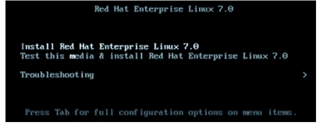

图 1-1 启动菜单

第一个选项“Install Red Hat Enterprise Linux 7.0”用于安装 RHEL7，除非你想使用第二个选项（这也是默认选项），以便在继续之前测试安装介质的完整性。`Anaconda` 安装程序会等待 60 秒供你选择，或者继续并使用默认选项启动。你也可以在高亮第一个或第二个选项后按 `Enter` 键立即启动安装过程。安装将在图形模式下开始。第三个选项“Troubleshooting”（故障排除）如图 1-2 所示，包含了处理启动相关问题的各种选择。

## 故障排除

```
Install Red Hat Enterprise Linux 7.0 in basic graphics mode
Rescue a Red Hat Enterprise Linux system
Run a memory test
Boot from local drive
Return to main menu
```

在菜单项上按 `Tab` 键可完整的配置选项。

如果你在安装 Red Hat Enterprise Linux 7.0 时遇到困难，请尝试此选项。

图 2 启动菜单 / 故障排除子菜单

这些新增允许你使用基础视频驱动程序进行安装（在安装程序无法为安装的显卡加载合适的驱动程序的情况下）、与系统交互以恢复已安装的 RHEL7 副本启动问题、运行内存测试或使用本地磁盘驱动启动。

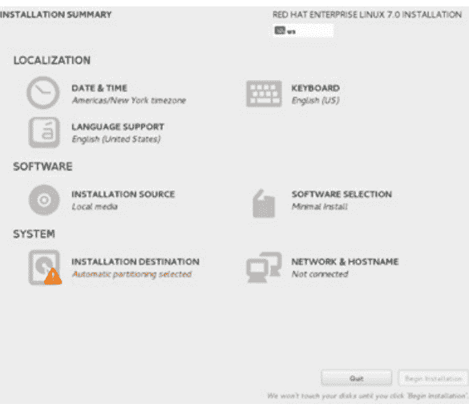

图 1-3 安装摘要

5. 下一个屏幕允许你选择安装期间使用的语言。默认是英语。点击 Continue（继续）。
6. 接下来出现“Installation Summary”（安装摘要）屏幕，如图 1-3（上一页）所示。在这里，你可以在开始安装之前进行所有必要的配置更改。接口配置、分区、基础环境、用户创建、网络身份验证服务、NTP 以及其他主题不会在本次练习中解释；但我们将在本书后的章节中进行详细介绍。（注：此处原文内容似乎与前文重复，已按要求翻译且未漏译，但根据原文逻辑进行翻译）

## 配置日期和时间

7. 点击 Date & Time（日期和时间）设置时区（地区和城市）、日期和时间。所示。接受许可协议并登录系统。此过程可能占用你多达 15 分钟的时间。详细信息请参阅第 05 章节“管理软件包”，并参考其他章节以获取更多图形化操作。

## 添加键盘和语言

8. `Anaconda` 提供了安装后使用的键盘布局和语言选择。如果需要此项，请执行操作。点击左上角的 Done 返回安装摘要。

## 选择安装源

9. 在此处你可以更改安装源。默认情况下，`Anaconda` 选择检测到的源（DVD、USB 闪存盘、ISO 镜像）。如果你有网络访问，选择“On the network”并指定 HTTP、HTTPS、FTP 或 NFS 协议的主机名或 IP 地址。你还可以指定软件库的位置；但对于完整的 RHEL7 安装并非必须。点击 Done 返回安装摘要。


图 1-4 安装摘要 / 日期和时间

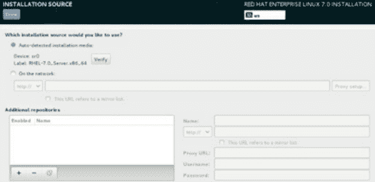

图 1-5 安装摘要 / 安装源

## 选择要安装的软件

10. 在这里你可以选择所需的的基础环境。基础环境是为特定目的设计的软件包组。表 1-2 中列出了简要描述。

| 服务器角色 | 描述 |
|---|---|
| Minimal Install | 安装基础 OS。 |
| Infrastructure Server | 基础加网络服务。 |
| File and Print Server | 基础加文件、打印和存储服务。 |
| Basic Web Server | 基础 Apache Web 服务器。 |
| Virtualization Host | 基础加用于托管虚拟机的虚拟化支持。 |
| Server with GUI | 带图形支持。 |

**表 1-2 软件选择**

在左窗格选择基础环境将显示右侧的可选组件，作为基础环境安装的一部分可用。如图 1-6。

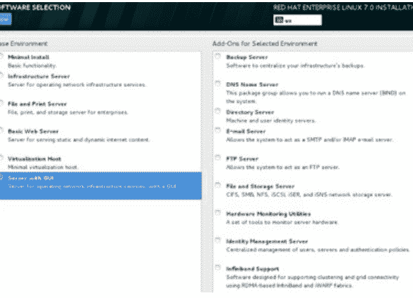

图 1-6 安装摘要 / 软件选择

安装程序会自动选择并安装软件组件，以满足成功安装所选环境的依赖。默认是 Minimal Install。对于本次安装，选择 Server with GUI 而不选择任何额外组件。点击 Done 返回安装摘要页面。

## 安装目标

### 选择设备

选择您想要安装的设备。在您点击菜单项：“开始安装”（Begin Installation）按钮之前，这些设备将保持不变。

#### 本地标准选项

| | |
|---|---|
| 40.96 GB | |
| ATA GENU 硬盘 | |
| sda / 40.96 GB 空闲 | |

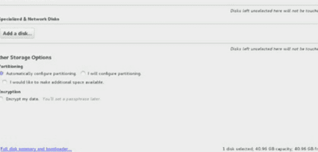

#### 已指定的磁盘和网络磁盘

+ 添加磁盘...

#### 其他存储选项

- 自动分区 / 我将配置分区
- 我想提供额外的可用空间。

#### 加密

- 加密我的数据：是 / 否

已选择 1 个磁盘，容量 40.96 GB，空闲 40.96 GB

图 1-7 安装摘要 / 安装目标

如果您希望在此处选择分区方案，只需点击“完成”（Done）按钮即可允许安装程序使用自动分区。这将创建三个分区：`/boot`、`/` 和 swap，它们共同占据所选磁盘上的全部可用容量。

在演示中，点击“我将配置分区”将显示“其他存储选项”，点击“完成”将进入图 1-8 中的“手动分区”子部分。

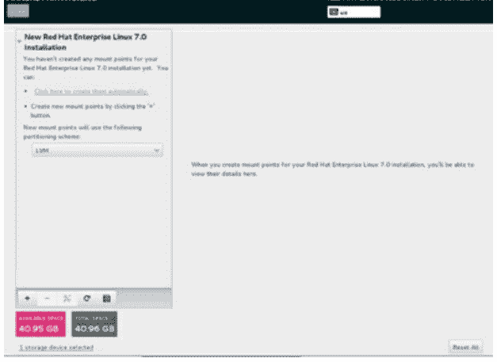

图 1-8 安装摘要 / 安装目标 / 手动分区

- 手动分区子部分允许对所选设备进行分区。它在左下角显示磁盘的总空间和可用空间。“点击此处自动创建它们”的链接显示了如果您选择上一步中讨论的自动分区，安装程序将创建的三个分区。安装程序支持四种分区方案：标准、LVM、BTRFS 和 LVM 精简配置（LVM Thin Provisioning），当您点击 LVM 选项时可见这些方案。这些分区技术在第 09 章“分区和磁盘存储管理”中进行了详细解释。

- 在演示中，根据表 1-3 提供的信息对所选磁盘进行分区。

| 挂载点 | 文件系统 | 预期容量 | LVM 卷组 |
| --- | --- | --- | --- |
| `/boot` | xfs | 0.5GB | 标准分区 |
| `/` | xfs | 10GB | vg00 |
| `/home` | xfs | 1GB | vg00 |
| swap | xfs | 1GB | vg00 |

表 1-3 自定义分区信息

安装程序要求至少创建三个分区：`/boot`、`/` 和 swap。

点击左下角的 `+` 号以添加自定义分区。将弹出以下窗口。


图 1-9 安装摘要 / 安装目标 / 手动分区 / 添加挂载点

14. 选择 `/boot` 作为挂载点，并为第一个分区输入预期容量为 500。点击“添加挂载点”。将显示如图 1-10 所示的新窗口。

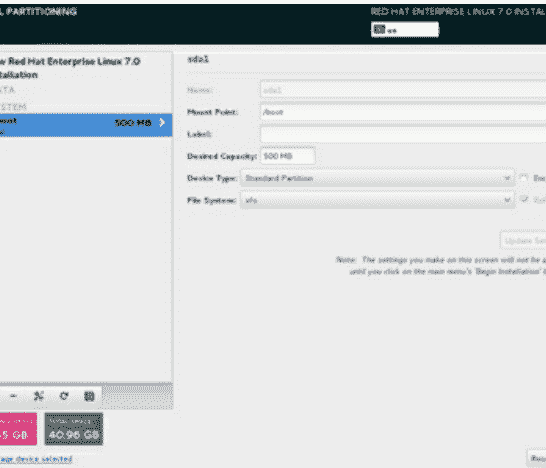

图 1-10 安装摘要 / 安装目标 / 手动分区

`/boot` 文件系统的默认设备和文件系统类型会自动填充。

`/boot` 分区必须在 LVM 边界之外创建为标准分区。

点击 `+` 号并为 `/` 文件系统输入挂载点和大小。点击“添加挂载点”，根系统属性将变得可见。请注意出现了一个名为“卷组”（Volume Group）的新属性，默认值为“rhel”。默认情况下，LVM 建议将“rhel”作为卷组名称并将根文件系统放置在此卷组中。见图 1-11。

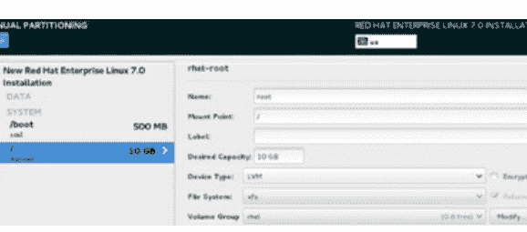

图 1-11 安装摘要 / 安装目标 / 手动分区

点击“修改卷组”（modify Volume Group）并输入 `vg00` 作为新卷组名称。见图 1-12。点击“保存”（Save）继续。

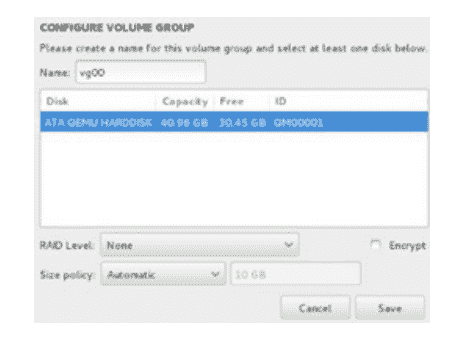

图 1-12 安装摘要 / 安装目标 / 手动分区 / 卷组

更新后的信息反映在主手动分区屏幕上。

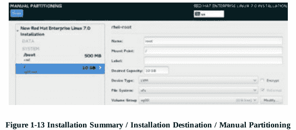

图 1-13 安装摘要 / 安装目标 / 手动分区

对 `/home` 和 swap 分区重复此过程，以确保它们也是 `vg00` 卷组的一部分。最终的分区将像图 1-14 所示。

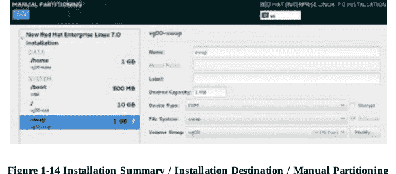

图 1-14 安装摘要 / 安装目标 / 手动分区


- 15. 安装程序按照图 1-15 所示请求确认。点击“接受更改”（Accept Changes）确认分区并返回安装页面。

### 更改摘要

您的自定义设置将在磁盘上生效：

| 顺序 | 操作 | 类型 |
| --- | --- | --- |
| 1 | 创建格式 | 分区 | sda |
| 2 | 创建格式 | 分区 | sda |
| 3 | 创建格式 | 物理 (LVM) | sda |
| 4 | 创建格式 | 逻辑 | vg00 |
| 5 | 创建格式 | swap | vg00 |
| 6 | 创建格式 | 逻辑 | vg00 |
| 10 | 创建格式 | 逻辑 | vg00 |
| 11 | 创建格式 | 逻辑 | vg00 |

图 1-15 安装摘要 / 安装目标 / 手动分区

### 更改摘要

安装程序如图 1-15 所示请求确认。点击接受更改确认分区并返回安装页面。

### 网络和主机名

- 16. 分配 IP 和主机名是必要的。网络和主机页面允许您配置网络设置。您可以在 DHCP 或静态之间选择。如果您选择静态，必须输入 IP 地址、掩码和网关。如果您选择 DHCP，系统将根据网络设置自动分配 IP 地址。

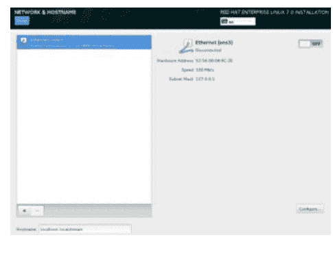

图 1-16 安装摘要 / 安装目标 / 手动分区

### 开始安装

- 17. 安装摘要页面如图 1-18 所示。点击右下角的“开始安装”根据配置开始安装。现在 Anaconda 将对磁盘进行分区并在分区安装软件。之前存储在分区中的数据将被覆盖。在点击“开始安装”按钮之前，您有机会返回并配置任何您需要的项目。

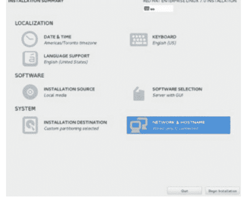

图 1-18 安装摘要

在输入所有必需配置之前，“开始安装”按钮将不可用。

- 18. 安装开始后，会弹出一个窗口。设置 root 密码和创建用户允许您为 root 用户分配密码并创建账户。

- 19. 当安装程序继续后台配置和复制软件时，点击“root 密码”为 root 用户设置密码。点击“完成”返回安装进度屏幕。

- 20. 接下来，点击“用户创建”并创建用户 user1，为其分配您选择的密码。点击“完成”返回。

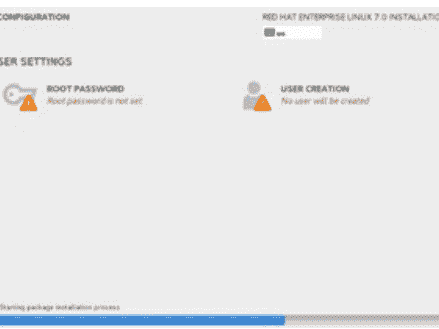

图 1-19 配置

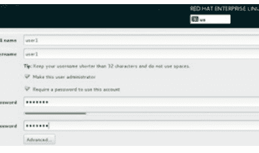

图 1-20 配置 / 创建用户

### 完成安装

- 21. 当所有软件包安装完成后，屏幕右下角的“重启”按钮将变为激活。点击此按钮重启系统。

### 执行安装后任务

- 22. 重启后，系统将启动初始设置应用程序，以便您完成某些安装后配置任务。图 1-22 显示了初始设置屏幕。

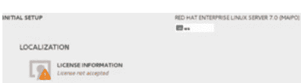

图 1-22 初始化设置

- 23. 在此屏幕上，你必须点击“许可信息”图标并勾选“我接受许可协议”旁边的框来接受协议。点击“完成”（Done），然后点击“完成配置”（Finish Configuration）继续。

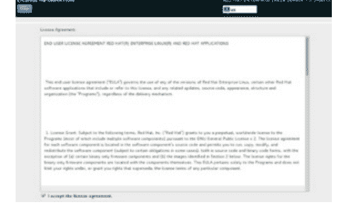

图 1-23 初始化设置 / 许可协议

- 24. 下一个屏幕允许你配置内核转储（kernel crash dump）。此处显示的默认值为 128MB，对于此系统来说足够了。转储可能有助于确定系统崩溃的根源。接受默认值并点击“下一步”（Forward）继续。

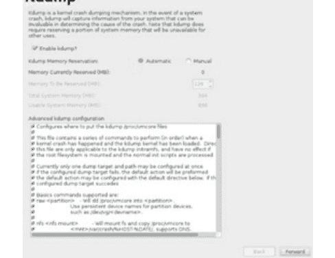

图 1-24 初始化设置 / 内核转储配置

- 25. 如果你有活跃的订阅，你应该向 Red Hat 注册此系统以获得自动软件更新等优势。为了本次演示，请勾选“否，我倾向于稍后注册”并点击“完成”（Finish）继续。

# 订阅管理注册

此助手将引导你完成 Red Hat Enterprise Linux 软件订阅的注册。你需要以下内容进行注册：

- 网络连接
- 订阅管理服务的地址（可选）

我为什么要注册？

你现在是否就注册你的系统吗？（强烈建议）

- 是，现在注册。
- 否，我倾向于稍后注册。


- 26. 下一步是登录屏幕，将显示你之前创建的用户账户。点击用户名并输入密码登录。

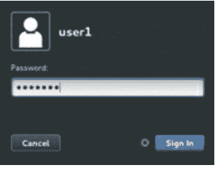

- 27. 登录过程继续，会弹出一个欢迎屏幕，显示你在安装开始时选择的语言。如果你愿意，可以将其更改其他语言。点击“下一步”（Next）继续。

- 28. 在下一个屏幕上，添加要使用的输入源（Input Source）。默认是你之前选择的美国英语键盘类型。点击“下一步”（Next）继续。

- 29. 在“感谢”屏幕上点击“开始使用 Red Hat Enterprise Linux Server”。这标志着配置任务的结束。

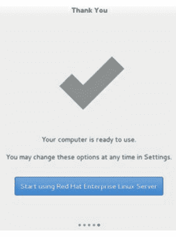

- 30. 默认的图形桌面 GNOME（见图 1-28），你现在应该可以以 user1 的身份开始使用系统。


图 1-28 GNOME 桌面

- 31. 完成导航后，点击右上角的 user1 并选择“注销”（Log Out）退出系统。

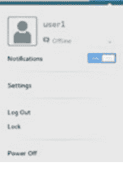

图 1-29 注销

完成了使用本地 DVD 介质安装的逐步步骤。

# 章节总结

在本章中，我们开始了解 Linux 历史，并探索了 Red Hat 提供的发行版。我们查看了各种安装前的项目，以准备顺利安装。我们回顾了构建用于书中练习题和实验的实验室环境所需的条件。我们演示了下载 ISO 镜像，并在物理计算机上执行了基于 DVD 的安装。我们完成了若干安装后任务以完成安装。最后，我们登录新系统以验证安装。

# 章节复习题

- 1. 可以在文本模式下安装 RHEL7 吗？
- 2. 我们有多少个控制台屏幕可以访问安装过程？
- 3. 在 LVM 内部用于构建 RHEL7 的引导分区是什么？对或错？
- 4. RHEL7 的初始版本基于哪个内核版本？
- 5. Red Hat Enterprise Linux 的 100% 构建版本有哪些？
- 6. 安装过程中，在 `/tmp` 目录内创建并更新了几个日志文件。安装完成后，这些文件被移动到了哪里？
- 7. 识别计算机支持 SVM 的两个硬件要求。
- 8. 写出 RHEL 安装程序的名称。
- 9. 如果我们支持 KVM，在安装期间我们会选择哪种服务器角色？对或错？
- 10. RHEL7 在安装期间同时支持自动和自定义分区。如果我们选择自动分区，它会使用标准分区还是 LVM？
- 11. 最小化服务器安装执行 X window 吗？对或错？

# 章节复习题答案

- 1. 是，RHEL7 可以在文本模式下安装。
- 2. 安装过程中共有 6 个控制台屏幕可用。
- 3. `/boot` 必须不能包含在 LVM 内部。
- 4. RHEL7 的初始版本基于内核 3.10。
- 5. Red Hat Linux 的两个 100% 重构版本是 CentOS 和 Scientific Linux。
- 6. 这些文件被移动到了 `/var/log`。
- 7. 计算机支持 SVM 的两个要求。
- 8. RHEL 安装程序名称是 Anaconda。
- 9. 如果我们支持 KVM，在安装期间我们会选择虚拟化角色。错。
- 10. 如果我们选择自动分区，它将使用标准分区。
- 11. 最小化服务器安装不执行 X window。错。

# 挑战

在本章中，我们提供了以下实验，供希望掌握 SSH 的用户使用：

- 实验 1-1：执行默认安装
- 实验 1-2：执行自定义安装

## PuTTY 配置

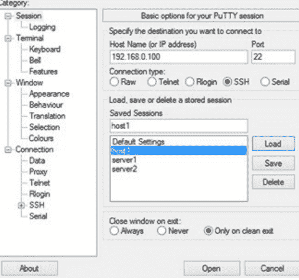

图 2-1 putty 界面

输入 host1 的 IP 地址并选择 SSH 旁边的单选按钮，协议使用端口 22，这显示在 Port 字段中。在 Saved Sessions 字段中为此话分配一个名称（通常是主机名），并点击 Save 存储这些信息，以免以后重新输入。现在点击 Open 尝试连接。

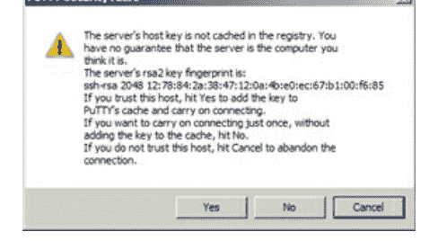

图 2-2 puTTY 安全警报

在安全警报中点击 yes 以获取登录提示。此警报在随后的尝试中不会再次出现。输入有效的用户名和密码登录。

## 常用 Linux 命令

RHEL 中提供了数百可用命令。这些命令从简单到复杂不等。其中一些命令提供几个选项，另一些则有 70 个或更多选项，我们可以使用它们来生成所需的输出。本节提供了对命令如何形成的理解，并演示了例行系统管理中常用的命令。

## 理解命令语法

为了练习本章中的命令，你可以以 user1 身份登录，运行命令并观察它们的输出。特别是如果你想建立自己的系统管理技能，你从一开始就需要习惯于以 root 身份工作。反正 host1 是你的测试系统，不用担心弄坏某些东西。

在控制台或使用 ssh 以 root 身份登录。同时，你还应该打开一个 user1 的窗口。命令的基本语法是：

`command option argument`

在执行时，你可以指定零或多个参数，且你不必指定它们。其他命令默认需要一个选项或参数才能工作。例如，`option` 是一个开关或标记，会修改命令的行为，下面的示例显示了某些命令结构，右侧文本表示所提供的选项和参数数量：

```
$ ls
```

```
$ ls -l
(一个选项，无参数；默认是当前目录)
$ ls directory_name
(无选项，一个参数)
$ ls -l directory_name
(一个选项，无参数；默认是当前目录)
```

考试提示：如果需要，请使用有关命令用法的可用在线帮助。

## 列出文件和目录

`ls` (list) 命令列出文件和目录列表并显示在屏幕上。它支持多个选项，其中一些列在表 2-1 中带有简短说明。

| 选项 | 说明 |
|---|---|
| -a | 列出隐藏文件。此外，如果文件或目录名称以点开头，则被视为隐藏的。 |
| -lh | 以人类易读的格式显示详细信息及文件大小。 |
| -l | 显示详细信息，包括文件类型、权限、链接数、所有者、组、大小、最后修改日期以及文件名。 |
| -ld | 显示指定目录的列表，但隐藏内容。 |
| -R | 列出指定目录及其所有子目录的内容（递归）。 |
| -lt | 按日期排序所有文件，并将最新的排在前面。 |
| -tr | 按日期排序所有文件，并将最旧的排在前面。 |

表 2-1：ls 选项

以下示例将帮助你理解用于 `ls` 命令的选项的影响。以 root 身份登录以运行这些示例：

假设你在 `/directory` 中，列出当前目录下的文件：

```
$ ls
bin dev home lib64 mint proc srv var
boot etc media opt root sbin usr
```

使用详细信息列出当前目录下的文件，请使用以下之一：

```
$ ls -l
total 32
drwxr-xr-x. 1 root root 7 Nov 16 19:12 bin /usr/bin
drwxr-xr-x. 3 root 4096 Nov 16 20:53 boot
drwxr-xr-x. 20 root 3120 Nov 19 19:27 now
drwxr-xr-x. 132 root 8192 Nov 20 08:12 cite
drwxr-xr-x. 3 root 4097 18 Nov 20:11 home
drwxr-xr-x. 14 root 4096 Nov 25 03:31 tmp
drwxr-xr-x. 39 root 1220 Nov 24 13:11 run
drwxr-xr-x. 132 root 8192 Nov 20 08:12 etc
dr-xr------ 7 root----
drwxr-xr-x. 20 root 3120 Nov 19 17:11 mnt
```

```
$ ls -lt
total 32
drwxr-xr-x. 14 root 4096 Nov 25 03:31 tmp
drwxr-xr-x. 39 root 1220 Nov 24 13:11 run
drwxr-xr-x. 132 root 8192 Nov 20 08:12 etc
dr-xr------ 7 root----
drwxr-xr-x. 20 root 3120 Nov 19 17:11 mnt
```

以人类易读的格式显示当前目录中的所有文件：

```
$ ls -lh
total 32K
lrwx-xr-x. 1 root root 4K Nov 16 19:12 bin->/usr/bin
drwxr-xr-x. 3 root 4.0K Nov 16 20:53 boot
drwxr-xr-x. 20 root 3.1K Nov 19 19:27 now
drwxr-xr-x. 132 root 8.0K Nov 20 08:12 cite
drwxr-xr-x. 3 root 4.0K Nov 20:11 home
drwxr-xr-x. 14 root 4.0K Nov 25 03:31 tmp
drwxr-xr-x. 39 root 1.2K Nov 24 13:11 run
drwxr-xr-x. 132 root 8.0K Nov 20 08:12 etc
dr-xr------ 7 root----
drwxr-xr-x. 20 root 3.1K Nov 19 17:11 mnt
```

以详细信息列出当前目录（包括隐藏文件）：

```
# ls -la
total 40
drwxr-xr-x. 1 root root 7 Nov 16 19:12 bin
drwxr-xr-x. 3 root 4096  16 20:53 
drwxr-xr-x. 20 root 3120  19 19:27 now
drwxr-xr-x. 132 root 81921 20 08:12 cite
drwxr-xr-x. 3 root 4097 18  20:11 home
drwxr-xr-x. 14 root 4096  25 03:31 tmp
drwxr-xr-x. 39 root 12202 24 13:11 run
drwxr-xr-x. 132 root 8192  20 08:122
dr-xr------ 7 root----
drwxr-xr-x. 20 root 3120 19 17:11 mnt
```

递归列出 `/etc` 目录：

```
# ls -R /etc
a very lengthy output will be generated
```

## 显示工作目录

`pwd` (print directory) 命令显示用户在目录树中的位置。以下示例显示 user1 当前位于 `/home/user1` 目录中。以 user1 身份运行它：

```
$ pwd
/home/user1
```

## 切换目录

`cd` (change directory) 命令用于在目录树中导航。以 user1 身份运行以下命令：

```
$ pwd
/home/user1
```

显示 user1 当前位于 `/home/user1`。以 user1 身份运行它：

```
$ pwd
/home/user1
```

## 查看用户名

`whoami` (who am i) 命令显示执行此命令的有效用户名：

```
# whoami
user
```

`logname` (登录名) 命令显示最初登录到系统的真实用户的名称。如果该用户使用 `su` 命令切换身份，`logname` 命令与 `whoami` 命令不同，仍然显示真实的用户名。

```
$ logname
root
```

## 检查用户和组信息

`id` (标识符) 命令显示用户的 UID（用户标识符）、用户名、GID（组标识符）、组名、用户所属的所有次要组以及 SELinux 安全上下文：

```
$ id
uid=1000(user) gid=1000(user) groups=1000(wheel) context=unconfined_u:unconfined_r:unconfined_t:s0:c0.c1023
```

每个用户和组都有一个对应的数值（称为 UID 和 GID）用于标识。更多信息请参阅第 08 章“管理用户和组”。有关 SELinux，请查看第 11 章“通过防火墙和 SELinux 控制访问”。

`groups` 命令列出用户所属的所有组：

```
$ groups
user:wheel
```

第一个组是执行此命令的用户的主组；其他都是次要（补充）组。更多细节请参阅第 08 章“管理用户和组”。

## 查看用户成功登录尝试的历史

`last` 命令通过读取 `/var/log/wtmp` 来报告成功登录尝试和系统重启的历史。该文件记录了所有的登录和注销活动，包括登录时间、用户停留时长以及所在地（用户会话发生的地方）。参考以下示例。

要列出所有登录和系统重启记录，在不带任何参数的情况下输入 `last` 命令：

```
$ last
```


```
user pts/2      192.168.0.13      Sat Nov 22 09:25 - 09:25 (00:00)
user pts/2      192.168.0.13      Sat Nov 22 09:12 - 09:12 (00:00)
root pts0        192.168.0.13      Sat Nov 22 08:14      still logged in
root pts/2      192.168.0.13      Fri Nov 21 21:43 - 21:43 (00:00)
reboot system 3.10.0-del137.x   Mon Nov 17 14:22 - 14:44 (+20:21)
reboot system 3.10.0-del137.x   Mon Nov 17 11:00 - 14:22 (03:21)
reboot system 3.10.0-del137.x   Sun Nov 16 20:52 - 11:00 (14:08)
wmp begins system  Sun Nov 16 20:12 2014
```

要列出系统重启详情：

# `$ reboot`

```
reboot system 3.10.0-del137.x   Mon Nov 17 14:22 - 10:44 (+20:21)
reboot system 3.10.0-del137.x   Mon Nov 17 11:00 - 14:22 (03:21)
reboot system 3.10.0-del137.x   Sun Nov 16 20:52 - 11:00 (14:08)
```

## 查看用户登录尝试的历史

`lastb` 命令通过读取 `/var/log/wtmp` 来报告用户失败登录尝试的历史。该文件记录了所有失败的登录尝试，包括用户名、时间和 tty（尝试发生的地方）。参考以下示例。

要列出所有失败的登录尝试，在不带任何参数的情况下输入 `lastb` 命令。你必须以 root 身份运行此命令。

# `$ lastb`

```
root ssh:notify 192.168.0.13  Tue 25 10:49 - 10:49 (00:00)
tmp begins             Tue 25 10:49:41 2014
```

## 显示用户日志

`lastb` 命令通过读取 `/var/log/lastlog` 文件显示最近的用户登录情况。该文件跟踪了最近的用户登录记录。它还会显示谁从未登录过。

```bash
# lastb
Username    Port            Latest
root        pts/0           192.168.0.13  Sat Nov 22 08:14:24 -0500 2014
daemon                               
```

## 显示主机名

`hostname` 命令显示当前的主机名。

```bash
# hostname
localhost
```

Bus 001 Device 003: ID 8b1ef2d0 Snovus Innovation Technology Inc.

Bus 002 Device 003: ID 0a5c5800 Broadcom Corp. MCM58B0 Secure Applications Processor

`lspci` 命令显示处理器的信息，包括其架构、运行模式、数量、厂商、型号、速度以及虚拟化支持情况：

## lspci

| 架构 | x86_64 |
|---|---|
| CPU(op-model) | 32-bit, 64-bit |
| 字节序 | 小端序 |
| CPU(s) | 8 |
| Dns-line | 0-7 |
| 每个核心线程数 | 2 |
| 每个插槽核心数 | 4 |
| 插槽 | 1 |
| NUMA 节点 | 1 |
| 厂商 ID | 通用 |
| CPU 族 | 6 |
| 型号 | 42 |
| 型号名称 | Intel(R) Core(TM) i7-2560QM CPU @ 2.40GHz |
| 跳步 | 7 |
| CPU MHz | 2901.187 |
| Bgs/MHz | 4799.14 |
| 虚拟化 | VT-d |
| L1 缓存 | 32K |
| L2 缓存 | 32K |
| L3 缓存 | 256K |
| NUMA节点0 CPU(s) | 0-7 |

## 压缩工具

压缩工具用于压缩一个或多个文件或存档以节省空间。一旦创建了压缩存档，就可以用来从非压缩存档恢复远程系统。压缩工具可以与 `tar` 等存档命令配合，创建一个数百个文件和目录的单个压缩存档。RHEL 提供了许多压缩工具，例如 `bzip2` (bunzip2) 和 `gzip` (gunzip)，可用于此类目的。

## 使用 gzip 和 gunzip

`gzip` 命令为命令行指定的每个文件创建一个压缩文件，并为每个文件添加 .gz 扩展名。

要压缩 `/root` 目录下的 `anaconda-ks.cfg` 和 `initial-setup-ks.cfg` 文件，执行以下 `gzip` 命令，然后列出它们：

```bash
# gzip /root/anaconda-ks.cfg /root/initial-setup-ks.cfg
# ls -l | grep gzip
-rw-r---- 1 root 979 Oct 28 23:04 anaconda-ks.cfg.gz
-rw-r--r-- 1 root 1011 Oct 28 23:11 initial-setup-ks.cfg.gz
```

要解压文件，请对每个文件运行以下命令之一：

```bash
# gunzip /root/anaconda-ks.cfg.gz
# gzip -d /root/initial-setup-ks.cfg.gz
```

使用 `ll` 命令检查解压后的文件。

## 使用 bzip2 和 bunzip2

`bzip2` 命令为命令行指定的每个文件创建一个压缩文件，并为每个文件添加 .bz 扩展名。

要压缩 `/root` 目录下的 `anaconda-ks.cfg` 和 `initial-setup-ks.cfg` 文件，执行 `bzip2` 命令，然后列出它们：

```bash
# bzip2 /root/anaconda-ks.cfg /root/initial-setup-ks.cfg
# ll /root | grep bz
-rw-r--r-- 1 root 1086 Oct 28 23:04 anaconda-ks.cfg.bz2
-rw-r---- 1 root 1111 Oct 28 23:11 initial-setup-ks.cfg.bz2
```

要解压文件，请对每个文件运行以下命令之一：

- `bzip2 /root/anaconda-ks.cfg.bz2`
- `bzip2 -d /root/initial-setup-ks.cfg.bz2`

使用 `ll` 命令检查解压后的文件。

## 存档工具

RHEL 拥有许多可以用于存储或分发文件存档的工具。这些工具包括 `tar` 和 `star`，它们都具有保留文件属性（如所有者、组成员和时间戳）的能力。以下子节将详细讨论这些工具。

## 使用 tar

`tar`（磁带存档）命令在单个文件中创建、追加、更新、列表和提取文件，该文件被称为 tar 文件（也称为 tarball）。此命令具有存档 SELinux 文件上下文以及设置在文件上的扩展属性的能力。它还可以被指示在创建时压缩存档。

`tar` 支持多个选项，如表 2-3 所示。

| 开关 | 定义 |
| --- | --- |
| -c | 创建 tarball。 |
| -f | 指定 tarball 名称。 |
| -j | 使用 `bzip2` 命令压缩 tarball。 |
| -a | 将文件追加到现有 tarball 的末尾。不追加到压缩包中。 |
| -t | 列出 tarball 的内容。 |
| -u | 如果指定的文件不是新的，则追加到现有 tarball 的末尾。不追加到压缩包中。 |
| -v | 详细模式。 |
| -x | 从 tarball 中提取。 |
| -z | 使用 `gzip` 命令压缩 tarball。 |
| --selinux --no-selinux | 排除 SELinux 上下文。 |
| --xattr --no-xattr | 排除扩展属性。 |

表 2-3 Tar 命令选项

下面提供了一些示例以阐明 `tar` 的用法。注意 `-` 字符是可选的。创建一个整个 `/home` 目录的 tarball：

```bash
tar cvf /tmp/home.tar /home
```

创建一个包含 `/etc` 目录多个文件的 tarball：

```bash
tar cvf /tmp/files.tar /etc
```

将位于 `/etc/yum.repos` 目录的文件追加到 home.tar：

```bash
tar rvf /tmp/home.tar /etc/yum.repos
```

列出 home.tar 的内容：

```bash
tar tvf /tmp/home.tar

drwx-xr-x root 2014-10-28 23:04 home/
drwx-xr-x user user1 2014-11-25 10:42 home/user/
drwx-xr-x user user1 2014-10-29 19:19 home/user/.mozilla/

drwx-xr-x user user1 2014-11-25 10:42 home/user1/dir/
drwx-xr-x root root 2014-10-29 08:23 etcyum.repos/
d-rw-r--r-- root root 2013-10-29 08:04 etcyum.repos/ftp.repo
```

列出 files.tar 的内容：

```bash
# tar tvf /tmp/files.tar
-rw-r--r-- root root 2013-10-29 08:04 etcyum.repos/host.conf
-rw-r--r-- root root 2013-10-29 08:04 etcyum.repos/passwd
-rw-r--r-- root root 2013-10-29 08:04 etcyum.repos/yum.conf
```

解压文件：

```bash
# tar xvf /tmp/home.tar
# tar xvf /tmp/files.tar
```

## 在 vi 中导航

表 2-6 解释了控制 vi 中光标移动的关键序列。

| 命令 | 动作 |
| --- | --- |
| h / left / Ctrl+h | 向左（向后）移动一个字符：我们可以在此命令前输入一个数字以移动多个字符。例如，`2h` 会向左移动两个字符。 |
| j / down | 向下移动一行。我们可以在命令前输入一个数字以向下移动多行。例如，`2j` 会向下移动两行。 |
| k / up arrow | 向上移动一行。我们可以在命令前输入一个数字以向上移动相应行数。例如，`2k` 会向上移动两行。 |
| l / right arrow / Spacebar | 向右（向前）移动一个字符：我们可以在命令前输入一个数字以移动相应字符数。例如，`2l` 会向右移动两个字符。 |
| w | 向前移动一个单词。 |
| b | 向后移动一个单词。 |
| e | 向前到下一个单词的最后一个字符。 |
| $ | 移动到当前行的末尾。 |
| Enter | 移动到当前行的开头。 |
| Ctrl+f / Page Down | 向前（向下滚动）到下一页。 |
| Ctrl+b / Page Up | 向后（向上滚动）到上一页。 |
| G | 移动到文件的最后一行。 |
| g | 移动到文件的第一行。 |

表 2-6 在 vi 中导航

## 删除文本

表 2-7 中列出的命令在命令模式下执行删除操作。

| 命令 | 动作 |
| --- | --- |
| x | 删除当前光标位置的字符。我们可以在命令前输入一个数字以删除相应数量的字符。例如，`2x` 会删除两个字符。 |
| X | 删除当前光标位置之前的字符。我们可以在命令前输入一个数字以删除相应数量的字符。例如，`2X` 会删除两个字符。 |
| dw | 删除当前光标位置或右侧的单词。我们可以在命令前输入一个数字以删除相应数量的单词。例如，`2dw` 会删除两个单词。 |
| dd | 删除当前行。我们可以在命令前输入一个数字以删除相应行数。例如，`2dd` 会删除两行（当前行加下一行）。 |
| D | 删除当前光标位置到当前行末尾的内容。 |
| :6,12d | 删除第 6 到 12 行。 |

表 2-7 删除文本

## 撤销与重复

表 2-8 解释了撤销上次更改和重复上一次执行命令的命令。

| 命令 | 动作 |
| --- | --- |
| u | 撤销上次更改。 |
| U | 撤销当前行的所有更改。 |
| u | 撤销上一个行模式命令。 |
| . | 重复上一次执行的命令。 |
| Ctrl+r | 重复上一次撤销命令。 |

表 2-8 撤销与重复

## 搜索与替换文本

搜索和替换文本的功能通过表 2-9 中提到的命令完成。

| 命令 | 动作 |
|---|---|
| /string | 向前搜索字符串 |
| ?string | 向后搜索字符串 |
| n | 找到字符串的下一次出现。如果没有进行正向或反向字符串搜索，此操作才有效 |
| N | 找到字符串的上一次出现。如果没有进行正向或反向字符串搜索，此操作才有效 |
| :%s/old/new | 搜索并替换 old 的第一次出现。例如，要替换 Profile 的第一次出现，我们使用 `:%s/profile/Profile` |
| :%s/old/new/g | 搜索并替换 old 的所有出现。例如，要替换所有 Profile file 的出现，我们使用 `:%s/profile/Profiling/g` |

表 2-9 搜索与替换文本

## 复制、移动与粘贴

表 2-10 描述了执行复制、移动和粘贴功能的命令。

| 命令 | 动作 |
|---|---|
| y | 将字符复制（yank）到缓冲区。我们可以在命令前输入一个数字以复制相应数量的字母。例如，`2y` 会复制两个字符 |
| yw | 将单词复制（yank）到缓冲区。我们可以在命令前输入一个数字以复制相应数量的单词。例如，`2yw` 会复制两个单词 |
| yy | 将行复制（yank）到缓冲区。我们可以在命令前输入一个数字以复制相应行数。例如，`2yy` 会复制三行 |
| p | 在当前行下方粘贴内容 |
| P | 在当前行上方粘贴内容 |
| :1,3co5 | 复制第 1 到 3 行并将它们粘贴在第 5 行之后 |
| :4,6m8 | 将第 4 到 6 行移动到第 8 行之后 |

表 2-10 复制、移动与粘贴

## 修改文本

使用表 2-11 中的命令来更改文本。其中一些命令会将你切换到编辑模式。要返回命令模式，请按 Esc 键。

| 命令 | 动作 |
|---|---|
| c | 修改当前光标位置的字符 |
| cw | 修改当前光标位置的单词（或单词的一部分）到当前行末尾 |
| C | 修改当前光标位置到当前行末尾的文本 |
| r | 替换光标处的字符 |
| R | 修改从光标到行末尾的文本 |
| J | 移动到下方一行 |
| x | 删除光标位置的字符 |
| ~ | 在文本的大写和小写之间切换 |

表 2-11 修改文本

## 保存与退出

完成修改后，你希望保存或丢弃它们。表 2-12 中的命令提供了帮助。

| 命令 | 动作 |
|---|---|
| :w | 保存文件 |
| :q | 退出 vi |
| :wq | 保存文件并退出 vi |
| :q! | 不保存更改退出 vi |

表 2-12 保存与退出

## 在线帮助

在系统上，你可能需要命令、用法和选项的帮助。手册页帮助。

> 考试提示：如果你需要命令或配置文件的帮助，请尽管使用手册页。

## man

使用 `man` 查看命令的帮助。以下是查看 passwd 手页的示例：

```
# man passwd
PASSWD(1) User utilities PASSWD(1)
NAME
passwd - update user's authentication
SYNOPSIS
passwd [-k] [-i] [-u] [-d] [-e] [-n maxdays]
[-w wann] [-i inactdays] [-S] [-stdin] [username]
DESCRIPTION
The passwd utility 用于更新用户的身份验证令牌。
```

手册页 passwd(1) 第 1 行

## man 章节

手册页有多个章节。例如，章节 1 指用户命令，章节 4 包含特殊文件，章节 5 描述系统配置文件，章节 8 包含系统管理命令，以此此类推。

要搜索 `/etc/passwd` 文件，请执行以下操作：

# `$ man 5 passwd`

```
Linux 程序员手册
PASSWD(5)
PASSWD(5)
名称
passwd - 密码文件
描述
/passwd 文件是一个描述系统用户登录账户的文本文件。它应该允许所有用户读取权限（许多工具，如 ls(1)，使用它将用户 ID 映射到用户名），但只有超级用户具有写访问。
passwd(5) 手册页第 1 行（按 h 帮助或按 q 退出）
```

## 通过关键字搜索

有时我们需要使用某个命令但不知道它的名称。Linux 允许使用 `man` 命令配合 `-k` 选项或 `apropos` 命令对已安装的手册页进行关键字搜索。该命令在手册页名称和描述中搜索关键字。例如，如果我们想搜索“password”，可以运行以下任一命令：


# 使用 `apropos` 搜索命令

```
# apropos password
chage (1) - 更改用户过期信息
chpasswd (8) - 批量模式更新密码
ckpasswd (8) - 使用 /etc/lib.words 检查密码
```

一旦确定了要找的命令，我们可以检查该命令的 man 页以查看用法，或者使用命令指定 `--help` 或 `-?` 选项。例如，要获取 `passwd` 命令的帮助，请运行以下任一命令：

```
# passwd --help
# passwd -?
```

## `passwd` 命令用法

```
用法：passwd [OPTION..] <accountName>

-k, --keep-tokens  保留已过期的身份验证令牌（仅限 root）
-d, --delete       删除指定账户的密码（仅限 root）
-l, --lock         锁定指定账户的密码（仅限 root）
-u, --unlock       解锁指定账户的密码（仅限 root）

帮助选项：
-h, --help         显示此帮助信息
--usage            显示简要用法消息
```

## 更新 man 数据库

存储所有信息的数据库需要使用 `mandb` 工具进行构建：

```
# mandb
正在清理 /usr/share/man 中的旧数据库条...
mandb 更新中: /usr/share/man/man/man.a.8.man-page.gz: 忽略错误的 $filename
正在处理 /usr/share/man/ 下的手册页
正在清理 /usr/share/man/... 中的旧数据库条...
```

```
0 个子目录包含新的手册页。
0 个手册页已添加。
0 条目已添加。
0 条旧数据库条已清理。
```

在向系统添加软件包后，你应该运行此命令以确保 man 数据库已更新新信息。

## 显示短描述

`whatis` 命令提供了一种快速方法，在手册数据库中搜索指定命令或文件的简短描述。例如，以下显示了在 `yum.conf` 和 `passwd` 文件上运行命令的输出：

```
# whatis yum.conf
yum.conf (8) - yum(8) 的配置文件
# whatis passwd
passwd (1) - 更新用户的身份验证令牌
passwd (3) - 计算密码哈希
passwd (5) - 密码文件
```

第一个输出表示指定的文件是与 `yum` 命令相关的配置文件，第二个输出指向了 `passwd` 文件的三个条目（两个命令和一个密码文件）。

我们也可以通过使用 `-f` 选项运行 `man` 命令来获得相同的结果：

```
# man -f yum.conf
# man -f passwd
```

## `info` 命令

`info` 命令作为 `info` 软件包的一部分可用，允许用户阅读由 GNU 项目提供的命令文档。它提供了比 `man` 命令更详细的信息。文档分为章节节点。头部位于屏幕顶部，显示正在显示的文件名称、当前、下一个和上一个节点的名称，以及指向当前节点的节点名称。以下示例显示了执行此命令时显示的第一个屏幕：

```
# info passwd
File: *manpages*, Node: passwd, Up: (dir)
PASSWD(1) PASSWD(1)
NAME
passwd - 更新用户的身份验证令牌
SYNOPSIS
passwd [-k] [-l] [-u] [-f] [-d] [-e] [-n mindays] [-x maxdays] [-w ways] [-i inactivities] [-S] [-stdin] [username]
DESCRIPTION
passwd 工具用于更新用户的身份验证令牌。
```

--Info: (*manpages*)passwd, 358 行 --Top----

欢迎使用 Info 5.1 版本。在菜单项中输入 h 获取帮助。

在用 `info` 命令查看内容时，下表中列出的常用键将帮助你高效导航。

| 键位 | 动作 |
| :--- | :--- |
| 下方向箭头 | 向前移动一行。 |
| 上方向箭头 | 向后移动一行。 |
| 空格键 | 向前移动一页。 |
| Del | 向后移动一页。 |
| q | 退出 info。 |
| [ | 转到文档中的上一个节点。 |
| ] | 转到文档中的下一个节点。 |
| t | 转到此文档的顶部节点。 |
| s | 搜索指定的字符串。 |
| { | 搜索字符串的上一个出现位置。 |
| } | 搜索字符串的下一个出现位置。 |

表 2-14 在 info 文档中导航

打开某个命令的 info 并使用表 2-14 描述的键进行练习。

## `/usr/share/doc` 目录下的文档

`/usr/share/doc` 存储所有安装软件包的文档，存储在与名称后跟 `-<version>` 的子目录下。例如，`gzip` 软件包的条目如下：

```
# ll -d /usr/share/doc/gzip/
drwx-xr-x 2 root root 4096 5月 12 /usr/share/doc/gzip/
drwx-xr-x 2 root root 4096 5月 12 /usr/share/doc/gzip/changelog
drwx-xr-x 2 root root 4096 5月 12 /usr/share/doc/gzip/doc
drwx-xr-x 2 root root 4096 5月 12 /usr/share/doc/gzip/html
drwx-xr-x 2 root root 4096 5月 12 /usr/share/doc/gzip/info
drwx-xr-x 2 root root 4096 5月 12 /usr/share/doc/gzip/man
drwx-xr-x 2 root root 4096 5月 12 /usr/share/doc/gzip/md
drwx-xr-x 2 root root 4096 5月 12 /usr/share/doc/gzip/patch
drwx-xr-x 2 root root 4096 5月 12 /usr/share/doc/gzip/README
drwx-xr-x 2 root root 4096 5月 12 /usr/share/doc/gzip/src
drwx-xr-x 2 root root 4096 5月 12 /usr/share/doc/gzip/test
drwx-xr-x 2 root root 4096 5月 12 /usr/share/doc/gzip/usage
drwx-xr-x 2 root root 4096 5月 12 /usr/share/doc/gzip/examples
drwx-xr-x 2 root root 4096 5月 12 /usr/share/doc/gzip/copyright
-rw-r--r-- 1 root root 120 5月 12 AUTHORS
-rw-r--r-- 1 root root 45 5月 12 CHANGELOG.gz
-rw-r--r-- 1 root root 80 5月 12 LICENSE.gz
-rw-r--r-- 1 root root 30 5月 12 NEWS.gz
-rw-r--r-- 1 root root 150 5月 12 README.gz
-rw-r--r-- 1 root root 200 5月 12 TODO.gz
-rw-r--r-- 1 root root 50 5月 12 THANKS.gz
```


# 文档查看与管理

## 更新 man 数据库

在向系统添加软件包后，你应该运行 `mandb` 命令以确保 man 数据库已更新新信息。

## 显示短描述

`whatis` 命令提供了一种快速方法，在手册数据库中搜索指定命令或文件的简短描述。例如，以下显示了在 `yum.conf` 和 `passwd` 文件上运行命令的输出：

```
# whatis yum.conf
yum.conf (8) - yum(8) 的配置文件
# whatis passwd
passwd (1) - 更新用户的身份验证令牌
passwd (1ssl) - 计算密码哈希
passwd (5) - 密码文件
```

第一个输出表示指定的文件是与 `yum` 命令相关的配置文件，第二个输出指向了 `passwd` 文件的三个条目（两个命令和一个密码文件）。

我们也可以通过使用 `-f` 选项运行 `man` 命令来获得相同的结果：

```
# man -f yum.conf
# man -f passwd
```

## info 命令

`info` 命令作为 `info` 软件包的一部分，允许用户阅读由 GNU 项目提供的命令文档。它提供了比 `man` 命令更详细的信息。文档分为章节节点。头部位于屏幕顶部，显示正在显示的文件名称、当前、下一个和上一个节点的名称，以及指向当前节点的节点名称。以下示例显示了执行此命令时显示的第一个屏幕：

```
# info passwd
File: *manpages*, Node: passwd, Up: (dir)
PASSWD(1) PASSWD(1)
NAME
passwd - 更新用户的身份验证令牌
SYNOPSIS
passwd [-k] [-l] [-u] [-f] [-d] [-e] [-n mindays] [-x maxdays] [-w ways] [-i inactivities] [-S] [-stdin] [username]
DESCRIPTION
passwd 工具用于更新用户的身份验证令牌。
```

--Info: (*manpages*)passwd, 358 行 --Top----

欢迎使用 Info 5.1 版本。在菜单项中输入 h 获取帮助。

在使用 `info` 命令查看内容时，表 1 中列出的常用键将帮助你高效导航。

| 键位 | 动作 |
| :--- | :--- |
| 下方向箭头 | 向前移动一行。 |
| 上方向箭头 | 向后移动一行。 |
| 空格键 | 向前移动一页。 |
| Del / Backspace | 向后移动一页。 |
| q | 退出 info。 |
| [ | 转到文档中的上一个节点。 |
| ] | 转到文档中的下一个节点。 |
| t | 转到此文档的顶部节点。 |
| s | 搜索指定的字符串。 |
| { | 搜索字符串的上一个出现位置。 |
| } | 搜索字符串的下一个出现位置。 |

表 1 在 info 文档中导航

打开某个命令的 info 并使用上表描述的键进行练习。

## /usr/share/doc 目录下的文档

`/usr/share/doc` 存储所有安装软件包的文档，存储在以名称后跟 `-<version>` 格式命名的子目录下。例如，`gzip` 软件包的条目如下：

```
# ll -d /usr/share/doc/gzip/
drwxr-xr-x 2 root root 4096 5月 12 /usr/share/doc/gzip/
drwxr-xr-x 2 root root 4096 5月 12 /usr/share/doc/gzip/changelog
drwxr-xr-x 2 root root 4096 5月 12 /usr/share/doc/gzip/doc
drwxr-xr-x 2 root root 4096 5月 12 /usr/share/doc/gzip/html
drwxr-xr-x 2 root root 4096 5月 12 /usr/share/doc/gzip/info
drwxr-xr-x 2 root root 4096 5月 12 /usr/share/doc/gzip/man
drwxr-xr-x 2 root root 4096 5月 12 /usr/share/doc/gzip/md
drwxr-xr-x 2 root root 4096 5月 12 /usr/share/doc/gzip/patch
drwxr-xr-x 2 root root 4096 5月 12 /usr/share/doc/gzip/README
drwxr-xr-x 2 root root 4096 5月 12 /usr/share/doc/gzip/src
drwxr-xr-x 2 root root 4096 5月 12 /usr/share/doc/gzip/test
drwxr-xr-x 2 root root 4096 5月 12 /usr/share/doc/gzip/usage
drwxr-xr-x 2 root root 4096 5月 12 /usr/share/doc/gzip/examples
drwxr-xr-x 2 root root 4096 5月 12 /usr/share/doc/gzip/copyright
-rw-r--r-- 1 root root 120 5月 12 AUTHORS
-rw-r--r-- 1 root root 45 5月 12 CHANGELOG.gz
-rw-r--r-- 1 root root 80 5月 12 LICENSE.gz
-rw-r--r-- 1 root root 30 5月 12 NEWS.gz
-rw-r--r-- 1 root root 150 5月 12 README.gz
-rw-r--r-- 1 root root 200 5月 12 TODO.gz
-rw-r--r-- 1 root root 50 5月 12 THANKS.gz
```


# 文档查看与管理

## 更新 man 数据库

在向系统添加软件包后，你应该运行 `mandb` 命令以确保 man 数据库已更新新信息。

## 显示短描述

`whatis` 命令提供了一种快速方法，在手册数据库中搜索指定命令或文件的简短描述。例如，以下显示了在 `yum.conf` 和 `passwd` 文件上运行命令的输出：

```
# whatis yum.conf
yum.conf (8) - yum(8) 的配置文件
# whatis passwd
passwd (1) - 更新用户的身份验证令牌
passwd (1ssl) - 计算密码哈希
passwd (5) - 密码文件
```

第一个输出表示指定的文件是与 `yum` 命令相关的配置文件，第二个输出指向了 `passwd` 文件的三个条目（两个命令和一个密码文件）。

我们也可以通过使用 `-f` 选项运行 `man` 命令来获得相同的结果：

```
# man -f yum.conf
# man -f passwd
```

## info 命令

`info` 命令作为 `info` 软件包的一部分，允许用户阅读由 GNU 项目提供的命令文档。它提供了比 `man` 命令更详细的信息。文档分为章节节点。头部位于屏幕顶部，显示正在显示的文件名称、当前、下一个和上一个节点的名称，以及指向当前节点的节点名称。以下示例显示了执行此命令时显示的第一个屏幕：

```
# info passwd
File: *manpages*, Node: passwd, Up: (dir)
PASSWD(1) PASSWD(1)
NAME
passwd - 更新用户的身份验证令牌
SYNOPSIS
passwd [-k] [-l] [-u] [-f] [-d] [-e] [-n mindays] [-x maxdays] [-w ways] [-i inactivities] [-S] [-stdin] [username]
DESCRIPTION
passwd 工具用于更新用户的身份验证令牌。
```

--Info: (*manpages*)passwd, 358 行 --Top----

欢迎使用 Info 5.1 版本。在菜单项中输入 h 获取帮助。

在使用 `info` 命令查看内容时，表 2-14 中列出的常用键将帮助你高效导航。

| 键位 | 动作 |
| :--- | :--- |
| 下方向箭头 | 向前移动一行。 |
| 上方向箭头 | 向后移动一行。 |
| 空格键 | 向前移动一页。 |
| Del | 向后移动一页。 |
| q | 退出 info。 |
| [ | 转到文档中的上一个节点。 |
| ] | 转到文档中的下一个节点。 |
| t | 转到此文档的顶部节点。 |
| s | 搜索指定的字符串。 |
| { | 搜索字符串的上一个出现位置。 |
| } | 搜索字符串的下一个出现位置。 |

表 2-14 在 info 文档中导航

打开某个命令的 info 并使用表 2-14 描述的键进行练习。

## /usr/share/doc 目录下的文档

`/usr/share/doc` 存储所有安装软件包的文档，存储在与名称后跟 `-<version>` 的子目录下。例如，`gzip` 软件包的条目如下：

```
# ll -d /usr/share/doc/gzip/
drwx-xr-x 2 root root 4096 5月 12 /usr/share/doc/gzip/
drwx-xr-x 2 root root 4096 5月 12 /usr/share/doc/gzip/changel
drwx-xr-x 2 root root 4096 5月 12 /usr/share/doc/gzip/doc
drwx-xr-x 2 root root 4096 5月 12 /usr/share/doc/gzip/html
drwx-xr-x 2 root root 4096 5月 12 /usr/share/doc/gzip/info
drwx-xr-x 2 root root 4096 5月 12 /usr/share/doc/gzip/man
drwx-xr-x 2 root root 4096 5月 12 /usr/share/doc/gzip/md
drwx-xr-x 2 root root 4096 5月 12 /usr/share/doc/gzip/patch
drwx-xr-x 2 root root 4096 5月 12 /usr/share/doc/gzip/README
drwx-xr-x 2 root root 4096 5月 12 /usr/share/doc/gzip/src
drwx-xr-x 2 root root 4096 5月 12 /usr/share/doc/gzip/test
drwx-xr-x 2 root root 4096 5月 12 /usr/share/doc/gzip/usage
drwx-xr-x 2 root root 4096 5月 12 /usr/share/doc/gzip/examples
drwx-xr-x 2 root root 4096 5月 12 /usr/share/doc/gzip/copyright
-rw-r--r-- 1 root root 120 5月 12 AUTHORS.
-rw-r--r-- 1 root root 45 5月 12 CHANGELOG.gz
-rw-r--r-- 1 root root 80 5月 12 LICENSE.gz
-rw-r--r-- 1 root root 30 5月 12 NEWS.gz
-rw-r--r-- 1 root root 150 5月 12 README.gz
-rw-r--r-- 1 root root 200 5月 12 TOIL.gz
-rw-r--r-- 1 root root 50 5月 12 THANKS.gz
```


# 文档查看与管理

## 目录结构示例

```
# ll -d /usr/share/doc/gzip/
drwx-xr-x 2 root root 4096 5月 12 /usr/share/doc/gzip/
drwx-xr-x 2 root root 4096 5月 12 /usr/share/doc/gzip/changel
drwx-xr-x 2 root root 4096 5月 12 /usr/share/doc/gzip/doc
drwx-xr-x 2 root root 4096 5月 12 /usr/share/doc/gzip/html
drwx-xr-x 2 root root 4096 5月 12 /usr/share/doc/gzip/info
drwx-xr-x 2 root root 4096 5月 12 /usr/share/doc/gzip/man
drwx-xr-x 2 root root 4096 5月 12 /usr/share/doc/gzip/md
drwx-xr-x 2 root root 4096 5月 12 /usr/share/doc/gzip/patch
drwx-xr-x 2 root root 4096 5月 12 /usr/share/doc/gzip/README
drwx-xr-x 2 root root 4096 5月 12 /usr/share/doc/gzip/src
drwx-xr-x 2 root root 4096 5月 12 /usr/share/doc/gzip/test
drwx-xr-x 2 root root 4096 5月 12 /usr/share/doc/gzip/usage
drwx-xr-x 2 root root 4096 5月 12 /usr/share/doc/gzip/examples
drwx-xr-x 2 root root 4096 5月 12 /usr/share/doc/gzip/copyright
-rw-r--r-- 1 root root 120 5月 12 AUTHORS.
-rw-r--r-- 1 root root 45 5月 12 CHANGELOG.gz
-rw-r--r-- 1 root root 80 5月 12 LICENSE.gz
-rw-r--r-- 1 root root 30 5月 12 NEWS.gz
-rw-r--r-- 1 root root 150 5月 12 README.gz
-rw-r--r-- 1 root root 200 5月 12 TOIL.gz
-rw-r--r-- 1 root root 50 5月 12 THANKS.gz
```

在向系统添加软件包后，你应该运行此命令以确保 man 数据库已更新新信息。

## 显示短描述

`what` 命令提供了一种快速方法，在手册数据库中搜索指定命令或文件的简短描述。例如，以下显示了在 `yum.conf` 和 `passwd` 文件上运行命令的输出：

```
# what yum.conf
yum.conf (8) - yum(8) 的配置文件
# what passwd
```

passwd (1)

- 更新用户的身份验证令牌
- 计算密码哈希
- 密码文件

第一个输出表示指定的文件是与 `yum` 命令相关的配置文件，第二个输出指向了 `passwd` 文件的三个条目（两个命令和一个密码文件）。

我们也可以通过使用 `-f` 选项运行 `man` 命令来获得相同的结果：

```
# man -f yum.conf
# man -f passwd
```

## info 命令

`info` 命令作为 `info` 软件包的一部分，允许用户阅读由 GNU 项目提供的命令文档。它提供了比 `man` 命令更详细的信息。文档分为章节节点。头部位于屏幕顶部，显示正在显示的文件名称、当前、下一个和上一个节点的名称，以及指向当前节点的节点名称。以下示例显示了执行此命令时显示的第一个屏幕：

```
# info passwd
File: *manpages*, Node: passwd, Up: (dir)
PASSWD(1) PASSWD(1)
NAME
passwd - 更新用户的身份验证令牌
SYNOPSIS
passwd [-k] [-l] [-u] [-f] [-d] [-e] [-n mindays] [-x maxdays] [-w ways] [-i inactivities] [-S] [-stdin] [username]
DESCRIPTION
passwd 工具用于更新更新用户的身份验证令牌。
```

--Info: (*manpages\*)passwd, 358 行 --Top----

欢迎使用 Info 5.1 版本。在菜单项中输入 h 获取帮助。

在使用 `info` 命令查看内容时，表 2-14 中列出的常用键将帮助你高效导航。

| 键位 | 动作 |
| :--- | :--- |
| 下方向箭头 | 向前移动一行。 |
| 上方向箭头 | 向后移动一行。 |
| 空格键 | 向前移动一页。 |
| Del | 向后移动一页。 |
| q | 退出 info。 |
| [ | 转到文档中的上一个节点。 |
| ] | 转到文档中的下一个节点。 |
| t | 转到此文档的顶部节点。 |
| s | 搜索指定的字符串。 |
| { | 搜索字符串的上一个出现位置。 |
| } | 搜索字符串的下一个出现位置。 |

表 2-14 在 info 文档中导航

打开某个命令的 info 并使用表 2-14 描述的键进行练习。

## /usr/share/doc 目录下的文档

`/usr/share/doc` 存储所有安装软件包的文档，存储在与名称后跟 `-<version>` 的子目录下。例如，gzip 软件包的条目如下：

```
# ll -d /usr/share/doc/gzip/
drwx-xr-x 2 root root 4096 5月 12 /usr/share/doc/gzip/
drwx-xr-x 2 root root 4096 5月 12 /usr/share/doc/gzip/changel
drwx-xr-x 2 root root 4096 5月 12 /usr/share/doc/gzip/doc
drwx-xr-x 2 root root 4096 5月 12 /usr/share/doc/gzip/html
drwx-xr-x 2 root root 4096 5月 12 /usr/share/doc/gzip/info
drwx-xr-x 2 root root 4096 5月 12 /usr/share/doc/gzip/man
drwx-xr-x 2 root root 4096 5月 12 /usr/share/doc/gzip/md
drwx-xr-x 2 root root 4096 5月 12 /usr/share/doc/gzip/patch
drwx-xr-x 2 root root 4096 5月 12 /usr/share/doc/gzip/README
drwx-xr-x 2 root root 4096 5月 12 /usr/share/doc/gzip/src
drwx-xr-x 2 root root 4096 5月 12 /usr/share/doc/gzip/test
drwx-xr-x 2 root root 4096 5月 12 /usr/share/doc/gzip/usage
drwx-xr-x 2 root root 4096 5月 12 /usr/share/doc/gzip/examples
drwx-xr-x 2 root root 4096 5月 12 /usr/share/doc/gzip/copyright
-rw-r--r-- 1 root root 120 5月 12 AUTHORS.
-rw-r--r-- 1 root root 45 5月 12 CHANGELOG.gz
-rw-r--r-- 1 root root 80 5月 12 LICENSE.gz
-rw-r--r-- 1 root root 30 5月 12 NEWS.gz
-rw-r--r-- 1 root root 150 5月 12 README.gz
-rw-r--r-- 1 root root 200 5月 12 TOIL.gz
-rw-r--r-- 1 root root 50 5月 12 THANKS.gz
```

在向系统添加软件包后，你应该运行此命令以确保 man 数据库已更新新信息。


# 文档查看与管理

## 更新 man 数据库

在向系统添加软件包后，你应该运行 `mandb` 命令以确保 man 数据库已更新新信息。

## 显示短描述

`whatis` 命令提供了一种快速方法，在手册数据库中搜索指定命令或文件的简短描述。例如，以下显示了在 `yum.conf` 和 `passwd` 文件上运行命令的输出：

```
# whatis yum.conf
yum.conf (8) - yum(8) 的配置文件
# whatis passwd
passwd (1) - 更新用户的身份验证令牌
passwd (1ssl) - 计算密码哈希
passwd (5) - 密码文件
```

第一个输出表示指定的文件是与 `yum` 命令相关的配置文件，第二个输出指向了 `passwd` 文件的三个条目（两个命令和一个密码文件）。

我们也可以通过使用 `-f` 选项运行 `man` 命令来获得相同的结果：

```
# man -f yum.conf
# man -f passwd
```

## info 命令

`info` 命令作为 `info` 软件包的一部分，允许用户阅读由 GNU 项目提供的命令文档。它提供了比 `man` 命令更详细的信息。文档分为章节节点。头部位于屏幕顶部，显示正在显示的文件名称、当前、下一个和上一个节点的名称，以及指向当前节点的节点名称。以下示例显示了执行此命令时显示的第一个屏幕：

```
# info passwd
File: *manpages*, Node: passwd, Up: (dir)
PASSWD(1) PASSWD(1)
NAME
passwd - 更新用户的身份验证令牌
SYNOPSIS
passwd [-k] [-l] [-u] [-f] [-d] [-e] [-n mindays] [-x maxdays] [-w ways] [-i inactivities] [-S] [-stdin] [username]
DESCRIPTION
passwd 工具用于更新用户的身份验证令牌。
```

--Info: (*manpages*)passwd, 358 行 --Top----

欢迎使用 Info 5.1 版本。在菜单项中输入 h 获取帮助。

在使用 `info` 命令查看内容时，表 2-14 中列出的常用键将帮助你高效导航。

| 键位 | 动作 |
| :--- | :--- |
| 下方向箭头 | 向前移动一行。 |
| 上方向箭头 | 向后移动一行。 |
| 空格键 | 向前移动一页。 |
| Del | 向后移动一页。 |
| q | 退出 info。 |
| [ | 转到文档中的上一个节点。 |
| ] | 转到文档中的下一个节点。 |
| t | 转到此文档的顶部节点。 |
| s | 搜索指定的字符串。 |
| { | 搜索字符串的上一个出现位置。 |
| } | 搜索字符串的下一个出现位置。 |

表 2-14 在 info 文档中导航

打开某个命令的 info 并使用表 2-14 描述的键进行练习。

## /usr/share/doc 目录下的文档

`/usr/share/doc` 存储所有安装软件包的文档，存储在与名称后跟 `-<version>` 的子目录下。例如，`gzip` 软件包的条目如下：

```
# ll -d /usr/share/doc/gzip/
drwx-xr-x 2 root root 4096 5月 12 /usr/share/doc/gzip/
drwx-xr-x 2 root root 4096 5月 12 /usr/share/doc/gzip/changel
drwx-xr-x 2 root root 4096 5月 12 /usr/share/doc/gzip/doc
drwx-xr-x 2 root root 4096 5月 12 /usr/share/doc/gzip/html
drwx-xr-x 2 root root 4096 5月 12 /usr/share/doc/gzip/info
drwx-xr-x 2 root root 4096 5月 12 /usr/share/doc/gzip/man
drwx-xr-x 2 root root 4096 5月 12 /usr/share/doc/gzip/md
drwx-xr-x 2 root root 4096 5月 12 /usr/share/doc/gzip/patch
drwx-xr-x 2 root root 4096 5月 12 /usr/share/doc/gzip/README
drwx-xr-x 2 root root 4096 5月 12 /usr/share/doc/gzip/src
drwx-xr-x 2 root root 4096 5月 12 /usr/share/doc/gzip/test
drwx-xr-x 2 root root 4096 5月 12 /usr/share/doc/gzip/usage
drwx-xr-x 2 root root 4096 5月 12 /usr/share/doc/gzip/examples
drwx-xr-x 2 root root 4096 5月 12 /usr/share/doc/gzip/copyright
-rw-r--r-- 1 root root 120 5月 12 AUTHORS.
-rw-r--r-- 1 root root 45 5月 12 CHANGELOG.gz
-rw-r--r-- 1 root root 80 5月 12 LICENSE.gz
-rw-r--r-- 1 root root 30 5月 12 NEWS.gz
-rw-r--r-- 1 root root 150 5月 12 README.gz
-rw-r--r-- 1 root root 200 5月 12 TOIL.gz
-rw-r--r-- 1 root root 50 5月 12 THANKS.gz
```


# 系统文档查看与管理

## 显示短描述

`what` 命令提供了一种快速方法，在手册数据库中搜索指定命令或文件的简短描述。例如，以下显示了在 `yum.conf` 和 `passwd` 文件上运行命令的输出：

```
# what yum.conf
yum.conf (8) - yum(8) 的配置文件
# what passwd
```

```
passwd (1)
- 更新用户的身份验证令牌
- 计算密码哈希
- 密码文件
```

第一个输出表示指定的文件是与 `yum` 命令相关的配置文件，第二个输出指向了 `passwd` 文件的三个条目（两个命令和一个密码文件）。

我们也可以通过使用 `-f` 选项运行 `man` 命令来获得相同的结果：

```
# man -f yum.conf
# man -f passwd
```

在向系统添加软件包后，你应该运行 `mandb` 命令以确保 man 数据库已更新新信息。

## info 命令

`info` 命令作为 `info` 软件包的一部分，允许用户阅读由 GNU 项目提供的命令文档。它提供了比 `man` 命令更详细的信息。文档分为章节节点。头部位于屏幕顶部，显示正在显示的文件名称、当前、下一个和上一个节点的名称，以及指向当前节点的节点名称。以下示例显示了执行此命令时显示的第一个屏幕：

```
# info passwd
File: *manpages*, Node: passwd, Up: (dir)
PASSWD(1) PASSWD(1)
NAME
passwd - 更新用户的身份验证令牌
SYNOPSIS
passwd [-k] [-l] [-u] [-f] [-d] [-e] [-n mindays] [-x maxdays] [-w ways] [-i inactivities] [-S] [-stdin] [username]
DESCRIPTION
passwd 工具用于更新用户的身份验证令牌。
```

```
--Info: (*manpages*)passwd, 358 行 --Top----
欢迎使用 Info 5.1 版本。在菜单项中输入 h 获取帮助。
```

在使用 `info` 命令查看内容时，表 2-14 中列出的常用键将帮助你高效导航。

| 键位 | 动作 |
| :--- | :--- |
| 下方向箭头 | 向前移动一行。 |
| 上方向箭头 | 向后移动一行。 |
| 空格键 | 向前移动一页。 |
| Del | 向后移动一页。 |
| q | 退出 info。 |
| [ | 转到文档中的上一个节点。 |
| ] | 转到文档中的下一个节点。 |
| t | 转到此文档的顶部节点。 |
| s | 搜索指定的字符串。 |
| { | 搜索字符串的上一个出现位置。 |
| } | 搜索字符串的下一个出现位置。 |

表 2-14 在 info 文档中导航

打开某个命令的 info 并使用表 2-14 描述的键进行练习。

## /usr/share/doc 目录下的文档

`/usr/share/doc` 存储所有安装软件包的文档，存储在与名称后跟 `-<version>` 的子目录下。例如，`gzip` 软件包的条目如下：

```
# ll -d /usr/share/doc/gzip/
drwx-xr-x 2 root root 4096 5月 12 /usr/share/doc/gzip/
drwx-xr-x 2 root root 4096 5月 12 /usr/share/doc/gzip/changel
drwx-xr-x 2 root root 4096 5月 12 /usr/share/doc/gzip/doc
drwx-xr-x 2 root root 4096 5月 12 /usr/share/doc/gzip/html
drwx-xr-x 2 root root 4096 5月 12 /usr/share/doc/gzip/info
drwx-xr-x 2 root root 4096 5月 12 /usr/share/doc/gzip/man
drwx-xr-x 2 root root 4096 5月 12 /usr/share/doc/gzip/md
drwx-xr-x 2 root root 4096 5月 12 /usr/share/doc/gzip/patch
drwx-xr-x 2 root root 4096 5月 12 /usr/share/doc/gzip/README
drwx-xr-x 2 root root 4096 5月 12 /usr/share/doc/gzip/src
drwx-xr-x 2 root root 4096 5月 12 /usr/share/doc/gzip/test
drwx-xr-x 2 root root 4096 5月 12 /usr/share/doc/gzip/usage
drwx-xr-x 2 root root 4096 5月 12 /usr/share/doc/gzip/examples
drwx-xr-x 2 root root 4096 5月 12 /usr/share/doc/gzip/copyright
-rw-r--r-- 1 root root 120 5月 12 AUTHORS.
-rw-r--r-- 1 root root 45 5月 12 CHANGELOG.gz
-rw-r--r-- 1 root root 80 5月 12 LICENSE.gz
-rw-r--r-- 1 root root 30 5月 12 NEWS.gz
-rw-r--r-- 1 root root 150 5月 12 README.gz
-rw-r--r-- 1 root root 200 5月 12 TOIL.gz
-rw-r--r-- 1 root root 50 5月 12 THANKS.gz
```


# 目录列表示例

```
# ll -d /usr/share/doc/gzip/
drwx-xr-x 2 root root 4096 5月 12 /usr/share/doc/gzip/
drwx-xr-x 2 root root 4096 5月 12 /usr/share/doc/gzip/changel
drwx-xr-x 2 root root 4096 5月 12 /usr/share/doc/gzip/doc
drwx-xr-x 2 root root 4096 5月 12 /usr/share/doc/gzip/html
drwx-xr-x 2 root root 4096 5月 12 /usr/share/doc/gzip/info
drwx-xr-x 2 root root 4096 5月 12 /usr/share/doc/gzip/man
drwx-xr-x 2 root root 4096 5月 12 /usr/share/doc/gzip/md
drwx-xr-x 2 root root 4096 5月 12 /usr/share/doc/gzip/patch
drwx-xr-x 2 root root 4096 5月 12 /usr/share/doc/gzip/README
drwx-xr-x 2 root root 4096 5月 12 /usr/share/doc/gzip/src
drwx-xr-x 2 root root 4096 5月 12 /usr/share/doc/gzip/test
drwx-xr-x 2 root root 4096 5月 12 /usr/share/doc/gzip/usage
drwx-xr-x 2 root root 4096 5月 12 /usr/share/doc/gzip/examples
drwx-xr-x 2 root root 4096 5月 12 /usr/share/doc/gzip/copyright
-rw-r--r-- 1 root root 120 5月 12 AUTHORS.
-rw-r--r-- 1 root root 45 5月 12 CHANGELOG.gz
-rw-r--r-- 1 root root 80 5月 12 LICENSE.gz
-rw-r--r-- 1 root root 30 5月 12 NEWS.gz
-rw-r--r-- 1 root root 150 5月 12 README.gz
-rw-r--r-- 1 root root 200 5月 12 TOIL.gz
-rw-r--r-- 1 root root 50 5月 12 THANKS.gz
```

在向系统添加软件包后，你应该运行 `mandb` 命令以确保 man 数据库已更新新信息。

## 显示短描述

`what` 命令提供了一种快速方法，在手册数据库中搜索指定命令或文件的简短描述。例如，以下显示了在 `yum.conf` 和 `passwd` 文件上运行命令的输出：

```
# what yum.conf
yum.conf (8) - yum(8) 的配置文件
# what passwd
passwd (1) - 更新用户的身份验证令牌
passwd (1) - 计算密码哈希
passwd (5) - 密码文件
```

第一个输出表示指定的文件是与 `yum` 命令相关的配置文件，第二个输出指向了 `passwd` 文件的三个条目（两个命令和一个密码文件）。

我们也可以通过使用 `-f` 选项运行 `man` 命令来获得相同的结果：

```
# man -f yum.conf
# man -f passwd
```

## info 命令

`info` 命令作为 `info` 软件包的一部分，允许用户阅读由 GNU 项目提供的命令文档。它提供了比 `man` 命令更详细的信息。文档分为章节节点。头部位于屏幕顶部，显示正在显示的文件名称、当前、下一个和上一个节点的名称，以及指向当前节点的节点名称。以下示例显示了执行此命令时显示的第一个屏幕：

```
# info passwd
File: *manpages*, Node: passwd, Up: (dir)
PASSWD(1) PASSWD(1)
NAME
passwd - 更新用户的身份验证令牌
SYNOPSIS
passwd [-k] [-l] [-u] [-f] [-d] [-e] [-n mindays] [-x maxdays] [-w ways] [-i inactivities] [-S] [-stdin] [username]
DESCRIPTION
passwd 工具用于更新用户的身份验证令牌。
```

--Info: (*manpages\*)passwd, 358 行 --Top----

欢迎使用 Info 5.1 版本。在菜单项中输入 h 获取帮助。

在使用 `info` 命令查看内容时，表 2-14 中列出的常用键将帮助你高效导航。

| 键位 | 动作 |
| :--- | :--- |
| 下方向箭头 | 向前移动一行。 |
| 上方向箭头 | 向后移动一行。 |
| 空格键 | 向前移动一页。 |
| Del | 向后移动一页。 |
| q | 退出 info。 |
| [ | 转到文档中的上一个节点。 |
| ] | 转到文档中的下一个节点。 |
| t | 转到此文档的顶部节点。 |
| s | 搜索指定的字符串。 |
| { | 搜索字符串的上一个出现位置。 |
| } | 搜索字符串的下一个出现位置。 |

表 2-14 在 info 文档中导航

打开某个命令的 info 并使用表 2-14 描述的键进行练习。

## /usr/share/doc 目录下的文档

`/usr/share/doc` 存储所有安装软件包的文档，存储在以名称后跟 `-<version>` 格式命名的子目录下。例如，`gzip` 软件包的条目如下：

```
# ll -d /usr/share/doc/gzip/
drwx-xr-x 2 root root 4096 5月 12 /usr/share/doc/gzip/
drwx-xr-x 2 root root 4096 5月 12 /usr/share/doc/gzip/changel
drwx-xr-x 2 root root 4096 5月 12 /usr/share/doc/gzip/doc
drwx-xr-x 2 root root 4096 5月 12 /usr/share/doc/gzip/html
drwx-xr-x 2 root root 4096 5月 12 /usr/share/doc/gzip/info
drwx-xr-x 2 root root 4096 5月 12 /usr/share/doc/gzip/man
drwx-xr-x 2 root root 4096 5月 12 /usr/share/doc/gzip/md
drwx-xr-x 2 root root 4096 5月 12 /usr/share/doc/gzip/patch
drwx-xr-x 2 root root 4096 5月 12 /usr/share/doc/gzip/README
drwx-xr-x 2 root root 4096 5月 12 /usr/share/doc/gzip/src
drwx-xr-x 2 root root 4096 5月 12 /usr/share/doc/gzip/test
drwx-xr-x 2 root root 4096 5月 12 /usr/share/doc/gzip/usage
drwx-xr-x 2 root root 4096 5月 12 /usr/share/doc/gzip/examples
drwx-xr-x 2 root root 4096 5月 12 /usr/share/doc/gzip/copyright
-rw-r--r-- 1 root root 120 5月 12 AUTHORS.
-rw-r--r-- 1 root root 45 5月 12 CHANGELOG.gz
-rw-r--r-- 1 root root 80 5月 12 LICENSE.gz
-rw-r--r-- 1 root root 30 5月 12 NEWS.gz
-rw-r--r-- 1 root root 150 5月 12 README.gz
-rw-r--r-- 1 root root 200 5月 12 TOIL.gz
-rw-r--r-- 1 root root 50 5月 12 THANKS.gz
```

在向系统添加软件包后，你应该运行 `mandb` 命令以确保 man 数据库已更新新信息。

## 通过关键字搜索

有时我们需要使用某个命令但不知道它的名称。Linux 允许使用 `man` 命令配合 `-k` 选项或 `apropos` 命令对已安装的手册页进行关键字搜索。该命令在手册页名称和描述中搜索关键字。例如，如果我们想搜索“password”，可以运行以下任一命令：

```
# man -k password
# apropos password
chage (1) - 更改用户过期信息
chpasswd (8) - 批量模式更新密码
ckpasswd (8) - 使用 /etc/lib.words 检查密码
```

一旦确定了要找的命令，我们可以检查该命令的 man 页以了解用法，或者使用命令指定 `--help` 或 `-?` 选项。例如，要获取 `passwd` 命令的帮助，请运行以下任一命令：

```
# passwd --help
# passwd -?
```

```
用法：passwd [OPTION..] <accountName>
-k, --keep-tokens  保留已过期的身份验证令牌（仅限 root）
-d, --delete       删除指定账户的密码（仅限 root）
-l, --lock         锁定指定账户的密码（仅限 root）
-u, --unlock       解锁指定账户的密码（仅限 root）

帮助选项：
-h, --help         显示此帮助信息
-?                 显示简要用法消息
```

存储所有信息的数据库需要使用 `mandb` 工具进行构建：

```
# mandb
正在清理 /usr/share/man 中的旧数据库条目...
mandb 更新中: /usr/share/man/man/man.a.8.man-page.gz: 忽略错误的 $filename
正在处理 /usr/share/man/ 下的手册页
正在清理 /usr/share/man/... 中的旧数据库条目...

0 个子目录包含新的手册页。
0 个手册页已添加。
0 条目已添加。
0 条旧数据库条目已清理。
```


# man 5 passwd

Linux 程序员手册

PASSWD(5)

## 名称

passwd - 密码文件

## 描述

`/passwd` 文件是一个描述系统用户登录账户的文本文件。它应该允许所有用户读取权限（许多工具，如 `ls(1)`，使用它将用户 ID 映射到用户名），但只有超级用户具有写访问。

passwd(5) 手册页第 1 行（按 h 帮助或按 q 退出）

## 通过关键字搜索

有时我们需要使用某个命令但不知道它的名称。Linux 允许使用 `man` 命令配合 `-k` 选项或 `apropos` 命令对已安装的手册页进行关键字搜索。该命令在手册页名称和描述中搜索关键字。例如，如果我们想搜索“password”，可以运行以下任一命令：

```
# man -k password
# apropos password
chage (1) - 更改用户过期信息
chpasswd (8) - 批量模式更新密码
ckpasswd (8) - 使用 /etc/lib.words 检查密码
```

一旦确定了要找的命令，我们可以检查该命令的 man 页以查看用法，或者使用命令指定 `--help` 或 `-?` 选项。例如，要获取 `passwd` 命令的帮助，请运行以下任一命令：

```
# passwd --help
# passwd -?
```

```
用法：passwd [OPTION..] <accountName>
-k, --keep-tokens  保留已过期的身份验证令牌（仅限 root）
-d, --delete       删除指定账户的密码（仅限 root）
-l, --lock         锁定指定账户的密码（仅限 root）
-u, --unlock       解锁指定账户的密码（仅限 root）

帮助选项：
-h, --help         显示此帮助信息
-usage             显示简要用法消息
```

存储所有信息的数据库需要使用 `mandb` 工具进行构建：

```
# mandb
正在清理 /usr/share/man 中的旧数据库条...
mandb 更新中: /usr/share/man/man/man.a.8.man-page.gz: 忽略错误的 $filename
正在处理 /usr/share/man/ 下的手册页
正在清理 /usr/share/man/... 中的旧数据库条...
```

```
0 个子目录包含新的手册页。
0 个手册页已添加。
0 条目已添加。
0 条旧数据库条已清理。
```

在向系统添加软件包后，你应该运行此命令以确保 man 数据库已更新新信息。

## 显示短描述

`what` 命令提供了一种快速方法，在手册数据库中搜索指定命令或文件的简短描述。例如，以下显示了在 `yum.conf` 和 `passwd` 文件上运行命令的输出：

```
# what yum.conf
yum.conf (8) - yum(8) 的配置文件
# what passwd
```

```
passwd (1)
- 更新用户的身份验证令牌
- 计算密码哈希
- 密码文件
```

第一个输出表示指定的文件是与 `yum` 命令相关的配置文件，第二个输出指向了 `passwd` 文件的三个条目（两个命令和一个密码文件）。
我们也可以通过使用 `-f` 选项运行 `man` 命令来获得相同的结果：

```
# man -f yum.conf
# man -f passwd
```

## info 命令

`info` 命令作为 `info` 软件包的一部分，允许用户阅读由 GNU 项目提供的命令文档。它提供了比 `man` 命令更详细的信息。文档分为章节节点。头部位于屏幕顶部，显示正在显示的文件名称、当前、下一个和上一个节点的名称，以及指向当前节点的节点名称。以下示例显示了执行此命令时显示的第一个屏幕：

```
# info passwd
File: *manpages*, Node: passwd, Up: (dir)
PASSWD(1) PASSWD(1)
NAME
passwd - 更新用户的身份验证令牌
SYNOPSIS
passwd [-k] [-l] [-u] [-f] [-d] [-e] [-n mindays] [-x maxdays] [-w ways] [-i inactivities] [-S] [-stdin] [username]
DESCRIPTION
passwd 工具用于更新更新用户的身份验证令牌。
```

--Info: (*manpages*)passwd, 358 行 --Top----
欢迎使用 Info 5.1 版本。在菜单项中输入 h 获取帮助。

在使用 `info` 命令查看内容时，表 2-14 中列出的常用键将帮助你高效导航。

| 键位 | 动作 |
| :--- | :--- |
| 下方向箭头 | 向前移动一行。 |
| 上方向箭头 | 向后移动一行。 |
| 空格键 | 向前移动一页。 |
| Del | 向后移动一页。 |
| q | 退出 info。 |
| [ | 转到文档中的上一个节点。 |
| ] | 转到文档中的下一个节点。 |
| t | 转到此文档的顶部节点。 |
| s | 搜索指定的字符串。 |
| { | 搜索字符串的上一个出现位置。 |
| } | 搜索字符串的下一个出现位置。 |

表 2-14 在 info 文档中导航

打开某个命令的 info 并使用表 2-14 描述的键进行练习。

## /usr/share/doc 目录下的文档

`/usr/share/doc` 存储所有安装软件包的文档，存储在与名称后跟 `-<version>` 的子目录下。例如，`gzip` 软件包的条目如下：

```
# ll -d /usr/share/doc/gzip/
drwx-xr-x 2 root root 4096 5月 12 /usr/share/doc/gzip/
```

```
drwx-xr-x 2 root root 4096 5月 12 /usr/share/doc/gzip/man
drwx-xr-x 2 root root 4096 5月 12 /usr/share/doc/gzip/md
drwx-xr-x 2 root root 4096 5月 12 /usr/share/doc/gzip/patch
drwx-xr-x 2 root root 4096 5月 12 /usr/share/doc/gzip/README
drwx-xr-x 2 root root 4096 5月 12 /usr/share/doc/gzip/src
drwx-xr-x 2 root root 4096 5月 12 /usr/share/doc/gzip/test
drwx-xr-x 2 root root 4096 5月 12 /usr/share/doc/gzip/usage
drwx-xr-x 2 root root 4096 5月 12 /usr/share/doc/gzip/examples
drwx-xr-x 2 root root 4096 5月 12 /usr/share/doc/gzip/copyright
drwx-xr-x 2 root root 4096 5月 12 /usr/share/doc/gzip/changel
drwx-xr-x 2 root root 4096 5月 12 /usr/share/doc/gzip/doc
drwx-xr-x 2 root root 4096 5月 12 /usr/share/doc/gzip/html
drwx-xr-x 2 root root 4096 5月 12 /usr/share/doc/gzip/info
-rw-r--r-- 1 root root 120 5月 12 AUTHORS.
-rw-r--r-- 1 root root 45 5月 12 CHANGELOG.gz
-rw-r--r-- 1 root root 80 5月 12 LICENSE.gz
-rw-r--r-- 1 root root 30 5月 12 NEWS.gz
-rw-r--r-- 1 root root 150 5月 12 README.gz
-rw-r--r-- 1 root root 200 5月 12 TOIL.gz
-rw-r--r-- 1 root root 50 5月 12 THANKS.gz
```


# man 5 passwd

Linux 程序员手册

## 名称

passwd - 密码文件

## 描述

`/passwd` 文件是一个描述系统用户登录账户的文本文件。它应该允许所有用户读取权限（许多工具，如 `ls(1)`，使用它将用户 ID 映射到用户名），但只有超级用户具有写访问。

---

## 通过关键字搜索

有时我们需要使用某个命令但不知道它的名称。Linux 允许使用 `man` 命令配合 `-k` 选项或 `apropos` 命令对已安装的手册页进行关键字搜索。该命令在手册页名称和描述中搜索关键字。例如，如果我们想搜索“password”，可以运行以下任一命令：

```
# man -k password
# apropos password
chage (1) - 更改用户过期信息
chpasswd (8) - 批量模式更新密码
ckpasswd (8) - 使用 /etc/lib.words 检查密码
```

一旦确定了要找的命令，我们可以检查该命令的 man 页以查看用法，或者使用命令指定 `--help` 或 `-?` 选项。例如，要获取 `passwd` 命令的帮助，请运行以下任一命令：

```
# passwd --help
# passwd -?
```

```
用法：passwd [OPTION..] <accountName>

-k, --keep-tokens  保留已过期的身份验证令牌（仅限 root）
-d, --delete       删除指定账户的密码（仅限 root）
-l, --lock         锁定指定账户的密码（仅限 root）
-u, --unlock       解锁指定账户的密码（仅限 root）

帮助选项：
-h, --help         显示此帮助信息
--usage            显示简要用法消息
```

存储所有信息的数据库需要使用 `mandb` 工具进行构建：

```
# mandb
正在清理 /usr/share/man 中的旧数据库条...
mandb 更新中: /usr/share/man/man/man.a.8.man-page.gz: 忽略错误的 $filename
正在处理 /usr/share/man/ 下的手册页
正在清理 /usr/share/man/... 中的旧数据库条...
```

```
0 个子目录包含新的手册页。
0 个手册页已添加。
0 条目已添加。
0 条旧数据库条已清理。
```

在向系统添加软件包后，你应该运行此命令以确保 man 数据库已更新新信息。

---

## 显示短描述

`whatis` 命令提供了一种快速方法，在手册数据库中搜索指定命令或文件的简短描述。例如，以下显示了在 `yum.conf` 和 `passwd` 文件上运行命令的输出：

```
# whatis yum.conf
yum.conf (8) - yum(8) 的配置文件
# whatis passwd
passwd (1) - 更新用户的身份验证令牌
passwd (3) - 计算密码哈希
passwd (5) - 密码文件
```

第一个输出表示指定的文件是与 `yum` 命令相关的配置文件，第二个输出指向了 `passwd` 文件的三个条目（两个命令和一个密码文件）。

我们也可以通过使用 `-f` 选项运行 `man` 命令来获得相同的结果：

```
# man -f yum.conf
# man -f passwd
```

---

## info 命令

`info` 命令作为 `info` 软件包的一部分，允许用户阅读由 GNU 项目提供的命令文档。它提供了比 `man` 命令更详细的信息。文档分为章节节点。头部位于屏幕顶部，显示正在显示的文件名称、当前、下一个和上一个节点的名称，以及指向当前节点的节点名称。以下示例显示了执行此命令时显示的第一个屏幕：

```
# info passwd
File: *manpages*, Node: passwd, Up: (dir)
PASSWD(1) PASSWD(1)
NAME
passwd - 更新用户的身份验证令牌
SYNOPSIS
passwd [-k] [-l] [-u] [-f] [-d] [-e] [-n mindays] [-x maxdays] [-w ways] [-i inactivities] [-S] [-stdin] [username]
DESCRIPTION
passwd 工具用于更新更新用户的身份验证令牌。
```

--Info: (*manpages*)passwd, 358 行 --Top----

欢迎使用 Info 5.1 版本。在菜单项中输入 h 获取帮助。

在使用 `info` 命令查看内容时，表 2-14 中列出的常用键将帮助你高效导航。

| 键位 | 动作 |
| :--- | :--- |
| 下方向箭头 | 向前移动一行。 |
| 上方向箭头 | 向后移动一行。 |
| 空格键 | 向前移动一页。 |
| Del | 向后移动一页。 |
| q | 退出 info。 |
| [ | 转到文档中的上一个节点。 |
| ] | 转到文档中的下一个节点。 |
| t | 转到此文档的顶部节点。 |
| s | 搜索指定的字符串。 |
| { | 搜索字符串的上一个出现位置。 |
| } | 搜索字符串的下一个出现位置。 |

表 2-14 在 info 文档中导航

打开某个命令的 info 并使用表 2-14 描述的键进行练习。

---

## /usr/share/doc 目录下的文档

`/usr/share/doc` 存储所有安装软件包的文档，存储在与名称后跟 `-<version>` 的子目录下。例如，`gzip` 软件包的条目如下：

```
# ll -d /usr/share/doc/gzip/
drwxr-xr-x 2 root root 4096 5月 12 /usr/share/doc/gzip/
```

---

## 章节练习题

13. `last` 命令报告用户登录失败的尝试记录。

14. `pwd` 命令显示当前目录的绝对路径。

15. 错误。`who` 命令显示当前登录的用户。

16. 正确。`tar` 命令具有 `-f` 切换开关，可以提供此支持。

17. 我们使用 `info` 命令来显示命令的教程。

18. 这三个命令是 `ls`、`cp` 和 `scp`。

19. 错误。`stat` 命令确实包含扩展属性。

---

## DIY 实验

以下实验对于学习本章涉及的概念和主题非常有帮助。预计你能够在没有任何帮助的情况下完成这些实验。本教程不提供分步指南，请运用你自己的思考能力。

### 实验 2-1：导航目录树

登录 root 主机并执行 `pwd` 命令以检查你的位置。运行带有 `-a` 切换的命令以显示当前目录下的文件以及隐藏文件。切换目录到 `/etc` 并运行 `pwd` 以确认更改。切换回之前的目录并再次运行 `pwd`。

### 实验 2-2：验证用户和组身份

登录 root 主机并依次执行 `logname`、`whoami` 和 `w` 命令。通过比较这些命令的输出来验证用户的身份。执行 `id` 和 `groups` 命令并验证它们提供的额外信息。使用 `vi` 编辑器创建一个文本文件并将结果记录在其中。

### 实验 2-3：检查用户登录尝试

登录 root 主机，执行 `last` 命令，并在文件中记录最近成功登录和退出的用户。也列出系统重启的时间戳。使用 `vi` 编辑器记录你的结果。

### 实验 2-4：识别系统和内核

登录 root 主机并执行 `hostname` 和 `uname` 命令。识别系统的名称、内核版本、RHEL 发布版本以及该系统的架构。使用 `vi` 编辑器将结果记录在文件中。

### 实验 2-5：检查和修改日期与时间

登录 root 主机并执行 `date` 和 `timedatectl` 命令以检查当前系统日期和时间。识别输出之间的差异。使用 `date` 将系统日期更改为未来的某一天。使用 `date` 命令将系统时间更改一小时。使用两个命令观察新的日期和时间。

### 实验 2-6：检查运行时间并统计行数

登录 root 主机并执行 `uptime` 命令。识别系统运行的时间以及当前登录的用户数量。运行 `wc` 命令并显示文件的行数、单词数和字节数。

### 实验 2-7：归档和恢复文件

登录 root 主机并执行 `tar` 命令归档整个 `/etc` 目录树。运行 `tar` 命令再次归档目录内容。比较文件大小。运行 `gzip` 和 `bzip2` 命令压缩文件并使用归档工具恢复文件。

### 实验 2-8：练习 vi 编辑器

登录主机并使用 `vi` 编辑器在主目录下创建一个名为 `practice` 的文件。输入（不要复制粘贴）实验 2-2 中的前四句话，每句话占据一行（不要担心自动换行）。保存文件并退出。再次在 `vi` 编辑器中打开 `practice` 并显示行号。将第二行和第三行复制到文件末尾，使总行数变为六行。移动第三行使其成为第一行。转到最后一行并追加 `.bash_profile` 的内容。将所有字符串 "Profile" 替换为 "Pro"，将所有字符串 "profile" 替换为 "pro"。保存文件并退出。使用 `wc` 命令提供 `practice` 文件的行数、单词数和字符数。

---

# 文件操作与文件权限

本章描述了以下主要主题：

- Red Hat Linux 目录结构
- 使用绝对路径和相对路径访问文件
- 文件类型
- 管理和操作文件及目录，包括创建、列出、显示、复制、移动和删除
- 查看并设置文件和目录的控制属性
- 在系统中搜索文件
- 创建文件和目录链接
- 分配给所有者、组和其他人的权限
- 权限类型——读、写、执行
- 权限分配模式——添加、撤销和分配
- 使用符号和八进制符号修改权限
- 为新文件和目录设置默认权限
- 修改所有权和组成员关系
- 使用 `setuid`、`setgid` 和 `sticky` 位配置特殊权限
- 使用 `setgid` 位进行组间协作

## RHCSA 目标：

- 08. 创建、删除、复制和移动文件及目录
- 09. 创建硬链接和软链接
- 10. 列出、设置和更改标准的 ugo/rwx 权限
- 28. 创建并配置用于协作的 set-GID 目录
- 30. 诊断并修复文件权限问题

Linux 文件的逻辑组织便于管理。这种文件组织维护在位于名为“文件系统”的大型容器中的数百个目录中。Red Hat Linux 遵循文件层次结构标准 (FHS) 进行文件组织，该标准描述了许多文件类型和目录的名称、位置和权限。文件系统主要有两种：基于磁盘和基于内存，用于存储持久数据和运行时数据。

文件可以是静态或动态的，使用绝对路径和相对路径进行引用。Linux 支持多种类型的文件，其类型取决于它们所存储的数据类型。可以对目录执行许多管理操作。Linux 包含成千上万的文件，每个文件都有可以查看或修改的默认属性。

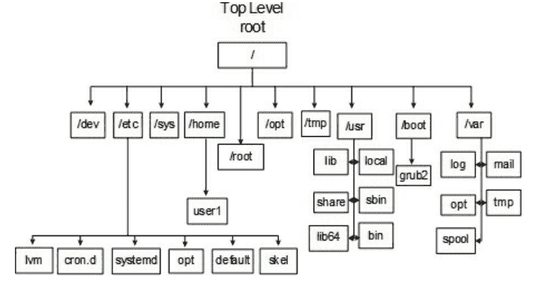

以下子节将对基于磁盘的虚拟文件系统进行介绍。

---

## 根文件系统 (/) – 基于磁盘

根文件系统是 FHS（文件层次结构标准）中的顶层文件系统，包含了许多存放特定信息的高级目录。一些关键目录包括：

- `/etc`: 存放系统配置文件。一些常见的子目录有 `systemd`、`dev`、`lvm` 和 `skel`，它们分别包含系统配置、账户和其他服务的默认值、逻辑卷管理器以及每个用户的 shell 启动模板文件。
- `/root`: 这是 `root` 用户的默认家目录位置。
- `/media`: 该目录用于系统自动挂载可移动的介质，例如软盘、CD、DVD、USB 和 Zip 驱动器。
- `/mnt`: 该目录用于临时挂载文件系统。

---

## 启动文件系统 (/boot) – 基于磁盘

启动文件系统包含 Linux 内核、启动支持文件和启动配置文件。该文件系统的默认大小为 500MB，并可以在更新内核的准备过程中进行扩展。

---

## 变量文件系统 (/var) – 基于磁盘

`/var` 包含系统运行期间频繁更改的数据。存放日志、状态、生成池、锁和其他动态数据的文件是 `/var` 下子目录：

一些常见的子目录有：

- `/var/log`: 这是大多数系统日志文件的存储位置，例如系统日志、启动日志、失败的用户日志、用户日志、安装日志、cron 日志、邮件日志等。
- `/var/opt`: 对于安装在 `/opt` 中的额外软件，此目录存储软件的日志、状态和其他变量数据文件。
- `/var/spool`: 该目录存放在发送出去之前的打印作业、cron 任务、邮件消息和其他队列项目。
- `/var/tmp`: 此处存储大型临时文件，或需要比 `/tmp` 允许存在时间更长的临时文件。这些文件在重启后依然存在，不会被自动删除。

---

## 系统资源文件系统 (/usr) – 基于磁盘

此文件系统包含与系统相关的通用文件，部分内容与其他远程系统共享。该文件系统以只读方式挂载。`/usr` 下一些重要的子目录是：

- `/usr/lib`: 库目录包含 `/usr/bin` 和 `/usr/sbin` 目录中许多命令和程序所需的共享库，以及内核和其他程序所需的库。
- `/usr/bin`: 二进制目录包含关键的可执行命令。
- `/usr/sbin`: 系统启动时所需的大多数命令位于此二进制目录，以及需要 `root` 权限的命令。换句话说，此目录包含了不供普通用户执行的内核系统管理命令（尽管他们仍然可以运行其中几个）。由于其包含的数据性质，该目录未在普通用户的默认搜索路径中。
- `/usr/local`: 该目录供系统管理员用于存储从网络下载、安装或其他处获取的命令和工具。这些命令和工具通常不包含在原始 Linux 发行版中。特别是 `/usr/local/bin` 持有执行文件，而 `/usr/local/etc` 包含它们的配置文件。
- `/usr/include`: 该目录包含 C 语言的头文件。
- `/usr/src`: 该目录用于存储源代码。
- `/usr/share`: 这是用于手册页、文档、示例模板、配置文件等的目录，这些内容可以在异构硬件架构的多供应商 Linux 平台之间共享。

---

## 可选文件系统 (/opt) – 基于磁盘

此文件系统存放安装在系统上的额外软件。每个安装的软件都会创建一个子目录。

---

## 家文件系统 (/home) – 基于磁盘

`/home` 文件系统设计用于存放家目录。每个用户被分配一个家目录来保存个人文件。每个家目录由分配给它的用户所有，无法访问其他用户的目录。

---

## 设备文件系统 (/dev) – 虚拟

`/dev` 文件系统包含硬件和虚拟设备的设备节点。Linux 内核通过这里的设备节点与这些设备通信。这些设备节点根据需要由 `udev` 服务创建和删除。

设备文件有两种类型：字符设备（或原始设备）文件和块设备。内核使用一种或两种类型的设备文件访问设备。

字符设备以串行方式访问，在内核与设备通信期间传输位流。此类设备如打印机、鼠标、键盘、终端、磁带驱动等等。块设备以并行方式访问，在内核与设备通信期间以块（并行）交换数据。块上的数据进行随机管理。块设备的示例有硬盘、光驱、并行打印机等。

---

## 进程文件系统 (/proc) – 虚拟

`/proc` 文件系统维护当前运行内核状态的信息，包括 CPU、内存、磁盘、分区、文件系统和运行进程的详细信息。此虚拟文件系统包含分级子目录，其中包含数千个零长度文件，为内核在内存中维护的信息提供易于使用的接口。`/proc` 文件系统由系统自动管理。

`/proc` 中的内容在启动时创建，在运行时更新，并在重启时移除。该文件系统下方存储着硬件配置和状态信息。`/proc` 的目录列表示例：

```
# ls -l /proc
dr-xr-xr-x  8 root root 0 Nov 17 14:22 1
dr-xr-xr-x  8 root root 0 Nov 17 14:22 10
dr-xr-xr-x  8 root root 0 Nov 17 14:22 100
dr-xr-xr-x  8 root root 0 Nov 17 14:22 1000
```

---

## 普通文件

普通文件可能包含文本或二进制数据。这些文件可能是二进制格式的脚本或命令。当你列出目录时，输出中所有以 `-` 符号开头的文件行都代表普通文件：


# 文件类型与操作

## 普通文件

你可以使用 `file` 命令来确定文件的类型。例如，以下内容显示了 root 用户家目录下的 `.bash_profile` 包含 ASCII 文本：

```
# file .bash_profile
.bash_profile: ASCII text
```

## 目录文件

目录是用于存放文件和子目录的逻辑容器。在 `/root` 目录上运行 `ll`，你应该看到类似下面的输出：

```
# /root
drwxr-xr-x. 2 root root 6 Oct 29 08:00 Desktop
drwxr-xr-x. 2 root root 6 Oct 29 08:00 Documents
drwxr-xr-x. 2 root root 6 Oct 29 08:00 Downloads
```

每行开头的 `d` 标识该文件为目录。你可以使用 `file` 命令查看它报告的类型。例如，以下内容显示 `/root` 是一个目录文件：

```
# file /root
/root: directory
```

## 可执行文件

可执行文件可以是二进制格式的命令或 shell 脚本。换句话说，任何可以运行的文件都是可执行文件。如果 `ll` 命令输出的第七或第十字段中有 `x`，则该文件是可执行的。

```
# /usr/sbin
-rwxr-xr-x. 1 root root 46456 Mar 17 2014 whatis
-rwxr-xr-x. 1 root root 20656 Mar 28 2014 whereis
-rwxr-xr-x. 1 root root 24336 Jan 27 2014 which
```

`file` 命令报告可执行文件的类型如下：

```
# file /usr/bin/whoami
/usr/bin/whoami: ELF 64 LSB executable, x86-64, version 1 (SYSV), dynamically linked (shared libs), for GNU/Linux 2.6.32, BuildId[sha1]=f0b130a115a6598bd31377006d554a6527, stripped
```

## 符号链接文件

符号链接（又称软链接 symlink）可能是另一个文件或目录的快捷方式。当你对符号链接文件或目录运行 `ll` 时，你会注意到两点：第一，行条以字母 `l` 开头；并且有一个指向链接文件或目录的箭头。例如：

```
# /usr/sbin
lrwxrwxrwx. 1 root root 4 Oct 28 22:47 /usr/sbin/vigr -> vipw
```

可以使用 `file` 命令来确认 `vigr` 文件是一个符号链接：

```
# file /usr/sbin/vigr
/usr/sbin/vigr: symbolic link to 'vipw'
```

## 设备文件

系统中的每件硬件都有内核关联的关联文件以便与之通信。这种文件被称为设备文件。设备文件有两种类型：字符（或原始）设备文件和块设备文件。以下示例使用 `ll` 命令显示设备文件：

```
# ll /dev/sda*
brw-rw----. 1 root disk 8, 0 Nov 17 14:22 /dev/sda
brw-rw----. 1 root disk 8, 1 Nov 17 14:22 /dev/sda1
brw-rw----. 1 root disk 8, 2 Nov 17 14:22 /dev/sda2

# ll /dev/ubmon*
crw-rw----. 1 root disk 251, 0 Nov 17 14:22 /dev/ubmon0
crw-rw----. 1 root disk 251, 1 Nov 17 14:22 /dev/ubmon1
crw-rw----. 1 root disk 251, 2 Nov 17 14:22 /dev/ubmon2
```

每个条目中的第一个字符告诉文件类型是字符还是块。`b` 表示块设备文件，`c` 代表字符设备文件。你可以使用 `file` 命令来确定它们的类型：

```
# file /dev/sda
/dev/sda: block special

# file /dev/ubmon0
/dev/ubmon0: character special
```

## 文件和目录操作

本节详细介绍了对文件和目录执行的各种管理操作。这些操作包括创建、列出、显示内容、复制、移动、重命名和删除文件及目录。这些是 root 用户和普通用户常用的操作。

### 创建文件和目录

文件可以通过多种方式创建；然而，创建目录只有一个命令。

#### 使用 touch 创建文件

`touch` 命令创建一个空文件。如果文件已存在，它会更新时间戳。在 `user1` 的家目录中执行以下命令创建 `file1`，然后运行 `ll` 命令进行验证：

```
$ touch file1
$ ll file1
-rw-r--r--. 1 user1 user1 0 Nov 26 10:14 file1
```

正如预期，输出中的第五列为 0，意味着 `file1` 创建时的大小为 0 字节。现在，如果你重新运行命令，你会发现时间已更新：

```
$ touch file1
$ ll file1
-rw-r--r--. 1 user1 user1 0 Nov 26 10:15 file1
```

#### 使用 cat 创建文件

`cat` 命令允许你创建短文件：在执行此命令时，系统会等待输入。完成后按 `Ctrl+D` 保存并返回 shell：

```
$ cat > newfile
```

#### 使用 vi (vim) 编辑器创建

你可以使用编辑器创建并修改文件。参考第 2 章“使用基本工具”如何使用此工具。

#### 使用 mkdir 创建目录

`mkdir` 命令用于创建目录。带有 `-v` 选项运行时，该命令会显示输出。在 `user1` 的家目录 (`/home/user1`) 中执行以下示例创建一个名为 `dir1` 的目录：

```
$ cd
$ pwd
/home/user1
$ mkdir -v dir1
mkdir: created directory 'dir1'
```

你必须具有适当权限。通过指定 `-p` 选项创建子目录。在 `user1` 的家目录创建 `dir2/dir1`：

```
$ mkdir -vp dir2/dir1
mkdir: created directory 'dir2'
mkdir: created directory 'dir2/dir1'
```

### 列出文件和目录

使用 `ll` 命令列出文件和目录。该命令以多列的形式显示列出的文件的详细信息。

```
-rw-rw-rw-. 1 user1 user1 0 Nov 26 10:14 file
drwxr-xr-x. 2 user1 user1 6 Nov 26 06:48 directory
```

输出中的每一列提供了文件或目录的唯一信息：

- 第 1 列：显示文件类型和权限。
- 第 2 列：显示链接数。
- 第 3 列：显示所有者名。
- 第 4 列：显示组名。
- 第 5 列：标识文件大小（字节）。对于目录，这反映了使用的块数。
- 第 6、7、8 列：显示创建或修改的月份、日期和时间。
- 第 9 列：指示文件或目录名。

### 显示文件内容

Linux 提供了几种工具显示文件内容。目录内容就是其包含的文件和子目录。使用前面介绍的 `ll` 或 `ls` 命令查看目录内容。对于文件查看，你可以使用 `cat`、`more`、`less`、`head` 和 `tail` 命令。这些工具如下：

#### 使用 cat 命令

`cat` 显示文本文件的内容。在示例中，`user1` 家目录下的 `.bash_profile` 文件通过 `cat` 命令显示：

```
$ cat /home/user1/.bash_profile
# Get the aliases and functions
if [ -f ~/.bashrc ]; then
  . ~/.bashrc
fi

# User specific environment and startup programs
PATH=$PATH:$HOME/bin
export PATH
```

#### 使用 more 和 less 命令

`more` 可从开始一次一页查看长文件。在下面的示例中，`/etc/profile` 使用 `more` 显示。该命令在最后一行显示正在查看的文件百分比。

```
$ more /etc/profile
USER=""
...
More--(43%)
```

在 `more` 会话期间，下表列出的导航键很有帮助。

| 键 | 目的 |
| :--- | :--- |
| 空格 / f | 向下滚动一屏 |
| Enter | 向下滚动一行 |
| b | 向上滚动一屏 |
| d | 向下滚动半屏 |
| h | 显示帮助 |
| q | 退出并返回命令提示符 |
| /string | 向前搜索字符串 |
| ?string | 向后搜索字符串 |
| n / N | 查找字符串的下一个/上一个出现处 |

`less` 与 `more` 命令类似，但提供了扩展功能。它在开始显示之前不需要读取整个文件，比 `more` 更快。在下面的示例中，`/etc/profile` 使用 `less` 显示：

```
$ less /etc/profile
USER="$(id -un)"
/etc/profile
```

当用 `less` 查看大文件时，上表列出的相同导航键同样有用。

#### 使用 head 命令

`head` 显示文本文件的前几行。默认情况下，它显示前十行。参见下面的示例：

```
$ head /etc/profile
# /etc/profile
# System wide environment and startup programs, for login setup
# Functions and aliases go in /etc/bashrc

# It's NOT a good idea to change this file unless you know what
# we are doing. It's better to create a custom.sh script in
# /etc/profile.d to make custom changes to your environment, as it
# will prevent the merging in future updates.
```

上面的输出中有三个空行。你可以指定一个数字，它将显示多少行。例如，查看 `/etc/profile` 的前三行：

```
$ head -3 /etc/profile
# /etc/profile
# System wide environment and startup programs, for login setup
# Functions and aliases go in /etc/bashrc
```

#### 使用 tail 命令

`tail` 反之，默认显示文件的最后几行，除非提供了数字来改变其行为。以下示例显示了文件的最后三行：

```
$ tail -3 /etc/profile
if [ "$*" != "" ]; then
    "$*"
else
    "$*" >/dev/null
fi
done
unset i
unset -f pathmunge
```

`tail` 命令在你希望查看正在更新的日志文件时被证明非常有用。`-f` 选项启用了此功能。下面的示例展示了如何实时查看系统日志文件 `/var/log/messages`：

```
$ tail -f /var/log/messages
```

### 复制文件和目录

复制操作会复制文件或目录。有一个名为 `cp` 的单一命令用于此目的。

#### 复制文件

`cp` 命令将一个或多个文件复制到当前目录或另一个目录。如果你想在同一目录中复制文件，必须为目标文件指定不同的名称。如果你想将文件复制到不同的目录，可以使用相同或不同的文件名。请考虑以下示例：

在同一目录下复制文件：

```
$ cp file1 newfile
```

通过相同文件名将 `file1` 复制到名为 `scripts.dir1` 的现有目录：

```
$ cp file1 scripts.dir1
```

默认情况下，复制操作将覆盖目标文件（如果存在）而不会发出警告。使用 `-i` 选项可以指示 `cp` 命令在覆盖之前提示确认：

```
$ cp -i file1 scripts.dir1
cp: overwrite 'scripts.dir1/file1'? y
```

> **注意**：默认情况下，如果你尝试以 root 身份复制文件覆盖目标文件，则不需要指定 `-i` 选项进行是/否确认。用户的 `~/.bashrc` 文件中有一个预定义的别名 `cp='cp -i'` 可以处理这个问题。

#### 复制目录

带有 `-r`（递归）选项的 `cp` 命令会将整个目录复制到另一个位置。在下面的示例中，将 `scripts.dir1` 复制到 `scripts.dir2`，并显示 `scripts.dir2` 的内容进行验证：

```
$ cp -r scripts.dir1 scripts.dir2
$ ll scripts.dir2
drwxr-xr-x. 2 user1 user1 6 Nov 26 26:17 scripts.dir2
```

### 移动和重命名文件及目录

文件或目录可以在同一个文件系统中移动，也可以移动到另一个文件系统中。在文件系统内部移动时，会在目标目录添加相应的条目并删除源条目。在这种情况下，实际数据保持完好。另一方面，移动到不同的文件系统会将文件或目录的内容物理移动到新位置。

重命名仅更改文件或目录的名字；不会接触数据。

#### 移动/重命名文件

`mv` 命令用于移动或重命名文件。可以指定 `-i` 选项以便用户对已存在的文件进行确认。下面的示例将文件移动到 `scripts.dir1` 并提示确认：

```
$ mv -i file1 scripts.dir1
mv: overwrite 'scripts.dir1/file1'? y
```

> **注意**：默认情况下，如果你尝试以 root 身份移动文件覆盖目标文件，则不需要指定 `-i` 选项进行是/否确认。用户的 `~/.bashrc` 文件中有一个预定义的别名 `mv='mv -i'` 可以处理这个问题。

将 `newfile` 重命名为 `newfile1`：

```
$ mv newfile newfile1
```

#### 移动/重命名目录

要将目录及其内容移动到其他地方或简单更改目录名称，请使用 `mv` 命令。例如，将 `scripts.dir1` 移动到 `scripts.dir2`（`scripts.dir2` 必须存在，否则它将仅执行重命名），执行以下操作：

```
$ mv scripts.dir1 scripts.dir2
```

将 `scripts.dir2` 重命名为 `scripts.dir20`：

```
$ mv scripts.dir2 scripts.dir20
```

### 删除文件和目录

删除操作从目录结构中删除文件，并将其数据空间标记为空闲。对于目录，它会从文件系统结构中删除相应的条目。

#### 删除文件

你可以使用 `rm` 命令删除文件，它可以一次删除一个或多个指定的文件。下面的示例删除了 `newfile1`：

```
$ rm newfile1
```

可以使用 `-i` 选项防止意外删除。该选项指示命令在删除之前提示确认。参见下面的示例：

```
$ rm -i newfile1
rm: remove empty file 'newfile1'? y
```

#### 删除目录

有两个命令可以删除目录，在下面的示例中进行了演示：

使用 `rmdir` 命令删除空目录：

```
$ rmdir scripts.dir20
```

使用带有 `-r` 选项的 `rm` 命令删除非空目录：

```
$ rm -r scripts.dir10
```

你可以为 `rm` 提供 `-i` 选项，指示命令对每个被删除的文件提示确认。

## 文件和目录控制属性

可以在文件或目录上设置某些属性，以控制对其可以或不能执行的操作。例如，你可以对文件或目录启用属性，使得包括 root 在内的所有用户都无法删除、修改、重命名或压缩它。这些属性可以设置在位于 ext3、ext4 或 xfs 文件系统的文件和目录上。

下表列出了常见的控制属性。

| 属性 | 对文件或目录的影响 |
| :--- | :--- |
| a (append) | 文件只能追加数据。 |
| A | 防止更新访问时间。 |
| c (compressed) | 文件自动压缩。 |
| D | 目录更改同步写入。 |
| e (extent) | 文件使用范围进行映射。 |
| i (immutable) | 文件无法更改、重命名或删除。 |
| S (synchronous) | 更改同步写入。 |

有两个命令用于属性管理：`lsattr` 和 `chattr`。第一个命令显示属性，第二个命令设置属性。下面的示例假设你在 `/root` 且 `file1` 存在。

列出 `file1` 的属性：

```
# lsattr file1
--------------e---- file1
```

输出指示了控制属性。要允许追加操作，使用 `chattr`：

```
# chattr +a file1
```

然而，如果你尝试追加，它可以工作：

```
# cat /etc/fstab >> file1
```

现在为文件添加不可变位防止被删除：

```
# chattr +i file1
```

如果你现在尝试删除它，将得到：

```
# rm file1
rm: cannot remove 'file1': Operation not permitted
```


rm: cannot remove 'file1': Operation permitted

取消这些属性：

```bash
# chattr -i file1
```

# 查找文件

典型的 RHEL 系统在各个文件系统中有数十万个文件。有时根据某些标准搜索文件。一个示例是查找一年前离开公司的员工所有的文件。另一个示例是搜索过去 20 天内由特定用户修改的文件。对于此类搜索，RHEL 提供了 `find` 命令。你可以使用搜索标准以及命令将结果显示在屏幕上，或重定向到文件以便找到文件时执行命令。该命令在下面的小节中详细介绍。

## 使用 find 命令

`find` 命令搜索目录树、匹配标准的文件，并在找到文件时执行操作。这个强大的工具可以根据多种方式定制以查找文件。搜索标准可能包括按名称、所有者、所属组、权限、节点、最后访问或修改时间、大小和文件类型跟踪文件。图 3-2 显示了命令语法。

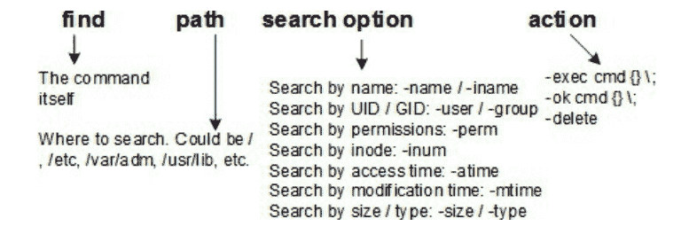

使用 `find` 命令，匹配标准的文件将被定位，并默认将每个文件的完整路径显示在屏幕上。让我们看几个示例。

在 user1 的家目录下搜索名为 `newfile` 的文件（假设 newfile 存在）：

```bash
$ cd
$ find -name newfile -print
```

`-print` 是可选的。`find` 命令默认将结果显示在屏幕上。你不需要指定此选项。

在 `/dev` 中搜索以 `vg00` 开头并跟任何字符的文件和目录。`-iname` 选项引导执行忽略大小写搜索的命令。

```bash
# find /dev -iname vg00*
/dev/mapper/vg00
/dev/mapper/vg00-home
/dev/mapper/vg00-root
/dev/mapper/vg00-
```

在根目录下查找小于 1MB 的文件：

```bash
# find ~ -size +1M
/root/cache/apt/lists/distlist
/root/.local/share/gnome-settings-data/input-sources-converted
/root/.local/share/talks/relationships.ini
/root/.local/share/tracker/data/meta.istunning
...
```


波浪号 `~` 字符代表用户的家目录。

在用户目录下查找大于 40MB 的文件：

```bash
# find /user -size +40M
/usr/lib/local-archive
/usr/lib/x86_64-linux-gnu/libinfo-1.7-0.2.deb.2.4.5.el7.x86_64.so/librt.tar
/usr/share/icons/hicolor/default/shared
/usr/share/icons/gnome/theme.cache
```

在整个系统中查找所有者为 user1 且组设置为除 user1 以外的任何组的文件：

```bash
# find /user user1 -not -group user1
/var/spool/mail/user1
```

在 `/var` 目录下查找修改于 2000 天以前的文件：

```bash
# find /etc -mtime +2000
/etc/xdg/menus/document.menu
/etc/xdg/menus/server-settings.menu
/etc/xdg/menus/settings.menu
/etc/xdg/menus/start-gnome-bin.menu
```

在 `/var` 目录下查找正好在 12 天前修改的文件：

```bash
# find /var -mtime 12
/var/log/sa/14
/var/log/sa/14
```

在 `/dev` 目录下查找权限设置为 666 的字符设备：

```bash
# find /dev -type c -perm 666
/dev/kvm
/dev/net
/dev/kose
/dev/ptmx
/dev/tty
/dev/urandom
/dev/random
/dev/kill
/dev/zero
/dev/null
```

在 `/dev` 目录下查找可写的字符设备文件：

```bash
# find /dev -type c -perm -222
/dev/kvm
/dev/net
/dev/kose
/dev/ptmx
/dev/tty
/dev/urandom
/dev/random
/dev/kill
/dev/zero
/dev/null
```

在整个目录树中查找 core 文件并在发现时直接删除，且不提示确认：

```bash
# find / -name core -exec rm {} \;
```


模式 `(\:)` 是语法的一部分，必须以这种方式定义数据。

`find` 命令还有许多其他可用选项。请参考该命令的 man 页面并尝试其中一些。

# 链接文件与目录

系统中的每个文件在创建时都会被分配若干个属性。这些属性统称为文件属性。

使用软链接或硬链接文件。如果删除一个链接，该 inode 的引用计数会减 1，当计数为 0 时，文件才会被真正删除。

## 软链接

## 硬链接


在用户目录下查找大于 40MB 的文件：

```bash
find /user -size +40M
```

使用软链接或硬链接文件。如果删除一个链接，该 inode 的引用计数会减 1，当计数为 0 时，文件才会被真正删除。

## 软链接

系统中的每个文件在创建时都会被分配若干个属性。这些属性统称为文件属性。

在根目录下查找小于 1MB 的文件：

```bash
find ~ -size +1M
```

在用户目录下查找大于 40MB 的文件：

```bash
find /user -size +40M
```

使用软链接或硬链接文件。如果删除一个链接，该 inode 的引用计数会减 1，当计数为 0 时，文件才会被真正删除。

## 硬链接

系统中的每个文件在创建时都会被分配若干个属性。这些属性统称为文件属性。

在根目录下查找小于 1MB 的文件：

```bash
find ~ -size +1M
```

在用户目录下查找大于 40MB 的文件：

```bash
find /user -size +40M
```

使用软链接或硬链接文件。如果删除一个链接，该 inode 的引用计数会减 1，当计数为 0 时，文件才会被真正删除。

## 表 3-4 权限类型

如果不需要读取、写入或执行权限，则使用 – 符号表示其缺失。

## 权限模式

权限模式用于向权限类添加、撤销或分配权限类型。表 3-5 显示了各种权限模式。

| 权限模式 | 描述 |
|---|---|
| 添加 (+) | 分配权限。 |
| 撤销 (-) | 移除权限。 |
| 分配 (=) | 同时为所有者、所属组成员和公众分配权限。 |

## 表 3-5 权限模式

我们可以使用 `ll` 命令查看文件和目录的权限设置。这些信息包含在命令的第一列中。第一个字符表示文件类型：`d` 表示目录，`–` 表示普通文件，`l` 表示符号链接，`c` 表示字符设备文件，`b` 表示设备管道，`p` 表示套接字，等等。接下来的九个字符——每三个字符为一组——显示了三类用户：用户（所有者）、组和其他用户（公众）的读取（`r`）、写入（`w`）和执行（`x`）权限。连字符表示该级别的权限被拒绝。

图 3-3 说明了 `ll` 命令及其组成部分。

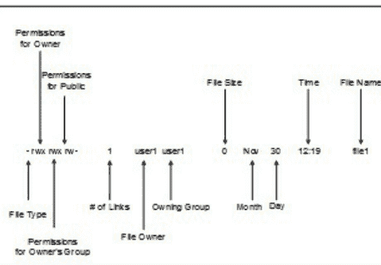

图 3-3 权限设置

上面的图显示了第三列的文件所有者（user1）和第四列的所有组（user1）。

## 修改访问权限

Linux 提供了 `chmod` 命令来修改文件和目录的访问权限。它适用于文件和目录，root 用户或文件所有者可以使用 `chmod`，并可以通过两种方式指定权限：符号表示或八进制。符号表示法使用字母和符号的组合为每类用户添加、撤销或分配权限。另一方面，八进制法（也称为绝对表示法）使用从 0 到 7 的三位数字系统来表示三类用户的权限。八进制值见表 3-6。

| 八进制值 | 二进制表示法 | 符号表示法 | 解释 |
|---|---|---|---|
| 0 | 000 | | 无权限。 |
| 1 | 001 | -x | 仅执行权限。 |
| 2 | 010 | -w | 仅写入权限。 |
| 3 | 011 | | 写入和执行权限。 |
| 4 | 100 | r | 仅读取权限。 |
| 5 | 101 | r-x | 读取和执行权限。 |
| 6 | 110 | r- | 读取和写入权限。 |
| 7 | 111 | rwx | 读取、写入和执行权限。 |

## 表 3-6 八进制权限表示法

从表 3-6 可以明显看出，每个 1 对应 `r`、`w` 或 `x`，而每个 0 对应该级别下无权限的字符。图 3-4 显示了三位八进制数字模型中每个数字位置相关的权重。


图 3-4 权重

最右侧的位置权重为 1，中间位置的权重为 2，最左侧的位置权重为 4。例如，如果我们分配权限 6，它将对应最左侧的两个数字位置。同样，权限 2 将仅指向中间数字位置。

## 练习 3-1：使用符号表示法修改文件权限

此练习应在 host1 上进行。

对于此练习，可能存在一个 file1 对所有者（user1）、所属组（user1）和其他人具有读取权限，并且你以 user1 身份登录。

```
-r--r--r-- 1 user1 0 Nov 30 12:30 file1
```

在此练习中，你将为所有者添加执行权限，为组和公众添加写入权限。你将移除公众的写入权限，并同时为三类用户分配读取、写入、执行权限。`chmod` 命令接受 -v 选项来显示它更改的内容。

- 1. 为所有者添加执行权限并显示 `ll` 的输出：

```bash
chmod u+x file1 -l
```


mode of `file1` changed from 0444 (r--r--r--) to 0544 (r-xr--r--)

```
$ ll file1
-rwxr--xr-- 1 user1 0 Nov 30 12:30 file1
```

- 2. 为组成员和公众添加写入权限：

```
$ chmod go+w file1
$ ll file1
-rwxrwxrwx- 1 user1 0 Nov 30 12:30 file1
```

- 3. 移除公众的写入权限并确认：

```
$ chmod o-w file1
$ ll file1
-rwxrwxrxr-- 1 user1 0 Nov 30 12:30 file1
```

- 4. 为所有三类用户分配读取、写入和执行权限并验证：

```
$ chmod a=rwx file1
$ ll file1
-rwxrwxrwx 1 user1 0 Nov 30 12:30 file1
```

## 练习 3-2：使用八进制表示修改文件权限

此练习应在 `host1` 上进行。

对于此练习，可能存在一个权限为 444 所有者为 `user1` 的 `file2`，并且你以 `user1` 身份登录。

```
-r--r--r-- 1 user1 0 Dec 1 0:27 file2
```

在此练习中，你将为所有者添加执行权限，为组和公众添加写入权限。你将移除公众的写入权限，并同时为三类用户分配读取、写入、执行权限。

- 1. 为所有者添加执行权限并使用 `ll` 命令验证：

```
$ chmod 544 file2
$ ll file2
-rwxr-xr-- 1 user1 0 Dec 1 0:27 file2
```

- 2. 为所属组和其他人添加写入权限并验证：

```
$ chmod 762 file2
$ ll file2
-rwxrww-- 1 user1 0 Dec 1 0:27 file2
```

- 3. 移除公众的写入权限并验证：

```
$ chmod 764 file2
$ ll file2
-rwxrw-r-- 1 user1 0 Dec 1 0:27 file2
```

- 4. 为三类用户分配读取、写入和执行权限并确认：

```
$ chmod 777 file2
$ ll file2
-rwxrwxrwx 1 user1 0 Dec 1 0:27 file2
```

## 默认权限

Linux 在创建文件或目录时分配权限。默认权限是根据从预设初始权限值减去 `umask` 计算得。`umask` 是一个三位数值，定义了所有者、组和公众的读取/写入/执行权限。其目的是在不影响现有文件的情况下设置新文件的默认权限。在 RHEL 中，root 和系统用户的默认 `umask` 为 022，普通用户为 002。左侧的 0 没有意义。不带任何选项运行 `umask` 命令将显示当前的 `umask` 值：

```
$ umask
002
```

再次运行命令并使用 `-S` 选项以符号表示法显示 `umask`：

```
$ umask -S
rwx--x--
```

预定义的权限对于文件是 666 (rw-rw--)，对于目录是 777 (rwxrwxrwx)。如果 `umask` 设置为 000，新文件将始终获得 666 权限，如果需要，我们使用 `chmod` 命令添加执行位。

## 计算默认权限

考虑以下示例来计算普通用户的默认权限：

初始权限 666
umask - 002 (减法)
================
默认权限 664

这意味着每个新文件将为所有者和组分配读取和写入权限，为其他人分配只读权限。

计算普通用户的目录默认权限：

初始权限 777
umask - 002 (减法)
================
默认权限 775

这意味着每个新目录将为所有者和组分配读取、写入和执行权限，如果你希望新文件和目录有不同的设置，则需要修改 `umask`。你首先需要确定所需的默认值。例如，如果你希望所有新文件和目录分别获得 640 和 750 权限，可以如下所示值设置为 027：

```
$ umask 027
```

新值立即生效，并且仅适用于之后创建的文件和目录。现有文件和目录将保持完好。在 `/home/user1` 下创建 `file10` 和 `dir10` 以测试新 `umask` 的影响。

```
$ touch file10
$ ll file10
-rw-r--r-- 1 user1 0 Dec 1 08:48 file10
```

```
$ mkdir dir10
$ ll dir10
drwx-xr-x 2 user1 0 Dec 1 08:48 dir10
```

上面的示例显示新文件和目录以不同的权限创建。文件获得了 (666 - 027 = 640) 权限，目录获得了 (777 - 027 = 750) 权限。

命令行中的 `umask` 值将在注销后丢失。为了保留新设置，请将其放在第8章“管理用户和组”中的合适的 shell 中。

## 文件所有权和组组成

在 Linux 中，每个文件和目录都有一个所有者。默认情况下，创建者拥有所有权，如果需要，可以更改并分配给不同的用户。同样，如果你是一个或多个组的成员。组是具有共同需求的用户集合。默认情况下，所有者的组被分配给文件或目录。

以下命令输出显示了文件 `file10` 的所有者和组：

```
$ ll -n file10
-rw-r--r-- 1 user1 0 Dec 1 08:48 file10
```

输出显示 `file10` 的所有者是 `user1`，它属于组 `user1`。如果你希望查看对应的 UID 和组，可以指定 `-n` 选项：Linux 提供了 `chown` 和 `chgrp` 命令，你可以使用它们更改文件和目录的所有权和所属组；然而，你必须是 root 才能进行这些修改。

## 练习 3-3：修改文件所有权和组组成

此练习应在 `host1` 上进行。

对于此练习，假设存在所有权和组设置为 `user1` 的 `file10` 和 `dir10`，并且你以 root 身份登录。

```
-rw-r--r-- 1 user1 user1 0 Dec 1 08:48 file10
drwx-xr-x 2 user1 user1 Dec 1 08:48 dir10
```

在此练习中，你将创建用户账户 `user100` 和 `user200`，将 `file10` 的所有权更改为 `user100`，所属组更改为 `user100`。你将同时将文件的所有权和组分配给 `user200`。最后，你将递归地将目录的所有权和组改为 `user200`。

- 1. 创建用户账户 `user100` 和 `user200`：

```
# user user100
# user user200
```

- 2. 进入 `user1` 的主目录并修改 `file10` 的所有权：

```
# cd /home/user1
# chown user100 file10
changed ownership of 'file10' from user1 to user100
# ll file10
-rw-r--r-- 1 user100 0 Dec 1 08:48 file10
```

- 3. 将所有组更改为 `user100`：

```
# chgrp user100 -v
changed group of 'file10' from user1 to user100
# ll file10
-rw-..... 1 user100 user100 0 Dec 1 08:48 file10
```

- 4. 同时将所有权和组分配给 `user200`：

```bash
# chown user200:user200 -v
changed ownership of 'file10' from user100:user100 to user200:user200
# ll file10
-rw-..... 1 user200 user200 0 Dec 1 08:48 file10
```

- 5. 递归地将 `dir10` 的所有权和组更改为 `user200`：

```bash
# chown -R user200:user200 dir10
# ll -d dir10
drwx-xr-x. 2 user200 user200 6 Dec 1 08:48 dir10
```

使用 `-R` 配合 `ll` 参数查看 `dir10` 下的文件和目录信息；但是，由于该目录目前为空，它不会显示任何内容。

## 特殊权限

Linux 提供了三种特殊权限位，可以设置在可执行文件或目录上，允许它们对某些操作做出不同的响应。这些权限位是：


setuid (设置用户标识符) 位


setgid (设置组标识符) 位


粘滞位 (sticky bit)

前两个位可以定义在可执行文件中，为非所有者和非组成员提供分别以所有者或所有组的权限运行可执行文件的能力。`setgid` 位也可以设置在共享目录上以供组协作。最后一位位可以设置在公共目录上，以防止非所有者删除文件。

特殊位的使用应该经过适当的监管和监控，以避免对系统和应用程序产生潜在的安全问题。

## 可执行文件上的 setuid 位

`setuid` 标志在文件层级设置在可执行文件上。有了此位，文件将由其他普通用户执行，其权限与文件所有者相同。一个常见的例子是 `su` 命令由 `root` 用户所有。该命令默认启用了此位。它高亮了所有者权限类中的 `s`：

```bash
$ ll /usr/bin/su
-rwsr-xr-x. 1 root root 32 Mar 28 /usr/bin/su
```

当普通用户执行此命令时，它将以 `root`（所有者）的身份运行，因此用户将能够成功运行并获得预期的结果。

(`su`) 命令允许用户在知道用户密码后切换到其他账户。从 `su` 中移除 `setuid` 位并将其替换为执行属性。你必须以 `root` 身份进行此更改。修改后列出文件以验证：

```bash
# chmod u-s /usr/bin/su
-rwxr-xr-x. 1 root root 32 Mar 28 /usr/bin/su
```

如执行标志所示，该文件仍然可以由非所有者执行；然而，它将防止普通非所有者切换账户，因为他们失去了特殊权限。当用户尝试使用有效密码 `su` 到 `root` 账户时，会发生这种情况：

```bash
$ su
Password:
```

即使输入了正确的凭据，`su` 也会收到“认证失败”的消息。要重置 `su`（或任何其他文件）设置的位，请使用 `chmod` 命令：

```bash
# chmod 755 /usr/bin/su
# ll /usr/bin/su
-rwxr-xr-x. 1 root root 32 Mar 28 /usr/bin/su
```

当以这种方式配合 `chmod` 命令使用 `4` 时，它会在指定的文件上启用 `su`。或者，你可以使用如下符号表示：

```bash
# chmod +s /usr/bin/su
```

你可以使用 `find` 命令搜索所有定义了此特殊位的文件：

```bash
# find / -perm -4000
/usr/bin/mount
/usr/bin/chage
/usr/bin/passwd
/usr/bin/newgrp
/usr/bin/chsh
/usr/bin/su
/usr/bin/vipec
/usr/bin/creat
```

## 可执行文件上的 setgid

`setgid` 属性在组层级设置在可执行文件上。有了此位，文件由非所有者执行时，其权限与组成员完全相同。例如，`wall` 命令由 `root` 所有，组权限为 `root`，并启用了 `setgid`。查看下方组权限类中高亮的 `s`：

```bash
# ll /usr/bin/wall
-rwxr-sr-x. 1 root root 32 Jan 27 /usr/bin/wall
```

`wall` 命令允许用户向所有登录用户广播消息并显示在他们的终端屏幕上。由于文件上的 `setgid` 标志，默认用户被允许此权限。要进行测试，运行命令并提供消息作为参数：

```bash
$ wall "Hello, this is to test the setgid flag on the wall command"
Broadcast message from user@host.com (pts/0) (Mon Dec 1 11:26:24)
```

现在，从 `/usr/bin/wall` 移除该位并替换为执行文件。你必须以 `root` 身份进行此更改。修改后列出文件以确认：

```bash
# chmod g-s /usr/bin/wall
-rwxr-xr-x. 1 root root 32 Jan 27 /usr/bin/wall
```

该文件仍然可以由非所有者执行；然而，它将防止普通非所有者发送消息，因为他们拥有该特殊权限。现在，将其恢复到 `/usr/bin/wall` 并确认：

```bash
# chmod 2755 /usr/bin/wall
# ll /usr/bin/wall
-rwxr-sr-x. 1 root root 32 Jan 27 /usr/bin/wall
```

当以这种方式配合 `chmod` 命令使用 `2` 时，它会在指定的文件上设置 `setgid` 属性。或者，你可以使用如下符号表示：

```bash
# chmod g+s /usr/bin/wall
```

你可以使用 `find` 命令搜索系统中所有定义了此特殊位的文件：

```bash
# find / --perm -2000
/run/log/journal
/run/log/journal-0385c8dc4a7b4b2eb70a7caa285b8b
/usr/sbin/wall
/usr/bin/wtmp
/usr/bin/sub-agent
/usr/bin
/usr/sbin/memport
```

## 共享目录上的 setgid 位

`setgid` 位也可以设置在组共享目录上，允许在该目录下创建的文件和子目录自动继承目录的所有组。这避免了共享目录内容的组成员更改他们添加到该目录的每个新文件和子目录的所有者。文件和子目录的标准行为是：

（注：由于提供的 OCR 文本在后半部分存在大量重复，此处已根据提供的逻辑片段进行了清理。）

## 章节复题

- 1. 使用哪个命令可以确定文件类型？

2. `umask` 命令生成的用户掩码是四位数。最左侧的数字意义是什么？

3. 默认权限是从 `umask` 值中减去初始权限计算得。对或错？

4. `chmod` 命令可以用于移除文件的所有权和组成员身份。对或错？

5. 写出权限类、类型和模式。

6. Shell 中普通用户的 `umask` 是 0027。对或错？

7. 什么数字代表 `chmod` 命令中的 set 位（setbit）？

8. 命令 `find /var -perm -1000 -type d` 会做什么？

9. 命令 `chmod g+s file` 会做什么？

10. 粘滞位（Sticky bit）在每个系统目录中都被识别。对或错。

11. 它允许用户以更高的优先级移除组组成员。对或错？

12. `chown` 命令可以用于修改文件的所有权和组成员身份。对或错？

13. 权限 751 的等效符号值是什么？

14. 文件必须有 .exe 扩展才能运行。对或错？

15. `/boot` 是一个内存型文件系统。对或错？

16. 写出两种类型的路径（pathways）。

17. 在 `ll` 命令中，如果文件是符号链接，两个指示告诉了我们什么？

18. `rmdir` 命令可以用于删除整个目录结构。对或错？

19. `chattr` 命令的 `-A` 选项使文件不可变。对或错？

20. `ll` 命令在输出中产生 9 列。对或错？

21. 软链接目录不能跨越文件系统边界或创建硬链接目录。对或错？

22. `chmod` 命令的 `rwxr-xr-x` 权限是用 555 执行的吗？

23. 命令 `find /name -core -ok rm ( \; )` 会做什么？

24. 团队共享目录设置了什么种特殊权限？

## 章节复习答案

- 1. 可以使用 `file` 命令来确定文件类型。

2. 最左侧的数字在 `umask` 值没有意义。

3. 默认权限是通过从初始权限值减去 `umask` 值计算的。

4. 错。

5. 权限类是用户、组和公共；权限类型是读、写和执行；权限模式是添加、撤销和分配。

6. bash 用户的默认 `umask` 是 0002。

7. 数字 4 代表 set 位（setbit）。

8. 它将在 `/var` 目录中搜索具有粘滞位的目录。

9. 它将移除文件 1 的 `setgid` 位！

10. 错。

11. 错。

12. 对。

13. 八进制 751 的等效值是 `rwxr-xr-x`。

14. 错。

15. `/boot` 是一个磁盘型文件系统。

16. 两种类型的路径是绝对路径和相对路径。

17. `ll` 命令中的符号链接文件以字母 l 开头，并有一个指向源文件的箭头。

18. `rmdir` 用于删除空目录。

19. 错。`chattr` 命令的 `-i` 选项使文件不可变。

20. 对。

21. 错。软链接目录和硬链接目录不能跨越文件系统边界。

22. 所有者将获得读和执行权限。

23. `find` 命令将在整个目录层次结构中显示所有名为 `core` 的文件，并在发现它们时询问删除。

24. 团队共享设置了 `setgid` 位。


## DIY 挑战实验室

以下实验有助于加强本章中学的大部分概念和主题。预计你将在没有任何任何帮助的情况下完成这些任务。不提供分步骤指南，因为这些实验的实现需要本章介绍的知识。对于缺失的信息，请使用默认值或自己的思考。

### 实验 3-1: 查找文件并确定文件类型

以 root 身份登录 `host1` 并执行 `find` 命令，搜索整个目录结构中过去 10 天内修改过的所有文件并显示它们的类型。使用 `find` 命令搜索命名管道（named pipe）和套接字（socket）文件。使用 `file` 命令检查某些文件和目录的类型。

### 实验 3-2: 文件目录操作

以 `user1` 身份登录 `host1` 并在主目录下创建一个文件和一个目录。列出文件和目录并观察其权限、所有者和所属组。尝试将文件和目录移动到 `/var/log` 目录并观察输出。再次尝试将它们移动到 `/tmp` 目录。使用 `cp` 命令复制文件并使用任何名称重命名复制文件。最后删除为此实验室创建的文件和目录。

### 实验 3-3: 使用不同标准查找文件

以 root 身份登录 `host1` 并执行 `find` 命令，搜索整个目录结构中在 10 天前访问过的、大小小于 5MB 且由用户 root 拥有的文件。

### 实验 3-4: 操作文件权限

### 实验 3-5: 配置组协作

以 root 身份登录 `host1` 并创建目录 `/shared_dir1`。创建一个名为 `shared_grp` 的组，并将 `user1000` 和 `user2000` 分配给该组（如果这些用户不存在，则创建它们）。设置权限。

## 表 4-1 预定义环境变量

我们也可以根据需要在命令行提示符或脚本中设置自定义环境变量。

## 设置、取消变量以及查看其值

本地环境变量可以在命令行提示符处或通过程序设置或取消，并根据需要查看和使用其值。建议你使用大写字母命名变量，以避免与现有的命令、程序、文件或目录名称发生任何可能的冲突。为了理解如何定义、查看和取消变量，下面提供了一些示例。这些示例在主机 `host1` 上以 `user100` 身份运行。

要定义一个名为 `VR1` 的本地变量：

```bash
$ VR1=rhel7
```

查看存储在 `VR1` 中的值：

```bash
$ echo $VR1
rhel7
```

要将其变为环境变量，请如下方式使用 `export` 命令：

```bash
$ export VR1
```

要取消该定义：

```bash
$ unset VR1
```

你可以如下所示定义一个包含一个或多个空格值的本地变量：

```bash
$ VR1="i love RHEL"
```

上述内容也可以使用 `export` 命令定义为环境变量，如下如下：

```bash
$ export VR1="i love RHEL"
```

除了使用 `echo` 命令查看变量值外，`set`、`env` 和 `export` 命令也可用于此目的。`set` 命令列出所有 shell 变量的值（包括本地变量环境变量），而 `env` 和 `export` 命令仅列出环境变量。

## 命令和变量替换

根用户的主提示符是 `#` 号，普通用户的提示符是 `$`。自定义主命令提示符以显示有用信息（例如你是谁、已登录状态以及你在目录树中的当前位置）是一种良好的做法。下面的示例说明了如何使用以下命令修改 `user100` 的提示符：

```bash
$ export PS1=$LOGNAME@\$hostname:\$PWD
$ export PS1=$LOGNAME@\$$(hostname):\$PWD
```

`user100` 的命令提示符看起来如下：

```bash
user100@host.example.com/home/user100$
```

随着 `user100` 的导航，`PWD` 变量的值将在提示符中反映目录位置。这被称为变量替换。如果 `user100` 导航到 `/usr/bin`，提示符将变为：

```bash
user100@host.example.com:/usr/bin $
```

运行 `hostname` 命令并将其输出赋值给变量是一个名为命令替换的 shell 特性的示例。请注意，我们要赋值给变量的命令输出必须包含在单正引号或以 `$` 符号为引导的括号内。

## 输入、输出和错误重定向

许多程序从键盘读取输入并写入其启动时的终端窗口。如果遇到任何错误，也会打印在终端上。这是默认行为。如果我们不想从键盘获取输入或将输出到终端屏幕该怎么办？shell 赋予了我们重定向输入、输出和错误消息的灵活性，允许程序和命令从非默认源读取输入，并将输出转发到非默认目的地。

> 提示：你可能会被要求运行某个命令或将其输出和/或错误消息重定向到文件。

输入、输出和错误的默认（或标准）位置称为标准输入 (`stdin`)、标准输出 (`stdout`) 和标准错误 (`stderr`)。这些位置也可以使用 `<` 运算符 用于 `stdin`，使用 `>` 用于 `stdout` 和 `stderr` 的示例；或者分别使用文件描述符 `0`、`1` 和 `2` 分对应 `stdin`、`stdout` 和 `stderr`。

## 重定向标准输入

输入重定向指示命令从替代源（例如文件）而不是键盘读取所需信息。例如，运行以下命令让 `cat /etc/cron.allow` 文件并显示在标准输出（终端屏幕）上：

```bash
$ cat < /etc/cron.allow
```

## 重定向标准输出

输出重定向将命令生成的输出发送到替代目的地（例如文件），而不是终端窗口。`>` 符号用于此目的。例如，执行以下命令将命令输出重定向到名为 `ll.out` 的文件。如果存在 `ll.out` 文件，它将覆盖它。如果 `ll.out` 不存在，则将创建它。

```bash
$ ls > ll.out
```

若要将命令追加到 `ll.out` 文件中，请使用 `>>` 字符：

```bash
$ ls >> ll.out
```

## 重定向标准错误

错误重定向将生成的任何错误消息转发到替代目的地（例如文件），而不是终端窗口。例如，以下命令查找根目录树，并在整个根目录下查找所有名为该名称的文件，并将任何错误消息发送到 `/dev/null`（`/dev/null` 是用于丢弃数据的特殊文件）。

```bash
$ find -name core -print 2>/dev/null
```

## 重定向标准输出和错误

输出和错误也可以重定向到替代位置。例如，执行以下命令将它们转发到名为 `outer.out` 的文件：

```bash
$ ls /usr 2>&1 > outer.out
```

此示例将生成 `/usr` 目录的列表并将结果保存在 `outer.out` 中。同时，它将生成一条关于 `/usr` 目录不存在的错误消息，并将其发送同一个文件中。你可以在上面的示例中使用 `>>` 追加到现有文件。

## 命令历史

命令历史保留所有执行命令的日志。这是默认开启的。命令历史存储在 `~/.bash_history` 中。`HISTSIZE` 变量控制可以存储的条目数。`HISTSIZE` 定义在 `/etc/profile` 中，可以根据需要增加或减少。

使用某些选项显示历史：

```bash
$ history | more
```

```
1 cd /data
2 touch file
3 ls
4 ls -l /data
...
```

显示最后 50 条记录：

```bash
$ history 50
```

通过编号重新执行命令（例如第 38 行）：

```bash
$ !38
```

重新执行以特定字母或字母序列开头的最近一次命令（ch）：

```bash
$ !ch
```

重复上一条命令：

```bash
$ !!
```

## 命令行编辑

命令行编辑允许我们在命令提示符处编辑文本行。根据设置的编辑器，我们可以反向（逆时间顺序）或正向（时间顺序）滚动查看命令历史。此功能通过设置 `emacs` 或 `vi` 命令行编辑器（或你选择的其他编辑器）启用。默认设置的是 `emacs`，但我们也可以设置为 `vi`：

```bash
$ set -o vi
```

两者之间的区别之一是用于滚动历史文件 `~/.bash_history` 的键。按下向上键（或 `vi` 中的 `Ctrl+p`）可以获取我们在提示符处执行的最后一个命令，反复按下（`vi` 中的 `j` 键）可以向后滚动。按下向下键（或 `vi` 中的 `k` 键）可以向前滚动。当我们在提示符处获得所需的命令时，可以使用 `emacs` 或 `vi` 编辑器对其编辑。

## Tab 补全

Tab 补全（又称命令补全）是 `bash` 的功能，在命令行输入文件、目录或命令名的初始字符并按下 Tab 键即可自动补全名称。如果有多个匹配输入字符的可能性，它将补全到它们共同拥的部分，并在屏幕上打印所有剩余的可能性。然后我们可以输入一个或多个字符。

并按回车键进一步缩小范围。当所需的名称出现在命令行上时，我们按回车键接受它并执行操作。该功能的主要优点之一是节省了输入长文件、目录或命令名称的时间。

如果像前两个小节那样设置了文本编辑器，制表符补全即可工作。

# 波浪号替换

波浪号替换（或波浪号扩展）发生在以波浪字符 `~` 开头的单词上。使用该符号时需要记住的规则如下：

1. 如果 `~` 是独立字符，shell 指向运行命令的用户的 `HOME` 目录。以下示例显示了 `user100` 的 `$HOME` 目录：

```bash
$ echo ~
/home/user100
```

2. 如果 `~` 后紧跟加号，shell 指向当前目录。例如，如果 `user100` 在 `/etc/systemd` 目录下并执行 `~+`，输出将显示当前目录位置：

```bash
$ echo ~+
/etc/systemd
```

3. 如果 `~` 后紧跟减号，shell 指向上一个工作目录。例如，如果 `user100` 从 `/etc/systemd` 切换到 `/usr/share/man` 目录并执行 `~-`，输出将显示上次的工作目录：

```bash
$ echo ~-
/etc/systemd
```

4. 如果用户名带有带有 `~` 字符，shell 指向该用户的 `$HOME` 目录：

```bash
$ echo ~user200
/home/user200
```

我们可以在任何引用目录结构位置的命令（如 `cd`、`ls` 和 `echo`）中使用波浪号替换。波浪号替换的更多示例见第 2 章“使用基本工具”。

# 正则表达式

正则表达式，也称为模式匹配、`regex` 或 `regexp`，是一种与字符串、字符序列或句子匹配的模式。任何包含一个或多个空格的模式必须包含在引号内。Linux 提供了一个强大的工具 `grep`（全局表达式搜索），它可以搜索一个或多个文件的内容。如果匹配到表达式，`grep` 会在屏幕上打印包含该表达式每一行，而不显示源文件。考虑以下示例：`grep` 命令是一个从文件或命令中提取信息的有用工具。数据的选择保持不变。

在 `/etc/passwd` 文件中搜索 `user100`：

```bash
$ grep user100 /etc/passwd
user100:x:1001:/home/user100:/bin/bash
```

在 `/etc/passwd` 中搜索 `login` 并排除输出中包含该模式的行。使用 `-v` 进行排除，使用 `-n` 在不包含模式的行中显示行号：

```bash
$ grep -nv login /etc/passwd
root:x:0:0:/root:/bin/bash
sync:x:5:5:/bin:/bin
shutdown:x:6:6:/sbin/shutdown
halt:x:7:7:/sbin/halt
user100:x:1000:/home/user100:/bin/bash
41:user:x:1001:/home/user100:/bin/bash
42:user:x:1002:/home/user200:/bin/bash
```

搜索 `/etc/passwd` 中以该模式开头的所有行。shell 将脱符号 `^` 视为特殊字符，标记行或单词的开头。如果我们想知道是否有多个同名的用户，这非常有用：

```bash
$ grep ^root /etc/passwd
root:x:0:0:/root:/bin/bash
```

列出 `/etc/passwd` 文件中带有该模式的所有行。shell 将 `$` 视为特殊字符，标记行或单词的结尾。这很有用，例如确定哪些用户的 shell 设置为 `bash`：

```bash
$ grep $ /etc/passwd
root:x:0:0:/root:/bin/bash
user1:x:1000:/home/user1:/bin/bash
user100:x:1001:/home/user100:/bin/bash
user200:x:1002:/home/user200:/bin/bash
```

搜索 `/etc/passwd` 文件中的所有空行：

```bash
$ grep ^$ /etc/passwd
```

搜索 `/etc/passwd` 中包含模式的所有行。`-i` 选项指示命令执行忽略大小写的搜索。这对于判断是否存在带有大小写字母组合的 `root` 用户账户很有用：

```bash
$ grep -i /etc/passwd
root:x:0:0:/root:/bin/bash
operator:x:1:1:operator:/sbin/nologin
```

打印 `ll` 命令输出中包含 `cron` 或 `qemu` 模式的所有行。管道字符 `|` 被用作表达式中的运算符。这被称为或。我们可以让此集合匹配两个备备选项。如下所示的带有 `-E` 的 `grep` 和 `egrep` 命令：

```bash
$ ll | grep -E 'cron|qemu'
```

## /etc/more

```text
total 1476
drwxr-xr-x.  1 root  97 Oct 28 22:51 shrt
-rw-r--r--.  1 root  16 Oct 28 23:04 adjust
-rw-r--r--.  1 root  1518 Jun 2013 aliases
-rw-r--r--.  1 root  12288 Oct 28 23:05 aliases.db
--More--
```

在示例中，运行该命令并将其输出通过到 `nl` 命令，以为每行进行编号：

```bash
$ who | nl
```

```
1 (unknown)  0  2014-11-17 14:23 (0)
2 root       pts/0  2014-12-07 16:27 (192.168.0.13)
3 root       pts/3  2014-11-24 22:25 (2)
```

以下示例通过将 `ll` 的输入管道到 `grep`，过滤出不匹配模式 `dec` 的行。新的输出再次被管道到一个字符敏感的过滤器中，对所有行进行编号，最终结果打印在屏幕上，位置如下：

```bash
$ ll | grep -v root | grep -vi dec | nl | more
```

```
1 total 0
2 dr-xr-xr-x. 8 politik polkitd 0 Nov 17 14:23 1073
3 dr-xr-xr-x. 8 gdm 0 Nov 17 14:23 1649
--More--
```

包含多个管道的结构被称为管道（pipeline）。

## 引用机制

众所所周知，元字符对 shell 具有特殊含义。为了将它们作为普通字符使用，`bash` shell 提供了三种引用机制，可以禁用它们的特殊含义并允许 shell 将其视为普通字符。这些机制由反斜杠、单引号和双引号字符提供，通过在反斜杠前加上特殊字符，或在单引号或双引号内进行转义来工作。

## 使用反斜杠前缀

反斜杠在 shell 术语中也被称为转义字符，它指示 shell 改变后续任何特殊字符的含义。例如，如果存在一个名为 `*` 的文件，且我们想用 `rm` 命令删除它，我们必须对 `*` 进行转义，使其被视为普通字符（而不是通配符）。

```bash
$ rm \*
```

在上面的示例中，如果我们忘记转义 `*`，`rm` 命令将删除目录中的所有文件。

## 在引号内包含

单引号字符指示 shell 改变所有包含在内的特殊字符的含义。例如，`LOGNAME` 是一个变量，可以通过 `echo` 命令查看其值：


```
$ echo $LOGNAME
```

如果在单引号内 `echo $LOGNAME`，`echo` 命令将显示该字符串本身，而不是变量的值：

## echo '$LOGNAME'

```
$ echo $LOGNAME
```

同样，当反斜杠字符被包含在单引号内时，它会被回显：

```
$ echo '\$ '
```

## 在双引号内包含

双引号字符指示 shell 改变除反斜杠、美元符号和单引号以外的所有字符的含义。这三个特殊字符在被双引号包含时仍保留其特殊含义。

查看以下示例以理解双引号的。

```
$ echo "\$SHELL"
/bin/bash
$ echo "\$SPWD"
SPWD
$ echo "\$"
```

# 理解进程

进程是提供系统资源的单位。它是系统上运行的任何程序、应用程序或命令。当程序、应用程序或命令启动时，进程会在内存中其自身的地址空间内创建。进程以分级方式组织。每个进程都有一个父进程（又称为调用进程）来产生它。单个父进程可能有一个或多个子进程，并在创建时将它的许多属性传递给它们。每个进程都分配有一个唯一标识符，即 PID，内核通过它在整个生命周期内管理和控制进程。当进程完成其生命周期或被终止时，它会报告给其父进程，释放为其提供的所有资源并移除 PID。系统启动时会产生若干进程，其中许多留在内存中并等待事件触发这些服务。这些进程被称为守护进程（daemons），对系统的运行性至关重要。

## 查看和监控进程

根据系统的用途，可能会有数百或数个并发运行的进程。可以使用 `ps` 和 `top` 等工具查看并监控这些进程。`ps` 命令提供了几个影响输出的开关，而 `top` 用于对进程进行实时查看和监控。不带任何参数的 `ps` 命令列出特定于运行该命令终端的进程：

```
$ ps
PID TTY      TIME
18827 pts/4  00:00:00 bash
18864 pts/4  00:00:00 ps
```

上述输出以列的形式显示基本进程信息。第一列显示 PID，第二列显示进程所属的，第三列显示 CPU 分配给该进程的累计时间，最后一列显示执行的实际命令或程序。我们可以使用 `ps` 的一些常用选项来生成详细报告：`-a`（所有）、`-e`（每一个）、`-f`（全格式）、`-F`（额外格式）和 `-l`（长格式）。`-af` 的组合可以产生非常详细的进程报告。然而，在正常情况下可能有用。还有许多可用选项。请查看 man 页获取详情和用法。以下是执行 `e` 选项产生的结果：

```
$ ps -eaf
```

| UID | PID | PPID | C | STIME | CMD |
|---|---|---|---|---|---|
| root | 1 | 0 | Nov 17 | ? | 00:00:33 /usr/lib/systemd |
| root | 2 | 0 | Nov 17 | ? | 00:00:00 [kthread] |
| root | 3 | 0 | Nov 17 | ? | 00:00:02 [kqd/0] |
| root | 5 | 0 | Nov 17 | ? | 00:00:00 [kworker/0] |
| root | 7 | 0 | Nov 17 | ? | 00:00:00 [migration/0] |
| root | 8 | 0 | Nov 17 | ? | 00:00:00 [rcu_bh] |
| root | 9 | 0 | Nov 17 | ? | 00:00:00 [rcu_0] |
| root | 10 | 0 | Nov 17 | ? | 00:00:00 [rcu_1] |
| root | 11 | 0 | Nov 17 | ? | 00:00:00 [rcu_2] |
| root | 12 | 0 | Nov 17 | ? | 00:00:00 [rcu_3] |
| root | 13 | 0 | Nov 17 | ? | 00:00:00 [rcu_4] |
| root | 25225 | 28998 | 0 | Dec | pts/0 00:00:00 su --user100 |
| user100 | 25236 | 25225 | 0 | Nov 18 | pts/0 00:00:28 -bash |
| root | 28990 | 2067 | 0 | Dec | ? 00:00:00 sshd /usr/bin/network |
| root | 28998 | 28990 | 0 | Dec | pts/0 00:00:00 -bash@root |

此输出跨越八列，显示系统上运行的每个进程的详情。表 4-2 描述了每一列的内容。

| Column | Description |
|---|---|
| UID | 进程所有 ID |
| PID | 进程 ID |
| PPID | 父进程 ID |
| C | 进程使用的处理器。 |
| STIME | 进程启动日期或时间。 |
| TTY | 进程启动的终端。Console 表示系统控制台，? 表示后台进程。 |
| TIME | 进程的执行时间，包括在用户态和内核态花费的时间。 |
| CMD | 命令或程序的名称 |

ps 输出表明后台有几个守护进程运行。这些进程没有关联终端设备，这就是为什么它们在 TTY 列中显示 ?。注意 PID 和 PPID 数字。数字越小，启动越早。PID 为 0 的进程在系统启动时启动，随后是 PID 1，等等。每个 PID 在第三列都有关联的 PPID。每个进程的所有者显示在 UID 列中，命令或程序名称在 CMD 下。

每个运行进程的信息保留并维护在 `/proc` 文件系统中，`ps` 和其他命令引用此处获取所需数据。top 还会显示 CPU、内存和交换分区的使用。在顶行，它显示运行时间、登录用户数、系统负载平均以及系统进程总数及其当前运行状态。

```
top 10:13:34 up 14 days, 4 users, load average: 0.01, 0.05, 0.00
Cpu(s): 0.3 us, 2.5 sy, 0.0 ni, 97.2 id, 0.0 wa, 0.0 hi
Mem: 7889044 total, 770974 used, 179296 free
Swap: 102396 total, 102392 free
Tasks: 335 total, 1 running, 334 sleeping, 0 stopped,
PID USER | PR VIRT | RES | SHR | %CPU | %MEM
---|---|---|---|---|---|---
25 root | -2 | 017912 | 24640 | 9296 | 0.0 | 0.1
2038 root | 0 | 020000 | 05000 | 20000 | 2.0 | 0.3
4863 root | 0 | 055906 | 57086 | 8148 | 1.3 | 53.7
29155 root | 0 | 057086 | 81528 | 8168 | 5.0 | 10.4
1200 root | 0 | 053952 | 7924 | 2564 | 0.0 | 0.1
```

Press q or Ctrl+c to quit.

# 系统监控器


CPU 历史


内存和交换分区历史

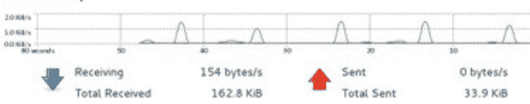

网络历史

图 2 GNOME 系统监控器 - 资源利用视图

最后一个标签页“文件系统”列出了所有本地和已挂载的文件，并显示了它们的使用情况和其他详细信息。

## 列出特定进程

通过我们在前面的小节中讨论的工具，我们可以获取大量关于进程的信息，包括 PID。RHEL 提供了 `pidof` 和 `pgrep` 命令，用于列出特定进程的 PID。这些命令有几个可用的选项；但它们最简单的用法是将进程名作为参数传递以查看 PID。例如，要列出 cron 守护进程的 PID，可以使用以下任一命令：

```
# pidof crond
# pgrep cron
```

## 按用户和组所有权列出进程

可以按所有者或所属组列出进程。我们可以使用 `ps` 命令来实现这一目的。例如，要列出所有属于 root 的进程，可以在命令中使用 `-U` 选项和用户名：

```bash
# ps -U root
PID TTY TIME CMD
1 ? 00:00:33 system
2 ? 00:00:00 kthreadd
3 ? 00:00:02 ksqd/0
5 ? 00:00:00 kworker/0:0
7 ? 00:00:00 migration/0
```

该命令列出了所有由 root 用户拥有的进程的 PID、TTY、时间和进程名。我们可以改用 `-G` 选项并指定所属组的名称来打印该组的进程：

```bash
# ps -G gumm
PID TTY TIME CMD
29124 ? 00:20:49 qemu-kvm
29155 ? 00:26:35 qenu-kvm
```

图形化系统监控工具也可用于按用户或组排序进程列表。

## 进程状态

进程在整个生命周期内会多次改变其运行状态。处理器负载、内存可用性、进程优先级以及其他应用程序的响应等因素会影响进程从一个状态跳转到另一个状态的频率。它可能会处于非运行状态，或者等待其他进程提供信息以便继续运行。如图 4-3 所示，共有五种基本状态。


进程在任何给定时刻处于一种状态。这些状态分别是运行、睡眠、等待、停止和僵尸，说明如下：

**运行（Running）：** 进程由系统 CPU 执行。

**睡眠（Sleeping）：** 进程正在等待用户或另一个进程的输入。

**等待（Waiting）：** 进程已收到其等待的输入，现在只要轮到它即可运行。

**停止（Stopped）：** 进程目前已挂起，轮到它时不会运行，除非收到信号改变其行为。

**僵尸（Zombie）：** 进程已死亡。僵尸进程在进程表中与其他进程并存，但不占用资源。它的条目会被回收，直到父进程允许其死亡。僵尸进程也被称为失效进程。

## 理解进程的 nice 值（Niceness）

进程在创建时具有特定的优先级，该优先级在初始化时基于一个称为 niceness（或 nice 值）的数值确立。共有 40 级 nice 值，-20 最高，+19 最低。大多数系统启动的进程使用默认的 0 nice 值。nice 值越高，进程的执行优先级越低；nice 值越低，优先级越高。换句话之，以较高优先级运行的进程会获得更多的 CPU 注意。子进程在优先级上继承其调用进程的 nice 值。虽然我们通常以默认 nice 值运行程序，但我们可能会选择以不同的 nice 值启动它们，以根据紧急程度和系统负载调整它们的优先级。

## 查看和更改进程的 nice 值

| PID | PRI | NI | USER | STIME | CMD |
|---|---|---|---|---|---|
| 4 | root | 0 | 0 | 13:48 | pol.77 00:00:36 /usr/lib/system/sys |
| 2 | root | 0 | 0 | root | - 00:00:00 [switched-systemd] |
| 1 | root | 0 | 0 | root | - 00:00:00 [kthreadd] |
| 5 | root | 2 | 0 | root | - 00:00:02 [softirqd/0] |
| 6 | root | 3 | 0 | root | - 00:00:00 [worker/0] |

上述输出表示前三个进程使用了默认 nice 值，而第四个使用了最高 nice 值 -20。这些值被进程调度器用于调整它们在 CPU 上的执行时间。

我们可以使用 `nice` 命令检查默认 nice 值：

```
# nice
0
```

启动时可以为程序或命令分配不同的 nice 值。例如，要以 nice 值为 +2 的较低优先级运行 `top` 命令，我们如下：

```bash
# nice -n 2 top
```

打开另一个终端并运行 `ps` 命令进行验证。查看第 7 和第 8 列中的优先级和 nice 值。

```bash
# ps -el | grep top
4 S 0 9191 29767 0 70 - 30945 poll_s pts/4 00:00:00 top
```

要以 nice 为 -10 的较高优先级运行程序，请使用双连字符指定该值：

```bash
# nice -n -10 top
```

在另一个窗口中验证：

```bash
# ps -el | grep top
4 S 0 9191 29767 0 70 - 30945 poll_s pts/4 00:00:00 top
```

我们可以看到，进程以较高的优先级 (70) 和 nice 值 -10 运行。

## 调整进程的 nice 值

运行进程的 nice 值可以通过 `renice` 命令进行更改。这种调整会影响正在运行会话。例如，要将正在运行进程的 nice 值从 -10 改为 +5，使用 `renice` 命令指定 PID：

```
# renice 5 <PID>
```

`renice` 命令还允许我们为特定用户拥有的进程设置 nice 值。

## 进程信号

如你所知，可能有成百上千个进程正在同时运行。通过发送控制信号来触发事件。每个信号与一个唯一标识相关并具有相应的操作。可用信号列表可以通过 `kill -l` 显示：

```
# kill -l
```

### 表 4-3 信号

| 信号值 | 信号名称 | 操作 |
|---|---|---|
| 1 | SIGHUP | 挂起终端断开 |
| 2 | SIGINT | 中断进程 |
| 3 | SIGQUIT | 退出进程 |
| 4 | SIGILL | 非法指令 |
| 5 | SIGTRAP | 陷阱 |
| 6 | SIGABRT | 终止（abort） |
| 7 | SIGTERM | 以优雅的方式终止进程 |
| 8 | SIGFPE | 浮点异常 |
| 9 | SIGKILL | 强制杀死进程 |
| 10 | SIGSTOP | 停止进程 |
| 11 | SIGCHLD | 子进程终止 |
| 12 | SIGCONT | 继续运行进程 |
| 13 | SIGUSR1 | 用户定义信号 1 |
| 14 | SIGUSR2 | 用户定义信号 2 |
| 15 | SIGTERM | (默认信号) |
| 16 | SIGSYS | 系统级调用 |
| 17 | SIGVTAL | 虚拟计时器报警 |
| 18 | SIGSTOP | 立即停止进程 |
| 19 | SIGWINCH | 窗口变化 |
| 20 | SIGTOU | 输出超时 |
| 21 | SIGINQ | 输入超时 |
| 22 | SIGTSTOP | 终端停止 |
| 23 | SIGURG | 紧急信号 |
| 24 | SIGFSZ | 文件大小崩溃 |
| 25 | SIGAL | 报警 |
| 26 | SIGALRM | 报警 |
| 27 | SIGOL | I/O 错误 |
| 28 | SIGINFO | 信息 |
| 29 | SIGIO | I/O |
| 30 | SIGPWR | 电源事件 |
| 31 | SIGUSR1 | 用户定义信号 1 |
| 32 | SIGUSR2 | 用户定义信号 2 |
| 33 | SIGUSR3 | 用户定义信号 3 |
| 34 | SIGUSR4 | 用户定义信号 4 |
| 35 | SIGUSR5 | 用户定义信号 5 |
| 36 | SIGUSR6 | 用户定义信号 6 |
| 37 | SIGUSR7 | 用户定义信号 7 |
| 38 | SIGUSR8 | 用户定义信号 8 |
| 39 | SIGUSR9 | 用户定义信号 9 |
| 40 | SIGUSR10 | 用户定义信号 10 |
| 41 | SIGUSR11 | 用户定义信号 11 |
| 42 | SIGUSR12 | 用户定义信号 12 |
| 43 | SIGUSR13 | 用户定义信号 13 |
| 44 | SIGUSR14 | 用户定义信号 14 |
| 45 | SIGUSR15 | 用户定义信号 15 |
| 46 | SIGUSR16 | 用户定义信号 16 |
| 47 | SIGUSR17 | 用户定义信号 17 |
| 48 | SIGUSR18 | 用户定义信号 18 |
| 49 | SIGUSR19 | 用户定义信号 19 |
| 50 | SIGUSR20 | 用户定义信号 20 |
| 51 | SIGUSR21 | 用户定义信号 21 |
| 52 | SIGUSR22 | 用户定义信号 22 |
| 53 | SIGUSR23 | 用户定义信号 23 |
| 54 | SIGUSR24 | 用户定义信号 24 |
| 55 | SIGUSR25 | 用户定义信号 25 |
| 56 | SIGUSR26 | 用户定义信号 26 |
| 57 | SIGUSR27 | 用户定义信号 27 |

# 任务调度

任务调度允许用户在未来某个时刻提交命令或程序执行。命令或程序的执行可以是定时的，也可以根据预定义的时间表进行。一次性执行通常安排在系统使用率低的时间。此类活动的一个例子是运行一个复杂的程序。相比之下，周期性活动包括备份、清理日志、监控系统、运行自定义脚本以及删除不需要的文件。

任务调度由两个守护进程负责：`at` 和 `cron`。`at` 管理未来运行一次的任务。`cron` 负责在预定义时间重复运行任务。启动时，两者都会从 `/var/spool/cron` 和 `/etc/cron` 目录加载调度，并存储在内存中供以后执行。它检查这些短间隔并更新内存中的调度以反映任何修改。该守护进程仅在调度时间运行，不进入错过的任务。相比之下，`at` 守护进程会在第二天同一时间重试错过的任务。


# at.allow / cron.allow | at.deny / cron.deny | 影响

| at.allow / cron.allow | at.deny / cron.deny | 影响 |
|---|---|---|
| 存在且包含用户条目 | 存在性很重要 | allow 文件列出的所有用户均被允许。 |
| 存在但为空 | 存在性很重要 | 不允许任何用户。 |
| 不存在 | 存在且包含用户条目 | 除了 deny 文件中的用户外，所有用户均被允许。 |
| 不存在 | 存在但为空 | 所有用户均被允许。 |

表 4-4 调度工具的访问限制

默认情况下，deny 文件是存在的，而 allow 文件不存在。这使得所有用户都完全访问并使用这两个工具。

> 考试小贴士：在相应的 allow 或 deny 文件中输入简单的用户名。

当未授权的用户尝试执行 `at` 命令时，会显示以下消息：

`You do not have permission to use.`

当未经授权访问 cron 服务时，会显示以下消息：

`You(1) are not allowed to use this program (crontab)`

`See crontab(1) for more information`

在两个例子中，我们在 deny 文件中都有 user1 的条目。

## 调度器日志文件

所有 `at` 和 `cron` 的活动都记录在 `/var/log/cron` 文件中。它记录了活动跟踪、主机名、PID 以及每次执行的消息等信息。该文件还记录 cron 服务的其他活动，如启动时间和延迟。下面显示了日志中的几个示例：

```
# /var/log/cron
Dec 4 08:50:01 host CROND[21588]: (root) CMD (usr/lib/64/sbin/cron 1)
Dec 4 08:59:20 host crontab[22331]: (user) AUTH crontab command not allowed
Dec 4 09:00:01 host CROND[22388]: (root) CMD (/usr/lib/64/sbin/cron 11)
Dec 4 09:01:02 host CROND[22496]: (root) CMD (run-parts /etc/cron.hourly)
Dec 4 09:01:02 host run-parts(/etc/cron.hourly) [22496]: starting @cron
```

## 使用 at

`at` 命令用于调度程序在未来的某单次执行。所有提交的任务都缓存在 `/var/spool` 目录中，并在指定的时刻由 `at` 守护进程执行。每个提交的任务都有一个文件，其中包含建立用户环境的所有设置以确保成功执行。该文件还包含要运行的命令或脚本名称。提交任务后不需要重启 `at` 守护进程。

使用 `at` 表达时间有多种方法。一些示例如下：

- at 凌晨 1:15
- at 中午
- at 23:45
- at 午夜
- at 明天 17:05
- 在凌晨 1:15 执行任务
- 在正午 12pm 执行任务
- 在晚上 11:45 执行任务
- 在凌晨 12am 执行任务
- 在第二天下午 5:05 执行任务
- 从现在起 5 小时后执行任务。我们可以指定分钟、天和月份
- at 3:00 15/15
- 在 2015 年 5 月 15 日凌晨 3 点执行任务

除非在使用 `at` 命令时通过 `-f` 选项指定文件名，否则 `at` 会假设年份为当前。命令将在指定的时刻执行该文件。例如，以下将在两小时后从 user100 的家目录运行 `script.sh`（创建此文件，添加 `ls` 命令，并确保它是可执行的）：

```
$ at -f ~/script1.sh + 2 hours
job 1 at Thu Dec 4 11:40:00 2014
```

默认情况下，它已作为 RHEL7 安装的一部分安装在系统中。你可以通过以下 `yum` 命令进行确认：

```
# yum list installed
at.x86_64 3.1.13-17.el7 @anaconda7.0
```

如果不存在此包，你可以运行 `yum` 安装它。详细的包管理请参阅第 05 章“管理软件包”。

```bash
# yum -y install at
```

## 练习 4-1：提交、查看、列表和删除 at 任务

此练习应在 host1 上进行。

在此练习中，你将以 root 用户身份提交一个任务，在 2015 年 6 月 30 日 13:30 运行，以搜索整个目录中的所有核心文件并将其删除。你将生成的输出和任何错误消息重定向到 `/tmp/core.out`。你将列出提交的任务并显示其内容进行验证，最后删除该任务。

1. 运行命令并为任务执行指定正确的时间。在 `at>` 提示符处按 `Ctrl+d`。

```
# at 11:30pm 6/30/15
at> find -name core -exec rm \; /tmp/core
at@ EOF
job 5 at Tue Jun 30 23:30:00 2015
```

系统分配了 ID 5。

2. 列出 `/var/spool/at` 下的任务：

```
# ls -l /var/spool/at
```

3. 显示任务内容进行验证：

```
# cat /var/spool/at/5
```

4. 最后删除任务：

```
# rm -f /var/spool/at/5
```

| 4 | 年份 | 有效值为 0 到 12 或 jan 到 dec。用法与小时中的分钟字段相同。 |
| 5 | 周几 | 有效值为 0 到 6 或 sun 到 sat，其中 0 代表周日，1 代表周一，依此类推。用法与小时中的分钟字段相同。 |
| 6 | 要执行的命令 | 指定要执行命令的路径名称，以及其所需的任何参数。 |

表 4-5 Crontab 语法描述

此外，在 crontab 文件中可以使用斜杠 (`/`) 字符配合 `*` 和范围使用步长值。步长值允许指定给定值的跳次数。例如，分钟字段中的 `*/2` 意味着每 2 分钟一次，`*/3` 意味着每 3 分钟一次，`0-59*/4` 意味着每 4 分钟一次，依此类推。小时、日期、年份和星期几字段也以相同的方式支持步长值。

> 提示：确保你理解 crontab 文件中字段的顺序。

## 练习 4-2：添加、列出和删除 Cron 任务

此练习应由所有当前具有 cron 权限的用户完成。

在此练习中，你将为 user100 提交一个 cron 任务，在该用户的家目录下运行 `script100.sh`（创建此文件，添加 `"echo Hello, this is a test"`，并确保脚本对 user100 可执行）。你将安排该脚本在每月 15 号的 15 日凌晨 1 点到凌晨 5 点每 5 分钟执行一次。你将把输出重定向到 `/tmp/script100.out` 文件，列出 cron 条目并将其删除。

1. 以 user100 身份，打开 crontab 并添加以下计划：

```bash
crontab -e
*/5 1-5 * * * /home/user100/script100.sh > /tmp/script100.out
```

2. 以 root 身份，检查 `/var/spool/cron` 目录下是否存在名为 `user100` 的新文件：

```bash
ls -l /var/spool/cron/user100
# -rw------- 1 user100 root 68 Jan 4 19:26 user100
```

3. 以 root 身份，编辑 `/etc/cron.allow` 文件并将 user100 添加到其中：

```
user100
```

4. 以 user100 身份，列出 crontab：

```bash
crontab -l
*/5 1-5 * * * /home/user100/script100.sh > /tmp/script100.out
```

5. 以 user100 身份，删除 crontab 并确认删除：

```bash
crontab -r
crontab -l
```

## 本章总结

本章从对 bash shell 的讨论开始。bash 拥有许多功能，但我们只触及了几个常用的功能。这些功能包括变量设置、命令提示符、重定向、命令行编辑、命令历史、制表符补全、文本替换、正则表达式和元字符。

然后我们学习了如何理解用户和脚本进程的运行、它们拥有什么资源、由谁在运行、它们的执行优先级是什么，这对于整个系统的性能和健康以及系统管理员来说至关重要。我们学习了以不同的方式处理进程。我们查看了五种进程状态、用于增加和减少进程优先级的 niceness 和 reniceness，以及信号以及它们是如何传递给运行进程的。

最后一个主题涵盖了提交和管理一次性运行或循环运行的任务。我们查看了控制任务执行的守护进程，以及允许或不允许用户提交作业的控制文件。

我们查看了存储所有执行任务信息的日志文件。我们回顾了 crontab 文件的语法，并查看了用于 cron 任务任务提交的多种日期/时间格式。我们执行了两个练习以掌握它们的用法。

## 本章复习题

1. 默认的命令行编辑器是？
2. 当 cron 守护进程执行作为 `*/ * 10 2-6 * */home/user1/script.sh` 提交的任务时，它会如何运行？
3. 查看系统上运行进程的另一个命令是什么？
4. 列出管道符号的两种用途。
5. 用于列出特定进程 PID 的两个命令是什么？
6. Linux 中的后台进程通常被称为什么什么？
7. 默认的 nice 值是多少？
8. 父进程获取其子进程的 nice 值。对或错？
9. 当系统具有唯一标识符 UID 时，nice 命令会显示什么？对或错？
10. `*allow` 存在吗？对或错？
11. 我们为什么要使用 rename 命令？
12. 哪个用户不需要在 `*.allow` 或 `*.deny` 中显式定义即可运行 cron 任务？
13. 当使用 `at` 命令时，在 `01:00 12/12/15` 提交的任务会在什么时候运行？
14. 已知进程 PID 时，我们可以杀死进程的两个命令是什么？
15. crontab 文件的存储目录位置在哪里？
16. `*allow` 存在吗？对或错？
17. 写出三种引用机制。
18. 调度守护进程在哪里执行任务存储？
19. 我们可以使用哪个命令来编辑 crontab？
20. 发送应用程序错误消息的默认位置是系统日志文件。对或错？
21. 修改 `/etc/crontab` 文件后如何重启 cron？对或错？
22. 五种进程状态是什么？
23. 信号 9 用于软终止。对或错？

## 本章复习答案

1. 默认的命令行编辑器是 Emacs。
2. cron 守护进程将每分钟运行一次。
3. `top` 命令。
4. 管道可以作为或 操作符并发送输出。
5. `pidof` 命令。
6. 后台进程被称为守护进程 (daemons)。
7. 默认 nice 值为零。
8. 错。子进程继承父进程。
9. nice 命令在执行时显示默认的 nice 值。
10. 错。它调用 PID。
11. rename 命令用于更改进程的别名。
12. root 用户。
13. at 命令将在 12 月 15 日运行该任务。
14. `kill` 和 `killall` 命令。
15. crontab 文件存储在 `/var/spool/cron`。
16. 错。存在 `*.allow` 文件。
17. 三种引用机制是反斜杠、单引号和双引号。
18. 调度守护进程将执行任务的信息存储在 `/var/log/cron` 中。
19. 我们可以使用 `crontab` 命令的 `-e` 选项进行编辑。
20. 默认位于屏幕。
21. 错。修改 crontab 后不需要重启 cron 守护。
22. 五种进程状态是运行 (running)、睡眠 (sleeping)、等待 (waiting) 和僵死 (zombie)。
23. 对。信号 9 强制杀死进程。

## DIY 实验

以下实验有助于加强本章学习的概念和主题。预计在没有额外帮助的情况下完成这些实验。提供了步骤指南，因为实施这些实验需要本章介绍的知识。缺失的信息使用默认值或自己的思考。

### 实验 4-1：自定义 Shell 提示符

以 user1 身份登录 host1，自定义主提示符显示引号内的信息 "username@hostname in directory_location:"

### 实验 4-2：重定向标准输入、输出和错误

以 user1 身份登录 host1 并重定向 `ll` 命令到 `/etc`、`/dvd` 和 `/var` 目录。让输出显示在屏幕上的同时重定向到 `/tmp/output` 文件，并将错误转发到 `/tmp/ioerror`。执行命令后检查两个文件。

### 实验 4-3：Nice 和 Renice 进程

以 root 身份在 host1 上打开两个终端会话。在一个终端上运行 `system-config-users` 命令。在另一个终端运行命令确定 `system-config-users` 命令的 PID 和 nice 值。在第一个终端停止 `system-config-users` 并以 +8 的较低优先级重新运行。在第二个终端运行相应的命令确认新的 nice 值。将 `system-config-users` 进程的优先级提高到 -10 并验证。

### 实验 4-4：配置用户 Crontab 文件

以 user1 身份登录 host1 并创建一个 cron 条目，运行 `find` 命令在整个目录结构中搜索核心文件并在发现时删除。在 cron 中安排此命令，使其每隔一个月的每天凌晨 6 点 15 分运行一次。如果 user1 尚未授权调度 cron 任务，请以 root 身份为其添加条目。

# 管理软件包

- Red Hat 软件包概述、其命名、依赖关系、数据库
- Red Hat 订阅管理服务、其组件和优势
- 注册和注销系统，以及绑定和解绑订阅
- 使用 `rpm` 命令列出、安装、升级、刷新、查询、移除、提取、验证和检查软件包，使用 `yum` 获取相关信息
- yum 仓库概述以及如何创建一个
- 使用 `yum` 列出、安装、更新、搜索、移除和检查软件包的可用性，并同步包头信息
- 使用图形化工具 PackageKit 添加、查看、更新和移除软件包

## RHCSA 目标

41. 从 Red Hat Network、远程仓库或本地文件系统安装并更新软件包。

Red Hat 管理系统最初被创建为 Red Hat Package Manager（Red Hat 软件包管理器），现在被称为 RPM 软件包管理器（RPM）。RPM 也指以特殊格式打包在一起并以 `.rpm` 扩展名存储的一个多个文件。这些 `.rpm` 文件（也称为 rpms、rpm 包或包）由 RPM 管理系统进行操作。此文件中包含的每个包（也适用于 RHEL 及其衍生版本）都是这种格式。软件包具有意义的名称，并包含文件以及关于每个包含文件的所有权、权限和目录位置等元数据。软件包可以从本地下载并安装，也可以从网络共享进行访问。为了能够成功安装和正常运行，它们可能需要额外的文件、另一个软件包或其他软件包。一旦软件包被安装并将其元数据存储在软件包数据库中，每次尝试更新该包时都会同时更新其元数据信息。

Red Hat 订阅管理服务是一个为拥有有效订阅的 Red Hat 提供的基于网络的环境，用于订阅和管理内容更新。它需要客户注册才能访问，并且可以通过 RHEL 系统直接访问该服务，仅管理该系统的订阅和内容。

RHEL 为系统上安装和管理 RPM 软件包提供了强大的工具。`rpm` 命令非常灵活并提供了许多选项；`yum` 优于 `rpm` 的地方在于它可以自动解决软件包依赖关系。PackageKit 提供了用于添加、更新和移除软件包的图形化工具。

## 软件包概述

RHEL 本质上是一组组合在一起形成操作系统的 RPM 软件包。它构建在 Linux 内核之上，包含了数千经过数字签名、测试和认证的软件包。接下来的子节将介绍与软件包元数据相关的几个概念。

## 软件包与打包

软件包是一组组织在目录结构中的文件和元数据，构成了一个软件应用程序。软件包包含的文件包括安装脚本、配置文件、库文件、命令和相关文档。文档包含了有关如何安装和卸载软件包的详细说明、配置文件和命令的帮助页（man pages），以及与软件包安装和使用的其他必要信息。

所有与软件包相关的元数据都存储在中心位置，包括软件包版本信息、安装位置、校验和值以及包含的文件及其属性列表。这使得软件包管理工具能够通过引用这些元数据来高效地处理软件包管理任务。

## 软件包命名

Red Hat 软件包遵循标准的命名规范。通常，一个软件包的命名分为五个部分：第一部分包含包名，随后是软件包版本、软件包发行版本（修订或构建版本）以及它所构建的企业 Linux 架构。可安装的软件包始终具有 `.rpm` 扩展名；然而，该扩展名会从可安装包名称中移除。

例如，如果一个可安装软件包的名称为 `openssl-1.0.1-34.el7.x86_64.rpm`，那么通过 `rpm` 和 `yum` 命令报告的安装名称为 `openssl-1.0.1-34.el7.x86_64`。以下是软件包中每个部分的描述：

- openssl – 软件包名。
- 1.0.1 – 软件包版本。
- 34 – 软件包发行版本。
- el7 – 代表 Enterprise Linux 7。某些软件包包含它，某些没有。
- x86_64 – 创建该软件包的处理器架构。如果我们看到 "noarch"，则该软件包是与平台无关的，可以安装在任何硬件架构上。如果我们看到 "src"，则它将包含软件包的源代码。
- .rpm – 扩展名。

## 软件包依赖关系

一个可安装的软件包可能需要某些软件包的存在才能成功安装。同样，许多软件包需要其他软件包的存在才能顺畅运行。这被称为软件包依赖关系，即一个包在安装或执行依赖于一个或多个包。


## 软件包数据库

已安装软件包的元数据存储在 `/var/lib/rpm` 目录。该目录位置被称为软件包数据库，软件包管理工具通过它来获取有关所有权、权限、时间戳和文件大小的信息。软件包数据库还包含软件包依赖关系信息。这些信息有助于软件包管理验证依赖关系和文件属性、升级以及卸载软件包。

## Red Hat 订阅管理服务

Red Hat 订阅管理 (RISM) 服务由 Red Hat 提供，用于全面的订阅管理，是旧版 Red Hat Network 的替代品。Red Hat 通过订阅其产品，以二进制和源码形式提供软件更新、技术支持以及受支持软件版本的访问。您根据 IT 要求和您计划在环境中使用的 Red Hat 软件购买订阅。您根据操作系统和运行文件向 RISM 注册系统并为其绑定订阅。

## Red Hat 客户门户

RISM 通过客户门户为 Red Hat 客户提供访问基于网络的工具，用于添加、组织、清单、检查状态、跟踪和报告所有订阅。图 5-1 显示了您登录后的订阅概述。

## 订阅资产管理器

本地管理及其订阅可以使用订阅资产管理器 (SAM) 进行管理。SAM 允许您通过清单从客户门户导入权限，并授予系统访问权限。控制本地系统的 SAM 超出了本书的范围。

## 订阅管理器

单个系统的订阅也可以通过安装在系统上的名为 `subscription-manager` 的订阅管理器客户端进行管理。该应用程序具有图形和命令行界面，它可以管理本地系统订阅。`subscription-manager` 命令有多个执行各种操作的子命令。部分命令见表 5-1。

| 子命令 | 描述 |
|---|---|
| attach | 为注册的系统绑定订阅。 |
| auto-attach | 自动绑定匹配的订阅。 |
| clean | 清除系统和订阅数据。 |
| list | 列出订阅和产品信息。 |
| register / unregister | 向客户门户注册（注销）系统。 |
| remove | 移除订阅信息。 |
| repos | 列出可用仓库。 |
| status | 显示订阅和产品状态。 |

表 5-1 subscription-manager 命令

## 注册系统并绑定订阅

如果您有一个有效订阅，可以通过运行 `subscription-manager` 命令在命令行注册并绑定订阅，您需要提供有效的凭据来完成这些任务。

```bash
# subscription-manager register --auto-attach
Username:
Password:
系统已注册，ID 为: 2c98a650-f4e8-4241-a3b8-ce5fb08ce251
已安装产品当前:
产品名称: Red Hat Enterprise Linux Server
状态: 已订阅
```

在系统注册并绑定订阅后，可以通过运行订阅管理器（应用程序 | 系统工具 | Red Hat 订阅管理器）来查看信息。将出现一个带有三个选项页的仪表板，如图 5-2 所示。

### 图 5-2 Red Hat Subscription-Manager 控制面板 1/2

“已安装产品”选项卡显示产品名称及其版本、订阅状态、有效期和订阅详情。

“我的订阅”选项卡如图 5-3 所示，显示了更详细的订阅和系统信息。

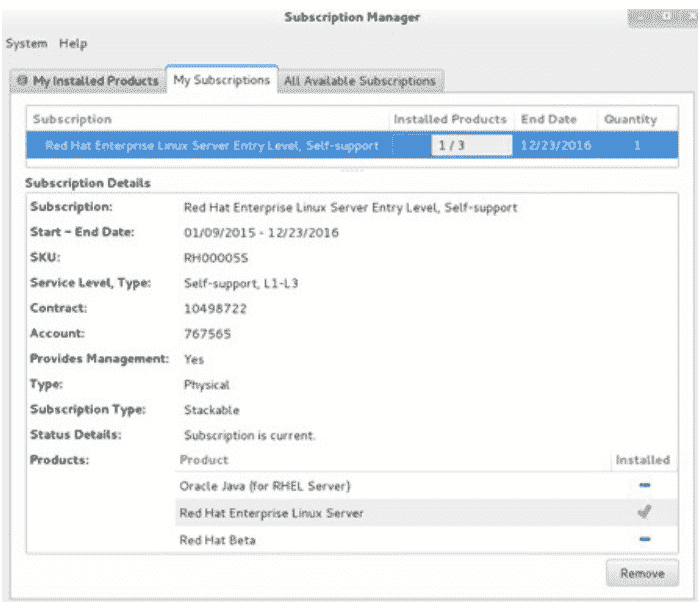

最后一个选项卡（未显示）列出了所有订阅的信息。

## 解除订阅并取消系统注销

你可以使用 `subscription-manager` 命令移除分配给系统的订阅并取消注册。最后，运行带有 `clean` 选项的命令以删除存储在本地系统的任何数据。

```bash
# subscription-manager remove --all
Subscription removed from the server.
1 local certificate has been detected.
# subscription-manager unregister
System has been unregistered.
# subscription-manager clean
All local data removed
```

上述操作可以通过 Subscription-Manager 的图形界面实现。

## 使用 rpm 管理软件包

本节讨论了使用 `rpm` 命令进行软件包管理的任务，包括安装、升级、刷新、覆盖、查询、删除、提取、验证和校验软件包。该命令的一个注意事项是它不会自动满足软件包依赖，这在软件安装和升级过程中可能会变成棘手问题。

在进入细节之前，让我们来看表 5-2，它显示了用于 `rpm` 命令的一些常用选项。

### 查询选项

| 查询选项 | 说明 |
|---|---|
| -q | 查询并显示软件包。 |
| -qa | 查询所有已安装的软件包。 |
| -qc | 显示配置文件。 |
| -qd | 显示文档文件。 |
| -qf | 显示文件信息。 |
| -qi | 显示软件包信息。 |
| -ql | 列出软件包中的文件。 |
| -q --whatprovides | 列出提供指定软件包或文件的软件包。 |
| -q --requires | 列出需要指定软件包或文件的软件包。 |
| -qR | 列出依赖。 |

### 安装选项

| 选项 | 说明 |
|---|---|
| -F | 升级现有软件包。 |
| -i | 安装软件包。 |
| -U | 升级现有软件包，或在未安装时进行安装。 |
| -h | 显示进度。 |
| --force | 如果已存在相同版本，则安装软件包。 |
| --replacepkgs | 覆盖现有软件包。 |

### 其他选项

| 选项 | 说明 |
|---|---|
| -e | 移除软件包。 |
| --import | 导入公钥。 |
| -K | 验证签名和软件包完整性。 |
| -v or -vv | 显示详细信息。 |
| -V | 校验软件包文件的完整性。 |

表 5-2 rpm 命令选项

在查看软件包管理任务之前，请使用 `mount` 命令将 RHEL7 DVD 挂载到 `/mnt` 点。将 DVD 介质插入目录并运行以下命令：

```bash
# mount /dev/cdrom /mnt
```

如果你将 RHEL7 ISO 拷贝到此目录，可以挂载该镜像而不是实际的 DVD。以下操作假设 ISO 位于 `/var/rhel7` 目录，文件名为 `rhel-server-7.0-x86_64-dvd.iso`：

```bash
# mount -o loop /var/rhel7/rhel-server-7.0-x86_64-dvd.iso /mnt
```

在这里，`loop` 选项告诉命令被挂载的不是块可挂载设备，而是可挂载的镜像文件。该系统将 ISO 镜像视为可以通过挂载点访问的真实系统。你可以使用 `df` 命令确定上述操作使用的循环设备（在此情况下为 `/dev/loop0`）：

```bash
# df -h | grep mnt
/dev/loop0  3654720  3654720      0 100% /mnt
```

## 查询软件包

查询一个、多个或所有软件包都会搜索所需信息并显示在屏幕上。以下是一些示例。

查询所有已安装的软件包：

```bash
# rpm -qa
3libxx@misc-1.0.3-7.1.el7.x86_64
perl-HTTP-Tiny-0.033-3.el7.noarch
baob3-3.8.2.el7.x86_64
......
......
```

查询指定软件包是否安装：

```bash
# rpm -q perl
perl-5.16.3-283.el7.x86_64
```

列出软件包中的所有文件：

```bash
# rpm -ql iproute
etc/iproute2
etc/iproute2/rematch_map
/etc/iproute2/group
```

仅列出软件包中的文档文件：

```bash
# rpm -qd audit
/usr/share/doc/audit-2.3/COPYING
/usr/share/doc/audit-2.3/ChangeLog
/usr/share/doc/audit-2.3/README
```

仅列出软件包中的配置文件：

```bash
# rpm -qc coreutils
/etc/DIR_COLORS
/etc/DIR_COLORS.256color
/etc/DIR_COLORS.lightbgcolor
/etc/profile.d/colors.sh
```

识别该文件属于哪个软件包：

```bash
# rpm -qf /etc/passwd
setup-2.8.1-4.el7
```

显示关于软件包的信息：

```bash
# rpm -qi setup
Name:            setup
Version:         2.8.1
Release:         4.el7
Architecture:    noarch
Install Date:    Tue 08 Aug 2014 12:46:50 PM
Group:           SystemEnvironment/base
Size:            69610
License:         Public
Signature:       SHA256:Wed 02 Apr 2014 01:14:29 PM, Key ID: 192f64dd51
Source RPM:      setup-2.8.1-4.el7.rpm
Build Date:      Wed 12 Mar 2014 12:08:24 PM
Build Host:      elf-64.build.redhat.com
Relocations:     (not relocatable)
Package:         Red Hat, Inc. <http://bugzilla.redhat.com>
Vendor:          Red Hat, Inc.
URL:             https://redhat.com/setup
Summary:         A set of system configuration and files
Description:     setup contains a set of system configuration and files, such as password, group, and profile.
```

列出指定软件包的依赖：

```bash
# rpm -qR sh
/sbin/ldconfig
/lib64/ldconfig.so
```

查询软件包是否已安装：

```bash
# rpm -qi /mnt/packages/sh
Name:            sh
Version:         0.0.2
Release:         7.47
Architecture:    x86_64
Install Date:    (not installed)
Group:           SystemEnvironment/Shells
Size:            58433
License:         MIT
Signature:       SHA256:Wed 02 Apr 2014 06:53:21 PM, Key ID: 192f64dd51
Source RPM:      sh-0.0.2-7.47.rpm
Build Date:      Tue 28 Jan 2014 02:11:17 PM
Build Host:      x86_64.build.redhat.com
Relocations:     (not relocatable)
Package:         Red Hat, Inc. <http://bugzilla.redhat.com>
Vendor:          Red Hat, Inc.
URL:             http://source.org/
Summary:         强大的交互式 shell
Description:     sh 是一个交互式 shell 解释器和命令处理器。Sh 替换了 ish (Korn)，但许多增强。Sh 支持命令行编辑、拼写检查、命令补全、shell 函数（带参数）、历史机制等。
```

确定哪些软件包需要指定的软件包才能运行：

```bash
# rpm -q --whatrequires iproute
iputils-4.9.17-1.el7.x86_64
dbus-4.2.5-27.el7.x86_64
dracut-network-003-161.el7.x86_64
libvirt-daemon-libvirt-1.1.20.el7.x86_64
NetworkManager-0.9.9-11.el7.x86_64
krbutils-1.0.29-2.el7.x86_64
```

## 安装软件包

安装软件包会创建软件包所需的目录结构并安装所需文件。以下命令在系统中安装软件包 `sh-5.0.2-7.el7.x86_64.rpm`：

```bash
# rpm -ivh /mnt/Packages/sh-5.0.2-7.el7.x86_64.rpm
Preparing...
Updating/installing...
sh-5.0.2-7.el7
```

如果此软件包需要任何缺失软件包，你将看到与依赖相关的错误消息。必须先安装缺失软件包才能成功加载此软件包。

或者，你可以指定 `--force` 选项在缺少依赖包的情况下安装软件包。不建议这样做，因为会强制安装软件包并在已存在相同版本时覆盖现有文件。

如果 sh 软件包位于远程 ftp 主机 `host1.example.com` 的 `/pub/outgoing` 仓库中，你需要使用 `rpm` 命令指定 ftp 服务器名称和软件包位置：

```bash
# rpm -ivh ftp://host1.example.com/pub/outgoing/sh-5.0.2-7.el7.x86_64.rpm
```

该语法允许在 http 服务器上安装软件包；只需更改协议名称和位置即可。

## 升级软件包

升级软件包提供升级后的软件包，前提是已存在软件包的旧版本。在存在旧版本的情况下，升级将安装软件包。

升级软件包 `sushi-3.8.1-3.el7.x86_64.rpm`，使用 `-U` 选项：

```bash
# rpm -Uvh /mnt/Packages/sushi-3.8.1-3.el7.x86_64.rpm
```

该命令在升级过程中对所有影响的配置文件进行备份，并添加 `.rpmsave` 扩展。在上面的示例中，由于系统中没有 sushi 软件包，因此执行的是安装。

## 刷新软件包

刷新软件包要求已存在软件包的旧版本。

刷新软件包 `sushi-3.8.1-3.el7.x86_64.rpm`，使用 `-F` 选项：

```bash
# rpm -F /mnt/Packages/sushi-3.8.1-3.el7.x86_64.rpm
```

要从 DVD 中的软件包刷新所有已安装的软件包，执行以下命令：

```bash
# rpm -F /mnt/Packages/*.rpm
```

## 覆盖软件包

覆盖软件包会用相同版本的软件包替换现有文件。

覆盖软件包 `zsh-5.0.2-7.el7.x86_64.rpm`，使用 `--replacepkgs` 选项：

```bash
# rpm -ivh --replacepkgs /mnt/Packages/zsh-5.0.2-7.el7.x86_64.rpm
```

## 移除软件包

移除软件包会卸载该包以及所有关联文件和目录结构。

要移除软件包 zsh，请使用 `-e` 选项，并选择 `-v` 以显示详细信息：

```bash
# rpm -e zsh
Preparing packages...
zsh-5.0.2-7.el7.x86_64
```

此命令会执行依赖检查，查看是否有任何包需要当前被删除的包；如果确定某些其他包对其有依赖关系，则执行失败。

## 从可安装包中提取文件

可安装的 RPM 包中的文件可以使用 `rpm2cpio` 命令提取。每个包包含放置在目录中的若干文件，可以提取它们以替换损坏、丢失或关键的配置文件。例如，要提取丢失的 `/etc/ntp.conf` 文件，请使用下面的命令确定哪个包包含它：

```bash
# rpm -qf /etc/ntp.conf
ntp-4.2.6ps-8.el7.x86_64
```

假设包位于 `/mnt/Packages/` 目录下，使用 `rpm2cpio` 命令提取 (`-i`) ntp 包的所有文件并创建 (`-d`) 目录结构，如下：

```bash
# cd /tmp
# rpm2cpio /mnt/Packages/ntp-4.2.6ps-8.el7.x86_64.rpm | cpio -id
27 blocks
```

运行 `ll` 查看提取出的目录结构：


```bash
# ls
etc:
total 4
drwxr-xr-x. 3 root root 60 Sep 19 11:29 dhcp
drwxr-xr-x. 3 root root 60 Sep 19 11:29 ntp
-rw-r--r--. 1 root root 1992 Sep 19 11:29 ntp.conf
drwxr-xr-x. 2 root root 60 Sep 19 11:29 ntpconfig
ntp:
total 0
drwxr-xr-x. 3 root root 60 Sep 19 11:29 bin
drwxr-xr-x. 3 root root 60 Sep 19 11:29 lib
drwxr-xr-x. 2 root root 160 Sep 19 11:29 sbin
drwxr-xr-x. 4 root root 80 Sep 19 11:29 share
var:
total 0
drwxr-xr-x. 3 root root 60 Sep 19 11:29 lib
drwxr-xr-x. 3 root root 60 Sep 19 11:29 log
```

上述输出显示了提取的包含所有 NTP 文件的 `etc`、`usr` 和 `var` 目录。`ntp.conf` 文件位于 `etc/` 下。

将其复制到 `/etc` 目录，现在就可以恢复工作了。

## 验证软件包的完整性和可信度

软件包在被复制到另一个位置、从网络或其他地方下载之后、安装之前，可以对其进行完整性（完整且无错误状态）和可信度检查。我们可以使用 MD5 校验来验证其完整性，并使用 GNU 隐私守护（GnuPG 或 GPG）公钥签名来确保交付或发布者的可信度。这将确保我们使用的是未受损坏且真实的软件。

要检查位于 `/mnt/Packages/` 的如 `zsh-5.0.2-7.el7.x86_64.rpm` 包的完整性，请如下所示运行 `rpm` 命令：

```bash
# rpm --nosignature /mnt/packages/zsh-5.0.2-7.el7.x86_64.rpm
/mnt/packages/zsh-5.0.2-7.el7.x86_64.rpm: sha1 md5 OK
```

输出中的 `OK` 确认软件包没有损坏。

Red Hat 使用 GPG 密钥对产品和更新进行签名，并为 RHEL 产品包含了必要的公钥，这些密钥位于安装介质上的文件中，并在安装期间被复制到 `/etc/rpm-gpg/` 目录。表 5-3 列出了该目录下的文件以及 GPG 密钥的简要描述。

| GPG 文件 | 描述 |
| --- | --- |
| `RPM-GPG-Key-redhat-release` | 用于 2009 年 11 月之后的包及其更新。 |
| `RPM-GPG-Key-redhat-beta` | 用于 2009 年 11 月之后包含的 beta 测试。 |
| `RPM-GPG-Key-legacy-release` | 用于 2006 年 11 月之后的包及其更新。 |
| `RPM-GPG-Key-legacy-former` | 用于 2006 年 11 月之前的包及其更新。 |
| `RPM-GPG-Key-legacy-rhx` | 用于由 Red Hat Exchange 分发的包。 |

表 5-3 Red Hat GPG 密钥文件

要检查软件包的有效性，我们需要导入相关的 GPG 密钥然后验证软件包。从上表，我们现在知道最近发布的包的 GPG 文件是 `RPM-GPG-Key-redhat-release`。在下面的示例中，我们将运行命令来导入 GPG 密钥，然后使用 `rpm` 选项验证 `zsh-5.0.2-7.el7.x86_64.rpm` 的签名：

```bash
# rpm --import /etc/rpm-gpg/RPM-GPG-Key-redhat-release
# rpm --verify /mnt/packages/zsh-5.0.2-7.el7.x86_64.rpm
```

`OK` 验证了软件包签名的真实性。

导入的 GPG 密钥可以通过 `rpm -q` 命令查看。我们可以列出密钥及其详细信息。

| 字段 | 值 |
| --- | --- |
| Name | gpg-pubkey |
| Version | 84331955 |
| Release | ae0499 |
| Architecture | (none) |
| Install | 1 |
| Size | 0 |
| Signature | (none) |
| Build Date | Oct 27 09:59 |
| Host | localhost |
| Relocation | (not applicable) |
| Publisher | Red Hat, Inc. <security@redhat.com> |
| Summary | Red Hat, Inc. <security@redhat.com> |
| Description |  |
| GPG PUBLIC KEY | RSA PUBLIC KEY BLOCK Version: 4098 mIIBCjADANBgkqkiG9w0BAQEFAAOC8AMIIBCgKEA7vS66V1A99W9Q0P67X8X8X8M8ZF8888888888888888888888888888888888888888999999999999999999999 |

```bash
# rpm -V cronie-1.4.11-11.el7.x86_64
etc/cron.d/
etc/cron.d/hourly
etc/cron.d/deny
etc/cron.d/crowd
etc/cron.d/allow
etc/sysconfig/cron
etc/crontab
usr/bin/systemd/system/cron.service
usr/sbin/cron
usr/share/doc/cronie-1.4.11/
usr/share/doc/cronie-1.4.11/AUTHORS
usr/share/doc/cronie-1.4.11/COPYING
usr/share/doc/cronie-1.4.11/Changelog
usr/share/doc/cronie-1.4.11/INSTALL
usr/share/doc/cronie-1.4.11/README
var/spool/cron
```

## 练习 5-1：使用 rpm 执行包管理任务

本练习应在 host1 上完成。

在本次练习中，我们将验证位于 RHEL 安装目录 `/mnt/Packages` 下的软件包 `dcraw` 包的完整性和真实性，并显示该包的基本信息、其包含的文件、拥有的文档、验证包属性并删除该包。

1. 确保 RHEL7 安装介质在 DVD 中并挂载到 `/mnt`。如果不是，运行以下命令进行挂载：

```bash
# mount /dev/cdrom /mnt
mount: /dev/cdrom 是写保护的，以只读方式挂载
```

2. 在 `/mnt/Packages` 目录上运行 `ll` 命令确认 `dcraw` 包是否存在：

```bash
# ll /mnt/Packages/dcraw
-rw-r--r-- 61 root root 232524 Apr 10 03:37 /mnt/Packages/dcraw-9.19-6.el7.x86_64.rpm
```

3. 运行 `rpm` 命令并验证包的完整性和可靠性：

```bash
# rpm -K /mnt/Packages/dcraw-9.19-6.el7.x86_64.rpm
/mnt/Packages/dcraw-9.19-6.el7.x86_64.rpm: sha1 (5) gpg md5 OK
```

4. 安装该包：

```bash
# rpm -iv /mnt/Packages/dcraw-9.19-6.el7.x86_64
Preparing...
Updating/installing...
dcraw-9.19-6
```

5. 显示该包的基本信息：

```bash
# rpm -ql dcraw
Name : dcraw
Version : 9.19
Release : 6.el7
Architecture : x86_64
Install Date : Fri 19 Sep 2014 09:33:36 AM EDT
Group : Applications/MultiUser
```

6. 显示该包包含的所有文件：

```bash
# rpm -ql dcraw
usr/bin/dcraw
usr/share/locale/en/LC_MESSAGES/dcraw.mo
```

7. 列出该包拥有的文档文件：

```bash
# rpm -qd dcraw
/usr/share/man/man1/dcraw.1.gz
```

8. 验证包中文件的属性：

```bash
# rpm -V dcraw
```

9. 删除该包：

```bash
# rpm -e dcraw
```

## 使用 yum 管理软件包

`yum` 命令（yellowdog updater）是用于包管理的 `rpm` 命令的前端。该实用工具要求您的系统能够访问软件仓库，这可能需要或不需要用户账户登录。红帽管理服务（Red Hat Management service）提供软件仓库的访问，但仅限于订阅者。还有其他基于 Web 的仓库托管了您系统可能需要的软件包。CentOS 仓库就是其中一个不需要订阅的仓库；您可以在系统上设置本地仓库并向其添加软件包。然后您可以在 `/etc/yum.repos.d/` 为该仓库创建一个定义文件。使用 `yum` 命令的主要优点是它可以通过从发现任何所需包的地方下载并安装任何所需的包来自动解决依赖关系。订阅者的默认仓库是可以通过 RSHM 获取的仓库。`yum` 命令非常多功能，提供了执行某些任务的方法。请检查手册页了解如何灵活地使用此命令。

## Yum 配置文件

`yum` 的配置文件是 `/etc/yum.conf`。文件中的 `main` 部分包含对 `yum` 操作具有全局影响的指令。您可以为想要在系统上设置的每个自定义仓库定义单独的部分。然而，更好的方法是将仓库存储在 `/etc/yum.repos.d/` 中，这是为此目的创建的默认位置。`yum.conf` 文件的默认内容如下：

```bash
# @etc/yum.conf
[main]
baseurl=/var/cache/yum/$basearch/
keep=0
debuglevel=2
logfile=/var/log/yum.log
exact=1
obsolete=1
gpgcheck=1
plugin=1
installonly_limit=3
```

表 5-6 解释了上述指令。

| 指令 | 说明 |
|---|---|
| `cachedir` | 指定存储 yum 下载内容的位置。默认是 `/var/cache/yum/$basearch/$release`。（注意：`$variables` 是变量） |
| `keepcache` | 指定在成功安装后是否存储包和头部缓存。默认是 0。 |
| `debuglevel` | 指定调试信息记录在日志文件的级别。默认是 2。 |
| `logfile` | 指定 yum 活动日志文件的位置和名称。默认是 `/var/log/yum.log` |
| `exact` | 指定仅更新与已安装包 CPU 架构匹配的包。默认是 1。 |
| `obsolete` | 检查并替换过时的包。默认是 1。 |
| `gpgcheck` | 指定是否检查包的 GPG 签名。默认是 1。 |
| `plugins` | 指定下载时包含插件。默认是 1。 |
| `installonly_limit` | 由 `installonly` 指令指定的同时保留的软件包的最大版本数。默认是 3。 |

表 5-4 包含了 `/etc/yum.conf` 中的、我们可能想要在 `main` 部分或自定义仓库部分设置的额外指令。可以使用 `yum-config-manager` 查看这些指令：

## Yum 仓库（或简单仓库）

Yum 仓库（或简单仓库）是存储软件包的数字库。访问仓库用于包检索、查询、更新，它可能是付费的或免费的。互联网上有许多由软件发行（如红帽和 CentOS）维护的仓库。此外，您可以通过创建存储不同类型软件和同一软件多个版本的仓库来拥有自己的内部 IT。系统会自动处理依赖关系并有助于保持一致性。如果您开发或构建了一个新包，可以将其存储在红帽管理服务和 CentOS 等可靠源中，以防止系统出现潜在损坏。

下面显示了一个带有某些关键指令的示例仓库文件：

```bash
[rhel7.repo]
name=rhel7.repo
baseurl=file:///mnt
enabled=1
gpgcheck=0
```

> 提示：学会使用 URL 配置 yum 仓库对于考试至关重要。使用双斜杠指定 FTP、HTTP 或 NFS 源。本地路径定义为 `file:///local/path`（三个斜杠），FTP 路径、HTTP 路径或 NFS 路径分别为 `http://hostname/network_path`。网络路径应包含可解析的主机或地址。

## yum 命令

在进入更多细节之前，让我们看看表 5-7 并理解一些与 `yum` 一起使用的命令。

| 子命令 | 说明 |
|---|---|
| `check-update` | 检查已安装包是否有更新。 |
| `clean` | 清除缓存数据。 |
| `group install` | 安装或更新包组。 |
| `group info` | 显示包组详情。 |
| `group list` | 列出可用的包组。 |

## 已启用仓库

您可以使用 `yum repolist` 命令来列出您的系统可访问的所有已启用仓库。可以使用 `-v` 选项获取详细信息。

```bash
# yum repolist
repo id                               repo name
rhel-7-server-rpms/7/Server.x86_64  Red Enterprise Linux 7 Server (RPMs 4,759)
repolist:9065
```

## 练习 5-2：创建本地 Yum 仓库

本练习应在 host1 上完成。

在本次练习中，您将为系统创建一个本地仓库。您将创建一个存储软件包的目录，然后从挂载的安装 DVD 复制单个包包。您将从 DVD 安装软件包以设置仓库。最后，您将为仓库创建一个定义文件。

1. 创建目录 `/var/local/` 并进入该目录：

```bash
# mkdir -p /var/local/ && cd /var/local
```

2. 从 `/mnt/Packages` 将 `dcraw-9.19-6.el7.x86_64.rpm` 包复制到此目录：

```bash
# cp /mnt/Packages/dcdraw*
```

3. 在系统上安装 `createrepo` 包：

```bash
# yum install createderepo
Installed:
createrepo,noarch 0:9.9-23.el
Complete!
```

4. 在 `/var/local` 目录上执行 `createrepo` 命令创建仓库所需的文件结构。创建一个名为 `repodata` 的子目录，其中包含文件。

```bash
# createderepo -v /var/local
Spawning worker with 1 packages
Worker 0: reading dcraw-9.19-6.el7.x86_64.rpm
Workers Finished
Saving Primary metadata
Saving lists metadata
Saving other metadata
Generating sqlite db
Starting other db creation: Sat Sep 20 19:16:23 2014
Ending other db creation: Sat Sep 20 19:16:23 2014
Starting lists db creation: Sat Sep 20 19:16:23 2014
Ending lists db creation: Sat Sep 20 19:16:23 2014
Starting primary db creation: Sat Sep 20 19:16:23 2014
Ending primary db creation: Sat Sep 20 19:16:23 2014
```

```bash
# ls -l /etc/yum.repos.d/local.repo
-rw-r--r-- 1 root root Sep 20 20 12:44:06 44e6c418b395d6b4f738b4b8e510fec8a44567b681230-07-cliat.com-52-etc.local.repo
```

5. 创建定义文件 `/etc/yum.repos.d/local.repo`，信息所示：

```bash
# vi /etc/yum.repos.d/local.repo
[local]
name=local repo
baseurl=file:///var/local/
enabled=1
gcheck=0
```

6. 执行以下命令清理 yum 缓存：

```bash
# yum clean all
Loaded packages: languages, product-id, subscription-manager
Cleaning repos: local rhel-7-server-repos
Cleaning everything
```

7. 运行以下命令以确认仓库已创建并可以使用：


# yum repolist

```
Repo-id        : local
Repo-name      : local_repo
Repo-revision   : 141128536
Repo-updated   : Sat Sep 20 20:12:37 2014
Repo-pkgs       : 1
Repo-size       : 227 k
Repo-baseurl   : file:///var/local/
Repo-expire     : 21,600 second(s) (last: Sat Sep 20 20:17:19 2014)
Repo-filename  : /etc/yum.repos.d/local.repo
```

## 练习 5-3：创建 DVD Yum 仓库

在此练习中，你创建一个 yum 仓库。你已经将 RHEL7 安装 DVD 挂载到 `/mnt`，因此你为该仓库创建一个定义文件。

1. 将 RHEL7 安装 DVD 挂载到 `/mnt`：

```bash
# mount -o ro /dev/cdrom /mnt
```

2. 为仓库创建定义文件 `/etc/yum.repos.d/dvd.repo`。内容如下：

```
# vi /etc/yum.repos.d/dvd.repo
[dvd]
name=dvd repo
baseurl=file:///mnt
enabled=1
gcheck=0
```

3. 确认仓库已创建并可以使用：

```bash
# yum repolist
Repo-id        : dvd
Repo-name      : dvd repo
Repo-revision   : 1399488732
Repo-updated   : Wed May 7 03:45:34 2014
Repo-pkgs       : 4,305
Repo-size       : 3.1 G
Repo-baseurl   : file:///mnt/
Repo-expire     : 21,600 second(s) (last: Sat Sep 20 20:20:25:28 2014)
```

## 列出软件包和软件包组

列出软件包允许我们通过多种方式搜索已安装和可用的软件包并显示在屏幕上。

列出系统上所有已安装的软件包：

```bash
# yum list installed
```

| G22_x86_64 | 3.2.6-8.el7 | @anaconda/7.0 |
| :--- | :--- | :--- |
| ModernManager_x86_64 | 1.1.0-6.gz2010913.el7 | @anaconda |

（注：原文中存在大量重复和错误片段，已根据提供的内容进行了逻辑清理和合并。）

```bash
# yum search system-config
```

```
N/S matched: system-config ==============
system-config-firewall-base.noarch: system-config-firewall base components and
  command line tool
system-config-keyboard-base.noarch: system-config-keyboard base components
ccups-helper.x86_64: A helper that makes system-config-printer use PolicyKit
system-config-date.noarch: A graphical interface for modifying system date and time
```

## 移除软件包和软件包组

移除软件包和软件包组会作为删除过程的一部分自动删除依赖包。除非我们在 `yum` 命令中指定 `-y` 选项，否则它会提示确认以继续。

要移除 `dcraw` 以及任何依赖于它的包：

```
# yum -y remove dcraw
Resolving Dependencies
--> Running transaction check
--> Package dcraw.x86_64 0:9.19-6.el7 will be erased
--> Finished Dependency Resolution
hel7-server-rpms/Server_x86_64
```

| 软件包 | 架构 | 版本 | 存储库 | 大小 |
|---|---|---|---|---|
| 移除: dcraw | x86_64 | 9.19-6.el7 | @dvd | 468 k |

事务摘要

移除 1 个软件包

安装大小: 468 k

正在下载软件包:

执行事务检查

执行事务

事务测试成功

执行事务

正在删除：dcraw-x86_64 0:9.19-6.el7 1/1

验证：dcraw-x86_64 0:9.19-6.el7 1/1

已删除：dcraw-x86_64 0:9.19-6.el7

完成！

要移除一个软件包组：

```
# yum -y remove "Scientific Support"
Removed:
atlas.x86_64 0:0.3-10.el7
numpy.x86_64 0:1.7-10.el7
Dependencies:
nfsmier.noarch 0:1.7-2.el7
python-matplotlib.x86_64 0:2.0-5.el7
Complete!
```

## 检查软件包更新

我们需要将系统上的一个或多个软件包更新到较新或最新版本。这可能是为了修复错误或利用新版本中引入的功能。`yum` 命令允许我们检查从启用的存储库中是否有适用于已安装软件包的更新。使用以下 `check-update` 子命令：

```
# yum check-update
```

上述输出表示来自所有存储库的可用所有新版本。在继续更新之前，请确保选择你需要更新的版本。

## 下载软件包

虽然 `yum install` 和 `update` 允许你下载软件包，但你可以使用另一个名为 `yumdownloader` 的工具从活动存储库中下载单个软件包。要下载单个软件包，请使用 `yumdownloader` 指定软件包名称，并确保切换到 `/var/local` 目录：

```
# cd /var/local
# yumdownloader -v ntp-4.2.5-17.el7
```

## 练习 5-4：使用 yum 执行软件包管理

此练习应在 `host1` 上完成。在本次练习中，你将移除一个已安装的软件包，在 `/var/local` 目录下载它，重新安装它并显示其头部信息。你还将安装一个名为 `Smart Support` 的软件包组然后将其移除。

- 移除 ntp 软件包：

```
# yum erase ntp
Running transaction
正在删除：ntp-4.2.6p-18.el7.x86_64 1/1
验证：ntp-4.2.6p-18.el7.x86_64 1/1
已删除：ntp-4.2.6p-18.el7.x86_64
完成！
```

- 进入 `/var/local` 目录并下载 ntp 软件包：

```
# cd /var/local
# yumdownloader ntp-4.2.6p-18.el7
539 kB
```

- 对 ntp 运行 `ll` 命令以确保软件包已下载：

```
# ll ntp*
-rw-r--r-- 1 root 552196 ntp-4.2.6p-18.el7.x86_64
```

- 安装软件包：

```
# yum localinstall /var/local/ntp-4.2.6p-18.el7.x86_64
Running transaction
正在安装：ntp-4.2.6p-18.el7.x86_64 1/1
验证：ntp-4.2.6p-18.el7.x86_64 1/1
已安装：ntp-4.2.6p-18.el7.x86_64
完成！
```

- 显示软件包头部信息：

```
# yum info ntp
Installed Packages
Name            : ntp
Arch            : x86_64
Version         : 4.2.6p5
Release : 10.el7
Size : 1.4 M
Repo : installed
From repo : rpm-base-10-18.el7.x86_64
Summary : The YUM package manager and utilities
URL : http://www.yum.org
License : (MIT and BSD License) and GPL2
```

- 安装 Smart Card 软件包组：

```
# yum group install "Smart Support"
...
Installed:
coodley_x86_64 0.1.1-27.el7
esc_x86_64 0.1.1-27.el7
pam_pcsx11.x86_64 0.0.6-2-17.el7
pcsc-line-cid.x86_64 0.1.4.10-el7
Dependency Installed:
psc-line-uuid.x86_64 0.1.8-4-17.el7
xulumer.x86_64 0.24.0-0.1-4-17_0
Complete: ntp...
```

- 显示 Smart Support 组信息：

```
# yum group info "Smart Support"
...
Group: Smart Support
Group-Id:smart-card
Description: Support for using smart card authentication.
Default Packages:
=coodley
=eur
=pam_pcsx11
=pcsc-line-cid
Optional Packages:
=opensc-utils
```

- 移除 Smart Support 软件包组：

```
# yum group remove "Smart Support"
Removed:
coodley_x86_64 0.1.1-27.el7
esc_x86_64 0.1.1-27.el7
pam_pcsx11.x86_64 0.0.6-2-17.el7
Dependency Removed:
psc-line-uuid.x86_64 0.1.8-4-17.el7
pcsc-line-cid.x86_64 0.1.4.10-5.el7
Complete: ntp
```

接下来的小节将讨论两个工具：用于添加和删除软件包的 `gpk-application`，以及用于查看和选择要安装的更新的 `gpk-update-viewer`。

## 添加和删除软件包

软件包应用程序（Package Application）允许我们添加或删除一个或多个软件包或包组。它允许我们查看每个软件包包含的文件，以及每个软件包的需求和依赖关系。

要使用此工具，请在命令行提示符执行 `gpk-application`，或选择“应用程序 | 系统工具 | 软件”来启动。将出现一个与图 5-1 所示类似的应用程序界面，左侧窗格中列出软件包集合和可用的软件源（仓库）。在左上角，我们可以输入搜索字符串，该字符串可能包含软件包的名称、描述或文件名。该工具搜索软件包数据库和启用的仓库，并在屏幕上列出匹配的软件包列表。已安装的软件包会被高亮并勾选，而其他则显示灰色且没有复选框。你可以选择一个或多个高亮的软件包进行删除。如果你想卸载已安装的软件包，只需选择它并点击“应用”。应用按钮位于右上角，用于继续安装。安装进度显示在屏幕底部，并带有正在安装的软件包名称。对于已安装和删除的软件包，你可以查看包含的文件和所需的依赖项。上方会显示该软件包的简短描述，以及的大小和许可信息。

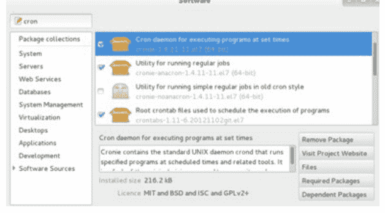

## 查看和更新软件包

软件包更新器（Package Update Viewer）允许我们查看已安装软件包可用更新并选择它们进行安装。

要使用此工具，请在命令行提示符执行 `gpk-update-viewer`，或选择“应用程序 | 系统工具 | 软件更新”来启动。将出现一个与图 5-5 所示类似的应用程序界面。该工具会在后台自动运行带有适当子命令的 `yum` 命令，以搜索所有可用更新并将它们列在屏幕上。默认情况下，所有可用更新都已勾选安装。然而，除非你的打算是应用所有更新，否则你只需要选择需要的那些。

图 5-4 添加和删除软件包

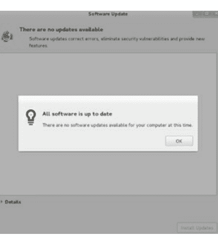

图 5-5 软件包更新器

5-5 显示所有软件都是最新版本；然而，如果有任何可用更新，它们将被列出来。在这种情况下，你可以高亮特定的更新以查看其详细信息（点击底部的“详细信息”）或选择更多进行安装（点击“安装更新”）。

# 章节总结

本章讨论了软件软件包管理。我们学习了关于软件包、打包、命名规范、依赖和补丁数据库的概念。我们查看了 RHN 的优势以及如何注册系统以管理软件。我们使用 `rpm` 命令研究并执行了许多软件包管理任务，查看了拥有仓库的概念和依赖关系，然后使用 `yum` 命令执行了大量的软件包管理任务。

最后，我们回顾了作为 PackageKit 包一部分的三个软件包管理工具。

# 章节复习题

1. `rpm -ql` 命令会执行什么？
2. `rpm2mpio` 命令的作用是什么？
3. 刷新软件包和升级软件包之间的区别是什么？
4. 用于将你的系统注册到 RHN 的命令是什么？
5. PackageKit 中包含的三个图形化管理工具的名称是什么？
6. `yum group info base` 会执行什么？
7. yum 命令的安装和删除命令的作用是什么？
8. 红帽网络提供对仓库的免费访问。对或错？
9. 使用 `yum` 命令相比 `rpm` 命令的最主要优势是什么？
10. 安装和 `/var/lib/rpm` 目录之间的区别是什么，对或错？
11. 软件包数据库位于 `/var/lib/rpm` 目录中，对或错？
12. 我们使用 `yum` 命令的哪种子命令来检查已安装软件包更新的可用性？
13. `rpm -qf` 命令会执行什么？
14. RHEL7 在已安装的系统中将 GPG 签名存储在哪个目录？
15. yum 配置文件的扩展名应该是什么？
16. `yum list` 命令会执行什么？
17. 为了让系统能够与 RHN 通信，系统上必须运行守护进程名称是什么？
18. 选项 `i` 会导致 `rpm` 命令提示什么？
19. 我们可以使用 `downloadyum` 命令下载软件包吗。对或错？
20. `yum list installed "gnome"` 命令会执行什么？
21. `rpm -qpi` 命令会执行什么？
22. 使用 `yum install` 命令一次可以指定多少软件包名称？
23. 我们可以使用 `yum` 的 `groupupdate` 子命令更新包组内的所有软件包吗。对或错？
24. `yum info` 命令会执行什么？
25. 可以使用 `gpk-prefs` 命令设置自动软件更新。对或错？
26. 哪种图形化工具可以添加和删除软件软件包？
27. 在系统上设置 `yum` 仓库需要安装哪个软件包？
28. 软件包数据库位于目录中。

# 章节复习题答案

1. `rpm -ql` 命令会列出文件。
2. `rpm2mpio` 命令的作用是从软件包中提取文件。
3. 刷新软件包和升级软件包之间的区别是，刷新会升级旧版本。
4. 用于将你的系统注册到 RHN 的命令是 `rhnregister`。
5. PackageKit 中包含的三个图形化管理工具是软件包更新器、软件更新和添加/删除软件包。
6. `yum group info base` 会列出组中的软件包。
7. `yum` 命令处理依赖关系，如果使用了 `-y` 选项就不会提示用户确认。
8. 红帽网络需要订阅。
9. `yum` 命令解析并自动安装软件包。
10. 安装 `yum` 会安装新软件包而升级会升级现有软件包。
11. 对。
12. `check-update` 子命令。
13. `yum` 命令会提供关于 `/bin/bash` 文件的信息。
14. `/etc/pki/rpm-gpg` 目录。
15. 仓库配置文件的扩展名应该是 `.repo`。
16. `yum` 命令会显示软件包是否已安装或可用。
17. `rhnd` 守护进程。
18. 它将安装指定的软件包并显示详细信息进度。
19. 没有这样的命令。
20. `yum` 命令会显示所有名称中包含 gnome 的已安装软件包。
21. `rpm` 命令会显示所有已安装的软件包。
22. 无限制。
23. 对。
24. `yum` 命令会显示软件包的头部信息。
25. 对。
26. 添加/删除软件包程序。
27. `creatrepo` 软件包。
28. 对。

## DIY 挑战

以下实验对于加强本章学习的大部分概念和主题非常有帮助。预计你在没有额外帮助的情况下完成这些实验。不提供逐步指南，因为实验的实现需要本章介绍的知识。对于缺失的信息，使用默认值或自己的思考。

### 实验 5-1：设置第三方 yum 仓库

设置第三方仓库以访问位于 atrpm.net 的 RHEL7 软件包。从该仓库安装名为 `all` 的软件包。安装软件包时考虑使用 `--disablerepo` 选项，以确保 `yum` 命令不在其他仓库中搜索该程序。

### 实验 5-2：配置本地 yum 仓库


配置本地 yum 仓库以访问目录中的软件包。创建一个名为 `/repo/` 的目录并将 RHEL7 安装光盘的所有内容复制到其中。为该仓库创建一个 repo 文件并安装 `coreutils` 软件包以进行验证。

### 实验 5-3：安装包组

从实验 6-2 配置的本地 yum 仓库安装 `Backup Server`、`Desktop Clients` 和 `Security Tools` 包组。安装完成后，查看 `yum.log` 文件以进行确认。显示这三个包组的信息。

## 配置服务器虚拟化和网络安装 RHEL7

本章描述了以下主要主题：

- 了解服务器虚拟化及其优势
- 虚拟网络交换机和接口
- 虚拟存储池和卷
- 使用 GUI 和命令管理虚拟机监控程序
- 使用 GUI 和命令创建虚拟网络
- 使用 GUI 和命令创建虚拟存储
- 配置 FTP 安装服务器
- 设置主机与虚拟机之间的双向通信
- 使用 GUI 和远程安装服务器通过网络安装 RHEL
- 使用 kickstart 的优势
- 创建 kickstart 配置文件
- 使用命令和 kickstart 配置文件通过网络安装 RHEL
- 从 FTP 和 HTTP/HTTPS 源以非交互方式下载文件

RHCSA 目标：

17. 访问虚拟机的控制台
18. 启动和停止虚拟机
35. 使用 Kickstart 自动安装 Red Hat Enterprise Linux
36. 配置物理机托管虚拟客户
37. 将 Red Hat Enterprise Linux 系统安装为虚拟机
38. 配置系统在启动时启动虚拟机

服务器虚拟化是一项允许物理计算机托管多个虚拟机的功能，其中每台虚拟机都像一台独立的计算机，运行 RHEL、Solaris、Windows 或其他 Linux 发行版的唯一实例。所有虚拟机及其运行的操作系统在完全隔离的状态下独立运行。

RHEL 可以通过配置好的托管安装文件的 FTP、HTTP 或 NFS 服务器通过网络进行安装。网络安装比基于 DVD 的安装要快得多。需要安装 RHEL 的客户端可以启动，然后重定向到这些网络安装服务器之一，以执行系统软件的安装。客户端系统可以在安装期间进行配置，也可以提供一个包含所有配置信息（包括分区）的文件。在安装期间无法跳过配置过程，这使得安装更快且完全可以实现无人值守完成。

`wget` 用于从 FTP 或 HTTP/HTTPS 站点以非交互方式下载文件和整个目录。该工具可以调度在非高峰时段运行，以处理大文件。

## 服务器虚拟化技术

服务器虚拟化是指在单台物理计算机上构建和运行多个独立虚拟计算机的行为。在虚拟化物理计算机的过程中，处理器、内存、存储、光盘和网络接口等硬件组件在虚拟计算机之间共享。每台虚拟机中都部署了 RHEL、Linux、Solaris 或 Windows 等操作系统，并运行以支持数据库、Web、DNS 或其他服务或应用程序。所有虚拟机及其运行的操作系统和服务始终相互独立，并处于完全隔离状态。

从虚拟化的角度来看，物理计算机被配置为托管虚拟计算机的**主机（host machine）**；在主机上创建的虚拟机被称为**虚拟机（virtual machine）**；部署在虚拟机中的操作系统被称为**客户（guest）**。为了虚拟化主机，有许多不同的软件可用。这些软件在物理硬件之上形成一个虚拟层，创建一个虚拟化基础架构，从而实现虚拟机的创建和托管，让客户操作系统认为它们正运行在真实的、独立的、物理硬件上。这种软件被称为**虚拟机监控程序（hypervisor）**。基于内核的虚拟机（KVM）就是此类软件的示例；它是 Linux 内核的一部分，作为原生虚拟机监控程序随 RHEL 一起提供。它实现了主机上物理 CPU 与虚拟机添加的虚拟 CPU 之间的映射，为虚拟机提供硬件加速，从而提高性能。如果使用 KVM 设置虚拟化基础架构，另一个名为 Quick Emulator (QEMU) 的软件就会发挥作用，通过利用 KVM 指标提供的物理到虚拟 CPU 来起着重要作用。QEMU 为主机上的虚拟功能提供必要的仿真，使得虚拟机上的应用程序能够获得与在物理硬件上运行时相同的性能水平。见图 6-1。

图 6-1 虚拟化栈

有了虚拟化基础架构，就需要某些软件来管理虚拟机监控程序和虚拟机。RHEL7 提供的标准工具包是 libvirt。libvirt 是一个虚拟化管理库，包含了管理虚拟机监控程序和虚拟机所需的支持和工具。它由一个守护进程 libvirt、一组命令行和图形界面工具以及一个 API 库组成。KVM、QEMU 和 libvirt 共同为 RHEL7 提供了端到端的虚拟化解决方案。

## 虚拟化优势

虚拟化技术带来了许多优势。通过实施我们可以实现的某些关键价值包括：

- 允许在单个主机上创建多个虚拟机。
- 支持将各种操作系统的实例作为客户运行。
- 每个虚拟机及其客户与其他虚拟机及其客户完全隔离且独立。
- 提供了将旧系统整合到新硬件平台的能力。
- 降低了与计算机硬件、网络和存储交换机相关的总体成本。
- 允许在具有共享存储配置的物理主机之间对活动虚拟机进行热迁移。
- 支持向活动的虚拟机添加虚拟 CPU。
- 支持处理器和内存的超量分配以及存储的精简置备（thin provisioning）。
- 降低了与电源、冷却、地板和机架空间以及网络光纤缆相关的总体成本。
- 支持快速部署虚拟服务器。
- 允许更好地利用计算机硬件资源。
- 允许为活动虚拟机增加容量。

## 验证主机虚拟化

为了让主机支持虚拟化，硬件必须支持 VT-x (Intel) 或 svm (AMD)。我们可以运行以下命令进行检查：

```
grep proc/cpuinfo
```

输出表明主机支持 vmx (Intel) 或 svm (AMD)。或者，如果不存在这些项，则必须在 BIOS/UEFI 中启用。

## 虚拟化包

为了让 RHEL 支持虚拟化，需要以下包：

| 组 | 描述 |
| :--- | :--- |
| 虚拟化监控程序 | 提供虚拟化基础。 |
| 虚拟化客户端 | 提供虚拟机管理。 |
| 虚拟化平台 | 提供虚拟化接口。 |
| 虚拟化工具 | 提供虚拟化工具。 |

我们可以使用以下命令一次性安装所有组：

```
yum group install "virtualization hypervisor" "virtualization client" "virtualization platform" "virtualization tools"
```

## 虚拟网络交换机和虚拟网络接口

虚拟交换机是 libvirt 配置的软件交换机，允许虚拟机与主机相互通信。当 libvirt 守护进程首次启动时，会在主机创建一个交换机，表示为 `virbr0`。分配此交换机的默认 IP 为 `192.168.122.1`。我们可以使用 `ip` 命令查看其特征：

```
ip addr show virbr0
4: virbr0 <BROADCAST,MULTICAST,UP> mtu 1500 qdisc noqueue
    link/ether c0:00:fe:fe:bd:ee
    inet 192.168.122.1/24 brd 192.168.122.255 scope global virbr0
```

`virbr0` 的默认运行模式是带 IP 伪装的 NAT。NAT 允许客户操作系统通过主机的 IP 访问外部网络，隐藏其 IP 地址。此外，libvirt 在虚拟网络分配 DHCP 和 DNS。这使得 `192.168.122.2` 到 `.254` 的 IP 范围可分配给虚拟机。当接口在虚拟机上激活时，DNS 设置也会自动供虚拟机使用。

Libvirt 还支持两种额外的类型虚拟交换机配置；它们被称为**隔离（isolated）**和**路由（routed）**。隔离交换机限制虚拟机与外部世界通信的能力，而路由交换机允许虚拟机与外部网络通信。

## 存储池和存储卷

存储池是用于为虚拟机提供存储的区域。它通过 libvirt 创建和管理，并作为共享存储区域访问。存储池可以是本地的，并配置为目录中的文件或分区、逻辑卷或整个磁盘。此外，存储池可以在远程系统上设置并使用 iSCSI 或 NFS 协议。

一旦设置了存储池，就可以将其划分一个或多个存储卷，然后可以分配给虚拟机。

## 虚拟化管理工具

RHEL 提供 libvirt 作为默认的虚拟机监控程序和虚拟机管理软件。该软件是虚拟化监控程序和虚拟化平台软件包组的一部分。Libvirt 包含一个强大的图形化管理工具，称为虚拟机管理器（或 `virt-manager`），它易于理解且方便使用。它还包含了 `virt-install` 命令，该命令在命令行提供了等同的功能。`virt-install` 命令用于创建虚拟机并在其中安装 RHEL。Libvirt 还包含了一些额外的工具，但它们的涵盖范围超出了本书的范畴。

## 虚拟机管理器 (virt-manager)

虚拟机管理器 (`virt-manager`) 是 `virt-install` 和 `vsh` 命令的图形化等效工具，这些命令用于配置虚拟机、从本地资源以交互式或非交互模式安装操作系统，以及通过右键点击管理和监控监控程序及虚拟机。它允许我们访问虚拟机的图形化控制台、查看性能统计并控制它们的生命周期。此桌面程序包含向导，使我们在设置新的虚拟机、虚拟网络、网络接口、存储池或存储卷时能够轻松提供信息。该工具还赋予了我们列出、修改和删除这些对象的能力。

要启动此工具，请在 X 终端运行 `virt-manager` 命令，或选择“应用程序 | 系统工具 | 虚拟机管理器”。将显示一个与图 6-2 类似的屏幕。

要查看详情，右键点击它并选择“详情”。你将看到窗口中的四个标签页，如图 6-3 所示。这些标签页分别是概述 (Overview)、虚拟网络 (Virtual Networks)、存储 (Storage) 和网络接口 (Network Interfaces)。

概述标签页显示监控程序的基本信息，包括其 URI、运行所在服务器的主机名、监控程序名称、内存和 CPU 数量、CPU 架构以及“性能”下的 CPU/内存利用率信息。此外还有一个复选框，用于设置每次主机启动时是否连接到监控程序。

虚拟网络标签页显示默认的虚拟网络配置（见图 6-4）。

### 图 6-4 监控程序虚拟网络标签页

此标签页提供基本细节并显示 IP 配置。它显示了虚拟网络及其关联设备、设备状态，以及当使用该虚拟网络的虚拟机启动时是否默认自动启动。它没有显示 DNS 域名，这意味着目前未设置。IPv4 转发表示物理网络上已启用 NAT。IP 配置包括子网、网络掩码以及如果虚拟机配置为 DHCP，则可能用于提供虚拟机的 IP 地址范围。左下角的四个小方形按钮可用于添加、启动、停止或删除虚拟网络。

存储标签页显示虚拟存储配置（见图 6-5）。

### 图 6-5 监控程序存储标签页

此标签页提供有关配置存储的基本信息。它指明存储虚拟机镜像的位置为 `/var/lib/libvirt/images`。它还显示了所选存储池的当前使用情况。建议创建一个足够大的分区或逻辑卷，以容纳你计划添加的所有虚拟机镜像文件。“新建卷 (New Volume)”按钮允许你创建可能用于存储虚拟机镜像的卷。“删除卷 (Delete Volume)”按钮允许移除现有卷。窗口的“状态 (State)”和“自动启动 (Autostart)”按钮以及左下角的四个方形按钮不言自明。

网络接口标签页显示虚拟机可连接的虚拟网络接口（见图 6-6）。

### 图 6-6 监控程序网络接口标签页

此标签页提供了所有当前配置的网络接口列表。在左侧窗格中高亮显示其中一个，可在窗口右侧显示详情。默认情况下，它只显示回环接口；但你也可以在这里添加其他网络接口。每个接口都显示 MAC 地址、状态、自动启动模式和 IP 信息（如果可用）。

## virsh 命令

`virsh` 命令用于管理和监控监控程序及虚拟机。管理任务包括工具创建、管理和监控虚拟机、虚拟网络、虚拟接口、存储池、快照等的能力。有许多子命令可用。表 6-2 列出并描述了一些常用的命令。

| 杂项子命令 | 描述 |
|---|---|
| edit | 切换到不同的目录。 |
| pwd | 显示当前目录位置。 |
| connect | 以 `qemu://system` 的形式连接到监控程序。 |
| hostname | 显示监控程序名称。 |
| sysinfo | 以 XML 格式打印监控程序信息。 |
| nodeinfo | 显示主机处理器和内存信息。 |
| list | 列出域（domains）及其状态。 |
| **域子命令** | |
| autostart | 设置域在监控程序重启时自动启动。 |
| create | 从 XML 文件创建域。 |
| define | 为域定义一个描述。 |
| desc | 为域分配一个表描述。 |
| destroy | 立即终止运行中的域。类比拔掉电脑电源。 |
| domplay | 显示连接到域图形化显示的 URL。 |
| domhostname | 显示域的主机名。 |
| dominfo | 显示域的基本信息。 |
| domstate | 显示域的当前状态。 |
| dumpxml | 显示现有域的配置。 |
| edit | 编辑域的 XML 配置文件。 |
| reboot / shutdown | 重启 / 优雅地关闭域。 |
| start | 启动非激活的域。 |
| suspend / resume | 挂起运行的域 / 恢复挂起的域。 |
| vpu | 返回关于虚拟机的信息。 |
| **设备子命令** | |
| attach-disk / detach-disk | 为域挂载或卸载磁盘。 |
| attach-interface / detach-interface | 为域挂载或卸载接口。 |
| **虚拟网络子命令** | |
| net-autostart | 设置网络自动启动。 |
| net-create | 从 XML 文件创建网络。 |
| net-define | 定义网络描述。 |
| net-destroy | 终止运行的网络。 |
| net-dumpxml | 显示现有网络的配置。 |
| net-edit | 编辑网络的 XML 配置文件。 |
| net-list | 列出网络。 |
| net-start | 启动非激活的网络。 |
| **存储池子命令** | |
| pool-build | 构建池。 |
| pool-create / pool-delete | 创建或删除池。 |
| pool-define | 定义池描述。 |
| pool-destroy | 停止运行的池。 |
| pool-dumpxml | 显示现有池的配置。 |
| pool-edit | 编辑池的 XML 配置文件。 |
| pool-list | 列出池。 |
| pool-start | 启动非激活的池。 |
| **存储卷子命令** | |
| vol-build | 构建卷。 |
| vol-create / vol-delete | 创建或删除卷。 |
| vol-define | 定义卷描述。 |
| vol-destroy | 停止运行的卷。 |
| vol-dumpxml | 显示现有卷的配置。 |
| vol-edit | 编辑卷的 XML 配置文件。 |
| vol-list | 列出卷。 |
| vol-start | 启动非激活的卷。 |

## virt-install 命令

`virt-install` 命令用于配置虚拟机。它支持使用本地位置或通过 NFS、HTTP 或 FTP 协议远程指定的安装源进行操作系统的安装。`virt-install` 命令支持 kickstart 安装。该命令有许多选项。表 6-3 列出并描述了一些常用选项。

| 选项 | 描述 |
|---|---|
| --autostart | 设置在主机重启时激活。 |
| --client | 指定安装镜像的位置。 |
| --connect | 指定非默认的监控程序 `qemu://system`。 |
| --description | 虚拟机的短描述。 |
| --disk path/name | 指定虚拟机镜像路径。也接受存储池或存储卷名称。 |
| --graphics | 指定使用的图形类型，例如 `vnc` 或 `spice`。 |
| --location | 指定安装镜像的本地或远程路径。 |
| --name | 虚拟机的名称。 |
| --network | 指定虚拟网络或桥接器的名称。 |
| --os-type | 指定所需的 OS 类型。有效值包括 Linux 和 Windows。 |
| --os-variant | 指定 OS 类型对应的变体。有效值包括 `rhel7`, `rhel6`, `sels1s10`, `fedora9`, `win7` 和 `win2k8`。 |
| --ram | 虚拟机的内存。 |
| --vcpus | 虚拟机的 CPU 数量。 |
| --v | 指定使用全虚拟化。 |
| --extra-args | 在访客机安装期间传递给 Anaconda 的附加参数。例如，如果需要使用 kickstart 安装，则指定 kickstart 文件的位置。 |

表 6-3 virt-install 命令选项

## 管理宿主机程序

本节讨论了如何使用 `virt-manager` 和 `virsh` 添加虚拟网络、存储池和存储卷。下面使用 `virsh` 命令的步骤并不是配置这些对象的唯一方法；该命令具有多功能性，可以以不同的方式使用来实现相同的结果。还有其他管理任务，例如销毁、删除和取消定义这些对象，你可以执行这些操作；但这就留你自己自行尝试。

## 练习 6-1：使用 virt-manager 创建 NAT 虚拟网络

本练习将在 host1 上完成。

在此练习中，你将使用 `virt-manager` GUI 定义一个名为 `rhnet_virt` 的持久性虚拟网络，其子网为 `192.168.1.0/24`，网关为 `192.168.1.1`，DHCP 范围为 `192.168.1.128` 到 `.254`。该虚拟网络将被激活并设置为自动启动。

1. 运行 `virt-manager` 命令或选择“应用程序 | 系统工具 | 虚拟机管理器”来启动它。


## 2. 高亮“localhost (QEMU)”，右键点击并选择“详细信息”

## 3. 转到“虚拟网络”选项卡

## 4. 点击 `+` 号开始“创建新的虚拟网络”并点击“下一步”

## 5. 输入 `rhnet_virt` 作为网络名称，并点击“下一步”


**图 6-7 创建虚拟网络 - 选择名称**

## 6. 输入 `192.168.1.0/24` 作为 IPv4 地址空间并启用 DHCP4。该网络的默认 DHCP IP 范围将是 `192.168.1.128` 到 `.254`，如果你需要分配静态地址，则 `192.168.1.2` 到 `.127` 的范围将可用。点击“下一步”

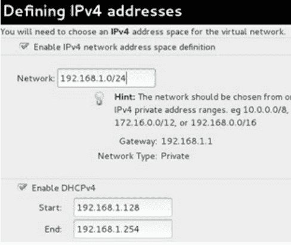

**图 6-8 创建虚拟网络 - 选择 IP 网络和 DHCP**

## 7. 在下一个屏幕上不要启用 IPv6 地址。点击“下一步”继续

## 8. 接下来，选择“转发到物理网络”，目标选择“任何物理设备”，模式选择“NAT”。不要分配域名。点击“下一步”

## 杂项设置

请指示此虚拟网络是否应连接到物理网络。

- 隔离虚拟网络
- 转发到物理网络
  - 目标：任何物理设备
  - 模式：NAT
- 启用 IPv6 内部路由/网络
  如果未指定 IPv6 网络地址，这将启用虚拟机之间的 IPv6 内部路由。默认情况下启用了 IPv4 内部路由。

**图 6-9 创建虚拟网络 – 连接到物理网络**

## 9. 查看选择的摘要并点击“完成”以创建虚拟网络

## 准备好创建网络

| 摘要 | 网络名称: rhnet_virt |
| :--- | :--- |
| 域名 | |
| IPv4 网络 | 网络地址 / 前缀: `192.168.1.0/24`<br>网关: `192.168.1.1`<br>转发/连接性: NAT<br>DHCP4 开始: `192.168.1.128`<br>DHCP4 结束: `192.168.1.254` |
| IPv6 网络 | IPv6 网络: 未定义<br>转发/连接性: 隔离网络<br>DHCPv6 状态: 已禁用 |

**图 6-10 创建虚拟网络 – 摘要**

## 10. 虚拟网络现在显示了虚拟网络

| 概述 | 虚拟网络 | 存储 | 网络接口 |
| :--- | :--- | :--- | :--- |
| default | 基础详细信息 | | |
| rhnet_virt | 名称: `rhnet_virt`<br>设备: `virb11`<br>状态: 激活<br>自动启动: 启动时<br>DNS 域名: <br>IPv4 转发: NAT<br>IPv6 转发: 隔离网络，路由禁用<br>IPv4 配置<br>网络: `192.168.1.0/24`<br>DHCP 开始: `192.168.1.128`<br>DHCP 结束: `192.168.1.254` | | |

**图 6-11 创建虚拟网络 – 已创建新网络**

此虚拟网络现在已准备就绪。你可以进入“虚拟网络”选项卡来查看其详细信息。你应该能够将此虚拟网络附加到虚拟机。

## 练习 6-2：使用 virsh 定义 NAT 虚拟网络

本练习应在 host1 上完成。

在此练习中，你将使用 `virsh` 命令定义一个名为 `rhnet_virsh` 的持久性 NAT 虚拟网络，其子网为 `192.168.2.0/24`，网关为 `192.168.2.1`，DHCP 范围为 `192.168.2.2` 到 `.254`。你将使用 `virbr2` 作为桥接，并使用 `1024` 到 `65535` 的端口。将激活此虚拟网络并设置为自动启动。

## 1. 查看虚拟网络：

```bash
virsh net list
```

| 名称 | 状态 | 自动启动 |
| --- | --- | --- |
| | | |

## 2. 在 `/root` 目录下创建一个名为 `rhnet_virsh` 的 XML 文件，包含以下信息：

```xml
<network>
  <name>rhnet_virsh</name>
  <bridge name="virbr2"/>
  <forward mode="nat">
    <port start="1024" end="65535"/>
  </forward>
  <ip address="192.168.2.0" mask="255.255.255.0">
    <dhcp>
      <range start="192.168.2.2" end="192.168.2.254"/>
    </dhcp>
  </ip>
</network>
```

## 3. 使用 `/root/rhnet_virsh.xml` 定义 `rhnet_virsh`：

```bash
virsh net define /root/rhnet_virsh.xml
```

## 4. 设置虚拟网络在启动时自动启动：

```bash
virsh net-autostart rhnet_virsh
```

## 5. 启动网络：

```bash
virsh net start rhnet_virsh
```

## 6. 列出所有虚拟网络，包括新的一个：

```bash
virsh net list
```

| 名称 | 状态 | 自动启动 |
| --- | --- | --- |
| | | |

## 7. 查看 `rhnet_virsh` 的信息：

```bash
virsh net info rhnet_virsh
```

```text
Name: rhnet_virsh
UUID: e2fd055-4817-4d04-bb44-6c2804732
Active: yes
```

此虚拟网络现在已准备就绪。

## 练习 6-3：使用 virt-manager 创建存储池和卷

本练习应在 host1 上完成。

在此练习中，你将使用 `virt-manager` GUI 创建一个名为 `rhpool_virt` 的文件存储池，并向其添加一个 10GB 的卷。你将使用文件目录作为类型，并确保 `/var/lib/libvirt/rhpool_virt` 权限为 `0755`，所有者和组均为 root。这将激活存储池并设置为自动启动。

## 1. 运行 `virt-manager` 命令或选择“应用程序 | 系统工具 | 虚拟机管理器”来启动它

## 2. 高亮“localhost (QEMU)”，右键点击并选择“详细信息”

## 3. 点击“存储”查看存储详细信息。此选项卡显示了现有的池、其大小、位置、当前状态、自动启动状态和卷列表

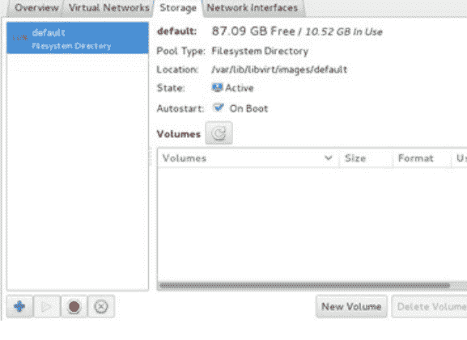

## 4. 点击底部的 `+` 号开始“添加存储池”向导

## 5. 输入 `rhpool_virt` 作为存储池名称，并将文件目录作为类型。点击“下一步”

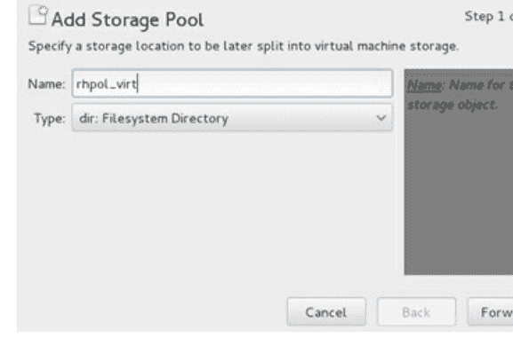

## 6. 指定 `/var/lib/libvirt/rhpool_virt` 作为目标路径，并点击“完成”完成添加存储池并返回“存储”选项卡

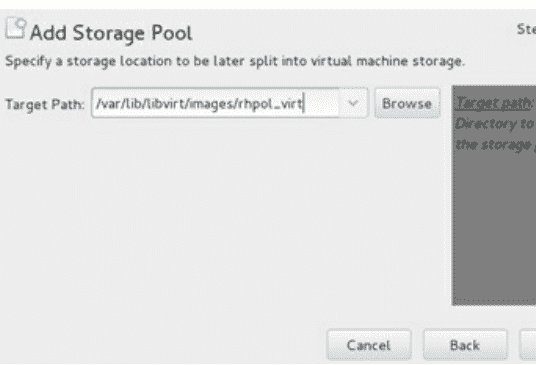

**图 6-14 添加存储池 - 指定目标路径**

## 7. 存储选项卡现在显示了其他池外的 `rhpool_virt` 池

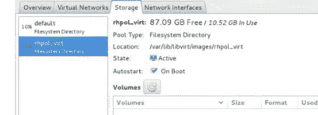

**图 6-15 添加存储池 - 存储池列表**

## 8. 点击“新建卷”向 `rhpool_virt` 存储池添加大小为 10GB 的 `rhpool_virt` 卷。点击“完成”创建卷并返回存储选项卡

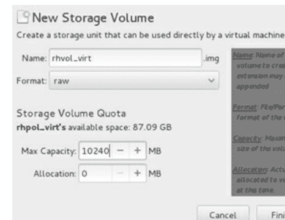

**图 6-16 添加存储卷 - 添加卷**

**图 6-17 添加存储卷 – 已创建新池和存储卷**

此带有存储卷的存储池现在已就绪。你可以进入“存储”选项卡查看它们的详细信息。你现在应该可以将此卷挂载到虚拟机上了。

## 练习 6-4：使用 virsh 创建存储池和卷

此练习应在 host1 上完成。

在此练习中，你将使用 `virsh` 命令创建一个名为 `rhpool_virsh` 的基于文件的存储池，并为其添加一个名为 `rh_virt` 的 10GB 卷。你将使用文件系统目录作为池类型，并将 `/var/lib/libvirt/rhpool_virsh` 作为其位置。你将确保存储池目录的权限为 `0755`，所有者和所属组均为 root 用户。你将激活此存储池，并将其设置为在每次系统重启时自动启动。

## 1. 查看可用的存储池：

```bash
# virsh pool-list
```

| 名称 | 状态 | 自动启动 |
| --- | --- | --- |
| default | active | yes |
| rhpool_virsh | active | yes |

## 2. 创建池目录：

```bash
# mkdir /var/lib/libvirt/rhpool_virsh
```

## 3. 定义类型为 "dir"、路径为 "- -"且目标为 `/var/lib/libvirt/rhpool_virsh` 目录的池：

```bash
# virsh pool-define-as rhpool_virsh dir - - /var/lib/libvirt/rhpool_virsh
```

池 `rhpool_virsh` 已定义

## 4. 设置新池在系统重启时自动启动：

```bash
# virsh pool-autostart rhpool_virsh
```

池 `rhpool_virsh` 已标记为自动启动

## 5. 启动新的存储池：

```bash
# virsh pool-start rhpool_virsh
```

池 `rhpool_virsh` 已启动

## 6. 列出所有存储池（包括新池）：

```bash
# virsh pool-list
```

| 名称 | 状态 | 自动启动 |
| --- | --- | --- |
| default | active | yes |
| rhpool_virsh | active | yes |
| rhpool_virt | active | yes |

## 7. 查看新池的详情：

```bash
# virsh pool-info rhpool_virsh
```

| 名称 | |
| --- | --- |
| rhpool_virsh | |
| UUID | 942f9751-7544-4ef6-b9c6-bd7f6dd07cf |
| 状态 | running |
| 持久性 | yes |
| 自动启动 | yes |
| 容量 | 40.98 GiB |
| 分配 | 6.69 GiB |
| 可用 | 43.29 GiB |

## 8. 在 `rhpool_virsh` 池中创建大小为 10GB 的卷 `rh_virt`：

```bash
# virsh vol-create-as rhpool_virsh rh_virt 10G
```

卷 `rh_virt` 已创建

## 9. 列出 `rhpool_virsh` 池中可用的卷：

```bash
# virsh vol-list rhpool_virsh
```

| 名称 | 路径 |
| --- | --- |
| rhpool_virsh | /var/lib/libvirt/rhpool_virsh |

此存储卷已就绪，你应该能够将其挂载到虚拟机上。

## 配置 FTP 安装服务器

文件传输协议（FTP）是用于系统间传输文件的标准网络协议，几十年来一直用于 Linux、UNIX、Windows 和其他操作系统。RHEL 提供了一种 FTP 的增强型实现，称为极速文件传输协议（vsFTP），它是默认的文件传输服务。这个增强版本比标准 FTP 更快、更稳定、更强大，同时允许对传入的服务请求进行启用、禁用和设置安全控制。vsFTP 守护进程在端口 `21` 上进行通信。

本节将讨论如何设置安装服务器，为在将在练习中部署的虚拟机中进行网络化 RHEL 安装做准备。接下来的练习提供了如何配置 FTP 服务器以访问 RHEL 安装文件的步骤说明。

## 练习 6-5：配置 FTP 安装服务器

此练习应在 host1 上完成。

在此练习中，你将使用 vsFTP 程序在 host1 上配置 FTP 服务器。你将从第 5 章“管理软件包”中设置的 DVD 存储库中安装与 vsFTP 相关的必要包，将文件从安装 DVD 复制到 `/var/ftp/rhel7` 目录，设置 SELinux 上文，允许 FTP 流量通过防火墙，并启动 FTP 服务。最后，你将打开浏览器窗口测试对文件的访问。

## 1. 安装 vsFTP 软件：

```bash
# yum -y install vsftpd
```

## 2. 创建目录 `/var/ftp/rhel7` 用于存储 RHEL 安装文件。确保 `/var` 文件系统至少有 4GB 的可用剩余空间

```bash
# mkdir /var/ftp/rhel7
```

## 3. 切换到挂载 RHEL 安装 DVD 的 `/mnt` 目录，并将整个目录结构从 `/mnt` 复制到 `/var/ftp/rhel7/`：

```bash
# cd /mnt && find . -exec cp -p {} /var/ftp/rhel7/ \;
```

## 4. 为防火墙添加允许 FTP 流量通过的规则并重新加载配置：

```bash
# firewall-cmd --permanent --add-service=ftp; firewall-cmd --reload
```

## 5. 启动 vsFTP 服务并检查状态：

```bash
# systemctl start vsftpd
# systemctl status vsftpd
```

```text
vsftpd.service -
Loaded: loaded (/lib/systemd/system/vsftpd.service; enabled)
Active: active (running) Sat 2024-09-29 27:53:32 EDT
Process: 2375 (code=exit, status=SUCCESS)
Main PID: 2376 (vsftpd) host.example.com Starting vsftpd daemon.
```

## 6. 设置 vsFTP 服务在每次重启时自动启动：

```bash
# systemctl enable vsftpd
```

## 7. 在 host1 上打开浏览器窗口并输入以下 URL 进行测试：

`ftp://192.168.0.100/pub/rhel7`

## 练习 6-6：禁用 DVD 存储库并启用 FTP 存储库

此练习应在 host1 上完成。

在此练习中，你将配置第 5 章创建的 yum 存储库，并设置指向 `/var/ftp/rhel7` 的新 yum 存储库。你将为该新存储库创建一个定义文件并测试其在系统中是否可用。

## 1. 从 `/etc/yum.repos.d` 目录删除 `dvd.repo`：

```bash
# rm /etc/yum.repos.d/dvd.repo
```

## 2. 卸载 RHEL 安装驱动：

```bash
# umount /mnt
```

## 3. 在 `/etc/yum.repos.d` 为存储库创建定义文件。输入如下信息：

```bash
# vi /etc/yum.repos.d/ftp.repo
```

```ini
[repo]
name=ftp repo
baseurl=http://192.168.0.100/pub/rhel7
enabled=1
gpgcheck=0
```

## 4. 清理 yum 缓存：

```bash
# yum clean all
```

## 5. 确认存储库已创建并可用：

```bash
# yum repolist
```

| repo id | repo name | status |
|---|---|---|
| ftp | ftp repo | |

配置新的 yum 存储库是一项关键任务。如果你无法设置存储库，将无法加载缺失或所需的包。

## 练习 6-7：设置主机与虚拟机之间的双向通信

此练习应在 host1 上完成。

在此练习中，你将在 host1 上创建一个虚拟接口，允许该主机与在本章中构建的 server1 和 server2 客户端通过桥接在 `192.168.0` 子网上直接通信。此接口将在 server1 和 server2 构建期间用于访问在练习 6-5 中配置的 FTP 服务器。此接口将命名为 `br0` 并使用物理接口 `em1` 的 IP 分配。这些分配值为 `192.168.0.100` 地址、`255.255.255.0` 子网掩码和 `192.168.0.1` 网关。

## 1. 进入 `/etc/sysconfig/network-scripts` 并使用 `vi` 创建名为 `ifcfg-br0` 的文件。添加如下指令：

```bash
# cd /etc/sysconfig/network-scripts; vi ifcfg-br0
```

```ini
DEVICE=br0
BOOTPROTO=static
ONBOOT=yes
IPADDR=192.168.0.100
NETMASK=255.255.255.0
GATEWAY=192.168.0.1
TYPE=Bridge
NM_CONTROLLED=no
```

## 2. 编辑 `ifcfg-em1` 文件并设置以下指令：

```bash
# vi ifcfg-em1
```

```ini
DEVICE=em1
TYPE=Ethernet
BRIDGE=br0
ONBOOT=yes
NM_CONTROLLED=no
HWADDR=04:d4:be:d9:22:e2:d9
```

## 3. 使用 `brctl` 命令确认新桥接的状态：

| bridge name | bridge id | STP | interfaces |
| --- | --- | --- | --- |
| br0 | 8000.d4bed92e2ed9 | no | em1 |

## 4. 重启网络服务：

```bash
# systemctl restart network
```

## 5. 确认新的桥接接口接管了 `em1` 的 IP 分配。同时确保这些分配不再分配给 `em1`


# 网络接口信息

```
# ip addr show br0
4: <BROCAST,MULTICAST,UP,LOWER_UP> mtu 1500 qdisc noqueue state UP
link/04:d4:be:d9:22:e2:d9 brffffffffffff
inet 192.168.0.100/24 192.168.0.1 scope global br0
inet valid global preferred_scope loft
inet6 fe80:d4:be:d9:ff:fe2:d9/64 scope link
inet valid global preferred_scope loft
# ip addr show em1
2: <BROCAST,MULTICAST,UP,LOWER_UP> mtu 1500 qdisc pfifo_fast_master br0 state
up len 1000
link/04:d4:be:d9:22:e2:d9 brffffffffffff
```

# 使用 virt-manager 安装 RHEL

本节将讨论如何使用 `virt-manager` 图形界面创建虚拟机，并使用位于 FTP 服务器上的安装文件安装 RHEL7。

## 练习 6-8：使用 virt-manager 网络安装 RHEL7

此练习应在 host1 上完成。

在此练习中，你将使用虚拟机管理器程序在宿主机上创建一个虚拟机。

虚拟机的名称将为 `server.example.com`，我使用了练习配置的 HTTP 服务器作为安装源。我有 1024MB 的内存。

1. 运行 `virt-manager` 命令或点击工具（Tools） | 虚拟机管理器（Virtual Manager）来启动它。

2. 右键点击“localhost (QEMU)”，并选择新建（New）创建一个新的虚拟机。

3. 为虚拟机输入 `server1.example.com`，并选择网络安装（Network Install）作为安装源。点击下一步（Forward）继续。

   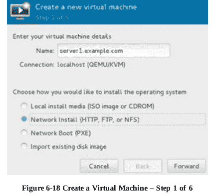

4. 指定网络安装的 URL。使用 `ftp://192.168.0.100/pub/hel7`。取消勾选“根据安装媒体自动检测操作系统”（Automatically detect operating system based on install media），并选择操作系统为 Linux，版本为 Red Hat Enterprise Linux 7。点击下一步（Forward）继续。

   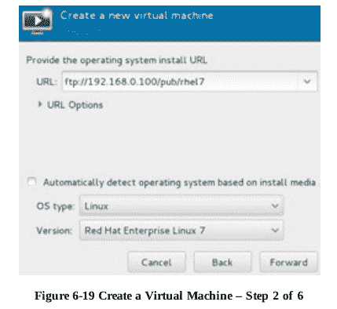

5. 为内存输入 1024MB，为 CPU 输入 1。点击下一步（Forward）继续。

   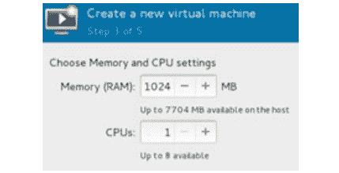

6. 选“为此虚拟机启用存储”（Enable storage for this virtual machine）。选择“选择托管或其他存储”（Select managed or other storage）并浏览可用的存储池和卷。选择 `rhpol_virt` 存储池和 `rhvol_virt` 卷，然后点击选择卷（Choose Volume）。

   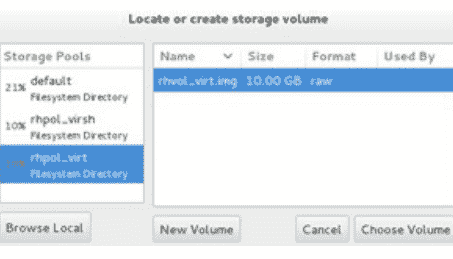

   图 6-21 创建虚拟机 – 6 步中的第 4 步

7. 现在已选择存储卷。点击下一步（Forward）继续。

   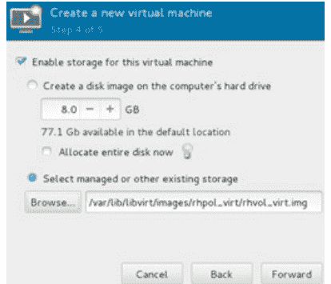

   图 6-22 创建虚拟机 – 6 步中的第 5 步

8. 显示了您的选择摘要。展开“高级选项”（Advanced options）以查看设置，但不要修改它们。检查所有配置项并点击完成（Finish）继续安装。

   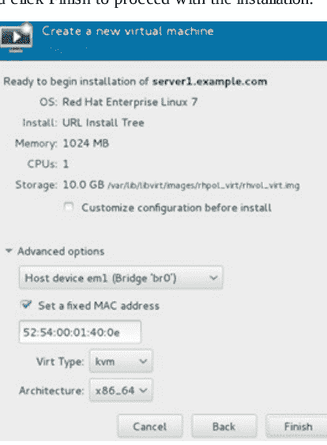

   图 6-23 创建虚拟机 – 6 步中的第 6 步

9. 按照练习目标的指示对操作系统进行定制，并遵循第 01 章的步骤完成安装。

# Kickstart 安装方法

Red Hat Kickstart 安装方法用于在任何数量的服务器上对 RHEL 执行自动、全自定义且无人值守的安装。这种方法需要向安装程序提供一个单个文件，该程序将使用文件中定义的配置在目标系统上完成相同的自定义安装。这种方法消除了我们通常必须经历的冗长问答环节。

本节将讨论使用 `virt-install` 命令，通过 Kickstart 自动化程序使用位于 FTP 服务器上的安装文件。

# 创建 Kickstart 配置文件

为了执行 Kickstart 安装，必须创建一个配置文件并将其提供给安装程序。我们需要捕获所有所需和所需的配置，供 kickstart 过程用于安装并准确配置系统。我们可以通过复制 `/anaconda-ks.cfg` 并对其进行定制来创建此文件。Red Hat 还提供了一个名为 Kickstart Configurator-config-kickstart 的图形化工具，该工具在 RHEL 7 中用于构建 Kickstart 配置文件；但并非必须使用它。

在 RHEL 安装初期，安装程序会在 `/root` 目录下创建一个名为 `anaconda-ks.cfg` 的文件并将这些信息存储其中。我们可以根据需求和新客户的要求对该文件进行定制。

以下显示了 `anaconda-ks.cfg` 文件的副本（名为 `ks`）修改内容，位于 `/var/ftp/publish/`；我们将使用该文件在 server2 上进行自动安装。文件中的每个指令都是单独的一行，并以 `#` 命令标记。

```
# anaconda-ks.cfg /var/ftp/publish/ks.cfg
# ks.cfg
1 url --type="http://192.168.1.100/rhel"
2 bootcmd=skip
3 keyboard=en_US
4 network --boot=static --device=eth0 --ip=192.168.1.120 --mask=255.255.255.0 --gateway=192.168.1.1 --ipv6=hostname=server2.com
5 root password=$6a$50nrpt6533e4ae-11id-007B7f8fXfDYNvQQNQNg0YlbBBcVbS5Ds3zInZYbBfX7DR7qXRXXwGGOE407V2/7q/a7b8.D601c
6 authmethod=password --password=passilla
7 reboot
8 timeout America/Toronto --isUTC
9 clear=disabled
10 elite=agreed
11 diskreboot=only-use-vda
12 vm
13 clean --initall --all-vda
14 bootloader --location=root --boot=vda
15 part --type="xfs" --disk=v0 --size=50 --
16 -- --type="lvms -- --=9739
17 volgroup --name=vg0 --device=vda
18 log --type="swap" --size=500 --name=swap --vg0
19 log --type="root" --size=920 --name=root --vg0
20 log --type="root" --size= --vg0
21 user name=root
22 password=$6a$50nrpt6533e4ae-11id-007B7f8fXfDYNvQQNQNg0YlbBBcVbS5Ds3zInZYbBfX7DR7qXRXXwGGOE407V2/7q/a7b8.D601c
23 services=xe-hotstart
24 @packages
25 @core
26 @desktop-debugging
27 @fonts
28 @rlks
29 @gnome-desktop
30 @guest-agents
31 @guest-config
32 @input-methods
33 @theme-browser
34 @multimedia
35 @print
36 @x11
37 %end
```

让我们逐行分析，以便对每个条目有良好的理解。注释和空行已标记。

- 第 1 行：使用指定的 URL 作为安装源。
- 第 2 行：使用英语。
- 第 3 行：使用美国键盘布局。
- 第 4 行：命名接口 `eth0`，分配 IP `192.168.1.120`，子掩码 `255.255.255.0`，网关 `192.168.1.1`，设置重启时自动启动，主机名为 `server2.com`，设置 IPv6 支持为自动。如果我们希望从配置的 DHCP 服务器获取信息，设备 `eth0`。
- 第 5 行：为 root 帐户分配密码。我们可以从现有 root 文件系统的 `etc/shadow` 复制。
- 第 6 行：启用用户密码验证并使用加密。
- 第 7 行：安装完成后重启系统。
- 第 8 行：根据系统时钟设置时区。
- 第 9 行：定义首次重启后执行启动程序。
- 第 10 行：接受用户体验。
- 第 11 行：使用 `vda` 磁盘作为目标磁盘。
- 第 12 行：清除 MBR。
- 第 13 行：移除目标磁盘上的所有分区并初始化磁盘标签。
- 第 14 行：在目标磁盘 MBR 上安装 GRUB 引导加载程序。
- 第 15 行：在目标磁盘上创建大小为 500MB 的分区并将其格式化为 xfs 系统类型。
- 第 16 行：在目标磁盘上构建名为 `lvmp` 的 LVM 物理卷并为其分配。
- 第 17 行：创建 `vg0` 卷组并使用 `lvmp` 作为物理卷。
- 第 18 行：在 `vg0` 卷组中构建大小为 500MB 的逻辑卷并将其格式化为 xfs 文件系统。
- 第 19 行：在 `vg0` 卷组中构建大小为 920MB 的逻辑卷并将其格式化为 xfs 文件系统。
- 第 21 行：创建一个名为 `root` 的 root 帐户，加入管理员组，分配密码，并使用 "root" 作为该用户的注释。
- 第 22 行：配置系统重启启动。
- 第 23 行：标记软件选择的开始。
- 第 24 到 36 行：在安装过程中安装这些包。
- 第 37 行：标记软件选择的结束。

有几个指令和选项可以在 kickstart 文件中使用，但并非都是强制的。如果你定义了一个非强制指令，Anaconda 会放置此特定过程的用途。还要确保文件中部分的顺序保持不变；但部分内的指令可以是任何顺序。或者，如果许多设置（如强制 sel 和启用防火墙）已启用，则不需要包含在文件中。

在配置末尾，您可以指定任何想要执行的安装前和安装后命令或脚本。编辑完成后执行 `kvalidator` 命令以验证指令、其值和文件语法。

```
# kvalidator /var/ftp/pub/roothel7.ks
```

如果你在输出中看到任何错误，需要在继续操作之前修复它们。您还需要使用 `chcon` 命令在 ks.cfg 文件设置相应的 SELinux 上文，以确保 SELinux 能够访问此文件：

```
# chcon -t policy_content_t /var/ftp/pub/roothel7.ks
```

# 练习 6-9：使用 virt-install 和 Kickstart 配置安装 Linux RHEL7

此练习应在 host1 上完成。

在此练习中，你将使用 `virt-install` 命令在 host1 上创建一个虚拟机。虚拟机的名称将为 `server2.example.com`，你将使用子节配置的 `ks.cfg` 文件中的配置。它将拥有 1024MB 内存、一个 CPU 以及卷 `rpol1/vsrh/rhvirt.img` 中的 10GB 磁盘空间。你使用操作系统类型并分配为 Linux / rhel7，分配 `br0` 为网络接口，并标记虚拟机在 host1 重启后自动启动。

```
# install -name=server2.example.com -ram=1024 -cpus=1 -autostart --os-type=linux-variant=rhel7 -location=ftp://192.168.0.100/pub/rel7 -network bridge=br0 -disk=rhvol_virsh/rhvol_virsh.img -extra-args \ kcfg=ftp://192.168.0.100/pub/rel7.cfg
```

开始安装...

正在获取文件树信息...

正在获取虚拟机名称...

正在获取 intrd.img...

正在创建虚拟机...

虚拟机安装完成...正在重启虚拟机。

安装完成后，新服务器将自动重启。


# wget 工具

`wget` 是一种非交互式文件下载工具，允许你从 FTP、HTTP 或 HTTPS 源检索单个文件、多个文件或整个目录结构。该工具具有从 IPv4 和 IPv6 地址检索文件的能力。`wget` 有多个可用选项；但其中某些选项比其他选项更常用。表 6-4 列出了几种短格式和长格式的常用选项，并对其进行了描述。更多选项和详情请参阅命令的 man 页面。

| 选项 | 描述 |
|---|---|
| `-d` (`--debug`) | 开启调试模式。 |
| `-i` (`--input-file`) | 从指定文件中列出的 URL 下载文件。 |
| `-N` (`--timestamp`) | 获取比源文件更新的文件。 |
| `-nv` (`--no-verbose`) | 隐藏详细输出，除非错误消息和基本信息。 |
| `-o` (`--output-file`) | 将消息重定向到指定的输出文件。 |
| `-P` (`--directory-prefix`) | 指定下载文件的目录位置。 |
| `-q` (`--quiet`) | 隐藏输出和任何错误。 |
| `-r` (`--recursive`) | 开启递归检索。 |
| `-T` (`--timeout`) | 指定超时前的秒数。 |
| `-c` (`--tries`) | 指定重试次数。 |
| `--ignore-case` | 不区分大小写。 |
| `--user` | 指定 FTP 或 HTTP 访问的用户名。 |
| `--password` | 指定 `--user` 选项的密码。 |

表 6-4 wget 命令选项

你可以运行 `wget --help` 命令来列出所有短格式和长选项以及每个选项的简要描述：

```
## --help

GNU Wget 1.14，一个非交互式网络检索器。

用法: wget [OPTION]... [URL]

长选项的强制参数对于短选项也是强制的。

启动：
+   -V, --version
- -h, --help
- -b, --background
- -e, --execute=COMMAND

日志和输入文件:
- -o, --output-file=FILE
- -a, --append-output=FILE
- -d, --debug-file=FILE
- -q, --quiet
- -v, --verbose
- -n, --no-verbose
--report-type=TYPE
- -i, --input-file=FILE
- -F, --format=html
- -B, --base=URL
--config=FILE

显示 Wget 版本并，
打印此帮助信息。
启动后进入后台。
执行 'wget' 风格的命令。
将消息记录到 FILE
将消息附加到 FILE。
打印大量的调试信息。
静默（无输出）。
详细模式（默认），
以 TYPE 格式报告带宽。TYPE 可以被绑定。
在本地或外部文件中找到 downURL。
将输入视为 HTML。
相对于 URL 解析 HTML 输入文件链接 (-i)。
指定用于配置文件
```

让我们来看几个示例来演示 `wget` 的用法。

要从 `ftp.kernel.org` 在当前目录下载内核文件 `wget-3.9.9.tar.gz`：

```
$ wget ftp.kernel.org/pub/kernel/v3/linux-3.9.9.tar.gz
2015-02-10 14:35:46-- http://ftp.kernel.org/pub/kernel/v3/x/linux-3.9.9.tar.gz
Resolving ftp.kernel.org (ftp.kernel.org)... 192.204.194.148, 149.204.49.10, 149.20.49.64
Connecting to ftp.kernel.org (ftp.kernel.org)... 192.204.194.148:80... connected.
HTTP/1.1 200 OK
Length: 108722589 (104 MB) [application/x-gzip]
Saving to: 'linux-3.9.9.tar.gz'
```

2015-02-10 14:36:14 (3.69 MB/s) --linux-3.9.9.tar.gz saved [108722589/108722589]

要将输出重定向到 `/var/tmp/wget` 并在当前目录下载内核文件 `wget-3.9.7.tar.gz`：

```
$ wget ftp.kernel.org/pub/kernel/v3/linux-3.9.7.tar.gz -P /var/tmp/wget
```

9. 程序的名称是 Kickstart Configurator。

10. 真。

11. Virtualization Client 软件包组包含图形化虚拟机管理器程序。

12. `virt-install` 工具。

13. 真。

14. 真。

15. 网络接口在系统重启时不会自动激活。

16. 三个软件组件是 KVM、QEMU 和 libvirt。


17. 它只需要一个物理系统即可运行。

18. 我们在虚拟池中创建虚拟卷。

# DIY 挑战实验

以下实验对于加强本章中所学到的概念和主题非常有帮助。预计您将在没有任何额外帮助的情况下完成这些实验。本节不提供逐步渐进的指南，因为这些实验的实现需要您在本章中已经介绍的知识。对于缺失的信息，请使用默认值或您自己的思考。

## 实验 6-1：创建虚拟网络

建立名为 `rhcsanet` 的虚拟网络。启用 DHCP 为 `192.168.100.51` 到 `192.168.100.100` 提供 IP 地址，子网掩码为 `255.255.255.0`。确保此虚拟网络在所有物理接口上使用 NAT。

## 实验 6-2：创建虚拟存储池

建立一个名为 `rhcsart` 的 14GB 大的新存储池。使用目录文件系统作为存储类型并将其存储在 `/var/lib/libvirt/vstorage` 目录。创建一个名为 `rhcsav` 的虚拟卷，使用整个池空间。

## 实验 6-3：对 RHEL7 进行网络安装

创建一个虚拟机并在其中安装 RHEL7。使用 IP `192.168.0.220`，掩码 `255.255.255.0`，网关 `192.168.0.1`，主机名 `server220.example.com`。使用标准分区创建：`/boot` (200MB)、`vvol1` (/4GB)、`vvol2` 用于 swap (1GB)、`vvol4` 用于 `/var` (2GB)、`vol5` 用于 `/opt` (1GB)、`vol6` 用于 `/` 500MB，以及 `vol7` 用于 `/` 500MB。你可以使用上一个实验中创建的虚拟卷。选择支持 X Window、GNOME 桌面和图形化管理工具的包。创建一个名为 `user220` 的本地账户并使用所有默认设置。对于缺失的信息使用您自己的配置。

## 实验 6-4：对 RHEL7 进行 Kickstart 安装

创建一个虚拟机并在其中安装 RHEL7，使用本章解释的 kickstart。使用 IP `192.168.0.230` 和主机名 `server220.example.com`。选择支持 X Window 和图形桌面的必要包。按照要求分区和其他缺失配置进行操作。

## 实验 6-5：向虚拟机添加虚拟磁盘

建立新卷并为 `server3.example.com` 分配 1GB 磁盘，为 `server4.example.com` 分配一个 2GB 磁盘。使用您的存储设置……

# 启动 RHEL7、更新内核和记录消息

本章描述了以下主要主题：

- Linux 启动过程：固件、GRUB、内核和 systemd
- 理解并与 GRUB 交互以启动到不同的目标
- Linux 内核、其版本和目录结构
- 安装和更新内核
- 管理内核模块
- Init 和 Upstart
- 理解 systemd、单元（`units`）、目标（`targets`）和控制组（`control groups`）
- 管理单元和控制组
- 理解和解释系统日志文件
- 理解和管理 systemd journal

**RHCSA 目标：**

12. 正常重启和关闭系统
13. 手动进入不同的运行级别（`runlevels`）
14. 中断启动过程以获取系统访问
16. 定位并解释系统日志文件和日志
19. 启动、停止和检查网络服务的状态
33. 启动和停止服务并配置服务自启动启动
34. 配置系统自动启动到特定目标
39. 配置网络服务自启动
42. 适当更新内核包以确保系统可引导
43. 修改系统引导程序

RHEL 在启动期间会经历多个阶段。在从一个阶段过渡到另一个阶段期间，它会启动选择的服务，并为管理员提供与引导程序交互的机会，将系统引导到非默认目标。RHEL 在过渡到默认或指定目标期间会启动许多服务。

内核控制 Linux 系统上的一切。它控制系统硬件、实施安全和访问控制、运行调度并管理进程和守护进程。内核由几个模块组成。当从应用程序或功能角度产生需求时，必须安装新内核或升级现有内核。

systemd 是 RHEL 中新的默认初始化方案，它取代了 Init 和 Upstart。它为操作系统带来了许多增强、功能和新工具。它允许系统启动到几个定义目标之一。`shutdown`、`halt`、`poweroff` 和 `reboot` 命令是标准命令，可用于系统管理。

RHEL 默认在适当的日志文件中启动所有活动。这些日志文件会随着时间的推移而增长，需要定期进行轮转（`rotate`），以确保文件系统有足够的空间，这在传统的 syslog 基础上引入了用于查看和管理系统日志的新服务。

# Linux 启动过程

当系统上电或重置时，RHEL 会经历启动过程，启动过程持续到所有启用的服务启动并出现登录界面。x86 上的启动过程分为四个阶段：固件、GRUB、内核阶段和初始化阶段。以下章节简要介绍每个阶段，后续章节将提供最后一个阶段的详细信息。

# 固件阶段

固件是存储在闪存中的 BIOS 或 UEFI 代码。它运行的第一项任务是上电自检（POST），以检测并初始化系统硬件。在此期间，它安装驱动并在屏幕上显示消息。固件搜索可用存储设备以定位引导设备，从引导程序 GRUB 开始。

# GRUB 阶段

在 RHEL7 中，引入了 GRUB 的增强版本 GRUB2，取代了旧版 GRUB。GRUB 支持 BIOS/MBR 和 UEFI/GPT 组合。

当 GRUB 加载到内存并接管控制权后，它在 `/boot` 文件系统中搜索内核。它从 `/boot` 提取内核、解压并根据 `/boot/grub2/grub.cfg` 中的定义加载内核。对于 UEFI 系统，GRUB 使用 EFI 分区 `/boot/efi`，并根据 `/boot/efi/redhat/grub.cfg` 中的定义运行内核。一旦内核加载，GRUB 将控制权交给内核以继续后续启动过程。

# 内核阶段

从 GRUB 获取控制权后，内核在解压和提取后从 `/boot` 文件系统加载初始内存磁盘（`initrd`）镜像。内核随后将镜像挂载为只读临时根文件系统。这允许内核在不完全挂载实际根文件系统的情况下运行。内核从 `initrd` 加载必要的模块，以便访问物理磁盘和分区文件系统。它还加载任何所需的驱动程序以挂载引导系统。随后，内核卸载 `initrd` 并以读写模式挂载实际根文件系统。此时，已为继续启动过程构建了必要的基础。

# 初始化阶段

这是接内核并继续启动过程的最后一个阶段。在 RHEL7 中，systemd 取代了 SysInit 和 Upstart 成为默认初始化方案，systemd 启动所有启用的系统和网络服务，并将系统提升到预设的启动目标。系统启动过程是

当启动目标的所有已启用服务均已运行且用户能够登录系统时，即认为启动完成。

## 管理 GRUB

固件运行完成后，引导程序将显示一个菜单，列出系统上可用的启动内核列表。菜单在启动默认内核之前会等待预定义的时间。如果您希望使用非默认内核启动、启动到不同的目标，或者在启动之前编辑内核启动参数，您可能希望在此期间与 GRUB 进行交互。

在超时之前前按下任意键，可以中断自动启动过程并与 GRUB 交互。如果您希望使用所有配置的默认设置通过默认启动系统，请不要按任何键（如图 7-1 所示），让系统完成自动启动过程。

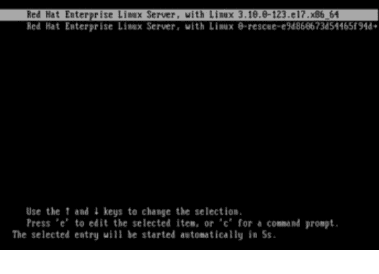

图 7-1 GRUB 菜单

图 7-1 最底部的行显示了以秒为单位的自动启动计时。如果您在 5 秒内没有按任何键，将自动启动高亮的内核。

## 了解 GRUB 菜单

GRUB 菜单顶部显示了可启动内核列表。您可以使用向上或向下箭头键更改选择。您还可以按 `e` 编辑选定的内核条目，或按 `c` 进入 `grub>` 命令提示符。在编辑模式下，GRUB 从 `/boot/grub2/grub.cfg` 文件中加载选定的条目到编辑器中，允许您可以在启动前对其进行修改。您可以按 `Ctrl+x` 在更改后启动，按 `Ctrl+c` 切换到 `grub>` 命令提示符，或者按 `ESC` 放弃更改并返回主菜单。图 7-2 显示了其中一个条目操作键。

```
getparams Red Hat Enterprise Linux Server, with Linux 3.10.0-123.el17.x86_64
set root=keep
set loaded_root=/boot/vmlinuz-3.10.0-123.el17.x86_64
set initrd=/boot/initrd-3.10.0-123.el17.x86_64.img
if [ "$root" = "" ]; then
  search --fs-root --label=root

search --no-floppy --fs-root --file=vmlinuz-3.10.0-123.el17.x86_64
linux vmlinuz-3.10.0-123.el17.x86_64 root=UUID=edc9e8d6-73e5-4455-9464-7f60a89d77f4 initrd=/initrd-3.10.0-123.el17.x86_64.img quiet ro
```

图 7-2 编辑内核字符串

当您输入 `c` 时，会出现 `grub>` 提示符。在提示符状态下，您可以按 `TAB` 键查看可用命令列表，运行这些命令执行所需的操作。见图 7-3。

## /etc/default/grub

`/etc/default/grub` 配置文件定义了 GRUB 在启动时的行为细节。此文件中定义的值用于重新生成 `/boot/grub2/grub.cfg` 文件，该文件控制 GRUB 在启动时的行为。对此文件的更改只有在执行 `grub2-mkconfig` 实用后才会生效。

以下是 `/etc/default/grub` 文件的默认设置，表 7-1 提供了解释：

```
GRUB_TIMEOUT=5
GRUB_DISTRIBUTOR=$(sed 's,.*=.*,,' /etc/os-release)
GRUB_CMD=
GRUB_DISABLE_SUBMENU="console"
GRUB_TERMINAL_OUTPUT="console"
GRUB_CMDLINE_LINUX="-rhgb splash vtback=100 net=auto keymap= root"
GRUB_DISABLE_RECOVERY=""
```


| 指令 | 描述 |
|---|---|
| GRUB_TIMEOUT | 设置启动默认内核之前的等待时间（秒）。默认值为 5。 |
| GRUB_DISTRIBUTOR | 定义 Linux 发行版的名称。 |
| GRUB_DEFAULT | 启动上一次选中的选项。 |
| GRUB_DISABLE_SUBMENU | 启用/禁用 GRUB 子菜单显示。 |
| GRUB_TERMINAL_OUTPUT | 设置默认终端。 |
| GRUB_CMDLINE_LINUX | 指定启动时传递给内核的命令行选项。 |
| GRUB_DISABLE_RECOVERY | 禁止在 GRUB 菜单中显示恢复条目。 |

表 7-1 GRUB 默认配置文件

通常，您不需要对此文件进行任何更改，因为默认设置已足够系统正常运行。

## /boot/grub2/grub.cfg 文件

这是控制 GRUB 启动行为的配置文件。在基于 BIOS 的系统中，它位于 `/boot/grub2` 目录；在基于 UEFI 的系统中，位于 `/boot/efi/redhat` 目录。该文件可以通过 `grub2-mkconfig` 实用重新生成，或者在安装新内核时自动重新生成。

以下是分别在 BIOS 和 UEFI 系统上生成 `grub.cfg` 的命令：

```bash
# grub2-mkconfig -o /boot/grub.cfg
# grub2-mkconfig -o /boot/efi/redhat/grub.cfg
```

当此命令运行时，它会使用 `/etc/default/grub` 中定义的设置以及位于 `/etc/grub.d/` 的辅助脚本来重新生成此文件。

欢迎进入紧急模式。登录后，输入 `journalctl -xb` 查看系统日志，输入 `systemctl reboot` 重启，输入 `systemctl default` 尝试再次重启。

为维护提供 root 密码（或输入 Ctrl-D 继续）：

SysUnit 参数-s

同样地，你可以使用 `systemd-rescue.target`（或简单地使用 1、s 或 single）配合 Linux 内核命令行条目 `Ctrl+x` 引导进入救援目标（rescue target），该目标也称为单用户模式。

## 练习 7-1：重置 root 用户密码

此练习应在*server*（服务器）上完成。

在此练习中，假设 root 密码已丢失或忘记，需要重置。

在此练习中，你将把系统引导到一个特殊的 shell 中以重置 root 密码。

1. 重启或重置服务器，并在自动启动计时器运行前按任意键与 GRUB 交互。在 GRUB 菜单中选中默认内核条目并按 `e` 进入编辑模式。向下滚动，你将看到类似下面的启动字符串：

```
linux /vmlinuz-3.10.0-123.e7.x86_64 root=UUID=a2d6c490-287e-407a-809a-af3b0556e1f4 rootfs=ro rw
initrd /initrd.img rd.lvm=/dev/mapper/vg/root rh quiet lang=EN_CA.UTF-8 %
initrd16 /initrd-3.10.0-123.e7.x86_64.img
```

2. 修改此内核字符串，并在行末尾附加 `root=/sysroot/ro rw`，使其类似于：

```
linux /vmlinuz-3.10.0-123.e7.x86_64 root=UUID=a2d6c490-287e-407a-809a-af3b0556e1f4 rootfs=ro rw
root-lvm=/dev/mapper/vg/root rh quiet lang=EN_CA.UTF-8 %
initrd16 /initrd-3.10.0-123.e7.x86_64.img
```

3. 按 `Ctrl+x` 引导到特殊 shell。系统将根文件系统以只读模式挂载到 `/sysroot` 目录。使用 `chroot` 命令使 `/sysroot` 显示为已挂载的 `/`：

```bash
# chroot /sysroot
```

4. 使用以下命令将根文件系统重新挂载为读/写模式：

```bash
# mount -o remount,rw /
```

5. 通过调用 `passwd` 命令为 root 输入一个新密码：

```bash
# passwd
```

6. 在目录树根目录下创建一个隐藏文件 `.autolabel`，以指示系统在下次重启时进行 SELinux 重新打标签（relabel）：

```bash
# touch /.autolabel
```

7. 退出特殊 shell：

```bash
# exit
```

8. 重启系统：

```bash
# reboot
```

系统将在重启后执行 SELinux 重新打标签。

## 修改默认内核进行引导

如果你想更改默认内核，可以在 `/etc/grub.cfg` 文件中指定其他数字。RHEL 7 默认设置为 0，1 代表第二个内核。

```bash
GRUB_DEFAULT=1
```

输出显示内核为 `vmlinuz-3.10.0-el17.x86_64`，其启动镜像存储在 `initramfs-3.10.0-el17.x86_64` 中。

子目录 `/grub` 包含 GRUB 信息，如下：

## /boot/grub

```text
-rw-r--r-- 1 root      84 Jul  8 13:04 device.map
-drwxr-xr-x 2 root    6015 Oct  6 13:04 Floats
-rw-r--r-- 1 root    2424 Jul 24 11:39 grub.cfg
-rw-r--r-- 1 root    1024 Oct  6 09:08 grubenv
-drwxr-xr-x 2 root    4096 Jul  8 13:04 -
-drwxr-xr-x 2 root    4096 Jul  8 13:04 locale
-drwxr-xr-x 3 root     19 Jul  8 12:51 menu.backup*
```

`/boot/grub` 中的关键文件是 `grub.cfg`，它维护了可用内核列表、默认启动内核以及其他信息。

## /proc 文件系统

`/proc` 是一个虚拟文件系统，其内容在系统启动时创建，并在系统关机时销毁。通常该系统文件包含内核硬件配置和状态信息。以下是 `/proc` 的目录列表：

# /proc

```text
-drwxr-xr-x 8 root      root      0 Oct 09:08 6
-drwxr-xr-x 8 gdm       root      0 Oct 09:08 10
-drwxr-xr-x 8 gdm       gdm       0 Oct 09:09 10
-drwxr-xr-x 8 root      root      0 Oct 09:08 14
-drwxr-xr-x 8 root      root      0 Oct 09:08 11
-drwxr-xr-x 8 gdm       gdm       0 Oct 09:08 12
```

该文件系统包含若干目录和子目录。某些子目录是数字的，包含进程 ID（PID）名称。在每个子目录中，都有包含信息的文件和子目录，例如特定进程的内存段。其他文件和子目录包含数据系统的配置。如果您想查看特定项的配置，例如所示的 `cpuinfo` 和 `meminfo` 文件的内容：

## /proc/cpuinfo


## /proc/cpuinfo

```text
processor               : 0
vendor_id              : GenericIntel
cpu family               : 6
model                  : 42
model name              : Intel(R) Core(TM) i7-2760QM CPU @ 2.40GHz
stepping                : 7
microcode              : 0x29
cpu MHz                 : 881.906
cache size               : 6144 KB
```

## /proc/meminfo

```text
MemTotal:               78889040 kB
MemFree:                55550788 kB
MemAvailable:           6061284 kB
```

存储在 `/proc` 下的数据被许多系统工具（包括 `top`、`ps`、`uname` 和 `vmstat`）引用以显示信息。

## /lib/modules 目录

此目录持有有关内核模块的信息。下方是针对系统上安装内核的特定子目录。例如，下面 `/lib/modules` 下的 `ll` 命令显示系统中只有一个内核：

### /lib/modules

```text
drwxr-xr-x 6 root 4096 Sep 24 06:32 3.10.0-123.x86_64
```

现在对内核子目录使用 `ll`：

### /lib/modules/3.10.0-123.x86_64

```text
drwxr-xr-x 1 root 4096 Jul 08 12:52 build ->/usr/src/kernels
3.10.0-123.x86_64 2 root 4096 May 05 11:23 extract
drwxr-xr-x 2 root 4096 Jul 08 12:54 kernel
drwxr-xr-x 11 root 65536k Jul 08 13:04 modules.alias
-rw-r--r 1 root 637409 Jul 08 13:04 modules.alias.bin
drwxr-xr-x 1 root 1296 May 12 12:52 modules.block
```

有若干文件和子目录。这些文件和子目录持有特定于模块的信息。其中一个关键子目录是 `/lib/modules/3.10.0-123.x86_64/kernel/drivers`，它存储了分类在列表中各种组子目录中的模块：

### /lib/modules/3.6.32-120.x86_64/kernel/drivers

```text
drwxr-xr-x 3 root 4096 Jul 08 12:52 acpi
drwxr-xr-x 2 root 4096 Jul 08 12:52 bluetooth
drwxr-xr-x 2 root 4096 Jul 08 12:52 firewall
drwxr-xr-x 2 root 4096 Jul 08 12:52 input
drwxr-xr-x 2 root 4096 Jul 08 12:52 pci
drwxr-xr-x 2 root 4096 Jul 08 12:52 scsi
drwxr-xr-x 2 root 4096 Jul 08 12:52 usb
```

```
description:
device-mapper-mirror 目标

scversion:
80B77C50183D262F6E8B0

depends:
dm-region-hash,dm-mod-hash,dm-mod

intree:
Y

vermagic:
3.10.0-123.8.1.el7.x86_64 SMP mod_unload outmodversions

signer:
Red Hat Enterprise Linux 内签名密钥

sig_key:
DA:AC:C8:B3:77:76:03:AC:29:21:97:D4:BA:F7:59:F3:38:74

sig_hashalgo:
sha256

parm:
raid1_resync_throttle:4 分配给 raid 重同步的时间 ()
```

输出显示模块名称、类型作者、简短描述、依赖模块名称以及其他信息。

执行 `modprobe` 命令来动态加载模块。该命令确保在加载特定模块之前也会加载任何依赖模块。以下示例是 `dm_mirror` 模块：

## 加载和卸载模块

```
# modprobe -v dm_mirror
insmod /lib/modules/3.10.0-123.8.1.el7.x86_64/kernel/drivers/dm-mod-log.ko
insmod /lib/modules/3.10.0-123.8.1.el7.x86_64/kernel/drivers/dm-region-hash.ko
insmod /lib/modules/3.10.0-123.8.1.el7.x86_64/kernel/drivers/dm-mirror.ko
```

要卸载 `dm_mirror` 模块及其所有依赖模块，请带有 `-r` 运行 `modprobe` 命令：

```
# modprobe -vr dm_mirror
rmmod dm_mirror
rmmod dm_region_hash
rmmod dm_log
```

## 安装新模块

```
# depmod -v
/lib/modules/3.10.0-123.8.1.el7.x86_64/kernel/arch/x86/crypto/helper.ko "crypt_algolib:abspath" : /lib/modules/3.10.0-123.8.1.el7.x86_64/
/lib/modules/3.10.0-123.8.1.el7.x86_64/kernel/arch/x86/crypto/helper.ko "glue_aes_encrypt,128bit" :
/lib/modules/3.10.0-123.8.1.el7.x86_64/kernel/arch/x86/crypto/helper.ko
```

以下是 `/lib/modules/3.10.0-123.8.1.el7.x86_64 | grep modules` 中的模块列表：

```
| -sw-r-- - root 656738 Oct 7 23 modules aliases.as |
| -sw-r-- - root 637409 Oct 7 23 modules aliases.bin |
| -sw-r-- - root 1296 Aug 11 13 modules ko |
| -sw-r-- - root 5912 Aug 11 13 modules buftin |
| -sw-r-- - root 7673 Oct 7 23 modules buftin.bin |
| -sw-r-- - root 213845 Oct 7 23 modules.dep |
```

## init 和启动

`init` 程序（initialization 的缩写）是系统启动时第一个产生子进程的进程。它作为所有启动系统的进程的根进程。有一个被分配 PID 1 的守护进程。在 BSD UNIX 中，`init` 进程作为一个单一主 shell 脚本运行，它会按照预定的顺序连续调用额外的 shell 来初始化系统。如果脚本在执行期间需要等待，`init` 只能等待直到资源对该脚本可用或脚本超时。然后 `init` 继续执行序列中的下一个脚本。这导致了整个启动过程中出现不希望的延迟。为了支持系统初始化，有一个配置文件列出已启用服务的名称，以及一个处理杂杂任务的脚本。在初始化期间，系统必须启动已启用的服务。

通过引入数字运行级别（run levels），`init` 在 UNIX V (SysV) 中得到了增强。这种增强方法通过允许系统启动并运行到若干个预配置的操作状态之一（例如维护状态、带或无图形界面的多用户状态），使整个系统流行起来。每个状态都定义了一组要启动的服务以进入该系统操作。尽管服务是有编号的，但系统管理员有责任确保每个脚本按照适当的依赖顺序执行，以减少服务失败和延迟的概率。在 SysV 中，解决了脚本顺序处理的问题。此外，还引入了依赖管理来指定每个脚本执行的顺序。脚本（作为 `init` 软件包的一部分）管理与定义的运行级别对应的启动/停止脚本并执行它们。在运行的系统上，这些脚本用于通过启动或停止所需运行级别的服务，从一个操作状态转换到另一个状态。红帽在他们的 Linux 发行版中这种启动模型，并称之为 Upstart。

`Upstart` 被引入作为 `init` 系统的替代品。它比前身具有三个优势：异步服务启动；崩溃服务的自动重启；以及由系统进程、硬件或另一个服务触发的服务启动。与前身仅使用 `fstab` 文件来确定运行级别不同，`Upstart` 使用 `/etc/init` 目录中的一组配置文件和 `initctl` 来处理运行级别。由于 `Upstart` 设计的一些缺陷，红帽没有继续使用该系统，而是切换到了名为 `systemd` 的更好的解决方案。

## systemd 概述

`systemd`（SysV 的另一种选择）是一种系统和服务管理机制，在速度和可靠性方面超过了前身。它通过并行处理启动脚本、处理依赖以及使用 socket 进行按需激活实现了快速系统初始化和状态转换。此外，它使用控制组（control groups）跟踪进程并维护活动挂载点。`systemd` 是 RHEL7 中的默认初始化机制，取代了 SysV 和 Upstart。它是启动时的第一个进程，也是关机时的最后一个进程。

为了受益于并行，`systemd` 利用多 CPU 核心和计算资源启动不同的服务。为了实现这一点，它在初始化过程初期为所有启用的服务创建 socket，并将它们传递给守护进程尝试并行启动。在 `systemd` 中，依赖不需要运行，只需 socket 可用。`systemd` 先创建所有 socket，然后是守护进程，当守护进程上线时，任何对守护进程的请求会被缓存。运行期间，`systemd` 管理每个守护进程的生命周期，并通过 D-Bus 交互的服务。通过按需激活，`systemd` 只有在启动过程或运行期间实际需要时启动蓝牙等服务。并行化和按需激活节省了时间和计算资源，并加速了启动过程。

启动时的另一个主要并行优势是 systemd 使用 `autofs` 临时挂载 `/etc/fstab` 中列出的文件系统。在启动过程中，检查文件系统可能会导致必要的延迟。通过 `autofs`，文件系统被临时挂载到它们的标准设备，一旦文件系统的检查完成，它们挂它们。有些 shell 脚本已转换为 C 语言，从而提高了启动速度。systemd 中的并行导致了更扁平的进程树，这可以通过 `ptree` 命令确认。`-p` 和 `-u` 选项显示 PID 和 UID。

```
# ptree -pu
systemd(1)---ModemManager(642)---ModemManager(715)
  └─ModemManager(717)
  └─NetworkManager(807)---NetworkManager(866)
    └─NetworkManager(874)
      └─abrt-watch-log(637)
      └─abrt-watch-log(641)
    └─abrt(636)
  └─accounts-daemon(651)---accounts-daemon(704)
    └─accounts-daemon(708)
  └─alsactid(623)
    └─at-spi-bus-la(2320.gdm)---dbus-daemon(2324)---dbus-daemon(2326)
      └─at-spi-bus-la(2321)
      └─at-spi-bus-la(2323)
      └─at-spi-bus-la(2325)
    └─at-spi-2regstr(2328.gdm)---at-spi-2regstr(2329)
      └─atd(672)
```

## 单元

单元（Units）是用于组织启动和维护任务的对象，例如硬件初始化、socket 创建、文件系统模块和服务启动。单元配置存储在各自的配置文件中，这些从其他配置自动生成、从系统状态动态创建、运行时产生或用户定义。单元处于几种状态之一：活动（active）、非活动（inactive）、进程（processes）或去激活（deactivated）。单元可以启用或禁用。启用的单元可以启动以激活某种状态；禁用的单元无法启动。

单元具有名称和类型，编码在格式为 unit.type 的文件中。示例包括 `.mount`、`.system`、`.service`、`.syslog` 和 `.target`。单元配置文件有两种：由系统生成并安装在 `/usr/lib/systemd/system` 目录中的系统单元，以及由用户生成并存储在 `/etc/systemd/user` 中的用户单元。可以使用 `pkg-config` 命令查看这些信息：

```
# pkg-config systemd --variable=systemddir
/usr/lib/systemd/system
# pkg-config systemd --variable=systemduser
/etc/systemd/user
```

此外，还有在运行时创建并在不再需要时销的额外单元。它们位于 `/run/systemd` 目录。这种运行时优先级优于系统单元，而用户单元优先于运行时单元。单元配置文件直接替换了旧版 RHEL 版本中 `/etc/init.d/` 目录下的初始化脚本，systemd 目前包含 12 种单元类型，如表 7-3 所示。

| 单元类型 | 描述 |
| --- | --- |
| Automount | 提供文件系统的即时挂载功能。 |
| Device | 暴露系统中的内核设备，可能用于设备激活。 |
| Mount | 控制如何挂载或卸载文件系统。 |
| Path | 当监控的文件被访问时启动服务。 |
| Scope | 管理启动它们的进程。 |
| Service | 启动、停止、重启服务及其组成的进程。处理以前 RHEL 版本中其他目录脚本控制的服务。 |
| Slice | 用于分组单元，以分级树的形式管理系统进程进行资源管理。 |
| Snapshot | 动态保存所有单元的当前状态。可以恢复该状态以回到那时。 |
| Socket | 封装本地 IPC 或网络 socket，以匹配服务单元。 |
| Swap | 封装分区。 |
| Target | 定义单元的逻辑分组。等于 SysV 的级别。 |
| Timer | 有助于根据时间触发其他单元的激活。 |

单元文件包含通用和特定的配置元素。通用元素位于 `[Unit]` 和 `[Install]` 部分，带有描述、文档位置、依赖信息、冲突信息以及其他依赖于单元类型的选项。单元特定的配置数据位于服务类型的单元 `[Service]` 之下、服务类型的单元 `[Socket]` 之下，以及对于：

单元可以与其他单元建立依赖关系以作为一种要求。序列（Sequence）概述了在激活单元之前必须执行的一个或多个操作（`Before` 和 `After` 选项），并且某个单元必须已经运行（`Requires` 选项）或未运行（`Conflicts` 选项）才能成功启动该单元。`graphical.target` 单元告诉我们系统必须在多用户模式下运行且不能以其他模式运行，才能成功引导到图形模式。如果所需的单元失败且该单元不需要执行，则 `Wants` 选项可以替代 Unit 或 Install 部分中的 `Requires`。

在单元文件中，你可能会看到的依赖类型很少。服务系统通常会自动管理服务间的依赖关系；然而，也可以手动实现，例如：

使用 `systemctl` 命令列出系统上所有活动单元：


## systemd 单元列表

```
UNIT                             LOAD SUB DESCRIPTION
user-login.target                loaded active Executable File for target
sys-dbus.service                 loaded active activated - for Desktop Bus
sys-dbus-daemon.service          loaded active activated - for Desktop Bus
sys-network.target               loaded active activated - for Network
sys-network-online.target        loaded active activated - for Network
sys-udevd.service                loaded active activated LVM PV 96P31-Chmn-ISFtr-
sys-tty1.service                 loaded active activated - for /dev/devices/serial
sys-tty2.service                 loaded active activated - for /dev/devices/serial
sys-tty3.service                 loaded active activated - for /dev/devices/serial
sys-tty4.service                 loaded active activated - for /dev/devices/serial
sys-tty5.service                 loaded active activated - for /dev/devices/serial
sys-tty6.service                 loaded active activated - for /dev/devices/serial
sys-tty7.service                 loaded active activated - for User Session
sys-tty8.service                 loaded active activated - for /dev/devices/serial
sys-tty9.service                 loaded active activated - for /dev/devices/serial
sys-tty10.service                loaded active activated - for User Session
sys-tty11.service                loaded active activated - for User Session
sys-tty12.service                loaded active activated - for User Session
sys-subsys-.service              loaded active activated - for User Session
boot.mount                       loaded active - /Boot Pages File System
d-mountages.mount                loaded active - POSIX Message Queue File System
d-dev.mount                      loaded active - /dev
mnt.mount                        loaded active - /mnt
root.mount                       loaded active - Root Pipe File System
sys-kernel-config.mount          loaded active - Configuration File System
sys-logd.service                 loaded active - Log File System
tmp.mount                        loaded active - Temporary Directory
```

`UNIT` 列显示单元名称及其在组树中的位置，`LOAD` 反映配置文件是否已加载，`ACTIVE` 描述了高层激活状态，`SUB` 描述了低层单元激活状态，`DESCRIPTION` 说明了单元的内容和功能。默认情况下，`systemctl` 命令仅列出活动单元。你可以使用 `--all` 查看非活动单元。如果你想查看特定类型的单元列表，使用 `-t` 指定类型。以下显示了所有类型为 socket 的活动和非活动单元：

```
# systemctl -t all
                              LOAD SUB DESCRIPTION
avahi-daemon.socket               loaded active running Avahi/DNS-SD
cups.socket                       loaded active running CUPS Printing Service
ddbus.socket                      loaded active running D-Bus System Manager
-network.socket                   loaded active listening Desktop Manager for network
isiscid.socket                    loaded active listening Listening-OpenSCSI iscsi
isudio.socket                     loaded active listening Listening-OpenSCSI isci
vevent.target                     loaded active running - metadata data for events
rpcbind.socket                    loaded active running RPCBind Server As
syslog.socket                     loaded inactive inactive SysLog Socket
```

## 目标

目标是单元的逻辑集合。它们是带有 `.target` 文件扩展名的特殊系统单元。目标等同于 SysInit 运行级别；但是，它们是命名的而不是数字的。目标用于执行一组的单元。这通常用于将系统引导到特定的运行级别（类似于数字级别），并在该级别上运行所有所需的服务。目标继承其他目标的属性并将其添加到其中。system 包含了几个预定义的目标，如表 7-4 所示，以及与每个目标相关的可用运行级别。

### 表 7-4：目标 Sys 运行级别描述

| 目标 | 级别 | 描述 |
| :--- | :--- | :--- |
| halt | 0 | 关闭并停止系统运行。 |
| poweroff or runlevel0 | 0 | 关闭并关闭系统电源。 |
| shutdown | 0 | 关闭系统。 |
| rescue or runlevel1 | 1, 或 single | 用于管理和恢复函数的单用户模式。所有本地文件系统已启动，但其余部分已禁用。 |
| multi-user or runlevel2;3;4 | 3 | 支持网络的多用户模式，但没有 GUI。 |
| graphical or runlevel5 | 5 | 支持网络的多用户模式。 |
| reboot or runlevel6 | 6 | 关闭并重启。 |
| default | 3 | 链接到图形目标。 |
| emergency | N/A | 在紧急模式下运行。 |
| hibernate | N/A | 将状态保存到内存中。 |
| suspend | N/A | 将系统进入挂起。 |
| hybrid-sleep | N/A | 将系统进入休眠。 |

表 7-4 表明大多数系统目标与 Sys 运行级别之间的一一对应关系。默认目标是 `graphical.target`，它执行以带有完整的网络和图形支持。你可以使用 `systemctl` 命令查看活动目标列表：

```
# systemctl list-units --target
UNIT                 LOAD  SUB DESCRIPTION
basic.target         loaded active Base
cryptsetup.target    loaded active Encrypted Volumes
getty.target         loaded active Getty User
local-fs-pre.target  loaded active Local File Systems (Pre)
multi-user.target    loaded active Multi-User System
graphical.target     loaded active Graphical Target
nfs.target           loaded active Network File Server
batch.target         loaded active Batch
remote-fs.target     loaded active Remote File Systems
socket.target        loaded active Sockets
switchd.target       loaded active Switchable User Target
sysinit.target       loaded active System Initialization
timers.target        loaded active Timers
```

LOAD：定义是否已正确加载。

ACTIVE：高层单元激活状态，即 SUB 的泛化。

SUB：详细子状态取决于单元类型。

列出了 17 个单元。

## 控制组

systemd 在服务启动期间执行多个过程。它将进程放在由控制组（简称 groups）组成的优先级层次中，并利用它们监控和控制系统资源，如处理器、内存、网络带宽和磁盘 I/O。这包括限制、隔离和优先考虑使用。这些资源可以根据需求和优先级分配给用户、数据库和应用程序，从而提高整体性能。可以使用 `ps` 命令查看 cgroup 内的进程列表：

```
# ps -eaxo pid,cgroup,args | sort -nk1
```

| USER | COMMAND |
| :--- | :--- |
| root | /usr/lib/systemd/systemd --switched-root |
| root | [threads] |
| root | [kworker/0] |
| root | [kworker/u2:0] |
| root | [kworker] |
| root | [rcv_hu] |
| root | [rcv_echo] |
| root | [rcv_wnd] |
| root | [khalpe2] |
| root | [kirqd] |
| root | [net_] |
| root | [workqueyd] |
| root | [bisect] |
| root | [kworkerd] |
| root | [kthd] |
| root | [kswap0] |
| root | [fanotify_mark] |
| root | [kthread0] |
| root | [msbd_ound] |
| root | [kmsoned] |
| root | [mworker] |
| root | [iata_ef2] |
| root | [ext_rad_2] |
| root | [ext_rad_3] |
| root | [ext_rad_4] |

输出的第一列显示 PID，第二列显示所有者名称，第三、四列显示 cgroup 状态及其内部的进程。

## 管理单元和控制组

systemd 提供了一套用于查询和控制其操作的管理工具。其中主要的工具是 `systemctl`，它支持许多管理功能。该命令还包含了 RHEL6 中 `chconfig` 和 `service` 命令提供的组合功能，用于显示启动设置、在适当的运行级别设置服务启动，以及停止、检查运行状态和重启服务。红帽建议在 RHEL 中避免使用这这两个命令。

正如我们所知，每个系统单元都被命名为 `unitame`。在使用 `systemctl` 命令时，我们不需要指定单元类型；命令会自动获取该信息。

本节涵盖了使用 `systemctl` 命令对单元（特别是服务单元和目标单元）执行的通用操作。它还提供了使用两个新命令 `systemd-cg` 和 `systemd-cgctop` 查看组内容的实例。

## systemctl 命令

`systemctl` 是与 systemd 交互的主要命令。它可以用于显示单元信息并进行管理。它功能多变，支持多种子命令和选项。表 7-5 列出了一些常用命令。

### 表 7-5：systemctl 常用子命令

| 子命令/选项 | 说明 |
| :--- | :--- |
| daemon-reload | 重新读取并加载所有单元配置文件，并重启整个用户依赖树。 |
| enable / disable | 激活（停用）单元在启动时自动启动。 |
| get-default (set-default) | 显示（设置）默认启动目标单元。 |
| get-property (set-property) | 返回（设置）属性的值。 |
| is-active | 检查单元是否正在运行。 |
| is-enabled | 显示单元是否设置为在启动时自动启动。 |
| is-failed | 检查单元是否处于失败状态。 |
| isolate | 改变系统的运行状态（类似于 SysVisit 中的运行级别）。 |
| kill | 终止单元的所有进程。 |
| list-dependencies | 列出单元的依赖树。 |
| list-sockets | 列出 socket 单元。 |
| list-units | 列出已实例化的单元。 |
| list-unit-files | 列出已知单元。这是执行 `systemctl` 且不带任何参数时的默认子命令。 |
| mask / unmask | 禁止（允许）单元的自动和手动激活。 |
| reload | 强制正在运行的单元重新读取其配置文件。此操作不会改变运行单元的 PID。 |
| restart | 停止运行的单元并重启它。 |
| show | 显示单元属性。 |

## 管理单元

`systemctl` 命令用于管理和查看所有类型的单元。以下示例演示了与查看单元及其信息相关的常见操作。

要列出所有单元及其状态：

```
# systemctl
LOAD  ACTIVE SUB     JOB DESCRIPTION
proc-sys-almic loaded active running  Arbitrary Executable
sys-dev-.socket loaded active plugged  VBOK KEYRING
sys-dev-enp3.device loaded active plugged  PRD/100 Net Device
sys-dev-da1.zone loaded active plugged  VBOK HARDDISK
sys-dev-da2.zone loaded active plugged  VBOK HARDDISK
sys-dev-da3.zone loaded active plugged  VBOK HARDDISK
sys-dev-sda.device loaded active plugged  VBOK HARDDISK
```

要按列表地址排序列出所有类型的单元：


# systemctl list-sockets

```
# systemctl list-sockets
UNIT                     ACTIVE STATE
/dev/init/socket         active  systemd-init.socket
syslog.socket            active  systemd.socket
/run/devdev-client       active  devdev-client.service
dm-event.socket          active  dm-event.service
/run/lvmmetad.socket      active  lvm2-metad.service
/run/system/journal      active  systemd-journal.socket
/run/system/stdout       active  systemd-journal.service
/run/control/             active  systemd-control.service
/var/run/cups/cups.socket  active  cups.service
/var/run/dbus/socket      active  dbus.service
/var/run/pcbind.socket    active  pcbind.service
# ISCID ABSTRACT NAMESPACE
iscuio.socket             active  iscuio.service
systemd-udev.socket      active  systemd-udev.service
```

15 个已加载单元。传递 `--all` 也可以查看已加载但未激活的单元。

## 按类型排序列出所有单元

```
# systemctl --type=socket
UNIT                     LOAD ACTIVE SUB     DESCRIPTION
avahi-daemon.socket       loaded active listening  Avahi DNS/DNS-SD Stack Activation
cups.socket               loaded active listening  CUPS Printing Service
ddbus.socket              loaded active listening  DBus Messaging System
dm-event.socket           loaded active listening  DM event daemon
ipv6-address.socket      loaded active listening  IPv6 Network Address Management
iscuio.socket             loaded active listening  Open-ISCSI iscuio socket
lvm2.socket               loaded active listening  LVM2 Socket
pcbind.socket             loaded active listening  RPCBind Server Activation
syslog.socket            loaded active listening  Backward Compatibility Socket
systemd-journal.socket  loaded active listening  Journal Socket
systemd-udev-control.socket loaded active listening  udev Control Socket
systemd-udev-kernel.socket loaded active listening  udev Kernel Socket
```

- `LOAD` - 反映单元是否被正确加载。
- `ACTIVE` - 单元的激活状态。
- `SUB` - 底层单元激活状态，值取决于单元类型。

列出了 13 个已加载单元。传递 `--all` 也可以查看已加载但未激活的单元。

要显示已安装的单元文件使用 `systemctl list-unit-files`。

## 列出系统上安装的所有单元文件及其状态

```
# systemctl list-unit-files
```

| UNIT FILE | STATE |
| --- | --- |
| proc-sys-almic | static |
| sys-dev-.socket | static |
| sys-dev-enp3.device | static |
| sys-dev-da1.zone | static |
| sys-dev-da2.zone | static |
| sys-dev-da3.zone | static |
| sys-dev-sda.device | static |
| proc-fs-binft.mount | static |
| dev-hugepages.mount | static |
| dev-mqueue.mount | static |
| dev-nfs.mount | static |
| proc-fs-binft.mount | static |
| sys-fs-connections.mount | static |
| sys-kernel-config.mount | static |
| sys-kernel-debug.mount | static |
| tmp.mount | enabled |
| var-lib-nfs.mount | static |

`LOAD` = 是否被正确加载。
`ACTIVE` = 单元的高层激活状态。
`SUBSTATE` = 激活的具体状态，取决于单元类型。

传递 `--all` 也可以查看已加载但未激活的单元。

使用 `systemctl list-unit-files` 显示所有单元文件。

# 管理单元

`systemctl` 命令用于管理和查看所有类型的单元。以下示例演示了与查看单元及其信息相关的常见操作。

## 列出所有单元及其状态

```
# systemctl
LOAD  ACTIVE SUB     JOB DESCRIPTION
proc-sys-almic loaded active running  Arbitrary Executable
sys-dev-.socket loaded active plugged  VBOK KEYRING
sys-dev-enp3.device loaded active plugged  PRD/100 Net Device
sys-dev-da1.zone loaded active plugged  VBOK HARDDISK
sys-dev-da2.zone loaded active plugged  VBOK HARDDISK
sys-dev-da3.zone loaded active plugged  VBOK HARDDISK
sys-dev-sda.device loaded active plugged  VBOK HARDDISK
```

## 按列表地址排序列出所有类型的单元

```
# systemctl list-sockets
UNIT                     ACTIVE STATE
/dev/init/socket         active  systemd-init.socket
syslog.socket            active  systemd.socket
/run/devdev-client       active  devdev-client.service
dm-event.socket          active  dm-event.service
/run/lvmmetad.socket      active  lvm2-metad.service
/run/system/journal      active  systemd-journal.socket
/run/system/stdout       active  systemd-journal.service
/run/control/             active  systemd-control.service
/var/run/cups/cups.socket  active  cups.service
/var/run/dbus/socket      active  dbus.service
/var/run/pcbind.socket    active  pcbind.service
# ISCID ABSTRACT NAMESPACE
iscuio.socket             active  iscuio.service
systemd-udev.socket      active  systemd-udev.service
```

15 个已加载单元。传递 `--all` 也可以查看已加载但未激活的单元。

## 按类型排序列出所有单元

```
# systemctl --type=socket
UNIT                     LOAD ACTIVE SUB     DESCRIPTION
avahi-daemon.socket       loaded active listening  Avahi DNS/DNS-SD Stack Activation
cups.socket               loaded active listening  CUPS Printing Service
ddbus.socket              loaded active listening  DBus Messaging System
dm-event.socket           loaded active listening  DM event daemon
ipv6-address.socket      loaded active listening  IPv6 Network Address Management
iscuio.socket             loaded active listening  Open-ISCSI iscuio socket
lvm2.socket               loaded active listening  LVM2 Socket
pcbind.socket             loaded active listening  RPCBind Server Activation
syslog.socket            loaded active listening  Backward Compatibility Socket
systemd-journal.socket  loaded active listening  Journal Socket
systemd-udev-control.socket loaded active listening  udev Control Socket
systemd-udev-kernel.socket loaded active listening  udev Kernel Socket
```

- `LOAD` - 反映单元是否被正确加载。
- `ACTIVE` - 单元的激活状态。
- `SUB` - 底层单元激活状态，值取决于单元类型。

列出了 13 个已加载单元。传递 `--all` 也可以查看已加载但未激活的单元。

要显示已安装的单元文件使用 `systemctl list-unit-files`。

## 列出系统上安装的所有单元文件及其状态

```
# systemctl list-unit-files
```

| UNIT FILE | STATE |
| --- | --- |
| proc-sys-almic | static |
| sys-dev-.socket | static |
| sys-dev-enp3.device | static |
| sys-dev-da1.zone | static |
| sys-dev-da2.zone | static |
| sys-dev-da3.zone | static |
| sys-dev-sda.device | static |
| proc-fs-binft.mount | static |
| dev-hugepages.mount | static |
| dev-mqueue.mount | static |
| dev-nfs.mount | static |
| proc-fs-binft.mount | static |
| sys-fs-connections.mount | static |
| sys-kernel-config.mount | static |
| sys-kernel-debug.mount | static |
| tmp.mount | enabled |
| var-lib-nfs.mount | static |

`LOAD` = 是否被正确加载。
`ACTIVE` = 单元的高层激活状态。
`SUBSTATE` = 激活的具体状态，取决于单元类型。

传递 `--all` 也可以查看已加载但未激活的单元。

使用 `systemctl list-unit-files` 显示所有单元文件。

# 管理服务

以下示例演示了使用 `systemctl` 命令操作名为 `atd` 的服务。

## 检查 atd 服务的当前状态及其在 cgroup 树中的位置

```
# systemctl status atd
ad.service - Job spawning tools
Loaded: loaded (/usr/lib/systemd/system/ad.service; enabled)
Active: active (running) since Fri 2014-08-08 11:45:05 EDT; 6 days ago
Main PID: 672 (atd)
CGroup: system.slice/atd.service
└-672 /usr/sbin/atd -f
Aug 08 11:45:05 myserver.example.com systemd[1]: Started Job spawning tools.
```

## 禁用 atd 服务从启动时自动启动

```
# systemctl disable atd
rm '/etc/systemd/system/multi-user.target.wants/atd.service'
```

## 启用 atd 服务在启动时自动启动

```
# systemctl enable atd
ln -s /usr/lib/systemd/system/atd.service /etc/systemd/system/multi-user.target.wants/atd.service
```

## 检查 atd 服务是否设置为启动时自动启动

```
# systemctl is-enabled atd
enabled
```

## 检查 atd 服务是否运行

```
# systemctl is-active atd
active
```

## 停止并启动 atd 服务

```
# systemctl stop atd
# systemctl start atd
```

## 列出 atd 服务的所有依赖项

```
systemctl list-dependencies atd
atd.service
└system.slice
  └basic.target
    └alsa-restore.service
      └alsa-state.service
    └firewall.service
    └microcode.service
    └rhel-autorelabel-mark.service
    └rhel-autorelabel.service
    └rhel-config.service
    └rhel-dbus.service
    └rhel-ld-rules.service
    └paths.target
      └slices.target
        └slice
          └system.slice
            └sockets.target
              └avahi-daemon.socket
              └cups.socket
              └dbus.socket
              └din-event.socket
              └isiscid.socket
              └systemd.socket
              └lv2-2metad.socket
              └rpcbind.socket
              └systemd-journal.socket
              └systemd-shutdown.socket
              └systemd-udev-control.socket
              └systemd-kernel.socket
            └sysinit.target
              └dev-hugepages.mount
              └dev-mmc0.mount
              └dmraid-activation.service
              └scsi.service
              └kmod-static-nodes.service
```


要显示 `atd` 服务的所有细节：

```
# systemctl show atd.service
Id=atd.service
Names=atd.target
Requires=basic.slice
WantedBy=multi-user.target
Conflicts=shutdown.target
Before=shutdown.target multi-user.target
After=system-user-sessions.service systemd-journal.service basic.socket
Description=Job spooling tools
LoadState=loaded
ActiveState=active
SubState=running
......
```

# 管理目标单元

`systemctl` 命令也用于管理目标单元。它可以用于在命令行从一个运行中的目标切换到另一个。下面提供了一些操作示例。

## 查看和设置默认启动目标

我们使用 `systemctl` 命令来查看和更改默认启动目标。

检查当前的默认启动目标：

```bash
# systemctl get-default
graphical.target
```

> **考试提示：** 你可能需要持久化地修改默认启动目标。

将当前默认目标更改为 `multi-user.target`：

```bash
# systemctl set-default multi-user.target
```

```
rm /etc/systemd/system/default.target
ln -s /usr/lib/systemd/system/multi-user.target /etc/systemd/system/default.target
```

## 切换到特定目标

`systemctl` 命令可用于将系统从一个目标转换到另一个。有许多目标可以切换系统的运行状态，这些目标记录在表 7-2 中。下面显示了从命令行提示符切换目标的几个示例。

切换到 `multi-user` 目标（等于传统的级别 3）：

```bash
# systemctl isolate multi-user.target
```

转换到 `graphical` 目标（等于传统的级别 5）：

```bash
# systemctl isolate graphical.target
```

将系统关机到停机状态：

```bash
# systemctl halt
```

将系统关机到电源状态：

```bash
# systemctl poweroff
```

关闭系统并重启：

```bash
# systemctl reboot
```

将系统转换到休眠并挂起其活动：

```bash
# systemctl hybrid-sleep
```

切换到传统的级别 3 目标：

```bash
# systemctl isolate runlevel3.target
```

## 使用 shutdown 命令

`shutdown` 命令用于优雅地停止、关机电源或重启系统。该命令会向所有登录的用户广播警告消息，禁用用户登录，等待指定的时间让用户注销，然后继续停止服务并将系统关机到指定的目标状态。

以下示例显示了使用此命令的不同方法：

- `shutdown -r`（立即开始关机系统并重启到默认目标）
- `shutdown -h 5`（等待 5 分钟后开始关机到停机或关机状态）
- `shutdown -H 10`（等待 10 分钟后开始关机到停机状态）
- `shutdown -P 20`（等待 20 分钟后开始关机到电源状态）

### 使用 halt、poweroff 和 reboot 命令

出于兼容性考虑，RHEL7 中提供了 `halt`、`poweroff` 和 `reboot` 命令。建议在切换系统状态时使用 `systemctl` 命令。

这三个命令在不带任何参数的情况下，执行的操作与 `shutdown` 命令带有 `-H`、`-P` 和 `-r now` 参数相同。我们可以在任何这些命令中指定 `-f` 选项来强制停机、关机电源或重启系统；然而，这可能会增加损坏应用程序文件和文件系统结构的风险，因此不建议在任何多用户环境下使用此选项。

## 查看系统启动性能统计数据

systemd 提供了 `systemd-analyze` 命令，用于获取和分析系统启动性能统计数据。该命令生成的报告显示了上次系统启动在内核和用户空间程序中所花费的时间。下面提供了用法以及命令产生的数据类型的几个示例。

查看上次启动过程在内核、initrd 和用户空间中花费的总时间：

```bash
# systemd-analyze
Finished in 5.78s (kernel) + 3.28s (initrd) + 41.95s (userspace)
```

查看每个任务的时间：

```bash
# systemd-analyze blame
Finished in 5.78s (kernel) + 3.28s (initrd) + 41.95s (userspace)
```

## systemd-cgls cpu

```
cpu
-1 /usr/lib/systemd --switched-root --system --deserialize 23
-systemd.slice
-color.service
  -2500 /usr/libexec/color
-power.service
  -2339 /usr/libexec/upward
-polkit.service
  -744 /usr/lib/polkit-1/polkit --no-debug
-alsa-state.service
  -628 /usr/sbin/asactl -s n 19 -c -E ALSA_CONFIG_PATH=/etc/alsa/asactl.co
-audit.service
  -599 /sbin/auditd -n
  -615 /sbin/auditd-sp
  -617 /usr/sbin/sysdispatch
```

要监控 CPU、内存和磁盘 I/O 的组资源消耗：

## systemd-cgtop

| 路径 | 任务 | 内存 | 输入/输出 |
| --- | --- | --- | --- |
| /system.slice/ModemManager.service | 1 | | |
| /system.slice/NetworkManager.service | 1 | | |
| /system.slice/abrt-copy.service | 1 | | |
| /system.slice/Alasound.service | 1 | | |
| /system.slice/abtrtd.service | 1 | | |
| /system.slice/alsa-state.service | 1 | | |
| /system.slice/auditd.service | 1 | | |
| /system.slice/dbus.service | 1 | | |
| /system.slice/dbd.service | 1 | | |
| /system.slice/chronyd.service | 1 | | |
| /system.slice/dbus.service | 1 | | |
| /system.slice/systemd-journal | 1 | | |
| /system.slice/gdm.service | 1 | | |

要查看如 `atd` 等服务的 `BlockIO` 和 `CPUShares` 的值，请执行如下 `systemctl` 命令：

```
# systemctl -p BlockIO -p CPUShares atd
BlockIO=1024
```

要更改这些值，请使用 systemd 实例的 `set-property` 命令。要将 `BlockIO` 值设置为 200 并将 `CPUShares` 设置为 256，请运行如下所示命令：

```
# systemctl set-property atd BlockIO=200 CPUShares=256
```

再次运行系统以确认新值。

# 系统日志

系统日志是操作系统不可或缺且最基本的元素之一。在 RHEL 中，它被用于捕获由内核、命令、用户应用程序等生成的消息。这些消息被转发到不同的日志文件中，并存储起来用于安全审计、服务管理、故障排除或信息记录之目的。

负责系统日志的守护进程称为 `syslog`。`syslog` 守护进程是多线程的，支持处理加密、加密消息中继以及各种配置选项。它在启动时会读取配置文件 `/etc/syslog.conf` 以及位于 `/etc/syslog/` 目录下的文件。默认端口为 514，可用于 UDP 或 TCP 协议。大多数系统日志文件的默认存储目录是 `/var/log`，这在 `/etc/syslog.conf` 中定义。其他服务如 audit、libvir、Samba、Apache 和 gnome 桌面管理器在 `/var/log/` 下也有子目录用于存储它们的日志文件。

syslog 服务是模块化的，允许将其配置文件列出的模块根据需要动态加载到内核中。每个模块都为系统带来了新的功能。

可以使用以下 systemd 命令手动停止或启动 syslog 守护进程：

```
# systemctl stop rsyslog
# systemctl start rsyslog
```

守护进程在启动时会被分配一个 PID，并在 `/var/run/` 目录下创建一个名为 `syslog.pid` 的文件来存储 PID。创建此文件的目的是防止启动多个 rsyslog 实例。

## 系统日志配置文件

主要的 syslog 配置文件位于 `/etc` 目录，名为 `rsyslog.conf`。文件中默认未注释的行显示如下及后文所示。添加了章节头部以区分每个部分中的指令。

```
### grep -v ^#/etc/rsyslog.conf | grep -v ^$
#### MODULES
$ModLoad imsyssock 提供本地系统日志支持（例如通过 logger 命令）
$ModLoad journal 提供对系统的的
#### GLOBAL DIRECTIVES
$WorkDirectory /var/lib/rsyslog
$ActionFileTemplate RSYLOG_TraditionalFileFormat
$IncludeConfig /etc/rsyslog.d/*.conf
$OmLocalLogging
$ImJournalStateFile boot
#### RULES
*info,mail,note,authpriv,cron,none
```

- *var/log/messages
- *authpriv.
- *var/log/secure
- mail.
- *var/log/maillog
- cron.
- *var/log/cron
- *emerg
- *commmsg:
- *uucp,news,crit
- *var/log/spool
- *local7

如上，syslog 配置文件包含三个部分：模块、全局指令和规则。模块部分包含两个模块：`imsyssock` 和 `journal`。它们通过 `ModLoad` 指定。`imsyssock` 提供本地系统日志支持，`journal` 提供对系统日志的访问。全局指令部分包含了配置参数。规则部分定义了选择器和目标字段，用于决定消息的去向。

/var/log/tmp?
missingok
monthly
create 0600 root tmp

- 系统配置日志也可以在这里定义。

文件内容显示了默认的轮转频率（每周）。它表示在删除轮转日志之前保留它们的时间（4周）。每当日志文件进行轮转时，都会创建一个以日期作为名称后缀的替换文件，这由 `rsyslog` 守护进程管理。脚本提供了使用 `gzip` 实用程序压缩轮转文件的选项。在脚本执行期间，`logrotate` 命令会检查 `/etc/logrotate.d` 目录中是否存在额外的日志配置文件，并根据需要将其包含进来。对于 `wtmp` 和 `btmp` 文件，有单独的规则限制频率、权限和所有者、轮转次数等。`logrotate.conf` 文件中定义的值对所有日志文件都有全局影响。

我们可以在 `logrotate.conf` 中为特定的日志文件定义自定义设置，或者在 `/etc/logrotate.d` 目录中为其创建一个单独的文件。在用户定义文件中定义的任何设置都将覆盖全局设置。Yum 在目录下有一个自己的配置文件，控制 `/var/log/yum.log` 的轮转：

```
/var/log/yum.log {
missingok
size 30k
create 0600 root
}
```

`/etc/logrotate.d` 目录包含了其他服务日志的额外配置文件。其中一些列如下：

| # /etc/logrotate.d | 权限 | 所有者 | 大小 | 日期 | 服务 |
| :--- | :--- | :--- | :--- | :--- | :--- |
| -rw-r-r-- | root | 194 | Jul 17 09:58 | httpd |
| -rw-r-r-- | root | 172 | Mar 19 2014 | syslog |
| -rw-r-r-- | root | 165 | Mar 24 2014 | libvirtd |
| -rw-r-r-- | root | 162 | Mar 24 2014 | libvirt.txt |
| -rw-r-r-- | root | 163 | Mar 24 2014 | libvirt.qemu |
| -rw-r-r-- | root | 893 | May 27 04:32 | mariadbd |
| -rw-r--r-- | named | 422 | Jan 29 2014 | named |

在这里我们看到服务——httpd、kernel、libvirt、mariadbd 和 DNS 的日志都遵循其配置中的规则，其状态指示服务是否启动成功。如果需要，这些信息可能有助于启动启动后的故障排除。启动日志存储在 `/var/log/boot.log` 文件中。这里是该文件的一个示例：

## 启动日志文件

系统启动期间生成的日志显示了服务的启动序列以及服务是否启动成功。如果需要，这些信息可能有助于启动后的故障排除。启动日志存储在 `/var/log/boot.log` 文件中。

```
# cat /var/log/boot.log
[ OK ] Started Avahi mDNS/DNS-SD Stack.
[ OK ] Started Login Service.
[ OK ] Started Gnome Desktop Manager.
[ OK ] Started Modem Manager.
Starting Authorization Manager...
```

## 系统日志文件

存储系统活动的默认位置是 `/var/log` 中的纯文本日志信息，可以使用任何文件实用程序（如 `cat`、`more`、`pg`、`head` 或 `tail`）进行查看。可以使用 `tail` 命令配合 `-f` 切换实时观察此文件。`messages` 文件捕获了活动的日期和时间、系统主机名、服务的 PID 以及正在记录的活动的简短描述。

> **考试提示：** 在测试系统服务期间，在启动或重启服务后“尾随” `messages` 文件的内容是一个良好的习惯，以解决可能遇到的任何问题。

以下显示了该文件的某些示例条目：

### /var/log/messages

```
Oct 12 10:23:55 server1 dbus-daemon[60]: [system] Successfully activated service 'org.freedesktop.local'
Oct 12 10:23:55 server1 dbus-daemon[660]: Successfully activated service 'org.freedesktop.local'
Oct 12 10:23:55 server1: Started Local Service.
Oct 12 10:23:55 server1: Started The Apache HTTP Server
Oct 12 10:23:55 server1 NetworkManager[834]: <info> carrier: none (off)
Oct 12 10:23:55 server1 NetworkManager[834]: <info> new bridge device (driver: 'bridge' index: 3)
Oct 12 10:23:55 server1 NetworkManager[834]: <info> exported to /org/freedesktop/NetworkManager/Devices/2
Oct 12 10:23:55 server1 NetworkManager[834]: <info> ifconfig: react connection 'eth0'
Oct 12 10:23:55 server1 NetworkManager[834]: <info> device state: unmanaged => unreachable (reason 'connection-disconnected') [10 20]
```

## 理解 Journal


除了 syslog 之外，RHEL 7 还提供了一种新的服务来管理日志。该服务通过 `journal` 守护进程实现，是 `systemd` 的扩展。`journal` 的功能是收集来自内核和用户的日志。它捕获 syslog 并存储在名为 `journal` 的二进制文件中。启动期间生成的任何警报将这些消息存储在 `/var/journal` 的二进制文件中。这些文件被存储并索引以便快速搜索，可以使用 `journalctl` 命令进行查看。因此我们可以为日志启用持久化存储。RHEL 7 还支持使用 `rsyslog` 进行日志，实际上 `journal` 收集的数据可以转发为文本格式。

### 查看 Journal

`systemd` 提供了 `journalctl` 命令来查看 `journal`。例如，如果我们想读取自上次启动以来所有的消息，请不带任何选项运行 `journalctl`。以下输出显示了 `journal` 的前两个条目：

```
# journalctl
Logs at Thu 2014-09-04 20:49:36 UTC, end Thu 2014-09-11 15:40:01 UTC.
Sep 04 20:49:36 server1.example.com systemd-journal[81]: Runtime is using 6.2M (max 49.7M, leaving 74.5M of 490.9M).
Sep 04 20:49:36 server1.example.com systemd-journal[81]: Runtime is using 6.2M (max 49.7M).
```

上述输出格式与记录到 `/var/log/messages` 的类似。每行都包含时间戳、系统主机名以及带 PID 的进程名。使用 `-o` 选项可以指定格式以查看结构化输出：

```
# journalctl -o verbose
Logs at Fri 2014-10-10 10:03:40 UTC, end at 2014-10-13 10:11:26 UTC.
Fri 2014-10-10 10:03:43 [148] _HOSTNAME=server1 _TRANSPORT=system _PRIORITY=6 _SYSLOG_IDENTIFIER=session _MESSAGE=fd5d83a46e8f0c25e84;j=2079;b=94517e41d5b8542d063951c;m=bd4857-72e4-5c6b-db260bb
```

带有 `-b` 选项运行 `journalctl` 以查看自上次启动以来的消息：

```
# journalctl -b
Logs at Thu 2014-09-04 20:49:36 UTC, end Thu 2014-09-11 15:40:01 UTC.
Sep 04 20:49:36 server1.example.com systemd-journal[81]: Runtime is using 6.2M (max)
Sep 04 20:49:36 server1.example.com systemd-journal[81]: Runtime is using 6.2M (max)
```

我们可以指定 `-1`、`-2` 等来查看之前启动的消息。带有 `-k` 和 `-b` 选项运行 `journalctl` 以查看自上次启动以来仅内核生成的消息：

```
# journalctl -k -b 0
Logs at Thu 2014-09-04 20:49:36 EDT, end Thu 2014-09-11 15:40:01 EDT
```

我们可以向 `-n` 选项传递一个数字（例如 3），来仅查看之前的条目：

```
# journalctl -n 3
```

显示由特定可执行文件（例如 `cron` 守护进程）生成的所有消息：

```
# journalctl /sbin/cron
```

显示特定进程（例如 PID 1374）的所有消息：

```
# journalctl _PID=1374
```

```
Logs at Thu 2014-09-04 20:49:36 EDT, end Thu 2014-09-11 16:20:33 EDT
Sep 04 20:50:28.server1.example.com kdmump[journalctl:1374]: No memory reserved for crash
Sep 04 20:50:28.server1.example.com kdmump[journalctl:1374]: Starting kdump: [FAILED ]
```

显示特定系统单元（例如 `sshd`）的所有消息：

```
# journalctl _SYSTEM_UNIT=sshd
```

查看特定日期范围的所有错误消息，例如记录在 9 月 4 日和 5 日的所有错误消息：

```
# journalctl --since=2014-09-04 --until=2014-09-05 -p err
```

获取今天出现的所有警告消息：

```bash
# journalctl --since=today -p warning
```

查看与特定系统单元的消息，使用 `-u` 选项：

```
# journalctl -u httpd=-b
```

类似于我们在 `tail` 命令中使用 `-f` 选项来实时查看日志文件，我们可以在 `journalctl` 中也使用相同的切换：

```
# journalctl -f
```

## 持久存储 Journal 信息

默认情况下，`journal` 临时存储在 `/var/log/journal` 中，这是一个内存虚拟系统。上一节演示的 `journalctl` 命令是从临时位置读取 `journal` 的。`syslog` 守护进程默认重启临时 `journal` 并将消息存储在 `/var/log` 目录；但是，如果我们启用持久化日志，`journal` 将存储在 `/var/log/journal` 中供以后参考。以下是启用持久化日志需要执行的操作：

```
# mkdir -p /var/log/journal
```

```
# systemctl restart system-journald
```

```
# ll /var/log/journal
drwxr-xr-x 2 root journal 49 Sep 11 22:10:12 e9fd8b6c67d354ae6fbdb29c1f08a
```

一旦重启 `journal` 进程，与安装期间创建并存储在 `/etc/machine-id` 文件中的唯一 128 位机器 ID 相匹配的目录将在 `/var/log/journal` 中创建。这里是 `/etc/machine-id` 文件的内容，与我们创建的完全相同：

```
# cat /etc/machine-id
e9fd8b6c67d354ae6fbdb29c1f08
```

本章从 Linux 启动过程开始。我们回顾了 BIOS/固件并查看了启动前管理任务、内核和系统启动阶段。进入特定目标以及引导加载程序配置文件的分析；内核初始化涵盖了系统启动期间生成的消息；系统启动包含了对 `systemd` 这种新初始化方法的详细介绍。我们检查了如何启用服务并将其配置为自

下一个主要主题：讨论 Linux 内核、其关键组件及其管理。我们学习了构成内核的模块。我们对某个内核版本进行了分析，并查看了存放内核特定信息的目录。我们使用各种工具安装了新内核，并使用命令管理内核模块。

我们讨论了名为 `systemd` 的新系统初始化。我们将其与旧的 Sysinit 和 Upstart 初始化方案进行了对比。我们查看了系统的组件、目录和单元配置文件。我们使用各种工具来管理单元、目标和控制组（cgroups）。

最后，我们学习了日志记录和系统日志记录，它们用于捕获和存储系统警报。我们查看了日志文件并了解了如何轮转日志。

# 章节复习题

- 1. BIOS 和 UEFI 都用于计算机。正确或错误？
- 2. `systemd` 命令可能用于构建新内核。正确或错误？
- 3. 默认情况下，GRUB 存储在引导记录中。正确或错误？
- 4. 在 UEFI 系统中， `grub.efi` 文件的位置在哪里？
- 5. 哪个文件存储了 BIOS 系统上启动分区的位置？
- 6. 使用哪个命令管理系统服务？
- 7. 存储 `systemd` 文件的目录名称是什么？
- 8. 引导文件的名称是什么？
- 9. 我们想要使用哪两个文件来处理和内存信息？
- 10. 命令 `systemctl restart syslog` 会做什么？
- 11. 在哪个目标（target）下，X 窗口和图形桌面界面可用？
- 12. 可以使用哪个命令来确定内核版本信息？
- 13. 使用什么类型的命令来重新加载模块。正确或错误？
- 14. 可以使用哪个命令安装模块？
- 15. 可以使用 `yum` 命令升级 Linux 内核吗。正确或错误？
- 16. `rpm` 命令中 `-U` 和 `-i` 选项之间的区别是什么？
- 17. RHEL7 中引入的新系统初始化程序是什么？

# 章节复习题答案

- 1. 正确。
- 2. 错误。
- 3. 正确。
- 4. `grub.efi` 文件位于 `/boot/efi/EFI/redhat` 目录。
- 5. `grub.conf` 文件存储了启动分区的位置。
- 6. `systemctl` 命令。
- 7. 位置是 `/etc/systemd` 和 `/usr/lib/systemd`。
- 8. `/var/log/boot.log` 文件。
- 9. `cpuid` 和 `meminfo` 文件位于 `/proc` 文件系统中。
- 10. 提供的命令将重启 `syslog` 服务。
- 11. X 窗口和图形桌面界面在图形目标（`graphical target`）下可用。
- 12. `uname` 命令。
- 13. 错误。
- 14. `modprobe` 命令。
- 15. 错误。
- 16. `-U` 选项指示 `rpm` 命令升级指定的包，如果其尚未安装则进行安装。另一方面，`-i` 选项会指示命令安装包，如果该包不存在则失败。
- 17. 它被称为 `systemd`。

## DIY 挑战实验室

以下实验有助于加强在本章中学习的大部分概念和主题。预计你在没有任何帮助的情况下完成这些实验。我们不提供分步骤的指南，但这些实验实现需要本章中介绍的知识。对于缺失的信息，请使用默认值或你自己的思考。

### 实验 7-1：修改默认启动目标

将启动目标修改为多用户（`multi-user`）并重启系统进行测试。重启后运行相应的命令以验证更改。将启动目标恢复为图形（`graphical`）并再次重启。

### 实验 7-2：安装新内核

检查系统上当前的内核版本。下载更高版本并安装它。重启系统并确保使用新内核启动。配置系统使用旧内核启动并重启以进行验证。

# 管理用户和组

本章描述了以下主要主题：

- 理解本地用户认证文件
- 维护认证文件的完整性
- 防止认证文件出现损坏
- 激活和禁用影子密码（`shadow`）机制
- 使用默认值和自定义值创建、修改和删除本地用户账户
- 在本地用户账户上设置密码年龄
- 使用 `su` 和 `sudo` 命令
- 创建、修改和删除本地组账户
- 图形化用户管理器（User Manager）工具概述
- 理解用户级和系统级启动文件

## RHCSA 目标：

- 05. 在多用户目标下登录和切换用户
- 44. 创建、删除和修改本地用户账户
- 45. 修改本地用户账户密码并调整密码年龄
- 46. 创建、删除和修改本地组及组关系

为了让授权人员获得系统的访问，必须分配唯一的用户名（又称为登录名），并在系统上创建一个用户账户。用户被分配到一个或多个组的成员身份。同一组的成员对文件和目录具有相同的访问权限。其他组的成员也可以选择性获得这些文件的访问权限。用户和组账户信息记录在几个文件中，可以检查其一致性，并在必要时由一名管理员一次手动编辑。可以在用户账户上设置权限以增加访问权限。只要用户知道密码，他们就可以切换到其他用户账户（包括 `root` 用户）。系统上的普通用户可以通过在配置文件中适当定义来允许访问特权账户。

## 理解用户认证

RHEL 支持三种用户类型：`root`、普通和服务。`root` 用户是具有所有服务完全访问权的管理员。普通用户具有用户级权限，不能执行管理功能。服务账户负责处理安装的服务。这些账户包括 `apache`、`ftp`、`postfix` 和 `sendmail`。

本地用户的账户信息存储在 `/etc` 目录的文件。这些文件是 `password`、`shadow` 和 `group`，在创建、修改或删除账户时会更新。这些文件在用户登录系统时会被用于检查和验证用户凭据，因此被称为用户认证文件。这些文件对于系统运行至关重要，系统默认维护这些这些文件的 `passwd-` 格式备份。文件中的每个行条目都包含一个用户账户的信息。每行有七个字段，用冒号分隔。文件中的示例条目显示如图 8-1。

`/etc/passwd` 文件包含用户登录数据。

| 用户名 | 密码占位符 | UID | GID | 注释 | Shell |
|---|---|---|---|---|---|
| user1 | x | 1000 | 1000 | Regular | /bin/bash |

图 8-1 `/etc/passwd`

第四个字段包含一个称为组 ID (GID) 的数字。该数字与 `/etc/group` 文件中的组条目对应。默认情况下，RHEL 为每个新用户创建一个与其用户名匹配的组，其 GID 与 UID 相同。该字段中定义的默认值表示用户的主组。

第五个字段（称为 GECOS – 通用电气综合操作系统，后来更改为 GCOS）可选地存储有关用户的通用注释，其中可能包括用户的姓名、电话号码、位置或其他用于识别该账户所属人员或应用程序的有用信息。这些数据可以分别通过 `finger` 和 `chfn` 命令进行查看和修改。

第六个字段定义了用户主目录的绝对路径。主目录是用户登录系统后所处的位置，通常用于存储用户的个人文件。主目录的默认位置是 `/home`。

最后一个字段包含登录后将用作主 shell 的 shell 绝对路径。常见的 shell 有 `/bin/bash` 和 `/bin/csh`。分配给用户的默认 shell 是 `bash` 壳。

以下是密码文件的一个片段：

```
# cat /etc/passwd
root:x:0:0:root:/bin/bash
bin:x:1:1::/bin/nologin
daemon:x:2:2::/bin/sbin
user1:x:1000:1000:/home/user1:/bin/bash
```

该文件的权限应为 644，且必须由 `root` 所有。

## shadow 文件（影子密码文件）

影子密码机制的实现为本地用户提供了更安全的密码保护。有了该机制，不仅用户密码不仅被加密并存储在更安全的 `/etc/shadow` 文件中，还可以针对每个用户对密码的过期时间、警告期等应用某些限制。这些限制和其它设置定义在 `/etc/login.defs` 文件中，影子密码机制在用户账户上强制执行这些设置。这被称为密码老化（password aging）。与所有人可读的密码文件不同，`shadow` 文件仅允许 `root` 用户读取。这样做是为了保护文件的内容。

在启用影子密码机制的情况下，系统会首先在密码文件中检查用户是否存在，然后在 `shadow` 文件中检查其真实性。

`shadow` 文件包含扩展的用户身份验证。该文件中的每一行都对应密码文件中的一个条目。每行条目由由冒号分隔的字段组成。示例见图 8-2。

```
user1:$6$u4NXwnJuixBln$51y4Tee1ubu:16374:0:99999:::
```

以下是每个字段中存储的内容：

第一个字段包含 `passwd` 文件中显示的登录名。

第二个字段由加密密码组成。该字段开头的感叹号 `!` 表示用户账户已锁定。

第三个字段设置自纪元时间（1970 年 1 月 1 日）以来最后一次修改密码的天数。空字段表示禁用密码老化功能，该字段中的 0 则将强制用户在下次登录时更改密码。

第四个字段表示用户更改密码前必须经过的最少天数。可以使用 `chage` 命令的 `-m` 选项或 `passwd` 命令的 `-n` 选项修改此字段。该字段中的 0 或空将禁用此功能。

第五个字段定义了用户开始收到更改密码警告信息之前的最大有效天数。可以使用 `chage` 命令的 `-M` 选项或 `passwd` 命令的 `-x` 选项进行修改。该字段中的空值将禁用此功能以及最大密码老化、警告警报和用户空闲期。

第六个字段由用户接收更改密码警告的天数。可以使用 `chage` 命令的 `-W` 选项或 `passwd` 命令的 `-w` 选项修改此字段。该字段中的 0 或空将禁用此功能。

第七个字段包含允许的用户最大空闲天数。可以使用 `chage` 命令的 `-I` 选项或 `passwd` 命令的 `-i` 选项修改此字段。该字段中的空值将禁用此功能。

第八个字段表示自纪元时间（1970 年 1 月 1 日）之后账户过期的天数。可以使用 `chage` 命令的 `-E` 选项修改此字段。

最后一个字段留作备用。

以下是 `shadow` 文件的一个片段：

```
# /etc/shadow
root:$6s1aKxxuz2cX2S2HjS4Jl.OOk/Hpiuj4i8RsOEEF-6YP66WQQbnUnF1Hvx0i2nk7e6k0l.kjYhuYvZLwcLFIDqpiQC1:16374:999999:7:
:::16414:999999:7:
:::16414:999999:7:
user:$6sU4NnjXwnhujblS5d1y42TeIibHukvOBBMQOswMwKedI3TrgtpeXv1FC2z40RnwCow.Nqs5BqeZ7XqJpJqk8Nw19:16374:999999:7
```

- `shadow` 文件的权限应为 000，且必须由 `root` 所有。

## 组文件（Group File）

`/etc/group` 文件包含组信息。每个用户至少属于一个组，这被称为用户的主组。默认情况下，组名与用户名匹配。该组是用户私组 (UPG)，用于保护用户的文件。可以设置额外的组，并向它们添加访问要求。文件每行有四个字段，由冒号分隔。图 8-3 显示了文件中的示例条目。


| 组名 | GID | 组成员 | 密码占位符 |
| :--- | :--- | :--- | :--- |
| user1 | 1000 | user1 | x |

图 8-3 /etc/group 文件

以下是每个字段存储的内容：

第一个字段包含 `passwd` 文件中显示的登录名。

第二个字段由加密密码组成。该字段开头的感叹号 `!` 表示用户账户已锁定。

第三个字段设置自纪元时间（1970 年 1 月 1 日）以来最后一次修改密码的天数。空字段表示禁用密码老化功能，该字段中的 0 则将强制用户在下次登录时更改密码。

第四个字段表示用户更改密码前必须经过的最少天数。可以使用 `change` 命令的 `-m` 选项或 `passwd` 命令的 `-n` 选项修改此字段。该字段中的 0 或空将禁用此功能。

第五个字段定义了用户开始收到更改密码警告信息之前的最大有效天数。可以使用 `change` 命令的 `-M` 选项或 `passwd` 命令的 `-x` 选项进行修改。该字段中的空值将禁用此功能以及最大密码老化、警告警报和用户空闲期。

第六个字段由用户接收更改密码警告的天数。可以使用 `change` 命令的 `-W` 选项或 `passwd` 命令的 `-w` 选项修改此字段。该字段中的 0 或空将禁用此功能。

第七个字段包含允许的用户最大空闲天数。可以使用 `change` 命令的 `-I` 选项或 `passwd` 命令的 `-i` 选项修改此字段。该字段中的空值将禁用此功能。

第八个字段表示自纪元时间（1970 年 1 月 1 日）之后账户过期的天数。可以使用 `change` 命令的 `-E` 选项修改此字段。

最后一个字段留作备用。

禁用对它们的访问。当带有 `-s` 选项执行时，相同的命令也用于编辑这些文件的影子版本。这两条命令都会在 `/etc` 目录下创建各自文件的副本，并在同一目录下创建一个以 `.lock` 结尾相应的锁文件。`.edit` 文件存储了修改期间所做的更改，而 `.lock` 文件存储了进程的 PID。在此期间，如果用户尝试更改密码，`passwd` 命令会接受新密码，并在尝试更新原始文件之前检查 `.lock` 文件是否存在。`.lock` 文件的存在表示正在进行编辑，该命令将等待编辑完成。当管理员完成操作后，系统将对文件数据和语法的有效性进行自动检查。原始文件将以其原名进行备份，并用 `.edit` 文件替换原始文件。随后，`.edit` 和 `.lock` 文件将被删除。此时，`passwd` 命令将等待之前的编辑会话结束，并成功更新用户密码。

该规则也适用于其他在这些文件被修改时尝试写入这些文件的命令。此外，当这些工具的任一实例在任何文件上运行时，另一个实例会产生类似下面的错误消息：

```
# vi -s
vi: cannot lock file: Interrupted system call
v:/etc/shadow is unchanged
```

在任何文件的编辑会话结束时，都会显示一条消息，提醒我们已修改了相应的文件。例如，在使用 `vip` 命令完成 `passwd` 修改后，会显示以下提醒：

> 你已修改了 /etc/passwd。
>
> 为了一致性，你可能需要修改 /etc/shadow。
>
> 请使用命令 `vip -s` 执行。

在 `gshadow` 文件上执行 `vip` 命令后：

> 你已修改了 /etc/shadow。
>
> 为了一致性，你可能需要修改 /etc/group。
>
> 使用命令 `vip -g` 执行。

# 激活和禁用影子密码机制

影子密码机制允许使用 `shadow` 和 `gshadow` 文件存储用户和组密码，并且可以根据需要禁用密码老化信息。然而，除非有特殊需求，否则这样做是不良的且不常见的。`shadow-utils` 包提供了四个工具，其中 `pwconv` 和 `grconv` 用于激活该机制，而另外两个（`pwunconv` 和 `grpunconv`）用于禁用它。它们在表 8-1 中描述。

| 命令 | 描述 |
| :--- | :--- |
| `pwconv` | 创建并更新影子文件，并将用户密码移动到指定的文件 |
| `pwunconv` | 将用户密码移回 passwd 文件并删除影子文件 |
| `grconv` | 创建并更新 gshadow 文件，并将组密码移动到 group 文件 |
| `grpunconv` | 将组密码移回 group 文件并删除 gshadow 文件 |

表 8-1 密码影子命令

激活工具在执行时会引用 `/etc/login.defs` 文件中的密码老化属性。以下几个示例展示了这些命令的用法：

如果密码影子尚未激活，则可以激活它：

```bash
# pwconv
```

此命令静默运行，除非出现问题，否则不会显示任何输出。它为 root 用户为影子文件创建了只读权限：

```
# ll /etc/shadow
-------- root 1289 Nov 2 08:00 etc/shadow
```

如果组层面的密码影子尚未激活，则可以在组级别激活它：

```bash
# grconv
```

此命令静默运行，除非出现问题，否则不会显示任何输出。它为 root 用户创建了只读的 gshadow 文件：

```
# ll /etc/gshadow
------- 1 root 671 Nov 2 08:02 /etc/gshadow
```

要禁用密码影子并删除影子文件，请分别执行 `pwunconv` 和 `grpunconv` 命令。

# 使用命令管理用户账户和密码

管理用户账户涉及创建、分配密码、修改和删除。管理密码账户涉及为用户账户设置和修改属性。RHEL 提供了一套工具和一个名为“User Manager”的图形化工具来执行这些操作。命令行工具是 `shadow-utils` 包的一部分，当系统安装了 `system-config-users` 包时，User Manager 将可用。

表 8-2 列出并描述了用于用户和密码管理的关键命令。

| 命令 | 描述 |
| :--- | :--- |
| `useradd` | 添加用户。 |
| `usermod` | 修改属性。 |
| `userdel` | 删除用户。 |
| `chage` | 为用户设置或修改密码属性。 |
| `passwd` | 设置或修改用户密码以及某些密码属性。 |

表 8-2 用户密码命令

# useradd、usermod 和 userdel 命令

这组命令用于从系统中添加、修改和删除用户账户。`useradd` 命令为每个添加到系统的用户在 `passwd`、`group` 和 `gshadow` 文件中添加信息。该命令为用户创建家目录，并从骨架目录 `/etc/skel` 将默认启动文件复制到家目录。它还可以用于在创建用户时更新默认设置。`userdel` 命令有多个带有短格式和长格式的选项，并附有说明。表 8-3 列出了大部分选项：

| 选项 | 描述 |
| :--- | :--- |
| `--base-dir` | 定义用户目录的基目录。 |
| `--comment` | 描述关于用户的有用信息。 |
| `--home-dir` | 定义家目录的绝对路径。 |
| `--details` | 显示默认设置。 |
| `--expire` | 指定账户过期的日期（YYYY-MM-DD）。 |
| `--inactive` | 指定账户过期后非活动的天数。 |
| `--gid` | 指定主组 ID。 |
| `--groups` | 指定辅助组。 |
| `-k` | 指定骨架目录。 |
| `-M` | 不创建家目录。 |
| `-m` | 创建家目录。 |
| `-n` | 不创建同名用户组。 |
| `-o` | 允许创建重复 UID 的用户。 |
| `-s` | 指定 shell。 |
| `-u` | 指定用户 ID。 |
| `-U` | 创建同名用户组。 |
| `--system` | 指定系统账户。 |

*(注：由于原文该部分存在大量重复和格式混乱，译文已根据逻辑进行了梳理并保留了核心选项含义)*

## useradd 和 login.defs 文件

`useradd` 命令对于命令行中未指定的任何选项，将从 `/etc/default/useradd` 和 `/etc/login.defs` 文件中选取默认值。此外，`usermod`、`userdel`、`chage` 和 `passwd` 命令也会根据需要咨询 `login.defs` 文件。我们可以使用类似 `cat` 的命令查看 `useradd` 文件的内容，或者如下文所示，使用 `useradd` 命令显示设置：

```
# useradd -D
GROUP=100
HOME=/home
INACTIVE=1
EXPIRE=
SHELL=/bin/bash
SKEL=/etc/skel
CREATE_MAIL_SPOOL=yes
```

我们可以修改这些默认值并将其设置为我们所需的值。例如，以下操作将默认的基目录更改为 `/usr/home`，作为放置新用户家目录的新位置：

```
# useradd -D -b /usr/home
```

再次运行 `useradd -D` 以确认新值。

另一个文件 `/etc/login.defs` 包含了设置若干默认值的额外细节。用户和组管理命令会咨询此文件以获取未在命令行指定的信息。对未注释的非空行执行 `grep` 将显示：

```bash
# grep -v ^# /etc/login.defs
MAIL_DIR=/var/spool/mail
PASS_MAX_DAYS=99999
PASS_MIN_DAYS=0
PASS_MIN_LEN=5
PASS_WARN_AGE=7
UID_MIN=1000
UID_MAX=60000
SYS_UID_MIN=201
SYS_UID_MAX=999
GID_MIN=1000
GID_MAX=60000
SYS_GID_MIN=201
SYS_GID_MAX=999
CREATE_HOME=yes
UMASK=077
USERGROUPS_ENAB=yes
ENCRYPT_METHOD=SHA512
```

这些指令定义了邮件目录位置（`MAIL_DIR`）、密码最大有效期（`PASS_MAX_DAYS`）、密码最小有效期（`PASS_MIN_DAYS`）、密码最小长度（`PASS_MIN_LEN`）、密码警告期（`PASS_WARN_AGE`）、分配给新用户和组账户的 UID 和 GID 范围（`UID_MIN`、`UID_MAX`、`GID_MIN`、`GID_MAX`）、分配给新系统和组账户的 UID 和 GID 范围（`SYS_UID_MIN`、`SYS_UID_MAX`、`SYS_GID_MIN`、`SYS_GID_MAX`），以及 `useradd` 命令创建家目录（`CREATE_HOME`）、默认权限（`UMASK`）、如果用户组没有成员则删除用户组（`USERGROUPS_ENAB`），以及使用 SHA512 算法加密用户密码（`ENCRYPT_METHOD`）。

## 练习 8-1：使用默认值创建用户账户

在此练习中，你将创建一个账户 `user2`，并使用 `useradd` 和 `login.defs` 文件中定义的所有默认值。

你将为用户分配密码以及 `passwd`、`shadow`、`group` 和 `gshadow` 文件中的条目。

1. 使用默认值创建 `user2`：

```bash
# useradd user2
```

2. 为此用户创建密码：


# passwd user2
New password:
Retype password:
passwd: all authentication tokens updated successfully.

- 3. 在 `passwd`、`shadow`、`group` 和 `gshadow` 中搜索用户，以检查 `useradd` 添加了什么：

```
# cd /etc; grep user2 passwd shadow group gshadow
passwd:user2:1000:1001::/home/user2:/bin/bash
shadow:user2:6S80GGCpM99:W7F8sX4dY2GuaLRPf316QepBlyuyWIIdDbW7f6E3kFainnuaZaGMMcBl0EXwaUc13QYitFesw0:1637:0:9
group:user2:1001:
gshadow:user2:1001:
```

- 4. 通过登录 `user2` 并提供分配的密码来测试此新账户。

正如所见，命令使用了下一个可用的 UID 和 GID，以及家目录、shell 文件和密码的默认设置。

## 练习 8-2：使用自定义值创建用户账户

此练习应在 `server1` 上进行。

在此练习中，你将创建一个账户 `user3`，其 UID 为 110，家目录为 `/home/user3` (`-m -d`)，shell 为 `/bin/bash`，属于 GID 为 110 的组 `user3`，并将默认启动文件复制到该用户的家目录。你将为此用户分配密码以及 `passwd`、`shadow`、`group` 和 `gshadow` 文件中的条目。

- 1. 创建 UID 为 110 (`-u`)、家目录为 `/home/user3` (`-m` 和 `-d`)、shell 为 `/bin/bash` (`-s`)、属于组 1001 (`-g`)、并将默认启动文件复制到用户家目录 (`-k`) 的 `user3`：

```
# useradd -u 110 -g 1001 -m -d /home/user3 -k /etc/skel -s /bin/bash user3
```

- 2. 为此用户分配密码：

```
# passwd user3
New password:
Retype password:
passwd: all authentication tokens updated successfully.
```

- 3. 在 `passwd`、`shadow`、`group` 和 `gshadow` 中搜索用户，以检查 `useradd` 添加了什么：

```
# cd /etc; grep user3 passwd shadow group gshadow
passwd:user3:110:1001::/home/user3:/bin/bash
shadow:user3:6S80GGCpM99:W7F8sX4dY2GuaLRPf316QepBlyuyWIIdDbW7f6E3kFainnuaZaGMMcBl0EXwaUc13QYitFesw0:1637:0:9
group:user3:1001:
gshadow:user3:1001:
```

- 4. 通过登录 `user3` 并提供分配的密码来测试此账户。

## 练习 8-3：创建一个无法登录的用户账户

此练习应在 `server1` 上进行。

在此练习中，你将创建一个账户 `user4`，其 UID 为 120，家目录为 `/home/user4` (`-m -d`)，shell 为 `/bin/bash`，属于 GID 为 1002 的组 `user4`，并将默认启动文件复制到该用户的家目录。你将为此用户分配密码以及 `passwd`、`shadow`、`group` 和 `gshadow` 文件中的条目。

- 1. 创建 UID 为 120 (`-u`)、家目录为 `/home/user4` (`-m` 和 `-d`)、shell 为 `/bin/bash` (`-s`)、属于组 1002 (`-g`)、并将默认启动文件复制到用户家目录 (`-k`) 的 `user4`：

```
# useradd -u 120 -g 1002 -m -d /home/user4 -k /etc/skel -s /bin/bash user4
```

- 2. 将 shell 设置为 `nologin`：

```
# usermod -s /sbin/nologin user4
```

- 3. 为此用户分配密码：

```
# passwd user4
New password:
Retype password:
passwd: all authentication tokens updated successfully.
```

- 4. 通过尝试登录 `user4` 来测试此账户。你应该收到一条该账户当前不可用的消息。

1. 将 `user2` 的登录名称修改为 `user2new` (`-l`)，UID 修改为 2000 (`-u`)，主目录修改为 `/home/user2new` (`-m`)并将登录 shell 修改为 `/sbin/nologin` (`-s`)：

```bash
# usermod -u 2000 -m /home/user2new -s /sbin -l nologin user2new
```

2. 从密码文件中获取 `user2new` 的信息以确认更改：

```bash
# grep user2 /etc/passwd
user2:x:2000:1001:/home/user2:/sbin/nologin
```

3. 将 2016 年 2 月 29 日设置为 `user2new` 的新过期日期：

```bash
# usermod -e 2016-02-29 user2new
```

4. 确认 `user2new` 的新过期时间：

```bash
# change -l user2new
Account expires : Feb 29, 2016
......
```

5. 修改 `user3`，使其密码在下次登录时过期并提示更改 (`-d`)，在最后一次密码更改后的五天内无法更改密码 (`-m`)，并禁用账户过期 (`-E -1`)：

```bash
# change -d 0 -m 5 -E -1 user3
```

6. 确认 `user3` 的老化更新情况：

```bash
# change -l user3
Last change : password must be changed
Password expires : password must be changed
Password inactive : password must be changed
Account expires : never
Minimum number of days between password change : 5
Maximum number of days between password change : 30
Number of days of warning before password expiry : 7
```

7. 使用以下任一方法锁定 `user4`：

```bash
# usermod -l user4 (or passwd -l user4)
Locking password for user4.
passwd: Success
```

8. 删除主目录及其邮件池目录 (`-r`) 删除 `user4`：

```bash
# userdel -r user4
```

9. 确认 `user4` 已删除：

```bash
# grep user /etc/passwd
```

# 切换用户

即使我们可以以 `root` 身份登录系统，但这并不是一种推荐的做法。推荐的做法是用普通用户账户登录，必要时切换到 `root` 账户。这样更安全，并确保了系统的安全和保护。除了变成 `root`，我们也可以切换到另一个用户账户。无论哪种情况，我们都需要目标用户账户的密码才能成功切换。RHEL 中的此类命令为我们切换到其他用户账户的能力。以下提供了几个示例以理解用法。

在不执行启动脚本的情况下切换到 `root`：

```bash
$ su
Password:
```

重复上述操作，同时确保目标用户的启动脚本也被执行，以提供类似于真实登录的环境：

```bash
# su su -
Password:
```

切换到不同的用户账户（例如 `user3`），使用命令指定目标用户的名称：

```bash
$ su - user
Password:
```

若要在不切换到该用户的情况下以不同用户的身份执行命令，可以使用 `su` 的 `-c` 选项。例如，带有 `--list-services` 选项的 `firewall-cmd` 命令需要超级权限。`user1` 可以如下所示使用 `su` 并执行此特权命令以获取结果：

```bash
$ su -c "firewall-cmd --list-services"
Password:
dhp66-ccln ssh
```

`root` 用户可以切换到系统的任何其他用户账户，而无需提示用户的密码。

# 以超级用户身份执行

RHEL 提供了一种方法，让普通用户能够在不知道 `root` 密码的情况下运行一组分配的特权命令。这允许根据需要将特定命令或一组命令分配给单个用户或用户组。这些用户在执行时可以使用一种名为 `sudo`（超级用户）的实用程序来执行其中任一个命令。他们会被提示输入密码，如果密码正确，命令将成功执行。`sudo` 工具设计用于提供对 `/etc/sudoers` 文件中定义的管理函数的受保护访问。它还可以用于允许用户或用户组以不同用户的身份运行脚本和应用程序。

任何需要访问一个或多个管理命令的普通用户都定义在 `sudo` 文件中。可以使用 `visudo` 命令编辑该文件，该命令会创建一个 `sudoers.tmp` 文件的副本并应用更改。`visudo` 会话结束后，原始的 `sudoers` 文件和 `sudoers.tmp` 将删除。这样做是为了防止多个用户同时编辑该文件。

文件中用户和组条目的语法与以下 `user1` 用户和 `dba` 组的示例条目类似：

```
user1           ALL=(ALL)       ALL
%dba            ALL=(ALL)       ALL
```

这些条目为 `user1` 和 `dba` 组成员（组以 `%` 符号开头）提供了对系统中 ALL 管理命令的 ALL 权限。

现在，当 `user1` 或任何组组员执行特权命令时，他们将被要求输入密码。例如：

```bash
$ sudo system-config-users
Password:
```

如果我们想让 `user1` 和 `dba` 组不提示输入密码，可以修改 `sudoers` 文件中的条目如下：

```
user1           ALL=(ALL)       NOPASSWD:ALL
%dba            ALL=(ALL)       NOPASSWD:ALL
```

若要限制 `user1` 和 `dba` 组成员仅运行 `system-config-printer` 和 `system-config-users` 命令，请修改条目：

```
user1           ALL=(ALL)       ALL
%dba            ALL=(ALL)       ALL
```

| 选项 | 描述 |
| - | - |
| `-d` (`--delete`) | 删除组成员。 |
| `-M` (`--members`) | 替换所有现有的组成员。 |
| `-R` (`--restrict`) | 禁止非成员访问组。带有密码的成员仍可以加入该组。 |
| `-t` (`--remove-password`) | 撤销设置的组密码。只有组成员可以加入该组。 |

表 8-9: `gpasswd` 命令选项

此命令从 `/etc/syslog.defs` 文件中选取默认值。

## 练习 6：创建、修改和删除组账户

本练习应在 `server1` 上完成。

在此次练习中，你将创建一个名为 `linuxadm` 的组账户，其 GID 为 5000，以及另一个共享 GID 5000 的名为 `sales` 的组账户。你把组名从 `sales` 更改为 `mgmt`，然后将 `linux` 的 GID 从 5000 更改为 6000。你把 `user1` 添加到 `linuxadm` 中，并通过 `id` 和 `groups` 命令进行验证。最后，你将删除 `mgmt` 组。

1. 创建 GID 为 5000 的组账户 `linuxadm`：

```
# groupadd -g 5000 linuxadm
```

2. 创建与组 `linux` 共享 GID 的组账户 `sales`：

```
# groupadd -g 5000 sales
```

3. 将组 `sales` 的名称改为 `mgmt`：

```
# usermod -n mgmt sales
```

4. 将 `linuxadm` 的 GID 更改为 6000：

```
# groupmod -g 6000 linuxadm
```

5. 在保留用户现有成员身份的情况下，将 `user1` 添加到组 `linuxadm`：

```
# usermod -a -G linuxadm user1
```

6. 验证 `user1` 的组成员身份：

```
# id user1
uid=1000(user1) gid=1000(user1) groups=10(wheel),6000(linuxadm)
# groups user1
user1 : wheel linuxadm
```

7. 删除 `mgmt` 组：

```
# groupdel mgmt
```

## 练习 8-7：使用 gpasswd 命令管理组

本练习应在 `server1` 上完成。

在此次练习中，你将 `user1` 和 `user2` 添加为组管理员，并将 `user2new` 和 `user3` 添加为 `linuxadm` 组的成员。你将用 `user4`（如果不存在则创建）替换现有的组成员，并为 `linuxadm` 组分配密码。你将以 `user4` 身份登录并列出 `user4` 当前的主组成员身份。你将主组切换为 `linuxadm` 并进行验证。

1. 将 `user1` 和 `user2` 添加为 `linuxadm` 组的管理员：

```
# gpasswd -A user1,user2 linuxadm
```

2. 将 `user2new` 和 `user3` 添加为 `linuxadm` 组的成员：

```
# gpasswd -a user2new -a user3 linuxadm
正在将组 linuxadm
```

3. 使用默认值创建 `user4` 并分配密码 `user123`：

```bash
# adduser4 | echo user123 | passwd --stdin user4
Changing password for user4.
password: authentication tokens updated successfully.
```

4. 用 `user4` 替换 `linuxadm` 组中的 `user2new` 和 `user3`：

```bash
# gpasswd -M user4 linuxadm
```

5. 为 `linuxadm` 组设置密码：

```bash
# gpasswd linuxadm
Changing the password for group linuxadm
New Password:
Re-enter new password:
```

6. 以 `user4` 登录并运行 `groups` 命令列出 `user4` 的组成员身份。主组首先列出。

```bash
# groups
user4 linuxadm
```

7. 临时将 `user4` 的主组改为 `linuxadm`：

```bash
# newgrp linuxadm
```

8. 验证 `user4` 的新主组成员身份。它应该出现在输出的第一行。

```bash
# groups
linuxadm user4
```

9. 通过执行 `exit` 命令或按 Ctrl+d 返回原始主组，并验证：

```bash
# exit
# groups
user4 linuxadm
```

## 使用用户管理器管理用户、组和密码有效期

用户管理器（User Manager）是大多数用户和组管理功能的图形化替代品。该应用程序用于查看、添加、修改和删除本地用户和组账户，并设置密码有效期属性。可以通过 `system-config-users` 命令或锁定和解锁用户账户等方式调用它。

用户和组。将出现主窗口（类似于图 8-5 所示）。

图 8-5 用户管理器 – 主菜单

主窗口有两个选项卡：Users（用户）和 Groups（组）。Users 选项卡显示系统中当前存在的所有本地用户列表。除了用户名外，它还显示相应的 UID、组、全名、登录 shell 和家目录。Groups 选项卡显示系统中所有组的列表，以及它们的 GID 和成员身份。

顶部有“Add User”（添加用户）和“Add Group”（添加组）按钮，允许我们添加新的用户和组账户。图 8-6 和 8-7 显示了点击这些按钮时出现的界面。这些字段是一言自懂的。

图 8-6 用户管理器 – 添加用户

图 8-7 用户管理器 – 添加组

Properties（属性）按钮允许你修改账户设置。在 Groups 选项卡中，你可以管理组成员身份和密码。

# cat /etc/profile

```bash
if [ -x /usr/bin/id ]; then
  if [ -z "$SEUID" ]; then
    # ksh workaround
    EUID=`id -u`
    UID=`id -ru`
  fi
  USER=`id -un`
  LOGNAME=`$USER`
  MAIL="/var/mail/\$USER"
fi
```


```bash
# ll /etc/profile.d
-rw-r--r-- 1 root root 771 Apr 2 2024 256term.sh
-rw-r--r-- 1 root root 841 Apr 2 2024 256term.sh
-rw-r--r-- 1 root root 461 Mar 3 2014 abrt-console-notification.sh
-rw-r--r-- 1 root root 660 Nov 25 2013 _bash_completion.sh
-rw-r--r-- 1 root root 337 Feb 4 2014 colorgrep.sh
-rw-r--r-- 1 root root 345 Feb 4 2014 colorgrep.sh
```

## 用户级启动文件

每个用户的 shell 文件会覆盖或修改系统级启动文件设置的默认定义。这些文件可以根据每个用户的需求进行自定义。默认情况下，在创建用户家目录时，位于 `/etc/shell` 目录的两个文件（`.bash_logout` 除外）会被复制到用户目录目录。

我们可以在家目录下创建额外的文件，以设置更多的环境变量或 shell 属性。

表 8-11 列出了 bash 用户的用户级启动文件。

| 文件 | 注释 |
|---|---|
| `/.bashrc` | 定义函数和别名。此文件从 `/etc/bashrc` 文件源自全局定义。 |
| `.bash_profile` | 设置环境变量。此文件源自 `~/.bashrc` 以设置函数和别名。 |
| `/.gnome2` | GNOME 桌面启动时存放环境的目录。仅在安装了 GNOME 时可用。 |

表 8-11 用户级启动文件

以下显示了 root 账户的 `.bashrc` 和 `.bash_profile` 文件的摘：

```bash
# cat ~/.bashrc
# .bashrc
# 用户别名和函数
alias mv='mv -i'
alias cp='cp -i'
alias rm='rm -i'
# 源全局定义
if [ -x /etc/profile ]; then
  . /etc/profile
```

```bash
# cat ~/.bash_profile
# .bash_profile
# 获取别名和函数
if [ -f ~/.bashrc ]; then
  ~/.bashrc
fi
# 用户特定环境和启动程序
PATH=$PATH:$HOME/bin
export PATH
```

## 本章总结

在本章开始，我们建立了对用户验证文件的理解：`passwd`、`shadow`、`group` 和 `gshadow`。我们查看了它们的内容和语法，以及如何验证它们的一致性。我们查看了在编辑时修复文件的方法，以避免其他用户在此期间丢失更改。

我们讨论了密码影子（password shadowing）和密码老化。我们学习了用户管理，包括创建、修改和删除用户。我们查看了在用户账户上设置和修改密码属性。我们学习了作为普通用户切换到其他账户以及特权账户的工具。

我们学习了组管理，包括创建、修改和删除组账户。我们回顾了用户管理器（User Manager）工具以及如何在图形界面中管理组账户和密码老化。

最后，我们学习了系统级和用户级启动文件，并理解了它们的内容。

## 本章复习

1. 用于手动编辑 `shadow` 密码文件的工具是什么？
2. 检查 `shadow` 密码文件一致性的工具是什么？
3. 密码字段中的 "x" 意味着什么？
4. 命令 `us -d` 会做什么？
5. 列出四个本地用户验证文件。
6. `passwd` 文件包含次要用户组信息吗？对还是错？
7. `passwd` 命令的作用是什么？
8. `sudo` 配置文件的名称和位置是什么？
9. 我们应该使用哪个命令来添加组管理员？
10. shell 启动文件分两种类型？
11. 命令 `passwd -l user10` 对普通用户会发生什么？
12. RHEL 中分配给用户的第一个 UID 是多少？
13. 列出三种基本的用户账户类别。
14. RHEL 中的每个用户默认都会获得一个私有组。对还是错？
15. `usermod` 命令带有 `-r` 选项运行时会做什么？
16. 分配给组的第一个 GID 是多少？
17. 写出两个管理密码老化的命令名称。
18. `shadow` 默认备份文件的名称是什么？
19. 命令 `change -E 2015-12-31 user10` 会做什么？
20. 命令 `change -l user5` 会做什么？
21. `su` 命令与 `shadow` 文件之间的区别是什么？
22. `groupadd` 和 `groupcommands` 之间 `-o` 选项的意义是什么？
23. 命令 `passwd -n 7 -x 15 user10` 会做什么？
24. 命令 `change -l user5` 会做什么？
25. `su` 命令与 `shadow` 文件之间的区别是什么？
26. `groupadd` 和 `groupcommands` 之间 `-o` 选项的意义是什么？
27. 命令 `passwd -n 7 -x 15 user10` 会做什么？
28. 命令 `change -l user5` 会做什么？
29. `su` 命令与 `shadow` 文件之间的区别是什么？
30. `groupadd` 和 `groupcommands` 之间 `-o` 选项的意义是什么？
31. 命令 `passwd -n 7 -x 15 user10` 会做什么？
32. 命令 `change -l user5` 会做什么？
33. `su` 命令与 `shadow` 文件之间的区别是什么？
34. `groupadd` 和 `groupcommands` 之间 `-o` 选项的意义是什么？
35. 命令 `passwd -n 7 -x 15 user10` 会做什么？
36. 命令 `change -l user5` 会做什么？
37. `su` 命令与 `shadow` 文件之间的区别是什么？
38. `groupadd` 和 `groupcommands` 之间 `-o` 选项的意义是什么？
39. 命令 `passwd -n 7 -x 15 user10` 会做什么？
40. 命令 `change -l user5` 会做什么？
41. `su` 命令与 `shadow` 文件之间的区别是什么？
42. `groupadd` 和 `groupcommands` 之间 `-o` 选项的意义是什么？
43. 命令 `passwd -n 7 -x 15 user10` 会做什么？
44. 命令 `change -l user5` 会做什么？
45. `su` 命令与 `shadow` 文件之间的区别是什么？
46. `groupadd` 和 `groupcommands` 之间 `-o` 选项的意义是什么？
47. 命令 `passwd -n 7 -x 15 user10` 会做什么？
48. 命令 `change -l user5` 会做什么？
49. `su` 命令与 `shadow` 文件之间的区别是什么？
50. `groupadd` 和 `groupcommands` 之间 `-o` 选项的意义是什么？
51. 命令 `passwd -n 7 -x 15 user10` 会做什么？
52. 命令 `change -l user5` 会做什么？

# 分区与磁盘存储管理

本章描述了以下主要主题：

- MBR 与 GPT
- 为练习添加更多存储
- 在 MBR 磁盘上创建和删除分区
- 在 GPT 磁盘上创建和删除分区
- 图形化磁盘工具（Disk Utility）概述
- 理解 LVM 概念、组件和结构
- 使用 LVM 初始化和取消物理卷；创建、显示、扩展、缩小和删除卷组；创建、显示、扩展、缩小和删除逻辑卷

# RHCSA 目标

21. 在 MBR 和 GPT 磁盘上列出、创建和删除分区
22. 创建和删除物理卷，将物理卷分配给卷组，并创建和删除逻辑卷
24. 添加新分区和逻辑卷，并在非破坏系统的情况下交换交换分区
27. 扩展现有的未加密逻辑卷

数据存储在逻辑上划分为分区的磁盘上。分区可以存在磁盘的一部分、整个磁盘上，也可能跨越多个磁盘。每个分区可以包含文件系统、原始数据空间、交换空间（`swap space`）或转储空间（`dump space`）。

文件系统用于存放文件和目录，原始数据空间可用于数据库和其他应用程序以实现快速访问，交换空间用于补充系统的物理内存，转储空间用于在系统崩溃后存储内存并恢复镜像。

RHEL 提供了多个用于分区和管理磁盘存储的教程。这些工具包括 `parted` 和 `gdisk` 工具以及逻辑卷管理器（LVM）。此外，`fdisk`、`sfdisk` 和 `cfdisk` 等工具也可用于此。使用这些工具组合创建的分区可以共存在同一个磁盘上。本章将介绍使用 `parted`、`gdisk` 和 LVM 进行存储管理。

在本章中，将在 `server1` 上进行练习，该服务器是在第 0 章“配置服务器虚拟化并安装 RHEL7”中构建的。

# MBR 与 GPT

一个磁盘可以被划分为若干分区。这些分区信息存储在磁盘的一个小区域中，操作系统在启动时读取它。该区域在基于 BIOS 的系统中称为主引导记录（MBR），在基于 UEFI 的系统中称为 GUID 分区表（GPT）。在系统启动时，BIOS/UEFI 扫描设备，检测 MBR/GPT 分区，识别磁盘，从默认启动磁盘将引导加载程序加载到内存中，执行引导代码识别 `/boot` 分区，并通过加载内核并将控制权交给内核继续启动过程。

MBR 是磁盘的第一个扇区。它的局局限性导致了 GPT 的开发和使用。MBR 类型允许在单个磁盘上创建最多四个分区，并允许使用四个分区之一作为扩展分区，在其中包含任意数量的逻辑分区。换句话说，MBR 的限制是非冗余的；因为它是 32 位的且磁盘扇区大小为 512 字节。

随着大于 2TB 磁盘的使用，开发了一种新的基于 GPT 的分区系统，称为全局唯一标识符分区表（GPT），并将其集成到 UEFI 固件中。这一新标准引入了多项增强，包括支持构建 128 个分区、使用大于 2TB 的磁盘、使用 4KB 扇区以及存储分区信息的冗余位置。这使得基于 BIOS 的系统可以使用第一个磁盘上保护 MBR 中的引导加载程序从 GPT 启动。

RHEL 提供了多种磁盘存储管理工具，包括 `parted`、`gdisk`、`fdisk` 和 LVM。在本章中，将使用 MBR 和 GPT 格式介绍 `parted`、`gdisk` 和 LVM。（`gdisk`）专门用于 GPT 格式，可以替代 `parted` 使用。GPT 工具不支持超过 2TB 的地址空间，因此不再进行讨论。

# 添加和验证块存储

本章和下一章有几项需要块存储设备进行练习的活动。在第 01 章“使用本地 DVD 在物理计算机上安装 RHEL7”中，我们提到 `server1` 将访问在宿主机上创建的 2GB 虚拟磁盘；这些磁盘将用于分区和 LVM 练习，最后一个磁盘将被利用并供 `server1` 使用。第五块磁盘将在 SCSI 节中创建。

在我们创建任何新磁盘之前，在 `server1` 上运行 `lsblk` 命令以确定系统当前磁盘和分区中有哪些内容：

| NAME | MAJ:MIN | RM | SIZE | TYPE | MOUNTPOINT |
| :--- | :--- | :--- | :--- | :--- | :--- |
| sdo | 11:0 | 1 | 1024M | rom | |
| sda | 252:0 | | 10G | disk | |
| ├sda1 | 252:1 | | 500M | part | |
| | └─sda2 | 252:2 | | 9.5G | part | |
| | ├vg-root | 253:0 | | 500M | lvm | [SWAP] |
| | └─vg-root | 253:1 | | 8.7G | lvm | |
| | └─vg-home | 253:2 | | 300M | lvm | /home |

输出表明 `server1` 上存在一个磁盘 `vda`。该磁盘大小为 10GB，包含两个分区：`vda1` 和 `vda2`。第一个分区存放 `/boot` 和 root，home 卷也位于其中。`vda1` 和 `vda2` 占据了整个磁盘容量。`sr0` 代表 CD-ROM 设备。

`vda` 代表磁盘（即第一块磁盘），`vdb` 代表第二块，以此此类推。`1` 标识磁盘上的第一个分区，`2` 标识磁盘上的第二个分区，以此此类推。`vda1` 表示磁盘上的第一个分区，`vda2` 是同一块磁盘上的第二个分区。

# 使用 virt-manager 添加 X2x2 虚拟块磁盘

让我们在 `host1` 上创建四个 2GB 的虚拟块磁盘，并在本节及后续节通过 `parted` 和 LVM 卷将其挂载到 `server1`。为了这个目的，我们可以使用 `virt-manager` GUI 或 `virsh` 命令。以下步骤将演示如何通过右键点击来添加三个虚拟磁盘。

启动 `virt-manager` 并打开 `server1` 的控制台。点击菜单栏下方控制台图标右侧的“显示虚拟硬件详情”按钮。见图 9-1。

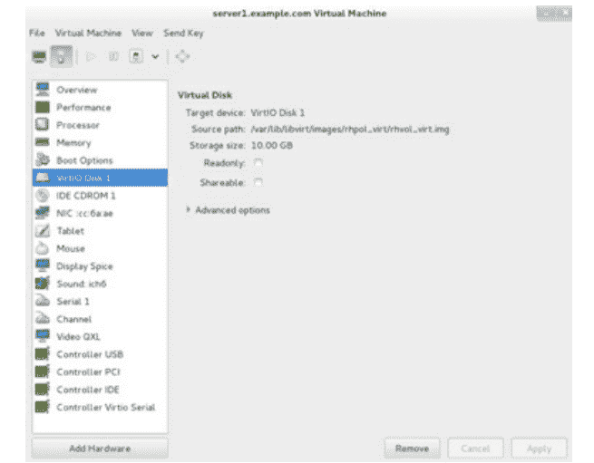

图 9-1 向服务器添加虚拟磁盘 – 步骤1/2

图 9-1 显示了 10GB `vda` 磁盘的存在，它持有操作系统。点击左下角的“添加硬件”，将出现与图 9-2 所示类似的窗口。分配 2GB 大小，选择“立即分配整个磁盘”，并为设备类型选择“Virtio disk”。完成后完成。重复此过程并添加两个磁盘。

# 添加新虚拟硬件


# 使用命令添加 2GB 虚拟块磁盘

在 `host1` 上创建一个虚拟磁盘并使用 `qemu-img` 命令组合将其挂载到 `server1`。为了实现这一点，使用 `qemu-img` 工具在 `/var/lib/libvirt/images` 目录下创建一个 2GB 的磁盘文件：

```bash
### /var/lib/libvirt/images
# qemu-img -f raw server1.example.com 2G
```

下一步是使用 `virsh` 命令将镜像挂载到 `server1`。使用 `--source` 参数指定镜像，使用 `--target` 参数指定磁盘。确保分配持久化。

```bash
### virsh attach-disk server1 server1.example.com \
--type=io --driver vdisk --target vde --persistent
磁盘已挂载
```

# 验证存储

用于创建和呈现虚拟磁盘的 GUI 和 CLI 工具会将虚拟磁盘文件存储在 `host1` 的 `/var/lib/libvirt/images` 目录下。在该目录下运行 `ll` 以验证这些文件：

```bash
### ll /var/lib/libvirt/images
--rw-r-- 1 root root 2147483648 Oct 21 16:25 server1.example.com-1.img
--rw-r-- 1 root root 2147483648 Oct 21 16:25 server1.example.com-2.img
--rw-r-- 1 root root 2147483648 Oct 21 16:25 server1.example.com.img
--rw-r--  1 root root 1447436448 Oct 21 164491..-.img
```

输出列表显示了四个镜像文件，三个是通过 GUI 工具创建的，最后一个是通过 `qemu-img` 命令创建的。我们也可以通过 GUI 验证新磁盘，或在 `host1` 上使用 `virsh` 命令：

```bash
### virsh domlist --details
| Type Target Source |
| :--- | :--- |
| file disk vda | /var/lib/libvirt/volumespool/virsh_vol.img |
| file disk vdb | /var/lib/libvirt/images/server1.example.com.img |
| file disk vdc | /var/lib/libvirt/images/server1.example.com-1.img |
| file disk vdd | /var/lib/libvirt/images/server1.example.com-2.img |
| file disk vde | /var/lib/libvirt/images/server1.example.com-virsh.img |
```

现在，登录 `server1` 并使用 `lsblk` 命令确认新磁盘的存在。

```bash
# lsblk | grep vd
| | | | | | | |
|---|---|---|---|---|---|
| vda | 252:0 | 0 | 10G | 0 | disk |
| ├ vda1 | 252:1 | 0 | 500M | 0 | /boot |
| └ vda2 | 252:2 | 0 | 9.5G | 0 | part |
| ├ vg00-swap | 252:3 | 0 | 500M | 0 | lvm |
| └ vg00-root | 253:1 | 0 | 8.7G | 0 | lvm |
| └ vg00-home | 253:2 | 0 | 300M | 0 | /home |
| vdb | 252:16 | 0 | 2G | 0 | disk |
| vdc | 252:32 | 0 | 2G | 0 | disk |
| vdd | 252:48 | 0 | 2G | 0 | disk |
| vde | 252:64 | 0 | 2G | 0 | disk |
```

上述输出确认了四块新磁盘的存在：`vdb`、`vdc`、`vdd` 和 `vde`。它还显示了它们的大小以及其他信息。

## 使用 part 管理存储


`part` 工具用于在 RHEL 系统上对磁盘进行分区。这个基于文本、菜单驱动的程序允许我们查看、添加、修改、复制、调整大小和删除分区，`part` 同时支持 MBR 和 GPT 方案。它可以在单个 GPT 磁盘上创建最多 12 个分区。

命令的主界面所示。当我们在提示符处运行 `help` 时，它会生成子命令列表：

```
# part
GNU Parted 3.1
Usage:/devpart
Welcome to GNU Parted! 输入 'help' 查看命令列表。
(part) help
align-check TYPE N
help [COMMAND]
mklabel, mklabel LABEL-TYPE
mkpart PART-TYPE[FS-TYPE] END make a partition
name NUMBER NAME
print devices[/free,list,all][NUMBER]
quit
rescue START AND END
rm NUMBER
select DEVICE
disk_set FLAG STATE
toggle_FLAG [FLAG]
set NUMBER FLAG STATE
toggle [NUMBER [FLAG]
unit UNIT
version
```

检查分区 N 的 TYPE(min/opt) 对齐

显示通用帮助，或指定 `COMMAND` 的帮助

创建一个新分区（表）

为分区命名为 NAME

显示表、可用设备、空闲空间、所有分区或特定分区

退出

恢复丢失的分区 START AND END

删除分区 NUMBER

选择要编辑的设备

更改所选设备上的 FLAG

更改分区 NUMBER 上的 FLAG

切换分区 NUMBER 上 FLAG 的状态

设置默认单位

显示 GNU Parted 的版本和版权信息

菜单中包含几个子命令。表 9-1 列出并描述了它们。

| 子命令 | 描述 |
|---|---|
| `algo-check` | 检查分区是否满足磁盘的对齐条件。 |
| `help` | 显示可用命令或显示指定命令的帮助。 |
| `mklabel` / `mktable` | 为分区表创建新磁盘标签。支持的标签有 aix, amiga, bdw, dvh, gpt, msdos, pc5 和 loop。 |
| `mkpart` | 创建一个新分区。 |
| `name` | 为分区分配名称。 |
| `print` | 显示表、分区类型或所有信息。信息包括几何结构和分区号、起始位置和结束位置、大小、类型、文件系统和关联标志。 |
| `quit` | 退出。 |
| `rescue` | 恢复丢失的分区。 |
| `rm` | 删除分区。 |
| `select` | 选择一个要编辑的设备。 |
| `disk_set` | 在当前磁盘上设置 FLAG。 |
| `disk_toggle` | 切换当前磁盘上 FLAG 的状态。 |
| `set` | 在指定分区上设置 FLAG。 |
| `toggle` | 切换指定分区上 FLAG 的状态。 |
| `unit` | 设置默认测量单位。 |
| `version` | 显示 `parted` 工具的版本和版权信息。 |

表 9-1 分区子命令

在提示符处，你可以调用特定命令的帮助信息。例如，要获取 `mklabel` 的帮助，请执行以下命令：

```
(parted) help mklabel
mklabel,mklabel LABEL-TYPE 创建一个新的磁盘标签（分区表）
LABEL-TYPE 是以下之一：aix, amiga, bus, dvh, gpt, mac, mdos, pc98, sun, loop
```

让我们使用 `parted` 用法创建并删除分区。如所述，我们有四块驱动器的访问权限——`/dev/vdb` `/dev/vdc` `/dev/vdd` 和 `/dev/vde-server1`。创建分区后，使用 `print` 子命令查看我们创建或更新的内容。`/proc/partitions` 文件也会更新，以反映分区的创建和删除操作。

# 练习 9-1：使用 `parted` 创建 MBR 分区表和分区

在本次练习中，你将为 `/dev/vdb` 分配分区类型 MSDOS。你将使用 `parted` 工具在磁盘上创建一个 1GB 的主分区作为文件系统，并确认该更改。

1. 在 `/dev/vdb` 上执行 `print` 命令：

```bash
# parted /dev/vdb
GNU Parted 3.1
Using /dev/vdb
Welcome to GNU Parted! 输入 'help' 查看命令列表。
```

2. 执行 `print` 以查看当前分区：

```bash
(parted) print
Error:/dev/vdb: unknown disk
Model: Virtio Block Device
Disk /dev/vdb:2147MB
Sector size (logical/physical):512B
Partition Table: unknown
Disk Flags:
```

3. 使用 `mklabel` 为磁盘分配标签 "mdos"。这必须在新磁盘上完成。

```
(parted) mklabel mdos
```

4. 使用 `mkpart` 从 1MB 开始创建一个 1GB 主分区：

```
(parted) mkpart primary 1g
```

5. 使用 `print` 和 `quit` 验证新分区：

```bash
(parted) print
| Number Start End Size Flags |
|---|---|---|---|
| 1 | 1049KB | 1000MB | primary |
```

```
(parted) quit
```

如果磁盘已有分区，退出 `parted` 后可能需要运行 `probe` 以通知内核分区表的变化。对于未分区的磁盘是不需要的。

6. 在命令提示符运行以下命令之一确认分区信息：

```
# /dev/vdb print
| Number | Start | End | Size | Name |
|---|---|---|---|---|
| 1 | 1049kB | 1000MB | primary |
| 252 | 16 | 207152 | vdb |
| 252 | 17 | 975872 | vdb1 |
```

# 练习 9-2：使用 `parted` 删除 MBR 分区

本次练习中，你将删除上一次练习中的 `vdb1` 分区并确认删除。

1. 在 `/dev/vdb` 磁盘上执行 `parted` 命令：

```
# parted /dev/vdb
```

2. 使用 `print` 子命令查看分区表：

```
(parted) print
```

3. 执行 `rm` 并指定要删除的分区号：

```
(parted) rm 1
```

4. 使用 `print` 和 `quit` 验证：

```
(parted) print
(parted) quit
```

5. 使用以下任意命令确认分区信息：

```
# parted /dev/vdb print
# grep vdb /proc/partitions
```

# 使用 `gdisk` 管理分区

`gdisk` 工具用于以 GPT 格式划分磁盘。这个基于文本、菜单驱动的程序允许我们在查看、添加、修改和删除分区之间进行任务。`gdisk` 可用于带有 UEFI 固件的 GPT 磁盘上创建最多 128 个分区。

当我们在可用磁盘（如 `/dev/vdc`）上运行时，`gdisk` 命令的主界面所示。当我们在提示符输入 `?` 并按回车时，它会生成子命令列表：

```
# gdisk /dev/vdc
(gdisk) version 0.8.6

Partition table:
MBR: not present
BSD: not present
APM: not present
GPT: not present

Creating GPT entries:
Command (? for help)? ?

 备份数据到文件
c 更改分区名称
d 删除分区
i 显示分区详细信息
l 列出已知分区类型
a 添加新分区
o 创建 GUID 分区表 (GPT)
p 打印分区表
q 不保存更改
t 恢复和转换选项（仅限专家）
排序分区
更改分区类型代码
v 验证磁盘
w 写入磁盘并退出
额外功能（仅限专家）
print this menu
```

输出显示磁盘上没有分配分区。主菜单中有几个子命令，后面跟着简短描述。表 9-2 总结了关键子命令。

| 子命令 | 描述 |
| --- | --- |
| `c` | 更改分区名称。 |
| `d` | 删除分区。 |
| `i` | 显示分区信息。 |
| `l` | 列出可用分区类型。 |
| `n` | 创建分区。 |
| `o` | 将磁盘标记为 GPT 方案。 |
| `p` | 打印分区表。 |
| `q` | 退出 `gdisk` 而不保存修改。 |
| `r` | 提供恢复和转换目的的子命令。 |
| `s` | 显示排序后的分区列表。 |
| `t` | 更改分区的类型代码。 |
| `v` | 验证磁盘。 |
| `w` | 写入更改并编辑 `gdisk`。 |
| `x` | 提供各种专家级磁盘操作的子命令。 |

表 9-2 `gdisk` 子命令

让我们标记 `/dev/vdc` 磁盘 server1 使用 GPT `gdisk`，然后创建一个分区以理解其基本用法。创建分区后，使用适当的子命令进行验证 `/proc/partitions` 文件也会更新以反映分区的创建和删除顺序。

# 练习 9-3：使用 `gdisk` 创建 GPT 分区表和分区

此练习应在 server1 上完成。

本次练习中，你将为 `/dev/vdb` 分配分区类型 GPT。你将使用 `gdisk` 工具在磁盘上创建一个 200MB 的分区作为文件系统，并确认创建成功。

1. 在 `/dev/vdc` 上执行 `gdisk` 命令：

```
# gdisk /dev/vdc
(gdisk) version 0.8.6

Partition table:
MBR: not present
BSD: not present
APM: not present
GPT: not present

Creating GPT entries:
Command (? for help)? ?
```

2. 使用 `o` 命令为磁盘分配 GPT 分区表。输入 `y` 确认继续。

```
Command (? for help): o
这将删除所有分区并创建一个新的 MBR。
Proceeded? (Y/n) y
```

3. 运行 `p` 命令查看磁盘标签：

```
Command (? for help): p
/dev/vdc: 4194304 sectors, 2.0 GiB
Logical size: 512B bytes
Disk identifier: A466BDBF-FEB4-4459-B949-B7D15684F524
Partition table holds up to 128 entries
First usable sector is 34, last usable sector is 4194270
Partitions will be aligned on 2048-sector boundaries
Total free space is 4194237 sectors (2.0 GiB)
Number Start (sector) End Size Name
```

输出显示分区表可以包含的 128 个分区条目。

4. 使用 `n` 命令创建一个 200MB 的分区。除了指定大小外，使用所有默认值。

5. 使用 `p` 验证新分区：

```
Command (? for help): p
| 编号 | 起始 (区) | 结束 (区) | 大小 | 代码 | 名称 |
| :--- | :--- | :--- | :--- | :--- | :--- |
| 1 | 2048 | 41647 | 200.0 MiB | 8300 | Linux filesystem |
```

6. 运行 `w` 将分区信息写入分区表。输入 `y` 确认。

```
Command (? for help): w
最终检查。正在写入 GPT 数据。这这将覆盖现有分区！！
你确定要继续吗？(Y/n) y
好的，正在向 /dev/vdc 写入新的 GUID 分区表 (GPT)。
该操作已成功完成。
```

> 如果磁盘之前存在分区，在在使用 `gdisk` 工具后，你可能需要运行 `partition` 命令来通知内核分区表的变化。对于未分区的磁盘，不需要此操作。

7. 在命令行提示符处运行以下命令之一来确认分区信息：

```
# gdisk /dev/vdc
GPT disk (gdisk) version 0.8.6
分区表扫描:
MBR: 不存在
BSD: 不存在
APM: 不存在
GPT: 存在
找到带有保护 MBR 的有效 GPT；使用 GPT。
Disk/vdc: 4194304 sectors, 2.0 GiB
逻辑大小: 512 bytes
磁盘标识符 (GUID): A6AD8D0F-FEB-4459-B949-D15684F5254
分区表最多有 128 条目
第一个可用扇区是 34，最后一个可用扇区是 4194270
分区按 2048 扇区边界对齐
总空闲空间为 4194270 sectors (2.0 GB)
编号 开始 (区) 结束 大小 代码 名称
1 2048 41647 200.0 MiB 8300 Linux filesystem
```

```
# grep vdc /proc/partitions
252 32 2097152 vdc
252 33 204800 vdc
```

## 练习 9-4: 使用 `gdisk` 删除 GPT 分区

本次练习将删除 `vdc1` 分区，你将删除在上一个练习中创建的 `vdc1` 分区，并确认删除。

1. 在 `/dev/vdc` 上执行 `gdisk` 命令：

```
# gdisk /dev/vdc
```

2. 使用 `p` 子命令查看当前分区表：

```
Command (? for help): p
```

3. 执行 `d` 子命令并指定要删除的分区编号：

```
Command (? for help): d 1
```

4. 使用 `p` 和 `q` 验证新的分区信息：

```
Command (? for help): p
Command (? for help): q
```

5. 使用以下任一命令确认分区信息：

```
# gdisk -l /dev/vdc
# grep vdc /proc/partitions
```

## 使用图形化磁盘工具进行分区

磁盘工具（Disk Utility）是 GNOME 桌面可用的一种分区管理工具，用于完成分区、磁盘和文件系统的基本操作。要检查系统上是否存在，请使用 `yum` 命令：

```bash
# yum list installed | grep gnome-disk-utility
gnome-disk-utility.x86_64 3.8.2-5.el7 @anaconda7.0
```

如果不存在，请安装 `gnome-disk-utility` 包。
可以通过在 shell 提示符处运行 `gnome-disks` 或选择“应用程序 | 实用程序 | 磁盘”来启动磁盘工具。该工具允许我们执行执行的一些关键功能包括：创建、修改和删除分区；格式化、修改、挂载、取消调整、读/写性能；加密文件系统；创建和恢复磁盘映像。图 9-3 显示了选中 `vdc` 磁盘的主菜单。

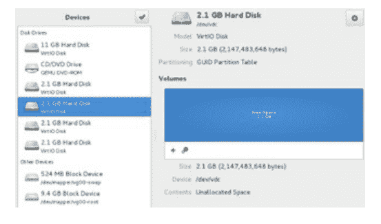

主窗口左侧列出了所有块设备及其大小和类型。在图 9-3 中，它显示了主要的 1GB 操作系统磁盘、42GB 磁盘、CD/DVD 设备以及位于操作系统磁盘底部的 LVM 分区。点击设备后，该设备的详细信息将出现在右侧。例如，图 9-3 中选中的设备是一个空的 2.1GB `vdc` 虚拟磁盘。可以通过点击 `+` 号并选择大小对该设备进行分区，或通过点击 `+` 号旁边的图标进行操作。选项请参见图 9-4。

图 9-3 图形化磁盘工具

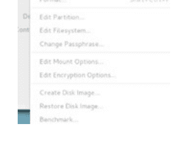

图 9-4 图形化磁盘工具 / 磁盘操作选项

一旦创建了分区并高亮显示，灰色的选项将根据需要变得可见，允许我们对分区和文件系统执行额外任务。

## 理解逻辑卷管理器 (LVM)

LVM 解决方案用于管理磁盘空间。它在物理存储和文件系统之间提供了一个抽象层，使文件系统能够调整大小并跨越多个磁盘，LVM 允许我们从一个或多个分区累积形成更大的容器（卷组）。LVM 的主要优点包括：除了上述优点外，还有卷组和逻辑卷的大小调整、逻辑卷和物理卷之间的在线迁移、卷组和逻辑卷的用户自定义命名、跨磁盘镜像以及逻辑卷快照。RHEL 使用 LVM 版本 2，当我们使用 LVM 技术划分存储设备时（见 `img/58b32cb40def97a1f8c872ea71ce2b3f_0.png`），如上所述，其结构由三个关键对象组成：物理卷、卷组和逻辑卷。这些对象被进一步划分为物理区 (PE) 和逻辑区 (LE)。LVM 组件说明如下：

### 物理卷 (Physical Volume)

当分区或整个磁盘带入 LVM 控制时，会创建一个物理卷 (PV)。LVM 在该设备上构建结构，包括标签和元数据。LVM 在物理卷末尾存储元数据的副本。剩余空间可用。目前，server1 上有一个在安装期间创建的物理卷。使用 `pvs` 命令查看它：

```bash
# pvs
PV VG Attr Free
dev/vda2 vg00 LVM- 9.50g
```


输出确认了 `vg00` 中存在一个大小为 9.5GB 的物理卷 `/dev/vda2`。额外信息显示了 `vg00` 中物理卷的已用元数据、Attr 列（可分配）。使用 `-v` 选项运行此命令将显示更多详细信息。

## 卷组 (Volume Group)

当至少添加一个物理卷到卷组时，会创建一个卷组 (VG)。卷组中所有物理卷的空间聚合到一个大的存储池，然后用于构建一个或多个逻辑卷。卷组中的物理卷大小可能不同。LVM 为卷组写入元数据信息，包含其名称、ID、创建日期、已用空间、物理卷列表、物理区和逻辑区的映射等。卷组可以分配任何名称，例如 `vg01`、`vgora` 或 `vgweb`。元数据包括卷组信息，并在每个物理卷上维护其副本。目前，`server1` 上有一个在安装期间创建的卷组。运行 `vgs` 命令查看它：

```
# vgs
  VG   #PV #LV #SN Attr   VSize  VFree
  vg00   1   3   0 wz--n- 9.50g 4.00m
```

*注意* 输出确认了系统中包含一个物理卷的卷组 `vg00`。额外信息显示了卷组中的逻辑卷 (LV) 和快照 (SN)，卷组在 Attr（可写、可调整大小和普通）下的状态、卷组的大小以及卷组中的剩余空间。再次使用 `-v` 选项运行此命令将显示更多详细信息。

## 物理区 (Physical Extent)

物理卷在添加到卷组时扩展为几个较小的片段。这些逻辑片段被称为物理区 (PE)。区是 LVM 的最小分配单元。在我们创建卷组时，可以定义 PE 的大小，或者将其设置为默认大小 4MB。此 20GB 磁盘将包含大约 5000 个 PE。之后添加到此卷组的任何物理卷将使用相同的 PE 大小。以下命令显示 `vg00` 卷组中的物理区：

```
# vgdisplay vg00 | grep "PE Size"
  PE Size               4.00 MiB
```

## 逻辑卷 (Logical Volume)

逻辑卷可以扩展或缩小，并可以使用卷组内部一个物理卷的空间。逻辑卷的默认命名为 `lv00`、`lv01`、`lv02` 等；我们可以分配我们喜欢的任何名称。例如，逻辑卷可以命名为 `system`、`undo` 或 `oraarch`，以识别其构建的信息类型。目前，服务器上有三个安装期间创建的卷。使用 `lvs` 命令查看它们：

| LV   | VG   | Attr       | LSize   | Pool | Origin | Data% | Meta% | Move | Cpy%Sync | Convert |
| :--- | :--- | :--------- | :------ | :--- | :----- | :---- | :---- | :--- | :------- | :------ |
| home | vg00 | -wi-ao---- | 300.00m |      |        |       |       |      |          |         |
| root | vg00 | -wi-ao---- | 8.20g   |      |        |       |       |      |          |         |
| swap | vg00 | -wi-ao---- | 500.00m |      |        |       |       |      |          |         |

输出表示 `vg00` 中存在三个逻辑卷 `home`、`root` 和 `swap`。额外信息显示了在 Attr（可写、继承分配）策略下的逻辑卷状态以及它们的大小。再次使用 `-v` 选项运行此命令将显示更多详细信息。

## 逻辑区 (Logical Extent)

逻辑卷由逻辑区 (LE) 组成。逻辑区指向物理区，可以是随机的或连续的。逻辑卷越大，拥有的 LE 就越多。逻辑区是物理分配给逻辑卷的一组。PE 和 LE 的大小相同，除非它们小于物理区。默认 LE 大小为 4MB，这对应于默认的 PE 大小。以下命令显示 `vg00` 卷组中 `root` 卷的信息。输出没有指示 LE 大小；然而，我们可以将 LV 大小转换为 MB 并除以当前 LE 计数来获得 LE 大小（对应于 4MB）。

# 精细配置 (Thin Provisioning)

精细配置技术允许对存储空间进行经济分配和利用。通过 LVM 中的精细配置，我们可以创建一个精细存储池，并分配比池实际可用容量更大的逻辑卷。应用程序在写入数据时才会消耗实际空间。我们对精细池中物理存储的实际消耗设置一个阈值（例如 80%）并进行监控。当实际使用量达到预设阈值时，我们通过添加更多存储来动态扩展精细池。逻辑卷会立即开始利用新空间。精细配置让我们避免了预先支付更多费用。

# 使用逻辑卷管理器 (LVM) 管理存储

使用 LVM 管理存储涉及若干管理任务，例如创建物理卷、创建和显示卷组、创建和扩展逻辑卷、扩展卷组、缩小逻辑卷、重命名逻辑卷、删除逻辑卷、缩小卷组、删除卷组。本章涵盖了所有这些任务。

# LVM 命令

有多个命令可以完成上述列出的各种 LVM 操作。表 9-3 描述了常用工具。

| 命令 | 描述 |
| :--- | :--- |
| **物理卷命令** | |
| `pvck` | 检查物理卷的完整性。 |
| `pvcreate` | 初始化磁盘或分区供 LVM 使用。 |
| `pvdisplay` | 显示物理卷的详细信息。 |
| `pvresize` | 调整物理卷的大小。 |
| `pvmove` | 将数据从一个物理卷移动到另一个物理卷。 |
| `pvremove` | 取消物理卷初始化。 |
| `pvs` | 列出物理卷。 |
| `pvscan` | 扫描整个系统和发现的所有物理卷。 |
| **卷组命令** | |
| `vgcreate` | 创建卷组。 |
| `vgdisplay` | 显示卷组的详细信息。 |
| `vgextend` | 向卷组添加物理卷。 |
| `vgreduce` | 从卷组移除物理卷。 |
| `vgrename` | 重命名卷组。 |
| `vgremove` | 删除卷组。 |
| `vgs` | 列出卷组。 |
| `vgscan` | 扫描整个系统和发现的所有卷组，并重建缓存。 |
| **逻辑卷命令** | |
| `lvcreate` | 创建逻辑卷。 |
| `lvdisplay` | 显示逻辑卷的详细信息。 |
| `lvextend` | 扩展逻辑卷的大小。 |
| `lvreduce` | 缩小逻辑卷的大小。 |
| `lvremove` | 删除逻辑卷。 |
| `lvrename` | 重命名逻辑卷。 |
| `lvresize` | 调整逻辑卷的大小。使用 `-r` 选项，此命令会调用 `resize2fs` 命令并同时调整底层文件系统的大小。 |
| `lvs` | 列出逻辑卷。 |
| `lvscan` | 扫描整个系统和发现的所有逻辑卷。 |
| **其他 LVM 命令** | |
| `lvm` | 交互式 LVM 工具。 |
| `lvmdiskscan` | 扫描现有的 LVM 磁盘和分区，以及可以为 LVM 化的。 |

表 9-3 LVM 命令

表 9-3 中列出的所有命令均使用 `-v` 选项显示详细信息。查看每个命令的 man 页面以获取更多选项和用法。

如本章前面所述，`server1` 上有 `vda`、`vdc`、`vdd` 和 `vde` 可供练习。使用 `lsblk` 命令确认此信息：

```
lsblk | grep vda
vda      252:0    0  10G 0 disk
├─vda1   252:1    0  500M 0 part /boot
├─vda2   252:2    0   9.5G 0 part
│ ├─vg00-swap 253:0    0  500M 0 lvm  [SWAP]
│ ├─vg00-root 253:1    0   8.7G 0 lvm  /
│ └─vg00-home 253:2    0  300M 0 lvm  /home
vdb      252:16   0   2G 0 disk
vdc      252:32   0   2G 0 disk
vdd      252:48   0   2G 0 disk
vde      252:64   0   2G 0 disk
```

执行 `vgscan` 命令来识别可以用于 LVM 练习的磁盘：

## vgscan

```
# vgscan
  Reading all physical volumes. This may take a while...
  Found volume group "vg00" using metadata type lvm2
  /dev/vg00/swap [500.0 MiB]
  /dev/vda1 [500.0 MiB]
  /dev/vg00/root [8.72 GiB]
  /dev/vda2 [9.51 GiB] LVM physical volume
  /dev/vg00/home [300.0 MiB]
  /dev/vdb [2.00 GiB]
  /dev/vdc [2.00 GiB]
  /dev/vdd [2.00 GiB]
  /dev/vde [2.00 GiB]

  6 disks
  1 partition
  0 whole LVM physical volumes
  1 LVM physical volume
```

上述输出显示了 6 个磁盘/分区，其中 `vda` 用于操作系统，其余的是空的。我们可以在下面的练习中使用这些空磁盘。

# 练习 9-5：创建物理卷和卷组

此练习应在 `server1` 上完成。在此练习中，你将初始化磁盘 `vdb` (2GB) 和分区 `vdc1` (200MB) 为物理卷。你将创建一个名为 `vg0` 的卷组并添加物理卷。你将使用 PE 大小为 16MB 的卷组并显示卷组详情。

1. 使用 `parted` 创建 200MB 的 `vdc1`：
```
# parted /dev/vdc
GNU Parted 3.1
Using /dev/vdc
Welcome to GNU Parted! Type 'help' to view a list of commands.
(parted) mkpart primary 0 200MiB
(parted) print
Number  Start   End     Size    Type     File system  Flags
 1      1049kB  200MB   199MB   primary
(parted) quit
```

2. 使用 `pvcreate` 初始化 `vdb` 和 `vdc1`：
```
# pvcreate /dev/vdb /dev/vdc1
  Physical volume "/dev/vdb" successfully created.
  Physical volume "/dev/vdc1" successfully created.
```

3. 使用 `vgcreate` 创建 `vg0` 并添加 `vdb` 和 `vdc1`。使用 `-s` 选项指定 PE 大小：
```
# vgcreate -s 16M vg0 /dev/vdb /dev/vdc1
  Volume group "vg0" successfully created
```

4. 使用 `vgs` 和 `vgscan` 命令显示 `vg0` 的基本信息：
```
# vgs
  VG   #PV #LV #SN Attr   VSize  VFree
  vg0    2   0   0 wz--n-  2.16g 2.16g
```
```
# vgscan
  Reading all physical volumes. This may take a while...
  Found volume group "vg0" using metadata type lvm2
  Found volume group "vg00" using metadata type lvm2
```

我们还可以使用 `vgdisplay` 命令显示卷组的详情。使用 `-v` 参数，此命令还会显示物理卷：
```
# vgdisplay -v vg0
  --- Volume group ---
  VG Name               vg0
  System ID             
  Format                lvm2
  Metadata Areas        2
  Metadata Sequence No  1
  VG Access             read/write
  VG Status             resizable
  MAX LV                0
  Cur LV                0
  Open LV               0
  Max PV                0
  Cur PV                2
  Act PV                2
  VG Size               2.16 GiB
  PE Size               16.00 MiB
  Total PE              138
  Alloc PE / Size       0 / 0   
  Free  PE / Size       138 / 2.16 GiB
  VG UUID               e2c5W3-TlkU-0V6q-l8pg-dff1-R06Xr-Rd8UVVT
   
  --- Physical volumes ---
  PV Name               /dev/vdb
  PV UUID               8c8kVK-LVQm-MW7Z-WS2m-7gML-gkm0f
  PV Status             allocatable
  Total PE / Free PE    127 / 127
   
  PV Name               /dev/vdc1
  PV UUID               qEEPj-b7p-AHD-dZXR-RGe5-smRh-H6a
  PV Status             allocatable
  Total PE / Free PE    11 / 11
```

`vgdisplay` 命令显示 `vg0` 组有两个物理卷，第一个卷中有 127 个 PE，第二个卷中有 11 个，总共 138 个。PE 大小为 16MB，总可用空间约为 2.16GB。

5. 使用 `pvs` 和 `pvscan` 命令显示 `vdb` 的基本信息：

| PV         | VG   | Fmt  | Attr | PSize  | PFree  |
| :--------- | :--- | :--- | :--- | :----- | :----- |
| /dev/vda2  | vg00 | lvm2 | a--  | 9.50g  | 4.00m  |
| /dev/vdb   | vg0  | lvm2 | a--  | 1.98g  | 1.98g  |
| /dev/vdc1  | vg0  | lvm2 | a--  | 176.00m| 176.00m|

```
# pvscan
  PV /dev/vda2   VG vg00   lvm2 [9.50 GiB / 4.00 MiB free]
  PV /dev/vdb    VG vg0    lvm2 [1.98 GiB / 1.98 GiB free]
  PV /dev/vdc1   VG vg0    lvm2 [176.00 MiB / 176.00 MiB free]
  Total: 3 [11.66 GiB] / in use: 3 [11.66 GiB] / in no VG: 0 [0   ]
```

我们还可以使用 `pvdisplay` 命令显示卷的详情：
```
# pvdisplay /dev/vdb
  --- Physical volume ---
  PV Name               /dev/vdb
  VG Name               vg0
  PV Size               2.00 GiB / not usable 16.00 MiB
  Allocatable           yes
  PE Size               16.00 MiB
  Total PE              127
  Free PE               127
  Allocated PE          0
  PV UUID               8c8kVK-LVQm-MW7Z-WS2m-7gML-gkm0f
```

```
# pvdisplay /dev/vdc1
  --- Physical volume ---
  PV Name               /dev/vdc1
  VG Name               vg0
  PV Size               191.00 MiB / not usable 15.00 MiB
  Allocatable           yes
  PE Size               16.00 MiB
  Total PE              11
  Free PE               11
  Allocated PE          0
  PV UUID               qEEPj-b7p-AHD-dZXR-RGe5-smRh-H6a
```

一旦分区被初始化并添加到卷组，它们的处理方式是完全相同的。LVM 不区分两者。

# 练习 9-6：创建逻辑卷

此练习应在 `server1` 上完成。在此练习中，你将在 `vg0` 中创建两个逻辑卷。第一个使用默认名称和 600MB 大小，第二个命名为 `oravl`，大小为 1.3GB。

1. 使用 `lvcreate` 命令创建一个大小为 600MB 的逻辑卷。使用 `-L` 选项指定大小。你可以使用 `-v` 获取详细信息。
```
# lvcreate -L 600M vg0
  Rounding up size to full physical extent 608.00 MiB
  Logical volume "lvol0" created
```

2. 使用 `lvcreate` 命令创建一个大小为 1.3GB 的 `oravl`。使用 `-L` 选项指定大小，使用 `-n` 指定自定义名称。你可以使用 `-v` 获取详细信息。
```
# lvcreate -L 1.3g -n oravl vg0
  Rounding up size to full physical extent 1.31 GiB
  Logical volume "oravl" created
```

3. 使用 `lvs` 和 `lvdisplay` 命令显示两个逻辑卷的基本信息：
```
# lvs
  LV     VG   Attr       LSize   Pool Origin Data%  Meta%  Move Log Cpy%Sync Convert
  home   vg00 -wi-ao---- 300.00m                                                    
  root   vg00 -wi-ao----   8.20g                                                    
  swap   vg00 -wi-ao---- 500.00m                                                    
  lvol0  vg0  -wi-a----- 608.00m                                                    
  oravl  vg0  -wi-a-----   1.31g
```
```
# lvdisplay
  --- Logical volume ---
  LV Path                /dev/vg00/swap
  LV Name                swap
  VG Name                vg00
  LV UUID                ...
  LV Write Access        read/write
  LV Creation host, time server1.example.com, 2014-10-23 21:45:18 -0400
  LV Status              available
  # open                 2
  LV Size                500.00 MiB
  Current LE             125
  Segments               1
  Allocation             inherit
  Read ahead sectors     auto
  - currently set to     8192
  Block device           253:0

  --- Logical volume ---
  LV Path                /dev/vg00/home
  LV Name                home
  VG Name                vg00
  ...
  LV Size                300.00 MiB
  ...

  --- Logical volume ---
  LV Path                /dev/vg00/root
  LV Name                root
  VG Name                vg00
  ...
  LV Size                8.20 GiB
  ...

  --- Logical volume ---
  LV Path                /dev/vg0/lvol0
  LV Name                lvol0
  VG Name                vg0
  LV UUID                ...
  LV Write Access        read/write
  LV Creation host, time server1.example.com, 2014-10-23 21:45:18 -0400
  LV Status              available
  # open                 0
  LV Size                608.00 MiB
  Current LE             38
  Segments               1
  Allocation             inherit
  Read ahead sectors     auto
  - currently set to     8192
  Block device           253:2

  --- Logical volume ---
  LV Path                /dev/vg0/oravl
  LV Name                oravl
  VG Name                vg0
  ...
  LV Size                1.31 GiB
  ...
```

在 `vg0` 上执行带有 `-v` 选项的 `vgdisplay` 命令获取整个卷组的详情，包括逻辑卷及其包含的物理卷。你也可以对 `/dev/vg0/lvol0` 和 `/dev/vg0/oravl` 运行 `lvdisplay` 命令以获取这两个逻辑卷的详情。

```
# lvdisplay /dev/vg0/lvol0
  --- Logical volume ---
  LV Path                /dev/vg0/lvol0
  LV Name                lvol0
  VG Name                vg0
  VG UUID                e2c5W3-TlkU-0V6q-l8pg-dff1-R06Xr-Rd8UVVT
  LV Write Access        read/write
  LV Creation host, time server1.example.com, 2014-10-23 21:45:18 -0400
  LV Status              available
  # open                 0
  LV Size                608.00 MiB
  Current LE             38
  Segments               1
  Allocation             inherit
  Read ahead sectors     auto
  - currently set to     8192
  Block device           253:2
```

大小可以使用 KB（千字节）、MB（兆字节）、GB（吉字节）、TB（太字节）、PB（拍字节）、EB（艾字节）或字节数来指定；但如果没有指定单位，默认为字节。逻辑卷的最小大小是卷创建时 PE（物理区）的大小，且始终是 PE 的倍数。例如，当 PE 大小为 16MB 时，逻辑卷的大小为 16MB、32MB、48MB、64MB 等；因此，在设置 PE 大小和创建逻辑卷时必须注意，以免浪费空间。


如果你想了解 `vgdisplay` 命令从哪里获取卷组信息，请进入 `/etc/lvm/backup` 目录并查看所需的卷组文件的内容。

# 练习 9-7：扩展卷组和逻辑卷

此练习应在 server1 上进行。

在此练习中，你将添加另一块磁盘 `vdd` 到 `vg01` 以增加可分配空间池。你将在将磁盘添加到卷组之前，运行 `pvcreate` 命令初始化目标磁盘。你将使用 `lvextend` 命令将 `lvol0` 的大小从 600MB 增加到 1GB，将 `arovol` 从 1GB 增加到 2GB。你将显示卷组和逻辑卷的基本及详细信息。

## 1. 使用 `pvcreate` 命令为 LVM 准备 `/dev/vdd`

```
# pvcreate /dev/vdd
# Set up physical volume for "/dev/vdd" with 4194304 available sectors
Zing start device vdd
Writing physical volume data to disk "/dev/vdd"
Physical volume "/dev/vdd" successfully created
```

## 2. 使用 `vgextend` 命令将 `/dev/vdd` 添加到 `vg01`

```
# vgextend vg01 /dev/vdd
# Checking for volume group "vg01"
Archiving volume group "vg01" metadata (onapo 1)
Adding physical volume "/dev/vdd" to volume group "vg01"
Volume group "vg01" will be extended by 1 new physical volumes
Creating volume group backup "/etc/backup/vg01" (onapo 2)
Volume group "vg01" successfully created
```

## 3. 查看 `vg01` 的基本信息

| VG | #PV | #LV | #SN | Attr | VSize | VFree |
| --- | --- | --- | --- | --- | --- | --- |
| vg01 | 3 | 2 | 0 | w- | 4.14g | 2.23g |

输出反映了增加了第三个物理卷。卷组容量增加到 4.14GB，剩余 2.23GB。

## 4. 在 `lvol0` 上执行 `lvextend` 命令，指定逻辑卷的绝对大小或要增加的量

```
# lvextend -L1g /dev/vg01/lvol0 (or lvextend +400m)
```

## 5. 在 `arovol` 上执行 `lvextend` 命令，指定逻辑卷的绝对大小或要增加的量

```
# lvextend -L2g /dev/vg01/arovol (or lvextend +700m)
向上取整对齐物理分区：700 MiB
逻辑卷 arovol 调整大小成功提示：扩展逻辑卷不会影响文件系统。
```

## 6. 使用 `vgdisplay vg01` 获取更新详情

| Volume group | VG Name | System ID | Format | Metadata Areas | Metadata No | VG Access | VG Status | MAX LV | Cur LV | Open LV |
| --- | --- | --- | --- | --- | --- | --- | --- | --- | --- | --- |
| vg01 | | | Lvm | 3 | 55 | read/write | resizable | 0 | 2 | 0 |

| Max PV | Cur PV | VG Size | PE Size | Total PE / Size | Free PE / Size |
| --- | --- | --- | --- | --- | --- |
| 0 | 3 | 4.14GB | 16 MiB | 265 | 192 / 2.00 GiB | 73 / 1.14GB |

VG UID 为 `SXTJ1Rl-Mrf-Gq-U9K1-AwFC-55`。

| Logical volume | LV Name | VG Name | UID |
| --- | --- | --- | --- |
| /dev/vg01/lvol0 | lvol0 | vg01 | z55c2-3W3-TkU-V6q-df1-R0-BU |

LV Write Access -- read/write
LV Creation host, time -- server1.example.com,2014-10-23 21:45:18 -0400
LV Status -- available
# open -- 0
LV Size -- 2.00 GiB
Current LE -- 64
Segments -- 3
Allocation -- inherit
Read ahead sectors -- auto
-- currently set to -- 8192
Block device -- 253:2

| Logical volume | LV Name | VG Name | UID |
| --- | --- | --- | --- |
| /dev/vg01/arovol | arovol | vg01 | i6QFP60-RlR-4gz-zWj-BIh8-afaq-l1 |

LV Write Access -- read/write
LV Creation host, time -- server1.example.com,2014-10-24 07:35:00 -0400
LV Status -- available
# open -- 0
LV Size -- 2.00 GiB
Current LE -- 128
Segments -- 2
Allocation -- inherit
Read ahead sectors -- auto
-- currently set to -- 8192
Block device -- 253:2

| Physical volumes | PV Name | UID |
| --- | --- | --- |
| /dev/vdb | 8cVKKl-VGQM-MW7-zHBT-WS2-m7LG-kmn0F |
| /dev/vdc | qbtJEP-Pb7p-AJH-zDZX-RGE5-Smr-IHE6a |
| /dev/vdd | 2MWF1s-QQQgy-Msb8-pi41-J226-Ckl-b3cCq4 |

Total PE / Free PE | 127 / 64

上述输出显示了卷组及其包含的物理卷和逻辑卷列表。它反映了练习中的更新。每当卷组或逻辑卷调整大小时，`vgdisplay` 都会反映这些更新。上述输出显示三个物理卷，合并可分配空间为 4.14GB。PE 的数量已增加 265，其中 192 个分配给了逻辑卷，73 个未使用。未使用的 PE 相当于池中 1.14GB 的可用空间。两个逻辑卷部分显示了逻辑卷的更新信息。在最底部，列出了三个卷及其设备名称以及每个卷的总和所有 PE。

# 练习 9-8：重命名、缩小、删除逻辑卷

此练习应在 server1 上进行。

在此练习中，你将 `lvol0` 重命名为 `Involume`。你将使用 `lvreduce` 命令将 `lvol0` 的大小缩小到 800MB，并使用 `lvresize` 命令将其进一步缩小到 700MB。然后你将使用 `lvrename` 命令重命名 `arovol` 和 `Involume` 逻辑卷。你将显示卷组的更新详情。

## 1. 使用 `lvrename` 命令将 `lvol0` 重命名为 `Involume`，并通过 `lvs` 确认

```
# lvrename vg01 lvol0 Involume
renamed 'lvol0' to 'Involume' in volume 'vg01'
# lvs | grep invol
Involume      800.0
```

## 2. 使用 `lvreduce` 命令将 `lvol0` 逻辑卷的大小缩小到 800MB。指定逻辑卷的绝对大小或要减少的量。回答“你真的要缩小 lvol0 吗?”

```
# lvreduce -L800M /dev/vg01/lvol0 (or lvreduce -200m)
: Reducing logical volume to 800 MB
THIS MAY DESTROY YOUR DATA (filesystem).
Do you really want to reduce lvol0? [y/n]y
Reducing logical volume to 800 MB
```

## 3. 使用 `lvresize` 命令将 `lvol0` 逻辑的大小缩小到 700MB。指定逻辑卷的绝对大小或要减少的量。回答“你真的要缩小 lvol0 吗?”

```
# lvresize -L700M /dev/vg01/lvol0 (or lvresize -100m)
向上取整对齐物理分区：700 MiB
WARNING: Reducing logical volume to 700 MiB
THIS MAY DESTROY YOUR DATA (filesystem).
Do you really want to reduce lvol0? [y/n]y
Reducing logical volume to 700 MB
```

## 4. 使用 `lvrename` 命令重命名 `arovol` 和 `Involume` 逻辑卷。使用 `-f` 选项抑制“你真的要重命名卷 <vol_name>?”的消息。

```
# lvrename -f /dev/vg01/Involume
renamed 'Involume' to 'Involume' in volume 'vg01'
# lvrename -f /dev/vg01/arovol
renamed 'arovol' to 'Involume' in volume 'vg01'
```

## 5. 执行 `vgdisplay` 命令并 grep `Cur` 以查看 `vg01` 当前可用的逻辑卷数量。由于我们删除了逻辑卷，它应该显示为 0。

```
# vgdisplay | grep 'Cur LV'
Cur LV: 0
```

## 使用 `vgreduce` 从卷组中移除物理卷

```
# vgreduce vg01 /dev/vdb /dev/vdc1
从卷组 "vg01" 中移除了 "/dev/vdb"
从卷组 "vg01" 中移除了 "/dev/vdc1"
```

## 2. 使用 `vgremove` 命令删除卷组

```
# vgremove vg01
成功删除卷组 "vg01"
```

你也可以在使用 `vgremove` 命令时配合 `-f` 选项强制删除卷组，即使它包含任意数量的逻辑卷和物理卷。

执行删除和移动操作时，请务必谨慎操作。

# 练习 9-10：取消初始化物理卷

此练习应在 server1 上完成。

在此练习中，你将使用 `pvremove` 命令取消所有三个物理卷 `vdb`、`vdc` 和 `vdd` 的结构化信息。

## 1. 执行 `pvremove /dev/vdb /dev/vdc /dev/vdd` 对它们进行取消初始化

```
物理卷 "/dev/vdb" 标签已成功移除
物理卷 "/dev/vdc" 标签已成功移除
物理卷 "/dev/vdd" 标签已成功移除
```

磁盘和分区现在已恢复原始状态，可以重新利用或从 server1 中移除。

# 章节总结

本章首先概述了 RHEL7 中可用的磁盘管理工具及其特性。随后，我们展示了使用这些工具对磁盘进行切片和删除的多个示例。

我们通过使用 `parted` 和 `gdisk` 工具执行了创建、显示和删除分区的功能。我们查看了可能执行若干项磁盘管理任务的图形化磁盘实用程序（Disk Utility）。

我们详细学习了 LVM 的概念、组件和结构。我们学习了如何使用命令进行 LVM 管理，并通过执行若干练习（将磁盘和分区转换为物理卷；创建、显示、扩展、缩减和删除卷组；创建、显示、调整大小和删除逻辑卷；取消初始化物理卷）来加深理解。

## 章节复习

1. 我们用于减少逻辑卷区（extents）数量的两个命令是什么？
2. 编写命令将物理卷 `/dev/vdc1` 和 `/dev/vdd` 添加到默认卷组 `vg20`。
3. 在基于 BIOS 的系统中，分区表默认存储在何处？
4. 在虚拟环境中，`vdd3` 会代表什么？
5. 我们可以使用哪两个命令向逻辑卷中添加区（extents）？
6. 在 GPT 格式磁盘上可以创建的最大分区数量是多少？
7. 编写命令创建一个卷组 `vg24`，其物理大小设置为 64MB，并将物理卷 `/dev/vdd` 包含在其中。
8. 编写命令删除卷组及其包含的任何逻辑卷和物理卷。
9. LVM 中分区的默认大小是多少？
10. `gdisk` 工具可用于存储 MBR 格式的分区信息吗？对或错？
11. `/proc` 文件系统中的哪一个存储了内存中的分区信息？
12. 卷组中第一个逻辑卷的默认名称是什么？（提示：使用 `pvdisplay` 命令）
13. 磁盘或分区可以被称为物理卷吗？
14. 编写命令从 `vg20` 卷组中移除 `web6` 逻辑卷。
15. 在逻辑卷用于存储文件之前，是否有必要在其中创建文件系统结构？对或错？
16. 物理和逻辑区（extents）的大小通常是相同的。对或错？
17. `pvcreate` 命令的作用是什么？
18. 命令 `pvcreate /dev/vdd` 会发生什么？
19. （原文缺失编号 19，此处保留原有序号跳跃）
20. 磁盘分区可以在不初始化的情况下添加到卷组。对或错？
21. 编写命令在 `vg20` 卷组中创建一个大小等于 100 个逻辑区（extents）的逻辑卷 `webvol`。
22. 可以在不包含任何物理卷的情况下卷组。对或错？
23. LVM 将卷组详情存储在哪里？
24. 单个磁盘可以同时被分区和 LVM 使用吗？对或错？
25. 我们应该何时运行 `partprobe` 命令？
26. 编写命令从 `vg20` 卷组中移除物理卷 `/dev/vdd1`。
27. 分区可以作为 LVM 对象使用吗？对或错？
28. 你使用哪种命令查看卷组及其内部逻辑卷的详情？

## 章节复习答案

1. `lvreduce` 和 `lvresize` 命令。
2. `vgextend vg20 /dev/vdc1 /dev/vdd`
3. 分区表信息存储在主引导记录（MBR）中。
4. `vdd3` 是第四个虚拟磁盘上的第三个分区。
5. `lvextend` 和 `lvresize` 命令。
6. 128。
7. `vgcreate -s 64M vg24 /dev/vdd`
8. `vgremove -f vg20`
9. LVM 中物理区（PE）的默认大小是 4MB。
10. 错。`gdisk` 工具仅用于 GPT 类型。
11. `/proc/partitions`。
12. `lvol0` 是卷组中创建的第一个逻辑卷的默认名称。
13. 是。磁盘或分区初始化后可称为物理卷（`pvs` 命令列出物理卷，`pvdisplay` 命令显示详情）。
14. `lvremove /dev/vg20/web6`
15. 对。
16. 对。
17. `pvcreate` 命令用于初始化磁盘或分区为物理卷，以便 LVM 使用。
18. 将 `/dev/vdd` 初始化为物理卷。
19. （原文缺失编号 19）
20. 错。
21. `lvcreate -l 100 -n webvol vg20`
22. 错。
23. `/etc/lvm`。
24. 对。
25. 每当分区发生更改时。
26. `vgreduce vg20 /dev/vdd1`
27. 对。
28. `vgdisplay -v`

## DIY 挑战

以下实验有助于强化本章学习的大部分概念。预计没有任何帮助的情况下完成这些实验。必要时提供了分步骤的方法。

### 实验 9-1：使用 `parted` 管理分区

在 `/dev/vdd` 上创建 300MB 分区，并设置相应的标记分别用于文件系统、交换空间 LVM 分区。

### 实验 9-2：使用 `gdisk` 管理分区

使用 `gdisk` 在 `/dev/vdd` 上创建 50MB 分区并设置相应的标记以便使用。

### 实验 9-3：使用 LVM 管理存储

初始化 `vdev` 和 `vdd` 磁盘用于 LVM。创建一个名为 `vg10` 的卷组并将物理卷添加到其中。确保 `vg10` 使用 32MB 作为物理区（PE）大小。创建名为 `lvol0`、`swapvol` 和 `avol` 的三个逻辑卷，大小分别为 1GB、2.2GB 和 500MB。创建 1GB 的 `vdd4` 和 `vdd5` 分区并将其初始化用于 LVM。使用 30 个逻辑区（LE）创建一个额外的逻辑卷 `lvol1`。向 `avol` 添加 200MB 并从 `lvol0` 移除 150MB。

文件系统是一个用于存储文件和目录的逻辑容器。每个文件系统必须连接到目录层次结构的根节点才能被访问。这通常在系统启动时自动完成；也可以手动完成。每个文件系统可以使用与其关联的 UUID 或分配给它的标签（label）进行挂载或卸载。根据使用情况，文件空间可能会迅速填满；请使用有助于监控其利用率的工具。由于系统崩溃或其他类似原因，如果文件系统未正确卸载，可能会导致其损坏。有必要检查并修复由此类情况引起的任何问题。

远程文件系统可以在 RHEL 系统上挂载（和卸载），并以与本地文件系统类似的方式进行访问。它们可以使用用于挂载和卸载本地文件系统的相同工具手动完成。或者，RHEL 提供了 AutoFS 服务，可以配置为自动挂载远程文件系统或远程文件系统中的单个目录，而无需执行任何命令。

交换（Swapping）和分页（paging）在 Linux 系统上进行。事实上，如果不定义交换空间，RHEL 的安装无法进行。交换和分页提供了一种机制，根据需要将数据页从物理内存移动到交换区域。


# ACL（访问控制列表）

ACL（访问控制列表）允许管理员对文件或目录强制扩展属性。这些属性是 Linux 访问权限之外的补充。可以对目录应用默认 ACL 设置，以允许多个用户共享其内容，而无需更改在其中创建的文件和子目录的权限。

# 理解文件系统

文件系统是一个存储文件和目录的逻辑容器。每个文件系统都创建在分区或逻辑卷上。典型的 RHEL 系统通常有许多文件系统。在安装操作系统时，默认只创建两个文件系统：`/` 和 `/boot`，尽管我们可以选择自定义分区和单独容器来存储信息。安装期间创建的其他文件系统包括 `/home`、`/opt`、`/tmp`、`/var`，而 `/boot` 是强制性文件系统，没有它系统将无法安装或引导。

在文件系统中存储数据与将所有数据存储在单个文件系统中相比，具有以下优势。我们可以：

- 独立于系统上的其他文件系统，使特定文件对用户是可访问或不可访问的。这隐藏或显示了该文件系统包含的信息。
- 对单个文件系统执行文件系统修复活动。
- 独立地优化或调优每个文件系统。
- 独立于其他文件系统增大或缩小文件系统的大小。

此外，某些原生备份工具仅在文件层级上作为 `xfsdump` 工作。

# 文件系统类型

RHEL 支持多种类型的文件系统，可以分为三类：基于磁盘的、基于网络和基于内存的。基于磁盘的文件系统通常使用 SCSI、iSCSI、SATA、USB、光纤（Fibre Channel）等技术在硬盘上创建。基于网络的文件系统基本上是通过网络共享用于远程访问的磁盘文件系统。基于内存的文件系统是虚拟的；它们在系统启动时自动创建，并在系统关闭时销毁。前两种类型的文件系统持久化运行，重启时文件系统内的任何数据都会丢失。表 10-1 列出并解释了 RHEL7 支持的各种常见和基于网络的文件类型。

| 文件系统 | 类型 | 描述 |
| --- | --- | --- |
| ext2 | 磁盘 | 扩展文件系统的第二代。第一代不再支持。ext2 在 RHEL 中已弃用，将在某个 RHEL 版本中删除。 |
| ext3 | 磁盘 | ext3 文件系统的第三代。它支持用于恢复的日志记录、其他可靠性功能、高达 16TB 的文件系统、高达 2TB 的文件大小以及多 32,000 个子目录。ext3 在提交后将其元数据写入其日志。系统读取日志以恢复存储在日志中已更新的结构信息。 |
| ext4 | 磁盘 | 作为 ext3 的继承者开发的 ext4 文件系统的第四代。它支持更大的文件系统，文件大小高达 16TB，使用单元格在硬盘上使用无限数量的物理块，从而提高了性能并减少了写入碎片。 |
| xfs | 磁盘 | XFS 是一种高度可扩展且高性能的 64 位文件系统。它支持用于恢复、可靠性的日志记录，以及用于减少碎片的扩展分配。XFS 是 RHEL 中的默认文件类型；它支持任意大小的文件系统和文件。 |
| btrfs | 磁盘 | B-树文件系统最初作为技术预览引入 RHEL。它支持高达 50Ti 的文件系统，并且比 ext4 能够处理和管理更多文件、更大的文件和更大的卷。 |
| vfat | 磁盘 | 用于 Post-USB 95 文件系统 |
| iso9660 | 磁盘 | 用于基于 CD/DVD 的光盘系统。 |
| BIOS Boot | | 在 UEFI 系统上引导带有 GUID 分区表 (GPT) 的设备所需的极小分区。 |
| EFI System Partition | | 在 UEFI 系统上引导带有 GUID 分区表 (GPT) 的设备所需的小分区。 |
| NFS | 网络 | 网络文件系统。通过网络共享供其他系统访问的目录（又称为 Directory）。 |
| AutoFS | 网络 | 自动文件系统。NFS 文件系统被设置为挂载并自动连接到远程系统。 |
| CIFS | 网络 | 通用互联网文件系统（又称为 Directory），通过网络共享供 Windows 和其他系统访问的目录。 |

### 表 10-1 文件系统类型

本章涵盖了 ext2、ext3、ext4 和 vfat 文件系统。提到了 iso9660、CIFS 和 NFS 文件系统。关于基于内存系统的简要描述，请参见第 3 章“处理文件和权限”。其他类型超本书的范围。

# 扩展文件系统

扩展文件系统已被 RHEL 支持。第一代已过时且不再支持。第二代在 RHEL 中已弃用，将在未来的版本中删除。第三代在 RHEL 中已存在很长时间。它是支持日志机制的第一个系统。第四代是最新版本，为我们提供了后续代的功能和增强。

ext 文件系统的结构基于分区或逻辑卷。该结构分为两个部分：第一部分持有文件系统元数据，非常小。第二部分包含实际数据，涵盖整个分区的大小。

元数据包括超级块，它包含了文件系统的类型、大小、状态以及它包含的数据块数量。由于超级块持有关键信息，它在文件系统的各个位置自动复制并维护。文件系统开头的超级块被称为主超级块，其所有副本都是备份超级块。出于任何原因，如果超级块损坏或丢失，它可以将文件系统恢复到正常状态。其中一个备份将用于替换主超级块。元数据还包含索引节点表列表。每个文件在创建时都会分配一个索引节点，并包含文件属性，如类型、权限、所有者、组组成、大小以及访问/修改时间。索引节点还跟踪指向文件内容数据块的指针。

XFS 文件系统 (XFS) 是一种高性能的 64 位基于区（extent-based）的日志系统类型，最初由 Silicon Graphics 开发并使用了二十多年，曾作为其 UNIX 版本的默认文件系统。它后被移植到 Linux。今天，大多数 Linux 发行版都支持它，并在 RHEL7 中作为默认文件系统。XFS 允许创建大小高达 8EiB 的文件系统。它不会在启动时运行文件检查；而是依赖于我们使用 `fs_repair` 工具在出现问题时进行修复。它允许对已挂载的文件系统进行碎片整理，以便尽可能将数据保留在连续块中，从而实现快速访问。XFS 唯一主要的缺点是无法缩小容量。

与 ext3 类似，XFS 也对元数据操作使用日志记录，以确保在崩溃或强制卸载后文件系统的稳定性。当挂载 XFS 文件系统时，会读取日志信息并重放任何元数据事务。

XFS 使用了多种技术来提高其操作效率。这些技术包括使用分配组（allocation groups）、直接 IO、分级 IO 和延迟分配。分配组是固定大小的窗口区域，允许并发访问。直接 IO 将文件系统数据直接发送内存空间，绕过了处理器和缓存内存；分级 IO 确保了进出文件系统的专用带宽；延迟分配则为仍在缓存中的数据预留文件系统块，并在操作系统写入磁盘时再进行分配。

XFS 文件系统在挂载且激活状态下可以进行快照。随后生成的快照可以被挂载用于备份或其他目的。

# VFAT 文件系统

VFAT 代表虚拟文件分配表（Virtual File Allocation）。它是遗留 FAT 文件系统类型的扩展，最早于 1981 年随 MS-DOS 早期版本引入。Microsoft Windows、Mac OS 和某些 UNIX 版本增加了对 VFAT 的支持，使它们能够读取和写入该格式的文件。FAT 文件系统具有局限性，因为它设计时限制使用的字符数最多为 14 个（不包括文件中的点号）。此外，存储在 FAT 系统中的文件名必须以字母开头，且不允许包含空格。FAT 文件系统将大小写字母视为相同。

VFAT 随 1995 年的 Windows 95 引入。它支持包括点在内的 255 个字符；但仍然不区分大小写字母。Linux 增加了对 VFAT 的支持并已支持。RHEL7 能够读写这种格式的文件。VFAT 用于运行 Windows 操作系统以及 USB 闪存媒体的系统。

# 管理文件系统

管理文件系统涉及多种操作，如创建（或格式化）、手动挂载、标记标签、查看、扩容、缩小、卸载、自动挂载、修改属性以及删除文件系统。这些管理任务适用于上一节讨论的所有文件系统类型。其中一些管理功能也适用于网络文件系统和光盘文件系统，将在本章后续部分介绍。

# 文件系统管理命令

有多种命令可管理特定的文件系统，如 Extended、XFS 和 VFAT。表 10-2 描述了这些命令。该表还列出了这三个文件系统通用的命令，以及适用于 NFS 和 ISO960 的通用命令。

| 命令 | 描述 | 扩展文件系统 (Extended) |
| --- | --- | --- |
| `dumpe2fs` | 显示元数据信息。 | |
| `e2fsck` | 检查文件系统元数据一致性并进行修复。也可以作为 `fsck.ext2`、`fsck.ext4`、`fsck -t ext2` 和 `fsck -t ext4` 调用。 | |
| `e2label` | 修改扩展文件系统的标签。 | |
| `mke2fs` | 创建文件系统。也可以作为 `mkfs.ext2`、`mkfs.ext4`、`mkfs -t ext2` 和 `mkfs -t ext4` 调用。 | |
| `resize2fs` | 调整文件系统大小。当执行带有 `-r` 选项的 `lvreduce` 命令时也可以调用。 | |
| `tune2fs` | 调整文件系统属性。 | |
| `mkfs.xfs` | 创建 XFS 文件系统。 | XFS |
| `xfs_admin` | 调整文件系统属性。 | |
| `xfs_growfs` | 扩展文件系统的大小。 | |
| `xfs_admin` | 调整文件系统属性。 | |
| `xfs_growfs` | 扩展文件系统的大小。 | |
| `xfs_info` | 显示文件系统信息。 | |
| `xfs_repair` | 检查文件系统一致性并在必要时进行修复。 | |
| `mkfs.vfat` | 创建 vfat 文件系统。它等同于 `mkfs -t vfat`。 | VFAT |

## 所有文件系统通用的命令

| 命令 | 描述 |
| --- | --- |
| `blkid` | 显示块设备属性，包括它们的 UUID。 |
| `df` | 详细显示文件系统利用率。 |
| `du` | 计算目录和文件系统的占用。 |
| `findmnt` | 以树形式列出所有挂载的系统。`-t` 仅查看特定文件系统类型。 |
| `fuser` | 列出并终止使用文件系统的进程。 |
| `mount` | 挂载文件系统供用户访问并显示当前挂载的系统。`-t` 仅查看特定类型。 |
| `umount` | 卸载文件系统。 |

### 表 10-2 文件系统管理命令

这些命令大部分将在本章及后续章节中使用。

# 挂载和卸载文件系统

`mount` 命令用于将文件系统挂载到目录层次结构中的指定点，以便用户和应用程序可以访问。该指定点被称为挂载点（mount point），是一个专门为此目的创建的空目录。`mount` 命令需要包含文件系统的块设备的绝对路径（或其 UUID 或标签）以及一个用于挂载的挂载点名称。该命令带有多个选项，可以挂载 `/etc/fstab` 中列出的所有或特定类型的文件系统。`mount` 命令会将项添加到 `/etc/mtab`，并在文件系统挂载后指示内核将该项添加到 `/proc/mounts`。在尝试对其挂载文件系统时，挂载点应该是空的，否则挂载将失败。`mount` 命令支持许多选项，部分见表 10-3。

| 选项 | 描述 |
| --- | --- |
| `async` (`sync`) | 允许文件系统 I/O 以异步（同步）方式进行。XFS 文件系统不存在此选项。 |
| `acl` (`noacl`) | 启用（禁用）访问控制列表。 |
| `atime` (`noatime`) | 更新（不更新）访问时间。 |
| `auto` (`noauto`) | 指定该选项时挂载（不挂载）文件系统。 |
| `defaults` | 接受目录和文件系统的默认值。 |
| `dev` (`nodev`) | 解析（不解释）文件系统上的设备。 |
| `exec` (`noexec`) | 允许（不允许）执行二进制文件。 |
| `loop` | 将 ISO 镜像作为循环设备挂载。 |
| `owner` | 允许文件系统所有者挂载。 |
| `_netdev` | 用于在挂载之前需要网络连接的文件系统。 |
| `remount` | 重新挂载已挂载的文件系统以启用或禁用选项。 |
| `ro` (`rw`) | 以只读/读写方式挂载文件系统。 |
| `suid` (`nosuid`) | 启用（禁用）setuid 和 setgid 程序。 |
| `user` | 仅允许普通用户挂载文件系统。 |
| `users` | 允许所有用户挂载和卸载 |

### 表 10-3 Mount 命令选项

`mount` 命令的反面是 `umount`，用于将文件系统从目录层次结构中分离并使其用户和应用程序无法访问。该命令需要包含文件系统的块设备的绝对路径或挂载点名称来分离它。`mount` 命令带有选项可以卸载所有或特定类型的文件系统。该命令从 `/etc/mtab` 中移除相应的项。

本章后面提供了 `mount` 和 `umount` 命令的示例。

# 文件系统的 UUID

在标准分区或逻辑卷上创建的文件系统在创建时会被分配一个 UUID（全局唯一标识符）。分配 UUID 使文件系统在系统中存在的许多文件中是唯一的。使用 UUID 的主要优点是它在系统重启后仍然保持有效。在 RHEL7 中，任何在标准分区上创建的文件系统默认使用 UUID。

例如，`/boot` 文件系统位于分区中，与之相关的设备文件是 `/dev/vda1`。可以使用带有 `-u` 选项的 `xfs_admin` 命令来确定 `/boot` 的 UUID，因为它是由 XFS 文件系统创建的。或者，我们可以使用 `blkid` 命令或在 `/etc/fstab` 中搜索 boot。

系统尝试挂载 `/etc/fstab` 中列出的所有文件系统。每个文件系统都有关联的设备 UUID，可能没有相应的标签。系统检查每个文件系统的设备、UUID 或标签是否存在，然后尝试挂载它。

```
# xfs_admin -u /dev/vda1
UUID="36b062-a464-4611-b4e6-b5fc7275043"
# blkid /dev/vda1
/dev/vda1: UUID="36b062-a464-4611-b4e6-b5fc7275043" TYPE="xfs"
# grep boot /etc/fstab
UUID=36b062-a464-4611-b4e6-b5fc7275043 /boot xfs defaults 0 2
```

这表示用于挂载 `/boot` 文件系统的 UUID 而不是其分区 (`/dev/vda1`)，这是在安装时自动生成的。子节提供了对 `/etc/fstab` 文件的讨论。


对于扩展文件系统，可以使用带有 `-l` 选项的 `tune2fs` 查找其 UUID。

提示：了解如何确定标准分区创建的文件系统的 UUID 是重要的。

在逻辑卷上创建的文件系统可以分配标签；但它没有在 fstab 文件中使用，因为与物理和逻辑卷关联的设备文件在系统中任何数量卷中保持唯一。它们在系统重启后也保持有效。

# 标记文件系统

```
# xfs_admin -L /dev/vda1
label = "boot"
```

输出表明当前没有为 `/boot` 文件系统分配标签。如果我们使用其 UUID 或逻辑卷，则文件系统不需要标签；但可以使用带有 `-L` 选项的 `xfs_admin` 命令设置一个。在更改其标签之前，我们必须卸载 XFS 文件系统。以下示例卸载 `/boot`，在相应的设备文件上设置标签“boot”，然后重新挂载它：

```
# umount /boot
# xfs_admin -L boot /dev/vda1
writing all inblocks
new label = "boot"
# mount /boot
```

通过重新执行 `xfs_admin` 命令来确认标签。我们也可以使用 `blkid` 命令进行验证。


对于扩展文件系统，我们可以使用 `e2label` 命令为文件系统应用 `LABEL=boot` 的标签，并使用 `umount` 和 `mount` 卸载和重新挂载 `/boot`。

fstab 文件，因为物理卷和逻辑卷的设备文件始终是唯一的并且在重启后保持持久。

# 在重启时自动挂载文件系统

在 `/etc/fstab` 文件中定义的文件系统会在重启时自动挂载。此文件必须为每个列出的文件系统包含正确且完整的信息。不完整或错误的条目可能会导致系统处于不良状态。向此文件添加条目的另一个好处是，我们只需要指定我们想要通过 `mount` 命令手动挂载的文件系统的其中一个属性——块设备名称、UUID、标签或挂载点。`mount` 命令将自动从该文件中获取其余信息。同样，我们只需要使用 `umount` 命令指定这些属性之一，即可从目录层次结构中分离它。

`/etc/fstab` 文件包含了在安装时创建的文件系统条目。例如，此实例目前有以下三个条目：

```
# cat /etc/fstab
/dev/mapper/vg0-root xfs defaults 0 1
UUID=3de60e12-a644-4b11-b4ce6-656c72750483 /boot xfs defaults 1 2
/dev/mapper/vg0-swap swap xfs defaults 0 0
```

> 专家提示：此文件中任何缺失或无效的信息都可能导致系统无法启动。你将不得不进入单用户模式来修复此文件。请确保你正确理解此文件中文件系统条目和交换分区条目的每个字段。

该文件的格式是每行分为六列，以识别每个文件系统成功挂载所需的所需的属性。以下是每列包含的内容：

- 第一列定义文件系统所在的物理或虚拟设备，或其关联 UUID 或标签。我们在这里也可能看到网络文件系统的条目。
- 第二列识别文件系统的挂载点。对于交换分区（swap），使用 "none" 或 "swap"。
- 第三列指定文件系统类型，例如 ext3、ext4、vfat 或 iso9660。对于交换类型，使用 "swap"。
- 第四列识别挂载文件系统时使用的一个或多个用逗号分隔的选项。我们可能想要使用的某些选项在前面的表 10-3 中描述。
- 第五列使用 `dump` 工具确定文件是否需要备份（dump）。值为 0（或为空）禁用此功能。

# 报告文件系统使用情况


# 文件系统管理与扩展实践

在系统中，我们经常需要检查文件系统使用情况，以确定文件系统是否需要扩展以增长或产生可用空间。这涉及检查和使用文件系统的可用空间。`df` (disk free) 命令为此设计。它报告文件系统块的详细信息，并列出每个文件系统及其设备文件；总、已用和可用块；百分比以及其挂载点。默认情况下，如果没有指定，命令以 KB 显示使用情况。我们可以指定 `-m` 选项以 MB 显示输出，或指定 `-h` 选项以人类可读格式显示信息。

## 练习 10：创建并挂载扩展文件系统

此练习应在 server 上完成。

在本次练习中，你将使用 `vdb` 磁盘作为 mddos。你将创建一个 200MB 的分区和一个 ext3 文件系统。你将为 LVM 初始化 `vdb` 磁盘，创建 `vg1` 卷组（vg），在其中创建一个大小为 1.5GB 的 ext4 逻辑卷，并创建一个 ext4 文件系统。你将手动创建并挂载 `/mnttext3` 和 `/mnttext4` 挂载点。使用适当命令确认它们的状态。你将使用 UUID 和 ext4 系统为 `vdb1` 在 `fstab` 文件追加条目。你将使用挂载点手动卸载文件系统。然后你将重启系统并运行适当命令确认它们已自动挂载。

### 1. 使用 `parted` 命令将 `vdb` 磁盘标记为 mddos

```
# parted /dev/vdb mklabel mddos
# parted /dev/vdb print | grep mddos
Partition Table: mddos
```

### 2. 使用 `parted` 命令在 `vdb` 上创建一个 200MB 的主分区，并确认

```
# parted /dev/vdb mkpart primary ext3 1 201m
# parted /dev/vdb print
1 10240KB 200MB ext3 primary
```

### 3. 使用 `mkfs.ext3` 命令使用 ext3 文件系统格式化分区

```
# mkfs.ext3 /dev/vdb1
mkfs.ext3: 1.42.9 (28-Dec-2013)
Filesystem =
OS type: Linux
Block size:1024 (log=0)
Fragment size:1024 (log=0)
Stride 0, Stripe width=0
48960 inodes, 195584 blocks
9779 blocks (5.00%) reserved for the super user
First data block=1
Maximum filesystem=6737108
24 block groups
8192 blocks per group, 8192 fragments per group
2040 inodes per group
Superblock stored on:
8193, 24577, 40961, 57345, 73729
Allocating group tables: done
Writing index table: done
Creating journal (4096 blocks): done
Writing superblocks and filesystem accounting information: done
```

### 4. 使用 `pvcreate` 命令为 LVM 初始化 `vdb` 磁盘

```
Writing physical volume data to disk "/dev/vdb"
Physical volume "/dev/vdb" successfully created
```

### 5. 使用 `vgcreate` 命令创建 `vg10` 卷组并将 `vdb` 添加到其中

```
# vgcreate vg10 /dev/vdb
Adding physical volume "/dev/vdb" to volume group "vg10"
Archiving volume group "vg10" metadata (step 0)
Creating volume group backup
Volume group "vg10" successfully created
```

### 6. 使用 `lvcreate` 命令在 `vg10` 卷组中创建一个大小为 1.5GB 的 `lvolext4`

```
# lvcreate -L 1.5g -n lvolext4 vg10
Setting device type to: disk
Finding volume group "vg10"
Archiving volume group "vg10" metadata (step 3)
Creating logical volume "lvolext4"
Creating volume group backup (step 4)
Activating volume "lvolext4"
activation/list_config not defined:
Checking only tags for vg10/lvolext4
Loading lvolext4 (253:3)
Resuming vg10/lvolext4 (253:3)
Wiping known signature on logical volume "lvolext4"
Initializing 400 Kib of logical volume "lvolext4"
Creating volume group backup (step 4)
Logical volume "lvolext4" created
```

### 7. 使用 `mkfs.ext4` 命令使用 ext4 文件系统格式化 `lvolext4` 逻辑卷

```
# mkfs.ext4 /dev/vg10/lvolext4
mkfs.ext4 1.42.9 (28-Dec-2013)
Filesystem =
OS: Linux
Block size:4096 (log=2)
Fragment size:4096, Stripe width=0
98304 inodes, 196608 blocks
9779 blocks (5.00%) reserved for the super user
First data block=0
Maximum filesystem=40265384
12 groups
8192 blocks per group, 8192 fragments per group
2040 inodes per group
Superblock stored on:
32768, 98304, 163840, 229376, 294912
Allocating group tables: done
Writing inode tables: done
Creating journal (4192 blocks): done
Writing superblocks and accounting information: done
```

### 8. 创建 `/mnttext3` `/mnttext4` 挂载点

```
# mkdir /mnttext3 /mnttext4
mkdir: created directory '/mnttext3'
mkdir: created directory '/mnttext4'
```

### 9. 使用 `mount` 命令将 `vdb1` 挂载到 `/mnttext3`，将 `vg10/lvolext4` 挂载到 `/mnttext4`

```
# mount /dev/vdb1 /mnttext3
# mount /dev/vg10/lvolext4 /mnttext4
```

### 10. 使用 `df` 命令确认挂载状态和大小

```
# df -h | grep mnt
/dev/vdb1             181M  1.6M  167M  1% /mnttext3
/dev/mapper/vg10-lvolext4 1.5G  4.5M  1.4G  1% /mnttext4
```

### 11. 使用 `tune2fs` 命令确定 `vdb1` 的 UUID

```
# tune2fs -l /dev/vdb1 | grep UUID
```

### 12. 打开 `/etc/fstab` 文件并添加它们的条目

```
# vi /etc/fstab
```

| UUID | 挂载点 | 类型 | 选项 | 备份 | 检查 |
| :--- | :--- | :--- | :--- | :--- | :--- |
| UUID=c8d716e-b9a4-459b-d715ae2 | /mnttext3 | ext3 | defaults | 1 | 2 |
| /dev/mapper/vg10-lvolext4 | /mnttext4 | ext4 | defaults | 1 | 2 |

### 13. 使用挂载点卸载文件系统

```
# umount /mnttext3 /mnttext4
```

### 14. 使用 `reboot` 命令重启系统

```
# reboot
```

### 15. 在系统恢复正常状态后，使用 `mount` 和 `df` 命令检查文件系统的挂载状态

```
# mount | grep text
/dev/vdb1 on /mnttext3 type ext3 (rw,relime,data=ordered)
/dev/mapper/vg10-lvolext4 on /mnttext4 type ext4 (rw,relime,data=ordered)
# df -h | grep text
/dev/vdb1 181M 1.6M 167M 1% /mnttext3
/dev/mapper/vg10-lvolext4 1.5G 4.3M 1.4G 1% /mnttext4
```

## 练习 10-2：调整扩展文件系统的大小

此练习应在 server1 上完成。

在本次练习中，你将创建一个 500MB 的 `vdb` 分区，为 LVM 初始化它，将 `vg10` 卷组包含该物理卷，扩展 `lvolext4` 的大小 500MB 以利用新空间。然后你将把文件系统缩小 900MB，确保 `lvolext4` 已缩小。你将确认逻辑卷和文件系统的新大小：

### 1. 使用 `parted` 命令在 `vdb` 磁盘上创建一个 500MB 的主分区并确认

```
# parted /dev/vdb mkpart primary 202m 703m
# parted /dev/vdb print | grep 703
2 202MB 703MB primary
```

> **提示**：在尝试增加文件系统大小之前，先扩展逻辑卷。

### 2. 使用 `pvcreate` 命令为 LVM 初始化 `vdb2` 分区。使用 `-v` 选项查看详细信息

```
# pvcreate /dev/vdb2
Physical volume "/dev/vdb2" successfully created
```

### 3. 使用 `vgextend` 命令扩展 `vg10` 卷组并将新的物理卷添加到其中。使用 `-v` 选项查看详细信息

```
# vgextend vg10 /dev/vdb2
Volume group "vg10" successfully extended
```

### 4. 使用 `lvresize` 命令将 `vg10` 卷组中的 `lvolext4` 逻辑卷从 1.5GB 扩展到 2GB，确保底层文件系统也已扩展（`-r` 选项）

```
# lvresize -r -L 2G /dev/vg10/lvolext4
Extending logical volume to 2.00 GB
Logical volume successfully resized
resize2fs 1.42.9 (28-Dec-2013)
Filesystem at /dev/mapper/vg10-lvolext4 is mounted on /mnttext4; on-line resizing required
old_desc_blocks=1, new_desc_blocks=1
The filesystem on /dev/mapper/vg10-lvolext4 is now 524288 blocks long.
```

### 5. 确认状态以及逻辑卷和文件系统的大小

```
# lvs | grep lvolext4
lvolext4 vg10 -wi-ao---- 2.00g
# df -h | grep mnttext
/dev/mapper/vg10-lvolext4 2.0G 4.5M 1.9G 1% /mnttext4
```

### 6. 使用 `lvresize` 命令将文件系统大小缩小 900MB。操作将提示你卸载文件系统以进行缩小。输入 y 确认

```
# lvresize -r -L 1.1G /dev/vg10/lvolext4
Rounding size down between physical extents: 1.10 GB
WARNING: Reducing active logical volume to 1.10 GB.
THIS MAY DESTROY YOUR DATA (filesystem etc.)
Do you really want to reduce lvolext4? [y/n]: y
fsck from util-linux 2.6.22
/dev/mapper/vg10-lvolext4: 11/11 (non-contiguous), 17580/524288 blocks
resize2fs 1.42.9 (28-Dec-2013)
Resizing file system on /dev/mapper/vg10-lvolext4 to 288768 (4k) blocks.
The filesystem on /dev/mapper/vg10-lvolext4 is now 288768 blocks long.
Reducing logical volume lvolext4 to 1.10 GB
Logical volume lvolext4 successfully resized
```

### 7. 确认逻辑卷和文件系统的新大小

```
# lvs | grep lvolext4
lvolext4 vg10 -wi-ao---- 1.10g
# df -h | grep mnttext
/dev/mapper/vg10-lvolext4 1.1G 3.8M 1009M 5% /mnttext4
```

## 练习 10-3：创建、挂载并扩展 XFS 系统

在本练习中，你将使用现有的 188MB `vdc` 分区。将其初始化为 LVM，添加到 `vg10` 卷组，创建一个逻辑卷 `lvxfs` 以占用整个物理卷，并将其格式化为 xfs 文件系统。将创建 `/mnttext` 挂载点并使用设备手动挂载文件系统。运行适当命令确认其挂载状态和大小。在 `fstab` 文件中为其添加项。使用 `vg10` 卷组中的可用空间将文件系统扩展 112MB。确保底层文件系统也随逻辑卷一起增长。然后重启系统并运行适当命令以确认新文件系统以及其他定义文件系统的自动挂载。

### 1. 为 LVM 初始化 `/dev/vdc` 并添加到 `vg10` 卷组。使用 `-v` 选项查看详情

```
# pvcreate /dev/vdc
Physical volume "/dev/vdc" successfully created
# vgextend vg10 /dev/vdc
Volume group "vg10" successfully extended
```

### 2. 使用 `lvcreate` 命令在 `vg10` 卷组创建大小为 188MB 的 `lvxfs` 逻辑卷。确保命令只使用 `vdc` 分区而非其他物理卷空间

```
# lvcreate -L 188M -n lvxfs /dev/vdc
Logical volume "lvxfs" created
```

### 3. 使用 `mkfs.xfs` 命令将 `lvxfs` 逻辑卷格式化为 xfs 类型

```
# mkfs.xfs /dev/vg10/lvxfs
meta-data=/dev/vg10/lvxfs      isize=512    agcount=4, agsize=12032 blks
         =                       sectsz=512   attr=2, projid32bit=1
         =                       crc=1        finobt=1, sparse=1, rmapbt=0
         =                       reflink=1
data     =                       bsize=4096   blocks=48128, imaxpct=25
         =                       sunit=0      swidth=0 blks
naming   =version 2              bsize=4096   ascii-ci=0, ftype=1
log      =internal log           bsize=4096   blocks=2560, version=2
         =                       sectsz=512   sunit=0 blks, lazy-count=1
realtime =none                   extsz=4096   blocks=0, rtextents=0
```

### 4. 创建 `/mnttext` 挂载点

```
# mkdir /mnttext
```

### 5. 使用 `mount` 命令将 `/dev/vg10/lvxfs` 挂载到 `/mnttext`

```
# mount /dev/vg10/lvxfs /mnttext
```

### 6. 使用 `df` 命令确认挂载状态和大小

```
# df -h | grep mnttext
/dev/mapper/vg10-lvxfs 188M  24K  188M  1% /mnttext
```

### 7. 打开 `/etc/fstab` 文件并为此文件系统添加项

```
# vi /etc/fstab
/dev/vg10/lvxfs /mnttext xfs defaults 1 2
```

### 8. 使用 `vg10` 卷组中的可用空间将文件系统扩展 112MB。确保底层文件系统也随逻辑卷增长

```
# lvresize -r -L 300M /dev/vg10/lvxfs
Extending logical volume lvxfs to 300.00 MiB
Logical volume lvxfs successfully resized
meta-data=/dev/vg10/lvxfs      isize=512    agcount=4, agsize=12032 blks
         =                       sectsz=512   attr=2, projid32bit=1
         =                       crc=1        finobt=1, sparse=1, rmapbt=0
         =                       reflink=1
data     =                       bsize=4096   blocks=48128, imaxpct=25
         =                       sunit=0      swidth=0 blks
naming   =version 2              bsize=4096   ascii-ci=0, ftype=1
log      =internal log           bsize=4096   blocks=2560, version=2
         =                       sectsz=512   sunit=0 blks, lazy-count=1
realtime =none                   extsz=4096   blocks=0, rtextents=0
data blocks changed from 48128 to 76800
```

### 9. 使用 `lvs` 命令检查逻辑卷大小。你也可以执行 `lvdisplay /dev/vg10/lvxfs` 查看逻辑卷的详情

```
# lvs | grep lvxfs
lvxfs vg10 -wi-ao---- 300.00m
```

### 10. 重启系统

```
# reboot
```

### 11. 系统返回正常操作系统后，使用 `mount` 命令检查 XFS 文件系统的挂载状态。使用 `df` 命令确保所有文件系统都已挂载

```
# mount | grep mnttext
/dev/mapper/vg10-lvxfs on /mnttext type xfs (rw,relatime,attr2,inode64,logbufs=8,logbsize=256k,noquota)
# df -h | grep mnttext
/dev/mapper/vg10-lvxfs 300M  24M  277M  8% /mnttext
```


# 练习 10-4：创建并挂载 FAT 系统

此练习应在服务器上进行。在本练习中，你将 `vde` 标记为 `mdos`。你将创建一个 400MB 的 `vde1` 分区并格式化为 FAT 系统。你将创建 `/mnt/vfat` 并使用设备名手动挂载文件系统。运行适当命令确认其挂载状态。在 `fstab` 文件为此文件系统添加项。重启系统并运行适当命令确认新文件系统已自动挂载，且不影响已配置的文件系统。

## 1. 使用 `parted` 命令标记 vde 磁盘

```
# parted /vde label mdos
# parted /vde print
```

## 2. 使用 `parted` 命令在 vde 磁盘上创建一个 400MB 的主分区

```
# parted /vde mkpart primary fat32 0 400MB
# parted /vde print

Model: Virtio
Disk /dev/vde is media device
Partition Table: mdos
Number  Start   End     Size    Type
1*      1B      400MB   400MB   fat32
```

## 3. 使用 `mkfs.vfat` 命令将分区格式化为 fat 文件系统

```
# mkfs.vfat /dev/vde1
mkfs.fat 3.0 (2013-06-12日)
```

## 4. 创建 /mnt/vfat 挂载点

```
# mkdir /mnt/vfat
```

## 5. 使用 `mount` 命令将 /dev/vde1 挂载到 /mnt/vfat

```
# mount /dev/vde1 /mnt/vfat
```

## 6. 使用 `df` 命令确认挂载状态和大小

```
# df -h | grep mnttext
/dev/vde1 381M 0 381M 0% /mnt/vfat
```

## 7. 使用 `blkid` 命令确定 /dev/vde1 的 UUID

```
# blkid /dev/vde1
/dev/vde1: SECY_TYPE="mdos" UUID="4741-2068" TYPE="vfat"
```

## 8. 打开 /etc/fstab 文件为此文件系统添加项

```
# vi /etc/fstab
UUID=4741-2068 /mnt/vfat vfat defaults 1 2
```

## 9. 使用 `reboot` 命令重启系统

```
# reboot
```

## 10. 系统启动后，使用 `df` 命令检查所有文件系统的挂载状态

```
# df -h
Filesystem Size Used Avail Use% Mounted on
/dev/mapper/vg00-root 8.8G 3.0G 5.8G 34% /
tmpfs 488M 0 488M 0% /dev
tmpfs 498M 80K 498M 1% /dev/shm
tmpfs 498M 7.0M 491M 1% /run
tmpfs 498M 0 498M 0% /sys/fs/group
/dev/vde1 181M 1.6M 167M 1% /mnttext3
/dev/mapper/vg10-lvroot4 297M 9M 288M 1% /mnttext4
/dev/vde1 381M 0 381M 0% /mnt/vfat
```
（注：此处原文 `df` 输出可能因环境略有差异，翻译已保持逻辑一致）

## 11. 重启系统

```
# reboot
```

## 12. 在系统重启后，检查之前添加的所有文件系统的挂载状态

```
# df -h
```

## 13. 进入 /mntxfsrem 挂载点并尝试卸载它

```
# cd /mntxfsrem
# umount /mntxfsrem
umount: /mntxfsrem: target is busy.
```

## 14. 通过带有 -cu 选项的 `fuser` 命令针对 PID 和拥有该 PID 的用户，确定哪些用户和进程正在使用此挂载点

```
# fuser -cu /mntxfsrem
/mntxfsrem: 2599(noot)
```

## 15. 退出挂载点并再次运行上一个命令

```
# cd
# fuser -cu /mntxfsrem
```

## 16. 现在你应该能够卸载该文件系统了。同时，卸载 /mntx4rem 文件系统

```
# umount /mntxfsrem /mntx4rem
```

## 17. 使用 `parted` 命令删除 vdc2 分区

```
# parted /dev/vdc rm 2
```

## 18. 使用 `lvremove` 和 `vgremove` 命令删除逻辑卷 lvoext4rem 和卷组 vg20

```
# lvremove -f /dev/vg20/lvoext4rem
# vgremove vg20
```

## 19. 移除两个挂载点

```
# rmdir /mntxfsrem /mntextrem
```

## 20. 从 /etc/fstab 文件中删除相应的条目

## 21. 使用 `reboot` 命令重启系统

```
# reboot
```

## 22. 使用 `findmnt` 命令验证这两个文件系统不再被使用

```
# findmnt | grep 'afxfsrem'
```

在此时或在此练习过程中，你可以使用表 8-2 和表 9-2 列出的其他命令来查看 LVM 文件系统信息。

# 检查和修复扩展文件系统

当发生异常关机或崩溃时，扩展文件系统的结构可能会损坏，可能导致挂载且活动的文件系统处于不一致状态。为了维护完整性，使用了一种名为 `efsck` 的实用程序。该实用程序链接到 `fsck.ext3` 和 `fsck.ext4` 命令，可以使用它们代替文件系统类型。此命令的行为取决于文件系统是否有日志（journal）。`fsck` 在崩溃后的重启期间被调用。它会对整个没有日志的文件系统运行完整检查和修复，在发现任何不一致之处时报告它们，并尝试自动修复它们，或者在无法解决不一致之处时提示用户进行干预。相反，如果它确定文件系统具有日志，它将只需重放日志并将文件系统恢复到之前的一致状态。

可以从命令行手动对未挂载的文件系统执行 `e2fsck` 实用程序。在检查过程中，当尝试修正发现的差异时，它期望得到“是”或“否”的响应，除非指定了 `-p`（预）选项，该选项将使命令继续自动修复问题。

在检查过程中，如果 `e2fsck` 遇到主超级块（superblock）损坏，它将退出命令行提示符，并要求你采取纠正措施。如果主超级块丢失或损坏，系统不允许挂载该文件。在这种情况下，你需要使用 `dumppefs` 命令确定该文件的超级块位置，并使用其中一个位置重新调用 `e2fsck` 以恢复主超级块。修复主超级块后，你应该能够挂载文件系统。

在检查系统时，`e2fsck` 可能会发现缺失的文件。它会将该文件移动到根目录下的 `+found` 目录。这种文件被称为孤立文件（orphan file），并重命名为匹配其 inode 号。你需要找到该文件的实际名称及其原始位置。你可以使用 `file` 命令识别文件类型。如果是文本文件，使用 `cat` 查看其内容；否则，使用 `strings` 命令提取可读内容。你可能会获得足够关于文件名和位置的信息，以便对其进行重命名并移回原处。

# 练习 10-6：修复损坏的扩展文件系统

此练习将在 server1 上进行。在此练习中，你将使用 `/mntext` 文件系统并对其运行检查和修复实用程序。你需要修复其损坏的主超级块，然后重新挂载该文件系统。

## 1. 使用以下命令卸载 /mntext 文件系统

## 2. 在逻辑卷文件 /dev/vg10/lvoxt4 上执行 `e2fsck` 命令

```
# e2fsck /dev/vg10/lvoxt4
dev/vg10/lvoxt4: clean, 11/73728 files, 13789/288768 blocks
```

## 3. 使用 `dumppefs` 命令获取文件系统的超级块位置列表

```
# dumppefs /dev/vg10/lvoxt4 | grep superblock
Primary superblock at 0, Group descriptors at 1
Backup superblock at 32768, Group descriptors at 32769-32769
Backup superblock at 98304, Group descriptors at 32769-32769
```

## 4. 使用一个备份超级块恢复主超级块

```
# e2fsck -b 32768 /dev/vg10/lvoxt4
```

## 5. 现在重新挂载文件系统

```
# mount /dev/vg10/lvoxt4 /mntext
```

`_netdev` 选项将指示系统在尝试挂载此文件系统之前等待网络建立。

> **考试提示**：如果遗漏在 `fstab` 文件中为远程文件系统添加条目，你将丢失分数。

## 4. 执行以下任命令之一来挂载文件系统

```
# mount -t nfs 192.168.0.110:/nfsrhsa/nfsrhsamnt
# mount /nfsrhsamnt
```

## 5. 使用 `mount` 命令检查远程文件系统的状态

```
# mount | grep nfsrhsa
192.168.0.110:/nfsrhsa/nfsrhsamnt type nfs4
(noatime,vers=4,size=131072,wid=131072,namlen=255,hard,proto=tcp,port=600,time=0,retrans=2,sec=sys,clientaddr=192.168.0.120,local_lock=none,)
```

## 6. 使用 `umount` 命令卸载文件系统

```
# umount /nfsrhsamnt
```

## 7. 重启系统

```
# shutdown -r now
```

## 8. 执行 `mount` 命令并检查文件系统在重启后是否自动重新挂载

```
# mount | grep nfsrhsa
192.168.0.110:/nfsrhsa/nfsrhsamnt type nfs4
(noatime,vers=4,size=131072,wid=131072,namlen=255,hard,proto=tcp,port=600,time=0,retrans=2,sec=sys,clientaddr=192.168.0.120,local_lock=none,)
```

至此完成了在客户端上挂载、卸载和重新挂载 NFS 文件系统的设置。

# 练习 8：挂载和卸载 CIFS 文件系统

此练习应在 server2 上完成。

在本练习中，将使用第 21 节“使用 Samba 共享文件存储”中的 server1 上的 Samba 服务器，以可浏览模式共享 `/smamba` 目录，并为 `user1` 分配登录和访问权限，为 `user3` 分配只读权限。服务器已配置防火墙规则和 SELinux 设置。有关 CIFS 配置的更多详细信息，请复阅第 21 节。

在此练习中，你将挂载 `/nfsrhsamnt` 并向 `/etc/fstab` 文件添加条目，以便在重启时自动挂载。你将确认共享访问和挂载，并通过在挂载点创建文件来测试访问。最后，你将：

## 1. 安装 Samba 客户端包 samba-client cifs-utils

```
# yum install samba-client cifs-utils
Installed:
cifs-utils.x86_64 0.6.2-el7
samba-client.x86_64 0.4.11-31.el7
Complete!
```

## 2. 使用 `smbclient` 命令以 user1 身份登录 /smbrhsa

```
# smbclient //smbrhsa -U user1
Enter user1's password:
Domain:[EXAMPLE] OS-[Unix] Server\Samba 4.1.1]
smb: >
```

成功连接到 `/smbrhsa`。你可以运行帮助命令列出可用子命令，使用 `get` 和 `mput` 传输一个或多个文件等。

完成后执行 `exit` 断开连接。

## 3. 创建 /smbrhcamsnt 挂载点

```
# mkdir /smbrhcamsnt
```

## 4. 将 /smbrhcsma 挂载到 /smbrhcsma/smbrhcamsnt -o username=user

```
# mount /192.168.0.110/smbrhcsma -o username=user
Password for user@//192.168.0.110/smbrhcsma: *******
```

## 5. 使用 `df` 和 `mount` 命令检查共享状态

```
# df -h | grep smbrhcsma
//192.168.0.110/smbrhcsma 8.8G 3.4G 5.4G 39% /smbrhcamsnt
# mount | grep smbrhcsma
//192.168.0.110/smbrhcsma on /var/lib/cache,type=struct,username=user,domain=SERVER1,uid=0,gid=0,nokokregid,addr=192.168.0.110,unix,posixpath,serverino,acls,rw
```

## 6. 创建 /etc/samba/smbrhcsared 并添加 user1 的凭据

```
# vi /etc/samba/smbrhcsared
username=user1
password=user123
```

## 7. 将所有权更改为 root /etc/samba/smbrhcsared && chmod 0400 /etc/samba/smbrhcsared

## 8. 打开 /etc/fstab 并添加以下内容以在重启时自动挂载共享

```
//192.168.0.110/smbrhcsma credentials=/etc/samba/smbrhcsared 0
```

> `_netdev` 选项将指示系统在尝试挂载此文件系统之前等待网络建立。

## 9. 在 nfsrhsamnt 下创建 smbrhcamsnt，并通过在 Samba 服务器上运行 `ls` 确认其创建

```
[server2] $ touch nfsrhsamnt
[server1] # ls
-rw----- 1 root Jan 27
-rw----- 1 user1 Jan 29
```

## 10. 使用 `mount` 命令挂载文件系统

```
# mount nfsrhsamnt
```

## 11. 重启系统

```
# shutdown -r now
```

## 12. 执行 `mount` 命令并检查文件系统在重启后是否自动重新挂载

```
# mount | grep nfsrhsa
192.168.0.110:/nfsrhsa/nfsrhsamnt type nfs4
(noatime,vers=4,size=131072,wid=131072,namlen=255,hard,proto=tcp,port=600,time=0,retrans=2,sec=sys,clientaddr=192.168.0.120,local_lock=none,)
```

远程共享已在 server2 上成功挂载，可以像其他文件系统一样访问。通过在 Samba 客户端创建文件并在 Samba 服务器上验证，也测试了访问性。

> **注意**：AutoFS 服务还通过 `/etc/auto.smb` 和 `/etc/auto.misc` 配置文件分别支持 CIFS 和文件系统的自动挂载。使用 AutoFS 可以避免 Linux 内核为维护未使用的 NFS 文件系统分配资源，从而提高整体系统性能。想象一个有很多 NFS 挂载的系统！

# 使用 AutoFS 的优势

使用 AutoFS 在 `/etc/fstab` 中放置条目有许多优势。以下描述了一些主要优势：

- AutoFS 要求将 NFS 文件系统定义在称为映射（maps）的配置文件，这些文件位于 `/etc` 目录。AutoFS 不使用 `/etc/fstab` 文件。
- AutoFS 挂载文件系统不需要权限；手动挂载和通过 `fstab` 挂载需要 `root` 权限。
- 当 NFS 服务器宕机或不可用时，AutoFS 防止 NFS 客户端挂起。使用另一种方法，NFS 服务器的不可用会导致 AutoFS 挂起。
- 使用 AutoFS，如果 NFS 文件系统五分钟内未被访问，会自动卸载。使用 `fstab` 方法，NFS 文件系统将在手动卸载或客户端关闭之前一直保持挂载状态。
- AutoFS 支持通配符和环境变量，而另一种方法不支持这些。
- AutoFS 提供了一个特殊映射，可以从可访问的 NFS 服务器挂载可用的 NFS 文件系统

```
NEGATIVE_TIMEOUT=60
BROWSE_MODE="no"
MOUNT_FS_DEFAULT_PROTOCOL=4
APPEND_OPTIONS="yes"
LOGGING="info"
OPTIONS=
```


此文件中还有其他可用指令，可以修改 AutoFS 服务的默认行为。表 10-4 描述了上述指令。

| 指令 | 描述 |
|---|---|
| `MASTER_MAP_NAME` | 定义主映射名称。默认为 `auto.master`，位于 `/etc` 目录。 |
| `TIMEOUT` | 指定（以秒为单位）文件系统自动卸载之前的空闲时间。默认为 5 分钟。 |
| `NEGATIVE_TIMEOUT` | 指定（以秒为单位）挂载失败尝试的超时时间。默认为 1 分钟。 |
| `BROWSE_MODE` | 定义映射是否允许浏览。 |
| `MOUNT_FS_DEFAULT_PROTOCOL` | 设置用于挂载 NFS 文件系统使用的 NFS 版本。 |
| `APPEND_OPTIONS` | 在 `OPTIONS` 指令中包含额外的选项。 |
| `LOGGING` | 指定日志级别。其他选项为 `verbose` 和 `debug`。 |
| `OPTIONS` | 定义选项。 |

这些指令通常保持默认值；但如果需要，你可以对其修改。

## AutoFS 映射

AutoFS 服务需要知道要挂载的文件系统及其位置。它还需要知道用于挂载的任何特定选项。详细信息列在 AutoFS 映射中。AutoFS 映射有四类型：主（master）、特殊（special）、直接（direct）和间接（indirect）。

## 主映射

`/etc/auto.master` 文件是主映射，位于 `/etc/sysconfig/autofs` 配置文件中，通过 `MASTER_MAP_NAME` 指令指定。该映射维护了间接映射、特殊和直接映射的条目。下方提供了三个示例并在稍后进行了解释：

```
/hosts
/etc/auto.direct
/misc
/etc/auto.misc
```

第一条条目是一个特殊映射，当在此挂载点下发生活动时，它会引导 AutoFS 挂载列表列出的 NFS 服务器上的所有可用共享，挂载路径为 `/net/<NFS_server>`。

第二个条目定义了一个直接映射，并指向 `/etc/auto.direct` 文件以获取挂载详情。

第三个条目是一个间接映射，通知 AutoFS 引用 `/etc/auto.misc` 文件获取挂载详情。伞形映射 `/misc` 将处理 `/etc/auto.misc` 中列出的所有挂载条目。此间接映射用于自动化远程文件系统，例如 CD、DVD（软盘、USB 磁盘）等。

你可以向 `auto.master` 文件中的任何条目添加一个选项；但是，该选项将全局应用于指定映射中的所有子条目。

## 特殊映射

`-hosts` 特殊映射允许将所有可访问 NFS 服务器上的所有共享挂载到 `/net/<NFS_server>` 挂载点下，而无需显式地挂载每一个。通过执行 `/etc/auto.net` 文件来获取它们提供的可用共享列表。`/net/<NFS_server>` 将指示 AutoFS 挂载来自该 NFS 服务器的所有可用资源。默认情况下，`/etc/auto.master` 文件中存在 `/net/-hosts` 条目并且它是启用的。在拥有许多 NFS 服务器和许多映射的环境中，不建议这样做，因为 AutoFS 将无论是否需要都会尝试挂载所有它们。

## 直接映射

直接映射用于在任意数量不相关的挂载点上自动挂载 NFS 共享。每个直接映射都会在 `/etc/mtab` 文件中放置一个共享条目，该文件维护了所有本地或远程文件系统的列表。在使用直接映射时需要注意的一些关键点是：

- 本地挂载的共享对用户始终可见。
- 本地和直接挂载的共享可以在同一个父目录下共存。
- 访问包含许多挂载点的目录将显示所有共享。

## 练习 10-9：使用直接映射访问 NFS 共享

此练习应在 `server2` 上完成。

对于此练习，在第 20 章“使用 NFS 共享文件存储”中，`server1` 上设置了一个 NFS 服务器，以只读模式共享 `/rfshsca` 目录，并配置了相应的防火墙规则和 SELinux 设置。

在此练习中，你将为此 NFS 共享配置一个直接映射，以便通过 AutoFS 自动将其挂载到 `/autdir`。

1. 安装名为 `autofs` 的软件包：

```bash
# yum -install autofs
```

软件包 1: autofs-5.0.7-40.x86_64 已安装且为最新版本

无操作执行

2. 如果不存在，则创建一个名为 `/autoind` 的挂载点。该点将用于挂载 NFS 共享：

```bash
# mkdir /autoind
```

3. 编辑 `/etc/auto.master` 文件，如果不存在则添加该条目。此条目将指示 AutoFS 服务咨询 `auto.direct` 文件中的直接映射条目。

```
/ /etc/auto.direct
```

4. 创建 `/etc/auto.direct` 文件并添加 NFS 服务器和共享信息：

```bash
/autdir server1.example.com:/nfsarca
```

5. 设置 AutoFS 服务在启动时自动启动：

```bash
# systemctl enable autofs
-s /usr/lib/systemd/system/autofs.service /etc/system/multi-user.target.wants/autofs.service
```

6. 启动 AutoFS 服务并验证其运行状态：

```bash
# systemctl start autofs
# systemctl status autofs
autofs.service - active (running)
```

7. 访问挂载点并验证挂载：

```bash
# cd /autdir
# ls
```

## 间接映射

间接映射用于在一个公共父目录下自动挂载 NFS 共享。在使用间接映射时需要注意的关键点是：

- 间接挂载的共享仅在访问后变为可见。
- 本地和间接挂载的共享不能在同一个父目录下共存。
- 每个间接映射在 `/etc/mtab` 文件中仅放置一个条目。
- 访问包含许多间接挂载点的目录仅显示已挂载的共享。

## 练习 10-10：使用间接映射访问 NFS 共享

此练习应在 `server2` 上完成。

对于此练习，在第 20 章“使用 NFS 共享文件存储”中，`server1` 上设置了一个 NFS 服务器，以只读模式共享 `chsca` 目录，并配置了相应的防火墙规则和 SELinux 设置。

在此练习中，你将为 NFS 服务器配置一个间接映射，以便通过 AutoFS 将其自动挂载到 `/misc`。你将观察到 AutoFS 在 `/misc` 下自动创建了“autoind”挂载点。

# 使用通配符替换自动挂载主目录

AutoFS 在间接映射中使用两个特殊字符。这两个特殊字符——星号 (`*`) 和和符号 (`&`)——用于替换对特定挂载点、NFS 服务器和共享子目录的引用。例如，对于位于 `/home/` 下并由一个或多个服务器共享的主目录，当用户尝试登录到客户端时，NFS 守护进程将同时调用所有它们。间接映射在如 `/etc/auto.home` 等间接映射中使用替换，其格式如下：

```
/home/*&/home
```

有了此条目，如果添加或删除了服务器 `/home`，就不需要更新 AutoFS 配置。同样，如果添加或删除了主目录，也不会影响 AutoFS 的功能。如果只有一个 NFS 服务器提供主目录服务，你可以在上述条目中用它替换第一个 `&` 符号来指定它。

你还需要更新 `/etc/auto.map` 以反映该间接映射的效果：

```
/home/*
```

完成更改后重载 AutoFS 服务，然后尝试使用有效用户账户登录。你应该应该能够通过自动挂载的主目录进行登录。

要测试配置，请使用 NFS 设置一个 `/home` 系统。在服务器和客户端上创建几个用户账户。不要在客户端上创建主目录，只需保留 `/home` 目录。请参考第 20 章《使用 NFS 共享文件存储》获取设置 NFS 服务器的帮助。

## 理解交换空间管理

物理内存是有限资源，用于加载内核和数据结构以及运行程序和应用程序。交换空间（Swap space）是物理磁盘上的一个区域，用于存放空闲数据直到需要它们。系统将物理内存分为称为“页”（pages）的块，并将物理位置映射到系统上的虚拟位置，以便系统进程访问。这种从物理到虚拟的页映射存储在页缓存中，并由内核维护。

当程序或进程被交换时，它需要在物理内存空间中运行和处理。尽管许多程序并发运行，但物理内存无法同时容纳所有程序。内核监控内存使用情况。只要空闲内存保持在高阈值以上，什么都不会发生。然而，当空闲内存低于低阈值时，内核开始将物理内存中的空闲数据页移动到交换空间，为其他进程腾空间。这个过程被称为分页出（paging out）。系统 CPU 以轮询方式执行进程执行，然后 CPU 在物理内存中查找数据并发生页错误（page fault），导致页从交换空间移回物理内存。数据返回物理内存的过程被称为分页入（paging in），整个分页出和入的过程被称为需存分页（demand paging）。

物理内存较少但需求很高的 RHEL 系统可能会分页出引起，如果它们没有足够的周期来执行其他任务，将导致系统性能下降。在这种情况下，系统似乎被冻结了。影响系统性能的过度分页被称为抖动（thrashing）。

当抖动开始或空闲内存低于低阈值时，系统会停用空闲进程并阻止新进程的产生。只有当系统发现可用物理内存已升至阈值且抖动停止时，空闲进程才会被重新激活，并允许启动新进程。

## 确定交换使用情况

交换空间的大小不应小于物理内存；然而，取决于应用程序的大小，它可能更小，甚至更大。看到交换空间小于实际物理内存量的系统也并不罕见，这在物理内存非常大的系统中尤为常见。

我们可以使用 `free` 命令查看系统安装了、已使用和空闲的物理内存。可以使用 `-h` 标志以人类可读的格式列出值。

| total | used | free | shared | buffers | cached |
|---|---|---|---|---|---|
| Mem: | 994M | 441M | 552M | 6.9M | 3.0M | 226M |
| -/+ buffers/cache: | 212M | 782M | | | | |
| Swap: | 499M | 0M | 499M | | | |

或者，你可以查看 `/proc/meminfo` 文件的内容来确定内存信息：

```
# cat /proc/meminfo
MemTotal: 1017902 kb
MemFree: 566216 kb
MemAvailable: 710144 kb
SwapTotal: 511996 kb
SwapFree: 511996 kb
```

此系统大约有 1GB (`MemTotal`) 的总内存。为了获得更好的性能，内核尽可能使用内存进行缓存。由于读写操作不断发生，内核努力保持缓存的相关性。缓存信息报告为 `buffers` 和 `cached` 页的总和。特定进程使用的内存部分在进程结束时释放，并根据需要分配给新进程。输出显示大约有 184MB 的总内存可用。输出还显示了配置的交换总量以及当前可用量 (`SwapFree`)。

## 练习 10-11：创建并激活交换空间

此练习应在 `server1` 上完成。在此练习中，你将使用 `mkswap` 命令在 `vdb2` 中创建交换结构。你将使用 `lvcreate` 命令在 `vg10` 中创建一个大小为 300MB 的交换逻辑卷。你将向 `/etc/fstab` 文件添加条目，以便两个区域都被激活。最后，激活这些区域。

3. 编辑 `/etc/fstab` 文件并删除其条目。

4. 重启系统以确认删除操作后启动正常。使用适当的命令验证删除结果。

## 访问控制列表 (ACL)

访问控制列表 (ACL) 提供了一组可以在文件和目录上设置的扩展权限。这些权限是标准 Linux 文件和目录权限，以及它们包含的特殊 `setuid`、粘滞位之外的。我们在之前的第 03 章“处理文件和文件权限”中讨论了 ACL。ACL 允许我们为特定的用户或组单独定义权限，或者使用符号表示法进行权限分配。用户可能不属于同一个组。ACL 在文件和目录上的配置和处理方式相同。在将任何 ACL 应用到文件或目录之前，其所在的文件系统必须在启用 ACL 支持的情况下挂载或重新挂载。XFS 文件系统默认开启此功能；ACL 也可以用于 NFS 和 CIFS 系统。根据类型，ACL 分为两类，称为访问 ACL 和默认 ACL。访问 ACL 设置在单个文件上，而默认 ACL 只能应用于目录层级。父目录下的文件和子目录会继承默认 ACL 设置。

## ACL 管理命令

ACL 支持通过操作系统安装时的 `acl` 软件包加载到系统中的。该软件包包含了三个管理命令——`chacl`、`getfacl` 和 `setfacl`——如表 10-5 所示。

| Command | Description |
|---|---|
| `chacl` | 修改文件或目录上的 ACL 设置。适用于可能需要使用 BRIX UNIX 功能的用户。 |
| `getfacl` | 显示文件或目录上的 ACL 设置。 |
| `setfacl` | 设置、修改和删除文件或目录上的 ACL 设置。 |

表 10-5 ACL 管理命令

在这里我们将使用 `getfacl` 和 `setfacl` 命令，因为它们比 `chacl` 更常用。`getfacl` 命令有几个选项可以让我们指定，以按需显示输出；然而，它在不提供额外选项的情况下就能显示所有必要信息。下例示例在 `/root` 中创建一个空文件 `file1` 并显示其 ACL 属性：

```
# pwd
/root
# touch file1
# getfacl file1
# file: file1
# owner: root
# group: root
user::rw-
group::r--
other::r--
```

该命令以注释的形式显示文件名、所有者和所有者组，然后呈现设置在文件上的权限：所有者具有读写权限，而其他人仅只有读权限。注意权限行中的冒号字符。它们目前是空的，但当使用 `setfacl` 命令为文件设置权限时，会插入特定的用户、特定的组或其对应的 UID。例如，ACL `user:1000:r--` 意味着一个 UID 为 1000 的用户（其既不是文件所有者也不是组成员）仅允许对此文件具有读取权限。同样，ACL 设置 `group::r--` 则为非组（在此例中）提供了对文件的读取和访问权限。

除了使用 `getfacl` 命令查看 ACL 设置外，`ls -l` 命令还会通过输出中权限列右侧显示 `+` 号来标明 ACL 的存在。`ls -l` 命令的一个示例列显示为 `-rw-r--r--+`。

`setfacl` 命令用于应用或修改文件或目录上的 ACL 设置。如表 10-6 所示，它在命令行中接受权限规则输入。

| Rule | Description |
|---|---|
| `u[ser]:UID:perms` | 分配给特定用户（用户名或 UID）的权限。该用户必须存在于 `/etc/passwd` 文件中。 |
| `g[roup]:GID:perms` | 分配给特定组（组名或 ID）的权限。该组必须存在于 `/etc/group` 文件中。 |

`setfacl` 命令提供了几个根据我们的目标使用的开关。表 10-7 描述了其中一些。

| Switch | Description |
|---|---|
| `-b` | 移除所有 ACL 设置。 |
| `-d` | 应用于默认 ACL。 |
| `-k` | 移除默认 ACL 设置。 |
| `-m` | 设置或修改 ACL 设置。 |
| `-R` | 递归应用于所有文件和子目录。 |
| `-x` | 移除特定的 ACL 设置。 |

我们将很快使用这些开关中的一些。

## mask 值的作用

`mask` 值决定了针对特定用户或组在文件目录上被赋予的最大权限。例如，如果设置为 `rw`，则没有特定用户或组会超过这些权限。`mask` 值在 `setfacl` 命令输出的单独行中。每当修改文件或目录的 ACL 时，除非我们在命令中提供了自定义所需的 `mask` 值，否则 `mask` 会自动重新计算。

```
# setfacl -m user1:rw,m:r file1
# getfacl file1
# file: file1
# owner: root
# group: root
user::rw-
user1:rw-
#effective:r--
group::r--
mask:r--
other:r--
```

这意味着尽管 `user1` 看起来拥有写权限，但他们将无法修改此文件。`user1` 的实际权限包含了读取和写入。

```
$ setfacl -x u:user3 file1
$ getfacl file1
# file: file1
# owner: root
# group: root
user::rw-
user4:rwx
group::rw-
mask:rw-
other::-x
```

注意掩码值已减少为读/写，这反映了当前赋予特定用户 `user4` 的权限。

7. 删除 `file1` 上设置的所有 ACL 条目：

```bash
$ setfacl -b file1
```

使用 `getfacl` 命令在删除后确认。

# 默认 ACL (Default ACLs)

有时，几个属于不同组的用户能够共享共同目录的内容是十分必要的。他们希望在该目录上设置权限，使得在该目录下创建的文件和子目录能够继承这些权限。他们不需要为父目录下创建的每个文件和子目录调整权限。在目录上设置默认 ACL 即可满足这一需求。

默认 ACL 可以描述为在目录上可以分配的最大自由裁量权限。表 10-8 描述了使用 `setfacl` 命令应用默认条目的方案。

| ACL 条目 | 描述 |
|---|---|
| `default:u::perms` | 所有者的默认权限。 |
| `default:u:UID:perms` | 特定用户（用户名或 UID）的默认权限。 |
| `default:g::perms` | 所有组的默认权限。 |
| `default:g:GID:perms` | 特定组（组名或 GID）的默认权限。 |
| `default:o::perms` | 公共用户的默认权限。 |


| default:m:perms | 在已设置默认 ACL 的目录中创建文件时，用户或组可以拥有的默认最大权限。 |

表 10-8 使用默认 ACL 的格式

让我们在后续的练习中应用这一概念以便更好地理解。

# 练习 10-14：设置、确认和删除默认 ACL

此练习应在服务器上进行！

在本次练习中，你将以 `user4` 身份创建目录 `/home/user4/projects`，并为 `user1` 和 `user3` 设置默认 ACL 条目，允许他们在 `projects` 目录上拥有读写权限。你将创建一个子目录 `proj1` 和文件 `file1`，并观察默认 ACL 对它们的影响。你将在练习结束时删除所有默认条目。

- 1. 以 `user4` 身份登录并创建 `projects`。运行 `getfacl` 命令查看目录的默认权限。

```bash
$ pwd
/home/user4
$ mkdir projects
$ getfacl projects
# file: projects
# owner: user4
# group: user4
user::rwx
group::rwx
other::-x
```

- 2. 使用 `setfacl` 命令为 `user1` 和 `user3` 分配默认的读写权限。以 `user4` 身份运行此命令并使用八进制表示。

```bash
$ setfacl -m d:u:user1:rw,d:u:user3:rw projects
$ getfacl -c projects
```

```bash
user::rwx
group::rwx
other::-rx
default:user::rw-
default:user:user1:rw-
default:user:user3:rw-
default:group::-
default:mask::rwx
default:other::-x
```

- 3. 在 `projects` 下创建子目录 `prj1`，并观察它是否继承了父目录的 ACL 设置：

```bash
$ cd projects ; mkdir prj1
$ getfacl -c prj1
user::rw-
user:user1:rw-
user:user3:rw-
group::rw-
mask::rwx
other::-x
default:user::rw-
default:user:user1:rw-
default:user:user3:rw-
default:group::-
default:mask::rwx
default:other::-x
```

- 4. 在 `projects` 下创建文件 `file1`，并观察对父目录 ACL 的继承：

```bash
$ touch file1
$ getfacl -c file1
user::rw-
user:user1:rw-
user:user3:rw-
group::rw-
mask::rwx
other::-x
```

输出显示组成员对文件的最大权限为读和写，但由于掩码设置，执行权限无效。

- 5. 删除目录上的默认 ACL 设置并确认：

```bash
$ setfacl -b projects
$ getfacl -c projects
```

使用 `getfacl` 命令确认删除结果。

21. AutoFS 服务支持主映射、特殊、直接和间接映射。

22. 该命令将显示所有类型为 xfs 的挂载文件系统。

23. 不允许对位于禁用 ACL 文件系统中的文件应用 ACL。

24. 该命令将为文件所有者 `user3` 分配 rwx 权限，并为其他人分配只读权限。

25. 差异。

26. `free` 和 `vmstat` 命令。

27. `/proc/swaps` 文件包含当前交换分区（swap）的信息。

28. 正确。

29. 错误。

30. AutoFS 配置名为 `autofs`，位于 `/etc/sysconfig` 目录。

31. 错误。

32. `swapon` 和 `swapoff` 命令。

# DIY 挑战实验室

以下实验有助于加强本章中学习的大部分概念和主题。预计你可以在没有任何额外帮助的情况下完成这些测试。我们不提供逐步指南，因为这些实验的实现需要本章介绍的知识。对于缺失的信息，请使用默认值或你自己的思考。

# 实验 10-1：创建并挂载扩展文件系统

删除之前实验室和练习中在 `vdb`、`vdd` 和 `vde` 上创建的所有分区和卷组。

在 `vdb` 中创建一个大小为 1GB 的分区，并使用 ext4 文件系统结构对其进行初始化。初始化 `vdc` 磁盘以供 LVM，创建一个名为 `vgt` 的卷组并将 `vdd` 包含其中。在卷组中创建一个大小为 1GB 的 `oraval` 逻辑卷，并使用 ext4 文件系统结构对其进行初始化。选择你自己的挂载点并手动挂载两个文件系统。为 `vdb` 中的文件系统应用任何标签，并使用 `vdb` 的标签和 `oraval` 的 LV 名称将两个系统添加到 `fstab` 文件中。重启系统并测试是否成功启动并挂载了两个文件系统。

# 实验 10-2：自动挂载网络文件系统

在练习 20-1 中，使用 NFS 协议以读/写模式共享了名为 `common` 的目录。为了完成此实验室，请完成该练习，并在客户端上适当设置 AutoFS 映射，使用直接映射将 `/common` 自动挂载到 `/mntauto`。将空闲超时设置为 60 秒。重启系统并测试确保自动挂载符合预期。移除直接映射配置并将其替换为间接映射，将 `/common` 自动挂载到 `/mntauto`。测试配置。

# 实验 10-3：创建并启用交换分区

创建一个大小为 1.2GB 的 `db2` 和大小为 1.8GB 的 `lvswap2`。将两者都初始化用于交换空间。在它们创建交换分区并在文件表中添加条目，以便在每次系统重启时自动激活。对于缺失的信息，请使用默认值或你自己的想法。

# 实验 10-4：应用 ACL 设置

在 `user1` 的主目录下创建一个名为 `testfile` 的文件。在 `user2` 的主目录下创建一个目录并命名为 `dir1`。确保主文件系统使用 `acl` 选项挂载。对 `testfile` 应用设置，使 `user2` 获得 7 权限，`user3` 获得 6 权限，`user4` 获得 4 权限。对 `dir1` 应用默认设置，使 `user4` 获得 7 权限，`user2` 获得 5 权限。

# 通过防火墙和 SELinux 控制访问

本章描述了以下主要主题：

- 理解用于基于主机的安全控制的 `iptables` 防火墙
- 控制 `iptables` 和 `firewalld` 服务
- 使用 `iptables` 命令管理防火墙规则
- 理解 `firewalld` 配置和命令
- 使用 `firewall-cmd` 命令管理防火墙规则
- 防火墙配置工具概述
- 描述增强型 Linux (SELinux) 及其术语
- 理解用于用户、进程、文件和端口的 SELinux 上下文
- 什么是域转换（domain transitioning）？
- 带有 SELinux 上下文复制、移动和归档文件
- SELinux 布尔值（booleans）概述
- 通过命令管理 SELinux
- 修改用户、文件和端口的 SELinux 上下文
- SELinux 管理工具概述
- 查看并分析 SELinux 告警
- 48. 使用 `firewall-config`、`firewall-cmd` 或 `iptables` 配置防火墙设置
- 50. 为 SELinux 设置强制（enforcing）和许可（permissive）模式
- 51. 列出并识别 SELinux 文件和进程上下文
- 52. 恢复默认文件上下文
- 53. 使用布尔设置修改系统 SELinux 设置
- 54. 诊断并解决常规 SELinux 策略违规问题

在网络或面向互联网的环境中运行系统需要采取某些措施，通过识别所需的安全类型和级别来收紧对系统的访问并实施它。之前的章节已经讨论了文件目录权限、用户和组级权限、影子密码老化机制和 ACL 等安全功能。本章将详细介绍防火墙和 SELinux。在本书的 RHCE 部分，我们将在本章中学到的知识在高级水平上修改防火墙规则和 SELinux 设置，以便网络能够无问题地与这些安全服务工作。

## 理解和管理防火墙

防火墙是配置在私有网络和公共网络之间的保护层，用于隔离流量。防火墙有几种类型，其中一种执行数据包过滤。数据包是过程封装的结果，在数据包形成期间，头部信息附加到消息上。头部包含源和目的 IP 地址、端口和数据类型等信息。根据预定义的规则，它拦截每个数据包，对其进行检查并决定是否允许数据包通过。`/etc/services` 文件为系统上可用的每个网络服务定义了端口，并且通常在所有操作系统（包括 RHEL）中都是标准的。常见服务及其监听的端口：21 端口 ftp、22 端口 ssh、23 端口 telnet、25 端口 postfix、80 端口 http 以及 123 端口 ntp。RHEL 自带了一个名为 `iptables` 的基于主机的数据包过滤软件，它与内核中的 `netfilter` 模块通信，以监控数据包的流。`iptables` 的其他主要用途是提供网络地址转换 (NAT) 和端口转发的支持，这些将在第 17 章“使用防火墙”中详细说明。

从 RHEL 7 开始，`iptables` 服务和防火墙规则可以通过名为 `firewalld` 的新服务进行配置和管理。主要优势是守护进程能够立即应用更新而不会对当前网络连接造成中断。它消除了保存或应用更改、重新加载规则、重启服务或重启系统的需要。这些优势为我们提供了按需在运行的系统上添加和修改防火墙规则的灵活性。该服务允许我们在命令行执行操作或手动编辑必要文件。由于在 RHEL 7 上 `firewalld` 是管理 `iptables` 的更好方法，如果由于某些原因不想使用它，我们可以简单将其禁用并继续在 RHEL 7 中使用 `iptables` 命令。

```
CLI: firewall-cmd
GUI: firewall-config
```

如果没有 `firewalld`，`iptables` 将所有规则存储在 `/etc/sysconfig/iptables` 文件中，将策略规则存储在 `/etc/` 下。`firewalld` 引入了“区域”（zones）的概念，允许你根据网络连接的信任级别以及绑定到区域的源 IP 地址来定义策略。一个区域可能包含配置项，包括服务、端口、协议、伪装（masquerading）、保护 ICMP 过滤器和富规则（rich rules）。防火墙包在 `/lib/firewalld/zones` 目录下提供了以 XML 格式提供的预定义区域。这些区域包含了必须阻塞或丢弃的流量模板，以及允许的工作相关的流量模板。其中，`public` 是默认区域，并在防火墙启动时激活。在同时存在 `iptables` 和 `firewalld` 软件的情况下，同一时间只能使用其中一个；它们可能会发生冲突。要检查系统是否安装了 `iptables` 和 `firewalld` 包，请如下使用 `yum` 命令：

```bash
# yum list installed | egrep 'iptables|firewalld'
```

```bash
iptables.x86_64                                 4.2.13-el7               anaconda 7.0
iptables-services.x86_64                  4.2.13-el7               anaconda 7.0
firewall-cmd.noarch                           0.3-9-el7               anaconda 7.0
firewalld                                     0.3-9-el7               anaconda 7.0
```

上述输出表示系统对 `iptables` 和 `firewalld` 均存在所需的支持。如果我们打算在系统上使用的服务缺少软件包，我们将使用 `yum` 命令安装该包，以及任何对于成功安装和后续操作所需的依赖包。在本章中，我们的重点将是学习这两项服务的基础知识，并熟悉各自的管理工具。我们将看到如何使用这些工具来添加、修改和删除规则。在本书的 RHCE 部分，我们将更详细地讨论防火墙规则。

# 理解 iptables 配置文件

`iptables` 的配置文件名为 `iptables`，位于 `/etc/sysconfig` 目录。该文件存储控制入站和出站流量所需的规则。文件的默认内容所示：

## /etc/sysconfig/iptables

```bash
*filter
:INPUT ACCEPT [0:0]
:FORWARD ACCEPT [0:0]
:OUTPUT ACCEPT [9:162]
-A INPUT -m state --state RELATED,ESTABLISHED -j ACCEPT
-A INPUT -p icmp -j ACCEPT
-A INPUT -i lo -j ACCEPT
-A INPUT -p tcp -m state --state NEW --dport 22 -j ACCEPT
-A INPUT -j REJECT --reject-with icmp-host-prohibited
-A FORWARD -j REJECT --reject-with icmp-host-prohibited
COMMIT
```

`iptables` 允许我们定义名为链的规则组，每个表对应不同的数据包处理类型。在上述输出中有一个名为 `filter` 的表（用 `*` 标记），它包含了三个预定义的链（INPUT、FORWARD 和 OUTPUT），其中 `INPUT` 链包含多个规则。每个入站和出站数据包至少通过这些链之一。对于本地系统的数据包，我们使用 `OUTPUT` 链，对于需要路由到不同网络的数据包，我们使用 `FORWARD` 链。每个链都有一个策略目标，其值可以是 ACCEPT、REJECT 或 LOG。

我们还在配置文件中注意到一个“状态”（state）字段。它决定了被检查的连接状态，防火墙据此限制访问。某些连接状态包括 NEW、ESTABLISHED、RELATED 和 INVALID。`NEW` 状态识别不属于现有通信的数据包，`ESTABLISHED` 状态表示数据包属于现有通信的一部分，`RELATED` 状态识别与其它通信相关的数据包，`INVALID` 状态识别不匹配其他状态的数据包。

配置文件中的第一条规则将接受所有已建立和相关的入站请求，第二条规则将接受 ICMP，第三条规则将接受回环接口上的所有入站连接请求，第四条规则将接受接收在端口 22 上的所有 TCP 请求，最后两个条目将拒绝任何来自任何源的数据包，并向源系统发送 `icmp-host-prohibited` 拒绝信息。

必须修改默认的 `iptables` 规则，以匹配你对数据包过滤与应用程序可访问性的需求。

此文件可以使用编辑器、`iptables` 命令或 `lokkit` 命令（`system-config-firewall-base` 软件包的一部分）进行自定义。使用 `iptables` 命令进行规则添加和修改更为常见。

RHEL 7 不包含 `system-config-firewall` 图形工具。

# 控制 iptables 和防火墙服务

可以手动启动、重启和停止 `iptables` 和 `firewalld` 服务。它们还可以被配置为保持禁用或在系统启动时自动启动。正如前面提到的，它们中的每一个都可以配合 `systemctl` 命令用于防火墙服务的自启动：

将防火墙服务标记为自启动：

```bash
# systemctl enable firewalld
ln -s '/usr/lib/systemd/system/firewalld.service' /etc/systemd/system/dbus-org.fedoraproject.FirewallD1.service
ln -s '/usr/lib/systemd/system/firewalld.service' /etc/systemd/system/basic.target.wants/firewalld.service
```

启动防火墙服务：

```bash
# systemctl start firewalld
```

检查此服务的状态：

```bash
# systemctl status firewalld -l
firewalld.service - firewalld - dynamic firewall daemon
Loaded: loaded (/usr/lib/systemd/system/firewalld.service; enabled; vendor preset: enabled)
Active: active (running) since Sat 2014-11-08 08:16:59 UTC; 2min ago
Main PID: 18228 (firewalld)
CGroup: /system.slice/firewalld.service
└─18228 /usr/bin/python -Es /usr/sbin/firewalld --nofork --nopid
Nov 08 08:16:59 server1.example.com systemd[1]: Starting firewalld - dynamic firewall daemon...
Nov 08 08:16:59 server1.example.com systemd[1]: Started firewalld - dynamic firewall daemon.
```

停止防火墙服务：

```bash
# systemctl stop firewalld
```

停用防火墙服务：

```bash
# systemctl disable firewalld
rm /etc/systemd/system/dbus-org.fedoraproject.FirewallD1.service
rm /etc/systemd/system/basic.target.wants/firewalld.service
```

将 `iptables` 服务标记为自启动：

```bash
# systemctl enable iptables
ln -s '/usr/lib/systemd/system/iptables.service' /etc/systemd/system/basic.target.wants/iptables.service
```

启动 `iptables` 服务：

```bash
# systemctl start iptables
```

检查此服务的状态：


```bash
# systemctl status iptables -l
iptables.service - IPv4 with iptables
Loaded: loaded (enabled; since Sat 2014-11-04 08:16:59 UTC; enabled)
Active: active (running) since Sat 2014-11-04 08:16:59 UTC; status=SUCCESS
Process: 18784 ExecStart=/usr/lib/systemd/system/iptables.init start (code=exit,status=0)
Main PID: 18784(code=exit,status=0)
Nov 08 08:16:59 server1.example.com kernel[1]: iptables: Applying firewall rules: [ ]
Nov 08 08:16:59 server1.example.com system[1]: Started IPv4 firewall with iptables.
```

现在你已经激活了 `iptables` 并禁用了防火墙，你将在接下来的几节中学习如何使用 `iptables` 服务。之后，你将禁用 `iptables` 并重启防火墙以对其进行配合工作。

# iptables 命令

`iptables` 命令用于在没有防火墙服务的情况下修改系统上的防火墙规则。该命令支持多个选项，如表 11-1 所示的描述。

| 选项 | 描述 |
| :--- | :--- |
| `-A` (append) | 向链中追加一个或多个规则。 |
| `-D` (delete) | 从链中删除一个或多个规则。 |
| `-F` (flush) | 清空链或表。 |
| `-I` (insert) | 在链中插入一个或多个规则。 |
| `-L` (list) | 显示当前加载的规则。 |
| `-N` (new-chain) | 添加一个新链。 |
| `-R` (replace) | 替换链中的规则。 |
| `-X` (delete-chain) | 删除一个链。 |
| `-d` (destination) | 指定目的地址。 |
| `--port` | 指定目的端口号。 |
| `-i` (interface) | 指定用于入站数据包的网络接口。 |
| `-j` (jump) | 指定数据包匹配规则时跳转的位置。 |
| `-m` (match) | 指定匹配名称。 |
| `-o` (out-interface) | 指定用于出站数据包的网络接口。 |
| `-p` (protocol) | 定义在 `/proc/protocols` 文件中指定的协议。 |
| `-t` (table) | 指定表类型。默认是 filter 表。 |
| `-v` (verbose) | 输出详细信息。 |

表 11-1 iptables 命令选项

我们带有 `-L` 标志运行 `iptables` 命令来列出当前规则：

```bash
# iptables -L
Chain INPUT (policy ACCEPT)
target     prot source               destination
ACCEPT all      anywhere      state RELATED,ESTABLISHED
ACCEPT icmp     anywhere      anywhere
ACCEPT all      anywhere      anywhere
ACCEPT tcp       anywhere      state NEW dp:ssh
REJECT all      anywhere      reject-with icmp-host-prohibited

Chain FORWARD (policy ACCEPT)
target     prot source               destination
REJECT all      anywhere      reject-with icmp-host-prohibited

Chain OUTPUT (policy ACCEPT)
target     prot source               destination
```

输出显示 INPUT、FORWARD 和 OUTPUT 链设置为 ACCEPT 所有流量。

# 练习 11-1：添加并激活 iptables 规则

此练习应在服务器上进行。

1. 添加规则接受来自 192.168.1.0/24 的入站 TCP 流量，目标端口 90：
```bash
# iptables -A INPUT -s 192.168.1.0/24 -p tcp --dport 90 -j ACCEPT
```

2. 在 eth1 接口上添加规则拒绝来自 192.168.3.0/24 的入站流量：
```bash
# iptables -A INPUT -s 192.168.3.0/24 -i eth1 -j DROP
```

3. 插入规则拒绝到所有 192.168.3.0/24 的出站 icmp 流量，IP 为 192.168.3.3 的系统除外：
```bash
# iptables -I INPUT ! -d 192.168.3.3/24 -p icmp -j DROP
```

4. 添加规则将来自 192.168.1.0/24 的入站流量转发到 192.168.2.0/24：
```bash
# iptables -A FORWARD -s 192.168.1.0/24 -d 192.168.2.0/24 -j ACCEPT
```

5. 删除该规则：
```bash
# iptables -D FORWARD -s 192.168.1.0/24 -d 192.168.2.0/24 -j ACCEPT
```

6. 将刚刚添加的所有规则保存到 iptables 文件：
```bash
# service iptables save
```

7. 检查规则是否存在：
```bash
# iptables -L
Chain INPUT (POLICY ACCEPT)
target prot opt source               destination
ACCEPT icmp     --anywhere      !192.168.3.0/24  tcp dpt:dns
ACCEPT tcp       --192.168.1.0/24  anywhere      state NEW tcp dpt:ftp
ACCEPT tcp       --anywhere      anywhere      tcp dpt:ftp
DROP all        --192.168.3.0/24  anywhere

Chain FORWARD (POLICY ACCEPT)
target prot opt source               destination
ACCEPT all       --anywhere      192.168.3.0/24

Chain OUTPUT (POLICY ACCEPT)
target prot opt source               destination
DROP icmp       --anywhere      anywhere
DROP tcp         --anywhere      anywhere      state NEW,ESTABLISHED tcp dpt:smtp
```

输出中的加粗部分显示了你在本次练习中应用的三条新规则。你也可以查看 iptables 文件的内容来检查规则。

## 理解防火墙配置

防火墙服务在两个位置以 XML 文件格式存储规则：`/usr/lib/firewall` 中的系统定义规则和 `/etc/firewall` 中的用户目录。后者可以作为添加或修改新规则的模板。你只需要将规则文件复制到 `/etc/firewall/services` 目录并进行必要的更改。防火墙服务会读取 `/etc/firewall` 中的文件并按列表应用这些规则。

```bash
# /usr/lib/firewall
drwxr-xr-x  2 root 4096 Oct 31 13:07 iptables
drwxr-xr-x  2 root 4096 Oct 31 13:07 services
drwxr-xr-x  2 root 4096 Oct 31 13:07 zones
# /etc/firewall
-rw-r------      1 root 1026 Feb 28 2014 firewall.conf
drwxr-xr-x  2 root 6 Feb 28 2014 iptables
-rw-r------      1 root 267 Feb 28 2014 lockdown-whitelist.xml
drwxr-xr-x  2 root 6 Feb 28 2014 services
drwxr-xr-x  2 root 23 Nov 09:48 zones
```

下面显示了 ssh 服务 `service/systemd/services/ssh.xml` 的示例规则模板：

```bash
# cat /usr/lib/systemd/services/ssh.xml
<?xml version="1.0" encoding="utf8"?>
<service>
 <start>SSH</start>
 <description>Secure Shell 是一种用于登录远程机器并在其执行命令的协议。它提供了安全的加密通信。如果你计划通过故障的接口通过 ssh 远程访问你的机器，请启用此项。你需要安装 openssh-server 软件包才能使用此选项。</description>
 <port protocol="tcp" port="22"/>
</service>
```

正如我们所看到的，该文件包含了服务的短描述和长描述，它还告诉我们它使用的协议和端口。

## firewall-cmd 命令

`firewall-cmd` 是一个强大的命令行工具，用于创建、修改和删除防火墙规则。该工具可用于运行时和永久更改。它支持多种选项，其中某些在表 11-2 中描述。

| 选项 | 描述 |
| --- | --- |
| `--state` | 显示防火墙的运行状态。 |
| `--reload` | 刷新防火墙规则。所有更改将丢失。 |
| `--permanent` | 永久存储更改。更改在重启或服务启动/重载后生效。 |
| `--get-default-zone` | 显示默认区域的名称。 |
| `--get-services` | 预定义的服务。 |
| `--list-all` | 列出所有信息。 |
| `--list-services` | 列出服务。 |
| `--add-service` | 添加服务。 |
| `--remove-service` | 删除服务。 |
| `--query-service` | 查询服务是否存在。 |
| `--list-ports` | 列出端口。 |
| `--add-port` | 添加端口（或端口范围）。 |
| `--remove-port` | 删除端口。 |
| `--query-port` | 查询端口是否存在。 |
| `--list-forward-ports` | 列出转发端口。 |
| `--add-forward-port` | 添加 IPv4 转发端口（或范围）。 |
| `--remove-forward-port` | 删除 IPv4 转发端口。 |
| `--query-forward-port` | 查询转发端口是否存在。 |
| `--list-interfaces` | 列出网络接口。 |
| `--add-interfaces` | 绑定网络接口。 |
| `--remove-interfaces` | 解绑网络接口。 |
| `--query-interfaces` | 查询接口是否存在。 |

使用 `--add` 和 `--remove` 选项可以确保规则在 `/etc/firewall` 中被正确管理。`firewall-cmd` 有许多其他可用选项。某些将在后续章节中使用，并在第 17 章“使用防火墙”中介绍。为了练习防火墙，你需要通过以下命令停止并禁用 server1 上的 iptables：

```bash
# systemctl stop iptables
# systemctl disable iptables
```

现在激活（启用）并启动防火墙：

```bash
# systemctl enable firewall
# systemctl start firewall
```

使用 `systemctl` 或 `firewall-cmd` 命令检查运行状态：

```bash
# systemctl status firewalld
Loaded: loaded (enabled; /usr/lib/systemd/system/firewalld.service)
Active: active (running) since 2024-11-08 21:11:47 UTC
PID: 6899 (firewalld)
Main: systemd/firewalld.service
ExecStart=/usr/bin/python /usr/bin/firewalld
Nov 08 21:11:47 systemd[1]: Started firewalld...
```

提示：省略了某些行，使用 `-n` 显示全部。

## 练习 11-3：添加和管理防火墙规则

此练习将在 server1 上进行。在此练习中，你将获取默认区域的名称并为其添加三条规则。你将首先添加一条永久规则来允许端口 80 的 HTTP 流量，然后添加一条端口 443 的运行时规则（HTTPS 服务）。你将添加另一条永久规则允许 5901 到 5910 之间任何 TCP 端口的 VNC 流量。你将使用相应的命令确认更改，并显示默认区域的文件。

1. 确定当前默认区域：
```bash
# firewall-cmd --get-default-zone
public
```

2. 添加一条允许默认端口 HTTP 流量的永久规则：
```bash
# firewall-cmd --permanent --add-service=http
success
```

此命令将 http 服务添加到位于 `/etc/firewalld/zones/` 的默认区域 public 中。当此新规则激活时，它将使用模板文件 `/usr/lib/firewalld/services/http.xml` 中端口和协议。

3. 激活新规则：
```bash
# firewall-cmd --reload
success
```

4. 添加一条允许 TCP 端口 443 流量的运行时规则：
```bash
# firewall-cmd --add-port=443/tcp
```

5. 添加一条针对端口范围 5901 到 5910 的 VNC 流量永久规则并立即激活：
```bash
# firewall-cmd --permanent --add-port=5901-5910/tcp ; firewall-cmd --reload
```

6. 列出服务和端口以确认所有三个更改的成功：
```bash
# firewall-cmd --list-services
dhcp6-client http ssh
# firewall-cmd --list-ports
443/tcp 5901-5910/tcp
```

7. 使用 iptables 命令通过数字格式 (`-n`) 列出 public 区域当前的规则进行额外验证：
```bash
# iptables -L -n
```

| Chain INPUT (1 references) | | | | |
| --- | --- | --- | --- | --- |
| target | prot | opt | source | destination |
| ACCEPT | tcp | | 0.0.0.0/0 | 0.0.0.0/0 dpt:80 state NEW |
| ACCEPT | tcp | | 0.0.0.0/0 | 0.0.0.0/0 dpt:22 |
| ACCEPT | tcp | | 0.0.0.0/0 | 0.0.0.0/0 dpt:443 |
| ACCEPT | tcp | | 0.0.0.0/0 | 0.0.0.0 dpt:5901:5910 |

上述输出显示了你添加的所有规则。它们都列在 public 区域的 INPUT 链下。

8. 显示默认区域文件以确认永久规则的添加：
```bash
# cat /etc/firewalld/zones/public.xml
<zone>
<service name="ipv6-client">
<service name="http">
<service name="ssh">
<port protocol="tcp" port="5901-5910"/>
</zone>
```

每当进行更新，`firewall-cmd` 命令都会创建一个 .xml 副本。

## 练习 11-4：修改和删除防火墙规则

此练习应在 server 上进行：在此练习中，你将修改上一个练习添加的三条规则并删除其中两条。你将移除 HTTP（端口 80）和 HTTPS（端口 443）的永久规则，并将 VNC 端口范围限制在 5901 和 5902。你将运行相应的命令确认更改，并显示默认区域的文件以验证修改。

1. 移除 HTTP 的永久规则：
```bash
# firewall-cmd --permanent --remove-service=http
```

2. 移除端口 443 的运行时规则并确认立即删除：
```bash
# firewall-cmd --remove-port=443/tcp
```

由于它是运行时规则，运行上面的第一个命令就删除了它。

3. 移除端口 5901 到 5910 的永久规则，并添加新的永久规则限制 VNC 仅监听 5901 和 5902：
```bash
# firewall-cmd --permanent --remove-port=5901-5910/tcp
# firewall-cmd --permanent --add-port=5901-5902/tcp
```

4. 激活永久更改：
```bash
# firewall-cmd --reload
```


## 5. 列出服务和端口以确认所有三个更改的成功

两个输出都反映了更新。

## 6. 使用 `iptables` 命令进行额外的验证

```
# iptables -L
Chain IN_public_allow (1 references)
target     opt source   destination
ACCEPT     tcp --  anywhere  anywhere  tcp dpt:ssh cstate NEW
ACCEPT     tcp --  anywhere  anywhere  tcp dpt:5901:5902 cstate NEW
```

上述输出反映了公共区域（public zone）INPUT链的更新。

## 7. 显示公共区域文件的内容以验证删除操作，并更新到所有永久规则

```
# cat /etc/firewall/zones/public.xml
```

```xml
<service name="dhcp6-client">
  <service name="ssh">
    <port protocol="tcp" port="5901-5902"/>
  </service>
```

## 防火墙配置工具概述

防火墙配置工具（Firewall Configuration）允许我们在图形界面中管理防火墙。该工具与防火墙守护进程交互以进行更改和更新。当我们在终端窗口中执行 `firewall-config` 命令或在 GNOME 桌面中选择“应用程序 | 系统 | 防火墙”时，将打开主界面。详情请见图 11-2。

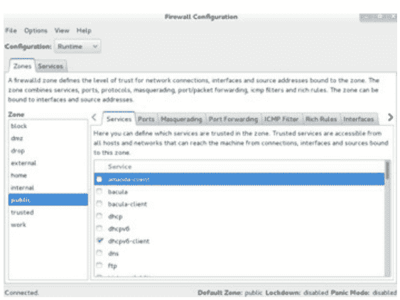

默认情况下，此工具启动时预选了运行时（runtime mode）。我们可以通过点击下拉菜单并选择将其切换到永久模式（permanent mode）。左侧会出现一组图标，方便我们添加新的区域和服务，并修改或删除选中的区域或服务。请注意，这些功能仅在永久模式下可用。图标请见图 11-3。

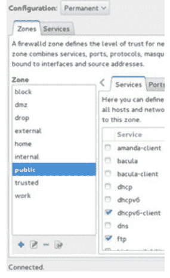

图 11-3 防火墙配置工具 – 永久模式

在“区域”（Zones）选项卡下（图 11-3），左侧面板列出的每个区域都有八个类别。这些类别分别是：服务（Services）、端口（Ports）、伪装（Masquerading）、端口转发（Port Forwarding）、ICMP 过滤（ICMP Filter）、富规则（Rich Rules）、接口（Interfaces）和源（Sources）。对于每个选定的区域，我们可以根据需要分配相应的属性。“服务”类别允许或阻止服务的流量；“端口”类别允许我们打开端口或端口范围；“伪装”使我们能够从互联网连接内部 IP 地址；“端口转发”允许我们将流量转发到同一系统或远程系统的另一个端口；“ICMP 过滤”过滤某些 ICMP 类型通过防火墙；“富规则”允许我们设置语言规则；“接口”在接口之间建立链接；“源”类别允许我们绑定源地址。

在“服务”（Services）选项卡下（图 11-4），左侧面板列出的每个服务四个类别；然而，只有在配置模式生效时我们才能进行修改。这些类别是：端口和协议（Ports and Protocols）、模块（Modules）和目的（Destination）。对于每个选定的服务，我们可以根据需要分配相应的属性。“端口和协议”允许我们为 TCP、UDP 或其他协议添加端口或端口范围；“模块”允许我们添加或修改过滤器辅助模块；“目的”允许我们对服务限制在指定的远程地址和类型。

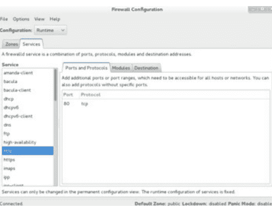

图 11-4 防火墙配置工具 – 服务选项卡

防火墙配置窗口顶部的“选项”菜单提供了额外的功能访问。它允许我们重载对防火墙规则的任何更改、选择不同的连接区域、更改默认区域、丢弃所有入站和出站数据包，以及应用程序和服务的默认配置。

## 安全增强 Linux (SELinux) 概述

安全增强 Linux（SELinux）是由美国国家安全局（NSA）与其他组织及 Linux 社区合作开发的强制访问控制（MAC）架构的实现，旨在提供灵活、丰富且细粒度的安全控制。MAC 以一组补丁的形式集成到 Linux 内核中，允许内核支持各种安全实现，包括 SELinux 模块（LSM）框架。MAC 在标准的 Linux 任意访问控制（DAC）安全之上提供了额外的保护层，DAC 包含文件和目录权限、ACL 设置、setuid/setgid 位、`sudo` 权限等。MAC 限制了主体（用户或进程）访问对象（文件、目录、设备、网络接口、端口、套接字等）的权限，以由于服务、程序或应用程序漏洞导致系统被破坏时的潜在损害。MAC 的控制是细粒度的；当某个服务被攻破时，它可以保护其他服务。例如，如果 FTP 服务器被攻破，攻击者只能访问黑客有权访问的文件，而无法访问系统上运行的其他进程或其他有权访问的进程。为了确保这种粗粒度控制（注：此处原文 coarse-grained 疑为 fine-grained 之误），MAC 使用一组默认授权规则策略在进行访问时检查主体和对象的安全属性。这些属性存储在上下文（a,b,c）中，并适用于此类对象。

SELinux 决策存储在称为访问向量缓存（Access Vector Cache, AVC）的特殊缓存区域中。每次尝试访问时都会检查此缓存，以确定该访问尝试之前是否被允许。通过这种机制，SELinux 不必反复检查策略规则集，从而提升了性能。

默认情况下，SELinux 控制在安装 RHEL 时启用，默认配置限制了进程运行所需的权限范围。

## 关键术语

为了理解 SELinux，理解一些关键术语至关重要。这些术语是：

- **主体（Subject）**：访问对象的用户或进程。
- **对象（Object）**：主体访问的资源，如文件、目录、设备、网络接口、端口或套接字。
- **访问（Access）**：主体对对象的操作。
- **策略（Policy）**：全局范围内执行的一组规则，用于为主体和对象分配安全属性。
- **上下文（Context）**：SELinux 用于存储主体对象安全属性的标签。在 SELinux 中，每个主体和对象都分配有一个上下文，由 SELinux 用户、角色、类型（域）和可选的敏感级别组成。
- **标记（Labeling）**：文件系统与其上下文之间的映射。
- **SELinux 用户（SELinux User）**：SELinux 策略中存在几个预定义的 SELinux 用户身份。这些用户通过授权识别。SELinux 将用户映射到策略中的身份，允许用户继承对 SELinux 用户的限制。这些用户用于进程的上下文，定义了它们可以执行的角色和类型。
- **角色（Role）**：基于角色的访问控制（RBAC）安全模型的一个属性，是 SELinux 的组成部分。它定义了允许主体访问域或类型。SELinux 用户被授权访问角色，角色被授权访问域。每个主体分配有一个角色，以确保系统进程和用户进程隔离。
- **类型与领域（Type and Domain）**：类型（Type）是类型强制（TE）的一个属性。它是基于安全需求的一致性划分的一组对象。具有安全需求的文件和目录等对象被归类为特定的类型。同样，具有安全要求的进程也有它们各自独特的类型，称为领域（domain）。换句话说，类型定义了文件，也定义了领域。SELinux 策略规则定义了类型之间如何相互访问（是一个领域访问，还是一个领域访问另一个领域）。SELinux 类型的示例包括：`user_home_id` 用于位于用户主目录的对象，而 `usr_t` 存储在上下文的第三字段中。
- **领域（Domain）**：定义了进程拥有的访问类型。每个进程都运行在一个领域内。SELinux 领域的一些示例包括用于系统进程的 `init_t`、用于防火墙进程的 `firewal_t` 以及用于所有不受 SELinux 策略限制进程的 `unconfined_t`。领域类型也存储在上下文的第三字段中。
- **类型强制（Type Enforcement）**：类型强制识别并限制主体（subject）访问进程领域和类型的能力。它引用主体和对象的上下文来执行这种强制。
- **级别（Level）**：级别是多级安全（MLS）和多分类安全（MCS）的属性。它是一对敏感值，定义了上下文中的安全级别。类别（category）可以定义为单个值或值范围，例如 `c0:c4`。在 RHEL 中，默认使用目标策略（targeted policy），它强制执行 MCS（仅支持 `s0` 敏感级别；但它支持 0 到 1023 个类别）。

## 用户的 SELinux 上下文

SELinux 上下文定义了单个主体和对象的属性。每个上下文包含一个类型和一个带有主体和对象信息的安全级别。对于用户，我们使用带有 `-Z` 参数的 `id` 命令查看 Linux 用户的上下文。以下示例显示了 root 账户执行的命令：

```
# id -Z
unconfined_u:unconfined_r:s0:c0-c1023
```

输出表明，从 SELinux 的角度来看，该用户没有任何限制。如果我们对 root 以外的用户账户运行命令，会得到完全相同的输出。这告诉所有用户（包括 root）默认情况下运行状态都是无限制的（unconfined），这让用户可以完全访问系统而没有任何限制。上述内容显示 root 被映射到 SELinux `unconfined_u` 用户，并在 `unconfined` 领域中以 `unconfined_r` 身份运行，在所有 1024 个类别中的安全级别均为 `s0`。

除了具有无限权限的无限制用户外，SELinux 还包含了七个对对象访问受限制的用户账户。这些账户通过 SELinux 策略映射到用户，通过继承其所映射的 SELinux 用户的限制来为其提供受控的访问。这种监管有助于用户免受 Linux 用户对系统造成的潜在损害。

我们可以使用 `seinfo` 命令列出可用的 SELinux 用户；但在此之前，必须安装 `setools-console` 包。

```
# seinfo -u
Users:
8
sysadm_u
system_u
xunadm_u
root
guest_u
staff_u
user_u
unconfined_u
```

输出显示了八个预定义的 SELinux 用户。我们现在可以使用 `semanage` 命令查看当前生效的映射：

```
# semanage login -l
| Login Name | SELinux User | MLS/MCS Range | Service |
| --- | --- | --- | --- |
| default | unconfined_u | s0:s0:c0-c1023 | * |
| root | unconfined_u | s0:s0:c0-c1023 | * |
| system_u | system_u | s0:s0:c0-c1023 | * |
```

上述输出的第一列显示 Linux 用户，第二列显示映射的 SELinux 用户。接两列显示了 Linux 用户关联安全级别和 SELinux 上下文（`*` 代表任何服务）。默认情况下，所有 root Linux 用户表示为 `_`，它映射到策略中的 `unconfined_user`。

## 进程的 SELinux 上下文

同样，我们也可以确定进程的上下文。我们为此使用 `ps` 命令并提供 `-Z` 选项。以下示例显示了 `ps` 命令的前两行：

```
# ps -Z
LABEL      PID TTY      CMD
system_u:system_init_t  1   00:00:02 system
```

在上方，主体（`system_u`）为 Linux root 提供 SELinux 用户名；对象是 `system_r`；领域（`domain_t`）表示应用于进程的保护类型；最后决定安全级别。任何在 `unconfined_t` 领域中未受保护的进程。

## 文件的 SELinux 上下文

同样，我们可以识别文件和目录的上下文。要找到这些，我们使用带有 `-Z` 的 `ll` 命令。以下显示了 `/etc/passwd` 文件的四个属性：

```
# ll -Z /etc/passwd
-rw-r--r-- root root_u:object_r:passwd_file_t:s0
```

输出显示了 passwd 文件的主体（`system_u`）、对象（`object_r`）、类型（`passwd_file_t`）和安全级别（`s0`）。这里有一个映射到 Linux root 的 SELinux 用户（system_u）；对象是 `object_r`，类型是 `passwd_file_t`，在 `/selinux/targeted/policy.conf` 中定义的安全级别是 `s0`。通过 `fcontext` 应用的上下文是软件包的一部分，必须在系统上安装才能使用。在 file_contexts 中新创建的文件和目录位于名为 `file_contexts` 的文件中。注意上述第一列：默认情况下，目录中创建的文件继承该上下文。如果文件移动到新目录，它会带上自己的上下文，这可能与目录的上下文不同。

## 端口的 SELinux 上下文

SELinux 还为入站端口提供属性。我们使用 `semanage` 命令显示上下文。以下输出仅包含几个示例：

```
# semanage -l
| SELinux Port Type | Port Number |
|---|---|
| http_port_t | tcp | 80, 443, 8080, 9000 |
| kerberos_port_t | tcp | 88 |
| kerberos_port_t | udp | 464 |
| passwd_port_t | tcp | 464 |
| kerberos_port_t | tcp | 754 |
```

默认情况下，SELinux 允许在一组限制端口上登录。

## 领域转换（Domain Transitioning）

SELinux 允许运行在一个领域的进程进入另一个领域，前提是策略中存在适当的规则。SELinux 在其控制下定义了一个名为 entryway 的权限，可以切换到新领域。关于如何转换到新领域，下面的示例显示了当 Linux 用户尝试使用 `/usr/bin/passwd` 修改密码时它是有效的。`passwd` 命令被标记为 `passwd_exec_t` 类型，如下：

```
# ll -Z /usr/bin/passwd
-rw-xr-x root root_u:object_r:passwd_exec_t:s0
```

修改密码命令需要访问 `/etc/shadow`。shadow 文件具有不同的类型 `shadow_t`：

```
# ll -Z /etc/shadow
-rw-r-- root root_u:object_r:shadow_t:s0
```

SELinux 策略拥有规则专门允许运行在 `password_t` 领域的进程读取和修改 `shadow_t` 类型的文件，并允许进入 `password_exec_t` 领域。此规则允许执行 `password` 命令的用户进程切换到 `password_t` 领域并更新 shadow 文件。让我们打开两个终端窗口并操作。在一个窗口中以 user1 执行 `password` 命令：

```
$ password
Changing password for user1.
Changing password for user1.
(current) UNIX password:
```

在第二个窗口中，运行 `ps` 命令如下：

```
# ps -eZ | grep password
unconfined_u:unconfined_r:user_t:s0:c0-1023
```

可以看出，password 命令已转换到 `password_t` 领域以成功更改密码文件。

## 使用 SELinux 上下文复制、移动和归档文件

作为日常工作的一部分，我们经常复制、移动和归档文件。运行 SELinux 时，我们需要在使用 `cp`、`mv` 和 `tar` 操作期间保持正确的上下文。规则如下：

1. 如果文件复制到相同或不同目录下的现有文件，源文件的上下文将接收目标文件的上下文。
2. 如果文件作为新文件复制到不同的目录，源文件的上下文将被目的的上下文替换，除非我们使用 `cp` 命令的 `--preserve=context` 选项保留文件的原始上下文。
3. 如果文件移动到相同或不同目录，源文件上的 SELinux 类型保持完好；但用户属性变为 `unconfined_u`。
4. 如果使用 `tar` 命令归档文件，使用 `--selinux` 选项保留上下文。

## SELinux 布尔值（Booleans）

布尔值是 SELinux 定义的开启/关闭开关。允许我们在无需重新加载或重启的情况下立即激活或禁用 SELinux 策略中的特定规则。例如，可以开启 `abrt_anon_write` 布尔值允许匿名用户上传文件。可以通过关闭此布尔值来撤销此权限。布尔值存储位于 `/sys/fs/selinux/booleans` 相应的布尔文件中。该目录的示例列表如下：

```
# ls -l /sys/fs/selinux/booleans
--we-r-- 1 root root 0 Nov 11 19:47 abrt_anon_write
--we-r-- 1 root root 0 Nov 11 19:47 abrt_handle_event
--we-r-- 1 root root 0 Nov 11 19:47 abrt_upload_anon_write
```

每个文件代表一个布尔值。我们可以使用 `getbool`、`setatus` 或 `manage` 命令查看它们的值。带有 `-a` 选项的 `getbool` 命令列出所有布尔值及其当前值：

```
# getbool -a
abrt_anon_write -- off
abrt_handle_event -- off
```


abrt_upload_anon_write --on

要检查单个布尔值的状态，我们在命令中指定布尔值的名称。

## getsebool abrt_anon_write

```bash
abrt_anon_write --> off
```

或者，可以使用带有 `-b` 选项运行 `sestatus` 命令：

```bash
# sestatus -b
```

策略布尔值（Policy booleans）：

| abrt_anon_write | off |
| abrt_handle_event | off |
| abrt_upload_watch_anon_write | on |

必须使用 `semanage` 命令列出所有布尔值，并带有每个值带有简短描述和当前设置：

```bash
# semanage boolean -l
```

输出示例：

| SELinux 布尔值 | 状态 | 默认 | 描述 |
|---|---|---|---|
| ftp_home_dir | (off) | (off) | 确定 ftp 是否可以在用户目录中读写文件 |
| smart_3ware | (off) | | 确定 smartcan 是否支持在载在 3ware 控制器上的设备 |

可以使用 `setboolean` 命令临时或永久地翻转值。首先可以启用 `abrt_anon_write`，然后通过简单地将其设置为 "on" 或 "1" 来启用，或将其设置为 "off" 或 "0" 来禁用。

```bash
# setboolean abrt_anon_write 1
# setboolean abrt_anon_write 0
```

上述操作立即生效，无需重启系统，并在布尔文件目录 `/sys/fs/selinux/boolean` 中存储 1 或 0；然而，它们是临时的，新值在下次重启后不会保留。

为了使值立即生效并在随后的系统重启后立即可用，我们在 `setboolean` 命令中指定了 `-P` 选项。我们也可以使用 `semanage` 命令（`-m` 修改，`-1` 启用）来实现此目的。以下演示了如何使用这两个命令设置 `abrt_anon_write` 布尔值：

```bash
# setboolean -P abrt_anon_write on
# semanage boolean -m --on abrt_anon_write
```

我们可以使用 `getboolean`、`sestatus` 和 `semanage` 命令进行验证：

```bash
# getboolean -a | grep abrt_anon_write
abrt_anon_write --> off

# sestatus -b | grep abrt_anon_write
abrt_anon_write on

# semanage boolean -l | grep abrt_anon_write
abrt_anon_write (on, off) 允许 ABRT 修改发布的用户文件服务的策略文件。
```

## 管理 SELinux

SELinux 涉及许多任务，包括控制激活模式、检查状态、设置变量。本章涵盖了布尔值。RHEL 提供了一组上下文和对象，以及一个图形工具 SELinux Manager 用于执行这些操作。命令跨多个软件包，例如 `selinux-utils`；它包含 `getenforce`、`setenforce` 和 `getboolean` 命令；包含 `sestatus`、`setfiles` 和 `restorecon` 命令；`policycoreutils-python` 由 `semanage` 命令组成；以及 `setroubleshoot`，包含了 SELinux 警告和故障排除。图形工具是 `policycoreutils-gui` 软件包。为了查看 SELinux 警告和故障排除，RHEL7 提供了图形工具 SELinux Alert Browser，它是 `setroubleshoot` 包的一部分。为了管理系统上的 SELinux，我们需要确保系统中安装了所有软件包及其依赖项。

除了上述工具包外，还有额外的命令和图形工具可以执行特定的 SELinux 管理任务；但它们的使用并不频繁。

## 管理命令

SELinux 带来了许多管理命令和两个图形管理工具。表 11-3 列出了并解释了一些管理命令。

| 命令 | 描述 |
|---|---|
| **上下文管理** | |
| `chcon` | 修改文件的上下文。更改不会在文件系统重标记后保留。 |
| `matchpathcon` | 将文件与上下文或/默认值进行比较并报告。 |
| `restorecon` | 通过引用 `etc/selinux/targeted/files` 目录中的文件来恢复文件的默认值。 |
| `semanage` | 修改文件的上下文并管理策略。更改在文件系统重标记后保留。 |
| **模式管理** | |
| `getenforce` | 显示当前的运行模式。 |
| `sestatus` | 显示 SELinux 状态。 |
| `setenforce` | 将运行模式设置为强制（enforcing）或许可（permissive）。 |
| **策略管理** | |
| `seinfo` | 提供策略组件的信息。 |
| `sesearch` | 搜索策略中的规则。 |
| **布尔值管理** | |
| `getboolean` | 显示布尔值及其当前设置。 |
| `setboolean` | 修改布尔值。 |
| **故障排除** | |
| `sealert` | 图形故障排除工具。 |
| **图形化管理** | |
| `system-config-selinux` | 图形管理工具。 |

表 11-3 SELinux 管理命令

我们将在本章及后续章节中使用其中一些命令。

## 控制激活模式

控制 SELinux 激活模式及其默认类型的一个关键配置文件称为 `config`，位于 `/etc/selinux` 目录中。该文件的默认内容如下所示，并附有解释：

```bash
# /etc/selinux/config

# 此文件控制系统上 SELinux 的状态。

# SELINUX= 可以取以下三个值之一：
#   enforcing - 强制执行 SELinux 安全策略。
#   permissive - SELinux 打印警告而非强制执行。
#   disabled - 不加载 SELinux 策略。
SELINUX=enforcing

# SELINUXTYPE= 可以取两个值之一：
#   targeted - 目标进程受保护，
#   mls - 多级安全
SELINUXTYPE=targeted
```

`SELINUX` 指令在文件中设置模式。完全禁用 SELinux 需要在文件中设置 `SELINUX=disabled`。将来，如果我们在强制或许可模式下重新激活 SELinux，只需在配置文件中适当设置 `SELINUX` 指令并重启系统。重启将比正常慢，因为 SELinux 将通过重标记文件。

在命令提示符处，可以使用 `getenforce` 确定当前模式：

```bash
# getenforce
```

可以使用 `setenforce` 命令立即将 SELinux 状态从强制更改为许可：

```bash
# setenforce permissive (或 setenforce 0)
```

如果重启系统，此更改将丢失。为了使更改持久有效，我们编辑 `/etc/selinux/config` 并将其设置为 permissive。然后我们可以重启系统来验证更改。

> **小提示**：您可以将 SELinux 切换到许可模式以进行故障排除。问题解决后切换回强制模式。

## 查询状态

可以使用 `sestatus` 命令查询 SELinux 的运行状态。该命令除了其他信息外，还显示关键目录、有效策略和操作模式。

```bash
# sestatus
SELinux status:         enabled
SELinux mount:          /sys/selinux
SELinux root directory: /etc/selinux
Loaded policy:          targeted
Current mode:           enforcing
Mode from config file:  enforcing
Policy MLS:             enabled
Policy deny_unknown status: allowed
Max kernel policy version: 28
```

输出表明 SELinux 以强制模式运行且目标策略生效。

我们可以使用带有 `-v` 选项的 `sestatus` 命令来报告 `/etc/sestatus.conf` 文件列出的文件和进程的安全上下文。该文件的默认内容如下：

```bash
# cat /etc/sestatus.conf
[files]
/etc/passwd
/etc/shadow
/bin/bash
/bin/login
/bin/sh
/sbin/getty
/sbin/init
/sbin/mingetty
/sbin/sshd
/lib/libc.so.6
/lib/ld-linux.so.2
/lib/ld.so.1

[process]
/sbin/mingetty
/sbin/getty
/usr/sbin/sshd
```

让我们带有 `-v` 运行 `sestatus` 命令：

```bash
# sestatus -v
...
Process contexts:
Current context: unconfined_u:unconfined_r:unconfined_t:s0:s0:c0.1023
Init context: system_u:system_r:init_t:s0
/usr/sbin/sshd context: system_u:system_r:sshd_t:s0:s0:c0.1023

File contexts:
/etc/passwd context: system_u:object_r:passwd_file_t:s0
/etc/shadow context: system_u:object_r:shadow_t:s0
/bin/bash context: system_u:object_r:shell_exec_t:s0
/bin/sh context: system_u:object_r:shell_exec_t:s0
/sbin/agetty context: system_u:object_r:getty_exec_t:s0
/sbin/init context: system_u:object_r:init_exec_t:s0
/usr/sbin/sshd context: system_u:object_r:sshd_exec_t:s0
```

## 练习 15-1: 修改用户的 SELinux 上下文

本练习将在 server1 上进行。

在此练习中，你将创建一个带有默认设置的 `staff_u` 用户账户，并确保该用户在创建时被映射到 SELinux 用户 `staff_u`。你将验证 `user5` 的映射。你会将一个现有的 Linux 用户 `user4` 映射到 SELinux 用户 `user_u`，并确认修改 SELinux 策略以确保所有新用户在创建时自动识别 `staff_u`。

1. 创建一个具有默认设置并映射到 SELinux 用户 `staff_u` 的用户账户 `user5`。为该用户分配密码 `user123`（不建议分配此类密码；但在实验环境中是可以的）。

```bash
# useradd -Z staff_u user5
# echo user123 | passwd --stdin user5
Changing password for user5
passwd: all authentication tokens updated successfully.
```

2. 使用 `semanage` 验证 `user5` 和 `staff_u` 之间的映射：

```bash
# semanage login -l | grep user5
user5 staff_u s0:s0:c0.1023
```

3. 登录到 server1 并使用 `id` 命令确认映射：

```bash
$ id -Z
staff_u:staff_r:staff_t:s0:s0:c0.1023
```

4. 使用 `semanage` 命令将现有的用户账户 `user4` 映射到 SELinux 用户 `user_u` 并确认：

```bash
# semanage login -a -s user_u user4
# semanage login -l | grep user4
user4 user_u s0
```

5. 修改 SELinux 策略，使所有新的 Linux 用户账户在创建时都自动映射到 `staff_u`，并确认：

```bash
# semanage login -m -S targeted -r s0 __default__
# semanage login -l | grep default
__default__ staff_u s0
```

## 练习 11-6: 修改文件的 SELinux 上下文

本练习将在 server1 上进行。

在此练习中，你将把 `/root/file1` 的用户和类型分别改为 `user_u` 和 `public_content_t` 并进行验证。你将此上下文持久地添加到 SELinux 策略中，以确保在 SELinux 被禁用后启用时文件系统标签有效。你将修改 `/root` 目录的用户和类型为 `user_u` 和 `var_run_t`，然后恢复默认值。

1. 使用带有 `-Z` 参数的 `ll` 命令确定 `/root/file1` 的当前上下文：

```bash
# ll -Z /root/file1
```
输出显示 file1 的 SELinux 用户 (`unconfined_u`) 和类型 (`admin_home_t`)。

2. 使用详细模式下的 `chcon` 命令将文件的上下文修改为用户 (`-u`) 和类型 (`-t`)：

```bash
# chcon -v -u user_u -t public_content_t /root/file1
changing security context of '/root/file1'
```

3. 将新上下文添加到 SELinux 策略中，以确保如果 SELinux 被禁用后重新启用，将触发系统重新标记。使用 `semanage` 命令带有指定的用户 (`-s`) 和类型 (`-t`) 添加文件上下文 (fcontext)。

```bash
# semanage fcontext -a -s user_u -t public_content_t /root/file1
```
此自定义上下文存储在 `/etc/selinux/targeted/contexts/files/file_contexts.local` 中。

4. 验证新上下文：

```bash
# ll -Z /root/file1
```

5. 将 `/root/` 的用户 (`-u`) 和类型 (`-t`) 修改为 `staff_u` 和 `var_run_t` 并验证：

```bash
# chcon -v -u staff_u -t var_run_t /root
changing security context of '/root'
# ll -Zd /root
drwx--x---. root root staff_u:object_r:var_run_t:s0 /root
```

6. 使用 `restorecon` 命令将原始上下文恢复到目录并确认：

```bash
# restorecon -v /root
restorecon reset /root context system_u:object_r:admin_home_t:s0
# ll -Zd /root
drwx--x---. root root system_u:object_r:admin_home_t:s0 /root
```

示例：使用 `semanage` 命令向 SELinux 策略添加文件上下文并应用它。这将防止在 SELinux 发生重新标记时上下文变为原始值。

## 练习 11-7: 为 SELinux 策略添加非标准端口

在此练习中，你将为 httpd 服务向 SELinux 策略添加一个非标准端口。为此，你将对配置进行相应更改。

1. 使用 `semanage` 命令列出 (`-l`) 服务正在监听的端口：

```bash
# semanage port -l | grep http_port_t
http_port_t tcp 80 443 8008 9000
```
输出显示 httpd 服务正在监听网络端口。

2. 使用 `semanage` 命令将 8010 添加 (`-a`) 到策略中：

```bash
# semanage port -a -t http_port_t -p tcp 8010
```

3. 确认：

```bash
# semanage port -l | grep http_port_t
http_port_t tcp 80 443 8008 9000 8010
```

4. 从策略中删除 (`-d`) 8010 端口：

```bash
# semanage port -d -t http_port_t -p tcp 8010
```

5. 确认：

```bash
# semanage port -l | grep http_port_t
http_port_t tcp 80 443 8008 9000
```

示例：使用 `semanage` 命令为 SELinux 策略添加非标准端口。

## 练习 11-8: 带有 SELinux 上下文复制文件

在此练习中，你将带有 SELinux 上下文复制 `file1`。你将检查 `/root` 下 `file1` 的上下文，并将其复制到 `/etc`。

1. 检查 `/root/file1` 的上下文：

```bash
# ls -Z /root/file1
```

2. 将 `file1` 复制到 `/etc`：

```bash
# cp -Z /root/file1 /etc/
```

3. 检查 `/etc/file1` 的上下文：

```bash
# ls -Z /etc/file1
```


- 4. 修改 `etc/file1` 的上下文：

```bash
# chcon -t /tmp /etc/file1
```

## SELinux 管理工具概述

SELinux 管理工具是一个图形化界面工具，允许我们执行许多配置，包括设置默认模式和禁用它。通过运行 `system-config-selinux` 命令在终端启动此工具，或者在 GNOME 桌面选择“选项 | SELinux”。主窗口如图 11-5 所示。

SELinux 界面允许我们管理八种不同的类别。这些类别列在左侧，分别是：状态、布尔、文件标记、用户映射、SELinux 用户、网络端口、策略模块和进程域。我们可以点击类别来查看或修改其属性。状态类别显示了默认和强制模式，并允许我们修改它们。它还显示了默认策略。“下次启动时重新标记”选项可以勾选，以便在重启后重新标记文件。这在 SELinux 从禁用状态启用时会自动完成。其余类别解释如下：

**布尔：** 显示布尔值是否激活、所属的模块、简要描述和名称。它还允许我们开启或关闭布尔。

**文件标记：** 显示文件标签，并允许我们添加、修改和删除。

**用户映射：** 显示 Linux 到 SELinux 用户的映射，并允许我们添加、修改和删除。

**SELinux 用户：** 显示 SELinux 用户，并允许我们添加、修改和删除。

**网络端口（Network Port）：** 显示 SELinux 端口以及关联协议、安全级别和端口号，并允许我们添加、修改和删除这些端口。

**策略模块（Policy Module）：** 显示模块名称及其版本，并允许我们添加或删除模块，并启用模块审计。

**进程域（Process Domain）：** 显示 SELinux 状态，并允许我们在允许模式（permissive）和强制模式（enforcing）之间切换。

图 11-11 SELinux 管理工具 – 策略模块
图 11-12 SELinux 管理工具 – 进程域

## 查看和分析 SELinux 警报

当 SELinux 处于强制（enforcing）或允许（permissive）模式运行时，它会对系统活动生成警报。如果审计守护进程（audit daemon）正在运行，它会将警报写入 `/var/log/audit/audit.log`；如果没有运行审计守护进程，则通过 rslog 守护进程写入 `/var/log/messages` 文件。SELinux 会记录所有因拒绝访问而产生的警报，并在 `audit.log` 中通过类型标记将其标识为 AVC（访问缓存跟踪器）。它还会在消息文件中写入拒绝信息，带有消息 ID 以及如何查看其详细信息。

对 SELinux 拒绝操作进行分析并检查审计数据，以识别导致拒绝的潜在原因。分析结果将被记录，并提供解决该问题的建议和建议的操作。SELinux 运行一个名为 `setroubleshoot` 的服务，它在后台执行此类分析和检查。该服务还有一个名为 SELinux（shell）的客户端接口，它可以读取数据并将其显示出来供您分析。该客户端工具同时具有文本界面和图形界面。服务器和客户端组件是 `setroubleshoot-server` 软件包的一部分，在使用该服务之前必须在系统上安装它。

以下是从 `/var/log/audit/audit.log` 中移除的一些允许操作的内容：

```text
type=USER_CHAHTOK host=audit audit=(1415396006.469:2624) pid=22202 auid=0 sesid=252 subj=unconfined_unconfined_r_passwd_t=s0:c0:c1023

msg=pam:pamchahtok event=exit res=/bin/passwd aterm=? terminal=tty1 pype=success res=type=USER_CHAHTOK

msg=audit(1415396006.469:2615) pid=22202 auid=0 sesid=252 subj=unconfined_unconfined_r_passwd_t=s0:c0:c1023

id=1010 event=exit res=/bin/passwd aterm=? terminal=tty1 pype=ms-success
```

并且从同一个文件中添加了一个默认默认：

```text
type=AVC audit=(1415396029.894:2262) avc=2222 op=(create) pid=22330 pass="passwd" name="madshadow"

context=unconfined:unconfined_r_passwd_t=s0:c0:c1023 system=system_object_t tclass=tfile
```

来自 `/var/log/messages.log` 对应的拒绝消息：

```text
Nov 11 22:38:21 server selinux: denied preventing /bin/passwd from create access on the file. For complete SELinux messages, run

nausearch -77f22ff5d4379c-488d-98ea-56645f0ca
```

从这两条消息中的任意一条，我们得知密码阻止了更新尝试更改 `/etc/shadow` 文件以使用密码的操作。警报还建议使用 `user selinux denied` 命令来查找——指定的 ID。然后按照建议运行命令：

```bash
# sealert -7f22ff5d4379c-488d-98ea-56645f0ca

SELinux preventing unconfined:unconfined_r:passwd_t from create access on the file.

********************************************************************

如果你想允许进程访问该文件，那么你可能需要添加以下 SPECIFIC_TARGET_PATH

Do allow

# semanage -a FILE_TYPE --SPECIFIC_TARGET_PATH

其中 FILE_TYPE 是以下类型之一：shadow_t, kn05_home_r_ache_t, lastlog_t, passwd_t, file_shadow_t,

resource=

  - SPECIFIC_TARGET_PATH

********************************************************************
```

如果你认为密码应该被允许默认对文件进行创建访问，那么你应该将其报告为错误。你可以生成一个本地策略：

```bash
* audit2allow /var/log/audit/audit.log -M my

* semanage -i -m my
```

### 额外信息：

| 字段 | 详情 |
| :--- | :--- |
| 源上下文 (Source Context) | unconfined:unconfined_r:passwd_t=s0:c0:c1023 |
| 目标上下文 (Target Context) | system_object_t=s0 |
| 目标对象 (Target Objects) | shadow_t (/etc/shadow) |
| 源 (Source) | /bin/passwd |
| 源路径 (Source Path) | /usr/bin |
| 端口 (Port) | \<Unknown\> |
| 主机 (Host) | \<Unknown\> |
| SELinux 启用 (SELinux Enabled) | true |
| 策略类型 (Policy Type) | targeted |
| 主机名 (Host Name) | server.example.com |
| Linux 内内核 (Linux kernel) | 3.10.0-el7.x86_64 |
| 上一次事件 (Last Event) | 2023-11-11 22:38:21 |

# 章节复习题答案

1. 启动图形 SELinux 管理工具的命令名为 `system-config-selinux`。
2. 该命令将对输出链应用一条规则，防止 TCP 数据包通过端口 25 离开系统。
3. `getforce` 和 `setforce` 命令。
4. 正确。
5. 错误。
6. SELinux 拒绝信息记录在 `/var/log/messages` 文件中。
7. 防火墙管理的图形工具称为 `firewall-config`。
8. 配置文件名为 `selinux`，位于 `/etc/sysconfig` 目录下。
9. 正确。
10. `manage` 命令。
11. `-z` 选项。
12. 此命令将恢复 `/etc` 目录的默认 SELinux 上文。
13. RHEL7 用于 SELinux 的默认策略是目标策略（targeted policy）。
14. 配置文件名为 `iptables`，位于 `/etc/sysconfig` 目录。
15. 指定的字符串将在 iptables 防火墙中插入一条规则，允许端口 23 上的新流量通过，而不影响该端口上的任何现有连接。
16. `status` 命令显示 SELinux 状态。
17. 系统必须重启。
18. 数据包的形成的过程被称为封装（encapsulation）。
19. `--preserve-context` 选项。
20. 此命令将 Linux 用户 `user10` 映射到 SELinux 用户 `user_u`。
21. `manage` 和 `setbool` 命令。
22. 错误。
23. 此命令将显示系统上所有加载的防火墙规则。
24. 命令名为 `sealert`。

## DIY 挑战实验

以下实验有助于加强本章中学习的大部分概念和主题。预计您可以在没有额外帮助的情况下完成这些实验。本书不提供分步骤的指南，因为这些实验的实现需要本章介绍的知识。对于缺失的信息，请使用默认值或自己的思考。

### 实验 11-1：添加防火墙规则

在 `OUTPUT` 链中插入一条规则，允许 UDP 流量通过端口 100 访问网络 `192.168.4.0/24`。在 `INPUT` 链中追加一条规则，禁用来自网络 `192.168.3.0/24` 通过端口 101 的 TCP 流量，但不向请求者发送通知，同时允许 `192.168.3.3/24`。在 `INPUT` 链中插入一条规则，允许 ssh 通信通道运行，并允许后续的 ssh 请求通过防火墙。

### 实验 11-2：禁用和启用 SELinux 运行模式

检查并记录当前的 SELinux 运行模式。修改配置文件并将设置为 `disabled`。重启系统并验证更改。将系统恢复到原始 SELinux 模式并重启以验证。测量每次重启所需的时间。

# 管理网络接口和网络客户端

本章描述了以下主要主题：

- 基础网络包括主机名、IPv4、IPv6、网络类、子网、子网掩码、协议、TCP/UDP、以太网地址和 ARP
- 理解网络接口和一致的接口命名
- 理解接口配置文件、hosts 表和管理命令
- NetworkManager 概述
- 手动和通过 NetworkManager 配置网络接口
- 使用 `ping` 测试连通性
- 通过图形网络管理工具管理网络接口
- 配置系统从 NTP 服务器获取时间
- OpenLDAP 概念、术语、角色和客户端包
- 理解 OpenLDAP 客户端配置文件
- 使用 authconfig 配置 OpenLDAP 客户端
- 图形认证配置工具概述

## RHCSA 目标：

- 31. 静态或动态配置网络和主机名解析
- 40. 配置系统使用时间服务
- 47. 配置系统使用现有的认证服务获取用户组信息

计算机网络是由两个或多个物理或虚拟计算机连接在一起，共享其资源和数据的集合。计算机可以通过有线或无线方式连接，需要交换机等设备来互连服务器，以便它们可以在网络上相互通信。要理解网络如何工作以及如何配置网络服务，首先需要一些基本术语。为了使系统能够与其他网络系统通信，必须为其中一个网络接口配置唯一的 IP 地址和其他关键网络参数。接口配置涉及多个文件，可以通过修改或使用命令和图形工具进行处理。完成配置后，将进行测试以确认系统与网络上其他系统的通信能力。

NTP 是一种协议，允许系统将其钟与更可靠的时间源同步，以便运行在系统上的时间敏感型应用程序准确运行。

OpenLDAP 是 LDAP 的开放实现。为了让其用户通过远程 OpenLDAP 服务器进行身份验证并获取其他目录信息，需要在系统中配置 OpenLDAP 客户端功能。为了此目的需要修改某些配置文件，可能需要手动编辑或通过命令和图形工具进行编辑。

## 基础网络

在配置网络接口和执行高级网络客户端服务器设置之前，你需要掌握许多基本概念和术语。同样，还有许多与各种网络服务相关的配置文件和命令需要彻底理解。本章解释了一些概念、术语、配置文件和命令，更多内容将在本书的 RHCE 部分介绍。

## 主机名

主机名是分配给系统以在网络上标识它的唯一标识符（允许连字符、下划线和点）。它由最多 64 个字符组成，通常基于系统的主要用途。在 RHEL7 中，主机名存储在 `/etc/hostname` 中。可以使用不同的命令（如 `hostname`、`hostnamectl` 和 `uname`）查看系统的主机名。你还可以显示存储主机名的 `/etc/hostname` 文件的内容。此外，NetworkManager 服务也可以在文本模式下的提示符处显示主机名：

```bash
# hostname

# hostnamectl | grep hostname

# uname -n

# cat /etc/hostname

# nmcli
```

同样，可以使用上述任何方法更改主机名，`hostname` 命令允许临时重命名。例如，要重命名为 `server10.example.com`，运行此命令：

```bash
# hostname server10.example.com
```

`hostnamectl` 命令在重启之前永久更改主机名。

```bash
# hostnamectl set-hostname server10.example.com
```

或者，只需编辑 `/etc/hostname` 文件进行更改。保存文件并退出编辑器后，重启 `systemd-network` 服务使此永久更改生效。以下操作将主机名改回 `server1.example.com`：

不要忘记更新 `/etc/hosts` 文件以反映新主机名。NetworkManager 也可以通过命令行 (`nmcli`) 或文本接口 (`ip`) 更改主机名 [等待，文本中的 "nmui" 可能是 "ip" 的误写]。

## IPv4 地址

IPv4 地址（互联网协议第 4 版）代表 32 位软件地址，网络上的每个系统都必须与其他系统通信。IPv4 地址可以临时或永久地分配。临时地址被称为动态地址，通常从 DHCP 服务器租用一段时间。另一方面，永久地址是静态地址，手动设置或使用 NetworkManager 设置。我们使用 `ip` 命令查看系统上的当前地址：

```text
1: <LOOPBACK,UP> mtu 65536 qdisc none state UNKNOWN
    link/loopback 00:00:00:00 brd 00:00:00:00
    inet 127.0.0.1/8 scope host
       valid_lft preferred_lft host
    inet6 ::/128 scope host
       valid_lft preferred_lft host
2: eth0: <BROADCAST,MULTIC,UP> mtu 1500 qdisc prio_default state UP qlen 1000
    link/ether 00:50:56:c1:76:64 brd ff:ff:ff:ff
    inet 192.168.0.10/24 brd 192.168.0.255 scope eth0
       valid_lft preferred_lft eth
    inet6 fe80::2050:56ff:fe76:64/64 scope eth
       valid_lft preferred_lft eth
```


可以使用 `ifconfig` 命令获取此类信息，但该命令在 RHEL 中已弃用，并在未来的 RHEL 版本中删除。

上面的输出表示存在一个网络接口 `eth0`，为其分配了 IPv4 地址 `192.168.0.10`。另一个名为 `lo` 的接口是为每个 UNIX 和 Linux 系统保留的特殊接口。它的 IPv4 地址是 `127.0.0.1`，被称为 localhost（或 host）。主机用于网络应用程序访问本地系统的资源。

## 网络类

IP 地址由四个独立的八字节组成，分为网络部分和节点部分。网络部分识别目标网络，节点部分识别该网络上的目标位置。网络地址分为三类，称为 A 类、B 类，还定义了 D 类和 E 类；但它们被限于科学和工程等特殊领域。

> 节点用于具有 IP 地址的网络。示例包括计算机、存储设备、路由器、交换机、手持设备、打印机等。


A 类地址用于多达 1600 万个节点型网络。A 类网络地址范围在 1 到 126 之间。该类使用第一个字节作为网络部分，其余字节作为节点部分。

B 类地址用于多达 6.5 万个节点的中型网络。B 类网络地址范围在 128 到 191 之间。该类使用前两个字节作为网络部分，另外两个字节作为节点部分。

C 类地址用于多达 254 个节点的小型网络。C 类网络地址范围在 192 到 223 之间。该类使用前三个字节作为网络部分，最后一个字节作为节点位置。

## 子网划分和子网掩码

子网划分是一种将大型网络地址空间划分为更小部分的方法。

将网络划分为可管理的逻辑子网络，通常称为子网（subnets）。子网划分通常可以减少网络流量、提高网络性能，并带来去中心化和更易管理等优点。

在处理子网划分时，应注意以下几点：

- 子网划分不会增加网络中的 IP 地址数量。事实上，它减少了可用 IP 地址的数量。
- 给定子网中的所有节点具有相同的子网。
- 每个子网都作为一个隔离的网络，并需要路由器来与其他子网通信。
- 子网中的第一个和最后一个 IP 地址是保留的。第一个地址指向子网本身，最后一个地址是广播地址。

在对给定地址进行子网划分后，我们会确定所谓的子网掩码（subnet mask）或网络掩码（netmask）。子网掩码是区分子网位的网络部分。它被路由器用于识别特定 IP 地址的网络/子网划分的开始和结束，以及节点部分的开始和结束。

类 A、B、C 的默认掩码分别为 `255.255.0.0`、`255.255.0.0` 和 `255.255.255.0`。

## 协议 (Protocol)

协议是规范两个网络实体之间数据交换的规则集。这些规则包括数据如何被格式化、编码和控制。规则还提供了错误处理、速度匹配和数据包排序。换句话说，协议是一种允许网络上所有节点进行通信和理解的通用语言。一些常见的协议有 TCP、UDP、IP 和 ICMP。下面是 `/etc/protocols` 文件的节选：

| # /etc/protocols | # 协议，伪协议号 |
|---|---|
| ip | IP |
| hopopt | HOPOPT | # ipv6 的逐跳选项 |
| icmp | ICMP | # 控制消息协议 |
| igmp | IGMP | # 互联网组管理协议 |
| ggp | GPP | # 网关-网关协议 |
| ipv4 | IPv4 | # IP 封装 |
| st | ST | # ST 域 |
| tcp | TCP | # 传输控制协议 |

## TCP 和 UDP 协议

两个关键协议是 TCP 和 UDP。TCP 是可靠、面向连接且点对点的。当使用 TCP 协议将数据包流发送到目的地时，目的节点在到达后会检查错误和包排序。每个数据包都包含源系统和目的系统的 IP 地址、数据、序列号和校验和等信息。源端的 TCP 协议与目的地的 TCP 协议建立点对点连接。当接收端 TCP 收到包时，会返回一个确认。如果数据包包含错误或在传输过程中丢失，目的地会请求源端重新发送数据包。这确保了数据的可靠交付并使 TCP 变得可靠。

另一方面，UDP 是不可靠、无连接且多点的。如果数据包在到达目的地时丢失或包含错误，源节点将无法察觉。目的地不会向源节点返回确认。UDP 用于广播目的。

TCP 和 UDP 都使用端口在客户端与其关联服务器之间进行数据传输。端口定义在 `/etc/services` 文件中。一些常见的服务及其它们监听的端口包括：ftp 21、ssh 22、postfix 25、http 80 和 ntp 123。下面是 `/etc/services` 文件的节选：

## 以太网地址与解析协议 (Ethernet Address and Resolution Protocol)

以太网地址代表一个唯一的 48 位地址，用于标识从源节点传输的数据包的正确目的节点。数据包包含源节点和目的节点的以太网地址。一种称为 ARP 的网络协议将该地址映射到目的 IP 地址。以太网地址也被称为硬件地址、物理地址、链路层地址或 MAC 地址。

我们使用 `ip` 命令列出系统上所有网络接口及其硬件地址：

```bash
# ip addr | grep ether
link 02:5a:00:17:91:8d br fffff
```

IP 地址和以太网地址协同工作，两者的结合对于识别网络上的正确目的节点至关重要。一种称为地址解析协议（ARP）的协议用于让 IP 地址和硬件地址协同工作。当目的节点的 IP 已知时，ARP 会确定目的节点的硬件地址。

ARP 在网络上广播消息，请求每个地址提供其链路和 IP 地址。收到的地址被缓存在本地节点上，可以使用带有 `neighbor` 信息的 `ip` 命令查看：

```bash
# ip neighbor
192.168.0.13 dev0 lladdr dc8c:de:02:71:ef STALE
192.168.0.100 dev0 lladdr 4ad:be:9:d2:2e:d9 STALE
192.168.0.1 dev0 lladdr 18:53:f7:c6:14 STALE
192.168.0.120 dev0 lladdr 52:54:00:bd:ba:9 REACHABLE
```

上述输出的第一列显示了邻居的 IP 地址，随后是它们正在使用的接口设备、链路地址和 NUD（邻居不可达检测）。邻居可以处于四种状态之一：permanent（永久）、reachable（可达）和 stale（过期）。permanent 状态表示可以手动删除的有效条目，reachable 状态指定超时会期的有效条目，而 stale 状态则可疑。

## 网络接口 (Network Interfaces)

网络接口卡（Network Interface Cards）是硬件适配器，用于标识从源节点传输的数据包的正确目的节点。数据包包含源节点和目的节点的以太网地址。一种称为 ARP 的网络协议将地址映射到目的 IP 地址。以太网地址也被称为硬件地址、物理地址、链路层地址或 MAC 地址。

我们使用 `ip` 命令列出系统上所有网络接口及其硬件地址：

```bash
# ip addr | grep ether
link 02:5a:00:17:91:8d br fffff
```

IP 地址和以太网地址协同工作，两者的结合对于识别网络上的正确目的节点至关重要。一种称为地址解析协议（ARP）的协议用于让 IP 地址和硬件地址协同工作。当目的节点的 IP 已知时，ARP 会确定目的节点的硬件地址。

ARP 在网络上广播消息，请求每个地址提供其链路和 IP 地址。收到的地址被缓存在本地节点上，可以使用带有 `neighbor` 信息的 `ip` 命令查看：

```bash
# ip neighbor
192.168.0.13 dev0 lladdr dc8c:de:02:71:ef STALE
192.168.0.100 dev0 lladdr 4ad:be:9:d2:2e:d9 STALE
192.168.0.1 dev0 lladdr 18:53:f7:c6:14 STALE
192.168.0.120 dev0 lladdr 52:54:00:bd:ba:9 REACHABLE
```

上述输出的第一列显示了邻居的 IP 地址，随后是它们正在使用的接口设备、链路地址和 NUD（邻居不可达检测）。邻居可以处于四种状态之一：permanent（永久）、reachable（可达）和 stale（过期）。permanent 状态表示可以手动删除的有效条目，reachable 状态指定超时会期的有效条目，而 stale 状态则可疑。

## 网络接口的配置


# /etc/sysconfig/network-scripts/ifcfg-eth0

```text
DEVICE=eth0
ONBOOT=yes
NETBOOT=yes
TYPE=Ethernet
NAME=eth0
HWADDR=52:54:00:17:91:8d
IPADDR=192.168.0.110
PREFIX=24
GATEWAY=192.168.0.1
DEFAULT=yes
IPV6=no
IPV6_FATAL=no
IPV6_AUTOCON=yes
IPV6_DEFAULT=yes
IPV6_PEERNS=yes
IPV6_PEDNS=yes
```

## 理解接口配置

每个接口都有一个包含 IP 地址和其他参数的文件。这些文件位于 `/etc/sysconfig/network-scripts/` 目录下。系统在启动时读取这些文件并激活相应的接口。

## 一致接口命名

在早期的 RHEL 版本中，接口以 `eth0`（以太网）、`en`（热插）和 `wl`（无线）命名。现在的命名规则基于 `udev`：

1. 嵌入式（例如 `en0`）。
2. 热插槽（例如 `en1`）。
3. PCI 槽（例如 `ens3`）。
4. 发现的（例如 `wl0`）。

## 理解 hosts 表

在接口上配置的每个 IP 都有一个分配的主机名。在具有多个网络系统的环境中，某种主机名到 IP 的解析是明智的，这样可以避免在我们需要访问目标系统时硬记住目标系统的 IP。DNS 是其中一种方法。它专为企业网络和互联网等大型网络设计。对于小型内部网络，使用本地主机表（即 `/etc/hosts` 文件）更为常见。这用于直接输入您的主机名。从视图来看，我们有三个系统：IP 为 `192.168.0.100` 的 `host1.example.com` 以及别名 `host1`、`server1.example`；IP 为 `192.168.0.120` 的 `server2.example.com` 以及别名 `server2`。我们可以如下所示将这些 IP 和主机名信息附加到 `/etc/hosts` 文件：

```text
192.168.0.100      host1.example.com
192.168.0.110      server1.example.com
192.168.0.120      server2.example.com
```

文件中的每一行第一列包含一个 IP 地址，随后是官方（或规范）主机名，以及一个或多个用 `.` 分隔的别名。官方主机名和一个或多个别名提供了使用这些名称中的任何一个访问系统的灵活性。

> **提示**：在所有主机名均可解析的活动 DNS 存在的情况下，无需担心更新 hosts 文件。

如上所述，hosts 文件通常被用于小型网络，因此必须在每个单独系统上进行更新以反映更改。

## 接口管理命令

有几个命令可以管理网络接口。`NetworkManager` 服务包含一个用于此目的的工具包，为我们提供了命令行界面和文本界面。表 12-2 描述了这些命令和 NetworkManager 工具。

| 命令 | 说明 |
| --- | --- |
| `ifdown` / `ifup` | 禁用 / 激活接口。 |
| `ip` | 一个用于管理接口、路由等的强力工具。它是 `ifconfig` 和 `netstat` 命令的替代者。 |
| `nm-connection-edit` | 用于接口管理的图形化工具。 |
| `Network Settings` | 图形化状态和网络管理工具。NetworkManager Tools |
| `nmcli` | 用于接口管理的命令行工具。 |
| `nmtui` | 基于文本的接口管理工具。 |

表 12-2 网络管理工具

## 什么是 NetworkManager？

`NetworkManager` 是 RHEL7 中默认的配置和监控服务。它是一个名为 `NetworkManager` 的守护程序，用于动态配置接口并激活它们。它有一组程序用于管理网络接口，并从命令行 (`nmcli`) 或通过文本 (`nmtui`) 控制服务本身。工具的可用性取决于系统上是否存在 `NetworkManager` 和 `NetworkManager-ui` 软件包。默认情况下，`NetworkManager` 服务是启用并激活状态的。`nmcli` 实用程序非常强大，并有许多选项可用于有效的接口管理。它的文本等效工具是 `nmtui`，它允许我们添加、修改和删除接口，激活和禁用接口，并更改系统主机名。当我们在命令行提示符输入 `nmtui` 时，主窗口如图 12-1 所示：

## 练习 12-1：手动呈现、配置和激活网络接口

此工具会对我们执行的任何操作更新系统上的相应文件。

此练习应在 `host1` 和 `server1` 上进行。

在此练习中，你为虚拟托管服务器 `server1` 添加一个新的网络接口，其源设备为“Device em1 (bridge-br0)”，使用默认 MAC 地址和设备模型。在 `server1` 上，你把此接口命名为 `eth1` 并手动为其分配临时 IP `192.168.0.111/24`。你将 `ifcfg-eth0` 文件复制到 `/etc/sysconfig/network-scripts` 目录并命名为 `ifcfg-eth1`，设置此接口在系统重启时激活。你将在命令行提示符处禁用并重建此接口。你将重启 `server1` 并验证新接口 IP 分配的持久性。你将分配主机名 `server1.example.com` 和别名 `server1ipv4` 并更新 hosts 文件。

1. 打开 `server1` 的虚拟控制台。点击“显示硬件详情” | 添加硬件 | 网络。从下拉列表中选择主机“Device em1 (bridge-br0)”和设备模型。让 MAC 地址保持默认值。点击“完成”完成新接口分配。
2. 以 root 身份登录 `server1` 并使用 `ip` 命令查找新接口：

```bash
ip addr
```

3. 输出表示存在名为 `eth1` 的新接口：

```text
3: eth1:<BROADCAST,MULTICAST,UP,LOWER_UP> mtu 1500 qdisc pio_fast state UP qlen 1000
    link/ether 52:54:00:39:16:9a brd ff:ffff:ffff
```

4. 为 `eth1` 分配 IP 地址 `192.168.0.111/24`：

```bash
ip addr add 192.168.0.111/24 broadcast 192.168.0.255 dev eth1
```

5. 验证 `eth1` 上新的 IP 分配：

```text
3: eth1:<BROADCAST,MULTICAST,UP,LOWER_UP> mtu 1500 qdisc pio_fast state UP qlen 1000
    link/ether 52:54:00:39:16:9a brd ff:ffff:ffff
    inet 192.168.0.111/24 scope global eth1
```

此时 IP 分配将丢失。设置此接口在系统重启时激活。

6. 将 `ifcfg-eth0` 文件复制到 `/etc/sysconfig/network-scripts` 目录并命名为 `ifcfg-eth1`：

```bash
cp /etc/sysconfig/network-scripts/ifcfg-eth0 /etc/sysconfig/network-scripts/ifcfg-eth1
```

打开 `ifcfg-eth1` 并修改内容如下：

```text
DEVICE="eth1"
ONBOOT=yes
TYPE=Ethernet
NAME="eth1"
IPADDR=192.168.0.111
NETMASK=255.255.255.0
GATEWAY=192.168.0.1
```

7. 在命令行提示符处禁用并重建此接口：

```bash
ifdown eth1
ifup eth1
```

8. 重启 `server1`：

```bash
reboot
```

9. 验证 IP 分配：

```bash
ip addr
```

```text
3: eth1:<BROADCAST,MULTICAST,UP,LOWER_UP> mtu 1500 qdisc pio_fast state UP qlen 1000
    link/ether 52:54:00:39:16:9a brd ff:ffff:ffff
    inet 192.168.0.111/24 scope global eth1
```

10. 打开 hosts 文件并向其添加以下条目：

```bash
vi /etc/hosts
```

```text
192.168.0.111 server1.example.com server1
```

你可以使用 SSH 并尝试使用此新 IP 访问服务器。

## 练习 12-2：使用 NetworkManager CLI 显示、配置和激活网络接口

此练习应在 `host1` 和 `server2` 上进行。

在此练习中，你将为虚拟机 `server2` 添加一个新的网络接口，其源设备为“Host device em1 (Bridge br0)”，使用默认 MAC 地址，设备模型为 `virtio`。在 `server2` 上，你将使用 NetworkManager CLI 将此接口命名为 `eth1` 并设置 IP 地址 `192.168.0.1/24`。你将在命令行提示符处禁用并重新激活此接口。你将重启 `server2` 并验证此接口分配的持久性。你将为其分配主机名 `server2-eth1.example.com` 和别名 `server2-eth1` 并更新 hosts 文件。

1. 打开 `server2` 的虚拟控制台。点击“Show virtual hardware details（显示虚拟硬件详情）” | Add Hardware | Network。从下拉列表中选择主机设备“Host device em1 (Bridge br0)”和设备模型 `virtio`。MAC 地址保持默认。点击 Finish（完成）完成新接口分配。

2. 登录到 `server2` 并检查 `NetworkManager` 服务的运行状态：

```bash
# systemctl status NetworkManager
NetworkManager.service - Network Manager
Loaded: (lib/systemd/system/NetworkManager.service; enabled)
Active: (running) since Mon 2014-11-17 11:00:52 EST; 2min ago
```

3. 使用 `ip` 命令查找新接口：

```bash
# ip addr
3: eth1:<BROADCAST,MULTICAST,UP,LOWER_UP> mtu 1500 qdisc no_fast state UP qlen 1000
    link/ether 52:54:00:96:13:5b brd fffffffffff
```

输出表明存在名为 `eth1` 的新接口。

4. 列出服务器上所有配置的接口：

```bash
# nmcli con show
NAME  UUID                               TYPE             DEVICE
eth0  b76b735d-74c5-4d55-a9f0-b631181f585b  802-3-ethernet eth0
eth1                               connected        eth1
lo                                   disconnected     --
loopback                              unmanaged
```

5. 显示服务器上所有可用接口的状态：

```bash
# nmcli dev status
DEVICE  TYPE    STATE       CONNECTION
eth0    ether   connected       eth0
eth1    ether   disconnected             -
lo      loopback                unmanaged
```

6. 添加一个类型为 Ethernet、接口名为 `eth1`、连接名称为 `eth1`、ip4 `192.168.0.1/24` 网关 `192.168.0.1` 的连接：

```bash
# nmcli con add type Ethernet interface eth1 con-name eth1 ip4 192.168.0.1/24 gw4 192.168.0.1
Connection 'eth1' (7b865441-a533-44eb-b54d-dc77080a640) successfully added.
```

`nmcli` 命令添加了新接口并激活了它。此外，它在 `/etc/sysconfig/network-scripts` 目录下创建了包含所有必要指令的 `ifcfg-eth1` 文件。

7. 检查新连接和 IP 分配：

```bash
# ip addr
3: eth1:<BROADCAST,MULTICAST,UP,LOWER_UP> mtu 1500 qdisc no_fast state UP qlen 1000
    link/ether 52:54:00:96:13:5b brd fffffffffff
    inet 192.168.0.1/24 brd 192.168.0.255 scope global eth1
    valid valid_scope forever preferred lo
    inet6 fe80::5254:ff00:9613/64 scope link m eth1
    valid valid_scope forever preferred lo
```

8. 检查 `ifcfg-eth1` 文件的内容：

```bash
# cat /etc/sysconfig/network-scripts/ifcfg-eth1
```

```text
TYPE=Ethernet
BOOTPROTO=none
IPADDR=192.168.0.1
PREFIX=24
GATEWAY=192.168.0.1
DEFROUTE=yes
IPV4_FATAL=no
IPV6=yes
IPV6_AUTOCONF=yes
IPV6_DEFROUTE=yes
IPV6_PEERDONE=yes
IPV6_PEERROUTES=yes
NAME=eth1
UUID=7d6545a1-4334-44bd-bfb8-45de70d6d60
DEVICE=eth1
ONBOOT=yes
```

9. 显示 `eth1` 的连接信息：

```bash
# nmcli con show | grep eth1
eth1 7d6545a1-4334-44bd-bfb8-45de70d6d60 802-3-ethernet eth1
```

10. 显示 `eth1` 的状态：

```bash
# nmcli dev status | grep eth1
eth1 connected
```

11. 禁用并重新激活此接口：

```bash
# nmcli con down eth1
# nmcli con up eth1
Connection 'eth1' successfully activated (D-Bus path: /org/freedesktop/NetworkManager/Connection)
```

12. 重启系统：

```bash
# reboot
```

13. 验证 `eth1` 的分配情况：

```bash
# ip addr
3: eth1:<BROADCAST,MULTICAST,UP,LOWER_UP> mtu 1500 qdisc no_fast state UP qlen 1000
    link/ether 52:54:00:96:13:5b brd fffffffffff
    inet 192.168.0.1/24 brd 192.168.0.255 scope global eth1
    valid valid_scope forever preferred eth1
    inet6 fe80::5254:ff00:9613/64 scope link eth1
    valid valid_scope forever preferred eth1
```

14. 打开 hosts 文件并添加以下条目：

```bash
# vi /etc/hosts
```

```text
192.168.0.1 server2-eth1.example.com server2-eth1
```

你可以在 Windows 中使用 PuTTY 通过此新 IP 访问服务器。在 `server1` 和 `server2` 上建立新连接后，需要测试其他系统是否可以 ping 通这些 IP 地址。登录到 `host` 或 RHEL 系统并运行 `ping` 命令。当网络配置正确时，`ping` 命令用于检查 IP 级连接性。它发送一系列 64 字节的互联网控制协议 (ICMP) 包并等待响应。通过 `-c` 选项，我们可以指定要发送的数据包数量。以下将从 `host1` 向 `192.168.0.111` 发送两个包，向 `192.168.0.121` 发送两个包：


# 网络连通性测试

```bash
# ping -c 2 192.168.0.111
PING 192.168.0.111 (192.168.0.111): 64 bytes of data.
64 bytes from 192.168.0.111 (192.168.0.111): icmp_seq=1 ttl=64 time=240 ms
64 bytes from 192.168.0.111 (192.168.0.111): icmp_seq=2 ttl=64 time=269 ms
--- 192.168.0.111 ping statistics
2 packets transmitted, 2 received, 0% packet loss, time 999ms
rtt/min/avg/mdev = 240.0/269.0/20.5 ms

# ping -c 2 192.168.0.121
PING 192.168.0.121 (192.168.0.121): 56(84) bytes of data.
64 bytes from 192.168.0.121 (192.168.0.121): icmp_seq=1 ttl=64 time=237 ms
64 bytes from 192.168.0.121 (192.168.0.121): icmp_seq=2 ttl=64 time=234 ms
2 packets transmitted, 2 received, 0% packet loss, time 999ms
rtt/min/avg/mdev = 234.0/235.5/1.7 ms
```

在测试下，显示发送、接收和丢失的数据包数量。丢包率应为 0%，且对于普通连接，往返时间不应过高。可以使用此命令测试与系统自身 IP、环回 IP、默认路由、本地网络上其他系统、不同网络上的系统以及本地网络之外系统之间的连接性。

如果在任何情况下 `ping` 失败，我们需要检查网络适配器是否安装正确、驱动是否已安装、网线是否连接良好、IP 和子网掩码值是否正确、默认路由配置是否正确，以及防火墙是否定义了适当的规则。我们还需要验证 `hosts` 文件条目以及 `/etc/sysconfig/network/` 下的文件。

## 图形化网络管理工具概述

RHEL 提供了网络设置和网络连接用于网络接口的图形化管理。网络设置（或控制网络）位于控制中心，可以通过点击 GNOME 桌面右上角的网络图标（如图 12-2 所示）或点击 `Applications | System Tools | Settings | Network` 来访问。

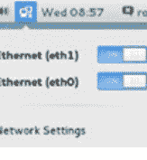

网络设置图形化工具允许我们查看可用网络接口的状态，通过滑动条拨到 ON 或 OFF 来激活和禁用它们，通过点击左下角的 "+" 添加新接口，通过高亮左侧的连接并点击左下角的 "-" 删除现有接口，或者通过选择左侧的现有连接并点击右下角的齿轮图标来修改连接。见图 12-3。


我们可以添加五种类型的网络连接：VPN、Bond、Team、Bridge 和 VLAN。选择其中任何一种都会弹出一个带有四个标签页的新窗口。图 12-4 显示了选择添加 Bridge 时的窗口。三个标签页之一是所选的连接类型；其余的对于所有接口类型都是常见的。每个选项页都允许我们输入必要的配置信息，包括用户定义的连接和接口名称、静态或动态 IPv4 或 IPv6 设置、DNS 客户端和路由信息、防火墙区域名称等。

## 编辑桥接连接 1

| 连接名称：桥接连接 1 | |
| :--- | :--- |
| 通用 | IPv4 设置 | IPv6 设置 |
| 接口名称： | bridge0 |
| 桥接连接： | 添加 | 编辑 | 删除 |
| 老龄时间: | 300 | + |
| 启用 STP（生成树协议） | + | |
| 优先级: | 32768 | |
| 前向延迟: | 15 | + |
| 问候时间: | 2 | + |
| 最大年龄: | 20 | + |
| 取消 | 保存 | |

如果我们选择修改连接，选项页将垂直显示在左侧，如图 12-5 所示。我们可以查看接口的详细信息；修改其 IP、DNS 和路由信息；我们可以重置所有分配；等等。


图 12-4 网络设置 / 添加连接

网络连接编辑器提供的功能与我们学习的网络设置工具非常相似。尝试在 X 窗口中使用 `nmconnection-editor` 命令进行操作，并进行导航以熟悉它。

## NTP 客户端

网络时间协议 (NTP) 是一种用于将系统时钟与更可靠的远程时间提供者同步的网络协议。通过使用此协议，可以将系统配置为服务器、对等节点或客户端。对这些规则的任何配置更改都是直观的。然而，客户端功能在安装 NTP 软件时已经预先配置好了。您只需要启用并启动该服务，您的系统将开始与预定义的服务器之一同步时钟。

可以通过手动编辑配置文件并重启服务来修改 NTP 客户端服务。这也可以使用图形化工具 `System-Config-Date` 完成。您需要安装基础 NTP 软件的软件包以及 GUI 工具，以配置您的系统从远程时间服务器获取并维护时间。这些软件包分别简称为 `ntp` 和 `system-config-date`。

## 激活 NTP 客户端

为了与远程时间服务器建立绑定以进行时间同步，请在系统上安装 NTP 软件以及 GUI 工具：

```bash
# yum -y install ntp system-config-date
...
installed
ntp.x86_64  0:4.2.6p5-18.el7
system-config-date.noarch 0:1.10.6-2.el7

已安装依赖：
ntpdate.x86_64 0:4.2.6p5-18.el7
system-config-date-docs.noarch 0:1.0.11-4.el7

完成！
```

默认情况下，NTP 客户端功能预配置在 `/etc/ntp.conf` 文件中，该文件是 RHEL7 中 NTP 的配置文件。您只需要启用并启动服务。`/etc/ntp.conf` 文件中列出了四个默认远程时间服务器，可以如下所示查看它们：

```bash
# grep server /etc/ntp.conf
server 0.rhel.pool.ntp.org iburst
server 1.rhel.pool.ntp.org iburst
server 2.rhel.pool.ntp.org iburst
server 3.rhel.pool.ntp.org iburst
```

> **考试提示**：由于在考试期间您无法访问外部网络，您将需要将系统指向本地网络上的 NTP 服务器。只需注释掉这四个 `server` 指令并在文件中添加单个指令 `server <hostname>`。将 `<hostname>` 替换为 NTP 服务器名称或其 IP 地址。

软件安装完成后，运行以下组合命令来启用并启动服务：

```bash
# systemctl enable ntp
ln -s '/usr/lib/systemd/system/ntp.service' /etc/systemd/system/multi-user.target.wants/
# systemctl start ntp
```

NTP 守护进程现在已启动。执行带有 `-p` 参数的 `ntpq` 命令来确定您的系统与时间服务器的关联：

```bash
# ntpq -p
remote                 refid             st poll delay offset
+ka400103.ip-19       140.203     2 u    64      1 27.733 .818
*penguin.hop-count     209.516.238     9 u    64      1 20.781 .706
+-ntp1aisimetry       128.4.1          8 u    64      1 51.061 .306
-69.283.155          209.873.533     3 u    14
```

输出显示了多个时间服务器。您的系统与列出的带有 `*` 字符的第二个服务器有时间关联。

## System-Config-Date GUI 概述

也可以使用 `System-Config-Date` 配置 NTP 客户端功能。该工具从 `/etc/ntp.conf` 文件读取定义并以图形化方式显示它们。为了启动此工具，请在 X 终端中执行 `system-config-date`。


## 轻量级目录协议

轻量级目录访问协议 (LDAP) 是一种用于获取组织信息的网络协议，它将用户、位置、电话号码、组信息等信息集中存储在目录结构中。这些信息是静态的，适用于一次写入多次读取的操作。

目录访问协议 (DAP) 起源于国际电信联盟 (ITU) 和国际标准化组织 (ISO) 的 X500 规范。DAP 的一个主要缺点是对硬件资源的需求很大。轻量级目录访问协议 (LDAP) 则变得更轻量。

典型的 LDAP 目录结构如下，一个名为 ABC 的公司，在加拿大、美国、英国和澳大利亚设有办公室，如图 12-7 所示。


LDAP 目录的顶部被称为根。在其下方是域名，通常是公司的名称；组织单元 (ou) 分隔目录类别，并可能是特定的国家。

## 使用 LDAP 的优势

在企业中实施和使用 LDAP 解决方案有很多好处。除了其广泛的可用性和适用于组织的灵活设计外，LDAP 还具有以下主要优势：

- 具有分层的目录结构，为组织提供逻辑信息。
- 在独立的组织单元中存储常用数据。
- 为用户和应用程序提供统一的标准目录接口，允许快速开发和部署应用程序。
- 高效管理用户和安全。
- 维护目录范围内一致且非冗余的信息。

## LDAP 术语

在继续之前，让我们复习并理解以下关键术语。

**目录**：目录是一种特殊的数据库，存储有关人员、配置文件、打印机和服务器等信息。这些信息是平凡的，旨在用于一次写入多次读取。目录以逻辑方式组织组织，方便用户查找和检索数据，同时简化了管理过程。

**条目**：条目是目录的构建块，代表特定的记录。换句话说，一个条目是对象多个属性信息的集合。

**属性**：属性关联多个值，由属性类型和属性值组成。属性类型（如 `jobTitle`）代表该属性包含的信息的类型。属性值是包含在该条目中的特定信息。例如，对于 `jobTitle` 属性类型，值可以是“director”或“associate director”。

| 属性类型 | 描述 - 属性值 |
| --- | --- |
| CommonName (cn) | 条目的通用名称或字面名称，例如 `cn=John Doe` |
| DomainComponent (dc) | 域组件的特区别名 (DN)，例如 `dc=example` 和 `dc=com` |
| Country (c) | 国家缩写，例如 `c=ca` |
| Mail (mail) | 电子邮件地址 |
| Organization (o) | 组织名称，例如 `o=redhat` |
| OrganizationalUnit (ou) | 组织内部单元的名称，例如 `ou=Printers` |
| Owner (owner) | 该条目的所有者，例如 `cn=John Doe,ou=Printers,dc=example,dc=ca` |
| Surname (sn) | 人的姓 |
| Telephone number (telephoneNumber) | 电话号码，例如 `(123)-456-7890` 或 `1234567890` |
| User ID (uid) | 用户的登录名 |

表 12-4 LDAP 属性类型

属性类型可以使用名称或上表所示相应的属性。

**匹配规则**：匹配规则在搜索和比较任务中，将属性值与存储在目录中的属性值进行匹配。例如，与 `telephoneNumber` 属性相关的匹配规则可能会导致 `123-456-7890` 按顺序匹配 `(123) 456-7890` 或 `1234567890`。

**类**：每个实体属于一个或多个类。对象类是一组对象属性，定义了条目的结构。例如，`organizationalUser` 类可能包含 `commonName` 和 `Surname` 作为必需属性，并将 `telephoneNumber`、`UID`、`streetAddress` 和 `userPassword` 作为可选属性。

**模式**：模式定义了对象和属性类的集合，带有匹配规则、语法以及相关信息，将它们正确关联起来。配置良好的模式可以确保数据一致性并帮助保持数据有序。

**LDAP 数据格式 (LDIF)**：LDAP 数据格式 (LDIF) 是一种从 LDAP 服务器导入和导出 LDAP 记录的特殊格式。数据采用文本格式，包含条目或更改或它们的组合。每个记录表示为一组属性，每个属性单独列在一行，包含 `name=value` 键值对。

**特区别名 (Distinguished Name, DN)**：特区别名 (DN) 唯一标识整个目录层级中的一个条目。它类似于 Linux 目录层级中文件的绝对路径。例如，`cn=prn1,ou=Printers,c=ca,dc=abc` 是 prn1 的特区别名。DN 是由逗号分隔的 RDN（相对名称）组成的序列。

**相对名称 (Relative Distinguished Name, RDN)**：与此相反，相对名称 (RDN) 代表 DN 的各个组件。它在概念上类似于 Linux 目录层级中文件的相对路径。例如，位于加拿大的 Printers 下的 prn1（见图 12-7）的 RDN 是 `cn=prn1`。同样，Printers 的 RDN 是 `ou=Printers`，ca 的 RDN 是 `c=ca`，dc 的 RDN 是 `dc=abc`。

# OpenLDAP 角色

LDAP 环境中提供服务的有四种角色：服务器、副本、客户端和引用。一个系统可以配置为执行多个角色。

**服务器**：服务器是持有 LDAP 目录信息的中心系统。它可能被称为主服务器。环境中必须至少有一个服务器。

**副本**：副本是接收 LDAP 服务器维护的信息副本的系统。它可能被称为从服务器。建议在网络上至少准备一个可用的副本，以增强可用性和分担负载。

**客户端**：客户端是与服务器或副本绑定以执行会话，从而对条目执行查询并进行必要的修改的系统。

**引用**：引用是 LDAP 服务器上的一个实体，当它无法找到请求时，会将客户端请求重定向到其他 LDAP 服务器或副本。它包含了存储请求信息的其他 LDAP 服务器的名称和位置。

# OpenLDAP 客户端包

为了使用 OpenLDAP 客户端功能，系统上需要 `openldap`、`openldap-clients` 和 `nss-pam-ldapd` 软件包。此外，我们可以在 RHEL 中提供的两种身份验证服务之间选择。这些服务使用系统服务守护进程 (SSSD) 和名称服务缓存守护进程 (NSLCD)，其目的是针对目录服务器进行用户身份验证。我们使用其中任何一个；但建议使用 SSSD。对于 OpenLDAP 软件包，我们还需要 `nss-pam-ldapd` 软件包及其依赖的所有库。这些软件连同它们的三个配置文件、库和工具共同支持该实现。`openldap` 软件包包含库和配置文件；`openldap-clients` 包包含如 `ldapadd`、`ldapmodify`、`ldapsearch` 和 `ldapdelete` 等实用程序，用于对目录进行添加、修改、比较和删除操作；`nss-pam-ldapd` 包包含必须安装才能使 LDAP 正常工作的共享库；而客户端上的 `sssd` 服务用于身份查找以及用户验证、授权和密码修改。我们需要 TLS 或 LDAPS 来启用加密的客户端到服务器的通信。

RHEL 提供了两个用于设置 LDAP、Kerberos 等服务的工具。这是 `authconfig` 工具和 `authconfig-gtk`。`authconfig` 工具用于配置 LDAP 客户端。

# OpenLDAP 客户端配置

安装 LDAP 客户端后，`/etc/nsswitch.conf` 即可用。`/etc/nsswitch.conf` 文件应确保 `passwd`、`shadow` 和 `group` 条目如下所示（详细信息请参见第 24 章“配置 DNS”）：

表 12-5 LDAP 指令

| 指令 | 描述 |
| --- | --- |
| BASE | 设置默认 DN。 |
| URI | 指定 LDAP 服务器。 |
| TLS_CACERT | 指定证书的位置。 |

# authconfig 命令

`authconfig` 命令提供了多个选项。

`getent` 命令显示来自 `/etc/nsswitch.conf` 文件中列出的数据库条目：

```bash
# getent group dba
```


8. 使用 `ssh` 命令从 `server1` 登录 `idapuser1` 到 `server2` 来测试身份验证：

```bash
# ssh idapuser1@server2
```

如果你希望客户端使用 TLS 与服务器进行安全通信，请在第 2 步的 `authconfig` 命令中添加 `--enablektaps` 和 `--ldaps` 选项。你需要确保在 `server2` 的适当位置上存储了有效的证书。

此外，你可能希望使用 Kerberos 代替 LDAP 的密码身份验证方法。为此，请使用 `authconfig` 命令指定特定于 Kerberos 的选项，并且不要指定 `--ldapauth` 选项。请参阅第 17 章“使用防火墙和 Kerberos”获取 Kerberos 客户端设置的详情。

> 考试提示：为 LDAP 客户端设置时，可以使用图形（`authconfig-gtk` 或 `system-config-authentication`）或文本（`authconfig-tui`）身份验证配置工具，无论是否使用 Kerberos。

## 图形身份验证配置工具概述

如果我们不熟悉 `authconfig` 命令，身份验证配置工具可以提供便利。如果我们拥有想要的数据，这个图形工具将非常有用。可以通过在 X 窗口中运行 `authconfig-gtk` 或 `system-config-authentication` 命令，或者在 GNOME 面上选择“应用程序 | 杂项 | 身份验证”来调用此工具。它将如图 12-8 所示打开。


图 12-8 身份验证配置工具

顶部有三个标签用于配置标识与身份验证、高级选项和密码选项。如我们所知，此工具允许我们访问存储在各种类型数据库上的用户信息，并配置用于身份验证的服务。对于我们从“标识与身份验证”下的下拉列表中选择的任何用户账户数据库，我们都会看到窗口大小提供了输入与所选数据库特定数据的空间。图 12-9 显示了 LDAP 的窗口。


同样，我们可以使用某种身份验证方法。例如，LDAP 可以使用 LDAP 密码或 Kerberos 密码。如果选择后者，我们需要输入 Kerberos 服务器的详细信息。

“高级选项”为身份验证提供了额外的配置选择，而“密码选项”标签允许我们设置密码规则。

## 本章总结

本章讨论了网络术语和 OpenLDAP 客户端配置。它首先为后续的网络主题奠定了基础。涵盖了主机名、IPv4、IPv6、网络类、子网划分、子网掩码、协议和以太网地址等主题。

我们使用命令在 `server1` 上配置了一个网络接口，在 `server2` 上配置了另一个。我们对图形工具有了整体了解。我们审查了配置中的各种文件。我们手动执行了接口的激活和去激活，并在两台服务器的 hosts 数据库中定义了 IP 和主机名的映射。我们使用工具测试了连通性。

我们涵盖了在系统上配置 NTP 客户端，以与更准确的时间源同步时钟。我们查看了如何使用命令和图形设置工具来启用该服务。

最后，我们研究了 OpenLDAP：概念、优势、术语和角色。我们进行了一个练习，在系统上配置并测试了 LDAP 客户端服务。我们查看了图形身份验证工具，并了解如何使用它来配置 OpenLDAP 客户端。

## 本章复习题

1. 什么是区分名称（distinguished name）？

2. LDAP 术语中的对象项（Object Entry）是指什么？

3. 当系统安装 `ntp` 软件时，NTP 客户端已预配置。我们只需要启动服务来同步时钟。对还是错？

4. 哪类 IP 地址的节点数最少？

5. `ifconfig` 命令的作用是什么？

6. 我们使用哪个命令显示网络接口的硬件地址？

7. 哪个目录存储接口配置文件？

8. 哪个文件定义了系统中的协议？

9. 列出使用 LDAP 作为目录服务器的三个优势。

10. 接口配置文件中 ONBOOT 目录的作用是什么？

11. `/etc/hosts` 文件包含主机名到硬件地址的映射。对还是错？

12. 哪个文件包含服务、端口和协议的映射？

13. 图形 NTP 配置工具的名称是什么？

14. `ip addr add` 命令会考虑哪些因素？

15. 在终端窗口的命令行提示符运行什么命令可以调出图形网络连接？

16. 列出子网划分的任意优势。

17. `ip neighbor` 命令使用 RARP 协议提供 MAC 到 IP 地址的映射。对还是错？

18. 命令 `system-config-authentication` 会执行什么？

## 本章复习题答案

1. 相对区分名称（DN）代表 DN 的各个组成部分。

2. 对象项代表 LDAP 目录中的特定记录。

3. 对。

4. C 类的节点地址数最少。

5. 这两个节点的作用是激活和去激活接口。

6. `ip` 命令。

7. `/etc/sysconfig/network-scripts` 目录。

8. `protocols` 文件。

9. 三个优势是信息访问、信息的集中存储和用户身份验证。

10. 该目录的作用是告诉启动脚本激活此接口。

11. 错。该文件维护主机名到 IP 的映射。

12. `/etc/services` 文件。

13. 图形配置工具的名称是 `System-Config-Authentication`。

14. 此命令将显示包括硬件地址在内的接口信息。

15. 调出图形网络连接的命令是 `nm-connection`。

16. 更好的管理性和流量控制。

17. 错。此命令使用 ARP 协议。

18. 图形身份验证配置工具。

## DIY 挑战实验

以下实验有助于加强本章中学的大部分主题。正如预期的那样，没有提供分步指南。

### 实验 12-1：为 example.com 上的 server0 分配一个新的 IP，并在同一子网内将其替换为其他不同的地址。使用 `ip` 和 `ping` 命令等适当工具应用新 IP，然后进行验证。

## 第 13 章：使用 SSH 和 TCP Wrappers 保护访问

本章描述了以下主题：

- 理解 OpenSSH 服务、版本和算法
- 加密技术和身份验证方法的概述
- OpenSSH 管理和配置文件概述
- 配置基于私钥/公钥的身份验证
- 使用 OpenSSH 客户端命令：`ssh`、`scp`、`sftp`
- 理解 TCP Wrappers 使用

RHCSA 目标：

+ 4. 使用 `ssh` 访问系统
+ 20. 安全地在系统之间传输文件
+ 49. 配置基于密钥身份验证
+ 80. 为 SSH 配置密钥身份验证
+ 81. 配置文档中描述的选项

## OpenSSH 套件

Secure Shell (SSH) 为 IP 网络上的数据传输提供了安全机制。它旨在取代以明文传输密码的旧程序。SSH 使用加密技术确保会话的完整性。SSH 已广泛取代了 `telnet`、`login`、`rsh` 和 `rexec`。

OpenSSH 是一个开放实现，具有隧道、任意端口转发和 X11 转发等功能。

## OpenSSH 版本与算法

OpenSSH 随着时间演进。它支持两个版本：v1 和 v2，两者在 RHEL 中均可用。然而我们应该使用较新的版本，因为它对旧版本进行了许多增强和改进。RHEL 中的默认版本是如 `/etc/ssh/sshd_config` 所示。OpenSSH 支持多种加密和用户身份验证算法。V1 支持对称认证，而另一个版本支持三种算法：RSA、DSA 和 ECDSA（V2 的新变体支持 RSA 进行加密和身份验证。相比之下，DSA 和 ECDSA 的使用仅限于数字签名。）

RSA 代表 Rivest-Shamir-Adleman，DSA 代表数字签名算法，ECDSA 是椭圆曲线数字签名算法的缩写。RSA 更常见并在行业中广泛使用，因为它支持加密和数字签名。

## 加密技术

加密是将信息转换为另一种形式以防止未经授权的访问真实信息的方法。解密在客户端进行，反向过程解密发生在端到端通信会话中。这种技术使用了对称和非对称加密。

**对称加密**：这种加密使用单一密钥（或密钥对）来保护身份验证流量以及整个通信会话。该密钥是客户端和服务器之间协商过程的结果。

**非对称加密技术**：这种技术使用私钥/公钥组合进行加密。这些密钥是在会话期间附加在消息中的随机生成的长度的字母数字字符串。客户端使用公钥传输信息，并使用私钥解密。私钥必须保持秘密，因为它仅由该系统所有。公钥分发给客户端。这种技术用于通道加密，也用于用户身份验证。

## 身份验证方法

一旦客户端和服务器之间建立了加密通道，双方之间将进行额外的协商以验证用户身份以获得访问的权限。OpenSSH 为此目的提供了多种方法，并且它们按照身份验证过程中尝试的顺序列在下方：

- 基于 GSSAPI（通用服务应用接口）的身份验证
- 基于主机的身份验证
- 基于密钥的身份验证
- 挑战响应身份验证
- 基于密码的身份验证

**基于 GSSAPI 的身份验证**：GSSAPI 提供了一个标准接口，允许接入如 Kerberos 等安全机制。在 OpenSSH 中，令牌的交换发生在客户端和服务器之间，以验证身份。这种身份验证仅在 OpenSSH 2 版本中支持。

**基于主机的身份验证**：此类型的身份验证允许单个用户、一组用户或客户端的所有用户在服务器上通过身份验证。用户被允许在服务器上使用匹配的用户名登录，或者作为服务器上存在的另一个用户登录。如果用户需要在服务器上进行身份验证，则在服务器上的用户目录下设置一个 `hosts` 文件，其中包含密钥或 IP，以及可选的另一个用户名（该用户必须在服务器上存在）。相同的规则适用于客户端上的用户组或所有用户；但客户端必须列在 `/etc/ssh/hosts.allowed` 中。

**基于私钥/公钥的身份验证**：该方法使用公钥/私钥组合进行身份验证。客户端用户拥有一个公钥，服务器存储相应的密钥对。登录时，服务器提示用户输入密钥，如果密钥通过验证则允许登录。

**挑战响应身份验证**：该方法基于对一个或多个任意问题的回答，用户必须回答这些问题以获得服务器的权限。

**基于密码的身份验证**：这是最后的备选方案。服务器提示用户输入密码。它与 `shadow`（或 `passwd`）文件中的存储条目进行密码比对，如果确认密码正确则允许用户登录。

在上述五种身份验证方法中，基于密码的方法很常见，无需解释。前两种和挑战响应方法超出了本书的范围。我们将在随后的练习中使用公钥/私钥身份验证和加密方法。

## OpenSSH 包

OpenSSH 有三个值得关注的软件包。它们是 `openssh`、`openssh-clients` 和 `openssh-server`。`openssh` 包提供了 `ssh-keygen` 命令和一些支持的库例程；`openssh-clients` 包包含命令，如 `scp`、`sftp`、`slogin` 和 `ssh-copy-id`，以及客户端配置文件 `/etc/ssh/ssh_config`；`openssh-server` 包包含 `sshd` 守护进程、服务器配置文件 `/etc/ssh/sshd_config` 以及库例程。默认情况下，在操作系统安装期间会安装 `openssh-server` 包，允许用户使用 `ssh` 命令登录系统。

## 命令与守护进程

如所述，OpenSSH 在系统上安装了多个命令。此外，服务器包还加载了 `sshd` 守护进程，该进程必须在系统上运行，以便允许用户通过 `ssh` 通道连接到服务器。该通道默认监听常用的 TCP 端口 22。表 13-1 列出并解释了一些关键命令。

| 命令 | 说明 |
|---|---|
| `scp` | 安全地复制到远程主机。 |
| `sftp` | `ftp` 命令的安全替代方案。 |
| `slogin` | `login` 命令的安全替代方案。 |
| `ssh` | `telnet` 和 `login` 命令的安全替代方案。 |
| `ssh-add` | 将 RSA/DSA/ECDSA 密钥添加到 `ssh-agent` 中。 |
| `ssh-agent` | 身份验证代理。持有用于 RSA/DSA/ECDSA 身份验证的私钥。 |
| `ssh-copy-id` | 将 RSA/DSA/ECDSA 密钥复制到远程系统。 |
| `ssh-keygen` | 生成私钥和公钥。 |

表 13-1 OpenSSH 命令

我们将在本章中使用其中一些命令。

## 系统级服务器和客户端配置文件

OpenSSH 拥有定义服务器和客户端默认设置的配置文件，以控制它们的运行方式。这些文件位于 `/etc/ssh` 目录，分别命名为 `ssh_config` 和 `sshd_config`。此外，服务器还有一个名为 `sshd` 的额外配置文件，它位于 `/etc/sysconfig` 目录。此外，`/var/log/secure` 文件用于捕获身份验证方法。

以下显示了 `sshd_config` 文件中的几条指令：

```
# /etc/ssh/sshd_config
#Port 22
#Protocol 2
HostKey /etc/ssh/sshd_host_rsa_key
HostKey /etc/ssh/sshd_host_ecdsa_key
PubkeyAuthentication yes
AuthorizedKeysFile ~/.ssh/authorized_keys
PasswordAuthentication yes
ChallengeResponseAuthentication no
SSAPasswdAuthentication yes
UsePAM yes
X11Forwarding yes
```

上述显示了文件中的几条指令；如果需要，我们还可以更改更多指令。其中一些在表 13-2 中进行了解释。

| 指令 | 描述 |
|---|---|
| `Port` | 定义监听的端口。 |
| `ListenAddress` | 指定用于入站 ssh 请求的 IP。 |
| `Protocol` | 默认为 2。指定要使用的 ssh 协议版本。 |
| `SyslogFacility` | 默认为 AUTHPRIV。定义将日志记录到 `/var/log/secure` 文件时使用的设施。这是 `/etc/syslog.conf` 文件中的配置。 |
| `LogLevel` | 默认为 INFO。定义要记录消息的严重性级别。 |
| `LoginGraceTime` | 默认为 2 分钟。在用户未登录的情况下，服务器断开连接之前的时间。 |
| `PermitRootLogin` | 默认为 yes。允许 root 用户直接登录系统。 |
| `MaxAuthTries` | 指定每个连接的身份尝试次数。 |
| `MaxSessions` | 默认为 10。允许的最大会话数。 |
| `RSAAuthentication` | 默认为 yes。启用 RSA 验证。 |
| `PubKeyAuthentication` | 默认为 yes。启用基于密钥的身份验证。 |
| `AuthorizedKeysFile` | 默认为 `~/.ssh/authorized_keys`。指定包含用户授权密钥的文件名和位置。 |
| `PasswordAuthentication` | 默认为 yes。启用密码验证。 |
| `PermitEmptyPasswords` | 默认为 no。不允许空密码。 |
| `ChallengeResponseAuthentication` | 默认为 yes。启用或禁用挑战响应身份验证。 |
| `UsePAM` | 默认为 yes。启用或禁用 PAM 验证。 |
| `AgentForwarding` | 默认为 yes。启用或禁用 `ssh-agent` 转发。 |
| `X11Forwarding` | 默认为 no。启用或禁用 X11 转发。 |
| `TcpKeepAlive` | 默认为 yes。指定是否向服务器发送 TCP 保活信号。 |
| `UserLogin` | 默认为 no。启用或禁用用于交互式会话的 `login` 命令。 |
| `Compression` | 启用或禁用压缩。 |
| `ClientInterval` | 默认为 0。定义服务器向客户端发送消息的秒间隔。 |
| `ClientAliveMax` | 默认为 3。如果 `ClientInterval` 设置为非零，则指定向客户端发送消息的最大数量。 |
| `Users` | 允许列出的用户访问服务器。语法：`user@server.example.` |
| `AllowGroups` | 允许列出的用户组访问服务器。语法：`group@server.example.` |
| `DenyUsers` | 不允许列出的用户访问服务器。语法：`user@server.example.` |
| `DenyGroups` | 不允许列出的用户组访问服务器。语法：`group@server.example.` |

表 13-2 OpenSSH 服务器配置

除了使用 `sshd_config` 文件中的 `AllowUsers`、`DenyUsers` 和 `Groups` 指令设置安全外，我们还可以 `hosts.allow` 和 `hosts.deny` 文件定义这些限制。此外，我们可以通过 `iptables` 限制特定系统、域或网络对端口 22 的访问。

现在让我们看看系统级配置文件 `ssh_config`：

```
# /etc/ssh/ssh_config
# Host *
# ForwardAgent no
# ForwardX11 no
# RSAAuthentication no
# PasswordAuthentication yes
# GSSAPIAuthentication
```

我们可以在此文件中定义特定于客户端的配置。对于每个客户端或客户端组，我们可以添加一个以 `Host` 开头的章节并列出该客户端或组的指令。许多指令与服务器的相同。详情见表 13-2。

## 用户级客户端文件

OpenSSH 允许我们在单独文件中存储会话的默认设置。这些用户级设置会覆盖系统定义的默认设置，并可以保存在 `~/.ssh` 目录下的文件中。其格式与 `ssh_config` 相同。`.ssh` 默认不存在，当我们首次连接到服务器并接受提供的密钥时创建。

`~/.ssh` 目录有一个 `known_hosts` 文件。该文件存储了主机名、IP 地址以及我们接受的远程公钥副本。这里是第一次登录服务器的示例条目：


server2,192.168.1.120 ssh-rsa AAAAB3NzaC1yc2EAAAAAQABAAAAABQAAABQAAAABQ...

`~/.ssh` 中还有三个你可能感兴趣查看的文件。这些文件默认不存在：其中两个是密钥（`id_rsa`、`id_dsa` 或 `id_ed25519`），第三个（`authorized_keys`）在我们建立两个系统之间的关系时使用。我将在下面的练习中显示这些文件的内容，让你对它们的样子有一个了解。

## 练习 13-1：配置私钥/公钥的身份验证

此练习应在 server1 和 server2 上进行。

对于此练习，假设 server1 和 server2 上存在该用户。

在此练习中，你将为 user1 生成 RSA 私钥/公钥对，并使用其允许通过 `ssh` 命令访问 server2。你将显示公钥和私钥的内容以及与登录尝试相关的日志文件消息。

1. 以 user1 身份登录 server1。

2. 生成 RSA 密钥并将它们保存在 `~/.ssh` 的默认文件中。在提示时输入密码短语 redhat123。

```bash
# ssh-keygen
```

Generating public key pair.

Enter file to save the key (/home/user1/id_rsa):

Created directory /home/user1/.ssh/

Enter passphrase (for no passphrase):

Enter same passphrase again:

Your identification has been saved in /home/user1/id_rsa.

Your public key has been saved in /home/user1/id_rsa.pub.

The Key is:

9c:0ec:3c:9a:67:b7:aa:fc:38:ca:3d:ef:user1@server1.com

The key's random image is:

--- RSA 2048 ---

`id_rsa` (私钥) 和 `id_rsa.pub` (公钥)的内容所示：

```bash
cat ~/.ssh/id_rsa
cat ~/.ssh/id_rsa.pub
```

```
ssh-rsa AAAAB3NzaC1yc2EAAAADAQABABAAACAQAMAAAzzc2gtEdcnN1AAAAAAAAjAAAAAAAAAQABAAQ...user@example.com
```

3. 复制 `/home/user/.id_rsa` 下的 server2 公钥。在收到提示时接受 server2 的指纹。然后输入 server2 的密码以设置连接文件。该文件将以授权密钥的形式被复制。

```bash
ssh-copy-id -i ~/.ssh/id_rsa.pub server2
```

主机 'server2' (192.168.1.20) 的真实性无法确认。
ECDSA密钥指纹为 ED25519:71:92:bf:da:a5:f6:de:63:94:
你确定要继续连接吗 (yes/no)?

```bash
yes
password:
```

密钥数量: 1
现在尝试登录机器：`ssh server2`
并检查是否仅使用了你请求的密钥
同时，这也可以创建或覆盖 server1 上的 `known_hosts` 文件并将 server2 的指纹存储在：

```bash
cat ~/.ssh/known_hosts
```

```
192.168.1.20 ssh-ed25519 AAAAC3NzaC1lZDI1NTE5AAAAAAAAI...AAABuser@example.com
```

4. 在 server1 上，运行命令 `ssh user` 连接到 server2。在收到提示接受指纹时输入 yes。抑制 server1 的密码提示。

```bash
ssh server2
```

为 user@/home/user/ 输入密码：
最后登录时间: 2014年11月22日 周六08:54:33 来自 server1.example.com
我们可以在 server2 的 `/var/log/auth.log` 中查看此登录尝试：

```bash
tail /log/secure
```

```
Nov 22 09:02:07 server2[27133]: Accepted password for user from 192.168.1.110 port 46996 ssh2: RSA 9c:0e:ec9:a6:b7:77:aa:f6:7bc:ca:3d:e8:af
Nov 22 09:02:07 server2[27133]: pam_unix(session: session opened for user (id=0)
```

## 使用 ssh 远程执行命令

`ssh` 命令是 telnet、login 和 rsh 的安全替代方案。它允许我们安全地登录到远程系统，或者在不实际登录的情况下执行命令。上一个练习演示了用户如何使用此命令登录。以下显示了如何使用该命令在远程系统上执行指定的命令。

执行 `ssh server1` 以查看 server2 上 user1 主目录的列表。在收到提示时输入密码短语。

```bash
$ ssh server2 /bin/ls -l
```

为密钥 'home/user/.ssh/id_rsa' 输入短语:

total 0

drwxr-xr-x 2 user1 6 Nov 17 09:57 Desktop

drwxr-xr-x 2 user1 6 Nov 17 09:57 Documents

drwxr-xr-x 2 user1 6 Nov 17 09:57 Downloads

drwxr-xr-x 2 user1 6 Nov 17 09:57 Music

drwxr-xr-x 2 user1 6 Nov 17 09:57 Pictures

drwxr-xr-x 2 user1 6 Nov 17 09:57 Public

drwxr-xr-x 2 user1 6 Nov 17 09:57 Templates

drwxr-xr-x 2 user1 6 Nov 17 09:57 Videos

## 使用 scp 复制文件

同样，user1 可以执行 `scp` 命令将文件从 server1 传输到 server2，反之亦然。要将 `/home/user1/file1` 复制到 server2/home/user，使用以下 `scp` 命令。在收到提示时输入用户的短语。

```bash
$ cd
$ scp file1 server2:
```

为密钥 'home/user1/.ssh/id_rsa' 输入短语:

file1 100% 0.0KB/s 00:00

现在让我们将 server2/usr/bin 文件复制到 server1:/home/user1：

```bash
$ scp server2/usr/bin/zip .
```

为密钥 'home/user1/.ssh/id_rsa' 输入短语:

zip 100% 210.7KB/s 00:00

只要用户具有所需的读写权限，他们就可以将源和目标系统之间的任何文件传输到任何目录。

## 使用 sftp 传输文件

同样，我们可以在 server1 上使用 `sftp` 命令连接到 server2，并在两个系统之间下载或上传文件：

```bash
$ sftp server2
```

为密钥 'home/user1/.ssh/id_rsa' 输入短语:

Connected to server2:

sftp>

在提示符处输入 help 查看可用命令。每个命令的简短描述如下：

可用命令:
- `bye` 退出
- `cd path` 切换远程目录到 'path'
- `chgrp path` 更改文件 'path' 的组为 'group'
- `chmod path` 更改文件 'path' 的权限为 'mode'
- `chown path` 更改文件 'path' 的所有者为 'user'
- `ls [-l]` 显示 'path' 目录或文件的统计
- `get [-P] remote [local]` 下载文件
- `reget [local]` 恢复下载
- `help` 显示帮助
- `lls [path]` 显示本地目录列表
- `ln [-s] oldpath newpath` 创建符号链接
- `lpwd` 打印本地工作目录
- `mkdir path` 创建远程目录
- `put [-P] local [remote]` 上传文件
- `quit` 退出
- `rename oldpath newpath` 重命名文件
- `version` 显示版本
- `!command` 执行本地命令

`help` 的语法：`sftp>` 常用命令有 `cd`, `get/put`, `ls/lls`, `pwd/lpwd`, `mkdir/rmdir`, `quit`, `rename` 等。

## 从 Windows 访问 SSH

在 Windows 侧，有 `ssh` 客户端程序可用。一个程序是 PuTTY，可以在互联网免费下载。使用时，只需输入主机名或 IP 地址，并确保端口 22 已输入且选择了 SSH 协议。我们可以为此连接分配名称并点击 Save 以供以后使用。

## TCP Wrappers

TCP Wrappers 是一种基于主机的机制，用于限制对系统中感知 wrappers 的服务的访问。通过指定哪些服务允许或拒绝哪些来源（主机、网络或域名）来控制访问的服务包括 ftp、ssh、telnet、rsh 和 talk。作为操作系统一部分加载的软件包名为 `tcp_wrappers`。我们可以使用 `yum` 命令获取该包的详细信息：

```bash
yum info tcp_wrappers
```

- Name : tcp_wrappers
- Arch : x86_64
- Version : 7.6
- Release : 1
- Size : 2088
- From : installed
- Summary : 作为 wrapper 的安全工具
- URL : http://example.org/security/index.html


# TCP Wrappers 配置

两个文件 `hosts.allow` 和 `hosts.deny` 位于 `/etc` 目录，用于配置 TCP Wrappers。`allow` 文件在 `.deny` 文件之前被引用。如果这些文件没有包含请求用户或来源的默认拒绝项，wrappers 将允许传入请求。

## 工作原理

当 TCP 请求进入时，wrappers 扫描 `.allow` 文件，如果找到匹配项，则请求服务进程。如果没有匹配，`.deny` 文件拒绝服务。如果在 `.deny` 文件中未检测到匹配，`tcpd` 请求服务守护进程与客户端建立连接。Wrappers 在扫描文件时一旦发现第一个匹配项就会停止搜索。

## 文件格式

两个文件的格式相同，基于 `user@source`：

```
<服务名称>: "user@source"
```

第一列包含 `telnet`、`sshd` 和 `ftp` 等服务的名称，第二列包含来自（主机名、网络地址或域名）或端口。如果缺失用户名，规则适用于所有用户。同样，缺失来源代表所有来源。

## 通配符与运算符

Wrappers 使用通配符匹配服务或来源组。这些包括 `ALL`、`LOCAL`、`KNOWN` 和 `UNKNOWN`。字段可以使用 `ALL` 通配符表示对所有人开放；`LOCAL` 通配符匹配不包含点的主机名；`KNOWN` 通配符解析主机名；`UNKNOWN` 通配符未知。此外，wrappers 允许我们使用名为 `EXCEPT` 的运算符在规则内定义异常。

## 访问控制示例

服务器/来源组合可以在 wrappers 访问文件中定义。表 13-3 显示了一些示例。

| user@source | /etc/hosts.allow | /etc/hosts.deny |
| :--- | :--- | :--- |
| ALL:ALL | 允许所有来源的服务 | 拒绝所有来源的服务 |
| ALL:user | 允许所有用户的服务 | 拒绝所有用户的服务 |
| ALL:user@server1 | 允许到 server1 的服务 | 拒绝 user1@server1 的服务 |
| ALL:example.com | 允许来自 example.com 域名的服务 | 拒绝来自 example.com 域名的服务 |
| 192.168.0 | 允许来自 192.168.0 的服务 | 拒绝来自 192.168.0 的服务 |
| sshd:ALL | 允许所有来源的 ssh 访问 | 拒绝所有来源的 ssh 访问 |
| sshd:LOCAL | 允许来自本地网络的 ssh 访问 | 拒绝本地网络的 ssh 访问 |
| ftp:192.168.0 | 允许来自 192.168.0 的 ftp 访问 | 拒绝来自 192.168.0 的 ftp 访问 |
| ftp:192.168.0/24 | 允许来自 192.168.0/24 的 ftp 访问 | 拒绝来自 192.168.0/24 的 ftp 访问 |
| 192.168.0,EXCEPT | 允许来自 192.168.0 网络除 IP 为 192.168.0.25 以外的服务 | 拒绝来自 192.168.0 网络除 IP 为 192.168.0.25 以外的服务 |

**表 13-3 TCP Wrappers 访问控制**

## 日志记录

处理 TCP Wrappers 时需要记住这些行。所有与 TCP Wrappers 相关的消息都记录在 `/var/log/secure` 文件。

---

# 章节复习

1. `rpc` 命令的安全等效命令是什么？
2. TCP Wrappers 用于控制系统服务的两个名称是什么？
3. 安全性可以被定义为使用 TCP Wrappers 进行访问控制。对或错？
4. 主要服务器配置文件是 `sshd_config`。对或错？
5. ssh 版本 2 使用哪些加密和/或身份验证算法？
6. `refer` 命令的安全等效命令是什么？
7. 提供四个可能用于安全服务器用户级访问控制的目录名称。
8. 列出五个可以通过 TCP Wrappers 控制的网络服务。
9. 用户的 ssh 密钥存储在哪里？
10. `copy-id` 命令会做什么？
11. 本章中描述的两种加密技术是什么？
12. ssh 服务使用的默认端口是什么？
13. 哪个日志文件存储身份验证信息？
14. `/etc/hosts` 文件中的项 `teluser100@192.168.0` 会做什么？

# 章节复习答案

1. `scp` 是 `rpc` 命令的安全等效命令。
2. TCP wrappers 使用位于 `/etc` 目录下的 `hosts` 和 `hosts.deny` 文件来控制对系统服务的访问。
3. 对。
4. 主要服务器配置文件是 `sshd_config`。
5. ssh 版本 2 使用 RSA、DSA 和 ECDSA 算法。
6. telnet 的安全等效命令是 `ssh`。（注：原文此处可能误写为 telnet，根据常识应为 ssh）
7. 用于 ssh 服务器用户级访问控制的四个指令是 `AllowUsers`、`DenyUsers`、`AllowGroups` 和 `DenyGroups`。
8. 某些服务可以通过 TCP wrappers 控制：`ssh`、`telnet`、`ftp` 和 `rsh`。
9. 存储在用户家目录下的 `.ssh` 目录中。
10. `copy-id` 命令用于在远程系统上安装公钥。
11. `ssh-keygen` 命令用于为 ssh 使用生成身份密钥。
12. 两种加密技术是对称加密和非对称加密。
13. 安全服务的默认端口是 22。
14. `/var/log/secure` 文件存储身份验证信息。
15. 该项允许来自 `192.168.0` 网络的 `user100` 访问 telnet 服务。

---

# DIY 挑战实验室

以下实验室有助于加强本章中学到的绝大多数概念和主题。预计你在没有额外帮助的情况下完成这些实验。我们不提供逐步指南，因为这些实验的实现需要本章中介绍的知识。对于缺失的信息，请使用默认值或你自己的思考。

## 实验 13-1：建立密钥身份验证

为 `server1` 建立私钥/公钥组合，以便用户登录 `host1` 时提示输入短语（而不是密码）。

## 实验 13-2：配置 TCP Wrappers 以保护服务

相应地编辑 TCP Wrappers 配置文件，允许来自 `192.168.1` 和 `example.net` 的 `user1` 和 `user3` 访问 `ssh` 和 `vsftpd` 服务，但禁止来自 `192.168.2.120` 和 `example.org` 的 `user2` 和 `user` 访问。从 RHEL 登录 `user1` 和 `user3`（一个 IP 为 `192.168.1.120`，另一个 IP 为 `192.168.2.120`）并测试。观察记录到 `/var/log/messages` 和 `/var/log/secure` 文件的信息。

---

# RHCE 部分：编写 Shell 脚本

本章描述了以下主要主题：

- Shell 脚本概述
- 编写脚本显示基本系统信息、使用本地和环境变量、解析命令输出到变量、理解命令行参数的使用以及 `shift` 命令的作用
- 执行和调试脚本
- 编写交互式脚本
- 退出代码和测试条件
- 逻辑结构：`if-then-fi`、`if-then-else-fi`、`if-then-elif-fi` 和 `case`
- 使用逻辑语句编写脚本
- 算术测试条件
- 循环结构：`for-do-done` 和 `while-do-done`
- 使用循环语句编写脚本

## RHCE 目标

63. 使用 shell 脚本自动化系统维护任务

Shell 脚本是包含 Linux 命令、控制结构和注释的文本文件，可以被编写来自动化耗时且重复的任务。脚本接受从简单到复杂的命令，并可以通过命令行提示符直接执行。脚本不需要编译，因为它们由 shell 逐行解释。本章展示了许多示例脚本，并进行了详细检查以巩固理解。这些脚本从简单的程序开始，逐渐变为复杂的程序。与任何其他编程语言一样，脚本的发展会随着编写、阅读和分析脚本的增加而不断提高。

---

# Shell 脚本

Shell 脚本是包含 Linux 命令、控制结构和注释的文本文件，可以被编写来自动化耗时且重复的任务。脚本接受从简单到复杂的命令，并可以通过命令行提示符直接执行。脚本不需要编译，因为它们由 shell 逐行解释。本章展示了许多示例脚本，并进行了详细检查以巩固理解。这些脚本从简单的程序开始，逐渐变为复杂的程序。与任何其他编程语言一样，脚本的发展会随着编写、阅读和分析脚本的增加而不断提高。

---

# 显示系统信息

让我们创建一个名为 `sys_info` 的第一个脚本并执行它。输入以下内容：

```bash
#!/bin/bash

echo "Display System Information"

echo

echo "Hostname:"

hostname

echo

echo "The following users are currently logged on this system:"

who
```

在 vi 中，按下 ESC 键然后输入 `:set nu` 显示行号。在本脚本中，注释的使用如下：
第一行指示运行脚本的 shell。此行必须以 `#!` 字符开头，后跟 shell 的完整路径。
接下来的三行包含：脚本名称、作者姓名、创建日期、默认存储位置及其用途。`#` 符号表示右侧的任何内容仅供信息参考，在脚本执行期间会被忽略。第一行也使用了字符 `#`，但它后面跟着一个感叹号 `!`！这种组合对 shell 有特殊含义，用于指定 shell 文件的位置。不要混淆 `#!` 和 `#`。

第十行将插入一个空行。

第十一行将在屏幕上打印“以下是当前登录到系统的用户：”。

第十二行将执行 `who` 命令以列出已登录的用户。

以下是在 `/usr/local/bin` 目录下创建的 `sys_info.sh` 文件：

```
-rwxr-xr-x-- 1 root 512 Dec 11 08:39 /usr/local/bin/sys_info.sh
```

---

# 执行脚本

上面创建的脚本没有执行权限，因为 root 用户的默认 `umask` 设置为 `0022`，这允许所有者具有读/写权限，而其他用户只有只读权限。你需要对该文件运行 `chmod` 命令并为所有人设置执行位：

```bash
# chmod +x /usr/local/bin/sys_info.sh
```

现在，系统上的任何用户都可以使用相对路径或全路径运行此脚本：

```bash
# sys_info.sh

# /usr/local/bin/sys_info.sh
```

默认情况下，`/usr/local/bin` 目录包含所有用户的 `PATH` 中。然而，如果不是如此，你需要在 `/etc/profile` 文件中定义它，以便任何登录系统的用户都能获得此路径。或者，单个用户可以将路径添加到 `~/.bash_profile` 文件中。以下显示如何通过设置命令将新路径添加到现有 `PATH` 中：

```bash
# export PATH=$PATH:/usr/local/bin
```

让我们运行 `sys_info.sh` 看看输出是什么样的：


该系统的主机名、硬件和操作系统信息为：
静态主机名：server1.example.com
图标名称：computer
类：none
机器 ID：71bb8d4164d41bc8cc9d3890683d3de
Base ID：9b87e5077ba4c76a1b4bd9dec637210
虚拟化：kvm
操作系统：Red Hat Enterprise Linux Server 7.0 (Maestro)
CPE 名称：cpe/o:a:enterprise_linux:7.0:ga
内核：Linux 3.10.0-123.elt7.x86_64
架构：x86_64

以下是当前登录到系统的用户：
(unknown) .0 2014-11-17 14:23 (:0)
root pts/0 2014-12-10 09:47 (192.168.0.13)
root pts/3 2014-11-24 22:25 (2)

---

# 调试 Shell 脚本

在拥有完美运行的脚本之前，你可能需要反复运行并修改它。你可以使用调试技术来帮助识别脚本可能何失败或未按预期运行的地方。你可以在脚本开头的 `#!/bin/bash` 中添加 `-x` 选项，使其看起来像 `#!/bin/bash -x`，或者你可以按照如下方式执行脚本：

```bash
bash -x /usr/local/bin/sys_info.sh
```

```
echo Display Basic System Information

Display Basic System Information

+ echo ========================================

+ echo

+ echo

```

+ 该系统的主机名、硬件和操作系统信息：
+ /usr/bin/hostname
+ 静态主机名：server1.example.com
图标名称：computer
类：none
机器 ID：71bb8d4164d41bc8cc9d3890683d3de
Boot ID：9b8e570b77b4a7c64a1b2d9ca6537210
虚拟化：kvm
+ echo
操作系统：Red Hat Enterprise Linux Server 7.0 (Maestro)
CPE OS：redhat:enterprise:linux:7.0:GA:server
内核：Linux 3.10.0-123.el7.x86_64
架构：x86_64

+ echo
以下是当前登录到系统的用户：
+ /usr/bin/who

| (unknown) | 0 | 2014-11-17 14:23 (0) |
| root | pts/0 | 2014-12-10 09:47 (192.168.0.13) |
| root | pts/3 | 2014-11-24 22:25 (2) |

上述输出包含了所有带有 `+` 符号前缀的实际行以及后面的命令执行结果。它还显示了输出中的行数。通过这种方式，你可以识别任何与路径、命令名、特殊字符使用等相关的问题并解决它们。尝试更改脚本 "echo" 中的任何 `echo` 命令，并在调试模式下重新运行脚本，以确认上述内容。

---

# 使用局部变量

我们之前处理过变量并了解了它们的用法。回顾一下，变量有两种类型：本地（私有）和环境变量。两者都可以在命令行脚本中定义和使用。`Script_var.sh` 将定义一个局部变量并在屏幕上打印它的值。

```bash
# nl use_var.sh

1 #!/bin/bash

2 echo "Setting a Local Variable"

3 echo "=================="

4 SYSTEMNAME=server1.example.com

5 echo "The hostname of this system is $SYSTEMNAME"
```

为此脚本添加执行位。运行此脚本时将生成输出：

```bash
# use_var.sh

Setting a Local Variable.
```

---

# 使用预定义环境变量

以下脚本 `pre_env.sh` 将显示预定义环境变量 `SHELL` 和 `LOGNAME`：

```bash
# nl pre_env.sh

1 #!/bin/bash

echo "The location of my shell command:"

echo $SHELL

echo "We are logged in as $LOGNAME"
```

---

# 解析命令输出

在执行脚本期间，可以使用命令替换功能将命令输出存储到变量中。例如，以下脚本 `cmd_out.sh` 将运行输出存储在变量中。脚本显示了使用命令替换的不同方法。

```bash
# nl cmd_out.sh
```

The hostname of this system is server1.example.com.

The system is running kernel: 3.10.0-123.x86_64.

---

# 理解命令行参数

命令行参数（也称为位置参数）是提供给命令或脚本的参数，以产生所需的输出。参数的位置以及脚本本身的位置存储在相应的变量中。这些变量是特殊变量。图 4-1 给出了每个参数位置的视图（img/58b32cb40def97a1f8c872ea71ce2b3f_347_0.png）。

表 4-1 解释了代表各种位置的变量：

| 变量 | 说明 |
| :--- | :--- |
| `$0` | 代表命令或脚本 |
| `$1` 到 `$9` | 代表参数 1 到 9 |
| `${10}` 及以上 | 代表参数 10 及以后 |
| `$#` | 代表所有参数的数量 |
| `$*` | 代表所有参数 |
| `$$` | 代表命令或脚本的 PID |

## 命令行参数示例

以下脚本 `line_arg.sh` 将显示命令行参数、它们的总数、参数值以及脚本的进程 ID：

```bash
# nl line_arg.sh
/bin/bash
echo "There are $# arguments at the command line"
echo "The arguments supplied are: $*"
echo "The first argument is: $1"
echo "The Process ID of the script is $$"
```


当带四个参数执行此脚本时，结果如下。不要忘记执行二进制。

```bash
# line_arg.sh baku buktu xyang qito
There are 4 arguments at the command line
The arguments supplied are: baku buktu xyang qito
The first argument is: baku
The Process ID of the script is 1
```

# 移动命令行参数

`shift` 命令用于将参数向左移动。在移动过程中，第一个参数的值会丢失。下面的 `arg_shift.sh` 脚本是 `line_arg.sh` 的扩展，它用于演示参数移动时发生了什么。

```bash
# nl arg_shift.sh
#!/bin/bash
echo "There are $# arguments at the command line"
echo "The arguments supplied are: $*"
echo "The first argument is: $1"
echo "The Process ID of the script is $$"
shift
echo "The new first argument after the first shift is: $1"
shift
echo "The new first argument after the second shift is: $1"
```

让我们带四个参数执行脚本。注意在每次 `shift` 之后，`$1` 都会被分配一个新值。

```bash
# line_arg.sh baku buktu xyang qito
There are 4 arguments at the command line
The arguments supplied are: baku buktu xyang qito
The first argument is: baku
The Process ID of the script is 
The new first argument after the first shift is: buktu
The new first argument after the second shift is: xyang
```

通过向 `shift` 命令提供所需的移动次数，可以尝试执行多次移动。例如，`shift 2` 将执行两次移动，`shift 3` 将执行三次，以此类推。

# 编写交互式脚本

交互式脚本根据输入继续执行。输入存储在变量中（下例中的 `FILE`）。`read` 命令之前通常会有一条消息告诉用户期望的输入是什么。

`inter_read.sh` 脚本将列出文件并提示输入要删除的文件名。注意第五行的 `\c`。这是一个转义序列的示例。使用 `echo` 命令在打印消息“Enter the name of file you want to remove:”之前等待用户输入。尝试运行带和不带反斜线 `\c` 的脚本并观察差异。此外，脚本使用了 `PWD` 环境变量来显示我们在目录树中的位置。

```bash
# nl inter_read.sh
#!/bin/bash
echo "Here is a list of all files in the $PWD directory:"
ls -l
echo -e "Enter the name of the file to be removed: \c"
read FILE
echo "Type 'y' to remove, 'n' if you do not want to:"
rm $FILE
```

假设你以 user1 登录并位于主目录下，`inter_read.sh` 脚本将执行：

## inter_readdir

以下是 /home/user 目录下的所有文件：

```
total 0
ddrw-xr-x-x 2 user user 6 Oct 23:12 Desktop
ddrw-xr-x-x 2 user user 6 Nov 27 08:02 dirl
ddrw-xr-x-x 2 user user 6 Oct 23:12 Documents
ddrw-xr-x-x 2 user user 6 Oct 23:15 Downloads
ddrw-xr-x-x 1 user user 0 Nov 27 09:09 file
-rwxr-xr-x- 1 user user 0 Dec 08:27 file2
ddrw-xr-x-x 2 user user 6 Oct 23:12 Music
-rwx-xr-f- 1 user user 0 Nov 27 16:21 newfile
-lrwxr-xr-x- 1 user user 0 Nov 27 16:21 newfile1 -> newfile
-lrwxr-xr-x- 1 user user 0 Nov 27 16:22 newfile2
-rwx-xr-f- 2 user user 0 Nov 27 16:22 newfile
ddrw-xr-x-x 2 user user 6 Oct 23:12 Pictures
ddrw-xr-x-x 2 user user 6 Oct 23:12 Public
ddrw-xr-x-x 3 user user 6 Nov 26 23:00 scripts30
ddrw-xr-x-x 2 user user 18 Nov 26:30 scripts.20
ddrw-xr-x-x 2 user user 6 Oct 23:19 Templates
ddrw-xr-x-x 2 user user 6 Oct 23:12 Videos
```

输入要删除的文件名，如果不想删除则输入 'n'

```
rm: 要删除普通文件 'file?'
```

用户主目录中有几个文件。我们输入了 "file"，然后系统提示 'y' 以确认删除它。你可以再次运行 `ll` 命令来验证删除结果。

我们在脚本中使用了 `\` 转义序列。shell 为我们提供了额外的转义序列来插入引号。这些额外的序列包括用于制表的 `\t`，用于换行的 `\n`，用于分页的 `\f`，用于回车的 `\r` 以及用于退格的 `\b`。尝试在 `inter_read.sh` 脚本中使用这些序列，并观察输出的变化。

额外的转义序列如 `\u` 和 `\w` 可用于显示主机名、用户名和当前工作目录。例如，以下内容将主命令提示符更改为显示主机名、用户名和当前目录位置：

```bash
# PS1="@\h:\w$ $$
root@user:/local/bin ~ $
```

## 逻辑语句

到目前，我们讨论了逐行执行代码并产生结果的脚本。shell 允许我们使用结构来控制脚本的流。它确实允许我们使用测试条件，根据命令的真或假状态决定下一步做什么。

shell 提供了两种逻辑结构：`if-then-fi` 结构和 `case` 结构。`if-then-fi` 结构变体较少，将在本章中介绍。

在开始查看示例并了解如何使用逻辑结构之前，先讨论退出状态和各种测试条件。我们将在示例脚本中使用它们。

## 退出状态

退出状态是指程序返回的值或执行结束时返回的值。该值取决于程序的结果。如果程序运行成功，我们得到零退出状态，否则返回一个非零值。此代码或值也被称为返回代码，并存储在名为 `?` 的特殊变量中。让我们来看以下两个示例以理解它们的用法：

## Is

```bash
# echo $?
0
```

## man

```bash
# man
你想看哪一个手册页？
# echo $?
1
```

在第一个示例中，`ls` 命令成功运行并产生了预期的结果，因此返回了零退出状态并存储在变量 `?` 中。在第二个示例中，`man` 命令因为缺少参数而没有成功运行，因此返回了非零退出状态并存储在变量 `?` 中。无论在何种情况下，我们都打印了 `$?` 变量。

我们可以在脚本的不同位置定义退出状态，以便通过确切知道脚本停止的位置来帮助调试脚本。

## 测试条件

可以使用 `test` 命令在数值、字符串值或文件上设置测试条件。你可以将测试条件包含在方括号 `[]` 内而无需显式使用 `test` 命令。这在后面的示例中会有体现。表 14-2 显示了可以执行的测试条件操作。

| 操作 数值 | 描述 |
| :--- | :--- |
| `integer1 -eq integer2` | Integer1 等于 integer2。 |
| `integer1 -ne integer2` | Integer1 不等于 integer2。 |
| `integer1 -lt integer2` | Integer1 小于 integer2。 |
| `integer1 -gt integer2` | Integer1 大于 integer2。 |
| `integer1 -le integer2` | Integer1 小于等于 integer2。 |
| `integer1 -ge integer2` | Integer1 大于等于 integer2。 |

| 操作 字符串 | 描述 |
| :--- | :--- |
| `string1=string2` | string1 等于 string2。 |
| `string1!=string2` | string1 不等于 string2。 |
| `string1<string2` | string1 小于 string2。 |
| `string1>string2` | string1 大于 string2。 |
| `string1<=string2` | string1 小于等于 string2。 |
| `string1>=string2` | string1 大于等于 string2。 |

| 操作 文件 | 描述 |
| :--- | :--- |
| `-b` | 文件是块设备。 |
| `-c` | 文件是字符设备。 |
| `-d` | 文件是目录。 |
| `-e` | 文件存在。 |
| `-f` | 文件是普通文件。 |
| `-g` | 文件是组所有。 |
| `-L` | 文件是符号链接。 |
| `-r` | 文件是可读。 |
| `-s` | 文件内容不为空。 |
| `-u` | 文件是用户所有。 |
| `-w` | 文件是可写。 |
| `-x` | 文件是可执行。 |
| `-nt` | string1 比 string2 新。 |
| `-ot` | string1 比 string2 旧。 |

| 逻辑运算符 | 描述 |
| :--- | :--- |
| `!` | 非运算符。 |
| `&&` | 与运算符。 |
| `\|` | 或运算符（或）。 |

表 14-2 测试条件

在描述了退出状态和各种测试条件后，让我们来看一些示例脚本。

## if-then-fi 语句

`if-then-fi` 语句评估条件的真假。它以 `if` 开始并以 `fi` 结束，如语法所示：

```bash
if condition
then
  action
```

之前演示了如何检查参数数量。名为 `if_then.sh` 的脚本确定了参数数量，如果没有则打印错误：

```bash
# nl then.sh
#!/bin/bash
if [ $# -ne 2 ]
then
    echo "Error: 参数数量无效。"
    echo "Usage: $0 _source _destination"
```

如果在未指定两个参数的情况下执行此脚本，将显示以下消息：

```
Error: 参数数量无效。
Usage: then.sh _source _destination
```

检查返回代码时会出现该值，反映了我们在脚本第 6 行定义的退出状态。

```bash
# echo $?
2
```

相反，如果我们提供了两个参数，返回代码将为 0，消息为：

```
Script terminated.
```

```bash
# echo $?
0
```

## if-else-fi 语句

`if-then-fi` 有一个局限性，它只在指定条件为真时才能执行操作。如果条件不为真，它将退出语句。另一方面，`if-else-fi` 语句更为高级，因为它可以在条件为真时执行一个操作，在条件为假时执行另一个操作。该结构的通用语法为：

```bash
if condition
then
    action1
else
    action2
fi
```

根据条件的真假分别执行 `action1` 或 `action2`。以下名为 `if_then_else_fi.sh` 的脚本接受一个整数作为参数，并告知该值是正还是负。如果没有提供参数，它将显示脚本的用法：

```bash
# nl else_fi.sh
#!/bin/bash
if [ $1 -gt 0 ]
then
    echo "$1 是正整数值"
else
    echo "$1 是负整数值"
```

使用一个正整数运行此脚本，下一次使用负值运行：

```bash
# else_fi.sh 10
10 是正整数值
# else_fi.sh -10
-10 是负整数值
```

## if-then-elif-fi 语句

这是一个比其他两个 `if-then` 语句更高级的结构。我们可以定义多个条件并为每一个项关联一个操作。在构造语句的评估期间，将执行与真条件对应的操作。该结构的通用语法如下：

```bash
if condition1
then
    action1
elif condition2
then
    action2
...
else
    action(n)
fi
```

名为 `if_then_elif_fi.sh` 的脚本是 `if_then_else_fi.sh` 脚本的增强版本。它接受一个整数值作为参数，并告诉你是正数、负数还是零。如果提供了非整数值或未提供命令行参数，脚本将打印一条信息。

```bash
# nl if_then_elif_fi.sh
#!/bin/bash
if [ $1 -gt 0 ];
then
    echo "$1 is a positive integer value"
    exit 1
elif [ $1 -eq 0 ];
then
    echo "$1 is a zero integer value"
    exit 2
elif [ $1 -lt 0 ];
then
    echo "$1 is a negative integer value"
    exit 3
else
    echo "$1 is not an integer value. Please supply an integer"
    exit 4
fi
```

运行此脚本四次：第一次使用正整数，第二次使用 0，第三次使用负整数。在每次执行后检查退出码，以确定脚本退出的位置。

```bash
# if_then_elif_fi.sh 10
10 is a positive integer value.
# echo $?
1
# if_then_elif_fi.sh 0
0 is a zero integer value.
# echo $?
2
# if_then_elif_fi.sh -10
-10 is a negative integer value.
# echo $?
3
# if_then_elif_fi.sh abc
abc is not an integer value. Please supply an integer.
# echo $?
4
```

下面提供了另一个 `if-then-elif-fi` 语句的示例。该名为 `ex200_ex300.sh`，它将根据输入的考试 `ex200` 或 `ex300` 显示红帽考试 RHCSA 或 RHCE 的名称。如果提供了随机参数或未提供参数，它将打印“Usage: Acceptable values are ex200 and ex300”。

```bash
#!/bin/bash
if [ "$1" = ex200 ];
then
    echo "RHCSA"
elif [ "$1" = ex300 ];
then
    echo "RHCE"
else
    echo "Usage: Acceptable values ex200 and ex300".
fi
```

运行此脚本三次：第一次使用参数 `ex200`，第二次使用参数 `ex300`，第三次使用其他内容作为参数：

```bash
# ex200_ex300.sh ex200
RHCSA
# ex200_ex300.sh ex300
RHCE
# ex200_ex300.sh
Usage: Acceptable values ex200 and ex300.
```

> **考试提示**：良好理解逻辑语句的使用。

# 循环系统

在担任 RHEL 管理员工作期间，你经常需要对许多元素执行任务，或者重复执行直到指定的条件变为真或假。如果需要为 LVM 初始化多个磁盘，你可能需要对每块磁盘执行一次 `pvcreate` 命令，或者使用循环来为你完成。同样，根据某个条件，你可能希望继续运行，直到该条件变为真或假。

有三种语句可以实现循环。它们被称为 `for-do-done`、`while-do-done` 和 `until-do-done`。

`for-do-done` 构造对值列表执行操作，直到列表被耗尽。`while-do-done` 语句重复执行操作，直到指定的条件变为假。`until-do-done` 结构的作用与 `while-do-done` 相反。它重复执行操作，直到指定的条件变为真。

# 测试条件

`let` 命令在循环构造中用于在每次迭代时评估条件。它将存储在变量中的值设置为预定义的值。每次迭代时，值都会更新。你可以用双括号 `(( ))` 或双引号包裹用于算术评估的测试条件，而不是显式地使用 `let` 命令。

表 14-3 列出了可以与 `let` 命令一起使用的运算符。

| 运算符 | 说明 |
| :--- | :--- |
| `-` | 一元负号。 |
| `!` | 一元取反。 |
| `+` | 加法。 |
| `-` | 减法。 |
| `*` | 乘法。 |
| `/` | 除法。 |
| `%` | 余数。 |
| `<` | 小于。 |
| `<=` | 小于等于。 |
| `>` | 大于。 |
| `>=` | 大于等于。 |
| `=` | 赋值。 |
| `==` | 相等比较。 |
| `!=` | 不等比较。 |


# 表 14-3 let 运算符

让我们来看一些示例脚本，看看其中一些可以如何被利用。

# for-do-done 循环

`for-do-done` 循环在元素数组上执行，直到列表中的所有元素都被用完。每个元素被连续赋值给变量，以便在循环内部处理。`for-do-done` 循环的语法如下：

```
for variable in list
  do
    command
done
```

（注：原文后续部分存在大量重复的碎片信息，已按要求去重并处理。）

## while_do_done.sh

```bash
#!/bin/bash
while true
do
    /usr/bin/clear
    echo "Menu"
    echo "[1] Display Date and Time Information"
    echo "[2] Display Basic System Information"
    echo "[3] Display Local Information"
    echo "[4] Display Mounted File Systems"
    echo "[5] Exit"
    echo -e "Enter Your Choice [1-5]: "
    read VAR
    case $VAR in
        1)
            echo "Current Date and Time is: /usr/bin/timedatectl"
            echo "Press Enter to go back to the Menu..."
            read
        2)
            /usr/bin/hostnamectl
            echo "Press Enter to go back to the Menu..."
            read
        3)
            /usr/bin/localctl
            echo "Press Enter to go back to the Menu..."
            read
        4)
            /usr/bin/df -h
            echo "Press Enter to go back to the Menu..."
            read
        5)
            echo "Exiting Bye Bye"
            exit 0
        *)
            echo "You have selected an invalid option"
            echo "Please choose a valid option"
            echo "Press Enter to go back to the Menu..."
            read
    esac
done
```

当你执行此脚本时，菜单将如下所示出现，并会等待你的输入：

### 菜单

[1] 显示日期时间和信息。

[2] 显示基本系统信息。

[3] 显示本地信息。

[4] 显示已载的文件系统。

[5] 退出

输入您的选择 [1-5]:

现在，如果我们输入选项 4（例如），程序将显示所有已载的文件系统：

### 输入选择 [1-5]: 4

| 文件系统 | 大小 | 已用 | 可用 | 使用率 | 挂载点下 |
| --- | --- | --- | --- | --- | --- |
| /dev/mapper/vg00 | 8.8G | 3.3G | 5.5G | 38% | /dev |
| devtmpfs | 488M | 92K | 488M | 1% | /dev/shm |
| tmpfs | 498M | 20M | 478M | 4% | run |
| tmpfs | 498M | 0 | 498M | 0% | sys/fs/cgroup |
| /dev/vdb1 | 381M | 0 | 381M | 0% | nvfat |
| /dev/vdb1 | 181M | 1.6M | 167M | 1% | minext33 |
| /dev/mapper/vg00-home | 297M | 21M | 277M | 7% | home |
| /dev/vda1 | 497M | 119M | 379M | 24% | boot |

按回车键返回菜单....

按下回车键将返回菜单。如要终止执行，请输入选项 5。

下面是另一个 while-do 结构脚本示例。该脚本 `user.sh` 是 `create_user.sh` 的变体，它从文件 `userlist.txt` 读取用户名并创建文件中列出的账户。脚本在成功创建用户后会分配匹配的密码。大部分代码来自 `create_user.sh` 脚本。

```bash
### user.sh
1 # user.sh
2 #!/bin/bash
3 FILE=/root/userlist.txt
4 cat $FILE | while read USER;
5 do
6 echo "Creating account for user $USER"
7 /usr/bin/useradd -d /home/$USER -s /bin/bash $USER
8 if [ $? -eq 0 ]; then
9 echo /usr/bin/passwd -- $USER
10 echo "$USER successfully created."
11 else
12 echo "Failed to create user account $USER."
13 fi
14 done
```

在 `/root/userlist.txt` 文件中的内容如下：

### cat /root/userlist.txt

user4000

user5000

user6000

你可以更改 .txt 文件中的用户名并重新运行脚本以创建额外的账户。

## 本章总结

在本章中，我们学习了 shell 脚本的基础知识。本章从脚本概述开始，然后直接进入编写和分析示例。我们编写并检查了简单的代码，并逐渐过渡到更复杂的脚本。我们学习了在脚本中定位问题行的技术。在理解并练习了本章提供的脚本后，你应该能够编写自己的脚本、对其进行调试，并检查他人编写的脚本。

## 本章复习题

1. shell 脚本中的三个主要组件是什么？

2. 哪种循环结构可以用于对列出的项目执行操作？

3. `shift` 命令的作用是什么？

4. 你可以编写数据库启动和关闭脚本吗？对或错？

5. `echo` 命令在不带任何参数时做什么？

6. while-do 循环是否会一直运行直到指定的条件变为真（true）？对或错？

7. 在脚本中执行 `echo $?` 会什么？

8. 你在什么时候想在脚本中使用退出状态（exit code）？

9. 你会修改 shell 脚本的什么部分以调试模式运行它？

## 使用 nmcli 配置 Bonding 和 Teaming

`nmcli` 是一个 NetworkManager 工具，允许你添加、显示、删除、启动和停止绑定接口，并控制和报告它们的状态。该工具除了操作设备外，还可以操作网络连接。

## 管理网络接口

### 练习 1：配置网络绑定

1. 在宿主机上打开 server1 的虚拟控制台。点击“显示虚拟硬件设备”（Show virtual hardware devices） | 添加硬件（Add Hardware） | 网络（Network）。从下拉列表中选择源设备“虚拟网络 `vnet_1`”，并列出设备设备 virtio。我们在第 06 章“配置服务器虚拟化和安装 RHEL7 网络”中创建了它。保持 MAC 地址为默认值。点击“完成”（Finish）完成新接口分配。

2. 重复步骤 1 并添加另一个接口。

3. 登录到 server1 并运行 `ip` 命令来检查新接口：

```
# ip addr
......
4: eth2<BROADCAST,MULTICAST,LOWER,UPPER> mtu 1500 qdisc pio_fail state UP qlen 1000
link/ether2 24:54:00:9c:ec:bd dlink forever
5: eth3<BROADCAST,MULTICAST,LOWER,UPPER> mtu 1500 qdisc pio_fail state UP qlen 1000
link/ether3 24:54:00:28:91:0d dlink forever
```

输出显示存在我们名为 eth2 和 eth3 的两个新接口。

4. 如果尚未加载“bonding”绑定驱动程序，请使用 `modprobe` 命令加载它，或者使用以下 `modprobe` 命令：

```
# modprobe bonding
# modinfo bonding
filename: /lib/modules/3.10.0-123.el7.x86_64/kernel/bonding.ko
alias: bond
author: Thomas Davis, tadvin@ig.com and others
description: Ethernet Bonding Driver, v3.7
version: 3.7
license: GPL
patchversion: E5EA0A79AE6EF8BF78
depends: Y
vermagic: 3.10.0-123.el7.x86_64 SMP versions
sig: Red Enterprise Linux kernel signing
sig_key: sha256:ae3a5f5c6c37:BD8F2:F9D6:BA3:DD1E:9E:6D:34:A4
param max_bonds: Number of bonded devices
```

5. 使用 `uuidgen` 命令为新接口生成 UUID：

```
# uuidgen eth2
15d4a470-55a4-49f6-9e90-c1ba320ef97
# uuidgen eth3
22fa7c9d-d5f1-48a1-b160-6e8ed0cd52
```

6. 使用编辑器在 `/etc/sysconfig/network-scripts` 目录下为 bond0 创建 `ifcfg-bond0` 文件，设置如下。使用 Bond 类型接口。该设备将作为轮询（round-robin）技术的绑定主设备。其余设置自言易懂。

```
# /etc/sysconfig/network-scripts/ifcfg-bond0
DEVICE=bond0
NAME=bond0
TYPE=Bond
BONDING_OPTS="mode=round-robin"
ONBOOT=yes
BOOTPROTO=none
IPADDR=192.168.1.110
NETMASK=255.255.255.0
GATEWAY=192.168.1.1
IPV4_FAILURE=yes
IPV6=no
```

7. 使用编辑器在 `/etc/sysconfig/network-scripts` 目录下为 eth2 和 eth3 创建 `ifcfg-eth2` 和 `ifcfg-eth3` 文件，设置如下。将 `MASTER` 指令指向 bond0。两个接口将作为未分配 IP 地址的从设备。

```
# ifcfg-eth2
DEVICE=eth2
NAME=eth2
UUID=15d44a70-55d4-49c6-9e50-c1ba320ef97
TYPE=Ethernet
ONBOOT=yes
MASTER=bond0
SLAVE=yes
# vi ifcfg-eth3
DEVICE=eth3
NAME=eth3
UUID=22bfac97-d5d4-45e1-81b0-6e6080352
TYPE=Ethernet
ONBOOT=yes
MASTER=bond0
SLAVE=yes
```

8. 使用 `ifdown` 和 `ifup` 命令停用并重新激活 bond0：

```
# ifdown bond0 ; ifup bond0
Connection successfully activated (/org/freedesktop/NetworkManager/ActiveConnection/3)
```

9. 使用 `ip` 命令检查 bond0 和从设备的状态。它应该显示分配的 IP。

```
# ip addr
4: eth2<BROADCAST,MULTICAST,UP,LOWER_UP> mtu 1500 qdisc pfifo_fast state UP qlen 1000
link/ether2:52:54:00:0c:ec:88 eth2
5: eth3<BROADCAST,MULTICAST,UP,LOWER_UP> mtu 1500 qdisc pfifo_fast state UP qlen 1000
link/ether3:52:54:00:28:91:0d eth3
6: bond0<BROADCAST,MULTICAST,MASTER,UP> mtu 1500 qdisc noqueue state UP
link/bond0:a2:73:5b:c1 bond0
inet 192.168.1.110/24 global
```

10. 重启系统以确保配置生效：

```
# reboot
```

11. 重复步骤 9 以验证绑定和 IP 分配。

12. 打开 hosts 文件并在其中追加以下条目：

```
# vi /etc/hosts
192.168.1.110 server1.example.com
```

### 练习 2：使用 NetworkManager CLI 进行 Bonding

在本次练习中，你将为 server2 添加 192.168.1.0/24 网段的新接口，并将其命名为 eth2 和 eth3。你将使用 NetworkManager 工具配置并激活绑定。你将重启系统以验证绑定的激活。你将为 hosts 文件分配 IP 映射以确认连接性。

1. 在宿主机上打开 server2 的虚拟控制台。点击“显示虚拟硬件设备” | 添加硬件 | 网络。从下拉列表中选择源设备“虚拟网络 `vnet_1`”，并列出设备设备 virtio。我们在第 06 章“配置服务器虚拟化和安装 RHEL7 网络”中创建了它。保持 MAC 地址为默认值。点击“完成”完成新接口分配。

2. 重复步骤 1 并添加另一个接口。

3. 使用 `systemctl` 命令检查 NetworkManager 服务的状态：

```
# systemctl status NetworkManager
   Active: active (running) since Sun 2024-04-12 12:00:00 UTC; 5min ago
   Main: /usr/sbin/NetworkManager (code: 1234)
```

4. 使用 `nmcli device status` 列出所有可用的接口：

```
nmcli device status
DEVICE    TYPE      STATE
eth0      ethernet  connected
eth1      ethernet  connected
eth2      ethernet  disconnected
eth3      ethernet  disconnected
lo       loopback   unmanaged
```

输出显示存在 eth2 和 eth3 两个新接口。

5. 使用 `modprobe` 命令在内核中加载 bonding 驱动（如果尚未加载），并使用 `modinfo` 命令验证：

```
# modprobe bonding
# modinfo bonding
filename: /lib/modules/3.10.0-123.el7.x86_64/kernel/bonding.ko
alias: bond
author: Thomas Davis, tadvin@ig.com and others
description: Ethernet Bonding Driver, v3.7
version: 3.7
license: GPL
patchversion: E5EA0A79AE6EF8BF78
depends: Y
vermagic: 3.10.0-123.el7.x86_64 SMP versions
sig: Red Enterprise Linux kernel signing
sig_key: sha256:ae3a5f5c6c37:BD8F2:F9D6:BA3:DD1E:9E:6D:34:A4
param max_bonds: Number of bonded devices
```

6. 使用 `uuidgen` 命令为新接口生成 UUID：

```
# uuidgen eth2
15d4a470-55a4-49f6-9e90-c1ba320ef97
# uuidgen eth3
22fa7c9d-d5f1-48a1-b160-6e8ed0cd52
```

7. 使用编辑器在 `/etc/sysconfig/network-scripts` 目录下为 bond0 创建 `ifcfg-bond0` 文件，设置如下。使用 Bond 类型接口。该设备将作为轮询（round-robin）技术的绑定主设备。其余设置自言易懂。

```
# /etc/sysconfig/network-scripts/ifcfg-bond0
DEVICE=bond0
NAME=bond0
TYPE=Bond
BONDING_OPTS="mode=round-robin"
ONBOOT=yes
BOOTPROTO=none
IPADDR=192.168.1.110
NETMASK=255.255.255.0
GATEWAY=192.168.1.1
DEFROUTE=yes
IPV4_FAILURE_FATAL=no
IPV6=no
```


## 8. 使用编辑器在 `/etc/sysconfig/network-scripts` 目录下为 eth2 和 eth3 创建 `ifcfg-eth2` 和 `ifcfg-eth3` 文件，设置如下。将 `MASTER` 指令指向 bond0。两个接口将作为未分配 IP 地址的从设备。

```
# ifcfg-eth2
DEVICE=eth2
NAME=eth2
UUID=15d44a70-55d4-49c6-9e50-c1ba320ef97
TYPE=Ethernet
ONBOOT=yes
MASTER=bond0
SLAVE=yes
# vi ifcfg-eth3
DEVICE=eth3
NAME=eth3
UUID=22bfac97-d5d4-45e1-81b0-6e6080352
TYPE=Ethernet
ONBOOT=yes
MASTER=bond0
SLAVE=yes
```

## 9. 使用 `ifdown` 和 `ifup` 命令停用并重新激活 bond0：

```
# ifdown bond0 ; ifup bond0
Connection successfully activated (/org/freedesktop/NetworkManager/ActiveConnection/3)
```

## 10. 使用 `ip` 命令检查 bond0 和从设备的状态。它应该显示分配的 IP。

```
# ip addr
4: eth2<BROADCAST,MULTICAST,UP,LOWER_UP> mtu 1500 qdisc pfifo_fast state UP qlen 1000
link/ether2:52:54:00:0c:ec:88 eth2
5: eth3<BROADCAST,MULTICAST,UP,LOWER_UP> mtu 1500 qdisc pfifo_fast state UP qlen 1000
link/ether3:52:54:00:28:91:0d eth3
6: bond0<BROADCAST,MULTICAST,MASTER,UP> mtu 1500 qdisc noqueue state UP
link/bond0:a2:73:5b:c1 bond0
inet 192.168.1.110/24 global
```

## 11. 重启系统以确保配置生效：

```
# reboot
```

## 12. 重复步骤 9 以验证绑定和 IP 分配。

## 13. 打开 hosts 文件并在其中追加以下条目：

```
# vi /etc/hosts
192.168.1.110 server1.example.com
```

通过从 serverbond 向 server1 发送 ping 流量（使用 `-c 3` 发送三个包）来测试网络连接性

```
# ping -c 3 server1bond
P from server1.example.com (192.168.1.110): 56(64) bytes of data.
64 bytes from server1.example.com (192.168.1.110): icmp_seq=1 ttl=64 time=0.235ms
64 bytes from server1.example.com (192.168.1.110): icmp_seq=2 ttl=64 time=0.247ms
64 bytes from server1.example.com (192.168.1.110): icmp_seq=3 ttl=64 time=0.306ms
--- server1bond ping statistics ---
3 packets transmitted, 3 received, 0% packet loss, time 2000ms
rtt avg/max/mdev = 0.235/0.262/0.306/0.036 ms
```

## 接口成组 (Interface Teaming)

接口成组在 RHEL7 中引入，作为在网络层面增强吞吐量和容错能力的一种额外选择。虽然 RHEL 支持 bonding，但它与 teaming 在任何方面都不冲突。两者之间存在某些差异。Bonding 在 RHEL 中已经存在很久，成熟且健壮。相比之下，teaming 是一种新的实现。teaming 能够更快地处理网络包流，而不需要我们对其操作进行控制；team 只将核心代码集成到内核中，其余通过 team 进程实现，这使用户能够使用 `teamcommand` 对进行控制。

> 提示：作为建立链路聚合的方法，teaming 优于 bonding。

与 bonding 类似，teaming 可以通过编辑接口文件或使用 NetworkManager CLI、TUI 或 GNOME Network Connection GUI 来配置。

## 练习 15-3：通过文件配置接口成组

此练习应在 server1 上进行。然而，新的接口分配将在 host1 上进行。

在第 01 章“使用本地 DVD 在物理机上安装 RHEL7”中提到了为 server1 分配一对虚拟网络接口并与 eth1 192.168.2.110 形成 team 通道的内容。

在此练习中，你将为 server1 在 192.168.2.0/24 创建两个新接口，并将它们命名为 eth4 和 eth5。你将通过创建配置文件并执行相应的命令来激活并确认这两个接口的 team。你将重启系统以验证 team 的激活。你将分配主机名 server1.example.net 名为 server1。你将向 hosts 文件中添加 IP 和主机名。

### 1. 打开 server1 的控制台。点击“显示硬件详情” | 添加硬件 | 网络。选择源下拉列表和设备模型 virtio。我们在团队 06 中创建了它。将 MAC 地址留给设备。点击“完成”以完成新接口的分配。

### 2. 重复步骤 1 并添加另一个接口。

### 3. 登录 server1 并使用 ping 命令检查新接口：

```
# ip addr
6: eth4:BROADCAST,MULTICAST,UP,UP_LOWER mtu 1500 qdisc pfifo_fast state UP qlen 1000
    link/ether 52:54:00:47:07:be #### brd ####
7: eth5:BROADCAST,MULTICAST,UP,UP_LOWER mtu 1500 qdisc pfifo_fast state UP qlen 1000
    link/ether 52:54:00:47:07:be8 brd ####
```

输出表明存在名为 eth4 和 eth5 的两个新接口。

### 4. 安装 team 软件：

```
# yum -y install teamed
```

### 5. 如果内核尚未加载，使用 `modprobe` 命令加载 team 驱动程序，并使用 `modinfo team` 进行验证：

```
# modprobe team
# modinfo team
filename: /lib/modules/3.10.0-123.el7.x86_64/drivers/net/team.ko
alias: team
description: Ethernet team driver
author: Jan Farke <jfarke@gmail.com>
license: GPL v2
version: 39B7B2A5/8AA8B0599D411
deps: Y
vermagic: 3.10.123:e7:x86_64 SMP mod unsigned
signer: Red Hat Enterprise Linux kernel signing
sig_key: 00A4:5E36:C7:87:DE2:F9:9D:64:B3:DD:1E:9E:0D:34A
sig_hash: sha256
```

### 6. 使用 `uuidgen` 命令为新接口和名为 team0 的本地设备生成 UUID：

```
# uuidgen eth4
bc85731b418e-4cd-9def-deb0da7d37e7
# uuidgen eth5
f2e6c489-a063-4b8d-869-ec20eb91
```

### 7. 使用 vi 编辑器在 `/etc/sysconfig/network-scripts` 下为 team0 创建名为 `ifcfg-team0` 的文件，使用如下设置。使用接口类型。该虚拟设备将使用 round-robin 技术进行负载。其余设置是显而易见的。

```
# /etc/sysconfig/network-scripts/ifcfg-team0
DEVICE=team0
NAME=team0
DEVICYPE=team
TEAM_CONFIG="runner=round-robin,link=activebackup"
ONBOOT=yes
PREFIX=24
PROTO=none
IPADDR=192.168.2.110
NETMASK=255.255.255.0
GATEWAY=192.168.2.1
```

### 8. 使用 vi 编辑器在 `/etc/sysconfig/network-scripts` 下为 eth4 和 eth5 创建 `ifcfg-eth4` 和 `ifcfg-eth5` 文件。使用接口生成的 UUID 并 `TEAM_MASTER` 设置为 team0。两个接口都将作为分配 IP 地址的从。

```
# /etc/sysconfig/network-scripts/ifcfg-eth4
DEVICE=eth4
NAME=eth4
UUID=bc85731b418e-4cd-9def-deb0da7d37e7
DEVICYPE=TeamPort
ONBOOT=yes
TEAM_MASTER=team0
TEAM_CONFIG="prio=9"

# /etc/sysconfig/network-scripts/ifcfg-eth5
DEVICE=eth5
NAME=eth5
UUID=f2e6c489-a063-4b8d-869-ec20eb91
DEVICYPE=TeamPort
ONBOOT=yes
TEAM_MASTER=team0
TEAM_CONFIG="prio=10"
```

### 9. 使用 `ifup` 命令激活 team0：

```
# ifup team0
Connection successfully activated: /etc/NetworkManager/
```

### 10. 使用 `ip` 命令检查 team0 及其从接口的状态。检查 IP 是否已分配。

```
# ip addr
6: eth4:BROADCAST,MULTICAST,UP,UP_LOWER mtu 1500 qdisc pfifo_fast state UP qlen 1000
    link/ether 52:54:00:47:07:be ####
7: eth5:BROADCAST,MULTICAST,UP,UP_LOWER mtu 1500 qdisc pfifo_fast state UP qlen 1000
    link/ether 52:54:00:47:07:be8 ####
11: team0:BROADCAST,MULTICAST,UP,UP_LOWER mtu 1500 qdisc noqueue state UP qlen 1000
    link/ether 52:54:00:47:07:be
    inet 192.168.2.110/24 brd 192.168.2.255 global team0
       valid_time forever preferred
```

### 11. 获取 team 设备的详情：

```
# teamctl team0 ports
eth5: up 0Mbit HD
eth4: up 0Mbit HD
```

### 12. 检查 team 状态和包含的接口：

```
# teamctl team0 state
setup:
  runner: activebackup
  ports:
  eth5:
    link watches:
      summary:
      instance[link,watch_0]:
        name: ettool
    link: up
  eth4:
    link watches:
    summary:
      instance[link,watch_0]:
        name: ettool
    link: up
```

### 13. 重启系统以确保配置生效：

```
# reboot
```

### 14. 重复步骤10和11以验证 team、接口和 IP 分配。

### 15. 打开 hosts 文件并添加以下条目：

```
# /etc/hosts
192.168.2.110 server1.example.net server1team
```

## 练习 15-4：使用 NetworkManager CLI 配置接口调优

此练习提供了配置 team 通道的方案。此练习旨在 server2 上进行；新的接口分配将在 host1 上完成。

在第 01 章“使用本地 DVD 在物理机上安装 RHEL7”中管理了为 server2 分配虚拟网络接口并形成 IP 为 192.168.2.120 的 team 通道。

在此练习中，你将为 server2 在 192.168.2.0/24 网络添加两个新接口并将它们命名为 eth4 和 eth5。你将使用 NetworkManager CLI 配置 team。你将重启系统以验证 team 的激活。你将分配主机名 server2.example.net 名为 server2team。你将向 hosts 表添加 IP 和主机名。最后，你将从 server2 运行 ping server1 以确认连接性。

### 1. 在 host1 上打开 server1 的虚拟控制台。点击“显示硬件设备” | 添加硬件 | 网络。从下拉列表中选择设备“虚拟网络 'netvish': NAT”和设备模型 virtual。我们在第 06 章中创建了它。将 MAC 地址留为默认。点击“完成”以完成新接口分配。

### 2. 重复步骤 1 并添加另一个接口。

### 3. 检查 NetworkManager 服务的运行状态：

```
# systemctl status NetworkManager
NetworkManager.service - Network Manager
Loaded: loaded (/run/systemd/system/NetworkManager.service; enabled)
Active: active (running) since Mon 2014-12-15 09:28:56 EST; 35s ago
Main PID: 917 (NetworkManager)
Cgroup: /system/NetworkManager.service
  └ 917=/usr/sbin/NetworkManager --daemon
```

### 4. 列出所有可用网络接口，包括刚刚添加的：

```
# nmcli dev status
```

| DEVICE | TYPE | STATE | CONNECTION |
| --- | --- | --- | --- |
| bond0 | bond | connected | bond0 |
| eth0 | ethernet | connected | eth0 |
| eth1 | ethernet | connected | eth1 |
| eth2 | ethernet | connected | bond-save-eth2 |
| eth3 | ethernet | connected | bond-save-eth3 |
| eth4 | ethernet | disconnected | -- |
| eth5 | ethernet | disconnected | -- |
| lo | loopback | unmanaged | -- |

输出结果存在两个名为 eth4 和 eth5 的新接口。

### 5. 如果驱动程序尚未加载，使用 `modprobe` 命令在内核中加载它，并使用 `modinfo` 命令进行验证：

```
# modprobe team
# modinfo team
filename:
  team.ko
description:
  Ethernet team device driver
author:
  Javi Perez <jperez@redhat.com>
license:
  GPL v2
version:
  39B7C2A5BAF8B0599D4111
depends:
  ethernet
inver:
  3.10-123.el7.x86_64
signer:
  Red Hat Linux kernel signer
sig_key:
  00:A5:F6:C3:CD:B7:FD2:F9:BA:D3:1E:9E:33:A4
sig_hash:
  sha256
```

### 6. 添加一个类型为 team、连接名称为 team0 的本地接口，ip4 为 192.168.2.120/24，网关为 192.168.2.1：

```
# nmcli add type team con-name team0 ifname team0 ip4 192.168.2.120/24
Connection team0 (93c505d3-e3f4-9b...) successfully added.
```

此命令添加了一个绑定设备（bonded device），并并在 `/etc/sysconfig/network-scripts` 目录下创建了包含所有必要指令的 `ifcfg-team` 文件。

### 7. 显示 ifcfg-team 文件的内容：


# 网络团队配置

## 配置 team0 接口

```bash
# cat /etc/sysconfig/network-scripts/ifcfg-team0
DEVICE=team0
TYPE=Team
BOOTPROTO=none
IPADDR=192.168.2.120
PREFIX=24
GATEWAY=192.168.2.1
DEFROUT=
IPV4_FAILURE=no
IPV6=yes
ipv6_AUTONFG=yes
ipv6_PEER_NS=yes
ipv6_PEEROUTES=yes
ipv6_FAILURE=no
NAME=team0
UUID=d3c505d3-e3f4-9b8f-9b8f-1e0a57c2760
ONBOOT=yes
```

## 添加从设备到团队

将 `eth4` 和 `eth5` 接口作为从设备添加到 team 中：

```bash
# nmcli add type team con-name eth4 ifname eth4 master team0
Connection eth4 (eb72c9d6-e296-4ef63-bd11-7841940811) successfully added.
Connection eth5 (305578e6-e721-4002-b782-03df6483j675) successfully added.
```

此命令将接口作为从设备添加到 `team0`，并在 `/etc/sysconfig/network-scripts` 目录下创建了包含所有必要指令的 `ifcfg-eth4` 和 `ifcfg-eth5` 文件。

## 查看从设备配置文件

显示 `ifcfg-eth4` 和 `ifcfg-eth5` 文件的内容：

```bash
# cat /etc/sysconfig/network-scripts/ifcfg-eth4
BOOT_PROTO=dhcp
DEFAULT_ROUTE=yes
PEERS=yes
PEERROUTES=yes
IPV4_FAILURE_FATAL=no
IPV6=yes
IPV6_AUTOCONF=yes
IPV6_DEFAULTROUTE=yes
IPV6_PEERS=yes
IPV6_PEERROUTES=yes
IPV6_FAILURE_FATAL=no
NAME=eth4
UUID=22c69e0e-e185-46d4-b1c0-788411949081
DEVICE=eth4
ONBOOT=yes
TEAM_MASTER=team0
DEVICYPE=TeamPort
# cat /etc/sysconfig/network-scripts/ifcfg-eth5
BOOT_PROTO=dhcp
DEFAULT_ROUTE=yes
PEERS=yes
PEERROUTES=yes
IPV4_FAILURE_FATAL=no
IPV6=yes
IPV6_AUTOCONF=yes
IPV6_DEFAULTROUTE=yes
IPV6_PEERS=yes
IPV6_PEERROUTES=yes
IPV6_FAILURE_FATAL=no
NAME=eth5
UUID=30557806-e821-4002-b7d2-03df483b675
DEVICE=eth5
ONBOOT=yes
TEAM_MASTER=team0
DEVICYPE=TeamPort
```

## 激活团队接口

激活 `team0`：

```bash
# nmcli con up team0
Connection successfully activated (D-Bus path: /org/edesktop/NetworkManager/Active/Connection/8)
```

## 检查连接和 IP 分配

```bash
# ip addr | grep team0
6: eth4: <BROADCAST,MULTICAST,UPPER,LOWER> inet 1500 qdisc scope global team0 state UP qlen 1000
7: eth5: <BROADCAST,MULTICAST,UPPER,LOWER> inet 1500 qdisc scope global team0 state UP qlen 1000
12: team0: fe80::202e:db8d:f2b4:1325/64 scope link
```

输出显示了 team 以及所有接口的信息。

## 显示团队和从设备连接信息

```bash
# nmcli show | grep 'team0|eth5'
NAME    UUID                                TYPE          DEVICE
team0   702de3b8-e280-897c-f5d2-cd0494dd
```

## 后续步骤

- 获取 team 的详细信息
- 检查 team 的状态
- 重启系统
- 打开 hosts 文件
- 将其复制到 server2
- 在文件中追加以下内容

# 用于配置绑定和组的图形网络工具

RHEL 提供了网络设置和网络连接对接口进行图形化管理。网络设置（或控制）位于控制中心，可以通过右上角的网络图标或应用程序 | 系统来访问。

# IPv6

随着互联网的爆炸式增长、需要 IP 的系统数量激增以及对额外地址日益的需求，提供约 43 亿个地址的传统 IPv4 地址空间已几乎耗尽。为了满足未来的需求，现在有了新的 IP 且其使用率正在增加。这种新版本被称为 IPv6。在默认情况下，RHEL7 在所有配置的独立和逻辑接口上都启用了 IPv6，除非手动禁用。

IPv6 是一个 128 位的地址，提供了 $2^{128}$ 个地址，大约是 340 后跟 36 个零。这是一个巨大的空间，预计可以满足未来几十年的 IP 需求。

与表示为四个点分隔的字节组的 IPv4 地址不同，IPv6 地址包含八组由冒号分隔的十六进制数。一个示例 IPv6 IP 可能是 `2001:db8:25d1:8423:35a1:58de:7ac9`。初看看起来有点令人畏惧；但存在一些方法可以简化其表示形式。

下面配置了在接口上使用 `ip addr` 命令来显示 IPv6 地址：

```bash
# ip addr | grep ipv6
inet6: eth0/64 scope link
inet6: 2001:db8:25d1:8423/64 link
inet6: fe80::5054:ff00:69/64 scope link
inet6: fe80::5054:ff00:d407/64 scope link
inet6: fe80::5054:ff00:d2e6/64 scope link
```

它显示了五个 IPv6 地址。一个属于环回接口，其他 IPv6 地址被分配给 `eth0`、`eth1`、`team0` 和 `bond0`。

# 管理 IPv6

可以使用我们提供的任何网络工具为接口分配 IPv6。`ip` 命令、NetworkManager 工具、Network Settings 工具和 Network Connections 工具都具有与 IPv6 分配进行交互的能力。使用 `ip` 命令添加的条目在重启后不会保留；然而，使用其他方法添加的条目是持久的，并存储在 `/etc/sysconfig/network-scripts` 目录下的配置文件中。或者，我们可以根据需要直接在文件中添加或修改这些条目。下一个练习将演示如何通过直接编辑配置文件添加 IPv6 地址。

> 示例：IPv4 和 IPv6 地址都可以分配给单个网络接口端口，并且可以在无冲突的情况下工作。

如需使用 GUI 进行 IPv6 分配，请参考上一节中的图 15-3（IPv6 设置选项卡）。如需使用 NetworkManager CLI，请参阅第 12 章“管理网络接口和网络客户端”。

# 练习 15-5: 配置和测试 IPv6 地址

此练习将在 server1 和 server2 上进行。

在第 12 章“管理网络接口和网络客户端”中，我们为 server1 和 server2 上的 `eth1` 接口分别配置了地址 `192.168.0.111` 和 `192.168.0.121`。你将编辑两个系统上的接口配置文件并分配 IPv6 地址。你将通过更新 hosts 表中的映射来分配主机名，分别使用 `server1ipv6` 和 `server2ipv6` 别名。你将重启系统以验证配置的持久性。最后，你将从 `server1ipv6` 到 `server2ipv6` 运行 ping 测试，以及从 `server2ipv6` 到 `server1ipv6` 运行测试，以确认 IPv4 和 IPv6 的连通性。你还将尝试从 `server1` ssh 进入 `server2ipv6`。

## 步骤 1: 配置 IPv6

登录到 server1 和 server2 并运行以下命令配置 ipv6：

```bash
[server1] ip addr add eth0
3: eth0:BROADCAST,MULTICAST,UP,LOWER> mtu 1500 qdisc pfifo_fast state UP qlen 1000
    link/ether 00:50:56:c4:00:08 brd ff:ff:ff:ff:ff:ff
    inet 192.168.0.111/24 brd 192.168.0.255 global eth0
        valid_lft global preferred_inet forever
    inet6 fe80::5054:ff00:6908/64 scope link
        valid_lft scope link preferred_inet forever
[server2] ip addr add eth0
3: eth0:BROADCAST,MULTICAST,UP,LOWER> mtu 1500 qdisc pfifo_fast state UP qlen 1000
    link/ether 00:50:56:c4:00:09 brd ff:ff:ff:ff:ff:ff
    inet 192.168.0.121/24 brd 192.168.0.255 global eth0
        valid_lft global preferred_inet forever
    inet6 fe80::5054:ff00:d407/64 scope link
        valid_lft scope link preferred_inet forever
```

输出表示了 ipv4 地址的分配和 DHCP 生成的 ipv6 地址。

## 步骤 2: 编辑接口配置文件

打开两台服务器的 `/etc/sysconfig/network-scripts` 目录下的接口配置文件，并确保它们包含以下行：

```bash
[server1]
IPV6INT=yes
IPV6ADDR=2602:3006:cc2:ef91:A/64
IPV6_DEFAULTGW=2602:3006:cc2:ef91::1
[server2]
IPV6INT=yes
IPV6ADDR=2602:3006:cc2:ef91:B/64
IPV6_DEFAULTGW=2602:3006:cc2:ef91::1
```

`IPV6INT` 指令为接口 (`eth1`) 启用 IPv6 支持，`IPV6ADDR` 和 `IPV6_DEFAULTGW` 设置指定的 IPv6 地址和默认网关。

## 步骤 3: 更新 hosts 文件

打开两台服务器上的 hosts 文件并添加以下内容：

```bash
2602:3006:cc2:ef91:A server1.example.com server1ipv6
2602:3006:cc2:ef91:B server2.example.com server2ipv6
```

## 步骤 4: 重启接口

禁用并启用 `eth1` 接口，使新的 IPv6 分配与现有 IPv4 地址一起生效：

```bash
[server1] ifdown eth1 ; ifup eth1
Connection activated (D-Bus path: /org/freedesktop/NetworkManager/1)
[server2] ifdown eth1 ; ifup eth1
Connection activated (D-Bus path: /org/freedesktop/NetworkManager/1)
```

## 步骤 5: 重启主机

```bash
# reboot
```

## 步骤 6: 验证重启后的 IP 分配

检查重启后 IPv4 和 IPv6 分配是否正确：

```bash
[server1] ip addr show eth1
eth1:BROADCAST,MULTICAST,UP,LOWER mtu 1500 qdisc pfifo_fast state UP qlen 1000
    link/ether 00:50:56:c4:00:08 brd ff:ff:ff:ff:ff:ff
    inet 192.168.0.111/24 brd 192.168.0.255 global eth0
    inet6 2602:3006:cc2:ef91:A/64 scope global
        valid_lft global preferred_inet forever
    inet6 fe80::5054:ff00:6908/64 scope link
        valid_lft scope link preferred_inet forever
[server2] ip addr show eth1
eth1:BROADCAST,MULTICAST,UP,LOWER mtu 1500 qdisc pfifo_fast state UP qlen 1000
    link/ether 00:50:56:c4:00:09 brd ff:ff:ff:ff:ff:ff
    inet 192.168.0.121/24 brd 192.168.0.255 global eth0
    inet6 2602:3006:cc2:ef91:B/64 scope global
        valid_lft global preferred_inet forever
    inet6 fe80::5054:ff00:d407/64 scope link
        valid_lft scope link preferred_inet forever
```

## 步骤 7: 连通性测试

执行两次连通性测试——一次从 `server1ipv6` 到 `server2ipv4`，一次从 `server1ipv6` 到 `server2ipv6`：

```bash
[server1] ping -c 2 server2ipv4
PING 192.168.0.121 (192.168.0.121): 64 bytes of data
64 bytes from 192.168.0.121: icmp_seq=1 time=0.42 ms
64 bytes from 192.168.0.121: icmp_seq=2 time=0.45 ms
--- server2ipv4 ping statistics ---
2 packets transmitted, 2 received, 0% packet loss, rtt avg/max/mdev = 0.072/0.084/0.006 ms

[server1] ping -c 2 server2ipv6
PING 2602:3006:cc2:ef91::B (2602:3006:cc2:ef91::B): 64 bytes of data
64 bytes from 2602:3006:cc2:ef91:B: icmp_seq=1 time=0.72 ms
64 bytes from 2602:3006:cc2:ef91:B: icmp_seq=2 time=0.68 ms
--- server2ipv6 ping statistics ---
2 packets transmitted, 2 received, 0% packet loss, rtt avg/max/mdev = 0.715/0.750/0.031 ms
```

上述测试显示两台服务器的某个以太网接口上都配置了 IPv4 以及 IPv6 分配，并且两者运行均无问题。

## 步骤 8: 测试 SSH 访问

测试从 `server2ipv6` 到 `server1ipv6` 的 ssh 访问：

```bash
[server1] ssh serveripv6
The authenticity of host '2602:3006:cc2:ef91::A' can't be established.
ECDSA key fingerprint is 9b8f:c2d6:6e4c:74:de0e3:1c:19:af5b.
Are you sure you want to continue connecting (yes/no)? yes
Warning: authenticity of host '2602:3006:cc2:ef91::A' (ECDSA) has been added to the list of known hosts.
root@server1's password:
Last login: Tue 16 14:53
root@server1#
```

# 路由

路由是选择数据包发送的路径的过程。路由器具有自动构建路由表并绕过网络故障和拥塞的能力。一旦数据到达路由器，路由器将选择下一跳直到到达目的地。用于路由目的协议有很多种。路由信息协议（RIP）和开放最短路径优先（OSPF）更为常见且应用广泛。

路由表保留了可用路由及其状态。可以通过手动或编辑路由来动态构建和更新。可以使用 `ip` 命令查看我们 RHEL7 系统上的路由表条目：


# ip route

```
# ip route
default via 192.168.0.1 eth0 proto state metric 1024
192.168.0.24 dev0 proto kernel scope link src 192.168.0.110
192.168.0.24 dev1 proto kernel scope link src 192.168.0.111
192.168.0.24 devbond0 proto kernel scope link src 192.168.1.110
192.168.0.24 dev team0 proto kernel scope link src 192.168.2.110
```

输出由多个列组织，其说明见表 15-2：

| 列 | 描述 |
| :--- | :--- |
| 网络目的 | 显示目的网络的地址和名称。关键字 `default` 标识了在没有适当路由的情况下发送到其他网络流量的默认网关 IP 地址。 |
| dev | 用于输出流量的物理或虚拟接口名称。 |
| proto | 标识 `/etc/route2_protos` 文件中定义的路由。`proto` 表明该路由是由内核自动配置安装的。 |
| scope | 显示在 `/etc/route2_routes` 文件中定义的目的地范围。值可以是 global（全局）、host（主机）或 link（链路）。 |
| src | 显示与接口关联的源地址，用于向目的地发送数据。 |
| metric | 显示使用路由的代价，即到目的地的跳数。本地网络上的系统为一跳，每个随后的路由器都额外增加一跳数。 |

# 表 15-2 路由表

某些命令（如 `route`）将显示额外的信息列，包括标志（flags）、引用（references）、使用情况（uses）和接口（if）。常见标志有 U（路由可用）、H（目标为主机）、G（路由是网关）；引用在 Linux 中不使用；use 表示对该路由的查找次数；if 显示用于发送数据包的网络接口。

## 路由管理

路由管理涉及添加、修改或删除路由，以及设置默认路由。可以使用 `ip` 命令、NetworkManager UI 和 CLI 工具、网络设置 GUI 或网络连接 GUI 进行路由管理。添加的条目将持久化，因为它们保存在接口文件（如 `route-eth1`、`route-bond0` 等），位于 `/etc/sysconfig/network-scripts` 目录下。或者，我们可以根据需要创建或修改这些文件。下一个练习将演示如何使用 `ip` 命令手动添加路由，然后将条目添加到路由配置文件中。GUI 工具在选择 IPv4 和 IPv6 设置时将显示可用的路由（Routes）选项，如图 15-3 所示。

## 练习 15-6：手动添加静态路由

在本次练习中，你将使用 `ip` 命令临时通过 `eth1` 为网关 `192.168.0.1` 添加到网络 `192.168.0/24` 的静态路由，并通过 `team0` 为网关 `192.168.2.1` 添加到网络 `192.168.4/24` 的静态路由。你将重启系统并检查其可用性。你将通过在 `/etc/sysconfig/network-scripts` 目录下创建文件并添加条目来永久添加路由。最后，你将删除这两个路由。

1. 通过 `eth1` 为网关 `192.168.0.1` 添加到 `192.168.0/24` 的静态路由：

```
# ip add 192.168.0/30 via 192.168.0.1 dev eth1
```

2. 通过 `team0` 为网关 `192.168.2.1` 添加到 `192.168.4/24` 的静态路由：

```
# ip add 192.168.4/24 via 192.168.2.1 dev team0
```

3. 显示路由表以验证新路由的添加：

```
# ip route
192.168.0/24 via 192.168.0.1 dev eth1
192.168.4/24 via 192.168.2.1 team0
```

4. 重启系统并运行 `ip route` 以确认新路由已移除。

5. 在 `/etc/sysconfig/network-scripts` 中创建文件 `route-eth1` 和 `route-team0` 并插入以下条目：

```
# cd /etc/sysconfig/network-scripts
# vi route-eth1
ADDRESS=192.168.0.3
NETMASK=255.255.255.0
GATEWAY=192.168.0.1
# vi route-team0
ADDRESS=192.168.4.0
NETMASK=255.255.255.0
GATEWAY=192.168.2.1
```

6. 重启 `eth1` 和 `team0` 接口以生效：

```
# ifdown eth1 ; ifup eth1
# ifdown team0 ; ifup team0
```

7. 再次运行 `route` 命令以验证新路由的存在。

8. 通过从路由表中删除条目并删除路由配置文件来删除两个路由：

```
# ip route del 192.168.3.0/24
# ip route del 192.168.4.0/24
# rm -f route-eth1 route-team0
```

9. 确认删除：

```
# ip route
```

你不应该看到这些路由。

# 章节总结

本章从概述链路聚合的概念开始，继续介绍了它的益处和各种实现方法。我们查看了接口绑定（bonding）和组网（teaming），并进行了多次练习以演示如何通过编辑配置文件和使用 NetworkManager CLI 来设置它们。我们还提供了用于配置绑定和组网的图形化网络管理工具视图。我们测试了两台 RHEL7 服务器之间的连接以验证其功能。

然后，我们查看了日益增长的互联网协议 6（IPv6）。我们回顾了 IPv4 和 IPv6 的基础知识并在两台服务器上进行了配置。我们进行了演示，以展示 IPv4 和 IPv6 地址如何在同一个接口上共存。

## 章节复习

1. Bonding 和 teaming 支持 IPv4 还是 IPv6。对或错？

2. 默认网关是什么？

3. 哪个命令显示硬件地址？

4. 哪个目录用于存储接口文件？

5. 此指令的值决定是否激活此接口。

6. 列出 RHEL7 的两种实现方式。

7. 此文件维护 IP 分配。对或错？

8. `ip` 命令产生什么？

9. 哪些实现在用户内核空间工作？

10. 接口可以同时拥有 IPv4 和 IPv6 地址。对或错？

11. 哪个命令启动图形化网络连接？

## 章节复习答案

1. 错。

2. 默认网关用于目的地。

3. `ip` 命令。

4. `/etc/sysconfig/network-scripts`。

5. 接口配置字段。

6. Teaming 和 bonding。

7. 错。

8. 网络接口的 IP 分配、硬件地址和其他数据。

9. 用户空间和内核空间。

10. 错。

11. `nm-connection-editor`。

# 使用 NTP 同步时间

本章描述了以下主要主题：

- 网络时间协议（NTP）服务介绍
- 时源、NTP 角色和层级（Stratum）概述
- 理解 NTP 软件包和工具
- 配置文件分析
- 使用和配置 NTP 客户端、服务器和对等节点（Peer）
- 图形配置工具概述
- 更新系统时钟并查询 NTP 服务器

RHCE 目标：

40. 配置系统使用时间服务
82. 使用其他 NTP 对等节点同步时间

网络时间协议为系统时钟提供同步服务，并保持其与准确且可靠的时间源同步。为网络提供准确且统一的时间，可以确保对时间敏感的应用程序（如监控软件、备份工具、调度实用程序、计费系统、文件共享和身份验证程序）能够正确且精确地运行。它也有助于日志记录以及确保带有准确时间戳的日志消息和警报。

## 理解网络时间协议

网络时间协议（NTP）是一种用于同步系统时钟与时间服务器的网络协议，这些服务器被广泛使用且具有冗余，以实现高精度和可靠性。该协议已发展了三十多年，全球范围内分布着数千个配置好的 NTP 服务器。对等服务器（peer-server）等 NTP 服务器为身份验证提供了非对称加密选项。使用此协议时，精度通常在毫秒以内。在网络系统中拥有精确的时间，可以使敏感应用（如日志和监控软件、备份和调度工具、财务和计费系统、电子邮件应用程序以及文件和存储协议）能够精确运行。

NTP 守护进程称为 `npd`，使用已知端口 123 上的 UDP，运行在所有参与的服务器、对等节点和客户端上。该守护进程通常在系统启动时启动并运行以保持操作系统时钟与更准确的时间源同步。为了使用 NTP，讨论其组成部分是非常重要的。

## 时源

源是指任何作为其他设备时间提供者的设备。最准确的时间源由部署在全球各地的原子钟提供。原子钟使用世界协调时（UTC）来确保时间准确性。精确的无线电钟利用无线电钟将时间传播到计算机服务器和其他需要精确时间的设备上。在为网络选择时源时，应优先考虑物理距离较近且发送接收 NTP 包耗时最短的源。

计算机网络上最常用的系统是本地系统时钟、基于互联网的公共时间服务器、无线电钟和卫星接收器。

### 本地系统时钟

你可以安排 RHEL 系统使用其自身的时钟作为时间提供者。这需要手动或直接通过 `chron` 守护进程对该服务器的时间进行维护。然而，请记住，此服务器无法与更可靠、更精确的时间源同步。将本地系统时钟作为时间服务器依赖其自身的时钟，是最不推荐的选项。

### 基于互联网的时间服务器

通过互联网可以使用若干个公共服务器（访问 www.ntp.org 查看列表）用于网络中的时间定位。本地局网中的其中一个系统被识别并配置为从一个或多个公共时间服务器获取时间。要使用某个时源，你可能需要在防火墙中打开端口以允许 NTP 流量通过。基于互联网的服务器遍布全球，通常由政府机构、研究机构和大学运营。此选项优于使用本地系统时钟。

### 无线电/原子钟

无线电钟被认为是最准确的时间提供者。无线电钟接收一个或多个原子钟的更新。全球定位系统（GPS）、美国国家标准与技术研究院（NIST）无线电台、美洲的 WWVB 广播和欧洲的 DCF77 无电广播是流行的无线电钟方法。直接使用这些任何一个设备的信号需要将硬件连接到将作为终端或全站时间服务器的系统中。

## NTP 角色

角色是指系统作为 NTP 终端时执行的功能。系统可以配置为承担以下一个或多个角色：

### 主级 NTP 服务器

主服务器从上述任一时源获取时间，并向一个或多个从级服务器或客户端（或两者）提供时间。它还可以配置为向从级服务器和客户端广播时间。

### 从级 NTP 服务器

从级服务器从主服务器或直接从上述任一时源接收时间。它可以用于为一组客户端提供时间以减轻主服务器的负载，或用于冗余。网络中存在从级服务器是可选的，尽管强烈建议使用。从级 NTP 服务器还可以配置为向客户端和对等节点广播时间。

### NTP 对等节点 (Peer)

NTP 对等节点向 NTP 服务器提供时间并从中接收时间。所有对等节点都工作在相同的层级（stratum level），且它们都被认为同等可靠。主服务器和从级服务器可以是彼此的对等节点。

### NTP 客户端

NTP 客户端从主服务器或从级服务器接收时间。客户端可以按以下方式之一配置：

- 作为轮询客户端，直接联系定义的 NTP 服务器进行时间同步。
- 作为广播客户端，监听 NTP 服务器发送的时间广播。广播客户端将自己与响应其请求的 NTP 服务器绑定，并与其同步时钟。NTP 服务器必须配置为广播模式，广播客户端才能与其绑定。广播 NTP 配置不能跨越本地子网。
- 多播客户端（multicast client）的工作方式与广播客户端类似；但它能够跨越本地子网。NTP 服务器必须配置为组播模式，组播客户端才能与其协同工作。
- 多播客户端会自动发现组播服务器并使用性能最好的。NTP 服务器必须配置为组播模式，组播客户端才能与其协同工作。

## 层级水平 (Stratum Levels)

如你所知，NTP 有 15 个层级。这些根据与参考时源的距离进行分类。层级 0 是最准确的（原子钟）。层级 1 直接连接层级 0。层级数字越大，距离参考时源越远。

## 管理网络时间

本节讨论的任务包括安装 NTP 软件、配置 NTP 服务器、对等节点和客户端、通过手动编辑文件和命令配置广播服务器和客户端以及测试配置。本节还介绍了图形化工具。

在进入设置任务之前，让我们查看软件包、工具和主配置文件。

## NTP 软件包和工具

系统上只需要安装一个 NTP 软件包。该软件包被称为 `ntp`，它包含了配置系统作为服务器、对等节点或客户端所需的支持。RHEL 包含了 4.2-6 版本的软件包。此外，还可以安装名为 `npdate` 的软件包，以获取一个在不涉及 `npd` 守护进程的情况下通过 NTP 服务器更新系统的命令。当安装了这两个软件包时：

```
$ yum list installed | grep ntp
tp.x86_64             4.2.6-18 @eprepo
npdate.x86_64         4.2.6-18 @anaconda/7.0
```

上述输出确认了系统中存在这两个软件包。这些软件包提供了管理命令，其中一些在表 16-1 中描述。

| 命令 | 描述 |
| --- | --- |
| npdate | 立即更新系统日期时间。该命令已弃用，将在未来的 RHEL 版本中删除。请使用 ntpd -q 代替 |
| ntpq | 查询 npd 守护进程。 |
| npd | NTP 守护进程，必须在作为服务器、对等节点或客户端的系统中运行。 |
| ntpstat | 显示同步状态。 |

表 16-1 NTP 管理命令

## 配置文件

NTP 的配置文件名为 `ntp.conf`，位于 `/etc` 目录下。它用于配置。通过手动设置某些关键指令，文件中的指令可以根据其预期的系统进行设置。文件中的一些关键指令如下：

# 练习 16-1: 使用预定义的 NTP 轮询客户端

此练习应在 server2 上完成。

默认情况下，NTP 软件已预配置为作为 NTP 客户端使用。配置文件 `/etc/ntp.conf` 已经包含了四个 NTP 服务器条目。

在此练习中，你将激活 NTP 服务并确保其功能正常。

1. 安装 NTP 软件（如果尚未安装）：

```
# yum -y install ntp
```

```
driftfile var/lib/ntp/drift
logfile var/ntp.log
restrict default nomify notrap nopeer noquery
restrict 192.168.1.0 mask 255.255.255.0 nomify notrap
restrict 0.rhel.pool.ntp.org iburst
restrict 0.rhel.pool.ntp.org iburst
restrict 0.rhel.pool.ntp.org iburst
restrict 127.127.0.1 # local clock
peer 192.168.1.255 autokey # broadcast server
broadcastclient # broadcast server
broadcast # multicast client
multicastclient 224.0.0.1 # multicast client
224.0.0.1
manycastserver 239.255.255.254 # anycast
manycastclient 239.255.255.254 autokey
crypto /etc/ntp.crypto
includefile keys /etc/ntp.keys
```

**考试提示**：`/etc/ntp.conf` 是 NTP 服务器、对等（peer）和客户端唯一有效的文件。理解这些条目的定义方式至关重要。

表 16-2 描述了这些指令。

| 指令 | 说明 |
|---|---|
| driftfile | 指定漂移文件 (var/lib/ntp/drift) 的位置。该文件由 npd 守护用于用于跟踪本地系统时钟的准确性 |
| logfile | 指定日志文件的位置 |
| restrict | 对入站 NTP 查询设置访问控制。默认值定义为：nomify, notrap, nopeer 和 noquery。nomify 选项禁用对其他 NTP 服务器的任何修改；notrap 选项禁用接收控制消息；peer 选项从建立关系中移除服务器；nopeer 选项移除 ntp 查询并回答问题 | 第二个 restrict 允许来自 192.168.1.0/24 系统的时请求；然而，它允许修改但不捕获控制消息 |
| server | 指定服务器的主名或 IP 地址。默认情况下，该文件包含公共服务器条目。iburst 选项有助于提高同步的时间准确性 |
| peer | IP 为 127.127.0.1 的服务器，使用本地系统时钟作为时间提供者 |
| broadcast | 指定对等体（peer）的主名或 IP 地址 |
| broadcastclient | 存在此指令会将服务器设置为广播客户端 |
| multicast | 启用接收指定多播组地址的多播服务器 |
| manycastserver | 指定组播服务器的主名或 IP 地址 |
| manycastclient | 将系统设置为客户端。autokey 选项描述了要使用的认证类型 |
| crypto | 启用公钥或对称认证 |
| includefile | 此文件存储用于解密包含密钥的加密文件的密码 |
| keys | 此文件存储认证密钥 |

表 16-2 `/etc/ntp.conf` 指令说明

此文件中可能定义了几个额外的指令和选项。

2. 确保 `/etc/ntp.conf` 文件中定义了以下 NTP 服务器条目：


# grep /etc/ntp.conf
```
server 1.rhel.pool.ntp.org iburst
server 2.rhel.pool.ntp.org iburst
server 3.rhel.pool.ntp.org iburst
```

3. 启用 `ntp` 守护进程在重启时启动：
```
# systemctl enable ntp
In /usr/lib/systemd/system/ntp.service; /etc/system/multi-user.target.wants/service/
```

4. 启动 NTP 服务器并检查其状态：
```
# systemctl start ntp
# systemctl status ntp
ntp.service - Network Time Service
Loaded: loaded (/usr/lib/systemd/system/ntp.service; enabled)
Active: active (running) since Thu 2015-07-11 08:08:17 EST; 19min ago
Main PID: 2147 (ntp)
Kernel: Linux 3.4.0-generic
Cmd: /usr/sbin/ntp -u
Jan 08 09:18:17 server2.example.com ntp2[21475]: Listening on 123...
3 u 50 64 377 14.221 -29.571 8.492
Jan 08 09:18:17 server2.example.com ntp2[21475]: 2 u 51 64 377 16.036 -20.181 15.913
Jan 08 09:18:17 server2.example.com ntp2[21475]: 3 u 50 64 377 16.452 0.881 4.770
Jan 08 09:18:17 server2.example.com ntp2[21475]: 0.0 0.0.012 012 fq_set,
```

```bash
# firewall-cmd --permanent --add-service ntp
# firewall-cmd --reload
```

5. 重启 `ntppd` 服务并检查其状态：
```
systemctl restart ntppd
# ntpq -p
remote               refid      st t poll reach delay offset jitter
*server1.example LOCAL(0)  u 42  64      17     0.108 7.000 1.340
```

上述输出表示 `host1` 上的 `ntppd` 守护进程的偏移量为

## 练习 16-4：配置广播服务器和客户端

本练习将在 `server2`（NTP 服务器）和 `host1`（NTP 客户端）上进行。

在此练习中，你将把 `server2` 配置为 NTP 客户端，从原始的四个 NTP 服务器获取时间，并向本地网络 (`192.168.0.0/24`) 广播时间。你将在防火墙中打开 UDP 端口 123 以允许 NTP 流量通过。你把 `host1` 配置为广播客户端，以从广播获取时间。本练习假设 `server2` 和 `host1` 上已经加载了 NTP 软件。

1. 确保 `server2` `/etc/ntp.conf` 文件中定义了如下条目：

2. 启用 NTP 服务在重启时自动启动：
```bash
# systemctl enable ntppd
```

3. 在防火墙中持久地打开 UDP 端口 123 并添加新规则：
```bash
# firewall-cmd --permanent --add-service ntp
# firewall-cmd --reload
```

4. 重启 `ntppd` 服务并检查其状态：
```
systemctl restart ntppd
# ntpq -p
remote               refid      st t poll reach delay offset jitter
*krdu.smart 213.251.128.249  2 12  64      1     27.098 -2.381 0.467
*ntp2.traance.co 206.108.0.132   2 11  64      4    23.936  0.022 0.372
2607.4100:2.zf                  INST   16 u  64      0     0.000 0.000 0.000
main.stgum.org 209.51.161.238   2 10  64      4    14.107  3.081 0.549
192.168.0.255                   BCST   1 u  64      0     0.000 0.000 0.00
```

上述输出表示 `server2` 上的 `ntppd` 守护进程正在使用公共 NTP 服务器作为时间源。它还显示 `server2` 正在向 `192.168.0.0` 广播时间。

5. 禁用 `host1` `/etc/ntp.conf` 文件中的指令，并按所示添加 `broadcastclient` 和 `disable` 指令。如下禁用禁用密钥认证：
```
server0.rhel.pool.ntp.org iburst
server1.rhel.pool.ntp.org iburst
server2.rhel.pool.ntp.org iburst
server3.rhel.pool.ntp.org iburst
broadcast 192.168.0.255
disable
auth
```

6. 在 `host1` 上重启 `ntppd` 并使用 `ntpq` 命令检查绑定状态：

## System-Config-Date 工具概览

可以使用图形化的 `System-Config-Date` 工具来设置 NTP 客户端服务。该工具默认未安装。运行以下命令进行安装：
- `yum install system-config-date`

要运行此工具，请在 X 终端中执行 `system-config-date` 或在 GNOME 桌面面上选择 Applications | Sundry | System-Config-Date。`System-Config-Date` 将如图 16-2 所示打开。


选择“Synchronize time over the network”（通过网络同步时间）并在“NTP Servers”下添加时间服务器的 IP 地址。选择“Up initial synchronization”（启动初始同步）以指示工具运行 `npdate` 命令并立即让本地系统钟靠近列出的第一个 NTP 服务器。如果你希望使用本地系统钟作为时间源，请选择“Use Local Time Source”。完成后点击 OK。

> 考试提示：GUI 工具非常简单易用。它会为你更新 `/etc/ntp.config` 文件。

## 手动更新系统钟

你可以运行 `npdate` 命令来让系统钟立即接近 NTP 服务器的时间。为了使此命令生效，NTP 服务不能运行。手动运行 `npdate` 并指定远程时间服务器的主机名或 IP 地址以立即同步时间。例如，要同步 `server2` 的时钟，请在 `server1` 上运行以下命令：
```bash
# systemctl restart ntpd
# update server2
# Jan 21 23:51:59 ntpdate(32502): step time server 192.168.0.120 offset 1.125541 sec
# systemctl start ntpd
```

在执行 `npdate` 命令后重启 `ntpd` 服务，以便本地钟继续轮询配置的时间源。

## 查询 NTP 服务器

我们在本节较早使用了 NTP 查询工具 `ntpq` 来查询服务器关联和时间同步状态。此命令向 NTP 服务器发送请求并接收响应。使用 `-p` 运行以列出当前的关联及其状态：
```
# ntpq -p
remote               refid      st t poll reach delay offset jitter
*krdu.smart 213.251.128.249  2 12  64      1     27.098 -2.381 0.467
*ntp2.traance.co 206.108.0.132   2 11  64      4    23.936  0.022 0.372
2607.4100:2.zf                  INST   16 u  64      0     0.000 0.000 0.000
main.stgum.org 209.51.161.238   2 10  64      4    14.107  3.081 0.549
192.168.0.255                   BCST   1 u  64      0     0.000 0.000 0.00
```

表 16-3 ntpq 输出

| remote | refid | st | t | poll | reach | delay | offset | jitter |
| :--- | :--- | :--- | :--- | :--- | :--- | :--- | :--- | :--- |
| *server1.example | LOCAL(0) | u | 42 | 64 | 17 | 0.108 | 7.000 | 1.340 |
| *krdu.smart | 213.251.128.249 | 2 | 12 | 64 | 1 | 27.098 | -2.381 | 0.467 |
| *ntp2.traance.co | 206.108.0.132 | 2 | 11 | 64 | 4 | 23.936 | 0.022 | 0.372 |
| 2607.4100:2.zf | INST | 16 | u | 64 | 0 | 0.000 | 0.000 | 0.000 |
| main.stgum.org | 209.51.161.238 | 2 | 10 | 64 | 4 | 14.107 | 3.081 | 0.549 |
| 192.168.0.255 | BCST | 1 | u | 64 | 0 | 0.000 | 0.000 | 0.00 |

## 总结

NTP 客户端服务可以使用图形化的 `System-Config-Date` 工具设置。该工具默认未安装。运行以下命令进行安装：
- `yum install system-config-date`

要运行此工具，请在 X 终端中执行 `system-config-date` 或在 GNOME 桌面面上选择 Applications | Sundry | System-Config-Date。`System-Config-Date` 将如图 16-2 所示打开。

选择“Synchronize time over the network”（通过网络同步时间）并在“NTP Servers”下添加时间服务器的 IP 地址。选择“Up initial synchronization”（启动初始同步）以指示工具运行 `npdate` 命令并立即本地系统钟靠近列出的第一个 NTP 服务器。如果你希望使用本地系统钟作为时间源，请选择“Use Local Time Source”。完成后点击 OK。

> 考试提示：GUI 工具非常简单易用。它会为你更新 `/etc/ntp.config` 文件。

## 手动更新系统钟

你可以运行 `npdate` 命令让系统钟立即接近 NTP 服务器的时间。为了使此命令生效，NTP 服务不能运行。手动运行 `npdate` 并指定远程时间服务器的主机名或 IP 地址以立即同步时间。例如，要同步 `server2` 的时钟，请在 `server1` 上运行以下命令：
```bash
# systemctl restart ntpd
# update server2
# Jan 21 23:51:59 ntpdate(32502): step time server 192.168.0.120 offset 1.125541 sec
# systemctl start ntpd
```

在执行 `npdate` 命令后重启 `ntpd` 服务，以便本地钟继续轮询配置的时间源。

## 查询 NTP 服务器

我们在本节较早使用了 NTP 查询工具 `ntpq` 来查询服务器关联和时间同步状态。此命令向 NTP 服务器发送请求并接收响应。使用 `-p` 运行以列出当前的关联及其状态：
```
# ntpq -p
remote               refid      st t poll reach delay offset jitter
*krdu.smart 213.251.128.249  2 12  64      1     27.098 -2.381 0.467
*ntp2.traance.co 206.108.0.132   2 11  64      4    23.936  0.022 0.372
2607.4100:2.zf                  INST   16 u  64      0     0.000 0.000 0.000
main.stgum.org 209.51.161.238   2 10  64      4    14.107  3.081 0.549
192.168.0.255                   BCST   1 u  64      0     0.000 0.000 0.00
```


## 表 16-3 ntpq 输出

| remote | refid | st | t | poll | reach | delay | offset | jitter |
| :--- | :--- | :--- | :--- | :--- | :--- | :--- | :--- | :--- |
| *server1.example | LOCAL(0) | u | 42 | 64 | 17 | 0.108 | 7.000 | 1.340 |
| *krdu.smart | 213.251.128.249 | 2 | 12 | 64 | 1 | 27.098 | -2.381 | 0.467 |
| *ntp2.traance.co | 206.108.0.132 | 2 | 11 | 64 | 4 | 23.936 | 0.022 | 0.372 |
| 2607.4100:2.zf | INST | 16 | u | 64 | 0 | 0.000 | 0.000 | 0.000 |
| main.stgum.org | 209.51.161.238 | 2 | 10 | 64 | 4 | 14.107 | 3.081 | 0.549 |
| 192.168.0.255 | BCST | 1 | u | 64 | 0 | 0.000 | 0.000 | 0.00 |

## 总结

NTP 客户端服务可以使用图形化的 `System-Config-Date` 工具设置。该工具默认未安装。运行以下命令进行安装：

```
yum install system-config-date
```

要运行此工具，请在 X 终端中执行 `system-config-date` 或在 GNOME 桌面面上选择 Applications | Sundry | System-Config-Date。`System-Config-Date` 将如图 16-2 所示打开。

选择“Synchronize time over the network”（通过网络同步时间）并在“NTP Servers”下添加时间服务器的 IP 地址。选择“Up initial synchronization”（启动初始同步）以指示工具运行 `npdate` 命令并立即本地系统钟靠近列出的第一个 NTP 服务器。如果你希望使用本地系统钟作为时间源，请选择“Use Local Time Source”。完成后点击 OK。

> 考试提示：GUI 工具非常简单易用。它会为你更新 `/etc/ntp.config` 文件。

## 习题

1. 使用哪种图形化工具可以配置 NTP 客户端？
2. NTP 客户端的默认轮询间隔是多少？
3. 写出列出当前时间同步源的命令。
4. NTP 使用什么协议和端口？
5. NTP 服务器可以配置为在网络上广播时间吗？对错？
6. 获取时间的常用名称是什么？
7. drift 文件的用途是什么？
8. 定义层级（stratum levels）。
9. 如果 ntpd 守护进程运行时运行 `ntpd` 命令更新时间会发生什么？
10. 写出 NTP 对等节点和 NTP 客户端的区别。
11. 命令 `npdate server:ntp.org` 会执行什么？

## 习题答案

1. `System-Config-date` 工具。
2. 默认轮询间隔为 64 秒。
3. 带有 `-p` 参数的 `ntpq` 命令。
4. NTP 使用 UDP 协议和端口 123。
5. 正确。
6. 获取时间的两个常用源是池服务器（pool servers）和本地时钟。
7. NTP 守护进程使用 drift 文件来跟踪本地系统钟的准确性。
8. 层级决定了时间源的接近程度。
9. `npdate` 命令将显示 NTP 套接正忙的消息。
10. NTP 对等节点提供时间，而 NTP 客户端可以从它获取时间。
11. 该命令将系统时间与指定的服务器即时同步。

## DIY 挑战实验室

以下实验有助于加强本章学到的概念和主题。预计你在没有额外帮助的情况下完成这些实验。不提供分步骤指南，因为实施这些实验需要本章介绍的知识。对于缺失的信息，请使用默认值或自己的思考。

### 实验 16-1：配置网络时间协议服务

从 www.ntp.org 获取时间列表并将 server2 配置为其中一个服务器的对等节点。使用图形程序在 server1 上配置轮询客户端，使其时钟与 server2 同步。在 server2 上运行适当命令以验证其对等关联，并在 server1 上验证其与 server2 的绑定。

# 第 17 章

# 使用 firewalld 和 Kerberos

本章描述了以下主要主题：

- firewalld 概述
- 区域（Zones）、服务（Services）、端口、直接语言（direct language）、富规则（rich language）和端口转发
- 网络地址转换 (NAT) 和 IP 伪装的基本知识
- 管理 firewalld、区域、服务、端口、富规则规则、伪装和端口转发
- 理解 Kerberos 及相关术语
- Kerberos 认证系统如何工作？
- Kerberos 软件包和常用管理命令
- 配置系统作为 Kerberos 客户端运行
- 图形身份配置工具概述

## RHCE 目标

58. 使用 firewallD 以及相关机制（如富规则、区域和自定义规则）实现数据包过滤并配置网络地址转换 (NAT)
60. 配置系统使用 Kerberos 进行认证

防火墙是与 `iptables` 交互的新方式。它允许管理员在运行期间输入新的安全规则并激活它们，而无需断开连接。它根据通过接口的流量水平将网络接口放置在不同的区域中，为管理员提供了仅激活安全区域的灵活性。地址转换是一项允许网络上的多个系统通过中间设备访问互联网的功能。相比之下，IP 伪装（IP masquerading）使得网络接口上的系统 IP 地址对外部隐藏，外界只能看到一个 IP 地址。

Kerberos 是一种客户端/服务器认证协议，基于数字票证（digital tickets）工作，允许在非安全网络上通信的系统在可以使用 kerberos 网络服务之前相互证明自己的身份。Kerberos 使用 Kerberos 服务和加密密钥的组合在网络上实现安全认证机制。

## 理解防火墙

RHEL7 引入了一种改进的安全规则改进机制，称为 Firewalld（动态防火墙）。为 RHEL7 添加防火墙支持的主要原因之一是它能够在不断开连接的情况下动态激活更改。防火墙由一个名为 `firewalld` 的守护进程管理，负责系统防火墙规则的配置和监控。使用 `iptables` 的旧方法每当发生变化时，都需要重新加载所有规则（包括已处于活动和建立状态的规则）。防火墙使用 D-BUS 实现，并引入了网络区域的概念来管理安全规则。`iptables` 没有守护进程，而是作为内核模块在运行时间点运行的。

防火墙配置在 `/etc/firewalld` 目录中，并根据需要进行自定义。其核心代码在内核空间运行并配合 `netfilter` 实现防火墙规则。其余代码是在用户态实现的守护进程，提供了对操作的完全控制。用户管理工具使用 `firewall-cmd` 命令，允许我们手动创建和修改区域及服务配置，并根据需要激活。

在本章中，我们使用 `firewall-cmd` 进行演示。有关如何使用图形化 `firewall-config` 工具的细节，请参见第 11 章“通过防火墙和 SELinux 控制访问”。

## 网络区域

防火墙区域对入站流量进行分类，以简化防火墙管理。根据源 IP 或网络流量接口等原则为网络连接定义信任级别。入站流量将根据区域设置进行检查，并按照规则的配置进行适当处理。每个区域可以有自己的一组开放的服务和端口列表。我们可以创建不同的信任区域。例如，在具有多个接口的 RHEL7 系统上，我们可以根据预定义的信任级别对接口进行分组，并将它们放入一个可以作为一个整体被激活或去用的区域中。

防火墙默认定义了 9 个区域，如图 17 所示。这些系统定义的区域是 XML 格式的，位于 `/usr/lib/firewalld/zones` 目录。相比之下，所有定义的区域配置存储在 `/etc/firewalld/` 目录下的单独 XML 文件中。

```
[root@host]# ls /usr/lib/firewalld/zones
[root@host]# ll
total 36
-rw-r--r-- 1 root 299 Feb 28 06:53 block.xml
-rw-r--r-- 1 root 293 Feb 28 06:53 dmz.xml
-rw-r--r-- 1 root 291 Feb 28 06:53 drop.xml
-rw-r--r-- 1 root 400 Feb 28 06:53 external.xml
-rw-r--r-- 1 root 415 Feb 28 06:53 home.xml
-rw-r--r-- 1 root 315 Feb 28 06:53 internal.xml
-rw-r--r-- 1 root 311 Feb 28 06:53 public.xml
-rw-r--r-- 1 root 298 Feb 28 06:53 trusted.xml
-rw-r--r-- 1 root 342 Feb 28 06:53 work.xml
```

图 17 默认区域区域

这些区域在表 1-14 中按信任级别从信任到不信任列出。我们需要选择最符合我们网络要求的区域，然后可以调用它来满足我们的特定需求。

### 信任级别描述

| 信任级别 | 描述 |
| --- | --- |
| Drop | 丢弃所有入站连接请求而不发送回消息。 |
| Block | 阻塞所有入站连接请求，IPv4 发送 `icmp-host-prohibited` 消息，或 IPv6 发送 `icmp6-adm-prohibited` 消息。 |
| Public | 允许选定的入站连接请求，拒绝其他。 |
| External | 允许选定的入站连接请求。这是默认设置。 |
| Dmz | 允许入站连接请求。 |
| Work | 允许入站连接请求。这是用于企业的。 |
| Home | 允许入站连接请求。 |
| Internal | 允许入站连接请求。这是高度信任的。 |
| Trusted | 允许所有连接。 |

表 1-14 预区域

## 服务

服务是防火墙区域的重要组成部分。事实上，区域中的服务通常包含端口号和 IP 地址。服务配置分别存储在 `/usr/lib/firewalld/services` 和 `/etc/firewalld/services` 目录下的单独 XML 文件中。用户定义目录中的默认服务优于其他目录中的服务。要将 `/usr/lib/firewalld/services` 中的一个文件复制到 `/etc/firewalld/services`，可以重命名并使用 `firewall-cmd` 命令或图形工具显示预定义服务的列表。这些服务定义可用于允许区域特定网络服务的连接和流量。

```
[root@local1]# pwd
/usr/lib/firewalld/services
[root@local1]# ls -l
total 6
-rw-r--r-- 1 root 412 Feb 28 06:53 amanda-client.xml
-rw-r--r-- 1 root 320 Feb 28 06:53 bacula-client.xml
-rw-r--r-- 1 root 365 Feb 28 06:53 bacula.xml
-rw-r--r-- 1 root 309 Feb 28 06:53 dhcp6-client.xml
-rw-r--r-- 1 root 234 Feb 28 06:53 dhcpv6-client.xml
-rw-r--r-- 1 root 445 Feb 28 06:53 dns-client.xml
-rw-r--r-- 1 root 346 Feb 28 06:53 dns.xml
-rw-r--r-- 1 root 374 Feb 28 06:53 ftp.xml
```

图 17-2 防火墙服务文件

所有用户定义系统定义的服务配置分别存储在 `/etc/firewalld/services` 和 `/usr/lib/firewalld/services` 目录下的 XML 文件中。

## 端口

如上一小节所述，firewall 中的网络端口也可以不使用服务配置技术来定义。从本质上说，定义网络端口不需要服务或服务配置文件。用于区域和服务的配置的两个工具 `firewall-cmd` 和 `firewall-config` 也可以用于端口配置。

## 直接接口和富语言

Firewall 允许我们通过直接接口模式（direct interface mode）直接将安全规则传递给 `iptables`；然而，这些规则不是持久的。它们一直有效，直到服务重启或重新加载。这在生产环境中会导致严重问题。为了解决这个问题，firewall 提供了对高级语言的支持，允许我们在无需了解 `iptables` 语法的情况下构建复杂规则，并持久地激活它们或在指定时间段激活（之后会自动删除）。富规则也使用相同的管理工具 `firewall-cmd` 和 `firewall-config` 进行构建和管理。

富语言使用多个元素来管理规则和名称。这些元素包括：带有适当名称的源地址或范围；带有适当名称的目的地址或范围；服务名称；端口号或范围；协议；伪装（启用或禁用）；端口转发（重定向流量的目的是端口号或范围）；日志和级别；以及操作（`accept`：允许新连接；`reject`：带原因拒绝请求，或 `drop`：不通知发送者丢弃请求）。

## 网络地址翻译和 IP 伪装

网络地址翻译（NAT）是指数据包在通过支持此类修改的设备时，更改其包头中的源或目的网络 IP 地址的过程。换句话说，NAT 允许内部网络（家庭或企业网络）上的服务使用配置在中间设备（路由器或防火墙）上的单个注册 IP 地址来访问外部网络（互联网）。IP 伪装（IP masquerading）用于允许内部网络（192.168.0.0）上的多个服务使用中间设备的单一 IP（52.29.71.18）访问互联网。见图 17-3。


图 17-3 IP 伪装

通过伪装，源自任何内部系统的请求在外部看来都源自中间设备，该设备在其缓存中存储了源系统的 IP 地址，并为其分配了随机生成的端口号，以保持流量隔离。伪装技术为我们避免了为内部网络上的每个系统购买公网 IP。

对于内核空间加载了 `netfilter` 模块的 RHEL 系统，我们至少需要两个配置好的网络接口才能使用伪装。伪装可以持久地激活，也可以在指定时间段激活（之后会自动删除）。伪装也使用相同的管理工具进行。

## 端口转发

我们可能需要重定向间接流量到某个端口，以访问内部系统在该端口上运行的应用。该端口在 `netfilter` 模块（或 RHEL 路由器）上定义。例如，为了允许访问内部系统 8080 端口上的 HTTP 服务，需要在设备上定义内部系统的 IP 和端口号，以确保入站请求被重定向到所需的目标。此功能被称为端口转发或端口映射。

## 管理防火墙

Firewall 提供了一个名为 `firewall-cmd` 的单命令，用于查看和管理防火墙规则集，包括伪装和端口转发的规则。它允许我们在重启或临时的基础上编辑规则。持久性规则记录在适当的文件中，除非启动防火墙服务或指示其从文件中重新加载规则，否则它们不会激活。相反，临时规则在输入后立即生效；但它们不会在服务重启或重新加载后生存，因为它们存储在内存中。重启服务和重新加载规则的区别在于，重启会中断所有已建立的连接，移除它们并重新激活所有规则。另一方面，重新加载不会干扰现有连接，但它会丢弃所有现有规则。它还会加载已定义的新及修改规则。

`firewall-cmd` 命令有许多选项来查看和管理其操作，以及管理员、服务、端口、伪装、端口转发等。它还提供了使用直接接口和富语言选项输入规则的能力。我们本章将将讨论这些管理任务的特定选项。

> 提示：检查 `/log/messages`、`/var/secure` 和特定服务的日志以识别无法运行的服务的任何问题。你可能想在排故障期间关闭防火墙。不要忘记重新开启。

要查看和管理它，你可以使用 `firewall-cmd` 命令检查服务的运行状态，并重新加载或重启它。以下演示了一些示例。

显示你的服务是否正在运行：

```
# firewall-cmd --running
```

`systemctl` 命令也可用于此目的，但它提供了更多详细信息：

```
# systemctl status firewall
```

```
firewall.service - dynamic firewall daemon
Loaded: loaded (/lib/systemd/system/firewall.service; enabled)
Active: active (running) since Wed 2014-02-17 11:59:42 EST; 4 days ago
Main PID: 724 (code=/usr/sbin/firewalld)
```

重启服务：

```
# systemctl restart firewall
```

重新加载规则：

```
# firewall-cmd --reload
```


## 区域防火墙命令选项

查看和管理区域可以使用 `firewall-cmd` 命令。选项如表 17-2 所示。

| 选项 | 描述 |
| :--- | :--- |
| `--default-zone` | 显示/设置默认区域。 |
| `--active-zones` | 显示激活区域。 |
| `--zones` | 列出所有区域。 |
| `--list` | 显示默认区域的详情。 |
| `--all-zones` | 显示所有区域的详情。 |
| `--new-zone` | 添加新区域。 |
| `--delete-zone` | 删除区域。 |
| `--permanent` | 产生持久性更改。 |
| `--zone` | 对非默认区域的操作。 |

对于每个持久性更改，相应的 `/etc/firewall/zones` 文件都会更新。

**考试提示：** 始终使用 `--permanent` 选项持久地添加规则。

### 练习 17-1：查看和管理区域

此练习应在 server1 上进行。在本练习中，我们将演示表 17-2 所示的各种区域管理选项。你将显示默认、摘要以及激活和可用区域。你将显示特定区域的详情。你将创建一个名为 `testzone` 的区域，确认其创建并将其删除。你将更改默认区域并显示其已修改。

1. 显示默认区域设置：

```bash
# firewall-cmd --get-default-zone
```

2. 显示所有分配了接口的激活区域列表：

```bash
# firewall-cmd --get-active-zones
```

3. 显示所有激活区域的详情：

```bash
# firewall-cmd --list-all
public (default, active)
interfaces: bond0 eth1 eth3 eth4 team0
sources:
services: dh6-client ssh
ports: 5901-5902/tcp
masquerade: no
forward-ports:
icmp-blocks:
rich-rules:
```

4. 显示所有可用区域列表：

```bash
# firewall-cmd --get-zones
block dnt drop home internal public trusted
```

5. 显示所有可用区域的详情：

```bash
# firewall-cmd --list-all-zones
< 正在生成 server1 上当前所有九个区域的列表输出 *
```

6. 显示特定区域的详情：

```bash
# firewall-cmd --list-all --zone external
external
interfaces:
sources:
services: ssh
ports:
masquerade: yes
forward-ports:
icmp-blocks:
rich-rules:
```

7. 添加名为 `testzone` 的新区域并显示其文件内容：

```bash
# firewall-cmd --new-zone testzone --permanent
成功
# cat /etc/firewall/zones/testzone.xml
<?xml version="1.0" encoding="utf-8"?>
<zone>
</zone>
```

8. 移除 testzone 并确认已删除：

```bash
# firewall-cmd --delete testzone --permanent
# ll /etc/firewall/zones
-rw-r--r 1 root 444 Dec 22 12:24 public.xml
-rw-r--r 1 root 409 Dec 22 12:10 public.xml.old
```

9. 将默认区域更改为 external，并验证：

```bash
# firewall-cmd --set-default-zone external
# firewall-cmd --get-default
external
```

10. 默认区域信息记录在 `/etc/firewall/firewall.conf` 中。使用 grep 查询 DefaultZone 指令以确认新设置：

```bash
# grep -i defaultzone /etc/firewall/firewall.conf
DefaultZone:external
```

11. 将默认区域值重置为 public 并确认：

```bash
# firewall-cmd --set-default-zone public
# firewall-cmd --get-default
public
```

## 用于服务管理的 firewallCmd 选项

查看和管理防火墙服务涉及可以使用 `firewall-cmd` 命令执行的若干任务。该命令有多个可用选项，详见表 17-3。

| 选项 | 描述 |
|---|---|
| `--get-services` | 显示可用服务。 |
| `--list-services` | 列出某个区域的服务。 |
| `--query-service` | 检查服务是否已添加。 |
| `--add-service` | 向区域添加服务。 |
| `--remove-service` | 从区域中移除服务。 |
| `--new-service` | 添加一个新服务。 |
| `--delete-service` | 删除现有服务。 |
| `--permanent` | 与 add 和 remove 选项配合使用，以实现持久化。 |
| `--zone` | 用于对非默认区域进行操作。 |

表 17-3 服务管理选项

对于每次更改，`/etc/firewall/zones` 目录中对应的区域文件都会被更新。对于新服务的添加或删除，会在 `/etc/firewall/services` 目录中创建或删除相应的文件。

## 练习 17-2：查看和管理服务

此练习应在 server1 上进行。

在此练习中，我们将演示上述描述的各种服务管理选项；我们将列出所有可用服务、默认区域和 internal 区域的所有服务，并查询 tftp 服务在默认区域和 work 区域是否可用。你将添加一个新服务 `testerservice` 并将其添加到 work 区域。最后，你将其从区域中移除并从系统中删除。

1. 列出所有可用服务：

```bash
# firewall-cmd --get-services
amanda-client bacula-client dhcpv6-client dhcpv6-client dns ip high-availability http https imaps maps ipp ipp-client ipsec kwased ldap ldaps libwirt-libirts msdn openpd-mwe mysql nldap opencmd nmmp prewix prewabix webahops pop3/s postgresql proxy-dhcp radius rpcs rpc-bind samba samba-client sm sh telnet tlp blp-client transmission-client vnc-server-vnc member
```

2. 列出默认区域 (public) 和 internal 区域中定义的所有服务：

```bash
# firewall-cmd --list-services
dhcpv6-client ssh
# firewall-cmd --list-services --zone internal
dhcpv6-client-client mamba samba-client ssh
```

3. 查询服务在 tftp 和 work 区域是否可用：

```bash
# firewall-cmd --query-service tftp
no
# firewall-cmd --query-service tftp --zone work
no
```

4. 为新服务 `testervice` 创建服务模板并检查 `/etc/firewall/` 下的文件：

```bash
# firewall-cmd --permanent --new-service testervice
# ll /etc/firewall/services/testervice*
-rw-r-- 1 root root 60 Dec 22 12:49 testervice.xml
```

5. 修改 `testervice.xml` 文件并包含以下信息：

```xml
# vi /etc/firewall/services/testervice.xml
<xml version="1.0" encoding="utf-8"?>
<service>
  <short>testervice</short>
  <description>Custom testervice</description>
  <port protocol="tcp" port="11111"/>
</service>
```

6. 将 `testervice` 添加到 work 区域并激活它：

```bash
# firewall-cmd --permanent --add-service testervice --zone work
# firewall-cmd --reload
```

7. 列出 work 区域的所有服务，以确认新服务的激活：

```bash
# firewall-cmd --list-services --zone work
dhcpv6-client-client ssh testervice
```

8. 从 work 区域移除 `testervice` 并从系统中删除它：

```bash
# firewall-cmd --permanent --remove-service testervice --zone work
# firewall-cmd --permanent --delete-service testervice
```

9. 重新载规则并列出 work 区域的所有服务以验证删除：

```bash
# firewall-cmd --reload
# firewall-cmd --list-services --zone work
dhcpv6-client-client ssh
```

## 用于端口管理的 firewall 命令选项

查看和管理防火墙端口涉及可以使用 `firewall-cmd` 命令执行的若干任务。该命令有多个可用选项，见表 17-4。

| 选项 | 描述 |
|---|---|
| `--list-ports` | 列出已添加到区域的端口。 |
| `--add-port` | 向区域添加端口。 |
| `--remove-port` | 从区域移除端口。 |
| `--query-port` | 检查端口是否已添加到区域。 |
| `--permanent` | 与 add 和 remove 选项配合使用以持久化。 |
| `--zone` | 用于对非默认区域进行操作。 |

表 17-4 端口管理选项

对于永久更改，`/etc/firewall/zones` 目录中对应的文件会被更新。

## 练习 17-3：查看和管理端口

此练习应在 server1 上进行。

在此练习中，我们将演示表 17-4 中描述的各种端口管理选项。你将显示默认区域的所有端口，并验证 TCP 端口 53 是否添加到 dmz 区域。你将永久向默认区域添加 TCP 端口 53，并临时向 work 区域添加 1000 到 1010 的端口。最后，你将从相应区域移除端口 53 和 1000 到 1010 的端口。

1. 显示默认区域的端口：

```bash
# firewall-cmd --list-ports
53
```

2. 查询 TCP 端口 53 是否已添加到 dmz 区域：

```bash
# firewall-cmd --list-port 53/tcp --zone dmz
no
```

3. 永久向默认 (public) 区域添加 TCP 端口 53 并激活它：

```bash
# firewall-cmd --permanent --add-port 53/tcp
# firewall-cmd --reload
```

4. 临时向 work 区域添加 1000 到 1010 的 UDP 端口：

```bash
# firewall-cmd --add-port 1000-1010/udp --zone work
```

5. 确认添加情况：

```bash
# firewall-cmd --list-ports
53/tcp
# firewall-cmd --list-ports --zone work
1000-1010/udp
```

6. 从 work 区域移除临时端口范围 1000 到 1010 并确认：

```bash
# firewall-cmd --reload
# firewall-cmd --list-ports --zone work
```

7. 永久从默认区域移除端口 53 并激活更改：

```bash
# firewall-cmd --permanent --remove-port 53/tcp
# firewall-cmd --reload
```

8. 验证移除操作：

```bash
# firewall-cmd --list-ports
53
```

## 用于富规则（Rich Language Rules）的 firewall 命令选项

查看和管理防火墙富规则涉及可以使用 `firewall-cmd` 命令执行的若干任务。该命令还有其他可用选项，见表 17-5。

| 选项 | 描述 |
|---|---|
| `--list-rich-rules` | 列出已添加到区域的规则。 |
| `--add-rich-rule` | 向区域添加规则。 |
| `--remove-rich-rule` | 从区域移除规则。 |
| `--query-rich-rule` | 检查富规则是否已添加到区域。 |
| `--permanent` | 与 add 和 remove 选项配合使用。 |
| `--zone` | 用于对非默认区域进行操作。 |

表 17-5 富语言选项

对于每次永久更改，`/etc/firewall/zones` 目录中对应的规则会被更新。

## 练习 17-4：使用富语言管理规则

此练习应在 server1 上进行。

在此练习中，我们将演示表 17-5 中描述的使用富语言的各种规则管理选项。你将向默认区域添加持久化规则，向 dmz 区域添加一个有效期为 24 小时的临时富规则。你列出添加的规则。最后，移除两个规则并确认。

1. 向默认区域添加持久化规则，允许来自网络 `192.168.3.0/24` 的入站 HTTP 访问。此规则应在 info 级别记录前缀为 "HTTP Allow Rule" 的日志。加载规则并确认：

```bash
# firewall-cmd --add-rich-rule family="ipv4" source address="192.168.3.0/24" \
service="http" log prefix="HTTP Allow Rule" level="info" accept \
--permanent
# firewall-cmd --reload
```

2. 显示用于默认区域添加此持久富规则的代码：

```xml
# /etc/firewall/zones/public.xml
<rule family="ipv4">
  <source address="192.168.3.0/24">
  <service name="http">
  <log prefix="HTTP Allow Rule" level="info"/>
  <accept/>
</rule>
```

3. 向 dmz 区域添加临时富规则，拒绝来自网络 `192.168.4.0/24` 的入站 telnet 访问。此规则应在 info 级别记录前缀为 "telnet Denied" 的日志，并在原地保留 24 小时后自动过期：

```bash
# firewall-cmd --add-rich-rule family="ipv4" source address="192.168.4.0/24" \
service="telnet" log prefix="telnet Denied" level="info" reject \
--timeout="86400" --dmz
```

4. 显示两个富规则：

```bash
# firewall-cmd --list-rich-rules
rule family="ipv4" source address="192.168.3.0/24" service name="http" log prefix="HTTP Allow Rule" level="info" accept
# firewall-cmd --list-rich-rules --zone dmz
rule family="ipv4" source address="192.168.4.0/24" service name="telnet" log prefix="telnet Denied" level="info" reject
```

5. 移除两个规则：

```bash
# firewall-cmd --remove-rich-rule family="ipv4" source address="192.168.3.0/24" log prefix="HTTP Allow Rule" level="info" accept \
--permanent
```


# firewall-cmd --remove-rich-rule family="ipv4" source address="192.168.4.0/24" service="telnet" log prefix="telnet Denied" level="info" reject --zone dmz

# firewall-cmd --reload

## 6. 确认删除两个规则

```bash
# firewall-cmd --list-rich-rules
# firewall-cmd --list-rich-rules --zone dmz
```

对于每个永久性更改，`/etc/firewall/zones` 目录下的相应区域文件都会更新。

## 练习 17-5：添加和删除伪装

此练习应在 `server1` 上完成。

在此练习中，我们将使用内部区域和外部区域。假设内部区域已添加 `eth1` (192.168.0.111)，外部区域已添加 `team0` (192.168.2.110) 接口。我们还假设 `team0` 的 IP 是公网 IP，并作为出请求的网关。

1. 确保 `eth1` 和 `team0` 配置正确，并且已分别属于内部区域和外部区域。
2. 为外部区域添加伪装支持：

```bash
# firewall-cmd --zone external --masquerade
```

3. 查询外部区域以确认设置：

```bash
# firewall-cmd --query-masquerade --zone external
yes
```

4. 从外部区域移除伪装支持：

```bash
# firewall-cmd --remove-masquerade --zone external
```

## 用于端口转发的 firewall-cmd 命令选项

查看和管理防火墙端口转发涉及可以使用 `firewall-cmd` 命令完成的若干任务。该命令有多个可用选项，如表 17-7 所示。

| 选项 | 说明 |
|---|---|
| `--list-forward-ports` | 列出区域的所有转发端口 |
| `--add-forward-port` | 向区域中添加一个端口以转发流量 |
| `--remove-forward-port` | 从区域中移除转发端口 |
| `--query-forward-port` | 检查区域内是否设置了用于转发的端口 |
| `--permanent` | 与添加操作配合使用以实现持久化 |
| `--zone` | 用于对非默认区域进行操作 |

对于每个永久性更改，`/etc/firewall/zones` 目录下的相应区域文件都会更新。

## 练习 17-6：添加和删除端口转发

此练习应在 `server1` 上完成。

在此练习中，我们将启用外部区域的端口转发，然后演示表 17-7 中描述的各种端口转发选项。你将永久地将入站流量转发到本地端口、将 ftp 流量转发到端口范围、将 smtp 流量转发到不同的 IP，并将 ftp 流量转发到不同 IP 端口。你将激活所有规则并显示它们。最后，你将删除练习中配置的所有端口转发规则。

1. 在外部区域启用伪装：

```bash
# firewall-cmd --zone external --add-masquerade
```

2. 将入站 telnet 流量转发到系统的 1000 端口：

```bash
# firewall-cmd --zone external --add-forward-port port=23:proto=tcp:topport=1000 --permanent
```

3. 将入站 ftp 流量转发到系统的 1001 到 1005 端口范围：

```bash
# firewall-cmd --zone external --permanent --add-forward-port port=21:proto=tcp:toport=1001-1005
```

4. 将入站 smtp 流量转发到相同的端口号但目标 IP 为 192.168.0.121：

```bash
# firewall-cmd --zone external --permanent --add-forward-port port=25:proto=tcp:toaddr=192.168.0.121
```

5. 将入站 tftp 流量转发到 192.168.0.121:1010：

```bash
# firewall-cmd --zone external --permanent --add-forward-port port=69:proto=tcp:toport=1010:toaddr=192.168.0.121
```

6. 激活持久化规则：

```bash
# firewall-cmd --reload
```

7. 显示上述规则：

```bash
# firewall-cmd --list-forward-port --zone external
port=25:proto=tcp:toport=toaddr=192.168.0.121:1005
port=21:proto=tcp:toport=1010:toaddr=192.168.0.121
port=69:proto=tcp:toport=1010:toaddr=192.168.0.121
port=23:proto=tcp:toport=1000:
```

8. 移除所有转发规则以删除外部区域：

```bash
# for i in $(firewall-cmd --zone external --list-forward-port); do firewall-cmd --zone external --permanent --remove-forward-port $i; done
```

9. 重新载防火墙规则并确认定义：

```bash
# firewall-cmd --reload; firewall-cmd --zone external --list-port
```

## 理解和管理 Kerberos

RHEL 及其他系统的默认用户验证方案要求用户在每次尝试登录以及每次使用远程服务（如 `login`、`rcp`、`rsh`、`telnet`、`ftp`、`sfs` 和 `Samba`）时输入其密码。这涉及到在不安全的网络上传输未加密的用户密码，构成了严重的安全风险。

Kerberos 是一种网络身份验证协议，它通过结合密钥密码学和第三方提供了一种安全机制，用于验证用户对远程服务器上服务的身份。它采用了强加密技术。

随后，用户需要访问运行在远程主机上的服务，向 TGS 发送 TGT 和会话密钥。TGS 通过解密 TGT 来验证用户的凭据，并为所需的服务组装服务票据，使用服务主机的秘密密钥对其进行加密。用户将服务票据存储在凭据缓存中。用户将这些凭据提交给服务主机，主机使用其秘密密钥解密服务票据，并验证用户的身份以及访问该服务的权限。在整个通信过程中，用户的密码不会在网络上传输。所有通信都经过了加密并经过适当的验证。

图 17-4 展示了 Kerberos 身份验证机制工作原理简单说明。它展示了客户端（`server1` 上的用户）与 KDC（`server2` 上的 AS）之间如何进行初始通信 (1) 和 (2)，如何请求 (3) 和发放 (4) 服务票据，最后客户端（`server1` 上的用户）如何通过服务票据（在服务主机 `host1` 上）建立连接。该图显示三个系统都位于 Kerberos 域 `EXAMPLE.COM` 内。


图 17-4 Kerberos 身份验证过程

## Kerberos 软件包与工具

有两个提供 Kerberos 服务器和客户端功能的软件包。这些包是 `krb5-server` 和 `krb5-workstation`。在安装过程中，可能会自动选择并自动加载额外的包以满足需求。

安装 Kerberos 软件后，可以使用多个工具。一些关键客户端命令描述在表 17-8 中。

| 命令 | 说明 |
| --- | --- |
| `kinit` | 获取并缓存 TGT。 |
| `kdestroy` | 销毁存储在凭据缓存中的票据。 |
| `klist` | 列出缓存的票据。 |
| `kpasswd` | 修改主体的密码。 |
| `kadmin` | 通过 `kadmin` 守护进程管理 Kerberos 数据库。 |
| `kadmin.local` | 与 `kadmin` 相同，但在 KDC 数据库上执行操作。 |

表 17-8 Kerberos 命令

我们将在本章中使用其中一些命令。其他需要的命令请检查 `man` 页面。

## 练习 17-7：配置客户端使用 Kerberos 进行身份验证

此练习应在 `server1` 上进行。

此练习假设服务器正在运行针对 `EXAMPLE.COM` 域的 Kerberos 服务（包括 KDC 和管理服务），`root` 用户已添加为管理员，DNS 已禁用，且 `hosts` 文件已为两台服务器更新了适当的映射。假设 Kerberos 服务器上的 `/etc/sshd_config` 文件已设置了 `KerberosAuthentication`、`GSSAPIAuthentication` 和 `GSSAPIDelegateCredentials` 指令，并重启了 `ssh` 服务。我们将使用 `server2` 作为服务主机。

在此练习中，你将在 `server1` 上配置 Kerberos，以与 Kerberos 服务器 `server2.example.com` 进行身份验证。你将 `server1` 添加到 KDC 数据库，并将密钥文件本地存储在客户端上。你将修改 `ssh` 配置文件并激活 Kerberos。最后，你将获取 `user1` 和 TGT 以进行登录并测试配置。

1. 安装 Kerberos 客户端软件包：

```bash
### yum -y install krb5-workstation
```

2. 确保 `/etc/krb5.conf` 文件包含以下指令。前三个指令禁用了 DNS 查询并设置了默认的 kerberos 域。下一组指令定义了 KDC 和管理服务器的主名，最后一组指令设置了 DNS 域与 Kerberos 域之间的映射。

```ini
dns_lookup = false
dns_lookup_kdc = false
default_realm = EXAMPLE.COM

[realms]
EXAMPLE.COM = {
    kdc = server2.example.com
    admin_server = server2.example.com
}

[domain_realm]
example.com = EXAMPLE.COM
.example.com = EXAMPLE.COM
```

3. 以 `root` 主体登录（假设是 Kerberos 服务器设置的一部分），并将 `server1` 作为主机添加到 KDC 数据库中：

```bash
### kadmin -p root/admin
```
使用密码作为 `root/admin` 进行身份验证。
```
root/admin 的密码:
kadmin: addprinc -randkey host/server1.example.com
WARNING: no policy specified for host/server1.example.com@EXAMPLE.COM; defaulting to no policy
主体 'host/server1.example.com@EXAMPLE.COM' 已创建。
```

4. 在登录状态下，提取主体的密钥并存储在 `/etc` 目录下的 `krb5.keytab` 文件中：

```bash
kadmin: ktadd -kt /etc/krb5.keytab host/server1.example.com
Entered principal for host/server1.example.com with kvno 2, encryption type aes256-cts-sha1 added to WRFILE:/etc/krb5.keytab.
Entered principal for host/server1.example.com with kvno 2, encryption type aes128-cbc-sha1 added to WRFILE:/etc/krb5.keytab.
Entered principal for host/server1.example.com with kvno 2, encryption type desc3-cbc-sha1 added to WRFILE:/etc/krb5.keytab
Entered principal for host/server1.example.com with kvno 2, encryption type camellia256-cts-hmac added to WRFILE:/etc/krb5.keytab
```

5. 在登录状态下，激活 Kerberos：

```bash
### authconfig --krb5 --update
```

6. 编辑 `ssh_config` 文件并确保设置了以下行：

```text
GSSAPIAuthentication yes
GSSAPIDelegateCredentials yes
```

7. 以 `user1` 登录并执行命令获取 TGT。在提示时输入密码。

```bash
### kinit
Password for user1@EXAMPLE.COM:
```

8. 列出上一步的 TGT 详情：

```bash
### klist
Default principal: user1@EXAMPLE.COM
Valid starting                     Expires
11/01/15 20:58                     11/01/15 20:58
```


配置完成，现在你应该不需要密码登录。

## Kerberos 配置工具概述

图形化身份验证工具允许你在系统上配置 Kerberos。该工具之前在第 12 章“管理网络接口和网络客户端”中用于配置 LDAP 客户端。可以通过 X 终端运行 `authconfig` 或 `system-config-authentication` 命令，或者在 GNOME 桌面选择应用程序 | 其他 | 身份验证来启动该工具。


图 17-5 显示了工具的界面。它显示了你在第 12 章设置 LDAP 客户端时遇到的用户账户配置部分。对于 EXAMPLE.COM 域的系统，“Kerberos 密码”作为身份验证方法。假设 KDC 和管理服务都运行在 `server2.example.com` 上。在拥有可用的 DNS 服务器之前，请留空其他两个选项。完成后点击应用。

> EX TIP：如果在使用命令或修改文件时遇到问题，使用工具来设置并检查配置。

## 总结

本章涵盖了两个高级系统管理主题：防火墙和 Kerberos。我们学习了防火墙的基础知识及其组件，以及根据信任级别定义网络接口。我们还查看了如何设置和使用服务。讨论了直接和丰富语言的使用。我们研究了网络转换和 IP 伪装，并进行了多次练习以强化所学的 Kerberos 概念。

我们研究了 Kerberos 及其优势、术语、软件包以及各种客户端工具。我们学习了这种验证方法的工作原理。我们还通过练习演示了设置 Kerberos。

## 复习题

1. 为什么 Kerberos 身份验证优于基于密码的身份验证？
2. 图形防火墙配置工具的名称是什么？
3. 实现 iptables 防火墙的内核模块名称是什么？
4. 初始 Kerberos 被称为什么？
5. 定义网络地址转换（NAT）。
6. 网络接口是根据通过它们的流量分级添加的。添加接口的组件名称是什么？
7. 运行在 KDC 服务器上的两个服务的名称是什么？
8. 防火墙是 iptables 的替代品。对还是错？
9. 什么是 Kerberos 凭证？
10. 哪种语法正确：`--port=53` 还是 `--port 53`？
11. `--new-zone` 参数的作用是什么？
12. 使用直接接口（direct interface）和富语言（rich language）设置规则之间有什么区别？
13. 需要多少个 IP 地址来获取网络上的所有系统都在中间设备之后？
14. 根据习惯，Kerberos 通常小写表示。对还是错？
15. 说出防火墙和 iptables 的两个区别。
16. 使用什么实用程序获取 TGT？
17. 票据授予服务（ticket-granting service）和服务票据（service ticket）之间有什么区别？
18. 防火墙的用户组件称为什么？
19. 在不指定 `--permanent` 参数的情况下使用 `--permanent` 参数的作用是什么？
20. `--added-service` 和 `--new-service` 参数之间有什么区别？
21. 管理防火墙规则的主要命令行工具是什么？

## 章节复题答案

- 1. 基于 Kerberos 的验证消除了网络上频繁使用加密密码。
2. 图形防火墙管理工具的名称是 `firewall-config`。
3. 内核模块的名称是 `nftfilter`。
4. 初始数字票据称为授权票据（ticket-granting ticket）。
5. NAT 向外部世界隐藏内部网络使用的 IP 地址。
6. 定义接口的防火墙组件名称。
7. 运行在 KDC 服务器上的两个服务是认证服务（Authentication Service）和授权授予服务（Ticket Granting Service）。
8. 以上所有。
9. Kerberos 凭证是带有所有相关加密密钥的票据。
10. 均正确。
11. 此选项向防火墙配置添加一个新区域。
12. 使用直接接口设置的规则不是持久的，如果防火墙服务重启或重新加载规则，它们将会丢失。另一方面，富语言规则在服务重启和规则重加载时是持久的。
13. 其中之一。
14. 错。
15. 防火墙在不断开连接的情况下激活新规则，并且在内核和用户空间中均实现。
16. 该实用程序用于获取 TGT。
17. 授权票据向 Kerberos 服务器标识主实体（principal），而服务票据授权主实体访问网络服务。
18. 防火墙的理解组件称为 `firewall-cmd` 命令。
19. 此选项将规则存储在配置文件中。
20. 规则立即激活。
21. 第一个选项将现有服务添加到区域，第二个选项创建一个新服务。
22. 用于防火墙管理的主要命令行工具称为 `firewall-cmd`。

## DIY 挑战实验室

以下实验对于加强本章学到的概念和主题非常有帮助。预计你将在没有额外帮助的情况下完成这些实验。本教程不提供分步演进的指南，因为实现这些实验需要本章中介绍的知识。请使用细节或你自己的思考来提供信息。

### 实验 17-1：创建一个持久性防火墙服务

创建一个名为 `labserver2` 的防火墙服务并将其添加到内部区域（internal zone）。该服务应允许 UDP 和 TCP 协议的端口范围 1546-1549 的流量。启动该服务并显示详情进行验证。确保该服务在防火墙重启时自动激活。

### 实验 17-2：创建一个持久性富规则

在外部区域（external zone）中创建一个富规则，允许来自网络 `192.168.4.0/24` 的 FTP 访问。该规则应在警告级别的每条日志中带有“FTP Allow Rule”前缀。检查相应文件以确认规则已添加。加载新规则并使用命令验证。

### 实验 17-3：配置 Kerberos 客户端

在 `host1` 上配置 `user3`，使用 `server2` 上的 Kerberos 进行验证。如果 `user3` 不存在，则创建它。运行相应命令测试配置。

# 调整内核参数、系统使用报告和远程日志

本章描述了以下主要主题：

- 理解内核参数
- 运行时和启动参数概述
- 修改运行时和启动参数
- 使用 `sysstat` 和 `dstat` 工具集报告系统资源使用情况
- 远程系统日志概述
- 将系统设置为日志主机服务器
- 将系统设置为日志客户端

## RHCE 目标

- 59. 使用 `/proc` 和 `sysctl` 修改和设置内核运行时参数
- 62. 产生并交付系统利用率报告（处理器、内存、磁盘和网络）
- 64. 配置系统将日志记录到远程系统
- 65. 配置系统接受来自远程系统的日志

在安装过程中，默认内核的行为可以通过修改其一个或多个参数来更改。有几个内核参数可以进行调整，以确保某些应用程序和数据库软件在运行时顺畅安装和运行。此外，系统启动时可以向内核提供特定的启动参数。

监控和报告处理器、内存、磁盘和网络的利用率是确定任何系统问题的关键。监控有助于识别任何瓶颈。

## 理解内核参数

我们在第 07 章“启动、更新和日志消息”中讨论了 Linux 内核。我们还查看了支持内核的参数。另一个控制内核的元素。

## 运行时参数

运行时参数在系统运行时控制内核行为。默认值对于正常系统操作是可以接受的，但必须修改某些参数以满足某些应用程序（如数据库软件）的顺畅安装和运行。活动参数列表如下：

```text
abi.vsyscall_132
crypt.free_scub=0
debug.exception_trace=1
debug.kprobes_optimization=1
dev.htp_max=64
dev.mac_hid_button_2_keycode=97
dev.mac_hid_button_3_keycode=100
dev.mac_hid_viewable_pages=0
vm.stat_interval=1
vm.swappiness=30
vm.user_reserve_htypes=29940
dev.kernel_cache_pressure=100
vm.overcommit_memory=0
```

运行时参数位于 `/proc/sys/` 目录下的子目录中，可以通过更改关联文件进行修改。这种更改是临时的。为了让更改跨系统重启有效，必须直接在 `sysctl` 命令或 `/etc/sysctl.conf` 文件中定义。

默认情况下，`sysctl.conf` 只包含一些注释。另一个文件 `/usr/lib/sysctl.d/00-system.conf` 存储了系统默认值。从内核捕获的当前参数集如下：

```bash
# cat /usr/lib/sysctl.d/00-system.conf
```

```
# 桥接过滤。

net.bridge.bridge-nf-call-iptables=0

net.bridge.bridge-nf-call-ip6tables=0

net.bridge.bridge-nf-call-arptables=0

# 控制最大段大小，单位为字节

kernel.shmmax=4294967295

# 控制共享内存段的最大数量，单位为页

kernel.shmall=268435456
```

上述输出中未注释的行表示通过此文件设置五个参数，可以使用 `sysctl` 命令进行验证。以下命令用于确认 `kernel.shmmax` 参数：

```bash
# sysctl -a | grep kernel.shmmax
```

输出确认了运行时内核中的参数值与 `/usr/lib/sysctl.d/00-system.conf` 文件中的值是一致的。

### 练习 18-1: 调整运行时内核参数

此练习应在 server 上完成。

在此练习中，你将把 `sunrpc.tcp_fin_timeout` 的值设置为 18，并确保此更改立即生效。重启系统并观察该参数的值。你会将此参数值更改为 16 并确保它是持久的。重启系统并观察结果。

1. 使用以下任一命令显示 `sunrpc.tcp_fin_timeout` 参数的当前值：

```bash
# sysctl sunrpc.tcp_fin_timeout
sunrpc.tcp_fin_timeout = 15

# cat /proc/sys/sunrpc/tcp_fin_timeout
15
```

2. 使用以下任一命令立即将值从 15 更改为 18：

```bash
# sysctl -w sunrpc.tcp_fin_timeout=18
sunrpc.tcp_fin_timeout = 18

# echo 18 > /proc/sys/sunrpc/tcp_fin_timeout
```

3. 重启系统并检查参数值。你会发现该值被重置为 15。

```bash
# sysctl sunrpc.tcp_fin_timeout
sunrpc.tcp_fin_timeout = 15
```

4. 通过持久化地添加到 `/etc/sysctl.conf` 文件将值更改为 16：

```
sunrpc.tcp_fin_timeout=16
```

5. 从 `/etc/sysctl.conf` 文件加载新值：

```bash
# sysctl -p
sunrpc.tcp_fin_timeout = 16
```

> 专家提示：要持久化存储内核参数，请将它们添加到 `/etc/sysctl.conf` 文件中。

此时，你可以重启系统并检查以确保新值在重启后依然存在。

## 启动时参数

启动时参数也称为命令行选项，影响内核的启动行为。其目的是传递内核无法自动检测的任何特定硬件信息，或者覆盖内核检测到的值。启动时参数通过 GRUB 接口提供给内核。

在系统启动并运行存储后，可以查看包含命令行选项的整个字符串。此信息存储在 `/proc/cmdline` 中，可以使用以下命令查看：

```bash
# cat /proc/cmdline
BOOT_IMAGE=vmlinuz-3.10.0-123.el7.x86_64 root=UUID=04809180-a151-46c2-b662-906777c61af2 ro rd.lvm.lv=vg00/root rd.lvm.lv=vg00/swap vconsole.font=latarcyrheb-sun16 vconsole.keymap=us LANG=en_US.UTF-8
```

输出显示内核名称、文件系统的 UUID 以及上次系统启动时传递给内核的其他启动时参数。对于 x86 系统，这些信息存储在 `/boot/grub2/grub.cfg` 文件中。

> 专家提示：在手动编辑 `grub.cfg` 文件之前，对其进行备份。如果原始文件变得不可用，你可以将系统引导至单用户模式并将副本放回原始文件。

向内核提供启动时参数有两种方法。我们可以修改 `grub.cfg` 文件并添加...

### 练习 18-2: 调整启动时参数

此练习应在 server 上完成！

在此练习中，你将修改默认内核条目并为其添加一个值为 1 的 `kernel.callback` 参数。你将确保它是持久的。你将重启系统并显示 `/proc/cmdline` 的文件内容以验证该参数是否存在。

1. 检查上次系统启动时的启动字符串：

```bash
cat /proc/cmdline
BOOT_IMAGE=vmlinuz-3.10.0-123.el7.x86_64 root=UUID=048011020-a151-46c2-90b7-437770cf6a2 ro rd.lvm.lv=vg00/swap vconsole.font=latarcyrheb-sun16 vconsole.keymap=us rd.lvm.lv=vg00/root root quiet LANG=EN_CA.UTF-8
```

2. 打开 `/etc/default/grub` 文件并在 `GRUB_CMDLINE_LINUX` 行中添加 `kernel.callback=1`（如**加粗文本**所示）：

```text
GRUB_CMDLINE_LINUX="crashkernel=auto rd.lvm.lv=vg00/swap vconsole.font=latarcyrheb-sun16 vconsole.keymap=us rd.lvm.lv=vg00/root rhgb quiet LANG=EN_CA.UTF-8 **kernel.callback=1**"
```

3. 重新生成 GRUB 配置并重启系统进行测试。

```bash
# grub2-mkconfig -o /boot/grub2/grub.cfg
# reboot
```

4. 再次显示 `/proc/cmdline` 内容，并检查内核启动时带有该选项：

```bash
cat /proc/cmdline
BOOT_IMAGE=vmlinuz-3.10.0-123.el7.x86_64 root=UUID=048011020-a151-46c2-90b7-437770cf6a2 ro rd.lvm.lv=vg00/swap vconsole.font=latarcyrheb-sun16 vconsole.keymap=us rd.lvm.lv=vg00/root rhgb quiet LANG=EN_CA.UTF-8 kernel.callback=1
```


## 系统资源使用

监控资源使用报告对于系统管理至关重要。资源包括 CPU、磁盘和网络。有很多可用工具，其用途取决于你想生成的内容。RHEL 包含各种资源和软件包来监控这些资源的性能和使用情况。此外，RHEL 中的原生工具可监控资源利用率以确定瓶颈所在。这些工具包括用于查看磁盘和文件系统的 `df`、用于查看虚拟内存的 `vmstat` 以及用于实时查看 CPU、交换分区、进程的 `top` 等。请查看 RHCSA 部分获取有关这些工具的详情。

## Sysstat 工具包

`sysstat` 工具包包含多个额外的监控和性能报告命令，如 `iostat`、`mstat`、`nfsstat`、`pidstat` 和 `sar`。这些命令见表 18-1。

| 命令 | 说明 |
| :--- | :--- |
| iostat | 报告并写入 CIFS 文件系统的操作。报告 CPU 设备和分区统计。 |
| mstat | 报告每个 CPU 的活动。 |
| nfsstat | 报告并写入 NFS 文件系统的操作。 |
| pidstat | 报告运行进程的统计信息。 |
| sad | 捕捉并存储 `/var/log/sa` 目录下的二进制数据（系统数据）。 |
| sa2 | 捕捉并存储 `/var/log/sa` 目录下的每日报告（系统活动报告每日）。 |
| sadc | 系统活动报告。通过 `sad` 命令以各种格式采样并写入二进制数据。 |
| sar | 系统活动报告。收集并报告系统活动，并以二进制格式数据。 |
| dstat | 报告 CPU、磁盘、网络和系统统计。比 `vmstat` 和 `iostat` 命令结合还要强大。 |

表 18-1 系统性能和报告命令

你可能需要在系统上安装 `sysstat` 软件包。运行以下命令安装：

```
# yum -y install sysstat
```

`sysstat` 服务定义了两个配置文件 `sysstat` 和 `sysstat.conf`，位于 `/etc/sysconfig` 目录。`sysstat` 服务默认定义了三个指令：`HISTORY`、`COMPRESSA` 和 `SADC_OPTIONS`，如下：

```
# grep -v ^#/etc/sysconfig/sysstat | grep -v ^$

HIST=20

COMPRESSA=31

SADC_OPTIONS="s disk"
```

第一个指令设置了保留日志文件的天数限制（默认 28），第二个指令定义了日志文件被删除后的时长（默认 31），第三个指令定义了执行 `sad` 命令时传递给它的参数。`sysstat.conf` 文件收集磁盘 I/O 信息，该文件通常保持原样。

除了这两个配置文件外，还有一个 cron 任务 `/etc/cron.d/sysstat`，包含两个默认条目如下：

```
*/10 * * * * /root/lib/sa/sa1 1

53 23 * * * /root/lib/sa/sa2 -A
```

第一个条目每十分执行一次 `sad` 命令，收集并将数据存储在 sad 文件中。该命令是 `sad` 命令的前端，旨在通过 cron 运行。
第二个条目每天晚上 11:53 执行 `sad`，捕捉统计数据并将其写入 `/var/log/sa`。该命令是 `sad` 命令的前端，旨在通过 cron 运行。
通过 `sad`、`sa2` 和 `sar` 命令收集的原始数据可以使用 `sad` 命令进行读取和提取。让我们先查看 `sad` 的一些可用选项。表 18-2 描述了它们。

| 选项 | 说明 |
|---|---|
| -d | 以数据库友好的格式报告。 |
| -D | 以数据库友好的格式报告，并带有自 epoch 时间的秒数。 |
| -e | 以24 小时格式表示结束时间。 |
| -p | 以 awk 友好的格式报告。 |
| -s | 以24 小时格式表示开始时间。 |
| -x | 以 XML 友好的格式报告。 |

表 18-2 Sad 命令选项

你可以将输出重定向到文件中以便以后复阅。以下示例展示了通过运行每月十号的 `sar` 命令，提供关于 CPU (`-u`)、内存 (`-r`)、磁盘 (`-d`) 和网络接口 (`-n`) 的数据库驱动报告：

```
# sar -d /var/log/sa/sa20 --nrd DEV

# hostname:interval:timestamp:CPU:%user:%system:%nice:%wait:%idle

server1.example.com 2019-12-05 10:01:00.000 UTC+00:00

server1.example.com 2019-12-05 12:05:00.000 UTC+00:00

server1.example.com 2019-12-05 25:08:00.000 UTC+00:00
```

在上面的示例中，两个连字符之后指定的选项实际上是 `sar` 命令。
表 18-3 列出并描述了一些关键开关。

| 选项 | 描述 |
| -d | 报告块设备。 |
| -n | 报告网络设备。 |
| -P | 报告指定数量的 CPU。 |
| -r | 报告内存使用情况。 |
| -S | 报告交换空间利用率。 |
| -u | 报告 CPU 使用率。 |

表 18-3 sar 命令选项

## dstat 工具

`dstat` 软件包包含一个监控和报告工具，称为 `dstat`。该工具功能多变，是 `vmstat`、`iostat` 和 `fstat` 的替代品，并具有增强的功能和额外的计数器。它显示实时资源利用率报告。该工具可用于系统性能测试和故障排除。你可能需要在以下系统上安装 `dstat` 软件包：

```
# yum install dstat
```

运行带有 `-cdmn` 选项的命令来查看 CPU (`-c`)、磁盘 (`-d`)、内存 (`-m`) 和网络 (`-n`) 的利用率：

```
# dstat -cdmn

| cpu|disk|memory|usage|sar/total |

| %user all wait biq|read write|us|out|free|recv|send|bd |

| 10 90 15 1895 3412 1137 287 365 60 110 |

| 3412 1137 287 365 59 822 |

| 3412 1137 287 365 60 358
```

对于每种资源，`dstat` 在多个列中报告统计信息。此报告可以写入 CSV 文件并导入 Excel 以查看统计数据。

除了上述示例中使用的 `cdmn` 选项外，表 18-4 描述了其他几个可用于输出中进行额外统计的开关。

| 选项 | 描述 |
| -g | 报告分页。 |
| -y | 报告系统统计信息。 |
| -p | 报告进程统计信息。 |
| -r | 报告读写统计信息。 |
| -s | 报告交换空间统计信息。 |

表 18-4 dstat 命令选项

例如，运行带有表 18-4 中列出的所有选项的 `dstat`。

### dstat -gyprs

```
| | | system | procs | io/total | swap |
|---|---|---|---|---|---|---|
| | out | int | csw | run blk new read write used free |
| | 33 | 48 | 0.0 | 0.3 | 0.45 | 0.19 | | 500 |
| | 22 | | | | | | | 500 |
| | 23 | 44 | | | | | | 500 |
| | 37 | | | | | | | 500 |
| | 20 | 39 | | | | | | 500 |
| | 23 | | | | | | | 500 |
| | 16 | | | | | | | 500 |
| | 29 | | | | | | | 500 |
| | 37 | | | | | | | 500 |
| | 83 | | | | | | | 500 |
| | 18 | | | | | | | 500 |
| | 31 | 51 | | | | | | 500 |
```

如前所述，`dstat` 命令功能多变。请查看 man 页获取详细信息。

## 远程日志系统

我们在第 07 章 *启动 RHEL7、更新内核和记录消息* 中通过 `rsyslog` 服务详细讨论了本地系统日志记录。在系统上捕获并记录消息是该服务的默认行为。然而，在某些情况下，出于审计或便于管理等原因，可能需要将所有本地日志汇总到中央系统中。

> 考试提示：远程日志已从 RHCE 的官方考试大纲中移除。我在这里保留此主题，以防红帽决定将其包含在内。

相同的 `rsyslog` 服务也支持网络日志。我们设置了一个中央系统（*server1*），称为 loghost，用于接收并记录从远程客户端（*server2 和 host1*）生成的消息，并将它们的消息转发到日志存储器。见图 18-1。


图 18-1 远程日志

对于服务器和客户端配置，我们需要修改相同的配置文件——`/etc/rsyslog.conf`——该文件在第 07 章分析过。在系统和客户端的文件中只需要少量更改即可建立发送和转发所有消息机制。我们可以配置客户端将日志转发到一个或多个特定规则，或者 `rsyslog.conf` 文件中的任何规则。`rsyslog` 服务支持 TCP 和 UDP 协议；但我们更倾向于使用 TCP，因为它更可靠且面向连接。如果你倾向于使用 UDP，只需在 `rsyslog.conf` 文件中的主机名处添加 `@`。所示：

```
* @remote-host:514

* @@remote-host:514
```

第一个条目标识使用 TCP，第二个条目意味着使用 UDP。这些条目显示了网络服务使用的默认端口 (514)。

## 练习 18-3 配置日志主机

此练习应在 server2 上进行。在此练习中，你把此系统配置为日志主机，以接收来自 *server1* 的转发消息并在本地存储。你将使用 TCP 协议并允许流量通过端口 514 通过。

1. 使用文本编辑器打开 `/etc/rsyslog.conf` 文件，并遵循位于 部分的指令：`Load imtcp`

2. 在默认防火墙区域添加 TCP 端口 514 并加载新规则：
```
# firewall-cmd --permanent --add-port=514/tcp

# firewall-cmd --reload
```

3. 为端口 514 设置正确的 SELinux 类型：
```
# semanage port -a -t tcp 514
```

4. 设置 `rsyslog` 服务开机自启动：
```
# systemctl enable rsyslog
```

5. 重启 `rsyslog` 服务并检查其运行状态：
```
# systemctl restart rsyslog

# systemctl status rsyslog

rsyslog.service - System Logging

Loaded: loaded (/usr/lib/system/rsyslog.service; enabled)

Active: active (running) since Thu 2015-01-15 07:45:01; 5s ago

Main PID: 16 (rsyslog)

└─group: system.slice
```

这完成了日志主机的设置，并准备好接收远程消息。

## 练习 18-4 配置日志主机客户端

此练习应在 server1 上进行。在此练习中，你配置此系统将所有日志消息转发到上一个练习配置的日志主机。你将在 server1 上生成自定义消息，并在日志主机的 `/var/log/messages` 文件中检查其是否存在以验证设置。

1. 使用文本编辑器打开 `/etc/rsyslog.conf` 文件并在文件底部添加内容：
```
* @192.168.0.20:514
```

2. 设置 `rsyslog` 服务开机自启动：
```
# systemctl enable rsyslog
```

3. 重启 `rsyslog` 服务并检查其运行状态：
```
# systemctl restart rsyslog

# systemctl status rsyslog

rsyslog.service - System Logging

Loaded: loaded (/usr/lib/system/rsyslog.service; enabled)

Active: active (running) since Wed 2015-01-14 15:56:54; 5s ago

Main PID: 201 (rsyslog)

└─group: system.slice
```

4. 生成一个自定义消息：
```
# logger "This is a test message from root on server1"
```

5. 登录日志主机并查看 `/var/log/messages` 文件：
```
# tail /var/log/messages

Jan 14 16:18:13 server1 root: This is a test message from root
```


在客户端生成的告警记录在日志主机客户端的 `messages` 文件中。这完成了设置并确认了服务按配置运行。

## 本章总结

本章介绍了三个主题：内核参数调优、系统资源使用和远程系统日志。

我们讨论了运行时和启动内核参数，并演示了如何临时和永久地修改它们的值。接下来，我们查看了系统利用率的监控和报告。我们讨论了工具以及如何使用它们生成并部署报告。我们学习了 `sar`、`dstat` 和 `logger` 命令，用于捕获性能数据并存储在文件中，同时配合显示数据的工具。

最后，在简要讨论了中央日志的好处后，我们涵盖了一个日志和一个客户端的中央日志环境设置。我们通过生成和捕获日志消息测试了客户端/服务器设置。

## 本章思考

1. `rsyslog` 服务使用的默认端口是什么？
2. 使用哪个命令显示用 `sar` 命令捕获的性能数据？
3. 哪个临时文件存储了用于启动系统的启动字符串？
4. `sar` 命令可以用于显示指定时间范围的数据。对还是错？
5. `dstat` 中的哪个命令显示 CPU、内存、磁盘和网络的实时性能数据？
6. 哪个软件包包含了 `dstat` 命令？
7. `sysctl` 命令的作用是什么？
8. 内核参数无法在多用户模式下修改。对还是错？
9. 定义内核参数的主要文件名称是什么？
10. 你可以使用哪两个命令来更改内核参数？
11. 在何处持久地存储启动内核参数？
12. `sysctl -w net.ipv4.abc=3` 命令的作用是什么？
13. 如何验证用于启动系统的启动内核参数？
14. 通过查看 `/proc/cmdline` 文件的内容。

## 本章思考答案

1. `rsyslog` 服务使用的默认端口是 514。
2. 使用 `sar` 命令显示用 `sar` 命令捕获的性能数据。
3. `/proc/cmdline` 临时文件存储了用于启动系统的启动字符串。
4. 错。
5. `dstat` 命令。
6. 修改参数以支持软件驱动程序或应用程序的安装和运行。
7. 默认软件包包含了 `dstat` 命令。
8. 该命令会加载定义在 `/etc/sysctl.conf` 中的内核参数。
10. 你可以使用 `sysctl` 或 `echo` 命令。
11. 在 `/boot/grub2/cfg` 文件。
12. 该命令会将指定的内核参数及其值写入 `/etc/rsys.conf` 文件（此处原文可能有误）。
14. 通过查看 `/proc/cmdline` 文件的内容。

## DIY 挑战实验

以下实验有助于加强本章所学的概念和主题。预计你在没有额外帮助的情况下完成这些实验。不提供分步骤指南，因为实施这些实验需要本章介绍的知识。对于缺失的信息，请使用默认值或你自己的思考。

### 实验 18-1 修改运行时内核参数

修改内核参数 `kernel.msgmax` 的值为 131072，并确保该值在系统重启后依然有效。重启系统后检查该值。

### 实验 18-2 修改启动内核参数

修改默认内核并添加启动参数 `abc=2`。重启系统并验证 `/proc/cmdline` 文件中的条目。

### 实验 18-3：建立中央日志主机系统

将 `host1` 设置为中央日志主机，以接收并存储来自 `server1` 的消息。配置该服务使用端口 1050 的 UDP。通过在 `server1` 上生成告警并在 `host1` 的 `/var/log/message` 文件中确认其接收情况，来测试该功能。

# 使用 iSCSI 共享块存储

本章描述了以下主要主题：

- iSCSI 协议简介
- 各种 iSCSI 术语描述
- iSCSI 目标（target）和初始化器（initiator）软件包
- 管理 iSCSI 目标和初始化器的工具
- 初始化器配置和数据库文件
- 将系统配置为 iSCSI 目标并共享磁盘存储
- 将系统配置为 iSCSI 初始化器并持久挂载发现的存储
- 配置 iSCSI 目标以共享基于文件的存储，并在 iSCSI 初始化器上持久挂载它

## RHCE 目标

61. 将系统配置为 iSCSI 目标或初始化器，并持久挂载一个 iSCSI 目标

SCSI 是一种存储网络协议，用于在现有的 IP 基础设施上通过 SCSI 命令集将计算机的本地存储共享给客户端。客户端可以看到并使用任何可用的硬盘和文件系统管理工具对其进行分区、格式化和挂载。通过这种方式，一个系统上的存储可以被其他系统利用，而无需移动或重新组织通道。

# 深入理解 iSCSI 协议

互联网小型计算机接口（iSCSI）是一种存储网络协议，它通过使用互联网在 IP 网络上传输 SCSI 命令。该协议允许 iSCSI 客户端与 iSCSI 服务器之间传输数据，从而建立一个异构存储的存储区域网络（SAN）。该协议设计用于在以太网上工作，只要客户端和服务器之间的链路是适当介质，距离就可以。一旦建立连接，任何存储服务器都将作为客户端的本地附加硬盘。

iSCSI 是昂贵的基于通道的 SAN（FC SAN）的廉价替代方案。它不需要 FC SAN 那样特殊或专用的线缆、交换机主机控制器适配器；相反，它利用现有的网络基础设施进行存储共享。在对性能有要求的环境中，建议部署网络基础设施以避免潜在的带宽问题。此外，iSCSI SAN 可以在无需额外投资的情况下进行扩展。该协议通过端口 3260 通信并默认使用 TCP。

与用于网络文件共享 NFS 和 CIFS 协议（在后续章节中讨论）不同，iSCSI 将网络存储作为本地块设备呈现给客户端。客户端可以使用任何磁盘分区软件（如 `parted` 或 `LVM`）对磁盘进行切分。共享的网络存储不必是物理磁盘或虚拟磁盘；相反，它可以是一个简单文件、一个 LVM 逻辑卷、磁盘分区或内存磁盘。在所有情况下，它在客户端看来都只是另一个本地磁盘。

| server2 | IP 网络 | server1 |
| :--- | :--- | :--- |
| (iSCSI 目标) | | (iSCSI 初始化器) |

图 19-1 显示了作为目标的基础 iSCSI 服务器和作为初始化器的 server1。在 iSCSI 术语中，服务器被称为“目标”（target），客户端被称为“初始化器”（initiator）。我们将使用这种基础安排在随后的练习中构建我们的小型 iSCSI SAN。

## 术语

iSCSI 技术有几个术语需要掌握，以便完全理解其工作原理和触发方式。这些知识也将有助于你完成本章随后的练习。关键的 iSCSI 术语描述如下。

**ACL**：ACL（访问控制列表）控制 iSCSI 客户端对每个目标服务器的访问。它支持多种地址格式；但 IQN（iSCSI 限定名称）是最常见的。所示为示例 IQN：

```
iqn.2015-01.com.example.ilsilon
```

在上面的示例中，`iqn` 标识 iSCSI 地址格式，`2015-01` 代表组织（此处为 example.com）注册此域名的年份和月份，`com.example` 代表反转的域名，`ilsilon` 代表系统中可能存在的数百个目标中唯一标识此地址的字符串。

**Alias（别名）**：别名是一个最多 255 个字符可选字符串，用于描述 iSCSI LUN。例如，“Oracle DB Archive Log Files”是分配给用于存储 Oracle DB 实例归档日志文件的目标的别名。别名有助于查找 IQN。

**Authentication（身份验证）**：验证允许初始化器向目标证明其身份。iSCSI 协议在密码网络传输中使用基于 CHAP 的身份验证和双向挑战（身份验证协议）。这些方法称为初始化器验证和双向 CHAP 验证。前者要求初始化器通过输入有效凭据向目标证明身份（单向验证），而后者要求初始化器和目标向对方提供凭据以确认双方身份（双向验证）。第三种选项演示模式（demo mode）是默认选项，用于禁用身份验证功能并允许初始化器完全访问导出目标 LUN。

**Backstore（后端存储）**：是本地存储资源，作为呈现给初始化器的 LUN 的后端。后端存储可以是物理磁盘或虚拟磁盘、标准分区（块）、RAID 分区（块）、LVM 卷（块）、普通文件（文件）或内存磁盘镜像（内存磁盘）。有四种块设备，文件标识为磁盘的普通文件。在所有情况下，它在客户端看来都只是另一个本地磁盘。

**Initiator（初始化器）**：是连接到目标以访问 LUN 的客户端。

**Target（目标）**：是向初始化器提供 LUN 的服务器。

**LUN**（逻辑单元号）：是目标呈现的特定存储卷。

当配置特定类型时，会加载额外的模块。这些模块包括用于磁盘目标的 `target_core_iblock`、用于普通文件类型的 `target_core_file` 等。

当你在 Linux 命令行中运行 `targetcli` 时，会调用此交互界面：

```bash
# targetcli
targetcli shell version 2.1.b34
Copyright 2011-2013 by Dataera, Inc. and others.
需命令帮助，请输入 'help'。
```

在工具提示符处运行 `help` 可查看可用子命令：

```bash
/> help
可用命令 (AVAILABLE COMMANDS)
------------------
当前路径下可用以下命令：
- bookmarks action [bookmark]
- cd [path]
- clearconfig [confkm]
- exit
- get [group] [parameter...]
- ls [path] [depth]
- pwd
- refresh
- restoreconfig [savefile][clear_existing]
- sessions [action][id]
- set [group] [parameter=value...]
- status
- version
```

输出结果列出了许多子命令，其描述在表 19-1 中。

| 子命令 | 说明 |
| :--- | :--- |
| ls | 显示从当前位置开始的树视图。 |
| pwd | 显示树中的当前位置。 |
| cd | 在树中导航。 |
| exit | 退出 `targetcli` 接口。 |
| saveconfig | 保存修改。 |
| get / set | 获取（或设置）配置属性。 |
| sessions | 显示打开会话的详情。 |

表 19-1 `targetcli` 子命令

在 `targetcli` 中，有不同的路径指向单个目标，每个路径都包含一组不同的命令。shell 提示符会变化以反映你在树中的当前位置。`cd` 命令有助于在树中导航，在不带任何选项的情况下，它会显示完整的对象树视图，你可以在其中突出并选择所需的路径并直接获取。

运行 `ls` 命令列出从树根开始的对象层次结构：

```bash
/> ls
o- / [-]
o- backstores [-]
o- block [Storage Objects: 0]
o- fileio [Storage Objects: 0]
o- pscsi [Storage Objects: 0]
o- ramdisk [Storage Objects: 0]
o- iscsi [Targets: 0]
o- loopback [Targets: 0]
```

树目前显示为空视图。

如果你想移动到 `backstores` 下的 `block` 目标路径，请运行：

```bash
/> cd /backstores/block
```

运行以下命令进入 `/iscsi` 目录：

```bash
/> cd iscsi
```

在任何对象目录中，运行 `ls` 命令都会显示特定于对象的信息。例如，在 `/iscsi` 目录下运行 `ls`：

```bash
/iscsi /> ls
o- iscsi [Targets: 0]
```

可以直接从命令行提示符使用 `targetcli` 命令直接运行 `targetcli`。练习 19-3 展示了这种用法。

## 为目标服务器添加 1x2GB 虚拟磁盘

如第 01 章“在物理计算机设备 DVD 上安装 RHEL7”所示，`server2` 将作为一个用于 iSCSI 条目的 1x2GB 虚拟磁盘。你将使用 `qemu-img` 和 `virsh` 命令在 `host1` 和目标服务器 `server2` 上创建它。为此，请在 `host1` 的 `/var/lib/libvirt/images` 目录下执行 `qemu-img`，为新磁盘创建一个 raw 格式的 2GB 镜像文件：

```bash
# cd /var/lib/libvirt/images
# qemu-img create -f raw server2.example.com-virsh.img 2G
Formatting 'server2.example.com-virsh.img' with size 2147483648
```

下一步是使用 `virsh` 命令挂载 `server2` 以使其能看到它。使用 `--source` 选项指定镜像名称，使用 `--target` 选项指定磁盘名称 (`vdb`) 使其出现在 `server2` 上。此作业是持久化存储的。

```bash
# virsh attach-disk server2.example.com --source /var/lib/libvirt/images/server2.example.com-virsh.img --target vdb
Disk attached successfully
```

在 `vdb` 上验证新磁盘的挂载情况：

```bash
# virsh domblklist server2.example.com --details | grep vdb
file disk vdb /var/lib/libvirt/images/server2.example.com-virsh.img
```

现在，登录 `server2` 并使用 `lsblk` 命令。你应该能在那里看到新设备。

```bash
# lsblk | grep vdb
vdb 252:16 0 2G 0 disk
```

输出确认了系统上出现了新磁盘。有关创建和持久化虚拟存储的更多细节，请参考第 06 章“配置服务器虚拟化和网络安装 RHEL7”。

我们将在 `server2` 上将新磁盘配置为 iSCSI 目标，并在 `server1` (iSCSI 初始化器) 上作为块磁盘访问它。

## 练习 19-1：配置基于磁盘的 iSCSI 目标 LUN

此练习应在 `server2` 上完成。

在此练习中，你将在 `server2`（目标服务器）上安装 `targetcli` 软件，设置目标服务随系统自启动，重启整个 `vdb` 磁盘作为备份，使用此备份为目标分配网络端口，在目标中创建 LUN，禁用身份验证并激活 iSCSI 端口 3260。

1. 运行 `yum` 命令安装 `targetcli`：

```bash
# yum install targetcli
Installed: targetcli.noarch.2.1.b34.el7
Dependency: python.noarch.2.7.5.el7
Dependency: dbutils.noarch.2.7.5.el7
Dependency: systemd.noarch.2.7.9.el7
Dependency: python3.noarch.2.7.5.el7
Dependency: python3-devel.x86_64
...
Completed
```

2. 设置目标自启动：

```bash
# systemctl enable target
ln -s '/usr/lib/systemd/system/target.service' '/etc/systemd/system/multi-user.target.wants/target.service'
```

3. 启动 `targetcli` shell 并进入 `/backstores/block` 使用 `vdb` 磁盘构建 backstore：

```bash
# targetcli
/> cd /backstores/block
/backstores/block> create iscsi /dev/vdb
Created block iscsi using /dev/vdb
```

4. 显示 backstores 结构：

```bash
/backstores/block> ls
o- backstores [...]
o- block [Storage Objects: 1]
  o- iscsi [/dev/vdb]
```

5. 进入 `/iscsi` 目录，在默认 TPG 中构建地址为 `iqn.2015.com.server2:iscsi` 的 iSCSI 目标：

```bash
/backstores/block> cd /iscsi
/iscsi> create iqn.2015.com.server2:iscsi
Created target iqn.2015.com.server2:iscsi.
Created TPG 1.
```

6. 显示目标结构：

```bash
/iscsi> ls
o- iscsi [Targets: 1]
  o- iqn.2015.com.server2:iscsi [TPGs: 1]
    o- tpg1 [no-gen-acls, no-auth]
      o- acls [ACLs: 0]
      o- luns [LUNs: 0]
      o- portals [Portals: 0]
```

7. 进入 `iqn.2015.com.server2:iscsi/tpg1`，使用 IP (192.168.0.120) 为目标创建用于 iSCSI 流量的网络端口。这将使目标在网络上可发现且可访问。

```bash
/iscsi> cd iqn.2015.com.server2:iscsi/tpg1
/iscsi/iqn.20...csi/tpg1> portals create 192.168.0.120
Using default port 3260
Created network portal 192.168.0.120:3260.
```

8. 显示网络端口结构：

```bash
/iscsi/iqn.20...csi/tpg1> ls
o- tpg1 [no-gen-acls, no-auth]
  o- acls [ACLs: 0]
  o- luns [LUNs: 0]
  o- portals [Portals: 1]
    o- 192.168.0.120:3260 [OK]
```

9. 在目标中创建一个名为 `lun0` 的 LUN 并将其导出到网络：

```bash
/iscsi/iqn.20...csi/tpg1> luns create /backstores/block/iscsi
Created LUN 0.
```


### 10. 显示 LUN 结构

```bash
# ls
[no-gen-acls, no-auth]
- tpg1 [ACLs: 0]
- acls [LUNs: 1]
- luns [block/iscsi (dev/vdb)]
- lun0 [Portals: 1]
- portals [192.168.0.120:3260] [OK]
```

### 11. 禁用身份验证以便任何初始化器都能访问此 LUN

`demo_mode_write_protect=0` 使 LUN 进入写入状态，`generate_node_acs=1` 属性启用全局 TPG 身份验证设置（这将禁用任何自定义 ACL）：

```bash
/iscsi/iqn.2015.com.server2:iscsi/tpg1 set attribute authentication=0 demo_mode_write_protect=0 generate_node_acs=1
Parameter demo_mode_write_protect is not 0.
Parameter authentication is not 0.
Parameter generate_node_acs is 1.
```

### 12. 返回树根目录并显示此目标的配置

```bash
cd /
ls
```

| | |
| :--- | :--- |
| backstores | | |
| block | [Storage Objects: 1] write-through |
| iscsi 1=dev/vdb (2GB) | [Storage Objects: 0] |
| fileio | [Storage Objects: 0] |
| ramdisk | [Storage Objects: 0] |
| iscsi | [Targets: 1] |
| iqn.2015.com.server2:iscsi | [TPGs: 1] |
| tpg1 | [no-gen-acls, no-auth] |
| acls | [ACLs: 0] |
| luns | [LUNs: 1] |
| host | [block/iscsi (dev/vdb)] |
| portals | [Portals: 1] |
| 192.168.0.120:3260 | [OK] |
| loopback | | [Targets: 0] |

### 13. 退出接口

默认情况下，`auto_save_on_exit` 指令为 `true`，这指示 `exit` 命令保存配置。

```bash
exit
Global pref auto_save_on_exit=true
Last 10 configs saved in /etc/backup.
Configuration saved to /etc/saveconfig.json
```

`iscsiadm` 命令有四种操作模式，如表 19-2 所示。

**表 19-2 iscsiadm 命令模式**

| 模式 | 描述 |
| :--- | :--- |
| Discovery（发现） | 根据 `/etc/iscsi/iscsi.conf` 中的定义文件查询指定门户的可用目标。记录存储在 `/var/lib/iscsi` 目录下的发现数据库文件中。 |
| Node（节点） | 与目标建立会话，并为目标中的每个 LUN 创建设备文件。 |
| Session（会话） | 显示当前会话信息。 |
| node | 定义网络端口。 |

`iscsiadm` 命令有多个可用选项，其中一些在表 19-3 中。

**表 19-3 iscsiadm 命令选项**

| 选项 | 描述 |
| :--- | :--- |
| `-d` (`-discover`) | 使用发现记录发现目标。如果未找到记录，则将根据 `/etc/iscsi/iscsi.conf` 中定义的设置创建一个新记录。 |
| `-l` (`-login`) | 登录指定的目标。 |
| `-L` (`-loginall`) | 登录所有发现的目标。 |
| `-m` (`-mode`) | 指定一种支持的操作模式：discovery、node、node 和 session。 |
| `-p` (`-portal`) | 指定目标门户。 |
| `-u` (`-update`) | 指定一种支持的会话操作：new、update 或非重启。 |
| `-t` (`-targetname`) | 指定目标名称。 |
| `-c` (`-type`) | 指定发现类型。（通常使用 Targets。ISNS 是任何其他可用类型。） |
| `-u` (`-logout`) | 退出目标。 |
| `-U` (`-logoutall`) | 退出所有目标。 |

我们很快就会使用这些选项中的大部分。

## /etc/iscsi/iscsi.conf 文件

`/etc/iscsi/iscsi.conf` 文件是启动器配置文件，它定义了 `iscsi` 守护进程处理通过 `iscsiadm` 命令登录启动器目标的多个选项。`iscsiadm` 命令引用这些文件并创建节点记录，将其存储在 `/var/lib/iscsi` 目录下的 `target_targets`（或其他支持的发现类型）和 `node` 子目录。存储在 `target_targets` 中的记录用于您尝试对同一目标服务器执行发现，存储在 `nodes` 中的记录用于你尝试登录到已发现的目标。

以下显示了 `iscsid.conf` 文件中默认的未注释条目。使用 `grep` 命令删除文件中的空行。

```bash
# grep -v '^$' /etc/iscsi/iscsi.conf
iscsid.target = /var/run/iscsid/socket/iscsiuio.socket
node.status = automatic
node.login_ready = =
node.session.replacement_timeout = 120
node.conn(0).login_timeout = 15
node.conn(0).timeout_timeout = 15
node.conn(0).no_out_interval = 5
node.conn(0).timeout_out_interval = 5
node.session.err_abort_timeout = 15
node.session.time_in_peer_timeout = 30
node.session.initial_login_max = 8
node.session.crdb.max = 120
node.queue_depth = 32
node.session.xmit_timeout = -20
node.session.immediateRBID = No
node.session.ismediatedDate = Yes
node.session.FirstRunLength = 262144
node.session.MaxRunLength = 1676192
node.conn(0).MaxRecDataSegmentLength = 262144
node.conn(0).MaxWaitDataSegmentLength = 0
discovery.targets.MaxRecDataSegmentLength = 32768
node.conn(0).HeaderDigest = None
node.session.sessions = 1
```

## /etc/iscsi/initiatorname.iscs 文件

`/etc/iscsi/initiatorname.iscs` 文件分别使用 `Initiator:Name` 和 `Initiator:Alias` 指令存储发现的节点名称以及可选的别名。该文件由 `iscsid` 守护进程在启动时读取，并被 `iscli` 命令用于确定节点名称和别名。该文件的一个示例条目如下所示：

```text
InitiatorName=iqn.2014-09.net.example.server:mib001
InitiatorAlias=LINUX for Mib00 Database File
```

该文件通过手动更新存在于 `/var/lib/iscsi/nodes` 目录中的发现节点名称。

## 练习 19-2：启动器上的 iISC 目标

本练习应在 server1 上进行。

在本次练习中，你将在 server1 上安装 `iscsi-initiator-utils` 软件包，设置 `iscsid` 服务在系统重启时自动启动，发现可用目标，登录到发现的目标，并使用 LVM 创建文件系统。你将在 `/etc/fstab` 中为文件系统添加条目并进行手动管理。你将重启系统以确保文件系统自动挂载。

#### 1. 运行 yum 命令安装 iscsi-initiator-utils 软件包

```bash
# yum -y install iscsi-initiator-utils
Installed: iscsi-initiator-utils.x86_64 0.0.5-el7
Dependency: iscsi-initiator-utils-common.x86_64 0.0.5-el7
Complete!
```

#### 2. 设置 iscsid 服务在系统重启时自动启动

```bash
# systemctl enable iscsid
Created symlink /etc/systemd/system/iscsid.service.
```

#### 3. 在发现模式 (-t) 下执行 iscsiadm 命令来定位指定门户 (-p) 的可用 iscsi 目标

```bash
# iscsiadm -m discovery -p iqn.2014-09.net.example.server:mib001 3260
```

上述命令在 `/var/lib/iscsi` 的发现数据库文件中添加了新记录，并启动了 `iscsiad` 进程，直到你删除它。

#### 4. 在节点模式 (-m) 下登录到目标 (-t) 并指定门户 (-p)

```bash
# iscsiadm -m node -t iqn.2014-09.net.example.server:mib001 -p 3260
```

登录到 `[login: default, target: iqn.2014-09.net.example.server:mib001, 192.168.0.120:3260] success`。

#### 5. 查看 iscsi 会话 (-m) 的信息并指定详细信息 (-P)

```bash
# iscsiadm -m session -P
```

```text
iSCSI Class 2.0
version: 2.0.873-2
Target: iqn.2014-09.net.example.server:mib001
Current Portal: 192.168.0.120:3260
Possession Portal: 192.168.0.120:3260
Interface:
Name: default
Transport: tcp
InitiatorName: iqn.2014-09.net.example.server:mib001
IPAddress: 192.168.0.120
HwAddress: <empty>
NetDevice: <empty>
SID: 1
iSCSI Connection State: LOGGED IN
iSCSI Session State: LOGGED_IN
Internal iscs Session State: NO CHANGE
******
******
Timeouts:
Recovery Timeout: 120
Target Reset Timeout: 30
LUN Reset Timeout: 30
Abort Timeout: 15
******
CHAP:
username: <empty>
password: <empty>
username_in: <empty>
password_in: <empty>
******
Negotiated SCSI status:
******
******
Attached SCSI devices:
******
Host Number: 2 State: running
Channel 00:0:0 LUN: 0
Attached,iscsi,disk; State: running
```

输出显示了目标和建立的会话详情。它还显示了在启动器底部识别出的 LUN 名称 (lda)。

#### 6. 编辑 /etc/iscsi/initiator.iscs 文件并添加目标信息

```text
iqn.2014-09.net.example.server:mib001
```

#### 7. 对 sda 执行 ibblk 和 disk 命令查看新 LUN

```bash
# ibblk grep sda
sda 8 0 20G 0 disk
# fdisk -l grep sda
Dev/sda: 2147 MB,214783648 bytes, 419404 sectors
```

#### 8. /var/log/messages 文件捕获了关于新 LUN 的若干消息。grep sda 查看它们

```text
Jan 16 10:23:52 server1 kernel: sda 2:0[0] 419404 512-byte logical blocks: (2.14 GiB/2.00 GiB)
Jan 16 10:23:52 server1 kernel: sda 2:0[0] Write Protect is off
Jan 16 10:23:52 server1 kernel: sda 2:0[0] unknown partition table
Jan 16 10:23:52 server1 kernel: sda 2:0[0] Attached SCSI disk
```

#### 9. 使用 LVM 识别 (pv) LUN (/dev/sda)，创建 (create) vgiscsi 并将物理卷加入，创建 (create) 一个 1GB 的逻辑卷 (iscsidisk)，使用 xfs 结构格式化 (mkfs-xfs) 逻辑卷 (/dev/vgiscsi/iscsidisk)，创建 (mkdir) 挂载点 (/iscsidisk)，使用 _netdev 选项向 /etc/fstab 文件添加条目，挂载 (mount) 新文件系统，并执行 df 命令进行挂载配置

```bash
# pvcreate /dev/sda
# vgcreate vgiscsi /dev/sda
# lvcreate -1G vgiscsi -v iscsidisk
# mkfs-xfs /dev/vgiscsi/iscsidisk
# mkdir /iscsidisk
# vi /etc/fstab
/dev/vgiscsi/iscsidisk /iscsidisk xfs _netdev 0 0
# mount -h | grep iscsidisk
/dev/mapper/vgiscsi-iscsidisk 1024M 33M 982M 4% /iscsidisk
```

#### 10. 重启 server1 以确保配置有效

系统启动后运行 `df` 命令。你应该能够看到 `iscsidisk` 文件系统已挂载。

## 练习 19-3：配置基于文件的 iSCSI 目标并将其挂载到启动器

此练习应在 server2（目标服务器）和 server1（启动器）上进行。

在此练习中，请确保 server2 和 server1 上已经安装了 `targetcli` 和 `iscsi-initiator-utils` 软件包。

在此练习中，你将配置一个 50MB 的文件作为后端存储（backstore），使用该后端构建它，为目标分配网络门户，在目标中创建 LUN、导出 LUN、禁用身份验证，并为 iSCSI 端口 3260 创建并激活防火墙。你将在启动器上发现该目标，登录它并使用 `parted` 创建文件系统。你将使用文件系统的 UUID 在 `/etc/fstab` 中添加文件项并手动挂载文件系统。你将重启 server1 以确保文件系统自动重新挂载。

### 在 server2 (iSCSI target) 上

#### 1. 在 /usr 目录下创建一个名为 issciti1.img 的文件，作为名为 issciti1 的文件系统后端存储

```bash
# targetcli /backstores/fileio create issciti1 /usr/issciti1.img 50M
创建 issciti1，大小为 52428800
```

#### 2. 显示后端存储构建

```bash
# targetcli /backstores/fileio
- fileio [Storage Objects: 1]
- issciti1 .. /usr/issciti1.img (50MiB) write-back deactivated
```

#### 3. 在默认 TPG 中构建具有地址 ign.2015-01.com.example.server2:issciti1 后端存储的 iSCSI 目标

```bash
# targetcli iscsi create ign.2015-01.com.example.server2:issciti1
创建目标 ign.2015-01.com.example.server2:issciti1
已创建 TPG 1。
```

#### 4. 显示目标构建

```bash
# iscsi /iscsi
- iscsi [Targets: 2]
- ign.2015-01.com.example.server2:issciti1 [TPGs: 1]
- tpg1 [no-gen-acls, no-auth]
- acls [ACLs: 0]
- luns [LUNs: 0]
- portals [Portals: 0]
```

#### 5. 使用用于 iSCSI 流量的 IP (192.168.0.120) 和默认端口为目标创建网络门户

这将使目标可以通过网络被发现和访问。


# targetcli /iscsi/ign.2015-01.com.example.server2:issciti1/tpg1/portals/ create \ 192.168.0.120

使用默认端口 3260

已创建网络门户 192.168.0.120:3260。

## 6. 显示网络构建

```
# targetcli /iscsi/ign.2015-01.com.example.server2:issciti1/tpg1
```

- tpg1 [no-gen-acls, no-auth]
- acls [ACLs: 0]
- luns [LUNs: 0]
- portals [Portals: 1]
- 192.168.0.120:3260 [OK]

## 7. 在目标中创建一个名为 lun0 的 LUN 并将其导出到网络

```
# targetcli /iscsi/ign.2015-01.com.example.server2:issciti1/tpg1/luns/ create \/backstores/fileio/issciti1
```

已创建 LUN 0。

## 8. 显示 LUN 构建

```
# targetcli /iscsi.iqn-2015-01.com.example.server2:issciti1/tpg1
```

- tpg1 [no-gen-acls, no-auth]
- acls [ACLs: 0]
- luns [LUNs: 1]
- lun0 [fileio/issciti1 (/usr/issciti1.img)]
- portals [Portals: 1]
- 192.168.0.120:3260 [OK]

## 9. 配置目标属性

如果该启动器可以接受任何连接。`demo_mode_write_protect=0` 属性允许 LUN 启用写入，且 `generate_node_acls=1` 属性启用使用 TPG 身份验证设置（这将禁用任何用户定义的 ACL）：

```
# targetcli /iscsi.iqn-2015-01.com.example.server2:issciti1/tpg1 set attribute authentication=demo_mode_write_protect=0 generate_node_acls=1
```

参数 `demo_mode_write_protect` 现在为 '0'
参数 `generate_node_acls` 为 '1'。

## 10. 从层级根节点显示项树视图

```
# targetcli /
```

- / [-]
- backstores [ -]
- block [Storage Objects: 1]
- iscsidisk1 [/dev/vdb (2GiB) write-back activated]
- fileio [Storage Objects: 1]
- issciti1 [/usr/issciti1.img (50MiB) write-back activated]
- pscsi [Storage Objects: 0]
- ramdisk [Storage Objects: 0]
- iscsi [Targets: 2]
- iqn-2015-01.com.example.server2:issciti1 [TPGs: 1]
- tpg1 [no-gen-acls, no-auth]
- acls [ACLs: 0]
- luns [LUNs: 1]
- lun0 [fileio/issciti1 (/usr/issciti1.img)]
- portals [Portals: 1]
- 192.168.0.120:3260 [OK]
- loopback [Targets: 0]

## 11. 将配置保存到 /etc/saveconfig

```
# targetcli saveconfig
```

上次保存于 `/etc/target/backup/`
配置已保存至 `/etc/target/saveconfig`

如所示，配置存储在 `/etc/target/saveconfig` 文件中。如果你需要，可以使用 `cat` 查看文件。如果你想恢复到之前的某个配置，它会在 `/etc/target/backup` 目录中备份之前的配置。

## 12. 添加 iscsitarget 服务到防火墙

如果之前未执行，通过在 `/etc/firewall/services` 目录下创建一个名为 `iscsitarget.xml` 的文件来添加 `iscsitarget` 服务，以允许端口 3260 上的 iSCSI 流量。添加以下内容：

```
/etc/firewall/services/iscsitarget.xml
```

```xml
<?xml version="1.0" encoding="utf-8"?>
<service>
  <short>iscsitarget</short>
  <description>用于允许 iSCSI 流量通过</description>
  <port protocol="tcp" port="3260"/>
</service>
```

## 13. 将新的 iscsitarget 服务添加到防火墙并激活它

```
# firewall-cmd --permanent --add-service=iscsitarget; firewall-cmd --reload
```

success

## 在 server1 (iSCSI initiator) 上

## 14. 设置 iscsid 服务为开机自启动

如果未检测到，请执行此步骤。

```
# systemctl enable iscsid
```

在 `/usr/lib/systemd/system/iscsid.service` `/etc/system/multi-user.wants/iscsid.service`

## 15. 发现可用 iSCSI 目标

在发现模式 (`-t`) (`-m`) 下执行 `iscsiadm` 命令，从指定的端口 (`-p`) 查找可用 iSCSI 目标：

```
# iscsiadm -m discovery -t -p 192.168.0.120
```

```
192.168.0.120:3260,iq.2015-01.example.server2:issciti1
```

上述命令将新记录添加到位于 `/var/lib/iscsid` 目录的发现数据库，并启动 `iscsid` 守护进程。除非删除它，否则这些信息将一直存在。

## 16. 登录到目标节点

在指定的端口 (`-p`) 登录到节点 (`-m`) 目标，以建立目标/启动器会话：

```
# iscsiadm -m node -T iq.2015-01.com.example.server2:issciti1 -p 192.168.0.120 -l
```

正在登录 [default; target: iq.2015-01.com.example.server2:issciti1, 192.168.0.120:3260] (多次)
登录到 [default; target: iq.2015-01.com.example.server2:issciti1, 192.168.0.120:3260] 成功。

## 17. 查看已建立的 iSCSI 会话信息

查看已建立的 iSCSI 会话信息 (`-m`) 并使用详细模式 (`-P`)：

```
...
Target: iq.2015-01.com.example.server2:issciti1 (非闪存)
Current Portal: 192.168.0.120:3260
Persistent Portal: 192.168.0.120:3260,1
***
Interface:
***
Name: default
Transport: tcp
Initiator: iq.1994-05.com.redhat.df07aabal117
Address: 192.168.0.110
Hardware: <empty>
Network: <empty>
SID: 2
iSCSI Connection State: LOGGED_IN
iSCSI Session State: LOGGED_IN
Internal Session State: NO CHANGE
***
Timers:
***
Recovery Timeout: 120
Target Timeout: 30
LUN Reset Timeout: 30
Abort Timeout: 15
```


22. 重启服务器！以确保客户端配置在两个练习后依然有效。系统恢复后运行 `df` 命令进行确认。

# 章节总结

本章介绍了 iSCSI 的基础知识，并演示了其在客户端/服务器环境中的实现。我们从 iSCSI 协议的概述开始，描述了各种术语。服务器端的 iSCSI 实现了一个实用工具用于查看和展示存储目标，客户端端则另一个工具用于发现和管理已发现的存储目标。在目标服务器上设置 LUN 并将其呈现给启动器涉及若干管理任务。同样，启动器端也涉及若干管理任务，用于发现、格式化和挂载 LUN，就像处理任何其他本地磁盘一样。我们查看了这些工具并在练习中使用使用了它们。

# 章节复习题

- 1. 一旦 iSCSI LUN 被发现并登录，它的使用方式就和其他任何已连接的磁盘一样吗？对或错？
- 2. `targetcli` 命令的作用是什么？
- 3. 写出启动器上用于存储节点名称（node names）的文件名。
- 4. iSCSI 数据库文件的目录位置在哪里？
- 5. 使用什么种协议来验证 iSCSI 发现和登录？
- 6. 普通文件可以作为 iSCSI 后端存储吗？
- 7. 启动器上发现的 LUN 无法使用 LVM 进行分区。对或错？
- 8. 哪些文件存储了发现过程中使用的设置？
- 9. iSCSI 协议使用的默认端口是什么？
- 10. 如果发现发现了目标，`/var/lib/iscsi/` 目录下的哪两个文件会被更新？
- 11. `iscsiadm` 命令的作用是什么？
- 12. 写出目标（target）和启动器（initiator）包名。

# 章节复习题答案

- 1. `targetcli` 命令用于存储资源配置为导出的 LUN。
- 2. 启动器上存储名称的文件名为 `/etc/iscsi/initiatorname.iscsi`。
- 3. iSCSI 数据库文件位于 `/var/lib/iscsi/` 目录。
- 4. CHAP 协议可用于 iSCSI 发现和登录验证。
- 5. 是，普通文件可以作为后端存储。
- 6. 错。
- 7. `/etc/iscsi/iscsid.conf` 文件存储了目标发现过程中使用的设置。
- 8. iSCSI 使用的默认端口是 3260。
- 9. `/var/lib/iscsi/` 目录下更新的两个文件是 `send_targets` 和 `nodes`。
- 10. `iscsiadm` 命令用于发现、登录以及管理 iSCSI 目标和 LUN。
- 11. 目标包名为 `targetcli`，启动器包名是 `iscsi-initiator-utils`。

## DIY 挑战实验室

以下实验有助于加强本章学习的概念和主题。预计你在没有任何帮助的情况下完成这些实验。我们不提供分步骤指南，因为实现这些实验需要本章介绍的知识。对于缺失的信息，请使用默认值或自己的思考。

## 实验 19-1：在 LVM 逻辑卷上构建 iSCSI LUN 并在启动器上挂载

使用 300MB 的逻辑卷作为后端存储构建一个 iSCSI 目标，并将 LUN 导出到启动器。使用非默认端口 2020，并确保防火墙和 SELinux 均已感知。在启动器上初始化 LUN 的一部分（200MB）并使用 xfs 文件结构对其进行格式化。在启动器上进行适当修改，以便新文件系统在重启后自动挂载。

# 使用 NFS 共享文件存储

本章描述了以下主要主题：

- 理解 NFS 概念和优势
- NFS 版本、安全、守护进程、命令文件的概述
- 理解 exports 文件和各种 NFS 服务器选项
- 理解 NFS 的 SELinux 要求
- 在 NFS 服务器上导出共享并在 NFS 客户端上挂载
- 为 NFS 客户端导出共享内容，以便在 NFS 客户端上进行小组协作
- 理解各种 NFS 挂载选项
- 导出并挂载启用 Kerberos 安全的共享内容
- 查看 NFS I/O 统计数据

### RHCE 目标：

26. 挂载和卸载 NFS 网络文件系统
73. 为特定客户端提供网络共享
74. 提供适用于小组协作的网络共享
75. 使用 Kerberos 控制对 NFS 网络共享的访问

网络文件系统协议允许通过网络在系统之间共享文件。它允许一个系统上的目录或文件系统被另一个系统远程挂载并使用，就像它存在于本地一样。用户将看不到网络文件系统与其他本地文件系统之间的任何区别。

共享可用于远程系统上组成成员之间的协作，并可以使用 Kerberos 验证系统进行安全保护，以防止未经授权的访问并确保数据完整性。

在共享和修改访问时，服务器和客户端之间会发生读写活动。可以监控这些 I/O 活动以排除性能问题。

## 理解网络文件系统

网络文件系统 (NFS) 是一种允许通过网络共享文件的网络协议。网络文件系统服务基于客户端/服务器架构，其中一个系统访问远程系统上的文件、目录和文件系统（我们称之为“共享”），就像它们挂载在本地系统上一样。挂载了可供网络访问的共享内容的远程系统被称为 NFS 服务器，而使共享内容对一个或多个系统可见的过程被称为导出（exporting）。参见图 20-1，一个简单的客户端/服务器安排显示了 `/export1` 和 `/export2` 导出到网络并在那里挂载的系统。

一个系统可以提供服务器和客户端功能。当目录或文件系统被导出时，目录结构对客户端挂载变得可用。如果共享的父目录存在于同一个文件系统中，则无法被导出。NFS 使用远程过程调用 (RPC) 和外部数据表示 (XDR) 机制，允许服务器和客户端使用它们都能理解的通用语言进行通信。这允许 NFS 服务器和客户端在不同的硬件上运行。

## 使用 NFS 的优势

使用 NFS 具有若干优势，如下所示：

- 支持包括 Linux、UNIX 和 Microsoft Windows 在内的各种操作系统平台
- 多个 NFS 客户端可以同时访问一个共享
- 实现通用应用程序和其他只读信息的共享，从而减少管理开销和存储成本
- 允许用户访问统一的数据
- 允许在 NFS 服务器上合并主目录并将其导出

## NFS 版本

RHEL 为 NFS 版本 3、4.0 和 4.1 提供支持，以 NFSv4 为默认。NFSv3 支持 TCP 和 UDP 传输协议、异步写入以及 64 位文件大小（允许客户端访问大于 2GB 的文件）。NFSv4.1 是互联网工程任务组 (IETF) 标准协议，提供了 NFSv3 的所有功能，此外还支持状态传输、增强的安全、加密传输、ACL 支持、更大的扩展性、跨平台互操作以及更好的系统调用处理。它们默认使用 TCP 协议，对于网络共享的文件使用用户名和组名而不是 UID 和 GID。NFSv4.1 是最新协议，其吸引的功能之一是支持并行 NFS (parallel NFS)。此功能通过允许客户端访问远程存储系统上的共享极大地提高了 I/O 性能，并限制 NFS 服务器管理元数据和更改。在本章中，我们将讨论 RHEL 中默认使用的 NFSv4 协议。v4.0 和 v4.1 客户端和服务器同样工作。除非另有说明，否则适用于 v4.1。

## NFS 安全

NFS 安全在 NFSv4 中至关重要，它保证了操作的安全。当 NFS 客户端尝试访问远程共享时，会与服务器交换信息以识别客户端和用户。实体之间传输的数据经过加密以防止窃听和未经授权的访问。可以配置 NFSv4 使用 Kerberos 进行身份验证、完整性和数据加密。NFS 协议使用 TCP 端口 2049 进行客户端和服务器之间的所有通信；因此在防火墙中必须开放此端口以允许 NFS 流量通过。

## NFS 守护进程

NFS 是一种客户端/服务器协议，采用多个守护进程协作导出和挂载共享，并管理它们之间的 I/O。这些守护进程中，一个需要在服务器上，其余在客户端和服务器上。守护进程见表 20-1。

| 守护进程 | 描述 |
| :--- | :--- |
| `nfsd` | NFS 服务器通过 TCP 端口 2049 处理客户端的文件访问和操作请求。它提供了文件锁定恢复机制。如果客户端在服务器上的文件遇到问题，将通知服务器采取操作。 |
| `rpcbind` | 在服务器和客户端上运行。它将 RPC 程序转换为数字以方便其他基于 RPC 的服务。通过 TCP 进行访问。 |
| `rpc.quotad` | 在服务器和客户端上运行。它显示服务器上挂载共享的配额信息，并允许在客户端挂载共享上设置用户配额。 |
| `rpc.idmapd` | 在服务器和客户端上运行，根据 `/etc/idmapd.conf` 中的配置配置 UID 和 GID 与相应用户名和组的映射。 |

表 20-1 NFS 守护进程

## NFS 命令

有许多命令可建立和管理 NFS 共享并监控 I/O。正确理解这些命令的使用对于顺畅管理 RHEL 是必要的。解释请参见表 20-2。

| 命令 | 描述 |
| :--- | :--- |
| `exportfs` | 服务器命令，用于导出 `/etc/exports` 文件和 `/etc/exports.d/` 目录中带有导出选项的共享。还可以显示 `/var/lib/nfs/etab` 和 `/proc/fs/nfs/exports` 中列出的导出共享。该命令可用开关：`-f` 重新导出 `/etc/exports` 文件，`-a` 对 `/etc/exports` 列出的所有共享或 `/var/lib/nfs/etab` 中导出的共享执行操作，`-u` 取消共享，`-v` 启用详细模式。此命令在不带选项执行时会显示共享列表。 |
| `mount` | 客户端命令，在指定位置或 `/etc/fstab` 文件中挂载共享，并在 `/etc/mtab` 文件中添加条目。任何选项也可用于挂载 `/etc/mtab` 文件中列出的共享。 |
| `nfsstat` | 客户端命令，通过查询 `/proc/self/mountstats` 提供挂载共享的 NFS I/O 统计。 |
| `rpcdebug` | 分别通过 `/proc/sys/sunrpc` (服务器) 和 `/proc/sys/sunrpc` (客户端) 显示 NFS 和 RPC 统计数据。 |

表 20-2 NFS 命令

也可以使用 `rpcinfo` 和 `showmount` 命令；然而，在 NFSv4 环境中并不需要它们。如果你仍然想使用它们，可能需要禁用防火墙以确保它们按预期工作。如果需要，请查阅这些命令的帮助页（man pages）。

## NFS 配置与功能文件

NFS 在启动和运行期间从各种文件中读取配置数据。表 20-3 描述了关键的配置和功能文件。

| 文件 | 描述 |
| --- | --- |
| `/etc/exports` | 包含导出定义的服务器文件。 |
| `/var/lib/nfs/etab` | 包含导出共享的服务器文件，无论其是否被远程挂载。此文件在每次取消导出时都会更新。 |
| `/etc/fstab` | 定义挂载时使用的共享的客户端文件。 |
| `/etc/nfsmount.conf` | 客户端系统表，包含系统重启时或手动使用 `mount` 命令要挂载的共享列表。该文件还维护了本地系统列表。 |
| `/etc/mtab` | 客户端跟踪已挂载的共享以及本地文件系统。`mount` 和 `umount` 命令会更新此文件。 |
| `/etc/sysconfig/nfs` | 服务器和客户端 NFS 配置文件。 |

表 20-3 NFS 配置与功能文件

在其中，`exports` 和 `fstab` 文件大多是手动编辑的；如果使用默认设置运行 NFSv4，`nfsmount.conf` 和 `/etc/sysconfig/nfs` 文件不需要任何修改；当执行 `exportfs`/`mount` 命令时，`etab` 和 `mtab` 文件会自动更新。

## `/etc/exports` 文件与 NFS 服务器选项

`/etc/exports` 文件定义了 NFS 共享的配置。每个要导出的共享包含一个条目。对于每个共享，包含了路径、客户端信息和选项。这些选项控制对客户端的访问。选项必须包含在括号内，并且允许主机名之间不能有任何空格。如果指定了某个选项，它将覆盖其默认设置；其他默认设置将保持有效。表 20-4 描述了部分选项，其默认值位于方括号中。

| 选项 | 描述 |
| --- | --- |
| `*` | 代表所有匹配的主机名、IP 地址、域名和网络地址。 |
| `all_squash` [`no_all_squash`] | 将客户端上的所有用户（包括 root 用户）视为匿名用户。 |
| `anon_gid` [GID 65534] | 将此 GID 分配给客户端匿名组。 |
| `anon_uid` [UID 65534] | 将此 UID 分配给客户端匿名用户。 |
| `async` [`sync`] | 依赖客户端对写入磁盘的请求进行缓冲。 |
| `fsid` | 标识导出的共享类型。选项为 `device`、`root` 或 `UUID`。此选项仅适用于文件系统。 |
| `root_squash` [`no_root_squash`] | 通过将 root 映射到 UID 为 65534 的名为 nobody 的非特权用户，防止 root 用户在挂载共享上获得访问权限。 |
| `rw` [`ro`] | 允许修改文件。 |
| `sec` [`sys`] | 使用以下安全方法之一限制对客户端的访问：`sys`、`krb5`、`krb5i` 或 `krb5p`。`sys` 选项使用本地 UID 和 GID，其余的分别使用 Kerberos 进行身份验证、`krb5i` 增加完整性以及 `krb5p` 增加数据加密。 |
| `secure` [`insecure`] | 仅允许使用 1024 以下端口的客户端访问。 |
| `subtree_check` [`no_subtree_check`] | 对服务器的上级目录启用权限检查。 |
| `wdelay` [`no_wdelay`] | 如果很快有针对同一共享的写入请求到达，则延迟对共享的写入，以减少实际写入的次数。 |

表 20-4 导出选项

以下显示了示例条目，用于理解 exports 文件的语法：

```
/export1 client1 client2 client3.example.com(rw,insecure)

/export2 client4.example.com(rw) 192.168.1.200(no_root_squash) 192.168.1.0/24
```

第一个示例将使用所有默认选项将 `/export1` 导出到 `client1` 和 `client2`，并使用读写选项导出到 `client3.example.com`。第二个示例将以读写方式将 `/export2` 导出到 `client4.example.com`，导出到 IP 为 `192.168.1.200` 的客户端（带 `no_root_squash`），并使用所有默认选项导出到 `192.168.1.0/24` 网络。请查看 exports 文件的手册获取更多示例。

## 配置 NFS 服务器和客户端

本节介绍了几项练习，涉及如何设置 NFS 服务器并导出共享；通过更新文件在客户端上挂载共享并启动 NFS 客户端；为小组协作导出并挂载另一个共享；以及使用 Kerberos 控制访问挂载不同的共享。这些练习将简化您在本章中学知识。

## NFS 操作的 SELinux 要求

SELinux 通过设置适当的上下文（contexts）和布尔值（booleans）保护项目。在进行练习之前，让我们查看文件中 NFS 特有的 SELinux 上下文，并查看 NFS 正常运行可能需要的布尔值。默认情况下，SELinux 策略允许 NFS 在网络上导出共享，而不对上下文或布尔值进行任何更改。例如，NFS 导出被标记为 `kernel_t` 类型，`rpcbind` 被标记为 `rpcbind_t` 和 `rpc_mount` 类型，等等。这些信息可以通过以下命令验证：

```
# ps -eZ | grep nfs
```

```
system_u:system_r:rpcbind_t:s0 28205 ? 00:00:00 rpcbind
system_u:system_r:rpcbind_t:s0 28216 ? 00:00:00 rpc.mountd
system_u:system_r:rpcbind_t:s0 28218 ? 00:00:00 nfs_callbacks
system_u:system_r:rpcbind_t:s0 28221 ? 00:00:00 nfsd
system_u:system_r:rpcbind_t:s0 28223 ? 00:00:00 nfsd
system_u:system_r:rpcbind_t:s0 28224 ? 00:00:00 nfsd
system_u:system_r:rpcbind_t:s0 28226 ? 00:00:00 nfsd
system_u:system_r:rpcbind_t:s0 28227 ? 00:00:00 nfsd
system_u:system_r:rpcbind_t:s0 28228 ? 00:00:00 nfsd
system_u:system_r:rpcbind_t:s0 28232 ? 00:00:00 rpc.idmapd
system_u:system_r:rpcbind_t:s0 28237 ? 00:00:00 rpc.mountd
system_u:system_r:rpcbind_t:s0 28249 ? 00:00:00 rpc.statd
```

同样，NFS 配置和导出文件已经设置了 SELinux 上下文，它们可能不需要修改。例如，`/etc/exports` 文件是：

```
# ls -Z /etc/exports
system_u:object_r:etc_t:s0 /etc/exports
```


然而，任何您想要在网络上导出用于共享的目录或文件系统都需要应用 `public_content_ro` 或 `public_content_rw` SELinux 类型。只有当使用多个文件共享服务时（任何 NFS 和 CIFS 的组合、NFS 和 FTP 的组合、或 CIFS 和 FTP 的组合）才需要。对于使用 `exports`，不需要更改目录或文件系统。

SELinux 策略包含了许多在 NFS 操作时可能感兴趣的布尔值。大多数需要的布尔值需要经过仔细审查，以确定哪一个可能需要切换以使 NFS 良好运行。这些布尔值大部分与服务有关，例如您想要挂载 NFS 共享以存储文件的 HTTP 和 FTP。如果您使用了 `samba_share_samba`（该项在同一目录中启用，或通过 NFS 和 CIFS 同时进行共享），我们将在第 21 章“使用 Samba 共享文件存储”中讨论。

要列出除上述之外的布尔值，请运行 `getsebool` 命令：

```
# getsebool -a | grep '^use_nfs'
export_all_ro -- off
export_all_rw -- off
nfsd_home_dirs
```

输出列出了四个布尔值，它们在表 20-5 中描述。

| 布尔值 | 用途 |
| --- | --- |
| export_all_ro | 只读模式导出。 |
| export_all_rw | 读写模式导出。 |
| nfsd_anon_write | 允许 NFS 匿名写入。 |
| use_home_dirs | 允许 NFS 导出目录。 |

## 表 20-5 SELinux 布尔值

这些布尔值在 NFS 操作时可能有用。

## 练习 20-1：导出共享

本节练习介绍了如何设置 NFS 服务器并导出共享；通过更新文件在客户端上挂载共享并启动 NFS 客户端；为小组协作导出并挂载另一个共享；以及使用 Kerberos 控制访问挂载不同的共享。这些练习将简化您在本章中学到的知识。

1. 安装 `nfs-utils` 包：

```bash
# yum install nfs-utils
Package: nfs-utils-1.3.0.el7.x86_64 already installed and latest
Nothing to do
```

2. 创建 `/common` 和 `/nfsrhsa` 目录：

```bash
# mkdir /common /nfsrhsa
```

3. 久激活 SELinux 以允许只读和读写模式导出，并验证激活：

```bash
# setsebool -P nfs_all_ro=1 nfs_all_rw=1
# getsebool -a | grep nfs_export
export_all_ro -> on
export_all_rw -> on
```

4. 在防火墙中添加 NFS 服务以允许 TCP 端口 2049 通过，并重载规则：

```bash
# firewall-cmd --permanent --add-service nfs; firewall-cmd --reload
success
success
```

5. 设置 `rpcbind` 和 `nfs` 服务自机启动：

```bash
# systemctl enable rpcbind nfs
# systemctl status rpcbind nfs
rpcbind.service - Rpc bind service
Loaded: loaded (enabled) /lib/systemd/system/...
Active: active (running) since 2015-01-27 07:45:10 EST; 1min ago
Main PID: 1844 (rpcbind)
CGroup: system.slice/rpcbind.service
      └─1844 /sbin/rpcbind -w

nfs-service - NFS Server
Loaded: loaded (enabled) /lib/systemd/system/...
Active: active (running) since 2015-01-27 08:41:17 EST; 5min ago
Main PID: 4369 (code=exit, status=SUCCESS)
CGroup: system.slice/nfs-server.service
```

6. 使用文本编辑器启动 `/etc/exports` 并添加一个关于 `/common` 的条目，将其导出到 `server2` 并使用读写和 `no_root_squash` 选项，以及另一个关于 `/nfsrhsa` 的条目，使用 `sync` 选项将其导出到 `server2`：

```
/common server2.example(rw,no_root_squash)
/nfsrhsa server2.example(sync)
```

server2.example.com(sync)

> 考试提示：在向 `/etc/exports` 文件添加条目时，请至少使用一个选项。

8. 导出 `/etc/exports` 文件中定义的导出：

```bash
# exportsfs -avr
exporting server2.example.com/common
exporting server2.example.com/nfshcs
```

9. 显示 `/var/lib/fstab` 文件的内容：

```bash
# /var/lib/fstab
server2.example.com/sync...
```

NFS 服务已在 server1 上设置好，`/common` 和 `/nfshcs` 共享均可在客户端上进行挂载。`/nfshcs` 共享是在第 10 章“构建和使用文件系统与交换分区”中为这些条目创建的。

为了练习，如果你想导出这些共享中的一个，可以使用 `exportsfs` 命令并指定 `-u` 选项来实现。以下将取消导出 `/common`：

```bash
# exportsfs -u server2.example.com/common
```

确认导出

```bash
# exportsfs -vw | grep
```

在继续之前，请使用以下命令重新导出共享：

```bash
# exportsfs -awr
```

## NFS 客户端选项

你已经在网络上作为 NFS 共享了一个目录，并带有多个默认、读/写和 `no_root_squash` 选项。在客户端上，使用 `mount` 命令将 NFS 共享连接到文件系统层次结构。`mount` 命令支持所有选项，表 20-6 描述了一些常用选项，其默认值置于方括号中。

| 选项 | 描述 |
|---|---|
| ac [noac] | 指定是否缓存文件属性以提高性能。 |
| async (sync) [async] | 导致 I/O 异步发生。 |
| defaults | 选择默认选项：rw, sync, dev, exec, auto, nosuid, async。 |
| exec /noexec | 允许执行。 |
| fg / bg [fg] | fg（前台）适用于客户端必须可用才能成功挂载或操作的共享。如果前台挂载失败，将每隔几分钟重试一次，直到成功或超时。使用后台（bg），挂载尝试将在后台每几分钟重试一次，不会阻塞客户端。 |
| hard / soft [hard] | 使用 hard 选项，客户端将重试挂载共享，直到成功或超时。使用 soft 选项，客户端尝试挂载共享几次，若失败则将显示错误消息。 |
| _netdev | 仅在网络启动后挂载共享。 |
| nvers | 指定 NFS 版本。 |
| remount | 尝试使用不同的选项重新挂载已挂载的共享。 |
| retrn | 客户端在第一次超时后重试读或写 n 次。如果请求在 n 次重传后失败，soft 挂载将显示错误，hard 挂载将继续重试。 |
| retry=n [hard 为 2 分钟；bg 为 10,000 分钟] | 在放弃之前尝试在指定的时间内挂载共享。 |
| rsize=m [rw] | 指定每次读取操作的大小。 |
| rw / ro [rw] | 允许文件锁定，防止文件修改。 |
| sec=mode [sys] | 指定使用的安全类型。默认使用本地 UIDs 和 GIDs。额外的选择有 kb5、kb5i 和 kb5p，它们使用 Kerberos 进行用户验证，kb5 带有数据加密。 |
| suid / nosuid [suid] | 允许用户设置和检索 setids。 |
| 设置 NFS 读写请求的超时时间（以十分分之一秒为单位），在重试之前进行响应。当达到重试次数后，soft 挂载将显示错误消息，而 hard 挂载将继续重试。 | |
| time=n [600] | |
| size=n [negotiated] | 指定每次写请求的大小。 |

### 表 20-6 mount 命令选项

你将在后续练习中使用这些选项中的某些。

## 练习 20-2：在 NFS 客户端上挂载共享

此练习应在 server2 上完成。

在此练习中，你将访问并挂载上一个练习共享的 `/ncommon` 共享。你将在 `/nfshrcmnt` 为其创建一个挂载点，并在文件表中添加条目，以便在系统重新启动时自动挂载。你将使用命令确认共享挂载，并通过在挂载点创建文件并在 NFS 服务器上查看它来测试访问。

1. 安装名为 `nfs-utils` 的 NFS 包：

```bash
# yum --install nfs-utils
Package 1:nfs-utils-1.3.0-0.7.x86_64 already installed and latest version
Nothing to do
```

2. 创建 `/nfshrcmnt` 挂载点：

```bash
# mkdir /nfshrcmnt
```

3. 设置 `rpcbind` 服务在系统重启时自动启动：

```bash
# systemctl enable rpcbind
# systemctl status rpcbind
rpcbind.service - RPC bind service
Loaded: loaded (enabled; vendor preset: lib/systemd/system/rpcbind.service; enabled)
     : enabled /lib/systemd/system/rpcbind.socket -wants/rpcbind.service
Active: active (running) since Mon 2023-01-26 13:08:21; 1 day 17h ago
PID: 32466 (rpcbind)
CGroup: system.slice
```

4. 启动 `rpcbind` 服务：

```bash
# systemctl start rpcbind
```

5. 打开 `/etc/fstab` 并添加条目：

```bash
server2.example.com/common /nfshrcmnt nfs 0 0
```

6. 使用以下命令挂载共享：

```bash
# mount -t nfs server2.example.com/common /nfshrcmnt
```

7. 使用以下命令确认挂载：

```bash
# mount | grep common
```

8. 在服务器上验证：

```bash
# ls -l /nfshrcmnt
```

## 练习 20-3：为 NFS 导出共享

此练习应在 server1（NFS 服务器）和 server2（NFS 客户端）上完成。在 server1 上，你为 user3 和 user4 创建组，创建 `/nfsdata` 目录，在该上启用 setgid 并将其导出到 server2。在 server2 上，你将加入该组，向 fstab 添加条目并挂载。

### 在 server1 (NFS 服务器)：

1. 创建 GID 为 7777 的组：

```bash
# groupadd -g 7777 nfsdata
```

2. 将 user3 和 user4 加入该组：

```bash
# usermod -G nfsdata user3
# usermod -G nfsdata user4
```

3. 创建 `/nfsdata`：

```bash
# mkdir /nfsdata
```

4. 分别将目录的所有者和组所有设置为 `nfsnobody` 和 `nagrp`：

```bash
# chown nfsnobody:nagrp /nfsdata
```

5. 在 `/nfsdata` 上启用 setgid 位：

```bash
# chmod 2770 /nfsdata
```

6. 验证 `/nfsdata` 的新权限：

```bash
# ls -d /nfsdata
drwxr-s--- 2 nfsnobody nagrp 6 Jan 27 14:54 /nfsdata
```

7. 如果尚未运行，完成练习 20-1 中的第 1、3、4、5 和 6 步。

8. 使用编辑器打开 `/etc/exports` 并添加以下内容，以读/写和 `no_root_squash` 导出 `/nfsdata` 到 server2：

```text
/nfsdata server2.example.com(rw,no_root_squash)
```

9. 导出 `/etc/exports` 文件中定义的导出：

```bash
# exportsfs -av
exporting server2.example.com:/nfsdata
exporting server2.example.com/common
```

10. 显示 `/var/lib/nfs/fstab | grep nfsdata` 的内容：

```bash
# cat /var/lib/nfs/fstab | grep nfsdata
/nfsdata server2.example.com:/,sync,wide,hide,nocrossmst,secure,no_root_squash,no_all_squash,no_subtre_check,secure_locks,acl,anid=65534,agid=65534,sys
```

### 在 server2 (NFS 客户端)：

11. 取消导出 `/common`：

```bash
# exportsfs -u server2.example.com/common
```

12. 创建用户账户 user3 和 user4（使用 server1 上对应的 UID/GIDs）：

13. 为 user3 和 user4 分配密码 user123（不建议以此方式分配密码；但在 Linux 环境中是可以的）：

```
# echo user123 | passwd --stdin user3
Changing password for user3
passwd: * authentication token updated successfully.
# echo user123 | passwd --stdin user3
Changing password for user4.
passwd: * authentication token updated successfully.
```

14. 将 user3 和 user4 添加到 nfsdatagroup：

```
# usermod -G nfsdatagroup user3
# usermod -G nfsdatagroup user4
```

15. 打开 `/etc/fstab` 文件并添加条目以便系统启动时自动挂载共享：

```
server1.example.com:/nfsdatamnt nfs _netdev_rw 0 0
```

16. 创建 `/nfsdatamnt` 挂载点：

```
# mkdir /nfsdatamnt
```

17. 使用以下任一方法挂载新共享：

```
# mount /nfsdatamnt
# mount -t nfs -o rw server1:/nfsdata/nfsdatamnt
```

18. 使用以下任一方法确认挂载：

```
# mount | grep nfsdata
server1.example.com:/nfsdata/nfsdatamnt type nfs
(rw,retrans=2,sec=sys,time=60,rtime=131072,hard=255,proto=tcp,port=20,time=60,retrans=2,sec=sys,clientaddr=192.168.0.120,local_lock=no,addr=19)
```

```
# df -h | grep nfsdata
server1.nfsdatadata 8.0G 5.4G 39% /nfsdatamnt
```

19. 确认 `/nfsdatamnt` 具有正确的权限和所有组：

```
# ls -ld /nfsdatamnt
drwxr-xr-x 2 nobody nfsdatagroup 4096 Jan 28 06:54 /nfsdatamnt
drwxr-xr-x 1 user nfsdatagroup 4096 Jan 28 08:38 /nfsdatat3
```

20. 以 user3 登录并创建 nfsdatatest3，然后以 user4 登录并创建 nfsdatatest4：

```
# su - user3
# touch /nfsdatamnt/nfsdatatest3 ; exit
# su - user4
# touch /nfsdatamnt/nfsdatatest4 ; exit
```

21. 确认两个文件的创建，所有者分别属于 user3 和 user4，所属组为 nfsdatagroup：


# 远程共享已成功挂载到 server2 以用于群组协作

群组成员可以共享在此挂载点下创建的文件：

```
# ls -l /nfsdatamnt
-rw-r-- 1 user3 nfsdatagroup 0 Jan 28 08:38 nfsdatatest3
-rw-r-- 1 user4 nfsdatagroup 0 Jan 28 08:38 nfsdatatest4
```

## 练习 20-4：使用 Kerberos 为 NFS 共享提供安全访问

此练习应在 server1（NFS 服务器）和 server2（Kerberos 服务器和 NFS 客户端）上完成。

此练习假设 server2 为领域 `nEXAMPLE.COM` 运行 Kerberos 服务（包括 KDC 和管理服务），root 用户作为管理员主体，DNS 已启用，hosts 文件已更新并包含 server1 和 server2 的相应映射，且这些服务器已作为主机主体（`host/server1` 和 `host/server2`）被添加到 KDC 数据库中，其 keytab 存储在 `/etc` 目录下，文件名为 `rb5.keytab`。此外还假设 NFS 服务运行在 server1 上，该服务器也将用作服务主机。

> **考试提示**：你可能需要从指定位置将现有的 keytab 复制到 `/etc` 目录。

> **考试提示**：你不需要担心使用 `/etc/hosts` 文件。DNS 将正常工作，所有主机名均可解析。

在此练习中，你将在客户端本地创建并存储密钥，获取 user1 的 TGT，并以该用户登录以测试配置。

### 在 server1（NFS 服务器）：

1. 遵循练习 20-1 中的步骤创建并导出 `/nfskrb5` 目录，并在 `/etc/exports` 文件中包含条目：
   `/nfskrb5 server2.example.com=nfs5p,rw,no_root_squash`

2. 在系统启动时激活 `nfs-secure-server` 服务：
   ```
   # systemctl enable nfs-secure-server
   # systemctl -s '/usr/lib/systemd/system/nfs-secure-server.service' /etc/systemd/system/nfs.target.wants/nfs-secure-server.service
   ```

3. 启动 `nfs-secure-server` 服务并确认其状态：
   ```
   # systemctl start nfs-secure-server
   # systemctl status nfs-secure-server
   ```
   ```
   nfs-service.service - NFS
   Loaded: loaded (/usr/lib/systemd/system/nfs-secure-server.service; disabled)
   Active: active (running) since Wed 2015-01-28 09:05:13 UTC; 44ms ago
   Process: 28911 (run/rpc/gssd) (code=exited, status=SUCCESS)
   Group: system.slice/nfs-service
   ```

### 在 server2（NFS 客户端）：

4. 在系统启动时激活 `nfs-secure`：
   ```
   # systemctl enable nfs-secure
   # systemctl -s '/usr/lib/systemd/system/nfs-secure.service' /etc/systemd/system/nfs.target.wants/nfs-secure.service
   ```

5. 启动 `nfs-secure-service` 并确认其状态：
   ```
   # systemctl start nfs-secure-service
   # systemctl status nfs-secure-service
   ```
   ```
   nfs-service.service - NFS
   Loaded: loaded (/lib/systemd/system/service.service; disabled)
   Active: active (running) since Wed 2015-01-28 09:05:13 UTC; 44ms ago
   Process: 28911 (run/rpc/gssd) (code=exited, status=SUCCESS)
   Group: system.slice/nfs-service
   ```

6. 使用 `mkdir` 命令创建所需的挂载点：
   ```
   # mkdir /nfskrb5
   ```

7. 使用以下命令挂载 NFS 共享：
   ```
   # mount /nfskrb5
   # mount -t nfs -o rw,sec=krb5 /nfskrb5 /rbmnt
   ```

secure 已成功挂载到 server2。现在，拥有 TGT 的用户应该可以访问 NFS。你可能需要在 NFS 客户端安装 `kerberos-client` 以为此安全挂载做准备。

## 监控 NFS

监控 NFS 活动通常涉及捕捉 NFS 服务器和客户端的读取和写入统计数据。`nstat`、`nfsstat` 和 `mountstats` 等工具可用于此。这些工具的输出提供了各种字段和参数的深度分析。以下是对这些工具的简单介绍。详情请参考 man 手册。

`nstat` 命令可以在 NFS 服务器和客户端上运行以产生 I/O 统计数据。它可以显示服务器 (`-s`)、客户端 (`-c`)、NFS (`-n`) 和 RPC (`-r`) 统计数据。使用 `-m` 选项可以显示所有挂载共享的活动，如果不带任何选项，它显示 NFS 和 RPC 的统计数据。以下是在 NFS 服务器 (server1) 上不带任何选项执行时的输出示例：

```
Server rpc stats:
calls      badhalls  badcint  badauth  xdcall
533                               0
Nfs v4:
null      compound
0         0%           50% 99%
Nfs v4 operations:
op_future  access      close      commit
0         0%           20%       0%
state      delegate    deletrater setattr  getfh      link
0         0%           0          178      26 3       0%
Lock       lock        lookup      lookup_root verify
0         0%                                0%
open       openattr    open_conf    open_grd  putfh      putbph
0         0%                               0%
putread    putread     readlink    rename
0         0%                                0%
renew      restore     saveinfo    sectattr   setcitid
325       0%                                0%
setcitid verify  write       relockower  bc_cti  bind_conn
0         0%                                0%
exchange_  create_ses  destroy_ses  free_statid deangling  getdevinfo
0         0%                                0%
getdevlist  layoutcommit  layoutget    layoutreturn seconfonan  sequence
0         0%                                0%
set_asv    teststate   want_deleg  destroy_reclam_comp
0         0%                                0%
(null)                                                              0%
```

该命令在 NFS 客户端上运行时也包含客户端的活动。以下是来自 server2 的示例：

```
Server rpc stats:
calls      badhalls  badcint  badauth  xdcall
0                               0
Client rpc stats:
5015      retrans     authrefr
5015
Nfs v4:
null       read       write      commit     open       open_conf
open_noat  open_grd    close      setattr fsinfo      renew
0         0%                               50855 99%
psetcitid   commit     lock        locku
0         0%                                0%
get        lock        lookup_root  remove    rename
0         0%                               27       link
140       0%                                0%
symlink    create      pathconf   stats      readlink  readdr
65        0%                                0%
server_caps create_ses  destroy_ses  statacl     fs_locations  rel_kmowner
secinfo    exchange_id  create_ses  sequence      get_lease_t
0         0%                                0%
reclaim_comp  layoutget   getdevinfo  layoutreturn getdevlist
0         0%                                0%
```

`nfsostat` 是一个 NFS 客户端工具，它通过读取 `/proc/self/mountstats` 文件为每个挂载的共享生成并写入统计信息。你可以指定该命令执行的时间间隔和迭代次数。

以下是该命令在 server2 上执行时的示例输出：

### nfsostat

```
server1.example.com mounted on /nfsmount:
u0
read/write  kb/op  kb/op  retrans  avg RTT (ms)  avg exe (ms)
read:  0.000  0.000  0.000  0 (0%)  0.000  0.000
write: 0.000  0.000  0.000  0 (0%)  0.000  0.000
server1.example.com mounted on /nfsfeatmount:
u0
read/write  kb/op  kb/op  retrans  avg RTT (ms)  avg exe (ms)
read:  0.000  0.000  0.000  0 (0%)  0.000  0.000
write: 0.000  0.000  0.000  0 (0%)  0.000  0.000
```

`mountstats` 命令读取 `/proc/self/mountstats` 文件并显示指定挂载共享的 NFS 和写入统计信息。你可以配合命令指定 `-nfs` 或 `-rpc` 选项将其限制为显示 NFS 或 RPC 统计信息。

以下是 `mountstats` 在 server2 的 `/nfshermount` 挂载点执行时的示例输出：

### mountstats

```
mount for server=server1.example.com mounted on /nfshermount
NFS options: rw,vers=4,size=65536,tcp=32768,n=255,acreg=3,acmax=60,acdir=30
nfsversion=4.0 protocol=tcp,idmap=auto\NFS server capabilities: rw,acl,sec=sys,nfsv4,noacl,nfsv4.1,sec=sys
NFS security: flavor=sys
/nfshermount security=not configured
NFS bytes counts:
applications 0 bytes via read (2)
applications 0 bytes via write (2)
applications 0 bytes via O_DIRECT read (2)
applications 0 bytes via O_DIRECT write (2)
client 0 bytes via NFS READ
client 0 bytes via NFS WRITE
NFS statistics:
24 RPC requests sent, 24 RPC replies received (0 XIDs not found)
average backup queue length: 0
```

## 本章总结

本章介绍了复杂的 Linux 系统管理之一：使用 NFS 协议进行共享管理。它解释了 NFS 相关的概念、优势、版本和安全性，并描述了 NFS 管理服务器和客户端的各种守护进程、命令和文件。它演示了几个练习，通过使用 NFS 服务导出和挂载各种共享来解决所学的挑战，并包含了 Kerberos NFS 服务的配置。最后，本章介绍了用于显示和监控 NFS 使用统计信息的工具。

## 本章复习题

1. 防火墙必须开启哪个端口以允许 NFS 通过？
2. 使用哪个命令可以导出共享？
3. `nfsbind` 服务的作用是什么？
4. 这一命令句语法是否正确？`mount -t nfs -o <hostname>:<share> <mnt_point>`
5. 使用 exports 导出共享时使用哪个选项？
6. 写出至少三个与 NFS 相关的守护进程名称。
7. `/var/lib/nstab` 文件包含哪些信息？
8. 列出获取 NFS 读取和写入统计信息的三个命令。
9. 当成功执行 exports 命令时，哪个文件会被更新？
10. RHEL 中使用的默认 NFS 版本是什么？
11. 如果在服务器和客户端上都使用 NFSv4，哪个守护进程将不再需要？
12. Kerberos kb5 和 krb5 安全级别之间有什么区别？
13. 哪个守护进程负责将 UID 和 GID 映射到相应的用户名组组？
14. `nfsostat` 和 `mountstats` 命令引用哪个文件来生成报告？
15. NFS 配置文件的名称是什么？
16. `/etc/exports` 文件中的此行条目是什么意思？`/dir1 *(rw)`
17. 需要修改哪个文件来禁用对旧版本 NFS 的支持？

## 本章复习题答案

1. 端口 2049。
2. `exports` 命令。
3. `nfsnobody` 用户账户为文件提供非特权访问。
4. 是的，正确的。
5. `-u` 选项。
6. `export_all_ro`、`nfs_export_rw` 和 `nfsd_anon_rw` 布尔值。
7. 它存储了关于所有导出共享的信息。
8. `nstat`、`nioctl` 和 `mount` 命令。
9. `/var/lock` 文件。
10. RHEL 7 使用的默认 NFS 版本是 NFSv4。
11. `pread` 守护进程。
12. `all_squash` 选项将 NFS 客户端上的所有用户视为匿名用户。
13. `krb5` 通过 `krb5` 提供数据完整性。
14. `/proc/self/mountstats` 文件。
15. `/etc/exports` 文件。
16. `/etc/nstab` 文件。
17. 它允许任何主机对 `/dir1` 具有读写权限。
18. `/etc/exports` 文件。

## DIY 挑战

以下实验有助于加强本章中所学习的知识：

- Lab 20-1: 使用 Kerberos 共享目录
- Lab 20-2: 用于小组协作的共享目录
- Lab 20-3: 通过 Kerberos 访问 NFS 共享

# Samba 命令

有很多命令可用于在服务器和客户端上建立和管理 Samba 功能。正确理解这些命令的用法对于顺利管理至关重要。请参考表 21-1 的解释。

| 命令 | 描述 |
| --- | --- |
| `mount` | 挂载由命令行指定或在 `/etc/fstab` 文件列出的 Samba 共享。它为客户端的 `/etc/mtab` 文件添加挂载共享的条目，并可用于卸载文件中列出的 Samba 共享。 |
| `mount.cifs` | 在客户端挂载 Samba 共享 |


| 命令 | 描述 |
| --- | --- |
| `pdbedit` | 在服务器的 `/var/lib/samba/private/smbpasswd` 文件中维护本地用户数据库 |
| `smbclient` | 连接到 Samba 共享以执行类似 FTP 的操作 |
| `smbpasswd` | 修改 Samba 用户密码 |
| `testparm` | 测试 `smb.conf` 文件的语法 |
| `umount` | 功能与 `mount` 命令相反 |

表 21-1 Samba 命令

还有其他可用命令；但它们的讨论超出了本书的范围。

# Samba 配置文件和功能文件

Samba 在启动和运行期间会引用多个文件。这些文件包括存储配置数据和日志的文件。表 21-2 描述了关键配置和功能文件。

| 文件 | 描述 |
| --- | --- |
| `/etc/samba/smb.conf` | Samba 配置文件 |
| `/etc/samba/smbusers` | 维护 Samba 和 Linux 用户映射 |
| `/etc/sysconfig/samba` | 启动时使用的指令 |
| `/var/lib/samba/private/smbpasswd` | 维护 Samba 用户密码 |
| `/var/log/samba` | Samba 日志目录位置 |

表 21-2 Samba 配置和功能文件

这些文件中某些存在于系统中，另一些在服务器设置期间创建。

# 理解 Samba 配置文件

`smb.conf` 文件是用于设置 Samba 服务器的配置。通过定义共享并设置参数值来修改其行为。该文件有两个主要部分：全局设置（Global Settings）和共享定义（Share Definitions）。全局部分定义影响 Samba 服务器的指令，包括网络、日志、独立服务器、域成员、域控制器、浏览器控制、名称解析、打印和文件系统的选项。共享定义部分为家目录和自定义共享设置特定的共享指令。如果其他部分没有显式定义，全局部分中的大多数设置将应用于文件中所有部分。

以下是 `smb.conf` 文件中我们感兴趣的指令摘要：

## 全局设置

| 参数 | 值/说明 |
| --- | --- |
| `[global]` | 网络相关选项 |
| `workgroup` | `= MYGROUP` |
| `server string` | `= Samba Server Version %v` |
| `netbios name` | `= MYSERVER` |
| `interfaces` | `= lo eth0 192.168.12.2/24 192.168.13.2/24` |
| `hosts allow` | `= 127. 192.168.12. 192.168.13.` |
| `log file` | `= /var/log/samba/log.%m` |
| `max log size` | `= 50` |
| `security` | `= user` |
| `passdb backend` | `= tdbsam` |

## 共享定义示例

| 参数 | 值/说明 |
| --- | --- |
| `[homes]` | 家目录 |
| `comment` | `= Home Directories` |
| `browseable` | `= no` |
| `writable` | `= yes` |
| `valid users` | `= %S` |
| `path` | `= /var/lib/samba/profiles` |
| `[Profiles]` | 用户配置文件共享 |
| `path` | `= /var/lib/samba/profiles` |
| `browseable` | `= no` |
| `guest ok` | `= yes` |
| `[public]` | 公共共享 |
| `comment` | `= Public Stuff` |
| `path` | `= /home/samba` |
| `public` | `= yes` |
| `writable` | `= yes` |
| `write list` | `= +staff` |

文件中使用的指令名称区分大小写，等号前后的空格被忽略，任何跟在 `#` 之后的文本均被视为注释。

网络相关选项、日志选项、独立服务器选项和共享定义的指令描述见表 21-3。其余选项超出了范围。

# SELinux 与 Samba

然而，对于任何你想通过 Samba 在网络上共享的目录或文件，都需要对其应用 `samba_share_t`。在多文件共享的情况下，如果使用 CIFS 和 NFS、CIFS 和 FTP 或 NFS 和 FTP 的任意组合共享同一个目录或文件系统，你需要使用 `public_content_t` 类型。

SELinux 策略包含了许多布尔值，从 Samba 操作的角度来看可能需要它们。这些布尔值需要仔细审查，以确定哪些可能需要切换，以便 Samba 良好运行。大多数布尔值与服务有关，例如 HTTP、KVM 和 FTP，它们想要使用挂载的 Samba 服务器来存储文件。有一个名为 `samba_share_nfs` 的布尔值，当同一个目录或文件系统通过 NFS 和 CIFS 同时共享时，它是启用的。

要列出 Samba 相关的布尔值，请按如下运行 `getsebool` 命令：

```bash
$ getsebool -a | egrep 'samba|smb|cifs'
cobbler_use_cifs -> off
ftp_use_cifs -> off
git_use_cifs -> off
system_use_cifs -> off
tftp_use_cifs -> off
kvm_use_cifs -> off
mpd_use_cifs -> off
samba_create_home_dirs -> off
samba_domain_controller -> off
samba_enable_home_dirs -> off
samba_export_all_ro -> off
samba_export_all_rw -> off
samba_portmapper -> off
samba_run_unconfined -> off
samba_share_cifs -> off
samba_share_fusefs -> off
samba_share_nfs -> off
samba_anon_write -> off
use_samba_home_dirs -> off
virt_use_samba -> off
```

上述输出显示了二十二个应该根据需要进行审查和修改的布尔值。表 21-5 描述了某些键的用途。

| 布尔值 | 用途 |
| --- | --- |
| `ftpd_use_cifs` | 允许/不允许 FTP 服务使用挂载的 CIFS 共享作为公共文件传输。 |
| `httpd_use_cifs` | 允许/不允许 Apache 服务器使用挂载的 CIFS 共享。 |
| `samba_create_home_dirs` | 允许/不允许 Samba 创建主目录。 |
| `samba_enable_home_dirs` | 允许/不允许 Samba 共享用户主目录。 |
| `samba_export_all_ro` | 允许/不允许 Samba 以只读模式共享所有文件系统。 |
| `samba_export_all_rw` | 允许/不允许 Samba 以读写模式共享所有文件系统。 |
| `smbd_anon_write` | 允许/不允许 Samba 向具有 `public_content_rw_t` 类型的公共目录写入。 |
| `use_samba_home_dirs` | 允许/不允许 Samba 访问客户端用户主目录。 |

> 表 21-5 Samba 相关的 SELinux 布尔值

我们在练习中使用其中一些布尔值。

# 练习 21-1：为 Samba 客户端提供网络共享

此练习在 server1 上完成。

## 部分 1

在此练习中，你将共享 `/common` 目录（路径），你在上一章中也已经通过 NFS 共享（可浏览）了它。你将允许来自 Samba 域系统（域主机）的公共用户 `user10`（有效用户）登录并读写（写入列表）访问。此共享应赋予 `user3` 只读（公共）访问权限，并且不应从 `192.168.2.20`（主机）访问。

## 部分 2

在此练习中，你将共享一个 `/smbrhcsa` 目录（路径），以可读模式（可浏览）分配 `user1`（有效用户）的写入（可写）访问，并赋予 `user3` 只读（公共）访问。创建此共享是为了完成第 10 章“构建和使用文件系统和交换分区”中的练习。

对于此练习的两个部分，你将确保为 Samba 服务启用了 SELinux 控制，并允许其通过防火墙。

### 步骤 1：安装 Samba 软件包

```bash
# yum -y install samba samba-client
```

```text
Package samba-client-4.13-3.el7.x86_64 already installed and latest version
Package samba-4.13-3.el7.x86_64 already installed and latest version
Nothing to do
```

### 步骤 2：创建 `/smbrhcsa` 目录

```bash
# mkdir /smbrhcsa
```

### 步骤 3：持久激活 SELinux 布尔值

持久激活 SELinux 布尔值，允许 Samba 以只读和读写模式共享，并允许 Samba 和 NFS 共享 `/common`。验证操作。

```bash
# setsebool -P samba_export_all_rw=1 samba_share_nfs=1
# getsebool -a | egrep 'samba_export|samba_share_nfs'
```

```text
samba_export_all_rw --> on
samba_export_all_rw --> on
samba_share_nfs --> on
```

### 步骤 4：设置 SELinux 文件上下文

在 SELinux 策略规则中对 `/common` 添加文件类型 `public_content_rw_t`，并对 `/smbrhcsa` 目录添加 `samba_share_t` 类型：

```bash
# semanage fcontext -at public_content_rw_t "/common(/.*)?"
# semanage fcontext -at samba_share_t "/smbrhcsa(/.*)?"
```

### 步骤 5：应用新更改并确认

```bash
# restorecon -Rv /common /smbrhcsa
# ls -ldZ /common /smbrhcsa
```

```text
drwxr-xr-x. root root unconfined_u:object_r:public_content_rw_t:s0 /common
drwxr-xr-x. root root unconfined_u:object_r:samba_share_t:s0 /smbrhcsa
```

### 步骤 6：配置防火墙

在防火墙配置中持久添加 Samba 服务以允许端口 445 的 Samba 流量：

```bash
# firewall-cmd --permanent --add-service=samba
# firewall-cmd --reload
```

```text
success
success
```

### 步骤 7：配置 `smb.conf`

将 `smb.conf` 重命名为 `smb.conf.old`，并带有以下内容创建一个新的 `smb.conf`：

```ini
[global]
workgroup = EXAMPLE
server string = server1 Sharing /common /smbrhcsa
hosts allow = 127. 192.168.0.
interfaces = lo eth0 192.168.0.
passdb backend = tdbsam
security = user
log file = /var/log/samba/log.%m
max log size = 1024

[common]
comment = common directory available to user10
hosts deny = 192.168.0.24
browseable = yes
path = /common
valid users = user10
write list = user10
read only = No
guest ok = yes

[smbrhcsa]
comment = smbrhcsa directory available to user1
browseable = yes
path = /smbrhcsa
valid users = user1
write list = user1
read only = No
guest ok = yes
```

### 步骤 8：检查配置语法

执行命令检查文件中的任何语法错误。使用 `-v` 显示文件中未定义的默认值。

```bash
# testparm -v /etc/samba/smb.conf
```

```text
rlimit_max: increasing rlimit_max (1024) to minimum limit (16384)
Processing section [common]
Processing section [smbrhcsa]
Loaded services: OK
Server role: ROLE_STANDALONE
Loaded service definitions:

[global]
workgroup = EXAMPLE
server string = server1 Sharing /common /smbrhcsa
interfaces = lo, eth0 192.168.0.
passdb backend = tdbsam
log file = /var/log/samba/log.%m
hosts allow = 127. 192.168.0.
idmap config * : backend = tdb

[common]
comment = common directory available to user10
path = /common
valid users = user10
write list = user10
read only = No
guest ok = yes
hosts deny = 192.168.0.24

[smbrhcsa]
comment = smbrhcsa directory available to user1
path = /smbrhcsa
valid users = user1
write list = user1
read only = No
guest ok = yes
```

### 步骤 9：创建 Linux 用户

创建密码为 `user123` 的 Linux 用户 `user10`：

```bash
# useradd user10
# echo user123 | passwd --stdin user10
```

### 步骤 10：添加 Samba 用户

将 `user10` 添加 (`-a`) 到 Samba 数据库 `/var/lib/samba/private/smbpasswd`，并分配密码 `user123`。显示 `smbpasswd` 文件的内容。

```bash
# smbpasswd -a user10
```

```text
New SMB password:
Retype new SMB password:
Starting smbpasswd: file /var/lib/samba/private/smbpasswd did not exist. Successfully created.
Added user.
```

```bash
# cat /var/lib/samba/private/smbpasswd
```

```text
user10:2003:XXXXXXXXXXXXXXXXXXXXXXX:EACB26A3AAAED467241BE8C7A4E[U]:54CAD79;
```

### 步骤 11：显示用户信息

使用 `pdbedit` 命令显示 (`-Lv`) 用户信息：

```bash
# pdbedit -Lv
```

```text
Unix username:        user10
NT username:          
Account Flags:        [U]
User SID:             S-1-5-21-6386229228-8573973899-126480426-5006
Primary Group SID:    S-1-5-21-6386229228-8573973899-126480426-513
Full Name:            
Home Directory:       \\server1\user10
Home Drive:           
Logon Script:         
Profile Path:         \\server1\user10\profile
Domain:               SERVER1
Account desc:         
Workstations:         
Munged:               0
Login time:           never
Logoff time:          never
Password last set:    Thu, 29 Jan 2015 20:00:01 EST
Password can change:  Thu, 29 Jan 2015 20:00:01 EST
Password must change: never
Last bad password:    0
Bad password count:   0
Logon hours:          FFFFFFFFFFFFFFFFFFFFFFFFFFFFFFFFFFF
```

### 步骤 12：设置 Samba 服务开机自启

```bash
# systemctl enable smb
```

```text
Created symlink /etc/systemd/system/multi-user.target.wants/smb.service → /usr/lib/systemd/system/smb.service.
```

### 步骤 13：启动 Samba 服务并确认状态

```bash
# systemctl start smb
# systemctl status smb
```

```text
● smb.service - Samba SMB Daemon
   Loaded: loaded (/usr/lib/systemd/system/smb.service; enabled; vendor preset: disabled)
   Active: active (running) since Wed 2015-01-28 21:30:51 UTC; 2h ago
 Main PID: 28046 (smbd)
   Status: "smbd: ready to serve connections..."
```


CGroup: `system.slice/smbd.service`

├28046 `/usr/sbin/smbd`

└28047 `/usr/sbin/smbd`

- 14. 使用 `smclient` 命令以用户 `user10` 的身份 (`-U`) 列出服务器上的可用共享。

## 练习 21-2：在 Samba 客户端上访问和共享挂载

本练习应在 server2 上完成。

在此练习中，你将访问并挂载上一个练习中导出的公共共享。你将使用与 server1 上相同的 ID 创建 user10。你将创建一个名为 `/smbrcm` 的挂载点，并在文件系统中添加条目，以便在重新启动时自动挂载。你将确认共享和挂载命令，通过在挂载点中创建文件并在 Samba 服务器上查看该文件来测试访问情况。你将 user10 的用户名和密码存储在一个权限为 0400 的文件中。

- 1. 安装 samba-client 软件包 `samba-client` 和 `cifs-utils`：

```
# yum -y install samba-client cifs-utils
Package samba-client-4.1.1-23.el7.x86_64 already installed and latest version
Package cifs-utils-6.2-67.x86_64 already installed and latest version
Nothing to do
```

- 2. 使用密码 user123 创建 Linux 用户 user10（使用与 server1 相同的 UID/GID）：

```
# useradd user10
# echo user123 | passwd --stdin user10
```

- 3. 使用 `smbclient` 命令列出 server1 可用的共享 (`-L`)：

```
# smbclient -L //server1/common -U user10
Enter user10's password:
[EXAMPLE] OS=[Unix] Server=[Samba 4.1.1]
```

- 4. 使用 `smbclient` 命令以 user10 身份登录 `/common` 共享：

```
# smbclient //server1/common -U user10
Enter user10's password:
[EXAMPLE] OS=[Unix] Server=[Samba 4.1.1]
smb: \>
```

与公共共享成功连接。你可以运行 `help` 子命令列出可用命令，使用 `ls` 列出共享中的文件，使用 `get`/`mget` 和 `put`/`mput` 传输一个或多个文件，并在断开连接时使用 `exit`。

- 5. 创建 `/smbrhcmnt` 挂载点：

```
# mkdir /smbrhcmnt
```

- 6. 以 user10 身份将 `/common` 挂载到 `/smbrhcmnt` 挂载点：

```
# mount //server1/common /smbrhcmnt -o username=user10
Password for user10@//server1/common: ********
```

- 7. 执行 `df` 和 `mount` 命令来检查共享的挂载状态：

```
# df -h | grep smbrhcmnt
//server1/common 8.8G 3.4G 5G 39% /smbrhcmnt
# mount | grep smbrhcmnt
//server1/common on /smbrhcmnt type cifs (rw,relatime,vers=1.0,cache=strict,username=user10,uid=0,noforceuid,gid=0,noforcegid,addr=192.168.0.110,unix,posix,serverino,rsize=1048576,wsize=1048576)
```

- 8. 创建文件 `/etc/samba/smbrhcmntcred` 并添加 user10 的凭据：

```
# vi /etc/samba/smbrhcmntcred
username=user10
password=user123
```

- 9. 将文件的所有者设置为 root，权限设置为 0400：

```
# chown root /etc/samba/smbrhcmntcred && chmod 0400 /etc/samba/smbrhcmntcred
```

- 10. 打开 `/etc/fstab` 并添加以下条目，以便在系统重启时自动挂载共享：

```
# //server1/common /smbrhcmnt cifs credentials=/etc/samba/smbrhcmntcred 0 0
```

> 你可以为系统添加 `netdev` 选项，以便在尝试挂载此文件之前等待网络建立连接。
> 提示：不要忘记更新客户端上的 `/etc/fstab` 文件。

- 11. 在 `/smbrhcmnt` 下以 user10 身份创建一个名为 `smbrhcetest` 的文件，并在 Samba 服务器上通过 `ls -l /common` 查看它：

```
[server2] $ touch /smbrhcmnt/smbrhcetest
[server1] # ls -l /common
-rw-rw-r-- 1 root   root   0 Jan 27 14:22 smbrhcetest
-rw-rw-r-- 1 user10 user10 0 Jan 29 21:15 smbrhcetest
```

远程共享已成功挂载到 server2，可以像访问其他本地文件系统一样访问。通过在 Samba 客户端上创建文件并在 Samba 服务器上验证其存在也测试了访问。

## 练习 21-3：在 Samba 客户端中提供小组协作共享

本练习应在 (server1) Samba 服务器和 (server2) Samba 客户端上完成。

在此练习中，(server1) 你将创建 user11、user12 和组 smbgrp。你将这两个用户添加到 smbgrp，创建目录 `/smbsdata` 并将目录的所有权设置为 smbgrp。(server2) 你将创建 user11、user12 和组 smbgrp，并将两个用户都加入该组。你将向 `/etc/fstab` 文件添加条目。你将此共享挂载到 `/smbsdatamnt` 挂载点，以 user11 身份登录，并创建和删除文件进行小组协作。

### 在 server1 (Samba 服务器)上：

- 1. 安装 `samba` 和 `samba-client` 软件包（如果尚未安装）。

- 2. 使用密码 user123 创建 Linux 用户 user11 和 user12（这种设置密码的方法很方便）：

```
# useradd user11
# useradd user12
# echo user123 | passwd --stdin user11
# echo user123 | passwd --stdin user12
```

- 3. 添加 GID 为 8888 的组 `smbgrp`：

```
# groupadd -g 8888 smbgrp
```

- 4. 将 user11 和 user12 添加为 `smbgrp` 的成员：

```
# usermod -aG smbgrp user11
# usermod -aG smbgrp user12
```

- 5. 创建 `/smbsdata` 目录：

```
# mkdir /smbsdata
```

- 6. 将 `/smbsdata` 的所属组设置为 `smbgrp`：

```
# chgrp smbgrp /smbsdata
```

- 7. 将目录权限设置为 0770：

```
# chmod 0770 /smbsdata
```

- 8. 激活 SELinux 布尔值以允许只读和读写模式共享，并验证激活情况：

```
# getsebool samba_export_all_ro
samba_export_all_ro --> on
# getsebool samba_export_all_rw
samba_export_all_rw --> on
```

- 9. 在 SELinux 策略中添加类型为 `samba_share_t` 的 `/smbsdata(/.*)` 上下文：

```
# semanage fcontext -a -t samba_share_t "/smbsdata(/.*)"
```

- 10. 对目录应用新上下文并确认：

```
# restorecon -Rv /smbsdata
# ls -Zd /smbsdata
drwxrwx---. root root unconfined_u:object_r:samba_share_t:s0 /smbsdata
```

- 11. 在防火墙配置中永久添加服务以允许 Samba 流量通过 TCP 端口 445，并加载规则：

```
# firewall-cmd --permanent --add-service=samba; firewall-cmd --reload
```

- 12. 将以下内容追加到 `/etc/samba/smb.conf`。如果之前已配置了 `/common` 和 `/smbrhcsa`：

```
[smbsdata]
comment = /smbsdata directory for group collaboration
browseable = yes
path = /smbsdata
public = no
valid users = @smbgrp
write list = @smbgrp
writable = yes
force group = smbgrp
create mask = 0770
```

- 13. 使用 `testparm` 命令检查文件的语法错误：

```
# testparm
```

- 14. 将 user11 和 user12 添加到 Samba 用户数据库 `/var/lib/samba/passdb`（此操作将被记录）并为它们分配密码 user123：

```
# smbpasswd -a user11
# smbpasswd -a user12
```

- 15. 使用 `pdbedit` 命令显示用户信息：

```
# pdbedit -L
```

- 16. 设置 Samba 服务在系统重启时自启动：

```
# systemctl enable smb
```

- 17. 启动 Samba 服务并确认其状态：

```
# systemctl start smb
# systemctl status smb
```

- 18. 使用 `smbclient` 命令列出 server1 上可用的共享 (`-L -U`)：

```
# smbclient -L //localhost -U user11
Enter user11's password:
[EXAMPLE] OS=[Unix] Server=[Samba 4.1.1]

Sharename       Type      Comment
---------       ----      -------
smbsdata        Disk      smbsdata directory for group collaboration
smbrhcsa        Disk      smbrhcsa available to user1
common          Disk      common directory available to user10
IPC$            IPC       IPC Service (server1) is the Samba Server Sharing /common and /smbrhcsa
```

### 在 server2 (Samba 客户端)上：

- 19. 安装 `samba`、`samba-client` 和 `cifs-utils` 软件包（如果尚未安装）。

- 20. 使用密码 user123 创建 Linux 用户 user11 和 user12（使用与 server1 相同的 UID/GID）：

```
# useradd user11
# useradd user12
# echo user123 | passwd --stdin user11
# echo user123 | passwd --stdin user12
```

- 21. 添加 GID 为 8888 的组 `smbgrp`：

```
# groupadd -g 8888 smbgrp
```

- 22. 将 user11 和 user12 添加为 `smbgrp` 的成员：

```
# usermod -aG smbgrp user11
# usermod -aG smbgrp user12
```

- 23. 使用 `smbclient` 命令列出 server1 上可用的共享 (`-L`)：

```
# smbclient -L //server1 -U user11
Enter user11's password:
[EXAMPLE] OS=[Unix] Server=[Samba 4.1.1]

Sharename       Type      Comment
---------       ----      -------
smbsdata        Disk      smbsdata directory for group collaboration
smbrhcsa        Disk      smbrhcsa available to user1
common          Disk      common directory available to user10
IPC$            IPC       IPC Service (server1) is the Samba Server Sharing /common and /smbrhcsa
```

- 24. 使用 `smbclient` 命令以 user11 身份登录 `/smbsdata` 共享：

```
# smbclient //server1/smbsdata -U user11
Enter user11's password:
[EXAMPLE] OS=[Unix] Server=[Samba 4.1.1]
smb: \>
```

- 25. 创建 `/smbsdatamnt` 挂载点：

```
# mkdir /smbsdatamnt
```

- 26. 以 user11 身份将 `/smbsdata` 挂载到 `/smbsdatamnt` 挂载点：

```
# mount //server1/smbsdata /smbsdatamnt -o username=user11
Password for user11@//server1/smbsdata: ******
```

- 27. 执行 `df -h | grep` 命令来检查共享状态：

```
# df -h | grep smbsdata
//server1/smbsdata 8.8G 3.4G 5.4G 39% /smbsdatamnt
# mount | grep smbsdata
//server1/smbsdata on /smbsdatamnt type cifs (rw,relatime,vers=1.0,cache=strict,username=user11,domain=SERVER1,uid=0,noforceuid,gid=0,noforcegid,addr=192.168.0.110,unix,posixpaths,serverino,rsize=1048576,wsize=1048576)
```

- 28. 创建 `/etc/samba/smbsdatcred` 文件并添加 user11 的凭据，以便能够挂载此共享：

```
# vi /etc/samba/smbsdatcred
username=user11
password=user123
```

- 29. 将该文件的所有权设置为 root，权限设置为 0400：

```
# chown root /etc/samba/smbsdatcred && chmod 0400 /etc/samba/smbsdatcred
```

- 30. 打开 `/etc/fstab` 文件并添加以下条目，以便在系统重启时自动挂载共享：

```
# //server1/smbsdata /smbsdatamnt cifs credentials=/etc/samba/smbsdatcred 0 0
```

> 你可以添加 `netdev` 选项，以便在尝试挂载此文件系统之前确保网络已建立。

- 31. 卸载并重新挂载文件系统，以测试 `/etc/fstab` 文件中放置的条目：

```
# umount /smbsdatamnt
# mount /smbsdatamnt
//server1/smbsdata on /smbsdatamnt type cifs (rw,relatime,vers=1.0,cache=strict,username=user11,domain=SERVER1,uid=0,noforceuid,gid=0,noforcegid,addr=192.168.0.110,unix,posixpaths,serverino,rsize=1048576,wsize=1048576)
```

- 32. 在 `/smbsdatamnt` 下以 user11 身份创建文件 `smbsdatest11`，并以 user12 创建另一个文件 `smbsdatest12`。列出这两个文件的目录项，其所属组均为 `smbgrp`。

```
# su - user11
$ touch /smbsdatamnt/smbsdatest11
$ ls -l /smbsdatamnt/smbsdatest11
# su - user12
$ touch /smbsdatamnt/smbsdatest12
$ ls -l /smbsdatamnt/smbsdatest12
# ls -l /smbsdatamnt/
-rw-rw---- 1 user11 smbgrp 0 Jan 01 07:47 smbsdatest11
-rw-rw---- 1 user12 smbgrp 0 Jan 01 07:47 smbsdatest12
```


远程共享已成功挂载到 server2 以供小组协作。组员可以在此挂载点下创建共享文件。

# 练习 21-4：使用 Kerberos 安全访问 Samba 共享

本练习在 server1（Samba 服务器）和 server2（Kerberos 服务器和 Samba 客户端）上完成。
假设 server2 正在为领域 EXAMPLE.COM 运行 Kerberos 服务（包括 KDC 和管理客户端），root 用户已添加为管理员主体，已启用 DNS，并且 hosts 文件已为 server1 和 server2 更新了适当的映射。还假设 Samba 服务运行在 server1 上，该服务器也将用作服务主机。

> 提示：你不需要担心更新 `/etc/hosts` 文件。DNS 将确保所有主机名均可解析。

在此练习中，你将把 Samba 服务器作为 cifs 主体，并为其生成并存储 keytab。你将为 Samba 服务器的共享项添加适当的条目，并在客户端上测试访问。

## server2（Kerberos 服务器）

1. 以 root 主体登录，并将 server1 作为 cifs 主体添加到 KDC 数据库：

```bash
# admin -p root/admin

Authenticating as principal root/admin with password.

Password for admin@example.com:

admin: ktadd

WARNING: policy specified for cifs/server@example.com@EXAMPLE.COM; default to no policy

Principal "cifs/server@EXAMPLE.COM" created.
```

2. 为新主体生成 keytab 并将其存储在 `/etc/krb5.keytab` 文件中：

```bash
admin: ktadd -k /etc/krb5.keytab cifs/server@example.com
```

3. 确保该文件的所有者和组设置为 root，权限为 0600。

> 考试提示：你可能需要从指定位置将现有的 keytab 复制到 `/etc` 目录。

4. 将 keytab 文件拷贝到 Samba 服务器 server1：

```bash
# cp /etc/krb5.keytab server1/etc
```

## server1（Samba 客户端）

5. 遵循练习 21-1 中描述的步骤，创建并共享 `/smkb5` 目录，并为来自 ADS 和 Kerberos 领域 EXAMPLE.COM 的用户提供访问安全性。如果用户不存在则创建它们。

## server2（Samba 客户端）

6. 使用 Kerberos 登录以确认对共享的访问权限：

```bash
# smbclient -k //server1/smkb5 -U user
```

7. 创建 `/smkb5` 挂载点：

```bash
# mkdir /smkb5
```

8. 以 user 身份挂载 `//server1/smkb5` 到 `/smkb5` 挂载点：

```bash
# mount //server1/smkb5 -o username=user,sec=krb5,rw
```

9. 使用 `df` 和 `mount` 命令验证挂载。

10. 打开 `/etc/fstab` 文件并添加以下条目，以便在系统重启时自动挂载共享：

```bash
//server1/smkb5 /smkb5 cifs username=user,sec=krb5 0 0
```

重启 Samba 客户端以测试共享是否自动挂载。

# 章节总结

本章讨论了 Samba 服务器、文件共享、SMB 和 CIFS 协议。描述了 Samba 命令并分析了常用的配置文件条目示例。随后介绍了 Samba 软件包。讨论了 SELinux 要求，并演示了带认证和无认证共享目录的练习。

# 章节复习

1. `sambctl` 命令的作用是什么？
2. Samba 的 "users" 条目用于什么？
3. "path" 条目的的作用是什么？
4. Samba 服务器配置文件的名称是什么？位于何处？
5. SMB 协议的名称是什么？
6. `smbclient` 用于在 Linux 系统上挂载共享吗？
7. "force" 条目可以用于小组协作吗？
8. Samba 中的 "browsable" 条目意味着什么？
9. `mount.cifs` 命令的作用是什么？
10. Samba "list = @domain" 条目会做什么？
11. `testparam` 命令的作用是什么？
12. 配置文件全局部分中的 `value=192.168.2.3` 表示什么？
13. "public" 和 "guest ok = yes" 条目之间的区别是什么？
14. 设置 Samba 共享目录的 SELinux 上下文文件是什么？
15. 设置 Samba 读写目录的 SELinux 上下文文件是什么？
16. Samba 守护进程的名称是什么？
17. Samba 存储密码的默认位置在哪里？
18. Samba 服务器如何记录其活动？
19. 在 Linux 上使用 Samba 的两个优点。
20. Samba 服务器上的用户目录可以被 Windows 客户端使用反之亦然？是或否？
21. 何时激活 `samba_export_rw`？
22. Samba 可以配置为 DNS 服务器吗？是或否？

# 章节复习答案

1. `edit` 命令用于管理 Samba 用户目录。
2. 是。
3. "users" 条目允许指定的用户或组登录 Samba。
4. Samba 服务器的主配置文件名为 `smb.conf`，位于 `/etc/samba` 目录。
5. 通用文件系统 (CIFS)。
6. 否。"absent" 条目用于列出可用共享并提供共享接口。
7. 是。share 条目可以用于共享小组协作。
8. "browse" 条目让你具有浏览 Samba 内容的能力。
9. `mount.cifs` 命令用于挂载 CIFS 共享。
10. 该条目为 daba 组成员提供写权限。
11. `testparam` 命令用于验证 `smb.conf` 文件中的设置。
12. 在 192.168.2.3 网络上设置的值是为了访问 Samba 服务。
13. 两个条目之间没有区别。
14. `samba_share_t` 文件上下文。
15. `public_content_rw_t` 上下文。
16. Samba 守护进程名为 `smbd`。
17. Samba 将用户密码存储在 `/var/lib/samba/private` 目录中。
18. Samba 服务器在 `/var/log/samba` 目录下记录其活动。
19. Windows 可以访问 Samba 共享，反之亦然，Samba 服务器可以在 Windows 环境中配置作为 PDC。
20. 是。
21. 当你想以读写模式导出共享时，需要激活此布尔值。
22. 否。

# DIY 挑战实验

以下实验有助于加强本章学的概念和主题。预计你将在没有额外帮助的情况下完成这些实验。不提供分步骤指南，因为实现这些实验需要本章介绍的知识。对于缺失的信息，请使用默认值或自己的思考。

## 实验 21-1：使用 Samba 共享目录

共享一个供客账户只读访问的目录，并允许它们仅在 example.com 领域内浏览共享。在客户端上配置共享以便在系统重启后自动重新挂载。实施防火墙和 SELinux 规则。

## 实验 21-2：使用 Samba 共享目录供小组协作

共享一个供小组协作的目录。创建一个组，创建三个用户，并将这三个用户添加到该组。为此共享配置读写模式的访问，并确保它在系统重启后自动挂载。实施必要的防火墙和 SELinux 规则。

# 使用 Apache 托管网站

本章描述了以下主要主题：

- HTTP 协议和 Apache Web 服务概述
- Apache 特性、守护进程、命令、配置文件、日志文件和软件包
- 检查 Apache 配置文件
- 描述 Apache 访问控制
- 使用不同的配置和测试 Apache Web 服务器
- Apache 虚拟主机概述及使用优势
- 配置和测试 Apache 虚拟主机
- 了解 SSL/TLS 层上的 Apache Web 服务器
- CGI 脚本概述
- 将 CGI 脚本添加到 Web 服务器中

**RHCE 目标：**
66. 配置虚拟主机
67. 配置私有目录
68. 部署基础 CGI 应用
69. 配置组管理内容
70. 配置 TLS 安全

Web 服务器是运行特殊程序的计算机系统，用于为商业、政府和个人用途托管网站。这些特殊程序使用 HTTP 协议或其安全表兄弟 HTTPS 与远程客户端交换信息。如今有数百万 Web 服务器在使用，它们运行各种此类程序为客户端提供服务。Apache 是其中一个程序，而且比它的同类产品更受欢迎、部署更广泛。

# HTTP 和 Apache Web 服务器

超文本传输协议 (HTTP) 是一种网络协议，通过互联网和企业网络提供 Web 内容的访问。“超文本”指的是结构化文本，它使用超链接对通过 HTTP 协议托管在 Web 服务器上的信息进行非顺序访问。Web 服务器也称为 HTTP 服务器。Web 客户端通常是 Web 浏览器，例如 Firefox、Internet Explorer 和 Google Chrome，它们完全理解 HTTP 协议和 Web 服务器。这种构建在 HTTP 协议上的客户端/服务器架构构成了广域网（Wide Web）。

Apache 是使用 HTTP 和 HTTPS 协议为客户端提供 Web 服务最受欢迎的程序。它比同类产品更安全、可扩展且支持模块化。Apache 几乎支持每种操作系统。自 1995 年诞生以来，Apache 已经成为世界上最广泛使用的 Web 服务器软件。Apache 是一个开源程序，在 Apache 软件基金会的监督下开发和维护，该基金是非营利组织，负责协调 Apache 软件项目的活动。RHEL 包含了对 2.4.6 版本 Apache HTTP 服务器软件的支持。

# Apache 特性

Apache 是一个功能丰富的 Web 软件。它的某些特性包括：

- 支持在单个系统上托管具有不同名称的多个网站。
- 主机、用户和组层面的访问控制。
- 需要时动态加载模块。
- 将常用配置设置设置为默认值以便于管理。
- 支持多种身份验证方法，包括密码认证和数字证书认证。
- 支持压缩方法以实现更快的传输和更低的带宽占用。
- 支持入侵检测和防御。
- 在 SSL（安全套接层）和 TLS（传输层安全）协议上运行，提供安全的 Web 服务。
- 支持存储在不同位置的不同服务的独立配置文件。
- 支持代理负载均衡。

# Apache 守护进程

Apache HTTP 服务器是一个客户端/服务器应用程序，运行在服务器的 `httpd` 守护进程上，允许传输 Web 内容。该守护进程默认情况下使用 TCP 80 端口进行非安全操作，使用 TCP 443 端口进行安全操作。软件可以配置为监听任何其他可用端口号，只要该端口在防火墙和 SELinux 中启用了相应的权限。

# Apache 命令

有少量命令可以控制 Apache 守护进程并在 Web 服务器上执行某些配置任务。正确理解这些命令用法对于顺利管理至关重要。表 22-1 列出了这些命令并对其进行了解释。

| 命令 | 描述 |
| --- | --- |
| `apachectl` | 启动、停止、重启和检查 `httpd` 进程的状态（可以使用 `systemctl` 命令）。测试 Apache 配置文件的语法（也可以使用 `httpd` 命令）。 |
| `httppasswd` | 创建和更新用于存储 Apache 用户基本认证的用户名和密码的文件。指定 `-c` 选项创建文件并对密码使用 MD5 加密。 |
| `httpd` | Apache Web 服务器的服务器程序。使用 `-t` 选项可以检查 Apache 配置文件中的任何错误。 |

表 22-1：Apache 命令

还有其他可用命令；但它们的讨论超出了范围。

# Apache 配置文件

默认情况下，Apache Web 服务器的配置和支持文件存储在 `/etc/httpd` 目录下。主配置文件 `httpd.conf` 位于 `conf` 子目录。附加配置文件位于 `conf.d`，加载模块的配置文件位于 `conf.modules.d`。在 Linux 上，`/etc/httpd` 目录产生以下内容：

```bash
# /etc/httpd
drwxr-xr-x. 2 root root 35 Oct 15 10:15 conf
drwxr-xr-x. 2 root root 93 Oct 15 14:42 conf.d
drwxr-xr-x. 2 root root 4096 Oct 15 14:42 conf.modules.d
lrwxrwxrwx. 1 root root 19 Oct 15 10:15 logs -> /var/log/httpd
lrwxrwxrwx. 1 root root 29 Oct 15 10:15 modules -> /usr/lib64/httpd/modules
lrwxrwxrwx. 1 root root 30 Oct 15 10:15 run -> /run/httpd
```

输出还指示了三个目录：`/var/log/httpd`、`/var/lib/httpd` 和 `/run/httpd`。

# 配置文件分析

`httpd.conf` 文件中定义了大量指令。以下列出常用指令及其描述：

| 指令 | 描述 |
| --- | --- |
| `AddHandler` | 允许执行 CGI 脚本。 |
| `Alias` | 指定服务器的目录位置。 |
| `AllowOverride` | 允许认证外的所有覆盖。 |
| `AuthName` | 定义授权名称。 |
| `AuthGroupFile` | 指定用户组文件。 |
| `AuthType` | 指定身份验证类型。 |
| `CustomLog` | 指定日志格式。 |
| `DirectoryIndex` | 指定索引文件。 |
| `DocumentRoot` | 指定网站文件的位置。 |
| `ErrorLog` | 指定错误信息的位置。 |
| `LogLevel` | 指定记录日志的消息级别。 |
| `Options` | 允许各种选项。 |
| `Require` | 允许或拒绝指定用户、组或域的访问。 |
| `ScriptAlias` | 为 CGI 脚本指定目录。 |

`httpd.conf` 文件中定义了四种容器，每个容器的开始和结束标记如表 22-4 所示。

| 容器开始 | 容器结束 |
| --- | --- |
| `<Directory>` | `</Directory>` |
| `<Files>` | `</Files>` |
| `<IfModule>` | `</IfModule>` |
| `<VirtualHost>` | `</VirtualHost>` |

表 22-4：容器的开始和结束

默认 `httpd.conf` 文件不包含虚拟主机的示例；但本章后面的练习将教你如何定义它。

# Apache 日志文件

Apache 日志文件位于 `/var/log/httpd` 目录，从 `/etc/httpd` 目录符号链接。示例所示：`access_log` 和 `error_log` 文件分别记录 Web 服务器的访问和错误信息。

```bash
# /var/log/httpd
-rw-r--r--. 1 root root 224 Feb 3 10:31 access_log
-rw-r--r--. 1 root root 1249 Feb 3 10:31 error_log
```


建议为每个网站使用独立的日志文件。

# Apache 软件包

在系统上需要安装若干软件包以设置和保护 HTTP Web 服务器。`yum` 命令产生这些软件包的列表：

```
yum list installed | grep httpd
```

表 22-5 描述了这些软件包：

| 软件包 | 描述 |
|---|---|
| httpd | 为构建非安全网站提供 HTTP 服务器软件。 |
| httpd-tools | 包含供 Apache 网页服务器使用的工具。 |

*表 22-5 HTTP 软件软件包*

## 访问控制

有若干指令可用于针对特定用户、组或主机对 Web 服务器进行访问控制。我们将介绍感兴趣的指令。

## 控制用户和组的访问

限制特定用户和组对私有目录的访问是通过一组定义在 `.htaccess` 文件或直接定义在包含 `httpd.conf` 文件的目录中的指令来管理的。这些用户被分配的密码可能与 RHEL 密码不同。用于在用户和组级别控制访问的关键指令如表 22-6 中。

| 指令 | 描述 |
|---|---|
| AuthType | 设置基本身份验证。 |
| AuthName | 添加通用注释。 |
| AuthBasicProvider | 默认值为文件。指定要使用的身份验证类型。 |
| AuthUserFile | 指定包含授权用户的文件。 |
| AuthGroupFile | 指定包含组密码的文件。 |
| Require | 详情和用法示例请参见表 22-7。 |

*表 22-6 私有目录访问控制指令*

## 主机级别的访问控制

可以配置 Apache 服务器以限制来自特定主机、网络或域的访问。此级别的控制允许你根据 `Require` 指令的设置来防止或拒绝访问请求。表 22-7 提供了示例，描述了该指令在主机级别以及用户和组级别访问控制中的用法。

| Require | 效果 |
|---|---|
| Require `<用户名或 UID>` | 仅授予指定用户访问（用于授予私有目录的访问）。 |
| Require not `<用户名或 UID>` | 拒绝指定用户的访问。 |
| Require `<组名或 GID>` | 授予指定组员访问（仅授予对组管理的内容的访问）。 |
| Require not `<组名或 GID>` | 拒绝指定组成员的访问。 |
| Require all | 授予所有用户访问。 |
| Require ip 192.168.0.0 | 授予 192.168.0.0 和 15.2 网络的访问。 |
| Require not ip 192.168.0.0 | 拒绝 192.168.0.0 和 15.2 网络的访问。 |
| Require server2 | 授予来自 server2 的访问。 |
| Require not server2 | 拒绝来自 server2 的访问。 |
| Require example.com | 授予来自 example.com 域的访问。 |
| Require not example.com | 拒绝 example.com 域的访问。 |
| Require all granted | 授予所有地方访问。 |
| Require all denied | 拒绝所有访问。 |

*表 22-7 使用 Require 指令进行访问控制*

展示了几个不同用户、组和主机级别访问控制组合的示例。

## 示例 1：允许 user1、user2 和 dba 组组员访问 /var/www/example 的内容，且不需要密码身份验证

```
<Directory /var/www/example/>
AllowOverride None
Require user1 user2
Require group dba
</Directory>
```

## 示例 2：允许 user1、user2 和 dba 组组员从域 example.net、网络 192.168.0 以及主机 server2.example.com 访问 /var/www/example 的内容，并拒绝来自域 example.org 的访问。不需要密码身份验证

```
<Directory /var/www/example>
AllowOverride None
Require user1 user2
Require dba
Require host server2.example.com
Require ip 192.168.0
Require not example.org
</Directory>
```

## 示例 3：允许 user1、user2 和 dba 组组员从域 example.net、网络 192.168.0 以及主机 server2.example.com 访问 /var/www/example 的内容，并拒绝来自域 example.org 的访问。所有用户和组必须输入密码才能访问以下目录内容

```
<Directory /var/www/example>
AllowOverride AuthConfig
Access all by .htaccess
</Directory>
```

`.htaccess` 文件将包含如下：

| 指令 | 值 |
|---|---|
| AuthType | Basic |
| AuthName | "This site is password-protected." |
| AuthBasicProvider | file |
| AuthUserFile | /etc/httpd/userdb |
| AuthGroupFile | /etc/httpd/groupdb |
| Require | user1 user2 |
| Require | dba |
| Require | host server2.example.com |
| Require | ip 192.168.0 |
| Require | not example.org |

## 配置 Apache 服务器

在学习了本章目前提供的材料以及在此基础上建立知识和理解后，你现在应该能够执行本节提供的练习。你可能需要调整这些练习中提出的设置，使其在你的系统上运行。

## Apache 操作的 SELinux 要求

有许多影响 Apache 服务的布尔值。SELinux 配置工具 `system-config-boolean` 用于过滤掉一些影响 Apache 的常用布尔值，如表 22-8 所示。

| 布尔值 | 描述 |
|---|---|
| httpd_anon_write | 允许 Apache 写入。 |
| httpd_sysscript_write | 允许 Apache 写入脚本。 |
| httpd_enable | 允许执行 CGI。 |
| httpd_can_network_connect | 允许 Apache 监听端口。 |
| httpd_homed | 允许 Apache 访问主目录。 |
| httpd_use_samba | 允许 Apache 使用 Samba。 |
| httpd_use_fs | 允许 Apache 使用文件系统。 |

除了上述内容，文件具有正确的 SELinux 上下文对于 Apache 顺利运行是必须的：`/etc/httpd`、`/var/www` 和 `/var/log/httpd`。

## 练习 22-1：配置默认服务器

在此练习中，你将使用 `httpd.conf` 中的默认设置设置服务器。你将安装 Apache 软件和 elinks 浏览器。你将确保防火墙规则允许流量通过。你将启用服务的系统级启动。你将通过访问默认页面测试 Web 服务器的功能。

1. 安装 Apache 和 elinks 软件包：

```bash
# yum -y install httpd elinks
Installed: ...
elinks.x86_64 0.0-12-0.36
httpd.x86_64 0.2-4.17
Complete!
```

2. 在防火墙中持久添加 http 服务并重载以允许 80 端口流量：

```bash
# firewall-cmd --permanent --add-service=http; firewall-cmd --reload
success
success
```

3. 设置 Apache 服务在系统时启动：

```bash
# systemctl enable httpd
Created symlink /etc/systemd/system/multi-user.target.wants/httpd.service -> /usr/lib/systemd/system/httpd.service.
```

4. 启动 Apache 服务并检查状态：

```bash
# systemctl start httpd
# systemctl status httpd
httpd.service - The Apache HTTP Server
Loaded: loaded (enabled; vendor preset: enabled)
     : /lib/systemd/system/httpd.service
Active: active (running) Thu 2015-05-02 10:26:00; 3s ago
Main PID: 26839(httpd)
Status: "Processing requests..."
Group: /system/slice/httpd.service
       26836/usr/sbin/httpd -DFOREGROUND
       26837/usr/sbin/httpd -DFOREGROUND
       26838/usr/sbin/httpd -DFOREGROUND
       26839/usr/sbin/httpd -DFOREGROUND
       26841/usr/sbin/httpd -DFOREGROUND
```

5. 使用以下命令验证默认 Web 页面：

```bash
# elinks http://localhost
```

# Red Hat Enterprise 上的 Apache HTTP Server 测试页面 (1/2)

Red Hat Enterprise Linux 测试页面

此页面用于测试安装后 Apache HTTP Server 的运行情况正常。如果您能阅读此页面，说明安装在此处的 Apache HTTP 服务器正在正常工作。

如果您是普通公众成员：

您看到此页面说明您刚刚访问的网站正遇到问题，或正在进行例行维护。

如果您想让该网站的管理员知道您看到了此页面而不是预期的页面，应该发送邮件给该网站域名的“webmaster”名称，这将联系到相关人员。

退出浏览器窗口，按 ESC 键并按 Enter 查看文件（File）菜单。按 x 然后按 Enter 再次退出。

在 `/var/log/httpd` 目录下的 `error_log` 和 `access_log` 文件上运行命令以查看生成的任何错误和访问消息。

在 server2 (web client)：

6. 安装 elinks 浏览器软件：

```bash
# yum -y install elinks
```

7. 使用 elinks 浏览器访问 Web 服务器：

```bash
# elinks http://server1.example.com
```

您应该能够看到默认页面。

# 练习 22-2：修改默认 Web 服务器使用不同的主页和主机名

此练习应在 server1 和 server2 上完成。

在此练习中，您将修改在上练习中配置的 Web 服务器，并使用 `webserver1.example.com` 作为其主机名。您将在 DocumentRoot 目录下创建一个新的主页。您将从两个系统使用新主机名来测试 Web 服务器的功能。

1. 在默认 DocumentRoot 目录 `/var/www/html` 中创建一个网页：

```bash
# cd /var/www/html | vi index.html
This is webserver (exercise 22-2).
```

2. 修改 `/etc/hosts` 文件中的 server1 条目如下所示：

```
192.168.0.110 server1.example.com server1 webserver1.example.com webserver
```

> 考试提示：您不需要担心更新 `/etc/hosts` 文件。DNS 将处于可用状态，所有主机名都将解析。

3. 打开 `/etc/httpd/httpd.conf` 文件并修改以下指令：

```
ServerAdmin root@webserver1.example.com
ServerName server1.example.com
```

4. 检查 `httpd.conf` 文件的语法是否有错误：

```bash
# httpd -t
Syntax OK
```

5. 使用以下命令验证对新网页的访问：

```bash
# elinks http://webserver1.example.com/
```

退出浏览器窗口，按 ESC 键然后按 Enter 查看文件（File）菜单。按 x 然后按 Enter 退出。

在 `/var/log/httpd` 目录下的 `error_log` 和 `access_log` 文件上运行 `tail` 命令以查看生成的任何错误和访问消息。

登录 server2 并像在 server1 上那样更新 `/etc/hosts` 文件中的 server1 条目。现在执行以下操作以访问新网页：

```bash
# elinks http://webserver1.example.com
```

您应该能够看到默认页面。

# 练习 22-3：扩展 Web 服务器提供对私有目录的访问

此练习应在 server1 上完成。

在此练习中，您将扩展在前两个练习中配置和更新的 Web 服务器的功能，以提供对位于 `/var` 的不同 DocumentRoot 下名为 `privusr` 的私有目录的访问。您将仅限制 `user1` 此私有目录。

1. 在 DocumentRoot 中创建私有目录：

```bash
# mkdir /var/privusr
```

2. 将目录的所有者和组更改为 user1，权限更改为 0711：

```bash
# chown user1:user1 /var/privusr; chmod 0711 /var/privusr
```

3. 在私有目录中创建一个 index.html 文件：

```bash
# /var/privusr/index.html
This is webserver(exercise 22-3) providing user1 access to a private directory.
```

4. 为 `/var/privusr` 目录添加带有 `httpd_sys_content_t` 的 SELinux 上文到 SELinux 策略：

```bash
# semanage context -at httpd_sys_content_t "/var/privusr(/.*)"
```

5. 将新规则应用到目录：

```bash
# restore -Rv /var/privusr
restored: /var/privusr context unconfined_u:object_r:var_t:s0->unconfined_u:object_r:httpd_sys_content_t:s0
```

> 提示：向 SELinux 策略添加新规则并应用它。这将防止在发生 SELinux 重新标记标签时重置为原始值。

6. 打开 `httpd.conf` 文件并修改以下内容：

```
ServerAdmin root@webserver1.example.com
ServerName webserver1.example.com
DocumentRoot "/var"
<Directory "/var/privusr">
AllowOverride AuthConfig
</Directory>
```

7. 检查 `httpd.conf` 文件的语法是否有错误：

```bash
# httpd -t
Syntax OK
```

8. 在 `/var/privusr` 目录中创建 `.htaccess` 文件并添加以下内容：

```
# cd /var/privusr; touch .htaccess
AuthType Basic
AuthName "Password-protected User. Enter your credentials to log in"
AuthFile "/etc/httpd/conf.userdb"
```

9. 使用 `passwd` 命令为 user1 设置密码并存储在 AuthFile (`/etc/httpd/conf/.userdb`) 中。此密码可以与用户不同。显示 AuthFile 的内容：

```bash
# cd /etc/httpd/conf; passwd -c .userdb user1
password:
Re-type password:
Adding password for user1
# cat .userdb
```

10. 将 AuthFile 文件的所有组更改为 apache，权限更改为 0640：

```bash
# chgrp apache .userdb ; chmod 0640
```

11. 重启 Apache：

```bash
# systemctl restart httpd
```

12. 使用 Firefox 浏览器测试 user1 的配置：

```
http://server1.example.com/privusr
```


在`/var/log/httpd`目录下的`error_log`和`access_log`文件上运行`tail`命令查看错误和访问日志。此时，检查之前练习设置的网页。

# 练习 22-4：修改 Web 服务器提供对组管理内容的访问

此练习应在`server1`上完成。

在此练习中，您将修改在前几个练习中配置和更新的 Web 服务器功能，提供对名为`privgrp`的目录的访问。您将仅限制`dba`组访问此目录。不要更改之前练习中的操作。

- 1. 在`DocumentRoot`中创建组管理目录：

```bash
# mkdir /privgrp
```

- 2. 创建`dba`组（如果不存在）并将`user10`和`user1`添加为成员：

```bash
# groupadd dba ; usermod -G dba user10 ; usermod -G dba user1
```

- 3. 将所有组更改为`dba`，权限更改为`0771`：

```bash
# chgrp dba /privgrp ; chmod 0771 /privgrp
```

- 4. 在目录中创建一个`index.html`文件：

```bash
# vi /privgrp/index.html
This is server1 (exercise 22-4) provides dba group members to access the directory.
```

- 5. 在 SELinux 策略中为`/privgrp`目录添加类型`httpd_content_t`的上下文：

```bash
# semanage context -t httpd_content_t "/privgrp(/.*)"
```

- 6. 将新规则应用到目录：

```bash
# restorecon -Rv /privgrp
restorecon /privgrp unconfined_u:object_r:var_t:s0->unconfined_u:object_r:httpd_content_t:s0
```

- 7. 打开`/etc/httpd/httpd.conf`文件并修改以下指令：

```
ServerAdmin root@server1.example.com
ServerName server1.example.com
DocumentRoot "/"
<Directory /var/privusr>
AllowOverride AuthConfig
</Directory>
<Directory /privgrp>
AllowOverride AuthConfig
</Directory>
```

- 8. 检查`httpd.conf`文件的语法是否有错误：

```bash
# httpd -t
Syntax OK
```

- 9. 在`/privgrp`目录中创建`.htaccess`文件并添加以下内容：

```bash
# cd /privgrp; vi .htaccess
AuthType Basic
AuthName "Password-protected Group Contents. Enter your credentials to log in:"
AuthFile "/etc/httpd/conf/passworddb"
AuthGroupFile "/etc/httpd/conf/groupdb"
Require group dba
```

- 10. 创建`AuthGroupFile`(`/etc/httpd/conf/userdb`)并添加组信息：

```bash
# cd /etc/httpd/conf ; vi .groupdb
dba:user10 user11
```

- 11. 将`AuthFile`的所有权更改为`apache`，权限更改为`0640`：

```bash
# chgrp apache .groupdb ; chmod 0640 .groupdb
```

- 12. 为组成员`user10`和`user1`设置密码并存储在`AuthFile`(`/etc/httpd/conf/passworddb`)中：

```bash
# passwd -c .passworddb user10
New password:
Re-type password:
Adding password for user10
# passwd -c .passworddb user11
New password:
Re-type password:
Adding password for user11
```

- 13. 重启 Apache Web 服务：

```bash
# systemctl restart httpd
```

- 14. 使用 Firefox 浏览器从远程系统测试`user10`和`user1`的配置：

```
http://webserver1.example.com/privgrp
```

在`/var/log/httpd`目录下的`error_log`和`access_log`文件上运行`tail`命令查看错误和访问日志。此时，检查之前练习设置的网页。

# 练习 22-5：修改 Web 服务器以在非默认端口限制特定主机的访问

此练习将在`server1`上完成。
在此练习中，您将修改在前练习中配置和更新的 Web 服务器功能，仅允许来自`example.com`域名和`192.168.1`网络通过端口`8988`进行访问。不要进行任何其他更改。

- 1. 修改之前的根`/webserver1.example.com conf/httpd.conf`文件内容如下：

```
ServerAdmin root@webserver1.example.com
ServerName webserver1.example.com:8989
DocumentRoot "/"
```

```apache
<Directory /var/wwwroot/>
AllowOverride AuthConfig
Require host example.com
Require ip 192.168.1.0/24
</Directory>
<Directory /var/wwwvgp/>
AllowOverride AuthConfig
Require host example.com
Require ip 192.168.1.0/24
</Directory>
```

你可以将之前练习中存储的`hasaccess`文件直接添加到各自目录下的`httpd.conf`文件中，以便用户组访问私有内容。这种方法是优的。

2. 检查`httpd.conf`文件的语法是否存在错误：

```bash
# httpd -t
```

3. 重启 Apache Web 服务。

4. 在默认的`firewalld`区域添加 TCP 端口`8989`：

```bash
# firewall-cmd --permanent --add-port 8989/tcp; firewall-cmd --reload
```

5. 将 tcp 端口`8989`添加到 SELinux 策略的类型中并确认：

```bash
# semanage port -at http_port_t -p tcp 8989
# semanage port -l | grep /http_port_t
http_port_tcp 8989, 80, 81, 443, 8080, 8089, 8443, 9000
```

6. 通过`example.com`域名系统和`192.168.1.0/24`网络中的系统，在浏览器中输入以下 URL 来测试配置：

```
http://server1.example.com:8989/byvisur
http://server1.example.com:8989/vggrp
```

你可以对`/var/log/httpd`目录下的`error_log`和`access_log`文件运行`tail`命令来查看和访问日志。

## 理解与配置虚拟主机

Apache 允许在单个系统上运行多个虚拟主机，以实现不同网站的共享托管。这种技术为客户提供了低成本的解决方案。每个托管的网站可以共享一个 IP 地址，也可以配置唯一的 IP。这两种机制都能将入站流量重定向到适当的虚拟主机。

## 虚拟主机配置文件

定义虚拟主机的主配置文件位于`/etc/httpd/conf`；但更优的方法为每个虚拟主机创建一个单独的文件并存储在`/etc/httpd/conf.d`目录下，以避免`http.conf`过于混乱。虚拟主机内部常用的指令包括`ServerAdmin`、`ServerName`、`DocumentRoot`、`ErrorLog`和`CustomLog`，在本章前面的表 22-3 中进行了解释。此外，该指令也可能用于访问控制。

下面提供的虚拟主机示例显示了语法：

```apache
<VirtualHost *:80>
DocumentRoot /var/www/html.example.com
ServerAdmin admin@example.com
ServerName vhost.example.com
ErrorLog /var/log/example.com_error_log
CustomLog /var/log/example.com_access_log common
</VirtualHost>
```

如你所见，虚拟主机容器的语法与上一节中配置的 Apache Web 服务器相同，仅外壳名称除外。如果你将其存储在文件中（例如`vh1.example.com.conf`）并将其放置在`/etc/httpd/conf.d`目录下，那么在对系统进行更改后，你应该能够将其作为运行在系统上的额外 Web 服务器使用。

使用`httpd`命令检查虚拟主机配置文件的语法错误：

```bash
# httpd -DUMP_VHOSTS
```

```
AH00112: DocumentRoot(/var/www/vh1.example.com does not exist
VirtualHost configuration:
* *80 is a NameVirtualHost
  default v1.example.com (/etc/httpd/conf.d/vh1.example.conf)
  port 80 namehost v1.example.com (/etc/httpd/conf.d/vh1.example.conf)
  port 80 namehost v1.example.com (/etc/httpd/conf.d/vh1.example.conf)
```

## 练习 22-6: 配置简单的虚拟主机

此练习应在`server1`上完成。
在此练习中，假设`httpd`和`elects`软件包已安装，防火墙中已启用`http`服务，并已配置为重启自动启动。
在此练习中，你将配置一个别名为`vhost1`的虚拟主机`vhost1.example.com`。你将通过访问下面的链接来测试虚拟主机的功能。

- 1. 在`/etc/httpd/conf.d`目录下创建一个名为`vhost1.conf`的文件，包含以下文本：

```bash
# vi /etc/httpd/conf.d/vhost1.conf
<VirtualHost *:80>
ServerAdmin admin@vhost1.example.com
DocumentRoot /var/www/vhost1
ServerName vhost1
ErrorLog logs/vhost1_error_log
CustomLog logs/vhost1_access_log combined
</VirtualHost>
```

- 2. 为存储 Web 内容创建`DocumentRoot`：

```bash
# mkdir /var/www/html/vhost1
```

- 3. 在`DocumentRoot`中创建一个带有某些文本的`index.html`文件：

```bash
# vi /var/www/html/vhost1/index.html
此网页用于测试虚拟主机。
```

- 4. 检查虚拟主机配置的语法错误：

```bash
# httpd -DUMP_VHOSTS
VirtualHost configuration:
* *80 is a NameVirtualHost
  default v1.example.com (/etc/httpd/conf.d/vh1.example.conf)
  port 80 namehost v1.example.com (/etc/httpd/conf.d/vh1.example.conf)
  port 80 namehost v1.example.com (/etc/httpd/conf.d/vh1.example.conf)
```
（注：此处根据原文逻辑修正了部分乱码的输出描述）

对`/var/log/httpd`目录下的`vhost2-access_log`文件运行`tail`命令以查看消息。

专家提示：标准 Web 服务器作为你将在考试期间将配置的所有标准和安全的虚拟主机，必须处于运行状态并可以通过 Web 浏览器访问。

## 了解和通过 SSL 配置 Apache Web 服务器

安全套接层（SSL）是一种允许网络化系统进行安全通信的加密协议。SSL 可以与传输层安全（TLS）协议配合使用，以增加数据完整性、隐私性和安全认证。通过结合这两种协议，数据可以安全地传输，并防止受到未经授权的访问和数据篡改。Apache Web 服务器使用 SSL 和 TLS，可能被称为 HTTPS（超文本传输协议）或 SSL 服务器。每个 HTTPS 在建立连接时，都会使用数字身份证书来向客户端证明其真实性，并与它们建立双向加密通道以交换数据。受信任的数字证书由证书颁发机构（CA）签名并发布。要获取证书，CA 会为所需证书的服务器生成一对私公钥对和一个证书签名请求（CSR）。CSR 包含身份信息（如联系信息）以及证书所需的服务器公钥和主机名。CSR 在传输给 CA 之前会被编码。CA 在验证 CSR 提供的数据后会发布证书。

另一种类型的数字证书称为自签名证书。自签名证书在系统本地生成，主要用于测试。在创建过程中，你可以跳过大多数问题。

## HTTPS/SSL 软件包

系统上需要安装两个软件包来设置 HTTPS Web 服务器。这些软件包为内核提供了必要的支持，并带来了用于设置安全 Web 服务器的工具和配置文件。这些软件包见表 22-9。

| 软件包 | 描述 |
| --- | --- |
| mod_ssl | 提供配置通过 SSL 和 TLS 层安全 Web 服务器的配置文件。 |
| openssl | 管理证书，并支持系统间的安全连接。 |

表 22-9 HTTPS/SSL 软件包

`mod_ssl`的安装会在`/etc/httpd/conf.d`目录下安装`ssl.conf`文件，这是设置 Apache Web 服务器的配置文件。openssl包加载`/etc/pki`下的某些模板目录树。你可以使用下面的`yum`命令检查这些软件包的安装状态：

```
# yum list | grep openssl
mod_ssl.x86_64      1.2.4-17.el7      epel
openssl.x86_64      1.0.2k-el7
openssl-libs.x86_64   1.0.2k-el7
```

## OpenSSL 工具

OpenSSL 工具包提供了多种命令来创建和管理加密密钥、CSR 和数字证书，测试 HTTPS 服务器和客户端连接。在不带任何参数的情况下，`openssl`进入交互模式，允许你直接从提示符运行子命令。这些命令分为三组：standard（标准）、cipher（加密）和 message-digest（检测和防止数据损坏）。你可以通过运行`openssl`命令列出每组的子命令：

```
# openssl list-standard
# openssl list-cipher
# openssl list-message-digest
```

## OpenSSL 配置及其分析

默认情况下，SSL 配置文件`ssl.conf`存储在`/etc/httpd/conf.d`目录下。分析该文件产生以下输出：

### /etc/httpd/ssl.conf

此文件由`httpd.conf`文件处理，并在 Apache 启动或重载时完成配置。该文件包含运行安全 Web 服务器所需的指令。它分为两个部分：SSL Global Context 和 SSL Virtual Host。文件开头定义的`Listen 443`不属于任何部分，它指示安全 Web 服务器监听的端口。

SSL Global Context 部分包含了适用于默认服务器和所有虚拟主机的指令。这些指令通常不需要修改，因为默认值对于大多数实现来说是足够的。

SSL Virtual Host 部分包含大量指令。下面是它们的默认值：

```
# SSL Virtual Host Context
<VirtualHost _default_:443>
DocumentRoot "/var/www/html"
ServerName example.com
ErrorLog ssl/ssl_error_log
TransferLog ssl/ssl_access_log
LogLevel warn
SSLEngine on
SSLProtocol all-SSLv3
SSertificate /etc/pki/certs/host1.crt
LCertificateKeyFile /etc/pki/private/host1.key
SSLCFile +EnvVars
```


<Directory "/var/www/html">

SSOptions +FollowEnvVars

CustomLog ssl/ssl_request.log %h %l %u %{SSL_PROTOCOL} %{SSL_CIPHER} "%t" "%b"

</VirtualHost>

```

`<VirtualHost _default_:443>` 标识带有 IP 地址或 * 的端口号。前五个——`DocumentRoot`、`ServerName`、`ErrorLog`、`TransferLog` 和 `LogLevel`——以及文件末尾之前的 `CustomLog` 指令，具有本章中 `httpd.conf` 文件分析提供的名称。`SSLEngine` 指令必须设置为 `on`。接下来的三个指令——`SSLProtocol`、`SSertificate` 和 `SSLCificateKeyFile` 指定了要使用的版本、SSL 证书的位置以及 SSL 密钥的位置。`<Directory>` 子目录指定了内容的的文件类型及其位置。

## OpenSSL 日志文件

OpenSSL 日志文件位于 `/var/log` 目录，它是从 `/etc` 目录的符号链接。任何 `ssl_access_log`、`ssl_error_log` 和 `ssl_request_log` 文件分别捕获安全 Web访问、错误消息和请求消息。

```
/var/log

-rw-r--r-- 1 root Feb 08 39 ssl_access_log

-rw-r--r-- 1 root Feb 08 39 ssl_error_log

-rw-r--r-- 1 root Feb 08 39 ssl_request_log
```

建议为每个网站使用单独的日志文件。

## 2-8：生成密钥和自签名证书

此练习应在 `server1` 上进行。在此练习中，你将生成加密密钥和自签名证书，供下次练习使用。使用 `openssl` 命令生成加密密钥和自签名证书，将其放在默认位置。

1. 安装 `mod_ssl` 和 `openssl` 软件包：

```
# yum install openssl

mod_ssl.x86_64      1.2.4-17.el7      epel

openssl.x86_64      1.0.2k-el7
```

2. 在 `/etc/pki/certs` 中使用 RSA 算法生成 2048 位的私钥：

```
cd /etc/pki/certs

openssl genpkey -algorithm rsa -opt bits:2048 -out server1.key
```

通过 `openssl` 命令查看私钥的输出。

3. 使用私钥创建证书签名请求（CSR），将其存储为名为 `server1.csr` 的文件。你将被要求输入证书信息，某些字段可以留空。

```
openssl req -new -key server1.key -out server1.csr
```

4. 使用私钥生成有效期为 120 天的自签名证书（`server1.crt`）：

```
# openssl x509 -req -days 120 -signkey server1.key -out server1.crt

Signature: 

subject=C=US/ST=Ontario/L=Toronto/OU=example/CN=server1.com,emailAddress=info.com
```

5. 列出生成的文件：

```
# ll server.*

-rw-r--r-- 1 root Feb 06 11:04 server1.crt

-rw-r--r-- 1 root Feb 06 11:02 server1.csr

-rw-r--r-- 1 root Feb 06 11:01 server1.key
```

6. 将私钥的权限设置为 0600 并将其存入 `/etc/pki/tls/private`：

```bash
# chmod 0600 server1.key; mv server1.key /etc/pki/tls/private/
```

7. 使用 `openssl` 命令检查证书的有效性和状态：

```bash
# openssl_client -connect localhost:443 -state
```

此密钥和证书将用于我们的下一次练习。

## 练习 22-9：配置安全虚拟主机

此练习应在 `server1` 上完成。

在本次练习中，你将使用上一个练习生成的加密密钥和证书，在默认端口 443 上配置一个安全虚拟主机。你将对防火墙和 SELinux 配置进行必要的调整。你将通过  访问来测试 Web 服务器的功能。

1. 创建 DocumentRoot：

```bash
# mkdir /var/www/html/secure
```

2. 打开 `/etc/httpd/conf.d/ssl.conf` 并按照下面的内容修改指令。保持其他设置不变。

```apache
<VirtualHost *:443>
DocumentRoot /var/www/html/secure
ServerName server1.example.com:443
SSLCertificateFile /etc/pki/tls/certs/server.crt
SSLCKeyFile /etc/pki/tls/private/server1.example.com.key
</VirtualHost>
```

3. 检查虚拟主机配置是否存在错误：

```bash
# httpd -D DUMP_HOSTS
VirtualHost:
*:443 aVirtualHost
default server server1.example.com /etc/httpd/conf/ssl.conf
port 443 namehost server1.example.com /etc/httpd/conf/ssl.conf
port 443 namehost server1.example.com /etc/httpd/conf/ssl.conf
```

4. 在 DocumentRoot 中创建包含某些文本的 `index.html`：

```bash
# vi /var/www/html/secure/index.html
此网页用于测试针对练习 22-9 的更复杂的虚拟主机设置。
```

5. 为 `/var/www/html` 目录应用默认的 SELinux 上下文：

```bash
# restorecon -Rv /var/www/html
```

6. 在防火墙中持久添加 https 服务并重载规则以允许 HTTP 端口 443 的流量：

```bash
# firewall-cmd --permanent --add-service=https; firewall-cmd --reload
```

7. 重启 Apache 服务器：

```bash
# systemctl restart httpd
```

8. 使用链接从本地和远程系统测试访问：

```bash
# elinks https://server1.example.com
```

查看 `/var/log/httpd/access_log` 文件情况。

## CGI 和 CGI 脚本概述

到目前为止，我们讨论了在浏览器窗口中显示静态 Web 内容的 Web 服务器。这些服务器读取 `index.html` 文件（以及带有静态信息的数据文件），并将这些信息简单地显示在屏幕上。Apache 允许我们为网站添加动态内容。通过此功能，程序会在后台执行，并在访问网站时将输出显示在屏幕上，而不是使用通用网关接口 (CGI) 方法。CGI 提供了一种使用这些程序生成动态内容的技术，这些程序被称为 CGI 脚本。CGI脚本可以使用 Perl、Ruby、Python、C 以及其他编程语言编写。事实上，任何程序都可以作为 CGI 脚本。CGI 脚本的一些常见用途获取用户输入、查询或更新后端数据库、发送输入数据、监控网络流量等。

一个基本的 CGI 脚本描述要处理的内容类型（如 `text/html`），随后是执行执行的内容。本节简要描述了一个非安全 Web 服务器的设置，该服务器执行 CGI 脚本并将输出显示在屏幕上。`httpd.conf` 中的 `Alias` 指令定义了存储 CGI 文件的位置。

## 练习 22-10：部署基础 CGI 脚本

此练习应在 `server1` 上完成。

在本次练习中，假设 `httpd` 和 `elinks` 软件包已安装，防火墙中已启用 HTTP 服务器，并已配置为开机自启动。

在本次练习中，你将配置 Web 服务器以执行 CGI 脚本并在浏览器窗口中显示其输出。你将配置适当的 SELinux 设置。

1. 在 `/var/www/cgi-bin` 目录下创建一个名为 `system.sh` 的脚本，并为其添加以下文本：

```bash
# /var/www/cgi-bin/system.sh
#!/bin/bash
echo "Content-type: text/html"
echo
echo "The current system time is $date"
```

2. 为所有人为此脚本添加执行权限：

```bash
# chmod +x /var/www/cgi-bin/system.sh
```

3. 激活 SELinux 布尔值 `httpd_enable_cgi`：

```bash
# setsebool -P httpd_enable_cgi 1
```

4. 重启 Apache 服务器：

```bash
# systemctl restart httpd
```

5. 使用 `elinks` 从本地和远程系统测试访问：

```bash
# elinks http://server1/cgi-bin/system.sh
```

在 `/var/log/httpd` 中的 `ssl_access_log` 文件上运行 `tail` 命令查看情况。你可以在 `/var/log/httpd` 目录对命令上使用 `-f` 选项查看哪些日志文件最近更新过。

## 练习 22-11：从非默认位置运行基础 CGI 脚本

此练习应在 `server1` 上完成。

在本次练习中，假设 `httpd` 和 `elinks` 软件包已安装，防火墙中已启用 HTTP 服务器，并已配置为开机自启动。

在本次练习中，你将配置 Web 服务器以执行 CGI 脚本并在浏览器窗口中显示其输出。你将配置适当的 SELinux 设置。

1. 在 `/var/www/cgi-bin` 目录下创建一个名为 `system.sh` 的脚本，并为其添加以下文本：

```bash
# /var/www/cgi-bin/system.sh
#!/bin/bash
echo "Content-type: text/html"
echo
echo "The current system time is $date"
```

2. 为所有人为此脚本添加执行权限：

```bash
# chmod +x /var/www/cgi-bin/system.sh
```

3. 激活 SELinux 布尔值 `httpd_enable_cgi`：

```bash
# setsebool -P httpd_enable_cgi 1
```

4. 重启 Apache 服务器：

```bash
# systemctl restart httpd
```

5. 使用 `elinks` 从本地和远程系统测试访问：

```bash
# elinks http://server1/cgi-bin/system.sh
```

21. Apache 日志文件的默认位置在哪里？

22. 服务器配置文件的名称和位置是什么？

23. 命令 `httpd -D DUMP_HOSTS` 用于什么？

24. 指令 `AccessFileName` 的默认名称是什么？

## 复习题答案

1. 该指令将限制 `user2` 和 `user3` 的访问。

2. 带有 `-t` 参数的 `httpd` 命令用于检查 Apache 配置文件的语法并在发现错误时报告。

3. 用户级安全可以在 `httpd.conf` 或 `.htaccess` 文件中定义。

4. `ScriptAlias` 指令定义了 CGI 脚本的目录位置。

5. `ServerAdmin` 指令定义管理员的电子邮件，`ServerName` 定义 Web 服务器的主机名。

6. 该指令将禁用来自 `example` 的主机主机访问。

7. Apache 的虚拟主机功能包括绑定和 `DocumentRoot` 标记以便在多个虚拟主机之间共享单个 IP 地址，支持 LDAP 身份验证，并支持在几乎所有的操作系统和平台软件上运行。

8. `httpd`、`apachectl` 和 `systemctl` 指令启用或禁用 CGI 脚本的使用。

9. 不，可以使用 `apachectl` 命令执行这些操作。

10. `AuthUserFile` 指向存储授权用户密码的文件。

11. 标准配置文件名为 `httpd.conf`，它位于 `/etc/httpd/` 目录下。

12. CGI 不是一种编程语言；它是 Web 服务器与程序之间的接口。

13. 标准 Web 服务器和安全 Web 服务器的默认端口分别为 80 和 443。

14. CSR 是证书签名请求，必须提交给 CA（证书颁发机构）以获取签名的数字证书。

15. 类型头部应该指定正确的内容文件。

16. `ServerRoot` 指令指定了存储配置、错误和日志文件的目录位置，`DocumentRoot` 定义了存储网站文件的位置。

17. `openssl` 包提供的主要工具称为 `openssl`。

18. 普通服务器运行单个实例，而你可以在单个系统上运行硬件支持的多个虚拟主机。

19. Apache 日志文件位于 `/var/log/httpd`。

20. 服务器配置文件名为 `ssl.conf`，它位于 `/etc/httpd/conf.d`。

21. 带有 `-D DUMP_HOSTS` 参数的 `httpd` 命令检查虚拟配置信息。

22. `AccessFileName` 设置存储访问控制信息的文件。

## DIY 挑战实验室

以下实验有助于加强本章学习的概念和主题。预计你可以在没有任何额外帮助的情况下完成这些实验。我们不提供分步骤的指南，因为这些实验的实现需要本章中介绍的知识。对于缺失的信息，请使用默认值或你自己的思考。

### 实验 22-1：配置基于用户和基于主机的 Web 服务器

建立 Web 站点以提供基于用户和基于主机的安全。创建 `DocumentRoot /usr/local/webhosts` 并在其中存储 `index.html`。禁用来自 `example.com` 的 `user1` 和 `dba` 组成员的访问。

### 实验 22-2：配置 Web 服务器托管两个网站

配置服务器托管两个虚拟主机 `www.website1.com` 和 `www.website2.com`，分别在端口 1001 和 1002 上监听。

### 实验 22-3：配置安全虚拟主机

在端口 10101 上配置一个安全虚拟主机。

### 实验 22-4：部署 CGI 脚本

配置服务器执行第 14 章“编写 Shell 脚本”中创建的 `for_do_done.sh`。

## 发送和接收电子邮件

本章描述了以下主要主题：

- SMTP 和电子邮件简介
- 常见术语和协议概述
- 邮件系统的工作原理
- 理解 Postfix、其守护进程、命令、配置文件和日志文件
- 描述各种 Postfix 配置文件的使用
- 复习 Postfix 运行的 SELinux 要求
- 将 Postfix 配置为中央邮件服务器并测试运行
- 将 Postfix 设置为本地用户和网络用户的中继主机

## RHCE 目标

79. 配置系统将所有电子邮件转发到中央邮件服务器

电子邮件是互联网上使用最广泛的服务，是一种有效、方便且易于使用的电子通信方式。此外，它是一种每家企业都依赖的高效消息工具，用于与他人进行同步通信。电子邮件系统所依据的主要协议是 SMTP。有许多电子邮件服务器和客户端协议可用，RHEL 支持其中某些可以配置用于企业网络交换的协议。

## SMTP 和电子邮件系统

简单邮件传输协议 (SMTP) 是一种负责将电子邮件从一个服务器传输到另一个服务器的网络协议。它为消息处理器在源服务器和目标服务器之间建立可靠的连接。通过结合这些协议，消息通过 IP 协议在网络上传输，并使用著名的 TCP 端口 25 进行操作或通过多个路由设备到达其最终目的地。

电子邮件消息（就像信封一样）有四个部分：发送者 ID 和域名、接收者地址、主题行和正文。SMTP 协议使用前两个术语来确定发送者和接收者的域名，据此判断消息是否发往本地网络，SMTP 协议投递消息。

## 理解 Postfix

Postfix 类似于 `sendmail`；但它更容易配置和管理，而且更模块化、更安全，且性能更好。它具有诸如过滤垃圾邮件的模式匹配功能，并支持在单个系统上设置虚拟邮件域名。RHEL 中的默认 MTA 使用基于 25 端口的 SMTP 协议进行邮件传输。默认情况下，Postfix 开箱即用，接受来自本地系统用户的邮件。

## Postfix 守护进程


Postfix 的服务守护进程是位于 `/usr/libexec/postfix` 目录下的主守护进程。该进程会启动多个进程，例如 `nmgr`、`pickup` 和 `smtpd`，以代表它执行任务。每个代理都有一个简单且定义明确的功能，并以最小权限运行以成功执行。网络队列管理器代理 `nmgr` 负责邮件传输、中继和本地投递，而 postfix 代理则与 smtpd 代理协作，将消息从 `/var/spool/postfix` 目录传输到 `/var/mail` 目录。这些进程在服务客户端或空置预定义一段时间后继续运行。主进程和所有进程协同工作以管理整个邮件系统。

## Postfix 命令

Postfix 提供了多个命令来管理系统。这些命令包括 Postfix 特有的实用程序以及通用操作系统工具，详情如表 23-1 所示。

| 命令 | 说明 |
| --- | --- |
| alternatives | 显示并设置 MTA。 |
| mailq | 发送和接收邮件。 |
| postfix/newaliases | 处理别名数据库，默认为 `/etc/aliases`。 |
| postconf | 显示并修改存储在 `main.cf` 中的 postfix 配置。 |
| postfix | 控制 Postfix 服务的操作，包括启动、停止、健康检查和重载配置。 |
| postmap | 处理并将配置文件转换为 Postfix 兼容的数据库。 |
| postqueue-mail | 列出并邮寄 Postfix 队列。 |

表 23-1 Postfix 及其他邮件命令

这些命令中的一些将在本章后部分使用。其余部分的细节和用法请参阅帮助页（man pages）。

## Postfix 配置文件

Postfix 配置文件位于 `/etc/postfix` 目录，别名文件存储在 `/etc` 除外。可以使用 `ll` 命令查看配置列表：

```
# /etc/postfix
-rw-r--r-- 1 root 20876 Jan 26 2014 access
-rw-r--r-- 1 root 11681 Jan 26 2014 canonical
-rw-r--r-- 1 root 9904 Jan 26 2014 generic
-rw-r--r-- 1 root 21545 Jan 26 2014 header_checks
-rw-r--r-- 1 root 27176 Jun 26 2014 main.cf
-rw-r--r-- 1 root 6103 Jun 26 2014 master
-rw-r--r-- 1 root 6816 Jun 26 2014 relocated
-rw-r--r-- 1 root 12549 Jun 26 2014 transport
-rw-r--r-- 1 root 12494 Jun 26 2014 virtual
```

下面解释了一些关键的配置文件。

## access 文件

access 文件用于根据电子邮件地址或主机、域名或网络地址为 Postfix 建立访问控制。控制以“模式 操作”的形式存在。每个模式都有一个关联的操作，例如 `OK` 或 `REJECT`。以下显示了一些示例。

允许访问指定的 IP 地址：

```
192.168.122.20 OK
```

允许访问 example.org 域名中的系统：

```
example.com OK
```

拒绝访问 192.168.3 网络上的系统：

```
192.168.3 REJECT
```

此文件的内容会被转换为索引数据库 `access.db` 供 Postfix 使用。在对 access 文件进行更改后，在文件上运行 `postmap` 命令以创建或更新数据库：

```bash
# postmap /etc/postfix/access
```

```bash
# ll /etc/postfix/access*
-rw-r--t-- 1 root root 2076 Jan 26 2014 /etc/postfix/access
-rw-r--t-- 1 root root 12288 Feb 12 07:47 /etc/postfix/access
```

你可以使用防火墙作为替代方案，用于主机、域名或网络访问的控制。

## canonical 文件

此可选文件用于建立本地和非本地邮件地址的映射。映射可以针对来自其他用户、域名和网络的传入邮件进行，并以“模式 结果”的形式配置。以下显示了示例：

将本地用户 user1 的邮件转发到 user1@yahoo.com：

```
user1@yahoo.com
```

将目标为 example 域的邮件转发到另一个 example.com：

```
@example.org@example.com
```

此文件的内容会被转换为索引数据库 `canonical.db` 供 Postfix 使用。在对 canonical 文件进行更改后，在文件上运行 `postmap` 命令以创建或更新数据库：

```bash
# postmap /etc/postfix/canonical
# ll /etc/postfix/canonical*
```

## generic 文件

此可选文件用于建立本地和非本地邮件地址的映射。映射可以针对来自其他用户、域名和网络的传入邮件进行，并以“模式 结果”的形式配置。以下显示了一些示例：

将本地用户 user1 的邮件转发到 user1@yahoo.com：

```
user1@yahoo.com
```

将目标为 example 域的邮件转发到另一个 example.com：

```
@example.org@example.com
```

此文件的内容会被转换为索引数据库 `generic.db` 供 Postfix 使用。在对 generic 文件进行更改后，在文件上运行 `postmap` 命令以创建或更新数据库：

```bash
# postmap /etc/postfix/generic
# ll /etc/postfix/generic*
```

## main.cf 文件

main.cf 是主配置文件，定义了 Postfix 的全局设置。这些设置包括主机名、域名、队列位置等。

```
# grep _inet_interfaces /etc/postfix/main.cf
```

没有必要将此文件转换为数据库，就像你之前讨论的文件所做的那样。Postfix 读取此配置文件来获取设置。

> **考试提示：** 理解并使用 `mydomain`、`myhostname`、`myhost`、`myetworks`、`myorigin`、`inet_interfaces` 和 `relayhost` 指令非常重要。

## master.cf 文件

master.cf 文件定义了主守护进程配置以及与其他代理交互的方式，以实现更好的邮件传递。下面提供了该文件的片段：

```
# service     type    private  unpriv  chroot  wakeup  maxproc  command +args
#             (yes)   (yes)   (yes)   (never)             (100)

smtp         inet    n       n       -               smpd
pickup       unix    n       n       -               60
cleanup      unix    n       n       -               cleanup
qngr        unix    n       n       -       300     1 qmgr
```

对于第一列列出的每个服务，都有七列定义了如何使用该服务。各列见表 23-3。

| 列 | 描述 |
| --- | --- |
| service | 服务名称。 |
| type | 将使用的传输机制。 |
| private | 该服务是否仅供 Postfix 使用。 |
| unpriv | 服务是否由非 root 用户运行。 |
| chroot | 服务是否针对邮件队列进行 chroot 锁定。 |
| wakeup | 唤醒间隔。 |
| maxproc | 服务可以创建的最大线程数。 |
| command + args | 与服务相关的命令以及任何参数。 |

表 23-3：master.cf 文件描述

没有必要将此文件转换为数据库。Postfix 参考此文件进行服务代理设置。

## 重定向文件 (The relocated File)

此可选文件包含已移动的用户信息。该文件的语法与规范（canonical）文件和通用（generic）文件相同。以下显示了一个示例：

假设用户 user1 已从 example.com 移动到 example.net，你可以向重定向文件添加以下行，将接收到其地址的所有邮件转发到新地址：

```
user1@example.com user1@example.com
```

该文件的内容被转换为 Postfix 使用的索引数据库 `relocated.db`。在修改重定向文件后，运行 `postmap` 命令来创建或更新数据库：

```
# postmap /etc/postfix/relocated
# /etc/postfix/relocated
-rw-t-f-- - 1 root 6816 Jan 26 2014 /etc/postfix/relocated
-rw-t-f-- - 1 root 12288 Feb 12 10:15 /etc/postfix/relocated
```

## 传输文件 (The Transport File)

此可选文件用于在邮件地址与消息传递传输以及 transportext 格式的下一跳目的地之间建立映射。传输的示例可以是 local 或 smtp，针对主机名或域名。例如，以下条目设置了用户地址与主机之间的映射：

```
user1@example.com host1.example.com
```

该文件的内容被转换为名为 `transport.db` 的索引数据库供 Postfix 使用。在修改传输文件后，在文件上运行 `postmap` 命令来创建或更新数据库：

```
# postmap /etc/postfix/transport
# /etc/postfix/transport*
-rw-r--r--. 1 root 12549 Jan 26 2014 /etc/postfix/transport
-rw-r--r--. 1 root 12288 Feb 12 10:20 /etc/postfix/transport.db
```

## 虚拟文件 (The Virtual File)

此可选文件可用于重定向指向一个或多个邮件地址的邮件，或实现所有指向其他域的邮件地址的虚拟别名。第一个示例将 user1 的邮件重定向到 root user3，第二个示例将 example.com 域的 user1 的邮件重定向到 root：

```
user1 root, user3
user1@example.com root
```

该文件的内容被转换为名为 `virtual.db` 的索引数据库供 Postfix 使用。在修改虚拟文件后，在文件上运行 `postmap` 命令来创建或更新数据库：

```
# postmap /etc/postfix/virtual
# /etc/postfix/virtual*
-rw-r--r--. 1 root 12494 Jan 26 2014 /etc/postfix/virtual
-rw-r--r--. 1 root 12288 Feb 12 10:25 /etc/postfix/virtual.db
```

## etc/aliases 文件

etc/aliases 文件提供了一种将邮件转发到本地或远程地址的机制。Postfix 参考此文件来确定所有别名。下面显示了该文件的某些默认内容：

```
# cat /etc/aliases

# 账户的通用重定向。
bin: root
daemon: root
adm: root
lp: root
sync: root
shutdown: root

# 接收邮件的人
root: marc
```

前面的输出表明 root 用户接收由系统用户生成的消息。例如，如果你想将已删除账户 user5 的邮件转发到本地用户以及远程用户 user2@host1.example.com，打开 aliases 文件并添加以下内容：

```
user5 user2@host1.example.com
```


没有必要将此文件转换为数据库，就像你之前讨论的文件所做的那样。Postfix 读取此配置文件来获取设置。

> **考试提示：** 理解并使用 `mydomain`、`myhostname`、`myhost`、`mynetworks`、`myorigin`、`inet_interfaces` 和 `relayhost` 指令非常重要。

## master.cf 文件

`master.cf` 文件定义了主守护进程配置以及与其他代理交互的方式，以实现更好的邮件传递。下面提供了该文件的片段：

```
# service     type    private  unpriv  chroot  wakeup  maxproc  command +args
#             (yes)   (yes)   (yes)   (never)             (100)

smtp         inet    n       n       -               smpd
pickup       unix    n       n       -               60
cleanup      unix    n       n       -               cleanup
qngr        unix    n       n       -       300     1 qmgr
```

对于第一列列出的每个服务，都有七列定义了如何使用该服务。各列见表 23-3。

| 列 | 描述 |
| --- | --- |
| service | 服务名称。 |
| type | 将使用的传输机制。 |
| private | 该服务是否仅供 Postfix 使用。 |
| unpriv | 服务是否由非 root 用户运行。 |
| chroot | 服务是否针对邮件队列进行 chroot 锁定。 |
| wakeup | 唤醒间隔。 |
| maxproc | 服务可以创建的最大线程数。 |
| command + args | 与服务相关的命令以及任何参数。 |

表 23-3：master.cf 文件描述

没有必要将此文件转换为数据库。Postfix 参考此文件进行服务代理设置。

## 重定向文件 (The relocated File)

此可选文件包含已移动的用户信息。该文件的语法与规范（canonical）文件和通用（generic）文件相同。以下显示了一个示例：

假设用户 `user1` 已从 `example.com` 移动到 `example.net`，你可以向重定向文件添加以下行，将接收到其地址的所有邮件转发到新地址：

```
user1@example.com user1@example.com
```

该文件的内容被转换为 Postfix 使用的索引数据库 `relocated.db`。在修改重定向文件后，运行 `postmap` 命令来创建或更新数据库：

```
# postmap /etc/postfix/relocated
# /etc/postfix/relocated
-rw-t-f-- - 1 root 6816 Jan 26 2014 /etc/postfix/relocated
-rw-t-f-- - 1 root 12288 Feb 12 10:15 /etc/postfix/relocated
```

## 传输文件 (The Transport File)

此可选文件用于在邮件地址与消息传递传输以及 transportext 格式的下一跳目的地之间建立映射。传输的示例可以是 `local` 或 `smtp`，针对主机名或域名。例如，以下条目设置了用户地址与主机之间的映射：

```
user1@example.com host1.example.com
```

该文件的内容被转换为名为 `transport.db` 的索引数据库供 Postfix 使用。在修改传输文件后，在文件上运行 `postmap` 命令来创建或更新数据库：

```
# postmap /etc/postfix/transport
# /etc/postfix/transport*
-rw-r--r--. 1 root 12549 Jan 26 2014 /etc/postfix/transport
-rw-r--r--. 1 root 12288 Feb 12 10:20 /etc/postfix/transport.db
```

## 虚拟文件 (The Virtual File)

此可选文件可用于重定向指向一个或多个邮件地址的邮件，或实现所有指向其他域的邮件地址的虚拟别名。第一个示例将 `user1` 的邮件重定向到 `root` `user3`，第二个示例将 `example.com` 域的 `user1` 的邮件重定向到 `root`：

```
user1 root, user3
user1@example.com root
```

该文件的内容被转换为名为 `virtual.db` 的索引数据库供 Postfix 使用。在修改虚拟文件后，在文件上运行 `postmap` 命令来创建或更新数据库：

```
# postmap /etc/postfix/virtual
# /etc/postfix/virtual*
-rw-r--r--. 1 root 12494 Jan 26 2014 /etc/postfix/virtual
-rw-r--r--. 1 root 12288 Feb 12 10:25 /etc/postfix/virtual.db
```

## /etc/aliases 文件

`/etc/aliases` 文件提供了一种将邮件转发到本地或远程地址的机制。Postfix 参考此文件来确定所有别名。下面显示了该文件的某些默认内容：

```
# cat /etc/aliases

# 账户的通用重定向。
bin: root
daemon: root
adm: root
lp: root
sync: root
shutdown: root

# 接收邮件的人
root: marc
```

之前的输出表明 `root` 用户接收由系统用户生成的消息。例如，如果你想将已删除账户 `user5` 的邮件转发到本地用户以及远程用户 `user2@host1.example.com`，打开 aliases 文件并添加以下内容：

```
user5 user2@host1.example.com
```

## SELinux Requirements for Postfix Operation

SELinux 通过设置适当上下文和布尔值保护自己。在进行练习之前，让我们查看 Postfix 相关的 SELinux 上下文，并讨论运行 Postfix 可能需要的布尔值。默认情况下，所有守护进程包括 `master` 和 `qmgr` 都运行在各自的领域中并进行隔离。对于 `master` 进程的域类型 `postfix_t`，对于 `pickup` 和 `qmgr` 分别是，通过以下命令检查：

```
# ps -ze | grep postfix

system_u_r_postfix_master_ts0 12017 ? 00:00:00 master

system_u_r_postfix_pickup_ts0 12018 ? 00:00:00 pickup

system_u_r_postfix_qmgr_ts0 12019 ? 00:00:00 qmgr
```

Postfix 相关的 SELinux 文件类型是 `/etc/postfix` 配置目录的 `postfix_exec_t`，`/var/lib/postfix` 数据目录的 `postfix_data_t`，以及 `/var/spool/postfix` 入进和出站邮件目录的 `postfix_spool_t`。使用 `ll` 命令验证这一点：

与 SMTP 端口相关的 SELinux 类型是 `smtp_port_t`，它默认已设置。使用 `semanage` 命令验证了这一点：

```
# semanage port -l | grep smtp

smtp_port_t 25, 465, 587
```

从 SELinux 的角度来看，Postfix 关联着一个单一的布尔值，我们可以通过 `getsebool` 命令看到它：

```
# getsebool -a | grep postfix

postfix_local_write_mail_spool - on
```

该布尔值允许或禁止 Postfix 写入系统上的本地邮件队列，默认情况下它是开启的。通过查看 Postfix 的 SELinux 设置，我们可以确定为了让 Postfix 在 SELinux 强制模式下顺畅运行不需要任何更改。

## Managing Postfix

管理 Postfix 涉及若干配置和管理任务，包括设置 Postfix、映射邮件地址以及创建别名。在本节中。

## Exercise 23-1: Configure a Mail Server

此练习应在 `server1` 上进行。

在本次练习中，你将配置 Postfix 以为本地网络（`192.168.0.0/24`）提供服务。你将添加 `server1` 作为 `example.com` 域名的示例，让其在所有网络接口上进行监听，并禁用 DNS 查找（`disable_dns_lookups`）。你将检查 Postfix 配置是否存在语法错误，在防火墙中配置适当的主机规则，将 Postfix 设置为系统启动时自动启动，重启服务，并确保它被设置为默认的 MTA（邮件传输代理）。你将向本地用户 `user3` 发送一封邮件，以确保邮件服务对本地用户正常工作。

- 1. 安装 `postfix` 软件包：

```
# yum install postfix

Package 2:postfix-2.10-6.el7.x86_64 already installed and latest

Nothing to do
```

- 2. 用文本编辑器打开 `main.cf` 文件，并设置或修改差异部分。保持其他内容不变。

```
hostname = server1.example.com

mydomain = example.com

myorigin = $myhostname

inet_interfaces = all

mydestination = $myhostname,localhost,$mydomain,$myhostname

mynetworks = 192.168.0.0/24,127.0.0.1

disable_dns_lookups = yes
```

- 3. 使用 `postfix` 命令检查 `main.cf` 文件中是否存在任何语法错误：

```
# postfix check
```

- 4. 使用 `postconf` 命令查看 `main.cf` 文件中所做的更改：

```
# postconf -n

alias_tables = /etc/aliases
alias_map = /etc/aliases
command_directory = /usr/sbin
config_directory = /etc/postfix
domain_directory = /var/lib/postfix
data_directory = /var/spool/postfix
disable_dns_lookups = yes
inet_interfaces = all
mygroups = all
mail_mydower = postfix
mail_directory = /var/spool/postfix
mydestination = $myhostname,localhost,$mydomain,$myhostname
myorigin = example.com
myhostname = server1.example.com
mynetworks = 192.168.0.0/24,127.0.0.1
myhost = 
queue_directory = /var/spool/postfix
```

你可能会在列表底部看到文件中被修改的行。

- 5. 将 `smtp` 服务永久性添加到 `firewalld` 中并重载规则，以允许 SMTP 端口 25 的流量：

```
# firewall-cmd --permanent --add-service smtp; firewall-cmd --reload
```

- 6. 设置 Postfix 在系统启动时自动启动：

```
# systemctl enable postfix

In '/usr/lib/systemd/system/postfix.service'  etc/system/multi-user.target.wants/postfix.service'
```

- 7. 启动 Postfix 服务并检查其运行状态：

```
# systemctl start postfix

# systemctl status postfix

postfix.service - Postfix Mail Transport Agent

Loaded: loaded (/usr/lib/systemd/system/postfix.service; enabled)

Active (running) since Thu 2015-02-12 17:44:13 EST; status=0/SUCCESS

Process: 1489 ExecStart=/usr/sbin/postfix start (code-exit=0, status=0/SUCCESS)

Process: 1483 ExecStart=/usr/sbin/postfix start (code-exit=0, status=0/SUCCESS)

Process: 1489 ExecStart=/usr/lib/postfix/chroot-update (code-exit=0, status=0/SUCCESS)

Process: 1489 ExecStart=/usr/lib/postfix/aliases-db (code-exit=0, status=0/SUCCESS)

Main PID: 14965 (master)

-14965/usr/lib/postfix/master -w

-14966 pickup -l 4 unix

-14967 gmgr -l 4 unix
```

- 8. 使用 `alternatives` 通过 `/usr/sbin/sendmail.postfix` 将 Postfix 设置为默认 MTA 并确认：

```
# alternatives --set mta /usr/sbin/sendmail.postfix

# alternatives --display mta | grep current

link current points to /usr/sbin/sendmail.postfix
```

- 9. 向 `user3` 发送一封主题为 "Local Delivery Test" 的邮件以测试邮件投递（`mail` 命令是 `mail` 软件包的一部分，如果尚未安装则需要安装）：

```
# mail -s "Local Delivery Test" user3
```

- 10. 切换到 `user3` 账户并运行 `mail` 命令检查该用户是否已收收邮件。在提示符处输入 `&` 查看消息，在 `&` 提示符处输入 `q` 退出。

```
# su - user3

$ mail

Hierloom mail 12.5 7/5/10. Type? for help.

/var/spool/mail/user3: 1 message new

> 1 root Fri Feb 13 14:42:18 8626 "Local Delivery Test"

>

Message: 1
```


From: root@server.example.com Fri Feb 13 14:42:18

Return-Path: <root@server.example.com>

X-Original: To:server.example.com

Delivered: to user3@example.com

Date: Feb 13 14:42:18

```
myhostname = host.example.com
mydomain = example.com
myorigin = mydomain
inet_interfaces = localhost
mydestination = localhost
relayhost = server.example.com
disable_dos_lookups = yes
```

### 3. 使用 `postfix` 命令检查 `main.cf` 文件中是否存在任何语法错误：

```bash
# postfix check
```

### 4. 使用 `postfix` 命令查看在 `main.cf` 文件中所做的更改：

```bash
# postfix -n
command_directory = /usr/sbin
config_directory = /etc/postfix
map_directory = /usr/lib/postfix
data_directory = /var/lib/postfix
disable_dos_lookups = yes
inet_interfaces = localhost
mail_queue = postfix
mydestination = localhost
mydomain = example.com
myhostname = host.example.com
myorigin = mydomain
queue_directory = /var/spool/postfix
relayhost = server.example.com
```

根据文件中修改的内容，你可能会在输出中看到额外的行。

### 5. 将 `smtp` 服务持久添加到防火墙并重载服务，以允许通过 SMTP 端口 25 通过：

```bash
# firewall-cmd --permanent --add-service smtp; firewall-cmd --reload
```

### 6. 设置 Postfix 在系统启动时自动启动：

```bash
# systemctl enable postfix
```

在 `/usr/lib/systemd/postfix.service` 中 `/etc/systemd/multi-user.target.wants/postfix.service`

### 7. 启动 Postfix 服务并检查其运行状态：

```bash
# systemctl start postfix
```

### 8. 使用 `alternatives` 命令将 Postfix 配置为默认 MTA 并进行验证：

```bash
# alternatives --set mta /usr/sbin/sendmail.postfix
# alternatives --display mta | grep current
```

当前链接到 `/usr/sbin/sendmail.postfix`

### 9. 向 user1（该用户应在 host1 和 server1 上都存在）发送封邮件，主题为 (-s) "Relay Host Delivery Test"，以测试中继功能：

在 server1（邮件服务器）上：

### 10. 以 user1 身份登录 server1，并运行 `mail` 命令检查该用户是否收到了邮件。在提示符处按回车查看消息，并在 `&` 处输入 `q` 退出。

```bash
$ mail
Heimloom Mail version 12.5 7/150. Type? for help.
>/var/spool/mail/user1: 1 message new
>1 root root Feb 12 19:12:19 20/781 "Relay Host Delivery Test"
>
Message:
From root@example.com Tue Feb 12 19:11:12 2015
Return-Path: <@example.com>
X-Original-To: user1
Delivered-To: user1@server1.example.com
Date: Thu, 12 Feb 2015 19:11:12 -0500
To: user1@server1.example.com
Subject: Relay Host Delivery Test
User-Agent: Helvetica mail 12.5 7/50
Content-Type: text/plain; charset=us-ascii
From: root@example.com (root)
Status: R
Thu Feb 12 19:11:12 2015
& q
Hello! message in /var/spool/mail/user1
```

你可以通过查看两台服务器上的 `/var/log/maillog` 来查看在此练习过程中生成的消息。此外，你可以在 `/var/spool/mail` 目录下找到每个用户的入站邮件。

这就完成了设置和测试 localhost 中继主机的步骤。

## 练习 23-4：配置 Postfix 接收本地网络邮件并将所有邮件转发到中央邮件服务器

此练习涉及 host1（中继主机）、server1（邮件服务器）和 server2（邮件客户端）。

在此练习中，你将扩展在 host1 上配置的邮件客户端的能力，使其接收入站邮件并将本地入站邮件转发到中央邮件服务器（server1）。其余配置保持不变。你将向 server2 发送一封给 `user1@host1.example.com` 的邮件，该邮件应该被邮件服务器上的 user1 接收。

在 host1（中继主机）上：

### 1. 用文本编辑器打开 `main.cf` 文件并修改以下指令。保持其他设置不变。

```conf
myhostname = server1.example.com
mydomain = example.com
myorigin = $mydomain
inet_interfaces = all
mydestination = $hostname,localhost,$mydomain
mynetworks = 192.168.0.0/24,127.0.0.1
relayhost = server1.example.com
domainlist_mydomains = yes
```

### 2. 重启 Postfix 服务：

```bash
# systemctl restart postfix
```

在 server2（邮件客户端）上：

### 3. 向 `user1@host1.example.com` 发送主题为 (-s) "Relay Host Delivery Test Exercise 23-4" 的消息，以测试来自网络系统的中继功能：

```bash
# date | mail -s "Relay Host Delivery Test Exercise 23-4" user1@host1.example.com
```

在 server1（邮件服务器）上：

### 4. 以 user1 身份登录 server1，并运行 `mail` 命令检查该用户是否收到了邮件。在提示符处按回车查看消息，并在 `&` 处输入 `q` 退出。

```bash
$ mail
Heimloom Mail version 12.5 7/150. Type? for help.
>/var/spool/mail/user1: 1 message new
>1 root root Feb 12 19:12:19 20/781 "Relay Host Delivery Test"
>
Message:
From root@example.com Tue Feb 12 19:11:12 2015
Return-Path: <@example.com>
X-Original-To: user1
Delivered-To: user1@server1.example.com
Date: Thu, 12 Feb 2015 19:11:12 -0500
To: user1@server1.example.com
Subject: Relay Host Delivery Test
User-Agent: Helvetica mail 12.5 7/50
Content-Type: text/plain; charset=us-ascii
From: root@example.com (root)
Status: R
Thu Feb 12 19:11:12 2015
& q
Hello! message in /var/spool/mail/user1
```

你可以通过查看两台服务器上的 `/var/log/maillog` 来查看在此练习过程中生成的消息。此外，你可以在 `/var/spool/mail` 目录下找到每个用户的入站邮件。
这就完成了设置和测试中继主机的步骤。

## 总结

本章介绍了邮件系统、SMTP 协议以及 Postfix 配置。我们讨论了如何配置中继主机，并提供了若干练习来巩固知识。

## 习题

1. `mydestination` 定义了什么？
2. 访问控制文件是什么？
3. Evolution 是 MTA 吗？
4. `access` 文件提供什么？
5. 默认 `myorigin` 是？
6. 可以从命令行修改 `mail` 吗？
7. `aliases` 是什么？
8. Postfix 使用什么文件日志？
9. 哪个命令将配置文件转换为索引数据库？
10. Postfix 配置文件位于哪里？
11. MTA 负责传输消息吗？
12. 哪个命令使用 `mail`？
13. 哪个命令用于显示并提醒当前 MTA？
14. `disable_dos_lookups` 的作用是什么？
15. 邮件系统使用哪个端口？
16. `relay` 指定什么？
17. `postfix -n` 显示什么？
18. 哪些协议用于将邮件拉入收件箱？
19. 条目 "example:" 意味着？
20. 如何更新 `aliases` 数据库？
21. 什么时候运行 `postfix check`？
22. 在哪个文件中定义映射？
23. 正误？

## 习题答案

1. `mydestination` 定义了邮件服务器配置为服务的主机。
2. 访问控制文件是 `access`。
3. 否。Evolution 是一个 MUA 程序。
4. `access` 文件允许或拒绝主机。
5. 默认 `myorigin` 是 `$hostname`。
6. 否。`mail` 命令用于读取和编写邮件消息。
7. `aliases` 定义地址。
8. Postfix 使用 `/var/log/mail` 进行日志。
9. `postmap` 命令将配置文件转换为索引数据库。
10. Postfix 配置文件位于 `/etc/postfix` 目录。
11. 是。MTA 负责在邮件服务器之间传输消息。
12. MTA 使用 `-p` 参数。
13. `alternatives` 命令用于显示并提醒当前 MTA 设置。
14. `disable_dos_lookups` 用于启用或禁用 DNS 查询。
15. 邮件系统使用 SMTP 协议通过已知端口 25。
16. `relay` 指定要转发邮件的邮件服务器。
17. `postfix -n` 显示非默认 Postfix 设置。
18. POP3 和 IMAP 协议用于将用户邮件拉入收件箱。
19. 该条目将拒绝来自 example.domain 系统的邮件。
20. 通过执行 `newaliases` 命令。
21. 在修改 `main.cf` 文件后运行 `postfix check` 以检查语法错误。
22. 在 `/etc/aliases` 文件中。
23. 正确。

27. Postfix 服务的主要守护进程称为 `master`。
28. 正确。

# DIY 挑战实验室

以下实验室有助于加强本章中学的概念和主题。本实验不提供逐步操作指南，因为这些实验的实现需要本章中介绍的知识。对于缺失的信息，请使用默认值或您自己的思考。

## 实验 23-1：建立并测试网络邮件服务器

建立一个 RHEL7 系统作为网络 `192.168.1.0/24` 的网络邮件服务器。该服务器应该拒绝来自 `192.168.0.0/24` 和 `example.org` 的入站邮件。在适当的文件中创建映射，将发往 `user1` 和 `groupa` 的邮件转发到 `user3`。在客户端上，确保发出的邮件看起来源于 `example.com` 域。

## 实验 23-2：建立并测试转发邮件服务器

配置 RHEL7 系统，将 localhost 以及所有入站邮件转发到上一个实验中设置的中央邮件服务器。在客户端上，确保发出的邮件看起来源于 `example.net` 域。

# 配置 DNS

本章描述了以下主要主题：

- 理解域名系统和名称解析
- BIND 概述
- 识别 DNS 组件：名称空间、域、根服务器、角色、类型、区域和软件包
- 分析配置和区域文件
- 审查 SELinux 要求
- 配置纯缓存名称服务器
- 描述 DNS 客户端配置文件和查找工具
- 配置 DNS 客户端和测试服务器配置
- 排除 DNS 客户端问题

**RHCE 目标：**
71. 配置纯缓存名称服务器
72. 排除 DNS 客户端问题

域名系统（DNS）是一种独立于操作系统和硬件的网络服务，通过提供主机名来确定系统的 IP 地址，反之亦然。这种机制通过一个或多个提供此服务的服务器将人类友好的主机名映射到分配的 IP 地址。该服务已在互联网和企业网络中作为此目的事实标准。它采用客户端/服务器架构工作，一个中央服务器为许多客户端提供名称解析。域名系统的配置需要对相关的概念、组件、配置文件和工具有良好的理解。此外，这些知识有助于在出现问题时进行排错。

## 域名系统和名称解析

域名系统 (DNS) 是一种树状分布式结构，在互联网和企业网络中作为事实标准，用于计算机系统、移动设备、网络设备、存储阵列、成像设备以及任何具有唯一 IP 地址设备的主机名转换为数值 IP 地址。名称解析是使用 DNS 实现此目的的技术。确定主机的 IP称为正向解析（简单名称解析），确定与 IP 地址关联的主机名称为反向解析。DNS 与协议无关，并支持所有操作系统，包括 UNIX、Linux、Windows 和 MAC。

## 什么是 BIND？

BIND（伯克利互联网命名域）是 UNIX 和 Linux 操作系统上 DNS 的开放实现。BIND 于三十多年前在加州大学伯克利分校开发，它是互联网和私有网络上最流行的 DNS 应用。RHEL7 及其之前的版本包含了 BIND 并将其作为标准 DNS 软件提供。

## DNS 空间和域

DNS 空间是互联网上所有域的层次级组织。名称空间的根由点 `.` 表示。根下方的层次级是顶级域 (TLD)，它们可以是通用的（如 `.com`、`.edu`、`.org` 和 `.gov`，称为 cTLD），也可以特定的二级国家代码（如 `.ca` 和 `.uk`，称为 ccTLD）。DNS 是一个或多个系统的集合。子域属于域并用点隔开。例如，`.com` 包含二级域，如 `.redhat.com` 下的 `.bugilla.redhat.com`。

图 24-1 显示了名称空间的层次结构，显示了前三层。

| 顶级域 | com | net | edu | org | gov | ca, uk |
| :--- | :--- | :--- | :--- | :--- | :--- | :--- |
| 二级域 | (商业) | (网络) | (教育) | (组织) | (美国政府) | (特定国家) |
| | redhat | ibm | internic | dom | ns | google | usa | gc.ca |
| 三级域 | bugzilla | | | | | | travel |

图 24-1 DNS 层次结构

在层次结构的最深层是名称空间的（系统、节点或任何带有 IP 地址的设备）。例如，网络交换机 `net01.dom.redhat.gc.com` 将被称为 `net01`。如果在这个主机名末尾添加一个点使其看起来像 `net01.travel.gc.com`，它将被称为 `net01` 的完全限定域名 (FQDN)。

将域划分为多个子域允许通过为每个子域添加专用的 DNS 服务器（该服务器对子域拥的信息具有完全权限），将每个子域的管理责任委托给不同的管理员组。这种分布式管理方法简化了复杂大型环境中的整体 DNS 管理，并使其具有容错性。

为了运行互联网服务器，需要选择并注册一个唯一的域名。世界每个地区都有由互联网分配名称与数字机构 (ICANN) 授权的域名注册商。所有授权注册商的列表可以在 `www.internic.net` 获取。你可以搜索。

## 根服务器

根服务器位于 DNS 层次结构的顶端。ICANN 维护着三个运行中的根服务器。目前，它们的地址为：

```
a.root-servers.net 192.5.4.3
b.root-servers.net 192.5.5.2
c.root-servers.net 192.5.6.3
d.root-servers.net 192.5.7.23
e.root-servers.net 192.5.8.28
f.root-servers.net 192.5.9.4
g.root-servers.net 192.5.10.6
h.root-servers.net 192.5.11.5
i.root-servers.net 192.5.12.11
j.root-servers.net 192.5..13
k.root-servers.net 192.5.14.77
l.root-servers.net 192.5.15.284
m.root-servers.net 192.5.30.4
```


## DNS 角色

角色是执行 DNS 方面工作的功能。系统通常被配置为运行一种类型的 DNS 服务器或客户端。DNS 服务器也称为名称服务器。

**主 DNS 服务器：** 主（又称主/master）DNS 服务器对其域（或子域）拥有权限，并维护域的原始数据。每个域必须有一个主 DNS 服务器和一个更多可选的 DNS 服务器，称为从服务器和缓存服务器。区域文件在主服务器上维护并可以传播到从服务器。

**从 DNS 服务器：** 从（又称从/slave）DNS 服务器也对其域拥有权限并维护域的区域文件；这些文件是从主服务器复制的。当主服务器上的区域文件更新时，从服务器会获得更新文件的副本。这种类型的 DNS 服务器是为了冗余设置的。建议至少有一个从服务器来辅助主服务器。

**缓存 DNS 服务器：** 缓存 DNS 服务器对任何域都没有权限。它从主或从服务器获取数据并将其缓存在内存中。与从服务器一样，缓存服务器用于冗余和负载均衡，但它的主要用途是提供更快的查询响应，因为它将数据存储在内存而不是磁盘中。这种 DNS 服务器通常用于 ISP 位置，每分钟响应数十万次查询。

**转发 DNS 服务器：** 转发 DNS 服务器对任何域都没有权限。它只是简单将入站查询转发到 DNS 服务器。

**DNS 客户端：** DNS 客户端通过引用解析器配置文件定义的名称服务器信息，启动并解析主机名查询。

## 名称服务器配置的类型

DNS 服务器分为两种功能类型：权威和递归。权威 DNS 服务器通常是主服务器或从服务器，通过其自己的区域文件提供权威名称解析查询。相比之下，递归 DNS 服务器（通常是缓存服务器）在自己没有答案时，能够查询任何权威 DNS 服务器以获取响应。这种配置不存储权威记录；服务器向其他权威服务器查询信息。收到回复后，缓存服务器会在预设的时间段内进行缓存。

## DNS 区域与区域文件

每个 DNS 服务器都维护着关于其负责的 DNS 命名空间部分的完整信息。这些信息包含一组完整的权威数据文件。DNS 服务器拥有完整权威区域或多个区域文件的空间部分为该服务器的区域，而权威数据文件包含记录控制。DNS 服务器的行为指示了如何执行任务或对区域应用特殊设置；资源记录定义了名称并为每个主机分配了身份。为了向区域提供解析服务，必须定义资源记录；区域文件中的权威项以 `$` 为前缀。一些常见的记录包括 `INCLUDE`、`ORIGIN` 和 `TTL`，它们分别用于包含额外的区域文件、将域名映射到主机名，以及设置区域的默认值（生存时间，单位为秒）。常见的记录还有如表 24-1 所示的 `A`、`CNAME`、`MX`、`NS`、`PTR` 和 `SOA`。

| 记录类型 | 描述 |
| --- | --- |
| A | 地址记录。字段为要映射到主机名的 IPv4 或 IPv6 地址。 |
| CNAME | 规范记录。将别名映射到真实名称。 |
| MX | 邮件交换记录。配置用于接收该域邮件的邮件服务器优先级和列表。 |
| NS | 名称服务器记录。字段为权威名称服务器的名称。 |
| PTR | 指针记录。字段为通常用于反向查找的主机名。 |
| SOA | 起始权威记录。定义命名空间的权威数据，包括主区域文件、管理员的电子邮件地址以及以下内容：<br>- `serial`：序列号：自此文件更新以来的次数。<br>- `refresh`：刷新间隔：从用服务器请求区域数据之前的时间间隔。<br>- `expire`：过期时间：从用服务器无法连接到主服务器后，被标记为非权威的的时间点。<br>- `minimum`：最小时间：名称服务器缓存数据的时间。 |

表 24-1 带有括号内解释的资源记录

值可以用秒、分钟 (`M`)、小时 (`H`)、天 (`D`) 来指定。注释后紧跟字符 `@`。位于最开头的域名定义了该区域文件的所有者。如果存在 `@`，它将指向 `ORIGIN` 变量的值。`SOA` 属性之前的 `IN` 将其标识为互联网记录。

下面展示了一个区域文件示例：

```
$TTL 86400

ORIGIN example.com. [24 hours: 缓存保持时间]

[域名称]

IN SOA server.example.com. [域名的占位符]

0 ; serial

1D ; refresh [刷新等待时间]

1H ; retry [重试等待时间]

1W ; expire [数据被认为过后的时间]

3H; minimum [数据留在缓存中的最小时间]

[DNS 服务器的名称]

[DNS 服务器的 IP]

[邮件服务器的主机名，MX 编号越低，优先级越高]

[邮件服务器的 IP]

[另一个邮件服务器的主机名]

[另一个邮件服务器的 IP]

server1 IN A

server1.example.com.

192.168.0.100

server1 IN MX 9

server2.example.com.

server2 IN A

192.168.0.120
```

（注：此处省略重复内容）

所有区域数据库文件都维护在主 DNS 服务器上。

## Bind 软件包与 Bind 守护进程

为了提供操作系统支持，需要在系统上安装几个软件包。这些包为操作系统提供了必要的支持，并带来了用于设置和测试 DNS 服务器的工具以及区域文件。

| 软件包 | 描述 |
| --- | --- |
| bind | 提供配置 DNS 服务器的软件。 |
| bind-libs | 包含 bind 和 bind-utils 的库文件。 |
| bind-utils | 包含解析器工具，如 `dig` 和 `nlookup`。 |

表 24-2 BIND 软件包

可以使用下方的 `yum` 命令检查这些软件包的安装情况：

```bash
# yum list installed | grep ^bind
```

## 默认名称服务器配置

`/etc/named.conf` 是主 DNS 配置文件，在每次 DNS 服务器启动或重启时都会读取。它为 DNS 服务器提供了其负责的所有区域数据库的名称和位置。该文件通常包含 `options`、`zone` 和 `include` 语句。每个语句都以 `a` 开头并以 `;` 结尾。该文件的默认版本是为缓存服务器预配置的。`named.conf` 文件所示：

```
options {
    port 53 {127.0.0.1; 192.168.0.1 };
    listen-on;
    listen-on-v6;
    directory;
    dump-file /var/named/data/cache_dump.db;
    statistics-file /var/named/data/named_stats.txt /var/named/data/named_mem_stats.txt;
    pid-file /var/run/named.pid;
    allow-query {
        recursion;
        dnssec-enable;
        dnssec-validation yes;
        dnssec-lookaside auto;
    };
    logging {
        channel default_debug {
            file "named.run";
            severity dynamic;
        };
    };
}

zone " {
    type hint;
    file "named.ca";
};

include "/etc/named.rfc1992";
```

## BIND 服务日志示例

```bash
# grep 26989 /var/log/messages
Feb 17 08:11:23 server named[26989]: starting BIND 9.9.4-RedHat:9.9.4.el17 -u named
Feb 17 08:11:23 server named[26989]: BIND 9 is a non-profit software designed by Internet Systems Consortium,
Feb 17 08:11:23 server named[26989]: Inc. (Inc.), a non-profit benefit corporation.
Feb 17 08:11:23 server named[26989]: Support and training for BIND 9 available at https://www.isc.org/support
Feb 17 08:11:23 server named[26989]: 
Feb 17 08:11:23 server named[26989]: adjusted limit on open files from 4096 to 1048576
Feb 17 08:11:23 server named[26989]: zone 0-in-addr.arp: loaded serial 0
Feb 17 08:11:23 server named[26989]: zone 127.0.0.1-in-addr.arp: loaded serial 0
Feb 17 08:11:23 server named[26989]: zone 0.0.0.0.0.0.0.0.0.0.0.0.0.0.0.0.0/arp: loaded serial 0
Feb 17 08:11:23 server named[26989]: zone localhost.localdomain in: loaded serial 0
Feb 17 08:11:23 server named[26989]: all zones loaded
Feb 17 08:11:23 server named[26989]: running
```

> 考试提示：你可以在系统上打开另一个终端会话对此日志运行 `tail -f`。syslog 每周轮转一次此文件以防止其变得过大，并在同一目录中保存前四周的备份。

## 配置 BIND 服务器

管理 BIND 涉及多个配置和管理任务，设置主服务器、备服务器、缓存名称服务器以及客户端。这些任务将在本节的练习中涵盖。

## BIND 操作的 SELinux 要求

SELinux 通过使用上下文（contexts）和布尔值（booleans）设置适当控制来保护系统。在执行练习之前，让我们查看进程、文件和端口上特定的 BIND SELinux 上文，以及可能为了 BIND 正常运行而需要切换的布尔值。默认情况下，`named` 守护进程在自己的域内运行，并被标记为域类型 `named_t`。可以通过以下 `ps` 命令进行确认：

```bash
# ps -eZ | grep named
syslog_system_user_named_t named_t 26989 ? 00:00:00 named
```

与 DNS 端口关联的 SELinux 文件类型是 `dns_port_t`，并且默认已启用。如果 `semanage` 命令的输出验证了此点：

```bash
# semanage port -l 1 | grep dns
dns_port_t tcp 53
```

```bash
# ls -Zd /etc/named.conf /etc/named.rfc1912.zones /var/named
-rw-r---- root named system_object=named_conf_t /etc/named.conf
-rw-r---- root named system_object=named_conf_t /etc/named.rfc1912.zones
drwx-wt-- root named system_object=named_zone_t /var/named
```

从 SELinux 布尔值的角度来看，有两个与 BIND 关联的布尔值，我们可以通过 `getsebool` 命令看到它们：

```bash
# getsebool -a | grep named
named_tcp_http_port_t -- off
named_write_master_zone_t -- off
```

这些布尔值分别决定了 BIND 服务是否可以将 TCP 套接字绑定到 HTTP 端口以及向区域文件写入。这两个布尔值默认都是关闭的，在我们章节的练习中不需要切换。

通过查看 BIND 的所有 SELinux 设置，我们可以确定为了在 SELinux 强制（enforcing）模式下流畅运行，不需要任何更改。

## 练习 24-1：配置仅缓存的 DNS 服务器

此练习应在 server1 上进行。
在此练习中，你将把 server1 配置为主主 DNS 服务器。你将安装 BIND 服务，修改 `named.conf` 文件，设置 BIND 服务在重启动时自启动，重启 BIND 服务，并在防火墙中开放 53 端口。

1. 安装 BIND 软件包包：
```bash
# yum install bind bind-utils
```
```
Installed:
bind.x86_64 32.9.9-4.14.el7
bind-utils.x86_64 32.9.9-4.14.el7
Dependency Installed:
bind-libs.x86_64 32.9.9-4.14.el7
Complete!
```

2. 在文本编辑器中打开 `named.conf` 文件并修改以下指令。保持其他设置不变。
```
options {
    listen-on 53 { any };
    allow-query { any };
    recursion yes;
    dnsec-enable no;
    dnsec-validation no;
}
```

3. 使用 `named-checkconf` 检查配置文件：
```bash
# named-checkconf
```

4. 设置 systemctl 在启动时自启动：
```bash
# systemctl enable named
```

5. 启动 BIND 服务并检查其状态：
```bash
# systemctl start named
# systemctl status named
named.service - Running (DNS Name)
Loaded: loaded (/lib/systemd/system/named.service; enabled)
Active: active (running) since Tue 2025-02-17 10:12:23 UTC; 1s ago
Process: 26989
MainPID: 26989
Group: named
/sbin/named
```

6. 将服务添加到防火墙并加载规则以允许 53 端口流量：
```bash
# firewall-cmd --permanent --add-service=dns; firewall-cmd --reload
```

这完成了仅缓存 DNS 服务器的配置。在此练习中，如果你想查看此 BIND 实例的日志条目，请执行命令并在 `/var/log/messages`，如前节所述。

## 理解配置与 DNS 客户端故障排除

现在 DNS 服务器已准备好使用，我们需要查看在进行主机名查询时咨询的客户端侧文件。此外，RHEL 中提供了几个工具，可以使用它们通过练习中配置的 DNS 服务器进行查询。本节将讨论这些文件和工具，然后提供一个简单的练习来配置并测试 DNS 服务器。最后，提供了一些信息。

## DNS 配置文件概览

主要有两个感兴趣的文件：解析器配置文件 `resolv.conf` 和名称切换文件 `nsswitch.conf`。这两个文件都位于 `/etc` 目录，并在操作系统安装时安装。

## 解析器配置文件

`resolv.conf` 文件是 DNS 解析器文件，我们在其中定义支持主机名查找的信息。该文件可以使用文本编辑器手动编辑。由 `dig`、`host` 和 `nslookup` 等解析器工具引用以获取查询信息。该文件中三个关键指令：`nameserver` 和 `search`。表 24-3 描述了这些指令。

| 指令 | 说明 |
|---|---|
| domain | 指定要查询的默认域名。在缺少此指令的情况下，如果主机名没有域名，则考虑与主机名关联的根域名。此指令在多域名环境中有用。 |
| nameserver | 指定按列出的顺序查询最多三个 DNS 服务器 IP 地址。如果本地没有 DNS 服务器。 |
| search | 指定多个域名，解析器将按列出的顺序逐一追加这些主机名。在缺少此指令的情况下，假设为本地域。 |

表 24-3 解析器配置文件

下面提供了一个示例条目，描述了三个指令的语法：

```
domain example.com 
search example.com
nameserver 192.168.1.12
```


在具有此文件的系统中，解析器仅查询本地配置的名称服务器，从系统主机名确定域名，并从域名进行搜索。

## 名称切换配置文件

`nsswitch.conf` 文件被许多系统网络工具引用以确定名称（例如 NIS、NIS+、LDAP 或本地文件），用于获取有关用户、组、别名、主机名、协议等的信息。在存在多个源的情况下，此文件还标识咨询它们的顺序，以及根据从上一个源收到的结果执行的操作。四个关键字——`notfound`、`unknown` 和 `tryagain` 会影响这种行为。关键字在表 24-4 中。

| Key | 含义 | 默认操作 |
|---|---|---|
| success | 在源中找到信息并返回给请求者 | 返回（不尝试下一个源）。 |
| notfound | 在源中未找到信息。 | 继续（下一个源）。 |
| unavailable | 源未响应，或已禁用或未配置。 | 继续（下一个源）。 |
| tryagain | 源或服务临时繁忙。稍后重试 | 继续（下一个源）。 |

表 24-4 名称切换源状态

以下示例显示了 `nsswitch.conf` 文件中定义条目的语法。它显示了名称解析的两个源：DNS（`/etc/resolv.conf` 文件）和 `/etc/hosts`：

```
hosts: dns [NOT_FOUND:return] files
```

根据默认行为，如果在 DNS 中找到所需信息，搜索将终止。然而，我们可以更改这种行为，并在 DNS 中未找到所需信息时让查找程序返回。修改后的条目将忽略 `hosts` 文件。

## DNS 查找工具概览

一旦 DNS 服务器启动并可用，我们就可以使用 `bind-utils` 软件包提供的工具之一来执行主机名查找查询。这些工具包括 `dig`、`host` 和 `nslookup`，下文将详细介绍。

# dig 工具

`dig` (domain information groper) 是一种 DNS 查询。它查询命令行指定的名称服务器或

如果在命令中未提供名称服务器，它将查阅 `resolv.conf` 文件以确定查找的名称服务器。如果服务器无法满足查询，`dig` 命令将连接到 `/etc/resolv.conf` 中列出的根服务器以获取指示。由于该工具的灵活性健壮性，可用于 DNS 故障排除。以下是几个用法示例：

使用 `resolv.conf` 中列出的名称服务器查找获取 redhat.com 的 IP 地址：

```
# dig redhat.com

;;> dig 9.9.9.4-RedHat.9.9.4-14.el7 << redhat.com

global options: +cmd

Got answer:

;;HEADER: opcode: QUERY, status: NOERROR, id: 38080

;; flags: qr rd ra; QUERY: 1, ANSWER: 1, AUTHORITY: 0, ADDITIONAL: 1

;; OPT PSEUDO SECTION:

;;EDNS: version 0, flags; udp: 4096

;; QUESTION SECTION:

redhat.com. IN A

;;ANSWER SECTION:

redhat.com. 60 IN A 209.132.183.105

;;Query time: 85 msec

;;SERVER: 24.226.1.93#53(24.226.1.93)

;;WHEN: Thu Feb 19 18:29:41 EST 2015

;; MSG size rcvd: 55
```

使用 `resolv.conf` 中列出的名称服务器对 redhat.com 的 IP 地址进行反向查找，使用 `-x` 并显示 IP 地址：

```
# dig -x 209.132.183.105

;;> dig 9.9.9.4-RedHat.9.9.4-14.el7 <<-x 209.132.183.105

global options: +cmd

Got answer:

;;HEADER: opcode: QUERY, status: NOERROR, id: 53034

;; flags: qr rd ra; QUERY: 1, ANSWER: 1, AUTHORITY: 8, ADDITIONAL: 12

;; OPT PSEUDO SECTION:

;;EDNS: version 0, flags; udp: 4096

;; QUESTION SECTION:

105.132.209.in-addr.arpa. IN PTR

;;ANSWER SECTION:

105.132.209.in-addr.arpa. 600 IN PTR redirect.redhat.com.

;;AUTHORITY SECTION:

209-in-addr.arpa. 1553 IN NS z.in.net

209-in-addr.arpa. 1553 IN NS w.in.net

209-in-addr.arpa. 1553 IN NS t.in.net

209-in-addr.arpa. 1553 IN NS r.in.net

209-in-addr.arpa. 1553 IN NS v.in.net

209-in-addr.arpa. 1553 IN NS y.in.net

209-in-addr.arpa. 1553 IN NS x.in.net

209-in-addr.arpa. 1553 IN NS u.in.net

;;ADDITIONAL SECTION:

u.in.net. 16297 IN A 204.616.216.50

u.in.net. 13476 IN AAAA 2001:500:14:600:ad::1

u.in.net. 42829 IN A 199.255.243.69

u.in.net. 2777 IN A 72.52.71.2

w.in.net. 16061 IN AAAA 2001:470:1a2::2

w.in.net. 16061 IN A 63.243.194.2

v.in.net. 42218 IN AAAA 2001:5a00:10::2

t.in.net. 13476 IN A 199.212.0.6

x.in.net. 11063 IN AAAA 2001:500:13::63

y.in.net. 3111 IN A 192.42.93.32

;;Query time: 110 msec

;;SERVER: 24.226.1.93#53(24.226.1.93)

;;WHEN: Thu Feb 19 18:31:01 EST 2015

;; MSG size rcvd: 462
```

## host 工具

`host` 是一个简单的 DNS 查找工具，在确定名称服务器方面与 `dig` 命令原理相同。该工具输出的数据要少得多。以下是其用法的几个示例。

使用 `resolv.conf` 中列出的名称服务器查找获取 redhat.com 的 IP 地址：

```
# host redhat.com

redhat.com has 209.132.183.105

redhat.com is handled by 10mx.redhat.com

redhat.com is handled by 5mx.redhat.com.
```

使用 `resolv.conf` 中列出的名称服务器对 redhat.com 的 IP 地址进行反向查找：

```
# host 209.132.183.105

105.132.209.in-addr.arpa. redirect.redhat.com.
```

可以使用 `-a` 参数进行详细输出。

## nslookup 工具

`nslookup` 是另一个 DNS 查找工具。它查询 `resolv.conf` 中列出的或命令行指定的名称服务器。

使用 `resolv.conf` 中列出的名称服务器查找 redhat.com 的 IP 地址：

```
# nslookup redhat.com

Server: 24.226.1.93

Address: 24.226.1.93

Non-authoritative answer:

Name: redhat.com

Address: 209.132.183.105
```

使用 `resolv.conf` 中列出的名称服务器对 redhat.com 的 IP 地址进行反向查找：

```
# nslookup 209.132.183.105

Server: 24.226.1.93

Address: 24.226.1.93

Non-authoritative answer:

105.132.209.in-addr.arpa = redirect.redhat.com.
```

`nslookup` 工具可以在不提供参数的情况下以交互模式调用：

```
# nslookup
```

在提示符处可以指定名称服务器。例如在 nslookup 提示符处输入 "server1" 将指示它使用 server1 作为名称服务器。

现在可以通过输入主机名进行简单查询，例如：

```
> exit

退出。
```

## 练习 24-2：配置 DNS 客户端并测试服务器

此练习应在 server2 上进行。在此练习中，你将安装 `bind-utils` 包并测试上一个设置的缓存名称服务器。然后你将修改解析器配置并添加名称服务器的条目。你将确保服务切换文件包含 hosts 条目。

1. 安装 DNS 客户端包 `bind-utils`：

```
# yum -y install bind-utils

Package: bind-utils-0.9.4-14.el7.x86_64 already installed and latest version

无操作。
```

2. 使用 `dig` 和 `host` 命令测试缓存名称服务器的功能：

```
# dig @server1 linux.org

;;> dig 9.9.4-RedHat.9.9.4-14.el7 << @server1 linux.org

;; server found)

;; global options: +cmd

;; Got answer:

;;HEADER: opcode: QUERY, status: NOERROR, flags: 8605

;; Flags: qr rd ra; QUERY: 1, ANSWER: 1, AUTHORITY: 2, ADDITIONAL: 3

;; OPT PSEUDO SECTION:

;;EDNS: version 0, flags; udp: 4096

;; QUESTION SECTION:

linux.org. IN A

;;ANSWER SECTION:

linux.org. 3600 IN A 107.170.40.56

;;AUTHORITY SECTION:

linux.org. 3600 IN NS ns2.question.com.

linux.org. 3600 IN NS ns1.question.com.

;;ADDITIONAL SECTION:

ns1.question.com 3600 IN A 192.168.0.110

ns2.question.com 3600 IN A 192.168.0.110

;;Query time: 207 msec

;;SERVER: 24.226.1.93#53(24.226.1.93)

;;WHEN: Thu Feb 19 04:44:21 EST 2015

;; MSG size rcvd: 133
```

```
# host linux.org

Server: 24.226.1.93

Address: 24.226.1.93

Aliases:

linux.org has 107.170.40.56

linux.org is handled by mx.net.
```

上面演示了主机名和 IP 地址缓存名称服务器的使用。

3. 打开主机的解析器配置并添加以下条目：

```
nameserver 192.168.0.110
```

4. 打开服务切换配置并确保 hosts 条目如下：

```
hosts      files dns
```

5. 使用 `dig` 和 `nslookup` 命令测试名称服务器的功能：

```
# dig @server1 linux.org

;;> dig 9.9.4-RedHat.9.9.4-14.el7 << @server1 linux.org

;; server found)

;; global options: +cmd

;; Got answer:

;;HEADER: opcode: QUERY, status: NOERROR, flags: 8605

;; Flags: qr rd ra; QUERY: 1, ANSWER: 1, AUTHORITY: 2, ADDITIONAL: 3

;; OPT PSEUDO SECTION:

;;EDNS: version 0, flags; udp: 4096

;; QUESTION SECTION:

linux.org. IN A

;;ANSWER SECTION:

linux.org. 3600 IN A 107.170.40.56

;;AUTHORITY SECTION:

linux.org. 3600 IN NS ns2.question.com.

linux.org. 3600 IN NS ns1.question.com.

;;ADDITIONAL SECTION:

ns1.question.com 3600 IN A 192.168.0.110

ns2.question.com 3600 IN A 192.168.0.110

;;Query time: 207 msec

;;SERVER: 24.226.1.93#53(24.226.1.93)

;;WHEN: Thu Feb 19 04:44:21 EST 2015
```

执行 ping 测试查看其是否报告了问题。可能是因为当时服务器负载过高。

假设连接性是正常的，下一步是使用查找工具之一（例如 `dig`），查看你是否能够解析主机名。在命令中指定名称服务器的 IP。

```
# dig @192.168.0.110 getcertify.com
```

```
ANSWER SECTION:

getcertify.com.      561 IN A    184.168.53.1

:: SERVER: 192.168.0.110#53(192.168.0.110)

:: WHEN: Fri Feb 20 07:56:59 EST 2015

:: MSG size recv: 163
```

根据此命令的成功结果，请继续下一步。

然而，如果 `dig` 报告了错误，你将需要检查名称服务器配置。

假设 `dig` 返回了预期结果，你将解析 `resolv.conf` 和 `nsswitch.conf` 文件，并添加或修改以下条目，如下所示：

```
nameserver 192.168.0.110 # 此条目应位于 /etc/resolv.conf

hosts      files dns      # 此条目应位于 /etc/nsswitch.conf
```

上述更改是持久化存储的。

重新运行 `dig` 但但在命令中不指定名称服务器。让它引用 `resolv.conf` 文件来获取名称服务器。
输出将报告用于查询的名称服务器（已高亮显示）。

```
# dig getcertify.com
```

```
ANSWER SECTION:

www.getcertify.com. 2310 IN CNAME getcertify.com.

getcertify.com.      600 IN A    184.168.53.1

:: SERVER: 192.168.0.110#53(192.168.0.110)

:: WHEN: Fri Feb 20 08:18:29 EST 2015

:: MSG size recv: 163
```


现在你可以去更新其他客户端上的`nsswitch.conf`和`resolv.conf`文件了。

# 章节总结

本章介绍了 DNS 概念，并通过实施练习加强了相关学习。本章介绍了主要的域名系统和解析，并展示了涉及的各种术语、概念和组件。它详细阐述了 BIND 是什么，并描述了命名空间、域、根服务器、名称服务器类型、主配置、区域、包服务、守护进程和日志文件。它展示了默认配置和区域文件的示例。

本章的下一部分演示了名称服务器和客户端的配置，并展示了如何利用章节第一部分学到的知识来排除客户端问题。

# 章节复习题

- 1. 使用仅缓存名称服务器相比其他类型的主要优势是什么？
- 2. 名称服务器配置文件中的 MX 记录表示的是一个邮件服务器。正确还是错误？
- 3. 用于主机名查找的实用工具有哪些？
- 4. DNS 和 BIND 之间的区别是什么？
- 5. 给定主机名`ca.rehtra.com`，二级域名是什么？
- 6. 哪些类型的名称服务器对任何域都没有权限？
- 7. 名称服务器配置的两种类型是什么？
- 8. `nsswitch.conf`中的条目`host: [TRYAGAIN-return]`会发生什么？
- 9. 存储区域文件的默认位置是什么？
- 10. 命令`host 10.22.112.22`会做什么？
- 11. 提供包含查找工具的软件包的名称。
- 12. 哪种类型的名称服务器被认为是最权威的？
- 13. 解析器配置文件的名称是什么？
- 14. 定义反向解析。
- 15. 写出四个 DNS 服务器的角色。
- 16. 哪个文件列出了根名称服务器的详细信息？
- 17. 哪个是 DNS 服务器的主配置文件？
- 18. 用一句话定义名称解析。
- 19. 代表互联网上所有域的层次结构的术语是什么？
- 20. 提供区域文件和区域数据库之间的区别。
- 21. 你列出查询 DNS 服务器的客户端文件名称是什么？
- 22. DNS 命名空间是层次的还是扁平的？
- 23. 什么是完全限定域名（FQDN）？
- 24. 用于 DNS 服务的已知端口是什么？

# 章节复习题答案

- 1. 使用缓存名称服务器相比其他类型的优势是更快速地响应查询。
- 2. 正确。
- 3. 三种查找工具是`dig`、`host`和`nslookup`。
- 4. DNS 是一种解析机制，BIND 是一种在 UNIX 和 Linux 平台上提供符合标准的名称解析的软件。
- 5. 在此结构中，二级域名是`.redhat`。
- 6. 转发和仅缓存名称服务器对任何域都没有权限。
- 7. 名称服务器配置的两种类型被称为权威的（authoritative）和递归的（recursive）。
- 8. `nsswitch.conf`中的此条目会在尝试的名称服务器忙时终止名称查找。
- 9. 区域文件的默认存储位置是。
- 10. `host 10.22.112.22`命令会执行该 IP 地址的反向查找。
- 11. 查找工具的软件包名为`bind-utils`。
- 12. 权威名称服务器被认为是最权威的。
- 13. 解析器配置文件的名称是`resolv.conf`。
- 14. 反向解析是根据 IP 地址查找。
- 15. DNS 服务器的四个角色是权威、递归、缓存和转发。
- 16. 根名称服务器详细信息的。
- 17. DNS 服务器的主配置文件是`named.conf`。
- 18. 名称解析是指。
- 19. 代表互联网上所有域的层次结构的术语是域名系统。
- 20. 区域文件和区域数据库的区别是。
- 21. 列出查询 DNS 服务器的客户端文件是。
- 22. DNS 命名空间是层次的。
- 23. 完全限定域名是。
- 24. 用于 DNS 服务的已知端口是 53。

数据库中有两个表，一个包含图 25-1 所示的记录，另一个包含关于他们的发明和“Sno”的数据。我们可以将“Sno”定义为外键，以建立这两个表之间的关系。查询“1”的用户将从两个表中都获取信息。这是一个一对关系的示例。MariaDB 还支持一对多和多对多关系。

MariaDB 在关系型数据库管理（RDBMS）领域是一个相对较新的产品。它是著名的关系型数据库管理软件 MySQL 的增强型二进制替代品，MySQL 已于 2008 年被 Sun Microsystems（现为 Oracle）收购。由于这次收购，MySQL 的开发速度放缓，受内部政策影响，社区的创新也所减少。这导致 MySQL 的原始开发者分叉（fork）了 MariaDB，意图使其在 GNU GPL 协议下保持免费，并为社区重新开启开发大门。MariaDB 的最新版本是 10.0，等同于 MySQL 5.6 版本并包含若干项增强。5.5 之前的 MariaDB 版本遵循 MySQL 的命名规则；但 MariaDB 后来决定从 10.0 开始计数。

## MariaDB 软件包与守护进程

为了配置 MariaDB 服务，需要在系统上安装几个软件包。这些软件包为操作系统提供了必要的支持，并带有用于设置的工具和配置文件。表 25-1 描述了这些软件包。

| 软件包 | 描述 |
| --- | --- |
| mariadb | 提供 MariaDB 客户端程序和配置文件。 |
| mariadb-server | 包含 MariaDB 服务器、工具和配置文件。 |
| mariadb-libs | 包含 MariaDB 客户端程序所需的库文件。 |

表 25-1 MariaDB 软件包

我们使用下方的`yum list installed`命令来检查这些软件包的状态：

```
# yum list installed | grep mariadb
mariadb.x86_64      1:5.55-33.el17 @fprepo
mariadb-libs.x86_64  1:5.55-33.el17 @anaconda/7.0
mariadb-server.x86_64 1:5.55-33.el17 @fprepo
```

MariaDB 服务器除了加载命令和配置文件外，还会加载 mysql 守护进程二进制文件。该守护进程监听 3306 端口，并支持 TCP 和 UDP 协议运行。它必须在系统上运行以允许客户端访问。

## MariaDB 命令

MariaDB 提供了多个用于管理和查询的命令。然而，只有本章用到的命令描述在表 25-2 中。

| 命令 | 描述 |
| --- | --- |
| mysql | 用于管理和查询的命令行界面。 |
| mysql_secure_installation | 提高 MariaDB 安装的安全性。 |
| mysqldump | 备份或恢复一个或多个表或数据库。 |

表 25-2 MariaDB 命令

## MariaDB 配置文件

MariaDB 的主配置文件是`/etc/my.cnf`，它为 mysql shell 程序、mysqld_safe 启动脚本和 mysqld 守护进程设置了默认值。该文件中未取消注释的行显示如下：

```
# grep -v ^# /etc/my.cnf
[mysql]
datadir=/var/lib/mysql
socket=/var/lib/mysql/mysql.sock
symbolic-links=0
[mysqld_safe]
log-error=/var/log/mariadb/mariadb.log
pid-file=/var/run/mariadb/mariadb.pid
includedir=/etc/mysql
```

`my.cnf`文件默认包含两个配置组。这些组是`[mysqld]`和`[mysqld_safe]`，每个组下有一些设置。它们的目的是在启动时分离 mysql 守护进程、mysqld_safe 启动程序和 mysql 客户端组（默认文件中未包含客户端组）所需的配置。文件中的指令设置了几个默认值，包括数据库文件、日志文件和 PID 文件的位置。文件顶部的`includedir`指令指示程序在`/etc/mysql.d`目录下查找额外的配置文件。默认情况下，该目录下有三个配置文件，列如下：

```
# ls -l /etc/my.cnf.d
-rw-r--r-- 1 root 295 28 April 2014 client.cnf
-rw-r--r-- 1 root 232 28 April 2014 mysqld-clients.cnf
-rw-r--r-- 1 root 274 28 April 2014 server.cnf
```

这些文件分别为通用客户端和 MariaDB 服务器程序 mysqld 设置配置。默认文件定义了几个配置组，但它们都是空的。

对于本章的内容，没有需要修改其中任何一个文件。

## 记录 MariaDB 信息

存储 MariaDB 日志的默认文件是`/var/log/mariadb`下的`mariadb.log`，由`/etc/my.cnf`定义。该文件捕获了与 MariaDB 相关的所有错误、警告、警报和普通消息。该文件的示例条目所示：

```
150207 13:19:55 [Note] Starting mysqld daemon with databases from /var/lib/mariadb
150207 13:19:55 [Note] The InnoDB memory pool is default
150207 13:19:55 [Note] Mutex and row_locks use atomic
150207 13:19:55 [Note] Component added size 12
150207 13:19:55 [Note] Initializing buffer pool, size=128M
150207 13:19:55 [Note] Completed initialization of buffer: The specified file /ibdata did not exist
150207 13:19:55 [Note] A new database to created
150207 13:19:55 [Note] Writing file /ibdata1 to 10 MB
150207 13:19:55 [Note] Database writes the file: fill...
150207 13:19:55 [Note] Log file /innodb_log is new to created
150207 13:19:55 [Note] Setting log /innodb_log size to 5 MB
150207 13:19:55 [Note] Database writes the file: fill...
150207 13:19:55 [Note] Doublewrite not found; creating new
150207 13:19:55 [Note] Doublewrite created
150207 13:19:55 [Note] rollback(active)
150207 13:19:55 [Note] Creating keys for system tables
150207 13:19:55 [Note] InnoDB system tables created
150207 13:19:56 [Note] Waiting for background threads
150207 13:19:56 [Note] MariaDB (mysql.com) 5.5.30-MariaDB started; sequence 0
150207 13:19:57 [Note] 'Plugin InnoDB_BACK' is disabled.
150207 13:19:57 [Note] Server socket connected on: '0.0.0.0'
150207 13:19:57 [Note] From scheduler: Loaded 0 threads
150207 13:19:57 [Note] /var/lib/mysqld: ready for connections.
Version: '5.5.30-MariaDB' /var/lib/mariadb/mysql.sock port: 3306
```

此文件可能用于故障排除、审计或其他目的。

## 管理 MariaDB

管理 MariaDB 涉及若干数据库管理任务，包括对数据库和表执行各种操作。这些任务包括安装 MariaDB 软件包；列出、创建和删除表；创建、描述、重命名和删除表；插入、更新、查询和删除记录；备份和恢复数据库。这些任务在本节通过演示和练习进行了描述。

## MariaDB 操作的 SELinux 要求

SELinux 通过设置适当的内容进行保护。在进行练习之前，让我们看看针对进程、文件和端口的 MariaDB 特定 SELinux 控制，并查看可能需要为 MariaDB 修改的布尔值。默认情况下，mysql 守护进程运行在自己的域中，并被标记为`mysql_t`类型。这可以通过`ps`命令进行确认：

```
# ps -eZ | grep mysql
system_u:system_r:mysql_t:s0 11224 ? 00:00:20 mysqld_safe
system_u:system_r:mysql_t:s0 11225 ? 00:00:21 mysqld
```

与 mysql 守护进程相关的 SELinux 文件类型是`/var/lib/mysql`下`/etc/my.cnf.d`目录中的配置文件`mysql_exec_t`以及位于`/var/log/mariadb`的日志文件`mysql_t`。以下是验证此信息的`ls -Z`命令输出：

```
# ls -Zd /var/lib/mysql /etc/my.cnf.d /usr/libexec/mysql /var/log/mariadb
drwxr-xr-x. root root system_u:object_r:mysql_db_t:s0 /etc/my.cnf.d
drwxr-xr-x. root root system_u:object_r:mysql_exec_t:s0 /usr/libexec/mysql
drwxr-xr-x. mysql mysql system_u:object_r:mysql_db_t:s0 /var/lib/mysql
drwxr-xr-x. mysql mysql system_u:object_r:mysql_log_t:s0 /var/log/mariadb
```

与 mysql 端口相关的 SELinux 类型是`mysql_port_t`，且是默认设置。以下是验证此信息的`semanage`命令输出：

```
# semanage port -l | grep mysql
mysql_port_t tcp 1186, 3306, 63132-63164
```

从 SELinux 布尔值来看，有两个布尔值与 MariaDB 相关，我们可以通过`getsebool`命令看到：

```
# getsebool -a | grep mysql
mysql_connect_any --> off
selinuxuser_mysql_connect_enabled --> off
```

这些布尔值允许或禁用 mysql 守护进程连接任何用户以及本地 MariaDB 服务器。这两个布尔值默认都是关闭的，本章的练习不需要切换。

通过观察上述 MariaDB 的 SELinux 设置，我们可以确定不需要更改即可在 SELinux 强制模式下运行。

## 练习 25-1：安装和配置 MariaDB

此练习应在 server1 上完成。

在练习中，你将安装 MariaDB 服务器软件以及所有依赖包。你将对其安装进行安全设置，并为 root 用户访问 MariaDB 设置密码。

1. 安装 MariaDB 服务器软件包：

```
# yum -y install mariadb-server
...
Installed:
mariadb-server.5.5.64 1:5.5.35-3.el
Dependency Installed:
mariadb-common.5.5.64 1:5.5.35-3.el
Complete!
```

2. 设置 MariaDB 服务在系统启动时自动启动：

```bash
ln -s /usr/lib/systemd/system/mariadb.service /etc/systemd/system/multi-user.target.wants/mariadb.service
```

3. 使用`mysql_secure_installation`脚本对 MariaDB 安装进行安全设置，并按要求输入信息：

```
# mysql_secure_installation

NOTE: RUNNING ALL PARTS OF THIS SCRIPT IS RECOMMENDED FOR ALL MariaDB SERVERS IN PRODUCTION USE! PLEASE READ EACH STEP CAREFULLY!

In order to log into MariaDB to secure it, we'll need the current password for the root user. If you've just installed MariaDB, and you haven't set the root password yet, the password will be blank, so you should just press enter here.

Enter current password for root (enter for none): [Press Enter]

OK, successfully used password, moving on...

Setting the root password ensures that nobody can log into the MariaDB root user without the proper authorisation.

Set root password? [Y/n] [Press Enter to set root database password]

New password: [Enter database root user password]

Re-enter new password: [Re-enter database root user password]

Password updated successfully!
Reloading privilege tables...
... Success!

By default, a MariaDB installation has an anonymous user, allowing anyone to log into MariaDB without having to have a user account created for them. This is intended only for testing, and to make the installation go a bit smoother. You should remove them before moving into a production environment.

Remove anonymous users? [Y/n] [Press Enter to remove anonymous users]

... Success!

Normally, root should only be allowed to connect from 'localhost'. This ensures that someone cannot guess at the root password from the network.

Disallow root login remotely? [Y/n] [Do not remove root user login]

... skipping...

By default, MariaDB comes with a database named 'test' that anyone can access. This is also intended only for testing, and should be removed before moving into a production environment.
```


# MariaDB 安装与初始配置

## 移除 test 数据库

移除 test 数据库？[Y/n] [不要移除 test 数据库]

- 正在丢弃 test 数据库...
- 成功！
- 正在移除 test 数据库权限...
- 成功！

重新加载权限表将确保到目前为止进行的所有更改立即生效。

现在重新加载权限？[Y/n] [按回车键使更改立即生效]

- 成功！
- 正在清理...
- 完成！如果您已完成上述所有步骤，您的 MariaDB 安装现在应该是安全的。

感谢使用 MariaDB！

## 4. 添加 MariaDB 防火墙规则

添加 MariaDB 防火墙规则以持久化保存，并重新加载规则以允许 3306 端口的流量：

```
# firewall-cmd --add-service mysql; firewall-reload
```

## 5. 启动 MariaDB 服务并检查运行状态

启动 MariaDB 服务并检查其运行状态：

```
# systemctl start mariadb
# systemctl status mariadb
mariadb.service - /usr/lib/systemd/system/mariadb.service; enabled
Loaded: loaded (/usr/lib/systemd/system/mariadb.service; enabled)
Active: active (running) since Fri 2021-05-02 07:29:18 UTC; status=0/SUCCESS
Process: 1125 ExecStart=/usr/lib/mariadb-wait-start --main=MariaDB (code=exit,status=0/SUCCESS)
Process: 1146 ExecStartPre=/usr/lib/mariadb-prepare-db --dir /usr/ (code=exit,status=0/SUCCESS)
Main PID: 1224 (mysqld,root)
Cgroup: system.slice/mariadb.service
├├ 1224 /usr/bin/mysqld_safe --basedir-
└└ 11382 /usr/lib/mariadb/mysqld-based /usr/d -
```

这完成了 MariaDB 的安装和初始配置。

# 启动 MariaDB Shell 并理解其用法

一旦安装了 MariaDB 服务器软件并设置了 root 用户密码，您就可以使用 `mysql` 命令调用其 shell 接口。在提示时输入用户密码。

```
# mysql --root -p
```

输入密码：

欢迎使用 MariaDB 监控。命令以 `;` 或 `|` 结束。

您的 MariaDB 连接 ID 为 26

服务器版本：5.5.35-MariaDB Server

版权所有 © 2000, 2013, Oracle, MySQL Program AB 及其他。

输入 `-h` 获取帮助，输入 `-c` 清空当前输入语句。

## MariaDB Shell 帮助

MariaDB shell 帮助提示符，表示您已成功登录到它。提示符 `MariaDB [[none]]` 表示当前没有连接到数据库。有多个子命令可用，请输入 `help` 查看列表：

```
MariaDB [[none]]> help
```

关于 MariaDB 的通用信息可以在 http://mariadb.org 找到。

所有 MySQL 命令列表：

注意，所有文本命令必须在第一行并以 `;` 结束。

- `(s)` "help" 的同义词
- `(c)` 清除服务器。可选参数为 db 和 host。
- `(d)` 设置分隔符。
- `(e)` 使用 EDITOR 编辑命令。
- `(g)` 将命令发送到 mysql 服务器并垂直显示。
- `(q)` 退出 mysql。等同于 quit。
- `(g)` 将命令发送到 mysql 服务器。
- `(h)` 显示此帮助。
- `(n)` 禁用分页器（pager），打印到标准输出（stdout）。
- `(t)` 不写入输出文件。
- `(p)` 设置 PAGER [to_pager]。通过 PAGER 打印查询结果。
- `(p)` 打印当前命令。
- `(R)` 更改您的 mysql 提示符。
- `(q)` 退出 mysql。
- `(R)` 重建完成哈希。
- `(x)` 执行 SQL 脚本文件。以文件名作为参数。
- `(s)` 从服务器获取状态。
- `(s)` 执行系统命令。
- `(o)` 设置 outfile [outfile]。将所有内容追加到指定的 outfile 中。
- `(u)` 切换数据库。

## 切换数据库

默认情况下，MariaDB 自带一个名为 `test` 的数据库，您可以访问它。这仅用于测试，在进入生产环境之前应将其移除。

移除 test 数据库？[Y/n] [不要移除 test 数据库]

- 正在丢弃 test 数据库...
- 成功！
- 正在移除 test 数据库权限...
- 成功！

重新加载权限表将确保到目前为止进行的所有更改立即生效。

现在重新加载权限？[Y/n] [按回车键使更改立即生效]

- 成功！
- 正在清理...
- 完成！如果您已完成上述所有步骤，您的 MariaDB 安装现在应该是安全的。

感谢使用 MariaDB！


# 配置 MariaDB 防火墙规则并启动服务

## 4. 添加 MariaDB 防火墙规则以持久化保存，并重新加载规则以允许 3306 端口的流量

```bash
# firewall-cmd --add-service mysql; firewall-reload
```

## 5. 启动 MariaDB 服务并检查其运行状态

```bash
# systemctl start mariadb
# systemctl status mariadb
mariadb.service - /usr/lib/systemd/system/mariadb.service; enabled
Loaded: loaded (/usr/lib/systemd/system/mariadb.service; enabled)
Active: active (running) since Fri 2021-05-02 07:29:18 UTC; status=0/SUCCESS
Process: 1125 ExecStart=/usr/lib/mariadb-wait-start --main=MariaDB (code=exit,status=0/SUCCESS)
Process: 1146 ExecStartPre=/usr/lib/mariadb-prepare-db --dir /usr/ (code=exit,status=0/SUCCESS)
Main PID: 1224 (mysqld,root)
Cgroup: system.slice/mariadb.service
├├ 1224 /usr/bin/mysqld_safe --basedir-
└└ 11382 /usr/lib/mariadb/mysqld-based /usr/d -
```

这完成了 MariaDB 的安装和初始配置。

# 启动 MariaDB Shell 并理解其用法

一旦安装了 MariaDB 服务器软件并设置了 root 用户密码，您就可以使用 `mysql` 命令调用其 shell 接口。在提示时输入用户密码。

```bash
# mysql --root -p
```

输入密码：

欢迎使用 MariaDB 监控。命令以 `;` 或 `\g` 结束。

您的 MariaDB 连接 ID 为 26

服务器版本：5.5.35-MariaDB Server

版权所有 © 2000, 2013, Oracle, MySQL Program AB 及其他。

输入 `help` 或 `\h` 获取帮助，输入 `\c` 清空当前输入语句。

## MariaDB Shell 帮助

`MariaDB [(none)]` 提示符表示您已成功登录到 MariaDB Shell。提示符中的 `(none)` 表示当前没有连接到数据库。有多个子命令可用，请输入 `help` 查看列表：

```text
MariaDB [(none)]> help
```

关于 MariaDB 的通用信息可以在 [http://mariadb.org](http://mariadb.org) 找到。

所有 MySQL 命令列表：

注意，所有文本命令必须在第一行并以 `;` 结束。

| 命令 | 简写 | 说明 |
| :--- | :--- | :--- |
| `help` | `\h` | 显示此帮助 |
| `quit` | `\q` | 退出 mysql |
| `exit` | `\q` | 退出 mysql (同义词) |
| `clear` | `\c` | 清除当前输入语句 |
| `connect` | `\r` | 重新连接服务器。可选参数为 db 和 host |
| `delimiter` | `\d` | 设置语句分隔符 |
| `edit` | `\e` | 使用 `$EDITOR` 编辑命令 |
| `ego` | `\G` | 将命令发送到 mysql 服务器并垂直显示结果 |
| `go` | `\g` | 将命令发送到 mysql 服务器 |
| `nopager` | `\n` | 禁用分页器，打印到标准输出 |
| `notee` | `\t` | 不写入输出文件 |
| `pager` | `\P` | 设置 PAGER [to_pager]。通过 PAGER 打印查询结果 |
| `print` | `\p` | 打印当前命令 |
| `prompt` | `\R` | 更改您的 mysql 提示符 |
| `rehash` | `\#` | 重建完成哈希 |
| `source` | `\.` | 执行 SQL 脚本文件。以文件名作为参数 |
| `status` | `\s` | 从服务器获取状态信息 |
| `system` | `\!` | 执行系统命令 |
| `tee` | `\T` | 设置 outfile [outfile]。将所有内容追加到指定的 outfile 中 |
| `use` | `\u` | 切换数据库 |

> *注：原文帮助列表存在重复/混乱，此处已整理去重。*

默认情况下，MariaDB 自带一个名为 `test` 的数据库，您可以访问它。这仅用于测试，在进入生产环境之前应将其移除。

```text
Remove test database? [Y/n] Y
Dropping test database...
Success!

Removing privileges on test database...
Success!

Reloading the privilege tables will ensure that all changes made so far will take effect immediately.

Reload privilege tables now? [Y/n] Y
Success!

Cleaning up...

All done! If you've completed all of the above steps, your MariaDB installation should now be secure.

Thanks for using MariaDB!
```

# Exercise 25-2: Database and Table, Insert Records

此练习应在 server 上完成。在本练习中，您将创建一个名为 `rhce` 的数据库。您将在该数据库中创建一个名为 `scientists` 的表，列名如表 25-4 所示。

**表 25-4: scientists 表结构**

| Sno | FirstName | LastName | City | Country | Age |
| :--- | :--- | :--- | :--- | :--- | :--- |
| 1 | Albert | Einstein | Ulm | Germany | 76 |
| 2 | Isaac | Newton | Woolsthorpe | UK | 84 |
| 3 | Marie | Curie | Warsaw | Poland | 67 |
| 4 | Galileo | Galilei | Pisa | Italy | 78 |
| 5 | Thomas | Edison | Milan | USA | 84 |
| 6 | Alexander | Bell | Edinburgh | UK | 75 |
| 7 | Louis | Pasteur | Dole | France | 73 |
| 8 | Nicolaus | Copernicus | Torun | Poland | 70 |
| 9 | James | Maxwell | Edinburgh | UK | 48 |
| 10 | Pierre | Curie | Paris | France | 47 |

## 6. 使用 `describe` (或 `desc`) 子命令显示表结构

```sql
MariaDB [rhce]> desc scientists;
```

| Field | Type | Null | Key | Default | Extra |
| :--- | :--- | :--- | :--- | :--- | :--- |
| Sno | int(11) | YES | | NULL | |
| FirstName | varchar(20) | YES | | NULL | |
| LastName | varchar(20) | YES | | NULL | |
| City | varchar(20) | YES | | NULL | |
| Country | varchar(20) | YES | | NULL | |
| Age | int(11) | YES | | NULL | |

输出显示了六列。第一列标识字段名，第二列指定可以存储在字段中的数据类型以及设置的任何字符限制，第三列表示该字段是否可以为 NULL，第四列表示该字段是否为表键，第五列是字段的默认值，最后一列显示与字段相关的任何属性。

## 7. 使用 `insert` 子命令向表插入记录，并确保值包含在引号内

```sql
MariaDB [rhce]> insert into scientists values('1','Albert','Einstein','Ulm','Germany','76');
MariaDB [rhce]> insert into scientists values('2','Isaac','Newton','Woolsthorpe','UK','84');
MariaDB [rhce]> insert into scientists values('3','Marie','Curie','Warsaw','Poland','67');
MariaDB [rhce]> insert into scientists values('4','Galileo','Galilei','Pisa','Italy','78');
MariaDB [rhce]> insert into scientists values('5','Thomas','Edison','Milan','USA','84');
MariaDB [rhce]> insert into scientists values('6','Alexander','Bell','Edinburgh','UK','75');
MariaDB [rhce]> insert into scientists values('7','Louis','Pasteur','Dole','France','73');
MariaDB [rhce]> insert into scientists values('8','Nicolaus','Copernicus','Torun','Poland','70');
MariaDB [rhce]> insert into scientists values('9','James','Maxwell','Edinburgh','UK','48');
MariaDB [rhce]> insert into scientists values('10','Pierre','Curie','Paris','France','47');
```

## 8. 使用 `select` 子命令查询所有记录以确认它们已添加到表中

```sql
MariaDB [rhce]> select * from scientists;
```

| Sno | FirstName | LastName | City | Country | Age |
| :--- | :--- | :--- | :--- | :--- | :--- |
| 1 | Albert | Einstein | Ulm | Germany | 76 |
| 2 | Isaac | Newton | Woolsthorpe | UK | 84 |
| 3 | Marie | Curie | Warsaw | Poland | 67 |
| 4 | Galileo | Galilei | Pisa | Italy | 78 |
| 5 | Thomas | Edison | Milan | USA | 84 |
| 6 | Alexander | Bell | Edinburgh | UK | 75 |
| 7 | Louis | Pasteur | Dole | France | 73 |
| 8 | Nicolaus | Copernicus | Torun | Poland | 70 |
| 9 | James | Maxwell | Edinburgh | UK | 48 |
| 10 | Pierre | Curie | Paris | France | 47 |

输出确认所有十条记录已添加到 `rhce` 数据库的 `scientists` 表中。

# Exercise 25-3: 对数据库执行 SQL 查询

此练习应在 server1 上完成。在此练习中，你将对 `rhce` 数据库执行多次查询。

## 1. 查询所有存储的记录

```sql
MariaDB [rhce]> select * from scientists;
```

| Sno | FirstName | LastName | City | Country | Age |
| :--- | :--- | :--- | :--- | :--- | :--- |
| 1 | Albert | Einstein | Ulm | Germany | 76 |
| 2 | Isaac | Newton | Woolsthorpe | UK | 84 |
| 3 | Marie | Curie | Warsaw | Poland | 67 |
| 4 | Galileo | Galilei | Pisa | Italy | 78 |
| 5 | Thomas | Edison | Milan | USA | 84 |
| 6 | Alexander | Bell | Edinburgh | UK | 75 |
| 7 | Louis | Pasteur | Dole | France | 73 |
| 8 | Nicolaus | Copernicus | Torun | Poland | 70 |
| 9 | James | Maxwell | Edinburgh | UK | 48 |
| 10 | Pierre | Curie | Paris | France | 47 |

10 rows in set (0.00 sec)

## 2. 查询所有 84 岁去世的科学家的记录

```sql
MariaDB [rhce]> select * from scientists where Age=84;
```

| Sno | FirstName | LastName | City | Country | Age |
| :--- | :--- | :--- | :--- | :--- | :--- |
| 2 | Isaac | Newton | Woolsthorpe | UK | 84 |
| 5 | Thomas | Edison | Milan | USA | 84 |

2 rows in set (0.00 sec)

## 3. 查询所有寿命在 75 岁或以上的科学家的记录

```sql
MariaDB [rhce]> select * from scientists where Age >= 75;
```


| Sno | FirstName | LastName | Country | Age |
|---|---|---|---|---|
| 1 | Albert | Einstein | Germany | 76 |
| 2 | Isaac | Newton | Woolthorpe | UK | 84 |
| 4 | Galileo | Galilei | Pisa | Italy | 78 |
| 5 | Thomas | Edison | Milan | USA | 84 |

4 rows in set (0.00 sec)

### 4. 查询姓名为 "Curie" 的所有科学家的记录

```
| Sno | FirstName | LastName | Country | Age |
|---|---|---|---|---|
| 3 | Marie | Curie | Warsaw | Poland | 67 |
| 10 | Pierre | Curie | Paris | France | 47 |

2 rows in set (0.00 sec)
```

### 5. 查询所有出生在波兰和德国的科学家的记录

```
| Sno | FirstName | LastName | Country | Age |
|---|---|---|---|---|
| 1 | Albert | Einstein | Germany | 76 |
| 3 | Marie | Curie | Warsaw | Poland | 67 |
| 8 | Nicholas | Copernicus | Toruri | Poland | 70 |

3 rows in set (0.00 sec)
```

### 6. 按姓名查询所有科学家的记录

```sql
MariaDB [rhce]: select * from scientists order by FirstName;
```

| Sno | FirstName | LastName | Country | Age |
|---|---|---|---|---|
| 1 | Albert | Einstein | Germany | 76 |
| 6 | Alexander | Bell | Edinburgh | UK | 75 |
| 4 | Galileo | Galilei | Pisa | Italy | 78 |
| 2 | Isaac | Newton | Woolthorpe | UK | 84 |
| 9 | James | Maxwell | Edinburgh | UK | 48 |
| 7 | Louis | Pasteur | Dole | France | 73 |
| 3 | Marie | Curie | Warsaw | Poland | 67 |
| 8 | Nicholas | Copernicus | Toruri | Poland | 70 |
| 10 | Pierre | Curie | Paris | France | 47 |
| 5 | Thomas | Edison | Milan | USA | 84 |

10 rows in set (0.00 sec)

### 7. 按姓降序查询所有科学家的记录

```sql
MariaDB [rhce]: select * from scientists order by LastName desc;
```

| Sno | FirstName | LastName | Country | Age |
|---|---|---|---|---|
| 7 | Louis | Pasteur | Dole | France | 73 |
| 2 | Isaac | Newton | Woolthorpe | UK | 84 |
| 9 | James | Maxwell | Edinburgh | UK | 48 |
| 4 | Galileo | Galilei | Pisa | Italy | 78 |
| 1 | Albert | Einstein | Germany | 76 |
| 5 | Thomas | Edison | Milan | USA | 84 |
| 10 | Pierre | Curie | Paris | France | 47 |
| 3 | Marie | Curie | Warsaw | Poland | 67 |
| 8 | Nicholas | Copernicus | Toruri | Poland | 70 |
| 6 | Alexander | Bell | Edinburgh | UK | 75 |

10 rows in set (0.00 sec)

### 8. 查询国家以 'U' 开头的科学家的记录

```sql
MariaDB [rhce]: select * from scientists where Country LIKE 'U%';
```

| Sno | FirstName | LastName | Country | Age |
|---|---|---|---|---|
| 2 | Isaac | Newton | Woolthorpe | UK | 84 |
| 5 | Thomas | Edison | Milan | USA | 84 |
| 6 | Alexander | Bell | Edinburgh | UK | 75 |
| 9 | James | Maxwell | Edinburgh | UK | 48 |

4 rows in set (0.00 sec)

### 9. 查询出生在法国、德国或意大利的科学家的记录

```sql
MariaDB [rhce]: select * from scientists where Country IN ('France', 'Germany', 'Italy');
```

| Sno | FirstName | LastName | Country | Age |
|---|---|---|---|---|
| 10 | Pierre | Curie | Paris | France | 47 |
| 7 | Louis | Pasteur | Dole | France | 73 |
| 4 | Galileo | Galilei | Pisa | Italy | 78 |
| 1 | Albert | Einstein | Germany | 76 |

4 rows in set (0.00 sec)

### 10. 查询所有在 70 代去世的科学家的记录

```sql
MariaDB [rhce]: select * from scientists where Age LIKE '70%';
```

| Sno | FirstName | LastName | Country | Age |
|---|---|---|---|---|
| 1 | Albert | Einstein | Germany | 76 |
| 4 | Galileo | Galilei | Pisa | Italy | 78 |
| 6 | Alexander | Bell | Edinburgh | UK | 75 |
| 7 | Louis | Pasteur | Dole | France | 73 |
| 8 | Nicholas | Copernicus | Toruri | Poland | 70 |

5 rows in set (0.00 sec)

## 7. 确认更改

```sql
MariaDB [hce]> select * from science;
```

```
| 7 | Louis | Pasteur | Cannes | France | 75 |
```

## 8. 使用 delete 子命令删除表中编号为 1 和 7 的记录

```sql
MariaDB [hce]: delete from science where Sno='1' or Sno='7';
```

```
Query OK, 2 rows affected (0.36 sec)
```

## 9. 确认删除

```sql
MariaDB [hce]> select * from science;
```

| Sno | FirstName | LastName | Country | Age |
|---|---|---|---|---|
| 2 | Isaac | Woolorthrope | UK | 84 |
| 3 | Marie | Curie | Warsaw | Poland | 67 |
| 4 | Gallei | Pisa | Italy | 78 |
| 5 | Thomas | Edison | Milan | USA | 84 |
| 6 | Alexander | Edinburgh | UK | 75 |
| 8 | Nicholas | Copernicus | Turori | Poland | 70 |
| 9 | James | Maxwell | Edinburgh | 48 |
| 10 | Pierre | Curse | Paris | France | 47 |

$ rows in in (0.00 sec)

# 数据库备份与恢复

备份是将数据复制到备用位置的功能，以便在数据丢失时使用。备用位置通常是连接到系统的外部物理介质或通过网络访问的。备份可以恢复为文件以供特定用途。

恢复是备份的反向功能：从备份位置检索数据并将其放回原始位置。

备份有两种类型：物理备份和逻辑备份。物理备份是对实际文件的备份，这些文件可能是操作系统、数据库或其他应用程序的一部分。相比之下，逻辑备份由 SQL 语句组成，用于在数据丢失时恢复数据。这种备份不包括数据库配置或日志文件。逻辑备份可用于数据从一个服务器迁移到另一个服务器。

MySQL 提供了一个名为 `mysqldump` 的工具来创建数据的逻辑备份。恢复逻辑备份时可以使用 `mysql` 工具。使用这些工具进行备份和恢复的语法如下所示。

### 要备份系统上的所有数据库

请在命令中使用 `--all-databases` 选项并将输出重定向到文件：

```bash
# mysqldump -u root -p --all-databases > db_bkp_all.sql
```

### 要从上述备份恢复特定数据库（如 DB1）

```bash
# mysql -u root -p DB1 < db_bkp_all.sql
```

### 要备份特定的数据库

请在命令中使用 `--databases` 选项并指定要备份的数据库名称：

```bash
# mysqldump -u root -p --databases DB1 DB2 DB3 > db_bkp_db123.sql
```

### 要从上述恢复所有三个数据库

```bash
# mysql -u root -p DB1 DB2 DB3 < db_bkp_db123.sql
```

### 要备份位于 DB1 数据库中的特定表（如 tbl1 和 tbl2）

```bash
# mysqldump -u root -p DB1 tbl1 tbl2 > tbl_bkp_tbl12.sql
```

### 要从上述备份仅恢复 tbl1

```bash
# mysql -u root -p DB1 tbl1 < tbl_bkp_tbl12.sql
```

# 练习 25-5：备份、删除、重建并恢复数据库

此练习应在 server1 上完成。

在此练习中，你将创建 `/tmp` 目录下的 `rhce` 文件的备份，然后删除数据库。你将重建数据库并从备份中恢复原始结构。

### 1. 在操作系统提示符下使用 `mysqldump` 命令创建 rhce 数据库的备份，并存储在 /tmp 目录下的 rhce_db.sql 文件

```bash
# mysqldump -u root -p rhce > /tmp/rhce_db.sql
```

### 2. 删除 rhce 数据库

```bash
# mysql -u root -p
MariaDB [none]> drop database rhce;
Query OK, 1 row affected (0.05 sec)
```

### 3. 确认删除数据库

```text
MariaDB [none]> show databases;
+--------------------------+
| Database                 |
+--------------------------+
| information_schema       |
| mysql                    |
+--------------------------+
2 rows in set (0.00 sec)
```

### 4. 重建 rhce 数据库并退出 MariaDB 终端

```bash
MariaDB [(none)]> create database rhce;
Query OK, 1 row affected (0.00 sec)
MariaDB [none]> quit
```

### 5. 使用 `mysql` 命令从 /tmp/rhce_db.sql 备份恢复 rhce 数据库

```bash
# mysql -u root -p rhce < /tmp/rhce_db.sql
```

### 6. 登录 rhce 数据库并验证 science 表是否存在

```bash
# mysql -u root -p rhce
MariaDB [rhce]> show tables;
+--------------------------+
| Tables_in_rhce           |
+--------------------------+
| science                  |
+--------------------------+
1 row in set (0.00 sec)
```

### 7. 查询 science 表；你应该能够看到数据库删除之前的所有记录

```sql
MariaDB [rhce]: select * from science;
```

| Sno | FirstName | LastName | Country | Age |
|---|---|---|---|---|
| 2 | Isaac | Woolorthrope | UK | 84 |
| 3 | Marie | Curie | Warsaw | Poland | 67 |
| 4 | Gallei | Pisa | Italy | 78 |
| 5 | Thomas | Edison | Milan | USA | 84 |
| 6 | Alexander | Edinburgh | UK | 75 |
| 8 | Nicholas | Copernicus | Turori | Poland | 70 |
| 9 | James | Maxwell | Edinburgh | 48 |
| 10 | Pierre | Curse | Paris | France | 47 |

8 rows in (0.00 sec)

现在你已经完成了所有练习，可以继续删除表和数据库了。要删除包含所有行的表，请运行 `drop` 命令并验证：

```sql
MariaDB [rhce]: drop table science;
MariaDB [rhce]: show tables;
```

同样，你可以删除数据库及其包含的所有表：

```sql
MariaDB [rhce]: drop database rhce;
MariaDB [rhce]: show databases;
```

# 总结

备份是将数据复制到备用位置的功能，以便在数据丢失时使用。备用位置通常是连接到系统的外部物理介质或通过网络访问的介质。备份可以恢复为文件以供特定用途。

恢复是备份的反向功能：从备份位置检索数据并将其放回原始位置。

备份有两种类型：物理备份和逻辑备份。物理备份是对实际文件的备份，这些文件可能是操作系统、数据库或其他应用程序的一部分。相比之下，逻辑备份由 SQL 语句组成，用于在数据丢失时恢复数据。这种备份不包括数据库配置或日志文件。逻辑备份可用于数据从一个服务器迁移到另一个服务器。

MySQL 提供了一个名为 `mysqldump` 的工具来创建数据的逻辑备份。恢复逻辑备份时可以使用 `mysql` 工具。使用这些工具进行备份和恢复的语法如下所示。

### 要备份系统上的所有数据库

请在命令中使用 `--all-databases` 选项并将输出重定向到文件：

```bash
# mysqldump -u root -p --all-databases > db_bkp_all.sql
```

### 要从上述备份恢复特定数据库（如 DB1）

```bash
# mysql -u root -p DB1 < db_bkp_all.sql
```

### 要备份特定的数据库

请在命令中使用 `--databases` 选项并指定要备份的数据库名称：

```bash
# mysqldump -u root -p --databases DB1 DB2 DB3 > db_bkp_db123.sql
```

### 要从上述恢复所有三个数据库

```bash
# mysql -u root -p DB1 DB2 DB3 < db_bkp_db123.sql
```

### 要备份位于 DB1 数据库中的特定表（如 tbl1 和 tbl2）

```bash
# mysqldump -u root -p DB1 tbl1 tbl2 > tbl_bkp_tbl12.sql
```

### 要从上述备份仅恢复 tbl1

```bash
# mysql -u root -p DB1 tbl1 < tbl_bkp_tbl12.sql
```

# 练习 25-5：备份、删除、重建并恢复数据库

此练习应在 server1 上完成。

在此练习中，你将创建 `/tmp` 目录下的 `rhce` 文件的备份，然后删除数据库。你将重建数据库并从备份中恢复原始结构。

### 1. 在操作系统提示符下使用 `mysqldump` 命令创建 rhce 数据库的备份，并存储在 /tmp 目录下的 rhce_db.sql 文件

```bash
# mysqldump -u root -p rhce > /tmp/rhce_db.sql
```

### 2. 删除 rhce 数据库

```bash
# mysql -u root -p
MariaDB [none]> drop database rhce;
Query OK, 1 row affected (0.05 sec)
```

### 3. 确认删除数据库


```text
MariaDB [none]> show databases;
+--------------------------+
| Database                 |
+--------------------------+
| information_schema       |
| mysql                    |
+--------------------------+
2 rows in set (0.00 sec)
```

### 4. 重建 rhce 数据库并退出 MariaDB 终端

```bash
MariaDB [(none)]> create database rhce;
Query OK, 1 row affected (0.00 sec)
MariaDB [none]> quit
```

### 5. 使用 `mysql` 命令从 `/tmp/rhce_db.sql` 备份恢复 rhce 数据库

```bash
# mysql -u root -p rhce < /tmp/rhce_db.sql
```

### 6. 登录 rhce 数据库并验证 science 表是否存在

```bash
# mysql -u root -p rhce
MariaDB [rhce]> show tables;
+--------------------------+
| Tables_in_rhce           |
+--------------------------+
| science                  |
+--------------------------+
1 row in set (0.00 sec)
```

### 7. 查询 science 表

你应该能够看到数据库删除之前的所有记录。

```sql
MariaDB [rhce]> select * from science;
+-----+-----------+--------------+---------+------+
| Sno | FirstName | LastName     | Country | Age  |
+-----+-----------+--------------+---------+------+
| 2   | Isaac     | Woolorthrope | UK      | 84   |
| 3   | Marie     | Curie        | Warsaw  | 67   |
| 4   | Gallei    | Pisa         | Italy   | 78   |
| 5   | Thomas    | Edison       | Milan   | 84   |
| 6   | Alexander | Edinburgh    | UK      | 75   |
| 8   | Nicholas  | Copernicus   | Turori  | 70   |
| 9   | James     | Maxwell      | Edinburgh | 48 |
| 10  | Pierre    | Curse        | Paris   | 47   |
+-----+-----------+--------------+---------+------+
8 rows in set (0.00 sec)
```

现在你已经完成了所有练习，可以继续删除表和数据库了。要删除包含所有行的表，请运行 `drop` 命令并验证：

```sql
MariaDB [rhce]> drop table science;
MariaDB [rhce]> show tables;
```

同样，你可以删除数据库及其包含的所有表：

```sql
MariaDB [rhce]> drop database rhce;
MariaDB [rhce]> show databases;
```

## 总结

备份是将数据复制到备用位置的功能，以便在数据丢失时使用。备用位置通常是连接到系统的外部物理介质或通过网络访问的介质。备份可以恢复为文件以供特定用途。

恢复是备份的反向功能：从备份位置检索数据并将其放回原始位置。

备份有两种类型：物理备份和逻辑备份。物理备份是对实际文件的备份，这些文件可能是操作系统、数据库或其他应用程序的一部分。相比之下，逻辑备份由 SQL 语句组成，用于在数据丢失时恢复数据。这种备份不包括数据库配置或日志文件。逻辑备份可用于数据从一个服务器迁移到另一个服务器。

MySQL 提供了一个名为 `mysqldump` 的工具来创建数据的逻辑备份。恢复逻辑备份时可以使用 `mysql` 工具。使用这些工具进行备份和恢复的语法如下所示。

要备份系统上的所有数据库，请在命令中使用 `--all-databases` 选项并将输出重定向到文件：

```bash
# mysqldump -u root -p --all-databases > db_bkp_all.sql
```

要从上述备份恢复特定数据库（如 DB1）：

```bash
# mysql -u root -p DB1 < db_bkp_all.sql
```

要备份特定的数据库，请在命令中使用 `--databases` 选项并指定要备份的数据库名称：

```bash
# mysqldump -u root -p --databases DB1 DB2 DB3 > db_bkp_db123.sql
```

要从上述备份恢复所有三个数据库：

```bash
# mysql -u root -p DB1 DB2 DB3 < db_bkp_db123.sql
```

要备份位于 DB1 数据库中的特定表（如 `tbl1` 和 `tbl2`）：

```bash
# mysqldump -u root -p DB1 tbl1 tbl2 > tbl_bkp_tbl12.sql
```

要从上述备份仅恢复 `tbl1`：

```bash
# mysql -u root -p DB1 tbl1 < tbl_bkp_tbl12.sql
```

## 练习 25-5：备份、删除、重建并恢复数据库

此练习应在 server1 上完成。

在此练习中，你将创建 `/tmp` 目录下的 rhce 文件的备份，然后删除数据库。你将重建数据库并从备份中恢复原始结构。

### 1. 在操作系统提示符下使用 `mysqldump` 命令创建 rhce 数据库的备份，并存储在 `/tmp` 目录下的 rhce_db.sql 文件

```bash
# mysqldump -u root -p rhce > /tmp/rhce_db.sql
```

### 2. 删除 rhce 数据库

```bash
# mysql -u root -p
MariaDB [none]> drop database rhce;
Query OK, 1 row affected (0.05 sec)
```

### 3. 确认删除数据库

```text
MariaDB [none]> show databases;
+--------------------------+
| Database                 |
+--------------------------+
| information_schema       |
| mysql                    |
+--------------------------+
2 rows in set (0.00 sec)
```

### 4. 重建 rhce 数据库并退出 MariaDB 终端

```bash
MariaDB [(none)]> create database rhce;
Query OK, 1 row affected (0.00 sec)
MariaDB [none]> quit
```

### 5. 使用 `mysql` 命令从 `/tmp/rhce_db.sql` 备份恢复 rhce 数据库

```bash
# mysql -u root -p rhce < /tmp/rhce_db.sql
```

### 6. 登录 rhce 数据库并验证 science 表是否存在

```bash
# mysql -u root -p rhce
MariaDB [rhce]> show tables;
+--------------------------+
| Tables_in_rhce           |
+--------------------------+
| science                  |
+--------------------------+
1 row in set (0.00 sec)
```

### 7. 查询 science 表

你应该能够看到数据库删除之前的所有记录。

```sql
MariaDB [rhce]> select * from science;
+-----+-----------+--------------+---------+------+
| Sno | FirstName | LastName     | Country | Age  |
+-----+-----------+--------------+---------+------+
| 2   | Isaac     | Woolorthrope | UK      | 84   |
| 3   | Marie     | Curie        | Warsaw  | 67   |
| 4   | Gallei    | Pisa         | Italy   | 78   |
| 5   | Thomas    | Edison       | Milan   | 84   |
| 6   | Alexander | Edinburgh    | UK      | 75   |
| 8   | Nicholas  | Copernicus   | Turori  | 70   |
| 9   | James     | Maxwell      | Edinburgh | 48 |
| 10  | Pierre    | Curse        | Paris   | 47   |
+-----+-----------+--------------+---------+------+
8 rows in set (0.00 sec)
```

现在你已经完成了所有练习，可以继续删除表和数据库了。要删除包含所有行的表，请运行 `drop` 命令并验证：

```sql
MariaDB [rhce]> drop table science;
MariaDB [rhce]> show tables;
```

同样，你可以删除数据库及其包含的所有表：

```sql
MariaDB [rhce]> drop database rhce;
MariaDB [rhce]> show databases;
```

## DIY 挑战

以下实验有助于加强在本章中学习的概念和主题。预计你将在没有额外帮助的情况下完成这些实验。不提供详细指南，因为实施这些实验需要本章介绍的知识。

### 25-1：创建数据库和表并添加记录

为服务器和客户端安装 MariaDB 软件。创建一个数据库 `db1` 并在其中创建一个表 `tb1`。表应包含世界上五最高的摩天大楼数据。它应该具有高度、大楼名称、城市和大陆。使用不同的标准对建筑记录进行 SQL 查询。

| Height | Skyscraper Name | City | Country | Continent |
|---|---|---|---|---|
| 828 | Burj Khalifa | Dubai | UAE | Asia |
| 632 | Shanghai Tower | Shanghai | China | Asia |
| 601 | Makkah Clock Tower | Makkah | Saudi Arabia | Asia |
| 541 | One World Trade Center | New York | USA | North America |
| 509 | Taipei 101 | Taipei | Taiwan | Asia |

### 25-2：更新和删除记录

删除 `db1` 中的第一条记录，并用世界上五个混凝土塔替换它们（下表）。更新 `db1` 中的最后两条记录为第五和第六高混凝土结构（下表）。使用不同的标准进行 SQL 查询。

| Height | Concrete Tower Name | City | Country | Continent |
|---|---|---|---|---|
| 553 | CN Tower | Toronto | Canada | North America |


| 540 | Ostanko Tower | Moscow | Russia | Europe |
| 468 | Oriental Pearl Tower | Shanghai | China | Asia |
| 435 | Milad Tower | Tehran | Iran | Asia |
| 421 | Kuala Lumpur Tower | Kuala Lumpur | Malaysia | Asia |

# 25-3：重建数据库

对`db1`数据库进行本地备份，然后删除数据库。重建数据库并确认表及其所有记录。

# 章节复习

1. 数据库是数据的集合。
2. DBMS 的全称是数据库管理系统。
3. 表由行、列和值组成。
4. 否。
5. 主键用于在表中唯一标识一条记录，而外键用于关联两个或多个表。
6. 正确或 否。
7. MariaDB 守护进程名为`mysql`。
8. `mariadb`软件包包含此客户端程序。
9. MariaDB 服务器端口是`3306`。
10. 在数据库上执行的五个操作包括创建、描述、列表、备份和删除。
11. 在表上执行的十一个操作包括创建、描述、列表、重命名、备份、插入、更新、查询和删除。
12. 创建`rhce`数据库的命令是`create database rhce;`。
13. 查询语句为`select * from <table> where name='Abraham';`。
14. 备份类型是物理备份。
15. 逻辑备份包含重建数据库所需的 SQL 语句。
16. 使用`mysqldump`命令创建数据库的逻辑备份。

# 章节答案

1. 数据库是数据的集合。
2. DBMS 的全称是数据库管理系统。
3. 表由行、列和值组成。
4. 否。
5. 主键用于在表中唯一标识一条记录，而外键用于关联两个或多个表。
6. 正确或 否。
7. MariaDB 守护进程名为`mysql`。
8. `mariadb`软件包包含此客户端程序。
9. MariaDB 服务器端口是`3306`。
10. 在数据库上执行的五个操作包括创建、描述、列表、备份和删除。
11. 在表上执行的十一个操作包括创建、描述、列表、重命名、备份、插入、更新、查询和删除。
12. 创建`rhce`数据库的命令是`create database rhce;`。
13. 查询语句为`select * from <table> where name='Abraham';`。
14. 备份类型是物理备份。
15. 逻辑备份包含重建数据库所需的 SQL 语句。
16. 使用`mysqldump`命令创建数据库的逻辑备份。

## 附录 A：RHCSA 模拟考试 1

**时长：** 2.5 小时

**及格分数：** 70% (300 分中的 210 分)

**说明：** RHCSA 考试 EX200 在 RHEL7 桌面系统上以电子形式提供。考试列了一系列需要在规定时间内完成的任务。需要考虑防火墙和 SELinux。在系统上执行的所有设置必须在重启后依然有效，否则将无法获得分数。考试期间禁止访问互联网、使用打印材料和使用电子设备。

**模拟考试设置：**

在物理系统`hvl1`上安装 RHEL（或其克隆版本），并带有虚拟机管理程序和桌面/X 窗口。安装虚拟机`rhsa1`并加载不带 GUI 的最小化 RHEL7。在安装`rhsa1`期间不要配置主机名和网络接口。在系统磁盘中留出 2GB 的可用空间。

**说明：**

- **指令 01：** 此处完成的任务除了本书 RHCSA 部分提供的练习和实验外，没有其他。不提供解决方案。
- **指令 02：** 在参加此模拟考试期间，不要参考本书的内容或浏览互联网。但是，你可以参考在线帮助以及位于`/usr/share/doc`目录下的文档。
- **指令 03：** 本考试应在文本控制台中通过命令或文本工具完成。
- **指令 04：** 除非另有说明，请在`rhsa1`上执行所有任务。
- **指令 05：** 在完成每个任务或若干任务后可以重启系统，或者等待所有任务完成。不要忘记在重启后重置配置。
- **指令 06：** 根据你的判断做出必要的决定。

**任务：**

- **任务 01：** 假设`rhsa1`的`root`用户密码丢失，且你的系统运行在多用户目标下且没有当前的`root`会话。启动系统到相应的目标并将`root`用户密码更改为`root1234`。
- **任务 02：** 配置主网络接口，主机名为`rhsa1.example.com`(别名`rhsa1`)，IP 地址为`192.168.0.212/24`，网关为`192.168.0.1`，名称服务器为`192.168.0.1`。你可以使用不同的 IP 分。
- **任务 03：** 设置默认启动路由器。
- **任务 04：** 将 SELinux 设置为强制模式（`enforcing`）。
- **任务 05：** 在`/etc/profile`文件中对模式“then”进行忽略大小写的搜索，并将结果在`/var/tmp/pattern.txt`中。确保不包含空行。
- **任务 06：** 激活并启动防火墙。
- **任务 07：** 设置`root`用户的主提示符，按顺序显示主机名、用户名和当前工作信息。
- **任务 08：** 创建用户`bary`、`gary`、`harry`、`mary`和`Gary`，家目录在`/home`下。将它们的密码设置为`Temp123`，并让`mary`和`harry`的账户于 2017 年 12 月 31 日过期。用户`bary`和`gary`的次要组设为`groupa`（如果该组不存在）。
- **任务 09：** 以`mary`的身份在她的主目录下创建一个名为`testdir2`的目录，并对其设置默认 ACL 允许用户`bary`读取和写入。
- **任务 10：** 在`vg`卷组中创建一个名为`linuxadm-dev`的逻辑卷，大小为 10G，建立 Ftp 仓库（创建 PE 为 32MB 的`vg`），挂载`/point/linuxadm`和文件系统结构。在挂载点创建一个名为`linuxadmfile`的文件。设置系统在每次重启时自动挂载。
- **任务 12：** 添加一个名为`linuxadm`的组，并将`/linuxadm`的所有者更改为`linuxadm`。为所有者和组员设置`/linuxadm`的读取/执行权限，其他用户无权限。
- **任务 13：** 在不丢失任何数据的情况下，将`linuxadm`文件系统扩展 35MB。
- **任务 14：** 在可用磁盘上创建一个大小为 65MB 的交换分区。使用其 UUID 并确保它在每次重启后都被激活。
- **任务 15：** 在任何可用磁盘上创建一个大小为 60MB 的标准分区，并使用`ext4`文件系统结构格式化。使用其 UUID 将文件系统持久地挂载到`/mnt/stext`。在挂载点创建一个名为`stdextfile`的文件。
- **任务 16：** 创建目录`/direct01`并在上面应用`/root`的 SELinux 上文。
- **任务 17：** 以`root`用户身份设置`cron`任务，搜索`/var`目录中的核心文件并将它们列在`/var/log/corefiles`中。该任务应在系统时间每周一凌晨 1:20 运行。
- **任务 18：** 使用`tar`和`gzip`为`/usr/local`目录创建一个压缩包。将压缩包存储在`/root`，可以使用你喜欢的名称。
- **任务 19：** 为用户`barry`启用访问，并拒绝用户`wary`。
- **任务 20：** 修改启动引导，并将默认自动启动计时器值设置为 2 秒。

**重启系统并验证配置。**

## 附录 B：RHCSA 模拟考试 2

**时长：** 2.5 小时

**及格分数：** 70% (300 分中的 210 分)

**说明：**

> RHCSA 考试 EX200 在 RHEL7 桌面系统上以电子形式提供。考试列了一系列需要在规定时间内完成的任务。需要考虑防火墙和 SELinux。在系统上执行的所有设置必须在重启后依然有效，否则将无法获得分数。考试期间禁止访问互联网、使用打印材料和使用电子设备。

**模拟考试设置：**

在物理系统`hvl1`上安装 RHEL（或其克隆版本），并带有虚拟机管理程序和桌面/X 窗口。安装虚拟机`rhsa1`并加载不带 GUI 的最小化 RHEL7。在安装`rhsa1`期间不要配置主机名和网络接口。在系统磁盘中留出 2GB 的可用空间。

**说明：**

- **指令 01：** 此处完成的任务除了本书 RHCSA 部分提供的练习和实验外，没有其他。不提供解决方案。
- **指令 02：** 在参加此模拟考试期间，不要参考本书的内容或浏览互联网。但是，你可以参考在线帮助以及位于`/usr/share/doc`目录下的文档。
- **指令 03：** 本考试应在文本控制台中通过命令或文本工具完成。
- **指令 04：** 除非另有说明，请在`rhsa1`上执行所有任务。
- **指令 05：** 在完成每个任务或若干任务后可以重启系统，或者等待所有任务完成。不要忘记在重启后重置配置。
- **指令 06：** 根据你的判断做出必要的决定。

**任务：**

- **任务 01：** 创建用户`jerry`，UID 为 299，shell 为`/bin/bash`。创建一个无登录权限的用户`kelly`。创建一个具有所有默认值的用户`mary`。将它们的密码设置为`Temp123`。
- **任务 02：** 在你的主目录下创建一个名为`testfile`的文件，并赋予`mary`读取和执行权限，其他用户无权限。确保现有文件的权限不变。
- **任务 03：** 以`root`身份创建目录`/testdir`并配置`admins`组成员协作。将`jerry`加入该组。
- **任务 04：** 设置权限，允许父目录下创建的所有文件。
- **任务 05：** 在`vg`卷组中创建一个大小为 100MB 的逻辑卷，挂载点为`/mnt/vol1`并使用`ext4`文件系统。在挂载点创建一个名为`volfile`的文件。
- **任务 06：** 在`vg`卷组中创建一个大小为 12G 的交换卷`swap0`，并持久激活它。
- **任务 07：** 在任何可用磁盘上创建一个大小为 70MB 的标准分区，并使用`xfs`文件系统格式化。为文件系统分配名为`xtfs`的标签。使用该标签将文件系统持久地挂载到`/mnt/xtfs`。在挂载点创建一个名为`xtfsfile`的文件。
- **任务 08：** 搜索整个目录结构中过去 30 天内修改过的文件，并将将其保存到`/var/tmp/modified.txt`。
- **任务 09：** 配置`/home`，使用用户可以删除自己的文件而不是别人的。
- **任务 10：** 修改`jerry`的默认家目录。
- **任务 11：** 为`mary`设置一个`cron`任务，每天 15:35 显示`/usr/local`目录的输出。
- **任务 13：** 使用带有`/etc/ldap/certs`中证书签名的`dc=example.com`LDAP 服务器`vm2.example.com`，允许`ldaps`能够登录到`rhcsa2`。
- **任务 14：** 升级内核到更高版本并将其设置为默认启动内核。现有内核及其配置必须保持完好。从`rmfind.net`下载内核进行此操作。
- **任务 15：** 将系统配置为`hv2`的 NTP 客户端（在`hv2`上配置 NTP 服务；参见 RHCE 章节）。
- **任务 16：** 使用`tar`和`bzip2`为`/etc`目录创建一个压缩包。将该包存储在`/root`下，名称可自定。
- **任务 17：** 配置 AutoFS，当用户`victor`登录系统时在`/dirnet`下自动挂载其家目录（参见 RHCE 章节中关于 NFS 的章节了解如何配置服务端）。
- **任务 18：** 在防火墙的默认区域（`zone`）中开放端口 100。
- **任务 19：** 在`/etc/profile`文件中对模式`"file"`进行大小写敏感搜索，并将输出保存到`/var/tmp/pattern.txt`文件中。
- **任务 20：** 在`hv2`的`/var/ftp/pub/rhel7`目录下设置一个 FTP yum 仓库，并在`rhcsa2`上配置该仓库。

# 重启系统并验证配置。

# 附录 C：RHCE 模拟考试 1

持续时间：4 小时

及格分数：70%（300 分中的 210 分）

说明：RHCE, EX300 在 RHEL7 桌面系统上以电子方式提供。考试列出一系列需要在规定时间内完成的任务。防火墙和 SELinux 处于激活并运行状态，需要考虑到位。执行的所有设置必须在系统重启后依然，否则不予评分。考试期间禁止访问互联网、使用打印材料和电子设备。

模拟考试设置：

在名为`hv3`的物理系统上安装 RHEL（或其克隆版本），带有虚拟机和桌面/X Window。安装两个虚拟机（`rhce1`和`rhce2`），并安装不带 GUI 支持的精简版 RHEL7。虚拟机的主接口应配置为网络上的 IP 地址。

此模拟考试说明：

- **任务 01：** 此处提供的任务是书中 RHCSA 章节中练习和实验之外的额外。不提供解决方案。
- **任务 02：** 在参加此模拟考试期间，不要使用本书中的材料或浏览互联网。但是，你可以参考在线帮助以及`/usr/share/doc`目录下的文档。
- **任务 03：** 此考试应在文本控制台中使用命令或工具完成。
- **任务 04：** 你可以在完成每个任务或若干任务后重启系统，也可以等待所有任务完成后。不要忘记在重启后重置配置。
- **任务 05：** 在两个虚拟机和宿主机服务器上创建用户账户`harry`、`mary`和`tom`，并为他们设置密码。
- **任务 06：** 在需要时根据你自己的判断做出决策。

**任务：**

- **任务 01：** 在两个虚拟机上将 SELinux 设置为`enforcing`（强制模式）。
- **任务 02：** 在`rhce1`上建立一个缓存 DNS 服务器以为本地网络提供服务。
- **任务 03：** 在两个虚拟机上配置解析器使用该缓存 DNS 服务器。
- **任务 04：** 在`rhce1`上配置 LDAP 客户端，设置搜索范围`de=example, dc=com`并通过 SSL/TLS 使用自签名证书。这假设`rhce2`上运行了用于`domain.example`的 LDAP 服务。
- **任务 05：** 在两个虚拟机上，拒绝来自`bery`的用户`mary`的 ssh 访问，并拒绝来自`192.168.0.200`的所有用户的访问。
- **任务 07：** 配置`rhce1`上的 Apache 监听端口 2222，`DocumentRoot=/var/www/client1`，并对用户`gaye`开启密码保护访问。禁止来自`domain example.net`的对文件系统的访问。
- **任务 08：** 在`rhce1`上配置一个名为`vhost1.example`的安全主机，仅允许本地网络访问。创建一个自签名证书并使用它。
- **任务 09：** 配置`rhce2`上的`postfix`，使得从`localhost`发往`hv3`的用户`mary`的邮件在`rhce2`上接收。邮件来源应来自主机。以`bary`的身份登录`rhce2`并验证接收情况。
- **任务 10：** 修改`rhce2`上的`postfix`，使得从本地网络发往`hv3`的用户`mary`的邮件在`rhce2`上接收。邮件来源应来自`example.org`。以`bary`的身份登录`rhce2`并验证接收情况。
- **任务 11：** 通过适当的网络接口为`rhce1`添加一条路由以触达`192.168.10.0`。
- **任务 12：** 在`hv3`上创建一个 GIB 磁盘并挂载到`rhce1`。在`rhce2`的新磁盘上配置`vg10`并创建一个名为`ivolci`的 100 LS 逻辑分区。在`rhce1`上使用该逻辑卷配置 iSCSI target 并将其作为块呈现给`rhce2`。
- **任务 13：** 在`rhce2`上使用`rhce1`提供的块配置 iSCSI。在`rhce2`上创建一个名为`iscvg`的卷组，PE 大小为 16MB，然后创建 20 个 LE 在卷组中创建一个逻辑卷。构建 XFS 文件系统并初始化将其挂载到`rhce2`的`/mnt/iscsvg`上。
- **任务 14：** 在`rhce2`上创建一个脚本，当输入`RHCE`时打印`RHCE`，并验证其用法。如果没有提供参数，脚本应打印一条消息并退出。
- **任务 15：** 在`rhce1`和`rhce2`的主接口上配置 IPv6 地址。分配主机`rhce1ipv6`和`rhce2ipv6`。将它们的条目添加到`hosts`表。
- **任务 16：** 在宿主机上创建四个接口，分配两个给`rhce1`，另外两个分配给`rhce2`。为两个虚拟机配置 IP 分配的`bonding`。运行`ping`测试验证连接。在`ping`运行时禁用其中一个接口。你不应发现问题。重启后`bonding`接口应处于激活状态。
- **任务 17：** 创建目录`/smb1`和`/smb2`，并通过 Samba 共享给`rhce2`和`example.com`域。以读写模式向`admin`组共享`smb1`（如果不存在，则添加`harry`和`barry`）。以只读模式向用户`mary`共享`smb2`。将`smb1`挂载到`rhce2`的`/mnt/`。
- **任务 18：** 在`rhce1`上创建一个名为`student`的 MariaDB 数据库，包含学生名（Allen, David, Mary, Robert, David, Mary）、姓（Brown, Green, Black, Suzuki, Chen）、专业（mechanical, electrical, computer science）、毕业年份（2017, 2018, 2020）和学号（001 到 010）。
- **任务 19：** 查询数据库找到所有姓匹配的学生。
- **任务 20：** 在`rhce2`上创建一个 CGI 脚本，显示主机名，可从`rhce2.example.com`访问。


- Task 21：在 `rhce2` 上创建一个名为 `both` 的目录，并通过 Samba 和 NFS 以读写模式向 `example.com` 域的用户共享。使用 CIFS 和 NFS 将该共享持久地挂载到 `/mnt/bothshare/var/rhce2`。

- Task 23：在宿主机上创建四个接口，分配两个给 `rhce1`，另外两个分配给 `rhce2`。为两个虚拟机配置 IP 分配的 bonding。运行 ping 测试验证连接。在 ping 运行时禁用其中一个接口。你不应发现问题。重启后 bonding 接口应处于激活状态。bonding 配置与 IPv6 配置并存。

- Task 24：在 `rhce2` 上配置 NTP 服务器，在 `rhce1` 上配置客户端。

# 重启系统并验证配置。

# 附录 D：RHCE 模拟考试 2

持续时间：4 小时

及格分数：70%（300 分中的 210 分）

说明：RHCE, EX300 在 RHEL7 桌面系统上以电子方式提供。考试列出一需要在规定时间内完成的任务。防火墙和 SELinux 处于激活并运行状态，需要考虑到位。执行的所有设置必须在系统重启后依然，否则不予评分。考试期间禁止访问互联网、使用打印材料和电子设备。

模拟考试设置：

在带有 KVM 虚拟机和桌面/X Window 的物理系统上安装 RHEL（或其克隆版本）。安装两个不带 GUI 支持的精简版 RHEL7 虚拟机（`rhce3` 和 `rhce4`）。虚拟机的接口配置为相同网络的 IP 地址。你可能需要在现有虚拟机上为此模拟考试构建虚拟机。

此模拟考试说明：

- Instruction 01：此处提供的任务是书中 RHCSA 章节中练习和实验之外的额外。不提供解决方案。

- Instruction 02：在参加此模拟考试期间，不要查阅书中的手册或浏览互联网。但是，你可以参考在线帮助以及 `/usr/share/doc` 目录下的文档。

- Instruction 03：这应在文本控制台中使用命令或工具完成。

- Instruction 04：你可以在完成每个任务或若干任务后重启系统，也可以等待所有任务完成后。不要忘记在重启后重置配置。

- Instruction 05：在两个虚拟机和宿主机服务器上创建用户账户 `harry`、`mary` 和 `tom`，并

- Instruction 06：在需要时根据你自己的判断做出决策。

任务：

- Task 01：在两个虚拟机上允许来自 `192.168.2.20` 和网络 `192.168.30` 的 bean 。

- Task 02：在 `rhce4` 上配置 IP 转发。

- Task 03：在 `rhce3` 上编写一个脚本创建三个用户账户 `user555`、`user666` 和 `user777`，无登录且密码与用户名匹配。用户名应列在文件中，脚本应能够从文件中获取该信息。

- Task 04：在 `rhce3` 上通过 Samba 共享目录，允许本地网络的用户 `harry` 和 `mary` 具有写入和浏览能力。使用 CIFS 和 NFS 将该共享持久地挂载到 `/mnt/bothshare/var/rhce2`。

- Task 05：在 `rhce4` 上以读写模式向 `example.com` 域的用户共享目录。将其挂载到 `/mnt/nfs`。在挂载点创建一个带有标识文本的文件，并验证该文件的创建。

- Task 06：在 `rhce3` 的 8000 端口上配置 Apache，在 `index.html` 中写入 "This is my web server"。该 Web 服务器可以通过 `rhce3`、`rhce4` 和 html 通过 `webserver.rhce3.example.com` 访问。

- Task 07：在 `rhce3` 的 8000 端口上配置一个名为 `vhost1.example.com` 的虚拟主机。创建一个带有唯一标识文本的 `index.html` 文件。更新 DNS 和 hosts 表以解析。

- Task 08：在 `rhce3` 上创建一个简单的 CGI 脚本，当访问 `www.rhce3.example.com` 时显示 `lsblk` 命令的输出。

- Task 09：配置 `rhce3` 上的用户 `harry`，使其从 `rhce4` 访问时提示输入口令而非密码。

- Task 10：在 `rhce4` 上设置 Postfix 供本地网络，并将用户 `harry` 的邮件转发给 `berry`，`example.com` 转发给 `berry`，`admins` 组的邮件转发给 `gay`。

- Task 11：在 ipv4 上配置 NTP 服务器，在 `rhce4` 上配置客户端。

- Task 12：在宿主机上创建四个接口，分配两个给 `rhce3`，另外两个分配给 `rhce4`。为两个虚拟机配置 IP 分配的 teaming。运行 ping 测试验证连接。在 ping 运行时禁用其中一个接口。你不应进行任何更改。重启后 teaming 接口应处于激活状态。

- Task 13：创建一个 MariaDB 数据库 `rhcedb` 并添加十条记录，包含 `firstname`、`lastname`、`city`、`country`，以及社会安全/保险号码。记录中应包含一些重复字段。

**任务 14：** 查询 `rhcdb` 数据库，查找特定城市中具有社会安全/保险号码的所有人员并将结果存储在文件中。运行另一个查询，查找某个国家中所有姓氏的人。

**任务 15：** 为 `rhcdb` 数据库创建备份并将其存储为 `rhcdb.dump`。从该备份恢复它。验证记录。

**任务 16：** 在 `rhce2` 上创建两个目录 `/nfs1` 和 `/nfs2`，并分别将它们导出并导出到 `rhce4` 和 `example.com` 的 NFS 上。以读/写模式导出 `/nfs1`，以只读模式导出 `/nfs2`。将 `/nfs1` 挂载到 `rhce4` 的 `/mnt/nfs1` 上。将 `/nfs2` 挂载到 `rhce4` 的 `/mnt/nfs2` 上。在挂载点中创建一个包含某些文本的文件，以便识别并在 `rhce3` 上验证其创建。确保挂载点在系统重启后依然有效。

**任务 17：**向 SELinux 中添加端口 9999 并将其转发到端口 80。

**任务 18：** 在 `hv4` 上创建一个 500MB 的磁盘并将其分配给 `rhce3`。在 `rhce3` 上配置 iSI target 并将其作为块磁盘呈现给 `rhce4`。

**任务 19：** 使用从 `rhce3` 呈现的块设备在 `rhce4` 上配置 iSI initiator。创建一个标准分区并构建 ext3 文件系统。将文件系统持久地挂载到 `rhce4` 的 `/mnt/iscs`，并允许 `dba` 组成员访问（创建一个包含两个成员的组）。

**任务 20：** 在 `rhce4` 上配置 Apache，设置 `DocumentRoot` 为 `/var/rhce4` 并对 `dba` 组设置密码保护的访问。

**任务 21：** 配置 `rhce4` 为中继主机（relayhost），将邮件从本地转发到 `rhce3`。向 root 用户发送一封测试邮件。邮件看起来似乎源自 `example.com` 域名。在 `rhce3` 上以 root 身份登录并验证接收。

**任务 22：** 在 `rhce4` 上配置缓存 DNS 服务器并进行测试。

**任务 23：** 在 `rhce4` 上配置名为 `rhce4.example.com` 的 Web 服务器，允许用户 `berry` 访问 `/var/private` 的私有目录。

**任务 24：** 在虚拟机上创建四个虚拟接口，并将两个分配给 `rhce3`，另外两个分配给 `rhce4`。在所有虚拟机上配置带有您自定义 IP 分配的绑定（bonding）。运行 ping 测试以验证连接。在 ping 运行时禁用其中一个接口。你不应该发现任何问题。绑定接口在系统重启后应处于激活状态。绑定应能够工作并与 IPv6 以及 teaming 设置共存。

# 重启系统并验证配置。

# 参考文献

编写本书时参考了以下网站、论坛和指南：

- 1. `www.apache.org`

- 2 `www.centos.org`

- 3 `docs.redhat.com/docs/en-US`

- 4 `www.gnome.org`

- 5 `www.hp.com`

- 6 `www.ibm.com`

- 7 `www.net.org`

- 8 `www.sc.org`

- 9 `www.linux.org`

- 10 `www.linuxuxq.com`

- 11 `www.netfilter.org`

- 12 `www.nsa.gov/research/selinux`

- 13 `www.ftp.org`

- 14 `www.opensource.org`

- 15 `www.openssh.org`

- 16 `www.oracle.com`

- 17 `www.redhat.com`

- 18 `www.samba.org`

- 19 `www.scientificlinux.org`

- 20 `www.sendmail.org`

- 21 `www.unix.org`

- 22 `www.wikipedia.org`

- 23 RHEL 7 RedHat 安装指南 

- 24 RHEL 7 RedHat 部署指南

- 25 RHEL 7 RedHat 发布说明

- 26 RHEL 7 RedHat 安全指南

- 27 RHEL 7 RedHat 安全增强型 Linux (SELinux) 指南

- 28 RHEL 7 RedHat 存储管理指南

- 29 RHEL 7 RedHat 虚拟化管理指南

- 30 RHEL 7 RedHat 虚拟化入门指南

- 31 RHEL 7 RedHat 虚拟化主机配置及虚拟机安装指南

- 32 RHEL 7 RedHat 逻辑卷管理器管理指南

- 33 Asghar Ghori 编写的 RHEL 6 红帽认证系统管理员与工程师书籍

- 34 Asghar Ghori 编写的 HP-UX 11i v3 书

# 术语表

- `.`（单点）表示当前目录。

- `..`（双点）表示当前目录的父目录。

- 绝对模式（Absolute mode）为文件或目录赋予权限的方法。

- 绝对路径（Absolute path）以 `/` 开头的路径。

- 访问控制列表（Access Control List）为特定用户或组分配权限的方法。

- 访问模式（Access mode）参见文件权限。

- ACL 参见访问控制列表。

- 地址解析协议（Address Resolution Protocol）在已知 IP 地址时确定系统地址的协议。

- 地址空间（Address space）进程可以运行的内存位置。

- Anaconda RHEL 安装程序。

- Apache 一种著名的 HTTP Web 服务器软件。

- 归档（Archive）包含一个或多个文件的文件。

- 参数（Argument）传递给命令或进程的值。

- ARP 参见解析协议。

- ASCII 美国信息交换标准缩写。

- 审计（Auditing）系统记录和分析。

- 身份验证（Authentication）识别用户的过程。

- AutoFS 根据需要自动挂载和卸载 NFS 共享的客户端服务。

- 后台进程（Background process）在后台运行的进程。

- 备份（Backup）将数据保存到备用介质上（如磁带或磁盘）的过程。

- Bash 红帽企业 Linux 中功能丰富的 Shell。

- BIND 针对 Unix 系统的 DNS 实现。

- BIOS 存储在计算机非易失性内存中，在启动时执行。

- Bootloader 加载操作系统的程序。

- 广播（Broadcast）监听网络上广播的客户端。

- 广播服务器（Broadcast server）向网络广播时间的服务器。

- 缓存（Cache）系统中频繁访问信息的临时存储区域。

- 缓存 DNS（Caching DNS）从主或备 DNS 映射信息以快速查询的系统。

- CentOS 免费红帽企业 Linux 构建。

- CGI Web 服务器生成 Web 内容的方法。

- 字符文件（Character file）与设备关联，一次传输一个字符块的文件。

- 子目录（Child directory）目录下方的目录。

- 子进程（Child process）由进程启动的子进程。

- 命令（Command）赋予系统以执行任务的指令。

- 命令别名（Command aliasing）允许快捷方式。

- 命令历史（Command history）维护在命令行执行的所有命令的列表。

- 命令解释器（Command interpreter）参见 Shell，允许在命令行编辑。

- 命令行提示符（Command prompt）输入命令时的 OS 提示符。

- 压缩（Compression）信息的过程。

- 控制组（Control group）进程管理技术。

- 核心（Core）

- 崩溃（Crash）

- 当前目录（Current directory）

- 守护进程（Daemon）

- 数据库（Database）

- 数据库管理系统（Database Management System）

- 封装（Encapsulation）

- 默认（Default）

- 默认权限（Default permissions）

- 拒绝进程（Deject process）

- 桌面管理器（Desktop manager）

- 设备（Device）

- 设备驱动（Device driver）

- 设备文件（Device file）

- 直接内存访问（Direct Memory Access）

- 目录结构（Directory structure）

- 磁盘文件系统（Disk-based file system）

- 磁盘分区（Disk partitioning）

- 区分名称（Distinguished name）

- DIF

- DNS

- 驱动（Driver）

- 布尔值（Boolean）

- 加密（Encryption）

- 密钥（Encryption keys）

- EOF（文件结束符）

- EOL（行结束符）

- 导出（Export）

- 外部（External）

- Fedora

- 光纤（Fibre channel）

- 文件描述符（File descriptor）

- 文件权限（File permissions）

- 文件系统（File system）

- 文件传输协议（File Transfer Protocol）

- 过滤器（Filter）

- 防火墙（Firewall）

- 防火墙2（Firewall2）

- 防火墙区域（Firewallzone）

- FireWire

- 转发 DNS（Forwarding DNS）

- FTP

- 全路径（Full path）

- 网关（Gateway）

- GID（组组 ID）

- 双核和四核处理器很常见。

- 由外部故障或内核故障引起的非正常关闭。

- 在后台响应客户端请求的服务器进程。

- 允许在数据库中进行存储、管理和操作的数据集合。

- 数据库管理系统（Database Management System）。

- 封装的反转（reverse of encapsulation）。

- 由命令或程序自动配置的预定义值

- 创建时分配给文件的权限。

- 僵尸进程（Zombie process）。

- GNOME 提供的一种与系统交互的图形化环境。

- 外围设备如打印机、磁盘驱动器或 CD/DVD 设备。

- 控制设备的软件。

- 特殊文件（Special file）。

- 允许设备在没有处理器干预的情况下访问系统内存。

- 倒树状 UNIX 目录结构（Inverted tree-like）。

- 非易失性存储上创建的文件系统，作为数据存储的逻辑容器进行访问。

- LDAP 目录中的完全限定对象路径。

- 目录信息（Directory Information）。

- LDAP 目录层级。

- 域名系统（Domain Name System）。互联网上广泛使用的命名方法。

- 使用服务作为 DNS 或 NIS 的计算机组。

- 通过 OSI 七层对数据包进行封装的过程。

- 用于加密解密数据的私钥公钥组合。

- 文件标记（Mark Of File）。

- 用于局域网（LANs）的网络技术族。

- Linux 中空间分配的最小单元始终一致。逻辑和物理实体。

- 协作开发红帽企业 Linux OS 的 Red 社区。

- 用于网络存储的网络技术族。

- 用于引用文件的唯一指针。

- 在用户、组或公共级别分配给文件或目录的读、写或无权限。

- 特殊数据结构中的文件分组。

- 对给定输入进行数据转换的协议。

- 用于阻止未经访问计算机或网络的专用硬件服务。

- 管理 iptables 的新方法。

- 隔离入站流量的方法。

- 设计用于快速通信的总线接口标准。

- 请求其他 DNS 服务器的系统。

- 连接运行完全不同协议的网络设备。

- 组 ID（Group ID）。

- 正则表达式（Regular expression）。

- GNOME 对象模型环境（GNOME Object Model Environment）。一种直观的图形化环境。

- GNU 项目（GNU Not Project）。一种发起的开发自由 Unix 类操作系统的许可。

- GUID 解析表（GUID Parsing Table）。

- 需要一组文件特定权限的用户集合。

- 属于多个组共享文件的用户集合。

- 分配给组的数字标识符。

- 统一引导加载程序（Grand Unified Bootloader）是一种支持多播功能的 GNU 引导加载程序。

- 一种在虚拟机中运行的操作系统。

- 图形用户界面。

- 访客 GUI (Guest GUI)

- GUID 分区表

- 硬件兼容性列表 (HCL)

- 主目录

- 基于主机的安全

- 主机名

- HTTP

- HTTPS

- 超文本事务协议

- 超文本传输协议安全

- 虚拟机监控器 (Hypervisor)

- IMAP 互联网消息访问协议

- Init（初始化）

- 初始设置

- 发起者 (Initiator)

- Inode

- 接口卡

- 互联网


# 术语表

## A

- **IMAP** (Internet Message Access Protocol) - 互联网消息访问协议
- **iSCSI** (Internet Small Computer System Interface) - 互联网小型系统接口
- **IRQ** (Interrupt Request) - 中断请求
- **I/O 方向** - I/O Direction
- **IP 地址** - IP Address
- **IPTables** - IPTables

## K

- **KDC** (Key Distribution Center) - 密钥发行中心
- **Kernel** - 内核
- **KVM** (Kernel-based Virtual Machine) - 内核虚拟机
- **Kickstart** - Kickstart

## L

- **LAN** (Local Area Network) - 局域网
- **LDAP** (Lightweight Directory Access Protocol) - 轻量级目录访问协议
- **LDIF** (LDAP Data Interchange Format) - LDAP 数据交换格式
- **Link** - 链接
- **链路聚合** - Link Aggregation
- **链接计数** - Link Count
- **Linux** - Linux
- **负载均衡** - Load Balancing
- **逻辑语句** - Logical Statement
- **逻辑区** - Logical Extent
- **逻辑卷** - Logical Volume
- **日志记录** - Logging
- **LVM** (Logical Volume Manager) - 逻辑卷管理器
- **Login** - 登录
- **登录目录** - Login Directory
- **循环语句** - Loop Statement

## M

- **MDA** (Mail Delivery Agent) - 邮件投递代理
- **MSA** (Mail Submission Agent) - 邮件提交代理
- **MTA** (Mail Transfer Agent) - 邮件传输代理
- **MUA** (Mail User Agent) - 邮件用户代理
- **Major number** - 主设备号
- **邮件数据库** - Mail Database
- **Masquerading** - 伪装
- **MBR** (Master Boot Record) - 主引导记录
- **元字符** - Metacharacter
- **Minor number** - 次设备号
- **Module** - 模块
- **Mounting** - 挂载

## N

- **名称解析** - Name Resolution
- **命名空间** - Namespace
- **NAT** (Network Address Translation) - 网络地址转换
- **Netfilter** - Netfilter
- **子网掩码** - Netmask
- **网络** - Network
- **NTP** (Network Time Protocol) - 网络时间协议
- **NFS** (Network File System) - 网络文件系统
- **NFS 客户端** - NFS Client
- **NFS 服务器** - NFS Server
- **Node** - 节点
- **节点名称** - Node Name

## O

- **八进制模式** - Octal Mode
- **八进制计数** - Octal Numbering
- **OpenDAP** - Open.DAP
- **开源** - Open Source
- **OpenSSH** - OpenSSH
- **OSI** (Open Systems Interconnection) - 开放系统互连
- **孤儿进程** - Orphan Process
- **Owner** - 所有者

## P

- **Package** - 软件包
- **软件包数据库** - Package Database
- **软件包依赖** - Package Dependency
- **软件包组** - Package Group
- **PackageKit** - PackageKit
- **Paging** - 分页
- **PAM** (Pluggable Authentication Modules) - PAM
- **父目录** - Parent Directory
- **PPID** (Parent Process ID) - 父进程 ID
- **密码老化** - Password Aging
- **模式匹配** - Pattern Matching
- **性能监控** - Performance Monitoring
- **权限** - Permissions
- **物理区** - Physical Extent
- **物理卷** - Physical Volume

## S

- **Secure Shell** - 安全外壳
- **SSL** (Secure Socket Layer) - 安全套接层
- **安全上下文** - Secure Context
- **SELinux** (Security Enhanced Linux) - 安全增强型 Linux
- **服务器（硬件）** - Server (Hardware)
- **服务器（软件）** - Server (Software)
- **Setgid** (Set Group ID) - 设置组 ID
- **Setuid** (Set User ID) - 设置用户 ID
- **Shadow password** - 影子密码
- **Shared memory** - 共享内存
- **Shell** - 壳
- **Shell program** - Shell 壳程序
- **Shell script** - Shell 脚本
- **Shell scripting** - Shell 脚本编程
- **Signal** - 信号
- **Single user mode** - 单用户模式
- **Special characters** - 特殊字符
- **Special file** - 特殊文件
- **Standard error** - 标准错误
- **Standard input** - 标准输入
- **Standard output** - 标准输出
- **Sider** - Sider
- **Siddn** - Siddn
- **Stdout** - Stdout
- **Sticky bit** - 粘滞位
- **SAN** (Storage Area Network) - 存储区域网络
- **Stratum level** - 层级
- **String** - 字符串
- **Subset** - 子集
- **Subnet mask** - 子网掩码
- **Subnetting** - 子网划分
- **Sudo** - Sudo
- **Superblock** - 超数据块
- **Superuser** - 超用户
- **Swap** - 交换
- **Switch** - 交换
- **Symbolic link** - 符号链接
- **Symbolic mode** - 符号模式
- **Symlink** - Symlink
- **System** - 系统
- **System Administrator** - 系统管理员
- **System call** - 系统调用
- **System console** - 系统控制台
- **Systemd** - Systemd
- **System recovery** - 系统恢复
- **Tab completion** - 制表符补全
- **Target** - 目标
- **TCP/IP** - TCP/IP
- **TCP Wrappers** - TCP Wrappers
- **Teaming** - 组网

## T

### 测试条件

- 逻辑和循环结构中用于决策的条件。

### 精简置备

- 一种经济的存储分配和利用技术。

- **Thrashing** - 抖动：过度的分页。
- **Tilde substitution** - 波浪号替换：使用波浪号作为目录间移动的快捷方式。
- **TLS** (Transport Layer Security) - 传输层安全协议：一种使用 SSL（或其他协议）添加数据完整性和隐私性的协议。
- **TTY** - TTY
- **UID** - UID
- **UUID** (Universally Unique Identifier) - 通用唯一标识符
- **Unmounting** - 卸载：将挂载的文件系统从目录结构中卸载。
- **UIart** - UIart：一种基于事件的登录过程替代。
- **USB** (Universal Serial Bus) - 通用序列总线：用于连接外围设备的总线。

## U

### 基于用户的安全

- 为允许或禁止用户从主机、网络或域进入系统而设置的安全控制措施。

- **User ID** - 用户 ID
- **User mask** - 用户掩码：用于计算文件默认访问权限的数值。
- **User Private Group** - 用户私有组：引用匹配用户 UID 的 GID，以保护系统上其他用户的用户的私有数据。
- **UUID** - 参见通用唯一标识符。
- **Variable** - 变量：内存中数据的临时存储。
- **Virtual console** - 虚拟控制台：系统访问的可用控制台之一。
- **Virtual file system** - 虚拟文件系统：一种启动时在内存中创建并在系统关闭时销毁的文件系统。
- **Virtual host** - 虚拟主机：一种使用唯一或共享 IP 地址在系统中托管多个网站的方法。
- **Virtualization** - 虚拟化：一种允许单台计算机运行多个相互独立的逻辑计算机（虚拟机）并实现完全隔离的技术。
- **Virtual Network Computing** - 虚拟网络计算：独立客户端/服务器图形桌面应用程序。
- **Volume group** - 卷组：包含物理卷、逻辑卷、文件系统和交换区的容器。

## W

- **Web** - Web
- **Web server** - Web 服务器：通过网络或互联网通过浏览器提供 Web 客户端服务的系统或服务。
- **WAN** (Wide Area Network) - 广域网：地理上分离的网络。
- **Wildcard characters** - 通配符字符：参见元字符。
- **X System** - X 系统：为用户提供系统图形界面的协议。
- **Zombie process** - 僵尸进程：父进程异常终止的子进程。
- **Zone** - 区域：DNS 空间的一部分。

---

# 术语定义详解

## 硬件与系统架构

- **UEFI 系统分区**：UEFI 系统上用于进行磁盘分区的小型磁盘分区。
- **硬件兼容性列表 (HCL)**：由红帽（Red Hat）测试过支持各种版本红帽 Linux 的计算机设备列表。
- **登录目录**：用户进入系统时到达的目录。
- **TCP Wrappers**：用于允许或禁止主机、网络或守护进程进入系统的安全控制措施。
- **节点名称**：网络上节点的唯一名称。
- **HTTP** (Hypertext Transfer Protocol)：超文本传输协议。允许访问网页。
- **HTTPS** (HTTP Secure)：HTTP 的安全版本。允许对网页进行安全保护。
- **Hypervisor** (Type 1 / Bare-metal)：直接加载在物理计算机上的软件，用于可视化其硬件设备。
- **初始化顺序**：系统初始化的顺序。
- **初始化脚本**：在系统重启后启动的用于初始化身份验证、防火墙、网络和其他服务的程序。
- **iSCSI 发起程序**：通过 iSCSI 目标连接并挂载存储设备的客户端。
- **inode**：一个索引号，它将其属性（包括权限、大小和修改时间）作为值，并指向实际存储文件的数据块。
- **显卡**：允许系统与外部设备通信的显卡。
- **互联网/网络**：由计算机和路由器组成的网络。
- **IMAP**：用于检索电子邮件消息的网络协议。
- **iSCSI**：一种用于共享块存储的基于 IP 的网络协议。
- **中断请求 (IRQ)**：设备发送给处理器的请求处理的信号。
- **I/O 重定向**：一种允许从非默认位置获取输入并向非默认位置发送输出消息的功能。
- **IP 地址**：分配给网络上节点的 32 位或 64 位软件地址。
- **IPTables**：一种主机数据包过滤防火墙软件，用于控制数据包的流。
- **SCSI** (Small Computer System Interface)：见“互联网小型系统接口”。
- **Shell 执行**：在 shell（终端）中执行命令、程序或脚本。
- **日志管理**：在 RHEL 中捕获、查看和管理日志的方法。
- **KDC**：见“密钥发行中心”。
- **Kerberos**：一种在网络硬件和软件上进行用户身份验证的网络协议。
- **内核**：使用物理硬件安装整个系统的软件部分。
- **密钥发行中心 (KDC)**：为客户端提供票据、存储并维护 KDC 数据库的服务器。
- **Kickstart**：一种提供 RHEL 的交接、完全自定义和自动化安装的技术。
- **KVM**：见“内核虚拟机”。
- **LAN**：见“局域网”。
- **LDIF**：LDAP 数据交换格式。一种用于在 LDAP 内部导入和导出 LDAP 数据的特殊格式。
- **LDAP**：允许从目录服务器检索信息的网络协议。
- **链接**：一个具有名称的文件类型的对象。
- **链路聚合**：一种在逻辑上、性能和冗余上连接两个或多个网络的方法。
- **链接计数**：链接计数。
- **Linux**：UNIX 操作系统的开源版本。
- **负载均衡**：一种通过许多服务器提供客户端请求以分担负载的技术。
- **局域网 (LAN)**：校园范围内的计算设备网络。
- **逻辑语句**：shell 脚本中用于逻辑决策的条件语句。
- **逻辑区 (LE)**：卷中逻辑卷的空间分配单元。
- **逻辑卷 (LV)**：逻辑卷。
- **日志记录**：日志记录。
- **LVM**：逻辑卷管理器。
- **登录**：登录。
- **登录目录**：登录目录。
- **循环语句**：循环语句。

## 存储与文件系统

- **MDA**：向收件者投递电子邮件的程序。
- **MSA**：将电子邮件提交给邮件传输代理的程序。
- **MTA**：将电子邮件消息从一个系统传输到另一个系统的程序。
- **MUA**：一个与用户交互的邮件客户端。
- **主设备号**：指向设备驱动程序的数字。
- **邮件数据库**：一种基于 MySQL 的关系型数据库管理系统。
- **伪装 (Masquerading/NAT)**：NAT 的一种变体。
- **MBR**：磁盘上存储分区信息的磁盘区域。
- **元字符**：对 shell 有特殊含义的字符。
- **次设备号**：指向由特定设备驱动程序控制的设备的唯一数字。
- **模块**：用于控制硬件和软件组件的设备驱动程序。
- **挂载**：将设备（文件、CD/DVD）挂载到目录系统。
- **节点**：一台计算机、系统、RHEL 工作站或 RHEL 服务器。
- **名称解析**：通过主机名确定 IP 地址的技术。
- **命名空间**：互联网上 DNS 命名的层次组织结构。
- **Netfilter**：一个使用内核中一组钩子的框架，使其能够实现功能。
- **次级提示**：表示已结束的命令需要更多输入的提示符。
- **NFS**：网络文件系统。
- **NFS 客户端**：NFS 客户端。
- **NFS 服务器**：NFS 服务器。
- **八进制模式**：八进制模式。
- **八进制计数**：八进制计数。
- **OpenDAP**：Open.DAP。
- **开源**：开源。
- **OpenSSH**：OpenSSH。
- **OSI**：开放系统互连。
- **孤儿进程**：孤儿进程。
- **所有者**：所有者。
- **软件包**：软件包。
- **软件包数据库**：软件包数据库。
- **软件包依赖**：软件包依赖。
- **软件包组**：软件包组。
- **PackageKit**：PackageKit。
- **分页**：分页。
- **PAM**：PAM。
- **父目录**：父目录。
- **父进程 ID (PPID)**：父进程 ID。
- **密码老化**：密码老化。
- **模式匹配**：模式匹配。
- **性能监控**：性能监控。
- **权限**：权限。
- **物理区 (PE)**：物理区。
- **物理卷 (PV)**：物理卷。

## 安全与认证

- **安全外壳 (SSH)**：一组提供系统访问权限的工具。
- **安全套接层 (SSL)**：一用于安全通信的加密协议。
- **安全上下文**：设置在文件、进程、用户、端口等上的 SELinux 安全属性。
- **SELinux**：一种强制访问控制实现，用于对文件、进程、用户、端口进行更增强和更细粒的控制，参见 Enhanced Linux 手册。
- **服务器（硬件）**：一个更大、更强大的系统，为网络用户提供服务。
- **服务器（软件）**：运行在系统上以服务客户端请求的进程或守护进程。
- **Setgid**：设置有效组 ID。参见 getgid 手册。
- **Setuid**：设置有效用户 ID。
- **影子密码**：一种在安全文件中存储密码和密码年龄数据的机制。
- **共享内存**：进程创建的物理内存，供与该进程通信的其他进程共享。
- **Shell**：位于用户和内核之间的 Linux/Unix 命令。参见 Script（脚本）。
- **Shell 脚本**：在 Linux/Unix 中编程以自动执行特定任务。
- **信号**：发送到设备的软件接口。
- **单用户模式**：一种运行状态，在该状态下无法通过网络访问。参见元字符。
- **特殊文件**：指向特定设备的文件。
- **SSL**：见“安全套接层”。
- **标准错误 (stderr)**：转发错误消息的位置。
- **标准输入 (stdin)**：获取输入的位置。
- **标准输出 (stdout)**：转发输出的位置。
- **Sider**：Sider。
- **Siddn**：Siddn。
- **Stdout**：见“标准输出”。
- **粘滞位**：不允许他人删除位于目录中的文件。
- **存储区域网络 (SAN)**：块存储网络。
- **层级**：根据可靠性和精度对 NTP 时间源进行分类。
- **字符串**：一系列字符。
- **子集**：由 IP 地址形成的较小网络之一。
- **子网掩码**：将网络中的位与节点位分离。
- **子网划分**：将 IP 地址划分为更小子网的过程。
- **Sudo**：一种将高级权限委托给普通用户的方法。
- **超数据块**：文件中存放系统关键信息的小型池。
- **超用户 (root)**：RHEL 系统上具有无限权限的用户。
- **交换分区**：交换。
- **交换机**：一种替代文件，它查看 MAC 地址并根据 MAC 地址将数据包切换到目标端口。
- **符号链接**：指向文件树某处文件的快捷方式。
- **符号模式**：使用十进制设置文件权限的方法。
- **Symlink**：见“符号链接”。
- **系统**：运行 RHEL 的计算机或分区。
- **系统管理员**：负责初始化和管理 RHEL 系统的人员。
- **系统调用**：一种允许用户向内核请求服务的机制。
- **系统控制台**：系统控制台的显示终端。
- **Systemd**：一种新的系统初始化方法。它在 RHEL7 中取代了 SysV 和 Upstart。
- **系统恢复**：恢复不稳定系统的过程。
- **制表符补全**：允许通过在命令行输入制表符并按两次 Tab 键来完成文件或命令。
- **目标 (Systemd Target)**：单元的逻辑集合，可以被等同于 SysInit 运行级别。目标内的所有单元被视为一个单一实体。
- **iSCSI 目标**：通过 iSCSI 系统的服务器存储。
- **TCP/IP**：传输控制协议/网际协议。一种用于计算机通信的堆栈标准协议族。
- **TCP Wrappers**：一种用于限制用户和主机级访问系统的安全框架。
- **Teaming**：一种链路聚合的方法。
- **终端**：执行命令的窗口。

---

# 索引

| 术语 | 描述 | 页码 |
| :--- | :--- | :--- |
| 绝对路径 (Absolute path) | | 60 |
| 访问控制列表 (Access Control List) | | |
| 命令 (Commands) | | 333 |
| 默认 ACL (Default ACLs) | | 337 |
| 定义 (Defined) | | 333 |
| umask | | 335 |
| 访问系统 (Accessing system) | 通过 PuTTY | 27, 421 |
| 地址解析协议 (ARP) | | 386 |
| 备选命令 (alternatives command) | | 63 |
| 访问 (Access) | | |
| 访问控制 (Access control) | 主机级、用户和组级 | 604 |
| 分析 httpd | | 602 |
| CGI | 脚本 | 624 |
| 配置文件 (Configuration files) | httpd | 601 |
| 守护进程 (Daemon) | httpd 定义、特性、日志、软件包、安全 | 600 |
| 配置文件 (Configuration file) | HTTPS | 620 |
| HTTPS | | 618 |
| 日志 (Logging) | HTTPS | 621 |
| 软件包 (Packages) | HTTPS | 619 |
| SSL/TLS | | 618 |
| 工具包 (Toolkit) | HTTPS | 619 |
| SELinux 要求 | | 606 |
| 虚拟主机 (Virtual host) | 配置文件 | 615 |
| apachectl 命令 | | 601, 608 |
| apropos 命令 | | 48 |
| 归档工具 (Archiving tools) | | 39 |
| at 命令 | | 113 |

> **注意**：原文索引部分存在大量术语与描述错位（如“用户私有组”描述为“参见通用唯一标识符”、“UUID”描述为“内存中数据的临时存储”等），以上索引表仅保留原文末尾带有明确页码引用的条目，并修正了明显的格式错误。完整术语定义请参考上方“术语定义详解”章节。


# 索引

## 命令参考

| 命令 | 页码 |
| :--- | :--- |
| `authconfig` | 40 |
| `authconfig-gk` | 407, 516 |
| `authconfig-tui` | 404 |
| `blkid` | 302 |
| `bunzip2` | 39 |
| `bzip2` | 39 |
| `cat` | 63, 65 |
| `cd` | 30 |
| `chac` | 333 |
| `change` | 245 |
| `chattr` | 70 |
| `chicon` | 366 |
| `chgrp` | 81 |
| `chmod` | 77 |
| `chown` | 81 |
| `clear` | 35 |
| `cp` | 67 |
| `crontab` | 115 |
| `date` | 36 |
| `depmod` | 207 |
| `df` | 302, 306 |
| `dig` | 664 |
| `dstat` | 526 |
| `du` | 302 |
| `dumpe2fs` | 302 |
| `e2fsck` | 302, 317 |
| `e2label` | 302 |
| `echo` | 431 |
| `env` | (见 MAC 地址) |
| `export` | |
| `exports` | 558 |
| `File` | 61 |
| `find` | 71 |
| `findmnt` | 302 |
| `firewall-cmd` | 352, 500 |
| `firewall-config` | 356 |
| `gdisk` | 273 |
| `getforce` | 366, 367 |
| `getfac` | 333 |
| `getsebool` | 336 |
| `gnome-disks` | 277 |
| `gnome-system-monitor` | 106 |
| `gpasswd` | 240, 255 |
| `gpg-application` | 152 |
| `gpg-update-viewer` | 153 |
| `grep` | 98 |
| `groupadd` | 254 |
| `groupdel` | 255 |
| `groupmod` | 255 |
| `groups` | 33 |
| `groupck` | 241 |
| `grouppc` | 242 |
| `grouppv` | 243 |
| `grub2-mkconfig` | 195 |
| `grub2-set-default` | 198 |
| `gzip` | 39 |
| `halt` | 221 |
| `head` | 66 |
| `history` | 96 |
| `host` | 665 |
| `hostname` | 35, 382 |
| `hostnamectl` | 35, 382 |
| `htpasswd` | 601, 613 |
| `httpd` | 601 |
| `id` | 33 |
| `ifconfig-down` | 389 |
| `info` | 49 |
| `ip` | 383, 386, 474 |
| `iptables` | 348, 352 |
| `isciadm` | 542, 545, 550 |
| `journalctl` | 229 |
| `ksvalidator` | 185 |
| `last` | 33 |
| `lastb` | 34 |
| `lastlog` | 34 |
| `ldadd` | 404 |
| `ldap compare` | 404 |
| `ldelete` | 404 |
| `ldap modify` | 404 |
| `search` | 404 |
| `less` | 66 |
| `let` | 443 |
| `logrotate` | 226 |
| `lsattr` | 70 |
| `lvblk` | 282 |
| `lvpu` | 206 |
| `lvcreate` | 282 |
| `lvdisplay` | 280 |
| `lvxtend` | 282 |
| `lvmdisk` | 282 |
| `lvmremove` | 282 |
| `lvmname` | 282 |
| `lvmresize` | 282 |
| `lvvs` | 280 |
| `lvmscan` | 282 |
| `mail` | 633 |
| `mailq` | 633 |
| `mailx` | 633 |
| `man` | 47, 48 |
| `match` | 366 |
| `mkdir` | 64 |
| `make2fs` | 302 |
| `mkfs` | 302 |
| `mkfs.vfat` | 302 |
| `mkfs.xfs` | 302 |
| `mswap` | 331 |
| `modinfo` | 206 |
| `modprobe` | 207 |
| `more` | 65 |
| `mount` | 302, 558 |
| `mount.cifs` | 579 |
| `mounts` | 558, 573 |
| `mv` | 68 |
| `mysql` | 676 |
| `mysql_secure_installation` | 676 |
| `mysqldump` | 676, 690 |
| `named-check` | 661 |
| `newaliases` | 633, 639 |
| `newgrp` | 240 |
| `nostat` | 558, 573 |
| `nfsstat` | 558, 571 |
| `nice` | 109 |
| `nmmck` | 383, 392, 456 |
| `nn-connection-editor` | 389, 468 |
| `nslookup` | 665 |
| `tpdate` | 483, 490 |
| `tpq` | 483, 491 |
| `tptstat` | 483 |

## A

### AutoFS
- **自动挂载用户目录** (Automounting user directories): 328
- **优势** (Benefits): 324
- **配置文件** (Configuration file): 324
- **定义** (Defined): 323
- **AutoFS 如何工作** (How AutoFS works): 324

#### 术语
| 术语 | 描述 |
| :--- | :--- |
| 映射 (Maps) | 325 |
| 直接 (Direct) | 326 |
| 间接 (Indirect) | 327 |
| 主 (Master) | 325 |
| 特殊 (Special) | 326 |

### 备份 (Backup)
- 页码: 690

### BIND
- 参见 **域名系统** (DNS)

### 绑定 (Bonding)
- 参见 **网络**

### 启动 (Booting)
- **启动过程** (Boot process): 192
- **默认内核** (Default kernel): 198
- **固件阶段** (Firmware phase): 192

#### GRUB
- `grub.cfg`: 195
- **管理** (Managing): 193
- **GRUB 阶段** (GRUB phase): 193
- **初始化阶段** (Initialization phase): 193
- **内核阶段** (Kernel phase): 193
- **日志文件** (Log file): 228
- **特定目标** (Specific targets): 196

### 压缩工具 (Compression tools)
- 页码: 39

## 磁盘分区
- **磁盘工具 GUI**: 277
- **MBR**: 266
- **精简置备**: 281
- **工具**: 266
- **UEFI**: 266
- **使用 gdisk**: 273
- **使用 LVM**: 281
  - **命令**: 280
  - **逻辑范围**: 280
  - **逻辑卷**: 280
  - **管理**: 281
  - **物理范围**: 280
  - **物理卷**: 279
  - **卷组**: 279
- **使用 parted**: 270

## 域名系统 (DNS)
- **分析区域配置文件**: 658
- **BIND**: 652
- **客户端**: 662
- **配置文件**: 662
- **查询工具**: 663
- **故障排除**: 669
- **配置文件**: 657
- **配置类型**: 654
- **定义**: 652
- **域名**: 652
- **FQDN**: 653
- **日志**: 659
- **管理**: 660
- **命名空间**: 652
- **软件包**: 656
- **角色**: 654
- **根服务器**: 653
- **SELinux 要求**: 660
- **区域**: 655
- **区域文件**: 655

## 电子邮件
- **定义**: 630
- **工作原理**: 631
- **IMAP**: 631
- **日志**: 640
- **POP**: 631

### Postfix
- **命令**: 633
- **配置文件**: 633
- **守护进程**: 633
- **定义**: 632
- **管理**: 640
- **SELinux 要求**: 640
- **SMTP**: 630

## 文件权限
- **类**: 75
- **默认**: 79
- **初始值**: 76
- **模式**: 76
- **修改**: 77
- **八进制表示**: 77
- **符号表示**: 77
- **特殊**: 82
  - **目录上的 stgid 位**: 84
  - **文件上的 setgid 位**: 83
  - **setuid**: 82
  - **粘滞位**: 86
- **类型**: 75

## 文件系统
- **目录结构**:
  - `/`: 57
  - `/boot`: 57
  - `/dev`: 59
  - `/etc/fstab` 文件: 305
  - `/home`: 59
  - `/opt`: 58
  - `/proc`: 59
  - `/sys`: 60
  - `/tmp`: 60
  - `/usr`: 58
  - `/var`: 58
- **检查与修复**: 319
- **定义**: 298
- **带日志的扩展文件系统**: 300
- **管理**: 301
- **命令**: 302
- **标记**: 304
- **挂载选项**: 303
- **自动挂载**: 305
- **挂载远程文件系统**: 319
- **卸载**: 306
- **监控**: 306
- **修复**: 317
- **树**: 56
- **类型**: 298
- **扩展**: 300
- **UUID**: 303
- **VEAT**: 301
- **XFS**: 301

## 文件传输协议 (FTP)
- **配置 FTP 安装服务器**: 175
- **守护进程**: 175

## 文件类型
- **块特殊设备文件**: 59, 62
- **字符特殊设备文件**: 59, 62
- **目录文件**: 61
- **可执行文件**: 62
- **原始设备文件**: 59, 62
- **普通文件**: 61
- **符号链接**: 62
- **软链接** (见符号链接): 62

## 文件与目录
- **控制属性**: 69
- **复制**: 67
- **创建**: 63
- **显示内容**: 65
- **列出**: 64
- **移动与重命名**: 68
- **删除**: 68
- **查找文件**: 70
  - `find` 命令: 71

## 防火墙
- **控制**: 347
- **定义**: 344

### iptables
- **配置文件**: 346
- **列出规则**: 349

### firewalld
- **配置文件**: 351
- **守护进程**: 344
- **定义**: 496
- **直接语言**: 499
- **工具**: 356
- **GUI 工具**: 500
- **管理**: 496
- **网络区域**: 498
- **端口转发**: 500
- **端口**: 499
- **丰富语言**: 498
- **服务**: 330

## 硬件
- **列出设备**: 38
- **硬件地址** (见 MAC 地址)

## 初始化
- **init 程序**: 208
- **systemd**: 208
  - **控制组**: 214
  - **默认目标**: 219
  - **管理**: 215
  - **控制组**: 222
  - **服务单元**: 217
  - **目标**: 219
  - **单元**: 216
  - **概述**: 208
  - **目标**: 212
  - **Unit**: 210

## 安装
- **安装**: 8
- **添加键盘和语言**: 10
- **配置日期**: 10
- **配置安装位置**: 12
- **配置网络和主机名**: 19
- **创建账户**: 19
- **完成**: 19
- **硬件要求**: 4
- **启动**: 8
- **日志**: 6
- **媒体选项**: 4
- **网络安装**: 179
- **使用 kickstart 的网络安装**: 182
- **计划**: 5
- **安装后**: 20
- **选择软件**: 11
- **选择源**: 10
- **设置 root 密码**: 19
- **虚拟控制台**: 5

## IP 地址
- 页码: 383

## SCSI
- **定义**: 534
- **启动器**: 534
- **启动器配置文件**: 543
- **管理**: 536
- **软件包**: 536
- **SAN**: 534
- **目标**: 534
- **术语**: 534

## 任务调度
- **控制访问**: 112
- **crontab 文件语法**: 116
- **定义**: 112
- **日志**: 113
- **使用 at**: 113
- **使用 crontab**: 115

## Kerberos
- **认证过程**: 512
- **定义**: 510
- **GUI 管理工具**: 516
- **软件包**: 513
- **术语**: 511

## 内核
- **检查版本**: 200
- **设备驱动**: 199
- **目录结构**: 201
- **显示模块**: 206
- **安装新模块**: 207
- **安装与升级**: 203
- **加载模块**: 207
- **模块**: 199
- **调优**: 520
  - `/etc/sysctl.conf` 文件: 521
  - **启动参数**: 522
  - **运行时参数**: 520
- **卸载模块**: 207

## 轻量级目录访问协议 (LDAP)
- **优势**: 401
- **定义**: 400
- **GUI 管理工具**: 407
- **软件包**: 403
- **角色**: 403
- **术语**: 401

## 链接文件
- **硬链接**: 74
- **符号链接**: 73
- **软链接** (见符号链接): 73

## Linux
- **CentOS**: 3
- **定义**: 2
- **目录结构**: 24
- **Red Hat 发行版**: 3
- **RHEL7**: 3
- **Fedora 项目**: 3
- **物理系统上的安装**: 8
- **RHEL**: 3
- **科学性**: 3

## 逻辑卷管理器 (LVM)
- 参见 **磁盘分区**

## MariaDB
- **命令**: 676
- **配置文件**: 676
- **守护进程**: 676
- **数据库**: 674
- **外键**: 675
- **日志**: 677
- **管理**: 678
- **MariaDB shell**: 681
- **MariaDB shell 命令**: 682
- **SELinux 要求**: 678
- **概述**: 675
- **软件包**: 675
- **关系型数据库**: 674

## 备份类型
- 页码: 690

## 网络
- **定义**: 382
- `/etc/hosts` 文件: 389
- `/etc/services` 文件: 385
- **ARP**: 386
- **类**: 384
- **一致命名**: 387
- **GUI 管理工具**: 468
- **接口管理命令**: 389
- **接口绑定**: 452
- **接口配置文件**: 387
- **接口组队**: 459
- **IPv6**: 469
- **管理**: 470
- **链路聚合**: 452
- **MAC 地址**: 386
- **网络管理 GUI**: 396
- **网络接口卡**: 386
- **NetworkManager**: 390
- **协议**: 385
- **子网掩码**: 385
- **子网**: 384
- **TCP**: 385
- **UDP**: 385

## 网络地址转换 (NAT)
- 页码: 499

## 网络文件系统 (NFS)
- **优势**: 557
- **命令**: 558
- **配置文件**: 559
- **守护进程**: 557
- **定义**: 556
- **导出**: 556
- **管理**: 560
- **监控**: 571
- **挂载**: 556
- **安全**: 557
- **SELinux 要求**: 560, 561
- **共享**: 556
- **版本**: 557

## 网络时间协议 (NTP)
- `/etc/ntp.conf` 文件: 483
- **守护进程**: 480
- **定义**: 480
- **GUI 管理工具**: 399, 489
- **管理**: 483
- **软件包**: 483
- **查询**: 491
- **角色**: 481
- **层次级**: 482
- **时间源**: 480
  - **基于互联网**: 480
  - **本地系统时钟**: 481
  - **无电/原子钟**: 481
- **手动更新**: 490

## 在线帮助工具
- 页码: 46

## OpenSSH
- **算法**: 412
- **认证方法**: 413
- **客户端配置文件**: 414
- **命令**: 414
- **守护进程**: 414
- **定义**: 412
- **加密技术**: 413
- **软件包**: 414
- **每个用户的客户端配置文件**: 417

## 其他术语
| 术语 | 描述 |
| :--- | :--- |
| 术语 | 94 |
| 以太网地址 (MAC 地址) | 94 |
| 免费命令 (`free`) | 330 |
| 元字符 | 100 |


# P

- **PackageKit**
  - 添加和删除软件包，152
  - 查看和更新软件包，153
- `parted` command, 270
- `passwd` command, 246
- 密码有效期，238
- 模式匹配，98
- `pdbedit` command, 579
- `pgrep` command, 107
- 物理命令（参见 MAC 地址）
- `pidof` command, 107
- `ping` command, 395
- 管道，101
- `pkg-config` command, 210
- `pkill` command, 111
- `postalias` command, 633
- `postconf` command, 633
- **Postfix**（参见邮件）
  - `postfix` command, 633
- `postmap` command, 633
- `postqueue` command, 221
- **进程**
  - 守护进程，103
  - 列出，107
  - 优先级（Niceness），109
  - 修改，109
  - 查看，109
  - PID，103
  - 信号，110
  - 状态，108
  - 查看，104
- 协议，385
- `ps` command, 104, 107
- `pst` command, 209
- `pvck` command, 281
- `pvcreate` command, 281
- `pvdisplay` command, 281
- `pvmove` command, 282
- `prevmove` command, 282
- `pvresize` command, 281
- `pvs` command, 279, 282
- `pvscan` command, 282
- `pwck` command, 241
- `pvconv2` command, 242
- `pwd` command, 30
- `pwunshadow` command, 243
- 引用机制，102

# R

- `read` command, 436
- `reboot` command, 221
- **红帽订阅管理**，123
  - 卸载和注销，126
  - 注册和挂载，124
  - 订阅资产管理器，124
  - 订阅经理，124
- **重定向**
  - 定义，94
  - 错误，95
  - 输入，95
  - 输出，95
- **正则表达式**（模式匹配），98
- 相对路径，61
- `renice` command, 110
- `resize2fs` command, 302
- 恢复，690
- `reconstruct` command, 366
- `rm` command, 69
- `rmdir` command, 69
- **路由**
  - 定义，473
  - 管理，474
  - 路由表，474
- **RPM**
  - 数据库，123
  - 依赖，123
  - 提取文件，131
  - 刷新，131
  - 安装，130
  - 命名规范，122
  - 概述，122
  - 覆盖，131
  - 软件包，122
  - 查询，128
  - 删除，131
  - 升级，130
  - 验证属性，134
  - 验证签名，132
- `rpm` command, 126
- `rpm2cpio` command, 123

# S

- `sa2` command, 525
- **Samba**
  - 优势，578
  - 客户端，578
  - 命令，579
  - 配置文件，579
  - 守护进程，578
  - 定义，578
  - 管理，582
  - 软件包，582
  - SELinux 要求，583
  - 服务器，578
- `sar` command, 526
- `scp` command, 412, 414, 420
- `getart` command, 366, 378
- 安全外壳（参见 OpenSSH），412
- `seinfo` command, 366
- **SELinux**
  - 激活模式，367
  - 布尔值，364
  - 文件上下文，362
  - 端口上下文，362
  - 进程上下文，362
  - 用户上下文，361
  - 定义，358
  - 自主访问控制，359
  - 域转换，363
  - GUI 管理工具，372
  - 管理，365
  - 命令，366
  - 上下文，363
  - 查询状态，368
  - 强制访问控制，358
  - 术语，359
  - 查看和分析警报，376
- `semage` command, 366
- `search` command, 366
- `status` command, 366, 368
- `set` command, 94
- `setforce` command, 366
- `setfacl` command, 333
- `setbust` command, 366
- `sftp` command, 412, 414, 420
- **Shell**
  - bash，92
  - 命令历史，96
  - 命令行编辑，97
  - 命令代换，94
  - 定义，92
  - 本地变量，92
  - 修改变量提示符，94
  - 设置变量，93
  - Tab 键补全，97
  - 波浪号替换，97
  - 取消变量，93
  - 变量替换，94
  - 查看变量，93
- **Shell 脚本**
  - 命令行参数，434
  - 调试，432
  - 定义，430
  - 显示系统信息，430
  - 转义序列，437
  - 执行，431
  - 退出状态码，338
  - 逻辑语句，337
  - 位置参数（参见命令参数）
  - 移位行参数，335
  - 测试条件，338
  - 使用环境变量，334
  - 使用 `for-do-done`，444
  - 使用 `if-then-else-fi`，441
  - 使用 `if-then-else-fi`，440
  - 使用本地变量，333
  - 使用 `while-do-done`，446
  - 交互式脚本，436
- `shutdown` command, 221
- 登录，414
- `smbclient` command, 579
- `smbpasswd` command, 579
- `ssh` command, 26, 412, 414, 419, 420
- `ssh-add` command, 414
- `ssh-agent` command, 414
- `ssh-copy-id` command, 414
- `ssh-keygen` command, 498
- `start` command, 42
- `su` command, 82, 84, 252
- 子网（参见网络），384
- `subscription-manager` command, 124
- `sudo` command, 253
- **Swap**（交换分区）
  - 定义，229
  - 需分页，330
  - 抖动（Thrashing），330
  - `swapoff` command, 332
  - `swapon` command, 331
- **系统日志**
  - 配置文件分析，224
  - 定义，224
  - Journal，229
  - `journald` daemon, 229
  - 远程，528
  - `rsyslog` daemon, 224
- `system-config-authentication` command, 407, 516
- `system-config-date` command, 398, 489
- `system-config-selinux` command, 366, 372
- `system-config-users` command, 257
- `systemctl` command, 211, 215
- `systemd-analyze` command, 221
- `systemd-cgroup` command, 215, 223

# T

- `tail` command, 66
- `tar` command, 40
- `targetcli` command, 536
- **TCP 封装器**, 422
- `teamctl` command, 460
- 组网（参见网络），459
- `test` command, 438
- `testfire`, 579, 592
- 波浪号，vi，31
- `timedctl` command, 36
- `top` command, 105
- `touch` command, 63
- `ty` command, 318
- `tune2fs` command, 302

# U

- `umask` command, 79
- `umount` command, 302, 303
- `uname` command, 34, 200
- `uptime` command, 32
- 使用报告，524
- `dstat` command, 526
- `sysstat` commands, 524
- `useradd` command, 244
- `usermod` command, 245
- **用户**
  - `/etc/default/useradd` file, 246
  - `/etc/login.defs` file, 246
  - `/etc/sudoers` file, 253
  - 认证文件，236
  - `/etc/group`, 239
  - `/etc/gshadow`, 240
  - `/etc/passwd`, 236
  - `/etc/shadow`, 238
  - 维护，241
  - 防止损坏，241
  - 创建组，254
  - 创建用户，240
  - 删除组，255
  - 删除用户，245
  - 以超级用户身份，253
  - 组有效期，255
  - GUI 管理工具，257
  - 初始化文件，259
  - 每个用户，261
  - 全系统，260
  - 修改组，255
  - 修改用户，245
  - 影子密码，242
  - 切换，252
  - 用户私有组，239

# V

- `vgck` command, 282
- `vgcreate` command, 282
- `vgdisplay` command, 280, 282
- `vgextend` command, 282
- `vgreduce` command, 282
- `vgremove` command, 282
- `vgrename` command, 282
- `vgs` command, 279, 282
- `vgscan` command, 282
- **vi editor**, 46
  - 修改，45
  - 复制、移动和粘贴，45
  - 删除，44
  - 插入，43
  - 模式，43
  - 命令模式，43
  - 输入模式，43
  - 最后行模式，43
  - 导航，43
  - 保存并退出，46
  - 搜索和替换，45
  - 启动，43
  - 撤销和重做，45
- `vigir` command, 241
- **vim editor**（参见 vi editor）
- `vipw` command, 241
- `svirsh` command, 164
- `virt-install` command, 166
- `virt-manager` command, 162
- **虚拟化**
  - 优势，159
  - 检查支持，159
  - 创建虚拟网络，167
  - 创建虚拟存储，167
  - 定义，158
  - KVM，158
  - libvirt，159
  - 管理工具，161
  - 软件包，160
  - QEMU，158
  - 虚拟网络接口，161
  - 虚拟网络交换机，161
  - 虚拟存储池，161
  - 虚拟存储卷，161

# W

- `w` command, 32
- `wc` command, 37
- `wget` command, 185
- `whatis` command, 49
- `which` command, 37
- `who` command, 32
- `whoami` command, 32

# X

- `xfs_admin` command, 302
- `xfs_growfs` command, 302
- `xfs_info` command, 302
- `xfs_repair` command, 301, 302, 319

# Y

- **yum**
  - 检查更新，148
  - 配置文件，137
  - 显示包信息，145
  - 安装和更新，144
  - 列出，143
  - 管理软件包，137
  - 删除，147
  - 软件库，139
  - 搜索，146
  - 查看软件库，140
  - 查看事务，150
- `yum` command, 137
- `yumdownloader` command, 148
