# VMWare 使用指南（第 2 版）


## 引言
在短短一年的时间里，IT 行业发生了令人难以置信的变化。2004 年 7 月，Rob 关于使用 VMware 的指南第一版出版。现在是 2005 年 9 月，仅仅一年多一点的时间里发生了很多事情。首届 VMware 大会（VMworld）于 2004 年 10 月在圣地亚哥举行，VMware 发布了名为 ACE 的新产品，VMware Workstation 版本 5 正式推出，并且今年早些时候 VMware 开发者技术网络正式上线。最后但同样重要的是，2005 年 8 月 VMware 宣布将与 IT 行业众多领先公司联合推动虚拟化领域的开放标准发展。协议的一部分包括在名为 VMware Community Source 的新计划中与这些合作伙伴共享 ESX Server 源代码。2005 年 8 月，Sun Microsystems 还宣布将支持在 Sun Fire x64 系统上使用 VMware ESX Server。

正如您所见，对于虚拟化社区来说，这是一个有趣的时代。未来还有更多。VMware ESX Server 的新版本（v3）即将到来，来自 Intel 和 AMD 的新处理器将包含虚拟化支持，这将使该技术在性能、可扩展性和稳定性方面达到更高的水平。

凭借 Rob 关于使用 VMware 的指南的第二版，我希望我能成功帮助您充分利用 VMware 产品，并为您提供当前可用的 VMware 软件的良好概览。

## 本书涵盖的内容
这是我的 VMware 指南的第二版。第一版收到的反馈非常好，让我对新版可以添加或更改的内容有了很多了解。当然，我已更新 VMware Workstation 部分以支持 2005 年 4 月发布的版本 5。然而，我在 Linux 平台上也取得了很大进展，并在新版中添加了大量关于 Linux 平台上 VMware 的新材料。

在本新版中，物理到虚拟转换、集群以及关于安装和配置的操作系统特定章节已得到更新。

本书的新部分是 VMware ACE 以及 VMware 服务器产品：GSX Server 和 ESX Server。2005 年夏季出现了几本关于 VMware ESX Server 的新书。对于该产品的深入技术讨论，我建议您阅读其中一本新书。我尝试撰写了 VMware ESX Server 的全面介绍，这将帮助您入门，也将帮助您决定应选择哪种 VMware 产品。


## 关于作者

Rob Bastiaansen 在国际 VMware 社区中享有盛名。他自 2000 年开始使用 VMware 2 版本以来，就一直将自己的网站致力于 VMware 产品。他是第一个描述如何在 VMware 中为 NetWare 和 Windows 操作系统设置集群的人。此后他回答了许多关于 VMware 产品和集群的问题，并于 2004 年 7 月出版了他 VMware 指南的第一版。他还为居住地荷兰的技术杂志发表了关于 VMware 技术的文章。

2005 年，Rob 出版了他的第二本书《The NetWare Toolbox》。此外，2005 年初他创办了自己的出版公司 Books4Brains。除了出版自己的书籍外，Books4Brains 还为其他作者提供出版书籍的框架，其条件是大型出版公司无法提供的。

Rob 拥有自己的公司并担任顾问和讲师。他大部分工作都集中在 Novell 软件和 VMware 技术上。他是 Master Certified Novell Instructor、Certified Directory Engineer 和 Novell Certified Linux Engineer。他还通过了 Linux Professional Institute 的认证以及 Microsoft Certified Systems Engineer 认证。Rob 使用所有主要操作系统，包括 NetWare、Windows 和 Linux。

## 关于读者

显然，你阅读本书是因为你对 VMware 技术感兴趣。无论你想开始使用 VMware Workstation，还是想使用 NetWare 或 Windows 集群设置高级配置，本书都适合你。在撰写本书时，我假设你了解如何在 VMware 中安装你想要使用的操作系统。因此，你不会找到有关如何设置 Windows、Linux 或 NetWare 的详细说明。我还假设你能够阅读文档手册，因此我选择不涵盖太多基础信息，例如如何将 USB 设备或其他设备添加到你的虚拟机。

然而，如果你对 VMware 产品还不熟悉，你会找到一个部分，描述 VMware 技术是什么以及如何设置你的第一台虚拟机。这些信息之所以包含在内，并不是因为手册中没有涵盖；相反，它是包含在内的，因为许多人只需要一些基本指南即可入门，并且他们可能希望快速上手。一个例子是：当你以前没有使用过 VMware 时，如何开始在 VMware 中进行集群。

如果你是有经验的 ESX 服务器管理员，本书的介绍章节不会教你任何新东西。然而，本书涵盖的整个 VMware 产品范围的配置技巧将包含至少一些对你的环境有用的材料。

最后，你可能正在寻找有关使用 VMware 的技巧，例如如何创建 Virtual Floppy Disks。你可能还需要 VMware 的故障排除技巧，或者你可能想使用虚拟机设置路由。你可以在本书中找到所有这些信息。

## 致谢

像许多作者一样，我必须感谢我的家人，在撰写本书期间给予我的支持。谈论 VMware 技术很有趣，但在树林里度过一天或玩游戏对于保持你专注于生活中真正重要的事情非常有帮助。

特别感谢 Novell 的 Ron van Herk 和 Robert Zondervan 与我分享他们关于 VMware Workstation 更新集群配置的信息。并且我还要感谢 Ronald Beekelaar 与我分享他在转换过程中关于 Virtual PC 的知识。

我希望你能喜欢本书中的虚拟化漫画。它们是专门为 Rob 使用 VMware 指南的第二版制作的，由 Howard Tayler 创作，Howard Tayler 是在线漫画太空歌剧 Schlock Mercenary 的创作者，该漫画每天可在 www.schlockmercenary.com 上找到。

## 第 1 部分

### VMware Workstation 和 VMware ACE 简介


## 1 VMware 概述

本章将向你介绍 VMware 的产品线。这些产品范围从桌面解决方案到企业服务器环境。我将首先概述 VMware 技术是什么，然后介绍各个 VMware 产品。

### 1.1 VMware 的工作原理

有多种 VMware 产品可供使用。本书主要关注所谓的托管产品。这些是需要 Windows 或 Linux 作为虚拟机环境主机的产品。我还包含了 VMware ESX Server 的介绍，它不需要主机操作系统，但它自带操作系统来运行虚拟机环境。

你选择使用哪个版本其实并不重要；所有版本的 VMware 运作方式都非常相似。你需要了解的关于创建虚拟机的知识对所有 VMware 产品都基本相同。我将首先关注桌面产品，然后在本章后面简要概述服务器版本。

通过使用 VMware 技术，你可以在计算机上创建一台或多台 PC，并可同时运行。你的主机计算机仍运行其自己的操作系统（Windows 或 Linux），而虚拟机可以运行其他操作系统（Windows、Linux、NetWare）。它们都使用你 PC 的内存，其处理器指令由主机计算机的 CPU 处理。

#### 主机和客户机

这就引出了你在操作 VMware 时必须理解的一些术语。我们称运行 VMware 软件的计算机为主机。该主机 PC 可以具有 Windows 或 Linux 操作系统。你必须选择将使用哪个操作系统作为主机，因为你需要为 Windows 或 Linux 购买特定版本。

你在主机上运行的虚拟机称为客户机。它们可以运行许多操作系统，因此你的底层主机运行什么操作系统并不重要。因此，你可以在 Windows PC 上运行 Linux，在 Linux PC 上运行 NetWare，或在 Windows 主机上运行另一个版本的 Windows。下一节描述了 VMware 的一些使用场景。

#### 主机和客户机硬件使用

你运行的客户机是全新的 PC。当你开始使用 VMware 时，必须记住在真实 PC 上可以完成的事情也可以在 VMware 中完成。唯一的限制是硬件；你不能在虚拟机中添加物理设备，例如视频采集卡。然而，你可以做其他所有事情，例如网络、磁盘映像等等。你所做的一切都不会感染主机 PC。当然 PC 性能会受到影响，因为你在主机和客户机之间共享资源。

这就引出了使用 VMware 的硬件方面。VMware 技术的工作方式不像模拟器。例如，你在 Macintosh 上创建虚拟 PC 的软件或在 PC 上创建 Macintosh 的软件就是这样。当使用 VMware 产品时，我们致力于 Intel 架构；软件创建的虚拟机在与主机 PC 相同的基于 Intel 的处理器（如果你更喜欢也可以是 AMD）上运行其指令。你的虚拟机的 CPU 将显示为与主机计算机相同。

其余方面，你的虚拟机有一套自己的硬件，与主机 PC 上的设备类型无关。你的虚拟硬件在一定程度上受限于你计算机上安装的内容。例如，你无法在虚拟机中存储超过主机 PC 可用量的物理数据。

#### 硬件配置

虚拟机始终具有相同的硬件，与主机 PC 无关。它始终使用相同的 AMD 网络适配器、相同的 VGA 适配器，以及每个虚拟机中的虚拟 IDE 或 SCSI 硬盘。这使得将虚拟机移动到另一台硬件设备变得简单。你甚至可以将虚拟机从 Windows 主机移动到 Linux 主机，反之亦然。虚拟机的虚拟硬件不会有任何变化。完整的机器存储在简单的文件集中：

- .vmx file
  这是一个文本文件，其中包含虚拟机的配置。它存储有关机器使用的硬盘和你选择的网络类型等信息。
- one or more vmdk files
  你为机器创建的虚拟硬盘实际上是你文件系统上的一个文件，它存储你在虚拟机中所做的一切。你可以对虚拟磁盘进行分区和格式化、对其进行碎片整理等等，而不会影响主机 PC 的底层硬盘。所有操作都在 .vmdk 文件内部进行。
- nvram file
  每台 PC 都有 BIOS，VMware 虚拟机也不例外。PC 将其信息存储在 Non-Volatile Random Access Memory 区域中。该文件执行类似的功能，并存储 BIOS 信息以及虚拟硬盘、软盘和 CD-ROM 的启动顺序。


因为整台机器都存储在这些文件中，所以将其移动到另一个位置非常简单。你可以将文件复制到第二个目录，瞧！你就拥有了两台完全相同的 PC。当然，你需要在客户操作系统中注意唯一的名称和 IP 地址。

此外，由于整台机器都存储在一组文件中，因此创建备份或归档集非常简单。在安装新的客户操作系统后，你关闭虚拟机并创建一个 ZIP 归档文件将其存储在你的服务器上。如果你以后需要做任何事情，例如在 Windows 2003 Enterprise Edition 服务器上，只需将归档文件解压到你的计算机上即可开始你的项目。

### 1.2 VMware 软件的使用场景

每当我遇到 VMware 新手时，他们都会对软件的功能印象深刻，但他们也发现了一些我之前甚至没有想到的使用 VMware 的新方法。本节描述了 VMware 技术的几种常见使用场景，适用于工作站或服务器版本。

#### 软件和操作系统测试

系统管理员、培训师和顾问不断面临软件和操作系统的最新版本挑战。他们必须安装新软件并为生产环境、客户项目或教育目的进行测试。安装新的操作系统通常需要一台额外的 PC，或者需要将现有 PC 设置为多启动。使用 VMware，你可以在一台 PC 上运行多个操作系统，而且它们甚至可以同时运行。但软件测试也需要多台 PC。在使用多种系统的环境中，新软件必须针对所有使用的平台进行测试。

使用 VMware 软件完成此任务可以节省时间和金钱。时间：因为只需单击一个按钮（还原到快照按钮），你就可以将环境重置为每次测试的相同基线起点。金钱：因为你不需要为所有测试支付额外的 PC 费用。

#### 软件开发和支持

前述的相同原因也适用于软件开发人员和支持人员。他们经常需要在与客户使用的相同环境中测试他们正在构建的解决方案或他们所支持的软件。使用 VMware 软件，他们可以在不将多台 PC 放在桌上的情况下启动他们选择的任何操作系统。

#### 安全且基于标准的桌面管理

使用 VMware Workstation，你可以创建配置了企业操作系统环境的虚拟机。然后可以将这些机器提供给终端用户，让他们在工作、家庭或笔记本电脑上从自己的 PC 运行标准化环境。2005 年初，VMware 推出了一款名为 Assured Computing Environment（ACE）的新产品。使用该产品，虚拟机可以像使用 VMware Workstation 一样创建，但作为管理员，你可以完全控制这些机器的使用方式。用户的工作环境可以通过仅允许授权用户访问虚拟机或限制对网络上特定服务器的访问来得到保护。通过 ACE，VMware 为终端用户与操作系统环境的工作方式引入了一种全新的方法。

#### 教育

在涉及 PC 的培训交付中，使用 VMware 软件有很多优势。首先，它使讲师的工作更轻松，因为为培训设置基线只需将正确的虚拟机复制到学生 PC 即可。当学生崩溃其环境时，使用快照功能或通过复制新 PC 恢复到起点不会花费太多时间。

其中大部分可以用映像软件完成，但创建快照并返回到工作状态的点的可能性，而无需从第一天开始做所有练习，这是只有 VMware 才能为你做到的。使 VMware 比映像更受青睐的另一个原因是它可以在所有硬件平台上运行。对于在多个地点工作的培训师来说，找到视频适配器和网卡的正确驱动程序始终是一个挑战。使用 VMware 软件，安装 VMware 并将虚拟机复制到计算机上即可设置教室。

此外，学生使用 VMware 也可能有利，因为你可以在单台 PC 上运行包括多台服务器和工作站在内的完整培训环境。你不会受到跟不上进度的其他学生的影响。然而，这对讲师来说是一个挑战，因为你失去了学生团队合作和相互学习的好处。这很容易通过为每台计算机使用一台虚拟机来克服，这样既能获得前面提到的好处，又能让你创建学生团队。

#### 服务器整合

VMware GSX Server 和 ESX Server 产品可用于将服务器整合到一个通用硬件平台中。有很多原因可以这样做；一些公司这样做是为了节省硬件成本，其他公司希望更容易维护其环境。此外，一些客户希望获得更高的可用性，并购买包含 ESX Server、VirtualCenter 和 VMotion 的完整虚拟化平台。

### 1.3 选择合适的 VMware 产品

VMware 提供的入门级产品是 VMware Workstation 版本。它旨在成为单台计算机上单用户的产品，用于运行本章所述目的的多个虚拟机。很多人经常问我：“我可以用 VMware Workstation 将我的服务器整合到一台硬件设备中吗？”我的回答是：可以，但！VMware Workstation 或任何服务器版本提供的技术非常相似。你可以运行多个操作系统，并可以分配多个网络适配器和独立的磁盘通道，因此甚至可以以可接受的性能运行多台服务器。这里就是但是！！正如我之前提到的，该产品专为单用户使用而设计。任何时候只能有一个用户管理虚拟机，并且你必须在物理机器旁操作这些机器（或需要远程控制主机 PC）。这再次限制为一个管理员访问主机计算机。

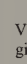

注意：不仅以这种方式使用 VMware Workstation 存在技术和可用性问题。你还不符合 VMware Workstation 的最终用户许可协议，该协议明确规定产品仅 intended for 特定个人用户。

VMware ACE 提供了与 VMware Workstation 相同的功能，但它还让你完全控制终端用户如何使用虚拟机。

#### VMware 服务器产品

在本书的 VMware GSX Server 和 ESX Server 部分，我将更详细地解释这些版本之间的差异，并解释为什么你应该考虑购买它们。在此，我想给你一个简要概述。

在这些产品的其他好处中，两个服务器版本都附带管理界面，你可以通过基于 Web 的管理界面和远程控制台管理虚拟机。使用这些管理解决方案，你无需依赖对操作系统的远程访问；你可以直接在硬件级别访问 VMware GSX 或 ESX 虚拟机。因此，你可以进入虚拟机的 BIOS，打开和关闭机器，甚至更改 VMware 配置。使用这些解决方案，你可以让多个管理员同时管理你的机器。

当你认真考虑在单一硬件平台上为生产环境运行多台服务器时，虚拟机的管理并不是让你考虑服务器版本唯一的因素。它还包括监控虚拟机性能并相应采取行动的能力。

有许多工具和产品可用于服务器版本，可帮助你创建专业的虚拟环境。一个例子是物理到虚拟转换，例如当你将服务器从现有环境

集成到你的虚拟基础设施中。其他示例包括 VirtualCenter 和 vMotion 应用程序，它们可以帮助你管理虚拟机并在它们存储在存储区域网络上时将它们从一个硬件平台迁移到另一个硬件平台。

最后但并非最不重要，服务器产品提供对虚拟环境的支持。如果计划在生产环境中使用 VMware 技术，这可能是服务器产品最重要的功能。你很可能已获得操作系统和硬件的支持，因此拥有受支持的虚拟基础设施也非常重要。

## 2 快速入门 VMware Workstation

本章包含开始使用 VMware Workstation 时所需了解的一切内容。有经验的用户可能会发现有关从早期版本升级的新信息很有趣。第 3 章详细解释了 VMware Workstation 版本 5 中的新内容。

在本章中，我将介绍基础知识，并确保你拥有启动并运行虚拟机所需的重要信息。所有其他基础信息都包含在 VMware 手册中；因此，我不会详细讨论诸如如何向虚拟机添加 USB 设备或打印机等基础信息。VMware 的人员在文档和产品的帮助文件中对日常操作进行了极佳的解释。

### 2.1 设置硬件和主机操作系统

VMware Workstation 可在你拥有的几乎任何 PC 上运行，从 Pentium II 和 Celeron 版本开始。完整的硬件规格和要求列表可在 VMware 网站的以下网址找到：www.vmware.com/support/ws5/doc。开始使用 VMware Workstation 时最重要的两项是内存和磁盘空间；你需要大量的内存和大量的磁盘空间。你可以在第 2 部分阅读有关可采取的优化步骤以及与虚拟机相关的高级配置的更多信息，第 2 部分涵盖了通用配置和技巧。开始使用 VMware 并获得可接受性能所需的最小 RAM 容量为 512 MB。如果运行使用 256 MB 的虚拟机，则剩余的 256 MB 用于主机操作系统。对于安装的每台虚拟机，你至少需要 1.5 GB 的磁盘空间。

作为主机，你需要 Windows 或 Linux。你必须在购买软件之前决定其中之一，因为每个操作系统都需要自己的 VMware Workstation 版本，并且两者都需要各自的许可证。

#### Windows

简单来说，VMware 中不支持的唯一 Windows 版本是 Windows 9x 和 Windows NT。所有其他版本都可以使用，从 Windows XP Home Edition 到 Windows Server 2003。如果你的系统为 64 位，你也可以安装 Windows XP 或 Windows Server 2003 64 位版来使用 VMware Workstation。软件本身仍为 32 位，因此你不会获得任何好处。此外，你的客户机将在虚拟机内部以 32 位传统模式运行。

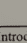

Tip: 在撰写本书时，VMware Workstation 版本 5.5 的 beta 版支持以主机和客户机身份运行 64 位操作系统。

#### Linux

VMware 网站上支持的 Linux 发行版列表相当长。如果需要有关要安装 VMware Workstation 的发行版的详细信息，可以在以下 URL 查看完整列表：www.vmware.com/support/pubs。大多数当前版本的 Mandrake、Red Hat 和 SuSE 都受支持。不仅是专业工作站和服务器版本，而且像 Red Hat Linux 9 和 SuSE Professional 9.x 这样的“消费”版也受支持。

Tip: 安装 Linux 主机时，请确保选择 C 编译器和内核开发的软件包。这些默认情况下未启用。我建议你安装它们，因为很可能存在用于 VMware 或其他产品的内核模块，这些模块与你正在运行的内核不匹配并且需要编译。主机安装完成后才安装这些软件包会非常耗时，并且可能会出现一些不一致的情况。一个例子是当你的内核通过更新过程被更新，而你从 CD-ROM 安装的软件包来自较旧的版本时。

### 2.2 获取软件

首先，你需要获取软件。你可以从以下位置下载评估版本：www.vmware.com/download。你也可以申请 30 天评估副本。你下载的软件在评估期和购买许可证时是相同的。因此你无需重新安装 VMware Workstation。

在撰写本书时，2005 年 9 月，最新的版本是 VMware Workstation 5.0，build 13124。这也是本书中所有配置和示例所使用的版本。许多提示和配置选项也适用于 VMware 服务器版本。

### 获取折扣

VMware Workstation 可用于 Windows 或 Linux。你在购买副本时选择主机操作系统。因此，如果你购买了 Windows 版本并决定切换到 Linux，你将需要购买另一份副本，反之亦然。

每个版本（Windows 或 Linux）的价格为电子分发 USD 189.00，包装分发 USD 199.00。从版本 4.x 升级到版本 5 的费用为 USD 99.00（这些价格截至 2005 年 9 月）。如果你在 VMware Store 在线购买产品时输入以下折扣码，你有资格获得 5% 的折扣：VMRC-ROBBAS389。该代码适用于 VMware Workstation 和 VMware GSX Server 购买。

Note: 你有最新版本吗？VMware 包含自动更新功能，可检查新软件的可用性。打开 Edit → Preferences 在 Workstation 选项卡上配置此功能。你可以配置此检查为每日、每周（默认）或每月执行。它不会自动安装新软件，但会在有更新版本可供下载时发出警告。自动检查也可以通过在更新配置中选择 Never 来禁用。

### 2.3 从早期版本升级

对于已安装现有 VMware 版本的 Windows 主机操作系统计算机，版本 5 使升级过程变得更加容易。对于之前的升级，旧版本必须被删除，并且整个过程包括新安装至少需要两次重启。这已大大简化，因为升级现在会删除当前版本并安装版本 5，而无需重启。

对于 Linux 主机计算机，这取决于你为之前的安装使用的安装方法。如果你使用了 tar 安装方法，则无需采取额外步骤。你可以从分发文件开始安装过程。你唯一必须先做的事情是删除当前工作目录中可能仍存在的旧 tar 安装文件。如果目录 vmware-distrib 存在，请先删除它，然后再提取安装存档。

当你使用 RPM 安装程序时，必须先卸载当前版本，然后才能安装新版本。要确定你的安装是否使用 RPM 软件包完成，请使用以下命令查询 RPM 数据库：

```
rpm -qa | grep VMware
```

如果数据库中未显示任何条目，则可以假设安装是使用 tar 存档中的安装程序完成的。如果需要卸载使用 RPM 软件包安装的应用程序，请使用以下命令：

```
rpm -e VMwareWorkstation
```

你使用查询命令执行的 RPM 数据库列表显示所有已安装的软件。关键字 VMwareWorkstation 用于卸载 Workstation。它也可能是数据库中的另一个关键字，具体取决于你运行的版本。

#### 升级准备

在升级软件之前，必须准备虚拟机。

- 1. 确保所有虚拟机均处于关机状态。如果你的机器处于挂起状态，先恢复它们，然后关闭客户机操作系统，再将其关机。安装新的 GSX Server 软件后，你需要升级虚拟硬件。参见 GSX Server

《管理指南》如果适用于您。另请查看第 98 页关于 VMware 世代的说明。

- 2. 将所有可撤销磁盘模式信息保存到虚拟磁盘中。当您拥有处于旧版可撤销模式的磁盘时，请确保在关机时将所有更改保存到虚拟磁盘中或丢弃更改。
- 3. 删除虚拟机当前拥有的任何快照。

完成这些准备步骤后，软件可以安装在您的计算机上。各个虚拟机仍需要升级。

#### 从版本 4 之前发布的版本升级

如果您使用的是非常旧的版本，则需要额外步骤。对于版本 2，您需要将虚拟机升级到版本 3 或 4。之后，它们可以升级到版本 5。VMware 版本 3 机器在使用版本 5 之前需要先升级到版本 5。

#### 从版本 4 升级

使用 Workstation 版本 4 创建的虚拟机可以直接在版本 5 中运行。由于版本 5 的新功能（如使用多个快照）不可用，因此会存在一些限制。此外，如果您不升级虚拟机，则无法获得版本 5 提供的性能优势。如果您选择不升级机器，请不要忘记在客户操作系统内部安装更新版本的工具。这是您将主机升级到版本 5 后必须采取的最低操作。

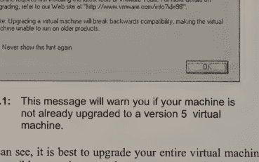

图 2.1：此消息会在您的机器尚未升级到版本 5 虚拟机时发出警告。

正如您所见，最好将整个虚拟机升级到版本 5。这是一个不可逆的操作，因此请务必先创建虚拟机的备份。升级虚拟机必须在关机状态下进行。当机器已关机时，从 VM 菜单中选择“升级虚拟硬件”。

升级完成后，在虚拟机内部安装新版本的工具。根据您运行的 VMware Workstation 版本以及机器内部的操作系统，特定客户机可能需要额外步骤。例如，在 Windows 9x 机器中，升级虚拟硬件后需要升级显示驱动程序。

### 2.4 安装 VMware Workstation for Windows

VMware Workstation for Windows 的安装非常简单。在接受许可协议时，您会得到通常的问题，例如您希望将软件放置在哪里。其中一个具体问题可能需要一些澄清。该问题显示在图 2.2 中。

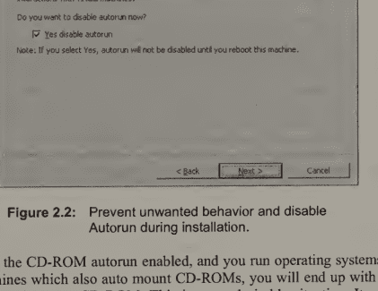

图 2.2：在安装期间防止不需要的行为并禁用自动运行。

如果您保持 CD-ROM 自动运行启用，并且在虚拟机中运行的操作系统也自动挂载 CD-ROM，您将导致多个 PC 访问同一个 CD-ROM。这不是一个理想的情况。它会导致奇怪的行为并减慢主机和客户机的速度。因此，请保留默认设置以禁用自动运行。

完成安装的最后一步是添加您的 VMware Workstation for Windows 许可证。在 VMware Workstation 中，选择 Help → Enter Serial Number 以添加许可证。

安装完成后，您可以创建第一个虚拟机。在这样做之前，请确保您了解可以选择的磁盘和网络类型。请继续阅读第 2.6 节，了解有关磁盘类型和网络选项的更多信息。

### 2.5 安装 VMware Workstation for Linux

此时，我假设您已下载安装文件，将其复制到计算机上，或挂载包含安装文件的 CD-ROM。VMware Workstation for Linux 有两种格式可用：tar 归档和 RPM 包。我将解释如何为这两种类型的安装文件安装 VMware Workstation。

按照以下步骤安装软件：

- 1. 登录您的 Linux 主机并打开一个终端窗口。
- 2. 您需要以 root 用户身份安装软件，因此使用 su - 命令成为 root。
- 3. 对于 RPM 版本，有两种安装方法。一种方法是执行以下命令安装软件：

```
rpm -Uhv VMware-gsx-3.2.0-14497.i386.rpm
```

另一种方法是在 GUI 中的文件管理器中单击该文件。图 2.3 显示了 SuSE 9.3 主机的示例，其中 RPM 在 Konqueror 中被选中。包的描述会显示以展示将安装什么软件。单击“使用 YaST 安装包”以安装包。其他 Linux 发行版的包管理器可能与此不同，但安装同样简单。

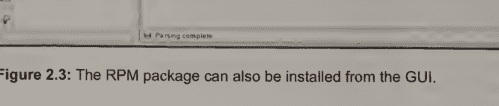

图 2.3：RPM 包也可以从 GUI 安装。

- 4. 对于 tar 归档版本，执行以下命令安装软件。首先，将 /tmp 目录设为当前工作目录，或选择另一个要提取文件的目录。这消除了首先将归档复制到硬盘的需要。

```
cd /tmp
```

使用以下命令提取归档：

```
tar -zxf <path>/VMware-workstation-5.0.0-13124.tar.gz
```

将当前工作目录更改为安装文件的位置：

```
cd vmware-gsx-distrib
```

启动安装脚本：

```
./vmware-install.pl
```

- 5. 在包安装完成后或 tar 归档的安装脚本运行完成后，使用以下命令启动 VMware Workstation 配置脚本：

```
vmware-config.pl
```

- 6. 您必须采取的第一个操作是阅读并接受最终用户许可协议。阅读完毕后，按 q 退出阅读器。然后如果您同意 EULA，输入 yes。
- 7. 配置脚本会向您提出几个需要回答的问题。以下是您将被提示的默认目录以及 VMware 配置脚本建议的默认路径。它们源自 SuSE 9.3 professional 主机的安装。其他 Linux 发行版的路径可能不同。

| 项目 | 路径 |
|---|---|
| MIME 类型图标 | /usr/share/icons |
| 桌面菜单项文件 | /usr/share/applications |
| 应用程序图标 | /usr/share/pixmaps |

- 8. 在配置过程的此时，它将尝试为正在运行的内核找到合适的 vmmon 模块。如果找到一个，则会显示以下消息并继续配置：

The module loads perfectly in the running kernel.

当内核的预编译模块不可用时，将显示以下消息：

None of the pre-built vmmon modules for VMware Workstation is suitable for your running kernel. Do you want this program to build the vmmon module for your system (you need to have C compiler installed on your system)?

此时您需要安装 C 编译器和内核源文件。如果您在初始 Linux 安装期间未安装这些，现在可以进行安装。


提示：请注意，如果您从安装 CD-ROM 安装内核源，该版本可能与您当前运行的版本不同。这是因为当前版本可能已被自动更新过程更新。在这种情况下，请通过相同的更新过程更新添加的内核开发包，包括内核源。

当 C 编译器和内核源文件可用时，您将被提示以下问题：

What is the location of the C header files that match your running kernel?

默认位置是：/usr/src/Linux/include。

当需要构建 vmmon 模块时，它可能会显示消息：“Module.symvers is missing' modules will have no modversions and Unable to build the vmmon module。”

如果是这种情况，请从 Linux 源目录运行以下命令，但首先将该目录设为当前工作目录：

```
cd /usr/src/Linux
make cloneconfig
make modules_prepare
```

运行这些命令后，再次执行 vmware-config.pl 配置脚本。模块是否现在可以编译，实际上取决于您的发行版。然而，在大多数情况下它们会编译。如果在此步骤后仍然无法工作，我建议您搜索 VMware 知识库和 VMware 社区论坛以获取有关您特定安装的信息。


9. 模块加载后，配置脚本会提示你有关网络的问题。请根据需要回答这些问题。

- 是否为你的虚拟机启用网络？
  (默认值：是)

- 是否希望在虚拟机中使用 NAT 网络？
  (默认值：是)

如果你选择安装 NAT：
是否希望此程序探测未使用的私有子网？
(默认值：是)
你还会被提示是否配置额外的 NAT 网络。默认答案为：否。

- 是否希望在虚拟机中使用仅主机网络？
  (默认值：是)

如果你选择安装仅主机网络：
是否希望此程序探测未使用的私有子网？
(默认值：是)
你还会被提示是否配置额外的仅主机网络。默认答案为：否。

10. 配置脚本成功完成后，你可以启动 VMware Workstation。无需以 root 用户身份执行，因此执行 exit 命令返回到之前用户环境。从命令行使用以下命令启动应用程序：

/usr/sbin/vmware &

提示：已添加和号符号（&）以在 GUI 应用程序启动时在后台运行应用程序。这是为了防止正在运行的 shell 被该命令卡住。你可能已经打开了足够多的窗口，我们不想打开太多窗口；对吧？

11. 完成安装的最后一步是添加你的 VMware Workstation for Linux 许可证。在 VMware GUI 应用程序中，选择 Help → Enter Serial Number 以添加许可证。

安装完成后，你可以创建你的第一台虚拟机。在此之前，请确保你了解可以选择的磁盘和网络类型。请继续阅读第 2.6 节以了解更多关于磁盘类型和网络选项的信息。

### 2.6 虚拟机的磁盘类型

在创建第一台虚拟机之前，你必须先了解使用硬盘和网络的选项。

VMware Workstation 虚拟机将使用虚拟磁盘运行，这不会以任何方式影响你的主机计算机的硬盘。你可以在虚拟机中创建分区、格式化磁盘并对其进行碎片整理。这些操作都不会直接干扰你的物理硬盘。所有操作都在一个或多个构成虚拟硬盘的虚拟磁盘文件中进行。

主机硬盘唯一的关联是主机操作系统正在将数据传输到和从物理磁盘传输。你的客户操作系统通过使用虚拟磁盘文件来访问同一物理磁盘。你可以想象，如果在单个磁盘通道上同时运行多台 PC，磁盘密集型操作会使你的 PC 显著变慢。

创建新虚拟机时，你有三种硬盘选项。

- 一个将 **动态增长** 至最大虚拟硬盘大小的虚拟磁盘。

这是默认选项，也是创建虚拟机时通常使用的选项。**我建议如果你刚开始使用 VMware Workstation，就使用这种磁盘类型。** 将创建一个大小仅为几千字节的 .vmdk 磁盘文件。.vmdk 文件会动态增长；只有当你从客户操作系统开始在硬盘上放置数据时才会如此，在安装期间以及之后（使用机器时）。

优点是你的虚拟机只会占用客户操作系统及其应用程序和数据实际需要的空间。你可以创建一个 100 GB 的磁盘，它会从小开始，在安装后增长到 1 或 2 GB，而在你的主机 PC 上永远不会使用全部 100 GB。

这种磁盘类型的缺点是，随着文件随时间变大，它会在你的主机 PC 的硬盘上变得非常碎片化，从而使其变慢。增长磁盘也会对性能产生负面影响。

这些动态增长的磁盘不会自动缩小。你必须通过本书其他地方描述的手动过程来减小虚拟磁盘文件的大小。

- 一个具有 **固定大小** 等于最大虚拟硬盘大小的虚拟磁盘。

从新建虚拟机向导创建虚拟磁盘时，你可以为虚拟机启用 **立即分配磁盘空间** 的复选框。此选项允许 VMware Workstation 创建一个虚拟磁盘文件，其大小与你在主机 PC 上为虚拟硬盘指定的大小相同。创建 100 GB 的虚拟硬盘将占用主机 PC 硬盘上 100 GB 的硬盘空间。

这种磁盘类型的优点是，即使创建磁盘可能需要更长时间，运行虚拟机仍然更快，因为磁盘在你的主机 PC 硬盘上不会如此碎片化。这只有在你确保有足够的空间顺序创建整个文件时才成立。在创建文件之前和之后使用 Windows 碎片整理实用程序进行分析。

如果你想使用共享磁盘的集群解决方案，如本书后面章节所述，你需要使用这种类型的磁盘。

- 在虚拟机中使用物理磁盘。

这被认为是对高级用户的配置。它允许你从虚拟机内部使用现有物理磁盘的磁盘分区。优点是你可以获得虚拟机的最快磁盘访问类型，但缺点是你需要像多启动 PC 一样对硬盘进行分区。此外，你将无法轻松地将虚拟机及其配置和磁盘文件保存到存档中以备份。此外，它不能用于基于同一虚拟机副本的未来安装。

如果你有一台双启动 PC，这可能是一个有用的安装，因为你可以从启动加载程序或从虚拟机内部启动额外的操作系统。

提示：我建议使用动态增长的虚拟磁盘类型（创建新虚拟机时的默认选择）。它不会占用太多硬盘空间，性能是可以接受的，并且只需将文件复制到安全位置即可非常轻松地创建虚拟机的存档。

### 2.7 虚拟机的网络选项

如今，所有计算机以及你的虚拟机都带有网络适配器。了解可以使用哪些类型的网络非常重要，因为选择错误的类型可能会阻止你访问虚拟机中的服务。它也可能对现有网络产生不良影响。

总体而言，你有两个网络选项可用：桥接和仅主机。

#### 桥接网络

这是在创建虚拟机时选择的默认网络类型。它允许你的客户操作系统与主机也使用的物理以太网网络进行通信。虚拟机拥有自己的 MAC 地址（每个联网机器的唯一地址）并且需要拥有自己的 IP 地址，该地址将自动从你的 DHCP 服务器接收或手动配置。

访问网络（以及通过它访问互联网）非常简单直接。你当然必须意识到你在虚拟机内部运行的一切都将可从网络访问。因此，安装某种服务器（域控制器、DHCP 服务器）将对网络上的其他用户产生严重影响。除非计划一开始就在虚拟机内部运行这些服务。只要意识到这一点，因为你不会是第一个在客户现场意外运行错误虚拟机后运行额外 DHCP 服务器的人。

#### 仅主机网络

如果你的虚拟机不需要与网络通信，或者如果你想防止这种情况，因为你想测试可能不会泄漏到网络上的网络服务，你可以选择这种网络类型。所有网络流量都将由内部 VMware 进程处理，什么也不会离开你的主机 PC。虚拟机之间能够相互通信，并且通过使用虚拟仅主机适配器，你的主机操作系统也可以与客户机通信。VMware 为你的仅主机网络提供 DHCP 服务。VMware 手册详细描述了如何使用和配置它。

#### 使用什么网络选项

如果你将运行 Windows 或 Linux 的简单工作站，那么你的最佳选择是桥接网络。你可以访问网络，如果可用，还可以访问互联网，并使用最新补丁更新机器。


在虚拟机处于运行状态时，可以在线在桥接网络和仅主机网络之间切换。

你可以从菜单中选择 VM → 设置 然后配置网络选项，或者双击虚拟机右下角的网络适配器图标。这也会打开网络控制面板。

如果你需要高级配置选项和网络方面的提示，请参阅第 11 节：“网络配置”

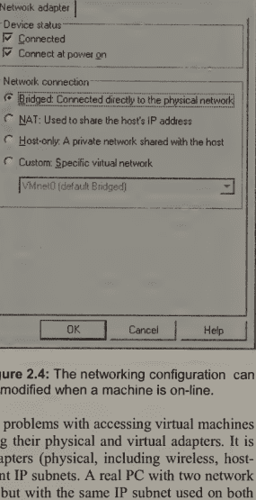

图 2.4：机器在线时可以修改网络配置。

提示：我在配置物理和虚拟适配器时遇到过很多人无法访问虚拟机和局域网的问题。务必确保所有适配器（物理，包括无线、仅主机 VMnet1 和 VMnet8）位于不同的 IP 子网中。具有两个网络适配器的真实 PC，如果在不同的以太网段上但两个局域网都使用相同的 IP 子网，就不知道将数据包发送到哪里。

可以把它比作一个路口，两个路标都指向巴黎。你也会困惑该选择哪个方向（当然除非它们都指向罗马，因为我们知道所有道路都通向罗马！）。

具有物理适配器和一个或多个配置为同一子网的虚拟适配器的 PC 会出现相同问题，并会阻止你访问物理或虚拟网络上的主机。

### 2.8 虚拟机硬件规格

虚拟机的一个巨大优势是它们始终为你提供相同的硬件。无论主机系统的硬件如何，虚拟机内部的硬件保持不变。唯一不同的组件是处理器，因为虚拟机将使用来自主机的底层处理器。无论你是在 Windows 还是 Linux 主机上安装虚拟机都没有关系；你可以在这两个受支持的主机操作系统之间迁移它。

每台虚拟机都有以下硬件规格：

- 与主机计算机相同的处理器
- 基于 Intel 440BX 的主板，带 NS838 SIO 芯片和 82093AA IOAPIC
- PhoenixBIOS™ 4.0 Release 6，带 VESA BIOS
- 每台虚拟机最多 3.6 GB RAM（所有虚拟机总计最多 4 GB）。
- 支持 SVGA 的 VGA 适配器
- 最多七个 SCSI 设备
- SCSI 控制器：Mylex® (BusLogic) BT-958 兼容主机总线适配器或 LSI Logic Ultra320 LSI53C10xx SCSI 控制器)
- 虚拟 SCSI 磁盘，最大尺寸为 950 GB
- 一条主 IDE 通道和一条从 IDE 通道，最多支持四个设备
- 虚拟 IDE 磁盘，最大尺寸为 950 GB
- 最多三个兼容 AMD PCnet-PCI II 的以太网适配器
- Creative Labs Sound Blaster® AudioPCI 仿真
- 虚拟软盘驱动器（最多两个）、并行和串行端口，以及两个 USB 端口
- 双端口 USB 1.1 UHCI 控制器
- 键盘和 PS/2 鼠标

### 2.9 创建你的第一台虚拟机

现在是创建你的第一台虚拟机的时候了。我将引导你完成向导中的步骤并解释所有选项。我也会解释选择非默认设置时的含义。

启动 VMware Workstation 后，通过从文件菜单或主窗口中选择“新建虚拟机”来创建虚拟机。这将启动新建虚拟机向导。

- 1. 第一个需要选择的选项是使用典型配置还是自定义配置。我假设你是喜欢探究的类型或高级用户，所以我们将使用自定义配置并逐步进行。
- 2. 下一个窗口对于使用过 4.x 版本的用户来说会是新的。你会被提示选择（图 2.5）是创建新的虚拟机还是与版本 4 兼容的旧版机器。

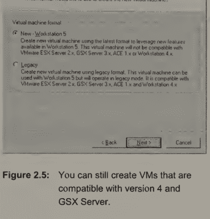

版本 5 的默认选择是创建新机器。旧版机器可在 4.x 版本中使用，也可在 VMware GSX Server、ACE 1.x 和 ESX Server 2.x 中使用。有关 VMware 虚拟机世代的更多信息，请查看第 0 节。

图 2.5：你仍然可以创建与版本 4 和 GSX Server 兼容的 VM。

3. 接下来，选择要在此虚拟机中安装的操作系统。你的选择将为你的客户操作系统创建最优化的配置。

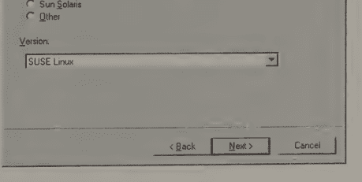

图 2.6：始终选择正确的操作系统以获得正确的设置。

选择错误的操作系统不会导致太多严重问题。操作系统实际上可以运行，但可能会对性能产生负面影响。你也可以稍后从虚拟机配置设置中更改操作系统。根据你的选择，VMware 会将机器的默认值设置为最适合你的客户操作系统的设置。例如，如果你选择 Windows XP，向导默认会建议使用 IDE 磁盘，因为 VMware 的 SCSI 驱动程序默认不受支持。如果你选择 SuSE Linux，VMware 会建议使用 SCSI，因为该操作系统支持 VMware SCSI 存储适配器的驱动程序。VMware 还会设置要使用的内存量，例如 256 MB，因为这足以运行 Windows XP 或 SuSE Linux。

所选操作系统还用于选择需要在客户机中安装的工具，并在需要时显示该操作系统的额外提示。

4. 选择客户操作系统后，会提示你输入虚拟机文件的位置。为每台虚拟机创建一个目录来存储所有文件。

5. 你的下一个选择是决定为虚拟机使用多少内存。下面显示的 256 MB RAM 的默认值是 Windows XP 和 SuSE Linux 的默认值。

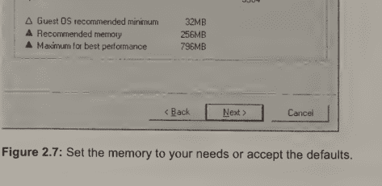

图 2.7：根据需要设置内存或接受默认值。

任何虚拟机的最大内存量为 3584 MB。如果你的主机 PC 没有这么多 RAM，那么选择这个内存量是没有用的。不要将内存设置得太低，尤其是在安装期间。虚拟机的安装过程可能会通知你内存不足，并且性能会非常差。VMware 虚拟机的一般规则是尽可能使用尽可能多的 RAM，但当然不能超过物理机器中拥有的内存。同时运行的所有虚拟机使用的总 RAM 量为 4 GB。有关内存优化的更详细说明可在第 8 章：“性能调优和优化”中找到。

6. 接下来，选择你想要的虚拟机的网络类型。

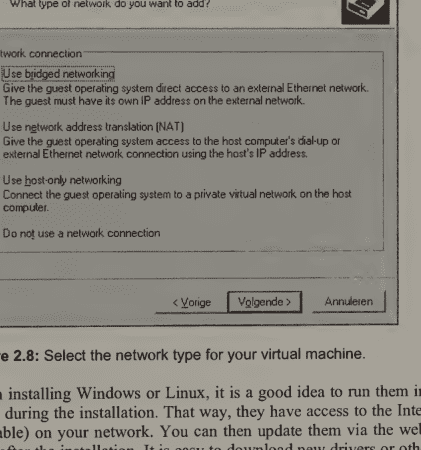

图 2.8：为你的虚拟机选择网络类型。

安装 Windows 或 Linux 时，在安装期间以桥接模式运行是个好主意。这样，它们就可以访问网络上的互联网（如果可用）。然后你可以在安装期间或安装后通过网络更新它们。直接在虚拟机中下载客户操作系统所需的新驱动程序或其他软件非常容易。

7. 每台虚拟机都将支持正常的 ATAPI IDE 设备，但你必须决定是否要在虚拟 SCSI 环境中使用 Buslogic 或 LSI Logic SCSI 适配器。VMware 将根据你选择的操作系统设置默认选择。本书后面有专门一章介绍在 Windows、Linux 和 NetWare 上使用 SCSI 设备。

- 8. 接下来，你必须选择要使用的磁盘类型。你可以选择创建新的虚拟磁盘（我建议你这样开始），如果已有磁盘则使用现有磁盘，或使用物理磁盘。这种最后一种选项不推荐用于大多数常见安装。
- 9. 在下一个窗口中，你必须选择虚拟磁盘类型：IDE 或 SCSI。如果不确定 SCSI 是否被你的操作系统正确支持，则将其设置为 IDE，因为任何已知操作系统都支持 IDE。
- 10. 如果你在步骤 8 中选择使用虚拟磁盘，现在必须选择磁盘的大小。另需选择是否希望磁盘动态增长到该大小，或在创建虚拟磁盘时分配磁盘空间。

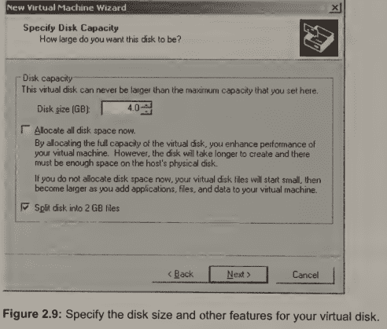

图 2.9：为你的虚拟磁盘指定磁盘大小和其他功能。

磁盘的最小尺寸为 100 MB，IDE 和 SCSI 的最大尺寸均为 950 GB。

如果你有一个仅支持最大 2 GB 文件的文件系统（如 FAT），你必须将磁盘文件拆分为单独的 2 GB 文件。然而，它们将形成一组具有相同名称前缀的文件，并且是

顺序编号。当查看微软的文件系统文档时，他们列出 FAT32 文件系统能够容纳最大容量为 4 GB 的文件。在 VMware Workstation 中，你需要在传统的 FAT 和 FAT32 上将虚拟磁盘拆分为 2 GB 的文件。

提示：我总是将磁盘文件拆分，因为这样可以更灵活地分块压缩；如果我需要将它们写入 CD 或 DVD 时，这是有利的。此外，如果你需要从一台计算机复制大型虚拟磁盘，在复制较小的块时更容易操作。它提供了在复制或移动过程失败时重新开始的灵活性。

11. 在指定虚拟磁盘名称的屏幕上不要太快点击“下一步”。我想请你注意“高级”按钮。这将在下一步中进行解释。

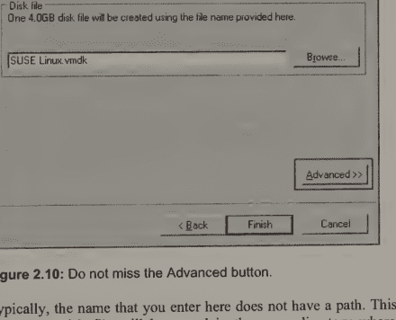

图 2.10：不要错过“高级”按钮。

通常，你在此处输入的名称没有路径。这意味着虚拟磁盘文件将存储在虚拟机所在的同一目录中。VMware Workstation 使用相对路径，并且始终从其自己的目录加载虚拟磁盘文件。你仍然可以指定硬盘上的另一个位置来存储文件。这将在该字段中包含完整路径。

12. 如果你点击“高级”按钮，你将能够指定两个额外的设置。第一个是磁盘在 IDE 或 SCSI 通道上的位置。第二个设置选项是更改磁盘模式。

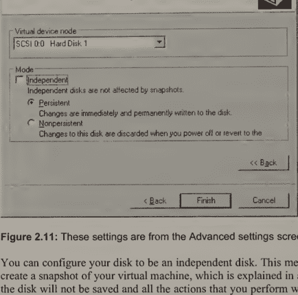

图 2.11：这些设置来自“高级设置”屏幕。

你可以将磁盘配置为独立磁盘。这意味着如果创建虚拟机的快照（将在后面的章节中解释），磁盘将不会被保存，并且你执行的所有操作仍会写入磁盘文件。

持久磁盘模式会将所有操作直接写入虚拟硬盘文件。非持久磁盘模式会在单独的 REDO 文件中跟踪所有更改。当你关闭虚拟机电源时，所有更改将被丢弃。你可以稍后从虚拟机“设置”配置中在这些模式之间切换。

非持久磁盘模式在进行软件测试时很有用。你可以在每次重新启动（关机/开机）后都从相同的未更改环境开始。

> 提示：如果你想使用此功能，请在安装操作系统后设置此磁盘模式。顺便说一下，使用快照是反复使用相同起点的方法。

你现在已经创建了你的第一台虚拟机。在开始安装操作系统之前，我将解释有关 VMware Workstation 界面的一些有用信息。虽然其中大部分是自解释的，但我想确保你了解基础知识以便开始。图 2.12 显示了主要控制选项和配置选项访问的概览。

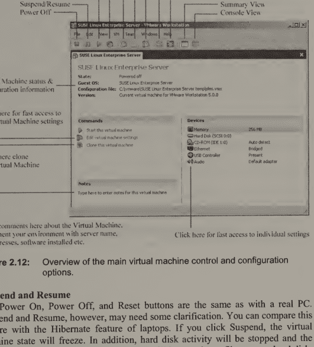

图 2.12：虚拟机主要控制和配置选项的概览。

#### 挂起和恢复

“开机”、“关机”和“重置”按钮与真实 PC 相同。然而，“挂起”和“恢复”可能需要一些说明。你可以将此功能与笔记本电脑的休眠功能进行比较。如果你点击“挂起”，虚拟机的状态将被冻结。此外，硬盘活动将被停止，并且虚拟机内存的内容将被保存到硬盘上的一个文件。此 .VMSS 文件相当于 Windows 在使用休眠功能时在硬盘根目录创建的 HIBERFIL.SYS 文件。

在以前的 VMware 版本中，第一次挂起虚拟机（当它已关闭或已重置时）需要很长时间；有时长达几分钟。这是因为 .VMSS 文件在你的硬盘上创建，其大小与分配给机器的 RAM 相同。创建该文件需要花费大量时间。随着版本 5 的发布，“挂起”和“恢复”过程的性能得到了显著改善。这是通过在虚拟机开机时立即创建 .vmem 文件并且不等待你挂起机器来实现的。

## 3 VMware Workstation 5 中的新功能

在本章中，我将介绍 VMware Workstation 版本 5 的新功能。在本书的第 2 章中，你可以阅读如何安装此版本。本版本中有一些新主题，我在本章中未涵盖，例如等时 USB 支持。另一项在本书记载的功能是新的命令行界面，其内容在第 6.2 节中介绍。

本章涵盖的主题有：

- 使用多个快照
- 克隆虚拟机
- 组合虚拟机
- 录制和回放电影
- 虚拟机导入器

### VMware Workstation 版本 5.5 的新功能

本章涵盖了 VMware Workstation 版本 5 的新功能。然而，当你阅读此内容时，很可能 VMware 已经发布了版本 5.5。以下是新版本中将包含的功能：

- 支持虚拟机的多（两个）CPU
- 支持 64 位主机和客户操作系统
- 集成来自其他厂商的虚拟机转换

### 3.1 使用虚拟机快照

此功能排在新功能列表的首位并且在本章中首先讨论是有原因的。自快照首次引入以来，它一直是最受请求的新功能。现在可以在多个时间点创建快照，这将使你能够返回到虚拟机生命周期中的不同点。你甚至可以在快照创建时分支出一个分支，以基于该快照创建第二个时间线。这将使你能够基于一台虚拟机尝试多个场景，同时具有返回快照树中任何已保存快照的灵活性。

我将首先讨论快照是什么，然后再详细介绍使用新功能和先前存在的快照技术功能。

### 3.2 快照简介

在使用真实 PC 时，你可能会遇到这种情况：你在新服务器安装的 90% 完成点时出现错误消息，阻止你继续安装。或者出现蓝屏，或者安装只是挂起。或者，也许你在进行新软件安装，并且想用几种选项尝试，但仍使用相同的起点，例如干净的 Linux 或 Windows 工作站。

由于 VMware 就像真实 PC 一样运行，你在安装客户操作系统期间也可能遇到相同的情况。VMware Workstation 包含一个快照功能，可帮助你返回到一个时间点，你可以在安装新客户操作系统时预设该时间点，或将其作为所有测试的基础。

### 3.3 什么是快照

当你对虚拟机进行快照时，机器的状态将在该特定时间点保存。磁盘和内存都在创建快照时被“冻结”。虚拟机的配置和 BIOS 的状态也会被保存。

从拍摄快照时起，你对虚拟机执行的所有操作都将保存在文件系统的单独文件中。

你可以检查存储虚拟机的目录以查找这些文件：

- `<name>-Snapshotn.vmsn`
  此文件包含有关快照的配置信息。它也是跟踪虚拟机配置的文件。快照文件将被编号为 Snapshot1.vmsn、Snapshot2.vmsn，等等。在线文档指出支持超过 100 个快照。具体超过多少并未说明。但当然，它将受硬盘空间限制。
- `<name>-Snapshotn.vmss`
  包含虚拟机的内存转储
- `<name>-nnnnnn.vmdk`
  多个文件包含对虚拟硬盘的更改。这些文件编号为 000001.vmdk、000002.vmdk 等。


### 3.4 使用快照

你可以在虚拟机处于开机或关机状态，甚至是挂起状态时拍摄快照。点击快照按钮或选择 VM → 快照 → 保存快照。

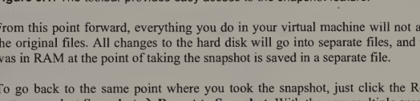

图 3.1：工具栏可轻松访问快照功能。

从此以后，你在虚拟机中所做的一切都不会影响原始文件。所有对硬盘的更改都会进入单独的文件，而在拍摄快照时 RAM 中的内容会保存在单独的文件中。

要返回到拍摄快照时的相同点，只需点击“还原”按钮或选择 快照 → 还原到快照。借助新的多快照功能，如果你有多个快照，可以选择要还原到的快照。

注意：请注意在分布式虚拟机环境中使用快照功能。如果一台机器中的应用程序正在与第二台虚拟机中的另一个应用程序通信，那么在其中一台机器上还原到快照将创建不一致的数据集。这对于 Active Directory 和 eDirectory 的同步和复制也是如此。

还原到快照点将删除自拍摄快照以来发生的一切，并从该快照点的磁盘开始。它将恢复在创建快照时虚拟机内存中的 RAM。

注意：你仍在使用快照，因此你所做的一切仍会保存在单独的文件中。再次点击还原将再次删除所有内容。

注意：使用快照功能会给 VMware Workstation 的正常操作带来开销。如果不需要为特定机器使用快照，则不要创建任何快照，或者如果已存在，则删除它们。

### 3.5 使用多个快照

从 VMware Workstation 5 开始，你可以使用多个快照。此功能可帮助你返回到使用特定配置时的任何时间点。

注意：使用较旧版本的 VMware Workstation（版本 5 之前或使用其他 VMware 产品）创建的虚拟机可以在此版本中使用，但快照功能将不可用。升级虚拟机硬件以使用此新功能。

我在此讨论的示例发生在培训场景中，学生可以通过还原到特定练习的快照点来进入培训中的任何练习。通过这种方式使用快照，学生在搞乱环境后可以返回到之前的练习。此外，当需要跳过练习时，学生可以在不先通过其他练习的情况下从任何给定点开始。这是对模块化培训交付的绝佳解决方案。

提示：当然，顺利完成所有练习的学生无需转到任何快照。他们可以从起始虚拟机开始，并在培训期间逐步完成练习。只有当出现问题时，他们才不必从头开始。

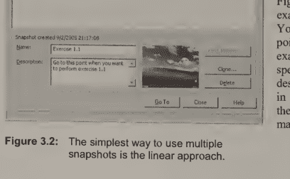

图 3.2：使用多个快照最简单的方式是线性方法。

处理快照的第一种可能性是线性：你从第一个快照开始并不断创建顺序快照。

图 3.2 显示了这种方法的示例。你可以返回到任何时间点。在此示例中，是为了开始特定练习。说明框有助于用户识别虚拟机的状态。

在某些场景下，你可能不仅想遵循单条快照线，还可能想在快照线的任何给定点分支。这可以做到，并将产生快照树。

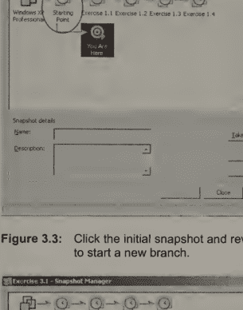

在为学生创建练习的示例中，你可以在快照管理器中点击初始快照并通过点击“转到”按钮还原到该快照。

这将产生一条新的快照线，也可以在任何给定点分支。只需点击快照，还原到它并选择“拍摄快照”。

图 3.3：点击初始快照并还原到它以开始新的分支。

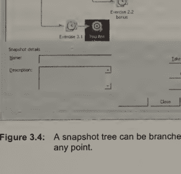

图 3.4 显示了为培训课程第 2 节的练习创建的快照分支示例。在此示例中，有一个额外的练习，学生在“练习 2.2”快照点为其创建了额外的快照。

他们可以在想要执行该特定练习时转到该快照。

图 3.4：快照树可在任何点分支。

在使用大量快照时，可能会失去对自己所在位置的跟踪。要了解活动快照是什么，你需要进入快照管理器。

你可以在设置中将虚拟机的名称重命名为与快照相同的名称。由于快照功能也会跟踪配置更改，VMware Workstation 窗口将显示机器的名称，该名称也将是快照的名称。

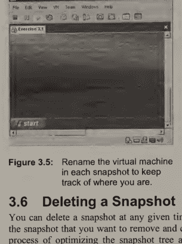

图 3.5：在每个快照中重命名虚拟机以跟踪你的位置。

### 3.6 删除快照

你可以在任何时候删除快照。从快照管理器中，选择要删除的快照并点击“删除”按钮。这将启动优化快照树并将已删除快照的子项链接到其父项的过程。

提示：如果不想保存自创建快照以来所做的更改，请先还原到上一个快照，然后再删除快照。

也可以一次性删除整个快照分支。要执行此操作，请右键单击快照并选择“删除快照及其子项”。

### 3.7 配置快照功能

在某些情况下，你可能希望将磁盘之一排除在快照之外。你可以通过将磁盘配置为独立磁盘来实现。要执行此操作，请进入虚拟机设置，选择要设为独立的磁盘，然后在磁盘配置面板中点击“高级”按钮。设置复选框以使磁盘成为独立磁盘。只有在没有现有快照时才能执行此操作。

你还必须在持久磁盘和非持久磁盘之间进行选择。第一种模式将所有更改保存到原始磁盘文件中，第二种模式将所有更改保存在单独的 REDO 文件中，该文件将在关闭虚拟机时被删除。

#### 禁用快照

快照功能可以按虚拟机禁用。这仅在虚拟机没有快照时有效。要禁用拍摄快照，请打开虚拟机设置，选择“选项”选项卡，然后选择快照条目。在右侧面板中，你会看到“禁用快照”的复选框。

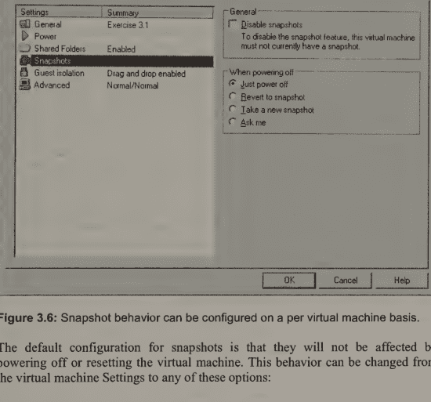

图 3.6：快照行为可以按虚拟机配置。

快照的默认配置是它们不会因关闭电源或重置虚拟机而受影响。此行为可从虚拟机设置更改为以下任一选项：

- 仅关机 — 不执行任何操作并保留快照完整。
- 还原到快照 — 关机时始终删除快照并始终以相同状态启动。
- 拍摄新快照 — 机器开机时拍摄新快照，并将你所做的所有更改添加到原始文件。
- 询问我 — 询问你应采取上述哪个操作。

#### 更改快照优先级

在 VMware Workstation 中，虚拟机快照作为后台进程创建和还原。这是一个很棒的功能，因为你几乎可以立即继续使用客户操作系统，而快照进程仍在完成。如果在另一个进程未完成时尝试启动新的快照进程，你将收到相关消息。

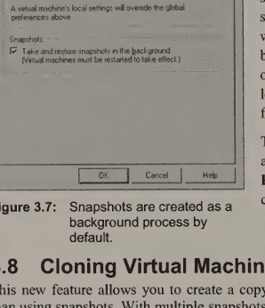

是否保留此功能取决于虚拟机的使用场景。例如，在课堂环境中，学生还原到快照后可以立即开始工作。然而，当他们这样做时，机器开始时可能会变慢。根据受众的不同，让他们等待进程作为前台进程完成可能更好。

要更改快照的创建方式，请选择 VM → 首选项并在“优先级”选项卡中启用或禁用复选框。

图 3.7：默认情况下，快照作为后台进程创建。

### 3.8 克隆虚拟机

此新功能允许你创建虚拟机的副本。它与使用快照不同。在虚拟机上使用多个快照时只有一个快照处于活动状态，而你可以同时启动一个或多个你创建的虚拟机克隆。

虚拟机克隆有多种用途示例。对于需要在课堂上设置虚拟机的讲师，此向导可帮助他轻松为每位学生创建唯一的机器。使用稍后解释的链接克隆设置，父机可以位于网络上，而学生的克隆机则在其自己的计算机上。

其他用途是软件测试，在任何时间点，甚至在快照树中的给定快照处，需要让其他人处理相同的环境以进行测试。克隆虚拟机并向他们提供该副本以供操作。


创建虚拟机的克隆会复制该机器并创建新的身份。克隆虚拟机向导会负责为虚拟机创建新的唯一标识符（UUID）和 MAC 地址。因此，你可以安全地运行父机器的多个克隆，而不会出现任何网络问题。

来宾操作系统特定的身份信息不会被克隆功能更改。你仍需自行在来宾操作系统内部更改这些信息。最简单的初始操作是使用 DHCP 分配 IP 地址。对于任何来宾操作系统，仍需更改的是工作站或服务器名称，以及 Windows 上的 SID（可能）。你可以使用 Microsoft 的 SYSPREP 工具在创建克隆之前准备父虚拟机。对于 Linux 主机，更改名称是可以轻松脚本化的。

提示：有许多工具可帮助你在不运行 SYSPREP 的情况下为计算机设置新的身份。Sysinternals 提供了一个名为 NEWSID 的免费工具，可在 Windows 机器上设置安全标识符和主机名（www.sysinternals.com）。另一个可自由获取的实用程序是来自 ENGL 的 Zenc Lite（www.eng1.co.uk）。该实用程序可以根据你的输入设置计算机名称，但也可以读取 Windows 管理规范（WMI）信息。例如，在 VMware 中，它可以读取返回机器 UUID 的 BIOS 序列号。

#### 链接克隆与完整克隆
你可以创建两种类型的克隆。完整克隆可以完全独立于其父机器运行。这种类型的克隆不需要访问父虚拟机的文件。而链接克隆则不同，它将始终依赖于父虚拟机的文件。完整克隆使用的磁盘空间与父机器相同。链接克隆起初只占用少量磁盘空间，因为整个父虚拟磁盘将被用于工作。一旦数据被修改并添加到克隆中，克隆占用的磁盘空间最终会增长。

注意：创建链接克隆时速度更快，但性能会受到负面影响，就像使用快照功能一样。完整克隆完全在自己的虚拟磁盘上运行，提供更好的性能。

#### 为克隆准备父机器
当机器处于关机状态时，你可以创建虚拟机的克隆。克隆可以在虚拟机的快照树中的任何位置创建。但是当父快照被删除时，它会破坏与链接克隆的连接并使其无法使用。为了防止这种情况发生，你可以将父机器设置为克隆模板。启用此功能后，你无法删除快照或虚拟机，以防止意外破坏与克隆的链接。

要将机器设置为模板，请打开虚拟机设置，并在“选项”选项卡的“高级”菜单中选中“启用模板模式（用于克隆）”复选框。这不会在快照管理器中禁用删除控件，但当你尝试删除快照时，会显示图 3.9 中的警告消息。

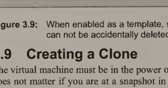

图 3.9：启用为模板后，快照不会被意外删除。

### 3.9 创建克隆
在创建克隆之前，虚拟机必须处于关机状态。无论你是否处于快照树中的快照都不重要。克隆也可以基于快照。

注意：使用 VMware Workstation 5 之前的版本或其它 VMware 产品创建的虚拟机，在其虚拟硬件升级到版本 5 之前无法克隆。

你可以从 VM 菜单或快照管理器启动克隆虚拟机向导。

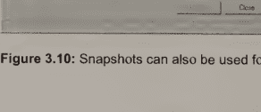

要在虚拟机处于快照状态时克隆它，请打开快照管理器并选择要克隆的快照点。单击“克隆”按钮。这将启动虚拟机克隆向导，你可以在其中选择该快照点进行克隆。你也可以从向导的下拉列表中选择任何其他快照点。

图 3.10：快照也可以用于克隆。

#### 克隆克隆
可以创建链接克隆虚拟机的克隆。请注意，这个新的链接克隆需要访问链中包括父机器在内的所有链接克隆。同时请记住，使用链接克隆功能会负面影响性能，而链接链接克隆会给你的虚拟机环境带来更大的开销。

### 3.10 团队虚拟机
使用 VMware Workstation，你可以运行具有关联的多个机器，例如用于演示或测试项目。例如，你总是想演示服务器和工作站的组合。或者你对组成集群的一对服务器进行测试。在这种情况下，你过去总是必须打开各个机器并启动它们。现在，你只需将这些机器捆绑成一个团队，一键启动所有机器。

团队功能还增加了将机器分配到特定的（虚拟）LAN 段并定义该网络使用方式的功能。你可以配置网络速度和可能的丢包率以模拟真实世界场景。

#### 管理团队
从“文件”菜单创建新团队。新建团队向导将指导你完成团队的创建。你可以使用全新的虚拟机创建团队，也可以将现有虚拟机添加到团队。

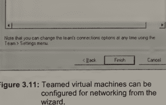

在创建过程中，你可以为团队中的所有机器指定网络配置。图 3.11 显示了一个配置为主机专用网络的团队示例。要限制带宽或设置其他网络功能，虚拟机必须分配到 LAN 段。在本例中为 LAN 1。

图 3.11：团队虚拟机可以通过向导进行网络配置。

创建团队后，你可以一次性启动整个团队，也可以从团队中启动单个机器。你不能在团队之外启动虚拟机，但可以从团队窗口单独启动它们。

一旦创建了团队，你可以从“团队”菜单管理它。它允许你将虚拟机添加到团队或从团队中移除。你也可以删除整个团队包括虚拟机，或者删除团队并将虚拟机保留在硬盘上。

#### 团队配置
团队可以通过一次点击按钮启动。这很方便，但如果同时启动多个虚拟机，也可能导致性能问题。此外，你可能需要服务器完全启动后才能启动工作站。启动间隔可以在“团队设置”配置屏幕中配置。

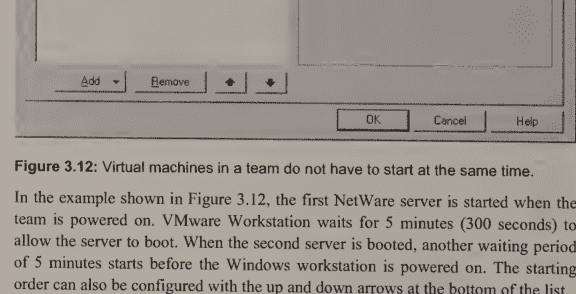

图 3.12：团队中的虚拟机不必同时启动。

图 3.12 所示示例中，团队启动时首先启动第一个 NetWare 服务器。VMware Workstation 等待 5 分钟（300 秒）以允许服务器启动。当第二个服务器启动后，在 Windows 工作站启动前会开始另一个 5 分钟的等待期。启动顺序也可以通过列表底部的上下箭头进行配置。

#### 团队、克隆和快照
团队中的虚拟机可以被克隆；然而，新的克隆不会成为团队的成员。可以从克隆的虚拟机创建团队。因此，如果你计划创建一组共享虚拟磁盘的高效机器，可以先创建机器，然后创建团队并将虚拟机添加到其中。

你可以为团队中的虚拟机创建快照。但它仅是该机器的快照，而不是整个团队的快照。当然，你可以单独为机器创建快照，也可以为整个团队创建快照，但如果一致性很重要，那么你可能希望在机器处于挂起或关机状态时为团队中的机器创建快照。

#### 团队网络配置
团队中的虚拟机可以配置为使用普通的主机专用、NAT 或桥接网络。但也可以将它们分配到仅供团队使用的特殊 LAN 段。你可以在机器的设置中按虚拟机配置，也可以在“团队设置”窗口的“连接”选项卡中配置。

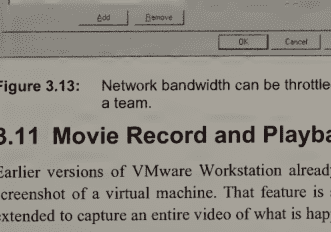

图 3.13：团队的网络带宽可以被限制。

将机器添加到 LAN 段不仅可以将其与其他网络隔离，还可以配置 LAN 段的网络带宽。这也是一个很棒的功能；例如，测试将通过专线运行的客户端服务器应用程序。你还可以配置丢包率以模拟网络问题。

### 3.11 录制和回放电影
早期版本的 VMware Workstation 已包含创建虚拟机屏幕截图的功能。该功能至今仍然可用，但已扩展为捕获虚拟机内部发生的整个视频。

要捕获电影，请从 VM 菜单中选择“捕获电影”选项。为文件提供文件名，该文件将以 AVI 文件格式存储。你可以启用“省略无变化的帧”复选框以仅捕获视频

如果机器内部确实发生了某些事情，就会产生片段。如果您正在制作演示，并在配置主机计算机时让虚拟机保持运行且视频捕获处于启用状态，则这段时间不会被添加到电影文件中。

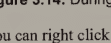

图 3.14：在电影捕获期间，状态栏中会显示一个图标。

您可以通过右键单击图 3.14 中显示的图标来停止电影捕获，或从 VM 菜单中停止捕获。

要播放捕获的电影，您需要 VMware Movie Decoder。据我经验，大多数 DVD 播放器应用程序无论如何都能播放 AVI 文件。但其他播放器，包括 Windows Media Player 需要此解码器。您可以从 VMware 网站下载它。撰写本书时最新版本为 VMware-movie decoder-5.0.0-13124.exe。

### 3.12 虚拟机导入器

微软有一款名为 Virtual PC 的产品，与 VMware Workstation 竞争。它们虚拟机的格式与 VMware 不同，因此无法互换。如果您想将 Virtual PC 机器迁移到 VMware Workstation，则可以运行 Virtual Machine Importer。

该应用程序（仅限 Windows）作为 VMware 的单独下载提供。撰写本书时最新版本为 VMware-VMimporter-1.0.0-12997.exe。该实用程序和完整的 PDF 手册可从以下 URL 下载：www.vmware.com/download。

提示：在 VMware Workstation 5.5 版本中，此转换向导默认集成在 VMware Workstation 软件中。

安装程序后，您可以从 VMware Workstation 外部通过开始菜单启动它。该应用程序在执行转换过程时不依赖于 Workstation。

您可以选择自定义或典型安装。当您使用自定义方法时，可以创建与旧版 VMware Workstation 或其他 VMware 产品兼容的虚拟机。您还可以在自定义方法中配置链接的虚拟机。本文段中的示例我使用了自定义方法。

- 1. 执行转换的第一步是选择来自 Microsoft Virtual PC 机器的 .VMC 文件。
- 2. 接下来，为目标虚拟机提供虚拟机名称和位置。
- 3. 如果您选择了自定义方法，将提示您创建新的 VMware Workstation 版本 5 兼容机器或旧版机器。
- 4. 接下来，您可以选择创建虚拟机的完整副本或链接到原始文件

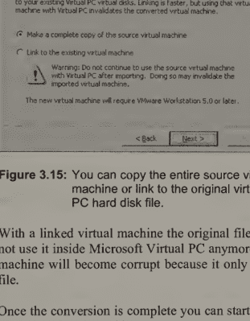

复制整个机器将生成包含完整虚拟机的 .VMDK 文件。当链接到原始 Microsoft .VHD 文件时，它将作为快照工作，其中 .VMDK 文件仅包含更改。创建副本比链接机器花费更长时间，但链接的机器将依赖于原始文件。

图 3.15：您可以复制整个源虚拟机或链接到原始虚拟 PC 硬盘文件。

使用链接的虚拟机时，原始文件将保持完整，但您不得再在 Microsoft Virtual PC 中使用它。如果这样做，VMware 虚拟机将损坏，因为它仅包含对原始文件的更改。

- 5. 转换完成后，您可以直接启动虚拟机并关闭 Virtual Machine Importer。
- 6. 当客户操作系统启动时，在许多情况下为 Windows，它会检测到新硬件并需要重新启动。在重新启动之前，安装 VMware Tools 可能是一个好主意，这也需要重新启动。

该应用程序在其操作日志文件保存在您的临时目录中，通常为 c:\documents and settings\username\local settings\temp。文件具有 v2vapp 前缀，并使用日期和时间作为文件其余部分，以 .log 扩展名结尾。例如：v2vapp.2005-08-25.08-30.log。

## 4 安装操作系统和 VMware Tools

本章从在虚拟机中安装 Windows、Linux 和 NetWare 开始。此外，还解释了 VMware Tools 的安装，您将找到有关通过优化机器和缩小硬盘来有效使用虚拟机的说明。

### 4.1 安装操作系统通用提示

那么，您通常如何在新 PC 上安装操作系统？您放入软盘或 CD-ROM 然后开机吗？这正是您对虚拟机所做的事情。然而，在这种情况下您有几个额外的选择。

无论您要安装什么操作系统，最快也最简单的方法是使用 ISO 映像而不是 CD-ROM。如果您需要定期安装虚拟机，最好为操作系统 CD-ROM 创建 ISO 映像。对于某些操作系统，您可以从互联网下载 ISO 文件；有时甚至带有集成服务包。但您也可以自己创建 ISO 文件。这在第 7.7 节中有所说明："使用 CD-ROM 和 DVD 映像文件"。

根据您的 CD-ROM 驱动器，使用硬盘上的 ISO 文件比使用物理 CD-ROM 驱动器更快。使用软盘时，从软盘映像比从真实软盘更快。如何使用虚拟软盘也在第 7 章中进行了说明。

如果您从 CD-ROM 启动时遇到问题，请阅读第 7.8 节中的提示："我的虚拟机无法从 CD-ROM 启动"。这可能是虚拟机 BIOS 中启动顺序问题造成的。

### 4.2 安装您的第一个 Windows 客户机

您从可启动的 Windows CD-ROM 或 ISO 文件安装 Windows。放入 CD-ROM 或分配 ISO 并打开虚拟机电源。Windows 安装开始，您可以像使用真实 PC 一样进行设置。使用正常程序创建和格式化分区。


提示：如果您选择 Windows 2003 或 Windows XP 作为操作系统，并且选择了 SCSI 磁盘，则必须在基于字符的安装期间选择正确的驱动程序。这在第 12.1 节中有描述："在 Windows 虚拟机中使用 SCSI 驱动程序"。

让 Windows 安装完成其工作，包括重新启动机器。当 Windows 再次运行后，您需要做的第一件事是安装 VMware Tools；这将在后面解释。安装工具后，请确保所有硬件都被检测到并且正常工作。如果适用，在此时也安装您计划使用的任何服务包，并运行 Windows Update 以使用最新软件和补丁更新机器。

提示：在向机器添加新硬件或补丁之前，先拍摄机器安装状态的快照。这样，如果其中一个新组件在您的 Windows 环境中出现故障，您可以轻松切换回一切正常的工作点。

#### Windows XP 和 Server 2003 激活

微软在 Windows XP 中引入了一种机制，现在也在 Windows Server 2003 中实现，您必须激活 Windows。此过程基于 PC 中的硬件生成校验和，并使用它通过互联网或与微软代表的电话对话来激活 Windows。如果您更改硬件部件，Windows 将识别出它运行在不同的硬件上并要求您重新激活 Windows。如果您向 Windows XP 工作站安装硬件，则必须记住这一点。VMware 将通过以下对话框提醒您此事。

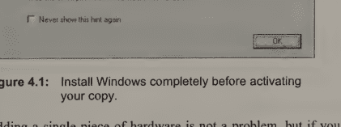

图 4.1：在激活您的副本之前完全安装 Windows。

添加单个硬件部件不是问题，但如果您在完成安装之前激活 Windows，可能需要在完成之前就要求您重新激活。因此，请确保在激活 Windows 副本之前已配置所有磁盘，内存量已设置为所需值，并且已添加额外的网络或声卡适配器。

### 4.3 安装您的第一个 Linux 客户机

Linux 有许多不同的发行版，但安装程序几乎对任何发行版都相似，并使用 CD-ROM 或 DVD。有一些 Linux 操作系统可以通过互联网安装，正如我之前提到的，虚拟机就像一台普通 PC，所以如果您能从硬件盒中完成，也能从虚拟盒中完成。


从 Linux 安装介质（CD-ROM、DVD 或 ISO）启动时，您必须选择要安装的组件并分区和格式化硬盘。让安装程序完成其工作，包括任何重启，直到完成为止。建议以桥接模式运行虚拟机，以便在安装期间（如果您的发行版支持此功能）可以下载可用的补丁和更新。

Tip: 如果在安装过程中出现图形问题，请查看第 13.2 节中的提示，以解决 Linux 安装问题。

安装完成后，将 VMware Tools 安装到您的 Linux 来宾操作系统中。完成后，您就完成了，现在您拥有一个完全功能正常的 Linux 系统。

Tip: 在输入 Linux 用户等配置时，复制文件后立即（如果您的发行版顺序如此）拍摄快照。这样您就可以返回到一切正常的状态，而无需重新进行整个安装。

### 4.4 安装您的第一个 NetWare 来宾

与 Windows 和 Linux 一样，您的 NetWare 安装始于 CD-ROM 或 ISO 文件。在安装过程中，您创建 DOS 分区和 NetWare 系统分区（池和卷 SYS）。让安装完成整个过程，包括重启，并在过程完成后安装 NetWare 的 VMware Tools。

Tip: 在安装 NetWare 时，当图形界面安装要求您输入服务器名称时拍摄快照。如果在创建环境的安装过程中出现任何问题，回退到此点会比重新开始整个安装更容易。

### 4.5 安装 VMware Tools

如果没有 VMware 可用的额外工具，您的虚拟机仍可运行任何受支持的操作系统；但是，您可能会错过重要功能并且性能可能会下降。工具可解决多个问题，并根据您运行的来宾操作系统为虚拟机添加功能。

工具为您提供的一些功能和好处包括：

- 当鼠标指向虚拟机时自动捕获或释放虚拟机输入的能力。
- 使用 SVGA 视频驱动程序增强图形性能。
- 改进的鼠标输入性能。
- 主机与来宾之间的时间同步。
- 用于在主机和来宾之间共享文件的文件夹共享（Windows 和 Linux）。
- 将文件拖放至虚拟机以及从虚拟机拖放。
- 主机与来宾剪贴板之间的复制和粘贴操作。
- 为虚拟磁盘收缩操作做好准备。

工具随 VMware 软件作为 ISO 文件提供，并存储在 VMware 程序目录中。如果打开 ISO 文件，您会看到 VMware Tools 软件位于虚拟 CD-ROM 映像中，采用其所针对的来宾操作系统的原生应用程序格式：Windows 的 setup.exe、NetWare 的 setup.ncf，以及 Linux 的压缩 tarball 和 RPM 包，其中包含安装脚本。

通过选择 VM → 安装 VMware Tools 可为每个操作系统启动工具的安装。这会将 VMware Tools ISO 文件作为 CD-ROM 设备添加到您的虚拟机中。根据来宾操作系统的设置，安装应用程序将自动启动或需要手动启动。有关如何继续为您的操作系统安装的说明在下一节中介绍。

#### Windows 来宾的 VMware Tools

从菜单启动 VMware Tools 安装后，CD-ROM 将在您的 Windows 来宾中可用，如果未禁用自动运行，则会自动启动。否则，您可以从虚拟 CD-ROM 的根目录启动 setup.exe。

对于 Windows NT/XP/2000/2003，您必须以来宾内部的管理员用户身份登录才能安装工具。

通过向导继续 VMware Tools 的安装。工具将被安装，并且显示器、鼠标、SCSI 控制器和 VMXnet 驱动程序的驱动程序将被添加到您的环境中。根据您的 Windows 版本，您可能需要重新启动才能完成安装。

Tip: 工具将显示在 Windows 机器的系统托盘中。如果您在不想让用户知道他们处于虚拟机中的环境中运行 VMware，您可能希望禁用系统托盘图标。您可以通过右键单击系统托盘图标并选择禁用图标来执行此操作。要访问工具设置或启用系统托盘图标，您可以从 Windows 来宾操作系统中的控制面板打开 VMware Tools 配置。

控制面板应用程序可通过阻止访问控制面板的 Windows 策略禁用。或者您可以重命名或删除 Windows 来宾中 VMware Tools 程序目录中的 VMControlPanel.cpl 文件，或以下注册表项中的 VMControlPanel.cpl 值：HKEY_CURRENT_USER\Control Panel\MMCPL。

#### Linux 来宾的 VMware Tools

Linux 的工具有两种格式。这些工具是 RPM 包和压缩 tarball。使用 tar 安装时，无法立即启动安装。您首先必须将文件提取到 Linux 来宾中的临时位置。可能需要挂载您的 CD-ROM。您必须以 root 身份运行安装。

安装 Linux VMware Tools 的步骤包含在以下各节中。您的 Linux 发行版可能存在细微差异。对于许多 Linux 发行版，CD-ROM 是一个名为 /dev/cdrom 的设备。这在下一个命令行示例中使用。如果适用于您的 Linux 来宾，请使用其他设备名称。

1. 使用 su - 命令将您的用户环境更改为 root 用户。

2. 如果未自动挂载，您可能需要挂载 CD-ROM。

```
mount /dev/cdrom /media/cdrom
```

如果 /media/cdrom 不存在，请先创建它。您的发行版也可以使用 /mnt/cdrom 或名为 /media/cdrecorder 的目录作为挂载点。

3. 使用 RPM 安装程序时，使用以下命令启动安装：

```
rpm -Uhv /media/cdrom/VMwareTools-5.0.0-13124.i386.rpm
```

使用实际安装的正确路径和文件名。

4. 使用 tar 安装选项时，将安装文件提取到临时目录并运行安装脚本。如果您将临时目录设为当前工作目录，则无需先将文件复制到硬盘。使用以下命令执行此任务：

```
cd /tmp
tar zxf /media/cdrom/VMwareTools-5.0.0-13124.tar.gz
cd vmware-tools-distrib
./vmware-install.pl
```

安装脚本会提示您输入软件和文档将要安装的目录。以下是安装期间建议的默认目录列表：

| 项目 | 路径 |
|---|---|
| 二进制文件 | /usr/bin |
| 初始化目录 | /etc/init.d |
| 初始化脚本 | /etc/init.d |
| 守护进程文件 | /usr/sbin |
| 库文件 | /usr/lib/vmware-tools |
| 文档文件 | /usr/share/doc/vmware-tools |

5. 安装完 RPM 或提取归档后，您可以使用以下命令卸载包含工具的虚拟 CD-ROM：

```
umount /media/cdrom
```

您也可以为特定安装使用挂载点的正确路径。

6. 下一步是运行 VMware Tools 的配置实用程序。要执行此步骤，请使用以下命令执行脚本：

```
vmware-config-tools.pl
```

您可能会遇到脚本关于编译 vmhgfs（虚拟机主机-来宾文件系统）或 VMXnet（网络适配器）驱动程序的错误。如果是这种情况，请确保已安装 C 编译器和内核源代码。Linux 的 VMware Workstation 安装在第 29 页有详细说明。

脚本会提示您为 X 环境选择屏幕分辨率。从建议的分辨率中选择一个适合您需求的分辨率。

Tip: 如果工具配置脚本建议您需要在 GUI 外安装，您可以通过从命令行提示符执行 init 3 命令或按 Ctrl-Alt-Backspace 来结束图形环境。


当脚本执行完毕后，配置将被写入磁盘，并且来宾操作系统守护进程将被启动。

- 7. 您现在可以通过执行以下命令在 GUI 环境中运行 VMware Tools 应用程序：

```
vmware-toolbox &
```

使用 & 符号将其作为后台进程启动。

#### 适用于 NetWare 来宾的 VMware Tools

带有 VMware Tools 的 CD-ROM 在从菜单启动安装后会自动挂载。您可以执行 volumes 命令来验证卷（VMTOOLS）是否确实已挂载。

当 CD-ROM 未自动挂载时，请验证 cd9660.nss 驱动程序是否已加载（modules cd9660.nss）；否则加载此模块（load cd9660.nss）。这将自动挂载 CD-ROM。

要开始安装工具，请从 VMware Tools CD-ROM 运行 NCF 文件。

```
vmwtools:\setup.ncf
```

您可以在 NetWare 6.x 中的 Logger 屏幕上检查安装进度。加载工具的命令将被添加到服务器启动文件（autoexec.ncf）中，并且 vmwtool.nlm 将被加载。无需重新启动服务器。

提示：工具在 NetWare 的图形用户界面中也可用。例如，您将找到缩小磁盘和配置时间同步的选项。您可以在 GUI 中的 Novell 开始菜单中加载图形环境的工具，但如果您希望它们自动加载，可以将加载它们的 NCF 文件（vmwtoolj.ncf）添加到加载 GUI 的 sys:\java\nwgfx\bin\startx.ncf 中。

### 4.6 设置开机和关机模式

初次使用者必须习惯将虚拟机视为一台真正的 PC，它可以执行您通常用 PC 能够完成的所有操作，包括开机和关机。VMware 虚拟机甚至可以配置得更像真正的 PC。如今，按下 PC 的关机按钮不仅仅是断电，还会关闭操作系统。VMware 也能做到这一点。

要配置此选项，请打开虚拟机设置，并在选项选项卡上选择电源条目。以下设置在图 4.2 中显示，可用：

- 关机按钮：关机或关闭来宾
- 重启按钮：重置或重启来宾

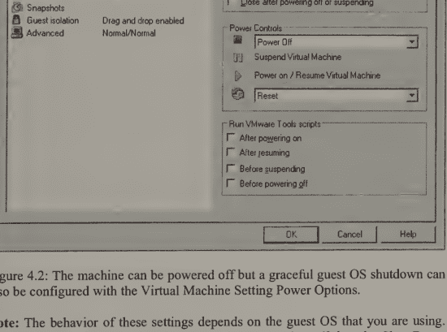

图 4.2：机器可以被关机，但也可以通过虚拟机设置电源选项配置优雅的来宾操作系统关机。

注意：这些设置的行为取决于您使用的来宾操作系统。关机设置始终关闭虚拟机，但关闭来宾设置会向来宾操作系统发送信号以执行关机。如果您的来宾操作系统不支持此功能，则必须像在物理机上一样手动停止来宾。对于使用关机选项运行 VMware Tools 脚本也同样如此；并非所有安装了 VMware Tools 的操作系统都支持此功能。

图 4.2 中设置屏幕中的其他电源选项不言自明：

- 打开此虚拟机后开机。
- 开机后进入全屏模式。
- 关机或挂起后关闭。

使用这些选项来配置无需用户控制即可运行的机器。通过自动启动并进入全屏模式，用户永远不必知道他或她正在虚拟机内部工作。

## 5 VMware ACE 简介

本章向您介绍 VMware 的最新产品。基于 VMware Workstation，该产品提供了一个保证计算环境：ACE。我将从对 ACE 的介绍开始，然后介绍一些使用场景。我还将解释如何开始使用以及如何使用该产品。

用一句话解释 VMware ACE 有两种方式：

- 1) 它是一种用于以受控方式向终端用户分发虚拟机的产品。
- 2) 它是一种结合了 VMware Workstation、映像软件和桌面管理应用程序功能的产品。

第一种解释是 VMware 网站用来描述 ACE 的内容的精简版本。为了了解 VMware ACE 真正为您提供的功能，让我们来看一下第二种解释，这是我提出的。

首先，VMware ACE 为您提供 VMware Workstation 技术：您可以在主机系统上运行虚拟机，为您提供在所有硬件平台上运行的灵活性和能力。与 VMware Workstation 相比唯一的限制是它仅在 Windows 上运行，并且您无法使用所有功能，例如快照或共享文件夹。

使用 VMware ACE，您可以为用户提供一个包含公司标准计算环境工作副本的虚拟机。无需为其硬件进行修改。这就是与映像软件功能进行比较的地方。公司使用映像软件轻松地在所有工作站上安装标准计算环境的副本。

映像软件的问题在于您必须处理不同类型工作站之间的硬件差异。使用 VMware ACE，您可以保留已安装的默认 Windows 安装并运行虚拟机为用户提供所需的功能。实际上，您只需要为整个组织维护一个虚拟机，而不需要维护多个不同的映像。

工作站管理不仅仅意味着您需要将软件部署到计算机上。您还需要管理和保护正在使用的计算机。Windows 策略可以处理其中一部分。诸如 Novell ZENworks、Altiris 或 LANDesk Management Suite 等第三方软件可以处理更高级的工作站管理。

根据所需的安全级别，可能仍需要使用额外的软件。但凭借 VMware ACE 的功能，已有若干重要任务得到处理。可以配置虚拟机可使用的网络连接。机器可以在每次开机时恢复到默认状态等。

而且还有更多；使用 VMware ACE，可以根据需要基于 Active Directory 用户帐户配置谁可以使用虚拟机。密码可用于保护虚拟机的使用，并且可以通过设置过期日期进一步限制使用。

### 用户看到什么？

当一切配置并部署后，最终用户体验会是什么？他或她只会看到一个包含另一个 Windows 环境的应用程序窗口。它看起来很像运行终端服务窗口。主要区别在于实际处理是在本地机器上执行的。但这对用户来说并不是很有趣。

### 5.1 VMware ACE 使用场景

每个查看 VMware ACE 的系统管理员都会看到使用该产品的新方法，就像初次接触 VMware Workstation 的人一样。但我将在此处描述一些使用场景，以让您了解该产品的强大功能：

- 通过以受控方式向工作站分发虚拟机，您可以完全控制用户在其工作站上可用的功能。
- 在教育环境中，可以将虚拟机分发到学生工作站，为他们提供完整的可用计算环境，同时控制工作站上可以使用的内容。
- 可以为临时工作人员提供公司计算环境的完整工作副本，同时控制可以使用的内容以及到期日期。

上述使用场景让您了解了可以用该产品做什么，并希望能帮助您开始思考如何在您的环境中使用 VMware ACE。

### 5.2 开始使用 VMware ACE

作为管理员使用的软件包称为 VMware ACE Manager。您必须首先将此软件安装到工作站，以便创建 ACE 项目并准备部署到最终用户工作站。

注意：必须知道 VMware ACE Administrator 不能与其他 VMware 产品组合安装。此外，不可能直接运行现有虚拟机。机器可以保持完整，但您始终必须配置一个 VMware ACE 项目指向现有配置。因此，如果您想继续像习惯一样使用 VMware Workstation 功能，则需要使用单独的计算机来管理您的 ACE 环境（而且不，您不能在虚拟机内部安装该产品）。VMware ACE Manager 不会干扰 VMware VirtualCenter 以及 GSX Server 和 ESX Server 的远程控制台实用程序。

提示：如果您需要有关 VMware ACE 的额外阅读材料，可以查看在线文档。然而，在以下 URL 上也有一些非常好的资源可用：
www.vmware.com/support/resources/ace_resources.html.

因为您不会同时使用 ACE Manager 运行大量虚拟机，所以硬件要求稍低。您可以同时运行多台机器，但通常您在任何给定时间只使用一个项目中的一台机器。配备 1 GB RAM 的 PC 应该工作良好，除非您创建的 ACE 工作站需要更大的内存。对于客户端计算机，真正取决于您将部署的机器以及所需的资源量。然而，对于您希望在用户计算机上运行的典型 256 MB RAM 的 Windows 虚拟机，用户 PC 应具有 512 MB RAM。

注意：可以使用 VMware Workstation 版本 4.5 的现有虚拟机在 VMware ACE 版本 1.01 中使用，但使用 VMware Workstation 版本 5 创建的 VM 不能用作 VMware ACE 机器。

提示：如果您已有版本 5 的虚拟机希望在 VMware ACE 中使用，请执行以下操作：在版本 5 中创建一个新的虚拟机并选择使用传统模式。然后使用本书中描述的任何物理到虚拟转换技术将一台机器复制到另一台机器。如果您使用可启动的 Linux CD-ROM，甚至无需购买任何工具。

VMware ACE 的大多数技术特性与 VMware Workstation 相同。本章后面会提到一些例外。但虚拟机内部的硬件相同，来宾操作系统的列表也很完整，与 VMware Workstation 版本 4.5 相当。


#### 安装 ACE Manager

VMware ACE 的软件可以从 VMware 网站以下 URL 下载：www.vmware.com/download。您可以获得有效期为 30 天的评估副本。VMware ACE 按用户许可。您可以购买包含 ACE 管理器和四个用户许可证的入门包，价格为 995 美元。单独的 ACE Manager 许可证为 795 美元，单个用户许可证费用为 99 美元（价格截至 2005 年 9 月）。本书撰写时最新版本为 1.0.1 版（VMware-ACE-1.0.1-14996.exe）。

与 2005 年 1 月的初始发布相比，1.0.1 版包含以下新功能：

- BIOS 密码
- 拖放支持
- 增强的全屏显示
- 新的客户操作系统支持

安装本身相当直接。它不需要重新启动，因此您可以立即开始使用。

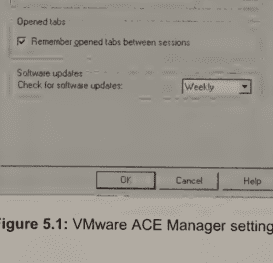

图 5.1：VMware ACE Manager 设置。

安装完成后，您需要查看的一项内容是 VMware ACE Manager 的基本设置。您可以通过“编辑”菜单下的“首选项”访问这些设置。

您可以配置默认路径以放置 ACE 项目配置文件以及虚拟机的位置。VMware ACE Manager 还可以自动检查更新。

您还可以配置与 VMware Workstation 相同的内存设置。

### 5.3 创建 VMware ACE 项目

虚拟机不会直接在 ACE 中运行；它们必须组织在项目中。要开始新项目，请单击 ACE Manager 主窗口中的图标或选择“文件 → 新建项目”。

- 1. 为您的项目提供一个名称以及您希望存储项目文件的位置。
- 2. 接下来，会询问您是否要启动“添加虚拟机向导”。对于此示例，我已选择这样做。
- 3. 用于添加新虚拟机的向导与 VMware Workstation 中的非常相似。一个重要的区别是您可以选择创建一台全新的机器或使用现有机器。创建新的虚拟机与 VMware Workstation 中的此过程相同，只是您不能为虚拟机使用原始物理分区，因为这些分区无法复制到最终用户计算机。
- 如果您选择使用现有虚拟机，请浏览到该机器的 .vmx 文件以将其添加到您的项目中。
- 4. 添加虚拟机向导完成后，将提示您为新创建项目中的虚拟机配置策略。配置策略将在本章后面讨论。

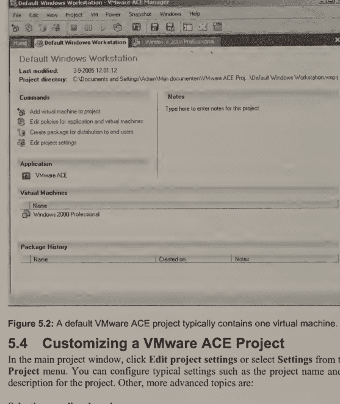

图 5.2：默认的 VMware ACE 项目通常包含一台虚拟机。

### 5.4 自定义 VMware ACE 项目

在主项目窗口中，单击“编辑项目设置”或从“项目”菜单中选择“设置”。您可以配置典型的设置，例如项目名称和项目的描述。其他更高级的主题是：

#### 选择策略域

VMware ACE 机器可以配置为从 Active Directory 域读取其身份验证和策略信息。在“项目设置”窗口的“策略域”选项卡中配置域。

#### 定义离线策略

- 身份验证策略：仅密钥
- 过期策略：仅过期日期
- 设备策略：仅允许的用户列表
- 网络隔离策略：所有设置

#### 为项目启用恢复密钥

如果您将为虚拟机使用密码保护，则需要为此项目创建恢复密钥。恢复密钥使您能够处理密码更改。我将在后面讨论如何执行此操作。此时，在“项目设置”窗口的“恢复密钥”选项卡中选择“创建新恢复密钥”。或者，如果您想为此项目使用另一个项目的密钥，请选择“浏览现有密钥”。

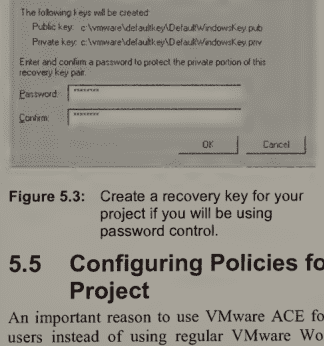

图 5.3：如果您将使用密码控制，请为项目创建恢复密钥。

要创建新密钥，请指定一个名称以便以后识别该密钥，并指定您希望存储包含密钥的文件的路径。

输入将分配给密钥文件并保护此公钥/私钥对的私有部分的密码。当您需要处理来自用户的密码请求时，您需要此密码。

### 5.5 为 VMware ACE 项目配置策略

使用 VMware ACE 将虚拟机部署到最终用户而不是使用常规 VMware Workstation 机器的一个重要原因是您可以为 ACE 环境配置策略。对于普通虚拟机，机器的使用无法受到限制。使用 VMware ACE，可以定义策略以：

- 仅允许指定用户使用虚拟机
- 指定虚拟机内可使用的网络资源
- 配置虚拟机的可移动设备使用
- 控制虚拟机的生命周期

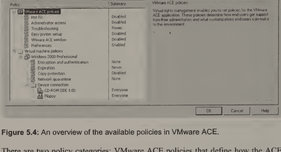

图 5.4：VMware ACE 中可用策略的概述。

有两类策略：定义 ACE 应用程序如何工作的 VMware ACE 策略，以及定义在 ACE 中运行的虚拟机的行为的虚拟机策略。表 5.1 包含可用策略的简要说明。

#### 表 5.1：所有可用 ACE 策略的简要说明。

| VMware ACE 策略 | 默认值 | 描述 |
|---|---|---|
| 热修复 | 已禁用 | 使用此策略允许用户请求有关丢失密码或已过期或受复制保护的机器的帮助。他们可以通过 MAP I 使用已安装的电子邮件应用程序直接发送电子邮件，或自行创建文件并发送。需要为虚拟机启用恢复。 |
| 管理员访问 | 已禁用 | 使用此特殊管理员密码，您可以在特殊应用程序中在最终用户的计算机上运行虚拟机以更改其配置。使用 `vmware -k` 命令启动此模式并提供 `.vmx` 文件的路径和文件名。 |
| 故障排除 | 电源 | 默认情况下启用电源和重置控件。默认情况下禁用恢复到原始状态。启用时，虚拟机部署给用户时会创建原始映像。 |
| 简易打印机设置 | 已禁用 | 启用时，允许用户选择主机打印机将其分配给虚拟机。 |
| VMware ACE 窗口 | 已禁用 | 启用时，以全屏模式运行 VMware ACE 机器。 |
| 首选项 | 已启用 | 允许用户更改虚拟机的以下设置：退出前确认 是/否，暂停或关闭虚拟机电源，以及指定显示设备连接图标的位置。 |
| 虚拟机策略 |  |  |
| 加密和身份验证 |  | 使用此策略为最终用户的虚拟机定义安全性。此策略将在后面详细介绍。 |
| 过期 |  | 使用此策略指定策略是否会过期，如果过期，请指定时间长度，例如天数或过期日期。 |
| 复制保护 |  | 用户可以将虚拟机文件复制到不同位置或另一台计算机。启用此策略后，他们在复制到其他位置时无法运行虚拟机。 |
| 网络隔离 |  | 控制虚拟机对网络的访问。此策略将在后面详细介绍。 |
| 设备连接 CD-ROM | 所有人 | 定义谁可以连接 CD-ROM 设备到虚拟机：所有人、选定用户或由脚本定义。 |
| 设备连接软盘 | 所有人 | 定义谁可以连接软盘设备到虚拟机：所有人、选定用户或由脚本定义。 |


根据表5.1中可用的策略列表，其中有两种需要进一步解释。加密和身份验证策略以及网络隔离策略可用于保护 VMware ACE 虚拟机环境。它们将在以下各节中讨论。

### 5.6 虚拟机加密和身份验证

本策略允许您定义虚拟机的本地安全级别以及谁可以访问此机器。图5.5显示了此策略设置的概览。

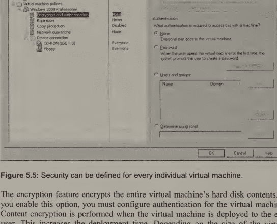

图5.5：可以为每个单独的虚拟机定义安全性。

加密功能会加密整个虚拟机硬盘的内容。如果启用此选项，则必须为虚拟机配置身份验证。内容加密是在虚拟机部署到最终用户时执行的。这会增加部署时间。根据虚拟机硬盘的大小和最终用户计算机的速度，可能需要几分钟到十多分钟不等。

此策略部分的另一个复选框，Protect virtual machine configuration files from user tampering，将虚拟机的配置文件（.VMX）以不可编辑的格式存储。您应始终保持此设置启用。如果未保持启用，则用户可以复制虚拟磁盘文件（包括 vmx 文件）并使用另一版本的 VMware，例如 Workstation 运行它。

当启用加密功能时，需要分配密码管理。您还必须指定虚拟机是否可以恢复。启用此设置后，用户可以请求热修复并要求新密码或重新启用已过期或复制保护的虚拟机。

#### 密码保护

虚拟机可以用密码保护。启动虚拟机时需要此密码。采用最简单的设置，用户在首次启动机器时将被提示输入密码。

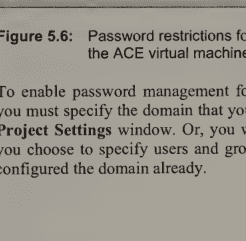

图5.6：ACE 虚拟机的密码限制。

您可以为虚拟机配置想要应用的限制。配置允许您强制执行最小长度以及使用字符混合：大写、小写、数字、符号和标点符号，例如感叹号和冒号来选择密码。如果需要更复杂的规则或密码过期功能，则必须将虚拟机连接到 Active Directory。

要通过 Active Directory 为虚拟机启用密码管理，您必须指定要连接到的域。您可以在项目设置窗口中执行此操作。或者，当您选择为虚拟机指定用户和组且尚未配置域时，系统会自动提示您执行此操作。

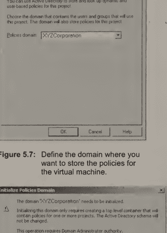

图5.7：定义要存储虚拟机策略的域。

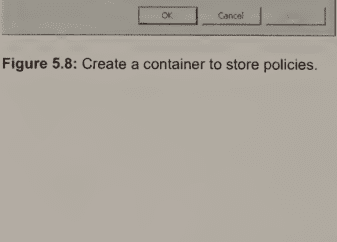

您想要用来存储虚拟机密码的 Active Directory 域必须初始化。这会创建一个用于存储策略的容器。您必须使用管理员权限登录域才能创建此配置。

图5.8：创建容器以存储策略。

### 5.7 虚拟机网络隔离策略

VMware ACE 可以根据 IP 地址和其他 TCP/IP 设置控制虚拟机与本地网络的网络访问。这称为网络隔离。表5.2列出了 VMware ACE 中可用的隔离类型。

表5.2：VMware ACE 网络隔离类型。

| Quarantine Type | Description |
|---|---|
| Static quarantine | Defines a fixed list of networks and machines that can be accessed from the virtual machine. Requires redeployment to change them. |
| Dynamic quarantine | Connects the virtual machine to Active Directory or a web server to read network access policies. |
| Version-based quarantine | Defines network access based on the virtual machine's version. For example, with an outdated machine that is not patched, you can allow access to the patch management server only. |
| Custom quarantine using a script | Advanced option to script access to the network. |

最简单的隔离设置是定义静态配置，定义可以访问的 IP 地址或网络。这允许您仅配置对特定服务器或网络的访问，或拒绝访问这些资源。使用这些策略的一个示例是当您使用 ACE 为学生提供安全可靠的学习环境，并且只希望他们访问运行教育应用程序的教室服务器时。或者，您可以为临时员工提供只能访问其需要工作的数据库服务器的虚拟机。

#### Static quarantine

图5.9显示了一个简单的配置设置示例，仅允许访问 IP 地址为 192.168.1.254 的机器。您还可以指定网络地址和子网掩码，例如 192.168.1.0 和 255.255.255.0，以仅允许或拒绝对该网络上机器的访问。

Tip: You must configure to either allow access or deny access. You can not mix these two options in one policy configuration.

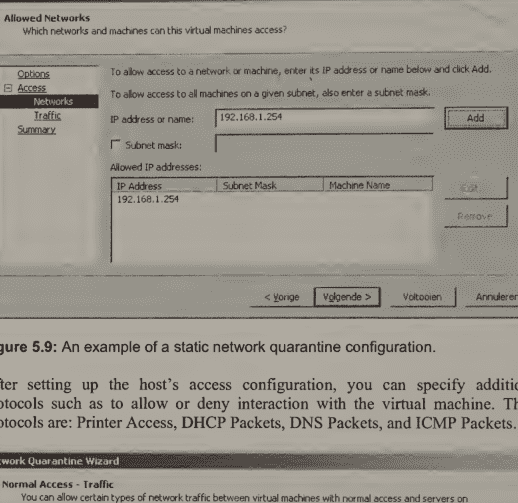

图5.9：静态网络隔离配置的示例。

设置主机访问配置后，您可以指定其他协议，例如允许或拒绝与虚拟机的交互。这些协议为：Printer Access、DHCP Packets、DNS Packets 和 ICMP Packets。

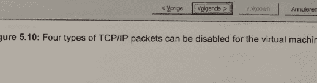

图5.10：可以为虚拟机禁用四种类型的 TCP/IP 数据包。

#### Dynamic quarantine

这种类型的配置允许指定相同的设置，只是还具有简单允许所有访问或拒绝所有访问的功能。其余部分，您指定与静态隔离所述相同的网络功能。您可以指向 Active Directory 或 Web 服务器。

要使其工作，您必须配置自己的 Web 服务器并将向导在服务器上创建的 .vmpl 文件部署到服务器。在动态隔离策略中，您然后指定 Web 服务器上此文件的 URL，例如：

```
http://policyserver/ACE/Windows2000Prof/netpolicy.vmpl
```

此 URL 可以位于服务器上的任何位置，只要用户可以访问该文件即可。

#### Version based quarantine

这种类型的隔离，您可以像前两种隔离类型一样配置相同的网络设置。您还可以通过 Active Directory 或通过 Web 服务器部署此策略。这里的额外配置功能是，您可以配置一条具有受限访问的单独规则，如果虚拟机是较旧版本，则将使用该规则。

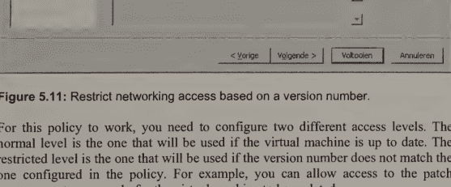

图5.11：根据版本号限制网络访问。

要使此策略工作，您需要配置两个不同的访问级别。正常级别是在虚拟机为最新时使用的级别。受限级别是在版本号与策略中配置的版本号不匹配时使用的级别。例如，您只能允许虚拟机访问补丁管理服务器以便进行更新。

#### Custom quarantine using script

在这种隔离方案中，与前几种一样适用相同的规则，但使用脚本文件来定义将使用什么级别的访问。脚本可以用最终用户工作站支持的任何语言创建。编写或修改这些脚本超出了本入门章节的范围。VMware ACE 提供了示例脚本，完整的文档可在 ACE 在线文档中获得，网址如下：www.vmware.com/supports/pubs.

### 5.8 Deploying the ACE Virtual Machine

当整个项目配置完成且策略设置好后，就是准备虚拟机部署的时候了。以通常方式安装客户操作系统，并安装需要在最终用户环境中包含的所有应用程序。另请将 VMware 工具添加到客户机中。

虚拟机可以使用常规控制启动。我建议您在机器内部安装客户操作系统、应用程序和 VMware 工具时使用此选项。它允许您使用所有正常的 VMware 功能来添加设备、共享文件夹等。另请缩小虚拟磁盘，以确保部署包尽可能小。

当您完成机器的配置并几乎准备好部署它时，使用“在 VMware ACE 中运行”选项运行它。这将向您展示它在最终用户机器上的外观，您可以测试网络和其他策略。

当您完成机器的配置后，请务必在创建部署包之前将其关闭。在一台机器上挂起虚拟机并在另一台机器上恢复可能会导致启动机器时出现问题。另请删除虚拟机存在的任何快照。

Tip: When you want to add any VMware Workstation features to the ACE virtual machine, you need to add them to the .VMX file before creating the deployment package. For example, if you get the message about a UUID already being configured when the machine is moved to a new location. You have probably used a VMware Workstation virtual machine as the source when this happens. You can set the default behavior of the virtual machine to always create a new UUID with this parameter: uuid.action = "create". I suggest that you do not use the keep feature because it could result in machines with the same MAC address on your network.

#### Creating a package

实际部署到最终用户计算机是从虚拟机的打包安装进行的。它将产生一组安装文件和一个包含虚拟机文件 的子目录。文件和路径列在表5.3中。


#### 表 5.3：VMware ACE 包内部的文件概述。

| 文件或路径 | 描述 |
|---|---|
| autorun.inf | 当用户将可移动介质插入诸如 CD-ROM 播放器之类的设备时，此文件中定义的安装将启动。 |
| app.vmpl, config.ini and preferences.ini | 这些文件包含在部署时加密虚拟机所需的信息。 |
| instmsiw.exe | 这是 Microsoft Windows Installer 的安装包。如果尚未安装，可以安装它以使用 .msi 文件进行安装。 |
| package.msi | 这是用于安装 VMware ACE 包的 Microsoft Windows Installer 包。 |
| setup.exe | 此文件可用于手动启动包的安装。 |
| VMware ACE.msi | 这是 VMware ACE 运行时环境的 Microsoft Windows Installer 包。 |
| Project (directory) | 包含虚拟机所需的任何自定义脚本。 |
| Virtual machine directory | 包含虚拟机所有文件的目录。 |

新包向导将指导您完成创建部署包的过程。从项目菜单启动向导，或在项目的[content]
#### 表 5.3：VMware ACE 包内部的文件概述。

| 文件或路径 | 描述 |
|---|---|
| autorun.inf | 当用户将可移动介质插入诸如 CD-ROM 播放器之类的设备时，此文件中定义的安装将启动。 |
| app.vmpl, config.ini and preferences.ini | 这些文件包含在部署时加密虚拟机所需的信息。 |
| instmsiw.exe | 这是 Microsoft Windows Installer 的安装包。如果尚未安装，可以安装它以使用 .msi 文件进行安装。 |
| package.msi | 这是用于安装 VMware ACE 包的 Microsoft Windows Installer 包。 |
| setup.exe | 此文件可用于手动启动包的安装。 |
| VMware ACE.msi | 这是 VMware ACE 运行时环境的 Microsoft Windows Installer 包。 |
| Project (directory) | 包含虚拟机所需的任何自定义脚本。 |
| Virtual machine directory | 包含虚拟机所有文件的目录。 |

新包向导将指导您完成创建部署包的过程。从项目菜单启动向导，或单击项目主窗口中的链接“Create package for distribution to end users”。执行以下步骤创建包：

- 1. 为包提供名称并输入新包的位置。您还可以提供一些描述性文本，以便最终用户在执行包时查看。

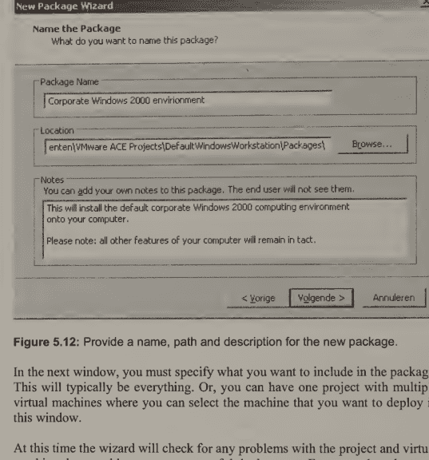

图 5.12：为新包提供名称、路径和描述。

- 2. 在下一个窗口中，您必须指定要包含在包中的内容。这通常是全部内容。或者，您可以有一个包含多个虚拟机的项目，在此窗口中选择要部署的机器。
- 3. 此时向导将检查项目和虚拟机是否存在任何会阻止成功部署的问题。例如，当您尚未在虚拟机内部安装 VMware Tools 时，它会警告您。
- 4. 接下来，您需要选择是否要创建网络包或拆分为文件以适应 CD-ROM 或 DVD 的包。您还可以选择自定义介质并定义自定义大小。例如，您是否可以写入大于默认 650 MB 的 CD-ROM。您还必须为介质指定前缀，默认为 DISC。向导完成后您会看到警告（见图 5.13）。请确保用此正确标签标记您刻录的 CD-ROM 或 DVD，以便 VMware ACE 安装程序识别介质。

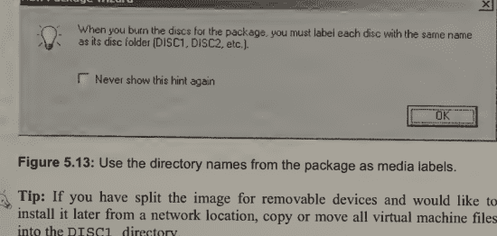

图 5.13：使用包中的目录名称作为介质标签。

提示：如果您已将映像拆分用于可移动设备，并且希望稍后从网络位置安装，请将所有虚拟机文件复制或移动到 DISC1 目录。

- 5. 向导现在将显示即将创建的包的摘要。此摘要还将显示包的大小。

包现在已准备好部署。您可以将此包部署到最终用户，将其放置在网络上或放置在可移动介质上。最终用户只需运行 setup 可执行文件即可开始使用。

注意：用户在其 PC 上只能有一个 VMware ACE 项目。在安装另一个包之前，必须先卸载 VMware ACE 包。此外，您不能在已安装 VMware ACE 的计算机上测试包。您必须使用没有任何 VMware 产品当前安装的计算机。

提示：包将位于“添加/删除程序”列表中。但它不会命名为 VMware ACE。它将使用在 VMware ACE Manager 中使用的初始项目名称进行安装。

安装也可以在没有任何用户干预的情况下使用 Microsoft Windows Installer 可执行文件启动。

```
msiexec -i package.msi DESKTOP_SHORTCUT=1
INSTALLDIR="E:\Packages"
APP_PROPERTIES="INSTALLDIR=""C:\VMware ACE""" /qr
```

在此示例中，应用程序从 E:\Packages 安装到 C:\VMware ACE 目录。桌面快捷方式将被启用（默认），但您也可以指定 0 作为参数来禁用它。您可以指定 /q 参数进行静默安装。我还添加了 r 参数以允许有限的用户界面，确保用户看到正在进行安装。这仍然允许用户取消进程。使用 /passive 参数仅显示进度条。

提示：要卸载包，请使用以下命令运行 Microsoft Windows Installer：`msiexec -uninstall package.msi /qr.`

### 5.9 运行已部署的虚拟机

部署到最终用户计算机后，可以从“开始”菜单或桌面快捷方式启动。虚拟机配置为密码管理时，应用程序首次运行时用户会被提示输入新密码。

机器运行时，用户会看到一个类似于终端服务窗口的状态栏。用户只需单击窗口即可访问主机。由于已安装工具，鼠标指针将无缝地从虚拟机进入主机操作系统。


图 5.14：VMware ACE 中运行的虚拟机看起来类似于终端服务窗口。

提示：如果您不希望用户在虚拟机内部使用 Ctrl-Alt-Del，请在打包部署之前在 .vmx 文件中指定以下命令：`mks.ctrlAltDel.ignore = true.`

根据您指定的访问级别，用户可以从屏幕顶部的菜单中选择诸如向虚拟机添加打印机或附加 CD-ROM 设备等功能。

### 5.10 响应用户的热修复请求

当您将虚拟机配置为允许用户请求热修复的策略时，必须从 VMware ACE Manager 处理这些请求。热修复可以是密码重置请求、重新启用已过期的虚拟机，或重新启用复制到另一位置的机器的请求。

在以下示例中，用户尝试启动受密码保护的虚拟机但忘记了密码。

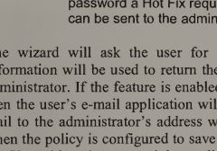

用户单击“Request Password Reset”按钮启动“Request Hot Fix Wizard”。这将引导用户完成创建文件或发送电子邮件的过程。

图 5.15：当用户忘记密码时，可以向管理员发送热修复请求。

向导会要求用户提供其姓名和电子邮件地址。此信息将在管理员处理时用于返回热修复请求。如果策略中启用了通过电子邮件发送请求的功能，则用户的电子邮件应用程序将通过 MAPI 调用使用，将电子邮件发送到策略中指定的管理员地址。例如，当策略配置为将热修复请求保存到文件时，用户可以将文件保存在其网络主目录上。

要处理请求，请在 VMware ACE Manager 的“文件”菜单中选择“Open Hot Fix Request”。单击适当的按钮以选择或拒绝热修复请求，并在处理后将其发送回用户（见图 5.16）。

提示：您也可以直接从电子邮件应用程序打开电子邮件附件。它将启动 VMware ACE Manager 并加载 .VMHR 文件以直接处理请求。

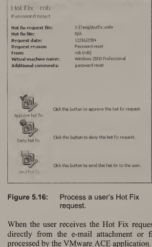

窗口将显示有关用户、相关虚拟机以及请求类型的附加信息。根据请求类型，将提供已批准的热修复对话框。

在密码重置的情况下，您必须打开为项目 earlier 创建的恢复密钥文件并提供恢复密码。为用户输入新密码（两次以确认密码）并将密码提供给用户。它不会自动包含在热修复响应中。

您可以直接从 VMware ACE Manager 存储文件或通过电子邮件发送。

图 5.16：处理用户的热修复请求。

当用户收到热修复请求时，他或她可以直接从电子邮件附件或文件系统打开 .VMHF 文件。然后它将由 VMware ACE 应用程序处理。


## 第 2 部分

### VMware 配置与技巧

我非常喜欢你为我们的虚拟机所做的虚拟存储和虚拟网络工作，以至于我让人力资源部给你发放了一笔虚拟奖金。


鲍勃获得了更多股票期权。

## 6 通用 VMware 配置与技巧

本章涵盖了对所有使用 VMware Workstation、GSX Server 或 ESX Server 的 VMware 技术用户有用的配置设置和技巧。无论您使用的是 Windows 还是 Linux 主机或客户操作系统，本章都将对您有所帮助。第一部分将指引您找到文档和支持，而本章其余部分将涵盖一系列有用的技巧、窍门和说明。

### 6.1 文档与支持

如果您是 VMware 的新手，我强烈建议您在开始部署 VMware 解决方案之前下载官方的 VMware Workstation、GSX Server 或 ESX Server 手册并阅读与您相关的部分。VMware 团队在描述如何开始创建虚拟机方面做得非常出色。他们描述了如何安装客户操作系统、随附的工具等等。

#### VMware 技术网络

所有官方 VMware 网络资源现已整合到 VMware 技术网络（VM TN）中。这是一项可在互联网上匿名免费使用的服务。也可以购买 VM TN 的订阅。这是一项为开发人员创建的服务，提供强大的 VMware 产品套件、支持和升级，订阅费用低廉、方便。

VM TN 订阅包括 Workstation、GSX Server、带 Virtual SMP 的 ESX Server 和 P2V Assistant（企业版）的许可证。GSX Server、ESX Server 和 Virtual SMP 许可证适用于双处理器服务器。VM TN 订阅专为开发用途设计和许可，仅对 ESX Server 有一些许可限制。请在 www.vmware.com/vmtn_eula 查看 VM TN 订阅许可证和支持的条款。

VM TN 订阅特权包括基于网络的支持和产品升级。每个订阅者都可以访问 VM TN 社区和技术资源，以及两次与 VMware 支持专家进行的基于网络的支持请求。VM TN 订阅的年费为 299 美元。可选的媒体套件包含 CD-ROM 和文档，费用为 99 美元（价格截至 2005 年 9 月）。

#### 在线文档

文档的访问通过 VMware 支持网站 www.vmware.com/support/pubs 提供。您可以以 HTML 格式访问每个产品的在线文档，或下载整个手册的 PDF 格式。

如果您需要超出文档范围的支持，可以使用以下四种官方来源之一：

- 1. **VMware 支持网站** 包含非常好的知识库，其中包含来自 VMware 支持团队的支持信息。您可以直接通过以下网址访问知识库：www.vmware.com/kb。
- 2. **VMware 社区讨论论坛** 是在知识库没有提供您所需答案时可以去的好地方。所有产品类别都有论坛，许多 VMware 爱好者积极参与其中，帮助他人充分利用 VMware 产品。社区论坛可在 www.vmware.com/community 获取。
- 3. 就像论坛一样，**VMware 新闻组** 是您可以在网上获取其他 VMware 用户支持的地方。将您的 NNTP 新闻阅读器指向 news.vmware.com 以访问新闻组。
- 4. 在 2004 年 10 月的 VMworld 大会上，首个 VMware 用户组（VMUG）成立。这些用户组由 VMware 支持，但由当地的 VMware 爱好者运营。用户组有自己的会议、活动和自己的互联网论坛。有关所有用户组的信息可在以下网址找到：
    www.vmware.com/vcommunity/usergroups.html

#### 网上其他资源

以下是一些有用的网站列表，当您想了解虚拟化技术总体以及 VMware 具体现状时可以查看。这些网站还包含适用于您的 VMware 环境的技巧和工具。

| 资源 | 网址 |
|---|---|
| Alessandro Perilli 的 Virtualization.info | www.virtualization.info |
| 虚拟化策略杂志 | www.virtual-strategy.com |
| 致力于虚拟化的网站 | www.run-virtual.com |
| Dominic Rivera 的认证网站 | www.vmwareprofessional.com |
| Ulli Hankeln 的 VMware 技巧网站 | sanbarrow.com |
| Massimiliano Daneri 的 VM 页面 | www.vmts.net |
| Ken Kato 的工具项目 | chitchat.at |
|  | infoseek.co.jp/vmware |
| 作者的网站 | www.robbastiaansen.nl |

### 6.2 从命令行运行虚拟机

您可以通过多种方式从命令行启动虚拟机。其中一种是使用 VMware 可执行文件本身。您还可以使用两个独立的可执行文件：vmrun 和 vmware-fullscreen.exe（仅限 Windows）。本章将解释这三种选项。

#### VMware 可执行文件的参数

在主机启动时启动虚拟机非常有用。您可以通过将命令添加到启动脚本来实现，也可以通过脚本启动虚拟机，或从主机系统中的其他应用程序触发它们。

从命令行启动 VMware Workstation 的语法是：

```
vmware [OPTIONS] [\<path_to_config>\<config>.vmx]
```

表 6.1：VMware 可执行文件的命令行开关列表。

| 命令行开关 | 描述 |
|---|---|
| -x | VMware 启动时自动打开虚拟机电源。 |
| -X | VMware 启动时自动打开虚拟机电源并切换到全屏模式。 |
| -q | 当机器关机时关闭虚拟机的选项卡，如果在 vmware.exe 同时运行时没有其他虚拟机在运行，则退出 VMware Workstation。 |
| -s NAME=VALUE | 将指定变量设置为指定值。可以在命令行上使用 -s 开关指定配置文件中有效的任何变量名和值。 |
| -p parentDisk childDisk | 将磁盘指向正确的父磁盘 |
| -m（仅限 Linux 主机） | 在 Linux 主机上以快速切换模式启动程序。 |
| -k KVM_FILE | 指定虚拟机列表。 |
| -v | 显示 VMware Workstation 的产品名称、版本和内部版本号。 |
| \<path_to_config>\<config>.vmx | 不要忘记对文件名中包含空格的文件使用引号；否则路径的某些部分将被视为单独的参数。 |

#### 使用 vmrun 可执行文件

VMware Workstation 版本 5 附带了一个新的可执行文件，您可以使用它从命令行管理虚拟机。

此命令的语法是：

```
vmrun COMMAND [PARAMETER]
```

表 6.2：vmrun 可执行文件的命令和参数。

| 命令 | 参数 | 描述 |
|---|---|---|
| list |  | 列出所有正在运行的 VM。 |
| start | Path to vmx file | 启动 VM |
| stop | Path to vmx or vmtn file | 停止 VM 或 Team |
| reset | Path to vmx or vmtn file | 重置 VM 或 Team |
| suspend | Path to vmx or vmtn file | 挂起 VM 或 Team |
| upgradevm | Path to vmx file | 将 VM 升级到新硬件版本 |

* 当前使用 vmrun 命令启动团队不受支持。

#### 使用 vmware-fullscreen 可执行文件（仅限 Windows）

使用此实用程序，虚拟机可以立即启动并切换到全屏模式。这在虚拟机必须在无需用户干预的情况下启动或您不希望用户知道他们正在使用虚拟机的情况下非常有用。

此命令的语法是：

```
vmware-fullscreen <command> ["path to config file"]
```

表 6.3：vmware-fullscreen 可执行文件的命令。

| 命令 | 变量 | 描述 |
|---|---|---|
| poweron | -s variable=value | 将指定变量设置为指定值。可以在命令行上使用 -s 开关指定配置文件中有效的任何变量名和值。 |
| poweron | -name=<alias> | 指定在 poweroff 和 switchto 命令中使用的别名。 |
| poweron | -directkey=<keyspec> | 指定可用于直接切换到此机器的键。 |
| poweron | -fullscreen | 立即打开电源并切换到全屏。 |
| poweroff | alias or path to vmx file | 关闭指定的虚拟机。 |


| switchto | vmx 文件的别名或路径 | 切换到指定的虚拟机。 |
|---|---|---|
| listvms |  | 列出虚拟机 |
| query |  | 检查虚拟机的状态。 |
| exit |  | 停止所有使用 vmware-fullscreen 命令启动的虚拟机。 |

- 在配置文件中添加以下参数（在线文档中已解释）：FullScreenSwitch.cycleKey、FullScreenSwitch.hostDirectKey 和 FullScreenSwitch.cycleHost。

vmware-fullscreen 实用程序的日志文件信息会写入运行该应用程序的用户临时目录中的日志文件。默认情况下，这将是：c:\documents and settings\<username>\local settings\temp。

可以通过在通用 VMware Workstation 配置文件（C:\Documents and Settings\All Users\Application Data\VMware\VMware Workstation\config.ini.）中添加以下条目来更改路径：

```
fullScreenSwitch.log.filename="<path>"
```

### 6.3 VMware 文件参考

虚拟机由一组文件组成。配置、BIOS 和虚拟硬盘的内容都进入主机 PC 文件系统上的文件。表 6.4 概述了用于虚拟机和一般 VMware 目的的文件。这些文件列表并不完整，因为并非所有文件都有文档记录。该概述是通过分析 VMware Workstation 及其创建的文件得出的。

表 6.4：虚拟机文件参考。

| 文件或文件类型 | 描述 |
|---|---|
| .vmx | 一个包含虚拟机配置的文本文件。参数通过 VMware 应用程序配置。如果需要，可以通过文本编辑器修改参数。手动编辑前请关闭 VMware 应用程序。VMware Workstation 会验证此文件是否存在缺失引号、重复条目等。 |
| .vmxf | 这是存储虚拟机作为团队成员时团队特定信息的附加配置文件。 |
| .vmtm | 虚拟机团队的配置文件。 |
| .vmdk | 所有虚拟磁盘文件的扩展名。 |
| diskname-###.vmdk | 创建快照后，所有对原始磁盘文件的更改都存储在此 REDO 文件中。 |
| <vmxconfig name>.nvram 或只是 .nvram | 包含 BIOS 的非易失性随机存取存储器文件。 |
| .vmsd | 此文件包含有关快照的元数据。 |
| .vmsn | 这是实际的快照文件，其中存储虚拟机的运行状态。 |
| .vmss | 虚拟机挂起状态文件。它包含挂起虚拟机时的内存转储。 |
| .vmem | 虚拟机的内存交换文件。 |
| .lck | 为配置和磁盘文件创建的锁定文件。 |
| .log | 虚拟机所有活动的日志文件。可以通过在 .vmx 配置文件中添加 logging = FALSE 来关闭日志记录。日志文件的名称和位置可以用此参数修改：log.filename = "c:\patch\name.log"。注意：没有日志记录，VMware 将很难分析您可能遇到的任何问题。 |
| vmware-core | 在某种致命错误情况下创建的转储文件。 |
| C:\Documents and Settings\All Users\Application Data\VMware\VMware Workstation |  |
| config.ini | 通用配置文件。 |
| C:\Documents and Settings\All Users\Application Data\VMware |  |
| vmnetdhcp.conf | VMware 主机专用 DHCP 服务器配置文件。 |
| vmnetdhcp.leases | 包含 DHCP 分配的 IP 地址的文件。 |
| vmnetnat.conf | VMware NAT 服务配置文件。 |

### 6.4 VMware 产品世代

如果您使用 VMware 产品已有几年，您可能知道虚拟机并不总是能在虚拟机产品之间或同一产品的不同版本之间兼容。在本节中，我将讨论如何处理不同产品世代以及如何确定虚拟机属于哪个世代。

注意：本节中的信息摘自官方 VMware 虚拟机迁移规划指南，可在以下网址获取：www.vmware.com/pdf/mobility_guide.pdf。

表 6.5 列出了四个当前的 VMware 产品世代。在大多数情况下，在同一世代的 VMware 产品之间转换虚拟机很简单。在某些特殊情况下，例如从 VMware Workstation 迁移到 VMware ESX Server，需要执行一些额外步骤。

表 6.5：VMware 产品及其世代。

| 世代级别 | 属于此世代的产品 |
|---|---|
| 第 2 代 | GSX Server 1, ESX Server 1.0 and 1.1 |
| 第 3 代 | Workstation 3, GSX Server 2, ESX Server 1.5 |
| 第 4 代 | Workstation 4, GSX Server 3, ESX Server 2 |
| 第 5 代 | Workstation 5 |

提示：当产品不属于同一世代时，您当然可以遵循官方指南并升级虚拟机。但是，有时使用本书第 3 部分所述的物理到虚拟转换方法来执行虚拟到虚拟迁移会更容易。

如果您不确定虚拟机的世代，想对其进行一些研究，以下提示很有用：

```
config.version = "2"    VMware Workstation 2
config.version = "6"    VMware Workstation version 3 / GSX Server 2.x
config.version = "7"    VMware Workstation version 4/ GSX Server 3.x
config.version = "8"    VMware Workstation version 5 and 5.5.
```

还有一个标识符用于硬件世代。以下是多年来我在虚拟机中发现的内容列表：

```
virtualHW.version = "2"      VMware Workstation 3 / GSX Server 2.x
virtualHW.version = "3"      VMware Workstation 4 / GSX Server 3.x
virtualHW.version = "4"      VMware Workstation 5 and 5.5
```

VMware Workstation 版本 2 虚拟机可以通过其虚拟磁盘的 .dsk 扩展名轻松识别。.vmdk 扩展名是在 VMware Workstation 版本 3 中引入的。

如果您只有虚拟硬盘的副本（.VMDK），并且不知道它属于哪个硬件世代，则可以搜索文件中的适当字符串。硬件标识存储在虚拟硬盘集的第一个 .VMDK 文件中。

使用 Windows 的 find 命令或 Linux 的 grep 命令在文件中查找虚拟磁盘世代标识符：

Windows

```
find "virtualHWVersion" <path to .vmdk file>
```

Linux

```
grep 'virtualHWVersion' <path to .vmdk file>
```

这将导致一个字符串，例如以下显示版本 4，属于 VMware Workstation 5 的字符串：

```
ddb.virtualHWVersion = "4"
```

注意：对于较旧版本的 VMware Workstation，我没有在配置文件中找到此字符串。它存在于 VMware Workstation 4 和 5 中。因此，由于版本 2 使用 .DSK 文件，未找到此字符串的剩余 .VMDK 文件可能来自 Workstation 版本 3 或 GSX Server 2。

### 6.5 VMware Windows 服务概述

VMware Workstation 在您的 Windows 中添加了三个服务。如果您安装 VMware DiskMount 实用程序，将添加第四个服务。下图显示了“管理工具”中的“服务”应用程序中的服务概述。


DHCP 和 NAT 服务负责主机 PC 上相应的 VMware 功能。它们在第 11 章“网络配置”中进行了说明。虚拟挂载服务属于 VMware DiskMount 实用程序，讨论见第 7.4 节“使用 DiskMount 实用程序”。

#### VMware 授权服务

此服务需要澄清。授权服务负责在启动应用程序的用户不是管理员用户时运行 VMware。此服务检测到用户不是管理员用户并以本地系统帐户启动 VMware。图 6.2 显示了 Sysinternals Process Explorer 的屏幕截图

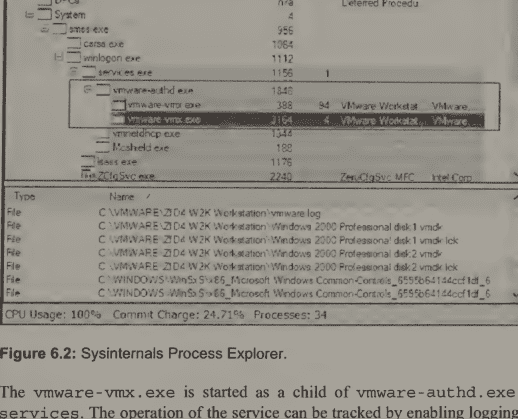

图 6.2：Sysinternals Process Explorer。

vmware-vmx.exe 作为服务下的 vmware-authd.exe 的子进程启动。可以通过在通用 VMware 配置文件中启用日志记录来跟踪服务的运行。此文件名为 config.ini，位于 C:\Documents and Settings\All Users\Application Data\VMware\VMware Workstation。要启用日志记录，请将以下行添加到此文本文件中：


```
vmauthd.logEnabled = "true"
log.vmauthdFileName = "C:\authd.log"
```

以下是一段日志文件的内容，其中虚拟机由用户 Simple 启动：

```
app| Username associated with named pipe: simple
app| Allocating a new session
app| CreateLogonSession: spawn with username: simple
app| (Account is NOT administrator)
app| (Account is interactive)
app| Not mapping drives for acct
```

注意：请勿默认开启日志记录。仅在分析或排查此服务问题时使用，并在完成操作后关闭日志记录。

### 6.6 自定义每日提示

作为有经验的用户，您首先禁用的一项功能就是每日提示屏幕。如果您不想被此信息打扰，则需要按 Ctrl-Alt-Ins 向客户机发送 Ctrl-Alt-Del。视 VMware 的使用方式而定，这些提示可能很有用。例如，当学生在教育环境中使用该软件时，它们就很有用。VMware 显示的消息可以根据用户需求进行自定义，或翻译成他们的母语。

#### 重新启用每日提示

如果您后悔关闭了这些每日提示消息，可以通过选择 Help → Tip of the Day 重新启用此功能。这将打开每日提示窗口，您可以在其中启用“启动时显示提示”复选框。图 6.3 显示了一条自定义的每日提示消息。它以用户的母语（本例为荷兰语）告知用户如何向虚拟机发送重置按键。

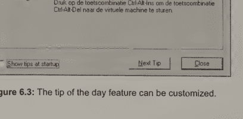

图 6.3：每日提示功能可以自定义。

#### 自定义每日提示

VMware Workstation 显示的提示存储在文件 tip_list.vmsg 中。对于 Windows，它存储在目录 C:\Program Files\VMware\VMware Workstation\messages\en 中。对于 Linux，该文件存储在目录 /usr/lib/vmware/messages/en 中。

这些消息可以通过修改默认提示中的文本或添加新消息来自定义。该文件的格式如下：

```
#### en-tips-ws-windows
tip.0="To send Ctrl-Alt-Del to the guest press Ctrl-Alt-Ins."
tip.1="Press F11 to enter quick switch mode."
tip.2="Press Ctrl-Alt-Enter to enter full screen mode."
...
```

提示按顺序处理，从 tip.0 开始。您可以通过在文件末尾继续编号来添加提示。提示也可以从文件中删除，或通过注释掉（# 在文件开头）防止显示。请确保所有其他行按顺序排列，因为当编号序列中断时，缺少编号之后的提示将不会显示。

注意：新的提示将在重新启动 VMware 后显示。应用程序在启动时读取提示。

注意：安装新版本的 VMware Workstation 时，此文件可能会被覆盖。因此，请务必保留修改后文件的备份，并在升级后验证并恢复您的修改环境。

### 6.7 限制和自定义 VMware Workstation（仅限 Windows）

VMware Workstation 中有两项功能，在终端用户使用 VMware Workstation 时很有用。这些功能在教育环境中很有用，或当终端用户在迁移场景中使用 VMware 时很有用；他们可能正在使用旧版本的 Windows 将桌面上的操作系统迁移到另一个操作系统（Windows 或 Linux）。

提示：对于本段所述的功能，用户对 Windows 环境具有有限权限非常重要。未配置为管理员的用户可以因 VMware 授权守护进程而启动虚拟机。其工作原理在第 6.5 节“VMware services overview”中进行了描述。

#### 管理锁定功能

使用此功能可防止用户执行以下操作：

- 创建新的虚拟机和团队
- 编辑虚拟机和团队配置
- 管理虚拟网络

这三个选项可以通过 Edit → Preferences 中的 Lockout 选项卡单独选择。（参见图 6.4。）

在此屏幕中，您还需要提供一个密码，用户在执行任何被锁定的功能时都需要该密码。

此配置本身也由同一密码保护。

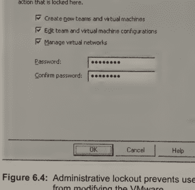

图 6.4：管理锁定可防止用户修改 VMware 环境。

如果忘记密码，可以按照下面注释中描述的说明进行操作。

> ⚠ 注意：VMware 文档指出，在密码丢失的情况下，需要卸载并重新安装整个应用程序。然而，存储密码的配置文件确实存在。在 VMware Workstation 的早期版本中，密码以明文形式存储，但在版本 5 中以加密格式存储。但是，如果用户对 VMware 配置文件具有写入权限，他或她仍可通过修改文件中的 lockout.enabled 选项来禁用锁定功能。

对于 Windows，配置文件名为 config.ini，位于：

```
C:\Documents and Settings\All Users\Application Data\VMware\VMware Workstation.
```

以下文本是来自 config.ini 文件的管理锁定配置参数示例：

```
lockout.enabled = "TRUE"
lockout.createVM = "TRUE"
lockout.editVM = "TRUE"
lockout.manageNetworks = "TRUE"
lockout.passwordHashed = "TRUE"
lockout.password = "ik47fsVUv60uf/oXpD8sSw=="
```

您可以在此文件中配置设置，但不建议这样做。Preferences 面板是 VMware Workstation 中配置这些设置的唯一受支持方式。

#### 限制用户界面

这是一项可按虚拟机启用以限制 VMware 用户界面的功能。它将禁用菜单选项和工具栏按钮。使用此设置的效果如下所述。它仅适用于 Windows 主机：

- 工具栏对终端用户隐藏。
- Power 和 Snapshot 菜单中的所有选项均被禁用。
- 禁用了对虚拟机配置的访问。既可通过 Settings 菜单选项，也可通过状态栏中的图标访问。
- 用户可以通过 .vmx 文件打开其他虚拟机。如果该虚拟机的用户界面未受限制，则界面仅对该机器可用。对于使用受限设置打开的虚拟机，仍保持受限。
- 虚拟机在打开后会自动开机。虚拟机通过关闭客户机操作系统来停止。用户可以点击右上角的关闭图标或选择 File → Exit。这将提示用户关闭机器。Suspend 和 resume 在此模式下不可用。您可以使用快照功能始终从同一位置开始。这将在后面更详细地讨论。

受限用户界面通过虚拟机配置文件中的参数激活。关闭要配置的虚拟机的 VMware 应用程序，并使用文本编辑器打开 .vmx 配置文件。在文件中添加以下行：

```
gui.restricted = "true"
```

使用此参数启动 VMware 将按上述描述限制用户界面。

注意：使用此设置并不是完全的安全功能来禁止用户修改 VMware 环境。您必须将配置文件配置为只读访问，以便用户无法修改文件内容。但是，他们仍可以将文件或其内容复制到新位置或新文件，在那里他们拥有完全访问权限并删除 gui.restricted 参数。

可以通过从 .VMX 文件中删除 gui.restricted 参数或将其设置为 gui.restricted = "false" 来取消受限用户界面。

#### 使用快照始终以相同配置启动

快照功能可以与受限用户界面结合使用，创建一个配置，使用户始终以相同的客户机操作系统状态启动虚拟机。

要创建此类配置，请执行以下步骤：

- 1. 在虚拟机处于关机状态时创建快照。VMware 手册指出可以使用任何状态，但当对正在运行的机器创建快照并将机器设置为在关机后恢复到快照时，机器在关机后仍会进入该状态。
- 2. 关闭虚拟机并配置虚拟机在关机后始终恢复到快照。


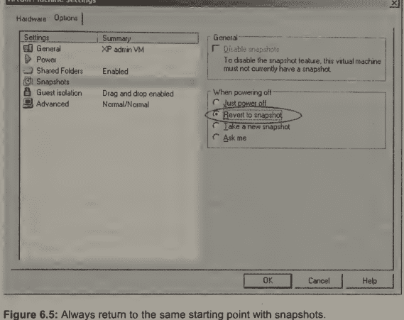

Figure 6.5: 使用快照始终返回相同的起点。

3. 关闭 VMware 应用程序，并在 .vmx 文件中输入 gui.restricted = "true" 参数。

从现在开始，虚拟机将始终以创建快照时操作系统的相同状态启动。

### 6.8 VMware 虚拟机客户机时间同步

主机计算机与客户机之间的时间同步是一种机制，要么始终对你有效，要么始终让你头疼。让我们把它解决掉，并查看时间同步的配置细节。

新的虚拟机启动并从主机操作系统接管时间。它会创建一个 NVRAM BIOS 文件，该文件也用于存储虚拟机 CMOS 时钟的值。就像真正的 PC 一样，虚拟机使用其内部时钟，而你的客户操作系统反过来使用该时间。

技术。这些计算机根据 PC 的电源状态改变处理器的运行速度。

使主机和客户机之间时间保持同步的最佳策略是启用 VMware Tools 中的时间同步功能。你可以从操作系统中工具的图形配置窗口启用此功能，或在虚拟机的 .vmx 文件中设置以下参数。

```
tools.syncTime = "true"
```

然而，关于此同步存在一种奇怪的行为，在 VMware Workstation 手册的某个地方提到过，但并不为人所知。它描述如下：

> ⚠️ 注意：你只能在将客户操作系统中的时钟设置为早于主机上设置的时间时，才可以将客户操作系统中的时间与主机操作系统的时间同步。这可以通过非常简单地测试来验证：将虚拟机的本地时钟提前几分钟，然后启用时间同步。你会看到时间仍保持在未来。将时间设置为早于主机时间的时间，将启动同步，并在几分钟内时间会同步。

> ⚠️ 注意：对于你的虚拟环境，使用一种时间同步方法非常重要。不要在虚拟机使用外部时间源或与其他虚拟机（例如通过 NTP）同步时间时启用 VMware Tools 时间同步。

## 7 虚拟磁盘、软盘和 CD-ROM

使用 VMware 具有成瘾性。一旦开始使用虚拟机，你就会希望一切都被虚拟化。你不想再交换 CD 或格式化软盘。本章描述如何使用虚拟磁盘、如何创建虚拟软盘以及如何使用 CD-ROM 映像。

### 7.1 使用虚拟软盘

使用 VMware Workstation 和 VMware GSX Server 你可以使用虚拟硬盘。这是每个用户在开始使用 VMware 时创建的第一个虚拟组件。你也可以创建虚拟软盘文件。如果主机和客户机之间无法共享文件，这使得在客户操作系统中访问文件变得更容易。

创建虚拟软盘的一种方法是使用 VMware 支持的标准功能。

你只需向虚拟机添加一个虚拟软盘文件，然后在客户操作系统内部格式化并访问软盘。以下图像显示了如何创建虚拟软盘。

图 7.1 中的配置创建了一个扩展名为 .flp 的虚拟软盘。如果现在启动 Windows 或 Linux 客户机，你可以格式化软盘。虚拟软盘默认是预分配的，因此使用上述设置创建的文件大小为 1.4 MB。

提示：已格式化的虚拟软盘 (VirtualFloppy.zip) 可在 www.robbastiaansen.nl 下载。

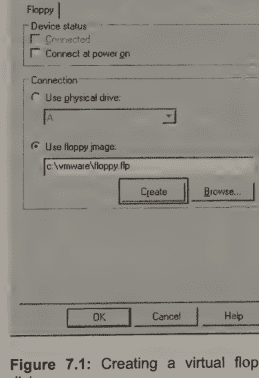

Figure 7.1: 创建虚拟软盘。

#### WinImage

另一种处理虚拟软盘文件的方法是 WinImage 应用程序，可在 www.winimage.com 获取。它支持虚拟软盘文件格式。这使你能够从头创建新的软盘或管理现有的虚拟软盘。使用 WinImage 的虚拟软盘时需要注意的一点是将其保存为非压缩磁盘文件。WinImage 的正常映像类型是具有 .IMZ 扩展名的压缩文件类型；见图 7.2)。因此，使用非压缩的 .IMA 格式并将文件保存为 .FLP 文件，或将 .IMA 文件重命名为 .FLP 文件。


Figure 7.2: 使用 WinImage 的未压缩格式。

#### Ken Kato 的虚拟软盘驱动程序

还有一个工具可以让你在 Windows 中使用驱动器号挂载虚拟软盘。该实用程序由日本的 Ken Kato 创建，可在其网站获取：

```
chitchat.at.
infoseek.co.jp/vmware
```

该工具提供命令行版本和图形版本。图 7.3 显示了浏览到虚拟软盘文件以及使用挂载按钮挂载它有多么简单。


Figure 7.3: VFD 是一个非常酷的实用程序，用于在 Windows 中挂载虚拟软盘。

提示：如果您需要 VMware 环境的启动盘或出于任何其他原因，有两个非常好的网站提供各种启动盘：

- 通过 www.nu2.nu 获取 Bart 的启动盘
- www.bootdisk.com

### 7.2 在虚拟机之间共享通用基础磁盘

这是一个节省宝贵磁盘空间的技巧。例如，如果你的主机 PC 上有多个 Windows 工作站，它们的配置只有轻微不同，它们仍然会占用每个 1 或 2 GB。

注意：这仅适用于 VMware Workstation 版本 4.x 和 VMware GSX Server 3.x。使用 VMware Workstation 版本 5 时默认支持多个快照，这会破坏这种类型的设置。使用多个快照在第 3.5 节中描述。

如果你按照本节提供的步骤进行操作，你的虚拟机可以访问同一个基础磁盘文件，并使用快照 REDO 文件保存对该基础设置的差异。图 7.4 说明了三台虚拟机使用一个通用共享磁盘。


Figure 7.4: 三台机器使用通用基础磁盘。

要创建两台虚拟机共享一个通用磁盘的设置，请按照以下步骤操作：

- 1. 首先创建一台具有你选择的的虚拟机。这是你目录可能的样子示例：

| 名称 | 大小 | 类型 |
|---|---|---|
| nvram | 9 KB | 文件 |
| Windows 2000 Professional.vmdk | 1 KB | VMware 虚拟磁盘文件 |
| Windows 2000 Professional.vmx | 2 KB | VMware 配置文件 |
| Windows 2000 Professional-s001.vmdk | 1.592.064 KB | VMware 虚拟磁盘文件 |
| Windows 2000 Professional-s002.vmdk | 320 KB | VMware 虚拟磁盘文件 |
| Windows 2000 Professional-s003.vmdk | 64 KB | VMware 虚拟磁盘文件 |

- 2. 关闭虚拟机电源并在关机状态下创建快照。此时不要开机。关闭 VMware 应用程序。

- 3. 现在将 .VMDK 磁盘文件移动到主磁盘所在的位置。这包括所有 .vmdk 文件以及 -s001 等文件。将虚拟磁盘文件标记为只读，以便你的任何 VM 都无法更改它们。

我在 c:\vmware 中创建了一个目录结构，我将使用它作为示例路径：

```
c:\vmware
c:\vmware\windows2000master
c:\vmware\windows2000vm1
c:\vmware\windows2000vm2
```

- 4. 为你的第一台虚拟机创建一个目录并将剩余的（.vmx .sav 和 nvram 等）文件移入该目录。原始目录现在为空。

- 5. 现在用编辑器打开第一台虚拟机的 .vmx 文件并找到指定虚拟磁盘的行。在我的示例中，这是 IDE0:0 磁盘：

```
ide0:0.fileName = "Windows 2000 Professional.vmdk"
```

用指向主 VMDK 文件的完整路径编辑此行。

```
ide0:0.fileName =
"c:\vmware\windows2000master\Windows
  2000
  Professional.vmdk"
```

- 6. 使用第一台虚拟机的 .vmx 配置文件打开 VMware。在虚拟机设置中，为此虚拟机锁定快照。


Figure 7.5: Locking a snapshot is only available in Workstation version 4.x and GSX Server 3.x.
图 7.5：锁定快照仅在 Workstation 版本 4.x 和 GSX Server 3.x 中可用。

7. Copy the .vmx file (and if important for your configuration, also the nvram bios file) to the directory for the second virtual machine.
7. 将 .vmx 文件（如果对你的配置很重要，还包括 nvram bios 文件）复制到第二个虚拟机的目录中。

8. You can now power both virtual machines on. They will both read from the shared master disk, but all changes to the disk will go into .REDO files which you will find in the virtual machine directory for each machine. This happens because the .REDO files do not have an absolute path; instead, they are stored in a path relative to the machine (the VM directory itself).
8. 现在你可以同时启动这两个虚拟机。它们都将从共享的主磁盘读取，但对磁盘的所有更改都将写入 .REDO 文件，你可以在每个机器的虚拟机目录中找到这些文件。这是因为 .REDO 文件没有绝对路径；相反，它们存储在相对于机器的路径中（即 VM 目录本身）。

```
ide0:0.redo=".\Windows 2000 Professional.vmdk.REDO_a03292"
```

> Tip: If you use the configuration with a separate swap disk for your guest operating system (as described in section 9.1: “Performance tips”) in combination with this shared disk setup, then assign every virtual machine a separate swap disk and set the disk to be an independent. Keep the swap disk .vmdk file in the directory with the virtual machine configuration files. This way, the swap disk will not be affected by the snapshot. There is no need to keep the page file contents consistent between pre and post Snapshot configurations.
> 提示：如果你在这种共享磁盘设置中同时使用为来宾操作系统单独的交换磁盘的配置（如第 9.1 节“性能提示”中所述），则为每个虚拟机分配一个单独的交换磁盘并将磁盘设置为独立。保留交换磁盘 .vmdk 文件在与虚拟机配置文件相同的目录中。这样，交换磁盘将不受快照影响。无需在快照前后的配置之间保持页面文件内容一致。

> Tip: Copying the virtual machines will make exact copies of everything in the operating system, including the identity, SID, computer name, IP address, etc. All these settings can be re-configured to allow the virtual machines to work simultaneously. If there is no need for the machines to interact with each other (the network, or the host), leave the configuration in place and set the network interfaces to different host-only networks.
> 提示：复制虚拟机会对操作系统中的所有内容进行精确复制，包括身份、SID、计算机名、IP地址等。所有这些设置都可以重新配置以允许虚拟机同时工作。如果机器之间无需相互交互（网络或主机），请保留配置并将网络接口设置为不同的仅主机网络。

For example, you can run a virtual machine on VMnet5 without having to set up VMnet5 in your host operating system. This configuration procedure is explained in section: 11.2 “Configure host-only and bridged networking”.
例如，你可以在 VMnet5 上运行虚拟机，而无需在主机操作系统中设置 VMnet5。此配置过程在第 11.2 节“配置仅主机和桥接网络”中进行了说明。

### 7.3 Using Virtual Disk Manager
#### 7.3 使用虚拟磁盘管理器

This utility enables you to work with virtual disks outside of the VMware Workstation environment. Typically only your guest virtual machines have access to the virtual disks. With this program you can access them directly from the command line. Some of the main features of the VMware Virtual Disk Manager utility are:
此实用程序使你能够在 VMware Workstation 环境之外处理虚拟磁盘。通常只有来宾虚拟机可以访问虚拟磁盘。通过此程序，你可以直接从命令行访问它们。VMware 虚拟磁盘管理器实用程序的主要功能包括：

- Expanding the size of virtual disks.
- 扩展虚拟磁盘的大小。
- Converting virtual disks from dynamically growing to fixed size and vice versa.
- 将虚拟磁盘从动态增长转换为固定大小，反之亦然。
- Create, modify, and defragment virtual disks from a command line utility which you can use to script virtual disk operations.
- 从命令行实用程序创建、修改和碎片整理虚拟磁盘，你可以使用它来脚本化虚拟磁盘操作。

The Virtual Disk Manager used to be only available for Windows hosts but it is now also available for Linux. On Windows, the utility (vmware-vdiskmanager.exe) is installed with VMware Workstation version 5. The default location is:
虚拟磁盘管理器过去仅适用于 Windows 主机，但现在也适用于 Linux。在 Windows 上，该实用程序 (vmware-vdiskmanager.exe) 与 VMware Workstation 版本 5 一起安装。默认位置是：

```
C:\Program Files\VMware\VMware Workstation.
```

For Linux, the executable is called vmware-vdiskmanager and it is located in /usr/bin.
对于 Linux，可执行文件名为 vmware-vdiskmanager，位于 /usr/bin 中。

In this section, I will cover some of the basic features that you might need for your environment. The online documentation covers the full set of features for this utility.
在本节中，我将介绍你环境中可能需要的一些基本功能。联机文档涵盖了此实用程序的全部功能集。

The command line format is as follows:
命令行格式如下：

```
vmware-vdiskmanager OPTIONS diskName | drive-letter:
```

> Note: The drive letter option is only useable if a disk is first mounted with the VMware Disk Mount Utility and it is only available on a Windows host.
> 注意：驱动器号选项只有在先使用 VMware 磁盘挂载实用程序挂载磁盘时才可用，并且仅在 Windows 主机上可用。

#### Table 7.1: Available options for VMware Virtual Disk Manager.
#### 表 7.1：VMware 虚拟磁盘管理器的可用选项。

| Option | Description |
|---|---|
| -c | Create disk. The -a, -s and -t options must also be specified. |
| 选项 | 描述 |
| -c | 创建磁盘。还必须指定 -a、-s 和 -t 选项。 |
| -d | Defragment the specified virtual disk. |
| -d | 对指定的虚拟磁盘进行碎片整理。 |
| -k | Shrink the specified virtual disk (Windows host only). |
| -k | 缩小指定的虚拟磁盘（仅限 Windows 主机）。 |
| -n <source disk> | Rename the virtual disk; need to specify destination disk-type with the -t parameter. |
| -n <source disk> | 重命名虚拟磁盘；需要使用 -t 参数指定目标磁盘类型。 |
| -p | Prepare the mounted virtual disk specified by the drive-letter for shrinking (Windows host only). |
| -p | 为缩小准备由驱动器号指定的已挂载虚拟磁盘（仅限 Windows 主机）。 |
| -q | Do not log messages. |
| -q | 不记录消息。 |
| -r <source-disk> | Convert the specified disk; need to specify destination disk-type with the -t parameter. |
| -r <source-disk> | 转换指定的磁盘；需要使用 -t 参数指定目标磁盘类型。 |
| -x <new-capacity> | Expand the disk to the specified capacity. |
| -x <new-capacity> | 将磁盘扩展到指定容量。 |
| Additional options for create and convert: |  |
| 创建和转换的附加选项： |  |
| -a <adapter> | Adapter type (ide, buslogic or lsilogic). |
| -a <adapter> | 适配器类型（ide、buslogic 或 lsilogic）。 |
| -s <size> | Capacity of the virtual disk. The capacity can be specified in sectors, KB, MB, or GB. The capacity range for IDE adapters is from 100 MB to 128 GB. For SCSI disks this number ranges from 100 MB to 256 GB. |
| -s <size> | 虚拟磁盘的容量。容量可以用扇区、KB、MB 或 GB 指定。IDE 适配器的容量范围为 100 MB 至 128 GB。对于 SCSI 磁盘，此数字范围为 100 MB 至 256 GB。 |
| -t <disk-type> | Disk type id. You can specify the following disk types: 0: single growable virtual disk 1: growable virtual disk, split in 2 GB files 2: pre-allocated virtual disk 3: pre-allocated virtual disk, split in 2 GB files |
| -t <disk-type> | 磁盘类型 ID。你可以指定以下磁盘类型：0：单个可增长虚拟磁盘 1：可增长虚拟磁盘，分成 2 GB 文件 2：预分配虚拟磁盘 3：预分配虚拟磁盘，分成 2 GB 文件 |

The following are a few usage examples for using the Virtual Disk Manager:
以下是使用虚拟磁盘管理器的一些使用示例：

#### 1. Create a new virtual disk
#### 1. 创建新的虚拟磁盘

To create a new virtual IDE disk with a capacity of 10 GB that is fixed sized, and is split into 2 GB files, enter the following command:
要创建容量为 10 GB 的固定大小并拆分为 2 GB 文件的新虚拟 IDE 磁盘，请输入以下命令：

```
vmware-vdiskmanager -c -t 3 -s 10Gb -a ide
idedisk.vmdk
```

#### 2. Increasing the size of an existing disk
#### 2. 增加现有磁盘的大小

To increase the size of an existing disk to 10 GB, enter the following command:
要将现有磁盘的大小增加到 10 GB，请输入以下命令：

```
vmware-vdiskmanager -x 10gb diskfile.vmdk
```

Tip: Expanding the size of a disk does not modify the partitions of your guest operating system installation. You can use the newly created space to create new partitions or use a partition manager inside the virtual machine to resize the partition.
提示：扩展磁盘大小不会修改来宾操作系统安装的分区。你可以使用新创建的空间创建新分区，或在虚拟机内部使用分区管理器调整分区大小。

#### 3. Converting a virtual disk
#### 3. 转换虚拟磁盘

To convert a pre-allocated disk to a dynamically growing disk which is not split into 2 GB files, you enter the following command:
要将预分配磁盘转换为未拆分为 2 GB 文件的动态增长磁盘，请输入以下命令：

```
vmware-vdiskmanager -r fixeddisk.vmdk -t 0
dyndisk.vmdk
```

You must delete the original disk from the virtual machine and add the new converted disk manually, from the VMware Workstation virtual machine configuration.
你必须从虚拟机中删除原始磁盘，并从 VMware Workstation 虚拟机配置中手动添加新的转换磁盘。

### 7.4 Using the DiskMount Utility
#### 7.4 使用 DiskMount 实用程序

Have you ever needed to get a file from a virtual machine which was on your computer? Or, have you had to put a file into the virtual machine? You have to start the virtual machine, log in to it, and then either drag and drop the file, or use Shared Folders (or a networking connection) to copy files back and forth between the guest and the host. And what do you do when Windows does not start any more in your virtual machine and you need to replace a DLL, or want to save a crucial file from the machine? The answers to these questions are covered next for Windows and Linux operating systems.
你是否曾经需要从计算机上的虚拟机获取文件？或者，你是否必须将文件放入虚拟机？你必须启动虚拟机，登录到它，然后拖放文件，或使用共享文件夹（或网络连接）在来宾和主机之间复制文件。当 Windows 在你的虚拟机中不再启动并且你需要替换 DLL，或想从机器中保存关键文件时，你该怎么办？这些问题的答案接下来将针对 Windows 和 Linux 操作系统进行介绍。

#### Windows
#### Windows

You can now also use the DiskMount Utility to access virtual disk files from outside the virtual machine. The utility mounts a virtual disk as a drive letter in your Windows environment, so that you can access it for read and write access from Windows Explorer or any other application directly. The VMware DiskMount Utility supports virtual disk files created with VMware Workstation, VMware GSX Server 2.5.1 and 3.x, and VMware ESX Server 2. Also, it can be installed on Windows 2000/2003 and XP.
你现在也可以使用 DiskMount 实用程序从虚拟机外部访问虚拟磁盘文件。该实用程序将虚拟磁盘挂载为 Windows 环境中的驱动器号，以便你可以从 Windows 资源管理器或任何其他应用程序直接以读写方式访问它。VMware DiskMount 实用程序支持使用 VMware Workstation、VMware GSX Server 2.5.1 和 3.x 以及 VMware ESX Server 2 创建的虚拟磁盘文件。此外，它可以安装在 Windows 2000/2003 和 XP 上。

#### Linux
#### Linux

The DiskMount utility itself is only available for Windows. VMware Workstation for Linux comes with a Perl script named vmware-mount.pl. With this script, virtual disk files can be mounted on a Linux host.
DiskMount 实用程序本身仅适用于 Windows。VMware Workstation for Linux 附带一个名为 vmware-mount.pl 的 Perl 脚本。通过此脚本，可以在 Linux 主机上挂载虚拟磁盘文件。

> Note: The VMware DiskMount utility is provided without support from VMware.
> 注意：VMware DiskMount 实用程序由 VMware 提供，但不提供支持。

The utility is available for download via www.vmware.com/download. This download location also contains a PDF manual with the full documentation to this software.
该实用程序可通过 www.vmware.com/download 下载。此下载位置还包含一份 PDF 手册，其中包含此软件的完整文档。

After downloading and installing the utility on Windows, you can access the utility (vmware-mount.exe) from its installation directory. By default, this is C:\Program Files\VMware\VMware DiskMount Utility.
在 Windows 上下载并安装实用程序后，你可以从其安装目录访问实用程序 (vmware-mount.exe)。默认情况下，此目录为 C:\Program Files\VMware\VMware DiskMount Utility。

Run vmware-mount.exe /h to get a list of all the options that are available. On Linux, you run the utility with the vmware-mount.pl script located in /usr/bin.
运行 vmware-mount.exe /h 以获取所有可用选项的列表。在 Linux 上，你使用位于 /usr/bin 的 vmware-mount.pl 脚本运行实用程序。

To use the utility, follow the guidelines hereafter for Windows and Linux.
要使用该实用程序，请遵循以下针对 Windows 和 Linux 的指南。

#### Windows configuration
#### Windows 配置

```
vmware-mount [driveletter:] [path-to-virtual-disk] [options]
```

Table 7.2: Available options for the vmware-mount utility on Windows.
表 7.2：Windows 上 vmware-mount 实用程序的可用选项。

| Option | Description |
|---|---|
| /d | Deletes the mapping to a virtual drive volume. |
| 选项 | 描述 |
| /d | 删除对虚拟驱动器卷的映射。 |
| /f | Forcibly deletes the mapping to a virtual drive volume. |
| /f | 强制删除对虚拟驱动器卷的映射。 |
| /v:n | Mounts volume N of a virtual disk. |
| /v:n | 挂载虚拟磁盘的卷 N。 |
| /p | Displays the partitions (volumes) on a virtual disk. |
| /p | 显示虚拟磁盘上的分区（卷）。 |
| /y | Opens the virtual disk whether or not a snapshot is in effect. |
| /y | 无论是否生效快照，都打开虚拟磁盘。 |
| /n | Does not open the virtual disk if a snapshot is in effect. |
| /n | 如果快照生效，则不打开虚拟磁盘。 |

The most simple usage scenario is to start the utility with a drive letter and a path to a virtual disk file, as in the following example that mounts a disk to the K drive:
最简单的使用场景是使用驱动器号和虚拟磁盘文件的路径启动实用程序，如以下将磁盘挂载到 K 驱动器的示例：

```
vmware-mount.exe K: "C:\VMWARE\W2K Workstation\W2K Prof.vmdk"
```

Note: Use quotes around the path to the virtual disk file if the path contains spaces.
注意：如果路径包含空格，请在虚拟磁盘文件的路径周围使用引号。

Running the executable without any options displays a list of active disk mounts:
不带任何选项运行可执行文件会显示活动磁盘挂载的列表：

```
vmware-mount.exe
K:\ => C:\VMWARE\W2K Workstation\W2K Prof.vmdk
```

You can dismount a virtual disk with the /d option as in the following example:
你可以使用 /d 选项卸载虚拟磁盘，如以下示例所示：

```
vmware-mount.exe K: /d
```

Tip: When you can not dismount a disk and one of the following messages appears, the disk is probably still in use.
提示：当你无法卸载磁盘并且出现以下消息之一时，磁盘可能仍在使用中。

```
Unable to dismount volume.
To forcibly dismount the volume, use the /f option.
```

#### Linux 配置

```
vmware-mount.pl [option] <disk> <partition> <mount point>
```

表 7.3：Linux 上 vmware-mount.pl 脚本的可用选项。

| 选项 | 描述 |
|---|---|
| -p | 打印分区表。 |
| disk | 虚拟硬盘文件名称。 |
| partition | 要挂载的分区号。 |
| mount point | 分区将被挂载的目录。 |
| -t type | 分区类型。 |
| -o options | 分区挂载选项。 |

图 7.6 显示了在 Linux 主机上挂载的虚拟磁盘文件的示例。当分区被挂载时，可以使用另一个终端窗口或文件管理器访问挂载点中的文件。当您完成访问虚拟磁盘后，按 Ctrl-C。脚本随后将卸载分区。


图 7.6：挂载虚拟磁盘文件功能现也适用于 Linux。

提示：当您无法卸载磁盘并且出现以下其中一条消息时，磁盘可能仍在使用中。

```
Unable to unmount the Network Block Device on the /mnt/vm mount point. Please make sure that no process uses /mnt/vm as its current directory or is accessing a file under this directory.
```

#### DiskMount 限制

使用 VMware Disk Mount Utility 时需要注意以下几点限制：

- 仅当它们使用 FAT (32) 或 NTFS 文件系统格式化时，您才能在 Windows 主机上挂载虚拟磁盘中的卷。
- 如果您挂载具有快照的虚拟磁盘，所有更改在您恢复到快照时将被删除。
- 如果 .vmdk 文件被压缩或标记为只读，则无法挂载虚拟磁盘。
- 如果虚拟磁盘正被正在运行的虚拟机或来自已挂起的虚拟机使用，则无法使用它。

⚠️ 注意：如果您尝试使用 DiskMount Utility 访问已在虚拟机中运行的虚拟磁盘，您将收到类似以下的消息：

```
Unable to mount the virtual disk. The disk
may be in use by a virtual machine or
mounted under another drive letter. If
not, verify that the disk is a virtual
disk file, and that the disk file has not
been corrupted.
```

实际上，如果您使用 .vmx 文件中的参数 disk.locking = "false" 启动虚拟机，您可以访问正在使用的磁盘。然而，这比使用 VMware Dismount Utility 本身的支持程度还要低 ☺。

💡 提示：日本的 Ken Kato 提供了一个实用程序，也可以挂载虚拟硬盘文件。当然它不受支持，但关注他的项目可能会很有趣：chitchat.at.infoseek.co.jp/vmware。

### 7.5 使用原始磁盘分区

虚拟磁盘文件因多种原因非常方便。您可以在主机文件系统上拥有任意数量的它们，并且可以将它们从一台机器复制到另一台机器，等等。那么，为什么使用原始磁盘分区呢？首先让我们看看它是什么。

硬盘至少包含一个分区。操作系统格式化分区后，所有数据都存储在那里。您也可以拥有多个分区。创建多个分区的原因有：分隔数据与操作系统、创建双启动系统，或任何数据不应存储在同一分区中的其他原因。例如，可以压缩或加密一个分区，而让另一个分区不受这些处理的影响。虚拟机可以访问物理硬盘上的分区。这意味着对物理磁盘的所有数据访问都是直接写入和读取的。这不像虚拟磁盘那样将所有内容存储在一个文件中。

可以从添加硬件向导向虚拟机添加分区。

- 1. 通过设置控制面板打开虚拟机配置实用程序，并单击添加按钮以打开向导。您必须做的第一个选择是磁盘类型。选择使用物理磁盘（高级用户）以将现有分区添加到虚拟机。
- 2. 在下一个屏幕中，选择分区所在的物理磁盘，并选择您想要使用整个磁盘还是单独分区。选择使用单独分区将打开下一个屏幕，其中列出分区。
- 3. 在图 7.7 中，从 Linux 安装中选择了两个分区，该安装也在该计算机上作为双启动配置可用。


图 7.7：可以将单独的分区分配给虚拟机。

- 4. 单击下一步进入此配置的最后一步。为此物理磁盘创建的控制文件提供一个名称。

### 7.6 更改 SCSI 总线适配器类型

VMware Workstation 支持两种类型的 SCSI 适配器：LSI Logic 和 Buslogic。一旦您为其中一种适配器配置了机器，所有后续磁盘都将为此类型的适配器创建。

在 VMware Workstation 和 VMware GSX Server 中，SCSI 总线类型可以在虚拟机的 .VMX 配置文件中更改。如果机器配置了 SCSI 适配器，则文件内部可以找到以下其中一行：

```
scsi0.virtualDev = "lsilogic"
```

或

```
scsi0.virtualDev = "buslogic"
```

当您将虚拟机的总线类型从 LSI Logic 更改为 Buslogic 或反之时，虚拟磁盘文件也必须进行修改。VMware Workstation 和 VMware GSX Server 都会自动检测此类更改。如图 7.8 所示，它会询问您是否要更改虚拟磁盘的磁盘类型。


图 7.8：当适配器类型更改时，VMware Workstation 和 VMware GSX Server 可以自动更新虚拟磁盘。

### 7.7 使用 CD-ROM 和 DVD 映像文件

你是否有时感觉自己像个“唱片骑师”？或者，你是否随身携带一个装有所有可能 someday 在某个客户现场需要的 CD 和 DVD 的活页夹？你是否担心在需要时没有随身携带那张 Windows NT Workstation 4 可启动 CD？

那么请考虑使用 CD-ROM ISO 文件。它们不仅可以直接与虚拟机一起使用，还可以在需要时刻录到 CD 上。一个装在小型 USB 2 外壳中的 60 GB 外部笔记本硬盘大约花费你 200 美元。它可以容纳大约 50 到 80 个操作系统 CD-ROM 或 DVD ISO 文件，具体取决于操作系统和文件大小。

许多操作系统制造商通过互联网提供其操作系统 CD-ROM 的下载，有时带有集成服务包。这些所谓的覆盖 CD 将使安装新机器变得更加简单，因为它们包含了服务包。这样做是为了您不必在安装后立即更新服务器。

您也可以为归档或用于 VMware 创建自己的 ISO 文件。最简单的方法是直接从原始 CD-ROM 或 DVD 创建 ISO 文件。这可以使用任何流行的 CD/DVD 软件（如 Nero 和 EasyCD Creator）或互联网上可用的许多 ISO 实用程序来完成。此软件类别还允许您为虚拟机创建自己的 ISO 文件。

请查看以下用于 ISO 实用程序的网站：

- IsoBuster www.isobuster.com
- WinISO www.winiso.com
- Turtleblast ISO Commander www.turtleblast.com
- Undisker www.undisker.com
- Alex Feinman ISO Recorder isorecorder.alexfeinman.com
- Daemon Tools www.daemon-tools.cc

### 7.8 我的虚拟机无法从 CD-ROM 启动

安装操作系统后，当您的虚拟机使用空硬盘启动时，您可能会遇到此错误消息：未检测到可启动 CD。软盘或硬盘已被检测到。

如果您确实分配了用于安装的操作 CD-ROM，请检查虚拟机的 BIOS。很可能您的 CD-ROM 在启动顺序中未列在硬盘驱动器之前。在启动虚拟机时按 F2 进入设置。在 BIOS 中，进入启动菜单选项，并使用 + 和 – 键更改 CD-ROM 设备的启动顺序。


图 7.9：将 CD-ROM 驱动器在 BIOS 中设置为第一个启动设备。


另一种方法是在启动序列期间按 Escape 键进入启动菜单。这会打开一个一次性菜单，您可以在其中选择要从中启动的设备。

图 7.10：通过按 Esc 在系统启动时选择 CD-ROM 作为启动设备。


## 8 性能调优和优化

优化虚拟机的性能是一个经常被讨论的话题。这非常可以理解，因为当多台计算机共享同一硬件时，很容易产生瓶颈。你的所有虚拟机都使用相同的磁盘通道，并且它们都在争夺你机器中的 RAM。本章涵盖了配置设置和技巧，可帮助你充分利用虚拟机环境。它还将向你展示如何监控虚拟机的性能和行为。

第 9.1 节“性能提示”还包含了一些对刚开始使用 VMware 的用户非常有用的提示。

### 8.1 优化虚拟机使用的内存

虚拟机使用来自主机 PC 的物理内存。物理内存是你运行多个虚拟机时面临的限制之一。在 GSX Server 或 ESX Server 中，你必须确保所有虚拟机都有足够的内存可用。对于生产环境中的服务器尤其重要，在那里你需要足够的 RAM 来确保服务器性能良好。

注意：VMware Workstation 的旧版本只能使用最多 1 GB 的 RAM 来运行虚拟机。自 4.5 版本起，可供运行的虚拟机使用的最大 RAM 量为 4 GB。单个虚拟机的最大 RAM 量现为 3.6 GB。在无法保存大于 2 GB 文件的文件系统上计算机中，最大 RAM 量为 2 GB。

如果你是 VMware Workstation 中虚拟机的唯一用户，并且想要运行多个虚拟机，这些虚拟机通常需要的 RAM 超过你可用的数量，这些提示可能会有所帮助：

- 1. 减少虚拟机保留的 RAM 量

如果你安装 Windows 或 NetWare 服务器，安装过程期望服务器（此处为虚拟机）中有大量 RAM。如果内存不足，安装程序会发出警告或可能甚至停止。如果创建虚拟机，会为其分配默认的 RAM 量。但如果来宾操作系统已安装并完全配置，你可以减少分配给虚拟机的 RAM 量。

提示：不要将 RAM 量设置得太低。检查来宾操作系统的实际内存使用情况，以了解其使用多少 RAM。如果分配的 RAM 不足，来宾操作系统将开始使用虚拟内存（交换），这会大幅降低性能。

- 2. 允许虚拟机内存被交换

你的虚拟机使用的内存可能会达到可供虚拟机使用的最大 RAM 量。启动新虚拟机会导致图 8.1 中显示的错误消息。


图 8.1：尝试启动过多机器时会显示错误消息。

你可以从 VM 菜单下的 Settings 中设置 Memory Preferences（见图 8.2），以运行比实际可用内存更多的 RAM 的虚拟机。


图 8.2：VMware Workstation 内存配置。

注意：你可以配置系统以允许大部分虚拟机内存被交换。谨慎操作，因为这可能会大幅降低性能，具体取决于主机 PC 的硬件规格。你可以启动总 RAM 量超过主机 PC 物理 RAM 量的虚拟机。

如果启用此设置，每次启动虚拟机时都会弹出图 8.3 中显示的警告消息。


图 8.3：当启动虚拟机会导致内存交换到磁盘时，会显示警告。

当然这可能会降低性能，但如果你的主机只有 1 GB RAM，却需要运行三个或更多虚拟机，这也可能是一种解决方案。

### 8.2 监控虚拟机性能（仅限 Windows 主机）

你是否曾经想知道哪台虚拟机正在拖慢你的主机？或者，你是否需要了解其中一个来宾产生的网络流量统计数据？你现在可以在 Windows 性能监视器中找到所有这些答案。本节解释了如何使用 Windows 默认实用程序执行此操作，以及如何使用出色的免费软件实用程序获取其他详细信息。要监控你的虚拟机，请从“管理工具”菜单打开“性能”。


图 8.4：可以在 Windows 主机上监控 Workstation 性能。

在性能窗口中，单击工具栏中的加号（见图 8.4）以向你的监控环境添加计数器。“添加计数器”窗口（图 8.5）出现。

⚠️ 注意：性能计数器在 Windows 64 位版本中不可用。如果你想在 64 位平台上监控性能，你需要使用该实用程序的 32 位版本（C:\Windows\SysWOW64\perfmon.exe）。

从“性能对象”下拉列表中选择 VMware。接下来，选择你想要监控的一个或全部计数器。计数器的概述列在表 8.1 中，见本节后面。

选择你想要监控的虚拟机。你可以通过按住 Ctrl 键同时单击机器名称来选择多台机器。

或者，选择“所有实例”单选按钮以监控所有当前虚拟机。如果你打开新的虚拟机，在选择了“所有实例”后，它们不会自动添加。


图 8.5：可以为性能监视器选择单个计数器。

选择计数器时，你可以单击“解释”按钮以获取有关该计数器在性能监视器中向你显示的内容的更多信息。下表包含可用计数器及其说明的列表。

#### 表 8.1：Windows 性能计数器。

| 计数器 | 说明 |
|---|---|
| 来宾锁定内存字节 | 来宾操作系统锁定的模拟物理内存的字节数。 |
| 来宾虚拟物理内存字节 | 虚拟机中模拟物理内存的字节数。 |
| 网络接收字节/秒 | 来宾操作系统通过网络接收的字节数。 |
| 网络发送字节/秒 | 来宾操作系统通过网络发送的字节数。 |
| 网络传输字节/秒 | 来宾操作系统通过网络发送或接收的字节数。 |
| 网络接收数据包/秒 | 来宾操作系统接收的网络数据包数。 |
| 网络发送数据包/秒 | 来宾操作系统发送的网络数据包数。 |
| 网络接收错误/秒 | 来宾操作系统接收数据包时的网络错误数。 |
| 网络发送错误/秒 | 来宾操作系统发送数据包时的网络错误数。 |
| 网络传输错误/秒 | 来宾操作系统发送或接收数据包时的网络错误数。 |
| 网络传输次数/秒 | 来宾操作系统执行的网络操作数。 |
| 来宾物理内存触及百分比 | 来宾操作系统最近使用的模拟物理内存的百分比。 |
| 虚拟磁盘读取字节/秒 | 来宾操作系统执行的磁盘读取操作传输的字节数。 |
| 虚拟磁盘传输字节/秒 | 来宾操作系统执行的磁盘操作传输的字节数。 |
| 虚拟磁盘写入字节/秒 | 来宾操作系统执行的磁盘写入操作传输的字节数。 |
| 虚拟磁盘读取次数/秒 | 来宾操作系统执行的磁盘读取操作数。 |
| 虚拟磁盘传输次数/秒 | 来宾操作系统执行的磁盘操作数。 |
| 虚拟磁盘写入次数/秒 | 来宾操作系统执行的磁盘写入操作数。 |

#### Freeware Process Explorer

另一个监控虚拟机正在做什么的优秀工具是来自 Sysinternals 的 Process Explorer。它是一个免费软件实用程序，你可以从其网站 www.sysinternals.com 下载。你可以使用此实用程序用于多个目的来分析你的虚拟机正在做什么。如果你右键单击 VMware 虚拟机进程（vmware-vmx.exe）并选择属性，你可以检索到有关虚拟机的大量信息。图 8.6 显示了一个示例，你可以在其中看到有关内存使用和 I/O 的一些统计信息。


图 8.6：Process Explorer 也显示性能统计信息。

在 Process Explorer 中，你还可以看到虚拟机正在使用哪些文件。要查看此内容，请选择 View → Lower Pane View → Handles 以查看机器正在使用的文件系统和注册表项。

在虚拟机停止响应的不太可能的情况下，Process Explorer 还可以帮助你识别哪个 vmware-vmx.exe 进程属于哪个文件集。这将使你能够终止该单个进程，而不是整个 VMware 环境。


## 9 优化您的虚拟机环境

本章包含优化虚拟机性能的有用提示，并使虚拟环境更易于使用。

### 9.1 性能提示

几个基本提示可以帮助您在虚拟机中获得更好的性能。首先，请确保始终安装 VMware Tools（尤其是 Windows），因为与 SVGA 显示驱动程序一起使用时，使用访客操作系统的性能会好得多。

- Disconnect the CD-ROM device

如果您的访客操作系统正在尝试访问 CD-ROM 或 DVD 播放器（因为您插入了 CD-ROM，或者因为操作系统或应用程序正在尝试读取不存在的 CD-ROM 上的数据），该过程可能会减慢主机和访客的速度。

当虚拟机完全配置并且操作系统已安装后，进入虚拟机设置，并将 CD-ROM 设备设置为开机时不连接。


图 9.1：将 CD-ROM 默认配置为不连接。

- Run in full screen mode

在 Windows 中，但在 Linux 主机在图形环境中工作时，如果以全屏模式运行虚拟机，则速度会快得多。

- **Disable visual effects and other unneeded features**

Windows 包含许多增强用户体验的功能。但所有这些都会影响性能并占用显示环境资源。在虚拟机中关闭此功能（如果可以不用）。您可以在显示控制面板中找到这些效果。

- **Remove hardware that you don't need**

它不会显著提高性能；然而，如果您从虚拟机中移除不需要的设备，例如声卡适配器和 USB 总线，它将防止访客播放由主机声卡处理的音频。此外，它也不会将 USB 设备附加到虚拟机以供其开始访问。

- **Use a second hard drive in your host**

如果您将在主机系统上运行多个虚拟机，可以通过使用多个硬盘来提高性能。请记住 VMware 介绍中提到的，主机和访客都在同一个物理磁盘上访问其数据。因此，将它们分开或从不同的硬盘运行虚拟机将提高性能，尤其是在访客操作系统中运行磁盘密集型应用程序时。

- **Use a separate disk for your swap files**

就像真正的 PC 一样，为操作系统设置单独的交换分区是个好主意。当然，最好的方法是尽可能防止访客操作系统进行交换，通过为虚拟机分配足够的内存。这是一个高级主题，您可能需要针对特定环境进行研究；然而，如果例如访客需要虚拟内存（交换空间），您可以创建一个固定大小的磁盘来保存交换文件。此外，请确保该文件在主机系统上未被碎片化。

还有另一个使用单独交换文件磁盘的原因，我认为这对高效使用比对性能更重要。如果您为虚拟机分配一个动态增长的虚拟磁盘用作交换磁盘，您会发现它会变成一个大文件。如果您想归档虚拟机，可以通过将其替换为空磁盘轻松减少此交换文件空间。为此，我在 NTFS 分区的虚拟磁盘上创建了一个交换文件，并将其复制到硬盘上的安全位置。如果我要将虚拟机归档到 ZIP 文件中，或者需要将其刻录到 CD-ROM 或 DVD 上，我会用这个空磁盘替换已使用的交换磁盘。这样它就不会占用归档副本的空间。

此方法还能保持虚拟磁盘更小，从而使缩小磁盘更高效。

### 9.2 缩小您的虚拟磁盘

在 PC 中拥有多个 400 GB 硬盘的所有者可以跳过这一段。其他硬盘空间有限的人必须继续阅读，以了解如何节省宝贵的磁盘空间。

您的虚拟硬盘文件会动态增长。它们从几兆字节开始，但可能会变得非常大。安装操作系统后，您的硬盘可能超过 2 GB，即使您安装的操作系统仅占用 1 GB 磁盘空间。虚拟磁盘增长超过预期有几个原因。例如，在安装期间，临时文件会被复制到硬盘，有时会在本地解压。之后它们会被复制到硬盘上的正确位置，临时文件再次被删除。

服务包、补丁和软件应用程序的安装也会在虚拟硬盘上使用临时文件，导致虚拟磁盘越来越大。动态增长的磁盘不会自动缩小。虚拟机会重用虚拟磁盘文件中可用的空间，但最终您的虚拟磁盘文件会变得比您需要的更大。

缩小过程本身最好从访客操作系统中的 VMware Tools 属性窗口开始。

图 9.2 来自 Windows 访客，但相同的窗口和选项也适用于 NetWare 和 Linux。


选择您想要准备的磁盘并单击“准备缩小”。此过程需要几分钟到半小时不等，具体取决于虚拟磁盘的大小，当然也取决于主机硬盘的性能能力。

图 9.2：虚拟磁盘必须先准备好才能缩小。

提示：您可以使用 Virtual Disk Manager 从命令行缩小磁盘。这在第 7.3 节“使用虚拟磁盘管理器”中进行了讨论。

当准备缩小过程完成后，系统会询问您是否要立即运行缩小操作。如果您单击“是”，VMware 将开始创建在缩小过程中使用的临时文件。在缩小操作完成之前，您需要至少有与虚拟磁盘在硬盘上使用的空间一样多的可用硬盘空间。

> 提示：对于所有操作系统，从访客操作系统的硬盘中删除不必要的文件都是一个好主意。删除大文件、临时文件等。有关 Windows 和 NetWare 的具体提示可在第 9 章中找到。

### 9.3 归档您的虚拟机

使用 VMware 非常高效，因为您不需要额外的 PC，并且一台装有新操作系统的新 PC 在不到一个小时内即可启动运行。如果您反复使用相同操作系统的新 PC，您会发现拥有一个可用的虚拟机副本作为起点非常有用。本节将为您提供一些更高效使用 VMware 的提示。

归档虚拟机不仅是为了将其存储在安全位置以便以后使用，也是为了拥有一个可作为未来项目起点的副本。本文所述方法还有助于将虚拟机保存到一个或多个 CD-ROM 或 DVD 上。

> 提示：对于将包含大量数据的虚拟机，请使用拆分为 2 GB 部分的虚拟磁盘文件。这样可以更轻松地将文件归档到多个 CD-ROM（按文件压缩）或 DVD 上。

#### Remove snapshots

在归档虚拟机之前，删除您所做的快照。原始 .vmdk 文件将保持不变，并会创建额外的 s###.vmdk 文件。它们一起占用的磁盘空间比访客操作系统实际使用的更多。

#### Shrink your disks

使用上一段所述的缩小过程来减小虚拟磁盘的大小。如果您选择为访客操作系统的交换文件使用单独的磁盘，现在也可以用原始的较小文件替换该 .vmdk 文件并将其保存在安全位置。

#### Power off your virtual machine

不要在挂起状态下复制或压缩虚拟机。如果在同一台 PC 上使用相同版本的 VMware 恢复虚拟机，它可能会工作。在另一台 PC 上恢复虚拟机，或在未来使用不同的 CPU 或更新版本的 VMware 时，很可能会出现错误消息。此外，您无论如何都必须丢弃已保存的内存状态文件（VMSS）。


#### 退出 VMware

当你复制虚拟机或创建 ZIP 文件时，不要在机器仍在 VMware 中打开时进行操作。归档中会出现锁定文件，这看起来不整洁。

#### 删除任何不必要的文件

你可以删除 .log 文件和 vmware-core 转储文件（如果存在），以在归档或压缩虚拟机目录之前清理它。

## 10 将数据传输到虚拟机和从虚拟机传输数据

你的虚拟环境不会是静态环境。你可能需要在虚拟机中安装应用程序，或者你可能在虚拟机内部创建了需要存储在另一台计算机上的数据。本章描述了几种使用 VMware 内置功能以及其他方法来执行此操作的方法。

要在虚拟机内部安装软件，你可以像在物理计算机上通常那样进行操作。你可以为机器附加 CD-ROM 驱动器、软盘驱动器或 USB 存储设备，以从可移动设备安装软件。但如果安装源位于主机计算机上，你也可以直接访问它。有许多方法可以不仅传输软件，还可以传输数据到虚拟机和从虚拟机传输数据。让我们看看如何操作。

VMware DiskMount 实用程序也提供了一种高级方法。第 7.4 节：“使用 DiskMount 实用程序”详细解释了如何使用此实用程序。

### 10.1 使用剪贴板（仅限 Windows）

Windows 包含一个剪贴板，可以保存各种数据，例如文本文件、图像等。

VMware Workstation 支持在主机和客户机之间或在两个客户机之间传输文本片段（无图像）。

剪贴板的内容可通过默认键（Ctrl-C Ctrl-X Ctrl-V）访问，并可使用 ClipBook 查看器（CLIPBRD.EXE）查看

此功能默认开启，可通过 编辑 → 首选项 → 输入 选项卡 关闭（见图 10.1）。如需禁用，请取消选中该复选框。


### 10.2 使用拖放（仅限 Windows）

拖放功能允许您从主机选取文件或文件夹并将其拖入客户机，反之亦然。要使用此功能，您必须在 Windows 客户机操作系统中安装 VMware Tools。

该过程的工作方式与在主机或客户机操作系统内部拖放文件或文件夹相同。文件将在您指向鼠标指针并释放鼠标按钮的位置放置。文件将存储在虚拟机或主机中的临时位置（%TEMP%\VMwareDnD）。从那里，它将被传输到您放置文件的应用程序，例如 Windows 资源管理器、桌面或任何其他支持拖放文件的正在运行的应用程序。

此功能默认启用。要禁用此功能，请打开虚拟机设置并在选项选项卡中选择访客隔离条目（见图 10.2）。选中复选框以禁用主机和虚拟机之间的拖放。


图 10.2：拖放功能在 Windows 上默认启用。

### 10.3 使用共享文件夹（Windows 和 Linux）

当 VMware 在版本 4 中将此功能引入 VMware Workstation 时，在虚拟机之间传输数据变得非常简单。您可以轻松地在主机操作系统上分配一个文件夹，使其在虚拟机中可见。要使用此功能，必须安装 VMware Tools。

对于 Windows（NT/2000/2003/XP）和 Linux（内核 2.4 及更高版本），均可从虚拟机设置中启用此功能。即使虚拟机正在运行，也可以配置和启用共享文件夹。共享文件夹功能默认启用，但不会配置任何文件夹共享。在共享文件夹窗口中，单击添加按钮指定要附加到虚拟机的主机文件夹。这将启动共享文件夹向导。


图 10.3：为虚拟机创建共享文件夹。

为此共享文件夹指定一个名称，该名称将在客户机操作系统内部使用（对于 Linux 而言区分大小写）。

单击下一步为此共享文件夹指定其他设置：

- 启用此共享（默认选中）
  关闭向导后共享将立即可用。
- **只读**
  仅允许对主机磁盘文件夹进行读取访问。对主机文件系统的其他操作受用于运行虚拟机的用户账户限制。
- **在此会话后禁用**
  关闭虚拟机电源时共享将被删除。

您使用共享文件夹的方式与使用网络共享相同。在 Windows 中，该文件夹在 Windows 资源管理器中作为 Z: 驱动器可用，或通过以下 UNC 路径访问：

```
\\.\host\Shared Folders\<name>
```

（在命令行中使用时请使用引号）

在 Linux 中，共享文件夹可通过以下挂载目录访问：

```
/mnt/hgfs/<name>
```

> 注意：将共享文件夹选项视为在客户机和主机之间传输文件的功能，例如作为在客户机操作系统中安装软件的手段。运行使用客户机数据的应用程序，并意外地从主机访问相同数据，可能导致数据丢失或损坏。

### 10.4 使用虚拟或可移动设备

在无法直接访问虚拟机的情况下，您也可以使用软盘或 CD-ROM ISO 文件等虚拟设备。您还可以将外部 USB 设备（硬盘、存储键、ZIP 驱动器）附加到虚拟机以传输数据。

使用虚拟媒体在第 7 章中描述：“虚拟磁盘、软盘和 CD-ROM”

### 10.5 使用特定于操作系统的网络（所有平台）

前面描述的方法并非适用于所有平台。然而，现代每个操作系统都具备的一项功能是：网络功能。请查阅操作系统的手册以了解如何使用这些功能的所有信息。

#### Windows
使用正常的 Windows 工作组或域网络在主机和客户机之间创建网络共享

#### Linux
您可以使用 Samba（smbclient）将 Linux 工作站连接到 Windows 主机，或使用 Samba 服务器将 Windows 工作站连接到 Linux 主机。另一种方法是使用 SSH，特别是安全复制（SCP），它作为开源软件适用于 Linux 和 Windows。

#### NetWare
当您在 Windows 主机中安装 NetWare 客户端时，可以登录到服务器。或者，您可以使用本地文件访问（CIFS）使用正常的 Windows 网络。对于 Linux 主机，您可以使用 NFS 挂载 NetWare 服务器的卷。

## 11 网络配置

很多人问过我诸如如何从局域网访问虚拟机，或如何在主机内设置路由以在多个虚拟网络之间路由等问题。在本章中，我将讨论一些常见场景，让您了解可能的选项。我将从仅主机和桥接网络的基础知识开始，以确保每个人都了解 VMware 提供的网络选项。

### 11.1 VMware 中的网络适配器

首先，您需要了解正确的术语。桥接适配器是主机 PC 中的物理网络适配器，允许虚拟机与物理以太网进行通信。仅主机适配器是虚拟适配器，会显示在网络设置中的适配器列表中，但它与计算机中的任何物理适配器都没有关系。VMware Workstation 安装的默认设置是您拥有 VMnet1 用于正常的仅主机网络，以及 VMnet8 用于仅主机网络，使用 NAT 访问物理局域网。图 11.1 显示了 Windows 主机 PC 上的典型网络环境。


图 11.1：VMware 默认添加两个网络适配器，VMnet1 和 VMnet8。

### 11.2 配置仅主机和桥接网络

桥接网络默认设置完成。您可以通过选择 编辑 → 虚拟网络设置 查看或编辑桥接网络设置。这将打开虚拟网络编辑器。在摘要屏幕中，您可以概览已配置的 VMware 网络。默认情况下，复选框“自动选择可用的物理网络适配器以桥接到 VMnet0”处于启用状态。


你可以在“自动桥接”选项卡上找到此内容。点击“主机虚拟网络映射”选项卡（见图 11.2）以手动设置网络配置。


图 11.2：桥接网络默认已设置。

选择桥接网络适配器将手动禁用自动桥接过程。使用 VMware Workstation，你可以桥接多个物理适配器，并通过 VMnet 网络将它们分配给不同的机器。例如，当我进行培训时，我使用笔记本内置的网络适配器通过教室虚拟服务器连接到教室网络，并使用 PC 卡适配器将其他虚拟机连接到互联网。

**提示：** 在加载 VMware 应用程序时未在主机 PC 上启用的物理适配器不会显示在虚拟网络编辑器中。例如，如果无线网络适配器未启用，则它不会显示在可用适配器列表中。即使在 VMware 已运行时启用它，也会如此。启用适配器后，关闭 VMware 并重新打开，即可在“可用网络适配器”下拉列表中显示该适配器。

#### 设置额外的仅主机网络适配器

使用虚拟网络编辑器，你可以修改虚拟仅主机网络的配置。它允许你在“主机虚拟适配器”选项卡中向主机 PC 添加网络适配器。如果主机操作系统需要与客户机通信，则需要此额外适配器。当两个客户机通过仅主机网络（比如 VMnet6）通信且主机不参与时，则主机 PC 中不需要虚拟网络适配器。

### 11.3 仅主机网络 DHCP 配置

你 PC 中的仅主机适配器和分配给仅主机网络（默认为 VMnet1）的虚拟机通过主机 PC 内部的此虚拟网络进行通信。虚拟机可以配置为静态 IP 地址，或通过仅主机网络可用的 DHCP 服务进行配置。

要在 Windows 主机上配置 DHCP 服务，请选择 编辑 → 虚拟网络设置 并选择 DHCP 选项卡（见图 11.3）


显示仅主机网络适配器的配置 DHCP 范围以及 DHCP 服务的状态。点击“添加新”按钮为虚拟仅主机网络创建一个新的地址范围。这不会自动在主机 PC 中创建虚拟网络适配器。但是，创建新适配器会创建 DHCP 范围。

图 11.3：可以为仅主机适配器配置 DHCP。

DHCP 地址范围的属性页面允许你修改用于虚拟机的地址。默认情况下，地址范围从 .128 开始，到 .254 结束

在属性页面中，你还可以设置虚拟机的租约期限。默认设置为 30 分钟，最大租约时间为 2 小时。


图 11.4：默认 DHCP 地址范围和租约期限。

在 Windows 主机上，DHCP 配置存储在名为 vmnetdhcp.conf 的文本文件中，位于 C:\Documents and Settings\All Users\Application Data\VMware。DHCP 租约存储在同一目录下名为 vmnetdhcp.leases 的文件中。在 Linux 主机上，配置存储在名为 dhcpd.conf 的文件中，该文件位于 /etc/vmware 中的虚拟网络适配器配置目录下的 dhcpd 子目录中。对于默认安装，这是指 /etc/vmware/vmnet1/dhcpd。对于 Linux 主机，可以通过编辑此文件来修改仅主机 DHCP 配置。

注意：在修改配置文件之前，务必先制作备份副本。

### 11.4 使用 NAT 将虚拟机连接到网络

桥接网络是连接虚拟机到网络的最简单方法之一。然而，有时你无法使用此方法，因为网络上没有足够的可用地址，或出于安全原因不允许将新 PC 直接连接到网络。在这种情况下，你可以使用网络地址转换将虚拟机连接到网络。

#### 什么是 NAT？

使用 NAT，你的虚拟机会将 TCP/IP 数据包发送到主机 PC 上的 NAT 服务。该服务会将源 IP 地址更改为其在本地网络上使用的自己的 IP 地址，并将数据包发送到目的地。当数据包从目的地返回时，NAT 服务会使用其转换表将 TCP/IP 数据包发送到正确的虚拟机。这样，你的虚拟机可以在内部使用自己的 IP 地址，它们发送到网络上的所有流量看起来都好像来自主机 PC。

#### 配置 NAT

要为虚拟机设置 NAT，请通过 编辑 → 首选项 打开虚拟网络编辑器并点击 NAT 选项卡。

如果服务被禁用，VMnet 主机下拉框将显示 Disabled。将此设置为你想要启用 NAT 的仅主机网络。此功能的默认虚拟网络为 VMnet8。


图 11.5：NAT 默认配置在 VMnet8 上。

启用 NAT 并不会自动启动 VMware NAT 服务。点击 应用 或 确定 以激活 NAT 配置时，该服务才会启动。

这是设置 NAT 的最简单方法，因为你无需在虚拟机上配置 IP 地址。NAT DHCP 配置可从 DHCP 配置选项卡访问。DHCP 已在前一段中讨论。


图 11.6：可以为 NAT 配置启用 DHCP。

注意：使用端口映射时使用 DHCP 并不可行，稍后会讨论。它不是必需的，但拥有固定地址可保证每次都映射到同一台虚拟机。

启用 NAT 后，将虚拟机的网络接口指向 NAT 网络配置，或你已配置的自定义 NAT 网络（VMnet8 以外的网络）。你的机器现在可以通过主机计算机上的 NAT 服务访问网络。它们将使用该主机作为 DNS 服务器。NAT 服务作为来自客户机操作系统内部的 DNS 请求的 DNS 代理工作。

在 Windows 主机上，NAT 服务的配置存储在名为 vmnetnat.conf 的文本文件中，位于 C:\Documents and Settings\All Users\Application Data\VMware。在 Linux 主机上，NAT 配置存储在名为 nat.conf 的文件中，该文件位于 /etc/vmware 中的虚拟网络适配器配置目录下的 nat 子目录中。对于默认安装，这是指 /etc/vmware/vmnet8/nat。对于 Linux 主机，可以通过编辑此文件来修改仅主机 NAT 配置。

注意：修改配置文件前务必先制作备份副本。

#### 使用端口映射从局域网访问虚拟机

使用网络地址转换配置后，你的虚拟机会使用主机内部的内部 IP 地址，该地址在本地网络上不可用。这意味着局域网上的 PC 无法直接与在你的虚拟机上运行的服务通信。这可以是各种 TCP/IP 服务，或其他服务，如 Windows 文件共享或打印。

局域网上的 PC 只能向主机 PC 的 IP 地址发送数据包，因为这是 NAT 配置后所有虚拟机使用的地址。图 11.7 所示的示例中，一台 PC 向主机的 IP 地址（端口 80）发送数据包以访问 Web 服务器，但主机并未运行 Web 服务器。因此，发送方会收到一条消息，告知其服务不可用。


图 11.7：没有 NAT，虚拟机无法被访问。

使用端口映射，你可以构建一种配置，使得在主机“外部”网络适配器上接收到的特定端口的数据包可以被发送到正确的虚拟机。在前面的示例中，将 NAT 服务配置为将地址 192.168.1.1 的端口 80 的所有传入流量转发到 192.168.244.128，实际上使局域网上的 PC 能够与虚拟机上运行的 http 服务通信。发送方可能会认为 Web 服务器位于地址 192.168.1.1，而实际上它位于虚拟机的地址 192.168.244.128 上

图 11.7 还显示了 VMnet8 的仅主机网络适配器。该适配器正被主机操作系统用来与客户机操作系统通信，其方式与你通常使用仅主机网络的方式大致相同。

要在 Windows 主机上设置此配置，请点击虚拟网络编辑器 NAT 选项卡上的 编辑 按钮。在 NAT 设置窗口中，点击 端口转发 按钮以定义端口映射。

你可以在 TCP 或 UDP 端口映射之间进行选择。确保为你的服务设置正确的流量类型。在端口转发屏幕中，在 TCP 或 UDP 章节中点击 添加。


这将弹出一个映射配置对话框。在图 11.8 的示例中，所有端口 TCP 80 的入站流量都被转发到地址 192.168.244.128。


图 11.8：可以转发单个端口。

对于 Linux 主机，端口转发必须在 /etc/vmware/vmnet8/nat 中的 nat.conf 文件中配置。以下是将入站 TCP 端口 80 映射到 IP 地址为 192.168.2.10 的虚拟机的示例：

```
[incomingtcp]
80 = 192.168.2.10:80
```

对于 UDP 端口映射，请在 [incomingudp] 标题下输入配置条目。

#### 使用静态地址，不要使用 DHCP

使用这些端口映射，您必须指定需要发送数据包的 IP 地址。最好为虚拟机使用静态分配的 IP 地址，而不是通过 DHCP 动态分配的地址。如果地址发生变化，端口映射将指向错误或不存在的服务器。

对于许多 DHCP 服务器，您仍然可以根据机器的 MAC 地址分配 IP 地址。您无法使用 VMware DHCP 服务执行此操作。

### 11.5 路由到 LAN 和自 LAN

如果您以桥接模式运行虚拟机，则访问 LAN 时无需路由。它们是网络的一部分，就像任何其他具有自己的 MAC 地址和 IP 地址的真实 PC 一样。您的主机和客户机能够相互通信，网络上的任何 PC 都可以访问您的虚拟机。这是用于从现实世界访问虚拟机的最简单设置。

如果您想设置路由，例如因为您需要为虚拟环境提供另一个子网，或者只是想测试路由配置，您有多种选择。您可以通过使用 Windows 2000 Server、Windows Server 2003 或 Linux 主机 PC 在 LAN 和虚拟环境之间创建路由器来实现。

注意：只有在咨询网络管理员后才这样做，如果您参与的是添加路由器可能产生严重影响的更大网络。还请注意，您在虚拟环境中运行的任何域控制器等都将显示在 LAN 上，具体取决于您如何配置路由器。这可能会导致网络上其他管理员或用户出现不想要的结果。

图 11.9 显示了路由配置的示例，其中主机 PC 的操作系统包含路由软件，用于从局域网路由到虚拟仅主机网络。


图 11.9：在主机 PC 上设置路由的配置。

此示例中的 IP 地址为两个私有网络（192.168.1.0 和 10.0.0.0）所选。对于您的配置，您可以选择环境中可用的网络。

提示：我见过很多人开始配置物理和虚拟适配器时，在访问虚拟机和 LAN 时遇到问题。务必确保所有适配器（物理，包括无线、VMnet1 和 VMnet8）位于不同的 IP 子网中。一个在不同以太网段上具有两个网络适配器的真实 PC，但在两个 LAN 上都使用相同的 IP 子网，将不知道将数据包发送到哪里。

将其与两个路牌都指向巴黎的路口进行比较。您也会对选择哪个方向感到困惑；除非它们都指向罗马，当然，因为众所周知，所有的路都通向罗马！，配置为相同子网的具有物理适配器和/或更多虚拟适配器的 PC 将有相同的问题，并阻止您访问物理或虚拟网络上的主机。

### 11.6 虚拟机之间的路由

在上一节中，我讨论了如何设置从 LAN 到虚拟机的路由。一种使用该方法的情况是，当您想测试从生产网络中的机器访问虚拟测试环境时。也可能存在不希望或不需要在物理网络上额外路由器的情况。这就是为什么创建一组只能在主机内通信的虚拟网络是有用的，网络流量永远不会离开主机机器。

您可以根据需要构建此场景的复杂程度。您可以在主机操作系统内运行路由器，在两个虚拟网络之间进行路由。或者，您可以在虚拟机中运行路由器来处理虚拟网络之间的路由。对于这两种配置，您需要额外的仅主机网络适配器。但首先，让我们看看这些配置是什么样子的。再次，我选择了私有网络范围内的 IP 地址，您需要将其更改为您自己的环境中的适当地址。


图 11.10：使用主机操作系统路由在虚拟网络之间进行路由。

首先，让我们看看图 11.10 中的最简单方法。这是主机操作系统使用两个虚拟网络适配器，并且每个虚拟机位于不同的仅主机子网中的情况。您可以看到我在本示例中配置了三个子网。物理网络适配器是局域网的一部分，但未被任何虚拟机使用。因此，没有任何流量进入物理网络从而干扰任何东西。而且网络上也不会出现额外的路由器。

在本示例中，我仍然使用主机操作系统进行路由（Windows Server 或 Linux）。该路由器在 10.0.0.0 和 172.16.0.0 子网之间转发数据包。为此，您必须添加第二个 VMnet2 仅主机适配器。下一节将解释如何执行此操作。

此外，请不要忘记将第二个 VMnet2 仅主机适配器分配给虚拟机 2（图 11.10 中称为）。您可以通过进入虚拟机配置来实现：VM → 设置。选择 NIC 并选择在此虚拟机中使用的自定义网络。


图 11.11：将自定义适配器配置为 VMnet2。

现在，让我们看看设置两个虚拟机之间路由的另一种可能场景。花点时间理解图 11.12。


图 11.12：使用客户机操作系统路由软件进行路由。

在本示例中，我在主机 PC 上添加了第三台虚拟机。主机操作系统再次具有未被使用的物理适配器和两个虚拟仅主机适配器（VMnet1 和 VMnet2）。主机操作系统仍可访问两个虚拟网络。但主机上未加载路由软件。

这次路由由新的虚拟机执行。该机器中的客户机操作系统（Windows、NetWare 或 Linux）具有两个网络适配器，它们都位于不同的虚拟仅主机网络中。客户机操作系统负责 10.0.0.0 和 172.16.0.0 子网之间的路由。

这还不够复杂吗？如果您回答“否”，请查看图 11.13 并发挥想象力，想象那里发生了什么，以及您最多可以使用九个虚拟仅主机网络实现多远。


图 11.13：路由配置可以复杂到您想要的程度。

#### 添加第二个仅主机适配器

如果您想设置此处解释的两种路由示例之一，您需要在主机 PC 上添加第二个仅主机网络适配器。

> 提示：如果主机操作系统无需与仅主机虚拟机交互，则无需向主机添加第二个虚拟仅主机适配器。换句话说，您的虚拟机都可以配置为在 VMnet6 上运行并相互通信，而无需向主机 PC 添加 VMnet6 网络适配器。

#### 在 Windows 主机上

要在 VMware Workstation 中向主机 PC 添加适配器，请打开 编辑 → 虚拟网络设置。选择 主机虚拟适配器 选项卡。单击 添加新适配器 按钮。


#### 虚拟网络编辑器

下面的列表显示了哪些虚拟网络具有主机虚拟适配器 - 允许主机计算机连接到网络的虚拟以太网适配器。

| 网络适配器 | 虚拟网络 | 状态 |
|---|---|---|
| VMware 网络适配器 VMnet1 | VMnet1 | 已启用 |
| VMware 网络适配器 VMnet8 | VMnet8 | 已禁用 |

图 11.14：可以使用虚拟网络编辑器添加虚拟适配器。

选择您要使用的虚拟主机专用网络，范围从 VMnet2 到 VMnet9。请注意，VMnet8 未列出，因为它默认由 VMware 的 NAT 网络使用。


图 11.15：选择新的虚拟网络。

现在在“主机虚拟适配器”列表中会出现一个新设备。单击“确定”保存此配置并关闭虚拟网络编辑器。现在从主机操作系统的控制面板打开“网络连接”。一个新的适配器“本地连接 #”已添加到您的 PC。为方便起见，将此适配器重命名为 VMware 网络适配器 VMnet2，以便更轻松地区分您正在配置的适配器。此时，还为将用于此第二个虚拟网络的适配器分配子网范围内的 IP 地址。

#### 在 Linux 主机上

要在 Linux 主机上修改 VMware 环境的网络配置，您必须运行 vmware-config.pl 脚本。该脚本将运行与您在初始 VMware Workstation 配置期间看到的类似向导的问题。该脚本允许您配置桥接网络、主机专用网络和 NAT。

#### 设置具有两个主机专用适配器的虚拟机

如果您要创建让来宾操作系统（图 11.13 中的虚拟机 3）负责路由的设置，则必须为该机器设置两个虚拟主机专用网络适配器。

> 提示：在来宾操作系统中，重命名网络适配器（Windows）或通过其配置识别适配器，以便能够区分此已存在的适配器和您在此处添加的新适配器。

打开虚拟机的配置 VM → 设置。单击“添加”向您的虚拟机添加新的以太网适配器。


图 11.16：将第二个网络适配器添加到虚拟机。


图 11.17：在 VMnet2 上向虚拟机添加第二个适配器。

在“添加硬件向导”中，选择“自定义网络连接”并选择将在此虚拟机中使用的虚拟主机专用网络。如果您现在重新启动虚拟机，来宾操作系统将找到一个新的适配器。重命名此适配器（在 Windows 中），以便轻松区分不同网络中的两个适配器。这将使为这些适配器配置路由变得更容易。

### 11.7 为虚拟机配置 MAC 地址

世界上的每个网络适配器都应有一个唯一的媒体访问控制（MAC）地址。您的虚拟机也是如此。本节解释 MAC 地址是如何分配的以及如何手动配置它们。

首先，我们来看看 MAC 地址是什么。从技术角度来看，它们是 6 字节标识符，可唯一标识每个网络适配器。前三个八位字节保留用于制造商的识别代码，最后三个八位字节为制造商出货的每个网络适配器形成唯一标识符。

您可以通过本书涵盖的三种来宾操作系统中的以下命令找到网络适配器的 MAC 地址：

- Windows ipconfig /all
- Linux ifconfig
- NetWare config


图 11.18：MAC 地址和制造商标识符的示例。

制造商标识符在公共注册表中注册。它们称为组织唯一标识符（OUI），由电气和电子工程师学会（IEEE）的注册机构管理。可以根据 MAC 地址的前三个字节或名称搜索制造商。将浏览器指向以下 URL 以执行搜索：

```
standards.ieee.org/regauth/oui/index.shtml
```

搜索关键字“VMware”告诉我们 VMware 注册了三种可能的 MAC 地址范围：00-05-69、00-0C-29 和 00-50-56。最后一个是所有当前 VMware 软件使用的地址。主机计算机中的虚拟主机专用适配器和来宾中的以太网适配器将使用此 00-50-56 前缀。对于主机专用适配器，MAC 地址中的最后一个八位字节对于 VMnet 1 为 01，对于 VMnet 2 为 02，以此类推。

#### 自动生成的 MAC 地址

无需担心虚拟机的 MAC 地址是否唯一，因为在几乎所有情况下，它们都是唯一的。VMware 会为您的虚拟机分配唯一的 MAC 地址。不能保证所有虚拟机（可能在多台计算机上）的所有 MAC 地址都是唯一的。如果您遇到任何问题，可以手动创建。手动生成的 MAC 地址将在本节后面讨论。

指定 MAC 地址将自动生成的 .vmx 参数如下：

```
ethernet0.addressType = "generated"
ethernet0.generatedAddress = "00:0c:29:7a:39:41"
ethernet0.generatedAddressOffset = "0"
```

首先，您需要了解 VMware 创建 MAC 地址的方式。我们先从别的东西开始：每个虚拟机获得的唯一标识符。此 16 字节值分配给每个虚拟机以唯一标识它。它在 .vmx 配置文件中的 uuid.location 和 uuid.bios 参数中列出。

```
uuid.location = "56 4d 2d d3 cc 9d a2 39-7c 4d 26 f0 1f 76 c1 80"
uuid.bios = "56 4d 2d d3 cc 9d a2 39-7c 4d 26 f0 1f 76 c1 80"
```

此值的最后三个字节用作虚拟机网络适配器的三字节 MAC 地址部分。使用上面的示例值，虚拟以太网适配器的 MAC 地址将为：

00-50-56-76-c1-80

注意：对于多个适配器，最后一个字节会为每个适配器增加 10 十进制（0A 十六进制）。两个新适配器将获得以下地址：00-50-56-76-c1-8A 和 00-50-56-76-c1-94。对于第一个适配器，有一个名为 ethernet0.generatedAddressOffset = "0" 的 .vmx 参数，在前面的示例中，对于另外两个适配器，其值将为“10”和“20”。虚拟机的唯一标识符通常不会更改。当您将虚拟机的文件移动到不同的位置，或修改 .vmx 文件的名称时，VMware 会询问您是否要创建新的标识符或保留旧的标识符。


图 11.19：移动或复制虚拟机后创建新的唯一标识符或保留旧的标识符。

如果您保留现有标识符，则没有任何变化，MAC 地址保持不变。创建新标识符会更改 uuid.bios 和 uuid.location 值，因此会创建新的 MAC 地址。

注意：您可以配置虚拟机的行为，使其在复制虚拟机后始终保留 UUID 或始终创建新的 UUID。在 .vmx 文件中使用以下其中一项设置：

```
uuid.action = "create"
```

or

```
uuid.action = "keep"
```

注意：如果您对包含虚拟机的 PC 进行映像（例如在教育环境中），并且虚拟机将通过局域网进行通信，您将最终得到重复的 MAC 地址。在这种情况下，要么重命名目标计算机上的目录并创建新的标识符，要么手动分配 MAC 地址。

#### 手动分配 MAC 地址

手动分配 MAC 地址需要从 .vmx 配置文件通过删除和添加参数来完成。如果您手动编辑文件，请确保 .vmx 文件未被 VMware 打开。


首先，删除负责自动生成的行：

```
ethernet0.addressType
ethernet0.generatedAddress
ethernet0.generatedAddressOffset
```

（或针对 .vmx 文件中指定的任何其他数量的以太网适配器）

添加以下行以指定适配器要使用的 MAC 地址：

```
Ethernet0.address = 00:50:56:XX:YY:ZZ
```

（或针对 .vmx 文件中指定的任何其他数量的以太网适配器）

前三个字节保留给 VMware 制造商标识符，最后三个字节需要手动提供。

按以下规则构造这三个八位字节：

- XX 必须是介于 00 和 3F 之间的有效十六进制数
- YY 和 ZZ 必须是介于 00 和 FF 之间的有效十六进制数

注意： 在网络上使用唯一的 MAC 地址非常重要。当在多个 VMware 服务器上使用手动分配地址处理多个虚拟机时，请确保已建立机制来注册组织中使用的 MAC 地址。这与您通常记录 IP 地址的做法相同。

### 11.8 嗅探虚拟网络

VMware Workstation 附带一个名为 vnetsniffer 的实用工具。它非常基础，但在监控虚拟网络上何时以及是否产生网络流量时可以帮上忙。该实用工具位于 VMware 程序目录中：

```
usage: vnetsniffer [/e] VMnet?
```

使用网络名称 VMnet0 到 VMnet9 加载程序。它将在您的命令行窗口中显示行，其中包含所有源地址和目标地址，以及正在传输的数据包类型。添加 /e 参数将显示增强信息；据我所知，额外信息仅为数据包的源 MAC 地址和目标 MAC 地址。

#### 使用 Ethereal 分析网络

Windows 主机上的虚拟网络适配器支持所谓的混杂模式，它允许读取所有传输的数据包以供离线分析。这可以使用任何商用网络分析器完成。但生活已经够贵了，所以让我们看一下免费软件替代方案。

Ethereal 是一款以太网数据包分析器，可以分析通过网络传输的许多协议。它使用另一个免费软件，即 Windows 的数据包捕获架构。要在 Windows 主机上使用 Ethereal，您必须安装此 WinPcap 软件和 Ethereal 软件。两者均可从 Ethereal 下载网页获得：

```
Ethereal    www.ethereal.com
WinPcap     winpcap.polito.it
```

### 11.9 从虚拟机使用无线网络

在较旧版本的 VMware Workstation（4 版之前）中，不可能通过桥接网络直接访问无线网络。但是，从 VMware Workstation 4 版开始，您现在可以直接将虚拟机桥接到无线网络。但有时无线桥接无法正常工作。这就是我也解释其他方法的原因。

#### 使用桥接网络

从“编辑”菜单中，选择“虚拟网络设置”以更改桥接网络模式。您可以手动编辑“主机虚拟网络映射”以更改默认桥接适配器 VMnet0，使用您的无线适配器。


图 11.20：桥接网络也可以分配给无线网络。

通过选择无线适配器，您的默认桥接模式现在使用无线网络。无需在虚拟机内部配置有关无线局域网的任何内容，如 ESSID 或 WEP 密钥。它将只是将网络视为普通以太网网络。

#### 使用 Internet 连接共享

如果桥接到无线网络对您不起作用，另一个选项是使用虚拟主机专用网络和 Windows Internet 连接共享（ICS）来共享无线网络适配器。您也可以使用 VMware 的 NAT 适配器，但我认为 ICS 更简单且足以满足大多数用户需求。

要在无线适配器上配置 Internet 连接共享，请转到适配器的属性并选择“高级”选项卡。

在 ICS 框架中，启用复选框以允许其他网络用户通过此计算机的 Internet 连接连接。

作为家庭网络连接的适配器，您选择一个虚拟主机专用适配器，默认情况下这将是 VMnet1。如果您单击“确定”保存此设置，您将收到一条消息，告知您的家庭网络（VMnet1）的网络适配器将使用 IP 地址 192.168.0.1 进行设置。该适配器的子网掩码设置为 24 位（255.255.255.0）。


图 11.21：Internet 连接共享也可以用于提供网络访问。

您可以在主机专用网络适配器的 IP 属性中验证这一点。

要从虚拟机使用 Internet，请将其配置为使用虚拟主机专用网络。将 guest 操作系统配置为使用 192.168.0.2 到 192.168.0.254 范围内的地址。将网关和 DNS 服务器设置为 192.168.0.1。

您现在可以通过 ICS 路由到无线网络的主机专用适配器使用 Internet。

提示：此方法也是在令牌环网络上使用虚拟机的变通方法。只需在令牌环适配器上启用 Internet 连接共享，即可基于 TCP/IP 通信访问网络。

## 12 Windows 的 VMware 技巧

本章中的技巧适用于您的 Windows 来宾操作系统，与您在上面运行 VMware 的主机操作系统无关：Windows 或 Linux。其中一些技巧并不是真正与 VMware 相关，但由于 VMware 的使用场景，在开始使用 Windows 和 VMware 时了解它们很重要。

### 12.1 在 Windows 虚拟机中使用 SCSI 驱动程序

如果您正在运行 VMware Workstation 或 VMware GSX/ESX Server，并且在安装期间选择 LSI Logic 或 BusLogic SCSI 适配器，您的 SCSI 磁盘将被 Windows 2000 自动检测并使用。

安装 Windows XP 或 Windows Server 2003 时，您必须下载可在以下位置获得的特殊 Windows SCSI 驱动程序：www.vmware.com/download。

启动带有 SCSI 设备的虚拟机将显示图 12.1 中显示的警告消息。此消息会告诉您您有这样的磁盘并指导您该怎么做。


图 12.1：使用 Windows XP 和 2003 中的 SCSI 磁盘时的警告消息。

SCSI 驱动程序下载作为虚拟软盘映像提供（VMware-BusLogic-SCSIDriver-1.2.0.0.flp）。这非常方便，因为您可以直接将此软盘添加到虚拟机，并在 Windows 安装期间使用它。

如果您需要访问软盘，可以通过已运行的 Windows 虚拟机访问。方法是连接虚拟软盘文件到该机器。您也可以使用 WinImage 或虚拟软盘驱动程序访问软盘内容。这在第 7.1 节“使用虚拟软盘”中详细描述。

将软盘分配给您的虚拟机，并在安装屏幕底部出现适当消息时按 F6。有关安装期间添加驱动程序的更多信息，请参阅 Microsoft Windows 文档。

### 12.2 如何禁用 CD-ROM 自动运行

VMware 设置程序在安装期间禁用 CD-ROM 播放器的自动运行。您可以在安装后手动更改此设置，也可以通过修改注册表值在 Windows 来宾中更改此设置。正确的方法在 Microsoft 知识库文章 155217 中描述：“如何启用或禁用自动运行 CD-ROM”。

用户界面中没有启用或禁用自动运行 CD-ROM 的选项。要启用或禁用自动运行 CD-ROM，您必须使用以下步骤编辑注册表：

1. 单击“开始”，单击“运行”，在“打开”框中键入 regedit，然后按 ENTER。

2. 找到并单击以下注册表项：

    HKEY_LOCAL_MACHINE\System\CurrentControlSet\Services\CDRom

3. 要禁用自动运行 CD-ROM，请将 Autorun 值更改为 0（零）。要启用自动运行 CD-ROM，请将 Autorun 值更改为 1。

4. 重启计算机。

### 12.3 缩小您的 Windows 磁盘

如何缩小磁盘在第 9.2 节“缩小您的虚拟磁盘”中描述。对于每个操作系统，您都可以采取一些额外步骤来为缩小虚拟机做好准备。最重要的一点是删除不必要的文件。

- 在来宾中的虚拟硬盘上搜索所有大于 1 MB 的文件。从此列表按文件大小排序并分析列表中最大的文件。可以保证您可以删除超过 50MB 的文件。删除时要小心：不要删除 .DLL 或 .EXE。可以删除的文件是媒体文件、位图等。

- 在虚拟机完全配置后删除驱动程序文件。Windows 在硬盘上存储最重要的驱动程序的本地副本。这些文件（位于 C:\Windows\Driver Cache）可以占用超过 50MB 的

数据空间。这些文件在添加硬件时很有用，但请考虑需要它们的可能性，并决定是否可以删除它们。

-   清理临时目录。不要只从 Windows 临时目录 C:\Windows\Temp 中删除文件，还要检查 C:\documents and settings 中所有用户的 Local Settings\Temp 目录。
-   此外，不要忘记任何临时 Internet 文件。从 Internet Explorer 中的 工具 → Internet 选项 的“常规”选项卡中将其删除。
-   检查 C: 驱动器的根目录和 C:\windows 目录，因为 Windows 更新和其他应用程序有时会在那里创建临时文件。它们应该在安装后被清理。理论上应该是这样，但并非总是如此，请务必自行检查。

使用这些提示可以减少虚拟磁盘内部使用的磁盘空间。这使得归档虚拟机更高效。最后一个提示适用于 Windows XP 和 ME。

#### 关闭系统还原

另一个需要牢记的重要事项是，如果可以不用，就在 Windows XP 和 ME 中关闭系统还原功能。此功能会跟踪操作系统内的更改。它会保存还原点，可用于将系统恢复到某个时间点（驱动程序和应用程序工作正常时）。保存这些还原点会占用硬盘空间。硬盘空间的占用量取决于系统还原功能的设置。然而，取决于你将如何使用虚拟机，因此不妨直接关闭整个功能。

要关闭系统还原，请在控制面板中打开系统属性并选择“系统还原”选项卡。你可以在此处配置此功能使用的磁盘空间量，并可在此处禁用该功能。


图 12.2：在 Windows XP 中关闭系统还原。

### 12.4 生成新的 SIDs

处理安全标识符（SIDs）并不是专门与虚拟机相关的事情。然而，你很可能会复制虚拟机以便多次使用。这样做可能会导致两个机器具有相同 SID 的情况。这种情况会引起问题，尤其是在使用 NT 或 Active Directory 域时。

创建唯一标识的一种方法是使用 Microsoft 的 SYSPREP 实用程序。这将删除机器上的所有识别信息并将其关闭。可以对其进行复制或映像，当复制品和/或原版启动时，会启动一个迷你设置向导，并会询问计算机名称、要加入的域名或工作组。这也会为你的机器创建新的 SID。

Internet 上也有一些工具可以帮助你生成新的 SIDs。其中一个免费工具是 NewSID，可从 Sysinternals 获得。该工具可通过其网站 www.sysinternals.com 获得。

### 12.5 禁用“为什么关闭服务器？”对话框

这是 Windows Server 2003 的一项新功能。按以下步骤禁用它：

转到 开始 → 运行，输入 gpedit.msc，单击“确定”。转到 本地计算机策略 → 计算机配置 → 管理模板 → 系统。选择“显示关机事件跟踪程序”并将其禁用。


图 12.3 禁用关机事件跟踪程序。

## 13 VMware Linux 提示

本章中的提示适用于你的 Linux 客户操作系统，其与你在其上运行 VMware 的主机操作系统无关：Windows 或 Linux。有些提示并不是真正与 VMware 相关，但由于 VMware 的使用场景，在开始使用 Linux 和 VMware 时了解它们很重要。

### 13.1 保持内核和内核源代码在同一补丁级别

当你为 Linux 安装 VMware Workstation 或在 Linux 客户操作系统内部安装 VMware Tools 时，在许多情况下需要为你的产品编译模块。其中一个模块的例子是 vmmon。安装脚本会检查你正在运行的内核版本，并尝试为你的内核编译模块。此外，它还会访问内核源文件。如果你从 CD-ROM 在需要时安装这些内核源文件，那么你很可能会安装与系统当前版本不同的版本。如果你对操作系统进行了更新，内核很可能已更新到某个内核补丁级别，而由于你在初始安装期间未安装内核源文件，内核已打补丁但源代码未打补丁。图 13.1 显示了一个示例，其中 /usr/src/linux 目录对于当前内核级别（使用 uname -r 命令找到）是不正确的。

```
linux:/usr/src/linux # uname -r
2.6.5-7.151-default
linux:/usr/src # ll
total 1
drwxr-xr-x 6 root root 248 Sep 5 16:35 .
drwxr-xr-x 12 root root 344 Apr 3 20:14 ..
lrwxrwxrwx 1 root root 17 Sep 5 16:35 linux -> linux-2.6.5-7.111
drwxr-xr-x 3 root root 96 Sep 5 16:31 linux-2.6.5-7.111
drwxr-xr-x 20 root root 712 Apr 3 20:33 linux-2.6.5-7.151
drwxr-xr-x 3 root root 72 Mar 18 18:06 linux-2.6.5-7.151-obj
lrwxrwxrwx 1 root root 21 Apr 3 20:34 linux-obj -> linux-2.6.5-7.151-obj
drwxr-xr-x 7 root root 168 Mar 23 14:15 packages
linux:/usr/src #
```

图 13.1：内核源代码不匹配的 Linux 安装示例。

如果你遇到问题，例如运行中的内核和源代码不相同，那么最简单的选择是使用你的发行版的安装目录重新安装内核源代码包并自动更新它们。

如果你知道如何手动下载和安装正确的源代码，那么你可以在以下 URL 找到它们：www.kernel.org。

当需要构建 vmmon 模块时，它可能会显示一条消息：“Module.symvers is missing'，modules will have no modversions' 和 'Unable to build the vmmon module。

如果是这种情况，请从 Linux 源目录运行以下命令。首先将该目录设为当前工作目录：

```
cd /usr/src/linux
make cloneconfig
make modules_prepare
```

### 13.2 图形安装问题

一些 Linux 发行版在安装过程中显示正确图形时存在问题。你可能遇到过其中一个问题，如图 13.2 所示，SuSE Linux 安装被分散到四个小屏幕上。


如果你遇到此处所示的问题，通常有两种解决方法。第一个选项是使用基于文本的安装，另一个选项是使用 VNC 远程访问安装过程。

该功能是否完全按我在此处描述的方式工作取决于你的 Linux 发行版。例如，一些参数可能不同。

图 13.2：SuSE Linux 中图形安装问题的示例。

提示：此问题已在最新的 SuSE 10 版本中修复。

#### 运行基于文本的安装

运行基于文本的安装所需的操作取决于你想要安装的 Linux 发行版。在图 13.3 中，你可以看到 SuSE Linux 安装的示例。


在此处所示的示例中，SuSE Linux 安装被配置为运行基于文本的安装。为此，当引导加载程序显示引导选项时，按 F2。

从可用的屏幕分辨率列表中，选择最上面的名为“文本模式”的选项以运行非图形安装。

图 13.3：在 SuSE Linux 中，选择“文本模式”以解决任何图形安装问题。

#### 使用基于 VNC 的安装

解决图形安装问题的另一个选项是通过 VNC 连接远程访问安装。当从安装源激活引导加载程序时，输入 VNC 参数以激活此功能。


在图 13.4 的示例中，参数已添加到 SuSE Linux 安装中。示例命令如下所示。vncpassword 参数是可选的。如果省略它，将提示你输入密码。hostip 和 netmask 参数也是可选的。如果省略它们，将询问你是否要使用 DHCP 或手动指定 IP 设置。

图 13.4：指定 VNC 参数以远程访问安装过程。


可以 在 VNC 安装的引导加载程序中输入的参数有：

```
vnc=1 vncpassword=<pw> hostip=<ip> netmask=<ip> gateway=<ip>
```

hostip 和 netmask 参数是可选的，但如果省略它们，系统会提示你选择 DHCP 或手动输入静态 IP 信息。gateway 参数始终是可选的。如果用于远程安装的计算机与你要安装的虚拟机位于同一子网，则它们可以在没有网关地址的情况下通信。


图 13.5：正在侦听 VNC 连接的 Suse Linux 安装示例。

安装过程将开始，并会显示有关 IP 配置以及如何访问 VNC 服务器以继续安装的消息。


在你的远程计算机上，启动 VNC 客户端并通过其 IP 地址和屏幕号访问 VNC 服务器。例如，192.168.2.150:1，如图 13.6 所示。

图 13.6：使用 IP 地址和屏幕号从客户端访问安装。

## 14 VMware NetWare 提示

本章中的提示适用于 NetWare 操作系统。它们适用于所有版本，从 NetWare 4.x 到 Open Enterprise Server，除非另有说明。

### 14.1 VMware Tools 的可用选项

从 VMware Workstation v3.2 开始，NetWare 的 VMware Tools 变得可用。你可以使用 help 命令查看可用命令：

```
VMWTOOL Help
```

表 14.1：NetWare 的 VMware Tools 的可用命令。

| Command | Description |
|---|---|
| help | 显示命令和选项。 |
| partitionlist | 显示虚拟磁盘中所有磁盘分区列表以及分区是否可以缩小。 |
| shrink <partition> | 缩小列出的分区。如果未指定分区，则虚拟磁盘中的所有分区都会被缩小。缩小过程的状态会显示在系统控制台底部。 |
| devicelist | 列出虚拟机中的每个可移动设备及其设备 ID，以及设备是否已启用或禁用。可移动设备包括虚拟网络适配器、CD-ROM 和软盘驱动器。 |
| disabledevice or enabledevice <device name> | 禁用或启用虚拟机中指定的设备或设备。如果未指定设备，则虚拟机中的所有可移动设备将被禁用或启用。 |
| synctime on or off | 打开或关闭与主机操作系统时间的时间同步。默认情况下，时间同步处于关闭状态。不带任何选项使用此命令可查看当前时间同步状态。提示：只有在来宾操作系统的时间设置早于主机设置的时间时，才能将来宾操作系统的时间与主机操作系统的时间同步，它不得在未来。 |
| idle on or off | 允许你打开或关闭 CPU 空闲程序。默认情况下，空闲程序处于打开状态。CPU 空闲程序包含在面向 NetWare 来宾的 VMware Tools 中。**提示：** 不要使用较旧的常用 NW-IDLE NLM。使用这些 NLM 可能会导致性能下降而不是改善。 |

### 14.2 NetWare 的网络适配器

对于 NetWare 服务器应使用哪个适配器并不明显。在 VMware 中安装 NetWare 时，会根据你的 NetWare 版本提供两个或三个选项：CNEAMD.LAN 驱动程序，或 CPCNTNW.LAN 和 PCNTNW.LAN 驱动程序。


图 14.2：为 NetWare 来宾安装选择 PCNTNW.LAN 驱动程序。

我更喜欢使用 PCNTNW.LAN

为什么？有几个原因支持我做出此选择：

- 虚拟机包含 AMD am79C970A 以太网适配器。PCNTNW 驱动程序由 AMD 创建，而 CNEAMD 驱动程序是 Novell 的兼容驱动程序。
- PCNTNW 驱动程序来自 2000 年，CNEAMD 驱动程序来自 1998 年
- 与 CPCNTNW 和 CNEAMD 驱动程序相比，PCNTNW 驱动程序是用汇编语言编写的，而另外两个是用 C 语言编写的。这使得用 C 语言编写的驱动程序略有优势。然而 CPCNTNW.LAN 驱动程序更新（2002 年），并且并非在所有版本的 NetWare 中都可用，也未在 Yes Tested and Approved 程序中使用。我仍然更喜欢 PCNTNW 而非另外两个。

顺便说一下，这三个驱动程序都可以使用，并且 PCNTNW 和 CNEAMD 都被 Novell 的 Yes Tested and Approved 程序使用。你可以通过以下 URL 搜索此数据库：http://developer.novell.com/nss。

### 14.3 缩小你的 NetWare 磁盘

如何缩小磁盘在第 9.2 节：“缩小你的虚拟磁盘”中进行了描述。对于每个操作系统，你都可以采取一些额外步骤来为缩小虚拟机做好准备。最重要的是删除不必要的文件。

首先，你必须准备你的卷。按照以下步骤将磁盘缩小到非常小：

#### 删除未使用的文件

你的 NetWare 文件系统上会有许多你可能不会使用的文件。首先在安装时要有所选择。你真的需要 exteNd Application Server 吗？还是带有 200MB 驱动程序集的 iPrint？

可以 在不出现任何问题情况下从服务器删除的文件：

- ConsoleOne (sys:\public\mgmt)（可从工作站使用，甚至更好使用 iManager）
- DNS/DHCP 管理控制台 (sys:\public\dnshcp)
- sys:\public\winnt & win95
- SYS:\CDROM$$.ROM 中的 CD-ROM 索引文件
- SYS:\PVSW（Pervasive SQL）

即使在新的服务器安装后，文件系统也充满了可恢复的文件（安装程序将许多临时文件解压到 SYS）。因此，在缩小之前，请确保先清理你的卷。清理可从客户端进行，但从
NetWare 6.5 service pack 1 开始，服务器上有一个新命令可执行此任务。

```
PURGEVOLUME SYS (or any other volume name for your server)
```
(清理过程的输出会打印到 Logger 屏幕)

你可以从 GUI 中的 VMware tools 菜单缩小磁盘。工具可通过 VMTOOLJ.NCF 命令启动。或者，你可以使用 FILLZERO.NLM 将所有未使用的块填充为零。该文件可在作者网站的 tools 部分获得，网址如下：www.robbastiaansen.nl。

### 14.4 在安装期间使用 VMware 的快照功能

在安装期间，主要是在其 GUI 部分，安装屏幕有时会冻结并停止工作。反复重新开始安装会变得烦人且耗时。通过使用新的快照功能，你可以回滚到安装过程中的之前点。

根据我的经验，每当你在安装中成功到达以下步骤之一时，都应创建快照：

- GUI 安装开始时。
- 安装文件复制完成后。
- 完成所有产品选择后（NetStorage 屏幕是最后一个；在该屏幕中，在它开始创建 eDirectory 对象之前创建快照）。

### 14.5 从 STARTUP.NCF 中删除平台支持模块

这取决于你的硬件，但你可能需要删除安装期间添加的多处理器平台支持模块 (MPS14.PSM)。加载此模块时，我经常遇到“FOUND SPINLOCK TO BE BUSY WITH SINGLE PROCESSOR ACTIVE” Abends。

有关此问题的更多信息可在以下技术信息文档中找到：“Single processor server abending often.” TID10067515

### 14.6 我的 NetWare 服务器不断丢失时间同步

在 VMware 中运行多个服务器需要 NetWare 服务器之间进行时间同步。你可以使用常规的 Timesync 机制设置此项。NetWare 虚拟机配置经常会丢失时间同步。如果你的 NetWare 服务器不断丢失时间同步，请按如下方式更改同步参数：

- 将轮询间隔设置为 3600
- 将短间隔设置为 600

解释这些参数的 TID 位于本段末尾。

注意：不要对 NetWare 和 VMware 使用 NTP 进行时间同步。NetWare 使用的常规 Timesync 同步（也通过 TCP/IP）对于大多数配置已足够。

注意：在 NetWare 服务器之间设置时间同步后，不要启用 VMware 在主机和来宾之间提供的时间同步。在 GUI 中的 VMware tools 中或使用命令 VMWTOOL SYNCTIME 检查此状态。

这里描述的参数仅适用于 Timesync。在较旧版本的 NetWare 上，你可以使用 MONITOR.NLM（使用 !h 开关显示隐藏参数）。但在 NetWare 5.1 和 6.x 中，你可以使用 Remote Manager 显示隐藏参数并相应地设置它们。


图 14.3：NetWare 时间同步参数。


#### TIMESYNC SET 参数参考 - TID10011517

本节描述的参数在 TID 10011517 中有详细说明。您可以通过 support.novell.com 访问此技术信息文档。以下对列出的三个参数进行了简要摘要。

#### 表 14.2：TIMESYNC SET 参数。

| 参数 | 描述 |
|---|---|
| 短间隔 (SI)
默认 = 10 秒
隐藏参数 | 当服务器未与网络时间同步时，轮询以短轮询间隔进行。同步完成后，轮询间隔逐渐增加直至达到 PI。 |
| 轮询间隔 (PI)
默认 = 600 秒 | 这是在网络上时间同步时轮询间隔之间的时间。如果时间不同步，轮询间隔将更改为 SI。 |
| 轮询计数 (PC)
默认 = 3
上限 = 1000,
下限 = 1 | 轮询周期期间交换的“时间数据包”数量。 |

### 14.7 在旧版 NetWare 服务器中使用 SCSI 驱动程序

VMware Workstation、GSX Server 或 ESX Server 中的虚拟机包含 LSI Logic LSI53C10xx Ultra 160 I/O 控制器或 Mylex（Buslogic）BT-985 兼容的主机总线适配器。根据我的经验，LSI Logic 驱动程序是最好的选择。如果您安装版本早于 6.5 的 NetWare 并使用 LSI Logic 或 Buslogic 适配器，您会发现安装程序无法找到它。您可以手动添加驱动程序。

> 注意：对于 NetWare 6.5 和 Open Enterprise Server，只需将 SCSI 控制器类型选择为 LSI Logic。适配器将自动被检测到并且 LSIMPTNW.NLM 将被加载。以下描述适用于 NetWare 5.1 和 NetWare 6。

服务器启动并运行后，我们将添加 Buslogic SCSI 驱动程序并激活 SCSI 硬盘驱动程序。

您需要 BLMM3.HAM 驱动程序。您可以从 Buslogic（现为 Mylex）下载它，或者您可以从 http://www.robbastiaansen.nl 下载一个名为 NetWare Tools Floppy 的虚拟软盘，其中包含 Buslogic 驱动程序。

将驱动程序插入服务器的最简单方法是将其添加到虚拟软盘，或使用上述软盘并将其连接到服务器。在 NetWare 6 中，您可以使用 HDETECT.NLM 在服务器控制台上添加新硬件。

- 1. 在列出平台特定模块的第一屏中，选择继续
- 2. 在设备驱动程序屏幕中选择修改。


图 14.4

- 3. 在存储适配器字段中按 Enter，并在驱动程序概览屏幕中单击修改。


图 14.5

- 4. 按 Insert 添加驱动程序，并在驱动程序列表中再次按 insert 添加未列出的驱动程序。扫描驱动程序的默认路径为 A:\。如果您已连接包含驱动程序的虚拟软盘，则按 Enter 让 NetWare 在软盘上进行搜索。否则使用 F3 选择不同的路径。

- 5. BLMM3.HAM 驱动程序将被列出。按 Enter 选择此驱动程序，并在下一屏中选择返回驱动程序摘要。


图 14.6

- 6. 选择返回驱动程序摘要以返回设备驱动程序屏幕。Buslogic 驱动程序现在将被列出。在存储设备字段中，将列出 IDEHD 和 IDECD。选择修改以以与存储适配器相同的方式添加 SCSIHD.CDM 驱动程序。SCSIHD.CDM 驱动程序列在默认驱动程序列表中。


图 14.7

- 7. 选择驱动程序并返回设备驱动程序屏幕。存储适配器和 SCSI 硬盘现在都已列出。如果您选择继续，驱动程序将被加载。
- 8. 在剩余屏幕上选择继续，HDETECT 将被卸载。

#### 为群集服务安装做准备

当您添加驱动程序以准备服务器进行群集服务安装时，请在两台服务器上执行本章所述的步骤。

当两台服务器上都加载了驱动程序后，在两台服务器上发出 `list devices` 命令，并确保两台服务器都显示添加的额外磁盘。以下图像显示了添加到两台服务器的共享 SCSI 磁盘。


图 14.8

## 第 3 部分

### 物理到虚拟转换

> 但是妈妈，我长大后不想成为一台虚拟机……你不能强迫我！


叛逆的年轻服务器常常抵制转换过程。

## 15 物理到虚拟转换简介

在本章中，我将介绍物理到虚拟转换（P2V）的精妙之处。VMware 软件给使用者留下深刻印象，而 P2V 则让他们惊叹不已。一天开始时，机房里排着 10 台服务器，最后只剩一台整齐堆放在机架中的机器。或者，他们的五台服务器生产环境在一晚上就被复制到一台硬件盒子虚拟机设置中。

本章总体介绍 P2V。下一章将更详细地介绍如何使用几种不同的产品和几种不同的操作系统执行转换。

### 15.1 P2V 转换使用场景

使用虚拟机可以非常简单地为您的环境测试新软件。无论是最终用户应用程序的新版本还是服务器的服务包，您都可以在投入生产前在虚拟机中进行测试。但如果能在生产环境的精确副本上测试所有这些内容，不是更好吗？当然，您可以在物理硬件上创建传统的测试环境并从磁带恢复服务器，或在夜间操作期间复制文件。通过物理到虚拟转换过程，这变得容易得多。基本上，您会将机器复制到一台盒子上的虚拟机中，您将拥有与生产环境完全相同的环境和测试结果。

注意：这有两个限制。当涉及硬件特定应用程序时，软件在虚拟机中的硬件上运行方式会不同。而且当您想用新应用程序测试性能时，它在 VMware 中也可能表现不同。

VMware 技术的其他用途包括将服务器整合到运行 VMware GSX Server 或 ESX Server 的单一硬件盒子中。要达到这一点，您也可以使用物理到虚拟转换。您将机器移入 VMware 并关闭旧硬件。就这么简单。

但如何到达那里？将真实计算机的数据复制到虚拟计算机的最简单方法是什么？下一节描述了可用的方法。本节的其余部分解释了如何使用您可能已经拥有的低成本工具将物理机器转换为虚拟机。

### 15.2 物理到虚拟转换的方法

有应用程序可以为您执行物理到虚拟转换。他们提供的方法非常简单，减少了在硬件之间转换操作系统的复杂性。

VMware 本身有一个与 VMware ESX Server 配合使用的 P2V 工具。它将 Windows PC 转换为虚拟机。截至本书撰写时，当前版本为 2 版。使用 P2V Assistant，物理机器可以转换为 VMware Workstation、GSX Server 和 ESX Server 的虚拟机。它也可以用于将虚拟机迁移到其他虚拟机。例如，它可用于将具有 IDE 驱动器的机器转移到具有 SCSI 驱动器的新机器。

VMware P2V Assistant www.vmware.com/products/vtools

还有两个第三方厂商也有 P2V 解决方案：

- Leostream www.leostream.com
- Platespin www.platespin.com

因此，正如您所见，有工具可以让工作更轻松。为什么还要费心使用本书中描述的解决方案手动转换机器？很简单。本部分旨在帮助您使用低成本工具入门，因为前面描述的工具并不是真正低成本的。

一切都取决于您的物理到虚拟转换需求。当您需要定期执行多次转换时，使用您能购买的任何受支持工具总是更好的选择。

偶尔将服务器或工作站转换为虚拟机是您可以使用下一部分所述方法完成的事情。另一个原因是您可能需要将工具中不支持的操作系统转换为虚拟机。NetWare 就是一个例子，后面会讨论，因为在本书撰写时没有任何厂商支持它。

一些厂商支持 Linux 但并非所有发行版。Platespin 例如是目前唯一支持 Linux 的厂商，但它仅支持 RedHat Linux。通过遵循下一章中解释的程序，您可以在不购买任何额外软件或使用通用成像软件的情况下转换 Linux 机器。


### 15.3 P2V 转换的低成本方法

在过去几年里，我执行了许多将物理机器迁移到虚拟机的转换。实际技术很简单，但复杂性在于操作系统。Windows 尤其不是一种可以轻松从一个硬件平台转移到另一个硬件平台的操作系统。

#### 映像软件

本部分介绍的用于 P2V 转换的软件是常规的映像软件，你可能已经拥有。我还将使用所有 Linux 发行版中标准的工具和命令。你为 P2V 所需的技能，尤其是使用 Windows，与在不同硬件平台之间进行常规映像操作所需的技能相同。

使用映像软件，你可以将一个硬盘复制到另一个硬盘（大多在另一台 PC 上）直接通过网络或通过映像文件来创建 PC 的副本。这是一种非常常见的用于部署新 PC 的技术。映像的问题主要在于源 PC 和目标 PC 上的硬件差异。不同的网络和视频驱动程序、另一种硬盘类型（IDE 或 SCSI）以及许多其他硬件差异都可能导致你无法在目标 PC 上加载映像的操作系统。毫不奇怪，所有可用的 PC 都包含与你的虚拟机不同的硬件。

你是否在 P2V 转换中遇到问题取决于你转换的操作系统。例如，NetWare 就是一种非常适合映像的操作系统。这是因为它启动内核，如果未找到配置的硬件（存储适配器或 ACPI 支持），它就不会加载驱动程序。它会在服务器控制台处停止，并允许你将正确的驱动程序复制到服务器，并将它们添加到服务器启动文件中。对于 Windows，过程更复杂，因为如果硬件抽象层不同，Windows 会生成停止错误并以蓝屏结束。这也是我们可以克服的问题。你将在第 21 章学习如何做到这一点。

有两种方法可以使用：通过映像文件进行 P2V 或通过网络进行 P2V。它们各有优缺点。

#### 通过映像文件进行 P2V

要使用此方法，你需要从 PC 创建一个映像文件并将其存储在某处。从该位置，你应该将文件添加到虚拟硬盘文件中，并在虚拟机内部恢复映像。优点是它适用于所有映像软件，因为它们都支持映像文件。但是，它们并不都支持通过网络进行映像。缺点是如果你的 PC 包含大量数据，你可能需要大量的磁盘空间。存储一个 50 GB 的映像文件，将其复制到虚拟硬盘中，并将其恢复到另一个虚拟目标硬盘需要 150 GB 的可用存储空间。这是物理机器上可用量的三倍。

#### 跨网络进行 P2V

使用此方法，PC 会通过 TCP/IP 直接将其数据发送到虚拟机，在那里恢复到目标硬盘。此方法无需临时存储。另一个优点是它节省时间，因为你不必先制作映像然后再恢复。所有操作同时进行。缺点是并非所有映像应用程序都支持这种所谓的点对点或多播操作。Symantec Ghost 支持这种点对点功能，Portlock Storage Manager 也支持，但后者仅适用于 NetWare。

#### P2V 转换的通用提示

无论你使用哪种方法，将物理计算机上的任何分区拆分为在虚拟机中分为单独的虚拟磁盘文件的分区都可能很有用。我添加了图 15.1 来澄清这一点。


图 15.1：为了便于转换，请将系统和数据分开。

在此示例中，不太大的系统分区使用 P2V 工具进行映像。这使得 P2V 过程快速而简单。数据可以根据你运行的操作系统以及是否可以在同一网络中同时运行两台服务器稍后通过网络复制。

提示：这种方法的另一个好处是数据现在位于单独的磁盘上。这使其更灵活；例如，通过服务包更新操作系统不会影响数据。它还允许你使用快照功能恢复到以前的版本，而无需对可设置为独立模式的数据磁盘执行此操作。

#### 后续步骤

剩余部分将讨论几种物理到虚拟转换的方法。

通过网络工作的方法在以下章节中描述：

- Chapter 16: “Symantec Ghost 的点对点映像”
- Chapter 17: “其他点对点或多播网络解决方案”
- Chapter 18: “使用 Acronis True Image 通过网络进行基于文件的映像”
- Chapter 20: “以最便宜的方式进行映像”

仅使用磁盘访问的方法在第 19 章中描述：“为任何映像应用程序从映像文件创建虚拟磁盘”

无论你选择复制数据的方法以及你传输的操作系统，你都必须对目标虚拟机进行修改。这对于 Windows、Linux 和 NetWare 在第 21 章中描述：“修改你恢复的操作系统以与 VMware 配合使用”。

#### 提示：虚拟到物理和虚拟到虚拟转换

这里描述的所有方法不仅可用于 P2V 转换。将虚拟机中运行的操作系统传输到物理机器，或从一台虚拟机传输到另一台虚拟机，可以使用本书这一部分中描述的相同程序完成。

## 16 Symantec Ghost 的点对点映像

最简单和最快的方法是将映像直接从源 PC 发送到目标虚拟机或从一台虚拟机发送到另一台虚拟机。这种直接方法不需要为映像文件提供额外存储。这在将大型硬盘映像到 VMware 时非常有用。而且，你还可以用它将虚拟机从 VMware Workstation 迁移到 VMware ESX Server 虚拟机。

注意：如果你的 VMware 指南是第一版，你可能记得我有时在使用虚拟机内部的 Norton Ghost 时遇到 CPU 占用过高和网络数据包丢失的问题。我很高兴地报告说，这在 VMware Workstation 版本 5 中不再是问题。但是，你仍然可能遇到 VMware Workstation 4.x 的性能问题。

### 16.1 为 VMware 创建 Ghost 启动盘

你需要使用 Ghost 启动软盘启动要用作目标的虚拟机。使用 Ghost 2003，你需要按照此程序创建包含 VMware 使用的 AMD 网络适配器的启动软盘。它基于默认的 Ghost 程序。如果你想创建自己的启动盘，请使用第 7.1 节中列出的网站：“使用虚拟软盘”。

- 1. 第一步是创建虚拟软盘：
  - 你可以创建一个物理软盘，也可以将其连接到虚拟机。如果你在 Windows 主机 PC 上安装了 Ghost，这将有效。如果你想从物理磁盘创建虚拟软盘映像以与虚拟机一起使用，你可以使用 WinImage，如第 7.1 节“使用虚拟软盘”中所述。
  - 另一种方法是使用虚拟软盘驱动程序，它允许你在 Windows 中挂载虚拟软盘。你可以直接在挂载的虚拟软盘中创建 Norton Ghost 启动盘。如何使用此工具在第 7.1 节“使用虚拟软盘”中描述。
  - 你也可以从 Windows 虚拟机运行 Ghost，并直接从该机器中安装的 Ghost 版本创建虚拟软盘。在这种情况下，你要么需要自己从虚拟机创建虚拟软盘，要么从 www.robbastiaansen.nl 下载 VirtualFloppy.zip。


2. 在 Norton Ghost 2003 中，选择 Ghost Utilities 并点击 Norton Ghost Boot Wizard


图 16.1：使用 Norton Ghost Boot Wizard 创建启动软盘。

3. 在 Norton Ghost Boot Wizard 中，选择 Peer-to-Peer Network Boot Disk。

4. 在 Network Interface Cards 列表中，选择 AMD PCNet Family 适配器并点击 Next。


图 16.2：为您的计算机选择正确的网络适配器，或在虚拟机中使用时选择 AMD PCNet 适配器。

5. 在下一个屏幕中，选择要使用的 DOS 版本。只需选择默认列出的 PC-DOS 即可。

6. 向导现在会要求您输入 GHOST.EXE 文件的位置。您还可以在此处指定额外的参数，这些参数将在 Ghost 启动时使用。您可以指定 -TCPS 参数，该参数会自动启动 TCP/IP Peer-to-Peer 会话。

7. 在 Network Settings 屏幕中，输入 IP 地址或保留默认设置以使用 DHCP。

8. 您现在可以指定磁盘的位置。如有需要，格式化软盘。

9. 您现在可以查看 Summary 屏幕。如果一切正常，可以点击 Next 创建启动软盘。向导完成后，关闭 Ghost 并继续映像过程。


图 16.3：添加 -TCPS 参数以自动启动 Peer-to-Peer 会话。

此时您已使用 Ghost 启动文件创建了物理软盘或虚拟软盘映像。您需要将此软盘分配给将作为点对点映像操作的从机的虚拟机。下一步是准备您的主机 PC 并开始映像操作。

### 16.2 启动主计算机

您希望映像到虚拟机的当前操作系统的计算机，可以使用上一段中创建的同类软盘启动。与您的从机软盘的不同之处在于，您的主机 PC 很可能具有不同的网络适配器。然而，您也可以在不创建启动软盘的情况下自动启动 Ghost。您可以通过从 Ghost Advanced Menu 选项中选择 Peer-to-Peer 来实现此操作。


图 16.4：可以在没有软盘的情况下为主机计算机启动 Ghost。

您需要提供的信息与创建从机启动磁盘时使用信息相似。因此，我假设您不需要任何额外说明。

提示：如果您的网络适配器未自动检测到且未列出，您可以从 Network Interface Card 选择屏幕为您的 NIC 添加驱动程序。请确保下载网络卡的 NDIS2 驱动程序以将其添加到列表中。另外，在添加自定义驱动程序时，请确保将 PROTOCOL.INI 的正确参数输入到参数窗口中。

### 16.3 执行映像操作

当您将主机 PC 重启到 Ghost，并且使用 Ghost 启动磁盘启动了 VMware 客户机时，您可以开始点对点会话。如果 TCP/IP 协议栈成功初始化，点对点菜单选项将可用。选择 Peer-to-peer → TCP/IP → Slave 以在从机计算机上启动会话。


图 16.5：在从机计算机上启动 Peer-to-Peer 操作。

从机会开始连接到主机。在 Slave Connect 屏幕中，会显示此从机的 TCP/IP 地址。您必须在主机计算机中指定此地址。


图 16.6：从机会显示一条消息，其中包含要在主机中指定的 IP 地址。

在主机计算机上，选择 Peer-to-peer → TCP/IP → Master 以启动映像会话。系统会要求您输入从机的 IP 地址。当主机连接到从机时，从机计算机将显示一条已连接的消息。主机将返回到原始菜单，您可以在其中选择映像操作（disk to disk，或单个分区）。最简单的转换可以通过选择 disk-to-disk 选项来实现，以将整个 PC 复制到虚拟机中。但是，您也可以在分区级别执行此操作。

### 接下来的步骤

根据您正在恢复的操作系统，您可能需要修改驱动程序等。详细说明见第 21 章：“Modify your restored operating system to work with VMware”。

## 17 其他点对点或多播网络解决方案

Norton Ghost 是一款广泛可用的映像工具，我已在上一章中选择讨论此主题。还有其他产品，我想简要提及。

### Portlock Storage Manager

该应用程序在 NetWare 环境中经常使用，但功能多样。Storage Manager 支持 NetWare 的 NSS 文件系统，但也支持 FAT、NTFS、EXT2、EXT3 和 ReiserFS。该应用程序支持从硬盘和可移动媒体（如可写 CD 和 DVD）进行本地映像操作，以及通过 TCP/IP 网络进行网络映像操作。

对于 NetWare 环境，这是最佳工具，因为它支持 NSS 文件系统，这使其能够映像服务器上的特定卷。另一个好处是它使用 NetWare 的常规 LAN 和存储驱动程序，因为该应用程序作为 NLM 运行。对于您的虚拟机目标，您必须使用带有 NetWare TCP/IP 协议栈的 DOS 软盘。可在以下位置下载带有 DOS、LAN 驱动程序和 TCP/IP 协议栈的虚拟软盘：www.robbastiaansen.nl。

有关 Portlock Storage Manager 的更多信息，请访问：www.portlocksoftware.com

### Novell ZENworks imaging

许多拥有 Novell NetWare 环境的用户也拥有 Novell ZENworks for desktop 产品。它包含一个支持 Windows 文件系统的映像组件。它可用于与映像服务器之间的映像操作，但您也可以通过将一台工作站设置为多播主机，另一台设置为多播从机来进行点对点映像。

### Altiris Client Management Suite

该管理套件非常流行于工作站管理，也包含点对点映像功能。

## 18 通过网络使用 Acronis True Image 基于文件的映像

上一章中描述的 Symantec Ghost 点对点选项是最容易使用的，因为它直接将映像发送到另一台计算机。此解决方案并不总是有效，要么是因为 Ghost 的限制，我已在点对点部分中解释过，要么是因为网络带宽的限制。然而，您可以使用 Acronis True Image 将映像文件直接存储在服务器卷或另一台 PC 上。这允许您从该位置恢复该映像文件，或将映像复制到其他位置。这种方法的一个优点是您可以多次使用映像文件，而点对点映像操作是一次性操作。

我决定使用 Acronis 的 True Image 软件，因为该软件可以在 Windows 中创建映像，并且还提供非常强大的恢复 CD。

注意：对于 Windows Server 产品，您需要 Acronis True Image 的服务器版本。服务器版本比普通工作站版本更昂贵。不仅仅是 Acronis 有特殊的服务器版本。Symantec 也销售其 DriveImage 软件的特定服务器版本。对于 Linux，如果您想在运行的 Linux 机器上运行映像软件，则需要 True Image Server for Linux 软件。使用恢复 CD，您可以在使用该 CD 重启机器时创建任何机器的映像。

使用 True Image 创建映像有两种方法。第一种是在 Windows 或 Linux 环境中安装完整的 Acronis 应用程序。第二种是使用 True Image 救援 CD 启动机器，以便从常规操作系统之外执行操作。

当您使用第一个选项时，您实际上是从正在运行的操作系统创建映像。这与迄今为止所有其他映像方法相矛盾，在这些方法中，我们需要创建操作系统已关闭的机器的映像。那么，在运行的服务器上执行映像操作安全吗？

我添加了以下来自 Acronis 支持页面的文字，以阐明此问题：

> 我在服务器上运行着 Microsoft SQL Server、Oracle 或 Microsoft Exchange 等复杂应用程序。我计划创建映像，但不确定这些应用程序在映像过程中是否可以运行。我该怎么办？


Although Acronis True Image 8.0 Server for Windows takes care of hard disk and filesystem-level consistency via snapshot technology, it could not guarantee application-level consistency. We recommend you to suspend complex servers such as Microsoft SQL, Oracle or Microsoft Exchange before pressing the Proceed button on the last page of the Acronis True Image 8.0 Server for Windows Create Image wizard, or before starting a scheduled task. Once the imaging process starts, you can resume server operations. It is not necessary to suspend the applications for the duration of the imaging process.

虽然 Acronis True Image 8.0 Server for Windows 通过快照技术处理硬盘和文件系统级别的一致性，但它无法保证应用级别的一致性。我们建议您在 Acronis True Image 8.0 Server for Windows 创建映像向导最后一页按下 Proceed 按钮之前，或在启动计划任务之前，先暂停诸如 Microsoft SQL、Oracle 或 Microsoft Exchange 等复杂服务器。映像过程开始后，您可以恢复服务器操作。无需在整个映像过程中暂停应用程序。

As you can read in the previous text, it is safe to execute an imaging operation from a running Windows host. But is it wise? What will happen to the disk and network performance when all regular tasks are running and you pull an image off the server? It all depends on the load of your server, but I suggest that you create the image when no other users are working with the server or at least during off-peak hours.

如前文所述，从正在运行的 Windows 主机执行映像操作是安全的。但明智吗？当所有常规任务都在运行而你从服务器提取映像时，磁盘和网络性能会怎样？一切取决于服务器的负载，但我建议您在没有其他用户使用服务器时创建映像，或至少在非高峰时段进行。

Note: Running the imaging operation with no users attached, is especially important if you are migrating a server into a virtual environment permanently. Once the imaging has been completed, nothing that goes into the physical machine will ever be added to the virtual machine.

注意：运行映像操作时不连接用户，尤其是在永久将服务器迁移到虚拟环境时非常重要。一旦映像完成，物理机中添加的任何内容都不会添加到虚拟机中。

### 18.1 Creating the Image

#### 18.1 创建映像

You can start the imaging in two ways, as explained earlier. You can either start with the True Image rescue CD or install the application on your Windows or Linux host. When you install the application, you will be prompted to create the Rescue Media (see Figure 18.1). With that CD-ROM or a set of floppies, you can boot your PCs or virtual machines to create images or restore them.

您可以按前面解释的两种方式开始映像。您可以使用 True Image 救援 CD 启动，或将应用程序安装在 Windows 或 Linux 主机上。安装应用程序时，系统会提示您创建救援介质（见图 18.1）。使用该 CD-ROM 或一套软盘，您可以启动 PC 或虚拟机来创建映像或还原它们。

Tip: To use the rescue CD-ROM inside a virtual machine, it is best to use an ISO-file. How to create an ISO file from a CD-ROM is explained in detail in chapter 7.

提示：要在虚拟机内部使用救援 CD-ROM，最好使用 ISO 文件。如何从 CD-ROM 创建 ISO 文件在第 7 章中有详细说明。

To create the image, start the application or boot your computer with the Rescue Media. Once you see the main application screen with the option Create Image, all the steps are identical to what follows, no matter how you get to this point.

要创建映像，请启动应用程序或使用救援介质启动计算机。一旦看到主应用程序屏幕并出现 Create Image 选项，无论您如何到达此步骤，后续步骤都相同。


The Acronis software lets you create the Rescue Media during installation or after that, when you select Tools → Create Bootable Rescue Media. It depends on the hardware you have installed what write options you have available. Using floppies requires 6 floppy disks so I really recommend using a CD-ROM instead.

Acronis 软件允许您在安装期间或之后创建救援介质，方法是选择 Tools → Create Bootable Rescue Media。您可以使用的写入选项取决于已安装的硬件。使用软盘需要 6 张软盘，因此我强烈建议改用 CD-ROM。

Figure 18.1: Create the Bootable Rescue Media during installation or later from the application.

图 18.1：在安装期间或之后从应用程序创建可启动救援介质。

Creating the image is wizard based. You can go through the selection of which hard disk and which partitions you want to restore. Once you have selected your source, it is time to select the destination. You can store the image on a local hard disk but the cool thing about Acronis True Image is that you can store the image directly on a network location. With the Windows version, as well as with the Rescue Media this can be another Windows machine.

创建映像基于向导。您可以选择要还原的硬盘和分区。一旦选择了源，就该选择目标了。您可以将映像存储在本地硬盘上，但 Acronis True Image 的优点是您可以直接将映像存储在网络位置。使用 Windows 版本以及救援介质时，该位置可以是另一台 Windows 机器。


In the Linux version, you can also use Windows shares by selecting the Samba Network option. However, it is also possible to directly access NFS network resources. But both options and all other types of destinations will work, if you mount them to a local directory and use that as the destination.

在 Linux 版本中，您可以通过选择 Samba Network 选项来使用 Windows 共享。但是，也可以直接访问 NFS 网络资源。但如果将这些选项和其他所有类型的目标挂载到本地目录并将其用作目标，则它们都可以使用。

Figure 18.2: True Image allows you to store the image on a networked destination directly.

图 18.2：True Image 允许您直接将映像存储在网络目标上。

Acronis True Image allows you the option to add a password to the image file and a description, where you can add information about the machine where the image was created from, the date, and other information that might be relevant at restore time.

Acronis True Image 允许您为映像文件添加密码和描述，您可以在其中添加有关映像创建自的机器、日期以及还原时可能相关的其他信息。

### 18.2 Restoring the Image

#### 18.2 还原映像

What can I say? If you have read the previous section on how to create the image, then there is not much more to say about restoring the image. You can also boot with the Rescue Media and browse the network to select the source image file. Then you can select the destination hard disk and partition and restore the image to the machine.

我还能说什么呢？如果您已阅读前面关于如何创建映像的部分，那么关于还原映像就没多少可说的了。您也可以使用救援介质启动并浏览网络以选择源映像文件。然后您可以选择目标硬盘和分区并将映像还原到机器上。


There is one tip that I would like to give you when restoring images. Make sure the destination drive is large enough to contain the source partition. If it is too small, the Restore Image Wizard will not show that disk as a destination for your restore. This should of course never be a problem with restoring inside a virtual machine where adding a large enough hard disk is just a matter of a few mouse clicks.

关于还原映像，我想给您一个提示。确保目标驱动器足够大以容纳源分区。如果太小，Restore Image Wizard 将不会显示该磁盘作为还原目标。当然，在虚拟机内部还原时这绝不会成为问题，因为添加足够大的硬盘只是几下鼠标点击的事。

Figure 18.3: Select a destination that is large enough to contain the image to be restored.

图 18.3：选择一个足够大的目标以容纳要还原的映像。

#### Where to go from here

### 接下来的步骤

Depending on the operating system that you are restoring, you may need to modify drivers, etc. This is explained in detail in chapter 21: “Modify your restored operating system to work with VMware”.

根据您还原的操作系统，您可能需要修改驱动程序等。详细说明见第 21 章：“Modify your restored operating system to work with VMware”。

## 19 Create a Virtual Disk from an Image File (for any imaging application)

### 19 从映像文件创建虚拟磁盘（适用于任何映像应用程序）

With the imaging operations described in the previous parts for peer-to-peer imaging and imaging to network destinations, you rely on a network connection being available. In addition, you rely on network drivers that are operating correctly. This is not always the case, and therefore, I also describe another approach where only disks are involved. Therefore, this procedure is supported by all operating systems and with all imaging applications.

对于前面部分描述的点对点映像和映像到网络目标的映像操作，您依赖于网络连接可用。此外，您还依赖于网络驱动程序正常运行。这并不总是如此，因此我还描述了另一种仅涉及磁盘的方法。因此，此过程受所有操作系统和所有映像应用程序支持。

To restore an image of a physical machine into a virtual machine, with this method, you need to first create an image file by using the method which works best for you (with your favorite imaging application). Then you need to create a virtual machine, and restore the image inside the virtual machine. Of course, you still have to edit your restored operating system to work with the virtual machine hardware as described in chapter 21: “Modify your restored operating system to work with VMware”.

使用此方法将物理机的映像还原到虚拟机中，您首先需要使用最适合您的方法（使用您喜欢的映像应用程序）创建映像文件。然后您需要创建虚拟机，并在虚拟机内部还原映像。当然，您仍需要根据第 21 章所述编辑还原的操作系统以使其与虚拟机硬件配合使用：“Modify your restored operating system to work with VMware”。

The short description of the method that is described here is that we create a virtual machine with two disks. One will hold the image file, and the other will be the destination disk. You then boot with your boot-medium from your imaging solution and restore the local disk file.

这里描述的方法简要说明如下：我们创建一台具有两个磁盘的虚拟机。一个用于存放映像文件，另一个为目标磁盘。然后您使用映像解决方案的启动介质启动并还原本地磁盘文件。

- 1. At this point I am assuming that you have already created the image file with the imaging application of your choice.
- 1. 此时我假设您已使用您选择的映像应用程序创建了映像文件。
- 2. Create a virtual machine with the settings that reflect your destination operating system (Windows, NetWare, etc.). Create a disk that is the same type as your original disk from the physical PC (IDE or SCSI), and make it large enough to receive the restored image file.
- 2. 创建一台虚拟机，其设置反映目标操作系统（Windows、NetWare 等）。创建一个与物理 PC 原始磁盘相同类型的磁盘（IDE 或 SCSI），并使其足够大以接收还原的映像文件。
- 3. Next, you will need to add a disk that will hold the image file. There are two approaches to this; first I will discuss the one for the gui-users:
- 3. 接下来，您需要添加一个用于存放映像文件的磁盘。实现此目的有两种方法；首先我将讨论面向 GUI 用户的方法：
  - Use a Windows or Linux virtual machine with a second disk to format the disk, and copy the image file into that separate virtual disk via either the network or by a Host-to-Guest shared folder.
  - 使用 Windows 或 Linux 虚拟机并配备第二个磁盘来格式化磁盘，并通过网络或主机到客户机共享文件夹将映像文件复制到该单独的虚拟磁盘中。
  - Next, I will discuss the one for those who are into the command line stuff:
  - 接下来，我将讨论面向命令行爱好者的方法：
  - Create a virtual disk with a FAT file system (or download an empty disk Empty1999mbFATdiskv4.zip or Empty1999mbFATdiskv5.zip from the tools section at www.robbastiaansen.nl).
  - 创建一个带有 FAT 文件系统的虚拟磁盘（或从 www.robbastiaansen.nl 的工具部分下载空磁盘 Empty1999mbFATdiskv4.zip 或 Empty1999mbFATdiskv5.zip）。
  - Mount the empty disk with the DiskMount utility (described in section 7.4: “Using the DiskMount Utility”).
  - 使用 DiskMount 实用程序（见第 7.4 节：“Using the DiskMount Utility”）挂载空磁盘。
  - Copy the image file into the virtual disk.
  - 将映像文件复制到虚拟磁盘中。
  - Dismount the disk file and attach it to the virtual machine, where you will be restoring the image.
  - 卸载磁盘文件并将其附加到虚拟机，您将在其中还原映像。

```
vmware-mount k: Empty1999mbFATdisk.vmdk
```

- 4. At this point, you have a virtual machine with an empty disk (disk 1) and a disk containing the image file.

- 4. 此时，您拥有一台具有空磁盘（磁盘 1）和包含映像文件的磁盘的虚拟机。

- 5. Start your virtual machine now, with the boot media from your imaging solution. This can be a (virtual) boot floppy or CD-ROM created for Ghost, DriveImage, or any other solution. In addition, if you own ZENworks for Desktops, you can use the CD-ROM iso file to boot the virtual machine.

- 5. 现在使用映像解决方案的启动介质启动虚拟机。这可以是为 Ghost、DriveImage 或任何其他解决方案创建的（虚拟）启动软盘或 CD-ROM。此外，如果您拥有 ZENworks for Desktops，您可以使用 CD-ROM iso 文件启动虚拟机。


Tip: If you are using Ghost, then you can find the procedures for creating a virtual boot floppy in section 16.1: “Creating the Ghost boot disk for VMware”

提示：如果您使用 Ghost，则可以在第 16.1 节：“Creating the Ghost boot disk for VMware”中找到创建虚拟启动软盘的流程


Tip: If you use Novell ZENworks imaging with the bootcd.iso which comes with ZENworks for desktops, you should mount the second disk in the system (that holds the image file) with the following command: mount -t msdos /dev/hdb1 /mnt/harddisk. You should then restore the local image with the following command: img rl /mnt/harddisk/<imagefile.zmg>.

提示：如果您使用随 ZENworks for desktops 提供的 bootcd.iso 进行 Novell ZENworks 映像，您应该使用以下命令挂载系统中的第二个磁盘（存放映像文件）：mount -t msdos /dev/hdb1 /mnt/harddisk。然后您应该使用以下命令还原本地映像：img rl /mnt/harddisk/<imagefile.zmg>。

```
mount -t msdos /dev/hdb1 /mnt/harddisk
```

```
img rl /mnt/harddisk/<imagefile.zmg>
```

- 6. You can now restore the local image file with your imaging solution. Depending on the operating system that you are restoring, you may need to modify drivers, etc. This is explained in detail in chapter 21: “Modify your restored operating system to work with VMware”.

- 6. 现在您可以使用映像解决方案还原本地映像文件。根据您还原的操作系统，您可能需要修改驱动程序等。详细说明见第 21 章：“Modify your restored operating system to work with VMware”。


## 20 以极低成本进行镜像

如果您阅读了前面的章节，那么您可以看到物理到虚拟转换的一部分是将数据从一台机器传输到另一台机器。第二部分是修改操作系统使其在新硬件上运行。本章将解释如何执行第二部分。

这里没有需要付费的工具。上一章我们刚了解的镜像解决方案并非如此。如果您真的不想为此过程花费任何软件费用，或者如果您需要尽可能低级和基础的解决方案，那么本章将为您提供帮助。

本章中我解释的解决方案使用的是免费的、标准且在 Linux 中可用的工具和命令。但在您停止阅读之前请注意：您不必安装 Linux，正如您稍后会看到的那样。我将描述的两种方法分别是使用名为 g4u 的免费实用程序和标准 Linux 命令。

### 20.1 使用 g4u 进行镜像

创建镜像实际上只是将磁盘转储到文件中。如果您使用任何可用的商业程序执行此操作，它们会提供使用单个分区进行镜像和恢复的功能。它们还提供操作分区的功能，例如在将它们恢复到目标硬盘时增大分区。但有时您不需要这些功能，您只是想将整个硬盘或整个分区从一个硬盘复制到另一个硬盘。这正是 g4u 将为您完成的工作。

该应用程序称为 Ghost for Unix。它以商业产品命名，该产品是首批提供镜像解决方案的产品之一。该实用程序可作为免费下载从程序员的网站获取：www.feyrer.de/g4u。该程序可以作为软盘镜像或 CD-ROM 镜像下载。源代码也可从网站获取。

该程序的功能很简单：它创建镜像，从硬盘读取扇区并通过 ftp 将数据发送到另一台计算机上的文件。要恢复镜像，文件将通过 ftp 读取并写入本地硬盘或分区。对本地磁盘执行这些操作以克隆它们也受支持。

软件下载可作为 CD-ROM 镜像提供，这是我的首选，因为这是最简单的方式，而且许多 PC 已不再配备软盘驱动器。您可以将 ISO 文件刻录到 CD-ROM，或直接将其附加到虚拟机，如果您想镜像其中之一的话。

该实用程序的要求如下：

- 一个 DHCP 服务器
- 一个具有足够空间存储镜像文件的 FTP 服务器

提示：几乎所有 Linux 发行版都自带 FTP 服务器，或者您可以轻松添加众多免费的其中之一。对于 Windows，如果您需要免费的 FTP 服务器，您可能想查看 FreeFTPd。您可以从以下网址下载：www.freeftpd.com。

启动 CD-ROM 后，会显示一个小型帮助菜单，其中显示可用命令。图 20.1 显示了带有可用命令的欢迎屏幕。


图 20.1：g4u 提供了一种简单但有效的镜像解决方案。

使用以下命令将磁盘镜像上传到 FTP 服务器：

```
uploadisk [user@]<server-ip-address> [imagefilename] [disk]
```

唯一强制参数是服务器的 IP 地址。如果您未指定其他内容，程序将以用户 install 登录服务器，并为您的第一块硬盘创建一个默认名称的文件，其中将使用您的硬盘标识符。

要从 FTP 服务器恢复磁盘镜像，请使用以下命令：

```
slurpdisk [user@]<server-ip-address> [imagefilename] [disk]
```

使用 slurpdisk 命令时，创建文件的规则同样适用；如果不带任何参数，它将登录 FTP 服务器并下载一个以您第一块磁盘标识符命名的文件并下载它。

如图 20.1 所示，也可以指定单个分区以及本地硬盘克隆。要识别您的硬盘和分区，您可以使用命令 disks 和 parts <disk>，其中 <disk> 是您使用 disks 命令找到的磁盘标识符。

### 接下来的步骤

根据您正在恢复的操作系统，您可能需要修改驱动程序等。有关详细信息，请参阅第 21 章：“Modify your restored operating system to work with VMware”。

### 20.2 使用标准 Linux 命令进行基于文件的镜像

Linux 命令非常强大。本节再次证明了这一事实。只需几个简单的命令，您就可以将硬盘的内容转储到文件中并在另一台计算机上恢复它。您不需要任何工具，例如前面讨论过的 g4u 实用程序。您唯一需要的是一台计算机上运行的 Linux 环境。但这并不意味着您必须在 PC 上安装 Linux。您可以运行众多免费可用的 Live CD 之一。我一直使用的就是 Knoppix。只需从网站 www.knoppix.com 下载 ISO 文件并将其刻录到 CD-ROM。或者，如果您要镜像虚拟机，可以使用 ISO 直接启动虚拟机。

提示：本段的描述基于 www.okmoore.com 的一篇原始出版物。我已理解该信息并为那些还不是 Linux 专家（尚）的读者澄清了它。

要使其工作，您需要通过 NFS、Samba 或如本示例中我使用的 SSH 等网络协议访问另一台主机。远程主机需要有足够的可用磁盘空间来存储与整个原始硬盘大小相同的文件。当您使用 Linux 启动计算机后，您可以使用 su 命令成为 root 并执行以下命令来创建镜像文件。

```
dd if=/dev/hda | ssh user@remotehost /bin/dd of=/tmp/hda.img
```

使用此命令行，dd 命令直接从第一块硬盘读取文件输入（或使用您计算机和硬盘的另一个标识符）。它通过 ssh 连接将输出传输到远程计算机，其中远程执行的 dd 命令将传入流输出到名为 hda.img 的文件中。

要恢复，请在您想要将镜像文件转储到本地硬盘的主机上执行以下命令：

```
ssh user@remotehost cat /tmp/hda.img | dd of=/dev/hda
```

恢复操作执行相反的操作。它通过 ssh 连接在远程主机上使用 cat 命令（连接）将 hda.img 文件的内容输出到第一块本地 IDE 硬盘。

### 接下来的步骤

根据您正在恢复的操作系统，您可能需要修改驱动程序等。有关详细信息，请参阅第 21 章：“Modify your restored operating system to work with VMware”。

### 20.3 使用标准 Linux 命令进行点对点镜像

在上一节中，您学习了如何使用标准 Linux 命令从机器创建镜像文件。创建文件的优点是您可以多次使用它。缺点是它需要更长时间，因为您必须先创建文件然后再稍后恢复它。当您只是想将物理机复制到虚拟机中，或者想将虚拟机复制到另一台 VMware 产品上的另一台虚拟机中时，点对点镜像是更快的解决方案。而且它也可以使用默认的 Linux 命令来克隆 Linux 和 Windows 机器。

唯一的要求是您在计算机上运行 Linux 环境。但这并不意味着您必须在 PC 上安装 Linux。您可以运行众多免费可用的 Live CD 之一。我一直使用的就是 Knoppix。只需从网站 www.knoppix.com 下载 ISO 文件并将其刻录到 CD-ROM。或者，如果您要镜像虚拟机，可以直接使用 ISO 启动虚拟机。

您可以使用默认的 netcat 命令将发送计算机设置为侦听模式，其中它将 dd 命令的输出发送到插入侦听端口的计算机。在目标计算机上，您需要启动 netcat 并连接到源计算机，所有接收到的标准输入都将通过管道发送到 dd 命令。

在此示例中，我将位于 /dev/hda（第一块 IDE 硬盘）上的硬盘转储到虚拟机内的硬盘 /dev/sda（第一块 SCSI 磁盘）上：

将源计算机设置为在端口 2000 上侦听：

```
dd if=/dev/hda | netcat -l -p 2000
```

启动目标计算机以连接到源 IP 和端口：

```
netcat 192.168.1.10 2000 | dd of=/dev/sda
```


此过程的唯一缺点是您看不到正在发生的事情。然而，通过计算机或虚拟机内部的磁盘和网络活动，您可以判断该过程正在将磁盘信息从源发送到目标。

### 接下来的步骤

根据您要恢复的操作系统，您可能需要修改驱动程序等。详细说明见第 21 章：“修改已恢复的操作系统以在 VMware 中工作”。

### 20.4 为更小的镜像准备计算机

当您使用 g4u 或 dd 命令等成像工具创建硬盘镜像时，这些工具只是从硬盘读取块并将它们存储到文件中，那么该文件默认会与您的硬盘大小相同。即使 g4u 对创建的文件执行压缩，其压缩效率也取决于您的硬盘。硬盘上的块看起来可能是空的，但实际上并非如此。而且 g4u 不包含所有文件系统的驱动程序，因此它不知道您的硬盘使用方式。因此，最好从操作系统内部准备您的硬盘。您通过用包含相同值字节的字节填充未使用的所有块来实现此操作：零。

对于每个操作系统都有可用于此操作的工具和命令。我在此列出了最常见的一些：

#### Unix/Linux

使用默认的 dd 命令创建文件然后删除它：

```
dd if=/dev/zero of=/zerofile bs=1m
rm /zerofile
```

第一个命令使用 if 参数指定特殊的 /dev/zero 设备，并将输出发送到使用 of 参数指定的文件。bs 参数指定每次向文件写入时以 1 MB 的块写入。第二个命令随后删除该文件。您必须对要成像的每个分区执行此操作。

#### Windows

对于 Windows，其中一个可自由获得的工具，在 GNU 通用公共许可证下提供的是 Eraser。您可从以下网址获得它：sourceforge.net/projects/eraser。

#### NetWare

在 NetWare 服务器上，使用 FILLZERO.NLM 将所有未使用的块填充为零。该文件可从作者网站的工具部分获得，网址如下：www.robbastiaansen.nl。

## 21 修改已恢复的操作系统以在 VMware 中工作

一旦您将镜像恢复到虚拟机，您将需要修改操作系统以加载 VMware 中使用的硬件的正确驱动程序。本节将说明如何对 Windows、Linux 和 NetWare 操作系统执行此操作。

### 21.1 Windows 9x 操作系统

与源计算机运行的系统相比，Windows 95、98 和 ME 是将镜像到不同硬件的最简单的 Windows 版本。它们没有诸如硬件抽象层之类的东西，您在成像后需要处理这些。我的经验是，这些版本的 Windows 的即插即用功能会找到虚拟机中的所有硬件。

### 21.2 Windows NT/2000/XP/2003 操作系统

这些版本的 Windows 具有所谓的硬件抽象层模块，该模块在安装期间安装在 PC 上。如果您将磁盘移动到其他硬件（无论是物理上还是在恢复到虚拟机时），您将必须手动修改此 HAL.DLL，以使其成为 Windows 在 VMware 中所需的文件。

此外，您需要为虚拟机的视频适配器、声音适配器、网络适配器等添加正确的驱动程序。另外，请记住，默认情况下不会替换大容量存储驱动程序。因此，您需要确保从装有 IDE 磁盘的计算机成像到具有 IDE 磁盘的虚拟机，并从装有 SCSI 磁盘的计算机成像到具有 SCSI 磁盘的虚拟机。本节末尾我添加了有关如何将 Windows 机器从 IDE 磁盘成像到 SCSI 磁盘的详细说明。

注意：成像 Windows PC 超出了本书的范围。微软的官方立场是您需要使用 SYSPREP 实用程序来准备 Windows 机器，并且有很多需要处理的地方。一个例子是安全标识符（SID），当工作站是域的一部分时尤其重要。

以下微软提供的 SYSPREP 信息链接将帮助您开始使用该实用程序：

```
msdn.microsoft.com/library/default.asp?url=/library/en-us/dnw2kmag00/html/sysprep.asp
```

www.microsoft.com/technet/prodtechnol/windows2000pro/deploy/depopt/sysprep.mspx

www.microsoft.com/resources/documentation/Windows/XP/al1/reskit/en-us/prbc_cai_vnve.asp

下面我将描述的步骤不需要使用 SYSPREP。请注意，不能保证它在您的环境中有效。

要将 HAL.DLL 替换为您在 VMware 中需要的版本，这里描述了一种可能的方法：

- 1. 找出 HAL.DLL 是什么；您需要它对应于您的特定 Windows 版本和已安装的服务包。最简单的方法是在虚拟机中安装相同版本的 Windows 和服务包，然后将 HAL.DLL 复制到您的主机 PC。
- 2. 当您拥有正确的 HAL.DLL 时，您需要将其添加到已恢复的机器中。您可以在制作镜像之前将其复制到原始 PC，但您也可以通过使用 VMware DiskMount 实用程序挂载它，如第 7.4 节“使用 DiskMount 实用程序”中所述，将其添加到新恢复的磁盘中。
- 3. 当您加载 Windows 操作系统，并且现在拥有正确的硬件抽象层时，它将开始检测虚拟机中的硬件。最好确保您在虚拟磁盘文件或可以附加到虚拟机的 ISO 文件中拥有驱动程序文件。
- 4. 当所有硬件都被检测到并且找到所有匹配的驱动程序后，不要忘记安装 VMware 工具。

提示：当您使用 VMware DiskMount 实用程序挂载它时，将 Windows 安装 CD-ROM 或服务包源文件中的 i386 目录添加到虚拟磁盘中也可能很方便。这样，如果需要文件，它们很容易获得。

#### Microsoft 产品激活

在对 Windows XP 或 Windows 2003 进行镜像时，根据所使用的许可证类型，您可能需要再次激活 Windows。请确保在激活 Windows 之前机器已使用所有新硬件完全配置。


图 21.1：恢复后 Windows 可能需要激活。

#### 从 IDE 成像到 SCSI

可以将装有 IDE 设备的计算机的镜像恢复到具有 SCSI 设备的虚拟机中。一个例子是当您恢复到 ESX Server 虚拟机时，因为该服务器仅支持 SCSI 虚拟磁盘。诀窍是在创建镜像之前将 VMware SCSI 驱动程序安装到机器中。为此配置做好准备，请从以下网址下载 Windows SCSI 驱动程序：www.vmware.com/download。下载内容是一个虚拟软盘。您可以使用 Winimage 提取它或使用虚拟软盘驱动程序挂载它。这在第 7 章中有说明。

您从添加硬件向导执行此操作。您需要从控制面板中的系统属性窗口启动向导。当向导运行时执行以下步骤（此示例基于 Windows XP）：

- 1. 向导会询问您是否已在计算机中安装了硬件。即使没有 VMware SCSI 磁盘存在，也在此处选择是。
- 2. 在已安装硬件列表底部，选择添加新的硬件设备并选择下一步。
- 3. 在下一个窗口中，选择手动选择已安装硬件的选项。
- 4. 当显示要从中安装的硬件类别列表时，选择顶部名为显示所有设备 的项目。
- 5. 在设备驱动程序选择窗口中，单击“有磁盘”按钮。
- 6. 浏览到 vm scsi .inf 文件并单击确定。


7. 接下来向导将显示 .inf 文件中可用的驱动程序概述。选择 VMware SCSI 控制器并单击下一步。


图 21.2：在开始映像过程之前安装 VMware SCSI 驱动程序。

8. 在摘要窗口中，单击下一步。

9. 您将看到一条消息，提示该驱动程序未通过微软的 Windows Logo 测试。选择继续安装以安装驱动程序。

您现在已成功在 Windows 机器上安装了 SCSI 驱动程序。您现在可以开始映像过程，并在以后使用虚拟 SCSI 磁盘在虚拟机内部还原此映像。

提示：如果在映像过程中分区发生变化，您将遇到启动 Windows 客户机的问题。修改 boot.ini 文件以反映新的分区布局。您可以使用 Windows 安装 CD-ROM 上的救援控制台来执行此操作，但您也可以在映像过程之前修改此文件，当您已经知道新的布局会是什么样子时。不要忘记创建原始 boot.ini 文件的备份，并在映像过程完成后恢复原始文件。

### 21.3 Linux 操作系统

将 Linux 操作系统还原到虚拟机后，是否能自动找到虚拟机的硬件取决于您运行的发行版。大多数当前发行版（如 SuSE 和 Red Hat）在这一点上做得很好。

您可能需要自行更改的是引导加载程序和必须加载的分区规范。

#### 引导加载程序配置

通常，Linux 系统使用两种引导加载程序：LILO 和 GRUB。我希望没有读者对自己的引导加载程序有宗教般的执着，因为我决定只讨论 GRUB。

当您的映像在虚拟机内部还原，并且在引导加载程序中出现错误消息时无法启动时，问题很可能在于它试图从错误的硬盘和分区启动操作系统。您可能更改了分区顺序，或者您可能创建了 IDE 硬盘的映像并将其还原到具有 SCSI 硬盘的虚拟机中。

对于 GRUB 引导加载程序，您需要在 Linux 主机上修改的文件是 /boot/grub/device.map 和 /boot/grub/menu.lst。

这是一个 device.map 文件的示例：

```
(hd0)   /dev/hda
(fd0)   /dev/fd0
```

在此文件中，您需要更改指定从哪个硬盘启动的条目。这可以是磁盘 1 (hd0)、磁盘 2 (hd1) 等。对于每个磁盘，您需要指定用于启动的分区。在此示例中，它是第一个 IDE 磁盘 (/dev/hda)，但也可以是 SCSI 磁盘 (/dev/sda)。

这是一个 menu.lst 文件的部分示例：

```
color white/blue black/light-gray
default 0
timeout 8
gfxmenu (hd0,0)/message

title Linux
kernel (hd0,0)/vmlinuz root=/dev/hda3
initrd (hd0,0)/initrd

title Floppy
root (fd0)
chainloader +1

title Failsafe
kernel (hd0,0)/vmlinuz root=/dev/hda3 ide=nodma apm=off acpi=off
initrd (hd0,0)/initrd
```

在此文件中，所有对硬盘标识符 (hd0) 的引用都必须指定，并且当分区顺序发生变化时，必须修改该硬盘上的分区号。在此示例中，内核位于 /dev/hda1 (hd0,0)，根分区位于第三个分区 /dev/hda3 (hd0,2)。

#### 修改分区信息

更改引导加载程序配置后，您需要编辑指定系统启动时必须挂载哪些分区的配置文件。这在 /etc/fstab 中定义。以下是此配置文件的部分示例：

```
/dev/hda3   /           reiserfs   acl,user_xattr   1 1
/dev/hda1   /boot       reiserfs   acl,user_xattr   1 2
/dev/hda2   swap        swap       pri=42           0 0
/dev/hdc1   /data1      reiserfs   acl,user_xattr   1 2
/dev/hdd1   /data2      reiserfs   acl,user_xattr   1 2
```

在此文件中，需要修改对分区的引用以反映还原后的配置。例如，当您还原原始映像，该映像位于 IDE 硬盘上，而目标是 SCSI 磁盘时，现在从 /dev/hda 挂载的分区需要从 /dev/sda 挂载。

### 21.4 NetWare 操作系统

NetWare 是一个非常友好的操作系统，可以还原到不同的硬件，并修改使其在 VMware 中工作。

NetWare 包含一个 DOS 分区，用于启动 DR-DOS，或 Novell 专有操作系统（如果您使用 Service Pack 1 覆盖安装选择了该选项）并带有不启动到 DOS 选项。无论您选择哪种方法，它始终会启动操作系统并尝试加载驱动程序。如果它无法加载配置文件中列出的正确驱动程序，它就不会加载它们，并让您停留在命令提示符处，您可以在此处手动编辑文件。

您还可以通过在服务器启动时按 F5 来完全禁止加载操作系统。然后在 DOS 提示符下，您可以使用 -ns 开关启动 server.exe 以跳过加载 startup.ncf 文件，或使用 -na 跳过加载 autoexec.ncf。

您需要进行的修改是 startup.ncf 中的存储适配器，以及 autoexec.ncf 中的网络适配器，或通过 inetcfg.nlm。

对于 IDE 磁盘，您可以使用随 NetWare 任何版本提供的驱动程序（IDEATA.HAM 和 IDEHD.CDM）。对于 SCSI，您按第 14.7 节所述加载驱动程序：“在 NetWare 服务器中使用 SCSI 驱动程序”。

## 第 4 部分

### 聚类虚拟机


亲爱的，我只是在向第二节点进行故障转移。

埃德加把工作带回家了。

## 22 在 VMware 中集群简介

本章描述了如何在 VMware 环境中设置集群。它将首先介绍 VMware Workstation 中的集群，然后介绍 VMware GSX Server 中的集群，最后介绍 VMware ESX Server 集群的描述。如果您拥有我 VMware 指南第一版的副本，那么您会意识到在第一版中我详细描述了如何为 NetWare 和 Windows 安装集群。本章不再包含这些详细信息。有关操作系统特定集群安装的信息可在所有操作系统供应商提供的文档中找到。但是，我将为您提供一些有关如何开始为 NetWare 和 Windows 进行集群的说明。

### 集群要求

当计算机被配置为集群时，一个必需的项目是可用于访问相同数据并使计算机能够相互通信以进行集群维护的公共磁盘。共享磁盘的后一部分在 Windows 中称为仲裁磁盘，在 Open Enterprise Server 中称为分裂脑检测磁盘。

注意：如果您阅读过本书的第一版，您可能记得使用共享磁盘的集群在 VMware Workstation 版本 4.5 中停止工作。即使它从未在 VMware Workstation 中得到支持，但以前仍然可以正常工作。随版本 4.5 包含的一些性能增强功能导致集群节点缓存导致共享磁盘损坏。在本章中，您将了解到禁用缓存的新参数允许我们再次使用 VMware Workstation 创建真正的共享磁盘集群。

集群在 VMware GSX Server 和 VMware ESX Server 中受支持。VMware 文档解释了如何为这些产品配置集群。在下一章中，您将找到创建这两种服务器产品集群的综合指南。但是，我也会解释如何使用 VMware Workstation 构建集群。

### 22.1 使用固定大小（普通）磁盘

您需要知道的第一件事是您应该使用具有预配置大小的虚拟磁盘。普通虚拟磁盘将动态增长，从创建时仅几个字节，到您为该磁盘指定的最大千兆字节数。

如果您开始在两台虚拟机之间共享常规磁盘，您将遇到磁盘损坏问题。这是因为当向共享磁盘添加数据时，它们都将尝试动态增长磁盘。


为防止这种情况发生，您必须使用预分配的虚拟磁盘。这些磁盘在 VMware 2 版本中被称为“plain disks”（普通磁盘）。在 VMware Workstation 4 和 5 以及 VMware GSX Server 3.x 中，您可以在创建虚拟磁盘时选择复选框 Allocate Disk Space Now（立即分配磁盘空间）来创建固定大小的磁盘。这会创建一个磁盘文件，其大小与您在创建磁盘时指定的兆字节或千兆字节数相同。因此，在创建大型共享磁盘时，请确保您的硬盘上有足够的可用空间。

为集群目的，使用小型磁盘（500 Mb）是可以的，作为仲裁磁盘（Windows）或作为分裂脑检测器分区（Open Enterprise Server）的磁盘。然后您可以向集群添加其他普通磁盘，以便存储集群应用程序的实际数据。

### 22.2 如何共享磁盘

集群软件使用共享磁盘，两个或多个物理集群节点可以访问该磁盘来存储数据。物理服务器可以通过共享磁盘通道（通常是 SCSI 或 Fibre Channel）访问该磁盘。

在虚拟机中我们没有真正的 Fibre 通道或 SCSI 通道可用，但我们可以使用共享虚拟磁盘。然而，必须认识到，使用共享磁盘仅在 VMware GSX Server 和 VMware ESX Server 中受支持。这些产品包含带 SCSI 保留的共享磁盘配置。对于 VMware Workstation，您可以使用共享磁盘，但 VMware 不支持此功能。然而，只要遵循本章中的指南，在 Workstation 版本中它运行良好。

在 VMware 中使用共享磁盘是与集群软件配合使用的绝佳解决方案。仍然存在一些场景，您可能希望将虚拟机与物理机进行集群。或者，您可能希望使用物理服务器上可用的存储。

#### iSCSI 注意事项

正如我前面所述，共享磁盘在 VMware Workstation 4.5 版本中停止工作。磁盘因虚拟机执行的缓存而损坏。在我 VMware 指南的第一版中，我解释了如何使用 iSCSI 作为此问题的变通方法。通过使用该协议，该协议通过 TCP/IP 数据包传输 SCSI 块，可以使用每种可能的硬件和操作系统组合构建集群。您的虚拟机仅依赖网络来构建集群；它们不再需要对共享磁盘进行独占的 SCSI 或 Fibre 通道访问。随着 VMware 5 版本的发布，共享磁盘再次正常工作，并且在 GSX 服务器和 ESX 服务器两种情况下使用共享磁盘都受支持。

然而，在您的集群场景中仍可能需要使用 iSCSI。例如，当您希望使用运行在不同硬件设备上的虚拟机构建集群时。或者，如果您希望使用虚拟环境外部的 iSCSI 目标构建集群的虚拟机。另一个应用可能是如果您希望构建包含虚拟机节点和物理服务器的集群。所有这些类型的组合都可以通过使用 iSCSI 实现；可能性无限。

由于 iSCSI 已成为一种更常用的技术，我决定不在本 VMware 指南中保留创建集群的详细 iSCSI 手册。

注意：请注意，在实施 iSCSI 时，您的网络适配器也将成为用于访问存储设备的适配器。这可能会导致瓶颈。因此，如果您计划为集群节点配置 iSCSI，请确保调查集群节点的网络负载和存储流量。您可能希望添加额外的物理网络适配器，为常规网络部分和存储网络部分分配单独的适配器。

### 22.3 为 VMware 集群安装做准备

无论您要构建何种类型的集群，在创建实际集群之前，都需要采取一些准备步骤。您必须创建至少两台将构成集群的虚拟机，并且必须在两台机器内部安装操作系统。

创建 VMware 集群的流程如下：

- 1. 按通常方式在 VMware Workstation、GSX Server 或 ESX Server 中创建两台或更多虚拟机。这将在后续的操作系统特定章节中介绍。
- 2. 在所有将参与集群的虚拟机上安装客户操作系统。参考以下章节获取详细说明：
  - 第 23 章：Windows
  - 第 24 章：NetWare
- 3. 向集群节点添加共享磁盘。此步骤因每个 VMware 产品而异。参考以下章节获取详细说明：
  - 第 25 章：VMware Workstation
  - 第 26 章：VMware GSX Server
  - 第 27 章：VMware ESX Server
- 4. 安装集群软件并在虚拟机内部配置集群。参考以下章节获取详细说明：
  - 第 28 章：NetWare
  - 第 29 章：Windows

## 23 为 Windows Server 2003 集群做准备

本章介绍如何为由两台 Windows Server 2003 服务器和 Microsoft 集群服务器软件组成的集群做准备。本章为 VMware Workstation 或 VMware GSX Server 和 ESX Server 中的集群提供一般信息。

本章描述了 Windows Server 2003 集群的系统要求，并解释了开始之前所需的准备步骤。

本章中的说明是《在 Windows Server 2003 下创建和配置服务器集群指南》的摘要。该官方 Microsoft 出版物可在网上获取，网址为：

```
www.microsoft.com/technet/prodtechnol/windowsserver2003/technologies/clustering/default.mspx
```

### 开始之前

所需软件是 Windows Server 2003 企业版或数据中心版。由于企业版可作为评估副本轻松获得，本章仅涵盖 Windows Server 版本。

### 23.1 为 Windows 集群创建虚拟机

您可以按正常方式为 Windows Server 2003 集群创建虚拟机。您需要为您的 VMware 产品配置两台虚拟机并安装 Windows Server 2003 操作系统。

提示：当您运行 VMware Workstation 5 版本创建集群时，您可以使用新的克隆功能创建第一台机器的副本，这样您就不必重复进行整个安装两次。

#### 网络适配器

您必须注意，当您为 Windows 集群创建机器时，您需要多于一个网络适配器。每台服务器需要两个网络适配器；一个用于公共网络，一个用于私有网络。如果您一开始就为服务器创建两个网络适配器，将很难区分哪个适配器是哪个。因此，我们先在每台虚拟机中开始使用一个适配器，并在本章后面添加第二个适配器。

最简单的解决方案是使用桥接网络适配器作为集群节点的公共适配器，并使用仅主机适配器作为集群节点之间的私有网络。这将在本章后面进行解释。然而，您也可以桥接第二个网络适配器，使私有和公共网络都进行桥接，或者您可以使用第二个仅主机网络适配器，使私有和公共适配器都以仅主机方式工作。选择哪种方案取决于您自己的偏好。

您在创建时分配给虚拟机的第一个适配器将在本章创建的设置中成为公共适配器。因此，为您的服务器分配一个固定的 IP 地址（在与私有网络位于不同子网的网络适配器上），您将在集群节点之间使用该地址。

在本章中我使用以下设置：

表 23.1：Microsoft 集群示例的 IP 地址。

|  | 节点 1 | 节点 2 | 集群管理 |
|---|---|---|---|
| 公共网络适配器 | 192.168.1.101 | 192.168.1.102 | 192.168.1.150 |
| 私有网络适配器 | 10.0.0.101 | 10.0.0.102 |  |

### 23.2 在单个域中安装两台服务器

集群服务要求所有集群节点都在同一个 Active Directory 域中。必须配置 DNS，并且所有服务器必须配置为成员服务器或域控制器。如果服务器配置为成员服务器，则它需要在网络中访问域控制器。由于本章将创建一个双节点集群，因此将域控制器角色分配给两台服务器非常重要，因为我们不希望存在单点故障。

### 23.3 预配置服务器

此时，您应该已创建虚拟机并在单个域中安装了两台 Windows Server 2003 服务器。现在我们可以开始在服务器操作系统内部进行必要的准备工作。

- 1. 重命名第一个网络适配器。

您已为每台服务器安装了一个网络适配器。此第一个网络适配器将是您的公共网络适配器。因此，我们将相应地重命名该适配器，以便以后更容易识别。转到控制面板 → 网络连接并将适配器重命名为 Public Network Adapter（公共网络适配器）。


图 23.1：重命名网络适配器前后。

#### 2. 为集群节点分配第二个网络适配器。

关闭服务器电源，并在两台服务器上添加第二个网络适配器。此附加适配器将成为集群私有网络的适配器。


图 23.2：Windows 服务器必须配置两个网络适配器。

您的配置应与图 23.2 所示的配置屏幕大致相似。此屏幕截图来自 VMware Workstation。对于 GSX Server 和 ESX Server，您的配置可能看起来不同，但您大概能明白两个网络适配器的概念。

#### 禁用“为什么关闭服务器？”对话框。

在整个设置过程中您将多次重新启动服务器。因此，您可能希望关闭在每次关闭时询问您为什么关闭的功能。要关闭此功能：

转到 开始 → 运行，输入 gpedit.msc，然后单击 确定。接下来，打开 本地计算机策略 → 计算机配置 → 管理模板 → 系统。选择 显示关机事件跟踪程序 并将其禁用。


图 23.3：为方便起见，请禁用关机事件跟踪程序。

#### 3. 重命名并配置第二个网络适配器。

添加用于私有网络的第二个网络适配器后，将服务器中新添加的适配器重命名为 私有网络适配器。

为此适配器分配您计划用于私有网络的 IP 地址。

注意：请确保在两台服务器上的此网络适配器上均未添加默认网关。我们不希望集群节点通过私有网络路由流量。

接下来，按图 23.4 和 23.5 所示配置网络适配器的 DNS 和 WINS 配置。


图 23.4：取消选中“在 DNS 中注册此连接的地址”复选框。


图 23.5：禁用通过私有网络的 NETBIOS 流量。

#### 4. 创建集群用户账户。

从 Active Directory 用户和计算机 应用程序中，在 Users 容器中添加一个名为 cluster 的用户。


图 23.6：添加一个供集群软件使用的用户账户。

输入用户信息后单击 下一步，并在 密码设置 窗口中选择 用户不能更改密码 和 密码永不过期。

为用户分配密码。密码的默认要求为：

- 不基于用户的账户名。
- 包含至少六个字符。
- 包含以下四类字符中的三类：
  - 大写字母字符（A–Z）
  - 小写字母字符（a–z）
  - 阿拉伯数字（0–9）
  - 非字母数字字符（例如 !$#,% ）

#### 5. 将新创建的用户添加为内置组 Administrators 的成员。

这将使该用户成为集群中每个节点上的本地管理员组成员。无需将此用户添加到 Domain Admins 组。


图 23.7：将集群用户添加到 Administrators 组。

此时，您已在同一域中准备了两台服务器，以便在三种可能的集群方案之一中用作集群节点。

提示：现在可能是保护这两台服务器的好时机，通过创建它们的 ZIP 文件并将其存储在安全位置。或者，您也可以将它们复制到安全位置。至少，您应该为虚拟机创建快照。这在 VMware ESX Server 上不受支持，因此您必须手动将配置和虚拟磁盘文件复制到安全位置。

#### 接下来的操作

如果您的服务器已启动并运行，请继续阅读以下章节之一，为 Windows Server 2003 集群准备 VMware 环境：

- 第 25 章：VMware Workstation
- 第 26 章：VMware GSX Server
- 第 27 章：VMware ESX Server

## 24 为 NetWare 6.5 集群做准备

本章描述了如何为两个 NetWare 6.5 服务器和 Novell 集群服务软件的集群做准备。此外，还描述了 NetWare 6.5 集群的系统要求以及开始之前所需的准备步骤。

注意：Novell 于 2005 年初发布了 Open Enterprise Server（OES）以取代 NetWare。OES 有 Linux 版本和 NetWare 版本。本章将介绍如何构建 NetWare 集群。严格来说，带服务包 3 的 NetWare 6.5 与 OES NetWare 相同。区别在于三个可用服务：iManager 2.5、Virtual Office 1.5 和 QuickFinder。两种操作系统的集群部分是相同的。

### 开始之前

创建三种集群方案中的任何一种所需的软件当然是 VMware Workstation、VMware GSX Server 或 VMware ESX Server。然而，您还需要拥有 NetWare 6.5 操作系统。最佳选择是使用所谓的 Service Pack Overlay CD-ROM，以集成服务包的方式安装服务器。您可以在 Novell 支持网站 http://support.novell.com 上找到此软件，通过在知识库中搜索 NetWare Overlay。您也可以下载 Open Enterprise Server NetWare ISO 文件。使用这些文件您可以安装与此处所述相同的集群。

提示：您可以下载 ISO 映像并直接使用它们，通过将 ISO 文件分配给虚拟机作为 CD-ROM 使用。

### 24.1 为集群创建虚拟机

您可以按照常规流程创建虚拟机并安装 NetWare 操作系统。设置集群时只有少数几件事需要更改或注意。

首先，我们将使用 SCSI 作为共享磁盘集群的磁盘类型。由于驱动程序可用性，Buslogic 是较旧 NetWare 版本的最佳选择。对于 OES 和 NetWare 6.5 服务包 3，您可以选择 LSI Logic SCSI 类型。


图 24.1：选择 LSI Logic 作为 SCSI 适配器类型。

VMware Workstation 包含 LSI Logic LSI53C10xx Ultra320 I/O 控制器，或 Mylex（Buslogic）BT-958 兼容主机总线适配器。我们将在本章后面使用 LSIMPTNW.HAM 驱动程序用于 LSI Logic 适配器，以及 SCSIHD.CDM 驱动程序用于硬盘，以便在 NetWare 服务器中使用此硬件。

如果需要为现有虚拟机的 SCSI 适配器更改硬件平台，您可以编辑磁盘的 .vmx 文件并相应地更改以下行：

```
scsi0.virtualDev = "lsilogic"
scsi0.virtualDev = "buslogic"
```

更改此参数后为虚拟机打开电源，您将被询问是否要将虚拟磁盘文件（.VMDK）配置为新适配器类型。

### 24.2 安装和配置 NetWare

创建两个虚拟机后，您将在单个树中安装两个 NetWare 服务器。按照 Novell 在线文档中所述的常规流程安装 NetWare。

请确保在将第二个服务器添加到树之前，第一台服务器已完全安装，并且已创建安全对象（证书颁发机构）。

安装完第一台服务器后，最好重新启动，并检查一切是否正常运行，以便您可以访问 Remote Manager 和 iManager。对于 NetWare 6.5，这些可通过 Web Manager 在 https://ipaddress:2200 访问，或通过单独的 URL 在 https://ipaddress:8009 和 http://ipaddress/nps/iManager 访问。（最后一个区分大小写）

在继续共享磁盘和集群安装之前，请确保您安装的两台服务器相互通信，并且已安装 VMware Tools。

提示：现在可能是保护这两台服务器的好时机，通过创建它们的 ZIP 文件并将其存储在安全位置。或者，您也可以将它们复制到安全位置。至少，您应该为虚拟机创建快照。这在 VMware ESX Server 上不受支持，因此您必须手动将配置和虚拟磁盘文件复制到安全位置。

#### 接下来的操作

当两台服务器使用 NetWare 6.5 启动并运行时，您可以开始在以下三个章节之一中为它们准备共享磁盘访问：

- 第 25 章：VMware Workstation
- 第 26 章：VMware GSX Server
- 第 27 章：VMware ESX Server


## 25 使用 VMware Workstation 的共享磁盘集群

本章介绍安装具有共享 SCSI 磁盘的两个虚拟机。 它是为了安装 Novell 集群服务或 Microsoft 集群服务软件做准备。 这部分适用于 NetWare 和 Windows。

⚠️ 注意：使用 VMware Workstation 4.5 时，共享磁盘集群并不是一个选项。 VMware 根本没有以任何方式记录它，因为该产品不支持集群（它仅在 GSX Server 和 ESX Server 中受支持）。 这也是我将第一版 VMware 指南中的集群改为 iSCSI 的原因。 在本新版中，您可以学习如何使用 VMware Workstation 版本 5 设置集群。

### 25.1 向虚拟机添加共享磁盘

在树中安装两台 NetWare 服务器并使用 VMware 工具配置它们之后，现在是时候添加一个将用于集群的共享磁盘了。

💡 提示：我更喜欢使用单独的磁盘作为 Windows 仲裁磁盘或 NetWare 分裂脑检测器分区，并使用第二个共享磁盘用于数据。 采用这种配置，您可以更灵活地重新创建 SBD 分区，或备份 VMware 配置。

首先，关闭两台服务器的电源并关闭 VMware 应用程序。 在应用程序运行时手动编辑 .VMX 文件始终是一个坏主意。

打开两台服务器的 .VMX 文件并在文件中添加以下行：

```
disk.locking = "false"
diskLib.dataCacheMaxSize = "0"
diskLib.dataCacheMaxReadAheadSize = "0"
diskLib.dataCacheMinReadAheadSize = "0"
diskLib.dataCachePageSize = "4096"
diskLib.maxUnsyncedWrites = "0"
```

在文件中添加这些行的位置无关紧要。 保存 .VMX 文件并在不启动机器的情况下打开虚拟机软件。

在第一台服务器上，添加一个新的虚拟磁盘，该磁盘将成为集群的共享磁盘。

按以下步骤执行此操作：

- 1. 打开虚拟机设置并单击 **添加** 以添加新设备。
- 2. 在 **添加硬件向导** 欢迎屏幕中，单击 下一步。
- 3. 选择 **硬盘** 作为设备类型并单击 下一步。


图 25.1：向您的虚拟机添加新设备。


图 25.2：选择添加硬盘。

- 4. 在选择磁盘窗口中选择创建新的虚拟磁盘并单击 下一步。


图 25.3：创建新的虚拟磁盘。

- 5. 将默认设置更改为 SCSI 并单击 下一步（我总是对共享磁盘使用 SCSI，这样它看起来最像真实世界的集群示例，并且更容易区分服务器 IDE 磁盘和共享 SCSI 磁盘）。


图 25.4：选择 SCSI 作为磁盘类型。

- 6. 在指定磁盘容量窗口中选择适当的磁盘大小。

在下面的图像中，您可以看到我选择了半千兆字节的磁盘大小。 这对于可以保存一些数据的较小共享磁盘来说是足够的。 请记住，我们还必须启用选项 Allocate all disk space now，以便在您的硬盘上创建一个 500 Mb 文件。 选择 10 Gb 磁盘可能会占用您工作站过多的空间。

是否需要将磁盘文件拆分为两个千兆字节文件取决于您的文件系统。 FAT32 仅支持最大四千兆字节的文件，而传统 FAT 支持两个千兆字节的文件。 对于两者，您都需要将文件拆分为两个千兆字节的块。


图 25.5：创建固定大小的磁盘。

- 7. 您将被警告创建预分配磁盘可能需要很长时间。 如果您准备创建所选的磁盘，请选择 是。
- 8. 您可以将服务器与此共享磁盘一起创建在同一个目录中； 然而，我更喜欢将配置保存在单独的目录中，因为它提供了更好的概览。


图 25.6：为磁盘提供描述性名称。

- 9. 单击 完成。 固定大小的磁盘现在将被创建。
- 10. 关闭此虚拟机的配置控制面板。
- 11. 打开第二台服务器的虚拟机配置。 按照您在第一台服务器上执行的操作执行相同的步骤，以开始向服务器添加新的硬盘（步骤 1、2 和 3）。
- 12. 在选择磁盘窗口中，选择使用现有虚拟磁盘。


图 25.7：在第二台机器中选择您刚刚创建的磁盘。

- 13. 浏览共享磁盘文件（这不是带有 f001 后缀的文件）。 选择您在步骤 8 中创建的 .vmdk 文件。


图 25.8：选择现有的共享磁盘。

- 14. 单击 完成 并关闭虚拟机设置的控制面板。

#### 接下来的去向

#### 适用于 NetWare

当服务器启动并运行时，您可能需要根据 NetWare 的版本激活 SCSI 硬盘驱动程序。 这在第 14.7 节“在旧版 NetWare 服务器中使用 SCSI 驱动程序”中有详细说明。 之后，按照第 28 章“安装 Novell 集群服务”中所述安装集群服务。

#### 适用于 Windows

让服务器保持断电状态，并继续按照第 29 章所述配置 Microsoft 集群服务：“配置 Microsoft 集群服务软件”。

## 26 使用 VMware GSX Server 的共享磁盘集群

本章介绍安装具有共享 SCSI 磁盘的两个虚拟机，以便为安装 Novell 集群服务或 Microsoft 集群服务软件做准备。 这部分适用于 NetWare 和 Windows。

GSX Server 中共享磁盘的技术称为 SCSI Reservation。 这是一种 SCSI 技术，服务器可以通过向磁盘发送 Reserve 和 Release 命令来获得对共享磁盘的访问权限。

通过将 scsi1.sharedBus = "virtual" 命令添加到 .vmx 文件，GSX Server 虚拟机中将激活 SCSI Reservation。 而 disk.locking = "false" 命令会禁用文件锁定，这样虚拟机就不会锁定虚拟磁盘文件并阻止其他集群服务器访问虚拟磁盘文件。

### 26.1 向虚拟机添加共享磁盘

在安装了 Windows、Linux 或 NetWare 的两台服务器并使用 VMware 工具配置它们之后，现在是时候添加一个将用于集群的共享磁盘了。

请确保您已完成第 23 章“为 Windows Server 2003 集群做准备”或第 24 章“为 NetWare 6.5 集群做准备”中描述的所有必要准备步骤。

> 提示：我更喜欢使用单独的磁盘作为 Windows 仲裁磁盘或 NetWare 分裂脑检测器分区，并使用第二个共享磁盘用于数据。 采用这种配置，您可以更灵活地重新创建 SBD 分区，或备份 VMware 配置。

在第一台服务器上，添加一个新的虚拟磁盘，该磁盘将成为集群的共享磁盘。 我是从 VMware 虚拟机控制台创建此示例的。 您也可以从管理界面添加额外硬件，但从远程控制台应用程序中操作要方便得多。

按以下步骤执行此操作：

- 1. 打开虚拟机设置并单击 **添加** 按钮以添加新设备。
- 2. 在 **添加硬件向导** 欢迎屏幕中，单击 **下一步**。
- 3. 选择 **硬盘** 作为设备类型并单击 **下一步**。


图 26.1：添加新设备。


图 26.2：选择添加硬盘。

- 4. 在选择磁盘窗口中，选择创建新的虚拟磁盘并单击 下一步。


图 26.3：创建新的虚拟磁盘。

- 5. 将默认设置更改为 SCSI，然后单击 下一步。 默认值是 IDE 还是 SCSI 取决于您为虚拟机选择的 operating system。


图 26.4：选择 SCSI 作为磁盘类型。


6. 在“指定磁盘容量”窗口中，选择合适的磁盘大小。在下面的图像中，你可以看到我选择了半个千兆字节。这对于一个可以存放一些数据的较小共享磁盘来说是足够的，并且将用作仲裁磁盘（Windows）或拆分脑检测器磁盘（NetWare）。稍后你可以为集群添加额外的固定大小磁盘，以存储集群应用程序的数据。

不要忘记启用“立即分配所有磁盘空间”选项，这样将在你的硬盘上创建一个 500 Mb 文件。选择 50 Gb 的磁盘可能会占用工作站过多的空间。

是否需要将磁盘文件拆分为两个千兆字节的文件，取决于你的文件系统。FAT32 仅支持最大四千兆字节的文件，而传统 FAT 支持两个千兆字节的文件。对于两者，你都需要将文件拆分为两个千兆字节的块。


图 26.5：创建固定大小磁盘。

7. 系统会警告你创建预分配磁盘可能需要很长时间。如果准备创建所选磁盘，请单击“是”。

8. 为磁盘指定名称，并选择硬盘上的位置。最佳选择是将文件保存在与服务器不同的目录中，并提供文件的完整路径。通常虚拟磁盘文件使用相对路径，并且会在服务器目录中搜索它们。如果将两个服务器都存储在一个目录中，这种方法可行，但我更喜欢将配置保存在单独的目录中，因为这样可以提供更好的概览。

选择磁盘文件的位置后，单击“高级”按钮为磁盘指定正确的 SCSI 总线。


图 26.6：为磁盘文件指定描述性名称。

- 9. 在“高级选择”屏幕中，为你的 SCSI 磁盘选择 SCSI 1:0。


图 26.7：为新磁盘选择 SCSI 总线 1。

我们将使用此额外的 SCSI 总线，它将被添加到你的虚拟机中。

10. 单击“完成”。固定大小磁盘现在将被创建。

11. 你的磁盘配置现在应该如下所示：


图 26.8：磁盘现已为第一台服务器配置。

12. 关闭此虚拟机的配置控制面板。

13. 打开第二台服务器的虚拟机配置。按照你在第一台服务器上执行的操作执行相同的步骤来添加新的硬盘（步骤 1、2 和 3）。

14. 在“选择磁盘”窗口中，选择“使用现有虚拟磁盘”。


图 26.9：选择使用现有虚拟磁盘。

15. 浏览共享磁盘文件（这不是带有 -flat 后缀的文件）。选择你在步骤 8 中创建的 .vmdk 文件。还选择“高级”按钮以将 SCSI1:0 选择为磁盘的位置。


图 26.10：选择先前创建的固定大小磁盘。

16. 在“高级选择”屏幕中，为你的 SCSI 磁盘选择 SCSI 1:0 位置。


图 26.11：为新磁盘选择 SCSI 总线 1。

将共享磁盘添加到单独的 SCSI 总线通道而不是 SCSI 0 总线是常见做法。该总线通常用于 SCSI 启动磁盘，你不希望意外共享服务器的系统启动磁盘。

17. 单击“完成”并关闭虚拟机设置的控制面板。

18. 此时两个虚拟机的 .vmx 文件应包含以下行：

```
scsi1.present = "true"      (Added to create a second SCSI bus)
scsi1:0.present = "true"
scsi1:0.fileName = "C:\<pathtodisk>\shared.vmdk"
scsi1:0.deviceType = "plainDisk"
```

19. 要在 SCSI 总线上启用 SCSI 保留并禁用磁盘锁定，请将以下行添加到两个虚拟机的 .vmx 文件中。首先，关闭两台服务器的电源并关闭 VMware 应用程序。在应用程序运行时手动编辑 .VMX 文件始终是个坏主意。添加这些行的位置在文件中并不重要。

```
disk.locking = "false"
```

```
scsi1.sharedBus = "virtual"
```

此设置启用整个 SCSI1 总线的 SCSI 共享。如果不想共享整个总线，而是想共享该总线上的单个磁盘，也可以配置单个磁盘进行共享，条目如下：

```
scsi1:1.shared = "true"    (1:1 specifies the second disk on
the second SCSI bus.)
```

20. 保存 .VMX 文件，并在不打开机器电源的情况下打开虚拟机软件。

#### 后续步骤

此时，如果你已启动两台服务器并正确配置了 SCSI 保留，则在虚拟机通电时，将在共享磁盘所在目录中创建一个名为 <diskname>.vmdk.RESLCK 的文件。

#### 适用于 NetWare

服务器启动并运行后，根据你的 NetWare 版本，可能需要激活 SCSI 硬盘驱动程序。这在第 14.7 节“在旧版 NetWare 服务器中使用 SCSI 驱动程序”中进行了说明。之后，按照第 28 章“安装 Novell 集群服务”中所述安装集群服务。

#### 适用于 Windows

保持服务器断电，并继续按照第 29 章“配置 Microsoft 集群服务软件”中所述配置 Microsoft 集群服务。

## 27 使用 VMware ESX Server 的共享磁盘集群

本章介绍安装具有共享 SCSI 磁盘的两个虚拟机。这将有助于为 Novell 集群服务或 Microsoft 集群服务软件的安装做好准备。此部分适用于 NetWare 和 Windows 通用。此时，你应至少创建了两个安装了操作系统（Windows、Linux 或 NetWare）并安装了 VMware Tools 的虚拟机。关闭两个虚拟机的电源以开始集群配置。

⚠️ 注意：本章中的示例基于使用管理界面的配置。所有配置步骤也可以从 VirtualCenter 执行。如果已安装此软件，则应不会太难将虚拟机的配置选项从管理界面翻译到 VirtualCenter。

- 1. 在管理界面中，单击虚拟机名称（超链接）以打开配置窗口。转到“硬件”选项卡或从弹出菜单中选择“配置硬件”以直接进入该选项卡。
- 2. 单击硬件配置选项卡底部的“添加设备”链接。有关此选项的位置，请参阅图 27.1。


图 27.1：从管理界面添加共享虚拟磁盘。

3. 选择“硬盘”作为要添加的设备类型。这将启动虚拟磁盘配置向导。在向导中，选择创建空白虚拟磁盘。

4. 在下一个配置窗口中，选择虚拟磁盘文件的位置和大小。500 Mb 对于 Windows 中的仲裁磁盘和 NetWare 中的 SBD 磁盘已足够。将磁盘分配给虚拟 SCSI 适配器 1（见图 27.2）。共享磁盘必须分配给单独的控制器。将“磁盘模式”设置保留为默认的“持久”设置。


图 27.2：将共享虚拟磁盘分配给单独的 SCSI 适配器。

5. 在虚拟机的“硬件配置”选项卡中，选择在上一步添加磁盘后添加的 SCSI 控制器 1 的编辑。将“总线共享”选项设置为 virtual（见图 27.3）。


图 27.3：将“总线共享”选项设置为虚拟。

6. 打开集群中第二个节点的硬件配置选项卡以将共享磁盘添加到该节点。单击配置屏幕底部的“添加设备”链接。向机器添加硬盘，但现在选择现有磁盘并指向你在步骤 4 中创建的共享磁盘。正如你可

请参见图 27.4，磁盘必须分配给 SCSI 节点 1:0，就像为其他虚拟机所做的那样。


Figure 27.4: 将现有磁盘添加到节点二的 SCSI 节点 1:0 上。

7. 现在通过将虚拟磁盘添加到此控制器来配置已添加到第二个节点的 SCSI 控制器 1。将总线共享设置设为虚拟，就像你在第 5 步为另一个节点所做的那样。

你现在已配置两个节点共享虚拟磁盘。

### 接下来的步骤

#### 适用于 NetWare

一旦服务器启动并运行，你可能需要添加 LSI SCSI 驱动程序并激活 SCSI 硬盘驱动程序，具体取决于你运行的 NetWare 版本。这在第 14.7 章“在旧版 NetWare 服务器中使用 SCSI 驱动程序”中进行了说明。此后，群集服务将按照第 28 章“安装 Novell 群集服务”中所述进行安装。

#### 适用于 Windows

将服务器保持关机状态，并继续按照第 29 章“配置 Microsoft 群集服务软件”所述配置 Microsoft 群集服务。

## 28 安装 Novell 群集服务

在你完成虚拟机和共享磁盘的安装，并且所有服务器都能看到共享磁盘后，你可以开始安装 Novell 群集服务。本章描述了正常程序，该程序也可以在 Novell 在线文档中找到。

1. 你现在可以启动部署管理器，以在你的环境中安装群集。有几种方法可以启动此安装。使用 NetWare 6.5 和 OES，你将可以访问包含安装/升级选项的 iManager。你也可以启动 NWDEPLOY.EXE 来安装群集。

在部署管理器中，选择安装/升级群集并点击链接运行 Novell 群集实用程序。


Figure 28.1: 从部署管理器启动安装。

2. 在欢迎屏幕中，点击下一步。

3. 在操作选择窗口中，选择创建新群集。保持“跳过文件复制”复选框处于启用状态。群集软件文件已在服务器安装期间安装到你的服务器上。


Figure 28.2: 创建新群集。

4. 输入群集对象的名称、树的名称以及群集对象必须创建的上下文。


Figure 28.3: 指定名称和 eDirectory 树详细信息。

5. 在群集节点选择屏幕中，点击浏览按钮并选择要添加到群集的两个服务器。


Figure 28.4: 浏览要添加到群集的服务器。

6. 在浏览窗口中选择服务器并点击添加。


Figure 28.5: 选择要添加到群集的服务器。

7. 此时，群集安装 NLM 将在两台服务器上加载。此过程还将搜索两台服务器之间的公共共享磁盘。如果两台服务器均成功联系，摘要将显示以下概述：


Figure 28.6: 要添加到群集的服务器概述。

8. 点击下一步进入群集 IP 地址选择窗口。在此处输入一个公共 IP 地址，该地址将用作主 IP 地址。你可以使用此地址访问群集。如果群集处于活动状态，主节点将始终可用。


Figure 28.7: 指定群集主 IP 地址。

9. 在 NCS 共享媒体选择窗口中，如果群集具有共享媒体，则“是”按钮应处于启用状态。下拉列表应列出你的共享磁盘。此处的第一个图像是共享虚拟 SCSI 磁盘，第二个图像是 iSCSI 目标磁盘。


Figure 28.8: 选择要安装 SBD 分区的磁盘。

如果你的共享磁盘未列出且选择了“否”按钮，则在继续之前必须先排除此故障。本章末尾的 NetWare 群集故障排除段落包含了一些在共享磁盘未被识别时该怎么做的小贴士。

10. 在开始群集窗口中，选择是否希望在安装后自动启动群集。


Figure 28.9: 安装后启动群集。

11. 安装完成后，你将看到一个询问是否要阅读自述文件的窗口。Novell 群集服务软件已在两台服务器上启动。

12. 此时，你的服务器上已有一个运行中的群集。群集成员监视器 (CMON.NLM) 将以“向上”状态显示群集中的两台服务器。

你可以使用 iManager（如果有 SP1a）、远程管理器或 ConsoleOne 来管理群集。

享受你新构建的群集吧！

### 28.1 小心挂起群集节点

群集节点会持续互相告知其状态。如果节点不可用，它将被标记为脱机。如果挂起群集节点，它将不再可供群集中的其他节点使用。

你可能会认为同时挂起两个群集节点是解决方案。如果足够快的话，这可能会奏效，但如果从挂起模式将服务器重新上线，恢复操作可能需要一些时间。尤其是在同时恢复两台服务器时。它们可能不会在完全相同的时间恢复（取决于你的硬件），或者你的主机因此操作而过于繁忙，导致来宾变慢且群集节点之间的心跳丢失的可能性相当大。

最好的做法是先将群集中的所有服务器（或除一台外的所有服务器）离线，然后再挂起它们；或者，直接关闭操作系统并关闭虚拟机的电源。

### 28.2 没有可用的共享媒体

如果在群集安装期间软件报告没有可用的共享媒体，则有三个已知常见问题：

- 1. 服务器无法访问共享磁盘。使用 `list devices` 检查两台服务器是否都能看到共享磁盘。
- 2. 其中一台服务器的 `.VMX` 文件中没有 `disk.locking = "false"` 行。在这种情况下，一台服务器不锁定磁盘而另一台锁定，这会阻止另一台服务器写入磁盘。
- 3. 磁盘上存在数据，阻止群集服务安装创建拆分脑检测器 (SBD) 分区。在这种情况下，用新磁盘替换磁盘或使用 NSS 管理实用程序 (NSSMU.NLM) 初始化磁盘。这在图 28.10 中显示。


Figure 28.10: 共享磁盘可以用 NSS 管理实用程序初始化

### 28.3 带有 SBD 分区的磁盘已删除或损坏

如果包含 SBD 分区的磁盘已损坏或因其他原因丢失，则可以非常轻松地重新创建 SBD 分区。

- 1. 你首先通过共享 SCSI 通道或 iSCSI 通道向服务器添加新的共享磁盘。
- 2. 在两台服务器上的 NSS 管理实用程序 (NSSMU.NLM) 的设备菜单中设置此磁盘可共享。记住此磁盘的设备 ID（如果有多个磁盘），因为 SBD 安装实用程序将根据其 ID 显示你的磁盘。
- 3. 确保群集服务软件已加载 (LDNCS.NCF)。
- 4. 在控制台提示符下输入 SBD INSTALL 以重新创建 SBD 分区。


如果你没有两块磁盘用于 SBD 分区（并且没有空间创建镜像 SBD 分区），则选择否以创建单个 SBD 分区。选择要创建 SBD 分区的设备号。

5. 此时如果你的 SBD 分区已重新创建，输入 cluster join 启动群集。如果它仍然报告 SBD 失败，请卸载群集软件 (ULD NCS.NCF) 并重新加载它 (LDNCS.NCF)。


## 29 配置 Microsoft Cluster Services 软件

本章介绍在 Windows Server 2003 Enterprise Edition 服务器上配置 Microsoft Cluster Services 软件。您必须已在第 23 章：“为 Windows Server 2003 集群做准备”中完成先决条件步骤，并且应阅读 VMware Workstation、GSX Server 或 ESX Server 的共享磁盘配置章节之一。

在集群安装过程中，在某些阶段必须让部分节点处于开机状态而其他节点处于关机状态至关重要。因此，请确保遵循指示您打开或关闭节点的步骤。表 29.1 来自 Microsoft Clustering 手册，提供了安装步骤的概述以及每个节点必须处于的状态。

表 29.1：集群安装步骤和节点状态概述。

| 步骤 | 节点一 | 节点二 | 存储 | 注释 |
|---|---|---|---|---|
| 设置网络 | 开 | 开 | 关 | 验证共享总线上的所有存储设备已关闭。打开所有节点。 |
| 设置共享磁盘 | 开 | 关 | 开 | 关闭所有节点。打开共享存储，然后打开第一个节点。 |
| 验证磁盘配置 | 关 | 开 | 开 | 关闭第一个节点，打开第二个节点。如有必要，对节点三和四重复此操作。 |
| 配置第一个节点 | 开 | 关 | 开 | 关闭所有节点；打开第一个节点。 |
| 配置第二个节点 | 开 | 开 | 开 | 在第一个节点成功配置后打开第二个节点。如有必要，对节点三和四重复此操作。 |
| 安装后 | 开 | 开 | 开 | 所有节点都应处于开启状态。 |

1. 首先让节点一处于开机状态，节点二处于关机状态。

2. 在节点一中，通过“管理任务”菜单项打开“计算机管理”，并选择“磁盘管理”。

注： 如果运行“写入签名和升级磁盘向导”，则不要将新磁盘转换为动态磁盘。如果已将其转换为动态磁盘，则在“磁盘管理”中右键单击该磁盘并选择“转换回基本磁盘”。

3. 右键单击新磁盘上的未分配磁盘空间并创建新的主分区。仲裁磁盘的最小大小必须为 50 Mb。如果您创建了 100 Mb 或 500 Mb 的磁盘，此时应使用整个磁盘。将格式设为 NTFS 并分配一个驱动器号。Q: 是仲裁磁盘常用的盘符。


图 29.1：仲裁磁盘在第一个节点中配置为驱动器 Q:。

4. 此时，验证您能否访问磁盘非常重要。在新创建的仲裁磁盘上添加一个文本文件，并在文件中输入一些信息。

提示：此外，请检查您是否仍拥有 **Private and Public network adapters**，因为如果它们已移动到另一个插槽，可能会被一个名为 **Local Area Connection** 的新适配器取代。如有需要，请重新配置适配器，使其成为具有正确 IP 地址的 Private 或 Public 网络适配器。在下一步中在节点二上重复此步骤。

5. 现在关闭第一个节点并打开第二个节点。磁盘现在应在节点二中可用。转到 **Disk Management** 并将驱动器号 Q: 分配给此磁盘。在 Windows 资源管理器中，您现在应该可以看到从第一个节点创建的文件。您可以打开此文件并查看从第一个节点添加到文件中的内容。另请按上一步所述检查网络适配器配置。

如果一切正常，则再次关闭节点二并打开节点一。

6. 在节点一上启动“群集管理器”（转到“开始”→“所有程序”→ **Administrative tools**）。

7. 从对话框中选择 **Create new cluster**。


图 29.2：创建新的群集。

8. **New Server Cluster Wizard** 已启动。在介绍屏幕上单击 **Next**。

9. 在“群集名称和域名称”选择屏幕中，选择您的域并为群集输入名称。这必须是唯一的且有效的 NETBIOS 名称。


图 29.3：为群集指定名称和域。

10. 系统将提示您输入群集中的第一个节点。这通常是您配置双节点 VMware 群集这些初始步骤的节点。

11. 您的配置将被分析，并将显示任何问题的概述。在继续下一步之前，请修复所有关键问题。

12. 提供将用于群集的唯一 IP 地址。


图 29.4：指定群集 IP 地址。

如果出现图 29.5 中的错误消息，则意味着您选择的 IP 地址不在任何本地绑定地址的范围内，或者您在群集配置向导已运行时更改了地址。如果是后者，请关闭向导并重新启动它。


图 29.5：IP 选择错误消息。

13. 提供您在第 23 章：“为 Windows Server 2003 集群做准备”第 216 页中配置的群集用户名和密码。

14. 单击 Next 并让 New Server Cluster Wizard 重新分析群集环境。如果一切正常，则群集已创建。关闭向导。

15. 在群集管理器中验证所有资源是否在线。您的配置应与图 29.6 中的类似。


图 29.6：群集软件在节点一上运行。

16. 现在打开节点二。

17. 在节点一上的群集管理器中，单击“文件”→“新建”，然后选择添加节点。

18. “添加节点向导”将启动。在介绍屏幕上单击 Next。

19. 输入第二个节点的名称并单击“添加”。然后单击“下一步”。


图 29.7：为第二个节点输入名称。

20. 群集配置将被分析。如果与第二个节点的通信失败，例如出现消息：“Connection failed because the RPC is not available”，则检查用于访问第二个节点的 IP 地址的日志文件。检查节点之间 Private 和 Public 网络连接的 IP 连通性。

21. 输入群集服务用户的密码。


图 29.8：为群集用户输入密码。

22. 在摘要屏幕上，单击 **Next** 并让向导为节点二配置群集。

23. 当所有任务完成后，单击 **Next** 并单击 **Finish** 关闭向导。

到此时，您已配置了双节点 Windows 2003 Server 群集。下一步是测试群集并配置群集心跳以及用于数据的共享磁盘。

24. 在群集管理器的左侧面板中，打开“组”条目并选择“群集组”。右键单击“群集组”并选择“移动组”。


图 29.9：通过将组移动到另一个第二个节点来测试群集。

组中的资源现在将被移动到群集中的第二个节点。检查对仲裁磁盘的磁盘访问，并确保在将磁盘从一个节点移动到另一个节点时，文件系统中的更改是持久的。

下一步将配置心跳网络，使其仅使用 Private 网络适配器进行群集通信。

25. 在群集管理器中选择 **Networks**。


图 29.10：选择私有网络以配置心跳。

26. 右键单击 Private 网络适配器（您可以通过名称或子网掩码区分适配器）。选择“属性”以配置此连接。

27. 将此私有适配器设置为仅用于内部群集通信。


图 29.11：配置私有适配器。

28. 我们现在将向群集添加一个数据磁盘以测试故障转移。


29. 关闭两个节点，并在节点一和节点二上各添加一块固定大小的 SCSI 磁盘。不要忘记点击“立即分配磁盘空间”。确保它配置在 SCSI 总线 1 上，与你的仲裁磁盘相同。例如，如果你的仲裁磁盘是 SCSI 1:0，则将新磁盘配置为 SCSI 1:1。

添加磁盘后，你的配置应如下图 24.12 所示。


图 24.12：为 Windows 集群添加第二个 SCSI 磁盘以供共享数据使用。

提示：如果忘记为通道 1 指定磁盘，始终可以点击“高级”按钮（见图 24.12）将磁盘更改为 SCSI 1:1。

30. 首先开启节点一。

31. 在“计算机管理”中打开“磁盘管理”，格式化磁盘并分配驱动器号。

32. 接下来，我们将在“群集管理器”中创建一个新组。点击左侧面板中的“组”，然后选择“新建 → 组”。

33. 为组输入名称（例如 Shared Disk），然后点击“下一步”创建组。在“首选所有者”窗口中，选择新组可用的节点。


图 24.13：将节点分配给共享磁盘组。

34. 右键点击新创建的组并选择“新建 → 资源”。


图 24.14：数据磁盘配置。

为资源输入名称，例如 Data Disk，并选择“物理磁盘”作为资源类型。

35. 在下一个窗口中，选择磁盘可用的群集节点。

36. 在下一个窗口中，选择新添加的磁盘并点击“完成”以创建资源。

37. 此时资源将上线可用，并且可从“Windows 资源管理器”访问。

38. 启动节点二，并在其上线后使用“群集管理器”将组移动到节点二。磁盘现在可通过节点二访问。


图 24.15：通过将数据磁盘移动到另一个节点来测试群集。

你现在已在 Windows Server 2003 中配置了双节点群集。

祝你使用新搭建的群集愉快！

### 小心挂起群集节点

群集节点会持续互相通报其状态。如果某个节点不可用，它将被标记为脱机。如果挂起一个群集节点，它将不再对群集中的其他节点可用。

你可能会认为同时挂起两个群集节点是解决方案。这在你足够快的情况下可以奏效，但如果从挂起模式将服务器重新上线，恢复操作可能需要一些时间。尤其是在同时恢复两台服务器时。有相当大的可能它们不会在完全相同的时间恢复（取决于你的硬件），或者你的主机因该操作而繁忙，导致客户机变慢，群集节点之间的心跳丢失。

最好的做法是先将群集中的所有服务器（或除一台外的所有服务器）离线，然后再挂起它们。否则，只需关闭操作系统并关闭虚拟机的电源。

## 第 5 部分

### VMware GSX Server 简介


## 30 VMware GSX Server 简介

现在你已经读到本书的这一章节，你应该已经知道 VMware Workstation 是什么。此外，你应该熟悉创建和运行虚拟机，并了解虚拟化技术如何使用。但你可能会想，为什么要使用 VMware 服务器版本而不是 Workstation 软件。在本章中，我将解释在哪些场景下使用服务器产品比 Workstation 版本更好。接下来，我将解释如何在 Windows 和 Linux 上安装 VMware GSX Server。本书这一部分后面的章节包含有关管理和配置的信息。

### 30.1 何时使用 VMware 服务器版本

在单台硬件上运行多个虚拟机是任何 VMware 产品的基本功能。你可以在组织中现有的机器上安装 VMware Workstation，并通过使用虚拟机运行生产环境中的多个服务器。那么，为什么还要费心使用服务器版本呢？

原因有多种，其中一些是技术性的，我稍后会讨论。让我们从环境的易管理性开始。在 VMware Workstation 中，单个虚拟机只能从实际运行它们的 PC 或服务器进行管理。开机、关机和更改配置需要访问主机计算机上的 VMware 应用程序。你可能必须亲自前往机器。或者，你可能可以使用 VNC 访问显示。但你仍然只能一次由一个管理员执行此操作。因此，一旦有多个管理员需要管理虚拟机，你就需要更高级的管理能力。

注意：不仅以这种方式使用 VMware Workstation 存在技术和可用性问题。你还不符合 VMware Workstation 的最终用户许可协议，该协议明确规定产品仅供特定个人用户使用。

VMware GSX Server 和 ESX Server 提供了你从不同位置管理虚拟机所需的管理能力。首先，你可以从基于浏览器的管理界面打开和关闭虚拟机。管理界面还允许你监控虚拟机的使用情况和性能。此外，你可以使用远程控制实用程序在硬件级别访问虚拟机。这使你能够像在自己的 PC 上运行常规虚拟机一样操作该机器，即使 VM 内部的操作系统已崩溃。最后但同样重要的是，多个管理员可以同时操作一台机器。因此，服务器版本消除了你在 VMware Workstation 中可能遇到的所有可管理性问题。

从技术角度来看，与 Workstation 5 版本相比，VMware GSX Server 的功能并不多。Workstation 5 版本在内存管理和挂起/恢复以及快照技术的性能改进方面甚至比 VMware GSX Server 3.2 具有一些优势。在撰写本书时，尚不清楚这些新技术何时可能在 VMware GSX Server 中实现。然而，VMware 传统上首先在 Workstation 中引入新功能（可在最大数量的客户中展示），然后随着时间的推移将其推广到其他产品中。

与使用 VMware Workstation 相比，最大的技术优势在于 VMware ESX Server。第 1 章包含对该产品的介绍。其优势包括硬盘性能、内存管理和稳定性的巨大改进。对于运行多个生产服务器，VMware ESX Server 绝对是首选平台。

购买服务器版本与 VMware Workstation 之间的最后一个区别是，服务器版本始终附带支持合同。如果你认真考虑在生产环境中运行虚拟机，你必须考虑购买带支持的服务器版本。

### 30.2 在 GSX Server 和 ESX Server 之间选择

当你决定使用 VMware 服务器版本对环境中的服务器进行虚拟化时，你需要决定是使用 VMware GSX Server 还是 VMware ESX Server。许多顾问和经销商总是会推荐 ESX Server，并告诉你它是唯一成熟的服务器虚拟化产品。然而，我认为仍有许多使用场景中 GSX Server 是极佳的选择。

首先，让我们看看这两个产品之间的一些差异。详细的比较可以在第 1 章中找到，即 VMware ESX Server 的介绍。VMware ESX Server 相对于 VMware GSX Server 的主要优势是：

- 对主机操作系统稳定性风险的免疫
- 更好的硬盘性能
- 更好的内存管理

从上述优势来看，很明显，对于可用性和性能都很重要的环境，VMware ESX Server 是首选平台。毫无疑问，当你想将多个服务器整合到一个硬件平台上并希望保持物理硬件上的性能时，你必须选择 VMware ESX Server。此外，当你想利用 vMotion 技术来提高可用性

以及你的虚拟化平台的灵活性，你必须选择 VMware ESX Server，因为它是该产品唯一可用的平台。

那么，哪些使用场景下选择 VMware GSX Server 是合理的？总的来说，我认为你可以选择该产品，如果你所整合的服务器对最佳性能的依赖程度不高。例如，这可能适用于磁盘活动并不非常频繁的服务器。例如，高端数据库服务器就不是你想要在 VMware GSX Server 上整合的对象。部门电子邮件服务器、Intranet 服务器以及其他不太繁忙的服务器都是很好的例子，你仍然可以用 VMware GSX Server 对其进行虚拟化。

运行 GSX Server 的另一个有效场景是当你想要整合的服务器数量较少时。如果只需要两到三台服务器运行在一台硬件主机上，那么与运行物理机相比，你仍然可以获得非常好的性能，并从虚拟化带来的所有优势中受益。一个例子是公司拥有多个小型分支机构。你可以用多台物理服务器来搭建这些办公室，但如果算一下账，购买一台硬件主机和 VMware GSX Server 可能更便宜。一台配备单 CPU、2 GB 内存和 VMware GSX Server 的机器大约花费 2500 美元，而三台各配备单 CPU 和 1 GB 内存的物理机器花费 6000 美元。而这仅是初始购买硬件的费用。如果某个经销商或经理要求你在每个分支机构为产品 XYZ 增加一台服务器怎么办？你不需要购买新的硬件主机；只需配置一台新的虚拟机即可。这假设硬件仍然足以满足所需的性能。不过，内存和磁盘的升级比全新服务器要便宜得多。

## 31 硬件与软件需求和设计

本章将帮助你决定设置 VMware GSX Server 环境所需的硬件和软件。其中包括主机操作系统的选择以及主机的硬件要求。

### 31.1 选择你的主机操作系统

当你开始讨论这个话题时，几乎没有尽头。就像在生日聚会上，你的两个小舅子试图说服对方奔驰比宝马好，反之亦然。在 Windows 和 Linux 之间选择也属于同一类。从定义上讲，这两种选择没有哪一个更好。实际上，两者都是由人类创建的软件，因此都可能包含错误和实现不当的功能。但我们必须使用现有的东西，这意味着我们必须做出选择。最好在购买产品之前做出选择，因为一旦你在 Windows 上购买了 GSX Server 的许可证，你只能在该平台上运行它。对于 Linux 主机，你需要获得另一个许可证。

如果你在网上浏览，你会找到一些描述 Linux 相对于 Windows 的优势以及反之的文档。我从未找到任何可靠且详尽的文档能够说服我选择其中一个而非另一个。你可以争论稳定性和性能。这是我在选择 Linux 而非 Windows 时经常听到的。但随着 Windows Server 2003 的推出，稳定性相比之前的版本有了极大的改善，所以我认为这不是一个真正的标准。

我的建议是，第一个选择标准应该是：组织已在使用哪些平台，以及管理员对 Windows 和 Linux 的经验如何？如果你认为自己是一个真正的 Windows 组织，那就坚持使用 Windows。在开始使用它之前，你确实需要学习 Linux。另一方面，如果你有一个混合环境，其中已有 Linux 服务器，并且你的管理员具备管理 Linux 环境的知识，那么 Linux 是一个非常好的选择。

### 31.2 操作系统（OS）需求

对于 Windows，你需要一个服务器版本的 operating system 来运行 VMware GSX Server。可以是 Windows 2000 Server 或 Windows Server 2003。有关所有当前受支持版本和受支持服务包级别的列表，请查看 VMware 在线文档，网址如下：

```
www.vmware.com/support/pubs.
```

在安装用于 VMware GSX Server 的 Windows 服务器时，如果你想使用基于 Web 的管理接口，请不要忘记同时安装 IIS。

对于 Linux，受支持发行版的列表也在前面提到的网址上提供。该列表相当长，因为存在许多发行版。通常，大多数 GSX Server 部署都是在 Red Hat 的 Enterprise Server（ES）或 Advanced Server（AS）版本（版本 3 或 4）或 SuSE Linux Enterprise Server 版本 8 或 9 上完成的。

### 31.3 硬件需求

VMware GSX Server 运行在 Intel x86 平台上，包括具有 AMD 处理器的机器。有关受支持 CPU 的最新和最详细列表，请查看以下网址的在线文档：www.vmware.com/support/pubs。

#### 处理器

GSX Server 支持最多 32 个处理器的多处理器系统。有两个软件版本可用：一个支持主机系统中的两个处理器，另一个支持无限数量的处理器（实际上是 32 个）。在主机系统中拥有多个 CPU 是有意义的。作为一般指导原则，VMware 建议每个处理器运行不超过四台虚拟机。然而，你选择的硬件平台取决于许多标准。在下一段中，你将阅读更多关于这些标准的介绍。无论如何，请记住你在 GSX Server 上可以运行的虚拟机最大数量为 64。

需要牢记的一件非常重要事情是，GSX Server 在多 CPU 下提供的性能与 VMware ESX Server 不同。查看价格表时，你可能会被诱惑选择一台 8 路 CPU 机器，并搭配 GSX Server 无限 CPU 许可证，其成本仅为 ESX Server 8 CPU 许可证（贵约五倍）的零头。然而，请注意 ESX Server 将负载分配到多个 CPU 上的方式效率更高。尤其在使用仅适用于 ESX Server 的额外虚拟 SMP 产品时更是如此。该产品允许你为虚拟机分配多个处理器，供来宾操作系统使用。在 VMware GSX Server 中，你的虚拟机始终只有一个 CPU，无论主机系统中有多少处理器。

关于处理器，最后一点需要提及的是，双核处理器也得到 VMware GSX Server 版本 3.2 的支持。在撰写本书时，AMD 已提供双核 Opteron 处理器，而 Intel 预计将在 2005 年底前发布首款 Itanium 双核 CPU 和基于 XEON 的双核 CPU。简单来说，双核 CPU 是一个具有两个完整执行核心的物理处理器。这使得处理器能够并行同时运行两个软件线程。随着已有的超线程技术，两个软件线程也能同时工作，但不是并行。那些同时支持超线程技术的双核处理器将带来更大的性能提升。

#### 32 位与 64 位

当然，你还要在 32 位或 64 位处理器之间做出选择。VMware GSX Server 版本 3.2 运行在 64 位 Intel XEON 以及 AMD Opteron 和 Athlon 处理器上。不能简单地说在更新的 64 位平台上性能会更好（如果你也运行 64 位操作系统），因为 VMware 本身是一个 32 位应用程序。64 位平台还有一些其他重要优势，将在第 273 页关于内存优化的部分中稍后讨论。

#### 内存

你永远不会有足够的内存！这是在虚拟化和内存方面的一般规则。GSX Server 的最低要求是 512 MB，但这几乎没有为虚拟机留下任何空间。下一段描述了一些优化标准。在 Windows 和 Linux 上，RAM 的最大容量为非 PAE 启用系统的 4 GB 和 PAE 启用系统的 64 GB。在 Linux 上，需要注意的额外限制是基于 2.2 内核的服务器仅支持最多 2 GB 的 RAM。

#### 杂项

你的系统需要 CPU 和内存，但还有其他组件也是必需的。我不会在这里重复该列表，你可以在 VMware 网站上找到它。该列表会告诉你需要什么类型的显示适配器、硬盘或网卡。在阅读下一段关于优化的内容后，你将能够自行决定真正需要的硬件。

### 31.4 硬件优化和设计指南

前一段描述了运行 GSX Server 必须满足的最低硬件要求。就像每个系统一样，你需要更多。你需要更多的处理器、更多的内存和更多的磁盘；但要多多少？没有简单的公式可以告诉你对于给定数量的虚拟机需要多少 CPU 和多少 RAM。有太多参数会影响你的决策。在本节中，我想提供一些信息，帮助你为虚拟基础设施环境选择合适的硬件平台。

#### 处理器

VMware GSX Server 支持最少两个 CPU。还有一个版本支持无限数量的 CPU。实际上这将是一台系统中的 32 个处理器。因此，在购买产品之前，决定是否需要在 GSX Server 中支持超过两个 CPU 非常重要。VMware 的一般指导原则是每个物理 CPU 运行四台虚拟机。当决定需要多少 CPU 时，你还应考虑

如果您将在客户操作系统内部运行 CPU 密集型应用程序，则需要考虑这一点。 为 50 名用户运行文件和打印服务器更依赖于磁盘和网络访问而不是 CPU 使用率，而与之相比，运行一个由数百用户持续访问的高端 Java2 Enterprise Edition 应用程序的服务器则不同。

选择计划运行的虚拟机的 CPU 数量不能不考虑其他因素，例如会影响服务器性能的硬盘和网络活动。 例如，假设您有一台四处理器机器，并计划运行建议的十六台虚拟机。 从处理器方面来看这似乎不错，但如果该服务器只有一个硬盘，所有虚拟机都需要从中读取和写入数据，那么即使是磁盘密集型程度不高的应用程序，您也会遇到性能不佳的情况。

#### Memory

影响虚拟机性能的服务器的第二个重要组成部分是可用内存。 对于大多数服务器和操作系统而言，一般规则是：越多越好。 但在默认情况下为所有服务器订购 64 GB 之前，有几件事需要牢记。

首先，您需要确定虚拟机真正需要的内存量以及未来安装所需的内存量。 VMware 当前一代产品的巨大优势在于，它不会预先分配分配给虚拟机的内存。 换句话说，如果您启动四台各有 512 MB 的机器，GSX Server 软件不会从一开始就消耗 2 GB 内存。 如果这些客户操作系统每个只使用 256 MB，则总内存使用量将约为 1 GB 甚至更少。

当您遇到这种情况时，可以优化 GSX Server 和虚拟机的内存设置。 因此，在计算服务器真正需要的 RAM 量时，您不必将为独立物理服务器通常购买的 RAM 量加起来。 当然，您也可以从使用 VMware 技术中受益，该技术可以非常轻松地移除和添加虚拟机的内存，尤其是与更换物理内存模块相比。

> 注意：务必记住为您的主机操作系统预留足够的内存。 当您的主机操作系统开始使用虚拟内存（用于交换、分页等）时，虚拟机的性能会明显下降。

对于最高 4 GB 的配置，您无需考虑太多特殊配置。 只要您记住，除了运行给定数量的虚拟机所需的 RAM 量外，您还需要有足够的处理能力和硬盘可用性即可。

当您计划使用 VMware GSX Server 超过 4 GB 时，您需要研究一些特殊配置。 是否可以使用超过 4 GB 将取决于您的硬件平台和操作系统。 首先，让我们来看一下 32 位架构。 Intel 32 位系统的内存限制为 4 GB。 在支持物理地址扩展（PAE）的情况下，此内存限制可以扩展。 您可以使用内存量取决于您的操作系统。 使用 Windows 2000 Advanced Server，限制可扩展至 8 GB，而对于 Windows 2000 Datacenter Server，限制为 32 GB。 对于 Windows Server 2003，标准版的限制始终为 4 GB，因为它不支持 PAE。 使用 Windows Server 2003 Enterprise Edition，限制会自动扩展到 64 GB。

要在 Windows 主机上启用 PAE，您需要编辑 boot.ini 文件，并在加载操作系统的行末尾添加 /PAE 开关。 以下是添加了 PAE 开关的 Boot.ini 文件示例：

```
[boot loader]
timeout=30
default=multi(0)disk(0)rdisk(0)partition(2)\WINDOWS
[operating systems]
multi(0)disk(0)rdisk(0)partition(2)\WINDOWS="Windows Server 2003, Enterprise" /fastdetect /PAE
```

Linux 是否支持 PAE 取决于您的发行版。 如果您想在 Linux 主机上使用超过 4 GB 的 RAM，您需要向供应商咨询。 然而，来自 SuSE 和 RedHat 的大多数最近的专业发行版都支持 PAE。

#### 64 bit platform

在具有 Windows Server 2003 for 64 bit Extended Systems 的 64 位平台上，操作系统默认可以处理 64 GB。 32 位应用程序，例如 VMware GSX Server，运行在可容纳 32 位应用程序的加载、执行和管理的一个子系统上。 该子系统称为 WOW64，或 Windows-32-on-Windows-64。 该子系统仅为 32 位应用程序分配 4 GB。 与在普通非 PAE 启用系统上获得的典型 4 GB 相比，有一个轻微的优势。 在这种情况下，内存也由操作系统和其他应用程序使用。 而在 64 位平台上，应用程序被分配总共 4 GB 用于专用使用（只要服务器总共超过 4 GB，因此操作系统本身和其他应用程序加载在剩余可用内存中）。

因此，底线是，您将从购买 64 位平台来运行 VMware GSX Server 中获得一些好处，但您可能希望将资金花费在额外的优化 32 位服务器上，以平衡虚拟机的负载。

注意：有关 64 位平台的所有这些信息不包括运行 64 位客户操作系统的情形。 如果您需要这样做，您首先需要购买 64 位平台，并且重要的是要知道 VMware GSX Server 运行在该硬件上。

注意：对 64 位平台的支持很可能将在 VMware ESX Server 的第 3 版中提供。 在撰写本书时，没有任何信息表明 VMware GSX Server 或 VMware Workstation 的 64 位版本很快就会提供。

#### 3.2 Upgrading GSX Server Software

对于 Windows 和 Linux，如果您要安装更新版本的 VMware GSX Server，则必须执行以下操作。 如果您计划从旧一代 GSX Server 安装，则尤其重要。 例如，如果您正在运行 GSX Server 版本 2.x，现在升级到版本 3.2：

- 4. 确保所有虚拟机均处于关机状态。 如果您的机器处于挂起状态，请先恢复它们，关闭客户操作系统，然后将其关机。 安装新的 GSX Server 软件后，您需要升级虚拟硬件。 如果适用，请参阅 GSX Server 管理指南。 同时请查看第 98 页关于 VMware 世代的信息。
- 5. 将所有可撤销磁盘模式信息保存到虚拟磁盘中。 当您拥有处于旧版可撤销模式的磁盘时，请确保在关机前将所有更改保存到虚拟磁盘中或丢弃更改。

此外，请确保您创建了虚拟机和 GSX Server 主机的备份。 最后但同样重要的是，在将更新版本的 VMware GSX Server 安装到生产环境之前，先对其进行测试。

在 Windows 上安装更新版本的 VMware GSX Server 之前，您必须卸载当前版本。 对于 Linux，这取决于之前的安装方法。 如果您使用的是 tar 安装程序，则无需卸载以前的版本。 您只需要确保在提取下载内容的目录中不存在来自 tar 安装的旧提取文件即可。 当您使用 RPM 安装程序时，必须先卸载当前版本，然后才能安装新版本。 要确定您是否使用 RPM 包安装，请使用以下命令查询 RPM 数据库：

```
rpm -qa | grep VMware
```

如果数据库中没有显示任何条目，则可以假设安装是使用 tar 归档中的安装程序完成的。 如果需要卸载使用 RPM 包安装的应用程序，请使用以下命令：

```
rpm -e VMware-gsx
```

您使用查询命令执行的 RPM 数据库列表显示所有已安装的软件。 关键字 VMware-gsx 用于卸载 GSX Server，但 VMware 控制台也可能显示在此列表中。


## 33 Windows 上的安装和配置

设置 Windows GSX 服务器的第一步是让硬件正常运行。我假设你已阅读前面关于硬件系统要求、设计和优化的部分，并且此时已完成硬件设置。

### 满足软件系统要求

接下来，你需要安装主机操作系统。在安装操作系统之前，你需要决定是否要在服务器上运行 VMware 管理界面。有了此组件，你可以从 Web 浏览器管理 GSX Server，并用它启动和停止虚拟机、创建或删除它们，以及配置现有虚拟机。要使用此功能，你的 Windows 服务器必须安装了 IIS 的某个版本。

你可以使用 Windows 2000 Server 上的版本 5 或 Windows Server 2003 上的版本 6。确保在 Windows Server 安装期间已安装 IIS；如果尚未安装。 如果未安装 IIS，则在 GSX Server 安装期间无法继续安装管理界面。

### 获取软件

设置 Windows GSX 服务器的下一步是获取软件。可以从 VMware 购买媒体套件，其中包含带有软件的 CD-ROM。但你的最佳选择是，假设下载略多于 100 MB 不是问题，则从 www.vmware.com/download 下载最新版本。

要下载软件，你必须注册为客户或需要加入评估计划。你可以通过在下载网页上选择评估链接来注册评估该程序。

### 获取折扣

如果你尚未购买软件，值得知道的是，你可以在 VMware 在线商店购买许可证时获得折扣。如果你在线在 VMware 商店购买产品时输入以下折扣码，你有资格获得 5% 的折扣：VMRC-ROBBAS389。

此代码适用于 VMware Workstation 和 VMware GSX Server 购买。

### 软件安装

本书撰写时的最新版本为 v3.2，build 14497，日期为 2005 年 7 月 1 日。要在 Windows 服务器上开始安装软件，请运行下载的可执行文件，在本例中为 `VMware-gsx-server-installer-3.2.0-14497.exe`。安装过程非常简单。如果你选择典型安装方法，只需点击几次“下一步”，准备好安装时点击“完成”即可。在选择自定义安装时，会多出一个步骤，可以选择要安装的功能。


图 33.1：在选择自定义安装时可选择功能。

从可用功能列表中，GSX Server 是你想要做出的最小选择。VMware 管理界面可用于从 Web 浏览器远程管理 GSX Server。两个可用的脚本 API 可用于运行你自己的自定义脚本来管理虚拟机。一个例子是从你自己的应用程序启动或停止它们。

⚠ 注意：脚本 API 仍可使用，但同时也提供 Virtual Infrastructure 软件开发工具包。借助这套 Web 服务，你可以实现同样的功能，甚至更多。

在安装期间，你将被提示以下关于 Windows Autorun 的问题：

```
Your machine currently has CD-ROM autorun enabled. Autorun can have unexpected interactions with virtual machines. Do you want to disable autorun now?
```

我建议你始终关闭 CD-ROM 的自动运行，以免出现任何不需要的操作。如果 CD-ROM 插入服务器的 CD-ROM 驱动器，并且也连接到你的虚拟机，并且物理服务器和虚拟机同时开始访问光盘，这将导致虚拟机的性能下降。

安装完成后，你将在 Windows Server 上拥有 VMware GSX Server 控制台和 VMware 虚拟机控制台，可用于管理 GSX Server 和你的虚拟机。

## 34 Linux 上的安装和配置

设置 Linux GSX 服务器的第一步是让硬件正常运行。我假设你已阅读前面关于硬件系统要求、设计和优化的部分，并且此时已完成硬件设置。

### 满足软件系统要求

接下来，你需要安装主机操作系统。有很多 Linux 发行版，它们都有各自的小问题。请查阅 VMware 在线文档，了解你可能遇到的与 Linux 发行版和版本相关的问题。

### 获取软件

设置 Linux GSX 服务器的下一步是获取软件。可以从 VMware 购买媒体套件，其中包含带有软件的 CD-ROM。但你的最佳选择是，假设下载略多于 100 MB 不是问题，则从 www.vmware.com/download 下载最新版本。要下载软件，你必须注册为客户或需要加入评估计划。你可以通过在下载网页上选择评估链接来注册评估该程序。

### 获取折扣

如果尚未购买软件，值得知道的是，你可以在 VMware 在线商店购买许可证时获得折扣。如果你在线在 VMware 商店购买产品时输入以下折扣码，你有资格获得 5% 的折扣：VMRC-ROBBA5389。此代码适用于 VMware Workstation 和 VMware GSX Server 购买。

### 软件安装

此时，我假设你已下载安装文件，将其复制到服务器，或已挂载包含安装文件的 CD-ROM。最好在服务器安装后立即安装该部分，因此最好将管理界面文件准备就绪。将 VMware-mui-3.2.0-14497.tar.gz 文件复制到 /tmp 或 GSX Server 安装包所在的另一个目录。

按照以下步骤安装软件：

- 1. 登录你的 Linux 主机并打开一个终端窗口。
- 2. 你需要以 root 用户身份安装软件，因此使用 su - 命令切换为 root。移动到 /tmp 目录或你想要解压文件的其他目录。
- 3. 对于 RPM 版本，执行以下命令安装软件：

```
rpm -Uhv VMware-gsx-3.2.0-14497.i386.rpm
```
- 4. 对于 tar 归档版本，执行以下命令安装软件：

```
tar -zxf <path>/VMware-gsx-3.2.0-14497.tar.gz
```
- 5. 将当前工作目录更改为安装文件的位置：

```
cd vmware-gsx-distrib
```
- 6. 启动安装脚本：

```
./vmware-install.pl
```
- 7. 安装脚本会提示你输入软件和文档的安装目录。以下是安装过程中建议的默认目录列表：

|  |  |
|---|---|
| binary files | /usr/bin |
| init directories | /etc/init.d |
| init scripts | /etc/init.d |
| daemon files | /usr/sbin |
| library files | /usr/lib/vmware |
| manual files | /usr/share/man |
| documentation files | /usr/share/doc/vmware |
- 8. 安装完成后，你将被提示运行配置脚本。你可以接受默认答案（yes），或稍后通过执行以下命令运行脚本：

```
vmware-config.pl
```
- 9. 此时，阅读并接受许可协议。阅读完毕后按 q，然后输入 yes 表示同意。
- 10. VMware 模块是否在此阶段加载取决于你的发行版。对于大多数最新的专业服务器发行版，模块将完美加载。
- 11. 接下来，你将被提示回答几个网络相关问题。请根据你的需要回答这些问题。

你是否希望虚拟机使用网络？
（默认：是）

你是否希望在虚拟机中使用 NAT 网络？
（默认：是）

如果你选择安装 NAT：
此程序是否应探测未使用的私有子网？
（默认：是）

你是否希望在虚拟机中使用仅主机网络？
（默认：否）

如果你选择安装仅主机网络：
此程序是否应探测未使用的私有子网？
（默认：是）
- 12. 接下来，你将被提示输入虚拟机文件的位置。此项的默认目录为 /var/lib/vmware/virtual machines。
- 13. 最后一步是输入 GSX Server 安装的 20 位序列号。

现在你仍是 root 用户并且正在安装软件，你可能会觉得立即开始管理界面的安装很方便。按照以下步骤执行此安装：

- 1. 进入 tar 归档所在目录并解压文件：

```
tar zxf VMware-mui-3.2.0-14497.tar.gz
```
- 2. 将当前工作目录更改为安装文件的位置：

```
cd vmware-mui-distrib
```
- 3. 启动安装脚本：

```
./vmware-install.pl
```
- 4. 阅读并接受许可协议。


5. 安装脚本会提示您输入软件和文档将被安装的目录。以下是安装过程中建议的默认目录列表：

|  |  |
|---|---|
| binary files | /usr/bin |
| init directories (rc0.d/ to rc6.d/) | /etc/init.d |
| init scripts | /etc/init.d |
| VMware Management Interface files | /usr/lib/vmware-mui |
| documentation files | /usr/lib/vmware-mui/doc |

6. 安装完成后，您将被提示运行配置脚本。您可以接受默认答案（yes）或稍后通过执行以下命令运行脚本：

```
/usr/bin/vmware-config-mui.pl
```

7. 最后的问题是指定 http 会话在超时之前的时间（分钟数）。默认值是 60 分钟。您可以将其设置为 0 以禁用对管理界面的访问，或设置为 -1 以配置会话永不超时。

安装完成后，您可以转到下一章，在那里您可以阅读有关如何管理 VMware GSX Server 的内容。

## 35 管理 GSX Server 和虚拟机

与 Workstation 产品相比，VMware GSX Server 的主要优势在于您可以从远程连接管理服务器和虚拟机。您不必在 GSX Server 控制台前操作，也无需使用 VNC 等远程控制工具连接到主机。使用 VMware GSX Server，管理可以通过 Windows 和 Linux 客户端应用程序以及管理界面进行。

### 35.1 使用管理界面

使用 VMware GSX Server 的管理界面，您可以管理主机本身以及虚拟机环境。基于 Web 的控制台允许您创建和删除虚拟机、更改现有机器的属性以及打开和关闭机器电源。控制台还允许您检查 GSX Server 的状态和性能统计信息。

提示：如果您拥有多个 GSX Server，则需要登录到每个单独的管理界面来管理它们。为了简化管理任务并获得对虚拟机环境的更多控制，我建议您使用 VMware VirtualCenter 应用程序。它允许您从一个控制台管理所有 GSX 和 ESX 服务器。您可以在第 1 章“Introduction to VMware ESX Server”中阅读有关此应用程序的更多信息。

在此，我假设您的服务器上已运行管理界面。有关如何安装此功能的说明可在有关 VMware GSX Server 安装的上一节中找到。

要登录管理界面，请启动浏览器并输入以下 URL：

```
https://hostname-or-ip-address:8333
```

URL 和登录页面的示例显示在图 35.1 中。


图 35.1：VMware 管理界面的登录页面。

默认情况下，管理界面配置为使用 SSL。这就是为什么您需要使用 HTTPS 协议连接到服务器。如果服务器上不可用 SSL，您可以使用常规 HTTP 协议通过端口号 8222 访问服务。当然这不安全。您的用户名和密码将以明文形式在网络中传输。因此，如果您通过端口 8222 的 HTTP 联系服务，并且 SSL 可用，您将被自动重定向到 HTTPS 端口 8333。

登录页面允许您下载 Windows 和 Linux 的控制台应用程序。您也可以在已登录管理界面时下载这些应用程序。

现在您可以使用用户名和密码登录管理界面。这可以是 Windows 的 Administrator 或 Linux 的 root；然而，我建议您始终使用与默认管理员账户不同的用户名。这本来就是常见做法。您用于登录管理界面的用户账户将决定您拥有的权限。如何设置用户权限将在本章后面进行说明。

为用户使用不同的访问级别使您能够为不同类型的管理员在组织中创建角色。例如，您可以有一组管理员只能管理环境中现有的 Windows 服务器，而不允许创建任何新机器。在这种情况下，您可以授予他们在 Windows 服务器虚拟机上的所需权限以及查看其他正在运行服务器的最小权限。

登录后，您将看到虚拟机列表、它们的状态以及 VMware GSX Server 的状态信息。图 35.2 显示了管理界面浏览器窗口的示例。


图 35.2：VMware GSX Server 及其虚拟机可以从基于 Web 的管理界面进行管理。

管理界面中可用的大多数功能都很简单且不言自明。如果您需要有关如何创建新虚拟机、更改机器属性等的信息，我建议您查阅 VMware GSX Server 文档。

图 35.3 显示了管理界面中为每个虚拟机提供的控件。


图 35.3：每个虚拟机都可以使用这些控件进行管理。

提示：如果您在虚拟机的控件或访问机器属性窗口时遇到任何问题，请检查浏览器的弹出窗口设置。它可能会阻止浏览器显示您尝试访问的配置窗口。

有几项具体内容我想解释一下关于使用管理界面的工作。

#### 心跳

我想解释的关于管理界面的项目之一是心跳的含义，它显示在虚拟机的电源控制按钮旁边。当 VMware Tools 已在您的虚拟机内部加载时，它将持续向 GSX Server 发送心跳。当在屏幕刷新前一分钟内收到所有心跳时，接收到的心跳百分比为 100%，指示器将为绿色。当并非所有心跳都已收到时，百分比会下降，指示器将为橙色。当您未加载工具时，指示器将变灰，因为在这种情况下心跳根本不可用。

提示：如果您注意到奇怪的心跳行为，例如百分比较低但虚拟机本身运行良好，请检查是否在客户操作系统内部加载了正确版本的 VMware Tools。

#### 启动和关闭选项

管理界面还允许您配置虚拟机的启动和关闭选项。它允许您在 Windows 或 Linux 主机上启动 GSX Server 时为机器配置特定操作。可能有些虚拟机需要始终可用，而另一些则只应在需要时启动，例如用于测试目的的服务器。

默认情况下，设置是不在主机启动时启动虚拟机，并在主机关闭时关闭虚拟机电源。您可以从管理界面更改这些设置。单击要管理的虚拟机的名称（超链接），或通过单击虚拟机图标旁边的箭头从弹出菜单中选择配置选项。在“选项”选项卡中，您将找到配置选项，如图 35.4 所示。

注意：在 Windows 主机上，启动选项只能在机器配置为作为本地系统账户或指定用户运行时设置为自动启动虚拟机。


图 35.4：启动和关闭选项可以从管理界面按每个虚拟机进行配置。

注意：选择关闭选项并关闭客户操作系统需要 VMware Tools 在客户操作系统内部运行。请注意，只有 Windows 和 Linux 客户机通过工具支持关闭选项。

提示：VMware GSX Server 不支持在主机关闭时挂起虚拟机。与停止客户操作系统并在 GSX Server 启动时再次重启相比，使用挂起和恢复可以节省大量时间。GSX Server 脚本功能允许您从脚本中挂起机器。因此，如果您配置用于服务器关闭的脚本，它可以挂起您的机器。您甚至可以指定关闭机器的顺序。请参阅从第 307 页开始的脚本部分，其中包含此类脚本的示例。

#### 虚拟机配置

我们已经从管理界面内部查看了虚拟机配置选项。基于我的个人经验，我可以说，配置这些选项（这些选项既可在虚拟机控制台或 VirtualCenter 中使用）从这些各自的应用程序中进行更容易。原因在于 Windows（两者皆可）和 Linux（远程控制台）上的图形界面允许您更轻松地使用配置选项。一个例子是将 ISO 文件附加到虚拟机。使用管理界面，您必须键入 ISO 映像的路径和文件名，而在图形实用程序中您可以浏览到该文件。


### 35.2 使用 VMware 虚拟机控制台

在 Windows 主机上安装 GSX Server 后，您将自动拥有两个控制台选项。桌面上会创建快捷方式。这两个选项分别是 VMware GSX Server 控制台和 VMware 虚拟机控制台。后者是您可以安装在客户端上的相同应用程序。特定的 VMware GSX Server 控制台会自动连接到本地服务器。客户端版本会询问您想要连接的主机。

在 Linux 主机上，VMware 虚拟机控制台是唯一安装的控制台，并且它始终以与客户端相同的方式工作。它会提示您登录到本地服务器或远程 GSX Server。图 35.5 显示了登录提示的示例。Windows 客户端窗口的布局与此 Linux 窗口相同。


图 35.5：连接到 GSX Server 主机的示例，其中端口号已更改为默认值 902 以外的其他值。

为了从客户端计算机管理虚拟机，您需要在 Windows 或 Linux 计算机上安装 VMware 虚拟机控制台应用程序。获取软件最简单的方法是从浏览器登录到 Management Interface。在登录页面以及登录后的主页面上，都有可用于下载 Windows 和 Linux 客户端应用程序的链接。另一种获取软件的方法是从 VMware 网站下载。

#### Windows 安装

要在 Windows 计算机上安装客户端应用程序，您只需运行下载的可执行文件即可。在撰写本书时，文件名是 VMware-console-3.2.0-14497.exe。安装后，您只需从开始 → 程序 → VMware 中选择 VMware 虚拟机控制台快捷方式即可启动应用程序。

#### Linux 安装

在 Linux 计算机上安装客户端应用程序最简单的方法是下载 RPM 包（VMware-console-3.2.0-14497.rpm）并让包管理器自动安装。许多最新的 Linux 发行版都附带 RedCarpet 客户端。当您从浏览器选择下载 RPM 时，您可以选择使用 RedCarpet 打开文件。如果您选择此选项，唯一的额外步骤是在摘要窗口中单击“继续”，如图 35.6 所示。


图 35.6：使用 RedCarpet 是安装 Linux 版本最简单的方法。

您也可以使用以下命令手动安装 RPM 版本：

```
rpm -Uhv VMware-console-3.2.0-14497.rpm
```

当然，如果您使用的是较新版本的软件，此示例中的版本号可能会有所不同。

如果您没有 RedCarpet，或者由于其他原因不想从 RPM 安装应用程序，您可以改为下载 tar 版本（VMware-console-3.2.0-14497.tar.gz）。

如果您从 VMware 下载站点将文件作为 ZIP 文件下载，您首先需要将其解压缩。在此示例中，我将文件提取到 tmp 目录：

```
unzip VMware-gsx-server-linux-client-14497.zip -d /tmp
```

如果您的系统上有 tar 归档文件，您需要对其进行解压缩和提取。您可以使用 z 和 x 参数同时完成此操作：

```
tar -zxf VMware-console-3.2.0-14497.tar.gz
```

归档文件将被提取到名为 vmware-console-distrib 的子目录中。使用 cd 命令进入该目录并从那里开始安装：

```
cd vmware-console-distrib
```

```
./vmware-install.pl
```

这将启动 VMware 虚拟机控制台安装脚本。我在此列出了问题和默认答案供您参考。在大多数情况下，您可以保留默认值。首先，您需要阅读并接受最终用户许可协议。

- 1. 您希望将二进制文件安装到哪个目录？
- /usr/bin

- 2. 您希望将库文件安装到哪个目录？
- /usr/lib/vmware-console

- 3. 您希望将手册文件安装到哪个目录？
- /usr/share/man

- 4. 您希望将文档文件安装到哪个目录？
- /usr/share/doc/vmware-console

安装完成后，系统会提示您运行配置脚本。您可以回答 yes；或者您也可以稍后使用以下命令运行脚本：

```
/usr/bin/vmware-config-console.pl
```

配置脚本中唯一会询问您的问题是：您希望远程控制台使用哪个端口连接到服务器？默认答案是 902。

### 35.3 限制虚拟机管理

在小型组织中，事情有时会令人愉快地简单。只有一个管理员，他或她负责所有工作。无需告诉其他管理员该做什么，也无需对除完全无访问权限之外的所有用户进行任何限制。但即使在小型组织中，也永远不会那么简单。总是会有实习生需要在您的系统上做一些事情，或者在您休假时需要有人照看事务的用户。而您不想只是把管理员或 root 密码交给他们。

因此，了解您可以配置对虚拟机的访问权限并定义用户可以对其执行的操作是很有帮助的。

提示：如果您有许多用户，尤其是如果您有多个 GSX Server 或 ESX Server，我的建议是使用 VMware VirtualCenter 来配置委托管理。它允许您从一个中央位置配置用户及其特定权限。与在各个 VMware GSX Server 上设置用户和文件权限相比，这可以节省时间。

对虚拟机的访问权限是通过在虚拟机配置文件（.vmx）上定义文件权限来管理的。您可以定义访问级别列在表 35.1 中，并附带该级别所需的权限。

表 35.1：VMware GSX Server 权限和权利概述。

| 访问级别 | 允许的操作 | 所需权限 |
|---|---|---|
| 浏览虚拟机 | 这允许您在 Management Interface 中查看虚拟机并通过控制台附加到它。您不能更改电源状态或修改配置。 | vmx 文件上的读取权限 |
| 与虚拟机交互 | 这允许您使用控制台、更改电源状态并连接和断开可移动设备（如 CD-ROM）。您不能修改配置。 | vmx 文件上的读取和执行权限 |
| 配置虚拟机 | 这允许您修改配置，例如添加或删除硬件。 | vmx 文件上的读取和写入权限（您还需要对其他资源具有权限，例如存储虚拟磁盘的文件夹） |
| 管理虚拟机 | 这为您提供对虚拟机的完全访问权限。 | 对特定虚拟机的读取、写入和执行权限。 |
| 管理主机 | 允许您修改 GSX Server 设置。 | 是 Administrators 组（Windows）的成员或对 VM 目录（Linux）具有 root 访问权限。 |

创建虚拟机时，默认设置是将其设为私有虚拟机。这意味着虚拟机仅存储在该用户的库存列表中，并且只有该用户可以操作虚拟机。其他用户没有任何权限，完全无法操作虚拟机。图 35.7 显示了在创建新虚拟机时提示您选择私有配置的窗口。


图 35.7：默认情况下，所有虚拟机都创建为私有虚拟机。

创建后也可以将虚拟机配置为私有。从 VMware 虚拟机控制台中的 VM 菜单中，选择 Settings 并在 Options 选项卡中单击 Permissions，以将虚拟机更改为私有或删除此设置。当您将机器设为私有后，它将被从使用该机器的其他用户的库存中移除。


### 35.4 用于运行虚拟机的用户账户

在 Windows 主机上，虚拟机可以根据机器的配置在不同的用户账户下运行。图 35.8 显示了可在“虚拟机设置”对话框中配置的三种可能选项。


图 35.8：虚拟机可以配置为在特定用户账户下运行。

创建虚拟机时的默认设置是它以启动虚拟机的用户身份运行。这意味着用户必须拥有虚拟机文件的权限，例如配置文件和磁盘文件。这些权限可以通过将它们分配给存储虚拟机文件的目录来轻松配置。然后权限会转移到各个文件上。使用特定用户运行机器需要该用户对虚拟机文件具有相同的权限。当虚拟机需要与连接到主机的物理设备（如 SCSI 设备、物理磁盘或 USB 设备）一起工作时，则运行该机器的用户必须是 Administrators 组的成员。

使用本地系统账户是最简单的配置，因为该账户始终可以完全访问所有文件，并且对主机具有管理权限。

在 Windows 上以登录用户身份运行虚拟机时还需注意的是，关闭会话时虚拟机会被关闭。你会收到类似图 35.9 所显示的警告消息。


图 35.9：以当前用户身份启动虚拟机将在注销时关闭该机器。

对于始终需要可用的虚拟机，您需要将它们配置为在本地系统账户下运行。图 35.10 显示了三个在系统账户下运行的虚拟机的示例。您可以使用环境中的任务管理器自行检查正在运行的虚拟机。


图 35.10：在系统账户下运行的虚拟机。

#### Linux

在 Linux 主机上，其工作方式与前面针对 Windows 描述的不同。此外，您无法像在 Windows 主机的虚拟机设置中那样配置用于运行虚拟机的用户账户。在 Linux 上，虚拟机以虚拟机配置文件的所有者身份运行。

### 35.5 GSX Server 备份

创建 VMware GSX Server 的备份与备份其他服务器系统不同。这是因为您现在必须同时处理主机系统和正在运行的虚拟机。这并不像在 Windows 或 Linux 主机上安装备份解决方案然后执行每日备份那么简单。正在运行的虚拟机正在访问虚拟磁盘文件，这阻止备份软件复制它们。这些应用程序需要对这些文件进行独占访问。

市场上有很多备份解决方案可供选择，它们各有优缺点，当然价格也不同。我无法在此列出这些解决方案；相反，我将直接为您提供适合您环境的正确解决方案。我只能在此提供一个概述，选择最适合您需求的备份解决方案由您决定。

#### 在客户操作系统中运行备份代理

这是一种与在普通服务器环境中创建备份无异的备份解决方案。您环境中的其中一台服务器连接了备份设备并运行备份软件。服务器联系每个虚拟机中的代理以创建操作系统和数据的备份。不要忘记在整个 GSX Server 失败的情况下也备份主机本身。它的优点是设置和维护简单。如果您希望能够从备份中恢复单个文件，这也是最佳解决方案。缺点是根据数据量和可用的备份窗口，创建备份可能需要太长时间。还需要注意的是，恢复整个服务器将需要设置虚拟机并执行恢复，就像物理服务器故障时需要做的那样。

#### 创建整个主机及其虚拟机的备份

采用这种方法，您将拥有包含所有配置和磁盘文件的虚拟机的备份。优点是恢复整台机器非常简单。只需恢复虚拟机的所有文件即可完成。缺点是必须关闭或挂起虚拟机才能创建备份。因此，对于备份窗口较短的服务器来说，这不是一个选项。此外，它要求您创建一个脚本来停止或挂起虚拟机，并在备份后重新启动它们。如何创建此类脚本在第 37.5 节中进行了说明。备份整个虚拟机的缺点是您无法从客户机中恢复单个文件。

#### 快照和其他技术

还有一些解决方案可用于备份您的虚拟机环境，但它们并非专门针对此类环境。例如，一些 SAN 支持创建快照的功能。这允许您在没有任何打开文件问题的情况下创建“冻结”环境的完整备份。缺点是您无法从客户机中恢复单个文件。此外，根据您的备份解决方案，您甚至可能需要恢复整个服务器，而无法恢复单个虚拟机文件。

## 36 在 GSX Server 上创建和配置虚拟机

您可能通过使用 VMware Workstation 获得的虚拟机技术知识也适用于 VMware GSX Server。如果您以前从未使用过 VMware 产品，我建议您先阅读本书中关于 Workstation 产品的内容。

虚拟机内部的虚拟硬件与 Workstation 版本中的相同。无论您是在 Windows 还是 Linux 主机上安装虚拟机，并在之后在这两种受支持的主机操作系统之间转移，都无关紧要。虚拟机内部的硬件保持不变。唯一不同的组件是处理器，因为虚拟机将使用来自主机机器的底层处理器。

每个虚拟机都有以下硬件规格：

- 与主机计算机相同的处理器
- 基于 Intel 440BX 的主板，带 NS838 SIO 芯片和 82093AA IOAPIC
- PhoenixBIOS™ 4.0 Release 6，带 VESA BIOS（符合 DMI/SMBIOS，用于系统管理代理支持）
- 每个虚拟机最多 3.6 GB RAM
- 支持 SVGA 的 VGA 适配器
- 最多四个控制器上的最多 60 个 SCSI 设备（SCSI 控制器可以是 Mylex®（BusLogic）BT-958 兼容主机总线适配器，或 LSI Logic Ultra160 LSI53C10xx SCSI 控制器）
- 虚拟 SCSI 磁盘，最大尺寸为 256 GB
- 一条主 IDE 通道和一条从 IDE 通道，最多支持四个设备
- 虚拟 IDE 磁盘，最大尺寸为 128 GB
- 最多四个兼容 AMD PCnet-PCI II 的以太网适配器
- Creative Labs Sound Blaster® AudioPCI 仿真
- 虚拟软盘驱动器（最多两个）、并行和串行端口以及两个 USB 端口

可以从管理界面、VMware 虚拟机控制台或如果您在环境中安装了该软件的 VirtualCenter 创建虚拟机。我在此不会详细介绍如何创建虚拟机。首先，关于选择正确的操作系统、磁盘类型等的所有必要信息已在 VMware Workstation 中介绍

section of this book. 其次，我假设既然你开始使用 VMware GSX Server，你就是一名经验丰富的管理员。本章我将挑选出在使用环境中开始操作虚拟机之前，你需要了解的 VMware GSX Server 特定主题。

### Pre-allocate virtual disk space
预分配虚拟磁盘空间

默认情况下，当你在 VMware 中创建虚拟机时，会提示你输入新的虚拟硬盘的硬盘容量。这在图 36.1 中显示。在此窗口中，你还必须选择是否要为虚拟磁盘预分配磁盘空间。默认情况下，此设置的复选框处于启用状态。


图 36.1：默认情况下，虚拟磁盘的磁盘空间将被预分配。

为了获得虚拟机的最佳性能，请保持此复选框启用。单击“完成”时，vmdk 文件将创建。这需要一段时间，具体取决于虚拟磁盘的大小和硬件规格。

性能提升的原因是虚拟机无需执行任何任务来增加虚拟磁盘文件的大小。此外，文件不会像通常那样变得碎片化，当少量文件系统块不断添加到文件中时就会出现这种情况。也就是说，如果你在创建磁盘时确保磁盘已进行碎片整理。

预分配磁盘大小的另一个优点是虚拟机保证拥有其所需的磁盘空间。因此，不会出现意外。另一方面，在某些情况下，你可能希望尽可能高效地使用主机的可用磁盘空间。通过允许虚拟磁盘动态增长，你可以超额预订磁盘容量。根据虚拟机的规格和客户操作系统配置，你可以向机器添加额外的磁盘，也可以增加虚拟磁盘文件的大小。

### Split files into 2 GB chunks
拆分为 2 GB 的块

默认设置，如图 36.1 所示，是创建一个大的虚拟磁盘文件。这将为你提供最佳性能；但是否将虚拟磁盘文件拆分为 2 GB 块带来任何好处，取决于虚拟机的使用情况。

拆分磁盘为更小块的技术原因可能存在。例如，FAT32 文件系统仅支持最大文件大小为 4 GB 减 1 字节（2^32 字节减 1 字节）。你的系统可能有 NTFS，但让我们假设你希望将虚拟机移动到使用 FAT32 的另一台服务器。通过从一开始就使用已拆分的虚拟磁盘，该操作变得轻而易举。

此外，我个人发现将文件拆分为更小的块在需要将虚拟机文件复制或移动到另一个位置时很有用。复制 100 GB 文件时，如果 Windows 资源管理器中的事务在 99 GB 后停止，你需要重新开始，除非你已经复制或移动了除一个之外的所有部分文件。

拆分文件为更小块的最后一个原因是你可能希望将虚拟机刻录到 DVD。当然，你可以将文件归档为多个文件，但如果它们已经拆分为适合 DVD 的更小块，则可以节省一些额外步骤。

### Use multiple virtual disks
使用多个虚拟磁盘

使用一个 30 GB 的虚拟磁盘创建新虚拟机并在其上安装操作系统非常简单。你需要创建一个或两个分区，然后将操作系统及其数据存储到单个虚拟磁盘中。但这也意味着在出现故障的情况下，你将不得不恢复整个虚拟磁盘。使用多个虚拟磁盘可以提供更大的灵活性，并使交换虚拟机的部分变得更容易。

让我们看一下以下场景。在图 36.2 中，你可以看到 Linux 主机的磁盘配置，其中包含一些系统分区；一个名为 home 的分区用于用户数据，另一个名为 data 的分区用于公司数据。


图 36.2：跨虚拟磁盘划分分区的示例。

通过将分区分布到三个虚拟磁盘文件上，你可以根据需要恢复其中任何一个。这可以用于灾难恢复。但另外，让我们考虑测试环境，在测试环境中你需要使用不同的数据运行多个不同的测试。你可以轻松地最初将整个虚拟机复制到测试环境，然后仅将更新的数据复制到测试环境，而无需触及虚拟机的其余部分。而且它也可以反过来工作。你可以在测试环境中测试客户操作系统的更新，如果失败，你只需再次复制虚拟磁盘的操作系统即可重新运行测试。

## 37 GSX Server Advanced Configurations
37 GSX Server 高级配置

本章包含适用于 VMware GSX Server 环境的多个提示和配置信息，当你需要进行修改时可以使用，例如更改端口和启动/关闭选项。

### 37.1 Assigning virtual Machines to a Specific Processor
37.1 将虚拟机分配给特定处理器

如果你的主机具有多个 CPU，你可以定义虚拟机要在其上运行的处理器。实际上，你只能定义不希望它们运行的 CPU。你可以通过向机器的配置文件（.vmx）中添加以下参数来指定此项：

```
processor<n>.use = false
```

使用 <n> 指定的处理器编号是虚拟机不应使用的处理器。在大多数操作系统中，处理器编号从 0 开始。例如，如果你指定不使用处理器 0，则与配置文件位于同一目录中的机器日志文件将显示以下消息：

```
Not using processor 0
```

对于 Windows，你可以在注册表中找到可用处理器的规范。检查列出可用 CPU 的以下键：

```
HKLM\HARDWARE\DESCRIPTION\System\CentralProcessor
```

对于 Linux 主机，系统中可用处理器的信息可以在文件 /proc/cpuinfo 中找到。

⚠️ Note: 对于 Windows，此功能在 VMware Workstation 和 VMware GSX Server 版本 3.2 上可用。在 Linux 上，它仅适用于 VMware GSX Server，但仅当你具有内核版本 2.6 或更高版本时才有效。

现在我们已经研究了此功能的配置，让我们看看如何有效地使用它。如果你的机器有两个 CPU，或者服务器的 CPU 支持超线程，配置 CPU 负载平衡意义不大。对于四个或更多处理器，有几个场景非常有意义。

一个例子是当你有一台或两台你希望以最佳性能运行的重要虚拟机，而另外四台机器不太重要时。在这种情况下，你可以将前两台配置为在处理器 0 和 1 上运行，其他机器在处理器 2 和 3 上运行。如果计划这种方案，请始终创建一个表格，其中定义机器和它们不允许使用的处理器。表 36.1 显示了此类表格的示例。

表 36.1：CPU 负载均衡规划。

| 虚拟机 | CPU0 | CPU1 | CPU2 | CPU3 |
|---|---|---|---|---|
| 主文件和打印服务器 | true | true | false | false |
| 电子邮件服务器 | true | true | false | false |
| 内网服务器 | false | false | true | true |
| 会计服务器 | false | false | true | true |
| IT 测试服务器 | false | false | true | true |

注意：当你需要将这些虚拟机中的任何一个转移到处理器更多或更少的另一台服务器时，请确保重新配置新服务器的 CPU 调度。

### 37.2 Changing Port Numbers for VMware Virtual Machine Console
37.2 更改 VMware 虚拟机控制台的端口号

默认情况下，你的 GSX Server 在端口 902 上侦听来自客户端控制台应用程序的连接。如果出于任何原因需要将其更改为另一个端口，你可以通过更改配置文件中的参数来完成。更改端口号后，你可以通过在主机名或 IP 地址后加上冒号添加新的端口号来访问 GSX Server。例如：192.168.1.10:9020。

#### Windows
Windows

在 VMware GSX Server 上，将此行添加到你的配置文件中，或在已存在时修改它：

```
authd.port = <portNumber>
```

此配置文件称为 config.ini，位于以下位置：

```
C:\Documents and Settings\All Users\Application Data\VMware\VMware GSX Server
```

修改此设置后，你需要重新启动 VMware Authorization Service。你可以从“管理工具”中的“服务控制中心”执行此操作。正在运行的虚拟机不受影响。

#### Linux
Linux

在 Linux 主机上，你需要修改的文件取决于你是否使用 xinetd 或 inetd。如果使用 inetd，端口号将在文件 /etc/inetd.conf 中指定。如果使用 xinetd，请修改文件 /etc/xinetd.d/vmware-authd 中已存在的端口号参数：

```
port = 902
```

也修改你的 services 文件 (/etc/services)。找到 vmware-authd 条目并更改你想要使用的端口号。

```
vmware-authd 902/tcp
```

接下来，你需要重启 xinetd 守护进程：

```
/etc/init.d/xinetd restart
```

### 37.3 设置 VMware 管理界面的会话长度并禁用登录

管理界面会话的默认超时设置是 60 分钟。此超时值可以通过修改管理界面配置文件来更改。

#### Windows

在文件 C:\Program Files\VMware\VMware Management Interface\htdocs\init.pl 中更改 vmware_SESSION_LENGTH 的设置

```
$ENV{vmware_SESSION_LENGTH} = 60;
```

#### Linux

对于 Linux，你需要运行管理实用程序的配置脚本。这将提示你输入想要的分钟数。

```
/usr/bin/vmware-config-mui.pl
```

对于 Windows 和 Linux，你也可以通过将超时值指定为 0 来禁用对管理界面的访问。登录屏幕将显示一条消息以警告用户登录被禁止：VMware Management Interface 已关闭且不允许登录。

当你在配置文件中指定 -1 时，会话将永远不会超时。

### 37.4 访问 VMware GSX Server 日志文件

如果你在 VMware GSX Server 环境中遇到任何问题，日志文件是开始调查的好地方。本段仅为你指出正确的日志文件位置。

#### Virtual machine log file

每个虚拟机都会保留自己的日志，记录正在发生的事情。它创建在虚拟机的配置目录中，即 .vmx 文件所在的位置。

#### Virtual machine event log file

对于 GSX Server 主机上运行的每个虚拟机，都使用一个日志文件来存储有关该机器事件和问题的信息。最基本的信息是它已开机或关机。此信息也在管理界面中 VM 属性的“用户和事件”选项卡中显示。机器的日志文件存储在以下路径：

对于 Windows：

```
C:\Program Files\VMware\
    VMware GSX Server\vmserverdRoot\eventlog
```

对于 Linux：

```
/var/log/vmware
```

#### VMware virtual machine Console log file

用于访问虚拟机控制台的客户端应用程序也会存储一个日志文件。它存储在用户的 TEMP 目录中。你可以了解活动日志文件和位置。最简单的方法是在 VMware 虚拟机控制台帮助菜单的“关于”信息中查看此信息。

#### VMware Management Interface log file

用于管理你的 VMware GSX Server 的 Web 服务器也保留一个日志文件。在 Windows 主机上，它称为 mui.log，存储在 C:\Program Files\VMware\VMware Management Interface 中。在 Linux 上，日志文件称为 error_log，存储在 /var/log/vmware-mui 中。

#### VMware Authorization Service Log File

授权服务的日志记录默认未启用。你必须在配置文件中添加以下行以启用日志记录：

```
vmauthd.logEnabled = true
log.vmauthdFileName = "vmauthd.log"
```

对于 Windows，配置文件称为 config.ini，位于以下位置：C:\Documents and Settings\All Users\Application Data\VMware\VMware GSX Server。在 Linux 主机上，文件称为 config，存储在 /etc/vmware 目录中。

修改此设置后，你需要重启 VMware 授权服务。对于 Windows，你可以从“管理工具”中的“服务控制中心”执行此操作。对于 Linux，重启 xinetd 守护进程：

```
/etc/init.d/xinetd restart
```

#### VMware Registration Service log file

所有 VMware GSX Server 的一般活动都记录在名为 vmware-serverd.log 的文件中。它存储在以下目录中：

对于 Windows：

```
C:\Windows\Temp
```

对于 Linux：

```
/var/log/vmware
```

#### Installation log files

在安装 VMware 软件期间，会创建安装日志。对于 Windows，文件称为 VMInst.log。它保存在执行安装的用户 TEMP 目录中。一个示例是 `C:\Documents and Settings\Administrator\Local Settings\Temp`。在 Linux 主机上，日志文件称为 locations，存储在 `/etc/vmware` 中。

### 37.5 使用 VMware GSX Server 脚本命令

VMware 创建了一个非常全面的脚本 API，可用于 VMware GSX Server 和 ESX Server。API 可以在基于 COM 的语言（如 Visual Basic）或 Perl 脚本语言中使用。

对于喜欢编程的管理员以及想要创建软件来管理 VMware 环境的第三方开发人员来说，脚本 API 非常有价值。但对于普通管理员来说，从批处理文件或 shell 脚本运行的简单任务很可能就足够了。为此目的，VMware 包含了 vmware-cmd 实用程序，可在 Windows 和 Linux 上用于自动化任务。

注意：脚本 API 至今仍可使用，但也有 Virtual Infrastructure Software Developer's Kit 可用。有了这套 Web 服务，你可以做同样的事情，甚至更多。

可以执行的操作范围从启动和停止虚拟机到更改配置参数和连接可移动设备。

#### Suspending virtual machines

脚本可用于的实际场景之一是，当你关闭主机时希望挂起虚拟机而不是让它们关闭；在主机重新启动后需要再次启动整个客户机操作系统。以下是一个简单的脚本，它会挂起虚拟机然后重启机器：

```
#script to reboot the server
#first suspends the virtual machines and then reboots
vmware-cmd /data1/vmware/nw65/nw65.vmx suspend
vmware-cmd /data1/vmware/suse10/suse10.vmx suspend
vmware-cmd /data1/vmware/sles9/sles9.vmx suspend
#maybe do some other stuff;-)
reboot
```

此示例脚本演示了该实用程序的语法。vmware-cmd 命令后面跟着配置文件路径和名称，并以要执行的操作结尾。

#### Preparing for a backup

在第 35.5 节中，我解释了备份正在运行虚拟机的 VMware GSX Server 主机是个坏主意。此外，我建议停止虚拟机，并在备份后重新启动它们。以下脚本扩展了我为重启主机而创建的脚本。在此脚本中，我不会手动列出虚拟机，而是使用 vmware-cmd -l 命令列出所有已列出的虚拟机：

```
for vm in $(vmware-cmd -l); do
  vmware-cmd $vm suspend
done
```

如果你运行此脚本并且虚拟机已处于挂起状态或电源关闭状态，实用程序将生成错误消息，说明机器处于错误状态。因此，如果你有空闲时间和脚本技能，你可以使用 vmware-cmd getstate 命令检查虚拟机状态来扩展它。

#### Command reference

在本节末尾，我想为你提供 vmware-cmd 实用程序可用的完整选项集。要处理虚拟机操作，请使用以下语法：

```
vmware-cmd <options> <vm-cfg-path> <vm-action> <arguments>
```

要处理基于服务器的操作，请在命令中添加 -s 参数。

```
vmware-cmd -s <options> <server-action> <arguments>
```

表 37.1：vmware-cmd 命令的选项。

| 选项 | 描述 |
|---|---|
| -H <host> | 指定替代主机（如果设置，则必须同时设置 -U 和 -P） |
| -O <port> | 指定替代端口 |
| -U <username> | 指定用户 |
| -P <password> | 指定密码 |
| -h | 更详细的帮助 |
| -q | 安静 - 最小输出 |
| -v | 详细 |

表 37.2：vmware-cmd 实用程序的服务器操作。

| 选项 | 描述 |
|---|---|
| -l | 列出已注册的 VM |
| -s register <config file path> | 注册 VM |
| -s unregister <config file path> | 注销 VM |
| -s getresource <variable> | 检索服务器资源 |
| -s setresource <variable> <value> | 设置服务器资源 |


#### 表 36.3：vmware-cmd 实用程序的工作站操作。

| 选项* | 描述 |
|---|---|
| Getconnectedusers | 列出连接到 VM 的用户及其 IP 地址 |
| getstate | 获取 VM 的执行状态 |
| start <powerop_mode> | 启动或恢复 VM |
| stop <powerop_mode> | 停止 VM |
| reset <powerop_mode> | 重置 VM |
| suspend <powerop_mode> | 挂起 VM |
| setconfig <variable> <value> | 设置配置变量 |
| getconfig <variable> | 检索配置变量的值 |
| setguestinfo <variable> <value> | 设置来宾信息变量 |
| getguestinfo <variable> | 检索来宾信息变量的值 |
| getid | 检索 VM ID |
| getpid | 检索正在运行的 VM 的进程 ID |
| getproductinfo <prodinfo> | 获取各种产品信息 |
| connectdevice <device_name> | 将虚拟设备连接到 VM |
| disconnectdevice <device_name> | 从 VM 断开虚拟设备连接 |
| getconfigfile | 检索配置文件路径 |
| getheartbeat | 检索来宾操作系统的心跳值 |
| getuptime | 检索来宾操作系统的运行时间 |
| getremoteconnections | 检索到 VM 的远程连接数 |
| gettoolslastactive | 检索自工具上次通知以来的秒数 |
| getresource <variable> | 检索 VM 资源 |
| setresource <variable> <value> | 设置 VM 资源 |
| setrunasuser <username> <password> | 设置 VM 以其运行的用户 |
| getrunasuser | 检索 VM 以其运行的用户 |
| getcapabilities | 检索当前用户对 VM 的访问权限 |
| addredo <disk_device_name> | 向虚拟磁盘添加重做日志 |
| commit <disk_device_name> <level> <freeze> <wait> | 提交虚拟磁盘的重做日志 |
| answer | 回答请求输入的 VM 的问题 |

*工作站选项必须始终包含虚拟机配置文件的完整路径。

## 第 6 部分

### VMware 简介
ESX Server 和 VirtualCenter


> 猜猜看：你通过把它们全部放在一个机架上来“整合服务器”，但你把冷却单元拆出来了，因为你需要多一点空间。

> 所以我想 ESX 并不是指极端堆叠盒子？

## 38 VMware ESX Server 简介

如果你使用过 VMware Workstation 或 VMware GSX Server，那么你就了解虚拟机的概念。你知道多个虚拟机可以在一台硬件主机上运行并共享内存、CPU 和硬盘等资源。对于 VMware ESX Server 来说也是如此，但比较也到此为止：它是一台运行虚拟机的硬件主机。你创建它们的方式看起来相同，但存在重要差异。此外，VMware ESX Server 的配置和管理与 VMware Workstation 完全不同，而且比 VMware GSX Server 更先进。

本章作为 VMware ESX Server 的介绍。如果你已经使用过该产品，这里应该没有新内容。我假设你熟悉 VMware 的托管产品，如 Workstation 或 GSX Server，因此我将从这些产品与 VMware ESX Server 之间的相似性和差异概述开始。之后，我将详细介绍运行服务器所需的硬件和软件以及如何执行简单安装。

### 托管与原生操作系统

最大的区别在于 VMware ESX Server 不是所谓的“托管产品”。你不会在用于服务器的硬件主机上安装 Windows 或 Linux。相反，安装程序会安装一个由 VMware 修改的 Linux 版本，专门用于运行虚拟机。你可以登录 Linux 环境以执行维护或配置任务，但 VMware 的本意并不是让你在 ESX Server 上安装自己的额外 Linux 软件。运行专用的 Linux 版本似乎会给你的环境带来限制，因为你无法安装可能有用的驱动程序或软件。但从积极的一面来看，这正是 VMware ESX Server 如此强大的原因。所有受支持硬件的驱动程序都包含在内，并且使用 VMware 批准的驱动程序和软件，你可以为虚拟机获得一个超稳定的运行环境。

### 固定大小的虚拟磁盘

创建虚拟机看起来与 VMware Workstation 或 VMware GSX Server 相同，如果你第一次看到的话，但存在一些显著差异。首先，你必须在创建虚拟机时分配所有所需的磁盘空间。没有动态增长的虚拟磁盘之说。这些虚拟磁盘文件存储在专用的 VMFS 文件系统上，该文件系统针对这些大文件进行了优化。此外，你虚拟机中的虚拟磁盘始终使用 SCSI 磁盘，并且也需要存储在物理 SCSI 磁盘上。这是因为它是 VMFS 文件系统支持的唯一磁盘类型。

### 仅远程管理

对于虚拟机的管理，你完全依赖远程管理，使用基于 Web 的管理界面、远程控制台客户端应用程序或额外的 VMware 产品 VirtualCenter。你可以从 Linux 环境的命令行更改虚拟机的状态，但无法在 ESX Server 上本地以图形方式操作虚拟机。

### 高级内存管理

ESX Server 的一些内存管理技术已在最近版本的 VMware Workstation 中实现。当 VMware 遵循其自己的常规产品功能路线图时，其中一些也将在未来实现到 GSX Server 中。但即使如此，也永远无法与 ESX Server 从硬件中获得最大性能的能力相媲美。

### 高可用性和可扩展性

单台 VMware ESX Server 就能为你提供比单个服务器通常能提供的更高的可用性。受支持硬件的选择，加上专用操作系统和驱动程序，使其成为一个非常稳定的平台。当然，你仍然可能遇到硬件问题或虚拟机的某些峰值使用，这可能会以负面方式影响性能。当运行两台或更多台连接到存储区域网络 SAN 的 VMware ESX Server 时，你可以实现更高的可用性级别，并且可以手动在服务器之间平衡虚拟机的负载。这里的魔术词是 VirtualCenter 和 vMotion。通过可以从 VMware 购买的这款软件，可以将正在运行的虚拟机从一台 ESX Server 硬件主机迁移到另一台。为了能够做到这一点，要求虚拟机的硬盘文件位于 SAN 上并且可以被两台服务器访问。移动机器的魔术技巧是复制内存页从一台服务器到另一台服务器，并在机器完全复制后在另一台服务器上激活它。切换机器所需的时间非常短，以至于你的客户端工作站永远不会受到影响。

## 39 开始使用 VMware ESX Server

现在我们已经了解了 VMware ESX Server 是什么，与托管产品相比，是时候看看开始需要什么了。首先，你需要软件。你不能直接从 VMware 网站下载评估副本。但是，你可以通过直接联系 VMware 销售或联系当地的 VMware 代理商来请求评估版本。他们随后会为你设置一个评估账户，允许你下载软件并使用 30 天。软件以 ISO 文件形式提供，你需要将其刻录到 CD-ROM 上。

提示：如果你订阅了 VMware Technology Network，也可以获得该软件。

接下来，你需要硬件。你不能随便从公司电脑坟场或你地下室里堆满旧硬件的地方拆一台 PC。你需要真正的服务器级硬件来运行 VMware ESX Server。首先，这是因为你需要满足一些特殊要求。其中之一是，你必须使用 SCSI 磁盘来存储特殊的 VMFS 文件系统。你不能在 IDE 磁盘上这样做。此外，你还需要正确的磁盘或主机总线适配器和网络适配器来与 VMware ESX Server 配合使用。它们通常可以在 VMware 网站以下 URL 上的要求列表中找到的服务器级硬件中找到：

```
www.vmware.com/support/resources/esx_resources.html
```

注意：仍然可以使用具有 SCSI 控制器或 RAID 适配器的旧服务器作为测试环境，或在你想学习如何开始使用 VMware ESX Server 时使用。但这绝对不是你生产环境想要做的事情。最后但同样重要的是，如果你不遵守他们支持的硬件列表，你将体验到来自 VMware 的支持缺乏。

### 硬件要求

详细的硬件配置指南超出了本介绍部分的范围。为了为你的环境设置硬件，例如在选择所需内存量或磁盘空间要求时，有许多参数需要考虑。你需要查看你的虚拟机会使用多少内存，它们需要存储多少数据等。然而，我将给你一个简短的列表，说明一般设置 ESX Server 需要什么硬件。

#### 处理器

正如你在他们的网站上看到的那样，VMware 要求最少两个 CPU。但是，软件也可以在一台单 CPU 上运行。不是我推荐你在生产环境中使用该选项，但对于测试和教育目的，你可以用单个处理器安装。


#### 其他要求

其余部分，最小安装需要以下硬件：

- 512 MB 内存
- 两个以太网控制器。支持的类型有：
  - Broadcom NetXtreme 570x 千兆控制器
  - Intel PRO/100 和 PRO/1000 适配器
  - 基于 3Com 9xx 的适配器
- 磁盘控制器：
  SCSI:
  - Adaptec
  - LSI Logic
  - 大多数 NCR/Symbios 适配器
  RAID:
  - HP Smart Array
  - Dell PercRAID
  - ServeRAID
  - Mylex RAID
  Fibre Channel:
  - Emulex
  - QLogic
- SCSI 磁盘或从 SAN 分配的 LUN

使用上述硬件，您可以设置一个基本的 ESX Server。但您可能意识到，使用 512 MB 内存，运行虚拟机所剩的内存并不多。因此，您至少需要添加更多内存。一个以太网适配器将用于服务控制台，另一个用于虚拟机。

如果不是必要，最好不要与虚拟机环境共享资源。这样会让一台以太网适配器被所有机器使用。最好拥有更多网络适配器以分担负载，特别是对于产生大量流量的虚拟机。

同时，最好拥有多个磁盘，并且拥有多个磁盘控制器更好。很容易理解，四台虚拟机在单个磁盘上对其虚拟磁盘文件进行读写，不会像同一台虚拟机将虚拟磁盘文件写入单独磁盘那样高效。

您可能会注意到硬件需求列表中只列出了 SCSI 磁盘。那么，这是否意味着您无法在仅有 IDE 设备的机器上安装 VMware ESX Server？答案是，可以，但！运行服务控制台的 VMware ESX 服务器的操作系统部分可以运行在 IDE 硬盘上。然而，您需要存储虚拟机虚拟磁盘文件的 VMFS 文件系统只能在 SCSI 设备上创建。

### 39.1 安装 VMware ESX Server

到目前为止，我假设您已设置并配置好硬件，并且拥有 VMware ESX Server 安装 CD-ROM。撰写本书时最新版本为 ESX Server 2.5.1，构建号为 13057。

您通过从 CD-ROM 启动服务器开始安装。启动后，欢迎屏幕（见图 39.1）会提示您选择首选的安装方法。


图 39.1：欢迎屏幕让您从多个安装选项中进行选择。

如果您未选择任何这些选项，则安装将自动继续图形化安装界面。

如果安装过程中出现图形问题，请选择文本安装选项进行非图形化安装。其他安装选项，例如从 SAN 启动配置，已超出本入门部分的范围。

Tip: 您可能会问自己：他是如何创建这些裸机安装过程的屏幕截图的？答案很简单：您可以在 VMware Workstation 虚拟机中运行 VMware ESX Server 的安装。

按照以下步骤进行 ESX Server 安装。这些步骤假设您正在运行正常的图形模式安装。

- 1. 选择安装类型后，将显示图形欢迎屏幕。单击“下一步”继续。
- 2. 接下来，选择默认或自定义安装。
- 3. 如果您选择了自定义安装，将提示您进行键盘和鼠标配置屏幕。选择正确的键盘布局并单击“下一步”。
- 4. 在下一个屏幕中，选择正确的鼠标类型并单击“下一步”。
- 5. 显示最终用户许可协议。阅读并在接受协议时勾选复选框。单击“下一步”继续。
- 6. 下一个屏幕是序列号屏幕。输入您的 ESX Server 序列号，如果您购买了此附加产品，请输入 Virtual SMP 序列号。您可以跳过此步骤并稍后输入序列号。但您将无法启动任何虚拟机。
- 7. 在下一个屏幕中，您必须设置硬件设备。图 39.2 显示了硬件配置屏幕的示例。


图 39.2：在安装过程中，您必须将硬件分配给服务控制台或虚拟机环境。

使用 VMware ESX Server，您必须始终使用至少两个网络适配器。您可以看到其中一个分配给了服务控制台。这是您使用管理界面和 VirtualCenter 进行管理的连接位置。磁盘也可以仅用于服务控制台或虚拟机环境；但您也可以在它们之间共享磁盘空间。

图 39.2 中还显示了服务控制台的内存保留。默认分配为 192 MB，这是基于运行八台虚拟机。表 39.1 显示了分配内存给服务控制台时的选项：

#### 表 39.1：服务控制台的内存选择。

| 内存大小 | 虚拟机数量 |
|---|---|
| 192 MB | 最多 8 台虚拟机 |
| 272 MB | 最多 16 台虚拟机 |
| 384 MB | 最多 32 台虚拟机 |
| 512 MB | 超过 32 台虚拟机 |
| 800 MB | 虚拟机最大数量 |

- 8. 在下一个屏幕中，您必须在手动或自动分区之间进行选择。选择自动时，安装过程会为您的磁盘提出分区方案。选择手动时，您必须从头创建所有分区。自动安装的默认分区表显示在图 39.3 中。


图 39.3：自动分区的默认分区方案。

您至少需要以下分区，列于表 39.2。

#### 表 39.2：ESX Server 安装所需的分区

| 功能 | 挂载点 | 类型 | 大小 |
|---|---|---|---|
| 启动分区 | /boot | ext3 | 50 MB |
| 根分区 | / | ext3 | 2500 MB |
| 交换分区 | swap | swap | 2 x 分配给服务控制台的内存量 |

- 9. 下一个屏幕允许您为第一个网络适配器指定网络规范。其他适配器将在安装后配置。您可以选择 DHCP 配置或静态配置。一般来说，为服务器使用固定地址是常见做法。

您也可以配置 DHCP 服务器根据主机的 MAC 地址分配 IP 地址以始终使用同一地址。或者，您可以在 DNS 服务器中使用主机名，该主机名由 DHCP 服务器动态更新。然而，我认为固定 IP 地址同样简单实用。

- 10. 在下一个屏幕中，选择服务器所在时区。

- 11. 现在将提示您输入 root 密码。在此屏幕中您还可以创建额外的用户账户。创建一个至少一个您将用于操作服务器的账户始终是个好主意。日常使用 root 账户并不是良好做法。

- 12. 设置用户账户后，一个新屏幕将允许您开始实际安装。它还显示安装日志文件的位置。默认情况下，此位置为 /tmp/install.log。安装程序还将您在安装期间所做的选择写入名为 /root/anaconda-ks.cfg 的 Kickstart 文件。

- 13. 安装完所有软件包后，系统可以重新启动以启动 ESX 服务器。

安装后 ESX Server 重新启动时，将显示欢迎屏幕（见图 39.4）。它会告诉您 ESX 服务器的主机名以及如何使用管理实用程序访问它。您还会看到一条消息，告诉您可以通过按 Alt-F2 本地登录到服务控制台。这将打开一个新的 TTY 终端，您可以在其中登录。当您登录到另一个终端时，通过按 Alt-F1 返回初始欢迎屏幕。


图 39.4：欢迎屏幕解释如何访问 ESX Server。

要管理您的 ESX Server，请通过将浏览器指向 http://ipaddress 或 http://hostname 登录到管理界面。您应以 root 用户身份登录。


### 39.2 安装后任务

当您首次登录管理界面时，您会看到两条警告消息，提示安装完成后需要配置的内容：

- 交换空间
- 虚拟以太网交换机
- 配置 ESX Server 存储


Figure 39.5: 初始登录后必须配置交换空间和网络。

#### 配置交换空间

点击错误消息旁边的链接为您的 ESX Server 环境分配交换空间。如果您还记得，在初始安装期间您也创建了一个交换分区。然而，那个分区是供服务控制台使用的。您在此处要定义的是供虚拟机环境本身使用的交换空间。


Figure 39.6: 安装后，为您的虚拟机环境创建交换空间。

配置屏幕会建议一个最小的交换空间大小。我建议您创建一个交换文件，其大小至少是服务器可用内存的两倍。但您可能需要更多。如果以后为服务器添加内存，您就不想花费大量时间创建新的更大的交换文件。例如，如果您安装了 4 GB 的 RAM，您应该创建一个 8 GB 的文件。但我会直接创建一个 16 GB 的交换文件。这样，在扩展服务器内存时就不会遇到太多问题。

#### 配置虚拟以太网交换机

您的 VMware ESX Server 至少应有一个虚拟以太网交换机。当您选择警告消息旁边的重新配置链接时，您将逐步完成交换机配置。配置屏幕会建议一个网络名称并列出可用的物理适配器。您必须为新的虚拟交换机分配至少一个适配器。

#### 配置 ESX Server 存储

您的虚拟机必须存储在 VMFS 类型的卷上。您可以在安装后从管理界面的选项选项卡中配置这些。点击链接存储管理来配置用于存储虚拟磁盘的 VMFS 卷。

### 39.3 升级您的 ESX Server

不时会有 ESX Server 的升级或补丁。是否需要安装它们取决于您自己的环境，但一条通用规则是始终保持系统最新。补丁通常可以帮助您防止可能出现的问题或性能瓶颈。ESX Server 补丁以压缩的 tarball 形式提供。例如，esx-2.5.1-13057-upgrade.tar.gz 将其升级到 ESX Server 2.5.1 的最新补丁级别。

下载补丁后，将其复制到您的 ESX Server，或者当它位于 Windows Server 或 Linux 主机上时，使用 Samba 或 NFS 挂载来访问该软件包。

注意：要安装该软件包，必须使用常规 Linux 内核启动 ESX Server。VMkernel 必须未运行。

使用以下命令解压文件：

- 1. 将临时目录，例如 /tmp，设为当前工作目录：
- 2. 使用以下命令提取文件：
- 3. 将软件包解压到的子目录设为当前工作目录并执行升级脚本。还会有 README 文件，您必须阅读。它会告诉您如何进行安装并警告可能出现的问题。
- 4. 脚本开始运行，完成后会提示您重新启动服务器。

```
cd /tmp
```

```
tar zxf esx-2.5.1-13057-upgrade.tar.gz
```

```
cd esx-2.5.1-13057-upgrade
```

```
more README
```

提示：您不必输入完整路径。只需输入第一个字母并使用 Tab 键使用 Linux 中的自动补全功能。

```
./upgrade.pl
```


Figure 39.7: ESX Server upgrade.

## 40 管理虚拟机

本章包含有关 VMware ESX Server 管理部分的信息。几乎没有本地管理；所有操作都通过管理界面或远程控制台完成。在第 42 章中，我还将介绍 VMware VirtualCenter 以管理 ESX Server。

### 40.1 使用管理界面

管理界面始终安装在您的 ESX 服务器上。了解此实用程序很重要，因为它是在此配置您的 ESX Server 环境的所有内容。如果您有一个或多个服务器，这些服务器可能与环境中的 VMware GSX 服务器组合在一起，那么您可能希望查看 VirtualCenter 来管理您的 VMware 服务器。如何使用此管理应用程序在第 42 章中进行了说明。


- 点击此处访问虚拟机的概览和选项窗口
- 点击此处访问电源控制
- 点击此处调出配置弹出菜单
- 点击此处打开到此机器的控制台会话

Figure 40.1: 管理界面中控件和信息的概览。

当您首次登录管理界面时，不会有任何虚拟机配置。一旦您配置了第一台机器，您就可以使用图 40.1 中显示的控件。除了使用这些控件之外，您还可以看到虚拟机已运行多长时间，机器使用了多少个处理器（如果您拥有 Virtual SMP 产品），以及 CPU 和 RAM 的使用情况。

#### 心跳

我想解释的关于管理界面的事情之一是心跳的含义，它显示在虚拟机的电源控制按钮旁边（在 HB 列中）。当您在虚拟机内部加载了 VMware Tools 时，它会持续向 ESX Server 发送心跳。

当在屏幕刷新前的那一分钟内所有心跳都已接收到时，接收到的心跳百分比为 100%，指示器将为绿色。当并非所有心跳都接收到时，百分比会下降，指示器将为橙色。当未加载工具时，指示器将被灰显，因为在这种情况下心跳根本不可用。

提示：如果您注意到异常的心跳行为，例如百分比很低但虚拟机本身运行良好，请检查是否在客户操作系统内部加载了正确版本的 VMware Tools。

#### 添加虚拟机

当您进行到配置的此阶段时，我预计您已经创建了第一个虚拟机。在管理界面中，点击添加虚拟机的链接并按照说明操作。我在这里不会详细介绍创建虚拟机的过程。本书第一部分关于 Windows、Linux 和 NetWare 的安装以及来宾操作系统工具的安装的信息，对于您为 ESX Server 创建的虚拟机是相同的。有一些特定的配置我想讨论，因为它们是 ESX Server 特有的。

#### 使用多个处理器

这是创建虚拟机时您会看到的第一个附加配置选项之一。如果您拥有 VMware 附加产品 Virtual SMP 的许可证，则可以将最多两个 CPU 分配给机器供来宾使用。


创建虚拟机时，无论是否拥有 Virtual SMP 产品，如果您有多台处理器，则可以配置虚拟机可以使用哪些 CPU 以及哪些 CPU 不能使用。这可以从虚拟机配置屏幕中的 CPU 选项卡完成。

Figure 40.2: 可以配置虚拟机在特定处理器上运行。

#### 添加虚拟磁盘文件

创建虚拟机的下一步是分配虚拟磁盘。您可以选择使用现有磁盘或创建新磁盘。如果您有 SAN，您还可以将物理 LUN 分配给虚拟机使用。


如果你使用过其他 VMware 产品，你会注意到一个不同之处：你无法将虚拟机文件存储在目录层次结构中。你只能从 ESX 服务器选择可用的存储空间并为其指定名称。文件仅存储在分区的根目录中。另一点是，硬盘空间始终预分配给虚拟磁盘文件。动态增长方案不适用于 ESX Server。

图 40.2：向新虚拟机添加磁盘。

### 40.2 使用 ESX Server 远程控制台

对 ESX Server 上虚拟机的控制台访问由 Remote Console 实用程序提供。获取此软件最简单的方法是点击管理界面网页底部的下载链接。

#### Windows 安装

在 Windows 计算机上安装客户端应用程序，只需运行下载的可执行文件即可。在撰写本书时，该文件为 VMware-console-2.5.1-13057.exe。安装后，您只需从“开始 → 程序 → VMware”中选择 VMware 虚拟机控制台快捷方式即可启动应用程序。

#### Linux 安装

在 Linux 计算机上安装客户端应用程序最简单的方法是下载 RPM 包（VMware-console-2.5.1-13057.i386.rpm）并让包管理器自动安装。

许多最近的 Linux 发行版都附带 RedCarpet 客户端。当您从浏览器下载 RPM 时，您可以选择使用 RedCarpet 打开文件。如果这样做，剩下的唯一额外步骤是在图 40.4 所示的摘要窗口中点击“继续”。


图 40.4：使用 RedCarpet 是安装 Linux 版本最简单的方法。

您也可以使用以下命令手动安装 RPM 版本：

```
rpm -Uhv VMware-console-2.5.1-13057.i386.rpm
```

如果您使用的是较新版本的软件，此示例中的版本号当然可能不同。

如果您没有 RedCarpet 或出于其他原因不想从 RPM 安装应用程序，您可以下载 tar 版本（VMware-console-2.5.1-13057.tar.gz）。

如果您的系统上有 tar 归档文件，您需要对其进行解压缩和提取。您可以使用 z 和 x 参数同时完成此操作：

```
tar -zxf VMware-console-2.5.1-13057.tar.gz
```

归档文件将被提取到名为 vmware-console-distrib 的子目录中。使用 cd 命令进入该目录并从那里开始安装：

```
cd vmware-console-distrib
```

```
./vmware-install.pl
```

这将启动 VMware 虚拟机控制台安装脚本。我在此列出了问题和默认答案供您参考。在大多数情况下，您可以保留默认值。首先，您需要阅读并接受最终用户许可协议。

- 1. 您希望将二进制文件安装到哪个目录？
- `/usr/bin`
- 2. 您希望将库文件安装到哪个目录？
- `/usr/lib/vmware-console`
- 3. 您希望将手册文件安装到哪个目录？
- `/usr/share/man`
- 4. 您希望将文档文件安装到哪个目录？
- `/usr/share/doc/vmware-console`

安装完成后，您将被提示运行配置脚本。您可以回答“是”。或者，您也可以稍后使用以下命令运行脚本：

/usr/bin/vmware-config-console.pl

配置脚本中唯一会询问您的问题是：您希望远程控制台使用哪个端口连接到服务器？默认答案是：902。

## 41 使用 VMware ESX Server 的一些额外提示

一旦开始使用 VMware ESX Server，您需要的许多功能都是自解释的。或者，您也可以查看 VMware 在线文档。以下是一些实用提示，可帮助您更轻松地管理 ESX 服务器。

### 41.1 远程访问 ESX Server 的文件系统

开始使用 VMware ESX Server 时，您肯定需要熟悉 Linux。该产品基于 Linux，并使用 Linux 环境中常见的所有命令、实用程序和配置。您需要习惯的一项具体内容是在许多情况下从 Windows 主机访问 ESX 服务器的文件系统。

执行此操作的一个非常简单且安全的协议是 SSH。它默认在所有 Linux 主机上可用，并且 Windows 环境中也有许多工具可用。任何 SSH 相关软件的良好起点是 www.openssh.com。要使用安全 shell 会话连接到主机，您可以使用 PuTTY，其可从 www.openssh.com/windows.html 获取。

对于文件传输，基于安全复制命令（SCP）的 WinSCP 实用程序非常有用。您可以从 winscp.net 下载此工具。

### 41.2 创建 ISO 仓库

当您开始安装操作系统时，您可能希望使用 ISO 镜像。如果您只有一个 ESX Server 或 GSX Server，那么很简单：只需将文件复制到该服务器即可。但大多数管理员拥有多台服务器，您可能已经有一台存储 ISO 文件集合的 Windows 或 Linux 服务器。

无论哪种情况，将 ESX Server 指向该中央位置都是一个好主意。如果是 Windows 服务器，您可以使用 Samba 协议，如果是 Linux 主机，则可以使用 NFS。

注意：由于它将成为单点故障，使用中央 ISO 存储位置时需要牢记以下几点。确保仅在安装期间将 ISO 连接到虚拟机。机器完全安装后将其断开。如果您将其保持连接状态而 ISO 不可用，将导致错误消息，虚拟机可能无法启动。

#### Samba

要创建 Samba 共享，请使用 mount 命令，语法如下：

```
mount -t smbfs -o username=<user>,password=<pw>
    //<ip | host>/sharename <mount point>
```

要将共享挂载到 /mnt/iso 作为具有只读权限的特殊用户：

```
mount -t smbfs -o username=iso,password=secret
    //isosrv/isshare /mnt/iso
```

另外，如果您希望在 ESX Server 启动时自动加载此设置，您需要在 /etc/fstab 文件中添加以下内容。作为前一个命令行示例：

//isosrv/isshare  /mnt/iso  smbfs
    ip=isosrv,username=iso,password=secret,noauto 0 0

#### NFS

当您的文件位于另一台 Linux 主机或 ESX Server 上时，您可以设置 NFS 导出，让 ESX Server 指向它。在文件所在的主机上，使用以下命令手动创建导出：

```
exportfs <host>:/path
```

要与名为 esx2 的主机共享 /iso 目录：

```
exportfs esx2:/iso
```

要永久将此 NFS 导出添加到主机，请以以下常用格式将其添加到 /etc/exports 文件中：

/iso/  esx1(ro,root_squash,sync)

在您想要配置文件访问的服务器上，首先必须确保加载了两个必要的守护进程。您可以使用以下命令手动执行此操作：

/etc/init.d/netfs start
/etc/init.d/portmap start

守护进程加载后，使用以下命令手动将 NFS 位置挂载到目录：

```
mount -t nfs <ip | host>:/path <mount point>
```

要访问主机 esx1 上之前导出的共享：

```
mount -t nfs esx1:/iso /mnt/iso
```

要永久将此 NFS 挂载添加到服务器，使其在每次启动时激活，请根据示例将以下行添加到 /etc/fstab 文件中：

```
esx1:/iso /mnt/iso nfs ro,rsize=1024,wsize=1024,noauto 0 0
```

### 41.3 维护和故障排除模式

ESX Server 启动时，它使用 LILO 启动加载程序启动操作系统。在启动加载程序屏幕中，您可以选择启动 ESX（默认）或 Linux。


根据需要使用 Linux 部分对 ESX 服务器进行配置和故障排除。在此模式下，虚拟机不会启动。因此，如果启动过程中出现任何问题，请使用此模式进行调查和故障排除。

图 41.1：LILO 启动加载程序允许您仅启动 Linux 部分。

提示：您可以检查第二终端（Alt-F2）顶部的消息来检查服务器启动的模式。在 ESX vmkernel 模式下启动时，它会显示：VMware ESX Server 2.5.1（或其他版本号）。在 Linux 下启动时，第一行将仅显示：Linux。


## 42 VirtualCenter 简介

在多 VMware 服务器环境中，无论是 GSX 服务器、ESX 服务器还是混合环境，管理起来很容易变得非常复杂。要管理虚拟机，您必须在各个主机上访问多个管理界面。此外，使用虚拟机控制台实用程序访问虚拟机控制台需要访问多个主机。当多个管理员需要对服务器拥有权限（当然权限级别各不相同）时，在各个主机上配置它们需要耗费大量工作。

为了解决这些可管理性问题，VMware 创建了 VirtualCenter。使用此应用程序，您可以管理混合的 VMware GSX 和 ESX 服务器。它也是您想要使用 vMotion 应用程序将虚拟机转移到其他主机时必须使用的平台。

VirtualCenter 的另一个重要功能是它可以帮助您评估虚拟机环境的负载。在一个中央位置，您可以监控所有服务器正在做什么、在何时出现问题，并采取正确的行动。VirtualCenter 甚至可以让您为典型事件分配操作并发出警告，例如当 CPU 负载达到阈值时。最后但同样重要的是，VirtualCenter 支持基于模板轻松部署新的虚拟机。

注意：正如第 1 章所述，该章介绍了 ESX Server，本章并不是 VirtualCenter 的完整手册。我的目的是以清晰简洁的方式帮助您入门该应用程序。

在进入产品本身的安装之前，有一些术语需要您熟悉。

### VirtualCenter 服务器

这是一个基于 Windows 的应用程序，运行在 Windows Server 平台上。它是整个 VirtualCenter 基础设施中的中央节点。它与主机上的 VirtualCenter 代理通信，管理员通过其客户端应用程序连接到此服务器。

### VirtualCenter 客户端

这是管理员运行的基于 Windows 的应用程序，用于管理虚拟机环境。客户端应用程序与 VirtualCenter 服务器通信。

### VirtualCenter 代理

这是运行在每个 VMware GSX Server 和 ESX Server 上的软件。它收集发送到 VirtualCenter Server 的信息，并执行服务器发送的操作。

### VirtualCenter Web 服务

这是一个可选组件，可以安装以通过使用软件开发工具包为第三方开发人员提供访问 VirtualCenter 环境的途径。

### 42.1 安装 VMware VirtualCenter

该软件必须安装在 Windows 服务器上。该服务器可以是物理服务器，但 VirtualCenter 软件本身也可以在虚拟机内部运行。当然，如果该机器所在的主机离线（除非您先使用 vMotion），您将失去管理能力。但由于您已经拥有 VMware 平台来整合这些通常并不繁忙的服务器，考虑使用虚拟 VirtualCenter 服务器是有意义的。

软件的最新版本是 VMware-vpx-1.2.0-12684.exe，如果您拥有许可证，可以从 VMware 网站下载。或者，如果您订阅了 VMware Technology Network，也可以获得该软件。

安装非常简单，因此这里不予介绍。当 VirtualCenter 服务器安装完成后首次启动时，系统会提示您输入序列号。VirtualCenter 按主机许可。因此，您需要为要管理的每个 GSX Server 或 ESX Server 主机输入许可证。


当服务器启动并运行时，您可以使用相同的安装程序在工作站上安装客户端。启动应用程序时，系统会提示您登录。您用于登录的用户账户来自 VirtualCenter Windows Server。

图 42.1：VirtualCenter 登录。

登录后，您必须创建服务器“场”并将主机添加到 VirtualCenter 环境中。执行以下步骤配置环境：

- 1. 右键单击服务器场并选择新建场。
- 2. 输入场的名称并按 Enter。
- 3. 右键单击新创建的场并选择添加主机。
- 4. 指定 GSX Server 或 ESX Server 的主机名或 IP 地址以及端口号。这将是用于 VMware 虚拟机控制台连接的相同端口（默认为 902）。


图 42.2：要添加主机，请指定 IP 地址或主机名、端口并提供用户名和密码。

- 5. 现在您可以在 VirtualCenter 中组织虚拟机。您可以将不同主机上的机器组合成虚拟机组。

### 42.2 使用 VirtualCenter 创建虚拟机

VirtualCenter 为您提供对 GSX Server 和 ESX Server 环境的完全控制，包括创建新的虚拟机。您需要具有创建新机器的权限。这将在后面讨论。

在 GSX Server 主机上开始创建虚拟机之前，您必须指定虚拟机的存储位置。在 ESX Server 上，这是在您的 VMFS 卷上。然而，对于 GSX Server，如果您想从此应用程序创建机器，则必须在 VirtualCenter 中指定路径。右键单击要配置的主机并选择属性。


图 42.3：对于 GSX Server，您必须配置虚拟机的存储位置。


在 GSX Server 上，您还必须为机器中的网络指定网络标签。

这可以从本地服务器控制台或 VMware 虚拟机控制台完成。这是图 42.4 中使用的方法。网络配置也可以从管理界面设置。

定义一个网络名称，以便在使用 VirtualCenter 应用程序时易于识别。

图 42.4：对于 GSX Server，您必须为已配置的虚拟网络配置网络标签。

要创建虚拟机，请执行以下步骤：

- 1. 在“场”视图中，选择要创建新虚拟机的 GSX Server 或 ESX Server。右键单击主机并选择新建虚拟机，或从文件菜单中选择新建虚拟机。
- 2. 在虚拟机向导中，选择典型或自定义方法。对于本示例，我决定使用自定义方法。
- 3. 接下来，选择在 VirtualCenter 中放置虚拟机的位置。虚拟机可以分组；例如基于操作系统、位置、部门等。


图 42.5：可以对 VM 进行分组以保持 VirtualCenter 环境有序。

- 4. 选择将在此虚拟机内部安装的操作系统。
- 5. 为虚拟机输入名称，并选择要存储虚拟磁盘文件（ESX）的 VMFS 数据存储，或选择为 GSX Server 定义的要存储机器文件的数据存储。
- 6. 选择此虚拟机使用的处理器数量。只有在为安装了 Virtual SMP 的 ESX Server 配置机器时才可用。
- 7. 为虚拟机分配内存。
- 8. 选择虚拟机的网络类型。
- 9. 选择此虚拟机的 SCSI 总线类型：Buslogic 或 LSI Logic。
- 10. 选择要添加到虚拟机的磁盘类型。
- 11. 选择虚拟机的大小。
- 12. 选择虚拟机的磁盘模式。
- 13. 将显示一个窗口，说明 VirtualCenter 已准备好将任务提交给 ESX Server。

### 42.3 使用 VirtualCenter 管理虚拟机

创建虚拟机后，您可以使用 VirtualCenter 客户端对其进行管理。图 42.6 显示了 VirtualCenter 管理界面的示例。


图 42.6：VirtualCenter 客户端应用程序的示例。

要访问虚拟机的控制台，您可以在客户端应用程序中选择控制台选项卡。但您也可以打开一个单独的控制台窗口，如果您右键单击虚拟机并从弹出菜单中选择打开控制台。或者，您可以从 VM 菜单中选择打开控制台。使用额外的控制台而不是集成在控制台选项卡中的控制台可以让您同时访问多个虚拟机。


### 42.4 克隆虚拟机

在 ESX Server 或 GSX Server 上配置的虚拟机可以在同一主机内或克隆到另一主机。此过程将在目标主机上创建该机器的精确副本。但是，有一些限制和需要注意的事项：

- 虚拟机在克隆前必须关闭电源。
- 您不能将具有 IDE 硬盘的机器从 GSX Server 虚拟机克隆到 ESX Server。
- 您只能在同一农场内克隆机器，不能克隆到其他农场。

要克隆机器，请执行以下步骤：

1. 在 VirtualCenter 中右键单击虚拟机并选择克隆，或在机器的摘要屏幕中选择克隆此虚拟机选项。
2. 将启动虚拟机克隆向导。首先需要指定虚拟机的目标主机。
3. 接下来，指定机器将在目标农场中放置到的组。
4. 为目标提供虚拟机名称。
5. 选择虚拟机的位置。对于 GSX Server，这是您最初配置的数据存储之一。对于 ESX Server，它是可用的 VMFS 文件系统之一。创建后自动启动虚拟机的复选框默认情况下处于启用状态。


图 42.7：为虚拟机选择目标位置。

6. 指定主机将连接到的网络。
7. 指定克隆的内存大小。
8. 您需要做出的最后一个选择是关于自定义客户操作系统的。您有三个选项：
- 启动客户自定义向导
- 从 XML 文件导入自定义设置
- 不自定义客户操作系统

客户自定义可帮助您更改客户的识别信息。对于 Windows，这是指工作组和域信息，包括计算机名称、网络配置和 SID。对于 Linux，则是主机名、DNS 域后缀和网络配置。

为 Windows 客户优化做准备，请从 www.microsoft.com/windows2000/downloads/tools/sysprep/default.asp 下载 sysprep 包，并将提取的文件存储在以下特定操作系统版本的文件中：

```
C:\Program Files\VMware VirtualCenter\resources\
windows\sysprep followed by these subdirectories:
\resources\windows\sysprep\1.1\
\resources\windows\sysprep\2k\
\resources\windows\sysprep\xp\
\resources\windows\sysprep\svr2003\
```

对于 Linux，文件必须存储在 C:\Program Files\VMware VirtualCenter\resources\linux\tools 中。工具可以从以下 URL 下载：www.vmware.com/download。

9. 如果您选择不配置客户，向导在此结束。如果您确实想配置客户操作系统，则 Windows 或 Linux 向导将启动，以帮助您指定新虚拟机身份所需的信息。
10. 提交克隆过程后，您可以在 VirtualCenter 应用程序的任务选项卡中跟踪它。

### 42.5 VirtualCenter 权限

对于单个 GSX Server 和 ESX Server 主机，您可以配置用户帐户并授予管理员权限以管理虚拟机环境。使用 VirtualCenter，您可以在中央位置配置此项，不再需要在服务器上创建本地帐户。您可以在安装 VirtualCenter 的本地服务器上创建用户帐户，或使用现有的 Active Directory 域。

可以分配权限给以下对象：
- 农场
- 农场组
- 主机
- 虚拟机组
- 虚拟机

要分配权限，请右键单击要分配权限的对象，然后选择添加权限。从对话框中（见图 42.8），选择要分配权限的用户或组，然后单击添加。或者，单击删除以删除先前分配的权限。


图 42.8：可以为 VirtualCenter 授予用户和组的权限。

您可配置的权限级别有四个：
- **只读用户**
  具有此权限的用户可以查看虚拟机、主机、农场和组的状态。
- **虚拟机用户**
  具有此权限的用户可以执行电源操作并与虚拟机控制台交互。用户无法修改虚拟机的任何属性。
- **虚拟机管理员**
  被分配此权限的用户可以：
  - 连接和断开虚拟机设备，使用 VMotion 迁移、克隆、删除和配置虚拟机。
  - 创建、导入和部署模板。
  - 从农场添加和删除主机。
  - 创建、删除或修改农场、农场组、虚拟机组及其内容。
  - 取消正在运行的操作。
- **VMware VirtualCenter 管理员**
  具有此权限的用户拥有 VirtualCenter 环境的所有权限，并且还可以向其他用户授予权限。

权限分配使用具有继承的层次模型。分配给农场的权限也适用于该农场内的所有对象。此功能使您能够以多种方式向管理员分配权限。例如，当您有一组需要对其数据库服务器进行控制台访问的数据库管理员时，您可以为包含所有数据库服务器的虚拟机组授予他们虚拟机用户权限。

⚠️ 注意：在较高级别配置的权限不能在较低级别限制。例如，一旦您在农场级别成为虚拟机管理员，就不能在该农场中的单个虚拟机上将其分配为只读用户。

当用户从 Windows 帐户数据库中删除时，该用户在 VirtualCenter 中的权限也会丢失。

### 42.6 在 VirtualCenter 中使用事件和警报

VirtualCenter 提供了一个中央位置，用于访问 GSX Server 和 ESX Server 主机上的所有事件：在事件窗口中，您可以看到信息消息、警告和严重错误。您可以通过单击主工具栏中的事件按钮查看所有系统的事件。或者，您可以查看农场、组、主机或虚拟机级别的事件。


图 42.9：VirtualCenter 从环境中的所有主机收集事件。

浏览事件列表时，您可以选择单个事件以在事件详细信息窗口中获取有关该事件的更多信息。

#### 警报

事件基于内置警报等。您还可以在 VirtualCenter 中定义自定义警报。您可以定义要监视的触发器。当指定的事件发生或达到配置的阈值时，警报将被触发，并且将执行定义的动作。

您可以在农场、组、主机和虚拟机级别定义警报。只有当您选择农场选项时，您才需要在虚拟机警报和主机警报之间进行选择。在所有其他情况下，当您选择主机时，它将是主机警报，当您选择虚拟机或组时，它将是虚拟机警报。

警报是通过使用层次系统应用的，其中警报不会被在较低级别配置的警报覆盖。查看对象的有效警报时，警报设置是累积的。

您可以使用四个触发器来监视虚拟机。它们列在图 42.10 中：
- VM CPU 使用率
- VM 内存使用率
- VM 心跳
- VM 状态


图 42.10：虚拟机警报的触发器。

您可以使用三个触发器来监视 ESX Server 或 GSX Server 主机。它们列在图 42.11 中：
- 主机 CPU 使用率
- 主机内存使用率
- 主机状态


图 42.11：主机警报的触发器。

定义触发器时，您需要指定指示器变为黄色或红色时阈值以下或以上的百分比。


接下来，在“操作”选项卡中，您应指定指示器从一个状态转变到另一个状态时（例如，从黄色变为红色）会发生什么操作。默认设置是当指示器从黄色变为红色时执行操作。可以为警报配置多个操作。例如，您可以运行脚本并同时让系统向您发送电子邮件。


图 42.12：虚拟机警报的操作。

有六种不同的操作可以为虚拟机警报进行配置。它们在下面列出，也在图 42.12 中显示：

- 发送通知电子邮件（SMTP）
- 发送通知陷阱（SNMP）
- 运行脚本
- 挂起虚拟机
- 关闭虚拟机电源
- 重置虚拟机

列出的前三个虚拟机操作也适用于主机警报。这些也列在图 42.13 中。


图 42.13：主机警报的操作。

发送电子邮件或通知陷阱需要配置 VirtualCenter 设置中的 SMTP 和 SNMP。


图 42.14：VirtualCenter 警报的 SNMP 和 SMTP 设置。

从“文件”菜单打开“虚拟机设置”窗口。对于 SNMP，您可以指定最多四个可以接收来自 VirtualCenter 环境陷阱的主机。您必须为每个接收者指定 IP 地址或主机名、端口和 community 字符串。

对于 SMTP 设置，您必须指定一个将用作电子邮件发件人的标识符。对于消息的传递，请配置 SMTP 主机和端口。

## Index

### A
- ACE ................ 参见 VMware ACE
- Acronis True Image ................ 194
- 归档虚拟机 ............ 134
- Autorun，禁用 ...................... 163

### B
- 桥接网络 ................... 141

### C
- CD-ROM
  - 启动问题 .................... 124
  - 禁用 autorun ................. 163
  - 使用 .................... 122
- 克隆
  - 完整 ............................ 53
  - 链接 .......................... 53
  - 虚拟机 ................ 52
- 克隆
  - 使用 VirtualCenter .............. 339
- 集群
  - 安装 Microsoft Cluster Services . 252
  - 安装 Novell Cluster Services .... 244
  - 准备 NetWare ................. 223
  - 准备 Windows 2003 ............ 216
  - 虚拟机 ................ 213
- VMware ESX Server .................. 241
- VMware GSX Server .................. 232
- VMware Workstation ................ 226
- 命令行
  - vmrun ........................... 96
  - vmware-fullscreen ............... 96
  - Workstation ....................... 95
- 控制台
  - ESX Server 的远程 ............ 327
  - 虚拟机 ................. 289

### D
- dd
  - 用于成像的命令 .............. 202
- 磁盘
  - 分成 2 GB 块 ............. 41
  - VMware 中的类型 .................. 32
- 磁盘模式
  - 非持久 ................... 42
  - 持久 ....................... 42

### G
- 世代 ....................... 99
- Ghost
  - Peer to Peer 成像 ............. 188
  - Ghost for Unix ................... 200
- GSX Server .... 参见 VMware GSX Server
- Guest
  - 安装 Linux .................... 61
  - 安装 NetWare .................. 62
  - 安装 Windows .................. 60
  - gui.restricted ................... 106

### H
- HAL.DLL
  - 替换 ....................... 205
- 仅主机网络 .............. 143

### I
- IDE to SCSI
  - 成像 ......................... 207
- 成像
  - 基于文件 ....................... 198
  - 从 IDE 到 SCSI ................. 207
  - Peer to Peer ..................... 193
  - Peer to Peer Linux 命令 ..... 203
  - 使用 Linux 命令 .............. 200
- 导入
  - 虚拟机 ................. 58
- Internet 连接共享 ....... 160

### K
- 内核源代码
  - Linux.................... 30
- VMware 的选项.................... 34
- 路由................................... 149
- Token-Ring................................ 161
- 无线.................................. 160
- 非持久
  - 磁盘模式................................ 42
- nvram.................................... 18, 98

### L
- Linux
  - 图形安装问题 ............ 168
  - 内核模块.......................... 30
  - 内核源代码 ......................... 167
  - VNC 安装....................... 169

### M
- MAC 地址 ........................... 156
- 管理界面
  - GSX Server 会话长度........... 304
- 内存
  - 选择合适的数量........... 39
  - 优化.......................... 125
- 挂载
  - 虚拟磁盘......................... 117
- 电影
  - 捕获 .............................. 57

### N
- NAT ... 参见 Network Address Translation
- NetWare
  - 网络适配器 ..................... 172
  - 时间同步................ 175
- 网络地址转换........... 145
- 网络接口
  - 通用 ............................. 141
- 网络接口
  - 用于 NetWare ......................... 172
- 网络
  - 桥接.............................. 141
  - 仅主机 ........................... 143
  - MAC 地址....................... 156

### O
- 操作系统
  - 选择正确....................... 38

### P
- Peer to Peer
  - 成像.............................. 193
- 性能
  - 监控........................... 127
  - 优化......................... 131
- 持久
  - 磁盘模式 ........................... 42
- 物理到虚拟转换........ 183
- 端口号
  - 为 GSX Server 更改 ............. 303
- 开机和关机模式 ............... 67
- 处理器
  - 分配给虚拟机 ....... 302

### R
- 限制
  - Workstation ......................... 104
- 恢复 ................................ 43
- 虚拟机中的路由 .......... 149

### S
- 屏幕截图
  - 虚拟机................57
- SCSI 适配器
  - 更改类型................122
- SCSI 驱动程序
  - 用于 NetWare................176
  - 用于 Windows................162
- SCSI to IDE
  - 成像................207
- 共享文件夹................138
- 缩小
  - NetWare 磁盘................173
  - 虚拟磁盘，通用................133
  - Windows 磁盘................163
- 快照
  - 删除................50
- 快照
  - 介绍................45
  - 使用多个................48
- 支持
  - 资源................94
- 挂起................43

### T
- 团队
  - 虚拟机................55
- 时间同步................107
  - NetWare................175
- 每日提示
  - 自定义................102
- Token-Ring................161
- Tools................参见 VMware Tools
- True Image................参见 Acronis True Image

### U
- 升级
  - ESX Server................323
  - Workstation................25
- 升级
  - GSX Server................276
- 用户界面
  - 限制................105
- UUID................158

### V
- 虚拟磁盘
  - diskmount 实用程序................117
- 虚拟磁盘管理器................114
- 虚拟软盘................109
- 虚拟机
  - 在 GSX Server 中创建................298
  - 在 VirtualCenter 中创建................335
  - 在 Workstation 中创建................36
  - 性能监控................127
- 虚拟机
  - 归档................134
  - 从命令行运行................95
- VirtualPC
  - 导入................58
- vmkd................18, 98
- vmrun
  - 可执行文件................96
- vmss................98
- VMware
  - 选择合适的产品................21
  - 产品世代................99
  - 产品概述................17
- Workstation................参见 Workstation


- VMware ACE
- 部署虚拟机 ........... 84
- 热修复请求................... 89
- 安装 ......................... 72
- 介绍....................... 69

- VMware ESX Server
- 文件系统访问................... 330
- 安装 ....................... 317
- 介绍....................... 313
- ISO 保险库.......................... 330
- 维护模式 .................. 332
- 管理界面 .............. 325
- 远程控制台..................... 327
- 服务控制台.................... 319
- 服务控制台的交换空间 ... 319
- 虚拟机的交换空间 ... 322
- 升级.......................... 323

- VMware GSX Server
- 分配处理器 ............... 302
- 备份............................. 296
- 选择主机操作系统 ................ 270
- 创建虚拟机 .......... 298
- Linux 安装 ................. 280
- Windows 安装 .............. 277
- 介绍....................... 267
- Linux 安装...................... 280
- 日志文件 ......................... 304
- 管理界面 .............. 284
- 端口号 ...................... 303
- 限制 ...................... 292

- 脚本编写........................... 307
- 启动和关闭选项 ...... 287
- 升级........................... 276
- 虚拟机控制台............ 289
- Windows 安装..................... 277
- VMware 技术网络 .......... 93
- VMware tools
- 安装 ......................... 62
- VMware Tools
- 适用于 NetWare......................... 171
- VMware VirtualCenter
- 克隆虚拟机............. 339
- 创建虚拟机.......... 335
- 事件和警报 .................. 343
- 安装 ........................ 334
- 介绍....................... 333
- 权限....................... 341
- VMware Workstation
- 限制使用 .................... 104
- vmware-fullscreen .................. 96
- vmware-mount....................... 117
- vmware-vdiskmanager................ 114
- vmx ............................... 18, 97
- VNC
- 用于 Linux 安装......... 169

- W

- 无线网络................... 160
- Workstation
- 安装，Linux ..................... 28
- 安装，Windows ................... 27
- 软件下载 .................. 24
- 升级........................... 25

## 涵盖 Workstation、ACE、GSX 和 ESX Server

## ROB 的使用指南

## VMware


## 第二版

Rob 的 VMware 使用指南第二版已针对 VMware 产品的所有新版本进行了更新。本书基于 VMware Workstation 5 版，所有提示和操作步骤均已为此最新版本更新。

涵盖物理到虚拟转换和集群的部分已采用新技术进行了更新，现在涵盖了 VMware 产品的全系列新信息，包括 ACE、GSX Server 和 ESX Server。

关于 VMware GSX Server 和 ESX Server 的章节将帮助您入门这些高端 VMware 产品。作者创建了对 VMware 服务器产品的非常全面的介绍，将向读者介绍主要概念。

本书中的信息基于 Microsoft Windows、Linux 以及 Novell NetWare 和 Open Enterprise Server。对每个操作系统，本书都包含有关使用虚拟磁盘、网络等的独特配置提示。

本书涵盖的主要主题有：

- VMware Workstation 新用户快速入门
- 虚拟机配置和优化技巧
- NAT 和路由的网络配置
- VMware 中 Windows、Linux 和 NetWare 的技巧
- 使用低成本工具进行物理到虚拟转换
- VMware Workstation、GSX Server 和 ESX Server 中使用共享磁盘的集群
