# Rocky Linux 9 核心教程：学习安装、管理和部署 Rocky Linux 9 系统


## 14. 使用 firewalld 配置 Rocky Linux 9 防火墙

### 14.1 firewalld 简介

#### 14.1.1 区域 (Zones)

#### 14.1.2 接口 (Interfaces)

#### 14.1.3 服务 (Services)

#### 14.1.4 端口 (Ports)

### 14.2 检查 firewalld 状态

### 14.3 使用 firewall-cmd 配置防火墙规则

#### 14.3.1 识别并更改默认区域

#### 14.3.2 显示区域信息

#### 14.3.3 添加和移除区域服务

## 15. Rocky Linux 9 远程访问与 SSH

### 15.1 配置 SSH 概述

### 15.2 基于密钥的身份验证

### 15.3 在 Rocky 9 上设置 SSH

### 15.4 启动 SSH

### 15.5 从 Linux 使用 SSH

### 15.6 多个密钥

### 15.7 从 Windows 使用 SSH

### 15.8 使用 PuTTY SSH

### 15.9 生成私钥

### 15.10 总结

## 16. Rocky Linux 9 VNC 远程访问

### 16.1 安全与不安全的远程访问

### 16.2 安装 GNOME 桌面

### 16.3 在 Rocky 9 上安装 VNC

### 16.4 配置 VNC 服务器

### 16.5 连接到 VNC 服务器

### 16.6 建立远程桌面

### 16.7 使用 PuTTY 隧道

### 16.8 关闭桌面会话

### 16.9 故障排除 VNC 连接

### 16.10 总结

## 17. 通过 X11 转发显示 Rocky 9 应用程序

### 17.1 远程显示 Rocky 9 应用程序的要求

### 17.2 X11 转发

### 17.3 可信的 X11 转发

### 17.4 压缩的 X11 转发

### 17.5 在 Windows 上显示 Rocky 9 应用

### 17.6 总结

## 18. 使用 NFS 在 Rocky Linux 9 上共享文件

### 18.1 确保 Rocky 9 NFS 服务运行

### 18.2 配置 Rocky 9 防火墙允许 NFS 流量

### 18.3 指定共享文件夹

### 18.4 访问共享文件夹

### 18.5 启动时挂载 NFS 文件系统

### 18.6 卸载 NFS 挂载点

### 18.7 在 Cockpit 中访问 NFS

### 18.8 总结

## 19. 使用 Samba 在 Rocky Linux 9 和 Windows 系统之间共享文件

### 19.1 从 GNOME 桌面访问 Windows

### 19.2 Samba 与 Samba 客户端

### 19.3 在 Rocky 9 上安装 Samba

### 19.4 配置 Rocky 9 防火墙启用 Samba

### 19.5 配置 smb.conf 文件

#### 19.5.1 配置 [global] 节

#### 19.5.2 配置共享资源

#### 19.5.3 移除不必要的共享

### 19.6 为 Samba 配置 SELinux

### 19.7 创建 Samba 用户

### 19.8 测试 smb.conf 文件

### 19.9 启动 Samba 和 NetBIOS 名称服务

### 19.10 访问 Samba 共享

### 19.11 从 Rocky 9 访问 Windows 共享

### 19.12 总结

## 20. 虚拟化技术概览

### 20.1 虚拟机操作系统虚拟化

### 20.2 Hypervisor 虚拟化

#### 20.2.1 半虚拟化

#### 20.2.2 全虚拟化

#### 20.2.3 硬件虚拟化

### 20.3 虚拟机网络

### 20.4 总结

## 21. 在 Rocky Linux 9 上安装 KVM 虚拟化

### 21.1 KVM 概述

### 21.2 KVM 硬件要求

### 21.3 为 Rocky 9 准备 KVM 虚拟化

### 21.4 验证 KVM 安装

### 21.5 总结

## 22. 使用 Cockpit 在 Rocky Linux 9 上创建 KVM 虚拟机

### 22.1 安装 Cockpit 虚拟机模块

### 22.2 在 Cockpit 中创建虚拟机

### 22.3 启动安装

### 22.4 使用存储卷和存储池

### 22.5 总结

## 23. 使用 virt-manager 在 Rocky Linux 9 上创建 KVM 虚拟机

### 23.1 启动虚拟机管理器 (virt-manager)

### 23.2 配置 KVM 虚拟系统

### 23.3 启动 KVM 虚拟机

### 23.4 总结

## 24. 使用 virt-install 和 virsh 创建 KVM 虚拟机

### 24.1 运行 virt-install 构建 KVM 机系统

### 24.2 Rocky Linux 9 virt-install 命令示例

### 24.3 从命令行启动和停止虚拟机

### 24.4 从配置文件创建虚拟机

### 24.5 总结

## 25. 为 Rocky Linux 9 创建 KVM 网络桥接接口

### 25.1 获取当前的 Network Manager 设置

### 25.2 从命令行创建 Network Manager 桥接器

### 25.3 声明 KVM 桥接网络

### 25.4 在虚拟机中使用桥接网络

### 25.5 使用 nm-connection-editor 创建桥接网络

### 25.6 总结

## 26. 使用 virsh 命令行工具管理 KVM

### 26.1 virsh Shell 和命令行界面

### 26.2 列出客机系统状态

### 26.3 启动客机系统

### 26.4 关闭客机系统

### 26.5 挂起和恢复客机系统

### 26.6 保存和恢复客机系统

### 26.7 重启客机系统

### 26.8 配置配给客体操作系统的内存

### 26.9 总结

## 27. Linux 容器简介

### 27.1 Linux 容器与内核共享

### 27.2 容器用途与优势

### 27.3 Rocky Linux 9 容器工具

### 27.4 Docker 仓库

### 27.5 容器网络

### 27.6 总结

## 28. 在 Rocky Linux 9 上使用容器

### 28.1 安装容器工具

### 28.2 拉取 Rocky 9 容器镜像

### 28.3 在容器中运行镜像

### 28.4 管理容器

### 28.5 将容器保存为镜像

### 28.6 从本地存储中删除镜像

### 28.7 容器

### 28.8 使用 Buildah 构建容器

### 28.9 从零构建容器

### 28.10 容器桥接网络

### 28.11 在 Cockpit 中管理容器

### 28.12 总结

## 29. 设置 Rocky Linux 9 Web 服务器

### 29.1 配置 Rocky 9 Web 服务器的配置

### 29.2 安装 Apache Web 服务器包

### 29.3 配置防火墙

### 29.4 端口转发

### 29.5 启动 Apache Web 服务器

### 29.6 测试 Web 服务器

### 29.7 为您的域名配置 Apache Web 服务器

### 29.8 安全网站的基础知识

### 29.9 为 HTTPS 配置 Apache

### 29.10 获取 SSL 证书

### 29.11 总结

## 30. 配置 Rocky Linux 9 Postfix 邮件服务器

### 30.1 邮件系统的结构

#### 30.1.1 邮件用户代理 (MUA)

#### 30.1.2 邮件传输代理 (MTA)

#### 30.1.3 邮件投递代理 (MDA)

#### 30.1.4 SMTP

#### 30.1.5 SMTP 继继

### 30.2 配置 Rocky Linux 9 邮件服务器

### 30.3 Postfix 安装前步骤

### 30.4 防火墙/路由器配置

### 30.5 在 Rocky Linux 9 上安装 Postfix

### 30.6 配置 Postfix

### 30.7 配置 DNS MX 记录

### 30.8 在 Rocky Linux 9 系统上启动 Postfix

### 30.9 测试 Postfix

### 30.10 通过 SMTP 继继服务器发送邮件

### 30.11 总结

## 31. 为 Rocky Linux 9 系统添加新硬盘驱动器

### 31.1 已挂载的文件系统或逻辑卷

### 31.2 查找新硬盘

### 31.3 创建 Linux 分区

### 31.4 在 Rocky Linux 9 磁盘分区上创建文件系统

### 31.5 日志文件系统概述

### 31.6 挂载文件系统

### 31.7 配置 Rocky Linux 9 自动挂载文件系统

### 31.8 使用 Cockpit 添加磁盘

### 31.9 总结

## 32. 向 Rocky Linux 9 卷组和逻辑卷添加新磁盘

### 32.1 逻辑卷管理 (LVM) 概述

#### 32.1.1 卷组 (VG)

#### 32.1.2 物理卷 (PV)

#### 32.1.3 逻辑卷 (LV)

#### 32.1.4 物理区 (PE)

#### 32.1.5 逻辑区 (LE)

### 32.2 获取有关卷的信息

### 32.3 从命令行添加卷

### 32.4 使用 Cockpit 添加卷

### 32.5 总结

## 33. 在 Rocky Linux 9 上添加和管理交换空间 (Swap)

### 33.1 什么是交换空间？

### 33.2 Rocky Linux 9 推荐交换空间

### 33.3 识别空间使用情况

### 33.4 为 Rocky Linux 9 系统添加交换空间

### 33.5 作为分区区的交换空间

### 33.6 向卷组添加交换空间

### 33.7 管理交换空间

### 33.8 总结

## 34. Rocky Linux 9 系统与监控

### 34.1 管理进程

### 34.2 实时系统监控

### 34.3 命令行磁盘与监控

### 34.4 总结

# 索引

# 1. 简介

Rocky Linux 9 Essentials 旨在提供有关操作系统安装、使用和管理的详细信息。对于初学者，本书涵盖了 GNOME 桌面环境、邮件和 Web 服务器配置、软件包安装以及系统更新。对于经验用户，详细介绍了 LVM、磁盘分区、交换管理、KVM 虚拟化、安全 Shell (SSH) 以及使用 Samba 和 NFS 进行文件共享。

## 1.1 超级用户规范

Rocky Linux 与 Linux 类似，有两种用户类型：一种是标准用户账户，对许多系统文件和功能的访问受限；另一种是具有高权限的超级用户账户。通常，用户可以通过登录为 root 用户或使用 `su -` 命令并输入 root 密码来获取权限。在下面的示例中，用户通过 `su -` 命令获取访问权限：

```
[demo@demo-server ~]$ su -
Password:
[demo@demo-server ~]#
```

注意，普通用户的命令提示符以 `$` 符号结束，而 root 用户使用 `#` 字符。在处理命令行操作时，这是判断你当前是否以 root 用户身份发布命令的有用指示。

如果 `su -` 命令失败，可能是出于安全考虑，root 账户已被禁用。在这种情况下，可以使用下述的 `sudo` 命令。

非 root 用户可能会执行单条需要 root 权限的命令。考虑以下更新操作系统到最新补丁和软件包的尝试：

```
[demo@demo-server ~]$ dnf update
Error: 此命令必须以超级用户权限运行（在大多数系统中为 root 用户）。
```

可选，可以配置用户账户使其拥有 root 级权限。无需先通过 `su -` 获取 root 权限，具有管理权限的用户账户可以使用如下运行运行受限命令：

```
[demo@demo-server]$ sudo dnf update
[sudo] password for demo:
```

为了在不反复使用 `sudo` 命令的情况下执行多条命令，可以通过以下方式访问具有持久超级用户权限的命令提示符：

```
[demo@demo-server]$ sudo su -
[demo@demo-server]#
```

在书中如此早地提出这个问题的原因是，本书中概述的许多命令行示例都需要 root 权限。

我们并没有重复地在每个命令行示例之前都加上“以 root 身份运行命令”的说明，而是使用行首的命令提示符来指示该命令是否需要以 root 身份执行。如果命令可以作为普通用户运行，则命令将以 `$` 命令提示符作为前缀，如下所示：

```
$ date
```

相反，如果命令需要 root 权限，则命令将以 `#` 命令提示符作为前缀：

```
# dnf install openssh
```

## 1.2 打开终端窗口

如果您正在使用 GNOME 桌面并需要访问命令提示符，您需要打开一个终端窗口。要执行此操作，可以按下键盘上的 Windows 键，或者点击屏幕左上角的“活动”（Activities）按钮，然后如图所示从启动栏中选择“终端”（Terminal）。


图 1-1

## 1.3 编辑文件

配置 Linux 系统通常涉及编辑文件。对于刚接触 Linux 的人来说可能不清楚应该使用哪种编辑器。如果您正在运行终端会话并且还没有偏好的编辑器，我们建议使用 `nano` 编辑器。要在终端窗口中启动 `nano`，只需输入以下命令：

```
# nano [filename]
```

其中 `[filename]` 被替换为您想要编辑的文件路径。例如：

```
# nano /etc/passwd
```

一旦加载，`nano` 将如所示所示：


# GNU nano 编辑器界面

```
GNU nano 2.9.3                              /etc/passwd
root:x:0:0:root:/root:/bash
demon:x:1:daemon:/usr/sbin:/usr/sbin/nologin
bin:x:2:bin:/bin:/usr/sbin/nologin
sys:x:3:sys:/dev:/usr/sbin/nologin
sync:x:4:65534:sync:/bin:/bin/sync
games:x:5:60:games:/games:/usr/sbin/nologin
man:x:6:12:man:/var/cache/man:/usr/sbin/nologin
lp:x:7:7:lp:/var/spool/lpd
mail:x:8:8:mail:/var/mail:/usr/sbin/nologin
ews:x:9:news:/var/spool/news:/usr/sbin/nologin
uucp:x:10:10:ucp:/var/spool/ucp:/usr/sbin/nologin
proxy:x:11:13:proxy:/var/proxy:/usr/sbin/nologin
www-data:x:33:33:www-data:/var/www:/usr/sbin/nologin
backup:x:34:34:backup:/usr/sbin/nologin
list:x:38:38:list: Mailing Manager:/var/list:/usr/sbin/nologin
circ:x:39:39:ircd:/var/run/ircd:/usr/sbin/nologin
gnats:x:41:41:gnats Bug-Reporting System (admin):/var/lib/gnats:/usr/sbin/nologin
body:x:65534:nobody:nonexistent:/usr/sbin/nologin
systemd-network:x:100:102:systemd-network:/run/systemd/netif:/usr/sr

[ Read 44 lines ]
^G Help ^W Write Out ^Where Is ^K Cut ^J Justify ^C Pos
^X Exit ^R Read File ^M Replace ^U Uncut ^T Spell ^G Go Line
```

图 1-2

## 创建与编辑文件

要创建一个新文件，只需按照如下方式运行 `nano`：

```
# nano [filename]
```

完成文件编辑后，输入 `Ctrl-S` 保存文件，然后按 `Ctrl-X` 退出。打开现有文件请使用键盘快捷键 `Ctrl-R`。

如果您倾向于在 GNOME 桌面环境中使用图形化编辑器，`gedit` 是基础编辑任务的实用起点。要从桌面启动 `gedit`，按 `Alt-F2` 显示“输入命令”窗口，如图所示：

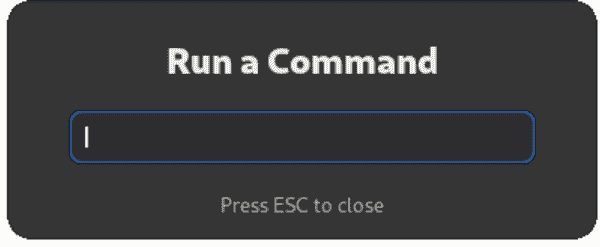

图 1-3

在文本字段中输入 `edit` 并按回车键。稍等片刻，`gedit` 将加载并准备打开、创建和编辑文件：

```
root:x:0:0:root:/root:/bin/bash
bin:x:1:1:bin:/bin:/sbin/nologin
demon:x:2:2:daemon:/dev:/sbin/nologin
adm:x:3:3:adm:/var/adm:/sbin/nologin
lp:x:4:7:lp:/var/spool:/sbin/nologin
sync:x:5:6:sync:/bin:/sbin/nologin
shutdown:x:5:0:shutdown:/root:/sbin/shutdown
halt:x:7:7:halt:/sbin/halt
mail:x:8:8:mail:/var/mail:/sbin/nologin
operator:x:10:0:operator:/root:/sbin/nologin
games:x:11:11:games:/usr/games:/sbin/nologin
ftp:x:12:12:ftp:/var/ftp:/sbin/nologin
news:x:13:13:news:/var/news:/sbin/nologin
system-cdd:x:14:14:system-cdd:/var:/sbin/nologin
dbus:x:15:15:dbus:/var:/sbin/nologin
polkit:x:16:16:polkit:/var:/sbin/nologin
avahi:x:17:70:avahi:/var/run/avdaemon:/sbin/nologin
ndms:x:18:99:DNS:/var/run
```

# 2.3 谁创建了 Linux？

Linux 的起源可以追溯到两个人的工作和哲学。Linux 操作系统的核心被称为“内核”（`kernel`）的东西。它是操作系统运行所必需的核心功能集。内核管理系统资源，并处理硬件与应用程序之间的通信。Linux 内核由林纳斯·托瓦尔斯（Linus Torvalds）开发，他由于不喜欢 MS-DOS，并且对无法在新的 Intel 80386 微处理器上及时使用 MINIX 感到不耐烦，因此决定编写自己的类 UNIX 内核。当他完成第一个版本的内核时，他以开源许可发布了它，这允许任何人下载源代码并自由地使用和修改它，而无需向 Linux 支付任何费用。

大约同一时期，自由软件基金会的开源软件的坚定倡导者理查德·斯尔曼（Richard Stallman）正在开发他自己的开源操作系统。然而，斯尔曼最初并没有专注于内核，而是从开始开发使用和维护操作系统所需的所有 UNIX 工具、实用程序和编译器的开源版本。当他完成这些基础设施的开发后，显而易见的解决方案是将他的工作与林纳斯编写的内核结合，形成一个完整的操作系统。这种结合被称为 GNU/Linux。纯主义者坚持 Linux 应该始终被称为 GNU/Linux（事实上，曾有一段时间，理查德·斯尔曼拒绝向未将 Linux 称为 GNU/Linux 的出版物接受媒体采访）。考虑到自由软件基金会开发的 GNU 工具构成了 GNU/Linux 的重要且关键的部分，这并不是不合理。遗憾的是，大多数人和出版物都将 Linux 称为 Linux，这种情况可能会一直持续下去。

# 2.4 红帽公司（Red Hat）的早期历史

1993 年，鲍勃·杨（Bob Young）创建了一家名为 ACC Corporation 的公司，根据杨的说法，他从他“妻子的缝纫衣柜”经营这家公司。ACC 这个名字旨在代表目录业务，但也是他妻子经营的一家名为“康涅狄格州古董与收藏品”（Antiques and Collectibles of Connecticut）的小型企业的缩写。通过 ACC 目录业务销售的项目包括 Linux 光盘和相关的开源软件。

大约同一时期，马克·埃文格（Marc Ewing）创建了自己的 Linux 发行版公司，并将其命名为红帽 Linux（Red Hat Linux）（因为他在卡内基梅隆大学期间习惯戴一红色的棒球帽）。

1995 年，ACC 收购了红帽，并采用了红帽公司（Red Hat, Inc.）的名称，经历了快速且巨大的增长。鲍勃·杨在公司于 1999 年 8 月上市后辞去了首席执行官职位，并在之后追求许多业务和慈善活动，包括一家名为 Lulu 的按需打印图书公司以及对两支加拿大职业体育队的所有权。2018 年，IBM 以 340 亿美元的交易价格收购了红帽公司。

# 2.5 红帽支持（Red Hat Support）

红帽 Linux 的早期版本是通过软磁盘和 CD 盘发送给客户的（当然，这早于宽带互联网连接的普及）。当用户在软件上遇到问题时，他们只能通过电子邮件联系红帽。事实上，鲍勃·杨经常开玩笑说，这在限制支持请求方面是有效的，因为当客户意识到他们需要帮助时，他们的计算机通常已经无法运行，因此无法用来发送电子邮件向红帽支持团队寻求帮助。在随后的几年里，红帽提供了与付费订阅挂钩的更水平的支持，现在提供从“自救”（无支持）到高级别支持的各种支持水平。

# 2.6 开源（Open Source）

红帽企业 Linux 9（Red Hat Enterprise Linux 9）是红帽目前的商业产品，主要针对企业级、任务关键型安装。它也是红帽提供的不断扩展的产品和服务生态系统的基石。RHEL 是一个开源产品，因为如果你想这样做的话，你可以免费下载源代码并自己构建软件（这项任务不可轻率对待）。然而，如果你想下载一个预构建的、准备好安装的软件二进制版本……

# 2.7 Fedora 项目（The Fedora Project）

红帽还赞助了 Fedora 项目，其目标是提供一种操作系统（以源代码和二进制形式）的自由发行版。Fedora 同时也作为新功能在被采用到红帽 Linux 之前的试验场。

# 2.8 CentOS Stream - 免费替代方案

对于无法负担红帽 Linux 订阅的用户，另一种选择是 CentOS Stream。CentOS 项目最初是一个社区驱动的项目，但现在由红帽拥有，它采用了红帽 Linux 的源代码，去除了红帽品牌和订阅要求，并进行编译，提供下载。像 Fedora 一样，CentOS Stream 在这些功能被纳入未来的 RHEL 版本之前对其进行测试。

# 2.9 Rocky Linux

Rocky Linux 是 2021 年由 CentOS 项目联合创始人格雷格·库策（Greg Kurtzer）创建的。红帽接管 CentOS 项目后，改变了 CentOS 的哲学，从 100% 兼容红帽 Linux 变为在包含下一个 RHEL 版本之前作为一个平台。结果是一个名为 CentOS Stream 的操作系统，它不再保证像 RHEL 那样稳定。作为回应，库策基于 CentOS 的原始原则创建了 Rocky Linux，即提供一个 100% 兼容红帽 Linux 的操作系统。

# 2.10 总结

Linux 的起源可以追溯到林纳斯·托瓦尔斯和理查德·斯尔曼的工作，即 Linux 内核与 GNU 项目构建的工具和编译器。

多年来，Linux 的开源性质导致了各种 Linux 发行版的发布。其中一种发行版是红帽 Linux，它由鲍勃·杨和马克·埃文格创立。红帽专营提供企业级 Linux 解决方案以及广泛的技术支持服务。Rocky Linux 本质上是从红帽 Linux 相同的源代码构建的，但删除了红帽品牌和订阅要求。

# 3. 在空白磁盘上安装 Rocky Linux 9

现在有两种方法可以部署 Rocky Linux 9 系统。一种方法是购买新硬件，或者复用现有的计算机系统在上面安装和运行操作系统。另一种选择是使用（如 Amazon AWS、Google Cloud 或 Microsoft Azure）服务创建云端操作系统实例。由于云端实例通常是通过选择一个已经针对云平台优化的预配置、即插即用的操作系统镜像并将其作为 Rocky 9 系统的基础创建的，在这种情况下不需要执行手动操作系统安装。

然而，如果你计划在自己的硬件上安装 Rocky 9，那么学习 Rocky Linux 9 路径的第一步涉及安装操作系统。双启动安装带有 Windows 11 系统的内容将在“在 Windows 11 上双系统安装 Rocky Linux 9”中涵盖。

## 3.1 获取 Rocky Linux 安装介质

可以通过以下 URL 从项目网站下载 Rocky Linux 发行版：

https://rockylux.org/download

安装介质以 ISO 镜像的形式提供，并有以下几种形式：

- **Boot ISO** - 一个较小的镜像，可以启动系统，但将通过互联网下载安装所需的所有包。这对于救援损坏的 Rocky Linux 安装也有帮助。
- **Minimal ISO** - 此镜像包含开始安装所需的文件，并且需要访问远程服务器上的完整安装介质。启动镜像也可以对现有的 Rocky Linux 系统执行救援操作。
- **DVD ISO** - 一个自包含的镜像，包含了安装 Rocky Linux 系统所需的所有包。

出于本书的考虑，请下载 DVD ISO 镜像，其命名遵循以下约定：

`Rocky-<version>-<arch>-dvd.iso`

例如，适用于 64 位 Intel 系统的 Rocky 9 DVD 镜像命名如下：

`Rocky-9.1-x86_64-dvd.iso`

此外，适用于 ARM64、ppc64le 和 s390x 架构的镜像也可用。

下载镜像后，可以将其刻录到磁盘，或者使用下一节中的步骤将介质写入 USB 驱动器，并配置您的虚拟化环境将其视为 DVD 驱动器，或者使用本章后面概述的步骤通过网络连接访问安装镜像。

## 3.2 将 ISO 安装镜像写入 USB 驱动器

如今，操作系统的安装更有可能是通过 USB 驱动器进行，而不是 DVD。在下载了 Rocky 9 的 ISO 安装镜像后，将该镜像写入 USB 驱动器的步骤将取决于驱动器连接到 Linux、macOS 还是 Windows 系统。本节剩余部分概述的步骤假设 USB 驱动器是新的，或已重新格式化以删除任何现有数据或分区：

### 3.2.1 Linux

在 Linux 上将 ISO 镜像写入 USB 驱动器的第一步是识别设备名称。在插入 USB 驱动器之前，通过列出 `/dev` 中的设备来识别系统已检测到的存储设备：

```
# ls /dev/sd*
```

```
/dev/sda /dev/sda1 /dev/sda2
```

将 USB 驱动器连接到 Linux 系统并运行 `dmesg` 命令以获取最近系统消息列表，其中之一将是 USB 驱动器已检测到的报告，类似于如下：

```
[ 406.241717] sd 6:0:0: [sdb] Attached SCSI removable disk
```

此输出告诉我们，我们应该预期设备名称包含“sdb”，我们可以通过再次列出 `/dev` 中的设备名称来确认这一点：

```
# ls /dev/sd*
```

```
/dev/sda /dev/sda1 /dev/sda2 /dev/sdb
```

此输出显示 USB 驱动器已被分配给 `/dev/sdb`。在将 ISO 镜像写入设备之前的下一步，是运行 `findmnt` 命令以确保它没有被自动挂载：

```
# findmnt /dev/sdb
```

| TARGET | SOURCE | FSTYPE | OPTIONS |
| :--- | :--- | :--- | :--- |
| /run/media/neil/d6bf9574-7e31-4f54-88b1 | /dev/sdb | ext3 | rw,nosuid,no |

如果 `findmnt` 命令指示 USB 驱动器已挂载，请在继续之前卸载它：

```
# umount /run/media/neil/d6bf9574-7e31-4f54-88b1
```

一旦文件系统已卸载，请使用如下 `dd` 命令将 ISO 镜像写入驱动器：

```
# dd if=/path/to/iso/name>.iso of=/dev/sdb bs=512k
```

写入过程可能需要一些时间（长达 10 - 15 分钟），取决于镜像的大小以及运行该程序的系统速度。一旦镜像写入完成，将出现类似如下的输出，USB 驱动器将准备好用于安装 Rocky 9：

```
5956+o records in
5956+o records out
3122659328 bytes (3.1 GB, 2.9 GiB) copied, 426.234 s, 7.3 MB/s
```

### 3.2.2 macOS

在连接到 macOS 系统的 USB 驱动器上写入 ISO 镜像的步骤，是使用 `diskutil` 工具识别设备。在连接 USB 设备之前，打开 Terminal 窗口并运行以下命令：

```
$ diskutil list
```

```
/dev/disk0 (internal, physical):
| TYPE | NAME | SIZE | IDENTIFIER |
| :--- | :--- | :--- | :--- |
| GUID_partition_scheme | * | 1.0 TB | disk0 |
| 1: EFI | EFI | 209.7 MB | disk1 |
| 2: Apple_APFS | Container | 1000.0 GB | disk2 |

/dev/disk1 (internal):
| TYPE | NAME | SIZE | IDENTIFIER |
| :--- | :--- | :--- | :--- |
| GUID_partition_scheme | | 28.0 GB | disk2 |
```

（注：原文中 macOS 部分存在大量重复和损坏，已根据可用清晰片段进行了逻辑清理）

### 3.2.3 Windows

在 Windows 上将 ISO 镜像写入 USB 驱动器的第一步是识别 USB 驱动器的驱动器号。你可以通过右键点击开始按钮并选择“磁盘管理”来执行此操作。一旦识别了 USB 驱动器及其号（例如 `E:`），你可以使用 Rufus 或 BalenaEtcher 等工具将 ISO 镜像写入驱动器。

## 3.3 安装 Rocky Linux 9

将 Rocky 9 安装介质插入相应的驱动并启动系统。如果系统尝试从硬盘启动，你需要进入计算机的 BIOS 设置并更改启动顺序，使其优先从介质启动。一旦系统启动，你将看到如下界面：

在主屏幕上选择安装 Rocky Linux 选项，稍等后，图形化安装程序的第一个界面将会出现：

# 欢迎来到 ROCKY LINUX 9.1

在安装过程中您想使用哪种语言？

| English | English (United States) |
|---|---|
| Español | English (United Kingdom) |
| Spanish | English (India) |
| العربية | English (Australia) |
| Français | English (Canada) |
| Deutsch | English (Denmark) |
| German | English (Ireland) |


| 日本語 | English (New Zealand) |
| 中文 | English (Nijteria) |
| Mandarin Chinese | English (Hong Kong SAR China) |
| Русский | English (Philippines) |
| Afrikaans | English (South Africa) |
| አማርኛ | English (Zambia) |
| Amharic | English (Botswana) |
| Assamese | English (Zimbabwe) |
| Asturiano | English (Antigua & Barbuda) |
| Русская | Belarusian |
| Български | Bulgarian |
| বাংলা | Bangla |

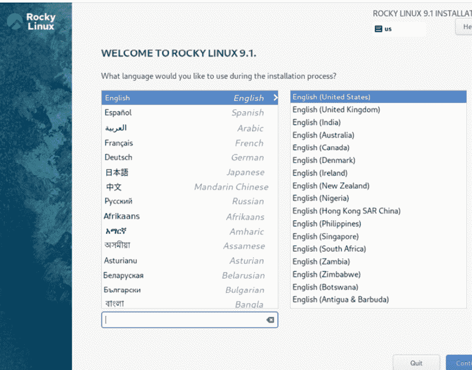

在点击“继续”（Continue）之前，在第一个屏幕上选择您的首选语言，以进入图 3-6 所示的主安装屏幕。

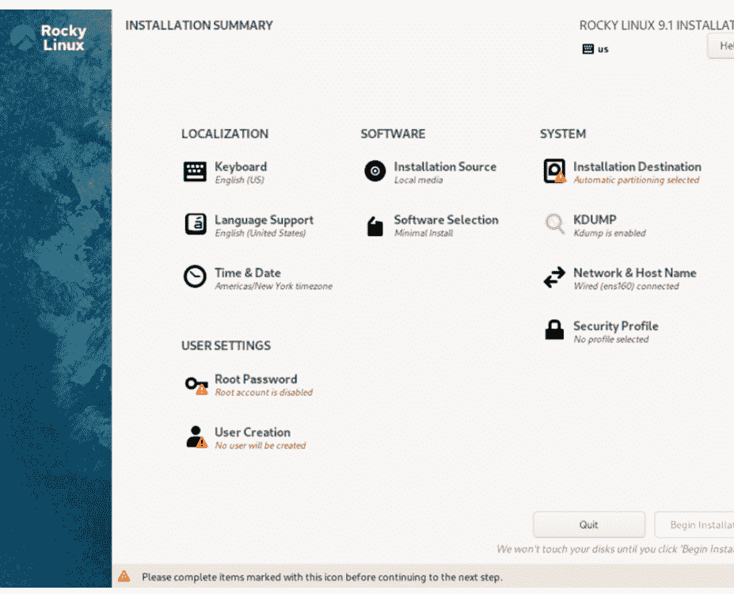

### 图 3-7

首先选择“网络与主机”（Network & Host Name）选项，在系统上启用网络设备，并在点击“应用”（Apply）按钮之前输入主机名：

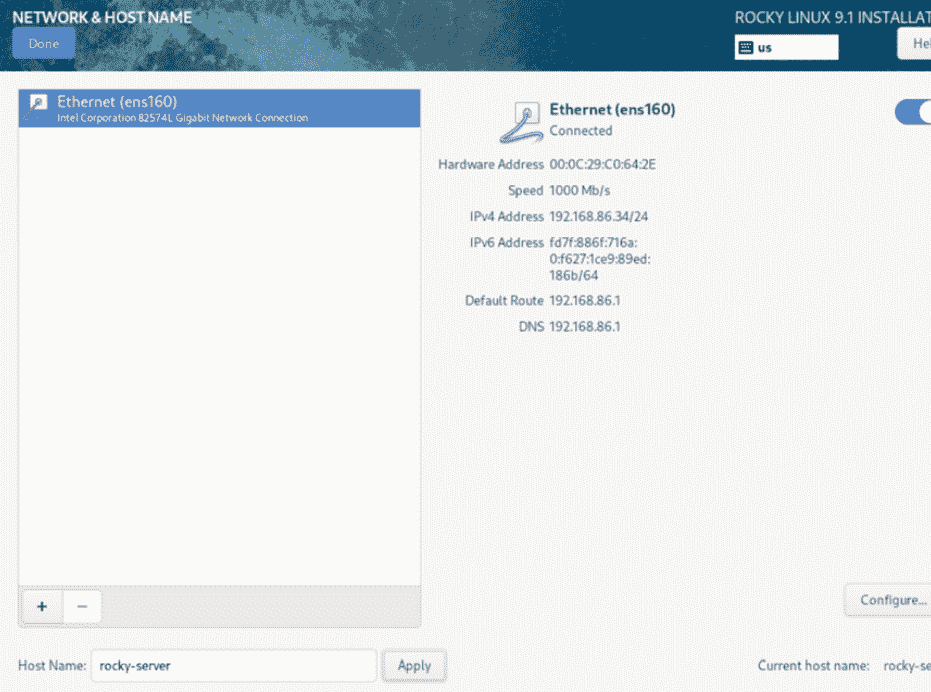

### 图 3-8

如果您的网络连接需要额外设置，点击按钮访问图 3-9 所示的高级网络设置界面

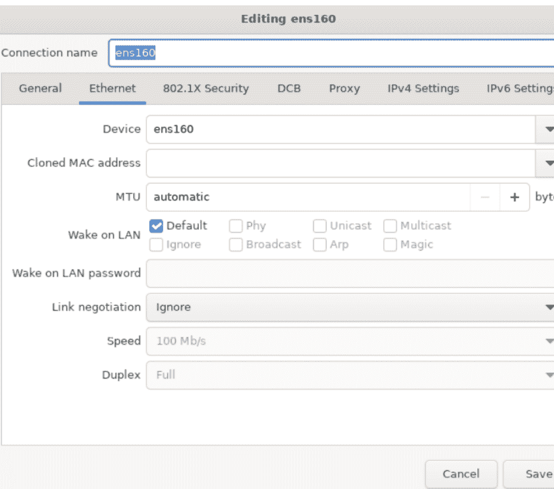

一旦定义了主机名并启用了网络连接，点击“完成”（Done）返回主屏幕。

如果您想更改键盘、语言或时间和日期设置，请从主屏幕的“本地化”（Localization）列中选择相应的选项。在“时间与日期”屏幕上，选择与您的地理位置对应的选项。还提供了使用网络时间的选项，它可以自动将系统与外部网络时间协议服务器同步。

*安装源*（Installation Source）设置的更改通常必要的，因为安装是从本地介质执行的。要完成从远程服务器介质的安装，请选择“安装”（Installation），启用“在网络上”（On the network）选项，然后指定安装介质的位置和所使用的 URL 类型。例如，安装介质可以是安装在远程 Web 服务器上的 ISO 镜像，也可以是本地网络系统上使用 NFS 的系统（NFS 共享的主题在“在 Rocky Linux 9 上使用 NFS 与远程共享文件”章节中有详细介绍），或者是远程仓库的 URL（仓库本质上是组成操作系统的软件、软件包和应用程序的在线集合，可以从中安装到本地系统）。

默认情况下，安装程序将对 Rocky 9 执行带 GUI 的服务器安装。要选择不同的安装配置，选择“软件选择”（Software Selection）选项以显示下所示屏幕：

## 基础环境 (Base Environment)

### 所选环境的额外软件

- **带 GUI 的服务器 (Server with GUI)**
  - 带有图形界面的集成、易于管理的服务器。

- **服务器 (Server)**
  - 集成的、易于管理的服务器。

- **最小安装 (Minimal Install)**
  - 基本功能。

- **自定义操作系统 (Custom Operating System)**
  - 构建自定义 Linux 系统的基础构建块。

- **调试工具 (Debugging Tools)**
  - 用于调试异常应用程序和诊断性能问题的工具。

- **DNS 名称服务器 (DNS Name Server)**
  - 此包允许您在系统上运行 DNS 名称服务器 (BIND)。

- **文件和存储服务器 (File and Storage Server)**
  - CIFS

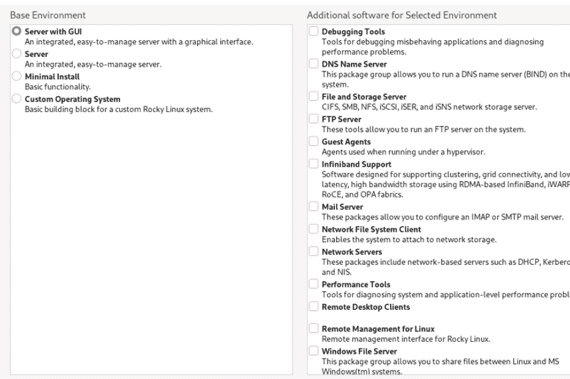

左侧面板用于选择基本配置，右侧面板用于添加您知道系统启动后可能需要的任何额外软件包。如果不需要桌面环境且不确定在系统上安装哪些软件包，请使用“最小安装”选项，并在系统启动后根据需要安装额外的软件包。这避免了安装任何可能永远需要的软件包。

**安全策略**（Security Policy）选项允许在系统上安装额外的安全包，从而允许在系统上实施符合**安全内容自动化协议（SCAP）** 标准的安全限制。虽然从列表中选择配置文件会安装必要的包，但在运行的系统上启用它们之前，策略限制不会被强制执行。

Kdump 功能在启用时，会在系统崩溃时写操作系统内核的状态。此转储文件有助于识别崩溃原因，但在启用时会占用系统内存。除非您的系统内存有限，否则可以将其保持在启用状态。

配置好基本设置后，下一步是决定如何对硬盘驱动器进行分区以容纳操作系统。

## 为 Rocky 9 分区磁盘

当选择**安装目标**（Installation Destination）选项时，安装程序将显示一个与图 3-11 类似的的屏幕：

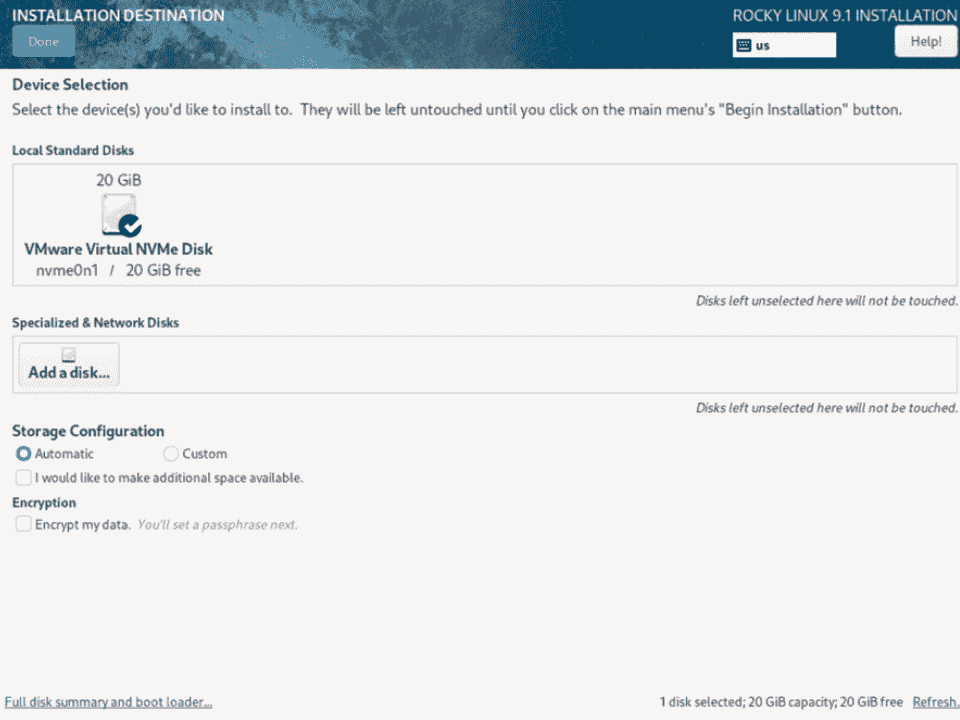

### 图 3-11

默认情况下，安装程序配置为使用可用空间自动安装操作系统。如果磁盘之前包含另一个操作系统，这些分区将被删除。为了让 Rocky 9 使用回收的空间，请启用“自动”分区选项并点击“完成”显示图 3-12 所示的对话框：

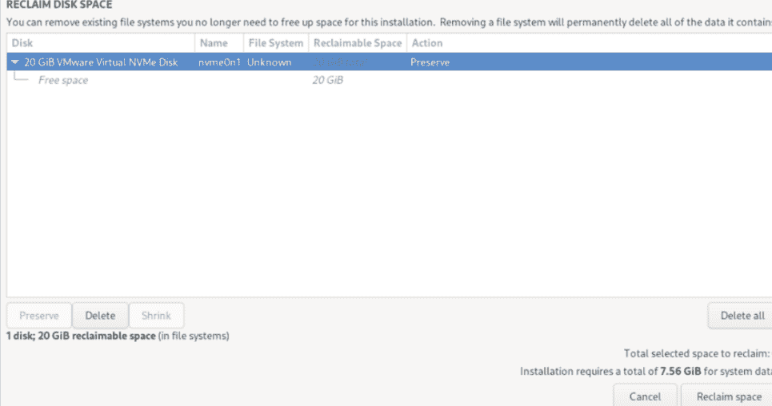

### 图 3-12

要回收空间，选择不再需要的分区并点击删除按钮。选中所有需要删除的分区后，点击“回收空间”按钮。回收的空间现在将自动使用。

要手动配置可用空间的磁盘布局，请将存储分配设置从“自动”更改为“自定义”，并点击“完成”进入手动分区屏幕。

### 手动分区 (MANUAL PARTITIONING)

## ROCKY LINUX 9.1 安装

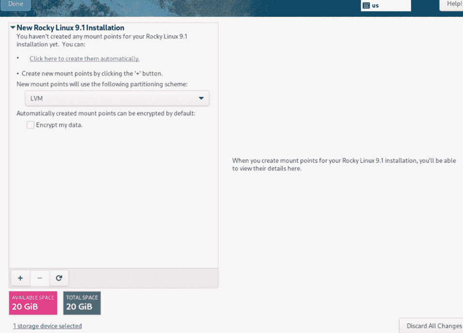

### 新 Rocky 9.1 安装

您尚未为 Rocky 9.1 安装创建任何挂载点。您可以：

- 点击此处自动创建。
- 点击 `+` 按钮创建新的挂载点。

新的挂载点将使用以下分区方案：

`LVM`

挂载点默认可以加密：

当您为 Rocky 9.1 创建挂载点时，您可以在此处查看详细信息。

可用空间 20 GiB

总空间 20 GiB

已选择一个存储设备

放弃所有更改

### 图 3-13

磁盘配置完成后，点击查看对磁盘进行的更改摘要，然后点击“接受更改”（Accept Changes）按钮：

## 更改摘要

| 顺序 | 操作 | 设备 | 挂载点 |
|---|---|---|---|
| 1 | 破坏格式 | 未知 | VMware Virtual NVME Disk (nvme0n1) | |
| 2 | 创建格式 | 分区表 (GPT) | VMware Virtual NVME Disk (nvme0n1) | |
| 3 | 创建设备 | 分区 | VMware Virtual NVME Disk上的 nvme0n1p1 | |
| 4 | 创建格式 | EFI 系统分区 | VMware Virtual NVME Disk上的 nvme0n1p3 | /boot/efi |
| 5 | 创建设备 | 分区 | VMware Virtual NVME Disk上的 nvme0n1p2 | |
| 6 | 创建设备 | 分区 | VMware Virtual NVME Disk上的 nvme0n1p3 | |
| 7 | 创建格式 | 物理卷 (LVM) | VMware Virtual NVME Disk上的 nvme0n1p3 | |
| 8 | 创建设备 | lvvg | rl_rocky-server | |
| 9 | 创建设备 | lvvm | rl_rocky-server-root | |
| 10 | 创建格式 | xfs | rl_rocky-server-root | / |
| 11 | 创建设备 | lvvm | rl_rocky-server-swap | |
| 12 | 创建格式 | swap | VMware Virtual NVME Disk上的 nvme0n1p2 | /boot |
| 13 | 创建格式 | xfs | | |

### 图 3-15

## 3.5 磁盘加密

Rocky 9 还允许通过加密保护磁盘内容。这要求在每次系统启动时输入密码。要启用加密，请在主*安装目标*（Installation Destination）屏幕上选择*加密我的数据*（Encrypt my data）选项，点击*完成*（Done）按钮后，如图所示的对话框中输入密码。

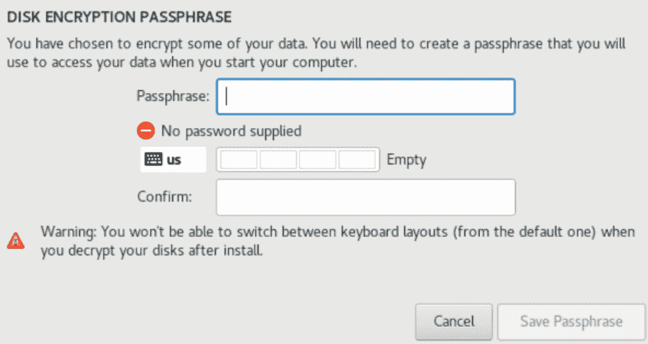

### 图 3-16

## 3.6 用户设置

在完成安装之前，你必须创建一个 root 密码和一个可选的用户账户。root（或超级用户）账户是具有系统管理权限的特殊用户。虽然你通常使用自己的账户登录系统，但在配置系统和执行其他管理任务时，你需要 root 权限。

选择*Root 密码*（Root Password）选项并输入一个足够安全的密码。还有选项可以锁定 root 账户以防止被访问，以及允许通过密码身份验证对系统进行远程连接以访问 root 账户。通常情况下，建议让 root 账户处于未锁定状态，但禁止使用密码进行远程 SSH 访问。如果需要远程 root 访问，应使用 SSH 密钥身份验证来实现，该主题我们将在本书的[在 Rocky Linux 9 上配置 SSH 密钥身份验证](Configuring SSH Key-based Authentication on Rocky Linux 9) 章节中进行介绍。

接下来，选择*创建用户*（User Creation）选项并输入用户名和密码。如果你希望此用户能够使用 `sudo` 命令执行管理任务，请也勾选*将此用户设管理员*（Make this user administrator）复选框。如果未启用此选项，用户必须使用 `su` 命令并输入 root 密码来获得 root 权限（假设上述锁定 root 账户的选项未启用）。如果你添加的用户需要执行管理任务，`sudo` 是推荐选项，并且应该勾选该复选框。

## 3.7 物理安装

在完成适当的软件包选择后，点击*开始安装*（Begin Installation）将开始分区磁盘并安装与所选安装设置匹配的软件包。在此阶段，将显示[图 3-17](3-17) 所示的安装进度屏幕：

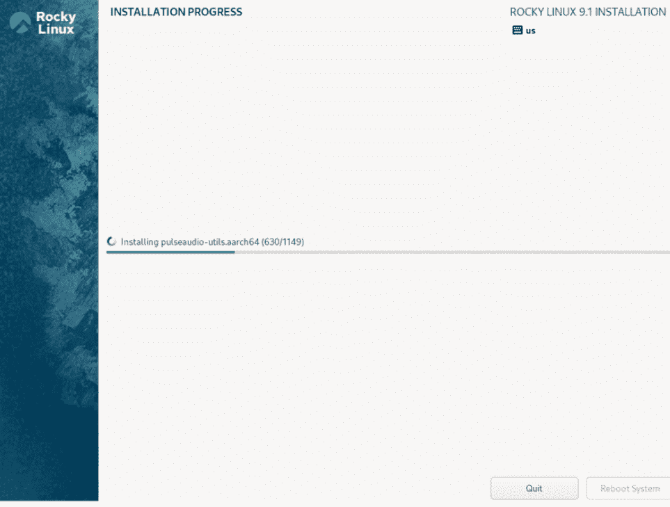

### 图 3-17

所有软件包安装并配置完成后，移除安装介质并点击*重启系统*（Reboot System）重启系统。

## 3.8 最后配置步骤

系统启动时控制台上显示的内容取决于你在软件选择屏幕上选择了哪个选项。如果在安装期间选择了 GUI 选项，将出现 GNOME 显示管理器登录界面。相反，如果选择了最小化（Minimal）或服务器（Server）配置选项，将显示基于文本的登录提示。无论配置如何，请使用在安装过程最后阶段创建的用户身份登录系统。

在 GUI 安装的情况下，GNOME 初始设置工具将启动并提供桌面环境的引导导览。

## 3.9 安装更新

与当今大多数操作系统一样，Rocky Linux 发行版的每个版本在公开发后都会持续演进。这通常表现为错误修复、安全更新，以及偶尔可以通过互联网下载并安装到系统中的新功能。

最佳实践规定，安装 Rocky 9 后的第一步是确保将任何可用更新应用于系统。这可以通过终端窗口中的命令行提示符使用 `dnf` 软件包管理器工具来实现。要检查是否有可用更新，请运行以下命令：

```
# dnf check-update
```

可以再次使用 `dnf` 工具应用任何待处理的更新：

```
# dnf update
```

执行后，`dnf` 工具将提供可用更新的软件包列表，并请求许可执行更新。

更新完成后，Rocky 9 准备就绪。

## 3.10 显示启动消息

在启动过程中，Rocky 9 将显示红帽图形启动（RHGB）屏幕，这会隐藏系统加载时生成的所有启动消息。要在启动过程中显示这些消息，请在系统启动时按 Esc 键，如下：

```
OK Reached Target
OK Finished Kernel
OK Loaded Kernel module
OK Started Journal Service
OK Finished File System
OKOK fuse
OK Finished Complete Device Initialization
OK Reached target
OK Preparation for local File Systems
OK Starting File System
OK Finished File Check on /dev/disk/by-uuid/8ce7-67d9
OK Mounted /boot
OK Reached target
OK Mounted local File Systems
OK Finished File System to Write Out Runtime Data
OK Created Volatile Files and Directories
OK Finished File System to Write Out Runtime Data
OK Created Volatile Files and Directories
OK Starting Security Audit Service...
OK
 Applying Kernel Variables
OK Finished Load/Save Random Seed
OK Joined to Persistent Store
OK Created Static Device
OK Started Manager for Device Events and Files
OK Waiting for udev to
OK Finished Device Initialization
OK Started Rule-based Manager for Device Events and Files
OK Loaded Kernel module configs
OK Finished local-fileystems.
OK Loaded Kernel module fuse
OK Finished Complete Device

OK
 Kernel


OK Finished
```

默认行为可以通过编辑 `/etc/default/grub` 文件并更改 `GRUB_CMDLINE_LINUX` 设置来改变，该设置默认类似于：

```
GRUB_CMDLINE_LINUX="... rhgb quiet"
```

为了移除图形启动屏幕以便无需按 Esc 键即可查看消息，请从设置中移除“rhgb”选项：

```
GRUB_CMDLINE_LINUX="... quiet"
```

此更改将导致系统仅显示系统生成的启动消息的一部分。要显示系统生成的所有消息，请移除“quiet”选项：

```
GRUB_CMDLINE_LINUX="..."
```

更改完成后，运行以下命令生成新的启动配置，以便在下次系统启动时生效：

```
# grub2-mkconfig --output=/boot/grub2/grub.cfg
```

## 3.11 总结

使用 Rocky Linux 9 的第一步是安装操作系统。对于云服务器而言，此任务通常在根据云服务提供商提供的系列选项为系统选择操作系统镜像时自动完成。然而，在您自己的硬件上安装，则需要下载作为 ISO 镜像的安装介质，将该镜像写入合适的存储设备（如 DVD 或 USB 驱动器），并从其启动。一旦运行，安装过程允许配置一系列选项，包括网络设置、安装应从本地介质还是通过远程服务器或存储库进行、要安装的软件包以及磁盘分区。安装完成后，重要的一点是安装自原始安装镜像创建以来发布的任何操作系统更新。

# 4. 与 Windows 建立 Rocky Linux 9 的双启动

与大多数 Linux 发行版一样，Rocky Linux 9 能够很愉快地与几乎任何版本的 Windows（包括 Windows 11）共存于硬盘驱动器上。这种概念被称为双启动（dualbooting）。当你启动系统时，你将看到一个菜单，提供启动 Rocky 9 安装或 Windows 的选项。显然，你只能运行一个操作系统。尽管如此，值得注意的是，无论你的 Windows 分区是使用 NTFS、FAT16 还是 FAT32 格式化的，都可以从 Rocky 9 访问磁盘驱动器 Windows 分区上的文件。

这种安装方法涉及缩小现有 Windows 分区的大小，然后将 Rocky 9 安装到回收的空间中。本章假设 Rocky 9 正在安装在当前运行 Windows 11 的系统上。

## 4.1 调整分区大小

为了在已包含 Windows 安装的磁盘驱动器上容纳 Rocky 9，第一步涉及缩小 Windows 分区以腾出空间。建议的操作方案是在尝试安装 Rocky 9 之前，使用 Windows 磁盘管理界面来减小分区大小。

要在 Windows 11 上访问磁盘管理，右键点击开始菜单，并从生成的菜单中选择如图所示的高亮选项：

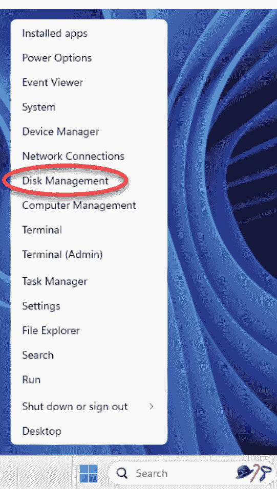

### 图 4-1

加载后，磁盘管理工具将显示系统上检测到的磁盘驱动器的图形化表示：

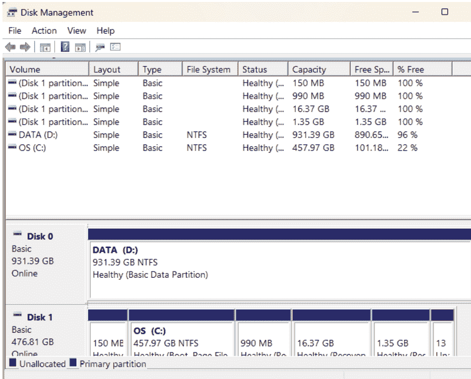

### 图 4-2

右键点击你想要缩小大小的分区，从弹出菜单中选择“收缩卷...”（Shrink Volume...）。该工具将计算在不丢失数据的情况下卷大小可以减少的最大量（取决于分区的大小，此过程可能需要几分钟）。一旦分析完成，将出现与下方图 4-3 类似的对话框：


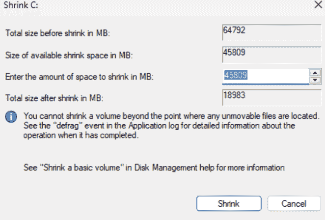

图 4-3

在“输入要收缩的空间量（MB）”字段中指定值，并点击“收缩”按钮继续。一旦调整操作完成，使用 Rocky 9 安装介质重启（如“在空白磁盘上安装 Rocky Linux 9”部分所述），并使用新的空闲空间进行安装。在 Rocky 9 安装过程中，可以通过在“安装摘要”屏幕上选择“安装目标”选项，并确保选择了“自动存储配置”选项来实现。这将把 Rocky 9 自动安装到缩小 Windows 分区时创建的未分配空间中。

一旦完成磁盘上的 Rocky 9 安装并重启，将出现标准的 Rocky 9 启动菜单，其中包含一个启动 Windows 系统的额外选项：

```
Rocky Linux (5.14.0-162.6.1.e19_1.x86_64) 9.1 (Blue Onyx)
Rocky Linux (@rescue-9a13e65e68c4bc1b655c56e66eb0b1) 9.1 (Blue Onyx)
Windows Boot Manager (on /dev/nvme0n1)
UEFI Firmware Settings

使用 ▲ 和 ▼ 键更改选择。
按 'e' 编辑所选项目，或按 'c' 进入命令提示符。
按 Escape 返回上级菜单。
```

图 4-4

## 4.2 更改默认启动选项

系统启动时，将出现启动选项屏幕并等待 5 秒让用户选择操作系统。如果在超时前未进行任何选择，将启动默认操作系统。在新配置的系统上，默认操作系统将是标准的（非救援）Rocky 9 镜像。然而，此默认可以在 Rocky 9 内部进行更改。

一系列启动配置选项（包括 5 秒超时和“在空白磁盘上安装 Linux 9”中概述的启动 RHGB 设置）在 `/etc/default/grub` 文件中声明，在新安装中该文件的读取内容如下：

```
GRUB_TIMEOUT=5

GRUB_DISTRIBUTOR="$(sed 's, release .*$,g' /etc/system-release)"

GRUB_DEFAULT=saved

GRUB_DISABLE_SUBMENU=true

GRUB_TERMINAL_OUTPUT="console"
```

```
GRUB_CMDLINE_LINUX="crashkernel=1G-4G:1.e19_1.x86_64"
```

## 4.3 从 Rocky 9 访问 Windows 分区

当 Rocky 9 运行双启动配置时，可以通过从命令行手动挂载分区来访问 Windows 分区上的文件。在此之前，需要在系统中安装额外的软件包。首先，需要下载并安装 `fuse` 内核模块：

```
# dnf install fuse
```

```
# modprobe fuse
```

接下来需要安装 Fuse NTFS 驱动。遗憾的是，该软件包未包含标准的 Rocky 9 存储库中，因此需要在系统中添加 Extra Packages for Enterprise Linux (EPEL) 存储库：

```
# dnf config-manager --set-enabled crb
```

```
# dnf install https://dl.fedoraproject.org/pub/epel/epel-release-latest-9.noarch.rpm
```

添加 EPEL 存储库后，现在可以安装驱动程序了：

```
# dnf install ntfs-3g
```

一旦安装了所需的软件包，下一步是创建一个目录作为 Windows 分区的挂载点。在示例中，我们将创建一个名为 `windows` 的目录：

```
# mkdir /mnt/windows
```

识别分配给 Windows 分区的设备名称，请使用 `fdisk` 命令：

```
# fdisk -l
```

| 设备 | 起始 | 结束 | 扇区 | 大小 | 类型 |
| :--- | :--- | :--- | :--- | :--- | :--- |
| /dev/nvme0p1 | 2048 | 206847 | 204800 | 100M | EFI 系统 |

重启系统并验证启动菜单是否默认选择 Windows 选项。

| Device | Start | End | Sectors | Size | Type |
| :--- | :--- | :--- | :--- | :--- | :--- |
| /dev/nvme01p1 | 2048 | 206847 | 204800 | 100M | EFI System |
| /dev/nvme01p2 | 206848 | 239615 | 32768 | 16M | Microsoft reserved |
| /dev/nvme01p3 | 239616 | 49362943 | 49123328 | 23.4G | Microsoft basic data |
| /dev/nvme01p4 | 132933632 | 134216331 | 1280000 | 625M | Windows recovery environment |
| /dev/nvme01p5 | 49362944 | 51460095 | 2097152 | 1G | Linux filesystem |
| /dev/nvme01p6 | 51460096 | 132933631 | 81473536 | 38.8G | Linux LVM |

在上述输出中，包含我们需要访问的文件的主 Windows 分区由 `/dev/nvme01p3` 表示。接下来，我们需要运行 `mount` 命令（假设 Windows 分区如下）：

```
# mount /dev/nvme01p3 /mnt/windows
```

通过列出挂载点顶层目录的内容来检查挂载是否成功：

```
# ls /mnt/windows
```

```
$Recycle.Bin ProgramData swapfile.sys 'Documents and Settings' 'Program Files' 'System Volume Information' pagefile.sys 'Program Files (x86)' Users PerfLogs Recovery Windows
```

为了在每次系统启动时自动挂载，请向 `/etc/fstab` 文件添加适当的挂载行：

```
/dev/nvme01p3 /mnt/windows ntfs defaults 0 0
```

要随时卸载 Windows 文件系统：

```
# umount /mnt/windows
```

## 4.4 总结

Rocky 9 可以通过创建双引导环境与 Windows 操作系统在同一磁盘驱动器上安全共存。这涉及到在安装之前缩小 Windows 系统的空间为 Rocky 9 腾出空间。一旦安装 Rocky 9，必须修改引导菜单配置以包含从 Windows 启动的选项。要在 Rocky 9 中访问 Windows 文件系统，需要安装并使用 Fuse NTFS 驱动程序来挂载 Windows 分区。

# 5 为 Windows 分区分配 Rocky Linux 9

在上一章中，我们介绍了如何在与 Windows 相同的磁盘上安装 Rocky Linux 9。这种所谓的“引导”配置允许用户在单个磁盘驱动器上安装两个操作系统，并在系统通电时可以选择启动其中任何一个。

本章 intended for 那些已经决定足够喜欢 Rocky Linux 9，从而从磁盘中完全删除 Windows 并将空间用于 Linux 的用户。在接下来的章节中，我们将逐步完成这一过程。

## 5.1 卸载 Windows 分区

如果按照“与 Windows 双引导启动 Rocky Linux 9”章节中的步骤从 Rocky Linux 9 内部挂载了 Windows 分区，则在继续本章之前应卸载该分区。假设 Windows 分区已挂载，可以按照以下方式卸载：

```
# umount /mnt/windows
```

还应该编辑 `/etc/fstab` 文件，以移除之前添加的 `/mnt/windows` 自动挂载。

## 5.2 从磁盘上删除 Windows 分区

为 Rocky 9 释放 Windows 分区的第一步是删除该分区。但在此之前，必须从 Windows 和 Rocky 9 分区备份任何你需要保留的数据。完成此操作后，即可安全地进行本章。

要删除 Windows 分区，我们首先需要使用 `fdisk` 工具识别它们所在的磁盘：

```
# fdisk -l
```

```
Disk /dev/nvme01: 64 GiB, 68719476736 bytes, 134217728 sectors
Disk model: VMware Virtual NVMe Disk
Units: sectors of 1 * 512 = 512 bytes
Sector size (logical/physical): 512 bytes / 512 bytes
I/O size (minimum/optimal): 512 bytes / 512 bytes
Disklabel type: gpt
Disk identifier: 7A38CD86-091E-4781-BF80-928FD383C935

| Device | Start | End | Sectors | Size | Type |
| :--- | :--- | :--- | :--- | :--- | :--- |
| /dev/nvme01p1 | 2048 | 206847 | 204800 | 100M | EFI System |
| /dev/nvme01p2 | 206848 | 239615 | 32768 | 16M | Microsoft reserved |
| /dev/nvme01p3 | 239616 | 49362943 | 49123328 | 23.4G | Microsoft basic data |
| /dev/nvme01p4 | 132933632 | 134216331 | 1280000 | 625M | Windows recovery environment |
| /dev/nvme01p5 | 49362944 | 51460095 | 2097152 | 1G | Linux filesystem |
| /dev/nvme01p6 | 51460096 | 132933631 | 81473536 | 38.8G | Linux LVM |
```

在上述输出中，系统包含一个由设备名称引用的物理磁盘，通过设备名称 `/dev/nvme01p1` 到 `/dev/nvme01p6` 访问六个分区。根据 `Type` 列的值，存在三个 Windows 相关的分区。第一个是 Windows 系统分区，第二个较大的 Windows 数据分区，随后是 Windows 恢复分区。

要移除这些分区，我们首先需要使用包含分区的磁盘名称启动 `fdisk` 工具来识别分区的磁盘，并按照指令再次显示分区和扇区信息：

```
# fdisk /dev/nvme01
```

```
Welcome to fdisk (util-linux 2.37.4).
在使用 `write` 命令之前，更改将保留在内存中。
Command (m for help): p

Disk /dev/nvme01: 64 GiB, 68719476736 bytes, 134217728 sectors
Disk model: VMware Virtual NVMe Disk
Units: sectors of 1 * 512 = 512 bytes
Sector size (logical/physical): 512 bytes / 512 bytes
I/O size (minimum/optimal): 512 bytes / 512 bytes
Disklabel type: gpt
Disk identifier: 7A38CD86-091E-4781-BF80-928FD38C935

| Device | Start | End | Sectors | Size | Type |
```


## 5.3 格式化未分配的分区

为了使新分区适用于 Rocky Linux 9 使用，需要在其上创建一个文件系统。Rocky Linux 当前版本推荐的文件系统类型是 XFS，该内容将在“向 Rocky Linux 9 添加载新硬盘驱动器”章节中进行详细介绍。使用 `mkfs.xfs` 命令执行文件系统的创建，如下：

```
# mkfs.xfs -f /dev/nvme1p2
```

```
meta-data=/dev/nvme1p2 isize=512 agcount=4, agsize=153628 blks
= sectsz=512 attr=2, projid32bit=1
= crc=1 finobt=1, sparse=1, rmapbt=o
= reflink=1 bigtime=1 inotcount=1
data = bsize=4096 blocks=6144512, imaxpct=25
= sunit=0 swidth=0 blks
naming =version 2 bsize=4096 ascii-ci=0, ftype=1
log =internal log bsize=4096 blocks=3000, version=2
= sectsz=512 sunit=0 blks, lazy-count=1
realtime =none extsz=4096 blocks=0, rtextextents=0
```

## 5.4 挂载新分区

接下来，我们需要挂载新分区。在示例中，我们将其挂载到名为 `/data` 的目录中。然而，你可以使用任何所需的有效挂载点来挂载新分区，或将其作为逻辑卷的一部分（细节将在“向 Rocky Linux 9 卷组和逻辑卷添加新硬盘”章节介绍）。首先，我们需要创建一个作为挂载点的目录：

```
# mkdir /data
```

其次，我们需要编辑 `/etc/fstab` 中的挂载表，以便分区在每次系统启动时自动挂载。在 `/etc/fstab` 文件的末尾添加以下行来挂载新分区（请修改 `/dev/nvme1p2` 设备以匹配你的环境）：

```
/dev/nvme1p2 /data xfs defaults 0 0
```

最后，我们可以手动挂载新分区（注意，这在随后的重启中是没有必要的，因为由于我们在 `/etc/fstab` 文件中添加的设置，分区会自动挂载）：

```
# mount /data
```

要检查分区，运行以下命令显示可用空间：

```
# df -h /data
```

| Filesystem | Size | Used | Avail | Use% | Mounted on |
| :--- | :--- | :--- | :--- | :--- | :--- |
| /dev/nvme01p2 | 24G | 200M | 24G | 1% | /data |

## 5.5 总结

在双启动配置中，可以随时删除 Windows 分区以识别哪些分区属于 Windows 并删除它们，为 Rocky Linux 9 系统腾出空间。一旦删除，未分配的空间可以用于创建新的文件系统并挂载，供 Rocky 9 系统使用。

# 6. GNOME 40 桌面导览

Rocky Linux 9 包含了 GNOME 40 桌面环境。虽然缺乏 Windows 和 macOS 桌面的复杂性，但 GNOME 40 提供了一个整洁且直观的桌面环境，提供了窗口环境的所有基本功能，并具有可以快速学习的优势。

在本章中，将涵盖 GNOME 桌面的主要功能，并概述如何执行基本任务。

## 6.1 安装 GNOME 桌面

如果在 Rocky 9 安装过程中选择了带有 GUI 软件配置的工作站或服务器，则 GNOME 桌面将会被安装并在每次系统启动时自动启动。

如果在 Rocky 9 安装过程中选择了任何其他软件配置，则 GNOME 桌面将不会包含在系统上安装的软件包中。对于没有连接显示器的服务器系统，安装图形化桌面环境似乎是多余的。然而，值得注意的是，远程访问 GNOME 桌面也是可能的；即使在无头服务器（即缺少显示器、键盘和鼠标的服务器）上，安装 GNOME 桌面包可能受益。建立远程桌面访问的主题将在书中“通过 VNC 进行 Rocky 9 桌面访问”章节中详细介绍。

如果安装配置未包含 GNOME 桌面，可以使用以下命令随时进行安装：

```
# dnf groupinstall workstation
```

一旦安装完成，可以通过显示器上的命令行提示符启动桌面环境：

```
$ startx
```

## 6.2 GNOME 40 桌面概述

图 6-1 所示的屏幕显示了在启动任何其他程序或更改配置之前，典型的新启动 GNOME 桌面会话的外观：


**图 6-1**

主桌面区域（标记为 A）是启动应用程序和工具时窗口出现的地方。与其他桌面环境不同，无法将文件或应用程序拖放到桌面上，这提供了一个整洁且不杂乱的工作空间。

屏幕顶部的条（B）称为顶栏。它包含活动菜单（C）、日期和时间（B）以及一组状态图标（D），点击这些图标会显示包含额外选项的菜单。

此外，运行在桌面上的当前活动应用程序的应用程序菜单也会出现在顶栏中。例如，图显示了终端程序的应用程序菜单：

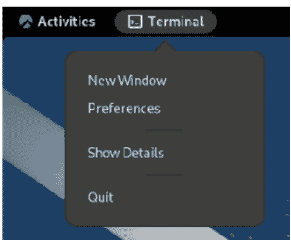

**图 6-2**

## 6.3 活动概述

应用程序和工具通过“活动概览”启动，可以通过点击顶栏中的活动按钮或按下键盘上的特殊键显示。在 Windows 键盘上，这是 Windows 键；在 macOS 上是 Command 键；在 Chromebook 上是显示放大镜图标的键。

显示时，活动概览将类似于下面的图 6-3：

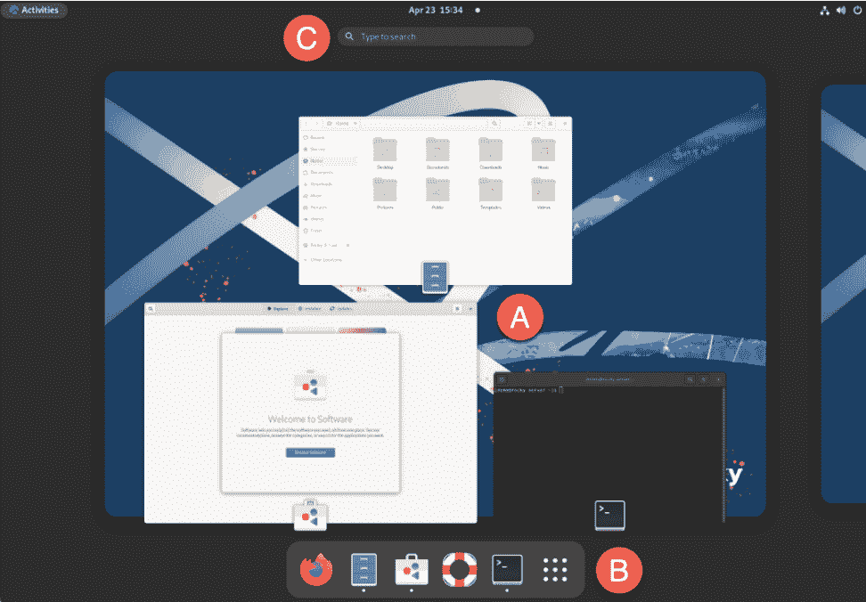

**图 6-3**

概览的中心区域（在图 6-3 中标记为 A）显示所有当前打开的应用程序窗口。屏幕底部（B）是仪表板（也称为 dash，从这里启动应用程序）。默认情况下，dash 将显示一组预定义的常用应用程序图标，以及任何正在运行的应用程序的图标。如果应用程序正在运行，它将在图标下方显示一个点。要启动应用程序，只需点击 dash 中的图标即可。

要找到 dash 中未包含的应用程序，一种方法是选择右侧的网格图标（由九点组成正方形）以显示可浏览的应用程序列表，如图：


**图 6-4**

同样重要的是，列表中的某些项目是存放应用程序的文件夹。网格中的项目可以通过拖放图标来重新定位。要将应用程序添加到文件夹，请在网格中找到它并拖入文件夹。此外，拖动一个图标并掉在另一个上将创建一个新文件夹，并向其中添加其他应用。

浏览应用程序的替代方案是通过搜索栏（在图 6-3 中标记为 C）进行搜索，并在下所示的操作中：

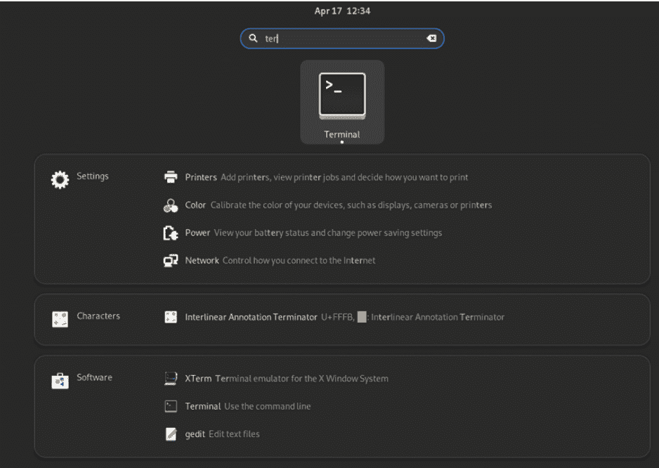

**图 6-5**

随着搜索框中输入文本，可能匹配的列表将精简。

为了更方便地访问，将应用程序添加到 dash 中，找到应用程序的图标，右键点击它并选择“添加到收藏夹”菜单选项：

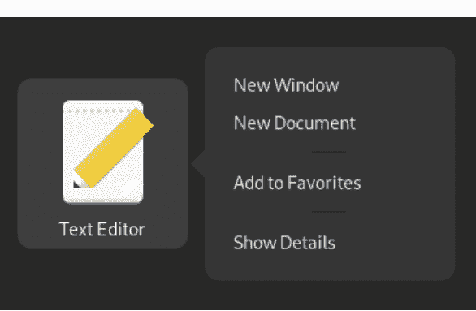

**图 6-6**

从 dash 中移除应用程序，右键点击 dash 中的图标并选择“从收藏夹移除”。或者，通过拖入或拖出图标来添加和删除它们。

## 6.4 窗口管理


**图 6-7**

如果单个应用程序打开了多个窗口，切换器将在第二个面板中显示这些窗口，以便选择特定的窗口：

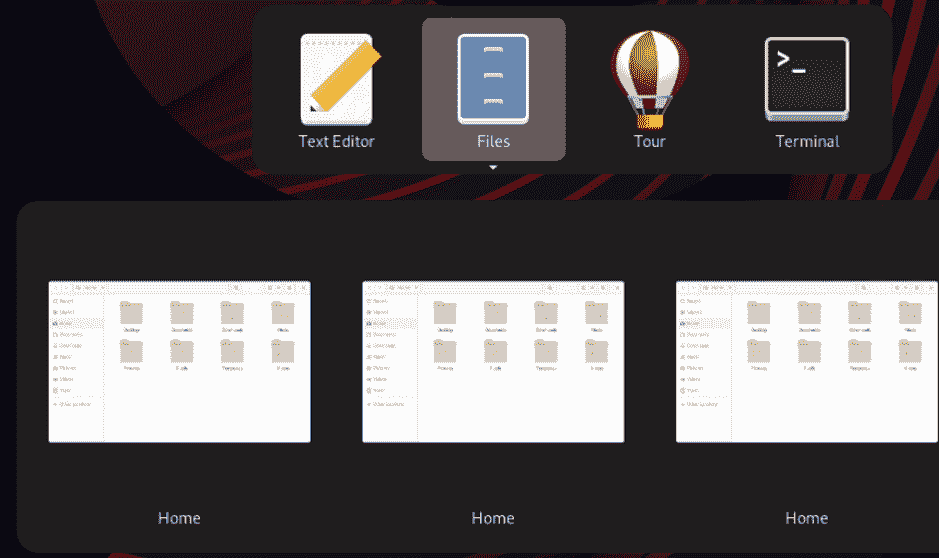

**图 6-8**

要反向循环切换器中的图标，请使用 `Shift+Tab` 键盘快捷键。

要最大化一个窗口以填充整个屏幕，请点击标题栏并将窗口拖到屏幕顶部。要将窗口恢复原始大小，请点击标题栏并向下拖动。或者，双击标题栏可以在窗口大小之间切换。同样，将窗口拖动到屏幕的左侧或右侧将使窗口填充屏幕的半部分。

## 6.5 使用工作区

应用程序窗口出现的屏幕区域称为工作区，GNOME 40 允许配置多个工作区。GNOME 桌面启动时会有两个工作区，你可以使用 `Super+Alt+Left` 和 `Super+Alt+Right` 键组合在它们之间切换。当窗口添加到空白工作区时，工作区面板会添加另一个空白工作区，从而创建更多的工作区。

当前工作区的缩略图显示在活动概览的搜索字段下方，如图所示：

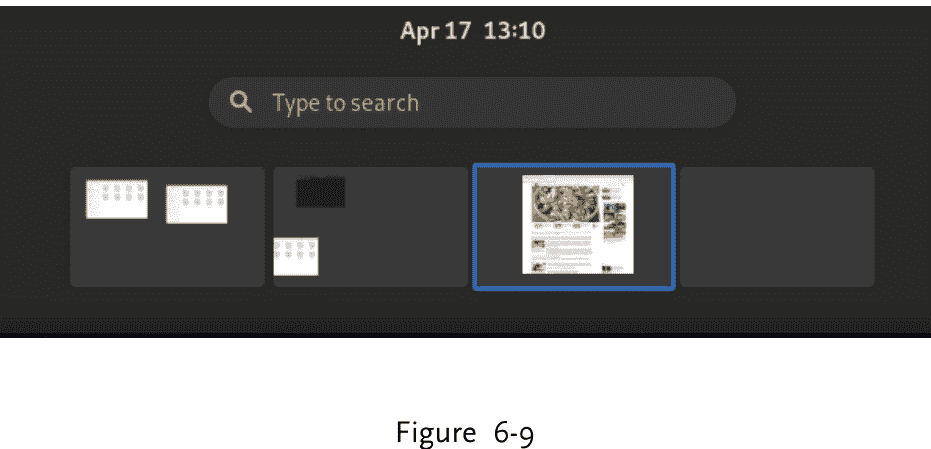

要切换到不同的工作区，请选择相应的缩略图。要将窗口从一个工作区移动到另一个工作区，请显示工作区面板并将拖放应用程序窗口（当前工作区的实际窗口或工作区面板中的缩略图窗口）到目标工作区。要删除工作区，请关闭其所有窗口或将其移动到另一个工作区。

## 6.6 日历与通知

当系统需要通知你某个事件（例如系统或应用程序更新的可用）时，工作区顶部会出现一个弹出面板。此外，通过点击顶栏上的日期和时间，可以访问日历和任何之前的通知，如图所示：

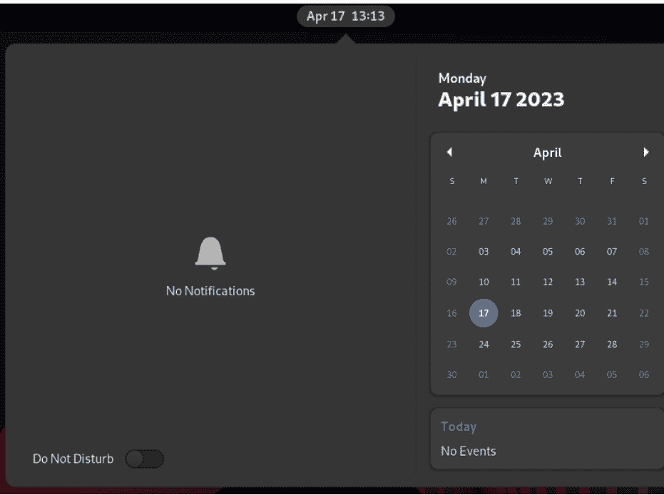

**图 6-10**

## 6.7 GNOME 桌面设置

要访问设置应用，点击顶栏右侧的图标行并选择“设置”，如图所示：

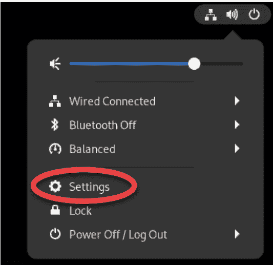

**图 6-11**

设置应用提供了许多选项，例如以太网和 WiFi 连接、屏幕背景自定义选项、屏幕锁定和电源管理控制以及语言偏好。要探索每个类别中的可用设置，请从设置窗口左侧面板中选择一个选项：

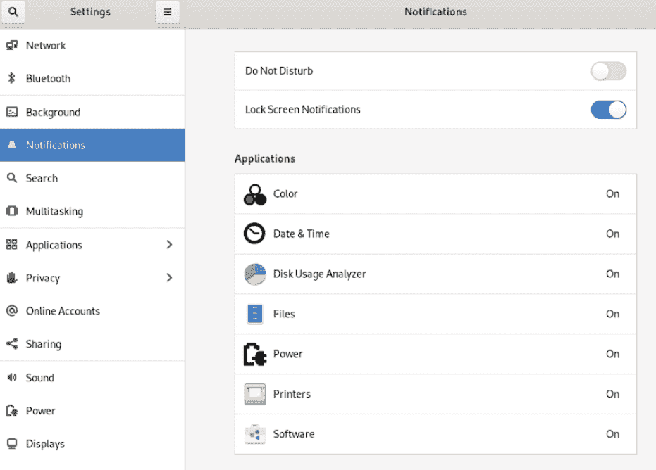

**图 6-12**

图 6-11 中的菜单还包括切换用户、调整音量、切换到不同的 WiFi 网络以及注销、重启或关闭系统的选项。

## 6.8 基础自定义之外

GNOME 40 桌面设计上是一个简洁且不杂乱的环境，自定义选项较少。然而，可以对桌面进行额外的更改。GNOME 项目开发了一个名为 GNOME Tweaks 的工具来实现此目的。使用以下命令安装并运行此工具：

```
# dnf install gnome-tweaks
```

```
$ gnome-tweaks
```

一旦 GNOME Tweaks 加载，将出现图 6-13 所示的界面：


**图 6-13**

现在提供了广泛的桌面自定义选项。本章无法涵盖所有内容，因此在进入下一章之前，请先对这些设置进行实验。

## 6.9 安装 GNOME 桌面应用

任何桌面环境如果没有应用商店都是不完整的，GNOME 桌面也不例外。GNOME 桌面的应用商店名为“软件”，可以从启动栏启动，如图所示：


**图 6-14**

一旦加载，软件应用将如图所示出现，允许你浏览并安装应用：

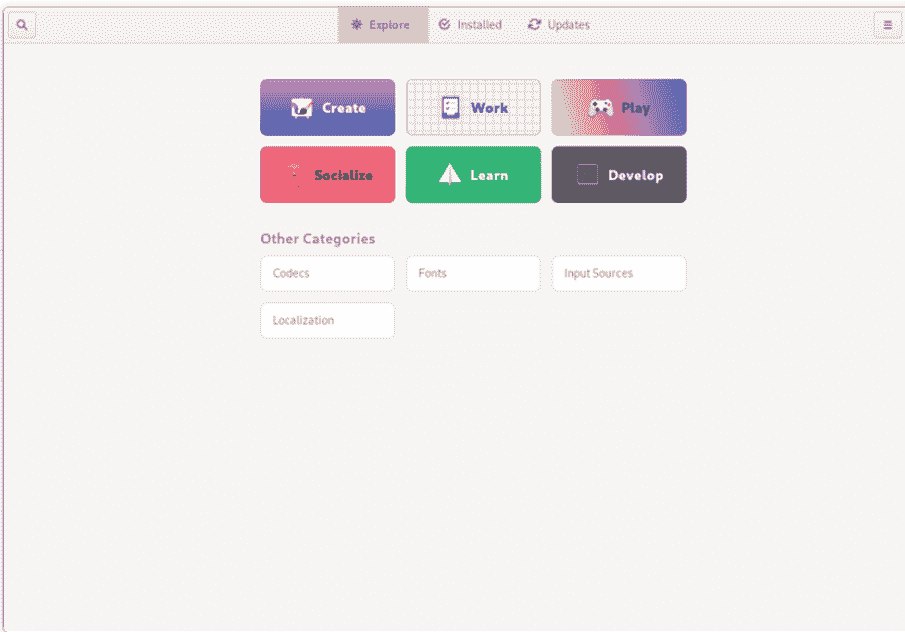

**图 6-15**

## 6.10 总结

Rocky 9 包含了 GNOME 40 桌面环境，它可能在初始安装期间包含，也可以稍后使用 `dnf` 组包安装功能安装。与大多数其他桌面环境不同，GNOME 40 旨在提供一个简洁易用的窗口用户界面。GNOME 40 桌面的关键区域包括顶栏、活动概览和启动栏。此外，GNOME 40 支持多个工作区，使运行中的应用程序保持有序。设置应用提供了多种配置选项，包括桌面背景设置、音频、网络配置和 WiFi 网络选择。

# 7. Cockpit Web 概览

尽管配备了最新的 Linux 桌面环境，Rocky Linux 9 仍然是一个服务器操作系统。因此，大多数 Rocky Linux 部署将针对远程物理服务器或作为云虚拟机实例。

**图 7-1**


以 root 身份或使用用户帐户凭据登录 Cockpit 界面。注意，由于权限限制，以用户登录时，某些任务在 Cockpit 界面中将受到限制。在这种情况下，Cockpit 控制台将显示一个标记为“受限访问（Limited Access）”的按钮，如图所示：

> Web 控制台正在以受限访问模式运行。开启管理访问

图 7-2

要提升您的权限，点击受限访问按钮并在提示时输入您的密码：图 7-3

登录后，Cockpit 将显示概览（Overview）屏幕。

## 7.4 概览

概览屏幕提供了当前系统的概述，包括对 CPU、内存、存储和网络活动指标的访问。此屏幕还包含有关系统的信息，包括底层硬件、主机名、系统时间以及系统是否为最新。还提供了重启或关闭系统的选项。例如，显示了 Cockpit 界面的概览页：图 7-4

要获取特定类别的更多信息，请点击相应的链接。例如，显示了系统使用情况和指标：图 7-5

## 7.5 日志

选择日志（Logs）类别时，Cockpit 会显示 `systemd journal` 内容。选择一个日志条目将显示整个消息。日志条目按最新顺序排序，并包含了菜单，可以根据不同的时间和严重程度过滤日志。图 7-6

## 7.6 存储

选择存储（Storage）选项来查看和管理系统上的存储，包括磁盘、分区和卷组、网络文件系统（NFS）挂载以及 RAID 存储。此屏幕还允许监控磁盘 I/O 活动，并列出了系统磁盘服务的输出，用于查询和管理存储设备：图 7-7

## 7.7 网络

网络（Networking）屏幕提供了各种网络相关配置和服务的信息，包括网络接口和防火墙设置。此外，它允许进行配置更改，例如创建网络桥接或设置虚拟网络：

| 防火墙 | 已启用 |
| :--- | :--- |
| 1 个活动区域 | 编辑规则和区域 |
| 名称 | IP 地址 | 发送 | 接收 |
| :--- | :--- | :--- | :--- |
| en1 | 192.168.86.123/24, fd79:b886:716a:0:ae16:2dff:fe11:673:64 | 1.89 Mbps | 64.2 Kbps |

网络日志

2023年3月27日 21:35: 警告: ALREADY_ENABLED: cockpit

图 7-8

## 7.8 账户

选择此选项可查看系统上配置的当前用户帐户，并为其他用户创建帐户。用户管理主题将在本章“管理 Rocky Linux 9 用户”的章节中进行介绍。图 7-9

点击现有账户查看详情并进行更改。用户帐户详情页还可用于向用户帐户查看和添加公共 SSH 密钥，以便远程访问服务器，如“在 Rocky Linux 上配置基于密钥的身份验证”章节概述概述。

## 7.9 服务

此屏幕显示运行在服务器上的系统服务列表，并允许对这些服务进行添加、删除、停止和启动。

| | | | | |
| :--- | :--- | :--- | :--- | :--- |
| NetworkManager-wait-online | 网络管理器等待 line | 启动失败 | 已启用 |
| accounts-daemon | 帐户服务 | 运行中 | 已启用 |
| alsa-restore | 保存/恢复声卡状态 | 未运行 | 静态 |
| alsa-state | 管理声卡状态（恢复和存储） | 运行中 | 静态 |
| arp-ethers | 加载静态 arp 条目 | 未运行 | 已禁用 |
| atd | 延时执行调度器 | 运行中 | 已启用 |

图 7-10

服务主题将在“管理 Rocky Linux 9: systemd”章节中详细介绍。

## 7.10 应用程序

如前所述，可以通过扩展的形式为 Cockpit 添加附加功能。这些扩展可以是自开发的，也可以是第三方提供的提供的。应用程序（Applications）屏幕列出了已安装的扩展，并允许添加或删除扩展：

| | | |
| :--- | :--- | :--- |
| Image Builder | 构建自定义的系统镜像 | 安装 |
| Machines | 管理您的虚拟机 | 安装 |
| Podman | 用于 Podman 容器的 Cockpit 组件 | 移除 |

图 7-11

## 7.11 虚拟机

虚拟化允许在单台计算机上同时运行多个操作系统实例，每个系统运行在自己的客户机中。Cockpit 虚拟机扩展提供了创建和管理这些虚机的方法：图 7-12

虚拟机扩展默认不安装，但可以通过应用程序屏幕或运行以下命令进行添加：

```
dnf install cockpit-machines
```

在 Rocky Linux 9 中使用虚拟化的内容将从“虚拟化概述”章节开始介绍。

## 7.12 软件更新

如果系统有任何可用软件更新，它们将列在此处并可从此屏幕进行安装：图 7-13

## 7.13 终端

顾名思义，终端（Terminal）屏幕提供了命令行提示符的访问：

```
root@demo-server:~ ip addr
1: lo: <LOOPBACK,UP> mtu 65536 qdisc noqueue state default qlen 1000
    link/loopback 00:00:00:00 brd 00:00:00:00
    inet 127.0.0.1/8 scope host default
    inet ::1/128 scope host default
2: en1: <BROADCAST,MULTICAST,UP> mtu 1500 qdisc noodel state UP qlen 1000
    link/ether 00:xx:xx:xx:xx:xx brd ff:ff:ff:ff:ff:ff
    inet 192.168.86.123/24 scope global en1
    inet6 fe80::xxxx:xx:xx:xx/64 scope link default
root@demo-server:~#
```

图 7-14

## 7.14 连接多个服务器

Cockpit 可以配置为在会话中管理多个服务器。要向会话中添加另一个主机，请点击图 7-15 中突出显示的按钮显示主机（Hosts）面板：图 7-15

点击“添加新主机”按钮，输入其他系统的地址或主机名，并选择一种颜色以与已添加到 Cockpit 的其他主机进行区分，然后点击“添加”按钮：

### 添加新主机

| | |
| :--- | :--- |
| 主机 | 192.168.86.133 |
| 可以是主机名、IP 地址、别名或 ssh:// URI |
| 用户名 | root |
| 为空时使用当前用户连接 |
| 颜色 | |

图 7-16

如果是首次连接到远程服务器，Cockpit 将要求您接受一个新的 SSH 密钥。接受密钥后，将提示输入图 7-16 中指定的用户名密码。还提供了设置并授权受密码保护的 SSH 密钥的选项，以便下次访问第二个主机系统时自动登录：

### 登录 root@192.168.86.133

无法使用 SSH 身份验证登录 root@192.168.86.133。请提供密码。您可能希望设置 SSH 密钥以便自动登录。

| 密码 | ........ |
| 自动登录 | [x] 创建新的 SSH 密钥并授权 |
| | 将在 rhel-server 的 /root/.ssh/id_rsa 创建新的 SSH 密钥，并将其添加到 192.168.86.133 上 root 的 ~/.ssh/authorized_keys 文件中。 |
| 密钥密码 | |
| 确认密钥密码 | |
| 为了以后无需密码即可 root 登录 192.168.86.133，请将 rhel-server 上 root 的登录密码作为密钥密码，或留空密钥密码。 |

## 7.15 启用存储的指标

在标准安装中，Cockpit 不会保留图表覆盖的短窗口之外的任何性能指标数据。为了保留 Cockpit 收集的数据，需要安装 Cockpit Co-Pilot (PCP) 包。按照以下步骤安装 `cockpit-pcp` 包：

```
# dnf install cockpit-pcp
```

安装 `cockpit-pcp` 后，注销当前 Cockpit 会话并重新登录。

接下来，显示“指标 (Metrics)”和“历史 (history)”屏幕，点击指标设置（Metrics settings）按钮显示 Figure_switch 所示的“收集指标 (Collect metrics)”选项界面，并点击“保存 (Save)”：

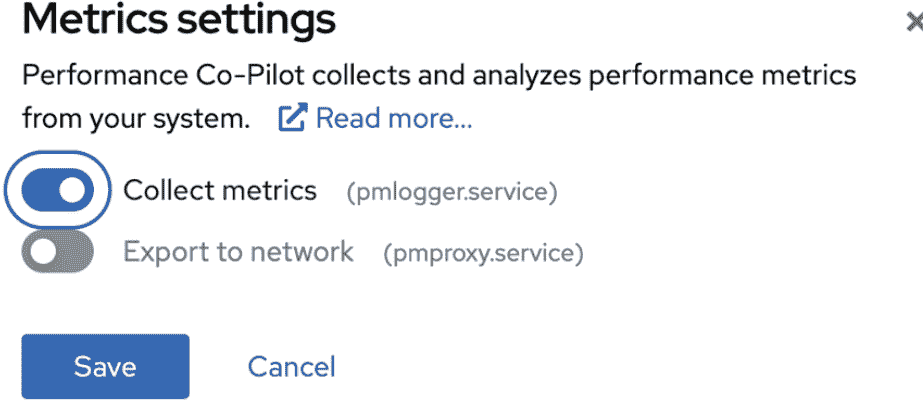

图 7-18

在 Cockpit 收集足够的时间后，指标信息将如 Figure_categorized 所示以小时为块显示：

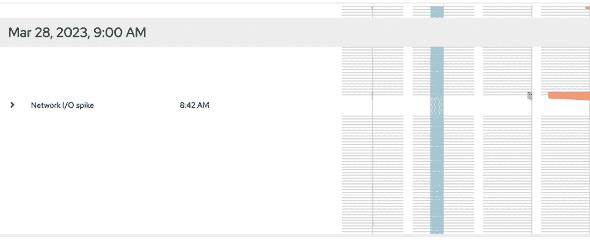

图 7-19

## 7.16 总结

Cockpit Web 界面允许在浏览器内部以可视化的方式执行远程系统管理任务，而无需依赖提示符和命令行工具。一旦安装并启用，系统管理员只需打开浏览器，连接到远程服务器并登录 Cockpit 界面。在后台，Cockpit 使用与命令行提示符相同的命令行工具，使得这两种方案都可以使用，而不会产生配置冲突的风险。此外，Cockpit 使用模块化框架，允许添加额外的扩展，并开发和集成自定义扩展。一个 Cockpit 会话可以用于管理单个服务器，也可以配置为同时访问多个服务器。

## 8. 在 Rocky Linux 9 上使用 Bash Shell

学习使用 Rocky Linux 9 以及通用 Linux 发行版的一个基本部分是熟练在 shell 环境中工作。虽然 Linux 包含的 GNOME 等图形化桌面环境为操作系统提供了用户友好的界面，但 shell 环境提供了比图形化桌面工具多得多的功能、灵活性和自动化程度。当没有桌面环境时，shell 环境还提供了与操作系统交互的手段，这在处理如 Rocky 9 这样的基于服务器的操作系统或无法完全启动的损坏系统时非常常见。

因此，本章旨在概述 Rocky 9 上的默认 shell 环境（特别是 Bash shell）。

## 8.1 什么是 Shell？

Shell 是一个交互式命令解释器环境，可以在其中通过提示符输入命令，或将命令输入文件作为脚本并执行。Shell 的起源可以追溯到 UNIX 操作系统的早期。事实上，在 Linux 早期，在引入图形化桌面之前，shell 是用户与操作系统交互的唯一方式。

多年来人们开发了多种 shell 环境。第一个被广泛使用的 shell 是由贝尔实验室的 Stephen Bourne 编写的 Bourne shell。

另一个早期的产物是 C shell，它与 C 编程语言在某些语法上具有相似性，并引入了如命令行编辑和历史记录等可用性增强功能。

Korn shell（由贝尔实验室的 David Korn 开发）基于 Bourne shell 和 C shell 提供的功能。

Rocky 9 上的默认 shell 是 Bash shell（Bourne Again SHell 的缩写）。这种 shell 起源于 Bourne shell 的开源版本，由 Brian Fox 为 GNU 项目开发，并基于 Bourne shell 和 C shell 提供的功能。

## 8.2 获取 Shell 访问

在 GNOME 桌面环境中，可以通过选择顶部栏的“活动 (Activities)”选项、在搜索栏中输入“终端 (Terminal)”并点击终端图标，从终端窗口访问 shell 提示符。

当在远程登录 Rocky 9 服务器时（例如使用 SSH），用户将看到一个 shell 提示符。题为“在 Rocky Linux 9 上配置基于密钥的身份验证”的章节将介绍使用 SSH 访问远程服务器的细节。在启动未安装桌面环境的服务器级系统时，用户在物理控制台终端或远程登录会话完成登录程序后，会立即进入 shell。

## 8.3 在提示符处输入命令

在 shell 命令提示符处，只需通过输入命令并按回车键即可输入命令。虽然某些命令会静默执行任务，但大多数命令在返回提示符之前都会显示某种形式的输出。例如，可以使用 `$ls` 命令显示当前工作目录下的文件和目录：

```
$ ls
Desktop Documents Downloads Music Pictures Public Templates Videos
```

可用的命令要么内置在 shell 自身中，要么存在于物理文件系统中。可以使用 `which` 命令识别命令在文件系统上的位置。例如，要查找 `ls` 可执行文件在文件系统中的位置：

```
$ which ls
alias ls='ls --color'
/usr/bin/ls
```

显然，`ls` 命令位于 `/usr/bin`。注意已配置了别名，该主题将在稍后介绍。使用 `which` 命令查找内置于 shell 的命令将产生类似下面的输出：

```
$ which history
/usr/bin/which: no history in (/home/demo/.local/bin:/home/demo/bin.../usr/sbin)
```

## 8.4 获取命令信息

Linux 中提供的许多命令看起来可能很晦懂。要了解某个命令的作用以及如何使用，请使用 `man` 命令并指定命令名称。例如，获取更多关于 `pwd` 命令的信息：

```
$ man pwd
```

执行上述命令时将显示 `pwd` 命令的详细描述。许多命令在带有 `--help` 命令行选项运行时也会提供额外信息：

```
$ wc --help
```

## 8.5 Bash 命令行编辑

早期的 shell 环境不提供任何形式的行编辑功能。这意味着如果你在输入的长命令行开头发现错误，你必须删除之后的所有字符，纠正错误然后重新输入命令的剩余。幸运的是，Bash 提供了大量的命令行编辑选项，如下表所示：

| 功能 | 描述 |
| :--- | :--- |
| `Ctrl+u` | 删除光标之前的行 |
| `Ctrl+k` | 删除光标之后的行 |
| `Ctrl+a` | 将光标移动到行首 |
| `Ctrl+e` | 将光标移动到行尾 |
| `Ctrl+w` | 删除光标前的单词 |
| `Ctrl+y` | 粘贴上次删除的文本 |
| `Ctrl+r` | 在历史中搜索命令 |
| `Ctrl+l` | 清除屏幕 |

表 8-1

## 8.6 使用 Shell 历史

除了命令行编辑功能，Bash shell 还提供了命令行历史支持。可以使用 `history` 命令查看以前执行的命令列表：

```
$ history
1 ps
2 ls
3 ls -l /
4 ls
5 man pwd
6 man apropos
```

此外，可以使用 `Ctrl-p`（或向上箭头）和 `Ctrl-n`（或向下箭头）在以前输入的命令之间来滚动。最后，当历史记录中所需的命令显示时，按回车键执行它。

另一种选项是输入 `!` 字符，后跟要重复的命令的前几个字符，然后按回车键。

## 8.7 文件名简写

许多 shell 命令接受一个或多个文件名作为参数。例如，要显示名为 `list.txt` 的文本文件的内容，可以使用如下方式使用 `cat` 命令：

```
$ cat list.txt
```

同样，通过指定所有文件名作为参数，可以显示多个文本文件的内容：

```
$ cat list.txt list2.txt list3.txt list4.txt
```

与其输入每个名称，不如可以使用模式匹配来指定所有符合某些标准的文件。例如，可以使用 `*` 通配符字符来简化上面的示例：

```
$ cat *.txt
```

上述命令将显示所有以 `.txt` 扩展的文件的内容。这可以进一步限制为任何以 `list` 开头并以 `.txt` 结尾的文件：

```
$ cat list*.txt
```

可以使用 `?` 字符指定单字符匹配：

```
$ cat list?.txt
```

## 8.8 文件名和路径自动补全

与其输入完整的文件名或路径，或使用模式匹配来减少输入量，shell 提供了文件名补全功能。要使用文件名补全，输入文件或路径名称的前几个字符，然后按两次 `Esc` 键。shell 将根据目录中匹配你输入字符的第一个文件或路径名为你补全文件名。要获取可能匹配项的列表，在输入前几个字符后按 `Esc` `=`。

## 8.9 输入和输出重定向

正如前面提到的，许多 shell 命令在执行时会输出信息。默认情况下，这些输出去往名为 `stdout` 的设备文件，它本质上是运行 shell 的终端窗口或控制台。相反，shell 从名为 `stdin` 的设备文件接收输入，默认是键盘。

可以使用 `>` 字符将命令的输出从 `stdout` 重定向到文件系统上的物理文件。例如，要将 `ls` 命令的输出重定向到名为 `files.txt` 的文件，需要如下命令：

```
$ ls *.txt > files.txt
```

完成后，`files.txt` 将包含当前目录的文件列表。同样，可以将文件的内容替代 `stdin` 喂给命令。例如，将文件的内容作为输入重定向到命令：

```
$ wc -l < files.txt
```

上述命令将显示 `files.txt` 文件中的行数。

需要注意的是，`>` 重定向操作符在使用时会创建一个新文件或截断现有文件。要向现有文件追加内容，请使用 `>>` 运算符：

```
$ ls *.dat >> files.txt
```

除了标准输出外，shell 还提供了标准错误输出。当命令的输出被定向到 `stdout` 时，命令生成的任何错误消息都被定向到 `stderr`。这意味着如果 `stdout` 被重定向到文件，错误信息仍然显示在终端中。这通常是期望的行为，但如果需要，也可以 `2>` 运算符重定向 `stderr`：

```
$ ls dkjfnvkndf 2> errormsg
```

命令完成后，`errormsg` 文件将包含一条关于找不到名为 `dkjfnvkndf` 文件的错误。


可以使用 `&>` 运算符将 `stderr` 和 `stdout` 都重定向到同一个文件：

```
$ ls /etc dkjfnvkndf &> alloutput
```

执行完成后，alloutput 文件将包含 /etc 目录的内容列表以及与尝试列出不存在的文件相关的错误消息。

## 8.10 在 Bash Shell 中使用管道

除了 I/O 重定向，shell 允许将一个命令的输出直接通过管道作为另一个命令的输入。管道操作通过在命令行上的两个或多个命令之间放置 `|` 字符来实现。例如，要统计系统中运行的进程数，可以将 `ps` 命令的输出通过管道给 `wc` 命令：

```
$ ps -ef | wc -l
```

命令行上可以执行的管道操作数量没有限制。例如，要找到包含 Smith 名称的文件的行数：

```
$ cat namesfile | grep Smith | wc -l
```

## 8.11 配置别名 (Aliases)

随着你对 shell 环境越来越熟练，你可能会频繁带有相同的参数发布命令。例如，你可能经常带有 `l` 和 `t` 使用 `ls` 命令：

```
$ ls -lt
```

为了减少发布命令时的输入量，可以创建一个映射到命令和参数的别名。例如，要创建一个输入字母 `l` 就会执行 `ls -lt` 命令的别名，语句如下：

```
$ alias l="ls -lt"
```

现在在命令行提示符输入 `l` 将执行原始语句。

## 8.12 环境变量

shell 环境变量提供了数据和配置设置的临时存储。shell 本身设置了几个环境变量，用户可以更改这些变量来修改 shell 的行为。可以使用 `env` 命令获取当前定义的变量列表：

```
$ env
```

## 8.7 文件名简写

许多 shell 命令接受一个或多个文件名作为参数。例如，要显示名为 `list.txt` 的文本文件的内容，可以使用如下方式使用 `cat` 命令：

```
$ cat list.txt
```

同样，通过指定所有文件名作为参数，可以显示多个文本文件的内容：

```
$ cat list.txt list2.txt list3.txt list4.txt
```

与其输入每个名称，不如可以使用模式匹配来指定所有符合某些标准的文件。例如，可以使用 `*` 通配符字符来简化上面的示例：

```
$ cat *.txt
```

上述命令将显示所有以 `.txt` 扩展的文件的内容。这可以进一步限制为任何以 `list` 开头并以 `.txt` 结尾的文件：

```
$ cat list*.txt
```

可以使用 `?` 字符指定单字符匹配：

```
$ cat list?.txt
```

## 8.8 文件名和路径自动补全

与其输入完整的文件名或路径，或使用模式匹配来减少输入量，shell 提供了文件名补全功能。要使用文件名补全，输入文件或路径名称的前几个字符，然后按两次 Esc 键。shell 将根据目录中匹配你输入字符的第一个文件或路径名为你补全文件名。要获取可能匹配项的列表，在输入前几个字符后按 `Esc` `=`。

## 8.9 输入和输出重定向

正如前面提到的，许多 shell 命令在执行时会输出信息。默认情况下，这些输出去往名为 `stdout` 的设备文件，它本质上是运行 shell 的终端窗口或控制台。相反，shell 从名为 `stdin` 的设备文件接收输入，默认是键盘。

可以使用 `>` 字符将命令的输出从 `stdout` 重定向到文件系统上的物理文件。例如，要将 `ls` 命令的输出重定向到名为 `files.txt` 的文件，需要如下命令：

```
$ ls *.txt > files.txt
```

完成后，files.txt 将包含当前目录的文件列表。同样，可以将文件的内容替代 `stdin` 喂给命令。例如，将文件的内容作为输入重定向到命令：

```
$ wc -l < files.txt
```

上述命令将显示 files.txt 文件中的行数。

需要注意的是，`>` 重定向操作符在使用时会创建一个新文件或截断现有文件。要向现有文件追加内容，请使用 `>>` 运算符：

```
$ ls *.dat >> files.txt
```

除了标准输出，shell 还提供了标准错误输出。当命令的输出被定向到 `stdout` 时，命令生成的任何错误消息都被定向到 `stderr`。这意味着如果 `stdout` 被重定向到文件，错误信息仍然显示在终端中。这通常是期望的行为，但如果需要，也可以 `2>` 运算符重定向 `stderr`：

```
$ ls dkjfnvkndf 2> errormsg
```

命令完成后，errormsg 文件将包含一条关于找不到名为 dkjfnvkndf 文件的错误。

可以使用 `&>` 运算符将 `stderr` 和 `stdout` 都重定向到同一个文件：

```
$ ls /etc dkjfnvkndf &> alloutput
```

执行完成后，alloutput 文件将包含 /etc 目录的内容列表以及与尝试列出不存在的文件相关的错误消息。

## 8.10 在 Bash Shell 中使用管道

除了 I/O 重定向，shell 允许将一个命令的输出直接通过管道作为另一个命令的输入。管道操作通过在命令行上的两个或多个命令之间放置 `|` 字符来实现。例如，要统计系统中运行的进程数，可以将 `ps` 命令的输出通过管道给 `wc` 命令：

```
$ ps -ef | wc -l
```

命令行上可以执行的管道操作数量没有限制。例如，要找到包含 Smith 名称的文件的行数：

```
$ cat namesfile | grep Smith | wc -l
```

## 8.11 配置别名 (Aliases)

随着你对 shell 环境越来越熟练，你可能会频繁带有相同的参数发布命令。例如，你可能经常带有 `l` 和 `t` 使用 `ls` 命令：

```
$ ls -lt
```

为了减少发布命令时的输入量，可以创建一个映射到命令和参数的别名。例如，要创建一个输入字母 `l` 就会执行 `ls -lt` 命令的别名，语句如下：

```
$ alias l="ls -lt"
```

现在在命令行提示符输入 `l` 将执行原始语句。

## 8.12 环境变量

shell 环境变量提供了数据和配置设置的临时存储。shell 本身设置了几个环境变量，用户可以更改这些变量来修改 shell 的行为。可以使用 `env` 命令获取当前定义的变量列表：

```
$ env
```

## 8.13 编写 shell 脚本

到为止，我们完全关注 Bash shell 的交互性。所说的交互，是指手动逐个输入命令并在提示符处执行它们。事实上，这只是 shell 能够实现的一小部分。可以说，shell 最强大的方面之一就是创建 shell 脚本的能力。shell 脚本是文本文件，包含可以在 shell 环境中执行的语句序列。除了执行命令的能力外，shell 还提供了许多编程结构，如 `for` 循环以及 `do` 和 `if` 语句，这些你理上预期会在脚本语言中找到。

遗憾的是，shell 脚本的详细概述超出了本章的范围。然而，许多致力于 shell 脚本的书籍和网络资源对该主题的描述比我们在这里希望实现的要得多。因此，在本节中，我们仅将提供 shell 脚本的一个极小体验。

创建 shell 脚本的第一步创建一个文件（在本示例中，我们将其命名并在第一行添加以下内容）：

```
#!/bin/sh
```

`#!` 被称为 "shebang"，是一个特殊的字符序列，指示所需的解释器路径位于执行脚本是行中的下一个项目（在本例中，位于该处的 `sh` 可执行文件）。这同样可以是，例如 `/bin/csh` 或 `/bin/ksh`，如果其中任何一个是你想要使用的解释器。

下一步是编写一个简单的脚本：

```
#!/bin/sh

for i in *
do
  echo $i
done
```

此脚本的作用是遍历当前目录下的所有文件并显示每个文件的名称。可以通过将脚本名称作为参数传递给 `sh` 命令来执行此脚本：

```
$ sh simple.sh
```

要使该文件具有可执行性（从而不再需要将其传递给 `sh` 命令），可以使用 `chmod` 命令：

```
$ chmod +x simple.sh
```

一旦在文件权限上设置了可执行位，就可以直接执行它。例如：

```
$ ./simple.sh
```

## 8.14 总结

在《Rocky 9 Essentials》的这一章节中，我们简要介绍了 Bash Shell 环境。在图形化桌面环境中，人们很容易忘记，操作系统的真正威力和灵活性通常只有放弃用户友好的桌面界面并使用 Shell 环境时才能充分利用。此外，熟悉 Shell 对于管理和维护未安装桌面的服务器系统，或者在尝试修复损坏到桌面或 Cockpit 界面都无法启动的系统时，是必要的。

Shell 的功能远超本章所涵盖的领域。如果你是 Shell 的初学者，我们强烈建议你寻找额外的资源。一旦熟悉了这些概念，你会很快发现，在终端窗口中使用 Shell 执行许多任务比在桌面上穿过各种菜单和对话框要快得多。

# 9. 管理 Rocky Linux 9 用户和组

在安装 Rocky Linux 9 期间，安装程序创建了一个 root 或超级用户账户，并要求配置密码。安装程序还提供了为系统创建用户账户的机会。我们需要记住，Rocky 9 是一个企业级、多用户、多任务的操作系统。为了充分利用 Rocky 9 的功能，可能需要为多个用户提供访问权限。每个用户都应该有自己的用户账户登录、密码、主目录和权限。

为了便于管理，用户被进一步分为组，这些组可以具有不同级别的权限。例如，你可能有一组工作在财务部门的用户。在这种环境下，你可以创建一个账户组，并将所有财务部门的用户分配给该组。

本章将介绍在 Rocky 9 系统上添加、删除和管理用户及组的步骤。可以使用命令行工具、Cockpit Web 界面和桌面设置应用在 Rocky 9 上管理用户和组。在本章中，我们将查看这些用户管理方法。

## 9.1 从命令行进行用户管理

可以通过命令行使用 `adduser` 工具向 Rocky 9 系统添加新用户。要创建一个新的用户账户，请输入类似下的命令：

```
# useradd john
```

默认情况下，这将在 `/home/` 目录下（在本例中）为用户创建一个主目录。要指定不同的主目录，在创建账户时使用 `-d` 命令行选项：

```
# useradd -d /users/johnsmith
```

账户创建后，需要使用 `passwd` 工具分配密码，用户才能能够登录系统：

```
# passwd john
```

更改用户 john 的密码。

新密码：

再次输入新密码：

passwd: 所有身份验证令牌已成功更新。

可以通过命令行使用 `userdel` 工具删除现有用户。虽然这将删除账户，但用户的文件和数据将完好无损地保留在系统中：

```
# userdel john
```

还可以在删除过程中移除用户的主目录和邮件池：

```
# userdel --remove john
```

# demo

| 全名 | demo |
| --- | --- |
| 用户名 | demo |
| 角色 | [x] 服务器管理员 |
| 最后登录 | 2023年3月28日, 下午3:59 永不过期 账户编辑 |
| 选项 | [ ] 不允许交互式密码 永不过期 账户编辑 |
| 密码 | [设置密码] [强制更改] 永不过期 密码编辑 |

# 授权的 SSH 密钥

此账户没有授权的公钥。

图 9-3

此屏幕允许执行各种任务，包括锁定或解锁账户、更改密码，或强制用户配置新密码。此外，如果选择了“服务器管理员”选项，该用户将被添加到 `wheel` 组，并被允许使用 `sudo` 执行管理任务。此外还提供了一个从系统中删除该用户的按钮。

如果用户使用密钥加密的 SSH 连接远程访问系统，则可以在此屏幕内添加用户的公钥。SSH 访问和认证将在后的“《在 Rocky Linux 上配置基于密钥的身份验证》”中进行介绍。

## 9.3 使用“设置”应用进行用户管理

通过 GNOME 桌面设置应用提供了第三种用户账户管理选项。通过点击 GNOME 桌面右上角的图标并选择“设置”选项可以访问此应用，如图 9-4 所示：

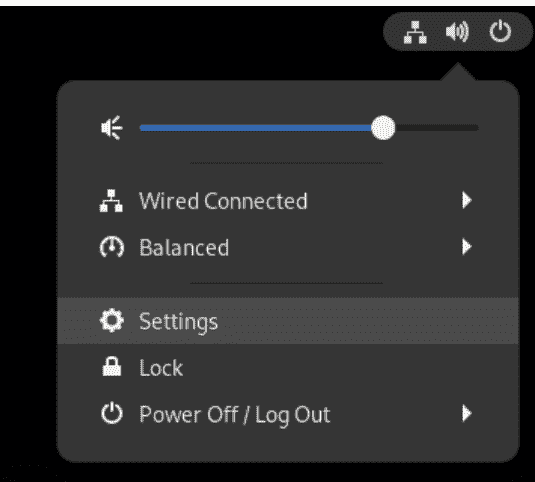

图 9-4

当主设置界面出现时，点击左侧导航面板中的“用户”选项。默认情况下，设置将锁定锁定，无法对系统上的用户账户进行任何更改。要解锁“设置”应用，请点击下方图 9-5 中的“解锁”按钮并输入密码。请注意，只有当您以 `sudo` 权限的用户身份登录时，才能解锁设置：

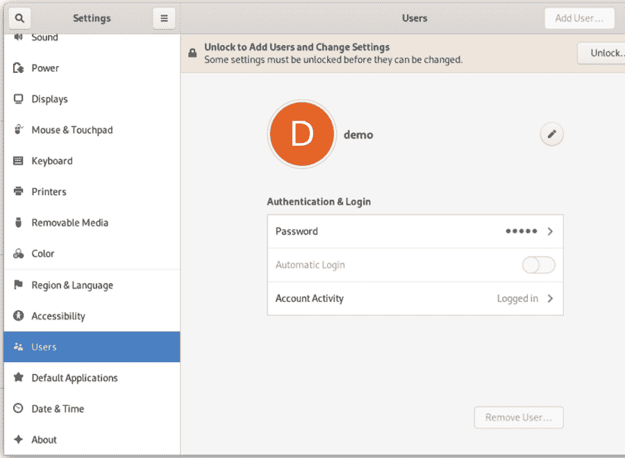

图 9-5

应用解锁后，标题栏将出现一个标记为“添加用户...”的按钮。点击此按钮显示下方图 9-6 所示的对话框。

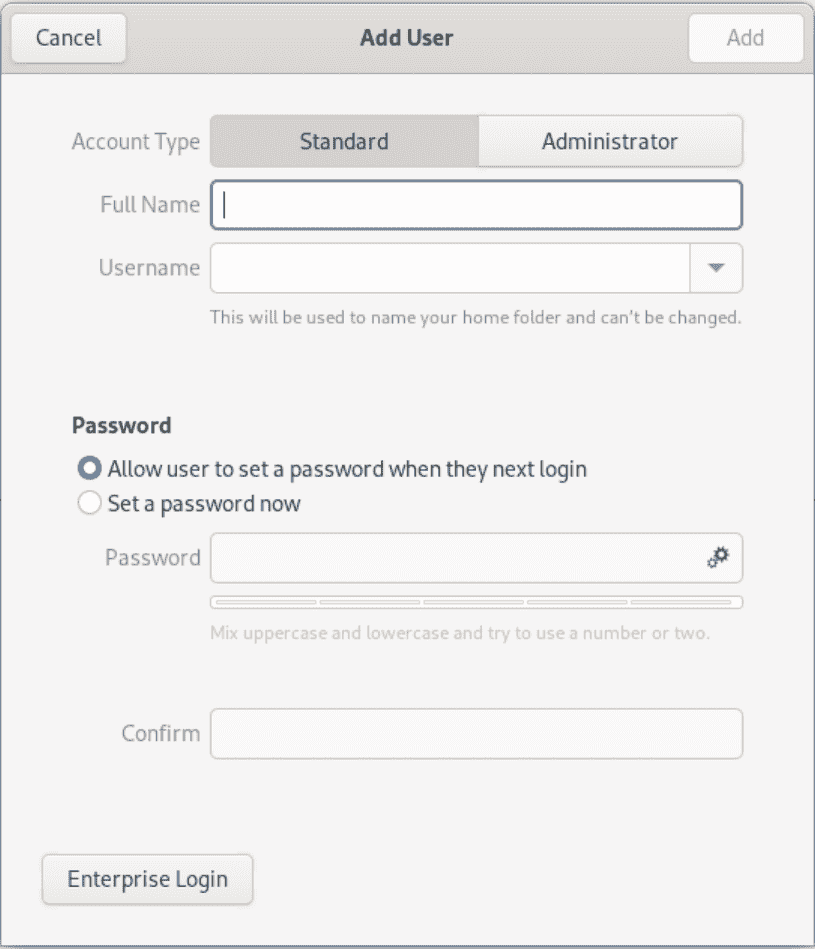

图 9-6

选择“管理员”账户为新用户分配 `sudo` 权限；否则保留“标准”。接下来，输入用户的全名和用户名，并立即分配密码，或允许用户在首次登录账户时设置密码。输入信息后，点击“添加”按钮创建账户。

可以通过选择“用户”屏幕内相应的图标，随时查看、修改现有用户的设置或删除该账户，如图 9-7 所示。此外还提供了查看用户登录活动的选项。请注意，在对账户进行任何更改之前，必须再次解锁“设置”应用：

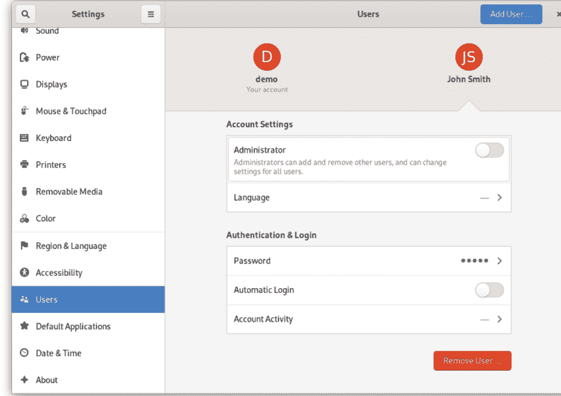

图 9-7

## 9.4 总结

作为一个多用户操作系统，Rocky 9 的设计旨在支持对多个用户的受控访问。在安装期间，系统创建了 `root` 用户账户并分配了密码，还提供了创建用户账户的选项。可以通过 Cockpit Web 界面或 GNOME 设置应用使用一组命令行工具向系统添加额外的用户账户。除了用户账户外，Linux 还实现了“组”的概念。可以使用命令行工具添加新组，并将用户分配到这些组中，每个用户必须至少属于一个组。默认情况下，标准非 `root` 用户没有权限执行特权任务。然而，特殊 `wheel` 组的成员可以通过 `sudo` 命令执行特权任务。

# 10. Rocky Linux 9 软件安装与 AppStream（应用流）

目前很难确定新安装的 Rocky Linux 9 系统是否会包含执行其预期任务所需的所有软件包。即使安装了所需的软件，几乎可以确定，在系统的生命周期内，许多此类软件包的更新版本将会发布。在某些情况下，您需要确保在系统上安装了这些最新的软件包，以确保任何漏洞得到修复。但在其他情况下，为了与其他软件保持兼容，可能需要在系统中保留某个特定软件包的旧版本。

本章介绍了 Rocky 9 上软件管理的基本概念，解释了如何解决这些问题，解释了仓库、软件包以及 Rocky Linux Application Stream（应用流），并探索了如何列出、安装和删除组成功能性 Rocky 9 系统的软件包。

## 10.1 仓库

Linux 本质上由一组基础包组成，这些包提供了操作系统的核心功能，以及一系列在基础操作系统之上增加功能和特性的软件包和模块。

在首次安装 Rocky 9 时，会安装几个软件包，具体取决于在安装阶段选择的软件选项。然而，一旦系统运行，就可以根据需要安装额外的软件。通常，所有属于 Rocky 9 的软件（换句话说，即第三方供应商未提供的软件）都会下载并安装到系统上。

## 10.3 AppStream 仓库

AppStream 仓库通过模块（modules）、流（streams）来管理软件，而 AppStream 包再次如前文描述 BaseOS 节所示，是 RPM 包。另一方面，AppStream 模块是一组共同归属于一类的包，或者说这些包之间存在依赖关系的包（例如，在构建 Web 服务器时需要安装的一组包）。每个模块可以拥有多个流，其中每个模块流代表了该软件模块的不同版本。

例如，考虑一个托管网站的 Rocky 9 系统，该网站依赖于 PHP 脚本语言的 7.2 版本。服务器仍然需要接收 PHP 7.2 的任何更新，以便从补丁和错误修复中获益，但它与最新版本的 PHP（8.1 版本）不兼容。在引入 AppStream 之前，当新版本被发布时，要继续接收 7.2 版本的更新将是非常困难的。

为了解决这个问题，Rocky 9 软件管理工具可以使用 AppStream 仓库仅为特定模块订阅特定的流（在本例中，即 PHP 模块的版本 7.2 流）。

除了流之外，模块还可以根据模块细分。模块配置（Module profiles）为构成要安装模块的包提供了不同的配置，取决于系统的需求。例如，nodejs JavaScript 运行时环境可以使用开发配置（development）或最小化配置（minimal）进行安装。在正在使用 nodejs 进行开发的系统上，很可能会使用开发配置。当使用 nodejs 开发软件时，可能会改为安装仅包含运行环境的最小化系统。

要查看可用安装的模块列表，请按如下方式使用 `dnf` 命令：

```bash
# dnf module list
```

上次元数据过期检查：0:08:48 之前，于 2023 年 4 月 24 日周一 上午 10:33:24 EDT。

Rocky Linux 9 - AppStream

| 名称 (Name) | 流 (Stream) | 配置 (Profiles) | 摘要 (Summary) |
| :--- | :--- | :--- | :--- |


| maven | 3.8 | common [d] | Java 项目管理和项目理解工具 |
| nodejs | 18 | common [d], development, minimal, s2i | Javascript 运行时 |
| php | 8.1 | common [d], devel, minimal | PHP 脚本语言 |
| ruby | 3.1 | common [d] | 面对象脚本语言的解释器 |

提示：[d]默认, [e]已启用, [x]禁用, [i]已安装

列表中的第一列是模块名称，第二列是流名称（通常是模块的版本）。流名称后的字母（`[d]`）表示该流是否为默认流（即在未引用特定流时将用于安装的流），或者该流在执行安装时是否已启用。第三列列出了对应包可用的配置，并指示了该配置是否为默认配置或已禁用。

用于列出特定模块信息的 `dnf` 命令结构如下：

```bash
# dnf module list modulename
```

例如，以下输出列出了可用安装的模块信息：

```bash
# dnf module list php
```

| 名称 (Name) | 流 (Stream) | 配置 (Profiles) | 摘要 (Summary) |
| :--- | :--- | :--- | :--- |
| php | 8.1 [d] | common [d], devel, minimal | PHP 脚本语言 |

显然，系统默认将安装 PHP 8.1 版本，且该模块在 common、development 和 minimal 配置中均可用。

要使用默认流和配置安装模块，可以使用以下语法使用 `dnf` 命令：

```bash
# dnf install @modulename
```

例如：

```bash
# dnf install @php
```

或者，可以指定从特定的流中执行安装：

```bash
# dnf install @modulename:stream
```

例如：

```bash
# dnf install @php:7.2
```

此外，还可以指定特定的配置来执行安装：

```bash
# dnf install @modulename:stream:profile
```

例如：

```bash
# dnf install @nodejs:18:minimal
```

最后，要使用特定的流和配置来安装一个模块：

```bash
# dnf install @modulename:stream:profile
```

例如：

```bash
# dnf install @php:8.1:devel
```

要启用某个模块：

```bash
# dnf module enable modulename
```

例如：

```bash
# dnf module enable php:7.2
```

要禁用某个模块：

```bash
# dnf module disable modulename
```

例如：

```bash
# dnf module disable php:8.1
```

要重置某个模块：

```bash
# dnf module reset modulename
```

例如：

```bash
# dnf module reset php:7.2
```

要列出模块信息：

```bash
# dnf module info modulename
```

例如：

```bash
# dnf module info php
```

要列出特定流的信息：

```bash
# dnf module info modulename:stream
```

例如：

```bash
# dnf module info php:8.1
```

要列出某个模块的所有流：

```bash
# dnf module list modulename
```

例如：

```bash
# dnf module list php
```

要列出所有模块的流：

```bash
# dnf module list
```

## 11.2 理解 Rocky 9 systemd 服务

服务（service）是一个通常在后台运行的进程，提供特定的功能。例如，`sshd` 服务是一个后台进程（也称为守护进程），它为系统提供安全的 shell 访问。不同的 systemd 目标（targets）被配置为自动启动不同的服务集合，具体取决于该目标要提供的功能。

目标和服务都是 systemd 单元（unit）的类型，该主题将在本章稍后介绍。

## 11.3 Rocky Linux 9 systemd 目标描述

如之前所述，Rocky 9 可以进入几个目标级别之一。系统配置启动的默认目标反过来决定了启动哪些 systemd 单元。与系统启动和关闭相关的目标可以总结如下：

- **poweroff.target** - 该目标会关闭系统。你可能不会将其作为默认目标。
- **rescue.target** - 导致系统以单用户模式启动，在此模式下只有 root 用户可以登录。在此模式下，系统不会启动任何网络、图形用户界面或多用户服务。此运行级别是系统管理员执行系统维护或修复工作的理想选择。
- **multi-user.target** - 将系统启动到多用户模式，并具有文本控制台登录能力。
- **graphical.target** - 将系统启动到具有 X Window 系统能力的联网多用户状态。默认情况下，图形桌面环境将在启动过程结束时启动。这是桌面或工作站最常用的运行级别。
- **reboot.target** - 重启系统。另一个目标，由于显而易见的原因，你不可能将其作为默认目标。

除了上述目标外，系统还包含约 70 个其他目标，其中许多是上述主目标所使用的子目标。例如，在后台，`multi-user.target` 还会启动一个名为 `basic.target` 的目标，该目标反过来会启动 `sockets.target` 单元，该单元是不同进程之间通信所必需的。这确保了多用户目标所依赖的所有服务在启动过程中也被启动。

可以通过在终端窗口中运行以下命令查看指定目标所依赖的目标和服务的列表：

```bash
# systemctl list-dependencies
```

例如，图 11-1 显示了图形目标 systemd 单元依赖关系的部分列表（完整列表包含了运行功能完全的多用户系统所需的 140 多个目标和服务）：

```bash
[demo@rhel-server ~$] systemctl list-dependencies graphical.target
- accounts-daemon.service
- gdm.service
- nmfc-boot-connections.service
- power-profiles-daemon.service
- rtkit-daemon.service
- switchtheroo-control.service
- systemd-update-utmp-runlevel.service
- udisks2.service
- upower.service
- multi-user.target
- at.service
- auditd.service
- avahi-daemon.service
- chronyd.service
```

## 图 11-1

列表以分级树的形式呈现，说明了某些依赖项具有自己的子依赖。例如，滚动到列表底部可以发现图形目标依赖于两个网络文件系统相关的目标（即 `nfs-client.target` 以及每个目标都有自己的服务和目标子依赖）：

- `nfs-client.target`
- `auth-rpcgs-module.service`
- `rpc-statd-notify.service`
- `remote-fs-pre.target`
- `remote-fs.target`
- `iscsi.service`
- `var-lib-machines.mount`
- `nfs-client.target`
- `auth-rpcgs-module.service`
- `rpc-statd-notify.service`
- `remote-fs-pre.target`

## 图 11-2

列表中每个条目左侧的彩色点表示该服务或目标的当前状态如下：

- **绿色** - 服务或目标处于活动并运行状态。
- **白色** - 服务或目标处于未激活（死亡）状态。通常是因为服务或目标尚未启用、由于原因已停止，或者未满足服务或目标所依赖的条件。
- **红色** - 服务或目标由于致命错误启动失败。

要了解有关 systemd 单元状态的更多详情，请使用 `systemctl status` 命令后跟单元名称，如下：

```bash
# systemctl status systemd-machine-id-commit.service
```

```
○ systemd-machine-id-commit.service - Commit a transient machine-id on disk
Loaded: loaded (/usr/lib/systemd/system/systemd-machine-id-commit.service; static)
Active: inactive (dead)
Condition: start condition failed at Thu 2023-03-30 08:41:05 UTC
```

## 11.4 识别和配置默认目标

可以使用 `systemctl` 命令识别系统的当前默认目标：

```bash
# systemctl get-default
```

```
multi-user.target
```

可以随时使用 `systemctl` 命令更改默认值。例如，要将默认更改为图形目标，将使用以下命令：

```bash
# systemctl set-default graphical.target
```

```
删除 /etc/systemd/system/default.target。
已创建符号链接 /etc/systemd/system/default.target -> /usr/lib/systemd/system/graphical.target。
```

## 11.5 理解 systemd 单元和单元类型

如前所述，目标和服务都是 systemd 单元的类型。Rocky 9 支持不同的单元类型，包括本章涵盖的内容。单元的类型由表 11-1 所示的扩展名表示：

| 单元类型 | 说明 |
| :--- | :--- |
| .service | 提供特定功能的进程。 |
| .target | 状态的集合。 |

## 11.6 动态更改当前目标

之前提到的 `systemctl set-default` 命令指定了下次系统启动时使用的目标，但不会更改当前系统的状态。要动态切换到不同的目标，请再次使用 `systemctl` 命令，使用 `isolate` 参数后跟目标。例如，要在不重启的情况下将系统切换到图形目标，将使用以下命令：

```bash
# systemctl isolate graphical.target
```

执行后，系统将启动图形环境。

## 11.7 启用、禁用和屏蔽 systemd 单元

新安装的 Rocky 9 系统将包含基础 systemd 服务单元，但可能不包含系统进入生产环境后需要的所有服务。例如，基础 Rocky 9 安装通常不包含运行 Apache Web 服务器所需的包，其一个关键元素是 `httpd.service` 单元。

系统管理员将通过使用以下命令安装必要的 `httpd` 包来解决此问题：

```bash
# dnf install httpd
```

配置好 Web 服务器后，下一个任务是检查 `httpd` 服务单元的状态，以识别它是否在安装过程中被激活：

```bash
# systemctl status httpd.service
```

```
httpd.service - The Apache HTTP Server
Loaded: loaded (/usr/lib/systemd/system/httpd.service; disabled; vendor preset: disabled)
Active: inactive (dead)
文档：man:httpd.service(8)
```

请注意，服务已加载但处于非激活状态，因为厂商在首次安装时将其设置为禁用。要启动该服务，可以使用以下命令：

```bash
# systemctl start httpd.service
```

现在检查状态将显示该服务正处于激活状态：

```bash
# systemctl status httpd.service
```

```
httpd.service - The Apache HTTP Server
Loaded: loaded (/usr/lib/systemd/system/httpd.service; disabled; vendor preset: disabled)
Active: active (running) since Fri 2019-02-15 11:13:26 EST; 8s ago
文档：man:httpd.service(8)
Main PID: 10721 (httpd)
Status: "Started, listening on: port 80"
Tasks: 213 (limit: 13923)
Memory: 24.1M
```

然而，状态显示该服务仍然处于禁用状态。这意味着当系统下次重启时，`httpd` 服务将不会自动启动，需要由系统管理员手动启动。

要配置 `httpd` 服务在每次系统启动时自动启动，必须按如下对其启用：

```bash
# systemctl enable httpd.service
```

一旦服务被启用，状态输出中的 Loaded 部分将显示如下：

```
Loaded: loaded (/usr/lib/systemd/system/httpd.service; enabled; vendor preset: disabled)
```

```bash
# systemctl status httpd.service
```

```
- httpd.service - The Apache HTTP Server
Loaded: loaded (/usr/lib/systemd/system/httpd.service; enabled; vendor preset: disabled)
Active: active (running) since Thu 2023-03-30 09:04:21 EDT; 2min 17s ago
文档：man:httpd.service(8)
Main PID: 4500 (httpd)
Status: "Total requests: 0; Idle/Busy workers 100/0; Requests/sec: 0; Bytes served/sec: 0 B/sec"
Tasks: 213 (limit: 22087)
Memory: 35.4M
```

当前运行的服务可以随时按如下方式停止：

```bash
# systemctl stop httpd.service
```

既然它已经被启用，当系统下次重启到当前目标时，`httpd` 服务将自动启动。例如，假设该服务在系统运行多用户目标（multi-user target）时被启用，那么 `httpd` 服务将作为另一个依赖项被添加到 `multi-user.target` 单元中。

在后台，`systemctl` 通过在位于 `/etc/systemd/` 文件夹下对应目标的 `.wants` 文件夹中创建符号链接为目标添加依赖项。例如，`multi-user.target` 单元在 `/etc/systemd/system/multi-user.target.w` 中有一个名为 `multi-user.target.wants` 的文件夹，其中包含指向 `/usr/lib/systemd/system` 中它所依赖的所有 systemd 单元的符号链接。检查此文件夹将显示其与本章前面介绍的 `systemctl list-dependencies` 命令列出的依赖项之间的相关性。

要配置服务使其不再作为目标依赖项自动启动，请按如下方式禁用它：

```bash
# systemctl disable httpd.service
```

此命令将从目录中删除指向 `httpd.service` 单元文件的符号链接，使其不再成为依赖项，从而在系统下次启动时不会被启动。

`.wants` 文件夹包含依赖项，如果这些项不可用，将阻止单元启动和运行。强制依赖项（换句话说，如果不可用会导致单元失败的依赖项）应该放在 `.requires` 文件夹中（例如）。

除了启用和禁用，还可以按如下方式屏蔽（mask）systemd 单元：

```bash
# systemctl mask httpd.service
```

被屏蔽的 systemd 单元在任何情况下都无法启用、禁用或启动，即使它被列为另一个单元的依赖项。对于系统而言，被屏蔽的 systemd 单元就像不再存在一样。这对于确保单元无论系统状况如何从不启动非常有用。重新访问该服务的唯一方法是取消屏蔽（unmask）：

```bash
# systemctl unmask httpd.service
```

## 11.8 在 Cockpit 中操作 systemd 单元

除了本章概述的命令行技术外，还可以从 Cockpit Web 界面内部查看和管理 systemd 单元。例如，假设 Cockpit 已按照“Cockpit Web 访问概述”章节所述的方法进行安装和设置，可以通过登录 Cockpit 并选择左侧导航面板中标记为 A 的 Services 选项访问系统上的 systemd 单元。

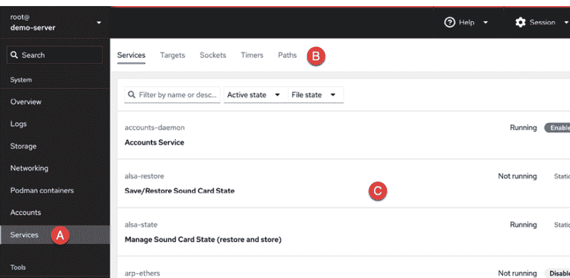

图 11-3

标记为 B 的选项行显示每个单元的状态。标记为 C 的列允许执行启动、停止、启用和禁用单元的任务。标记为 D 的列提供详细信息。选择一个单元将显示：

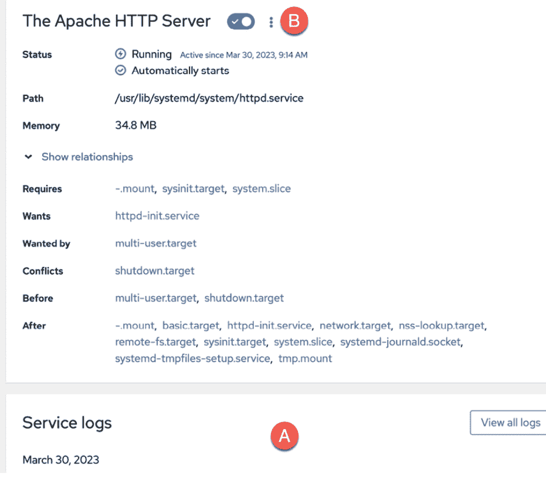

图 11-4

## 11.9 总结


新安装的系统包含一组单元，许多在后台运行。这些单元按类型分类，最常见的是目标（`targets`）。目标单元是其他单元的集合。最常见的目标是将系统引导至多用户或图形模式。此外，`systemctl` 命令行工具提供了许多选项，许多选项在 Cockpit 界面可用。

# 12 网络

很难想象一个没有任何一个网络连接的系统，更难以想象这样的系统会有什么用。事实是，Rocky 9 设计用于网络和互联网连接提供企业级服务。因此，学习如何配置和管理网络是学习的关键部分。

## 12.1 NetworkManager 简介

NetworkManager 是一个服务和工具集，专门用于简化 Linux 系统的网络管理，是 Rocky 9 的默认网络管理服务。

除了后台运行的服务外，NetworkManager 还包含以下工具：

- `nmcli`：通过命令行与 NetworkManager 工作的工具。该工具在无法访问图形环境时有用，也可以用于脚本进行网络配置更改。
- `nmtui`：用于管理 NetworkManager 的基本文本用户界面。该工具可以在任何终端窗口中运行，允许通过选择菜单和输入数据进行更改。虽然对执行基本任务有所帮助，但 `nmtui` 缺乏 `nmcli` 工具提供的许多功能。
- `nm-connection-editor`：提供大多数 NetworkManager 配置选项的完整图形管理工具。
- **GNOME 设置**：GNOME 桌面设置应用程序的网络界面允许执行基础网络管理任务。
- **Cockpit 网络设置**：Cockpit Web 界面的网络界面允许执行一系列网络管理任务。

尽管有多种方法可以管理 Rocky 9 上的网络环境，但本章将关注 `nmcli` 命令。虽然在可以访问桌面环境或启用 Cockpit 时图形工具确实很有帮助，但理解命令行界面对于只有命令提示符的情况至关重要。此外，图形工具（包括 Cockpit）仅包含了 `nmcli` 工具的一些功能。最后，一旦熟悉了 NetworkManager，这些技能可以轻松转换到更直观的工具选项上。对于图形工具选项则并非如此。例如，如果你只使用过

## 12.2 安装并启用 NetworkManager

大多数 Rocky 9 安装默认都会安装 NetworkManager。使用 `rpm` 命令可以检查其是否需要安装：

```bash
# rpm -q NetworkManager
```

```text
NetworkManager-1.14.0-14.el8.x86_64
```

如有必要，按照以下方式安装该包：

```bash
# dnf install NetworkManager
```

一旦安装了该包，就需要启用 NetworkManager 守护进程，以便在每次系统启动时启动它：

```bash
# systemctl enable NetworkManager
```

最后，启动该服务并检查状态以验证启动是否成功：

```bash
# systemctl start NetworkManager
# systemctl status NetworkManager
```

```text
NetworkManager.service - 网络连接管理器
Loaded: loaded (/usr/lib/systemd/system/NetworkManager.service; enabled; vendor preset: enabled)
Drop-In: /usr/lib/systemd/system/NetworkManager.service.d
 └NetworkManager-ovs.conf
Active: active (running) since Tue 2019-04-09 10:07:22 EDT; 2h48min ago
```

## 12.3 基础 nmcli 命令

`nmcli` 工具作为 NetworkManager 包的一部分已安装，可以使用以下语法从命令行执行：

```bash
# nmcli [Options] Object {Command | help}
```

在上述语法中，Object 将是 general、networking、radio、connection、monitor、device 或 agent 之一，可以使用这些单词的前几个字母进行缩写（例如，将 connection 缩写为 `con`，甚至仅用字母 `c`）。例如，以下命令都将输出与 device 对象相关的帮助信息：

```bash
# nmcli device help
# nmcli dev help
# nmcli d help
```

要检查系统中 NetworkManager 的整体状态，请使用以下命令：

```bash
# nmcli general status
```

| 状态 | 连性 | WIFI-HW | WIFI | WWAN-HW | WWAN |
| :--- | :--- | :--- | :--- | :--- | :--- |
| connected | full | enabled | enabled | enabled | enabled |

要检查系统中安装的设备状态，可以使用以下命令：

```bash
# nmcli dev status
```

| 设备 | 类型 | 状态 | 连接 |
| :--- | :--- | :--- | :--- |
| eno1 | ethernet | connected | eno1 |
| wlpos26u1u2 | wifi | connected | zoneone |
| virbr | bridge | connected | virbr |
| lo | loopback | unmanaged | -- |
| virbr-nic | tun | unmanaged | -- |

输出也可以通过 `-p` (pretty) 选项使输出更符合人类阅读：

```bash
# nmcli -p dev status
```

### 设备状态

| 设备 | 类型 | 状态 | 连接 |
| :--- | :--- | :--- | :--- |
| eno1 | ethernet | connected | eno1 |
| wlpos26u1u2 | wifi | connected | zone |
| virbr | bridge | connected | virbr |
| lo | loopback | unmanaged | -- |
| virbr-nic | tun | unmanaged | -- |

相反，可以使用 `-t` 选项使输出更简洁，适用于自动化处理：

```bash
# nmcli -t dev status
```

```text
eno1:ethernet:connected:eno1
wlpos26u1u2:wifi:connected:emilyzone
virbr:bridge:connected:virbr
lo:loopback:unmanaged:
virbr-nic:tun:unmanaged:
```

状态输出显示系统安装了两个物理设备，一个是以太网设备，另一个是 WiFi 设备。

桥 (`virbr`) 条目是用于为虚拟机提供网络的虚拟设备（虚拟化主题将从“虚拟化概述”章节开始介绍）。最后，回环接口（loopback）是一个特殊的虚拟设备，允许系统与自身通信，通常用于执行网络诊断。

在操作 NetworkManager 时，理解设备（device）和连接（connection）之间的区别非常重要。如上所述，设备可以是物理或虚拟网络设备，而连接是设备所连接的配置配置。

以下命令显示了系统上配置的连接信息：

```bash
# nmcli con show
```

| 名称 | UUID | 类型 | 设备 |
| :--- | :--- | :--- | :--- |
| zoneone | 2abecafea-4ea2-47f6-b20f-4fbocofd5e94 | wifi | wlpos26u1u2 |
| eno1 | 99d40009-6bb1-4182-aad-a103941c90ff | ethernet | eno1 |
| virbr | e13e9552-1765-42d1-b739-ff981668fbee | bridge | virbr |
| zonetwo | f940a2d1-8c18-4a9e-bf29-817702429b8a | wifi | -- |
| zonethree | fd65c5e5-3e92-4ae9-b29-817702429b8a | wifi | -- |

输出显示 WiFi 设备 (`wlpos26u1u2`) 已连接到无线网络 zoneone，而以太网设备 (`eno1`) 已连接到连接 eno1。除了 zoneone，NetworkManager 还列出了两个连接：zonetwo 和 zonethree，它们一个都没有连接。要查找分配给连接的 IP 地址，可以使用 `ip` 命令：

```bash
# ip addr
```

上述命令也可以缩写为：

```bash
# ip a
```

## 12.4 使用连接配置文件

到为止，我们探索了使用连接，但没有解释如何配置连接。连接的配置被称为连接配置文件，存储在 `/etc/NetworkManager/system-connections` 目录下，其内容可能如下：

```bash
# ls /etc/NetworkManager/system-connections
```

```text
zoneone.nmconnection eno1.nmconnection
zonethree.nmconnection zonetwo.nmconnection
```

例如，考虑 `eno1.nmconnection` 的内容：

```ini
[connection]
id=eno1
uuid=efc69a99-17a3-3636-b68f-bfcc56a73844
type=ethernet
autoconnect-priority=-999
interface-name=eno1
timestamp=1679678184

[ethernet]

[ipv4]
method=auto

[ipv6]
addr-gen-mode=eui64
method=auto

[proxy]
```

该文件包含连接的基本信息，包括当前分配给设备（`eno1`）的类型（以太网），以及该连接将在系统启动时通过 DHCP（`auto`）获取 IP 地址并自动激活。可以通过修改此文件并指示 `nmcli` 重新加载连接配置文件来实现对连接配置文件的更改：

```bash
# nmcli con reload
```

也可以手动创建或自动生成新的连接配置文件。例如，假设系统上安装了一个新的网络设备。当这种情况发生时，NetworkManager 服务将检测到新硬件并为其创建一个设备。在下面的示例中，新设备被分配了名称 `eno2`：

```bash
# nmcli dev status
```

| DEVICE | TYPE | STATE | CONNECTION |
| :--- | :--- | :--- | :--- |
| eno1 | ethernet | connected | eno1 |
| eno2 | ethernet | connected | Wired connection 1 |

NetworkManager 自动检测到该设备并激活了它，将其分配给了一个名为 "Wired connection 1" 的连接。这是一个默认连接，我们对其没有配置控制权，因为没有对应的接口配置文件。因此，下一步是删除 "Wired connection 1" 连接，并使用 `nmcli` 创建新连接并将其分配给该设备。删除连接的命令如下：

```bash
# nmcli con delete "Wired connection 1"
```

接下来，可以使用 `nmcli` 创建一个新的连接配置文件，可以配置为静态 IP 地址或从 DHCP 服务器获取的动态 IP 地址。要创建一个名为 `dyn_ip` 的动态连接配置文件，将使用以下命令：

```bash
# nmcli connection add type ethernet con-name dyn_ip ifname eno2
```

```text
连接 'dyn_ip' (1609e10-bbc8-439a-9c47-a2ec52990472) 已成功添加。
```

若要创建一个不锁定到特定设备的新的连接配置文件，只需在命令中省略 `ifname` 选项即可：

```bash
# nmcli connection add type ethernet con-name dyn_ip
```

创建连接后，`/etc/NetworkManager/system-connections` 目录下将添加一个名为 `dyn_ip.nmconnection` 的文件。

或者，要创建一个名为 `static_ip` 并分配静态 IP 地址（在此情况下为 `192.168.1.200`）的连接，将使用以下命令：

```bash
# nmcli con add type ethernet con-name static_ip ifname eno0 ip4 192.168.1.200/24 gw4 192.168.1.1
```

```text
连接 'static_ip' (3fccaf3-e761-4271-b310-adof28ee8606) 已成功添加。
```

相应的 `static_ip.nmconnection` 文件如下：

```ini
[connection]
id=static_ip
uuid=4eca181-381c-4d12-b6c9-30446d4e29d0
type=ethernet
interface-name=eno0

[ethernet]

[ipv4]
address1=192.168.1.200/24,192.168.1.1
method=manual

[ipv6]
addr-gen-mode=default
method=auto

[proxy]
```

添加新连接的命令可以稍微修改，以同时分配 IPv4 和 IPv6 静态地址：

```bash
# nmcli con add type ethernet con-name static_ip ifname eno0 ip4 192.168.1.200/24 gw4 192.168.1.1 ip6 cabf::4532 gw6 2010:dfa::1
```

## 12.5 交互式编辑

除了配合命令行选项使用 `nmcli` 之外，该工具还包含一个用于创建和修改连接配置文件的交互模式。例如，下面的记录显示了使用交互模式创建一个名为以太网连接：

```bash
# nmcli con edit
```

```text
有效的连接类型：6lowpan, 802-11-olpc-mesh (olpc-mesh), 802-11-wireless (wifi), 802-3-ethernet (ethernet), adsl, bluetooth, bond, bridge, cdma, dummy, generic, gsm, infiniband, ip-tunnel, macsec, macvlan, ovs-bridge, ovs-interface, ovs-port, pppoe, team, tun, vlan, vpn, vxlan, wimax, wpan, bond-slave, bridge-slave, team-slave

输入连接类型: ethernet

===| nmcli interactive connection editor |===
正在添加新的 '802-3-ethernet' 连接

输入 'help' 或 '?' 查看可用命令。
输入 'print' 显示所有连接属性。
输入 'describe [.]' 获取详细的属性描述。

你可以编辑以下设置：
- id
- uuid
- type
- interface-name
- ipv4
- address1
- method
- ipv6
- addr-gen-mode
- proxy
```

## 13.1 理解端口与服务

现今最主要的网络通信协议是 TCP/IP。它是互联网使用的协议，因此它扫清了大多数曾经用于局域网（LAN）的流行协议。

TCP/IP 定义了总共 65,535 个端口，其中 1023 个被认为是“已知端口”。必须理解的是，这些并不是连接到网络电缆的物理端口，而是每个网络连接上的虚拟端口，应用程序和服务可以使用这些端口在 TCP/IP 网络连接上进行通信。事实上，流行的网络客户端和服务程序所使用的端口数量仅占已知端口组中一个更小的子集。

操作系统可以提供多种不同的 TCP/IP 服务。本章末尾的表格提供了此类服务的完整列表。尽管如此，此类服务包括用于运行安全 Web 服务器的 HTTPS、允许文件传输的 FTP、提供安全远程登录和文件传输的 SSH，以及用于传输电子邮件消息的 SMTP。每个服务随后被分配到一个标准的 TCP/IP 端口。例如，HTTPS 被分配给端口 443，而 SSH 通信发生在端口 22。

## 13.2 端口与服务的安全


服务器安全的很大一部分涉及定义角色，并根据这些角色定义应该启用哪些服务和端口。例如，仅作为 Web 服务器运行的服务器应该只运行 HTTPS 服务（可能还包括用于远程管理访问的 SSH）。所有其他服务都应该被禁用，并且理想情况下，应从操作系统中完全删除（从而使入侵者更难重新启用该服务）。

系统安全涉及从操作系统中移除任何不必要的服务，并确保使用防火墙阻塞与非本质服务相关的端口。定义哪些端口可以访问以及在什么情况下访问的规则是使用 `iptables` 确定的。

许多操作系统在安装时默认安装并激活了若干服务。在安装新的操作系统之前，必须对安装进行仔细规划。规划涉及决定哪些服务是不需要的，并识别哪些服务被默认安装和启用了。部署新操作系统的安装绝不能仓促。系统上可用的服务和开放端口越少，攻击者的攻击面和机会就越小。

## 13.3 Rocky Linux 9 服务与 iptables 规则

默认情况下，新安装的 Rocky 9 系统没有定义 `iptables` 规则来限制对端口的访问。可以在终端窗口中执行以下命令来查看当前的 `iptables` 设置：

```bash
# iptables -L
```

```
Chain INPUT (policy ACCEPT)
target prot opt source destination

Chain FORWARD (policy ACCEPT)
target prot opt source destination

Chain OUTPUT (policy ACCEPT)
target prot opt source destination
```

如上述输出所示，目前没有定义任何规则。虽然这看起来是一个不安全的配置，但必须记住，新安装的 Rocky 9 系统默认运行的服务非常少，这使得端口对于潜在的攻击者来说是无用的。例如，访问新安装的 Rocky 9 系统上的 Web 服务器是不可能的，因为默认没有安装或运行 Web 服务器服务。一旦开始在系统上激活服务，那么通过定义 `iptables` 规则来建立防火墙策略将变得至关重要。

有多种方法可以定义 `iptables` 规则，包括使用命令行工具和配置文件。例如，要阻止来自 IP 地址 `192.168.2.76` 访问端口 `25`（由 SMTP 邮件传输协议使用），可以在终端窗口中发布以下命令：

```bash
# iptables -A INPUT -s 192.168.2.76 -p tcp --destination-port 25 -j DROP
```

如果我们现在检查当前规则，将看到这条规则目前已被列出：

```bash
# iptables -L
```

```
Chain INPUT (policy ACCEPT)
target prot opt source destination
DROP tcp -- 192.168.2.76 anywhere tcp dpt:smtp

Chain FORWARD (policy ACCEPT)
target prot opt source destination

Chain OUTPUT (policy ACCEPT)
target prot opt source destination
```

随后可以按如下方式删除规则：

```bash
# iptables -D INPUT -s 192.168.2.76 -p tcp --destination-port 25 -j DROP
```

鉴于 `iptables` 的复杂性，令人惊讶的是已经创建了一些用户友好的配置工具来简化规则创建过程。其中一种工具是 `firewall-cmd` 命令行工具，它将在“Rocky Linux 9 防火墙配置”章节中介绍。

## 13.4 已知端口与服务

在继续介绍更复杂的防火墙规则之前，值得花时间概述 Rocky 9 系统可以提供的某些关键服务以及相应的端口号：

| 端口号 | 服务 |
| :--- | :--- |
| 22 | SSH |
| 25 | SMTP |
| 80 | HTTP |
| 443 | HTTPS |

表 13-1

## 13.5 总结

一个新安装的 Rocky Linux 9 系统通常被认为是安全的，因为系统端口上没有运行任何服务。然而，一旦系统开始配置使用，确保通过实施防火墙来保护系统就非常重要。在配置防火墙时，理解各种端口及相应的服务至关重要。

有多种防火墙选项可用，最基础的是 `iptables` 防火墙接口的命令行配置。通过 `firewalld` 可以获得更直观、更高级的选项，我们将在下一章中介绍。

# 14 使用 firewalld 配置 Rocky Linux 9 防火墙

防火墙对于保护计算机系统或计算机网络免受外部攻击（通常来自通过互联网连接的外部源）至关重要。例如，任何直接连接到互联网的计算机都必须运行防火墙以防止恶意活动。同样，任何内部网络必须在内部与外部互联网连接之间拥有某种形式的防火墙。所有的 Linux 发行版都提供了某种形式的防火墙解决方案。在 Rocky Linux 9 中，这表现为名为 `firewalld` 的服务。

虽然防火墙配置的主题可能复杂，但幸运的是，Rocky 9 提供了命令行、基于 Web 和图形化的工具，简化了防火墙配置过程。本章将介绍 `firewalld` 的基本概念，并涵盖使用操作系统提供的工具配置防火墙所需的步骤。

## 14.1 firewalld 简介

`firewalld` 服务使用一组规则来控制传入的网络流量，并定义哪些流量被阻止，哪些流量允许通过系统，它是构建在名为 `iptables` 的更复杂的防火墙工具之上的。

`firewalld` 系统提供了一种管理入站流量的灵活方法。例如，可以将防火墙配置为阻止来自特定外部 IP 地址的流量，或阻止到达特定 TCP/IP 端口的流量。还可以定义规则将入站流量转发到不同的系统，或作为互联网网关来保护网络上的其他计算机。

与标准安全实践一致，默认的 `firewalld` 安装配置为阻止除 SSH 远程登录和系统用于获取动态 IP 地址的 DHCP 服务之外的所有访问（这两者对于系统管理员在安装后能够访问系统至关重要）。

Rocky 9 上防火墙配置的关键元素是服务（services）和区域（zones）。

### 14.1.1 区域 (Zones)


默认情况下，`firewalld` 安装时带有一预配置的区域。区域是一个预配置的规则集，可以随时应用于系统，以便快速实现针对特定场景的防火墙配置。例如，`block` 区域阻止所有入站流量，而 `home` 区域实施较不严格的规则，假设系统运行在一个更安全的环境中，在该环境中会有更高的信任度。可以向系统添加新区域，并修改现有区域以添加或删除规则。也可以完全从系统中删除区域。表 14-1 列出了 Rocky 9 系统上默认可用的区域：

| 区域 (Zone) |
| :--- |
| public |
| block |
| drop |
| home |
| work |
| internal |
| trusted |
| any |

## 14.1.2 接口 (Interfaces)

任何连接到互联网或网络（或两者）的 Rocky 9 系统至少包含一个物理或虚拟网络设备形式的接口。当 `firewalld` 激活时，这些接口都会被分配到一个区域，允许分配不同的安全级别。例如，考虑一个包含两个接口的服务器；一个连接到外部互联网，另一个连接到内部网络。在这种情况下，面向外部的接口可能会被分配给更严格的区域，而内部接口可能会使用 `internal` 区域。

## 14.1.3 服务 (Services)

TCP/IP 定义了一组在标准端口上通信的服务。例如，安全的 HTTPS 连接使用 443 端口，而 SMTP 邮件服务使用 25 端口。为了选择性地启用特定服务的入站流量，可以向区域中添加 `firewalld` 规则。例如，`home` 区域默认不允许入站连接。可以通过向区域添加允许入站连接的规则来启用此类流量，无需引用特定的端口号。

## 14.1.4 端口 (Ports)

在添加 `firewalld` 规则时可以引用常见的 TCP/IP 服务，但会出现需要在未分配给服务的特定端口上允许入站连接的情况。这可以通过添加引用特定端口而非服务的规则来实现。这种技术在“Cockpit Web 界面概述”章节被使用，当时打开了 9090 端口以允许访问 Cockpit Web 界面。

## 14.2 检查 firewalld 状态

所有 Rocky 9 安装默认安装并启用了 `firewalld` 服务。可以通过以下命令检查服务的状态：

```
# systemctl status firewalld
```

```
firewalld.service - firewalld - dynamic firewall daemon
Loaded: loaded (/usr/lib/systemd/system/firewalld.service; enabled; vendor preset: enabled)
Active: active (running) since Thu 2019-02-14 14:24:31 EST; 3 days ago
Docs: man:firewalld(1)
Main PID: 816 (firewalld)
Tasks: 2 (limit: 25026)
Memory: 30.6M
CGroup: /system.slice/firewalld.service
└─816 /usr/libexec/platform-python -s /usr/sbin/firewalld -nofork --nopid
```

如有必要，可以按照如下方式安装 `firewalld` 服务：

```
# dnf install firewalld
```

`firewalld` 服务默认启用，并会在安装后以及每次系统启动时自动启动。

## 14.3 使用 firewall-cmd 配置防火墙规则

`firewall-cmd` 命令行工具允许在终端窗口内查看防火墙配置信息，并对区域（zones）和规则进行更改。

在更改防火墙设置时，注意运行时（runtime）配置和永久性（permanent）配置的概念非常重要。默认情况下，任何规则更改都被视为运行时配置更改。这意味着虽然更改会立即生效，但当系统下次重启或 `firewalld` 服务重载时（例如通过执行以下命令），更改将会丢失：

```
# firewall-cmd --reload
```

必须使用 `--permanent` 命令行选项来使更改永久化。永久更改在 `firewalld` 服务重载之前不会生效，但在手动更改之前，它们将一直保持有效。

### 14.3.1 识别和更改默认区域

要识别默认区域（换句话说，除非专门指定了不同的区域，否则所有接口将分配给该区域），请使用如下 `firewall-cmd` 工具：

```
# firewall-cmd --get-default-zone
```

```
public
```

将默认区域更改为不同的：

```
# firewall-cmd --set-default-zone=home
```

```
success
```

### 14.3.2 显示区域信息

列出系统上所有可用区域：

```
# firewall-cmd --get-zones
```

```
block dmz drop external home internal libvirt nm-shared public trusted work
```

按照如下方式获取当前激活的区域列表及其分配的接口列表：

```
# firewall-cmd --get-active-zones
```

```
external
interfaces: eth0

internal
interfaces: eth1
```

可以如下所示列出当前为特定区域配置的所有规则：

```
# firewall-cmd --zone=home --list-all
```

```
home (active)
target: default
icmp-block-inversion: no
interfaces: eth0
sources:
services: cockpit dhcpv6-client mdns samba-client ssh
ports:
protocols:
masquerade: no
forward-ports:
source-ports:
icmp-blocks:
rich rules:
```

使用以下命令列出当前可包含在 `firewalld` 规则的服务：

```
# firewall-cmd --get-services
```

```
RH-Satellite-6 amanda-client amanda-ks-client amqp amqps apucsid audit bacula bacula-client bgp bitcoin bitcoin-rpc bitcoin-testnet bitcoin-testnet-rpc ceph ceph-mon cfengine cockpit ...
```

列出当前为某个区域启用的服务：

```
# firewall-cmd --zone=public --list-services
```

```
cockpit dhcpv6-client ssh
```

按照如下方式获取端口规则列表：

```
# firewall-cmd --zone=public --list-ports
```

```
9090/tcp
```

### 14.3.3 添加和移除区域服务

要向区域添加服务（在本例中向 public 区域添加 HTTPS），将使用以下命令：

```
# firewall-cmd --zone=public --add-service=https
```

```
success
```

默认情况下，这是一个运行时更改，因此添加的规则在系统重启后将丢失。要永久添加服务以便其在系统下次重启时保持有效，请使用 `--permanent` 标记：

```
# firewall-cmd --zone=public --permanent --add-service=https
```

```
success
```

要验证服务是否已永久添加，在请求服务列表时，务必包含 `--permanent` 标记：

```
# firewall-cmd --zone=public --permanent --list-services
```

```
cockpit dhcpv6-client http ssh
```

注意，作为永久性更改，此新规则在系统重启或 `firewalld` 重载之前不会生效：

```
# firewall-cmd --reload
```

使用 `--remove-service` 选项从区域中移除服务。由于这是一个运行时更改，该规则将在系统下次重启时重新恢复：

```
# firewall-cmd --zone=public --remove-service=https
```

要永久移除服务，请使用 `--permanent` 标记，并如果需要更改立即生效，请记得重载 `firewalld`：

```
# firewall-cmd --zone=public --permanent --remove-service=https
```

### 14.3.4 使用基于端口的规则

要启用特定端口，使用 `--add-port` 选项。注意在手动定义端口时，需要提供端口号和协议（TCP 或 UDP）：

```
# firewall-cmd --zone=public --permanent --add-port=5000/tcp
```

在向区域添加规则时，也可以指定端口范围：

```
# firewall-cmd --zone=public --permanent --add-port=5900-5999/udp
```

### 14.3.5 创建新区域

可以通过运行以下命令创建一个全新的区域。一旦创建完成，该区域可能变为可用：

```
# firewall-cmd --permanent --new-zone=myzone
```

```
success
```

添加新区域后，需要重启 `firewalld`：

```
# firewall-cmd --reload
```

### 14.3.6 更改区域/接口

如前所述，可以使用 `firewall-cmd` 工具更改接口所属的区域。在以下示例中，`eth0` 被分配给 `public` 区域：

```
# firewall-cmd --zone=public --change-interface=eth0
```

```
success
```

### 14.3.7 伪装 (Masquerading)

伪装在管理领域中被称为网络地址转换（NAT）。当使用 Rocky 9 系统作为网络网关时，伪装允许内部系统使用公共地址。这样做的好处是从外部实体隐藏内部 IP。使用以下命令检查伪装是否已启用：

```
# firewall-cmd --zone=external --query-masquerade
```

使用以下命令启用伪装（如果更改是永久的，请记住 `--permanent` 标记）：

```
# firewall-cmd --zone=external --add-masquerade
```

### 14.3.8 添加 ICMP 规则

互联网控制消息协议用于客户端系统之间发送信息，例如错误消息。它是 `ping` 命令的基础，网络管理员和用户用它检测客户端是否在线。ICMP 类别允许阻止特定的 ICMP 类型。例如，管理员可能会阻止入站 echo-reply 以拒绝服务（DoS）攻击（服务器被大量的 ping 信息攻击导致无法响应）。

要查看可包含在 `firewalld` 规则中的 ICMP 类型，运行以下命令：

```
# firewall-cmd --get-icmp
```

例如，以下命令为 public 区域永久添加了阻止 echo-reply 的规则：

```
# firewall-cmd --zone=public --permanent --add-icmp-block=echo-reply
```

### 14.3.9 实现端口转发

当 Rocky 9 系统作为网络网关时，端口转发与伪装配合使用。端口转发允许通过互联网到达防火墙的特定端口流量转发到内部网络上的特定系统。这通过示例描述最为恰当。

假设 Rocky 9 系统正作为内部网络的防火墙，且该网络上的一个系统被配置为 Web 服务器。假设该 Web 服务器系统的 IP 地址为 `192.168.2.20`。托管该网站的域名记录配置为位于 Rocky 9 防火墙背后的公共 IP 地址。当 HTTP 网页请求通过端口 80 到达时，作为防火墙的 Rocky 9 系统需要知道如何处理。通过配置端口转发，可以将所有流量重定向到托管 Web 服务器的内部系统（在本例中为 IP `192.168.2.20`），或者继续使用端口 80，或者将流量重定向到目标服务器的不同端口。

要使用端口转发，首先按照如下方式启用伪装（在本例中，假设接口连接到互联网（已分配到外部区域）：

```
# firewall-cmd --zone=external --add-masquerade
```

若要从一个端口转发到另一个本地端口，可以使用类似下方的命令：

```
# firewall-cmd --zone=external --add-forward-port=port=22:proto=tcp:toport=2750
```

在上述示例中，任何指向 22 端口的 TCP 流量将被转发到本地系统的 2750 端口。另一方面，下面的命令将本地系统的 20 端口转发到 IP 地址为 `192.168.0.19` 的系统的 22 端口：

```
# firewall-cmd --zone=external \
--add-forward-port=port=20:proto=tcp:toport=22:toaddr=192.168.0.19
```

同样地，以下命令将本地 20 端口转发到 IP 地址为 `192.168.0.18` 的系统的 2750 端口：

```
# firewall-cmd --zone=external --add-forward-port=port=20:proto=tcp:toport=2750:toaddr=192.168.0.18
```

## 14.4 通过 Cockpit 接口管理 firewalld

到目前为止，本章提供了 `firewalld` 的概述，并探索了使用 `firewall-cmd` 命令行工具来管理防火墙区域和接口。虽然 `firewall-cmd` 提供了 `firewalld` 配置的最灵活方式，但在 Cockpit Web 控制台中查看和管理默认区域的服务。

要访问 `firewalld` 设置，请登录 Cockpit 接口并从导航面板中选择“网络”（Networking）。在网络页面上，找到如图 14-1 所示的“防火墙”（Firewall）部分，并点击“编辑规则和区域”（Edit rules and zones）按钮：

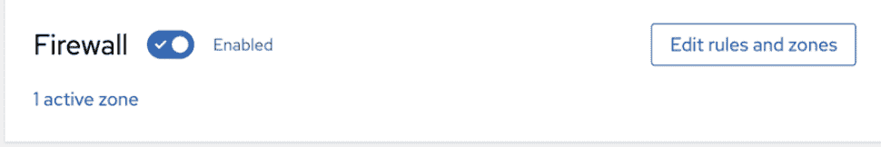

图 14-1

防火墙页面显示了默认区域配置的当前服务规则（并允许删除服务）、向区域添加新服务，以及防火墙的开启和关闭：

网络 > 防火墙

# 防火墙已启用

默认阻止入站请求。不阻止出站请求。

| 公共区域 (Public zone) | 接口 enol1 | 允许地址 | 子网 |
|---|---|---|---|
| 服务 | TCP | UDP | |
| ssh | 22 | | |
| dhcpv6-client | | 546 | |

图 14-2

## 14.5 使用 firewall-config 管理 firewalld

如果您可以访问图形化桌面环境，也可以使用 `firewall-config` 工具配置防火墙。虽然默认未安装，但可以通过以下方式安装 `firewall-config`：

```
# dnf install firewall-config
```


启动后，会出现如图所示的 `firewall-config` 主界面：

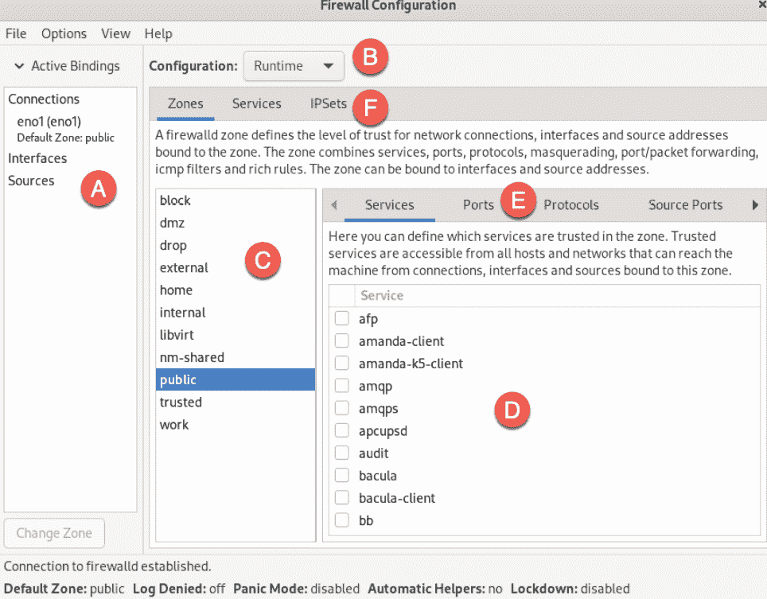

图 14-3

该工具的关键区域可总结如下：

- **A** - 显示所有当前激活的接口及其所属区域。要将接口分配到不同的区域，请在此面板中选择，点击“更改区域”（Change Zone）按钮，并在生成的对话框中选择所需的区域。
- **B** - 控制显示的信息以及在工具中进行的任何更改适用于运行时规则还是永久规则。
- **C** - 系统上配置的区域、服务或 IPSets 列表。此面板中的信息取决于对工具栏 **F** 的选择。在此面板列表中选择一个项将更新标记为 **D** 的主面板。
- **D** - 主面板包含有关工具栏 **E** 中当前选择类别的信息。在本例中，该面板显示了公共区域（public zone）的服务。每个服务旁边的复选框控制该服务在防火墙中是否启用。在这些类别面板内，可以添加新规则或配置或删除现有规则。
- **E** - 控制面板 **D** 中显示的内容。从此栏中选择项目将显示所选类别的当前规则。
- **F** - 控制面板 **C** 中显示的列表。

`firewall-config` 工具使用起来简单且直观，允许在视觉化环境中执行许多可以使用 `firewall-cmd` 完成的任务。

## 14.6 总结

精心规划和实现的防火墙对于任何安全系统都至关重要。在 Rocky 9 中，`firewalld` 服务提供了一个既灵活又易管理的防火墙系统。

`firewalld` 服务使用“区域”（zones）的概念来分组一组防火墙规则，并包含了一系列满足各种防火墙保护要求的预定义区域。可以修改这些区域以添加或删除规则，也可以创建并配置全新的区域。系统中连接到网络或互联网的网络设备称为“接口”（interfaces）。每个接口会被分配到一个区域。用于 `firewalld` 的主要工具是 `firewall-cmd` 命令行工具和 `firewall-config` 图形化实用程序。Cockpit Web 控制台还提供了基本的防火墙管理选项。

输入密码短语（留空则不使用密码短语）：

最后，`ssh-keygen` 工具将生成以下输出，表示密钥已生成：

您的身份标识已保存到 `/home/neil/.ssh/id_rsa`。

您的公钥已保存到 `/home/neil/.ssh/id_rsa.pub`。

密钥指纹为：

`SHA256:FOLGWEEGFljWnCT5wtTOv5VK4hdimizWghZizUEMYbfo @`

密钥的随机矩阵图为：

```
+---[RSA 2048]----+
|.BB+=*..         |
|o+B= * .         |
|==.. + .         |
|*+ * .           |
|.++ o S          |
|..E+ * o         |
| o B *           |
| + +             |
| .               |
+----[SHA256]-----+
```

下一步是将公钥安装到远程服务器系统。可以使用 `ssh-copy-id` 工具按如下方式实现：

`$ ssh-copy-id username@remote_hostname`

例如：

`$ ssh-copy-id neil@192.168.1.100`

`/usr/bin/ssh-copy-id: INFO: 待安装的密钥源: "/home/neil/.ssh/id_rsa.pub"`

`/usr/bin/ssh-copy-id: INFO: 尝试使用新密钥登录，以过滤掉已安装的密钥`

`/usr/bin/ssh-copy-id: INFO: 剩余 1 个密钥待安装 -- 如果你现在收到提示，则是为了安装新密钥`

`neil@192.168.1.100's password:`

添加的密钥数量: 1

现在尝试使用 `"ssh 'neil@192.168.1.100'"` 登录机器，并检查只添加了你想要的密钥。

一旦密钥安装完成，尝试使用 `ssh` 客户端进行远程登录以测试身份验证是否有效：

```
$ ssh -l
```

如果私钥经过加密并受密码短语保护，请在提示时输入该短语以完成身份验证并建立到 Rocky 9 系统的远程访问：

`Enter passphrase for key '/home/neil/.ssh/id_rsa':`

最后登录: Fri Mar 31 14:29:28 2023 来自 192.168.86.21

```
[neil@demosystem2 ~]$
```

对服务器上任何需要远程访问的其它账户重复这些步骤。如果其他客户端系统也需要访问，请将 `id_rsa` 私钥文件复制到其他系统上用户主目录下的 `.ssh` 子目录。

按照目前的配置，仍然可以使用安全性较低的密码验证访问远程系统。一旦你验证了基于密钥的身份验证工作正常，则需要在系统中禁用密码验证。要了解如何更改此设置，请先打开文件并找到以下行：

`Include /etc/ssh/sshd_config.d/*.conf`

这告诉我们 `ssh` 配置设置由该目录中的文件控制。这些文件名必须以数字开头并具有 `.conf` 文件扩展名，例如：

`01-permitrootlogin.conf`

`50-redhat.conf`

数字前缀指定了该文件相对于文件夹中其他文件的优先级，其中 `01` 的优先级最高。这确保了如果配置文件中包含与另一个文件冲突的设置，优先级最高的那个将始终占优。

在 `/etc/ssh/sshd_config.d` 文件夹中，创建一个名为 `02-nopasswordlogin.conf` 的新文件，内容如下：

`PasswordAuthentication no`

保存文件并重启 `sshd` 服务以实施更改：

```
# systemctl restart sshd.service
```

从现在起，将只能使用 SSH 密钥身份验证远程访问系统，并且在执行此操作时，不需要输入密码。

## 15.6 管理多个密钥

客户端系统中存在多个私钥是常见现象，每个密钥提供对不同服务器的访问。因此，在建立连接时有多种选择特定密钥的方法。例如，启动 `ssh` 客户端时可以指定要使用的私钥文件：

```
$ ssh -l neilsmyth -i ~/.ssh/id_work 35.194.18.119
```

或者，`SSH` 客户端用户配置文件可以将密钥文件与服务器关联。该配置文件文件名为 `config`，必须位于用户主目录下的 `.ssh` 目录，并可用于配置广泛的选项，包括私钥文件、连接时使用的默认端口、默认用户名以及用于引用服务器的简称别名。以下示例配置文件为两个服务器定义了不同的密钥，并允许通过别名 `home` 和 `work` 引用它们。在工作系统的情况下，该文件还指定了身份验证时使用的用户名：

```
Host work
    HostName 35.194.18.119
    IdentityFile ~/.ssh/id_work
    User neilsmyth

Host home
    HostName 192.168.0.21
    IdentityFile ~/.ssh/id_home
```

在设置配置文件之前，用户本会使用以下命令连接到工作系统：

```
$ ssh -l neilsmyth -i ~/.ssh/id_work 35.194.18.119
```

但现在命令可以简短为：

```
$ ssh work
```

可以通过运行以下命令获取配置选项完整列表：

```
$ man ssh_config
```

## 15.7 从 Windows 客户端进行基于密钥的身份验证

最新的 Windows 版本包含了大多数 Linux 和 macOS 系统实现的 OpenSSH 子集，作为 Windows PowerShell 的一部分。这允许按照类似于 Linux 和 macOS 的概述步骤，从 Windows 客户端设置 SSH 密钥身份验证。

在 Windows 上，搜索 Windows PowerShell 并从结果中选择。运行后，PowerShell 窗口将如图所示。

如果你已经从另一个客户端获得了私钥，请将 `id_rsa` 文件复制到你主目录下的 `.ssh` 目录。文件到位后，在 PowerShell 窗口中测试身份验证：

`$ ssh -l neil@192.168.1.100`

当所有账户都设置并验证了基于密钥的认证后，按照上一节末尾所述，在 Rocky 9 系统上禁用密码认证。

## 15.8 使用 PuTTY 进行 SSH 密钥认证

对于没有安装 OpenSSH 的 Windows 系统，或者作为使用 PowerShell 的更灵活的替代方案，`PuTTY` 工具是一种被广泛使用的替代方案。使用 `PuTTY` 的第一步是下载并将其安装到任何需要 SSH 客户端的 Windows 系统上。`PuTTY` 是一个免费程序，可以通过以下链接下载：

<https://www.chiark.greenend.org.uk/~sgtatham/putty/latest.html>

下载与你的 Windows 系统匹配的 Windows 安装程序可执行文件（提供 32 位和 64 位版本），然后运行安装程序完成安装。

如果另一个系统上已存在私钥，请在当前用户的家目录中创建 `.ssh` 文件夹，并将私钥 `id_rsa` 复制到其中。

接下来，需要使用 `PuTTYgen` 工具将私钥文件转换为 `PuTTY` 私钥格式文件。在 Windows 开始菜单的搜索栏中输入“Key Generator”来找到此实用并启动它：

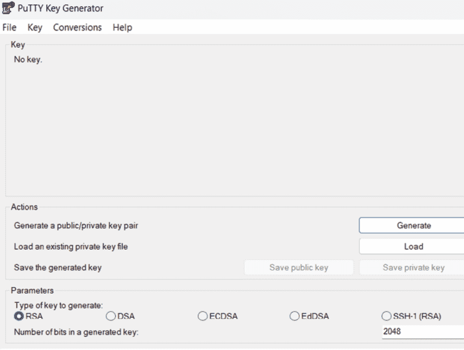

图 15-2

启动后，点击 Actions 区域的 `Load` 按钮，并到之前复制到 `.ssh` 文件夹的私钥文件（注意，可能需要将文件类型过滤器更改为“All Files (*.*)”才能看到密钥文件）。找到后，选择该文件并将其加载到 PuttyGen 中。在提示时，输入最初用于加密文件的密码短语。导入私钥后，点击 `Save Private Key` 按钮将其保存为 `PuTTY` 密钥文件。为了一致起见，将密钥文件保存到 `.ssh` 文件夹，但赋予它不同的名称以区别于原始密钥文件。

从开始菜单启动 `PuTTY`，在主界面上输入远程服务器的 IP 地址或主机名，然后选择左侧面板中的 `Connection -> SSH -> Auth -> Credentials` 类别，如图所示：

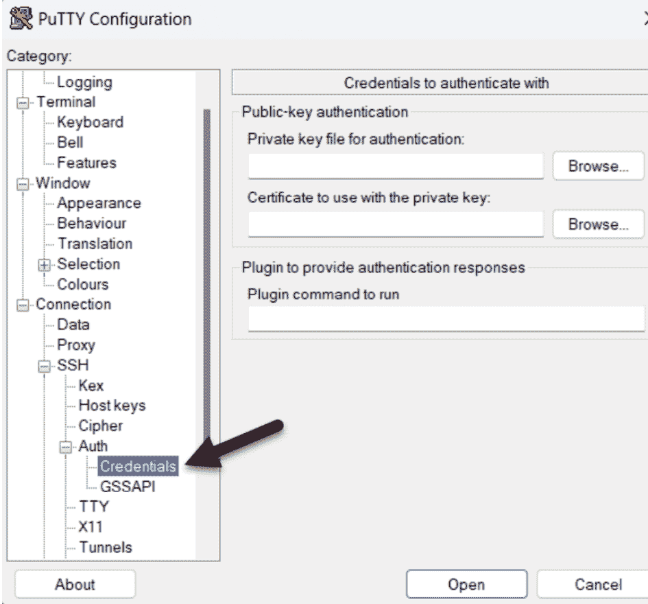

图 15-3

点击“Private key for authentication”字段旁边的 `Browse` 按钮，导航并选择之前保存的 `PuTTY` 私钥文件。然后，可选滚动到左侧面板顶部，选择 `Session` 条目，并在 `Saved Sessions` 字段中为会话命名，然后点击 `Save` 按钮。这将保存会话配置供以后使用，而无需每次重新输入设置。

最后，点击 `Open` 按钮建立与远程服务器的连接，在提示时输入用户名和密码短语以完成认证。

## 15.9 使用 PuTTYGen 生成私钥

上一节探讨了在操作 `PuTTY` 时使用现有的私钥和公钥。如果不存在密钥，可以使用 `PuTTYgen` 工具创建，该工具包含在 `PuTTY` 主安装程序中。

要创建新密钥，启动 `PuTTYGen` 并点击如图所示的 `Generate` 按钮：

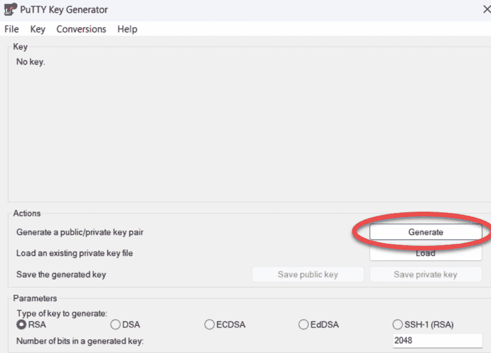

图 15-4

按照指示移动鼠标指针以生成随机数据，然后输入可选的密码短语来加密私钥。密钥生成后，使用 `Save public key` 和 `Save private key` 按钮将文件保存到合适的位置。如上一节所述，私钥可以与 `PuTTY` 使用。如要在远程服务器上安装公钥，请使用早些章节中关于在 Windows 的 PowerShell 中使用 SSH 的步骤。

## 15.10 总结

本节探讨了在操作 `PuTTY` 时使用现有的私钥和公钥。如果不存在密钥，可以使用 `PuTTYgen` 工具创建，该工具包含在 `PuTTY` 主安装程序中。

要创建新密钥，启动 `PuTTYGen` 并点击如图所示的 `Generate` 按钮。

按照指示移动鼠标指针以生成随机数据，然后输入可选的密码短语来加密私钥。密钥生成后，使用 `Save public key` 和 `Save private key` 按钮将文件保存到合适的位置。如上一节所述，私钥可以与 `PuTTY` 使用。如要在远程服务器上安装公钥，请使用早些章节中关于在 Windows 的 PowerShell 中使用 SSH 的步骤。

# 16. Rocky Linux 9 远程桌面访问

Rocky Linux 9 可以配置为通过网络或互联网提供图形界面访问。虽然默认未启用，但这允许你在同一网络或互联网上访问 Rocky 9 桌面。这在许多场景下都很有帮助，例如，当你离开办公位时。它对于同事或技术支持人员需要访问桌面来解决问题也非常有用。当 Rocky 9 系统运行在云服务器上，它还允许在任何地方访问桌面环境。

远程桌面功能基于名为虚拟网络计算（VNC）的技术。本章将介绍在 Rocky 9 中配置远程桌面的关键方面。

## 16.1 安全与不安全的远程访问

在本章中，我们将介绍安全和不安全的访问方法。假设你在安全的内部网络从另一个系统访问，使用不安全的方法通常是可行的。然而，如果你计划通过任何公共网络远程访问桌面，则必须使用安全方法，以防系统和数据受到破坏。

## 16.2 安装 GNOME 桌面环境

当然，只有在桌面本身已安装的情况下，访问桌面才是可能的。例如，如果系统最初配置为服务器，则可能没有安装桌面包。运行 GNOME 桌面所需的包的最简单方法是执行组安装。为了启用特定功能而安装软件包组的关键是知道组的名称。在编写时，Rocky 9 上用于安装桌面环境有两个组：`Server with GUI` 和 `Workstation`。由于组名称往往在不同的 Rocky Linux 版本之间发生变化，了解已安装或可安装的组列表是有帮助的，可以使用 `dnf` 工具如下获取：

```bash
# dnf grouplist
```

可用的环境组：
- Server with GUI
- Minimal Install
- Workstation
- Custom Operating System
- Virtualization Host

已安装的环境组：
- Server

已安装的组：
- Container Management
- Headless Management

可选组：
- Legacy UNIX Compatibility
- Graphical Administration Tools
- Smart Card Support
- RPM Development Tools
- .NET Development
- 系统工具
- 开发工具
- 控制台工具
- 安全工具
- 网络服务器
- 科学支持

在上面的示例中，`Workstation`（工作站）环境组被列为可用（因此尚未安装）。要在安装之前获取有关该组内容的更多信息，可以使用：

```bash
# dnf groupinfo workstation
```

环境组：Workstation

描述：Workstation 是一个适用于笔记本电脑和 PC 的易用桌面系统。

强制组：
- 常用 NetworkManager 子模块
- Core
- 字体
- GNOME
- 客户端桌面代理
- 硬件支持
- 浏览器
- 多媒体
- 打印客户端
- 标准
- Workstation 产品核心
- base-x

可选组：
- 备份客户端
- GNOME 应用
- 无头管理
- 互联网应用程序
- 办公套件和生产力
- 远程桌面客户端
- 智能卡支持

确认组正确后，可以按照以下方式安装：

```bash
# dnf groupinstall workstation
```

安装完成后，假设系统已添加显示器，可以使用以下 `startx` 命令启动桌面：

```bash
$ startx
```

相反，如果系统是直接连接显示器的服务器，则运行和访问桌面的唯一方法是在系统上配置 VNC 支持。

## 16.3 在 Rocky Linux 9 上安装 VNC

访问远程桌面需要在远程系统上安装 VNC 服务器，在发起访问的系统上安装 VNC 查看器，并且可选需要一个安全的 SSH 连接。虽然有多种 VNC 服务器和查看器实现，但 Red Hat 标准化了 `TigerVNC`，它为基于 Linux 的操作系统提供了服务器和查看器组件。非 Linux 平台的 VNC 查看器客户端包括 `RealVNC` 和 `TightVNC`。

要在 Rocky 9 上安装 `TigerVNC` 服务器包，运行以下命令：

```bash
# dnf install tigervnc-server
```

如果需要，也可以按照以下方式安装 `TigerVNC` 查看器：

```bash
# dnf install tigervnc
```

安装服务器后，必须配置系统以运行一个或多个 VNC 服务，并在防火墙上开放适当的端口。

## 16.4 配置 VNC 服务器

安装 VNC 服务器包后，下一步是配置服务器。第一步是为远程桌面环境用户指定密码。以 root 身份登录时，执行 `vncpasswd` 命令（假设用户名为 demo）：

```bash
# su - demo
```

```bash
[demo@demoserver ~]$ vncpasswd
Password:
Verify:
是否要输入一个只读密码 (y/n)? n
未使用只读密码
```

```bash
[demo@demoserver ~]$ exit
```

接下来，需要在 `/etc/systemd/system` 目录下创建一个名为 `vncserver@.service` 的 VNC 服务器配置文件。该文件的内容如下，其中所有的 `%i` 都要替换为设置 VNC 密码时引用的用户名：

```ini
[Unit]
Description=远程桌面服务 (VNC)
After=syslog.target network.target

[Service]
Type=forking
WorkingDirectory=/home/%i
```


## 16.4 配置 VNC 服务

创建服务配置文件 `/etc/systemd/system/vncserver@.service`，内容如下：

```
[Unit]
Description=Remote desktop service (VNC)
After=syslog.target network.target

[Service]
Type=forking
User=%i
Group=%i
ExecStartPre=/bin/sh -c '/usr/bin/vncserver -kill %i > /dev/null 2>&1 || :'
ExecStart=/usr/bin/vncserver -autokill %i
ExecStop=/usr/bin/vncserver -kill %i
Restart=on-success
RestartSec=15

[Install]
WantedBy=multi-user.target
```

接下来，需要配置防火墙为远程 VNC 查看器实例提供 VNC 服务器的外部访问，例如：

```bash
# firewall-cmd --permanent --zone=public --add-port=5901/tcp
# firewall-cmd --reload
```

创建服务配置文件后，需要如下所示启用并启动服务：

```bash
# systemctl daemon-reload
# systemctl start vncserver@:1.service
# systemctl enable vncserver@:1.service
```

注意服务名称中包含 `:1`，表示这是显示器编号为 1 的 VNC 服务器服务。这与之前在防火墙中的端口 `5901` 匹配。

通过以下方式检查服务是否成功启动：

```bash
# systemctl status vncserver@:1.service
```

如果服务启动失败，运行 `journalctl` 命令检查错误消息：

```bash
# journalctl -xe
```

此外，尝试重启系统后重试。如果服务持续失败，可以通过登录指定用户并运行 `vncserver` 命令手动启动 VNC 服务器：

```bash
$ vncserver :1
```

## 16.5 连接到 VNC 服务器

VNC 查看器实现适用于各种操作系统。因此，在互联网上进行快速搜索可能会提供许多包含如何在您选择的平台上获取和安装此工具的详细信息的链接。

在安装了 TigerVNC 等 VNC 查看器的 Linux 系统桌面上，可以通过终端窗口按如下方式建立远程桌面连接：

```bash
$ vncviewer :<number>
```

在上方中，将 `<number>` 替换为显示编号。或者，你可以使用 SSH 隧道来加密连接：

```bash
$ ssh -L 5901:localhost:5901 user@remote-host
```

一旦建立隧道，你可以将 VNC 查看器连接到 localhost：

```bash
$ vncviewer :1
```

执行端口转发的步骤在不同防火墙之间有所不同，请参考您的防火墙、路由器或无线基站的文档以获取适用于特定配置的详情。

## 16.7 使用 PuTTY 在 Windows 上建立安全隧道

从 Windows 系统到 Rocky 9 服务器建立安全桌面会话也采用了类似的方法。假设您已经安装了如 TightVNC 等 VNC 客户端，剩下的需求是一个 Windows SSH 客户端（在此情况下为 PuTTY）。

一旦下载并安装 PuTTY，第一步是配置适当的隧道，在 Windows 系统与远程 Rocky 9 系统之间建立安全连接。启动 PuTTY 后，它会显示以下屏幕：

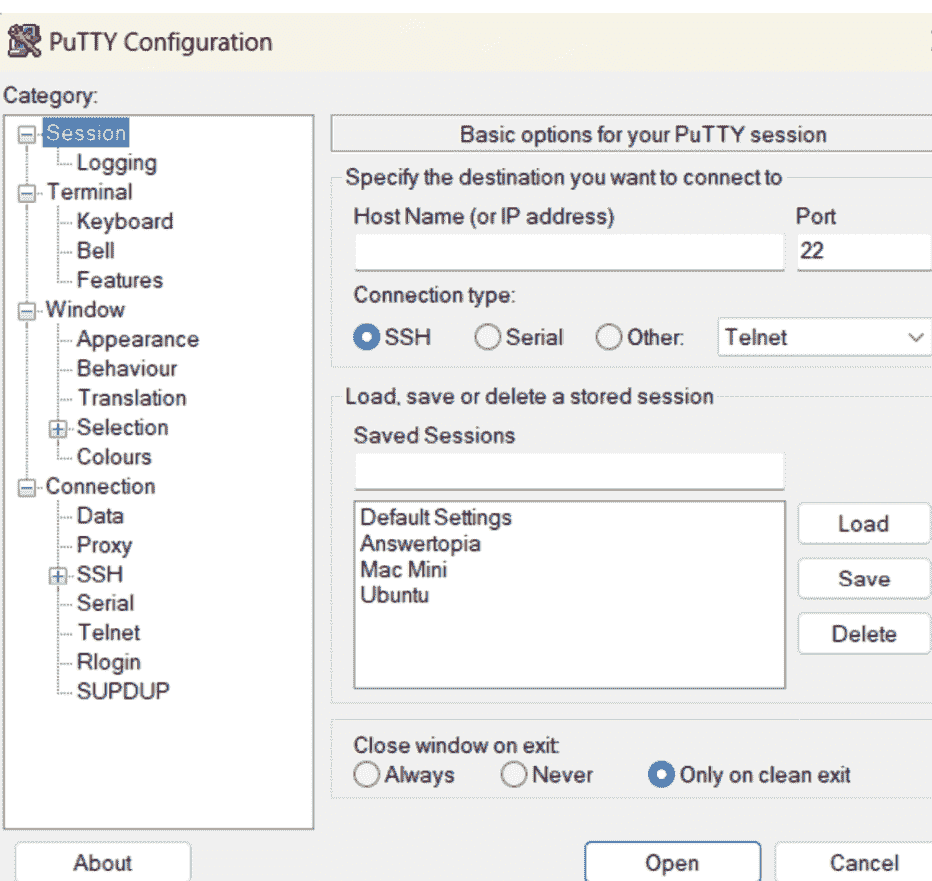

图 16-3：远程主机的 IP 地址或主机名（如果您从防火墙外部连接，则输入网关的外部 IP 地址）。

下一步是设置隧道。在对话框左侧的类别树中点击 SSH 旁边的 + 号并选择隧道。屏幕随后应显示如下：

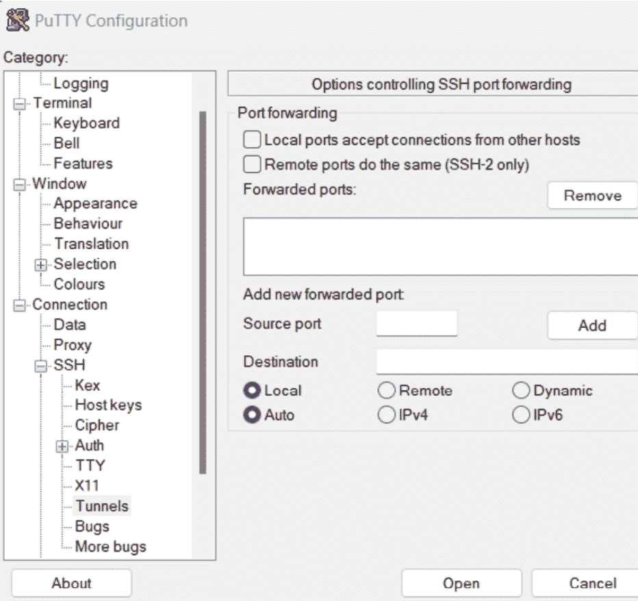

图 16-4：输入 `5901` 作为源端口，`localhost:5901` 作为目标，并点击添加按钮。

最后，点击会话类别返回主界面。在保存会话文本框中为会话命名并按保存。点击打开建立连接。将出现一个带有远程系统登录提示的终端窗口。输入相应的用户名和密码。

此时 SSH 连接已建立。启动 TightVNC 查看器，输入 `localhost:5901` 并点击连接。查看器将提示密码，然后您就可以访问远程桌面了。

## 16.8 关闭桌面

要关闭 VNC 会话，请在桌面使用 `-kill` 命令。例如：

```bash
vncserver -kill :1
```

## 16.9 VNC 连接故障排除

使用 VNC 时，当服务器无法启动或连接时可能会出现一些问题。如果 VNC 服务启动失败，请检查服务状态：

```bash
systemctl status vncserver@
```

如需更详细的信息，请检查 systemd 日志：

```bash
journalctl -xe
```

可以在位于路径 `/home/user/.vnc/hostname:log` 的日志文件中找到额外信息。

如果 systemd 服务无法启动，尝试手动启动它：

```bash
vncserver :1
```

如果 VNC 服务器仍然无法连接，请检查防火墙端口：

```bash
firewall-cmd --list-ports
```

如果端口未开启，请将其添加到防火墙：

```bash
firewall-cmd --permanent --add-port=5901/tcp
firewall-cmd --reload
```

## 16.10 总结

在本章中，我们学习了如何使用 SSH 和 PuTTY 建立安全的 VNC 隧道。我们还涵盖了如何关闭 VNC 会话以及如何排除连接问题。

## 17 远程显示 Rocky 9 应用程序

### 17.1 显示 Rocky 9 应用程序的要求

远程显示应用程序有一些前提条件。首先，要显示应用程序的系统必须运行 X 服务。为此有多种商业和免费的 X 服务可供选择。其次，运行应用程序的系统必须配置为允许 SSH 转发。这通过在 SSH 配置中添加以下指令来实现。

在 Rocky 9 上，默认情况下 `/etc/ssh/sshd_config` 文件包含一条指令，用于包含 `/etc/ssh/sshd_config.d` 目录下的所有配置文件：

```text
Include /etc/ssh/sshd_config.d/*.conf
```

在新安装的系统上会创建一个名为 `something.conf` 的文件。编辑此文件并确保 `X11Forwarding` 属性如下所示启用：

```text
X11Forwarding yes
```

进行更改后，保存文件并重启 SSH 服务。一旦满足上述要求，就可以远程显示 X 桌面应用程序了。

### 17.2 远程显示 Rocky Linux 9 应用程序

远程显示应用程序的第一步是移动到要显示应用程序的系统。在该系统中，建立到远程系统的 SSH 连接，以便获得命令提示符。这可以通过 `ssh` 命令实现。使用 `ssh` 命令时，我们需要使用 `-X` 标志告诉它我们计划通过连接隧道化 X11 流量：

```bash
ssh -X user@hostname
```

在登录提示处输入您的密码，登录后，运行以下命令查看 `DISPLAY` 设置：

```bash
echo $DISPLAY
```

该命令应输出类似以下的内容：`localhost:10.0`。

要显示应用程序，请从命令提示符运行它。例如：

```bash
gedit
```

执行上述命令时，该命令将在远程系统上运行 `gedit` 工具，但在本地系统上显示用户界面。

### 17.3 可信的 X11 转发

如果远程系统上的 `/etc/ssh/sshd_config.d/so-redhat.conf` 文件包含以下行，则可以使用可信的 X11 转发：

```text
ForwardX11Trusted yes
```

可信的 X11 转发比不可信的转发稍微快一点，但安全性较低，因为它没有参与 X11 安全控制。在使用可信的 X11 转发时需要使用 `-Y` 参数：

```bash
$ ssh -Y user@hostname
```

### 17.4 压缩的 X11 转发

在使用较慢的连接时，可以使用 `ssh -C` 标记对 X11 数据进行压缩以提高性能：

```bash
$ ssh -X -C user@hostname
```

### 17.5 在 Windows 上显示远程 Rocky Linux 9 应用

要在 Windows 上显示基于 Rocky 9 的应用程序，必须在 Windows 系统上安装 SSH 客户端和 X 服务器。关于在 Windows 上安装和使用 PuTTY 客户端的主题已在书中之前的“在 Rocky Linux 9 上配置基于密钥的身份验证”章节中介绍过。如果你尚未在 Windows 系统上安装 PuTTY，请参考该章节。

在 X 服务器方面，有多个选项可用，但一个流行的选择是 VcXsrv，它可以从以下 URL 免费获取：

https://sourceforge.net/projects/vcxsrv/

一旦安装了 VcXsrv X 服务器，桌面和开始菜单中将出现一个名为 XLaunch 的程序。启动 XLaunch 并选择显示选项（最灵活的是“Multiple windows”选项，它允许每个客户端应用程序显示在自己的窗口中）：

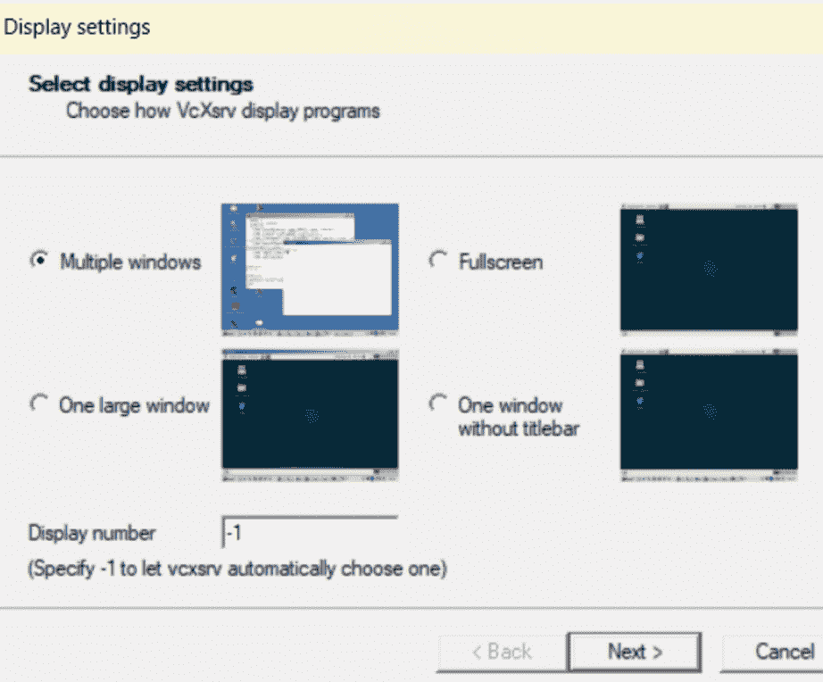

图 17-1

点击“Next”按钮继续完成后续屏幕，并接受默认配置设置。在最后一个屏幕上，点击“Finish”按钮启动 X 服务器。如果出现 Windows Defender 对话框，点击按钮允许访问您所选的网络。

一旦运行，XLaunch 将出现在任务栏中，并可以通过右键点击图标并选择“Exit...”菜单选项来退出：

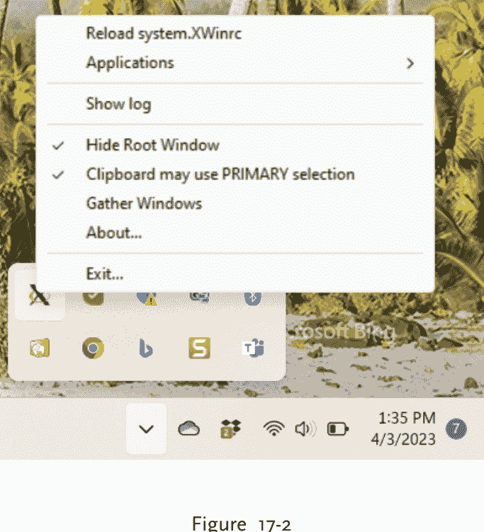

在安装并运行 X 服务器后，启动 PuTTY 并输入远程主机的连接信息或加载以前保存的会话配置。然而，在建立连接之前，需要启用 X11 转发。因此，在 PuTTY 主窗口中，向下滚动左侧面板中的选项，展开 SSH 部分，并选择 X11 选项，如图所示：

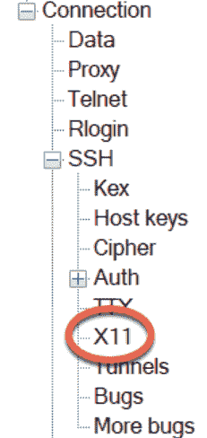

图 17-3

开启图中高亮显示的“Enable X11 forwarding”复选框，返回会话屏幕并打开连接（如果你计划再次使用它，请预先保存会话）：

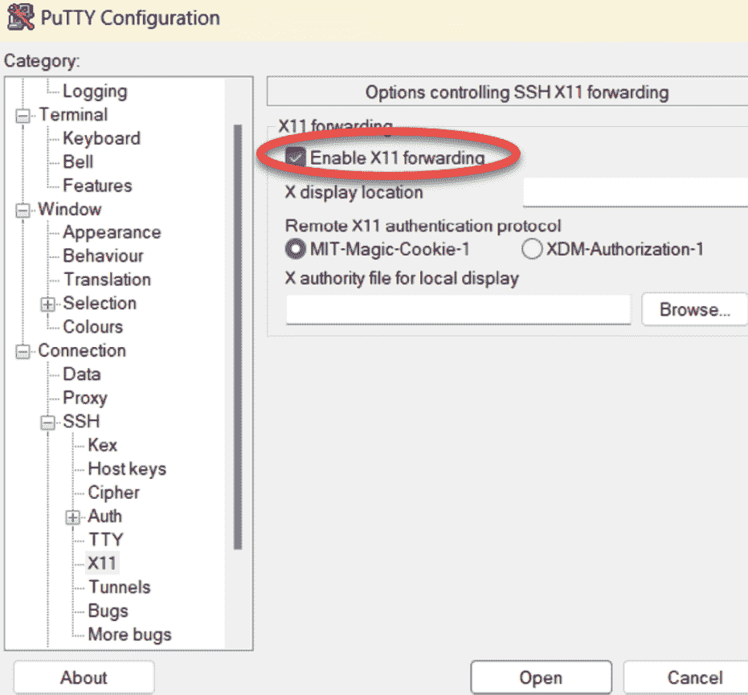

图 17-4

在 PuTTY 会话窗口中登录 Rocky 9 系统并运行一个桌面应用程序。稍短延迟后，该程序将以自己的窗口显示在 Windows 桌面上。应用程序打开的任何对话框也将出现在单独窗口中，就像它们在 Rocky 9 GNOME 桌面上的显示一样。例如，图显示了在 Windows 11 系统上显示的 Rocky 9 `nm-connection-editor` 工具：

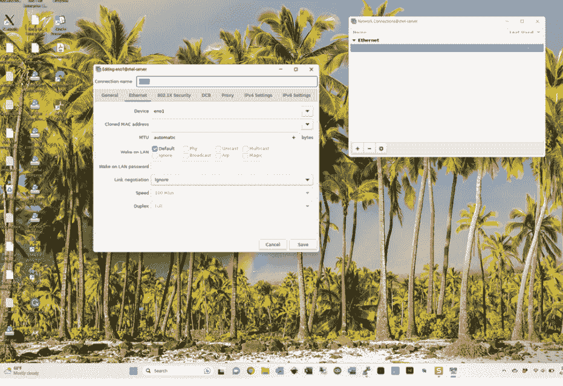

图 17-5

### 17.6 总结

对于需要远程访问单个 Rocky 9 桌面应用程序而非整个 GNOME 桌面的情况，X11 转发为远程显示图形化应用程序提供了一种轻量级的解决方案。显示应用程序的系统必须运行基于 X Window 系统的桌面环境（如 GNOME），或者已安装并运行了 X 服务器。一旦在远程服务器上启用了 X11 转发，并从本地系统使用 X11 转发选项建立了安全的 SSH 连接，大多数应用程序都可以在本地 X 服务器上远程显示。

## 18 在 Rocky Linux 9 上使用 NFS 与远程系统共享文件

Rocky Linux 9 提供了两种机制与网络上的其他系统共享文件和文件夹。一种方法是使用名为 Samba 的技术。Samba 基于 Microsoft Windows 文件夹共享，允许 Linux 系统让 Windows 系统访问文件夹，并允许 Linux 访问 Windows 文件夹共享。这种方法也可以用于在 Linux 和基于 UNIX 的系统之间共享文件夹，只要它们安装并配置了 Samba 支持。这是在异构网络环境中共享文件最流行的方法。使用 Samba 进行文件夹共享的内容将在“在 Rocky Linux 9 和 Windows 系统之间共享文件”中介绍。

另一个明确针对在 Linux 系统之间共享文件夹的选项是使用网络文件系统（NFS）。NFS 允许某台计算机上的文件被另一台计算机访问。NFS 最初由 Sun Microsystems 公司（现为 Oracle 公司的一部分）开发，并且仍然是共享的标准。

### 18.1 确保 NFS 服务正在运行

第一个任务是验证 Rocky 9 上是否安装了 NFS。首先安装 `rpcbind` 和 `nfs-utils`：

```bash
dnf install rpcbind nfs-utils
```

接下来，配置这些服务以便在启动时运行：

```bash
systemctl enable rpcbind
systemctl enable nfs-server
```

一旦启用了服务，启动它们：

```bash
systemctl start rpcbind
systemctl start nfs-server
```

### 18.2 配置 Rocky Linux 9 防火墙允许 NFS

接下来需要配置防火墙允许 NFS 流量。要实现这一点，运行以下命令，将 `<zone>` 替换为相应的区域：

```bash
firewall-cmd --zone=<zone> --permanent --add-service=mountd
firewall-cmd --zone=<zone> --permanent --add-service=nfs
firewall-cmd --zone=<zone> --permanent --add-service=rpc-bind
firewall-cmd --reload
```

### 18.3 指定要共享的文件夹

现在 NFS 已运行且防火墙已配置，我们需要指定 Rocky 9 文件系统的哪些部分可以被远程访问。这些设置可以在 `/etc/exports` 文件中声明。导出行的格式如下：

```text
<directory> <host>(<options>)
```

在上述行中，`<directory>` 是要导出的目录，`<host>` 是授予访问的系统名称或 IP 地址，`<options>` 代表对该访问施加的限制（只读、读写等）。如果需要，可以将多个主机和选项项放在同一行。例如，以下行向 IP 地址为 `192.168.2.38` 的主机授予 `/datafiles` 的只读权限：

```text
/datafiles 192.168.2.38(ro)
```

允许通配符将导出应用于多个主机。例如，以下行允许所有外部主机以读写访问 `/home/demo`：

```text
/home/demo *(rw)
```

可以通过读取 exports 手册找到导出文件支持的选项完整列表：

```bash
man exports
```

对于本章节，我们将 `/etc/exports` 文件配置如下：

```text
/tmp *(rw,sync)
/vol1 192.168.86.42(ro,sync)
```

配置完成后，需要使用 `exportfs` 命令更新 NFS 服务器维护的导出文件系统表以包含最新的 `/etc/exports` 设置：

```bash
exportfs -a
```

也可以使用 `exportfs` 工具从命令行查看当前的共享设置：

```bash
exportfs
```

上述命令将生成以下输出：

```
/vol1 192.168.86.42
```

### 18.4 访问共享文件夹

客户端系统可以通过从命令行手动挂载来访问共享文件夹。然而，在尝试挂载远程 NFS 文件夹之前，必须在客户端系统上安装 `nfs-utils` 软件包：

```bash
# dnf install nfs-utils
```

要从命令行挂载远程文件夹，请打开终端窗口并创建一个您想要挂载远程共享文件夹的目录：

```bash
$ mkdir /home/demo/tmp
```

接下来，使用远程 NFS 服务器的 IP 地址或主机名输入挂载远程文件夹的命令，例如：

```bash
$ sudo mount -t nfs 192.168.86.24:/tmp /home/demo/tmp
```

随后，远程的 `/tmp` 文件夹将被挂载到本地系统。一旦挂载完成，`/home/demo/tmp` 文件夹将包含远程文件夹及其所有内容。

在挂载远程 NFS 文件系统时，也可以指定选项。例如，以下命令挂载了相同的文件夹，但将其配置为只读：

```bash
$ sudo mount -t nfs -o ro 192.168.86.24:/tmp /home/demo/tmp
```

### 18.5 在系统启动时挂载 NFS 文件系统

还可以通过编辑 `/etc/fstab` 文件，配置 Rocky 9 系统在每次启动时自动挂载远程文件系统。当加载到编辑器时，它的内容可能如下：

```text
/dev/mapper/rl-root / xfs defaults 0 0
UUID=c4baobof-777a-42a /boot xfs defaults 0 0
UUID=052D-19D8 /boot/efi vfat umask=0077,shortname=winnt 0 2
/dev/mapper/rl-swap none swap defaults 0 0
```

例如，要将位于 IP 地址为 `192.168.86.24` 的系统上的路径文件夹挂载到本地路径为 `/home/demo/tmp` 的文件夹中（注意该文件夹必须已经存在），请向文件中添加以下行：


```
192.168.86.24:/tmp /home/demo/tmp nfs rw 0 0
```

下一次系统重启时，远程系统上的 `/tmp` 文件夹将挂载到本地的 `/home/demo/tmp` 节点。此时，您就可以像访问本地硬盘驱动一样访问远程文件夹中的所有文件。

## 18.6 卸载 NFS 挂载点

一旦使用 NFS 挂载了远程文件系统，可以使用 `umount` 命令进行卸载，并将本地挂载点作为命令行参数。例如，以下命令将卸载我们的示例文件系统挂载点：

```
$ sudo umount /home/demo/tmp
```

## 18.7 在 Cockpit 中访问 NFS 文件系统

除了使用命令行在客户端挂载远程 NFS 文件系统外，还可以在 Cockpit Web 界面中执行挂载操作。假设客户端系统已安装并配置了 Cockpit，请从浏览器登录 Cockpit 界面，并从左侧导航面板中的“存储（Storage）”选项。如果没有列出存储选项，则需要安装 `cockpit-stored` 软件包：

```
# dnf install cockpit-stored
```

```
# systemctl restart cockpit.socket
```

一旦 Cockpit 服务重启，重新登录 Cockpit 界面，此时应该就能看到“存储”选项。

选中后，主存储页面将包含一个列出所有当前挂载的 NFS 文件系统的部分，如图 18-1 所示。

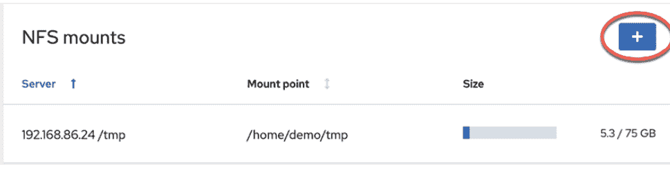

要挂载远程文件系统，点击上方高亮的 '+' 按钮，在出的对话框中输入远程 NFS 服务器和文件系统共享的信息，以及本地挂载点和任何必要的选项，然后点击“添加（Add）”按钮：

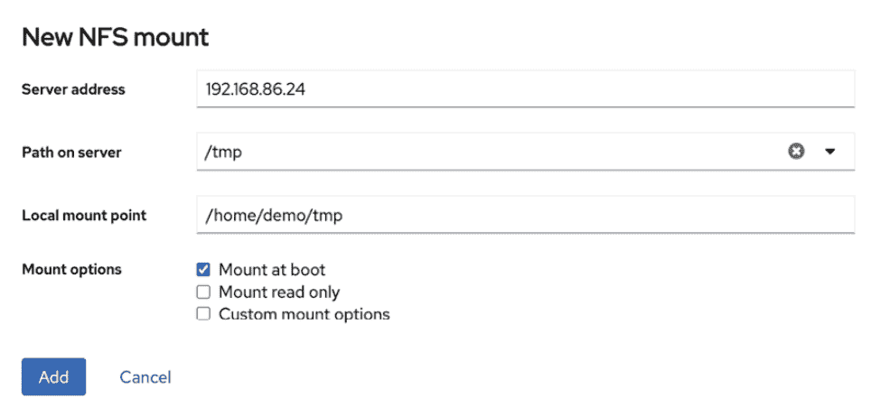

图 18-2

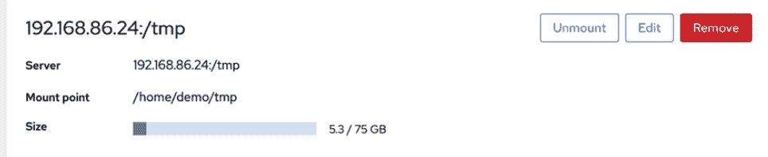

图 18-3

在此屏幕内，可以执行更改服务器或挂载点或卸载文件系统等任务。例如，“移除（Remove）”选项会卸载文件系统并删除 `/etc/fstab` 文件中的条目，这样在下次系统重启时就不会重新挂载。

## 18.8 总结

网络文件系统（NFS）是一种基于客户端/服务器的系统，最初由 Sun Microsystems 开发，为 Linux 和 Unix 系统提供了一种通过网络共享文件系统的方法。NFS 允许客户端系统访问并在（权限允许的情况下）修改位于远程服务器上的文件。

## 19.5.1 配置 [global] 节

smb.conf 文件由多个节（sections）组成。第一个节是 [global] 节，可以在此处指定适用于整个 Samba 配置设置。虽然这些设置是全局的，但每个选项可以在其他配置文件的节中被覆盖。

第一个任务是定义 Rocky 9 资源将共享的 Windows 工作组名称（workgroup）。这通过 [global] 节中的 `workgroup` 指令进行控制，其默认配置如下：

```
workgroup = SAMBA
```

如有必要，首先将其更改为实际的工作组名称。

除了 `workgroup` 设置外，其他设置表明这是一个独立服务器，通过用户密码来保护共享资源。在继续配置要共享的资源之前，还需要按照如下所示向 [global] 节中添加其他参数：

```
[global]
netbios name = LinuxServer
```

“netbios name”属性指定了服务器在网络上对其他系统可见时所使用的名称。

## 19.5.2 配置共享资源

下一步是配置共享资源（换句话说，就是从 Windows 网络上的其他系统可以访问的资源）。为了实现这一点，为该节指定一个名称，在共享时通过该名称引用。例如，如果我们计划共享 Rocky 9 系统的 `/sampleshare` 目录，可以将该节命名为 `[sampleshare]`。在此节中，可以使用各种配置选项。但对于本示例，我们只需定义要共享的目录，指示该目录既可浏览又可写，并声明该资源为公共，以便访客用户访问：

```
[sampleshare]
comment = Example Samba share
path = /sampleshare
browseable = Yes
public = yes
writable = yes
```

若要限制特定用户的访问，可以使用“valid users”属性，例如：

```
valid users = demo, bobyoung, marcewing
```

## 19.5.3 不必要的共享

smb.conf 文件预配置了用于共享打印机和系统用户主目录的节。如果不需要共享这些资源，可以将相应的节注释掉，以便 Samba 忽略它们。在以下示例中，`[homes]` 节被注释掉了：

```
#[homes]
# comment = Home Directories
# valid users = %S, %D%w%S
# browseable = No
# read only = No
# inherit acls = Yes
```

## 19.6 为 Samba 配置 SELinux

SELinux 是默认集成到所有 Rocky 9 系统 Linux 内核中的一个系统，为操作系统和用户文件提供了额外的安全层和保护。

传统上，Linux 安全性基于允许用户决定谁可以访问他们文件和其他拥有的其他资源。例如，考虑位于特定用户家目录并由该用户拥有的文件。用户可以控制该文件的访问权限，取决于系统上的其他用户是否可以读取、写入该文件，或者在脚本或二进制文件的情况下执行该文件。这种安全性被称为自主访问控制（discretionary access control），因为资源访问取决于用户的自主。

然而，使用 SELinux，访问由系统管理员控制，不能由用户覆盖。这被称为强制访问控制（mandatory access control），由管理员使用 SELinux 定义。继续上一个例子，只有在系统默认定义或管理员定义的 SELinux 策略允许的情况下，文件所有者才能对该文件执行操作。

可以使用 `sestatus` 工具如下所示识别 Rocky 9 系统上 SELinux 的当前状态：

```
SELinux status: enabled
SELinux mount: /sys/fs/selinux
SELinux root directory: /etc/selinux
Loaded policy name: targeted
Current mode: enforcing
Mode from config file: enforcing
Policy MLS status: enabled
Policy deny_unknown status: allowed
Memory protection checking: actual (secure)
Max kernel policy version: 33
```

SELinux 安全性基于上下文标签（context labels）的概念。系统上的所有资源（包括进程和文件）都分配了 SELinux 上下文标签，由用户、角色、类型和可选的安全级别组成。例如，文件或文件夹的 SELinux 上下文可以如下所示：

```
$ ls -Z /home/demo
unconfined-u:object_r:user_home_t:so Desktop
unconfined-u:object_r:user_home_t:so Documents
```

同样，可以使用 `ps` 命令来识别运行中进程的上下文，在此例中为 `ls` 命令：

```
$ ps -eZ | grep
unconfined-u:unconfined_r:unconfined_t:so-so:co.c1023 14311 tty 00:00:18 ls
```

当一个进程（如上述 `ls` 命令）尝试访问文件或文件夹时，SELinux 系统将检查策略以识别是否允许访问。现在考虑 Samba 服务的上下文：

```
$ ps -eZ | grep smbd
system_u:system_r:smbd_t:so 14129 ? 00:00:00 smbd
system_u:system_r:smbd_t:so 14132 ? 00:00:00 smbd-notify
```

SELinux 通过多种方式实现安全性，其中最常见的是称为类型强制（type enforcement）。简单来说，当进程尝试对对象执行操作（例如，写入文件）时，SELinux 会检查进程和对象的上下文类型，并验证安全策略是否允许该操作。假设一个类型 A 的进程尝试写入类型 B 的文件。在这种情况下，只有在 SELinux 策略明确允许的情况下操作才会被允许。在 SELinux 强制模式下，除非规则明确允许，否则所有操作都会被拒绝。

SELinux 与 Samba 的问题在于，SELinux 策略并未配置允许类型为 `smbd_t` 的进程对类型非 `samba_t` 的文件操作。例如，上述列出的 `/home/demo` 目录 Samba 服务无法访问，因为它的类型是默认。要使系统上的文件或文件夹可访问，必须更改强制类型。（示例继续）

## 19.7 创建 Samba 用户

任何需要访问 Samba 共享资源的用户都必须配置为 Samba 用户并分配密码。此任务通过 `smbpasswd` 命令行工具完成。例如，需要名为 `demo` 的用户能够从 Windows 系统访问我们 Rocky 9 系统的 `/sampleshare` 目录。为了满足这一需求，我们需要如下将 `demo` 添加为 Samba 用户：

```
# smbpasswd -a demo

New SMB password:

Retype new SMB password:

Added user demo.
```

现在我们已经完成了基础 Samba 服务器的配置，是时候测试配置文件并启动 Samba 服务了。

## 19.8 测试 smb.conf 文件

可以使用 `testparm` 命令行工具按照如下方式对 smb.conf 文件中的设置进行错误检查：

```bash
# testparm
```

从 /etc/samba/smb.conf 加载 samba 配置文件

加载服务文件 OK。

允许弱加密

服务器角色: ROLE_STANDALONE

按回车查看服务定义转储

```bash
# Global parameters
```

```ini
[global]
log file = /var/log/samba/%m.log
netbios name = LINUXSERVER
```

```ini
printcap name = cups
security = USER
wins support = Yes
idmap config * : backend = tdb
cups options = raw
```

```ini
[sampleshare]
comment = Example Samba share
guest ok = Yes
path = /sampleshare
read only = No
```

```ini
[homes]
browseable = No
comment = Home Directories
inherit acls = Yes
read only = No
valid users = %S %D%w%S
```

```ini
[printers]
browseable = No
comment = All Printers
create mask = 0600
path = /var/tmp
printable = Yes
```

## 19.9 启动 Samba 和 NetBIOS 名称服务

为了让 Rocky 9 服务器在 Windows 网络中运行，必须启动 Samba (SMB) 和 NetBIOS 名称服务 (NMB)。可选情况下，还应启用这些服务，以便它们在每次系统启动时自动运行：

```bash
# systemctl enable smb nmb
# systemctl start smb nmb
```

在尝试从 Windows 系统连接之前，使用 `smbclient` 实用程序验证共享是否配置：

```bash
# smbclient -U demo -L localhost
```

输入 WORKGROUP\demo 的密码：

| 共享名称 | 类型 | 注释 |
| :--- | :--- | :--- |
| sampleshare | Disk | Example Samba share |
| print$ | Disk | Printer Drivers |
| IPC$ | IPC | IPC Service (Samba 4.9.1) |
| demo | Disk | Home Directories |

## 19.10 访问 Samba 共享

现在 Samba 资源已经配置完成且服务正在运行，是时候从 Windows 系统访问共享资源了。在与 Rocky 9 系统处于同一工作组的 Windows 系统上，打开 Windows 资源管理器并导航到“网络”面板。此时，资源管理器应该搜索网络并列出它找到的所有使用 SMB 协议的系统。下图展示了在 Windows 系统上使用资源管理器找到名为 LINUXSERVER 的 Rocky 9 系统：

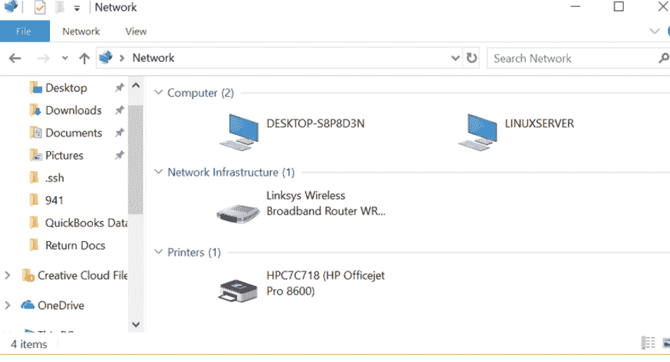

图 19-3

双击 LINUXSERVER 主将提示输入具有访问权限的用户名和密码。在这种情况下，就是我们使用 `smbpasswd` 工具配置的 demo 账户：

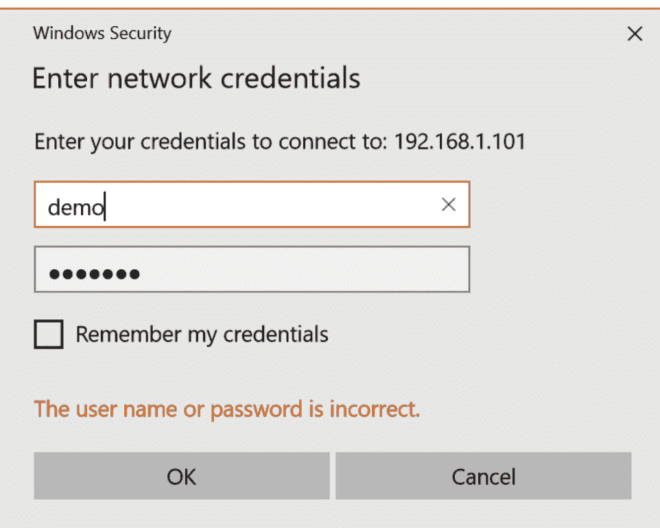

图 19-4

输入用户名和密码后，资源管理器窗口将显示为该用户配置的共享资源，包括之前配置的 /sampleshare 资源：


图 19-5

双击 /sampleshare 共享资源将显示其中包含的文件和目录列表。

如果您无法看到 Linux 系统或访问共享文件夹出现问题，请尝试如下所示将 Samba 共享映射到本地 Windows 驱动器：

1. 打开 Windows 文件资源管理器，右键点击左侧面板中的“网络”项，并在生成的菜单中选择“映射网络驱动器...”。
2. 在输入共享文件夹路径之前，从映射网络驱动器对话框中选择一个驱动器号。例如：

```
\\LinuxServer\sampleshare
```


勾选“使用不同的凭据连接”。例如，如果您不希望每次登录 Windows 系统时都映射该驱动器，请取消相应的复选框：

# 您想要映射哪个网络文件夹？

为连接和要连接的文件夹指定驱动器号：

- 驱动器：`Z:`
- 文件夹：`\LinuxServer\sampleshare`
- 示例：`\server\share`

- 登录时重新连接
- 使用不同的凭据连接

连接到一个可以用于存储文档和图片的网站。

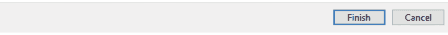

# 图 19-6

输入设置后，点击“完成”按钮映射驱动器，并在提示时输入在本节之前配置的 Samba 用户的用户名和密码。稍等延迟后，Samba 共享的内容将出现在新的文件资源管理器窗口中。

## 19.11 从 Rocky 9 访问 Windows 共享

如前所述，Samba 是双向通信的。

在本章中，我们查看了如何配置 Rocky 9 系统既作为客户端又作为服务器。涵盖的主题包括 Samba 客户端和服务器的安装。此外，还介绍了 SELinux 的基本概念以及提供 Samba 访问的步骤。

## 20. 虚拟化技术概述

虚拟化是在单台计算机上运行多个操作系统的能力。虚拟化并不一定是一个新概念，但它近年来变得非常重要，因为它提供了一种充分利用服务器 CPU 和资源的方法，同时提供了稳定性（如果一个虚拟化的客户系统崩溃，主机和其他客户系统将继续运行）。

虚拟化对于尝试不同的操作系统而无需配置双启动非常有帮助。例如，您可以在不重新划分磁盘或关闭 Rocky 9 的情况下，启动一个虚拟版本的 Windows 作为客户操作系统。同样，虚拟化允许您在 Rocky 9 系统中运行其他 Linux 发行版。

在决定实现虚拟化的最佳方法时，清晰了解目前的各种解决方案至关重要。因此，本章的目的是用通俗描述常用的虚拟化技术。

## 20.1 客户操作系统虚拟化

客户操作系统虚拟化（称为基于应用程序的虚拟化）是最容易理解的概念。在这种情况下，物理主机运行标准的、未修改的操作系统，如 Windows、Linux、UNIX 或 macOS。运行在该操作系统上的是一个虚拟化应用程序，其执行方式与系统上运行的任何应用程序（如文字处理器或电子表格）非常相似。在这个虚拟化应用程序内部，创建了一个或多个虚拟机来运行客户操作系统。


图 20-1

如上图所示，客户操作系统运行在虚拟化应用程序的虚拟机中，而该应用程序又以任何其他应用程序相同的方式运行在宿主机操作系统之上。客户操作系统与底层宿主机硬件之间的多层抽象不利于实现高水平的虚拟机性能。然而，这种技术的优势在于，不需要对宿主机或客户操作系统进行任何更改，也不需要特殊的 CPU 硬件虚拟化支持。

## 20.2 监控程序虚拟化

在管理程序虚拟化中，管理程序（`Hypervisor`）的任务是为虚拟机处理资源和内存分配，并为更高级的管理和监控工具提供接口。基于管理程序的解决方案分为 Type-1 和 Type-2 两类。

Type-2 管理程序（有时称为托管型管理程序）以软件应用程序的形式安装并运行在宿主机操作系统之上，通过协调客户虚拟机对 CPU、内存和网络等资源的访问来提供虚拟化能力。图 21-2 展示了使用 Type-2 管理程序虚拟化系统的典型架构：


图 20-2

要理解 Type-1 管理程序的工作原理，了解 Intel x86 处理器架构会有帮助。x86 系列 CPU 提供了一系列被称为“环”（rings）的保护级别，代码可以在这些环中执行。Ring 0 拥有最高权限，操作系统内核通常运行在该环中。在 ring 0 中执行的代码被认为运行在系统空间、内核模式或监控模式下。所有其他代码（如运行在操作系统上的应用程序）都运行在权限较低的环中，通常是 ring 3。

与 Type-2 管理程序不同，Type-1 管理程序（也称为裸机或原生管理程序）直接运行在宿主机系统的硬件上，位于 ring 0。由于管理程序占据了 CPU 的 ring 0，运行在系统上的任何客户操作系统的内核必须运行在权限较低的 CPU 环中。

遗憾的是，大多数操作系统内核都是显式编写为在 ring 0 中运行的，因为它们需要执行只有 ring 0 才能执行的任务，例如执行特权 CPU 指令和直接操作内存。近年来，针对这个问题设计了多种不同的解决方案，每种方案如下：

### 20.2.1 半虚拟化

在半虚拟化下，客户操作系统的内核经过专门修改以运行在管理程序上。这通常涉及将仅在 CPU ring 0 中运行的特权操作替换为对管理程序的调用（称为超器调用，`hypercalls`）。随后，由管理程序代表客户内核执行该任务。遗憾的是，这通常将支持限制在可以自由修改的开源操作系统（如 Linux）以及所有者已同意针对特定管理程序进行必要代码修改的专有（闭源）操作系统。尽管存在这些问题，客户内核与管理程序直接通信的能力使其比其他虚拟化方法具有更高的性能水平。

### 20.2.2 全虚拟化

全虚拟化为未修改的客户操作系统提供支持。“未修改”一词是指那些没有为了运行在管理程序上而进行更改的操作系统内核，因此它们仍然像运行在 CPU ring 0 中一样执行特权操作。在这种情况下，管理程序提供 CPU 仿真，以处理和修改未修改的客户操作系统内核所执行的特权和保护 CPU 操作。遗憾的是，这种仿真过程运行需要时间和系统资源，导致与半虚拟化提供的性能相比，其性能水平较低。

### 20.2.3 硬件虚拟化

硬件虚拟化利用了 Intel 和 AMD 最新几代 CPU 内置的虚拟化功能。这些技术分别称为 `Intel VT` 和 `AMD-V`，为运行未修改的客户虚拟机提供了必要的扩展，且避免了全虚拟化 CPU 仿真中固有的开销。通俗来说，这些处理器在 ring 0 之上提供了一个额外的权限模式（ring -1），管理程序可以在其中运行，从而为未修改的客户操作系统留出了 ring 0 空间。

下图展示了 Type-1 管理程序的虚拟化方法：


图 20-3

如上图所示，除了虚拟机之外，管理操作系统或管理控制台也运行在管理程序之上，允许系统管理员对虚拟机进行管理。

## 20.3 虚拟机网络

虚拟机不可避免地需要连接网络以具有实际用途。一种方案是让客户连接到运行在宿主机操作系统内部的虚拟网络。在这种配置中，虚拟网络上的任何虚拟机都可以互相看到，但网络地址转换（`NAT`）提供了对外部网络的访问。当使用虚拟网络和 NAT 时，每个虚拟机都使用宿主机系统的 IP 地址在外部网络（宿主机所连接的网络）上表示。这是 Rocky 9 上 KVM 虚拟化的默认行为，通常不需要任何配置。通常，系统会默认创建一个名为 `default` 的虚拟网络。为了让客户在外部网络上显示为独立且各个系统（即拥有自己的 IP 地址），必须配置为共享宿主机上的一个网络接口。实现这一目标的最快方法是配置“直接连接”网络，这将位于与宿主机相同的网络。遗憾的是，使用 `MacVTap` 驱动时无法在客户和宿主机之间建立连接。

## 21.1 KVM 概述

KVM 被分类为 Type-1 虚拟机解决方案，它利用 `Intel VT` 和 `AMD-V` 硬件虚拟化支持，实现了对未修改的虚拟机操作系统的全虚拟化。

KVM 与许多其他 Type-1 解决方案的不同在于，它将主机 Linux 操作系统转换为虚拟机（`hypervisor`），从而在运行完整的企业级主机操作系统的同时实现了裸金属虚拟化。

## 21.2 KVM 硬件要求

在继续本章节之前，我们必须讨论在 KVM 环境中运行虚拟机的硬件要求。首先，KVM 虚拟化仅适用于某些类型的处理器。如前所述，处理器必须包含 `Intel VT` 或 `AMD-V` 技术。

要检查是否支持虚拟化，请在终端窗口运行 `lscpu` 命令：

```
# lscpu | grep Virtualization:
```

如果系统包含支持 `Intel VT` 的 CPU，上述命令将提供以下输出：

```
Virtualization: VT-x
```

或者，当检测到支持 `AMD-V` 的 CPU 时，将显示以下输出：

```
Virtualization: AMD-V
```

如果 CPU 不支持虚拟化，上述 `lscpu` 命令将不会显示任何输出。

请注意，上述命令仅报告处理器是否支持相应功能，并不表示该功能当前已在 BIOS 中启用。这是因为在实践中，大多数系统的虚拟化支持默认是禁用的。因此，在继续本教程之前，您应该检查 BIOS 设置以确保已启用适当的虚拟化技术。

与双启动环境不同，虚拟化环境涉及在单台计算机系统上并发运行两个或多个完整的操作系统。这意味着系统必须具有足够的内存、磁盘空间和 CPU 处理能力，以舒适地并行运行所有系统。因此，在开始配置和安装过程之前，请检查 Rocky 9 以及您所选虚拟机操作系统的最低系统要求，并验证您的主机系统是否有足够的资源来处理这两个系统的需求。

## 21.3 为 KVM 虚拟化准备 Rocky 9

与 Xen 不同，不需要运行特殊版本的内核来支持 KVM。因此，通过安装 KVM 内核模块，标准内核已经可以支持 KVM 供使用，从而消除了安装和启动特殊内核的需要。

然而，为了避免冲突，如果系统当前运行着启用了 Xen 的内核，请在继续本章节其余内容之前重启系统，并在启动菜单中选择非 Xen 内核。

设置和维护基于 KVM 的虚拟化系统所需的工具只有在 Rocky 9 操作系统安装过程中显式选择时才会安装。要从命令提示符安装 KVM 工具，请在终端窗口执行以下命令：

```
# dnf install qemu-kvm qemu-img libvirt virt-install libvirt-client
```

如果您可以访问图形化桌面环境，还推荐安装 `virt-manager` 包：

```
# dnf install virt-manager
```

## 21.4 验证 KVM 安装

在继续之前，检查 KVM 安装是否正常工作是值得的。当 KVM 安装并运行时，将有两个模块加载到内核中。可以通过在终端窗口中运行 `lsmod` 命令来验证这些模块是否存在：

```
# lsmod | grep kvm
```

假设安装成功，上述命令应生成类似下面的输出：

```
kvm_intel 237568 0
kvm 737280 1 kvm_intel
irqbypass 16384 1 kvm
```

请注意，如果系统包含 AMD 处理器，kvm 模块可能会读取 `kvm_amd` 而不是其他。

安装过程还应该配置了 `libvirtd` 守护进程在后台运行。再次使用终端窗口运行以下命令以确保 `libvirtd` 正在运行：

```
# systemctl status libvirtd
```

```
libvirtd.service - Virtualization daemon
Loaded: loaded (/usr/lib/systemd/system/libvirtd.service; enabled; vendor preset: enabled
Active: active (running) since Wed 2019-03-06 14:41:22 EST; 3min 54s ago
```

如果进程未运行，请如下所示启动它：

```
# systemctl enable --now libvirtd
```

```
# systemctl start libvirtd
```

如果可用桌面环境，可以通过选择“活动”并在搜索框中输入“virt”来运行 `virt-manager` 工具。当“虚拟机管理器”图标出现时，点击它进行启动。加载后，管理器应如如下图所示：


图 21-1

如果没有列出 QEMU/KVM 项，请选择“文件 -> 添加连接”菜单选项，并在生成的对话框中，点击“连接”按钮之前选择“QEMU/KVM 虚拟机程序”：


图 21-2

如果管理器未连接，右键点击该项并选择“连接”。

## 21.5 总结

KVM 是一种 Type-1 虚拟机解决方案，利用 `Intel VT` 和 `AMD-V` 硬件虚拟化支持实现了对未修改的操作系统的全虚拟化。它是 Rocky 9 自带的虚拟化解决方案，可以在支持虚拟化的系统上快速安装。当 KVM 安装并启用后，后续章节将概述安装和管理虚拟机的选项。

## 22. 使用 Cockpit 在 Rocky 9 上创建 KVM 虚拟机

基于 KVM 的虚拟机可以使用 `virt-install` 命令行工具、`virt-manager` 工具或 Cockpit 的虚拟机模块在 Rocky 9 上轻松配置。本章将使用 Cockpit 安装操作系统。名为“使用 virt-manager 在 Rocky 9 上创建 KVM 虚拟机”的章节将介绍使用图形工具创建虚拟机。下一章节“使用 virt-install 和 virsh 创建 KVM 虚拟机”将介绍命令行方法。

## 22.1 安装 Cockpit 虚拟机模块

默认情况下，Cockpit 安装可能不包含虚拟机模块。假设 Cockpit 已安装，可以通过以下命令安装虚拟机模块：

```
# dnf install cockpit-machines
```

安装后，下次登录 Cockpit 界面时，导航面板将出现“虚拟机”选项（图 22-1 中的 A）：


图 22-1

## 22.2 在 Cockpit 中创建虚拟机

要在 Cockpit 中创建虚拟机，点击图 22-1 中的 B“创建虚拟机”按钮以显示对话框。

在对话框中，为机器输入名称，并选择安装介质是通过 URL 访问的 ISO、本地文件系统路径，或者为虚拟机请求供应商和操作系统类型信息并选择“下载操作系统”选项以便在安装过程中自动下载安装镜像。

此外，指定用于操作系统安装的虚拟磁盘大小以及分配给虚拟机的内存：

| 创建新虚拟机 | |
| :--- | :--- |
| **名称** | demo_vm_guest |
| **详情** | |
| **安装类型** | 下载操作系统 |
| **操作系统** | Rocky Linux 9 (Blue Onyx) |
| **存储** | 创建新卷 |
| **存储限制** | 10 GiB，默认位置可用 65.3 GiB |
| **内存** | 1.5 GiB，主机可用 3.4 GiB |
| 创建并运行 | 创建并编辑 | 取消 |

图 22-2

点击“创建并编辑”按钮构建虚拟机。创建完成后，新虚拟机的详情将出现在 Cockpit 中，如图所示：

## 虚拟机 > demo-vm-guest

### 概述

| 通用 | |
| --- | --- |
| 状态 | 已关闭 |
| 内存 | 2.15 GB 编辑 |
| vCPUs | 2 编辑 |
| CPU 类型 | 主机透传 编辑 |
| 启动顺序 | 磁盘 编辑 |
| 自动启动 | 宿主机启动时运行 |
| 虚拟化程序详情 | |
| 模拟机器 | pc-q35-rhel9.0.0 |
| 固件 | BIOS |

图 22-3

正如“虚拟化技术概述”中所述，KVM 在网络配置方面为虚拟机提供了多种选项。要查看和更改虚拟机的网络设置，向下滚动到虚拟机概述页面的“网络接口”部分并点击“编辑”（`Edit`）按钮：

### 网络接口

| 类型 | 网络 |
|------|---|
| 模型类型 | virtio |
| MAC 地址 | 52:54:00:ce:48:35 |
| IP 地址 | |
| 源 | default |
| 状态 | 已连接 |

图 22-4

在弹出的对话框中，可以使用“网络类型”（`Network Type`）菜单更改网络连接类型，例如从“虚拟网络”改为“直接附加 (MacVTap)”或“桥接到局域网”。

## 22.3 开始安装

要启动新虚拟机并从指定的安装媒体安装客操作系统，请点击页面顶部的“安装”（`Install`）按钮。Cockpit 将启动虚拟机并向下滚动到“控制台”（`Console`）视图，在那里将显示客操作系统屏幕：


图 22-5

如果安装失败，请检查消息查看打开安装镜像时是否发生错误。这通常是因为 QEMU 模拟器以名为 `qemu` 的用户运行，该用户没有访问 ISO 安装镜像所在目录的权限。要解决此问题，打开终端窗口（如果系统是远程的请通过 SSH 连接），切换到 ISO 镜像文件目录，并将 `qemu` 用户添加到父目录的访问控制列表 (`ACL`) 中，如下：

```
# cd /path/to/iso/directory
```

```
# setfacl --modify u:qemu:x ..
```

做出更改后，按如下方式检查设置：

```
# getfacl ..
```

```
# file: ..
# owner: demo
# group: demo
user::rwx
user:qemu::--x
group::---
mask::-x
other::---
```


完成这些更改后，再次点击“安装”按钮完成安装。

要完成安装，请在“控制台”视图中与屏幕交互，就像您在物理硬件上安装操作系统一样。如果控制台太小无法容整个客操作系统屏幕，请点击右上角的“展开”（Expand）按钮。

还可以使用 `virt-viewer` 从 Cockpit 浏览器会话外部连接并显示虚拟机的图形控制台。要在 Rocky 9 系统上安装 `virt-viewer`，请运行以下命令：

```
# dnf install virt-viewer
```

`virt-viewer` 工具也适用于 Windows 系统，可以从以下 URL 下载：

https://virt-manager.org/download/

要连接到本地主机上运行的虚拟机，运行 `virt-viewer` 弹出的对话框中选择您想要连接的虚拟机：


图 22-6

上述命令将列出基于系统的虚拟机。要列出并访问基于会话的虚拟机，请如下方式启动 `virt-viewer`：

```
$ virt-viewer --connect qemu:///session
```

或者也可以指定虚拟机名称并完全跳过选择对话框，例如：

```
# virt-viewer demo-vm-guest
```

要使用 SSH 将 `virt-viewer` 实例连接到运行在远程主机上的虚拟机，可以使用以下命令：

```
$ virt-viewer --connect qemu+ssh://<user>@<host>/system <vm_name>
```

例如：

```
$ virt-viewer --connect qemu+ssh://root@192.168.1.122/system demo_vm_guest
```

使用此技术时，重要的是，在连接完全建立之前，您会被提示输入两次用户密码。

一旦创建了虚拟机，Cockpit 就可以监控虚拟机并执行重启、关机或删除客系统等任务。“磁盘”（Disks）面板上还包含一个选项，可向虚拟机配置中添加磁盘。

## 22.4 使用存储卷和存储池

当创建虚拟机时，它通常至少有一个虚拟磁盘驱动器。代表这些虚拟磁盘驱动器的镜像存储在存储池中。池可以是本地文件系统上的现有目录、文件系统分区、物理磁盘设备、逻辑卷管理 (LVM) 卷组甚至是远程文件系统 (NFS)。每个存储池被划分为一个或多个存储卷。存储卷通常是单个文件，但也可以以物理分区、整个磁盘或 LVM 卷组的形式存在。

尽管使用默认存储池对于测试和早期实验是可以接受的，但建议为通用虚拟化用途创建额外的池。要创建新的存储池，在 Cockpit 中显示“存储池”（Storage Pools）屏幕并点击“创建存储池”（Create storage pool）按钮，如下所示：

| 名称 | 连接 | 状态 |
| --- |---|---|
| default | /var/lib/libvirt/images | yes |
| Persistent | yes | |
| Type | dir | |
| Autostart | yes |

在 demo guest 的情况下，存储卷以名为镜像的形式存在。此外，池还包括包含安装镜像的存储卷。要找到虚拟机使用哪个存储卷，返回虚拟机 Cockpit 主屏幕，选择虚拟机并向下滚动到“磁盘”面板，如下所示：

| 名称 | 使用者 | 大小 |
| --- |---|---|
| demo_vm_guest.qcow2 | demo_vm_guest | 02 |

正如“虚拟化技术概述”中所述，KVM 在网络配置方面为虚拟机提供了多种选项。要查看和更改虚拟机的网络设置，向下滚动到虚拟机概述页面的“网络接口”部分并点击“编辑”（Edit）按钮：

在弹出的对话框中，可以使用“网络类型”（Network Type）菜单更改网络连接类型，例如从“虚拟网络”改为“直接附加 (MacVTap)”或“桥接到局域网”。

要启动新虚拟机并从指定的安装媒体安装客操作系统，请点击页面顶部的“安装”（Install）按钮。Cockpit 将启动虚拟机并向下滚动到控制台，在那里将显示客操作系统屏幕：

如果安装失败，请检查消息查看打开安装镜像时是否发生错误。这通常是因为 QEMU 模拟器以名为 `qemu` 的用户运行，该用户没有访问 ISO 安装镜像所在目录的权限。要解决此问题，打开终端窗口（如果系统是远程的请通过 SSH 连接），切换到 ISO 镜像文件目录，并将 `qemu` 用户添加到父目录的访问控制列表 (ACL) 中，如下：

要完成安装，在控制台视图中与屏幕交互，就像您在物理硬件上安装操作系统一样。如果控制台太小无法容整个客操作系统屏幕，请点击右上角的“展开”（Expand）按钮。

还可以使用 `virt-viewer` 从 Cockpit 浏览器会话外部连接并显示虚拟机的图形控制台。要在 Rocky 9 系统上安装 `virt-viewer`，请运行以下命令：

`virt-viewer` 工具也适用于 Windows 系统，可以从以下 URL 下载：

要连接到本地主机上运行的虚拟机，运行 `virt-viewer` 弹出的对话框中选择您想要连接的虚拟机：

上述命令将列出基于系统的虚拟机。要列出并访问基于会话的虚拟机，请如下方式启动 `virt-viewer`：

或者也可以指定虚拟机名称并完全跳过选择对话框，例如：

要使用 SSH 将 `virt-viewer` 实例连接到运行在远程主机上的虚拟机，可以使用以下命令：

使用此技术时，重要的是，在连接完全建立之前，您会被提示输入两次用户密码。

一旦创建了虚拟机，Cockpit 接口就可以监控虚拟机并执行重启、关机或删除客系统等任务。“磁盘”面板上还包含一个选项，可向虚拟机配置中添加磁盘。

## 22.4 使用存储卷和存储池

当创建虚拟机时，它通常至少有一个虚拟磁盘驱动器。代表这些虚拟磁盘驱动器的镜像存储在存储池中。池可以是本地文件系统上的现有目录、文件系统分区、物理磁盘设备、逻辑卷管理 (LVM) 卷组甚至是远程文件系统 (NFS)。每个存储池被划分为一个或多个存储卷。存储卷通常是单个文件，但也可以以物理分区、整个磁盘或 LVM 卷组的形式存在。

尽管使用默认存储池对于测试和早期实验是可以接受的，但建议为通用虚拟化用途创建额外的池。要创建新的存储池，在 Cockpit 中显示“存储池”（Storage Pools）屏幕并点击“创建存储池”（Create storage pool）按钮，如下所示：

在 demo guest 的情况下，存储卷以名为镜像的形式存在。此外，池还包括包含安装镜像的存储卷。要找到虚拟机使用哪个存储卷，返回虚拟机 Cockpit 主屏幕，选择虚拟机并向下滚动到“磁盘”面板，如下所示：

在上面的示例中，正在创建一个名为 MyPool 的新存储池，它是本地文件系统上挂载为 `/MyPool` 的文件系统分区（磁盘驱动器、分区和挂载点的主题将在后面的章节“为 Rocky Linux 9 添加新磁盘驱动器”中讨论）。一旦创建，该池将列在 Cockpit 存储池屏幕中。

本章概述了如何使用 Cockpit Web 界面来创建和管理基于 KVM 的虚拟机。Cockpit 接口的优势是不需要访问宿主机上运行的桌面环境。另一种选择是使用下一章概述的 `virt-manager` 图形工具。

## 23. 在 Rocky Linux 9 上使用 virt-manager 创建 KVM 虚拟机

上一章探讨了如何使用 Cockpit Web 工具在 Rocky Linux 9 上创建 KVM 虚拟机。尽管一旦 Virtual Machines Cockpit 扩展完全实现后，`virt-manager` 可能会有一天被弃用，但本章将介绍如何使用该工具创建新的虚拟机。

## 23.1 启动虚拟机管理器

如果你尚未执行安装，请按照以下方式安装 `virt-manager` 软件包：

```
# dnf install virt-manager
```

接下来，在终端窗口中运行 `virt-manager` 从命令行启动虚拟机管理器。加载完成后，虚拟机管理器将在显示以下屏幕之前提示输入当前活动用户的密码：


图 23-1

主界面列出了系统正在运行的所有虚拟机。默认情况下，管理器应该连接到系统的 `libvirtd` 实例。如果没有连接，请右键点击列表中的项，并在弹出菜单中选择“连接”（Connect）以连接主机系统。要管理基于会话的虚拟机，请选择“文件（File）-> 添加连接...（Add Connection...）”菜单选项来显示图所示对话框：


图 23-2

从 Hypervisor 菜单中选择 QEMU/KVM 用户会话并点击此对话框中的连接按钮。返回 `virt-manager` 主界面后，QEMU/KVM 会话现在应该如图 23-1 所示列出。

要创建一个虚拟系统，点击新建虚拟机按钮（工具栏最左侧的按钮），显示新虚拟机向导的第一个屏幕。在“名称”（Name）字段中，为虚拟系统输入一个合适的描述性名称。在此屏幕上，还要选择安装客操作系统的媒体位置。可以是 CD 或 DVD 驱动器、本地主机访问的 ISO 镜像文件、使用 HTTP、FTP、NFS 或 PXE 进行网络安装，或者是现有虚拟机的磁盘映像：


图 23-3

## 23.2 配置 KVM 虚拟系统

点击“下一步”（Forward）将显示一个请求安装过程额外信息的屏幕。显示的屏幕和所需信息将取决于在初始屏幕上所选择。例如，如果选择了 CD、DVD 或 ISO，此屏幕将询问 ISO 文件或物理媒体设备的具体位置。此屏幕还会尝试根据指定的安装介质识别客操作系统的类型和版本（例如，Windows 版本或 Linux 发行版）。如果无法识别，请取消勾选“从安装媒体/源自动检测”（Automatically detect from installation media/source）选项，输入操作系统名称的前几个字符，并从可能的匹配项列表中选择一个选项：


图 23-4

完成这些设置后，点击“下一步”按钮配置 CPU 和内存设置。最佳设置将取决于主机上的 CPU 数量和物理内存量，以及与新虚拟机并行运行的其他应用程序和虚拟机的要求：


图 23-5

在下一个屏幕上，可以使用选项创建指定大小的镜像磁盘、选择预定义的卷或创建指定格式（raw、vmdk、ISO 等）的存储卷。除非你有特定需求需要使用特定格式（例如，你可能在以后需要使用 vmdk 迁移到基于 VMware 的虚拟化环境）或需要使用专用磁盘或分区，否则在此屏幕上指定一个大小通常足够了：


图 23-6

如果在这里使用默认设置，虚拟机将使用默认存储池中的存储卷作为虚拟磁盘驱动器。要使用本章之前创建的自定义“MyPool”存储池，在点击“管理...”（Manage...）按钮之前，启用“选择或创建自定义存储”（Select or create custom storage）选项。

在存储卷对话框中，在左侧面板中选择 MyPool，然后点击主面板中的 + 按钮创建新的存储卷：


图 23-7

注意，在左侧面板中选择 MyPool，然后点击主面板中的 + 按钮创建新的存储卷。

在使用 `virt-install` 时，所有可用参数的摘要可以在 man 页面中找到：

```
$ man virt-install
```

## 24.2 Rocky Linux 9 virt-install 命令示例

参考上述命令行参数列表，我们现在可以来看一个使用 `virt-install` 工具的命令行构造示例。

请注意，为了显示虚拟机并完成安装，在 `virt-install` 实用程序启动后，必须连接到一个 `virt-viewer` 实例。默认情况下，`virt-install` 将在虚拟机运行时尝试自动启动 `virt-viewer`。然而，如果 `virt-viewer` 不可用，`virt-install` 将等待建立 `virt-viewer` 连接。例如，如果主机系统具有图形桌面，`virt-viewer` 会话可能在主机本地运行；或者如“在 Rocky Linux 9 上创建 KVM 虚拟机”章节概述所示，从远程客户端建立连接。

以下命令创建一个新的 KVM 虚拟机，其配置为使用 KVM 半虚拟化运行 Rocky Linux 9。它创建了一个新的 10GB 磁盘镜像，为虚拟机分配了 2048MB 内存，并为安装介质 ISO 配置了一个虚拟 CD 设备：

```
virt-install --name demo_vm_guest --memory 2048 --disk path=/tmp/demo_vm_guest.img,size=10 --network network=default --cdrom /tmp/Rocky-9.1-x86_64-minimal.iso
```

随着创建过程运行，`virt-install` 命令将显示创建进度的状态更新：

Starting install...

Allocating 'demo_vm_guest.img' | 10 GB 00:00:01

Running graphical console command: virt-viewer --connect qemu:///system --wait demo_vm_guest

一旦客体系统创建完成，`virt-viewer` 屏幕将会出现并包含指定的安装介质加载的操作系统安装程序：

从这里开始，按照客体操作系统的标准安装程序操作。

## 24.3 从命令行启动和停止虚拟机

既然从命令行创建了虚拟机，理所当然你将来可能也需要从命令行启动它。这可以使用 `virsh` 命令行工具实现，并引用创建期间分配给虚拟机的名称。对于：

```
# virsh start demo_vm_guest
```

类似地，可以向虚拟机发送关闭信号如下：

```
# virsh shutdown demo_vm_guest
```

假设虚拟机未响应关闭信号且没有开始优雅关闭。在这种情况下，可以使用 `destroy` 命令销毁虚拟机（伴随着数据丢失的风险）：

```
# virsh destroy demo_vm_guest
```

## 24.4 从配置文件创建虚拟机

`virsh` 命令可以将配置文件的作为参数，基于该文件为基础创建新的虚拟机。配置文件使用 XML 格式。创建配置最简单的方法是导出现有虚拟机的配置，并为新虚拟机进行修改。使用 `virsh dumpxml`。例如，以下命令将名为 `demo_vm_guest` 的虚拟机域的配置数据输出到名为 `demo_vm_guest.xml` 的文件中：

```
# virsh dumpxml demo_vm_guest > demo_vm_guest.xml
```

一旦生成文件，将其加载到编辑器中以检查并更改新虚拟机的设置。

至少必须更改镜像文件路径，以避免与获取配置的虚拟机发生冲突。对于 UUID，可以从文件中删除此行。

如果需要，还可以更改虚拟化类型、内存分配和 CPU 数量等选项。文件被修改后，可以如下所示创建新虚拟机：

```
# virsh create demo_vm_guest.xml
```


## 24.5 总结

KVM 提供了 `virt-install` 和 `virsh` 命令行工具，作为使用 Cockpit 和 virt-manager 工具创建和管理虚拟机实例的快速高效替代方案。这些工具的优势可以在脚本中使用它们来自动化虚拟机的创建和管理。`virsh` 命令还包括基于 XML 的配置文件创建 VM 实例的选项。

## 25. 创建 Rocky Linux 9 KVM 网络桥接接口

默认情况下，Rocky Linux 9 上的 KVM 虚拟化环境创建一个虚拟机连接的虚拟网络。也可以使用 MacVTap 驱动程序配置直接连接。然而，如“虚拟化技术概述”章节所述，这种方法不允许主机和客体系统进行通信。

本章将涵盖在 Rocky 9 上创建网络桥接的步骤，使客体系统共享主机系统的一个或多个物理网络连接，同时仍允许客体和主机系统进行通信。

在本章的剩余部分，我们将解释如何为基于 KVM 的客体操作系统配置 Rocky 9 网络桥接。

## 25.1 获取当前的 Network Manager 设置

可以使用 NetworkManager 命令行界面 (`nmcli`) 创建网络桥接。NetworkManager

上述输出表示执行命令的主机系统包含一个物理以太网设备 (`eno1`) 和一个名为 `virbro` 的虚拟桥接，该桥提供了访问网络的权限。

类似地，可以使用以下命令识别主机上的设备：

```
# nmcli device show
```

```
DEVICE:eno1
TYPE:ethernet
STATE:connected
GENERAL.HWADDR:52:54:00:59:30:22
GENERAL.MTU:1500
GENERAL.STATE:connected
GENERAL.CONNECTION:eno1
GENERAL.CON-PATH:/org/freedesktop/NetworkManager/ActiveConnection/1
GENERAL.PROPERTIES.CARRIER:on
```

上述输出显示主机上有一个以太网连接 (`eno1`) 和一个名为 `virbro` 的虚拟桥接。

可以使用以下命令显示主机上的当前连接：

```
# nmcli connection show
```

```
NAME:eno1
TYPE:ethernet
DEVICE:eno1
IP4.ADDRESS:192.168.86.59/24
IP4.GATEWAY:192.168.86.1
IP6.ADDRESS:fe80::6deb:f739:d67:2442/64
IP6.GATEWAY:
```

上述部分输出表示主机包含一个以太网设备 (`eno1`) 和一个名为 `virbro` 的虚拟桥接。

`virsh` 命令也可以列出系统上配置的所有虚拟网络：

```
# virsh net-list --all
```

```
Name State Autostart Persistent
default active yes
```

目前，仅存在 `virbro` 提供的默认虚拟网络。在获取了当前网络配置的基本信息后，下一步是创建一个连接到物理网络设备（在本例中为 `eno1`）的网络桥。

## 25.2 从命令行创建网络桥接器

创建网络桥接的第一步是在配置中添加新连接。这可以使用 `nmcli` 工具实现，指定该连接为桥接（bridge），并为连接和接口提供名称：

```
# nmcli con add type bridge con-name bro
```

添加连接后，需要按照物理设备 `eno1`（从设备）和桥接连接 `bro`（主设备）之间建立桥接从设备接口，如下：

```
# nmcli con add type bridge-slave if eno1 master bro
```

此时，NetworkManager 连接列表应该显示如下：

```
# nmcli con show
```

| NAME | UUID | TYPE | DEVICE |
| :--- | :--- | :--- | :--- |
| eno1 | 66foabed-db43-4d79-8f5e-2cb8c7e3aff0 | ethernet | eno1 |
| virbro | ofa934d5-0508-47b7-a119-33a232b03f64 | bridge | virbro |
| bro | 59b6631c-a283-41b9-bbf9-56a0ec756533 | bridge | bro |
| bridge-slave-eno1 | 395bb34b-5e02-427a-ab31-762c9f8f78908 | ethernet | -- |

下一步是设置桥接接口。如果通过网络连接（例如通过 SSH）执行配置桥接的步骤，此步骤可能会出现问题，因为在启用桥接连接之前，必须关闭当前的 `eno1` 连接。这意味着在桥接连接启用以替换它之前，当前连接将丢失，可能导致远程主机无法访问。

如果您是远程访问主机系统，可以通过创建一个 shell 脚本来执行网络更改以避免这个问题。这将确保在 `eno1` 接口关闭后启用桥接接口，从而允许您在更改完成后重新连接到主机。首先，创建一个名为 `bridge.sh` 的 shell 脚本文件，其中包含以下命令：

```bash
#!/bin/bash

nmcli con down eno1

nmcli con up bro
```

脚本创建完成后，按照如下方式执行：

```
# sh ./bridge.sh
```

当脚本执行时，当 `eno1` 连接关闭时，连接将会丢失。然而，等待几秒后，一旦 `bro` 连接激活，应该就可以重新连接到主机。

如果您在主机上本地操作，可以在终端窗口中运行两个 `nmcli` 命令，而无丢失连接的风险：

```
# nmcli con down eno1
```

```
# nmcli con up bro
```

一旦桥接启动运行，连接列表现在应该同时包含桥接连接和桥接从设备连接：

```
# nmcli con show
```

| NAME | UUID | TYPE | DEVICE |
| :--- | :--- | :--- | :--- |
| bro | 59b6631c-a283-41b9-bbf9-56a0ec756533 | bridge | bro |
| bridge-slave-eno1 | 395bb34b-5e02-427a-ab31-762c9f8f78908 | ethernet | eno1 |
| virbro | ofa934d5-0508-47b7-a119-33a232b3f64 | bridge | virbro |
| eno1 | 66foabed-db43-4d79-8f5e-2cbf8c7e3aff0 | -- |

注意，`eno1` 连接仍然列在列表中，但不再处于活动状态。要从列表中排除非活动连接，在请求列表时使用 `--active` 标记：

```
# nmcli con show --active
```

| NAME | UUID | TYPE | DEVICE |
| :--- | :--- | :--- | :--- |
| bro | c2fa30cb-b1a1-4107-80dd-b1765878ab4f | bridge | bro |
| bridge-slave-eno1 | 21e8c945-cb94-4c09-99bo-17af9b5a7319 | ethernet | eno1 |
| virbro | a877302e-ea02-42fe-a3c1-483440ae7744 | bridge | virbro |

## 25.3 声明 KVM 桥接网络

此时，桥接连接已在系统上，但对 KVM 环境不可见。运行 `virsh` 命令仍然会列出默认网络为唯一的网络选项：

```
# virsh net-list --all
```

| Name | State | Autostart | Persistent |
| :--- | :--- | :--- | :--- |
| default | active | yes | yes |

在虚拟机使用桥接之前，必须将其声明并添加到 KVM 网络配置中。这涉及创建一个定义文件，并再次使用 `virsh` 命令行工具。

为桥接网络创建一个名为 `bridge.xml` 的定义文件，内容如下：

```xml
<network>

  <name>bro</name>

  <bridge mode="bridge"/>

</network>
```

接下来，使用该文件定义新网络：

```
# virsh net-define ./bridge.xml
```

一旦定义了网络，启动它，并根据需要配置为自机启动：

```
# virsh net-start bro
# virsh net-autostart bro
```

再次列出网络以验证桥接现在是否可访问：

```
# virsh net-list
```

| Name | State | Autostart | Persistent |
| :--- | :--- | :--- | :--- |
| default | active | yes | yes |

## 25.4 在虚拟机中使用桥接

要创建一个使用桥接的虚拟机，请使用 `virt-install` 命令并指定网络。例如：

```
virt-install --name demo_vm --memory 1024 --disk path=/var/lib/libvirt/images/demo.qcow2,size=10 --cdrom /path/to/Rocky-Linux.iso --network=bro
```

或者，如果虚拟机已经在运行，可以在 Cockpit 中通过编辑接口部分进行更改，将源（source）属性更改为桥接（Bridge），如接口所示。但是，在重启之前，更改将不会生效。


图 25-6

在连接类型对话框中，点击创建（Create）按钮之前，将菜单设置为以太网（Ethernet）：


图 25-7

现在会弹出另一个对话框，其中需要配置桥从连接（bridge slave connection）。在此对话框中，从设备（Device）菜单选择桥接要连接的物理网络（例如，`eno1`）：


图 25-8

点击保存（Save）按钮应用更改并返回编辑桥接对话框（如上图 25-6 所示）。在此对话框中，点击保存（Save）按钮创建桥接。返回主窗口后，应该列出新的桥接和从接连接：


图 25-9

剩下的工作是按照上一节概述的步骤关闭原始的 `eno1` 连接并启动桥接连接（如果远程访问主机，请记得在 shell 脚本中执行这些步骤）：

```
# nmcli con down eno1
```

```
# nmcli con up bro
```

同样，就像使用命令行工具创建桥接一样，也有必要将此桥接添加到 KVM 网络配置中。要此操作，请重复上述“声明 KVM 桥接网络”部分列出的步骤。完成此步骤后，桥接即可供客户虚拟机使用。

## 25.6 总结

默认情况下，KVM 虚拟机连接到虚拟网络，该网络使用 NAT 提供对宿主机系统所连接网络的访问。如果需要虚拟机以自己的 IP 地址出现在网络上，则需要将其配置为共享主机系统的物理网络接口。本章概述了如何使用 `nmcli` 或 `nm-connection-editor` 工具创建网络桥接接口。

## 26. 使用 virsh 命令行工具管理 KVM

在之前的章节中，我们已经涵盖了在 Rocky Linux 9 上安装和配置基于 KVM 的客户操作系统。本章将探索 `virsh` 工具在之前章节中未涵盖的额外领域，以及如何从命令行管理基于 KVM 的客户操作系统。

## 26.1 virsh Shell 和命令行

`virsh` 工具既是命令行工具，也是一个交互式 shell 环境。在命令行模式下使用时，在命令提示符处带有适用于任务的参数组发布命令。

要将选项作为命令行参数使用，可以在终端命令提示符中使用，如下所示：

```
# virsh
```

`virsh` 工具在 shell 模式下使用时，提供了一个交互式环境，可以在其中发布一系列命令。

要在 `virsh` shell 中运行命令，请运行以下命令：

```
# virsh
```

```
欢迎使用 virsh，虚拟化交互式终端。

输入：'help' 获取命令帮助
'quit' 退出

virsh #
```

在 `virsh #` 提示符下，输入您想要运行的选项。例如，下面的 `virsh` 会话列出了当前的虚拟机，启动了名为 `FedoraVM` 的虚拟机，然后获取另一个列表以验证虚拟机 正在运行：

```
# virsh
欢迎使用 virsh，虚拟化交互式终端。

输入：'help' 获取命令帮助
'quit' 退出
virsh # list
```

| Id | Name | State |
|---|---|---|
| 8 | RHEL9VM | running |
| 9 | CentOS9VM | running |

```
virsh # start FedoraVM
Domain FedoraVM started
virsh # list
```

| Id | Name | State |
|---|---|---|
| 8 | RHEL9VM | running |
| 9 | CentOS9VM | running |
| 10 | FedoraVM | running |

```
virsh#
```

`virsh` 工具支持广泛的命令，可以使用帮助选项获取完整列表：

```
# virsh help
```

通过在帮助指令后指定命令，可以获取有关每个命令语法的更多细节：

```
# virsh help restore
```

```
# NAME

restore - 从文件中保存的状态恢复域（domain）

# SYNOPSIS

restore [--bypass-cache] [--xml] [--running] [--paused]

# DESCRIPTION

恢复一个域。

# OPTIONS

+ --file] 要恢复的状态
+ --bypass-cache 恢复时避开文件系统缓存
+ --running 恢复到运行状态
+ --paused 恢复到暂停状态
```

在本章的剩余部分中，我们将更详细地查看其中一些命令。

## 26.2 列出客户状态

可以使用 `list` 选项随时查看客户状态。例如：

```
virsh # list
```

| Id | Name | State |
|---|---|---|
| 8 | RHEL9VM | running |
| 9 | CentOS9VM | running |
| 10 | FedoraVM | running |

## 26.3 启动客户

可以使用 `virsh` 工具后客户名称来启动客户操作系统。例如：

```
virsh start guestOS
```

## 26.4 关闭客户

`virsh` 工具的 `shutdown` 选项顾其实名，用于执行正常关闭。要立即停止客户，可以使用 `destroy` 选项（可能会丢失数据）：

```
virsh destroy guestOS
```

## 26.5 挂起和恢复客户

可以使用 `virsh` 工具挂起和恢复客户系统。例如，挂起特定的系统：

```
virsh suspend guestName
```

同样，恢复暂停的系统：

```
virsh resume guestName
```

## 26.6 保存和恢复系统

可以使用实用程序保存的客户操作系统。保存时，客户的状态写入磁盘并从系统内存中移除。可以随时恢复该系统（包括重启后）。

保存客户：

```
virsh save guestName path_to_file
```

恢复保存的会话：

```
virsh restore path_to_file
```

## 26.7 重启客户系统

重启客户：

```
virsh reboot guestName
```

## 26.8 配置分配给客户 OS 的内存

使用 `virsh` 命令的 `setmem` 选项配置分配给客户 OS 的内存。例如，以下命令将分配给客户系统的内存减少到 256MB：

```
# virsh setmem guestName 256
```

## 26.9 总结

`virsh` 工具提供了多种选项用于创建、监控和管理客户虚拟机。正如本章所述，该工具可以在命令行或交互模式下使用。

## 27. Linux容器简介

之前的章节涵盖了虚拟化概念，重点讨论了使用 KVM 创建和管理虚拟机。本章将以 Linux 容器的形式介绍另一种相关技术。虽然虚拟机和容器之间有一些相似之处，但本章将概述它们的区别，并介绍 Linux 容器的概念和优势。本章还将概述 Rocky Linux 9 的容器管理工具。一旦在本章涵盖了容器的基础知识，下一章将在 Rocky Linux 9 上创建和运行容器的实际示例。

## 27.1 Linux 容器与内核共享

简单来说，Linux 容器（Linux containers）是虚拟化的一种轻量级替代方案。虚拟机在虚拟化环境中包含并运行整个客户操作系统。而虚拟机运行在诸如虚拟机管理器（hypervisor）的环境之上，该环境负责管理对主机系统物理资源的访问。

容器的工作原理是使用内核共享（kernel sharing）的概念，这利用了 Linux 和基于 UNIX 的操作系统的架构设计。


# 要理解内核共享和容器的工作原理

首先了解 Linux 或 UNIX 体系的两个主要组件会有帮助。操作系统的核心是内核（`kernel`）。简单来说，内核处理操作系统与物理硬件之间的所有交互。第二个关键组件是根文件系统（`root file system`），它包含了操作系统运行所需的所有库、文件和实用程序。利用这种结构，每个容器都有自己的根文件系统，但共享同一个操作系统的内核。这种结构在下图 27-1 的架构图中所示。

这种资源共享之所以能够实现，是因为内核能够动态地将当前根文件系统（这种概念称为切换根或 `chroot`）更改到另一个根文件系统，而无需重启整个系统。Linux 容器本质上是这种能力的扩展，并结合了容器运行时（`container runtime`），后者的职责是为在主机上执行和管理容器提供接口。目前有多种容器运行时可用，包括 `Docker`、`lxd`、`containerd` 和 `CRI-O`。Rocky Linux 的早期版本默认使用 `Docker`，但在 Rocky Linux 9 中，`Podman` 已取代了它成为默认工具。


图 27-1

## 27.2 容器的用途与优势

容器的主要优势是它们所需的资源开销远少于虚拟化，这允许在单个服务器上同时运行许多容器实例。它们可以根据需求水平快速高效地启动和停止。此外，容器在主机系统上原生运行，提供了虚拟机无法比拟的性能。

容器还具有高度的可移植性，可以轻松地在系统之间迁移。结合 `Docker`、`OpenShift` 和 `Kubernetes` 等容器管理系统，可以在跨越多个服务器和云平台的规模范围内部署和管理容器，可能运行数以千计容器。

容器经常用于为应用程序创建轻量级执行环境。在这种场景下，每个容器提供了一个隔离环境，其中包含了应用程序以及该应用程序所需的所有运行时运行和支持文件。然后，容器可以部署到任何支持容器执行的其它兼容主机系统上运行，而无需担心目标系统可能没有应用程序所需的运行时配置——因为应用程序的所有依赖项已经在容器中了。

在桥接开发环境和生产环境之间的差距时，容器非常有帮助。通过在容器中进行开发和测试（`QA`）工作，可以将它们传递到生产环境并安全地启动，因为应用程序运行在开发和测试时相同的容器环境中。

容器还促进了部署大型复杂解决方案的模块化方法。与其将应用程序开发为单一的整体实体，可以使用容器将应用程序设计为一组相互作用的模块，每个模块运行在单独的容器中。

容器可能的缺点是，客户操作系统必须与正在共享的内核版本兼容。例如，无法在 Linux 系统的容器中运行 Microsoft Windows。同样，为 2.6 版本内核设计的 Linux 客户系统无法共享 2.4 版本的内核。然而，这些要求并不是容器的设计初衷。与其将这些限制视为局限性，倒应该将它们视为容器在提供简单、可扩展且可靠的部署平台方面的某些关键优势。

## 27.3 Rocky Linux 9 容器工具

Rocky Linux 9 提供了几种用于创建、检查和管理容器的工具。主要工具如下：

- **Buildah**：一个用于构建容器镜像的命令行工具。
- **Podman**：一个基于命令行的容器运行时和管理工具。执行诸如从远程仓库下载容器镜像以及检查、启动和停止镜像等任务。
- **Skopeo**：一个命令行实用程序，用于转换容器镜像、在注册库之间复制镜像以及在不下载的情况下检查存储在注册库中的镜像。
- **runc**：用于从命令行启动和运行容器的轻量级容器运行时。
- **Kubernetes**：一个企业级容器应用管理平台，由命令行和基于 Web 的工具组成。

以上所有工具都符合开放容器标准（`Open Container Initiative`）的规范，这些规范确保容器在竞争性的工具和平台之间遵循相同的标准。

## 27.4 Docker 注册库

尽管 Rocky 9 提供了一套旨在替代 `Docker` 提供的工具的工具，但这些工具在构建容器时仍需要访问 Rocky Linux 镜像。为此，Rocky Linux 基金会（`Rocky Enterprise Linux Foundation`）在 `Docker Hub` 中维护了一组容器镜像。`Docker Hub` 是一个由多个存储库组成的在线容器注册库，每个存储库都包含了丰富的在构建容器时可下载的容器镜像。存储库中的每个镜像都分配了一个存储库标签（例如 `9.1`、`latest` 等），在执行镜像下载时可以引用该标签。例如，`Docker Hub` 中 Rocky Linux 9.1 镜像的 URL 为：

```
docker://docker.io/library/rockylinux
```

除了从 `Docker` 和其他第三方主机下载（容器术语中称为“pulling”）容器镜像外，您还可以使用注册库来存储您自己的镜像。这可以通过托管自己的注册库或利用现有的服务来实现，例如 `Amazon AWS`、`Google Cloud`、`Microsoft Azure` 和 `IBM Cloud` 等服务。

## 27.5 容器网络

默认情况下，容器使用容器接口（`CNI`）桥接栈连接。在桥接配置中，位于服务器上的所有容器都属于同一个子网，因此它们可以相互通信。容器通过桥接主机系统的连接连接到外部网络。同样，主机可以通过在安装容器工具时创建的虚拟网络接口（通常为 `podmano`）访问容器。

## 27.6 总结

Linux 容器提供了虚拟化的一种轻量级替代方案，并利用了 Linux 和 Unix 操作系统的结构。Linux 容器共享主机操作系统的内核，每个容器都有自己的根文件系统，包含了文件、库和应用程序。因此，容器高效且可扩展，为构建模块化企业级解决方案提供了理想平台。

# 28. 在 Rocky Linux 9 上使用容器

在上一节介绍了 Linux 容器的基础知识之后，本章将演示如何使用 Rocky Linux 9 上的 `Podman`、`Skopeo` 和 `Buildah` 工具创建和管理容器。在本章结束时，你将更好地理解如何在 Rocky 9 上创建和管理容器。此外，你将获得一个知识基础，以便继续探索 Linux 容器的力量。

## 28.1 安装容器工具

在开始使用容器之前，第一步是使用以下命令安装上一章节列出的所有容器工具：

```bash
# dnf install container-tools
```

## 28.2 拉取 Rocky 9 容器镜像

本示例将从注册表拉取 Rocky Linux 9.1 最小（`minimal`）镜像。然而在拉取镜像之前，可以使用 `skopeo` 工具获取镜像仓库的相关信息，例如：

```bash
# skopeo inspect docker://docker.io/library/rockylinux:9.1-minimal
```

```
{
  "Name": "docker.io/library/rockylinux",
  "Digest": "sha256:9da6a8917c8ccod429ebo8ed1a4ba8588ba81807664853cd86c64-2a75ca91cfe",
  "RepoTags": [
    "8",
    "8-minimal",
    "8.5",
    "8.5.20220308",
    "8.6",
    "8.6-minimal",
    "8.6.20220707",
    "8.6.20227707",
    "8.7",
    "8.7-minimal",
    "8.7.20221219",
    "8.7.20221219-minimal",
    "8.7.20230215",
    "8.7.20230215-minimal",
    "9",
    "9-minimal",
    "9.0",
    "9.0-minimal",
    "9.0.20220712",
    "9.0.20220712-minimal",
    "9.0.20220720",
    "9.0.20220720-minimal",
    "9.1",
    "9.1-minimal",
    "9.1.20221123",
    "9.1.20221123-minimal",
    "9.1.20221221",
    "9.1.20221221-minimal",
    "9.1.20230215",
    "9.1.20230215-minimal"
  ],
  "Created": "2023-02-21T20:34:38.90212936Z",
  "DockerVersion": "20.10.23",
  "Labels": null,
  "Architecture": "amd64",
  "Os": "linux",
  "Layers": [
    "sha256:9ac1c2cb2b146539d892bo4eccoeb4a0e49b1a51f21358458d63c8846b3b4a143"
  ],
  "Env": [
    "PATH=/usr/local/sbin:/usr/local/bin:/usr/sbin:/usr/bin:/sbin:/bin"
  ]
}
```

该镜像是用于构建最小操作系统容器的 Rocky Linux 9 基础镜像，将作为本章示例的基础。要查找其他容器镜像，请使用以下 `podman search` 命令：

```bash
# podman search rockylinux
```

| NAME | DESCRIPTION |
| :--- | :--- |
| docker.io/library/rockylinux | Rocky Linux 的官方构建。 |
| docker.io/rockylinux/rockylinux | |
| docker.io/kasmweb/rockylinux-9-desktop | 用于 Kasm Workspaces 的 Rocky Linux 9 桌面版 |
| docker.io/kasmweb/rockylinux-8-desktop | 用于 Kasm Workspaces 的 Rocky Linux 8 桌面版 |

确认这确实是正确的镜像后，运行以下 `podman` 命令将镜像拉取到本地系统：

```bash
# podman pull rockylinux:9.1-minimal
```

```text
已解析 "rockylinux" 为别名
(/etc/containers/registries.conf.d/ooo-shortnames.conf)
正在尝试拉取 docker.io/library/rockylinux:9.1-minimal...
获取镜像源签名
正在复制 blob 9ac1c2cb2b14 完成
正在复制 config 32cf891295 完成
将清单写入镜像目标
正在存储签名
32cf8912950804a90dbfa188cadd69da993b1f32db98c2a7c4d516e904d3e
```

通过让 `podman` 列出所有本地镜像来验证镜像已存储：

```bash
# podman images
```

| REPOSITORY | TAG | IMAGE ID | CREATED | SIZE |
| :--- | :--- | :--- | :--- | :--- |
| docker.io/library/rockylinux | 9.1-minimal | 32cf89129508 | 2 months前 | 121 MB |

通过运行 `podman inspect` 命令可以获取本地镜像的详细信息：

```bash
# podman inspect docker.io/library/rockylinux:9.1-minimal
```

## 28.3 在容器中运行镜像

从注册表拉取的镜像是一个完全可用的镜像，无需修改即可在容器中运行。要运行该镜像，请使用 `podman run` 命令。在这种情况下，将指定 `-rm` 选项，表示我们希望在容器中运行镜像，执行一个命令然后让容器退出。将使用 `cat` 工具输出位于容器文件系统的 `/etc/passwd` 文件的内容：

```bash
# podman run --rm docker.io/library/rockylinux:9.1-minimal cat /etc/passwd
```

```text
root:x:0:0:root:/root:/bash
bin:x:1:1:bin:/bin:/nologin
daemon:x:2:2:daemon:/bin:/nologin
adm:x:3:3:adm:/adm:/nologin
lp:x:4:7:lp:/spool:/nologin
sync:x:5:0:sync:/bin:/sync
shutdown:x:6:0:shutdown:/sbin:/shutdown
halt:x:7:7:halt:/sbin/halt
mail:x:8:12:mail:/var/spool:/nologin
operator:x:11:0:operator:/root:/nologin
games:x:12:100:games:/usr/games:/nologin
ftp:x:14:50:ftp:/var:/nologin
nobody:x:65534:nobody:/sbin:/nologin
```

将容器内 `/etc/passwd` 文件的内容与宿主机系统上的 `/etc/passwd` 文件进行比较。注意，它缺少宿主机上的额外用户，这证实了 `cat` 命令是在容器内执行的。此外，请注意容器启动、运行命令并在几秒钟内退出。将其与启动一个完整的操作系统、执行任务并关闭虚拟机所需的时间进行对比。

## 28.5 将容器保存为镜像

一旦容器在主机系统上按照你的要求完成配置，你很可能想要创建并运行多个这种特定类型的容器。为了实现这一点，需要将容器保存为镜像到本地存储中，以作为其他容器实例的基础。这可以通过 `podman commit` 命令结合容器的名称或 ID 以及用于存储该镜像的名称来实现，例如：

```bash
# podman commit mycontainer myrocky_image
```

一旦镜像保存完成，检查它现在是否出现在本地仓库的镜像列表中：

```bash
# podman images
```

| REPOSITORY | TAG | IMAGE ID | CREATED | SIZE |
| :--- | :--- | :--- | :--- | :--- |
| localhost/myrocky_image | latest | do43befbbo | 36 seconds ago | 121 MB |
| docker.io/library/rockylinux | 9.1-minimal | 32cf89129508 | 2 months ago | 121 MB |

现在可以使用保存的镜像来创建与原始容器相同的额外容器：

```bash
# podman run --name=mycontainer2 -it localhost/myrocky_image /bin/bash
```

## 28.6 从本地存储中删除镜像

当镜像不再需要时，运行 `podman rmi` 命令将其从本地存储中删除，并引用 `podman images` 命令输出的名称或 ID。例如，要删除上一节创建的名为 `myrock_image` 的镜像，请如下运行 `podman`：

```bash
# podman rmi localhost/myrock_image
```

在删除镜像之前，必须先删除基于该镜像的所有容器。

## 28.7 移除容器

即使容器已经退出或停止，它仍然存在并可以随时重启。如果容器不再需要，可以在停止后使用 `podman rm` 命令将其删除：

```bash
# podman rm mycontainer2
```

## 28.8 使用 Buildah 构建容器

`Buildah` 允许从现有容器、镜像或完全从零构建新容器。`Buildah` 还包含了挂载容器文件系统的功能，以便从主机对其进行访问和修改。

例如，以下 `buildah` 命令将从 Rocky Linux 9 镜像构建容器（如果镜像尚未从仓库拉取，`buildah`将在创建容器之前下载它）：

```bash
# buildah from docker.io/library/rockylinux:9.1-minimal
```

运行此命令的结果将得到一个名为 `rockylinux-working-container` 的已就绪运行的容器：

```bash
# buildah run rockylinux-working-container cat /etc/passwd
```

## 28.9 从零构建容器

从零构建容器会创建一个空容器。

一旦创建，就可以安装软件包以满足容器的需求。这种方法在创建一个只需要安装最少软件包的容器时非常有用。

从零构建的第一步是运行以下命令来构建空的工作容器：

```bash
# buildah from scratch working-container
```

构建完成后，将创建一个名为的新容器：

```bash
# buildah containers
```

| CONTAINER ID | BUILDER | IMAGE ID | IMAGE NAME | CONTAINER NAME |
| :--- | :--- | :--- | :--- | :--- |
| 451f64a77962 | * | 32cf89129508 | docker.io/library/rockylinux... | - |
| 451f64a7796293cae186a1bc9c7898af9e52324aecbe9ca787b5e56bb5c0447 | | | | - |
| 8804ea9985dc | * | scratch | working-container | - |

现在空容器已准备好安装一些软件包。遗憾的是，这不能在容器内进行，因为甚至连 `bash` 或 `dnf` 工具都不存在。因此，需要将容器文件系统挂载到主机系统，并使用 `dnf` 安装软件包，同时系统根目录设置为挂载的容器文件系统。通过如下方式挂载容器的文件系统开始此过程：

```bash
# buildah mount working-container
```


如果文件系统挂载成功，buildah 将输出容器文件系统的挂载点。现在我们有了访问容器文件系统的权限，可以使用 `dnf` 命令通过 `--installroot` 指向挂载的容器文件系统将软件包安装到容器。例如，以下命令在容器文件系统中安装 bash、CoreUtils 和 dnf 软件包（即之前 `buildah mount` 命令输出的挂载路径）：

```
dnf install --releasever=9.1 --installroot /var/lib/containers/storage/overlay/20b46cfoe2994d1ecdc4487b89f93fcccf41f72788da63866b6bf8094081d9a/merged bash coreutils dnf
```

注意，`--releasever` 选项指示 `dnf` 在容器内安装适用于 Rocky Linux 9.1 的软件包。

安装完成后，按如下方式卸载 scratch 镜像文件系统：

```
# buildah umount working-container
```

一旦 `dnf` 完成安装，就可以如下所示运行容器并访问 `bash` 命令：

```
# buildah run working-container bash
```

## 28.10 桥接网络

如上一节所述，容器网络是使用容器接口 (CNI) 实现的。以下命令显示了主机上运行的典型网络配置：

```
# ip a
```

```
1: lo: mtu 65536 qdisc noqueue state UNKNOWN group default qlen 1000
link/loopback 00:00:00:00:00:00 brd 00:00:00:00:00:00
inet 127.0.0.1/8 scope host
valid_lft forever preferred_lft forever
inet6 ::1/128 scope host
valid_lft forever preferred_lft forever

2: eno1: mtu 1500 qdisc noqueue state UP group default qlen 1000
link/ether 00:23:42:52:57 brd ff:ff:ff:ff
inet 192.168.86.35/24 brd 192.168.86.255 scope global nopix
valid_lft 68525 preferred_lft 68525
inet6 fd7f:886f:0:223:24ff:fe52/64 scope global nopix
valid_lft 1619 preferred_lft 1619
inet6 fe80::223:24ff:fe52/64 scope link
valid_lft forever preferred_lft forever

3: veth15@if2: mtu 1500 qdisc noqueue master podman state UP group default qlen 1000
link/ether 3e:3a:b4:d8:e1 brd ff:ff:ff:ff netns 658a3069-5c69-185f-ef34-621107da5a71
inet6 fe80::3c3a:54ff:feb8:de1/64 scope link
valid_lft forever preferred_lft forever

6: podmano: mtu 1500 qdisc noqueue state UP group default qlen 1000
link/ether 3e:3a:54:b8:e1 brd ff:ff:ff:ff
inet 10.88.0.1/16 brd 10.88.255.255 scope global podmano
valid_lft forever preferred_lft forever
inet6 fe80::45e:83ff:fe68:4067/64 scope link
valid_lft forever preferred_lft forever
```

在上面的示例中，主机有一个连接到外部网络的接口 `eno1`，IP 地址为 `192.168.86.35`。此外，还创建了一个名为 `podmano` 的虚拟接口并分配了 IP 地址 `10.88.0.1`。在主机上运行相同的 `ip` 命令可能会得到以下输出：

```
# ip a

1: lo: mtu 65536 qdisc noqueue state UNKNOWN group default qlen 1000
link/loopback 00:00:00:00:00:00 brd 00:00:00:00:00:00
inet 127.0.0.1/8 scope host lo
valid_lft forever preferred_lft forever
inet6 ::1/128 scope host
valid_lft forever preferred_lft forever

2: eth0@if3: mtu 1500 qdisc noqueue state UP group default qlen 1000
link/ether b6:fb:88:16:8b:5e brd ff:ff:ff:ff:ff link-netsid o
inet 10.88.0.8/16 brd 10.88.255.255 scope global eth0
valid_lft forever preferred_lft forever
inet6 fe80::b4fb:88ff:fe16:8b5e/64 scope link
valid_lft forever preferred_lft forever
```

在这种情况下，容器的 IP 地址为 `10.88.0.8`。在主机上运行 `ping` 命令将验证主机和容器确实处于同一个子网：

```
# ping 10.88.0.8
```

```
PING 10.88.0.8 (10.88.0.8) 56(84) bytes of data.
```

```
64 bytes from 10.88.0.28: icmp_seq=1 ttl=64 time=0.056 ms
```

```
64 bytes from 10.88.0.28: icmp_seq=2 ttl=64 time=0.039 ms
```

```json
{
  "name": "podman",
  "id": "2f59bab93aaaa2542ba43ef33eb99odo99ee1b4b557b7be53cob7a1bb9",
  "driver": "bridge",
  "network_interface": "podmano",
  "created": "2023-04-11T08:49:20.48982751-04:00",
  "subnets": [
    {
      "subnet": "10.88.0.0/16",
      "gateway": "10.88.0.1"
    }
  ]
}
```

```json
{
  "ipv6_enabled": false,
  "internal": false,
  "dns_enabled": false,
  "ipam_options": {
    "driver": "host-local"
  }
}
```

使用以下命令创建新的容器网络：

`podman network create <name>`

例如，要创建一个名为 `demonet` 的新网络，可以使用以下命令：

```bash
# podman network create demonet
```

可以使用 `podman network ls` 命令来验证新网络是否存在：

```bash
# podman network ls
```

| 网络 ID | 名称 | 驱动 |
|---|---|---|
| 9692930055dc | demonet | bridge |
| 2f25bab93aa | podman | bridge |

一旦创建了网络，可以按照以下方式将其分配给容器：

```bash
# podman network connect demonet mycontainer
```

相反，可以使用 `podman network disconnect` 命令将容器从网络断开：

```bash
# podman network disconnect demonet mycontainer
```

当创建新的容器网络时，在 `/etc/containers/networks` 目录下会生成一个名为 `<name>.json` 的配置文件。在上面的示例中，将创建一个名为 `demonet.json` 的文件，其内容如下：

```json
{
  "name": "demonet",
  "id": "9692930055dc6ceea5cc44d0720df548daa521fe62e23ca3659a9815664b2f6",
  "driver": "bridge",
  "network_interface": "podman1",
  "created": "2023-04-10T16:54:35.61805608-04:00",
  "subnets": [
    {
      "subnet": "10.89.0.0/24",
      "gateway": "10.89.0.1"
    }
  ],
  "ipv6_enabled": false,
  "internal": false,
  "dns_enabled": true,
  "ipam_options": {
    "driver": "host-local"
  }
}
```

可以对此文件进行修改以更改设置，例如子网地址范围、IPv6 支持和网络类型（本示例中设置为 bridge），以实现不同的网络配置。

最后，我们可以使用以下命令删除自定义网络：

```bash
# podman network rm demonet
```

## 28.11 在 Cockpit 中管理容器

除了本章概述的命令行工具外，还可以使用 Cockpit Web 界面创建和管理 Linux 容器。假设系统已安装并启用了 Cockpit（该主题在“Cockpit Web 概述”中介绍），并且已完成章节开头概述的登录 Red Hat 容器注册库的步骤，请登录 Cockpit 并选择 **Podman Containers**（Podman 容器）选项。如果 Cockpit 中未安装 Podman 模块，请打开终端并运行以下命令：

```bash
# dnf install cockpit-podman
```

如有必要，点击按钮启动 Podman 服务，此时屏幕应类似于图所示：


图 28-1

第一步是下载一个镜像作为容器的基础（除非已使用命令行工具下载了镜像）。要执行下载，点击上方图 28-1 中箭头指示的菜单按钮，并选择 **Download new image**（下载新镜像）选项。当对话框出现时，在搜索框中输入关键词。例如，图显示了搜索 Rocky Linux 9 镜像的结果：


图 28-2

一旦找到镜像，选择它并点击 **Download**（下载）按钮从注册库拉取。下载完成后，它将出现在镜像列表中，如图所示：

Images 总共 1 个镜像，121 MB；1 个未使用的镜像，121 MB

隐藏镜像

| 镜像 | 所有者 | 创建时间 | ID | 磁盘空间... | 使用者 |
|---|---|---|---|---|---|
| docker.io/library/rocklinux:9-minimal | system | 2023/02/21 | 9692930055dc | | |

*(注：原文文本中后续部分存在大量乱码和重复，翻译时已根据逻辑进行了清理规范化处理)*

## 29.1 配置 Apache Web 服务器

在启动和测试 Apache Web 服务器之前，必须修改防火墙以允许 Web 服务器与外部通信。本章将介绍如何配置 Rocky 9 上的 Apache。

### 29.2 安装 Apache Web 服务器软件包

当前的 Rocky Linux 版本通常不会安装 Apache Web 服务器。要检查是否已安装，请运行以下命令：

```bash
# rpm -q httpd
```

如果 `rpm` 输出类似下面的内容，说明服务器已安装：

```
httpd-2.4.53-7.el9_1.5.x86_64
```

或者，如果 `rpm` 提示“package httpd is not installed”，下一步是安装它。要安装 Apache，请在提示符运行运行命令：

```bash
# dnf install httpd
```

## 29.4 端口转发

假设托管 Web 服务器的 Rocky 9 系统位于受防火墙保护的网络中（另一台运行防火墙、路由器或内置防火墙保护的无线基站计算机）。在这种情况下，你必须配置防火墙将端口 80 和 443 转发到你的 Web 服务器系统。执行此操作的机制在防火墙和设备之间有所不同，请检查你的文档以了解如何配置端口转发。

## 29.5 启动 Apache Web 服务器

一旦安装了 Apache 并配置了防火墙，下一步是验证服务器是否正在运行，并在必要时启动它。

要从命令行检查 Apache 服务的状态，请在提示符输入以下内容：

```
# systemctl status httpd
```

如果上述命令表明 `httpd` 服务未运行，可以通过以下方式从命令行启动它：

```
# systemctl start httpd
```

如果你希望 Apache `httpd` 服务在系统启动时自动启动，请运行以下命令：

```
# systemctl enable httpd
```

## 29.6 测试 Web 服务器

安装完成后，下一步是验证 Web 服务器是否正在运行。

如果你可以访问（本地或远程）服务器的桌面环境，请启动浏览器并在地址栏中输入 `http://127.0.0.1`（`127.0.0.1` 是回环网络地址，告诉系统连接到本地机器）。如果一切设置正确，浏览器应该加载显示如下所示的测试页面。

### HTTP 服务器测试页面

此页面用于测试 HTTP 服务器在安装到 Rocky Linux 系统后的正常运行情况。如果你可以读取此 webtest 目录，说明服务器工作正常。

### 只是路过吗？

### 我是管理员，我该怎么办？

你正在访问的这个网站目前正遇到问题。请稍后再试。

如果你想将此网站的地址添加到你的白名单，你应该向页面上列出的地址发送电子邮件。你可以在网站的目录中找到该地址，并联系到相关方。

最常用的邮件接收地址是：`webmaster@example.com`

你现在可以将该地址添加到你的 webtest 白名单中。

对于使用 Apache Webserver 的系统，你可以将地址添加到你的 Web 目录配置中。如果你希望访问你网站的人看到此页面，请遵循 `/etc/httpd/conf.conf` 中的指令。

对于使用 Nginx 的系统，你可以将地址添加到服务器配置中。请遵循 `/etc/nginx/nginx.conf` 中的指令。

### 注意：

Rocky Linux 发行版稳定且与 Red Hat Enterprise Linux (RHEL) 兼容。考虑到这一点，请理解：

- 由 Rocky Enterprise Software Foundation 开发的 Rocky Linux 项目接管了 CentOS Stream。
- 用于 RHEL 的 Rocky Linux 项目接管了维护工作。此测试页面包含在发行环境中。

如果你对 Rocky Linux 有疑问，请访问 Rocky Linux 网站。


图 29-1

如果桌面环境环境，请从与服务器处于同一局域网的另一个系统连接，或者使用分配给远程托管该系统的外部 IP 地址。

## 29.7 为你的域名配置 Apache Web 服务器

设置 Web 服务器的下一步是为你的域名进行配置。要配置 Web 服务器，首先切换目录到 `/conf/`，其中包含几个文件和子目录。进入 `conf` 子目录，你将在那里找到一个名为 `httpd.conf` 的文件，其中包含 Apache 服务器的配置设置。

使用你喜欢的编辑器以超级用户权限编辑 `httpd.conf` 文件，以确保你有权限访问并修改该文件。加载后，需要更改某些设置以匹配你的环境。

为特定域名配置 Apache 的最方法是在 `httpd.conf` 文件中添加虚拟主机条目。这允许单个 Apache 服务器通过为每个站点域名添加虚拟主机条目来支持多个网站。在 `httpd.conf` 文件中，如下为你的域名添加虚拟主机条目：

```
<VirtualHost *:80>
ServerAdmin feedback@myexample.com
ServerName www.myexample.com
DocumentRoot /var/www/myexample
ErrorLog logs/myexample_error_log
CustomLog logs/myexample_access_log combined
</VirtualHost>
```

上述虚拟主机条目中的 `ServerAdmin` 指令为希望联系你网站管理员的人员定义电子邮件地址。将其更改为可以联系到你的合适电子邮件地址。

接下来，声明 `ServerName`，以便 Web 服务器知道与此虚拟主机关联的域名。

由于服务器支持的每个网站都有自己的文件，因此使用 `DocumentRoot` 设置来指定此网站域名文件的位置。传统做法是使用，例如：

```
DocumentRoot /var/www/myexample
```


最后，添加访问历史和错误日志文件的条目。

按照 `httpd.conf` 文件中的声明创建 `/var/www/myexample` 目录，并在其中放置一个包含一些基础 HTML 的 `index.html` 文件。例如：

```
Welcome to Example.com
```

最后一步是重启 httpd 服务以确保它获取了新设置：

```
# systemctl restart httpd
```

最后，通过打开浏览器并使用域名而不是 IP 地址导航到该站点，检查服务器配置是否正常。加载的网页应该在上述的 `index.html` 文件中定义的。

## 29.8 安全网站的基础知识

在本章中创建的 Web 服务器和网站使用端口 80 上的 HTTP 协议，因此被认为是不安全的。问题在于 Web 服务器与客户端（通常是用户的浏览器）之间的流量是以明文传输的。换句话说，数据未加密且极易被截获。虽然对于一般的网页浏览来说这不是问题，但在执行登录网站或传输敏感信息等任务时，这是一个严重的弱点。

现如今，网站预计使用 HTTPS，它使用安全套接层（SSL）或传输层安全（TLS）在 Web 服务器和客户端之间建立安全的加密通信。这种安全性是通过公共密钥、私钥和会话加密结合证书建立的。

为了支持 HTTPS，网站必须拥有由名为证书颁发机构（CA）的信任机构颁发的证书。当浏览器连接到安全网站时，Web 服务器会返回网站 SSL 证书的副本，该证书还包含站点公钥的副本。浏览器向信任的证书机构验证证书的真实性。

如果证书有效，浏览器使用服务器发送的公钥加密会话密钥并将其传递给服务器。服务器使用私钥解密会话密钥向浏览器发送加密确认。一旦此过程完成，浏览器和服务器使用会话密钥加密所有后续数据传输，直到会话结束。

## 29.9 为 Apache 配置 HTTPS

默认情况下，Apache 服务器不包含实现安全网站所需的模块。因此，第一步是在服务器上安装 `mod_ssl` 模块：

```
# dnf install mod_ssl
```

安装完成后重启 httpd 将新模块加载到 Apache 服务器中：

```
# systemctl restart httpd
```

使用以下命令检查模块是否已加载到服务器：

```
# httpd -M | grep ssl_module
```

```
ssl_module (shared)
```

安装 ssl 模块后，重复本章上一节的步骤为网站创建配置文件，这次使用 `sites-available/default-ssl.conf` 文件作为站点配置文件的模板。

假设该模块已安装，下一步是为网站生成 SSL 证书。

## 29.10 获取 SSL 证书

网站的证书必须从证书颁发机构（Certificate Authority）获取。有多种不同价格的选项。然而，目前最好的选项是从以下 URL 从 Let’s Encrypt 获取免费证书：

https://letsencrypt.org/

从 Let’s Encrypt 获取证书涉及安装和运行 Certbot 工具。该工具将扫描服务器上的 Apache 配置文件，并提供为系统上配置的任何虚拟主机生成证书的选项。随后，它将生成证书并为相应的网站在 Apache 配置中添加虚拟主机条目。

按照 Let’s Encrypt 网站上的步骤在您的 Rocky 9 系统上下载并安装 Certbot，然后按照如下方式运行 `certbot` 工具以生成并安装证书：

```
certbot --apache
```

在请求电子邮箱地址并寻求接受服务条款后，Certbot 将列出 `httpd.conf` 文件中找到的域名，并允许选择一个或多个要安装证书的站点。Certbot 在系统中获取并安装证书之前将执行一些检查：

您希望激活哪些名称的 HTTPS？

1: www.myexample.com

用逗号和/或空格分隔相应的数字，或留空输入以选择显示的所有选项（按 'c' 取消）：1

获取新证书

正在执行以下挑战：

www.myexample.com 的 http-01 挑战

等待验证中...

清理挑战

在 `/etc/httpd/conf/httpd-le-ssl.conf` 创建了 SSL 虚拟主机 (vhost)

将证书部署到虚拟主机 `/etc/httpd/conf/httpd-le-ssl.conf`

通过在根配置中添加 Include 来启用站点 `/etc/httpd/conf/httpd-le-ssl.conf`

Certbot 还会在 `/etc/httpd/conf/` 目录下创建一个名为 `httpd-le-ssl.conf` 的新文件，其中包含每个已生成证书的域名的安全虚拟主机条目。这些条目将类似于：

```
<IfModule mod_ssl.c>
<VirtualHost *:443>
ServerAdmin feedback@myexample.com
ServerName www.myexample.com
DocumentRoot /var/www/myexample
ErrorLog logs/myexample_error_log
CustomLog logs/myexample_access_log combined
SSLCertificateFile /etc/letsencrypt/live/www.myexample.com/fullchain.pem
SSLCertificateKeyFile /etc/letsencrypt/live/www.myexample.com/privkey.pem
Include /etc/letsencrypt/options-ssl-apache.conf
</VirtualHost>
</IfModule>
```

最后，Certbot 将询问是否应将未来的 HTTP Web 请求重定向到 HTTPS。换句话说，如果用户尝试访问 `http://www.myexample.com`，Web 服务器将用户重定向到 `https://www.myexample.com`：

请选择是否将 HTTP 流量重定向到 HTTPS 并移除 HTTP 访问。

- 1: 不重定向 - 对 Web 服务器配置不做进一步更改。
- 2: 重定向 - 将所有请求重定向到安全的 HTTPS 访问。对于新站点或如果您确定您的站点可以在 HTTPS 上运行，请选择此项。您可以通过编辑 Web 服务器配置来撤销此更改。

选择相应的数字 [1-2] 然后按 [回车]（按 'c' 取消）：2

如果您目前正在测试 HTTPS 配置并希望稍后保留 HTTP 版本，请选择“不重定向”选项。否则，通常建议重定向到 HTTPS。

证书安装完成后，请在以下 URL 在浏览器中进行测试（将 myexample.com 替换为您自己的域名）：

https://www.ssllabs.com/ssltest/analyze.html?d=www.myexample.com

如果证书配置成功，SSL Labs 报告将提供高评分，如图所示


图 29-2

作为最后的测试，打开浏览器窗口并使用 `https://` 前缀导航到您的域名。页面应像以前一样加载，且浏览器应指示浏览器与服务器之间的连接是安全的（通常由地址栏中的锁图标指示，可以点击该图标查看更多信息）：


图 29-3

## 29.11 总结

Rocky 9 系统可以通过安装 Apache Web 服务器来托管网站。不安全的 (HTTP) 和安全的 (HTTPS) 网站可以部署在 Rocky 9 上。安全网站使用安全套接层 (SSL) 或传输层安全 (TLS) 通过公共、私有和会话加密在 Web 服务器和客户端之间建立加密通信，并配合由受信任证书颁发机构颁发的证书。

## 30. 配置 Rocky Linux 9 Postfix 电子邮件服务器

除了作为 Web 服务器外，电子邮件是 Rocky Linux 9 系统的主要用途之一，特别是在业务环境中。

### 30.1 系统的结构

多个组件构成了一个完整的电子邮件系统。以下是每个部分的简要描述：

#### 30.1.1 邮件用户代理 (MUA)

典型用户可能最熟悉这部分。邮件用户代理或邮件客户端，是用于编写、发送和读取电子邮件的应用程序。任何在计算机上编写和发送过邮件的人都使用某种类型的邮件代理。

Linux 上典型的 MUA 有 Evolution、Thunderbird 和 KMail。对于偏好文本邮件客户端的用户，还有传统的 Pine 和邮件工具。

#### 30.1.2 邮件传输代理 (MTA)

邮件传输代理是电子邮件系统中将邮件从一台计算机传输到另一台计算机的部分（无论是局域网内还是通过互联网到远程系统）。一旦配置正确，大多数用户只有在需要重新配置时才会直接与 MTA 交互。Linux 有许多 MTA 选择，包括 Sendmail、Postfix、Fetchmail、Qmail 和 Exim。

#### 30.1.3 邮件交付代理 (MDA)

另一个通常对用户隐藏的基础部分，邮件交付代理在后台运行，并在邮件传输代理和邮件客户端之间对电子邮件进行过滤。MDA 最常见的形式是垃圾邮件过滤器，在邮件到达用户客户端收件箱之前从系统中删除所有不需要的邮件。流行的 MDA 有 Spamassassin 和 Procmail。需要注意的是，某些邮件用户代理程序（如 Evolution、Thunderbird 和 KMail）自带 MDA 过滤。而像 Pine 和 Bash 则没有。

#### 30.1.4 SMTP

SMTP 是简单邮件传输协议的缩写。电子邮件系统使用该协议将邮件从一个服务器传输到另一台服务器。该协议是 MTA 之间通信和往返传输消息的语言。

#### 30.1.5 SMTP 中继 (Relay)

SMTP 中继是一种允许外部 SMTP 服务器发送电子邮件而非托管本地 SMTP 服务器的协议。这通常涉及使用 Mailjet、SendGrid 或 MailGun 等服务。

## 30.2 配置 Rocky Linux 9 邮件服务器

许多系统使用 Sendmail MTA 来传输电子邮件消息；在许多 Linux 发行版中，这是默认的邮件传输代理。遗憾的是，Sendmail 是一个复杂的系统，对于初学者和资深用户来说，理解和配置它可能非常困难。它正逐渐失去流行，因为在处理电子邮件消息方面被认为比许多较新的 MTA 慢。

许多系统管理员现在使用 Postfix 或 Qmail 来处理邮件。这两者都比 Sendmail 更快且更易配置。

因此，在本章中我们将介绍 Postfix 作为一种 MTA，因为它简单且流行。然而，如果你倾向于使用 Sendmail，有许多专门研究该主题的书籍，它们对该主题的讲解将比本章深入得多。

作为第一步，本章将介绍如何配置 Rocky 9 系统以作为一个完整的邮件服务器。在章节后半部分，还将介绍使用 SMTP 中继服务的步骤。

## 30.3 Postfix 安装前的准备工作

在安装 Postfix 之前的第一步是确保系统上没有在运行 Sendmail。你可以使用以下命令检查此状态：

```
# systemctl status sendmail
```

如果没有安装 sendmail，该工具将显示类似以下内容的消息：

```
Unit sendmail.service could not be found.
```

如果你的系统上正在运行 sendmail，则在安装和配置 Postfix 之前必须停止它。要停止 sendmail，请运行以下命令：

```
# systemctl stop sendmail
```

下一步是确保 sendmail 在系统重启时不会自动重启：

```
# systemctl disable sendmail
```

现在 Sendmail 已经关闭，并被配置为在系统启动时不自动启动。可选情况下，若要从系统中完全移除 sendmail，请运行以下命令：

```
# dnf remove sendmail
```

## 30.4 防火墙/路由器配置

由于发送和接收电子邮件消息涉及网络连接，因此必须配置防火墙以允许 SMTP 流量。如果 firewall 处于激活状态，请如下使用 `firewall-cmd` 工具：

```
# firewall-cmd --permanent --add-service=smtp
```

此外，配置服务器与互联网之间的任何其他防火墙或路由器也是至关重要的，需要允许端口 25、143 和 587 上的连接，并在必要时为这些端口配置端口转发，指向邮件服务器上相应的端口。

完成这些初始步骤后，我们现在可以安装 Postfix。

## 30.5 在 Rocky Linux 9 上安装 Postfix

默认情况下，Rocky 9 的安装过程会为大多数配置安装 postfix。要验证 postfix 是否已安装，使用以下 `rpm` 命令：

```
# rpm -q postfix
```

如果 rpm 报告未安装 postfix，则可以通过以下方式进行安装：

```
# dnf install postfix
```

`dnf` 工具将下载并安装 postfix，并在 `/etc/passwd` 文件中配置一个特殊的 postfix 用户。

## 30.6 配置 Postfix

postfix 主要配置设置位于 `/etc/postfix/main.cf` 文件中。互联网上的许多资源提供了关于 postfix 的详细信息，因此本节将重点关注使邮件运行所需的各种配置选项。尽管 dnf 安装会设置一些基础配置选项，但它往往会遗漏某些设置，并对其他一些设置进行错误的推断，因此请仔细检查 `main.cf` 文件。

`main.cf` 文件中的关键选项如下：

```
myhostname = mta1.domain.com
```

```
mydomain = domain.com
```

```
myorigin = $mydomain
```

```
mydestination = $myhostname, localhost.$mydomain, localhost, $mydomain
```

```
inet_interfaces = $myhostname
```

```
mynetworks = subnet
```

其他设置要么已由安装过程为你设置好，要么只有在你感到很有冒险并想要配置更复杂的邮件系统时才需要。

`myhostname` 的格式为 `host.domain.extension`。例如，如果你的 Linux 系统名为 MyLinuxHost 且你的互联网域名是 MyDomain.com，那么你应该这样设置 `myhostname` 选项：

```
myhostname = mylinuxhost.mydomain.com
```

`mydomain` 设置仅仅是上述设置中的域名部分。例如：

```
mydomain = mydomain.com
```

`myorigin` 设置定义了输出邮件在收件人收件箱中看起来发自的域名名称，它应该设置为你的域名：

```
myorigin = $mydomain
```

最关键参数之一 `mydestination` 与传入的邮件有关，并声明了此服务器作为最终投递地的域名。任何发送到此列表之外域名的传入邮件都将被视为中继请求，根据 `mynetworks` 设置（下文概述），这通常会导致投递失败。

`inet_interfaces` 设置定义了系统上允许 postfix 接收邮件的网络接口，通常设置为 `all`：

```
inet_interfaces = all
```

`mynetworks` 设置定义了哪些外部系统被信任可以使用此服务器作为 SMTP 中继。该设置的可能取值如下：

- host - 仅本地系统受信任。所有外部系统的尝试都将被拒绝。
- subnet - 只有同一网络上的系统可以使用此服务器中继。相比之下，外部系统被禁止这样做。
- class - 相同 IP 类（A, B, C）内的任何系统都可以使用此服务器作为中继。可以通过指定子网、地址范围或引用文件手动定义受信任 IP 地址。

```
mynetworks = subnet
```

## 30.7 配置 DNS 记录

当你向注册商注册配置域名时，DNS 设置中配置了一些默认值。其中之一就是所谓的邮件交换器（MX）记录。该记录定义了发往域名的邮件应该发送到哪里，通常被设置为注册商提供的邮件服务器。如果你是托管自己的邮件服务器，MX 记录应该设置为你的域名或邮件服务器的 IP 地址。此更改的步骤取决于你的域名注册商，但通常涉及编辑域名信息并添加或编辑现有的 MX 记录以指向你的邮件服务器。

## 30.8 在 Rocky Linux 9 系统上启动 Postfix

一旦 `/etc/postfix/main.cf` 文件已配置了正确的设置，现在是时候启动了。可以通过以下命令行方式实现：

```
# systemctl start postfix
```

如果 postfix 已经在运行，请使用以下命令加载配置更改：

```
# systemctl reload postfix
```

要配置 postfix 在系统启动时自动启动，请运行以下命令：


# systemctl enable postfix

```
# systemctl enable postfix
```

Postfix 进程现在应该启动。验证一切正常的最佳方法是检查邮件日志。这通常在 `/var/log/maillog` 文件中，现在应该包含类似下面输出的条目：

```
Mar 25 11:21:48 demo-server postfix/postfix-script[5377]: starting the Postfix mail system
```

```
Mar 25 11:21:48 demo-server postfix/master[5379]: daemon started -
  - version 3.3.1, configuration /etc/postfix
```

只要没有记录错误信息，你就已经成功安装并启动了 Postfix，并准备好测试 Postfix 配置了。

## 30.9 测试 Postfix

测试 Postfix 配置的一种简单方法是在系统的本地用户之间发送电子邮件。要进行快速测试，可以使用如下命令使用 `mail` 工具（其中 `name` 和 `mydomain` 分别替换为系统用户名和你的域名）：

```
# mail name@mydomain.com
```

出现提示时，输入邮件的主题，然后输入邮件正文。按 `Ctrl-D` 发送邮件。例如：

```
# mail demo@mydomain.com
Subject: Test email message
这是一封测试邮件。
EOT
```

重新运行 `mail` 命令，这次使用另一个用户身份，并验证邮件是否已发送并接收：

```bash
$ mail
```

```
Heirloom Mail version 12.5 7/5/10. 输入 ? 寻求帮助。
"/var/spool/mail/demo": 1 message 1 new
>N 1 root Mon Mar 25 13:36 18/625 "Test email message"
&
```

如果邮件没有出现，请检查日志文件是否有错误。

成功的邮件投递将如下所示出现在日志文件中：

```
Mar 25 13:41:37 demo-server postfix/pickup[7153]: 94FAF61E8F4A: uid=o from=
Mar 25 13:41:37 demo-server postfix/cleanup[7498]: 94FAF61E8F4A: message-id=<20190325174137.94FAF61E8F4A@demo-server.mydomain.com>
Mar 25 13:41:37 demo-server postfix/qmgr[7154]: 94FAF61E8F4A: from=, size=450, nrcpt=1 (queue active)
Mar 25 13:41:37 demo-server postfix/local[7500]: 94FAF61E8F4A: to=, relay=local, delay=0.12, delays=0.09/0.01/0/0.02, dsn=2.0.0, status=sent (delivered to mailbox)
Mar 25 13:41:37 demo-server postfix/qmgr[7154]: 94FAF61E8F4A: removed
```

一旦本地邮件功能正常，尝试向外部地址（如 Gmail 账户）发送邮件。此外，通过从外部账户向你域名内的用户发送邮件，来测试接收邮件是否正常。在每种情况下，请检查 `/var/log/maillog` 文件以获取任何错误的说明。

## 30.10 通过 SMTP 中继服务器发送邮件

SMTP 中继服务是配置邮件服务器来处理出站邮件的另一种替代方案。正如之前讨论的，有多种服务可用，其中大多数可以通过在 Web 上搜索“SMTP Relay Service”找到。这些服务中的大多数将要求你以某种方式验证你的域名，并提供 MX 记录以更新你的 DNS 设置。你还将获得用户名和密码，这些信息必须添加到 Postfix 配置中。本节的剩余部分假设你的系统中已安装了 Postfix，并且你的 SMTP 中继提供商要求的所有初始步骤都已完成。

从编辑 `/etc/postfix/main.cf` 文件开始，使用你的域名配置 `myhostname` 参数：

```
myhostname = mydomain.com
```

接下来，在 `/etc/postfix/` 中创建一个名为 `sasl_passwd` 的新文件，并添加包含中继服务提供的邮件服务器主机、用户名和密码的行。例如：

```
[smtp.myprovider.com]:587 neil@mydomain.com:myppassword
```

注意，上述条目中还指定了端口 587。如果没有此设置，Postfix 将默认使用端口 25，而大多数 SMTP 中继服务提供商默认都会封锁该端口。

创建密码文件后，使用 `postmap` 工具生成包含邮件凭据的哈希数据库：

```
# postmap /etc/postfix/sasl_passwd
```

在继续之前，采取一些额外步骤来保护你的 Postfix 凭据：

```
# chown root:root /etc/postfix/sasl_passwd /etc/postfix/sasl_passwd.db
```

```
# chmod 0600 /etc/postfix/sasl_passwd /etc/postfix/sasl_passwd.db
```

再次编辑 `main.cf` 文件并添加一个条目来指定中继服务器：

```
relayhost = [smtp.myprovider.com]:587
```

在 `main.cf` 文件中继续添加以下行来配置 SMTP 服务器的身份验证设置：

```
smtp_use_tls = yes
```

```
smtp_sasl_auth_enable = yes
```

```
smtp_sasl_password_maps = hash:/etc/postfix/sasl_passwd
```

```
smtp_tls_CAfile = /etc/ssl/certs/ca-bundle.crt
```

```
smtp_sasl_security_options = noanonymous
```

```
smtp_sasl_tls_options = noanonymous
```

最后，重启服务：

```
# systemctl restart postfix
```

服务重启后，尝试使用客户端发送邮件。

## 30.11 总结

完整的系统由邮件用户代理 (MUA)、邮件传输代理 (MTA) 和邮件投递代理 (MDA) 组成。本章概述了如何安装、配置和测试 Postfix。更多信息请参考 SMTP 协议和各种代理。

## 31. 添加新磁盘

配置新磁盘有两种方法。一种直接的方法是创建文件系统并挂载它们。

### 31.2 查找硬盘

本教程假设一个新的物理或虚拟硬盘已安装且对操作系统可见。一旦添加，操作系统会自动检测到新硬盘。通常，系统中的磁盘被分配以 `hd`、`sd` 或 `nvme` 开头的名称，后面跟着指示设备编号的字母。

以下是只有一个磁盘连接的典型输出：

```
# ls /dev/sd*
```

```
/dev/sda /dev/sda1 /dev/sda2
```

这显示磁盘 `/dev/sda` 被划分为分区 `/dev/sda1` 和 `/dev/sda2`。

在安装第二个硬盘后，同一系统的输出如下：

```
# ls /dev/sd*
```

```
/dev/sda /dev/sda1 /dev/sda2 /dev/sdb
```

新硬盘已被分配。硬盘尚未显示分区（因为我们还没有创建）。在此处，我们可以在硬盘上创建分区和文件系统并将其挂载以便访问，或者将其作为物理卷添加到卷组。若要执行前者，请继续本章；若要执行后者，请阅读“向 Rocky Linux 9 卷组添加新磁盘”以获取详细信息。

### 31.3 创建 Linux 分区

下一步是在新硬盘上创建一个或多个分区。这是通过使用 `fdisk` 工具实现的，它接受要分区的设备作为命令行参数：

```
# fdisk /dev/sdb
```

```
欢迎使用 fdisk (util-linux 2.37.4)。更改将仅保留在内存中，直到你决定写入它们。在使用写入命令之前请务必小心。
设备不包含识别的分区表。已创建一个新的 DOS 磁盘标签，标识符为 0x64d6doo。
Command (m for help):
```

要查看磁盘上的当前分区，输入 `p` 命令：

```
Command (m for help): p
磁盘 /dev/sdb: 14.46 GiB, 1552526256 bytes, 30322688 sectors
磁盘型号: USB 2.0 FD
单位：sectors of 1 * 512 = 512 bytes
扇区大小（逻辑/物理）：512 bytes / 512 bytes
I/O 大小（最小/最佳）：512 bytes / 512 bytes
磁盘标签类型: dos
磁盘标识符: 0x64d68doo
```

从上述 `fdisk` 输出可以看出，该磁盘目前没有分区，因为它之前未被使用。下一步是在磁盘上创建一个新分区，此任务通过输入 `n`（表示创建新分区）和 `p`（表示主分区）来完成：

```
命令（输入 m 帮助）：n
分区类型
   p   primary (0 primary, 0 extended, 4 free)
   e   extended（逻辑分区的容器）
选择（默认 p）：p
分区编号（1-4, 默认 1）：
```

在此示例中，我们只计划创建一个分区，即分区 1。接下来，我们需要指定分区的起始和结束位置。由于这是第一个分区，我们需要它从第一个可用扇区开始，并且由于我们要使用整个磁盘，因此我们将最后一个扇区指定为结束位置。请注意，如果您想创建多个分区，可以通过扇区、字节、KB 或 MB 来指定每个分区的大小：

```
分区编号（1-4, 默认 1）：1
起止扇区（2048-30322687, 默认 2048）：
结束扇区, +/-sectors 或 +/-size{K,M,G,T,P} (2048-30322687, 默认 30322687)：
已创建一个类型为 'Linux' 大小为 14.5 GiB 的新分区 1。
命令（输入 m 帮助）：
```

现在我们已经了分区，需要使用 `w` 命令将其写入磁盘：

```
命令（输入 m 帮助）：w
分区表已更改。
调用 ioctl() 重新读取分区表。
正在同步磁盘。
```

如果我们现在再次查看设备，将看到新分区可见为：

```
# ls /dev/sd*
```

```
/dev/sda /dev/sda1 /dev/sda2 /dev/sdb /dev/sdb1
```

下一步是在我们的新分区上创建文件系统。

## 31.4 在 Rocky Linux 9 磁盘分区上创建文件系统

我们现在安装了一块新磁盘，它对 Rocky 9 可见，我们已经在磁盘上配置了一个 Linux 分区。下一步是在分区上创建一个 Linux 文件系统，以便操作系统可以使用它来存储文件和数据。在分区上创建文件系统最简单的方法是使用 `mkfs.xfs` 工具。

```
# mkfs.xfs -f /dev/sdb1
```

```
meta-data=/dev/sdb1 isize=512 agcount=4, agsize=947520 blks
         = sects=512 attr=2, projid32bit=1
         = crc=1 finobt=1, sparse=1, rmapbt=1
         = reflink=1 bigtime=1 inobtcount=1
data     = bsize=4096 blocks=3790080, imaxpct=25
         = sunit=0 width=0 blks
naming   =version 2 bsize=4096 ascii-ci=0, ftype=1
log      =internal log bsize=4096 blocks=2560, version=2
         = sectsz=512 sunit=0 blks, lazy-count=1
realtime =none extsz=4096 blocks=0, rtexents=0
```

在这种情况下，我们创建了一个 XFS 文件系统。XFS 是一种高性能文件系统，是 Rocky 9 默认文件系统类型，并且在并行 I/O 性能和日志的使用方面具有若干优势。

## 31.5 日志文件系统概述

日志文件系统会对文件系统磁盘写入所做的更改保留一个日志或记录，这些日志可以用于快速恢复由于系统崩溃或断电等事件可能导致的损坏。

使用日志文件系统有几个优势。

首先，多年存储在磁盘驱动器的数据大小和容量呈指数级增长。非日志文件系统的问题是，在崩溃后，必须运行 `fsck`（文件系统一致性检查）工具。`fsck` 工具将扫描整个文件系统，验证所有条目并确保块被正确分配和引用。如果它发现损坏的条目，它将尝试修复问题。问题是双倍的：首先，`fsck` 工具并不总是能够修复损坏，你最终会在 `lost+found` 目录中得到数据。应用程序使用了这些数据，但系统不再知道它们是从哪里被引用的。另一个问题是时间问题。在大型文件系统上完成 `fsck` 过程可能需要很长时间，这可能导致无法接受的停机时间。

另一方面，日志文件系统在每次写入期间都会在磁盘上的日志区域记录信息（日志和记录不需要在同一设备上）。这本质上是向文件系统“提交”数据的一种“意图”。

日志中记录的信息量是可配置的，范围从不记录任何内容到记录所谓的“元数据”（即：所有权、时间戳信息等），再到记录“元数据”以及要写入文件的数据块。一旦日志更新，系统就会将实际数据写入适当的文件系统区域，并标记条目表示数据已提交。

崩溃后，可以使用日志记录快速恢复文件系统上线，从而将使用 `fsck` 可能需要几分钟的时间缩短到几秒，额外的优点是数据丢失或损坏的概率大大降低。

## 31.6 挂载文件系统

现在我们已经在新磁盘驱动器的 Linux 分区上创建了新的文件系统，我们需要挂载它以便进行访问和使用。为了做到这一点，我们需要创建一个挂载点。挂载点简单来说就是文件系统将被挂载的一个目录。在本示例中，我们将创建 `/backup`：

```
# mkdir /backup
```

然后可以使用 `mount` 命令手动挂载文件系统：

```
# mount /dev/sdb1 /backup
```

不带参数运行 `mount` 命令将显示所有挂载的文件系统：

```
# mount
```

```
/proc type proc (rw,nosuid,dev,exec)
/sys type sysfs (rw,nosuid,dev,exec)
/dev/sdb1 /backup type xfs (rw,relime,seabel,logbufs=8,logsize=32k,noquota)
```

## 31.7 配置 Rocky 9 挂载文件系统

为了设置系统在启动时自动挂载文件系统，需要在 `/etc/fstab` 文件中添加条目。fstab 条目的格式如下：

- 挂载文件系统的设备。
- 作为挂载点的目录。
- 文件系统类型（xfs, ext4 等）。
- 额外的文件系统挂载选项，例如使文件系统只读或控制任何用户都可以挂载该文件系统。运行 `man mount` 查看完整列表。将此值设置为 `defaults` 将使用文件系统的默认设置（rw,suid,dev,exec,auto,nouser,async）。
- 决定 `dump` 工具是否备份内容。该设置很少使用，可以使用 `0` 禁用。
- 系统崩溃后是否由 `fsck` 检查文件系统，以及检查文件系统的顺序。对于 XFS 这样的日志文件系统，应设置为 `0` 以表示不需要检查。

以下示例显示了配置 fstab 以自动挂载 `/dev/sdb1` 上的 `/backup` 分区：

```
/dev/mapper/rl-root / xfs defaults 0 0
UUID=728b64e4-c6d8-48ad-aca4-b982261ac1a /boot xfs defaults 0 0
/dev/mapper/rl-home /home xfs defaults 0 0
/dev/mapper/rl-swap none swap defaults 0 0
/dev/sdb1 /backup xfs defaults 0 0
```

`/backup` 文件系统现在重启系统都会自动挂载。

## 31.8 使用 Cockpit 添加磁盘

除了使用本章概述的命令行工具处理存储外，还可以使用 Cockpit Web 控制台配置新的存储设备。要查看当前存储配置，登录 Cockpit 控制台并选择 Storage 选项，如图 31-1 所示：


图 31-1

要找到新添加的存储，滚动到 Storage 页面底部，直到 Drives 部分进入视野（注意 Drives 部分可能也位于屏幕右上角）。

### 驱动器

| 设备 | 路径 |
| :--- | :--- |
| WDC WD3200BEKT-60F3T1 (WD-WX80AA9X2692) 320 GB | `/dev/sda` |
| PNY USB 2.0 FD (90008B1A12811D05) 15.5 GB 可移动驱动 | `/dev/sdb` |

图 31-2

在上述图中，新驱动是 15.5 GB 的驱动。选择新驱动以显示如图所示的驱动器界面：

| 属性 | 值 |
| :--- | :--- |
| 类型 | USB 2.0 FD |
| 固件版本 | PMAP |
| 序列号 | 90008B1A1281D105 |
| 容量 | 15.5 GB, 14.5 GiB, 155252162656 bytes |
| 设备文件 | `/dev/sdb` |

### 分区

| 状态 | 大小 | 操作 |
| :--- | :--- | :--- |
| 空闲空间 | 15.5 GB | 创建分区 |


点击`创建分区按钮`并使用对话框指定分配给此分区的空间、文件系统类型（推荐 XFS）以及可选的标签、文件系统挂载点和挂载选项。注意，如果此新分区未使用所有可用空间，可以向驱动器添加额外的分区。要更改如文件系统是否只读或在启动时挂载等设置，请更改`挂载选项`部分中的设置：


图 31-4

选择设置后，点击创建分区按钮提交更改。创建过程完成后，新分区将添加到磁盘，创建相应的文件系统并挂载到指定的挂载点，同时对 `/etc/fstab` 文件进行相应更改。

# 31.9 总结

本章涵盖了向现有的 Rocky Linux 9 系统添加物理或虚拟磁盘驱动器的过程。这是一个相对简单的过程：确保操作系统检测到新驱动器，在磁盘上创建一个或多个分区，然后在这些分区上创建文件系统。虽然 Rocky 9 提供了多种文件系统类型，但通常推荐 XFS。一旦文件系统就绪，就可以使用 `mount` 命令进行挂载。为了让新创建的文件系统在系统启动时自动挂载，可以在 `/etc/fstab` 配置文件中进行添加。

# 32. 向 Rocky Linux 9 卷组和逻辑卷添加新磁盘

在上章中，我们查看了如何向 Rocky Linux 9 系统添加新磁盘驱动器、创建分区和文件系统，然后挂载该文件系统以访问磁盘。创建固定分区和文件系统的替代方案是使用逻辑卷管理（LVM）创建由一个或多个物理/虚拟磁盘或分区组成的逻辑磁盘。使用 LVM 的优势在于可以在逻辑卷上添加或删除空间，而无需将数据分散在多个文件系统上。

以基于 Rocky 9 的服务器的 `/home` 文件系统为例。如果不使用 LVM，该文件系统在安装操作系统时将以特定大小创建。如果安装了新磁盘驱动器，没有方法将该空间的任何部分分配给 `/home` 文件系统。唯一的选项在新磁盘上创建新的文件系统并将它们挂载到特定的挂载点。在这种情况下，你新文件系统上会有充足的空间，但 `/home` 文件系统仍然几乎满额。唯一的选择是将文件移动到新文件系统。通过 LVM，可以将新磁盘（或其部分）分配给包含 `/home` 文件系统的逻辑卷，从而动态扩展可用空间。

在本章中，我们将查看向卷组和逻辑卷添加新磁盘空间所需的步骤，以便为 Rocky 9 系统的 `/home` 文件系统增加额外空间。

## 32.1 逻辑卷管理 (LVM) 概述

LVM 提供了一种灵活且高层的方法来管理磁盘空间。LVM 不是将每个磁盘驱动器划分为固定大小的分区并在其创建固定大小的文件系统，而是提供了一种将磁盘空间分组为逻辑卷的方法，卷可以轻松地调整大小和移动。此外，LVM 允许管理员通过为不同用户组分配不同的卷组或逻辑卷，精确控制分配给不同用户的磁盘空间。当最初分配给卷的空间耗尽时，管理员可以添加更多空间，而无需将用户文件移动到不同的文件系统。

LVM 由以下组件组成：

### 32.1.1 卷组 (Volume Group)

卷组是包含一个或多个逻辑和物理卷的高层容器。

### 32.1.2 物理卷 (Physical Volume)

物理卷代表存储设备，如磁盘驱动器或其他存储媒体。

### 32.1.3 逻辑卷 (Logical Volume)

逻辑卷等于磁盘分区，与磁盘分区一样，它可以包含文件系统。

### 32.1.4 物理区域 (Physical Extent)

每个物理卷 (PV) 被划分为等大的块。

### 32.1.5 逻辑区域 (Logical Extent)

每个逻辑卷 (LV) 被划分为等大的块。假设我们创建一个名为 `Vol01` 的新卷组。这需要物理磁盘才能运行。如果 `Vol01` 的空间耗尽，我们需要增加物理磁盘并将其分配给逻辑卷。

## 32.2 获取逻辑卷信息

在 Rocky 9 中使用 LVM 的示例中，我们通过向卷组添加空间来处理 home 文件系统。考虑到 `/home` 分区大小的灵活性，首先必须收集信息。运行 `mount` 命令将输出关于挂载点的信息，关于卷组的信息可以通过 `vgdisplay` 获取：

```
--- Volume group ---
VG Name rl
System ID
Metadata Areas
Metadata Sequence
VG Access read/write
VG Status resizable
MAX PV 1
Cur PV 1
Act PV 1
VG Size 297.09 GB
PE Size 4.00 MiB
Total PE 76054
Free PE 0 (0.00)
```

如上所示，`rl` 卷组的物理区域大小为 4.00MiB，可用空间为 297.09GB。目前已分配 76054 个物理区域，总容量。因此，我们必须添加一个多个物理磁盘以增加分配给任何逻辑卷的空间。`vgs` 工具有助于显示系统中卷组可用空间的快速概述：

```
VG #PV #LV #SN Attr VSize V
rl 1 3 0 wz--n- 297.09g
```

卷组中的逻辑卷信息同样可以通过 `lvdisplay` 命令获取：

```
--- Logical volume ---
LV Path /dev/rl/swap
LV Name swap
VG Name rl
LV UUID oOBd4R-4WaE-72Ay-Jznw-LsDG-hxnN-bsaPPA
LV Write Access read/write
LV Creation host, time localhost.localdomain, 2023-04-23 15:17:11-0400
LV Status available
open 2
LV Size 3.75 GiB
Current LE 960
Segments 1
Allocation inherit
Read ahead sectors auto
- currently set to 256
Block device 253:1

--- Logical volume ---
LV Path /dev/rl/home
LV Name home
VG Name rl
LV UUID XW3DHt-rzpx-kCja-9g5H-qmfo-zHyF-DBuSAV
LV Write Access read/write
LV Creation host, time localhost.localdomain, 2023-04-23 15:17:12-0400
LV Status available
open 1
LV Size <223.34 GiB
Current LE 57174
Segments 1
Allocation inherit
Read ahead sectors auto
- currently set to 256
Block device 253:2

--- Logical volume ---
LV Path /dev/rl/root
LV Name root
VG Name rl
LV UUID za2ar2-ZGuv-weNr-4Cek-zUT1-lbvC-Swaqli
LV Write Access read/write
LV Creation host, time localhost.localdomain, 2023-04-23 15:17:14-0400
LV Status available
open 1
LV Size 70.00 GiB
Current LE 17920
Segments 1
Allocation inherit
Read ahead sectors auto
- currently set to 256
Block device 253:0
```

如上例所示，卷组 `rl` 中的 70 GiB 空间已分配给逻辑卷 `root`（用于 `/` 文件系统），约 223.34 GiB 分配给 home 卷组（用于 `/home`），3.75 GiB 分配给 swap（用于交换空间）。

既然我们知道了使用了哪些空间，了解哪些设备提供了这些空间（换句话说，哪些设备被用作物理卷）通常很有帮助。要获取此信息，我们需要运行 `pvdisplay` 命令：

```
# pvdisplay
--- 物理卷 ---
PV Name /dev/sda2
VG Name rl
PV Size <297.09 GiB / 不可用 4.00 MiB
可用（但已满）
PE Size 4.00 MiB
Total PE 76054
Free PE 0
已分配 PE 76054
PV UUID H2uVfN-9Xpm-CwLR-qwSw-rNjf-BSUF-fWLFQI
```

显然，逻辑卷 `rl` 控制的空间是由位于该设备上的物理卷提供的。

现在我们对 LVM 配置有了更深入的了解，可以向卷组以及其中包含的逻辑卷添加空间了。

## 32.3 从命令行向卷组添加额外空间

与之前收集 Rocky 9 系统当前逻辑卷管理配置信息的步骤一样，可以从命令行对此配置进行更改。

在本章的剩余部分中，我们假设向系统添加了一块新磁盘，并且操作系统将其识别为 `/dev/sdb`。我们还假设这是一块没有现有分区的新磁盘。如果存在现有分区，应先对其进行备份，然后使用 `fdisk` 工具从磁盘上删除分区。例如，假设由 `/dev/sdb` 表示的设备包含以下两个分区：

```
# fdisk -l /dev/sdb
Disk /dev/sdb: 14.46 GiB, 15525216256 bytes, 30322688 sectors
Disk model: USB 2.0 FD
Units: sectors of 1 * 512 = 512 bytes
Sector size（逻辑/物理）: 512 bytes / 512 bytes
I/O size（最小/最佳）: 512 bytes / 512 bytes
Disklabel type: dos
Disk identifier: 0x4c33060b
| 设备 | Boot | 起始 | 结束 | 扇区 | 大小 | Id | 类型 |
|---|---|---|---|---|---|---|---|
| /dev/sdb1 | | 2048 | 30322687 | 30320640 | 14.5G | 83 | Linux |
```

一旦卸载了这些分区上的文件系统系统就可以如下方式删除它们：

```
# fdisk /dev/sdb
欢迎使用 fdisk (util-linux 2.37.4)。
更改将仅保留在内存中，直到你决定写入它们。
在使用 write 命令之前请小心。
命令（m 帮助）：d
已选择分区 1
分区 1 已删除。
命令（m 帮助）：w
分区表已更改。
正在调用 ioctl() 重新读取分区表。
正在同步磁盘。
```

在移动到下一步之前，请删除 `/etc/fstab` 中关于这些文件系统的条目，以便系统在下次重启时不会尝试挂载它们。一旦磁盘就绪，下一步是使用 `pvcreate` 命令将此磁盘转换为物理卷（如果存在 dos 签名也会将其擦除）：

```
# pvcreate /dev/sdb
在 /dev/sdb 偏移量 510 处检测到 dos signature。擦除它？[y/n]: y
正在擦除 /dev/sdb 上的 dos signature。
物理卷 "/dev/sdb" 创建成功。
```

如果创建失败并显示消息“Device /dev/sdb excluded by filter”，则可能在创建物理卷之前需要使用 `wipefs` 擦除磁盘：

```
# wipefs -a /dev/sdb
/dev/sdb: 在偏移量 0x00200 (gpt) 擦除了 8 字节: 45 46 49 20 41 54
/dev/sdb: 在偏移量 0xffffff (gpt) 擦除了 8 字节: 45 46 49 20 41 54
```

一旦物理卷创建成功，就可以将其添加到卷组。


图 32-5

完成这些步骤后，卷组将配置为使用新添加的空间。

## 32.5 总结

卷组（Volume Groups）和逻辑卷（Logical Volumes）在 Rocky Linux 9 系统的物理存储设备之上提供了一个抽象层，为分配多个磁盘驱动提供的空间提供灵活的方法。这允许动态地进行和更改磁盘分配，而无需对磁盘驱动进行重新分区或在文件系统之间移动数据。本章概述了卷组、逻辑卷和物理卷的基本概念，并演示了如何使用命令行工具和 Cockpit Web 界面管理这些内容。

# 33 添加和管理 Rocky Linux 9 交换空间

维护 Rocky Linux 9 系统性能的一个重要组成部分是确保有足够的交换空间（Swap Space），以匹配系统的内存需求。因此，本章概述了 Rocky 9 上的交换空间管理。

### 33.1 什么是交换空间？

计算机系统提供给操作系统的物理内存数量是有限的。当操作系统接近可用内存限制时，它会通过将内存页写入磁盘来释放空间。当操作系统需要这些任何一个页面时，它们会被重新读回内存。分配给此任务的磁盘区域称为交换分区（Swap）。

### 33.2 Rocky Linux 9 推荐的交换空间

Rocky 9 推荐的交换空间取决于多个因素，包括系统的内存大小、施加在内存上的负载以及系统是否需要支持休眠（Hibernation）。Rocky 9 交换空间的当前指南如下：

表 33-1

当系统进入休眠状态时，当前系统状态会被写入硬盘，主机将关闭电源。当随后开启电源时，系统状态将从硬盘恢复。这与挂起（Suspension）不同，在挂起期间，系统状态存储在 RAM 中。机器随后进入睡眠状态，此时系统 RAM 保持供电，而其他设备则被关闭。

### 33.3 识别当前交换空间使用情况

Rocky 9 系统当前使用的交换总量可以通过多种方式识别。一种方法是输出 `/proc/swaps` 文件：

```
# cat /proc/swaps
文件名 类型 大小 使用 优先级
/dev/dm-1 分区 3932156 o -2
```

或者，也可以使用 `swapon` 命令：

```
# swapon
名称 类型 大小 使用 优先级
/dev/dm-1 分区 3.7G 0B -2
```

要查看相对于总可用 RAM 的交换空间大小，可以使用 `free` 命令：

```
# free
总计 使用 空闲 共享 缓冲/缓存 可用
Mem: 3601420 1577696 1396172 404412 1273236 2023724
Swap: 3932156 o 3932156
```

### 33.4 为 Rocky Linux 9 系统添加交换文件

可以通过创建一个文件并将其分配为交换来为系统添加额外的交换空间。首先使用 `dd` 命令创建交换文件。可以通过调整 `count` 变量来更改文件大小。例如，下面的命令行创建了一个 2.0 GB 的文件：

```
# dd if=/dev/zero of=/newswap bs=1024 count=2000000
2000000+0 records in
2000000+0 records out
2048000000 bytes (2.0 GB, 1.9 GiB) copied, 29.3601 s, 69.8 MB/s
```

在将文件转换为交换文件之前，务必确保该文件设置了安全的权限：

```
# chmod 0600 /newswap
```

一旦创建了合适的文件，就需要使用 `mkswap` 命令将其转换为交换文件：

```
# mkswap /newswap
设置交换空间版本 1, 大 = 1.9 GiB (2047995904 字节)
无标签, UUID=28d314e9-492f-46f8-bdcf-3a734c4426db
```

创建并配置好交换文件后，可以使用 `swapon` 实用程序实时将其添加到系统：

```
# swapon /newswap
```

再次运行 `swapon` 现在应该会报告新文件正被用作交换：

```
# swapon
名称 类型 大小 使用 优先级
/dev/dm-1 分区 3.7G 1M -2
/newswap 文件 1.9G 0B -3
```

可以使用 `swapoff` 实用程序动态移除交换空间，如下：

```
# swapoff /newswap
```

最后，修改 `/etc/fstab` 文件，通过添加以下内容在启动时自动添加新交换空间：

```
/newswap swap defaults 0
```

### 33.5 将交换作为分区添加

作为将文件指定为交换的替代方案，整个磁盘分区也可以指定为交换分区。实现此目的的步骤与添加交换文件相同。在将分区分配给交换之前，确保对应分区上的任何现有数据已妥善处理。在为交换分配分区之前，确保相关分区上的任何现有数据已备份。使用 `mkswap` 格式：

```
# mkswap /dev/s1
设置交换空间版本 1, 大 = 1.9 GiB (2047995904 字节)
无标签, UUID=28d314e9-492f-46f8-bdcf-3a734c4426db
```

创建并配置好交换文件后，可以使用 `swapon` 实用程序实时将其添加到系统：

```
# swapon /dev/s1
```

再次运行 `swapon` 现在应该会报告新文件正被用作交换：

```
# swapon
名称 类型 大小 使用 优先级
/dev/dm-1 分区 3.7G 1M -2
/dev/s1 分区 1.9G 0B -3
```

如果创建失败并显示类似于“Device /dev/sdb excluded by a filter”的消息，则可能在创建物理卷之前需要擦除磁盘：

```
# wipefs -a /dev/sdb
```


/dev/sdb: 8 bytes were erased at offset 0x00000200 (gpt): 45 49 20 50 41 52 54

/dev/sdb: 8 bytes were erased at offset 0xffffff0 (gpt): 45 46 49 20 50 41 52 54

/dev/sdb: 2 bytes were erased at offset 0x000001fe (PMBR): 55 aa

/dev/sdb: calling ioctl to re-read partition table: Success

接下来，需要扩展卷组以使用此额外的物理卷：

```
# vgextend rl /dev/sdb
```

Volume group "rl" successfully extended

此时，`vgs` 命令应该报告从 `/dev/sdb` 添加到卷组的空间：

```
# vgs
```

| VG | #PV | #LV | #SN | Attr | VSize | FFree |
|---|---|---|---|---|---|---|
| rl | 2 | 3 | 0 | wz--n- | 311.54g | <14.46g |

现在卷组中有了额外的空间，可以扩展 swap 逻辑卷以利用该空间。但首先，使用 `swapoff` 工具关闭 swap：

```
# swapoff /dev/rl/swap
```

接下来，扩展逻辑卷以使用新空间：

```
# lvextend -L +14G /dev/rl/swap
```

Size of logical volume rl/swap changed from 3.75 GiB (960 extents) to 17.75 GiB (4544 extents).

Logical volume rl/successfully resized.

在逻辑卷上重新创建 swap：

```
# mkswap /dev/rl/swap
```

mkswap: /dev/rl/swap: warning: wiping old swap signature.

Setting up swapspace version 1, size = 11.9 GiB (12754874368 bytes)

接下来，重新开启 swap：

```
# swapon /dev/rl/swap
```

最后，使用 `swapon` 命令验证 swap 空间已添加到系统：

```
# swapon
```

| NAME | TYPE | SIZE | USED | PRIO |
|---|---|---|---|---|
| /dev/dm-1 | partition | 17.7G | 0B | -2 |

## 33. 总结

当内存资源受限时，swap 空间对任何操作系统都至关重要。通过将内存区域交换到磁盘，系统可以继续运行并满足运行在其上的进程和应用程序的需求。

Rocky Linux 9 提供了一套指南，根据系统安装的 RAM 大小建议分配的基于磁盘的 swap 空间大小。当这些建议被证明不足时，可以向系统添加额外的 swap 空间，通常不需要重启。本章概述了可以通过文件、磁盘或磁盘分区添加 swap 空间，或者通过扩展配置为 swap 空间的现有逻辑卷来添加。

## 34. Rocky Linux 9 系统和进程监控

运行和管理 Rocky Linux 9 系统的一个重要部分是监控有关内存、swap、存储和处理器使用的系统整体健康状况。这包括了解如何检查和管理在后台运行的系统进程和用户进程。本章将概述一些用于监控 Rocky 9 系统资源和进程的工具和实用程序。

### 34.1 管理进程

即使 Rocky 9 系统看起来很空闲，许多系统进程也会在后台静默运行以保持操作系统的运行。例如，当你执行命令或启动应用时，会启动用户进程，一直运行到相关任务完成。

要获取你当前在单个终端或命令提示符会话中运行的活动用户进程列表，请如下所示使用 `ps` 命令：

```
$ ps
```

| PID | TTY | TIME | CMD |
|---|---|---|---|
| 10395 | pts/1 | 00:00:00 | bash |
| 13218 | pts/1 | 00:00:00 | ps |

`ps` 命令的输出显示当前终端窗口或命令提示符会话中运行了两个用户进程：输入命令的 bash shell 以及 ps 命令本身。

要列出为当前用户运行的所有活动进程，请使用带有 `-a` 标志的 `ps` 命令。该命令将列出与用户关联的所有运行进程，无论它们在何处运行（例如，在其他终端窗口中运行的进程）：

```
$ ps -a
```

| PID | TTY | TIME | CMD |
|---|---|---|---|
| 5442 | tty2 | 00:00:00 | gnome-session-b |
| 6350 | pts/0 | 00:00:00 | sudo |
| 6354 | pts/0 | 00:00:00 | su |
| 6355 | pts/0 | 00:00:00 | bash |
| 9849 | pts/2 | 00:00:00 | nano |
| 9850 | pts/1 | 00:00:00 | ps |

如上述输出所示，用户正在运行与 GNOME 桌面、shell 会话、nano 编辑器以及 ps 命令相关的进程。

要列出特定用户的进程，运行带有 `-u` 标志的 `ps`，后接用户名：

```
# ps -u john
```

| PID | TTY | TIME | CMD |
|---|---|---|---|
| 914 | ? | 00:00:00 | systemd |
| 915 | ? | 00:00:00 | (pam) |
| 970 | ? | 00:00:00 | gnome-keyring |
| 974 | tty1 | 00:00:00 | gdm-session |

注意每个进程都分配有一个唯一的 ID，可以通过通过 `kill` 命令发送终止（TERM）信号来停止进程。例如：

```
$ kill 13217
```

使用 TERM 信号结束进程的优点是它允许进程退出，从而可能保存可能会丢失的数据。如果标准终止没有终止进程，请重复带有 `-9` 选项的 `kill` 命令。该命令发送 KILL 信号会导致冻结的进程退出但不给进程退出的机会，导致数据丢失：

```
$ kill -9 13217
```

要列出系统中运行的所有进程（包括所有用户和系统进程），请执行以下命令：

```
$ ps -ax
```

| PID | TTY | STAT | COMMAND |
|---|---|---|---|
| 1 | ? | Ss | 0:22 /usr/lib/systemd --switched-root |
| 2 | ? | S | 00:00 kthread |
| 3 | ? | S | 00:00 kusher |
| 4 | ? | S | 00:00 kworker |
| 5 | ? | S | 00:00 netns |

要列出所有进程以及关于所有权、CPU 和内存使用的信息，使用带有 `aux` 选项的 `ps` 命令：

```
$ ps -aux
```

| USER | PID | %CPU | %MEM | VSZ | RSS | TTY | STAT | TIME | COMMAND |
|---|---|---|---|---|---|---|---|---|---|
| root | 2 | 0.0 | 0.0 | 0 | 0 | ? | S | 09:59 | kthread |
| root | 3 | 0.0 | 0.0 | 0 | 0 | ? | S | 09:59 | kusher |
| root | 4 | 0.0 | 0.0 | 0 | 0 | ? | S | 09:59 | kworker |
| root | 5 | 0.0 | 0.0 | 0 | 0 | ? | S | 09:59 | netns |
| root | 7 | 0.0 | 0.0 | 0 | 0 | ? | S | 09:59 | kworker/events_highpri |
| root | 9 | 0.0 | 0.0 | 0 | 0 | ? | S | 09:59 | kworker/events_highpri |
| demo | 9788 | 0.1 | 1.4 | 763248 | 50480 | ? | S | 15:05 | 0:00 /usr/libexec/gnome-terminal-service |
| demo | 9814 | 0.0 | 0.1 | 224108 | 5664 | pts/2 | Ss | 15:05 | 0:00 bash |
| demo | 9849 | 0.0 | 0.0 | 222412 | 3588 | pts/2 | S+ | 15:06 | 0:00 nano |
| demo | 9873 | 0.0 | 0.1 | 233416 | 6280 | pts/1 | R+ | 15:08 | 0:00 ps -aux |

Linux 进程可以启动自己的子进程（这会导致进程之间的父子关系）。要查看进程树，使用 `ps` 命令并包含 `-H` 选项。以下是 `ps -aH` 执行的树输出部分：

```
$ ps -aH
```

| PID | TTY | TIME | CMD |
|---|---|---|---|
| 10036 | pts/3 | 00:00:00 | ps |
| 6350 | pts/0 | 00:00:00 | sudo |
| 6354 | pts/0 | 00:00:00 | su |
| 6355 | pts/0 | 00:00:00 | bash |
| 5442 | tty2 | 00:00:00 | gnome-session-b |

进程信息也可以通过 GNOME 桌面的系统监控工具查看。该工具可以在桌面环境中搜索“System Monitor”，也可以按照如下方式从命令行启动：

```
$ gnome-system-monitor
```

一旦启动系统监控，选择工具栏上的“Processes”按钮以列出系统中运行的进程，如图 34-1 所示：


图 34-1

要更改列出的进程（例如，列出所有进程或仅列出你自己的进程），使用图


图 34-2

要过滤进程列表，点击标题栏上的搜索按钮并在搜索字段中输入进程名：


图 34-3

要显示关于特定进程的附加信息，从列表中选择它并点击右下角的按钮（如图中标记为 A 的处）：


图 34-4

| Name | Disk write | Priority |
|---|---|---|
| evolution-calendar-factory (PID 5702) | | |
| User | demo (1000) | N/A |
| Status | Sleeping | N/A |
| Memory | 6.7 MB | N/A |
| Virtual Memory | 1.0 GB | N/A |
| Resident Memory | 29.5 MB | N/A |
| Written Memory | N/A | N/A |
| Shared Memory | 0.00% | N/A |
| CPU Time | 0.00:17 | N/A |
| Started | Today 10:0 AM | N/A |
| Nice | 0 | N/A |
| Priority | Normal | N/A |
| ID | 5702 | N/A |

要监控 CPU、内存、swap 和网络使用情况，点击标题栏上的“Resources”按钮显示如图所示的屏幕：


图 34-5

# 图 34-5

同样，可以通过选择“文件系统”工具栏按钮来查看系统使用的存储空间摘要：

| 设备 | 目录 | 类型 | 总计 | 可用 | 已用 | % |
|---|---|---|---|---|---|---|
| /dev/mapper | / | xfs | 75.1 GB | 68.4 GB | 6.7 GB | 8% |
| /dev/sda1 | /boot | xfs | 1.1 GB | 759.6 MB | 303.6 MB | 28% |
| /dev/mapper | /home | xfs | 239.7 GB | 237.8 GB | 1.9 GB | 0% |

# 图 34-6

## 34.2 使用 top 进行实时系统监控

正如“Cockpit Web 界面概述”章节概述的那样，Cockpit Web 界面可以执行基本的系统监控。上一节还解释了如何使用 GNOME 系统监视器工具监控进程和系统资源。本章还探索了 `ps` 命令如何提供 Rocky 9 系统上运行进程的快照。然而，`ps` 命令无法提供系统进程和资源使用的实时视图。`top` 命令是从命令行提示实时监控系统资源和进程的理想工具。

运行时，`top` 将按系统资源使用情况列出系统上运行的进程（将资源需求最高的进程放在顶部）。屏幕上半部分显示内存和交换分区的使用信息，以及所有 CPU 核心的数据。所有这些输出都会不断更新，允许对系统进行实时监控：

```
top - 15:43:28 day, 5 users, load average: 0.20, 0.25, 0.35
Tasks: 2072 total, 1 running, 271 stopped, 0 zombie
Cpu(s): 0.1 us, 0.1 sy, 0.0 id, 0.0 st
Mem: 3517.0 total, 225.0 free, 2458.0 used, 1645.1/cache
MSwap: 18176.0 total, 18081.8 free, 94.2 avail
```

| PID | USER | PR | NI | S | SHR | %MEM | %CPU | TIME | COMMAND |
|---|---|---|---|---|---|---|---|---|---|
| 5543 | name | 20 | 0 | S | 55438 | 21732 | 0.1 | 0.0 | 0:01.00 | shell |
| 6442 | cockpit | 20 | 0 | S | 50874 | 60856 | 0.3 | 0.2 | 0:44.03 | cockpit-bridge |
| 6501 | root | 20 | 0 | S | 546104 | 800 | 0.1 | 1.5 | 0:05.25 | cockpit-bridge |
| 11362 | root | 20 | 0 | S | 224078 | 17228 | 0.5 | 6.2 | 0:26.87 | idle Web Co |
| 17311 | root | 20 | 0 | S | 224078 | 17228 | 0.5 | 0.0 | 0:26.43 | system |
| 2 | root | 20 | -0 | I | 0 | 0 | 0.0 | 0.0 | 0:00.00 | rcu_sched |
| 3 | root | 20 | -0 | I | 0 | 0 | 0.0 | 0.0 | 0:00.00 | rcu_wq |
| 5 | root | 20 | -0 | I | 0 | 0 | 0.0 | 0.0 | 0:00.00 | rcu_gp |
| 7 | root | 20 | -0 | I | 0 | 0 | 0.0 | 0.0 | 0:00.00 | rcu_netns |
| 9 | root | 20 | -0 | I | 0 | 0 | 0.0 | 0.0 | 0:00.00 | kworker/0:1H-events_highpri |
| 10 | root | 20 | -0 | I | 0 | 0 | 0.0 | 0.0 | 0:00.00 | kworker/0:1H-events_highpri |
| 12 | root | 20 | -0 | I | 0 | 0 | 0.0 | 0.0 | 0:00.00 | percp_cpu |
| 13 | root | 20 | 0 | I | 0 | 0 | 0.0 | 0.0 | 0:00.00 | rcu_tasks_rude |
| 14 | root | 20 | 0 | I | 0 | 0 | 0.0 | 0.0 | 0:00.00 | rcu_tasks_trace |
| 15 | root | 20 | 0 | S | 0 | 0 | 0.0 | 0.0 | 0:00.03 | ksoftirqd/0 |
| 16 | root | 20 | 0 | I | 0 | 0 | 0.0 | 0.0 | 0:00.69 | rcu_preempt |
| 17 | root | 20 | 0 | S | 0 | 0 | 0.0 | 0.0 | 0:00.00 | migration/0 |
| 19 | root | 20 | 0 | S | 0 | 0 | 0.0 | 0.0 | 0:00.00 | cpuset/0 |
| 20 | root | 20 | 0 | S | 0 | 0 | 0.0 | 0.0 | 0:00.00 | cpuset/1 |
| 21 | root | 20 | 0 | S | 0 | 0 | 0.0 | 0.0 | 0:00.13 | migration/1 |
| 22 | root | 20 | 0 | S | 0 | 0 | 0.0 | 0.0 | 0:00.00 | swapp/2 |
| 24 | root | 20 | -0 | S | 0 | 0 | 0.0 | 0.0 | 0:00.00 | kworker/1:1H-events_highpri |
| 25 | root | 20 | 0 | S | 0 | 0 | 0.0 | 0.0 | 0:00.00 | cpuset/2 |
| 26 | root | 20 | 0 | S | 0 | 0 | 0.0 | 0.0 | 0:00.13 | migration/2 |

# 图 34-7

要将显示的信息限制到特定用户，请启动 top 时使用 `-u` 选项：

```
$ top -u john
```

要查看 `h` 键可用功能的完整列表，请参考 man 页：

```
$ man top
```

## 34.3 命令行磁盘和交换分区监控

可以在 Cockpit 内使用 GNOME 系统监视器监控磁盘空间。然而，要在命令行识别磁盘使用情况，`df` 命令提供了实用的快速概述：

```
# df -h
```

| 文件系统 | 大小 | 已用 | 可用 | % | 挂载点 |
|---|---|---|---|---|---|


## 磁盘使用情况

| 文件系统 | 总大小 | 已用 | 可用 | 使用率 | 挂载点 |
| :--- | :--- | :--- | :--- | :--- | :--- |
| devtmpfs | 4.0M | 4.0M | 0 | 0% | /dev |
| tmpfs | 1.8G | 1.8G | 0 | 0% | /dev/shm |
| tmpfs | 704M | 9.6M | 694M | 2% | /run |
| /dev/mapper/rl-root | 70G | 6.3G | 64G | 9% | / |
| /dev/mapper/rl-home | 224G | 1.8G | 222G | 1% | /home |
| /dev/sda1 | 1014M | 290M | 725M | 29% | /boot |
| tmpfs | 352M | 144K | 352M | 1% | /run/user/1000 |

## 内存与交换空间监控

查看当前的交换空间和内存使用情况，运行 `free` 命令：

```
# free
```

输出示例：

```
total used free shared/cache available
Mem: 3823720 879916 15611108 226220 1382696 2476300
```

要持续监控内存和交换分区水平，请使用带有 `-s` 选项的 `free` 命令，指定每次更新之间的秒数（请注意 `top` 工具可能提供实时查看这些数据的更好方法）：

```
$ free -s 1
```

输出示例：

```
Mem: 3823720 879472 1561532 226220 1382716 2476744
Swap: 2097148 0 2097148

total used free shared/cache available
Mem: 3823720 879140 1559940 228144 1384640 2475152
Swap: 2097148 0 2097148
```

## 磁盘 I/O 监控

要在命令行监控磁盘 I/O，可以考虑使用 `iotop` 命令，其安装方式如下：

```
# dnf install iotop
```


一旦安装并执行，该工具将按进程显示磁盘 I/O 的实时列表：

| 总磁盘读取 | 总磁盘写入 | 0.00 B/s |
|---|---|---|
| 实际磁盘读取 | 0.00 B/s | 0.00 B/s |
| TID | 磁盘读取 | 磁盘写入 |
| 2be/4 root | 0.00 B/s | 0.00 B/s | systemd-switched-root |
| 2be/4 root | 0.00 B/s | 0.00 B/s | [kthread] |
| 4be/4 root | 0.00 B/s | 0.00 B/s | [ksoftirqd/2] |
| 4be/4 root | 0.00 B/s | 0.00 B/s | [kru_gp] |
| 5be/4 root | 0.00 B/s | 0.00 B/s | [worker/0:1H-events_highpri] |
| 7be/4 root | 0.00 B/s | 0.00 B/s | [mem_percpu_wq] |
| 9be/4 root | 0.00 B/s | 0.00 B/s | [worker/0:1H-events_highpri] |
| 10be/4 root | 0.00 B/s | 0.00 B/s | [rcu_tasks_k] |
| 12be/4 root | 0.00 B/s | 0.00 B/s | [rcu_tasks_node] |
| 14be/4 root | 0.00 B/s | 0.00 B/s | [rcu_tasks_trace] |
| 14be/4 root | 0.00 B/s | 0.00 B/s | [ksoftirqd/0] |
| 16be/4 root | 0.00 B/s | 0.00 B/s | [preempt] |
| 17be/4 root | 0.00 B/s | 0.00 B/s | [migration/0] |
| 19be/4 root | 0.00 B/s | 0.00 B/s | [cpuset/0] |
| 21be/4 root | 0.00 B/s | 0.00 B/s | [migration/1] |
| 22be/4 root | 0.00 B/s | 0.00 B/s | [ksoftirqd/1] |
| 24be/4 root | 0.00 B/s | 0.00 B/s | [worker/1:1H-events_highpri] |
| 25be/4 root | 0.00 B/s | 0.00 B/s | [cpuset/2] |
| 26be/4 root | 0.00 B/s | 0.00 B/s | [migration/2] |
| 27be/4 root | 0.00 B/s | 0.00 B/s | [ksoftirqd/2] |
| 29be/4 root | 0.00 B/s | 0.00 B/s | [worker/2:1H-events_highpri] |
| 38be/4 root | 0.00 B/s | 0.00 B/s | [cpuset/3] |
| 31be/4 root | 0.00 B/s | 0.00 B/s | [migration/3] |
| 32be/4 root | 0.00 B/s | 0.00 B/s | [ksoftirqd/3] |
| 34be/4 root | 0.00 B/s | 0.00 B/s | [worker/2:1H-events_highpri] |
| 37be/4 root | 0.00 B/s | 0.00 B/s | [kworker_memfs] |

## 图 34-8

### 34.4 总结

即使是一个看似无所事事的系统，后台也会运行许多系统进程。用户在系统上的操作将启动额外的进程。进程还可以产生自己的子进程。每个进程都会使用一些系统资源，包括内存、交换分区、处理器周期、磁盘存储和网络带宽。本章探索了一组工具，这些工具用于监控运行系统中的进程和系统资源，并在需要时杀死影响系统性能的错误进程。

## 索引

### 符号

- `!` 61
- `!` 65
- `>>` 63
- `|` 63
- `$DISPLAY` 变量 136
- `so-redhat.conf` 135
- `.bashrc` 65
- `/etc/containers/networks` 216
- `/etc/default/grub` 27
- `/etc/exports` 142
- `/etc/fstab` 241
- `/etc/gdm/custom.conf` 135
- `/etc/group` 69
- `/etc/httpd` 223
- `/etc/passwd` 69
- `/etc/samba/smb.conf` 148
- `/etc/shadow` 69
- `/etc/sshd_config` 135
- `/etc/ssh/sshd_config.d` 135
- `/etc/sudoers` 69
- `/etc/systemd/system` 128
- `/etc/yum.repos.d/` 目录 76
- `.requires` 87
- `.ssh` 118
- `/usr/lib/systemd/system` 86
- `/var/log/mail.log` 234
- `.wants` 86

### A

- `aarch64` 10
- ACC 公司 6
- 活动概览 38
- `adduser` 67
- AIX 5
- `alias` 63
- 别名 63
- AMD-V 162
- Andrew S. Tanenbaum 5
- Apache
  - `mod_ssl` 225
- Apache Web 服务器 221
- 应用流 75
- AppStream 77
  - 模块 77
  - 包 77
  - 配置 77
- AppStream 仓库 75
- ARM64 10
- `authorized_keys` 文件 120

### B

- BaseOS 仓库 76
- Bash
  - 脚本 65
- Bash shell 59
- 别名 63
- `.bashrc` 65
- `chmod` 66
- 命令行编辑 60
- `do` 循环 65
- `echo` 64
- 环境变量 64
- 文件名补全 62
- 文件名缩写 62
- `for` 循环 65
- 历史 61
- HOME 64
- 输入输出重定向 62
- PATH 64
- 路径补全 62
- 管道 63
- `sh` 66
- stderr 63
- stdin 62
- stdout 62
- `basic.target` 82
- 贝尔实验室 59
- 引导 ISO 9
- Bourne Again shell 59
- Bourne shell 59
- Brian Fox 59
- `buildah` 205
- 容器 212
  - 源自仓库 212
  - 源自空白 212
  - `installroot` 213
  - `run` 213
  - `umount` 213
- Buildah 207
- C
- CA 224
- `cat` 62
- `certbot` 225
- 证书权威机构 224
- 切换 root 203
- `chmod` 66
- `chroot` 203
- cifs 文件系统 157
- CNI 213
- Cockpit 87
  - 访问 48
  - 账户管理 52
  - 53
  - `cockpit-machines` 169
  - `cockpit-storaged` 144
  - 创建虚拟机 169
  - 驱动器 242
  - 启用 48
  - 扩展 53
  - 防火墙管理 112
  - 安装 48
  - 日志 50
  - 多服务器 55
  - 网络 51
  - NFS 144
  - 概述 47
  - 持久指标 56
  - Podman 容器 216
  - 端口 48
  - 选择桥接 193
  - 服务 87
  - 存储 241
  - 系统 49
  - systemd 87
  - 终端访问 54
  - 用户管理 69
  - 虚拟机 53
  - 卷组 251
- `cockpit-machines` 169
- `cockpit.socket` 48
- `cockpit-stored` 251
- 压缩 X11 转发 136
- 连接配置文件 94
- `containerd` 203
- 容器网络接口 213
- 容器
  - 挂载镜像 210
  - 桥接网络 213
  - `buildah` 212
  - 网络 213
  - 网络接口 213
  - 概述 203
  - 拉取镜像 207
  - 移除镜像 211
  - 运行镜像 209
  - 保存到镜像 211
  - 停止 210
  - 上文标签 151
- CRI-O 203
- C shell 59

### D

- 守护进程 81
- `dash` 39
- David Korn 59
- `dd` 11
- DDNS 221
- 默认引导选项 27
- `default.target` 84
- `df` 266
- 自主访问控制 150
- 磁盘驱动
  - 探测 237
- 磁盘 I/O 267
- 磁盘分区
  - 格式化 34
- 磁盘使用 266
- `diskutil` 11
- DISPLAY 变量 136
- `dmesg` 10
- `dnf` 22
  - `groupinfo` 126
  - `groupinstall` 126
  - `grouplist` 126
- `dnf.conf` 文件 76
- DNS 102
- DNS MX 记录 233
- Docker 204
- `do` 循环 65
- 域名服务器 102
- 双系统 31
- 双系统启动 25
- DVD ISO 9
- 动态 DNS 221
- DynDNS 221

### E

- `echo` 64
- 邮件服务器 229
- 加密
  - 磁盘 20
- 环境变量 64
- EPEL 28
- 错误 4
- `export` 64
- `exportfs` 142
- ext2 251
- ext3 251
- ext4 251
- 企业级 Linux 额外包 28

### F

- FAT16 25
- FAT32 25
- `fdisk` 249
  - 创建分区 238
  - 列出分区 238
- Fedora Linux 7
- Fedora 写入器 12
- Fedora 项目 7
- 文件系统
- 文件名缩写 62
- 文件传输 (控制) 101
- 文件传输 (数据) 101
- `findmnt` 10
- 防火墙
  - 接口 107
  - 概述 105
  - 端口转发 111
  - 服务 107
  - 设置 222
  - 区域 105
- `firewall-cmd` 128
  - 启用 NFS 142
  - Web 服务器设置 231
- `firewall-config` 113
  - 默认区域 108
  - `firewall-cmd` 108
  - 显示区域 108
  - ICMP 规则 111
  - 接口 107
  - 列出服务 109
  - 永久设置 108
  - 区域接口 110
  - 重载 108
  - 运行时设置 107
  - 状态 107
  - 区域创建 110
- `for` 65
- `free` 256
- `fsck` 240
- `fstab` 241
- FTP 101
- 全功能虚拟化 162
- NTFS 28

### G

- GDM 22
- `geit` 136
- `getfacl` 172
- GNOME
  - 应用 44
  - 活动概览 38
  - `dash` 39
  - 设置 43
  - 切换器 41
  - 工作区 41
- GNOME 桌面环境 125
- GNOME 窗口管理器 22
- `gnome-system-monitor` 263
- `gnome-tweaks` 44
- GNU/Linux 6
- `graphical.target` 82
- `groupadd` 68
- `groupdel` 68
- 组 68
- `grub2-set-default` 28
- `GRUB_DEFAULT` 27
- 虚拟机虚拟化 159

### H

- 硬件虚拟化 162
- 惠普 5
- 历史 61
- HOME 64
- HP-UX 5
- HTTP 224
- `httpd` 225
- `httppd.conf` 225
- `httppd-le-ssl.conf` 226
- HTTPS 224
- hypercalls 161
- 文本协议 103
- 安全文本传输协议 104
- Hypervisor 160
- hypercalls 161
- type-1 160
- type-2 160
- Hypervisor 虚拟化 160

### I

- IBM 5
- ICMP 111
- `id_rsa` 文件 119
- `id_rsa.pub` 文件 120
- `if` 语句 65
- IMAP4 103
- 输入输出重定向 62
- 安装
  - 磁盘分区 18
  - 清洁磁盘 9
  - 安装包 76
- Intel VT 162
- Intel x86
  - 环 161
- 互联网控制消息协议 111
- 互联网消息协议版本 4 103
- 互联网服务商 221
- I/O 重定向 63
- `iotop` 267
  - 安装 267
- IPSets 114
- `iptables` 105
  - 规则 100
  - 工具 100
- `ip` 工具 92
- ISO 镜像
  - 引导 9
  - DVD 9
  - 最小 9
  - 写入 USB 驱动器 10
- ISP 221

### J

- `journalctl` 133
- 日志文件系统 240

### K

- Kdump 17
- 内核 5
- `kill` 262
  - `-9` 标记 262
- Korn shell 59
- Kubernetes 204
- KVM
  - 硬件要求 165
  - 安装 166
  - 概述 165
  - `virt-manager` 166
- `kvm_amd` 167
- `kvm_intel` 167
- KVM 虚拟化 163

### L

- LE 246
- Let's Encrypt 225
- `libvird` 177
- `libvirtd` 守护进程 167
- Linus Torvalds 6
- Linux 容器
- 逻辑区 246
- 逻辑卷 246
- 逻辑卷管理 245
- 环回接口 91
- `lost+found` 240
- `ls` 63
- `lscpu` 165
- `lsmod` 166
- LV 246
- `lvdisplay` 257
- LVM 245
- `lxd`

### M

- macOS
- 邮件交付 229
- 邮件交换器 233
- 邮件传输代理 229
- 邮件用户 229
- `main.cf` 231
- `man` 60
- 强制访问控制 150
- MDA 229
- MINIX 5
- `mkfs.xfs` 239
- `mkswap` 257
- `mod_ssl` 225
- 挂载 246
- 多用户 82

### N

- NAT 171
- 网络地址转换 163
- 网络化接口 213
- 网络文件系统 104
- 网络新闻 232
- 网络时间协议 103
- NetworkManager 94
- NNTP 103
- NTFS 25
- NTP 103
- `nmcli` 191
- `nm-connection-editor` 89
- `nmtui` 89
- `ntp` 95

### O

- OCI 205
- 开放容器 205
- OpenShift 205

### P

- 辅助虚拟化 162
- 分区
  - 挂载 34
- `passwd` 67
- PATH 64
- 路径补全 62
- PE 246
- 物理区 246
- 物理卷 246
- 管道 63
- `podman` 205
  - 附加 210
  - 提交 211
  - 执行 211
  - 镜像 211
  - 检查 209
  - 网络命令 215
  - 网络连接 215
  - 网络创建 215
  - 网络断开 215
  - 网络检查 215
  - 网络列出 214
  - 网络删除 216
  - 暂停 211
  - `ps -a` 210
  - 拉取 208
  - 212
  - 运行 209
  - 搜索 208
  - 停止 210
  - 取消暂停 211
- Podman 207
- POP3 103
- 端口转发 222
- 端口
  - 安全 99
- Postfix 230
  - 配置 231
  - 安装 231
  - `main.cf` 231
  - `postmap` 234
  - `sasl_password` 234
  - 开始 233
  - 测试 233
- `postmap` 234
- 邮局协议 103
- `poweroff.target` 81
- PowerShell 119
- `ppc64le` 10
- 私钥 115
- `ps` 261
  - `-a` 标记 261
  - `-aux` 标记 262
  - `-H` 标记 263
  - TERM 信号 262
  - `-u` 标记 261
- 公钥 115
- 公钥加密 115
- PuTTY 121
  - 安全隧道 131
  - X11 转发 138
- `PuTTYgen` 121
- PuTTY 密钥生成器 121
- PV 246
- `pvcreate` 259
- `pvdisplay` 248
- `pwd` 60

### Q

- QEMU 178
- QEMU/KVM Hypervisor 167
- Qmail 230

### R

- RealVNC 127
- `reboot.target` 82
- Red Hat, Inc. 5
- Red Hat Package Manager 76
- Red Hat Support 6
- 远程桌面访问
  - 不安全 125
  - 安全 125
- `remote-fs.target` 82
- 远程安装 16
- 远程过程调用 141
- 存储库 75
- `rescue.target` 81
- `resize2fs` 251
- `restorecon` 152
- RHGB 27
- Richard Stallman 6
- Rocky Linux 历史 5
- 安装期间指定 root 密码 21
- root 用户 1
- RPC 141
- `rpcbind` 141
- `rpm` 76
- RPM 76
- `runc` 205
- S
- `s390x` 10
- Samba 148
  - 添加用户 152
  - 防火墙设置 148
  - 安装 148
  - NetBIOS 153
  - `samba_share_t` 151
  - SELinux 150
  - `smbclient` 156
  - `smb.conf` 148
  - `smbpasswd` 152
  - `smb_t` 151
  - `testparm` 153
- Samba Client 148
- `samba_share_t` 151
- `sasl_passwd` 234
- SATA 237
- 安全文件传输协议 101
- Secure Shell 115
- 安全套接层 224
- 安全套接层 104
- 安全隧道 131

### SELinux

- 上下文标签 151
- `restorecon` 152
- Samba 151
- `sestatus` 151
- 类型强制 151

### SELinux (续)

- 强制模式 151
- 允许模式 151
- Sendmail 230
- 服务器消息块 147
- 带 GUI 的服务器 125
- 服务
  - 加固 99
- `sestatus` 150
- `setfac` 172
- 设置应用 71
  - 用户 71
- SFTP 101
- `sh` 66
- Shell 脚本 65
- 简单邮件传输协议 102
- 简单邮件传输协议 230
- 简单网络管理协议 104
- `skopeo` 207
- Skopeo 207
- SMB 147
- `smbclient` 156
- `smb.conf` 148
- `smbpasswd` 152
- `testparm` 152
- `smb_t` 151
- SMTP 230
- SMTP 继继 234
- SNMP 104
- `sockets.target` 82
- Solaris 5
- 产生 263
- ssh
  - `-C` flag 136
  - X11 转发 136
  - `-X` flag 136
- SSH 115
  - Microsoft Windows 119
  - 多密钥 118
  - VNC 129
- `ssh` 客户端 117
- `ssh-copy-id` 120
- `sshd_config.d` 135
- `sshd_config.d` 目录 118
- `sshd_config` 文件 118
- `sshd` 服务 118
- `ssh-keygen` 116

### SSH 服务

- 安装 116
- 启动 116
- SSH 隧道 130
- SSL 224
- SSL 证书 225
- SSL Labs 227
- `startx` 127
- stderr 63
- stdin 62
- stdout 62

### 存储设备

- 识别 10
- 存储池 173
- 存储卷 173
- `su -` 命令 1
- `sudo` 1
- wheel 组 68
- SunOS 5
- 超用户 1
- Swap 255
  - 当前大小 255
  - 空闲 256
  - 逻辑卷 257
  - `lvdisplay` 257
  - `mkswap` 257
  - `/proc/swaps` 255
  - `pvcreate` 259
  - 建议 255
  - `swapoff` 259
  - `swapon` 256
  - `swapoff` 259
  - `swapon` 256

### 系统

- 84
- 单元类型 84
- `systemctl` 83
  - `daemon-reload` 128
- systemd 81
  - 服务 81
  - 目标 81
- 系统监控 263
- 系统进程 261

### T

- TCP/IP 107
- 常用端口 101
- Telnet 102
- 终端窗口 2
- TERM 信号 262
- `testparm`
  - `smb.conf` 152
- TFTP 102
- TigerVNC 129
  - 安装 127
  - 查看器 127
- TightVNC 127
- TLS 224
- `top` 265
- `u` 266
- 传输层安全 224
- 简单文件协议 102
- 可信的 X11 转发 136
- Type-1 虚拟机 161
- Type-2 虚拟机 161
- 类型强制 151
- UDP 101
- `umount` 143
- UNIX 59
- 来源 5
- 更新包 77
- USB 优盘
  - 设备名称 10
- `usermod` 68
- 用户进程 261
- 用户与组 67
- VcXsrv 137
- VG 245
- `vgdisplay` 246
- `vget` 250
- `vgs` 259
- `virbro` 190
- `virsh` 199
  - 销毁 201
  - 编辑 194
  - 帮助 200
  - 列表 200
  - 重启 202
  - 恢复 201
  - 恢复 201
  - 保存 201
  - `setmem` 202
  - `setmemmax` 202
  - shell 199
  - 关 201
  - 开始 201
  - 暂停 201
- `virt-install` 193
- `virt-manager` 193
  - 安装 166
  - 新虚拟机向导 178
  - 存储池 180
- VirtualBox 165
- 虚拟化 159
  - AMD-V 162
  - 完整 162
  - 客户机 159
  - 硬件 162
  - 调用 161
  - Hypervisor 160
  - Intel VT 162
  - KVM 虚拟化 163
  - MacVTap 163
  - Type-1 160
  - Type-2 160
- `virt-manager` 166
- 虚拟机网络 163
- 虚拟桌面 125
- `virt-viewer` 186
- VMware 165
- VNC 125
  - 防火墙设置 128
  - 安装 127
  - PuTTY 131
  - 安全 130
  - 服务器关机 132
  - 启动服务器 128
  - 故障排除 132
  - `vncpass` 127
  - `vncserver` 128
  - `vncserver@service` 128
  - `vncpasswd` 127
  - `vncserver` 128

### VNC 服务

- 配置 127
- `vncserver@service` 128
- `vncviewer` 130
- 卷组 245

### W

- Wayland 135
- `wc` 63
- Web 服务器 221
  - 测试 222
- 常用端口 101
- wheel 组 68
- `which` 60
- Whitfield Diffie 115
- 通配符字符 62
- 通配符 62
- Windows
  - 从 Linux 访问分区 28
  - 磁盘管理 25
  - 双系统启动 25
  - 缩小卷 26
  - 将 ISO 写入 USB 优盘 12
- Windows 分区
  - 回收 31
  - 卸载 31
- Windows PowerShell 119
- `wipesfs` 250
- 工作空间 41
- 工作站 125

### X

- X11 转发 135
  - 压缩 136
- `X11Forwarding` 135
- x86 家族 161
- Xen 166
- XFS 文件系统 239
- XFSfilesystem 250
- `xfs_growfs` 250
- XLaunch 137
- X.org 135
- X Window 系统 135

### Y

- `yum.repos.d` 目录 76
