# 皇家水彩学会：水彩大师：过去与现在

皇家水彩学会拥有现存最重要的水彩收藏之一——RWS 文凭收藏。1860 年，RWS 委员会的成员提议，效仿皇家艺术学院，每位新当选的会员应向学会捐赠一幅画作；1882 年后，维多利亚女王签署的文凭授予新会员后，这些画作被称为文凭作品。RWS 还收到了更早当选的会员的作品，一批精美的收藏逐渐成形。如今它包括大卫·科克斯、彼得·德·温特、塞缪尔·帕尔默、爱德华·伯恩-琼斯、劳拉·奈特、约翰·辛格·萨金特和威廉·罗素·弗林特等众多著名人物的作品。

为了制作这本精美呈现的书籍，本学会的成员翻阅了他们的收藏，每位成员都挑选了一件对自己个人而言特别具有启发性的作品。然后他们创作了反映这种灵感的自己的作品。他们的发人深省的文章说明了他们选择的理由，讨论了他们所选艺术家似乎使用的方法，以及这些技巧与他们自己的方法有何比较。

*水彩大师：昔与今*展示了最具启发性的绘画作品，尤其是精心挑选或创作的作品，以及来自领先艺术家的有用而发人深省的见解。本书分为五个部分：构图、色彩、色调、素描技巧和创造叙事，每个艺术家都专注于最能解释其所选画作魅力的主题。对水彩大师——过去与现在——心灵的独特之旅，*水彩大师*必定会让任何对这种媒介感兴趣的人感到愉悦。

2022 年由 Internet Archive 数字化，资金来自 Kahle/Austin Foundation

https://archive.org/details/watercolourmaste0000unse

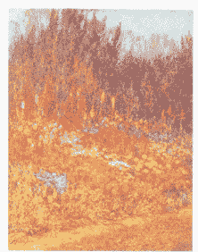

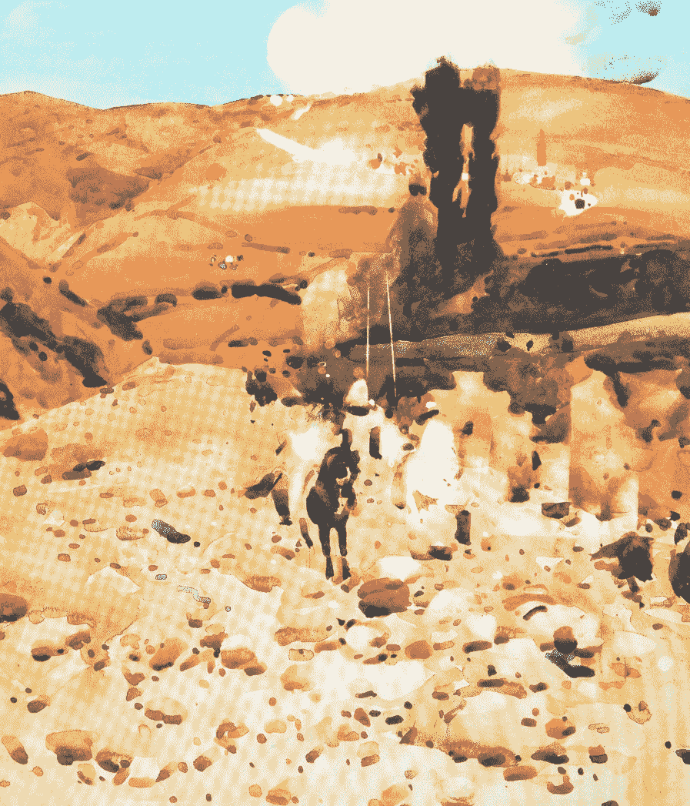

威尔士亲王殿下撰写的前言

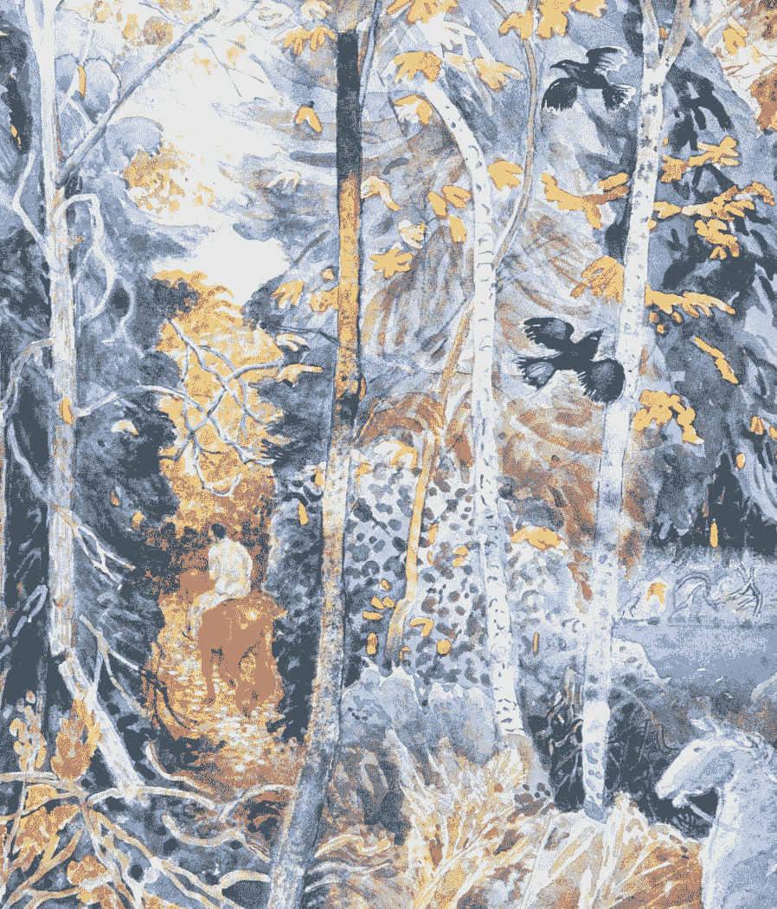

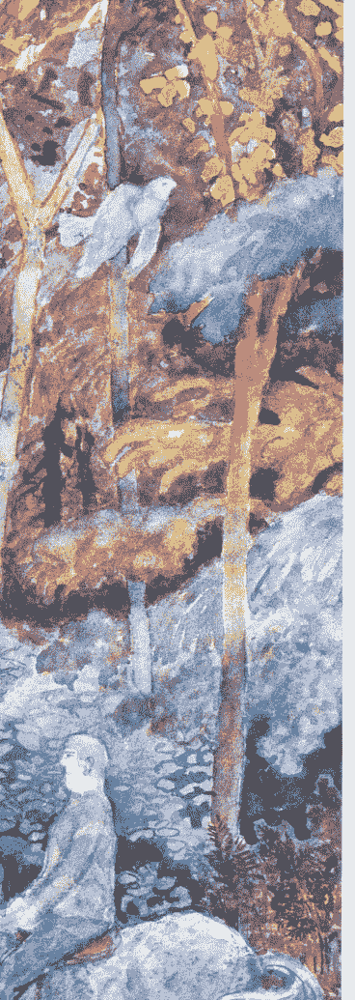

扉页：ARTHUR MELVILLE，《从焚村归来的阿拉伯人》，水彩与石墨，57.5 x 47 cm (22.75 x 18.5 in)

左页：JUNE BERRY，《森林中的骑手》，水彩，50 x 61 cm (19.5 x 24 in)

翻页：ARTHUR RACKHAM，《阿登修道院，科恩》，水彩和体彩，32 x 23 cm (12.5 x 9 in)

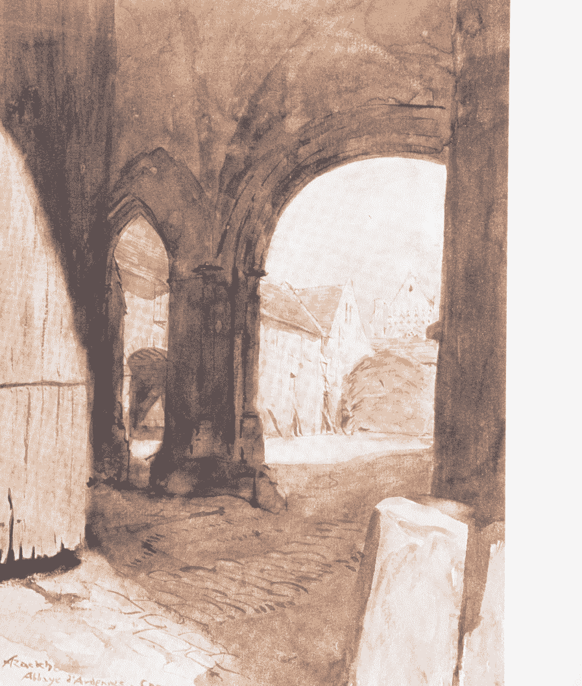

Atrankey
Allaye d'AUBENYS

## 克拉伦斯宫

水彩是最具英国特色的媒介之一；它吸引我的地方在于材料的流畅性和即时性。观看这种媒介的大师——本书中展示作品的所有艺术家都是如此——令人惊叹于一幅充满光线和动感的图像是如何以一种欺骗性的轻松感出现的。我们这些努力想用自己的方式满意地使用水彩的人都知道，那种表面上的轻松是多么具有欺骗性。我记得很清楚，当我刚开始涉足水彩世界时——大概是三十多年前了——我请了著名的诺福克画家 Ted Seago 给我上一课。“我不会教”，他说，“但我可以示范”。他确实这么做了——凭记忆，他仿佛变魔术般描绘出一幅泰晤士河驳船漂浮在河口、在戏剧性天空下的图像。正是在那一刻，我觉得自己想放弃了，因为毫无疑问，水彩是一种极其困难的媒介。

皇家水彩学会举办的首场展览于 1805 年举行；它是世界上最古老的水彩学会，在作为艺术学会的重要性上仅次于皇家艺术学院。学会两百年的历史完美地反映了该媒介卓越的历史，而本书强调了这一传统的优势。通过从学会文凭收藏的精彩档案中汲取灵感，今天的会员们强化了卓越与能力的连续性。当代艺术家谈论他们的艺术以及他们在多大程度上受到文凭收藏中作品的影响，这些个人文章为本书带来了极大的魅力与诚实，而许多关于艺术的书籍往往冷淡而分析性。

例如，书对面展示的亚瑟·拉克汉的精彩画作之所以被选中，是因为他使用色调价值的非凡方式，这是许多水彩画家使用的艺术理解要素。看到一位以其非常独特的插画风格而闻名的艺术家——RWS 文凭收藏中也有另一件精美的例子——展示他对媒介的控制力来创作这样一幅美丽的实景作品，令人着迷。

在概念艺术似乎处于媒体关注和艺术努力的最前沿、令人遗憾地以牺牲绘画和素描为代价的时代，看到技巧及其实践结合起来拥抱并推动这一美妙媒介，令人无比耳目一新。本书版税用于支持学会的慈善和教育目标似乎是合适的。对于像我这样热爱水彩艺术的人来说，这本书是真正的艺术大师创作的启示；它也强化了我作为学会荣誉会员所感受到的愉悦与特权。

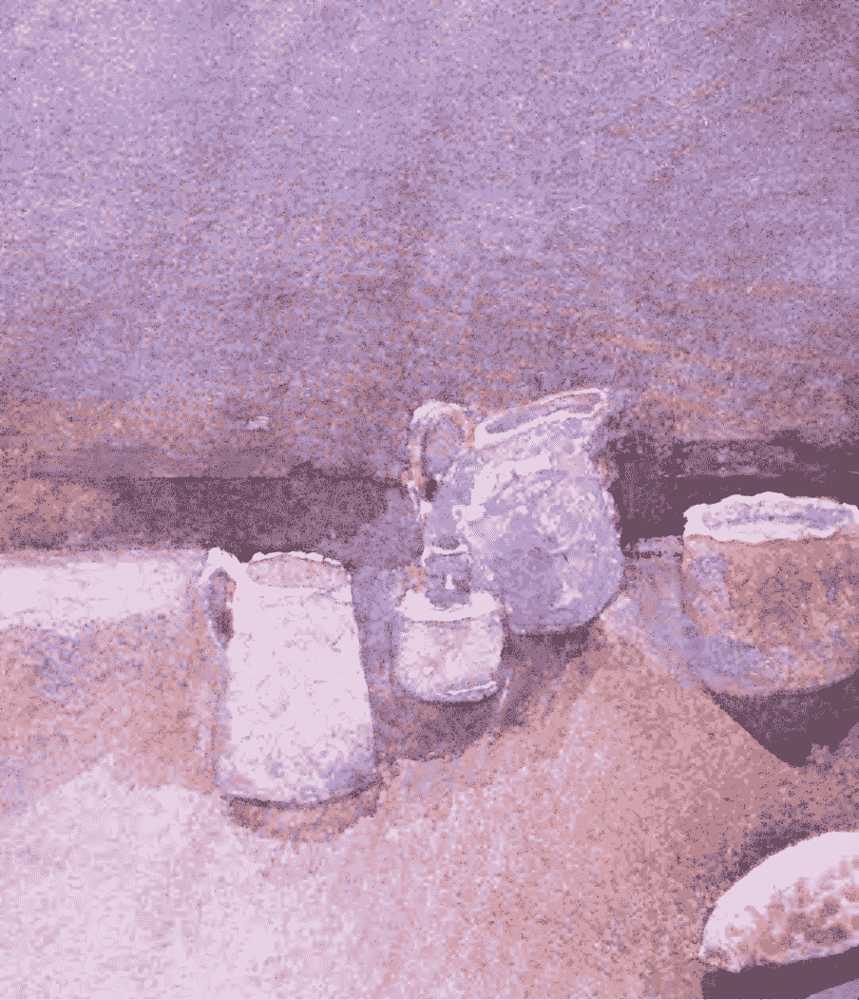

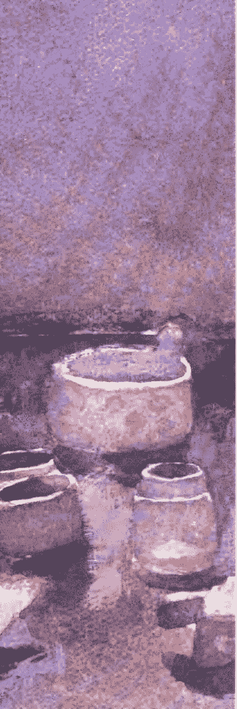

## 色彩

威廉·布莱克说，“能量是永恒的喜悦”，作为一名画家，我会补充说色彩是它的传导者。

没有哪位艺术家像我们自己的 J M W 特纳（1775–1851）那样如此娴熟、如此大胆、如此欢快、如此富有创造性地使用色彩，尤其是水彩。他的天才如此之大，以至于他公然引入了所有自古以来一直是优秀艺术基础的抽象原则。凭借他色彩的半透明辉煌，他以有色光线实现了情绪和氛围。他基本上寻求通过纯色的有力编排来实现表达，创作的图像作品不仅不是单纯的形式模仿，而且还调和了抽象与具体。

毕竟，绘画的历史就是色彩的故事。色彩的并置可以吸引我们，通常暖色调让我们充满喜悦，冷色调则能引发沉静的冥想或悲伤的思绪。这里让人想起马克·罗斯科在他自杀前不久创作的最后一组重要作品。它们色彩的黑暗强度提供了一个背景，一种隐藏在深处的神秘标志性“意象”，诗意而宁静。我们被吸引进去，试图理解他的旅程，灵魂的黑夜。

显然，艺术家们主宰着一切。色彩是一种工具，一种武器，一种舒缓剂。它的 rejuvenating 特性是一种良药，认识到这一点后，人们可以随鲍勃·迪伦说“但那时我年长得多，现在我比那时年轻”。

SONIA LAWSON RA, RWS, HON. RWA

### 安妮·威廉姆斯

CHRISTA GAA (1937–1991)：陶鸭静物

Christa Gaa 是其中一位影响了我作品并给我带来灵感的艺术家。自从看到她的画作后，我对绘画静物确实更加兴奋了。我喜欢她使用丰富的、微妙的色彩，这些色彩从她的作品中发出光芒，并在纸面上似乎毫不费力地流动。她的题材是她收集的简单日常物品，其中一些她可能有情感依恋。我知道她认为热爱题材非常重要，我也必须对眼前的事物感到一些兴奋，并享受它带来的挑战。

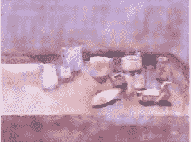

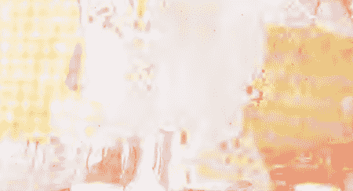

看过她的作品后，我发现自己使用了更多层的水彩水洗，并试图加强我的色彩。像 Christa Gaa 一样，我用水彩开始我的绘画，最后使用珂罗版画颜料完成。在这幅画中，她使用了大量深沉的大地色，但色调相近，我很喜欢。像她一样，我也收藏了一些小巧而亲密的物品；在我的情况下，它们大多是陶罐，已在几幅画中多次出现。

对我来说，光线的质量和方向在营造氛围方面可以发挥重要作用，阴影也成为构图的重要组成部分。Christa 常常使用来自上方的光线，这突出了她的椭圆形，而其他物体则会融化到背景中。我更喜欢光源来自侧面，因为这样可以让我更好地利用阴影的游戏。

她的作品有一种宜人的宁静感——我确实在努力追求这一点。我也很喜欢在背景和前景中使用图案，使用诸如织物或报纸之类的东西，但我必须小心不要让它变得过于繁忙。

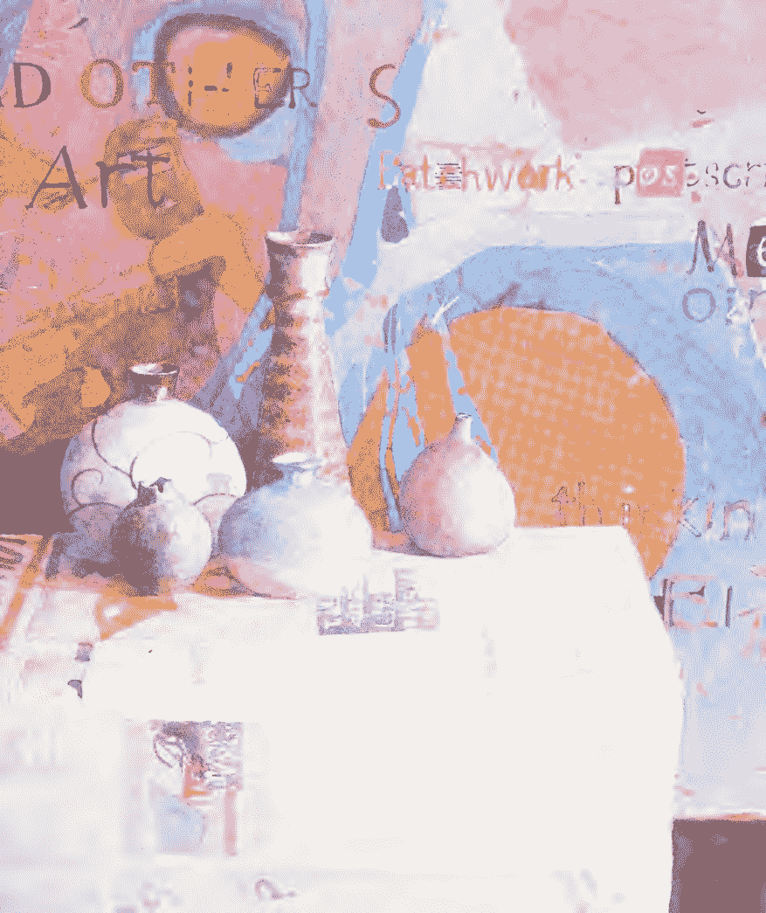

### MARY JACKSON
#### CHRISTA GAA (1937 - 1991): *陶鸭静物*

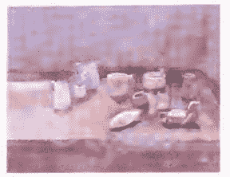

克里斯塔对绘画的热情深厚：她为静物画挑选的日常物件，在她的画布上被转化为神奇的艺术作品。克里斯塔绘画的独特性吸引我尝试谈谈她的方法并审视自己的方法。如果我能借鉴她的一招，我会成为更好的水彩画家。

克里斯塔一直在探索；她使用各种形状：方形、圆形、棱角分明、柔和、有图案，将它们编织在一起形成构图。物件的摆放总是显得自然，而负形的使用有助于布置安排。她似乎拥有奇妙的想象力和色彩感。

我一直钦佩克里斯塔的方法并想在她的风格中尝试；这些画作是大胆的初步尝试，激励我继续下去，也许改变我的方向。

色彩是她的强项：在色彩选择上，她的作品似乎表达了沉思与宁静；似乎有一种郁郁寡欢、情绪化且富有反思性的感觉。

她的色彩丰富而诱人，每幅画她都会做出不同的选择。可能是从棕色过渡到淡紫色，暖赭石到深红色，或者像这幅早期静物那样，蓝色的宁静，冷暖并用，利用反射光提升画面，并以物件边缘捕捉高光来增强。前景中深沉丰富的棕紫色桌布的质感在向桌子后方移动的阴影中得到呼应，这将整幅画联系在了一起。简洁令人叹为观止。

我向她的丈夫肯·霍华德询问了她的方法。据说，她在上午10点开始，在所有家务完成后，狗也遛完后，然后安顿下来作画，通常在一节课内完成作品，没有中断或休息，大约在晚上9点结束。光线的变化并不困扰她。

起初她轻轻勾画，然后加上水彩，随后是珂粉，最后有时用粉笔收尾；规则是可以打破的！肯有时会说：“可是克里斯，为什么不画你面前看到的东西呢？”；而克里斯的回答是：“哦肯，但我已经画了！”

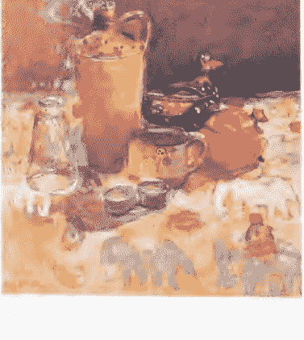

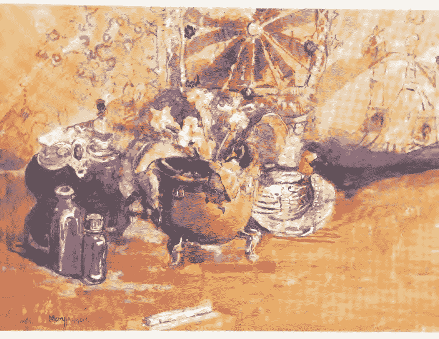

对面，左：**CHRISTA GAA**，*陶鸭静物*，水彩；41.2 x 30.5 cm (16.25 x 12 in)

对面，右：**MARY JACKSON**，*向克里斯塔致敬*，水彩；25 x 24 cm (10 x 9.5 in)

上方：**MARY JACKSON**，*日本陶罐*，水彩；24 x 25 cm (9.5 x 10 in)

### SIMON PIERSE
#### ARTHUR MELVILLE (1858-1904): 焚村归来的阿拉伯人

初次看到这幅画时，吸引我的就是其执行上非凡的新鲜感，以及梅尔维尔使用大块——几乎是色点派——的平坦色彩的方式。它看起来有点未完成，但结构完整，揭示了艺术家如何依靠坚实的绘画来支撑非常自由的技法。直到后来我才读到标题，并对其暗示的暴力感到有些震惊。我想知道这是否是艺术家亲眼目睹的事件，或许只是想象的。

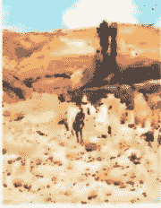

在向梅尔维尔致敬的作品中，我先铺上色彩，然后用中国白浸湿纸面——正如他经常做的那样，并在表面涂抹，试图传达沙漠光线的眩目并暗示一种运动感。梅尔维尔擅长捕捉西班牙南部或北非灼热的正午阳光，我希望将这种感觉带入我自己的中部澳大利亚和新墨西哥水彩画中。

《从电报站归来，阿利斯泉》侧面借鉴了我十多年前与妻子一起前往北领地的旅程记忆。一个下午，我们在昏昏欲睡的热浪中从阿利斯泉的历史电报站走回，沿着干涸的托德河床前行，双眼几乎紧闭以抵御刺眼的沙漠光线。那是一刻，我在穿越古老景观时感到突然的启示，感到自己比周围的岩石和树木远为短暂。这不是一幅地形画，尽管我所画的具体地点确实可以辨认。它也不是一幅可以在现场完成的画：我发现中部澳大利亚干渴的沙漠空气会在我有机会用大面积涂抹前就把我的水彩从调色板上“喝”掉。我更喜欢制作素描和拍摄照片，作为对既被感受又被看见的事物的记忆辅助。

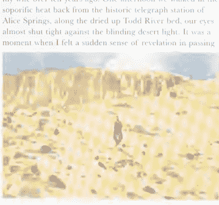

几年前在新墨西哥旅行时，我参观了一些曾启发美国艺术家乔治亚·奥基夫（1887-1986）的地点。位于奥基夫在阿比基乌家附近的白地或普拉萨·布兰卡，是一个奇异侵蚀的白色沉积岩悬崖和顶部有帽石的塔楼景观。这是一个原始之地，我在那里强烈感受到奥基夫的存在印记仍留在其上。在《乔治亚·奥基夫从白地归来》中，我想象艺术家在穿过普拉萨·布兰卡的漂白峡谷散步后，漫步回工作室作画。我的画作既是捕捉这种地方精神的尝试，也是再次尝试梅尔维尔技法的机会。我首先涂上一层中国白混合那不勒斯黄的底色。待这层略带粉质的层面干后，我在上面画石头，这导致它们的边缘略微晕开，形成一系列近乎抽象的色块，既可读作表面的痕迹，也可读作景观中的元素。

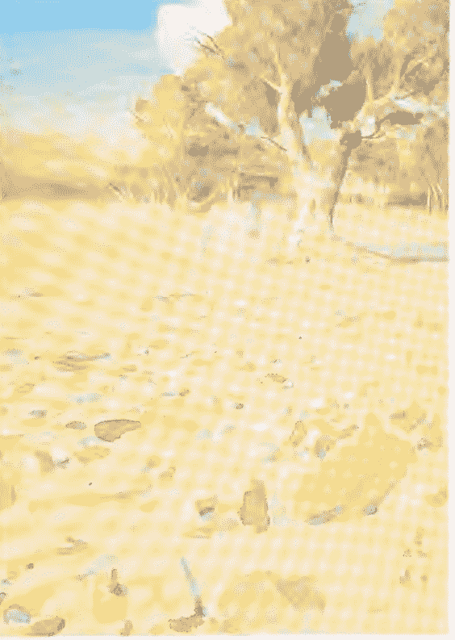

对面，左：SIMON PIERSE，乔治亚·奥基夫从白地归来，2004，水彩，51 x 71 cm (20 x 28 in)

对面，右：ARTHUR MELVILLE，焚村归来的阿拉伯人，水彩和石墨，57.5 x 47 cm (22.75 x 18.5 in)

左：SIMON PIERSE，从电报站归来，阿利斯泉，2003，水彩，71 x 51 cm (28 x 20 in)

### GREGORY ALEXANDER
#### ARTHUR MELVILLE (1858–1904): *焚村归来的阿拉伯人*

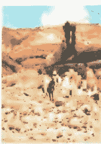

自从我在迈克尔·斯彭德的书《水彩的荣耀》中首次见到这幅画，我就喜欢上了它。其中一个精彩细节以实际尺寸复制，展示了这件作品的宽广与抽象程度。我特别喜欢中央人物的模糊性。很容易看出有骑马的人并且他们穿着白色——但很大程度上留给想象。这，我相信，是一件特别现代的作品——媒介的宽泛使用和前景中的书法式笔触都令人愉悦——而且对于那个时代来说可能相当前卫。

我自己的反应取决于我的亲身经历。凝视这幅画时，我立刻被带到了地中海干旱而多岩石的景观中。此外，马匹的暗色形状特别让我想起希腊，那里的役用驴和穿着黑衣的村庄人们在酷热中缓缓前行。我特别想抓住梅尔维尔作品中主题的模糊性，并实现媒介的类似风格应用——以其书法笔触和印象派风格。

最终我认为我的作品比我预想的更具具象性——我也想尝试一幅完全抽象的作品来回应梅尔维尔的作品。然而，我希望人们能够看出我是如何从梅尔维尔的起点抵达这幅画的。

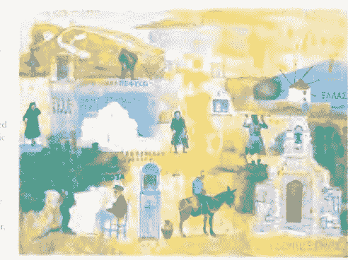

上方，左：**ARTHUR MELVILLE**，*焚村归来的阿拉伯人*，水彩和石墨，57.5 x 47 cm (22.75 x 18.5 in)

上方，右：**GREGORY ALEXANDER**，*希腊乡村生活*，2004，水彩于阿尔什纸，58 x 76cm (22.8 x 30 in)

对面：**JUNE BERRY**，*森林中的骑手*，水彩，50 x 61 cm (19.5 x 24 in)

### JUNE BERRY

#### ARTHUR MELVILLE (1858-1904): 焚村归来的阿拉伯人

我立刻被阿瑟·梅尔维尔的画作所吸引，因其色彩丰富、浓烈。仔细研究后，我发现吸引我的不仅是色彩，还有那种非常松散的绘画风格，以及那些特有的斑点状块——或是白色，或是某种强烈的深色。有些区域被海绵擦拭的程度与另一些区域被强力色彩饱和的程度相同——这种技巧被一位同时代评论家描述为‘斑驳而狂暴’，而《每日纪事报》的艺术评论家则称其由“点、模糊和颜料飞溅”组成。在我看来，与梅尔维尔所关联的格拉斯哥男孩画家群体的作品相比，这幅画具有非常现代的外观。

在巴黎学习并在中东旅行绘画数年后，梅尔维尔返回苏格兰，不久后移居伦敦。在这里，他开始发展后来成为其晚期水彩技法的技法。

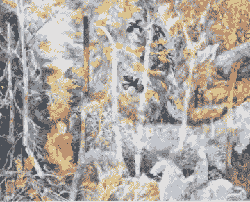

我对《焚村归来的阿拉伯人》的回应作品显然不关注题材，而是遵循梅尔维尔的技法，在非常湿润的纸上作画，利用不同的干燥阶段添加更多色彩层次，用海绵擦去不必要的细节，并将这些被擦去的区域作为构图的一部分进行 tonal 处理。

我一直习惯在工作室凭记忆作画，使用现场绘制的素描和照片参考来创作或多或少虚构的构图，因此我很感兴趣地了解到梅尔维尔在埃及和土耳其旅行期间积累了大量素描和绘画，他一直将其作为参考，用于在工作室创作的完成画作，直到他二十年后早逝前不久。有些画作是根据素描准确完成的，而另一些则是半虚构的凭记忆创作。

他在饱和的纸上作画，有时在地板上作画，伴随色彩的积聚和有力的笔触，用海绵擦去多余的细节。有时他用赭石色大面积铺满背景以确定基调，待其几乎干透时，再添加明亮的色彩斑块。他发明了一种独特的纸张准备方法，反复用中国白浸湿纸张，最后冲洗以留下特制的表面。当我尝试这种程序时，我发现它使海绵擦拭变得非常容易，留下耀眼的白色，但准备过程却很繁琐。

梅尔维尔与我一样，对象征主义者的思想感兴趣，特别是惠斯勒，以及高更所定义的他们的学说，即戏剧性和记忆最终比印象派所推崇的对‘真实’世界的观察更为重要。

回到梅尔维尔的技法，有人对我说‘你所谈论的听起来很简单’，但正如任何尝试过的人都会知道那样，在浸透水的纸上控制大块颜料是极具挑战性的，而当它成功时，也是一种令人愉快的成就。

### KAROLINA LARUSDOTTIR ROBERTS

#### ARTHUR MELVILLE (1858 - 1904): 焚村归来的阿拉伯人

当我想到皇家水彩协会以及多年来在那里看到的无数精彩作品时，其中许多作品在我心中依然鲜活，仿佛与初次见到那天一样新鲜。有些画作似乎比其他画作产生更持久的影响，这真是奇怪。

我从文凭收藏中挑选的画作是阿瑟·梅尔维尔的《焚村归来的阿拉伯人》，（1922）。我仍然记得第一次见到它时的情景。其构图的流畅性、色彩惊人的简洁以及明亮的光线使这成为一幅非常令人难忘的画作。毫不张扬，人们似乎与风景融为一体，几乎像是它的一部分。它看起来轻盈而通透，笔触看似轻易却暗藏玄机，最终汇聚成我最喜爱的画作之一。捕捉的是精髓，而非细节。人物融入景色，几乎难以辨认其为人物，但无可否认。运用水彩的大胆与简洁增强了画作的效果。

关于风景，我们从所提供的信息以及细节的缺失中同样能理解许多——地面的炎热、干燥的空气、正午的阳光、缺乏遮蔽以及距离与空间感。在干燥的岩石中，有一小片绿色，本应带来宁静与清新的感觉，但随后我们意识到这是正在遭受攻击的区域，我们能感受到村民的孤立。

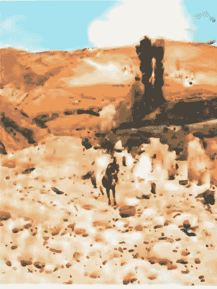

画作的模糊性很有吸引力。我被给予了一定量的信息，但我的心智和想象也必须发挥作用来得出自己的结论。梅尔维尔的画作与我自己的最明显共同点当然是人物置于风景中的题材。这一直是我感兴趣的主题，或许成长于冰岛使这一点易于理解。作为冰岛人，风景无处不在。冰岛生活的方方面面都受到土地和极端天气条件的影响。

两幅画中的人物与风景有着非常特殊的关系。他们理解它，与它生活在其中、之上、并依赖于它，同时也理解它的危险。

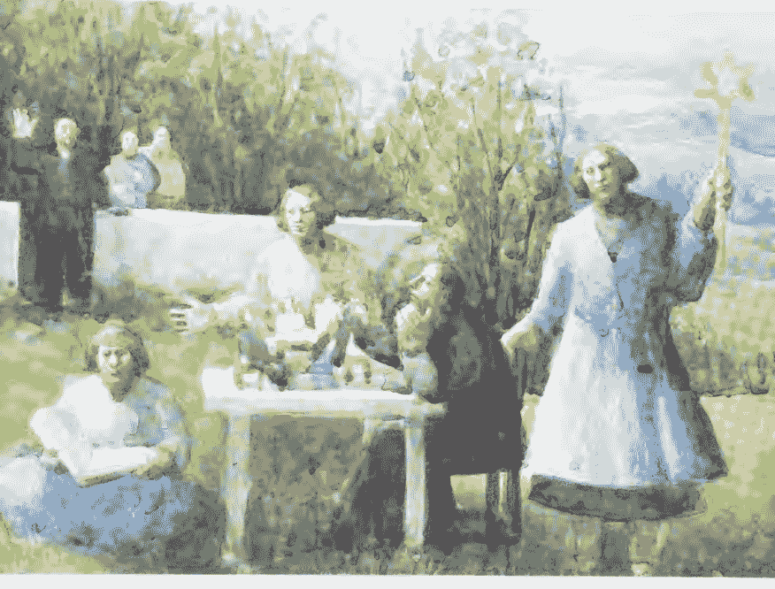

### TOM COATES

#### JOHN SINGER SARGENT (1856–1925): *冰川激流之床*

必须说，皇家水彩协会收藏中的约翰·辛格·塞尔福里奇并非我们所钦佩的艺术家最伟大的画作。他曾形容自己的作品不过是快照，但他说得有些轻率；这也告诉我们，那位总是被要求为其画像的谦逊男子的性格。塞尔福里奇多样的水彩收藏充分展现了他的技巧，以相反的方式使用暖色和冷色。当人们用冷色表现阴影时，他却用暖色或混合色来欺骗我们，将色彩融合在一起，用纯净、未经稀释的彩虹光谱的纯度来抵消明亮。

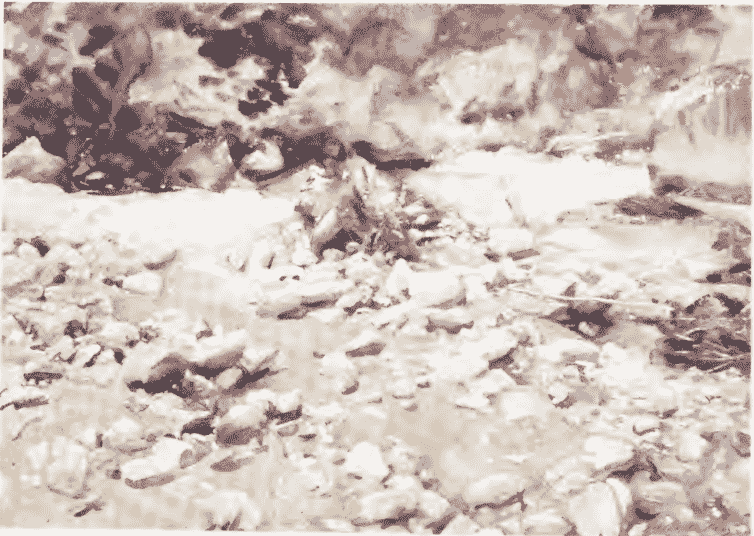

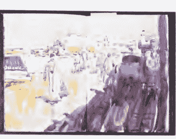

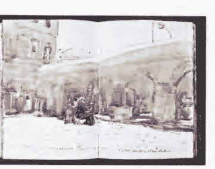

摆脱了肖像画的束缚，广泛的题材展现了塞尔福里奇作为集大成者的风采，正如他在帝国战争博物馆的水彩收藏所示。它们都展现了他运用快速、松散笔触的才华。

许多作家、诗人以及最受尊敬的赞助人都引用过塞尔福里奇的话。正如埃文·查特里斯在1927年所写：‘与塞尔福里奇的水彩为伴，就是与被捕获并以明亮可读世界的光泽保存的阳光为伴，拥有灿烂的阴影和正午的周围炽热’。

塞尔福里奇与朋友们进行的无数次旅行是我们共同之处。素描本页面展示了玛丽·杰克逊，她总是以温暖和慷慨吸引孩子们围绕在她身边。这是在摩洛哥之旅期间完成的，多彩的背景赋予了戏剧性的布景效果。

摩洛哥素描本的另一页显示了对主题的快速攻击，运用快速、松散的笔触，阴影爆炸成深棕色并混合蓝色。

成为画家需要一生的练习，但用塞尔福里奇的才华攻击主题只需短暂的时间。模仿他是危险的，但他帮助我们享受水彩媒介的探索。被另一种技巧所兴奋只能属于经验丰富的实践者；无论他是油画家，甚至是雕塑家。

你找不到水彩，水彩找到你；它用于增强素描本页面，但它是一种美妙的个人媒介，能找到艺术家的长处和弱点。

### CLAIRE DALBY

#### WILLIAM HENRY HUNT (1790-1864): 玻璃杯与玫瑰及其他花卉和知更鸟巢

我唯一一次在脚边找到可以取走的鸟巢是在几年前苏格兰一座城市的停车场，离任何树木都有好几码远。自然地，我把它捡了起来。然而，在欣赏其构造后，我没有用鹅卵石或巧克力蛋填满它（不出所料，它是空的）并作画，而是把它给了朋友。

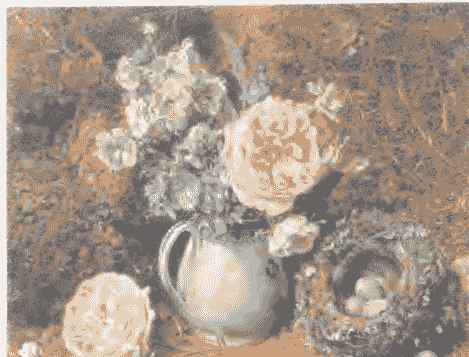

> 威廉·亨利·亨特以其描绘鸟巢的精美静物画而闻名。在这幅画中，光线从左侧轻轻滤下；没有刺眼的高光或阴影分散色彩和纹理的注意力。

鸟巢特别吸引我。它倾斜以显示内衬丝状毛发与外部柔软苔藓般绒毛之间的对比。它装饰着地衣碎片，其微妙的色彩与内部的蛋相同，也与花瓶和白花的阴影相同。实际描绘的细节恰到好处：眼睛和心智将未定义的区域填补为苔藓和绒毛。

印在喜爱的旧印度布上，取代了亨特非正式的土壤表面。日光来自北向窗户：

我最初的兴趣在于葡萄的个性与碗的几何规律性之间的对比，在于水果的半透明和柔和、带粉的闪光与瓷器的硬亮之间。

我的静物画在冬季末期完成，我决定集中于鸟巢作为容器的概念。我的‘巢’是一个人造碗，取而代之的是苔藓，它周围环绕着一串植物图案‘编织’而成。相当丰富的‘蛋’由一串葡萄提供，而‘花’是

我另一个主要兴趣在于‘绿色葡萄’的所有色彩（从粉红色和蓝色的高光到接近红色的阴影）。为了探索其多样性，我选择了高视角（而不是倾斜‘巢’），并使布料和背景保持低调。

上方：WILLIAM HENRY HUNT, 玻璃杯与玫瑰及其他花卉和知更鸟巢, 水彩和体色, 23.2 × 28.4 cm (9.2 × 11.3 in)

对面：CLAIRE DALBY, 无籽葡萄, 1988, 水彩和体色在调色纸上, 24 × 23 cm (9.5 × 9.1 in)

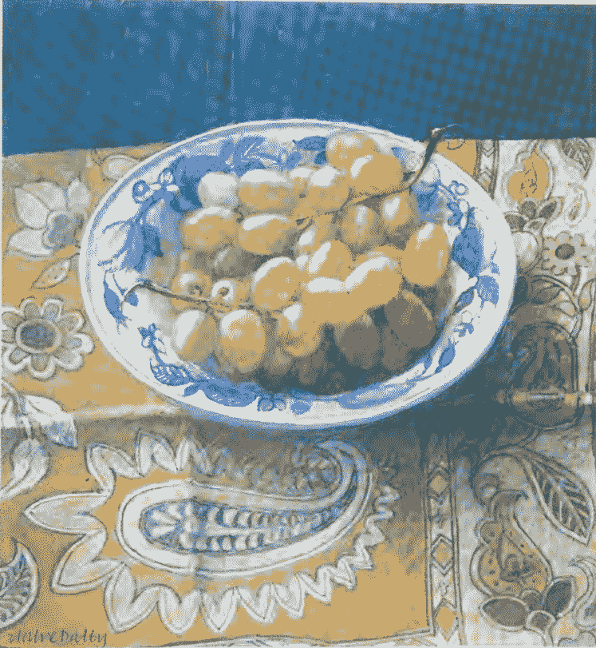

### CATHERINE DUCKER
WILLIAM HENRY HUNT (1790–1864)：*带玫瑰及其他花卉和云雀巢的花瓶*

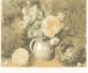

这幅亨特的作品立刻给我一种由热爱自然的人创作的感觉；尽管它是在工作室中绘制的，但鸟巢和花朵却置于自然背景之下。这很不寻常，也是我喜欢的一个元素。艺术家选择了一个我非常感兴趣的题材：自然的脆弱性以及自然作为提供者的美丽。

自然既以卵提供生命，也以花朵提供美丽。艺术家精美地描绘了一组园艺花卉，它们带有一种野性，其中一朵玫瑰置于花瓶之外。就像花朵一样，在鸟巢中有一个蛋被打破，还有一个蛋躺在巢外。

这幅画在所选物体和构图上都美得令人感动。尽管我的作品看起来更简约，但我所选择的色彩和笔触对我而言具有同样的意义：它们对于表现我对土地的热爱以及我与景观元素之间的联系至关重要。亨特的画作清晰简洁。题材很繁忙，然而你的眼睛仍能看到整体概念的简洁性。

我的绘画是对我在景观中经历的自发回应。兴奋的时刻，与自然建立联系的时刻，来自于我在工作室中安静不受打扰地工作所获得的体验的抽象色彩。

近期的作品受到了前往非洲旅行的启发，在那里我遇到了与大海为伴的奇妙的人们。其他画作则源于在家度过的一个冬季骑马的时光，通过马匹与土地建立联系。

目前我种植大量有机食品出售。每天围绕在土壤周围，目睹那些滋养我们、给予我们生存燃料的非常美丽的植物生长，这激励着我，并以不受控制的方式通过我的绘画表现出来。

我一直种植很多花，有时它们会出现在我的艺术作品中；它们以其芬芳和低调的存在为我们的家带来极大的愉悦，以至于当灵感来临时，我想描绘它们的美丽。

我只有在感到快乐时才会作画。这并不意味着画完时我仍然快乐，也不意味着我想每天都作画。我经历了许多情绪，但我必须感到与自己所做的事情相连。我觉得自己还有一生的绘画之路要走，而这只是旅程的开始。

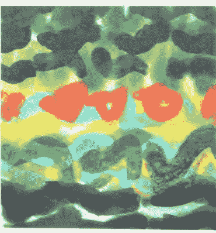

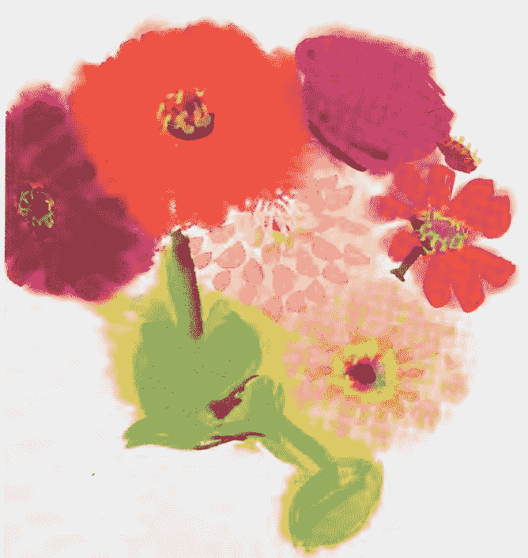

对面，左：WILLIAM HENRY HUNT，《带玫瑰及其他花卉和云雀巢的花瓶》，水彩和粉彩，23.2 × 28.4 cm (9.2 × 11.3 in)

对面，右：CATHERINE DUCKER，《河畔骑行》，水彩，40 × 60 cm (15.7 × 23.6 in)

上方：CATHERINE DUCKER，《百日草》，水彩 60 × 40 cm (23.6 × 15.7 in)

### DAVID WHITAKER
#### ALFRED WILLIAM HUNT (1830–1896)：威尔士洪水

Alfred William Hunt 的 *威尔士洪水* 对我来说是一项真正的发现。潮湿的土地呈现出绿褐色——被上方的厚重灰云和下方的激荡水流所挤压——表达了自然不可控制的力量。在天空中央偏低处，太阳隐约出现于最厚重的云层之后，而在远处右侧，牛群正在吃草。它们以及它们之外的村庄，在河流从右向左疾驰的浪潮中几乎不为人注意。在前景中，湍急的水流撞上某个无法辨认的物体，似乎在抵抗强劲的冲击。就我看来，我作品与之的联系在于构图的动态性：一种力量对另一种力量的推拉。

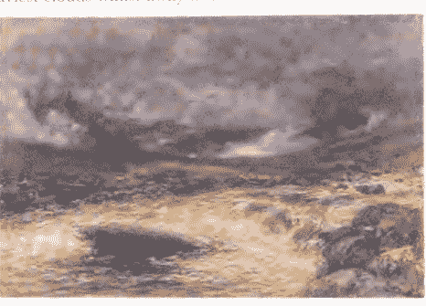

我觉得这幅画一定映射了亨特生命中某种危机，这使得题材更显感人。我试图做类似的事情：我经常创作与我当前感受以及源自过去经验的感受相匹配的图像。有时我会从想象中创造图像，这可能预示着即将发生的事情。其他时候，我会转录某件特定艺术作品的形象。如果我根据 *威尔士洪水* 作画，我的色彩将是三间色，伴有少量次级色和原色在风暴搅动一切时努力存活。

我的调色板由七种颜色组成。我使用两种黄色——一种冷色，一种暖色——镉红、洋红、翠绿和两种蓝色——一种偏红，一种偏绿。用这些颜色我可以表达自然现象的无穷可能。

亨特在这幅画中使用了黑色，而我很少使用这种颜色，因为它对其他颜色有如此令人沮丧的影响。然而，题材会形成自己的过程，如果我想要作出回应性的类似绘画，我可能会重新引入黑色作为必不可少的元素。

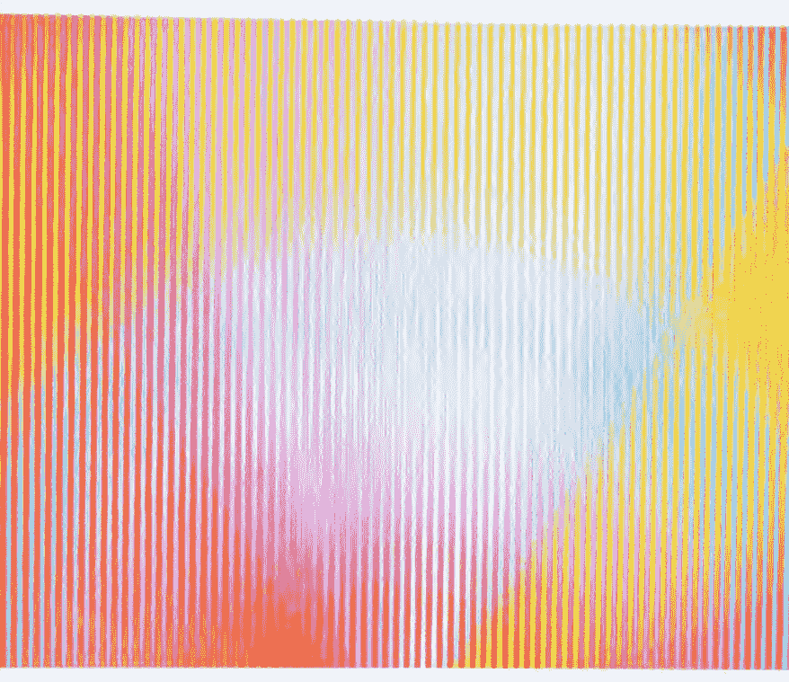

### ANTHONY EYTON
#### ALFRED WILLIAM HUNT (1830-1896)：威尔士洪水

我的画是一幅从树林中涌出的小威尔士瀑布，其轻盈和力量被周围的黑色岩石衬托出来。开始时，太阳高照。天气转为多云，因此动态发生了变化，画面变得更加严肃。

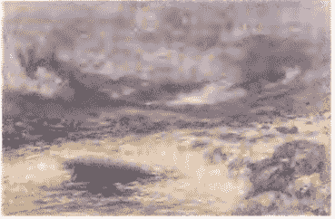

直到最近我才接触到 Alfred William Hunt 的作品。题材也是流动的水。它名为 *威尔士洪水*，创作于1870年，描绘的是开阔的乡村，强调水的湍流，岩石被绘制得极其细致，整个场景充满了强烈的天气和氛围感。亨特是 Ruskin 的朋友，也是透纳和 David Cox 的崇拜者。

我认为我们常常可以从气质相反的艺术家身上获得安慰，甚至享受他们的作品。在亨特的案例中，他相反的特质是他对特定题材的集中和专注以及对细节的关注。共同点是，我们都坚持写实，即题材或对表象的真实性起决定作用。空间、天气和光线方面也有共同之处。

在1870年代，空气中充满活力，透纳的榜样促使人们对媒介进行大量实验。亨特也不例外。在 *威尔士洪水* 中，他采用了刮除、刻划、海绵擦拭和其他活跃的处理方式。这幅画的大部分应该是在户外完成的，但我怀疑他最终在工作室完成了它，尽管他主要想重温那种体验。

亨特的工作方法已被他的女儿 Violet 形象地描述过。“他每天至少做两次写生，一次在晨光中，一次在傍晚题材。早晚又被细分，因为他经常把早晨的速写放在一边，在中午为新的‘效果’作画。”我能认同这种对新题材或光线变化的适应，但我会补充说，这种方法可能意味着每幅画都成为一项长期工程，并且每天都需要‘重新进入’。

Violet 继续说，“我父亲的手工灵巧足以令人惊叹。凭借那双修长、神经质、像鸟一样的指尖，他能在任何方向上将画笔推进或停止在极其微小的范围内，并‘放置’一抹色彩，有时像锤子一样有力，有时像鸟翼一样轻盈。”

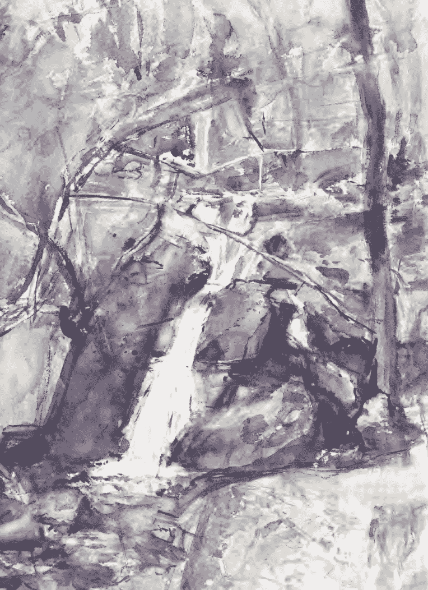

### TREVOR FRANKLAND
#### JOSEPH EDWARD SOUTHALL (1861–1944)：康沃尔港

我被这幅画吸引，不仅仅因为它强有力的构图，也因为其题材。帆船可能从海外归来的形象对我而言与过去的时光和重访的“大旅行”有着强烈的关联。十八世纪大陆对英国艺术和建筑的影响是广泛的。

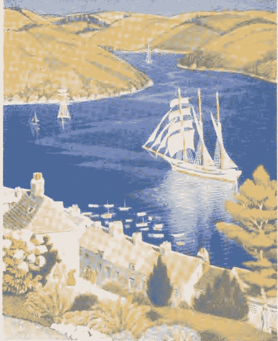

*左：**JOSEPH EDWARD SOUTHALL**。《康沃尔港》，水彩，30.3 × 24.3 cm (12 × 9.6 in)*

*对面：**TREVOR FRANKLAND**。《重访大旅行》，2005年。水彩、丙烯和碳素铅笔，56 × 82 cm (22 × 32.2 in)*

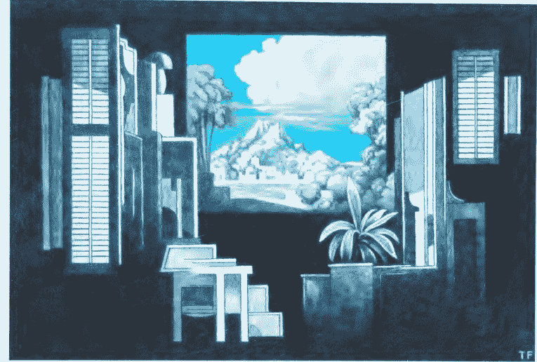

The Grand Tour played an important role in this context by helping to introduce major changes in the works created by artists as well as architects. If the buildings of Andrea Palladio had a major influence on English architects, then the French artist Claude Lorrain certainly had a major influence on English landscape painter J M W Turner, whose early ambition was to emulate this French artist.

My painting is a combination of an invented classical Italian landscape with semi-abstract architectural shapes so as to emphasise the link between the past and present. The ideas that generally govern the way I work can be best described as being based on the persistence of the past in the present, a combination of inner and outer worlds.

Appropriate forms have to be found for what are elusive images and I find that collage is an ideal way to give substance to them. Formal structures require descriptive detail, so the images I create are a combination of geometrical or architectural forms with objects, whole or fragmented to provide detail.

I also scan assembled fragments into a printer so that I can use the same images in a different context. The variety of compositions I then create gives me a better chance of giving pictorial form to my ideas which, to achieve the results I am seeking, sometimes require an element of ambiguity. A composition drawing is made from the chosen image to which I add colour. The final watercolour is based on this drawing using a limited palette and a heavyweight Waterford paper.

### ANN WEGMÜLLER
#### JOSEPH EDWARD SOUTHHALL (1861-1944): *A Cornish Haven*

When I first saw the painting *A Cornish Haven*, I liked it immediately but it took me some time to work out why. At first it reminded me of places I knew, of summer activities, walking along coastal roads, looking at boats and the hills beyond. A few weeks later I had a second look at his painting and realised that what attracted me was what always attracts me to the work of others: the colours. In the case of Southall’s painting it was the warm, light colours of the land, and the dark, cool colours of the sea.

As a direct response to this, my first painting was about the warm, colourful rocks beside the beach, boats to look at and one *Sailing Out*. The closer you get to the water, though, the cooler the colour temperature becomes.

In the second painting, I took this warm/cool theme further, introducing the *Shore Road* with houses in the sun, gardens and pathways. The houses are looking out to the warm hills and the dark sea. The boats are not so important in this painting and are only suggested. The subject matter has changed in my painting. It is about the land at the water’s edge. As it is a warm painting, I laid down a wash of yellow-ochre and built the painting up from there: the dark ultramarine of the sea acted as a counterpoint.

My third painting cools down the summer atmosphere and brings to it a different time of year and a different mood. It is a different place entirely. The two shapes of houses represent the human element. The boats have gone, leaving the marks of an empty pier on the bottom right-hand corner. The blues are warmer here and the sand pink. The sea is a darker, colder blue, broken up by landmasses and rocks nearer the shore. There is only a small passage from the open sea to this haven.

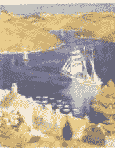

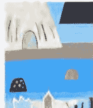

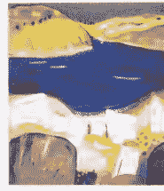

My painting is about the might of the sea and the small signs of human activity near the shore. The houses and the people in them are *Looking Out To Sea*.

The mood of the painting is dictated by the dark ultramarine taken over the whole paper, with as little as possible of a cobalt blue added nearer the houses. The subject has changed again from Southall’s original work of a pleasant summer sea to a colder bleaker view of the sea by the people who live from it.

*Above, left: JOSEPH EDWARD SOUTHHALL, A Cornish Haven, watercolour, 30.3 x 24.3 cm (12 x 9.6 in)*

*Above, centre: ANN WEGMÜLLER, Looking Out To Sea, gouache, 75 x 55 cm (29.5 x 21.5 in)*

*Above, right: ANN WEGMÜLLER, Shore Road, gouache, 55 x 49 cm (21.5 x 19 in)*

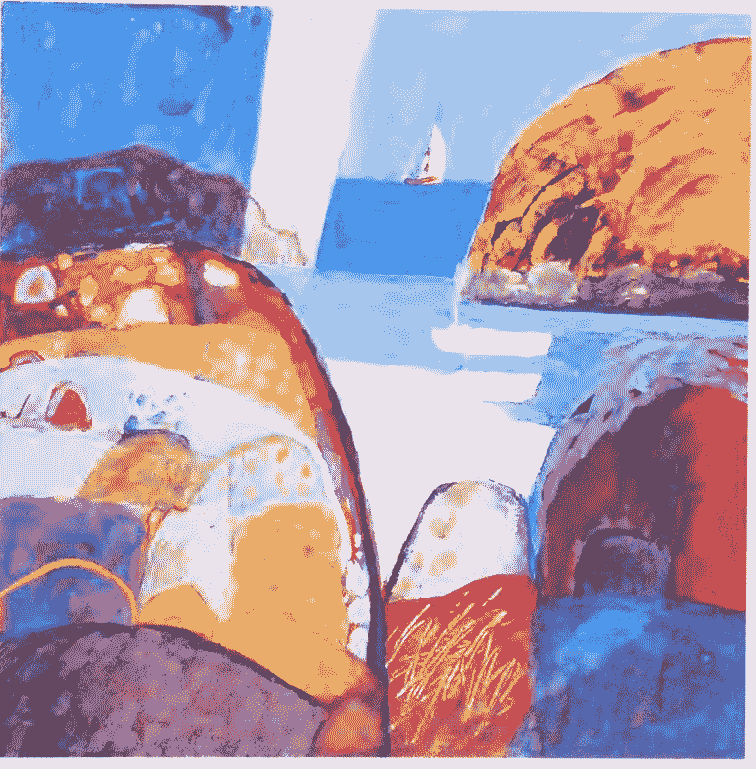

Above: ANN WEGMÜLLER, Sailing Out, gouache, 40 x 36 cm (16 x 14 in)

### JANET GOLPHIN
#### HELEN ALLINGHAM (1848–1926): *A Bit of Autumn Border*

The rich, warm glow of colour captivates and enthralls the viewer. The colour of the flower border by twilight becomes the overriding element in an otherwise simple composition. There is no need for detail. It is a sight universally recognized and the familiarity already registered within the memory enables the viewer to complete the picture.

At first glimpse, *A Bit of Autumn Border* has the impression of a beautiful embroidered piece of fabric placed over other layers. Looking at the painting upside down or sideways on, the abstract qualities work together beautifully; the distant trees could be foliage at a waters edge. The actual subject is immaterial; it is how we interpret the basic composition and how colour captures our attention and feeds the senses with bewitched, glowing warmth.

*Amaryllis with Wall Hanging* demonstrates a similar simplicity of composition with no beginning or end, but an illusion of an ongoing scene beyond the picture’s edges. Areas of the painting are unfinished and detail is missing. There are vertical, horizontal and slightly diagonal lines, which again work in every direction.

The darkest areas in my painting emulate the darkened foliage in Allingham’s work in as much as they enhance the abundance of colour bringing it forward. Though gold-leaf has been used, it is subdued with washes of watery paint projecting rich colour forward and an illusionary understanding of an embroidered wall-hanging.

In essence, the black and contrasting gold amongst the overall intense colour produces a three-dimensional vision, devoid of any necessity for detail, which again is completed by the viewer’s own memory of similarity filling in the gaps. Multiple layers of richly coloured paint intensify the depth of colour, enhanced by other elements.

Both paintings are uplifting and that is the correlation between the two; the difference in subject is immaterial. The female sensuality in both paintings reflects the attitudes towards sensuality within the two ages.

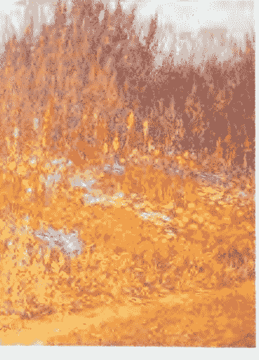

Above: HELEN ALLINGHAM, *A Bit of Autumn Border*, watercolour and bodycolour, 20.5 x 15.3 cm (8.1 x 6.1 in)

Opposite: JANET GOLPHIN, *Amaryllis with Wall Hanging*, 2005, mixed media, 81 x 91 cm (32 x 36 in)

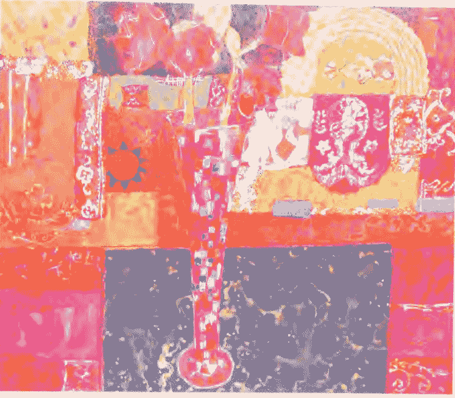

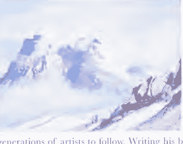

### ISLA HACKNEY
#### CECIL ARTHUR HUNT (1873–1965): Dents des Bouquetins, Arolla

> *For consider, first, the difference produced in the whole tone of landscape colour by the introductions of purple, violet, and deep ultramarine blue, which we owe to mountains.*
> (John Ruskin)

Since JMW Turner’s journey through the Alps to Italy in 1819, mountainous landscapes with remote and misted peaks and other typically ‘sublime’ subjects had become a source of inspiration for generations of artists to follow. Writing his book *Modern Painters* in defence of Turner’s greatness, John Ruskin’s thoughts on the role of colour in landscape are still of interest today. Referring to mountains, he says:

> *'Large unbroken spaces of pure violet and purple are introduced in their distances; and even near, by films of cloud passing over the darkness of vacuies or forests, blues are produced of the most subtle tenderness.'* (Ruskin, *Modern Painters*, Vol. IV, 1856)

When I look at Cecil Arthur Hunt’s awe-inspiring scene of Alpine peaks I find that my eye is drawn into its pools of pure, vibrant blue. Hunt’s bold washes of colour at the centre of his composition invite us to share with him a sensation of physical and spiritual oneness with the natural world. This is not simply an attractive depiction of mountainous terrain; it is an imaginative interpretation of natural phenomena.

Hunt sought to align himself with nature’s underlying forces, reminding us of both the timeless and transient aspects of nature. Tracking the changeable weather conditions, his travellers stand tremulous at the edge of a glacier.

Intense sunlight strikes the mountains as an aqueous mist encircles them, and great swathes of grey-blue cloud fill the valley. As onlookers also, our own focus shifts as the artist deftly brushes in areas of translucent colour, allowing it to merge with broader washes of more opaque bodycolour while Chinese white is used to reassert the monumental form of the snow-covered slopes.

Like Hunt, I hope to involve the viewer in the immensity of the scene, recalling also the construction of the image as pigment on paper. Taking the Scottish mountains and glens as my inspiration, I work with freely applied colour. I began *Melting Snow* with spontaneous, random mark-making. The painting’s central motif seems to hover in front of its surroundings – a space or void awaiting a subject – while vigorously brushed colours set up an endless oscillation between fragmentary detail and the unified whole. Blue and purple shadows and bright white traces in the snow pick out the mountain ridge as the elements threaten to envelop it.

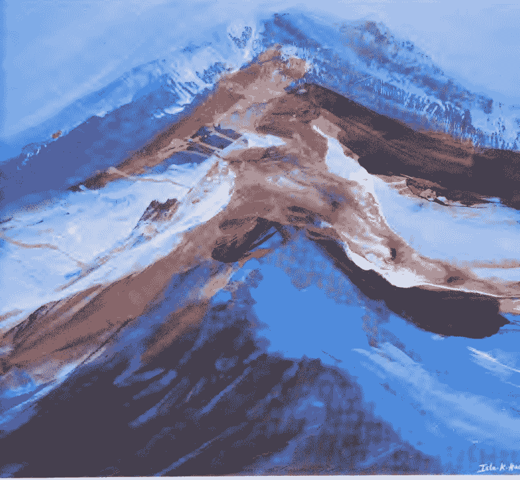

### PAUL NEWLAND
FRANCIS OLIVER FINCH (1802–1862): Ruins of an Ancient City

‘Of course, he’d have seemed very conservative even then!’ said the archivist when I went in search of material on Francis Oliver Finch in the Society’s archive.

I had first caught sight of this picture (the first I had ever seen by Finch) on the cover of a catalogue for a show of works from the Diploma Collection held in 1987 (two years before I became an Associate). The image seemed enigmatic, wistful and completely intriguing. It was as if last respects were being paid to those European artists of the seventeenth century (Claude, Poussin et al.) who had had so profound an effect on the way the English manipulated the landscape of their country. Estates had been designed, gardens gardened and, most enduringly perhaps, England and Wales recorded under their influence. But no more...

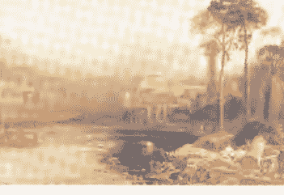

I started to paint this transcription from the reproduction, but when I went to draw from the original I found that the view was more extensive and the colour far cooler, more northern in fact, than in the reproduction. I also found that although the theme was so congenial to me, pictorial elements on the right side were not. I decided to transplant into the composition a little piece of landscape in Umbria, which I had once known quite well—my own little recollection of ‘the south’—to complement the picture’s theme. It also seemed important to make the gesture, at least, of adjusting the colour—into a sort of ‘Finchian’ key. The result is a bit of a patchwork of ideas, which requires a good deal of adjustment to bring about unity: a unity not yet achieved. Many parts of the picture are still quite thin wash, but others are more dense, with gouache being introduced.

Above: **FRANCIS OLIVER FINCH**, Ruins of an Ancient City, watercolour, 55.3 x 75.5 cm (21.8 x 29.7 in)

Opposite: **PAUL NEWLAND**, Regarding the Ruins, 2003-4, watercolour and gouache, 51 x 61 cm (20 x 24 in), with preparatory sketches below

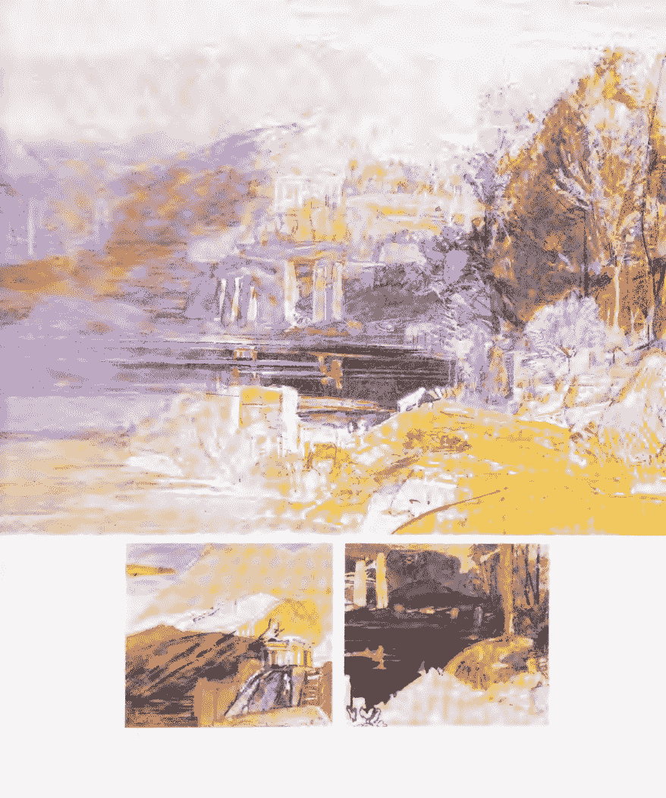

### NEIL PITTAWAY
FRANCIS OLIVER FINCH (1802-1862): *Ruins of an Ancient City*

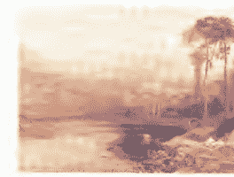

My ideas are often inspired by historical narrative subjects from the eighteenth, nineteenth and early twentieth centuries, so that the inspiration to produce new works based on the RWS painting collection was a natural progression. I particularly like the idea of borrowing visually from the past and letting the subject evolve gradually to form a modern and stimulating concept for the spectator.

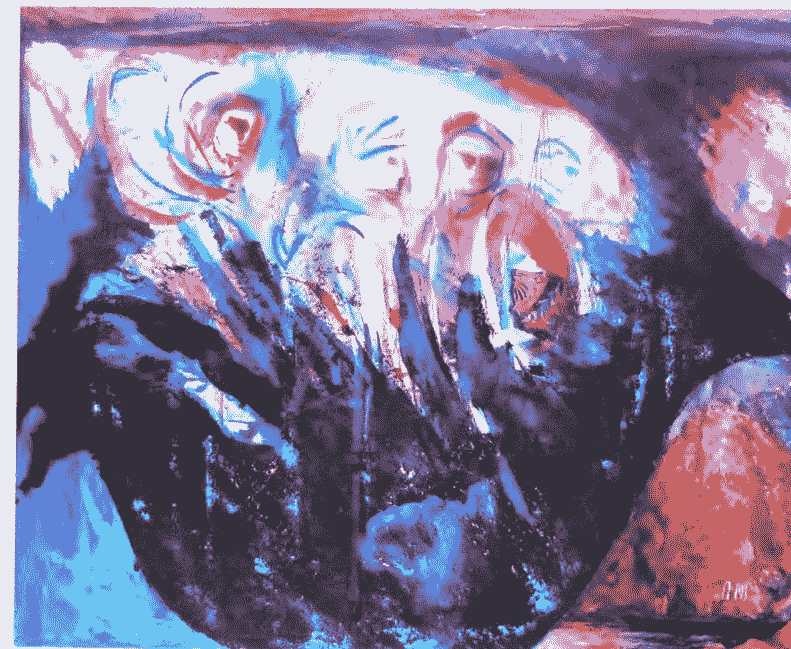

The transcription method of working is a bit like piecing together a large jigsaw. First, one researches and observes closely the chosen painting, observing every aspect of the work, both theoretical and practical, drawing out the essence of what the artist was trying to say, then reinterpreting it to create a totally refreshing vision, that is very much in the present day. This is what I have tried to do with my interpretation of Francis Oliver Finch's painting. By transporting it into an imaginative world that is real and unreal, old and new flow in parallel worlds to create a space that is devoid of real time. The subjects are strong and full of emotion but distant as if a third party that is not present is working out the missing elements.

God-like figures that represent images from Greek mythology fall heavily over a fragile modern age. The modern age and globalization are inextricably linked to a bygone age of a classical empire, now in ruins. The ideal of romanticism in the classical landscape of Oliver Finch remains to be enjoyed and celebrated to this day.

The strength and application of colour determines the tempo of the picture and creates a backbone that supports and defines its character. Colour also expresses the general overall mood of the picture. The glazing methods I use highlight this further and create an image that is complex both technically and conceptually.

In my transcription, called *Changing Worlds*, I have used colour to bind parallel concepts together to form a world that is enlivened and rich. I have chosen rich Turner-esque colours for the classical landscape based directly on Francis Oliver Finch's work.

I use colour symbolically to represent a golden age, a world that is no longer real, but exists in the imagination of the human spirit and mind. Through using colour that is clean and machine-like I create another rich but far removed world, a world of new enlightenment, of globalization and scientific exploration.

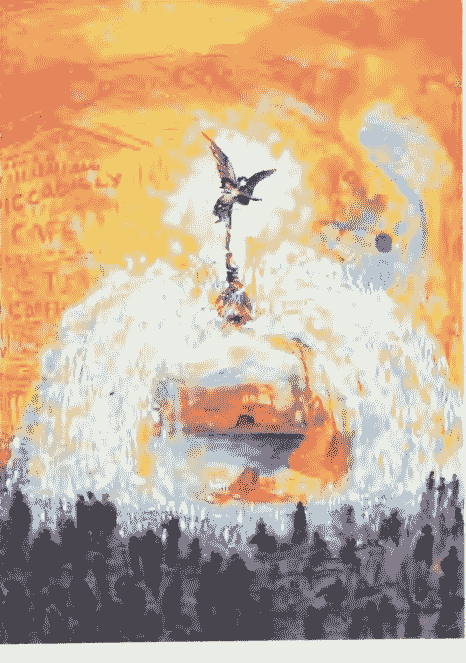

Opposite, above: **FRANCIS OLIVER FINCH**, *Ruins of an Ancient City*, watercolour, 55.3 x 75.5 cm (21.8 x 29.7 in)
Opposite, below: **NEIL PITTAWAY**, *Changing Worlds*, 2004, watercolour and bodycolour, 57 x 76 cm (22.5 x 30 in)
Left: **NEIL PITTAWAY**, *City Audience*, 2004, watercolour and bodycolour, 76 x 57 cm (30 x 22.5 in)

## COMPOSITION

When I began my career as a teacher, I wanted to be the greatest art teacher in the world. But I soon realized that there were gifted pupils in all of my classes, but the majority were not, and needed much guidance. Despite the fact that I was teaching drawing (a dirty word in the 1960s) and they were making good progress, many were simply impoverished in the complex activity of painting. One afternoon a more gifted pupil asked me 'for a piece of paper to plan her painting'. I watched her make several small drawings in pencil on her paper, try different colours, and, as I watched her, I realised she was composing her painting before she began it. This was a eureka moment! And so it was that I began to educate pupils in composition: through the introduction of sketchbooks and the myriad of processes that artists use to compose their paintings. The advancement in all pupils' work was enormous.

Composition deals with the whole painting, synthesizing its many components: line, tone, texture, shape, and colour. It is the bringing together in a harmonious - or jarring - whole all the parts of a painting. It's a complex task, unique to each artist. There are many processes involved, such as planning, investigating, and researching. Tools such as sketchbooks, viewfinders, models, photographs are all important in helping painters compose their paintings, and both figurative and abstract painters are concerned with composition.

So, how do I compose my own paintings? I'm afraid I don't know. Like many professional artists I never think about it now. I just sit down and paint, what is before me, and what's in my head. I never make a plan. But, presumably, I can only do this because of the early training I described above. Nevertheless, there are mysteries in composing. Several people have commented on the high point of view in my paintings of large land and seascapes. Strange this, because I'm only five foot four inches tall, and yet whenever I sit and paint these scenes it is from at least a twelve-foot-high point of view. So I think I'm painting what's before me, when all the time I'm painting what I can't see, from above me. How do I do it? I simply don't know. As Matisse said, 'the best things in paintings can never be explained.'

DAVID FIRMSTONE MBE

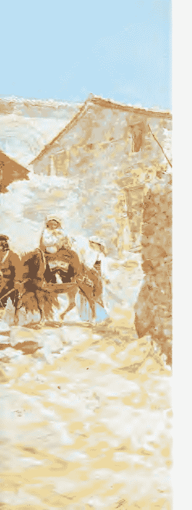

Left: **ALFRED DOWNING FRIPP**, *San Rocca Oliveana* (detail), bodycolour and watercolour over graphite on grey paper, 39 x 53.5 cm (15.4 x 21.1 in)

### CHARLES BARTLETT
**ROLAND VIVIAN PITCHFORTH** (1895-1982): *Kent Marshes*

I did not know Pitchforth very well but met him several times and admired his sensitive views on art. We also shared a love of similar types of natural landscape. Pitchforth’s painting *Kent Marshes* is typical of many of his watercolour and oils. It is the flat landscape in many ways similar to some of the landscapes of East Anglia. But whereas his paintings – particularly watercolours – were often atmospheric and fluid,

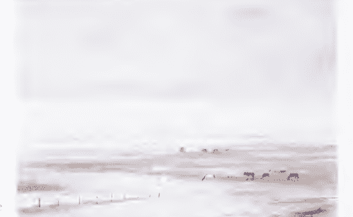

I tend to treat similar landscapes in a more geometric manner. Pitchforth’s colour was often muted and tended to be literal whereas I tend to express my ideas using expressive colour and texture.

Having sailed small boats for a large part of my life has given me a love of the sea. Pitchforth also loved painting the sea and ships. The angular and straight sea walls of Essex, the lonely marshes and the beautiful reed beds mainly form the basis of my compositions.

I try to find an equivalent in paint and etching to express my feelings about the East Anglian landscape, particularly studying the geographical formation and erosion of the beaches. I do not paint on the spot, but work from drawings and studies that are used to compose my paintings in the studio. I try to express the poetry found in this landscape. The loneliness and unspoilt pure beauty of the landscape, perhaps just the sound of a seagull, the wind and the sea, contrast with the noise and hurly burly of modern life.

### 克利福德·贝利

*詹姆斯·帕特森* (1854–1932): *普塔布拉瓦，特内里费*

我所挑选的画作——詹姆斯·帕特森的*普塔布拉瓦，特内里费*——在我看来，体现了在遭遇全新景观体验时一种受控的兴奋感。

帕特森在格拉斯哥艺术学院和巴黎接受训练；随后在苏格兰生活和工作，并多次外出工作。他于1898年成为皇家水彩画学会准会员，1908年成为正式会员，也是皇家苏格兰美术学院成员，并自1923年起担任皇家苏格兰水彩画家协会主席。

上方：**詹姆斯·帕特森**，*普塔布拉瓦，特内里费*，水彩，36.6 x 52.8 厘米 (14.5 x 20.75 英寸)

对面：**克利福德·贝利**，*卡尼朱鲁的木拉木拉，北领地*，1999年，水彩，51 x 91 厘米 (20 x 36 英寸)

在发现这幅画作时，我立即与这位艺术家产生了共鸣。体验新奇且令人兴奋的环境时，有一种强烈的视觉惊叹感，作品的执行充满紧迫感，笔触直接。我将这种共鸣归因于我在面对澳大利亚独特景观时所体验到的兴奋感，而这种兴奋感在我移居此地后仍持续令我感到挑战。

我主要写关于构图；我对这一术语的理解涵盖色彩、色调以及多种对比形式，相互关联以提供整体的结构统一性。

> *普塔布拉瓦，特内里费*的视觉元素——建筑、树叶、一位孤独的人物——的构图分布与色调对比、暖色与冷色对比、棱角与圆润形态、硬边与软边直接相关。这幅画之所以如此成功，是因为这些元素在视觉上得到了整合。例如，色调和色彩对比最强烈的区域被置于画作的主要焦点处。

我对奥加斯——现以其传统名称卡塔朱塔称呼——的绘画，是我对詹姆斯·帕特森在特内里费所遭遇的那种全新视觉和身体体验的一种反应的良好例证。这种木拉木拉植物的前景花头呼应了山脉的穹顶状形态，而粉色、淡紫色和浅赭色的调色板则典型地代表了夏季的这一景观，与英国环境截然不同。

正如帕特森在旅行中找到了灵感，我认为旅行中的艺术家不断被挑战去重新评估他们对自身视野以及所使用视觉语言的方法。

### 约翰·多伊尔

约翰·塞尔·科特曼 (1782-1842): *巴莫思沙滩上的卡德·伊德里斯*

我的偶像是约翰·塞尔·科特曼。在我位于韦尔霍恩的图书馆里，我有一本他蚀刻版画的书，名为*诺福克古迹*。它们精美到无需色彩。它们是我灵感的来源。可惜！学会的科特曼作品在战前被时任主席威廉·拉塞尔-弗林特爵士出售，这是一起无法原谅的破坏行为。它在我们的文凭收藏中留下了巨大的空白。因此我的画作灵感来自一位如今已不再在那里有代表的艺术家的作品。

科特曼能够将大量细节组织成巨大的对比形状。与许多绘画和曾绘画建筑的画家不同，细节从不繁琐，纸面从不超载，而是保持清新纯净。他的设计以美丽的整体形状呈现，具有惊人的坚实感。

我一直热爱绘制建筑。直到一定程度，它是较不苛刻的题材之一：首先它静止不动。但随后问题就开始了。将一座建筑转变为艺术作品并不容易；必须让一个无生命的物体活起来，充满质感、光影。它是绘画中经常遇到的悖论之一，人们将无生命的题材画得仿佛有生命，而将有生命的题材画得结构坚实如建筑。

非常小心地用尖锐的铅笔，不要按压太重——日后可能需要修改素描。因为最终它不应过于紧绷，而应具有自由和广度，使建筑和谐地坐落在周围环境中。

要成功绘制建筑取决于准确性，无休止地努力使线条处于正确的位置。人的眼睛可以相当准确地上下左右测量。想象一下在纸上画一个网格，以便不断交叉核对素描中的细节。它们是否在正确的位置？用圆规抵住眼睛测量距离——一幅素描应像墨水在吸墨纸上扩散一样向外扩展。做到这一点

柯罗列出了艺术作品中的三个主要要素：构图、色调和色彩。他按重要性顺序列出；今天色彩更常被视为最重要的因素，但我认为柯罗是对的。最后，规则只为被打破而存在。艺术作品中最重要的成分是爱。没有爱、热情和激情，一切都是沙漠。因为人如何能让观众感到震撼，除非自己也被震撼？

对面: JOHN SELL COTMAN, Cader Idris from Bodnant, North Wales, watercolour, 36.2 x 53.6 cm (14.3 x 21.1 in) [coll. Provost and Fellows of Eton College]

上方: JOHN DOYLE, St Matthews, Wareham, Kent, 2005, watercolour

### 谢拉·芬德莱

约翰·亨利·洛里默 (1856–1937): *窗边的桌子，配桃子和梨*

> ‘我梦想的是一种平衡、纯净与宁静的艺术，摆脱令人困扰或令人沮丧的题材……就像一把好扶手椅，能让人从身体疲劳中得到放松。’ (亨利·马蒂斯)。

马蒂斯在其1908年的论文《画家笔记》中表达的思想，精彩地唤起了我们在他的绘画中发现的和谐设计和家庭愉悦。马蒂斯的现代主义美学植根于十九世纪末的家庭崇拜，这也影响了约翰·亨利·洛里默的作品，我选择讨论的那些水彩画。

作为格拉斯哥男孩的一员，洛里默在爱丁堡皇家苏格兰美术学院师从威廉·麦吉洛加特和G P 查尔默斯学习后，进入了巴黎卡洛斯·杜兰的工作室。当时的艺术和设计期刊充斥着室内图像。受他在法国的经历以及约翰·辛格·塞尔弗里奇和詹姆斯·阿博特·麦克尼尔·惠斯勒等有影响力的美国人的启发，洛里默对苏格兰家庭的题材绘画以及家庭生活的亲密场景反映了国际潮流。

在*窗边的桌子，配桃子和梨*中，场景的魅力以强烈的设计感为支撑。圆桌、椅子和窗框作为大胆的构图装置，而静物、果实、花卉以及窗边的鸽子的简单组合则增添了装饰效果。作为有影响力的建筑师罗伯特·洛里默爵士的兄弟，建筑元素出现在洛里默的作品中，空间结构和构图装置引发了室内/室外的对话。

洛里默在英格兰和苏格兰之间分配时间，最终决定定居爱丁堡。我在爱丁堡的工作室的景色——我每年在那里度过一段时间的一部分——可以在我收录于此的绘画中看到。像洛里默一样，我画我周围的即时环境和日常物品。洛里默使用细微渐变的色彩，偏爱奶油色、黄色和橙色或深棕色和红色的柔和配色。我则使用明确的色彩区域构建构图，努力建立氛围和平衡的感觉。对比繁忙和宁静的组成部分，我进行调整，指导原则是追求画面效果而非写实转录。在*窗边的圆桌*中，圆润和直线元素在整个构图中重复出现。桌子和窗户的形状在水果和格子垫中得到呼应；墙上艺术品的细节和远处的穹顶建筑。

对面 **约翰·亨利·洛里默**，*窗边的桌子，配桃子和梨*，水彩、体色和石墨，35.6 x 27 厘米 (14 x 10.6 英寸)

上方：**谢拉·芬德莱**，*窗边的圆桌，2005*，水彩和珂粉，75 x 106 厘米 (29.5 x 42 英寸)

### SARAH HOLLIDAY
#### SAMUEL PROUT (1783–1852)：威尼斯总督宫与大运河

普劳特的画作令人着迷而优雅。视线被引导穿过画作抵达远处的圣玛利亚·德拉萨吕特教堂，又返回，色调的层次轻轻地将你从一侧摇向另一侧。水平方向的光与暗处理得如此巧妙，他画得精美的人物点缀防止你被带出画面。无处不在，他都运用了光与暗、暗与光的对比手法，从不让任何一段变得沉闷可预测。然后，在所有这些几何构图之上，天空中优雅的曲线平衡了他色调魔法的正式感。所有这一切都围绕着位于中心中景的那个静止、孤独的人物。哦，真是太巧妙了！

这些都是我在绘画时喜欢探索的东西，而《Strange Meeting》是对这一主题的当代演绎。像普劳特一样，我选择了一个重要的建筑环境：圣保罗大教堂附近的新帕特诺斯特广场开发区。我的兴趣相同，但最终结果完全不同。我创造的空间更加神秘和不传统。图像最初来自遮蔽新建筑的帷幔和脚手架。然而，这些成为雕刻出空间的装置。杆子的明暗定义了它们后面的空间，基督教堂的塔楼从中探出，就像普劳特使用圣玛利亚·德拉萨吕特教堂一样。我希望我的曲线线条能像他的云朵曲线一样，赋予整体以优雅和流畅。普劳特威尼斯广场的群体人物为其提供了尺度。我的二十一世纪人物也起到了同样的作用，而雕刻的字母则保留自上一个时代——也许是萨缪尔·普劳特的时代？

整幅画是用水彩和珂粉分层构建的，字面意义上雕刻出明暗，并玩着我非常钦佩的普劳特伟大作品中的对比游戏。

### WENDY JACOB
#### ALFRED DOWNING FRIPP (1822-1895): San Rocco Olevano

我选择了阿尔弗雷德·道宁·弗里普的《*圣罗科·奥莱瓦诺*》。我画风景，通常包含建筑物，很常在法国或意大利的旅行中作画。在灿烂的阳光下，我苦于处理美妙却不熟悉的色调值。我发现自己越来越多地使用厚彩来达到反射光的辉煌，或让画作因夸张的暗影而变得很跳跃。在这幅画中，弗里普使用了相近的淡色调，然而画作却有力而强劲，充满热度。我能否在尝试类似题材时牢记他的画作，从而达到这种效果？

好吧，我尝试了，最近我在法国待了十天。我先做了几幅相当详细的速写本素描，特别注意色调值和时间。回到住处，选择最强的素描后，画作用薄洗铺下，标出整体结构。次日同一时间重返主题作画，允许我使用厚彩与水彩一起进行修正和改动。在几种不同题材的画作上工作，一幅在清晨，其他在中午和傍晚，天气晴好，有足够时间思考，我摸索着寻求解决。我洗去并重画区域，编辑主题，力求保持简洁。最后，虽然我经常看弗里普的画作，我的画作并不像他的：但没有这项任务的框架，它们本不会是现在这个样子。

我对弗里普的钦佩与日俱增：那幅看似简单却宏大的构图，教堂在刺眼的热光中发光，似乎是岩石景观的一部分，是一种魔术般的技巧。我不知道他是如何做到的。一种令人谦卑的体验，这是在大师脚下坐着，但它也带来对所有必须协同工作才能让一幅画活起来的元素的新认识。

### JANET Q TRELOAR
#### ALFRED DOWNING FRIPP (1822–1895)：*圣罗科·奥莱瓦诺*

从文凭收藏中挑选阿尔弗雷德·道宁·弗里普的作品并不困难，原因有几个。第一个是感性的。弗里普是我丈夫的曾祖父，他本人是（旧）水彩画协会创始人之一尼古拉斯·波考克的曾孙。弗里普从1870年到1895年去世一直担任协会秘书。

第二个是题材与我当前的一个关注点密切相关，也是我最近一次展览的基础：‘《欧洲的视觉语言：罗曼式拱门》’。

但第三个，也是最重要的原因是这件作品下方的强有力构图，基于其三个水平的色彩带：从顶部四分之一处的一条蓝色带开始，经过两条绝对相等且更宽的白色和黄赭色带占据剩余空间。这种宽广赋予了一种抽象的慷慨，被一系列垂直线和相互交锁的三角形和正方形打破，引领观者回到主要题材，人物和圣坛的三角形包含在黄金分割中，然后再次沿屋顶向塔楼延伸并回到前景。色调非常接近，色彩基调很高，因此作品的成功依赖于一个非常简单但细致组织的构图。我一直在探索这种水平色彩带的使用，它在过去几个月里已成为我自己作品中的一个反复出现的主题。

在关于1858年（旧）水彩画协会展览的笔记中，罗斯金对这件作品作了如下评论：

> ‘*那座圣奥利瓦诺教堂在周围所有老式水彩画中显得如此苍白奇怪，它的色彩已仔细与阳光匹配。只有如果我们要在这种基调下作画，就绝不能留下硬边和薄洗。如果要画出这种音符，音符绝不能尖锐而单薄，画作的色调越淡，其质感就必须越甜美，其渐变就越微妙，否则它总会看起来像一幅奇怪的未完成草图，而不是这幅画的真实面貌——一幅最真实的阳光研究……这在很大程度上接近意大利正午，贫穷的纸张和色彩所能达到的极限。*’

我对弗里普作品的新诠释基于类似的题材，一幅正午的教堂立面，但以特写版本呈现，剪除了使弗里普作品具有叙事性的风景和人物，而集中于更抽象的设计感。使用的区域在塔楼右侧并在黄色前景底部三分之一之上。我使用了弗里普的水平感来制作两个带，每个占据作品的50%，关键的三角形被置于中央而非一侧。三角形的两侧向下延伸以包围外门的两个红色正方形，中央的红色大门取代人物成为图像的开始和返回点。塔楼的垂直感被左四分之一纸面上的暖色洗染与厚彩取代，右侧的阳光与阴影则被一条细长的垂直线表示，暗示圣吉尔的塔楼。暖黄赭色与厚彩使建筑表面的冷底层洗染活跃起来，冷蓝色覆盖在上半部的暖色洗染之上。笔触被有意保留得更明显，我希望这种诠释中没有罗斯金所厌恶的尖锐或单薄之处。

对面：**ALFRED DOWNING FRIPP**，San Rocco Olevano，灰纸上以石墨绘制的厚彩和水彩，39 x 53.5 cm（15.4 x 21.1 in）

上方：**JANET TRELOAR**，法国普罗旺斯阿尔勒附近的圣吉尔-迪-加尔，水彩和厚彩，43 x 68 cm（17 x 27 in）

### 奥尔温·琼斯
#### 佩西·哈格·乔韦特 (1872–1955)：*Bedroom Window*

我的作品关注室内空间，常涉及温室，通常表现从内部向外的视角，窗户是设计中的重要元素。结构因我情感化的色彩运用以及频繁出现的植物形态而得以增强，这些植物形态在构图上起着不可或缺但不一定占主导的作用。

房间。窗帘之间留下的三角形缝隙呼应了桌腿，形成另一个三角形，引向花朵，花朵构成焦点并与外部相连。我在构图时也尝试通过相关形状营造氛围。由静态形状构成的框架辅以自然的曲线形态，可以在空间感上起到标记作用，也可在形状重复时在构图上发挥作用。

色彩可以超越自然主义来营造氛围：它可以用来强化方向，使画面更具活力。我尝试通过将色彩范围限制在成对的互补色周围来调配调色板，如黄色和紫色，仅添加少量其他颜色。

我很少直接从对象作画，而是从我本能感到吸引的情境开始做速写，常常从多个视角进行。进一步的素描用于选择合适的构图，然后我才会在工作室开始作画时感到有信心。我认为这种与主题起点脱离的状态对创作过程至关重要。局部光线及其效果的不确定条件可能会使思维模糊并抑制想象力。

佩西·乔韦特的画作 *Bedroom Window* 描绘了小房间的一部分，但在强有力、富有感染力的作品中暗示了部分打开的窗户之外更广阔的景致。花瓶中的花占据了窗户的大部分空间，并将观者引向这个简朴之外的更大世界

### 威廉·塞尔比
#### 哈伯特·休斯-斯坦顿爵士 (1870-1937)：*Hindhead, looking towards Haslemere*

我对休伯特·休斯-斯坦顿爵士这幅特定画作的兴趣在于，远处的山丘——尽管是画作的主要吸引物和构图的焦点——却被保持得很低，几乎被前景遮住——这让我想起在约克郡山谷旅行写生时见到的许多相似景色。

回到约克郡，我的出生地，也是生活了66年的家，就像穿上旧拖鞋一样自在。我在温斯利代尔驻扎两周，进行写生。我发现无论停在何处，在哪个山谷，总有一座主要山丘或山峰从高耸的前景中探出——例如豪吉尔山、格雷特·舒纳·费尔、彭-伊-根特山等，还有许多其他山峰。

从远处看，这些高地在前景的支配下可能被误认为是一些雄伟的山脉——但约克郡没有山脉——只有圆润的山丘，以及极少数超过2,000英尺的山丘。

攀登这些山不需要攀岩经验、绳索、冰镐或呼吸设备。如果身体状况良好，可以步行穿越，所需的一切只是得体的衣物、一瓶水、几块玛氏巧克力棒，也许还有一个酒壶！它们是友好的山丘，置身其中令人愉悦，就像居住在这片英格兰土地上的人们一样。

我在野猪山创作的几幅画中，图示的那一幅展示了休斯-斯坦顿对其作品的处理方式，即保持主要兴趣点为山峰——几乎被前景隐藏起来。艺术创作的自由发挥相当大，也许比休伯特爵士还要多。

在这里，我更少关注透视、明暗，而是更集中于色彩和色调的形状。该作品是在工作室中用混合媒介水彩、珂白和丙烯从速写中完成的。

### 阿加特·索雷尔
#### 罗伯特·艾伦 (1851–1942)：*Tarbert, Loch Fyne*

罗伯特·艾伦的洛赫·费恩描绘了一座孤独且有些破败的塔，类似于我在火山岛兰萨罗特偏远农田中发现并作画的那一座。毫无疑问，这两座塔都曾承载着神秘或英雄般的过去，但在逐渐分解的过程中成为思想流动联想的主题。

艾伦广泛旅行，深受其作画的风景影响。对光线和天气条件的兴趣使他的作品更具个人特色，在这一点上他遵循了印象派在户外作画并注意周围最短暂变化的传统。

这种方法在我作画 *Ghost Tower* 时吸引了我，废墟为空间构想提供了框架。鸽子从背景飞向前景进进出出，也许还从过去飞向现在，成为想象叙事中引人注目的象征。

简化与抽象的过程将塔楼转变为虚拟结构，便于进行雕塑元素的实验。拼贴区域以某种鲁莽的即兴方式使用，有助于强调整幅画中的运动。媒介的主观处理方式之前进行了大量的构图草图和对比例的仔细考虑。

1911似乎并不久远，两位艺术家作画或沉浸于风景中的体验应该非常相似。如今我们倾向于背负更多行囊；忽视艺术领域的最新发展以及创造新颖或概念性作品的压力变得越来越困难。

这些方法有其自身的兴趣和价值，但在户外风景中，置身于自然元素之下，人们进入了自发观察和即兴创作的不同世界。这带来了在其他情况下难以实现的视觉新鲜感。

Above: **ROBERT ALLAN**, *Tarbert, Loch Fyne*, watercolour and graphite, 39.4 x 57.1 cm (15.5 x 22.5 in)

Opposite: **AGATHE SOREL**, *Ghost Tower*, 2003, 45 x 60 cm (18 x 24 in)

### 简·泰勒
#### 罗丝·梅纳德·巴顿 (1856-1929)：Child with a White Cap

罗丝·梅纳德·巴顿于1895年当选为皇家水彩画协会的副会员，但直到1909年才提交这幅她的文凭作品。巴顿出生于爱尔兰，基本自学成才，且没有明显的[content]
### 奥尔温·琼斯
#### 佩西·哈格·乔韦特 (1872–1955)：*Bedroom Window*

我的作品关注室内空间，常涉及温室，通常表现从内部向外的视角，窗户是设计中的重要元素。结构因我情感化的色彩运用以及频繁出现的植物形态而得以增强，这些植物形态在构图上起着不可或缺但不一定占主导的作用。

房间。窗帘之间留下的三角形缝隙呼应了桌腿，形成另一个三角形，引向花朵，花朵构成焦点并与外部相连。我在构图时也尝试通过相关形状营造氛围。由静态形状构成的框架辅以自然的曲线形态，可以在空间感上起到标记作用，也可在形状重复时在构图上发挥作用。

色彩可以超越自然主义来营造氛围：它可以用来强化方向，使画面更具活力。我尝试通过将色彩范围限制在成对的互补色周围来调配调色板，如黄色和紫色，仅添加少量其他颜色。

我很少直接从对象作画，而是从我本能感到吸引的情境开始做速写，常常从多个视角进行。进一步的素描用于选择合适的构图，然后我才会在工作室开始作画时感到有信心。我认为这种与主题起点脱离的状态对创作过程至关重要。局部光线及其效果的不确定条件可能会使思维模糊并抑制想象力。

佩西·乔韦特的画作 *Bedroom Window* 描绘了小房间的一部分，但在强有力、富有感染力的作品中暗示了部分打开的窗户之外更广阔的景致。花瓶中的花占据了窗户的大部分空间，并将观者引向这个简朴之外的更大世界

### 威廉·塞尔比
#### 哈伯特·休斯-斯坦顿爵士 (1870-1937)：*Hindhead, looking towards Haslemere*

我对休伯特·休斯-斯坦顿爵士这幅特定画作的兴趣在于，远处的山丘——尽管是画作的主要吸引物和构图的焦点——却被保持得很低，几乎被前景遮住——这让我想起在约克郡山谷旅行写生时见到的许多相似景色。

回到约克郡，我的出生地，也是生活了66年的家，就像穿上旧拖鞋一样自在。我在温斯利代尔驻扎两周，进行写生。我发现无论停在何处，在哪个山谷，总有一座主要山丘或山峰从高耸的前景中探出——例如豪吉尔山、格雷特·舒纳·费尔、彭-伊-根特山等，还有许多其他山峰。

从远处看，这些高地在前景的支配下可能被误认为是一些雄伟的山脉——但约克郡没有山脉——只有圆润的山丘，以及极少数超过2,000英尺的山丘。

攀登这些山不需要攀岩经验、绳索、冰镐或呼吸设备。如果身体状况良好，可以步行穿越，所需的一切只是得体的衣物、一瓶水、几块玛氏巧克力棒，也许还有一个酒壶！它们是友好的山丘，置身其中令人愉悦，就像居住在这片英格兰土地上的人们一样。

我在野猪山创作的几幅画中，图示的那一幅展示了休斯-斯坦顿对其作品的处理方式，即保持主要兴趣点为山峰——几乎被前景隐藏起来。艺术创作的自由发挥相当大，也许比休伯特爵士还要多。

在这里，我更少关注透视、明暗，而是更集中于色彩和色调的形状。该作品是在工作室中用混合媒介水彩、珂白和丙烯从速写中完成的。

### 阿加特·索雷尔
#### 罗伯特·艾伦 (1851–1942)：*Tarbert, Loch Fyne*

罗伯特·艾伦的洛赫·费恩描绘了一座孤独且有些破败的塔，类似于我在火山岛兰萨罗特偏远农田中发现并作画的那一座。毫无疑问，这两座塔都曾承载着神秘或英雄般的过去，但在逐渐分解的过程中成为思想流动联想的主题。

艾伦广泛旅行，深受其作画的风景影响。对光线和天气条件的兴趣使他的作品更具个人特色，在这一点上他遵循了印象派在户外作画并注意周围最短暂变化的传统。

这种方法在我作画 *Ghost Tower* 时吸引了我，废墟为空间构想提供了框架。鸽子从背景飞向前景进进出出，也许还从过去飞向现在，成为想象叙事中引人注目的象征。

简化与抽象的过程将塔楼转变为虚拟结构，便于进行雕塑元素的实验。拼贴区域以某种鲁莽的即兴方式使用，有助于强调整幅画中的运动。媒介的主观处理方式之前进行了大量的构图草图和对比例的仔细考虑。

1911似乎并不久远，两位艺术家作画或沉浸于风景中的体验应该非常相似。如今我们倾向于背负更多行囊；忽视艺术领域的最新发展以及创造新颖或概念性作品的压力变得越来越困难。

这些方法有其自身的兴趣和价值，但在户外风景中，置身于自然元素之下，人们进入了自发观察和即兴创作的不同世界。这带来了在其他情况下难以实现的视觉新鲜感。

Above: **ROBERT ALLAN**, *Tarbert, Loch Fyne*, watercolour and graphite, 39.4 x 57.1 cm (15.5 x 22.5 in)

Opposite: **AGATHE SOREL**, *Ghost Tower*, 2003, 45 x 60 cm (18 x 24 in)

### 简·泰勒
#### 罗丝·梅纳德·巴顿 (1856-1929)：Child with a White Cap

罗丝·梅纳德·巴顿于1895年当选为皇家水彩画协会的副会员，但直到1909年才提交这幅她的文凭作品。巴顿出生于爱尔兰，基本自学成才，且没有明显的

## 绘画

'Draw' 是一个词源微妙的词。其定义在《牛津简明英语词典》中占据了整整两页，而其中只有一小部分与我们这里讨论的主题有关。想想放浴缸水、领取薪水，或是一些艺术家更出名的做法——拔开软木塞。在英国水彩的早期，所有水彩画都被称为“drawings”；“paintings”指的是油画，那种成熟、官方的媒介，用于装饰富裕、显赫的绅士、贵族和显贵们的墙壁上的作品。有时，即便现在，人们也会听到那些“correct”的评论员和拍卖行称水彩画家狡黠的晕染为“drawings”。

但水彩画家自己如何看待“drawing”呢？它是指使用线条或阴影来琢磨问题，例如：'How does that arm join the shoulder...' 那些花瓣是如何卷曲的？还是像建筑师的工作图纸或工程师的展示那样进行规划和设计？各种各样的制图都是绘画，即使现在是在电脑上完成的，图形和大量插图也是如此。水彩媒介涵盖了所有这些形式，我们在我们的 Diploma Collection 中可以看到对船舶 rigging 和气象观测的精确记录。有时作品邀请我们沉溺于幻想或一厢情愿的想法。对《Beatrice》来说，对我而言，清晰地理解线条中的人物形象很重要。一旦确定这一点，就使组装其余画面变得清晰了一些。如同 McEvoy 的画作，我使用了不同程度的线条来强调特定区域。例如，可以在用来表现右臂的线条中看到这一点。通过这样做，它赋予画面深度并有助于构图，引领视线几乎以锯齿状的运动穿过绘画。这也是 McEvoy 绘画的另一个方面，线条在此被极好地运用。

通过分解画作制作过程，我们对技法有了更清晰的理解，这可以帮助许多艺术家创作新画作。最终，我希望创作出一幅能够捕捉我在 McEvoy 的《Beatrice》中发现的那种即时感和流畅感的图像。

### JANE CORSELLIS
#### ARTHUR AMBROSE McEVOY (1878-1927): 贝阿特丽丝

安布罗斯·麦克沃伊在斯莱德学习艺术，他的同学中有威廉·罗斯滕斯坦、奥古斯都·约翰和威廉·奥尔彭。他们都才华出众，后来都成为极其成功的画家。麦克沃伊职业生涯初期画室内景，但到1915年时他开始画肖像，主要是美丽的女性。据说他受庚斯博罗的影响，他的肖像以松散、速写般的风格绘制于水彩和油画中，体现了庚斯博罗的浪漫风格。

这幅贝阿特丽丝的水彩肖像画是麦克沃伊作品中特别出色的例子。他很可能开始使用装满颜料的画笔，并用一系列水洗勾勒出形体，逐渐加强色彩和色调的强度。在这幅画中我觉得他一定也受到了当时非常流行的日本版画的影响：他使用的极深色笔触近乎抽象的特质暗示了这一点。

使用带色纸时，我喜欢使用中国白或不透明的珂勒尔。经常我会相当厚地将其涂在纸面上，完全晾干后，再迅速在上面刷一层薄薄的颜色。这样白色不会‘渗入’颜色中，而是形成一种漂亮的半透明釉面。

我对这些工作方法特别有共鸣，我也喜欢以同样的方式开始一幅水彩画。然而，首先要做出的决定是使用哪种纸张。总体而言，我对纸张的选择取决于题材以及我认为需要表达的基本特质。它取决于我想要轻刷纸面还是真正在其上作画。对于白纸，我偏爱 RWS 300 gsm HP 或 425 gsm NOT，如果我需要更厚或更粗糙的表面。我使用的带色纸是 Two Rivers 手工纸，180 gsm NOT，颜色为中蓝/绿色，以及最近使用的由 John van Oosteroom 制作的重、近乎深棕色的‘Nocturne’纸。纸张的选择也决定了工作方法：例如，在白纸上作画时，我只使用纯水彩，以传统方式保留白色，即保留最亮的区域不动，或用海绵或抹布擦除。我很少使用遮盖液，因为我不喜欢它留下的硬边。

作画时我尽量不要过多思考技巧，因为我发现，如果我不断质疑自己使用的方法，我的注意力会被从主题上移开，无法像我希望的那样自由作画。我先铺上水洗。起初我用淡色水洗来勾画或将主题置于纸上。偶尔我会使用淡铅笔，但我更喜欢只用颜料‘全部解决’，并在进行中进行修改，要么洗掉，要么覆盖。这些水洗具有经过考虑的随意感，而非过于精细地涂抹。从那时起，就是一层层水洗发展画面的问题，主要采用湿中湿技法，逐渐界定区域，直到我对结果相当满意，并觉得可以停止为止。

上方，左：ARTHUR AMBROSE McEVOY ARA, Beatrice, watercolour, ink and chalk, 40.6 x 30.3 cm (18 x 12.2 in)

上方，右：JANE CORSELLIS, Rose, watercolour, 38 x 34 cm (15 x 13.5 in)

对面：JANE CORSELLIS, Alex Lister, 2000, watercolour, 37 x 34 cm (14.6 x 13.4 in)

### SOPHIE KNIGHT
#### ARTHUR AMBROSE McEvoy (1878–1927): *贝阿特丽丝*

我非常钦佩安布罗斯·麦克沃伊的画作 *贝阿特丽丝*。凭借他自信的水彩处理，麦克沃伊让画作几乎随着手势笔触而舞动，笔触变化如此之大，以至于观者从不会感到厌倦。麦克沃伊使用不超过四色的有限调色板，这种色彩的缺乏增强了强烈使用色调的影响。

当我开始画圣潘克拉斯车站的题材时，我借鉴了这些想法作为起点，并将自己的调色板限制在六种颜色，以便集中于这种空灵空间所提供的明显色调特质。通过强调屋顶铁梁显得何其浓郁的黑暗，与窗玻璃的更浅色调形成对比时，视觉冲击力变得更强。

我还力求使笔触多样化，从钟面细小而相当精细的区域到暗示车站地面和背景的宽广色彩水洗。

在轻描出构图的大致比例并提醒自己屋顶结构中的透视后，我能够松散地在铁件区域滴入飞溅和笔触。

在这一点上，画作似乎有了自己的生命和能量，主题向我暗示了一系列图案。我开始喜欢窗户由网格构成的方式：矩形、三角形和菱形从梁之间的缝隙中浮现，我在整个构图中强调了这一主题。

最终我的画作与麦克沃伊的 *贝阿特丽丝* 几乎没有相似之处。对我来说，这正是绘画令人兴奋的事情之一。无论起点如何，很可能会出现新想法，这是一段探索之旅，会带你前往不断更新的目的地。

*上方，左：ARTHUR AMBROSE McEvoy ARA, Beatrice, watercolour, ink and chalk, 40.6 x 30.3 cm (16 x 12.2 in)*

*上方，右：SOPHIE KNIGHT, St Pancras Station, watercolour and bodycolour, 76 x 56 cm, (29.9 x 22 in)*

### SONIA LAWSON
#### ARTHUR AMBROSE McEVOY (1878-1927): 贝阿特丽丝

我知道色彩普遍迷惑着眼睛和心灵，然而我选择与 RWS 永久收藏中一幅近乎单色的作品互动，这是一幅由安布罗斯·麦克沃伊创作的水彩画，名为贝阿特丽丝，约创作于1925-26年。它既是绘画也是素描。吸引我的是一流的绘图技巧、流畅性、可变性以及看似漫不经心的特质。处理水洗的轻松感以及上半身内谨慎而经济的绘画使一切看起来非常容易，但这当然具有欺骗性。麦克沃伊通过理解形体——在此为人体形体——以及他处理媒介——水彩、墨和粉笔——的技巧，实现了他有见地的绘图技巧。

这件作品并不显得夸张，它不是被‘完成到死’，不是一个有限的想法，更像是一组开放、持续的记号，以令人耳目一新的直接紧迫感写下。这里没有大肆展示技艺，而是一种冲动，对一天和一个人——两者都转瞬即逝——的提醒。观者可以参与到某种亲密的事物中，被邀请加入探索，无结构，是本质而非学术体验。

安布罗斯·麦克沃伊备受尊敬，尤其以他的大型肖像闻名。他的是一种‘有品味’的艺术，一位讨人喜欢的轻量级人物，从未成为我的灵感导师（我早期的品味更偏向马克斯·贝克曼），但我确实喜欢我选择处理的这件特定的麦克沃伊绘画兼素描。我只在它从储藏室取出时短暂见过几次，却发现它很有力量。我还发现，由于其‘随心所欲’的手法，它有一种诙谐而轻松的感觉，超越了它沉郁的缺乏色彩。当事情奏效时，如亚历山大·科赞斯（1717-86）那样，单色可以感觉像色彩。名字‘Beatrice’目前与过去的时尚相关，这让我想到更早的名字，例如夏洛特和艾米丽，勃朗特三姐妹中的两位。联系起初虽然牵强，但从那时起就成为了一股让我微笑的意识流。我发现自己沉浸在一幅三位强悍女性的画面中，她们是艾米丽《呼啸山庄》的象征。这基本上是一幅单色作品，我认真地处理它，同时怀着自由的心态，旨在避免任何自恋或沉闷的严肃。

上方：SONIA LAWSON, Feisty Females, 2005, watercolour, bodycolour and pen and ink, 51 x 52 cm (20 x 20.5 in)

### 理查德·鲍登
#### 托马斯·巴克莱·亨内尔 (1903–1945)：*雷克雅未克港*

汤姆·亨内尔是我心目中的艺术家。他美丽而直接地描绘自己所见之物：谷仓、树木、马匹和正在工作的工匠；这是一位诗人的眼光。*雷克雅未克港*是他在冰岛担任官方战地艺术家时创作的几幅画作之一。可能是在多变的天气条件下匆忙绘制的，某些地方雨水冲刷掉了颜色。人需要感受到，正如他可能感受到的那样，局势变化的紧迫性；但它也是战争的记录。

作为1930年代和1940年代的艺术家，亨内尔处于一个变革时期。但他从未是抽象艺术家，也从未从生活中抽象。我感觉到，他或许是无意识地受到他朋友埃里克·拉维利厄斯的影响，后者是一位卓越的设计师。现场作画带来了一种张力，接受并从你面前的景象中甄别。他有着独特的视野，喜欢在这里或那里工作，只要他能沉浸在地方的氛围中，让自己被它引领并让它自行诉说。正如这幅画中，他会敏锐地理解庞大而笨拙的事物，例如中景的扫雷舰，或用简单的笔触引入一个转瞬即逝的人和他的狗。他的哲学脚踏实地，他的色彩也是如此：焦赭石、赭色、死帽紫、灰蓝色和黄赭石。他从不会在工作室里根据素描和其他信息来构图：他认为对真理的追求只能通过他直接的体验、感受和理解来获得，而不是通过字面上的再现。

在以此为基础作画时，我有意识地将他自发的笔触素描转化为一系列形状，这些形状呼应了画中流动和运动，同时意识到他设计中的力量。

上图：理查德·鲍登，《雷克雅未克港》，临摹托马斯·亨内尔，2004年，水彩，51 x 65.5 厘米（20 x 25.8 英寸）

### 大卫·格鲁克
#### 大卫·琼斯 (1895-1974)：*Afon Honddu Fach, above Capel-y-ffin*

大卫·琼斯的绘画和素描多年来一直令我着迷。他以自发的方式作画，通过多层主要由线条构成的标记以及局部的色调来发展画面，触感轻盈。各种底稿和绘画在成品中可见，并在成品中讲述了过程。这种程序与我的工作方式非常一致，使琼斯成为我选择的对象。

*Afon Honddu Fach* 构图不寻常，强烈的元素被推到纸张边缘，并以生动的图形风格执行。这幅画给我带来了一个有趣而令人兴奋的挑战。

取自现场绘制的铅笔素描，我的绘画《Rydal Hall Water, Lake District》旨在以我自己的方式创作，同时受我对琼斯作品、思想和文凭作品的了解所启发。我考虑了他对空间扭曲的使用、散布其中的图形线条语言，以及底色元素如何在最终画面中保留意义。

### 伊丽莎白·克拉姆
#### 大卫·琼斯 (1895–1974)：Afon Honddu Fach, above Capel-y-ffin

我的水彩画依赖于绘画，结合色彩来增强构图线条的节奏感，如我在迪伦·托马斯《牛奶木下》中的《Mog Edwards》所示。正是大卫·琼斯作品中的这种品质，以及他对窗闩或推拉窗装饰等细节的着迷，以及他对超越所见时刻之物的感知，吸引我去欣赏他的绘画。

大卫·琼斯的绘画很难复制，部分原因是媒介的混合和使用：用水洗配合以画笔尖绘制、铅笔、粉笔和体色，通常

我无法在不意识到强有力的节奏线条的情况下观看*Afon Honddu Fach*，以及那些在山坡上以微妙色彩呈现的线条，那里有树木和倾泻的小溪，或在不看到和感受到岩石和草丛所暗示的男性头部的情况下。还有，小岩石看起来就像鱼一样跃上山坡，而从画面的右上方，一匹马的暗示俯视着它们。所有这些运动都由山坡上的黄色稳定并锚定。

### 诺曼·韦伯斯特
#### 塞缪尔·休伯特·冯·赫科默爵士 (1849 - 1914)：亨利·斯塔西·马克的肖像

我一直对皇家水彩画学会许多过去成员的作品感兴趣，尤其是19世纪和20世纪的作品，因此以某种实际的方式回应其中一幅作品对我来说是一次非常愉快且具有挑战性的练习。

我选择的水彩画是他朋友塞缪尔·休伯特·冯·赫科默皇家美术学院院士、皇家水彩画学会会员所画的亨利·斯塔西·马克皇家水彩画学会会员的肖像。1987年《水彩的荣耀》展览期间，我首次注意到这幅特定的画作，对我来说，它是那次展览中最重要的水彩画之一。

我后来又看到了它，能够在脱离画框的情况下更仔细地检查它，对我的冲击同样巨大。虽然这件作品相当小，但我认为它是一件杰作：它构图精美，执行和素描技巧如此高超，以至于无法挑剔。

我决定一旦我致力于回应赫科默的画作，我就会发展我在工作室中已经拥有的肖像素描之一，并在可能的情况下使用他的技巧和方法来创作我的水彩画。因此，我用混合了水彩的胶水绘制了背景、模特的服装和她头发的一部分，以增加色彩的丰富性。头部其余部分用清晰的水洗处理，尽管在某些颜色中加入了一点中国白，但更微妙的形式是通过非常细致地用细画笔施加一种点描法创造的。

事后的结论是，人们只能对赫科默的纯粹才华致敬。

### 夏洛特·哈利代
#### 詹姆斯·达菲尔德·哈丁 (1797–1863)：维罗纳

我21岁时，我的父母带我去了意大利，那是他们第一次相遇的地方。这是一种“入门优惠”。我做了很多小速写，自由而毫不自卑。但后来我变得对旅行感到紧张，尤其对飞行感到幽闭恐惧。我在英格兰“停留”了多年，直到有机会再次与朋友一起去地中海，我决定必须抓住这个机会。

然而，随着旅行的临近，熟人 invariably 说：“哦，你会喜欢的；会有很多东西让你作画！”于是我开始感到他们的期望让我不知所措，受抑制，几乎惊慌；然后我看到了詹姆斯·达菲尔德·哈丁的这幅画。

“我至少可以做点类似的东西”，我想，于是我的恐慌消退了。克罗曼、吉兰和特纳的水彩画深深地打动我，但模仿他们对我来说太遥远了。哈丁另一方面，对建筑细节的热情显然与我一样——约翰· Ruskin 是他的学生这一点很重要。他准确地记录了这些维罗纳建筑，但画面充满了优雅、阳光和，最重要的是，清新的空气。

哈丁使用体色的用法据说为特纳所不齿，但在我看来，在调色纸上它赋予了他一种第三维度。我在自己的作品中发现它极具解放性。

我对海关大楼的水彩画显然是一个非常不同的主题，尽管可以看到泰晤士河的一瞥。它是我根据托马斯·肖特·男孩的伦敦风景画创作的十二幅画作之一。令人惊叹的是，男孩在1841年绘制的起重机仍然在那里，尽管树木是新的，但我的画作更多地归功于哈丁而不是男孩。

我不断被他对维罗纳的视角所吸引，并不断发现新的细节——比如右边几乎看不见的马车轮廓。而且我总是毫不掩饰地被灰泥上的阳光所激动。

上图：詹姆斯·达菲尔德·哈丁，《维罗纳》，体色和石墨于米色纸上；37 x 51 厘米（14.6 x 20.1 英寸）

对面：夏洛特·哈利代，《海关大楼 E.C.3》，2003年，铅笔和水彩，40 x 45 厘米（15.7 x 17.7 英寸）

### MICHAEL McGUINNESS
#### ROBERT SARGENT AUSTIN (1895-1973): 茶歇

我害怕绘画，它让我担忧；描述我所见之物的责任似乎令人不堪重负。即使经过训练和练习，绘画和作画对我来说也不容易，因此对我来说，涉足绘画和作画的行为是一种永远不会变得更容易的纪律，而我花费大量时间试图回避它。

事实是，某些印象，无论是风景、物体还是人物，似乎都要求关注。情况也是如此，这只被丢弃的搪瓷茶壶，在驶入埃塞克斯乡村时，我在A12路旁的绿草中瞥见它如同一闪蓝光。我大约五次路过这抹蓝光才停下来，把茶壶带回家作画。我问自己为什么不在草地上画它，而要在更正统的托盘布上画它。我无法为这个决定辩解，除了它似乎恢复了茶壶的本来位置。

罗伯特·奥斯汀对非常英式的茶歇家庭传统的描绘已深深印在我脑海中。我的这只茶壶必定在许多不同的家庭场合中扮演了核心的、尽管未被赏识的角色，帮助建立友谊并在需要时给予安慰。最终，它变得老旧破旧，并因茶包和用于随意喝茶的马克杯的出现而变得多余，被扔掉了，但我觉得它应被尊为一只退休的茶壶，而非被抛弃的茶壶。

### WILLIAM BOWYER
#### SIR GEORGE CLAUSEN (1852-1944): *女孩与花盆*

每当我看到乔治·克劳森的素描时，我都为其视野和清晰度所[content]
### MICHAEL McGUINNESS
#### ROBERT SARGENT AUSTIN (1895-1973): 茶歇

我害怕绘画，它让我担忧；描述我所见之物的责任似乎令人不堪重负。即使经过训练和练习，绘画和作画对我来说也不容易，因此对我来说，涉足绘画和作画的行为是一种永远不会变得更容易的纪律，而我花费大量时间试图回避它。

事实是，某些印象，无论是风景、物体还是人物，似乎都要求关注。情况也是如此，这只被丢弃的搪瓷茶壶，在驶入埃塞克斯乡村时，我在A12路旁的绿草中瞥见它如同一闪蓝光。我大约五次路过这抹蓝光才停下来，把茶壶带回家作画。我问自己为什么不在草地上画它，而要在更正统的托盘布上画它。我无法为这个决定辩解，除了它似乎恢复了茶壶的本来位置。

罗伯特·奥斯汀对非常英式的茶歇家庭传统的描绘已深深印在我脑海中。我的这只茶壶必定在许多不同的家庭场合中扮演了核心的、尽管未被赏识的角色，帮助建立友谊并在需要时给予安慰。最终，它变得老旧破旧，并因茶包和用于随意喝茶的马克杯的出现而变得多余，被扔掉了，但我觉得它应被尊为一只退休的茶壶，而非被抛弃的茶壶。

### WILLIAM BOWYER
#### SIR GEORGE CLAUSEN (1852-1944): *女孩与花盆*

每当我看到乔治·克劳森的素描时，我都为其视野和清晰度所印象深刻。他的水彩画具有一种清新和即时感，透射而出。在这幅简单的画作中，我钦佩他画年轻女孩的方式，并以极大的简洁展示了他传达她温柔本性给观众的能力。

女孩手中轻轻捧着的深色天竺葵花盆的色调细腻诠释，只会起到对比和增强她柔软面部塑造的作用。头部以极致的敏感和魔力描绘。也许她与他有关——她会不会是他的女儿？

绘画人物一直是我愉悦和特权所在，在享受他们的陪伴的同时，尝试捕捉那种人性精神，那条揭示他们真正本性的难以捉摸的线索。

我偶尔能让我的母亲为我坐姿，劝说她暂时放下家务，我会珍惜描绘我如此熟悉的个体的想法。凭借她世俗的智慧，这位大家长式的人物喜欢开玩笑、八卦和偶尔喝一杯。她尤其喜欢看我打板球，在1970年代，她和我的好朋友艺术家鲁斯金·斯皮尔在观看一个夏日比赛时喝了一瓶苏格兰威士忌。毋庸置说，他们都很享受比赛。

## NARRATIVE

讲述故事是绘画图片的最古老原因之一，叙事绘画在艺术史上或多或少地出现过。早期的叙事画家在壁画中讲述圣经故事。乔托在十四世纪是先驱者，用真实生活人物描绘故事。卡拉瓦乔以超现实主义震惊众人，场景常取自恐怖故事，如现代电影静帧。维多利亚时代的画家沉迷于道德寓言，每幅画都讲述一个故事。斯坦利·斯宾塞画了他自己对诸如复活日等事件的古怪幻象，充满了非凡的细节。保拉·雷戈给我们带来令人不安的图像，带有性与虐待的底色，供我们解读。

随着英国非具象艺术的到来，叙事绘画在前卫艺术家中变得带有贬义的标签，但也许正因为我们强烈的文学倾向，叙事主题在二十世纪我们所见的艺术运动的继承中一直保持着恒定的存在，尽管被边缘化。爱德华·布拉的1930年代的大型水彩画，常以大尺幅呈现，向我们展示了哈莱姆的底层生活场景，以及酒吧、俱乐部和咖啡馆里的可疑活动。二战期间，爱德华·鲍登、托马斯·亨内尔和埃里克·拉维里厄斯作为战争艺术家，绘制了精美的记录武装部队在国内外活动的素描。

我喜欢讲述故事的绘画，那些你需要阅读的绘画，通过揭示起初没有注意到的东西而奖励更长时间的凝视。有时这类画作具有模糊或神秘的主题，邀请观众与绘画互动，例如肯·基夫的水彩画。艺术家乐于为观众留下开放的空间，让观众按自己的喜好解读画面，并根据自己的想象做出回应。

JUNE BERRY

左：EDWARD DUNCAN，《逼近的残骸》（局部），水彩和厚涂水彩，29 x 58.5 cm（11.5 x 23 in）

### JANE CARPANINI
#### DAME LAURA KNIGHT (1877–1970): *女孩化妆车*

戴姆·劳拉·奈特是周围世界充满激情的记录者，从未像观察她的 subjects 沉浸在工作过程时那样。

我母亲在战争期间在滚珠轴承工厂工作，记得被派到车间嘈杂喧闹的地方去收集时间表。在那里，她看到戴姆·劳拉·奈特弯腰在画架前，被尖叫的机器包围，在持续的细微油滴雾中工作。无论她是在记录男人用油布擦手，还是表演者化妆或后台等待，她都在 subjects 的毫不自知中找到了尊严和优雅。

探索那种随意性的机会促使我创作了威尼斯歌剧节中普通演员的系列画作。制作的规模往往意味着数百人的演员阵容，其中许多人出现在各种场景中，手持长矛或横幅，或仅仅代表群众旁观者、士兵、廷臣、阴谋者等等。幕间他们在竞技场外墙的布拉广场聚集在安静的小组中，偶尔退入拱门下的房间去取头盔或斗篷，或由一群 wardrobe 女管家检查。

而以竞技场建筑为背景。我实际上是在观察他们追求那种毫不费力的风格，即他们所说的‘bella figura’，几乎是一种表演艺术，其最高赞誉是一次赞赏的目光。

尽管最初被夜景的色彩和戏剧性所吸引，但不久我就发现这些年轻人天生对展示的概念感到舒适，并且在金色道具中摆出慵懒戏剧化的姿势时完全无意识。

戴姆·劳拉·奈特的表演者被捕捉在那些为创造戏剧魔术而进行的亲密准备时刻。我的这些年轻意大利人对此毫无区别：在他们心中，表演和散步无缝融合。

对面：DAME LAURA KNIGHT RA，《女孩化妆车》，水彩和粉彩，52 x 34 cm（20.5 x 13.4 in）
上方：JANE CARPANINI，《威尼斯 – ‘等待“ Nessun Dorma ”’》，2004，46 x 38 cm（18 x 15 in）

### DAVID REMFRY
#### DAME LAURA KNIGHT (1877–1970): 女孩化妆车

这是劳拉·奈特的一幅非常吸引人的素描。素描在看似简单的构造中令人满意，在坚实的素描功底的支撑下具有力量。

前景人物虽然不写实，却是真实的，具有重量和性格。右边的那位传达了令人惊叹的笨拙，几乎是无意识的、优雅不足的性感，这在非值班的表演者或舞者身上经常可见。她像舞者一样站立，被画得几乎像裸体，躯干左侧的线条延续穿过裙子，臀部以简单但精致的方式定义，具有最感性的方式。

在女孩脖颈后部和弯曲的发际线的素描中，有一种惊人的温柔。左边的那位几乎像马蒂斯，特别是上半身，下半身似乎更坚实，腿部观察得非常漂亮。奈特与法国大师相比毫不逊色。

主题显然是艺术家深爱的对象，我完全可以理解为什么。1995年我来到纽约居住，那时脱衣舞和歌舞表演节目 resurgence。跟百老汇无关，这些节目从大胆到淫秽又有趣，常常在非法（无执照）的场所进行，总有人在看警察。

后来，在朱利亚尼的清理下，做非法但有趣的事情变得更加困难。我住的切尔西酒店附近有一家酒吧，叫 Billy's Topless。富有创造性的 Billy 通过去掉撇号，把酒吧的名字改成 ‘Billy Stopless’，为自己争取了额外的几年时间。

23街上有一家偶尔营业的俱乐部，我开始画表演者。他们会拜访工作室，然后在多年里，我会画他们的素描。我一直对表演者和舞者着迷；对我来说，他们提供了理想的题材，有几乎用之不竭的处理方式。

### 伯纳德·巴切勒

#### 塞缪尔“拉莫纳”比奇 (1869–1955)：*老布里格·奥迪*

对我来说这是一幅很棒的水彩画，我可以经常重返它。天气寒冷，你可以在凝视远处雪峰时感受到脸颊上的寒风，前景中浪花拍打着岩石。画作充满气氛，而且似乎都以极大的权威和技巧落笔。没有犹豫或擦拭——只是纯粹的好作品。

在某些方面，其处理手法和[content]
### 伯纳德·巴切勒

#### 塞缪尔“拉莫纳”比奇 (1869–1955)：*老布里格·奥迪*

对我来说这是一幅很棒的水彩画，我可以经常重返它。这是一个寒冷的日子，当你凝视远处的雪峰时，你能感受到脸颊上的寒风，前景中浪花拍打着岩石。画作充满气氛，而且似乎都以极大的权威和技巧落笔。没有犹豫或擦拭——只是纯粹的好作品。

在某些方面，其处理手法和[content]
### 伯纳德·巴切勒

#### 塞缪尔“拉莫纳”比奇 (1869–1955)：*老布里格·奥迪*

对我来说这是一幅很棒的水彩画，我可以经常重返它。这是一个寒冷的日子，当你凝视远处的雪峰时，你能感受到脸颊上的寒风，前景中浪花拍打着岩石。画作充满气氛，而且似乎都以极大的权威和技巧落笔。没有犹豫或擦拭——只是纯粹的好作品。

在某些方面，其处理手法和[content]
### 伯纳德·巴切勒

#### 塞缪尔“拉莫纳”比奇 (1869–1955)：*老布里格·奥迪*

对我来说这是一幅很棒的水彩画，我可以经常重返它。这是一个寒冷的日子，当你凝视远处的雪峰时，你能感受到脸颊上的寒风，前景中浪花拍打着岩石。画作充满气氛，而且似乎都以极大的权威和技巧落笔。没有犹豫或擦拭——只是纯粹的好作品。

在某些方面，其处理手法和[content]
### 伯纳德·巴切勒

#### 塞缪尔“拉莫纳”比奇 (1869–1955)：*老布里格·奥迪*

对我来说这是一幅很棒的水彩画，我可以经常重返它。这是一个寒冷的日子，当你凝视远处的雪峰时，你能感受到脸颊上的寒风，前景中浪花拍打着岩石。画作充满气氛，而且似乎都以极大的权威和技巧落笔。没有犹豫或擦拭——只是纯粹的好作品。

在某些方面，其处理手法和[content]
### 伯纳德·巴切勒

#### 塞缪尔“拉莫纳”比奇 (1869–1955)：*老布里格·奥迪*

对我来说这是一幅很棒的水彩画，我可以经常重返它。这是一个寒冷的日子，当你凝视远处的雪峰时，你能感受到脸颊上的寒风，前景中浪花拍打着岩石。画作充满气氛，而且似乎都以极大的权威和技巧落笔。没有犹豫或擦拭——只是纯粹的好作品。

在某些方面，其处理手法和[content]
### 伯纳德·巴切勒

#### 塞缪尔“拉莫纳”比奇 (1869–1955)：*老布里格·奥迪*

对我来说这是一幅很棒的水彩画，我可以经常重返它。这是一个寒冷的日子，当你凝视远处的雪峰时，你能感受到脸颊上的寒风，前景中浪花拍打着岩石。画作充满气氛，而且似乎都以极大的权威和技巧落笔。没有犹豫或擦拭——只是纯粹的好作品。

在某些方面，其处理手法和[content]
### 伯纳德·巴切勒

#### 塞缪尔“拉莫纳”比奇 (1869–1955)：*老布里格·奥迪*

对我来说这是一幅很棒的水彩画，我可以经常重返它。这是一个寒冷的日子，当你凝视远处的雪峰时，你能感受到脸颊上的寒风，前景中浪花拍打着岩石。画作充满气氛，而且似乎都以极大的权威和技巧落笔。没有犹豫或擦拭——只是纯粹的好作品。

在某些方面，其处理手法和[content]
### 伯纳德·巴切勒

#### 塞缪尔“拉莫纳”比奇 (1869–1955)：*老布里格·奥迪*

对我来说这是一幅很棒的水彩画，我可以经常重返它。这是一个寒冷的日子，当你凝视远处的雪峰时，你能感受到脸颊上的寒风，前景中浪花拍打着岩石。画作充满气氛，而且似乎都以极大的权威和技巧落笔。没有犹豫或擦拭——只是纯粹的好作品。

在某些方面，其处理手法和[content]
### 伯纳德·巴切勒

#### 塞缪尔“拉莫纳”比奇 (1869–1955)：*老布里格·奥迪*

对我来说这是一幅很棒的水彩画，我可以经常重返它。这是一个寒冷的日子，当你凝视远处的雪峰时，你能感受到脸颊上的寒风，前景中浪花拍打着岩石。画作充满气氛，而且似乎都以极大的权威和技巧落笔。没有犹豫或擦拭——只是纯粹的好作品。

在某些方面，其处理手法和[content]
### BERNARD BATCHELOR

#### SAMUEL ‘LAMORNA’ BIRCH (1869–1955): *The Old Brig O’Dee*

对我来说这是一幅很棒的水彩画，我可以经常重返它。这是一个寒冷的日子，当你凝视远处的雪峰时，你能感受到脸颊上的寒风，前景中浪花拍打着岩石。画作充满气氛，而且似乎都以极大的权威和技巧落笔。没有犹豫或擦拭——只是纯粹的好作品。

在某些方面，其处理手法和[content]
### 伯纳德·巴切勒

#### 塞缪尔“拉莫纳”比奇 (1869–1955)：*老布里格·奥迪*

对我来说这是一幅很棒的水彩画，我可以经常重返它。这是一个寒冷的日子，当你凝视远处的雪峰时，你能感受到脸颊上的寒风，前景中浪花拍打着岩石。画作充满气氛，而且似乎都以极大的权威和技巧落笔。没有犹豫或擦拭——只是纯粹的好作品。

在某种程度上，其用笔和[content]
### BERNARD BATCHELOR

#### SAMUEL ‘LAMORNA’ BIRCH (1869–1955): *The Old Brig O’Dee*

对我来说这是一幅很棒的水彩画，我可以经常重返它。这是一个寒冷的日子，当你凝视远处的雪峰时，你能感受到脸颊上的寒风，前景中浪花拍打着岩石。画作充满气氛，而且似乎都以极大的权威和技巧落笔。没有犹豫或擦拭——只是纯粹的好作品。

在某些方面，其处理手法和[content]
### 伯纳德·巴切勒

#### 塞缪尔"拉莫纳"比奇 (1869-1955): *The Old Brig O'Dee*

对我来说这是一幅很棒的水彩画，我可以经常重返它。这是一个寒冷的日子，当你凝视远处的雪峰时，你能感受到脸颊上的寒风，前景中浪花拍打着岩石。画作充满气氛，而且似乎都以极大的权威和技巧落笔。没有犹豫或擦拭——只是纯粹的好作品。

在某种程度上，其处理手法和[content]
### BERNARD BATCHELOR

#### SAMUEL ‘LAMORNA’ BIRCH (1869–1955): *The Old Brig O’Dee*

对我来说这是一幅很棒的水彩画，我可以经常重返它。这是一个寒冷的日子，当你凝视远处的雪峰时，你能感受到脸颊上的寒风，前景中浪花拍打着岩石。画作充满气氛，而且似乎都以极大的权威和技巧落笔。没有犹豫或擦拭——只是纯粹的好作品。

在某些方面，其处理手法和[content]
### 伯纳德·巴切勒

#### 塞缪尔“拉莫纳”比奇 (1869–1955)：*老布里格·奥迪*

对我来说这是一幅很棒的水彩画，我可以经常重返它。寒冷的日子，脸颊能感受到寒风，远处是雪峰，前景浪花拍打岩石。画作气氛浓郁，落笔权威有技巧。没有犹豫或擦拭，只是纯粹的好作品。

在某些方面，其处理手法和[content]
### 伯纳德·巴切勒

#### 塞缪尔“拉莫纳”比奇 (1869–1955)：*老布里格·奥迪*

对我来说这是一幅很棒的水彩画，我可以经常重返它。这是一个寒冷的日子，当你凝视远处的雪峰时，你能感受到脸颊上的寒风，前景中浪花拍打着岩石。画作充满气氛，而且似乎都以极大的权威和技巧落笔。没有犹豫或擦拭——只是纯粹的好作品。

在某些方面，其处理手法和J S Sargent相似——大而宽阔。也许是因为他们都在1890年代的法国，当时印象派开始被推崇而不是被排斥。我认为比奇的部分训练大约在那时在巴黎进行——当然这种新的绘画和评价方式，即印象派，对他和Sargent都极具兴趣；我确信它极大地影响了他们的作品。

拉莫纳·比奇显然也是一个热心的钓鱼爱好者，作画时经常带上钓竿和鱼线。我想，如果他在绘画上遇到“糟糕的一天”（我们都会有！），他可以用钓竿把它变成“好的一天”！

在*Catch of the Day*中，我的想法似乎最初只是随手在信封背面涂鸦。我决定尝试改进一个渔夫的场景，并想到了火车驶过桥上，司机想看鱼的想法。

Morbain（布列塔尼）是一个忙碌的地方，在那些明亮多风的日子里，到处都是耀眼的阳光和阴影。人们忙着周末购物——而在上方则是铁路高架桥。所以我以一种多风的方式画了它，这正是水彩的精髓！

Above, right: **SAMUEL ‘LAMORNA’ BIRCH** RA, *The Old Brig O’Dee*, watercolour and bodycolour over graphite, 37 x 55.5 cm (14.7 x 21.9 in)

Above, left: **BERNARD BATCHELOR**, *Catch of the Day*, 2005, watercolour, 32 x 42 cm (12.5 x 16.5 in)

Opposite: **BERNARD BATCHELOR**, *Morlau*, watercolour, 35.5 x 27.5 cm (14 x 10.8 in)

### DAVID BRAYNE

#### HENRY SCOTT TUKE (1858–1929): *Green Water*

Henry Scott Tuke was a keen sailor who sought to explore man’s closeness to the sea. He often painted friends and fishermen working or playing along the Cornish coast from his floating studio, an old brigantine, Julie de Nantes. *Green Water*, his diploma work of 1911, captures a brief moment between an oarsman and a dimly seen swimmer.

I, too, often paint boats, though the figures they contain are usually female and, unlike Tuke, I work from memory, on land and indoors. I am drawn to this quiet painting which holds the emotional tautness and vitality I hope to achieve in my own work. The treatment of the paint (watercolour and bodycolour) in *Green Water* is loose and energetic, underpinned by a strong central composition. The gaze of the two figures across the water is parallel to one oar of the rowing boat, while the boatman’s arms and legs are parallel to the other, creating a gentle rhythm. In my painting, *Leaping Fish*, I have turned this around, placing two figures in the boat who look out in opposite directions. I hope their physical closeness and the curving lines of their bodies echo something of the intensity of Tuke’s *Green Water*.

I paint the sea viewed from the shoreline, while Tuke’s floating studio enabled him to look in any direction. The cove, seen from the water, forms the backdrop to his painting and becomes a band of violets and pinks at the top of the image. This pictorial structure offered a significant departure from my usual blue sky. I placed a wedge of earth colours at the top edge of the sea in *Leaping Fish*, using bone black, verdigris and French ochre pigments. This changed the light in my work radically and created a more intimate atmosphere.

Above: HENRY SCOTT TUKE RA, *Green Water*, watercolour and bodycolour, 29.5 x 45.3 cm (11.7 x 18 in)
Opposite: DAVID BRAYNE, *Leaping Fish*, watercolour, raw pigment and acrylic gel on paper, 25 x 30 cm (10 x 12 in)

### ALFRED DANIELS

#### SIDNEY CURNOW VOSPER (1866-1942): *The Weaver*

One of the watercolours in the RWS Diploma Collection that impressed me most is *The Weaver* because it tells a story about a person doing something valuable. I admire it also because since leaving the Royal College of Art all my paintings have mainly been concerned with people, how they look, and what they do at work and play. I am basically a subject painter that ranges from sport and industry to social commentary.

It was the result of a long visit to Italy during my last year at college that I discovered the delights of murals in public buildings and churches, the painted *cassoni* (marriage chests) and paintings in tempera and fresco. All of them told stories about people and events. My admiration was such that after graduation I spent two years as a postgraduate studying mural design. I was fortunate to have as my tutors Kenneth Rowntree and Ruskin Spear, the latter getting me my first commission to paint five murals in the Hammersmith Town Hall, which still exist today. This was followed by murals and large paintings all concerned with printing, heavy industry, transport, fishing and farming.

I have found that watercolour and acrylic are the ideal media in which to research and compose in readiness for paintings in oil, alkyd and acrylic. I tend not to paint in situ but research my subjects using pastel pencils and crayons, as painting in watercolour on the spot is time-consuming and awkward. I prefer to complete my watercolours in the studio, and I imagine that Vosper did much the same.

### SALLIANN PUTMAN

#### SIDNEY CURNOW VOSPER (1866-1942): The Weaver

When I paint it is the abstract qualities that excite me – the colour, the composition and the paint itself. My work in watercolour is generally on a small scale. I want to draw the viewer into a private world.

Sidney Curnow Vosper's little painting The Weaver is an intense study of one man preoccupied with the task in hand. It is an intimate space that he works in. The floor is tilted towards the viewer, providing a 'stage' for the real subject of the work, namely the beautiful still life with its rhythms and fascinating relationships. The dark background also works to direct our attention to those vessels. Vosper has taken the ordinary and made out of it something extraordinary, a kind of visual music. This quiet corner, this private space has been translated into a symphony of quiet, close tones; there is no drama here. But there is a richness of colour and touch.

I make drawings of the landscape and then use them in the studio, where I can be free to interpret them. To me colour must be an emotional response. I have never forgotten my first encounter with a painting by Mark Rothko. I was so moved by the colour; indeed my attitude to its use changed radically after that experience. Like Vosper, I do not seek to make a drama. I enjoy using close tones striving to create poetic relationships. Very often my landscapes are tilted up, like a Bonnard tabletop. My skies become narrow bands. Vast open landscape does not draw me. I grew up in London where buildings blotted out most of the sky. So here in Red Landscape there is a quietness, with colour being orchestrated to emphasise this. The dark sky serves to direct the eye over the entire picture. I am painting my feelings here, and those feelings have more to do with paint than with landscape.

My work always refers to nature – even my seemingly non-figurative pieces. Close Encounter Blue Forms was painted from a small study made on the beach at Aldeburgh. The objects have lost their identity because I zoomed in so closely on them. Here the forms occupy a shallow space, as does the interior in the Vosper painting. They hover according to their intensity and colour. Generally the tones are close. I am not 'tied' to a recognizable subject and so I can be free to concentrate on the colour and mark. As soon as I make a mark, or place a colour, then the painting has its own life and makes its own demands. It is my concern as a painter to respond to those demands. I have placed the small red area because the painting needed it. Perhaps Vosper placed the blue on the man's trousers for the same reason.

### LESLIE WORTH
#### EDWARD DUNCAN (1873-1965): 逼近的沉船
这幅画是邓肯的毕业作品，创作于1937年，当时艺术家正值成熟的中年。堪称力作，它体现了经验丰富的画家的一切特征——熟悉题材并熟练掌握水彩技法的种种变数。

显然这不是对事实的再现，而是一件想象力极强的作品，得益于邓肯早年和中年时期多次沿海旅行。我的父亲是一名水手，我童年大部分时间都在德文郡离海三英里范围内度过。我承认我自己并不是水手，乐于在岸边的安全处观赏水的惊人力量，但对在我面前释放出的力量和不安分的能量既着迷又不免感到恐惧。

因此，我被邓肯作品那种纯粹、原始的能量吸引也就不足为奇了。在这个自然世界被远程、冷冰冰地改造后，再通过媒体以易消化的片段喂给我们的时代，这种情感的展现似乎近乎无礼，与当今的实践格格不入。

这幅画没有任何“艺术腔”或矫揉造作。景象很暴力，但没有 gratuitous 的炫耀或放纵。某种奇特的方式下，这幅画本身非常冷静克制。然而写实程度如此之高，以至于人能听见浪涛的冲击声，以及水退去时鹅卵石的碰撞声。

视角非凡，仿佛我们身处海中，回望岸上无助的观望者，他们无能为力，无法阻止即将发生的悲剧。画作或许是在略带底色的纸上完成，色调为淡灰，调色板受限。

谨此致上我自己的不完美致敬，并无意复制原作。我的画只是对邓肯天才的尊重性致意。

对面：EDWARD DUNCAN，《逼近的沉船》，水彩与粉彩，29 x 58.5 cm (11.5 x 23 in)
上方：LESLIE WORTH，《风暴中颠簸的船》，2004，水彩，37 x 53 cm (14.5 x 21 in)

### DAVID FIRMSTONE
#### EDWARD DUNCAN (1873-1965): *逼近的沉船*
在邓肯这幅小巧而有力的画作中，一场壮丽的风暴正在肆虐。你能听见海浪猛烈拍击岸边的巨大力量，看见人们与之抗争。防波堤最终被冲垮，惊扰着尖叫的海鸥，而船只则脆弱地在不断湍急的海水中挣扎。这是一幅奇妙的画作，当我仔细端详并审视邓肯的笔触时，我不禁想问‘他是如何做到的？’

在我的画作中，天空和海滩已洗净风暴的残骸，防波堤早已被冲走。我们能闻到清新的晨风，听见鸟儿歌唱，但运动是另一种类型。力量不再属于大海，而在于鸟儿在轻柔温暖的微风中优雅的舞蹈飞行，掠过飞机尾迹之上，倒映在下方平静、宁谧的水面上。

技法对我的美学至关重要。我不断寻找制作水彩的新方法，其中一些是通过倒洒颜料并让其在纸面流淌而成，随着我转动和倾斜纸张，我称之为‘用倒洒作画’。我喜欢水痕所带来的运动幻觉。

我不仅仅对再现感兴趣，事实上当只有再现发生时我总是感到失望，于是我会把画作扔进浴缸，或往上面泼颜料，弄坏它，这样我就必须重新与之搏斗。而且我永远记不清之前的作法，所以每一幅画都是重新学习作画的过程。

### JOHN NEWBERRY
#### CHARLES BENTLEY (1806-1854): *道佛附近的帆驳船*

查尔斯·本特利具有一种特殊的品质。他将观察到的自然题材与清晰的水彩技法结合起来。道佛海滩外一艘普通的帆驳船因其绘画方式而变得令人兴奋。这幅画是显而易见的选择。我一直在肯特海岸的迪尔一带作画，多次使用过这幅带有莎士比亚悬崖的景致。海滩并未改变，但其后停放的集装箱卡车如今取代了曾经挤满这些水域的成千上万艘商船和军舰。如今只有少数岸边渔民、几组游艇，以及进出道佛港的无尽巨大汽车渡轮。

本特利是源自博宁顿在巴黎活动的一群地形画家之一，其中包括托马斯·肖特·博伊斯和卡洛家族。他们的画作充满光线。他们使用透明的水洗、明亮的色彩以及刮擦和拇指印等多种表面手法来达到即兴效果。虽然这件作品不太可能是在海滩上完成的，但肯定是在那里画了速写。悬崖在浪尖上的倒影必定是观察所得。

我的画作是在现场一气呵成完成的。我试图将整个场景呈现为一个整体：那天下午的海、天空和光线。我也用笔杆在湿润的颜料上刮擦；用手掌或指尖的压力来营造质感，并使用各种晕染和提亮手法，目的都是为了加快速度，在景物变化前完成。我的理想概括于德拉克罗瓦写给其好友博宁顿的话中：

> *那种轻盈的触感，尤其在水彩中，使他的画作宛如钻石般取悦眼目，完全独立于其题材或任何再现性品质。*

对面，上方：CHARLES BENTLEY，《道佛附近的帆驳船》，水彩，17.2 x 24.8 cm (6.75 x 9.75 in)
对面，下方：JOHN NEWBERRY，《迪尔的双艘搁浅渔船》，2002，水彩，22 x 32.5 cm (8.7 x 12.8 in)
上方：JOHN NEWBERRY，《迪尔海滩向南望》，2002，水彩，22.6 x 32.5 cm (8.9 x 12.8 in)

### DENNIS ROXBY BOTT
#### SIDNEY LEE (1866-1949): *造船*
船自然与水相关，而李的画作吸引我的地方在于建筑的轻微不协调，视野中完全看不到水。李那个时代的艺术家很幸运能找到传统建造的船只来画，或像本例这样正在传统建造。我发现它们比现代塑料船更令人满意、更值得描绘，所以当我在沃辛找到一些老船并能将背后的摄政时期和维多利亚时期房屋纳入其中时，我感到非常高兴。

当然，李那个时代的地形画家有着截然不同的视角。显然西德尼·李的画作主要描绘了人们在船上辛勤工作的情景。事实上我认为他主要兴趣在于人物及其所作所为。他对相当平凡的建筑并不太关心。我的主要兴趣在于建筑本身，其建筑风格以及特定海滨度假地的物理环境；海滨的本质。

在《如何做》书籍甚至电视节目中。我从未完全信服这一想法，觉得它们在某种程度上把画面变成了一瞬间的快照，而我认为这是不令人满意的。

我希望我的作品有其他优先事项。如果题材是建筑，我希望我的画能反映出建筑的氛围。幸运的是，如今我们不再有必须加入人物的压力，甚至也不必加入任何可辨识的东西！

我记得很小的时候，人们强调画面中要有人物的重要性。那是一个经常重复的重点

上方：DENNIS ROXBY BOTT，《沃辛海滩上的船》，2003，铅笔与水彩，30 x 18 cm (12 x 7 in)

### 詹姆斯·鲁斯顿
#### 塞缪尔·帕尔默 (1805-1881)：阴影宁静

我最初是在约翰·派珀于1942年出版的一本名为《英国浪漫主义艺术家》的小型图画书中遇到塞缪尔·帕尔默的。书中有一幅帕尔默的画作《收获月》的彩色插图。这幅画深深[content]
### 詹姆斯·鲁斯顿
#### 塞缪尔·帕尔默 (1805-1881)：阴影宁静

我最初是在约翰·派珀于1942年出版的一本名为《英国浪漫主义艺术家》的小型图画书中遇到塞缪尔·帕尔默的。书中有一幅帕尔默的画作《收获月》的彩色插图。这幅画深深困扰着我，以至于我很快就开始模仿帕尔默的风格，用蜡笔和水彩作画。

战争前一两年，我的父母在北斯塔福德郡的山丘褶皱处的一个叫阿什利的地方租了一间平房。甚至在见到帕尔默之前，这个地方就对我有着一种我无法描述的魔力：他的作品似乎表达了我早已感受到的东西。直到那时我对画家和绘画一无所知，所以影响尤其强烈。

我一直很喜欢肖里汉姆时期的单色画，它们对他钟爱的“堆积的光之山”给予了强烈的强调，并达到了从未重复且无法持续的强度。

在随后的岁月里我对他了解得更多。他的儿子写道：“他的想象力使他远离了 beaten tracks。月升前缩短的神秘阴影，站立的谷物边缘的切口——这些现实赋予了他的幻象以实质”，而帕尔默本人也写道：“也不应忘记春天天空的斑驳云彩、精细的网眼、点缀天空的空气般的织物，以及滚动的体积和堆积的光之山。”

文凭收藏中的这幅画是一件后期的作品，与单色画的庄严截然不同。一切都浸透在金色的光芒中，是技巧与情感完美融合的绝佳范例。这是独一无二且鲜明的个性的作品。

这是他本人作品的精美描述的一部分。它本可以由十七世纪的神秘主义者托马斯·特雷恩写成，我认为他与帕尔默有许多共同之处。他写道：“麦子是东方而永恒的小麦，永远不应被收割，也从未被播种。我认为它从永恒到永恒一直矗立着。”

最后，谈谈我自己的画作《耳语小径》。我几乎总是使用水彩和珂粉，这是一种我猜帕尔默也偏爱的方法。我也倾向于画出对我有非常特殊意义的地方和情境，更多时候是从记忆中描绘：部分是事实，部分是虚构。《耳语小径》更偏向事实，它是我童年中受人尊敬的一部分。想到它带有帕尔默的一些痕迹令我感到愉悦。

对面：塞缪尔·帕尔默，《阴影宁静》，水彩、体色和金箔，18.7 x 41 厘米（7.4 x 16.2 英寸）

上方：詹姆斯·鲁斯顿，《耳语小径》，2003年，水彩和体色，30 x 40 厘米（11.8 x 15.8 英寸）

### 理查德·索雷尔
#### 阿兰·索雷尔 (1904–1974)：*The Resurrection*

我父亲在我出生十多年前的画作，这幅画是 RWS 文凭收藏中唯一的后浪漫主义作品。它是一幅充满力量和不安能量的图像。其力量来自于绘画的 incisiveness 和对清晰黑白对比和剪影的真正理解。这些戏剧性光线和动荡节奏的品质延续到了我父亲后期的作品中，他对古代遗址的重建绘图。在这些基于严格考古证据的罗马不列颠和中世纪城堡的绘图中，他会创造出如此令人信服的远古生活场景，以至于他在考古界成为了传奇。这些后期的绘图当然是大胆的想象力之举，就像这幅宗教题材的作品 *The Resurrection* 一样。

我父亲的作品在我早期的职业生涯中是一个非常大的 formative 存在。在我的画作 *Three Trees* 中，我通过色彩而非强有力的色调对比来回应他的绘画，而且在我的绘画中叙事焦点在画面之外而非之内。我在这幅画中使用了比平常更冷的色彩范围，以黄色/紫色轴为基础。*The Resurrection* 是以 *Tomb:* 为中心的离心构图：*Three Trees* （象征性地是《受难》）是流动的构图，具有更温和的左右运动，暗示着惊奇和质疑。虽然两幅画都参考了圣经故事，但我们并不是一个宗教家庭。

我逐渐意识到我父亲和我之间最大的区别是 temperament。他本质上是一个悲观主义者——我认为他相信自己生活在一个无休止衰落的时代，就像罗马帝国的最后几年。我是一个乐观主义者，我认为人类仍处于婴儿期。

### 彼得·布莱克
#### 阿瑟·拉克汉姆 (1867-1939)：与魔鬼的交易

1969年，我的女儿自由出生，不久后我从伦敦搬到了萨默塞特。在 1970 年代中期，我在萨默塞特与另外六位志同道合的艺术家朋友一起成立了“乡绅兄弟会”。乡绅是指从城市搬到乡村的人。我们的第一个宣言使我们与前拉斐尔派兄弟会结盟，我们宣布的目标是画英国风景、爱情、感伤，以及在我这里，仙境。

给当时五岁的自由读书，重新激发了我对插画家埃德蒙·杜拉克和阿瑟·拉克汉姆，以及仙女画家约瑟夫·诺埃尔·帕顿爵士和理查德·达德的兴趣。尤其是我重新回到了达德的微型杰作《仙女削木匠，大师之作》：起初，只有大仙女可见，但随后较小的仙女，甚至更小的仙女，直到像沙粒一样小的微小人物，随着你惊奇地研究，开始出现。

这些艺术家对我的作品产生了重要影响，我创作了一些提坦妮娅——仙女女王的大型绘画。然后我创作了一组我自己发明的小仙女画作。还有一些水彩画，包括这幅取自《蝴蝶之死》的细节，描绘了一群年轻的仙女女孩为一只美丽的昆虫哀悼。

### 亚历山大·沃罗比耶夫
#### 阿瑟·拉克汉姆 (1867-1939)：与魔鬼的交易

我以梦的构建或崇拜纸张为出发点思考。画家的思考需要是宇宙性的。由于我愿景的强烈内向性，以及我对周围世界反应的纯粹性和力量，我渴望像达利、康定斯基和克利在二十世纪所突破的那样突破。

我认为我的艺术作品在有机整体中结合了两条发展线，即超现实主义和抽象主义。也许我的作品中有太多象征——十字架、螺旋、弹簧、球体或非常真实的蜗牛和苍蝇，人体和被砍断的肢体都是我所崇拜的中世纪神秘主义的一部分。但这表达了我想象力的力量和我梦想的集中。

我很多作品的标题都是“梦的构建”。我被法国著名诗人阿瑟·兰波的话震惊：“思想的不规则是神圣的”。当我工作时，我感觉自己在冒险，我想让观众沉浸在宇宙的 slumato 中，为我的想象力和观众的想象力增添新的视野。我们的想象力是真实的现实。有时一张旧的邮寄信封对我来说可能比一幅画更有意义，如果它是一枚燃烧的邮票，就更令人兴奋了。这就是我所说的崇拜纸张。多年以来，我像异教徒一样崇拜纸张。我因为纸张的不同类型和质地而感到兴奋，而水彩的透明度使我能够毫不费力地在我的梦境和清醒时刻中漂浮。

当我第一次看到阿瑟·拉克汉的奇幻插图时，我被他精细的线条、幻想、怪诞和神秘所震撼。阿瑟·拉克汉和威廉· Blake 绝对影响了我的艺术。像 Blake 一样，我在花杯中看到天空。

## 音调

音调是什么？*钱伯斯词典*告诉我们：‘色彩光泽的深度……色彩关系……’。*该词典*在此基础上大量扩展，谈论音乐中的音色，而视觉音色与之有诸多发人深省的相似之处。正如不可能设想没有其固有音高或音量——响或轻——或音色的音乐音符一样，也不可能设想没有特定关系、单独或在某种方案或‘调性’中的色彩。

詹姆斯·麦克尼尔·惠斯勒和奥古斯都·约翰曾在离开格温·约翰画展时交谈，约翰评论说他妹妹的作品展现出伟大的个性。‘个性与此何干？’惠斯勒回应道。‘重要的是音调’。

我认为惠斯勒的观察很有意义。惠斯勒在巴黎受训，深受法国传统的熏陶。约翰另一方面则是英国传统的继承者——浪漫的、修辞性的——回应一种冲动。惠斯勒则更为从容和系统：例如，他曾花整整一天时间在调色板上铺设和分组色调，为一幅海景做准备，而这幅画他在第二天一个小时内就完成了。

这两位艺术家主要是油画家。如果他们使用水彩，也只是作为油画的附属品：某种意义上的初步草图。然而 ins 他从我的《Dusk, The Highlands》画作中获得了。

与古德温不同，我的画只用水彩和一点体色（不透明白）绘制。据我所知，英国群岛最洁净的空气带来了色彩的清晰度，这激励了我。可以层层叠加色彩，同时我试图让它成为一幅简单、直接、不复杂且富有当下感的画作。

在这个最神奇的地方，万变且快速移动的天空笼罩着一片极其原始的苏格兰风景，我觉得，如果有上帝，他就在这里。

对面，上面：
ALBERT GOODWIN,
格拉斯顿伯里，水彩、体色和黑墨，
30 x 48 厘米（11.8 x 19.5 英寸）
对面，下面：
FRANCIS BOWYER,
《逼近的云层》，2003。
水彩和体色，
19 x 25 厘米（7.5 x 10 英寸）
左侧：FRANCIS BOWYER,
《黄昏，苏格兰高地》，2003，
水彩和体色，
30 x 35 厘米（12 x 14 英寸）

### LIZ BUTLER
#### ALBERT GOODWIN (1845–1932): 格拉斯顿伯里

我一直钦佩阿尔伯特·古德温富有感染力的风景画。他以源自自然的精神性作画，这一点他与塞缪尔·帕尔默以及他所关联的前拉斐尔派艺术家们共同拥有。像帕尔默一样，他在其整个职业生涯中都努力以诚信保持年轻时对自然的热情。他的艺术能力和目标从未动摇，直到八十七岁去世时仍在创作卓越而独特的画作，未受二十世纪任何艺术运动的影响。

他师从亚瑟·休斯，年轻时在当地树林写生旅行中结识了他，后来又师从福特·马多克斯·布朗。他与罗斯金发展出友谊，并陪同罗斯金多次前往欧洲旅行。他对自己要求极严，在水彩使用上达到了惊人的技术造诣，发展出将洗染、孵线和刮擦相结合的卓越技巧，这或许是他研究了自己非常钦佩的透纳水彩画后学到的。

然而，正是他非常个人化的构图使他的作品如此易于辨认。他非常喜欢陡峭上升或急降的景致，并在构图中利用不间断的空旷空间来增加动感。

> 《旁观者》1879年5月3日对阿尔伯特·古德温的评价是：‘[他具有]以超自然感受的暗流描绘自然场景的特殊才能。’

在他以格拉斯顿伯里为题的画作中，我将其作为灵感，他使用了格拉斯顿伯里山丘作为观景地。他让我们因栖身于陡峭的山坡而感到眩晕，从那里我们被鼓励俯视斜坡并深入山谷。我们像鸟儿一样移动，掠过低矮的山丘，越过萨默塞特平原向地平线进发，在那里我们捕捉到日落时分在发光的天空和落日中的最后一缕光。画作的情绪近乎凝固的静止，并闪耀着一种奇特的内在强度。仔细观察，乍看为单一色彩的大片山坡区域，实际上由无数细小的、多种色彩的笔触构成。画中的人物在构图中占有重要地位。它们在那里是为了增加尺度，也许是为了见证他对这片非凡景观中自然现象的热情。他在1909年10月12日的日志中写道：‘我一直在想，自小以来我对傍晚和清晨天空色彩的喜悦有多少，以及成千上万的人在同样的事物中获得的愉悦。’

在我的画作中，我选择站在山丘上作为观景地，背对山顶，我的视线可以扫过起伏的景观，一直延伸到克鲁伊德谷并通向无垠。那个冬日午后，暖意不足的太阳正在落下；我被冰冷的蓝色阴影所吸引，它们勾勒出景观的柔和起伏，以及零星的小片发光的积雪反射着朦胧阳光的温暖。那天下午有一种惊人的宁静，没有风声。我有意限制了使用的色彩数量，并加入了不间断的虚无空间，以帮助我重现那天我所体验到的和谐氛围。

对面：ALBERT GOODWIN，《格拉斯顿伯里》，水彩、肉色颜料和黑墨，30 x 48 cm (11.8 x 19.5 in)
上方：LIZ BUTLER，《克鲁伊德谷》，2004年水彩加中国白绘制于手工上色纸上，16 x 22 cm (6.3 x 8.7 in)

### 简·克尔
#### 阿尔伯特·古德温 (1845-1932)：格拉斯顿伯里

当我第一次看到阿尔伯特·古德温的格拉斯顿伯里画作时，我立刻想起了我一直在思考的一幅构图。他的题材内容与我自己的希普顿斯塔尔题材有明显的相似之处，甚至连教堂塔楼都一样！然而，在古德温这幅美丽而富有气氛的作品中，我们受邀俯视那座低调含蓄的山坡村庄，而在我的画作中，我们则是横跨克里姆斯沃斯迪恩山谷，稍稍仰视位于山顶的希普顿斯塔尔村庄。

古德温的构图让我们得以漫游其间，由一系列柔和的对角线引导，时而停顿，时而慢慢穿过展现在我们面前的起伏乡村。我的构图则更为突兀。

我作品中出现的南宾宁景观，由典型陡峭的山坡和深谷组成。在晴朗的日子里，即使从一个适中的观景点，也并不罕见能看到六七座绵延入远方的宏伟山丘。这些山丘侧面的陡峭使它们看起来像平坦的竖立平面，并产生出田块形状的平面视图效果。房屋建在山坡上，而且经常，看似一栋普通的二层房子，从另一侧看时竟是四层楼！对我而言，这片景观营造出高远的地平线和平坦的透视。

为了避免构图中出现一堆不相连的水平带，我在作品中寻找并强调了相关的垂直运动，从而产生更快的初始向上旅程。最后，我使用了很窄的一条非常暗的天空，期望它能起到屏障作用，促使观者重新沿着画作向下走，或许还能注意到一些此前未被发现的感兴趣区域。

### 理查德·派克斯利
#### 阿尔伯特·古德温 (1845-1932)：格拉斯顿伯里

古德温的画作展现了一位在音调值把握上极其精准的画家。在他许多作品中，包括一些最令人惊艳的日落，他回望着他的偶像特纳，但在这里，他在能够从几乎无物中构筑出如此令人难忘的形象的能力上展现了大胆的现代主义。通过以大块构图质量而非对树木和篱笆的繁琐描写来思考，他赋予我们一种辽阔感，这种感觉得益于高地平线和画面下方低处的 figures 群。

索美塞特平原的平坦土地被成千上万条排水沟切割，笔直如尺，纵横交错；但在这一切的背后，总是存在着山丘，像大海中的岛屿，如格拉斯顿伯里，或是北方的门迪普大弧。对于阿尔伯特·古德温而言和我一样，这些山丘提供了一些高度，让我们得以眺望并了解该地的规模，而他是从托尔山作画，我第一天的绘画则把我带到稍南的沃尔顿山，寻找雨中庇护，在那里我可以在我的路虎车的背风处坐下作画，免受风和猛烈雨水的侵袭。

天气在这片景观上以惊人的速度掠过，随着光线的变化我多次开始作画，依次放弃每一幅；但当我观察时，我看到云影蔓延到前景，留下中景被阳光强烈照亮。知道这就是我想要的效果，我快速作画，每当前景被光线淹没时就切换回另一幅画。

在接下来的一个小时左右，画作在几次短暂的片段中逐渐成形，但最终天空布满云层，我便驱车前往别处作画。

### 朱莉·赫尔德
#### 约翰·莱因哈德·韦格林 (1849-1927)：*威尼斯金色*

我从文凭收藏中选择了*威尼斯金色*，因为它耀眼的光线。我喜欢光线让画面内的一切都活跃起来的方式，同时仍保留其外部来源的感觉。

一旦决定以静物作为我自己的水彩画题材，我就决定以虚无画作为其主题。在尝试注入来自外部的光线时，*威尼斯金色*似乎是我自己尝试做同样的事情的完美灵感。在雷因哈德·韦格林的画作和我的画作中，光线成为与*威尼斯金色*中的女性或我静物中的骷髅一样重要的主题。

其次，我画了桌上的三个骷髅和花瓶。当画干后，我画了每个物体内部的色调，并开始画桌上壁纸上的大漩涡，进一步营造出画面空间。

在创作我的画作时，我首先用薄而宽的渲染，建立最浅的颜色和色调以及光源，即右侧的光束。然后我涂上一层渲染以确定主要的橙色和黄色区域，以营造光线的漫射。

第三，使用细笔我画了壁纸、桌布和花瓶的所有精细细节。最后，我加入了各种物体投射出的强烈阴影。

尽管我的画作与*威尼斯金色*没有明显的相似之处，但我希望漫射夏季光线的戏剧性冲击是对约翰·莱因哈德·韦格林作品的致敬。

上方：JOHN RHEINHARD WEGUELIN，*威尼斯金色*，水彩、胶和肉色颜料，53.8 x 72.5 cm (21.2 x 28.5 in)
对面：JULIE HELD，*骷髅与花静物*，2003年，水彩，38 x 34.5 (15 x 13.6 in)

### 伊琳·霍根
#### 查尔斯·金纳 (1878-1952)：街景

光与影一直对我的作品很重要。希腊强烈的光线透过酒馆的百叶遮阳篷落在椅子和桌子上形成的图案，在我在雅典的英国学校学习时激励了我，在那之前，南伦敦公园中斑驳的光线和条纹状阴影也是恒久的主题。

我仍然对阴影感兴趣，但现在是落在玛丽波恩的阴影，而非希腊或图廷，尤其是在四个封闭空间中的光之剧场：布莱恩斯顿、曼彻斯特、蒙塔古和波特曼广场。我已研究这些地方四年，观察光线透过树木投射到周围建筑立面上的瞬时运动，包括 Home House、Herford House（华莱士收藏馆）和乔治亚式住宅建筑的梯田。这些情绪的变化记录了城市中季节的流逝：树叶越少，投射的阴影越锐利，每次单独坐下时变化也越细微。无意中，我也捕捉到了广场及其周边景观的改动。

尽管查尔斯·金纳的街景描绘的是伦敦的不同地区，那里的建筑是维多利亚式的。

我觉得在意图上存在相似之处。我喜欢他对灰泥立面的平坦表现，建筑结构的正式感因破败和忽视的迹象而得到缓解。我钦佩他对城市的执着。金纳在巴黎学习绘画前曾受训为建筑师。他回到伦敦后成为沃尔特·西克特的卡姆登镇集团的关键成员，主要记录北伦敦工人阶级地区。

上方，右：CHARLES GINNER，匹克迪利，水彩和印度墨水，37 x 26.8 cm (14.6 x 10.6 in)
上方，左：EILEEN HOGAN，波特曼广场：Home House，2005年，纸上丙烯，16 x 12 cm (6.3 x 4.7 in)
对面：EILEEN HOGAN，曼彻斯特广场，Herford House，2005年，纸上丙烯，16 x 12 cm (6.3 x 4.7 in)

### KENNETH JACK
#### THOMAS MILES RICHARDSON (1813-1890): Norham Castle, Evening

中世纪建筑师建造大教堂和城堡的技艺自我在各种出版物中看到他们的照片的早年起就吸引了我。生活在澳大利亚的我，很少有机会看到这个我喜爱的题材。

更突出地强调了空间中的形态。此外，我喜欢与理查森相对地描绘有意义的细节，这些细节有助于赋予建筑规模和体量。

作为一个喜欢绘画建筑的艺术家，我在多次访问不列颠群岛时寻找过班伯勒城堡之类的建筑。这座城堡是我在诺森伯兰绘制的一组城堡之一，我在多次访问中从不同位置绘制过它。

看到托马斯·理查森的《诺咸城堡，傍晚》时，我被他捕捉到黄昏前最后一缕光线、他对空间和氛围的感受、他简单而非常有效的色彩方案、他丰富的色调范围和深度，以及他将船只、人群和云朵以抽象方式置于与主导城堡构成的构图关系中而印象深刻。这是一件美丽的杰作，尺寸虽小，但在艺术表达上却很大。

我的班伯勒城堡画作是在工作室完成的，依据的是2003年4月一个阴沉的早晨在现场完成的铅笔和粉彩素描。当时拍摄的几张照片也有帮助，尤其是在细节方面。我认为，现场作画的艺术家比依赖照片的艺术家更能获得对空间中形态的感受。

理查森的画作是我水彩画的起点。两座城堡都在诺森伯兰。我的班伯勒视角前景没有诺咸那样的河流，而是一条道路。班伯勒绝对主宰着村庄，我通过把它建在其上的山丘画得更高而略微夸大了这一点，这更好地传达了人在村中实际感受到的感觉。我的画作比理查森的大，我有

上方，左 THOMAS MILES RICHARDSON JUNIOR，《诺咸城堡，傍晚》，水彩和在石墨上叠加的体色，13.8 x 22.7 厘米（6 x 9 英寸）
上方，右及对面：KENNETH JACK，《班伯勒城堡，傍晚》，2003年，水彩和在 Arches 300 gsm 粗纹纸上的体色，34 x 54 厘米（13 x 24 英寸）

### ALISON C MUSKER
#### ARTHUR RACKHAM (1867-1939): Abbaye d'Ardennes, Caen

伟大的画家用色彩的酒尽可能地浸润每一种色调，而不违背明暗。对比的色调并置，相互重复三次。

穿过被老鼠啃噬的门，踏过凸起的鹅卵石，两侧是供马车通行的泥土小径，穿过拱顶深黄、暗沉的诺曼拱门，然后步入阳光普照的庭院。‘光最亮之处，影最深’（约翰·歌德，1771年）。

*威尼斯门廊*也是一幅色调画。对着明亮的伊斯特里石工和窗户，一扇暗沉的门洞显得突出。我水彩画中使用的颜色是威尼斯红（从维罗纳附近的 Badia di Calcarena 提取的土质颜色）、生赭、煅赭、煅褐、普鲁士蓝、淡红和法国群青，这些创造了阴影。

色调指的是色相和亮度维度的变化，是不同颜色相对深度的关系。当色调并置时，其色调值会相互改变，可能会使图像变平，如同在拉克汉的水彩画中，两扇门投下的阴影所示。

西克特在准备性绘画中使用色调渐变，甚至对它们进行编号。将一个区域的光影与另一个区域比较，半闭上眼睛，你就能更容易辨别色调。你需要一个暗色调来使明亮的侧面突出；明暗对比是这些高光和阴影之间的对比。拉克汉使用了有限的调色板，你可以看到他取得的成就。

### JENNY WHEATLEY
#### LORNA BINNS (1914-2003): Salina Bay, Malta

从我首次当选为 RWS 成员时起，Lorna Binns 就一直是我作品中的重要影响。她是一个如此不寻常且低调的人物，却创作出了在纸上轻盈跳动的诗意、高调绘画——以及她在世界各地多次旅行中选择的异国题材。

她的毕业作品暗示了她在后来的绘画中顽强地在画面表面放置的更强烈的色彩斑块，我每次把作品送到 RWS 展览时都会看到这些。她总是急切地想听听我这个仍是学会年轻成员的意见，我对她的图像和她用来完成作品的过程越来越感兴趣，也越来越投入。

从手工纸到明亮透明的色彩，创作一件作品所使用的材料一直 preoccupy 我整个绘画生涯。

在 Lorna 的马耳他风景毕业作品中，她的色彩仍然柔和，笔触几乎像塞尚，但她放置色彩斑块的方式，在空旷的景观中寻找物体，暗示了她直至去世时日益产生的更大胆的作品。这让我联想到我所分享的一种兴趣，即让主题从绘画中浮现出来，而不是以某种方式强加给观众。

正是 Lorna 第一次向我介绍了我经常使用的充满活力且细腻研磨的水彩颜料，也是她第一次引起我对使用高调、近色调色彩使图像如此丰富地发光的兴趣。

多年来，我一直继续追求我的兴趣，在使用 mostly 透明颜料的同时推动近色调色彩的使用，试图让绘画看起来像是从纸面内部发光，而不是停留在其表面。

我的绘画代表了与她相似的兴趣，是在多次关于绘画过程和对主题反应的对话中发展起来的。虽然色彩比她的早期作品更浓郁，但它们展示了我对高调绘画的发展，我曾看到这种绘画从这样一个安静而犹豫的性格中涌现出来。

### JONATHAN CRAMP
#### SAMUEL PROUT (1783-1852): Lucerne

阴影带来多大的不同！想象一下没有左侧投射阴影的塞缪尔·普劳特的《卢塞恩》。我确信没有它他也会画出一幅非常令人愉悦的画面，但阴影增加了相当大的戏剧性，使构图更好。在明亮的暗区内，他能够简化细节，详细与更简化的区域的对比增添了活力。而且正如伦勃朗的作品一样，阴影具有神秘的元素。观者想要窥探黑暗。

在《阴影与倒影》中，建筑物靠近，如同普劳特的画作，但它们与画面平面更平行，这强调了垂直与水平的几何关系。阴影并未压倒这种结构，但它们无疑是画面的真正主题，与窗户中的倒影相[content]
### KENNETH JACK
#### THOMAS MILES RICHARDSON (1813-1890): Norham Castle, Evening

中世纪建筑师建造大教堂和城堡的技艺自我在各种出版物中看到他们的照片的早年起就吸引了我。生活在澳大利亚的我，很少有机会看到这个我喜爱的题材。

更突出地强调了空间中的形态。此外，我喜欢与理查森相对地描绘有意义的细节，这些细节有助于赋予建筑规模和体量。

作为一个喜欢绘画建筑的艺术家，我在多次访问不列颠群岛时寻找过班伯勒城堡之类的建筑。这座城堡是我在诺森伯兰绘制的一组城堡之一，我在多次访问中从不同位置绘制过它。

看到托马斯·理查森的《诺咸城堡，傍晚》时，我被他捕捉到黄昏前最后一缕光线、他对空间和氛围的感受、他简单而非常有效的色彩方案、他丰富的色调范围和深度，以及他将船只、人群和云朵以抽象方式置于与主导城堡构成的构图关系中而印象深刻。这是一件美丽的杰作，尺寸虽小，但在艺术表达上却很大。

我的班伯勒城堡画作是在工作室完成的，依据的是2003年4月一个阴沉的早晨在现场完成的铅笔和粉彩素描。当时拍摄的几张照片也有帮助，尤其是在细节方面。我认为，现场作画的艺术家比依赖照片的艺术家更能获得对空间中形态的感受。

理查森的画作是我水彩画的起点。两座城堡都在诺森伯兰。我的班伯勒视角前景没有诺咸那样的河流，而是一条道路。班伯勒绝对主宰着村庄，我通过把它建在其上的山丘画得更高而略微夸大了这一点，这更好地传达了人在村中实际感受到的感觉。我的画作比理查森的大，我有

上方，左 THOMAS MILES RICHARDSON JUNIOR，《诺咸城堡，傍晚》，水彩和在石墨上叠加的体色，13.8 x 22.7 厘米（6 x 9 英寸）
上方，右及对面：KENNETH JACK，《班伯勒城堡，傍晚》，2003年，水彩和在 Arches 300 gsm 粗纹纸上的体色，34 x 54 厘米（13 x 24 英寸）

### ALISON C MUSKER
#### ARTHUR RACKHAM (1867-1939): Abbaye d'Ardennes, Caen

伟大的画家用色彩的酒尽可能地浸润每一种色调，而不违背明暗。对比的色调并置，相互重复三次。

穿过被老鼠啃噬的门，踏过凸起的鹅卵石，两侧是供马车通行的泥土小径，穿过拱顶深黄、暗沉的诺曼拱门，然后步入阳光普照的庭院。‘光最亮之处，影最深’（约翰·歌德，1771年）。

*威尼斯门廊*也是一幅色调画。对着明亮的伊斯特里石工和窗户，一扇暗沉的门洞显得突出。我水彩画中使用的颜色是威尼斯红（从维罗纳附近的 Badia di Calcarena 提取的土质颜色）、生赭、煅赭、煅褐、普鲁士蓝、淡红和法国群青，这些创造了阴影。

色调指的是色相和亮度维度的变化，是不同颜色相对深度的关系。当色调并置时，其色调值会相互改变，可能会使图像变平，如同在拉克汉的水彩画中，两扇门投下的阴影所示。

西克特在准备性绘画中使用色调渐变，甚至对它们进行编号。将一个区域的光影与另一个区域比较，半闭上眼睛，你就能更容易辨别色调。你需要一个暗色调来使明亮的侧面突出；明暗对比是这些高光和阴影之间的对比。拉克汉使用了有限的调色板，你可以看到他取得的成就。

### JENNY WHEATLEY
#### LORNA BINNS (1914-2003): Salina Bay, Malta

从我首次当选为 RWS 成员时起，Lorna Binns 就一直是我作品中的重要影响。她是一个如此不寻常且低调的人物，却创作出了在纸上轻盈跳动的诗意、高调绘画——以及她在世界各地多次旅行中选择的异国题材。

她的毕业作品暗示了她在后来的绘画中顽强地在画面表面放置的更强烈的色彩斑块，我每次把作品送到 RWS 展览时都会看到这些。她总是急切地想听听我这个仍是学会年轻成员的意见，我对她的图像和她用来完成作品的过程越来越感兴趣，也越来越投入。

从手工纸到明亮透明的色彩，创作一件作品所使用的材料一直 preoccupy 我整个绘画生涯。

在 Lorna 的马耳他风景毕业作品中，她的色彩仍然柔和，笔触几乎像塞尚，但她放置色彩斑块的方式，在空旷的景观中寻找物体，暗示了她直至去世时日益产生的更大胆的作品。这让我联想到我所分享的一种兴趣，即让主题从绘画中浮现出来，而不是以某种方式强加给观众。

正是 Lorna 第一次向我介绍了我经常使用的充满活力且细腻研磨的水彩颜料，也是她第一次引起我对使用高调、近色调色彩使图像如此丰富地发光的兴趣。

多年来，我一直继续追求我的兴趣，在使用 mostly 透明颜料的同时推动近色调色彩的使用，试图让绘画看起来像是从纸面内部发光，而不是停留在其表面。

我的绘画代表了与她相似的兴趣，是在多次关于绘画过程和对主题反应的对话中发展起来的。虽然色彩比她的早期作品更浓郁，但它们展示了我对高调绘画的发展，我曾看到这种绘画从这样一个安静而犹豫的性格中涌现出来。

### JONATHAN CRAMP
#### SAMUEL PROUT (1783-1852): Lucerne

阴影带来多大的不同！想象一下没有左侧投射阴影的塞缪尔·普劳特的《卢塞恩》。我确信没有它他也会画出一幅非常令人愉悦的画面，但阴影增加了相当大的戏剧性，使构图更好。在明亮的暗区内，他能够简化细节，详细与更简化的区域的对比增添了活力。而且正如伦勃朗的作品一样，阴影具有神秘的元素。观者想要窥探黑暗。

在《阴影与倒影》中，建筑物靠近，如同普劳特的画作，但它们与画面平面更平行，这强调了垂直与水平的几何关系。阴影并未压倒这种结构，但它们无疑是画面的真正主题，与窗户中的倒影相耦合。我并不特别感兴趣只画立面，尽管这很迷人。兴奋来自于太阳出来时，我身后的树投下斑驳的阴影落在墙上、金属栏杆以及围栏和窗户上。树也倒映在一些窗户中。技术上，画面的执行需要仔细的绘画和对色调细微变化的观察。正如普劳特的作品一样，光与暗的对比使画面超越了单纯的描述。

同样，在《切普斯托附近马瑟恩的主教宫》中，阴郁的灰色一天后傍晚太阳出来，改变了一切。我对色调对比的兴奋超过了对花园和建筑本身的兴趣。

虽然我不会声称我的画作在质量上接近塞缪尔·普劳特，但我们都使用了阴影和色调对比来使构图充满活力。

### TOM GAMBLE

#### SIR WILLIAM RUSSELL FLINT (1880-1969): Incoming Tide, No. 1 Slip, Devonport Dockyard

作为主要活跃于1930年代的城市画家，以及一名“街头漫步者”，我从所遇到的视觉事件中收集我的创作素材，并随心情将它们随意放置在大素描本的各页上。虽然户外写生和记笔记对我的工作至关重要，但最终我创造的是风景，而非绘制和描绘它。对我来说，城市的写实绘画远不如其表层之下所蕴含的东西重要。为了穿透对清醒行走的大众而言通常不可见的世界，我体验声音、气味、音乐和色彩，并创作视觉上的“交响变奏”，以期创造出个人化的作品集。

技术上我使用纯水彩，因此我立刻被 Sir William Russell Flint 用同种媒介创作的精美画作吸引。主题采用了赭石、棕褐色和土黄色的有限色彩调色板，描绘的是德文港船坞中的一个船坞滑道。这是一件精彩的作品，展现了工业荒地的全部残骸，其形状和结构对普通路人而言不会引起任何兴趣。

而《Incoming Tide》描绘的是被轰炸摧毁前的场景，我的画作《The Aftermath》则是毁灭之后不久。地点和时间不同，但巧合的是，在构图、色调以及有限的泥土色范围内都存在相似之处，棕色中点缀着少量淡蓝色。两幅画都与航运有关，前景都有水悄悄漫上来，远处是苍白的景色，并以 stark 的混凝土立柱作框。我的建筑物是一群扭曲变形金属形状的动物园，以及慢慢被垃圾填满的隐秘角落。两幅画都以毁灭性事件前后的寂静联系在一起。

对面：SIR WILLIAM RUSSELL FLINT RA，《Incoming Tide, No.1 Slip, Devonport Dockyard》，石墨上水彩，48.7 x 66 cm（19.2 x 26 in）
上方：TOM GAMBLE，《The Aftermath》，2004年，石墨上水彩，42 x 55 cm（26 x 21.8 in）

### MICHAEL CHAPLIN

#### SIR WILLIAM RUSSELL FLINT (1880-1969): Incoming Tide, No. 1 Slip, Devonport Dockyard

参观一家蒸馏厂听起来总是像个好主意，我的这次也不例外。它让我得以深入了解一个我知之甚少的过程，我认为任何艺术家都应主动迎接新的、有趣的视觉体验。我参观巴塞罗那 Cave 工厂的经历提供了大量信息，其中一部分关于葡萄酒生产技术，但更令人兴奋的是关于视觉材料的极端表现：从葡萄藤在柔和的西班牙丘陵上透视弯曲而去的一瞥，到五层充满成熟葡萄酒的地窖突然陷入黑暗，酒在温度和色彩上都显得清凉。回到地面层的生产车间时，我迎来了温暖光线和色彩的爆发，沐浴着古老的酒槽、酒桶和柳条篮。拱形建筑与物体优雅曲线之间的呼应令我着迷。

关于如何处理这一主题的线索，来自于一幅与我几乎同龄的室内画作：Sir William Russell Flint 的《Devonport Dockyard》（现藏于 RWS 文凭收藏），多年来一直是我最喜欢的画作之一。它创作于1941年，几天后船坞便遭到敌军轰炸受损——考虑到画中似乎弥漫的宁静氛围，这是一种讽刺。这或许归因于 Flint 决定将其创作成为一幅近乎单色的作品。

上方：SIR WILLIAM RUSSELL FLINT RA，《Incoming Tide, No.1 Slip, Devonport Dockyard》，石墨上水彩，48.7 x 66 cm（19.2 x 26 in）下方及对面：MICHAEL CHAPLIN，《Codornieu Distillery》，2004年，水彩，51 x 61 cm（20 x 24 in）

场景以微妙的退让性色调呈现，颜料的结构从上层建筑中柔和破碎的边缘变化到建筑远端一两个硬性的叙事焦点。前景处理果断，拍岸的波浪为建筑严格规整的几何形态引入了曲线式的对位。我希望这些构图手法——单色调的使用、硬与软区域的平衡以及温暖的调色板——也能在我的画作中发挥作用，以传达一种亲密的体验。

### KEN HOWARD

#### SIR WILLIAM RUSSELL FLINT (1880–1969): Incoming Tide, No. 1 Slip, Devonport Dockyard

Sir William Russell Flint 的《Incoming Tide, No. 1 Slip, Devonport Dockyard》对我而言有许多共鸣之处。首先是主题，它是工业性的，清楚地说明了在这种情境中可以发现的美；我自己最初也是在北伦敦作画工业风景。Neasden 和 Cricklewood 的铁路侧线给了我揭示日常题材中之美的机会。我相当确定，非画家在进入 Flint 的船坞时，若未见过这幅精彩的水彩画，是不会自然地认识到其美。初次前往印度时，激励我的并非异国情调的建筑和人物，而是肮脏的铁路侧线、工作的机车、蒸汽和烟雾。

那次旅行中我学到，在绘画和素描中，具体的观察才是最重要的。看到我的一幅水彩画后，印度铁路局长告诉我，画中那列火车的锅炉刚被清洗过。问他如何得知，他说只有在如此清洗后重新点火时，烟雾才会像我水彩画中那样出现。这让我感到极大的兴奋，因为我画的是一个特定的真实，而非概括。

水彩画讲究速度，我喜欢感觉一幅作品是以每小时一百英里的速度完成的。这赋予了它活力和兴奋感，当然对于工业题材来说，总是存在火车会开走或船只会突然驶入船棚的威胁。

作为一名调子画家，这幅 Russell Flint 之所以打动我，是因为它通过明暗对比表达了光线。没有鲜艳的色彩——只有丰富的土色，这一直吸引着我。他对赭石、土黄和黄赭的使用，延续了早期水彩画家的传统，如我最喜爱的 John Sell Cotman，我在皇家艺术学院撰写的论文就是关于他的。

对面，左：SIR WILLIAM RUSSELL FLINT RA，《Incoming Tide, No.7 Slip, Devonport Dockyard》，石墨上水彩，48.7 x 66 cm（19.2 x 26 in）
对面，右：KEN HOWARD，《Jhansi Loco》，1984年，水彩，13 x 18 cm（5 x 7 in）
上方：KEN HOWARD，《Steam and Smoke, Jhansi》，1984年，水彩，38 x 56 cm（15 x 22 in）

### MICHAEL WHITTLESEA

#### SIR WILLIAM RUSSELL FLINT (1880-1969): Incoming Tide, No. 1 Slip, Devonport Dockyard

Sir William Russell Flint 有许多仰慕者和收藏家，至今仍以他描绘西班牙水井旁裸女的画作而闻名。这些画作以极大的自信绘制，在许多方面都非常卓越。它们当时卖出了高价，如今仍如此。关于这一时期有一个引人入胜的故事，我希望它是真的。正是其中一幅西班牙裸女画被 Sir William 作为他在 RWS 的文凭作品提交。他后来请求能否交换这幅画——他可以轻易售出——并代之以一幅无人会购买的画作。这幅画现安放在文凭收藏中，正是那幅壮丽的《Devonport Dockyard》画作。

西班牙内战一定打断了 Sir William 的旅行计划，而随着第二次世界大战的爆发，他成为了一名官方战争艺术家。我如此钦佩的作品之一就是这一时期创作的作品：我认为它很棒。这是一幅结构非常严谨的画作，最初用铅笔规划并绘制。支撑屋顶的巨大木梁被仔细绘制，透视正确。坚固的构造毋庸置疑。这个船坞过去肯定停泊过高大的帆船。

is there. 它需要宽大的笔触，层层叠加得如此细致。这里几乎没有‘湿中湿’；没有任何东西被留给偶然。水彩从未变得‘浑浊’。在中景，滑道和机械被绘制出来，同样以经济和敏锐的观察为基础。Sir Russell 使用了一点‘刮擦’。右侧的颜料显示出轻微刮擦的痕迹，而且处理得非常细腻。

Sir William 没有把任何事情留给偶然。一旦他以经济的方式上色，重要的细节

多年来我住在泰晤士河畔的一个村庄，Peter Freebody 的船厂是我许多素描和绘画的题材。每当我造访 Hurley 的那家船厂时，我一定想到了 Sir William 的船坞。

### 罗伯特·韦尔·艾伦 1851 1942

ARWS 1887, RWS 1896.
艾伦出生于格拉斯哥，是出版商之子。像格拉斯哥画派的许多人一样，他在巴黎学习，在那里与好友亚瑟·梅尔维尔共用房间，他声称自己影响了对方——在布洛瓦尔·达涅弗（“地狱街”）。他们用进口燕麦煮粥，在工作室里唱苏格兰歌曲并跳高地舞。法国现实主义者朱尔斯·巴斯蒂安-勒帕热对他的作品产生了深远影响。艾伦印象派的“blottesque”绘画手法（倾斜纸张，让水彩斑点如雨滴般流淌）似乎是对莫奈的回应。他的广泛旅行包括访问印度和日本，尽管艾伦的大部分作品都是在苏格兰东北部的渔村进行户外写生创作的。据威廉·拉塞尔·弗林特爵士说：“直到最后，艾伦都热爱皇家水彩协会。”1900年，他向该协会赠送了其副主席的金质徽章，该协会拥有他六件作品。

### 海伦·玛丽·伊丽莎白·艾灵厄姆 1848 1926

ARWS 1875, RWS 1890
艾灵厄姆是外科医生之女，出生于德比郡的斯沃德林科特，出身于一个基督教一神论家庭。父亲去世后，她的家人搬到伯明翰，在那里她在政府设计学校接受培训；随后她就读于女王广场女子艺术学校和伦敦皇家美术学院。1870年，她成为《图形报》唯一的女性员工，在那里工作直到她嫁给爱尔兰诗人威廉·艾灵厄姆。她的丈夫向她介绍了包括卡莱尔、罗斯金和泰尼森在内的文学和艺术圈，泰尼森对她的作品说：“我也想做那个。它看起来并不很难。”1890年，在阿尔弗雷德·威廉·亨特提名后，艾灵厄姆成为首位当选为该协会正式会员的女性。主席约翰·吉尔伯特爵士说他对这一发展“感到厌恶和羞愧”。三十多年后，她还成为首位担任皇家水彩协会理事会的女性。她以之闻名的乡村小屋颇具魅力，尽管它们常因拆除丑陋的附属建筑而被“改善”，而站在外面的摆拍人物几乎肯定比真正的居民更具身体吸引力。

### 罗伯特·萨金特·奥斯汀 RA（1895 1973）

ARWS 1930, RWS 1934
奥斯汀出生于莱斯特，是木工家具制造商之子。十三岁时拜在一家印刷公司学徒，他就读于莱斯特市立艺术学校；随后在皇家艺术学院的版画学校师从弗兰克·肖特爵士学习，在那里获得了罗马奖学金。此后奥斯汀从1926年起在学院任教直至退休。作为教师，他令人鼓舞，有时也尖刻，他的学生学会在现实世界的限制内绘制模特，人物常因近距离而变形。他的影响来源包括早期德国版画家、德加以及威廉·尼科尔森的裁剪木刻。奥斯汀的作品更广为人知的是版画家而非画家，包括为1英镑和10先令纸币以及唐宁街10号图书馆的藏书票设计。然而，他近乎完美的技巧和非凡的素描能力最终变得过时。担任皇家水彩协会（1957年至1973年）和皇家画家-蚀刻家与版画家协会（1962年至1970年）主席期间，他与秘书马尔科姆·弗莱共同管理这两个协会以及位于康杜伊特街的皇家水彩协会画廊。奥斯汀居住在伦敦奇斯威克购物中心和诺福克伯纳姆·奥弗里·斯泰斯的一座改建的卫理公会教堂内。

### 罗斯玛丽·梅纳德·巴顿（1856 1929）

ARWS 1893, RWS 1911
巴顿出生于蒂珀雷里郡的罗奇斯敦。她是律师之女，背景为盎格鲁-爱尔兰地主阶级。1874年，她在都柏林城堡的副王宫廷亮相。据推测，在一段不幸的恋情之后，她前往布鲁塞尔学习绘画；她还在日内瓦学习，在伦敦师从保罗·纳夫特尔皇家水彩协会会员，并在巴黎师从亨利·热尔韦。在巴黎，她意识到印象派并学会了分享莫奈对伦敦雾气弥漫街道的热爱。她许多作品是伦敦和都柏林的印象派街景。1904年她撰写并插图《熟悉的伦敦》：“看到裹着雾的形态向你走来显得巨大真是奇妙。景象诡异、幽灵般、几乎寂静。雾气让人听不到声音，你几乎只能听到马车夫的喊叫。”她还画了花园、爱尔兰房屋的地理景观以及略带伤感的儿童场景“迷人的小田园诗”。由于健康因哮喘恶化（可能因雾加剧）她与一名被称为“基钦纳”的护士一起住在骑士桥，因为她举止像军人。巴顿热爱赛马，在她去世的那天押中了两匹获胜马。

### 查尔斯·本特利（1805/6 1851）

AOWS 1834, OMS 1843
本特利出生于伦敦托特纳姆法院路，是木匠和建筑商之子。他拜师西奥多·菲尔丁学习上色印刷，随后学习版画，然后前往巴黎为邦廷的水彩画制作版画板，邦廷的水彩画无疑是他的影响。本特利最以其英国群岛和诺曼底的清爽海岸景致而闻名。据《雅典娜神殿》中的讣告称：他在描绘运动中的水方面少有对手（1846年6月13日）。他还受雇于业余画家，将他们的草图加工成完整的绘画，包括土耳其和圭亚那的景色——以及各种想象场景。尽管他才华出众，本特利缺乏商业头脑，被画商欺骗；他被描述为“总是贫穷”，去世时留下的遗产不足300英镑。本特利突然死于霍乱。科普利·菲尔丁从沃辛写道：“我不能来城里……然后我知道很多人会很胆怯，不敢参加死于霍乱者的葬礼，尽管我相信完全没有危险。”协会尽力帮助他的遗孀和年迈的母亲，她们完全依靠他生活。

### 洛娜·艾米丽·宾斯 1914 2003

ARWS 1973, RWS 1977
宾斯出生于谢菲尔德附近的瓦德利桥，她的父亲是彩色玻璃制造商。从谢菲尔德艺术学院她获得奖学金进入皇家艺术学院学习时尚。艺术家保罗·纳什看到她参加比赛的作品并给了她一次辅导。他用彩色纸片作示范，教导她“两侧的颜色会改变中间的颜色”。她认为这是她一生中听到的最重要的事情。战争爆发使时尚事业变得不可能，于是她回到约克郡，被征召到一家皮革工人公司。她的丈夫是金斯顿艺术学院的设计主管，他们为各种客户联合进行设计。宾斯的作品充满色彩和光线。她通常画风景——尤其是包含水景和强烈花卉研究的作品：“当我在寻找题材时，我看到一些非常美丽的东西令我兴奋，在那一刻工作的理由和画作的最终感觉就诞生了。”

### 塞缪尔·约翰“拉莫纳”·伯奇 RA（1869-1955）

ARWS 1912, RWS 1914

伯奇出生于柴郡的埃格雷蒙特，是画家和装饰工之子。十二岁时他辍学到曼彻斯特的一家油布工厂工作，但很快开始在业余时间出售他制作的水彩速写。伯奇搬到兰开斯特附近，一位河务官教他热爱乡村和钓鱼，这种热爱伴随他一生。到1892年，他作为艺术家的成功使他搬到康沃尔，在纽林以西的拉莫纳山谷定居。（他采用“拉莫纳”这个名字是为了避免与当地画家莱昂内尔·伯奇混淆。）他在康沃尔的艺术家朋友圈中包括劳拉·奈特，她回忆道“他穿着棕色的粗花呢和一顶有些破旧的帽子……他的短裤在膝盖下方系带扣紧，露出了……他健壮发达的双腿，小腿足以让任何男人羡慕。”伯奇以巴比松派的户外写实主义传统工作，日出后不久开始工作，并将当天的作品过夜存放在农场朋友的谷仓里。在他的职业生涯中，他创作了超过20,000幅画作。他的色彩丰富的风景和河景画为他赢得了极大的欢迎，尤其是在自治领；他的作品作为贺卡和美术印刷品的复制品销量巨大。

### 莱昂内尔·布尔默（1919-1992）

ARWS 1959, RWS 1974

布尔默出生于伦敦，是建筑师之子，他在他身上灌输了对建筑的热爱。他在坎伯韦尔艺术学校学习，战后在皇家艺术学院师从珀西·乔维特。在皇家艺术学院，他遇到了艺术家玛格丽特·格林，她获得的各种奖项使他们得以在法国旅行。他们在一起生活了四十八年，尽管他们直到布尔默去世前几周才结婚。他们的作品有时难以区分：她曾写道，“我知道我们在一起太危险了，无法应对未来的事情。我们从未有过独立的生活。”1948年，他在金斯顿艺术学校任职，在那里一直教到1980年代。1950年代末，他和玛格丽特买下了萨福克郡斯托马克特附近的一座废弃的中世纪大厅住宅洛奇小屋，并对其进行了修复；他们增建了一个工作室，在那里作画，灵感来自邻近的玉米田以及索斯沃尔德和沃尔伯斯威克周围的海岸线。布尔默早期的作品低调，受坎伯韦尔画派画家影响；他后期的构图更具风格化，并使用鲜明、强烈的色彩。

### 乔治·克劳森爵士 RA（1852-1944）

ARWS 1889, RWS 1898

克劳森出生于伦敦。他的父亲是丹麦装饰艺术家，母亲是苏格兰人。1867年至1873年，他在切尔西一家装饰公司的绘图室工作，直到他获得南肯辛顿国家艺术培训学校的奖学金。他还担任助理，在国家美术馆临摹作品。克劳森在安特卫普和巴黎学习，在那里他受到了海牙画派及其法国同时代人新现实主义的影响。他主要在埃塞克斯乡村进行户外写生：“克劳森决心如实看待生活，找到他的画作，而不是制作它们，这影响了他整个绘画生涯。”尽管1886年他是新英格兰艺术俱乐部的创始成员，该俱乐部成立是为了反对皇家美术学院，克劳森随后被选入皇家美术学院，并担任绘画教授和学校主任。1927年，他被选为威斯敏斯特宫圣斯蒂芬厅的壁画家，他的画作《尽管因异端受迫害，英国人民仍坚持秘密集会朗读威克里夫的英文圣经》使他在1927年获封爵士。尽管个人谦逊，到他92岁去世时，克劳森已被誉为英国艺术的“常青老人”。

### 约翰·塞尔·科特曼（1782-1842）

AOWS 1825

科特曼出生于诺里奇，是理发师（后为丝绸商人）之子。1798年他移居伦敦，在出版商和版画商鲁道夫·阿克曼手下担任助理。1800年和1802年，他与保罗·桑德比·芒一同游历威尔士，随后在1803年和1805年游历约克郡。在后一次旅行期间，他在格雷塔桥停留时创作了现被视为英国艺术中最精美水彩画之一的作品。然而次年，他未能当选为水彩画家协会成员，而他的朋友芒成功当选，他返回诺里奇举办了数百件作品的回顾展。学生但丁·加布里埃尔·罗塞蒂描述科特曼为“机警、有力外表的男子，身材适中，面容精致、轮廓分明，显示出冲动的性格，有些疲惫和担忧”。尽管饱受抑郁和失败感的折磨，科特曼无疑是一位重要艺术家。维克多·里亚内克尔写道：“而特纳对浪漫复兴精神的反应主要是情感上的，[科特曼迫使]自己的情感与自然和现实的科学可验证概念达成一致……[他的]对图像结构的发现引发了许多后继画家意识中的长久回响。”

### 爱德华·邓肯（1803-1882）

ARWS 1848, RWS 1849

邓肯出生于伦敦，是画家和版画家之子。天赋异禀，他十六岁时拜师版画家鲁道夫·阿克曼及其子。邓肯还从事版画工作，1843年至1851年他在《图文伦敦新闻》任职，他为该报制作的木刻版画包括大博览会的图片。尽管不是水手，他最以海景画闻名：他还画海岸线、风暴和绵羊，或如果可能的话在一幅画中全部包含。邓肯作品极其丰富，去世时留下了超过5,000幅素描和习作。《建筑师》中的讣告作者称他为“非常勤奋的人。几乎在英国任何有品味的人的客厅里都有他的画……他也是非常慷慨的人；家门常开，每周举办一次晚宴；他的台球室向所有人开放。”

Duncan was an arch-reactionary: for instance, he refused to shake Edward Burne-Jones's hand when he was elected to the RWS in 1861.

### FRANCIS OLIVER FINCH (1802-1862)

AOWS 1822, OWS 1827

Finch was born in London; after the death of his father, a merchant, he was brought up with his grandmother at Stone near Aylesbury in Buckinghamshire. He received little formal education but read deeply and, for instance, learned Paradise Lost by heart; he himself later wrote poetry. At twelve Finch was articled to John Varley for five years. A tour of Scotland revealed to him the possibilities of landscape painting. Influenced by the spiritual searchings of William Blake, Finch formed together with Samuel Palmer, George Richmond and Edward Calvert a romantic brotherhood of young artists, 'The Ancients'. They made expeditions into the countryside: At the end of long summer days, when the moon was new or at the full, these young adventurers would sadly set forth on foot, sketchbook in hand, sandwiches in pocket ..., in quest of effects, and for the purpose of asking nature questions, and jotting down their replies when the daylight dawned and the memory was yet fresh.' Finch was elected to the Society of Painters in Water-Colours at nineteen, its youngest ever member. He was musical, deeply religious as a Swedenborgian, 'serious and refined'. His work is imbued with an autumnal melancholy reminiscent of Keats, whom he loved; Palmer called him the last representative of the old, Claudean, school of painting. Ruins of an Ancient City (page 36) was given to the Society in 1865 and was one of the first ever pictures in its collection.

### SIR WILLIAM RUSSELL FLINT RA (1880-1969)

ARWS 1914, RWS 1917

Flint was born in Edinburgh; his father was a graphic designer and watercolour artist, his mother one of Scotland's first female civil servants. At fourteen he began a six-year apprenticeship as a lithographic draughtsman with a printing firm. In 1900 Flint moved to London in order to study art; to finance his studies he worked part time as a medical illustrator, making pictures of bullet wounds from the Boer War, and of leprosy and eye diseases. Subsequently he worked for the Illustrated London News and as a freelance illustrator. During World War I, and despite 'a completely non-mathematical brain', he became an inspector of airships. When Flint first stood for election to the RWS he overheard someone calling him a 'dangerous revolutionary' and he was elected only on his seventh attempt. Influenced by, among others, Arthur Melville, Flint was technically a major watercolour artist. However, he is best known for his erotic but highly lucrative - nudes, which have been described as 'somewhere between the art of striptease and the art of painting and drawing'. Knighted in 1947, Flint served as President of the RWS between 1936 and 1956.

### ALFRED DOWNING FRIPP (1822-1895)

ARWS 1844, RWS 1846

Fripp was born in Bristol, the sixth child of a clergyman and a grandson of Nicholas Pocock, one of the founders of the Society. His brother George Arthur Fripp (1813-1896) was also a member. After studying at the British Museum and the Royal Academy Schools he travelled in Ireland and then lived in Italy from 1850 to 1859. As can be seen in San Rocco, Olevano (page 34): (Olevano Romano is a small hill town twenty miles east of Rome). Fripp's work combines rather sentimental groups of figures and in the harsh luminosity of sunlight great subtlety of tone. From 1870 until his death Fripp served as Secretary of the Society. He was very supportive of the President, Sir John Gilbert, and shared his conservative instincts. In the annual elections of 1893 five other candidates, including his brother, stood against him but, during a period of bitter in-fighting within the Society, he invariably outmanoeuvred everyone. He returned to Rome in 1893 but complained that it was full of Americans. Fripp died at his home in Hampstead during an influenza epidemic in March 1895; both his wife and youngest son also died within days.

### CHRISTA GAA (1937-1992)

ARWS 1986, RWS 1989

Gaa was born in Hamburg in Germany. Her father served as a general in the German Army on the Russian front. In her youth she was a junior tennis champion. She read German philosophy and art history at the Universities of Cologne, Florence and Bonn and later studied painting at the Fachhochschule für Kunst und Design in Cologne. In 1980 she moved to England where her work found greater appreciation. She painted both landscape and still life: 'I become particularly fond of certain groups of objects, and paint them over and over. You see Morandi doing this too, and you find that the relationship between the objects becomes the interesting thing.' A typical work by Gaa was an arrangement of domestic objects. Bernard Dunstan wrote of her that 'the table top contained the essence of the world that her painter's eye needed.' Gaa first met Ken Howard when she was studying in Florence during the Easter of 1959. He proposed to her a fortnight later but her parents refused to let them wed. They met again in London in 1980 and married ten years later.

### CHARLES ISAAC GINNER ARA (1878-1952)

ARWS 1938, RWS 1945

Ginner was born in Cannes, the son of a pharmacist from Sussex. On leaving school at sixteen after illness he sailed the Mediterranean and South Atlantic on a tramp-steamer. Between 1899 and 1904 he worked in an architect's office in Paris and enrolled at the Académie Vitti. After exhibiting in Buenos Aires he moved to London in 1909 and took a studio in Chelsea. Ginner was a founder member of the Camden Town Group in 1911, for which he wrote a manifesto, asserting the neo-realism of the modern age and 'all it contains of great or weak, of beautiful or of sordid'. He subsequently joined both the London Group and the Cumberland Market Group. His innate sense of rhythm and design found expression in the urban landscapes to which he was particularly drawn. They were planned with the use of a hand-held viewfinder and turned into his typically tight, intricate and deeply coloured pictures in his studio. Ginner was an official war artist in both world wars, but became increasingly reclusive after the death of his close colleagues, the artists Spencer Gore and Harold Gilman who caught influenza after tending Ginner and after seeing the woman he loved marry another man. He was awarded a CBE in 1930.

### ALBERT GOODWIN (1845-1932)

ARWS 1871, RWS 1881

Goodwin was born in Maidstone in Kent, the son of a builder. He was briefly apprenticed to a draper but while still 'a small weedy-looking boy' he was introduced to the artists Arthur Hughes and Ford Madox Brown, from whom he received lessons. He subsequently became friends and travelled with Ruskin (who called Goodwin 'Bogie'). Ruskin was a major influence, and over the years the increasing sway of Turner liberated Goodwin from the thrall of the Pre-Raphaelites. Goodwin was a deeply religious man whose work is imbued with a poetic feeling for atmosphere and landscape. He believed that landscape painting was a kind of divinely inspired activity: 'Our business is to study the natural world as the continual revelation of God, guiding us forever into fresh revelation of himself.' He was also immensely prolific, exhibiting over 700 works during the 61 years of his membership of the RWS. His granddaughter recalled: 'Our house was full of furniture painted by Grandpa. Also he used to haunt the town rubbish tip, and collect bits of broken china which he made into the most lovely mosaics set in cement in iron blacksmith-made trays ... he seemed never to stop painting except to eat or bicycle or walk.'

### JAMES DUFFIELD HARDING (1797-1863)

ARWS 1820, RWS 1821

Harding was born in Deptford, the son of a drawing master who had been taught in turn by Paul Sandby. Harding himself received lessons from Samuel Prout and first exhibited at the Royal Academy at the age of thirteen. Sketching in Greenwich Park on one occasion, an older artist shut a sketchbook in his face when he asked a question of the man; deeply hurt, he vowed that he would teach anyone who wanted to learn. His commitment to training art teachers interested both Sir Robert Peel and Dr Arnold of Rugby, but Harding's reputation was made by his many drawing manuals. King Louis Philippe of France awarded him a Sevres breakfast service and a diamond ring for his publications. Harding believed that drawing was the only true foundation of art. He made great use of pencil and chalk and preferred tinted paper. Verona was drawn after an Italian tour with Ruskin who recalled 'a most happy time' and praised Harding's 'vivid, healthy and unerring artistic facility,' but said he lacked sentiment. Whereas the truculent William Evans of Eton called Harding 'a vain, disappointed, jealous man,' Matthew Hale recalled that he was known as 'The Doctor' because of his willingness to give advice, and his obituary in the Art Journal said that he was 'in the true sense of the word a gentleman.' Harding died after catching a cold while sketching in Kent.

### THOMAS BARCLAY HENNELL (1903-1945)

ARWS 1938, RWS 1942

Hennell, 'a tall, awkward rustic chap' - was born at his father's rectory at Ridley near Gravesham in Kent. He studied at the Polytechnic School of Art in Regent Street, London, and then taught at Bath and elsewhere in Somerset. Following the rejection of a marriage proposal, Hennell had a nervous breakdown and spent two years in hospital. In 1935 he returned to Kent where he illustrated and wrote on agricultural topics. His art, poetry and prose evoke his love of the land: 'all the country's history ... is written out in the carpentry of broken carts and waggons, on the knots and joints of old orchard-trees, among the tattered ribs of old barns.' In 1943 he was appointed an Official War Artist following the death of his friend Eric Ravilious. Some of the splodges in the sky of Reykavik Harbour (page 76) appear to have been caused by raindrops: in Iceland painting conditions were so hard that Hennell sometimes used his own urine to mix the watercolour. In 1944 he took part in the allied landings in Normandy and also worked in Holland, Burma and the former Dutch East Indies. In November 1945 Hennell disappeared in Java, where he was probably killed by Indonesian nationalists.

### SIR HUBERT VON HERKOMER RA (1849-1914)

ARWS 1894, RWS 1894

Herkomer was born in Waal in Bavaria. His father's family had been woodcarvers and weavers for generations. His mother was a piano teacher. In 1851 his family emigrated to the USA but returned to Europe in 1857 and settled in Southampton. Herkomer trained at the Southampton School of Art, the Munich Academy and South Kensington; however, life was hard and he lived from hand to mouth, working as a mason and playing the zither in the evenings for small sums of money. Scenes of hardship are the subject matter of much of Herkomer's work. He became a successful magazine illustrator, however, and his work was to make a deep impression on van Gogh. But it was Herkomer's 1875 painting, The Last Muster Sunday in the Royal Hospital Chelsea which made his reputation, and it was exhibited internationally for forty years. Portrait painting alone earned him over £250,000 during his career. This wealth enabled him to build Lululand in Hertfordshire where he also founded an art school. His many interests included acting, film-making and car-racing. In 1894 Herkomer was elected to become a member of the RWS and he presented the Society with its Presidential jewel and chain. In 1895 he failed - by one vote - to be elected President; this humiliated him and he effectively withdrew from the Society. In 1899 Herkomer was ennobled by the Kaiser and added 'von' to his name: he was knighted in 1904.

### ALFRED WILLIAM HUNT (1830-1896)

ARWS 1862, RWS 1864

Hunt was born in Liverpool, the son of a landscape artist. When a small boy he came home one day proudly announcing that the Duke of Wellington had spoken to him; asked about their conversation, he replied that the Duke said, 'Get out of my way, you little devil.' He read classics at Corpus Christi College, Oxford, and was elected a fellow in 1853 but marriage to his wife, 'the wisest woman in London,' who was a novelist obliged him to give up his fellowship, it also freed him to follow his vocation as an artist. A close friend of Ruskin. Hunt followed his precepts of 'truth to nature' and his Pre-Raphaelite landscapes are full of meticulous observation and intense colour. For the sake of his art, his daughter wrote, he was pursued by bulls, stung by midges and suffered wasps down the neck of his coat collar. 'I have seen my father confronted by a wall of water coming straight down on him. I have watched him, quick as thought, rise and leaping from slippery rock to slippery rock carry his wet drawing upheld breast-high to a place of safety.' Burne-Jones called him 'a regular worry-mutton.' Hunt was active as a progressive force within the RWS and from 1888 to 1890 served as its first-ever Deputy President.

### CECIL ARTHUR HUNT (1873-1965)

ARWS 1919, RWS 1925

Hunt was born in Torquay in Devon, the son of a writer on scientific and geological matters. Educated at Winchester and Trinity College.

在剑桥，他于1899年被召入律师学院。口吃使他难以出庭辩护，因此他在林肯律师学院从事产权律师工作。此后，他在内政部工作，负责与被关押在英格兰的 Sinn Féin 囚犯以及良心拒服兵役者的就业相关事务。亨特没有正式的艺术训练，尽管他曾与弗兰克·布朗温和阿尔弗雷德·伊斯特一起进行写生旅行。1919年后他完全致力于艺术。作为阿尔卑斯俱乐部成员兼业余登山者，他的最佳作品源于他对山脉的热爱——阿尔卑斯山和多洛米蒂山脉，以及西班牙和美国的山脉。即使一两英里外的最简单的山面或山脊也充满精致的细节，看起来都定义得很清晰。但当你试图描绘其中一个细节时，却无法辨别它从何开始、何处结束或与另一处相连。他还绘画花卉和工业场景，并撰写有关艺术和法律的文章。亨特于1930年至1933年担任皇家水彩画学会的副主席。

### WILLIAM HENRY HUNT (1790-1864)

AOWS 1824, OWS 1826

亨特出生于伦敦，是一个镀锡工人兼漆工的儿子。他的一位叔叔记载道：“我侄子小比利·亨特……一直是个可怜的瘸子，既然他什么都不适合做，他们就让他当了艺术家。”在担任布景画家后，他通过紧跟当代时尚而取得了专业艺术家的成功：他从地形场景转向人物兴趣题材，最后转向他最著名的静物画（罗斯金认为他是有史以来最伟大的静物画家）。亨特在构图中有意加入鸟巢作为炫技之作的习惯，使他获得了“鸟巢亨特”的绰号。他的工作室在1910年被沃尔特·西克特描述为“一个从上方采光的小盒子，面积不会超过七英尺见方”。亨特被视为他那个时代最重要的画家之一，他的作品——预示了前拉斐尔派——影响巨大。在1855年巴黎世界博览会上，他的画作售价超过了安格尔和德拉克罗瓦的作品，但亨特的声誉在他去世时达到顶峰，此后从未恢复其昔日的卓越地位。

### DAVID MICHAEL JONES ('DAI GREATCOAT') (1895-1974)

Hon RWS 1960

琼斯出生于肯特郡的布罗克韦尔，是弗林特郡霍利韦尔的一名印刷工之子，从父亲那里学了一些威尔士语。他在坎伯韦尔艺术与工艺学校接受训练，随后在威斯敏斯特艺术学校学习。在第一次世界大战期间，他加入了皇家威尔士 Fusiliers，在索姆河的马梅茨负了腿伤。他的战争经历启发了他创作诗作‘In Parentheses’，该诗获得了1938年霍索登奖。尽管琼斯的作品汲取了从威廉·布莱克到瓦西里·康定斯基等诸多影响，他的艺术视野无疑是独一无二的。在智力和情感上，琼斯受他对自然的感受启发，如 Afon Honddu Fach, above Capel-y-ffin (page 78)，它唤起‘the intimate creatureliness of living’。他也深切关心自己的凯尔特遗产（他的墙上挂着罗马时代和黑暗时代不列颠的军械测量地图）。作为一名天主教皈依者，他也深切关注宗教：‘Man, sacrament at every turn and all levels of the profane’ and ‘sacred’, in the trivial and in the profound, no escape from sacrament.’ 他深受亲近者喜爱，但他 eccentric 且患有精神疾病。

### PERCY HAGUE JOWETT (1882-1957)

ARWS 1936, RWS 1938

乔韦特出生于约克郡里彭附近的比ショップ·蒙克顿，是村校校长的儿子。他在哈罗盖特技术学院、利兹艺术学校和皇家艺术学院接受训练，并在那里获得了罗马奖旅行奖学金。在意大利，他遇到了作家阿诺德·贝内特，后者将他介绍给了有影响力的圈子。在第一次世界大战期间，乔韦特（被称为‘PJ’）在皇家炮兵服役。1920年，他受邀加入战后最重要的艺术家团体——画家和雕塑家七与五协会，但在1954年被该协会投票除名。1923年，他帮助创立了现代英国水彩画学会，该学会致力于‘the probity of drawing as the essential understructure of any watercolour’，但该学会很快失败，其许多成员随后加入了皇家水彩画学会。受塞尚影响，静物是乔韦特喜爱的题材，他的最佳作品具有强烈的节奏感和色彩感。乔韦特一生大部分时间担任教师和行政人员，1935年至1948年担任皇家艺术学院院长，但他似乎是个疏远的人物，在战争年代他给人一种印象，认为他的男学生最好去参战。他于1948年获颁大英帝国司令勋章。

### DAME LAURA KNIGHT RA (1877-1970)

ARWS 1909, RWS 1928

奈特出生于诺丁汉郡的朗伊顿。她的父亲没有固定的职业，她在母亲的影响下成为艺术家，母亲曾陷入困境，始终渴望更好的生活。她在诺丁汉艺术学校学习，在那里遇到了她的丈夫、艺术家哈罗德·奈特；他们一起成为约克郡斯坦斯和康沃尔的艺术社群的一员。迪亚吉列夫允许奈特绘制他的芭蕾舞团，无论是在舞台上还是幕后，她还上课以更好地理解舞者。她还与伯特兰·米尔斯的马戏团合作。她更喜欢在户外作画，对吉普赛人的游牧生活充满吸引力，并将一辆旧劳斯莱斯改装成迷你工作室，以便与他们一起工作。1946年，她前往纽伦堡绘制纳粹战犯审判的图像记录。她性格张扬、精力充沛，居住在圣约翰伍德，她的派对闻名遐迩。‘Dame Laura, in her own estimation, is no housewife.’ ‘Why pretend... I have lived in too many caravans, tents, corners of dressing-rooms to care.’ (The Times).

### SYDNEY LEE RA (1866-1949)

ARWS 1942, RWS 1945

李出生于曼彻斯特，是棉纺工的儿子。李在曼彻斯特艺术学校和巴黎的科拉罗西工作室学习。他早年取得成功并获得许多奖项。他广泛游历欧洲，其题材主要为城镇景象和风景。李在多种媒介上多才多艺，尤其在印刷技术方面（他是木刻家协会的创始成员）。‘Boatbuilding’ (page 108)，可能是一幅习作而非成品，体现了他对画面结构的兴趣。1922年他当选为皇家美术学院院士，后担任财务主管，但1938年以两票之差未能当选主席。他只是在生命的最后阶段才成为皇家水彩画学会的成员。《泰晤士报》上的讣告似乎不必要地严厉。比较这个人和他的作品让人联想到艺术史上并不罕见的补偿努力，仿佛他试图通过大胆有力地构建画面来克服某种性格上的羞怯，而且他常常以对画面内容而言过大尺度作画。

### JOHN HENRY LORIMER (1836-1936)

ARWS 1908, RWS 1932

洛里默出生于爱丁堡，是爱丁堡大学公法教授之子。家族的夏季居所是菲夫的凯利城堡，现由苏格兰国家信托基金拥有。他在爱丁堡学院和大学接受教育，在皇家苏格兰美术学院学校师从威廉·麦克塔加特，在巴黎师从卡洛斯·杜兰学习艺术。他早期的作品集中于肖像和花卉，后来成为室内画家。他的作品始终关注光线和色彩价值的效果。洛里默的油画 The Ordination of the Elders in a Scottish Kirk (National Gallery of Scotland) 曾被描述为 ‘one of the most national pictures ever painted’ Sir J. C. ... 但他的作品通常关注中产阶级的精致生活，‘the graceful side of life’。洛里默是法国学院的通讯院士，他的作品在那里很受欢迎。去世后，他的继承人以如果他把钱留给学会就不能神志清醒为由，unsuccessfully 争议他对皇家水彩画学会的遗赠。

### ARTHUR AMBROSE McEVoy ARA (1878-1927)

ARWS 1926

麦克沃伊出生于威尔特郡的克鲁德韦尔。他的父亲曾在美国内战中为南方邦联军队服役，是潜艇战方面的权威，也是惠斯勒的朋友。十五岁时，麦克沃伊进入伦敦斯莱德美术学院，在那里他与奥古斯都·约翰成为密友，并与格温·约翰有过一段风暴般的恋情。西克特是他后期的一个重要影响。麦克沃伊是他那个时代最受追捧的肖像画家之一，尤其擅长描绘时尚女性，但他也创作了一系列精湛的海军军官和士兵肖像，他们曾获得维多利亚十字勋章，现藏于帝国战争博物馆。他偏爱半身像。麦克沃伊是 ‘a portrait painter of exquisite taste and subtle interpretation’；风格上松散自由，偶尔他的露珠般的虹彩会淡入雾的苍白湮灭’ (Gleadowe)。威廉·罗斯滕斯坦描述麦克沃伊“看起来像个前拉斐尔派，长而棱角分明的脸上有一双引人注目的大眼睛；他说话声音奇怪而嘶哑”。酗酒导致他早年死于肺炎。

### ARTHUR MELVILLE (1855-1904)

ARWS 1886, RWS 1900

梅尔维尔出生于福法郡的卢恩黑德-奥夫-古思里，是名马车夫之子。1870年，他被学徒为杂货商的簿记员，但尽管父母反对，他仍在爱丁堡上夜校艺术课。在梅尔维尔的父亲雇主从皇家苏格兰美术学院购买了梅尔维尔的作品后，他有了信心进入爱丁堡艺术学校学习。后来他在巴黎学习，在那里他接触到激发他前往中东和埃及旅行绘画的作品。他的旅程常常充满危险。有一次他被强盗抓获，被剥光衣服遗弃在沙漠中等死，后被村民救出。他找回了自己的格子呢斗篷和圣经，圣经上有一个弹孔。回到苏格兰后，他遇到了‘Glasgow Boys’，并居住在伯威克郡科克本斯帕斯的艺术社群中。詹姆斯·考爵士描述梅尔维尔“体格健壮，思想表达有力，充满热情和推动力”。这些特征在他作品的巨大活力中得到体现，给惠斯勒等同时代人留下了深刻印象。梅尔维尔死于访问西班牙后感染的霍乱。评论家弗兰克·鲁特在谈到1906年的纪念展时说，它表明梅尔维尔“无疑是他那个时代最才华横溢、最胆大妄为的水彩画家”。

### SAMUEL PALMER (1805-1881)

ARWS 1843, RWS 1854

帕尔默出生于纽因顿，是书商之子。他十四岁时首次在皇家美术学院展出，很快结识了一群年轻艺术家“古代人”，如弗朗西斯·奥利弗·芬奇，他们深受威廉·布莱克影响。他还遇到了约翰·林内尔，并娶了他的女儿；然而，宗教和性格上的差异使他与岳父关系紧张直至终生。1821年，帕尔默搬到肯特郡的肖里汉姆，“那个我度过人生最佳岁月的真正村庄”。他在这里创作了一些最精美的尽管艺术上有些做作的素描，‘tangled wild-flower beauty’ Martin Hardie of these pictures of a pastoral England became immensely influential in the mid-twentieth century。帕尔默一生因金钱、健康而焦虑抑郁，“医生们，怪物般的存在，禁止我吃牛排饺子”，后来又因儿子去世而痛苦。即使他的熟人邀请同行外出写生，他的“外套是一个口袋的集合，里面存放着至关重要的鼻烟盒、刀具、粉笔、炭笔、彩色蜡笔和素描本，还有一副为近视制作的大号圆形中性色调眼镜”。具有讽刺意味的是，这位最具原创性和最重要的英国风景画家之一将工作室窗户粉刷成白色，以便不去看外面的世界。

### JAMES PATERSON (1854-1932)

ARWS 1898, RWS 1908

帕特森出生于格拉斯哥，是棉布和纱布制造商之子。为了取悦父母，他在商界工作了四年，但清晨上格拉斯哥艺术学校并接受私人课程，直到1878年，他的父亲允许他去巴黎学习。1882年，帕特森回到格拉斯哥，并与“格拉斯哥男孩”结缘，这是一群受惠斯勒和巴斯蒂安-勒佩奇影响的画家，他们打算终结传统苏格兰画家“格拉斯哥”的垄断。帕特森于1881年结婚，搬到邓弗里斯一个偏远村庄莫尼亚夫的一栋“低矮的类似小屋的房子，屋顶有不规则的山墙和石板阁楼”，他在那里生活余生。帕特森的大部分作品 invariably 宽松绘制且颇具装饰性，受他对风景的诗意回应启发，如 Poeta Brava, Tenerife (page 146) 所示，该画是在因妻子健康问题前往加那利群岛的旅途中创作的。年轻时，格拉斯哥男孩与慕尼黑分离派以及欧洲各地的新的展览机构一起展出，但他们逐渐被体制吸收。帕特森于1923年担任皇家苏格兰水彩画家协会主席，并担任皇家苏格兰美术学院的图书管理员和秘书。他是教会长老，他列出的兴趣是‘walking, golf, croquet and chess’，and took a ‘naive’

喜爱……结识重要或杰出的人物，这是一种令人愉快的弱点，颇让他的同行艺术家们觉得有趣。

### ROLAND VIVIAN PITCHFORTH RA 1895-1982

ARWS 1957, RWS 1958

Pitchforth 出生于约克郡的韦克菲尔德，并在韦克菲尔德和利兹艺术学校以及皇家艺术学院接受训练。他对创新不感兴趣，认为“对素描的深刻信念是必不可少的”。他对大气效果特别敏感，经常在傍晚外出写生，因为现场完成的[content]
喜爱……结识重要或杰出的人物，这是一种令人愉快的弱点，颇让他的同行艺术家们觉得有趣。

### ROLAND VIVIAN PITCHFORTH RA 1895-1982

ARWS 1957, RWS 1958

Pitchforth 出生于约克郡的韦克菲尔德，并在韦克菲尔德和利兹艺术学校以及皇家艺术学院接受训练。他对创新不感兴趣，认为“对素描的深刻信念是必不可少的”。他对大气效果特别敏感，经常在傍晚外出写生，因为现场完成的[content]
喜爱……结识重要或杰出的人物，这是一种令人愉快的弱点，颇让他的同行艺术家们觉得有趣。

### ROLAND VIVIAN PITCHFORTH RA 1895-1982

ARWS 1957, RWS 1958

Pitchforth 出生于约克郡的韦克菲尔德，并在韦克菲尔德和利兹艺术学校以及皇家艺术学院接受训练。他对创新不感兴趣，认为“对素描的深刻信念是必不可少的”。他对大气效果特别敏感，经常在傍晚外出写生，因为现场完成的

## 艺术家索引

Alexander, Gregory. 16
Allan, Robert. 60
Allingham, Helen. 34
Armfield, Diana. 120
Austin, Robert Sargent, R.A. 84

Bartlett, Charles. 44
Barton, Rose Maynard. 62
Batchelor, Bernard. 94
Bawden, Richard. 76
Bayly, Clifford. 46
Benley, Charles. 106
Berry, June. 2, 17
Bhatt, Akosh. 70
Binns, Lorna. 138
Birch, Samuel Lamorna. 94
Blake, Peter. 114
Bott, Dennis A. Rook. 108
Bowyer, Francis. 122
Bowyer, William. 86
Brayne, David. 96
Bullmer, Lionel. 66, 68
Butler, Liz. 124

Carpanini, Jane. 90
Chaplin, Michael. 144
Clausen, Sir George, R.A. 86
Coates, Tom. 20
Corsellis, Jane. 72
Cotman, John Sell. 48
Cramp, Elizabeth. 80
Cramp, Jonathan. 140

Dalby, Claire. 22
Daniels, Alfred. 86
Dorke, John. 48
Ducke, Catherine. 24
Duncan, Edward. 102, 104

Eyton, Anthony. 28

Finch, Francis Oliver. 38
Findlay, Sheila. 50
Firmstone, David. 104
Frankland, Trevor. 30
Fripp, Alfred Downing. 54, 56

Gao, Christa. 10, 12
Gamble, Tom. 142
Ginner, Charles. 132
Gluck, David. 78

Golphin, Janet. 31
Goodwin, Albert. 120, 122, 124, 126, 128

Harkney, Isla K. 36
Halliday, Charlotte. 82
Harding, James Duffield. 82
Held, Julie. 130
Hennell, Thomas Barclay. 76
Herkomer, Sir Hubert von. R.A. 81
Hogan, Eileen. 132
Holliday, Sarah. 52
Howard, Ken. 146
Hughes-Stanton, Sir Hubert. R.A. 39
Hunt, Alfred. 26, 28
Hunt, Cecil. 36
Hunt, William Henry. 22, 24

Jack, Kenneth. 134
Jackson, Mary. 12
Jacob, Wendy. 54
Jones, David. 78, 80
Jones, Olwen. 38
Jowett, Perry Hague. 58

Kerr, Janet. 126
Knight, Dame Laura. R.A. 90, 92
Knight, Sophie. 74

Larusdottir, Karolina. 10
Lawson, Sonia. 73
Lee, Sidney. R.A. 108
Lorimer, John Henry. 50

McEvy, Arthur Ambrose. R.A. 20, 72, 74, 75
McGuinness, Michael. 81
Melville, Arthur. 3, 14, 16, 17, 18
Musker, Alison. 136

Newberry, John. 106
Newland, Paul. 38

Palmer, Samuel. 110
Paskett, David. 68
Paterson, James. 46
Pierce, Simon. 14
Pikesley, Richard. 128
Pitchforth, Roland Vivian. 4
Pitaway, Neil John. 40
Prout, Samuel. 32, 110
Pyman, Salaman. 100

Rackham, Arthur. 114, 116, 130
Remity, David. 92

Richardson, Thomas Miles. 133
Robertson, Stuart. 60
Rushion, James. 110
Russell Flint, Sir William, R.A. 132, 134, 136, 148

Sargent, John Singer, R.A. 20
Selby, William. 59
Snel, Agathe. 60
Sorrell, Alan. 112
Sorrell, Richard. 112
Southall, Joseph Edward. 30

Taylor, Jane. 62
Treleaven, Janet. 36
Tuke, Henry Scott, R.A. 96

Vandery, Alexander. 116
Vesper, Sibyl Carnow. 98, 100

Webster, Norman. 81
Wegmuller, Anna. 32
Wegmuller, John Reinhard. 130
Whealey, Jean. 138
Whitaker, David. 26
Whitshea, Michael. 140
Williams, Annie. 10
Worth, Leslie. 102

本书的出版得益于协会现任及前任会员的慷慨，他们分享知识并推动水彩艺术的发展。

## 西尔斯·波克内尔图书

|  |  |
|---|---|
| 编辑方向： | Roger Sears |
| 艺术指导： | David Pocknell |
| 设计： | Pocknell Studio |
| 皇家水彩画协会编辑协调： | Francis Bowyer |

首次于2006年在英国由 Cassell Illustrated 出版，该出版社为 Octopus Publishing Group Limited 的一个分支
2-4 Heron Quays, London E14 4JP

版权所有 © 2006 Octopus Publishing Group Limited
所有图像版权 © 皇家水彩画协会会员

保留所有权利。本出版物的任何部分未经出版者事先许可，不得以任何形式或任何手段复制、存储于检索系统或传播，无论是电子、机械、影印、录音或其他方式。

在美国由 Sterling Publishing Co., Inc. 发行，387 Park Avenue South, New York, NY 10016-5801

英国图书馆可查阅本图书的 CIP 目录记录。
ISBN 13: 978-1-84408-147-5
ISBN 10: 1-84403-447-X
10 9 8 7 6 5 4 3 2 1
印刷于中国

Bankside Gallery 所在地，皇家水彩画协会的驻地

Royal Watercolour Society
Bankside Gallery
48 Hopton Street
London SE1 9JH
Tel. 020 7928 7521
Fax. 020 7928 2820
rws@banksidegallery.com
www.royalwatercoloursociety.com
注册慈善机构 293194

## 协会

2004年，皇家水彩画协会庆祝成立两百年，成为英国第二古老的艺术协会（仅次于皇家艺术学院）以及世界上最古老的水彩画协会。它由一群主要是年轻的艺术家创立，他们希望在当时艺术界将水彩画视为次要艺术形式之际，宣扬水彩画的辉煌。

该协会于1881年由维多利亚女王授予“皇家”称号，女王本人就是一位热衷的水彩画家，而皇家联系至今仍在延续，因为英女王陛下是协会的赞助人，威尔士亲王殿下则是荣誉会员。

在两百年的历史中，其会员堪称英国艺术家中的名人录，其中包括许多知名人士：像 Cotman、Samuel Palmer、Alma-Tadema、Singer Sargent、Burne-Jones、Helen Allingham、Dame Laura Knight、Peter Blake 和 Leslie Worth 等各具特色且杰出的艺术家，都曾自豪地在姓名后加上 RWS 的 initials。

## 封面：

Top: Roland Vivian Pitchforth RA, RWS (1893-1982), Kent Marshes, 水彩、刮擦、粉彩和粉笔, 43 x 58 cm (17 x 23 in).
Bottom: Charles Bartlett, Low Tide, Stone Point, 2003, 水彩, 38 x 43 cm (23 x 17 in).

## 背面封面：

Top: Sir William Russell Flint RA, RWS (1889-1969), Incoming Tide, No. 1 Slip, Devonport Dockyard, 石墨上的水彩, 49 x 66 cm (19.2 x 26 in).
Bottom: Michael Chaplin, Codenosa Distillery - Barcelona, 2004, 水彩, 31 x 61 cm (30 x 24 in).

在这本精美插图的图书中，你可以了解当今水彩大师如何回应前辈的作品。与他们一起体验，从观摩往昔大师的作品中可以汲取的丰富灵感，无论是技术还是艺术，都能感受到，并欣赏这一媒介中最精湛的绘画作品。

