# 使用 Linux & Apache 运行自己的 Web 服务器：安装、管理并加固你的 Web 服务器


作者：Stuart Langridge 和 Tony Steidler-Dennison


美国印刷装装

# 关于作者

Stuart Langridge 自1997年起就是 Linux 用户，可能是世界上唯一拥有计算机科学与哲学学士学位的人。他还是 LugRadio 团队的成员之一，LugRadio 是全球领先的自由和开源电台软件。他是全方位自由软件的坚定倡导者，无论是出于其伦理还是其功能，并认为人们也应如此。他不是在摆弄电脑，而是一个信息架构师，SitePoint 的《HTML Utopia: Modern Web Design Using JavaScript & DOM》的作者，也是不错的啤酒饮用者。

Tony Steiner-Denision 是 Rockwell Collins, Inc. 的系统工程师，负责为商业航空公司设计航空电子和数据服务器。他还是《Road-house Podcast》播客的主持，该节目被称为“你从未听过的最棒律动”。

# 关于专家评审员

Stephen Pierchala 目前担任 Gomez, Inc. 的高级性能分析师，担任 WebPerformance 的首席性能布道者以及 GrabPERF 性能监控系统的主要开发者。自1994年以来，他一直致力于互联网技术的工作、支持和数据分析。他出生于加拿大（受此影响），自1999年起住在美国马萨诸塞州。

# 关于技术总监

Kevin Yank 是 SitePoint 的技术总监，负责所有的技术出版物——书籍、文章、通讯和博客。他编写《Build Your Own Website Using PHP & MySQL》。住在澳大利亚墨尔本，喜欢喜剧。

# 关于 SitePoint

SitePoint 专注于为专业人士提供易于理解的内容。


+ 前言 ........................................................................................ vii


# 使用 Linux 和 Apache 运行自己的 Web 服务器


## 4. 系统管理 ............................................................................ 103
- 创建新用户和组 ..................................................................... 103
- 用户管理器工具 .......................................................................................... 104
- 从命令行管理用户 ........................................................ 110
- 挂载与文件系统 ................................................................................... 112
- 使用 mount 命令挂载文件系统 ................................................ 112
- 使用 ummount 命令卸载文件系统 ................................................ 114
- 文件系统表 (fstab) 文件 ........................................................................ 114
- 服务 ................................................................................................................ 119
- 服务配置工具 ..................................................................... 120
- 使用 service 启动和停止服务 ................................................ 122
- 使用 nconfig 自动启动服务 ............................................... 123
- 使用 chkconfig 自动启动服务 ........................................ 124
- 自动化常规任务 ............................................................................ 124
- cron ....................................................................................................................... 124
- Anacron ................................................................................................................. 129
- nat ......................................................................................................................... 131
- 发送邮件 ...................................................................................................... 132
- aliases 文件 ................................................................................................ 132
- 其他服务 ........................................................................................ 134
- Samba ......................................................................................................................... 134
- NFS ....................................................................................................... 136
- Apache Web 服务器 ................................................................................ 137
- 包管理 ............................................................................... 138
- 启动配置 ................................................................................... 139
- 日期与时间 ........................................................................................ 140
- 显示设置 ....................................................................................... 141
- 网络设置 ...................................................................................... 142
- 打印机 ................................................................................................................ 143
- 安全级别配置 ................................................................ 144
- 归档管理器 ..................................................................................... 146
- 软盘格式化 ...................................................................................... 149
- 硬件浏览器 ................................................................................... 150
- 网络设备与互联网连接 ............................................ 150
- Kickstart .......................................................................................................... 152
- 系统监控 ........................................................................................ 154
- 总结 ................................................................................................................. 156

## 5. 构建服务器 .......................................................................................... 157
- Apache: 简史 ........................................................................................ 157
- 安装 Apache ....................................................................................................... 158
- 要求 ................................................................................................................... 158
- 从 RPM 包安装 Apache ................................................................ 159
- 启动和停止 Apache ................................................................................. 162
- 使用 MySQL 和 PHP 配置服务器 ................................................ 163
- 安装 MySQL 和 PHP ............................................................................ 163
- 测试 PHP 安装 ............................................................................ 165
- 配置 Apache ........................................................................................ 167
- 使用 HTTP 配置工具配置 Apache 服务器 ................... 167
................................................................................................................ 167
- 使用 .htaccess 和 http.conf 进行进一步配置 ................................................ 183
- 为安全连接配置您的服务器 ....................................... 186
- 公钥加密简介 ................................................................ 186
- 安装 OpenSSL 和 genkey ................................................................ 188
- 创建自己的私钥和公钥对 ........................................ 188
- 配置 Apache ........................................................................................ 195
- 总结 ................................................................................................................. 196

## 6. 服务器管理 ................................................................... 197
- Webmin ................................................................................................... 197
- 安装 Webmin ...................................................................................... 198
- Webmin 基础 ................................................................................................... 198
- Webmin 用户管理 ................................................................ 200
- Webmin 功能 ....................................................................................... 201
- 保持软件更新 ................................................................ 214
- yum ................................................................................................................ 216
- 总结 ................................................................................................................. 228

## 7. 远程管理 ................................................... 229
- SSH ....................................................................................................... 229
- 使用 PuTTY SSH 客户端 ................................................ 230
- 使用 ssh 客户端 ................................................................................ 238
- VNC ...................................................................................................... 240
- 设置 VNC 服务器 ........................................................................ 240
- VNC 视器 ........................................................................ 241
- 使用 SSH 隧道保护 VNC 安全 ................................................ 246
- 总结 ................................................................................................................. 251


# 使用 Linux & Apache 运行你自己的 Web 服务器

8. 定期管理 ................................................................ 253
备份 ........................................................................................ 253
  简单备份 ............................................................................ 254
  企业级备份解决方案 ................................................ 260
日志文件 ....................................................................................... 260
  日志轮转 ................................................................................ 263
  使用 Webalizer 进行流量报告 ............................................ 264
总结 ................................................................................ 266

9. 服务器安全 ....................................................................... 267
概述：让你的系统安全 ................................... 267
  保持更新 ................................................................ 268
  Tripwire ................................................................................ 269
    初始设置 ............................................................................ 269
    使用 Tripwire ................................................................ 273
iptables ..................................................................................... 278
  Firestarter ............................................................................ 278
  关闭无关服务 ................................ 286
  Snort ....................................................................................... 287
  安装 Snort ............................................................ 287
  设置 Snort ........................................................ 288
  使用 Snort ................................................................................ 290
总结 ................................................................................ 298

A. 命令行参考 ................................................... 299

B. 故障排除 ................................................................... 311
如何列出所有运行中的程序并杀掉有问题的程序？ ........................................................................................ 311
  我的机器无法启动！我该如何修复？ ................................ 312
  我忘记了 root 密码。我该如何重置？ ................ 313
  程序运行异常。是怎么了？ ........................ 313
  某个服务没有运行。问题是什么？ .................... 314
  我看不到网络。我该怎么办？ ........................ 314


# 引言

每天都有越来越多的机构向我们寻求如何将 Linux 安装到他们的机房中。原因各不相同，但那些切换到 Linux 的人通常声称，其可靠性、成本、选择、可扩展性以及摆脱供应商锁定的自由，是他们决定切换的原因之一。但是，无论你选择 Linux 的原因是什么，作为系统管理员，你都需要知道如何处理这些服务器。

本书将为你提供构建、配置和维护运行 LAMP（Linux、Apache、MySQL 和 PHP）开源 Web 应用程序平台服务器所需的知识。

在这些页面中，你将需要构建和维护你的 Linux 服务器，并帮助你决定哪种版本的 Linux 适合你的情况。你将学习如何设置 Apache 提供网站服务，使用 MySQL 存储数据，并使用 PHP 构建 Web 应用程序。你还将发现如何保护你的新 LAMP 服务器，以及现场和远程访问及控制它的最佳方法。

构建和维护 Linux 服务器以及向其部署 Web 应用程序所需的所有内容都包含在这些章节中。阅读得愉快！

# 谁应该读这本书？

如果你知道系统管理员是什么样的，但对 Linux 并不了解，那么这本书就是为你准备的。

如果你正在考虑在公司内部试点引入 Linux——也许是为了运行一些网站，或者因为你的开发团队一直催促让他们使用 Apache——这本书将为你提供成功构建 Linux 服务器并保持其运行所需的基础。

你和你的组织可以享受符合开放标准的免费操作系统和工具的稳定性和易用性。本书将向你展示如何。

# 本书中包含了什么？

## 第一章：构建 Linux 环境

我们从讨论 Linux 是什么开始，并看看设置 Linux 服务器有多么简单。在我们选择安装哪种版本的 Linux 之前，我将带你回顾一下所需的硬件。在这个决策过程中，我们将探索各种替代方案，我并将提供一些关于如何确保做出正确决策的提示。在本章结束时，你将已经在你的服务器上成功安装了 Linux。

## 第二章：日常使用

本章解释了如何日常运行和管理你的 Linux 服务器。特别是，我们将讨论 Linux 和 Windows 系统之间的关键区别。我们将以对核心知识的坚实基础结束，包括文件系统和布局。

## 第三章：命令行

命令行是 Linux 最强大的方面之一。虽然使用 Linux 的图形化工具非常容易——这些工具允许我们实现大部分目标——但命令行为我们提供了更深层次的控制。在本章中，我们将识别这些额外的能力，并讨论命令行相对于图形用户界面（GUI）的优势。

## 第四章：系统管理

Linux 系统管理员必须熟练创建新用户、调度无人运行的任务，以及理解服务和运行级别（runlevels）等概念。在本章中，我们将通过 Linux 系统管理员工具箱来讨论这些内容。

## 第五章：构建服务器

现在是时候通过安装 Apache、MySQL 和 PHP，将你的 Linux 服务器转换为 LAMP 服务器了。我们将探索 Apache 本身的一些基础，包括它是如何工作的以及它是如何融入 Linux 环境的。在那里，你将看到如何配置 Apache、如何为你的网站设置 SSL，以及如何将 MySQL 和 PHP 加入其中。

## 第六章：服务器管理

本章重点介绍一些帮助配置服务器的实用工具。特别是，我们将讨论 Webmin（它便于基于 Web 的服务配置）以及 yum（帮助软件包安装）。

## 第七章：远程管理

远程管理让 Linux员的工作变得简单得多。在本章中，我们将熟悉使用 SSH（安全外壳，它允许跨网络对服务器进行命令行访问）、VNC（它允许你远程访问 LAMP 服务器的 GUI）。我们将讨论在特定情况下使用哪些工具最好，并查看 SSH 在主要的 shell 功能之外还提供的额外功能。

## 第八章：定期管理

“定期管理”包含了你可能只需要设置一次，然后只需微调的系统元素。在介绍备份工具后，我们设置了网络流量报告，这将帮助你理解访问者的性质。我们还查看了系统创建的日志文件并并了如何使用这些日志跟踪服务器使用、识别错误等。

## 第九章：服务器安全

安全是运行任何服务器的关键，但对于那些通过互联网提供服务的服务器尤为重要。在本章中，我们将在 LAMP 服务器上设置防火墙，并安装入侵检测服务作为识别破解尝试。我们还将使用 Tripwire，这是一种防止恶意用户在设法获得访问后破坏服务器的安全系统。

## 附录 A：命令行参考

在我们设置服务器的过程中，你将接触许多强大的命令行工具。本附录列出了这些工具以及一些可以自定义其行为的选项。

## 附录 B：故障排除

我们的之旅将以故障排除和常见问题解答结束，后者对 Linux、Apache 以及你可能安装的其他工具的常见问题提供了答案。

# Linux 与发行版

如果你技术水平很高，Linux 只是操作系统内核：软件最底层、直接与硬件通信的部分。所有其他程序——图形界面、Apache Web 服务器、MySQL、


# 简介

屏幕顶部的菜单——它们是独立的、开源程序，由不同的开发者团队编写，并在不同的时间发布。虽然你可以由这些迥然不同的部分构建出你自己的 Linux 系统，但这是一项漫长且复杂的工作。相反，各种团体和公司承担了提供 Linux 发行版（有时缩短为 distro）的角色；他们收集你所需的所有软件部分，确保它们能够正确匹配，并将它们一并整体提供给你。Linux 发行版有很多。有些发行版具有专门的用途：例如，发行者确保了该发行版包含了适合音乐家、医护人员、安全分析师的软件，或者该发行版被设计为直接从 CD 或 USB 闪盘运行，或者在没有图形界面的情况下运行。不过，大多数都是通用的：它们的设计旨在涵盖所有领域。

# 通用型发行版

一些最流行的通用发行版包括 Debian、Canonical 的 Ubuntu Linux、Novell 的 SuSE Linux Desktop、Knoppix、Linsphere，以及 Red Hat 的 Enterprise Linux 和 Fedora Core。某些发行版包含专有软件并需要支付许可费用；另一些则不需要。每种发行版都有其优点和支持者。

Debian 拥有非常强大的自由软件伦理，以及一个优秀的软件包系统（apt），大多数其他发行版都模拟了该系统。Ubuntu Linux 派自 Debian，但更关注于成为一个出色的桌面发行版。Novell 的 SuSE Linux 具有商业优势，混合了开源和专有工具；Red Hat Enterprise Linux 是 Linux 领域一个相对较新的成员，具有商业优势，并提供针对桌面和服务器定制的型号。Red Hat Enterprise Linux 的开发在某种程度上受到充满社区精神的 Fedora Core 的驱动。Linsphere 专注于家庭用户；像 SuSE 一样，它将开源工具与专有软件混合，并倾向于成为一个桌面操作系统。Knoppix 略微不同，因为它不是设计为安装和运行的；相反，它完全从所谓的“Live CD”中加载并运行。你只需插入 CD 即可获得一个运行良好的 Linux 计算机的所有益处，而不会丢失或覆盖你现有的系统或文件。它对于测试硬件，或者在不采取从头开始安装系统的最终决定之前熟悉 Linux 环境非常完美。

# Fedora Core

在书中，我们将重点关注 Red Hat 的 Fedora Core 4。Fedora 发行版非常新，因此你将拥有所有最新的工具可供使用，并拥有许多种兼容软件。Red Hat 雇佣了许多著名的开源开发者来开发发行版，Fedora 享受了这些工作的益处，同时保持开源和社区维护。使用 Fedora，你可以享受这些益处：你将在指尖拥有最强大、现代的工具，同时使用可用的最流行的 Linux 发行版。

# 书籍网站

支持本书的网站位于 http://www.sitepoint.com/books/linux/，它将让你访问以下功能。

# 代码存档

Linux 最强大的方面之一是可脚本的命令行。本书包含了一些脚本来帮助你开始 Shell 脚本编写，这些可以从书的网站下载。

# 更新与错误列表

书籍网站上的错误列表（Errata）页面提供了有关已知打印错误和代码错误的最新信息，以及由于技术变化而所需的更新。

# SitePoint 论坛

虽然我已经尽一切预测你可能提出的任何问题并在书中给出了回答，但任何一本书都不可能涵盖关于建立、运行和维护 Linux 服务器的所有知识。如果你对书中的任何内容有疑问，获取快速答案的最佳地点是 http://www.sitepoint.com/forums/——SitePoint 活力且知识渊博的社区。

# SitePoint 通讯

除了这类书籍外，SitePoint 还提供免费的电子邮件通讯。

SitePoint Tech Times 涵盖了最新的新闻、产品发布、趋势、技巧和技术。SitePoint Newsletter 是一份每月通讯，涵盖 Linux 的最新动态。

# 你的反馈

如果你对书中的任何内容有反馈、建议或问题，请发送至 feedback@sitepoint.com。

# 致谢

本书的完成离不开许多人的支持。我们要感谢所有在本书编写过程中提供帮助的人。我们特别感谢...


Red Hat 的硬件目录（Hardware Catalog）¹并未从 RHEL 扩展到 Fedora 版本，在访问 Red Hat 网站寻求支持时需要记住这一点。该列表提供了有关 CPU、显卡、SCSI 控制器、IDE 控制器、网卡、调制解调器和声卡的信息。

# SuSE

SuSE 提供两个列表：快速搜索（Express Search）² 和扩展搜索（Extended Search）.³两者的区别在于扩展搜索提供了供应商、设备和类别之外的字段。在实践中，你可能只需要快速搜索。

# Mandriva Linux

Mandriva Linux 硬件兼容性数据库⁴ 是一份由 Mandriva Linux 社区测试过的详尽硬件列表。

# General Linux

Linux 硬件兼容性 HOWTO⁵ 可能是所有高级别 Linux 链接中最全面的了。它始于 1997 年，每年最多更新两次。它提供了关于所有设备类型和所有主要制造商的信息。

除了提供有趣且实用的用户论坛外，LinuxQuestions.org 还提供了一份出色的 Linux 兼容硬件列表⁶。这是所有高级别列表中最新的，在适用的情况下每天都会更新。虽然它没有 HOWTO 那样全面，但由于其时效性，LinuxQuestions 列表同样重要。

Linux Compatible⁷ 提供更新的列表以及论坛，用户可以在那里帮助他人解决现有的硬件问题。

```
¹ http://bugzilla.redhat.com/hwercert/
² http://hardwdb.suse.de/searchForm.php?searchtype=simple&LANG=en_UK
³ http://hardwdb.suse.de/searchForm.php?searchtype=extended&LANG=en_UK
⁴ http://www.l.mandrivaux.com/en/hardware.php3
⁵ http://www.ibiblio.org/pubs/Linux/docs/HOWTO/other-formats/html_string/Hardware-HOWTO.html
⁶ http://www.linuxquestions.org/
⁷ http://www.linuxcompatible.org/
```

# 安装发行版

一旦你完成了初步的硬件研究，就是时候开始安装过程了。我们将查看图形界面和文本的安装程序，后者在资源有限的机器上安装 Linux 时可能非常有用。不要忘记，如果你的情况需要，你可以在服务器上安装不带桌面的 Fedora Core。无论如何，在将安装光盘放入计算机之前，仔细阅读以下章节是一个好主意。

# 双启动选项

我们已经提到了服务器的双启动选项：在系统上同时运行 Windows 和 Linux。正如我所提到的，在你适应 Linux 服务器的新功能和选项时，这提供了一组极佳的“辅助轮”。接下来的安装说明对于双启动配置也同样有效。然而，在选择此选项时，有几个重要点需要注意。

- 如果你在一个新机器上构建双启动服务器，请务必先安装并配置 Windows。默认情况下，Windows 不识别任何原生的 Linux 文件。如果安装了 Linux，Windows 加载程序将接管并加载 Windows；Linux 会会在那里，但你无法启动进入它。Linux 安装程序会与 Windows 协作，并允许你进入两个系统。

- Linux 提供了一种读取 FAT32（通常由 Windows 98 和 ME 使用）或 NTFS（通常用于 Windows NT、2000 和 XP）文件系统的方法。对于 FAT32，你还可以向 Windows 分区写入数据。如果你使用的是基于 NTFS 的 Windows 安装，Windows 分区上的文件将是只读的。

- 如果你在已包含 Windows 系统的系统上安装 Linux，购买一个无破坏性的分区管理工具（如 Partition Magic）可能会很有用。这将允许你移动 Windows 系统上的分区，为 Linux 安装腾出磁盘空间，并保留驱动器上已存在的数据。

> ⁸ 有一些第三方工具允许 Windows 读取同一台机器上 Linux 安装的驱动器，尽管如此：查看 http://mount-everything.com/ 的商业示例。
⁹ http://www.symantec.com/partitionmagic/

# 图形安装

除了这些重要点外，双启动系统的安装过程与单操作系统安装相同。

# 图形安装

有些人可能会认为，Linux 的真正兴起始于图形化安装程序，即使用了这种“无需鼠标”的操作。在此之前，安装是通过键盘方向键和空格键完成的。Red Hat——基于 Fedora 的发行版——是图形化 Linux 安装程序的的先驱。从那时起，创建者们不断完善和改进这一过程，结果是一个非常整洁且易于遵循的安装程序。正如你将在本章后续内容中看到的屏幕所示，在你的服务器上安装 Fedora 几乎是不痛苦的！

我为过程中的几乎每个步骤都提供了截图。虽然步骤简单，但有几个步骤对于成功安装尤为重要。希望接下来的讨论中丰富的截图能帮助你轻松理解安装过程。

# 获取安装光盘

获取 Fedora Core 安装光盘有两种主要方法：你可以从 http://fedora.redhat.com/download/ 下载光盘并自己刻录，或者你可以购买它们。

安装光盘以一系列 ISO 镜像下载，命名类似于 FC4-1386-disc1.iso（FC4 表示 Fedora 4，1386 表示适用于 x86，disc1 表示第一张光盘）。ISO 镜是每张光盘的直接副本，存储在单个文件中。一旦下载了镜像，你需要将它们刻录到 CD。大多数刻录程序都提供刻镜像的菜单选项；或者，如果你有 DVD 刻录机，且计划安装的机器带有 DVD 驱动器，你可以下载镜像（而不是 CD）并以相同的方式刻录到 DVD。

> ⁰ http://snoonline.com/iso
¹¹ http://www.cdburnerxp.se/
> ² 运行于所有版本的 Windows。


# 图 1.1 Fedora 初始安装界面。

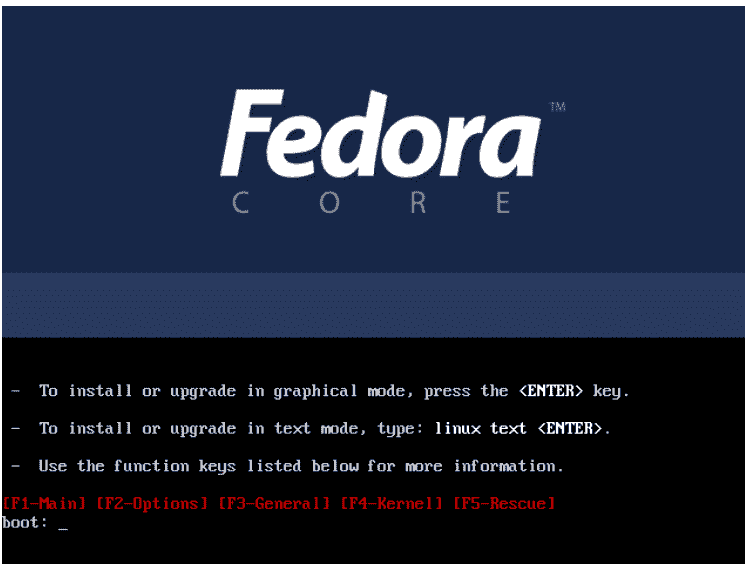

- 若要在图形模式下安装或升级，请按 <ENTER> 键。
- 若要在文本模式下安装或升级，请输入：`linux text <ENTER>`。
- 使用下方列出的功能键获取更多信息。
[F1-主] [F2-选项] [F3-常规] [F4-内核] [F5-救援] boot: -

## 第1章：构建 Linux 环境

## 选择您的语言

图 1.2. 选择安装语言。

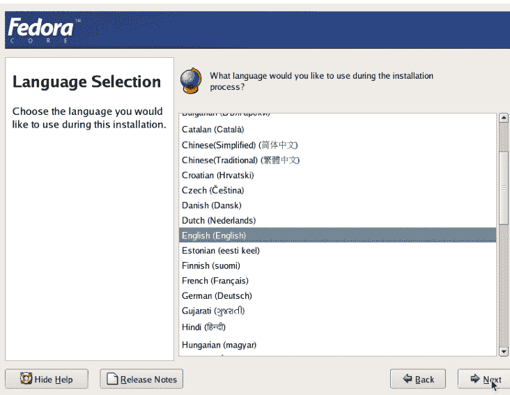

Fedora 真正是一个国际化操作系统：安装界面支持 30 多种。在图 1.2 所示的语言选择界面中选择您的母语，并点击“下一步”。

# 图 1.3. 选择键盘布局。

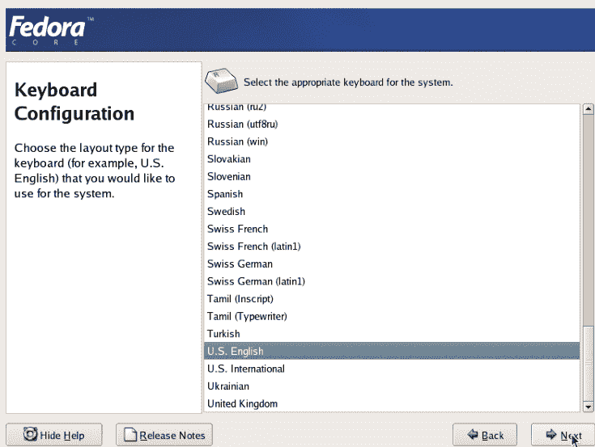

Fedora 可用的键盘语言数量与安装界面支持的语言数量相似。在图 1.3 所示的界面中选择您的键盘语言。

## 第1章：构建 Linux 环境

## 安装类型

图 1.4. 选择安装类型。

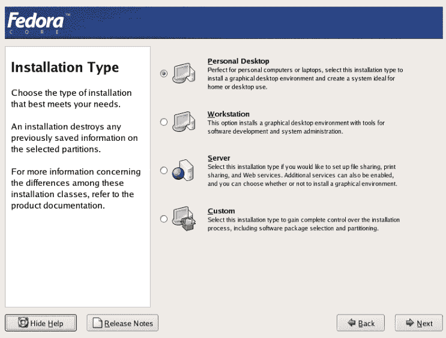

Fedora 安装程序提供了三种专门的安装类型：用于家庭或办公的个人桌面 (Personal Desktop)、用于开发或系统管理工作的工作站 (Workstation)，以及用于文件、打印和 Web 服务器的服务器 (Server)。如果您想完全控制控制的配置方式，还有一个“自定义 (Custom)”选项。如果我们正在设置 Web 服务器，请在完成“下一步”之前，从图 1.4 的安装类型界面中选择“服务器”选项。

## 磁盘分区

Fedora 安装程序提供两种分区方法——自动和手动，如图 1.5 所示。

# 图 1.5. 选择分区方法。


### Fedora™

### 磁盘分区设置

新用户进行 Linux 安装时最大的障碍之一就是分区。提供自动分区使得这一过程变得。

通过选择自动分区，您无需使用分区工具来分配挂载点、创建分区或为安装分配空间。

若要手动分区，请选择 Disk Druid 分区工具。

自动分区根据所选的安装类型设置分区。一旦创建分区，您也可以对其进行自定义。

手动磁盘分区工具 Disk Druid 允许您在交互环境中创建分区。您可以设置文件系统类型、挂载点、分区大小等。

- 自动分区
- 使用 Disk Druid 手动分区

使用“后退”按钮进行选择

自动分区创建三个分区：

- /boot 分区是内核的家园：Linux 核心的程序。Fedora 建议 /boot 分区不少于 100MB，尽管您很少需要这么多空间。

- swap 分区在所有系统内存都被占用时，作为内存的备用。

- / 分区包含不在其独立分区上的所有内容。

> 注意
> Linux 分区的显示方式与 Windows 不同。Linux 分区不使用驱动器号标识（如 C:），您可能已经习惯了这一点。Linux 上的主分区标记为 /（稍后您将看到它是如何融入整个分区布局的）。系统中其他常见分区包括 /boot（包含内核和引导加载程序）、/home（包含用户特定文件）和 /var（包含程序配置和可变数据）。这些标签被称为挂载点，我们将在第 4 章进一步讨论。

可以组织您的系统使其分布在多个分区上；例如，将 /var（存储数据，包括 MySQL 数据库和其他数据）放在单独的分区上是常见的。然而，自动分区让事情变得更简单。

## 第1章：构建 Linux 环境

### 使用 Disk Druid

Fedora 提供图形和文本表示。如果您更倾向于图形界面，请使用 Disk Druid。在这里，您可以选择挂载点、文件系统类型和分区大小。挂载点下拉菜单将显示所有常用标签。创建自定义分区可能会误导其他用户。

一旦创建了分区，可以通过选择该分区来编辑，这会为您提供与“添加”对话框几乎相同的选项。如果您不小心标记了删除某个分区，可以将其改回原来的状态。

### 删除分区

如果您不小心标记了删除某个分区，可以将其改回原始状态。删除分区时务要小心！


> ¹³ 嗯，并没有简单的方法。

# 图 1.6. Disk Druid 工具。

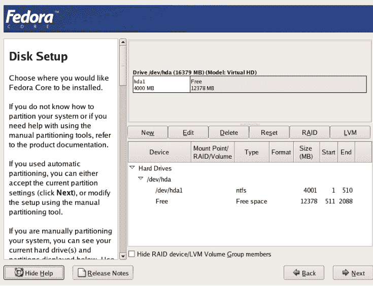

### 修正误删

如果您误删除了分区，可以通过点击“重置”按钮将其恢复状态。

## 第1章：构建 Linux 环境

## 图 1.7. 添加分区。


# 图 1.8. 选择挂载点。

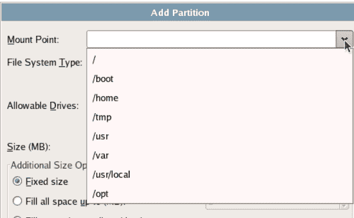

# 图 1.9. Swap 警告。

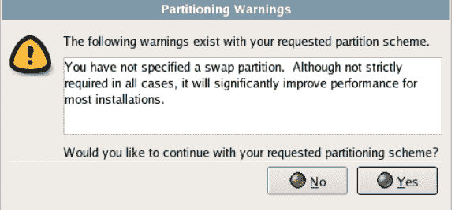

## 第1章：构建 Linux 环境

### Swap 空间

在 Linux 机器上创建 swap 空间时，一个好的规则是创建机器物理内存一点半大小。例如，如果您有 1GB 物理内存，请创建一个 1.5GB 的 swap 分区。

### GRUB 引导加载程序

# 图 1.10. 配置 GRUB。

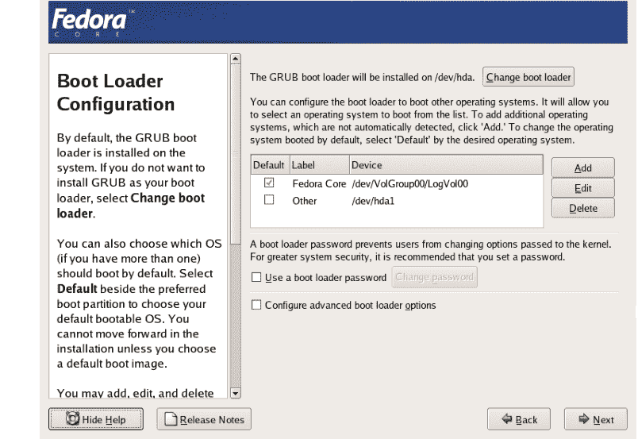


### 网络配置

在你设置好所有分区后，将提供图 1.11 所示的网络选项。机器内现有的以太网卡将标记为 `ethn`；如果机器只有一个网络网卡，它将被命名为 `eth0`。默认配置将类似于图 1.11 所示的内容。第一个网络连接（通常是 `eth0`）将处于激活状态，并通过 DHCP ¹⁴ 自动配置。如果机器位于内部网络中，你可能可以保持默认设置。对于直接连接到互联网的 Web 服务器，你需要手动配置你的静态 IP 地址，并手动配置网关、DNS 和主机名。在这种情况下，你的互联网服务提供商（ISP）将为你提供可使用的 IP 地址、网关和其他细节。

## 图 1.11. 配置 Fedora 的网络选项。

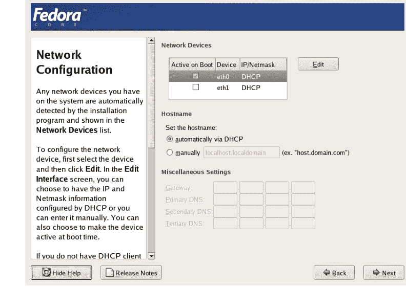

¹⁴ 动态主机配置协议 (DHCP) 将用于自动检测你的网络设置，以便你连接到互联网或私有网络。

## 第 1 章：构建 Linux 环境

## 图 1.12. 手动配置以太网接口。

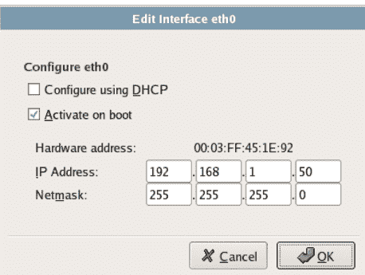

点击网络配置屏幕中的“编辑 (Edit)”按钮将显示图 1.12 所示的“编辑接口”窗口。在这里，你可以进行自定义配置调整，例如为服务器分配静态 IP 地址。

当在上一个屏幕配置了网络设备设置后，你就可以自由配置主机名、网关和 DNS 设置。图 1.13 显示了一个主要用于内部使用的网络设备。

## 图 1.13. 手动配置的网络接口。

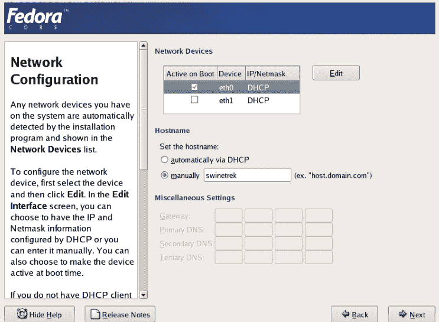

## 第 1 章：构建 Linux 环境

### 网络安全

图 1.14. 设置服务器安全选项。

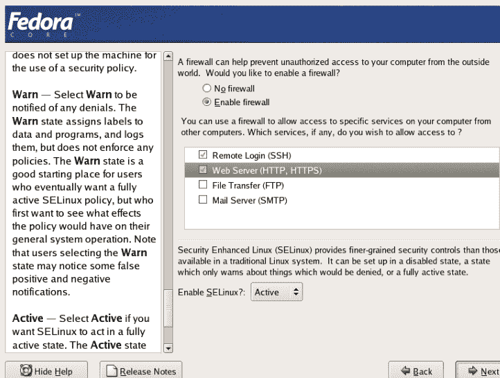

Fedora 发行版——以及许多其他主要的 Linux 发行版——努力让网络安全配置尽可能简单。默认情况下，Fedora 运行在防火墙上，拦截所有来自网络的流量。要自定义防火墙，只需选择你希望在此机器上运行的服务；否则，它将保持机器开放状态并易受黑客攻击。你也可以选择启用增强型 Linux (SELinux)，这可以帮助减少黑客获得系统部分控制权时造成的损害。请注意，SELinux 不应被视为防火墙的替代品——防火墙和 SELinux 都不能让你的系统完全安全，因此最好是同时启用两者。根据你的需求，你应该只允许远程登录和 Web 服务器流量通过防火墙，并将“启用 SELinux”设置为“已激活 (Active)”，如图 1.14 所示。第 9 章将将更详细地介绍安全内容。

### 图形化安装

### Telnet 和 FTP 安全

尽管它们在 Fedora 安全配置屏幕中作为选项显示，但 telnet 和 FTP 都被广泛认为是不安全的协议。对于访问远程机器，SSH 比 telnet 安全得多；对于传输文件，SFTP 比 FTP 更安全。如果需要 FTP 功能，建议将其设置在与网络其余部分尽可能隔离的独立服务器上。

### 设置时区

Fedora 为你的服务器设置时区提供了两个选项。你可以将鼠标悬停在离你最近的大都市地区上，也可以从详尽的城市列表中选择。无论哪种情况，选中的城市将在地图上突出显示，如图 1.15 所示。

## 图 1.15. 设置时区。

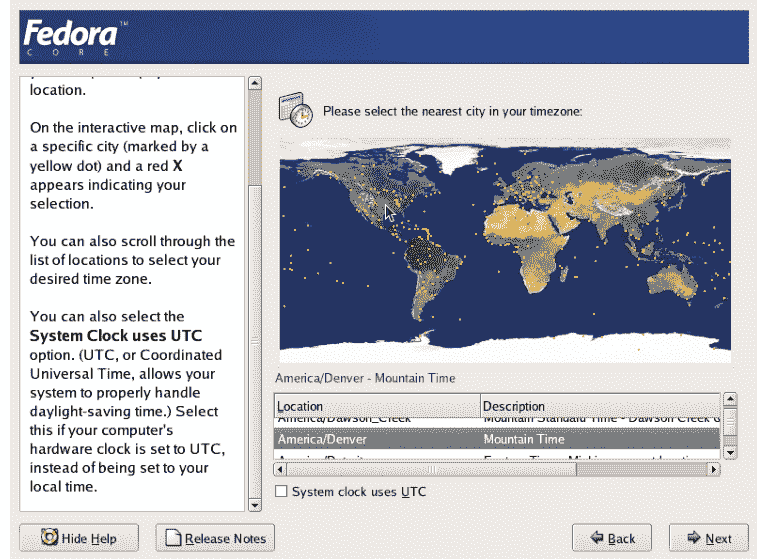

## 第 1 章：构建 Linux 环境

### 设置用户

根据你的需求，你应该只允许远程登录和 Web 服务器流量通过防火墙，并将“启用 SELinux”设置为“已激活 (Active)”，如图 1.14 所示。第 9 章将更详细地介绍安全内容。


## 第一章：构建 Linux 环境

- 开发工具（Development Tools）软件包组提供了从源代码构建软件包包所需的工具。安装这些工具是一个好主意，尽管你可能无法立即看出它们将如何被使用。

- 管理工具（Administration Tools）软件包组提供了由 Red Hat 开发的全套用于服务器管理和配置的工具。你应该安装所有这些工具，因为它们将按照你选择的方式配置你的系统。还有一些针对经验丰富的管理员的替代命令行工具，但对于那些没有 Linux 系统管理经验的人来说，图形化工具更易使用。

- 系统工具（Systems Tools）组包含各种实用工具，允许你监控到服务器的流量、连接到 VNC 和 Windows Terminal 服务器等。

如你所见，从 Fedora Core 开始，已经提供了大量的软件包。安装程序提供了一套完整的软件工具，用于构建、配置和管理你的 Web 服务器。由于预算限制而导致你的 Web 服务器承担比单一用途更多的职责的情况并不罕见；如果你受到此类限制，你会发现 Fedora 工具更加有用。

## 更多信息，请参阅

> 正如你在上述系列屏幕中所注意到的，Fedora 通过左窗格下方的“发布说明”（Release Notes）按钮为每个部分提供更多信息。该窗格还作为一个帮助屏幕，为每个选定的安装包提供特定细节。类似于“软件包详情”屏幕中的简要软件包描述，该窗格为你在安装时学习你的 Linux 系统提供了一个极佳的资源。帮助屏幕提供的细节比简要摘要多得多。


## 安装中，请稍候……

软件包选择完成后，你已经完成了 Fedora Linux 安装中最繁重的工作。剩余部分将由安装程序本身完成：使用你创建的分区格式化硬盘、安装你选择的每个软件包，并对每个软件包进行依赖检查。

### 图形化安装

安装服务器的过程将让你接触到 RPM 软件包管理器¹⁶（RPM）系统的威力；RPM 是一种用于分发软件以包含 Fedora Core 的格式，同时也用于 SuSE 和 Mandriva Linux 等其他 Linux 发行版。你的服务器安装将作为一系列 RPM 事务进行，检查依赖关系并安装每个选定的或所需的软件。

## 揭秘依赖关系

> 几乎所有的计算机软件都依赖于其他软件。一个简单显而易见的例子是，运行在你新服务器上的任何软件都将依赖 Linux。这种关系被称为依赖关系。依赖关系的产生源模块化软件设计哲学，或从其他较小的程序构建大型程序。RPM 会调查并处理这些依赖关系，检查依赖代码是否存在，并记录那些可能缺失的代码。

现在是时候给自己泡杯好咖啡了：安装你的 Fedora 系统可能需要 45 分钟，这取决于你机器的速度。在安装过程中，你会被多次要求插入额外的 CD-ROM，当安装完成后，系统将提示你重启机器。你的新服务器将通过一个显示 Linux 发行版信息和内核版本的屏幕开始启动。

请注意，如果你设置了双启动系统，在引导加载程序自动启动默认操作系统之前，会发生倒计时。倒计时时间可以通过引导加载程序的配置进行调整。这对于生产环境的 Web 服务器可能非常重要：如果它宕机了，你可能希望机器尽快重新回到网络。

¹⁶ RPM 原本是 Red Hat Package Manager（红帽软件包管理器）的缩写，但当它在 Red Hat 之外被广泛使用时，它被正式更改为了一个递归缩写。其他递归缩写的例子包括 PHP（PHP Hypertext Preprocessor）和 GNU（GNU's Not Unix）。

## 第一章：构建 Linux 环境

## 最后几个步骤

图 1.19。设置代理的欢迎屏幕。

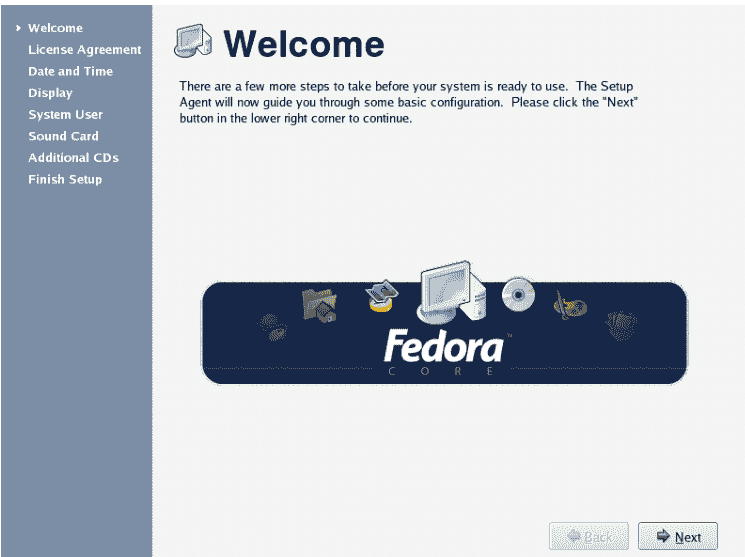

主安装完成后，只剩下几项清理工作需要完成。你的 Fedora 服务器将引导加载驱动程序，然后向你展示**设置代理（Setup Agent）**：一组在系统安装后配置你的工具。使用此类工具已成为 Linux 发行版中的一种常用方法，SuSE 提供了 YaST2 工具，而 Mandriva 利用了 SystemDrak。你将看到设置代理的欢迎屏幕（如图 1.19 所示），随后是许可协议。一旦你表示同意许可协议，你将进入配置屏幕。

日期和时间配置提供了两个标签页：日期与时间（Date & Time）和网络协议（Network Protocol）。第一个标签页允许你确认系统时钟准确。第二个标签页提供了配置网络时间协议（NTP）软件的能力，该软件可将你的系统钟与权威源同步。在此屏幕中选择“启用网络协议”（Enable Network Protocol），如图 1.20 所示，将启用 NTP 守护进程——这是一个后台运行的程序，定期将你的系统时间与 NTP 服务器返回的时间进行对比。这些服务器中的几个列在“服务器”下拉列表中。¹7 如果启用了 NTP 并选择了服务器，守护进程将启动，在移动到下一个设置代理屏幕之前检查所选的服务器。

# 图 1.20。网络时间协议标签页。

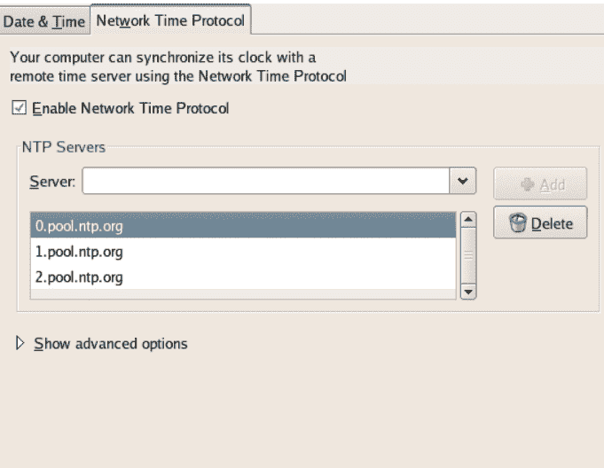

在显示屏幕上，你可以选择使用的显示器类型、你希望的工作辨率以及色彩深度。如果你在列表中找不到你的显示器，可以选择通用显示（Generic Display）。设置代理还提供了一个允许我们配置额外用户的屏幕。用户详情包括用户名、全名和密码，如下所示¹7 一个良好的 NTP 服务器是 pool.ntp.org。这实际上是许多服务器共享的名称，确保它始终可用。

## 第一章：构建 Linux 环境

图 1.21。如果你决定允许网络登录，也可以从此屏幕选择该选项。

# 图 1.21。设置系统用户。

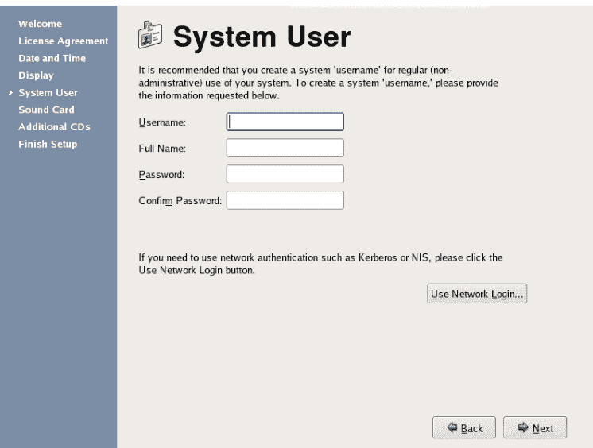

> 像 Windows 一样，强烈建议在 root 账户之外创建用户账户。root 账户是全能的；它拥有创建修改和破坏系统上任何文件的权限。在没有预见的情况下以 root 身份执行操作会对系统造成灾难性的后果。几乎每个 Linux 用户都能讲述第一次（可能也是唯一一次）导致系统无法运行经历。

 创建用户账户

如果 Fedora 安装程序在系统中发现了声卡，你将被要求确认详细信息。你还会看到一个测试它的按钮，尽管在生产服务器上这可能没有必要。还有“软件”屏幕，你可以用它安装可能需要的任何额外软件。你现在可以跳过此屏幕。

恭喜，你现在已经设置好了 Linux 服务器！图形安装为新的 Linux 用户提供了一套易于操作的工具来使系统运行。然而，在某些情况下，文本模式安装是达到相同目的更快更高效的方法。现在让我们来看看文本模式安装程序。

## 文本模式安装

使用文本模式安装程序并不是一个令人敬畏的过程：它提供了图形安装中可用的所有工具，并遵循相同的总体流程和逻辑，只是缺乏一个漂亮的界面。除非你选择的 LAMP 服务器内存少于 128MB，否则你不需要使用基于文本的安装程序。


# 图 1.22. 在文本模式下开始安装。

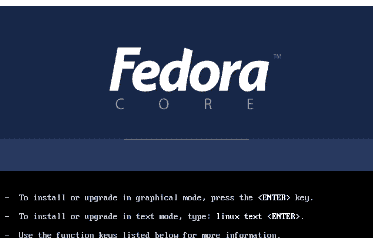

- 若要在图形模式下安装或升级，请按 <ENTER> 键。
- 若要在文本模式下安装或升级，请输入：`linux text <ENTER>`。
- 使用下方列出的功能键获取更多信息。
(F1-主) (F2-选项) (F3-常规) (F4-内核) (F5-救援)
root:linux text _

文本模式安装的启动方式与图形安装相似。然而，我们并不是简单地按 Enter 键开始安装，而是在提示符处输入 `linux text`，如图 1.22 所示。安装程序将加载用于与显示器和键盘交互的初始驱动程序，并提供运行安装介质测试。建议您运行此测试，以检查您的安装 CD 是否被篡改过。

“欢迎 Fedora Core”界面是熟悉基于键盘导航操作的好处。按 Tab 键在各个选项之间移动，高亮当前选项。按 Enter 键选择当前选项。选择 OK 并按 Enter 键。

# 图 1.23. 文本模式下的语言选择。

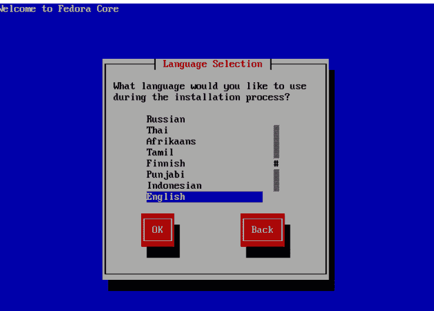

| 使用 <Tab> /<Alt-Tab> 在元素间切换 | <Space> 选择 | <F12> 下一页 |

在图 1.23 所示的语言选择屏幕中，使用向上和向下箭头键选择语言。您还可以使用 Page Up（上页）和 Page Down（下页）逐页滚动选项，或者输入您要查找的语言的首字母，跳转到语言列表相应的区域。使用 Tab 移动到 OK 按钮，并按 Enter 键。

# 第 1 章：构建 Linux 环境

# 图 1.24. 文本模式下的键盘语言选择。

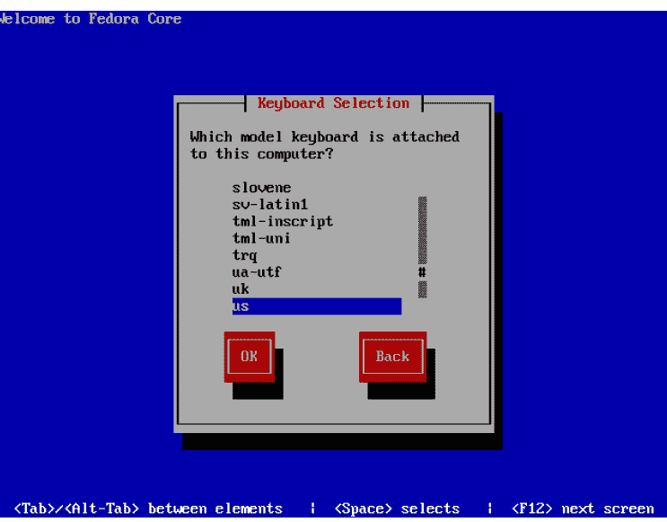

与图形安装一样，Fedora 的文本安装为安装和键盘都提供了数十种语言，如图 1.24 所示。

# 图 1.25. 文本模式下的安装类型选择。

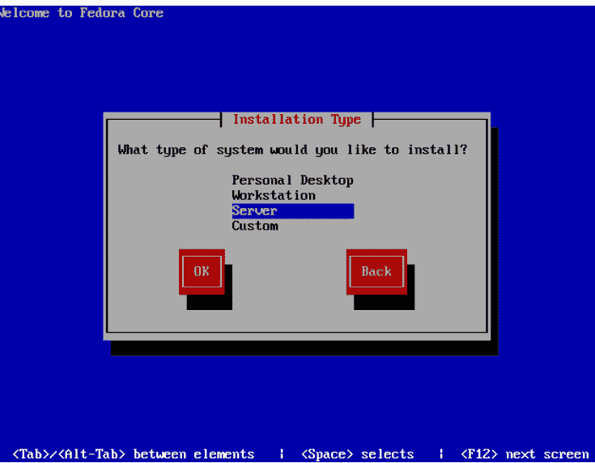

与图形安装过程一样，Fedora 为安装类型提供了多种“预设”选项，如图 1.25 所示：个人桌面、工作站、服务器或自定义。在通常的细粒度下，这些选项中的每一个项都是可自定义的：您可以从安装类型中添加或删除项目，正正如我们在图形安装过程中看到的那样。

# 第 1 章：构建 Linux 环境

# 图 1.26. 在文本模式下设置分区。

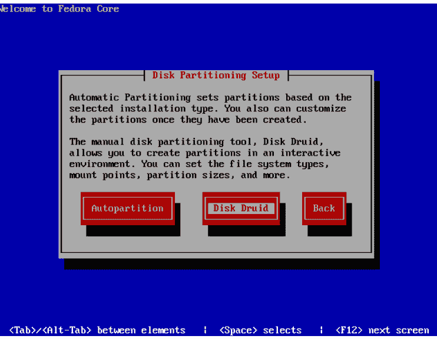

与图形安装类似，基于文本的安装提供了自动分区（/boot / 和 swap）以及基于 Disk Druid 的手动分区选项，如图 1.26 所示。如果您选择了 Disk Druid，将需要使用键盘导航各个选项。显然，文本版的 Disk Druid 不提供当前磁盘分区布局的图形化表示。

# 图 1.27. 文本模式下的手动分区。

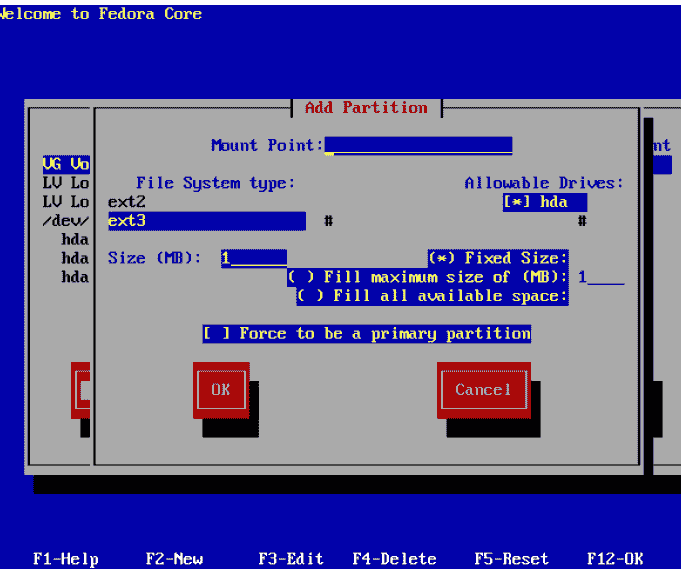

文本版的 Druid 没有像它的图形版本那样好用。图 1.27 所示。图形版本提供了预填充了最常用挂载点的下拉列表，而您需要手动将每个挂载点输入到“挂载点”（Mount Point）字段中，才能成功完成文本安装。

“添加分区”屏幕引入了另外几个文本元素。括号代表一组单选按钮，或者一组只能选择其中一个的选项：`(*)` 表示已选中的选项，而 `( )` 表示未选中的选项。方括号也类似，但行为类似于复选框（即可以选择多个）：`[*]` 是已选中选项，`[ ]` 是未选中选项。

# 图 1.28. 文本模式下的分区表。

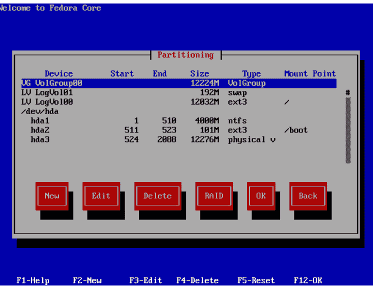

正如图形安装中所提到的，您 Linux 系统上的所有内容都位于顶层目录。在这种情况下，我们选择了 boot 分区。

# 图 1.29. 文本模式下的引导加载程序配置。

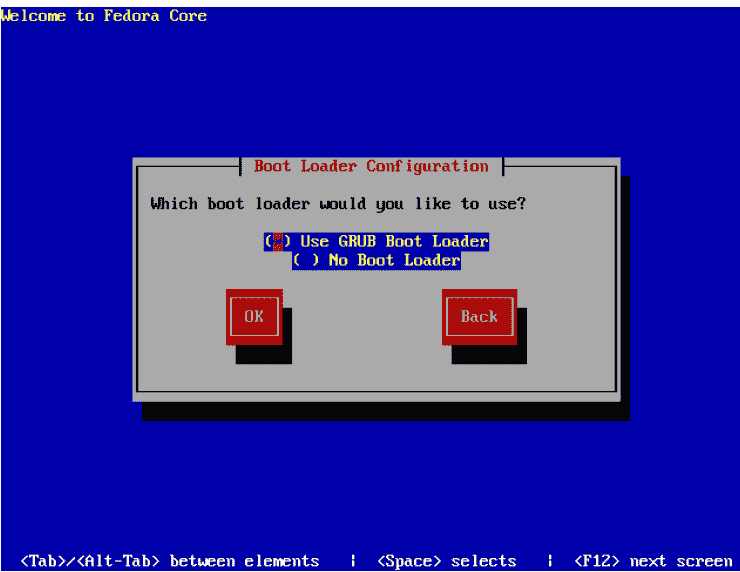

在图 1.29 所示的界面，使用向上和向下箭头键选择语言。您还可以使用 Page Up 和 Page Down 逐页滚动选项，或者输入您要查找的语言的首字母，跳转到语言列表相应的区域。使用 Tab 移动到 OK 按钮，并按 Enter 键。

# 图 1.30. 文本模式下的引导加载程序配置。

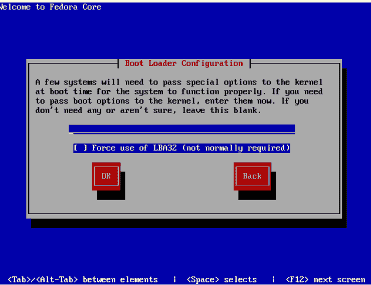

正如图形安装中所提到的，您 Linux 系统上的所有内容都位于顶层目录。在这种情况下，我们选择了 boot 分区。

# 图 1.31. 文本模式下的引导加载程序选项。

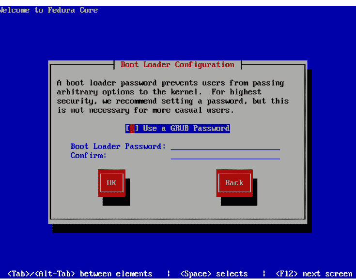

# 第 1 章...

# 图 1.32. 文本模式下的操作系统选择。

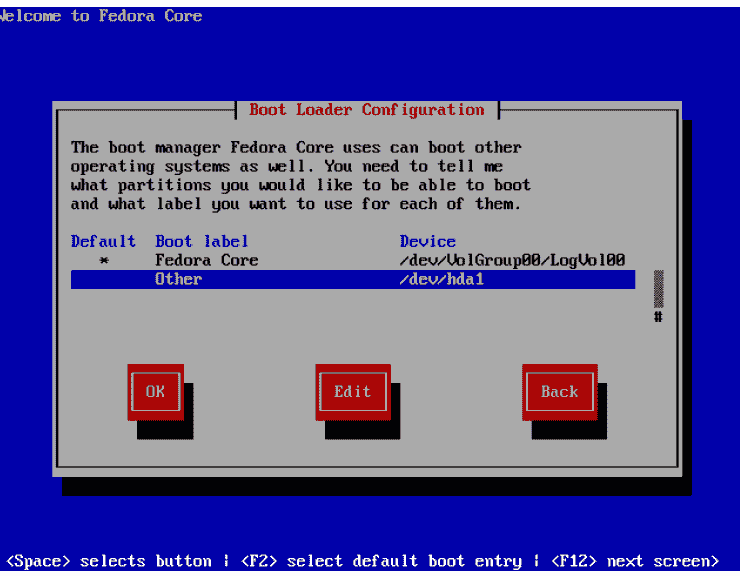

# 图 1.33. 文本模式下的引导加载程序位置选择。

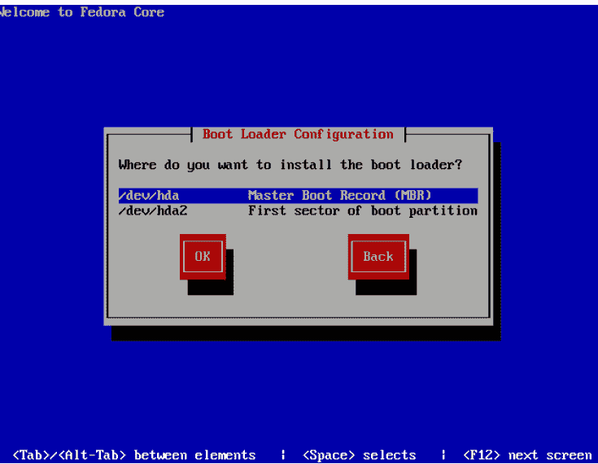

# 图 1.34. 文本模式下的网络配置屏幕。

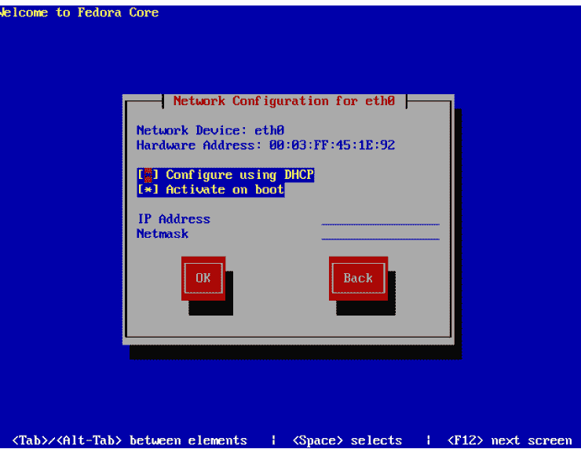

# 图 1.35. 文本模式下的防火墙选项选择。

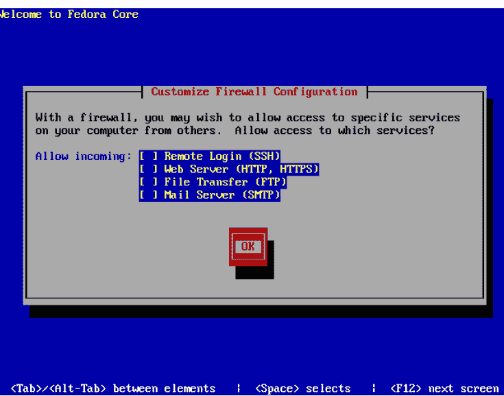


# 图 1.36. 文本模式下的增强型 Linux（SELinux）选项。

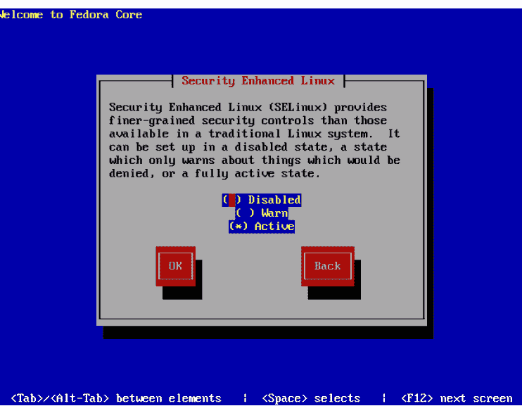

文本安装程序序列中的下一个屏幕询问你是否想要启用增强型 Linux (SELinux)。在图形化安装程序中，这些选项是防火墙选项屏幕的一部分。应将其设置为 Active（激活）以启用内核的安全增强型功能。

# 图 1.37. 文本模式下的时区选择屏幕。

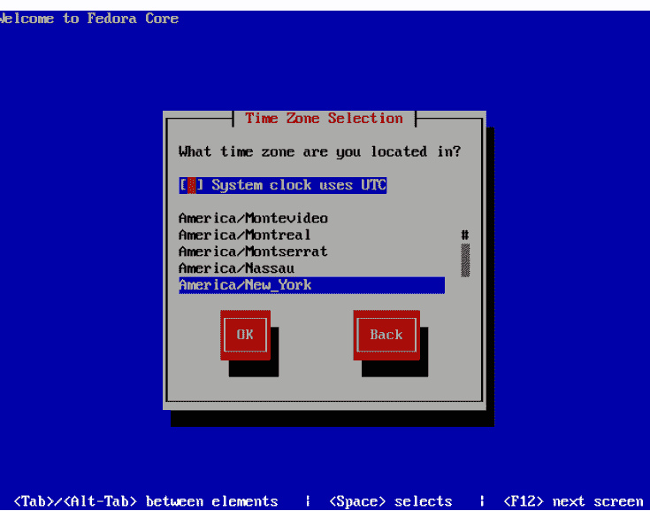

| 按位 | 操作 |
| :--- | :--- |
| <Tab>/<Alt-Tab> | 在元素间切换 |
| <Space> | 选择 |
| <F12> | 下一页 |

与提供地图的图形化安装不同，文本安装以列表形式提供时区选项。如果你希望系统使用协调世界时（UTC），请突出并选择“System uses UTC”选项。要选择服务器所在的特定时区，请使用方向键突出某个时区，然后按 Tab 到 OK 按钮，按 Enter 确认选择。

# 图 1.38. 文本模式下输入 root 账户密码。

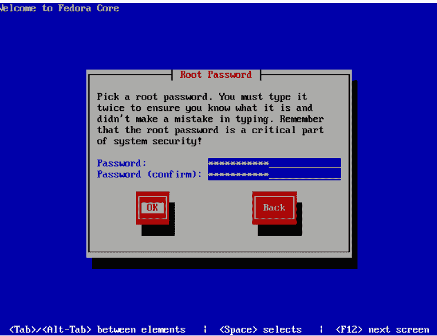

在图 1.38 所示的屏幕中输入你的 root 账户密码，记住图形化安装部分提供的警告：创建一个安全的密码以确保你的 Web 连接系统的完整性。

# 图 1.39. 文本模式下的软件包组选择屏幕。

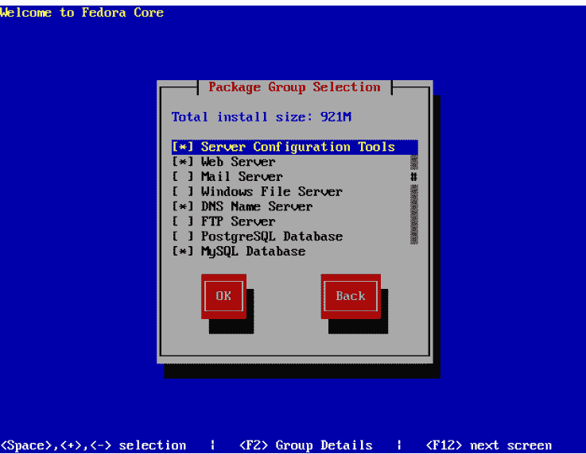

在对安装介质进行快速扫描后，文本安装程序将为你提供你所选择的所有可用软件包组。在图 1.39 中，我们选取了管理和维护 Web 服务器的所有基本工具，包括 Apache、DNS 和 SQL 数据库服务器。你可以像图形化安装程序一样，在软件包组被突出显示时按下 F2，来选择每个软件包组内的单个软件包。

## 第 1 章：构建 Linux 环境

### 图 1.40. 文本模式下的所需安装介质屏幕。

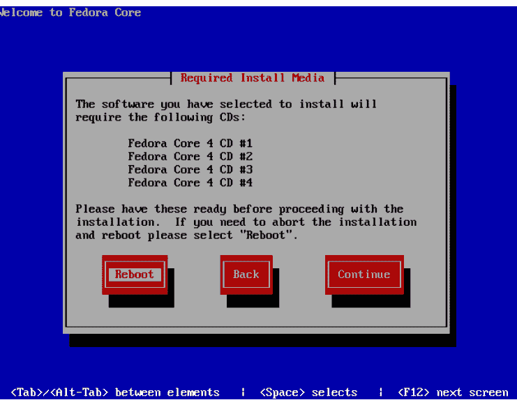

接下来，你将获得最后一次放弃 Linux 安装的机会，之后 Anaconda 将接管并开始安装 Linux。如果你选择继续，Anaconda 将格式化硬盘和或设置相应的分区，然后按照你指定的规格安装 Linux。

# 图 1.41. Linux 安装进度条。

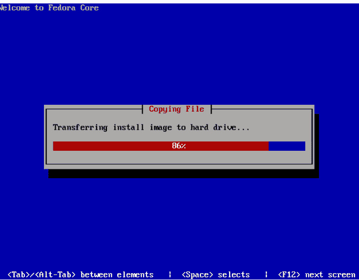

你对特定安装选项的选择将为安装过程创建一个安装镜像。该镜像包含了在你的请求的配置的机器上安装 Linux 操作系统所需的所有 RPM 和依赖项列表。换句话说，所有请求和所需的软件都从 CD 复制到硬盘以准备安装，如图 1.41 所示。

## 第 1 章：构建 Linux 环境

### 图 1.42. 软件包安装进度显示。

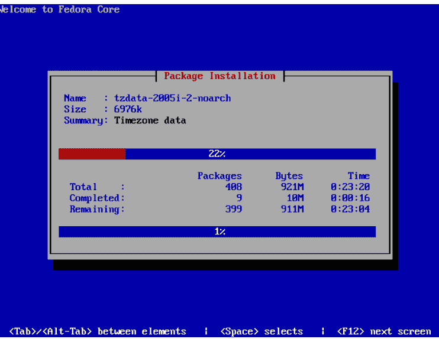

实际安装开始，安装程序呈现了若干条有用信息，如图 1.42 所示。首先，它给出了正在安装的软件包的简要摘要。其次是该软件包安装的进度，以百分比进度条显示。整体安装的高级视图在第二个进度条中提供。以软件包数量、字节数和预计剩余时间所需的安装进度也显示在两个进度条之间。

如果你选择带有 X Windows 系统和桌面管理器来安装系统——也就是说，如果你正在安装一个纯文本模式的系统——该系统将不会提供 Setup Agent 功能。相反，你的首次登录将以终端屏幕的形式出现。你将使用“root”用户名和之前在安装中创建的密码进行登录。

记住，System Agent 会提示你创建并配置非 root 用户。如果没有 System Agent，你需要手动执行此操作。

创建非 root 用户对于纯文本系统来说与图形化系统一样重要。要从命令行创建新用户，你首先需要以 root 身份登录；运行 `useradd newusername`，将 `username` 替换为新用户的用户名；系统会要求你输入该新用户的密码和一些详细信息。用户将被创建。

## 总结

Linux 系统的安装比 Windows 安装需要更多的期前研究。由于许多 Linux 设备驱动程序是通过社区性的逆向工程创建的，而非由设备制造商，因此在开始安装之前检查多个硬件兼容性列表是非常重要的。这将帮助你确保服务器上的设备存在驱动程序。

Linux 支持可以采取多种形式，最流行的是基于 Web 的列表和论坛，在这些地方依靠用户经验提供 Linux 问题的解决方案。所有商业 Linux 发行商都提供某种程度的付费支持，尽管支持期限在不同发行商之间可能差异很大。

Linux 系统可以带有全套图形化工具进行安装，也可以作为最小纯文本系统安装。安装程序也遵循这一点，提供了从图形化环境或纯文本文本环境中完成安装的选项。

与 Windows 系统不同，桌面环境与操作系统内核代码并非密不可分。相反，X Windows 和桌面管理是运行在自己空间中的独立系统。Linux 的这一特性允许创建一个完全运行的纯文本系统，该系统拥有非常小的安装代码库。然而，大多数用户会选择基于 X Windows 和任何桌面管理器的图形化系统。

# 2

# 日常使用

与 Windows 不同，Linux 不提供标准用户界面，而是提供了若干可以安装在 Linux 内核之上的桌面环境。Fedora Core 带有 KDE 和 GNOME 桌面环境；在书中，我们将主要关注 GNOME。

## GNOME 桌面

大多数图形化用户界面非常相似；Microsoft Windows、Mac OS 和 GNOME 桌面有很多共同点。你可能在寻找路径方面不会太大困难，但 GNOME 的某些几个做法确实有所不同。这里是 GNOME 基础的简要介绍，帮助你快速上手。

## 第 2 章：日常使用

## 桌面导览

### 图 2.1. GNOME 桌面。

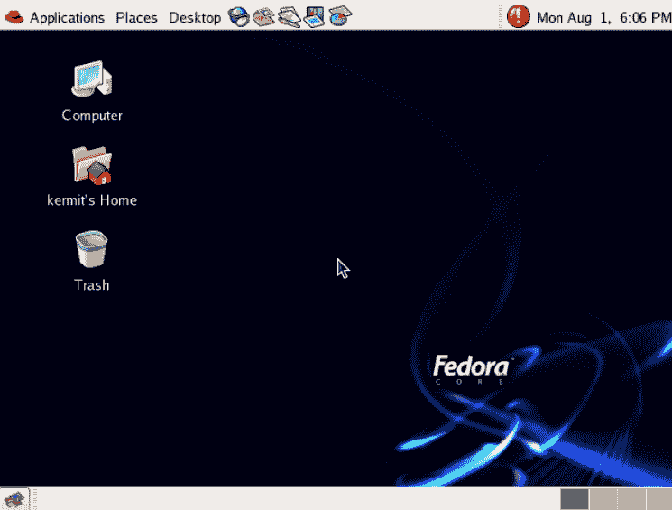

图 2.1 所示的 GNOME 桌面在顶部有一个栏，底部有一个栏；在 GNOME 中，这些栏被称为面板（panels）。

## 底部面板

底部面板为每个打开的窗口提供一个可点击按钮，类似于 Windows 任务栏，如图 2.2 所示。

### 图 2.2. GNOME 桌面的底部面板。


底部面板右侧是工作空间切换器，如图 2.3。工作空间（也称为虚拟桌面）是组织打开窗口的一种。

当你打开窗口并移动它们时，你会看到第一个方格中出现了窗口布局的小图。如果你点击第二个方格，所有窗口都会从屏幕消失——窗口仍在运行，但由于你切换到了另一个工作空间。点击切换器中的第一个方格，你会看到窗口返回。

你可以通过右键点击窗口标题栏并从“移动到另一个工作空间”菜单中选择工作空间来在空间间切换。

### 图 2.3. 显示在底部面板中的工作空间切换器。


默认情况下你有四个工作空间，但你可以在工作空间切换器偏好窗口中更改此默认（右键点击工作空间切换器并选择“偏好...”来访问此设置）。

## 顶部面板

顶部面板分为三个部分：左侧显示菜单和“快捷”图标，而通知区域位于右侧，如图 2.4 所示。

### 图 2.4. GNOME 桌面的顶部面板。


## 第 2 章：日常使用

## 顶部栏菜单

图 2.5。通过应用程序菜单定位 Firefox。

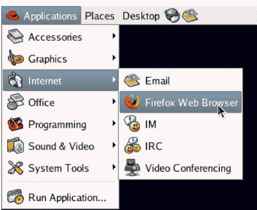

顶部栏菜单允许我们访问计算机上的所有内容。图 2.5 显示的“应用程序”菜单将所有安装的程序分类为游戏、图形、互联网、办公等。例如，如果你安装了 Firefox，可以在“互联网”菜单中找到它。

### 图 2.6。“地点”菜单。

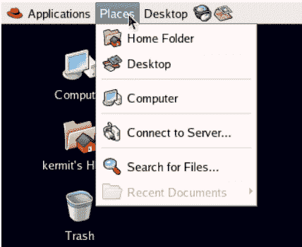

图 2.6 所示的“地点”菜单列出了可能有用的文件位置：你的主文件夹、桌面、计算机驱动器和网络位置。

“桌面”菜单提供了访问配置（用户偏好和系统设置）以及在线帮助、锁定屏幕、注销和关机选项的通道。这些显示在图 2.7 中。

### 图 2.7。“桌面”菜单。

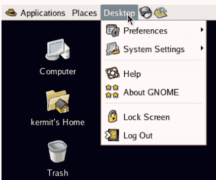

## 顶部栏快捷图标

快捷图标位于菜单旁边的启动器面板中，提供了常用应用程序的快速访问。

### 图 2.8。在启动器面板中显示快捷图标。


默认情况下，这些图标提供了 Web 浏览器（Firefox）和电子邮件客户端（Evolution）的快捷方式，如果你安装了它们，还有 OpenOffice.org 的三个主要应用程序（文字处理、电子表格和演示工具包）的快捷方式。

## 使用窗口

构成 GNOME GUI 的窗口显示与 Windows 平台上的用户界面相似。图 2.9 显示了一个 GNOME 窗口的。

图 2.9。一个 GNOME 窗口。

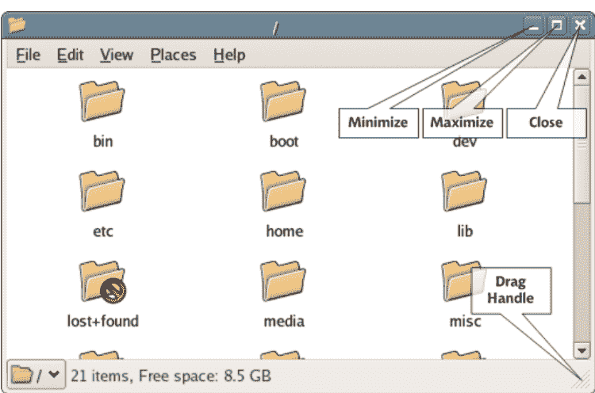

如果你用过其他操作系统，在使用 GNOME 窗口时不会遇到任何困难。

## 启动与关机

由于 Linux 是一个真正的多用户系统，在运行系统之前你需要登录你的系统账户。在 GNOME 中，处理此项任务的默认应用程序是 GNOME 显示管理器（GDM）。在所有系统设备和驱动器都正确挂载后，GDM 登录界面将打开。你将使用安装后创建的账户名和密码登录系统。

## 远离 root 用户！

千万不要建议以 root 身份登录系统。请记住，root 是 Linux 中全能的账户，能够对系统执行任何操作。这些操作包括删除系统关键文件，这会导致系统完全瘫痪，使其变得难以恢复。root 权限应该始终谨慎使用。在登录系统时，先登录用户账户；如果，如果有必要，你可以通过临时切换到 root 来执行管理任务。

请记住，优雅地关闭你的 Linux 电脑是非常重要的，就像关闭 Windows 机器一样。这允许任何缓冲数据在系统关机之前写入磁盘。你可以通过选择“桌面 > 注销”或通过命令行来关机。让我们先看下关机的图形化工具。

从“桌面”菜单中选择“注销”（如图 2.10 所示），你将获得注销系统账户（返回登录界面）、重启机器或完全关机等选项。

### 图 2.10。Linux 的注销选项。

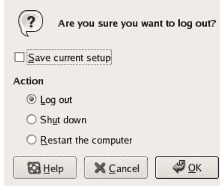

## Linux 文件系统

### 驱动器与分区

如果你习惯 Windows 以驱动器为导向的布局，Linux 文件系统结构可能会有点困惑。没有 C: 盘；事实上，并没有意义上的驱动器，只有分区。为了让情况更复杂一点，分区在硬盘上的实际位置并没有被清晰地标识。Linux 文件系统比这要抽象得多。

我给你举个例子。我在家里的主力工作机器 cortex 包含两个物理硬盘。一个是旧的 40GB 硬盘，包含了操作系统和我使用的所有程序。另一个是我后来添加的 160GB 巨型设备，它被分为两个部分。第一部分包含我的个人文件：我用数码相机拍摄的照片、我的 MP3 收藏集以及少量杂物。我留出第二部分给程序创建的临时文件。

在 Windows 系统上，这些驱动器可能会被系统和用户看到为 C:、D 和 E:。Windows 将安装在 C:\WINDOWS\。Firefox 将位于 C:\Program Files\Mozilla Firefox\，我的数字照片将位于名为 D:\Photos\ 的目录中，依此类推。在 Windows 中，目录名称不是驱动器字母。这在图 2.11 中所示。

### 图 2.11。Linux 文件系统。

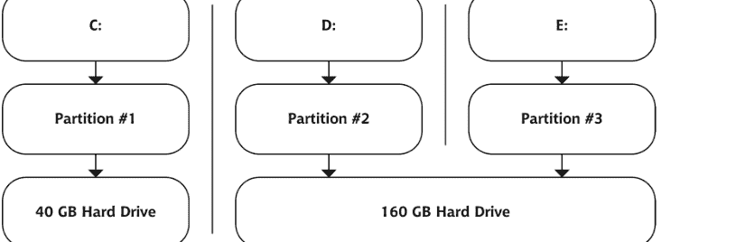

### ext3 文件系统

图 2.13 所示的文件系统与你可能熟悉的结构不同。让我们看看文件系统结构的概述，并探索它的各种功能和元素。

/（根目录）

这是任何 Linux 系统的顶层，被称为根目录。不幸的是，还有一个名为 root 的目录。别担心：我们将解释这些


### 文件系统快速览

一分钟内带你了解这些目录之间的区别——以及如何避免混淆。

### /boot

此目录包含启动操作系统所需的所有文件，包括 Linux 内内核。

### /bin 和 /sbin

这两个文件夹的内容相似——它们都包含可执行的二进制文件——但用途不同。/bin 包含你可能在命令行使用的可执行文件：如 `ls`、`mv` 和 `cp` 等命令（我们将在第 3 章中介绍这些命令），位于该文件夹。/sbin 包含了操作系统本身使用的命令和进程，如果你是初学者，最好远离这个文件夹。

### /dev

这些是设备文件——系统中实际存在的所有设备，以及所有可能添加到系统中的设备的抽象。这些文件为操作系统提供了关于每个设备的描述以及如何处理这些设备的指令。

### /etc

此目录包含特定于系统的配置文件。

作为一名管理员，你可能会在 `/etc` 目录中花费大量时间，因为它包含了系统上大多数应用程序的配置指令。例如，Apache 的配置文件位于 `/etc/httpd/conf/httpd.conf`。

### /home

此目录包含系统中每个用户的家目录。例如，我们的示例用户家目录为 `/home/kermit`，同一系统上的其他用户家目录为 `/home/gonzo` 和 `/home/fozzie`。默认情况下，Gonzo 或 Fozzie 无法读取或写入 Kermit 的目录，而 Kermit 也无法读取或写入他们的目录（root 用户拥有此能力）。

# /root（根目录）

这是 root 用户的家目录，不要与另一个“根目录” `/` 混淆。

### /lib

`/lib` 目录包含了系统中各种应用程序将访问的所有共享库。它还包含了内核在各种系统操作中使用的库。

### /media

这些目录作为临时挂载文件系统的挂载点。例如，可以通过 `/media/cdrom` 访问 CD-ROM 器。

# /opt

此目录为添加到系统的软件包提供存储空间。

### /tmp

此目录提供全系统的临时文件存储空间。

### /usr

包含用户命令和二进制文件、图形界面文件、系统应用程序使用的包含文件以及可选的源码文件。

### /var

`/var` 目录包含变量数据文件：在与其关联的应用程序运行时可能会更改的文件，包括日志文件和邮箱文件。


## 挂载点

尽管挂载点存在于包括 Windows 在内的每一个操作系统，这个概念可能会有些困惑。为了避免混淆，可以将挂载点想象成容器，将设备或文件系统的内容“倾倒”进去。例如，`/media/cdrom` 是 CD-ROM 设备内容的挂载点。将设备内容倾倒到挂载点中，系统及其用户就可以访问这些文件。通常情况下，设备和文件系统在使用之前必须挂载——即连接到挂载点上。在随后的章节中，我们将讨论在 Linux 中自动挂载这些设备和文件系统的方法。

# 图 2.13. 文件浏览器应用程序中显示的 Linux 文件系统。

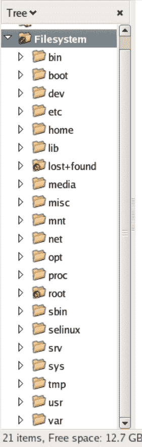

# 导航文件系统

导航文件系统从桌面的 Nautilus 开始，它是 GNOME 对文件系统的图形化表示。桌面上有两个图标作为 Nautilus 的起点：“计算机”（Computer）和用户名的“主目录”（Home），如图 2.14 所示。

# 图 2.14. 桌面文件系统图标。


“计算机”图标从系统顶层开始，类似于 Windows 中的“我的电脑”，而用户“主目录”图标则从当前用户的家目录开始。

双击“计算机”图标会向我们展示与图 2.15 类似的视图。我们看到连接到计算机的可移动介质，以及代表本地文件系统根以及我们通过网络访问的任何其他文件系统的图标。

双击“文件系统”图标将打开一个新窗口，显示文件系统的根目录，如图 2.16 所示。双击这些图标中的任何一个都会打开另一个窗口，提供所选目录的内容，就像 Windows 资源管理器或 Mac 的 Finder 一样。

# 图 2.15. “计算机”图标的顶层视图。

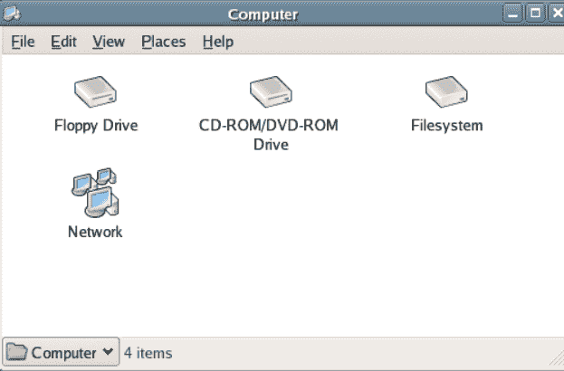

# 图 2.16. 查看“计算机”图标文件系统。

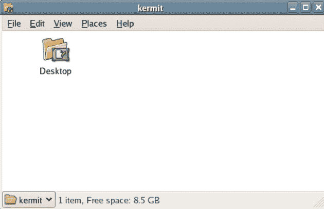

# 日常使用

# 图 2.17. “主目录”图标视图。


## 文件权限

Linux 采用了任何计算机系统中最细粒度的权限系统之一。正如我们所见，细粒度部分归于 Linux 中一切皆为文件的事实。

在基础层，Linux 权限分为三组。这些是：

- **所有者（Owner 或 user）** 授予所有文件的用户的权限（通常是创建文件的用户）。
- **组（Group）** 授予特定用户组的权限。用户可以加入任意数量的组，每个组对文件都有权限。
- **其他（Other）** 授予既不是所有者也不是权限组成员的任何人的权限。

这三组中的每一组都可以授予以下自言易懂权限的任意组合：

- 读（read）
- 写（write）
- 执行（execute）

Linux 权限结构中特别别有趣的是这三组权限是如何相互作用的。特定用户可能属于一个只能读取特定文件的组，但如果该用户恰好是该文件的所有者，那么文件的所有者权限可能会授予该用户写入文件的权限。

# 图 2.18. 文本文件的默认权限。

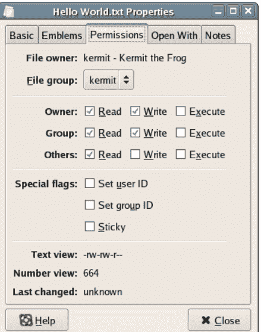

# 文件所有者

这标识了拥有文件的用户。默认情况下，所有者是创建文件的用户；然而，拥有足够权限的用户（例如 root）可以更改文件的所有权详情。


## 文件组 (File group)

拥有访问此文件的用户组：在这种情况下，这是一个名为 kermit 的组。当你创建一个用户时，Linux 会自动创建一个与该用户同名的组。这允许我们赋予一个用户访问另一个用户的文件。例如，如果我们将用户 gonzo 添加到 kermit 组，那么 Gonzo 就有了访问 Kermit 文件的权限。

## 所有者、组和其他人 (Owner, Group and Others)

这些复选框允许对权限进行实际设置。你可以授予所有者、你选择的组或其他任何人读取、写入和/或执行权限的任意组合。这三类权限的这三个部分组合在一起，使得该文件的权限共有 512 种可能的组合。这是一个非常灵活的结构！稍后我们将仔细查看文件权限。

## 特殊标记 (Special flags)

权限系统的特殊扩展允许我们对文件进行标记，以便文件系统进行特殊处理。我们在书中不需要使用这些标记。

## 文本视图和数字视图 (Text view and Number view)

这些查看文件权限的替代方法，对于任何通过命令行处理过文件权限的人来说都是熟悉的。

文本视图由十个字符组成。第一个字符指示文件类型：如果文件是目录，该字符将为 d；如果是普通文件，它将为 -。剩余的九个字符表示所有者、组和其他人的读取、写入和执行权限。例如，`-rw-rw-r--` 表示所有者具有读取和写入权限，组具有读取和写入权限，而其他人只有读取权限。当你更改上面的复选框时，你可以看到这种变化。

数字视图是文本视图的更紧凑的视图。数字从左到右分别代表给所有者、组和其他人的权限。此视图会随着你在复选框中的选择而改变。

## 最后修改时间 (Last changed)

此字段标识文件最后修改的日期和时间。如果文件没有被重新打开或修改，Linux 认为它尚未更改。打开文件并修改它，即可看到日期的变化。

## 符号链接，或链接文件 (Symlinks, or Linking Files)：更高级的抽象

大多数用过 Windows 的人都能理解快捷方式的概念。快捷方式实际上是从系统中的一个位置指向另一个区域内文件的指针。某些用户非常理解并痴迷于 Windows 中的快捷方式，以至于他们的桌面最终被满了！从真实位置以外的地方启动文件的能力显然对计算机用户具有价值。Linux 同样提供了这种功能。作为管理员，你会发现 Linux 的快捷方式和 Windows 的一样令人兴奋。

Windows 中的快捷方式和 Linux 中的符号链接实际上意味着表示形式——而非原始文件。在 Windows 中创建快捷方式并不会实际将可执行文件移动到桌面。同样，在 Linux 中，我们可以为一个看起来像文件本身的抽象编写一个文件。该文件在新位置并不存在，但它的运行方式就像存在那里一样。

Windows 和 Linux 创建快捷方式方式的一个重要区别是，Linux 符号链接（通常称为 symlink）在大多数情况下可以完全被视为文件本身。例如，如果你在编辑器中打开一个符号链接并对文件进行更改，编辑器将编辑符号链接指向的实际文件。如果你在 Windows 下尝试这种操作，你可能会感到意外，因为编辑器打开的是用于编辑的快捷方式文件，而不是快捷方式链接的文件！符号链接在 Linux 下被频繁使用，因为它们是一种强大的抽象，可以让文件看起来同时存在于多个地方。

你可以在 Nautilus 中通过右键点击文件或文件夹并选择“创建链接”（Make Link）来创建符号链接，如图 2.19 所示。这将创建一个文件名开头带有“链接到”（link to）的符号链接，如图 2.20 所示。你可以将此文件拖放到任何地方，并根据你的意愿重命名。

## 图 2.19. 在 Nautilus 中创建符号链接。

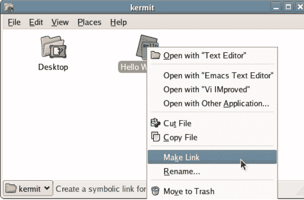

## 图 2.20. 新创建的符号链接。

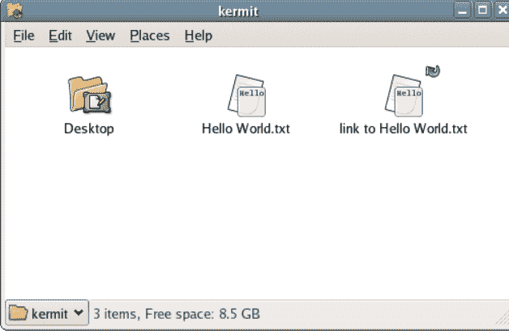

## 编辑文本文件 (Editing Text Files)

熟练使用兼容 Linux 的文本编辑器对于你日常管理工作的成功至关重要。由于 Linux 系统中的大部分配置都是通过文本文件完成的，找到一个适合你的编辑器是明智的。事实上，Linux 充斥着文本编辑器：没有 GUI 的编辑器、带有 GUI 的编辑器、主要为程序员设计的编辑器、针对 HTML 开发人员的编辑器——不缺可以让你的管理任务更简单的工具。在本节中，我们将查看一些你可用的基于 GUI 的文本编辑器。稍后我们还会查看一些基于命令行的编辑器。

Fedora Core 在默认安装中提供了两个强大的文本编辑器：gedit 和 Kate。Kate 是 GNOME 桌面环境的默认文本编辑器，而 Kate 是 KDE 的默认编辑器，但两者在任何桌面环境中都可以工作。

如果你是 Windows 上长期的记事本或 Wordpad 用户，你会发现 Linux 的 GUI 文本编辑器也提供了许多相同的功能，此外还有更多、更多。

### gedit

gedit 是 GNOME 的默认文本编辑器。如图 2.21 所示，它提供了全功能，包括：

- 对国际化文本的全支持
- 标签页多文档界面
- 语法高亮
- 插件
- 完整的设置界面

除了标准功能外，为 gedit 添加以下插件：

- 拼写检查
- 插入日期和时间
- 字数统计
- 更改选取文本的大小
- 缩进或取消缩进块
- 比较两个文档或文件的差异
- 从命令行插入输出
- 常用语言的标记语言（如 HTML、LaTeX 等）

## 第 2 章：日常使用

## 图 2.21. 准备好编辑文件的 geedit 主界面。


### 区分 G 和 K

你会很快发现，大多数 GUI 应用程序都是针对特定桌面环境编写的。这些应用程序的命名规范相当一致且易懂。为 GNOME 桌面环境编写的应用以“G”开头，而为 KDE 桌面环境编写的应用以“K”开头。

### Kate

KDE 的对应品是 Kate，即“KDE 高级文本编辑器”，如图 2.22 所示。

> 无法启动 Kate？Kate 最初是一个独立应用程序，现在包含在 kdebase 包中。它无法单独下载。为了使用 Kate，你需要安装所有的 KDE 库和基础应用程序。要安装额外的应用程序，请选择桌面 > 系统设置 > 添加/删除。

与 gedit 类似，Kate 是一个多视图编辑器：它允许你在同一个窗口中打开并编辑多个文档。除了这个非常有用的功能外，Kate 还提供了许多功能使其成为强大的文本编辑器。它的功能包括：

- Kate 可以编辑各种类型的文本文件，即使它们很大。Kate 几秒内即可打开 50MB 的文件。
- Kate 强大的语法高亮可以通过 XML 文件扩展。
- 编辑器提供了许多编程语言的代码折叠功能，包括：C++、PHP 等。
- Kate 提供分屏视图，允许同时查看文档的不同部分。
- Kate 允许用户通过保存/打开对话框选择每个文件使用的编码。
- Kate 拥有内置终端仿真。
- Kate 的侧边栏显示打开文档列表、文件系统浏览器等。
- Kate 提供了一个方便的插件接口，允许第三方插件。
- 编辑器提供了项目处理功能（可以被项目处理插件覆盖）。


## 第 2 章：日常使用

## 图 2.22. Kate 的主界面，正在编辑 Apache 配置文件。


根结底，Kate 其实非常友好，在编辑配置文件和编写脚本方面提供了比其他某些编辑器更大的灵活性。它的语法高亮功能是无与伦比的，因为 Kate 支持各种编程语言和样式。此外，Kate 还提供了诸如打开文档列表（如图 2.23 所示）和集成文件系统浏览器（图 2.24）等功能。

虽然 Linux 其他的 GUI 文本编辑器，但 geit 和 Kate 是其中最强大且用户友好的两个。任何一个都能很好地满足你的 Linux 文本编辑需求。

## 图 2.23.Kate 的文档标签。


## 图 2.24. Kate 的文件系统浏览器标签。


## 总结

理解 Linux 需要时间，而这个过程的第一阶段是在你可能稍微不熟悉的桌面环境中找到路。在本章中，我们从用户的角度讨论了 Linux、Fedora 和 GNOME 桌面的一些基础知识。接下来将看看你作为 Linux 服务器管理员需要知道的知识。

## 3 命令行

到为止，我们与 Linux 的交互都是通过一个相当不错的桌面环境进行的，对于经验丰富的 Windows 用户来说，理解这个系统相当容易。不过，情况并不总是如此：Linux 用户界面的根源深深植根于它的命令行中。

## 什么是命令行？

与 Windows 不同，Linux 中的 GUI 是完全可选的。如果你觉得自己非常有能力，或者有特定的需求（或使用非常老的硬件），你可以在没有任何图形的情况下运行 Linux 机器。随着 Linux 的演进，各种 GUI 被构建在其之上，但它是管理员最好的朋友：一种快速、简单、强大的操作方法，而这些操作在桌面上并不总是容易实现。

## 图 3.1。访问 GNOME 终端。


在整本书中，我们将使用 GNOME 终端应用程序来访问命令行。你可以通过“应用程序 > 系统工具 > 终端”访问此应用程序，如图 3.1 所示。终端本身见于图 3.2。

## 调整终端

GNOME 桌面环境是完全可定制的——这包括终端的外观。你可以确定所使用的字体，更改窗口的前景和背景颜色——你甚至可以设置窗口本身的透明度，这样就可以看到窗口后面的桌面图像！在终端内部，你可以在“编辑 > 当前配置...”中找到这些设置。

## 图 3.2。GNOME 终端应用程序。


让我们来看一个使用命令行满足特定需求的真实案例。一旦你理解了命令的组成部分（以及图形替代方案的复杂性），你就会开始理解终端和命令行的实用价值。

```
[kermit@swinetrek -]$ find /var/backup/* -ctime +5 -exec rm {} \;
```

我经常使用这个命令来删除我的备份中超过五天的旧文件。该命令使用 `find` 工具在 `/var/backup` 目录下搜索超过五天的文件。对于 `find` 工具找到的每个文件，它都会运行 `rm` 命令：`rm` 是标准的“删除文件”命令。定期运行此命令可以通过删除五天后变得必要的备份来帮助节省系统存储空间。当然，此命令应该配合一个每隔几天创建一个这些备份的自动化过程一起运行。

让我们比较一下使用此命令与利用图形工具完成相同任务的过程。

## 第 3 章：命令行

- 1. 离开键盘寻找鼠标。
2.  双击桌面上的“计算机”图标。
3.  双击“文件系统”进入根目录。
4.  双击 `var` 文件夹打开它。
5.  双击 `backup` 文件夹。
6.  通过选择“查看 > 列表视图”确保生成的窗口显示文件的创建时间。
7.  按住 `Ctrl`，选择创建日期早于五天的文件。
8. 右键点击并在上下文菜单中选择“移动到垃圾箱”。
9.  要删除文件，返回桌面，右键点击“垃圾箱”图标并选择“清空垃圾箱”。

你不需要理解 Linux 文件系统的复杂性就能看到命令行的优势。图形化方法涉及的点击次数远比将查找和删除这些文件的过程视为单个操作要多，你被迫将该过程分解为各个单独的部分。加上使用鼠标的低效，命令行的优势显而易见。通过通过键盘定位定位、点击屏幕上的目标，你可以看到，命令行对于系统管理是一个强大且高效的工具，即使你偶尔打开终端窗口，理解 Linux 命令也是至关重要的。尽管有某些事情只能以 root 身份完成，但保持以 root 身份登录的时间越短越好。这种方法非常像 Windows 的计划任务功能，但它更强大。

## 使用命令行

当你使用 Linux 命令行时，你打开的是一个被视为操作系统的替代窗口——一个你可以访问更强大层级函数的替代窗口。图形工具并不提供功能。图形环境仅仅是操作系统的一个高级抽象，我们习惯的图标和菜单提供了有限的访问。那些图标和菜单代表了操作系统功能，但它们并不是实际的功能。换句话说，图形界面在操作者和操作系统之间提供了一个额外的层，其中受限制的功能由漂亮的图片表示。为了以最高效率管理 Web 服务器，能够在系统层面工作是非常用的。

## 高与低

当我们谈论“高级”和“低级”功能时，我们暗示了一个功能层次。低级级别直接与内核通信，因此具有强大的力和灵活性；高级工具并不亲自工作，提供了更多的功能和更高的安全性。例如，将低级的 `rm` 命令与 Nautilus 中的高级垃圾箱功能进行比较，后者删除文件虽然快速方便，但没有简单可靠的方法可以恢复该文件。Nautilus 不提供这种功能。它意味着你将文件移动到垃圾箱，有效地将其标记为待删除。只有当你回到桌面清空垃圾箱时，删除才会发生。

## 登录 root

我们讨论过如何以 root 身份登录 Linux。要在 GNOME 终端中执行，你需要输入 `su`（切换命令）。

```
[kemit@swinetrek]$ su
```

密码：

系统会提示输入 root 密码。一旦输入，你将获得系统的完全访问权限：计算全能！请谨慎使用。尽管有某些事情只能以 root 身份完成，包括你的许多系统管理任务，但保持良好的 Linux 习惯很重要：不要以 root 身份登录比需要的时间更长的时间。每位 Linux 管理员都有一个恐怖故事，关于某一次他或她输错了命令


删除了机器上的所有内容（或类似的灾难）。你希望避免此类灾难。请务小心，如果不需要，请不要以 root 身份登录。要切换回你的标准用户账户，请使用 `exit` 命令。

## 一些实用示例

让我们来看几个命令行的实际示例。

## 使用 pwd 命令确定当前位置

在 Nautilus 中，我们可以同时打开多个文件夹。然而，当使用命令行时，我们一次只能在一个目录内工作。这个活跃的目录被称为工作目录。要查找你当前处于哪个目录中，请使用 `pwd`（打印工作目录）命令。

```
$kermit@swinetrek ~/ pwd
/home/kermit
```

> 家，最温暖的家
你的目录 `/home/username` 通常被称为 `~`。你注意到命令提示符中的 `~` 吗？它表示你正处于家目录。当我们开始浏览文件系统时，我们将看到这个命令提示符发生变化，反映出我们正在工作的目录名称。这样，我们就不必不断地输入 `pwd` 来发现我们

## 使用 ls 命令列出文件

`ls`（代表 list，列表）命令单独使用时，会列出工作目录的内容。

```
$kermit@swinetrek ls
Desktop Hello World.txt
```

你可以通过在命令行中添加目录名称来获取另一个目录的文件列表。例如，`ls /` 将返回根目录中所有内容的列表。

```
$kermit@swinetrek ls /
bin dev home lost-found misc net proc sbin srv tmp var
boot etc lib media mnt root selinux sys usr
```

单独使用 `ls` 会显示文件夹中包含的文件名，但仅此此。要查看所有文件的详细信息，我们可以向命令中添加 `-l` 选项，它会返回一个更详细的列表。

```
[kermit@swinetrek ~]$ ls -l
total 16
drwxr-xr-x 2 kermit 4096 Sep 5 14:21 Desktop
-rw-rw-r-- 1 kermit kermit 13 Sep 8 07:30 Hello World.txt
```

这里有大量信息：

- 第一列以我们在第 2 章中讨论的格式呈现每个文件的权限。简之，第一个字符告诉该文件是否为目录；接下来的九个字符显示是否已授予所有者、组和其他读取和执行权限。
- 下一列仅对目录有用；它反映了目录内包含的文件数量。对于文件，这将是 1。
- 这两列标识了分配给文件的所有者和组。在这种情况下，它们都是 kermit。
- 接下来显示以字节为单位的文件大小。在这里，我们看到 World.txt 文件为 13 字节。
- 接下来，我们看到文件最后修改的日期和时间。在上面的示例中，Desktop 目录最后修改于 9 月 5 日下午 2:21。
- 最后，提供了文件名。

`ls -l` 非常有用，Fedora Core 甚至包含了它的内置快捷方式：`11`。

你的家目录将包含许多隐藏文件。在 Linux 中，我们可以通过以点开头文件名来隐藏文件：如果我们将 `Hello.txt` 重命名为 `.Hello.txt`，它就会变成隐藏文件。程序正是在这些隐藏文件中存储用户特定的配置信息。要查看隐藏文件，请使用选项 `-a`，它可以与 `-l` 选项结合使用，或者作为 `-l` 的选项。

```
[kermit@swinetrek ~]$ ls -l -a
total 212
dw------ 13 kermit 4096 Sep 8 09:16 .
drwxr-xr-x 5 root 4096 Sep 6 13:48 ..
```

## 第 3 章：命令行

```
|rw------ 1 kermit 5 Sep 06:21 .bash_history
|-rw-r--r-- 1 kermit kermit 24 May 10:15 .bash_logout
|-rw-r--r-- 1 kermit kermit 191 May 10:15 .bash_profile
|-rw-r--r-- 1 kermit kermit 124 May 10:15 .bashrc
|drwxr-xr-x 2 kermit kermit 4096 Sep 5 14:21 Desktop
|-rw------ 1 kermit kermit 26 Sep 6 14:20 .dmc
|drwxr-xr-x 2 kermit kermit 4096 Sep 6 14:21 .eggcups
|-rw-r--r-- 1 kermit kermit 438 May 18 01:23 .emacs
|-rw------ 1 kermit kermit 16 Sep 6 14:28 .sed_auth
|drwxr-xr-x 4 kermit kermit 4096 Sep 6 14:31 .gconf
|drwxr-xr-x 2 kermit kermit 4096 Sep 6 14:31 .gconf
|drwxr-xr-x 3 kermit kermit 4096 Sep 6 14:21 .gnome
|drwxr-xr-x 7 kermit kermit 4096 Sep 6 14:31 .gnome2
|drwxr-xr-x 2 kermit kermit 4096 Sep 6 14:20 .gnome2_private
|-rw-r--r-- 1 kermit kermit 4096 Sep 6 14:20 .gstream
|drwxr-xr-x 12 kermit kermit 128 Dec 22 14:20 .gtkrc-gnome2
|-rw-rw-rw-- 1 kermit kermit 134 Sep 13 07:30 Hello.World.txt
|-rw-r--r-- 1 kermit kermit 0 Sep 6 14:31 .authority
|drwxr-xr-x 3 kermit kermit 4096 Sep 6 14:21 .metacity
|drwxr-xr-x 2 kermit kermit 4096 Sep 6 14:22 .mozilla
|drwxr-xr-x 1 kermit kermit 4096 Sep 6 14:21 .nautilus
|-rw------ 1 kermit kermit 50 Sep 6 14:26 .recently-used
|-rw------ 1 kermit kermit 66 Sep 8 09:16 .xauth
|drwxrwxwx 1 kermit kermit 658 Jan 16 2005 .zshrc
```

在列表顶部出现了两个目录，分别名为 `.` 和 `..`。它们分别是当前目录和父目录的快捷方式。我们将在下一节查看它们。

## 使用 cd 命令在文件系统中进行移动

`cd` 命令代表 change directory（切换目录）。它将当前工作目录更改为命令后的目录。

```
[kermit@swinetrek $] cd /etc/httpd/
[kermit@swinetrek httpd]$
```

单独使用时，`cd` 命令将你返回家目录。

```
[kermit@swinetrek]$ cd
[kermit@swinetrek -]$
```

`cd /home/kermit` 和 `cd` 命令的作用相同。你可以使用 `cd` 命令移动到工作目录的父目录。

```
[kermit@swinetrek -]$ cd ..
[kermit@swinetrek home]$
```

## 使用 echo 和 cat 命令打印

`echo` 命令只是将输出发送到屏幕。

```
[kermit@swinetrek -]$ echo "Hello, World!"
Hello, World!
```

## 转义特殊字符

某些字符被留用于命令行的特殊用途，例如 `..`。你经常想在命令选项或文件名中使用这些字符。要使用这些字符，必须对它们进行转义，即在它们前面加上反斜杠（`\`）。如果你在文件名中使用空格，在命令行中处理这些文件名时需要转义空格：文件 `Hello World.txt` 需要访问为 `Hello\ World.txt`。

`cat` 命令打开文件并将其内容写入屏幕。

```
[kermit@swinetrek -]$ cat Hello\ World.txt
Hello, World!
```

## 使用 cp 和 mv 命令移动文件

复制命令——`cp` 创建文件的副本。

```
[kermit@swinetrek -]$ cat Hello\ World.txt Copy.txt
[kermit@swinetrek -]$ ls
Desktop Hello.txt Copy.txt
```

在这里，我们为 `Hello.txt` 创建了一个名为 `Copy.txt` 的精确副本。我们可以在不同目录中创建文件的副本，如下所示：

```
[kermit@swinetrek -]$ cat Hello\
World.txt \
> /var/backup/Hello.txt
[kermit@swinetrek -]$
```

## 第 3 章：命令行

## 分割长命令

由于某些命令对于书页宽度来说太长，我将它们分成了几行。如果你在命令行命令行这样做，需要在每行的末尾加上一个空格和一个反斜杠（`\`）。当你以这种方式结束一行并按下回车时，你会得到一个 `>` 提示符来输入命令剩余。由于你不是在写书，可以将这些长命令写成一行（终端会自动换行）。

你可以使用 `cp` 复制目录层次。以下命令将创建一个 `/var/backup/kermit` 目录，它将包含 kermit 所有文件的副本。

```
[kermit@swinetrek ~$] cp -r /home/kermit/ /var/backup/
[kermit@swinetrek ~$]
```

`mv`（代表 move，移动）将文件从文件系统的一个位置移动到另一个位置。

```
[kermit@swinetrek ~$] mv World.txt Moved.txt
[kermit@swinetrek ~$]
```

在示例中，`Hello.txt` 被移动到同一目录下名为 `World.txt` 的新文件中；实际上，我们只是重命名了文件。与 `cp` 命令不同，使用 `mv` 命令时，原始文件不会保留在原始位置。要将文件移动到另一个目录，可以执行命令：

```
[kermit@swinetrek ~$] mv Hello.txt /var/backup/
[kermit@swinetrek ~$]
```

## 使用 su 和 exit 命令切换用户

我们已经看到 `su` 单独使用时会登录 root 账户，并提示输入用户密码：

```
[kermit@swinetrek ~$] su
Password:
[root@swinetrek kermit]#
```

## $ $??

当你切换到 root 时，提示符发生了变化：提示符末尾的字符从 `$` 变为 `#`，表示你正处于 root


# 一些实用示例

以 root 身份登录。如果你位于主目录中，提示符中的当前目录将从 – 变为你的旧用户名。这表明你不再是主目录中的普通用户了：你现在是另一个人的主目录中的 root 用户。root 的主目录是 /root。

要切换回原始用户，请使用 `exit` 命令：

```
[root@swinetrek #]# exit
exit
[kermit@swinetrek ~]-$ 
```

只要你知道该用户的密码，就可以使用 `su` 切换到任何其他用户。

```
[kermit@swinetrek ~]$ su gonzo
Password:
[gonzo@swinetrek kimit]$ 
```

# 使用 chmod 命令更改文件权限

我们已经查看了权限，并在第 2 章中学习了如何通过 GUI 更改它们。你也可以使用 `chmod`（更改模式）工具从命令行更改这些权限。

```
[kermit@swinetrek ~]$ chmod o+w Hello\ World.txt
[kermit@swinetrek ~]$ 11
total 16
drwxr-xr-x 2 kemit kimit 4096 5 14:21 Desktop
-rw-rw-rw- 1 kemit kimit 13 Sep 8 07:30 Hello World.txt
```

在这里，我们赋予所有用户对 Hello.txt 的写入权限。我们发现通过传递 `o+w` 可以实现这一点。让我们来看看这意味着什么：

- - 该字符告诉 `chmod` 处理其他用户（others）的权限集。这可以替换为 `u`（用户）、`g`（组）或 `a`（所有三者）。

- - 该字符告诉 `chmod` 赋予授予权限。它可以更改为 `-`，此时 `chmod` 将撤销权限。

- - 该字符告诉 `chmod` 处理写入权限。它可以更改为 `r`（读取权限）或 `x`（执行权限）。

你还可以组合这些字母。例如，你可以使用 `ug-w` 来撤销用户和组的写入权限。

# 第 3 章：命令行

```
[kermit@swinetrek -]$ chmod ug-w Hello\ World.txt
[kermit@swinetrek -]$
```

# 使用 rm 命令删除文件

正如我们已经看到的，`rm` 命令用于删除文件。在下面的示例中，`rm` 将删除 MyCopy.txt 文件。

```
[kermit@swinetrek -]$ rm MyCopy.txt
[kermit@swinetrek -]$
```

为了删除一个目录及其内部的所有内容，我们必须在命令中添加“递归”（`-r`）选项，如下：

```
[kermit@swinetrek -]$ rm -r untitled\ folder
[kermit@swinetrek -]$
```

通常情况下，你必须对文件具有写入权限才能删除它；然而，如果你对包含文件的目录具有写入权限，只要确认操作，就可以删除文件。如果你尝试删除一个你只想删除该文件的文件：

```
[kermit@swinetrek -]$ rm Read\ Only.txt
: Remove write-protected regular file 'Read Only.txt?' y
[kermit@swinetrek -]$
```

要在不进行进一步确认的情况下强制删除，请在命令中添加 `-f` 选项。这也可以与 `-r` 选项结合使用，以删除受写保护的目录。

```
[kermit@swinetrek -]$ rm -rf Read\ Only\ Folder
[kermit@swinetrek -]$
```

# 不要强制执行！

在使用 `rm` 命令时要谨慎使用 `-f` 选项。当以 root 登录时，不经确认删除目录或文件可能会对你的安装造成严重损坏。确认删除可以防止此类意外删除。

## 获取帮助

所有命令行工具中，最有用的可能是 `man`，即在线手册。如果你需要查找某个命令的作用或可用的选项，只需在命令行提示符处输入 `man 命令` 即可。

## 介绍 Shell

在阅读手册时，上下方向键可以滚动文本，空格键一次滚动一页，而 Q 则退出手册并返回到命令行提示符。

## 介绍 Shell

正如我们可以通过 GNOME 或 KDE 等桌面环境与 Linux 进行图形化交互一样，我们还通过 shell 与 Linux 命令行进行交互。在本章中我们一直在使用 shell；现在让我们来看看它的一些最高级的功能。

Fedora Core（实际上是大多数现代 Linux 系统）的默认 shell 是 `bash`，即 Bourne Again Shell。`bash` 是对原始 Bourne shell (`sh`) 的现代重写，后者编写于 1977 年。虽然存在其他 shell 环境，如 `tsh`、`csh` 和 `ksh`，但 `bash` 因其实用的功能变得越来越流行。我们将详细查看这些功能。

# Tab 补全

现代 shell 最用的功能之一是 Tab 补全。当在命令行输入部分命令或文件名并按下 Tab 键时，系统将为你补全命令或文件名。例如，输入 `cat Hello` 然后按 Tab，命令行将为你补全 `Hello\ World.txt`。

然而，输入 `cd /etc/ht` 并按 Tab 不会立即返回任何内容。因为有两个以 `/etc/ht` 开头的目录：`/etc/httpd` 和 `/etc/htdig`。再次按下 Tab 键将列出以下内容：

```
[kermit@swinetrek-$] cd /etc/ht
http/htdig/
[kermit@swinetrek-$] cd /etc/ht
```

我们可以利用此列表继续输入，直到输入的字符足以识别单个目录；此时我们可以再次按 Tab 让文件名被补全。

## 命令历史

bash shell 记录了最近执行的命令历史——默认多达 1000 条。你可以使用上方向键回溯命令历史，使用下方向键向前滚动。当找到所需的命令时，按 Enter 即可即可执行。

要查看完整历史，只需输入 `history` 命令。你所有的最近命令将按时间顺序显示，最旧的位于顶部。

```
[kermit@swinetrek ~]$ history
1 pwd
2 ls
3 ls /
4 ls -l
5 ll
```


# 第 3 章：命令行

```
[kermit@swinetrek ~]$ let COUNTER++
[kermit@swinetrek ~]$ echo COUNTER
1
```

让我们来创建一个名为 `counter_test.sh` 的简单脚本，它将持续计数，直到我们通过 Ctrl-C 告诉它停止为止。

# 抱歉中断一下...

你可以通过按下 Ctrl-C 来终止命令行上的任何进程。这被称为向程序发送一个中断信号（interrupt signal）。

如果你对自己输入的内容不满意，同一个键盘快捷键将丢弃当前命令并让你进入一个新的空白提示符。

任何脚本的第一行通常被称为 **shebang**，它由一个井号 `#` 开始，后面紧跟一个感叹号 `!`，然后是 shell 的路径。

```
#!/bin/sh
```

每个脚本必须以这一行开头。我们脚本的下一行将为 `COUNTER` 变量设置一个值：

```
COUNTER=0
```

换句话说，我们从零开始计数。接下来，我们将为程序添加一个循环。我们将它设为一个无限循环，这样用户就必须发送中断信号才能退出程序。

```
while true;
do
  # 循环内容放在这里
done
```

现在我们只需要定义当条件为真时 shell 要做什么：打印 `COUNTER` 的值，增加 `COUNTER` 的值，并等待一秒：

```
while true;
do
  echo COUNTER
```

> `/bin/sh` 是 Linux 系统上 shell 程序的标准快捷方式。通常，此文件指向实际 shell 程序的链接（例如 `/bin/bash`），但使用标准名称可以确保你的脚本在运行不同 shell 的系统上正常工作。

```
let COUNTER++
sleep 1;
done
```

如果你在紧跟操作，你已经知道我们将在屏幕上看到什么了：
从 0 开始递增。这里是脚本的完整代码：

```
#!/bin/sh

COUNTER=0
while true;
do
    echo $COUNTER
    let COUNTER++
    sleep 1;
done
```

我们创建了一个良好的 shell 脚本，但在运行它之前，我们还有一个遗留问题需要处理。为了让脚本执行，我们需要设置适当的权限。

```
[kermit@swinetrek ~$] chmod u+x counter_test.sh
[kermit@swinetrek ~$]
```

现在我们可以运行脚本了：

```
[kermit@swinetrek ~$] ./counter_test.sh
0
1
2
3
4
```

这告诉 shell 在当前工作目录内执行名为 `counter_test.sh` 的文件。你应该能看到屏幕开始从零计数，在每次递增之间暂停一秒。按下 Ctrl-C 将停止计数。

这只是编写 shell 脚本过程的一个小尝试。请记住，shell 脚本可以访问你在日常 Linux 使用中使用的大多数命令。一个将这些任务优雅地组合成单个可执行文件的脚本可以是一件艺术品，也是非常节省时间的工具。

如果你有之前的编程经验，可能会发现 shell 对于编程目的来说有点太轻量了。显然，shell 并不是一个强大的开发环境。如果它不能满足你的需求，你应该开始更深入地研究 Perl 等强大的脚本语言。然而，shell 脚本的优势在于它们是黑客的好工具。它们速度快，可以完成你在 Linux 中面临的许多日常管理任务，而且脚本的许多部分在封装进脚本之前，可以直接在 shell 中进行测试。

关于 shell 脚本可能性的进一步探索，可以在在线教程《使用 Bash Shell 编写脚本的快速指南》² 中找到。

# PATH 环境变量

现在，请记住，所有的命令行工具都是位于文件系统某处的二进制文件：例如，`ls` 命令实际上位于 `/bin` 目录。但当你在命令行提示符输入 `ls` 时，shell 如何知道去寻找 `/bin/ls` 呢？

shell 会在其内置的 `PATH` 变量列出的所有目录，寻找与你目标命令同名的文件。默认 Fedora Core 安装的 `PATH` 环境变量看起来如下：

```
[kermit@swinetrek - ~$ echo PATH
/usr/kerberos:/bin:/usr/local/bin:/usr/bin:/bin:/X1R6/bin
```

所以当你输入 `ls` 命令时，shell 会首先查找可执行文件 `/usr/kerberos/bin/ls`，但没有找到。有 `/usr/local/bin/ls` 吗？ `/usr/bin/ls` 呢？抱歉。 `/bin/ls` 呢？中了！

记住，当我们运行 `counter_test.sh` 脚本时，我们需要在文件名前加上 `./`，以告诉 shell 可执行文件位于工作目录。如果我们将此目录添加到 `PATH` 变量中，无论工作目录在哪里，我们只需输入 `counter_test.sh` 即可运行该脚本。像 `PATH` 这样的内置变量被称为**环境变量**。这些是描述进程运行环境的变量。其他环境变量的示例包括 `HOME`（它包含用户主目录的路径）和 `MAIL`（它是存储用户电子邮件的文件名）。

## 总结

要设置或修改环境变量，必须使用 `export` 命令：

```
[kermit@swinetrek ~$] export PATH=$PATH:/home/kerberos
kermit@swinetrek ~$ echo $PATH
/usr/kerberos:/bin:/usr/local/bin:/usr/bin:/bin:/X1R6/bin
```

通过这种方式设置 PATH 变量可以让你从任何地方运行 counter_test，但一旦你退出终端，修改后的 PATH 就会丢失。

尽管命令行非常有用，但在第一次打开它时看起来可能非常晦涩。命令是有逻辑的，但你可能需要一些实验才能熟悉它们。在第 4 章中，我们列出了一些常用命令，并在附录 A 中解释了它们的用法。

可以在不接触命令行的情况下使用 Linux 系统。如果你这样做，将放弃对操作系统的真正能力的访问。Linux 的根源在于命令行。无疑，你可以使用终端比使用 GUI 更高效地完成任务。在 comp.os.linux 新闻组关于界面直观性的讨论中，Mark van Hoeij 在 GUI 中写了 `for i in *.vi do i done`，他的观点是正确的；命令行允许你轻松完成 GUI 无法完成的事情。精通命令行是通 Linux 大师之路的一大步。

# 4 系统管理

到目前为止，我们学习了如何安装 Linux，并且对图形界面和命令行界面都变得相当熟悉。现在，是时候深入研究我们的 Linux Web 服务器了。

## 创建新用户和组

用户和组的概念在 Linux 中很重要，作为管理员，随着你对系统的熟悉以及开始分担服务器的一些管理职责，你很快会需要添加新用户。与其他任务一样，你可以通过图形界面或文本界面来添加新用户。

# 用户管理器工具

图 4.1。打开用户管理器。


在 Fedora Core 中，用户和组管理任务由用户管理器处理，你可以通过选择桌面 > 系统设置 > 用户和组来启动它，如图 4.1 所示。

## 获取授权

> 系统管理工具通常需要 root 权限。需要时，GNOME 会通过图 4.2 所示的对话框提示你输入 root 密码。


# 图 4.2. GNOME 显示 root 密码提示符。


只要你正确输入密码，你将获得以 root 身份执行系统配置操作的权限，而无需重新输入 root 密码。该授权通过右上面板中的徽章图标表示，如图 4.3 所示。完成配置更改后，你可以点击徽章图标，然后在弹出的对话框中点击“忘记授权”（Forget Authorization）按钮来结束此授权。此时，徽章图标将会消失。

# 图 4.3 显示授权徽章。


# 第 4 章：系统管理

## 用户管理

图 4.4. 用户列表。


图 4.4 所示的用户管理器（User Manager）显示了当前系统中所有的用户账户。它还显示了每个用户的用户 ID（UID）编号、该用户所属的组、用户的全名（可选）、用户的默认 shell 以及主目录。要添加用户，点击“添加用户”（Add User）。系统将显示如图 4.5 所示的对话框。

如图 4.5 所示，Fedora 管理员在添加新用户时有很多可以考虑的选项。这些包括定义主目录、为用户创建私有组、手动分配用户 ID 以及选择用户的 shell。虽然在大多数情况下默认设置是完全可以的，但该过程非常灵活，能够很好地适应特殊情况。

Linux 系统中的用户被整合到不同的组中，这可以方便组文件权限的管理。例如，你可以创建一个“developers”（开发人员）组，并向其中添加所有为服务器编写代码的 Web 开发人员。你可以为该组授予 Web 应用程序文件的适当权限，使每位开发者都有编辑这些文件的能力，而不允许普通用户访问这些文件。

# 图 4.5. 创建新用户对话框。


# 图 4.6. 创建新组对话框。


要添加新组，请从用户管理器窗口选择“添加组”（Add Group）。系统将显示如图 4.6 所示的对话框。

首先，你需要为组命名。在我们的示例中，你可以将组命名为“Developers”。你也可以接受预分配的组 ID（GID，在此情况下为 500），或者勾选“手动指定组 ID”（Specify group ID manually）复选框来手动分配组 ID。

要查看当前组并将用户添加到现有组，请选择用户管理器窗口中的“组”（Groups）选项卡，如图 4.7 所示。

# 图 4.7 用户管理器的组。


有两种方法可以将用户添加到组。第一种是在用户管理器中选择一个用户并点击“属性”（Properties）按钮。在弹出的对话框中，选择“组”（Groups）选项卡查看可以添加到此组的用户列表，如图 4.8 所示。

确保你已勾选了所有想要作为该组成员的用户，然后点击“确定”（OK）。

另一种方法是通过用户管理器的视图添加用户。在用户管理器中，点击“用户”（Users）选项卡，选择你想要添加到组的用户，并点击“属性”（Properties）。点击“组”（Groups）选项卡将显示该用户可以加入的所有组列表，如图 4.9 所示。

在用户管理器窗口中删除用户或组与创建它们一样简单。只需突出显示用户或组，然后点击用户管理器工具栏中的“删除”（Delete）按钮即可。

> 你应该始终接受预分配的 ID，因为除了极少数情况，组的 ID 是什么并不重要。如果你遇到那些少数情况，你就会知道为什么需要一个特定的 ID；否则，请接受建议。

# 图 4.8 将用户添加到组。


# 图 4.9 将用户添加到多个组。


# 第 4 章：系统管理

# 从命令行管理用户

## 创建用户和组

要添加用户和组，我们使用 `useradd` 和 `groupadd`。注意 `useradd` 和 `groupadd` 位于 `/usr/sbin`，因此你可能需要输入 `/usr/sbin/`。在示例中，我们看到使用 `groupadd` 创建名为“muppets”的组。

接下来，我们使用 `useradd` 创建一个名为“mispiggy”的用户，并将其添加到“muppets”组（通过 -G 选项指定），全名为“Miss Piggy”（通过 -c 选项指定）。使用 `useradd` 创建用户时，其密码是锁定状态；我们需要更改密码来解锁。为此，我们使用 `passwd` 工具。

# 使用 userdel 和 groupdel 删除用户和组

你可以使用 `userdel` 和 `groupdel` 删除用户和组。注意 `userdel` 会保留用户的主目录完好无；你可能想在登录状态下删除此目录：

```
[kermit@swinetrek -]$ su
Password:
[root@swinetrek kermit]# groupdel muppets
[root@swinetrek kermit]# userdel mispiggy
[root@swinetrek kermit]# rm -rf /home/mispiggy/
[root@swinetrek kermit]# exit
```

## 挂载与文件系统

我们在第 2 章中简单提到过设备、挂载点和文件系统的概念。在 Linux 中，当我们插入任何类型的可移动介质时，我们需要挂载存储在设备上的文件系统。这个概念对于 Windows 用户来说很陌生，但一旦习惯了它，就会变成直觉。事实上，Windows 也执行同样的操作；区别在于 Windows 操作系统会自动处理挂载过程，因此用户通常并不知道它的发生。Nautilus 也很大程度上自动化了这一过程，但对于系统管理员来说，知道设备是如何挂载的以及如何从命令行完成挂载是非常重要的。

# 使用 mount 命令挂载文件系统

让我们看看从命令行挂载磁盘的过程：

```
[kermit@swinetrek -]$ su
Password:
[root@swinetrek kermit]# mount -t vfat /dev/fd0 /media/floppy
[root@swinetrek kermit]# exit
```


```
exit
[kermit@swinetrek ~]$
```

`mount` 命令将设备文件系统加载到我们服务器的文件系统中。在这种情况下，设备是软盘驱动器 (`dev/fd0`)，该设备的文件系统被加载到 `/media/floppy`——即挂载点。我们还需要告诉 Linux 期望在设备上看到哪种文件系统。在这种情况下，我们使用格式化为 FAT32 的磁盘，并通过 `-t vfat` 指定了这一点。

让我们仔细观察一下这里发生了什么。我们正在使用一张来自旧 Windows 机器的软盘；磁盘上存储了几个目录，如图 4.1 所示。

## 4.11. 在 Windows 中查看软盘的文件系统。


正如我们在第 2 章中看到的，Linux 中没有 A: 盘；可移动媒体设备显示为 `/media` 目录下文件系统的一部分。因此，当我们挂载软盘时，它会出现在 `/media/floppy` 目录下，如图 4.12 所示。

## 4.12. 软盘的文件系统作为 Linux 文件系统的一部分显示。


## 第 4 章：系统管理

## 使用 unmount 命令卸载文件系统

在移除软盘之前，我们应该先卸载它，从而将其从文件系统中移除。我们可以使用下面的 `unmount` 命令（注意命令中缺少一个“n”）来执行此操作：

```
[kermit@swinetrek ~]$ unmount /media/floppy
[kermit@swinetrek ~]$
```

对于某些设备来说，卸载过程是非常重要的。软盘就是一个很好的例子。向软盘保存文件可能需要很长时间；卸载过程确保任何正在向磁盘写入数据的程序在设备被移除之前完成其写入操作。

## 文件系统配置 (fstab) 文件

你服务器文件系统的许多配置选项都包含在一个文件 `/etc/fstab` 中。由于该文件对系统的运行至关重要，其所有者为 root，且只有 root 才能写入该文件。这种所有权和权限结构防止了非 root 用户对该文件进行任何潜在的灾难性修改或删除。强烈建议你不要调整这些权限，并在以 root 身份登录时以其应有的的方式对待该文件。

## 编辑只读文件

以 root 身份编辑文本文件有许多方法。也许简单的方法是在切换到 root 用户后，从命令行启动你喜好的文本编辑器。文本编辑器的运行将就像你以 root 身份登录一样，但 GNOME 会坚持向终端返回一个非常难看的警告消息：

```
[kermit@swinetrek ~]$ su
Password:
[root@swinetrek kermit]# gedit /etc/fstab
```

```
(gedit:2066) GnomeUI-WARNING ** While connecting to session manager:
Authentication Rejected, reason : None of the authentication protocols specified are supported and host-based authentication failed.
```


## 文件系统表 (fstab)

使用这种方法编辑文件完全没有问题。Kate、gedit 或你选择的任何文本编辑器都能正常运行。然而，如果你想消除这个警告，Bruce Wol 在 linux.redhat 新闻组中建议了以下脚本：

```bash
#!/bin/sh

if [ $# -lt 1 ]
then echo `usage: basename $0 command` >&2
    exit 2
fi
su -c "exec env DISPLAY=$DISPLAY \
AUTHORITY=${XAUTHORITY_HOME}/.Authority} \
    $$SHELL" -c "$*"
```

将此文件保存为 `xroot.sh`，并放在一个名为你家目录的子目录中。你可能需要创建这个目录，并且还需要赋予自己该文件的权限。你可以通过执行 `chmod u+x /xroot.sh` 或在 Nautilus 中更改文件权限来实现。

由于 `/home/username/bin` 自动包含在 `PATH` 变量中，你应该能够通过直接输入 `xroot.sh` 来运行它。

```
[kermit@swinetrek -$] xroot.sh gedit
Password:
```

`fstab` 是 "filesystem table" 的缩写，为操作系统提供了关于设备应该挂载在何处的指令。

`/etc/fstab` 文件看起来如下：

```text
# This file is edited by fstab-sync - see 'man fstab-sync' for
# details
/dev/VolGroup00/VolLog00 /  ext3 defaults       1 1
LABEL=/boot               ext3 defaults       1 2
/dev/devpts                /dev/pts devpts gid=5,mode=62 0 0
/dev/shm                   /dev/shm tmpfs defaults       0 0
/dev/proc                  /proc defaults       0 0
/dev/sys                   /sys sysfs defaults       0 0
/dev/VolGroup00/VolLog01 /  ext3 defaults       1 1
```

 第 4 章：系统管理

## 注释

fstab 的每一行包含五个字段，指定：

- 1. 第一个元素指定设备。
- 2. 第二项标识挂载点。
- 3. 第三个元素定义文件系统类型。
- 4. 第四项列出了设备的挂载选项。可用选项包括：
    - **auto**：系统启动时自动挂载该设备。
    - **noauto**：系统启动时不自动挂载该设备。
    - **owner**：只有所有者可以挂载。
    - **check**：系统检查更改。
    - **rw**：文件系统提供读写访问。
    - **ro**：文件系统提供只读访问。
- 5. 第五列用于 dump 工具判断是否对该文件系统进行备份——O 值告诉 dump 忽略此文件系统。
- 6. 最后一列指示是否应该用 `fsck`（文件系统检查）工具检查文件系统。ext3 文件非常受益此类检查。如果你想进行此类检查，应该按照你的顺序对文件系统进行编号——第一个为1，依此类推。

有了正确的 fstab 文件，使用 `mount` 命令将变得简单得多：

```
[kermit@swinetrek ~]$ su
Password:
[root@swinetrek kermit]# mount /media/floppy
[root@swinetrek kermit]# exit
ext
[kermit@swinetrek ~]$
```

在这里，我们只指定了挂载点。`mount` 能够查找 fstab 以识别该挂载点所属的设备。

你是否能够以普通用户身份挂载设备，取决于 fstab 中注的选项以及设备的权限。如果挂载点归 root 所有，而你尝试作为普通用户在其上挂载设备，你将看到“权限拒绝”的错误。

## 创建挂载点

现在我们只讨论了 Fedora 关于挂载点的惯例。其他 Linux 系统使用不同的惯例，以便挂载点名称更易于识别。例如，SuSE 在安装系统时会创建一个 `/floppy` 挂载点，而不是 Fedora 的 `/media/floppy`。其他发行版可以使用不同的惯例，这足以告诉你挂载点的命名并不是标准的，也不应该是。记住，一个


# 第 4 章：系统管理

挂载点只是系统上的另一个目录。如果你对所使用的发行版所采用的习惯感到困惑，可以使用你更喜欢的习惯。

例如，你可以在 Fedora 系统上使用上述 SuSE 的习惯：

```
[kermit@swinetrek -]$ su
[root@swinetrek kernel]# mkdir /floppy
[root@swinetrek kernel]# exit
exit
[kermit@swinetrek -]$ mount -t vfat /dev/fd0 /floppy
[kermit@swinetrek -]$$
```

我们已经将软磁盘的文件系统挂载到了新的挂载点：`/floppy`。我们可以编辑 fstab 来使此更改更加永久。

```
# 此文件由 fstab-sync 编辑 - 详情请参见 'man fstab-sync'
/dev/VolGroup00/LogVol100  ext3 defaults 1 1
LABEL=/boot               ext3 defaults 1 2
/dev/devpts               /dev/pts   devpts gid=5,mode=620 0 0
/dev/shm                  /dev/shm   tmpfs defaults 0 0
/dev/proc                 /proc      defaults 0 0
/dev/sys                  /sys        sysfs defaults 0 0
/dev/VolGroup00/LogVol101 swap defaults 0 0
/dev/fd0                   /floppy auto    pamconsole,exec,
auto,managed 0 0
/dev/hdc                 /media/cdrom auto    pamconsole,exec,
auto,managed 0 0
```

现在我们可以通过输入 `mount /floppy` 来挂载软磁盘。

## 自动挂载文件系统

我们使用 fstab 中的 `auto` 选项来使某些设备的挂载过程自动化。要要在插入 CD-ROM 后自动挂载它，请将 `/dev/hdc` 的选项从 `auto` 改为 `no`。

```
# 此文件由 fstab-sync 编辑 - 详情请参见 'man fstab-sync'
/dev/VolGroup00/LogVol100 /      ext3 defaults 1 1
```

| LABEL=/boot | /boot | ext3 | defaults | 1 2 |
|---|---|---|---|---|
| /dev/devpts | /dev/pts | devpts gid=5,mode=620 | 0 0 |
| /dev/shm | /dev/shm | tmpfs | defaults | 0 0 |
| /dev/proc | /proc | proc | defaults | 0 0 |
| /dev/sys | /sys | sysfs | defaults | 0 0 |
| /dev/VolGroup0/LogVol01 | swap | defaults | 0 0 |
| /dev/fd0 | /media/floppy | auto | pamconsole,exec,noauto, managed | 0 0 |
| /dev/hdc | /media/cdrom | auto | pamconsole,exec,auto, managed | 0 0 |

现在，每当你插入 CD-ROM 时，它都会自动挂载。

## 服务

和每一个现代操作系统一样，Linux 在后台运行着很多程序。如果你是一个普通的电脑用户——在 Linux、Mac 或 Windows 系统上——你很少会有充分的理由与这些后台任务进行交互。大多数时候，你甚至不会意识到它们的存在。这些任务独立运行，只要你不干扰它们，它们也不会干扰你的工作。即使作为管理员，你可能也不会做比启动、停止或重启这些服务之外更多的事情。但不要让这种缺乏直接接触误导了你：这些服务对于你系统的运行至关重要。

Linux 的系统服务通常被称为守护进程（daemons）。它们是在后台运行的应用程序，提供此类关键功能，如文件和打印机共享、电源管理、自动任务调度和系统日志。例如，你的 Web 服务器将运行 `httpd`，它是 Apache 核心的 HTTP 守护进程。如果你使用 MySQL，你还需要运行 MySQL 守护进程 `mysqld`。

## 服务配置工具

图 4.13。服务配置工具。


你可以通过选择“桌面 > 系统设置 > 服务器设置 > 服务”来启动服务配置工具，它可以停止和启动服务。该工具如图 4.13 所示。

要停止或启动服务，请从左侧列表中选择它。右侧将显示简要描述以及服务的当前状态。要启动已停止的服务，点击窗口顶部的“Start”（启动）按钮；要停止正在运行的服务，点击“Stop”（停止）按钮。还有一个“Restart”（重启）按钮，可用于重启服务——此操作对于某些配置更改生效可能是必要的。

你还可以使用此工具配置服务在开机时自动启动。要这样做，请勾选服务名称旁边的复选框并点击“Save”（保存）。

## 服务与运行级别（Runlevels）

运行级别基本上是描述当前当前对系统可用的设施的方便方式。在运行级别 5 中，所有系统功能均可用：多个用户可以登录，网络功能可用，且 GUI 正在运行。随着系统的启动，系统功能变得可用，其他运行级别会被触发：

- 运行级别 1：单用户模式，只有一个用户可以登录。
- 运行级别 2：多用户模式，但没有网络。
- 运行级别 3：多用户模式，带网络。
- 运行级别 4：运行级别 3 的变体（自定义）。
- 运行级别 5：多用户模式，带网络和 GUI。
- 运行级别 6：系统重启。


# HOME=/

```bash
## run-parts
01 * * * * run-parts /etc/cron.hourly
02 4 * * * run-parts /etc/cron.daily
22 4 * * 0 run-parts /etc/cron.weekly
42 4 1 * * run-parts /etc/cron.monthly
```

crontab 文件定义了一些环境变量：运行任务的 shell（外壳）、`PATH` 环境变量、发送邮件通知的系统账户，以及要使用的家目录。在 `run-parts` 注释之后，列出了命令的调度表。

## crontab 命令调度表语法

信不不信，此文件中的单行就提供了系统执行全套任务所需的所有信息。为了理解它，我们需要将这一行拆分为不同的字段。


## 24 小时制

cron 始终使用 24 小时制：例如上午 7:24 写作 19:24 意味着下午 7:24。

- 1. 第一个字段定义了在执行任务前每小时必须经过多少分钟。在上面的默认 crontab 文件中，第一个任务安排在每小时的 1 分钟开始；最后一个任务安排在每小时的 42 分开始。
- 2. 第二个字段定义了任务完成的小时。通过此，我们可以知道第二个任务安排在 4:02 运行。
- 3. 星号 `*` 表示任务应该每小时执行一次。因此，我们可以知道第一个任务安排在 0:01、1:01、2:01 等时间运行，一直到 23:01，然后重新开始。
- 4. 第三个字段定义了任务运行的日期——数字从 1 到 31 号。最后一条命令安排在每月 1 号的 4:42 运行。同样，星号 `*` 表示任务应该在每月的每一天运行。
- 5. 第四个字段确定了任务运行的月份；如你所料，月份从 1 到 12 编号。如果你有一个任务只需每年 7 月执行一次，那么该字段将包含 7。如果你有一个任务在 12 月每天执行，则该字段将包含 12。由于在我们的示例中，该字段始终包含星号 `*`，我们知道所有任务每月都会执行一次。
- 6. 第五个字段定义了任务运行的星期。0 代表周一，6 代表周六。我们的第三个任务在该字段中为 0：它将在周日的 4:22 执行。再次，该字段中的星号 `*` 表示任务将在每周的每一天执行。
- 7. 下一个字段标识完成任务的用户。在此处的所有情况下，都是 root。
- 8. 最后一个字段定义了要运行的实际任务。在这里，我们使用 `run-parts` 来执行 `/etc/cron.schedule` 目录下的每一个脚本。`/etc/cron.hourly` 目录下的脚本每小时运行一次，`/etc/cron.daily` 目录下的脚本每天运行，依此类推。

## 添加到 crontab

让我们结合第 3 章提到的场景，将其投入更实际的用途。你可能记得我们通过命令 `find /var/backup/* -ctime +5 -exec rm {} \;` 引入了命令行的威力，我用它每周删除三次超过 5 天的备份文件。这个自动化过程是由 `cron` 驱动的，让我们来看看这在我的系统中是如何配置的：

文件：/etc/crontab
```bash
PATH=/sbin:/bin:/usr/sbin:/usr/bin
MAILTO=root
HOME=/

## run-parts
01 * * * root run-parts /etc/cron.hourly
02 4 * * root run-parts /etc/cron.daily
22 4 * * root run-parts /etc/cron.weekly
42 4 1 * * run-parts /etc/cron.monthly
find /var/backup/* -ctime +5 -exec rm {} \;
```

前两个字段告诉我们该任务将在 5:12 运行——为了纯粹起见，我将任务安排在我不使用系统时运行，尽管这在性能方面没有太大区别。接下来的字段由星号 `*` 填充，意味着它们无论日期如何都会运行。这里可能有趣的值是第五个“星期”字段，其值为 2,4,6——这意味着任务被安排在周二、周四和周六。crontab 也允许范围值。然而，cron 同样可以轻松地执行 shell 脚本。让我们创建一个名为 `backup.sh` 的脚本来实际创建这些备份。将此文件保存在 `/home/username/bin/`。如果你还没有创建此目录，可能需要创建它。

文件：~/bin/backup.sh
```bash
#!/bin/sh

# 为此备份创建一个目录。
# 它的名称取决于日期，因此备份不会覆盖其他备份，除非它们在同一分钟内执行。
mkdir /var/backup/$DATE
## 备份任务
```


## 第 4 章：系统管理

与其他 Linux 应用一样，Anacron 从一个文本配置文件获取执行方向。在 Fedora 中，该文件是 `/etc/anacontab`。一眼看上去，anacontab 文件看起来与 crontab 大然不同，尽管我们知道 crontab 文件实际上有多简单。

文件：/etc/anacontab

```
## /etc/anacontab: anacron 配置文件
# 详细信息请参见 anacron(8) 和 anacontab(5)。

SHELL=/bin/sh
PATH=/usr/local/sbin:/usr/local/bin:/sbin:/bin:/usr/sbin:/usr/bin
```

| 1 | 65 | cron.daily | run-parts /etc/cron.daily |
| 7 | 70 | cron.weekly | run-parts /etc/cron.weekly |
| 30 | 75 | cron.monthly | run-parts /etc/cron.monthly |

与 crontab 类似，该文件的前几行定义了一些环境变量：在这种情况下，是 SHELL 和 PATH。剩余行通过多个字段描述了 Anacron 必须执行的任务。从左到右，这些字段如下：

### period（周期）

周期字段标识了构成任务运行一次的“周期”的天数。在这个示例中，第一个任务将每天运行一次，第二个任务每七天运行一次，最后一个任务将每三十天运行一次。

### delay（延迟）

当某个任务需要执行时，Anacron 在执行该任务之前会等待指定的分钟数。这在机器在长时间关闭后开启时可能非常有用。例如，假设我们的机器已经关闭了超过三十天。当我们重新开启它时，Anacron 会意识到它需要执行所有计划中的任务。它将在 65 分钟后执行每日任务，70 分钟后执行每周任务，75 分钟后执行每月任务。这种错错的启动防止了机器被三个相互竞争的任务所拖累。

### job identifier（任务标识符）

任务标识符字段顾如其名：系统识别每个 Anacron 任务的一种。此字段可以包含任何字符，但空格、制表符和斜杠除外。

### command（命令）

最后，类似于 crontab，anacontab 指定了将执行的命令。同样，Anacron 将执行 run-parts 来处理 /etc/cron.daily 中的脚本。

Anacron 的运行机制非常直观。运行时，它从 `/etc/anacontab` 读取任务列表，并检查每个任务是否在最近指定的天数内运行过。如果没有运行，Anacron 将在等待延迟期后运行该任务。如果任务已经在指定的时间段内运行过，它就不会理会它。这非常简单。

我们可以使用在本节之前介绍过的服务工具之一启动 Anacron 守护进程。默认情况下，它应该被设置为随机器启动，但如果你愿意，你也可以更改此设置。


## 同时运行 cron 和 Anacron

默认情况下，cron 和 Anacron 配置为运行 `/etc/cron.schedule` 目录下的所有脚本。然而，cron 或 Anacron 只有一个会实际运行脚本。

这些目录中的每一个都包含一个保持 Anacron 更新的脚本。例如，当 cron 运行 `/etc/cron.daily` 中的脚本时，其中一个脚本会更新 Anacron 用于记录任务上次运行时间的文件。稍后，当 Anacron 去运行这些脚本时，它会看到 cron 已经运行过它们，因此它不会再次运行。

## at

现在，我们有了 cron 来在系统上执行定期计划的任务。我们有了 Anacron 在机器不是 24/7 全天运行时接替 cron 的遗漏。这似乎是一套很完整的任务调度方法，不是吗？尽管事实如此，我们在自动化任务拼图中仍然缺少了一块：at。

at 是一个经典的 Linux 技巧，旨在接手其他应用程序未完成的工作。在 cron 和 anachron 的情况下，要向计划中添加一个简单的、一次性的任务并非易事。例如，假设你需要下载一个大文件，并且你想在网络上没有其他人时进行，这样就有充足的带宽。你可以向 `/etc/crontab` 添加一个条目，但你必须记得将其删除，以避免将来再次下载同一个文件。at 完美地满足了这一 niche 需求。此外，使用 at 的语法再简单不过了：

```
[kermit@swinetrek -]$ at 3:00
at> wget http://sitepoint.com/verylargefile.zip
at> <EOT>
job 1 at 2005-12-21 03:00
[kermit@swinetrek -]$
```

> <EOT> 代表传输结束，通过按下 Ctrl-D 触发。
使用此符号表示你已完成在指定时间执行的命令的输入。

at 在你指定的时间的下一次执行任务。在上述，at 在你指定的时间的下一次执行任务。

## 24 小时制时间

at 在你指定的时间的下一次执行任务。在上述，at 在你指定的时间的下一次执行任务。

## 发送邮件

at 在你指定的时间的下一次执行任务。在上述，at 在你指定的时间的下一次执行任务。

## 别名文件

at 在你指定的时间的下一次执行任务。在上述，at 在你指定的时间的下一次执行任务。


打开图 4.16 所示的 Samba 服务器配置工具，选择桌面 > 系统设置 > 服务器设置 > Samba。

# 图 4.16。Samba 服务器配置工具。


要与他人共享 Linux 服务器上的目录，请点击添加共享（Add Share）按钮。将显示图 4.17 所示的对话框。

# 图 4.17。创建 Samba 共享对话框。


Samba 配置主窗口显示了你定义的所有共享列表。通过选中某个共享，你可以获取关于它的更多信息；可以通过点击属性（Properties）按钮调整其设置。

## NFS

NFS（或网络文件系统）是 Linux 原生的 Samba 等替方案。它允许客户端机器挂载你机器文件系统的部分，就像它们是其他设备一样。

NFS 配置的界面（通过桌面 > 系统设置 > 服务器设置 > NFS 进入）与 Samba 配置提供的界面非常相似。目录、允许的主机和权限都会在主窗口中显示。你可以添加或删除共享，并像 Samba 配置一样，检查和更改现有共享的属性。

## 挂载 NFS 共享

你可以使用 `mount` 命令快速方便地挂载 NFS 共享。不需要指定设备文件（如 `/dev/fd0`），你只需要指定服务器名称和共享目录名称，中间用冒号隔开。

```
[root@swinetrek kermit]# mkdir /mnt/kermit-oldserver
[root@swinetrek kermit]# mount oldserver:/home/kermit \
>/mnt/kermit-oldserver
[root@swinetrek kermit]#
```

## Apache Web 服务器

# 图 4.18。图形化 HTTP 配置工具。


服务器设置菜单包含一个 HTTP 选项，它会启动图 4.18 所示的图形化工具，允许你配置你的 Apache 服务器。

我们在这里不会深入探讨配置工具：我们将在第 5 章中详细介绍。然而，你可以看到 Apache 服务器的几乎每个配置选项都可以在此窗口中可用。

## 第 4 章：系统管理

## 包管理

# 图 4.19。包管理工具。


图 4.19 所示的包管理工具可以通过选择桌面 > 系统设置 > 添加/删除应用程序来访问。

该工具提供了从你的系统中添加和删除应用程序的方法。你可以调整组内的单个软件包，也可以删除整个组。

## 启动配置

# 图 4.20。启动引导加载程序配置工具。


图 4.20 所示的启动配置工具可以通过桌面 > 系统设置 > 启动引导加载程序访问。这是一个用于配置我们在第 1 章讨论过的 GRUB 启动引导加载器的简单工具，允许你选择系统在启动时使用的内核。

当允许对 Linux 内核进行自动更新时，系统上可能会有多个内核。默认情况下，系统在启动时会选择最新的内核版本，但此工具允许你选择启动时使用的内核。

## 第 4 章：系统管理

## 日期和时间

# 图 4.21。日期/时间属性。


日期/时间属性（桌面 > 系统设置 > 日期和时间）如图 4.21 所示，具有多种用途。首先，它提供了一种立即调整系统日期的方法。这对于服务器上的活动日志很重要。

在网络时间协议选项卡中，你可以配置服务器使用网络时间协议（NTP）以自动调整其内部时。要使用 NTP，请勾选网络时间协议选项卡中的启用网络时间协议（Enable Network Time Protocol）复选框。此复选框下方是 NTP 服务器列表；可以使用添加和删除按钮管理此列表。最后，在时区选项卡中，日期/时间工具允许你选择服务器所在的时区。如果你希望服务器根据协调世界时（UTC）保持时间。

## 显示设置

# 图 4.22。显示设置。


显示设置（桌面 > 系统设置 > 显示）如图 4.22 所示，具有多种用途。首先，它提供了一种立即调整分辨率的方法。这对于匹配显示器很重要。

在颜色选项卡中，你可以配置显示深度。在主题选项卡中，你可以更改桌面的外观感觉。

## 网络设置

# 图 4.23。网络配置工具。


网络设置（桌面 > 系统设置 > 网络）如图 4.23 所示，具有多种用途。首先，它提供了一种立即调整机器 IP 地址的方法。这对于连接网络很重要。

在连接选项卡中，你可以配置 IP 地址、网关和 DNS。在 DNS 选项卡中，你可以配置 DNS 服务器。

## 打印机

# 图 4.24。打印机配置工具。


打印机设置（桌面 > 系统设置 > 打印）如图 4.24 所示，具有多种用途。首先，它提供了一种添加或删除打印机的方法。

## 第 4 章：系统管理

## 安全级别

# 图 4.25。安全级别配置工具。


安全级别工具（桌面 > 系统设置 > 安全级别）如图 4.25 所示，具有多种用途。首先，它提供了一种立即调整系统安全策略的方法。


## 第 4 章：系统管理

## 归管理器

图 4.26。归管理器应用程序。


图 4.26 所示的归管理器用于创建系统上的文件归档。它可以处理多种归档格式，从 Windows 用户熟悉的 .zip 格式，到 Java 的 .jar 格式，以及 Unix 的 .tar 格式。

您可以通过应用程序 > 系统工具 > 归管理器访问它。

归管理器可以用于创建新归档或向现有归档添加文件。它还用于查看现有归档的内容。要创建新归档，请点击新建图标，选择新归档的名称和位置。

接下来，您需要点击归管理器主工具栏中的“添加”按钮。在弹出的窗口中，点击您想要存储新归档的位置并为其命名。

您可以通过点击“添加”按钮逐个添加文件，也可以如图 4.27 所示从 Nautilus 中拖放文件或文件夹来添加。

## 图 4.27。添加目录。


## 图 4.28。归管理器的提取对话框。


归管理器还可以用于查看或提取归档的内容。点击“打开”并选择归档，然后点击工具栏上的“提取”。归管理器将显示提取对话框，如图 4.28 所示，该对话框包含许多提取归档文件的选项。

## 磁盘格式化器

图 4.29。软磁盘格式化器。


要格式化软磁盘，请在软磁盘设备文本框中输入软磁盘设备的路径；如果机器只有一个软盘，则此文本字段中的 `/dev/fd0` 将显示为灰色。选择密度、文件系统类型，并在需要时添加卷名。您还可以选择格式化模式，包括快速、标准或彻底。完成所有参数后，点击“格式化”按钮完成格式化。图 4.29 所示的软磁盘格式化器可以通过应用程序 > 系统工具 > 软磁盘格式化器访问。

## 硬件浏览器

图 4.30。硬件浏览器。


Fedora Core 的硬件浏览器提供了系统上安装的所有硬件的视图。通过突出显示设备可以获取详细视图，如图 4.30 中的硬盘视图所示。

指针设备、网络设备、打印机以及所有其他硬件设备都可以在此窗口中查看。您可以通过选择应用程序 > 系统工具 > 硬件浏览器来启动硬件浏览器。

## 网络设备和互联网连接

在所有 Linux 发行版中，Fedora 特别容易配置互联网访问。图 4.31 所示的互联网配置向导（应用程序 > 系统工具 > 互联网配置向导）为配置以太网卡、拨号和 DSL 调制解调器、无线卡和其他连接类型提供了完整的分步引导。

## 图 4.31。互联网配置向导。


Fedora 的父级发行版 Red Hat 开创了探测和检测硬件设备的流程。网络设备也不例外，大多数市售网络设备都可以在此窗口内检测并显示。

## 图 4.32。探测网络设备。


互联网配置向导中的“配置网络设置”对话框（如图 4.33 所示）允许您选择连接类型——DHCP 或静态——并提供主机名以便在网络上识别。

## 图 4.33。配置网络设置对话框。


## Kickstart

Fedora 提供了一个主要供大型环境中的管理员设计的工具：图 4.34 所示的 Kickstart 配置器。

## 需要 Kickstart 吗？

> Kickstart 未包含在 Fedora Core 的标准服务器安装中。

## 图 4.34。Kickstart 配置器。


Fedora 提供了一个主要供大型环境中的管理员设计的工具：图 4.34 所示的 Kickstart 配置器。

Kickstart 提供了一种自动化安装 Fedora 的方法。当您需要安装多台具有相同配置的机器时，它特别有用。


# 第 5 章：构建服务器

来自世界各志愿者董事负责沟通、计划和协调服务器软件的开发。

随着万维网在 20 世纪 90 年代初兴起，最常用的服务器软件是由 Rob McCool 编写的 NCSA HTTP 守护进程（NCSA HTTPd）。McCool 是参与开源应用开发的长期学生群体中的又一个成员。他在国家超级计算机应用中心（NCSA）工作期间创建了 HTTPd 应用。McCool 还深度参与了 Netscape 的多个项目，Netscape 是当时最流行浏览器的制造者。

McCool 在 1994 年中旬离开了 NCSA，随后该项目的开发也随之陷入了停滞。随着全球对可靠 Web 服务器的需求增加，各地的网站站长和管理员继续为该服务器开发补丁和扩展。这些操作都发生在项目的官方范围之外，尽管这些扩展和修复程序在“网络”上流传，并实现在全球的服务器上。

意识到整合所有修复程序的需要，Apache 小组于 1993 年初通过邮件成立。该小组以 NCSA HTTPd 1.3 版本为基础，将所有认为实用的修复和补丁都整合到新的 Apache 服务器中。事实上，Apache 这个名字是因为最初的软件确实是一个“满是补丁的服务器”（a patchy server）。开发持续了整个 1994 年，并于 1995 年 12 月发布了 Apache 1.0。从那时起，Apache 一直是互联网上顶级的服务器软件。

出于本书的目的，我们将使用 Apache 2 版本的最新发布。

## 安装 Apache

Apache 几乎在每个 Linux 发行版中都可用。在 Fedora 的情况下，你可能在安装操作系统时就已经了软件的 RPM 版本。

## 要求

Apache 要求你的 Linux 机器满足以下条件：

- 50MB 空闲磁盘空间。这仅在安装 Apache 时需要。一旦安装，Apache 将使用约 10MB 的磁盘空间。

服务器上需要一个准确的时钟。HTTP 协议的部分是以一天的时间表示的。为了确保服务器的正常运行和记录，建议利用网络时间协议（NTP）守护进程来维护系统时间。你可以通过“桌面 > 系统设置 > 日期与时间”进行配置。

总而言之，构建 Apache 服务器的要求非常低，大多数 Linux 系统都能满足。

在 Fedora Core 上安装 Apache 时，你有几种选择：可以通过 Fedora 发行版包含的 RPM 包完成安装，或者你可以从 Apache 网站下载源代码，编译并构建服务器以满足你的特定需求。不过，自己编译和安装服务器可能不是对时间的有效利用；Apache 的软件包版本可能满足你的所有需求，除非你正在运行一个极高流量或复杂的网站。我们不会在书中讨论 Apache 的自编译。

# 通过 RPM 包安装 Apache

Apache 2 包含在 Fedora Core 发行版中，这使得安装非常简单。然而，你不受限于安装光盘包含的版本。Apache 的开源特性允许持续的改进和修复，软件通过增量发布不断向前。当你准备好安装 Fedora 发行版时，Apache 服务器可能已经达到了另一个增量版本。而且，和服务器的源码发行一样，增量 RPM 版本也可以下载。

获取并安装最新版本 Apache 的一种方法是使用更新工具 `yum`，它直接从 Red Hat 下载更新。首先，检查是否有可用的 Apache 更新。

```
[kemit@swinetrek]$$ su
[root@swinetrek#] yum check-update httpd
Setting up repositories
updates-released 100% ========================== 951 B 00:00
extras 100% ========================== 1.1 kB 00:00
base 100% ========================== 1.1 kB 00:00
Reading repository metadata in from local files
```

¹ http://httpd.apache.org/

```
primary.xml.gz      100% |=======================================| 307 kb 00:04
updates-re: ###########################################| 949/949
Added 949 new packages, deleted 0 old in 18.67 seconds
```

```
primary.xml.gz      100% |=======================================| 751 kb 00:10
extras       : #############################################| 2119/2119
Added 2119 new packages, deleted 0 old in 51.33 seconds
primary.xml.gz      100% |=======================================| 824 kb 00:12
base       : ############################################| 2772/2772
Added 2772 new packages, deleted 0 old in 37.78 seconds
```

```
httpd.i386                2.0.54-10.2             updates-released
[root@swinetrek kermit]#
```

第一次运行 `yum` 时，它需要从 Red Hat 下载有关可用包的信息。一旦它分析了可用包列表，它将列出可用更新的包列表。上面，我们看到 `httpd.i386` 更新到了版本 2.0.54-10.2。

```
[root@swinetrek kermit]# yum check httpd
Setting up repositories
updates-released 100% ========================== 951 B 00:00
extras 100% ========================== 1.1 kB 00:00
base 100% ========================== 1.1 kB 00:00
Reading repository metadata in from local files
primary.xml.gz      100% |=======================================| 307 kb 00:04
updates-re: ###########################################| 949/949
Added 949 new packages, deleted 0 old in 18.67 seconds
```

```
primary.xml.gz      100% |=======================================| 751 kb 00:10
extras       : #############################################| 2119/2119
Added 2119 new packages, deleted 0 old in 51.33 seconds
primary.xml.gz      100% |=======================================| 824 kb 00:12
base       : ############################################| 2772/2772
Added 2772 new packages, deleted 0 old in 37.78 seconds
```

```
httpd.i386                2.0.54-10.2             updates-released
[root@swinetrek kermit]#
```

第一次运行 `yum` 时，它需要从 Red Hat 下载有关可用包的信息。一旦它分析了可用包列表，它将列出可用更新的包列表。上面，我们看到 `httpd.i386` 更新到了版本 2.0.54-10.2。


## 第 5 章：构建服务器

运行事务测试
完成事务测试
事务测试成功
运行事务
更新：httpd
更新：httpd-manual
更新：mod_ssl
清理：httpd
清理：httpd-manual
清理：mod_ssl

```
################ [1/6]
################ [2/6]
################ [3/6]
################ [4/6]
################ [5/6]
################ [6/6]
```

已更新：httpd.1386 0:2.0.54-10.2
依赖更新：httpd-manual.i386 0:2.0.54-10.2
mod_ssl.i386 1:2.0.54-10.2
完成：

```
[root@swinetrek kermit]#
```

完成后，请再次以 root 身份使用以下命令重启 Apache 服务器：

```
[root@swinetrek kermit]# /bin/service httpd restart
Stopping httpd: [ OK ]
Starting httpd: [ OK ]
[root@swinetrek kermit]#
```

## 启动和停止 Apache

我们在第 4 章已经介绍过如何停止和启动服务，但我们可以使用另一种方法来控制 apache：apachectl。让我们现在来看看它。

```
[kermit@swinetrek -]$ su
Password:
[root@swinetrek kermit]# /usr/sbin/apachectl start
[root@swinetrek kermit]# /usr/sbin/apachectl restart
[root@swinetrek kermit]# /usr/sbin/apachectl stop
[root@swinetrek kermit]#
```

如你所见，它的语法与 service 工具相似，但 `apachectl stop` 可以在跨平台上运行。这意味着它在 Windows 命令行中的工作方式与 Linux 中一样；而 `service httpd stop` 就无法做到这一点。

`apachectl` 还有其他用途。当你对 `httpd.conf` 进行更改时，可以使用 `apachectl` 命令来检查修改后的配置语法。

```
[[root@swinetrek kermit]# /usr/sbin/apachectl configtest
Syntax OK
[root@swinetrek kermit]# ]
```

## 使用 MySQL 和 PHP 配置服务器

今天，动态网站已是常而非例外。大多数网站都需要某种类型的数据库后端，并使用一种或另一种脚本语言。基础 Apache 配置非常适合在无需任何额外配置的情况下提供静态 Web 页面，但如果你想构建动态网站，就需要做一些工作了。

## 安装 MySQL 和 PHP

首先，你需要确保已安装所有适用于 MySQL 和 PHP 的适当软件包。我们将进行非常基础的 MySQL 和 PHP 安装；关于更多细节的深入讨论，请参阅 Kevin Yank 出色的著作 *Build Your Own Database Driven Website Using PHP & MySQL²*（SitePoint, ISBN 0–9579218–1–0）。

> ² http://www.sitepoint.com/books/phpmysql/

## 第 5 章：构建服务器

### 图 5.1。显示 Web 服务器组中的软件包。


你可以使用我们在第 4 章中看到的软件包管理工具（桌面 > 系统设置 > 添加/删除软件包）安装必要的 PHP 和 MySQL 软件包。启动该工具，滚动到 Web Server，点击“详细”按钮以显示 Web Server 组中的软件包，如图 5.1 所示；其中大部分可能已经安装了。

确保勾选了 `php` 和 `php-mysql` 软件包（如果没有勾选请勾选），并点击“关闭”按钮。

接下来，确保勾选了 MySQL Database 组。由于我们正在构建专门用于 MySQL 的服务器，也可以取消勾选 PostgreSQL Database 软件包组。点击 MySQL Database 的“详细”按钮，确保 `php-mysql` 和 `mysql-server` 已被勾选。

完成后，点击主窗口中的“更新”以安装或移除任何软件包。

## 需要 PostgreSQL 吗？

> 如果你更倾向于使用 PostgreSQL 而不是 MySQL，没问题。在 Web Server 软件包组中，勾选 `php-pgsql` 以赋予 PHP 与 PostgreSQL 数据库通信的能力。你可以取消选择 `php-mysql` 以保持服务器精简，或者保留它以增加灵活性。

完成安装后，使用你偏好的方法重启 Apache 服务。

## 测试你的 PHP 安装

为了测试 PHP 的安装，让我们在 `/var/www/html` 目录下创建一个名为 `phpinfo.php` 的文件；你需要切换到 root 执行此操作。该文件应包含以下三行代码：

```
<?php
phpinfo();
?>
```

此页面将调用内置 PHP 函数 `phpinfo()` 显示关于你 PHP 安装的所有可用信息。在 Web 浏览器中打开 `http://localhost/phpinfo.php`（应用程序 > 互联网 > Firefox 浏览器）运行此页面。

## 第 5 章：构建服务器

### 图 5.2。显示 phpinfo.php。


此页面将调用内置 PHP 函数 `phpinfo()` 显示关于你 PHP 安装的所有可用信息。在 Web 浏览器中打开 `http://localhost/phpinfo.php`（应用程序 > 互联网 > Firefox 浏览器）运行此页面。

### 图 5.2。显示 phpinfo.php。


此页面将调用内置 PHP 函数 `phpinfo()` 显示关于你 PHP 安装的所有可用信息。在 Web 浏览器中打开 `http://localhost/phpinfo.php`（应用程序 > 互联网 > Firefox 浏览器）运行此页面。

### 图 5.2。显示 phpinfo.php。


此页面将调用内置 PHP 函数 `phpinfo()` 显示关于你 PHP 安装的所有可用信息。在 Web 浏览器中打开 `http://localhost/phpinfo.php`（应用程序 > 互联网 > Firefox 浏览器）运行此页面。

## 第 5 章：构建服务器

### 图 5.3。HTTP 配置工具。


## 使用 HTTP 配置工具配置 Apache 服务器

### 默认端口

注意 80 是 HTTP 流量的默认端口：443 是 HTTPS 流量的默认端口。要向另一个端口发送 HTTP 请求，你必须在 URL 中的服务器名称后添加 `:port-number`。在 Web 浏览器中输入 `http://www.my-company.com:1024/` 将向 my-company.com 的 1024 端口发送请求。

当从同一台服务器上运行多个网站时，配置 Apache 仅监听特定的 IP 地址和端口组合将特别有用。你可以输入一个站的 IP 地址并仅允许通过 80 端口的流量，但对于另一个网站，你可能有两个条目：一个针对 80 端口，另一个针对 443 端口。

图 5.4。定义虚拟主机。


HTTP 配置工具中的“虚拟主机”（Virtual Hosts）选项卡（如图 5.4 所示）允许管理员创建一个虚拟主机，虚拟主机基本上是由你的服务器托管的网站。虚拟托管使得从一个服务器为许多网站提供服务成为可能。要管理虚拟主机列表，可以使用 `Add...`（添加）、`Edit...`（编辑）和 `Delete`（删除）按钮。

## 第 5 章：构建服务器

### 图 5.5。设置虚拟主机选项。


如图 5.5 所示，添加或编辑虚拟主机时提供了若干选项。在“常规选项”（General Options）选项卡中，管理员可以通过“主机信息”（Host Information）下拉列表指定这是基于 IP 的虚拟主机、基于名称的虚拟主机，还是默认虚拟主机。让我们来看这些选项：

- 基于 IP 的虚拟主机（可能并不意外料）是一个具有唯一 IP 地址的虚拟主机。如果你从下拉列表中选择“基于 IP 的虚拟主机”，将要求你输入虚拟主机的 IP 地址以及其服务器名称（即我们上面输入的完全限定域名）。

- 基于名称的虚拟主机没有唯一的 IP 地址。相反，Apache 使用服务器名称来区分共享任何给定 IP 地址的不同虚拟主机。遗憾的是，此类主机无法使用 HTTPS，因为服务器名称是加密标头的一部分。当你选择“基于名称的虚拟主机”时，系统会提示输入主机名称和 IP 地址；你还可以输入任意数量的别名或其他该主机的已知名称。

- 默认虚拟主机（default virtual host）将处理所有未被其他主机处理的请求。你可以选择地将默认虚拟主机限制在特定端口。

在“基础设置”（Basic Setup）部分，你可以为你的虚拟主机命名（可以是任何名称），并告诉它去哪里查找文件。你还可以输入管理员（Webmaster）的电子邮件地址；同样，这应该是一个有效的电子邮件地址。

### 图 5.6。虚拟主机配置选项。


如图 5.6 所示，“页面选项”（Page Options）选项卡提供了定义文档默认页以及网站错误处理页的方法。

在“目录页面搜索列表”（Directory Page Search List）中，你可以定义目录默认页的名称和优先级。通常，当你从 `http://www.mycompany.com/example/` 请求一个页面时，运行 www.mycompany.com 的服务器将扫描 `example` 目录并查找此列表中的第一个文件。如果没有找到列表中的第一个文件，将对列表中的第二个文档进行搜索。

虚拟服务器的错误页面处理在对话框的下半部分配置。如果你花时间创建了自定义错误页面，可以引导服务器针对特定错误类型使用这些页面：只需点击右侧面板中的 `Edit...` 按钮。如果你选择使用默认错误页，可以指定这些页面页脚的显示方式：带有管理员的电子邮件地址、不带电子邮件地址或完全不显示。

### 图 5.7。虚拟主机 SSL 选项。


HTTP 配置工具提供了设置带 SSL 的 HTTPS 通信的方法，如图 5.7 所示。我们将在本章稍后部分讨论 SSL。

### 图 5.8。虚拟主机日志选项。


图 5.8 所示的“日志”（Logging）选项卡提供了配置传输（或访问）日志和错误日志处理方式的选项：你可以指定写入日志的目录，选择自定义日志工具或直接写入它们。（注：原文中关于 Logging tab 的描述存在大量重复，此处翻译时已进行合并去重处理）。


最后，我们可以选择是否允许在 .htaccess 文件中覆盖这些选项，我们很快就会详细讨论这一点。

## 第 5 章：构建服务器

# 图 5.12 更改服务器配置选项。


HTTP 配置工具中的服务器（Server）选项卡如图 5.12 所示，为您的服务器提供了几个底层配置选项。第一个是锁文件（Lock File），它在服务启动时创建。该文件的存在防止其他服务器实例启动。PID 文件（PID File）为系统提供进程信息。核心转储目录（Core Dump Directory）是服务器崩溃时写入核心文件的位置。核心文件将包含大量的调试信息，这些信息可能引导您找到崩溃的原因。

服务器选项卡还提供了定义服务器用户和组的自由。虽然这些项可以设置为系统上任何存在的用户和组，但通常情况下，保持默认配置是种好主意。服务器选项卡中定义的用户和组是在您安装服务器时创建的，无论通过 RPM 包还是从源码安装。如果您选择了默认以外的用户，则需要确保该用户和组在系统中存在，或者在更改服务器选项卡中的默认值之前创建它们。

# 图 5.13 更改性能调优选项。


HTTP 配置工具中的最后一个选项卡如图 5.13 所示，提供了几个性能调优选项。这些包括并发服务器连接数、以秒为单位连接超时、每个连接的最大请求数以及是否允许持久连接。默认情况下，Apache 将允许 150 个并发连接，一次产生最多 15,000 个请求。虽然这个数字看起来很大，但事实是，大多数服务器——即使是使用三四年前处理器和最小内存的服务器——也能处理此默认值。可以通过更改最大连接数或每个连接的最大请求数来为系统增加或减少此值。大多数情况下，减少或增加每个连接的可接受请求数是首选的调整方法。

## 调优

Apache 的性能调优本身可以是一门艺术。然而，根据机器的年龄、内存容量以及服务器连接网络的速度，很容易为您的服务器提供一些粗略的指南。让我们以三个场景为例：

- 1. 一台拥有 128MB RAM 的旧 PC，通过慢速 ADSL 连接。
- 2. 一台拥有 256MB RAM 的较新 PC，同样通过 ADSL 连。
- 3. 一台拥有 512MB RAM 的新 PC，通过 T1 连接到“网络”。

在第一种情况下，Apache 中适当的连接设置可能是：

- 最大连接数 (Max Number of Connections): 50
- 连接超时 (Connection Timeout): 100
- 每个连接最大请求数 (Max requests per connection): 50
- 允许持久连接 (Allow persistent connections): off

另一方面，第二种情况可能最这些支持：

- 最大连接数 (Max Number of Connections): 150
- 连接超时 (Connection Timeout): 300
- 每个连接最大请求数 (Max requests per connection): 100
- 允许持久连接 (Allow persistent connections): on

该机器拥有更大的内存，因此能够处理更多连接。结果是，连接超时也可以稍微长一点。但由于连接速度的原因，它可能无法很好地处理持久连接或高数量的并发请求。

第三台机器可以轻松处理默认设置：

- 最大连接数 (Max Number of Connections): 100
- 连接超时 (Connection Timeout): 200
- 每个连接最大请求数 (Max requests per connection): 50
- 允许持久连接 (Allow persistent connections): off

此外，由于连接速度更快，在这些机器上允许开启持久可能是可以接受的。正如您所看到的，正确调整 Apache 的性能设置涉及大量的尝试。

当服务器配置符合您的需求后，点击 HTTP 配置工具中的 OK，并使用您选择的方法重启服务器。

## 使用 .htaccess 和 httpd.conf 进行进一步配置

如果您的服务器有一些特殊要求——即应只适用于特定目录的配置——或者您需要快速锁定少数用户以外的所有访问权限，会发生？在这种情况下，您可以向 .htaccess 文件中写入指令，按目录逐个创建配置。.htaccess 文件通常被称为分布式配置基础。在某些情况下，htaccess 文件可以使您的服务器维护变得简单得多。

.htaccess 文件是 httpd.conf 的一个更小且更有针对性的版本。它可以包含全局 httpd.conf 中允许的任何指令。例如，以下内容是等效的：

文件：httpd.conf (例外)

```
<Directory /var/www/html>
    Options +ExecCGI
    Handler cgi-script .cgi
</Directory>
```

文件：/var/www/html/.htaccess

```
<Directory /var/www/html>
    Options +ExecCGI
    Handler cgi-script .cgi
</Directory>
```

.htaccess 文件中的指令适用于其所在的目录。因此，如果 .htaccess 文件位于 /var/www/html，它将影响子目录。.htaccess 文件也可以用于限制目录。例如，如果我们想限制对某些目录的访问，可以使用以下内容：

文件：/var/www/html/.htaccess

```
<Directory /var/www/html>
    Options +ExecCGI
    Handler cgi-script .cgi
</Directory>
```


# 第 5 章：构建服务器

/var/www/html/.htaccess、/var/www/html/testing/.htaccess 以及 /var/www/html/testing/admin/.htaccess。实际上，使用 .htaccess 会为单个页面请求创建三次检查。再次强调的是，这对高流量生产环境服务器的性能影响可能是巨大的。

既然如此，为什么何要使用分布式配置文件呢？嗯，它们确实有一些合法的用途。例如，如果你通过虚拟主机在单台机器上为多个用户托管服务，`.htaccess` 文件允许用户在你在 `httpd.conf` 文件中创建的限制范围内自定义他们各自的服务器环境。

通过仔细的规划以及对 `httpd.conf` 指令的理解，你的 Apache 服务器将提供一个安全、灵活且易于维护的环境。这种规划将最大限度地减少服务器满足用户需求所需的工作。

# 配置你的服务器以进行安全连接

随着互联网电子商务的兴起，有必要创建一种协议使数据可以在 Web 服务器和浏览器之间安全传输。这种协议就是 HTTPS，即 HTTP 的安全版本。HTTPS 使用约定的加密协议（最常见的是安全套接层 SSL）对要发送的数据进行加密，然后将加密数据发送到目的地，在并在对其进行解密和处理。

Apache 可以使用 OpenSSL 通过 HTTP 提供安全的 Web 服务。不过，在我们开始设置之前，理解从我们的服务器提供安全请求所涉及的过程至关重要。

# 公钥加密法简述

加密服务器与浏览器之间的连接需要两个元素：密钥和证书。这些元素将允许服务器向浏览器提供其身份的证明，并建立一个利用公钥加密的连接。

密钥用于加密连接。加密有两种基本类型：公钥加密和对称密钥加密（也称为私钥加密）。在后者中，服务器和浏览器都拥有加密密钥，这对于加密和解密数据是必要的。虽然这种方式非常安全，但将加密密钥分发给所有客户端使得公共服务器几乎无法使用对称密钥加密：你如何能确保加密密钥在传输过程中没有被任何人偷走？对称密钥加密在内网环境或内部服务器中使用更为常见。

在公钥加密中，存在两个密钥：公钥和私钥。正如其名所示，私钥安全地存储在服务器上，而公钥则供公众访问。通过一个复杂的数学过程，用公钥加密的数据只能用私钥解密，反之亦然。

然而，加密并不是创建安全、可信连接的唯一必要元素。客户端需要确保该机器确实是它所声称的那一个。这可以通过从知名且受信任的权威机构（CA）获取公钥证书来实现。在向 CA 请求证书时，大多数情况下，你需要发送你或你公司的身份证明，并支付该服务的费用。CA 将返回一个公钥证书，用于你的安全服务器。

也可以使用 OpenSSL 创建自己的公钥证书，但此类证书仅适用于开发和测试目的：当浏览器遇到由它们不认为“受信任”的 CA 颁发的证书时，通常会报错，显示类似于图 5.14 所示的错误。在本章中，我们将使用 `genkey` 工具创建自己的证书，该工具是 OpenSSL 的封装器。

# 第 5 章：构建服务器

图 5.14. 由未知机构认证的网站对话框。


# 安装 OpenSSL 和 genkey

在包管理工具中，点击 Web 服务器软件包组的 Details 按钮，并确保勾选了 mod-ssl 和 crypto-utils。点击 Close 按钮，然后在主窗口中点击 Update（更新）以安装任何缺失的包。

# 创建你自己的私钥和公钥对

一切安装完成后，我们现在准备好创建私钥和公钥了。要运行 genkey 工具，请打开终端窗口并以 root 身份运行 genkey servername`。

```
[kermit@swinetrek ~$] su
Password:
[root@swinetrek kermit]# genkey www.mycompany.com
```

# 图 5.15. genkey 的第一个界面。


genkey 的界面与我们在第 1 章看到的文本模式安装相似。通过按 Tab 键在选项之间移动，通过 Space 键选择选项。

图 5.15 所示的 genkey 第一个界面告诉我们，它将私钥写入 `/etc/pki/tls/private/servername.key`，并将公钥证书写入 `/etc/pki/tls/certs/servername.cert`。记住这些文件名很重要，因为我们在配置 Apache 时需要知道它们。当你准备好继续时，选择 Next（下一步）。

# 第 5 章：构建服务器

图 5.16. 在 genkey 中选择密钥长度。


图 5.16 所示的下一个界面允许你选择密钥的大小。密钥越大，破解加密就越困难。选择 1024 bits（位），然后选择 Next。

# 第 5 章：构建服务器

# 图 5.17. genkey 正在收集随机数据。


genkey 现在将生成你的密钥。在花费时间生成随机位后，进度条将缓慢移动直到达到 100%。接下来，系统询问你是否要向 CA 发送证书请求（CSR）。我们不需要，所以对此问题回答 No。如果你确实要发送 CSR，你应该回答 Yes，然后选择你要向请求的 CA（Equifax、VeriSign 或 Other）。

# 图 5.18. 输入你的证书详情。


下一步是证书的详情，如图 5.18 所示。表单预填充了虚拟信息；请用适用于你服务器的信息覆盖它们。

# 图 5.19. 选择是否加密私钥。


在此阶段，你可以为私钥设置密码保护。如果你设置了密码保护，每次启动 Apache 时都需要输入它。用于加密私钥的密码保护对于同一服务器安装的所有密钥必须是相同的。

如果你没有对密码保护进行加密，如果有人入侵了你的服务器并获取了包含密钥的文件，他们将能够解密所有使用你的密钥进行的与服务器之间的通信。加密密钥确保了，即使恶意者破坏了你的系统并获取了密钥，如果没有密钥密码，他们也无法解密通信。但是，如果你对私钥进行了加密，那么每当 Apache 重启时都需要输入密钥密码；因此，当服务器重启时，Apache 无法自动启动。

在任何需要 HTTPS 的情况下，服务器安全应该是首要任务，因此我们将加密私钥。按下 Space 键使 Encrypt the private key 旁边出现星号，然后选择 Next。


# 第 5 章：构建服务器

# 图 5.20。输入私钥的密码句。


在下一个屏幕上，两次输入私钥的密码句，然后选择“下一步”（Next）以完成密钥生成过程。

选择“下一步”，过程就完成了！你已经相当粗略地回到了命令行提示符界面。如果你之前生成了 CSR（证书请求请求），从现在起你需要按照 CA（证书颁发机构）的说明来获取你的证书。如果你生成了自签名证书（正如我们在这里所做的），你就准备好配置 Apache 使用它了。

## 停止 Apache

> 重要提示
 如果你配置了加密的私钥，则需要防止系统在重启时自动启动 Apache 守护进程。如果你不停止它，你会发现系统根本无法正常启动！

打开服务配置工具（桌面 > 系统设置 > 服务器设置 > 服务），从菜单中选择“编辑运行级别”（Edit Runlevel）> “所有运行级别”（Runlevel All），在列表中找到 `httpd` 并确保其任何复选框都没有勾选。如果你做了任何更改，请务必点击“保存”（Save）。

## 配置 Apache

现在我们只需要配置 Apache 使用这些证书，而不是 Fedora Core 自带的虚拟证书。对 `/etc/httpd/conf.d/ssl.conf` 进行备份，用文本编辑器打开原始文件，并找到下方所示行。

- 服务器私钥（Server Private Key）：
- 将 SSLCertificateFile 指向 PEM 编码的证书。如果证书是加密的，系统将提示你输入密码句。注意执行 `-HUP` 会再次提示。可以使用 `genkey(1)` 命令生成新证书。`SSLCertificateFile /etc/pki/tls/certs/localhost.crt`

- 服务器私钥（Server Private Key）：
- 如果密钥未与证书合并，使用此指令指向密钥文件。请记住，你同时拥有 RSA 和 DSA 私钥，你可以并行配置两者（以允许使用 DSA 密算法等）。`SSLCertificateKeyFile /etc/pki/tls/private/localhost.key`

在这里，`SSLCertificateFile` 是公钥证书文件的，而 `SSLCertificateKeyFile` 是私钥的。编辑文件使这些行引用由 `genkey` 创建的文件。

- 服务器证书（Server Certificate）：
- 将 SSLCertificateFile 指向 PEM 编码的证书。如果证书是加密的，系统将提示你输入密码句。注意执行 `-HUP` 会再次提示。可以使用 `genkey(1)` 命令生成新证书。`SSLCertificateKeyFile /etc/pki/tls/certs/www.mycompany.com`

- 服务器私钥（Server Private Key）：
- 如果密钥未与证书合并，使用此指令指向密钥文件。请记住，你同时拥有 RSA 和 DSA 私钥，你可以并行配置两者（以允许使用 DSA 密算法等）。`SSLCertificateKeyFile /etc/pki/tls/private/www.mycompany.com.key`

保存你的更改并使用 `apachectl` 命令重启 Apache。

```
[root@swinetrek kermit] # /usr/sbin/apachectl restart
httpd not running, trying to start
Apache/2.0.54 mod_ssl/2.0.54 (Dialog)
Some of your private key files are encrypted for security reasons.
In order to read them you have to provide the passphrases.

Server 127.0.0.1:443 (RSA)
Enter : :

OK: Dialog successful.
[root@swinetrek kermit]#
```

# 控制 Apache

> 当你使用加密的私钥时，你必须启动 Apache 并输入私钥的密码句。

现在，Apache 已准备好通过 HTTPS 提供服务。要测试这一点，请在浏览器中加载 `https://localhost/`。如果你了自签名证书，你会收到一个来自不可信来源的警告。点击证书查看详情。当你使用非这种方式启动 Apache 时，你会看到错误信息。

## 总结

Linux 服务器是互联网的主力。自 90 年代出现稳健的 HTTPD 软件包以来，Apache 服务器的市场份额逐年增加。

Apache 服务器具有高度可配置性：它可以对客户端之间的通信进行加密。

# 第 6 章：服务器管理

满足用户需求，确保系统满负荷。在本节中，我们将介绍 Webmin 提供的一些功能。如需更深入的了解，我强烈推荐这本优秀的书籍《Webmin 之书》（或我是如何停止担心并热爱 UNIX）。

## 安装 Webmin

Webmin 可以从 http://www.webmin.com/ 下载 RPM 包。你可以选择下载源代码并自行编译 Webmin；对于红帽系统，首选方法是使用 RPM 系统安装。请确保获取安装包。

要安装软件包，只需双击 RPM 文件。你将引导一系列简单的对话，Webmin 将完成安装。

## Webmin 基础

Webmin 在 10000 端口安装了一个小型专用 Web 服务器。你可以通过 `http://servername:10000/` 访问它。

### 无法访问？

> 为了从外部访问此网站，需要在防火墙中允许端口 10000 通过。要这样做，从桌面 > 系统设置 > 安全级别打开安全级别工具，并在其他端口字段中输入 `10000:tcp`。

从图 6.1 所示，你可以输入 root 用户名和密码登录 Webmin。登录后，你将看到图 6.2 所示的 Webmin 界面。


# Webmin 用户管理

如果其他用户也需要管理系统，为这些用户创建独立的登录账号是一个好主意。点击主页上的 Webmin Users（Webmin 用户）链接，然后在弹出的页面中点击 Create a New Webmin User（新建 Webmin 用户）。你将看到图 6.3 所示的屏幕。

图 6.3. 创建 Webmin 用户。


如你所见，创建新用户有很多可用选项。在这里，我们将涵盖两个基本选项：创建一个仅限 Webmin 的用户，以及创建一个与 Linux 用户同步的 Webmin 用户。

创建一个仅限 Webmin 用户非常简单。填写“Username”（用户名）字段，从“Password”（密码）下拉菜单中选择 Set to...（设置为...），输入用户密码，并在其他字段保持默认设置。在页面下方的 Modules（模块）部分，你将看到一组复选框，允许你指定该用户可以访问的功能。选择适当的复选框（或点击 Select all 全选链接选择所有复选框），然后点击页面底部的 Save（保存）按钮。

创建一个与 Linux 用户同步的 Webmin 用户配置的过程同样简单。在“Username”字段中输入 Linux 用户的用户名，从“Password”下拉菜单中选择 Unix authentication（Unix 身份验证）。不要输入密码：密码将从 Linux 用户配置获取。选择适当的模块复选框，并点击 Save（保存）以创建用户。

与 Linux 模型一致，Webmin 用户可以进行分组，并为这些组分配权限。要创建一个新的 Webmin 组，点击 Webmin 用户页面上的 Create a Webmin group（创建 Webmin 组）链接，输入组名，并选择该组可以访问的模块。可以从用户页面将现有用户添加到组——只需点击用户名，Member of group（所属组）下拉菜单就会出现在右上角。


# 提升安全性

如果你打算在服务器上使用 Webmin，还需要采取许多其他步骤来有效保护其安装安全。这些步骤的大部分概述在 *The Book of Webmin (Or: How I Learned to Stop Worrying and Love UNIX).*^2

# Webmin 特性

任何基于 Web 的工具的真正之处通常在于其界面，Webmin 也是如此。由于浏览器是现今计算领域最为人知的界面之一，在 Webmin 界面中移动的学习曲线微乎其微。Webmin 的 Web 特性允许管理员从网络上的任何地方执行必要任务，或者（只要软件包安装得当并确保了安全）从全球任何地方执行。

> ^2 http://www.swelltech.com/support/webmingu/

# 第 6 章：服务器管理

# 图 6.4. Webmin 区域。


Webmin 模块分为若干组，可以通过 Webmin 界面顶部的图标访问，如图 6.4 所示。让我们看看服务器管理中最重要的四个组背后的模块：System（系统）、Servers（服务器）、Networking（网络）和 Hardware（硬件）。我们将在本章的后续章节中使用这些模块，因此可以将接几页视为 Webmin 提供的功能的概述。

# 图 6.5. 1.230 on swinetrek (Redhat Linux Fedora 4) - Mozilla Firefox


# 系统组模块

System Group（系统组）提供了访问重要系统级配置工具的，如图 6.5 所示。

### 启动与关机 (Boot and Shutdown)
此工具显示所有服务的列表，描述每个服务，并识别该服务当前是否配置为启动。此页面允许你启动和停止这些服务，并在系统启动时配置启动（或启动）。页面底部是所有运行级别（runlevels）的下拉列表，你可以用它查看并配置每个运行级别发生的情况。最后，你可以使用此屏幕关机或重启系统。

### 修改密码 (Change Passwords)
此工具显示所有用户列表，允许管理员更改每个人的密码。

### 磁盘和网络文件系统 (Disk and Network Filesystems)
此工具提供了服务器上各种文件系统的描述——并识别其当前状态。它提供了挂载和卸载文件系统以及挂载新文件系统的功能。

### 文件系统备份 (Filesystem Backup)
此工具显示所有当前配置的文件系统备份列表，并为管理员提供了创建新备份的方法。备份使用 `dump` 命令或作为 TAR 归档创建。

### 运行进程 (Running Processes)
此工具列出系统上运行的所有进程，以及每个进程的 ID (PID)、进程所有者以及启动进程使用的命令。默认情况下，进程按层级显示，但可以按用户、内存进行排序。

### 定时命令 (Scheduled Commands)
此工具显示所有当前配置的文件系统备份，并为管理员提供了创建新备份的方法。

### 定时 任务 (Scheduled Cron Jobs)
此工具显示所有当前配置的 cron 备份，并为管理员提供了创建新备份的方法。

# 第 6 章：服务器管理

# 软件包
此工具显示所有用户列表，允许管理员更改每个人的密码。

### 用户与组
此工具显示所有用户列表，允许管理员更改每个人的密码。

### 服务器模块
System Group 提供了访问重要系统级配置工具的，如图 6.5 所示。

### Apache 服务器
Webmin 模块分为若干组，可以通过 Webmin 界面顶部的图标访问，如图 6.4 所示。

### 系统组
System Group 提供了访问重要系统级配置工具的，如图 6.5 所示。


# 第 6 章：服务器管理

Webmin 中的此页面允许你确定将分析哪些日志文件、为分析添加新文件、安排定期分析，并手动生成新的日志分析报告。

## 网络组模块

鉴于 fact由于你已经创建了 Web 服务器，你机器的网络功能变得尤为重要。Webmin 的网络模块组（如图 6.9 所示）包含了用于管理防火墙和其他安全功能、带宽监控，以及允许访问服务器机器的几种特殊协议。

## 图 6.9：网络组中可用的 Webmin 模块。


## 带宽监控

此页面提供了有关服务器接收流量的信息，使用了 `iptables` 规则和 Fedora Core 默认安装的 `mrtg` 包。`mrtg` 为管理员可选的时间段内的服务器流量提供了图形化表示，这对于分析服务器的峰值和低谷流量非常有用。它还将流量分为“下载”和“上传”部分。

## Linux 防火墙

## Shorewall 防火墙

Linux 防火墙模块创建并管理 `iptables` 规则——即安全级别配置工具使用的规则。我们稍后将更详细地查看 `iptables`。Shorewall 是一个提供类似于 `iptables` 服务的第三方软件包包。

## NFS 导出

NFS 是网络文件系统，是一种允许你的 Linux 服务器与网络上的其他服务器共享文件的工具。我们在第 4 章中简要地查看了 NFS。

### 网络配置

Webmin 中的网络配置页面允许你配置网络接口或设备、将你的服务器设置为路由器或网关、配置服务器如何使用 DNS、更改服务器的主机名并添加主机地址。

## 硬件组模块

图 6.10. 硬件组中可用的 Webmin 模块。


网络对于服务器的运行至关重要，但如果你的硬件配置不当或发生某种损坏，这一切都会受到影响。Webmin 的硬件配置和监控工具（如图 6.10 所示）提供了服务器上关键硬件设备当前运行状态的良好概述。Webmin 还提供了许多配置硬件的工具，包括启动配置、驱动器状态、RAID、分区管理和逻辑卷管理。

### GRUB 引导加载程序

Webmin 中的 GRUB 配置屏幕以图标形式显示机器上安装的当前内核版本。选择一个图标即可访问所有 GRUB 参数的完整配置选项。

## 系统时间

这个相对简单的模块允许你更改系统时间、设置系统时区，并与 NTP 服务器设置时间同步。

## 其他模块

图 6.11. “其他”组中可用的 Webmin 模块。


Webmin 应用还提供了不真正属于任何其他类别的工具，因此它们被放置在图 6.11 所示的“其他”模块组中。它们包括：

## 命令行 Shell

图 6.12. 使用 Webmin 的命令行 Shell。


这是 Web 浏览器内部命令行提示符的一种简单实现。如图 6.12 所示，在页面底部文本框中输入命令并提交表单以查看命令输出。确保不要输入需要交互的命令，因为此命令行 Shell 是完全非交互的。

## SSH/Telnet 登录

此工具包含一个 Java Applet，提供从浏览器到服务器的 SSH 或 Telnet 访问。

## 文件管理器

此 Java Applet 以类似于 Windows 资源管理器或 GNOME 文件浏览器的样式提供了对服务器文件系统的图形化访问。

## Webmin 功能

## 系统和服务器状态

此模块显示机器上各种服务的状态，允许你配置告警并添加监控器。例如，你可以配置此模块，在 Apache 或监控服务本身崩溃时向寻呼机发送消息。

## Perl 模块

此工具列出了服务器上当前安装的所有 Perl 模块，并提供了到 CPAN（全面 Perl 存档网络）的浏览器界面。CPAN 是一个用于各种应用程序的 Perl 模块在线集合。

## Webmin 配置

最后，你可以通过主屏幕左角的 Webmin 部分完全自定义 Webmin 的安装，以适应你的喜好和需求。如图 6.13 所示，可自定义参数包括：

## 更改语言和主题

Webmin 是完全国际化的，支持超过 30 种语言。Webmin 的外观和感觉也可以进行自定义，可以使用三个内置主题之一，或者在线提供的任意数量主题之一。

## Webmin 配置

Webmin 配置部分是一个丰富的界面，用于配置 Webmin 应用的几乎每一个元素，包括网络访问、模块、身份验证、证书和代理。

## 图 6.13. 配置 Webmin。


# yum

```
extras 100% | ======================== 1.1 kB 00:00
base 100% | ======================= 1.1 kB 00:00
Reading repository metadata in from local files
primary.xml.gz 100% | ======================= 342 kB 00:09
updates-re: ######################################## 954/954
Added 954 new packages, deleted 0 old in 19.43 seconds
primary.xml.gz 100% | ======================= 829 kB 00:24
extras : ############################################ 2324/2324
Added 2322 new packages, deleted 0 old in 41.74 seconds
primary.xml.gz 100% | ======================= 824 kB 00:16
base : ######################################## 2772/2772
Added 2772 new packages, deleted 0 old in 37.56 seconds
```

```
MyODBC.i386 2.50.39-25.FC4.1 updates-released
NetworkManager.i386 0.4-20.FC4.1 updates-released
NetworkManager-gnome.i386 0.4-20.FC4.1 updates-released

yum.noarch
zlib.i386 2.4.0-fc5 updates-released
zlib-dev.i386 1.2.2.5-fc5 updates-released
[root]@swinetrek kernel]*
```

这一切都表明系统正在按预期方式运行。yum 会将本地安装的 RPM 软件版本与可下载的版本进行比较，列出所有已更新的包。如果系统是新安装的，可能会看到几个可用更新的包。使用这些新包更新系统只需在 root 命令提示符下输入 **yum update** 即可：

```
[root]@swinetrek kernel]*# yum update
[root]@swinetrek kernel]*# yum update
Setting up update Process
Setting up repositories
updates-released 100% | ================= 951 B 00:00
extras 100% | ================= 1.1 kB 00:00
base 100% | ================= 1.1 kB 00:00
Reading repository metadata in from local files
primary.xml.gz 100% | ======================= 347 kB 00:04
updates-re: ######################################## 966/966
Added 966 new packages, deleted 0 old in 35.21 seconds
primary.xml.gz 100% | ======================= 855 kB 00:51
extras : ############################################ 2361/2361
Added 2361 new packages, deleted 0 old in 52.41 seconds
primary.xml.gz 100% | ======================= 824 kB 00:11
base : ############################################################ 2772/2772
Added 2772 new packages, deleted 0 old in 47.62 seconds
```

# 第 6 章：服务器管理

# 解决依赖关系

---> 正在事务集填充选定的包。
---> 请等待。
---> 正在下载 glib2 的头部以将其封装事务集。
glib2-2.6.6-1.i386 100% ======================== 21 kB 00:00
---> 要更新包 glib2.i386 0.2.6.6-1
---> 正在下载 spassassin 的头部以将其封装事务集。
spassassin-3.0.4 100% ======================== 31 kB 00:00
---> 要更新包 spassassin.i386 0.3.4.1-fc4
...
---> 正在下载 pam 的头部以将其封装事务集。
pam-0.79-9.5.i386 100% ======================== 62 kB 00:00
---> 要更新包 pam.i386 0.0-79-9.5
---> 正在下载 libraw194 的头部以将其封装事务集。
libraw194-1.2.0-1 100% ======================== 4.9 kB 00:00
---> 要更新包 libraw194.i386 0.1.2.0-1.fc4
---> 正在运行事务检查
---> 正在为包: pytgtk 处理依赖关系: python-numeric
---> 正在使用新更改重新解析依赖关系。
---> 正在事务集填充选定的包。
---> 请等待。
---> 正在下载 python-numeric 的头部以将其封装事务集。
python-numeric-23:100% ======================================= 9.0 kB 00:00
---> 要更新包 python-numeric.i386 0.2.37-2
---> 正在运行事务检查

# 依赖关系已解决

| 包 | 架构 | 版本 | 仓库 | 大小 |
|=========|=======|=========|=============|======|
| 安装: | | | | |
| kernel | i386 | 2.6.1 | | |
| kernel | i386 | 2.6.13-1526.FC4 | updates-released | |
| kernel-devel | i386 | 2.6.13-1526.FC4 | | |
| 更新: MyODBC | i386 | 2.50.39-FC4.1 | updates-released | |
| NetworkManager | i386 | 0.4-20.FC4.1 | updates-released | |
| zlib | i386 | 2.4.0-fc5 | updates-released | |
| zlib-dev | i386 | 1.2.2.5-fc5 | updates-released | |
| python-numeric | i386 | 0.2.37-2 | | |

# 依赖总结
===================
安装: 3
更新: 190
删除: 0
将下载: 371 MB
将安装: 1.1 GB
===================
将下载: 370 MB
将安装: 1.1 GB
===================

完成！
您的系统现在是最新版本。
在这种情况下，您发现系统上的 bind 包是最新的，但情况并非总是如此。如果我们的服务器上存在新版本的 bind 包，会发生这种情况：可以通过在命令行中包含包名来更新单个包，就像我们在第 5 章中所做的那样。


# 第 6 章：服务器管理

```
Updating: 1386 24:9.3.1-10_FC4 updates-released 510 k
```

```
正在更新依赖:
bind-bind 1386 24:9.3.1-10_FC4 updates-released 779 k
bind-utils 1386 24:9.3.1-10_FC4 updates-released 146 k
```

```
事务摘要
===============================================================================
安装 0 个软件包(s)
更新 3 个软件包(s)
删除 0 个软件包(s)
总下载大小: 1.4 M
```

```
是否确定 (y/N): :
正在下载软件包:
(1/3): bind-9.3.1-100% ======================== 510 kb 00:08
(2/3): bind-utils-100% ======================= 146 kb 00:02
(3/3): bind-libs-100% ======================= 779 kb 00:09
```

```
正在运行: rpmsHdrFromData: Header V3 DSA signature: NOKEY, key ID 42af6fd2
bind-9.3.1-10_FC4.i386.rpm 可用公钥
正在从此处检索 GPG 密钥: //etc/pki/rpm-gpg/GPG-KEY-fedora
正在导入 GPG 密钥 0X4F26FD2 "Fedora Project <fedora@redhat.com>"
```

```
密钥已成功导入
正在运行事务测试
完成事务测试
事务测试成功
正在运行事务
```

```
更新 : bind-libs ############################ [1/6]
更新 : bind-utils ########################### [2/6]
更新 : bind ############################## [3/6]
清理 : bind ############################## [4/6]
清理 : bind-utils ########################### [5/6]
清理 : bind-libs ############################ [6/6]
```

```
已更新: bind.1386 24.9.3.1-10_FC4
依赖已更新: bind-libs.1386 24.9.3.1-10_FC4
bind-utils.1386 24.9.3.1-10_FC4
完成！
[root@swinetrek kernel#]#
```

# 搜索与安装软件包

到目前为止，我们已经使用 `yum` 查看了当前安装的软件，也可以用它从仓库中安装软件。为了查找软件，我们可以使用 `yum` 的搜索功能。在这里，我们正在使用 `yum search mathml` 来搜索任何在元数据中提到 MathML 的软件包：

```
[root@swinetrek kermit#] yum search mathml
搜索软件包:
正在设置仓库
updates-released 100% ======================== 951 B 00:00
extras             100% ======================== 1.1 kB 00:00
base               100% ======================== 1.1 kB 00:00
```

mathml-fonts.noarch 1.0-18.fc4 extras
匹配自:
mathml-fonts
此软件包包含显示数学符号所需的字体。支持的应用程序包括：
- mozilla（以及 netscape >= 7）用于显示 MathML
- lyx
- kformula (koffice)
http://www.mozilla.org/projects/mathml/fonts/

mathml-fonts.noarch 1.0-15 extras
匹配自:
mathml-fonts
此软件包包含显示数学符号所需的字体。支持的应用程序包括：
- mozilla（以及 netscape >= 7）用于显示 MathML
- lyx
- kformula (koffice)
http://www.mozilla.org/projects/mathml/fonts/

gtkmathview.i386 0.7.5-2.fc4 extras
匹配自:
一个 MathML 渲染库
GtkMathView 是用于 MathML 文档的 C++ 渲染引擎。它提供了一个交互视图，可浏览和编辑 MathML 标记。

mathml-fonts.noarch 1.0-17.fc4 extras
匹配自:
mathml-fonts
此软件包包含数学符号所需的字体。支持的应用程序包括：
- mozilla（以及 netscape >= 7）用于显示 MathML
- lx
- kformula (koffice)
http://www.mozilla.org/projects/mathml/fonts/

gtkmathview.i386 0.7.5-3.fc4 extras
匹配自:
一个 MathML 渲染库
GtkMathView 是用于 MathML 文档的 C++ 渲染引擎。它提供了一个交互视图，可浏览和编辑 MathML 标记。
[root@swinetrek kermit#]

`yum` 列出了所有元数据中包含“MathML”术语的软件包列表。让我们仔细查看 `yum` 找到的最后一个软件包。输出的第一行提供了软件包名称（gtkmathview.i386）；点后面的部分表示构建该软件包的架构，软件包的版本（0.7.5-3.fc4），以及该软件包是在哪个仓库中找到的（extras）。如果软件包已安装，仓库将显示为已安装。在这一行之后，`yum` 提供了软件包的描述。

要安装此软件包，我们使用 `yum install` 命令。`yum` 足够智能，可以根据此行确定最适合该计算机的软件包。

```
[root@swinetrek kermit#] yum install mathview
正在安装软件包
正在设置仓库
updates-released 100% ======================== 951 B 00:00
extras             100% ======================== 1.1 kB 00:00
base               100% ======================== 1.1 kB 00:00
从本地文件读取元数据
primary.gz      100% ======================== 951 kB
extras             ############################ 954/954
增加了 5 个新软件包，删除了 17 个旧软件包，耗时 74 秒
解析元数据
正在填充选定的软件包，请等待。
架构：mathview.i386 0.7.5-3.fc4
运行检查
依赖已解析
| 软件包 | 架构 | 仓库 | 大小 |
|---|---|---|---|
| 安装: mathview | i386 | extras | 0.7.5-3.fc4 |
| | | |
| 更新: | | | |
| 删除: | | | |
| 总下载大小: 958 k | | | |
| | | | |
是否确定 (y/N): :
正在下载软件包:
(1/3): bind-9.3.1-100% ======================== 510 kb 00:08
(2/3): bind-utils-100% ======================= 146 kb 00:02
(3/3): bind-libs-100% ======================= 779 kb 00:09
```
正在运行: rpmsHdrFromData: Header V3 DSA signature: NOKEY, key ID 42af6fd2
bind-9.3.1-10_FC4.i386.rpm 可用公钥
正在从此处检索 GPG 密钥: //etc/pki/rpm-gpg/GPG-KEY-fedora
正在导入 GPG 密钥 0X4F26FD2 "Fedora Project <fedora@redhat.com>"
密钥已成功导入
正在运行事务测试
完成事务测试
事务测试成功
正在运行事务
更新 : bind-libs ############################ [1/6]
更新 : bind-utils ########################### [2/6]
更新 : bind ############################## [3/6]
清理 : bind ############################## [4/6]
清理 : bind-utils ########################### [5/6]
清理 : bind-libs ############################ [6/6]
已更新: bind.1386 24.9.3.1-10_FC4
依赖已更新: bind-libs.1386 24.9.3.1-10_FC4
bind-utils.1386 24.9.3.1-10_FC4
完成！
[root@swinetrek kernel#]#
```

# 删除软件包

到目前为止，我们已经使用 `yum` 查看了当前安装的软件，你也可以用它 `yum` 从系统中干净地删除软件包。

```
[root@swinetrek kernel#]# yum remove bind
正在删除软件包
正在解析依赖
填充选定的软件包，请等待。
架构：bind.1386 24.9.3.1-10_FC4
运行事务
正在设置仓库
updates-released 100% ======================== 951 B 00:00
extras             100% ======================== 1.1 kB 00:00
base               100% ======================== 1.1 kB 00:00
从本地文件读取元数据
primary.gz      100% ======================== 800 kB
extras             ############################# 2247/2247
增加了 2 个新软件包，删除了 79 个旧软件包，耗时 11.69 秒
解析元数据
填充选定的软件包，请等待。
架构：mathview.i386 0.7.5-3.fc4
运行检查
依赖已解析
| 软件包 | 架构 | 仓库 | 大小 |
|---|---|---|---|
| 删除: | | | |
| 删除: | | | |
| 总下载大小: 958 k | | | |
```


# 事务

```
============================================================
安装 0 个软件包(s)
更新 0 个软件包(s)
删除 4 个软件包(s)
总下载大小: 0
是否确定 [y/N]: y
正在下载软件包:
正在测试事务
完成事务测试
事务测试成功
正在执行事务
移除 : caching-nameserver ########################### [1/4]
warning: /etc/rndnc.key saved as /etc/rndnc.key.rpmsave
移除 : bind ################################# [2/4]
移除 : NetworkManager-gnome ########################### [3/4]
移除 : NetworkManager ############################ [4/4]
```

```
移除: .i386 24:9.3.1-10_FC4
删除依赖项: NetworkManager.i386 0:4-15.cvs20050404
NetworkManager-gnome.i386 0:4-15.cvs20050404
caching-nameserver.noarch 0:7-3-3
```

```
完成!
[root@swinetrek kermit]#
```

# 其他 yum 函数

yum可以通过 `yum clean` 命令清理其 RPM 软件包头缓存，如下所示：

```
[root@swinetrek kermit]# yum clean all
正在清理一切
删除了3个头
删除了3个软件包
删除了6个元数据文件
0个缓存文件
删除了3个缓存文件
[root@swinetrek kermit]#
```

最后，yum 还包含允许你获取特定软件包的功能：

```
[root@swinetrek kermit]# yum info gain
正在设置仓库
updates-released 100% |================================| 951 B 00:00
extextras             100% |================================| 1.1 kB 00:00
```

```
base               100% |=========================| 1.1 kB 00:00
从本地文件读取仓库元数据
primary.xml.gz      100% |=========================| 352 kB 00:19
updates-re: ############################# 981/981
新增了27个新软件包，在9.58秒内删除了12个
primary.xml.gz      100% |=========================| 876 kB 02:12
extras             : ######################################## 2436/2436
新增了92个新软件包，在17.71秒内删除了17个
已安装软件包
Name               : gaim
Arch               : 1386
Version            : 1.5.0
Release            : 1.fc4
Size               : 11 M
Repo               : installed
Summary: AOL Instant Messenger 客户端的 GTK+ 克隆。
```

描述：
Gaim 是 America Online Instant Messenger 客户端的克隆版本。
它具有官方 AIM 客户端几乎所有的功能，同时体积更小、速度更快且无商业化。

```
root@swinetrek kermit]#
```

总而言之，yum 使更新和维护系统上的 RPM 软件包变成了一个简单的过程。

## 总结

在理想的世界里，服务器不需要管理。在这个不那么理想的世界里，它们是需要的；你可能想要安装新软件并调整你已经在运行的服务。在本章中，你已经看到了一些 Linux 可用的丰富系统管理工具——这些工具可以帮助你让你的 LAMP 服务器处于最佳状态。

# 7 远程管理

正如我们所看到的，管理服务器是其日常健康至关重要的部分。然而，如果你不需要特意走到服务器房进行操作，管理服务器会方便得多。虽然当你坐在 Linux 服务器面前时可以很愉快地与其工作，但在走廊另一端、甚至是另一个大陆另一端管理服务器同样容易。SSH 和 VNC 使得你能够跨网络运行 Linux 服务器，而几乎不需要访问它。

## SSH

SSH，即 Secure Shell（安全外壳），是一种在远程计算机上运行命令的方法。使用 SSH 最基本的模式通过网络连接远程机器，本质上与坐在该机器前并打开 GNOME 终端窗口是一样的。SSH 的设计初衷是为了防止恶意第三方拦截或篡改你与远程服务器的通信，这使其比 telnet 或 RSH（远程外壳）等不安全的旧协议更明得多的选择。

> **SSH vs ssh**
> SSH 既是协议名称，也是使用该协议的 Linux 命令程序的名称。当我们指代 Secure Shell 协议时使用 SSH（全大写）；命令行程序是 $ ssh（全小写）。

## 使用 PuTTY SSH 客户端

PuTTY 是一个 Windows 程序，你可以用它通过 SSH 连接到 Linux 设备。你可以从 PuTTY 网站下载安装程序——下载页面列出的“windows-style installer”就是你想要获取的文件。一旦安装并启动该程序，你将看到如图 7.1 所示的 PuTTY 配置。不要被可用选项的数量吓到；目前，你感兴趣的是 Host Name（主机或 IP 地址）字段。

图 7.1. PuTTY 配置。

# 第 7 章：远程管理

# 用户名

为了避免输入用户名，请输入 `用户名@服务器`。当你第一次连接到服务器时，会看到警告消息。

图 7.2.PuTTY 警告。

## 主机密钥

每个 SSH 服务器都有唯一的密钥。当你尝试连接时，SSH 客户端会检查密钥与上次连接时是否一致。如果指纹不相同，说明有问题；你尝试连接的机器不是你真正想要连接的机器。如果指纹一致，你可以安全地点击对话框中的“是”。

```
[root@swinetrekrekrek]# ssh-keygen -l -f /etc///host_key
1024 43:75:4b:9d:63:c7:94:95:42:0f:cc
/etc/ssh/host_key.pub
```

蓝色部分是指纹。你必须确认你的指纹与尝试连接服务器时显示的指纹完全一致。PuTTY 将记住此验证过的密钥，以后不再询问。

# 避免更改主机密钥

你应该避免更改 SSH 的主机密钥，这会在重新安装 SSH 软件或删除 /etc/ssh 中的文件时发生。如果发生这种情况，SSH 客户端记住的密钥将与服务器的新密钥不同，SSH 客户端将显示警告消息。PuTTY 的消息如图 7.3 所示。

## 使用密码登录

一旦验证了主机密钥，系统将要求你登录：在提示处输入用户名和密码。之后，你将看到熟悉的命令行提示符：

```
login as: kermit
kermit@swinetrek's password:
Last login: Mon Oct 10 05:54:39 2005 from 192.168.69.33
[kermit@swinetrek ~]$
```

## SSH 到服务器

连接到 SSH 服务器通常被称为“SSH 到服务器”，

## 使用私钥登录

可以使用 PuTTY（或任何其他 SSH 客户端）在不输入用户名或密码的情况下连接到机器。在这种情况下，你可以使用公钥和私钥对进行连接。首先，我们需要使用 PuTTYgen 工具生成密钥，如图 7.4 所示，你可以通过点击“开始”>“所有程序”> PuTTY> PuTTYgen 来启动它。


# 图 7.3. 主机密钥更改后显示的 PuTTY 安全警告。


# 图 7.4. PuTTYgen 工具。


## 第 7 章：远程管理

点击 Generate（生成）让 PuTTYgen 生成密钥对；你需要稍微移动鼠标，因为 PuTTYgen 的算法使用你的鼠标移动来生成密钥。一旦生成密钥，你必须将公钥保存在服务器上。

## 五分钟 Samba


从 Windows 移动文件到 Linux 有许多方法，但最简单的方法可能是使用 Samba 以 Windows 文件格式访问文件系统的部分内容。要快速让 Samba 共享用户的家目录，请按照以下步骤操作：

- 1. 在你的 Linux 服务器上，启动 Samba 配置工具（Desktop > System Settings > Server Settings > Samba）。
- 2. 一旦 Samba 配置工具加载，选择 Preferences（偏好） > Samba Users...（Samba 用户），然后点击 Add User（添加用户）。从 Unix 下拉列表中选择你感兴趣的用户，并输入从 Windows 访问此共享所需的用户名和密码。
- 3. 返回 Samba 配置工具，点击 Add Share（添加共享）、Browse...（浏览），选择用户的家目录。勾选 Writable（可写）和 Visible（可见）复选框，并在 Access（访问）选项卡下勾选你刚刚创建的用户。
- 4. 你可能还会发现通过选择 Preferences > Server Settings...（设置）来检查 Samba 服务器设置很有用。这些设置很大程度上取决于你自己的 Windows 网络设置。
- 5. 接下来，我们需要通过防火墙允许访问 Samba。启动安全级别配置工具（Desktop > System Settings > Security Level），并在 Other Ports 列表中添加 137:udp, 139:tcp, 445:tcp。注意，完成 Samba 操作后你应该移除这些端口；让它们连接到互联网可能会带来潜在的安全问题。
- 6. 在安全级别配置工具中，点击 SELinux 选项卡，如图 7.5 所示。在 Modify SELinux Policy（修改 SELinux 策略）下，找到 Samba 并启用 Allow Samba to share users home directories（允许 Samba 共享用户家目录）选项。
- 7. 最后一步是启动 Samba 服务。从 Desktop > System Settings > Server Settings > Services 打开服务配置工具，找到 smb 服务并启动它。

# 图 7.5. 修改 SELinux 策略。


现在你应该能够从 Windows 访问 Samba 文件共享，如图 所示。注意，你应该确保在资源管理器的文件夹选项（Tools > Folder Options...）中启用了显示隐藏文件和文件夹的选项。

# 图 7.6. 通过 Windows 访问 Samba 文件共享。


## 第 7 章：远程管理

在 Linux 服务器上，如果不存在则创建一个名为 .ssh 的目录。我们无法在 Windows 上创建此目录，因为 Windows 的文件命名规则不允许目录名以点开头。该目录还需要特定的权限：必须对所有者以外的用户禁用读取、写入和执行权限。

```
[kermit@swinetrek -]$ mkdir .ssh
[kermit@swinetrek -]$ chmod go-rwx .ssh
[kermit@swinetrek -]$
```

接下来，复制 Public key（公钥）中的文本，打开记事本并将文本粘贴到新文件中。将其保存为 `\servername\.ssh\authorized_keys`，如图 7.7 所示。确保给文件名加上双引号，否则记事本会为文件名添加 .txt 扩展名。

# 图 7.7. 保存 \servername\sharename\.ssh\authorized_keys


## 使用 PuTTY 客户端

现在我们需要保存私钥。此时，建议你输入密钥短语（passphrase）以确保私钥的安全。点击 Save private key（保存私钥）按钮，并将其保存到本地硬盘的某处。

要使用此公私钥对，启动 PuTTY 并像以前一样输入服务器名称。在 PuTTY 配置窗口左侧的 Category 列表中选择 Auth（身份验证）。在 Private key file for authentication（身份验证私钥文件）字段中，选择你从 PuTTYgen 保存的私钥，如图 7.8 所示。

# 图 7.8. 选择私钥。


# 第 7 章：远程管理

## VNC

如果 SSH 之于命令行，那么 VNC 之于桌面：VNC 允许你远程查看并控制另一台机器的图形桌面。这对于控制远程服务器非常有用，特别是你可以控制你想要指定的机器，而不再局限于命令行。

## 设置 VNC 服务器

Fedora Core 内置了简单的 VNC 支持，但这种简单的支持仅应用于网络内部的服务器。VNC 本身是非常不安全的，但我们可以利用 SSH 的安全特性来使其变得安全。我们将在本章稍后的部分介绍如何实现这一点。

要启动简单的 VNC 服务器，通过选择“桌面 (Desktop) > 首选项 (Preferences) > 远程桌面 (Remote Desktop)”启动图 7.9 显示的远程桌面首选项工具。

勾选“允许其他用户查看你的桌面 (Allow other users to view your desktop)”和“允许其他用户控制你的桌面 (Allow other users to control your desktop)”，取消勾选“询问确认 (Ask you for confirmation)”。你可以选择提供一个用户在连接到 VNC 服务器之前必须输入的密码——勾选“要求用户输入此密码 (Require the user to enter this password)”并输入密码——但记住，此 VNC 服务器仅在用户登录服务器时运行；如果服务器停留在登录界面，则无法使用此工具通过该方法建立 VNC 连接。

客户端将通过端口5900–5906 的 TCP 连接到你的 VNC 服务器，因此你需要在防火墙中开放这些端口：在“安全层级配置 (Security Level Configuration)”工具的“其他端口 (Other Ports)”列表中添加 `5900:tcp`、`5901:tcp` ... `5906:tcp`。完成后，即可通过 VNC 访问服务器。

## 图 7.9 远程桌面首选项工具。


## VNC 视器

如果你没有可以访问它的客户端，那么设置 VNC 服务器将是无用武之地。在这里，我们将简要查看三个 VNC 视器：用于 Windows 的 TightVNC、用于 Mac OS X 的 Chicken of the VNC 以及 Fedora Core 的终端服务器客户端 (Terminal Server Client)。

## TightVNC

## 图 7.10. TightVNC 选择组件屏幕。


TightVNC 是一个用于 Linux 和 Windows 的流行开源 VNC 服务器和视器包，可以从 http://www.tightvnc.com/ 下载。双击安装程序并按照标准的 Windows 安装程序继续操作。当你到达图 7.10 所示的“选择组件 (Select Components)”屏幕时，选择 TightVNC Viewer。继续完成向导的其余部分，即可视好 TightVNC Viewer。

当你启动 TightVNC 视器时，你会在“所有程序 (All Programs)”菜单中看到三个项目，如图 7.11 所示：最佳压缩 (Best Compression)、快速压缩 (Fast Compression) 和监听模式 (Listen Mode)。最佳压缩和快速压缩都是指向同一个程序的快捷方式，但参数不同；监听模式会在系统托盘中放置一个图标，以便快速启动视器。选择“最佳压缩”或“快速压缩”来启动视器。

## 图 7.11 所有程序菜单中的 TightVNC。


连接到 VNC 服务器是一项简单的任务：输入服务器名称并点击确定。远程服务器的桌面将出现在你桌面的一个窗口中，如图 7.12 所示。只需将鼠标移动到窗口上即可开始交互；你可以像坐在机器面前一样控制远程服务器。要关闭 VNC 连接，只需点击窗口标题栏中的交叉叉图标即可。

## 图 7.12 使用 TightVNC 视器。


## Chicken of the VNC

Chicken of the VNC 是另一个开源 VNC 视器，但它是为 Mac OS X 开发的。你可以从 http://cotvnc.sourceforge.net/ 下载它。它以磁盘镜像的形式分发，因此安装非常简单，只需打开镜像并将应用程序复制到你的 Applications 文件夹即可。启动应用程序，输入你的 VNC 服务器名称并点击连接。远程桌面将出现在自己的桌面上；它看起来与图 7.13 所示类似。

## 图 7.13 使用 Chicken of the VNC。


## Fedora Core 的终端服务器客户端

## 图 7.14 连接到 VNC 服务器。


Fedora Core 提供了一个终端服务器客户端。要连接到 VNC 服务器，请使用图 7.14 所示的终端服务器客户端。远程服务器的桌面将出现在你桌面的一个窗口中，如图 7.12 所示。只需将鼠标移动到窗口上即可开始交互；你可以像坐在机器面前一样控制远程服务器。要关闭 VNC 连接，只需点击窗口标题栏中的交叉图标即可。

## 图 7.12 使用 TightVNC 视器。


## 使用 SSH 保护 VNC

VNC 本身是不安全的，但我们可以利用 SSH 的安全特性来使其变得安全。我们将在本章稍后的部分介绍如何实现这一点。

SSH 隧道是一种技术，通过它通过 SSH 将通信重定向到特定端口（在本例中为端口 5901）到本地机器，从而加密跨该端口的通信。

## 图 7.15 使用 VNC。


## 图 7.16 一个 VNC 连接。


SSH 隧道实际上设置非常简单。使用 SSH 的步骤如下：

- 设置隧道。
- 启动 VNC 服务器。
- 连接 SSH 隧道。
- 使用 VNC。
- 断开 VNC 连接。
- 停止 VNC 服务器。
- 关闭 SSH 连接。

## 使用 ssh 客户端隧道

使用命令行 ssh 客户端，通过如下使用 -L 选项设置隧道：

```
mymac:-6 ssh -L 5901:swinetrek:5901 kermit@swinetrek
kermit@swinetrek's password:
Last login: Sun Oct 16 20:46:10 2005 from 192.168.69.36
[kermit@swinetrek ~]$
```

在 -L 选项之后，我们列出要转发的本地端口、远程服务器名称以及要转发的远程端口。

## 使用 PuTTY 设置隧道

要为 PuTTY 设置 SSH 隧道，在 PuTTY 配置中选择“隧道 (Tunnels)”类别，如图 7.18 所示。在“源端口 (Source Port)”中输入要转发的本地端口（在此例中为 5901），在“目标 (Destination)”中以服务器名:端口的格式输入服务器名称和端口。点击“添加 (Add)”将此转发端口添加到列表。完成后，点击“打开 (Open)”，你的 SSH 会话将正常启动。

## 图 7.18 为 PuTTY 设置 SSH 隧道。


## 启动 VNC 服务器守护进程

现在我们已经打开了 SSH 会话，通过在提示符输入 vncserver 来启动 VNC 服务器守护进程：

```
[kermit@swinetrek ~] $ vncserver
```

访问桌面需要密码。

Password:

Verify:

New swinetrek:1 (kermit) desktop is swinetrek:1

```
Creating default startup script /home/kermit/.vnc/xstartup
Starting applications specified in /home/kermit/.vnc/xstartup
Log file is /home/kermit/.vnc/swinetrek:1.log
```


## 第7 章：远程管理

```
[kermit@swinetrek ~]$
```

如果你是第一次运行 `vncserver`，它会要求你输入一个用于本次及以后所有 VNC 连接的密码。你稍后可以使用 `vncpasswd` 命令更改密码。

`vncserver` 还会会在 `~/.vnc` 目录下为当前登录的用户创建配置文件。在我们第一次使用 VNC 之前，我们需要修改这些文件之一，以确保在进入时能够启动 GNOME 桌面环境。请在你的文本编辑器中打开 `~/.vnc/xstartup` 文件，找到显示“Uncomment the following lines to follow:”的那几行。完成后，文件内容应该像下面所示：

```
File: ~/.vnc/xstartup
```

```
#!/bin/sh

# 对于普通桌面，取消注释以下两行：
unset SESSION_MANAGER
exec /etc/X11/xinit/xinitrc

[ -x /etc/vnc/xstartup ] && exec /etc/vnc/xstartup
-r $HOME/.Resources xrdb $HOME/.Resources
vsetroot -solid grey
vncconfig -iconic & &
xterm -geometry 80x24+10*10 -ls title "VNCDESKTOP Desktop " &
twm &
```

## 连接到 VNC 服务器

接一步——连接到 VNC 服务器——同样简单。使用你的 VNC 客户端，在服务器名称处输入 `localhost:1`。这看起来可能有点反直觉，但通过连接到 `localhost:1`，你实际上连接到了远程机器上的 `5901` 端口，而这正是 VNC 服务器等待连接的地方。你现在拥有了一个安全的 VNC 连接，因为它是通过你建立的 SSH 隧道传输的。

在 VNC 运行时不要关闭 SSH 会话，否则你的 VNC 会话将会中断！完成工作后，通过关闭窗口来断开 VNC 连接。你必须停止服务器上的 VNC 守护进程：在 SSH 连接中，输入 `vncserver -kill :1` 来停止 VNC 服务器守护进程。之后你可以退出 SSH 会话，这将关闭 SSH 隧道。

## 总结

能够远程操作服务器是非常实用的事情。无论你的 LAMP 服务器是在你面前，还是在地球的另一端，你都可以使用 SSH 和 VNC 等远程管理技术来处理它们。通过这些工具，你可以控制和管理你的机器，就像坐在它们旁边一样。

## 8

## 偶发管理

与日常管理（那些需要不断查看和检查的事情）相比，还有一些“偶发”的管理任务：即只需要执行一次或低频率执行的任务。这些任务是你可能需要抽空查看并保持留意的，但它们并不是你专注的重点。其中最重要的是设置备份——实际上，执行备份是一项日常任务，但它应该简单到不至于成为一项行政杂事——但还有关于 Web 流量报告的问题，以及为了设置该报告而需要理解的日志文件。

## 备份

备份服务器上的文件至关重要——当然，你已经知道这一点。由于没有人真的喜欢执行备份，因此备份需要执行得越简单越好；理想情况下，它们应该自动进行。传统上，Linux 服务器是使用系统管理员创建的自定义 Shell 脚本进行备份的，每个人都会创建自己的私有备份方案并反复调整以获得最佳效果。自那时起，Linux 已经取得了巨大的进步，现在有了更多的自动化工具。然而，能够为备份 LAMP 服务器编写自己的脚本仍然很有用，因为这种方法可以给你非常精细的控制。

## 第 8 章：偶发管理

## 简单备份

执行备份简单的方法是将文件写入 CD 或 DVD，并将备份存起来。你的备份策略可以根据你的意愿变得任意复杂——如果你正在将新的 LAMP 服务器集成到更大的企业设置中，策略可能不需要太复杂——但拥有一个你真正会执行的简单备份过程，比一个从未实施过的复杂策略要好。下面是一个简单的脚本，可以定期运行以将你选择的文件备份到 CD 中.¹ 第一次运行时，你将选择想要备份的文件；此后，运行该脚本（每天）只需将这些文件备份到新的 CD 中即可。创建备份越容易，你就越可能去执行它。

File: simple-cd-backup.sh

```bash
#!/bin/bash
# 将文件备份到 $HOME/.simple-cd-backup/FilesToBe
ISO=$(tmp/CD-Backup-$(date -seconds +c).iso

if [ ! -f /proc/sys/dev/cdrom/info ]; then
    zenity --title "Simple CD Backup" --error --error-text \
    "Couldn't find a CD burner."
    exit
fi

if $BURNERINDEX=$(grep "Can write CD-R:" /proc/sys/dev/cdrom/info | \
    python -c "import sys; s=sys.stdin.readline().split();\\
    print s.count('1') and s.index('1')-1")
    zenity --title "Simple CD Backup" --error --error-text \
    "Couldn't find a CD burner."
    exit
fi

CDDEVICE=$(grep "drive name:" /proc/sys/dev/cdrom/info | \
    python -c "import sys; s=sys.stdin.readline().split();\\
    print s.count('1') and s.index('1')-1")
# (此处由于原文代码逻辑不完整，未翻译内容，仅保留代码结构)
```

*(注：原文中提供的代码块存在逻辑断层，如 `ISO=$(tmp/...` 缺少引号且路径不完整，根据“代码块不需要翻译”的原则，此处保持原样。)*


## 第 8 章：临时管理

| 特性 |
| :--- |
| 可以读取多会话: 1 |
| 可以读取 MCN: 1 |
| 报告媒体更改: 1 |
| 可以播放音频: 1 |
| 可以写入 CD-R: 1 |
| 可以写入 CD-RW: 1 |
| 可以读取 DVD: 1 |
| 可以写入 DVD-R: 1 |
| 可以写入 DVD-RAM: 0 |
| 可以读取 MRW: 1 |
| 可以写入 MRW: 1 |
| 可以写入 RAM: 1 |

上述文件列出了一个 CD 驱动器，“hdc”，它可以被作为 `/dev/hdc` 访问。如果有更多 CD 驱动器，将会在文件中添加更多列。我们的脚本使用单行 Python 代码在该文件中查找“Can write CD-R” 后面跟一个 `1` 的行。如果没有找到这样的列，它将显示错误（使用下文将的 `zenity`）并退出。

`FilesToBackup` 是一个 Nautilus 窗口，显示目录 `/.simple-cd-backup/FilesToBackup`，该目录由脚本创建（如果它不存在）。要查看它，请使用以下命令运行 Nautilus：

```
$kermit@swinetrek -$j nautilus --no-desktop --browser \
> "$HOME/.simple-cd-backup/FilesToBackup"
```

脚本大量使用了 `zenity`，这是一个用于从 脚本弹出各种类型的 GNOME 警报框和对话框的命令。脚本使用以下代码显示一个包含“确定”（OK）和“取消”（Cancel）按钮的对话框：

```
$kermit@swinetrek -$j zenity --title "Simple CD Backup" \
> --question --question-text "刻录目录中链接的文件吗?"
```

这显示了 8.3 所示的对话框。

一旦你确认要刻录 CD，真正的工作就开始了。脚本使用 `mkisofs` 创建一个包含目录中链接的所有文件的 ISO 镜像。它通过 `mkisofs` 命令执行此操作：

```
mkisofs -f -1 -o $ISO -A "$DISCNAME" "$BACKUPDIR"
```

文件：simple-cd-backup.sh（节选）

## 图 8.3. 使用 zenity 显示的询问对话框。


`ISO` 之前被定义为生成的 ISO 文件保存的名称；`DISNAME` 标识磁盘的有用名称（包含日期）；`BACKUPDIR` 是 `/.simple-cd-backup/FilesToBackup` 目录。选项 `-f` 和 `-1` 控制 `mkiso` 工作的一些要方面：`-f` 意味着“跟踪目录中的符号链接”，`-1` 以全名保存文件（而不是缩短的 Windows 95 FILENA-1.EXT 名称）。

一旦创建了 CD 镜像，将使用 `cdrecord` 命令将其刻录到盘中：

```
cdrecord -v speed=4 dev=/dev/$CDDEVICE $ISO
```

这只是是将 ISO 镜像（$ISO）以四倍速刻录到指定的 CDROM 驱动器（`/dev/$CDDEVICE`，这是我们之前确定的），这种低速度可以降低某些驱动器出现错误的风险。

最后，使用 `rm` 删除创建的 ISO 镜像，脚本再次使用 `zenity` 通知你它已完成。

## 企业级备份解决方案

Linux 拥有非常丰富的“企业级”备份工具。关于如何在多操作系统、多服务器环境中创建备份策略的描述本身就可以写一本书，因此在这里我仅提供进一步阅读的提示。

如果你正在从零开始实施企业级备份策略，你应该调查 `Bacula`² 或 `AMANDA`³。这两种工具都能够作为完整企业备份策略的核心，并且是开源的。在你的企业环境中可能已经在使用的许多商业工具在 Linux 上也可用。`Veritas Backup`⁴ 是一项行业常用的工具，可以在 Linux 服务器以及 Windows 器上运行并对它们进行备份；另一个强大的商业工具是 `Arkea`⁵。

## 日志文件

运行在你的 LAMP 服务器上的绝大多数服务都会记录其运行的日志，通常以 `/var/log` 目录下文本文件的形式存在。服务可以将其输出记录在系统日志 `/var/log/messages` 中，也可以记录在每个服务的特定日志中。你可能会发现某些日志日志包括：

```
/var/log/messages
```

这是系统日志，包含了来自内核本身的日志消息，以及来自许多系统守护进程的日志。

如果你怀疑机器存在底层问题（即 Linux 本身正在导致问题），系统日志是一个很有用的地方

+ 2 http://www.bacula.org/
3 http://www.amanda.org/
4 http://www.veritas.com/linux/
5 http://www.arkea.com/

## /var/log/httpd/access_log

`/var/log/httpd/ssl1_access_log` 列出了每个网站访问其发生时的详细信息。单个请求的记录详细信息所示：

```
192.168.69.36 - - [17/Oct/2005:23:07:59 -0400]
  "GET /about.html HTTP/1.1"
  "Mozilla/5.0 (Windows; NT 5.1; en-US) Gecko"
```

## /var/log/httpd/error_log

`/var/log/httpd/error_log` 记录了 Apache 发生的错误。单个请求的记录详细信息所示：

```
192.168.69.36 - - [17/Oct/2005:23:07:59 -0400]
  "GET /about.html HTTP/1.1"
  "Mozilla/5.0 (Windows; NT 5.1; en-US) Gecko"
```

## /var/log/apache/access_log

`/var/log/apache/access_log` 记录了每个网站访问其发生时的详细信息。单个请求的记录详细信息所示：

```
192.168.69.36 - - [17/Oct/2005:23:07:59 -0400]
  "GET /about.html HTTP/1.1"
  "Mozilla/5.0 (Windows; NT 5.1; en-US) Gecko"
```

## /var/log/secure

该文件记录了与身份验证时发生的错误。单个请求的记录详细信息所示：

```
192.168.69.36 - - [17/Oct/2005:23:07:59 -0400]
  "GET /about.html HTTP/1.1"
  "Mozilla/5.0 (Windows; NT 5.1; en-US) Gecko"
```

## /var/log/syslog

该文件记录了系统中大多数活动的日志。单个请求的记录详细信息所示：


` 中，第二部分似乎是一个未结束的 `[content]`），我将按照你的要求对这两部分内容进行完整的翻译和格式处理。

[content]
# 使用 Webbalizer 进行流量报告

如果你正在运行网站，你很可能对它接收的流量大小、流量来源以及流量去向感兴趣。Web 流量分析让开发人员能够评估托管在你的服务器上的网站是否按预期在运行。它允许开发人员进行必要的更改以处理意外的负载，或者将访问者引导至他们可能尚未的特定 Web 页面。

Web 页面的流量报告分两个阶段。首先，需要记录对每个 Web 页的每一个请求；幸运的是，Apache 的 `/var/log/httpd/access_log` 文件正好包含了这些。其次，需要将日志文件中的原始数据转换为实用的报告。这时 Webbalizer——一个开源 Web 服务器分析程序——就大显用场了。Webbalizer 定期处理 Apache 的访问日志并生成一个包含图表的 HTML 报告，以便我们能够快速、轻松地识别网站流量的任何趋势。

如果没有安装 Webbalizer，可以通过包管理工具进行安装：在 Web 服务器包组中选择 Webbalizer 包，或者在命令行提示符输入 `yum install webbalizer`。

Fedora 的 Webbalizer 包已经配置为每天读取一次 `/var/log/httpd/access_log` 以重新生成报告，因此无需配置 Webbalizer。默认配置将报告写入目录 `/var/www/usage`，可以通过浏览器通过 `http://localhost/usage/` 该目录，如图 8.4 所示。请注意，如果 Webbalizer 的定时任务（cron job）尚未运行，则在该日期将没有任何可用内容：你会看到错误消息。要强制 Webbalizer 生成报告，请以 root 身份从命令行运行 webbalizer。

报告非常详细，不仅显示了网站接收的“点击次数”表格，还有随时间变化的点击数图表、按月、周、日和小时划分的流量统计，以及访问网站的“用户代理”（Web 浏览器）详情。

有很多像 Webbalizer 的 Web 流量分析工具。你可能已经用过其他工具，如果是这样，你可能更倾向于使用它。我推荐 Webbalizer，因为它以清晰易懂的格式提供全面的统计数据，并且不需要任何配置即可设置运行。

## 图 8.4. Webbalizer 报告。


总结周期：过去 12 个月
生成时间：2005年10月18日 01:36 EDT

Web 流量分析报告对 Web 应用开发人员有用，对你这个系统管理员也同样。流量报告可以让你了解网站流量通常何时飙升到高水平，以及网站的哪些部分吸引了最多的用户，这将帮助你做出关于网络带宽的决策。例如，如果你发现服务器正在提供大量图像，结果导致这些请求慢了机器上的其他进程，你可能会考虑设置第二台 LAMP 服务器专门用于提供图像，从而减轻第一台服务器的负载。你还可能决定使用流量整形工具来更改你的网络带宽，以便向特定的服务器或服务路由更多（或更少）的流量。如果你发现特定服务在特定时间出现带宽激值时，这变得特别方便。

## 总结

偶尔的系统管理程序处理那些你不经常需要设置或微调、但可能经常使用的事。。备份就是一个很好的例子；你只需要识别一次要备份的内容，尽管你会定期运行备份。Web 流量分析是另一个很好的例子：花一点时间设置好你（或你的 Web 开发团队）需要看到的流量报告，然后让它们运行即可。你每天都会收到新报告，而无需进行任何额外工作。

尽可能使这些任务自动化；你需要做的越少，忘记或延迟的任务就越少。正因如此，脚本编写是每个系统管理员工具箱中至关重要的工具。通常，一个短的 bash 脚本可以取代昂贵的第三方应用程序，而且你可以自己编写它！大多数 Linux 系统管理员都会逐渐建立一个小型脚本库，执行他们想要完成的工作，并为自己仅需几行代码就能控制机器而感到欣喜。

# 9 服务器安全

当你运行公开的 Web 服务器时，没有什么比安全更重要的了。Web 服务器被攻破是很常见的，可能导致从网站被篡改到黑客完全获得服务器所有权的任何结果。

## ## 漫漫长路

必须强调的是，安全是一个持续的过程；你不能仅仅把服务器配置为“安全”状态就再也不去考虑安全了。你必须保持你使用的软件为最新，并定期检查应用安全更新。尽管如此，你仍然可以通过采取措施降低服务器被攻破的概率，并在最坏的情况下，限制设法突破服务器安全的黑客所造成的损害。

## ## 概述：使你的系统安全

服务器安全应该在多个层次上建立。采取分层安全方法会让黑客对你的机器造成严重损害变得困难得多，因为即使他们真的设法突破了某一层，也不一定能访问所有层。确保你实现了以下安全层，以帮助设法突破第一层的黑客无法进一步进展：

# 第 9 章：服务器安全

- 1. 关闭机器上不需要的任何服务，以防它们被攻破。
- 2. 实现防火墙，允许特定位置访问服务。例如，确保应仅从内部网络访问的服务仅从内部网络访问。
- 3. 实施入侵检测系统以检查可疑流量。
- 4. 确保所有服务无法执行它们不需要的操作。这种措施有助于确保如果你的服务器被攻破，黑客无法利用你的任何服务进一步渗透。

你安全设置的另一个重要部分是审计，它将让你检测到是否发生了攻破，以及修复任何问题的步骤。在第一的情况下，当你的服务器警报潜在的攻破时，你要关注这些。在本章中，我们将查看用于解决这些安全领域的软件：如何防止服务器被攻破、在发生攻破时限制可能造成的损害，以及如何检测任何攻破并修复相关问题。

安全是每个人都知道应该做的事之一，但有很多人忽视了它。在你的服务器周围实施安全措施并不困难。记住，安全始终是一个平衡问题：在安全服务器方面需要的工作，与攻破可能造成的工作和麻烦之间取得平衡。包含客户数据的服务器应该比不包含敏感数据的服务器加密更严密，因为后者可以通过点击按钮从镜像中重建或创建。从这个角度来看：防患胜于治疗，避免在发现安全泄露后像无头苍蝇一样慌乱无措。

## 保持更新

在服务器安全中，一个优于你选择的保护网络程序的的重要方面，是保持这些程序为最新的绝对必要性。虽然安全软件（例如防火墙）可以帮助你避免网络软件（如 Apache）中发现意外安全漏洞的情况，但安全软件本身的安全漏洞会导致你的网络面临严重的攻破风险。


保持软件补丁的更新非常重要；大多数 Linux 发行版都维护一个安全补丁软件存档，并在每当新补丁发布时，将带有安全补丁的更新软件版本滚动到该存档。在 Fedora Core 中，你可以通过运行 `yum update` 来检查已安装软件包的更新。这会显示可用更新的报告，并询问你是否想要下载并安装这些更新。

持续地检查并应用补丁是上述分层安全方法的一部分：它允许你实现“纵深防御”。例如，如果你仅仅依赖防火墙来防止未经授权的访问你的网络，并决定不理会防火墙背后的安全问题，那么你的防火墙就会成为单点故障；防火墙被攻破将意味着你的整个网络被攻破。如果你采取分层安全方法，防火墙被攻破只是为黑客提供了进一步尝试攻破机器或网络的机会；然而，他们应该无法达到目的，因为你已经设置了更多层的安全防护来防止这种情况。在最坏的情况下，即使被攻破，像 Snort 这样的审计工具至少会提醒你入侵的存在，使你能够阻止行动。

## Tripwire

Tripwire 是一个帮助检测入侵的工具。它存储系统以及存储在系统上的所有程序的状态，然后定期将当前状态与存储的状态进行比较。如果它检测到任何变化，Tripwire 就可以指示服务器已被攻破，并且黑客安装了其他程序（例如，一个伪装成“登录”的木马程序，但该程序实际上存储了输入的用户名/密码以备日后取用）。

在构建好机器后，应尽快安装并配置 Tripwire；你需要确保机器尚未被攻破！如需安装它，请使用 `yum install tripwire` 命令，这需要访问互联网以下载 Tripwire 包。

## 初始设置

一旦安装了 Tripwire，你就需要对其进行设置。Tripwire 的工作原理是构建系统上安装文件的数据库。随后，你可以定期根据 Tripwire 数据库对系统进行检查，如果发生任何变化，你将收到警报。

## 警惕早有一步的入侵者！

在设置 Tripwire 之前，确保系统没有被攻破是非常重要的。Tripwire 只能检测相对于你“初始设置”之后的变化，所以如果你的初始设置已经被攻破，Tripwire 就无法为你提供帮助。这就是为什么在构建好机器后尽快安装并配置 Tripwire 的重要性。如果你正在一台连接互联网有一段时间的机器上工作，你可能想要考虑备份数据、删除硬盘上的数据、恢复操作系统、恢复数据，然后在重新连接网络之前配置 Tripwire。是的，这个过程听起来确实很繁琐，但安全关乎预防潜在问题和识别现有问题；如果黑客已经攻破了你的机器，并且在在你安装 Tripwire 之前没有采取必要步骤移除他们的访问权限，那么该软件将无法正常工作。

设置 Tripwire 涉及的第一步是生成软件用于加密其报告和策略（或配置）文件的公钥和私钥。为了做到这一点，我们使用 tripwire-setup-keyfiles 工具：

```
root@swinetrek kit# /usr/bin/tripwire-setup-keyfiles
```

Tripwire 站点和本地密码用于对多种文件进行签名，例如配置、策略和数据库文件。

密码长度至少为 8 个字符，并应包含字母和数字。

更多信息请参阅 Tripwire 手册。

正在创建密钥...

（在选择密码时，请记住良好的密码通常包含大小写字母、数字和标点符号，且长度至少为 8 个字符。）

输入站点密钥密码：

在这里，你被要求输入站点密钥密码，该密码将用于加密 Tripwire 的策略文件。这个密码应该是一个句子——也许是两个——而且由于它无法恢复，请务必不要忘记！这一步可能很艰巨，但对你的系统安全至关重要。

## 初始设置

## 不要使用你的主密码


如果你决定忽略此建议并只选择一个单词，请不要选择你的主密码。这样做将允许任何攻破机器的人攻破 Tripwire 数据库，从而使运行 Tripwire 失去意义。在提示处输入密码，并在要求验证密码时再次输入。

输入站点密钥文件密码：
验证站点密钥文件密码：
正在生成密钥（这可能需要几分钟）...密钥生成已完成。

（在选择密码时，请记住良好的密码通常包含大小写字母、数字和标点符号，且长度至少为 8 个字符。）

输入本地密钥文件密码：

在你确认站点密钥文件密码后，系统将提示输入本地密钥文件密码，该密码将用于加密 Tripwire 生成器。Tripwire 使用两个不同的密码，这允许你给用户本地密码，以便他们读取并处理报告，而不会赋予他们通过更改配置来改变 Tripwire 工作方式的能力。确保为本地密钥文件密码选择另一个密码；不要输入你用于站点密钥密码的那个密码。

输入本地密钥文件密码：
验证本地密钥文件密码：

------------------------------------------------------
正在签名配置...
请输入站点密码：
------------------------------------------------------
写入配置文件: /etc/tripwire/tw.cfg

配置文件的明文版本 /etc/tripwire/twcfg.txt 已供你检查。建议在检查该文件后，将其移动到安全位置或对其进行加密（例如使用 GPG 等工具）。

## 第9章：服务器安全

（例如使用 GPG 等工具）在检查该文件后。

```
正在签名策略...
请输入站点密码：
------------------------------------------------------
写入策略文件: /etc/tripwire/tw.pol

策略文件的明文版本 /etc/tripwire/twpol.txt 已保留供检查。它实现了一个最小策略，仅用于测试 Tripwire 功能。你应该编辑策略文件以描述你的系统，然后使用 twadmin 生成一个新的签名的 Tripwire 策略。

一旦有了满意的策略文件，现在运行 `tripwire --init` 进入数据库初始化模式。这将读取策略文件，根据其内容生成数据库，并结果进行加密签名。可以在命令行上输入选项来指定使用哪些策略、配置和密钥文件创建数据库。也可以指定数据库文件名。如果没有指定选项，将使用当前配置文件的默认值。

```
root@swinetrek# mount /media/floppy
root@swinetrek# mv /etc/tripwire/twcfg.txt \
> /media/floppy
root@swinetrek# mv /etc/tripwire/twpol.txt \
> /media/floppy
root@swinetrek# umount /media/floppy
root@swinetrek#
```

你可以看到，Tripwire 已生成并加密了配置文件 /etc/tripwire/tw.cfg 和策略文件 /etc/tripwire/tw.pol，并保存了这些文件的明文版本。正如建议的，将这些文件从 /etc/tripwire 移动到更安全的位置，例如软盘。如果以后黑客攻破了你的系统，他们很难访问存放在桌抽屉里的软盘上的文件。


现在，如 `tripwire-setup-keyfiles` 所示，请运行 `tripwire --init` 来构建数据库。这可能需要一些时间。

```
[root@swinetrek kermit] # /usr/sbin/tripwire --init
Please enter your local passphrase:
Parsing policy file: /etc/tripwire/tw.pol
Generating the database...
*** Processing Unix File System ***
### Warning: File system error.
### Filename: /usr/sbin/fixrmtab
### No such file or directory
### Continuing...

### Warning: File system error.
### Filename: /proc/scsi
### No such file or directory
### Continuing...
Wrote database file: /var/lib/tripwire/swinetrek.twd
The database was successfully generated.
[root@swinetrek kermit] #
```

Tripwire 可能会由于一系列“No such file or directory”（没有文件或目录）错误而报错。这不是问题；Tripwire 的默认配置包含了一些在普通 Fedora 系统中未安装的文件。这些错误可以忽略。

现在 Tripwire 已经创建了数据库，你应该执行第一次 Tripwire 系统检查。

## 使用 Tripwire

使用 Tripwire 定期检查你的系统（每月检查一次应该足够，除非你有理由怀疑系统被入侵，这将使你更频繁地检查），并确保设置的没有任何部分在你不知情的情况下发生了变化。你可以使用 `tripwire --check` 命令来检查你的系统。

```
[root@swinetrek kermit] # /usr/sbin/tripwire --check
Parsing policy file: /etc/tripwire/tw.pol
*** Processing Unix File System ***
Performing integrity check...
### Warning: File System error.
### Filename: /usr/sbin/fixrmtab
```

## 第 9 章：服务器安全

```
### No such file or directory
### Continuing...

Tripwire 将运行一会（并可能显示文件缺失错误，就像它构建数据库时那样），但最终它会显示一份长报告，如下所示：

### Warning: File system error.
### Filename: /proc/scsi
### No such file or directory
### Continuing...
Wrote report file: /var/lib/tripwire/report/swinetrek-20051019-023039.twr
```

## Tripwire(R) 2.3.0 完整性报告

```
Report generated by: root
Report created on: Wed 19 Oct 2005 02:30:39 AM EDT
Database last updated on: Never
```

报告摘要：

```
Host name: swinetrek
Host IP address: 127.0.0.1
Host ID: None
Policy file used: /etc/tripwire/tw.pol
Configuration file used: /etc/tripwire/tw.cfg
Database file used: /var/lib/tripwire/swinetrek.twd
Command line used: /usr/sbin --check
```

此报告的重要部分是“规则摘要”（Rule Summary）部分，它显示了是否存在任何明显的违规情况：

规则摘要：

--------------------------------------------------------------------
章节：Unix 文件系统

| 规则名称 (Rule Name) | 严重级别 (Severity Level) | 添加 (Added) | 删除 (Removed) | 修改 (Modified) |
|---|---|---|---|---|---|
| 用户二进制文件 (User binaries) | 66 | 0 | 0 | 0 |
| Tripwire 二进制文件 (Tripwire Binaries) | 100 | 0 | 0 | 0 |
| 关键配置文件 (Critical configuration files) | 100 | 0 | 0 | 0 |
| 库 (Libraries) | 66 | 0 | 0 | 0 |
| 操作系统工具 (Operating System Utilities) | 100 | 0 | 0 | 0 |
| 关键系统启动文件 (Critical system boot files) | 100 | 0 | 0 | 0 |
| 文件系统和磁盘管理员程序 (File System and Disk Administrator Programs) | 100 | 0 | 0 | 0 |
| 内核管理程序 (Kernel Administration Programs) | 100 | 0 | 0 | 0 |
| 网络程序 (Networking Programs) | 100 | 0 | 0 | 0 |
| 系统管理程序 (System Administration Programs) | 100 | 0 | 0 | 0 |
| 硬件和设备控制程序 (Hardware and Device Control Programs) | 100 | 0 | 0 | 0 |
| 系统信息程序 (System Information Programs) | 100 | 0 | 0 | 0 |
| 信息程序 (Application Information Programs) | 100 | 0 | 0 | 0 |
| Shell 程序 (Shelled Programs) | 100 | 0 | 0 | 0 |
| 关键实用符号链接 (Critical Utility Sym-Links) | 100 | 0 | 0 | 0 |
| Shell 二进制文件 (Shell Binaries) | 100 | 0 | 0 | 0 |
| Tripwire 数据文件 (Tripwire Data Files) | 100 | 1 | 0 | 0 |
| 系统启动更改和库 (System boot changes and libraries) | 100 | 0 | 0 | 0 |
| OS 可执行文件和库 (OS executables and libraries) | 100 | 0 | 0 | 0 |
| 安全控制 (Security Control) | 100 | 0 | 0 | 0 |
| 登录脚本 (Login Scripts) | 100 | 0 | 0 | 0 |
| Root 配置文件 (Root config files) | 100 | 0 | 0 | 0 |
| 不变目录 (Invariant Directories) | 66 | 0 | 0 | 0 |
| 临时目录 (Temporary directories) | 33 | 0 | 0 | 0 |
| 关键设备 (Critical devices) | 100 | 0 | 0 | 0 |

扫描对象总数：21750
发现违规总数：1

最后一行显示 Tripwire 发现了违规：此报告的重要部分是“规则摘要”部分，它显示了是否存在任何明显的违规情况：规则摘要：

（注：原文中存在大量重复的文本段落，已根据要求对这些重复逻辑进行对应翻译）

更新数据库吸收违规

当你更新数据库时，报告中列出的违规将不再被视为违规。

数据库备份

更新数据库会生成旧数据库的备份，位于 /var/lib/tripwire/report/servername.twd.bak。该文件的添加会导致另一个违规，正就像添加数据库文件本身一样。

通常情况下，你对系统的日常使用会导致违规。但是，当你安装新版本的软件包时，软件包内部的文件会发生变化。Tripwire 无法判断这些文件是由你还是破解者更改的，因此它会提醒你存在违规。在运行 `upgrade` 或 `yum install` 之前运行 Tripwire 检查是一项良好的策略。在安装任何 RPM 包之前，解决指示出的违规直到你满意。这样你就可以确信任何变化都来自于升级，并且由于你对系统状态满意，可以重新计算 Tripwire 数据库。

## iptables

iptables 是 Linux 标准防火墙的名字。防火墙通过阻止或限制进入网络端口的流量来限制连接；这使得破解者无法连接到系统管理员未开启端口。防火墙配置可能非常复杂，但幸运的是有一些图形工具可以显著简化这一过程。

你已经熟悉安全级别配置工具，它包含一个编辑 iptables 配置的简单 GUI，但它并不适用于设置复杂的防火墙规则。在这里，我们将查看 Firestarter，一种更高级的 iptables 配置工具。

## Firestarter

Firestarter 可以通过 Fedora Core 4 中的 yum 下载；只需在命令行输入 `yum install firestarter` 即可。

## 设置 Firestarter

安装 Firestarter 后，你可以访问应用程序 > 系统工具 > Firestarter 来运行该程序。启动 Firestarter 时，系统会询问你是否以管理员权限（即以 root 身份）运行程序，

或者在没有权限的情况下运行它，如图 9.1 所示所示。如果没有 root 权限，Firestarter 将无法正常运行，因此你需要以管理员权限运行它。

### 图 9.1。Firestarter 查询对话。


Firestarter 的初始配置是通过使用图 9.2 所示的向导完成的。

### 图 9.2。Firestarter 防火墙向导的第一界面。


## 第 9 章：服务器安全

向导的设计非常实用，它准确地解释了你在每一步中配置的内容。选项和复选框都配有解释性提示，当你的光标悬停在它们上方时，提示就会显示。

在向导的下一个配置屏幕（如图 9.3 所示）中，网卡已被正确检测到。现在需要告诉 Firestarter 应该是否应该从 DHCP 获取网卡的 IP 地址。

### 图 9.3。Firestarter 防火墙向导的第二个界面。


向导的下一个屏幕（如图 9.4 所示）允许你共享你的 Internet 连接。由于这台机器是一台 LAMP 服务器，它并不作为网关运行（你可能有一台网关机器，但这台 LAMP 服务器不应该是它），因此请取消勾选 Internet 连接并继续。

配置向导随后完成，为你提供现在启动防火墙的选项，如图 9.5 所示；勾选该框并点击 Save。

### 图 9.4。Firestarter 防火墙向导的第三个界面。


### 图 9.5。Firestarter 防火墙向导的最后一个界面。


## 第 9 章：服务器安全

## 使用 Firestarter

Firestarter 的主窗口有三个标签页：状态（Status）、事件（Events）和策略（Policy）。状态和事件用于监控防火墙；它们显示防火墙是否已启用、拦截的网络流量等。策略显示现有的防火墙规则，并允许你配置新规则。通过查看图 9.6 中的策略屏幕，我们可以看到目前定义任何规则——所有流量都被拦截了。

### 图 9.6。Firestarter 策略界面。


如果你尝试通过 SSH 登录计算机或加载托管在此计算机上的网站，被拦截的请求将列在事件屏幕中，如图 9.7 所示。

### 图 9.7。Firestarter 事件屏幕。


## 拦截请求而非连接

> Firestarter 只显示连接请求，而不是现有的连接。这意味着现有的 SSH 连接不会被终止，但在你明确允许之前，新的 SSH 会话将被拒绝。

允许这些被拦截连接的最简单方法是右键点击被拦截的连接，然后选择允许源连接（Allow Connections From Source）、允许所有人入境（Allow Inbound Service for Everyone）或允许源入站服务（Allow Inbound Service for Source）。

例如，你可能只想允许来自特定 IP 地址的 SSH 连接。要允许此操作，找到来自此 IP 地址的被拦截 SSH 连接，右键点击并选择允许源入站服务。同样，你可能想允许来自任何地址的 HTTP 请求；找到一个 HTTP 请求，右键点击它并选择允许所有人入站服务。当你使用这种方法定义规则时，它们将出现在策略屏幕中，你可以用它来管理你的规则。

## 远程配置？小心！


有两种适用于传入连接的规则：一种仅允许来自某些机器的连接（例如，允许来自你的主桌面机器的所有连接），它们显示在窗口的上部分；另一种是仅允许到某些端口的连接（例如 Web 服务器的 80 端口），它们显示在窗口的半部分。第二种类型也可以限制为允许从特定地址连接到特定端口。

### 图 9.8。添加新入站规则对话框。


允许这些被拦截连接的最简单方法是右键点击被拦截的连接，然后选择允许源连接（Allow Connections From Source）、允许所有人入境（Allow Inbound Service for Everyone）或允许源入站服务（Allow Inbound Service for Source）。

例如，你可能只想允许来自特定 IP 地址的 SSH 连接。要允许此操作，找到来自此 IP 地址的被拦截 SSH 连接，右键点击并选择允许源入站服务。同样，你可能想允许来自任何地址的 HTTP 请求；找到一个 HTTP 请求，右键点击它并选择允许所有人入站服务。当你使用这种方法定义规则时，它们将出现在策略屏幕中，你可以用它来管理你的规则。

（注：由于原文后续存在大量重复的段落，根据“不要重复输出原文”的原则，此处仅保留核心逻辑翻译，重复部分已略去。）


## 第9 章：服务器安全

最新的规则在订阅发布版出现五个工作日后发布，且只需要免费注册；还有未注册用户版，它随 Snort 的每个大版本更新。此外还有“社区规则”发布版，包含了由 Snort 用户社区贡献的规则，仅经过了 Sourcefire 的简短测试。请下载一套你最熟悉的规则集。我建议使用注册用户版。

## 保持 Snort 为新

Snort 规则由 Sourcefire 不断更新；你应该至少每周检查一次新规则。

## 设置 Snort

Snort RPM 安装了带有良好初始配置的 Snort：你不需要做太多更改就能让程序运行得很好。可以通过多种不同且复杂的方式配置 Snort；Snort 项目网站上提供的 Snort 手册和 FAQ 将对你有帮助。目前，我们将使用默认配置几天。首先，Snort 需要知道你的本地网络在哪里，这样它才不会对来自本地网络的“可疑”流量发出报警。此外，我们还应该设置 Snort 使其使用完整的日志模式，为你提供尽可能有用的信息。

用文本编辑器打开 `/etc/snort/snort.conf` 文件并找到以下部分：

> File: /etc/snort/snort.conf (节选)

```
################################################
# Step #1: 设置网络变量：
#
# 你必须更改以下变量以反映你的本地
# 网络。该变量目前设置为针对 RFC 1918
# 空间。 
#
# 你可以显式地指定：
#
# var HOME_NET 10.1.1.0/24
#
# 或者使用全局变量 $<interface> ADDRESS，它将
# 始终初始化为运行 snort 的接口的 IP 地址和子掩码
```

http://www.snort.org/

```
# 你运行 snort 的接口。在 Windows 下，这必须
# 指定为 $<interfacename>ADDRESS，例如：
# $<\Device>Packet_{12345678-90AB-CDEF-1234567890AB}_ADDRESS
#
# var HOME_NET eth0_ADDRESS
#
# 你可以通过逗号分隔 IP 来为 HOME_NET 指定 IP 地址列表，
# 如下：
#
# var HOME_NET [10.1.1.0/24,192.168.1.0/24]
#
# 确保不要在你的列表中放置任何空格！
#
# 或者你可以这样将变量指定为任何 IP 地址：

var HOME_NET any
```

`snort.conf` 的这一部分定义了你服务器的主机网络。注释掉 `var HOME_NET any`，取消注释 `var HOME_NET 10.1.1.0/24` 并输入你的本地子网，或者如果机器不是本地网络的一部分，输入机器的 IP 地址。（如果你不确定，网络管理员应该能提供帮助。）例如，如果你的子网是 `192.168.1.0/24`，则 `snort.conf` 的编辑如下：

```
############################################
File:/etc/snort/snort.conf
# Step #1: 设置网络变量：
# 你必须更改以下变量以反映你的本地
# 网络。该变量目前设置为针对 RFC 1918 地址
# 空间。
# 你可以显式地指定： 

var HOME_NET 192.168.1.0/24

# 使用全局变量 $<interfacename>ADDRESS，它将
# 始终初始化为运行 snort 的接口的 IP 地址和子掩码
# 在 Windows 下，这必须
# 指定为 $(<interfacename>ADDRESS)，例如：
# $<\Device>Packet_{12345678-90AB-CDEF-1234567890AB}_ADDRESS
#
# var HOME_NET eth0_ADDRESS
#
# 你可以通过逗号分隔 IP 来为 HOME_NET 指定 IP 地址列表，
# 如下：
```

```
# var HOME_NET [10.1.1.0/24,192.168.1.0/24]
# 确保你不要在你的列表中放置任何空格！
# 或者你可以这样将变量指定为任何 IP 地址：
# var HOME_NET any
```

接下来，打开 `/etc/sysconfig/snort` 文件并找到以下部分：

```
File: /etc/sysconfig/snort (节选)
# Snort 应该如何报警？有效的报警模式包括 fast, full,
# none, 和 unsock。Fast 以单行、syslog 风格的报警
# 消息写入默认的 "alert" 文件。Full 将报警
# 写入 "alert" 文件，并附带完全解码的报头以及
# 报警消息。None 关闭报警。Unsock 是一个
# 实验性模式，它通过 UNIX socket 将报警信息发送到
# 另一个挂在该 socket 上的进程。
# -A (alert-mode)
# 输出 alert_type:{options}
ALERTMODE=fast
```

在备份文件后，将 `ALERTMODE=fast` 更改为 `ALERTMODE=full`。这将使 Snort 产生更多输出，这会对性能产生不利影响。如果你发现服务器运行变缓慢，请考虑将此设置改回 `ALERTMODE=fast`。最后，你将使用 `tar` 命令提取你下载的规则：

```
[root@swinetrek kermit]# tar -xz -f /home/kermit/Desktop/snortrules-snapshot.gz -C /etc/snort
[root@swinetrek kermit]#
```

一旦配置好 Snort，你就可以启动 snort 进程。

## 使用 Snort

Snort 将其日志存储在 `/var/log/snort` 目录。Snort 的默认设置会将报警写入 `/var/log/snort/alert` 文件。当 Snort 检测到可疑流量时，它会将描述写入报警文件。要对此进行简单测试，尝试从外部访问 `http://servername/passwd`。这应该返回标准的 404 Page Found（假设你没有安装 www），但会导致 Snort 记录报警。现在返回你的服务器查看 `/var/log/snort/alert`。你应该看到这样一段文本：

```
** [1:80:11] WEB-CGI //www/password.txt access
[Classification]: Attempted Information Leak [Priority: 2]
10:06:24:33.815036 192.168.69.5335 -> 192.168.69.28:00
TCP TTL:128 TOS:0x0 ID:2463 IPLen:20 Len:564 DF
Seq:0x7DC7CE4 Ack:0xAC48856 Win: 0FFFF TcpLen:20
[Xref => http://www.mitre.org/plugins/dump.php?id=10321]
[Xref => http://cve.mitre.org/cgi-bin/cvename.cgi?name=1999-0954]
[Xref => http://cve.mitre.org/cgi-bin/cvename.cgi?name=1999-0953]
[Xref => http://www.securityfocus.com/bid/649]
[Xref => http://www.whitehat.com/info/IDS463]


让我们逐行仔细观察。第一行是关键：它告诉你涉及什么可疑活动。Snort 有一条规则监控 //www/password.txt 的 HTTP 请求，因为名为 WWWBoard 的软件包包含一个可以访问的漏洞。由于你尝试访问该文件，Snort 记录了这次访问。你可以从上面看到报警是由 WEB-CGI 规则集触发的，这意味着是对 Web 服务器或 Web 服务器上的应用程序的潜在攻击。在这种情况下，攻击针对 WWWBoard。如果你没有安装 WWWBoard，你可以放心：有人正试图利用 WWWBoard 的漏洞，但你并没有。

第二行解释了是什么类型的活动；在这种情况下，它是“尝试泄露信息”。每条规则定义可疑活动，然后对其分类。这是“优先级 2”，意味着“相当严重”。优先级从 1（非常严重）到 5（不严重）。再次，只有在你安装了 WWWBoard 时它相当严重；Snort 并不知道你是否安装，所以如果它标记了此，意味着这是一个严重的漏洞。

File: /var/log/snort/alert (节选)

```
10/26-02:47:33.815036 192.168.69.36:5335 -> 192.168.69.28:80
```

第三行告诉你攻击发生的时间以及来自哪里。在这种情况下，攻击发生在 10 月 26 日（10/26）凌晨 2:47（02:47:33.815036），来自 IP 地址 192.168.0.100（列表第一个），这应该是你用于测试的机器的 IP。这将允许你确定是否反复受到来自同一个 IP 地址的攻击；如果是，可能值得使用你的防火墙（见上文）通过添加新规则拒绝该 IP 地址访问服务来阻止所有连接。由于此示例是对你 Web 服务器的攻击，你可以使用 Fireaster 阻止来自报警标记 IP 地址（192.168.0.100）对 80 端口的访问。

File: /var/log/snort/alert (节选)

```
TCP TTL:128 TOS:0x0 ID:2463 IPLen:20 Len:564 DF
Seq:0x7DC7CE4 Ack:0xAC48856 Win: 0FFFF TcpLen:20
```

第四行包含详细的网络信息，这对网络管理员可能有用。如果你已经理解了那一行，你就知道这些信息对于诊断攻击是否有用；如果你不理解这些信息，在发生攻击时你可能需要请网络技术人员。这些细节通常完全没有用，所以不是值得担心的事情。

第 5 行提供了参考链接，帮助你了解攻击的细节。列出的每个 URL 都解释了 WWWBoard passwd.txt 漏洞，你可以在图 9.11 中看到。


# 图 9.11. WWWBoard passwd.txt 漏洞详解。


描述：
远程主机运行着 wwwboard，这是一个由 Matt Wright 编写的公告板系统。
该公告板系统在 'wwwboard.html' 文件旁边安装了一个密码文件 (passwd.txt)。
攻击者可能会获取此文件的内容并解码密码，以修改远程公告板。
解决方案：配置 `wwwadmin.pl` 脚本以更改 `passwd.txt` 的位置。
风险因素：高

这些描述应该让你理解该漏洞的本质。它们还将帮助解释并识别是否有变通方法或解决方案可以防止你的漏洞持续存在。例如，WWWBoard 漏洞的描述说明了如何修复它：编辑 `wwwadmin.pl` 脚本以更改 `passwd.txt` 的位置。

现在你已经了解了 Snort 在其文件中存储了什么，你需要记得检查那个告警文件。世界上最好的入侵检测系统也是完全没用的，即使它检测到了入侵，如果没有人注意到它正在工作。检查的首要方法就是像我们上面做的那样：定期手动查看文件，并检查每个告警，以查看它是否代表了潜在的漏洞。然而，必须经常记住查看该文件是很无聊的，而无聊的任务往往会被遗忘。建立一个专门的系统来通知你 Snort 告警，比你自己去记住它们要好得多。

## 第 9 章：服务器安全

## 设置每日邮件

确保你被提醒的一种方法，是让系统每天晚上向你发送邮件，其中包含前一天记录的所有告警的详细信息。虽然如果在潜在的入侵发生的瞬间就收到警报固然，但在实践中，大多数系统管理员都太忙，无法立即响应告警。每日邮件让你有机会以合理的速度审查告警，并采取行动修复任何安全漏洞，而不需要要求你每天 24 小时全天待命。

Snort 网站链接了各种数据分析工具。这些工具获取你的原始 Snort 日志并使用它们创建报告。对于简单的每日邮件，一个好用的工具是 `snortlog`。下载 `snortlog` 并将其提取到 `/usr/local`：

```
[root@swinetrek kermit]# tar -x -p -f \
> /home/kermit/Desktop/snortlog_v2.3.0.tgz -C /usr/local
[root@swinetrek kermit]#
```

运行 `snortlog` 并不困难，但确实需要将工作目录更改为 `/usr/local/snortlog_v2.3`。

```
[root@swinetrek kermit]# cd /usr/local/snortlog_v2.3/
[root@swinetrek snortlog_v2.3]# ./snortlog.pl < \
> /var/log/snort/alert
subject: IDS Statistics generated on Wed Oct 26 23:13:53 2005
The log begins at : Wed 26 09:58:27
The log ends at : Wed 26 22:58:42
```

日志文件总行数：2330
丢弃日志总数：0 (0.00%)

表格中的总事件：372
记录的源 IP：5
记录的目的 IP：21
记录的日志主机：1（包含 1 个接口）
记录的签名：21
记录的分类：5
记录的严重程度：3
检测到的端口：0

> 3 http://snort.org/dl/contrib/data_analysis
>
> 4 http://www.snort.org/dl/contrib/data_analysis/snortlog

## 使用 Snort

版本: 2.3.0
Jeremy CHARTIER, <jeremychier@free>
Date: 2004/12/02 11:31:03
`[root@swinetrek snortlog_v2.3]#`

此简要显示了 Snort 在 10 月 26 日 09:58 到 10 月 26 日 22:58 之间识别出的 21 种可疑流量。这些简要将提示你进一步检查告警文件本身，以识别可疑流量的具体类型，以及你是否需要对此采取行动。

为了让系统将报告发送给你，只需在 `/etc/crontab` 中添加如下所示条目。

文件：/etc/crontab

```
SHELL=/bin/bash
PATH=/sbin:/bin:/usr/sbin:/usr/bin
MAILTO=root
HOME=

## run-parts
01 * * * run-parts /etc/cron.hourly
02 4 * * run-parts /etc/cron.daily
22 4 * * run-parts /etc/cron.weekly
42 1 * * run-parts /etc/cron.monthly
32 3 * * cd /usr/local/snortlog_v2.3/ && ./snortlog.pl < /var/log/snort/alert | sendmail root@localhost
```

该行只需安排上述生成摘要的命令每天运行并将结果发送给 root。

## 进一步报告

此简要显示了 Snort 在 10 月 26 日 09:58 到 10 月 26 日 22:58 之间识别出的 21 种可疑流量。这些简要将提示你进一步检查告警文件本身，以识别可疑流量的具体类型，以及你是否需要对此采取行动。

为了让系统将报告发送给你，只需在 `/etc/crontab` 中添加如下所示条目。

## 第 9 章：服务器安全（续）

## 总结

安全至关重要。在本章中，你被引入了建立“深度防御”的概念，即通过设置安全层来防止黑客将微小的安全漏洞变成对机器的完全控制。这些安全层是使用如 Firestarter 防火墙、Snort 入侵检测系统以及 Tripwire 完整性检查等工具构建的。然而，关于安全最重要的教训是，你必须实际去实施并管理它。很多人决定等以后有时间再实施“所有那些安全工作”。太多的人都是先成为受害者，在事后才学到安全的价值的。确保你不是这样！


## 附录 A：命令行参考

本附录包含了书中提到的大多数命令行工具的简要摘要，以及其他可能有所帮助的工具，并按字母顺序排列。此参考并非详尽的，但可以作为对各种命令和命令行选项作用的有用提醒。关于任何命令的更多信息，通过 `man commandname` 访问 Linux 在线手册是一个很好的起点。

## 大小写敏感性

请记住，Linux 命令行是区分大小写的；选项 -a 和 -A 不是同一个东西。

`apachectl command`
控制 Apache Web 服务器的 HTTPd 守护进程。注意，在 Fedora 4 中，此工具位于 `/usr/sbin`，该路径不在默认 PATH 环境变量中。

## start
启动守护进程。

## stop
停止守护进程。

## restart
停止并启动守护进程，杀死所有当前会话。此命令对于使 `httpd.conf` 的更改生效非常有用。

## fullstatus

## status
显示 Apache 当前状态。`fullstatus` 包含当前正在请求列表；`status` 则不包含。

## graceful
等待所有当前请求处理完毕，然后重启守护进程。

## configtest
测试 Apache 配置文件，以确保它们的语法是正确的。

## at time
在 *time* 处调度一次性任务。按 **Ctrl-D** 退出。

## atq
显示通过 *at* 调度的任务队列。以 root 身份运行查看所有用户的……

## atrm job
删除通过 *at* 调度的任务。*job* 是任务 ID，由 atq 显示。

## cat options file
将 *file* 打印到屏幕。
- **n** 打印行号。

## cd directory
将工作目录更改为 *directory*；如果省略了 *directory*，则假设为用户家目录。

## cdrecord options dev-device file
将数据从 *file* 刻录到指定的 *device* CD 刻录机或 DVD 机。如果文件是 ISO 镜像，镜像文件系统中的文件将被刻录到磁盘。
- **son** 以一次性会话（或一次性刻盘）模式写入磁盘。
- **ton** 以一次性刻道模式写入磁盘。
- **multin** 刻录多会话磁盘；这允许你在稍后的日期向文件系统添加内容。
- **eject** 刻录完成后自动弹出磁盘。
- **speed=n** 以 *n* 速度刻录磁盘。

## chgrp group file
更改文件的组所有权。
- -R 递归更改组所有权。
- -v 详细描述所有权的更改。

## chkconfig option service
控制在计算机启动时在指定运行级别下启动和停止的服务。
注意，在 Fedora Core 4 中，此工具位于 /sbin，该路径不在默认 PATH 环境变量中。

## --list
列出此系统上安装的服务以及它们配置为启动的时间。

## --add
添加一个由 chkconfig 管理的守护进程。

## --del
从 chkconfig 管理中删除一个守护进程。

## --level level
配置在指定运行级别下启动的服务；level 指定了服务启动的级别。你还需要在命令行的末尾包含 on 或 off。例如，`service --level 345 httpd` 设置 Apache 在运行级别 3、4 和 5 下启动。

## chmod options mode file
更改文件权限（模式）。
mode 包含以下信息：
- 权限适用于谁：组 (g)、所有者 (u) 或其他人 (o)
- 是授予 (+) 还是拒绝 (-) 权限
- 正在处理哪些权限：写 (w)、读 (r) 和/或执行 (x)

例如，u+x 为文件所有者授予可执行权限；g-rw 拒绝文件组中用户的读取或写入访问。
- -R 递归更改权限。

## chown user file
更改文件所有权。
user 可以是用户名，也可以是 user:group 格式的用户名和组名。这将导致所有者组的更改。
- -R 递归更改所有权。
- -v 无论所有权是否更改，都打印每个文件的信息。

## - cp options source destination
复制文件或目录。
- -f 如果复制尝试覆盖文件，则强制覆盖，抑制任何确认提示。相反的选项是 -i，它将确认每次覆盖。
- -i 在覆盖任何文件之前提示用户。
- -b 当你将文件复制到存在同名文件的位置时，-b 会创建旧文件的备份。
- -p 保留所有信息，包括文件所有权。
- -r 复制目录及其包含的所有内容。
- -u 只有当被复制文件的修改日期比目标目录中的文件更新时，才替换文件。这将确保你在目标目录中拥有最新的文件。

## df options
生成跨文件系统的磁盘使用报告。
-h 以更易于用户的格式显示数字。
-T 在报告中包含类型。

## echo text
将文本打印到屏幕上。

## exit
退出当前 shell。

## find options expression
查找文件。
-L 跟踪符号链接。
-atime n 查找 n 天前被访问的文件。
-ctime n 查找 n 天前创建的文件。
-mtime n 查找 n 天前修改的文件。
-name pattern 查找名称匹配模式的文件。

## grep options pattern
在文件中搜索正则表达式。
-r 读取此目录下的所有文件。
-w 匹配整个单词。

## man command
查阅 *command* 的在线手册。使用向上和向下方向箭头翻阅手册，并按 **Q** 退出。

## mkdir options directory
创建目录。
-p 创建任何父目录。例如，`mkdir -p ~/foo/bar` 会创建 foo 和 bar 目录。如果没有 -p 选项，这将失败。
-m 设置新目录的权限。mode 定义同 chmod。

## mkimage directory
创建一个包含目录中文件的 ISO 磁盘镜像。
-f 在创建镜像时跟踪符号链接。
-l 使用 31 字符的全文件名。
-o filename 指定写入磁盘镜像的位置。
-A name 为文件系统命名。如果你将此 ISO 镜像刻录到 CD，这将是磁盘的卷标。

## mount options device mountpoint
将设备挂载到指定的挂载点。如果省略设备，将在 /etc/fstab 中查找。
-t type 指定文件系统类型（ntfs, hfs, ext3 等）。
-r 以只读模式挂载文件系统。

## mv options source destination
将文件从 source 移动或重命名为 destination。mv foo /var/backup 将文件移动到目录 /var/backup；mv foo bar 将文件 foo 重命名为 bar。
-b 当你移动文件到存在同名文件的位置时，创建备份。

## groupadd groupname
创建一个名为 *groupname* 的组。

## groupdel groupname
删除指定的组。

## htpasswd options username password
将用户添加到 Apache 用户文件。你可以在命令行上指定密码，也可以省略它进行提示。
- -c 创建新的密码文件。
- -D 删除指定的用户。

## ln options linktarget link
在 link 处创建 linktarget 的链接。
-s 创建符号链接。

## ls options directory
显示指定目录的文件列表，如果未指定目录，则显示工作目录。
-a 显示所有文件，包括隐藏文件。
-1 以长格式显示列表。在 Fedora Core 中，1 是 ls -1 的同义词。


## 附录 A：命令行参考

- -i 在覆盖写任何文件之前提示用户。
- -u 仅当被移动文件的修改日期晚于目标目录中的文件时，才替换文件。这将确保你在目标目录中获得最新的文件。

neweliases
通知 Sendmail 守护进程其别名文件已更改。

passwd options username
为用户 username 设置密码。如果省略 username，则默认为当前用户。

- -u 解锁用户账户。
- -n days 将密码的最小有效期设置为 days 天。
- -x days 将密码的最大有效期设置为 days 天。
- -w days 指定在密码过期前多少天，用户将开始收到密码即将过期的警告。

pwd
打印当前工作目录。

rm options filename
删除文件或目录。

- -f 强制删除文件，抑制任何确认提示。与之相反的是 -i，它将确认每个文件的删除删除。
- -r 递归地删除目录。

# service name action

控制安装在系统上的服务或守护进程。*name* 是守护进程的，*action* 是 *start（启动）、stop（停止）、restart（重启）*或*status（状态）*之一。

注意，在 Fedora Core 4 中，此工具位于 /sbin，它不是默认 PATH 的一部分。

# sleep seconds

暂停 seconds 秒。

# shutdown options time

安全地关闭计算机。时间参数可以用 hh:mm 格式指定，也可以用 + 字符跟随分钟数，或者使用单词 now。

注意，在 Fedora Core 4 中，此工具位于 /sbin，它不是默认 PATH 的一部分。

- -r 关机后重启计算机。
- -c 取消关机。使用时，shutdown 不需要时间。

# ssh options username@servername command

通过 SSH 以 username 身份连接到 servername。如果指定了 *command*，将执行它并结束你的 SSH 会话。如果省略了 *command*，将打开到服务器的 shell 会话。

- -L localport:servername:serverport
在 SSH 连接上在 localport 和 servername 上的 serverport 之间建立端口转发。

# user user
在命令行切换到用户 user。如果省略 *user*，则默认为 root。

# tail options filename

显示 filename 的最后几行。

- -n 显示最后 n 行。例如，tail -7 filename 将显示 filename 的最后七行。
- -f 在文件添加行时显示这些。按 Ctrl-C 退出。
- -umount mountpoint
卸载挂载在 mountpoint 的文件系统。
- -useradd options username
创建一个名为 username 的用户。

- -G groupname 将新用户添加到组 groupname。如果此名称包含空格，应用引号括起来；例如，useradd -c “Robert Jones” rj 将创建一个全名为“Robert Jones” 的用户“Rj”。

- -userdel options username
删除指定的用户。

- -r 删除用户的家目录和该用户的任何本地邮件。
- -vncpasswd 设置连接到 VNC 服务器所需的密码。
- -vncserver 启动 VNC 服务器守护进程。
- - wget options url
通过 HTTP、HTTPS 或 FTP 从 URL 下载文件。

- -c 继续下载部分下载的文件。

```
--http-user=user
--http-password=password
此命令允许你为基础 HTTP 身份验证指定用户名和密码。
```

- - yum options command
管理已安装的 RPM 包。

- -y 自动对所有问题回答“yes”。

install package
安装 package 的最新可用版本。

update package
安装 package 的任何可用更新。如果未指定 package，yum update 将更新所有由 yum 安装和管理的包。

check-update package
检查 package 的更新。如果未指定 package，yum 将检查所有由 yum 安装和管理的包的更新。

remove package
删除 package 及其依赖包。

info package
显示 package 的描述。

clean
清理 yum 的 RPM 头缓存。

search text
搜索 yum 管理的包中的字符串 text。

## 附录 B：故障排除

此附录出了在使用 Linux 和 Apache 时遇到的常见问题的解决方案。

# 我如何列出运行中的程序并杀掉有问题的程序？

就像 Windows 用户按下 Ctrl-Alt-Del 显示任务管理器一样，Fedora 用户可以通过“应用程序 > 系统工具 > 系统监视器”来启动系统监视器。此工具允许你选择一个进程；点击“结束进程”将其杀死。

如果你更倾向于从命令行工作，可以使用 ps 命令列出机器上所有的进程：

```
kemit@swinetrek -ps axu
USER PID CPU %MEM VSZ RSS TTY STAT TIME COMMAND
root 1 0.0 0.4 1744 544 ? S Nov 01 0:04 init [5]
root 2 0.0 0.4 1744 544 ? S Nov 01 0:00 [kosfir]
root 3 0.0 0.4 1744 544 ? S Nov 01 0:00 [watdog]
root 4 0.0 0.4 1744 544 ? S< Nov 01 0:00 [evens]
root 5 0.0 0.4 1744 544 ? S< Nov 01 0:00 [khelper]
kemit 2447 0.0 3.4 22196 4300 ? S Nov 01:10 /usr/lib
snort 2516 0.2 9.2 50544 11624 ? Ss Nov 01:48 /usr/sbin
root 28872 0.0 2.2 10864 2688 ? S Nov 01:01 smbd
root 28908 0.0 1.7 7248 2260 ? S Nov 01:00 sshd
root 29812 0.0 1.8 7248 2332 ? S Nov 01:00 sshd
root 29813 0.0 1.1 4384 1408 pts/1 S Nov 01:00 -bash
kemit 30227 0.0 0.7 4488 936 pts/1 R 00:46 0:00```

要搜索进程，使用 ps 的输出：

```
kemit@swinetrek -ps axu | grep snort
snort 2516 0.2 9.2 50544 11624 ? Ss Nov 01:48 /usr/sbin/snort -A fast -b -d -I eth0 -u -g /etc/snort -l /var/log
kemit 30403 0.0 0.3 3732 384 pts/1 R 01:01 0:00```

第二列——2516 是进程 ID。通过将该 ID 传递给 kill 命令来杀死进程：

```
root@swinetrek 2516
```

# 我的机器无法启动！如何修复？

如果你的机器完全无法启动，你需要使用救援磁盘。Linux 有 Live CD 格式，这是一个完全不接触硬盘运行的完整 Linux 安装。坦率地说，你可以启动 Live CD 并在 Live CD 环境查看硬盘。

在从 Live CD 启动之前，观察故障进程。Linux 会对启动过程中发生的错误进行详细说明；通常找到此类问题的办法是搜索系统显示的错误信息。一旦你确定了错误，你需要 Linux 来修复它；这就是 Live CD 的用处。

没有“官方”的 Fedora Live CD，但许多其他 Linux 发行版都提供工作方式类似于 Fedora 的 Live CD。基于 Fedora Core 的 Berry Linux CD 可以从 http://linux.org/index.html 获取，Ubuntu Linux CD 可以从 http://www.ubuntu.org/download/ 下载。从网站下载 CD 镜像，刻录 CD 并启动你的服务器。

服务器启动后，打开终端。你需要知道哪个设备是你的根分区（这是安装系统时做的决定）；如果机器只运行 Fedora Core，它可能是 /dev/VolGroup00/LogVol00。执行以下命令：

```
$ su
Password:
# mkdir /tmp/hd
# mount /dev/VolGroup00/LogVol00 /tmp/hd
#
```

# 我忘记了 root 密码。如何重置？

根分区中的文件现在位于 /tmp/hd 目录，你可以根据需要对其修改。

# 我忘记了 root 密码。如何重置？

从 Fedora CD 并在并在提示符输入 linux rescue。这将进入 Linux 安装的“单用户模式”，并以 root 身份登录。输入密码后就可以更改 root 密码。完成后，从机器上移除 CD 并重启（输入 reboot）。你的 root 密码将会被更改。

# 程序运行异常。是怎么了？

程序运行异常可能有许多可能的原因，但常见的解释是你的磁盘空间不足。在终端中使用 df 命令检查磁盘使用情况：

```
kermit@swinetrek ~$ df -h
Filesystem Size Avail Use% Mounted on
/dev/mapper/VolGroup00-LogVol100 12G 1.8G 8.8G 17% /
/dev/hda2 99M 9.8M 84M 11% /boot
/dev/shm 62M 0 62M 0% /dev/shm
kermit@swinetrek ~$
```

Used 和 Avail 列显示了机器上每个分区的已用和可用空间。如果某个分区几乎或完全满，它可能是你问题的原因；尝试从该分区删除一些文件看看是否有帮助。良好的候选文件是日志文件，它们存储在 /var/log 目录中。


## 附录 B：故障排除

### 服务未运行。问题出在哪里？

你可以使用服务配置工具（桌面 > 系统设置 > 服务器设置 > 服务）来停止和启动服务，但如果某个服务不断停止，你可能想要尝试从命令行重启它：如果在从命令行运行服务时发生错误，可能会显示该错误。使用 `/sbin/service daemonname start` 重启服务，并观察是否显示任何错误。

如果重启服务没有显示错误，那么值得调查该服务创建的日志文件。你已经知道 Apache 存储在 `/var/log/apache` 中的日志文件了；请查看 `/var/log` 查看是否存在你故障服务的日志文件，并检查系统日志。

## 我看不到网络。我该怎么办？

你已经知道 LAMP 服务器无法访问网络时应该采取的步骤：检查电缆是否已插入、相邻机器是否可以访问网络，以及网卡上的指示灯是否在闪烁。Linux 提供了所有常用的命令行网络工具，如 `ping` 和 `traceroute`。检查 `ifconfig` 的输出可能也值得：

```
[kermit@swinetrek ~]$ /sbin/ifconfig -a
[kermit@swinetrek ~]$ /sbin/ifconfig -a
eth0 encap:Ethernet HWaddr 00:03:fe42:1e:92 Link Mask:255.255.255.0
 inet addr:192.168.0.3 Bcast:192.168.0.255 MTU:1500 Metric:1
 inet6 addr:fe80::20f3:ff:fe42:e92/64 Scope:Link
 UP BROADCAST RUNNING MULTICAST MTU:1500 Metric:1
 RX packets: 22548 errors:0 dropped:0 overruns:0 frame:0
 TX packets: 24780 errors:0 dropped:0 overruns:0 carrier:0
 collisions:0 txqueuel:10
 RX bytes:2249416 (2.1 MiB) TX bytes:188967989 (18.0 MiB)
 Interrupt:11 Base:0a00
lo Link encap:Local Loopback
 inet addr:127.0.0.1 Mask:255.255.0.0
 inet6 addr::1/64 Scope:Host
 UP LOOPBACK RUNNING MTU:16436 Metric:1
```

RX packets:31198 errors:0 dropped:0 overruns:0 frame:0
TX packets:31198 errors:0 dropped:0 overruns:0 carrier:0
collisions:0 txqueuelen:0
RX bytes:24317998 (23.1 MiB) TX bytes:24317998 (23.1 MiB)

```
sit0 link encap:IPv6-IPv4
NOARP MTU:1480 Metric:
RX packets:0 errors:0 dropped:0 overruns:0 frame:0
TX packets:0 dropped:0 overruns:0 carrier:0
collisions:0 txqueuelen:0
RX bytes:0 (0.0 b) TX bytes:0 (0.0 b)

[kermit@swinet ~]$
```

上面的关键行已**加粗**显示：它列出了 eth0 接口的 IP 地址。如果该行没有出现，说明该接口没有 IP 地址。一种快速解决方案是使用 `service network restart` 重启网络，看看是否能让网络接口恢复正常。

## 小心！


如果你正在远程操作一台带有两个网卡的机器，请注意此操作将短暂断开与该机器的所有网络连接。如果你通过 SSH 连接，该 SSH 连接也会断开。如果可能，请从机器本身重启网络，而不是通过网络连接。

## 索引

### 符号

- !command, 96
- # 引入注释, 116
- root 用户提示符, 92
- / 根目录符号, 64
- \ 分割日志命令, 92
- ~ 主目录提示符, 88

### A

- 使用符号链接进行抽象, 74
- 访问日志, 261, 264
- 无意删除, 94
- 缩写, 27
- 添加新 unbound 规则对话框, Fire-starter, 284, 286
- 添加/删除应用程序工具, 245
- 额外软件界面, Fedora, 30
- 管理工具包组, 26
- 管理员帐户（见 root 用户帐户）
- 警报, 294
- 使用 Webber 添加, 213
- Snort IDS, 291
- 别名文件, 132
- 允许连接选项, Firestarter, 283
- 允许列表, 179
- AllowOverride 指令, httpd.conf, 185
- Anaconda 安装程序, 6, 50
- Anacron 工具, 129
- Apache 配置文件（见 httpd.conf）
- Apache 组，历史, 157
- Apache Web 服务器, 157–196
- 访问日志, 261, 264
- 配置, 167–186
- 配置安全连接, 186–196
- 使用 MySQL 和 PHP 配置, 163–166
- 错误日志, 166, 261
- 安装, 158–212
- 性能调节, 181
- 启动和停止, 162, 194
- 自动启动, 193
- 更新, 159
- Apache Web 服务器模块-apachectl 命令, 162, 195, 299
- 菜单, GNOME, 58
- 归管理器, 146
- at 命令, 131, 203, 300
- 审计, 268
- 授权, 105
- 使用 bashrc 自动执行, 111
- 自动挂载, 116, 118
- 自动分区, 11, 36
- 自动启动, 193, 123, 286
- 自动化任务, 124–132
- 备份, 253–260

### B

- 后台应用程序（见 daemons）
- 反斜杠转义, 91
- backup.sh 示例, 127
- 备份, 253–260
- dump 工具和企业工具, 260
- 删除旧的, 85, 126
- 简单备份, 254–260
- 带宽调整, 265
- 带宽监控模块, Webmin, 208
- bash shell, 95–101
- .bashrc 文件, 111
- 二进制文件位置, 65
- Boot 配置工具, 139
- 启动失败, 312
- 启动加载程序（见 GRUB）
- 启动和关机工具, Webmin, 203
- 漏洞，Red Hat 更新, 214
- 管理用户和组, 110–112
- 挂载软盘, 112
- shell 的角色, 95
- 特殊字符, 91
- 启动和停止服务, 122
- Shell 工具, Webmin, 212
- 注释行, 116
- 计算机图标，文件视图, 68
- 配置文件（见 httpd.conf）
- 分布式配置文件, 183, 186
- .htaccess 文件, 183
- Kate 编辑器, 80
- Snort 规则, 287
- Tripwire 工具, 272
- vncserver 和, 250
- 配置设置, GNOME 桌面, 59
- 网络设置对话框, 152
- 连接速度, 181
- 内容协商视图, 178
- 协调世界时 (UTC), 21, 47, 141
- Core Dump 选项, 180
- counter_test.sh 示例, 98–99
- cp 命令, 91, 302
- CPAN (Comprehensive Perl Archive), 213, 296
- CPU 使用率, 155
- cron 工具, 124–129
- 目录, 129
- 日志轮转, 263
- 重定向错误消息, 132
- 备份删除, 86
- 网络 调度, 264
- Webmin Scheduled Cron 任务, 203

### C

- 大写敏感, 299
- cat 命令, 91, 262, 300
- cd 命令, 93, 300
- cdrecord 命令, 257, 259, 300
- CD-ROM
- 自动挂载示例, 118
- CD 刻录工具, 5
- Live CD 形式的 Linux, 312
- 简单备份到, 254–260
- 证书机构 (CA), 187, 191
- GUI 程序, 176–177
- VNC 查看器 Chicken, 244
- checkfig 配置, 124, 287, 301
- chmod 命令, 93, 99, 301
- 命令历史功能, 95
- 选项, 83–102, 229–309
- 字母顺序摘要, 299–309
- 大写敏感, 299
- 命令提示符, 92
- 示例, 88–95
- 图形工具对比, 85-86, 101
- crontab 文件
- 调度备份, 126
- 调度脚本执行, 129
- 调度 Snort IDS 报告, 295
- 加密学, 161（见加密；公钥加密）
- PuTTY 工具, 232
- ssh-key 工具, 239
- CVS (并发版本系统), 205
- 目录
- 使用 .htaccess 访问限制, 183
- 归档, 148
- 特定服务器配置, 183
- 使用 Samba 共享, 134
- 当前和父级的快捷方式, 90
- 虚拟主机选项, 177

### D

- daemons, 119–124
- cron, 124
- 服务工具和, 122
- 指定运行级别, 122
- 数据分析工具, 294–295
- 数据损坏和日志记录, 64
- 数据库更新, Tripwire, 277
- 日期时间配置工具, 28, 159
- 日期/时间属性窗口, 140
- 延迟字段, anacron, 130
- 拒绝列表, 179
- 依赖检查, 26
- 桌面环境, Fedora, 55（见 GNOME 桌面）
- KDE 桌面环境, 55, 76, 78
- GNOME 菜单, 59
- 开发工具包组, 26
- 设备
- 配置网络服务, 150
- 驱动程序可用性, 2
- 文件系统位置, 65
- 挂载文件系统为, 112–119
- df 命令, 302, 313
- DHCP (动态主机配置协议), 17, 142, 280
- Apache 配置, 167
- SystemDrak, 228
- 驱动器符号标识, 141（见分区）
- 驱动器
- 驱动硬件浏览器视图, 150
- 双显示器系统, 142
- 双启动配置, 1
- 启动加载器和, 16, 39
- 安装, 4, 33
- dump 工具, 117
- DVD（见 CD-ROM）

### E

- echo 命令, 91, 303
- 编辑界面, 18
- 电子邮件
- 配置邮件服务器, 207
- Evolution 邮件客户端, 59
- Majordomo 列表管理器, 206
- 夜间安全警报, 294
- 重定向错误消息, 132
- sendmail 程序, 132–207
- SpamAssassin 邮件过滤器, 207


# 索引

加密, 161
*(参见密码学)*
为 HTTPS 配置 Apache, 186
RPM 软件包下载, 219
企业级备份工具, 260
环境变量, 100
anontab 文件和, 125
虚拟主机选项, 176

文件所有者/组列表，权限
对话框, 72
文件权限, 70–73
更改, 93, 99, 301
ls 命令列表, 89
使脚本变为可执行, 255
设置, 73
文件优先级设置, Web 服务器, 172

Apache, 166, 261
HTTP 配置工具, 174
错误页面，定义, 172
转义特殊字符, 91
/etc 目录, 65
以太网卡, 17, 151
事件屏幕, Firestarter, 282
Evolution 客户端, 59
可执行脚本, 63, 255
exit 命令, 93, 303
export 命令, 101
ext2 文件系统, 64
ext3 文件系统, 63, 117
提取对话框, 归档管理器, 148

文件
归档, 146
复制、移动和重命名, 91
删除, 87, 94
下载, 131, 161, 308
列出, 88
列出最后几行, 262
文件浏览器工具, Kate, 82
文件系统, 62
自动挂载, 118
ext2 文件系统, 64
ext3 文件系统, 63
stab 文件, 114
图标, 68

Linux 文件权限, 70–73
Linux 未被 Windows 识别,
挂载可移动介质, 112–119
从命令行导航, 90–95
使用 Nautilus 导航, 68
其他操作系统和, 63
使用 NFS 共享, 136
fstab 中的类型列出, 116
卸载介质, 114

# F

Fedora Core 发行版, xi
bash shell, 95–101
桌面环境, 55
ext3 文件系统, 64
Firestarter 工具, 278
硬件浏览器, 150
硬件兼容性列表, 2
初始安装脚本, 7, 32
安装光, 5
提供的软件, 25
特殊安装类型, 10, 35
SuSE 挂载点规范，和, 118
文件浏览器应用程序, 67

Webmin 文件管理器访问, 212
Webmin 系统组工具, 203
Windows 文件访问, 4, 234
find 命令, 85, 126, 303
Firefox 浏览器, 58–59, 166
Firestarter 工具, 278–286
防火墙向导, Firestarter, 279

防火墙

组，软件（参见软件包组）
（另参见安全级别配置工具）

组，用户（参见用户组）

GRUB 引导加载程序, 16, 39
启用 Webmin 访问, 198
启动配置工具和, 139
Fedora Core 默认, 20
引导加载程序位置, 43
分层安全和, 284
Webmin 和, 210
远程配置, 284
基于 GUI 的编辑器, 76
基于文本安装, 45
Webmin 网络模块和, 209

# H

软盘，挂载, 112
硬件浏览器, Fedora, 150
软盘格式化工具, 149
硬件兼容性列表, 2–3
强制删除, 94, 306
硬件组模块, Webmin, 210–211
强制覆盖, 302
fsck 工具, 117
hello_world.sh 示例, 97
stab 文件, 114
帮助，在线, 26, 299
FTP（文件传输协议), 21, 207
隐藏文件, 89, 111

# G

/home 目录, 65
网关机器, 280
返回到主目录目录, 90
GDM (GNOME 显示管理器), 60
gedit 编辑器, 72, 76
.htaccess 文件, 183–184
GNOME 桌面, 55–60
（参见 Nautilus）
htpasswd 工具, 184, 304

HTTP
底部面板, 56
Apache 服务器默认端口, 169
自定义 GNOME 终端, 84
图形化配置工具, 137
HTTP 配置工具, Fedora, 167–183
GUI 命名规范, 78
安装, 24
HTTP 守护进程, 119, 158
httpd.conf 文件, 167
root 密码提示符, 104
apachectl 工具和, 163
顶部面板, 57
配置 Apache 使用证书, 195
VNC 启动和, 250
使用 Webmin 编辑, 205
GNOME 显示管理器 (GDM), 60
GNOME Terminal 应用, 84
图形化安装, 5–31
GNU 隐私卫 (GPG), 161
grep 命令, 303, 311
组权限, 71
groupadd 命令, 110, 304
groupdel 命令, 112, 304

# HTTPS
Apache 服务器默认端口, 169
为 Apache 配置, 186–196
虚拟主机选项, 173

# I
授权标记, 105
GNOME 桌面快捷键, 59
Webmin 接口, 202
IDS (入侵检测系统), 268, 287–297
包含虚拟主机, 178
ifconfig 命令, 314
增加操作, 97
选择 Fedora 安装模式, 6
图形化安装, Fedora, 17, 44
选项, Kickstart 配置器, 153
特殊安装类型, 10, 35
文本模式, 31–53
使用 Tripwire 完整性检查, 269–278
中断信号, 98
入侵检测系统 (IDS), 268, 287–297
配置, 17
使用 HTTP 配置定义, 168
拒绝和允许列表, 179
检测网卡, 315
DNS 查询, 175
网络配置工具, 142
Snort IDS 和, 292
iptables 工具, 278–286
安全级别配置工具和, 208–209
ISO 镜像, 5, 257–258

ext3 文件系统, 64

# K
Kate 编辑器, 76, 79–80
KDE 桌面环境, 55, 76, 78
内核，启动, 139
SSH 密钥纹, 231
键盘布局, 9, 34
键盘操作（参见命令行操作）
基于键的导航, 32, 37
密钥（参见公钥）
Kickstart 配置器, 152
kill 命令, 312
linux 系统, 116

# L
LAMP (Linux, Apache, MySQL, and PHP 服务器)
网关机器和, 280
语言选择, 8, 33
语言内容协商支持，和, 178
Webmin, 213
最后更改字段，权限对话框, 73
启动面板，GNOME 桌面, 59
链接（参见符号链接）
Linux 发行版, ix–xi
（参见 Fedora Core 发行版；Fedora Linux；SuSE Linux）
mount 命令, 112, 305
fstab 文件和, 117
挂载点, 66
文件系统分配, 63
fstab 列表, 116
Linux 硬件兼容指南, 3
Linux 救援命令, 313
LinuxQuestions.org, 3
Linux Lite Live 版本
ls 命令, 89, 304
命名规范, 117
选择, 14
三键鼠标, 256
mrtg 包, 208
多用户模式, 121
MultiViews 选项，虚拟主机, 178
m 命令, 92, 305
MySQL 守护进程, 119
MySQL 数据库服务器连接工具, 25
安装, 163
Webmin 模块, 206
Lock File 选项，HTTP 配置工具, 180
日志文件, 260–260
（参见错误日志）
使用 Webizer 分析, 207, 264–266
Apache 访问日志, 166, 261, 264
磁盘使用和, 313
故障的服务, 314
日志级别, 174
日志轮转, 263
登录 GDM, 60
Snort IDS 登录模式, 288
HTTP 配置工具登录选项, 174
退出 GDM, 61
ls 命令, 88, 304

# N
基于名称的虚拟主机, 171
命名规范
桌面环境和, 78
Nautilus, 68
创建符号链接, 74
touch 功能与 rm 命令比较, 87
网卡检测, 280
Webmin 网络配置页, 209
网络配置工具, 142
网络设备，配置, 150
网络文件系统 (NFS), 136
关闭非基本服务, 286
Webmin 网络模块的, 209
网络资源, 314
网络服务器组, 25
网络设置, 142

# M
Mac OS, X, 238, 244
日期/时间属性, 140
Majordomo 列表, 200
man 命令, 94, 305
Fedora Linux
硬件兼容性列表, 2–3
内存
安装要求, 31
用法，系统监视器, 55
菜单，GNOME 顶部面板, 58
分区
误删分区, 13
自动和手动方法, 10
Disk Drill 工具, 12
磁盘空间可用性, 31
文件系统结构和, 62
root 管理工具, 4
根分区识别, 312
交换分区, 15
文本接口, 36
Windows 驱动器和, 62
密码短, 193
SSH 私钥, 227
ssh-keygen 工具, 239
Tripwire 设置, 270–271
password 命令, 112, 306
password.txt 漏洞, 292
密码
htaccess，和 184
引导加载程序配置, 16, 41
root 用户账户, 22, 48, 313
SSH 客户端, 232
VNC 服务器访问, 240, 250
Webmin 修改密码工具, 203
PATH 环境变量, 100–101, 110
性能影响，.htaccess, 185
性能选项，HTTP 配置工具, 177
性能调优选项，HTTP 配置工具, 181
周期字段，anachron, 130
Perl 模块, 213, 296
权限对话框, 72

# O
对象摘要部分，Tripwire-ports, 276
在线手册, 94, 299
OpenOffice, 59
OpenSSL, 187
操作系统
选择默认值, 42
与他人协作, 63
其他模块页, Webmin, 211
输出命令, 91
所有者权限, 71

# P
软件包组, 23–26
（参见 RPM 软件包）
选择, 49
包管理工具, 138
安装 Kickstart, 152


（另见文件权限）

选择密钥大小，190

个人桌面安装，10, 35

Tripwire 设置，270

PGP (优良隐私加密)，161

PuTTY SSH 客户端，230, 248

PHP 语言安装，163, 165

PuTTYgen 工具，232

`phpinfo()` 函数文件，166

`pwd` 命令，88, 306

Python 语言，257–258

`phpinfo()` 文件，通过 HTTP 配置工具定义的 HTTP 配置，168

# Q

QMail 服务器，207

工具，180

ping 命令，314

# R

GNOME 放置菜单，55

只读文件，114

Firestarter 策略屏幕，282

reboot 命令，313

端口端口转发，246, 248, 307

使用 ext3 重启，64

端口恢复操作，64

递归缩写，27

递归删除，94

通过限制网络流量，145, 278, 284

红帽企业 Linux (RHEL)，2

红帽 kuru 系统，116

红帽网络警报通知

VNC 服务器访问，240

Webmin 访问，198

工具，214

Postfix 邮件服务器，207

ReiserFS 文件系统，26

PostgreSQL，telnet；25, 164

发行说明按钮，26

偏好和设置，134

远程管理，229–251

打印机配置工具，143

远程防火墙配置，284

Samba, 打印机共享，134

SSH 协议，229–239

进程

VNC 协议，240–251

列出并杀死运行中的程序，311

远程命令执行，ssh 客户端，238

使用系统监视器查看，154

Webmin 运行进程工具，203

远程桌面偏好工具，400

ProFTPD，207

系统监视器资源选项卡，155

程序失败，313

`rm` 命令，87, 94, 306

协议

> （另见 DHCP, FTP, NTP；SSH 协议；telnet；VNC 协议）；

通过限制网络流量，144

/root 目录，65

`ps` 命令，311

根分区区，312

公钥加密，186–187

root 用户账户，22

创建你自己的密钥对，188–194

命令行提示符，92

日常使用的危险，30, 61, 87

GNOME 密码提示，105

密码，22, 48, 313

加密私钥，193, 196, 325

# 索引

+ RPM 包管理器，27

RPM 包
从 Apache 安装的 RPM，158–159
安装前的安全检查，278
更新，214–228
Webmin 软件包工具，204
作为 Webmin 工具，198
RSH (远程 Shell) 协议，229
Tripwire 规则摘要部分
运行级别，121
启动和关闭工具，203
配置自动启动，286
run-parts 命令，126, 129, 131

+ PuTTY 配置，231

Snort IDS，287–297
Tripwire 完整性检查器，269–278
VNC 协议，240, 246
与 Webmin，201
安全审计，268
安全增强型 Linux (SELinux)，20, 46, 144–145
修改，以允许 Samba 访问，234
安全级别配置工具，144, 240
与 Firestarter，278
Samba 访问和，234
Webmin 访问的安全级别配置工具，198
SELinux（另见安全增强型 Linux）
smail 程序，207
服务器管理，197–228
日志分析，260–263
偶尔管理，253–256
远程管理，229–251
设置备份，253–260
流量报告，264–266
服务器配置工具，24
（另见 Samba）
服务器安装类型，10, 35
Webmin 服务器组模块，204–208
服务器（另见 Apache Web）
服务端包含，178
`service` 命令，122, 307, 314
服务配置工具，120–122, 286
打开 Samba 服务，234
服务，119–124
（另见守护进程）
启动和关闭工具，203
故障排除，314
关闭非必要项，268, 286
+ Samba 服务器配置工具，134, 234
Webmin Windows 文件共享页面，207
关闭非必要服务，287
调度
每日 Snort 报告，295
调度，使用 cron，124
调度（另见脚本）
安全 Shell (SSH) 协议，145–229
安全套字层 (SSL)，186
安全，267–278
访问服务和，286
iptables 防火墙工具，278–286
网络选项，Fedora，20
设置和偏好，134
设置代理，28, 52
Tripwire 报告的严重级别，276
shebang 行，98
shell，55
shell 脚本，97–100
示例，97–98, 115, 127, 254
simple-cd-backup.sh 的解释，257
zenity 命令和，258
Shorewall 包，209
simple-cd-backup 脚本，257, 254
单用户模式，121
Snort IDS，287–297
报告，264–266
软件包（另见 RPM 包）
通过 yum 安装的软件包，224
软件包，227
红帽更新，214
通过 yum 删除，225
安全，268
单个，220
通过 yum 修改的，234
通过 yum 查找，222
源，207
Spam 邮件过滤器，207
单个，225
设置，134
特殊字符，91
特殊标志，73
基于文本界面，37
SSH 命令，238, 307
SSH 隧道，229, 248
SSH 登录，230
SSH 协议，229–239
SSH 服务器，207
SSH 隧道，240, 246
SSH 模块，201
SSH 客户端，238
SSH 
SSL (安全套字层)，186
状态显示，213
交换分区，117
挂载点，64
同步 Webmin，201
系统，267
系统日志，260
系统监视器，155
系统时间，21
系统工具，214
系统用户账户，229, 251
SUSE Linux 发行版，52
符号链接，74
软链接，74
Tab 键补全
任务 脚本，97–100
Telnet 登录，212
终端命令，95
终端，Fedora，20
文本编辑器，79
文本默认，72
文本文件，166
文本界面，37
文本模式，21
文本权限，75
文本路径，115
文本类型，26
文本查看，80
文本框，91
工具，180
工具， 214
工具，214
使用 cron，124
使用 SSL，173
使用使用 SSH, 212
使用 SSH, 229
使用 SSH，116, 239
加密对，188
200
加密密钥，190
公钥加密，186–187
创建你自己的密钥对，188–194
加密私钥，193, 196, 325
用户目录，70
用户账户，22
用户组，22, 48, 313
用户登录，230
用户列表，106
用户删除命令，112
用户添加命令，110
用户界面，210
用户权限，75
用户 shell，155
用户名，311
用户 root 账户，22
yum，216–228, 308
yum 缓存，227
yum 查找，222
yum 安装的，224
yum 修改，234
yum 删除，225
yum 更新，214
yum 软件包，227
