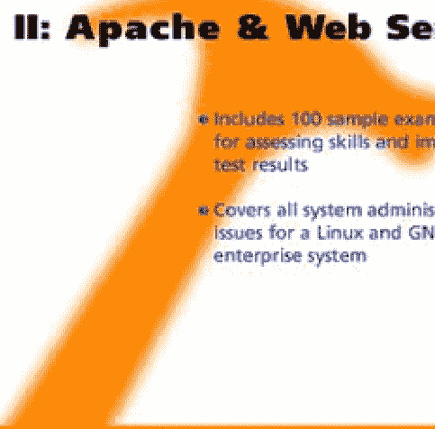
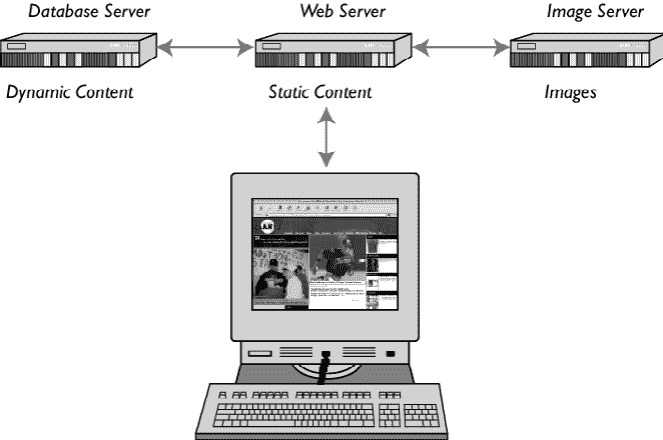
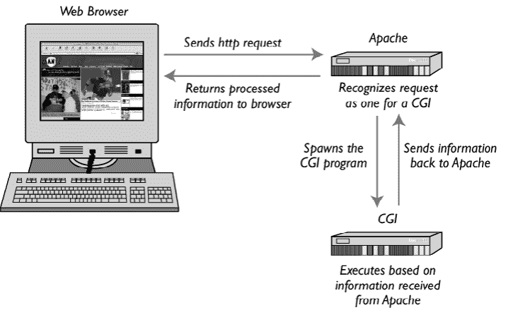
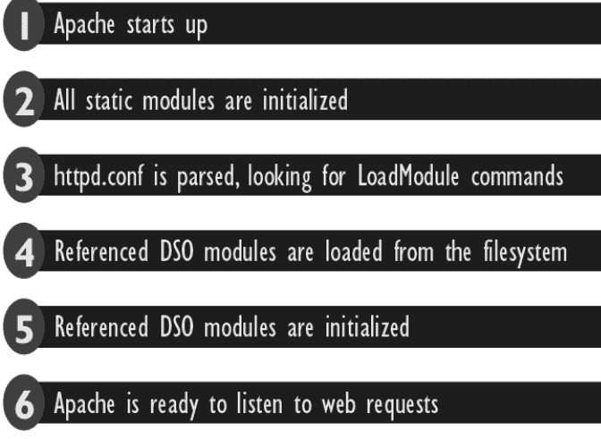
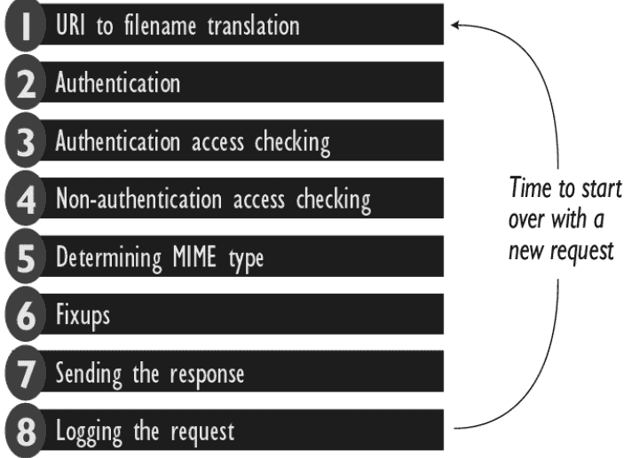
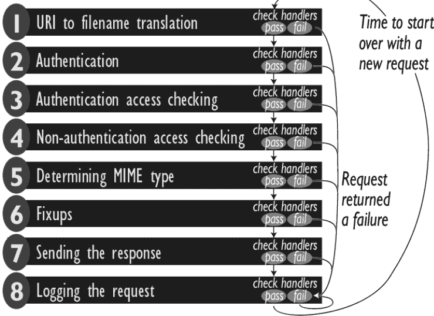
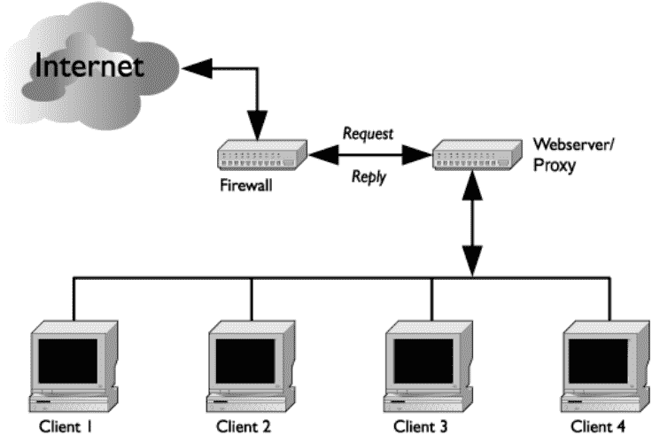
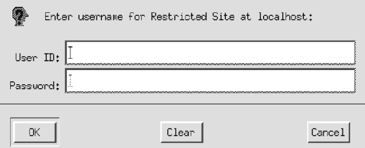
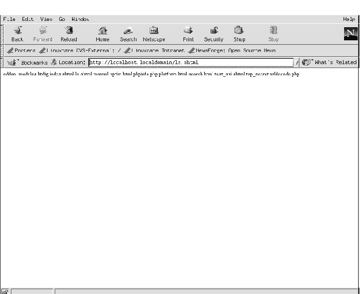
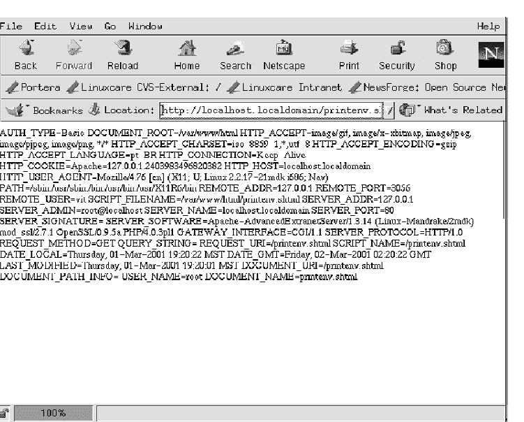

# SAIR Linux 和 GNU 认证二级、Apache 与 Web 服务器




Sair 开发团队


Sair 开发团队


Sair 开发团队


- 问题 199

- 实验 IV 创建简单的 CGI 脚本 213


# 致谢


# 致谢

总裁兼首席执行官：Tobin Maginnis 博士
经理：Ross Brunson, Trish W. Kemerely, Carlos Pruitt 和 Paul Tate
助理：Albert Phillips

承包商：Ancilla Allman, Joseph Cheek, Mike Hartley, Tony Inson,
Alex Larson, Rasmus Lerdorf, Shawn McKenzie, Martin Pool, Ed Riddle,
Andrew Scott, Troy Vytilo 以及 Susan Wood
技术贡献者：Stephen Agar, David Austin, Tim Bauer, Jerald
Jones, 以及 Oscar Wilson
技术编辑：Wesley Duffee-Braun

编辑：Annie Current, Summer Hill, Jamie Murpheus 以及 Samantha
Rayburn
质量保证：Jenna Johnson 和 Nikki Andersen
图形设计：Wesley Duffee-Braun 和 Leah Riley

Sail 开发团队还感谢 Saint Linux 和 GNU 的其他员工的支持——无论是在技术上的、专业的还是其他方面的——并感谢他们努力为 Linux 社区做出的贡献：

经理：Bob Buntny, Les Diggers, Hollis Green, Leigh Jennings, Alex
助理：Jimmy Palmer 和 Elizabeth Bonney
技术贡献者：Eric Blankenship, Beau Bourgeous, Jeff Britt, Brett
Brown, Jayaprakash Chilumula, Joanna Chong, John Burr, Stephen
Goertzen, Scott Hicks, Jacob Jenkins, David Kearns, Rebecca Love, Chris
Mavromahilis, Michael McGuire, Damir Mehmedic, Chance Mobley, Ken
Montgomery, Rufus Peebles, Ben Pharr, Evans Tyler, A. Simon,
Robert Thompson, Sonder Upadhy, William Vaughan, Sudharshan
Vazkhudai, James Walker, James Webster 以及 Dana Wilson

测试开发：Tammy Bets, Michael Billing 和 Richard Swinney
程序员：Michael Broadwater, Michael Calvi, Chris Mavromohihalis,
Rufus Peoples, William Vaughn 以及 Jeremy Webster
Web 与数据库：Shafi Al-meher, Steve DeVries, Nileshwar Dosoee,
Janakiram Goindarajaju, Mark Ketcham, Arlene Peneira, Kuberthinth
Ramanathan, Errol Sayre 以及 Julie Suey
系统：Patrick Hood, Ross Reed 以及 William Taylor

生产制作：Brandi Bailey 和 Scott Rails
销售与营销：Wendy Chambers, Scott Thompson, Shelley Ross,
Karan Mullen, Haley Teeg, Beth Odum, Shelley Robbins, Elise Knapp,
Ashly Ray 以及 Lori Redding

再次感谢 John Wiley & Sons 计算机出版，特别是 Cary Sullivan，感谢他们的远见、努力以及对自由开源软件未来的信念。

# 引言

欢迎阅读针对 Clair Linux 和 GNU 认证工程师的二级学习指南系列。这是一本针对 Clair Linux 和 GNU 认证（考试 3X0-202）的 Apache 学习指南。Apache 学习指南是 Clair Linux 和 GNU 认证工程师 (LCE) 证书的可选科目之一。

Clair Linux 和 GNU 认证工程师 (LCE) 的要求包括通过核心概念与实践考试 (3X0-201)，以及从其他可选科目通过额外的三门考试。除了本学习指南外，其他可能的可选领域还包括 Sendmail 和邮件系统组件、Samba 和资源共享组件，以及 PHP 和脚本。请访问 www.linuxcertification.com 查看可用课程列表。每门课程至少包含 32 时的课堂接触，这使得 LCE 等于在 LCA 之外额外的 128 小时课堂接触。获得 LCE 证书证明了具备作为高级 Linux 系统专家、系统管理员主管或其他其他形式的 Linux 系统管理人员工作的能力。

考试在 Prometric 和 VUE 测试中心提供。Prometric 在 141 个国家的 3500 个测试中心之一提供 Clair 考试。要参加考试，请直接拨打 Prometric 注册热线 1-888-995-6717。向客服代表咨询 3X0 系列的考试，他们将回答任何与考试相关的问题，说明当地测试中心，并根据需要安排考试。也可以在 www.prometric.com 注册考试。VUE 在 110 个国家的 2500 个测试中心之一提供 Clair 考试。要参加考试，请拨打 VUE 注册热线 1-952-995-8800。向客服代表咨询 3X0 系列的考试，他们将回答任何与考试相关的问题，说明当地测试中心，并根据需要安排考试。（注：由于原文后续存在大量重复的段落，根据“不要重复输出原文”的要求，此处仅翻译核心内容及首次出现的说明）。


- B. 最大客户端数
- C. TCP/IP 版本
- D. 主机查找
- E. FollowSymLinks 和 SymLinksIfOwnerMatch
- F. AllowOverride
- G. 内容协商
- H. 进程创建
- I. 进程终止
- J. 保持连接

### 2.1.30 虚拟主机简介
- A. 目录
- B. 网络地址

### 2.1.40 Apache 模块简介
- A. 什么是 CGI?
- B. 何时使用 CGI
- C. PHP – mod_php4
- D. MySQL
- E. mod_perl

### 2.1.50 Apache API 简介
- A. 模块
- B. 阶段简介
- C. 阶段详解
- D. 未来：Apache 2.0

### 2.1.60 日志记录

## 基础系统

### 2.2.10 多守护进程

### 2.2.20 配置
- A. 运行多个守护进程
- B. 多守护进程验证

### 2.2.30 httpd 进程数

### 2.2.40 别名

### 2.2.50 CGI 脚本
- A. ScriptAlias 指令
- B. AddHandler 指令

### 2.2.60 如何配置 CGI
- A. 在特定目录内启用

### 2.2.70 Apache 初始化

### 2.2.80 日志文件
- A. /var/apache/logs/access_log
- B. host
- C. ident
- D. autouser
- E. date
- F. request
- G. status
- H. bytes

### 2.2.90 日志文件格式
- A. 设计你自己的日志文件格式

## Shell 与命令

### 2.3.10 基准测试
- A. ab

## 系统工具

### 2.4.10 创建 CGI 脚本
- A. CGI 输出内容
- B. 服务器环境
- C. 表单处理器
- D. 基础重

### 2.4.20 性能监控
- A. mod_status
- B. ExtendedStatus
- C. server-info

### 2.4.30 某些良好的日志分析工具
- A. Webalizer
- B. Analog
- C. 使用
- D. 总结
- E. Logresolve

## Apache 与网络

## 运行原理

### 3.1.10 什么是 TCP/IP？Apache 如何使用它？
- A. HTTP
- B. 请求头

### 3.1.20 什么是 HTTP?
- A. HTTP/1.1

### 3.1.30 多主机

## 基础系统

### 3.2.10 虚拟主机
- A. 配置独立的守护进程

### 3.2.20 将请求导向虚拟主机

### 3.2.30 单守护进程/虚拟主机

### 3.2.40 基于 IP 的虚拟主机
- A. device
- B. aliasnumber
- C. address

### 3.2.50 基于名称的虚拟主机
- A. 使用单个 IP 地址的虚拟主机
- B. 使用混合方法的虚拟主机

## Shell 与命令

### 3.3.10 URL 重写 mod_rewrite
- A. CondPattern TestString

## Apache 与安全

## 运行原理

### 4.1.10 安全考量

### 4.1.20 安全策略
- A. hosts.allow 和 hosts.deny
- B. motd 和 issue 文件
- C. 美国加密出口法

### 4.1.30 身份验证

### 4.1.40 加固 Apache
- A. Apache 用户

### 4.1.50 漏洞
- A. 特洛马
- B. 病毒
- C. 蠕虫
- D. 伪装
- E. 缓冲区溢出

### 4.1.60 CGI 的安全问题
- A. 系统调用
- B. 缓冲区溢出

### 4.1.70 Apache 代理服务器
- A. Apache 代理的优势
- B. 获取 Apache 代理
- C. 获取文档
- D. mod_proxy

### 4.1.80 防火墙
- A. 防火墙类型
- B. 代理服务器防火墙
- C. IP 伪装代理服务器
- D. 防火墙与网络架构
- E. 加固防火墙机器
- F. 受到攻击时的处理

### 4.1.90 密码保护

## 基础系统

### 4.2.10 Apache、用户与组

### 4.2.20 权限

### 4.2.30 访问控制
- A. AllowOverride
- B. Order, Allow, and Deny
- C. 测试
- D. 匿名访问

### 4.2.40 设置 Apache 代理
- A. 代理特定指令
- B. 服务端配置

### 4.2.50 安全基础
- A. 权限
- B. 脚本
- C. SuExec
- D. 理想权限矩阵

### 4.2.60 用户访问控制
- A. 常见访问控制

### 4.2.70 启用来自主目录的内容
- A. UserDir html

### 4.2.80 访问指令
- A. AuthType
- B. AuthName
- C. AuthName "Private Documents"

### 4.2.90 在 httpdconf 中定义
- A. 在控制文件中定义

## Shell 与命令

### 4.3.10 校验和
- A. PGP 与校验和

### 4.3.20 密码身份验证
- A. 用户
- B. 组

## 系统工具

### 4.4.10 服务端包含
- A. 基础命令
- B. 变量

### 4.4.20 性能监控
- A. mod_status
- B. ExtendedStatus
- C. server-info

### 4.4.30 某些良好的日志分析工具
- A. Webalizer
- B. Analog
- C. 使用
- D. 总结
- E. Logresolve


## Apache 子进程

Apache 的工作原理是通过拆分自身并让 Apache 句柄处理进程。子进程是实际分发内容的进程。当 Apache 接收到请求时，它会选择一个空闲子进程来处理该请求。当子进程完成任务后，它会返回空闲状态，准备处理更多工作。

每个子进程在结束之前都会完成其请求列表。在子进程完成请求列表后杀死它，还可以消除这些已处理请求的副作用，例如内存泄漏。用户可以确定 Apache 一次生成的子进程数量以及它们的生命周期。默认情况下，每个子进程处理无限数量的请求。

## Apache 约定

学习 Apache 运行机制的一种良好方法是通过查看其配置。第一级配置发生在 Apache 编译时。基于 RPM 和 Debian 的安装默认会决定许多内容，但从源码编译时可以设置某些选项：

- Apache 是使用动态存储对象（Dynamic Stored Objects）还是静态链接模块（模块将在本章稍后部分详细介绍）
- 如果选择静态模块，则告诉 Apache 在此时将哪些模块编译到服务器中
- 默认位置
- Apache 文件和目录的布局

下一级配置发生在安装后的 http.conf 中。http.conf 是一个全局偏好文件，控制服务器的所有方面，包括以下内容：

- 谁可以访问 Web 服务器
- 服务器加载哪些动态模块
- 某些功能在何处发生
- Apache 将记录什么类型的信息
- Apache 控制的虚拟网站的位置
- 允许哪些内容

最后一级配置可能发生在 .httpaccess 文件中，取决于 httpd.conf 中的说明。这些是较小的本地文件，包含了适用于其所在目录的特定指令。

httpd.conf 文件包含了超过四分之三的 Apache 配置选项。它允许管理员将 Apache 配置到最佳性能水平。这是可能的，因为根据用户的需求，Apache 通过 httpd.conf 文件提供了多个级别的控制。这些级别被称为“作用范围”（scopes）。一个作用范围可以应用于整个系统、虚拟主机、绝对目录路径，甚至于单个文件。通配符可以与作用范围使用，以提供更大的自由度。使用“容器”（containers）来定义每个作用范围。

以下是四个主要的容器：

```
<Directory/path>
## 此容器适用于目录的文件系统位置。
## 例如，/home/user/public_html 将指向用户的 public_html 目录。
Directive
</Directory>
```

```
<Location /**>
## Location 适用于 url。例如，-/user 将指向用户的 public_html 目录。
Directives
</Location>
```

```
<VirtualHost host_name>
## VirtualHost 适用于你托管的虚拟 站点，例如 mysite.com
Directives
</VirtualHost>
```

```
<Files file_name>
## 适用于文件名，无论其位于何处。如果 file_name 为 index.html，那么所有 index.html 的所有实例（无论位于何处）都会受到你的指令的影响。
Direct
</Files>
```

## 指令 (Directives)

指令是给 Apache 的命令，用于控制其行为。指令是具有以下格式的单行文本：

```
Directive [option [option]]
```

如所示，关键字有多个选项。虽然在给定的作用范围内可以有多条指令，但每条指令必须单独成行。不存在于任何容器中的指令适用于所有作用范围。

## 处理程序 (Handlers)

当用户请求文件时，Apache 决定如何处理它。例如，如果用户访问文件 hiccup.cgi，Apache 必须将该文件作为 CGI 脚本执行，而不是尝试将其显示为 HTML 文件。处理程序帮助你将 Apache 指向正确的辅助应用程序。例如，添加一个名为 cgi-script 的处理程序，并将其应用于所有以 .cgi 结尾的文件。

## 日志 (Logging)

Apache 记录发生在其身上的几乎一切事情，从错误到 http 事务，甚至是 cookie。用户可以在 httpd.conf 文件中设置日志级别和记录的内容。

## 模块 (Modules)

模块是软件块（通常用 Perl 或 C 编写），允许对 Apache 进行自定义。例如，为了让 Apache 使用服务器端包含（Server Side Includes），用户必须安装该模块。

尽管 Apache 最初开发时就考虑到了这一概念，但在开发 Apache 第一版本时它还可用。尽管如此，由于当时已有计划，将动态模块加载集成到 Apache 服务器中可以相对容易实现。

在 Apache 的早期版本中，模块在编译期间静态链接到应用程序中。服务器的特定配置是在编译前的配置处理过程中定义的。使用这种方法，多年来开发了许多有用的模块，为 Apache 服务器提供了大量的自定义空间。自 Apache 1.3 版本发布以来，可以编译服务器和模块以支持动态加载。有了此选项，可以通过编辑配置文件后重启服务器来更改服务器配置（而不是重新编译服务器）。可以使用不同的配置文件在不同时间或同时启动服务器的不同实例，并运行相同的底层安装。

今天，只有两个模块必须编译到服务器中：http_core.c（它提供了服务器的核心功能）和 mod_so.c（支持动态共享对象 DSO 的模块）。

## 静态模块的优点

有时，将其他模块编译到服务器中可能是理想理想的，这样它们将始终可用，提供略快的响应速度并保证模块的特定版本。

## 静态模块的缺点

静态编译模块的缺点是它占用了空间。另一个缺点是升级模块需要重新编译服务器。

## DSO 的优点

在大多数情况下，可以在不重新编译服务器的情况下添加或删除功能是非常有用的。

## DSO 的缺点

使用 DSO 文件时，服务器启动比静态模块慢 20%，因为模块加载器必须找到所有模块、加载它们并解析符号。不过这不是严重的问题，因为启动是一个发生频率的事件。

在某些平台上，位置无关代码的地址比绝对地址更复杂。

## DSO 文件

自 DSO 文件出现以来，发行版通常会包含已安装的 Apache 服务器，并将源码安装变为可选。为了解决这个问题，作者们开发了 Apache 扩展（APXS）。这是一个安装时创建的 Perl 程序，提供了 Apache 头文件以及平台编译器和链接器标志。

## APXS 使用

以下代码提供了 APXS 使用的通用示例，构建可以动态加载到 Apache 的模块：

```
cd /path/to/the_module
$ apxs -c mod_new_module.c
$ apxs -i -a -n foo mod_new_module.so
```

## 浏览器

课程中你需要模拟客户端看到的内容。为了这种模拟，你需要 X Window 系统，以及一些额外的 Web 浏览器，即 Netscape 4.7x、Mozilla 和 Opera 的最新版。除了 X Window 系统外，建议安装这些浏览器。

Web 服务器极可能不需要图形界面或图形增强型浏览器，因为它们往往会占用大量的资源。然而，在整个课程中，它们将用于测试、示例和实验。此外，将建议甚至要求使用图形界面。

> 注意：整个课程中使用 Lynx 作为测试工具。我们推荐此程序而非 Netscape，因为 Netscape 给你的机器增加了资源开销。如果你更倾向于 GUI 工具，请使用 Netscape 代替 Lynx。

下载 Lynx 请访问 www.slcc.edu/lynx/realease。有关更多 Lynx 信息请访问：

+   www.lynx-browser.org
www.trill-home.com/lynx.html
www.slcc.edu/lynx/release-8-2/lynx2-8-2/lynx_help/
lynx_help_main.html

## 如何获取 Apache

首先，从 http://httpd.apache.org/dist/ 获取最新的源码。


在发布时，最新的稳定版本是 tar 包 `apache_1.3.19.tar.gz`。当然，发行版提供的 rpm 或 deb 文件也可以使用，但本文未涵盖这些安装方法。我们建议在从源码安装之前，删除任何之前安装的包。例如，使用 `rpm -e | grep apache`（对于基于 Debian 的安装，使用 `apt-get --purge remove apache`）。务必同时删除依赖项。如果不从源码安装，请使用适用于发行版的包进行升级。本章的剩余部分将基于上述源码安装说明。此外，路径和文件位置将根据具体的安装情况进行调整。

从源码安装是任何发行版的一个选项，本文将讨论这种方法。在移除所有之前的安装后，解压 tar 包。不要担心剩余的配置文件；但是，它们可能需要移动，因为源码安装可能不会覆盖某些文件。我们使用 `/usr/src` 作为起点，但后续步骤可以使用任何目录。

## 内容协商概述 (Overview of Content Negotiation)

现代浏览器允许用户对其从 Web 服务器接收的文件指明任何偏好。这包括内容类型（例如，对于压缩文件，优先选择 tar.gz 而非 zip 文件）、首选图像格式以及首选语言。

为了处理这些偏好，每个文档都有其自己的变体（variants）。这些变体之间的差异被称为文档的维度（dimensions）。Apache 可以沿着类型、编码和语言的维度进行协商。

## 类型 (Type)

每个文档都有一种类型。示例类型是 `text/html`。如果 Web 浏览器告诉 Apache 它只能接受特定类型的文档，则 Apache 将仅向浏览器提供该类型的内容。

## 编码 (Encoding)

如果资源被压缩或不是以最终的可用格式存在，则经过了编码。Web 传输目前仅识别 `compress` 和 `gzip` 编码。标准现在还可以处理其他可选的实验性编码。它们的编码前缀为 `x-`，例如用于 Stuffit 存档的 `x-stiff`。

```
AddEncoding x-stiff
```

## 语言 (Language)

这一次，在计算机术语中提到语言时，我们指的是人类的口语和书面语言。文件的语言通过为文件添加扩展名并使用 Apache 的 `AddLanguage` 指令来指定：`AddLanguage MIME extension [extension]`。

使用语言扩展名的文件或文档名称示例如下：

```
index.html.fi
dummy.zip
```

`httpd.conf` 文件中由文件语法指定的类型类型如下所示：

```
AddLanguage en.en
AddLanguage fi.fi
```

这两个指令指定任何文件名末尾带有 `en` 或 `fi` 语言标签的文件将分别归类为英语或芬兰语。它们还显示标签可以位于文件名最后一段之前的一个点位处。

## 选择文档参数 (Choosing Document Parameters)

Web 服务器可以处理多个变量维度，任何给定的客户端也是如此。客户端偏好按质量列出。质量值从 `0.000`（从不显示给定维度）到 `1.000`（最受喜的维度）。

例如，浏览器可能会在头文件中发送以下内容：

```
Accept-Language: en; q=1.0, no; q=0.7
```

这意味着浏览器首先接受英语，其次是挪威语。

## 多视图 (MultiViews)

服务器还可以对多个变体设置质量值。当它必须在多个对客户端同样接受的变体之间做出决定时，服务器将使用它自己的质量偏好。

`MultiViews` 指令 Apache 寻找与客户端偏好最匹配的文档。例如，客户端请求 `http://www.linux.org/index` 但没有文件完全匹配该请求，Apache 会扫描相关目录中 `index` 的变体。Apache 会找到所有名称相似的文件，然后检查客户端的内容偏好（类型、编码和语言）以找到合适的匹配项。

> 注意：扫描会大幅增加磁盘 I/O 活动，减慢 Web 服务器。

由于 `MultiViews` 固有的高 I/O 带宽，当指定 `Options All` 时，MultiViews 是关闭的。要开启 MultiViews，必须针对给定范围指定：

```
Options +MultiViews
```

这会将 MultiViews 添加到现有选项中。有关内容协商的更多信息，请访问以下两个网站：
http://httpd.apache.org/docs/content-negotiation.html
http://httpd.apache.org/docs/mod/mod_negotiation.html

## 浏览器与 HTTP (Browsers and HTTP)

在整个教程中都会提到客户端和代理（agents）的使用，通常避免提到 Web 浏览器。这是因为有多种方法使用 HTTP 连接到 Web 站点。事实上，在 Web 浏览器中执行的任何操作都可以通过命令行完成。

访问“I sit in Siberia”获取更多关于如何结合 CLI 和 HTTP 访问 Web 点的信息（http://www.pfuca.com/products/products.html），或者从 Telnet 窗口输入以下内容：

## 第一章 (Chapter 1)

按下回车键，然后输入：

```
GET /products/products.html HTTP/1.0
```

或者，也可以输入以下内容：

```
GET /products/products.html HTTP/1.1
Host: studi.twien.ac.at
```

然后按两次回车并等待输出，输出将类似于所示：

```
Bash$ wget yahoo.com
--15:29:43-- http://yahoo.com:80/
    => 'index.html'
15:29:44 (143.9 KB/s) - 100% saved in 1.0s
```

## 样式表 (Style Sheets)

Web 开发人员使用样式表来控制网站的各个方面（如字体、背景颜色或表格属性）。

尽管从 1997 年起就有了标准，但样式表仍然很稀有。由于多个版本的浏览器支持程度不同，专门的开发人员使用变通方法（workarounds）让每个浏览器以类似的方式显示内容。

![878462b9f2b7b0019db4a77480e642_37]

**图 1.2** Linux 下 Netscape 4.7 中样式表的截图。

## Java

可以使用 Java 为 Web 页面创建动态内容。有两种方法实现：一种是在 Web 页面中嵌入预制的 Java 小型程序（applet），另一种是编写自定义应用程序。Java 在复杂性上与 C++ 相似，这让许多人感到望而生畏。

虽然对于不熟悉面向对象编程的人来说，编写 Java 可能可能会困难，但嵌入 Java applet 是大多数 Web 开发人员可以轻松掌握的。

![878462b9f2b7b0019db4a77480e642_38]

通常嵌入 applet 的代码如下所示：

```
<applet codebase=".../LED" code="LED.class" width=500 height=48 align=center">
<param name="script" value="/scripts/tutorial.led">
<param name="border" value="2">
<param name="Bordercolor" value="100,130,130">
<param name="spacewidth" value="43">
<param name="w" value="122">
<param name="ht" value="9">
<param name="font" value="../fonts/default.font">
<param name="lsize" value="3">
<hr>
<BR>

<hr>
</applet>
```

## 安装与配置 (Installation and Configuration)

![878462b9f2b7b0019db4a77480e642_39]

**图 1.4** Linux 下 Mozilla 0.8 中样式表输出的截图。

## JavaScript

JavaScript 和 Java 在一些面向对象原理和相似的名称之外没有关系。JavaScript 由 Web 浏览器随其他 html 文件一起编译。Java 在提供时已经是编译好的，就像任何二进制文件一样。

和 Java 类似，JavaScript 提供动态内容。与 Java 不同，内容是由浏览器读取并编译的。如果你读过关于样式表的章节，这应该立即引起你的注意；多个版本的


不同平台上的各种浏览器在遇到不同版本的 JavaScript 时，可能会有不同的表现。大多数浏览器都尝试与脚本语言旧版本向下兼容，但这种兼容性可能难以实现。

## Base Systems

在任何机器上运行多服务器设置都需要比运行单应用程序机器更高级的基础系统（见图 1.5）。每个基础系统都必须支持所有可能运行的服务器的需求。接下来的章节将描述 Apache 所需的基础系统需求细节。这将让管理员在添加 Apache 时了解需要考虑的因素。

## 准备 Linux 环境

在创建任何服务器之前，应该对该服务器的硬件进行优化。接下来的章节概述了在开始安装之前准备 Linux 机器可以采取的通用步骤。



图 1.5 典型的多服务器设置准备 Linux 环境。

## RAM

对于处理大量 Web 请求的服务器来说，系统内存是最基本的资源。一旦物理内存耗尽，服务器机器将开始使用交换内存（swap），这会减慢运行速度。频繁监控服务器的内存使用情况。如果使用了大量交换空间，请增加机器上的 RAM 容量。

如果可能，进入将提供所有 Web 页面的根目录，并使用 `du -s` 命令查看存储所有页面需要多少内存。必须有足够的内存来存放所有 Web 页面，外加额外的 50MB 来存放操作系统和正在运行的应用程序。

## Hardware

对于高负载，越快越好。作为参考，配备足够内存的奔腾处理器机器也可以使用 10MB 连接的大部分带宽。这差异很大，取决于内容类型和工作条件等因素。自原始奔腾以来，硬件已经快了很多，因此根据现代标准，一台中规的机器仍然可以用于许多应用程序。

再次监控机器的性能。使用 `top` 或另一个程序来确定服务器的负载。如果平均负载经常很高，考虑升级到更快的系统。以下显示了 `top` 的输出：

```
11:56am up 11 days,  3:52,  1 user,  load average: 0.67, 0.21, 0.07
115 processes: 112 sleeping, 3 running, 0 zombie, 0 stopped
CPU states: 45.7% user, 54.2% system, 0.0% nice,  0.0% idle
Mem: 196000K av, 173800K used, 225200K free,  OK shared, 4948K buff
Swap: 249400K av, 28456K used, 220984K free, 51196K cached

PID USER     NI SIZE RSS SHARE STAT %CPU %MEM TIME  COMMAND
6247 apache 11 4580 4504 4288 S   9.6 2.2 0:00 httpd
6251 apache 11 4580 4504 4288 S   9.6 2.2 0:00 httpd
6249 apache 11 4580 4504 4288 S   9.0 2.2 0:00 httpd
6252 apache 11 4580 4504 4288 S   9.0 2.2 0:00 httpd
6248 apache 11 4580 4504 4288 S   8.5 2.2 0:00 httpd
6250 apache 11 4580 4504 4288 S   8.5 2.2 0:00 httpd
6253 apache 11 4580 4504 4288 S   6.2 2.2 0:00 httpd
6254 apache 11 4580 4504 4288 S   3.4 2.2 0:00 httpd
6255 apache 11 4580 4504 4288 S   1.7 2.2 0:00 httpd
6257 apache 11 4580 4504 4288 S   1.7 2.2 0:00 httpd
6259 apache 11 4580 4504 4288 S   1.7 2.2 0:00 httpd
6256 apache 11 4580 4504 4288 S   1.1 2.2 0:00 httpd
6258 apache 11 4580 4504 4288 S   1.1 2.2 0:00 httpd
6260 apache 11 4580 4504 4288 R   1.1 2.3 0:00 httpd
```


## Hard Drive

从 RAM 加载并运行网站可以提供最快的 Web 页面交付。遗憾的是，这种配置可能无法实现；因此必须访问硬盘。访问硬盘比 RAM 慢得多。为了抵消这种影响，使用硬盘。SCSI 硬盘通常比 IDE 硬盘快，因为它们对系统的负载较小。如果 Web 服务器已经让 CPU 压力很大，这是一个好主意。为了优化硬盘性能，请考虑以下几点：

- **交换空间**。人们经常忘记将交换空间放在与其不同的分区上。这样做会极大减慢服务器。如果可能，将其放在完全不同的磁盘上，可以将某些数据的传输率提高 2 倍。
- **多块硬盘**。Apache 会记录命中它的每一个请求。这意味着大量的磁盘写入。如果有多个硬盘，将 Apache 日志（以及任何其他日志）放在最快的硬盘上。
- **日志记录**。如果你不计划使用日志，请将其关闭。这样做将带来显著的速度提升。这可能是危险的，因为 Apache 会将每个请求和错误写入磁盘。如果需要日志，请定义与系统最匹配的级别。当 LogLevel 从 debug 更改时会有差异。

## Kernel

如果性能是一个主要问题，不要运行原生内核。Linux 发行版倾向于使用大型内核，以适应可能使用的各种硬件类型。结果是它可能比手动配置的内核慢。为了获得最高性能，根据机器所需的最小需求重新编译内核。它将更高效，并允许更多内容进入 CPU 缓存。使用 `/sbin/lsmod` 查看原生安装加载了哪些模块。以下是模块列表：

```
/sbin/lsmod
Module      Size Used by
ext4        39521 1 (autoclean)
soundcore   2800 0 (unused)
lockd      32208 1 (autoclean)
sdio       54640 1 (autoclean)
irda        80304 1
autofs      9456 2 (autoclean)
usb_storage 19184 0 (unused)
usb_core    43632 1
serial_core 5456 0 (unused)
ext3         10240 1
loop        6448 2
ext4_journal 22928 2
libpci_core  45984 0
```

Linux 内核总在变化。在每次发布中，包括对 Apache 至关重要的 TCP/IP 栈，关注网络代码的变化是一个特别好的主意，因为它们可能对希望提高 Web 服务器性能的用户有利。新版本的 Apache 可能也经过了更好的优化。对于生产系统，在使用新版本之前请等待几周以确保其稳定性。

## File Handles and Inodes

系统上打开的每个文件都必须有一个关联的文件句柄（file handle）或 inode，内核使用它来跟踪。最新的 Linux 内核默认限制为 4,096 个文件句柄。如果服务器同时打开很多文件，可能会超过该限制。在运行具有独立日志文件的多个虚拟主机时，这一点非常重要。

## Introduction to Packages

Linux 软件通常以名为“包”（package）的形式分发。包是将一组文件组合成单个文件，以简化分发和安装。一个良好的包系统还会包含依赖关系。包可以列出运行前必须安装的所有先决包。系统管理员的角色是通过安装、升级、删除和验证包来维护包。

三种最常见的打包格式是 RPM、DEB 和 tarball。RPM 用于 Red Hat、Canide 和大多数其他发行版。DEB 用于 Debian 和 Core Linux。Tarball 用于 Slackware 和源码包。

## RPM Security Tasks

以下是针对从互联网获取软件的安全建议列表。为了保持高水平的安全，请定期执行这些操作。

## Issues with Stock Vendor Basics

如果用户安装了发行版自带的软件包 Apache，他应该高度依赖软件包自带的文档。路径、服务器默认值、模块选项以及许多内容都遵循特定发行版的风格。

如果你的位置在模块方面有特殊需求，或者某些方面依赖 Apache，请获取源码并自行构建。请记住，预包发行版的构建方式是为了适应广泛的需求。如果你的需求超出了这个范围，你最终这样做这样做。一旦开始，过程就会变得容易。

## Validating Packages

验证包是将文件信息与原始包相同信息进行对比。验证会比较大小、MD5 和、权限、类型、所有者和组。

`rpm -V` 命令验证包。


例如，验证一个包含特定文件的包：

```
rpm -Vf /bin/vi
```

验证所有已安装的包：

```
rpm -Va
```

通过 RPM 包文件验证已安装的包：

```
rpm -Vp foo-1.0-1386.rpm
```

如果用户怀疑 RPM 数据库已损坏，这种验证将非常有用。

如果所有内容都验证通过，则不会有输出。任何差异将显示出来。输出的格式由八个字符组成的字符串，其中一个可能的字符 `c` 表示配置文件，然后是文件名。这八个字符中的每一个都代表将文件的某个属性与 RPM 数据库中记录的该属性进行比较的结果。

## 测试结果

单个句号 (`.) 表示测试通过。以下字符表示某些测试失败：

+ - S MD5 校验和。
- S 文件大小。
- L 符号链接。
- T 文件修改时间。
- D 设备。
- U 用户。
- G 组。
- M 模式（包括权限和文件类型）。

## 使用前验证更新

为了确保下载的包的完整性，请使用此命令：

```
rpm --checksig package.rpm
```

## RPM 安装

安装基于 RPM 的发行版只需调用 `rpm` 来提取并安装内容：

```
## rpm -i apache-x.x.x.rpm
```

安装完成后，Apache 应该准备好运行。

启动、配置和维护与源码安装大致相同。使用 Apache RPM 包的一个注意事项是，许多 Linux 发行版都实现了 RPM 管理包，但对于某些文件应该归何处并没有达成共识。如果用户找不到中央 Apache 或 http 目录，且安装似乎已正常完成，那么该发行版可能将 Apache 文件分散在几个目录中。使用此命令列出所有安装的文件：

```
## rpm -ql apache | less
```

用户应该能够在此列表中找到配置和内容目录。

使用 Red Hat 6.2 附带的 Apache 包，一些重要文件被放置在这里：

```
httpd.conf: /etc/httpd/conf
HTML 内容: /home/httpd/html
httpd 二进制文件: /usr/sbin
```

> 注意：此 RPM 不包含 apachectl，但在 /etc/rc.d/init.d 中有一个名为 httpd 的启动脚本。

具体情况因发行版而异。如果 RPM 安装不能满足你所在地区的需求，始终可以使用源码。源码安装还为用户提供了选择其想要启用的功能的机会。

> 注意：在某些发行版中，Apache 可能被拆分成多个包。例如，Red Hat 将某些文件拆分到了名为 devel 的包。该包包含了构建第三方模块所需的文件。

## 查找安全更新

要找到厂商安全更新的最新，请访问厂商页面或其镜像站点之一，并在搜索框中输入以下搜索字符串：

```
RH 6.2 + security
```

以下是截至 2001 年 1 月 t6.2 可用安全更新的简化屏幕截图：

```
From - Sun Jan 7 22:42:06 2001
ftp://rpmfind.net/linux/redhat/updates/6.2/i1386
Directory of /linux/redhat/updates/6.2/i1386
Current directory is /linux/redhat/updates/6.2/i1386
Up to higher level directory
SysVint-2.7-8.i1386.rpm
apache-1.3-24-6.2.i1386.rpm
apache-devel-1.3-24-6.2.i1386.rpm
apache-manual-1.3-24-6.2.i1386.rpm
auth_ldap-1.4.0-i1386.rpm
imap-2000-2.6.i1386.rpm
imap-devel-2000-2.6.i1386.rpm
kernel-2.2-16.i1386.rpm
kernel-BOOT-2.2-16.i1386.rpm
kernel-doc-2.2-16.i1386.rpm
kernel-headers-2.2-16.i1386.rpm
mod_perl-1.2.3.i1386.rpm
netscape-common-4.7-0-6.2.i1386.rpm
netscape-navigator-4.7-0-6.2.i1386.rpm
ns_ldap-2.1.i1386.rpm
openssl-1.2.9-6.2.i1386.rpm
openssl-devel-1.2.9-6.2.i1386.rpm
openssl-0.9sa-25-6.2.i1386.rpm
openssl-devel-0.9sa-25-6.2.i1386.rpm
openssl-perl-0.9sa-25-6.2.i1386.rpm
openssl-python-0.9sa-25-6.2.i1386.rpm
perl-5.05-i1386.rpm
php-3.0-17-6.2.i1386.rpm
php-imap-3.0-17-6.2.i1386.rpm
php-ldap-3.0-17-6.2.i1386.rpm
php-manual-3.0-17-6.2.i1386.rpm
php-postgresql-3.0-17-6.2.i1386.rpm
python-1.5.27-x.i1386.rpm
python-xmlpc-1.2.1-x.i1386.rpm
```

## 通过 RPM 添加模块

在基于 RPM 的发行版中添加新模块只需调用 RPM 来升级/安装新包：

```
## rpm -Uvh apache-x.x.x.rpm
```

升级完成后，Apache 应该准备好运行。

## 启动 Apache

Red Hat 使用 httpd 来启动服务器。

httpd 是一个可以启动 Apache 守护进程的脚本（位于 /usr/sbin）。该脚本位于 /etc/rc.d/init.d/httpd。输入 httpd --help 可查看用法：

```
Usage: ./httpd {start|stop|reload|status}
```

显示命令行选项如表 1.1 所示。

## 本地验证

验证 Apache 的最后一步是测试服务器。当守护进程运行时，它应该监听环回设备的 80 端口。通常环回设备位于 127.0.0.1，可以使用任何浏览器进行此测试。使用目标地址测试服务器：

```
## lynx localhost
```

应该加载以下页面：

如果你看到此页面，说明该站点的所有者已成功安装了 Web 服务器。他们现在需要向此目录添加内容并替换此占位页面。

## 表 1.1 httpd 选项

| | |
| --- | --- |
| -D name | 为 <name> 指令定义名称 |
| -d | 指定替代的 ServerRoot |
| -f | 指定替代的配置文件 |
| -C | 读取配置文件之前处理 |
| -c | 读取配置文件后处理 |
| -v | 显示版本号 |
| -V | 显示编译设置 |
| -h | 列出可用选项 |
| -l | 列出编译模块 |
| -L | 列出可用配置指令 |
| -S | 显示解析后的设置（仅限当前设置） |
| -t | 对配置文件进行语法检查（带检查） |
| -T | 对配置文件进行语法检查（不带检查） |

如果有错误，请验证输入是否正确并重试。如果测试页面仍然未加载，请返回安装部分重新执行配置和编译步骤。

## 网络验证

一旦 Apache 在本地系统上运行正常，用户就可以进行网络测试。如果本地局域网上有其他机器，用户可以访问任何一台机器并使用浏览器。使用机器网络接口的 IP 地址访问服务器，以消除 DNS 可能引起的任何问题。

通过调用不带任何选项的 ifconfig 可以找到系统中所有可用网络接口的列表：

```
## ifconfig
eth Link encap:Ethernet HWaddr 00:80:C8:14:73:77
inet addr:10.168.1.2 Mask:255.255.255.0
UP BROADCAST RUNNING MTU:1500 Metric:1
RX packets:20477 errors:0 dropped:0
TX packets:20895 errors:0 dropped:0
collisions:0 txqueuel:1
```


## 源 RPM 包

使用 RPM 进行软件开发遵循严格的阶段：从应用了本地补丁的源码开始，经过配置、编译和安装。构建的最终输出通常包含一个源码包和一个或多个可以安装的二进制包。整个构建过程在一个称为 spec 的文件中被描述。

RPM 侧重于封装生成二进制包所需的所有组件，这种做法防止了通用代码的重用。这种封装被称为源 RPM（source RPM），由源码、本地补丁和描述构建过程的 spec 文件组成。spec 文件增加了某些配置信息，例如要使用的编译器标志以及构建该包的架构。其他信息在准备软件包时用处不大。

下面的示例遵循了 SRPMS 的结构。假设用户拥有有一个针对 Apache 程序的红 Hat CD-ROM RPM 包：

```
## ls
COPYING SRPMS TRANS.TBL
## cd SRPMS
## ls apache*
apache-x.x.x.src.rpm
# rpm -i apache-x.x.x.src.rpm
## cd /usr/src/redhat/SPECS
## ls
apache.spec
## ls /usr/src/redhat/SOURCES/
```

`rpm -i apache*` 命令安装了 `/usr/src/redhat/SOURCES` 目录下的补丁。specs 文件描述了特定架构的编译过程。

## 安装

在解压 tar 包之前，请检查其内容。要做到这一点，请运行以下命令：

```
tar -tzvf apache_1.3.19.tar.gz
```

要解压 tar 包，首先切换到将解压的目录。然后，执行以下命令：

```
tar -xzvf apache_1.3.19.tar.gz
```

## 编译

要从源码编译程序，首先切换到包解包目录。这被称为包的顶层目录。它通常命名为类似 `apache_1.3.14` 的名称。

```
:/usr/src$ cd apache_1.3.19
```

解压 tar 包并进入生成的子目录后，执行大多数源码安装通用的步骤：运行 `./configure --help` 的屏幕转储。

```
:/usr/src/apache_1.3.14$ /configure --help | less

--activate-module=scr/modules/auth_mysql/libauth_mysql.a
auth_mysql modules.
```

在编译服务器之前，向配置文件中添加以下行：

```
AddModule modules/standard/mod_rewrite.o
--activate-module=scr/modules/auth_mysql/libauth_mysql.a
# ./configure --enable-module=so --enable-rule=EAPI
```

```
mod_status, --update
Usage: configure [options]
Options: [描述后的括号内为默认值]
通用选项:
```

- --quiet, --silent	不打印消息
- --verbose, -v	打印更多消息
- --shadow=[~DIR]	切换到影子树（DIR 下）以处理消息

- 独立选项：
- --help, -h	打印此消息
- --show-layout	打印安装路径布局（检查并调试）

- 安装布局选项：
- --layout=[F]:ID	使用安装路径 ID（来自文件 F）
- --target=TARGET	使用 basename TARGET 安装与名称关联的文件
- --prefix=PREFIX	在 PREFIX 中安装依赖架构的文件
- --exec-prefix=EPREFIX	在 EPREFIX 中安装依赖架构的文件
- --bindir=DIR	在 DIR 中安装用户可执行文件
- --sbinir=DIR	在 DIR 中安装管理员可执行文件
- --libexecdir=DIR	在 DIR 中安装程序可执行文件

这将创建一个子目录并将包扩展到其中。

# 安装与配置 31

```
--mandir-DIR 在 DIR 中安装手册页
--sysconfdir-DIR 在 DIR 中安装配置文件
--datatdir-DIR 在 DIR 中安装只读数据文件
--iconsdir-DIR 在 DIR 中安装只读图标文件
--htdocsdir-DIR 在 DIR 中安装只读文档文件
--cgidir-DIR 在 DIR 中安装只读 cgi 文件
--included-DIR 在 DIR 中安装包含头文件
--localstatedir-DIR 在 DIR 中安装可修改数据文件
--runtimedir-DIR 在 DIR 中安装运行时数据
--logfile-DIR 在 DIR 中安装日志文件数据
--proxycachedir-DIR 在 DIR 中安装代理缓存数据
```

配置选项：

- --enable-rule=NAME 启用名为 'NAME' 的特定规则
--disable-rule=NAME 禁用名为 'NAME' 的特定规则
--add-module=FILE 动态激活 & 3方模块
--activate-module=FILE 动态激活 3方模块
--permute-module=N1:N2 动态地用模块 'N2' 替换特定模块 'N1'
enable-module=NAME 启用名为 'NAME' 的特定模块
--disable-module=NAME 禁用名为 'NAME' 的特定模块

| | 动作 | 别名 |
|---|---|---|
| [asis]-yes | auth-no | auth_dbme=no |
| [auth-db]-no | auth-digest | auth-yes |
| [autoindex]-yes | cert_meta=no | cgi-yes |
| [digest]-no | dir-yes | env-yes |
| [example]-no | expires-no | headers-no |
| [image]-yes | include-yes | info-no |
| [log-agent]-no | config=yes | mmap_static=no |
| [mime-magic]=no | mime-yes | rewrite=no |
| [rewriteenv]-yes | so | spelling-no |
| [status]-yes | unique_id | userdir-yes |

- --enable-shared-NAME 将名为 'NAME' 的模块构建为 DSO
--disable-shared-NAME 禁用将名为 'NAME' 的模块构建为 DSO
--with-perl=FILE 指向 Perl 解释器的路径
--with-port=PORT 为 httpd.conf 设置端口号
--without-support 禁用工具的构建和安装
--without-confadj 禁用配置中的用户调整
--without-execstrip 在安装时不剥离可执行文件的符号
--server-uid=UID 设置服务器应以 nobody 身份运行
--server-gid=GID 设置 Web 服务器用户的组 ID 为

suEXEC 选项：

- --enable-sexec 启用 suEXEC 功能
--suexc-caller=NAME 设置允许的调用者用户名
--suexc-docroot=DIR 设置根目录 PREFIX/share/htdocs

--suexc-logfile-FILE 设置日志文件 PREFIX/var/log
--suexc-userid-DIR 设置用户目录 DIR
--suexc-uid-UID 设置用户 ID 为 UID
--suexc-gid-GID 设置组 ID 为 GID
--suexc-path-PATH 设置路径为 PATH
--suexc-umask-UMASK 设置掩码为 UMASK

# 已弃选项：

--layout 仅：使用 --layout
--compat 仅：使用 --with-layout

大多数发行通常以对象模块的形式提供，提供了选择。Apache 默认提供的对象模块通常是理想的。因此，编译它们并允许根据需要加载额外的模块。默认是编译所有模块。

# --with-layout=RedHat

这将使你的 Apache 文件符合红 Hat 的布局。以下是配置行：


如果可用这些工具之一，它将运行一系列测试并报告程序是否能够正常运行。可能可以在安装之前运行程序进行测试。请务必指定程序从当前目录运行：

```
:/usr/src/apache_1.3.14$/program
```

许多程序在安装之前无法运行。假设没有错误，请继续进行安装：

```
:/usr/src/apache_1.3.14$ make
:/usr/src/apache_1.3.14$ make install
```

这将把所有程序及其关联文件复制到适当的位置。一旦安装过程完成，请退出 root 账户并尝试运行程序。

此过程通常需要一段时间，具体取决于软件包的大小以及计算机的内存和速度。进程完成后，用户将返回命令行提示符，且不显示任何错误信息。如果发生错误，必须确定原因。常见的原因是缺少软件包。

## 系统工具

系统工具简化了 Apache 的安装和维护。它们还缩短了更新时间并缩小了安装错误的范围。工具通常用于普通的 Web 服务器安装，从而消除了源码下载和编译的步骤。大多数用户将使用工具来更新和维护软件，因为工具为 Apache Web 服务器提供了操作、维护和配置的基础。

## httpd 守护进程

Web 服务器使用 httpd守护进程通过 HTTP 协议与客户端（如 Netscape）通信。httpd守护进程通常运行在端口 80。它为用户提供了许多 Apache 配置和自定义选项。

## 默认值

运行单个守护进程时使用默认值即可，不需要提供特殊内容。在编译之前不进行任何更改，将产生一个编译后即可立即使用的基础 Web 服务器。本节将涵盖其中一些默认值。

对于 Red Hat，Apache 的主目录将是 /usr/local/apache。（Debian 的默认值为 /etc/apache，Slackware 的默认值为 /var/lib/apache。）所有支持文件和目录都将基于此位置为基准。

服务器将监听主机上存在的所有网络接口。这可能是需要的，也可能是不需要的，但对于默认安装来说，它确保了 Apache 将在活动接口上监听并可以进行测试。

系统提供了路径、启动配置和测试页面。

使用默认值进行配置只需在源码目录中调用以下命令：

```
$ ./configure
```

这非常简单。自 Apache 1.3 发布以来，为了提供这种清洁且易于安装过程已经付出了大量工作。

## 自定义

如前所述，Apache 使用类似于 GNU configure 脚本来为编译做准备工作。Apache 脚本的一个方面是 configure 可以作为参数接受的各种选项。对于常规安装，不需要学习所有选项。

另一个重要的配置选项涉及修改步骤，我们将简要讨论这些步骤，为后续章节中 CGI 脚本等需要的需求做准备。

Web 服务器通常希望具有额外的功能，例如脚本或数据库集成。此外，管理员可能不希望 Apache 位于默认目录 /usr/local/apache。要指定对默认值的更改，可以将它们作为 configure 的选项添加到命令行中。带有命令行选项调用 configure 通常具有如下形式：

```
$ ./configure --some_option=argument_for_thatoption
```

因此，一个真实的选项类似于：

```
$ ./configure --prefix=/www
```

--prefix 选项告诉 configure 脚本服务器将安装在系统的位置。查看前面的示例，可以看到 Apache 的所有文件都将位于 /www 目录下。--prefix 的参数是自由形式，因此如果使用 --prefix=/missouri，安装脚本将使用 missouri 作为 Apache 的主目录。

另一个选项是 --with-layout=GNU。这会导致文件安装在符合 GNU 标准的位置。这是大多数发行版安装其 Apache 软件包的方式。

## 模块与 SSL

此模块使用基于规则的重写引擎来重写请求的 URL。此功能于 Apache 1.2 及更高版本中。通过其强大的 URL 操作机制，Web 服务器可以检查到达的每一个 URL，查看其是否符合重写规则指定的任何模式。如果匹配成功，Apache 将内部使用该规则重写 URL。在这里，该模块在每个服务器上下文（http.conf）和每个目录上下文（htaccess）中对完整 URL 进行操作。要包含 mod rewrite，请在编译服务器之前向配置文件中添加以下行：

```
AddModule modules/standard/mod_rewrite.o
```

mod_rewrite 的另一个用途是配合代理服务器，确保人们仅在来自给定 URL（此处为 .linux.org）时才使用代理：

```
RewriteRule ^[proxy:http://\\.linux\.org/] - [forbidden]
```

Apache 1.3 HTTP 服务器已成功构建并安装。要验证 Apache 确实正常工作，首先检查最初创建或保留的配置文件 /etc/httpd/conf/httpd.conf；然后可以通过运行以下命令首次启动 Apache：

```
$ /usr/sbin/apachectl start
  Thanks for using Apache.
  The Apache Group
  http://www.apache.org/


## 模块性能与功能

Apache 实现了一个高性能、高稳定性的 Web 服务器。Apache 与 Linux 的结合提供了 Web 服务器至关重要的模块化设计、速度和稳定性。Apache 带有许多增加其功能性的模块。某些模块是默认安装并启用的；另一些则需要在编译时选择。如前所述，有三种方法可以启用模块。模块的实现取决于如何通过 configure 启用。

Apache 自带但默认未启用的模块之一是 mod_info。该模块允许通过方便的 Web 界面访问服务器的详细信息。要作为静态模块启用，请调用 configure：

```
$ ./configure --enable-module=info
```

以下是带有 DSO 支持启用相同模块的选项：

```
$ ./configure --enable-module=info \
--enable-shared=info
```

如果有多个选项，使用换行转义字符 (\) 可以允许所有内容以协调的方式出现在命令行中。

为了在不指定每个功能的情况下简单地尝试可用选项，可以使用以下选项将大多数模块作为 DSO 模块包含：

```
$ ./configure --enable-module=most \
--enable-shared=max
```


有关用于 `configure` 的许多可用参数的详细信息，请参阅主源码目录下的 `INSTALL` 文件。

## 配置文件

Apache 源码树中有多个配置文件。强烈建议不要修改这些文件。用户可能想读取某些文件以了解安装是如何工作的，但修改它们可能会对安装方式产生不可预知的结果。为了实现可靠的编译安装，应当严格通过 `configure` 选项进行自定义。在调用带参数或不带参数的 `configure` 后，脚本在准备源码时会有一些文本输出。大多数安装了开发者选项的系统都应该包含编译所需的所有内容。否则，`configure` 脚本将停止并报错，提供可能出现问题的提示。请根据错误信息确定应该安装哪些额外的组件。

## CGI 脚本

为整个服务器开启 cgi 脚本会带来安全威胁。有人可以在 Web 目录或其他指定位置之外创建一个 .cgi 文件；他可以在 Web 管理不知道的未来某一天执行该脚本。简而言之，最好在一个目录中允许 .cgi 文件。监控一个目录比监控整个服务器要容易得多。

接下来的子节概述了几个你应该熟悉的、用于启用 CGI 脚本的指令。

## ScriptAlias 指令

`ScriptAlias` 指令定义了存放 CGI 脚本的目录。放置在此处的任何脚本，只要权限正确，将对任何目录都可用。

```
ScriptAlias /cgi-bin /usr/local/share/apache/cgi-bin/
```

## AddHandler 指令

`AddHandler` 指令告诉 Apache 在 CGI 脚本上查找扩展名。

## 请求处理

来自网络的请求将通过 Apache 内部的一系列阶段。在每个阶段，模块可能会处理该请求。每个钩子（hook）可以成功、推给另一个模块，或返回 HTTP 错误响应。此外，它们还可以修改后续阶段看到的请求对象。

这些阶段顺序如下：

- 1. URI 到文件名翻译
- 2. 身份验证
- 3. 身份验证访问检查
- 4. 非身份验证访问检查
- 5. 确定 MIME 类型
- 6. Fixups（修复）
- 7. 发送响应
- 8. 记录请求

这些阶段与 Apache 文档中的阶段对应。

模块可能会启动子请求，在子请求中，Apache 会询问自身响应客户端请求会发生什么。例如，生成目录索引的模块（mod_autoindex）会执行子请求，以查找目录中每个文件的信息。

除了子请求，Apache 还可以将请求重定向到不同的位置。Apache 有两种实现此操作：内部重定向（即它生成由新请求将产生的内容），或外部重定向（即 Apache 向客户端发送响应码，以指定要使用的另一个位置）。

## 安装摘要

安装 Apache 的步骤与其他应用程序和服务器步骤类似。Apache 的配置将在本章稍后部分详细讨论。以下是安装 Apache 的通用步骤：

- 如果是源码形式，验证文件。
- 将压缩包解压到临时目录。
- 进行配置。
- 进行编译。
- 在本地系统和网络上验证安装情况。
- 添加内容。

## 安装与配置

在安装任何新产品后，了解该产品的改进情况以及出现的任何问题是一个好主意。Apache 组织为此目的发布了一个邮件列表。向 announce-subscribe@apache.org 发送消息（主题和内容将被忽略）。你将收到一封包含如何验证你的订阅说明的确认消息。此邮件列表是单向的，仅用于公告，消息将直接来自 Apache。一个极受欢迎的产品的方面是，许多人不断努力寻找攻击方法，而同样数量的人正在努力防御此类攻击。Apache 组织在通知用户问题及其解决方案方面在软件行业中拥有最好的记录之一。

## 配置 Apache 日志

Apache 日志默认采用常用日志格式（CLF）。Apache 在 CLF 中跟踪的字段有 host、ident、autouser、date、request、status 和 byte。

## host

这是请求来源的 IP 地址。

## Identity Check

Apache 可以在传入的 http 连接上查询客户端的 identd（参见 RFC 1413）。要开启此功能，请编辑 http.conf 文件并添加：

```
IdentityCheck On
```

> 注意：identd 检查可能非常慢，因此不应在繁忙的 Web 服务器上使用此功能。identd 检查也可以伪造，因此不应完全信任该信息。

## autouser

如果请求的文件需要身份验证，则经过验证的用户 ID 将放在此字段中。

## date

此字段包含请求的日期和时间。正确的格式是：05/May/2000:12:08:19 -0700。

## request

这是从客户端收到的实际 HTTP 请求，括在引号中。

## status

这是 Apache 返回给客户端的三位 HTTP 状态码。其中，最常见的有 200、202、301、400、302、403 和 404。常见状态码如表 1.2 所示。

## bytes

这是发送给客户端的响应中的字节数，不包括响应头。

## Alias

`Alias` 指令是为我们的 URL 创建等同符号链接的方法。

### Authentication-mod mod_access 和 mod_auth

`Alias` 命令允许修改对请求的响应。常用的引用可以放置在实际位置，该位置与服务器提供的位置不同。

要格式化别名，请使用：

```
## Alias filename
Alias /icons/ /usr/local/share/apache/icons/*
Alias /gifs/ /web/ncsa/gifs/
Alias /gif/ /web/ncsa/htdocs/gif/
```

**表 1.2 状态码及其含义**

| CODE | MEANING |
|---|---|
| 200 | 一切正常 |
| 202 | 已接受 |
| 301 | 永久移动 |
| 302 | 临时移动 |
| 400 | 错误请求 |
| 403 | 禁止访问 |
| 404 | 未找到 |

mod_access 和 mod_auth 模块提供了 Apache 的身份验证功能。Apache 的工作原理实际上非常简单。首先，客户端向 Apache 发送带有密码的名称。Apache 决定是否允许主机访问资源。如果是，Apache 将通过验证名称和密码来检查客户端是否有访问权限。例如，为了防止 hello.com 之外的任何人访问 /programs/names.html 文件，只需在 httpd.conf 中输入内容：

```
<Location /programs/names.html>
Order deny, allow
Deny from all
Allow from .hello.com
</Location>
```

在较版本的 Apache 中，文件名相对于服务器根目录，或者被认为是绝对路径。如果文件名以 / 开头，则称为绝对路径。

## 模块

为 Apache 添加模块是其灵活性的关键。某些模块是标准安装的基础功能。发行版中还包含了另外 50 个模块，允许进一步自定义。其中一些额外模块是默认启用的，使得服务器在首次安装时具有比基本更多的功能。

如果包含的模块无法满足特定需求，许多作者编写了可以从互联网下载的额外模块。可以在 Apache 网站上找到组织的模块列表：
www.apache.org/
www.apache.org/dist/contrib/modules/
http://modules.apache.org/search

如果使用互联网上的模块，请仔细阅读该模块的文档！某些模块要求以特定且独特的方式配置 Apache。

## 配置方法

安装 Apache 后，配置文件将放置在 /configuration 目录中，该位置是在编译时定义的。


## 编译时设置使用 -V 命令行标志。使用 `httpd -V` 查看安装的编译时设置：

Server version: Apache/1.3.14 (Unix) (Red Hat/Linux)

```
Server built:      Mar  1 2000 13:37:34
Server's Module Magic Number: 19990320:7
Server compiled with....
- D EAPI
- D HAVE_MMAP
- D HAVE_SHMGET
- D USE_SHMGET_SCOREBOARD
- D USE_MAP_FILES
- D USE_FULL_SERIALIZED_ACCEPT
- D HTTP_ROOT="/usr"
- D SUEXEC_BIN="/usr/bin/suex"
- D DEFAULT_PIDLOG="/var/run/httpd.pid"
- D DEFAULT_SCOREBOARD="/var/run/httpd.scoreboard"
- D DEFAULT_LOCKFILE="/var/log/httpd.lock"
- D XFERLOG="/var/log/httpd/access_log"
- D ERROR_LOG="/var/log/httpd/error_log"
- D TYPES_CONFIG_FILE="/etc/httpd/mime.types"
- D SERVER_CONFIG_FILE="/etc/httpd/httpd.conf"
- D ACCESS_CONFIG_FILE="/etc/httpd/access.conf"
- D RESOURCE_CONFIG_FILE="/etc/httpd/conf/srvm.conf"
```

Apache 在配置文件 `httpd.conf`（由 `SERVER_CONFIG_FILE` 变量定义）中查找设置。使用 `-f` 命令行标志覆盖配置文件的位置：

```
# httpd -f /etc/httpd/httpd.conf
```

> 注意：这些标志适用于 Apache 1.，并随 Apache 的后续发布而变化。请访问 www.apache.org 获取更新。

其他 httpd 运行时标志包括：

```
# httpd -h
Usage: httpd [-D name] [-d directory] [-f file]
[-C "directive"] [-c "directive"] [-v] [-h] [-l] [-S] [-T]
```

## 启动时启动 httpd

大多数用户希望 Apache 在系统启动时自动启动。每个 Linux 发行版都有不同的实现方法；某些 RPM 和 DEB 包可能会将 Apache 添加到启动脚本；其他则不会。在 Red Hat 6.2 系统上，除非与操作系统同时安装，否则 RPM 可能不会设置 Apache 启动。要启用启动功能，启动脚本通常位于 `/etc/rc.d`。假设 Apache 安装在 `/www/`，添加以下条目：

```
/www/apachectl start
```

## 设置 Apache

大部分 Apache 设置都是通过 `httpd.conf` 文件完成的。如果在配置期间 Apache 运行，必须采取某些步骤。这些步骤在后续章节中概述。

## 启动和停止 Apache

当用户更改服务器（例如修改 `httpd.conf`）时，应重启 Apache 使更改生效。Apache 自带了 `apachectl` 脚本可用于此目的。`apachectl` 的工作原理类似于发行版在 `/etc/rc.d/init.d` 目录中的脚本。指定 `start` 和 `restart` 来启动或停止 Apache 服务器。

## 手动启动 httpd

要使用 `apachectl`，提供脚本路径以便使用 `apachectl`。在不提供任何选项的情况下，`apachectl` 将显示如下帮助屏幕：第 46 页

```
usage: /usr/sbin/apachectl (start|stop|restart|fullstatus|status|graceful|
  configtest|help)
```

```
start           启动 httpd
stop            如果运行则通过发送 SIGHUP 停止 httpd
restart         重启 httpd 显示完整状态页面；需要 lynx 和 mod_status
fullstatus      显示短状态页面；需要 lynx 和 mod_status
status          如果不运行则通过发送 SIGUSR1 执行优雅重启
configtest      进行配置语法测试
help            显示此屏幕
```

## fullstatus

fullstatus 需要 lynx 和 mod_status 模块来提供服务器状态的详细描述。

`apachectl fullstatus` 命令的输出如下：

```
## apachectl fullstatus
Apache Server Status for localhost.localdomain
Server Version: Apache/1.3.14 (Unix) PHP/3.0
Server Built: Dec 4 2000 09:46:50

Current Time: Thursday, 28-Dec-2000 19:34:56
Restart Time: Thursday, 28-Dec-2000 19:34:18
Parent Generation: 0
Server uptime: 30 seconds
Total accesses: 1 - Total Traffic: 2 kB
CPU Usage: u0: s0 c0 - .0263% CPU load
.0263 requests/sec - 53 B/second -2048 B/request
正在处理的请求，4 个空闲服务器
```

> 评分板键："." 等待连接，“S" 正在启动，“R" 读取请求，“W" 发送响应，“K" 保持连接（读取），"D" DNS 查询，“L" 记录日志，“G" 优雅结束，“.” 无当前进程的空槽

| Srv PID | Acc CPU | MSS Req | Conn Shld | Client | Vhost Request |
| :--- | :--- | :--- | :--- | :--- | :--- | :--- | :--- | :--- |
| 0-0 | 9886 | 0/1 .001 | 38 | 88 | 0.0 | 0.00 | 127.0.0.1 | localhost.localdomain GET /server-status HTTP/1.0 |
| 1-0 | 9887 | 0/0 W | 0.00 | 38 | 119647253 | 0.0 | 0.00 | 127.0.0.1 | localhost.localdomain GET /server-status HTTP/1.0 |

## 安装与配置

## configtest

使用 configtest 在不重启服务器的情况下检查配置的正确性：

```
## apachectl configtest
Syntax [ OK ]
Checking configuration for httpd: [ ok ]
```

## graceful

使用 `graceful` 优雅地重启 Apache。当用户使用 `graceful` 重启时，Apache 将等待处理所有请求，避免 `apachectl stop` 带来的强制停中断。


## 安装与配置 49

默认索引有一个 Apache 官方文档的链接。在本章中，我们将一直引用本地副本，也可以在 apache.org 网站找到它。

不同的发行版执行不同的函数。默认安装类似于：

```
/etc/httpd/conf/
access.conf httpd.conf default mime.types
srm.conf.default access.conf default magic mime.types.default httpd.conf
magic.default srm.conf
```

这些是原始配置文件。过去，Apache 使用三文件配置风格，所有通用选项都在 `httpd.conf` 中。所有依赖资源的配置（如虚拟服务器、目录、文档根，以及在文件系统中指定的与 Apache 相关的所有指令和选项）都在 `srm.conf` 中。任何与这些资源访问相关的配置（例如 Apache 阻止访问某些目录以及开启身份验证）都进入 `access.conf`。三个配置文件非常令人困惑；所有的 Apache 配置都可以放在这些文件中的任意一个。

这种过时的配置文件方式完全是任意的。系统可以拥有长度为零的 `httpd.conf` 和 `srm.conf`，而所有配置都在 `access.conf` 中，系统将执行相同的功能。其主要原因是为了兼容 NCSA 1.3 Web 服务器。自 1.3.4 发布以来，配置文件归类已发生变化；现在默认只使用 `httpd.conf`。如果用户需要发行版包，应该检查 `httpd.conf` 文件中的配置。这些行被我们的默认安装注释掉了，在系统中需要查找这些行以确定 Apache 是否正在使用 `srm.conf` 和 `access.conf`：

```
#ResourceConfig/srm.conf
#AccessConfig/access.conf
```

从 1.3 版本开始，这些文件可以直接删除；但是，你可能想通过类似于以下的操作将其显式地设置为零：

```
ResourceConfig /dev/null
AccessConfig /dev/null
```

对于本课程而言，理解这些文件可能存在也可能不存在，可能使用也可能不使用很重要。用户可以使用 -f 选项启动 Apache 来指定配置文件；因此，也应该检查 rc 脚本以验证调用的是哪个 .conf 文件。我们将仅使用 `/etc/httpd/conf` 中的 `httpd.conf`。

通常，默认安装无需任何问题即可工作。如果不是，检查错误日志以获取问题区域的提示。要找到错误日志，请搜索 `httpd.conf` 文件中的 ErrorLog (`grep -i error-log httpd.conf`)。在我们的安装中，它位于 `/var/log/httpd`。我们不建议让服务器保持默认配置，特别是在不了解其某些后果的情况下。因此，我们将涵盖几个需要监控的方面。

Apache 的基础配置通过修改 `httpd.conf` 文件中的指令完成。

要查看这些指令的列表，请参阅 www.apache.org/docs/mod/directives.html 或启动服务器并从 http://localhost 跟踪文档链接到运行时配置指令，路径位于 http://localhost/../manual/directives.html。这里将仅提到其中少数几个。通过编辑 `httpd.conf` 文件。接下来列出了一些要探索的早期变体，使用了我们源码安装的默认条目。

## 端口 80

我们在测试中注意到，有时 `Port` 指令是错误的或被设置为端口 8080。此设置可能会导致问题，因此请务双检查此项。如果问题仍然发生，将 `Listen` 指令设置为 127.0.0.1:80；然而，这应该是必要的。

## ServerType stand-alone

`stand-alone` 选项是默认方法，通常也是目前唯一使用的方法。在 `stand-alone` 模式下，服务器准备绪并等待连接。虽然用户可能不想以这种方式运行服务器，但对于繁忙的站点这也是推荐的。从这里，可以配置 Apache 启动并保持运行的服务器数量。此数字将允许精细调整配置以满足特定需求。

`inetd` 选项是另一个 `ServerType` 选项，但它不再经常使用了。Apache 文档指出，`inetd` 选项并不总是能正常工作，但它仍然作为一个选项。使用 `inetd` 会导致性能下降，因为当用户在端口 80（或 `inetd.conf` 中设置的任何端口）接收请求时，httpd 服务器将启动，并在提供服务后关闭。

## StartServers 5

此指令设置了 httpd 服务器启动时启动的服务器数量。默认值是 5，但对于更繁忙的站点，请将 `StartServers` 增加到大约 40。在默认情况下，httpd 会立即启动五个进程并准备好处理请求。以下指令将精细调整 Apache 管理这些服务器进程的方式。

## MaxSpareServers 5 和 MaxSpareServers 10

这些指令允许用户动态调节任何时刻运行的服务器进程数量。这些指令相对直观。使用之前所示的默认配置，我们可以确保始终有至少 5 个服务器进程可用。当这些被耗尽时，根 httpd 进程将启动更多服务器以维持 10 个空闲的服务器进程。这两个指令共同工作，以保持服务器环境的运行范围足够；然而，这并不是完全不受限制。

## MaxClients 150

`MaxClients` 指令用于防止服务器过载。如果请求数多于服务器能够处理的量，它最终可能会崩溃。此指令允许用户设置同时连接的客户端数量。

## MaxRequestChild 0

此指令限制了进程在死亡之前处理的请求数。设置为 0 意味着无限制。

从 1.3 版本开始，这些文件可以直接删除；但是，你可能想通过类似于以下的操作将其显式地设置为零：

```
ResourceConfig /dev/null
AccessConfig /dev/null
```

对于本课程而言，理解这些文件可能存在也可能不存在，可能使用也可能不使用。用户可以使用 -f 选项启动 Apache 来指定配置文件；因此，也应该检查 rc 脚本以验证调用的是哪个 .conf 文件。我们将仅使用 `/etc/httpd/conf` 中的 `httpd.conf`。

通常，默认安装无需任何问题即可工作。如果不是，检查错误日志以获取问题区域的提示。要找到错误日志，请搜索 `httpd.conf` 文件中的 ErrorLog (`grep -i error-log httpd.conf`)。在我们的安装中，它位于 `/var/log/httpd`。我们不建议让服务器保持默认配置，特别是在不了解其某些后果的情况下。因此，我们将涵盖几个需要监控的方面。

Apache 的基础配置通过修改 `httpd.conf` 文件中的指令完成。

要查看这些指令的列表，请参阅 www.apache.org/docs/mod/directives.html 或启动服务器并从 http://localhost 跟踪文档链接到运行时配置指令，路径位于 http://localhost/../manual/directives.html。这里将仅提到其中少数几个。通过编辑 `httpd.conf` 文件。接下来列出了一些要探索的早期变体，使用了我们源码安装的默认条目。

## 端口 80

我们在测试中注意到，有时 `Port` 指令是错误的或被设置为端口 8080。此设置可能会导致问题，因此请双检查此项。如果问题仍然发生，将 `Listen` 指令设置为 127.0.0.1:80；然而，这应该是必要的。

## ServerType stand-alone

`stand-alone` 选项是默认方法，通常也是目前唯一使用的方法。在 `stand-alone` 模式下，服务器准备绪并等待连接。虽然用户可能不想以这种方式运行服务器，但对于繁忙的站点这也是推荐的。从这里，可以配置 Apache 启动并保持运行的服务器数量。此数字将允许精细调整配置以满足特定需求。

`inetd` 选项是另一个 `ServerType` 选项，但它不再经常使用了。Apache 文档指出，`inetd` 选项并不总是能正常工作，但它仍然作为一个选项。使用 `inetd` 会导致性能下降，因为当用户在端口 80（或 `inetd.conf` 中设置的任何端口）接收请求时，httpd 服务器将启动，并在提供服务后关闭。

## StartServers 5

此指令设置了 httpd 服务器启动时启动的服务器数量。默认值是 5，但对于更繁忙的站点，请将 `StartServers` 增加到大约 40。在默认情况下，httpd 会立即启动五个进程并准备好处理请求。以下指令将精细调整 Apache 管理这些服务器进程的方式。

## MaxSpareServers 5 和 MaxSpareServers 10

这些指令允许用户动态调节任何时刻运行的服务器进程数量。这些指令相对直观。使用之前所示的默认配置，我们可以确保始终有至少 5 个服务器进程可用。当这些被耗尽时，根 httpd 进程将启动更多服务器以维持 10 个空闲的服务器进程。这两个指令共同工作，以保持服务器环境的运行范围足够；然而，这并不是完全不受限制。

## MaxClients 150

`MaxClients` 指令用于防止服务器过载。如果请求数多于服务器能够处理的量，它最终可能会崩溃。此指令允许用户设置同时连接的客户端数量。

## MaxRequestChild 0

此指令限制了进程在死亡之前处理的请求数。设置为 0 意味着无限制。

从 1.3 版本开始，这些文件可以直接删除；但是，你可能想通过类似于以下的操作将其显式地设置为零：

```
ResourceConfig /dev/null
AccessConfig /dev/null
```


# 54 第1章

> 注意：MultiViews 不包含在 All 配置中。

使用 + 和 – 符号可以修改之前在父目录中设置的选项。这里讨论了其中几项：

- 如果用户使用 All，除了 MultiViews 以外的所有项都会被设置。
- ExecCGI ExecCGI 允许执行 CGI 脚本。
- FollowSymlinks 允许服务器跟踪符号链接。开启此项时要要小心。例如，如果用户有一个指向 / /etc 的符号链接且设置了 FollowSymlinks，Apache 将向客户端提供这些目录的访问。

一旦安装了 Apache，就必须对其进行妥善的操作和维护。运行 Apache 服务器的职责将在下一章中讨论。

## 第2章

## 系统管理

## 目标

- 阐述 Web管理员（Webmaster）的共同职责。
- 列出 Web 服务器安全的基本步骤。
- 描述 MySQL 的功能。
- 阐述保留日志的优势。
- 比较 Addhandler 和 ScriptAlias 的用法。
- 比较静态模块和动态模块。
- 描述 ab's 基准测试方法。
- 列出使用重定向脚本的原因。
- 描述从单台机器运行多个站点的方法。
- 列出 httpd 在接受连接时采取的步骤。
- 列出别名（aliases）有用的原因。

## 工作原理

既然 Apache 已经安装，就必须继续管理 Apache 服务器和模块，以及运行 Apache 服务器的硬件和操作系统。本节将讨论系统管理员或 Web 管理在配置和运行 Apache 服务器时将承担的各种角色和职责。

## 成为 Web 管理

Web 管理这一称号包含了许多不同的职责，在一些较小的 Web 安装中，所有职责都可能由一个人承担。在较大的安装中，任务的不同部分可能会分配给几个不同的人。职责主要分为几大类：

- **系统管理员。** 对系统拥有完全控制权。
- **配置管理。** 配置 Web 服务器。
- **内容管理。** 控制 Web 页面的设计和部署。

系统管理员负责系统本身的完整性。他们对系统的更改保持警惕，并时刻警惕来自外部或普通用户越界行为的入侵。系统管理员负责基础操作系统，通常也负责硬件。

在 Web 服务器的空间内，有针对每个 Web 服务器的特定设置，Web 管理对保护系统的兴趣大于对系统本身的保护，然而对服务器配置文件的更改可能会给系统管理员带来问题。这种经理必须对 Web 运行特定的层面的后果有认识，这超出了通用 Unix 系统管理员的知识范围。虽然 Web 守护进程必须由具有 root 权限的人启动，但此人没有其他 root 权限的需求。Web 服务器配置文件的完整性是此任务的首要任务。

还有另一种 Web 管理——他们比起配置，更多地交易内容和流程。这个人与创建 Web 页面的艺术家合作，并指导网站的结构。此人依赖配置的正确性，并根据网站的需求提出请求。网站的树结构由此人构建。直接参与构建 Web 服务器和设置配置并不是这项工作的核心，尽管当出现新功能或新版本时，此人需要请求更改。

在个人站点或中等规模的企业站点中，这三个相互冲突的性格可以体现在同一个人身上，或者所有职责可以由几个人共同。在较大的站点中，它们由两个、三个人或更多人处理，且 root 用户与 Web 管理不是同一个人。区分职责的界限在不同的安装之间可能会不同。在互联网服务提供商（ISP）处，提供商可以执行第一项或第二项工作（第三项工作将主要归终端所有）。通过虚拟系统方法，ISP 可以获得对客户整个“虚拟系统”的控制，或者仅仅是对配置文件或内容文件的控制。如果你负责一个系统。


# 允许 (Allow) 与 拒绝 (Deny)

取决于使用方式，Allow 和 Deny 指令可能会降低运行速度。如果目标位置是 IP 地址，则没有问题。如果目标是域名，则需要一些时间将域名解析为 IP 地址。Apache 使用这些指令结合了伪装保护；同时还会发生反向查找。在使用这些指令时使用 IP 地址以避免锁定惩罚。从系统根目录开始拒绝访问，并在需要的地方选择性地允许。这样，就不必在每次请求时都检查访问权限。

## 最大客户端数 (MaxClients)

此指令控制 Apache 同时处理的访问者数量。如果请求数超过此值，客户端将被锁定在外。这是一项安全功能，防止 Apache 在吸收所有可用系统资源时将整个机器拖垮。当达到 MaxClients 时，检查是否正在发生交换（swapping），并相应地调整该值。如果此时没有交换，则可以增加该值。减小该值可以减少交换。增加 RAM 也可以减少交换并允许增加 MaxClients，从而实现更多的并发连接。

256 的上限是在编译时硬编码的。超过当前限制的增加需要重新编译，这需要在 `httd.h` 中定义的 `HARD_SERVER_LIMIT` 变量中放入所需的值。

## TCP/IP 版本

确保拥有最新版本的系统内核。HTTP 服务使得 1994 年或 1995 年以来 Unix 内核内置的许多假设失效。

# 主机名查找 (Host Name Look-Ups)

在 Apache 1.3 之前，主机查找默认设置为 On。这要求 Apache 在完成请求之前必须完成 DNS 查找。在 Apache 1.3 中，该功能默认设置为 Off。现在，当使用从域名允许或从域名拒绝的功能时，将执行双 DNS 查找（先反向查找，后正向查找，以确保反向查找未被伪装）。如果使用 IP 地址而不是域名，则不会发生这种惩罚。

# 60 第 2 章

> 注意：这些指令可以进行范围限制，以便仅对匹配特定标准的请求执行查找。以下示例代码禁用了 .html 和 .cgi 文件以外的查找：

```
HostnameLookups off
<Files ~ ".(html|cgi)$">
HostnameLookups on
</Files>
```

在 CGI 内部还有另一种替代方案。考虑在需要 DNS 查找的特定 CGI 中使用 `gethostname` 调用。

# FollowSymLinks (跟随链接) 与 SymLinksIfOwnerMatch

在 Web 目录树中，任何没有 `Options FollowSymLinks` 或具有 `SymLinksIfOwnerMatch` 的地方，Apache 都必须发出额外的系统调用（每个文件名组件额外增加一次）。例如：

```
DocumentRoot /etc/apache/htdocs
<Directory />
Options SymLinksIfOwnerMatch
</Directory>
```

如果对 /index.html、/etc、/etc/apache、/etc/apache/htdocs 和 /etc/apache/htdocs/index.html 发起请求，这些请求将永远不会被缓存，它们每次请求都会发生。如果不使用符号链接安全检查，以下配置将提供更高的性能：

```
DocumentRoot /etc/apache/htdocs
<Directory />
Options FollowSymLinks
</Directory>
<Directory /etc/apache/htdocs>
Options -FollowSymLinks +SymLinksIfOwnerMatch
</Directory>
```

Web 目录树之外的任何 Alias 或 RewriteRule 部分都需要类似的处理。为了获得最佳性能，请在各处设置 FollowSymLinks，并且不要使用 SymLinksIfOwnerMatch。

## AllowOverride (允许覆盖)

在任何允许覆盖的地方，Apache 都会尝试打开 htaccess 文件。例如：

```
DocumentRoot /etc/apache/htdocs
<Directory />
  AllowOverride All
</Directory>
```

每次尝试打开 /index.html 时，Apache 都会尝试查找并打开 /.htaccess、/etc/.htaccess、/etc/apache/.htaccess 和 /etc/apache/htdocs/.htaccess，无论它们是否存在。

> 注意：这些指令可以进行范围限制，以便仅对匹配特定标准的请求执行查找。以下示例代码禁用了 .html 和 .cgi 文件以外的查找：

```
HostnameLookups off
<Files "\.\(html|cgi)$">
  HostnameLookups on
</Files>
```

在 CGI 内部还有另一种替代方案。在下面的示例中，考虑在需要 DNS 查找的特定 CGI 中使用 hostname：

```
FollowSymLinks and SymLinksIfOwnerMatch
```

## 内容协商 (Content Negotiation)

可以衡量速度提升的一个机会是 `DirectoryIndex` 指令。与其使用方便的通配符，不如提供一个完整的选项列表，并将最常用的选择放在第一个（或如果有多个，则将首选的放在第一个）。与其使用：

```
DirectoryIndex index
```

不如：

```
DirectoryIndex index.shtml index.html index.htm index.php
```

在 Web 目录树中，任何没有 `Options FollowSymLinks` 或具有 `SymLinksIfOwnerMatch` 的地方，Apache 都必须发出额外的系统调用（每个文件名组件额外增加一次）。例如：

```
DocumentRoot /etc/apache/htdocs
<Directory>
    Options SymLinksIfOwnerMatch
</Directory>
```

## 进程创建 (Process Creation)

在 Apache 1.3 发布之前，MinSpareServers、MaxSpareServers 和 StartServers 指令对基准测试性能有巨大影响。这是由于基准测试运行方式与真实请求发出方式之间的差异导致的。在基准测试运行中，会尝试进行请求。在现实生活中，请求是逐渐发出的。

在 Apache 1.3 中，守护进程每秒产生一个进程，每秒产生两个，每秒产生四个，以此类推，直到达到 MinSpareServers 或 MaxClients。每每秒产生超过四个进程时，错误日志中条目。如果出现大量此类条目，请考虑调整这些设置。从 StartServers 5 开始，大约需要 95 秒。

## 进程死亡 (Process Death)

默认情况下，MaxRequestsPerChild 设置为 0，这意味着只要有负载，子进程就会继续运行。考虑增加数值，例如 50。如果运行 SunOS 或旧版本的 Solaris，由于内存泄漏，请将其限制为 10000。

## KeepAlive

当 KeepAlive 生效时，进程会花费时间等待打开连接的请求。15 秒的默认值试图减少影响。这是网络带宽和服务器资源之间的权衡。

> 不要将 KeepAlive 值增加到 60 秒，否则优势将消失。

有关性能问题的详细讨论，请访问以下网站：

- * www.apache.org/docs/misc/perf-tuning.html
- * http://linuxperf.nl.linux.org/webserving/
- * www.kegel.com/c10k.html
- * www.kegel.com/mindcraft_redux.html
- * www.zabbix.net/php

## 虚拟主机简介 (Introduction to Virtual Hosting)

基于名称的主机要求将 NameVirtualHost 指令放置在主机部分之前，且该指令必须包含有效的网络地址。

httpd.conf 中的基于 IP 或非基于名称的主机需要被放置在起始和结束的 VirtualHost 标签对之间，如下所示：

```
<VirtualHost 192.168.1.3>
...
</VirtualHost>
```

每个部分包含虚拟主机的配置信息。任何该主机特有的配置信息都将包含在此内。此处可以使用名称而不是 IP 地址，但由于许多原因（包括性能、可靠性和可能的安全风险），不建议这样做。


## 目录

为每个主机创建一个目录，其中包含该主机特有的所有内容。对于单守护进程配置，几个目录包含了 Web 内容本身以及日志空间；根据需要添加其他目录。多重配置需要为每个主机安装一个完整的 Apache。这将安装一个完整的 Apache 目录树和配置文件。

## 网络地址

对于某些方法，你将需要创建并配置额外的 IP 地址。可以通过 IP 别名（IP aliasing）来实现。对于基于 IP 的托管，获取有效的 Internet 地址。基于名称的主机共享单个网络地址。基于名称的主机需要注册名称。

## Apache 模块简介

如前，Apache 管理员可以选择在 Apache 中安装模块功能，并决定安装哪些模块。有许多模块，其中将在本节中介绍。这些包括 CGI、PHP、MySQL 和 Perl。为了成为一名有效的 Apache 管理员，了解每个模块的能力和风险至关重要。

## 什么是 CGI？

根据世界网标准联盟（W3C），通用网关接口（CGI）是“外部网关程序与 HTTP 服务器等信息服务器接口的标准”。在实践中，这意味着 CGI 是允许在 Web 服务器上执行程序，然后将数据传回 Web 客户端进行查看的方法。

当 Web 浏览器向 Web 服务器请求页面时，服务器必须知道该页面是否为 CGI 页面。如果是，服务器必须执行它，然后将返回的内容传回 Web 浏览器。尽管通常被称为 CGI 脚本，但这些程序可以是 Web 服务器识别的任何类型的有效程序。此识别过程如图 2.1 所示。

## 何时使用 CGI

 典型的 Web 页面是静态的，这意味着查看页面时显示的内容不会随时间推移或根据环境而改变。



**图 2.1** Web 浏览器、Apache 和 CGI。

允许 Web 服务器与其他实体（如数据库）之间进行交互（网关化），并允许返回给浏览器的内容根据某些条件变为动态。

CGI 是实现动态 Web 页面的早期方法之一，由于其灵活性，在今天仍广泛使用。创建动态页面的其他方法包括 Java、JavaScript、VBScript、SSI 以及内联脚本语言，如 PHP 和 ASP。

CGI 的灵活性来自于它可以执行任何系统本身可以执行的程序的能力。CGI 脚本可以是 shell 或 Perl 脚本、编译后的 C 程序、python 或 tcl 脚本，或几乎任何其他语言。它也可以 Web 环境之外进行测试，因为它是操作系统的原生程序。例如，可以直接从 shell 执行 CGI 程序。

CGI 的主要缺点也源于其作为程序的本质。因为它是一个程序，它必须以程序的形式执行，这会产生将新进程加载到内存并执行它的带来的（有时是严重的）开销。在命令行执行程序与看到其输出之间发生的细微停顿，乘以每分钟数百次的访问，可能会导致网站响应速度的显著变慢。在脚本处理期间，急于浏览该网站的用户正盯着一个空白的浏览器窗口。

# PHP-mod_php4

尽管 PHP 语言可以用来编写 CGI 脚本，但它通常是作为模块安装的，这大大提高了性能。PHP 语言与 HTML 紧密集成。这种集成允许将常见的编程结构插入到 HTML 代码中。它还允许在 HTML 环境中编写复杂的程序。PHP 趣味特性之一是能够与常见的数据库系统紧密集成，并在 PHP 中嵌入 SQL 代码。

## PHP 邮件列表及更多

关于 PHP 开发团队和 PHP 项目的更多信息，请参阅 www.php.net。

## MySQL

MySQL 是一个数据库管理系统，它包含 Apache 通过模块访问的文件。这允许 Apache 访问数据。

## 数据库概念

数据库系统最强大的工具之一是存储和检索数据的能力。许多数据检索技术已经发展出数据库管理系统（DBMS），包括层次结构、关系以及索引顺序访问方法（ISAM）的类型。关系模型（由 E. F. Codd 在 20 世纪 60 年代后期、70 年代提出）非常成功。

数据库由一组数据组成，这些数据被组织以便于检索。在经典编程中，表由行（rows）组成；在数据库编程中，表由列（columns）组成。除了这种基础组织外，还有一套用于编程的常用规则。表中的每一行都可以被访问和操作，并可能使用多个键。访问数据的应用程序与数据本身分离，通过 DBMS 访问数据。因此，数据完整性是 DBMS 的领域，而不是应用程序的领域。任何数据项都通过其表（table）、主键（key）和列值（column values）被唯一引用。通过这种方式，重新设计数据结构不会对应用程序产生影响。通过定义不同表之间字段（fields）的关系，可以将表连接起来。DBMS 的另一个重要特性是可以通过 DBMS 接口发布单个命令来影响表的所有行，而无需逐条记录处理。关联数据以及将数据库内部机制与应用程序隔离的能力，是关系数据库强大的两个点点。

# 表的规范化

关系数据库中表的规范化是将数据库组织成表的过程，使得数据库的结果始终是明确且可预测的。规范化根据一组规则减少数据库中数据项的重复，通常会创建额外的表。规范化将确保特定的项目存储在单一位置。如果你更新了某个项目，对该项目的所有引用将通过逻辑设计显示更新，而不是任何特殊操作。

数据库可以根据其规范化程度进行描述，取决于其设计遵循了五种规范化规则中的多少个（鲍伊斯-科德范式，BCNF，是第三范范式 3NF 的变体）。


## SQL 数据库

SQL（通常读作 sequel）代表结构化查询语言。它是最广为人知的数据库语言。它已被广泛实现，并且几乎在每个商业关系型数据库管理系统（RDBMS）以及许多开源系统中均可用。SQL 提供了创建、维护数据库以及查询数据库的能力。SQL 被美国国家标准协会（ANSI）认可为关系型数据库管理系统的标准语言。SQL 是一种全面的数据库语言，包含了数据定义、查询和更新的语句。虽然大多数数据库系统使用 SQL，但其中许多系统还拥有自己的专有扩展，这些扩展仅在自己的系统中可用。一个良好的 RDBMS 可以在不调用专有扩展的情况下执行所有标准操作。

## 选择数据库

Linux 下存在多个数据库系统。虽然有些是商业性的，另一些是免费的（开源）。选择数据库时考虑的因素包括要存储的数据量、事务的类型和频率、安全特性、多用户支持、访问方法、速度和准确性。本课程将使用 MySQL，因为它易于使用，而且在网络上有大量免费的第三方工具可供。截至 2000 年 6 月，MySQL 在 GPL 协议下发布，这使其可以在商业系统中免费使用。

MySQL 的主要特性是多线程的，并针对速度和大型表操作进行了优化。MySQL 速度优势是以牺牲一些理想 SQL 特性（如触发器、子查询和事务处理）为代价的。不过，开发者会随着时间的推移逐渐将理想特性引入产品中。该产品的预期用途是快速、高效地实现简单应用程序。

有关关于 MySQL 的更多信息，请访问网站 www.mysql.com。

Linux 还有其他数据库系统。商业软件包包括 Oracle 8i、IBM DB2 和 Informix SE。

MySQL 软件包以免费软件的形式提供，价格与 www.hughes.com.au/products/msql/ 上的 MySQL 相当。对于非商业用途它是免费的。

PostgreSQL 衍生自 Postgres 数据库对象关系数据库系统。它支持 SQL 中的声明式查询、查询优化、并发控制和事务。它是完全开源的，并根据 GPL 协议发布。PostgreSQL 随许多发行版标准配置，并且非常强大。可以在 www.postgresql.org 找到它。

## 数据库设计考虑

在开始实现数据库系统之前，用户必须通过分析需求来确定：在项目生命周期内将产生多少条大小和种类的记录，以及预计对数据执行何种操作。此外，他们还会检查数据如何被访问以及连接速度有多快。事务处理是一项特殊任务，对数据库系统有额外要求。在确定了系统需求后，用户应该检查不同的数据库软件包，并找到与应用程序匹配的一个。

在确定特定平台后，使用系统上任何可用工具设计数据库以协助设计工作。记住，设计的一部分是安全配置方案，即关于哪些用户将访问数据库的哪些部分的计划。

完成这些步骤后，数据库就可以准备数据录入了。

## MySQL 架构

MySQL 使用客户端/服务器架构。用非常通俗的话来说，客户端/服务器架构意味着数据以及所有管理数据的软件（服务器）与请求和使用数据的软件（客户端）是分开存储的。此外，典型的服务器能够处理多个客户端。MySQL 分发包包含了服务器和客户端组件。

由于客户端和服务器不需要运行在同一台物理机器上，因此通常会有各种客户端系统访问同一个服务器并共享相同的数据。系统所在的位置没有限制；客户端或服务器可以位于世界的任何地方。这一事实并不意味着世界上任何人都可以在未经许可的情况下访问服务器上的数据。MySQL 管理部分涵盖了如何保护数据库，允许从特定主机访问服务器，并为不同用户分配访问级别。最后，客户端/服务器系统的多用户性质需要并发控制，以便两个用户无法同时修改同一条记录。

## MySQL 系统管理

一旦数据库服务器运行且数据库投入使用，定期关注某些细节可以确保数据对需要它的人保持可用，并对不需要它的人保持关闭。安排频繁备份和保留事务日志可以帮助用户从人为或自然灾害中快速恢复。配置恰当的安全方案可以帮助控制谁可以看到数据，以及他们能对数据做什么。

## 启动和关闭服务器

safe_mysql 脚本将以标准设置安全地启动服务器，并在系统重启或崩溃后重启它。要使用单独选项启动服务器，用户可以直接采用 mysql 程序、将选项编辑到 safe_mysql 脚本中，或将 safe_mysql 脚本作为构建自定义启动脚本的模版。MySQL 程序通常存储在 MySQL 基础安装目录的 libexec 目录下。通用用法为：

用法: mysql [OPTIONS] [database]

要启动 mysql，输入：

```
[root@server.linuxcare.Apache]## mysql
欢迎使用 MySQL 器。命令以 ; 或 \g 结束。您的 MySQL 连接 id 为 7，服务器版本：3.23.23-beta-log
输入 'help;' 或 'h' 获取帮助。
mysql>
```

在 mysql> 提示符处输入 h，将显示以下通用命令：

MySQL 命令：

注意，所有文本命令必须位于行首，并以 ';' 结尾。

- help (\h) 显示此文本
- ? (\?) "help" 的同义词
- clear (\c) 清空命令
- connect (\r) 重新连接到服务器。可选参数为 db 和 host
- edit (\e) 使用 $ 编辑命令
- exit (\q) 退出 mysql
- go (\g) 向服务器发送命令
- ego (\g) 向服务器发送命令；垂直显示
- print (\p) 打印当前命令
- quit (\u) 退出 mysql
- rehash (\#) 重建
- source (\.) 执行文件名
- status (\s) 从服务器获取状态信息
- use (\u) 使用数据库。以数据库名为参数
- Connection id: 7 可以配合 mysqladmin 使用
mysql>

## 系统管理 71

输入 mysql -h 查看 mysql 命令的可用选项。MySQL 命令语法如下：

```
## mysqld <options>
```

要关闭 MySQL 服务器，使用带有 shutdown 参数的 mysqladmin 命令：

```
## mysqladmin -p
```

## 数据备份

备份是使用计算机生存原则之一。备份（如果执行得当）可以保护数据免受各种问题，从系统崩溃（电源线可能会被绊倒吗？）到破坏行为（是否有政府建筑可能遭受恐怖袭击？）再到天气问题（你说屋顶能承受多少雪？）。所有事件在最近都发生过；即使是最可靠的系统在极端情况下也无法继续运行。备份并将备份放在不同的位置，对于发生故障后的系统恢复将产生巨大影响。

备份数据有两种方法。由于 MySQL 在 Linux 文件系统中中使用通用数据文件（某些大型商业数据库的配置不同），可以在服务器未更新任何内容时拷贝所有表文件 (*.frm, *.MYD, *.MYI）来进行备份。在文件级备份期间，可以通过执行 LOCK TABLES/UNLOCK TABLES 命令来防止更新。

使用 mysqld 命令备份将允许在备份期间进行更新。为了能够捕获更新，请先停止 mysqld 并带有 --log-update 启动它。此示例假设 log-update 尚未开启：


## 72 第 2 章

```bash
## mysqldadmin -p
## mysqld <Other Options> --log-update
## mysqldump --tab=path/to/the --opt --all-databases
## mysqld shutdown
## mysqld <Other Options>
```

`mysqldump` 命令会为每个表在 `--tab` 参数指向的目录中创建一组文件。`--opt` 会导致转储创建一个优化的命令集以重建数据。`--all-databases` 将系统中的每个数据库备份到其命名为 `hostname-n` 的独立文件中，其中 `n` 是一个数字，每当执行 `mysqldadmin refresh` 或 `mysql update` `option` `log-update` `flush-logs`、执行 `FLUSH LOGS` 语句或重启服务器时，该数字都会递增。这些日志文件包含了允许同步 `mysqldump` 进程开始后对数据库所做更改的信息。请务必学习 www.mysql.org 或其镜像站点上的文档，以便熟悉在执行任何这些命令时会发生的情况。

如果数据库丢失，首先尝试使用 `mysamchk -r` 进行恢复。这在几乎所有情况下都有效。如果 `mysamchk` 失败，请执行以下步骤：

恢复原始的 `mysqldump` 备份。

执行此命令重新运行日志文件中的更新：

```bash
## ls -1 -t hostname.[0-9]* | xargs cat mysql
```

如果有多个日志文件，`ls/xargs` 命令将按顺序访问它们。

示例说明了全数据库备份。`mysqldump` 命令还允许对数据库中的特定表进行转储：

```bash
# mysqldump contact backupfile
```

此行创建了一个能够重建数据库的文件。该文件包含创建表的 SQL 命令和将数据插入表中的 insert 语句。若要在 SQL 转储（SQL 语句）中添加删除表命令以便在重新复制之前删除表，请指定 `--drop-table` ：

```bash
# mysqldump --drop-table contact backupfile
```

要获取 `mysqldump` 每个副本可用的特定选项，请执行以下命令：

```bash
## mysqldump --help
```

表 2.1 显示了一些典型的 `mysqldump` 命令选项。

要检索数据库，请将备份文件读入 MySQL 客户端程序：

```bash
# mysql contact -p < backupfile

```

## 表 2.1 mysqldump 命令选项

| OPTION | COMPLETE OPTION | DESCRIPTION |
| --- | --- | --- |
| -a | --all | 包含所有 MySQL 创建选项 |
| -d | --debug=file | 输出调试日志；通常指向文件 |
| -h | --help | 显示帮助信息并退出 |
| -c | --complete-insert | 使用完整的 insert 语句 |
| -C | --compress | 在服务器/客户端协议中使用压缩 |
| -e | --extended-insert | 允许利用新的、更快的 INSERT 语法 |
| | --add-drop-table | 在每个创建之前添加删除表操作 |
| | --add-locks | 在 insert 语句周围添加锁 |
| | --allow-keywords | 允许使用关键字创建列名 |
| | --delayed | 使用 INSERT DELAYED 插入行 |
| -F | --flush-logs | 在开始转储前刷新服务器中的日志 |
| -f | --force | 即使遇到 SQL 错误也继续 |
| -h | --host=hostname | 连接到指定主机 |
| -l | --lock-table | 锁定所有表以读取 |

这将创建一个数据库的新副本，并将输入文件中的数据语句插入到新数据库中。在前面的示例中，`contact` 是数据库名。

要备份（或传输）数据库中的特定记录，可以使用 `select` 语句进行选择性备份：

```sql
mysql>SELECT * INTO OUTFILE 'file_name' FROM tbl_name
```

使用此命令恢复表：

```sql
mysql>LOAD DATA INFILE 'file_name' REPLACE ...
```

除非在表中设置了 `PRIMARY KEY` 或 `UNIQUE` 键，否则存在重复记录的风险。使用 `REPLACE` 关键字允许当新记录与旧记录具有相同的键时用新记录替换旧记录。

## 管理账户和安全权限

标准的业务实践是让某些事务对某些用户可用而对其他用户不可。例如，输入发票的用户可能与支付发票的人不是同。另一个用户可以输入工资数据，而另一个人只能查看（尽管大多数人都不允许查看）。任务的业务规则反映在相应的数据库设计中。数据库用户根据他们需要执行的操作和被允许访问的数据库部分被授予。可以通过直接操作用户表或通过使用 `grant` 命令这一首选方法向用户授予权限。

`grant` 命令的语法为：

```sql
GRANT privileges
```

对具有 `grant` 选项的由 `password` 识别的用户。

## 允许的权限和操作

- ALTER: 修改表和索引
- CREATE: 创建数据库和表
- DELETE: 从表中删除现有记录
- DROP: 删除数据库和表
- INDEX: 创建或删除索引
- INSERT: 向表中插入新记录
- SELECT: 从表中检索现有记录
- UPDATE: 修改表记录
- FILE: 在服务器上读写文件
- PROCESS: 查看服务器信息
- RELOAD: 重新加载服务器
- SHUTDOWN: 关闭服务器
- ALL: 所有权限
- USAGE: 无权限

# 记录所有事务日志

服务器上发生的每笔事务都可以被记录。启动 MySQL 服务器时，指定 `--log-update` 选项：

```bash
mysqld --log-update
```

使用带有 `flush-logs` 参数的 `mysqladmin` 命令记录日志文件：

```bash
mysqladmin flush-logs -p
```


本章将通过总体概述介绍 Apache API。它将提供有关 Apache 如何处理 Web 请求的信息（即底层在发生什么）。

## 模块 (Modules)

模块是 Apache API 的第一个关键组件。模块是一段用于处理特定任务的代码，例如日志记录、身份验证、目录别名处理、访问控制、内容协商、CGI 和服务器端包含（Server-Side Includes）。Apache 的大部分功能都是作为模块共享对象（DSO）实现的，这与模块是相似的——Apache 核心处理服务器的某些部分，但通常会将处理工作交给模块。

每个模块都可以被编译到 Apache 中（类似于静态链接库），也可以编译为动态共享库。静态模块成为 `httpd` 二进制执行文件的一部分，并被 Apache 核心自动识别。每个 DSO 在文件系统中都有一个文件，并且必须通过 Apache `httpd.conf` 文件中的 `LoadModule` 命令加载才能进行初始化。操作流程如图 2.2 所示。



**图 2.2** Apache 操作流程。

## 阶段 (Phases)

阶段是 Apache API 三大关键组件之一。每当 Apache 接收到服务 Web 页面的请求时，其操作流程都会经过八个阶段。请求按顺序从阶段 1 流向到阶段 8。当 Apache 接收到文档请求时，它从阶段 1 开始；当请求到达阶段 8 时，响应已经发送，Apache 开始等待新请求。Apache 的八个阶段如图 2.3 所示。

## 处理器 (Handlers)

处理器是模块用于执行任务的一组 C 函数。在每个模块的代码内部，有一个结构体，用于识别它可以执行什么种类型的的操作，以及实际执行这些操作的代码；这就是处理器。每个模块内部可以定义一个或多个处理器。

处理器是模块中执行操作的部分。如果一个模块被编写用于处理 CGI 脚本，该模块将有一个结构体，告诉 Apache 在看到 CGI 脚本请求时调用哪个处理器函数。



图 2.3 Apache 阶段。

Apache 维护了一个列表，记录哪些处理器执行哪些函数，以及哪些模块与每个处理器相关。

当每个模块初始化时，Apache 会查看模块的处理器结构体，以确定该模块的功能。这些结构体告诉 Apache 它们适用于哪些阶段，并在需要时调用处理器。每个处理器在被调用时，都有拒绝请求或尝试处理请求的选项。

如果请求被拒绝，Apache 会尝试为该阶段注册的下一个处理器。如果请求返回成功，则尝试下一个阶段。如果返回失败，请求将直接进入最后一个阶段：记录请求。

这种操作流程存在异常。例如，当处理器在处理请求后返回成功时，请求会移动到下一个阶段，但非身份验证访问检查、修复（Fixup）和记录请求阶段除外。在这些阶段中，只要之前的处理器没有返回任何错误，所有的处理器都会运行。Apache 处理器处理如图 2.4 所示。



图 2.4 Apache 处理器处理。

## 阶段详情 (Phases in Detail)

为了让你更好地理解 Apache 的工作原理，下一节将详细解释八个阶段中的每一个。

## 阶段 1：URI 到文件名的翻译

请求带有 URI，它是 URL 的子集，用于标识 Web 页面的路径。如果你在 Web 浏览器中打开 URL `http://www.linuxcertification.com/index.epl`，浏览器将连接到名为 `.linuxcertification.com` 的主机并向发送以下请求：

```
GET /index.epl
```

对于路径名 `/index.epl`，Apache 需要找到文件系统中对应的文件。它从文档根目录（document root）开始，即服务器所有 Web 文档的根目录，并向下遍历树找到请求的文件。在这种情况下，如果文档根目录是 `/home/httpd/`，那么对应的文件就是 `/home/httpd/html/index.epl`。

有时翻译并不像看起来那么简单，Apache 有一些命令指令，可以放置于配置文件中以更改 URI 到文件名的翻译工作。最常用的之一是 `ScriptAlias` 命令，用于指定 CGI 文件的 URI 前缀和文件系统位置。`ScriptAlias` 命令看起来如下：

```
ScriptAlias /cgi-bin/ /home/httpd/cgi-bin/
```

如果 Apache 接收到 `/cgi-bin/index.epl` 的请求，它必须在 `/home/httpd/cgi-bin` 中查找正确的 `index.epl`。

## 阶段 2：身份验证 (Authentication)

身份验证是根据 Apache 保留的一个或多个凭据列表（通常是用户名和密码）检查用户凭据的过程。不同的模块以不同的方式进行身份验证；`mod_auth` 模块在文本文件中查找用户名和密码，而 `mod_auth_db` 和 `mod_auth_db` 则在数据库文件中查找。

（注：原文此处存在大量重复段落，翻译已按要求去重并保留核心含义）

## 阶段 3：身份验证检查 (Authentication Checking)

身份验证是根据 Apache 保留的一个或多个凭据列表检查用户凭据的过程。不同的模块以不同的方式进行身份验证；`mod_auth` 模块在文本文件中查找用户名和密码，而 `mod_auth_db` 和 `mod_auth_db` 则在数据库文件中查找。

（注：原文此处存在大量重复段落，翻译已按要求去重并保留核心含义）


## 改进的模块

通过 Apache 2.0，Apache 服务器将会有许多改进的模块。本节介绍了其中三个模块的简述：mod_auth_db、mod_auth_digest 和 Filtering（过滤）。

mod_auth_db。目前 mod_auth_db 支持 Berkeley DB 1.85 和 1.86 版本，如果启用了兼容模式，可能会扩展到 DB 版本 2.0。在 Apache 2.0 中，mod_auth_db 将支持 DB 版本 3.0。

mod_auth_digest。在 Apache 1.3.8 及以上版本中，mod_auth_digest 是使用 MD5 摘要认证进行用户验证的实验性模块。在 2.0 中，mod_auth_digest 使用共享内存为跨进程会话缓存提供更多支持。

Filtering。同时使用服务端包含和 CGI 脚本来解析内容几乎是不可能的。2.0 将引入将 Apache 模块编写为过滤器的功能，过滤器将在内容流向或离开服务器的过程中处理内容流。操作内容流将允许你使用不同的模块对数据进行多次管理。

> 警告 Apache 2.0 对 API 进行了重大更改。适用于 1.3 版本的第三方模块无法在 2.0 上运行。

要了解更多关于 Apache 2.0 的信息，请访问 http://httpd.apache.org/docs-2.0/。

## 日志简介

Apache 有一种日志机制允许跟踪 Apache 与 Web 客户端交互中的正常和错误情况。系统上的每个虚拟域名都可以设置不同的日志或日志集。每个日志都可以配置为跟踪客户端交互的不同方面。

日志格式可以进行自定义配置并命名以便重用。拥有一组命名的日志格式允许基于相同构建的不同虚拟服务器或配置拥有不同的日志文件。

以下是一些自定义日志及其名称的示例：

```
HostnameLookups On
ErrorLog /var/apache/logs/error_log
```

LogLevel warn
LogFormat "%h %l %u \%r\ \%s b %(Referer)i\" %(User-Agent)i\" combined
LogFormat "%h %l %u \%r\ \%s b" common
LogFormat "%(Referer)i -> %U" referer
LogFormat "%(User-agent)i" agent
```

以下是之前命名称使用的示例：

```
CustomLog /var/apache/log/access_log common
CustomLog /var/apache/log/referer_log referer
CustomLog /var/apache/log/agent_log agent
CustomLog /var/apache/log/access_log common
```

激活 ServerSignature 可以在 Apache 日志中添加一行包含版本号和生成该行的虚拟主机 ServerName。默认值是 Off。

```
ServerSignature Off
```

Alias 命令允许从伪装位置到真实位置的链接。

## 基础系统

配置 Apache 的多个选项可能需要时间、精力和一些挫折。本节涵盖了运行多个守护进程、Apache 的简单（以及不简单）配置、CGI 配置等，将为需要（或有责任）更改和调整其 Apache 安装的管理员员提供路线图。

## 多守护进程

取决于主机客户端的需求，单守护进程方法并不总是可行。多个守护进程仍然可以通过跨越多个 Apache 安装的不同配置策略提供所需的服务。一个重要的配置参数是 httpd.conf 中的 Listen 指令，它定义了每个 httpd 守护进程的 IP 地址。

当不同的守护进程启动时，只需要不同的配置文件（以及它们指向的日志和 pid 文件）。可以使用相同的二进制文件并通过 -f 指令指定配置文件来启动每一个进程。

在运行多个守护进程之前，请考虑以下因素。

用户托管的每个站点都需要额外的资源，每个独立的 http 守护进程都需要系统资源。通过为所有守护进程使用相同的二进制文件并使用 -command-line 选项指定不同的 http.conf 文件，可以减少影响。

复杂性会随之增加，因为每个守护进程都需要其托管站点的 Apache 目录树，包括 httpd.conf 和可能的其他配置文件。设置还涉及确保所有路径都指向运行的每个守护进程的正确树。

当站点需要更安全的实现时，使用多个守护进程是优的，因为管理员可以为每个 httpd 进程和目录授予特定于托管站点的访问权限。例如，单守护进程方法要求所有进程方法为每个托管站点提供其自己的文件。使用 Include 指令为每个站点将不同的虚拟主机容器引入 httpd.conf 也可以提供相似的保护。

## 配置

使用单守护进程方法，用户可以在一个文件 httpd.conf 中控制所有内容。httpd.conf 仍然是主要设置的重点；现在每个守护进程都有一个。

唯一需要涵盖的新领域是 Listen 指令。每个拥有自己的守护进程的主机都需要一个 IP 地址。该地址可以是 IP 别名或任何有效的互联网地址。假设路径设置正确（如果你从源码安装，它们将是正确的），其余部分与独立服务器基本相同。表 2.2 是每个每个主机需要的重要指令的快速回顾。

与独立服务器一样，Apache 必须使用 Apache 目录树内提供的脚本启动。每个主机在提供内容之前都应该调用其脚本。使用所需的选项（start, stop）提供启动脚本的路径。以下是：

## 表 2.2 配置指令

| 指令 | 描述 |
| :--- | :--- |
| Listen | 主机的 IP 别名或任何有效的互联网地址 |
| ServerRoot | 每个主机的目录 |
| ServerAdmin | 管理员的电子邮件地址 |
| ServerName | 主机域名 |
| DocumentRoot | 内容的位置 |
| ErrorLog | 错误消息的目录 |
| CustomLog | 日志的位置 |

## 运行守护进程

要创建运行多个守护进程所需的目录结构，从 Apache 安装的目录树开始；复制配置目录和文档目录，为新服务器创建一个独特的名称。使用 `cp -Rp` 执行复制并保留所有权和属性。在此之后，必要时将目录更改所有权。编辑 httpd.conf，为需要的项目定义不同的值。确保 PidFile 目录和日志位置不同（多个守护进程在名称不同时共享日志目录）。不要忘记将 SourceName 指令设置为新服务器。通常，文档目录会有不同的位置。任何只读目录都可以适当共享，例如 icons 目录以及可能的 cgi-bin，取决于站点之间的关系紧密程度。可以确定，BindAddress（或 Listen）或 Port 指令中的至少一个必须在站点之间进行区分。阅读整个 httpd.conf 以获取每个指令的详细说明。这将有助于发现其他需要更改或保持相同的设置。

根据特定站点的需求为每个 Apache 目录树的内容设置权限。这可能意味着为每个主机创建特定的用户和组，或任何特定于给定位置的配置。重要的是确定谁需要访问主机目录树的每个部分，然后创建反映这些需求的用户、组和权限。记住区分所有服务器进程的限制用户/组与编辑 Web 目录树的真实用户。

## 多守护进程验证

每个守护进程都可以通过其 IP 地址访问，因此验证方法与用于基于 IP 托管的方法相同。

所有守护进程都需要运行；这需要为每个守护进程都调用一个启动脚本。


## 第2 章

如果遇到问题，请执行以下操作：

- 检查每个主机是否有对应的别名（alias）。
- 执行 `ifconfig -a` 并查看正确的接口是否存在。
- 检查 BindAddress 指令已定义并与一个别名对应。

## httpd 进程数量

服务器进程可以以两种模式之一运行。许多服务器由 inetd 管理，inetd 是一个服务器进程（或守护进程），它监听传入的请求并启动新的服务器来匹配该请求。这是启动 Telnet 和 FTP 等轻量级服务器的常用方法。

inetd 对于像 Apache 较大的服务器并不实用，因为它们启动需要太长时间，而且在活跃系统中会被频繁调用，以至于 inetd 无法实际运行。相反，它们作为独立进程运行（将 httpd.conf 中的 `ServerType` 设置为 `standalone` 而不是 `inetd`）。这意味着会启动一个 httpd 守护进程，并派生其（服务器）的新副本，这些副本实际上处理传入的请求。每个请求都由一个副本单独处理。为了能够立即就绪，守护进程初始会生成几个副本（Start-Servers）。每个子进程可以设置为在处理一定数量的请求后自（MaxRequestsPerChild），以补偿某些系统中的内存泄漏，或者允许子进程无限运行。如果负载增加，守护进程会派生更多进程，以便几个备用进程（MinSpareServers）处于留存状态。如果负载降低且空闲子进程的数量超过 MaxSpareServers，多余的子进程将被杀死以释放资源。如果负载大幅增加，超过 MaxClients 的多余客户端将被忽略，以限制 Apache 对系统施的负载。监控系统负载并确定客户端数量是否接近 MaxClients。注意不要让 MaxClients 设置得太低。通过预见高初始负载，增加 StartServers 和其他值。

> 提示 使用 `apachectl status` 来帮助监控使用情况。

## Alias（别名）

Alias 指令是一种为我们的 URL 创建等同符号链接的方法。其语法为：

```
Alias fakename "realname"
```

如果 fakename 为 `/graphics/`，服务器将要求在该路径前带有末尾斜杠才能被找到。

例如，http://localhost/graphics 将返回错误。

## CGI 脚本

CGI 是由 Apache 派生（fork）的独立进程。CGI 可以执行操作系统允许它做的任何事情。它由运行 Apache 的用户启动，但如果它设置了 suid 或 sgid，它也将将赋予这些权限；因此，CGI 可能是一个危险的进程。

最坏的情况是整个服务器都激活了 .cgi，并且有人在主目录或 Web 目录的任何地方创建了 .cgi 文件。这样用户就可以在 浏览器中调用该 URL 并执行。但是，如果用户可以在主目录中创建 .cgi 文件，那么用户可能也可以在主 cgi-bin 目录中创建一个，原来的问题依然存在了。无论如何，在发现错误的 .cgi 文件之前，脚本可能已经运行过了。根结底，将 .cgi 限制在单个目录中对安全性没有显著帮助，它可能会让管理员更容易发现违规行为。

以下是用于启用 CGI 脚本的几个指令。

## ScriptAlias 指令

ScriptAlias 的工作方式与 Alias 相同，只是它将目标目录标记为包含 CGI 脚本。假设如下：

```
ScriptAlias /cgi-bin=/usr/local/my_dir/cgi-bin/
```

那么 URL http://localhost/cgi-bin/my_cgi.cgi 如果在以下位置存在，将执行 my_cgi .cgi：

```
/usr/local/my_dir/cgi-bin
```

## AddHandler

AddHandler 将文件扩展名映射到给定的处理器。要将 AddHandler CGI 脚本应用于 .cgi 扩展名，请输入：

```
AddHandler cgi-script .cgi
```

## 如何配置 CGI

可以通过两种不同的方式要求 Apache 启用 CGI：

- 特定目录脚本内引用的所有 Web 页面，例如 /cgi-bin/
- 所有具有特定扩展名的 Web 页面都是脚本，例如 .cgi。

这两种方法可以在不同目录内进行非常细微的混合匹配，但每个层级的细节都会为 Apache 服务器增加处理开销。

无论 Apache 如何配置，CGI 脚本必须是可执行文件并正确标记为可执行（即 `chmod +x`）。还必须告诉 Apache 重新读取其配置文件（使用 HUP 信号），这些更改才能生效。

## 在特定目录内启用

启用 CGI 的第一个可能最常见的方法是开启特定目录下的所有文件。例如，可以告诉 Apache /home/http/cgi-bin 目录下的所有文件都是 CGI 脚本，并且可以通过带有 /cgi-bin/ 前缀的调用来执行。在 Apache 的 httpd.conf 文件中添加以下行即可实现：

```
ScriptAlias /cgi-bin/ /usr/local/apache/cgi-bin/
<Directory /usr/local/apache/cgi-bin>
  AllowOverride None
  Options None
  Order allow,deny
  Allow from all
</Directory>
```

## 在文档根目录下启用特定的 MIME 类型

在 httpd.conf 中添加单行告诉 Apache 所有 .cgi 扩展名的脚本都是 CGI 脚本。

```
AddHandler cgi-script .cgi
```

## 初始化

当 Apache 启动时，它以 root 身份启动并读取 httpd.conf 文件。它打开并启动由 httpd.conf 中的 StartServers 指令定义的若干进程。这些子进程以文件中定义的用户和组运行。可以通过启动 Apache 服务器看到这一点：

```
root@foo apache $ ps -ef | grep httpd
```

这返回以下内容：

| Owner | PID | PPID | |
|---|---|---|---|
| root10185 | 1 | 2 | 09:31:14 0:01 /apache/bin/httpd |
| www-data 10230 | 10185 | 09:41:27 | 0:00 /apache/bin/httpd |
| www-data 10233 | 10185 | 09:41:27 | 0:00 /apache/bin/httpd |
| www-data 10231 | 10185 | 09:41:27 | 0:00 /apache/bin/httpd |
| www-data 10232 | 10185 | 09:41:27 | 0:00 /apache/bin/httpd |

这些子进程以文件中定义的用户和组运行。10185 是以 root 运行的；StartServers 指令在 httpd.conf 中设置为五。这些子进程以 www-data 运行；它们的父进程是 10185。更改 httpd.conf 文件有必要告诉 Apache 重新读取。有两种方法可以这样做，如所示：

- **restart.** 立即重启每个进程。
- **graceful.** 允许当前请求完成后再重启服务器。

graceful 通常是首选，因为它不会中断用户。你可以使用 apachectl 工具来这样做，如下所示：

```
root@foo apache $ apachectl graceful
```


```bash
root@foo apache $ bin/httpd -l
Compiled-in modules:
http_core.c
mod_env.c
mod_log_config.c
mod_mime.c
mod_negotiation.c
mod_status.c
mod_include.c
mod_autoindex.c
mod_dir.c
mod_cgi.c
mod_asis.c
mod_imap.c
mod_actions.c
mod_userdir.c
mod_alias.c
mod_access.c
mod_auth.c
mod_so.c
mod_setenvif.c
root@foo apache $
```

> **注意** - -l 参数显示的是编译的模块，而不是动态加载的模块。

-L 选项显示这些模块定义的配置指令；-h 选项显示可用命令行的简要摘要。

## 日志文件

当 Apache 启动时，会有多个日志文件准备就绪，同时也存在为单个 Apache 安装配置新日志文件的方法。利用日志文件最初看起来可能复杂，但当 Apache 的安装、配置和使用出现任何问题（或正常运行）时，它们将为精通日志的管理员提供无价的信息。

## /var/apache/logs/access_log

Apache 会为收到的每一个请求向此日志文件添加一行。默认情况下，条目类似于：

```
192.168.1.1 - [05/May/2000:12:32:52 -0700] GET / HTTP/1.0* 200 1622
```

这被称为常用日志格式 (Common Log Format, CLF)。

## 94 第二章

字段如下：

```
host author date request status bytes.
```

如果不存在信息，日志将在该位置显示一个连字符 (-)。

## host

这是请求来源的 IP 地址。Apache 可以自动对每个 IP 进行反向查找并填充实际主机名。要启用此功能，请编辑 httpd.conf 文件并开启 HostnameLookups 指令。输入：

```apache
HostnameLookups On
```

DNS 查询非常缓慢，因此不应激活此功能。如果为了流量分析必须跟踪实际主机名，请在日志分析时进行 DNS 查询。大多数流行的日志分析工具都有解析 IP 地址的选项。

## ident

Apache 可以对传入的 HTTP 连接进行 ident 检查（参见 RFC 1413）。ident 检查是尝试确定特定 TCP 连接用户的身份。若要开启此功能，请编辑 httpd.conf 文件并添加：

```apache
IdentityCheck On
```

IdentityCheck 要求客户端运行 identd 才能生效。

> 注意：ident 检查可能极其缓慢，因此不要在繁忙的 Web 服务器上使用此功能。identd 检查也可以被伪造，因此不应显式地信任这些信息。

## autuser

如果请求的文档需要访问验证，则经过验证的用户 ID 将放置在此字段中。

## date

此字段包含请求发起的日期和时间。其格式如下：

```
05/May/2000:12:08:19 -0700
```

## request

客户端发送的实际 HTTP 请求被包含在引号中。

## status

此字段包含 Apache 返回给客户端的三位 HTTP 状态码。最常见的代码有 200、202、301、302、400、403 和 404。

## bytes

这是返回给客户端的响应中的字节数，包括响应头。

## 日志文件格式

可以更改实际的日志文件格式。大多数日志分析工具理解默认的 CLF 格式，但也可能支持其他格式。Apache 允许使用 LogFormat 和 CustomLog 指令自定义日志文件。

要使用 CLF 格式，请在 httpd.conf 文件输入：

```apache
LogFormat "%h %l %u %t \"%s %b\" common
CustomLog /var/apache/logs/access_log common
```

LogFormat 定义了一种格式并赋予其一个名称。在这种情况下，它命名为 common。然后 CustomLog 指令告诉 Apache /var/apache/logs/access_log 文件采用 common 格式。

另一个流行的格式是组合日志格式，它包含了每个请求中的引荐 URL 和浏览器类型。

## 第二章

若要使用组合日志格式，请修改 LogFormat 行：

```apache
LogFormat "%h %l %u %t" %s %b \"%(Referer)i\" \"%(User-Agent)i\" combined
```

## 自定义日志文件格式

表 2.3 显示了日志格式修饰符。列出的命令可自定义日志格式文件。

http://httpd.apache.org/docs/mod_log_config.html

这些参数中的每个“...”部分可以是空的（如 %a），也可以是触发该修饰符应调用的响应 HTTP 状态码的结果。例如：

```
%400,501(User-agent)
```

这将记录发送异常 HTTP 请求的浏览器类型。如果请求的 HTTP 状态码不是 400 或 501，则在日志文件的该修饰符位置放置一个连字符 (-)。

## /var/apache/logs/error_log

可以使用 httpd.conf 中的 LogLevel 指令设置日志级别。级别如下：

```
LogLevel debug info warn error
```

默认级别是 error。如果你将其设置为 debug，则所有级别及以上都会被记录。如果你将其设置为 error，则只记录 error 及以上级别。

也可以通过 CustomLog 指令针对日志进行设置：

```apache
CustomLog /var/apache/logs/access_log common
CustomLog /var/apache/logs/error_log error
```

## 表 2.3 可用格式修饰符

| 命令 | 描述 |
| --- | --- |
| %a | 远程 IP。 |
| %A | 本地地址。 |
| %b | 不包含头的字节。 |
| %B | 远程地址。 |
| %e | 环境变量。 |
| %f | 文件名。 |
| %h | 远程主机。 |
| %H | 请求协议。 |
| %i | 远程登录。 |
| %l | 本地地址。 |
| %n | 进程名。 |
| %o | 消息。 |
| %P | 规范端口。 |
| %Q | 进程 ID。 |
| %q | 查询字符串。 |
| %r | 第一行。 |
| %S | 状态码。 |
| %s | 请求状态。 |
| %t | 格式化时间。 |
| %T | 耗时（秒）。 |
| %X | 耗时（微秒）。 |
| %u | 远程用户。 |
| %U | URL 路径。 |
| %v | 规范 ServerName。 |
| %V | 服务器名称。 |

http://httpd.apache.org/docs/mod_log_config.html

## 表 2.4 日志级别—含义

| 日志级别 | 描述 | 显示的消息 |
|---|---|---|
| emerg | 紧急——系统不可用 | "无法打开锁文件。退出。” |
| alert | 必须立即采取行动 | "getpwuid: 无法从 uid 确定用户名" |
| crit | 严重状况 | "socket: 获取套失败" |
| error | 错误状况 | "脚本头部意外结束" |
| warn | 警告状况 | "(子进程 1234 未退出) 另一个 SIGHUP" |
| notice | 正常但重要的状况 | "httpd: 捕获 SIGBUS 尝试转储核心到..." |
| info | 信息 | "服务器似乎繁忙（你可能需要增加 StartServer Min/MaxServer)..." |
| debug | 调试级别消息 | "正在打开配置文件..." |

http://apache.org/docs/mod/core.html

# 和命令

几乎任何复杂的程序都有一些随其运行的小型程序，提供关于程序运行良好（还是糟糕）、程序正在使用哪些资源、谁在使用该程序等信息。后续章节将讨论一些程序，帮助 Apache 管理员调优其 Apache 安装。

## 基准测试

基准测试是运行程序并测试程序故障、错误、速度、效率等的艺术。在本节中，将讨论基准测试程序，并提供一些有用基准测试场景和程序的示例。


## ab

Apache 自带了一个名为 `ab` (Apache bench) 的基准测试程序。如果是从源码安装，它将位于 Apache 主目录下的 bin 目录中。虽然很难模拟真实世界的情况，但 `ab` 可以对 Apache 及其层的 Linux 系统施加高负载。

以下是 `ab` 的语法：

```
ab options http://hostname:port/path
```

在运行时，它看起来像这样：

```
## ab -n1000 -c100 http://192.168.1.1:80/htdocs
```

许多选项允许根据不同的运行方式定制基准测试。与 `ab` 使用的一些主要选项包括：

- **-n (请求数)。** 这指定访问指定页面的次数。它可以提供有关服务器机器速度和 Apache 响应能力的信息。
- **-c (并发数)。** 此选项模拟多个并发连接。默认值为 1，可以定义为 1000 或更多。将 -c 和 -n 选项设置为高值，可以估算服务器在高负载下的工作情况。
- **-v (详细模式)。** 此选项打印故障排除信息。

使用 `ab` 运行基准测试涉及启动服务器、确定要测试的页面，然后使用所需的选项调用基准测试。

以下示例是 Apache 文档中随服务器提供的较大页面之一：

```
## ab -n1000 -c100 http://192.168.1.1/htdocs/manual/directives.html
Server Hostname: 192.168.0.2
Server Port: 80
```

```
Document Path: /manual/directives.html
Document Length: 12098 bytes
Concurrency Level: 100
Time for tests: 21.435 seconds
Complete requests: 1000
Failed requests: 0
```

Total transferred: 12346000 bytes
HTML transferred: 12098000 bytes
Requests per second: 46.65
Transfer rate: 557.95 kb/s received

该基准测试是在一台具有 64MB 内存的 486 DX2/80 机器上运行的。如果它真的在互联网上以该速度提供内容，那将是非常令人深刻的性能。测试是在本地进行的，没有任何在慢连接上运行时可能出现的任何开销。由于 `ab` 本身在测试服务器时也会消耗大量系统资源，结果会进一步产生偏差。

请记住，这些是对真实世界情况下情况的粗略估算。

在基准测试中，找出机器开始交换内存（swapping）之前可以建立多少连接可能是很有用的。根据此增加内存。如果用户正在运行动态内容并需要检查新脚本在负载下的性能，这可能指示它是否会成为瓶颈。

## 系统工具

某些系统工具将帮助 Apache 管理员很好地完成工作或任务，尽可能地减少头疼和复杂性。存在用于帮助用户（或管理员）编写 CGI 脚本、分析日志和测试 Apache 性能的工具。本节介绍了 Apache 管理员可用的一系列不同工具。

## 创建 CGI 脚本

在配置 CGI 并重新加载后，Apache 准备好开始提供服务。Apache 自带了几个标准的 CGI 脚本，通常位于 /home/httpd/cgi-bin 目录。

## CGI 输出的内容

编写 CGI 脚本时需要记住的最重要点之一是它们不仅必须生成 Web 页面的内容，还必须生成头部（headers）。尽管 Web 页面可以像下面这样简单：

```
<html><head><title>My Web Page</title></head>
<body><h1>My Web Page</h1></body>
</html>
```

## 系统管理 101

Web 客户端实际接收到的是：

```
HTTP/1.1 200 OK Wed, 23 Oct 2023 23:41:38 GMT
Server: Apache/2.4.1 (Unix)
Content-Type: text/html
Content-Length: 48
Connection: close

<html><head><title>My Web Page</title></head>
<body><h1>My Web Page</h1></body>
</html>
```

## CGI 脚本示例

许多 CGI 脚本需要从浏览器获取输入以决定返回什么信息。传递数据传递到 CGI 表单有两种方法：GET 方法和 POST 方法。

以下是一个简单的 CGI 脚本示例：

```bash
#!/bin/sh
## hello.sh - 一个简单的 CGI 脚本
echo Content-type: text/plain
echo
echo "Hello, $QUERY_STRING!"
```

当使用 $QUERY_STRING 为 "hi" 调用时，它将响应“You said hi!”（见图 2.7）。否则，它将响应“You did not say hi. Please say hi.”（见图 2.8）。

```bash
#!/bin/sh
## hello.sh - 一个简单的 CGI 脚本
echo Content-type: text/plain
echo
if [ "$QUERY_STRING" = "hi" ]; then
    echo "You said hi!"
else
    echo "You did not say hi!"
    echo "Please say hi."
fi
```

GET 方法在请求 URI 后的问号后面发送数据，例如 www.test.com/cgi-bin/test?abcd。GET 方法用于 HTML 输入表单，当未指定类型或类型为 GET 时。由于这些信息是在 URL 中传递的，可以通过访问带有 `<input>` 标签的 Web 页面手动输入。GET 方法通常有 1024 个字符的限制，并且经过 URL 编码（空格变为加号，某些字符变为十六进制表示，以此此类推）。数据在 `QUERY_STRING` 变量中，这成为 CGI 脚本环境的一部分。

另一方面，POST 方法直接将数据传递给 Web 服务器。浏览器请求的 URL 没有附加问号（？），数据不受 1024 个字符限制。数据以 URL 格式编码，但 Apache 在发送到 CGI 程序之前对其解码。CGI 脚本必须读取 `CONTENT_LENGTH` 环境变量来确定输入数据的长度，否则将向此流发送 EOF。


## 系统管理 105

"?"

"你没有说你好！请说你好。"

**图 2.8** 不包含 "hi" 的 $QUERY_STRING 的 CGI 脚本截图。

## 基础重定向

由于 CGI 脚本控制头部信息，它能够执行一些仅用 HTML 难以或实现的操作。CGI 脚本的一个常见用途是使用 Location 头部将用户重定向到 Web 服务器上的不同页面。

Location 头部可用于为客户端提供不同的页面进行查看。它可以是同一服务器上的另一个文档，也可以是完全不同的 URL（引用不同的服务器）。

在第一个示例中，Web 浏览器请求一个旧 URL。CGI 脚本将移动后的新页面返回给客户端。服务器就像客户端请求了新脚本一样，而客户端并不知道其中的区别，因为它的窗口中仍然保留着旧 URL。

```
#!/bin/sh
# old2new.sh - 从旧 CGI 脚本重定向到新 CGI 脚本
## 重定向到 http://my.server.com/cgi-bin/new.sh
echo Location: /cgi-bin/new.sh
echo
```

第二个示例是重定向到另一个服务器。在这种情况下，Web 浏览器确实收到了原始服务器的响应，但被告知立即查看另一个服务器上的页面：

```
#!/bin/sh
# oldnew2.sh - 通过 CGI 从旧服务器重定向到新服务器
# 重定向到 http://someone.elses.server.com/cgi-bin/new.sh
echo Location: http://someone.elses.server.com/cgi-bin/new.sh
echo
```

即使头部中包含简单的位置指令，一个空的 `echo` 命令也是必要的。

虽然 Apache CGI 实现知道本地重定向和远程重定向的区别，但客户端浏览器并不清楚。然而，在 PHP 等非 CGI 环境中或使用不同的 Web 服务器工作时，请不要依赖服务器传递正确的头部。

之前显示的基础重定向在重定向发生期间，浏览器窗口中不会显示任何内容。可以返回一个页面，给用户几秒钟时间阅读，然后将用户重定向到新页面。这是通过 Netscape Refresh HTTP 头部扩展实现的。

作为 Netscape 扩展，这种方法被广泛使用，但不被世界维网联盟（W3C）接受。尽管大多数浏览器在看到 Netscape Refresh HTTP 头部时表现正常，但某些浏览器可能不会重定向，而是留在原始页面。

Refresh 标签类似于如下所示：

```
Refresh:5;URL=http://my.new.server.com/
```

在这种情况下，Web 浏览器将在五秒后加载 http://my.new.server.com/。长度可以是任何所需的秒数。这里有一个示例：

```
#!/bin/sh
## redirect.sh - 通过 CGI 脚本重定向到新服务器
echo Content-type: text/plain
echo "Refresh: 5;URL=http://my.new.server.com/*"
echo redirecting in 5 seconds...
```

## 系统管理

> **注意** Refresh 行被加了引号，以避免让 shell 使用分号作为命令分隔符。

## 性能监控

Apache 附带了一对模块形式的工具，可以跟踪服务器性能并显示服务器配置。

## mod_status

第一个工具称为 mod_status，它可以提供一种通过 Web 访问的方法来查看服务器正在做什么。

要启用 mod_status，请加载该模块并在 `httpd.conf` 中指定其范围：

```
LoadModule status_module             modules/mod_status.so
...
AddModule mod_status.c
...
ExtendedStatus On
<Location>/server-status>
    SetHandler server-status
    Order deny,allow
    Deny from all
    Allow from localhost
</Location>
```

这组指令创建了一个 Web 页面（位于 Location 标签指定的路径），其中包含有关服务器的信息。将此进行密码保护可能是一个好主意，以防止世界其他监控服务器状态。在之前的指令中，仅允许从本地机器访问服务器。以下是基准测试期间生成的 mod_status 输出：

```
Apache Server Status for localhost.localdomain

Server Version: Apache/1.3.14 (Unix)
Server Built: Dec 17 2000 21:48:11

Current Time: Wednesday, 26-Dec-2000 11:44:46 CST
Restart Time: Wednesday, 26-Dec-2000 11:39:41 CST
Parent Server Generation: 1
```

Server uptime: 5 minutes 5 seconds
Total accesses: 2993 - Total Traffic: 35.0 MB
CPU Usage: u20 s40.79 cu0 cs0 - 19.9% CPU load
9.81 requests/sec - 117.5 kb/second - 12.0 kb/request
131 requests currently being processed, 7 idle servers

`ExtendedStatus` 会增加 Apache 的负载，除非你对性能非常好奇，否则最好保持 ExtendedStatus 关闭。

使用 mod_status 是监控服务器性能的方便方法，特别是当有几个服务器需要监控时。将它们书签，并根据需要检查。

如果 mod_status 已加载（或编译到服务器中），则可以通过任何目录下的 `.htaccess` 文件发布这些指令。

由于 mod_status 的输出可能包含不应向公开的信息，因此其位置应该受到保护。一种可能的方法如下：

```
<Location /server-status>
SetHandler server-status
AuthType Basic
AuthUserFile /etc/.htpasswd
Require Valid-user
</Location>
```

此配置将限制任何没有在 `/etc/.htpasswd` 文件中定义的有效用户名和密码的人查看该页面。

## 通过 ExtendedStatus 最大化利用 mod_status

当使用 mod_status 和服务器状态时，通过 `ExtendedStatus` 指令可以获取更多信息。该指令的值为 `On` 或 `Off`。开启 ExtendedStatus 会导致性能下降，因为服务器正在使用资源捕获数据。除非主动检查服务器的性能和容量，否则用户应关闭此选项。

## server-info

为了获取服务器配置的实时更新，mod_info 提供的 `server-info` 处理程序会生成一个报告服务器配置的页面。页面不是显示性能数据，而是显示关于服务器如何配置的信息：加载了哪些模块、它们支持哪些指令以及实际设置。

> **提示** 出于安全考虑，限制对 server-info 页面的访问是一个好主意。

由于此模块在运行时读取服务器信息，自上次重启以来对配置文件的任何更改将不会显示。禁用将使用的模块。这将使计算机运行更快。

在 `http.conf` 中添加这些指令：

```
LoadModule info_module             modules/mod_info.so
...
AddModule mod_info.c
...
<Location>/server-info>
    SetHandler server-info
    Order deny,allow
    Deny from all
    Allow from localhost
</Location>
```

类似于 mod_status，mod_info 创建一个页面（位于 Location 标签指定的路径），显示安装的详细列表。记住，如果 mod_info 已编译到服务器中，可以使用任何配置文件，包括目录级的 .htaccess 文件。你可能希望动态加载模块，以便需要时可以使用。

等，一旦配置了日志，用户可能会知道如何读取。有很多工具可以帮助查看和解释 Apache 日志。

- Webalizer：Webizer (www.mrunix.net/webalizer) 是一种快速、免费的多语言分析工具。它支持 CLF 以及组合日志格式、wu-ftp xferlog 和 squid 日志格式。配置通过命令行或配置文件完成。
- Analog：Analog (www.analog.cx) 是一种免费的可以通过 Web 配置的日志分析工具，适用于许多平台和多种语言。Analog 有许多辅助工具可以影响输出，包括 Report Magic for Analog。
- Wusage：Wusage (www.boutell.com/wusage) 是一种适用于许多平台的共享日志分析器。它具有可选的 Web 管理等功能。
- Summary：Summary (http://summary.net) 是另一个共享软件。它适用于多个平台并支持多种日志格式。

Apache 认为附带了一个简单的脚本，称为 logresolve。要将 access_log 文件中的 IP 地址转换为解析后的主机名，只需运行：

```
logresolve <access_log> access_log.new
```


## 第 3 章
## 网络

## 目标

- 定义 Apache 的网络协议。
- 列出并定义 Apache 与互联网相关的特性。
- 列出 Apache 站点托管方法。
- 定义虚拟主机（virtual hosting）。
- 定义 mod_rewrite 模块。
- 列出与 mod_rewrite 相关的变量。

## 工作原理

在网络章节的本节中，将讨论 Apache 对 TCP/IP、HTTP 以及其他协议的使用。对于任何 Apache 管理员来说，理解这些内容至关重要，因为 Apache 的本质目的是：通过网络提供数据。

## 什么是 TCP/IP？Apache 如何使用它？

在传输控制协议/网协议（TCP/IP）网络中，每台计算机都获得一个唯一的 IP 地址。TCP/IP 是允许互联网上所有计算机进行通信的主要协议套件。

与其记住你想要连接到互联网的每台计算机的编号，不如使用易记的名称来连接网站。域名系统（DNS）可以实现名称到数字的转换，DNS 是一组分布式服务器，其目的是将数字字符串（例如 IP 地址 64.208.42.41）转换为名称（如 www.apache.org）。每当输入网站名称时，该名称都会通过 DNS 服务器上的查找解析为 IP 地址，以确定将请求发送到何。

Apache 在许多方面依赖 TCP/IP，其中最基本的是与浏览器浏览器通信。Web 浏览器和服务器使用不同的语言，这种语言主要依赖 TCP/IP 作为传输。虽然可以使用传输协议，但互联网 Web 服务器通常使用 TCP/IP 端口 80 来携带名为 HTTP 的请求/响应协议。

## HTTP

超文本传输协议（HTTP）是浏览器和服务器用于提交和提供请求的协议。统一资源标识符（URI）、统一资源定位（URL）和统一资源名称（URN）都是使用 HTTP 通信的客户端与服务器之间通信的一部分。每个请求/响应头部都包含关于该请求/响应的信息。

## 头部（Headers）

当客户端和服务器相互传输信息时，它们知道自己实际上正在处理超文本，因为当它们发送数据时，是从头部开始传输的。

头部是告诉客户端或服务器它正在接收什么类型的信息。得益于头部，Web 浏览器通常能够区分文本文件、HTML 文件、JPEG 图片等。

Apache 大量使用头部，从文件转换到 Web 浏览器重定向。由于头部指示了是什么种 Web 浏览器正在访问网站，Apache 可以根据头部包含的浏览器信息执行特定的操作。头部将在本书的后部分详细讨论。

## 什么是 HTTP？

超文本传输协议（HTTP）是一个缩写词，将其拆分为各个组成部分后更有意义。超文本是在 Web 浏览器中查看的内容格式。以下是一个超文本文档的示例。

```
<!DOCTYPE PUBLIC "//W3C//DTD HTML 4.01 Transitional//EN"
"http://www.w3.org/TR/1999/REC-html401-19991224/loose.dtd">
<html lang="en">
<head>
  <meta http-equiv="content-type" content="text/html; charset=iso-8859-1">
  <title>Untitled</title>
</head>
<body bgcolor="#FFFFFF">
<h2 align="center">
    Welcome to hypertext. Enjoy your stay.
</h2>
</body>
</html>
```

传输协议是 Web 服务器和客户端共享超文本的手段。目前 HTTP 领域正在发生一场革命。HTTP/1.1 是正在逐渐取代 Web 的版本；将在下一节中进行详细讨论。

当 Web 浏览器（客户端）指向 Web 站点（服务器）时，它会发出信息请求。服务器接收该请求，并通过一系列阶段决定如何处理它。如果服务器有此倾向，它将向客户端发送响应，客户端随后将响应渲染为内容。

## HTTP/1.1

HTTP/1.1 具有许多高于 1.0 标准的特性。Web 浏览器开始支持这种新协议。Apache 完全符合 HTTP/1.1，尽管它没有实现所有特性。幸运的是，有模块可以弥补 Apache 核心不支持的许多 HTTP/1.1 特性。

## BrowserMatch

根据访问网站的 Web 浏览器，Apache 可以使用 BrowserMatch 指令做出不同的反应。BrowserMatch 不限于 Netscape 和 Opera 等客户端，还包含了 RealPlayer 等客户端。

```
BrowserMatch "Mozilla/2" nokepalive
BrowserMatch "MSIE 4\.0b" nokepalive downgrade-1.0 force-response-1.0
BrowserMatch "RealPlayer 4.0" force-response-1.0
BrowserMatch "Java/1\.0" force-response-1.0
BrowserMatch "JDK/1\.0" force-response-1.0
```

## 过期设置（Expirations）

mod_expires 是一个允许 Apache 决定何时刷新缓存文档的模块。过期设置有助于确保在有更新版本可用时，客户端不会查看缓存数据。过期设置还用于缓存不会更改的信息，例如图像。

## Keep-Alive

Keep-Alive 实际上是 HTTP/1.1 中的术语，称为持久连接。持久连接可以减少提供文档时的延迟。某些 Web 浏览器支持 Keep-Alive，而另一些（如 Internet Explorer 4.0）的实现存在缺陷。

要支持 Keep-Alive，请在 httpd.conf 中以下命令开启它：

```
KeepAlive On
```

更多信息请访问 http://httpd.apache.org/docs/core.html#keepalive。

## Host 头部（Host Header）

与 HTTP/1.0 不同，HTTP/1.1 要求客户端请求中包含 host 头部，即使它是空的。以下是一个包含 host 的 1.1 请求示例：

```
GET /e926506/siberia.htm HTTP/1.1
Host: studl.tuwien.ac.at
```

## 分块（Chunking）

HTTP/1.1 在将消息体发送给客户端时对其进行分块。根据 HTTP/1.1 的 RFC，分块意味着传输编码（transfer-encoding）修改消息体，以便作为一系列块进行传输，每个块都有自己的大小指示器，随后是可选的尾部头部（trailer-headers）。

此外，分块“允许动态产生的内容随着接收者验证其已接收完整消息所需的信息进行传输”。

这意味着什么？分块的出现是为了避免服务器需要预先知道其发送响应的大小。如果 Web 服务器要在 HTTP/1.1 中使用持久连接，它必须知道发送回客户端的响应的内容长度（Content-Length）。由于 CGI 等产生的动态内容，给定页面的 Content-Length 变得不可变且无法预先知道。服务器获取动态输出的一部分，确定其长度并将其发送出去。然后它返回获取更多。

额外的优势是，一旦服务器发送了整个分块编码文档，它可以选择发送额外的响应头部。由于服务器正对所有数据进行分块，这些头部也可以是动态的，就像内容一样。

## 多主机（Multiple Hosts）

Apache 有三种独立的方法在单机上托管多个站点：

- 运行多个 httpd 守护进程。
- 使用 Apache 基于 IP 的虚拟主机。
- 使用 Apache 基于名称的虚拟主机。

Apache 的网络端有许多配置选项。是否为多个域名运行多个 Apache 实例、运行多少个 Apache 守护进程以及使用基于 IP 或基于名称的配置，都是 Apache 管理员需要做出的决策。


# 网络 117

在运行 Apache 时会遇到。本节将提供信息和背景知识，一定能帮助管理员决定如何使用他们的 Apache 安装。

## 虚拟主机 (Virtual Hosting)

在托管多个 Web 站点时，用户可以选择运行一个独立的守护进程来处理所有托管站点（虚拟站点），或者为每个站点运行一个独立的守护进程。这两种方法的结合使用效果良好（在多个独立守护进程中各运行多个虚拟服务器）。单守护进程方法消耗的资源较少，因为只有一个主进程在运行。

当每个托管站点使用独立的守护进程时，每个进程将消耗部分系统资源，但维护会更加容易。将其中一个守护进程移动到不同的机器只需复制它、在第一台机器上关闭，然后在新机器上启动副本。

运行多个守护进程允许每个进程在独立的（受限的）用户 ID 下运行，从而简化安全管理。这消除了对 suExec 的需求，并保护了无法使用 suExec 的脚本，例如在 mod_perl 和 mod_php 下运行的脚本。

在机器上运行多个守护进程需要额外的资源。多个守护进程（如 HTTPD）将每个进程都需要更多的内存、CPU 时间和额外的 IP 地址。如果机器没有资源来支持这些需求，请考虑其他虚拟主机选项。

## 配置独立守护进程 (Configuring Separate Daemons)

要在同一台服务器上分离 Apache 实例，每个服务器都需要一个不同的 IP 地址。然后通过 `Listen` 指令告诉 Apache 监听哪些 IP 地址。以下是 `Listen` 的语法：

```
Listen <IP Address>:port
```

`Listen` 指令告诉 Apache 为 HTTP 请求监听哪些 IP 地址和端口号。服务器的每个实例应该监听不同的 IP 地址：

```
# Listen 123.456.789.10:11
```

如果服务器配置没有指定监听哪个 IP 地址，Apache 将监听所有有效地址。因此，在同一台机器上运行多个守护进程时，指定每个守护进程应该监听哪个地址是重要的。

# 将请求导向虚拟主机 (Directing the Request to a Virtual Host)

在多个 Web 站点之间共享机器的第一步是找到一种将 Web 服务器附加到唯一地址的方法，以便 Web 浏览器和 Web 服务器能够找到对方。在使用以太网的系统中，这涉及向扩展槽中插入另一块以太网卡，并为此新接口分配唯一的 IP 地址。启动另一个 Web 守护进程，并配置它响应此新的 IP 地址。这种设置运行良好且限制很少。

虽然更多的以太网卡并不昂贵，但为每个站点增加网卡的成本可能并不合理。单块网卡的带宽远超大多数 Web 站点的需求，以至于只要有一种方法可以在它们之间共享，第一块网卡本就可以处理几个 Web 站点。随着用户向系统添加更多站点，在机器运行额外的 Web 服务器守护进程的能力超过限制之前，扩展槽的数量可能会被耗尽。

尽管用户有时可能需要向机器上添加网卡，但获取一个 Web 服务器守护进程来区分对多个不同 Web 站点的请求，允许通过单台机器上的单块网卡提供多个不同的服务。

区分请求有两种方法：基于 IP 的虚拟主机基于基于的虚拟主机。

## 单守护进程/虚拟主机 (Single Daemon/Virtual Hosting)

该方法使用单个 `httpd` 守护进程实例结合基于 IP 或基于名称的托管来管理事务。考虑单守护进程方法的基本特征，以判断它是否适合您所在地的需求：

使用单守护进程 `httpd` 方法的优点是消耗较少的系统资源，因为只有一个 `httpd` 守护进程在运行。在繁忙的站点上，这会对系统负载产生影响。

设置可能更容易维护，因为某些配置是共享的，例如在更改守护进程行为时，只需编辑一个 `httpd.conf` 文件。用户可以通过在 `httpd.conf` 中添加包含主机特定信息的小节节来快速添加新主机。所有其他主要设置将从 `VirtualHost` 节节之外的指令继承。使用 `Include` 指令可以为每个虚拟主机创建单独的配置文件。

使用单守护进程时会产生潜在的安全/隐私问题。`httpd` 守护进程以分配给它的权限运行。如果 Web 站长需要能够访问某些内容或根据其需求定制服务器行为，他们必须拥有实施这些操作的权限。权限还赋予了他们查看、甚至更改控制其他主机的参数的权限。

# 基于 IP 的虚拟主机 (IP-Based Virtual Hosting)

如果有可用的 IP 地址，基于 IP 的虚拟主机是托管多个 Web 站点的一种选择。每个主机都有一个唯一的网络地址，允许它在网络上被找到。基于 IP 的虚拟主机取决于系统，并需要 IP 别名（IP aliasing），即将多个 IP 地址分配到同一个接口。

要使用 IP 别名设置具有多个 IP 地址的单个网卡，请在内核中启用该功能。

大多数发行版默认启用 IP 别名。如果没有启用 IP 别名，用户需要重新编译内核以启用该功能的支持。可以在内核配置菜单的 Network Options 下找到 IP 别名。

使用 `ifconfig`（接口配置）命令控制哪些 IP 地址附加到系统的接口上。接口初始有一个 IP 地址，该是在系统首次配置时确定的。

不带参数执行 `ifconfig` 命令显示系统上所有接口的当前状态：

```
## ifconfig
eth0 Link enc:Ethernet Hwaddr 00:80:C8:14:73:77
inet 192.168.1.1 netmask 255.255.255.0 broadcast 192.168.1.255
```


## DocumentRoot /www/hosts/ipbas1/htdocs

在每个节中，都需要分配一个 DocumentRoot，告诉 Apache 主机 html 内容的根目录所在位置。在这些示例中，我们从 /www 目录分支，并为每个主机创建了一个目录。用户可以将它们放在任何地方，只要它们在每个 DocumentRoot 中被定义即可。

## ServerName www.iptest.com

如果主机需要一个与其 IP 地址关联的独立域名，则需要在此处定义。我们建议为每个主机同时设置 IP 地址和 DNS 名称；如果没有这些设置，对每个连接都可能进行不必要的查询和反向查询。

```
</VirtualHost>
```

最后，每个节都以虚拟主机结束语句结尾。该语句对于每个主机都是相同的。在 Virtual-Host 节中，允许任何指令，但影响底层服务器操作的除外。

此类禁止指令的示例包括：

- ServerType
- User
- Group
- StartServers
- MaxSpareServers
- MinSpareServers
- MaxRequestsPerChild
- BindAddress
- PidFile
- TypesConfig
- ServerRoot

除了标准指令外，还有两个特定于 VirtualHost 节的特殊指令：ServerAlias 和 ServerPath。

此外，请确保为每个虚拟服务器包含独立日志文件的配置。

## 基于名称的虚拟主机

实现虚拟机的另一种方法不需要多个 IP 地址，而是使用 NameVirtualHost 指令。Apache 监听在一个 IP 地址上，并根据浏览器发送的 Host Header 提供 网站服务。

## Networking 123

ServerName 和 ServerAlias 指令对于识别客户端请求至关重要，并且是这种方法必不可少的。

基于名称的虚拟主机要求 Web 浏览器在 HTTP 请求头中发送 Host 字段（HTTP/1.1 的一部分，由 2.0 及更高版本的浏览器支持）。旧 2.0 浏览器应该早已淘汰。

IP 地址是稀缺资源；使用基于名称的方法允许多个 Web 网站共享单个 IP 地址分配。在未来，许多网站将需要重新对其网络进行编号，以更有效地利用有限的地址空间。当那个时候到来时，较少的 IP 地址等待重新分配将非常受欢迎。我们将主要出于历史目的检查基于 IP 的虚拟主机机制。

基于名称的虚拟主机需要注意的一点是，如果客户端没有发送主机头，它将获取该 IP 地址的第一个虚拟主机。对于支持不发送主机头的旧浏览器，有一种可变方法，即使用 ServerPath 指令。更多信息请参阅 Apache 虚拟主机文档。这可以通过源码安装从 http://localhost/manual/hosts/name-based.html 获取。

## 使用单 IP 地址进行虚拟机的示例

以下是用于设置虚拟主机的 httpd conf 文件代码片段：

```
User webuser
Group webgroup
NameVirtualHost 12.34.56.7
Include /etc/httpd/conf/firstwebsite.com

#firstwebsite.conf file in /etc/httpd/conf
<VirtualHost 12.34.56.7>
ServerName www.firstwebsite.com
ServerAdmin webmaster@firstwebsite.com
DocumentRoot /home/httpd/firstwebsite/
ErrorLog /var/log/httpd/firstwebsite-error_log
CustomLog /var/log/httpd/firstwebsite-access_log
</VirtualHost>
```

```
#secondwebsite.conf file in /etc/httpd/conf
<VirtualHost 12.34.56.7>
ServerName www.secondwebsite.com
```

## 124 Chapter 3

```
ServerAdmin webmaster@secondwebsite.com
DocumentRoot /home/httpd/secondwebsite/
ErrorLog /var/log/httpd/secondwebsite-error_log
CustomLog /var/log/httpd/secondwebsite-access_log
</VirtualHost>
```

> VirtualHosts 的 IP 地址需要与 NameVirtualHost 指令中的地址匹配。

用户还可以混合这些方法，并在同一台服务器上使用基于端口的虚拟主机。运行多个 Web 服务器守护进程实例需要每个实例都拥有其 唯一的 IP 地址。

## 使用混合方法进行虚拟主机的示例

每个 conf 文件的 IP 地址和注释如下：

```
User nobody
Group nobody
Listen 80
Listen 8080
NameVirtualHost 12.34.56.7
Include /etc/httpd/conf/firstwebsite.com
Include /etc/httpd/conf/secondwebsite.com
Include /etc/httpd/conf/thirdwebsite.com
Include /etc/httpd/conf/fourthwebsite.com
#firstwebsite.conf file in /etc/httpd/conf
#由于 IP 匹配了 NameVirtualHost 中的地址，
# 我们将使用基于名称的方法
<VirtualHost 12.34.56.7>
ServerName www.firstwebsite.com
ServerAdmin webmaster@firstwebsite.com
DocumentRoot /home/httpd/firstwebsite/
ErrorLog /var/log/httpd/firstwebsite-error_log
CustomLog /var/log/httpd/firstwebsite-access_log
</VirtualHost>
# secondwebsite.conf file in /etc/httpd/conf
#由于 IP 匹配了 NameVirtualHost 中的地址，
# 我们将使用基于名称的方法
<VirtualHost 12.34.56.7>
ServerName www.secondwebsite.com
ServerAdmin webmaster@secondwebsite.com
DocumentRoot /home/httpd/secondwebsite/
ErrorLog /var/log/httpd/secondwebsite-error_log
CustomLog /var/log/httpd/secondwebsite-access_log
</VirtualHost>
# thirdwebsite.conf file in /etc/httpd/conf
#由于 IP 匹配了 NameVirtualHost 中的地址，
# 我们将使用基于名称的方法
<VirtualHost 12.34.56.7>
ServerName www.thirdwebsite.com
ServerAdmin webmaster@thirdwebsite.com
DocumentRoot /home/httpd/thirdwebsite/
ErrorLog /var/log/httpd/thirdwebsite-error_log
CustomLog /var/log/httpd/thirdwebsite-access_log
</VirtualHost>
# fourthwebsite.conf file in /etc/httpd/conf
#由于 IP 匹配了 NameVirtualHost 中的地址，
# 我们将使用基于的方法
<VirtualHost 12.34.56.7>
ServerName www.fourthwebsite.com
ServerAdmin webmaster@fourthwebsite.com
DocumentRoot /home/httpd/fourthwebsite/
ErrorLog /var/log/httpd/fourthwebsite-error_log
CustomLog /var/log/httpd/fourthwebsite-access_log
</VirtualHost>
```

> VirtualHosts 的 IP 地址需要与 NameVirtualHost 指令中的地址匹配。

## Shell 与命令

当 Apache 面对数据时，有时会调用外部程序或模块。本节介绍了其中一些程序。

## URL 重写 mod_rewrite

Apache 自带一个基于规则的引擎，允许在接收请求后更改 URL；该引擎就是 mod_rewrite。


## 网络 127

以下是语法格式：

```
RewriteCond TestString CondPattern [flag]
```

## CondPattern TestString

CondPattern 是一个扩展正则表达式，具有一些额外功能。

- `<>, and =` 与 CondPattern 结合时，将其视为普通字符串，并与 TestString 进行字典顺序比较。
- `<` 如果 CondPattern 在字典顺序上小于 TestString，则返回真。
- `>` 如果 CondPattern 在字典顺序上大于 TestString，则返回真。
- `=` 如果 CondPattern 在字典顺序上等于 TestString，则返回真。

将操作符放在 CondPattern 的开头，如下所示：

```
<CondPattern
```

表 3.1 显示使用 CondPattern 时可用的一些选项。

## 表 3.1 CondPattern 选项

| 选项 | 描述 |
|---|---|
| -d | 将 TestString 视为路径名；测试 TestString 是否存在以及是否是一个目录。 |
| -f | 将 TestString 视为路径名；测试其是否存在是否是一个普通文件。 |
| -s | 将 TestString 视为路径名；确保 TestString 存在且大小大于零。 |
| -l | 将 TestString 视为路径名；测试其是否存在是否是一个符号链接。 |
| -F | 不处理路径名，而是检查 TestString 是否为有效文件。检查该文件是否可以通过服务器对该路径的所有控制进行访问。此检查使用内部子请求；服务器性能会随之下降。 |
| -U | 确保 TestString 是一个有效的 URL，并且可以通过服务器对该路径的访问控制进行。使用内部子请求；使用越频繁，服务器性能越滞后。 |

## 第 3 章

要否定这些任一个测试的含义，请在它们前面加上感叹号 (!)。

CondPattern 有两组可能的标志位：nocase | NC 或 ornext | OR。第一种 nocase | NC 使测试不区分大小写。TestString、teststring 和 tEstsTrinG 都将变为相同。ornext | OR 组合规则条件，允许用户重写这些条件。

如果没有 OR，以下代码：

```
RewriteCond ${HTTP_USER_AGENT} "Lynx/*" [OR]
RewriteCond ${HTTP_USER_AGENT} "Mozilla/[12].*"
RewriteRule /index.html /index.20.html [L]
```

将变为：

```
RewriteCond ${HTTP_USER_AGENT} "Lynx/*"
RewriteRule /index.html /index.20.html [L]
RewriteCond ${HTTP_USER_AGENT} "Mozilla/[12].*"
RewriteRule /index.html /index.20.html [L]
```

## 其他服务器变量

以下是可与 mod_rewrite 使用的其他服务器变量列表。

## HTTP 头部

- HTTP_USER_AGENT
- HTTP_REFERER
- HTTP_COOKIE
- HTTP_FORWARDED
- HTTP_HOST
- HTTP_PROXY_CONNECTION
- HTTP_ACCEPT

## 连接与请求

- REMOTE_ADDR
- REMOTE_HOST
- REMOTE_USER
- REMOTE_IDENT

```
REQUEST_METHOD
SCRIPT_FILENAME
PATH_INFO
QUERY_STRING
AUTH_TYPE
```

## 服务器内部变量

```
DOCUMENT_ROOT
SERVER_ADMIN
SERVER_NAME
SERVER_ADDR
SERVER_PORT
SERVER_PROTOCOL
SERVER_SOFTWARE
```

## 系统变量

```
TIME_YEAR
TIME_MON
TIME_DAY
TIME_HOUR
TIME_MIN
TIME_SEC
TIME_WDAY
TIME
```

## 特殊变量

```
API_VERSION
THE_REQUEST
REQUEST_URI
REQUEST_FILENAME
IS_SUBREQ
```

要访问任何环境变量，请使用以下语法：

```
%(ENV:variable)
```

## 第 3 章

其中 variable 是环境变量。

Apache 通过内部结构查找变量。如果未在那里找到，它将使用来自 Apache 服务器进程的 getenv()。

%{HTTP:header}

使用 %{HTTP:header}（其中 header 是任何 HTTP MIME 名称）来查找 header 值。

%{LA-U:variable}

如果你想确定实际上在之后 API 阶段设置的变量值，请使用 %{LA-U:variable}。它执行一个内部（基于 URL 的）子请求并确定变量的最终值。

%{LA-F:variable}

%{LA-U:variable} 的同义词是 %{LA-F:variable}。它不是执行基于 URL 的子请求，而是执行内部的基于文件的子请求。

# RewriteRule

RewriteRule 是完成上述示例中任务的指令，通常与 mod_rewrite 一起使用。

语法如下：

```
RewriteRule Pattern Substitution [flag]
```

在 Apache 1.2.x 及更高版本中，Pattern 是 POSIX 正则表达式。RewriteRule 可以应用多次。Pattern 应用于 URL 到达 Rewrite Rule 时的，而不是原始请求的 URL。如果 RewriteRule 无法正常工作，请查看对 URL 已经了什么操作，看它是否已被更改为无法识别的形式。与 RewriteCond 一样，(! ) 可以用 Pattern 前缀。

# Substitution

Substitution 是替换匹配到的 URL 模式的字符串。表 3.2 给出了替换标志列表及其相应的操作。

RewriteRule 在两个名为 SCRIPT_URL 和 SCRIPT_URL 的特殊变量中使用原始的 URL 和 URI。

## 表 3.2 替换标志

| 标志 | 动作 |
|---|---|
| R=code | 重定向到代码 |
| L | 在此处停止处理 |
| N | 执行下一条规则 |
| C | 分组规则 |
| T | 更改类型 |
| NS | 无子请求 |
| NC | 使模式不区分大小写 |
| QSA | 追加查询字符串 |
| PT | 透传 |
| E=VAR | 获取环境变量 |
| S=sum | 跳过匹配 |

Substitution 是替换匹配到的 URL 模式的字符串。表 3.2 给出了替换标志列表及其相应的操作。


当然，例如关于安全配置的全公司标准以及传达安全相关信息的及时方法。

## hosts.allow 和 hosts.deny

防止系统受远程入侵者攻击所采取的措施之一是控制 TCP wrappers。有两个文件决定了谁可以利用受 TCP wrappers 控制的内核：`/etc/hosts.allow` 和 `/etc/hosts.deny`。使用两个列表在安全体系的构建上提供了灵活性。对于严格的安全性，或者对于一个不需要向外部提供许多服务的系统，用户可以拒绝所有客户端的访问，然后通过 `hosts.allow` 文件仅允许一小范围内的客户端通过。开放配置可以允许所有客户端访问，然后限制某些客户端访问服务。用户可以选择同时使用这两种方法。默认接受所有未被特定拒绝的连接。

TCP wrappers 有一组通配符，可以匹配服务和客户端。构建基础配置所需的一个重要通配符是 `ALL`。它匹配守护进程或客户端字段中的所有内容，如下所示：

```
ALL:ALL
```

将匹配所有和服务所有客户端。

配置行可以包含每个字段的多个条目，这些条目必须用空格或逗号分隔。以下是 `hosts.allow` 中多个条目的示例，它允许来自本地域内以及 `trusted.domain.com` 的所有人使用 Telnet 和 FTP 服务：

```
#/etc/hosts.allow
in.ftpd, in.telnetd: LOCAL, trusted.domain.com
```

可以在其中任何一个文件中拒绝或允许客户端，只要在配置行的末尾指定了 `DENY` 或 `ALLOW` 标志即可。以下演示了在 allow 文件中进行拒绝的操作：

```
#/etc/hosts.allow
ALL : untrusted.domain.com DENY
```

你决定允许或拒绝什么取决于你机器的功能。一个不需要为任何客户端服务的拨号盒盒可能会拒绝一切，然后让几个朋友通过。在互联网或其他网络上为客户端服务的系统需要更主动的方法，因为拒绝所有人并不是一个选项。

## motd 和 issue 文件

这些文件位于 `/etc/` 目录，可以提醒系统用户注意安全问题，并让他们为系统更改做好准备。`issue` 文件包含登录提示后出现的文本，而 `motd` 文件包含在每个用户登录后展示给他们的文本。配置非常简单：在 `/etc/motd` 或 `/etc/issue` 中添加所需的消息即可。

## 美国加密出口法

加密是一种保护数据的方法。它对任何类型的网络安全都至关重要。遗憾的是，加密并没有内置在 IP 协议中；因此，对于在网络（尤其是互联网）上传的任何敏感信息，使用某些附加加密协议是好的。可以考虑的协议有 PGP、SSL 和 IPSec。

在此时，有关加密的法规正在发生变化。目前，任何对强加密（RC4 方法密钥长度大于 40 位，RSA 方法密钥长度大于 512 位）的使用在使用方式或分发到美国以外的地方方面受到限制。对此存在很大争议，并且正在发生一些变化，可能在未来允许更强的可出口加密。在此之前，最安全的方法是对任何跨越美国边界的实施方面使用弱加密。

## 身份验证

Apache 默认提供了多种身份验证方法。它有方便的密码身份验证方法、访问文件身份验证方法、匿名访问方法以及一种尚未使用的摘要（digest）身份验证方法。摘要授权方法实现了 MD5 摘要规范，目前许多浏览器并不支持它。有关摘要身份验证的更多信息，请阅读随安装附的 Apache 参考手册中的 `mod_digest` 模块信息。这通常位于 `/usr/local/apache/htdocs/manual/mod/mod_digest.html` 文件。

本章讨论的身份验证方法如下：

- 密码身份验证
- .htaccess 文件身份验证
- 匿名访问

除非结合 Apache+SSL 或使用 mod_ssl 的 Apache，否则所有发送到服务器的密码都是明文的。这就是为什么我们建议在可信网络上或与另一种加密方案结合时，仅使用上述列出的身份验证类型。

## 安全 Apache

正常使用的 Web 服务器暴露在全世界面前。每天有数百万人访问 Apache 托管的网站，在这些人中，有一定比例的人想做的不仅仅是查看服务器提供的内容。

虽然没有任何连接到网络的系统是绝对安全的，但 Apache 和 Linux 的结合在安全性方面非常突出。Apache 拥有良好的安全记录这可能令人惊讶，因为它是免费提供的。尽管如此，即使是一些昂贵的商业 Web 服务器也无法比拟 Apache 安全记录。当然，服务器管理将对破解安全措施的难易程度产生巨大影响。

安全性不仅关于配置和硬件。在运行任何系统时，特别是暴露在互联网上的系统，你必须勤奋关注最新的安全漏洞并采取预防措施。帮助维护安全系统的最佳方法之一是积极主动、阅读你系统的产品更新和安全审计，并确保员工遵循安全协议。

本节侧重于有助于保持 Apache 安全的指南，并指出一些问题，例如 CGI 脚本，如果不密切关注，可能会导致问题。

## Apache 用户

以 `nobody` 身份运行 Web 服务器（安装默认设置）并不是最佳实践，因为保护 Apache 免受其他以 `nobody` 身份运行的任务的影响非常重要。

安全系统时的第一件事是评估漏洞。

## 密码

理想的密码应包含至少八个字符，混合大和小写。

## 漏洞

`/etc/passwd` 文件对所有人可读。

## Shadow Suite（影子套件）

Shadow Suite 是创建和维护安全设置工具的替代品。Shadow Suite 解决了多个漏洞，例如 `/etc/passwd` 文件对所有人可读的问题。Shadow Suite 还提供了增强的密码管理功能。

Shadow Suite 的功能包括：

- 只有 root 可以访问加密密码。
- 账户信息可以过期，会自动提示更改密码，或者可以创建临时账户。
- 用户创建良好的密码。
- 包含一个设置登录默认值的配置文件（`/etc/login.defs`）。

`/etc/shadow` 条目的格式如下：

```
<user name>:<password>:<last change>:<allow changes>:<require changes>:<warning>:<expiry days>
```

| 字段 | 描述 |
| :--- | :--- |
| 用户名 | 对应 /etc/passwd 中的用户名 |
| 密码 | 账户的加密或编码密码。 |
| 最后更改 | 自 1970 年 1 月 1 日以来更改密码的天数。 |
| 允许更改 | 用户可以更改密码的天数。设置为 -1 允许用户随时更改密码。 |
| 强制更改 | 用户必须更改密码的天数。通过将该值设置为很大的数字（如 60000），可以基本上禁用此功能。 |
| 警告 | 系统提示用户在密码过期前需要更新密码的天数。 |
| 过期 | 如果用户没有更改密码，从 `<强制更改>` 日期过后到账户被禁用的天数。 |
| 禁用 | 自 1970 年 1 月 1 日以来账户被禁用的天数。留供 Shadow 密码软件使用。 |


# 特洛马

特洛马以希腊人用来绕过特洛伊防御的方法命名。根据神话，在经历了徒劳的10年围城后，希腊人建造了一匹巨大的木马，并将其作为和平礼物送给特洛伊人。特洛伊人接受了这匹马，并将其带入了他们此前无不可破的城市。特洛伊人并不知道木马的肚子里满了希腊士兵，士兵在半夜杀死了城市守卫，并为其他入侵军打开了特洛伊的大门。

与故事一样，特洛马程序看起来无害，并声称能为用户提供有用或娱乐的功能。当程序运行时，它看起来似乎在执行这项任务，但其首要的隐藏功能是执行另一个可能的恶意任务。

一种广泛使用的特洛马会替换登录程序。特洛马程序看起来在执行登录命令。实际上，该程序捕获了登录系统的用户密码，将密码发送到另一个账户，登录用户（或显示错误信息并让位于真正的登录程序），然后从系统中删除自己。这类特洛马通常由入侵者安装，用户不会立即获知其存在。

另一个例子可能是显示有趣的动画或提供玩游戏。当用户受到娱乐时，程序正在执行其探索系统、向其主服务器发送联系信息或破坏主系统的任务。

# 病毒

病毒是另一种攻击形式。病毒是作为程序的一部分进入系统的一种代码。在系统中，它可能在内存中隐藏身份，并附加到每个运行的程序上，每个程序都会在磁盘上查找文件。某些病毒本质上是故意破坏性的，会破坏你硬盘上的主引导记录（MBR）、删除程序或简单地让程序无法运行。其他病毒可能无意造成损害，但通过通过在你的显示器上显示消息或动画来制造困扰。通常，由于编码技术低劣，这类病毒会消耗过多资源，并在无意中导致停机或数据丢失，有时是因为简单的恐慌。

# 蠕虫

蠕虫是另外一种攻击形式。与病毒不同，蠕虫作为一个独立程序进入计算机系统，不附着于其他代码段。一旦进入系统，蠕虫就开始执行它的任务。与病毒一样，蠕虫可能是故意破坏的，也可能是无害的。有时，无害的蠕虫像无害的病毒一样会失控并导致无意的损害或资源耗尽。

# 欺骗

存在不同类型的欺骗攻击，通过向软件提供误导性信息促使软件采取不当操作。在 TCP 欺骗中，Internet 数据包带有伪造的地址发送；在 DNS 欺骗中，攻击者收集有关机器名和网络地址的信息。除了这两种欺骗攻击外，还有 Web 欺骗，或“中间人攻击”。它允许攻击者对万维网进行“影子复制”，让攻击者能够监控受害者的所有活动，包括账户或密码。虽然这种攻击主要针对用户，但你仍然应该了解它是什么以及如何工作，以保护你的网站不被欺骗。

# 缓冲区溢出

缓冲区溢出是 Linux 系统绝大多数攻击的源头。它们的脆弱性源于程序员难以避免的某些编码错误，导致许多程序包含这些错误。当某些变量接收的数据比程序预期的多时，就会发生缓冲区溢出。如果该变量恰好负责存储人员可以修改的输入，熟练的攻击者可以随心所欲引发错误状态，导致程序崩溃或以并非其原始设计的方式运行。当一个重要和/或高可用性程序包含此类错误之一时，它可以被用作攻击路径。

攻击者在寻找缓冲区溢出目标时会寻找特定类型的程序。具有 setuid 权限的程序受攻击者青睐。setuid 程序具有 root 级访问权限，尽管它们只使用该权限执行微小任务，但它们仍然能够执行几乎任何操作。当攻击者在 setuid 程序内部引发缓冲区溢出时，程序崩溃的方式可能会为攻击者留下一个 root shell。另一种可能性是接受来自程序完成的错误行为，仿佛这些行为源自 root。

缓冲区溢出问题最近在诸如 `qpopper`、`named`、`wu-ftpd` 等许多流行的网络守护进程中被利用。缓冲区溢出利用的候选程序可能包括旧版本的 ProtoFTPD 和 wu-ftp。由于这些程序中的边界检查不足，可能通过破坏其内部堆栈空间来回滚 FTP 服务器。通过向 FTP 服务器提供精心设计的命令，入侵者可以强迫服务器使用 root 权限执行任意命令。因此，能够利用此漏洞的入侵者最终可以获得与远程 FTP 服务器的交互式访问。最脆弱的系统是那些默认安装并启用了 `ftpd` 软件的系统。

这种攻击的一种临时解决方案是通过禁用用户可能访问的任何全局可写目录，将其设置为只读。此操作将防止攻击者构建异常巨大的路径，这是执行这些特定攻击所要求的。另一种优选解决方案是使用修复潜在缓冲区溢出的补丁升级程序。

更有趣的是，CERT 报告了 1998 年 `<cfg_getline()>` 中的一个缓冲区溢出，这可能允许恶意用户获取访问，不是作为 root，而是作为 Apache 的用户。这更是使用任何非特权用户（除 nobody 之外）运行 Apache 的理由。

使用 Apache 1.5 以前版本的用户容易受到 `<cfg_getline()>` 中缓冲区溢出的影响。`<cfg_getline()>` 是 Apache 核心和几个 Apache 模块用于从磁盘读取某些类型文件的函数。读取此类文件的类型示例包括 `htpasswd`、`httppasswd` 和 `mod_imap` 文件。

可能会创建一种数据序列，使得在 `<cfg_getline()` 读取文件时发生这种缓冲区溢出，这允许恶意用户获取访问，不是作为 root，而是作为 Apache 的用户。由于 CGI 脚本是可执行文件，它们像普通程序一样受到安全漏洞的影响。确保 CGI 脚本安全的第一步是保护服务器；Apache 应该以非信任用户运行，并对文件拥有安全权限。保持 CGI 脚本安全的关键在于消除它们中的漏洞。世界上任何拥有 浏览器和 Internet 连接的人都可以公共 Web 服务器上执行程序。

# 系统调用

大多数 CGI 程序执行系统调用，例如从磁盘文件读取或写入，或者执行其他程序。如果传递给 CGI 的任何变量被用于形成系统调用参数，恶意用户就可以操纵它们来做不事情。

某些命令非常危险；`eval` 命令就是其中之一。`eval` 让脚本执行变量中的任意命令。一个 CGI 脚本可以将要运行的命令名称作为参数，执行它并显示输出。这可能为系统破解者提供破解系统所需的所有弹药。


发送到外部网络，客户端实际上是将请求交给了代理。如果代理拥有所请求的信息，它就会将其返回给客户端。如果没有，代理将向指定的服务器发出正式请求并接收信息。此时，代理将数据提供给请求客户端。尽管对代理的原始请求是通过 HTTP 的，但代理可以使用任何协议来主动检索所请求的文档。

HTTP 代理缓存接受人们想要下载的对象请求并处理这些请求。如果用户想要下载一个网页，他或她会请求代理服务器检索该页面。代理代理连接到远程服务器并请求该页面。然后，它透明地将数据流传输到客户端机器，但同时它会保留一份副本。下一次有人想要该页面时，代理只需从磁盘中读取，几乎立即将数据传输到客户端机器。

以下是 Web 代理的一些常见用途：

- 根据客户端 IP 地址允许或限制其对互联网的访问
- 缓存文档以提高内部网络效率
- 根据请求的 URL 控制对网络的访问
-为使用防火墙的隔离网络提供网络访问
- 为 HTTP 以外的服务以及没有 DNS 的网络提供网关

图 4.1 描述了代理-防火墙的组合，可用于提供网络访问。

## Apache 代理的优势

用户为什么要使用 Apache 代理服务器？首先，Apache 代理服务器是免费的。互联网上的许多网站已经在使用 Apache Web 服务器。网站托管公司和个人对该软件非常熟悉，并根据其安全需求调整了功能。使用 Apache 软件作为代理服务器几乎没有学习曲线。

## 安全 145



**图 4.1** 代理和防火墙组合。

可以使用 Apache 源码分布的模块之一作为 http 缓存代理：mod_proxy；在将 Apache 代理与其他代理服务器相比时，这是一个优点。许多代理服务器为了维护网络安全，需要繁琐的配置。有些甚至需要花费几个小时的工作才能实现自适应的网络使用。

## 获取 Apache 代理

可以通过 www.apache.org/ 免费下载 Apache，该网站提供了 10 多个国家 Apache 镜像站的链接。如果用户正在寻找关于 Apache 和 XML 的信息，那么 www.apache.org 将非常有帮助。指向完整 Web 页面的直接链接详细介绍了如何做、为什么以及如果……。提供了以下链接：

- Apache Server
- XML-Apache
- Java-Apache

- mod_perl
- PHP
- Apache Tcl

## 获取文档

可以通过 http://httpd.apache.org/ 获取 Apache 文档。也可以从此网站访问镜像站。Apache 解小组擅长涵盖可能的问题和配置教程（HOWTOS）。Apache 文档涵盖了以下许多主题：

- 主配置文件
- 配置文件的语法
- 加载模块
- 指令（功能）
- 访问
- 日志文件
- 启动 Apache
- 启动期间的错误
- 开机时启动

## mod_proxy

通常，Apache 使用 mod_proxy 模块作为客户端与实际包含内容的 Web 服务器之间的中间节点。作为代理，Apache 将决定它是应该节省时间和带宽并使用缓存文件来满足请求，还是应该从服务器获取文件并传给客户端。截至 Apache 1.3，mod_proxy 仍然仅是一个 HTTP/1.0 代理。

## 防火墙

防火墙的名字源于汽车底盘将乘客舱与发动机舱隔开的部分。如果发动机发生火灾，防火墙有助于保护乘客。网络防火墙将网络的区域（如业务网络）与互联网隔离开。它不是防止火灾，而是防止入侵者，并允许控制在网络之间传输的信息。拥有防火墙通常是一个好主意，因为它允许管理员将许多安全策略集中到一个系统中，而不是需要担心网络上的每台机器。防火墙的存在并不能保证绝对安全，但如果防火墙维护良好，可以显著增强安全性。

为了使防火墙有效，进入或离开站点的所有流量必须通过它。在某些情况下，当公司有多个连接时，需要多个防火墙，因为将所有流量通过单个防火墙可能是不可行的。最终，进入和离开内部网络的所有访问点都需要防火墙来守护。

除了安全之外，防火墙还提供了网络地址转换（NAT）。由于互联网网络地址变得非常稀缺，防火墙 NAT 使公司能够为关键互联网系统（DNS、邮件、Web、FTP 等）使用几个法的 IP 地址，而私有网络使用 IANA 预留给私用的 IP 地址空间。通过 NAT，当数据包从使用私有 IP 的系统通过防火墙时，防火墙将其转换为注册的 IP 地址。相反，当回复包从互联网上的系统返回时，防火墙执行反向转换。

## 防火墙类型

虽然防火墙可以执行许多不同的功能，但我们将讨论三种特殊类型：

- 数据包过滤
- 代理服务
- IP 伪装

通过结合这三个功能，我们可以创建一个有效的防火墙，有助于维护紧密、安全的网络。

## 数据包过滤

通过将防火墙作为包过滤路由器运行，防火墙根据一组预定义的规则检查每个数据包（数据报报）。过滤规则基于包头信息，这些信息对于内核的 IP 转发过程可用。在包头中，你会发现以下：

- IP 源地址
- IP 目的地址
- 协议：UDP、TCP、ICMP 或 IP 隧道
- UDP 或 TCP 的源端口
- UDP 或 TCP 的目的端口
- ICMP 消息类型
- 包的输入接口
- 包的输出接口

根据 IP 数据包头提供的信息，可以定义规则来允许或拒绝数据包到达目的地。

例如，可以允许入站 SMTP 流量仅进入内部网络上的邮件交换主机，并拒绝所有入站 telnet。同时，可以允许指向特定 Web 或 FTP 服务器的入站 HTTP 和 FTP 请求。

## 为什么使用数据包过滤？

数据包过滤不仅有助于允许、拒绝和路由入站请求，而且因为它提供了针对某些类型攻击的第一道防线，最著名的是欺骗、分片和路由攻击。

欺骗。在 IP 欺骗攻击中，恶意人员从外部发送数据包，这些数据包被设计成组合成源自内部主机的包。换句话说，这些数据包被伪装成来自防火墙背后的内部网络。为了对抗欺骗，防火墙只需检查到达网络接口的数据包，如果它们的源地址是内部主机，它将拒绝这些数据包。因此，这种类型的攻击很容易被识别和消除。
要开启内核内置的反欺骗功能，请运行此命令：

```
< for in /proc/sys/net/ipv4/conf/*/rp_filter; do echo 1; done
```

分片和源路由攻击。数据包过滤还防止微分片攻击和源路由攻击。微分片攻击利用 IP 分片功能创建非常小的的数据包，将 TCP 头信息拆分成不同的数据包或分片。这种成功


攻击依赖于欺骗您的过滤规则，使其允许第一个片段通过，并随后允许剩余片段在不经检查的情况下通过。为了防止此类攻击，请设置规则拒绝任何 `TCP FragmentOffset` 头部设置为 1 的数据。
为了防止源路由攻击，请设置规则丢弃任何包含源路由选项的数据包。

## 代理服务器防火墙

代理服务器的作用是监控入站和出流量。使用代理服务器的好处是它可以为所有数据传输创建详细日志。此外，由于它们可以检查数据包负载，代理服务器可以过滤不适当的内容。

代理服务器有两种：

- 应用程序代理服务器。对于每个需要通过代理服务器运行的协议，应用程序代理服务器提供单独的服务。代理服务器的一个示例是 squid 代理服务器，它提供 HTTP 和 FTP 代理。
- SOCKS 代理服务器。该服务器为可以使用 SOCKS 代理服务器的应用程序提供通用代理服务。

## IP 伪装代理服务器

为了充分利用 NAT 的潜力，可以使用 IP 伪装（Masquerading）。作为一种防火墙工具，NAT 提供以下优势：

- 隐藏内部网络。由于内部网络不在互联网上进行路由，防火墙后的网络对世界上其他地方（即互联网）是隐藏的。隐藏的网络无法从外部检查，因此安全性大大增强。
- 利用更少的有效 IP 地址。当防火墙使用 NAT 时，网络需要的注册 IP 地址更少。

因此，IP 伪装允许所有内部机器通过防火墙的 IP 地址从防火墙后访问互联网。结果是互联网只能看到防火墙机器，看不到之外。要突破安全良好的 Linux IP 伪装主机并进入内部网络是非常困难的。

## 防火墙与网络架构

设置网络的方法有很多，架构最终取决于网络的需求。最简单的网络有两个组件：内部网络和外部网络，两者之间由防火墙连接。

尽管如此，企业的需求已经超过了简单的双网络设计。因此，创建了独立的网络来容纳公共访问服务器。这种网络通常被称为非军事化区（DMZ），它包含邮件、DNS、FTP 和 Web 服务器。为了安全起见，DMZ 被配置为允许互联网对特定的公共信息服务器进行有限访问。

根据不同的服务和需求，可以设计网络的新部分。创建所有这些隔离网络的核心是允许对每个网络应用不同的安全规则集。

## 加固防火墙

显然，确保防火墙机器本身被锁定且不对攻击开放是非常重要的。做到这一点的第一步是关闭所有必要的服务。然后，重命名或删除当前的 `/etc/inetd.conf` 文件，并创建一个如下的新文件：

```
telnet stream tcp now root /usr/sbin/in.inetd
```

这允许通过 Telnet 服务对防火墙系统进行远程管理。创建新的 inetd 文件后，向 inetd 发送 SIGHUP 信号。

/etc/passwd 和 /etc/shadow 应该包含属于管理员、root、bin、daemon、sync、shutdown、halt 和 operator 的最少账户。此外，系统不应是 NIS 域的一部分，且该机器应仅用于防火墙的管理和操作。

系统中不应运行多余的守护进程（nfsd, dhcpd, named, atd 等）以及 Windows。要禁用在运行级别 3（run level 3）时启动的特定守护进程，请进入 /etc/rc.d/rc3.d 并以大写 S 开头的链接重命名为小写 s。要禁用 mysql 守护进程，将链接从 S90更改 改为 s90mysql。

在 Telnet 中，应禁止直接 root 登录，并且密码应该是安全的（最小长度、混合大小写字母数字的非字典单词）。频繁更改密码，例如每三个月更改一次。

为了进一步的保护，考虑禁用 Telnet，转而安装 SSH，并仅从指定的安全主机通过 SSH 连接。

## 受到攻击时该怎么办

以下列表包含了如果您的系统受到攻击，您应该采取的一些步骤：

- 尽可能收集大量信息。
- 确定系统的哪个部分存在漏洞。
- 进行适当的更改。

如果您的网络受到攻击，您需要尽可能收集信息。从系统日志开始，尝试确定攻击者如何以及何时进入的。某些攻击者会尝试从系统日志中删除他们进入的证据，因此也要注意信息消失的情况。仔细检查日志将为您提供攻击者的进入方法（攻击者是通过哪种安全漏洞进来的）。一旦您知道了该漏洞，就可以检查不同的资源（Bugtrap、CERT 或发行版网站），查看是否已针对该漏洞发布了补丁，如果是，则将其应用到您的系统。如果您找不到补丁，您完全可以传播安全漏洞的存在，补丁通常会在短时间内发布。

幸运的是，在更新的系统中，大多数与安全问题相关的日志记录代表了攻击者的失败。Linux 社区对系统缺陷反应迅速，并提供定期更新，使许多入侵工具失效。处理失败的尝试通常涉及阻止违规的 IP 并联系拥有该地址的服务提供商。检查 CERT 和 Rootshell 以查看针对目标服务是否有新的漏洞利用也是一个好主意。没有哪个系统是完全安全的，偶尔入侵者会成功并可能获得特权访问。在最坏的情况下，在系统中发现入侵者可能需要丢弃网络接口、重启服务器，甚至对系统文件进行大规模恢复。

## 第 4 章

## 处理正在发生的攻击


## 安全 153

极有可能源头仅仅是互联网上某台被入侵的随机机器。在你和该系统之间可能存在一整条受损系统链。在考虑任何反击想法之前，请记住那可能不是正确的机器。如果你觉得需要采取某些措施，请尽可能收集有关攻击者来源的信息，并将其报告给源地的服务提供商或当局。

## 密码保护

在之前的模块中，你为服务器设置了密码保护。可以定义一组用户，特别是对于使用 `htpasswd` 程序进行的 Web 访问。这使得 Apache 管理员能够完全控制哪些用户可以访问你网站上的特定资源。如果你拥有该机器的 root 权限，还可以使用标准的 `useradd` 命令添加用户，并使用 `groupadd` 命令添加组。通过结合用户和组，管理 Web 界面的复杂度可以达到非常复杂的程度。无论用户拥有什么用户名和密码，你都可以通过 `Require Group` 指令要求用户在允许访问之前必须属于给定的组。这种方法既有优点也有缺点。

`allow` 和 `deny` 指令可以与密码保护结合使用，通过将除最合格的用户以外的所有人都排除在核心资源之外，来进一步锁定服务器。`allow`, `deny` 可以与 `Satisfy` 结合使用，提供两种访问资源的方式：有效的 IP 地址或有效的用户名/密码组合。

由于 `.htaccess` 和 `.htpasswd`文件的存在，你可以将密码保护传递给那些不想访问 `http.conf` 的人。在这种背景下，我们能够赋予他人权力，减少你收件箱中的请求，留出时间关注更重要的安全问题。`.htaccess` 文件的缺点无疑增加了服务器的负载。明智地利用 `.htaccess` 文件以在服务器性能和用户自定义之间取得平衡是一个好主意。

在服务器上允许密码保护的另一种方法是让用户访问模拟 Apache 提供的用户名/密码访问的 CGIs。例如，PHP 可以向 Web 页面顶部发送一个未经授权的标头，弹出用户名/密码窗口。

## 性能监控

性能监控可以用于许多目的。虽然你可以将其视为变化的反映，你也可以用它来查看服务器是否正受到攻击。你如何使用 `mod_status` 来检测捣乱者呢？

## 系统

许多不同的人可能在由 Apache 提供的网站上工作。可能有许多不同的组，每个组（和/或个人）都需要独特的权限。本节将描述访问控制的概念、为 Apache 安装保持安全策略结构、如何将 Apache 用作代理以及更多内容。

## Apache、用户与组

如果你从源码安装 Apache 而不指定用户，Apache 将以 `nobody` 用户身份运行。以 `nobody` 运行 Apache 是危险的，因为已经有进程在以 `nobody` 身份运行。在发生安全泄露时，试图弄清 `nobody` 是否真的影响了你的系统将变得非常困难。记住，Apache 运行的任何 CGI 脚本都以 Apache 相同的用户执行操作。

显而见的解决方案是以不同的用户运行 Apache。我们建议配置 Apache 作为 `webgroup` 成员的 `webuser` 运行。

在 Apache 可以作为 webgroup 的 webuser 运行之前，你必须在 Linux 中添加该用户和用户组。首先，确保你以 root 身份操作，然后添加你的组：

```
## groupadd webgroup
```

在以 root 身份操作的同时，添加你的用户：

```
## useradd webuser -g webgroup
```

`webuser` 现在作为 `webgroup` 的成员存在。如果你正在运行多个守护进程并且对安全非常担心，理论上你可以让每个守护进程作为不同的用户运行，且都作为 `webgroup` 的一部分。

为了确保 Apache 以你指定的用户运行，在安装 Apache 时向你的 `./configure` 命令添加以下内容：

```
--server-uid=webuser \
--server-gid=webgroup
```

如果你已经编译了 Apache 且它以 `nobody` 运行，你也可以在 `httpd.conf` 中更改用户 ID 和组 ID。只需查找以下行：

```
User nobody
Group nobody
```

上述假设 Apache 正在以 `nobody` 运行。

一旦你更改了 Apache 的身份，查看它是否仍然能读取其 `DocumentRoot` 中的文件是一个好主意。进入你的文档根目录并查看这些文件。

不记得 `DocumentRoot` 在哪里了吗？在你的 `httpd conf` 中，使用你喜欢的文本编辑器搜索字符串 `Document-Root`。遵循位于 `DocumentRoot` 标签之间的绝对路径来找到你的文档根。

## 权限

对于它处理的大多数文件，Apache 只需要能够读取它们。它还必须能够查看你可能拥有的任何目录的内容。

Apache 在你的 CGI bin(s) 中需要特殊权限，在那里需要执行你可能拥有的任何 CGI 的权限。此外，如果这些 CGI 添加、修改、执行或删除任何文件，你必须相应地为 `webuser` 更改它们的权限。

你可能想更改某些文件的权限和所有权以增强安全性。你可能会发现大多数文件都在 Apache 的文档根目录下。如果你更希望由 webuser 拥有这些文件，你需要使用 `chown` 命令更改所有者。

记住，在更改所有权之前，你需要权限来更改文件。因此，如果一个文件归 root 所有，且 root 是访问该文件的唯一用户，那么你必须以 root 登录以更改文件的权限。如下：

```
## chown webuser platform.html
```

会将 `platform.html` 的所有者更改为 `webuser`。

（注：原文此处有大量重复的段落，已根据指令要求进行翻译并保持与原文结构逻辑一致）

想象一下你想更改某些文件的权限和所有权以增强安全性。你可能会发现大多数文件都在 Apache 的文档根目录下。如果你更希望由 webuser 拥有这些文件，你需要使用 `chown` 命令更改所有者。

记住，在更改所有权之前，你需要权限来更改文件。因此，如果一个文件归 root 所有，且 root 是访问该文件的唯一用户，那么你必须以 root 登录以更改文件的权限。如下：

```
## chown webuser platform.html
```

会将 `platform.html` 的所有者更改为 `webuser`。

## 访问控制

控制访问通常是 Apache 的大问题。有多种方法根据客户端主机、IP 地址或请求的其他方面控制访问。使用 `Allow` 和 `Deny` 指令定义对特定客户端的访问（或拒绝访问）。

# AllowOverride

此指令指定 `.htaccess` 文件可以覆盖什么。设置为 `None`以外的任何值，服务器将被强制读取。虽然我们不建议使用 `.htaccess` 进行访问控制，但 Apache 的默认配置允许 `all`。如果使用了 `.htaccess` 方法，请相应修改 `AllowOverride` 指令。记住更改生效并对所有子目录开启 stat。

# Order, Allow, Deny

这些指令控制对服务器特定部分的访问。它们可以用于 `<Directory>`、`<Files>` 和 `<Location>` 部分。还可以使用环境变量根据客户端主机名、IP 地址或请求的其他方面来控制访问。使用 `Order` 指令设置默认访问状态并配置 `Allow` 和 `Deny` 指令如何交互。

以下是 `Order` 指令的两个示例：

`Order Deny,Allow`。Apache 在 `Allow` 指令之前评估 `Deny` 指令。默认允许访问。

`Order Allow,Deny`。Apache 在 `Deny` 之前评估 `Allow` 指令。默认拒绝访问。

注意逗号之间没有空格。语法允许用逗号分隔关键字，这意味着没有空格。

以下是 `Order` 指令与 `Deny` 和 `Allow` 指令协同工作的示例：

```
<Directory /my/directory>
  Order Deny,Allow
  Deny from all
  Allow from specialserver.org
</Directory>
```

在这个示例中，只有来自 `specialserver.org` 的人可以访问 `/my/directory/`。默认允许所有人，但 `Deny from all` 抵消了这一点。这就是 `Satisfy` 指令与 `Allow` 和 `Deny` 指令配合的作用。如果对目录、位置或文件的访问同时受到用户名/密码和客户端主机地址的限制，它非常有用。当这种情况发生时，`Satisfy` 指令会修改默认行为（即需要验证）。

要使用明文身份验证访问整个 Web 空间，过程如下：

在 `DocumentRoot` Directory 块中添加以下行。

```
AuthType Basic
AuthName "Restricted Site"
AuthUserFile /etc/httpd/conf/users
Require valid-user
```


## 158 第 4 章

> **注意** 这些额外的指令也可以放在 .htaccess 文件中，但正如所述，出于性能考虑，我们不建议使用 .htaccess 文件。

现在看起来是这样：

```
<Directory />
  Options FollowSymLinks
  AllowOverride None
  AuthType Basic
  AuthName "NonFreeZone"
  AuthUserFile /etc/httpd/conf/users
  Require valid-user
</Directory>
```

要显示 httppasswd 程序的用法选项，请在根目录提示符处输入以下命令：

```
root@foo $ cd /usr/local/apache
root@foo apache $ bin/httppasswd -?
```

创建一个新用户并设置密码：

```
root@foo apache $ bin/httppasswd /etc/httpd/conf/users test
New password:
Re-type new password:
Adding password for user test
root@foo apache $ bin/apachectl conf restart
```

httpd.conf 文件中找到 `AuthUserFile` 行必须与 `passwd` 文件对应。如果 `passwd` 文件不存在，请使用 `passwd` 命令的 `-c` 选项来创建文件。

```
root@foo apache $ bin/httppasswd -c /etc/httpd/conf/users test
```

## 现在我们可以测试了

在客户端机器上打开浏览器，并尝试登录网站 http://domain.suffix。你将看到弹出一个需要密码的对话框（见图 4.2）。

此信息可以应用于任何目录，但通过这种方式，访问整个站点需要 `valid-user` 登录。更多信息，请参阅 `Require` 指令以及与其相关的指令的在线文档。



图 4.2 需要密码对话框提示。

## 匿名访问

匿名访问使用 `anon_auth_module` 模块允许匿名用户使用默认用户名和有效的电子邮件地址登录以访问信息。Apache 通过查找 "@" 和 "." 符号来检查电子邮件地址的有效性。匿名访问方法有利于跟踪用户，因为它不依赖于 cookie，而是记录用户在站点中移动时输入的电子邮件地址。

当选择匿名访问时，必须使用 `Anonymous` 指令选择有效的用户 ID。例如：

```
Anonymous test welcome joe_user
```

这将允许任何使用 `test`、`welcome` 或 `joe_user` 登录的人访问系统。

## 设置 Apache 代理

本节提供了将 Apache 设置为代理的逐步操作说明。还将讨论当使用 Apache 作为代理时可能出现的不同配置和安全问题。

## 代理特定指令

表 4.1 显示了一些 Apache 代理常用指令。

## 第 4 章

## 4.1 Apache 代理常用指令

| 派生与语法 | 描述 |
|---|---|
| ProxyRequests on | 开启代理功能。 |
| ProxyRequests off | 关闭代理功能。 |
| ProxyRemoteServer=hostname[:port] | 为给定协议指定远程代理。（如果可以使用 `*` 选项作为远程服务器，则对所有请求都将连接该服务器。） |
| ProxyPass path url | 允许防火墙后的服务器通过互联网可用，而无需更改防火墙规则或妥协安全设置。 |
| ProxyPassReverse path usr | 允许 Apache 代理模块与代理服务器共享负载。 |
| ProxyDomain domain_name | 指定代理所所属的默认域名。（仅对内网内的 Apache 代理服务器有用。） |
| NoProxy (Domain subnet|IP-Address) | 仅对内网内的 Apache 代理服务器有用；指定由 Apache 服务器直接提供服务的域名、IP 地址、子网和主机名列表。 |
| ProxyBlock (*|domain...) | 指定一个被阻止 HTTP、HTTPS 和 FTP 请求的用户列表。（Apache 1.2 及更高版本中提供此选项。） |
| AllowConnectPort[port] | 覆盖默认的 HTTPS 和新闻组端口。（此选项允许连接到列出的端口。仅在 Apache 1.3.2 及更高版本中可用。） |
| ProxyReceiveBufferSize | 为出的 HTTP 和 FTP 连接定义显式缓冲区大小（必须大于 512 或设置为 0）。 |
| ProxyVia(on|off|block) | 用于控制代理请求沿代理服务器链的流。 |

表 4.2 显示了一些 Apache 代理缓存常用指令。

`ProxyPass` 是一个强大且非常有用的指令。如果一家小公司的网络由六台计算机组成，唯一能被外部世界访问的机器就是 Web 服务器/代理。`ProxyPass` 指令允许对客户端进行映射，以便从外部世界访问。在这种情况下，Web 服务器/代理充当了伪装主机。因此，网络通过一个 IP 地址运行。

## 表 4.2 Apache 代理缓存常用指令

| 派生与语法 | 描述 |
| --- | --- |
| CacheSize kilobytes | 缓存文件以千字节为单位的大小。该文件的位置由 `CacheRoot` 指令决定。 |
| CacheRoot directory_name | 设置缓存目录。 |
| CacheMaxExpire hours | 定义可缓存 HTTP 文档的最大小时数。 |
| CacheInterval number | 每 x 小时检查一次缓存。 |
| CacheDirLevels | 设置子目录的数量。 |
| CacheForceCompletion | 指定强制完成的缓存。 |
| NoCache | 指定不缓存的文档。 |
| ProxyRequests | 指定检索的缓存。 |

## 服务器端配置

当使用 Apache 作为代理时，存在某些配置文件和命令。本节描述了这些步骤。

## 配置 Apache 代理

许多安装的 Apache 服务器在发行时编译了 `mod_proxy`。使用以下命令列出当前编译到服务器的模块：

```bash
$ httpd -M
```

## 162 第 4 章

```
ProxyRequests
CacheRoot /var/cache/httpd
CacheSize 5
CacheMaxExpire 25
CacheModified 0
NoCache host.com etc.
```

> **注意** 前述配置选项并不是有序的。它们分布在文件中。

如果 `mod_proxy` 模块没有编译进发行版，用户将获取 Apache 源码并编译 `mod_proxy`。以前的方法适用于旧版本的 Apache。在最新版本的 Apache 中，取消注释并编辑 `httpd.conf` 中的行：

```
## httpd.conf Apache 服务器配置
LoadModule proxy_module modules/proxy.so
AddModule proxy.c
```

这种方法适用于标准安装。如果 Apache 仅用代理，这两种方法都很好用。必须采取不同的方法。

## 配置 Apache 代理/Web 服务器

多个 Apache 实例可以同时运行。配置系统的一种简单方法是将现有 `httpd.conf` 复制到命名为 `proxy.conf` 的文件中。然后编辑新文件运行在新端口（例如，将 80 改为 8080）。通过绑定到私有 IP 地址或其他方法限制此代理服务器的访问。例如，如果 IP 范围是 257.0.*，用户将通过在 `proxy.conf` 中使用 `BindAddress 257.0.0.1` 绑定到私有地址。这将允许来自 范围 257.0.0.1 到 257.0.0.255 的访问。另一种方法是在文件中添加以下段落：

```
Proxy Access defined
<Directory proxy:*>
order deny,allow
deny from all
allow from 257.0.0.0/255.255.255.0 192.162.0/255.255.255.0
</Directory>
```

这种限制方法将允许来自 IP 范围 257.0.0.1 到 257.0.0.255 以及 192.168.* 的所有用户。

## 启动 Apache 代理

启动 Apache，将 `httpd` 启动脚本复制到 `proxyd`。在 SystemV 和大多数其他系统中，脚本通常命名为 `httpd`；然而，在


在 Slackware 中，该脚本名为 `apachectl`。必要的 Slackware 脚本如下：

```
/etc/rc.d/rc.M 在启动时启动服务的运行级别脚本。
/etc/rc.httpd 包含用于启动服务器的命令和参数的脚本。
```

Apachectl。用于启动服务器。

接下来，使用文本编辑器编辑 `proxyd` 或 `apachectl` 脚本。找到标记为 `START` 的部分。在编辑之前，该部分应该如下所示：

## SYSTEMV SYSTEMS

```
start)
echo -n "Starting httpd: 
daemon httpd
echo
touch /var/lock/subsys/httpd
```

## BSD SYSTEMS (SLACKWARE)

```
# 你的 httpd 二进制文件的路径，必要时包含选项
HTTPD=/var/lib/apache/sbin/httpd
```

编辑文件后，重启服务器。记住在重启服务器时，`httpd` 和 `proxyd` 或 `apachectl` 和 `proxyctl` 都必须启动。编辑配置文件后，它们应该如下所示：

## SYSTEMV SYSTEMS

```
start)
echo -n "Starting proxy: "
/usr/sbin/httpd -f /etc/conf/proxyd.conf
echo
touch /var/lock/subsys/proxy
```

## BSD SYSTEMS (SLACKWARE)

```
# 你的 httpd 二进制文件的路径，必要时包含选项
HTTPD=/var/lib/apache/sbin/httpd -f /var/lib/apache/conf/proxyd.conf
```

## 第 4 章

> 注意：-f 选项用于指定配置文件。

## 安全基础

网站访问者拥有的权限类似于运行服务器进程的用户 ID，这是没可以的，因为该用户 ID 应该具有有限的权限。当配置得当时，用户 ID 允许在机器上执行的功能范围很窄。保持系统安全意味着将该用户 ID 的访问限制在很小的范围内。

> 注意：虽然个人可以在没有 root 权限启动 Apache，但 Apache 进程将无法使用不同的用户 ID（因此以该用户身份运行），并且无法附加到小于 1024 的端口号。这在某些限制情况下很有用，但对于公共可访问的系统来说并不理想。

## 权限

文件权限是 Linux 系统安全的一个重要方面。如果不注意某些关键文件的权限，普通用户可以实施通常限制为超级用户（root）的更改。

为了让 Apache 在 80 端口（或小于 1024 的任何端口）作为非特权用户运行，必须从 root 启动它。该非特权用户（我们称之为 `webuser`）必须能够读取 文档树（但可能无法对其进行更改）。为了让 `webuser` 能够读取文档树，请确保所有必须从文档树提供的文件和目录都设置为可读的：

```
## chmod -R o+r
```

为将处理 Web 文档的人员创建一个组（我们称之为 `webeditors`）。这必须与 `webuser` 所属的组不同，因为他们将向文档树写入内容。为 `<htdocs>` 目录设置组粘位（sticky bit）将确保任何创建的新文件都属于该组，并可以由组内的任何成员编辑：

```
## chown -R otheruser.webeditors
## chmod -R g+s
```

`-R` 选项导致操作递归执行，以便当前目录下的所有目录都会受到 `chown` 和 `chmod` 命令的影响。

**注意**：你可以在 `chown` 命令中通过点号分隔来指定所有者和组名，这将节省你运行单独的 `chgrp` 命令来更改组所有的时间。

要使用目录索引或从脚本或 Web 页面读取目录，必须将目录设置为全局可执行：

```
## chmod o+x directory
```

日志文件的一个常见问题是 Apache 进程无法写入日志文件或日志目录。如果是这样，一个简单的解决方案是将日志文件的所有权交给 `webuser` 账户：

```
## touch /var/log/apache/(error,access).log
## chown webuser /var/log/apache/(error,access).log
```

`touch` 语句创建日志文件；第二个语句将所有权交给 `webuser` 账户。为了额外的保护（在较新的文件系统上），你还可以限制用户对日志文件的仅追加访问：

```
## chmod +a /var/log/apache/(error,access).log
```

这些命令在首次创建日志文件时很有帮助，并且应该包含在你安装的任何日志轮转脚本中，以便在日志轮转时保持属性。

在 Apache 上运行 CGI 脚本允许用户创建动态内容。这种扩展功能的缺点是，如果你不正确配置服务器并验证 CGI 脚本运行正常，就可能会导致安全漏洞。

脚本的本质意味着它们必须以某些用户的访问权限进行解释，通常与 `httpd` 进程相同。确保该用户不会在无意中被赋予了对系统进行任何非预期更改的能力。

对脚本及其编写者需要某种程度的信任。由于许多 CGI 脚本可能相当复杂，评估它们是否存在问题可能是困难的。互联网上有许多脚本，某些作者的动机可能超出了为你提供服务的范围。

> **警告**：永远不要在 `cgi-bin` 目录下放置解释器。

## suExec

`suexec` 选项允许 CGI 脚本在所有者的其他 ID 下运行。这对于安全很有用，但需要仔细的配置。Apache 文档警告说，`suexec` 应由熟悉 suid 和 sgid 进程的人员使用。缺乏经验的管理员实施会导致意外结果。

> **注意**：配置 `suexec` 超出了本课程的范围。如果你想尝试它，请仔细阅读服务器文档，注意权限和所有权。

## 理想权限矩阵

权限可以设置为读 (r)、写 (w) 或执行 (x)。为了完成任务并保持系统安全，用户需要各种层次的权限。并不是每个用户都应该拥有所有文件的权限。表 4.3 提供了设置组权限的指南。

> 注意：日志还包括 Apache 在 /var 的锁和状态文件。

## 用户访问控制

过去，管理员使用 `access.conf` 文件定义世界访问服务器的位置。它仍然用于遗留，但其指令已整合到 `httpd.conf` 文件中。虽然不需要，可以使用 `access.conf`。在我们的示例中，我们使用 `httpd.conf` 处理所有指令，包括访问控制。

## 常见访问控制

以下代表了影响整个服务器的一些通用访问指令。

## index.html

此指令定义了默认索引页面，即在未指定文件访问目录时加载的文件。互联网上看起来像 FTP 目录的站点通常缺少此目录的索引文件。`index.html` 通常被使用，其他名称也很常见。如果指定了文件名列表且存在多个匹配名称，列表上的第一个文件是 Apache 使用的文件。

表 4.3 理想权限矩阵

| 组 | 配置 | 工具 | CGI | 文档 |
| --- | --- | --- | --- | --- |
| Webmaster | r-x | r-x | r-x | r-x |
| Web 开发人员 | --- | --- | r-x | r-x |
| Web 作者 | --- | --- | r-x | r-x |
| Web 服务器 | --- | --- | r-x | r-x |


## 访问文件名 .htaccess

当目录中允许 `AllowOverride` 指令时，某些访问方法可以控制该目录的设置。此指令将该文件命名为 `.htaccess`。

## 阻止访问

如果从服务器外部访问的内容存在不当的符号链接，外部世界可能会查看服务器机器文件系统的全部符号内容。换句话说，如果一个无害的 `index.html` 文件链接到 `/`，系统上的所有内容都将可供查阅。

`<Directory>` 指令可以防止错误。它允许用户将规则仅应用于特定目录。默认情况下，服务器将继承服务器上预定义的指令。

为了控制对 Web 内容的访问，服务器有许多指令可供使用：

- Deny（拒绝）和 Allow（允许）
- Order（顺序）
Deny and Allow

这些指令使用访问者的源主机作为标准，来确定是否允许访问。与大多数 Linux/Unix 安全模型一样，这些标准基于特定拒绝或允许的两个视角之一。

语法如下：

```
Deny from host
```

或者

```
Allow from host
```

指定的 host可以是特定的主机名、IP 地址或以下任何标准参数之一：

- **all:** 通配符，所有主机。
- **domain-name:** 将匹配精确或部分名称。
- **IP address:** 将匹配精确或部分地址。
- **network/netmask pair:** 将使用两者的范围。
- **CIDR 规范:** 一种指定网络/子网掩码的不同方式，例如 `192.168.0.0/16`。

## Order

`Order` 指令简单地告诉 Apache 处理其下方一组 Deny 和 Allow 指令的顺序。`order` 指令将使用以下三种类型之一：

- deny, allow: 先评估拒绝 指令。
- allow, deny: 先评估允许 指令。
- mutual-failure: 主机必须被特定允许，且不匹配任何拒绝标准。

`Satisfy` 指令可以与 Allow 和 Deny 指令配合使用。只有当对目录、位置或文件的访问受用户名/密码和客户端主机地址限制时，它才有用。当发生这种情况时，使用 `Satisfy` 指令修改默认行为（即要求两者）。在目录或 `.htaccess` 上下文中，`Satisfy` 意味着客户端只需满足主机限制，或输入有效的用户名和密码。

不要在 deny 和 allow 关键字之间留空格。如果包含空格，Apache 将无法启动，并显示配置错误。以下是正确的：

```
Order deny,allow
```

而此是不正确的：

```
Order deny, allow
```

Deny 和 allow 通过根据你选择的拒绝和允许内容来评估源主机，然后根据结果授予访问权限来协同工作。

首先，阻止对所有内容的访问：

```
<Directory />
Order deny,allow
```

## 第 4 章

```
Deny from all
</Directory>
```

现在所有内容都被阻止了，我们可以按照此并允许我们想要的内容。以下服务器代表其所有内容都在一个目录 `/www/htdocs` 中：

```
<Directory /www/htdocs>
Order deny,allow
Allow from all
</Directory>
```

有时，一个允许的目录内部会有需要被阻止的文件。实现 `<Files>` 容器可以处理这个问题。例如，`.htaccess` 文件包含有关配置的本地更改的信息，可能会引起窥探目光的兴趣。

这里是一个使用 `<Files>` 容器阻止对文件访问的示例：

```
<Files .htaccess>
Order allow,deny
Deny from all
</Files>
```

从 Apache 1.2 开始，可以指定阻止任何匹配文件的模式；然而，在 Apache 1.3 中，`FileMatch` 指令是模式匹配的首选方法。另注意，`Files` 容器可以嵌套在 `Directory` 容器内部。

## 从主目录启用内容

在许多环境中（如企业内网或大学安装），系统上的个人用户对提供 Web 内容感兴趣。给个人提供其自身内容的一种方法是在每个用户的家目录下提供一个位置。

由于前面的定义阻止了对根文件系统的访问，在主目录下存在内容的风险降低了。允许系统用户提供内容的主要指令如下：

## UserDir html

系统用户可以创建一个目录，放在其中的任何内容将被提供。此指令定义了用户家目录内的目录名称。例如 `www.xyz.com/~joe` 的 URL 将指向 `/home/joe/html`，这是 joe 家目录内的指定目录。

以下指令定义了一些特定目录的规则，它们包含在 `<Directory>` 段中。通用格式为：

```
<Directory />
Options
AllowOverride
</Directory>
```

更具体地说，这是第一个指令的示例：

```
<Directory /home/*</html>
```

此指令再次出现是因为我们指定了主目录所在。它还标记了包含所需特殊指令段的开头。

这里是第二个指令的示例：

```
Options Indexes +SymLinksIfOwnerMatch IncludesNoExecExec
```


kernelgroup 组可以提供与用户名匹配的密码，用户可以输入。

## 在控制流中定义

另一种限制访问的方法是使用内容本身主目录下的文件。Apache 会查找该文件并使用它进行特定目录的配置。此项可能已经存在一个默认值；如果没有，请向 .htaccess 配置文件中添加此行来指定它：

```
AccessFileName .htaccess
```

位于内容目录中的 .htaccess 文件将用于控制这些目录内的访问。以下是放置在 /www/htdocs 中的控制文件，用于提供与上一个示例相同的保护措施：

```
#.htaccess
AuthType Basic
AuthName "Private Stuff"
AuthUserFile /www/users
AuthGroupFile /www/groups
Require group kernelgroup
```

与之前一样，kernelgroup 组内的用户有机会提供有效的密码。

## Shell 与命令

文件安全背后有很多思想和概念，特别是在网络环境中。本节将描述其中一些概念，并讨论它们如何在 Apache 中被使用。

## 校验和 (Checksums)

校验和是一个计算值，它取决于随数据传输或存储的数据块的内容，用于检测数据损坏。接收系统根据接收到的数据重新计算校验和，并将此值与随数据发送的值进行比较。如果两个值相同，接收者就有某些把握数据已接收正确。

校验和可能是 8 位（模 256 之和）、16、32 位或其他大小。它是通过累加数据块的字节或字计算的，并忽略溢出。校验和可以取反，使得数据字总和加上校验和为零。

## PGP 与校验和

PGP 使用校验和值来执行以下操作：

- 产生非密码学安全的伪随机数。对于需要密码学安全的数字生成，存在一种强伪随机数生成器 (PRNG)。
- 检查消息在传输过程中是否被损坏。

> 注意：这是在任何具有密码学安全的错误检测方法之外的补充。

使用校验和和 PGP 有助于确保你下载的内容确实是你认为的程序。否则，你可能会下载到木马或其他恶意程序。OpenPGP (v1) 并不强制对传统的加密未签名的消息进行检查，因此错误可能在无警告的情况下存在。校验和函数仅用于不需要密码学强度的领域。当需要密码学强度时，PGP 使用哈希函数。

要执行校验和，请在命令行输入以下内容：

```
## mdsum file_name
```

输出看起来像这样：

```
5596d03cf27c88ca0614aad016026ae file_name
```

## 什么是 MD5？

MD5 读取数据并计算一个很难复制的密码学校验和。传统的校验和确保文件没有被意外修改，而 MD5 则确保文件没有被刻意修改，这有助于防止下载任何木马程序。

## 第 4 章

目前，还没有人知道如何在不改变 MD5 校验和的情况下修改文件。研究人员正在继续尝试，并朝着破解 MD5 的最终目标迈进进展，但它仍然被认为足够用于大多数用途。

## 密码认证

Apache 可以通过 `mod_auth` 模块执行身份验证任务。编译时不需要指定包含该模块，因为它是默认配置的一部分。使用 `mod_auth` 实现身份验证需要少量指令。这些指令与 .htaccess 文件或 <Directory> 部分配合工作以控制访问。

为了使身份验证生效，你必须为 `mod_auth` 提供有关用户和要保护内容的信息，包括以下内容：

- 用户和组信息
- 访问指令

## 用户

关于用户的信息存储在为特定 Web 资源创建的特殊文件中。该文件需要加密密码，并且存在一个名为 `htpasswd` 的工具来生成此类条目：

```
htpasswd -c filename username
```

-c 告诉 `htpasswd` 创建一个新的密码文件。如果已经存在同名文件，则不需要 -c；否则，密码文件将被重建并截断。以下是一个示例：

```
htpasswd -c /www/passwd tux
```

在用所需的参数调用 `htpasswd` 后，用户将被提示输入密码。然后用户名将与其加密密码一起被添加。

## 组

包含组信息的文件对于同时授权多个用户非常有用。成为授权用户并不保证可以访问受保护的内容，因为仍然需要有效的密码。只要组文件存在且 `AuthGroupFile` 指令能找到它，组文件名并不重要。用户可以手动编辑此文件。其格式如下：

groupname: member1 member2 member3

## 系统工具

除了编译编译 Apache 的内部配置外，还有许多工具有助于保持 Apache 安装的安全性。其中一些工具将在下面的小节中讨论。

## 服务器端包含 (SSI)

服务器端包含指令出现在 HTML 文档内部，位于注释括号内，如下所示：

```
<-- directive arguments --
```

## 基础命令

在 HTML 文档中使用 SSI 指令回显信息或任何环境变量：

```
<# echo -Hello! --
```

## 变量

SSI 在其命令中可以包含任何环境变量：

```
<#echo var=DATE_LOCAL --
```

SSI 可以修改这些变量。在这个例中，`timefmt` 在打印日期时是一个字符串：

```
<#config timefmt="%A --
Today is <#echo var=DATE_LOCAL --
```

如果今天是周三，它会显示：

```
`Today is Wednesday`
```

%A 告诉 SSI 只显示星期几的完整名称。表 4.4 显示了你可以使用的其他格式命令。它们与 Unix `date` 函数使用的输出控制相同。

## 表 4.4 格式命令

| COMMAND | 说明 |
| --- | --- |
| %% | 字面量 % |
| %%a | 语言区域缩写的星期名称 (Sun..Sat) |
| %%A | 语言区域完整的星期名称，可变长度 (Sunday..Saturday) |
| %%b | 语言区域缩写的月份名称 (Jan..Dec) |
| %%B | 语言区域完整的月份名称，可变长度 (January..December) |
| %%c | 语言区域的日期和时间：Sat Nov 04 12:02:33 EST 1989 |
| %%d | 日几 |
| %%D | 日期 (mm/dd/yy) |
| %%e | 日几，为空 |
| %%h | 与 %b 相同 |
| %%H | 小时 (00..23) |
| %%I | 小时 (01..12) |
| %%j | 一中的第 (001..366) |
| %%k | 小时 (0..23) |
| %%l | 小时 (01..12) |
| %%m | 月份 (01..12) |
| %%M | 分钟 (00..59) |
| %%n | 换行 |
| %%p | 语言区域的 AM 或 PM |
| %%r | 12 小制时间 (hh:mm:ss) |
| %%s | 自 1970 年 1 月 1 日 00:00:00 以来的秒 |
| %%S | 秒 (00..60) |

## 表 4.4 格式命令续

| COMMAND | 说明 |
| --- | --- |
| %t | 制表符 |
| %T | 24小时制时间 (hh:mm:ss) |
| %U | 以星期日为第一天的周 (00..53) |
| %V | 以周一为第一天的周 (01..52) |
| %w | 星期 (0..6);0 代表星期日 |
| %W | 以周一为第一天的周 (00..53) |
| %x | 语言区域的日期表示 (%mm/dd/yy) |
| %X | 语言区域的时间表示 (%H:%M:%S) |
| %y | 年份的后两位 (00..99) |
| %Y | 年份 (1970...) |
| %z | RFC-822 格式的数字时区 (-0500) (非标准扩展) |
| %Z | 时区 (例如 EDT)，如果无法确定时区则为空 |

## XSSI

Apache 通过扩展 SSI (XSSI) 超越 SSI。通过 XSSI，用户可以为 SSI 指令的执行附加条件，定义变量并执行外部程序和 CGI（如果安全允许）。

使用 XSSI 创建变量请使用以下代码：

```
<!#set var="city" value="Carthage" -->
```

## Shell 命令

除非在 httpd.conf 中禁用了指令，否则可以使用 XSSI 指令执行 Shell 命令：

```
<!#exec cmd="ls" -->
```

这将列出提供服务的文件目录下所有的文件和目录。

这将产生类似于图 4.3 的效果。


` 标签中似乎包含了从“# 180 Chapter 4”到“# CHAPTER 5”的多个章节内容，且其中存在大量关于“SSL–Secure Sockets Layer”定义的**重复段落**。为了确保翻译的质量和可读性，我为您翻译了该文本中的核心内容，并去除了原文中完全重复的部分，同时遵循了所有的 Markdown 格式要求。

[content]

# 180 第 4 章



**图 4.3** 使用 `ls` 命令在 浏览器中显示的目录列表截图。

用户还可以使用 `exec` 命令来轻松执行 CGI 脚本，如下例所示：

```
<!#exec cgi='hello.pl' -->
```

在 `httpd.conf` 文件中，可以通过 `Options` 指令来开启或关闭 `exec` 选项，这意味着用户可以控制 SSI 允许执行文件的位置。查找 `Options` 指令并查看它是否具有 `Includes` 选项或 `IncludesNOEXEC` 选项。`Includes-NOEXEC` 选项允许您使用服务器包含（SSI），但不允许使用 `exec` 命令。

# 包含文件

XSSI 可以包含文件并执行外部 CGI 脚本或 shell 命令。

使用 `file` 或 `virtual` 属性可以获得不同的结果。例如：

```
<!--include file="base.html" -->
```

不同于

```
<!--include virtual="*/base.html" -->
```

使用 `file` 属性的作用稍小一些。它必须是相对于当前目录的文件路径，且不能以 `/` 或 `../` 开头。`virtual` 属性指定提供服务的页面 URL，且它必须在同一服务器上。

# 执行脚本

由于任何使用 SSI 的文件都可以被包含，因此 CGI 脚本的输出也可以被包含。例如如下：

```
<!--include virtual="/cgi-bin/cool_hit_counter.cgi" -->
```

会将前面的 c 包含在 HTML 文档中。

# 嵌入 XSI

一个重要的注意是，包含是可以嵌套的。例如，假设页脚用于位于网站目录结构深处的文件，但它需要访问 `cool_hit_counter` cgi。每个文件中可以包含两个包含：

```
<!--include file="footer.shtml" -->
```

```
<!--include virtual="/cgi-bin/cool_hit_counter.cgi" -->
```

为了更改 CGI 并移动到 `groovy_hit_counter.cgi`，必须更改每个文件中的包含。另一种方法是让 `virtual` 包含仅存在于 `footer.shtml` 中，这将使得访问计数器的升级不麻烦。

# 条件语句

XSSI 支持条件语句，如 `if`、`else`、`elif`、`&&` 和 `||`。这些语句允许开发者在不使用全功能 CGI 的情况下自定义 Web 内容。

例如，在下面的 HTML 文件中，会检查日期并根据结果显示自定义消息：

```
<!--#config time="%A" -->
<!--#set var-today value="DATE_LOCAL" -->
<!--#if expr="$DATE_LOCAL == /Friday/ -->
<h2 align="center"><font color="#FF0000">今天是周五！！！</font></h2>
<!--#elif expr="$DATE_LOCAL == /Monday/ -->
<h6 align="center">请再喝一杯咖啡吧</h6>
<!--#else -->

至少今天不是周一
<!--#endif -->
```

注意变量 `$DATE_LOCAL` 的使用，它是一个环境变量。使用以下命令可以提供 XSSI 可用的环境变量列表：

```
<!--#printenv -->
```

这将产生类似于图 4.4 的内容。



图 4.4 XSSI `printenv` 命令截图。

要在 XSSI 中设置变量，使用 `set` 命令：

```
<!--#set var="boat" value='Titanic' -->
```

现在

作为其他参考，请参见 Apache 的 SSI 教程：
http://httpd.apache.org/docs/howto/ssl.html。

# ModSSL 与 Apache+SSL

Apache 安装中可以使用两个主要的 SSL 软件包：ModSSL 和 Apache+SSL 补丁。本节介绍了这两个包的优点、缺点以及安装问题。

# SSL-mod_ssl

`mod_ssl` 是源自 Ben Laurie 的 Apache+SSL 补丁的模块。

本质上，这些补丁提供给整个社区，作为彼此的替代方案。它们与选择使用 Vi 还是 Vim 没有区别。

安全套接层（SSL）协议由 Netscape 开发，旨在为敏感信息（如在线信用卡交易中使用的信息）提供一个安全的传输通道。SSL 现在是一项互联网标准，Apache 能够通过模块来实现它。

# SSL–安全套接层

安全套接层协议（SSL 协议）是一个协议层，可以放置在可靠的面向连接的网络层层协议（例如 TCP/IP）和应用协议层（例如 HTTP）之间。SSL 通过允许双方身份验证、使用数字签名确保完整性以及使用加密保护隐私，在客户端和服务器之间提供安全通信。

SSL 协议设计用于支持对加密、摘要和签名特定算法的多种选择。这允许特定服务器的算法选择基于法律、出口或其他考虑，并使该协议能够利用新算法。在建立协议会话时，客户端和服务器之间会进行协商。

（注：此处原文中存在大量重复的定义段落，已在翻译中去重处理）

...
请求在启用 SSL 的目录中存储内容的客户端必须使用 `https://` URL 而不是 `http` 格式。原因之一是启用 SSL 的服务通常提供与非安全传输不同的端口（通常为 443）。

# 在 Apache 中实现 SSL

有两种方法向 Apache 增加 SSL。第一种方法是用 Apache-SSL 替换 Apache。这是一个包含的 SSL 版本（实际上，它是作为 Apache 源码的补丁分发的）。可以在 apache-ssl.org 网站获取。另一种方法是向标准版本的 Apache 添加 `mod_ssl` 模块（在大多数情况下，必须重新编译 Apache 才能使 `mod_ssl` 工作）。关于 `mod_ssl` 的更多信息可以在 www.modssl.org/ 找到。在本课程的剩余部分我们将关注 Apache-SSL。

# 法律问题

SSL 数据传输需要加密，许多政府对加密技术的进口、出口和使用有限制。此外，某些加密算法在某些国家拥有专利。当 SSL 包含在软件软件包中时，其分发涉及许多法律问题。这就是为什么 SSL 与标准 Apache 分开分发。

直到最近，美国还禁止强加密（通常定义为超过 40 位）。这一禁令最近已放宽，但新法的完全影响尚未完全分析。在美国境内，由于 RSA Data Security 持有的 RSAREF 专利过期，SSL 可用于任何用途。该专利以前通常不适用于美国境外。

尽管你的 Apache 服务器现在应该建立得良好，但它仍然需要持续的维护。下一章将讨论一些可能出现问题的简单解决方案。

# 第 5 章

# 故障排除

## 目标

- 列出 Apache 在线故障排除资源
- 列出常见的 Apache 信息和调试选项
- 列出常见的配置和日志问题

## 在线故障排除资源

Apache 在线手册 www.apache.org/docs/ 始终是一个很好的起点。这里还有一个通用的 Apache FAQ 位于 www.apache.org/docs/misc/FAQ.html。

在问题报告（PR）数据库 http://bugs.apache.org 进行搜索。在此页面顶部，你可以输入搜索字符串并搜索整个数据库。在页面下方，你可以输入若干参数来缩小搜索范围。


在 http://dev.apache.org，你还会找到 new-httpd 邮件列表的存档。该存档是 Apache 开发者多年来一直用于讨论与 Web 服务器开发相关问题的列表。这些存档中包含大量信息。仅订阅 new-httpd 邮件列表进行收听是一个好主意。订阅说明以及其他邮件列表可以在此处找到：http://dev.apache.org/mailing-lists.html。

Apache 主要的用户用户支持形式是 USENET 上的 comp.infosystems-www.servers.unix 新闻组。该组的存档可以在 www.deja.com/group/comp.infosystems.www.servers.unix找到。

## 追踪 Apache 核心转储 (Core Dump)

偶尔会出现意外情况。Apache 崩溃有很多原因，例如 Apache 代码中的 bug、机器内存故障，或者添加的第三方模块存在 bug。为了理解可能导致崩溃的原因，可以采取一些措施。

检查 /var/apache/logs/error_log 文件。

以下是一些可能的消息：

```
Tue May 2 09:20:46 2000 [notice] Apache/1.3.14
(Unix) mod_perl/1.21 configured - resuming normal operations
```

这是一条良好的消息。意味着服务器已经启动并且运行正常。

```
Tue May 2 09:21:17 2000 [notice] caught
SIGTERM, shutting down
```

这也是一条良好的消息。意味着服务器通过类似 apachectl stop 的命令正常关闭了。

```
Tue May 2 09:41:25 2000 [notice] SIGHUP
received. Attempting to restart
```

这是一条良好的消息。意味着服务器通过类似 apachectl restart 的命令重启了。

## 故障排除 189

```
Tue May 2 09:31:14 2000] [warn] pid file
/var/run/httpd.pid overwritten - Clean
shutdown of previous Apache run?
```

这并不是一条非常糟糕的消息。意味着 Apache 服务器在上次运行中发生了某些情况，并且没有正常关闭。

```
Tue May 2 09:31:44 2000] [notice] child pid
10187 exit signal Segmentation Fault (11)
```

这是一条非常糟糕的消息。意味着其中一个 httpd 子进程发生了转储（dump）。

如果在 error_log 文件中发现段错误（Segmentation Fault）或可能的总错误（Bus Error），可以使用一些工具提供关于问题原因的提示：

```
/opt/sfw/bin/gdb
/usr/bin/truss
/usr/bin/mdb
```

## gdb 的典型用法：

```
# gdb /usr/apache/bin/httpd
GNU gdb 4.18
Copyright 1998 Free Software Foundation, Inc.
GDS 是自由软件，受 GNU 通用公共许可协议保护，欢迎在特定条件下更改它并分发其副本。
输入 "show copying" 查看条件。
GDB 不提供任何担保。输入 "show warranty" 了解详情。
你可以从源码包中编译 httpd。
PATH=/usr/sbin:/usr/bin:/opt/sfw/ccs/bin
cd /usr/share/src/apache
```

> 注意：我们使用 -X 标志运行 httpd，这意味着它将在非派生模式（non-forking mode）下启动。这使得追踪变得容易得多，因为这种方式我们只需要担心一个 httpd 进程。

## 一些有用网站

以下网站将帮助你的故障排除工作：

## 190 第 5 章

- cronolog (www.ford-mason.co.uk/resources/cronolog)。用于 Apache Web 服务器的日志文件轮转程序。
- ApacheWeek (www.apacheweek.com)。提供技巧的免费在线杂志。
- O’Reilly Network Apache Forum (www.oreillynet.com/cgi-bin/conf/summary?group=oreillynet.apache)。Apache 用户的讨论论坛。
- nDevshed Forums (www.devshed.com)。涵盖大量 Apache 问题和解决方案的讨论论坛。

## 配置问题

配置问题可能导致 Apache 无法启动，也可能导致请求失败，或者以非预期的方式提供服务。

权限问题的发生是因为管理 Web 服务器涉及的几项安全原则：

- **Root**。允许绑定低号端口并访问所有文件的系统用户。
- **http or nobody**。Web 以什么身份“运行”。
- **Webmaster**。能够启动和停止 Web 服务器的管理员或其他用户。
- **remote user**。能够读取的用户。
- **author user**。创建内容但不管理 Web 服务器的用户。

## 日志问题

当单个 Web 服务器守护进程实例上运行多个服务器且每个服务器都有单独的日志文件时，用户可能会意识到文件描述符（也称为文件句柄）的消耗。如果错误日志开始报告无法 fork 或未写入日志等错误，说明发生了这种情况。基本上，问题所在在于 Apache 为每个不同的日志文件使用一个文件描述符，并为内部使用 10 或 20 个。某些系统有限制


## 安装 197

对于 SuSE，文件位于 /suse 目录的子目录中，例如所示：

```bash
# rpm -i /mnt/cdrom/suse/sd/packagename.rpm
```

软件包的位置在不同的发行版之间有所不同，找到你需要的软件包需要一些时间。最新的软件包必须从互联网上获取。

要在互联网上查找软件包，你必须首先找到一个可靠的网站。RPMfind (www.rpmfind.com) 和 Red Hat 官方网站 (red-hat.com) 是查找 .rpm 包的两个最可靠的来源。

你将需要的软件包有：

```
apache-1.x.x.i386.rpm
mod_perl-1.x.x.i386.rpm
php-4.x.x.i386.rpm
mod_php-4.x.x.i386.rpm
```

`x` 代表软件包可用的（或当前的）次版本号。

一旦你获得了这些软件包，请确保它们包含了你所需的内容且没有包含错误。

## 安装前查询

一旦你获得了了软件包，请确保软件包是合法的且没有明显的错误。为了做到这一点，你必须运行 `rpm` 命令来验证获取的软件包是否有效。这是通过运行带有 `-qp` 参数的 `rpm` 完成，它可以查询未安装的软件包。以下是查询未安装的 Apache 包的示例：

```bash
# rpm -qp apache-1.3.12-25.i386.rpm
```

如果软件包没有问题，命令将返回 `apache 1.3.12-25.i386.rpm` 中包含的软件包名称，如下：

```bash
# rpm -qp apache-1.3.12-25.i386.rpm
apache-1.3.12-25
```

这意味着 `apache-1.3.12-25.i386.rpm` 软件包包含了 `apache-1.3.12-25` 软件包。对你将要安装的所有软件包重复此过程。下一步将安装软件包并对其进行验证。

## 软件包安装

要安装此软件包，请使用 `-i` 选项。它将安装所选的软件包，如下所示：

```bash
# rpm -i apache-1.3.12-25.i386.rpm
```

这安装了被识别为 Apache 包的文件。一旦安装了此软件包，继续以相同的方式安装所有其他软件包。安装完成后，你必须确保它们已正确安装且没有错误。为了做到这一点，再次运行 `rpm`；这次使用 `-V` 选项和已安装软件包的名称。以下命令将测试已安装的 Apache 包的完整性：

```bash
# rpm -V apache-1.3.12-25
```

如果软件包返回了输出，则安装过程中存在错误，你应该参考 `rpm` 手册页中的签名部分；然而，如果命令没有返回任何输出，则软件包已通过验证，可以安全地使用。在所有模块都安装并验证之后，你可能想要查看软件包安装的文件。可以通过以下方式使用 `rpm` 命令来完成：

```bash
# rpm -ql apache-1.3.12-25
```

这将显示属于指定软件包（在本例中为 `apache-1.3.12-25`）的文件列表。显示的输出将非常长，你不需要看到许多结果。对于这次练习的大部分，你将把注意力放在 `httpd/` 目录下的文件上，以自定义安装。

## 基本服务器设置

现在验证和安装已经完成，下一步应该是编辑配置文件以自定义 Apache。如果管理员知道需要更改什么，这一步非常简单。如果你是 Apache 的新手，

## 安装 199

新手，你可能想知道如何找到关于编辑配置文件的文档；答案是令人惊讶的。大多数所需的文档可以在配置文件本身中找到，以超过 650 条注释掉语句的形式存在。这些语句中的大部分都包含了关于如何设置服务器的提示和说明。如果没有所有的注释，该文件长度只有大约三分之一。

现在，将进行迈向自定义的更改。在 Vi 或你选择的编辑器中打开 `httpd.conf` 文件。配置在很大程度上取决于 Web 服务器将要做什么。取消包含已安装模块的行的注释可能是一个好主意。这可以通过在 `httpd.conf` 文件中找到动态共享对象 (DSO) 头，并将以下行中文件的路径更改为模块所在的位置来实现：

```
LoadModule per1_module modules/libperl1.so
#LoadModule php_module modules/mod_php.so
LoadModule php3_module modules/libphp3.so
```

`LoadModule` 是显示某个模块正在加载的指令，后面紧跟模块名称和路径。如果你刚刚安装的软件包的模块在另一个目录中，请在此处包含完整路径。

服务器配置中要进行的其他大多数更改将只需通过取消行的注释来实现。

### 问题

- 你将如何找到关于编辑配置文件的文档？
- 所需文档在哪里找到？
- 注释的作用是什么？
- 如果没有注释，文件有多长？
- 在哪个文件中进行自定义更改？
- 配置取决于什么？
- 如何取消安装模块的注释？
- `LoadModule` 指令是什么？
- 如果刚刚安装的软件包的模块在另一个目录中，你应该做什么？

### 答案

- 大多数所需的文档可以在配置文件本身中找到。
- 以超过 650 条注释掉语句的形式。
- 它们包含了关于如何设置服务器的提示和说明。
- 长度只有大约三分之一。
- `httpd.conf` 文件。
- 取决于 Web 服务器将要做什么。
- 通过找到 DSO 头并更改以下行文件的路径。
- 显示某个模块正在加载，后面紧跟模块名称和路径。
- 在此处包含完整路径。

### 问题

- 为什么要编辑配置文件？
- 使用 DSO 的目的是什么？
- 使用静态模块的目的是什么？

### 答案

- 为了自定义服务器。
- 它允许在不重新编译的情况下加载。
- 静态模块被编译到二进制文件中，速度可以快一点。

## 高级

- 为什么要编辑配置文件？
- 使用 DSO 的目的是什么？
- 使用静态模块的目的是什么？

## 安装 Apache SSL

本实验目的是为 Apache 服务器安装安全套层 (SSL) 协议。通过 SSL，Apache 提供了数据传输所需的高安全性。随着越来越多的企业进行在线交易，安全性变得至关重要。

## 理论

SSL 为客户端之间提供安全通信，允许相互认证、数字签名和通信加密。SSL 是一种低级认证加密方法，用于保护高层协议（如 HTTP 和 FTP）。SSL 由 Netscape 开发，包含了服务器认证、数据加密和客户端认证。

## 实验

本实验将涵盖以下步骤：

- 下载最新的 Apache 服务器。
- 编译带有 mod_ssl 支持的 Apache。
- 验证 Apache 已编译 mod_ssl。
- 在 Web 浏览器中测试示例页面。

### 下载 Apache 服务器

作为 root 用户，使用以下命令创建 /usr/src/apache+ssl 目录：

```bash
$ mkdir /usr/src/apache+ssl
```

从 open-ssl、apache.org 和 apache-ssl.org 分别下载 openssl-0.9.6a.tar.gz、apache_1.3.14.tar.gz 和 apache_1.3.14+ssl_1.42.tar.gz。这些文件应放在 /usr/src/apache+ssl 目录下，所示：

```bash
$ls
apache_1.3.14+ssl_1.42.tar.gz
apache_1.3.14.tar.gz
openssl-0.9.6a.tar.gz
```

接下来，解压并安装每个文件。从 /usr/src/apache+ssl 目录执行以下操作：


# 安装 Apache+SSL 203

```
tar xvzf openssl-0.9.6a.tar.gz
cd openssl-0.9.6a
./configure
make
make test
make install
```

在大多数情况下，默认值是可以接受的。`make install` 命令会将 Opensl 文件放置在 /usr/local/ssl 目录中。Opensl 现在已安装在系统中。接下来，返回 /usr/src/apache+ssl 目录。继续处理 apache_1.3.14 文件：

```
cd
tar xvzf apache_1.3.14.tar.gz
```

现在使用以下命令将 `apache_1.3.14+ssl_1.42.tar.gz` 复制到 /usr/src/apache+ssl/apache_1.3.14 目录：

```
cp apache_1.3.14+ssl_1.42.tar.gz apache_1.3.14/
```

解压 `apache_1.3.14+ssl_1.42.tar.gz` 将将内容放置在与其他 Apache 文件相同的目录中。执行此操作请使用以下命令：

```
tar xvzf apache_1.3.14+ssl_1.42.tar.gz
```

# 使用 mod_sslnSupport 编译 Apache

下一步是对 Apache 应用 SSL 补丁。Apache+SSL 附带了一个在系统中无法运行的脚本，应使用 `patch` 命令手动应用补丁。（有关使用 `patch` 的更多信息，请参阅 man 手。此外，请参考 README.SSL 文件以获取有关编辑 /usr/src/apache+ssl/apache_1.3.14/src/Configuration 所需配置设置的信息）。接下来，使用 Fixpatch 脚本应用补丁：

```
/Fixpatch
```

Apache 现在已准备好安装和配置。应该执行以下操作：

```
./configure --enable-module=so
make
make install
```

默认情况下，Apache 文件被放置在 /usr/local/apache 目录。如果一切运行正常，应该显示以下输出：

> | 你现在已成功构建并安装了
> | Apache 1.3 HTTP 服务器。要验证 Apache 实际上
> | 正常工作，你现在应该首先检查
> | （最初创建或保留的）配置文件
> | /usr/local/apache/conf/https.conf|
> | 然后你应该能够通过运行
> | 立即启动第一次 Apache：
> | /usr/local/apache/bin/httpsctl start|
> | 感谢使用 Apache。Apache 
> | http://www.apache.org/

# 验证 Apache 已用 mod_ssi 编译

下一步涉及创建证书。进入 /usr/src/apache+ssl/apache_1.3.14/src 目录并制作证书：

```
cd src
make certificate
```

生成以下输出（填写与系统相关的信息）：

你将被要求输入将包含在证书请求中的信息。
你正要输入的内容被称为特权名称（Distinguished Name，简称 DN）。

字段很少，但你可以留一些空白。
某些字段将有一个默认值。
如果你输入 "."，该字段将留空。
国家名称（2 位代码） [GB]:
州或省份名称（全称） [Some-State]:
地区名称（例如，城市） [];
组织名称（例如，公司，推荐） [];
组织单位名称（例如，部门） [];
服务器名称（例如，ssl.domain.tld，必须提供！） [];
电子邮件地址 []:

# 在 浏览器中测试示例页面

最后一步是用 SSL 替换 Apache 配置文件 (httpd.conf)。httpd.conf 文件的位置随发行版而异。以下文件显示了 Red Hat 的默认位置：

默认设置在大多数情况下都是有效的。如果对 httpd.conf 进行了更改，请在启动 Apache 守护进程之前检查配置，如下所示：

```
/usr/local/apache/bin/apachectl configtest
/usr/local/apache/bin/apachectl start
```

可以通过调出浏览器并连接到 http://localhost 来检查服务器。屏幕上应该显示一个 OpenSSL 证书。

# 问题

- 1. 提供一种检查 Apache+SSL 安装是否运行正常的方法。
- 2. “普通用户”可以使用 `apachectl` 吗？
- 3. 为什么 SSL 和 Apache 分别分发？

# 答案

- 1. 从服务器端运行 Lynx localhost，或者在 Netscape Navigator、Internet Explorer 或其他浏览器中访问 http://localhost。
- 2. 不，`apachectl` 必须以 root 身份运行。
- 3. 由于美国和其他国家实施的出口限制，某些软件无法带有特定类型和级别的加密进行分发。因此，Apache 只能在不包含 SSL 提供的加密和其他功能的情况下分发。

# 高级问题

- 1. Apache+SSL 如何在服务器和客户端之间协商内容？
- 2. Apache+SSL 提供哪些加密方法？

# 配置 Apache 执行常见任务

## 目的

本实验的目的是设置一个具有多种常用 Web 服务器功能的 Apache 服务器。Apache 是最常用的 Web 服务器，因为它是免费提供的，并且可以自定义以适应几乎任何 Web 服务器的需求。

在本次实验中，你将执行以下步骤：

- 1. 使用多个守护进程实例
- 2. 添加虚拟主机

## 理论

与基于 IP 的托管类似，基于名称的托管允许多个服务器名称指向一台机器。其优势之一是多个主机可以使用单个 IP 地址，避免了获取额外 IP 地址的需求。基于名称的托管是因为大多数浏览器都提供了该功能。当浏览器请求页面时，标头中包含了目标名称。Apache 能够使用此信息并将请求重定向到位置。

配置系统使用基于名称的托管是在 httpd.conf 文件中进行的。在大多数发行版中，虚拟主机部分被注释掉了；实现虚拟主机简单的方法是移除注释。以下步骤显示如何向站点添加基于名称的托管：

- 1. 使用文本编辑器 Apache 配置文件 (httpd.conf)。
- 2. 在文件中添加以下文本：

```
<VirtualHost 123.45.67.89 - 指定用于名称托管的 IP 地址
ServerName www.sitel.com - 第一个网站的请求名称
ServerAdmin webmaster1@sitel.com - 管理员电子邮件
DocumentRoot /home/web/sitel - 第一个网站的目录
ErrorLog /var/log/sitel-error_log - 第一个站点的错误日志
</VirtualHost>
#第二个主机
<VirtualHost 123.45.67.89 - 指定用于名称托管的 IP 地址
ServerName www.sitel2.com - 第二个网站的请求名称
ServerAdmin webmaster2@sitel2.com - 管理员电子邮件
DocumentRoot /home/web/site2 - 第二个网站的目录
ErrorLog /var/log/sitel2-error_log - 第二个站点的错误日志
</VirtualHost>
```


3. 确保指定的目录包含适当的内容。
使用 `apachectl graceful` 重启 httpd 进程以读取新配置。

# 实验练习

为了执行这些练习，你需要找到并理解 `/usr/local/apache/` 下的 Apache 配置文件。所有其他 Apache 信息也位于此处。在继续之前，确保你已找到配置文件。

为了成功调试这些练习，定位 Apache 日志（特别是错误日志 error log）对你非常有帮助。再次，这些日志位于不同的地方。Red Hat 将它们放在 `/var/log/httpd`（并从 `/etc/httpd/logs` 建立符号链接）。Apache 发行版（未修改的）将它们放在 `/usr/local/apache/logs/`。

一旦找到了合适的 Apache 文件和日志，请按照以下步骤操作：

- 1. 重新配置 Apache，为每个用户（`~username` 路径）提供一个私有的 cgi-bin 目录，可以位于用户的 Web 文根目录下，也可以位于用户家目录的其他地方。
- 2. 通过编写一个很小的 Perl 脚本或打印 hello 的脚本来测试 cgi-bin 目录。
- 3. 为 Apache 绑定第二个 IP 地址（192.168.1.250）以作为虚拟站点使用。
- 4. 配置 Apache 使用新的 IP 地址作为 IP 虚拟服务器。

# 问题

- 1. 单台机器最多可以容纳多少基于基于虚拟主机（name-based virtual hosts）？
- 2. 通常使用什么脚本来重启 httpd 进程？
- 3. 列出三种用于生成 CGI 脚本的常用语言。

# 答案

- 1. 没有上限。但是，虚拟主机越多意味着消耗的资源越多，这会影响系统的性能。
- 2. apachectl。
- 3. Perl、JavaScript 和 PHP。

# 高级问题

- 1. 为什么你想将 cgi-bin 目录放在文档根目录之外？
- 2. 在服务器上散布多个 cgi-bin 目录有什么危险？

# 创建简单的 CGI 脚本

## 目的

本实验练习将教你如何创建一个简单的 CGI 脚本，并从命令行和 Web 浏览器执行它。本实验将允许你配置 Apache 在指定目录下接受 CGI 脚本，编写一个简单的 CGI 脚本并使其可执行，从 URL 给 CGI 传递参数，并在 CGI 的输出中处理视图参数。

## 理论

通用网关接口（CGI）可以完成 HTML 无法独立完成的任务。CGI 程序运行在服务器端，允许你创建表单和访客簿等。CGI 脚本最常用 Perl 编写，但它们也可以用 C、C++、shell 脚本、Python、TCL 和其他语言编写。

CGI 脚本通过简单的链接、包含问号的特殊 URL、HTML 标签或 HTML+FORMS 提供给浏览器。当提交一个包含这些元素之一的 HTML 文档后，查询将传递给 HTTP 服务器，然后传递给 CGI 脚本本身。脚本处理输入，将输出格式化为 HTTP 代码或 HTML 文档，并将代码或文档返回给 HTTP 服务器。这些信息随后会传递给客户端应用程序。

# 实验练习

CGI 脚本可以是 shell 脚本。本实验练习将允许你创建一个简单的 CGI 脚本并执行它。

# 创建基础 CGI 脚本

> **注意** 从现在开始的所有任务都将在工作目录 `/usr/local/apache` 中进行。

以 root 身份通过向 `httpd.conf` 文件添加以下行来配置 Apache 的 `/cgi-bin/` 脚本：

```
Alias /cgi-bin/ /home/httpd/cgi-bin/
<Directory "/home/httpd/cgi-bin">
    AllowOverride None
    Options None
    Order allow,deny
    Allow from all
</Directory>
```

路径根据你的安装情况而异。

> **注意** 保存 httpd.conf 并重启 Apache。

检查日志查看 Apache 的状态：

```
$ tail /var/log/httpd/error_log [Wed Dec 20 17:48:06 2000]
[notice] SIGHUP received. Attempting to restart [Wed Dec 20 17:48:10 2000]
[notice] Apache/1.3.12 (Unix) mod_perl/1.21 PHP/3.0.16 configured - resuming normal operations
```

一旦你看到 `resuming normal operations` 消息，请创建第一个脚本。如下创建此文件 `/var/lib/apache/cgi-bin/set.sh`：

```sh
#!/bin/sh
# set.sh -- show the environment in a CGI script.
echo Content-type: text/plain
echo
set
```

将此文件的所有者更改为运行 Apache httpd 进程的用户和组，并将其标记为可执行。在本例中，Apache 由用户 `nobody.group nobody:nobody` 运行：

```
$ chown nobody.nobody /var/lib/apache/cgi-bin/set.sh
$ chmod x /var/lib/apache/cgi-bin/set.sh
```

从命令行运行 `chmod`；注意输出。

```
$ ./set.sh
```

如果输出在你有机会查看之前滚出了屏幕，请使用管道 (`|`) 传递给 `less`：

```
$ ./set.sh | less
```

使用空格键滚动查看输出。

现在从 Web 浏览器尝试。打开 http://localhost/cgi-bin/set.sh 并查看那里的内容。比较两个输出。

给 set 脚本传递一个参数；打开 http://localhost/cgi-bin/set.sh。尝试不同的参数。

# 问题

- 1. 在使用 Apache 之前，通过什么来设置 Apache 的所有权？
- 2. 假设你拥有文件所有权，为了执行，最严格的权限是什么？

# 答案

- 1. 为了查看页面或脚本使用 MySQL。
- 2. -rwx----。

# 高级问题

- 1. set 是一个 shell 脚本。哪些 shell 脚本对 CGI 编程是有用的？
- 2. 哪些 shell 脚本是潜在危险的？
- 3. 如何使用适当的 `QUERY_STRING` 变量来处理更复杂的 shell 脚本？
- 4. 在执行命令行时，在 Web 浏览器中的输出有何不同？
- 5. 为什么 shell 脚本中有 `echo` 命令（例如 `echo Content-type: text/plain`）？

# 配置并运行 mod_auth_mysql

## 目的

在实验中，你将编辑 `httpd.conf` 文件以使用 mod_auth_mysql。这将配置 Apache 使用 MySQL 作为密码数据库。学生将熟悉管理 MySQL 数据库。配置将使用 Web 浏览器进行测试。

## 理论

为了增加安全性，Apache 服务器可以在处理客户端请求之前要求身份验证。Apache 有几种方式存储用户名和密码。虽然 Apache 可以使用文本文件存储数据，但通过 MySQL 数据库管理这些数据通常更安全、高效。这是通过使用 mod_auth_mysql 模块启用身份验证并指定 MySQL 数据库来实现的。

# 设置 MySQL 数据库

在 Apache 使用 mod_auth_mysql 执行身份之前之前，必须一个存储用户名和密码的数据库。`mysqladmin` 命令用于创建此数据库。当数据库创建后，必须配置 MySQL 以允许 Web 服务器访问新创建的数据库。然后必须重启 MySQL 以使更改生效。还需要创建一个测试用户，以便稍后测试配置。

## 设置 Apache

正确设置 MySQL 数据库后，下一步是配置 Apache 使用此数据库进行身份验证。这通过首先编辑 `httpd.conf` 文件使用 mod_auth_mysql 模块进行身份验证来实现。身份验证方案到位后，需要带有 .htaccess 文件的目录来保护该目录。对 Apache 配置文件做出更改后，必须重启 httpd 进程以使更改生效。然后可以通过 Web 浏览器访问页面来检查身份验证。

# 实验练习

要完成本实验，需要一台已安装 Apache+SSL 和 MySQL mod_auth_mysql 的计算机。

假设你已将 mysql bin/ 目录路径添加到你的 PATH 环境变量中，输入：

```
mysqladmin create http_auth -u root -p
```

在密码提示处输入 MySQL 的根密码以访问 mysqladmin。通过输入以下命令登录该数据库：

```
mysql -u root -p http_auth
```

在提示处输入你的密码。


现在是时候为你的数据库添加一个简单的表了，你可以它来获取用户名和密码。mod_auth_mysql为此表提供了一些默认字段名，我们将使用这些字段。按照如下方式设置表：

```
create table mysql_auth (
  username char(25) not null,
  passwd char(25) not null,
  groups char(25),
  primary key
);
```

如你所见，这是一个非常表。在 MySQL 中，`char()` 字段专门用于存储字符。虽然在数据库中以明文形式存储用户密码似乎并不明智，但 mod_auth_mysql 默认会使用 MySQL 的 `password()` 例程对密码进行加密。

我们还构建了表中两个标记为 `not null` 的字段，这意味着在创建新用户时，用户名和密码都不能为空。

出于安全考虑，你需要创建一个新的用户名和密码，供 mod_auth_mysql 用来访问你创建的数据库。因为你现在以 root 身份登录，这将会很容易。输入以下内容：

```
GRANT DELETE, INSERT, SELECT, UPDATE ON http_auth.* TO apache_user@localhost IDENTIFIED BY 'k14u137';
```

这赋予了 apache_auth 对 `mysql_auth` 数据库中任何表进行删除、插入、查找信息或更改信息的能力，只要 apache_auth 是从本地主机连接的。在新用户生效之前，我们需要刷新 MySQL 的权限表。要执行此操作，请执行以下步骤：

- 1. 如果你仍在 MySQL 中，输入 `exit;` 并按回车。在命令行：
`mysqladmin -u root -p reload`
- 2. 在提示处输入你的密码。此命令会重新加载权限，以便 MySQL 能够识别你的新用户。尝试使用密码 `k14u137` 以 `apache_user` 身份进入数据库如下：
`mysql -u apache_user -p http auth`

在提示处输入 `k14u137`。现在你已经进入，使用以下代码添加一个新用户，Apache 和 mod_auth_mysql 可以对其进行验证：

```
INSERT INTO mysql_auth (username, password, groups) VALUES ('user_1', password('cff33'), 'test')
```

`user_1` 将是我们使用的第一个基于 Web 的用户。

注意使用 `cff33` 作为进入 `mysql_auth` 密码字段的值。输入以下内容：

```
select * from mysql_auth;
```

你会发现密码列看起来完全不像 `cff33`。`password()` 是 mod_auth_mysql 在检查密码时使用的默认函数。

打开你的 `httpd.conf` 文件并添加以下行：

```
Auth_MySQL on apache_user
Auth_MySQL_Info localhost apache_user kl4u137
Auth_MySQL_Encryption_Types MySQL
```

`Auth_MySQL_Info` 指定你正在使用的标准数据库、你连接数据库所需的用户名和密码，以及你计划连接的位置（在此情况下为 localhost）。

`Auth_MySQL_Encryption_Types` 是 mod_auth_mysql 加密密码的方法。这里有三个选项：

- Plain text（明文）
- Crypt_DES
- MySQL

你可以使用这些选项中的一个或全部，模块将使用每种方法检查数据库。由于我们在 MySQL 中使用 `password()` 函数插入了用户，因此选择 MySQL 选项是合理的。

接下来，选择你想要使用 mod_auth_mysql 保护的目录。在此目录中创建一个 `.htaccess` 文件，并将以下代码放入其中。

```
AuthName "Super Web site"
AuthType Basic
require valid-user
```

重启 Apache 并尝试用 Web 浏览器查看新保护目录内的 Web 页面。当你看到要求输入用户名和密码的弹出窗口时，输入你在 MySQL 中输入的组合。

# 学生资源
你可以在以下 URL 找到更多信息：
- 用于 Apache 的 MySQL 身份验证模块：www.diegonet.com/support/mod_auth_mysql.shtml (mod_auth_mysql v2.20)。
- 在 Apache 服务器上使用 MySQL 进行用户身份验证：http://bignosebird.com/notebook/mysqlauth.html。

# 习

- 1. 你可以配合 mod_auth_mysql 使用 `.htaccess` 文件吗？
- 2. 因为 mod_auth_mysql 使用与使用文本文件相同的指令，你将如何检查用户的组组？
- 3. 你可以向此表添加列来存储更多用户信息吗，可能用于在线社区场景？

# 答案

- 1. 可以，但速度会慢一些。
- 2. 添加 `require group test`，其中 `test` 是你要求的组的名称。
- 3. 可以。

# 高级问题

- 1. 你可以在特定的作用范围内使用 `Auth_MySQL_DB [database_name]` 指向与默认不同的数据库。这可以起到什么作用？
- 2. 使用 `Auth_MySQL_Encryption_Types` 配合一个或多个加密目的是目的是？具体来说，该指令可以防止什么攻击？
- 3. 在 `httpd.conf` 中存储 MySQL 用户名和密码的安全性如何？

## 实验 VI
## Apache 和 Tomcat

## 目的

本实验的目的是配置 Apache 与 Jakarta-Tomcat 协同工作。Jakarta-Tomcat 提供动态内容，而 Apache 将提供静态内容。

## 理论

Apache 的优势之一是可以根据任何需要进行自定义。传统上，Apache 使用 C 和 Perl 等编程语言来提供动态内容。Java servlets 为 CGI 脚本提供了替代方案。在开始安装 Tomcat 之前，系统必须安装有 Java 运行环境 (JRE) 或 Java 开发工具包 (JDK)。

虽然 Jakarta-Tomcat 可以作为独立服务器使用，但与 Apache 一起使用有其优势：

- Apache 托管静态页的速度比 Tomcat 快。
- Apache 比 Tomcat 有更多配置选项。
- Tomcat 配合 Apache 可以像 Java servlets 一样轻松地托管 CGI 脚本。

## 实验练习

- 1. 从网站 http://jakarta.apache.org 下载最新版本的 Jakarta- Tomcat；为了简单起见，将 tar 包放在与 `opt` 相同的目录下：
```
cd /opt
tar xvf jakarta-tomcat-3.2.1.tar.gz
```
- 2. 下一步涉及编辑 `/etc/profile` 以包含以下环境变量：
```
export CLASSPATH=$opt/jakarta-tomcat-3.2.1/lib/*:$JAVA_DIR/*
export TOMCAT_HOME=/opt/jakarta-tomcat-3.2.1
```
- 3. 接下来，从 http://jakarta.apache.org/builds/jakarta-tomcat/release/v3.2.1/bin/linux/i386/ 下载 `mod_jserv.so`。将此文件放在 jakarta-tomcat-3.2.1 目录中。
- 4. 将 `tom-apache.conf` 文件（或 `tomcat.conf`）复制为 `tomcatjserv.conf`。编辑 Apache 配置文件 `httpd.conf` 以包含以下行：
```
Include /opt/jakarta-tomcat-3.2.1/tomcatjserv.conf
```
- 5. 确保在 `tomcatjserv.conf` 中正确引用了 `mod_jserv.so` 文件。`tomcatjserv.conf` 的第一行应包含：
```
LoadModule jserv_module /opt/jakarta-tomcat-3.2.1/mod_jserv.so
```
- 6. 使用脚本或 apachectl 脚本重启 Apache（例如 `/etc/rd.d/init.d/httpd restart` 或 `/etc/httpd/apache restart`）。
- 7. 使用以下命令启动 Tomcat：
`/opt/jakarta-tomcat-3.2.1/bin/startup.sh`
- 8. 测试新设置，将浏览器指向 http://localhost/examples/servlets。
- 9. 点击链接执行各种 servlet 示例。

# 问题

- 1. 为什么要配合 Apache 使用 Tomcat？
- 2. 除了 Java servlets，还有哪些技术可以提供动态内容？

# 答案

- 1. Tomcat 配合 Apache 可以像 Java servlets 一样轻松地托管 CGI 脚本。
- 2. 使用 Perl、C 或 shell 脚本编写的 CGI 脚本。


# 代理配置

# 目的

本实验的目的是教你如何配置缓存 HTTP 代理。代理可以执行防火墙的一些功能，但通常用于允许防火墙背后的用户访问 Web 页面，或提高互联网连接的性能。

# 理论

代理服务器是一种处理来自一个系统的数据请求的机器，然后将该请求传递给相应的服务器。代理通常用于通过防火墙处理 HTTP 请求。如果代理还保存了请求的数据，它就变成了缓存代理。由于它们在本地存储信息且不访问主服务器，缓存代理允许更高效地利用网络。通过使用 `mod_proxy` 模块，可以扩展 Apache 的功能以包含代理特性。

# 安装 mod_proxy

设置 Apache 代理服务器的第一步是安装 `mod_proxy`。可以通过两种方式更新 Apache 的 mod_proxy。首先，可以重新编译 Apache 将 `mod_proxy` 包含核心发行中。其次，如果 Apache 具有动态共享对象 (DSO) 支持，可以在运行时将 `mod_proxy` 作为模块插入。`mod_proxy`将在运行时作为模块加载。因此，Apache 必须编译 `mod_so` 以提供可加载模块的支持。

# 配置 httpd

在 `mod_proxy` 集成到 Apache 之后，必须修改 `httpd.conf` 以利用代理功能。这是通过向 `httpd.conf` 添加 `mod_proxy` 识别的指令来实现。表 VII.1 列出了 `mod_proxy` 支持的一些常用指令。

在 Apache 网站上可以找到更详细的 `mod_proxy` 指令列表：http://httpd.apache.org/doc/mod/mod_proxy.html。

修改 `httpd.conf` 后，必须重启 Web 服务器以使配置生效。

表 VII.1 mod_proxy 指令
| 指令 | 说明 |
| :--- | :--- |
| ProxyRequests | 决定 Apache 是否将作为代理运行 |
| ProxyRemote | 指定 Apache 使用的代理 |
| ProxyPass | 将本地数据请求转换为代理请求 |
| ProxyBlock | 阻止到指定站的代理连接 |
| NoProxy | 指示 Apache 直接提供服务，而不是代理 |
| ProxyDomain | 在内网中附加域名 |
| CacheRoot | 设置写入缓存文件的目录 |
| CacheSize | 设置以千字节为单位的缓存大小 |
| NoCache | 指定不进行缓存的位置 |

# 配置客户端

一旦代理服务器设置妥，任何想要使用代理服务器的客户端都必须配置使用该服务器。这是通过更改客户端的 Web 浏览器设置来实现的。为了本实验的目的，假设客户端运行的是 Netscape Navigator 进行 HTTP 连接。更改设置后，客户端应该能够通过新配置的代理建立 HTTP 连接。

# 实验练习

以下练习将引导你完成安装 `mod_proxy`、配置 `httpd` 和配置客户端的步骤。

# 安装 mod_proxy

Apache 在代理服务器上运行需要 `mod_proxy` 模块。以下步骤向你展示如何安装 `mod_proxy`。

- 确保 Apache 已经编译了可加载模块支持。从命令提示符输入：
```bash
httpd -l
```

- 这将列出所有当前加载的模块。如果没有列出 `mod_so`，则必须重新编译 Apache 以包含它。如果列出了 `mod_proxy`，则无需完成本节的其余部分。跳到下一节。

- 根据 Apache 发行版附带的说明编译 `mod_proxy` 模块。`mod_proxy` 是 Apache 发行版的一部分，并包含在 Apache 源码中。

- 要在每次启动 Apache 时都加载 `mod_proxy`，请使用 `LoadModule` 指令。首先，用文本编辑器打开 `httpd.conf`，并在全局环境中添加以下内容：
```httpd
LoadModule mod_proxy path/to/mod_proxy.so
```

# 配置 httpd

本节向你展示如何启用代理服务器。

- 1. 在 Apache 自带的 `httpd.conf` 文件找到代理指令。取消配置代理的行，并添加任何特定的站点配置。为了让 Apache 进行代理，`ProxyRequests On` 指令必须出现在其他 `mod_proxy` 指令之前。`ProxyPass` 是唯一不需要 `ProxyRequests` 的指令。

- 2. 使用 `CacheRoot` 和 `CacheSize` 指令实现 `mod_proxy` 的缓存功能。在 Apache 缓存 HTTP 数据之前，必须设置 `CacheRoot` 的值：
`CacheRoot=/var/cache/http/*`

同时，确保 httpd 对此目录具有写入权限。

- 3. 重启 httpd。

# 配置客户端

使用以下步骤配置用户端客户端 (Netscape) 使用代理服务器。

- 1. 在客户端机器上，打开 Netscape。
- 2. 从 Edit>Preferences，选择 Advanced>Proxies。
- 3. 点击 Manual proxy configuration，然后点击 view。
- 4. 在 HTTP proxy 字段中，输入代理使用的主机名和端口号。

# 问题

- 1. 如果一家公司运行内网并使用内网服务器作为代理防火墙，应该使用哪个指令使服务器不代理内网请求？
- 2. 如何将模块集成到 Apache 中？
- 3. 如果 `httpd.conf` 中同时存在 `ProxyRequests Off` 和 `ProxyPass` 指，会发生什么？

# 答案

- 1. 如果一家公司运行内网并使用内网服务器作为代理防火墙，应该使用哪个指令使服务器不代理内网请求？
- 2. 如何将模块集成到 Apache 中？
- 3. 如果 `httpd.conf` 中同时存在 `ProxyRequests Off` 和 `ProxyPass` 指，会发生什么？

# 高级问题

- 1. 如何将模块集成到 Apache 中？
- 2. 如何向 RewriteRule 附加标志？
- 3. 如何配置 Apache 代理？


| FLAG | DESCRIPTION |
| --- | --- |
| F | 返回 http 403 forbidden（禁止）错误 |
| G | 返回 http 410 gone（已失效）错误 |
| P | 通过 ProxyPass 指令对替换执行内部代理请求 |
| R | 执行外部重定向 |
| NC | 匹配模式时不区分大小写 |
| C | 将当前规则与下一个规则链联 |
| L | 不再应用任何重写规则 |

`RewriteCond` 也常用于在执行 `RewriteRule` 指令之前测试条件，这类似于编程中的 `if` 语句。`RewriteCond` 的语法如下：

```
RewriteCond testpattern condpattern [flags]
```

其中，`testpattern` 会与 `condpattern` 进行比对，`flags` 是可选的修饰符。可以将其记忆为：“如果 testpattern 匹配 condpattern，则执行后续代码”。`RewriteRule` 的语法包括服务器变量的使用（指定为 `%{variable}`）以及对括号分组文本的反向引用，如 `RewriteRule` 所示。

`RewriteCond` 支持的一些服务器变量包括：

| REMOTE_ADDR | REMOTE_HOST | DOCUMENT_ROOT |
| SERVER_NAME | SERVER_USER | SERVER_PORT | SERVER_PROTOCOL |
| TIME_YEAR | TIME_MON | TIME_DAY | TIME_HOUR | TIME_MIN | TIME_SEC |
| HTTP_USER_AGENT | HTTP_REFERER | HTTP_HOST | HTTP_ACCEPT |

完整列表可以在 Apache 网站上的 `RewriteCond` 文档中找到：http://http.apache.org/docs/mod/mod_rewrite.html。

# RewriteCond 的基本示例如下：

RewriteCond %(REMOTE_HOST) ^theserver.com
RewriteRule ^$ /theserverpage.html

只有当变量 `REMOTE_HOST` 匹配 `theserver.com` 时，才会将所有 URL 重写为 `DocumentRoot/theserverpage.html`。

此外，`RewriteCond` 支持两个可选标志：`[OR]` 和 `[NC]`。`[OR]` 用于测试多个条件，而 `[NC]` 用于禁用 `testpattern` 和 `condpattern` 的大小写敏感性。例如：

```
RewriteCond %{REMOTE_HOST} 192.168.3.14 [OR]
RewriteCond %{REMOTE_HOST} ^thatserver.com [NC]
RewriteRule ^$ /theserverpage.html
```

这将匹配主机 `192.168.3.14`、`thatserver.com` 或 `That-SERver.com`。

关于构建正则表达式的额外帮助，请参阅 regex 手页。

# 实验练习

在本实验中，假设用户已运行 Apache 并安装了 `mod_rewrite`。`mod_rewrite` 将用于两种不同情况重写 URL：从一个服务器重定向到新服务器，以及根据访问服务器的 Web 浏览器将用户重定向到特定的页面。

使用 `RewriteCond` 条件语句搜索用户的客户端类型，然后使用 `RewriteRule` 将用户重定向到特定的客户端页面。

- 1. 用文本编辑器打开 `httpd.conf`。
2. 使用 `mod_rewrite` 将主目录从一个位置重定向到另一个位置。

# URL 重写 237

使用 `mod_rewrite` 将所有带有 `/theuser/somepath/` 的 URL 重定向到 `http://newserver/~theuser/somepath/`，如下：

```
RewriteEngine on
RewriteRule ^/(.*)$ http://newserver/~$1 [R,L]
```

# 3. 使用 RewriteCond 根据客户端重定向用户。

```
RewriteCond %{HTTP_USER_AGENT} "Mozilla/3.*"
RewriteRule ^foo.html$ foo.NS.html [L]
RewriteCond %{HTTP_USER_AGENT} "Lynx/.*" [OR]
RewriteCond %{HTTP_USER_AGENT} "Mozilla/[12]*"
RewriteRule ^foo.html5 foo.20.html [L] RewriteRule ^foo_html32.html [L]
```

- 4. 保存对 `httpd.conf` 的更改。
5. 重启 httpd。

# 问题

- 1. 如何使用 `mod_rewrite` 仅在满足特定条件时更改 URL？
2. 在任何重写规则正常正常之前之前，`httpd.conf` 中必须存在哪个指令？

# 答案

- 1. 必须指定 `RewriteCond` 指令以及一个匹配语句，以提供匹配项。
2. 必须存在 `RewriteEngine On`。

# 高级问题

- 1. 如何使用 `mod_rewrite` 仅在满足特定条件时更改 URL？
2. 在任何重写规则正常工作之前，`httpd.conf` 中必须存在哪个指令？


# 您的基准测试

## 目的

本实验目的是使用几项内置监控功能来监控 Apache 的性能。使用多种工具（如 Apache Bench (ab)、mod_status 和 mod_info）来建立性能基准。

## 理论

Apache 配备了一个用于性能基准测试的工具。Apache Bench (ab) 是一种 HTTP 服务器基准测试工具，它通过提供服务器每秒可处理请求数以及其他统计来实现。这些请求模拟了真实世界的活动，有助于诊断服务器性能中的潜在瓶颈。

`ab` 常用的选项如下：

- - n: 指定请求数。默认为 100。
- - t: 指定 `ab` 执行基准测试花费的秒数。默认没有时间限制。
- - c: 列出执行的并发请求数。默认并发数为一。
- - w: 以 HTML 表格打印结果。

基准测试结果可能会导致服务器文件的更改。Apache 提供了通过 `apachectl` 启动、停止和获取 apache 使用信息的方法。Apache HTTP 服务器控制接口 (apachectl) 提供了一种控制处理所有  请求的 `httpd` 守护进程的便捷方法。作为 Apache 的核心，`httpd` 守护进程的配置文件 `httpd.conf` 会被更改；必须重启守护进程才能读取新设置。`httpd` 守护进程可以手动停止和重启，但 `apachectl` 提供了更简单的方法，并提供了其他信息。表 X.1 显示了 `apachectl` 脚本可用的选项。

### 表 X.1 apachectl 选项

| 选项 | 描述 |
| :--- | :--- |
| Start | 启动 Apache 守护进程。 |
| stop | 停止 Apache 守护进程。 |
| fullstatus | 显示完整状态。（此功能需要 mod_status 模块和 Lynx 浏览器。） |
| restart | 向守护进程发送 SIGHUP 信号，重启守护进程或在未未运行时启动它。 |
| graceful | 一旦接收信号，守护进程将不再接受任何新请求；它将在重启之前完成所有挂起的请求。该方法更安全。 |
| configtest | 此选项测试配置文件是否存在错误。这是语法检查，而不是效率检查。 |
| status | 显示简要状态屏幕（需要 mod_status 和 Lynx。） |
| help | 列出 apachectl 可用的所有选项。 |

## 实验练习

1. 确保以下文件存在：/www/users 和 /www/groups。
2. 运行 `htpassword -c /www/users <username>`。
3. 将 `<username>` 添加到测试组。例如，编辑 `/www/groups` 并添加行 `test: <username>`。
4. 在配置文件的底部添加以下部分：

```
ExtendedStatus On
<Location /status>
    SetHandler server-status
    AllowOverride Authconfig
    AuthType Basic
    AuthName "Private Performance Stuff"
    UserFile /www/users
    AuthGroupFile /www/groups
    require group test
</Location>

<Location /server-info>
    SetHandler server-info
    AllowOverride Authconfig
    AuthType Basic
    AuthName "Server information"
    UserFile /www/users
    AuthGroupFile /www/groups
    require group test
</Location>
```

5. 保存文件并关闭。
6. 重启 `httpd` 以其读取编辑过的配置文件：
7. 启动 Lynx 以访问服务器上的状态信息：

```
# apachectl restart
# lynx localhost/status
```

页面将开始加载，但会因为权限要求而提示正在重试。这将给用户留下一个输入用户名的提示：
Username for 'Private Performance Stuff' at server 'localhost':

在提示处，输入您的用户名和密码。

8. 将浏览器指向 http://localhost/server-info 以测试信息页面。

再次输入用户名和密码。

9. 通过运行 `ab` 测试您的服务器承受负载的能力。
在命令行中输入以下内容：
```
ab -n100 -c100 http://localhost/server-info
```

`ab` 将几秒钟内对 Apache 进行压力测试。当完成后，用户将看到类似以下的内容：

| 服务器软件 | Apache/SSL/1.3.14 |
| :--- | :--- |
| 服务器主机名 | localhost |
| 服务器端口 | 80 |
| 文档路径: | /server-info |
| 文档长度: | 48436 bytes |
| 并发级别: | 100 |
| 测试耗时: | 31.410 seconds |
| 完成请求数: | 1000 |
| 失败请求数: | 0 |
| 总传输: | 4980628 bytes |
| HTML 传输: | 49584888 bytes |
| 每秒请求数: | 31.84 |
| 传输率: | 1585.68 kb/s |

| 连接时间 (ms) | 最小 | 平均 | 最大 |
| :--- | :--- | :--- | :--- |
| 连接: | 0 | 294 | 906 |
| 处理: | 591 | 2672 | 4797 |
| 总计: | 591 | 2966 | 4797 |

10. 在浏览器中打开状态页面并观察结果。


- 9. 重新配置 Apache 后，守护进程无法重启。在诊断问题时，应该检查以下哪些文件？（选择两个）。
    - A. Apache 错误日志
    - B. /proc/apache/problems
    - C. 尝试在 strace 环境下运行 Apache
    - D. /etc/lilo.conf

- 10. 如何与 Apache Web 服务器建立安全连接？
    - A. 在服务器的 URL 中使用 https://。
    - B. 在你的浏览器中启用 Java。
    - C. 加载页面时按住 Shift 键。
    - D. 在 URL 末尾添加 ~secure。

- 11. apachectl 的作用是什么？
    - A. 它允许 Apache 运行 CTL 脚本语言。
    - B. 它控制哪些用户可以访问系统上的 Apache。
    - C. 它允许通过基于 Web 的实用程序对远程系统上的 Apache 进行完全配置。
    - D. 它是一个用于启动、停止或重启 Apache 的脚本。

- 12. 除了 httpd.conf 之外，以下哪些文件可能用于配置 Apache？（选择两个）。
    - A. srm.conf
    - B. yp.conf
    - C. access.conf
    - D. ypserv.conf

- 13. 以下哪项*不是*在一个 Apache 服务器上运行多个 Web 网站的方法？
    - A. 基于名的托管 (Name-based hosting)
    - B. 基于网络的托管 (Net-based hosting)
    - C. 每个站点运行一个 Apache 实例
    - D. 基于 IP 的托管 (IP-based hosting)

- 14. 以下哪个选项将配置 Apache 以符合 Slack 的文件布局？
    - A. --with-Slack
    - B. --structure=Slack
    - C. --with-layout=Slack
    - D. --layout Alias

- 15. ScriptAlias 指令允许重命名 CGI 脚本。。
    - A. 正确
    - B. 错误

- 16. 访问 Web 文档时，用户看到“Forbidden”（禁止）错误消息。此消息对应于以下哪种错误？
    - A. 200
    - B. 202
    - C. 301
    - D. 403

- 17. Apache 提供了一种确保程序编译正确的方法。选择执行此操作的命令。
    - A. make check
    - B. make compile
    - C. make --valid
    - D. make test

- 18. 以下哪项是手动将 SSL 包补丁到 Apache 源码的有效方法？
    - A. make patch = SSLpatch
    - B. compile_patch SSLpatch
    - C. patch -pl < SSLpatch
    - D. patch -compile SSLpatch

- 19. CGI 脚本中添加了什么内容类型以确保 Web 浏览器可以执行该脚本？
    - A. Content-Type: text/html
    - B. Content-Type: ascii/html
    - C. Content-Type: ansi/html
    - D. Content-Type: cgi/html

- 20. 以下哪些是常见的 CGI 脚本类型？
    - A. jpg, gif, png, pdf
    - B. Perl, shell, C++
    - C. PHP
    - D. 以上都不是

- 21. 关于 .htaccess 文件，以下哪项描述是不正确的？
    - A. 它们是系统性能的负担。
    - B. 它们非常方便。
    - C. 它们是潜在的安全风险。
    - D. 没有 .htpasswd 文件它们就无法运行。

- 22. 除了密码身份验证外，以下哪个文件提供了 Apache 认证方法？
    - A. srmn.conf 文件
    - B. .htaccess 文件
    - C. /usr/bin/userconf
    - D. /usr/bin/userconf

- 23. 以下哪个设置了 Apache 指令的默认访问状态为先读取 Deny 指令，后读取 Allow 指令？
    - A. Directive Deny, Allow
    - B. set Order = Deny, Allow
    - C. Directive Set= Deny, Allow
    - D. Order Deny, Allow

- 24. Apache 在内容协商中使用每个文件的哪三个维度？
    - A. 字节大小、语言和协议
    - B. 类型、内容年龄和语言
    - C. 内容年龄、内容解码和内容属性
    - D. 类型、编码和语言

- 25. Apache 的所有功能都必须在编译期间配置吗？
    - A. 是，http 是被编译的，必须重新编译才能添加功能。
    - B. 不是，可以使用 apxs 添加运行时模块。
    - C. 不是，运行时模块是使用 inetd 加载的。
    - D. 是，但基于 Java 的模块可以在运行时动态重新编译。

- 26. 使用如 mod_proxy 等模块而不是将其编译进 Apache 的好处是什么？
    - A. 管理员可以根据需要添加和删除它们。
    - B. 模块可以单独编译并单独更新。
    - C. 模块减小了 Apache 二进制文件的大小，因此 Apache 消耗更少的资源。
    - D. 模块减少了配置 Apache 的复杂性。

- 27. 客户端/浏览器的哪些更改是必须的？
    - A. 设置代理地址。
    - B. 设置代理端口。
    - C. 设置代理为 8080。
    - D. 使用代理 站点。

- 28. 以下哪项是 SSI 的主要区别？
    - A. SSI 是包装器。
    - B. SSI 是独立的。
    - C. SSI 是一个渲染器。
    - D. SSI 可以使用。

- 29. 以下哪些标签包含 SSI？
    - A. <!------
    - B. <!--------
    - C. <?--
    - D. ?>

- 30. 为什么在模式匹配中使用感叹号 (!) )？
    - A. 它显示模式。
    - B. 它显示模式为真。
    - C. 它注释掉模式。
    - D. 它显示状态。

- 31. Apache 在哪个阶段处理服务器端包含 (Server Side Includes)？
    - A. 阶段3
    - B. 阶段4
    - C. 阶段5
    - D. 阶段6

- 32. Apache 在哪个阶段确保用户可以访问资源？
    - A. 阶段3
    - B. 阶段4
    - C. 阶段5
    - D. 阶段6

- 33. 以下哪些激活了所有处理器？
    - A. 阶段3
    - B. 阶段4
    - C. 阶段5
    - D. 阶段6

- 34. 以下哪项是管理员连接并操作 Apache 的最佳方法？
    - A. ssh
    - B. Telnet
    - C. FTP
    - D. Webmail

- 35. 除了其他方法外，以下哪个是用于 Apache 密码的位置？
    - A. /etc/passwd
    - B. /etc/shadow
    - C. /etc/access.conf
    - D. /xpasswd

- 36. 哪个描述访问服务器的环境变量？
    - A. %{User-agent}
    - B. %{browser}
    - C. %{Agent}
    - D. %{User}

- 37. Apache 不使用 CLF 格式。
    - A. 正确
    - B. 错误

- 38. 以下哪个配合 Allow 和 Deny 指令？
    - A. IP 地址
    - B. 主机名
    - C. 域名
    - D. .htaccess 文件

- 39. 使用htaccess 文件的影响是什么？
    - A. 它增加了性能，因为 Apache 只需要查看。
    - B. 它降低了性能，因为 httpd 必须搜索整个树，如果启用的话。
    - C. 它已过时。
    - D. 它不影响性能。

- 40. 以下哪项最好描述 apachectl fullstatus 命令的效果？
    - A. 使用 Lynx 和 mod_status 输出完整的状态页面。
    - B. 仅使用 mod_status 输出完整的状态页面。
    - C. 它列出当前连接。
    - D. 它显示与 status 相同的信息，但记录在文件中。

- 41. 如何判断 Apache 是否安装？（选择所有项）。
    - A. 寻找 /var/apache.inst 文件。
    - B. 将浏览器指向 http://127.0.0.1
    - C. 使用 rpm -qa | grep apache 命令。
    - D. 使用 find / -name httpd 命令。

- 42. Apache 是如何命名的？（选择所有项）。
    - A. 它的创建者是 Apache 部族的原住民。
    - B. 它是对原始 httpd 守护进程的一系列补丁，因此被称为“补丁服务器”。
    - C. 它是存档协议和缓存引擎的缩写。
    - D. 创建者喜欢这个词的声音。

- 43. 什么是头部 (header)？
    - A. 用于描述 Web 服务器崩溃的术语。
    - B. Apache 配置文件的前几行。
    - C. 请求/响应的一部分，包含告诉客户端或服务器它正在接收的是什么类型信息的信息。
    - D. 跟踪可用 Apache 模块的文件。


44. 下列哪个命令可以验证已安装的 RPM 包文件？

- A. rpm -Vp foo.rpm
- B. rpm -i foo.rpm
- C. rpm -q foo.rpm
- D. rpm foo.rpm

45. 下列哪些是常见的包格式？（选择两个。）

- A. RPM
- B. DEB
- C. NROFF
- D. MOD

46. 下列哪些是在本地主机上测试 Apache 安装的有效方法？（选择两个。）

- A. 运行到 localhost:80，然后输入 GET /index.html
- B. netscape --testapache
- C. lynx localhost:80
- D. apachectl localhost
- E. httpd test

47. 关于安全套接层 (SSL)，下列哪个说法是正确的？（选择两个。）

- A. 它允许数字签名。
- B. 它是由 Apache 社区创建的。
- C. 它存在于 TCP 网络模型的链路层。
- D. 它需要加密。

48. 关于 Apache 和 SSL，下列哪个说法是正确的？（选择两个。）

- A. SSL 和 Apache 都是独立的 Web 服务器。
- B. SSL 允许 Apache 处理 HTTPS 协议。
- C. 为 Apache 安装 SSL 需要 Apache+SSL 补丁。
- D. SSL 允许对 Apache 进行远程系统管理。

49. SSL 使用什么来保护连接？

- A. PGP 脚本
- B. 位特流
- C. Cookie
- D. 会话密钥 (session key)

50. 提供获取 GNU 布局所需的 `./configure` 参数。

- A. ./gnoconfigigure
- B. ./configure --gnu
- C. ./configure --with-layout=gnu
- D. ./configure --gnulayout

51. 下列哪些是启动 Apache 的有效方法？（选择两个）。

- A. /etc/rc.d/init.d/httpd start
- B. apache --start
- C. apachectl start
- D. apache start

52. 下列哪些是停止 Apache 的有效方法？（选择两个）。

- A. apachectl stop
- B. apache --stop
- C. apache stop
- D. /etc/rc.d/init.d/httpd stop

53. VirtualHost（虚拟主机）配置的作用是什么？

- A. 它让你的主网站将用户重定向到内部页面。
- B. 它配置你的站点，使其向从内部网络浏览的机器显示不同的内容。
- C. 它指定一个应作为基于名称的虚拟主机目标的 IP 地址。
- D. 它将传入的请求重定向到 httpd 的第二个实例。

54. 下列哪个最准确地描述 PHP？

- A. 它是一种加密算法。
- B. 它是数据库的查询语言。
- C. 它是一种编译型编程语言。
- D. 它是一种脚本语言。

55. PHP 在在种情况下使用？

- A. 与 CGI 结合
- B. 作为脚本语言
- C. 作为 Apache 的动态共享对象模块
- D. 作为 Emacs 的主要模式

56. 关于 PHP 和 HTML，下列哪个说法是正确的？（选择答案）。

- A. HTML 用于 Unix 环境，而 PHP 主要用于 MacOS 和 Win32 环境。
- B. PHP 本质上是用于动态内容的嵌入 HTML。
- C. PHP 用于静态 Web 页面，而 HTML 用于动态内容。
- D. PHP 是一种编译型语言，而 HTML 是解释型的。

57. 标题代码将执行什么？

```html
<<html>><head><title>Hello</title></head>
<<body>
<?php echo "Hello Class<p>"; ?>
</body></html>
```

- A. 在页面本身显示 "Hello"，并在标准输出 (stdout) 上显示 "Hello Class"。
- B. 在页面本身显示 "Hello Class"。
- C. 将页面标题设置为 "Hello"，并在页面本身显示 "Hello Class"。
- D. 什么都不；第三行存在语法错误。

58. PHP 代码块的开始和结束标签是什么？

- A. `<?` 是开始标签，`?>` 是结束标签。
- B. `<` 是开始标签，`>` 是结束标签。
- C. `<!--` 和 `--` 是标签。
- D. `[` 和 `]` 是标签。

59. 你应该如何分隔 PHP 块中的代码行？

- A. 使用斜杠 (/) 结束行。
- B. 使用破折号 (-) 结束行。
- C. 使用分号 (;) 结束行。
- D. 使用冒号 (:) 结束行。

60. 下列哪个最准确地描述 CGI？

- A. CGI 是允许 Web 服务器执行程序的方法，由 Web 页面（或内容）触发。它允许动态创建内容。
- B. CGI 脚本让在 Web 上传输图形变得更容易。
- C. CGI 脚本将创建扩展名为 .cgi 的文件，这些文件可以像 .jpg、.gif 或 .png 图像文件一样查看。
- D. CGI 脚本实现了通用网关接口 (Common Gateway Interface) 标准。

*(注：由于原文中包含大量重复的无效乱码文本，此处已按要求仅翻译核心题目部分)*


72. 以下哪项最能描述服务器端包含（Server-Side Include）？
A. 一种在服务器上运行的脚本语言，例如 jsp、PHP 或 asp
B. 一种方便的方法，通过引用一份数据副本来处理多次重复的数据
A. 一个 servlet 引擎
D. 以上都不是

73. 使用 SSI 的文件，扩展名通常是什么？
A. .ssi
B. .SSI
C. .shtml
D. .ssl

74. 以下哪项最能描述 URL 重写（URL rewriting）？
A. 动态 HTML 编码
B. IP 伪造
C. 一个基于规则的重写引擎，它可以将请求的 URL 更改另一个 URL
D. 一个可以同时调试 CGI 脚本的 HTML 调试器

75. 什么是阶段（phase）？
A. 用于提供文档的一组 CPU 周期
B. Apache 中的主操作流
C. 单个 httpd 进程
D. 一个 Web 分区

76. 什么是模块（module）？
A. 用于处理特定任务（如日志记录或身份验证）编写的代码片段
B. 由名称指定的虚拟主机（Virtual Host）
C. 存储在 <directive></directive> 括号之间的留信息的名称
D. 一个 cgi 可执行文件

77. 什么是处理器（handler）？
A. 一个中断驱动的网站
B. 一个中断驱动的程序
C. 模块内部的一组 C 函数
D. 用于撤回 Web 服务器抛出的异常的函数

78. 以下哪些是处理请求的 Apache 进程的阶段？
A. URI 到文件名的翻译
B. 身份验证（Authentication）
C. 身份验证访问检查
D. 非身份验证访问检查
E. 以上所有

79. 防止未使用的服务受到攻击的最佳方法是什么？
A. 经常运行病毒检查程序
B. 禁用它们
C. 有效使用防火墙
D. 不要以 root 身份运行 inetd

80. 为什么你应该使用 PAM？
A. 它是防火墙情况的有效替代方案。
B. 它增加了额外的安全层。
C. 它允许所有身份验证都由 mod_pam 处理。
D. 它防止了伪造攻击。

81. 在 /etc/hosts.deny 中输入什么可以防止来自 bad.people.com 域名的所有计算机访问 FTP 服务？
A. PREVENT: bad.people.com
B. ALL: bad.people.com
C. !bad.people.com
D. EVERYTHING: *.people.com

82. Joe 主页的 index.html 模式为 600。Joe 拥有 index.html。当网上其他人尝试访问 Joe 的主页时，他们会收到“Forbidden--permission denied”错误。以下哪项比允许所有人看到 Joe 的 Web 页面更有可能发生？
A. apache --add index.html
B. /etc/rc/d/init.d/httpd restart
C. chown everyone index.html
D. chmod +rwx index.html

83. 文件 test 是一个测试文件。以下命令将做什么？
```
md5sum test
```
A. 它将加密文件 test。
B. 它将执行校验和计算。
C. 它将产生一个错误。
D. 它将测试 md5sum 命令的结果。

84. 以下哪些是自定义日志的有效用途？（选择三项。）
A. 寻找可疑活动
B. 寻找“页面缺失”错误
C. 查看网站统计
D. 创建动态内容
E. 配置 Apache

85. 哪些是查看日志的常用工具？（选择三项。）
A. Analog
B. Webalizer
C. usage
D. logviewer
E. SWAT

86. 通常有一个日志文件可以适应给定系统上的所有的虚拟域名。
A. 正确
B. 错误

77. Dave 对他的 httpd.conf 文件做了一些更改。以下哪种是让 Apache 重新读取配置的有效方法？
A. killall apache
B. apachectl reload
C. httpd restart
D. kill -9 httpd

88. 以下哪项开启了 Apache 的服务器端包含（SSI）？
A. Include SSI
B. Options Includes
C. SSI=yes
D. Options SSI

99. 在 httpd.conf 中，以下哪项最能描述 Include 指令的作用？
A. 它允许解析其他配置文件。
B. 它控制所有的解析。
C. 它记录所有 Apache 活动，包括解析。
D. 它激活了 Apache 的解析机制。

90. 当发生错误时，Apache *不能* 执行以下操作？
A. 显示消息
B. 允许用户修正问题
C. 将用户引导到另一个内部 网站
D. 将用户引导到另一个外部 网站

91. 在 httpd.conf 中，以下哪项最能描述 ServerRoot 的作用？
A. 它赋予 Apache 向系统管理员发送电子邮件的能力。
B. 它指定 Apache 必须读取哪些文档来重定向站点。
C. 它告诉 Apache 在哪里找到所有的配置和日志文件。
D. 它定义了 Apache 的根域名服务器。

92. .htaccess 文件在什么情况下被解析？
A. 仅在 Apache 服务器重启时
B. 仅在访问 Apache 服务器时
C. 仅在 Apache 系统重启后
D. 仅在安装 Apache 模块后

93. 在 Apache 接收请求并查看适当数据后，它执行以下哪项操作？
A. 向系统管理员发送电子邮件
B. 提示用户输入
C. 根据配置文件采取行动
D. 立即启动服务器端包含

94. 默认情况下，Apache 监听哪个端口？
A. 10
B. 22
C. 80
D. 1024

95. 默认情况下，Apache 检查哪个位置的用户的 Web 页面？
A. /usr/local
B. /username/public_html
C. .htaccess
D. apache.conf

96. 以下哪个工具是测试 Apache 性能的基准工具？
A. bench
B. strace
C. apbench
D. ab

97. 如果文件要作为 CGI 脚本运行，必须包含执行权限。
A. 正确
B. 错误

98. 以下哪些是 Apache 模块？（选择两项。）
A. mod_alias
B. mod_php
C. status
D. mod_cgi

99. 以下哪些是 Apache 随带的？（选择两项。）
A. status
B. httpd
C. lynx
D. mod_proxy

100. 关于 cookie，以下哪项是正确的？（选择两项。）
A. 它们可以服务器设置。
B. 它们存储在服务器上。
C. 它们需要 mod_proxy。
D. 它们用于会话。


46. A. telnet localhost:80，然后输入 GET /index.html
C. lynx localhost:80

47. A. 它允许数字签名。
D. 它需要加密。

48. B. SSL 允许 Apache 处理 HTTPS 协议。
C. 在 Apache 中安装 SSL 需要 Apache+SSL 软件包。

49. D. 一个会话密钥

50. C. /configure --with-layout=gnu

51. A. /etc/rc.d/init.d/httpd start
C. apachectl start

52. A. apachectl stop
D. /etc/rc.d/init.d/httpd stop

53. C. 它指定了一个应该用作基于名称的虚拟主机目标的 IP 地址。

54. D. 它是一种脚本语言。

55. D. 作为 Emacs 的一种主要模式

56. B. PHP 本质上是用于动态内容的嵌入 HTML。

57. C. 将页面标题设置为 "Hello" 并在页面本身显示 "Hello Class"。

58. A. <?php 是开始标签，?> 是结束标签。

59. C. 用分号 (;) 结束行。

60. A. CGI 是一种允许 Web 服务器执行程序的方法，由 Web 页面（或内容）触发。它允许更具动态的内容创建。

61. C. CGI 脚本必须被操作系统识别为可执行文件；PHP 文档则不然。

62. D. Apache 提供的一个应用程序，用于自动生成用于 Web 身份验证的用户名/密码文件。

63. B. 一个模块，可以将用户名和密码放入 MySQL 数据库中，而不是文本文件。

64. B. 如果单独传递给 Apache，它将以明文形式传递。如果通过 Apache+SSL 传递，它会被加密数据。

65. B. 它基于客户端偏好和 Apache 服务器可用的资源。

66. A. 优点：内容集中化。缺点：浏览器不兼容。

67. C. 服务器在客户端浏览站点时对其进行跟踪。

68. B. Java 是一种编译语言，而 JavaScript 是一种解释型脚本语言。

69. B. 加载代理模块 mod_proxy。

70. C. 它缓存经常访问的 Web 页面。

71. A. 它拦截请求，将其与源进行比较，如果可用则从缓存返回。

72. B. 一种处理多次重复数据的方便方法，通过引用数据的一个副本。

73. C. .shtml

74. C. 一个基于规则的重写引擎，可以将请求的 URL 更改另一个 URL。

75. B. Apache 中的主操作流。

76. A. 编写用于处理特定任务的代码，例如日志记录或身份验证。

77. C. 模块内部的一组 C 函数。

78. E. 以上所有

79. B. 禁用它们。

80. B. 它增加了一层额外的安全性。

81. B. ALL: bad.people.com

82. D. chmod a+rwx index.html

83. B. 它将执行校验。

84. A. 寻找可疑活动。
B. 寻找“页面缺失”错误。
C. 查看站点统计数据。

85. A. Analog
B. Webalizer
C. wusage

86. B. 错误 (False)

87. C. httpd restart

88. B. Options Includes

89. A. 它允许解析其他配置文件。

90. B. 允许用户修正问题。

91. C. 它告诉 Apache 所有的配置和日志文件在哪里。

92. B. 仅当访问 Apache 服务器时

93. C. 根据配置文件采取操作。

94. C. 80

95. B. /username/public_html

96. D. ab

97. A. 正确 (True)

98. A. mod_so.c
D. http_core.c

99. C. lynx
D. mod_status.so

100. B. 可以从 CGI 脚本设置 Cookies。

# 术表

.cgi 此扩展名描述 CGI 脚本。

**access_log** Apache 为其收到的每一个请求在此日志文件中添加一行。

**access.conf** 用于控制文档访问的文件。

**Access control** (访问控制) 这涉及使用 Allow、Order、Deny 和 AllowOverride 等指令来控制哪些用户可以访问 Web 空间。

**Access permissions** (访问权限) 用户或组可以针对特定文件赋予的读、写、执行权限。

**AccessFileName** 此指令设置用于控制 AllowOverride 指令设置的文件名。

**Actions** (动作) 这些与处理程序配合工作，以扩展 Apache 和 PHP 的功能。

**AddHandler** (添加处理程序) 此指令允许具有特定扩展名的文件映射到特定的动作。

**AddLanguage** (添加语言) 用户通过为文件添加扩展名并使用 Apache 的 AddLanguage 指令来指定语言文件。

**Alias** (别名) 指向另一个特定名称或标签的备用名称或标签。Alias 指令为 URL 创建符号链接等效。

**Allow** (允许) 此指令与 Order 和 Deny 一起控制对资源的访问。

**AllowOverride** (允许覆盖) 此指令允许在 .htaccess 文件中使用某些指令。

**Anonymous access** (匿名访问) 指不需要用户名或密码的访问。

**Apache** 一种稳定、强大且安全的流行的 Web 服务器。

**Apache+SSL** 这是一个支持加密 SSL 的 Apache 版本。

**apachectl** 用于管理 Apache 服务器的命令行工具。

**AuthGroup** (身份验证组) 此指令将组与其关联。

**AuthName** (身份验证名称) 此指令指定身份验证期间显示的消息。

**AuthType** (身份验证类型) 此指令指定使用的身份验证方法，例如 basic 或 digest。

**AuthFile** (身份验证文件) 此指令指向包含用户信息的文件。

**BrowserMatch** (浏览器匹配) 此指令根据浏览器代理定义环境变量。

**Browsers** (浏览器) 一种用于查看和交互万维网的应用程序。

**Buffer overflows** (缓冲区溢出) 当变量接收到的数据比预期的多时发生的攻击。

**cgi-bin** .cgi 脚本的主目录。

**checksum** (校验) 用于判断数据是否完好。

**Child processes** (子进程) 这些是 Apache 的副本，用于分发请求。

**Cipher Suite Negotiation** (密码套协商) 握手的这一元素允许客户端和服务器选择加密算法。

**Common Gateway Interface (CGI)** (通用网关接口) 允许服务器执行外部程序以提供动态内容。

**configest** 使用 configest 命令处理 httpd 配置文件无需重启服务器。

**Container** (容器) 容器由一对分隔符组成，并带有其应用的范围名称。

**Content negotiation** (内容协商) Apache 为单个资源提供不同语言或媒体类型的方法。

**Control structures** (控制结构) 这些是代码中测试测试的语句，例如 if 和 for 语句。

**Cookies** 这些是用于存储数据的客户端文件，有时允许网站记录用户操作。

**CookieTracking** (Cookie 跟踪) 如果 mod_usertrack 被编译进 Apache，cookie跟踪将允许 Apache 为所有新请求发送用户跟踪 Cookie。

**Cryptography** (密码学) 涉及信息安全的科学，主要涉及数据的加密和解密。

**CustomLog** (自定义日志) Apache 使用此指令自定义日志文件格式。

**Daemon** (守护进程) 在后台运行并在仅在被调用时与用户交互的程序。

**Deny** (拒绝) 此指令可禁止特定客户端的访问。

**Directives** (指令) 这些可以分组，引用单个目录、位置或虚拟服务器，以修改 httpd.conf 主体中的默认行为。

**DirectoryIndex** (目录索引) 此指令指示网站的默认文件优先级。

**Domain Name System (DNS)** (域名系统) 这是一种高效、可靠的分布式系统，允许将任意名称映射到 IP 地址。

**Dynamic Shared Objects (DSO)** (动态共享对象) 这些允许用户向 Apache 添加或删除功能，或将功能更新到新版本而无需重新编译服务器。


动态网页 一种通过脚本或程序从服务器更新而改变的网页；它允许用户进行交互。

加密签名 一种发送可验证且不可否认的文档的方法。

加密 (Encryption) 指任何用于将明文转换为乱码文本的程序，以增加未经授权的人截获和解释数据的难度。

引擎指令 (Engine directive) 该指令规定了 PHP 应该检查的目录或虚拟服务器。

EOF 文件结束 (End of File)。

error_log Apache 使用此文件来记录所有错误日志。

扩展 SSI (XSSI) 通过对 SSI 进行了扩展，允许在指令上附加条件、由用户定义变量，并扩展外部程序和 CGI。

过滤 (Filtering) 在内容传输到或服务器的过程中对内容流进行处理的过程，允许用户使用不同的模块多次更改数据。

分叉 (Forking) 当一个独立进程分裂成多个进程时。

表单处理器 (Form handler) 使用 GET 或 POST 格式处理表单输入并生成相应的响应。

表单 (Forms) 脚本语言（如 HTML 和 PHP）中的表单，用于创建用户可以输入信息的字段。

分片攻击 (Fragment attacks) 这些攻击利用 IP 分片功能创建极小的数据包，将 TCP 头信息拆分成单独的数据包，重组时会产生缓冲区溢出，导致拒绝服务。

函数 (Function) 是一组执行特定操作的代码，用户可能希望反复调用它。使用一个函数来实现该功能。

组 (Group) 组是用户的集合；具有相似需求的组有助于系统管理员将用户组织成易于管理的单元。每个用户至少位于一个组中，额外的组组成关系可以分配到 /etc/group 文件中。

头部 (Header) 请求/响应的一部分，包含告知客户端或服务器其正在接收的信息类型的内容。

htpasswd 这是 Apache 提供的一个应用程序，可以在某种程度上自动生成用于 Web 身份验证的用户名/密码文件。

## 术语表 285

HTTP 超文本传输协议是浏览器和服务器用于提交和响应请求的协议。

http 一个可以启动 Apache 守护进程的脚本（位于 /usr/sbin）。

httpconf Apache 在此配置文件中查找其设置。它拥有以前 access.conf 和 srm.conf 文件的所有功能。

超文本传输协议 (HTTP) Web 浏览器和服务器使用的协议。

include 该指令可以向配置文件中插入额外的指令。

inetd 启动时运行的守护进程，告诉系统应该监听哪些套接字，以及在访问这些套接字时启动哪些程序。

IP 地址 使用四个字节的二进制识别码，用于区分网络系统上的主机。

KeepAlive 在生效时，它会导致子进程花费时间等待开放连接上的请求。

Keep-Alive 允许持久连接，有助于在同一个 ICP 连接上发送多个请求。

链接 (Link) 对文件或目录的引用。

LogFormat Apache 使用此指令允许对日志文件格式进行自定义。

logresolve 这是一个随 Apache 附带的简单脚本，允许用户将 access_log 文件中的 IP 地址转换为已解析的主机名。

Lynx 这是一个广泛使用的文本模式 Web 浏览器。可以在任何 Linux 发行版中找到。

MD5 读取数据并计算出一个极难伪造的加密“校验和”，从而让用户对文件未被刻意修改有足够的信心。

mod_access 与 mod_auth 一起，提供了 Apache 的身份验证功能。

mod_auth 提供 Apache 的身份验证功能，并与 mod_access 结合使用。

mod_perl 一个允许用户完全用 Perl 编写 Apache 模块的包。

mod_php 一种服务器端、嵌入 HTML 的脚本语言，允许通过 Apache Web 服务器进行数据库请求。

## 术语表 286

**mod_rewrite** 该模块用于 Apache 1.2 及更高版本，使用基于规则的重写引擎来重写请求的 URL。

**mod_ssl** 该模块来源于 Apache+SSL 补丁。它为 Apache 提供安全套接层 (SSL) 安全性。

**模块 (Module)** Apache 模块是主 Apache 程序外部的软件部分，允许自定义和额外的选项。

**多视图 (Multiview)** 指示 Apache 寻找与客户端偏好最匹配的文档。

**MySQL** 开源关系型数据库管理系统经常用于访问、添加和处理数据库中的数据。

**基于名称的虚拟主机 (Name-based virtual hosting)** 一种虚拟托管方案，通过在机器的 DNS 中添加 CNAME 名称，允许在同一 IP 地址上运行多个主机。

**NameVirtualHost** 这是用户用以指定服务器将在哪个 IP 地址上请求基于名称的虚拟主机。

**Nobody (无人)** 这是一个在给定系统上几乎没有权限的用户。

**Opera** 这种 Web 浏览器比 Netscape 等流行浏览器小，但以其稳定性和速度著称。

**Order (顺序)** 该指令与 Allow 一起，控制谁可以访问 Web 目录中的页面。

**包 (Package)** 将多个文件组合成单个文件，以简化分发和安装。

**数据包 (Packet)** 在网络或互联网上传输的数据块。一个数据包由三部分组成：发送的数据、引导数据包沿途传输的数据以及修复过程中出现问题的数据。

**数据包过滤 (Packet filtering)** 路由器允许防火墙根据一组预定义的规则检查每个数据数据包，并根据这些规则决定接受或拒绝该数据包。

**Perl** 使用在各种平台上的程序，整合了 awk、grep、sed 和 tr 的最佳功能。

**阶段 (Phases)** 阶段是 Apache API 三个关键组件之一。Apache 的操作流经过八个阶段：Apache 接收请求，请求从阶段 1 流向阶段 8。

PHP 一种主要用于 Linux 服务器的脚本语言和解释器。为生成动态内容提供了灵活性。

**端口 (Port)** 用于识别主机上网络服务的 16 位数字。此外，端口也是一个指令，当与 Bind-Address 使用时可以指定地址和端口，允许运行同一机器上的不同 Apache 实例在不同的地址或端口监听请求。

**端口 80** 最用于 Web 服务器或超文本传输协议流量的端口。

**基于端口的虚拟主机 (Port-based virtual hosting)** 如果没有其他 IP 地址或别名，可以使用这些主机。

**极好隐私 (PGP)** 一种用于加密通信、验证文件未被篡改以及验证人员身份真实性的程序。

**代理 (Proxy)** 作为 Web 请求和服务的网关，根据客户端的 IP 地址允许或限制网络访问，缓存以帮助系统运行更高效，并控制（或帮助防火墙控制）网络访问。

**红帽软件包管理器 (RPM)** 一个提供软件包灵活性的程序，用于许多 Unix 和 Linux 发行版。

**请求 (Request)** 此日志文件包含客户端发送的实际 HTTP 请求，用引号括起。

**重写 (Rewrite)** 通常与 mod_rewrite 使用，此指令有助于执行内部文件子请求。Rewrite 可以使用多次。

**重写条件 (RewriteCond)** 与 mod_rewrite 使用的指令，RewriteCond 定义了 RewriteRule 的条件。在在其之前有一个或多个条件的情况下，只有当这些条件适用时才会使用 RewriteRule。

**重写规则 (Rewrite rule)** 此指令可以运行多次。它定义了一个简单的重写规则。

**安全套接层 (SSL)** 该协议层为客户端和服务器之间提供安全通信，通过允许双向身份验证、使用数字签名确保完整性以及使用加密保护隐私。


**ServerName** 如果主机要与其 IP 地址关联的自己的域名，则必须在此处定义该主机。

**Server Side Includes (SSI)** 此指令可在 HTML 文档中使用，用于回显任何环境变量的信息。

**ServerSignature** 此指令会在日志中添加一行，包含服务器版本号以及生成该行的虚拟主机的名称。

**ServerType** `ServerType` 指令中的独立模式（Stand-alone Mode），在此模式下 `httpd` 进程监听连接。

**Setcookie** 此指令将使用 PHP 在 Web 浏览器中设置 cookie，避免使用 JavaScript 方法。

**Spoofing** 欺骗。一种攻击手段，数据包被伪装成看起来来自另一个源（通常是防火墙后的内部网络）。

**Squid caching proxy** 一种用于缓存 HTTP 信息的程序，不需要高端硬件即可显著提升性能。

**srm.conf** 用于指定哪些类型的文档可以被保护。

**Standalone**独立。该选项是 Apache 的默认方法。在独立模式下，服务器处于就绪并等待连接状态。对于繁忙的网站特别有效。

**Static Web page**静态网页。不改变的网页。

**Style sheets**样式表。描述文档在屏幕上或打印时的呈现方式。

**Sudo** 允许系统管理员赋予特定用户或用户组以 root或其他用户的身份运行特定命令，同时记录命令及其参数。

**Superuser** 超用户。唯一可以请求某些系统服务的账户，例如更改日期/时间、添加新用户账户和增加进程优先级。

**TCP/IP** 传输控制协议/网际协议 (TCP/IP) 是允许互联网上所有计算机通信的主要协议。每台计算机都获得一个唯一的 IP 地址。

**TCP wrappers** TCP 封装。它们有一组通配符，允许匹配服务和客户端。

**Thundering herd** 群群效应。所有一个线程都把自己放回等待队列等待下一个连接的问题。

# 术语表 289

**Trojan horse** 木马。一种看似为用户执行某些任务的程序，但其主要功能是执行另一个可能是恶意的任务。

**Trusted networks** 可信网络。采用以下一项或多项 Apache 安全网络：Apache+SSL、mod_ssl、密码认证、.htaccess 文件认证和匿名访问。

**Uniform Resource Identifier** (URI) 统一资源标识符。URL 的子集，用于标识网页的路径。

**Uniform Resource Location** (URL) 统一资源定位。客户端与服务器之间使用 HTTP 通信的一部分。

**Uniform Resource Name** (URN) 统一资源名称。客户端与服务器之间使用 HTTP 通信的一部分。

**User** 用户。任何使用系统上进程的实体。

**UserDir** 该指令分配目录名称，该目录被用作个人的根文档目录。

**Virtual hosts** 虚拟主机。允许在一个 IP 地址下托管多个域名，或者在具有不同域名的多个地址下进行托管。

**Webuser/Webgroup** Web用户/Web组。Apache 将用于读取文件、执行 CGI 和创建子进程的用户和组。

**Worms** 虫。一种攻击形式，作为独立程序进入计算机系统，不附着于其他代码，可能会导致无意损坏或资源耗尽。

# 索引

A ab (程序), 99–100
访问 (Access), 146. 另见
匿名访问 (Anonymous access)
阻塞 (blocking), 168–169
检查 (Checking). 见
认证 (Authentication);
非认证 (Nonauthentication)
访问检查 (access checking)
控制 (control), 156–159, 167–170.
另见 用户 (Users)
测试 (testing), 158–159
指令 (directives), 172–173
方法 (method)
许可/限制 (permissive/restricting). 见
AccessFileName, 168
账户信息 (Account information), 139
AddHandler 指令, 39, 90
附加加密 (Add-on encryption), 136
地址 (address), 120–122
别名 (Alias), 42, 63
别名 (Aliasing). 见 互联网际协议 (Internet Protocol)
aliasumber, 120
Allow 指令 (directive), 59, 156–158
AllowOverride, 61, 156–172
美国国家标准 (ANSI), 68
分析工具 (Analysis tools). 见 日志 (Log)
anon_auth_module, 159
匿名访问 (Anonymous access), 137, 159
ANSI. 见 美国标准协会 (American National Standards Institute)
Apache, 154–155
API, 简介, 76–83
基础配置 (basic configuration), 48–50
子进程 (child processes), 6
编译 mod_ssl 支持, 使用, 验证, 204–205
问题 (issues), 6–7
核心转储 (core dump), 5
配置 (configuration), 161–162
问题 (issues), 190
约定 (conventions), 6–7
转储 (dump), 发现, 188–189
当前 (current), 189
目录 (directories), 布局, 6
文档 (documentation), 51
错误日志 (errors, log), 96
文件 (files), 布局, 6
功能 (function), 解释, 5–10
头部 (head), 9
历史 (history), 4
初始化 (initialization), 91–93
安装 (installation), 29–34
摘要 (summary), 40–41
测试 (testing), 33–64
190–191
日志配置 (logs configuration), 41–42
查看/解释 (viewing/interpretation), 109
模块 (modules), 10
简介 (introduction), 64–76
操作 (operation), 3–18
options 指令 (directive), 53–54
准备 (preparation), 58–63
脚本 (scripts), 35
安全 (securing), 137–138
服务器 (server). 见 启用 SSL 的服务器 (SSL-enabled server)
下载 (downloading), 202–203
设置 (setup), 45–54, 218
源树 (source tree), 38
SSL, 实现, 184
启动 (starting), 26, 45, 146
启动错误 (startup errors), 146
停止 (stopping), 45
TCP/IP, 使用, 112–113
用户 (user), 137–138
版本 1.3, 62
HTTP 服务器 (HTTP server), 36
版本 2.0, 82–83
漏洞 (vulnerabilities), 138–139
Apache 配置练习, 207
实验练习 (lab exercises), 210
目的 (purpose), 207
问题/解答 (questions/answers), 210–211
它们 (they), 202–210
Apache 自定义日志创建 (custom log creation), 239
目的 (purpose), 239
问题解答 (questions, answers), 239–241
理论 (theory), Apache 扩展 (APXS), 9
Apache 代理 (Apache proxy), 144–145
获取 (obtaining), 143–146
设置 (setup), 159–164
Apache 服务器 (Apache Server), 145
状态 (status), 88
apache-devel, 24
Apache 驱动的网站 (Apache-driven sites), 66
Apache+SSL对比 (Apache+SSL contrast), 291
Apache+SSL 安装练习, 201
实验练习 (lab exercises), 202–205
目的 (purpose), 201
问题/解答 (questions/answers), 205–206
理论 (theory), 201–202
Apache/Tomcat 练习, 223
实验练习 (lab exercises), 224–225
目的 (purpose), 223
问题/解答 (questions/answers), 223
理论 (theory), 224
API 接口 (Interface)
仅追加 (Append-only), 165
小程序 (Applets), 嵌入, 152
应用程序服务器 (Application Programming servers), 149
APIs: 见 类型扩展 (Type-extension)
ASP, 65
攻击 (Attacks). 见 反攻击 (Counterattacks); 碎片 (Fragment); 中间攻击 (Man in the attack), 响应, 151–153
已认证用户 (Authenticated user), 94
认证 (authentication), 40, 80, 136–137. 另见 明文认证 (Clear text authentication); 摘要认证 (digestion authentication); 类型 (types); 超文本传输协议 (HyperText Transport Protocol);
证书 (Certs), 访问检查, 40, 81. 见 非认证检查 (Non-authentication checking), mod, 42–43
基础系统 (Base systems), 18–34. 另见 网络 (Networking); 安全 (Security); 系统管理 (System administration)
基础重定向 (Basic redirect), 105–107
BCNF. 见 规范范式 (Boyce-Codd Normal Form)
基准 (Benchmarking), 98–100
基准练习, 205
测试 (test), 107. 见 超文本工具 (HyperText tool), 传输协议 (Transport Protocol)
二进制包 (Binary package), 29
BindAddress, 88
128–129.crypt; 启动 (Boot-starting), 146
边界检查 (Bounds checking), 142
Boyce-Codd 规范范式 (BCNF), 67
浏览器 (Browsers), 29
广播 (Broadcast), 114
HTTP 接口 (interface), 13–14
页面 (page), 测试. 另见 广网 (Wide Web)
BSD 系统 (BSD systems), 163
缓冲区溢出 (Buffer overflows), 138–141–142
字节 (bytes), 51
C, 223
函数 (functions), 78
程序 (programs), 143
C++, 15
-c (并发选项), 99
Caldera, 22
大小敏感 (Case sensitivity), 127
CERT, 15
CGI. 见 通用网关交互 (Common Gateway interaction)
CGI脚本, 207
校验和 (Checksums), 174–176
交互 (interaction). 另见 良好隐私 (Good Privacy)
子进程 (Child processes), 6. 另见 Apache
chroot (chroot), 57
分块 (Chunking), 115
明文认证 (Clear text authentication), 157
客户端访问 (Client access), 权限, 144
配置 (configuration), 229, 230
机器 (machine), 158
偏好 (preferences), 12
客户端/服务器架构 (Client/server architecture), 69
组合日志格式 (Combined Log Format), 110
命令行选项 (Command-line options), 92
命令 (Commands), 177. 另见 网络 (Networking); 安全 (Security); 壳 (Shells); 系统管理 (System administration)
通用网关接口 (Common Gateway Interface (CGI)), 60–61
bin, 155
配置 (configuration), 84
进程 (process), 90–91
解释 (explanation), 64
文件 (files), 82
输出内容 (output, content), 100–102
页面 (page), 64
编程 (programming), 101
程序 (programs), 37
脚本 (scripting), 35
安全问题 (security issues), 142–143
用法 (usage), 64–66
通用网关接口 (CGI) 脚本, 5, 8, 39–78
创建 (creation), 100
创建 erectile (creation erectile), 213
实验练习 (lab exercises), 214–215
目的 (purpose), 213
问题/解答 (questions/answers), 215–217
理论 (theory), 213–214
示例 (example), 101–102
执行 (execution), 180
输入数据 (input data), 166
运行 (running), 165
写入 (writing), 100
通用日志格式 (Common Log Format (CLF)), 41, 93
格式 (format), 95
支持 (support), 110
编译 (Compilation). 见 源 (Source)
编译时间 (Compile time), 43, 44
编译编译模块 (Compiled-in modules), 52
编译器 (Compiler). 见 平台编译器 (Platform-ent compiler)
标志 (flags), 59
编译 (Compiling), 30–33
mod_ssl 支持, 使用。
见 Apache
复杂度 (Complexity), increase, 85
综合 Perl 存档网络 (CPAN), 76
认证组 (AuthGroup), 71
认证名称 (AuthName), 172–173
认证类型 (AuthType), 172
认证用户 (Authuser), 94
AuthUser, 173


# 索引 293

并发选项。见 -c 选项
条件语句, 181–183
模式测试, 127–121
configs, 47
配置。见 服务器端配置文件, 39, 43, 110, 139, 146
编辑, 195
语法，管理, 56
方法, 43–44
图形(方法), 30
脚本, 32, 33. 另见配置, 128–129
面向连接的网络层协议, 183
内容
启用, 170–172
管理, 56
否定, 61–62
概览, 11–18
Content-Length, 115
文件, 使用。见定义 33
核心转储, 发现。见 Apache 196
对象, 67
数据库管理系统 (DBMS), 66–67
数据库驱动的网站, 58
声明式查询，见 RPM: 结构化查询语言, 56–67
设计考虑, 69
选择, 68–69
设置。见 MySQL date, 21, 45
数据库。见 数据库管理 DocumentRoot, 53, 122
域名，映射, 28
域名系统 (DNS), 27, 147, 150
查找, 60, 94. 另见双反向查找, 53, 199
服务器, 112
设置, 125
双反向 DNS 下载。见 源驱动器。使用 见 源 drop-table(option), 72
DSO: 动态共享对象；动态共享对象动态加载, 8
动态共享对象 (DSO), 6, 33, 19
缺点, 9
文件, 10
模块, 38
支持, 38, 22
动态共享对象 (DSO), 77
Linux, 22
企业囚犯, 170
反击, 152–153
CPAN. 见 Security Perl Archive Network
加密, 220
加密校验和, 175
加密安全, 175
密码学, 183
DEB, 22
Debian, 195
基于 Debian 的实例, 6
诱饵位置, 84
最终默认, –49
控制文件，使用, 74
httpd.config, 173–174
非军事化, 250
Deny (指令), 59, 155–158
目标地址。见 Internet 协议开发者(option), 39
设备, 120
摘要身份验证, 136
指令, 7–8, 146. 另见 访问；代理, 64. 见 目录, 64. 另见 目录
启用, 191
索引, 165
布局。见 Apache, 285
DirectoryIndex, 167
发行。见 基于 RPM 的站点, 151
DMZ. 见 非军事化
DNS. 见 域名系统
守护进程。见 http 守护进程：多重守护进程配置。见 多重守护进程；独立守护进程实例, 209
数据备份, 71–74
E–enable-module, 50
编码密码, 139, 176
编码, 112
加密。见 附加功能加密, 128–121
算法, 184
出口法。见 美国出口法, 方案, 137
环境变量, 129, 177. 另见 REFERR
EOF, 104
错误代码, 82
以太网连接, 208
接口, 120
过期, 114
扩展 SSI (XSSI), 179–183
嵌入, 181
ExtendedStatus, 使用。见 mod_status
文档缓存, 144
目录配置, 53
参数, 12–13
根, 使用, 91
文档，获取, 146

# 294 索引

# F
- -f (命令-选项, 85) 文件。见 配置；动态共享对象；日志登录身份验证。htaccess 处理句, 21, 包括, 180–181) 布局。Apache 名称, 12, 翻译, 80) 安全, 174 过滤 防墙, 144–163. 另见 代理机器, 150–151 网络架构, 交互, 130 类型, FoFoxtypes, 79–81 Followymints, 60 表单处理程序, 103–104 分段攻击, 148–149 FTP, 58, 147, 150, 201) 目录, 167 服务器, 142, 服务, 135 fullstatus, 46 功能性。见 本地验证, 26–27 网络，使用, 27–28
- - 硬件, 19–20 哈希函数, 175 头部, 112–113. 另见 Hyper Transport 扩展。见 Netscape 文件。见 Apache 请求。见 隐藏 内部网络, 149 高级协议, 184 目录, 170–172 主机。见 Internet 协议；多重主机；基于名称的头部, 115, 多, 120) 操作系统, 116, 请求，引导。见 虚拟主机, 41, 94 托管, 138–142 托管；宽 Web 主机, 135–136 htaccess, 166 身份验证, 173 HTML.(101, 102 代码, 66 文档, 177, 181, 213 文件, 82 头部。见 Netscape 扩展 缓存, 144 缓存, 227 请求, 92, 96, 227 服务器, 58, 213 控制接口, 244 服务, 59 状态, 82 使用, 1, 111–135 提供, 144 网关, 65 全局环境, 229 GNU 解释器, 35 GNU软件, 32 GNU 标准, 36 优雅, 47 组, 154–155, 176–177 GUI 工具, 100 硬盘驱动器, HARD_SERVER_LIMIT 变量, 59

# I
- IANA, 47 IBM DB2, 68 ICMP, 144 消息类型, 148 ident, 94 身份检查, 41 ifconfig, 120 Include (指令), 119 索引 (选项), 47 在文件, 150 索引访问方法 (ISAM), 66 索引, 167

# 317
# Index
inetd (服务器进程), 88
内联脚本语言, 65
Inodes, 21
INPUT 标签, 103
安装：Apache；知识矩阵；包；RPM 预安装查询。见 预安装练习, 196–199 目的, 195 问题/答案, 199–200 内部网络。见 服务器。见 Internet 数据包, 141 头部, 174
Internet 协议 (IP) 别名, 119 目标地址, 148 基于 IP 的托管, 64, 87, 118 基于 IP 的主机, 63 基于 IP 的虚拟, 115–119, 202 伪装, 147 证明者, 149 方法, 121 网络, 28 源地址, 148 隧道, 148
Internet 协议 28, 27, 63–84. 81. 另见 虚拟访问, 87 阻塞, 152 定义, 84 使用, 85,120–124 工具, 149 局域网
I/O 边界, 130 日 严重, 110
IP: 见 Internet 协议
IPsec, 136
ISAM. 见 索引顺序访问方法
ISP. 见 Internet 服务供应商
问题文件, 106

# J
Jakarta-Tomcat, 223, 224
Java, 15–65
applets, 嵌入, 16
Java 开发包 (JDK), 223
Java 运行时 (JRE), 223
Java 虚拟机, 223
java, 145
支持 Java 的浏览器, 17
JavaScript, 17–18, 65, 126, 208 代码, 173
JDK. 见 Java 开发包
JEP. 见 Java 运行时
系统, 99, 164
Listen (指令), 117
LoadModule(命令), 77
本地权限, 152
Location 头部, 105
日志分析工具, 109–110 配置。见 Apache 自定义日志创建。见 Apache 保留, 21, 75, 93–95, 146, 165, 95–98, 介绍, 83–84
日志记录。见 Log: 20 问题。见 Apache 进程
K
KeepAlive, 63
Keep-Alive, 114
内核, 20–21, 119. 见 股票内核
知识矩阵，安装/配置, 33
实验室/练习, 193
语言, 12–13 (命令行选项), 92–93 (LA-Variable), 130 (LA-Variable), 130
链接器标志，见 平台相关的链接器标志，Linux, 见 核心文件系统, 71 优化, 58 准备, 18–21 程序，安全模型, 168
M
邮件。见 Internet
中间人攻击, 141
MaxClients, 59, 88 15, 51
MaxChild, 10, 51–52
MD5 摘要, 80, 83
身份验证, 175–176 确定, 40
MIME 类型。见 Internet 传输
MIME-头部。见 HTML
最小化, 5, 51

# 318
# Index 296
mod_access, 42–43
模块, 176
mod_auth_db, 80, 83
mod_auth_digest, 83
mod_auth_mysql, 76 运行, 217
练习, 218–222 理论, 217
mod_dav, 82
mod_file_cache, 82
mod_mine, 81
mod_php, 76, 117, 146
mod_proxy, 145, 246
mod_rewrite, 125–131
mod_ssl, 37, 183 支持, 使用。见 SSL
SSL (对比), 185
mod_status, 107–108 剥用, 183 , 46, 52
模块, 8–10, 36, 77, 另见 动态共享对象 优点/缺点。启用, 37 功能性, 37 改进, 82–83 介绍。见 Apache 加载, 146 性能, 37
监控。见 性能监控
mod 文件, 136
Mozilla, 10
多重守护进程, 84–85 配置, 85–88 运行, 86–87
多重驱动器，使用, 20
多重主机, 115–116
多重日志，使用, 20 多用户支持, 68
Multi-Views, 13
MySQL, 64, 66–72 架构, 69 命令语法, 71 数据库, 设置, 218 服务器, 71 丹森, 75 学生资源, 225 系统管理, 70
mysqldump (命令), 71
名称 (选项), 99 转换。基于名称主机, 118
基于名称的虚拟托管, 115–112
NAT. 见 网络地址转换
网络地址转换 (NAT), 147, 149
网络, 111 基础系统, 116–131 命令, 125–131 操作理论, 116–壳, 125–131
NIC, 设置, 119
NIS 域, 130
非身份验证访问检查, 70, 79
非CGI 环境, 106
非词典单词, 151
非基于名称主机, 63
非特权程序, 138
非签名消息, 175
归一化。见 表
在线故障排除资源, 187–188
开源, 201
Openssl 文件, 203
Opera, 114
操作理论。见 Apache; 网络; 安全; 系统管理
可选尾部, 115
Oracle, 68
Order (指令), 156–158, 169–170


# 索引 297

- 代码, 76
- 解释器, 22
- 脚本, 65, 208
- Perl-Anaconda Apache
- 服务器, 76
- 权限, 154–156, 166–168
- 实验练习, 229–230
- 目的, 227
- 问题/解答, 230–231
- 理论, 227
- 代理/Web 服务器,
- 使用, 16
- 伪随机数生成器 (PRNG), 175
- 伪引擎。参见基于规则的重写引擎
- RFC。参见请求评论 (Request For Comment)
- Root 访问, 33
- Root 用户, 53
- Root 级访问, 141
- Rootshell, 151
- RPM. 参见源码 (Source)
- 数据库, 23
- 安装, 24
- 包, 45
- 文件, 23
- 矩阵, 参见理想权限 (Ideal permissions)
- PGP: 参见良好隐私 (Good Privacy)
- 阶段, 78–79
- 细节, 88
- PHP, 64–66, 106, 153, 208
- 邮件列表, 66
- 脚本, 82
- 数字, 175
- public.html. 参见用户目录 (UserDir)
- Python, 213
- 安全任务, 22–24
- 基于 RPM 的发行版, 24, 26
- 基于 RPM 的安装, 6
- RSA, 136
- RSA 数据安全, 185
- SRAREF 代码, 185
- 基于规则的重写引擎, 125
- 运行级别脚本, 163
- 运行时文件。参见 httpd

# Q

- 查询优化, 38

# R

- RAM. 参见寻址内存 (Read Address Memory)
- 随机字符生成器, 138
- 纯文本, 220
- 依赖平台的编译器, 10
- 依赖平台的链接器标志, 10
- 端口, 85
- 基于端口的虚拟 POST 方法, 103–104
- PostgreSQL, 69
- 安装前查询, 197–198
- RC4, 14
- RDBMS, 68
- 寻址内存 (RAM), 19, 20
- 添加, 37
- READfile, 32, 48
- 只读目录,
- 实时日志, 191
- 红帽 (Red Hat), 195
- 良好隐私 (PGP), 136
- 校验和, 交互, 175
- 私有文档,
- 权限, 74–75
- PRNG. 参见伪随机数生成器 (Pseudo-random number generator)
- 报告问题, (87)
- 创建, 26
- 死亡, 62
- ID, 95. 另参见父进程 (Parent)
- CD-ROM RPM, 29
- 布局, 55
- 版本 6.2, 24, 45, 86
- 直接的。参见基础 (basic)
- REFERR, 环境变量, 239
- 请求, 132, 另参见最后 (Last); 超文本传输协议 (HyperText Transport Protocol)
- 指向, 参见虚拟 (Virtual)
- 日志, 42, 80
- 阶段, 79
- 编程, 39–40
- 请求, 92, 45
- 请求评论 (RFC) 141, 43, 94
- Require (指令), 173
- 资源, 85
- 响应标头, 95
- 发送, 40, 82
- 重启方法, 91
- RewriteRule, 60, 130
- 重写。参见 'URL

# $

- safe-mysgid (脚本), 170, 169
- Satisfy (指令), 39, 89
- ScriptAlias, 另参见
- 脚本编写, 165–166. 另参见常见网关错误 (Common Gateway mistake), 101
- 脚本：参见 Apache; 通用网关接口 (Common Gateway Interface); 配置 GNU configure 脚本执行, 181
- SCSI 设备, 20
- 搜索字符串, 25
- 安全层 (SSL), 36–37, 183–184
- 对比: 参见 ModSSL
- 实现。参见 Apache
- 法律问题, 184–185
- 安全, 133. 另参见加密安全 (Cryptographic security); 文件 (Files)
- 基础系统, 154–174
- 命令, 174–177
- 顾虑, 134
- 基础, 164–167
- 漏洞, 165
- 进程 ID
- 代理: 参见 Apache 代理服务器。另参见父进程 (Parent)
- 应用代理服务器; 协议; SOCKS
- 防火墙, 104
- 类型, 149
- 使用, 161–162
- 服务, 147
- 特定指令, 159–161
- 代理配置练习, 227


# 298 索引

- 安全, 持续问题。参见通用网关接口操作 (Common Gateway interface operations), 133–154 策略, 134–136. *另参见* 网络权限, 管理, 74–75, 配置文件, 69, 风险, 63, 脚本, 174–177 系统, 177–188, 紧固, 131, 更新, 22, 定位, 25, 验证, 23, 守护进程, 117–118
- 服务器: 应用服务器; 协议: SOCKS 代理服务器。另参见环境, 51, 102–103, 内部, 29, 操作系统, 89, 设置, 198–199, 启动/停止, 71–72, 变量, 128–136 服务器 root, 52–53, 所有, 122, 服务器信息, 109, 服务器信息页, 53, 服务器端配置, 161–164, 服务器端包含, 81, 177–179, 服务器端权限, 81, 服务器端性质, 80–51, 独立类型服务器, 50–51, 服务提供者, 通知, 152, 服务套, 138–139, 共享软件, 110, 脚本。参见网络 (Networking); 安全: 系统管理 (Security: System administration) 命令, 179–180 脚本, 65, 脚本编写, 213, 运行, 34, 虚拟接口, 118–119, 单词, 193, 流量, 148, SOCKS, 143, 版本 2, 191 攻击, 148–149, 安装, 30, 编译, 34, 下载, 40, RPM, 29, 树。参见源码地址 (Source address)。 互联网协议: 字段, 25, 特殊变量, 129, 伪装, 141, 148. 另参见传输控制协议 (Transport Control Protocol) SQL。参见结构化语言 (Structured Language)。数据库, 68, 语句, 72 学生资源。参见 MySQL。样式表, 14–15, 替换, 130–131, suexec, 166, SunOS, 62, 交换空间, 使用, 20, 匹配, 60, 系统管理员, 56, 调用, 143, 内存, 19, 恢复, 125, 工具, 34–54. *另参见* 安全: 系统管理变量, 94–98 命令, 98–100 操作历史, 56–84, 脚本, 98–100 SystemV 系统, 163, 182

# T

- t (命令行选项), 92
- Tarballs, 22, 解压缩, 29
- TCL, 213
- TCP. 参见传输协议 (Transport Protocol)
- TCP/IP: 参见传输控制/IP协议 (Transport Control/Internet Protocol)
- Telnet, 88 服务, 135 使用, 28 测试结果, 223 编辑器, 163 文本文件, 112 第三方工具, 68 TLS. 参见传输层安全 (Transport Layer Security)
- Tomcat: 参见 Jakarta-Tomcat SSL 参见套接层 (Socket Layer), 独立。参见独立类型服务器, 88 静态模块, 77 状态, 42, 5 内核, 20 构建, 问题, 22 结构化查询语言 (SQL)。MySQL, 66 命令, 72


# 索引 299

- 练习。参见 Apache/Tomcat 练习
- 顶级目录, 30
- 事务, 日志 (保留), 75–76
- 传输控制协议 (TCP), 148 连接, 94 包装器, 152
- 传输控制协议/IP协议 (TCP/IP), 183 解释, 112–版本, 59
- 传输层安全 (TLS), 184
- tripwire, (103)
- 木马门, 190
- 故障排除, 178 资源。参见在线故障排除资源网站, 189–190
- 调优, 58
- 类型, 11
- UDP. 参见用户数据报协议 (User Datagram Protocol)
- 统一资源 (URI), 112, 125–126
- 统一资源定位符 (URL), 171 模式, 130, 重写, 125–131 重写指南, 126, 规范, 181
- 统一资源定位符 (URL) 重写
- 练习, 233
- 实验练习, 236–237
- 目的, 233
- 问题/解答, 237–238
- 故事, 233–236
- 统一资源名称 (URI), 112
- 大学, 170
- Unix 安全模型, 168 系统管理员, 56 更新。参见安全 (Security)
- 上层协议, 201
- URL. 参见资源标识符 (Resource Identifier)
- URL. 参见资源定位符 (Resource Locator)
- URN. 参见资源名 (Resource Name)
- 用户数据报协议 (UDP), 148
- root, 53
- html, 171–72
- public.html, 83, 157
- 用户名, 154
- 访问控制, 167
- 要求, 139
- 本地目录, 32
- 工具。参见安全 (Security); 系统管理 (System administration)
- -v (详细选项), 99
- VScript, 65
- 详细选项。参见 -v
- 虚拟主机, 121
- 容器, 85
- 请求, 指向, 118
- 日志, 123
- 虚拟托管, 116–118 另参见互联网协议 (Internet Protocol); 基于名的虚拟主机 (Name-based virtual host); 基于端口的虚拟托管 (Port-based virtual hosting); 独立守护进程 (Single daemon)
- 示例, 混合方法 (使用), 124–125
- 介绍, 63–64
- 单 IP 地址, 示例, 122–123
- 虚拟系统, 57
- 192.168.0.3, 121
- 标签对, 63
- /VirtualHost, 122
- 病毒使用, 139140

# W

- 引导, 159
- W3C. 参见世界网联盟 (World Wide Web Consortium)
- Webalizer, 110
- 站长, 4, 56–58
- --layout=GNU, 36
- --layout=RedHat, 33
- 世界网 (W3C), 64, 106
- 世界网 (WWW), 37, 147
- 浏览器, 10, 64, 112. 另参见支持 Java 的 浏览器 (Java-enabled web browser)
- 页面测试, 205
- 客户端, 83
- 概念, 5
- 托管, 3
- 管理员, 57
- 页面, 90
- 密码, 172
- 服务器, 11, 105
- 守护进程, 56
- 使用: 代理/Web 服务器
- 站点, 6, 13. 另参见 Apache 驱动的站点托管 (Apache-driven sites hosting), 58
- 用户, 3
- Web 访问方法, 107
- Web 端管理, 110
- Web 端用户, 220
- Web 空间, 156, 157
- 病毒, 139140


# X
X Window 系统, 10
XML, 145
XML-Apache, 145
XSSI. 参见 eXtended SSI（扩展服务器端包含）

# Z
Zip 文件, 11
