# Sair Linux/GNU 安装与配置考试冲刺 (考试：`3X0-101`)

## Our readers tell us why

## Certification Insider Press is #1

> 我只是想感谢您帮助我成为 MCSE。我使用您的 Exam Cram 书籍自学了全部六门考试。我用您的书籍将所有信息提炼为几乎总会在考试中出现的“热门话题”。价格合理，版面也很棒。继续加油！

> —Eric Stanfield, MCSE

> 我被冗长、啰嗦的书籍淹没了。我对 Exam Cram 书籍印象深刻。它们简洁明了，并准确指出进一步学习的重点。

> —Miriam Strysik

> 感谢您书籍中的实用 Cram Sheet。在我攻读 MCSE 的过程中，我将购买全部的 Exam Crams。

> —Robert Vierthaler, PC Support Analyst

> 我只是想对贵公司表示感谢；我为每项认证都使用过您的 Exam Cram 书籍。现在我专注于 Novell。谢谢！

> —Steve Guillot, A+, Network+, MCP+I, MCSE, CCNA

> 到目前为止，您信息丰富、直截了当的书籍是我攻读 MCSE 过程中的宝贵信息来源。继续加油，感谢帮助！

> —Ian Clark

> 这无疑是 MCSE 准备的最佳学习资料。我用过各种工具；然而，我通过只学习 Exam Crams 就通过了最近两次考试。那太棒了。谢谢。

> —Bruce Durbin

亲自看看我们为何排名第一，并在 `learn@examcram.com` 给我们留言。

我们期待听到您考试成功的消息！

## ExamCram.com Connects You to the Ultimate Study Center!

我们一直的目标是为您提供地球上最好的学习工具，帮助您在创纪录的时间内获得认证。如今时间如此宝贵，我们谁也经不起浪费一秒钟，尤其是在考试准备方面。

过去几年里，我们创建了大量 Exam Cram 和 Exam Prep 学习指南、模拟考试和互动培训。为了帮助您更好地学习，我们现已创建了一个名为 ExamCram.com 的电子学习和认证目的地。（您可以在 `www.examcram.com` 访问该网站。）现在，您从我们这里购买的每种学习产品都将使您连接到一个庞大的社区，其中有像您一样积极备考认证、发展职业、寻求建议并分享见解和故事的人们。

我相信未来全都关乎协作学习。我们的 ExamCram.com 目的地是我们创建高度互动、易于访问的协作环境的方法，在那里您可以参加模拟考试并与其他人讨论您的经验，注册“每日一题”等功能，使用我们的互动规划器规划您的认证，创建您自己的个人学习页面，并了解所有最新的学习技巧和方法。

我希望您从我们这里购买的任何学习产品——Exam Cram 或 Exam Prep 学习指南、个人导师、个人测试中心，或我们的互动网络课程之一——都能让您的学习变得有趣且高效。我们的承诺是打造能够让您按自己想要的方式、在任何想要的时间学习的学习工具。


*立即访问 ExamCram.com 以提升您的学习计划。*

帮助我们继续提供尽可能最好的认证学习资料。给我们写信或发送电子邮件至 `learn@examcram.com`，告诉我们我们的学习产品如何帮助您学习。告诉我们您希望我们添加的新功能。发送一个关于我们如何帮助您的故事。我们在倾听！

祝您认证考试和职业生涯好运。感谢您让我们帮助您实现目标。

Keith Weiskamp

President and CEO

## Look for these other products from The Coriolis Group:

- Emmett Dulaney 所著的 LPI General Linux I Exam Cram
- Emmett Dulaney 和 Christopher Hare 所著的 LPI General Linux II Exam Cram
- Dee-Ann LeBlanc 和 Evan Blomquist 所著的 Sair Linux/GNU Security, Ethics, and Privacy Exam Cram
- Dee-Ann LeBlanc 所著的 General Linux I Exam Prep
- Dee-Ann LeBlanc 所著的 Linux System Administration Black Book
- Dee-Ann LeBlanc 和 Isaac-Hajime Yates 所著的 Linux Install and Configuration Little Black Book

## About the Author

Michael Jang (LCP, MCSE) 目前是 Linux 和 Microsoft 操作系统的全职作家。他的计算机经验可以追溯到凌乱的穿孔卡片时代。他最近合著了 Linux Networking Clearly Explained (Morgan Kaufmann Publishers, 2000)，还撰写了 MCSE Windows 98 Exam Prep (The Coriolis Group, 1999) 以及 MCSE Guide to Microsoft Windows 98 (Course Technology, 1998)。他还担任过几本 Microsoft Help Desk 书籍的技术编辑，包括 Windows NT Workstation 4、Windows 98 和 Office 2000 的书籍。

在他作为波音工程师的上一段职业生涯中，Michael 从事过各种工作，包括首个获得 FAA 型式认证的座椅视频系统的项目经理。

## Acknowledgments

计算机书籍是集体努力。收购编辑 Sharon Linsenbach 迅速组织了本书背后的团队。开发编辑 Deb Doorley 为本项目奠定了良好的开端。技术编辑 Leon Joannis 充当合作伙伴，确保一切正常运作。校对编辑 Anne-Marie Walker 在深入细节之前花时间学习 Linux。而项目编辑 Jennifer Ashley 做了出色的工作，确保一切按计划进行。我还要感谢制作协调员 Wendy Littleton；封面设计师 Jesse Dunn；以及版面设计师 April Nielsen，他们把所有东西都整合在了一起。

我想感谢 Sair 的总裁 Tobin Maginnis，他花时间帮助我理解他考试背后的动机。Tobin，下次我们见面时，请记得让我远离 Krispy Kremes。我还要感谢 John Muster，他教我使用 Linux，并给我提供了对其历史影响的视角。

感谢 Nancy，感谢你所有的爱和支持。同时写书和买房如果没有你是不可能的。还要感谢 Momma Bears' Bears 的熊们，它们围绕着我，让我的工作空间更加愉快。

最后，感谢 Linux 开发者社区，他们以对更好软件的无私奉献，证明了一个社区可以有效地与垄断竞争。

## 引言

欢迎使用 Sair Linux/GNU 安装与配置考试速成！本书旨在帮助您准备并通过 Sair Linux/GNU 安装与配置一级认证考试 `3X0-101`。本介绍总体解释了 Sair 的认证项目，并讨论 Exam Cram 系列如何帮助您准备 Sair 的认证考试。

Exam Cram 书籍帮助您理解和掌握通过 Sair 认证考试所需的主题和材料。Exam Cram 书籍严格针对考试准备和复习。它们不会教授您关于某个主题所需了解的一切（例如构建自己的 `RPM` 的内幕）。相反，我会呈现并剖析我在测试中发现的您可能遇到的题目和问题。我参考了 Sair 自己的培训材料、准备指南和测试。我的目标是将尽可能多的关于 Sair Linux/GNU 认证考试的信息汇集在一起。

尽管如此，要完全为任何 Sair Linux/GNU 考试做好准备，您应该首先完成本书中包含的自我评估（紧随本介绍之后）。此工具将帮助您在理想和现实情况下评估您的知识基础与 LCA 或 LCP 的要求是否相符。

根据您从该练习中获得的知识，您可能会决定从课堂培训开始学习，或者您可能会挑选并阅读 Sair 或第三方供应商提供的众多 Linux 指南中的一本。我强烈建议您还安装并配置至少四个版本的 Linux，因为在理解您可能在认证测试中遇到的题目时，没有什么能比得上实践经验和熟悉度。书本学习至关重要，但实践经验是最好的老师。

您可以在 `www.linuxcertification.com/reasons.php` 找到有关 Linux 认证相关益处的更多信息。

## Linux 认证管理员 (LCA) 项目

每个 LCA 考试包含 50 道题目。考生必须在考试中获得 74% 的分数，这相当于 37 道正确答案。


了解 LCA 项目及其各种认证的最佳地点是 Linux Certification 网站。该项目的当前网址是 `www.linuxcertification.com`。LCA 项目的详细信息经常变化；请务必经常查看“News”和“Exams”链接，以获取有关 LCA 项目的最新、最准确的信息。

## Linux 认证专业人员 (LCP) 项目

通过安装与配置一级考试 `3X0-101` 或系统管理一级考试 `3X0-102` 中的任意一项，您也将获得 Linux 认证专业人员 (LCP) 资格。一旦您通过这两项考试中的一项，您将收到一张卡片连同证书一起寄出，其中列出您的 LCP 状态、姓名和序列号。

## 参加认证考试

唉，测试不是免费的。您的考试费用为 99 美元，由 Prometric/Thomson Learning（以前称为 Sylvan Prometric）管理。如需联系 Sair Linux/GNU 考试背后的工作人员，请发送电子邮件至 `questions@sairinc.com`。

您可以通过 Prometric 的网站 `www.prometric.com` 注册考试。或者，您可以通过电话注册，800-755-3926（美国或加拿大境内）或 410-843-8000（美国和加拿大境外）。

要注册考试，您必须持有有效的信用卡，或联系任一公司获取邮寄说明以寄出支票（在美国）。只有在付款得到验证或支票已兑现后，您才能实际注册考试。

安排考试时，请至少提前一天致电或访问任一网页。要取消或重新安排考试，您必须在计划考试时间前一天太平洋标准时间晚上 7 点之前致电（否则您可能会被收费，即使您未出现参加考试）。当您想安排考试时，请准备好以下信息：

- 您的姓名、组织和邮寄地址。
- 您的测试 ID。（在美国境内，这是指您的社会安全号码；其他国家的公民应提前致电查询注册考试所需的身份证号码类型。）
- 您希望参加的考试名称和编号。
- 付款方式。（正如我们已经提到的，信用卡是最方便的方式，但如果必要，可以提前安排其他方式。）

所有考试均为完全闭卷。事实上，您不被允许带任何东西进入测试区域，但您将提供一张空白纸和一支笔，或在某些情况下提供可擦塑料片和可擦笔。我们建议您立即在该纸上写下您为考试背诵的所有信息。在 Exam Cram 书籍中，这些信息出现在每本书前封内侧的可撕页上。您将有时间让自己冷静下来，记录这些信息，并在开始正式考试前参加一次示例导向考试。我们建议您在参加第一次考试前先参加导向测试，但由于它们的布局、行为和控制都基本相同，您可能不需要这样做超过一次。

## 如何准备考试

为任何 Linux 考试做准备需要您获取并学习旨在提供有关您准备的特定考试的全面信息的材料。以下材料列表将帮助您学习和准备：

- 在线文档可在 Linux Certification 网站（`www.linuxcertification.com`）上找到。
- Linux 文档项目（在线资源可在 `www.linuxdoc.org` 上找到）。

此外，您可能会发现 Sair 认可的教育中心 (ACE) 的培训课程在您追求 Sair Linux/GNU 专业知识的过程中很有用。培训曾在旧金山湾区以及纽约过去的 Linux World Expo 大会上有限地免费提供。如果您能参加其中一个会议，请关注 `www.linuxcertification.com` 和 `www.linuxworldexpo.com` 网站的新闻。您可能会好运。此外，您可能还会发现以下系列有用：

- 学习指南——多家出版商——包括 The Coriolis Group——提供 Linux 书籍。The Coriolis Group 系列包括以下内容：
  - Exam Cram 系列——这些书籍为您提供通过考试所需了解的材料信息。
  - Exam Prep 系列——这些书籍比 Exam Cram 书籍提供更详尽的细节，并旨在从考试角度教会你所需了解的一切。每本书都附带一张 CD-ROM，其中包含多种测试格式的交互式模拟考试。

这两个系列一起堪称完美搭配。请访问 `www.examcram.com` 查看 Coriolis 的更多产品。

你会发现这本书将补充你独自或借助前面提到的学习计划进行的考试学习和准备。在接下来的部分，我将解释这本书如何使用以及为什么它被列为必备和推荐材料清单中的一员。

## 关于本书

每个专题 Exam Cram 章节都遵循固定的结构，并配有关于重要或有用信息的图形提示。以下是典型章节的结构：

- **Opening hotlists**——每个章节都以一份术语、工具和技术清单开始，你必须在充分掌握该章节主题之前学习和理解这些内容。热词表后面跟着一到两段引言段落，为整章内容奠定基础。
- **Topical coverage**——在开篇热词表之后，每个章节都会涵盖与该章节主题相关的系列主题。在本节中，我将重要主题或概念突出为 Exam Alerts，如下所示：


> 这就是 Exam Alert 的外观。通常，Exam Alert 会强调概念、术语、软件或活动，这些很可能与一项或多项认证考试题目相关。因此，任何以 Exam Alert 格式偏移显示的信息都值得你格外注意。事实上，出现在 Cram Sheet 上的大部分信息都以 Exam Alerts 的形式出现在正文中。

请密切关注被标记为 Exam Alert 的内容；尽管本书中的所有信息都与你通过考试所需了解的内容相关，但我会特别标注某些非常重要项目。你也会发现每个章节主体部分的内容在备考时同样值得了解。由于本书内容非常精炼，我建议你将本书与其他资源一起使用以获得最大收益。

除了 Exam Alerts 之外，我还提供了提示，以帮助建立更好的 Sair Linux 知识基础。虽然这些信息可能不在考试范围内，但它与之密切相关，并将帮助你成为更好的应试者。

这就是提示的格式。保持关注这些内容，你很快就会成为 Linux 大师。

- **Practice questions**——本节提供一系列模拟测试题目以及正确和错误答案的解释。
- **Details and resources**——每章都以标题为“Need to Know More?”的部分结尾，该部分提供指向第三方资源的直接链接，以获取有关本章主题的更多详细信息。如果你在这份集合中发现喜欢的资源，请使用它，但不必强迫自己使用所有资源。另一方面，我只推荐我定期使用的资源，因此我的任何推荐都不会浪费你的时间和金钱。（但一次性购买所有资源可能代表一笔开销，许多网络管理员和有志成为 LCA 或 LCP 的人可能难以证明其合理性。）

此外，你还会找到解释术语的词汇表，以及可用于在文本中查找术语的索引。

最后，附在本书 Exam Cram 内侧前封面旁边的可撕下 Cram Sheet 代表了我认为你在参加考试前应该记住的事实和提示的浓缩和汇编集合。因为你可以在回答任何考试问题之前将这些信息从脑中转到纸上，所以你可以通过死记硬背掌握这些信息——你只需要记住足够长的时间，在进入考场时写下来。你甚至可能想在进入测试中心参加考试前，在车里或大厅里看一下它。

## 如何使用本书

如果你是准备首次考试，请记住我已将本书中的主题结构化为相互建立。因此，后续章节中的某些主题在阅读了前面的章节后会更有意义。这就是为什么我建议你初次备考时从头到尾阅读本书。如果你需要复习某个主题或需要为第二次尝试做准备，请使用索引或目录直接跳转到你需要学习的主题和问题。除考试之外，我认为你会发现本书作为安装和配置 Linux 要求的高度聚焦参考很有用。

鉴于本书的所有要素及其专门的重点，我试图创建一个工具，帮助你准备并通过 Level 1 安装和配置考试。请与我分享你对本书的反馈，特别是如果你有关于如何改进它以供未来考生使用的想法。

请将你的问题或评论发送至 The Coriolis Group，邮箱为 `learn@examcram.com`。请记住在你的信息中包含书名。另请务必查看位于 `www.examcram.com` 的网页，在那里你会找到信息更新、评论和认证信息。

谢谢，祝你阅读愉快！

## 自我评估

我在这本 Exam Cram 书中加入了自我评估，以帮助你评估自己攻克 Linux 认证管理员（LCA）或 Linux 认证专业人员（LCP）认证的准备情况。此自我评估还应帮助你了解需要掌握本书主题的内容——即 Sair Linux/GNU 安装和配置 Level 1 认证考试 `3X0-101`。但在你进行此自我评估之前，让我们先谈谈你在追求 LCA 或 LCP 时可能面临的担忧，以及理想的 LCA 候选人可能是什么样子。

## 现实中的 LCAs


在下一节中，我描述了一个理想的 LCA 候选人，很清楚只有少数真实候选人能达到这一理想。事实上，我对理想候选人的描述可能显得相当吓人。但请放心；虽然获得 LCA 的要求似乎十分严峻，但绝非不可能实现。然而，你应该清楚地意识到，完成整个过程需要时间、花费一定的费用并消耗大量的精力。

LCA 项目于 1999 年秋季推出，非常年轻。对该认证的需求正在增长，而测试座位有限使得 LCA 更加珍贵。然而，如果你愿意认真对待这一过程并付出必要的努力来获得必要的经验和知识，你就可以参加并通过获得 LCA 所涉及的所有认证测试。事实上，Coriolis 已设计其 Exam Cram 和配套的 Exam Prep，使你尽可能轻松地为认证考试做准备。我们还大幅扩展了我们的网站 `www.examcram.com`，为各种认证提供大量资源。

## 理想的 LCA 候选人

为了让你对理想的 LCA 候选人有所了解，下面是此类个人可能拥有的背景和经验的相关统计数据。如果你不符合这些资格也不必担心——这是一个远非理想的世界，你所欠缺的地方正是你需要付出更多努力的地方。

- 在网络理论、概念和操作方面的学术或专业培训。此培训包括从网络硬件和软件到 Linux 操作系统、服务和应用程序的一切内容。
- 两年或以上的专业网络经验，包括以太网、调制解调器和其他网络媒体的经验。此经验必须包括安装、配置、升级和故障排除。
- 在网络环境中拥有两年或以上的经验，并亲手使用过以下四种 Linux 发行版：Caldera、Corel、Debian、Mandrake、Red Hat、S.u.S.E.、Stampede、Slackware、Storm Linux 或 TurboLinux。对每个系统的架构、安装、配置、维护和故障排除有扎实的理解也是必不可少的。
- 熟悉基于 Linux 的 TCP/IP 服务，包括 HTTP（Web 服务器）、DHCP 和 DNS，以及熟悉以下一项或多项：FTP、Samba、Squid、NFS、iptables 或 ipchains。

## 检验自己

以下一系列问题和观察旨在帮助你弄清为追求 Sair Linux/GNU 认证需要做多少工作，以及在你的追求中可能咨询哪些资源。请在回答时绝对诚实，否则你最终会在尚未准备好参加考试时浪费金钱。没有对错答案，只有通往认证的道路上的步骤。只有你自己才能决定在众多有志者光谱中自己真正属于何处。

然而，从一开始就应该清楚两件事：

- 即使是适度的计算机科学背景也会有所帮助。
- 亲手使用 Linux、Linux 产品和 Linux 技术是认证成功的必备要素。

## 教育背景

- 1. 你是否曾上过任何计算机相关课程？ [Yes or No] 如果是，请继续第 2 题；如果否，请继续第 4 题。
- 2. 你是否上过有关 Unix 操作系统的课程？ [Yes or No] 如果是，你很可能能够处理命令、架构和系统组件的讨论。如果你生疏了，请复习基本的 Unix 概念，尤其是虚拟内存、多任务机制、用户模式与超级用户模式操作、文件系统和一般计算机安全主题。

如果否，请考虑在此领域进行一些基础阅读。我强烈推荐一本关于 Unix 的通用好书，例如 John Muster 所著的 *Unix Made Easy*（Osborne/McGraw-Hill，1996 年，ISBN 0-07-882173-8）。如果这个书名不吸引你，请在你喜欢的在线书店查看其他类似书目的评论。

### 3. 你是否修过任何基于 TCP/IP 的网络概念或技术课程？[是或否]

如果是，你可能能够处理 Linux 的网络术语、概念和技术（请做好准备，经常会偏离正常用法）。如果你生疏了，请复习基础网络概念和术语，尤其是网络介质、传输类型、OSI 参考模型，以及以太网和 WAN 链路等网络技术。

如果否，你可能想阅读一到两本该主题领域的书籍。我所知道的两本最佳书籍是 Andrew S. Tanenbaum 所著的 *Computer Networks, 3rd Edition*（Prentice-Hall，1996 年，ISBN 0-13-349563-0），以及 Olaf Kirch 和 Terry Dawson 所著的 *Linux Network Administrator's Guide*（O'Reilly and Associates，2000 年，ISBN 1-56592-400-2）。

跳到下一节，“动手实践”。

### 4. 你是否阅读过关于 Linux 操作系统或网络的资料？[是或否]

如果是，请回顾问题 2 和 3 之后第一段中所述的要求。如果满足这些要求，请继续下一节。

如果否，请查阅这两个主题的推荐阅读。扎实的基础将帮助你比几乎任何其他方法都更好地为 Sair Linux/GNU 考试做准备。

## 动手实践

所有类型认证考试成功的最重要关键是动手实践。如果你在这次自我评估后只带走一个认识，那就是花费在安装、配置和使用 Linux 及其组件上的时间无可替代，你将在这些方面反复且深入地接受测试。

### 5. 你是否安装、配置并使用过：

- 至少一个 Linux 发行版？[是或否]
- 四个或更多 Linux 发行版？[是或否]

如果是，请确保你了解用于配置、安装和使用不同 Linux 发行版的不同方法。

如果否，你需要获取至少四个不同 Linux 发行版的副本并学习如何安装、配置和维护它们。如果你没有将这些发行版下载到 CD-ROM 上的条件，你可以从 Linux 电子零售商处以低廉的价格购买，例如 `www.cheapbytes.com` 或 `www.linuxmall.com`。你可以用本书来指导你的活动和学习。

### 6. 对于任何特定的 Linux 产品（本身不是操作系统，例如 X Window System 或 Apache），你是否安装、配置、使用并升级过该软件？[是或否]

如果答案是“是”，请跳到下一节。如果是“否”，你必须获得一些经验。继续阅读以获取如何做到这一点的建议。

对于各种 Sair Linux/GNU 考试，经验是必须的，无论是像从 RPM 安装游戏这样简单的事情，还是像 NFS 或 Apache 这样具有挑战性的任务。

在你甚至考虑参加任何考试之前，请确保你已花费足够的时间使用相关软件，以了解它如何安装和配置，如何维护此类安装，以及当出现问题时如何排查该软件的故障。这将在考试中以及现实生活中帮助你。

## 测试你的考试准备情况

无论你参加正式课程为特定主题的考试做准备，还是使用书面材料自学，为 Sair Linux/GNU 认证管理员考试做一些准备是必不可少的。你希望尽一切可能在第一次尝试时通过考试。这就是学习的重要性所在。

对于任何给定主题，如果你已经攻克了自学材料、参加了测试但仍然失败，请考虑上课。如果能负担得起这种特权，与讲师和同学互动的机会可能带来天壤之别。有关 Sair Linux/GNU 课程的信息，请访问他们的教育认可中心（ACE）网站 at `ace.linuxcertification.com`。

## 勇往直前，穿过迷雾！

在你评估了准备情况、进行了正确的背景学习、获得了有助于理解正在使用的产品和技术的动手实践经验，并查阅了许多有助于为测试做准备的信息来源后，你就可以准备进行一轮模拟测试。当你的分数高到足以通过考试时，你就可以去挑战真正的考试了。如果你遵循这种评估制度，你不仅会知道需要学习什么，还会知道何时准备好确定考试日期。祝好运！

## Sair Linux/GNU 认证考试

### 你需要理解的术语：

- 单选按钮
- 复选框
- 多选题格式
- 仔细阅读
- 排除法

### 你需要掌握的技巧：

- 为认证考试做准备
- 练习（熟能生巧）
- 最佳使用测试软件
- 时间管理
- 将最难的问题留到最后
- 猜测（作为最后手段）


考试并不是大多数人急切期待的事情，无论他们准备得多好。在大多数情况下，熟悉感有助于减轻考试焦虑。用通俗的话说，这意味着当你参加第四次或第五次认证考试时，你可能不会像参加第一次考试时那样紧张。

无论是你的第一次考试还是第十次考试，了解考试的细节（在问题上花费多少时间、你所在的环境等等）以及考试软件将帮助你专注于材料而不是环境。同样，掌握一些基本的应试技巧应该能帮助你识别——甚至可能智胜——你在某些考试问题中必然会遇到的一些技巧和陷阱。

本章除了解释考试环境和软件外，还描述了一些经过验证的应试策略，你应该能够利用它们为自己谋利。

## 考试情况

当你到达安排考试的测试中心时，你将与考试协调员签到。他或她会要求你出示两种形式的身份证明，其中一种必须是带照片的身份证件，两者都应有你的签名。在你签到并轮到你的时间段后，你将被要求存放你带来的任何书籍、寻呼机、手机、包和其他物品。然后，你将被护送到一个封闭的房间。通常，房间里配备一到半打电脑，每个工作站都由隔板分隔开，以防止你看到其他人电脑上的情况。


你将获发一支笔或铅笔和一张空白纸，或在某些情况下，一张可擦塑料片和一支可擦记号笔。你可以在这张纸的两面写下任何你想要的信息。考试前，你应尽可能记住本书前封面内 Cram Sheet 上出现的材料，以便在你坐在电脑前时立即将这些信息写在空白纸上。你可以在测试期间随时参考你对 Cram Sheet 的抄写，但离开房间时必须交回该纸张。

大多数测试房间都有一面带有大型玻璃窗的墙。这允许站在其后的考试协调员监控房间，防止考生相互交谈，并观察可能发生的任何异常情况。考试协调员将预先加载适当的 Sair Linux/GNU 认证考试——对于本书而言，那就是安装和配置一级认证考试 `3X0-101`——当你坐在电脑前时，你将被允许开始。

所有 Sair Linux/GNU 认证考试都允许在一定的最长时间内完成你的工作。（该时间在考试中由屏幕上的计数器/时钟显示，因此你可以随时查看剩余时间。）考试由随机选择的题目组成，你最多有 60 分钟完成考试。

安装与配置一级认证考试 `3X0-101` 由计算机生成，采用多项选择格式。虽然这听起来很简单，但题目不仅用于检查你对 Linux 技术基本事实和数据的掌握程度，还要求你评估一个或多个情况或需求。你可能会被要求从一系列技术上都正确的选项中选择解决问题的最佳或最有效方案。参加考试相当具有挑战性，并且需要真正的思考。本书向你展示了可以期待的内容以及如何应对潜在的问题、难题和困境。

## 考试布局与设计

有些考试题目要求你选择一个答案，而另一些则要求你选择多个正确答案。以下多项选择题要求你选择一个正确答案。题目之后是对每个可能答案的简要总结以及其正确或错误的原因。

### 问题 1

可以使用适当的参数或开关来统计文本文件中行数的命令是什么？

- a. `grep`
- b. `wc`
- c. `lc`
- d. `cat`

正确答案是 b。命令 `wc -l` 将会统计文件中的行数。`grep` 可用于查找字符串，`lc` 不存在，而 `cat` 用于显示文件。因此，除 b 之外的所有答案都是错误的。

此示例题格式与 Sair Linux/GNU 认证考试格式非常接近；考试中唯一的差别是题目后面没有答案键。要选择答案，请将光标定位到答案旁边的单选按钮上。然后，点击鼠标按钮选择答案。

让我们看一个需要选择多个答案的题目。这类题目提供复选框而不是单选按钮，以便标记所有合适的选择。

### 问题 2

以下哪些是有效的 GUI 配置实用程序？[勾选所有正确答案]

- a. `XF86Setup`
- b. `xf86setup`
- c. `xf86config`
- d. `XF86Config`

正确答案是 a 和 c。`XF86Setup` 是 XFree86 项目的标准 GUI 配置实用程序。`xf86config` 是 `XF86Setup` 实用程序的命令行版本。其他两个选项都不是有效的命令或配置实用程序。

对于这类题目，需要一个以上的答案。除非选择了所有必需的选择，否则此类题目会被判为错误。换句话说，部分正确在评分时不会得到部分分数。如果你需要提供多个答案而没有提供题目要求的答案数量，测试软件会为你标记该题目，并在测试结束时提示你未完成该题目。对于问题 2，你必须勾选 a 和 c 旁边的框才能获得正确答案的分数。注意，选择正确答案也意味着知道为什么其他答案是错误的！

尽管这两种基本类型的题目可以以多种形式出现，但它们构成了所有 Sair Linux/GNU 认证考试题目的基础。Sair 随时可以选择加入其他涉及展品、图表或网络图的题目，以帮助记录你将被要求排查或配置的网站场景。仔细关注此类展品是成功的关键。

## 有效使用 Sair 的考试软件

参加考试时一个众所周知的原则是，首先从头到尾通读整个考试，同时只回答你绝对有把握的题目。在后续的几次阅读中，你可以更深入地研究更复杂的题目，同时知道自己还剩下多少这类题目。

幸运的是，Sair 的考试软件使这种方法易于实施。每个题目的左上角都有一个复选框，允许你将该题目标记为稍后查看。

*注意：标记问题可以让复习更轻松，但如果你愿意反复点击前进或后退按钮，也可以返回任何问题。*

在阅读每个题目时，如果你只回答有把握的题目并将不确定的题目标记为复习，你就可以在按顺序回答较难的题目时，持续处理一个不断减少的题目列表。

> 提示
>
> 在回答较难的题目之前先完整阅读考试，至少有一个潜在的好处：有时，后续题目提供的信息会为之前的题目提供更多启示。其他时候，后续题目中读到的信息可能会提醒你关于网络事实、数据或行为的记忆，从而有助于之前的题目。无论如何，如果你将那些你不完全确定的题目推迟，你会更占优势。

继续做题，直到你确定所有答案或知道时间将用完。如果仍有未回答的题目，你需要快速浏览并猜测。不回答题目保证你得不到分数，而猜测至少有被正确的机会。

> 提示
>
> 在考试结束的最后阶段，猜测总比留下题目未答要好。

## 考试基础

关于参加任何考试最重要的建议是：仔细阅读每个题目。有些题目故意模棱两可，有些使用双重否定，还有些以极其精确的方式使用术语。我参加过许多考试——既有练习也有正式考试——几乎在每一次考试中，我都至少错过一个题目，因为我没有足够仔细或认真地阅读它。

以下是一些关于如何应对过早跳到答案的倾向的建议：

- 确保你阅读了题目中的每一个字。如果你发现自己不耐烦地跳读，请回去重新开始。
- 在阅读时，尝试用自己的话重述题目。如果你能做到，你应该更容易选出正确答案。
- 在初次阅读后返回题目时，再次阅读每一个字；否则，你的思维很容易陷入僵局。有时，在把注意力转向别处后再重新审视题目，你会看到之前错过的内容，但强烈的倾向是看到你之前看到的内容。无论如何都要避免这种倾向。
- 如果你返回同一题目超过两次，尝试向自己说明你对题目不理解的地方、为什么答案看起来不合理，或似乎缺少什么。如果你仔细思考一下，潜意识可能会提供缺失的细节，或者你可能会注意到一个指向正确答案的“陷阱”。

最重要的是，通过思考你对安装和配置基础的了解来处理每个题目。通过回顾你所知道的内容（以及你在信息表上写下的内容），你通常会回忆或理解足够多的内容来确定题目的答案。

## 题目处理策略

根据我参加过的考试，一些有趣的趋势变得明显。对于只要求一个答案的题目，通常会有两三个答案明显错误，而两个答案是合理的；当然只有一个是正确的。除非答案立刻跃然眼前（如果这样，请重新阅读题目以寻找陷阱；有时这些是你最容易做错的），开始回答的过程应通过排除最明显错误的答案来完成。

明显错误答案中需要寻找的内容包括不存在的命令、不正确的实用程序名称、不一致的条件，以及你从未见过的术语。如果你为考试做了功课，就不应该有任何有效信息对你来说完全陌生。在这种情况下，不熟悉或奇怪的术语可能表明一个完全错误的答案。

许多题目假设你对 Linux 实用程序的内部工作原理了如指掌。如果你在这方面的知识基础扎实，它将帮助你理清许多原本令人困惑的题目。

通过确保在考试期间的四分之一时间点完成四分之一的题目，并在四分之三时间点完成四分之三的题目，来合理安排你的时间。

如果在55分钟过去时你还没有完成，就用最后5分钟来猜测剩余问题的答案。记住，猜测可能比不作答更有价值，因为空白答案总是错误的，但猜测可能恰好正确。如果你对剩余的任何问题都毫无头绪，就随机挑选答案，或者全部选a、b等等。重要的是要提交一份包含每个问题的答案的试卷以供评分。

## Mastering the Inner Game

在最终分析中，知识培养信心，信心带来成功。如果你仔细学习本书的材料并复习每章末尾的所有练习题，你应该会意识到需要额外学习和研究的领域。

接下来，通过阅读每章末尾“Need to Know More?”部分推荐的部分或全部材料来跟进。其目的是让你对示例问题中出现的概念和情况足够熟悉，以便在真实考试中能够推理出类似情况。如果你掌握了材料，你完全有理由相信自己能通过考试。

在你读完本书后，做第15章的练习考试。这将提供一次现实检验并帮助你确定需要进一步学习的领域。务必在安排真实考试之前跟进并复习练习考试中答错问题的相关材料。只有当你已经覆盖了所有内容并对练习考试的全部范围感到舒适时，才应参加真实考试。


如果在55分钟过去时你还没有完成，就用最后5分钟来猜测剩余问题的答案。记住，猜测可能比不作答更有价值，因为空白答案总是错误的，但猜测可能恰好正确。如果你对剩余的任何问题都毫无头绪，就随机挑选答案，或者全部选a、b等等。重要的是要提交一份包含每个问题的答案的试卷以供评分。

## Mastering the Inner Game

在最终分析中，知识培养信心，信心带来成功。如果你仔细学习本书的材料并复习每章末尾的所有练习题，你应该会意识到需要额外学习和研究的领域。

接下来，通过阅读每章末尾“Need to Know More?”部分推荐的部分或全部材料来跟进。其目的是让你对示例问题中出现的概念和情况足够熟悉，以便在真实考试中能够推理出类似情况。如果你掌握了材料，你完全有理由相信自己能通过考试。

在你读完本书后，做第15章的练习考试。这将提供一次现实检验并帮助你确定需要进一步学习的领域。务必在安排真实考试之前跟进并复习练习考试中答错问题的相关材料。只有当你已经覆盖了所有内容并对练习考试的全部范围感到舒适时，才应参加真实考试。

携带本书中的信息以及增强知识的决心，你应该能够通过认证考试。然而，你需要为此努力，否则在最终通过之前你可能会多次支付考试费用。如果你认真准备，你应该表现良好。祝好运！

## Additional Resources

关于Sair认证考试的良好信息来源来自Sair本身，而获取考试相关信息的最佳地点是网上。如果你还没有访问过Sair网站，现在就去 www.linuxxcertification.com。

主页上的菜单选项指向网页中最重要的信息来源。以下是按重要性顺序应查看的内容：

- **Knowledge Matrix**—在此区域回顾考试中将测试的技能和知识。
- **Online Quizzes**—此区域包含四个Sair Linux认证管理员考试的示例问题。这些问题主要用于熟悉问题格式。它们不会出现在实际考试中。
- **Exams**—此页面全面解释认证流程，并包含指向目标、示例问题和认证结构的链接。
- **FAQ**—此页面列出有关考试的常见问题及答案。
- **Our Team**—此页面包含行业领导者和Sair考试团队人员的链接。

这些只是Linux认证页面中提供的重点内容。当你浏览它们时——我强烈建议你这样做——你可能会发现其他同样有趣的信息片段。

## Coping with Change on the Web

迟早，所有我与你分享的关于Linux认证页面以及本书其余部分提及的其他基于网络资源的 information 都会过时或被更新的信息取代。

如果你愿意投入时间和精力，在网上总能找到你想要的东西。大多数大型或复杂的网站都提供搜索引擎。请随意使用通用搜索工具——例如 www.google.com、www.lycos.com 和 www.excite.com ——来搜索相关信息。虽然Sair在线提供有关其认证考试的最佳信息，但大量第三方来源也提供该领域的信息、培训和帮助。底线是：如果你找不到书中所述位置的东西，就开始到处寻找。最坏的情况下，你也可以随时给Coriolis发邮件。我们也许会有线索。

## A Short History of Linux

### Terms you'll need to understand:
- Open source
- Free software
- Free Software Foundation (FSF)
- GNU's Not Unix (GNU)
- General Public License (GPL)
- Copyleft
- Halloween Documents

### Techniques you'll need to master:
- Understanding the background behind Linux
- Explaining different styles of software licensing and documentation
- Describing the use and development of "free software"
- Getting Linux documentation over the Internet
- Finding documentation inside Linux

在Sair Linux/GNU Level 1 安装和配置考试中，历史感很重要。作为Linux管理员，你需要向非技术用户解释使用开源软件的好处和义务。在本章中，你将学习Linux开发、许可和文档背后的一些基本前提。

尽管你可能不同意本章中的某些假设或分析，但它们仍然是Linux软件开发背后的更重要前提，也是你需要了解的内容。

## Unix and Open Source Development

Linux被开发为Unix的克隆。换句话说，Linux的开发者在不使用构建Unix的编程指令，也称为源代码的情况下构建了他们的系统。因为Linux是Unix克隆，你可以在任一操作系统上使用大部分相同的命令和应用程序。

虽然将Unix改编用于个人电脑会更容易，但Linux开发背后有重要的历史原因。而且Linux的开发方式决定了今天Linux开发者、公司和用户的工作方式。

## AT&T and Unix Development

当Unix于1969年开发时，美国电话电报公司AT&T是美国的受监管垄断公司。虽然Unix是在AT&T的贝尔实验室开发的，但各种法院和监管裁决使AT&T无法进入计算机业务。因此AT&T保留了Unix的许可证，并以名义费用向大学分发操作系统及其源代码。因为AT&T没有从Unix获利，其律师坚持许可证明确说明Unix不提供任何担保。这种发布技术后来被称为开源。

时机很好。各个大学将Unix源代码改编为当时可用的三种不同计算机：大型机、小型机和微型机。这种改编的关键之一是C编程语言。

大约在同一时间，美国国防部的先进研究项目署ARPA希望建立一个能在核战争中幸存的全國通信网络。ARPA网络上的大多数大学使用Unix。TCP/IP建立在Unix之上，并最终成为ARPANET的通信协议。ARPANET最终发展成为你今天所知的互联网。Unix及其衍生克隆，如Linux，是互联网的关键工具。

在20世纪70年代中期流行的最后一种自由分发的Unix系统被称为第6版。所有Unix变体和克隆，包括Linux、Minix、Xinu、Solaris和伯克利标准发行版BSD，都是从Unix第6版克隆或开发而来的。

## Not Quite Free Software

AT&T在20世纪80年代保留了Unix的许可证。当美国政府于1982年解决AT&T反垄断诉讼时，其中一个条件允许AT&T进入计算机业务。此时，AT&T能够在与版权相关的所有保护下出售Unix操作系统和源代码。

使用Unix的程序员希望保留开源操作系统的优势。Unix程序员希望能够定制软件。作为学者，他们希望分享成果。当时的Unix用户拥有使开源软件物有所值的高度知识。

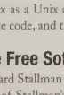

> 开源软件是一把双刃剑。如果你想使用开源软件，你通常需要支付与维护开源代码相关的成本。并非每个人都具有修改Unix或Linux源代码所需的高度知识。拥有知识的人可以获得丰厚回报。

为此，Douglas Comer于1983年开发了Xinu，以在课堂环境中说明操作系统结构。1986年，Andrew Tannenbaum开发了Minix作为Unix克隆和替代品。与Linux一样，Minix不使用Unix的源代码，因此不侵犯AT&T的Unix版权。

## The Free Software Foundation

Richard Stallman于1984年开始GNU（GNU's Not Unix）项目的工作。Stallman在其介绍性Usenet消息中使用的一个声明可能有助于概括该计划的重点：'我认为黄金法则要求如果我喜欢一个程序，我必须与喜欢它的人分享。'Stallman的目的在于建立一个团体，在那里强烈鼓励软件的自由共享。虽然他希望GNU能够运行Unix程序，但他也希望改进Unix。然而，在他能够做到这一点之前，他需要用包括内核在内的Unix操作系统的所有组件创建GNU。

注意：一些Stallman思想的信徒在征得或未征得他人许可的情况下共享他人的软件。他们在20世纪70年代中期共享的一项物品（未经许可）是由两位哈佛学生Bill Gates和Paul Allen制作的操作系统。如你所知，这些学生最终创立了Microsoft。

这些努力围绕着一个名为自由软件基金会（FSF）（www.fsf.org）的团体展开。他们制定了通用公共许可证（GPL），以建立一个受保护的自由软件体系，防止他人将其用于创建专有闭源系统。到1990年，他们已克隆了Unix的大多数主要组件，除了内核。

## 开放源代码计划

与FSF关系密切的一个团体是开放源代码计划（OSI）。该组织由Eric Raymond于1998年创立，用以定义和捍卫自由软件。


当Netscape发布其核心Mozilla系统的源代码时，它制定了自己的许可证，该许可证 loosely 模仿了GPL。开源社区中的一些知名人士对Netscape的努力并不满意。OSI的创建是为了设定开放源代码软件的资格标准，其中包括比GPL限制更少的许可证。与GPL下的软件不同，你可以将OSI软件与其它专有产品一起打包。

你可以在 `www.opensource.org` 上找到有关OSI的更多信息。

## 通用公共许可证（GPL）

Richard Stallman制定了通用公共许可证（GPL），以将Unix此前可用的优势带给整个软件社区。他希望制定一项许可证来保护软件免受那些会隐藏其源代码的人的侵害。GNU软件均在GPL下许可。GPL背后有三个基本原则：

- 所有GPL软件必须随附完整的源代码副本。源代码必须包含清晰的文档。
- 任何添加到GPL软件中的软件也必须有清晰的文档。如果新软件与GPL软件交互，则整个软件包必须作为GPL软件分发。
- 任何GPL软件均不提供担保。

对实际许可证的法律解释受版权法管辖，因此超出了本书的范围。以下各节更详细地描述了GPL和Linux的发展。

## Copyleft要求

GPL有时也被称为copyleft。虽然版权通常禁止他人复制和销售作品，但copyleft利用版权法来保留他人免费使用、复制、修改和分发软件的权利。

任何人都可以销售GPL软件。例如，像LinuxMall（`www.linuxmall.com`）这样的厂商会连同源代码一起销售大多数Linux发行版。利润不会流向像Red Hat这样的打包商。如果你从LinuxMall购买Red Hat Linux，你可以复制整张CD并转售给他人，你仅受GPL条件的限制。如果你改进了软件，只要在GPL条件下包含额外的源代码，你也可以转售。

## 文档

GPL和开源许可证中的一个灰色地带是文档。好的程序包含嵌入源代码中的清晰文档。但文档的清晰度是主观的。Java程序的开源文档是否应该对COBOL程序员清晰？网络工程师甚至普通公众呢？

并非所有与GNU或开源软件相关的文档都很清晰。在某些情况下，Linux程序员曾表示，一些公司故意提供不足的文档以隐藏其软件背后的秘密。

GPL和开源许可证并不要求程序作者在源代码之外开发书籍或手册。然而，一些开发者确实会随其GPL或开源软件一起提供手册和书籍。一些关于Linux和Linux应用的第三方书籍也以GPL或相关许可证出版。

## Linux开发

到1990年，FSF已组装了构建操作系统所需的所有基本组件，除了内核，即允许操作系统与计算机硬件通信的代码。Linus Torvalds对当时386 CPU计算机可用的操作系统不满意，因此开始尝试内核。到1995年，几家公司已将Linux的内核与FSF的GNU软件组合起来，制作出第一个Linux发行版。

Richard Stallman和FSF背后的人认为，Linux操作系统更恰当地称为GNU/Linux，因为它将大量GNU程序与一个Linux内核结合在一起。

Linux和大多数Linux应用程序均在GPL下发布。一些应用程序在更宽松的许可证下发布，例如由OSI赞助的许可证。其他Linux应用程序受更常规的版权保护。这些许可理念之间的斗争将持续到很久以后。

## 开源业务

与微软不同，Linux发行商不能依靠Linux软件销售收入作为大部分收入。任何能够下载大文件的用户都可以从互联网上的众多站点免费获得Linux。任何能够使用CD刻录机的用户都可以轻松地将Linux转售给他人。

以下各节讨论GNU和开源软件是如何开发的，Linux相关公司如何赚钱，工作无担保所需的范式转变，以及微软对这一现象的看法。

## 社区开发模式

Linux于1998年8月10日登上了《福布斯》杂志的封面。封面故事承认了开发者社区的存在，他们追求的不是金钱，而是通过创建更好的软件获得的地位。随着来自世界各地的这些“自由软件之子”作为社区一起工作，他们创造了更好的产品。

社区开发的一个好例子是Red Hat对其测试版软件的做法。例如，当Red Hat发布Red Hat Linux 7时，它本着社区开发的精神采取了以下步骤：

- 1. 它创建了软件的测试版。随源代码和程序文档，它以GPL许可Red Hat 7测试版并发布到多个FTP站点供下载。
- 2. 测试版发布在多个新闻组上宣布，包括`linux.redhat.announce`新闻组。用户受邀尝试软件并提交评论、错误报告和错误补丁。
- 3. 一旦做出适当的修改，Red Hat停止进一步更改并设置最终软件包以供下载和CD发布。
- 4. Red Hat提供Red Hat Linux 7的最终版本出售。
- 5. Red Hat还以书籍格式随其CD一起出售详细的文档，包括安装说明。

Red Hat只有几百名员工。然而，通过社区开发流程，Red Hat获得了数千名希望Red Hat成功的开发者的帮助。


> 其他Linux企业也使用这种相同的社区开发模式来完善其软件。Linux社区认为这会带来更高质量的软件。

## 通过自由软件赚钱

尽管Linux是免费的，Linux公司仍能从其开发的软件中赚钱。Linux开发者是软件行业中薪酬最高的员工之一。

生产更高质量软件的作者和公司的专业知识在业内备受重视。虽然他们可能无法从软件销售中赚很多钱，但他们可以从文档、支持合同以及使Linux为单个公司工作的咨询服务中赚钱。

销售专有软件的公司部分通过保守秘密来竞争。分发GPL和开源软件的公司没有任何软件秘密。他们相互合作以创造最高质量的产品。你可能不同意这些前提是真实的，但它们是Linux商业模式的关键。

> Sair Linux/GNU考试假设你接受合作式软件开发的前提。

## 无担保工作

一些决策者因Linux不提供担保而害怕它。因为Linux软件由“社区”开发，没有人需要为问题负责。无担保工作需要范式转变。如果你遇到问题，你不能纠缠Linux发行商来帮助你，因为他们可能并未开发导致问题的特定软件。

> Linux的成本不在操作系统的价格上，而在于你为操作系统所需的支持成本。

然而，Linux的开源特性让你可以以不同的方式看待问题。如果你无法让Linux应用程序正常工作，你可以重写源代码。如果你发现安全问题，互联网上可能已经有人准备好补丁供下载。如果你无法为硬件获得Linux支持，可能有人已在互联网上开发并发布了合适的Linux驱动程序。开发者获得认可，而你能快速获得所需的软件。

*注意：你也可能在互联网上找到专有操作系统的补丁和驱动程序，如Microsoft Windows。然而，这些专有的*

下载取决于微软与其他软件和硬件厂商之间的合作。Linux 补丁和驱动程序的可用性取决于需求；如果足够多的人需要，就会有愿意编写的人。这是否适合你取决于你自己的经验。

换句话说，当你使用开源软件时，你被赋予了修复可能出现任何问题的自由。你不必等待专有软件公司数月或数年后的下一个版本来解决你的问题。但是调试和重写代码需要大量的技能。如果你需要额外的帮助，你可以随时聘请 Linux 开发人员或支持团队来完成工作。

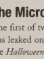

> Linux 倡导者认为开源模式能带来更高质量的软件。因为没有公司控制像 Linux 这样的 GNU 软件，用户可以自由修改它以满足自己的需求。像 Linux 这样的 GNU 软件因此在这种思想的自由市场中演进，受 GPL 等许可证的保护。

## 微软分析

1998 年万圣节前夕，有关 GPL 和开源软件的两份微软备忘录中的第一份被泄露。因此，这些文件被称为万圣节文件。

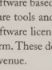

> 像万圣节文件这样的回应有时与恐惧、不确定性和怀疑的宣传活动相关联，也称为 FUD。

在万圣节文件中，作者承认基于开源开发模式以及标准 GNU 软件工具和库的 GPL 软件具有卓越的质量。他们还认为 GNU GPL 是可用的最健全的软件许可证，基于它在长期内促进开发的方式。这些文件部分聚焦于 Linux 作为对微软收入的潜在威胁。

## GPL、开源和自由软件

Linux 世界中的许多人互换使用 GPL、开源和自由软件这些术语。尽管这些概念密切相关，但它们并不相同，至少根据 Stallman 和 Raymond 的说法。

GPL 并非适用于所有 Linux 软件。例如，XFree86 项目在其图形用户界面（GUI）软件 X Window 下开发，使用一种限制较少的许可证，更接近 Raymond 的 OSI。根据他们的

许可证，你可以修改和销售 XFree86 软件，而不受与 GPL 相关的限制，只要你在创建的任何产品中传递此许可证。

尽管 GPL 软件可以被使用和修改，但作者保留了对源代码的某些控制。他们可以要求任何更改都作为对原始源代码的补丁进行。同时，自由软件可以有或没有源代码被复制、重新设计并与他人共享。这些区别很微妙，但对许多情感上依附于 Linux 的人来说很重要。

## 互联网资源


关于 Linux 的一个显著事实是互联网上可用的文档数量。几乎每个 Linux 应用程序都有几个全面的 Linux 文档库。软件和文档不断被创建和更新。有许多 Linux 新闻组和新闻网站提供最新的开发信息。各类用户提出的各种 Linux 问题都被记录在多个不同的新闻组中。这实际上为除最晦涩的问题之外的所有问题提供了一个数据库。你可以使用 `Deja.com` 网站（www.deja.com）提供的工具搜索这个“数据库”。

## Linux 库

在众多优秀的 Linux 信息来源中，最重要之一是 Linux 文档项目（www.linuxdoc.org）的网站。该网站包括：

- Guides—从网络和系统管理到 Linux 内核等各个方面的书长文档。尽管这些指南中的几个（付费）在许多书店都有出售，但你可以从该网站免费下载。
- HOWTOs—针对特定主题的文档，提供几乎所有常用 GNU/Linux 程序和应用程序的详细安装和故障排除说明。
- man pages—每个 Linux 命令的手册页。如果你使用的是较旧版本的 Linux，你可能能够找到更新的手册页。
- FAQs—也称为常见问题。某些 Linux 程序提供常见问题解答。关键的常见问题解答题为“Linux 常见问题解答”。

其他著名的 Linux 资源包括创建主要 Linux 发行版的公司的网站，以及像 www.linux.org 上的 Linux Online 网站等。

## Linux 新闻网站

当你开始配置和维护 Linux 计算机时，你需要跟上最新的发展。即使你不使用最新的 Linux 版本，你也应该监控至少一个主要的 Linux 新闻网站，以了解可能出现在你的系统上的新安全问题（以及可用的修复）。而且通过合适的新闻网站，你可能能够找到有关你遇到的问题或你需要改进业务生产力的应用程序的帮助。一些重要的 Linux 新闻网站包括：

- Fresh Meat—每个可想象的 Linux 程序和应用程序的最新 Linux 版本（www.freshmeat.net）。
- Linux Today—涵盖 Linux 软件、安全性和商业事件发展的新闻发布（www.linuxtoday.com）。
- Wide Open News—由 Red Hat 赞助的 Linux 电子杂志（www.wideopen.com）。

## 详细的 Linux 搜索

如果你在使用 Linux 时遇到问题，很可能有人已经在线讨论过这个问题。如果你无法在 Linux 文档项目的库中找到解决方案，下一步就是搜索新闻组。搜索多个新闻组最简单的方法是通过前面提到的 `Deja.com` 网站上的讨论列表进行搜索。该网站自动索引 Usenet 和许多其他新闻组中每个相对最近的消息。在图 2.1 中查看在 Caldera Linux 上安装 Apache（Linux Web 服务器）的搜索示例。

## 命令资源

在你的计算机上启动 Linux 时，另一组资源可用。在命令行中，你可以获取几乎任何 Linux 命令的帮助，阅读大多数命令的手册页，或搜索多个应用程序的信息页。`man` 和 `info` 命令的图形版本也可用。

### 帮助

当你想要了解有关 Linux 命令的更多信息时，首先去 `help`。当你为 Linux 命令使用 `help` 开关时，会显示有关该命令可用选项的更多信息。例如，如果你想要了解有关 `mkdir` 命令的更多信息，打开一个命令行界面并输入以下内容：

```
mkdir --help
```

你可以在图 2.2 中看到结果示例。

在某些 Linux 发行版中，你可以用 `-h` 或 `-?` 替换 `--help`。

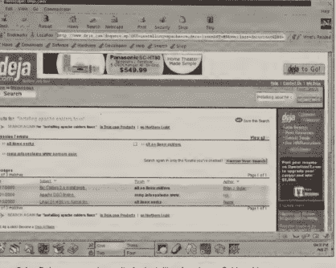

图 2.1 在 Caldera Linux 上安装 Apache 的 Deja.com 搜索结果。

### 手册

几乎每个 Linux 命令都附带手册，也称为手册页。每个 Linux 手册都包括命令的完整描述以及每个可用命令开关功能的描述。例如，如果你想查看 `ls` 命令的手册，打开一个命令行界面并输入以下内容：

```
man ls
```

如果你想查看与特定主题相关的命令，你可以搜索可用的手册。例如，如果你想查看用于以太网的 Linux 命令，输入：

```
man -k ethernet
```

该命令的输出类似于以下内容：

```
arpsnmp (8) - keep track of ethernet/ip address pairings
ethers (5) - Ethernet address to ip number database
pcnet_cs (4) - Generic NS8390-based PCMCIA Ethernet driver
```

你的输出因 Linux 发行版和已安装的模块而异。前面列出的不是配置以太网网络的唯一命令。但它们是标题中包含单词 ethernet 的命令。

搜索手册页标题的另一种方法是使用 `apropos` 命令，其等同于 `man -k`。

注意：如果运行某些版本的 Red Hat Linux，`man -k`、`apropos` 和 `whatis` 命令不能按所示工作。但它们在大多数 Linux 发行版中都能工作，包括 Debian、Corel 和 Caldera，并且与 Red Hat Linux 中可用的手册页一致。

括号中显示的数字对应于该命令的 Linux 类别。Linux 手册页有九个不同的类别，描述在表 2.1 中。

文件格式类别（5）的一个特殊功能是它如何记录关键控制文件中的每个字段。例如，如果你想知道加密密码文件 `/etc/shadow` 中每个字段的功能，输入以下命令：

```
man 5 shadow
```

如果你想列出特定手册页的标题，使用 `whatis` 命令。例如，以下命令返回 `apropos` 手册页的标题：

```
whatis apropos
```

```
[aj@linux...] $ mkdir --help
Usage: mkdir [OPTION] DIRECTORY...
Create the DIRECTORY(ies), if they do not already exist.
-m, --mode=MODE set permission mode (as in chmod), not rwxrwxrwx - umask
-p, --parents no error if existing, make parent directories as needed
-v, --verbose print a message for each created directory
--help display this help and exit
--version output version information and exit
Report bugs to <bug-fileutils@gnu.org>.
[aj@linux...] $
```

图 2.2 获取命令帮助。

表 2.1 手册页分类。

| Section | Description |
|---|---|
| 1 | User Commands |
| 2 | System Calls |
| 3 | Subroutines |
| 4 | Devices |
| 5 | File Formats |
| 6 | Games |
| 7 | Miscellaneous |
| 8 | System Administration |
| 9 | New |

### info

`info` 命令设置了一种结构化方式来浏览不同的手册页。当你输入 `info` 命令时，你会看到图 2.3 中显示的一组选项。使用键盘方向键移动光标到你选择的选项或命令，然后按 Enter。在大多数情况下，`info` 实用程序随后会带你进入一个包含一组子选项的后续屏幕。继续选择所需选项，直到到达你需要的命令手册部分。


```
File: dir  Node: Top          This is the top of the INFO tree

This (the Directory node) gives a menu of major topics.
Typing "q" exits, "?" lists all Info commands, "d" returns here,
"u" gives a primer for first-timers
"m" (or Return) visits the Emacs topic, etc.

In Emacs, you can click mouse button 2 on a menu item or cross reference
to select it.

* Menu:
Texinfo documentation system      Standalone Info-reading program.
texinfo: (info-texinfo)            The GNU documentation format.
texinfo: (texinfo)                 The GNU documentation format.
install-info: (texinfo) Invoking install-info. Update info/dir entries.
makeinfo: (texinfo)                Translate Texinfo source.
texi2dvi: (texinfo) Format with texi2dvi. Print Texinfo documents.
texindex: (texinfo) Format with texindex. Sort Texinfo index files.

Miscellaneous
Autoconf: (autoconf)               Create source code configuration scripts.
Bfd: (bfd)                         The Binary File Descriptor library.
Binutils: (binutils)               The GNU binary utilities.
Concurrent Versions System
CVSclient: (cvsclient)             The client/server protocol used by CVS
File utilities: (fileutils)        GNU file utilities
Finding Files: (find)              Listing and operating on files
                                   that match certain criteria.
GIT: (git)                         GNU Interactive Tools
GDB: (gdb)                         The GNU debugger.

ESC ESC
```

图 2.3 获取结构化命令帮助。

不幸的是，并非所有命令都可以通过 `info` 实用程序获得：大多数较新的命令仅包含手册页。

### 图形帮助实用程序

`man` 和 `info` 命令有三个图形版本：`xman`、`tkman` 和 `xinfo`。这些实用程序适用于 GNOME（GNU 网络对象模型环境）或 KDE（K 桌面环境）等图形用户界面。不幸的是，并非所有这些命令都是最新 Linux 发行版的标准配置。如果你想试用它们，请打开一个 GUI，启动一个命令行 shell 窗口，然后输入其中一个命令。这些命令具有以下特征：

- **`xman`**—如 图 2.4 所示，此命令包含一个相当简单的界面。打开后，按 `Ctrl+S` 激活搜索屏幕。在搜索屏幕中输入命令，按 Enter，`xman` 会带你进入该命令的手册页。
- **`tkman`**—此命令允许你搜索手册页标题。
- **`xinfo`**—此命令在 `info` 屏幕中添加菜单按钮。不幸的是，它与 `info` 实用程序具有相同的限制。

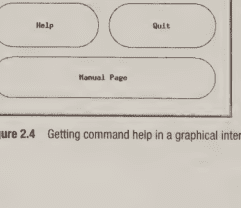

图 2.4 在图形界面中获取命令帮助。

## 练习题

### 问题 1

以下哪个操作系统是在其他操作系统之前开发的？

- a. Linux
- b. Unix System 6
- c. Minix
- d. Xinu

答案 b 正确。Unix System 6 是 AT&T 在 1970 年代和 1980 年代向大学自由授权的最后一个 Unix 系统。Xinu、Minix 和 Linux 是在 AT&T 进入计算机业务并开始商业销售 Unix 后才开发的。因此，答案 a、c 和 d 不正确。

### 问题 2

谁创立了 FSF？

- a. Linus Torvalds
- b. Eric Raymond
- c. William Gates
- d. Richard Stallman

答案 d 正确。Richard Stallman 于 1983 年创立了 FSF。Linus Torvalds 开发了 Linux 内核。Eric Raymond 发起了 OSI。William Gates 是微软的创始人。因此，答案 a、b 和 c 不正确。

### 问题 3

以下哪种说法最能描述开源软件？

- a. Linux or any application used on Linux
- b. Software that is released with its commented programming code
- c. Software that is protected by the GPL
- d. b and c

答案 b 正确。开源软件会随其源代码副本一起发布。至少，开源软件包含源代码中的一套清晰注释。并非所有在 Linux 上使用的应用程序都是开源的；因此答案 a 不正确。并非所有开源软件都受 GPL 保护；因此，答案 c 和 d 不正确。

### 问题 4

GPL 软件有哪些好处？[勾选所有正确答案]

- [ ] a. You can change the source code to meet your needs.
- [ ] b. You can improve on the software and sell it for a profit.
- [ ] c. It is easy to use.
- [ ] d. Many companies and individuals are working to improve it.

答案 a、b 和 d 正确。因为像 Linux 这样的 GPL 软件专注于其高级用户，可能不包含帮助初学者的功能。因此，答案 c 不正确。

### 问题 5

以下哪些描述了版权和 copyleft 之间的区别？[勾选所有正确答案]

- a. You can repackage copyleft software without permission from the original developers.
- b. You can add to copyleft software and sell it for a profit.
- c. You can modify copyleft software, release it, and keep your changes secret.
- d. You cannot modify copyleft software.

答案 a 和 b 正确。你可以在未经许可的情况下对 copyleft 软件进行添加。即使你需要允许用户免费获取你的软件，你仍然可以将其盈利出售。像 Red Hat 这样的公司通过互联网免费提供其 Linux 发行版，并在商店中销售相同的软件。但如果你对源代码的更改保密，就不能销售或发布经过修改的 copyleft 软件。因此，答案 c 不正确。像 GPL 这样的许可证允许你修改 copyleft 软件。因此，答案 d 不正确。

### 问题 6

如果你拥有一家开发免费 GPL 软件的公司，你如何赚钱？

- a. Sell the software in computer stores or over the Internet.
- b. Sell service contracts to help your customers work with your software.
- c. Sell documentation that helps others use your software.
- d. All of the above.


答案 d 正确。即使 GPL 软件是免费的，你仍然可以销售它。包括 Red Hat、Caldera 和 Corel 在内的许多制造商都在电脑商店和通过互联网销售其 Linux 发行版。这些公司和其他公司提供服务合同来支持其 Linux 发行版。购买其软件包的好处之一是它们通常包含书本长度的文档以及有限的服务合同。

## 问题 7

以下哪些命令执行相同的功能？[勾选所有正确答案]

- a. `apropos man`
- b. `man apropos`
- c. `man --help`
- d. `man -k man`

答案 a 和 d 正确。`apropos` 命令与 `man -k` 同义。`man apropos` 命令返回 `apropos` 命令的手册页。因此，答案 b 不正确。`man --help` 命令返回你可以用在 `man` 命令中的选项。因此，答案 c 不正确。

## 问题 8

为什么 GPL 软件的质量被认为高于专有软件的质量？

- a. It is supported by smarter developers.
- b. Users have control of GPL software and can modify it to meet their needs.
- c. Companies like Red Hat and Caldera have superior business models when compared to Microsoft.
- d. The U.S. Department of Justice declared that GPL software is superior.

答案 b 正确。与专有软件不同，用户可以有效控制 GPL 软件并对其进行修改以满足其需求，而无需等待任何特定公司的开发周期。尽管开源开发者喜欢认为自己“更聪明”，但这并不一定是真的。一些最好的开发者确实在微软等公司工作。因此，答案 a 不正确。尽管开源开发者喜欢认为自己具有更优越的商业模式，但截至本文撰写时，很少有 Linux 发行商从 Linux 中获利。因此，答案 c 不正确。因为美国司法部对 GPL 软件的质量没有做出任何声明，所以答案 d 不正确。

## 问题 9

以下哪些是 GNU 软件典型开发周期的亮点？[勾选所有正确答案]

- a. GNU 开发者将软件面向初学者。
- b. 其他开发者测试软件并分享他们的观察。
- c. 其他开发者使用 GNU 软件开发自己的专有应用程序。
- d. 开发者通过互联网分享软件的初步版本。

答案 b 和 d 正确。GNU 软件不断通过互联网发布，即使是初步形式。感兴趣的开发者下载并测试该软件并将其观察结果与软件作者分享。GNU 软件的一个特点是面向更高级别的用户。因此，答案 a 不正确。在 GPL 下，GNU 软件的一个条件是其他人不能在其自己的或任何他人的专有应用程序中使用其源代码。因此，答案 c 不正确。

## 问题 10

以下哪项陈述最准确地描述了 GPL 软件的一些优点和缺点？

- a. 你拥有并可以修改源代码，但制造商不提供保修。
- b. 你可以转售 GPL 程序，但你必须提供保修。
- c. 因为你拥有源代码，你可以克隆 GPL 软件并将其盈利出售。
- d. 当你购买 GPL 程序时，你购买了保修支持的权利。

答案 a 正确。GPL 软件包含源代码。你可以修改源代码以满足你的需求。但 GPL 软件不提供保修。由于 GPL 规定你不必提供保修，答案 b 和 d 不正确。由于你不需要克隆 GPL 软件即可转售它，答案 c 不正确。

## 需要了解更多？

McHugh, Josh. "For the Love of Hacking." Forbes. 10 August 1998. 这篇在杂志自称的“资本工具”中的封面故事描述了开源软件成功和被认为优越的原因。

探索 FSF 的网站，FSF 是 GNU 项目的管理机构，网址为 www.fsf.org。该网站包括 FSF 的历史以及自由和开源软件的描述。

浏览 Linux 文档项目网站 www.linuxdoc.org，它是 Linux 手册、HOWTOs、FAQs 以及许多其他书籍长度文档的中央存储库。

调查 OSI 的网站 www.opensource.org，它定义了开源软件的基本限制。该网站包括所谓的微软万圣节文档的注释版本，这些是微软关于开源运动的内部白皮书。

## Linux 结构

需要理解的术语：

- ✓ 内核
- ✓ 网络
- ✓ Init
- ✓ 守护进程
- ✓ 用户模式
- ✓ X Window
- ✓ 多任务
- ✓ 多用户
- ✓ 虚拟控制台
- ✓ 硬件兼容性列表
- ✓ Winmodem
- ✓ 视频适配器
- ✓ ISA、BIOS、PCI
- ✓ IRQ、I/O、DMA、共享内存地址

需要掌握的技术：

- ✓ 描述主要 Linux 模块
- ✓ 使用多任务和多用户功能
- ✓ 理解命令行界面 (CLI) 的好处
- ✓ 处理 Linux 与计算机硬件之间的交互
- ✓ 为不同的 Linux 安装规划内存


Linux 是一个结构化的操作系统。它的组件可以分为六种模块。Linux 允许你同时运行多个程序，使用多个终端供多台计算机上的多个用户工作。尽管 Linux 图形工具可用，命令行工具仍然提供更可靠的结果。Linux 的模块化使你需要了解硬件使用的不同端口以与计算机内部组件以及外设通信变得重要。

## 模块化 Linux

GNU/Linux 的优势之一是其模块化。由于模块受通用公共许可证 (GPL) 覆盖，开发者可以独立工作。他们可以重用和重新配置这些模块以实现不同的结果。GNU/Linux 可以分为至少六个模块类别：内核、网络、`init`、守护进程、用户模式和 X Window。

## 内核

内核是任何操作系统的最重要部分。它允许 Linux 与计算机硬件通信。内核通过专用设备驱动程序与硬件通信。例如，当你挂载软盘驱动器时，特定的内核驱动程序向软盘驱动器发送和接收消息。

如果你安装新硬件，并且在启动 Linux 时未被检测到，你可以使用 `insmod` 命令向内核添加驱动模块。如果你必须为新硬件下载驱动程序，你还应将该驱动模块添加到内核。

内核的其他部分管理 Linux 文件系统以及存储在磁盘缓存等区域中的任何数据。内核在启动 Linux 时加载到受保护模式内存中。

## 网络

在客户端/服务器网络中，客户端向服务器请求所需项目，如文件或应用程序。在 Linux 网络中，客户端甚至可以请求 X Window 信息。换句话说，你可以在 Linux 客户端上设置终端，这些终端从 Linux 服务器访问其图形用户界面 (GUI) 数据。

> Note: In principle, this client/server relationship for the GUI is operationally similar to Microsoft's Terminal Server.

Linux 操作系统的网络模块旨在使客户端/服务器通信尽可能顺畅。理想情况下，客户端与服务器之间的连接是无缝的。

由于网络模块与内核加载在同一区域，其故障可能意味着你必须重新启动 Linux。

## Init

如果你熟悉 `ps` 命令的输出，你就知道启动 Linux 程序的唯一方法是通过另一个 Linux 程序。但必须有一个起点。当你在计算机上启动 Linux 时，内核加载并启动 `init`，它也是一个守护进程。`init` 程序随后挂载你的驱动器，打开你的终端，并启动你的命令行界面 (CLI) shell。Linux 在计算机上启动后，`init` 模块会监视可能关闭计算机的任何情况，例如来自不间断电源 (UPS) 的断电信号或重启命令，如图 3.1 所示。

`Init` 在多个不同的运行级别工作，主要通过 `/etc/inittab` 文件以及 `/etc/rc.d` 目录中的关联脚本。取决于你的发行版，`init` 启动的程序可能分为 0 到 6 个运行级别。大多数发行版会将其中一个或多个级别未使用。一般来说，运行级别分为以下类别，通常按以下顺序：

- ► 关闭/停止—`init` 程序停止计算机上当前运行的所有服务。


``` 
# inittab      This file describes how the INIT process should set up
#              the system in a certain run-level.
# Author:      Miguel van Seumeren, <miguel@brinkel.nl.mugnet.org>
#              Modified for RHS Linux by Marc Ewing and Donnie Barnes
#
# Default runlevel: The runlevels used by RHS are:
# 0: halt (Do NOT set initdefault to this!)
# 1: Single user mode
# 2: Multiuser, without NFS (The same as 3, if you do not have networking)
# 3: Full multiuser mode
# 4: unused
# 5: X11
# 6: reboot (Do NOT set initdefault to this)
id:3:initdefault:
#
# System initialization.
si::sysinit:/etc/rc.d/rc.sysinit
l0:0:wait:/etc/rc.d/rc 0
l1:1:wait:/etc/rc.d/rc 1
l2:2:wait:/etc/rc.d/rc 2
l3:3:wait:/etc/rc.d/rc 3
l4:4:wait:/etc/rc.d/rc 4
l5:5:wait:/etc/rc.d/rc 5
l6:6:wait:/etc/rc.d/rc 6
#
# Things to run in every runlevel.
ud::once:/sbin/update
#
# Trap CTRL-ALT-DELETE
ca::ctrlaltdel:/sbin/shutdown -t3 -r now
#
# When our UPS tells us power has failed, assume we have a few minutes
# of power left.  Schedule a shutdown for 2 minutes from now.
# This does, of course, assume you have powerd installed and your
# UPS connected and working correctly.
pf::powerfail:/sbin/shutdown -f -h +2 'Power Failure; System Shutting Down'
```

### 图 3.1 `/etc/inittab` 文件中的运行级别和重启选项。

- **单用户**—`init` 启动仅允许一个用户登录到你的 Linux 系统所需的程序。当系统出现严重问题时，你可以进入单用户模式（有时使用特殊的恢复软盘）来修复问题。如果关键文件损坏，你可能可以用软盘上的备份将其恢复。
- **多用户**—在多用户级别，`init` 启动允许多个用户同时登录到你的 Linux 系统的程序。
- **带网络的多用户**—带网络的多用户级别在多用户运行级别之后启动计算机上的网络守护进程。
- **带 X Window 的多用户**—由于 X Window 程序也可以在客户端和服务器之间拆分，因此带 X Window 的多用户级别只能在 `init` 启动你的网络程序之后开始。
- **重启**—在重启级别，`init` 运行关机/停止级别的程序，然后在多用户级别中的一个或多个级别重启你的计算机。

注意：某些发行版有一个额外的运行级别，称为“S”，用于单用户模式。

某些发行版可能会合并或进一步划分这些类别中的一些。你实际上可以在任何时候运行 `init` 程序。你可以在图 3.1 中查看 Red Hat Linux 如何组织运行级别。


> 因为 `init` 会影响当前登录到 Linux 系统的每个用户，只有 root 或超级用户才能运行 `init` 命令。

## 守护进程

Linux 服务被称为守护进程。在 Linux 中，几十个守护进程可以同时运行，随时准备启动你的网络、提供网页、打印文件或连接到其他 Linux 或 Windows 计算机。典型的守护进程包括：

- **Apache**—Linux Web 服务器，也称为 `httpd`
- **打印机**—打印机守护进程，也称为 `lpd`，用于管理与打印机之间的通信
- **Samba**—允许 Linux 与 Microsoft Windows 计算机通信的网络程序，也称为 `smbd`

启动后，守护进程会被加载到你的 RAM 中，在那里等待服务请求。

## 用户模式

任何与内核通信的 Linux 程序或实用程序都是用户模式程序。由于用户模式程序不直接与硬件通信（这是内核的工作），这些程序崩溃不会影响 Linux 操作系统的基本运行。用户模式程序有三个基本类别：

- **登录**—此程序将用户 ID 与用户的 shell 以及其他个性化设置关联，例如 X Window 和 Netscape。
- **Shell**—Linux 命令解释器。最常见的 Linux shell 被称为 `bash`（即 Bourne Again SHell），它是从原始 Unix Bourne shell 开发而来的。
- **实用程序**—在 shell 内部使用的任何命令。

## X 窗口

Linux 从构建图形用户界面（GUI）所需的程序模块构建 X Window。GUI 窗口管理器，如 GNOME 和 KDE 以及所有 GUI 应用程序，都是建立在 X Window 的基础上。

## 共享资源

Linux 满足服务器的基本要求。部分原因是 Linux 是一个多任务、多用户、多终端系统。因为它可以将资源在多个程序之间共享，所以它是一个多任务系统。它是一个多用户系统，因为你可以设置多个用户账户。而且不同的用户可以同时登录到同一台 Linux 计算机，使其成为多终端系统。

## 多任务处理

有很多程序需要你的计算机注意。一些程序是像 `ls` 这样的命令或像 `Apache` 这样的守护进程，即 Linux Web 服务器。其他的是设备驱动程序，它们解释诸如击键、通过网卡传输的数据或显示器显示所需的信息处理等活动。多任务处理是操作系统管理这些需求的方式。

Linux 使用抢占式多任务处理，这意味着它根据优先级层次结构为不同程序分配特定资源。Linux 管理这些优先级，以确保每个当前程序都能获得其应有的计算机资源份额。抢占式多任务处理迫使所有程序共享计算机资源的使用。


> 当 Linux 管理多个任务时，它实际上是在管理多个进程。进程是程序的当前状态。当你运行一个程序时，你正在运行与该程序关联的库。当程序从硬盘或打印机等组件请求服务时，它会与 Linux 内核交互。

其他程序不断地对你的计算机提出需求。例如，当你输入一个键时，你的键盘会发送一个中断服务例程（ISR），它通过中断请求（IRQ）端口传输。

## 多用户

Linux 作为服务器的一个区别因素是其同时管理多个用户和账户需求的能力。作为多用户系统，Linux 要求你登录以访问文件。


> 在真正的多用户系统上，多个用户可以同时登录到同一台 Linux 计算机。相比之下，在像 Windows 98/ME 这样的单顺序用户系统上，一次只能有一个用户登录到该计算机。

## 多终端

用户可以通过多个虚拟控制台登录到 Linux 计算机。在本地 Linux 计算机上，你可以通过四个或更多虚拟控制台和一个 X Window 登录。实际设置取决于你的 Linux 发行版、可用通信硬件以及你管理 `/etc/inittab` 文件的方式。你也可以通过串行、调制解调器或网络连接远程登录。表 3.1 显示了可能的虚拟控制台列表。

你可以用一个或多个账户登录到这些控制台中的任意数量。你甚至可以用同一个账户多次登录。如果有适当的硬件，你可以在 `/etc/inittab` 文件中添加更多控制台。启动不同控制台的命令被称为 `getty`。图 3.2 中显示的六个 `mingetty` 命令对应于六个不同的命令行控制台。

如果你的 Linux 系统启动到命令行，Linux 首先带你到 `tty1` 控制台。如果你直接启动到 X Window，它会带你到 `tty7` 控制台。如果你是在命令行窗口中启动的，你可以通过按 Alt 和表 3.1 中显示的相应功能键来访问其他控制台。

### 表 3.1 典型的登录控制台。*

| 控制台 | 类型 | 访问方法 | 注释 |
|---|---|---|---|
| `tty1` | 本地命令行 | Alt+Ctrl+F1 | 默认 |


| tty2 | 本地命令行 | Alt+Ctrl+F2 | 默认 |
| tty3 | 本地命令行 | Alt+Ctrl+F3 | 默认 |
| tty4 | 本地命令行 | Alt+Ctrl+F4 | 默认 |
| tty5 | 本地命令行 | Alt+Ctrl+F5 | 默认 |
| tty6 | 本地命令行 | Alt+Ctrl+F6 | 默认 |
| tty7 | 本地 GUI | Alt+Ctrl+F7 | 假设 X Window 已配置 |
| ttyx | 串行连接 | 调制解调器或电缆 | 可用各种终端（有时显示为 ttyx） |
| ptyx | 网络连接 | 远程终端 | 任何远程终端（也称为伪终端；有时显示为 ttyx） |

*这些控制台只有在通过 `/etc/inittab` 文件正确配置后才能使用。也可以通过此文件配置额外的控制台。默认情况下，许多 Linux 系统上提供六个终端控制台。你只需要从 X Window 使用 Alt、Ctrl 和功能键来访问不同的控制台。你可以从命令行窗口跳过 Ctrl 键。

```
# Trap CTRL-ALT-DELETE
ca:12345:/sbin/shutdown -t3 -now
# When our UPS tells us power has failed, assume we have a few minutes
# of power left. Schedule a shutdown for 2 minutes from now.
# This does, of course, assume you have power installed and your
# UPS is connected and working correctly.
 pf:powerfail:/sbin/shutdown -f -h +2 "Power Failure; System Shutting Down"
# If power was restored before the shutdown kicked in, cancel it.
pr:12345:powerwait:/sbin/shutdown -c "Power Restored; Shutdown Cancelled"
# Run gettys in standard runlevels
1:2345:respawn:/sbin/mingetty tty1
2:2345:respawn:/sbin/mingetty tty2
3:2345:respawn:/sbin/mingetty tty3
4:2345:respawn:/sbin/mingetty tty4
5:2345:respawn:/sbin/mingetty tty5
6:2345:respawn:/sbin/mingetty tty6
# Run xdm in runlevel 5
# xdm is now a separate service
# 5:respawn:/etc/X11/prefdm -nodaemon
```

## 图 3.2 /etc/inittab 文件中配置的控制台


Getty 也被称为控制台或登录端口。`tty7` 控制台只有在你在 Linux 系统上配置了 X Window 后才可用。如果你已经在命令行窗口中，则不需要按 Ctrl 键来切换控制台。

多控制台有几个优点。你可以登录到多个端口以从命令行运行多个程序。如果正在运行的程序失控，你可以登录到另一个控制台来终止该程序。

## 命令管理

命令管理涉及管理 Linux 所需的工具。在最新的发行版中，你可以在 CLI 和 GUI 管理工具之间进行选择。Linux GUI 管理工具通常不够完善。一些 Linux GUI 命令可能会覆盖你编辑到配置文件中的设置。此外，大多数 Linux GUI 命令不会报告成功和失败的详细信息，而这在排查问题时可能至关重要。

出于这些原因，许多经验丰富的 Linux 用户更喜欢 CLI。

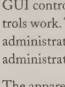

> 学习 Linux 命令时，重点关注命令行界面（CLI）工具。

Linux GUI 工具基于标准命令行实用程序的附加组件。因此，当你使用 GUI 工具（如 Red Hat 的 LinuxConf）时，你实际上是在使用不同命令行实用程序的 GUI 控制。LinuxConf 的并非所有控件都能正常工作。然而，CLI 内置了许多快捷方式。学习这些快捷方式的 Linux 管理员通常比尝试使用 GUI 工具的管理员工作更快。

CLI 工具的明显优越性可能不会永远持续，但 CLI 的优越性是 Sair Linux/GNU 考试的一个关键假设。

## 硬件兼容性

硬件兼容性有时会成为 Linux 管理员的问题。初次发布时，新硬件可能并不总是包含 Linux 驱动程序。

一个特殊问题是“winmodem”，它是一种电话调制解调器，用 Microsoft Windows 驱动程序库替代了某些硬件控制器。

为了解决这些问题，你需要了解应避免的硬件类型、Linux 驱动程序的替代位置，以及 Linux 与不同类型硬件通信的方式。

### 硬件兼容性列表

在计算机上安装 Linux 之前，你应该检查两个不同的列表。你可以在 Linux 文档项目网站 `www.linuxdoc.org` 上找到主要的 Linux 硬件兼容性列表（HCL），即“Hardware-HOWTO”。许多 Linux 发行商在其网站上保留自己的 HCL。这些列表更新更及时。如果你在发行版的 HCL 上看到你的硬件，你很可能会找到随发行版打包的相应 Linux 驱动程序。

如果你在 HCL 上看不到你的硬件，无需惊慌。“Hardware-HOWTO”中“Linux 不兼容硬件”部分之外的几乎任何设备都可以通过配置来使用。许多制造商通过光盘或其网站提供 Linux 驱动程序。这些网站还可能列出你的硬件可以模拟的 Linux 兼容产品。例如，许多网卡可以模拟 NE2000 适配器，因此可以使用其 Linux 驱动程序。

### 调制解调器

Linux 管理员的祸害之一就是 winmodem。winmodem 用 Microsoft Windows 软件驱动程序和库替代了控制普通调制解调器的硬件。由于 Microsoft Windows 的源代码目前不可用，为 winmodem 创建 Linux 驱动程序很困难。

一些 Linux 专家认为尝试为 winmodem 创建驱动程序是不对的。像 winmodem 这样使用计算机中央处理器（CPU）的设备会影响整个系统的性能。

尽管一些 Linux 开发者已为部分 winmodem 开发了工作技术，但 Linux 社区的主流态度是因其与 CPU 的交互而避免使用 winmodem。

### 视频适配器

另一个常见硬件问题是视频适配器，有时也称为显卡。如果你要在命令行工作，可能不需要图形，但大多数用户要求视频硬件具有高性能。

在可能的情况下，XFree86 项目会为视频适配器创建 Linux 驱动程序。但这项工作需要时间，并非所有视频适配器制造商都会发布创建 Linux 驱动程序所需的设计信息。尽管你可以在几乎任何卡上设置标准 VGA 设置，但对于使用图形应用程序的任何人来说，标准 16 色 VGA 图形都不够用。因此，在安装 Linux 之前，请检查 XFree86 网站以获取最新支持的视频适配器列表。

### 打印机

另一个主要硬件不确定性是打印机。如 Linux 文档项目网站上的“Hardware-HOWTO”所示，一些喷墨和气泡喷墨打印机没有 Linux 驱动程序。然而，如果你有一台新的 PostScript 或通用文本打印机，你可能能够使用通用 Linux 驱动程序进行设置。

### 驱动程序开发

新驱动程序有多个来源。许多制造商在发布新产品时发布 Linux 驱动程序。一些 Linux 公司和非营利组织根据 GPL 或相关许可证开发驱动程序。许多开发者创建自己的驱动程序并发布在各种互联网（Web 和 FTP）站点上。

在撰写本文时，Linux 硬件驱动程序库中的一个主要空白包括通过通用串行总线（USB）连接的外设。这个问题应通过 2001 年初左右发布的 Linux 内核版本 2.4 得到解决，至少针对键盘、鼠标和声卡。有关最新信息，请参考 `www.linux-usb.org` 上的 Linux USB 网站。

## 硬件管理

大多数用户在计算机上安装 Linux 时不会遇到硬件问题。通常，使用最新 Linux 发行版但不使用“最新最强”硬件的用户通常遇到的问题最少。选择至少几个月旧的硬件通常可以确保所有组件都有效列在 Linux HCL 上，或至少有 Linux 驱动程序。

作为管理员，你更可能遇到硬件问题。对于 Sair Linux/GNU 考试，你需要了解几种不同的冲突类别。


计算机的几乎每个部分都需要处理能力和内存。每个组件使用特定的端口向 CPU 请求处理能力。在等待处理能力的同时，每个组件将其请求和数据存储在随机访问内存（RAM）中的专用地址中。如果计算机的两个部件尝试使用相同的端口或内存中的同一区域，通常会产生硬件冲突。

端口在概念上类似于电视频道；两个不同的硬件通常不能使用相同的频道。

从概念上讲，解决方案相当简单：更改端口或指定内存中的不同区域。但要了解这些端口和区域的工作原理，你需要了解个人计算机内部架构的一些知识。

计算机架构的骨干被称为总线。总线是计算机内部的通信高速公路。不同总线调节 ISA 适配器、PCI 卡和 RAM 的通信。如果你使用内核 2.2 或更高版本的 Linux，每个总线上使用的端口可能取决于即插即用 BIOS 中的设置。

### ISA 总线

安装 ISA 适配器时，存在四种不同类型端口冲突的可能性：

- **IRQ**—计算机组件使用 IRQ 端口向 CPU 请求处理时间。计算机通常有 16 个 IRQ 端口。基本的计算机组件，如键盘、硬盘驱动器、调制解调器、BIOS 时钟等，已经占用了大部分 IRQ 端口。
- **输入/输出（I/O）**—I/O 地址是 RAM 中用作缓存的专用位置。例如，通过网卡传入的信息会等待在特定的 I/O 地址范围内进行处理。
- **直接内存寻址（DMA）**—DMA 绕过你的 CPU。例如，一些声卡具有特定的 DMA，因为它们可以直接从硬盘驱动器独立处理音频文件。DMA 冲突相对较少。
- **共享内存地址**—无法使用 DMA 的适配器使用共享内存地址。适配器可以使用 DMA 或共享内存地址，但不能同时使用两者。

重新配置即插即用 ISA 适配器的 Linux 命令是 `isapnp`。有关更多信息，请参阅其手册页。

### PCI 总线

选择 PCI 适配器时，请考虑以下三个问题。首先，可用的 Linux 驱动程序较少。其次，较旧的 PCI 卡可能无法在较新的计算机上工作。第三，许多 PCI 卡也依赖 IRQ 端口与 CPU 通信，因此可能与你的 ISA 卡冲突。


> 如果某张 PCI 卡比其他卡更重要，你可以通过将其安装在距离 ISA 卡最远的插槽中来提高其性能。更靠近的插槽在竞争 CPU 时间时会获得较低优先级。PCI SCSI 适配器通常需要更高优先级的插槽。

### BIOS

主板上的 BIOS（基本输入/输出系统）是在打开计算机时运行的第一个程序。它包含在其只读内存（ROM）中的例程，用于检查总线上的新硬件和现有硬件。


即插即用 BIOS 还会设置每个组件所使用的通信端口（IRQ、DMA、I/O、共享内存地址）。

然而，即插即用 BIOS 并非完美无缺。在 Linux 中分配的端口仍可能冲突。你可能需要手动设置端口。如果冲突很多，你甚至可能需要在 BIOS 中停用即插即用。

## Solutions

当出现冲突时，你需要分配不同的端口。你可以使用命令进行更改，例如 `isapnp` 或 `ifconfig`。在某些情况下，你甚至可以使用 Linux 发行版的 GUI 配置工具；我在这一领域使用过 Red Hat 的 LinuxConf 和 S.u.S.E. 的 YaST，效果尚可。

有时，你可以在卡本身上更改端口或地址。一些较新的卡附带驱动软盘，可更改卡中嵌入的软件。如果没有软盘可用，你可能可以从制造商的网站下载该程序。

另外，一些较旧的适配器卡使用跳线，跳线是卡上的连接器，你可以将其物理移除并安装在不同组合的金属针脚上。卡使用的端口或内存地址取决于跳线连接的针脚。

> 注意：如果必须操作计算机内部的组件，请采取预防措施。在拆卸之前先关闭计算机。触摸计算机内部任何东西之前，请务必触摸某个大金属物体（如金属机箱）以释放静电。拆卸或安装任何东西（卡、芯片等）时要轻柔。

## Memory

你为 Linux 所需的 RAM 量取决于你想用计算机做什么。Linux 不需要太多 RAM。Linux 内核大约需要 1MB 的空间。设置 CLI 所需的程序还需另外 2MB 到 3MB。换句话说，如果你只是将 Linux 计算机设为网络防火墙，4MB RAM 可能就足够了。

以下各节描述了 Linux 的四种可能的安装场景。

### Network Firewall

你可以将 Linux 计算机设为专用防火墙以保护网络的其余部分。正确安装的防火墙是本地局域网（LAN）与另一个网络（如互联网）之间的唯一路径。这台计算机上所需的一切就是 Linux 内核、网卡驱动程序、网络守护进程，以及基于 Linux 防火墙程序（如 `ipchains` 或 `iptables`）的脚本。你可以使用 4MB 到 8MB 的 RAM 设置此防火墙。

因为所需的计算能力很少，一个流行的选择是在较旧的系统上设置网络防火墙，例如配备 386 CPU 的 PC。这是对旧计算机的极佳利用。

### Command-Line Network Server

如果你只是为命令行界面（CLI）设置 Linux，你不需要图形工作站所需的性能。在这种情况下，即使与多个用户共享系统，16MB 到 32MB 的 RAM 也应足够。如果你的任何用户运行内存密集型程序，例如科学模型，则应增加 RAM 量。

你还应设置合理量的虚拟内存，这允许 Linux 将不常使用的程序移动或交换到硬盘上的专用位置。这也称为交换空间，通常在专用的 Linux 交换分区中设置。一般来说，交换分区应为 RAM 大小的两倍。

### GUI Workstations and Servers

图形可能是计算需求不断增长的最大驱动力。为了在 X Window 中高效使用几个图形程序，你至少需要 32MB 到 64MB 的 RAM。如果使用更图形密集型的应用程序，所需的 RAM 量很容易大幅增加。

你还应设置更大的交换分区以处理图形。然而，在这些较高的 RAM 水平下，交换分区不必超过 100MB。毕竟，计算机在交换分区的信息与 RAM 中的信息之间交换需要时间。

如果你设置 GUI 服务器，64MB 到 128MB 的 RAM 是实际的最低要求。如果你的 GUI 服务器必须协调多个用户的图形设计工作，则应增加此 RAM 量。

如果你能负担得起安装足够的 RAM 来处理你和你的用户可能执行的每个功能和应用程序，你可能不需要交换分区。事实上，如果你有非常大量的 RAM（例如超过 1GB），在 Linux 中访问交换分区会减慢你的速度。

### Special Memory Issues

随着系统上允许的用户和图形增多，内存需求也会增加。除非你有较旧的计算机或较旧的 Linux 内核，否则额外的 RAM 是有帮助的：

- 如果你使用的是早于 2.2.1 版本的较旧 Linux 内核，你需要配置 Linux 加载器（LILO）以告知内核查找 64MB 以上的内存。例如，如果你有 128MB RAM，请在你的 `/etc/lilo.conf` 文件中添加一行 `append="mem=128M"`。
- 如果你的计算机内存速度为 60 纳秒（ns：一纳秒 = 10⁻⁹ 秒）或更慢，你需要 RAM 缓存，也称为 L2 缓存。一般来说，每 64MB 内存至少需要 512KB 的 L2 缓存。如果你的 RAM 和主板评级为 PC100 或更好，此问题通常不重要。

当你设置图形工作站时，另一个内存问题与你的显卡有关。如你在第 4 章中将看到的，图形分辨率取决于显卡上的内存量。

## Practice Questions

### Question 1

Which of the following are characteristics of the Linux kernel? [Check all correct answers]

- [ ] a. The kernel allows the Linux operating system to communicate with your computer hardware.
- [ ] b. It includes a series of device drivers. You can load additional device drivers as you add more hardware to your computer.
- [ ] c. It includes a series of device drivers. You can configure your computer's BIOS to manage your hardware ports and memory addresses through the kernel.
- [ ] d. It is the first program that starts when you boot Linux.


Answers a and b are correct. Linux device drivers are the part of the kernel that allow the operating system to communicate with your hardware. You can load additional drivers into the kernel as needed. The computer BIOS does not interact with the Linux kernel. Therefore, answer c is incorrect. Even though the Linux kernel starts before init, the init program is the first program that starts when you boot Linux. Therefore, answer d is incorrect.

### Question 2

Which of the following processes are normally part of various init run levels?

- ○ a. The X Window manager and the `ls` command
- ○ b. Multiuser programs and shutdown signals from a UPS
- ○ c. Reboot and networking
- ○ d. Single-user mode and the Linux kernel

Answer c is correct. The `reboot` command has its own init run level. Another run level is used to start network utilities. The X Window is started at an init run level. Although `init` starts the shell, it does not start the `ls` command that is run through the shell. Therefore, answer a is incorrect. Multiuser programs are set up in an init run level. Although UPS signals are part of the `/etc/inittab` file, these signals themselves are not part of any init run level. Therefore, answer b is incorrect.

Recovery disks can be used to start the programs associated with the single-user mode run level, but the Linux kernel is not part of any specific run level. Therefore, answer d is incorrect.

### Question 3

If you haven't configured your X Window, how can you start your GUI?

- a. `startx`
- b. `X`
- c. `xdm`
- d. `Alt+Ctrl+F7`
- e. None of the above

Answer e is correct. If you haven't configured the X Window, you can't use any of the standard ways to start the X Window: `startx`, `X`, and `xdm`. Therefore, answers a, b, and c are incorrect. Although you can return to an X Window with the `Alt+Ctrl+F7` command, if you have already started it you can't start it in this way. Therefore, answer d is incorrect.

### Question 4

Which of the following statements is a valid example of single sequential user multitasking?

- a. Several users are logged in to a Linux computer, but Linux can only handle their programs in sequence, one at a time.
- b. There are multiple user accounts on a Microsoft Windows 98 computer. All users can log in simultaneously. Each user can run several programs simultaneously.
- c. Several users are logged in to a Linux computer, but Linux can run several of their programs simultaneously.
- d. There are multiple user accounts on a Microsoft Windows 98 computer. Each user can run several programs simultaneously. Only one user can log in at a time.

Answer d is correct. Only one user can log in at a time on a single sequential user operating system like Windows 98. While logged on to Windows 98, that user can run several programs simultaneously, which is called multitasking. Linux is a

多任务操作系统。因此，答案 a 不正确。所有用户不能同时登录到 Microsoft Windows 98 计算机。因此，答案 b 不正确。尽管答案 c 中的所有内容都是正确的，但它是对多用户系统的描述。因此，答案 c 不正确。

## 问题 5

以下哪种说法最准确地描述了抢占式多任务处理？

- a. 当多个程序运行时，一个程序在需要它们的时间内控制 CPU 和其他计算机资源。如果它在几秒钟内不需要资源，它可以让其他程序使用这些资源。当该程序完成后，内核将这些资源分配给下一个优先级最高的程序。
- b. 当多个程序运行时，多个程序会获得 CPU 和其他计算机资源的专用时间片。其他程序或驱动程序可以在其他程序运行时请求访问。内核可以选择停止正在运行的任何程序并相应地调整优先级。
- c. 当多个程序运行时，它们在需要的时间内共享对 CPU 和其他计算机资源的并发访问。如果这些程序在几秒钟内不需要资源，它们可以让其他程序使用这些资源。当所有正在运行的程序完成后，内核将这些资源分配给下一个优先级最高的程序。
- d. 当多个程序运行时，它们共享对 CPU 和其他计算机资源的并发访问。当其他程序或驱动程序请求访问时，资源会同时在所有程序之间共享。

答案 b 正确。在抢占式多任务处理中，CPU 将其时间分配给多个程序。当另一个程序需要访问时，内核决定是否通过降低其优先级来停止当前正在运行的程序。答案 a 是协作式多任务处理的描述，因此不正确。即使在多任务处理中，不同的程序也共享资源的时间。它们不能同时使用资源，因为数据会变得混乱。因此，答案 c 和 d 不正确。

## 问题 6

在像 Linux 这样的多用户系统中，以下哪些考虑因素限制了您同时登录到一台 Linux 操作系统的次数？[勾选所有正确答案]

- a. 网络上的计算机数量
- b. 计算机上设置的用户
- c. 调制解调器和网卡的可用性
- d. `/etc/inittab` 文件中定义的参数

答案 a、c 和 d 正确。您可以通过调制解调器、网络连接或本地计算机上的适当键在 `/etc/inittab` 文件中设置所需的虚拟控制台数量。作为用户，您可以同时登录到所有可用的虚拟控制台。创建额外的用户不会影响您登录该计算机的次数。因此，答案 b 不正确。

## 问题 7

与相应的 CLI 工具相比，以下哪一项是 GUI 管理工具的优势？

- a. GUI 工具建立在 CLI 工具的基础之上。
- b. GUI 工具提供更多信息。
- c. GUI 工具更可靠。
- d. 经验丰富的 Linux 用户更喜欢 GUI 工具。
- e. 以上都不是。


答案 e 正确。虽然 GUI 工具在 CLI 工具的基础上添加了源代码，但这本身并不能使 GUI 具有优势。事实上，所需的额外代码意味着可能出错的地方更多。因此，答案 a 不正确。CLI 命令的许多消息通常不会显示在相应的 GUI 命令中。换句话说，GUI 工具提供的信息更少。因此，答案 b 不正确。因为 GUI 工具比相应的 CLI 工具需要更多的源代码，所以可能出错的地方更多。因此，答案 c 不正确。虽然答案 d 最为主观，但经验丰富的 Linux 用户目前更倾向于 CLI 工具。因此，答案 d 不正确。

## 问题 8

您刚刚在计算机的 ISA 插槽中安装了一个内部调制解调器。当您启动 Linux 时，您发现您的 ISA 调制解调器和 PCI 声卡都无法工作。您断定存在某种冲突。以下哪一项是最可能的冲突位置？

- a. 另一块 PCI 卡
- b. DMA
- c. IRQ
- d. 内存总线

答案 c 正确。PCI 和 ISA 卡都通过 IRQ 端口或通道与 CPU 通信。虽然 PCI 卡根据其在计算机上的安装位置获得优先级，但这不会影响其相对于 ISA 卡的优先级。因此，答案 a 不正确。DMA 冲突相对较少。因此，答案 b 不正确。内存总线将您的 RAM 连接到您的 CPU，与您的 ISA 或 PCI 总线关系不大。因此，答案 d 不正确。

### 问题 9

以下哪些是 Linux 操作系统的主要模块类型？[勾选所有正确答案]

- a. X Window
- b. 内核
- c. 运行级别
- d. Init
- e. 网络
- f. 守护进程
- g. 登录和 shell

答案 a、b、d、e、f 和 g 正确。它们对应于 Linux 操作系统的不同模块。运行级别是由 init 启动的程序。但运行级别本身不是 Linux 操作系统的模块。因此，答案 c 不正确。

### 问题 10

您正在为一位从事大量密集图形开发工作的人设置计算机。如果您在该计算机上包含 128MB 的 RAM，您需要多大的交换分区？

- a. 128MB
- b. 192MB
- c. 256MB
- d. 100MB

答案 d 正确。随着 RAM 超过 64MB，超过 100MB 的交换空间并不会显著提高性能。交换分区的推荐大小可能有所不同。几年前，您可能对交换分区等于已安装 RAM 的大小感到满意。当前的做法是设置一个大小为 RAM 两倍的交换分区。然而，由于您正在设置一台已经拥有超过 100MB 内存的计算机，其他答案的基础不相关。因此，答案 a、b 和 c 不正确。

## 需要了解更多？

LeBlanc, Dee-Ann. General Linux I Exam Prep. The Coriolis Group, Scottsdale, AZ, 2000. ISBN 1-57610-567-9. 第 4 章包含了 Red Hat 和 S.u.S.E. Linux 中不同运行级别的良好描述。

探索 Linux 文档项目网站 www.linuxdoc.org，它是 Linux 手册、HOWTOs 和许多其他书籍长度文档的中央存储库。本章的重要 HOWTOs 包括带有通用 Linux HCL 的“Hardware-HOWTO”和“Plug-and-Play HOWTO”，它详细描述了即插即用 BIOS 和硬件的交互。

查看 PC Guide 网站 www.pcguide.com，它是标准个人计算机内部每个主要组件的在线资源。

查看 XFree86 项目网站 www.xfree86.org，它是一个致力于为 Linux、Unix 和相关操作系统创建视频驱动程序的非营利组织。在安装 Linux 之前，请查看该网站上支持的视频适配器的最新列表。

## 硬件配置

### 您需要了解的术语：

- ✓ 分区
- ✓ 卷
- ✓ 交换分区/磁盘
- ✓ 文件系统层次标准
- ✓ CD-ROM 和控制器
- ✓ 视频控制器
- ✓ 分辨率
- ✓ 图形模式

### 您需要掌握的技术：

- ✓ 管理分区和卷
- ✓ 设置用于多操作系统的驱动器
- ✓ 描述文件系统层次标准
- ✓ 设置用于单独 Linux 卷的驱动器
- ✓ 了解不同的 CD-ROM 选项
- ✓ 描述视频控制器和监视器可用的配置选项

本章涵盖了四个关键硬件组件的配置：硬盘驱动器、CD-ROM 驱动器、视频卡和监视器。当您管理硬盘驱动器上的分区时，您可以在计算机上设置多个操作系统。当您在硬盘驱动器上设置单独的卷时，您可以管理 Linux 中的主要文件系统。当前的 Linux 安装几乎总是需要 CD-ROM 驱动器，因此您需要了解设置这种驱动器的潜在问题。要设置 Linux 图形，您需要知道如何设置视频卡。并且您需要确保在视频卡上创建的设置不会损坏您的监视器。

## 多个操作系统

通常，Microsoft Windows 用户转换到 Linux 需要时间。Windows 上使用的并非所有程序在 Linux 上都立即可用。因此，在过渡期间同时拥有两个操作系统是有用的。

配置并排操作系统的标准方法是通过双启动。在双启动配置中，您可以在启动计算机时选择所需的操作系统（Linux 或 Windows）。

通常，Linux、Windows 和其他操作系统必须设置在不同的分区或逻辑驱动器上。一旦您了解了分区的选项，您就可以在 Windows 计算机上腾出空间来安装 Linux。一旦您有足够的空间，就有几个工具可用于分割分区。

## 硬盘分区管理

通常，您需要不同的驱动器卷在同一台计算机上设置不同的操作系统。有了不同的驱动器，您就可以容纳不同的文件系统，例如 Microsoft 的 FAT16 和 Linux 的第二扩展文件系统（ext2fs）。然后，您可以在每个卷上设置不同的操作系统。

硬盘驱动器可以分为以下几类：

- **主分区**—您可以在硬盘驱动器上拥有多达四个不同的主分区。一个主分区必须标记为“活动”，并且可以包含引导加载程序，例如 Linux Loader（LILO）。如果您在主分区上挂载 Linux 目录，它也被称为卷。
- **扩展分区**—如果四个分区不够用，您可以将其中一个主分区转换为扩展分区。然后，您可以将扩展分区细分为所需的任意多个逻辑卷或驱动器。因为您不能在扩展分区中挂载 Linux 目录，所以它不是卷。
- **逻辑驱动器**—你可以将扩展分区细分为所需的任意数量的逻辑驱动器。虽然你不能在扩展分区中设置 Linux 目录，但可以在逻辑驱动器上设置 Linux 目录。因此，逻辑驱动器是卷。
- **交换分区**—在 Linux 中，通常会设置交换分区作为硬盘上的专用区域。你可以在任何卷上设置交换分区。

一个卷是硬盘上的任何逻辑划分，其中包括前面所有类别，除了扩展分区。在 Microsoft 操作系统中，你可以为每个卷分配一个驱动器号，例如 C:、D: 或 E:。在 Linux 操作系统中，你可以在每个卷上挂载不同的目录。

当你启动计算机时，你的基本输入/输出系统（BIOS）会识别系统上的第一个硬盘。它在硬盘上读取的第一个区域是主引导记录（MBR），然后主引导记录会识别主分区和扩展分区，以及磁盘上配置的任何其他卷。除非你有引导加载程序，否则计算机随后会转到活动的主分区以启动你的操作系统。

如果你的 MBR 中有引导加载程序，你通常会得到一个菜单，允许你从计算机上加载的各种操作系统中进行选择。

你也可以在计算机内部的两个或多个硬盘上设置分区。

## 在 Windows 上腾出空间

你可能已经有一个单独的分区，空闲且准备好用于 Linux。然而，鉴于你会遇到的各种计算机，你需要知道如何分割一个目前专门用于 Microsoft Windows 的只有一个分区的硬盘。

如果你想设置一台同时安装 Microsoft Windows 和 Linux 的计算机，请先安装 Windows。Linux 安装程序旨在兼容 Microsoft Windows。Linux 设置程序提供设置类似 LILO 的引导加载程序的选项，允许你从计算机上可用的操作系统中进行选择。另一方面，Windows 设置程序通过覆盖硬盘上的 MBR 来消除对 Linux 的任何启动引用。

假设你的计算机上唯一的系统是 Microsoft Windows。在开始 Linux 安装过程之前，你需要做一些准备工作：

- 1. 检查磁盘的完整性。在安装 Linux 之前，你希望隔离并标记硬盘上的任何坏区。Windows 和/或 MS-DOS ScanDisk 实用程序能很好地完成这项工作。
- 2. 重新组织驱动器上的数据。Defrag 实用程序，有时也称为磁盘碎片整理程序，会将驱动器上的文件整理到驱动器开头的连续区域中。（在 Linux 上，碎片整理问题要小得多。）
- 3. 备份你的系统。如果下一步出现问题，你可能会丢失硬盘上的所有信息。


### 4. 分割当前分区
MS-DOS 的标准 Linux 分区分割实用程序被称为 `fips`（First Interactive Partition Splitter）。第三方分区分割工具包括 `Partition Magic`（www.powerquest.com）和 `System Commander`（www.v-com.com）。这些第三方工具还包括取代 `MBR` 上 `LILO` 的引导加载程序。

如果你不介意备份和恢复所有数据，你可以使用一个名为 `fdisk` 的工具。Microsoft 和 Linux 操作系统都有不同版本。因为 `fdisk` 不分割分区，所以你必须删除当前分区（及其所有数据），然后在刚刚清空的区域中创建两个不同的分区。


了解在 Microsoft Windows 分区上为 Linux 腾出空间的基本步骤。

## 分割分区

本节包含 `fips` 的简要指南。在分割当前分区之前，请阅读并打印 `fips` 文档，并确保你知道为 Linux 需要多少空间。

一旦你按照上一节所述准备好硬盘，就可以使用 `fips`。它在大多数 Linux 发行版 CD 的 `/dosutils` 目录中可用。它也可在 `fips` 网站 www.igd.fhg.de/~aschaefe/fips 上在线获取。因为 `fips` 在通用公共许可证（GPL）下发布，所以它是免费的且不提供担保。因此，自行承担风险使用。

你只能在 MS-DOS 模式下运行 `fips`。不能从 Microsoft Windows 内部运行它。此外，你应该从可启动软盘运行它。将 `fips.exe`、`restorb.exe` 和 `errors.txt` 文件至少复制到可启动的 MS-DOS 软盘上。运行 `fips` 时，让它分析你的磁盘。提示时，让 `fips` 备份你的根扇区和引导扇区。这会将你当前的分区信息保存到软盘上的 `rootboot.000` 文件中（如果你再次运行 `fips` 并备份根扇区和引导扇区，`rootboot.000` 文件会递增为 `rootboot.001`、`rootboot.002`，等等）。然后 `fips` 开始工作。如果有一个可以分割的分区，你将能够使用方向键调整刚刚创建的两个分区的大小。

注意：如果 `fips` 不能工作，你的分区末尾可能有数据。`Windows Defrag` 实用程序可能无法移动某些“不可移动”数据，例如隐藏或系统文件。你可以通过查看 `Windows Defrag` 实用程序的空闲和已填充扇区地图来检查是否有数据。通常，你可以通过取消这些文件的隐藏和系统属性来使这些数据“可移动”。


Linux 只能从结束于圆柱 1024 或更低的分区启动。在某些情况下，这可能低至 512MB。如果能在 BIOS 中将磁盘寻址重置为大块寻址（`LBA`），有时可以绕过此限制。除非你有完整备份，否则不要进行更改；你很可能会丢失该驱动器上的所有数据。或者，你可以设置 Linux 从软盘驱动器启动。如果是双启动系统，你的软盘将包含 `LILO` 程序，允许你选择已加载的操作系统之一。第三个选项是设置一个较小的单独引导分区，其结束位置低于圆柱 1024。

如果 `fips` 没有提供所需的结果，请使用 `restorb.exe` 实用程序。它通过 `fips` 存储在可启动软盘上的 `rootboot.000` 文件来恢复磁盘的根扇区和引导扇区。

注意：截至本文撰写时，`fips` 手册似乎有误。使用 `fips` 备份 `MBR` 时创建的唯一文件是 `rootboot.00x`。如果你需要恢复原始 `MBR`，可以使用 `restorb.exe` 命令和 `rootboot.000` 来完成。

## 卷和驱动器名称

Linux 对硬盘卷的命名约定很直接。命名系统也适用于未安装在声卡上的任何 CD。名称的前两个字母取决于你拥有的磁盘类型。如果是普通硬盘，字母为 `hd`。如果是小型计算机系统接口（SCSI）硬盘，字母为 `sd`。

第三个字母取决于硬盘的位置。第一个硬盘指定为 `a`，第二个磁盘指定为 `b`，以此类推。换句话说，如果你有两个不同的物理硬盘，第二个磁盘被称为 `hdb`。出于命名目的，CD-ROM 驱动器也被归类为硬盘。


计算机上的第一和第二磁盘通常安装为“主盘”和“从盘”。

第四个位置的字符取决于你如何分区该磁盘。因为你可以有最多四个主分区，所以它们被指定为 `1`、`2`、`3` 和 `4`。你创建的第一个逻辑驱动器位于位置号 `5`，即使你只有一个主分区。

你可以在表 4.1 中看到一些该命名约定如何工作的示例。

## 其他方式

如果你想保留 MS-DOS 或 Microsoft Windows 程序，你不必以双启动配置设置 Windows 和 Linux。而且，如果你确实在双启动中有两个操作系统，你也不必重新启动来在两者之间切换。

Linux 包含 DOS 模拟器，被称为 `DOSEMU` 实用程序。这些实用程序允许你使用不同的命令直接读取、写入和执行 MS-DOS 文件。Linux 还包含可以运行一些 Microsoft Windows 3.1 和 9x 程序的模拟器，这些模拟器基于 Windows Is Not an Emulator（`WINE`）项目的工作。不幸的是，像 `WINE` 这样的模拟器仍然是“alpha”软件。换句话说，由于开发工作仍在进行中，它们不适合一般使用。截至本文撰写时，你无法可靠地通过 `WINE` 运行关键应用程序，如 Microsoft Word。

另一个选项是名为 `VMware` 的商业产品，它允许你在 Linux 或 Windows NT/2000 内部运行任何当前 Windows 或 Linux 操作系统。`VMware` 可以在一个大文件中设置虚拟机，或访问其他本地磁盘卷中的任一操作系统。一个显著的缺点是它需要大量 RAM：Linux 上最少 64MB，Windows NT/2000 上最少 96MB。

## 文件系统层次结构标准

安装 Linux 时，你可以设置一个大卷或为你选择的目录设置单独的卷。设置多个卷的优点是

表 4.1 典型分区名称。

| 名称 | 描述 |
|------|-------------|
| `hda3` | 第一块硬盘上的第三个主分区。 |
| `sdb6` | 第二块 SCSI 硬盘上的第二个逻辑驱动器。 |
| `hda8` | 第一块硬盘上的第四个逻辑驱动器。 |
| `hdb` | 因为没有数字，所以它指的是 CD-ROM。而且因为它处于第二个位置，这表明你的计算机上只有一个普通硬盘。 |

它限制了系统上的某些风险。例如，如果你有日志文件通常会增长直到填满磁盘，日志文件的专用卷可以防止任何溢出影响系统上的其他数据或程序。要在 Linux 上决定如何划分分区，你首先需要了解不同的可用文件系统。

在 Linux 中，将目录设置在不同卷上的方式基于文件系统层次标准（`FHS`）。

## 主要目录

`FHS` 设计为 Linux 及其他相关操作系统的目录通用模板。作为管理员，如果你总能在每台 Linux 计算机上的相同位置找到相同的目录，无论发行版如何，你的工作就会更轻松。

每个类 Unix 系统都从根目录开始。通常，Linux 将其他目录挂载在根目录上，如表 4.2 所示。

表 4.2 典型的 Linux 目录。*

| Volume | Description |
|---|---|
| `/` | 表示根目录。文件系统层次结构中的所有其他目录都在此目录之下。任何未挂载到单独卷中的目录都包含在根目录的卷中。 |
| `/bin` | 包含基本命令行实用工具。不要单独挂载此卷。如果你需要使用恢复盘，就无法访问这些实用工具。 |
| `/boot` | 包含 Linux 启动实用工具。包括 Linux 启动所需几乎所有内容，然后再转到其他目录查找配置文件。通常包含 Linux 内核。单独的启动分区通常不需要超过 10MB。 |
| `/dev` | 列出系统可用的所有设备驱动。例如，当你挂载软盘驱动器时，通常是将 `/dev/fd0` 挂载到另一个目录。不要单独挂载此卷。 |
| `/etc` | 包含计算机的基本配置文件，如密码文件、守护进程设置和 X Window 要求。 |
| `/home` | 包含特定用户的家目录。如果你单独挂载此卷，请确保为现在和将来需要的所有用户留出足够的空间。 |
| `/lib` | 包含内核和基本命令行实用工具所需的程序库。不要单独挂载此卷。 |
| `/mnt` | 列出可移动介质的挂载点，如软盘和 CD-ROM 驱动器。 |
| `/opt` | 包含安装 Linux 后可能添加的任何应用程序，如 WordPerfect 或 Star Office。 |
| `/proc` | 包含所有当前运行的与内核相关的进程。 |
| `/root` | 包含 root 用户的家目录。不要单独挂载此目录。 |
| `/sbin` | 包含许多系统管理命令。 |
| `/tmp` | 存储任何临时文件。通常，在每次重新启动 Linux 时，此目录中的所有文件都应被删除。这也是下载文件的良好位置。 |
| `/usr` | 包含所有用户的小型程序和数据。包含许多子目录。 |


| `/var` | 包含可变数据；包括日志文件和打印队列。 |

*有关 FHS 标准组件的更详细信息，请参阅 www.pathname.com/fhs 上的管理网页。*

了解你的 Linux 卷。根目录（`/`）位于其他目录之上，并且与 `/root` 卷不同。能够说明每个卷中存储的文件类型。

你可以选择将几个子目录挂载到自己的卷上。Linux 交换空间通常设置在自己的卷中。你可以设置卷以防止 `/var` 目录中的日志文件占用所有其他 Linux 文件和目录。你可能还想为用户的主目录（`/home`）和较大的程序（`/opt`）设置分区，这样在将来升级 Linux 系统时就不会覆盖它们。

Linux 中的卷包括你为 Linux 格式化的任何主分区或逻辑驱动。与 Microsoft 系统不同，卷没有像“桌面驱动器”这样的名称。但是，你可以将目录挂载到特定卷上。

你甚至可以将子目录挂载到特定卷上。例如，如果你想确保 mj 账户的所有者不会将他的 Netscape 磁盘缓存增加到不合理的大小，你可以为 `/home/mj/.netscape/cache` 目录设置一个卷。

## 路径管理

当你描述文件的位置时，有绝对路径和相对路径。绝对路径描述文件相对于根（`/`）目录的位置。例如，你可以输入以下命令来访问启动多个 Linux 守护进程的脚本：

```
cd /etc/rc.d/init.d/
```

第一个目录前面的正斜杠使这成为绝对路径。你可以从 Linux 中的任何位置输入此命令来访问该目录。有时，你可能会不小心在没有正斜杠的情况下输入命令：

```
cd etc/rc.d/init.d/
```

在这种情况下，Linux 会在你的主目录下查找这些目录。例如，如果你的主目录是 `/home/mj`，此命令会使 Linux 查找 `/home/mj/etc/rc.d/init.d` 目录。除非你在主目录深处保留了这些文件的副本，否则 Linux 找不到任何东西。


> 以第一个正斜杠开头的目录列表是绝对路径；没有第一个正斜杠的是相对路径。

Linux 有许多目录和子目录。如果你需要知道自己在文件系统层次结构中的位置，请输入以下命令：

```
pwd
```

`pwd`（当前工作目录）命令返回你的当前目录。

## 作为目录的已挂载驱动器

可移动驱动器按定义位于不同的分区上。因为你并不总是将软盘或 CD 放在驱动器中，所以 Linux 通常在启动或重新启动计算机时不会挂载这些驱动器。已挂载的驱动器可以是只读或读写。如果你想挂载软盘驱动器，请将软盘放入驱动器，然后输入以下命令：

```
mount /dev/fd0 /mnt/floppy
```

`/dev/fd0` 参数是分配给你的软盘驱动器的设备驱动程序名称。如果你有两个软盘驱动器，你可能需要使用 `/dev/fd1`。`/mnt/floppy` 参数是你访问 CD-ROM 上文件的目录。

*注意：本节中显示的 `mount` 命令不完整。正确的命令是 `mount -t vfat /dev/fd0 /mnt/floppy` 和 `mount -t iso9660 /dev/cdrom /mnt/cdrom`。但根据大多数 `/etc/fstab` 配置文件中的设置，额外的开关是不必要的。*

虽然你可以将软盘或 CD-ROM 挂载到任何可用目录，但许多程序引用发行版特定的目录，如 `/floppy`。如果你想挂载普通的 ATAPI CD-ROM，请将 CD 放入 CD-ROM 驱动器，然后输入以下命令：

```
mount /dev/cdrom /mnt/cdrom
```

你们中的纯粹主义者可能更喜欢使用实际 CD-ROM 驱动程序的名称。启动时，你可能会看到一条消息，说明 `hdc` 已分配给你的 CD-ROM 驱动器。换句话说，你也可以输入以下命令：

```
mount /dev/hdc /mnt/cdrom
```

或者，你可以通过 `dmesg` 命令查看 Linux 启动消息。当你挂载驱动器后，可以使用 `mount` 命令查看结果，其结果如图 4.1 所示。

在图 4.1 中，你可以看到在此特定系统上不同目录是如何挂载的。根（`/`）和 `boot` 目录挂载在 Linux 的第二扩展文件系统（ext2）上，以及使用 Microsoft VFAT 文件系统的软盘驱动器，而 CD-ROM 通过标准的 CD-ROM ISO9660 文件系统挂载。

你可以使用 `umount` 命令卸载驱动器（没错，没有 n）。对于图 4.1 所示的情况，以下命令卸载你的软盘驱动器：

```
umount /mnt/floppy
```

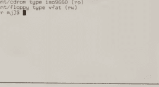

图 4.1 当前已挂载的驱动器。

如果您之前将文件移入或移出软盘驱动器，在 Linux 完成卸载驱动器时可能会有延迟。

## 伪文件系统

Linux 上存在几种实际上根本不是文件系统的文件系统。换句话说，Linux 设置了多个代表内核例程或设备管理器等项目的卷。伪文件系统有时也被称为系统抽象。

典型的 Linux 伪文件和文件系统包括以下内容：

- `/proc`—通过内核当前运行的进程
- `/dev/xyz`—设备驱动程序名称的文件
- `/dev/null`—忽略实用程序或脚本输出的输出文件

## 分区替代方案

为 Linux 自定义卷和分区可能需要大量工作。但它可以帮助您优化硬盘上使用的空间。

另外，您也可以让 Linux 设置程序为您做出决定。例如，多个 Linux 发行版允许您设置使用整个硬盘用于 Linux 的“服务器”或“工作站”。根据驱动器的大小，您可能最终只拥有一个根卷和一个交换磁盘。

## CD-ROM 和控制器

在 ATAPI 接口开发之前，CD-ROM 配置对任何操作系统来说都是一个困难的问题。

音频 CD-ROM 在数据 CD-ROM 之前推出。随着它们被改用于计算机，首批数据 CD-ROM 需要另一个驱动程序通过声卡发送信息。SCSI CD-ROM 出现得更晚；它们最初带有专用控制器。本节讨论这些内部 CD-ROM 驱动器。

今天，外部 CD-ROM 驱动器可用于并行端口和通用串行总线（USB）接口。如果您有并行端口接口，请使用并行端口驱动程序。有关并行端口接口的更多信息应可在 Linux 并行端口主页 www.torque.net/parport 上获得。如果您有 USB CD-ROM，您需要一个内核为 2.4 或更高版本的 Linux 发行版。有关安装 USB 驱动器和其他外设的最新信息，请参阅 Linux USB 网站 www.linux-usb.org。

## 声卡 CD-ROM 驱动器

Linux 管理员不可避免地需要适应旧设备，尤其是在公司削减成本时。CD-ROM 驱动器最初是通过声卡连接到系统的。约有十几种不同的声卡驱动程序可用，每个驱动程序都与特定的卡相关联。请查阅“CD-ROM-HOWTO”以了解可用驱动程序的详细信息。

基于声卡的 CD-ROM 驱动程序的问题在于，许多制造商声称其卡与 Sound Blaster 兼容。不幸的是，这一说法通常不足以满足 Linux Sound Blaster CD-ROM 驱动程序的要求。

因此，找到适用于 CD-ROM 的正确声卡设备通常是通过试错过程完成的。换句话说，您可以尝试向内核加载设备驱动程序。如果它适用于您的 CD-ROM，您将能够挂载该设备。例如，如果以下命令实际挂载了 CD-ROM，那么您就知道将 `sbpcd.o` 驱动程序添加到内核中：

```
mount /dev/sbpcd /mnt/cdrom
```

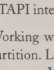

> 如果您希望此类系统具有声音和 CD-ROM 功能，您需要一个与 CD-ROM 接口的驱动程序和一个声卡驱动程序。

## 普通 CD-ROM 驱动器

当前的 CD-ROM 驱动器通过 SCSI 和 ATAPI 接口连接到您的计算机。

使用 SCSI CD-ROM 驱动器与使用常规分区类似。Linux 在您启动计算机时应能识别大多数 SCSI CD-ROM。启动消息或 `dmesg` 命令将指示驱动器是否被识别。Linux 也可能将 SCSI CD-ROM 驱动器与 `/dev/cdrom` 设备关联起来。使用以下命令检查此设备的状态：

```
ls -l /dev/cdrom
```

您可能会看到以下结果：

```
lrwxrwxrwx 1 root root 3 Dec 15 19:30 /dev/cdrom -> sdc
```

如果您看到此结果，Linux 已将 `/dev/cdrom` 设备与 `sdc` 驱动程序关联，这也意味着您的计算机上至少还有两个其他 SCSI 磁盘或 CD-ROM。

按照 ATAPI 标准构建的当前 CD-ROM 驱动器通常与 SCSI 驱动器一样好用。不幸的是，一些较旧的 ATAPI CD-ROM 存在问题，例如难以处理的制造商特定驱动程序。如果您遇到此问题，请查阅“CD-ROM-HOWTO”以获取帮助。

## 视频控制器

视频控制器几乎就像一台独立的计算机。它具有处理器和内存，并向显示器发送消息和数据。


您通过视频控制器设置的图形模式决定了在显示器上看到的颜色数量和图像元素数量。图像元素更 commonly 称为像素。您可以在 XFree86 项目的 `XF86Setup` 等工具中设置图形模式、处理器类型和视频内存。详细信息如图 4.2 所示。

如图 4.2 顶部所示，有多种可用的处理器，也称为视频服务器。每个处理器对应于特定类型的卡。一些卡是通用的，例如 Mono 和 SVGA。其他卡与特定处理器相关联，例如 ATI 的 Mach64。如果您的卡未显示在 XFree86 的卡列表中，但与其中一个列出的视频服务器相似，您可能可以使用图 4.2 中显示的选项自行配置它。

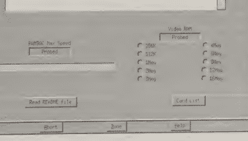

图 4.2 `XF86Setup` 视频配置工具。


另一个主要的视频配置工具是 `xf86config` 命令行工具。许多发行版都有自己的视频配置工具。例如，Red Hat 的 `Xconfigurator` 和 S.u.S.E. 的 `SaX` 也允许您更改视频卡和显示器的设置。

## 视频内存

您的屏幕分辨率和想要使用的颜色数量取决于您可用的视频内存。您需要的内存取决于以下公式：

```
Horizontal Resolution × Vertical Resolution × Color in bits / (8 bits / byte) = Required Memory in bytes
```

例如，如果您想要一个 1024×768 分辨率、32 位色的屏幕，您需要略多于 3MB 的内存：

```
1024 × 768 × 32 / 8 = 3.1 MB
```

换句话说，如果您有一张 4MB 内存的视频卡，您可以设置此图形模式。Linux X Window 使用任何剩余的视频内存用于其其他虚拟屏幕。

## 视频图形模式

您屏幕的图形分辨率取决于水平和垂直像素行以及所需的颜色数量。上节中显示的图形模式为 1024×768×32 位。

视频卡的图形模式取决于您的图形分辨率以及图像的刷新率。水平刷新率是您的卡每秒向每条线发送数据的次数。水平刷新率通常范围为 31 到 80kHz 及更高。垂直刷新率是整个屏幕每秒刷新的次数。垂直刷新率通常范围为 60 到 80赫兹 及更高。

如果您设置较高的图形分辨率，您需要更快的水平刷新率。虽然较高的垂直刷新率通常对眼睛更友好，但您设置的垂直速率取决于显示器的功能以及您认为看起来最好的效果。

## 显示器管理

显示器有局限性。您设置的图像不能超过屏幕的物理尺寸。此外，您设置的像素数量不能显著超过屏幕上可用的物理像素数量。虽然您通常希望将水平和垂直刷新率设置得尽可能高，但您不希望超过显示器的功能。

大多数新显示器不会让您超过其功能。对于大多数显示器，如果您设置的速率高于其处理能力，您会收到诸如“超出范围”之类的屏幕消息。但对于少数显示器，过高的刷新率可能会烧坏显示器。如果您将分辨率设置得过高，刷新率会增加，这也可能导致问题。

您可以使用 `XF86Setup` 或 `xf86config` 工具来管理显示器的设置。如果您使用的是 Red Hat 或 S.u.S.E.，您也可以分别使用 `Xconfigurator` 或 `SaX`。`XF86Setup` 似乎是 Sair 考试中涵盖的首选工具。

## 显示器图形模式

您可以在大多数显示器上更改图形模式。换句话说，您可以更改屏幕上显示的像素数量和每个像素使用的颜色数量。即使您认为已使用视频卡配置了此设置，您仍需要再次使用显示器进行配置。毕竟，它们是具有独立驱动程序的独立组件。

旧显示器仅支持一两种图形模式。今天的多同步显示器支持多种模式。为了确保显示器继续工作，您需要将其功能与为视频卡创建的设置相平衡。

显示器的图形功能取决于其屏幕尺寸和点距。更大的屏幕和更小的点距允许您在显示器上设置更详细的图形模式。

如果您将图形模式设置为显示器的最大分辨率，您可能会感到失望。显示器允许您设置比显示器上物理可用像素更多的图形模式。例如，一个 14 英寸、点距为 .25mm 的显示器最大屏幕尺寸为 240mmx180mm。换句话说，它每行有 960 个水平点，每列有 720 个垂直点。然而，此显示器允许您设置 1024x768 像素的图形模式。当显示器尝试将 1024x768 像素适配到只有 960x720 个点的屏幕上时，一些像素无法完全显示。结果是显示器模糊。

## 显示器刷新率

显示器的刷新能力取决于内部技术。请查阅显示器的文档以了解其允许的水平和垂直刷新率，然后返回你用来配置显卡和显示器的工具。确保两个系统的设置均不超过显示器的能力。


> 如果配置了多个图形模式，通常可以使用 `Ctrl+Alt+Num+` 或 `Ctrl+Alt+Num-` 键在这些模式之间切换。（此键组合仅适用于数字键盘上的加号和减号键。）

## 练习题

### 问题 1

在单个硬盘上设置五个卷的以下哪种方式是可行的？

- a. 设置五个主分区。
- b. 设置两个主分区，一个扩展分区和三个逻辑驱动器。
- c. 设置三个主分区和两个逻辑驱动器。
- d. 设置一个主分区，一个扩展分区和三个逻辑驱动器。

答案 b 正确。只能在扩展分区内设置逻辑驱动器。因为硬盘中不能设置超过四个主分区，所以答案 a 不正确。没有扩展分区就无法设置逻辑驱动器；因此答案 c 不正确。因为扩展分区不是卷，所以答案 d 不正确。

### 问题 2

你有一台安装了 Microsoft Windows 的计算机。它设置在一个主分区上。没有其他分区或逻辑驱动器可用。在拆分此分区以容纳 Linux 之前，你应该采取以下哪些步骤？[勾选所有正确答案]

- a. 运行 `fips` 实用程序重新排列驱动器上的数据。
- b. 运行 Windows Defrag 实用程序合并驱动器上的数据。
- c. 运行 Windows ScanDisk 实用程序确保驱动器没有错误。
- d. 备份你的硬盘。

答案 b、c 和 d 正确。Windows Defrag 实用程序合并驱动器上的数据。Windows ScanDisk 实用程序检查驱动器上的错误。因为拆分分区可能很危险，所以你应该始终备份磁盘上的数据。`fips` 实用程序用于拆分分区；因此答案 a 不正确。

### 问题 3

你使用了 `fips` 实用程序拆分了分区，然后意识到自己犯了错误。你应该采取以下哪些操作？

- a. 备份你的硬盘，然后再次运行 `fips`。
- b. 再次运行 `fips`，然后使用 `restorebr` 实用程序。确保你拥有 `fips` 创建并保存在软盘驱动器上的 `rootboot.000` 文件。
- c. 使用 `fdisk` 重建硬盘上的分区。运行 `restorebr` 实用程序重新创建你的原始分区。
- d. 运行 `restorebr` 实用程序。确保你拥有 `fips` 创建并保存在软盘驱动器上的 `rootboot.000` 文件。再次运行 `fips`。

答案 d 正确。假设你已保存了根和引导扇区，你应该在可启动软盘驱动器上有一个 `rootboot.000` 文件。你应该能够使用 `restorebr` 实用程序使用此文件重写原始的根和引导信息。如果你在使用 `fips` 时犯了错误，就不希望备份结果。因此答案 a 不正确。虽然答案 b 可以工作，但再次使用 `fips` 拆分分区可能会导致更多问题。因此答案 b 不正确。因为 `fdisk` 实用程序无法帮助你从使用 `fips` 时犯的错误中恢复，所以答案 c 不正确。

### 问题 4

你刚刚登录到 Linux 中的 root 账户并使用了 `mount /dev/cdrom /mnt/cdrom` 命令来访问 CD-ROM 上的文件。假设适当目录已存在，你的 CD-ROM 文件的绝对路径是什么？

- a. root/mnt/cdrom
- b. `/root/mnt/cdrom`
- c. mnt/cdrom
- d. `/mnt/cdrom`

答案 b 正确。绝对路径总是以根目录开头，用简单的正斜杠（`/`）表示。`/root` 目录是 root 用户的主目录。因为 root/mnt/cdrom 不是绝对路径，所以答案 a 不正确。虽然你可以用 `cd mnt/cdrom` 命令从 root 主目录访问到 CD-ROM 文件，但 mnt/cdrom 仍然不是绝对路径。因此答案 c 不正确。并且虽然 `/mnt/cdrom` 是大多数 Linux 发行版中的标准安装目录，但它与问题中的命令不对应。因此答案 d 不正确。

### 问题 5

你的朋友计划为她的小企业中的十几个用户安装 Linux 作为网络系统。她可能会扩展该系统以运行企业网站，这将涉及越来越大的日志文件来跟踪用户的购买习惯。人员增长预期不大，她希望限制分配给用户个人文件的空间。她还计划相当频繁地升级 Linux，并且不想重新加载关键应用程序，例如 Star Office。以下哪种程序最适合她的这种情况？提示：在评估这些答案时，不要忘记交换磁盘的需求。并且每台计算机仅包含一个物理硬盘。


- a. 将硬盘分成主分区和逻辑驱动器的组合。确保`/opt`、`/var`、`/home`和`/`目录挂载在不同的卷上。

- b. 将硬盘分成由几个主分区组成的卷。确保`/opt`、`/var`、`/home`和`/`目录挂载在不同的卷上。

- c. 将硬盘分成几个单独的卷。确保`/bin`、`/usr/bin`和`/boot`目录各自挂载在单独的卷上。

- d. 以上都不是。

答案 a 正确。你需要`/opt`目录位于单独的卷上，以便在升级 Linux 时保存应用程序。你需要`/var`目录位于单独的卷上，以便网站的日志文件不会压垮你的计算机。如果你想限制每个用户个人文件占用的空间，则需要`/home`目录位于单独的卷上。任何不属于单独卷的目录都会自动安装在根目录（`/`）的卷中。加上交换磁盘，此选项需要五个不同的卷。因为不能有超过四个主分区，所以答案 b 不正确。因为答案 c 中列出的目录不符合问题中列出的任何要求，所以它也是不正确的。

### 问题 6

以下哪个驱动器肯定与 CD-ROM 驱动器无关？

- a. `/dev/sdd`

- b. `/dev/sbpcd`

- c. `/dev/hdb`

- d. `/dev/hda3`

答案 d 正确。它实际上是第一个常规硬盘上的第三个主分区。CD-ROM 通常不会分成单独的卷。`/dev/sdd`驱动器用于第四个 SCSI 驱动器。因为它没有列出卷号，所以它可能是 CD-ROM 驱动器。因此答案 a 不正确。`/dev/sbpcd`驱动器是旧版 Sound Blaster 卡的 CD-ROM 附件；因此答案 b 不正确。因为`/dev/hdb`驱动器是具有常规硬盘的计算机上 CD-ROM 的常见设备，所以答案 c 不正确。

### 问题 7

以下哪个文件系统不是“真实”的？

- a. `/bin`

- b. `/opt`

- c. `/root`

- d. `/proc`

答案 d 正确。`/proc`文件系统不列出任何实际文件。相反，它列出当前正在运行的程序和内核例程。`/bin`文件系统包含许多标准 Linux 实用程序，所以答案 a 不正确。`/opt`文件系统是安装许多应用程序的位置，所以答案 b 不正确。因为`/root`文件系统是 root 用户的主目录，所以答案 c 不正确。

### 问题 8

你可以使用以下哪个程序在大多数 Linux 发行版上管理显示器和显卡的配置？

- a. `XF86config`

- b. `XF86Setup`

- c. `xf86setup`

- d. `XConfigurator`

答案 b 正确。`XF86Setup`工具是 XFree86 组的产品，可以帮助你配置显示器和显卡。虽然存在 `xf86config` 工具，但你不能通过键入“`XF86config`”从命令行访问它。因为 Linux 命令区分大小写，所以答案 a 不正确。出于类似原因，没有 `xf86setup` 工具。因此答案 c 不正确。`XConfigurator`工具目前仅在 Red Hat Linux 中可用，所以答案 d 不正确。

### 问题 9

在 Linux 中配置显卡时，以下哪些答案会影响内存需求？[勾选所有正确答案]

- a. 水平频率

- b. 分辨率

- c. 颜色数

- d. 显示器尺寸

答案 b 和 c 正确。分辨率是视频卡可以在屏幕上显示的像素数的表达。每增加一种颜色都需要额外的数据。填充更多像素和颜色需要更多数据。虽然水平频率往往随着更高的图形模式和颜色数而增加，但它并不是视频卡需要更多内存的原因。因此答案 a 不正确。虽然显示器的尺寸通常与更多像素相关，但一些更大的显示器只是像素更大。因此显示器不会改变你为视频卡设置的图形模式，答案 d 不正确。

## 第10题

如果你在设置显卡和显示器时不够小心，很容易损坏显示器。以下哪些答案描述了你需要考虑的因素以避免麻烦？[勾选所有正确答案]

- [ ] a. 确保你的图形需求不超过显示器可用的内存。

- [ ] b. 确保你不超过显示器的水平频率限制。

- [ ] c. 确保你的图形需求不超过显卡可用的内存。

- [ ] d. 确保你不超过显卡的垂直频率限制。

答案 b 正确。如果你超过某些显示器的频率限制，你的设置可能会损坏显示器内部的电路。显示器没有内存，所以答案 a 不正确。由于像 `XF86Setup` 这样的工具不允许你设置超出显卡能力的图形模式或频率，因此答案 c 和 d 不正确。

## 需要了解更多？

请查看 fips 的网页 `www.igd.fhg.de/~aschaefer/fips`，这是一个使用 fips 的良好指南。如果你想分割磁盘分区以容纳 Linux 而不破坏当前数据，这就是要使用的工具。使用 fips 之前请仔细阅读说明。

请探索 Linux 文档项目（Linux Documentation Project）的网站 `www.linuxdoc.org`，它是 Linux 手册、HOWTO 以及大量其他书籍长度文档的中央存储库。本章的重要 HOWTO 包括“`DOS-Win-to-Linux-HOWTO`”、“`CD-ROM-HOWTO`”和“`XF86-Video-Timings-HOWTO`”。

请调查文件系统层次标准（Filesystem Hierarchy Standard，FHS）的网页 `www.pathname.com`。这是一个简单的网站，包含 Linux 目录的当前标准。鼓励 Linux 开发者和发行商遵循 FHS，以最大限度地减少开发者在为不同 Linux 发行版设置程序时所需的定制。

请查看 WINE 项目网页 `www.winehq.com`。使用此应用程序，你可以在 Linux 中运行一些基于 Microsoft Windows 的程序。有关可通过 WINE 运行的 Windows 程序列表，请参阅此网站。

## 安装选项

**需要理解的术语：**

- ✓ 本地设备安装

- ✓ 网络安装

- ✓ Linux Loader（LILO）

- ✓ `rawrite`

**需要掌握的技术：**

- ✓ 列出不同的本地 Linux 安装选项，包括双启动系统

- ✓ 描述不同的网络 Linux 安装选项

- ✓ 比较不同 Linux 发行版的基本特性

- ✓ 描述 Linux 发行版通用的安装程序

Sair 考试是发行版中立的，因此本章涵盖所有发行版共用的基本步骤。你可以从本地源或通过网络安装几乎所有 Linux 发行版。

每个主要 Linux 发行版都有不同的优缺点。它们共享通用的安装程序。

### 本地设备安装

在本地计算机上安装 Linux 有三种基本方法：使用 CD-ROM、从复制到硬盘的文件安装，以及通过软盘。大多数当前 Linux 发行版有许多文件，需要一个或多个 CD-ROM。

Linux 通常直接从 CD-ROM 安装。或者，你可以将 CD-ROM 上的文件复制到硬盘，然后从那里安装 Linux。甚至可以用大量软盘安装一些较旧的 Linux 发行版。

### CD-ROM 安装

一些 Linux 发行版包含数 GB 的文件。目前，唯一方便分发这么多信息的方式是通过 CD-ROM。要开始 CD-ROM 安装，请将计算机的基本输入/输出系统（BIOS）设置为从 CD-ROM 启动。

或者，你可以用 Linux 启动软盘启动计算机。一旦检测到你的 CD-ROM，你就可以继续进行 CD-ROM 安装。一些 Linux 发行版附带启动软盘，或者你可以从安装 CD-ROM 上的文件创建启动软盘。

### 分区安装

你也可以将安装 CD-ROM 上的适当文件复制到硬盘，然后用启动软盘启动安装程序。提示时，输入你的 Linux 安装文件的目录。

### 软盘安装

可以从软盘安装 Linux。用几十张软盘，可以安装一个最小版本的 Linux。安装后，你可以连接到其他服务器以安装更多软件包。毋庸置疑，这是一个耗时过程。

### 网络安装

你可以通过三种不同类型的网络安装 Linux：文件传输协议（FTP）、网络文件系统（NFS）或 Samba。FTP 是在不同网络之间（例如互联网）传输文件的常见方式。NFS 是标准 Linux 网络文件共享协议。Samba 是一种异构协议，允许 Linux 计算机与 Microsoft 和 IBM 操作系统交换文件。

无论你使用哪种网络，第一步是找到允许你连接到网络服务器的 Linux 启动盘。这些特殊的启动盘通常会检测你的网卡。但是，如果这些盘没有检测到你的卡，你可能需要添加信息，如 Linux 对你网络驱动的名称、其中断请求（IRQ）和输入/输出（I/O）通道以及内存地址。

> *注意：Linux 中的大多数命令都是小写的。例如，如果你要安装一个设置为 IRQ 10、I/O 地址为 0x300 的 Novell 兼容网卡，你可能会使用 `insmod ne i/o=300 irq=10` 命令来帮助 Linux 识别你的网卡。*

启动计算机后，你需要远程服务器的主机名和域名或 IP 地址。你还需要知道存储安装文件的远程目录。

通过网络安装 Linux，魔鬼在于细节。如果你把“小”事情弄错，例如密码的大小写或目录中缺少斜杠，都可能导致安装失败。

不要尝试通过电话调制解调器安装 Linux。如果一切完美进行，安装需要几天时间。如果你有任何“正常”的调制解调器连接问题，该过程可能需要更长的时间。


### 七大主要发行版

截至本文撰写时，大约有二十多个 Linux 发行版。幸运的是，它们都运行相同类型的软件。由于通用公共许可证（GPL），对打包内容的版权限制很少。一些发行版甚至重新打包了其他发行版的相同版本，可能附带一些额外的工具。它们都共享同一个基本 Linux 内核。

每个发行版都有版本号。一般来说，它们遵循 Red Hat 7 的相同模式，其中第一个数字表示重大更改，第二个数字表示相对较小的修订。

以下各节中讨论的发行版列在 Sair 知识矩阵中。Sair 建议你在准备本次考试时安装四种不同的发行版。在安装每个发行版时，关注它们的共同点。你不需要知道超出这些章节中讨论内容的每个发行版的具体细节。

### 关于内核的说明

你随发行版看到的 Linux 内核可能以类似于 2.4.27 的方式标记。该格式指的是 major.minor.patch。第一个数字，在本例中为 2，意味着这是 Linux 内核的第二个主要版本。第二个数字 4 意味着这是内核的第四个次要版本。最后一个数字 27 意味着这是对指定次要版本的第 27 次补丁。

第二个数字还告诉你 Linux 内核是否处于测试版或生产版发布。奇数对应测试内核，通常不应用于生产服务器。偶数对应生产内核。

实际上，对内核次要编号的更改相当重要。例如，新的防火墙命令和通用串行总线（USB）设备的驱动程序是在 Linux 内核版本 2.4 中引入的。

### Caldera

Caldera 发行版有不同的版本，称为 Open Linux、eDesktop 或 eServer。其自我描述的重点是“面向企业的 Linux”。Caldera 开发了许多图形和基于 Web 的安装和管理工具。

### Debian

Debian GNU/Linux 发行版是 Linux 开发者的热门选择。其自我描述的重点是易于升级和安全性。Debian 可用超过 2,000 个软件包。它是由志愿者维护和分发的一系列发行版之一。

### Mandrake

Linux-Mandrake 的创建者在 Red Hat Linux 之上构建其发行版。这在 GPL 的条件下是合法的并且受鼓励。他们添加了功能，例如安装时的更多语言选择、更多驱动程序和 TrueType 字体。

## 红帽

Red Hat Linux 也许是最广为人知的 Linux 发行版。它的安装程序包括设置工作站和服务器以及升级之前 Linux 安装的选项。

## Slackware

Slackware 有两个版本的 Linux：常规发行版以及适用于 Zip 驱动器的紧凑型 ZipSlack 包。Slackware 与 Walnut Creek CD-ROM 和 BDSi 有关联，它们使用另一种名为 Berkeley Software Distribution 的 Unix 变种。

## Stampede

Stampede 发行版似乎处于不断开发中。截至本文撰写时，该非营利组织已工作多年，仍未发布其发行版的 1.0 版本。Stampede 自我描述的重点是易用性和针对最新处理器硬件的优化。

## S.u.S.E.

截至本文撰写时，S.u.S.E. 在欧洲拥有最畅销的 Linux 发行版。它似乎拥有更全面的软件发行版。尽管大多数 Linux 发行版压缩在一到两个 CD 中，但根据版本的不同，S.u.S.E. Linux 包含多达六个 CD。

## 另一个发行版：Corel Linux

Corel Linux 是在 Sair 考试发布后开发的。按某些衡量标准，Corel Linux 现在是第二受欢迎的发行版。与 Caldera 一样，Corel 开发了许多图形工具。它的重点是将 Linux 引入桌面。

正如 Linux-Mandrake 对 Red Hat Linux 所做的那样，Corel Linux 使用 Debian GNU/Linux 发行版中的大部分软件包。

## 获取 Linux

有多种方式可以获得 Linux。你可以在电脑商店和书店购买这些发行版中的许多。完整版本通常包含其分销商提供的某种服务承诺。

你可以通过两种方式从互联网下载 Linux 发行版：从 Linux 打包商的网站或从特殊下载站点，例如 www.linuxberg.com 或 www.freshmeat.net。如果您有 CD 刻录机，您可以下载 ISO 文件在您的计算机上创建发行版 CD。

您甚至可以从第三方分销商处获得 Linux 发行版 CD-ROM，例如 www.linuxmall.com 或 www.cheapbytes.com，价格约为 5 美元。

## 常见安装步骤

每个 Linux 发行版的设置程序都不同，但它们具有共同的功能。根据您使用的发行版，安装 Linux 大约需要 10 个基本步骤：

- 1. 从 Linux 安装 CD-ROM 启动。
- 2. 选择基本参数：语言、鼠标和键盘。
- 3. 选择单启动或双启动（如果您计划使用多个操作系统）。
- 4. 设置 Linux 分区。
- 5. 格式化 Linux 分区。
- 6. 安装实际软件。
- 7. 选择默认操作系统（适用于双启动设置）。
- 8. 输入网络设置。
- 9. 配置 X Window。
- 10. 创建救援磁盘。

不同发行版以不同的方式处理这些步骤中的大多数。一些发行版，例如 Corel Linux，会自动为您做出许多决定。Corel 具有四步安装过程。其他发行版允许您详细自定义配置。

## 启动 Linux 安装 CD-ROM

访问 Linux 安装 CD-ROM 有两种基本方法。您可以设置 BIOS 直接从 CD-ROM 启动计算机，或使用带有 CD-ROM 驱动程序的启动磁盘。

并非所有计算机都可以通过其 CD-ROM 驱动器启动。要测试您的系统，您需要进入 BIOS 菜单。重新启动计算机。当计算机重新启动时，您会看到通过按 F2、Del 或 Ctrl 等键进入 BIOS 或设置菜单的选项。进入设置菜单后，查找启动选项。找到一个启动选项，使计算机首先查找 CD-ROM 驱动器中的启动文件。

如果您在 BIOS 中找不到从 CD-ROM 启动的选项，您需要从软盘驱动器启动。一些 Linux 发行版包含软盘启动磁盘。如果您没有软盘启动磁盘，您可以创建一个。您应该能够在发行版 CD-ROM 上找到至少一个 `rawrite.exe` 程序和一个 `boot.img` 文件。`rawrite` 程序是 MS-DOS 程序，允许您将 Linux 启动软盘的映像复制到格式化的 1.44MB 软盘上。

`boot.img` 文件也称为启动映像。Linux 映像是一系列文件的归档。`boot.img` 内部的文件应能检测大多数 CD-ROM。一些发行版还包含帮助计算机检测网络和 PCMCIA 卡（也称为 PC 卡）的映像。

如果您有访问其他 Linux 计算机的权限，您可以使用 `dd`（设备转储）命令创建启动映像。如果您将 CD-ROM 挂载在 `/mnt/cdrom` 目录上，您可以使用以下命令：

```
dd if=/mnt/cdrom/images/boot.img of=/dev/fd0
```

此命令采用 `boot.img` 输入文件（if）并将其中的文件发送到输出文件（of）。但是，没有一个特定的输出文件。`dd` 命令实际上将输入文件解包到 `fd0` 设备，这通常是计算机上的第一个软盘驱动器。虽然您需要挂载 CD-ROM 才能使其工作，但您不需要挂载软盘驱动器。您实际使用的命令取决于您的实际设备、挂载位置和 `boot.img` 文件的位置。

对于某些发行版，您可能还有其他几个选项。在某些情况下，您可以直接从 Microsoft Windows 启动 CD-ROM。在其他情况下，您必须将计算机启动到 MS-DOS，或关闭 Windows 并重新启动到 MS-DOS 模式。

## 基本输入参数

每个 Linux 发行版都需要为语言、键盘和鼠标设置基本输入参数。一些 Linux 发行版包含十多种语言的说明。Linux 设置程序可以容纳来自几种不同类型的美国键盘以及其他国家常见的键盘的输入。而且基于图形用户界面的那些 Linux 设置程序也设计为可容纳主要指向设备，例如鼠标。

## 单启动或双启动

当您运行 Linux 设置程序时，您可以选择单启动或双启动。您可以将整个硬盘分配给 Linux，也可以设置分区以容纳多个操作系统。

每个 Linux 设置程序都有一个分区程序，如 `fips`、`fdisk` 或 Partition Magic，您可以在此时使用。如果您已经设置了所需的卷，请继续阅读下一节关于 Linux 分区的部分。

## 设置 Linux 分区

您可以使用 Linux 设置工具为交换分区和您选择的 Linux 目录创建卷。

Linux 设置程序也可以与您之前创建的任何分区或卷一起使用。您至少需要两个卷：一个用于文件，一个用于交换分区。您还可以将不同卷分配给根（`/`）、`/boot`、`/var` 和 `/opt` 等目录。请记住，您的交换分区应约为 RAM 大小的两倍，最多约为 100MB。

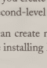

> > Linux 分区的顺序相对不重要。如果可以，请先配置交换分区。

## 格式化 Linux 分区


一旦创建 Linux 分区，您需要对其进行格式化。Linux 设置程序在您创建的每个 Linux 卷上使用二级磁盘格式化命令。

您可以创建多个交换分区。事实上，如果您在多个硬盘上安装 Linux，这可能会提高性能。

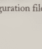

> > Linux 安装程序使用 `mkfs` 程序格式化常规 Linux 卷。此程序将指定分区格式化为第二扩展文件系统（`ext2fs`）。Linux 安装程序还使用 `mkswap` 命令格式化 Linux 交换分区。虽然通常不推荐，但您也可以在 Linux 安装后使用 `swapon` 命令配置 Linux 交换文件。

## 安装实际软件

在大多数 Linux 设置程序中，您可以选择要安装的软件。有时选择是一般的。例如，您可以在最小安装和服务器类型安装之间进行选择。

有时选择是具体的。在某些 Linux 设置程序中，您可以为 Linux 设置程序安装在计算机上的每个软件包进行选择。做出选择后，Linux 设置程序会解包软件并将配置文件复制到您的系统上。

## 配置启动序列

Linux 通过 Linux Loader（`LILO`）管理多个操作系统。当你的计算机运行 `LILO` 时，你可以选择想要启动的操作系统。

在 Linux 安装的这一部分，你为 `LILO` 选择三个位置之一。每个位置适用于不同的用途，如表 5.1 所示。

## 网络设置

一些 Linux 安装程序允许你在开始安装过程之前配置网络设置。毕竟，如果你需要从另一台计算机访问安装文件，你确实需要告诉 Linux 在哪里找到这些文件。

即使你只是从 CD-ROM 安装 Linux，你也可以使用 Linux 安装程序确保在 Linux 安装完成后计算机立即连接到网络。

Linux 安装程序假定你将计算机连接到 `TCP/IP` 网络。尽管有其他网络协议栈可用，但 Linux 基于 `TCP/IP` 构建。如果你计划在另一个网络上设置 Linux，应将网络设置部分留空。你可以通过 Caldera Linux 安装程序查看此配置的示例，如图 5.1 所示。

要为 `TCP/IP` 设置 Linux，你可能需要了解以下内容：

- *网络设备*—例如，如果你的计算机有一块以太网卡，你的网络设备就是 `eth0`。
- *驱动程序*—Linux 安装程序应能识别大多数网卡。如果你知道你的网卡会“难以处理”，你可以输入驱动程序以及任何特殊的 IRQ 或 I/O 端口。

表 5.1 `LILO` 安装选项。

| 位置 | 用途 |
|---|---|
| 主引导记录 (MBR) | 当你想使用 `LILO` 在操作系统之间进行选择时。 |
| 主分区第一个扇区 | 当你有另一个引导加载程序（如 System Commander 或 Partition Magic）可让你在操作系统之间进行选择时。 |
| 软盘 | 当你不想更改你的 MBR 或主分区的第一个扇区时。或者，如果你无法在硬盘柱面 1024 以下安装 Linux（参见第 4 章），这是设置 Linux 的可行选项。 |

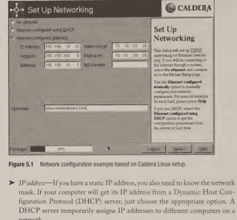

图 5.1 基于 Caldera Linux 安装的网络配置示例。

- **IP地址**—如果你有静态 IP 地址，你还需要知道网络掩码。如果你的计算机将从动态主机配置协议（`DHCP`）服务器获取 IP 地址，只需选择适当的选项。`DHCP` 服务器会临时为网络上的不同计算机分配 IP 地址。
- **网络掩码**—如果你指定了 IP 地址，你需要一个网络掩码。网络掩码，例如 255.255.255.0，限制了本地网络上可能的 IP 地址范围。网络掩码有时称为子网掩码。
- **名称服务器**—名称服务器包含名称（如 mommabeans.com）的数据库以及每个名称对应的 IP 地址，例如 192.168.10。你需要名称服务器的 IP 地址以及网络的任何辅助名称服务器的 IP 地址。名称服务器也称为域名服务器（DNS）或伯克利互联网名称守护进程（BIND）服务器。
- **网关**—如果你的网络连接到任何其他网络，你需要充当网络之间连接的计算机的 IP 地址。在图 5.1 所示的示例中，地址是 192.168.10.1
- **主机名**—你需要为计算机指定一个名称，并且它需要与网络上任何其他计算机不同。在图 5.1 所示的示例中，主机名是 linux。
- **域名**—你还需要一个网络名称。在图 5.1 所示的示例中，域名是 mommabears.com。（计算机的完全限定域名是 linux.mommabears.com。）

在某些方面，这些网络设置可能看起来不完整。如果你不在网络上使用 DNS 服务器，你也可以设置一个文件（`/etc/hosts`），其中包含网络上每台计算机的 IP 地址。本节中的信息确实能让你连接到本地网络。网关地址也允许你连接到外部网络，例如互联网。

## X Window 设置

当前的 Linux 发行版允许你在安装期间配置你的显卡和显示器。如第 4 章所述，这涉及为你的显卡和显示器配置视频 RAM、分辨率、颜色数、显示器尺寸以及频率设置。


> 请确保你的显卡设置不超过显示器的能力。

## 创建救援磁盘

配置完设置过程后，大多数 Linux 发行版会提示你创建救援磁盘。尽管你可能能够使用通用救援磁盘甚至安装 CD-ROM 恢复一些配置，但救援磁盘使这项工作变得容易得多。Linux 使用 `dd` 命令将自定义救援映像的文件解包到 1.44MB 软盘上。

如果你需要进行救援，你可能需要同时使用救援磁盘和启动磁盘。

## 安装后

如果你在生产计算机上将 Linux 从一个版本升级到另一个版本，通常应将新版本的 Linux 设置在不同的硬盘上。安装完成后，你可以复制原始 Linux 版本的配置文件，然后根据需要测试和修改结果。

你也可以重新配置 Linux 安装期间所做的任何设置。帮助你完成此操作的许多工具将在以下章节中介绍。

## 练习安装

Sair Linux/GNU 考试列出的要求之一是安装四个 Linux 发行版。尽管安装四个不同的 Linux 发行版对大多数人有帮助，但这是一个任意数字。安装你需要了解本章讨论的过程的尽可能多的不同 Linux 发行版。

你选择的实际发行版不应重要。大多数 Linux 发行版安装程序都包括专家或自定义配置模式。在安装期间选择这些模式。当你尝试内置选项时，你将更深入地了解 Linux 安装和配置过程。

## 练习题

### 问题 1

你可以从以下哪些方式安装 Linux？[勾选所有正确选项]

- a. CD-ROM
- b. Floppy disks
- c. Network File System connection
- d. FTP connection

答案 a、b、c 和 d 都是正确的。你可以从几乎任何介质或通过任何可以通过 Linux 启动磁盘配置的网络连接安装 Linux。

### 问题 2

以下哪一项是 Linux 管理计算机上两个或多个操作系统之间的选择的方法？

- a. Linux Commander
- b. Partition Magic
- c. Linux Loader
- d. Linux Manager

答案 c 正确。Linux Loader 更常被称为 `LILO`，它是你可以安装在硬盘或软盘上以提供操作系统选择的启动管理器。Linux Commander 和 Linux Manager 不存在；因此，答案 a 和 d 不正确。尽管你可以使用 Partition Magic 设置操作系统之间的选择，但它是通过 MS-DOS 或 Microsoft Windows 安装的商业产品。因此，答案 b 不正确。

### 问题 3

如何通过网络设置 Linux 安装？

- a. Use your telephone modem to connect to your Internet Service Provider (ISP). Connect to a network with Linux installation files.
- b. Use the `rawrite` program to set up network boot floppy disk(s). Use these boot disks to start the Linux setup program. Connect to the appropriate network server after the setup program boots.
- c. Download the appropriate network boot floppy disk(s). Use these boot disks when prompted by your Linux CD-ROM-based setup program. Connect to the appropriate network server after the setup program boots.


- d. Boot your computer from the Linux installation CD. When prompted, enter the IP address of the network server with your Linux installation files.

答案 b 正确。`rawrite`程序是一个基于 MS-DOS 的程序，用于将磁盘映像复制到软盘。这些映像允许你启动 Linux 系统并安装适当的网络文件。使用这些启动磁盘后，你应该能够连接到适当的网络服务器。通过电话调制解调器安装 Linux 并不可行；因此，答案 a 不正确。基于 Linux CD-ROM 的安装程序通常不允许你连接到网络下载安装文件；它们已在 CD-ROM 上提供。因此，答案 c 和 d 不正确。

### 问题 4

以下哪项陈述是 Linux 发行版的特征？

- a. Every Linux distribution can be installed in an MS-DOS partition.
- b. Some Linux distributions use Red Hat kernels.
- c. Some Linux distributions are based on other distributions.
- d. Every Linux distribution can be installed in a Linux swap partition.

答案 c 正确。根据 GPL 的规定，任何人都可以重新打包他人的 GNU/Linux 发行版。因为 Linux 通常不能安装在 MS-DOS 分区中，所以答案 a 不正确。没有专属于 Red Hat 的内核；因此，答案 b 不正确。尽管 Linux 发行版使用交换分区，但其文件安装在各种目录下。因此，答案 d 不正确。

## 问题 5

以下哪个命令可用于将引导映像复制到格式化的 1.44MB 软盘？文件名是 `boot.img`。

- a. `rawrite boot.img a:`
- b. `rawrite`
- c. `dd if=/mnt/cdrom/images/boot.img a:`
- d. `copy boot.img a:`

答案 b 正确。当你在 MS-DOS 模式下运行此命令时，会提示你输入要复制的映像以及软盘驱动器的位置。因为答案 a 中的命令不起作用，所以不正确。有关 `rawrite` 语法的更多信息，输入 `rawrite -h` 命令。`dd` 命令是 Linux 命令。虽然你可以在 Linux 中创建启动盘，但在 Linux 计算机中没有 `a:` 驱动器；因此答案 c 不正确。映像文件是多个不同文件的归档。你不能直接复制映像；你需要像 `rawrite` 这样的命令将文件解包到你的软盘。因此，答案 d 不正确。

## 问题 6

以下哪个命令可用于格式化或激活 Linux 交换文件？

- a. `mkswap`
- b. `mke2fs`
- c. `ext2fs`
- d. `swapon`

答案 d 正确。你可以使用 `swapon` 命令激活 Linux 交换文件。`mkswap` 命令格式化 Linux 交换分区（不是文件）；因此，答案 a 不正确。因为 `mke2fs` 命令格式化常规 Linux 卷（不是交换分区），所以答案 b 不正确。第二扩展文件系统有时被称为 `ext2fs`，但它不是一个命令，所以答案 c 不正确。

## 问题 7

在 Linux 安装期间，应在何时将 LILO 安装到软盘上？[勾选所有正确答案]

- [ ] a. 当你不想将 LILO 写入你的 MBR 时。
- [ ] b. 当 Linux 是你计算机上唯一的操作系统时。
- [ ] c. 当你希望如果未安装你的 Linux 启动软盘，计算机启动到另一个操作系统时。
- [ ] d. 当你始终希望使用 LILO 在多个操作系统之间进行选择时。

答案 a 和 c 正确。将 LILO 安装在软盘上是安装 LILO 到你的 MBR 的一种可行替代方案。如果不插入启动软盘，你的计算机将启动你的原始操作系统。如果 Linux 是你计算机上唯一的操作系统，你希望每次打开计算机时都启动 Linux。如果你只在软盘上设置 LILO，你的计算机不会每次打开时都启动 Linux。因此，答案 b 不正确。如果没有你的 Linux 启动软盘，你的其他操作系统将从 MBR 启动。因此，答案 d 不正确。

## 问题 8

你正在 TCP/IP 网络中的计算机上安装 Linux。在安装 Linux 时，设置网络时需要以下哪些项目？提示：你的网络已连接到其他网络，并且你没有 DHCP 服务器。[勾选所有正确答案]

- [ ] a. 计算机的 IP 地址
- [ ] b. 网关计算机的 IP 地址
- [ ] c. DHCP 服务器的 IP 地址
- [ ] d. 名称服务器的 IP 地址
- [ ] e. 网络上所有其他计算机的 IP 地址

答案 a、b 和 d 正确。因为你的计算机不是从 DHCP 服务器获取其地址，所以你需要指定计算机的 IP 地址。你需要网关计算机的 IP 地址来访问其他连接的网络。你需要至少一个名称服务器的 IP 地址来将名称如 `coriolis.com` 翻译为 IP 地址。因为你已经需要计算机的 IP 地址，DHCP 服务器不会帮助你。因此，答案 c 不正确。虽然拥有网络上所有其他计算机的 IP 地址很有用，但在安装过程中连接你的计算机到网络时不需要提供此信息。因此，答案 e 不正确。

### 问题 9

在安装期间应在哪里配置不同的 Linux 分区？

- a. 你应该将更频繁访问的信息，例如交换分区，尽可能靠近硬盘中心放置。
- b. 硬盘上分区的位置相当不重要。
- c. 你应该将更频繁访问的信息，例如交换分区，尽可能靠近硬盘边缘放置。
- d. 你应该将更频繁访问的信息，例如 `/root` 目录，尽可能靠近硬盘中心放置。

答案 b 正确。鉴于当前硬盘的速度，任何特定分区的位置并不非常重要。将交换分区更靠近硬盘中心确实有帮助；然而，速度提升微不足道。因此，答案 a 不正确。将交换分区放在硬盘边缘会减慢数据传输。即使差异不显著，答案 c 也不正确。因为以 root 用户登录应很少见，对 root 用户的主目录 `/root` 的访问应不频繁。任何 `/root` 目录都可以远离硬盘中心。即使差异不显著，答案 d 也不正确。

### 问题 10

你已在生产服务器上安装了 Linux。它也是管理你网页的服务器。你每天收到数百次对你网页的访问。你听说有一个新的 Linux 内核，版本 2.5.45。你理解它将帮助你更有效地管理你的流量和日志文件。你应该用此内核升级你的计算机吗？以下哪种解释最有意义？

- a. 不。因为最后一位数字是奇数，你知道此内核不适合生产。你应该等待内核版本 2.5.46。
- b. 是。因为最后一位数字是奇数，你知道此内核完全经过测试且可靠，适合你的用途。
- c. 不。因为中间数字是奇数，你知道此内核不适合生产。你应该等待内核版本 2.6。
- d. 是。因为中间数字是奇数，你知道此内核完全经过测试且可靠，适合你的用途。

答案 c 正确。最后一位数字是补丁号，并不决定内核是否适合生产。虽然较高的补丁号表示内核更成熟，但答案 a 和 b 仍然不正确。当内核版本的中间数字为奇数时，它是开发版内核，不适合生产。因此，答案 d 不正确。

## 需要了解更多？

访问 `www.caldera.com`，这是 Caldera Systems 的网站，其自我描述的重点是面向企业的 Linux。Caldera 网站提供硬件兼容性列表（HCLs）和知识库以及 Caldera 最新版 Linux 的下载。

查看 Corel Linux 社区的网站 `http://linux.corel.com`。Corel Linux 专注于桌面市场，并积极参与 Windows Is Not an Emulator（WINE）项目。最新版 Linux 的下载也可在该网站获取。Corel Linux 版本的 Linux 公开基于 Debian 发行版构建。

探索 Debian GNU/Linux 的网站 `www.debian.com`。这可能是 Linux 开发人员最流行的 Linux 发行版。Debian 的创建者主要是志愿者。你也可以从该网站下载 Debian GNU/Linux。

调查 Linux 文档项目网站 `www.linuxdoc.org`，它是 Linux 手册、HOWTOs 以及其他多本长度文档的中央存储库。本章相关的 HOWTO 是“Linux Installation-HOWTO”。

访问 `www.linux-mandrake.com`，这是 MandrakeSoft 创建的 Linux-Mandrake 网站。其 Linux 版本基于 Red Hat Linux，并配有多个额外的图形和其他安装工具。你可以从该网站下载其 Linux 版本。

访问 `www.redhat.com`，这是 Red Hat, Inc. 的网站。其 Linux 版本是当前市场领导者。Red Hat 网站提供 HCLs 和知识库以及最新版 Linux 的下载。


浏览 Slackware Linux 项目网站 `www.slackware.com`。Slackware 的追随者与 Debian GNU/Linux 相似。其标准版 Linux 以及紧凑的 ZipSlack 包均可在该网站获取。Slackware 与 Walnut Creek CD-ROM 和 BDSi 关联，后者使用另一种名为 Berkeley Software Distribution 的 Unix 变体。

请查看 Stampede GNU/Linux 的网站 `www.stampede.org`，这是一个非营利组织，截至本文撰写时仍在开发其发行版。其重点在于易用性和对最新处理器硬件的优化。您可以从该网站下载其版本的 Linux。

访问 `www.suse.com`，这是 S.u.S.E. GmbH 的网站，是欧洲最畅销的 Linux 发行版。S.u.S.E. 网站提供 HCLs 和知识库以及其最新版本 Linux 的下载。

探索 Turbo Linux 的网站 `www.turbolinux.com`，这是亚洲最畅销的 Linux 发行版。Turbo Linux 网站允许您通过将文件下载到硬盘或使用启动盘来启动与 FTP 服务器的 Linux 连接，从而安装其发行版。

## 启动和关闭

需要理解的术语：

- Linux 加载器 (`LILO`)
- `vmlinuz`
- `boot.b`
- `map`
- `append`
- `/etc/fstab`
- `rc.d`
- `init.d`
- `/etc/inittab`
- Shells
- `shutdown`

需要掌握的技术：

- 管理 Linux 加载器 (`LILO`)
- 编辑已挂载的文件系统 (`/etc/fstab`)
- 分析初始化脚本
- 分析运行级别资源控制脚本
- 解释初始化命令 (`/etc/inittab`)
- 理解登录
- 编辑关机选项

本章解释 Linux 启动时发生的情况，以及您可以如何自定义启动过程。Linux 加载器 (`LILO`) 管理多个操作系统。启动计算机时 `LILO` 会启动。如果您从 `LILO` 菜单中选择 Linux，它会加载 Linux 内核。内核加载硬件和协议，然后将剩余过程交给 `init`。`init` 程序根据 `/etc/fstab` 文件中的指定挂载驱动器，并借助资源控制 (`rc`) 文件在各种运行级别启动其他程序。然后它根据 `/etc/inittab` 初始化文件设置 Shells 和登录屏幕。该文件还定义谁可以关闭计算机以及可用于关闭它的命令。

### Linux 加载详情

`LILO` 是一个多功能工具。您可以将其设置为直接从硬盘加载 Linux，它也可以与其他启动管理器一起工作。甚至可以将其设置为从软盘加载。启动时 `LILO` 会向 Linux 传递有关硬件配置的特殊详细信息。一旦选择加载 Linux，它就会启动您的 Linux 内核。

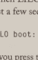

> Linux 内核有时也以其基本文件名 `vmlinuz` 闻名。

当 `LILO` 在您的计算机上加载时，您会看到以下提示，通常只显示几秒钟：

```
LILO boot:
```

如果按下 Shift 键，`LILO` 应停止并等待您的输入。如果按下 Tab 键，`LILO` 会列出可用的操作系统。例如，如果您在计算机上设置了 Linux 和 Microsoft Windows，您可能会看到以下内容：

```
linux   dos
boot:
```

在这种情况下，您有两个选择。您可以输入 "`linux`" 或 "`dos`"。即使您的其他操作系统是 Microsoft Windows，输入 "`windows`" 也不会起作用。


> 通过 `LILO` 选择的操作系统数量没有限制。唯一的限制基于硬盘的大小。

### 常见 LILO 任务

无论您的配置如何，您在 `lilo.conf` 文件中至少会看到以下命令：

```
boot=/dev/hda
install=/boot/boot.b
```

`boot` 命令指定您的 `lilo.conf` 文件的位置。所示命令假定您已将 `LILO` 安装在计算机第一块硬盘的主引导记录 (MBR) 中。如果您将 `LILO` 安装在该驱动器的第一个分区上，您会看到 `boot=/dev/hda1` 命令。或者，如果您将 `LILO` 安装在软盘上，您会看到 `boot=/dev/fd0` 命令。

`LILO` 然后运行二级启动加载器，即 `boot.b` 文件。如果您在软盘上使用 `LILO`，此命令将读取 `install=/mnt/boot.b`，因为在 Linux 加载之前软盘通常会挂载在 `/mnt` 目录下。

一些 Linux 发行版也在 `LILO` 中配置以下命令：

```
message=/boot/messagefile
map=/boot/map
```

使用时，`message` 命令指定您在 `LILO` `boot:` 提示符之前会看到的消息文件。`map` 命令指定启动分区的位置。默认情况下，`map` 命令位于 `/boot/map` 文件中。

以下命令控制在默认操作系统自动启动之前等待的时间：

```
prompt
timeout=100
```

如果按下 Shift 或 Tab 键，`prompt` 命令会覆盖任何 `timeout`。`timeout` 命令指定 `LILO` 在以十分之一秒为单位启动默认操作系统之前等待的时间。所示时间为 10 秒。Linux 的某些版本用 `delay` 命令替代 `timeout`；就我们此处的用途而言，它们是相同的命令。

### 多个操作系统

如果您在 `LILO` `boot:` 提示符处未进行选择，则出现的操作系统取决于 `default` 命令。另一方面，如果缺少此命令，则默认操作系统是 `lilo.conf` 文件中您看到的第一个操作系统。

`LILO` 通常用以下四个命令定义 Linux 操作系统：

```
image=/boot/vmlinuz
label=redhat
root=/dev/hda3
read-only
```

`image` 命令指定 Linux 内核的位置。`label` 是您在 `LILO` `boot:` 提示符处按下 Tab 键时看到的内容，也是您需要键入以选择该操作系统的名称。`root` 是根目录 (`/`) 的位置。而 `read-only` 表示根目录应以只读模式挂载。`read-only` 命令通常在根目录挂载到其分配的卷上时被覆盖。当然，如果上述任何文件在您的系统上具有不同的名称或位于不同的位置，请相应地替换。

`LILO` 通常用以下三个命令定义其他操作系统，例如 Microsoft Windows 或 IBM 的 OS/2：

```
other=/dev/hda2
label=dos
table=/dev/hda
```

`other` 命令指定非 Linux 操作系统启动文件的卷。`label` 命令与 Linux 部分相同。`table` 命令指定具有分区信息驱动器。

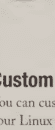

标准个人计算机上有两个 IDE 硬盘控制器。您可以将每个控制器连接到“主”设备和“从”设备。第一个控制器的主设备称为 `hda`；第一个控制器的从设备称为 `hdb`。第二个控制器的主设备称为 `hdc`；第二个控制器的从设备称为 `hdd`。如果您有一块硬盘和一个 CD-ROM 驱动器，硬盘最常见的位置在 `hda`，而 CD-ROM 驱动器最常见的位置在 `hdb`。

### 自定义 LILO 命令

您可以使用 `append` 命令自定义 `LILO`，该命令向 Linux 内核传递消息。如果您刚刚安装了第一块以太网网卡，并且知道其 IRQ（中断请求）设置为 12，其 I/O（输入/输出）地址设置为 0x300，您可以向 `lilo.conf` 文件添加以下命令：

```
append="ether=12,0x300,eth0"
```

以太网卡的格式为 `ether=IRQ, I/O, device`。因为这是您的第一块以太网卡，所以设备为 `eth0`。您的第二块以太网卡将为 `eth1`。

或者，如果您使用的是 2.2.1 版本之前的旧 Linux 内核，可以使用 `mem` 命令帮助 Linux 识别超过 64MB 的 RAM。例如，以下命令告诉 Linux 识别高达 192MB 的 RAM：

```
append="mem=192M"
```

从 2.2.1 版本开始的 Linux 内核应能识别计算机上的所有 RAM。

如果以任何方式编辑 `LILO`，请使用文本编辑器。确保准备好带有旧 `LILO` 的救援盘，然后运行 `/sbin/lilo` 命令以加载新的 `lilo.conf` 文件。


您可以在 `LILO` `boot:` 提示符处直接输入 `append` 命令，但无需键入“`append`”。例如，如果您想启动 Linux 并帮助其识别高达 192MB 的 RAM，您将使用 `linux mem=192M` 命令。

### 故障排除 LILO


LILO 提示符可以帮助您排除启动问题。例如，当您只看到 LILO boot: 提示符的一部分时，您就知道存在问题，如下所示：

```
L:
```

当您只看到提示符的这一部分时，有两种可能的原因。您可能已移动或删除了二级启动加载器文件，通常为 `/boot/boot.b`。或者，您的 BIOS（基本输入/输出系统）可能无法读取硬盘。如果您只看到 L.、LIL? 或 LIL-，这些也是潜在原因。

或者，如果您期望看到 LILO boot: 提示符时却看不到任何字母，这意味着您的计算机在查找 `lilo.conf` 文件时遇到问题。它甚至可能已从 MBR 中丢失。

如果您的二级启动加载器（`boot.b`）文件仍然存在，请将硬盘的配置与 BIOS 菜单中列出的规范进行核对。您也可能遇到第 4 章中描述的问题，即 Linux `/boot` 目录挂载在结束于 1023 柱面以上的卷上。

在较旧的硬盘上，柱面 1023 可能低至 512MB。

如果你要从计算机中移除 Linux，可以使用 MS-DOS `fdisk /MBR` 命令从 MBR 中移除 LILO。如果真的要这样做，请先在可启动的软盘上加载 `fdisk` 命令。

## Mounts (`/etc/fstab/`)

你在安装 Linux 时配置的卷，以及一些其他的卷，都包含在 `/etc/fstab/` 文件中。图 6.1 中显示的卷在 Linux 启动时会被挂载到你的计算机上。

### Mount File Format

关键信息显示在 `/etc/fstab/` 文件的前三列中。其他列仅供参考：

- **Volume**—第一列表示主题卷。例如，图 6.1 第一行中的卷对应于计算机上第一块硬盘上的第一个逻辑驱动器。
- **Mount point**—第二列对应于挂载到指定卷的目录。例如，图 6.1 第二行显示 `/boot` 目录挂载在第一块硬盘的第一分区上。
- **Format**—第三列对应于每个卷的挂载方式。例如，`ext2` 对应于第二扩展文件系统。
- **Mount option**—第四列指定可以挂载的用户类型、是否可以读或写，以及可以从挂载目录运行的内容。

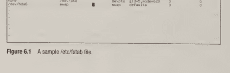

Figure 6.1 A sample /etc/fstab file.

- Dump—第五列指定是否将更改转储到内存缓存或直接转储到挂载的卷中。如果此值为 0，数据会直接写入文件系统。如果此值为 1，数据会存储在缓存中。
- Mount order—第六列决定卷的挂载时间。如果此值为 0，卷通常会在用户登录后由用户挂载。如果此值为 1，卷会在你启动 Linux 时挂载。挂载顺序通常与根目录（`/`）相关联。如果此值为 2，Linux 会在根目录之后挂载另一个目录。

### Mount File Flexibility

`/etc/fstab` 文件具有灵活性。你可以通过此文件挂载额外的卷，但在添加卷之前应先测试此功能。例如，如果你在同一台计算机上同时安装了 Microsoft Windows 和 Linux，你可能能够使用以下命令挂载 Windows C: 驱动器：

```
mount -t vfat /dev/hda2 /disks/c
```

此命令挂载一个格式化为 VFAT（Virtual File Allocation Table，虚拟文件分配表）的卷，它是 Microsoft 的虚拟文件系统，可处理长文件名（`-t` 对应类型）。该卷是第二个主分区（`/dev/hda2`）。挂载点是 `/disks/c` 目录。

如果你在 `/dev/hda2` 上有一个 VFAT 卷，此命令应该可以工作。如果可以，你可以使用 `ls /disks/c` 命令验证它。然后，你可以通过在 `/etc/fstab` 文件中输入以下行，确保 Linux 在每次启动时都挂载此卷：

`/dev/hda2   /disks/c   vfat   defaults   0   2`

`defaults` 选项允许任何用户挂载、读取和写入给定的目录。0 表示传输到此目录和从此目录传输的文件会被缓存。2 指的是在根目录之后挂载的目录。

如果需要添加额外的 Linux 卷，可以使用 `fdisk` 或 `fips` 等工具创建它们。然后可以使用 `mk2fs` 命令格式化它们以设置 Linux 第二扩展文件系统（`ext2fs`），或使用 `mkswap` 命令设置另一个交换分区。格式化后，可以通过将条目添加到 `/etc/fstab` 文件来在新卷上挂载目录。

## Loading Sequence

要了解 Linux 在你的计算机上如何加载，请详细分析 `/etc/inittab` 文件。本质上，Linux 启动时以三阶段过程加载脚本。首先，它从 `rc.sysinit` 文件加载系统初始化脚本。其次，它在各个 `rc.d` 目录中加载与不同运行级别相关的脚本。第三，它在 `rc.local` 文件中加载自定义脚本。

当这些步骤完成后，Linux 然后根据 `initdefault` 变量定义的特定运行级别设置你的系统。无论如何，不要将 `initdefault` 设置为 0 或 6。如果这样做，每当你尝试启动 Linux 时，你的系统就会关机或重启。

### Initialization Scripts (`rc.sysinit`)

启动 Linux 时运行的第一个资源控制文件是 `rc.sysinit` 文件。它启动多个程序。它还根据 `/etc/mtab` 文件挂载卷以及一些基本网络程序。

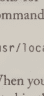

> `/etc/mtab` 文件列出了 Linux 启动时从 `/etc/fstab` 挂载的卷。

`rc.sysinit` 脚本还设置了你的 `PATH` 变量，它定义了 Linux 在何处查找不同的命令。要检查当前的路径设置，输入命令 `"echo $PATH"`。你可能会得到以下结果：

`/usr/local/bin:/bin:/usr/bin:/usr/X11R6/bin:/home/mj/bin`

当你输入 `who` 等命令时，Linux 会在 `PATH` 变量列出的目录中查找此命令。如果你在 `PATH` 中不包含当前目录，这可能会不方便。例如，假设你在主目录中创建了一个名为 `goodidea` 的脚本。如果你位于主目录中，你必须输入 `./goodidea` 命令才能运行脚本。如果你的 `PATH` 变量包含点号（`.`），则不需要这样做。


> 在 `PATH` 变量中包含点号（`.`）有优点也有缺点。出于安全原因，这通常不被推荐；黑客（恶意用户）可以在用户的本地目录中放置具有熟悉名称的破坏性程序。例如，如果黑客在你的主目录中插入了一个名为 `who` 的程序，并且你的 `PATH` 变量中包含点号，那么当你输入 `who` 命令时，你将运行黑客想要你运行的程序。这类程序有时被称为特洛伊木马。当然，如果你运行的是独立的 Linux 计算机，则不是问题。

### Run Level Scripts (`rc#.d`)

`/etc/inittab` 文件在每个运行级别运行守护进程和脚本。如果你想查看每个级别运行的内容，请列出适用目录中的文件。例如，如果你想查看在关机（运行级别 0）时启动和关闭的程序，请输入以下命令：

```
ls /etc/rc.d/rc0.d
```

命令通常以 S（start，启动）或 K（kill，杀死）开头。例如，如果你看到 `K23nfsd` 命令，你就知道 Linux 在适用的运行级别会终止网络文件系统（NFS）守护进程。你可以在图 6.2 中看到运行级别脚本使用的典型守护进程和其他命令列表。

> TIP 每个 `rc.d` 运行级别中的脚本都链接到 `init.d` 目录中的文件。根据你的发行版，你可能会在 `/etc` 或 `/etc/rc.d` 下找到 `/init.d` 目录。`/init.d` 目录包含可在 Linux 启动后用于启动或停止守护进程的脚本。该目录中的两个示例守护进程是 Apache（`httpd`）和网络文件系统（`nfsd`）。

### The Local Run Level Script (`rc.local`)

如果你有自己的脚本希望在每次启动 Linux 时运行，请将它们添加到 `rc.local` shell 脚本中。它们在 Linux 在 `initdefault` 运行级别设置完成后运行。

## Common Run Levels

你在第 3 章学习了运行级别。以下是所有发行版使用的运行级别列表：

- Shutdown—所有发行版都使用运行级别 0 进行关机。此级别结束所有程序和守护进程。此级别也称为 halt。root 或超级用户可以使用 `init 0` 命令启动此运行级别。

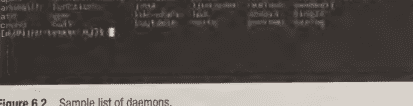

Figure 6.2 Sample list of daemons.


## 运行级别

**Reboot**—所有发行版都使用运行级别 6 进行重启。这是一个两步过程。它首先将 Linux 移动到运行级别 0。当 Linux 重启时，它会移动到标准的 multiuser 级别，通常为 2 或 3，具体取决于你的 Linux 发行版。`root` 或超级用户可以使用 `init 6` 命令启动此运行级别。

**Single User**—所有发行版都有单用户模式。当你使用救援盘启动 Linux 计算机时，这是标准模式。你也可以在出于管理原因不想让其他人使用你的 Linux 计算机时启动单用户模式。一般来说，单用户模式配置在运行级别 1 或 S。

**Multiuser**—所有发行版都有某种形式的 multiuser 运行级别。有时它可带或不带网络连接。一般在运行级别 2 或 3。

**X Window**—Linux 发行版在运行级别 3、4 和/或 5 使用不同的图形用户界面（GUI）设置。

你可以通过更改 `/etc/inittab` 文件中 `initdefault` 变量关联的数字来更改默认运行级别。例如，你可以通过输入适当的 multiuser 运行级别，将默认启动从 X Window 更改为命令行界面。

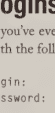

> 只有 `root` 或超级用户可以运行 `init` 命令。超级用户模式有时也称为 `sudo`。

## Logins

如果你曾经在命令行使用过 Unix 或 Linux，你应该熟悉以下代码行：

```
login:
Password:
```

任何在命令行上的成功登录都会启动一个命令行 shell。它启动的 shell 取决于主目录中的控制文件。

## Shells

`shell` 部分是用于通过 Linux 内核控制计算机各个部分的命令行界面。本质上，它被设置来保护内核。如果内核失败，你需要重启计算机。如果 `shell` 失败，你不必重启。相反，你可以终止 `shell` 并再次登录 Linux。

你获得的 `shell` 取决于 Linux 密码文件中显示的选项，该文件称为 `/etc/passwd`。来自该文件 `user mj` 的示例是：

```
mj:x:501:501:michael jang:/home/mj:/bin/bash
```

最常见的 Linux `shell` 称为 `bash`，其全称代表 Bourne Again SHell。登录时，`bash` 启动并读取其资源控制文件的要求，该文件称为 `.bashrc`，位于你的主目录中。如果你更改 `shell`，你需要在主目录中更改 `.profile` 文件并为新 `shell` 创建资源控制文件。例如，如果你想使用称为 `ash` 的 `shell`，你需要一个名为 `.ashrc` 的资源控制文件。

> 文件名前面的点使其隐藏。你可以使用 `ls -a` 命令列出所有文件，包括隐藏文件。

## 关于密码的说明

当你查看你的 `/etc/passwd` 文件时，你可能会认为你的密码被很好地隐藏了。然而，如果 `cracker` 找到此文件，他/她可以很容易地确定你的密码，特别是如果你使用字典单词。

创建密码最安全的方式是基于字母和数字的组合。例如，流行的密码破解程序可能在几分钟内找到基于字典的密码，如 `pepper`。相比之下，同一个程序破解像 `lz29tceW` 这样的密码（可能代表 "I eat 29 fish tacos every Wednesday"）可能需要数周时间。

> 在 Linux 世界中，恶意用户被称为 `crackers`。Linux 黑客只是想制作或“hack”更好的软件的人。另一方面，`crackers` 试图出于破坏目的破解你的密码和软件。

## 注销、缓存和关机

如果你只是关闭 Linux 计算机，你可能会丢失你认为已保存的数据。例如，当你将数据保存到软盘驱动器时，Linux 可能在你卸载它之前不会写入驱动器。

事实证明，你的大部分可用内存（RAM + swap 分区）都用于程序和缓存。随着你打开更多程序，缓存中的信息会被“flushed”，以腾出空间供额外传入数据使用。

在关闭 Linux 之前，请确保你已关闭可能在缓存中包含数据的所有程序。有几个不同的命令可以关闭你的 Linux 系统：

- **shutdown**—此命令是安全关闭计算机的方式。消息会发送给所有用户，告知他们即将关机。如果你只是想发送警告，使用 `shutdown -k` 命令。`shutdown -t 100` 命令应使你的用户在警告消息和 Linux 开始关机的时间之间有 100 秒。`shutdown -c` 命令会取消任何即将发生的关机。

- **halt**—此命令等同于 `shutdown -h now`，或 `init 0`。如果其他人登录到 Linux 计算机，他们将没有时间保存工作。

- **reboot**—此命令等同于 `shutdown -r now`，或 `init 6`。`Reboot` 进入 level 0，然后当 Linux 重新启动时，继续进入你的标准多用户级别，通常为 2 或 3。如果其他人登录到 Linux 计算机，他们将没有时间保存工作。

- **Ctrl+Alt+Del**—此命令等同于 `reboot` 命令。它不是正常的 Linux 命令，但通常会添加到 `/etc/inittab` 文件中。不幸的是，此命令可能对所有用户可用，而不仅仅是 `root` 或超级用户。出于这个原因，你可能应该从你的 `/etc/inittab` 文件中删除此条目。因为 `Ctrl+Alt+Del` 在 Microsoft 操作系统中常用，一个用户的挫败感可能会影响系统上的所有其他用户。

- **Power failure signal**—某些发行版在其 `/etc/inittab` 文件中包含电源故障信号。当不间断电源 (`UPS`) 开始向你的计算机发送电源信号时，你只有几分钟时间保存工作，然后才会完全断电。电源故障信号发送的消息类似于 `shutdown` 命令。

在某些版本的 Linux 中，普通用户可能能够使用或不使用密码使用这些命令中的一些。你可能需要更改 `halt` 和 `shutdown` 等命令的权限，以防止你的用户关闭 Linux。


> 你可以使用三种不同的命令从命令行界面 `shell` 注销：`logout`、`exit` 和 `Ctrl+D`。

## 练习题

### 问题 1

你有一个双启动系统，其中包含 Microsoft Windows 和 Caldera Linux，它们在 `lilo.conf` 文件中的标签分别为 `dos` 和 `openlinux`。在 `LILO boot:` 提示符下，你可以使用以下哪些命令？[勾选所有正确答案]

- a. `linux`
- b. `dos`
- c. `linux ether=10,0x330,eth1`
- d. `openlinux`

答案 `b`、`c` 和 `d` 正确。你的操作系统选项基于 `lilo.conf` 文件中指定的标签，在此示例中指定为 `dos` 和 `openlinux`。你也可以在 `LILO boot:` 提示符下输入适当的 `append-type` 命令。因为 `linux` 不是 `lilo.conf` 文件中的标签，所以答案 `a` 不正确。

### 问题 2

在 Linux 中，你意外地从 `/etc` 目录删除了你的 `lilo.conf` 文件，以及你的 `MBR`。你想恢复你的 `MBR`，以便将来可以再次启动到 Linux。你有原始 `lilo.conf` 文件的打印件。你应该怎么做？

- a. 创建一个符合你计算机上操作系统要求的新 `lilo.conf` 文件。运行 `lilo` 命令将其写入你的 `MBR`。
- b. 创建一个符合你计算机上操作系统要求的新 `lilo.conf` 文件。运行 `fdisk /MBR` 命令将其写入你的 `MBR`。
- c. 重新启动你的计算机。当你看到 `LILO boot:` 提示符时，输入你的 `lilo.conf` 文件的参数。
- d. 运行 `Linuxconf` 实用程序重建你的 `lilo.conf` 文件。使用 `lilo` 命令将其写入你的 `MBR`。

答案 `a` 正确。你有 `lilo.conf` 文件的打印件，所以你所需要做的就是在文本编辑器中输入信息并使用 `lilo` 命令将其保存到你的主引导记录中。因为 `fdisk /MBR` 命令会将 MS-DOS 引导记录写入你的 `MBR`，所以答案 `b` 不正确。如果你在没有 `lilo.conf` 文件的情况下重新启动计算机，你将看不到 `LILO boot:` 提示符。因此，答案 `c` 不正确。尽管 `Linuxconf` 实用程序可用于重建 `lilo.conf` 文件，但 `Linuxconf` 通常是仅在 Red Hat Linux 上可用的实用程序。因此，答案 `d` 不正确。

### 问题 3

你正在运行 Linux 内核 `2.0.36` 的发行版。你刚刚安装了 `128MB` 的 RAM，总计 `256MB`。你还安装了第二块以太网网卡。你将此卡的 IRQ 设置为 `11`，I/O 内存地址设置为 `0x320`。在 `LILO boot:` 提示符下，你应该设置以下哪个命令？

- a. `linux ether=0x320,11,eth0 mem=128M`


### 问题 3

- `b. linux ether=0x320,11,eth0 mem=256M`

- `c. linux ether=11,0x320,eth1 mem=128M`

- `d. linux ether=11,0x320,eth1 mem=256M`

答案 `d` 正确。这些命令会向你的 `lilo.conf` 文件添加信息。以太网卡的格式为 `ether=IRQ,I/O,device`。因为这是你的第二块以太网卡，所以它对应于 `eth1` 设备。你附加的内存是计算机上的总 RAM，而不是你最近添加的 RAM。答案 `a` 中的所有信息都不符合要求；因此，它不正确。答案 `b` 有正确的内存级别，但仍然不正确。答案 `c` 有错误的内存级别，所以它也不正确。

### 问题 4

你已在同一台计算机上安装了 Windows 2000 和 S.u.S.E. Linux 7.0。你的计算机有三块常规 IDE 硬盘和一块常规 ATAPI CD-ROM 驱动器。CD-ROM 位于 `secondary` 控制器从属位置。Windows 2000 安装在 `primary` 控制器第一块硬盘的第一分区。S.u.S.E. Linux 7.0 安装在 `secondary` 控制器第一块硬盘的第一分区。以下哪组命令会在 `lilo.conf` 文件中正确表示这些操作系统？假设第一个命令代表 Windows 2000，第二个代表 S.u.S.E. 7.0。

- `a. other=/dev/hda1: root=/dev/hdd1`

- `b. root=/dev/hda1: root=/dev/hdc1`

- `c. other=/dev/hda1: root=/dev/hdc1`

- `d. other=/dev/hda1: root=/dev/hda2`

答案 `c` 正确。`other` 标签代表非 Linux 操作系统（Windows 2000），而 `root` 命令告诉 LILO S.u.S.E. Linux 7.0 根目录的挂载位置。第一控制器第一块硬盘的第一分区是 `hda1`，而 `hdc1` 是第二控制器第一块硬盘的第一分区（即第三个）。因为 `hdd1` 代表第二控制器第二驱动器的第一分区，所以答案 `a` 不正确。`root` 命令查找 Linux 引导文件，所以答案 `b` 不正确。因为 `hda2` 是第一块硬盘的第二个分区，所以答案 `d` 不正确。

### 问题 5

你启动计算机，而不是标准的 LILO `boot:` 提示符，你只看到 `L!`。你应该检查以下哪一项？

- `a. 确保你没有意外删除你的 vmlinuz 文件。`

- `b. 确保你的硬盘的 BIOS 设置仍然正确。`

- `c. 确保你没有意外删除你的 lilo.conf 文件。`

- `d. 确保你没有意外删除你的 /etc/inittab 文件。`

答案 `b` 正确。只看到 LILO `boot:` 提示符的一部分也可能表明你的 `/boot/boot.b` 引导程序文件存在问题。LILO 文件启动你的 Linux 内核，所以 `vmlinuz` 文件的删除不会在你选择

在 LILO 启动提示符处为 Linux。因此，答案 `a` 不正确。如果删除了你的 `lilo.conf` 文件，你将看不到 LILO `boot:` 提示符的任何部分；因此，答案 `c` 不正确。因为 `/etc/inittab` 文件是在由 LILO 启动的 Linux 内核之后运行的，所以你不会在 Linux 内核加载之前看到问题。因此，答案 `d` 不正确。

### 问题 6

你正在查看你的 `/etc/fstab` 文件。以下行告诉你什么？

提示：这台计算机上没有 CD-ROM 驱动器，并且只使用了一个磁盘控制器。

```
/dev/hdb2  /big  vfat  defaults  0  0
```

- `a. /big 目录可以挂载在第一块硬盘的第二个主分区上。它被格式化为 Linux 虚拟文件系统。在启动 Linux 时它不会自动挂载。复制到此目录的文件在写入此卷之前会被缓存。`

- `b. /big 目录可以挂载在第二块硬盘的第二个主分区上。它被格式化为 Linux 虚拟文件系统。在启动 Linux 时它不会自动挂载。复制到此目录的文件在写入此卷之前会被缓存。`

- `c. /big 目录可以挂载在第三块硬盘的第二个主分区上。它被格式化为 MS-DOS VFAT 系统。在启动 Linux 时它会自动挂载。复制到此目录的文件在写入此卷之前会被缓存。`

- `d. /big 目录可以挂载在第二块硬盘的第二个主分区上。它被格式化为 MS-DOS VFAT 系统。在启动 Linux 时它不会自动挂载。复制到此目录的文件在写入此卷之前会被缓存。`

答案 `d` 正确。`/dev/hdb2` 设备指的是第二块硬盘的第二个主分区。文件系统格式是 MS-DOS 的 `VFAT`。因为最后两个数字都是 `0`，文件传输会被缓存，但该目录在启动 Linux 时不会自动挂载。因为这不是第一块硬盘，并且没有 Linux 虚拟文件系统，所以答案 `a` 和 `b` 不正确。根据定义，`hdb2` 是第二块硬盘上的第二个主分区；因此，答案 `c` 不正确。

### 问题 7

为什么你不应该在 `PATH` 变量中包含一个句点 `.`？

- `a. 它使你容易受到 lilo.conf 文件中问题的攻击。`

- `b. 它使你容易受到模拟其他正常 shell 命令的命令的潜在攻击。`

- `c. 它使你容易受到防火墙漏洞的潜在攻击。`

- `d. 它使你容易受到通过 cookie 的潜在攻击。`

答案 `b` 正确。`PATH` 变量中的句点使你容易受到伪装成标准 shell 命令的潜在特洛伊木马的攻击。因为 `PATH` 变量是在你的 Linux 内核启动之后才开始的，所以它对你的 `lilo.conf` 文件没有影响。因此，答案 `a` 不正确。虽然 `PATH` 变量中的句点使你容易受到其他攻击，但句点本身并不会破坏 Linux 防火墙；因此，答案 `c` 不正确。句点与你是否从网站接收 `cookie` 无关；因此，答案 `d` 不正确。

### 问题 8

在 `rc.d` 和 `init.d` 目录下有许多目录和脚本。以下哪项陈述最好描述了它们的功能？

- `a. rc.d 资源控制脚本都按 /etc/inittab 文件中定义的运行级别划分。它们链接到 init.d 目录中的脚本。你可以在计算机上启动 Linux 后独立运行 init.d 脚本。`

- `b. rc.d 资源控制脚本都按 /etc/inittab 文件中定义的运行级别在不同时间初始化。你可以使用 init.d 脚本来控制你使用的运行级别。`

- `c. init.d 资源控制脚本都按 /etc/inittab 文件中定义的运行级别在不同时间初始化。这些脚本中的所有守护进程都在不同的运行级别启动。你可以使用 rc.d 脚本来控制你使用的运行级别。`

- `d. init.d 资源控制脚本都按 /etc/inittab 文件中定义的运行级别划分。它们链接到 rc.d 目录中的脚本。你可以在计算机上启动 Linux 后独立运行 rc.d 脚本。`

答案 `a` 正确。Linux 在不同运行级别执行的任务定义在 `rc.d` 目录下的各个编号资源控制目录中。它们链接到 `init.d` 目录中的脚本，你可以在计算机上启动 Linux 后独立运行这些脚本。虽然你使用 `init` 命令在 Linux 中启动不同的运行级别，但 `init.d` 目录只是存放脚本。因此，答案 `b` 不正确。因为 `init.d` 目录中没有资源控制脚本，所以答案 `c` 和 `d` 不正确。

### 问题 9

你喜欢名为 `csh` 的 shell 的外观。你目前使用的是名为 `bash` 的 shell。如果你想更改登录到计算机时获得的 shell，你应该怎么做？

- `a. 删除主目录中的 .bashrc 资源控制文件。`

- `b. 删除主目录中的 .profile 配置文件。`

- `c. 更改 /etc/passwd 文件中为 root 用户定义的 shell。`

- `d. 更改 /etc/passwd 文件中为你的用户名定义的 shell。`

答案 `d` 正确。`/etc/passwd` 文件定义了登录到 Linux 计算机时启动的 shell。删除 `.bashrc` 文件与使名为 `csh` 的 shell 为你工作无关；因此，答案 `a` 不正确。虽然你应该修改主目录中的 `.profile` 文件，但删除它并不会帮助你为名为 `csh` 的 shell 自定义配置。因此，答案 `b` 不正确。除非你是 `root` 用户，否则答案 `c` 不正确。

### 问题 10

以下哪个命令实际上会重新启动你的计算机？

- `a. shutdown -h now`

- `b. shutdown -c`

- `c. halt`

- `d. init 6`

答案 `d` 正确。如果你以 `root` 或超级用户身份运行 `init 6` 命令，此命令会切换到运行级别 `0`（`halt`），然后重新启动。`shutdown -h now` 命令会立即关闭你的计算机。因此，答案 `a` 不正确。因为 `shutdown -c` 命令只是取消当前关机序列，所以答案 `b` 不正确。`halt` 命令等同于 `shutdown -h now`。因此，答案 `c` 不正确。

## 需要了解更多？


Johnson, Dwight, ed. *SuSE Linux 6.0 安装、配置与入门*. SuSE GmbH, Nürnberg, Germany, 1998. 这本书包含了对 `LILO` 配置文件工作原理的几个优秀分解。

Welsh, Matt, Lar Kaufman, and Matthias Kalle Dalheimer. *运行 Linux*. O'Reilly & Associates, Sebastopol, CA, 1999. ISBN 1-56592-469-X. 可能是关于 Linux 操作系统的关键参考书籍。虽然这本书中的许多信息基于较旧版本的 Linux，但基本数据简洁、写得很好且至今适用。

请查看 Linux 文档项目网站 `www.linuxdoc.org`，它是 Linux 手册、HOWTO 和许多其他书长文档的中央存储库。本章的重要 HOWTO 包括“Linux From Scratch-HOWTO”，其中详细描述了运行级别脚本，以及用于 Linux Loader 信息的“LILO mini-HOWTO”。

## 命令 Shell

### 你需要理解的术语：

- ✓ 命令行解释器
- ✓ 交互性
- ✓ 命令补全
- ✓ 环境变量
- ✓ Shell 变量
- ✓ stdin, stdout, stderr
- ✓ 管道
- ✓ stty
- ✓ 别名
- ✓ cd, ls
- ✓ r, w, x, chmod, umask

### 你需要掌握的技术：

- ✓ 理解命令行解释器
- ✓ 解释交互性和命令补全
- ✓ 描述用户和系统范围的 shell 配置文件
- ✓ 使用并重定向标准输入、标准输出和标准错误
- ✓ 在后台运行程序
- ✓ 管理特殊 shell 字符包括引号和反斜杠
- ✓ 设置别名
- ✓ 导航 Linux 目录
- ✓ 理解权限

本章介绍 shell 的基础知识，shell 是用于管理计算机的 Linux 命令行解释器。虽然 Linux 可用的 shell 有多种，但当今的标准默认 shell 是 Bourne Again SHell，也称为 `bash`。您可以使用一些文件和命令来自定义 `bash`。该 shell 包含许多有用的功能，可在命令行工作时帮助您。是的，`bash` 还包含许多关键命令。

本章与第 8 章密切相关。在本章中，您将学习 shell 的机制，而在第 8 章中，您将学习与 `bash` 配合使用的各种命令。

## 管理 Shell

Bourne Again SHell（`bash`）是 Linux 操作系统的用户界面。您使用 `bash` 命令运行程序、管理文件，并通过 Linux 内核与硬件交互。您可以使用多个本地和系统范围的文件和变量来配置 `bash`。

`bash` shell 有时被称为命令行解释器，它是响应特定命令的用户界面，例如 `ls`、`cd` 或 `cp`。它也响应您创建的程序或脚本。

在命令行中移动时，请记住 Linux 是区分大小写的。换句话说，`ls` 命令列出当前目录中的文件，而 `LS`、`Ls` 或 `IS` 命令在任何当前 Linux shell 中都没有意义。

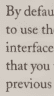

`bash` shell 的两个优点是其保留之前命令历史记录的能力以及轻松完成较长命令的能力。这些特性被称为交互性和命令补全。

## 交互性

您可以与 Linux 命令的历史记录进行交互。打开命令行界面并输入 `history` 命令。如果您之前使用过命令行界面，您将看到与图 7.1 所示类似的结果。

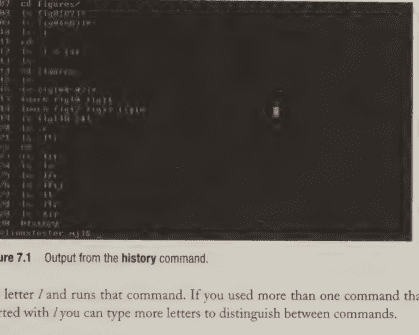

图 7.1 `history` 命令的输出。

默认情况下，您可以通过多种方式重复之前的命令：最简单的方法是使用键盘上的上箭头和下箭头键。转到您的命令行界面。当您按下上箭头键时，您会按顺序看到之前使用的命令。该列表甚至可能包括您在之前的会话期间使用的命令。您可以使用下箭头键反转此过程。

另外，如果您记得最近使用的命令的首字母，您可以使用感叹号（`!`）来召回该较早的命令。例如，如果您输入 `"!l"`，Linux 会召回您上次使用以字母 `l` 开头的命令并运行该命令。如果您使用了多个以 `l` 开头的命令，您可以输入更多字母来区分这些命令。

## 命令补全

Linux shell 允许您使用 Tab 键来补全命令。使用 `bash`，您只需输入命令的一部分即可。例如，如果您想对压缩文件使用 `uncompress` 命令，请输入以下字母：

```
unc
```

当您按下 Tab 键时，`bash` 会为您补全命令。如果 shell 中有多个以 `unc` 开头的命令，再次按下 Tab 键，您将看到这些命令的列表。

## 配置 Shell

任何 shell 都有两组配置文件。有些是系统范围的；换句话说，它们会影响 Linux 计算机上的所有用户。其他的是用户特定的，并存储在用户的 home 目录中。第 6 章介绍了用户特定的配置文件 known as `.bashrc` 和 `.profile`。

根据您的发行版，`bash` 最多有四个系统范围的配置文件：`/etc/environment`、`/etc/profile`、`/etc/login` 和 `/etc/bashrc`。这些文件中有两种不同的变量：环境变量，即使您更改 shell 也会保留，以及 shell 变量，仅在您在特定 shell 中导航时保持不变。

您可以创建自己的 shell 变量；例如，您可以将 `ls` 命令分配给名称 `test`，如下所示：

```
test=ls
```

然后您可以使用以下命令运行 `ls` 命令（注意 `$test` 周围的反引号）：

```
echo ` $test `
```

环境变量的一个例子是 `HISTORY`。其值决定保存的先前命令的数量。例如，如果您运行以下命令，您的 shell 将记住您使用的最后 400 个命令：

```
HISTORY=400
```

作为环境变量，`HISTORY` 会在 shell 之间保留。

> 环境变量通常使用大写字母。Shell 变量可以包含大写字母、小写字母以及数字的组合。

您可以在任何时候切换到不同的 shell。如果您在 Linux 计算机上安装了 Korn、C 或 Bourne shell，则可以使用 `ksh`、`csh` 或 `sh` 命令分别启动它们。

> 您可以导出 shell 变量。例如，如果您有一个名为 `test` 的 shell 变量，您可以使用 `export test` 命令将其导出以供其他 shell 使用。

## 让 Shell 为您工作

您可以使用 shell 的多种技术。您可以将一个命令的输出定向到文件甚至另一个命令。您可以设置别名来定义您选择的命令。您还可以将正在运行的程序移到后台，这可以节省您打开另一个虚拟终端或控制台的麻烦。

您在使用的命令方面具有灵活性。有两种不同的“通配符”字符可帮助您表示多个文件。Linux 允许您使用三种不同的引号字符来管理命令的输入。

## 标准输入、标准输出和标准错误

Linux 由三个数据流组成：数据输入、数据输出，以及错误沿不同方向输出。这些概念也称为标准输入、标准输出和标准错误。

> 有三个输入/输出（I/O）通道：标准输入（`stdin`）、标准输出（`stdout`）和标准错误（`stderr`）。

标准输入（`stdin`）来自键盘到命令。例如，在 `ls c*` 命令中，`c*` 是 `ls` 命令的标准输入。

标准输出（`stdout`）是命令的结果。例如，在输入 `ls` 命令后看到的文件就是标准输出，通常定向到您的显示器。

如果没有 `stdout`，则可能有标准错误（`stderr`）消息。这也通常定向到您的显示器。

重定向 `stdin`、`stdout` 和 `stderr` 有两种基本方法。您可以将这些数据流中的一个通过管道传输到另一个命令，或者您可以将这些流中的一个重定向到文件或从文件重定向。

## 重定向输入和输出

重定向 `stdin` 的一个例子是通过程序运行一个充满数据的文件。假设您有一个名为 `majorprogram` 的程序，并且程序数据输入到 `program_data` 文件中。要组合这些组件，您将使用以下命令：

```
./majorprogram < program_data
```

此命令将 `program_data` 文件中的每个文件名定向到 `majorprogram`。

> 左箭头也可以与常规命令一起使用；例如，`less < /etc/passwd` 命令等同于 `less /etc/passwd` 命令。

同样，您可以重定向 `stdout`。如果您想将当前文件列表保存到名为 `currentfiles` 的文本文件中，可以使用以下命令：

```
ls > currentfiles
```

另外，如果您想将名为 `majorprogram` 的脚本的错误消息保存到名为 `errorlog` 的文件中，可以使用以下命令重定向脚本的输出：

```
./majorprogram 2> errorlog
```

`2>` 重定向 `stderr` 输出。这个重定向的唯一问题是，每次出现新错误时，它都会覆盖 `errorlog` 文件中的旧错误。因此，如果您想要完整的错误列表，请使用以下命令：


`./majorprogram 2>> errorlog`

双箭头将输出写入所记录文件的末尾。您也可以对 `stdout` 使用双箭头。例如，每次运行以下命令时，您的当前文件都会添加到 `currentfiles` 文本文件的末尾：

```
ls >> currentfiles
```

## 输入和输出管道

与您可以将 `stdin`、`stdout` 和 `stderr` 重定向到特定文件一样，您也可以将这些数据流通过管道传输到其他命令。如果您想查看大量文件的权限，您可能会使用两个不同的命令：

```
ls -l > tempfiles
more tempfiles
```

第一个命令将当前文件列表存储在名为 `tempfiles` 的文件中。第二个命令允许您一次一屏地读取 `tempfiles` 文件。由于文件列表可能经常更改，因此应删除 `tempfiles` 文件以防止其过时。

管道很方便，因为它允许您组合命令。例如，以下命令完成了前两个命令的工作：

```
ls -l | more
```

管道（`|`）将 `ls -l` 命令的 `stdout` 作为 `stdin` 发送到 `more` 命令。您无需创建或删除任何文件，例如 `tempfiles`。

## 后台运行

Linux 是一个多任务系统。当你没有额外的终端或虚拟控制台可用时，你仍然可以从单个命令行运行多个程序。如果你正在运行一个需要 10 分钟才能完成的程序，你不必等待就能运行其他程序。

使程序在后台运行有两种方法。例如，假设你在当前目录下有一个名为 `test` 的脚本。该脚本会在一小时后启动一个闹钟。你想运行 `test`，但想在等待期间继续工作。为此，你可以运行以下命令：

```
./test &
```

和号（`&`）将程序执行发送到后台，从而把你返回到命令行界面。

另外，如果你正在运行一个计算圆周率到大量位数值的程序，这样的程序可能需要一段时间才能完成。如果你忘记使用和号（`&`），你将需要另一种方法将程序发送到后台。你可以使用以下命令来实现：

```
<Ctrl>Z
bg
```

当你按下 `Ctrl+Z` 时，你会暂停 `shell` 中当前正在运行的程序。然后 `bg` 命令会将程序发送到后台。

提示：有其他方法可以进入另一个命令行界面。你可以打开额外的虚拟控制台，如第 3 章所述。如果你在一个图形用户界面窗口中，你也可以打开尽可能多的 `shell` 窗口，只要你的内存允许。

## 特殊 Shell 字符

特殊 `shell` 字符控制标准输出（`stdout`）。你的 `shell` 中可能已经分配了一些特殊字符。要检查，请运行 `stty -a` 命令。基于作者的 Corel Linux 设置的示例显示在图 7.2 中。

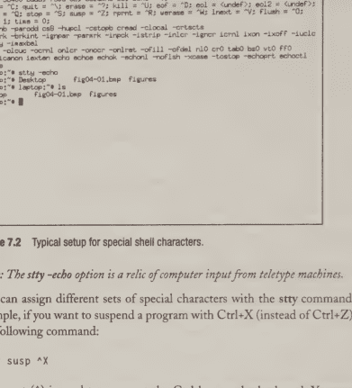

图 7.2 特殊 `shell` 字符的典型设置。

> 注意：`stty -echo` 选项是电传打字机计算机输入的遗留物。

你可以使用 `stty` 命令分配不同的特殊字符集。例如，如果你想用 `Ctrl+X`（而不是 `Ctrl+Z`）暂停程序，请运行以下命令：

```
stty susp ^X
```

插入符号（`^`）用于表示键盘上的 `Ctrl` 键。你也可以更改 `stty -a` 命令输出中看到的其他设置。有关可以设置或暂停的设置完整列表，请参阅 `stty` 的手册页。

> 注意：插入符号（`^`）位于标准美国键盘上数字 6 的上方。

## 通配符

Linux 命令中还有另外两个特殊字符，它们是 Microsoft “通配符”概念的变体。这些字符是星号（`*`）和问号（`?`）。星号代表任意数量的数字或字母。每个问号代表一个字母数字字符。例如，如果你运行以下命令，你将获得所有以字母 `a` 开头的文件列表：

```
ls a*
```

如果你有一个名为 `a` 的文件，它将是此列表的一部分。相比之下，如果你运行以下命令，你将获得所有以 `a` 开头且有两个字母数字字符的文件列表：

```
ls a?
```

如果你有一个名为 `a` 的文件，它将不会是此列表的一部分。你也可以使用以下类似的命令执行更复杂的文件搜索：

```
ls ?at?
```

此命令返回名称类似 `cate`、`kata`、`mate` 等的文件。它不会返回像 `Catherine`、`matador` 或 `cat` 这样文件。

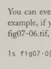

你可以使用通配符将命令应用于多个文件。例如，如果你使用 `cat b*` 命令，你将看到目录中所有以字母 `b` 开头的文件的内容。如果文本数据太多，无法在监视器上阅读，你可以将数据定向到文件；`cat b* >> b-files` 命令将每个以字母 `b` 开头的文件的文本定向到名为 `b-files` 的文件。双箭头（`>>`）确保每个以 `b` 开头的文件都附加到 `b-files` 文件的末尾。

你甚至可以使用括号（`[]`）更详细地定义特殊字符。例如，如果你想查看目录中 `fig07-01.tif` 和 `fig07-06.tif` 之间的所有文件，可以运行以下命令：

```
ls fig07-0[1-6].tif
```

或者，以下命令具有相同的目的：

```
ls fig07-0[123456].tif
```

括号中的字符定义了你要搜索的范围。这种方法对大小写字母同样有效。例如，如果你要搜索 `fig07-01a.tif` 和 `fig07-01g.tif` 之间的所有文件，可以运行以下命令：`ls fig07-01[a-g].tif` 你也可以使用多个搜索词；例如，以下命令搜索 `fig07-01a.tif` 和 `fig07-06g.tif` 之间的所有文件名：`ls fig07-0[1-6][a-g].tif`

## Shell 中的引号

你的键盘上有三种引号字符：单引号（`'`）、双引号（`"`）和反引号（`` ` ``）。当应用于标准输入（`stdin`）时，它们执行不同的功能。

*注意：你可以在标准美国键盘的 Tab 键上方找到反引号键。*

这些字符之间的区别在于它们如何影响变量，例如 `$NAME`，以及 `shell` 命令，例如 `date`。使用任何一对引号，`shell` 都会将引号内的所有内容发送到命令。在以下示例中，使用了 `echo` 命令。详细区别如下：

- 单引号——`shell` 不会处理引号内的任何变量或命令。
- 双引号——`shell` 会处理变量，例如 `$NAME`，但不会处理引号内的任何命令。
- 反引号——`shell` 会尝试将引号中的每个词作为命令处理。如果有变量，它们会先被求值，然后作为命令处理。因此，如果 `$NAME` 在反引号中，它将被处理，然后结果（Michael）将被评估为命令。

你可以在以下示例中看到其工作原理。假设 `$NAME=Michael`。记住，`date` 是一个返回当前日期和时间的命令：

```
echo Welcome $NAME, the date is date
echo 'Welcome $NAME, the date is date'
echo "Welcome $NAME, the date is date"
echo "Welcome $NAME, the date is `date`"
```

第一个命令没有引号。第二个命令被单引号包围。第三个命令被双引号包围。最后的命令有双引号，以及围绕 `date` 命令的反引号。这些命令返回以下结果：

```
Welcome Michael, the date is date
Welcome $NAME, the date is date
Welcome Michael, the date is date
Welcome Michael, the date is Sat Sep 9 11:16:33 PDT 2000
```

没有引号时，`shell` 会解释 `$NAME` 变量，但不会运行 `date` 命令。使用单引号时，`shell` 不会解释变量或命令。使用双引号时，结果与没有引号时的结果相似。如果命令在反引号中，`shell` 会解释该命令。

> 你可以利用反引号。例如，如果你想对几个以 `.dat` 结尾的数据文件运行程序，你可以运行类似 `./majorprogram `cat *.dat`` 的命令。

## 反斜杠

反斜杠（`\`）告诉 `shell` 忽略空格（或其他特殊字符）。你可以用它来管理 Microsoft Windows 分区上的类似 My Documents 的目录。例如，如果你将 Windows C: 驱动器挂载到 `/dos` 目录，你可以使用 `ls /dos/My\ Documents` 命令列出 My Documents 目录的内容。有了反斜杠，`shell` 会忽略空格并将请求作为 `stdin` 发送给 `ls` 命令。没有反斜杠，`shell` 将查找 `/dos/My` 目录的内容。

你也可以对特殊字符使用反斜杠，例如问号（`?`）或星号（`*`）。

> 当你使用反斜杠时，你就是在“转义”下一个空格或字符的功能。

## 别名

`shell` 变量的一个例子是 `alias`。该变量列出了可以替换为其他命令的命令。一个常见的别名是：

```
alias dir='ls -l'
```


Linux 没有原生的 `dir` 命令。但当你设置此别名后，你可以运行 `dir` 命令代替 `ls -l`。然而，由于任何别名都是 shell 变量，如果你更改 shell，你设置的别名将不适用。你可以使用 `unalias` 命令删除别名。例如，如果你将 `dir` 设置为 `ls -l` 的别名，`unalias dir` 命令会删除此链接。一些 Linux 发行版在你的 shell 上默认设置了多个别名。要检查当前活动的别名，请键入 `alias` 命令。

## 导航命令

在 shell 中有两种基本的导航命令。`cd` 命令让你在目录之间导航。`ls` 命令让你知道目录中有什么（包括其他目录）。

## cd 命令

更改目录命令被称为 `cd`。熟悉 MS-DOS 的用户可能会发现 MS-DOS 与 Linux `cd` 命令之间存在许多相似之处。典型的 `cd` 命令如表 7.1 所示。

与 `cd` 关联的命令是 `pwd`。`pwd`（当前工作目录）命令允许您检查当前目录。在更改目录之前，您可能会发现检查自己所在的目录很有用。

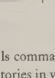

如果您想更改到主目录，请使用 `cd ~` 命令。如果您处于 root 或超级用户模式，此命令会将您带到 root 用户的主目录 `/root`。

## ls 命令

`ls` 命令功能多样。不仅可以列出当前目录中的文件和目录，而且使用适当的开关，还可以找到文件的权限和大小。它允许您检查所有权、区分文件类型，并以多种方式对结果进行排序。您可以在表 7.2 中查看此命令的一些示例。

本系列中最重要的命令可能是 `ls -l`，它列出当前目录中的所有文件，包括大小、所有者和权限。请在图 7.3 中查看此命令结果的示例。


`ls` 命令很重要。了解可与 `ls` 一起使用的开关，尤其是 `-a`、`-F`、`-i` 和 `-r`。这些开关可以以任何组合使用。常见的组合是 `ls -ltr`，它按从最旧到最新的顺序列出您的文件，并显示权限。此外，`ls` 命令的每个文件输出都有一行，可以与第 8 章中讨论的 `wc` 命令配合使用。

**表 7.1 cd 命令。**

| 命令 | 结果 |
|---|---|
| `cd ..` | 向上移动一个目录级别。例如，如果您当前位于 `/home/mj` 目录，此操作会将您移动到 `/home` 目录。 |
| `cd ../..` | 向上移动两个目录级别。例如，如果您当前位于 `/etc/rc.d/rc0.d` 目录，此操作会将您移动到 `/etc` 目录。 |
| `cd /home/mj` | 更改到用户 mj 的主目录。 |
| `cd ~` | 更改到您自己的主目录。 |

**表 7.2 ls 命令。***

| 命令 | 结果 |
|---|---|
| `ls` | 按字母顺序列出当前目录中所有非隐藏文件。 |
| `ls -a` | 列出当前目录中的所有文件，包括隐藏文件。 |
| `ls -r` | 按反字母顺序列出当前目录中所有非隐藏文件。 |
| `ls -F` | 按类型列出所有文件。每个文件末尾的字符表示文件类型。例如，正斜杠（`/`）表示目录，星号（`*`）与可执行文件相关联，而“at”符号（`@`）表示链接文件。 |
| `ls -i` | 列出带 inode 号码的文件。inode 号码表示文件在卷上的位置。两个或多个具有相同 inode 号码的文件是同一文件的两个不同名称。 |
| `ls -l` | 列出当前目录中的所有文件，包括当前目录（`.`）和父目录（`..`）。还以所谓的长列表格式列出每个文件关联的大小、所有者和权限。 |
| `ls -t` | 按文件最后更改的时间列出文件；最近更改的文件最先列出。 |
| `ls -u` | 按文件最后访问的时间列出文件；最近访问的文件最先列出。 |

*目录包含在所有文件列表中。在 Linux 中，目录只是一种特殊类型的文件。文件在被读取、写入或执行时即被访问。

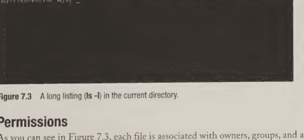

图 7.3 当前目录中的长列表（`ls -l`）。

## 权限

如您在图 7.3 中所见，每个文件都与所有者、组和一系列权限相关联。与文件关联的权限分配给 Linux 计算机上的所有者、组和其他所有人。请看以下条目，这是 `batterup` 文件的长列表：

```
-rwxrwxr-- 1 mj users 7326 Jan 12 09:09 batterup
```

权限基于列表左侧的字符。10 个字符决定不同用户可以对该文件执行的操作。如果第一个字符不是连字符（`-`），它就不是普通文件。它可能是目录（`d`）或链接（`l`）到另一个文件的文件。

剩余的字符可以按三分组。破折号后显示的随后三个字符是 `rwx`。换句话说，名为 `batterup` 的文件的所有者可以读取（`r`）、写入（`w`）和执行（`x`）此文件。

接下来的三个字符是 `rw-`。与文件所有者同组的用户可以读取此文件（`r`）或编辑并写入此文件（`w`）。这些用户无法执行该文件。

最后三个字符是 `r--`。不属于文件所有者所在组的用户可以读取此文件。他们不能写入它，也不能执行它（如果它是脚本）。

您可以使用以下命令设置这些权限：

```
chmod 764 batterup
```

权限使用三位数代码设置。在前面的命令中，第一个数字（`7`）设置所有者的权限，第二个（`6`）设置所有者组中的其他用户的权限，第三个（`4`）设置其他所有人的权限。每个数字代表授予所有者、组或所有人的所有权限，如表 7.3 所述。

## 表 7.3 数值权限。*

| 权限 | 数字 | 注释 |
|---|---|---|
| `r` | 4 | = r(4) |
| `w` | 2 | = w(2) |
| `x` | 1 | = x(1) |
| `rx` | 5 | = r(4) + x(1) |
| `rw` | 6 | = r(4) + w(2) |
| `wx` | 3 | = w(2) + x(1) |
| `rwx` | 7 | = r(4) + w(2) + x(1) |

*请注意，数字基于权限组合的值；例如，`rx` 的数字为 4（`r` 的值）+ 1（`x` 的值）。

再次查看与 `batterup` 文件关联的权限。由于第一个数字是 7，此文件的所有者具有读取（`r`）、写入（`w`）和执行（`x`）此文件的权限。由于第二个数字是 6，所有者组中的其他用户对该文件具有读取（`r`）和写入（`w`）权限。由于第三个数字是 4，其他所有人只有读取（`r`）权限。

注意：本章中的许多命令只能由 root 或超级用户执行。如果您想尝试其中一个命令，请输入 `"su"` 并在提示时输入 root 密码。

## umask

当您创建新文件或目录时，您获得的权限取决于所谓的 `umask` 的值。打开命令行界面并输入 `umask` 命令。您可能会得到如下输出：

```
023
```

在解释此数字之前，您需要清楚了解权限的数值。

例如，如果您向文件和目录授予所有人的权限，您将拥有所有用户的读取、写入和执行权限。如前一节所述，这些权限对应于数字 7（`r+w+x = 4+2+1`）。应用于所有用户时，它们对应于 777。您可以使用以下命令为所有用户设置 `batterup` 文件的相同权限：

```
chmod 777 batterup
```

然而，您创建的文件和目录通常没有 777 权限。您获得的权限取决于 `umask` 值。输入 `umask` 命令以查找其当前值，然后从 777 中减去 `umask` 数字。如果 `umask=023`，则 `777-023=754`。因此，权限等于 754。回顾上一节和表 7.3，您可以看到 754 对应于所有者的读取、写入和执行权限、所有者组成员的读取和执行权限，以及所有其他用户的读取权限。

## 练习题

### 问题 1

以下哪些是 Linux 命令行交互性和命令补全特征的结果？（注意：您可能想在此问题中重用 `ls -ltr` 命令。它是您使用以字母 l 开头的最近使用的命令。）

- a. 您可以使用 Tab 键与命令交互；`stty` 命令设置各种控制和功能键以完成某些命令。
- b. 您可以使用上、下箭头键与之前的命令交互；Tab 键允许您根据前几个字母选择或完成多个命令。
- c. 您可以输入 `"!!"` 来召回之前的命令；右、左箭头键允许您根据前几个字母完成多个命令。
- d. 您可以输入 `"!!"` 来召回之前的命令；`alias` 命令设置各种两字母组合来代替更长的命令。


答案 b 正确。Linux shell 的历史允许您使用上、下箭头键召回先前使用的命令。虽然 `stty` 命令确实允许您为某些命令设置各种控制键组合，但它与 Linux 命令补全无关。因此，答案 a 不正确。虽然您可以使用历史记录中的 `!!` 命令召回上一个命令，但您不能使用左右箭头键来完成之前的命令。因此，答案 c 不正确。您不能使用 Tab 键与之前的命令交互。虽然您可以使用 `alias` 命令设置任何字母组合来模拟更长的命令，但它与命令补全无关。因此，答案 d 不正确。

### 问题 2

以下哪些陈述最准确地描述了环境变量和 shell 变量的特征？


## 问题 1

- a. 环境变量适用于所有用户。Shell 变量在从一个 shell 切换到另一个 shell 时保持不变。
- b. 环境变量适用于所有 shell。Shell 变量在从一个 shell 切换到另一个 shell 时可能会改变，甚至可能不存在。
- c. 环境变量适用于所有用户。Shell 变量在从一个 shell 切换到另一个 shell 时可能会改变，甚至可能不存在。
- d. 环境变量适用于所有 shell。Shell 变量在从一个 shell 切换到另一个 shell 时保持不变。

答案 `b` 正确。虽然环境变量适用于所有 shell，但 shell 变量会随 shell 而变化（除非你导出该变量）。因为环境变量不一定适用于所有用户，所以答案 `a` 和 `c` 不正确。Shell 变量通常不会在 shell 之间保持不变；因此，答案 `d` 不正确。

## 问题 3

你在主目录中有大量文件，包括你第七次演示所需的图形。这些图形为二进制格式。根据公司政策，你已按以下格式组织图形：`fig07-xx`，其中 `xx` 为图形编号。你想查看是否拥有 10 到 19 号图形。你不想在列表中看到任何其他图形。以下哪个命令只会列出你想要的图形？

- a. `ls -ltr fig07-*`
- b. `ls -ltr fig07-[10-19]`
- c. `ls -ltr fig07-1?`
- d. `ls -ltr fig07-1*`

答案 `c` 正确。问号是单个字符位置的通配符。因为星号是任意数量字符的通配符，所以答案 `a` 不正确。带括号的搜索项一次只适用于一个字符；你需要 `ls -ltr fig07-1[0-9]` 才能使其工作。因此，答案 `b` 不正确。因为星号包含任意数量的字符，答案 `d` 可能包含 `fig07-1`、`fig07-1000` 等。因此，答案 `d` 也不正确。

## 问题 4

你在一个命令行界面启动了一个程序，由于你不在图形用户界面中，不能只点击按钮启动另一个 shell。该程序似乎要运行很长时间。你希望它继续运行，但需要检查电子邮件。你可以怎么做？[勾选所有正确答案]

- a. 按 `Ctrl+C`，并在看到命令行界面时，输入 `bg` 命令将进程移至后台。
- b. 按 `Ctrl+Z`，并在看到命令行界面时，输入 `bg` 命令将进程移至后台。
- c. 按 `Ctrl+Alt+F2`，并在看到登录屏幕时再次登录。你的程序将在另一个虚拟控制台中继续运行。如果 `F2` 不工作，请尝试 `F1`、`F3` 或 `F4`。
- d. 按 `Ctrl+Z`，并在看到命令行界面时，使用末尾的 `&` 重新启动程序。这会使进程在后台恢复。你将看到一个命令行界面，在其中可以运行另一个程序。

答案 `b` 和 `c` 正确。`Ctrl+Z` 命令会暂停正在运行的进程，而 `bg` 命令会在后台重新启动进程。你可以使用 `Ctrl+Alt+Fx`（`x` 为 1 到 6 之间的数字）命令启动另一个虚拟控制台。程序会继续在你的原始控制台中运行。因为 `Ctrl+C` 命令会停止正在运行的程序，所以答案 `a` 不正确。因为你的程序仍在运行，所以不需要再次启动它。虽然如果你尚未启动程序，可以使用 `&`，但此时使用它意味着你必须再次启动程序。因此，答案 `d` 不正确。

## 问题 5

你创建了一个名为 `filemanager` 的程序，它使用当前目录中列出的文件。你只想使用文件名，并且不想使用任何隐藏文件名。以下哪个命令是将数据馈送到 `filemanager` 程序的最有效方法？

- a. `ls -l filemanager`
- b. `ls -a filemanager`
- c. `ls > filemanager`
- d. `ls | filemanager`

答案 `d` 正确。普通的 `ls` 命令只输出当前目录中的文件名。通过管道（`|`），此信息成为 `filemanager` 程序的标准输入（`stdin`）。`ls -l` 命令输出权限、所有者等。因此，答案 `a` 不正确。`ls -a` 命令输出隐藏文件。因此，答案 `b` 不正确。因为 `ls -a` 命令会用当前文件列表覆盖你的 `filemanager` 程序，所以答案 `c` 不正确。

## 问题 6

有三种不同的标准 I/O 通道。以下哪种方法是重定向这些通道的可允许方式？

- a. `Stdin` 可以从文件重定向。如果你有文本文件 `crabgrass` 中的若干输入项和名为 `runner` 的脚本，你可以执行 `runner << crabgrass` 命令。
- b. `Stdout` 可以重定向到文件。如果你有文本文件 `crabgrass` 中的若干输入项和名为 `runner` 的脚本，你可以将输出定向到第三个文件，使用 `runner crabgrass 2> otherfile` 命令。
- c. `Stderr` 可以重定向到文件。如果你有文本文件 `crabgrass` 中的若干输入项和名为 `runner` 的脚本，你可以将错误定向到第三个文件，使用 `runner crabgrass >> logfile` 命令。
- d. `Stdin` 可以从文件重定向。`Stdout` 也可以重定向到另一个文件。如果你有文本文件 `crabgrass` 中的若干输入项和名为 `runner` 的脚本，你可以执行 `runner < crabgrass > otherfile` 命令。

答案 `d` 正确。你可以使用左箭头（`<`）开关将标准输入（`stdin`）从文件定向。你可以使用右箭头（`>`）开关将标准输出（`stdout`）定向到文件。你不能使用双左箭头（`<<`）重定向；因此，答案 `a` 不正确。因为 `stdout` 不能使用错误重定向箭头（`2>`）重定向，所以答案 `b` 不正确。如果要重定向标准错误（`stderr`），你需要使用 `2>>`，而不是双右箭头（`>>`）。因此，答案 `c` 不正确。

## 问题 7

用户想从名为 `big memo.txt` 的 MS-DOS 目录打开一个文本文件。每当他尝试打开文件时，他会看到以下消息：

```
big: No such file or directory
```

该用户需要你的帮助。你应该告诉该用户运行以下哪个命令？此文件是 `/disks/c/data` 目录的一部分。

- a. `vi /disks/c/data/big memo.txt`
- b. `vi /disks/c/data/big\ memo.txt`
- c. `vi /disks/c/data/big/ memo.txt /`
- d. `vi /disks/c/data/bigmemo.txt`

答案 `b` 正确。反斜杠（`\`）可防止 shell 解释问号（`?`）、星号（`*`）和空格等字符。答案 `b` 中的反斜杠允许 `vi` 编辑器将这些字符视为其本意，而不是解释为通配符或新文件。因为答案 `a` 和 `c` 中没有反斜杠来“转义”空格，所以这两个答案都不正确。因为反斜杠后没有空格，答案 `d` 打开的是 `bigmemo.txt` 文件；因此，此答案不正确。

## 问题 8

以下哪个命令列出目录中的文件并显示 inode 编号？输出应能让你区分常规文件、目录和可执行文件。它还应将最新修订的文件列在最后。

- a. `ls -ltr`
- b. `ls -iTr`
- c. `ls -iFr`
- d. `ls -dir`

答案 `c` 正确。该命令中的开关可为你提供 inode 编号（`-i`）、帮助你区分常规文件、目录和可执行文件（`-F`），并设置顺序使最旧的文件在前、最新文件在后（`-r`）。长列表不会给出 inode 编号；因此，答案 `a` 不正确。答案 `b` 中没有任何内容可让你区分文件和目录，因此它也是不正确的。因为答案 `d` 只给出当前目录的 inode 编号，所以它也是不正确的。

### 问题 9

以下哪个 `umask` 值对应于 Linux 计算机上文件所有者的读和执行权限、所有者组其他成员的写和执行权限，以及其他用户的执行权限？

- a. `531`
- b. `731`
- c. `246`
- d. `642`

答案 `c` 正确。`umask` 是你从每个类型用户的完整读（`r`）、写（`w`）和执行（`x`）权限中减去的值。读和执行权限（`4 +1`）对应数字 `5`，因此 `umask` 的第一个数字是（`7-5=`）`2`。写和执行权限（`2 +1`）对应数字 `3`，因此 `umask` 的第二个数字是（`7-3=`）`4`。执行权限对应数字 `1`，因此 `umask` 的第三个数字是（`7-1=`）`6`。

## 第10题

在对文件运行 `chmod` 命令之前，你应该做什么？

- a. 以 `chmod` 文件的所有者身份登录。
- b. 输入 `su` 命令，然后在提示时输入 `root` 密码。
- c. 确保文件不是隐藏的。
- d. 向 Linux 管理员寻求帮助。

答案 `b` 正确。`chmod` 命令需要 `root` 或超级用户权限；否则，任何人都可以更改你主目录中文件的权限。`chmod` 文件的所有者是 `root` 用户。你可以通过以 `root` 用户身份登录来使此命令生效；然而，这种做法强烈不建议。因此，答案 `a` 不正确。文件的隐藏特性不会影响对该文件运行 `chmod` 命令的能力。因此，答案 `c` 不正确。尽管有经验的 Linux 管理员可以帮助你解决此问题，但作为一名认证 Linux 专业人员，你应该知道如何使用 `chmod` 命令。因此，答案 `d` 不正确。

## 需要了解更多？


Muster, John. Unix Made Easy. Osborne/McGraw-Hill, Berkeley, CA, 1996. ISBN 0-07-882173-8. 一本关于命令行界面的优秀教科书。虽然这是一本关于 Unix 的书籍，但它通常与各种 Linux 发行版一起用作教学文本。


网站 `http://linux.ctyme.com` 是 Mark Perkel 的 Linux 手册页索引。如果你无法立即访问 Linux 命令行或其手册页，该网站包含可搜索的在线参考。


Linux 新手管理员指南的网站 `http://sunsite.auc.dk/linux-newbie/index.htm` 是安装和配置 Linux 的良好通用参考。该在线文档的第 5 节包含 Linux 快捷方式和命令，重点关注命令行界面。

## 使用 Shell

需要理解的术语：

- ✓ `cp`, `mv`, `rm`, `ln`
- ✓ `mkdir`, `rmdir`
- ✓ `file`
- ✓ `cat`
- ✓ `head`, `tail`
- ✓ `more`, `less`
- ✓ `wc`
- ✓ `find`, `locate`
- ✓ `grep`
- ✓ `mdir`, `mmove`, `mcopy`
- ✓ `tar`, `gzip`, `gunzip`
- ✓ `du`, `df`

需要掌握的技术：

- ✓ 创建、删除和链接文件和目录
- ✓ 从顶部或底部读取和分页查看文件
- ✓ 操作和查找文件
- ✓ 使用 MS-DOS 文件工具
- ✓ 归档和压缩多个文件（反之亦然）
- ✓ 查找文件和目录以及卷所占用的空间量

本章涵盖了许多不同命令的执行。这些命令的解释基于 Bourne Again SHell（`bash`），在第 7 章中讨论。一些基本命令可帮助您创建和删除文件和目录。其他命令可帮助您以不同方式读取文件。一些命令允许您使用文件的特性。`bash` shell 甚至包含允许您在不挂载的情况下复制到 MS-DOS 软盘的命令。

使用这些命令，您可以操作一组文件进行备份和压缩存储，以及查找每个文件和卷所占用的空间量。

### 创建和删除文件和目录

Linux 目录只是一个特殊文件。然而，`bash` shell 有专门用于创建和删除目录的命令。创建文件很容易。您可以从现有文件复制或从编辑器或其他应用程序保存到您选择的文件名。删除文件也很简单；简单到删除文件的某些命令可能很危险。

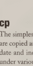

> 当你使用 `cp`、`mv` 或 `rm` 命令时，`-i` 开关会在覆盖文件之前提示确认。或者，每个命令都有一个 `-f` 开关，可在不提示的情况下覆盖现有文件。`cp` 和 `rm` 命令还具有 `-r` 开关，可递归复制或删除子目录。组合使用时，`-rf` 开关可能非常危险，尤其对于 `root` 或超级用户。

### cp

复制命令的最简单版本是 `cp file1 file2`。`file1` 的内容被复制并放置在目标文件 `file2` 中。目标文件具有新的创建日期和 inode 编号。其他复制命令可在各种情况下覆盖目标文件。您甚至可以使用 `cp` 命令的开关来复制一个或多个子目录的内容。`cp` 命令的工作示例显示在表 8.1 中。

### mv

如果您想在 Linux 中重命名文件，您可以移动它。`mv` 命令更改文件名称。除非您将文件移动到不同的卷，否则文件的所有内容，包括 inode 编号，保持不变。`mv` 命令的示例显示在表 8.2 中。

表 8.1 `cp` 命令。

| Command | Result |
|---|---|
| `cp file1 file2` | 将源文件 `file1` 的内容复制到目标文件 `file2`。目标文件具有新的创建日期和 inode 编号。 |
| `cp file* Dir1` | 将多个文件（名称以 file 开头）复制到目录。 |
| `cp -f file1 file2` | 如果您已有名为 `file2` 的文件，此命令会覆盖其内容而不提示。 |
| `cp -i file1 file2` | 如果您已有名为 `file2` 的文件，此命令会在覆盖该文件之前提示您确认。 |
| `cp -p file1 file2` | 将源文件 `file1` 的内容复制到目标文件 `file2`。目标文件具有与源文件相同的 inode 编号和创建日期。 |
| `cp -r Dir1 Dir2` | 将名为 `Dir1` 的目录的内容（包括子目录）复制到 `Dir2`。效果是递归的；换句话说，如果 `Dir1` 的子目录下还有子目录，其文件和目录也会被复制。 |
| `cp -u file1 file2` | 如果您已有名为 `file2` 的文件，且 `file1` 更新，此命令会覆盖 `file2` 的内容而不提示。 |

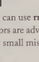

相同的文件具有相同的 inode 编号，通常 `cp -p` 命令会产生两个具有相同 inode 编号的文件。但您不能在不同卷上拥有相同的 inode 编号。如果您将文件从一个卷复制到另一个卷，`cp -p` 命令不会按预期工作。

### rm

您可以使用 `rm` 删除文件和目录。管理员仅在必要时才建议以 `root` 或超级用户模式运行 Linux 的原因之一是，此命令中的小错误很容易删除所有 Linux 文件。例如，假设您想删除根目录中的一组临时目录：`a.tmp`、`b.tmp` 和 `c.tmp`。您想使用 `rm -r *.tmp` 命令，但输入了以下内容：

```
rm -r * .tmp
```

由于星号和 `.tmp` 之间有一个空格，shell 假定您想要递归删除所有目录，然后删除名为 `.tmp` 的文件。结果不会很好。

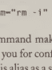

> 即使您是具有 `root` 用户权限的 Linux 管理员，也不要以 `root` 用户身份登录。小错误可能导致删除 Linux 计算机上的所有文件。

因此，输入以下别名命令可能很有用：

```
alias rm="rm -i"
```

此命令可确保每当您使用 `rm` 命令时，shell 会在删除任何文件之前提示您确认。一些 Linux 发行版将此别名作为 `root` 用户的 shell 变量设置。关键的 `rm` 命令显示在表 8.3 中。

表 8.2 `mv` 命令。

| Command | Result |
|---|---|
| `mv file1 file2` | 将文件从 `file1` 重命名为 `file2`。如果源文件和目标文件位于同一卷上，文件保留相同的 inode 编号。 |
| `mv file* Dir1` | 将多个文件移动到目录。 |
| `mv -f file1 file2` | 如果您已有名为 `file2` 的文件，此命令会覆盖其内容而不提示。 |
| `mv -i file1 file2` | 如果您已有名为 `file2` 的文件，此命令会在覆盖该文件之前提示您确认。 |

### ln

除了复制或移动文件之外，您还可以链接它。链接很常见，尤其对于在各种运行级别启动的程序。当您链接文件时，您正在为当前存在的现有文件创建另一个路径。例如，如果您和同事都在处理名为 `project` 的文件，您可以在主目录中创建一个链接文件。假设 `project` 文件位于 `/home/jim`

表 8.3 `rm` 命令。

| Command | Result |
|---|---|
| `rm file1` | 删除 `file1` 而不提示确认。 |
| `rm -d Dir1` | 删除 `Dir1` 而不提示确认 |
| `rm -i file1` | 在用户确认后删除 `file1`。 |
| `rm -f file2` | 如果您已有名为 `file2` 的文件，此命令会覆盖其内容而不提示。 |
| `rm -r *` | 递归删除文件；如果当前目录中有子目录，此命令也会删除它们（以及它们的所有文件）。 |

目录。 要在 `mj` 的主目录中创建一个文件的链接，你可以使用以下命令：

```
ln /home/jm/project /home/mj/project
```

当你操作任一文件时，变更和结果对访问这两个目录的人都是可见且可访问的。 这有时被称为硬链接。 对于硬链接，由于两个文件保留相同的 inode 编号，因此两个文件是相同的。 如果原始文件被删除，硬链接文件仍保留原位，并带有原始的 inode 编号。

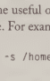

> `ln file1 file2` 命令导致的结果与 `cp -p file1 file2` 命令相同。

链接的一个有用选项是符号模式，它允许你查看被链接的文件。 例如，假设你要运行以下命令：

```
ln -s /home/jm/project /home/mj/project
```


当你对该文件运行长列表（`ls -l`）时，你会看到链接的文件。 这被称为软链接。 链接文件具有不同的 inode 编号。 如果原始文件被删除，软链接文件也会被删除。

## mkdir

你可以使用 `mkdir` 命令创建目录。 你创建的目录不必基于当前目录。 如果你选择，可以创建多个层级的目录。 你还可以为创建的目录分配你选择的权限。 关键的 `mkdir` 命令如表 8.4 所示。

表 8.4 `mkdir` 命令。

| Command | Result |
|---|---|
| `mkdir -p dir1/dir2` | 创建名为 `dir2` 的目录。如果 `dir1` 不存在，`-p` 开关会确保同时创建该目录。两者都作为当前目录的子目录创建。 |
| `mkdir -m 755 /home/mj/dir3` | 在 `mj` 的主目录中创建名为 `dir3` 的子目录。权限（755）为所有者 rwx，组其他成员和其他人 r-x。 |

## rmdir

你可以使用 `rmdir` 命令删除空目录。 你要删除的目录不必基于当前目录。 如果要删除的目录使其他目录变空，你可以删除多个层级的目录。 例如，使用以下命令，你可以删除名为 `dir1` 和 `dir3` 的目录：

```
rmdir -p dir1/dir3
```

此命令如果 `dir3` 为空则删除目录 `dir3`。 如果目录 `dir1` 中唯一的“文件”是 `dir3`，此命令也会删除目录 `dir1`。

## 文件管理命令

`bash` shell 包含许多命令，可帮助你以不同方式读取文件。 你可以验证不同类型的文件，也可以从顶部或底部读取文件。 这种读取可以限制为几行，也可以让你分页浏览整个文件。 你还可以统计文件中的行数、单词数和字母数字字符数。 此外，你可以使用自己选择的搜索词在文件中搜索。

由于在二进制文件中定义单词或行很困难，因此大多数这些命令最适合文本文件。

### file

尽管某些发行版通过颜色区分文件类型，但在 Linux 中没有标准扩展名。 可执行文件通常不以 `.exe` 结尾，文档文件也可能不以 `.doc` 结尾。 `file` 命令允许你查看每个文件的类型。 你可以在图 8.1 中查看其工作原理。

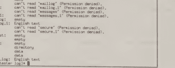

图 8.1 查看不同文件类型。

如图 8.1 所示，如果你没有适当的权限，就无法看到文件类型。

### cat

串联（`cat`）命令将文件文本发送到标准输出。 你可以在任何文件上使用 `cat` 命令。 以下命令将文件文本发送到你的屏幕：

```
cat file
```

### head 和 tail

`head` 和 `tail` 命令就像硬币的两面。 `head` 命令提供文件前几行的视图。 `tail` 命令提供同一文件最后几行的视图。 你可以使用开关调节所见文件的数量。 例如，如果你使用以下命令，你将看到 `bully.txt` 文件的前 15 行。

```
head -n15 bully.txt
```

如果你用 `tail` 替换 `head`，你将看到此文件的最后 15 行。 表 8.5 列出了可与这些命令一起使用的更多开关。

### more 和 less

`more` 和 `less` 命令不像 `head` 和 `tail` 那样是相反的。 它们都从文本文件的开头开始。 当你在文本文件上运行这些命令时，你一次一页地查看文件内容。 `less` 命令更通用；与 `more` 不同，它允许你使用键盘上的 Page Up 和 Page Down 按钮上下滚动任何大型文本文件。

因为它们可以一点一点地读取文本，所以这些命令比 `vi` 等文本编辑器打开文件更快。 `less` 命令也具有 `vi` 编辑器的一些优点，因为你可以使用一些 `vi` 命令在文件中搜索。

**表 8.5 `head` 和 `tail` 命令。**

| Command | Result |
|---|---|
| `head 400b bully.txt` | 你可以看到名为 `bully.txt` 的文件的前 400 字节。 |
| `tail 4k bully.txt` | 你可以看到名为 `bully.txt` 的文件的最后 4KB。 |
| `head 3m bully.txt` | 你可以看到名为 `bully.txt` 的文件的前 3MB。 |
| `tail -n22 bully.txt` | 你可以看到名为 `bully.txt` 的文件的最后 22 行。 |

表 8.6 在 `less` 在文本文件上运行时可使用的命令。

| Command | Result |
|---|---|
| `space` | 按键盘上的空格键可在屏幕上向前滚动一页。 |
| `Page Up` | 在屏幕上向后滚动一页。 |
| `Page Down` | 在屏幕上向前滚动一页。 |
| `#z` | `#` 代表一个数字。命令 `8z` 在文件中向前滚动八行。如果不使用数字，此命令等同于空格命令。 |
| `/abc` | 在文件中搜索文本字符串 `abc`。此命令也用于 Linux `vi` 文本编辑器。 |

每个命令都有两组选项。 如下所示的命令可为名为 `bigfile` 的文件设置行号：

```
less -N bigfile
```

文本文件打开后，你可以按表 8.6 中所述运行其他命令。

`more` 和 `less` 命令也称为分页器，因为它们允许你一次一页地查看文本文件。

## 文件操作命令

有几个命令允许你了解并搜索不同文件。 `wc` 命令允许你获取文件中的行数、单词数和字符数。 `find` 和 `locate` 命令搜索特定文件。 `grep` 命令让你在不打开文件的情况下在文件中搜索文本字符串。

### wc

`wc` 命令相当简单。 对于任何文本文件，都有一定数量的行、单词和字符。 使用 `wc` 命令，你可以找到这三个特征。 例如，假设你要按如下方式检查 `showoff` 文本文件：

```
wc showoff
```

你会得到类似以下内容：

```
1914  9298  76066
```

表 8.7 `wc` 命令示例。*

| Command | Result |
|---|---|
| `wc -l showoff` | `showoff` 文件中的行数。 |
| `wc -w showoff` | `showoff` 文件中的单词数。 |
| `wc -c showoff` | `showoff` 文件中的字符数。 |

*你可以在任何组合中使用 `-l`、`-w` 和 `-c` 开关。

这些数字分别对应于该文件中的行数、单词数和字符数。 你可以根据表 8.7 中所示的命令获取任何单个数据。

### find

`find` 命令在目录和子目录中查找你选择的 `file(s)`。 例如，如果你想找到名为 `fig07-02.tif` 的文件，可以使用以下命令：

```
find / -name fig07-02.tif
```

此命令在根目录和所有子目录中搜索 `fig07-02.tif` 文件。 此搜索可能需要相当长的时间。 如果你有更多信息，你可能想用较低级别的目录替换根目录（`/`）。

使用 `find` 命令，你也可以在搜索词中使用星号（`*`）和问号（`?`）等通配符。

### locate

`find` 的替代方案是 `locate` 命令。 此命令在你的文件数据库中搜索。 默认情况下，如果你让 Linux 在计算机上运行，`locate` 命令关联的数据库会在夜间创建。 如果你正在搜索自上次数据库更新以来未创建的文件，`locate` 命令比 `find` 更快地找到文件。

`locate` 命令也更灵活；如果你使用以下命令，它将返回包含文本字符串 `fig0` 的所有文件。

```
locate fig0
```

`locate` 命令的工作方式就像在搜索词前后假设了星号。

> `locate` 命令就像在文件数据库上运行 `grep`。在某些发行版中，使用 `slocate` 命令来实现此目的。

## grep

`grep` 命令是搜索文件的一种便捷方式。作为系统管理员，您可能拥有很长的用户列表。如果您想在 `/etc/passwd` 文件中搜索名为 "michael jang" 的用户，可以尝试以下命令：

```
grep "michael jang" /etc/passwd
```

如果用户名为 "michael jang" 存在，您会看到类似以下的行：

```
mj:x:500:500:michael jang:/home/mj:/bin/bash
```

前一行告诉您该用户的 home 目录和默认 shell。如果搜索字符串存在于多行中，您也会看到这些行。您甚至可以使用 `grep` 通过以下类似的命令搜索一系列文件：

```
grep mj *
```

```
grep -c bash /etc/passwd
```

第一个命令在当前目录的所有文件中查找字符串 `mj`。第二个命令统计（`-c`）包含单词 `bash` 的行数。

> 要将星号（`*`）和其他通配符用作搜索词（而不是作为通配符），请使用反斜杠。例如，如果您想在 `/etc/passwd` 文件中搜索星号，请使用 `grep \* /etc/passwd` 命令。

## Multiple Commands


在一条行中使用多个 Linux 命令是很常见的做法。例如，如果您正在使用 `find` 命令并且知道结果将包含大量文件，您可以使用 `grep` 之类的命令来搜索结果。具体来说，假设您想找到 Netscape 缓存文件。您可以从以下命令开始：

```
find / -name netscape
```

然而，当您在终端屏幕上看到成百上千个文件飞速闪过时，您可能会感到沮丧。另一种方法是像这样组合命令：

```
find / -name netscape | grep cache
```

此命令在 `find` 命令的结果中搜索文本字符串 `cache`。只有同时包含两个字符串的文件才会被输出到屏幕上。其他可能的命令组合包括以下内容：

- `who | grep mj`

- `ps aux | grep netscape`

第一个命令 `who` 列出当前登录到您的 Linux 系统的所有用户。当您将结果通过管道 (`|`) 传递给 `grep mj` 命令时，您会找到用户 `mj` 当前登录到系统的次数。


字母 `w` 也是一个 bash 命令。`w` 和 `who` 都显示当前登录的用户。

第二个命令 `ps` 列出当前在您的 Linux 系统上运行的进程。三个开关 `aux`（`ps` 命令开关不需要短横线）会导致一个很长的进程列表：所有用户运行的所有进程（`a`）每个进程都与用户名（`u`）相关联，与虚拟终端（`x`）无关。您需要像 `grep` 这样的工具来搜索这些进程。此组合命令返回所有包含单词 `netscape` 的进程。

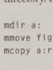

像 `who` 和 `ps` 这样的命令在第 11 章中有详细讨论。

## MS-DOS File Tools

Linux 包含可用于查看 MS-DOS 目录的工具。是的，您可以使用常规的 Linux 命令（如 `ls` 和 `cd`）来查看已挂载的 MS-DOS 目录。但使用 MS-DOS 工具，您不必挂载 MS-DOS 目录。相反，您可以运行如下所示的熟悉命令：

```
mdir a:
mmove fig07-01.tif a:
mcopy a:rh1.txt
```

第一个命令列出 `a:` 驱动器中的当前文件。第二个命令将 `fig07-01.tif` 文件从当前目录移动到 `a:` 驱动器。第三个命令将 `rh1.txt` 文件从 `a:` 驱动器复制到当前目录。如果您已经挂载了软盘驱动器，这些命令将不起作用。

## Managing Multiple Files

有两种基本命令常用于 Linux 管理多个文件的方式：`gzip` 和 `tar`。对于熟悉基于 Microsoft Windows 的 "zip" 实用程序的人来说，这两个命令将 zip 过程分解为两个部分。`tar` 命令将一系列文件收集到一个归档中，而 `gzip` 命令压缩文件。

### Archiving by tar

`tar` 命令因历史原因被称为磁带归档命令：备份过去主要制作到磁带驱动器。虽然磁带驱动器现在较少见，但 `tar` 是主要的 Linux 备份实用程序。它旨在将一系列文件复制到单个大文件中。如果您想备份当前目录中的文件，您可以运行以下命令：

```
tar cvzf goodbackup.tar *
```

此命令创建 (`c`) 一个备份，以压缩格式 (`z`=zip) 在名为 `goodbackup.tar` 的文件 (`f`) 中列出归档中的每个文件名 (`v`=verbose)。子目录中的文件也会保存到此归档中。然后您可以将此归档文件保存到备份区域，例如另一个卷或磁带驱动器。

> TIP
>
> 设置归档时，最好将文件保存为 `.tar` 扩展名。许多 Linux 下载都以 `.tar` 格式归档。

您也可以同样轻松地使用以下命令解归档文件：

```
tar tkvzf goodbackup.tar
```

此命令列出 (`t`) 归档中的文件。恢复时，它不会覆盖当前文件 (`k`=保留旧文件)。在详细 (`v`) 模式下，您可以看到发生的一切。如果您以压缩格式存储文件，则需要从压缩 (`z`) 格式恢复。最后，命令是从名为 `goodbackup.tar` 的备份文件 (`f`) 恢复。您可以在表 8.8 中查看一些可用的 `tar` 开关。请注意，`tar` 命令中的第一个开关应以 `c`、`t` 或 `x` 开头。

**Table 8.8 Command switches for tar.**

**表 8.8 tar 的命令开关。**

| Switch | Purpose |
|---|---|
| c | Create an archive |
| t | List files in a current archive |
| x | Extract files from an archive |
| d | Compare files between an archive and a current directory |
| f | Use the following file name for the archive |
| k | Do not overwrite existing files |
| v | Verbose option; list all files going in or coming out of an archive |
| r | Add files to the end of an archive |
| z | Zip; compress files to or from an archive |

您可以使用许多 `tar` 命令来创建和提取归档。一些典型命令包括以下内容。请阅读它们，并参考表 8.8 中的描述：

```
tar xvf download.tar
tar cvf backup.tar
```

### gzip and gunzip

您可以使用 `gzip` 命令压缩文件。您还可以进一步压缩已使用 `z` 选项压缩的 `tar` 文件。此命令的语法相当简单：

```
gzip goodarchive.tar
```

`gzip` 命令压缩目标文件并在文件名末尾添加 `.gz` 扩展名。`gunzip` 命令按如下方式逆转此过程：

```
gunzip goodarchive.tar.gz
```

> > **TIP**
>
> > 当您从 Internet 下载新的 Linux 程序时，文件末尾通常带有 `.tar.gz` 扩展名。您可以使用 `gunzip` 和 `tar` 命令从此类下载中提取所需的文件。

## Disk Management Commands

Linux 中有两种非常相似的磁盘管理命令：`du` 和 `df`。目录使用 (`du`) 命令列出当前目录及其下每个文件使用的空间。可用磁盘空间 (`df`) 命令列出

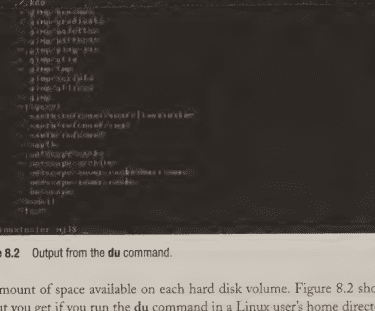

Figure 8.2 Output from the du command.

图 8.2 `du` 命令的输出。

每个硬盘卷上可用的空间。图 8.2 显示了如果在 Linux 用户的主目录中运行 `du` 命令，您将获得的输出。

您在左侧看到的数字是文件的大小，以千字节为单位，这是 `df` 和 `du` 命令的默认值。适用的文件显示在右侧。例如，您可能会看到以下内容：

```
1941    ./gimp/tmp
```

第一个点 (`.`) 表示您从当前目录开始。斜杠 (`/`) 导航到子目录，在本例中为 `.gimp`。换句话说，这一行意味着有 1941 千字节的磁盘空间专门用于 `.gimp/tmp` 子目录。

`df` 命令显示计算机上每个文件系统的已满程度。如图 8.3 所示，`df` 命令评估每个文件系统并以字节为单位显示结果。它包括当前已挂载的任何其他文件系统，例如软盘或 CD-ROM 驱动器。`-m` 开关以兆字节为单位给出结果，`-k` 开关以千字节为单位给出结果。


Figure 8.3 Output from the df command shows available disk space on each volume.

图 8.3 `df` 命令的输出显示每个卷上的可用磁盘空间。

## 练习题

### 问题 1

以下哪个命令会在不提示的情况下删除所有 Linux 文件？

- a. `rm -i *`

- b. `rmdir -r / home/mj/tmp`

- c. `rm -rf / home/mj/tmp`

- d. `rm -v * /home/mj/tmp`

答案 c 正确。请仔细阅读这些命令选项！因为第一个正斜杠（`/`）和 `home/mj/tmp` 之间有一个空格，这个 `rm` 命令首先删除根目录（`/`）中的所有文件和目录。`rm -i` 命令会在删除文件前提示你，因此答案 a 不正确。因为 `rmdir` 命令没有 `-r` 开关，因此答案 b 不正确。尽管 `rm -v * /home/mj/tmp` 命令首先删除当前目录中的所有文件，然后删除 `/home/mj/tmp` 目录中的所有文件，但它并不会删除所有 Linux 文件。因此，答案 d 不正确。

### 问题 2

`w` 命令的用途是什么？


- a. 没有用途；没有单字母 bash 命令。
- b. 列出当前已登录的用户。
- c. 列出当前活动的程序。
- d. 用作通用手册。

答案 b 正确。`w` 命令与 `who` 类似，会列出所有当前已登录的用户。因为 `w` 是一个命令，所以答案 a 不正确。`ps` 实用程序会列出当前活动的程序，因此答案 c 不正确。因为 `man` 命令会调出特定命令的手册，所以答案 d 不正确。

## 问题 3

你的用户有一系列名为 `test1`、`test2`、`test3`，……直到 `test100` 的测试文件。以下哪个命令只会删除名为 `test10` 到 `test19` 的文件？

- a. `rm -i test1*`
- b. `rm test1[09]`
- c. `rm test1?`
- d. `rm test10?`

答案 c 正确。问号（`?`）可作为一个字符的通配符。因为 `rm -i test1*` 命令会删除所需文件以及 `test1` 和 `test100` 文件，所以答案 a 不正确。`rm test1[09]` 命令会删除 `test10` 和 `test19` 文件，所以答案 b 不正确。因为 `rm test10?` 命令只会删除 `test100` 文件，所以答案 d 不正确。

## 问题 4

以下哪个命令是统计当前目录中文件数量最有效且准确的方法？请包含所有隐藏文件和目录。（命令之间用分号分隔。）

- a. `ls -l > wc -l`
- b. `ls -a > tempcount; wc -l tempcount`
- c. `ls -lar | wc -l`
- d. `ls -al | wc -l`

答案 d 是最佳可用答案。`ls -a` 命令会统计当前文件和目录，包括当前目录（`.`）和父目录（`..`）。因为每个文件都占一行，当你将结果通过管道传递给 `wc -l` 命令时，你会得到文件数量的结果。如果使用 `ls -l > wc -l` 命令，你会发现输出在一个名为 `wc -l` 的文件中。因此，答案 a 不正确。尽管答案 b 可行，但它不如答案 d 高效。因此，答案 b 不正确。因为答案 c 的 `ls` 命令使用了不必要的开关，所以它也是错误的。

## 问题 5

以下哪个命令会创建 `/home/mj/project/book` 目录？假设 `/home/mj` 是你的主目录。你的 `pwd` 是 `/home/jm`，且 `project` 和 `book` 目录目前都不存在。

- a. `mkdir -p ~/project/book`
- b. `mkdir -rF /home/mj/project/book`
- c. `mkdir -p project/book`
- d. `mkdir -r /home/mj/project/book`

答案 a 正确。波浪号（`~`）代表你的主目录（如第 7 章所述）。`mkdir` 的 `-p` 开关会创建所有指定的目录层级。因为 `mkdir` 命令没有 `-r` 或 `-F` 开关，所以答案 b 和 d 不正确。因为你当前位于 `/home/jm` 目录，所以答案 c 不正确。

## 问题 6

你已设置了名为 `kash` 的自己的 shell。你想知道有多少用户将 `kash` 设置为默认 shell。所有相关文件中没有其他包含字符串 `kash` 的词。以下哪个命令会给出这个数字？

- a. `grep kash | wc -l /etc/passwd`
- b. `wc -l /etc/passwd | grep kash`
- c. `grep /etc/passwd kash | wc -l`
- d. `grep kash /etc/passwd | wc -l`

答案 d 正确。`grep` 命令后的第一个参数是搜索词，用于在标准输入中搜索——本例中为 `/etc/passwd` 文件。这会返回包含字符串 `kash` 的每一行。输出被发送到 `wc -l` 命令，该命令会统计行数。答案 a 中没有搜索文件，因此不正确。`/etc/passwd` 文件中的行数与使用 `kash` shell 的用户数无关，所以答案 b 不正确。因为 `/etc/passwd` 不是搜索词，所以答案 c 不正确。

## 问题 7

以下哪些命令做的是同一件事？假设 `file1` 和 `file2` 都在同一个 Linux 卷上。

- a. `ln -s file1 file2; cp -p file1 file2`
- b. `ln file1 file2; cp -r file1 file2`
- c. `ln file1 file2; cp -p file1 file2`
- d. `ln -s file1 file2; cp file1 file2`

答案 c 正确。这个问题的关键是 inode 号。硬链接（`ln`）和 `cp -p` 命令都会为源文件和目标文件保留相同的 inode 号。如果从一个卷复制到另一个卷则不适用。`ln -s` 命令不会保留 inode 号，所以答案 a 和 d 不正确。因为 `cp -r` 命令不会保留 inode 号，所以答案 b 不正确。

## 问题 8

你已从互联网下载了一个新的 Linux 应用程序。安装文件被归档在一个名为 `newapp.tar.gz` 的文件中。你已将其下载到 `/tmp` 目录。需要哪些命令来解开安装文件？请确保命令顺序正确。

- a. `tar xvf newapp.tar.gz; gzip newapp.gz`
- b. `gzip newapp.tar.gz; tar xvf newapp.tar`
- c. `gunzip newapp.tar; tar xvf newapp.gz`
- d. `gunzip newapp.tar.gz; tar xvf newapp.tar`

答案 d 正确。你需要 `gunzip` 命令来解压缩扩展名为 `.gz` 的文件。然后你可以用 `tar xvf` 命令解包文件。`tar xvf` 命令不会解压缩文件，所以答案 a 不正确。`gzip` 命令会压缩文件，所以答案 b 不正确。因为你下载的是 `newapp.tar.gz` 文件，所以你需要在得到 `newapp.tar` 文件之前先对该文件应用 `gunzip` 命令。因此，答案 c 不正确。

## 问题 9

以下哪个命令可以复制文件到或从 Linux 计算机上的未挂载 MS-DOS 软盘？该 Linux 软盘通常挂载在 `/mnt/floppy` 目录。设备名为 `fd0`。

- a. `mount /dev/fd0 /mnt/floppy`
- b. `mcopy *.txt a:`
- c. `cp *.txt /mnt/floppy`
- d. `cp *.txt a:`

答案 b 正确。Linux 包含一组 MS-DOS 工具，即 `mtools`，可让你直接与未挂载的软盘驱动器交互。这些工具包括 `mcopy`、`mdir` 和 `mmove` 等命令。使用 `mtools` 时无需挂载软盘，所以答案 a 不正确。你不能使用 Linux 命令将文件复制到未挂载的软盘驱动器，所以答案 c 不正确。因为你不能使用 Linux 命令将文件复制到未挂载的 MS-DOS 驱动器，所以答案 d 不正确。

## 问题 10

你如何找到每个硬盘卷上空闲的千字节数？你不应该需要从字节或兆字节转换。

- a. `df`
- b. `df -m`
- c. `df -b`
- d. `du -k`

答案 a 正确。默认情况下，`df` 命令会以千字节为单位给出每个硬盘卷的空闲空间。尽管 `-k` 开关也有此用途，但并非必需。`df -m` 命令会以兆字节为单位给出结果，所以答案 b 不正确。`df -b` 开关不存在，所以答案 c 也不正确。尽管 `du -k` 命令会以千字节为单位给出每个文件和目录占用的空间，但它不会告诉你 Linux 卷中的可用空间。因此，答案 d 不正确。

## 需要了解更多？

Hughes, Phil. Linux for Dummies Quick Reference. IDG Books Worldwide, Inc., Foster City, CA, 1998. ISBN 0-76450-302-2. 一本快速参考书，可用于命令行界面的基本 Linux 选项。

Muster, John. Unix Made Easy. Osborne/McGraw-Hill, Berkeley, CA, 1996. ISBN 0-07-882-173-8. 一本关于命令行界面的扎实教材。尽管这是一本关于 Unix 的书，但它常与各种 Linux 发行版一起用作教学文本。

`http://linux.ctyme.com` 网站是 Mark Perkel 的 Linux 手册页索引。如果你无法立即访问 Linux 命令行或其手册页，该网站包含可搜索的在线参考。

## 管理打印机

**你需要理解的术语：**

- ✓ 打印机配置实用程序
- ✓ 行式打印机守护进程
- ✓ `lpr`, `lpq`, `lprm`, `lpc`
- ✓ 打印过滤器：`enscript`, `magic`
- ✓ `/etc/printcap`
- ✓ `sd`, `af`, `if`, `of`, `lf`, `tr`
- ✓ `rp`, `rm`

**你需要掌握的技术：**

- ✓ 使用打印机配置实用程序设置打印机
- ✓ 解释各种行式打印机命令
- ✓ 描述不同的打印过滤器
- ✓ 解码 `/etc/printcap` 文件中的条目


在本章中，你将学习如何在 Linux 上配置打印机。许多发行版都有自己的图形化打印机配置实用程序，用于管理名为 `/etc/printcap` 的打印机配置文件。与 Linux 行式打印机守护进程 (`lpd`) 相关联的 Linux 命令有好几个。一些打印机需要通过打印过滤器转换数据。一旦你掌握了这些基础知识，你就能够拆解 `/etc/printcap` 文件的各个组件。

## 打印机配置实用程序

如前所述，多个 Linux 发行版都包含自己的图形化打印机配置实用程序。一些示例包括 Red Hat Linux 的 `printtool`、`Caldera` 的 `COAS`、`S.u.S.E.` 的 `YaST2` 以及 `Corel` 的 `Control Center`。这些实用程序都会提示你输入 `/etc/printcap` 文件的参数，该文件决定了 Linux 如何与打印机通信。虽然你不会被测试发行版特定的打印机实用程序，但这些工具可以帮助你熟悉 `/etc/printcap` 文件中的参数。图 9.1 显示了 Red Hat 的 `printtool` 实用程序，图 9.2 显示了 Caldera `COAS` 实用程序的打印机菜单。

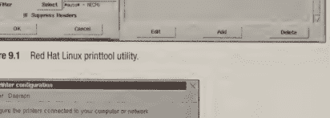

图 9.1 Red Hat Linux `printtool` 实用程序。

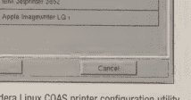

图 9.2 Caldera Linux `COAS` 打印机配置实用程序。

## `lp` 命令

一旦你设置了一台或多台打印机，就可以使用与行式打印机守护进程 (`lpd`) 关联的命令来管理它们。这些命令包括行式打印机请求 (`lpr`)、行式打印机查询 (`lpq`)、行式打印机删除 (`lprm`) 和行式打印机控制程序 (`lpc`)。

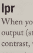

> 行式打印机守护进程 (`lpd`) 通常在启动 Linux 时启动。一旦你启动打印作业，`lpd` 就会在打印 `spool` 目录中查找这些作业，然后将它们发送到打印机。

### `lpr`

当你对文件使用 `cat` 命令时，`shell` 会将结果发送到标准输出 (`stdout`)，这通常意味着你会在屏幕上看到结果。相比之下，当你使用 `lpr` 时，`shell` 会将结果发送到本地计算机上的 `spool` 文件，然后发送到打印服务器计算机，最后发送到打印机。`lpr` 是一个客户端。当它生成 `spool` 文件时，结果由服务器 `lpd` 处理。`lpd` 打印服务器可以是本地的，也可以是网络上的远程服务器。因此，当你运行以下命令时，你的 `shell` 会将结果发送到 `/etc/printcap` 中定义的默认打印机：

```
lpr file1
```

你可以使用以下命令将此打印作业发送到另一台打印机：

```
lpr -P colorprinter file1
```

假设你的 `/etc/printcap` 文件中有一台名为 `colorprinter` 的打印机，此命令会将作业发送到该打印机。`lpr` 命令的其他重要开关显示在表 9.1 中。

表 9.1 `lpr` 命令。

| 命令 | 结果 |
|---|---|
| `lpr -h file1` | 打印 `file1` 而不带作业控制页，该页通常包含源计算机的用户账户和主机名。作业控制页也称为 `burst` 页。 |
| `lpr -P other file1` | 打印 `file1` 到 `/etc/printcap` 文件中定义的名为 `other` 的打印机。 |
| `lpr -s file1` | 创建指向 `file1` 的符号链接，从而避免创建 `spool` 文件。这在 Berkeley Standard Distribution 版本的 `lpr` 中对于较大的 (>1MB) 文件是必需的。当前的 Linux 发行版使用 `LPRng` 程序，这使得此操作变得不必要。 |

### `lpq`

行式打印机查询 (`lpq`) 命令会给出当前打印队列。该命令的示例显示在表 9.2 中。该命令还包括作业编号列表，你可能需要它用于 `lprm` 命令。

### `lprm`

如果打印作业尚未在打印机内存中，行式打印机删除 (`lprm`) 命令可以删除当前队列中的打印作业。使用 `lprm`，你可以通过三种方式之一删除打印作业：按打印作业号、按用户或按打印机。该命令的示例显示在表 9.3 中。

用户可以使用 `lprm` 删除自己的打印作业。`root` 或超级用户可以使用此命令删除任何人的打印作业。

### `lpc`

行式打印机控制 (`lpc`) 命令允许你控制每台打印机的多个特性。如表 9.4 所示，此命令可让你检查打印机状态、终止活动打印作业，甚至将作业重定向到另一台打印机。

### 打印机语言

当你想要打印文件时，Linux 会将文件转换为打印机可用的格式。打印机在其内存中嵌入了自己的字体。如果你只是打印文本，Linux 可以向打印机发送 ASCII 代码，这些代码会被转换为打印机的字体。这通常被称为文本模式打印。

表 9.2 `lpq` 命令。

| 命令 | 结果 |
|---|---|
| `lpq` | 返回 `/etc/printcap` 文件中定义的默认打印机的当前打印队列。 |
| `lpq -P print1` | 返回 `print1` 打印机的打印队列。根据 `/etc/printcap` 文件中显示的名称替换打印机名称。 |

表 9.3 `lprm` 命令。

| 命令 | 结果 |
|---|---|
| `lprm 188` | 删除 `lpq` 命令输出中定义的打印作业 188。 |
| `lprm -P hp2 mj` | 从 `/etc/printcap` 文件中标记为 `hp2` 的打印机中删除用户 `mj` 的打印作业。 |

表 9.4 `lpc` 命令。

| 命令 | 结果 |
|---|---|
| `lpc -P canon1 status` | 显示名为 `canon1` 的打印机的状态。换句话说，输出会告诉你是否可以将打印作业发送到队列、队列中的作业数量、打印机是否接受作业以及与打印机的通信状态。 |
| `lpc disable` | 禁用向默认打印机的打印队列发送作业（spooling）。与 `lpc enable` 相反。 |
| `lpc stop` | 停止打印队列与打印机之间的通信。`lpc start` 命令重新启动从打印队列的传输。 |

另一方面，如果你正在打印图形，可能不希望使用打印机的字体。打印机需要有关如何处理每个点或像素的指令。Linux 具有打印过滤器，可将文件转换为标准打印机图形格式，例如 `PostScript` 或 `PCL`（打印机控制语言）。

### 文本与图形

唯一真正的文本文档是使用打印机字体打印的文档。如果你从 `vi` 或 `emacs` 等编辑器打印文件，而不使用任何排版命令，你就是在打印文本文档。文本文档需要发送到打印机的数据最少；每个字母只需要一个 ASCII 位，而不是创建每个字母的点所需的几十或几百位。

使用标记语言（如 `TeX` 和 `HTML`）的文档以文本形式编写。它们使用命令将不同行的文本转换为不同的字体。这些字体随后逐像素转换为打印机。

今天打印的几乎所有其他文档都需要图形界面。使用 WYSIWYG（所见即所得）系统的文档完全是图形化的；每个字母都在屏幕上逐像素转换，然后发送到打印机。

但标记语言和 WYSIWYG 图形都不对应实际的打印机语言。你仍然需要过滤器将图形格式转换为打印机可用的格式。存储在你的 `spool` 目录中的是转换后的文件。

*注意：某些打印机在接收到打印作业后会转换 WYSIWYG 图形。如果有这种类型的打印机，请确保在 `/etc/printcap` 文件中设置 `rp=raw`，如本章后面所述。*

## 过滤器

过滤器将您从应用程序和编辑器中想要打印的内容翻译成打印机可以理解的各种语言。两种主要的打印机图形语言是 Hewlett Packard 的 `PCL` 和 Adobe 的 `PostScript`。这些语言属于不同的类别；某些应用程序使用 `PostScript` 将文件翻译为 `PCL`。与这些语言配合使用的图形过滤器主要有三种类型：`enscript`、`ghostscript` 和 `magic`。您需要在 `/etc/printcap` 文件中设置将要使用的过滤器。

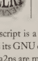

> 大多数 Linux 应用程序都使用 `PostScript` 文件。因此 Linux 的 `PostScript` 打印机驱动程序更为常见。

`Enscript` 是商业版 `enscript` 打印机过滤器的 GNU 克隆版。与其 GNU 亲戚 `a2ps` 一样，它将文本转换为 `PostScript` 格式。`Enscript` 和 `a2ps` 比其他 `PostScript` 过滤器更灵活，因为它们允许您在一张纸上打印两页文本。

`Ghostscript` 是一个 `PostScript` 解释器，它允许 Linux 在图形用户界面中显示 `PostScript` 文件，同时也是一个转换器，可将 `PostScript` 数据发送到许多打印机。


Magic 过滤器实际上并不是真正的过滤器。它们是脚本，可自动检测文件内部的数据类型，然后调用适当的过滤器将数据转换为打印机格式。从某种意义上说，这就像第 8 章中的 `file` 命令。Magic 过滤器可将 DVI 或 PostScript 等模式转换为 Hewlett Packard 的 PCL。

注意：DVI 文件是 LaTeX 或 TeX 输入文件处理后的数据。

还有一个主要的过滤器，称为 `lpf`。这是一个用于文本文件的过滤器。`lpf` 过滤器重新格式化 ASCII 文本以避免“阶梯状”现象，即打印机在每个单词后添加额外行时出现的情况。

## 排队目录

打印 spool 通常位于 `/var/spool/lpd` 目录中。每个作业都有自己的文件。在使用 BSD（Berkeley Standard Distribution）版行式打印机守护进程的旧版 Linux 系统上，Linux 无法处理大于 1MB 的 spool 文件，这就是 `lpr -s` 命令存在的原因。如果您在使用 `lprm` 和 `lpc` 等命令管理 spool 时遇到问题，您可以通过直接删除 spool 目录中的文件来终止打印作业。

打印 spool 与日志文件一样，通常存储在 `/var` 目录或其子目录中。

## `/etc/printcap` 文件

所有不同打印机的设置都存储在 `/etc/printcap` 文件中。在本节中，您将分析一个典型的 `/etc/printcap` 文件，以便使其适用于您。图 9.3 显示了来自 Corel Linux 发行版的 `/etc/printcap` 文件示例。

乍一看，该文件可能相当令人困惑，因此让我们先回顾一下该文件可用的一些代码。然后您就可以解释此文件或您当前 Linux 发行版中的文件。

### `/etc/printcap` 代码

`/etc/printcap` 文件中的代码可以分为以下几类：打印机名称、过滤器、spool、日志文件和特殊打印机代码。该文件还有单独条目的格式。例如，图 9.3 中显示的第一个部分可能显示为三行长代码：

```
lp|Generic dot-matrix printer entry:lp:/dev/lp0:\
sd=/var/spool/lpd/lp:af=/var/log/lp-acct:\
lf=/var/log/lp-errs:pl#66:pw#80:pc#150:mx#0:sh
```

```
# /etc/printcap: printer capability database. See printcap(5).
# You can use the filter entries df, tf, cf, gf etc. for
# your own filters. See /etc/filter.ps, /etc/filter.pcl and
# the printcap(5) manual page for further details.

lp|Generic dot-matrix printer entry\
:lp=/dev/lp0\
:sd=/var/spool/lpd/lp\
:af=/var/log/lp-acct\
:lf=/var/log/lp-errs\
:pl#66\
:pw#80\
:pc#150\
:mx#0\
:sh\

# rlp|Remote printer entry\
# :lp=\
# :rm=remotehost\
# :rp=remoteprinter\
# :sd=/var/spool/lpd/remote\
# :mx#0\
# :sh
```

图 9.3 一个典型的 `/etc/printcap` 打印机配置文件。

不幸的是，这种类型的代码管理会使除最有经验的 Linux 管理员之外的所有人生活更加困难。您在该文件或任何其他程序中设置和呈现代码的方式有助于向其他管理员传达您的意图。有三个标点符号可以帮助您管理 `/etc/printcap` 代码。

- `:` — 冒号分隔代码行。如果您看到冒号，即使在行内，它也会开始一个新命令。
- `\` — 如果一行以反斜杠结尾，则表示代码继续到下一行。回想一下第 7 章，反斜杠告诉 shell 忽略空字符、回车等字符。
- `|` — `/etc/printcap` 文件中竖线后的行是注释。如您所见，前面的代码行和图中所显示的行描述了某种类型的打印机。但这些注释很重要，因为您可以使用它们来指定特定打印机。

> 注意：`/etc/printcap` 段落中的第一行通常定义打印机。您可以看到前面显示的行以 `lp` 开头，这是默认打印机的代码。

打印机名称基于 `/dev/` 目录中安装并可用的驱动程序。典型的打印机名称包括 `lp`、`lp1`、`lp2`、`sp1` 和 `lf1`。

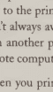

> 默认打印机在 `/etc/printcap` 文件中具有 `lp` 标签。如果没有此标签的打印机，则该文件中的第一个打印机成为默认打印机。

前面讨论的打印过滤器可以指定为输入过滤器 `if` 或输出过滤器 `of`。如果单台打印机上有多个打印作业，则每个打印作业都只使用输入过滤器。输出过滤器仅应用于一系列打印作业中的第一个作业。

spool 目录 `sd` 是在将过滤后的打印作业发送到打印机之前存储它们的位置。Linux 需要一个地方来存储这些打印作业，因为打印机并不总是可用。例如，您的打印机可能已断开连接或正在处理另一个打印作业。此外，Linux 联系远程计算机上的打印机可能需要时间。

当您打印时，Linux 可以跟踪打印成本和打印错误。用于这些功能的日志文件是记账过滤器 `af` 和行过滤器 `lf`。记账过滤器不言自明。行过滤器收集错误。

还有许多其他代码。其中一些更重要的代码记录在表 9.5 中。

表 9.5 `/etc/printcap` 文件的特殊代码。

| 代码 | 功能 |
|------|------|
| `rm` | 远程机器：将此设置为远程打印服务器的主机名或 IP 地址（例如，`rm=192.168.0.66` 命令告诉行式打印机守护进程 [`lpd`] 您的远程打印机的 IP 地址为 192.168.0.66）。 |
| `rp` | 远程打印机：如果您正在打印 PostScript 文件而打印机无法检测此类型文件，请将此值设置为 raw（`rp=raw`）。 |
| `mx` | 最大文件大小：帮助您使用旧版 BSD 行式打印机守护进程（`lpd`）。如果您不想要最大文件大小，请将此值设置为 0（`mx#0`）。 |
| `pw` | 页面宽度，以字符为单位：美国信纸上的标准页面宽度为 80（`pw#80`）。 |
| `pl` | 页面长度，以行数为单位：美国信纸上的标准页面长度为 66（`pl#66`）。 |
| `sh` | 抑制页眉：当您看到此命令时，打印机不会打印包含作业和用户名的页面。 |

*注意：有关 `/etc/printcap` 文件内部语法的更多信息可在其手册页上找到。*

## 一个典型的 `/etc/printcap` 文件

一旦了解基本语法，您就可以阅读大多数典型的 `/etc/printcap` 文件。返回图 9.3。您知道 `lp` 是默认打印机的名称，其设备位于设备文件 `/dev/lp0` 中。发送到该打印机的文件首先在 `sd` 定义的目录中进行 spool，即 `/var/spool/lpd/lp:`。

同样，记账过滤器的输出存储在 `/var/log/lp-acct` 文件中。错误由行过滤器接收并发送到 `/var/log/lp-errs` 文件。页面长度 `pl` 为 66 行。页面宽度 `pw` 为 80 个字符。价格代码 `pc` 为每页 1.5 美分。打印机 spool 文件的大小没有限制（`mx#0`）。抑制页眉 `sh` 命令可防止打印机打印包含您的用户名和打印作业编号的页面。

您将在练习问题中查看其他示例。

## 练习题

### 问题 1

以下哪个命令在启动或重启 Linux 时通常使用？

- a. `lpr`
- b. `lpd`
- c. `lprm`
- d. `lpc`

答案 b 正确。行式打印机守护进程（`lpd`）会在一个或多个运行级别自动启动，具体取决于你的 Linux 发行版。因为 `lpr`（行式打印请求）命令用于打印文件，所以在启动或重启 Linux 时通常不会使用。因此，答案 a 不正确。`lprm`（行式打印机移除）命令用于移除打印作业。如果你在启动或重启 Linux，就不应该有任何打印作业（尽管这是可能的）；因此，答案 c 不正确。`lpc`（行式打印控制程序）命令帮助你控制当前打印作业。出于与 `lprm` 相同的理由，答案 d 也不正确。

### 问题 2

与 `lpd` 相关的实用程序有几个。以下哪个陈述最接近实用程序与其用途的匹配？

- a. The `lpd` takes jobs from your applications and manages them through your spool directory all the way to your printer.
- b. The `lpq` command allows you to manage the operation of the Linux print system.


- c. `The lprm command` allows you to remove print jobs from your application directories.

- d. `The lpc command` allows the root or superuser to manage and reprioritize different print jobs.

答案 d 正确。行式打印机控制（`lpc`）命令确实允许 root 或超级用户取消或延迟特定的打印作业。因为行式打印机守护进程（`lpd`）不会从你的应用程序接收作业，所以答案 a 不正确。行式打印机查询（`lpq`）仅允许你查看当前队列中的打印作业，因此答案 b 不正确。虽然行式打印机移除（`lprm`）命令确实允许你移除打印作业，但这些作业存储在打印 spool 中，与任何应用程序目录是分开的。因此，答案 c 不正确。

### 问题 3

以下哪一项用于将来自文本或图形应用程序的打印作业翻译成打印机实际可用的格式？

- a. Input translator

- b. Printer filter

- c. Line printer daemon

- d. Stair-step manager

答案 b 正确。打印机过滤器，如在你的 `/etc/printcap` 文件中配置的，允许你的应用程序以打印机可用的语言发送打印作业。因为输入转换器没有与打印相关的用途，所以答案 a 不正确。虽然行式打印机守护进程（`lpd`）使用打印机过滤器，但守护进程本身不是打印机过滤器；因此，答案 c 不正确。虽然阶梯状是文本的问题，但它不是图形应用程序的问题。因此，答案 d 不正确。

### 问题 4

要删除特定的打印作业，你需要采取以下哪一步？打印作业的所有者名为 sam，且你不知道打印作业编号。这是他唯一的当前打印作业。其他人也有正在进行的打印作业。打印机的名称是 hp，且它不是你的默认打印机。选择步骤最少的选项。

- a. Use `lpc -P` to find the print job number, and then delete it by number with the `lprm` command.

- b. Use `lpq -a` to find the print job number, and then delete it by number with the `lprm` command.

- c. Use `lprm -P hp sam` to delete all of sam's current print jobs.

- d. Use `lpc -P hp sam` to delete all of sam's current print jobs.

答案 c 正确。`lprm` 命令移除打印作业。`-P` 开关指定打印机。你也可以按用户指定要移除的打印作业。`lpc` 命令在你知道打印作业编号时有所帮助。因为答案 a 中未指定打印机，所以该答案不正确。因为 `lpq` 命令没有 `-a` 开关，所以答案 b 不正确。你可以使用 `lpc` 命令中止所有当前打印作业；然而，没有选项可按用户指定打印作业。因此，答案 d 不正确。

### 问题 5

根据 `/etc/printcap` 文件中的以下条目，你的打印机过滤器在哪里？

```
lp1|laser:lp=dev/lp2:sd=/var/spool/lpd/lp2:\
af=/var/log/lp-acct:lf=/var/log/lp-errs:\
if=/var/spool/lpd/lp2/manager
```

- a. `/var/spool/lpd/lp2`

- b. `/var/log/lp-acct`

- c. `/var/log/lp-errs`

- d. `/var/spool/lpd/lp2/manager`

答案 d 正确。检查代码行，输入过滤器（`if`）表示你的打印机过滤器的位置。因为字母 `sd` 代表 spool 目录，所以答案 a 不正确。字母 `af` 代表记账过滤器，所以答案 b 不正确。字母 `lf` 代表行过滤器，即打印错误发送到的位置，所以答案 c 不正确。

### 问题 6

你从美国带了一台便携式文本打印机到欧洲，只能找到窄纸。你想使用打印机的字体。假设你希望设置打印机每行使用不超过 70 个字符。以下哪个命令可以帮助 Linux 管理你的打印作业以适应窄纸？

- a. `of=/var/spool/lpd/lp0/pw70`

- b. `pw#70`

- c. `pl#70`

- d. `pw=/var/spool/lpd/lp0/70`

答案 b 正确。此命令将文本打印限制为每行 70 个字符。因为 `of` 代表输出过滤器，与输出到文本打印机无关，所以答案 a 不正确。字母 `pl` 代表每页的行数，所以答案 c 不正确。因为 `pw=/var/spool/lpd/lp0/70` 对于此命令的格式不正确，所以答案 d 不正确。

### 问题 7

根据 `/etc/printcap` 文件中的以下条目，远程打印机在哪里？你位于 `nicenetwork.rgb` 域。

```
lp|lr2|Color Laser:rp=text:\
rm=lr2:sd=/var/spool/lpd/lp2:\
af=/var/log/lp-acct:\
lf=/var/log/lp-errs:\
ff=/var/spool/lpd/lp2/manager
```

- a. `lp.nicenetwork.rgb`

- b. `192.168.0.13`

- c. `lr2.nicenetwork.rgb`

- d. `af.nicenetwork.rgb`

答案 c 正确。远程打印机的位置设置为等于 `rm`。因为 `lp` 是打印设备，与远程打印位置无关。因此，答案 a 不正确。虽然 `192.168.0.13` 可能是 `lr2` 的 IP 地址，但你没有任何信息表明这是如此。因此，答案 b 不正确。字母 `af` 代表记账过滤器，与远程打印机的位置无关。因此，答案 d 不正确。

### 问题 8

以下哪个打印过滤器可以将来自多种已知格式的数据转换为惠普的 PCL？

- a. PostScript

- b. enscript

- c. Lpf

- d. Magic

答案 d 正确。`Magic` 是此列表中唯一可以检测输入文件格式的过滤器。PostScript 本身是一种与 PCL 不同的打印机语言，所以答案 a 不正确。因为 `enscript` 将文件转换为 PostScript 语言，所以答案 b 不正确。因为 `lpf` 是文本打印机的过滤器，所以答案 c 不正确。

### 问题 9

以下哪个文件包含有关数据如何发送到你的 spool 目录然后再发送到打印机的主要配置数据？

- a. `/var/spool/lp/lp0`

- b. `/etc/printcap`

- c. `/etc/spool/lp/lp0`

- d. `/var/printcap`

答案 b 正确。`/etc/printcap` 文件是主要配置文件，包含过滤器、你的 spool 目录定义等。虽然答案 a 是 spool 目录，但它不包含过滤器。因此，答案 a 不正确。因为 `/etc/spool/lp/lp0` 不是 spool 目录，所以答案 c 不正确。Spool 目录保存在 `/var` 目录下。因为配置文件保存在 `/etc` 目录下，所以答案 d 不正确。

### 问题 10

以下哪一个是随每个 Linux 发行版一起提供的图形化打印机配置实用程序？

- a. `printtool`

- b. COAS

- c. YaST

- d. KDE Control Center

- e. None of the above

答案 e 正确。没有图形化打印机配置实用程序是所有 Linux 发行版的标准配置。`printtool` 实用程序随 Red Hat Linux 提供。因此，答案 a 不正确。COAS 实用程序随 Caldera Linux 提供。因此，答案 b 不正确。YaST 实用程序随 S.u.S.E. Linux 提供。因此，答案 c 不正确。一般来说，你不能使用 KDE Control Center 配置打印机；然而，打印机配置工具内置于 Corel Linux 版本的此实用程序中。尽管如此，因为它并非所有发行版都可用，所以答案 d 不正确。

## 需要了解更多？


网站 http://linux.ctyme.com 是 Mark Perkel 创建的 Linux 手册页索引。如果您无法立即访问 Linux 命令行或其手册页，该网站提供可搜索的在线参考。本章的重要手册页包括 `printcap`、`lpc`、`lpd`、`lpr` 和 `lprm`。


Linux 文档项目在 www.linuxdoc.org 的网站是 Linux 手册、HOWTOs 以及其他若干书籍长度文档的中央存储库。本章的重要 HOWTO 包括“Printing-HOWTO”，它可以帮助您从几乎任何格式打印到几乎任何打印机，以及更专注于您实际使用的命令的“Printing Usage-HOWTO”。


## The X Window

需要理解的术语：

- `startx`, `xdm`
- `.xinitrc`, `Xsession`
- `X11`, `XF86Config`
- `X Server`, `Display Manager`, `Widgets`
- `Window manager`, `applications`
- `SuperProbe`, `xf86config`, `XF86Setup`, `Xconfigurator`, `SaX`
- `GNOME`, `KDE`, `fvwm`, `Enlightenment`, `AfterStep`, `WindowMaker`, `Blackbox`
- `Virtual display`

需要掌握的技术：

- 描述 X Window 的启动方式
- 理解 X Server 配置文件的结构
- 描述 X Window 的五个主要组件
- 定位不同的 X11 配置文件和程序
- 使用各种 X Window 配置实用程序
- 描述多个窗口管理器的特点
- 管理 X Windows 内部的信息

在本章中，您将使用 X Window，它是 Linux 图形用户界面（GUI）。Linux X Window 系统几乎完全是模块化的。它基于多种不同类型的配置文件和实用程序运行。不同的窗口管理器为您的 GUI 桌面提供不同的“外观和感觉”。

## Starting the X Window

您可以从命令行界面启动 X Window，也可以将其设置为通过 `/etc/inittab` 配置文件自动启动。无论您使用 X Window 启动命令 `startx` 还是 `xdm`（X Display Manager），X Window 启动程序都会使用基于您硬件的配置文件。然后它会运行系统范围和用户特定的初始化文件。

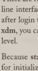

X Window 也被称为 `X11`。

### X Window Start Commands

启动 X Window 有两种基本方法。您可以在命令行界面登录并使用 `startx` 命令，或者在登录后运行 `xdm` 命令以启动 X 登录窗口。如果您有一个专门用于 `xdm` 的 init 级别，您可以设置 `/etc/inittab` 文件以确保 Linux 在该运行级别启动。

由于 `startx` 是一个 Linux 脚本，您可以使用文本编辑器查看其中的初始化文件。如果您已经设置了 `xdm`，其初始化文件将优先。

在任何一种情况下，`startx` 或 `xdm` 首先检查用户的 home 目录中的配置文件。如果没有可用文件，它然后检查系统范围的初始化文件，这些文件通常位于 `/etc/X11/xinit` 目录的子目录中。

*注意：根据您的发行版，您可能还可以使用 X 之类的命令来启动 X Window。*

### Configuration Files

关键配置文件是 `/etc/X11/XF86Config`，它设置您的鼠标、键盘、监视器和视频控制器。虽然 Linux 可以检测许多视频控制器和监视器的设置，但通过自定义此文件通常可以提高系统的性能。示例文件 `xf86config.eg` 包含自定义 `/etc/X11/XF86Config` 的指南，可分为八个主要部分：

- Files—包括颜色和字体的文件位置。
- `ServerFlags`—控制 X Window 对特殊命令的响应。例如，您可以使用 Ctrl+Alt+Backspace 退出 X Window。此部分中的 `DontZap` 命令会禁用此选项。
- `Keyboard`—设置键盘的参数。包括特殊键的设置以及键盘功能，例如 Num Lock 和 Auto Repeat。
- `Pointer`—设置指向设备，通常是鼠标。鼠标选项包括协议（Microsoft、PS/2、Logitech 等）、每秒位数（波特率）和三键仿真。
- `Monitor`—设置监视器允许的水平和垂直频率范围。设置过高可能会使监视器过载。也设置监视器的刷新率。
- `Device`—提供视频控制器的设置，包括允许的水平和垂直频率范围。
- `Screen`—提供允许的和默认的图形模式，指定监视器上显示的像素数量和尺寸。示例模式为 640×480、800×600 和 1024×768。
- `Xinput`—提供其他输入硬件的设置，例如带图形平板的笔、游戏适配器甚至触摸屏。

注意：在 Red Hat Linux 中，可能需要按两次此键组合。

上述列表只是可能选项的冰山一角。完整列表可在 `XF86Config` 文件的手册页中找到。

注意：三键仿真允许您在需要三个按钮的地方使用两个按钮鼠标。启用时，您可以通过同时按下左右按钮来模拟中间按钮。

### Initialization Files

有两个主要的初始化文件。`xinitrc` 文件与 `startx` 相关联，`Xsession` 文件与 `xdm` 相关联。`/etc/X11/xinit` 目录中的主要初始化文件是脚本，它们会让位于用户 home 目录中对应的文件。一旦做出选择，初始化文件就会调用其他脚本来分配资源，如内存、键盘设置、窗口管理器和 `XF86Config` 文件。

注意：如果您在 home 目录中有 X Window 初始化文件，它们可能被隐藏。您可以使用 `ls -a` 命令列出它们。隐藏文件如 `.xinitrc` 前面有一个句点。请记住，用户和系统范围的配置文件的实际位置会有所不同。

## X Window Architecture

如前所述，X Window 是模块化的。您可以从不同类别中混合搭配组件。无论您选择哪些组件，设置 X Window 架构都需要五组不同的组件：服务器、显示管理器、部件、窗口管理器和应用程序。

`X Server` 直接与视频硬件通信。显示管理器设置 X Window 环境并设置登录屏幕。您在 GUI 中看到的基本项目，例如菜单栏，是由部件构建的。实际的 GUI 是窗口管理器，所有 GUI 应用程序都应与任何窗口管理器配合使用。该系统可以通过网络以客户端-服务器方式设置。

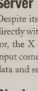

> 当您设置 X Window 时，Linux 首先启动 X Server，将您的计算机置于图形模式。然后它可以启动显示管理器以允许您登录。一旦登录，Linux 就会启动您选择的窗口管理器。

### Server

尽管名称如此，X Server 设置在客户端计算机上。它直接与您的视频控制器通信。在 Linux 在监视器上绘制图片之前，X Server 会将信息发送到您的视频硬件。无论输入来自应用程序还是鼠标，X Server 都会处理此数据并向您的视频控制器发送适当的输入/输出命令。

### Display Manager

您看到的显示管理器是一个图形登录屏幕。一些窗口管理器，例如 `KDE`（K Desktop Environment）和 `GNOME`（GNU Network Object Model Environment），有自己的显示管理器。其他如 `xdm`，则在 `/etc/inittab` 文件的特定级别配置。您看到的屏幕因 Linux 发行版而异。无论使用哪种显示管理器，成功登录都会激活窗口管理器。

### Building Blocks (Widgets)

在 Linux 中，部件是一个库程序。开发人员从部件构建窗口管理器的组件。这些组件包括菜单栏、滚动条、任务栏等。不同的窗口管理器可能由不同的部件库构建。

### 窗口管理器

窗口管理器决定 GUI 在显示器上的外观。有多种不同的窗口管理器可供选择，包括 `GNOME`、`KDE`、`Afterstep`、`Window Maker`、`fvwm`、`Blackbox` 和 `Enlightenment`。

两个最常见的默认窗口管理器是 `GNOME` 和 `KDE`。`GNOME` 窗口管理器基于 `GTK+` 小部件库构建。`KDE` 窗口管理器基于 `Qt` 小部件库构建。

### 应用程序

在大多数情况下，GUI 应用程序（如 Netscape Communicator 和 WordPerfect）与 X Window 架构一起工作，但并不属于其一部分。尽管如此，GUI 应用程序也会存储用户特定的配置文件。你的主目录中可能已经存在一些隐藏的应用程序配置文件。

`GNOME` 和 `KDE` 软件包包含诸如办公套件之类的应用程序。

## X Window 配置实用程序

编辑 `XF86Config` 文件对于除最熟练的管理员之外的所有人来说都可能是一个困难的过程。有许多优秀的工具可以帮助你配置此文件。尽管其中一些工具是图形化的，但它们不会像其他 Linux GUI 实用程序那样存在感知缺陷。换句话说，它们是可靠的。在大多数情况下，它们包含了大多数管理员配置系统所需的全部功能。

其中一些实用程序甚至可以帮助你安装或修改键盘和鼠标的设置。


> 在启动这些实用程序之前，请备份你的 X Server 配置文件，通常位于 `/etc/X11/XF86Config`。

## SuperProbe


SuperProbe 实用程序是一个文本命令，用于检测视频控制器的关键部件，包括卡上的芯片组和数据转换器。最重要的是，它会为你识别合适的 X Server。如果你想尝试使用此实用程序，请先关闭所有正在运行的程序，因为 SuperProbe 可能导致 Linux “挂起”或在你的计算机上停止工作。


> > X Server 基于 XFree86 项目的工作。服务器名称反映了它们的视频控制器。例如，你可以将 `XF86_SVGA` 服务器分配给 SVGA 卡，将 `XF86_P9000` 服务器分配给 Orchid P9000 卡，等等。

当你运行 `SuperProbe` 时，实用程序会警告你它可能导致计算机挂起。在五秒内，随着实用程序探测你的视频硬件，显示器屏幕可能会变黑。如果它检测到你拥有的硬件，你将在屏幕上看到结果，如图 10.1 所示。

如果你在没有使用其他 X Window 配置实用程序的情况下设置配置文件，下一步是将 X Server 链接 (`ln`) 到 X 命令。

## xf86config

`xf86config` 实用程序在命令行中使用，用于配置你的视频控制器和显示器以及键盘和鼠标。

`xf86config` 实用程序代表了图形实用程序不被偏好的罕见情况之一。`xf86config` 使用的列表很长且乏味。然而，由于它允许你从外部文件设置显示器和视频控制器的设置，因此更容易保持此实用程序的最新状态。

如果你想了解每个步骤中可用选项的更多信息，请查看下一节关于 `XF86Setup` 实用程序的内容。尽管 `XF86Setup` 是一个 GUI 实用程序，但选项几乎相同。

```
laptop:* SuperProbe
SuperProbe Version 2.20 (17 June 1999)
(c) Copyright 1993,1994 by David M. Eskelin <dave@xfree86.org>
(c) Copyright 1994-1998 by The XFree86 Project, Inc.

This work is derived from the "vgasetc.zip" and
"vga2cfg.zip" documentation packages produced by Finn
Thogerensen, and released with all appropriate permissions
having been obtained. Additional information obtained from
"Programmer's Guide to the EGA and VGA, 2nd ed." by Richard
Ferraro, and from manufacturer's data books

Bug reports are welcome, and should be sent to XFree86@XFree86.org.
In particular, reports of chipsets that this program is unable to
correctly detect are appreciated.

Before submitting a report, please make sure that you have the
latest version of SuperProbe (see http://www.xfree86.org/FAQ/).

WARNING - THIS SOFTWARE COULD HANG YOUR MACHINE.
READ THE SuperProbe MANUAL PAGE BEFORE
RUNNING THIS PROGRAM.

INTERRUPT WITHIN FIVE SECONDS TO ABORT!

First video: Super-VGA
Chips: Yamaha 2088 VESA VBE 3.0 (Port Probed)
RAMDAC: Generic 8-bit pseudo-color DAC
(with 8-bit wide lookup tables (or in 6-bit mode))

laptop:* 
```

图 10.1 SuperProbe 实用程序的工作情况。

`xf86config` 的 Cards 数据库文件位于 `/usr/X11R6/lib/X11` 目录中。Monitor 数据库文件通常位于此目录或其子目录中。如果你找不到其中任何一个文件（位置会有所不同），请使用 `locate` 或 `find` 命令。

## XF86Setup

几乎所有视频卡都可以用最小的视频服务器设置。`XF86Setup` 实用程序使用名为 `XF86_VGA16` 的 16 色 VGA 服务器来创建 GUI。即使你只有命令行界面，此命令也能工作。如图 10.2 所示，此实用程序共有六个部分：Mouse、Keyboard、Card、Monitor、ModeSelection 和 Other。

如果你的鼠标无法工作，你可以使用 `Tab` 键在可用选项之间切换。一旦你的选项被高亮，按空格键选择你想要的选项。

完成重新配置后，点击屏幕底部的 Done 按钮。在浏览可用屏幕时，Done 和 Abort 选项可以随时选择。点击 Done 并确认更改后，`XF86Setup` 会覆盖 `/etc/X11/XF86Config` 文件。

*注意：本节讨论的 `XF86Setup` 版本基于 3.3 版本。尽管此实用程序的更新版本可用，但它们是在 Sair Linux 考试最初创建之后发布的。*

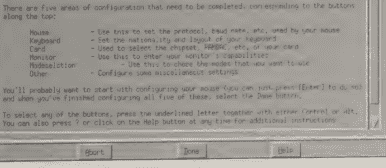

图 10.2 XF86Setup 实用程序。

### 鼠标

如图 10.3 所示，你可以以多种方式自定义鼠标。但关键目标是获得一个可用的鼠标。图 10.3 中未在以下列表中描述的所有其他项目都较不重要。要获得一个可用的鼠标，请从以下选项中选择：

- `Protocol`—你选择的协议会选择一个驱动程序，该驱动程序决定你的计算机如何与鼠标通信。
- `Device`—鼠标设备基于鼠标如何连接到你的计算机。虽然 PS/2 鼠标设置为 `/dev/psaux` 设备，但串行鼠标通常连接到 COM 端口。如果看不到 COM 端口的选项，你应该能看到类似 `/dev/ttyS0` 或 `/dev/cua0` 的内容，对应 COM1（`/dev/ttyS1` 或 `/dev/cua1` 对应 COM2，等等）。
- `3 Buttons`—如果你只有两个按钮的鼠标，你会想要模拟三个按钮。中间按钮用于许多 Linux GUI 弹出菜单，包括复制和粘贴操作。

*注意：你无法使用 `XF86Setup` 配置特殊设备，例如操纵杆和图形平板。如果你在 Linux GUI 中想使用其中一种设备，你需要直接将它的设置添加到 `/etc/X11/XF86Config` 文件中。*

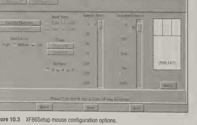

图 10.3 XF86Setup 鼠标配置选项。

### 键盘

如果你使用的是美国标准以外的键盘，你可以使用本节中的选项选择更符合你的硬件的键盘型号和语言。这些选项还允许你管理某些键的功能。

### 卡

X Server 位于客户端计算机上。它直接与你的视频控制器通信。如图 10.4 所示，有多种卡可供选择。

即使你的卡在此列表中，`XF86Setup` 也可能无法识别你的卡的所有功能。如果你点击 Detailed Setup，你将在菜单中看到选项，允许你设置与视频控制器卡关联的 RAM、芯片组、时钟设置和视频服务器。你甚至可以使用本节设置通用卡。

### 显示器

你可以通过 `XF86Setup` 实用程序的 Monitor 部分从 10 种不同类型的显示器中进行选择。你选择的每个显示器都有不同的水平和垂直频率可用范围。查看显示器的文档。如果你选择超过显示器能力的频率，你可能会使其无法修复地损坏。

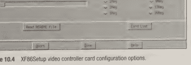

图 10.4 XF86Setup 视频控制器卡配置选项。

### 模式选择

你可以选择两种类型的模式：像素尺寸和颜色深度。`XF86Setup` 实用程序允许你选择从 320×200 到 1600×1200 的像素尺寸。它允许你选择以位为单位的颜色深度：8、16、24 或 32。

> 如果你选择了不止一种图形模式，可以使用 `Ctrl+Alt+Num+` 和 `Ctrl+Alt+Num-` 命令在这些模式之间切换。Num+ 和 Num- 是数字键盘上的加号和减号键。使用此方法假定已启用下一节所述的允许视频模式切换选项。

### 其他


本节的两个关键选项是 Allow Server To Be Killed With Hotkey Sequence Ctrl+Alt+Backspace 和 Allow Video Mode Switching。第一个选项允许你通过按下所注明的键退出 X Server。该选项会将你返回到命令行界面或 X 登录窗口，具体取决于 `/etc/inittab` 配置文件中设置为 `initdefault` 的级别。

## Xconfigurator

Red Hat Linux 有自己的一套图形配置实用程序，包括 `Xconfigurator`、`mouseconfig` 和 `kbdconfig`。尽管它们在通用公共许可证（GPL）下发布，但通常仅在 Red Hat 及衍生发行版上可用。

你可以使用 `Xconfigurator` 与使用 `XF86Setup` 一样好地配置 X Window 或 X11。如果你的鼠标无法工作，你可以使用 Tab、箭头、Page Up、Page Down 和空格键在 `Xconfigurator` 的菜单中导航。视频控制器和显示器的数据库 somewhat limited：你可以用其他实用程序使用的相同标准设置自定义显示器。

> 不要超过显示器的水平或垂直刷新能力。提示时，不要探测你的视频控制器。从可用菜单中选择视频卡上可用的内存量。另请不要选择时钟芯片；X Server 在启动 X Window 时可以设置此项。

## SaX

S.u.S.E. 有自己的图形配置实用程序，称为 `SaX`。你可以从命令行界面或 S.u.S.E. 的其中一个菜单启动它。`SaX` 分为五个部分：鼠标、键盘、卡、显示器和桌面。`SaX` 与 `XF86Setup` 实用程序几乎一样完整。

## 窗口管理器

窗口管理器决定你在 GUI 桌面上看到的内容。听起来可能很奇怪，但窗口管理器也是一种应用程序。Linux 窗口管理器不直接与内核交互；你可以关闭任何窗口管理器而无需关闭 Linux。

以下各节提供了七种不同窗口管理器的简要概述。你可以在 Linux 计算机上配置和安装数十种窗口管理器。如果你熟悉 Linux，你可能至少听说过其中两种窗口管理器：`GNOME` 和 `KDE`。

Linux 窗口管理器可以分为三类。第一类窗口管理器，如 `fvwm`，包含最少的装饰，保持简单。它们对资源需求很低。第二组强调可定制性；这些窗口管理器包括 `Enlightenment`、`AfterStep`、`WindowMaker` 和 `Blackbox`。第三组的窗口管理器，包括 `GNOME` 和 `KDE`，包含自己的登录屏幕、应用程序、图标、菜单栏等，形成完整的桌面套件。

### GNOME

`GNOME` 是一个完整的桌面套件，其中包括诸如软件包管理器、弹出菜单和其他实用程序等工具。`GNOME` 应用程序包括办公套件、财务程序等。它基于 `GTK+` 控件库，该库在 GPL 下发布。截至本文撰写时，`GNOME` 是 Red Hat Linux 的默认窗口管理器。


> `GNOME` 还包括一个显示管理器，用于代替 `xdm` 来管理登录。你可以设置 `GNOME` 显示管理器登录到 `GNOME` 以外的窗口管理器。

### KDE

与 `GNOME` 类似，`KDE` 是一个完整的套件，其中包括诸如控制面板、软件包管理器、带图标的任务栏和弹出菜单等工具。`KDE` 应用程序包括办公套件、软件包管理器和邮件阅读器。`KDE` 基于 `Qt` 控件库，该库最近重新授权在 GPL 下。它或许是外观和感觉上最接近 Microsoft Windows 的窗口管理器。截至本文撰写时，`KDE` 是 Corel、S.u.S.E. 和 Caldera Linux 的默认窗口管理器。


`KDE` 还包括一个显示管理器，用于代替 `xdm` 来管理登录。你可以设置 `KDE` 显示管理器登录到 `KDE` 以外的窗口管理器。

### fvwm

`fvwm` 窗口管理器在 `KDE` 和 `GNOME` 开发之前是标准。因为它只需要相对较少的内存，所以在内存更昂贵时很受欢迎。其大多数选项包含在弹出菜单中。`fvwm` 的第 2 版更新了此 GUI 的外观和感觉。后来一个名为 `fvwm95` 的版本被设计成看起来像 Microsoft Windows 95。

### Enlightenment

截至本文撰写时，`Enlightenment` 窗口管理器仍在开发中。其他窗口管理器相互借用代码，而 `Enlightenment` 则是独一无二的。它被设计为最可配置的窗口管理器，这使其更适合不满意其他窗口管理器的用户。它通常安装在高端工作站上，供用户使用，其需求的性能不是用于窗口管理器，而是用于图形应用程序。

### AfterStep

尽管 `AfterStep` 窗口管理器基于 `fvwm` 代码，但它被设计成看起来像 NeXTStep 操作系统的 GUI。NeXTStep 最初为 NeXT 工作站设计，被设计为更直观的 GUI。NeXT 由苹果工程师开发，他们希望扩展 Macintosh 操作系统的用户友好性。

`AfterStep` 包含一个“码头”图标，允许你以类似 Microsoft Windows 开始菜单的图像版本的方式启动程序。

### WindowMaker

`WindowMaker` 窗口管理器的感觉与 `AfterStep` 相似。作为 GNU 项目的正式组成部分，其开发人员目前正在将其 GUI 中整合 `GNOME` 功能。

### Blackbox

`Blackbox` 窗口管理器被设计为在最少的 RAM 中运行。图像在绘制到屏幕上后会被缓存。与许多其他窗口管理器不同，`Blackbox` 包含对 `KDE` 的支持，但不支持 `GNOME` 应用程序。

## 窗口管理器共性

Linux 窗口管理器种类繁多。如前几节所述，每个窗口管理器都有一些特殊功能。尽管本章并未回顾所有可用的 Linux 窗口管理器，但所有窗口管理器都共享一些共性。它们具有虚拟显示。你可以在不同窗口之间复制和粘贴文本。此外，在单个 X Windows 中，你可以上下滚动文件、调整窗口大小或更改字体大小。

若干窗口管理器使整合 `GNOME` 和 `KDE` 套件中的功能和应用程序成为可能。

### 虚拟显示

在大多数 GUI 中，你在显示器上看到的就是你能获得的所有显示空间。要在其他 GUI 中获得更多空间，你需要另一台显示器。在 Linux X Window 中，大多数窗口管理器实际上包含多个虚拟显示。你可以通过点击分页器在显示之间切换，分页器会将你从一个虚拟显示移动到另一个。

虚拟显示分页器的示例在右侧的图 10.5 中显示。数字 1、2、3 和 4 表示此窗口管理器中可用的虚拟显示。

### 隐藏窗口

如果你找不到已打开的窗口或认为系统“锁定”了，在关闭 X Window 之前你可以尝试几件事。你的窗口可能只是隐藏的；按下 `Alt+Tab` 键可在可用窗口之间切换。你的窗口可能在另一个虚拟显示中；尝试点击虚拟显示分页器的其他页面。

### 复制和粘贴

截至本文撰写时，Linux 窗口管理器不包含允许在应用程序之间复制和粘贴的常规剪贴板。但你可以复制文本


图 10.5 窗口管理器任务栏通常包含分页器。

在 X Window 的两个应用程序之间。这假设你有一个三键鼠标或已使用像 `XF86Setup` 这样的工具设置了三键仿真。按照以下步骤在两个应用程序之间复制文本：

- 1. 突出显示你要复制的文本。
- 2. 将光标移动到目标窗口。
- 3. 单击鼠标中键。如果只有两个鼠标按钮，并且已设置三键仿真，请同时单击两个按钮。

## 练习题

### 问题 1

以下哪种方法可以用来启动 X Window？[勾选所有正确答案]

- a. 将 `/etc/inittab` 中的 `initdefault` 变量设置为带有 `xdm` 的级别。
- b. 启动命令行界面并输入 `xdm` 命令。
- c. 启动命令行界面并输入 `XF86Setup` 命令。
- d. 启动命令行界面并输入 `startx` 命令。

答案 `a`、`b`、`c` 和 `d` 都是正确的。`initdefault` 变量决定了 Linux 在运行其他启动例程后启动的运行级别。虽然 `xdm` 命令不会启动窗口管理器，但它确实会启动一个 X Window 登录屏幕。虽然 `XF86Setup` 命令不会启动“正常”的 GUI，但它确实会启动一个 X Window（`XF86_VGA16`）。`startx` 命令会启动 X Window，前提是你已为系统配置好它。

### 问题 2

当 Johnny 使用 `startx` 命令启动 X Window 时，X Server 需要初始化文件。假设初始化文件在以下所有目录中都可用。`startx` 使用哪个目录的初始化文件来设置 Johnny 的 X Window？

- a. `/etc/X11/xinit/`
- b. `~`
- c. `/home/johnny/.init`
- d. `/etc/`


答案 b 正确。任何用户主目录中的初始化文件，以波浪号（`~`）表示，具有优先权。系统范围的初始化文件位于`/etc/X11/xinit`目录。因为这些文件会在 Johnny 的主目录中找到初始化文件，所以答案 a 不正确。截至本文撰写时，没有任何 Linux 发行版在`/home/johnny/.init`目录中保存初始化文件；因此答案 c 不正确。虽然`/etc/`目录中有很多初始化文件，但其中没有一个与启动 X Window 相关；因此答案 d 不正确。

## 问题 3

你正在 Red Hat Linux 系统中配置 X Window。以下哪个实用程序可以使用？[勾选所有正确答案]

- a. `Xconfigurator`
- b. `xf86setup`
- c. `XF86Config`
- d. `XF86Setup`

答案 a 和 d 正确。`Xconfigurator`与 Red Hat Linux 发行版一起使用。XFree86 项目的`XF86Setup`实用程序通常包含在所有 Linux 发行版中。因为`xf86setup`命令的大小写不正确（应为`XF86Setup`），该命令将无法工作。因此答案 b 不正确。虽然存在一个配置 X Window 的`xf86config`实用程序，但你不能用`XF86Config`命令启动它。因此答案 c 不正确。

## 问题 4

窗口管理器是应用程序。假设你有一个程序失控运行。你无法移动鼠标，但可以在 xterm 窗口中输入命令行命令。你以超级用户模式运行。以下哪个命令可以在不停止或重新启动 Linux 的情况下停止你的窗口管理器？

- a. `Ctrl+Alt+Del`
- b. `reboot`
- c. `Ctrl+Alt+Backspace`
- d. `Ctrl+Alt+Num+`

答案 c 正确。同时按下`Ctrl+Alt+Backspace`键会强制 Linux 退出你的窗口管理器。因为`Ctrl+Alt+Del`和`reboot`命令会停止并重新启动 Linux，所以答案 a 和 b 不正确。虽然`Ctrl+Alt+Num+`命令确实会切换视频模式，但它不会退出你的窗口管理器。因此答案 d 不正确。

## 问题 5

以下哪个配置实用程序可以帮助你设置键盘和鼠标以及视频硬件？

- a. `SuperProbe`
- b. `XF86Config`
- c. `XF86Setup`
- d. `Xconfigurator`

答案 c 正确。`XF86Setup`实用程序包含帮助你配置鼠标或指向设备和键盘的部分。它还帮助你配置显示器和视频控制器。因为`SuperProbe`实用程序只是探测当前的视频硬件，所以答案 a 不正确。`XF86Config`不是有效的配置实用程序（应为`xf86config`）；因此答案 b 不正确。因为`Xconfigurator`只允许你配置显示器和视频控制器，所以答案 d 不正确。

## 问题 6

为什么你可以关闭诸如 KDE 或 GNOME 之类的窗口管理器而无需重新启动 Linux？

- a. 窗口管理器只是另一个应用程序。
- b. 窗口管理器被设置为通过`Ctrl+Alt+Backspace`命令响应而关闭。
- c. 当你关闭完整的窗口管理器如 KDE 或 GNOME 时，你别无选择。你必须停止或重新启动 Linux。
- d. 窗口管理器在其菜单中包含特殊命令，允许你注销。

答案 a 正确。因为窗口管理器是应用程序，它们不会直接影响内核。当它们锁定后，你可以关闭它们而无需重新启动 Linux。虽然你可以使用`Ctrl+Alt+Backspace`键关闭窗口管理器，但该选项并不能解释为什么你不需要重新启动 Linux。因此答案 b 不正确。因为你可以用`Ctrl+Alt+Backspace`键在不重新启动的情况下关闭 KDE 或 GNOME，所以答案 c 不正确。虽然窗口管理器确实包含允许你注销的特殊命令，但在 KDE 和 GNOME 中，你最终仍会进入它们的登录屏幕。而且该选项并不能解释为什么你不需要重新启动 Linux。因此答案 d 不正确。

## 问题 7

你已将 Linux 设置为自动启动 X Window。当 Linux 启动 GUI 时，以下哪种事件序列是正确的？

- a. Linux 启动 X Server，然后继续 GNOME 显示管理器。当你登录时，Linux 启动 Blackbox 窗口管理器。
- b. Linux 启动 xdm 显示管理器。当你登录时，Linux 启动 X Server，然后继续 KDE 窗口管理器。
- c. Linux 启动 X Server，然后继续 xdm 窗口管理器。当你登录时，Linux 启动 Enlightenment 显示管理器。
- d. Linux 启动 GNOME 显示管理器。当你登录时，Linux 启动 X Server，然后继续 GNOME 窗口管理器。

答案 a 正确。Linux 必须在你在屏幕上看到任何图形内容之前启动 X Server。然后你会看到用于登录的显示管理器。当你登录时，你会继续进入窗口管理器。GNOME 显示管理器可以启动其他窗口管理器。因为你需要在看到显示管理器之前有一个 X Server，所以答案 b 和 d 不正确。因为 xdm 是显示管理器，而不是窗口管理器，所以答案 c 不正确。

## 问题 8

以下哪个功能允许你在窗口管理器中在显示之间移动？

- a. 虚拟控制台
- b. `Ctrl+Alt+F2`
- c. `Pager`
- d. 未使用的视频内存

答案 c 正确。分页器允许你在窗口管理器的虚拟显示之间移动。虚拟控制台允许你在不同的基于文本的登录屏幕之间移动；因此答案 a 不正确。因为`Ctrl+Alt+F2`命令允许你移动到第二个虚拟控制台，这与虚拟显示无关。因此答案 b 不正确。虽然未使用的视频内存允许窗口管理器创建虚拟显示，但该功能本身并不能让你在虚拟显示之间移动。因此答案 d 不正确。

## 问题 9

你在一个窗口管理器中打开了一个文本编辑器，并且想要将一些命令和输出复制到一个终端窗口。你需要采取哪些步骤？注意：你已将双键鼠标设置为仿真三键。

- a. 在编辑器中突出显示所需文本。右键单击它并选择复制。将光标移动到第二个窗口。按下鼠标右键并选择出现的粘贴选项。
- b. 在编辑器中突出显示所需文本。左键单击它并选择复制。将光标移动到第二个窗口。同时按下两个鼠标按钮并选择出现的粘贴选项。
- c. 在编辑器中突出显示所需文本。将光标移动到第二个窗口。按下鼠标右键并选择出现的粘贴选项。
- d. 在编辑器中突出显示所需文本。将光标移动到第二个窗口。同时按下两个鼠标按钮。

答案 d 正确。中间按钮会自动将你在另一个窗口中突出显示的内容粘贴。虽然在某些应用程序中右键单击会打开包含复制选项的弹出菜单，但该选项并非在所有应用程序中都可用。因此答案 a 不正确。一旦你突出显示了一些文字，左键单击通常会取消选择那些文字。因此答案 b 不正确。虽然在目标应用程序中右键单击有时会弹出包含粘贴选项的菜单，但这并不总是如此。因此答案 c 不正确。

## 问题 10

你拥有一块功能非常强大的视频控制器和显示器。你已使用`XF86Setup`实用程序配置了多个图形模式。切换图形模式时应按哪些键？

- a. `Ctrl+Alt+Backspace`
- b. `Ctrl+Alt++`
- c. `Ctrl+Alt+Num+`
- d. `Ctrl+Alt+F3`

答案 c 正确。`Ctrl+Alt+Num+`和`Ctrl+Alt+Num-`键组合允许你在所选图形模式之间切换。`Ctrl+Alt+Backspace`键组合会退出 X Window；因此，答案 a 不正确。`Ctrl+Alt++`中的加号键不在数字键盘上；因此，答案 b 不正确。因为`Ctrl+Alt+F3`会切换到虚拟文本控制台，所以答案 d 不正确。

## 需要了解更多？

Blackbox 窗口管理器开发者的官方网站 `http://blackbox.xlug.org` 包含对 KDE 应用的支持。你可能会注意到这是一个亚马里洛 Linux 用户组的子域名。

AfterStep 窗口管理器的官方主页 `www.afterstep.org` 采用了苹果 NeXTStep GUI 的外观和感觉。

Enlightenment 的官方网站是 `www.enlightenment.org`。Enlightenment 被设计为最可配置的窗口管理器。

调查 fvwm 桌面的主页 `www.fvwm.org`。fvwm 桌面被设计为仅作为其他应用程序的窗口管理器。

GNOME 项目的主页位于 `www.gnome.org`。GNOME 项目由一群开发者组成，他们与 KDE 一样，正在开发一个窗口管理器和一套完整的应用程序。

`www.kde.org` 网站是 KDE 的官方主页，其中包括窗口管理器和其他应用程序，例如功能齐全的办公套件。

查看 XFree86 项目的网站 `www.xfree86.org`。XFree86 是一个非营利组织，致力于为 Linux、Unix 及相关操作系统创建视频驱动程序。利用该网站上的数据库为你的视频控制器匹配合适的 X Server。

## 系统管理

### 你需要理解的术语：

- ✓ `/etc/passwd`
- ✓ 用户名、密码、组


- ✓ 主目录

- ✓ 登录 shell

- ✓ `adduser`, `useradd`, `userdel`, `newusers`

- ✓ `Linuxconf`, `COAS`, `YaST`

- ✓ `who`, `w`

- ✓ `ps`, `kill`, `nice`, `renice`

- ✓ `lsmod`, `insmod`, `rmmod`

- ✓ `chown`, `chgrp`

### 你需要掌握的技术：

- ✓ 解释 `/etc/passwd` 文件中的数据

- ✓ 设置用户账户

- ✓ 描述创建新用户的命令行命令

- ✓ 理解创建新用户的 GUI 实用程序

- ✓ 使用命令识别已登录用户及其进程

- ✓ 通过内核模块识别、安装和删除设备驱动程序

- ✓ 解释更改文件或目录所有权和组的命令

系统管理员安装、配置和维护操作系统，设置用户，管理软件并保护网络。换句话说，系统管理员需要了解所有四个 Sair Linux/GNU 认证管理员考试中涵盖的每个主题。
其核心是，系统管理员的工作是设置用户、维护软件、安装硬件、监控运行程序、维护网络并创建备份。本章涵盖基本用户设置实用程序、硬件安装命令、程序管理实用程序和备份例程。虽然这些主题在系统管理考试中会更详细地介绍，但它们也是你在配置 Linux 计算机时需要了解的主题。当你安装和配置 Linux 时，你需要能够执行一些基本系统管理任务，包括本章所述的任务。

## 用户账户

每个登录 Linux 系统的用户都需要一个用户账户。每个用户账户都有一些可能因目录而异的权利和特权。用户具有用户名、密码和主目录。用户是通过 `/etc/passwd` 文件配置的。你可以通过在文本编辑器中编辑该文件来创建新用户。你也可以使用三种不同的命令行命令创建新用户。并且多个发行版允许你通过其图形配置实用程序创建新用户。
以下各节中显示的示例基于设置用户名为 `tr` 的新用户。当你为自己设置用户时，请适当替换。

## 密码文件

每个用户在你的 `/etc/passwd` 文件中都有一个条目。当你打开它时，你会看到如下行：

```
mj:b7RHH:503:100:Michael Jang:/home/mj:/bin/bash
```


> 所有创建新用户的 Linux 实用程序都执行三个基本功能：首先，它们为用户在 `/etc/passwd` 文件中添加新行。其次，它们创建主目录，并将所有权分配给该用户。第三，它们将 shell 启动配置文件，通常从 `/etc/skel` 目录复制到用户的新主目录。

**表 11.1 `/etc/passwd` 文件的设置。***

| 列 | 示例 | 功能 |
|---|---|---|
| 1 | `mj` | 用户名 |
| 2 | `b7RHH` | 密码（见表注） |
| 3 | `503` | 用户 ID（每个用户名都关联一个唯一的用户 ID） |
| 4 | `100` | 组号（100 通常对应名为 users 的组） |
| 5 | `Michael Jang` | 用户信息 |
| 6 | `/home/mj` | 用户的主目录 |
| 7 | `/bin/bash` | 用户的登录 shell |

*如果在 `/etc/passwd` 文件的第二列看到 `x` 或星号 (`*`)，则用户密码已加密。
以下各节讨论的命令通常需要 root 或超级用户权限才能运行。要进入超级用户模式，输入 `su` 命令。提示时输入 root 密码。

## 直接用户设置

你可以直接创建用户账户。打开 `/etc/passwd` 文件，使用 `emacs` 或 `vi` 等文本编辑器。按照以下步骤设置用户账户：
- 1. 开始新的一行。复制另一个用户的 `/etc/passwd` 条目中的适用信息（如前面所示的代码行）。
- 2. 更改用户名、用户 ID 和主目录。例如，如果你为 Theodore Roosevelt 设置新账户，你可能会在第一列（用户名）中插入“`tr`”，在第三列（用户 ID）中插入数字“`504`”，在第五列（用户信息）中插入“Theodore Roosevelt”，在第六列（用户的主目录）中插入“`/home/tr`”。确保你输入的信息相对于 `/etc/passwd` 文件中的其他条目是唯一的。除非你想将 `tr` 分配到不同的组，否则你不必更改组号。
- 3. 保存 `/etc/passwd` 文件。（你只能在以 root 或超级用户身份登录时保存文件。）
- 4. 设置新用户的主目录。`mkdir -p /home/tr` 命令在第 8 章中讨论过，对于超级用户从任何命令行界面都应该有效。
- 5. 确保新用户可以访问他的主目录。使用 `chown tr /home/tr` 和 `chgrp 100 /home/tr` 命令赋予他所有权。如果用户名或组号不同，请适当替换。
- 6. 使用 `passwd tr` 命令分配新密码。完成后，用户 `tr` 可以使用同一命令自行分配新密码。
- 7. 复制基本初始化文件，这些文件通常存储在 `/etc/skel` 目录中。这些是第 6 章中介绍的文件，例如 `.bashrc` 和 `.bash_profile`。使用 `su - tr` 命令更改为新用户身份。使用 `cp /etc/skel/.* /home/tr` 命令复制这些文件。
- 8. 注销，并告诉新用户他的新用户名和密码。

> 注：如果你在 `/etc/shadow` 文件中有加密密码，步骤会略有不同。此过程的细节未涵盖在此 Sair 安装和配置考试中。

## `adduser`

当你处理大量用户时，你需要一种方法来快速添加用户。自动化用户创建过程的一种方法是使用 `adduser` 命令。要使用 `adduser` 命令设置 `tr` 的账户，输入以下内容：

```
adduser tr
```

根据你的发行版，此命令可能会提示你输入其他设置，例如组和密码。或者，它可能从控制文件 `/etc/adduser.conf` 中获取设置。在某些发行版中，`adduser` 命令的工作方式与 `useradd` 命令相同。

## `useradd`

你也可以使用 `useradd` 命令创建新用户。要使用 `useradd` 命令设置 `tr` 的账户，输入以下内容：

```
useradd tr
```

## `userdel`

`userdel` 命令也很简单。如果有一位名叫 Theodore Roosevelt 的用户刚刚离开你的公司，你需要停用他的账户。在从他的主目录检索需要的文件后，运行以下命令：

```
userdel -r tr
```

此命令会从 `/etc/passwd` 文件中删除 `tr` 的信息。`-r` 开关会删除 `/home/tr` 目录，包括其中可能包含的任何文件和目录。

## `newusers`

`newusers` 命令旨在从用户名和密码的批处理文件中处理大量用户，如 `newusers` 手册页所述。如果你在名为 `new-batch` 的文件中创建用户和密码列表，然后可以使用以下命令设置这些用户：

```
newusers new-batch
```

如果保存此批处理文件，请确保其安全。你可能希望隐藏它、加密它或删除它。用户名和密码列表对于任何想要破解你的系统的人来说都是一个非常诱人的工具。

## `Linuxconf`

Red Hat Linux 的图形用户界面（GUI）配置实用程序被称为 `Linuxconf`。由于它在通用公共许可证（GPL）下许可，其他 Linux 公司可以自由地将其纳入其发行版中。它是一个“全能”实用程序，允许你从网络到用户账户配置一切。要从 X Window 启动 `Linuxconf`，请打开一个命令行 shell，进入 root 或超级用户模式，然后输入 `linuxconf` 命令。你可以在 `Linuxconf` 中设置新用户账户，如图 11.1 所示。
图 11.1 所示的输入将用户 `tr` 设置为所注明的组、主目录、shell（命令解释器）和用户 ID。如同以往一样，请确保使用唯一的用户名、用户 ID 号码和主目录。

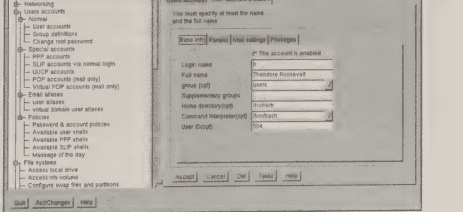

图 11.1 使用 `Linuxconf` 设置新用户账户。
注：图 11.1 显示了 X Window 中的 `Linuxconf` 界面。从命令行虚拟终端获得的 `Linuxconf` 屏幕则有所不同。

## `COAS`

Caldera 有多个 GUI 用户创建实用程序，包括 `LISA`、`COAS` 和 `Webmin`。这些实用程序中的每一个都允许系统管理员从网络到用户账户配置一切。你可以在 `COAS` 中设置新用户账户，如图 11.2 所示。
图 11.2 所示的输入将用户 `tr` 设置为所注明的用户 ID、组、shell（命令解释器）和主目录。如同以往一样，请确保使用唯一的用户名、用户 ID 号码和主目录。

## `YaST`

S.u.S.E. Linux 有自己的专有全能配置包，称为 `YaST`（Yet another Setup Tool）。与 `Linuxconf` 类似，你可以在命令行界面或 GUI 中打开它。打开后，导航到系统管理菜单，然后导航到用户管理以显示图 11.3 所示的菜单。


图 11.3 所示的输入将用户 `tr` 设置为所注明的用户 ID、组、主目录和 shell（命令解释器）。如同以往一样，请确保使用唯一的用户名、用户 ID 号码和主目录。

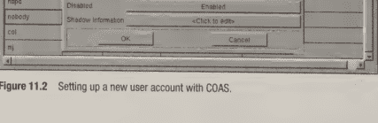

图 11.2 使用 COAS 设置新用户账户。

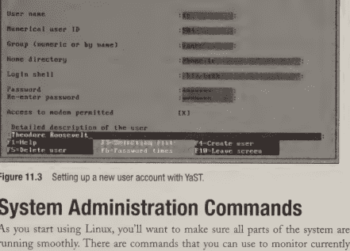

图 11.3 使用 YaST 设置新用户账户。

## 系统管理命令

当你开始使用 Linux 时，你会希望确保系统的所有部分都运行顺畅。有一些命令可以用来监控当前登录的用户以及他们正在运行的进程。

如果你的任何用户在使用任何应用程序时遇到问题，你可以使用 `kill` 命令终止该应用程序。如果有重要程序或流程即将运行，`nice` 和 `renice` 等命令可以帮助你提高或降低所选程序的优先级。

### who 和 w

虽然 `who` 和 `w` 命令都会告诉你哪些账户当前登录到 Linux 系统，但 `w` 命令实际上会提供更多细节。作为管理员，你应定期检查登录；例如，以下来自 `who` 的输出显示同一人从两个不同位置登录：

```
mj tty1 Sep 22 10:24
tr tty1 Sep 21 21:28 (linux2.mommabears.com)
mj tty0 Sep 21 21:18 (cracker.notnice.cba)
```

因为用户 `mj` 从本地计算机和远程的 `cracker` 计算机登录，你应该担心有人使用 `mj` 的用户名和密码入侵你的系统。


登录到你的 Linux 计算机的网络登录会进入 `tty0` 或 `tty1` 等终端。本地计算机的登录不包括 `p`。

`w` 命令还会告诉你计算机资源的需求情况。例如，以下来自 `w` 的输出显示一个已运行近一天的系统，有三个用户：

```
10:27am up 23:38, 3 users, load average: 0.15, 0.03, 0.01
USER TTY FROM LOGIN@ IDLE JCPU PCPU WHAT
mj tty1 10:24am 3:02 0.10s 0.10s -bash
tr tty1 linux2.mo. Thu 9pm 12:59m 0.11s 0.11s -bash
mj tty0 cracker.cb Thu 9pm 12:59m 0.12s 0.12s find passwd
```

更重要的是，它显示了用户 `mj` 从远程位置当前正在运行的进程。因为该用户正在运行 `find` 命令查找密码文件，你有更多理由担心。

### ps

`ps` 命令显示当前正在运行的进程或程序。当你单独输入 `ps` 命令时，你会看到与你的设置相关的进程。如果你输入 `ps aux` 命令，你可以看到 Linux 系统上运行的所有内容，包括守护进程。另一个有用的变体是 `ps -l`，它返回与每个当前正在运行的进程相关的“长列表”。该命令的重要类别包括：

- **PID**—进程标识符。每个进程都与一个称为进程标识符的数字相关联。
- **PPID**—父进程标识符。每个进程都有一个父进程，除了 `init`。如果你无法终止一个进程，你可能可以终止其父进程。
- **PRI**—优先级值。优先级更高的程序会更快地得到 CPU 的注意。最高优先级程序的 `PRI` 为 `-20`。最低优先级程序的 `PRI` 为 `19`。
- **STAT**—进程的当前状态。有三个选项：运行中（R）、睡眠（S）或交换到交换分区（SW）。

如以下各节所述，如果你有一个失控运行的程序，你需要 `PID` 号码来终止有问题的程序。或者，如果你需要运行一个因等待 CPU 资源而卡住的程序，你可以使用其 `PID` 来提高其优先级。

你也可以使用 `top` 命令查看使系统超载的进程。`top` 命令列出最重载 CPU 和 RAM 内存的进程。但它只列出屏幕上能显示的进程数量。

### kill

众所周知，Linux 不会崩溃。有报道称由 Linux 驱动的用户和网站数月无需重启即可运行。其原因之一是系统管理员可以使用 `kill` 命令管理麻烦的程序。

例如，如果你在浏览互联网时像 Netscape 这样的程序卡住，请按照以下步骤终止该程序：

- 1. 打开一个命令行 shell。如果你无法在 X Window 内打开命令行 shell，请使用 `Ctrl+Alt+Fx` 命令启动一个新的虚拟控制台，其中 `x` 为 1 到 6 之间的数字。
- 2. 运行 `ps aux | grep netscape` 命令。你用户名后面的数字是当前在你的计算机上运行 Netscape 的进程的 `PID`。记录该数字。为本次练习的目的，假设该数字为 `1711`。
- 3. 运行 `kill 1711` 命令。如果你的 `PID` 不同，请相应替换。如果 `kill` 命令不起作用，请运行 `ps aux | grep netscape` 命令查找 `PPID`。你可能需要先终止父进程。

### nice 和 renice

`nice` 和 `renice` 命令让你以不同的相对优先级运行程序。任何程序的优先级范围从 `-20`（最高）到 `19`（最低）。`nice` 程序以调整后的优先级启动另一个进程。例如，你可以使用 `nice -n 20 netscape` 命令将 Netscape 设置为在所有其他程序完成后才启动。如果你需要让 Linux 专注于某个特定程序，你需要其 `PID`。一旦找到程序的 `PID`（本次练习假设为 `1711`），你可以使用 `renice -10 1711` 命令提高其优先级。

*注：要理解优先级，请记住在 Linux 中一切似乎都是反过来的。如果你想使程序更重要，请使用负数。*

## 内核模块管理

Linux 内核在你的应用程序和计算机硬件之间转换命令。每件硬件，例如硬盘、调制解调器、CPU 或视频控制器，都有一个设备驱动程序。在某些情况下，驱动程序是集成在内核内部。在其他情况下，模块会在运行时或在你启动计算机上的 Linux 时添加到内核中。无论哪种情况，内核都直接与你的硬件通信。

用于管理 Linux 内核模块有三个基本命令：`lsmod`、`insmod` 和 `rmmod`。

## lsmod

要查看当前系统上正在运行的已加载模块，请运行 `/sbin/lsmod` 命令。请查看此命令的以下示例输出：

| Module | Size | Used by |
|---|---|---|
| sound | 56616 | 0 (autoclean) (unused) |
| soundcore | 2412 | 3 (autoclean) [sound] |
| soundlow | 252 | 0 (autoclean) [sound] |
| 3c589_cs | 8312 | 1 |
| ds | 6820 | 2 [3c589_cs serial_cs] |
| serial_cs | 30260 | 2 |
| pcmcia_core | 45988 | 0 [3c589_cs serial_cs ds] |
| nls_iso8859-1 | 2024 | 1 (autoclean) |
| nls_cp437 | 3548 | 1 (autoclean) |

每个已加载的模块都与一个设备驱动程序相关联。使用的内存量以字节为单位列出。Used By 列显示当前使用该驱动程序的程序数量。启动 Linux 时加载的模块取自 `/etc/conf.modules` 文件。

## insmod

当你安装新硬件时，Linux 可能无法检测到它。当你安装新内核时，可能需要安装新的驱动程序。Linux 驱动程序与特定内核相关联。如果版本号为 `x.y.z`，你可以在 `/lib/modules/x.y.z` 目录中找到驱动程序。一些硬件自带其 Linux 模块，可以从互联网下载或从软盘加载。例如，如果你刚刚在计算机上安装了 Linksys Etherfast PCMCIA 卡，请运行以下命令来加载驱动程序：

```
insmod /lib/modules/2.4.8/pcmcia/wavelan_cs.o
```

Linux 驱动程序通常存储在扩展名为 `.o` 的文件中。如果你的驱动程序位于不同的目录，请相应地替换。

一旦你确认驱动程序正常工作，就将其添加到 `/etc/conf.modules` 文件中。然后你就不必每次启动 Linux 时都使用 `insmod` 命令安装此驱动程序。

## rmmod

你可以并且应该移除不需要的模块，因为它们占用了本可供你的程序使用的内存。例如，如果你不再使用 `wavelan_cs.o` 模块，以下命令会移除驱动模块：

```
rmmod wavelan_cs
```

请注意，`wavelan_cs` 是模块名称，如 `lsmod` 命令输出中所见。

## Permissions and Ownership


你可以对 Linux 文件进行控制和操作的能力取决于该文件关联的权限、所有者和组。你可以使用第 7 章和第 8 章中的 `mkdir` 和 `chmod` 等命令设置权限。但如果文件和目录关联了错误的所有者或组，权限对你也没什么用。你可以使用 `chown`（change ownership）和 `chgrp`（change group）命令更改与文件或目录关联的所有者和组。

在阅读以下各节时，请在以下 `ls -l` 命令输出的上下文中查看这些命令：

```
drwxr-x--- 1 tr users 7326 Jan 12 09:09 /home/tr
```

### chown

之前，你已使用 `chown tr /home/tr` 命令将目录的所有权分配给新用户。根据前面的示例，只有文件的所有者才对该文件具有读、写和执行（`rwx`）权限，在本例中该文件是一个目录。

### chgrp

之前，你已使用 `chgrp 100 /home/tr` 命令将目录分配给一个组。此命令将 `/home/tr` 目录分配给名为 `users` 的组。`users` 组中的每个用户对 `/home/tr` 目录都有读和执行（`rx`）权限。

## Practice Questions

### Question 1

根据 `who` 命令的输出，如何判断有人是否通过网络连接登录到 Linux？

- a. 你在用户条目的末尾看到类似 `linux4.mommabears.com` 的内容。
- b. 你看到与用户关联的类似 `tty9` 的终端。
- c. 你看到与用户关联的类似 `pts3` 的终端。
- d. 你在输出中看到用户名被列出第二次。

答案 c 正确。终端名称中带 p 的与通过网络登录 Linux 相关联。因为答案 a 没有指定终端名称，你无法判断 `linux4.mommabears.com` 是否是本地计算机。因此，答案 a 不正确。虽然 `tty9` 是你可能在 Linux 计算机上看到的较高终端号，但它仍然是本地登录。因此，答案 b 不正确。因为你可以使用虚拟终端多次本地登录，用户名第二次出现并不意味着该用户还远程登录了。因此，答案 d 不正确。

### Question 2

以下哪个命令可以告诉你当前与 Linux 内核一起加载的驱动程序？

- a. `insmod`
- b. `lsmod`
- c. `rmmod`
- d. `cat /etc/conf.modules`

答案 b 正确。`lsmod` 命令列出当前已加载的驱动程序。`insmod` 命令安装但不列出驱动程序；因此，答案 a 不正确。因为 `rmmod` 命令移除但不列出驱动程序，答案 c 不正确。虽然 `/etc/conf.modules` 文件列出了启动时运行时加载到 Linux 的驱动程序，但它不包括你可能使用 `insmod` 命令添加的任何驱动程序。因此，答案 d 不正确。

### Question 3

你已在 Linux 计算机上设置了两个不同的网卡。当你使用 `lsmod` 命令检查状态时，你只看到其中一个卡的驱动程序，它被分配给 `eth0` 驱动程序。哪个命令可以安装你的 Fast Ethernet 卡 D-Link DFE-650 驱动程序？DFE-650 卡使用 `pcnet_cs` 驱动程序。驱动程序可以在 `/lib/modules/2.4.6/net` 目录中找到。

- a. `insmod /lib/modules/2.4.6/net/pcnet_cs`
- b. `insmod pcnet_cs.o`
- c. `insmod dfe_650 pcnet_cs.o`
- d. `insmod /lib/modules/2.4.6/net/pcnet_cs.o`

答案 d 正确。Linux 驱动程序具有 `.o` 扩展名。答案 a 没有包含 `.o` 扩展名；因此，答案 a 不正确。除非驱动程序目录是你的 `$PATH` 变量的一部分，否则你需要指定驱动程序的完整目录位置。因为答案 b 没有包含 `pcnet_cs.o` 驱动程序的完整路径，答案 b 不正确。因为驱动程序不是名为 `dfe_650`，答案 c 不正确。

### Question 4

以下哪个命令可用于查找当前在你的 Linux 系统上运行的进程或程序的数量？这适用于所有进程，而不仅仅是由任何一个用户启动的进程。

- a. `ps -l`
- b. `w`
- c. `ps aux`
- d. `top`

答案 c 正确。`ps aux` 命令列出所有当前正在运行的进程，包括守护进程和由其他用户启动的进程。虽然 `ps -l` 命令列出 PID 号码，但它不列出所有用户启动的所有进程。因此，答案 a 不正确。`w` 命令列出当前用户和登录终端，这与当前正在运行的进程数量关系不大。因此，答案 b 不正确。`top` 命令更适合查找对系统负载影响最大的程序。因此，答案 d 不正确。

### Question 5

以下哪个命令列出所有当前已登录的用户及其命令行界面 shell？

- a. `w`
- b. `who`
- c. `top`
- d. `w | grep bash`

答案 a 正确。`w` 命令列出当前已登录的用户及其 shell。`who` 命令不包括用户的 shell；因此，答案 b 不正确。`top` 命令可能不会显示所有用户的进程；因此，答案 c 不正确。因为答案 d 只会显示使用 `bash` shell 的用户，答案 d 不正确。

### Question 6

你组中的其他人（`users`）无法访问你的主目录中的文件。你的用户名是 `tr`。你已将读、写和执行权限分配给组。根据以下 `ls -l /home/tr` 命令的输出，以下哪个命令可以解决你的问题？注意：你不想将主目录的权限给予所有人。

```
drwxrwx--- 2 tr tr 1024 Dec 16 20:45 tr
```

- a. `chown users /home/tr`
- b. `chgrp users /home/tr`
- c. `chmod 777 /home/tr`
- d. `chgrp /home/tr users`

答案 b 正确。你需要将与 `/home/tr` 目录关联的组更改为 `users`。答案 a 使用 `chown` 命令，它用于用户名。但 `users` 是 Linux 组。即使你可以用 `users` 作为用户名，`chown users /home/tr` 命令仍然无法解决组的问题。因此，答案 a 不正确。虽然 `chmod 777 /home/tr` 会允许你组中的其他人访问你的目录，但它会允许系统上所有有用户名的用户访问你的目录。因此，答案 c 不正确。因为答案 d 目录和组的顺序错误，答案 d 也不正确。

## 问题 7

有多种工具可用于设置新用户。然而，它们在你的 Linux 系统上本质上执行相同的功能。设置新用户时，以下哪项操作不会执行？假设新用户名为 `tr`。

- a. 从 `/etc/skel` 目录复制类似 `.bash_profile` 的文件
- b. 将用户名和主目录添加到 `/etc/passwd` 文件
- c. 在 `/home/tr/.bash_profile` 中设置用户的 shell 配置文件
- d. 将 `/home/tr` 目录的所有权分配给 `tr`
- e. 将 `tr` 分配到特定组并为该组设置 `/home/tr` 目录

答案 c 正确。设置新用户时，无需编辑 `.bash_profile` 文件。因为像 `.bash_profile` 这样的文件是从 `/etc/skel` 复制到用户主目录的，因此答案 a 不正确。所有用户名及其主目录都必须是 `/etc/passwd` 文件的一部分；因此，答案 b 不正确。用户 `tr` 需要拥有自己的主目录才能使用它；因此，答案 d 不正确。因为你希望用户 `tr` 及其主目录属于同一组，因此答案 e 不正确。

## 问题 8

你的其中一个用户打电话给你说他的系统在 GIMP、一个图像编辑程序中卡住了。以下哪个命令可以帮助你找到 GIMP 的进程标识符？假设该用户是目前唯一在你的系统上使用 GIMP 的人。

- a. `ps aux | grep gimp`
- b. `ps | gimp`
- c. `ps | grep gimp`
- d. `top`

答案 a 正确。此命令列出所有当前正在运行的进程并将输出发送到 `grep` 命令，该命令查找文本字符串 `gimp`。因为 `ps` 命令本身仅列出你自己的当前正在运行的进程，所以答案 b 和 c 不正确。虽然 `top` 命令如果 GIMP 使用了你系统上的所有 CPU 或内存资源时会有效，但那可能不是问题。因此，答案 d 不正确。

### 问题 9

以下哪个命令适合从批处理文件设置大量用户和密码？

- a. `linuxconf`
- b. `newusers`
- c. `useradd`
- d. `userbatch`

答案 b 正确。`newusers` 命令设置为从用户名和密码的批处理文件创建用户。因为 `linuxconf` 只能一次创建一个用户，所以答案 a 不正确。虽然你可以在脚本中设置 `useradd` 来从批处理文件获取用户名，但你仍需要分配密码。因此，答案 c 不正确。没有 `userbatch` 命令；因此，答案 d 不正确。

### 问题 10


Netscape 似乎使你的系统卡住了。你无法在 X Window 中关闭它。你已登录到另一个虚拟控制台并运行了 `top` 命令。你知道 Netscape 的 PID 为 `1436`。你如何停止 Netscape？

- a. `stop 1436`
- b. `kill 1436`
- c. `kill netscape`
- d. `stop netscape`

答案 b 正确。此命令杀死 PID 为 `1436` 的进程，你已将其识别为 Netscape 的进程。没有 `stop` 命令；因此，答案 a 和 d 不正确。因为 `kill` 命令只识别 PID，所以答案 c 不正确。

## 需要了解更多？


Volkering, Patrick, Kevin Reichard, and Eric Foster-Johnson. *Linux Configuration and Installation*. M&T Books, Foster City, CA, 1998. ISBN 0-76457-005-6. 一步一步的指南，涵盖本章中的配置命令，并基于 Slackware 发行版。


The Linux System Administrators' Guide at www.tml.hut.fi/~viu/linux/sag is written for newer administrators. 你也可以通过 Linux Documentation Project 在 www.linuxdoc.org 找到该指南的副本。

## 网络配置

你需要了解的术语：

- LAN, WAN
- Domain, hostname
- Hardware address
- Address classes
- Network mask
- Gateway
- DNS, DHCP
- NFS, Samba
- Apache, sendmail
- Web browsers, FTP clients
- Telnet, mail manager

你需要掌握的技术：

- 描述局域网
- 理解域名、IP地址和硬件地址
- 列出五个 IP 地址类
- 使用网络掩码
- 理解网关和访问其他网络
- 描述网络地址服务：DNS 和 DHCP
- 详细说明其他网络服务：NFS、Samba、sendmail 和 Apache

Linux 网络是一个复杂的话题，值得拥有自己的考试。尽管如此，对于本次考试，你需要了解足够的网络知识来在局域网（LAN）上配置 Linux 计算机，该局域网还连接到外部网络，例如互联网。

你还需要了解一些可用的 Linux 网络服务，例如网络文件系统（NFS）、Apache 或 sendmail。然而，对于安装和配置考试，你不需要知道如何配置这些服务。

*Note: 本章提供了对 Linux 上 TCP/IP 的最简介绍，这对于 Sair Linux/GNU 安装和配置考试来说是足够的。其他网络协议栈未涵盖。本章中有许多“简化”，允许经验较少的读者快速理解基础知识。如果你要设置 Linux 网络，请参阅本章末尾“需要了解更多？”部分中的一些书籍。*

## 网络基础

网络由两个或多个设置为相互通信的计算机系统组成。在某种程度上，你使用的“媒体”并不重要。你可以使用并行电缆、电话调制解调器、以太网卡、无线适配器或任何允许你的计算机交换信息的其他媒体来设置网络。如果你可以直接或通过集线器连接这些计算机，你可以设置一个 LAN。每个 LAN 通常都有一个特殊的 IP 地址，称为网络地址。

LAN 连接彼此靠近的计算机，例如在办公室或建筑物内。互联网由两个或多个连接的 LAN 组成。一些互联网是广域网（WAN）。WAN 由两个或多个地理上分离的网络组成。最大的 WAN 是互联网。

*Note: 在相当小的地理区域内一起管理的两个或多个 LAN 有时被称为城域网（MAN）。*

由同一组管理的任何网络或网络组通常被称为域。

当你为网络配置计算机时，你会为其分配一个 IP 地址。在一台计算机能够真正与另一台计算机通信之前，它必须将此 IP 地址翻译为其网络卡的硬件地址。

## 局域网和广域网

Linux LAN 通常配置为一种标准，称为 IEEE 802.3，更流行地称为以太网。这种类型的网络比电话调制解调器快得多；以太网网络允许计算机以 10、100 或甚至 1,000 兆比特每秒（Mbps）的速度通信。

*Note: 普通以太网的最大速度为 10Mbps，快速以太网的最大速度为 100Mbps，而千兆以太网的最大速度为 1,000Mbps。*

但以太网上计算机之间的距离限制在几百米之内，具体取决于连接类型。从本质上讲，LAN 能够覆盖的区域有限，但 LAN 速度快。相比之下，WAN 中 LAN 之间的连接可以覆盖互联网的距离，但连接速度有限。即使是“高速”WAN 连接通常也限制在 1Mbps 或更低。

> 尽管你可以通过 LAN 连接甚至通过互联网安装 Linux，但通常从本地媒体（如 CD-ROM）安装 Linux 仍然更快，如第 5 章所述。

## 互联网

即使你从未设置过网络，从你使用互联网的经验来看，你很可能已经对网络有所了解。当连接到互联网时，大多数用户通过互联网服务提供商（ISP）工作。

*Note: 一些较大的公司拥有直接连接到互联网的连接并充当自己的 ISP。*

当你连接时，你的计算机成为该 ISP LAN 的一部分。你获得一个 IP 地址，它是一组由句点分隔的 0 到 255 之间的四个数字。例如，www.mommabears.com 的 IP 地址是 199.93.70.2。

> 如果你当前已连接到网络，你可以使用 `/sbin/ifconfig` 命令找到你的 IP 地址。

你通过 ISP 的网关连接到互联网，它是一台将该 ISP 连接到互联网其余部分的计算机。当你搜索域名，例如 mommabears.com 时，你的计算机必须通过你 ISP 的域名服务（DNS）服务器找到 mommabears 的 IP 地址。或者，你可能在你的 `/etc/hosts` 数据库文件中有 IP 地址。

## 域

当你安装 Linux 时，大多数安装程序会询问你的域名。程序期望的名称类似于 ilikelinux.now。除非你的计算机

提供信息或以其他方式直接连接到 Internet，则您使用的名称无关紧要。只要确保在网络上的每台计算机上安装 Linux 时使用相同的域名即可。

> *注意：如果您的计算机确实连接到 Internet，您的 ISP 可能会为您分配一个特定名称。这在高速连接中很常见，例如有线调制解调器或数字用户线路。*

您可以将一个域名划分为多个子域名。每个子域名可以代表不同的局域网。例如，net1.ilikelinux.now、net2.ilikelinux.now 和 net3.ilikelinux.now 可以代表三个不同的局域网。

## 主机名

网络上的每台 Linux 计算机都需要一个主机名。计算机的完全限定域名由主机名和域名组成。例如，如果您的计算机的主机名为 bigshot，而您的域名为 ilikelinux.now，则您的完全限定域名为 bigshot.ilikelinux.now。每个主机名或完全限定域名都与一个 IP 地址相关联。

这也适用于子域名。例如，如果主机名为 bigshot 的计算机位于 net1.ilikelinux.now 局域网上，则完全限定域名变为 bigshot.net1.ilikelinux.now。

> *注意：您的 ISP 可能会为您分配一个完全限定域名，您需要为任何直接连接到 Internet 的计算机设置该名称。这对于高速服务很常见。您仍然可以为该计算机分配第二个名称，该名称与您为内部网络设置的名称一致。*

如果您在局域网上设置了内部 Web 服务器，则访问主页很容易。打开您的 Web 浏览器，并在地址或位置框中输入 Web 服务器的完全限定域名。

## 硬件地址

计算机通过硬件地址相互调用，例如 00-60-08-8D-41-93。这些是十六进制数字，也称为基数 16。今天构建的每张网卡都配置有唯一的十六进制硬件地址。当您连接 TCP/IP 网络时，您会将 IP 地址与硬件地址关联起来。

> *注意：十六进制表示法中有 16 个数字：0、1、2、3、4、5、6、7、8、9、A、B、C、D、E、F。如果您有一张正在工作的网卡或调制解调器，您可以使用 `/sbin/ifconfig` 命令找到其十六进制硬件地址。*

## 基本通信

现在您可以将所有内容放在一起。当您与另一台计算机通信时，您会调用另一台计算机的主机名或完全限定域名，例如 linux1 或 linux1.mommabears.com。TCP/IP 使用 `/etc/hosts` 文件或 DNS 服务器将此名称翻译为 IP 地址。有了网络掩码，您的计算机可以判断目标计算机是否在您的局域网上。如果计算机在您的局域网上，您的消息会逐台搜索计算机（如有必要）以找到目标。


一旦建立联系，每台计算机都会识别其硬件地址。最后，真正的通信开始。消息在计算机之间使用主机和目标地址发送，这些地址对应于适当的硬件地址。

## IP 地址

每台 TCP/IP 网络上的计算机在与其他计算机通信之前都需要一个 IP 地址。您或您的 ISP 可以分配永久地址，或者 IP 地址可以从称为动态主机配置协议（`DHCP`）服务器的服务器“租用”。

要为您的网络设置 IP 地址，您需要一个网络地址和一个网络掩码。共享相同网络地址和网络掩码的 IP 地址位于同一局域网上。

网络地址分为五种不同的地址类。网络掩码定义了您可以使用特定网络地址分配的 IP 地址范围。

每个与其他网络有连接的网络都需要该连接的网关 IP 地址。在 Linux 中，您可以使用 `/etc/hosts.allow` 和 `/etc/hosts.deny` 文件限制对网络的访问和来自网络的访问。


> IP 地址由 0 到 255 之间的四个数字组成。一个有效的 IP 地址示例是 254.1.158.33。这些数字中的每一个也称为一个八位组。这种数字和句点的格式有时称为点分十进制表示法或点分四格式。

Sair Linux/GNU 考试假设使用 IP 版本 4（`IPv4`），该版本自 1970 年代以来一直在使用。尽管 Internet 目前正在过渡到 IP 版本 6（`IPv6`），但过渡完成后您的 `IPv4` 地址仍将继续工作。

## 地址类

IP 地址范围从 0.0.0.0 到 255.255.255.255。这些地址分为 A 到 E 五个不同的地址类。当可用时，您可以分配 A、B 或 C 类的 IP 地址。五种不同类的地址范围如表 12.1 所示。

> > **警告** 一个特殊的 IP 地址 `127.0.0.1` 被称为环回地址。在 Linux 中，此地址也称为 `localhost`。

## 地址

如果您的网络设置用于连接到 Internet，您不能随意选择任何 IP 地址。有许多私有 IP 地址您可以自由地在内部网络上使用。但是，对于连接到 Internet，您至少需要一个公共 IP 地址。您网络上的每台计算机都可以使用您的公共 IP 地址同时访问 Internet。

不幸的是，大多数公共 IP 地址已被占用。仍可用的地址通常由 ISP 分配。

注意：由于公共 IP 地址用于 Internet 上计算机和网络之间的通信，因此 Internet 上没有两台计算机可以共享相同的公共 IP 地址。另一方面，由于私有 IP 地址不用于 Internet 上的通信，您可能会在不同的私有网络上看到相同的私有 IP 地址。

要在 Internet 上获取公共地址，请联系您的 ISP。您将获得一个带有子网或网络掩码的静态 IP 地址，或从 `DHCP` 服务器获取地址的说明。然后您可以将该地址应用于连接到 Internet 的网络上的计算机。

**表 12.1 IP 地址类别.***

| 类 | 范围 | 注释 |
|---|---|---|
| A | 1.0.0.1-126.255.255.254 | 允许最多 1600 万台计算机的网络 |
| B | 128.0.0.1-191.255.255.254 | 允许最多 65,000 台计算机的网络 |
| C | 192.0.0.1-223.255.255.254 | 允许最多 254 台计算机的网络 |
| D | 224.0.0.1-239.255.255.254 | 保留用于多播 |
| E | 240.0.0.1-255.255.255.254 | 实验用途 |

*未包含在这些范围内的地址保留用于特殊用途。

注意：您可以用一些费用为网络上的每台计算机获取公共 IP 地址。然而，由于它们使网络上的每台计算机都暴露给其他人的直接访问，因此这种做法不被鼓励。

要使用私有 IP 地址设置网络内部的计算机，您需要一个网络地址和一个网络掩码。这两个参数定义了一个 IP 地址范围。根据惯例，有三个私有 IP 地址范围，如表 12.2 所示。

当您选择网络地址和网络掩码时，您通常会选择表 12.2 中所示的 IP 地址组之一的子集。例如，如果您有一个网络地址为 10.0.0.0 且网络掩码为 255.255.255.0，则可能的地址范围为 10.0.0.0 到 10.0.0.255，共 256 个不同地址。但此子网中的第一个地址 10.0.0.0 被保留为网络地址。此子网中的最后一个地址 10.0.0.255 被保留为广播地址。您不能将任一地址分配给特定计算机。这就留下了 254 个地址可以在此子网上分配给实际计算机。

注意：任何网络的广播地址都用于与该网络上的所有计算机通信。

## 网络掩码

网络掩码允许您确定特定 IP 地址是否在同一局域网上。它还允许您区分网络地址和主机地址。当您将网络地址与网络掩码放在一起时，您可以定义可以分配给计算机的主机地址范围。

注意：本节中列出的规则是过度简化的。对于网络考试，您需要更详细地了解此主题。有关 IP 地址的更多信息，请参阅本章末尾的“需要了解更多？”部分。

表 12.3 显示了网络地址、主机地址和网络掩码的几个示例。主机地址范围列定义了您可以在内部网络上分配的 IP 地址。

表 12.2 私有 IP 地址范围

| 范围 | 注释 |
|---|---|
| 10.0.0.1-10.255.255.254 | A 类地址。可容纳一个域中约 1600 万台计算机。 |
| 172.16.0.1-172.31.255.254 | B 类地址。可容纳一个域中约 65,000 台计算机。 |
| 192.168.0.1-192.168.255.254 | C 类地址。可容纳一个域中最多 254 台计算机。 |

表 12.3 示例网络地址和网络掩码。

| 网络地址 | 网络掩码 | 主机地址范围 | 可用 IP 地址数 |
|---|---|---|---|
| 10.0.0.0 | 255.0.0.0 | 10.0.0.1-10.255.255.254 | 16,777,214 |
| 10.53.0.0 | 255.255.0.0 | 10.53.0.1-10.53.255.254 | 65,534 |
| 10.126.13.0 | 255.255.255.0 | 10.126.13.1-10.126.13.254 | 254 |
| 172.168.0.0 | 255.255.0.0 | 172.168.0.1-172.168.255.254 | 65,534 |
| 172.168.156.0 | 255.255.255.0 | 172.168.156.1-172.168.156.254 | 254 |
| 192.168.0.0 | 255.255.255.0 | 192.168.0.1-192.168.0.254 | 254 |

从表 12.3，你可以推导出以下关于 IP 地址的“规则”：

- 网络 IP 地址永远不会用于特定计算机。此地址位于主机地址范围之前。
- 网络掩码中的 255 对应于网络地址。例如，如果你的 IP 地址是 10.162.4.23，网络掩码是 255.255.255.0，则网络地址是 10.162.4.0。IP 地址的“主机”部分是 23。
- IP 地址范围中的最后一个地址永远不会使用。例如，从表 12.3 中显示的最后一个网络来看，最后一个地址是 192.168.0.255，它保留用于广播地址。
- 对于 A 类地址，你可以使用 255.0.0.0、255.255.0.0 或 255.255.255.0 的网络掩码。对于 B 类地址，你可以使用 255.255.0.0 或 255.255.255.0 的网络掩码。对于 C 类地址，你可以使用 255.255.255.0 的网络掩码。虽然还有其他网络掩码可用，但理解所有掩码对本章并不重要。


> 能够使用网络掩码将 IP 地址分解为网络地址和主机地址。

## 设置网络

在设置 TCP/IP 网络之前，你需要选择一组地址。基于前面的章节，你可以选择网络地址和网络掩码。将两者放在一起时，你会得到可在局域网内分配的 IP 地址范围。

也许最常见的网络掩码是 255.255.255.0。如前所述，此网络掩码允许你从 254 个 IP 地址中选择。换句话说，如果你的网络地址是 192.168.0.0，此网络掩码允许你将 192.168.0.1、192.168.0.2、192.168.0.3 等一直到 192.168.0.254 分配给网络上的不同计算机。

注意：任何网络范围中的第一个地址都是网络地址。任何网络范围中的最后一个地址是广播地址。例如，取网络地址为 192.168.0.0，网络掩码为 255.255.255.0。网络地址是 192.168.0.0，广播地址是 192.168.0.255。

## 网关


网关地址是连接到另一个网络（如 Internet）的计算机的 IP 地址。在典型的局域网中，只有 一台计算机直接连接到另一个网络。该计算机通常有两个网卡：一个连接到局域网，另一个连接到其他网络。每个网卡分配一个 IP 地址。网关地址是局域网上网卡的 IP 地址。

请看图 12.1，它显示了一个由五台计算机组成的局域网。图中位于集线器和 Internet 之间的计算机是网关计算机。此局域网上所有其他计算机的网关地址是 192.168.1.3，这是网关计算机在局域网上使用的地址。

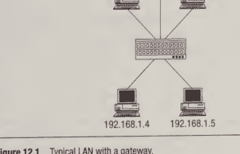

图 12.1 具有网关的典型局域网。

IP 地址 192.168.2.208

网络掩码 255.255.255.0

广播 192.168.2.255

默认路由器 192.168.2.254


> 网关 IP 地址与分配在网络上的其他地址处于同一主机 IP 地址范围。

## 访问控制

在网关计算机上，有多种限制访问的方法。你可以在两个方向设置限制：防止不受欢迎的用户进入，以及防止网络上的用户访问其他网络，如 Internet。你可以通过 IP 地址或计算机名称在 `/etc/hosts.allow` 和 `/etc/hosts.deny` 文件中控制访问。至少，你希望拒绝访问其他私有 IP 地址以及你不希望外界使用的任何服务，例如电子邮件或内部网站。

> 注意：控制进出网络的主要方式是通过防火墙实用程序，例如 `iptables` 或 `ipchains`。

## 其他网络服务

当你安装 Linux 时，可能需要配置 DNS 服务器、DHCP 服务器、NFS 和 Samba 连接。

在 Linux 上可以设置的网络服务中包括 `sendmail` 和 `Apache`。`Sendmail` 让你在 Linux 计算机上设置邮件服务器。`Apache` 让你在 Linux 计算机上设置 Web 服务器。虽然你不需要详细了解这些服务，但了解一些基础知识是有帮助的。

## 域名系统 (DNS)

DNS 服务器将类似 `www.mommabears.com` 的名称翻译为类似 `199.93.70.2` 的 IP 地址。如果你为任何计算机设置 Internet 访问，你需要访问 DNS 服务器。当你为 Linux 配置 Internet 或其他网络访问时，你需要一些 DNS 服务器的 IP 地址。如果你通过 ISP 访问 Internet，请向 ISP 询问其 DNS 服务器的 IP 地址。

Linux 在 `/etc/resolv.conf` 文件中查找 DNS 服务器 IP 地址。如果你的 ISP 告诉你应使用的 DNS 服务器是 24.1.80.33，请将以下行添加到该文件：

```
nameserver 24.1.80.33
```

使用类似以下示例的列表，在 `/etc/hosts` 文件中建立主机名和 IP 地址的数据库：

```
192.168.16.1    linux1.mommabears.com    linux1
192.168.16.2    windows1.mommabears.com    windows1
192.168.16.3    laptop1.mommabears.com    laptop1
192.168.16.4    linux2.mommabears.com    linux2
192.168.16.5    examcram.mommabears.com    examcram
```

正如你所见，此示例列出了每个 IP 地址关联的主机名和完全限定域名。缺点是你需要在网络中的每台计算机上都有此文件的相同副本。如果你网络中有大量计算机，这可能会难以维护。在这种情况下，设置自己的 DNS 服务器可能更容易。

## 动态主机配置协议 (DHCP)

计算机从 DHCP 服务器“租用” IP 地址一段时间。如果在租用的 IP 地址到期时计算机仍处于活动状态，它可以续租一段时间。当来自非活动计算机的租约到期时，DHCP 服务器可以将该地址重新分配给另一台计算机。

你可能想要使用 DHCP 有两个原因。如果你没有足够的 IP 地址供网络使用，DHCP 可以帮助管理可用地址。如果你网络中有大量计算机，DHCP 可以帮助你避免为每台计算机分配 IP 地址的麻烦。DHCP 需要一个名为 `dhcpd` 的服务器守护进程。你可以在网络上的任何 Linux 计算机上设置此守护进程。

如前所述，当你连接到 Internet 时，你需要一个公共 IP 地址。分配给 ISP 的 IP 地址数量有限。ISP 使用 DHCP 在其成员之间分配 IP 地址。如果你 ISP 使用 DHCP 为你分配 IP 地址，你可以通过 `/etc/dhcpd.conf` 配置文件设置 Linux 从 ISP 的 DHCP 服务器接收此地址。

## 网络文件系统 (NFS)

一旦两台计算机建立连接，它们需要一种共同的语言来共享文件和打印机。NFS 是 Linux 计算机之间共享信息的主要语言。NFS 由网络文件系统守护进程 `nfsd` 运行。设置后，你可以像挂载本地软盘驱动器和 CD-ROM 驱动器一样轻松地挂载远程目录。

你选择共享的目录在 `/etc/exports` 配置文件中设置。准备就绪后，你可以设置 `/etc/fstab` 文件，以便每次启动 Linux 时挂载 NFS 目录。

## Samba

Microsoft Windows 计算机通过使用服务器消息块（SMB）的语言相互通信。Linux 通过 Samba 系统模拟这种语言。运行 Samba 需要两个守护进程：`smbd` 和 `nmbd`。`smb` 守护进程是通用语言；`nmb` 守护进程允许 Linux 识别和使用基于 Microsoft 的计算机名称。设置 Samba 后，你可以像浏览 Windows 网络邻居中的任何其他 Microsoft Windows 计算机一样浏览 Linux 计算机。并且你可以同样轻松地从 Linux 浏览 Microsoft Windows 系统。

目录和打印机的共享在 `/etc/samba/smb.conf` 或 `/etc/smb.conf` 配置文件中设置。你可以设置 Samba 在由 Windows NT/2000 服务器或工作站管理的 Microsoft Windows 域中共享，或设置 Samba 在与 Windows 95/98/ME 系统的工作组中共享。

## sendmail

当你为用户设置电子邮件时，你可以通过 ISP 分配地址，或设置自己的邮件服务器。如果你的用户有大量电子邮件，你可能希望设置自己的邮件服务器。根据发行版，`sendmail` 或 `smail` 是首选邮件服务器。你可以设置 `sendmail` 通过常见的接收协议传输消息，例如 `POP`（邮局协议）或 `IMAP`（Internet 消息访问协议）。你也可以设置 `sendmail` 通过其他邮件协议传输消息，例如 `SMTP`（简单邮件传输协议）。

*注意：使用 POP 的邮件服务器通常使用名为 `POP3` 的更新版本。同样，IMAP 的当前版本称为 `IMAP4`。*

`Sendmail` 被称为邮件传输代理。`Sendmail` 用户账户基于 `/var/spool/mail` 目录中的文件。

## Apache

Linux Web 服务器被称为 `Apache`。当你在 Linux 上设置 `Apache` 时，你安装 `http` 守护进程 `httpd`。你可以根据 `/etc/httpd/conf` 目录中的三个文件配置 `Apache`：

- `access.conf`—为浏览器设置目录。你在此文件中指定的目录将成为你的主页文件的家。
- `httpd.conf`—是主要的 Apache 配置文件。你可以通过此文件在一台计算机上设置多个网站（虚拟主机）。
- `srm.conf`—定义在完全限定域名之后出现的目录名称。

在某些发行版中，此配置信息合并在 `/etc/httpd/conf/access.conf` 文件中。你也可能在 `/etc/apache` 目录中找到这些配置文件。

## 网络应用程序

网络守护进程，例如 NFS 和 Samba，允许你与网络上的其他计算机共享文件和打印机。网络应用程序允许你使用其他服务，例如 `Apache` 和 `sendmail`。虽然你不能直接访问共享的网页，但你可以用名为 `Netscape Communicator` 的网络应用程序浏览它。虽然你不能直接访问邮件服务器的共享，但你可以用诸如 `Netscape Messenger` 之类的应用程序访问单个邮件。使用 `FTP`（文件传输协议），你可以在远程服务器上共享文件。使用 `Telnet`，你可以登录并管理远程 Linux 计算机。

## 网页浏览器

`Netscape` 和 `Internet Explorer` 并不是浏览互联网的唯一方式（Microsoft Internet Explorer 现在可以为 Linux 设置）。KDE 和 GNOME 包都有自己的浏览器。另一种流行的 Linux 替代方案是 `Opera` 浏览器。这些是图形浏览器。


如果你没有为所有用户提供计算机，一个替代方案是设置 `Lynx`。作为基于文本的网页浏览器，`Lynx` 不需要太多计算机资源，这使得在廉价网络终端上设置基于 `Lynx` 的互联网访问变得实用。这个选项在公共图书馆中很受欢迎，那里的资金通常相当有限。

## 邮件管理器

你可以使用多种邮件管理器来管理 Linux。它们范围从命令行界面管理器，例如 `elm` 和 `pine`，到图形客户端，例如 `Netscape Messenger`。

邮件管理器，例如 `Netscape Messenger`，可以配置为从使用 `POP3` 或 `IMAP` 协议的服务器接收邮件。你还可以配置邮件管理器使用过滤器，根据你设定的标准突出显示或忽略电子邮件。邮件管理器，例如 `Netscape`，已集成新闻组阅读器。如第 2 章所述，新闻组是在 Linux 中排除故障时的重要解决方案来源。

## FTP 客户端

使用 FTP 客户端，你可以向 FTP 服务器传输文件并从 FTP 服务器传输文件。这是在长距离共享文件的流行选项；本书的章节是通过 FTP 服务器共享的。

有全套基于文本和图形用户界面（GUI）的 FTP 客户端。你可以使用基于文本的 `ftp` 命令连接到任何可用的 FTP 服务器。连接后，输入“`help`”以获取命令列表。你可能会注意到与 Linux 命令行命令的相似之处。或者，如果你想要图形界面，你可以使用像 `gFTP` 这样的客户端。

虽然你可以使用大多数网页浏览器浏览和从 FTP 服务器下载，但它们只是“单向”的。你不能通过网页浏览器上传到 FTP 服务器，这意味着你不能使用此方法共享你的文件。

## Telnet

你可以使用 `telnet` 命令连接到任何 Linux 计算机。连接后，你可以像登录任何本地 Linux 命令行界面一样登录。一旦连接建立，你可以访问 Linux 计算机上你拥有密码的任何用户名。你可以在图 12.2 中查看一个示例，该示例是从 Microsoft Windows 计算机管理 Linux 的 Telnet 会话。

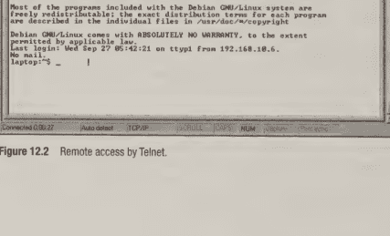

图 12.2 通过 Telnet 的远程访问。

## 练习题

### 问题 1

以下哪项是互联网？

- a. 通过集线器连接的五台计算机
- b. 连接在一起的两个独立局域网
- c. 连接到 ISP 的一台计算机
- d. 地理位置相距遥远的两个国家联网的计算机

答案 b 正确。互联网是指任意两个连接在一起的局域网。因为通过集线器连接的计算机可以设置在局域网中，所以答案 a 不正确。虽然连接到 ISP 的计算机可以被视为一个网络，但这并不意味着你在连接两个网络。因此，答案 c 不正确。相同的理由适用于答案 d；因为你没有连接两个网络，所以你没有建立互联网。因此，答案 d 不正确。

### 问题 2

以下哪项不是有效的 IP 地址？

- a. 192.66.133.54
- b. 2.33.98.253
- c. 254.36.18.1
- d. 163.54.256.3
- e. 所有列出的 IP 地址均有效

答案 d 正确。IP 地址由 0 到 255 之间的四个数字组成。其他所有答案都包含有效的 IP 地址。因此，答案 a、b 和 c 不正确。

### 问题 3

你正在为你的网络分配 IP 地址。你的网络地址是 10.123.55.0。你的网络掩码是 255.255.255.0。以下哪个 IP 地址不能分配给此网络上的计算机？

- a. 10.123.55.1
- b. 10.123.55.254
- c. 10.123.55.255
- d. 10.123.55.127

答案 c 正确。根据定义的网络，可用 IP 地址的范围是 10.123.55.0 到 10.123.55.255。第一个地址是网络地址。此范围中最后一个地址，对应于答案 c，是此网络的广播地址。因为答案 a、b 和 d 都在定义范围内，所以这三个答案均不正确。

### 问题 4

你的计算机的完全限定域名为 linux44.mommabears.com。你的计算机还被分配了 192.168.55.34 的 IP 地址。网络掩码为 255.255.0.0。以下哪个 IP 地址对应于网络地址？

- a. 192.168.0.0
- b. 192.168.55.34
- c. 192.0.0.0
- d. 192.168.55.0

答案 a 正确。网络掩码中的 255 定义了描述网络地址的数字。因为网络掩码包含两个 255，所以网络地址对应于 IP 地址的前两个数字。因为计算机的有效 IP 地址不对应于网络地址，所以答案 b 不正确。如果网络掩码为 255.0.0.0，则答案 c 正确。如果网络掩码为 255.255.255.0，则答案 d 正确。

*注意：此解释是对网络掩码如何帮助你定义网络地址的过度简化的描述。*

### 问题 5

以下哪项是硬件地址？

- a. 192.168.0.1
- b. 1B-35-DF-23-A6-68
- c. linux1.mommabears.com
- d. eth0

答案 b 正确。硬件地址由 12 个十六进制数字组成。因为 192.168.0.1 是一个 IP 地址，所以答案 a 不正确。因为 linux1.mommabears.com 是一个完全限定域名，所以答案 c 不正确。因为 eth0 代表网络卡，所以答案 d 不正确。

### 问题 6

如果你想将网络内部的计算机连接到互联网，你会在哪里分配网关地址？请注意，连接你的网络到互联网的计算机有两个网络卡：一个连接到你的网络，另一个连接到互联网。

- a. 在网络内部的任何计算机上
- b. 在同时连接到你的网络和互联网的计算机上；分配给直接连接到互联网的网络卡。
- c. 在同时连接到你的网络和互联网的计算机上；分配给直接连接到你的网络的网络卡
- d. 分配到你的 ISP 处的计算机的 IP 地址

答案 c 正确。网关地址属于连接一个网络到另一个网络的计算机。网关地址应分配给连接到内部网络的网络卡，以便其他计算机可以访问它。如果你将网关地址分配给网络内部的任何计算机，你可能会将其分配给未连接到互联网的计算机。因此，答案 a 不正确。如果你将网关地址分配给直接连接到互联网的网络卡，其他计算机将无法访问此卡。因此，答案 b 不正确。因为你的 ISP 通常使用不同的 IP 地址集，所以你的计算机无法访问它。因此，答案 d 不正确。

### 问题 7

以下哪种方式通常是安装 Linux 的最快方法？

- a. 通过电话调制解调器
- b. 通过高速互联网连接
- c. 通过以太网
- d. 从本地 CD-ROM

答案 d 正确。一般来说，从本地介质（如 CD-ROM）安装 Linux 是最快的方式。因为电话调制解调器是列表中最慢的，所以答案 a 不正确。高速互联网连接通常比任何形式的以太网慢；因此答案 b 不正确。而且因为以太网上的数据传输通常比当前 CD-ROM 慢，所以答案 c 不正确。

### 问题 8

根据以下网络地址和网络掩码，此网络中可用于不同计算机的 IP 地址有多少个？网络地址是 172.168.65.0，网络掩码是 255.255.255.0。

- a. 约 1600 万
- b. 约 65,000
- c. 256
- d. 254

答案 d 正确。因为 IP 地址数字范围从 0 到 255，可能的 IP 地址范围从 172.168.65.0 到 172.168.65.255。但第一个地址（172.168.65.0）是网络地址，最后一个地址是广播地址。因此，可用于单个计算机的地址有 254 个，答案 c 不正确。虽然答案 a 对应网络掩码 255.0.0.0，但情况并非如此；因此答案 a 不正确。虽然答案 b 对应网络掩码 255.255.0.0，但情况并非如此；因此答案 b 不正确。

### 问题 9

如果看到 IP 地址为 16.52.33.235 且网络掩码为 255.255.0.0，以下哪一项是网络地址和主机地址？

- a. 网络地址=16.52.33.0；主机地址=235
- b. 网络地址=16.52.0.0；主机地址=33.235
- c. 网络地址=16.52.33.0；主机地址=33.235
- d. 网络地址=16.52.0.0；主机地址=235

答案 b 正确。网络掩码中的 255 用于区分网络地址和主机地址。如果网络掩码为 255.255.255.0，则答案 a 正确。因为 16.52.33.0 不是网络地址，所以答案 c 不正确。因为 235 不是完整的主机地址，所以答案 d 不正确。

## 需要了解更多？

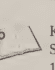

Hunt, Craig. *Linux 网络服务器*. Sybex, Alameda, CA, 1999. ISBN 0-7821-2506-9. 这是一本关于配置不同 Linux 网络守护进程的全面指南。


Kirch, Olaf, and Terry Dawson. *Linux 网络管理员指南*. 第二版。O'Reilly & Associates, Sebastopol, CA, 2000. ISBN 1-56592-400-2. 这或许是 Linux 专家网络资源的参考书。可能不适合初学者。


Pfaffenberger, Bryan, and Michael Jang. *Linux 网络清晰解释*. Morgan-Kaufmann Publishers, San Francisco, CA, 2001. ISBN 0-12-533-171-1. Linux 网络的入门指南。


Linux 文档项目在 `www.linuxdoc.org` 的网站是 Linux 手册、HOWTO 以及许多其他书籍长度文档的中央存储库。本章的重要 HOWTO 包括用于设置 DNS 服务器的“`DNS-HOWTO`”、用于设置以太网网络的“`Ethernet-HOWTO`”、用于设置防火墙的“`IPCHAINS-HOWTO`”、用于设置网络文件系统的“`NFS-HOWTO`”，以及用于设置与 Microsoft Windows 计算机通信的“`SMB-HOWTO`”。

## 应用

### 你需要了解的术语：

- ✓ `WYSIWYG`
- ✓ `nroff`, `groff`, `TeX`, `LaTeX`, and `HTML`
- ✓ 文档处理
- ✓ WordPerfect, Star Office, Applixware
- ✓ KOffice, GNOME Office
- ✓ 文本编辑器, `vi`
- ✓ `ispell`
- ✓ GIMP, xfig

### 你需要掌握的技术：

- ✓ 理解 `WYSIWYG` 与文本编辑之间的区别
- ✓ 描述文本文件中不同标记语言的使用
- ✓ 列出文档处理器的基本功能
- ✓ 理解 `vi` 中的基本命令
- ✓ 讨论各种图形应用程序

正如 Linux 中有基于文本和图形的命令行实用程序一样，Linux 中也有基于文本和图形的应用程序。Linux 基于文本的应用程序使用 *标记* 语言来实现与 `WYSIWYG`（所见即所得）文档处理器相同的图形结果。许多 Linux 爱好者更喜欢标记语言，因为它们使用户能够更好地控制输出。在本章中，你将研究用于文本编辑、文字处理和图形的不同图形和基于文本的应用程序。

## Linux WYSIWYG 争论

`WYSIWYG` 文档处理器与基于文本的标记语言之间的比较类似于图形用户界面（GUI）与命令行界面（CLI）工具之间的比较。换句话说，虽然 `WYSIWYG` 处理器更容易使用，但基于文本的编辑器在标记语言的帮助下理论上可以做更多。与 CLI 一样，与学习 GUI `WYSIWYG` 文档处理器相比，学习基于文本的标记语言需要更多时间。当你使用标记语言命令时，还需要额外的测试周期来检查结果。

## WYSIWYG 应用程序

`WYSIWYG` 文档处理器主导了通用市场。`WYSIWYG` 处理器的商业示例包括 Microsoft Word、Corel WordPerfect、Vista Source 的 Applixware Words 和 Sun 的 Star Office Write。除了 Microsoft Word 之外，所有这些目前都可用于 Linux。使用所有这些应用程序时，你在屏幕上看到的内容就是打印文件时的内容。

`WYSIWYG` 应用程序的问题在于，除非以二进制格式保存其数据文件，否则你无法充分利用其功能。这些应用程序中的每一个都有不同的二进制格式；例如，你需要一个转换器将 Microsoft Word 文件传输到 Corel WordPerfect 软件。因为每个 `WYSIWYG` 应用程序的功能不同，应用于 Microsoft Word 文件的格式（字体、下划线、粗体等）可能会在转换为 WordPerfect 格式时丢失。

如果你使用 `WYSIWYG` 应用程序编辑 Linux 配置文件，必须确保以文本格式保存。如果不小心将关键配置文件（如 `/etc/inittab`）以二进制格式保存，就无法重新启动 Linux。


> 如果你使用 `WYSIWYG` 应用程序处理 Linux 配置文件，请务必以文本格式保存。使用 `cat` 命令测试结果。以非文本格式（例如 `.doc`、`.wpd`）保存文件会导致下次需要该文件时出现问题。

## 标记语言

标记语言与文本编辑器的组合在科学和学术界很受欢迎。使用标记工具，你可以管理从文本文件打印的字体、图形等。基于文本的标记语言示例包括 `nroff`、`groff`、`TeX`、`LaTeX` 和 `HTML`。对于每种语言，你输入的文本都以一种通用字体显示。标记命令仅在打印时更改文本的外观。基于文本的标记语言的外观示例显示在 Momma Bears' Bears 网站 `www.mommabears.com` 上的以下 HTML 代码中：

```
<body>
<div align="center"><center>
<table border="0" cellpadding="0" cellspacing="0" bgcolor="#00FFFF">
<tr>
<td><p align="center"><font size="3" color="#9A3A9A">
<strong>Welcome to Momma Bears' Bears... <br>
Your online source for collectible bean bag bears!</strong>
</font>
</td>
</tr>
</table>
</center></div>
```

标记命令显示在角括号 `<>` 中，并应用于 Momma Bears' Bears 网站上显示的打印页面的文本和背景。使用真正的标记语言，你可以在任何文本编辑器中设置文件，例如 `vi` 或 `emacs`。尽管一些较旧的文字处理程序，如 WordPerfect 5.0 和 5.1 版本，使用了标记语言，但它们也以二进制格式保存文件。

## 文档处理管理器

如果你习惯使用 Microsoft Windows，仍然可以使用 `WYSIWYG` 文档处理器（如 Microsoft Word）的优势。Linux 上有三个主要的商业文档处理器：Corel WordPerfect、Sun Star Office Write 和 Vista Source Applixware Words。它们都是“办公套件”的一部分，其中包括图形和电子表格应用程序。它们还包括允许你交换数据的转换器。因为这些套件也适用于 Microsoft Windows，所以可以使用其中一个套件来帮助顺利过渡从 Windows 到 Linux 的转换。

某些办公套件背后的广告宣称你可以使用其转换器与 Microsoft Office 文件无缝协作。在你将重要文件托付给此功能之前，请自行测试。截至本文撰写时，Microsoft Office 的源代码并未公开。转换器在办公套件之间完整保留格式的能力并不完美。如果你使用诸如嵌入式注释等功能，可能会感到失望。

此外，还有面向 GNOME 和 KDE 桌面的原生 Linux 办公套件，分别称为 GNOME Office 和 KOffice。由于这两个套件均不提供 Microsoft Windows 版本，因此更适合原生 Linux 用户。不过，你也可以使用它们的导入器和导出器与相应的 Microsoft Office 应用程序交换数据。

## WordPerfect

Corel WordPerfect for Linux 是一款功能齐全的 `WYSIWYG` 文字处理器，你可以从 `http://linux.corel.com` 网站免费下载。多用户版本可从 Corel 购买。WordPerfect for Linux 也是 WordPerfect Office 应用程序套件的一部分，该套件包括电子表格（Quattro Pro）、演示管理器和数据库程序（Paradox）。

如第 5 章所述，Corel 还提供了一款面向新手 Linux 用户的友好型 Linux 发行版。

## Star Office

Star Office 套件是一款功能齐全的 Linux 办公套件，目前由 Sun 所有。其中包括文字处理器、电子表格、演示和邮件管理器以及日程安排器。由于它最初在德国开发，因此 Star Office 更常与同样在德国开发的 KDE 窗口管理器一起使用。你可以从 `www.staroffice.com` 免费下载适用于 Linux 或 Windows 的完整办公套件。

## Applixware


# Vista Source

Vista Source 是 Applix 的一家基于 Linux 的子公司，该公司还提供一套相当完整的办公应用程序。Applixware Office 包括文字处理器、电子表格、演示管理器、图形工具、邮件管理器以及数据库程序。其 SHELF 工具允许你为其任何应用程序编程不同的功能。你可以在 www.vistasource.com 下载完整的 Applixware Office 套件。

## KOffice

名为 KOffice 的 KDE 办公应用程序套件包含与 Star Office 和 Applixware Office 相似的应用程序包。KWord 应用程序与 FrameMaker 类似。与其它办公套件不同，它使用基于文本的 `ispell` 拼写检查应用程序。KOffice 可以轻松集成到 KDE 窗口管理器中。你可以在 www.koffice.org 下载完整的 KOffice 套件。

## GNOME Office

GNOME Office 应用程序套件也包含与 Star Office 和 Applixware Office 相似的应用程序包。GNU 项目并未开发其所有办公应用程序：GNOME Office 将 Source Gear 的 AbiWord 作为其文档处理器集成在内。GNOME Office 可以轻松集成到 GNOME 窗口管理器中。你可以通过 www.gnome.org/gnome-office 网站链接 GNOME Office 各组件的下载位置。

## Text Processing Managers

Sair Linux/GNU 认证的最低要求之一是对 `joe`、`pico`、`vi` 或 `emacs` 等主要命令行文本编辑器具备基本知识。这些是 Linux 管理员的关键工具。作为文本处理管理器，这些工具可以帮助你无缝编辑和管理 Linux 配置文件。其中最重要的编辑器可能是 `vi`，因为在你需要使用应急磁盘从系统故障中恢复时，它通常是唯一可用的编辑器。

你也可以使用文本处理管理器配合标记语言来格式化文档。许多 Linux 用户认为，与 WYSIWYG 应用程序相比，TeX、LaTeX、nroff、groff 和 HTML 等标记语言提供了更强大的功能。你可以使用 `ispell` 拼写检查器检查这些编辑器创建的任何基于文本的文件。

### vi

`vi` 编辑器有两种模式：命令模式和插入模式。在命令模式下，你可以移动文本文档、删除、复制、粘贴或移动文本行。你还可以搜索特定的文本字符串，甚至在 Linux shell 中运行其他文本命令。在插入模式下，你可以向文档添加文本。

你可以使用 `vi filename` 命令编辑文件。如果选择的文件名不存在，`vi` 在保存并退出编辑器时会为你创建它。表 13.1 显示了一些 `vi` 命令。

| Command | Description |
|---|---|
| cw | 删除当前单词并进入插入模式 |
| dd | 删除当前行 |
| i | 进入插入模式 |
| I | 在当前行开头进入插入模式 |
| o | 通过在当前位置下方开始新行进入插入模式 |
| p | 将“剪切”文本放在当前光标位置之后；与大多数文字处理器的“粘贴”类似 |
| q | 退出 vi |
| r | 替换；你输入的下一个字符将替换当前字符 |
| u | 撤销；撤销上一次更改 |
| w | 写入文件 |
| yy | 将当前行 yank（复制）到本地缓冲区；可与 p 命令配合使用 |
| Esc | 退出插入模式 |
| /test | 在当前文件中搜索单词 test |

*在旧版本的 vi 中，你不能使用键盘上的方向键。移动光标的唯一方法是使用 h、j、k 和 l 键，它们分别对应左、下、上、右方向键。*

`vi` 编辑器拥有大量命令和其他功能。表 13.1 中显示的命令只是其中一小部分。

### ispell

当你使用 WYSIWYG 文档处理器时，通常需要为该特定应用程序设计的拼写检查器。另一方面，你可以使用 `ispell` 应用程序检查任何文本文件的拼写。

使用 `ispell` 很简单；如果你的文本文件名为 `better`，你可以使用 `ispell better` 命令开始拼写检查。`ispell` 应用程序会将文件中的每个单词与其自己的词典进行比较。如果找不到某个单词，它将被高亮显示；如果有可选拼写，会显示出来。

## Graphical Applications

你不能用文本编辑器编辑图像。Linux 包含许多用于绘制和编辑图形的图形应用程序，包括 GIMP（GNU 图像处理程序）和 `xfig`。GIMP 更偏向于图像处理程序，而 `xfig` 则是一款更适合工程设计工作的绘图程序。

*注意：GIF 文件的默认压缩算法是 LZW，以其开发者 Lempel、Ziv 和 Welch 命名。由于 Unisys 开始执行其对 LZW 的版权，因此许多 Linux 用户实际上避免使用 GIF。*

Linux 图形应用程序绝不限于 GIMP 和 `xfig`。由于基于 Linux 或 Unix 的应用程序被用于创建、编辑和制作图形密集型电影，有人认为 Linux 可用的图形应用程序比任何其他操作系统上可用的图形应用程序更强大。

### GIMP

GIMP 是一款一体化的图像编辑器，常与 JASC 的 Paint Shop Pro 相比较。你可以使用 GIMP 进行绘图、在不同图层上管理图像、在图形文件格式之间转换以及捕获屏幕图像。本书中的大多数图像都是使用 GIMP 捕获的。与其它 GNU 应用程序一样，它可免费使用，事实上已包含在大多数当前 Linux 发行版的基本配置中。你可以在图 13.1 中查看 GIMP 编辑器。

### xfig

正如 GIMP 用于处理图像，`xfig` 用于创建图像和绘图。它使用“fig”文件设置，这些文件以文本格式的一系列数字指定图层、线条和位置。这与使用“线框”模型的各种计算机辅助设计程序使用的文件一致。`xfig` 文件中包含的此类数字数据适用于计算机辅助制造。要使用 `xfig`，你需要一个三键鼠标或至少一个模拟三键鼠标的设置。你可以在图 13.2 中查看 `xfig` 应用程序。

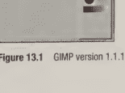

图 13.1 GIMP 版本 1.1.13。

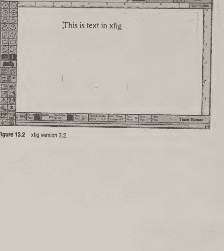

图 13.2 xfig 版本 3.2.

## 练习题

### 问题 1

以下哪一项是偏好文本编辑器而非 WYSIWYG 文档处理器的原因？最终打印文档的外观很重要。

- a. 文本编辑器不会用图形图像破坏你的屏幕。
- b. 文本编辑器要求你插入许多命令来设置在打印文档中看到的字体和背景。
- c. 文本编辑器允许你在不考虑保存这些文件格式的情况下编辑 Linux 配置文件。
- d. 文本编辑器使用起来简单得多，因为它们没有与 WYSIWYG 编辑器相关联的所有下拉菜单。

答案 c 正确。如果使用文本编辑器，那么根据定义，你的文件以文本格式保存。Linux 只能以文本格式读取其配置文件。虽然答案 a 是一个真实的陈述，但在 WYSIWYG 文档中嵌入图形图像的能力是这些图形文档处理器的优势。因此，答案 a 不正确。即使答案 b 是一个真实的陈述，你需要用来格式化文本文档的命令可能很难学习。因此，答案 b 不正确。尽管答案 d 名义上是正确的，但你必须使用标记语言命令来格式化任何文本文件。因此，答案 d 不正确。

### 问题 2

以下哪个应用程序是文本编辑器？

- a. groff
- b. vi
- c. HTML
- d. LaTeX

答案 b 正确。`vi` 编辑器是一个文本编辑器。因为 groff、HTML 和 LaTeX 都是用于格式化文本的标记语言，所以答案 a、c 和 d 不正确。

### 问题 3

以下哪个办公套件不能与 Microsoft Windows 一起使用？

- a. KOffice
- b. Star Office
- c. WordPerfect
- d. Applixware Office

答案 a 正确。名为 KOffice 的 KDE 办公套件无法安装在 Microsoft Windows 上。GNOME 办公套件也是如此。然而，由于 Star Office、WordPerfect 和 Applixware Office 的版本可用于 Microsoft Windows，因此答案 b、c 和 d 不正确。

### 问题 4

使用 WordPerfect 或 Star Office 等办公套件编辑 `/etc/fstab` 等配置文件有什么危险？

- a. 二进制程序，如 WordPerfect，并非设计用于编辑文本文件。
- b. Star Office 之类的程序会定期保存文件。一旦程序在任何间隔保存，就无法恢复配置文件。
- c. 默认情况下，WYSIWYG 办公套件以二进制模式保存文件。Linux 无法读取以二进制模式保存的配置文件，这会导致 Linux 重启时失败。
- d. 没有危险；你可以使用任何类型的编辑器，WYSIWYG 或文本，来编辑任何 Linux 配置文件。


答案 `c` 正确。WYSIWYG 办公套件确实以二进制模式保存文件。Linux 配置文件必须以文本格式保存，否则 Linux 将无法读取这些文件。因为你可以将文本文件导入办公套件，所以答案 `a` 不正确。当办公套件保存文件时，它们是在临时文件中备份你的工作，而不是覆盖当前文件。因此，答案 `b` 不正确。虽然你可以从 WYSIWYG 编辑器导出并以文本模式保存文件，但这不是默认设置。因此，答案 `d` 不正确。

### 问题 5

使用 `vi` 编辑器时，以下哪个命令会将你的设置从插入模式更改为命令模式？

- a. `Ctrl+Pg Up`
- b. `o`
- c. `/command`
- d. `Esc`

答案 `d` 正确。按下 `Esc` 键会将 `vi` 编辑器中的模式从输入模式更改为命令模式。因为 `Ctrl+Pg Up` 键组合在不同配置的图形模式之间切换，所以答案 `a` 不正确。`o` 命令通过打开新行来打开编辑；因此，答案 `b` 不正确。斜杠表示在当前文档中搜索单词 `command`；因此，答案 `c` 不正确。

### 问题 6

以下哪个图形应用程序更适合图像处理？

- a. `Star Office`
- b. `GIMP`
- c. `xfig`
- d. `HTML`

答案 `b` 正确。`GIMP` 在大多数 Linux 配置中默认加载。虽然 `Star Office` 有一个帮助你处理图像的应用程序，但它不像 `GIMP` 那样默认安装。因此，答案 `a` 不正确。你可以用 `xfig` 处理图像；然而，它在图像处理方面的能力远不及 `GIMP`。因此，答案 `c` 不正确。因为 `HTML` 是一种标记语言，所以答案 `d` 不正确。

### 问题 7

如何检查通过 `vi` 编辑器编辑的文档的拼写？

你的文档文件名是 `important.txt`。

- a. 打开 `vi`。进入命令模式。输入 `s` 命令启动拼写检查器。
- b. 打开 `vi`。进入命令模式。输入 `ispell` 命令启动拼写检查器。
- c. 进入你的命令行界面。输入 `ispell important.txt` 命令。
- d. 进入你的命令行界面。输入 `vi important.txt | ispell` 命令。

答案 `c` 正确。`ispell` 命令适用于任何文本文件且独立于编辑器。`vi` 中的 `s` 命令会删除当前字符并将 `vi` 切换到插入模式；因此，答案 `a` 不正确。`ispell` 命令在命令行界面中使用；因此，答案 `b` 不正确。因为 `vi` 命令会打开该编辑器，“管道” (`|`) 没有任何内容可以发送给 `ispell` 命令。因此，答案 `d` 不正确。

## 需要了解更多？

Gratzer, George. *LaTeX入门*. Springer-Verlag, New York, NY, 1999. ISBN 0-8176-4132-7. 这本书是 LaTeX 排版系统的入门读物，包含数学和科学公式的增强功能。

Muster, John. *轻松掌握Unix*. Osborne/McGraw-Hill, Berkeley, CA, 1996. ISBN 0-07-882173-8. 这本关于 Unix 的入门书籍包含大量关于 `vi` 编辑器的课程和细节。这本书常用于 Linux 终端的课堂环境。

Rackus, Phillip, Kate Wrightson, and Joe Merlino. *WordPerfect Office 2000 for Linux：官方指南*. Osborne/McGraw-Hill, Berkeley, CA, 2000. ISBN 0-07-212238-2. 这本书是 Corel 认可的 Linux 版 WordPerfect Office 2000 套件指南。

有关 WordPerfect for Linux 的更多信息，请查看 Corel 的 Linux 网站 `http://linux.corel.com`。目前，你只能免费下载文字处理器和图片编辑器。

有关 `GIMP` 的更多信息，请查看其主页 `www.gimp.org`。`GIMP` 是 GNU 项目的一部分，也是 GNOME 办公套件的一部分。

有关 GNOME 办公套件的更多信息，请查看其网站 `www.gnome.org/gnome-office`。如果你选择使用 GNOME Office，请经常关注该网站，因为像这样的 Linux 应用程序处于持续开发中。

有关 `groff` 和 `ispell` 的更多信息，请查看 GNU 网站 `www.gnu.org` 的应用程序区域。`groff` 标记语言是 `nroff` 文档格式化系统的 GNU 克隆。`ispell` 程序是文本文档的 GNU 拼写检查器。

有关 KOffice 套件的更多信息，请查看其网站 `www.koffice.org`。如果你选择使用 KOffice，请经常关注该网站，因为像这样的 Linux 应用程序处于持续开发中。


有关 `Star Office` 的更多信息，请查看其网站 `www.staroffice.com`。你也可以从该网站下载 `Star Office` 的个人副本。与该套件相关的新闻发布可在其母公司网站 `www.sun.com` 上获取。


有关 `Applixware Office` 套件的更多信息，请查看其网站 `www.vistasource.com`。你也可以从该网站下载 `Applixware` 的演示副本。


有关 `xfig` 的更多信息，请查看其主页 `www.xfig.org`。你可以在其链接页面列出的网站中找到 `xfig` 用法的示例。

## 故障排除

需要理解的术语：

- ✓ 系统消息日志记录
- ✓ `/etc/syslog.conf`
- ✓ 读取错误
- ✓ 归档错误
- ✓ 设备已满错误
- ✓ `badblocks`
- ✓ 救援磁盘
- ✓ 登录和启动错误
- ✓ 键盘重复率
- ✓ `setleds`
- ✓ 网络时间协议 (`NTP`)

需要掌握的技术：

- ✓ 寻找快捷方式
- ✓ 精通系统分析
- ✓ 理解系统日志文件
- ✓ 处理安装错误
- ✓ 使用救援磁盘
- ✓ 解决启动错误
- ✓ 排除打印机问题
- ✓ 更新系统时钟
- ✓ 处理内存问题
- ✓ 修改键盘参数

当你想要解决问题时，你就需要进行故障排除。有时你可以利用触手可及的快捷方式；其他时候你需要系统地诊断问题。Linux 拥有大量的日志文件，可以帮助你在故障排除过程中。然而，如果你在尝试安装、启动或登录 Linux 时遇到错误，日志文件就毫无用处。有多种技术可用于解决安装和启动问题，包括使用 Linux 启动软盘。

故障排除是一个几乎与 Linux 本身一样广泛的话题。本章涵盖的主题仅限于 Sair Linux/GNU 安装和配置考试中涉及的主题。

### 问题解决哲学

几乎每个 Linux 问题都有一个“简单”的解决方案。但只有最有经验的管理员才知道所有简单的解决方案。如果你找不到一种简单的方法来诊断和解决你的问题，你需要系统地思考你的问题，使用基本的科学方法。

### 快速工具

经验是快速解决方案的唯一替代品。如果你没有经验，你可以依靠有经验的人。如果你无法直接接触 Linux 专家，你也可以访问来自众多 Linux 专家的文档。如前几章所述，支持 Linux 的文档非常丰富。如果一切都失败了，你通常可以联系那些几乎在新闻组中巡逻寻找问题来解决的 Linux 专家。一般来说，如果你遇到问题，请使用以下步骤寻找快速解决方案：

1. 检查适用的帮助开关。几乎每个命令都包含广泛的帮助开关输出，可通过在命令后输入 `--help` 获得。
2. 研究手册页。每个命令以及大量配置文件都包含手册，帮助你理解每个命令和开关的目标。
3. 查阅 Linux 文档项目在 `www.linuxdoc.org` 上的 HOWTO 和常见问题解答。
4. 检查你的 Linux 发行版的知识库或故障排除数据库。多个发行版网站都包含问题和解决方案的数据库。
5. 搜索新闻组存档。Linux 用户通过新闻组分享他们的经验。如第 2 章所述，搜索新闻组存档最简单的方法是通过 `www.deja.com` 网站。
6. 如果一切都失败了，请在适当的 Linux 新闻组寻求帮助。务必记录迄今为止为解决问题所做的工作。如果你的问题没有得到回答，你可能需要进一步澄清你的情况或尝试不同的新闻组。

根据你对 Linux 的经验水平和对特定问题的了解，你可能希望按不同的顺序执行这些步骤。

> TIP
>
> 如果你需要在新闻组提问，请做好准备。有经验的 Linux 用户希望你已经查阅了所有可用的文档。他们还想知道你为尝试解决问题所做的工作以及配置和日志文件的相关部分。提供这些信息与你向有经验的 Linux 顾问提出问题时的做法并无不同。

### 科学方法

你可以在新闻组寻求帮助，但答案需要时间。而且如果你是一名遇到问题的 Linux 管理员，你的用户希望立即得到解决方案。如果你没有快速解决方案，你的另一个选择是使用科学方法检查你的问题。


科学方法有三个基本步骤：分析、假设和测试。换句话说，利用所有可用数据分析你的问题，对原因进行假设，并用解决方案测试你的假设。

当你分析一个问题时，你需要系统地思考。例如，如果你与 Microsoft Windows 计算机共享信息时遇到问题，你可能存在 Samba 守护进程的问题。但通常情况下，你更可能存在基本网络配置的问题。此外，最可能的原因是物理连接存在问题。

系统解决方案需要“自下而上”的思维。对于大多数未知问题，你可以按以下顺序检查系统：

1. 检查物理连接。电缆是否正确插入？每个组件是否都已通电？
2. 检查 Linux 连接。Linux 是否识别你的问题硬件？你在启动计算机时 Linux 是否加载了你的驱动程序？
3. 查看适用的系统日志。是否存在与你的问题相关的错误或其他信息？
4. 检查基本软件。你能否连接到问题硬件？Linux 是否启动了适用的守护进程？
5. 检查更高级别的软件。你能否使用各种命令实际与关键硬件组件通信？使用软件时你看到什么类型的错误消息？

这些是问题分析的一般步骤。你可以在过程中的任何时候对原因进行假设。大多数情况下，当你确定原因时（例如，网卡未连接），你可以轻松确定解决方案（例如，连接网卡）。你实际采取的步骤取决于你的问题和经验。

## 系统日志

你可以按多个类别设置系统日志，包括内核、打印机、邮件、其他守护进程和安全（也称为 auth）。消息分为以下八个类别，按重要性降序排列：

- `emerg` (紧急)
- `alert`
- `crit` (严重)
- `err` (错误)
- `warning`
- `notice`
- `info`
- `debug`

### 日志位置

每当 Linux 中发生某事时，信息就会发送到由你的 `/etc/syslog.conf` 配置文件定义的系统日志。也许组织最好的 `/etc/syslog.conf` 文件来自 Corel 发行版，如图 14.1 所示。

如图所示 14.1 所示，消息按类别划分并按重要性细分。每个区域的消息都会发送到特定的日志文件。

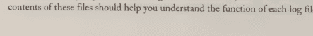

查看你的发行版可用的 `/etc/syslog.conf` 和日志文件。这些文件的内容应有助于你了解每个日志文件的功能。

```
# /etc/syslog.conf Configuration file for syslog.
#
# For more information see syslog.conf(5)
# manpage.
# syslog.conf changed by Brian
#
# authpriv and authpriv are combined
 authpriv, auth.*debug          /var/log/auth/auth.debug
 authpriv, auth.=info           /var/log/auth/auth.info
 authpriv, auth.=notice         /var/log/auth/auth.notice
 authpriv, auth.=warning        /var/log/auth/auth.warning
 authpriv, auth.=err            /var/log/auth/auth.err
 authpriv, auth.=crit           /var/log/auth/auth.crit
 authpriv, auth.=alert          /var/log/auth/auth.alert
 authpriv, auth.=emerg          /var/log/auth/auth.emerg
 cron.*debug                    /var/log/cron/cron.debug
 cron.=info                     /var/log/cron/cron.info
 cron.=notice                   /var/log/cron/cron.notice
 cron.=warning                  /var/log/cron/cron.warning
 cron.=err                      /var/log/cron/cron.err
 cron.=crit                     /var/log/cron/cron.crit
 cron.=alert                    /var/log/cron/cron.alert
 cron.=emerg                    /var/log/cron/cron.emerg
```

图 14.1 `/etc/syslog.conf` 消息日志配置文件摘录。

### 系统日志消息

系统日志消息可以帮助你解决问题。了解在每种情况下使用或查看哪个日志文件需要经验。请看图 14.2，其中显示了守护进程类别（`daemon.info`）中的信息消息。最后两条显示的消息表明 Linux 在为这台特定计算机安装声音驱动程序时遇到问题。

你可以使用 `dmesg` 命令找到另一组有用的消息，该命令显示你在计算机上启动 Linux 时事件的顺序。

### 安装问题

在安装 Linux 时，你可能会遇到许多错误。在某些情况下，在运行 Linux 时你也可能会遇到这些问题。这些问题与文件或存储介质的问题有关。

```
Oct 11 08:46:27 Laptop cardmgr[222]: starting, version is 3.1.2
Oct 11 08:46:37 Laptop cardmgr[222]: watching 2 sockets
Oct 11 08:46:37 Laptop cardmgr[222]: initialising...
Oct 11 08:46:07 Laptop cardmgr[222]: socket 5: Serial or Modem
Oct 11 08:46:07 Laptop cardmgr[222]:   card: /etc/pcmcia/modules/2.2.12/pcmcia/serial_cs.o
Oct 11 08:46:07 Laptop cardmgr[222]: executing: /sbin/modprobe -s -k -o serial_cs
Oct 11 08:46:07 Laptop cardmgr[222]: initialising pcmcia scheme: No such file or directory
Oct 11 08:46:08 Laptop cardmgr[222]: socket 1: 3Com 3c589 Ethernet
Oct 11 08:46:08 Laptop cardmgr[222]:   card: /etc/pcmcia/modules/2.2.12/pcmcia/3c589_cs.o
Oct 11 08:46:08 Laptop cardmgr[222]: executing: /sbin/modprobe -s -k -o 3c589_cs
Oct 11 08:46:08 Laptop cardmgr[222]: initialising pcmcia scheme: No such file or directory
Oct 11 08:46:08 Laptop cardmgr[222]: can't locate module sound-slot-0
Oct 11 08:46:51 Laptop sndprobe: can't locate module sound-service=0-0
```

图 14.2 示例系统日志消息。

## 读取错误

软盘的常见问题包括读取错误或文件未找到错误。可能的原因包括软盘本身存在缺陷或采用了 Linux 无法读取的格式。

随着软盘老化，其存储数据的能力会下降。通过邮寄的软盘在为 Linux 重新格式化时通常会失效。此外，如果你尝试读取从不兼容系统（如 Apple Macintosh）写入软盘的数据，你会收到其中一种错误。

无论哪种情况，你都应获取一张新的软盘，对其进行格式化并重新安装数据。

## 归档错误

Linux 中的新程序最常见的是以 tar 格式的归档文件。例如，你可能会从网站下载 Apache（Linux Web 服务器）的最新版本，文件名为 `apache_2.0.1.tar.gz` 之类的。下载并不总是顺利进行。如果收到如下错误，请尝试重新下载文件，也许可以从不同的 Web 或 FTP 站点下载：

```
Tar:read error or gzip: not in gzip format while installing Linux
```

此外，Linux 安装光盘上的一个或多个归档文件可能已损坏。如果能确定具体的问题归档文件，你可能可以单独下载并安装它。否则，你可能需要获取一张新的 Linux 安装光盘。

## 空间不足


如果收到类似 `device full` 的消息，说明你的某个 Linux 卷已用完空间。如果在运行 Linux 时收到此消息，你需要删除一些文件。通常情况下此错误很少见，因为即使卷使用率超过 90%，Linux 仍能高效运行。

你也在安装 Linux 时可能收到此消息。在任何情况下，你都可以重新配置磁盘卷。这是一个更复杂的过程，因为它涉及备份当前文件、重新分区和重新安装。如果在安装 Linux 时出现此错误，最好的做法是停止安装，为卷重新分配空间，然后再次尝试安装。


安装 Linux 时，你可以在前四个虚拟控制台中的一些中查看安装进度，包括错误消息。其中一个控制台设置为单用户模式下的命令行界面（CLI）。如前所述，你可以使用 `Alt+Ctrl+Fx` 命令访问不同的虚拟控制台，其中 x 表示虚拟控制台的编号。

## 硬盘坏块

Linux 卷以称为块的内存单元设置。根据你的情况，每个块中可能包含 512、1024、2048 或 4096 字节的信息。如果硬盘出现问题，你可能会收到类似以下的错误消息：

```
Read_intr: 0x10 error
```

你可能在两种情况下收到此错误。一种是硬盘存在物理缺陷，另一种是尝试格式化一个大于硬盘实际可用空间的卷。

检查硬盘坏块的一种方法是使用 `badblocks` 命令。它会标记并隔离任何无法读取的块。

> 注：`badblocks` 命令类似于 Microsoft 的 `chkdsk` 命令。用于检查坏块的其他命令有 `mke2fs -c` 和 `e2fsck -c`。

## 其他安装问题

在通过网络安装 Linux 时，可能会出现另外两种错误。如果在安装 Linux 时看到类似 `file not found` 或 `permission denied` 的消息，你的 Linux 发行版存在问题。你可能拥有一张缺少某些文件的 Linux 安装光盘或下载文件，或者其权限设置不当。在任何情况下，你都需要尝试重新下载发行版、尝试使用不同的光盘安装，或尝试完全不同的发行版。

通过网络（如通过 FTP）安装 Linux 时，你需要下载一系列文件。用于下载的常见 FTP 命令是 `mget`，它会将指定的文件从当前 FTP 服务器目录复制到本地计算机的当前目录。用于下载文件的命令之间的差异可能会导致问题。例如：

```
mget *.*
mget .
```

如果你使用的是 MS-DOS 版本的 FTP，这些命令的效果是相同的；它们会将 FTP 服务器当前目录中的所有文件复制到本地计算机的当前目录。

然而，这些命令在 Linux 中的效果不同。许多 Linux 文件没有用点（`.`）将文件名与其扩展名分隔，例如 `chapter14.doc`。因此，当你从 Linux 运行 FTP 并运行 `mget *.*` 命令时，唯一被复制的文件是采用“点”格式设置的文件。

## 救援磁盘帮助

如果你的 Linux 系统出现故障导致无法启动或登录，你将需要一个启动磁盘和 `/etc/passwd` 文件的备份。此区域的错误包括硬盘主引导记录（MBR）的问题、`/etc/passwd` 文件的问题或特定的动态程序库。

如果你没有启动磁盘并且 Linux 安装光盘上也没有任何救援实用程序，你可能只能安装全新的 Linux 副本并覆盖计算机上的所有当前数据。

> TIP
>
> 一种可能的“最后手段”解决方案是使用 Linux 安装光盘升级当前发行版，有时可以保留用户创建的数据。

## 创建启动软盘

安装 Linux 时，你应接受创建启动磁盘的选项。或者，以下命令会从 `boot.img` 启动映像文件提取所需文件到软盘驱动器。如果适当的文件位于不同的目录，请相应地替换：

```
dd if=/mnt/cdrom/images/boot.img of=/mnt/floppy
```

根据你的发行版，你可能需要创建的其他有用软盘包括网络文件（`bootnet.img`）、PCMCIA 文件（`pcmcia.img`）和驱动程序（`drivers.img`）。

> TIP
>
> 作为最后的手段，如果可用，你可能可以使用 Linux 安装光盘上的专家模式或救援模式创建启动软盘。你也可以像使用 Linux 启动软盘一样使用救援模式。结果取决于你的发行版光盘。

## 启动软盘的组件

启动软盘有两个部分：Linux 内核的压缩版本以及一组用于帮助你从大多数问题中恢复的实用程序和文件，称为 `initrd`。当你从此软盘启动时，计算机加载 Linux 内核，然后将 `initrd` 映像解压缩到 RAM 上的文件集。这些文件看起来在硬盘上，但实际上位于 RAM 磁盘上，即设置为类似硬盘卷的 RAM 区域。

## 主引导记录 (MBR) 问题

如果你的 MBR 已损坏，计算机将无法找到 Linux（或其他任何操作系统）。一旦你从硬盘挂载了正常的根目录，你可以使用 `/sbin/lilo` 命令将当前 `/etc/lilo.conf` 配置文件的内容写入你的 MBR。

注：Linux 中的 `/sbin/lilo` 命令在功能上几乎等同于 MS-DOS 中的 `fdisk /mbr` 命令；两者都会替换 MBR。但 `fdisk /mbr` 命令会覆盖 MBR 上的任何 `lilo.conf` 启动加载程序，因此会阻止你访问 Linux。

如果你看到如下错误消息，则说明你的 MBR 已损坏：

```
Drive not bootable - Please insert system disk
```

## 操作系统错误

你可以根据 `/etc/lilo.conf` 配置文件中的信息设置多个操作系统启动。如果此文件以某种方式损坏，你可能会得到错误的操作系统（例如，你选择 Linux 时却启动到 Windows）。

解决方案与上一节相同。你需要在 MBR 上重新安装 `lilo.conf` 文件。

## Shell 问题

如果你无法进入默认 shell 或命令行界面（CLI），你可能存在权限或密码问题。

要运行 Linux，每个人至少需要在根目录（`/`）上具有读和执行权限。要检查 `/` 的当前权限，运行 `ls -la / | more` 命令。与名为“`.`”（点）的文件关联的权限是根目录的权限。如果每个人都没有在此目录上至少具有读和执行权限，请进入 root 或超级用户模式并运行 `chmod 755 /` 命令。

如果这样不起作用，你可能存在 `/etc/passwd` 文件问题，这可能通过以下两节讨论的解决方案解决。

## 恢复密码

如果你无需使用启动软盘即可访问 Linux，你也可以以单用户模式启动 Linux。当你启动计算机时，在某个时候，你会看到如下所示的 Linux Loader（LILO）提示：

```
LILO boot:
```

在此提示符下输入 `linux single`，Linux 就会自动以单用户模式启动。然后你可以在无需登录 Linux 的情况下以超级用户模式访问所有 Linux 命令。

> 如果你忘记了 root 或超级用户的密码，可以使用此技术删除 root 密码。不要忘记在不使用启动盘的情况下重新启动到 Linux 后设置新密码。

如果你需要使用启动软盘来启动 Linux，请查看下一节中讨论的技术。

## 使用启动软盘恢复密码

Linux 可能发生的一种灾难是无人能够登录计算机。此问题的一个常见原因是 `/etc/passwd` 文件损坏或被删除。Linux 启动软盘允许你在无需登录的情况下以 root 用户身份启动 Linux。挂载硬盘后，你就可以从备份中恢复密码文件。

如果你没有备份的密码文件，则需要创建该文件的新版本。然后系统上的每个用户都必须再次登录并设置自己选择的密码。

## 动态库模块

动态库对开发者来说很方便，因为它们允许对同一代码或编程指令在不同命令中重复使用。如果你在 shell 中无法运行某些基本命令，你可能存在一个或多个动态库模块的问题。

当你从启动软盘启动 Linux 时，你可以访问其中一些关键的 shell 命令。然后你可以从不同的来源（如 Linux 安装光盘）恢复适当的动态库模块。

## 打印机问题

如果你遇到打印问题，可以按照以下几个步骤进行故障排除。这些步骤包括对物理连接、逻辑连接、系统日志和配置文件进行检查。你可以在每一步之后尝试再次打印：

- 1. 首先始终检查物理连接。换句话说，检查打印机的电源以及连接打印机和计算机的电缆。如果打印机位于另一台计算机上，也请检查网络连接。

- 2. 检查错误消息。如果当前运行的打印作业出现错误，你可以在 `/var/spool/lpd/lp/status` 文件中找到错误消息。（你可以在 `/etc/syslog.conf` 版本中定义的 `lp` 系统日志文件中查看其他错误。）

*注意：如果有多台打印机，每台打印机应有不同的名称。在以下每个步骤中相应地将 `lp` 替换为对应的名称。*

- 3. 如果物理连接正常，请检查锁文件。如果存在类似 `/var/spool/lpd/lp/lock` 的文件，则无法在 `lp` 打印机上打印。如果当前没有正在运行的打印作业，请删除此文件。锁文件是临时设备，旨在防止多个程序同时打印。


### 4.
如果没有锁文件，请在`/var/spool/lpd/lp`目录中检查控制文件（`cf`）和数据文件（`df`）。打印作业时，请求会被发送到与打印机关联的`spool`目录。行式打印机守护进程（`lpd`）会创建包含打印作业信息的`cf`以及包含待打印信息的`df`。

### 5.
如果没有前几步讨论的任何文件，请检查主打印机配置文件`/etc/printcap`。确保它仍然符合你在第 9 章中讨论的打印机所需参数。

### 6.
检查打印机基本输出。运行`lptest > /dev/lp`命令。（如果你的打印机名称不是`lp`，请相应替换。）`lptest`命令会向打印机发送通用的“波纹测试”图案。

### 7.
检查打印机文本输出。选择一个你喜欢的文本文件，并使用`cat file > /dev/lp`命令将其发送到打印机设备。相应地替换`file`和`lp`。

### 8.
如果你有串口打印机，请使用`ls -l /dev/ttyS*`命令检查每个串口链接的设备。确保打印机仍然控制着适当的串行设备。

### 9.
使用`env`命令检查你的环境变量。确保没有诸如`PRINTER`之类的环境变量将输出重定向到另一个文件或打印机。

## 其他问题

有许多其他问题可以相对容易地解决。你可以处理与图形、重复率和`Num Lock`键相关的键盘问题。你可以与 Internet 上的站点同步你的时钟。你还可以解决内存问题，包括与`X Window`相关的问题。

## 奇怪字符

在图形适配器开发之前，Unix 使用伪图形模式来模拟简单的图像，例如用线条和字母来说明国际象棋游戏中的方格和棋子。如果无法从 CLI 启动图形用户界面（GUI），你将被发送到一种奇怪的模式，在 CLI 屏幕上看到奇怪的字符。你可以输入`reset`命令退出此图形模式，或者切换到另一个虚拟控制台并终止与伪图形模式控制台关联的`shell`。

## Num Lock

默认情况下，安装 Linux 时数字键盘处于关闭状态。如果使用没有专用数字键盘的笔记本电脑，这可能是首选。当你在笔记本上打开`Num Lock`键时，数字会覆盖键盘上的几个字母。

另一方面，许多人使用标准键盘上的数字键盘。如果你希望在启动 Linux 时默认打开`Num Lock`键，请设置以下`shell`脚本，使其可执行，并将其复制到`/etc/rc.local`或与启动 Linux 关联的另一个`/etc/rc.d`目录中：

```
for n in 1 2 3 4 5 6 7
 do
     setleds +num < /dev/tty$n > /dev/null
 done
```

此脚本使用`setleds`实用程序为与变量`n`关联的所有虚拟终端激活`Num Lock`键。

## 键盘重复率

当你在 CLI 中按下键盘上的字符键并保持按住时，该字符最终会重复。重复的速率称为键盘重复率。你可以使用某些 BIOS 菜单设置此速率，也可以使用`kbdrate`命令设置。例如，如果你想将重复率设置为每秒 20 个字符，请运行以下命令：

```
/sbin/kbdrate -r 20
```

## 同步时间

计算机报告的时间可能不准确。某些 BIOS 时钟运行过快。或者，如果与 BIOS 关联的电池电量不足，你的 BIOS 时钟可能会变慢。

如果你在网络上运行多台计算机，你可能有需要所有计算机时钟时间相同的应用程序。TCP/IP 协议套件包括网络时间协议（NTP），它允许你同步所有计算机的时间。例如，如果你想与 Internet 软件联盟（ISC）的时服务器同步，请运行以下命令：

```
ntpdate clock.isc.org
```

全球各地还有其他“官方”NTP 时服务器。有关更多信息，请参阅特拉华大学赞助的时间 WWW 服务器网页`www.eecis.udel.edu/~ntp`。

## X Window 抖动

当 RAM 不足时，你的计算机花费大量时间在 RAM 和硬盘上的交换分区之间交换信息。（交换分区是你的虚拟内存，可扩展 Linux 可用的“RAM”量。）这种现象也称为抖动，其特征是硬盘的持续活动。

抖动的一个常见原因是`X Window`的需求。如果启动`X Window`时一切变慢，你可能存在内存问题，应遵循第 3 章中讨论的 RAM 需求指南。

## 打开 X Window 的问题

如果你尝试打开`X Window`而 Linux 没有带你进入 GUI，你可能会收到如下错误消息：

```
cannot open display:0.0
```

在这种情况下，你需要配置`DISPLAY`变量。`DISPLAY`可以是环境变量或`shell`变量。如果在`env`命令的输出中看到它，则`DISPLAY`是环境变量；如果在`/etc/profile`配置文件中看到它，则它是`shell`变量。如果`DISPLAY`是环境变量，你需要设置它。如果它是`shell`变量，你应该导出它以便在其他`shell`中工作。

无论哪种情况，你都需要将此变量设置为`localhost:0.0`，这将设置本地计算机以本地或与远程客户端一起工作。你可以使用以下命令将`DISPLAY`设置为此值：

```
DISPLAY=localhost:0.0
```

## 练习题

### 问题 1

你想从 FTP 服务器复制文件到你的电脑。当你从 MS-DOS 启动 FTP 并访问包含文件的目录时，你使用`mget *.*`命令下载这些文件。该 FTP 服务器目录中的一些文件名是`readme.txt`、`schedule`、`chapter2.doc`和`syslog.conf`。如果你从 Linux 启动 FTP 时运行相同的命令会发生什么？

- a. 你将下载 FTP 服务器目录中的所有文件。
- b. 你将下载 FTP 服务器目录中的部分文件，包括`readme.txt`、`schedule`和`syslog.conf`。
- c. 你将下载 FTP 服务器目录中的部分文件，包括`readme.txt`和`chapter2.doc`。
- d. FTP 服务器目录中的文件都不会被下载。

答案`c`正确。该列出的命令仅下载文件名中包含点的文件。尽管答案`c`不完整（该命令还会下载`syslog.conf`文件），但它是所列选项中唯一正确的答案。并非 FTP 服务器目录中的所有文件都包含点。该命令会遗漏`schedule`文件；因此，答案`a`和`b`不正确。因为该命令确实会下载一些文件，所以答案`d`不正确。

### 问题 2

你有一台采用双启动配置的电脑。换句话说，Linux 和 Microsoft Windows 都已安装。由于某种原因，在启动电脑时你看不到任何 LILO 启动提示，并且在尝试启动时系统会锁定。你怀疑你的 MBR 已损坏或丢失。以下哪个选项可以恢复你的 MBR？

- a. 将 Linux 启动到单用户模式。使用`/sbin/lilo`命令将`lilo.conf`文件的内容恢复到你的 MBR。
- b. 使用 MS-DOS 启动盘启动电脑。使用`fdisk /mbr`命令将通用设置恢复到你的 MBR。
- c. 使用任何 Linux 安装光盘启动电脑。进入恢复或修复模式。访问硬盘上的`lilo.conf`文件。使用`/sbin/lilo`命令将`lilo.conf`文件的内容恢复到你的 MBR。
- d. 使用 Linux 启动盘启动电脑。访问硬盘上的`lilo.conf`文件。使用`/sbin/lilo`命令将`lilo.conf`文件的内容恢复到你的 MBR。

答案`d`正确。这些步骤将把原始`lilo.conf`文件的内容恢复到你的 MBR。因为你看不到 LILO 启动提示，所以无法正常进入单用户模式。因此，答案`a`不正确。因为 MS-DOS `fdisk /mbr`命令会安装 MS-DOS MBR，因此你将无法再访问 Linux。所以答案`b`不正确。尽管某些 Linux 安装光盘确实有恢复或修复模式，但并非所有安装光盘都有。因此，答案`c`不正确。

### 问题 3

如果你正在寻找 Linux 问题的快速解决方案，应该采取以下哪些步骤？[勾选所有正确答案]

- [ ] a. 检查与你的问题相关的命令的手册页和`--help`开关。
- [ ] b. 阅读 Linux 文档项目的适用 HOWTO 文档。
- [ ] c. 在你的 Linux 发行版的网站上（如有）搜索故障排除或知识数据库。
- [ ] d. 在 Linux 新闻组寻求帮助。
- [ ] e. 使用工具如`www.deja.com`等网站提供的工具浏览 Linux 新闻组的数据库。

答案`a`、`b`、`c`和`e`正确。这些答案都是你可以快速寻找解决方案可以做的事。手册页和`--help`开关在 Linux 上很容易访问。Linux 文档项目的 HOWTO 文档和你发行版的故障排除数据库在线上很容易获得。你可以通过`www.deja.com`网站快速搜索 Linux 新闻组中的问题和答案。然而，当你在 Linux 新闻组提出问题时，不能期望快速得到答案。因此，答案`d`不正确。

### 问题 4

你的一位 Linux 管理员忘记了他在 Linux 电脑上的`root`密码。以下哪个答案是他设置新密码的最简单方法？


- a. 启动 Linux。进入 CLI。查看`/etc/inittab`文件以找到与单用户模式关联的运行级别。使用`init`命令进入该模式，并恢复原始`/etc/passwd`文件的备份。

- b. 启动你的电脑。当你看到`LILO boot:`提示时，输入`linux single`命令。当 Linux 启动后，运行`passwd`命令为 root 用户设置新密码。

- c. 使用你的 Linux 安装光盘启动电脑。选择适用的升级选项。提示时，为该电脑上的 root 用户和其他用户输入新密码。

- d. 启动你的电脑。当你看到`LILO boot:`提示时，输入`single`命令。当 Linux 启动后，运行`passwd`命令为 root 用户设置新密码。


答案 b 正确。在 LILO 启动提示符下输入的`linux single`命令会以单用户模式启动 Linux。然后你的管理员可以使用`passwd`命令为 root 用户设置新密码。只有 root 用户可以运行`init`命令；因为你的管理员忘记了他的 root 密码，所以答案 a 中显示的选项是不可能的。尽管你可以升级 Linux 并为所有用户设置新密码，但这并不是最简单的做法，特别是如果管理员是唯一丢失密码的人。因此，答案 c 不正确。除非你的管理员已在`lilo.conf`文件中将`single`设置为选项，否则答案 d 不会启动任何 Linux 模式，因此不正确。

### 问题 5

如果你尝试安装一个新程序并收到以下消息，以下哪个答案最准确地描述了你的问题？

```
Tar: read error or gzip: not in gzip format while installing Linux
```

- a. 你的安装光盘上有一个损坏的压缩程序。
- b. 你在从备份恢复时遇到问题。
- c. 你无法完成 Linux 的安装。
- d. 你需要重新下载你正在尝试安装的程序。

答案 a 正确。此错误表明`tar`归档中存在损坏。尽管 Linux 备份也是从`tar`归档中恢复的，但错误消息表明是安装问题。因此，答案 b 不正确。因为你正在安装程序而不是 Linux，所以答案 c 不正确（错误消息具有误导性）。尽管重新下载程序可能有助于解决问题，但它并不能描述问题。因此，答案 d 不正确。

### 问题 6

以下哪个命令将键盘重复速率更改为每秒 15 个字符？

- a. `/sbin/keyboard -a 15`
- b. `/sbin/kbdrate -r 15`
- c. `/sbin/kbdrate -s 15`
- d. `/sbin/kbd -r 15`

答案 b 正确。命令是`kbdrate`，`-r`开关指定以每秒字符为单位的速率。因为`keyboard`是错误的命令，所以答案 a 不正确。因为`-s`是静默选项，它不会更改键盘重复速率；因此，答案 c 不正确。因为`kbd`是错误的命令，所以答案 d 不正确。

### 问题 7

以下哪个命令仅为第四个虚拟控制台打开键盘上的 Num Lock 选项？注意：`x`是从 1 到 6 的变量。

- a. `setleds -num </dev/tty$x> /dev/null`
- b. `setleds +num </dev/tty$x> /dev/null`
- c. `setleds -num </mnt/tty4> /dev/null`
- d. `setleds +num </dev/tty4> /dev/null`

答案 d 正确。此命令仅在第四个虚拟终端上打开 Num Lock。答案 a 关闭 Num Lock；因此，答案 a 不正确。因为答案 b 会为 1 到 6 的所有虚拟控制台打开 Num Lock，所以答案 b 不正确。答案 c 关闭第四个虚拟终端上的 Num Lock；因此，答案 c 也不正确。

### 问题 8

你目前无法向连接到本地电脑的打印机打印。除其他外，你有以下与打印机相关的文件：`/etc/printcap`、`/var/spool/lpd/lp2/status`、`/var/spool/lpd/lp2/lock`、`/etc/syslog.conf`和`/var/log/lpr/lpr.info`。在以下选项中，你首先会在哪里查找打印机的问题？（你的打印机名称为`lp2`。）

- a. 查看`/var/log/lpr/lpr.info`文件中的消息。
- b. 查看`/var/spool/lpd/lp2/lock`并删除它。
- c. 查看`/var/spool/lpd/lp2/status`以识别你的问题。
- d. 查看`/etc/printcap`并确保`lp2`打印机的设置未被更改。

答案 b 正确。锁文件的目的是防止其他打印作业干扰当前打印作业。只要它存在，其他打印作业就不会运行。尽管`/var/log/lpr/lpr.info`文件中的消息可能有助于你识别问题，但问题可能显示在不同的日志文件中。因此，答案 a 不正确。尽管`/var/spool/lpd/lp2/status`文件可能包含打印机的错误消息，但它不如锁文件那样明确。因此，答案 c 不正确。尽管对`/etc/printcap`文件的更改可能会将你的信息重定向到不同的打印机，但锁文件仍然会阻止数据到达你的本地打印机。因此，答案 d 不正确。

### 问题 9

如果您尝试通过网络连接打开 X Window，而得到的全部是以下错误，您会采取以下哪种操作？

```
cannot open display:0.0
```

- a. 使用`reset`命令清除显示问题的屏幕。
- b. 将`DISPLAY`环境变量设置为`localhost:0.0`。
- c. 重新配置您的 X Window 设置。
- d. 使用`XF86Setup`实用程序启动 X Server。

答案 b 正确。这是对该错误消息的正确响应，它将显示定向到本地。`reset`命令适用于类似的情况，即在 CLI 中看到模拟实际图形的伪图形。因为它与任何 X Window 功能都没有直接关系，所以答案 a 不正确。尽管使用像`XF86Setup`这样的工具重新配置 X Window 设置可能有效，但这不如设置`DISPLAY`变量那么简单。因此，答案 c 不正确。尽管启动`XF86Setup`实用程序确实会启动一个通用的 X Server，但您无法在该 X Server 中运行其他程序，这使得它在这种情况下用处不大。因此，答案 d 不正确。

### 问题 10

您在同一个电子商务网站上运行不同的计算机。这些计算机位于不同的时区，以优化与客户的数据传输速度。您将如何同步计算机之间的时间？假设您可以在一台网络计算机上设置时间服务器`time.likemynetwork.com`，或在远程网络上设置`time.asc.org`。

- a. 在其中一台计算机上设置 NTP 时间服务器。设置每台计算机以与您的 NTP 服务器同步时间。在每台计算机上运行`ntpdate time.asc.org`命令以完成同步。
- b. 设置每台计算机从远程网络同步。在每台计算机上运行`ntpdate time.likemynetwork.com`命令以完成同步。
- c. 在其中一台计算机上设置 NTP 时间服务器。设置每台计算机以与您的 NTP 服务器同步时间。在每台计算机上运行`ntpdate time.likemynetwork.com`命令以完成同步。
- d. 设置每台计算机从远程网络同步。在每台计算机上运行`ntpdate asc.org`命令以完成同步。

答案 c 正确。如果您在一台计算机上设置 NTP 时间服务器，则需要将`ntpdate`命令应用于该服务器。答案 a 指示您设置本地 NTP 服务器，然后指示在远程计算机上使用`ntpdate`命令；因此，答案 a 不正确。因为答案 b 指示您从远程网络同步，然后将`ntpdate`命令应用于本地计算机，所以该解决方案无法工作。因此，答案 b 不正确。因为答案 d 没有使用`ntpdate`联系正确的计算机，所以答案 d 也不正确。

## 需要了解更多？


Johnson, Dwight. ed. SuSE Linux 6.0 Installation, Configuration and First Steps. SuSE GmbH, Nürnberg, Germany, 1998. 本手册为 S.u.S.E. Linux 提供了对问题和潜在解决方案的优秀描述，适用于所有发行版。


Welsh, Matt, Lar Kaufman, and Matthias Kalle Dalheimer. Running Linux. O'Reilly & Associates, Sebastopol, CA, 1999. ISBN 1-56592-469-X. 可能是关于 Linux 操作系统的关键参考书籍。尽管本书中的许多信息基于较旧版本的 Linux，但基本数据简洁、写得很好且至今适用。本书中的许多内容不适合初学者。如果您能理解本书中的要点，您就有更好的机会快速学习故障排除技巧。


如果您想要了解有关全球时间服务器的更多信息，请查看 www.eecis.udel.edu/~ntp 网站。


请访问位于 www.linuxdoc.org 的 Linux 文档项目网站，该网站是 Linux 手册、HOWTO 以及许多其他书籍长度文档的中央存储库。许多 HOWTO 包含故障排除部分。一个重要的 HOWTO 是 Howard Mann 的 Online Troubleshooting Resources HOWTO。


另一份重要文档是位于 www.tml.hut.fi/~viu/linux/sag 的 Linux 系统管理员指南。该指南面向新管理员。您也可以通过 Linux 文档项目 www.linuxdoc.org 找到该指南的副本。


## 示例测试

本章提供了帮助您制定成功应试策略的提示。这些有用的提示包括如何选择正确答案、如何解读模糊性、如何在 Sair Linux/GNU 测试框架中工作、如何决定需要记忆的内容以及如何准备考试。在本章末尾，我提供了 50 道与 Sair Linux/GNU 安装和配置一级认证考试 3X0-101 相关的主题问题。在第 16 章中，您可以找到此测试的答案键。祝好运！

## 问题，问题，问题

您不应怀疑自己正面临一个充满具体而尖锐问题的测试。每场考试包含 50 道问题。您有 60 分钟完成考试。

请记住，问题属于以下三种基本类型之一：

- 单一答案的多项选择
- 多个答案的多项选择
- 真假判断题

您应始终花时间至少阅读两次问题，然后再选择答案。并非每个问题只有一个答案；许多问题需要多个答案。因此，您应仔细阅读每个问题，确定需要或可能有的答案数量，并在选择答案时寻找额外的提示或说明。

## 选择正确答案

显然，通过任何考试的唯一方法就是选择足够多的正确答案以获得及格分数。然而，Sair 的 Linux 考试不像 SAT 和 GRE 考试那样标准化；它们更加狡猾和复杂。在某些情况下，问题措辞奇怪，解读起来可能是一个真正的挑战。在这些情况下，您可能需要依靠答案排除技巧。几乎总是，问题的可能选择中至少有一个答案可以立即排除，因为它符合以下条件之一：

- 答案与情况不适用。
- 答案描述了不存在的问题、无效选项或虚构状态。
- 答案可因问题本身中的信息而被排除。

在排除所有明显错误答案后，您可以应用保留的知识来进一步排除答案。寻找听起来正确但指的是在问题描述的情况下不存在或不可用的操作、命令或功能的内容。如果您仍面临两个或多个可能正确的答案之间的盲目猜测，请重新阅读问题。尝试想象每个可能的剩余答案将如何改变情况。对术语特别敏感；有时用词的选择（remove 而不是 disable）可以决定正确答案和错误答案之间的区别。

只有在您用尽排除答案的能力并且仍不确定剩余可能性中哪一个是正确时，才应猜测答案。未回答的问题不会给您分数，但猜测至少给您一些答对问题的机会。只是不要在盲目猜测时过于草率。


> 因为这不是“自适应”考试，您可以在最后一次复习问题时（就在您即将用完时间或未回答问题时）开始进行猜测。尽管猜测应是最后的手段，您应回答每个问题。如果回答错误不会扣分。

## 解读模糊性

Sair Linux/GNU 考试以包含难以解释、令人困惑或模糊的问题而闻名。根据我对众多考试的经验，我认为这种声誉完全合理。Sair Linux/GNU 考试很困难，而且是故意这样设计的。

击败 Sair 的唯一方法就是做好准备。您会发现许多考试问题测试您对与问题提出的议题没有直接关系的事物的知识。这意味着您必须从中选择的答案，即使是错误的答案，也与问题本身一样多地是技能评估的一部分。换句话说，您对操作系统的了解越多，就越容易分辨对错。

问题通常会透露答案，但您必须像夏洛克·福尔摩斯一样才能看到线索。经常，细微的提示会出现在问题文本中，以一种似乎与情况几乎无关的方式出现。您必须意识到每个问题都是一个独立的测试，您需要检查并成功导航每个问题才能通过考试。寻找小的线索，例如时间的提及、组权限和名称以及配置设置。这些小事如果正确理解可以指向正确答案；如果错过，就会让您面临盲目猜测。

认证考试的另一个常见困难是词汇。您可能会在某些情况下看到以明显方式命名的实用程序和功能，而在其他情况下则完全莫名其妙。请务必复习本书每章开头介绍的关键术语。您也可能想在考试前一天阅读本书末尾的词汇表。

## 在框架内工作

测试题目以随机顺序出现，并且在某一道题目中提到的许多元素或问题也可能在其他题目中出现。并不罕见的是，一道题目的错误答案是另一道题目的正确答案，反之亦然。即使你立即就认出了某道题目的正确答案，也请花时间阅读每道题目的每个答案。这种额外的阅读可能会触发记忆，或提醒你关于 Linux 的某个功能或函数，这可能有助于你在考试其他地方的另一道题目。

因为这不是“自适应”考试，你可以多次重新审阅任何题目。如果你不确定某道题目的答案，请勾选提供的复选框以便稍后方便返回。你还应标记那些你认为可能提供可用于回答其他题目信息的题目。在固定长度的测试中，我通常会标记 25% 到 50% 之间的题目。测试软件设计为让你在选择时标记每个题目。利用这个框架为你带来优势。你想要再次查看的一切都应被标记。然后测试软件可以帮助你快速、轻松地返回到已标记的题目。


> 对于考试，我强烈建议你首先快速阅读整个测试，然后再沉迷于回答单个问题。这样做有助于在你审阅潜在答案时唤起记忆，并可以帮助你识别想要标记以便轻松访问其内容的题目。你也可以识别并标记难题以便轻松返回。关键是首先快速浏览一下整个范围——以便你知道自己面对的是什么——然后在第二次浏览时更彻底地调查该范围，此时你可以开始系统且一致地回答所有问题。

## 决定要记忆的内容

你需要进行的记忆量取决于你记住所读内容的程度以及你对操作系统的熟练程度。考试考验你记忆产品功能和接口细节的能力，以及它们如何与 Linux 整体相关。

最低限度，你希望记忆以下类型的信息：

- Linux 的优势和成本
- 基本命令行界面命令
- Linux 的结构组件
- 运行级别
- 文件系统层次结构标准
- 图形模式
- 故障排除解决方案
- 文档资源

如果你在阅读本书的同时坐在安装了 Linux 的机器前，并在全书讨论过程中使用文件和命令，你应该能够轻松掌握这些材料。此外，不要忘记本书前面的 Cram Sheet 设计用于捕捉最重要的记忆材料。同样使用这份 Cram Sheet 来指导你的学习。

## 准备测试

在你学习之后，准备测试的最佳方式是至少做一次练习考试。出于这个原因，本章中包含了一份。测试题目位于后面的页面中。（与本书前几章中的题目不同，答案不会立即跟随题目。你必须翻到第 16 章才能单独查看答案。）

给自己 50 分钟来做考试，并保持在荣誉制度上——不要查看书中之前的文本或跳到答案键。当你的时间用完或完成题目后，在第 16 章检查你的工作。特别注意错误答案的解释；这些也可以帮助强化你对材料的了解。知道如何识别正确答案是好的，但理解为什么错误答案是错的同样有价值。

## 参加测试

放松。一旦你坐在测试电脑前，就无法再增加你的知识或准备。深呼吸，伸展一下，然后开始阅读第一个问题。

你也不需要着急。你有足够的时间完成每个问题并返回你跳过或标记返回的问题。如果你读了两次问题仍一无所知，你可以标记它稍后再回来。简单和困难的问题在测试中随机交错。不要通过在测试早期花费太多时间在难题上而自欺欺人，从而剥夺你回答测试末尾问题所需的时间。

一个策略是阅读整个测试，然后在第二次返回已标记问题之前，算出每个问题有多少时间。随着你回答每个问题，移除其标记。继续审阅剩余的已标记问题，直到时间用完或完成测试。

提示到此为止。祝好运！

### 问题 1

以下哪种说法最能描述通用公共许可证（GPL）上下文中的“自由软件”？

- a. 当你出售“自由软件”时，你可以设定一个包含媒体成本、运费和利润的价格。
- b. “自由软件”涉及修改的自由。你对软件的公开发布可以带或不带源代码。
- c. “自由软件”包括你可以在互联网上免费下载的任何东西。


- d. 当你修改“自由软件”时，你可以更改源代码或合并其他专有产品。然后你可以将该软件包作为专有产品出售。

- e. 以上都不是。

### 问题 2

你想使用你的 `HISTORY` 功能。如何找到你之前使用过的以 `w` 开头的命令？[提示：你可能使用过多个以 `w` 开头的命令。]

- a. 按下箭头直到到达你想要的命令。

- b. 输入 `!w` 命令。

- c. 按上箭头直到到达你想要的命令。

- d. 输入 `w` 命令。

### 问题 3

Jacques 的电脑上已经有 Linux 和 Microsoft Windows 的双启动。他正在试验 Linux；他想在电脑上设置第二个版本的 Linux。在此过程中，Jacques 意外删除了 `MBR`。Jacques 既有 Linux 启动软盘也有 MS-DOS 启动软盘，但他目前启动电脑有困难。以下哪一步他应该采取来解决这个问题？

- a. 用 Linux 启动软盘启动电脑。用 `/sbin/lilo` 命令从备份中恢复 `/etc/lilo.conf` 文件。

- b. 用 MS-DOS 启动软盘启动电脑。用 `/sbin/lilo` 命令从备份中恢复 `/etc/lilo.conf` 文件。

- c. 用 Linux 启动软盘启动电脑。用 `/sbin/lilo` 命令从备份中恢复 `/etc/lilo.conf` 文件。

- d. 用 MS-DOS 启动软盘启动电脑。用 `fdisk /mbr` 命令从备份中恢复 `/etc/lilo.conf` 文件。

### 问题 4

以下哪些命令可用于退出命令行界面会话？[勾选所有正确答案]

- a. `exit`

- b. `logout`

- c. `logoff`

- d. `Ctrl+D`

### 问题 5

你正在为另一位主管建立一份备忘录历史，文件名为 `bigmemos`。以下哪个命令允许你将其他备忘录添加到 `bigmemos` 文件的末尾？

- a. `cat file >> bigmemos`

- b. `cat file 2> bigmemos`

- c. `cat file > bigmemos`

- d. `type file >> bigmemos`

### 问题 6

假设你的电脑上有一个硬盘。它的大小略超过 40GB。你目前安装了 Microsoft Windows。Microsoft Windows 相关的文件以及你安装的程序和数据占用 15GB 空间。以下哪种方法是最好的方式为 Linux 设置你的硬盘？

- a. 使用 `fdisk` 命令分割当前分区。使用 `fips` 命令分配 100MB 用于交换分区和 10GB 用于根卷。

- b. 使用 `fips` 命令分割当前分区。使用 `fdisk` 命令分配 100MB 用于交换分区、15GB 用于根卷和 10GB 用于引导卷。

- c. 使用 `fips` 命令分割当前分区。使用 `fdisk` 命令分配 100MB 用于交换分区和 15GB 用于根卷。

- d. 使用 `fdisk` 命令删除所有分区。继续设置 25GB 分区用于 Windows、15GB 用于 Linux 和 100MB 用于交换分区。

### 问题 7

为什么 GNU 开发流程会产生更高质量的软件？[勾选所有正确答案]

- [ ] a. 所有感兴趣的开发者，而不仅仅是单一公司的开发者，一起合作帮助开发软件。

- [ ] b. Linux 用户在软件发布后继续对其进行工作。改进经常在线添加。

- [ ] c. Linux 用户受声望驱动，而非利润。与创建更高质量软件相关的声望比金钱更具激励性。

- [ ] d. Linux 不使用像在 Microsoft 等专有软件公司工作的那种开发者。

## 问题 8

你有以下网络地址：`192.168.33.0`。你使用网络掩码 `255.255.255.0`。网关地址是 `192.168.33.1`。以下哪个是可分配给网络上计算机的 IP 地址范围？

- a. `192.168.33.0` 到 `192.168.33.255`

- b. `192.168.33.1` 到 `192.168.33.254`

- c. `192.168.33.2` 到 `192.168.33.255`

- d. `192.168.33.2` 到 `192.168.33.254`

### 问题 9

你有一台较旧的计算机想要转换为 Linux，其中包含一台通过声卡连接到计算机的老式 CD-ROM。在 Linux 中安装该 CD-ROM 需要什么驱动程序？

- a. 声卡驱动程序

- b. 声卡驱动程序和 CD-ROM 驱动程序

- c. 更新的 CD-ROM 驱动程序

- d. 一个同时适用于声卡和 CD-ROM 的组合驱动程序

### 问题 10

你想将运行级别更改为单用户模式。以下哪种步骤应采取以进入该模式？

- a. 运行 `init S` 命令。

- b. 检查你的 `/etc/inittab` 文件以找到与单用户模式关联的运行级别。使用与单用户模式关联的数字或字母运行 `init` 命令。

- c. 检查你的 `/etc/inittab` 文件以找到与单用户模式关联的运行级别。进入 root 或超级用户模式。使用与单用户模式关联的数字或字母运行 `init` 命令。

- d. 进入 root 或超级用户模式。运行 `init 1` 命令。

## 问题 11

你在网关计算机上设置 Linux，因此需要安装两块网卡。当你启动 Linux 时，它只能识别位于内存地址 `0x320` 的其中一块卡。该卡已被分配给设备 `eth0`。你可以做什么让 Linux 识别另一块卡？假设你知道 IRQ `12` 和内存地址 `0x280` 可用。

- a. 在你的 `/etc/lilo.conf` 文件中输入以下命令：`append="ether=12,0x280,eth1"`

- b. 在 LILO 启动提示符处输入以下命令：`append="ether=12,0x280,eth1"`

- c. 在你的 `/etc/lilo.conf` 文件中输入以下命令：`append="ether=12,0x320,eth1"`

- d. 在 LILO 启动提示符处输入以下命令：`eth1=12,0x320`

## 问题 12

你已作为用户 `rt` 登录。你有挂载 CD-ROM 驱动器的适当权限。为此目的你创建了一个名为 `cdrom` 的子目录。如果你运行 `mount /dev/cdrom cdrom` 命令，你会在哪里找到 CD 上的文件？你仍在 `rt` 的主目录中。

- a. `/home/cdrom`

- b. `/home/rt/cdrom`

- c. `/cdrom`

- d. `/mnt/cdrom`

## 问题 13

你运行 `ps` 命令并得到以下输出：

```
PID TTY TIME CMD
682 tty1 00:00:00 bash
983 ttyp2 00:00:00 bash
1235 tty4 00:00:00 ps
```

其中哪个进程是由远程登录的用户运行的？

- a. PID `682`

- b. PID `983`

- c. PID `1235`

- d. 以上都不是

## 问题 14

以下哪个命令允许你启动图形用户界面登录屏幕？

- a. `startx`

- b. `X`

- c. `xdm`

- d. `XF86Setup`

## 问题 15

以下哪个答案会影响你为 X Window 设置的分辨率？

- a. 计算机上的 RAM。

- b. 显示器中的内存。

- c. 分辨率受显示器中的内存和视频控制器上的内存组合限制。

- d. 视频控制器上的内存。

## 问题 16

你创建了一个名为 Live Again Shell（`lash`）的新 shell。你将与该 shell 相关的文件安装在你的主目录的 `bin/lash` 子目录中。你的用户名是 `la`。你将如何设置其他用户默认进入你的 shell？

- a. 打开 `/etc/passwd` 文件。导航到包含所需用户登录信息的行。用 `/a/lash` 替换最后一列显示的目录。

- b. 打开 `/etc/passwd` 文件。导航到包含所需用户登录信息的行。用 `/bin/lash` 替换最后一列显示的目录。

- c. 打开 `/etc/passwd` 文件。导航到包含所需用户登录信息的行。用 `/home/bin/lash` 替换最后一列显示的目录。

- d. 打开 `/etc/passwd` 文件。导航到包含所需用户登录信息的行。用 `/home/la/bin/lash` 替换最后一列显示的目录。

## 问题 17

以下哪项是 Linux 中数据的三个标准通道？

- a. `stdin`, `stdrel`, `stderr`

- b. `stdent`, `stdout`, `stdlog`

- c. `stdin`, `stdout`, `stderr`

- d. `stdent`, `stdex`, `stderr`

## 问题 18

以下哪个命令会删除 `/usr/sbin/WordProcessor` 目录中的所有文件和目录？假设有大量文件，但只有一个 `/usr/sbin/WordProcessor/docs` 子目录，并且你不想在每次删除前被提示。假设你已在 `/usr/sbin` 目录中。

- a. `rm -i WordProcessor`

- b. `rmdir -p WordProcessor/docs`


- `rm -r WordProcessor`

- `rmdir -r WordProcessor`

## 问题 19

你在 X Window 中打开了两个屏幕。你有一个双按钮鼠标。你已从一个屏幕中突出显示了文本并想将其复制到第二个屏幕。你如何复制文本？

- a. 将光标移动到所需位置并按下鼠标中键。
- b. 将光标移动到所需位置并同时按下两个鼠标按钮。
- c. 将光标移动到所需位置并右键单击。当弹出菜单出现时，单击粘贴。
- d. 你不能在 Linux 中使用鼠标复制和粘贴文本。

## 问题 20

假设有大量用户同时登录。以下哪个命令可用于识别用户 `jsmith` 登录的次数？

- a. `who | grep jsmith`
- b. `who | grep jsmith | wc -l`
- c. `who | sed jsmith`
- d. `who | grep jsmith > logins`

## 问题 21

你需要有关配置文件更多信息。以下哪对实用程序可以帮助你找到所需的信息？[勾选所有正确答案]

- a. `man`, `xinfo`
- b. `tk info`, `info`
- c. `man --help`, `xinfo`
- d. `info`, `xinfo`

## 问题 22

以下哪些是标记语言？[勾选所有正确答案]

- a. TeX
- b. emacs
- c. nroff
- d. HTML

## 问题 23

你在 `/etc/profile` 文件中设置了一系列 shell 变量。你希望其中一些变量在你仍登录时适用于其他 shell。以下哪个命令将变量从一个 shell 应用到另一个 shell？

- a. `apply`
- b. `export`
- c. `move`
- d. `env`

## 问题 24

你刚刚从 Linux 连接到 FTP 服务器。当你运行 `mget .` 命令时，什么类型的文件会被下载到你的计算机？

- a. 当前服务器目录中的所有隐藏文件
- b. 当前服务器目录中的所有文件
- c. 名称中包含点的所有文件，例如 `example.txt`
- d. 没有文件被下载

## 问题 25

你在启动 Linux 时遇到问题。当你打开计算机时，BIOS 检查内存和基本硬盘连接。然后你看到的就是以下内容：

```
LIL
```

以下哪个可能是问题？

- a. 你有损坏的 MBR。
- b. 你缺少二级引导加载程序，`/boot/boot.b`。
- c. 你的 `vmlinuz` 文件可能位于柱面 1023 以上。
- d. 有人未经你同意更改了你的 MBR。

## 问题 26

你在启动 Linux 时遇到问题。当你打开计算机时，BIOS 检查内存和基本硬盘连接，然后你的计算机似乎卡住了。假设你知道这是 MBR 的问题。你可以采取哪些步骤来恢复你的 MBR？[勾选所有正确答案]

- [ ] a. 使用 `/sbin/lilo` 命令将 `/etc/lilo.conf` 文件的内容发送到你的 MBR。
- [ ] b. 使用 MS-DOS 启动盘启动计算机，并运行 `fdisk /mbr` 命令。
- [ ] c. 使用 Linux 启动盘启动计算机，并在 LILO 启动提示符处输入 `linux single` 命令。
- [ ] d. 使用你的 Linux 安装 CD 启动计算机。如果可用，输入救援模式。

## Question 27

以下关于 GNU GPL 软件的哪些陈述是不正确的？

- a. 你可以将其出售以获取利润。
- b. 你可以在未经许可的情况下将其与其他专有软件集成。
- c. 你可以修改源代码以满足你的需求。
- d. 你可以访问其文档。

## Question 28

Sarah 是你一起工作的管理员之一，她在自己的 Linux 计算机上忘记了 root 密码。由于她对 Linux 尚不熟悉，她向你寻求帮助。以下哪条建议最合理？

- a. 启动 Linux，并使用 `init` 命令切换到单用户模式。然后你可以更改 root 密码。
- b. 从启动软盘启动 Linux，并使用 `linux single` 命令启动单用户模式。然后你可以更改 root 密码。
- c. 从网络连接访问 Sarah 的 Linux 计算机并切换到单用户模式。然后你可以更改 root 密码。
- d. 从调制解调器连接访问 Sarah 的 Linux 计算机并切换到单用户模式。然后你可以更改 root 密码。

## Question 29

当你按下 x 键时，你发现键盘重复率太慢，无法满足你的需求。目前大约是每秒五个字符。以下哪个命令可以将此速率提高到每秒 30 个字符？

- a. `/sbin/kbdrate -c 30`
- b. `/sbin/kbd -r 30`
- c. `/sbin/kbdrate -r 30`
- d. `/sbin/krate -c 30`

## Question 30

以下哪项陈述最能描述多用户多终端多任务？

- a. 一个用户在多个终端上多次登录以同时运行多个程序。
- b. 多个用户各登录一次，每个用户在自己的终端上，并各自并发运行多个程序。
- c. 一个用户一次登录，并在多个终端上同时运行多个程序。
- d. 多个用户同时登录。每个用户可以轮流运行他的程序。

## Question 31

你的 IP 地址格式为 `a.b.c.d`。这些字母各自代表什么？

- a. 4 位
- b. 小于 192 的数字
- c. 一个八位字节
- d. 一个点分四组

## Question 32

以下哪个目录包含打印机 spool 的处理文件？

- a. `/var/`
- b. `/var/spool`
- c. `/var/spool/lpd`
- d. `/var/spool/lp`

## Question 33

以下哪个是配置 X Window 的标准 GNU GUI 工具？

- a. `Xconfigurator`
- b. `xf86config`
- c. `XF86Setup`
- d. `xdm`
- e. 没有标准 GNU GUI 工具，因为它们不如相应的命令行工具可靠。

## Question 34

你已将第二个虚拟终端专用于数字数据输入。你希望在进入此终端时 Num Lock 键始终处于激活状态。以下哪个命令可以实现此功能？

- a. `setleds num < /dev/tty2`
- b. `setleds num < /dev/tty2 > /dev/null`
- c. `setleds +num < /dev/ttyx`
- d. `setleds +num < /dev/tty2 > /dev/null`

## Question 35

GPL 软件不提供任何保修。以下哪些方法可以弥补缺乏保修的不足？

- a. 与 Linux 顾问或公司签订服务合同。
- b. 聘请能够修改 Linux 源代码以满足你需求的人员。
- c. 在 Linux 文档和新闻组的帮助下自行维护软件。
- d. 根据需要下载驱动程序以跟上你的硬件。
- e. 以上所有。

## Question 36

你想在 `/etc/passwd` 配置文件中查找所有包含星号 (`*`) 的行。你知道 `grep * /etc/passwd` 命令会使用当前目录中的文件名（而不是星号）来搜索 `/etc/passwd` 文件。哪个命令可以搜索 `/etc/passwd` 文件中的星号？[全部选择正确选项]

- a. `grep "*" /etc/passwd`
- b. `grep "\*" /etc/passwd`
- c. `grep "\*\*" /etc/passwd`
- d. `grep "\*" /etc/passwd`

## Question 37

由于某种原因，你在命令行界面中看到屏幕上出现一堆乱码字符。以下哪个命令可以用来解决这个问题？

- a. `rewrite`
- b. `reset`
- c. `bash`
- d. `xdm`

## Question 38

以下关于环境变量的哪些陈述是正确的？

- a. 它们在 shell 之间适用。
- b. 它们的值仅适用于你的默认 shell。
- c. 你可以使用 `environ` 命令找到当前环境变量设置。
- d. 环境变量从 shell 到 shell 发生变化。

## Question 39

你拥有一家软件公司，想进入销售 GPL 软件的业务。你意识到你必须免费提供软件（和源代码）作为下载。你必须怎么做才能从 GPL 软件中赚钱？

- a. 重新定位你的业务并宣传你在销售的 GPL 软件方面的专业知识。
- b. 尽可能让用户轻松下载你的软件，并为此特权收取费用。
- c. 出售权利给他人，让他们转售和再销售你的软件。
- d. 免费分发软件，但向用户收取源代码副本的费用。

## Question 40

以下哪个是 Linux Loader（LILO）的限制？

- a. 你不能使用它来确保 Linux 识别你的所有 RAM。
- b. 你不能使用它在任何硬盘上启动超过四个操作系统。
- c. 你不能使用它来启动多个版本的 Linux。
- d. 你只能在 Linux 位于硬盘的第一个主分区时使用它。
- e. 以上都不是。


## Question 41

以下哪项陈述最能描述 `ln` 和 `cp` 命令之间的区别？假设适用的文件位于同一卷上。

- a. 使用 `cp` 命令创建的任何文件都与原始文件具有相同的 inode 号。`ln` 命令不具备此特性。
- b. 使用 `cp` 和 `ln` 命令创建的文件都与原始文件具有相同的 inode 号。
- c. 使用 `ln` 命令创建的任何文件都与原始文件具有相同的 inode 号。`cp` 命令不具备此特性。
- d. 使用 `cp` 和 `ln` 命令创建的文件都与原始文件具有不同的 inode 号。

## Question 42

以下哪项陈述最能描述 `find` 和 `locate` 命令之间的区别？

- a. `find` 命令比 `locate` 快，但由于它基于文件名数据库，因此不太及时。
- b. 尽管 `find` 命令在系统文件上工作更好，但 `locate` 命令在用户主目录中的个人文件上工作更好。
- c. 没有区别：`find` 和 `locate` 命令本质上是相同的命令。
- d. `find` 命令比 `locate` 慢，但它更准确，因为它搜索所有当前文件。

## Question 43

以下哪个运行级别专用于重新启动计算机？

- a. 0
- b. 1
- c. 6
- d. 取决于你的发行版。

## Question 44

你已通过修改 `/etc/passwd` 配置文件为新用户创建了一个账户。在账户准备好供新用户使用之前，你需要采取以下哪些操作？用户名是 `gsmith`。[全部选择正确选项]

- a. 使用 `chown` 命令将所有权转让给新用户。
- b. 使用 `su - gsmith` 命令进入新账户。从 `/etc/skel` 目录复制所有文件。
- c. 使用 `passwd gsmith` 命令分配新密码。
- d. 运行 `adduser` 命令以记录更改。

## Question 45

你有一个名为 `runaway` 的程序似乎无法停止。你已登录到另一个虚拟控制台。你需要做什么来停止 `runaway` 程序？

- a. 运行 `grep runaway < ps auxl` 命令，找到与 `runaway` 程序关联的 TTY，然后在与该程序关联的 TTY 号上运行 `kill` 命令。
- b. 运行 `ps auxl > grep runaway` 命令，找到与 `runaway` 程序关联的 PID，然后在与该程序关联的 PID 号上运行 `kill` 命令。
- c. 运行 `ps auxl | grep runaway` 命令，找到与 `runaway` 程序关联的 TTY，然后在与该程序关联的 TTY 号上运行 `kill` 命令。
- d. 运行 `ps auxl | grep runaway` 命令，找到与 `runaway` 程序关联的 PID，然后在与该程序关联的 PID 号上运行 `kill` 命令。

## Question 46

你正在查看朋友的 `/etc/printcap` 打印机配置文件。使用以下摘录，你会在哪里找到打印机？

```
lp|LaserJet:lp=/dev/lp0:sd=/var/spool/lpd/lp\
:rm=rpp:rp=raw:af=/var/log/lp-acct\
:lf=/var/log/lp-errs:pl#66:pw#80:pc#150:mx#0\
:sh
```

- a. 在本地计算机上
- b. 在名为 `raw` 的计算机上
- c. 在名为 `rpp` 的计算机上
- d. 在名为 `sh` 的计算机上

## 问题 47

当 Linux 启动 X Window 时，以下哪一项最先发生？

- a. Linux 启动 X 服务器。
- b. Linux 启动你之前配置的窗口管理器。
- c. Linux 启动登录显示管理器，如 `xdm`。
- d. Linux 查找你在上次注销时在 X Window 中运行的程序。

## 问题 48

以下哪一项代表计算机上第二个硬盘上的第一个逻辑驱动器？

- a. `hda2`
- b. `hdb4`
- c. `hdb5`
- d. `hda5`

## 问题 49

你在为连接到计算机的时光机寻找可用的驱动程序时遇到困难。你想尝试以下驱动程序：`/lib/modules/2.4.11/time/machine.o`。你会使用哪条命令？

- a. `lsmod /lib/modules/2.4.11/time/machine.o`
- b. `insmod /lib/modules/2.4.11/time/machine.o`
- c. `rmmod /lib/modules/2.4.11/time/machine.o`
- d. `conf.modules /lib/modules/2.4.11/time/machine.o`

## 问题 50

Linux 内核通常在哪个目录下？

- a. `/bin`
- b. `/root`
- c. `/boot`
- d. `/usr`

## 答案键


- 1. a
- 2. c
- 3. c
- 4. a, b, d
- 5. a
- 6. c
- 7. a, b, c
- 8. b
- 9. b
- 10. c
- 11. a
- 12. b
- 13. b
- 14. c
- 15. d
- 16. d
- 17. c
- 18. c
- 19. b
- 20. b
- 21. a, b, d
- 22. a, c, d
- 23. b
- 24. b
- 25. b
- 26. a, c, d
- 27. b
- 28. b
- 29. c
- 30. b
- 31. c
- 32. c
- 33. c
- 34. d
- 35. e
- 36. a, c, d
- 37. b
- 38. a
- 39. a
- 40. e
- 41. c
- 42. d
- 43. c
- 44. a, b, c
- 45. d
- 46. c
- 47. a
- 48. c
- 49. b
- 50. c

## 问题 1

答案 a 正确。你可以为了盈利而出售 GPL 免费软件。因为你需要随 GPL 软件发布源代码，所以答案 b 不正确。并非所有从互联网下载的“免费”软件都受 GPL 覆盖。因此，答案 c 不正确。因为 GPL 不允许你将软件变为专有，所以答案 d 不正确。

## 问题 2

答案 c 正确。键盘上的上箭头是唯一可以从最新到最旧召回之前命令历史的方法。下箭头以相反方向浏览历史记录；因此，答案 a 不正确。`!w` 命令执行上次运行的以字母 w 开头的命令。因为你不知道那是什么命令，所以答案 b 不正确。`w` 命令本身就是一个命令；因此，答案 d 也不正确。

## 问题 3

答案 c 正确。只有 Linux 启动软盘允许你启动 Linux 内核。而且你想使用 `/sbin/lilo` 命令来恢复 `/etc/lilo.conf` 文件。没有 `/etc/mbr.conf` 文件；因此，答案 a 不正确。你不能用 MS-DOS 启动软盘访问 `/sbin/lilo` 命令；因此，答案 b 不正确。因为 `fdisk /mbr` 命令恢复 MS-DOS 主引导记录 MBR 而没有 Linux 的启动选项，所以答案 d 不正确。

## 问题 4

答案 a、b 和 d 正确。你可以用 `exit`、`logout` 或 `Ctrl+D` 命令从命令行界面 shell 退出。因为 Linux 不识别 `logoff` 命令，所以答案 c 不正确。

## 问题 5

答案 a 正确。当你想将一个文件的内容添加到另一个文件的末尾时，你使用双箭头 `>>` 将标准输出重定向到该文件的末尾。因为 `2>` 重定向标准错误，所以答案 b 不正确。单箭头 `>` 会覆盖名为 `bigmemos` 的文件的内容；因此，答案 c 不正确。因为 Linux 中没有 `type` 命令，所以答案 d 不正确。

## 问题 6

答案 c 正确。它是 `fips` First Interactive Partition Splitter，允许你在不丢失数据的情况下分割分区。分割后，你就可以使用 `fdisk` 从新的空分区为交换分区和根分区分配空间。`fdisk` 命令只能通过删除分区内的数据来分割分区；因此，答案 a 不正确。`/boot` 目录只需要几兆字节的空间。你不需要为此目录设置单独的分区。无论如何，为此目录分配 10GB 空间是不明智的。因此，答案 b 不正确。删除分区会删除数据；因此，答案 d 不正确。

## 问题 7

答案 a、b 和 c 正确。在 GPL 下，所有感兴趣的开发者都会参与开发过程，即使 GPL 软件是在单一公司内部开发的。在 GPL 下，用户可以访问源代码，因此可以在发布后进行改进。而且推动许多 Linux 用户工作的动力是声望，而不是利润。然而，微软确实雇佣了一些业界最好的开发者。因此，答案 d 不正确。

## 问题 8


答案 b 正确。可分配给网络的 IP 地址范围不包括网络地址或广播地址。在这种情况下，这些地址分别是 `192.168.33.0` 和 `192.168.33.255`。因此，答案 a 不正确。因为广播地址 `192.168.33.255` 不能分配给任何特定计算机，所以答案 c 不正确。虽然 `192.168.33.1` 是你网络的网关地址，但它也是分配给你网络上某台计算机的地址；因此答案 d 也不正确。

## 问题 9

答案 b 正确。在这种情况下，CD-ROM 和声卡需要单独的驱动程序。仅 CD-ROM 或声卡的单个驱动程序是不够的；因此，答案 a 和 c 不正确。因为这种较旧的配置没有可用的组合驱动程序，所以答案 d 不正确。

## 问题 10

答案 c 正确。你只能从 root 或超级用户模式运行 `init`。唯一知道进入单用户模式应使用哪个级别的方法是通过 `/etc/inittab` 文件中定义变量。`init S` 命令仅在 `S` 被分配给单用户模式运行级别的发行版中有效；因此，答案 a 不正确。你需要处于 root 或超级用户模式才能运行 `init`；因此，答案 b 不正确。因为 `init 1` 命令仅在 `1` 被分配给单用户模式运行级别的发行版中有效，所以答案 d 不正确。

## 问题 11

答案 a 正确。此选项与 `append` 命令的格式匹配，即 `append="irq,i/o,device"`。`append` 命令在 LILO 启动提示符下不起作用；因此，答案 b 不正确。因为地址错误 `0x320` 已分配给 `eth0`，所以答案 c 不正确。因为答案 d 的格式错误，所以答案 d 也不正确。

## 问题 12

答案 b 正确。按定义，`rt` 的主目录是 `/home/rt`。因为你将 CD-ROM 挂载在 `cdrom` 目录上，所以你是在 `/home/rt` 的子目录上挂载。因为 `/home/cdrom` 不是 `/home/rt` 的子目录，所以答案 a 不正确。你没有在 `/cdrom` 目录上挂载；因此，答案 c 不正确。虽然 `/mnt/cdrom` 是挂载 CD-ROM 驱动器的一个相当标准的位置，但这不是你用所声明的命令所做的。因此，答案 d 不正确。

## 问题 13

答案 b 正确。`TTY` 表示登录虚拟终端。远程计算机的登录包含 `p`。在给定列表中，唯一由远程用户运行的 PID 是 `983`。因为 PID `682` 在本地虚拟终端 `tty1` 上运行，所以答案 a 不正确。因为 PID `1235` 在本地虚拟终端 `tty4` 上运行，所以答案 c 不正确。

## 问题 14

答案 c 正确。`xdm` 命令允许你启动图形登录屏幕。`startx` 命令在没有登录屏幕的情况下启动 X Window；因此，答案 a 不正确。`X` 命令在某些发行版中与 `startx` 工作方式相同；因此，答案 b 不正确。因为 `XF86Setup` 命令启动 X Window 配置实用程序，所以答案 d 不正确。

## 问题 15

答案 d 正确。视频控制器的内存限制了你可以为 X Window 设置的分辨率。虽然一些计算机与视频控制器共享 RAM，但并非总是如此。因此，答案 a 不正确。虽然分辨率也受显示器上可显示像素数量的限制，但显示器本身没有独立的内存。因此，答案 b 和 c 不正确。

## 问题 16

答案 d 正确。`la` 主目录的 `bin/lash` 子目录是 `/home/la/bin/lash`。因为答案 a、b 和 c 命名了错误的子目录，所以它们都是错误的。

## 问题 17

答案 c 正确。Linux 中的标准数据通道是标准输入 `stdin`、标准输出 `stdout` 和标准错误 `stderr`。答案 a、b 和 d 命名了不存在的通道；因此这些答案不正确。

## 问题 18

答案 c 正确。`rm -r` 命令会递归删除所有列出的目录和子目录以及列出文件和子目录中的所有文件，而不提示。`rm -i` 命令会在删除每个文件或目录之前提示；因此，答案 a 不正确。`rmdir -p` 命令仅在适当目录为空时才有效；因此，答案 b 不正确。因为 `rmdir` 命令没有 `-r` 开关，所以答案 d 不正确。

## 问题 19

答案 b 正确。正确设置后，按下双按钮鼠标的两个按钮会模拟三按钮鼠标中间按钮的功能。双按钮鼠标没有中间鼠标按钮；因此，答案 a 不正确。右键单击不会在所有 X Window 应用程序中调出粘贴选项；因此，答案 c 不正确。中间按钮在 Linux 中“粘贴”之前选中的文本；因此，答案 d 不正确。

## 问题 20

答案 b 正确。`who` 命令列出所有已登录用户。当通过管道 `|` 传递给 `grep jsmith` 命令时，`who` 命令会筛选出包含文本字符串 `jsmith` 的所有行。当传递给 `wc -l` 命令时，它返回包含文本字符串 `jsmith` 的行数，这也恰好回答了问题。虽然你可以统计 `who | grep jsmith` 命令输出的行数，但该命令本身的输出并不能回答问题；因此，答案 a 不正确。因为 `sed` 命令用于执行文本转换，它无助于查找用户 `jsmith` 登录的次数。因此，答案 c 不正确。虽然你可以打开 `logins` 文件并统计行数来查找 `jsmith` 登录的次数，但该命令本身的输出并不能回答问题；因此，答案 d 也不正确。

## 问题 21

答案 a、b 和 d 正确。`man` 和 `info` 命令在结合配置文件名称使用时，可以帮助描述该文件。`info` 命令的变体，包括 `xinfo` 和 `tkinfo`，同样可以很好地帮助。然而，因为 `man --help` 命令只是返回与 `man` 命令相关的开关，因此答案 c 不正确。

## 问题 22

答案 a、c 和 d 正确。`TeX`、`nroff` 和 `HTML` 都是标记语言。内容以文本格式存在。这些标记语言被添加到文本中用于格式化目的。因为 `emacs` 是一个文本编辑器，答案 b 不正确。

## 问题 23

答案 b 正确。`export` 命令将变量从一个 shell 应用到另一个 shell。`apply` 和 `move` 命令与变量无关；因此，答案 a 和 c 不正确。因为 `env` 命令仅列出当前环境变量，答案 d 不正确。

## 问题 24

答案 b 正确。点号代表当前目录下的所有文件。因为这不仅仅包括当前目录下的隐藏文件，答案 a 不正确。因为这并不限于包含嵌入点的文件，例如 `example.txt`，答案 c 不正确。因为此命令用于下载文件，答案 d 不正确。

## 问题 25

答案 b 正确。Linux 可以找到你的 `lilo.conf` 文件，但它在查找你的二级引导加载程序 `/boot/boot.b` 时遇到问题。因为 Linux 在主引导记录（MBR）中找到你的 `lilo.conf` 文件，答案 a 和 d 不正确。`vmlinuz` 文件包含 Linux 内核。Linux 内核在 LILO 引导：提示符处做出选择后加载；因此，答案 c 不正确。

## 问题 26

答案 a、c 和 d 正确。如果看不到 LILO 引导：提示符，你的主引导记录（MBR）存在问题。`/sbin/lilo` 命令确实会将你的 `lilo.conf` 文件的内容恢复到 MBR。使用 Linux 引导盘或安装 CD 启动计算机可以帮助你访问 `lilo.conf` 文件。如果 Linux 安装 CD 具有救援模式，它也可以像引导盘一样工作。因为 `fdisk /mbr` 命令会恢复 MS-DOS MBR，答案 b 不正确。

## 问题 27

答案 b 正确。除非你以 GPL 发布集成包，否则你不能将 GPL 软件与专有软件集成。你可以为 GPL 软件盈利销售；因此，答案 a 不正确。你可以自由获取 GPL 软件的源代码，并可以修改它以满足你的需求。因此，答案 c 不正确。因为你可以访问 GPL 软件的文档，答案 d 不正确。

## 问题 28

答案 b 正确。当你在 LILO 引导：提示符处输入 `linux single` 命令时，你在无需登录的情况下以单用户模式启动 Linux。然后你可以使用 `passwd` 命令更改 root 用户密码。要从 Linux 内部切换到单用户模式，你需要有 root 或超级用户访问权限。因为此密码已被遗忘，答案 a、c 和 d 不正确。你无法到达可以使用 `init` 命令的地步，也无法在没有她密码的情况下登录到 Sarah 计算机上的 root 账户。

## 问题 29

答案 c 正确。`/sbin/kbdrate -r 30` 命令将键盘速率设置为每秒 30 个字符。其他答案要么使用了错误的命令，要么使用了错误的开关，或两者兼有。

## 问题 30

答案 b 正确。多个用户各自登录到一个终端仍然意味着使用了多个终端。每个用户运行多个程序，这需要多任务处理的本质。因为一个用户并不能证明多用户能力，答案 a 和 c 不正确。如果用户需要“轮流”运行程序，则不是多任务系统。因此，答案 d 不正确。

## 问题 31

答案 c 正确。IP地址的四个部分中的每一个代表 8 位，也称为一个八位组。因为一个八位组大于 4 位，答案 a 不正确。顺便说一下，4 位也称为半字节。IP地址中的每个数字都在 0 到 255 之间；因此，答案 b 不正确。IP地址整体的格式也称为点分四段；然而，因为问题是关于每个数字 individually，答案 d 也不正确。

## 问题 32


答案 `c` 正确。打印文件存储在你的 `/var/spool/lpd` 目录中的 spool 中，等待打印机接收。`/var` 目录包含 spool 和日志文件；因此，答案 `a` 不正确。`/var/spool` 目录包含多个设备的 spool 文件，包括传真和打印机；因此，答案 `b` 不正确。因为通常没有 `/var/spool/lp` 目录，答案 `d` 也不正确。

## 问题 33

答案 `c` 正确。`XF86Setup` 实用程序是配置 X Window 的标准 GNU GUI 工具。因为 `Xconfigurator` 仅包含在 Red Hat Linux 中，答案 `a` 不正确。因为 `xf86config` 是一个命令行工具，答案 `b` 不正确。因为 `xdm` 是 GUI 登录屏幕的命令，它与配置 X Window 无关。因此，答案 `d` 也不正确。虽然 GUI 工具通常被认为不如相应的命令行工具可靠，但 `XF86Setup` 是这一规则的例外。因此，答案 `e` 不正确。

## 问题 34

答案 `d` 正确。第二个虚拟终端由 `/dev/tty2` 表示。`+num` 开关在进入目标虚拟终端时打开键盘上的 Num Lock 选项。重定向到 `/dev/null` 设备有助于你的当前终端忽略此命令的任何输出。因为 `num` 开关使用不正确，答案 `a` 和 `b` 不正确。因为 `/dev/ttyx` 中没有指定终端，答案 `c` 也不正确。

## 问题 35

答案 `e` 正确。Linux 可自由获得。但由于它没有任何担保，你可能需要通过服务合同获得帮助。或者，你雇佣的人可以修改源代码以满足你的特殊业务需求。可以通过文档和新闻组获得维护 Linux 的帮助。并且全网都有新驱动程序可供帮助你使 Linux 与新硬件兼容。

## 问题 36

答案 `a`、`c` 和 `d` 正确。单引号、双引号和反斜杠都“转义”了单个字符的功能，例如星号（`*`）。因为反引号不会转义字符的功能，答案 `b` 不正确。

## 问题 37

答案 `b` 正确。问题表明你处于命令行界面的伪图形模式。`reset` 命令恢复来自键盘的常规输入。因为其他命令与伪图形无关，答案 `a`、`c` 和 `d` 不正确。

## 问题 38

答案 `a` 正确。环境变量适用于 shell 到 shell。因为它们适用于不止一个 shell，答案 `b` 和 `d` 不正确。因为你可以使用 `env`（而不是 `environ`）命令找到当前环境变量设置，答案 `c` 不正确。

## 问题 39

答案 `a` 正确。将业务重心转移到你的软件专业知识上可以为你带来 GPL 软件的服务和支持合同。你不能对下载 GPL 软件收取费用；因此，答案 `b` 不正确。你不能出售 GPL 软件的权利；因此，答案 `c` 不正确。因为源代码必须自由可用，答案 `d` 也不正确。

## 问题 40

答案 `e` 正确。使用 `mem` 命令，你可以使用 `LILO` 确保 Linux 识别你的所有 RAM。因此，答案 `a` 不正确。`LILO` 可以指向的操作系统数量在逻辑上没有限制；因此，答案 `b` 不正确。你可以使用 `LILO` 指向多个版本的 Linux；因此，答案 `c` 不正确。因为你不需要将 Linux 安装在第一个主分区上，答案 `d` 不正确。

## 问题 41

答案 `c` 正确。当你使用 `ln` 命令时，你在文件之间创建“硬”链接。只要该链接在同一卷内的文件之间，文件在功能上是相同的。对一个文件所做的任何更改也会对另一个文件进行更改。链接由具有相同 inode 号码的两个文件表示。使用 `cp` 命令创建的文件没有相同的 inode 号码；因此，答案 `a` 和 `b` 不正确。你可能会注意到，使用 `cp -p` 命令创建的文件确实具有相同的 inode 号码。使用 `ln` 命令创建的文件通常具有相同的 inode 号码；因此，答案 `d` 不正确。你可能会注意到，使用 `ln -s` 命令链接的文件没有相同的 inode 号码。

## 问题 42

答案 `d` 正确。虽然 `find` 命令按目录逐个搜索所有当前文件，但 `locate` 命令使用定期创建的数据库文件，因此可能不是完全最新的。然而，数据库加快了 `locate` 命令的文件搜索。因为 `find` 比 `locate` 慢，答案 `a` 不正确。因为基于文件类型的速度没有差异，答案 `b` 不正确。因为 `find` 和 `locate` 不是相同的命令，答案 `c` 不正确。

## 问题 43

答案 `c` 正确。运行级别 `6` 专用于重启计算机。运行级别 `0` 专用于停止或停机计算机而不重启；因此，答案 `a` 不正确。运行级别 `1` 通常（并非总是）与单用户模式相关联；因此，答案 `b` 不正确。重启的运行级别不会因发行版而异；因此，答案 `d` 不正确。

## 问题 44

答案 `a`、`b` 和 `c` 正确。当你通过修改 `/etc/passwd` 配置文件来创建新用户时，你仍需做一些事情来准备该账户。正确应用的 `chown` 命令允许新用户读取自己的目录。以新用户身份（使用 `su -g smith` 命令的原因）从 `/etc/skel` 目录复制文件，会在新用户的主目录中设置标准配置文件。`passwd` 命令为新用户设置密码，他们可以在首次登录后更改密码。因为 `adduser` 命令会独立执行所有这些步骤（包括第二次更改 `/etc/passwd` 文件），因此在修改了 `/etc/passwd` 文件后，你不想使用该命令。因此，答案 `d` 不正确。

## 问题 45

答案 `d` 正确。你需要通过对该程序的 PID 使用 `kill` 命令来终止失控的程序。`ps aux | grep runaway` 命令允许你识别适当的 PID。你不能通过其虚拟终端（TTY）来终止程序；因此，答案 `a` 和 `c` 不正确。因为 `ps aux | grep runaway` 命令会在名为 `runaway` 的文件中查找 `ps aux` 的每一行输出，因此答案 `b` 也不正确。

## 问题 46

答案 `c` 正确。具有远程打印机的计算机显示为 `rm` 标签。因为本摘录适用于具有远程打印机的计算机，因此答案 `a` 不正确。`rp` 标签设置为远程打印机的名称，而不是远程计算机的名称；因此，答案 `b` 不正确。本摘录中显示的 `sh` 标签会抑制页眉的打印，这与问题无关。因此，答案 `d` 不正确。

## 问题 47

答案 `a` 正确。在 Linux 设置与 X Window 相关的任何内容之前，它需要启动 X Server。窗口管理器在 X Server 之后启动；因此，答案 `b` 不正确。如果你使用 `xdm` 命令启动登录显示，X Server 仍然会先启动；因此，答案 `c` 不正确。只有在启动适用的窗口管理器之后，Linux 才能查找你在该管理器中之前运行的任何程序。因此，答案 `d` 也不正确。

## 问题 48

答案 `c` 正确。第二块硬盘是 `hdb`，前四个数字保留用于主分区和/或扩展分区。因此，第一个逻辑驱动器是编号 `5`。因为 `hda2` 代表第一块硬盘上的第二个主分区，所以答案 `a` 不正确。因为 `hdb4` 代表第二块硬盘上的第四个主分区（或扩展分区），所以答案 `b` 不正确。因为 `hda5` 是第一块硬盘上的驱动器，所以答案 `d` 不正确。

## 问题 49

答案 `c` 正确。`insmod` 命令安装驱动程序。`lsmod` 命令列出但不安装任何驱动程序；因此，答案 `a` 不正确。`rmmod` 命令移除驱动程序；因此，答案 `c` 不正确。不存在 `conf.modules` 命令；因此，答案 `d` 也不正确。

## 问题 50

答案 `c` 正确。Linux 内核，有时称为 `vmlinuz`，通常位于 `/boot` 目录中。`/bin` 目录包含命令行命令，其中不包括 Linux 内核。因此，答案 `a` 不正确。尽管 Linux 内核有时位于根（`/`）目录中，但它并不位于 root 用户的主目录（`/root`）中。因此，答案 `b` 不正确。因为 `/usr` 目录包含小型、常用的程序，所以它不是 Linux 内核的合适位置。因此，答案 `d` 也不正确。

## 附录

### GNU 通用公共许可证

版本 2，1991 年 6 月

版权所有 (C) 1989, 1991 Free Software Foundation, Inc.

59 Temple Place, Suite 330, Boston, MA 02111-1307 USA

任何人均可复制和分发本许可证文件的逐字副本，但不得更改。

#### 前言

大多数软件的许可证旨在剥夺你分享和更改它的自由。相比之下，GNU 通用公共许可证旨在保证你分享和更改自由软件的自由——确保软件对所有用户都是自由的。本通用公共许可证适用于自由软件基金会的大多数软件，以及任何作者承诺使用它的其他程序。（自由软件基金会的某些其他软件受 GNU 库通用公共许可证覆盖。）你也可以将其应用于你的程序。

当我们谈论自由软件时，我们指的是自由，而不是价格。我们的通用公共许可证旨在确保你有权分发自由软件的副本（如果愿意，可收取此服务费用），你能收到源代码或在需要时获取它，你可以更改软件或将其部分用于新的自由程序；并且你知道你可以做这些事情。

为了保护你的权利，我们需要制定限制，禁止任何人剥夺你的这些权利或要求你放弃这些权利。如果分发软件副本或修改它，这些限制会转化为你的某些责任。

例如，如果你分发此类程序的副本，无论是免费还是收费，你必须给予接收者你所拥有的所有权利。你必须确保他们也能收到或获取源代码。而且你必须向他们展示这些条款，让他们知道自己的权利。


我们通过两个步骤保护你的权利：（1）为软件版权，（2）向你提供本许可证，给予你合法许可复制、分发和/或修改软件。

此外，为了保护每位作者和我们的利益，我们希望确保每个人都明白，此自由软件没有担保。如果软件被他人修改并传阅，我们希望其接收者知道他们拥有的不是原件，这样他人引入的任何问题都不会影响原作者的声誉。

最后，任何自由程序都不断受到软件专利的威胁。我们希望避免重新分发者 individually 获得专利许可的危险，实际上使程序成为专有软件。为防止这种情况，我们已明确任何专利必须为所有人自由使用而许可，或根本不许可。

复制、分发和修改的确切条款和条件如下。

## 复制、分发和修改的条款和条件

本许可证适用于任何包含版权持有者放置的通知的程序或其他作品，声明其可在本通用公共许可证条款下分发。下文中的“Program”指的是任何此类程序或作品，而“work based on the Program”指 Program 或版权法下的任何衍生作品：也就是说，包含 Program 或其一部分的作品，无论是逐字还是经过修改和/或翻译成另一种语言。（此后，translation 在“modification”一词中包括在内，无任何限制。）每个被许可人称为“you”。

除复制、分发和修改之外的活动不属于本许可证的范围；它们超出其范围。运行 Program 的行为不受限制，Program 的输出仅在其内容构成基于 Program 的作品时才受覆盖（独立于是否通过运行 Program 产生）。是否属实取决于 Program 的作用。

### 1.
你可以在任何媒介上复制和分发 Program 的源代码的逐字副本，如你所收到的那样，前提是你显著且适当地在每份副本上发布适当的版权声明和免责声明

无担保；保持所有提及本许可证及无任何担保的声明完整无缺；并向程序的任何其他接收者提供本许可证的副本以及程序

你可以就复制品的物理传递收取费用，并且可自行选择以收取费用为条件提供担保保护。

### 2.
你可以修改你的程序副本或其任何部分，从而形成基于该程序的作品，并在遵守上述第1节条款的前提下复制和分发此类修改或作品，前提是你同时满足以下所有条件：

- (a) 你必须使修改过的文件带有显著的声明，说明你更改了文件以及更改的日期。
- (b) 你必须使你分发或出版的任何作品，如果其全部或部分包含或源自该程序或其任何部分，则必须作为整体无偿地向所有第三方根据本许可证的条款进行许可。
- (c) 如果修改后的程序在运行时通常以交互方式读取命令，你必须使其在以最普通的方式启动进行此类交互使用时，打印或显示一份公告，其中包括适当的版权声明和声明无担保（或声明你提供担保），并且用户可在这些条件下重新分发该程序，并告知用户如何查看本许可证的副本。（例外：如果程序本身是交互式的但通常不打印此类公告，则基于该程序的作品无需打印公告。）

这些要求适用于修改后的作品整体。如果该作品的可识别部分并非源自该程序，并且可以合理地视为独立的单独作品，则本许可证及其条款在你将它们作为单独作品分发时不适用于这些部分。但当你将同一部分作为基于该程序的整体作品的一部分进行分发时，整体的分发必须遵守本许可证的条款，其对其他被许可人的许可延伸至整个整体，从而延伸至每个部分，而不管谁撰写了它。

因此，本节的意图并非主张你完全由自己撰写的作品的权利或质疑你的权利；其意图是行使控制基于该程序的衍生作品或集体作品分发的权利。

此外，将另一部并非基于该程序的作品与该程序（或基于该程序的作品）一起聚合在存储或分发介质的卷上，并不使另一部作品受本许可证的范围约束。

### 3.
你可以在遵守上述第1节和第2节条款的前提下，以目标代码或可执行形式复制和分发该程序（或根据第2节基于它的作品），前提是你同时采取以下措施之一：

- (a) 随附完整对应的机器可读源代码，该源代码必须根据上述第1节和第2节的条款在通常用于软件交换的介质上分发；或，
- (b) 随附一份书面要约，有效期至少三年，向任何第三方以不超过你实际执行源代码分发成本的费用提供一份完整机器可读的对应源代码副本，该副本须根据上述第1节和第2节的条款在通常用于软件交换的介质上分发；或，
- (c) 随附你收到的关于分发对应源代码的要约的信息。（此替代方案仅允许非商业分发，并且仅当你以目标代码或可执行形式收到该程序并附带此要约时，依据上文第b款。）

作品的源代码是指用于对其进行修改的首选形式。对于可执行作品，完整源代码是指其包含的所有模块的所有源代码，加上任何相关的接口定义文件，加上用于控制可执行文件编译和安装的脚本。然而，作为特别例外，分发的源代码不必包含通常随操作系统的主要组件（编译器、内核等）一起分发的内容（以源代码或二进制形式），除非该组件本身随可执行文件一起提供。

如果以提供从指定位置复制的访问方式进行可执行或目标代码的分发，则从同一位置提供复制源代码的等效访问即视为源代码的分发，即使第三方并非必须随目标代码一起复制源代码。

### 4.
除本许可证明确规定外，你不得复制、修改、再许可或分发该程序。任何其他复制、修改、再许可或分发该程序的尝试均属无效，并将自动终止你在本许可证下的权利。然而，只要此类方完全遵守规定，从你处收到副本或权利的各方其许可证不会因此终止。

### 5.
你无需接受本许可证，因为你并未签署它。然而，除此之外没有任何内容授予你修改或分发该程序或其衍生作品的许可。如果不接受本许可证，这些行为依法被禁止。因此，通过修改或分发该程序（或基于该程序的任何作品），你表示接受本许可证以这样做，并接受复制、分发或修改该程序或基于它的作品的所有条款和条件。

### 6.
每次你重新分发该程序（或基于该程序的任何作品），接收者自动从原始许可人处获得许可，可根据这些条款和条件复制、分发或修改该程序。你不得对接收者行使本许可授予的权利施加任何进一步限制。你不对第三方遵守本许可证负责。

### 7.
如果由于法院判决或专利侵权指控或任何其他原因（不限于专利问题），对你施加的条件（无论是法院命令、协议或其他）与本许可证的条件相矛盾，它们并不能使你免除本许可证的条件。如果你无法同时满足本许可证下的义务和任何其他相关义务，则作为后果，你不得分发该程序。例如，如果专利许可不允许所有直接或间接通过你收到副本的人免费重新分发该程序，那么你唯一能同时满足它和本许可证的方法就是完全停止分发该程序。

如果本节的任何部分在特定情况下被认定为无效或不可执行，其余部分仍旨在适用于其他情况。本节整体旨在适用于其他情况。

本节的目的并非诱使你侵犯任何专利或其他财产权利主张或质疑此类主张的有效性；本节的唯一目的是保护自由软件分发系统的完整性，该系统通过公共许可实践实现。许多人依赖于该系统的持续适用，对通过该系统分发的各种软件做出了慷慨贡献；作者/捐赠者自行决定是否愿意通过任何其他系统分发软件，而被许可人不得强加该选择。

本节旨在彻底阐明据信是本许可证其余部分的结果。

### 8.
如果该程序的分发和/或使用在某些国家因专利或受版权保护的接口而受到限制，将该程序置于本许可证下的原始版权持有人可以添加明确的地理分发限制，排除这些国家，以便仅在未被如此排除的国家或国家之间允许分发。在这种情况下，本许可证将该限制纳入其中，仿佛该限制写在本许可证正文中。

### 9.
自由软件基金会可不时发布通用公共许可证的修订版和/或新版本。此类新版本在精神上与当前版本相似，但在细节上可能有所不同，以解决新的问题或关注点。

每个版本都有一个区别版本号。如果该程序指定了适用于它的本许可证的版本号以及“任何后续版本”，则你可以选择遵循该版本或自由软件基金会发布的任何后续版本的条款和条件。如果该程序未指定本许可证的版本号，你可以选择自由软件基金会发布的任何版本。

### 10.
如果你希望将该程序的部分内容并入分发条件不同的其他自由程序中，请写信给作者请求许可。对于由自由软件基金会版权的软件，请写信给自由软件基金会；我们有时对此类情况作出例外。我们的决定将以保持我们自由软件所有衍生作品的自由状态以及促进软件的共享和再利用为指导目标。

## 无担保

### 11.
由于该程序是免费许可的，在适用法律允许的范围内，该程序不提供任何担保。除非另有书面说明，版权持有人和/或其他方按“原样”提供该程序，不提供任何形式的担保，无论是明示还是暗示，包括但不限于适销性和特定用途适用性的暗示担保。程序的质量和性能的全部风险由你承担。如果程序被证明有缺陷，你承担所有必要的维护、修理或更正费用。

### 12.
除非适用法律要求或以书面形式同意，否则在任何情况下，任何版权持有人，或任何其他根据上述规定可以修改和/或重新分发该程序的当事人，均不对您因使用或无法使用该程序而产生的损害承担责任，包括但不限于一般性、特殊性、偶然性或后果性损害（包括但不限于数据丢失或数据不准确、您或第三方遭受的损失，或该程序无法与其他程序一起运行），即使该持有人或其他当事人已被告知此类损害的可能性。

## 如何将这些条款应用于您的新程序

如果您开发了一个新程序，并且希望它对公众最有用，实现这一目标的最佳方式是将其制作成自由软件，让每个人都可以在这些条款下重新分发和修改。

为此，请将以下声明附加到程序中。最安全的做法是将它们附加到每个源文件的开头，以最有效地传达免责声明；并且每个文件应至少包含“版权”行以及指向完整声明位置的指针。


```
<one line to give the program's name and
a brief idea of what it does.>
Copyright (C) 19yy <name of author>

This program is free software; you can
redistribute it and/or modify it under the
terms of the GNU General Public License as
published by the Free Software Foundation;
either version 2 of the License, or
(at your option) any later version.

This program is distributed in the hope that
it will be useful, but WITHOUT ANY WARRANTY;
without even the implied warranty of
MERCHANTABILITY or FITNESS FOR A PARTICULAR
PURPOSE. See the GNU General Public License
for more details.
```

您应该已随此程序收到一份 GNU 通用公共许可证的副本；如果没有，请写信至 Free Software Foundation, Inc., 59 Temple Place, Suite 330, Boston, MA 02111-1307 USA

同时添加有关如何通过电子邮件和纸质邮件联系您的信息。

如果程序是交互式的，请使其在交互模式启动时输出如下简短声明：

```
Gnomovision version 69, Copyright (C) 19yy
name of author Gnomovision comes with
ABSOLUTELY NO WARRANTY; for details type
'show w'. This is free software, and you are
welcome to redistribute it under certain
conditions; type 'show c' for details.
```

假设的命令 `show w` 和 `show c` 应显示通用公共许可证的相应部分。当然，您使用的命令可能不叫 `show w` 和 `show c`；它们甚至可以是鼠标点击或菜单项——无论什么适合您的程序。

您还应让您的雇主（如果您从事编程工作）或您的学校（如有）签署该程序的“版权免责声明”（如有必要）。以下是示例；请更改名称：

```
Yoyodyne, Inc., hereby disclaims all copyright
interest in the program 'Gnomovision'
(which makes passes at compilers) written
by James Hacker.

<signature of Ty Coon>, 1 April 1989
Ty Coon, President of Vice
```

本通用公共许可证不允许将您的程序纳入专有程序中。如果您的程序是一个子程序库，您可能认为允许专有应用程序与该库链接更有用。如果您想这样做，请使用 GNU 库通用公共许可证而不是本许可证。

## 术语表

`*`

一个通配符，表示零个或多个字母数字字符。例如，如果您运行 `ls a*` 命令，您将看到所有以字母 a 开头的文件。如果您有一个名为 a 的文件，您也会在列表中看到该文件。

`.`

也称为点，表示当前目录。

`..`

双点表示当前目录的父目录。

`<`

重定向。箭头右侧的术语内容被重定向为标准输入（stdin）到箭头左侧的文件。常用于将多个术语或文件中的数据输入到程序中。

`>`

重定向。箭头左侧术语的标准输出（stdout）被重定向到箭头右侧的文件。如果文件已存在，则会被覆盖。

`>>`

重定向并追加。箭头左侧术语的标准输出（stdout）被重定向到箭头右侧列出文件的末尾。不覆盖箭头右侧的文件。

`&`

当在程序名称后使用时，`&` 会指示您的 shell 在后台运行该程序。

`?`

一个通配符，表示一个字母数字字符。例如，如果您运行 `ls a?` 命令，您将看到所有以字母 a 开头的两个字符的文件，例如 a1、ab、a6、ax 等。

`[]`

方括号。用于定义搜索词的范围。

`|`

管道。管道左侧的术语或命令的标准输出（stdout）被重定向为管道右侧的术语或命令的标准输入。

`2>`

重定向标准错误。箭头左侧术语的标准错误（stderr）被重定向到箭头右侧的文件。如果文件已存在，则会被覆盖。

`/`

根目录。这是任何 Linux 系统中的顶级目录。

`/bin`

包含基本命令行实用程序的 Linux 目录。

`/boot`

包含启动实用程序的 Linux 目录，通常包括 Linux 内核。

`/dev`

包含设备驱动程序的 Linux 目录。

`/dev/null`

一个忽略实用程序或脚本输出的输出文件。它防止不需要或不必要的输出影响其他系统。

`/etc`

包含大多数基本配置文件的 Linux 目录。

`/etc/bashrc`

包含所有用户的 bash shell 变量的配置文件。

`/etc/environment`

包含适用于所有用户的环境变量的配置文件。

`/etc/exports`

包含您通过网络文件系统（NFS）提供的 Linux 目录列表的配置文件。

`/etc/fstab`

列出在 Linux 启动期间要挂载的卷以及启动后可以挂载的卷的配置文件。

`/etc/hosts`

可在其中关联本地网络上计算机名称和 IP 地址的配置文件。此文件是小型网络上 DNS 的替代方案。

`/etc/inittab`

指定运行级别以及本地和远程虚拟控制台的配置文件。

`/etc/login`

可能包含环境或 shell 变量的配置文件，具体取决于您的发行版。

`/etc/mtab`

列出当前已挂载或可挂载卷的文件。

`/etc/passwd`

列出在 Linux 计算机上设置的所有用户的文件。密码要么在此文件中加密，要么标记为 x。在后一种情况下，密码在 `/etc/shadow` 配置文件中加密。

`/etc/printcap`

打印机配置文件。

`/etc/profile`

包含所有用户的变量的配置文件。变量是环境范围还是特定于某个 shell 取决于您的 Linux 发行版。

`/etc/resolv.conf`

包含 DNS 服务器的完全限定域名或 IP 地址的配置文件。

`/etc/skel`

存放个人用户默认配置文件的目录。如果您想创建新用户，可以将此目录中的文件复制到新用户的主目录。

`/etc/syslog.conf`

指定各种日志文件位置的配置文件。

`/etc/X11/XF86Config`

Linux X Window 的主要配置文件。

`/home`

包含普通个人用户主目录的 Linux 目录。

`/lib`

包含由 Linux 内核和命令行实用程序引用的程序库的 Linux 目录。

`/mnt`

包含可移动媒体（如软盘或 CD-ROM 驱动器）的挂载点或目录的 Linux 目录。

`/opt`

通常用于第三方应用程序（如 WordPerfect 或 Applixware）的 Linux 目录。

`/proc`

包含当前正在运行的与内核相关的进程的虚拟 Linux 目录。

`/root`

本地系统的 root 用户的主目录。

`/sbin`

包含许多系统管理命令的 Linux 目录。

`/sbin/lilo`

将 `/etc/lilo.conf` 文件中的信息纳入主引导记录的命令。

`/tmp`

通常用于临时文件（如从互联网下载的文件）的 Linux 目录。

`/usr`

包含许多小型程序和应用程序的 Linux 目录。

`/var`

用于可变数据（如打印队列和日志文件）的 Linux 目录。

`absolute path`

Linux 中从根目录开始的文件或目录的完整定义路径。

`access.conf`

用于设置供 Web 服务器使用的目录的 Apache 配置文件。

### 地址类

与 IP 地址的五个主要组相关联的术语。按惯例，有五个地址类：A、B、C、D 和 E。

### adduser

部分自动化在 Linux 中添加用户的过程的命令。

### af

记账过滤器。与 `/etc/printcap` 打印机配置文件相关联。一种收集打印相关成本的方式。

### AfterStep

基于 FVWM 代码的窗口管理器，其设计外观类似于 NeXTStep 操作系统相关的窗口管理器。

### alias


用于指定等同于 Linux 命令的词的 Linux 命令。常用于帮助 MS-DOS 用户过渡到 Linux；一个常见的 `alias` 命令是 `alias dir=ls -l`。

## Apache

Linux Web 服务器，也称为 `httpd`。

## append

`LILO` 配置命令，用于为外设（如网卡）分配 `IRQ` 和 `I/O` 地址。

## Applixware

`Applixware Office` 是 Vista Source 的 Linux 办公套件。功能上类似于 Microsoft Office。

## apropos

搜索可用命令。例如，`apropos ethernet` 会在每个可用的手册页标题中搜索单词 `ethernet`。此命令并非在所有 Linux 发行版中都适用。

## archive error

与从归档文件收集或提取相关联的错误。

## ARPA

美国国防部高级研究计划署。与各大学签订合同建立能够在核战争中幸存的网络的机构。由此开发的 `ARPAnet` 是互联网的前身。它建立在大学计算机上，使用 Unix 操作系统和称为 `TCP/IP` 的网络协议栈。

## ATAPI

`AT` 附件数据包接口。`CD-ROM` 驱动器的最常见接口。

## badblocks

检查磁盘特定块上物理缺陷的命令。当发现缺陷时，这些块会被隔离并标记，以防止硬盘在这些块上存储文件。概念上类似于 MS-DOS `chkdsk` 命令。

## bash

`Bourne Again SHell`。可能是 Linux 中使用最广泛的 shell。

## Basic Input/Output System (BIOS)

启动计算机时运行的第一个程序。它初始化硬件并启动引导过程。

## beta

软件的预发布状态，不适合生产计算机。用于由开发人员进行测试和调试。

## bg

恢复命令行界面后台中挂起程序的命令。您可以使用 `Ctrl+Z` 命令挂起程序，然后使用 `bg` 命令将其在后台恢复。运行此命令后，您将获得允许运行另一个程序的命令行界面。另请参见 `&`。

## Blackbox

专为在最少 `RAM` 中工作而设计的窗口管理器。包括对 `KDE` 应用程序的支持。

## boot.b

也称为 `二级引导加载程序`，在 `LILO boot:` 提示符处选择 Linux 后加载。

## broadcast address

用于向局域网上的每台计算机发送消息的网络地址。在 `TCP/IP` 网络上，广播地址是局域网范围内最后一个地址。例如，如果网络地址是 `192.168.12.0` 且网络掩码是 `255.255.255.0`，则该网络的广播地址为 `192.168.12.255`。

## bus

计算机内部的通信通道。`PC` 总线专用于 `PCI` 卡和 `ISA` 卡以及 `RAM`。

## Caldera

一种 Linux 发行版，有时也称为 `Open Linux` 或 `eLinux`。

## cat

`concatenate` 命令将文件的内容发送到标准输出，通常是屏幕。类似于 MS-DOS `type` 命令。

## cd

Linux 更改目录命令。

## chgrp

重新分配文件或目录相关组的命令。

## chmod

更改文件或目录相关权限的命令。

## chown

重新分配文件或目录所有权的命令。

## CLI

参见命令行界面。

## COAS

`Caldera Open Administration System`。一种图形实用程序，允许您管理 Linux 系统的许多部分。

## command completion

在 Linux shell 中，这是使用 `Tab` 键完成部分命令的能力。

## command-line interface (CLI)

您通过基于文本的命令控制的操作系统界面。

## command line interpreter

Linux shell 的另一个名称。

## community development model

Linux 中软件开发的方式。在社区开发模式中，独立开发人员联合努力编写、开发、测试和调试软件。

## copyleft

参见 General Public License (GPL)。

## Corel Linux

一种注重易用性的 Linux 发行版。它基于 Debian Linux。

## cp

Linux 复制命令。

## CPU

中央处理器。个人计算机中的主要处理引擎。

## cracker

出于恶意原因试图入侵计算机系统的用户。

## daemon

驻留在 `RAM` 中等待信号以启动的任何程序。例如，网络守护进程在启动前会监视计算机之间传输的数据。

## dd

`Device dump`。此命令用于将映像解包到其他目录，特别适合软盘。类似于 `rawrite` 命令。

## Debian

一种在 Linux 开发人员中流行的 Linux 发行版，支持大量可用的软件包。`Debian` 是由志愿者维护的发行版之一。

## Defrag

Microsoft Windows 磁盘碎片整理实用程序，可重新组织硬盘上不同文件的位置。

## Deja.com

指一个基于实际用户问答的常见故障排除技巧来源的网站。

## device full error

与 Linux 卷或硬盘上空间不足相关联的错误。

## df

磁盘可用空间命令，汇总每个已挂载卷上已用和空闲的磁盘空间。

## DHCP

动态主机配置协议。您可以使用 `DHCP` 服务器在网络上分配或分配 IP 地址。

## dhcpd

与 `DHCP` 相关的 Linux 守护进程。

## DMA

直接内存寻址。用于具有可绕过 `CPU` 的独立处理能力的设备。

## dmesg

Linux 命令，列出与在计算机上启动 Linux 相关的消息，包括已安装硬件和守护进程。

## DNS

参见 Domain Name Service。

## domain

作为一个单元管理的计算机组。局域网中的计算机通常按域组织。

## domain name

与特定网络相关联的名称。互联网上的域名示例有 `linuxcertification.org`、`coriolis.com` 和 `mommabears.com`。

## Domain Name Service (DNS)

一种将 `coriolis.com` 等域名翻译为 `38.187.128.10` 等 IP 地址的系统。通常作为服务器上的数据库设置。有时也称为域名系统。

## DOSEMU

`DOS` 模拟器。它包含一系列可在 Linux 中使用的命令，用于直接读取、写入和执行 MS-DOS 文件。

## dotted-decimal notation

IP 地址的标准格式：四个介于 0 和 255 之间的数字，用句点或点分隔。

## dotted-quad format

参见 `dotted-decimal notation`。

## du

磁盘使用命令。列出当前目录和子目录中使用的文件及其大小。

## dual boot

在同一台计算机上安装两个操作系统的配置。

## elm

电子邮件。这是 Linux 邮件管理器。

## emacs

也称为 `GNU/emacs`。基于 `LISP` 编程语言的文本编辑器。

## Enlightenment

专为高度可配置而设计的窗口管理器。

## environment variable

在 shell 之间切换时保持不变的变量。

## Ethernet

一种标准局域网类型，最大数据传输速度为 10Mbps。`Ethernet` 有更快的速度变体：快速以太网最大数据传输速度为 100Mbps；千兆以太网最大数据传输速度为 1,000Mbps。

## export

当此命令应用于 shell 变量时，会使该变量对所有 shell 生效。

## ext2fs

Linux 第二扩展文件系统。一种卷格式；与 Microsoft 的文件分配表 (`FAT`) 同类。

## 扩展分区

用于包含多个逻辑驱动器的分区。当你需要超过四个卷时，可以设置一个扩展分区

## fdisk

一个用于在硬盘上设置主分区和扩展分区以及逻辑驱动器的实用程序。MS-DOS 和 Linux 可用不同的 `fdisk` 版本。`fdisk /MBR` 命令会覆盖 MS-DOS 或 Microsoft Windows 操作系统的主引导记录。

## FHS

参见文件系统层次标准。

## file

一个 Linux 命令，允许你查看任何特定文件类型。

## 文件系统层次标准 (FHS)

在 Linux、Unix 及相关操作系统上在不同目录中存储文件的标准方式。

## 文件传输协议 (FTP)

用于在 `TCP/IP` 网络中的两台计算机之间传输文件的协议。

## find

一个允许你在不同目录中搜索特定文件的命令。

## fips

参见首次交互式分区拆分器。

## 防火墙

位于你的网络与其他网络（如互联网）之间的计算机。防火墙旨在保护网络免受黑客入侵的侵害。

## 首次交互式分区拆分器 (fips)

你在 MS-DOS 中运行的 Linux 实用程序，用于在不删除数据的情况下划分活动分区。

## 免费软件


任何免费分发的软件。根据各自许可证中规定的限制，`GPL` 和开源软件是免费软件。`GPL` 和开源软件是免费软件的子集；换句话说，并非所有免费软件都受 `GPL` 或 `OSI` 约束。

## 自由软件基金会 (FSF)

自由软件基金会 (`FSF`) 是 Linux 中 GNU 组件背后的组织。根据其网站，`FSF`“致力于消除复制、再分发、理解和修改计算机程序的限制”。由于 `FSF` 的工作构成了 Linux 操作系统的大部分，因此它被称为 `GNU/Linux`。

## FTP

参见文件传输协议。

## 完全限定域名

唯一标识一台计算机的名称，由其主机名和相关网络的域名组成。例如，如果你的计算机主机名为 `linux`，而你的网络域名为 `mommabears.com`，则你的完全限定域名为 `linux.mommabears.com`。诸如 `www.examcram.com` 之类的名称也是完全限定域名；`www` 代表主机，可能是 Apache 服务器。

## FVWM

一种带有弹出窗口的老式窗口管理器。`FVWM` 及其衍生版本如 `FVWM2` 和 `FVWM95` 设计为比其他窗口管理器使用更少的内存。

## 网关

用于在网络之间传输消息的计算机或设备的名称。要访问其他网络，你需要将计算机配置为网关的 IP 地址，也称为网关地址。

## 网关地址

同时直接连接到另一个网络的局域网计算机的 IP 地址。

## 通用公共许可证 (GPL)

免费软件的版权，要求随源代码发布，并阻止他人在 `GPL` 以外的任何许可证下修改或重新发布软件。也称为 copyleft。

## getty

控制台或登录端口的另一个名称。

## GIMP

GNU 图像处理程序。`GIMP` 是一款“全能”图像编辑器，类似于 JASC 的 Paint Shop Pro。

## GNOME

GNU 网络对象模型环境。 一个完整的窗口管理器，包括从登录屏幕到办公应用程序的一切。

## GNOME 办公套件

与 `GNOME` 桌面相关联的办公套件。

## GNU

`GNU's Not Unix`。象征着 `FSF` 为克隆 Unix 功能的程序和应用程序所做的工作。

## 图形用户界面 (GUI)

一种使用计算机和显示器的图形功能为程序创建视觉界面的界面。

## 图形模式

你在显卡上设置的用于在显示器上显示的图形分辨率。

## grep

一个用于在文件中搜索文本字符串的命令。输出任何匹配的行。

## groff

GNU troff 实用程序。这是 troff 的 GNU 克隆，troff 是一种通过在文本文件中嵌入命令来排版文档的系统。

## 组

Linux 中的每个用户都属于一个或多个组。你可以将文件或目录上的通用权限分配给特定组的成员。

## GUI

参见图形用户界面。

## gunzip

一个用于解压缩压缩文件的命令。

## gzip

一个用于压缩文件的命令。

## 黑客

在 Linux 世界中，黑客是指为软件制作或“破解”改进的好人。

## 万圣节文件

据报道，微软于 1998 年万圣节前夕发布的关于 `GPL` 软件的备忘录。

## halt

一个关闭 Linux 并停止计算机的命令。通常与运行级别 0 相关联。

## 硬件地址

分配给特定网卡的地址。现今生产的每张网卡都应内置唯一的硬件地址，你可以使用 `/sbin/ifconfig` 命令识别。硬件地址通常以十六进制表示。

## head

一个命令，可让你查看文件的前几行。

## help

一个开关，可用于查找有关特定命令相关开关的更多信息。例如，如果你想了解 `ls` 命令的更多信息，输入 `ls --help`。

## 主目录

每个 Linux 用户的起始目录。对于标准用户，主目录是 `/home/用户名`（将用户名替换为实际用户名）。对于 root 用户，主目录是 `/root`。

## 水平分辨率

显示器在一行上可以显示的像素数。例如，如果显示器的分辨率为 1024x768，则水平分辨率为 1024 像素。

## 主机名

分配给计算机的名称。在 TCP/IP 网络中，每台计算机在该网络上需要一个唯一的主机名。另请参阅完全限定域名。

## HOWTOs

与 Linux 文档项目相关的手册。许多 Linux 主题的 HOWTOs 可在 `www.linuxdoc.org` 网站上获得。

## HTML

超文本标记语言。嵌入在文本文件中最常用于创建网页的命令。

## httpd.conf

主要的 Apache 配置文件。

## I/O

输入/输出地址。RAM 中为外设在等待 CPU 服务时存储信息而专门分配的位置。

## IEEE 802.3

电气和电子工程师学会标准 802.3。与以太网最密切相关的规范。

## if

输入过滤器。与 `/etc/printcap` 打印机配置文件相关。此变量指定每个打印作业要使用的过滤器。

## ifconfig

用于配置网卡的 Linux 命令。

## image

你在 `/etc/lilo.conf` 文件中可能找到的参数，指定 Linux 内核的位置。

### info

一个提供结构化方式浏览不同手册页的实用程序。

## init

启动 Linux 时启动的第一个程序。作为守护进程，`init` 启动其他程序，如你的 shell。它还监视可能关闭计算机的信号，例如来自不间断电源 (UPS) 的电源故障信号。

## init.d

包含用于在不同运行级别启动或停止的守护进程和其他程序的间接脚本的目录。

## initdefault

`/etc/inittab` 文件中的命令，指定启动 Linux 时的默认运行级别。

## insmod

Linux 启动后将驱动程序添加到系统的 Linux 命令。

## 交互性

在 Linux shell 中，这是引用先前使用命令的历史记录的能力。

## internet

两个或多个局域网连接在一起。

## Internet

全球网络群组，有时（不太准确地）称为万维网。

## IP 地址

用于 TCP/IP 网络上计算机的数字地址。IP地址通常格式化为用点分隔的四个 0 到 255 之间的数字。0 到 255（包含）之间有 256 个数字。因为 256=2^8，每个数字称为一个八位组。该格式称为点分十进制表示法。

## ipchains

通常与 Linux 内核 2.2 相关的防火墙实用程序命令。

## iptables

通常与 Linux 内核 2.4 相关的防火墙实用程序命令。

## IPv4

IP 版本 4。自 1970 年代 TCP/IP 开发以来使用的标准 IP 地址方法。

## IPv6

IP 版本 6。今天正在纳入互联网的 IP 地址方法。`IPv4` 地址可在 `IPv6` 中无缝工作。

## IRQ

中断请求。PC 中通常有 16 个 IRQ 通道，供不同外设和设备请求 CPU 服务。

## ISA

工业标准协会。也是一种安装在计算机内部的周边设备标准的名称。

## isapnp

用于重新配置 ISA 适配器的 Linux 命令。

## ispell

文本文档的拼写检查器。

## joe

Joe 自用的编辑器。一种 Linux 文本处理编辑器。

## kbdconfig

Red Hat Linux 的键盘配置实用程序。

## kbdrate

用于设置键盘重复速率的命令。

## KDE

K 桌面环境。一种完整的窗口管理器。`KDE` 包括从登录屏幕到办公应用程序的一切。

## kernel

操作系统中将程序的命令翻译成硬件指令的部分。Linux 操作系统六大模块之一。

## keyboard repeat rate

当你在键盘上按下某个字符并保持按住时，它最终会在屏幕上开始重复出现。你看到额外字符出现的速率就是键盘重复速率。

## kill

可用于结束当前正在运行的程序或进程的命令。你需要相关程序或进程的 PID。

## KOffice

与 `KDE` 桌面相关联的办公套件。

## label

在 `/etc/lilo.conf` 配置文件中找到的参数，指定你在启动特定操作系统时看到的标签。

## LAN

参见局域网。

## LaTeX

一种用于文本文件的排版语言，常与科学文档相关联。

## less

一个命令，允许你一次查看一个文件的内容一屏。你可以使用键盘上的 Page Up 和 Page Down 键在任一方向上滚动目标文件。

## lf

行过滤器。与 `/etc/printcap` 打印机配置文件相关。指定收集与打印相关的错误的文件。

## LILO

参见 Linux Loader。

## lilo.conf

LILO 配置文件。

## LinuxConf

Red Hat 的图形化管理实用程序。

## Linux Documentation Project

维护 Linux 主要信息库的项目，包括 HOWTO、书长指南、手动（man）页以及常见问题解答（FAQ）列表。你可以在 `www.linuxdoc.org` 网站上找到这些文档。

## Linux Loader (LILO)

用于启动 Linux 内核。Linux 加载器存储在你的硬盘的主引导记录（MBR）中。

## Linux Today


Linux 信息的每日摘要，包括 Linux 软件和安全方面的最新发展。你可以在 `www.linuxtoday.com` 找到其网站。

## LISA

Linux 安装系统管理。Caldera Linux 的半图形化配置实用程序。

## `ln`

链接命令。创建一个链接到第一个文件的第二个文件。当你编辑其中一个链接文件时，更改也会在另一个文件中显示。当你运行链接到脚本或程序的文件时，Linux 会运行该脚本或程序。

## local area network (LAN)

两台或多台计算机连接在一起用于数据交换的组。

## `locate`

一个命令，搜索计算机上文件的数据库。此数据库可能无法反映你对系统所做的最新更改。

## logical drive

作为卷设置的扩展分区的一个分区。你可以设置 Linux 目录挂载到逻辑驱动器上。

## `login`

用户模式程序的一个类别。将用户的 ID 与 shell 和其他个性化设置关联起来。

## login shell

用户登录 Linux 账户时默认启动的 shell 或命令行解释器。

## `lpc`

行打印机控制命令允许你管理 Linux 与打印机之间的通信。

## `lpd`

行打印守护进程是驻留在内存中等待打印相关命令的应用程序。

## `lpf`

你可以在 `/etc/printcap` 打印机配置文件中指定的文本过滤器。

## `lpq`

行打印机查询命令返回你的当前打印队列或当前等待打印机上其他作业完成的工作。

## `lpr`

行打印机请求命令是请求行打印守护进程打印服务的打印客户端。

## `lprm`

行打印机删除命令允许你删除当前存储在打印队列中的作业。

## `ls`

用于列出目录内容的命令。

## `lsmod`

列出当前加载在系统上的驱动程序的命令。

## major.minor.patch

Linux 内核发行版本号的标准格式。目前，Linux 处于第二个主要发行版。“次要”发行版也很重要。内核的奇数次要发行版是测试版软件，不适合生产环境。补丁号反映了对内核的细微更改。

## `man`

调用手册页的命令。例如，如果你想查看 `cd` 命令的手册页，输入 `man cd`。

## MAN

参见城域网。

## Mandrake

基于 Red Hat Linux 的 Linux 发行版。

## `map`

指定 Linux 分区位置的 Linux 命令。

## Master Boot Record (MBR)

硬盘上读取的第一区域，通过主分区或逻辑驱动器定位硬盘上的操作系统。

## MBR

参见主引导记录。

## `mcopy`

Linux 命令，允许你将文件复制到 MS-DOS 目录或从 MS-DOS 目录复制文件。其语法和输出与 MS-DOS `copy` 命令相同。甚至可以在未挂载的软盘驱动器上使用此命令。

## `mdir`

Linux 命令，列出 MS-DOS 目录中的文件。输出与 MS-DOS `dir` 命令相同。甚至可以在未挂载的软盘驱动器上使用此命令。

## metropolitan area network (MAN)

两个或多个 LAN，在相对较小的地理区域内连接，作为一个单元进行管理。

## `mget`

用于从服务器复制文件的 FTP 命令。

## Minix

一种由 Andrew Tannenbaum 于 1986 年开发的操作系统，是 Unix 的克隆。

## `mmove`

Linux 命令，允许你将文件移动到 MS-DOS 目录或从 MS-DOS 目录移动文件。其语法和输出与 MS-DOS `move` 命令相同。甚至可以在未挂载的软盘驱动器上使用此命令。

## `mkdir`

Linux 创建目录命令。

## `mke2fs`

Linux 命令，用于将卷格式化为第二扩展文件系统；也称为 `ext2fs`。

## `mkswap`

Linux 命令，用于格式化交换分区。

## `more`

一个命令，允许你一次查看一个文件的内容一屏或“一页”。

## `mount`

在访问任何存储设备之前所需的 Linux 命令。例如，你可以使用 `mount -t iso9660 /dev/cdrom /mnt/cdrom` 命令在某些 Linux 发行版上挂载 CD-ROM。

## mount point

要挂载某个分区或逻辑驱动器的目录。

## `mouseconfig`

Red Hat Linux 的鼠标配置实用程序。

## multitasking

同时运行一个以上程序或进程的能力。

## multiterminal

从多个终端访问一台 Linux 计算机的能力。Linux 的多终端特性使多个用户能够同时登录。

## `mv`

Linux 移动命令，有效地更改文件名称以及可能的位置。

## nameserver

具有名称和 IP 地址数据库的计算机。也称为域名服务（DNS）服务器。它基于 Berkeley Internet Name Daemon（`BIND`）。

## network

任何设置用于交换信息的两台或多台计算机的组。网络模块设置通信。由于网络模块位于与内核相同的区域，其故障可能意味着你必须重新启动 Linux。

## Network File System (NFS)

网络文件系统是连接网络中两个或多个 Linux 或 Unix 计算机的标准协议。

## network mask

一个 IP 地址，帮助你在单个局域网上定义 IP 地址范围。也称为子网掩码。

## Network Time Protocol

与计算机之间同步时间相关的 TCP/IP 协议。

## `newusers`

一种设计用于从批处理文件处理大量用户和密码的命令。

## NFS

参见网络文件系统。

## `nice`

允许你以特定优先级级别启动程序的命令。

## `nroff`

`nroff` 是一个 Linux 格式化工具，其中命令嵌入在文本文件中。Linux 手册（`man`）页面就是用此工具创建的。

## of

输出过滤器。与 `/etc/printcap` 打印机配置文件相关。指定在一系列打印作业中第一个使用的过滤器。

## open source

一种发布软件的方法和许可。开源软件可自由重新分发并包含源代码。对开源软件的修改必须通过“补丁”进行，以保持原始软件的完整性。开源许可不针对任何特定产品。

## Open Source Initiative (OSI)

一个由 Eric Raymond 于 1998 年发起的团体，用以捍卫“自由软件”。OSI 有自己的许可，其限制比 GPL 稍微宽松。另见 open source。

## other

在 `/etc/lilo.conf` 文件中发现的一个参数，指定非 Linux 操作系统。

## partition

硬盘的逻辑分区。

## password

用于特定用户名的字母和数字组合。强烈建议使用数字和大小写字母组合的密码。

## PATH

Linux 变量，指定 Linux 自动查找命令的目录。如果某个目录不在你的 `$PATH` 变量中，你需要指定绝对路径才能运行该目录中的程序或脚本。

## PCI

外围组件互连。可安装在计算机内部的外设标准。

## PCL

参见 Printer Control Language。

## pico

Pine 编辑器。Linux 的文本编辑器。

## PID

进程标识符。如果要终止一个程序，需要其 PID。你可以用适当的 `ps` 命令找到 PID。

## pine

互联网新闻和邮件程序。由华盛顿大学开发的 Linux 邮件阅读器。

## pipe

Linux 命令构造，使用 `|`，其中一个命令的标准输出被定向为第二个命令的标准输入。

## Plug-and-Play

计算机 BIOS 和/或操作系统能够自动分配或配置与各种组件和外设的通信通道。

## PostScript

Adobe 为与打印机通信而开发的打印机语言。

## primary partition

可包含主引导记录的分区。你可以设置 Linux 目录挂载到主分区上。每个硬盘最多可配置四个主分区。

## Printer Control Language (PCL)

Hewlett Packard 为与打印机通信而开发的语言。

## `printtool`

Red Hat 的打印机配置实用程序。

## private IP addresses

不能在互联网上分配的 IP 地址范围。私有 IP 地址用于连接到互联网的私有局域网。

## `ps`

进程状态命令，显示当前正在运行的程序和实用程序。诸如 `ps aux` 之类的命令会返回 Linux 计算机上当前运行的所有程序和守护进程。它还会输出 PID，你可以用它来识别和终止选择的程序。

## pseudoterminal

可通过网络连接从远程计算机访问的虚拟控制台。

## `pwd`

返回当前工作目录的 Linux 命令。

## RAM

随机存取存储器。计算机内部的主存储器。

## `rawrite`

基于 MS-DOS 的 Linux 实用程序。`rawrite` 实用程序主要用于将 Linux 映像（如 `boot.img`）中的文件解包到软盘上。

## Raymond, Eric

开放源代码倡议的创始人，该组织是开源许可背后的团体。

## rc.d


包含在不同运行级别加载的各种文件和脚本的目录。这些脚本通常按运行级别划分，并链接到 `init.d` 目录中的实际脚本。

## read error

与不良介质相关的错误，例如有缺陷的软盘。

## reboot

`reboot` 命令在重启计算机之前停止当前程序。通常与运行级别 6 相关联。运行 `reboot` 命令时，Linux 会在重新启动计算机之前初始化 `halt` 运行级别（0）。

## Red Hat

也许是最广为人知的 Linux 发行版。

## refresh rate

每秒向显示器重新发送信息的次数。

## relative path

相对于当前工作目录的 Linux 文件或目录的路径。

## renice

允许你提高或降低当前正在运行程序相关优先级的命令。

## rescue disk

磁盘，通常是 1.44MB 软盘，可用于将计算机启动到 Linux。常在 LILO 或主引导记录出现问题时使用。

## restoreb.exe

可用于从存储在 `rootboot.00x` 文件（x 通常为 0 到 9 之间的数字）中的备份恢复主引导记录的实用程序。

## rm

删除文件的 Linux `remove` 命令。根据使用的开关，此命令还可以删除目录。在 `/etc/printcap` 打印机配置文件中，`rm` 是一个参数，指定具有远程打印机的计算机的主机名或 IP 地址。

## rmdir

删除目录命令。如果要删除的目录不为空，此命令不起作用。

## rmmod

移除当前加载在系统上的驱动程序的命令。

## rootboot.00x

主引导记录（MBR）的备份文件，其中 x 为 0 到 9 之间的数字。你可以设置 `fips` 从 MBR 的信息创建此文件。如果出于任何原因需要恢复 MBR，则可以使用 `restoreb.exe` 命令。

## run level

在 `/etc/inittab` 文件中定义的参数，定义不同的进程和守护进程。不同的运行级别与 Linux 中的不同条件相关联，例如单用户或多用户模式。

## Samba

允许运行 Linux 的计算机与运行 Microsoft Windows 的计算机通信的网络程序。

## Sax

S.u.S.E. 的 GUI 配置工具。

## ScanDisk

用于检查硬盘错误的 Microsoft Windows 实用程序。

## SCSI

小型计算机系统接口。用于磁盘驱动器和其他外设的一种连接器。

## sd

Spool 目录。指定打印机处理前的 spool 文件位置。与 `/etc/printcap` 打印机配置文件相关。

## sendmail

基于 Linux 的邮件传输代理，允许你设置邮件服务器。

## setleds

为不同虚拟终端设置键盘默认值（如 Num Lock）的命令。

## shadow

`/etc/shadow` 文件是加密的密码文件。

## shell

命令解释器。最常见的 Linux shell 称为 `bash`，它是从原始 Unix Bourne shell 开发而来的。

## shell variable

可能随 shell 而变化的变量。

## shutdown

关闭 Linux 的命令。根据使用的开关，此命令可以停止或重启计算机。

## single sequential user system

仅允许一次一个用户登录的操作系统。系统仅限于单个终端。

## single user

仅允许一个用户在 Linux 中运行程序的运行级别。通常与运行级别 1 或 S 相关联。如果启动到单用户模式，则无需登录，并且具有 root 权限。

## Slackware

具有 ZipSlack 包选项用于 Zip 驱动器的 Linux 发行版。

## srm.conf

定义浏览你网站的人使用的子目录的 Apache 配置文件。

## Stallman, Richard

自由软件基金会和 GNU 通用公共许可证（也称为 `copyleft`）的创始人。

## Stampede

专注于易用性和最新处理器硬件的 Linux 发行版。

## Star Office

Sun Microsystems 拥有的办公软件套件。可免费下载用于 Linux。

## startx

启动 Linux 图形用户界面（GUI）的命令；也称为 `X Window`。

## stderr

标准错误，通常输出到显示器。

## stdin

标准输入，通常来自键盘。

## stdout

标准输出，通常输出到显示器。

## stty

标准 Linux 终端线路设置。

## subnet mask

参见 network mask。

## sudo

参见 superuser。

## SuperProbe

检测视频控制器关键部件的命令。

## superuser

当普通用户想要在 Linux 计算机上获得 root 权限时，他或她可以用 root 用户密码登录为 superuser。也称为 `sudo`。

## S.u.S.E.

欧洲最畅销的 Linux 发行版。根据版本不同，S.u.S.E. Linux 包含多达六张 CD。

## SVGA

超级 VGA 或超级视频图形适配器。一类通用视频适配器。

## swap partition

硬盘上为 RAM 溢出而设置的卷。如果计算机的 RAM 不足，则较少使用信息会被移动到 swap 分区。

## swapon

用于将文件激活为交换文件的 Linux 命令。

## system message logging

收集一个或多个守护进程消息的过程。

## table

与 `/etc/lilo.conf` 配置文件相关联的参数。定义与操作系统相关联的逻辑卷，例如 `hda1`。

## tail

显示文件最后几行的命令。

## tar

收集（或提取）一系列文件到一个文件归档中的命令。

## telnet

可在许多操作系统（包括 Linux 和 Microsoft Windows）上使用的应用程序，允许您远程登录到 Linux 服务器。

## TeX

基于嵌入在文本文件中的宏的排版语言。

## thrashing

当 Linux 花费大量时间在 RAM 与硬盘上的交换分区之间交换信息时你会听到的声音。Thrashing 是硬盘持续运动发出的声音。这是 RAM 不足的特征。

## tkinfo

`info` 命令的 X Window 版本。

## top

此命令按其对系统资源（尤其是 CPU 和 RAM）的负载顺序列出程序和实用程序。

## Torvalds, Linus

Linux 操作系统核心内核的主要开发者。

## Trojan horse

通常伪装成常规程序或命令的恶意程序。

## umask

用于设置随后创建的任何文件和目录默认权限的命令。

## umount

此 Linux 命令卸载您可能先前挂载的任何目录。

## uninterruptible power supply (UPS)

当您发生断电时启动的电源。它为计算机提供临时电力。`/etc/inittab` 文件通常配置为在从 UPS 接收到信号后几分钟内关闭 Linux。

## Universal Serial Bus (USB)

一种外设类型。至少对 USB 鼠标和键盘的支持正在被纳入 Linux 内核 2.4。

## Unix

在 20 世纪 60 年代末和 70 年代初在 AT&T 的贝尔实验室开发的操作系统。Linux 的功能前身。

## UPS

参见不可中断电源。

## USB

参见通用串行总线。

## useradd

命令，可根据运行 `useradd -D` 命令时显示的默认值自动在 Linux 中创建用户。

## userdel

删除特定用户（包括其主目录和 `/etc/passwd` 配置文件中的条目）的命令。

## user mode

用户模式程序和应用程序与内核通信。内核然后将请求通信到硬件。如果用户模式程序失败或崩溃，Linux 仍在运行，您无需重新启动计算机。

## user name

您在 `login:` 提示符下用于访问账户的名称。

## utilities

在 shell 中使用的命令。

## vertical resolution

监视器上显示的水平线数。

## VFAT

虚拟文件分配表。用于格式化可由 Microsoft 操作系统读取的卷的系统。

## vi

基本的 Linux 文本编辑器。

## video controller

具有独立处理能力的计算机卡，管理显示在监视器上的图形。

## video memory

计算机上专用于图形的内存。通常驻留在视频控制器上。

## video RAM

参见视频内存。

## video server

驻留在计算机上的视频控制器类型。

## virtual console

用户可以本地或远程登录到 Linux 的每个终端都是一个虚拟控制台。

## virtual display

隐藏的 GUI 屏幕，您可以在其中打开和存储其他应用程序。

## vmlinuz

Linux 内核的常见文件名。

## VMware


第三方应用程序，允许您在 Linux X Window 中运行 Microsoft Windows 操作系统（或反之亦然）。

## `w`

显示当前已登录用户及其当前活动的命令。

## `WAN`

参见广域网。

## `wc`

允许您统计文件中行数、单词数和字符数的命令。

## `Webmin`

Caldera Linux 的图形安装实用程序，可在 Web 浏览器中使用。

## `who`

显示当前已登录用户的 Linux 命令。

## `wide area network (WAN)`

两个或多个地理上分离的网络连接在一起。

## `Wide Open News`

由 Red Hat 赞助的 Linux 电子杂志。您可以在 `www.wideopen.com` 找到其网站。

## `widget`

通常与 Linux 窗口管理器相关联的库程序。

## `WindowMaker`

一种设计为感觉类似于 AfterStep 的 GNU 窗口管理器。

## `WINE`

Windows 不是模拟器。

`WINE` 项目正在开发可在 Linux 中运行的模拟器，该模拟器运行各种 Microsoft Windows 程序。

## `winmodem`

一种调制解调器，用 Microsoft Windows 驱动程序库替代部分调制解调器硬件控制器。由于这会占用 CPU 资源，一些 Linux 开发者认为为 winmodems 创建 Linux 驱动程序是不合适的。

## `wildcard`

字符如 `*` 或 `?` 可代表其他字符。

## `WordPerfect`

Corel 的 WYSIWYG 文字处理器，可用于 Linux。

## `WYSIWYG`

所见即所得。主要用于指图形文字处理器。

## `X11`

X Window 的另一个名称。

## `X Window`

Linux 的 GUI。

## `Xconfigurator`

Red Hat 的 GUI 配置工具。

## `xdm`

启动 GUI 登录屏幕的命令。

## `xf86config`

基于文本的 GUI 配置工具。

## `XF86Setup`

XFree86 项目的主要 GUI 配置工具。

## `xfig`

用于创建绘图的图像编辑器。它符合计算机辅助设计要求。

## `XFree86`

创建 Linux 视频适配器驱动程序的组织。它还创建并维护 `XF86Setup` 程序，该程序是配置 Linux GUI 的主要实用程序。

## `xinfo`

`info` 命令的 X Window 版本。

## `.xinitrc`

X Window 的默认启动脚本。通常存储在用户的主目录中。

## `Xinu`

由 Douglas Comer 于 1983 年开发的操作系统，作为 Unix 克隆，用于在课堂上帮助教授操作系统结构。

## `xman`

`man` 命令的 X Window 版本。

## `YaST`

又一个设置工具。S.u.S.E. 的图形管理实用程序。

## `YaST2`

又一个设置工具第二版。下一个 S.u.S.E. 图形管理实用程序。与 `YaST` 一起工作以管理 S.u.S.E. 发行版的系统。

## Index

粗体页码表示示例考试题目。

- `!` （感叹号），召回命令，116–117
- `"` （双引号），在 shell 中，124
- `&` （与号），后台命令执行，121
- `'` （单引号），在 shell 中，124
- `*` （星号），通配符
  - 在命令中，122–123
  - 作为字面字符，148, 290
- `.` （点）
  - 隐藏文件指示符，105
  - 在 `PATH` 变量中，102, 111
- `:` （冒号），在打印机代码中，166
- `?` （问号），通配符，154
  - 在命令中，122–123
  - 作为字面字符，148
- `[ ]` （方括号），通配符，123
- `\` （反斜杠）
  - 在打印机代码中，166
  - shell 转义字符，125, 134
- `^` （插入符号），作为 Ctrl 键，122
- `` ` `` （反引号），在 shell 中，124–125
- `|` （管道符号），133, 154。另请参阅 Piping
  - 定义，120
  - 在打印机代码中，166
- `~` （波浪号），主目录指示符，126, 155, 189

### A

- 绝对路径，58–59, 68, 70
- 账户。参见用户账户。
- 地址类，220
- `adduser` 命令，200
- AfterStep 窗口管理器，186
- `alias` 命令，125
- `Alt+Ctrl+Fx`，35, 254
- 与号（`&`），后台命令执行，121
- Apache Web 服务器，226
- `append` 命令，98–99, 281
- Applixware，238
- `apropos` 命令，20, 26
- 归档错误，254
- 归档文件，150–151
- 星号（`*`），通配符
  - 在命令中，122–123
  - 作为字面字符，148, 290
- AT&T，与 Unix 开发，10–11

### B

- 反引号（`` ` ``），在 shell 中，124–125
- 后台执行，121
- 反斜杠（`\`）
  - 在打印机代码中，166
  - shell 转义字符，125, 134
- `badblocks` 命令，255
- `bash` shell
  - 命令补全，116, 117, 130
  - 定义，116
  - 交互性，116–117, 130
- 基本输入/输出系统，39–40
- 批处理执行，121
- `bg` 命令，121, 132
- BIOS，39–40
- BlackBox 窗口管理器，186–187

### B

书籍。参见 文档；手册页。

`boot` 命令，97

启动软盘
    组件，256
    创建，256
    使用其恢复密码，258

启动映像文件，复制到软盘，81，89

启动分区，指定，97

启动提示符。参见 LILO 启动提示符。

启动序列，配置，83

`boot.img` 文件，复制到软盘，81，89

启动 Linux
    从 CD-ROM，80–81
    从软盘，55
    硬盘分区，55
    LILO，104，113

Bourne Again Shell。参见 `bash` shell。

总线，定义，38–39

### C

Caldera 发行版，78

大小写。参见 大小写敏感。

插入符号 (`^`)，用作 Ctrl 键，122

大小写敏感
    环境变量，118
    Linux，116
    通配符，123

`cat` 命令，145，278

`cd` 命令，126

CD-ROM 驱动器
    配置，61–62，280
    从其安装 Linux，76，80–81，87
    挂载，59–60，281

复选框，在考试问题中，4

`chgrp` 命令，207，210

`chown` 命令，207，292

CLI。参见 命令行界面。

COAS 实用程序，202

冒号 (`:`)，在打印机代码中，166

Comer, Douglas，11

命令补全，116，117，130

命令行界面
    退出，106，278
    与 GUI 对比，36，46

命令行网络服务器，RAM 需求，41

命令
    `adduser`，200
    `alias`，125
    别名，125
    `append`，98–99，281
    `apropos`，20，26
    自动补全，116，117，130
    后台执行，121
    `badblocks`，255
    `bg`，121，132
    `boot`，97
    `cat`，145，278
    `cd`，126
    `chgrp`，207，210
    `chown`，207，292
    组合，119–120，148–149
    `cp`，140，156，291
    `Ctrl-D`，106，278
    `Ctrl-Z`，121，132
    `dd`，81，85，89
    `default`，97–98
    `delay`，97
    `df`，151–152，157
    `dmesg`，253
    `du`，151–152
    `exit`，106，278
    `export`，118，285
    `fdisk`，54，279
    `file`，144–145
    `find`，147，292
    `grep`，148，155，290
    `gunzip`，151，156
    `gzip`，151
    `halt`，106
    `head`，145
    历史列表，116–117，277
    `ifconfig`，40
    `image`，97–98
    `info`，21–22
    `init`，104，113，280
    `insmod`，30，206，209
    `isapnp`，39，40
    `kbrdrat`，260，266，287
    `kill`，205，212，293
    `less`，145


`linux single`，258，265，287

`ln`，142–143，156，291

`locate`，147–148，292

`logout`，106，278

`lpc`，162，168

`lpq`，162

`lpr`，161

`lprm`，162，169

`ls`，126–127，131，133，135，154，282

`lsmod`，206，208

`man`，19–20，26，284

`map`，97

`mcopy`，149，157

`mdir`，149

`mem`，99

`message`，97

`mget`，255，262，285

`mingetty`，34-35

`mkdir`，142-143，155

`mke2fs`，82，101

`mkswap`，82，101

`mmove`，149

`more`，145

`mount`，59-60，68，281

`mv`，140

`newusers`，201，212

`nice`，205

`ntpdate`，261，269

`other`，97-98

在命令之间管道传输数据，119-120

`prompt`，97

`ps`，149，204-205，209，211

`pwd`，126

`rawrite`，81，89

只读，97-98

`reboot`，106

`renice`，205

重复，116-117，277

`reset`，260，290

限制使用，129

`rm`，141-142，153，283

`rmdir`，144

`rmmod`，207

`/sbin/config`，217

`shutdown`，106

`start`，176

`stty echo`，121

`su`，129，136

`swap on`，82，89

`tail`，145

`tar`，150-151

`telnet`，228

`timeout`，97

`top`，205

`umask`，129，135

`umount`，60

`unalias`，125

`useradd`，200

`userdel`，200

`w`，149，153，203-204，210

`wc`，146-147，154

`whatis`，20

`who`，149，203-204，208，284

通配符，118-119，122-123，131

`xdm`，176，282

压缩文件，151

计算机，连接。另请参见 网络。

`Internet`，217

`internets`，216，229

`LANs`，216-217

`Telnet`，228

`WANs`，216-217

复制和粘贴，187-188，193，284

复制目录，140-141

复制文件

一对一，140-141

多个合并为一个，150-151

Copyleft，定义，12-13，25

版权问题，12-13，25

Corel 发行版，79

`cp` 命令，140，156，291

黑客与破解者，105

创建

目录，143，155

文件，140-141

Ctrl 键，插入符号 (^) 用作，122

Ctrl+Alt+Del，106

Ctrl+D 命令，106，278

Ctrl+Z 命令，121，132

## D

守护进程

定义，32-33，47

行式打印机，161-162

行式打印机守护进程，161-162

`lpd`，161-162，168

`nmb`，226

`smb`，226

`dd` 命令，81，85，89

Debian 发行版，78

`default` 命令，97-98

定义，30-31

Deja.com，17

`delay` 命令，97

删除

目录，140，141-142，144，283

文件，141-142，283

设备已满错误，254

`df` 命令，151-152，157

DHCP，225

目录

分配给组，207

复制，140-141

创建，143，155

删除，140，141-142，144，283

显示空间使用情况，151-152，157

列出，126-127

MS-DOS，149，157

导航，126

磁盘。参见 软盘；硬盘。

显示管理器，178

显示器。参见 监视器。

发行版，88

Caldera，78

Corel，79

Debian，78

下载，79-80

Internet 资源，13，79-80

Mandrake，78

Red Hat，79

Slackware，79

Stampede，79

SuSE，79

版本号，77-78，92

`dmesg`，253

DNS，224-225

文档处理器。另请参见 文本处理器。

Applixware，238

GNOME Office，239

Internet 资源，238-239

KOffice，239，244

办公套件，237-239，244

Star Office，238，244

WordPerfect，238，244

文档。另请参见 手册页。

与 GPL，13

Internet 资源，17

Linux 文档项目，17

域名服务，224-225

域名

定义，217-218

翻译为 IP 地址，219，224-225

域，216

DOS 仿真，56

点 (.)

隐藏文件指示符，105

在 PATH 变量中，102，111

点十进制表示法，219

点四组表示法，219

双引号 (")，在 shell 中，124

下载 Linux 发行版，79-80

驱动器名称

文件系统层次结构，56-57，294

命名约定，55-56

驱动程序

检查状态，206，209

硬件兼容性，38

内核模块，206，208

`du` 命令，151-152

双启动配置，278

磁盘分区，52-55，279

驱动器名称，55-56

列出可用操作系统，96

安装时选择，81

卷名，55-56

启动时双启动选项，97-98，107

动态主机配置协议，225

## E

回显输入到屏幕，121

电子邮件

邮件管理器，227

邮件传输代理，226

sendmail 邮件服务器，226

Enlightenment 窗口管理器，186

环境变量，117-118，131，290

转义字符，125

`/etc/fstab` 文件，100-101，110

`/etc/inittab` 文件，101，103，104

`/etc/mtab` 文件，102

`/etc/passwd` 文件，105，283，198-199

`/etc/printcap` 文件，165-167，170，171，172

Ethernet，216-217

感叹号 (!) ，召回命令，116-117

`exit` 命令，106，278

专家模式，256

`export` 命令，118，285

扩展分区，52

## F

常见问题，17

`fdisk` 命令，54，279

FHS

绝对路径，58-59，68，70

文件系统层次结构，56-57，294

路径管理，58-59，68

伪文件系统，61

相对路径，59

可移动驱动器，作为目录，59-61

根目录，57-58

系统抽象，61

典型目录，57–58

卷名，58

文件特征，查看，126–127

`file` 命令，144–145

文件未找到错误，254，255

文件系统。参见 FHS（文件系统层次结构）。

文件名扩展名，144–145

文件

追加到，145，278

归档，150–151

压缩，151

确认破坏性操作，140，153

一对一复制，140–141

多个合并为一个复制，150–151

创建，140–141

删除，141，242，283

显示内容，145

按内容查找，148

查找位置，147–148

链接到，142–143

列出，126–127

移动，140

MS-DOS，149，157

打印，161

重命名，140

滚动，145

共享，227


在计算机之间传输，227–228

解压缩，151

文件系统层次结构标准。参见 `FHS`。

打印机过滤器，164，169，171

`find` 命令，147，292

`fips`，54–55，68，279

防火墙，RAM 需求，40–41

第一个交互式分区分割器。参见 `fips`。

软盘

从其启动 Linux，55，256，258

复制启动映像文件到，81，89

作为目录，59–61

错误，254

从其安装 Linux，76，87

挂载/卸载，59–61，68

字体，176

格式化分区，82

自由软件，16–17，277

自由软件基金会。参见 `FSF`。

Fresh Meat，18

`FSF`，11–12，23

`FTP` 客户端，227–228

完全限定名称，218–219

`fvwm` 窗口管理器，186

## G

网关地址，223–224，231

网关计算机

访问控制，224

定义，217

通用公共许可证。参见 `GPL`。

Gettys，34–35

`ghostscript` 过滤器，164

`GIMP`，240–241，245

`GNOME` Office，239

`GNOME` 窗口管理器，185

`GNU` 软件

开发过程，14，27，279，287

历史，11–12

`GPL`，24，25，27

商业模式，14–17，291

`copyleft` 要求，12–13，25

定义，12

Microsoft 分析，16

质量，16，26

与开源和自由软件对比，16–17，277

图形模式，177，184，194

图形应用程序

`GIMP`，240–241，245

`xfig`，241–242

图形用户界面。参见 `GUIs`。

图形，RAM 需求，41

显卡。参见 视频适配器。

`grep` 命令，148，155，290

猜测考试答案，5

`GUIs`。另请参见 X Window。

RAM 需求，41

与 CLI 对比，36，46

`gunzip` 命令，151，156

`gzip`，151

## H

黑客与破解者，105

万圣节文件，16

`halt` 命令，106

硬盘控制器，98

硬盘分区。参见 分区管理。

硬盘

块错误，255

驱动器名称，文件系统层次结构，56–57，294

驱动器名称，命名约定，55–56

空间使用情况，显示，151–152，157

硬链接，143，156

硬件。参见具体项目的条目。

硬件地址，218，231

硬件兼容性

驱动程序，38

`HCL`，36–37

相关互联网资源，36

调制解调器，37

打印机，37

视频适配器，37

硬件兼容性列表，36–37

硬件管理

`BIOS`，39–40

总线，定义，38–39

`ISA` 总线，39

`PCI` 总线，39

端口冲突，39，40，47

`HCL`，36–37

`head` 命令，145

帮助。参见手册页。

帮助开关，18–19

隐藏文件，105

隐藏窗口，187

主机名，218–219

## I

`ifconfig` 命令，40

`image` 命令，97–98

图像处理。参见图形应用程序。

`info` 命令，21–22

`init` 命令，104，113，280

Init 模块，31–32，43，47

初始化脚本，102，111

输入硬件，配置，177

`insmod` 命令，30，206，209，294

安装

启动映像文件，复制到软盘，81，89

从 CD-ROM 启动，80–81

通过 CD-ROM，76，80–81，87，217，232

常见流程，80

配置启动顺序，83

创建分区，82，91

通过软盘，76，87

格式化分区，82

输入参数，81

`LILO`，83，87，90

网络设置，83–85

通过网络，77，88

通过分区，76，87

救援磁盘，85

单启动 vs. 双启动，81

交换分区，82，89

TCP/IP 设置，83–85，90

故障排除，253–255

X Window 设置，85

交互性，shell，116–117，130

互联网，217，220–221，231

互联网资源

Applixware，238

Deja.com，17

发行版，13，79–80

文档处理器，238–239

文档，17

常见问题，17

`fips`，54

Fresh Meat，18

`FSF`，12

`GNOME` Office，239

硬件兼容性，36

KOffice，239

Linux 文档项目，17

Linux Online 网站，18

Linux 并行端口主页，61

Linux Today，18

Linux USB 网站，61

LinuxMall，13

手册页，17

新闻站点，18

新闻组，18，251

Partition Magic，54

分区拆分实用程序，54

Sair Linux/GNU 考试，7–8

搜索引擎，8，17

Star Office，238

System Commander，54

Wide Open News，18

WordPerfect，238

`internets`，216，229

I/O 通道。参见标准 I/O 通道。

IP 地址

访问控制，224

地址类别，220

区分网络与主机，221–222

点分十进制表示法，219

点四格式表示法，219

查找，217

网关地址，223–224，231

互联网连接，217，220–221

租用，225

`localhost` 地址，220，233

回环地址，220

最大可用数量，221，232

网络地址，230，233

网络掩码，221–222，230

八位字节，219，288

私有，220–221

公共，220–221

网络范围，222，280

规则，222

语法，217，219，229

翻译域名，219，224–225

翻译完全限定名称，219

`ISA` 总线，39

`isapnp` 命令，39，40

`ispell` 拼写检查器，240，246

## K

`kbd rate` 命令，260，266，287

`KDE` 窗口管理器，185–186

内核管理，205–207

内核模块

当前已加载，显示，206

定位驱动程序，206，208

移除，207

内核

定义，30，43，47

指定位置，98

版本号，77–78，92

键盘，配置，191

配置文件，177

重复速率，260，266，287

`x86config` 实用程序，180–181

`XFBSetup` 实用程序，183

`kill` 命令，205，212，293

终止失控程序。参见程序/强制终止。

KOffice，239，244

`LAN`，216–217

`less` 命令，145

`LILO`，87，90

## L

启动分区，指定，97

配置启动顺序，83

双启动选项，97–98，107

安装选项，83

Linux 内核位置，98，294

列出可用操作系统，96

加载顺序，101–104

选择操作系统，97–98

超时延迟，指定，97

`LILO` 启动提示，108，109

定义，96

不完整，99–100，263，286

超时，指定，97

`lilo.conf` 文件，107，109，281

自定义，98–99

位置，97–98

链接到文件，142–143

Linux

成本，15

创建者，13

模块类型，30–33，47

Linux 发行版。参见发行版。

Linux 文档项目，17

Linux 加载器。参见 `LILO`。

Linux Online 网站，18

Linux 并行端口主页，61

`linux single` 命令，258，265，287

Linux Today，18

Linux USB 网站，61

Linuxconf 实用程序，201–202

LinuxMall，13

`ln` 命令，142–143，156，291

本地运行级别脚本，103

Localhost 地址，220，233

`locate` 命令，147–148，292

逻辑驱动器，53

登录程序，33，47

登录

显示有关信息，149，153，203–204，208，210，284


## M
- 密码，105
- 提示，104
- shell，104–105
- `logout` 命令，106，278
- 注销命令，106，278
- 日志，251–253
- 回环地址，220
- `lpc` 命令，162，168
- `lpd` 守护进程，161–162，168
- `lpf` 过滤器，164
- `lpq` 命令，162
- `lpr` 命令，161
- `lprm` 命令，162，169
- `ls` 命令，126-127，131，133，135，154，282
- `lsmod` 命令，206，208

## M
- 魔法过滤器，164，171
- 邮件管理器，227
- 邮件传输代理，226
- `man` 命令，19-20，26，284
- 手册页。另请参见文档。
- 定义，19-20
- 图形界面，22
- 互联网资源，17
- 搜索，20-22
- Mandrake 发行版，78
- 手册。参见文档；手册页。
- `map` 命令，97
- 标记考试问题以供复审，5
- 标记语言，285
- 示例，237
- 与 WYSIWYG 对比，236，243
- 主引导记录。参见 MBR。
- 主磁盘，98
- MBR，故障排除，257，263，278，286
- `mcopy` 命令，149，157
- `mdir` 命令，149
- `mem` 命令，99
- 内存。参见 RAM。
- `message` 命令，97
- `mget` 命令，255，262，285
- Microsoft 对 GPL 的分析，16
- `mingetty` 命令，34-35
- Minix，11
- `mkdir` 命令，142-143，155
- `mk2fs` 命令，82，101，255
- `mkswap` 命令，82，101
- `mmove` 命令，149
- 调制解调器，硬件兼容性，37
- 监视器
  - 烧坏，65，72，184
  - 配置，177，180-181，183
  - 图形模式，65，66
  - 刷新率，65，66，72
  - 分辨率，64，282
  - CLI 屏幕上出现奇怪字符，260，290
- `more` 命令，145
- `mount` 命令，59-60，68，281
- 挂载
  - 启动时，100-101
  - CD-ROM，59-60，281
  - 软盘驱动器，59-60
- 鼠标，配置，177，180-182，191
- 移动文件，140
- MS-DOS 仿真，56
- MS-DOS 文件和目录，149，157
- 多个操作系统。参见双启动配置。
- 多个终端，34-35，288
- 多用户，34，44，46，288
- 多选题，3-4
- 多任务处理，33-34，44，45，288
- 多用户运行级别，104
- `mv` 命令，140

## N
- `nscript` 过滤器，164
- 网络地址，216，230，233
- 网络卡，安装，98-99，281
- 网络文件系统，225
- 网络防火墙，RAM 要求，40-41
- 网络掩码，221-222，230
- 网络模块，30-31，47
- 网络设置，83-85
- 网络。另请参见 IP 地址。
- 定义，216
- 通过网络安装 Linux，77，88
- 新闻站点，18
- 新闻组，18，251
- `newusers` 命令，201，212
- NFS，225
- `nice` 命令，205
- Nmb 守护进程，226
- `ntpdate` 命令，261，269
- Num Lock，260，267，289

## O
- 八位字节，219，288
- 办公套件，237-239，244
- 在线资源。参见互联网资源。
- 开源倡议，12
- 开源软件
  - 商业模式，14-17，25
  - 定义，10，24
  - 缺点，11，27
  - Microsoft 分析，16
  - 质量，16
  - 与 GPL 和自由软件对比，16-17
- 多个操作系统。参见双启动配置。
- OSI，12
- `other` 命令，97–98
- 所有权，分配，207，292

## P
- 分页器，187，192
- Partition Magic，54
- 分区管理，67，69
- 分区的替代方案，61
- 创建分区，82，91
- 驱动器名称，55–56
- 用于双启动配置，52–56
- 扩展分区，52
- 格式化分区，82
- 通过分区安装，76，87
- 逻辑驱动器，53
- 分区拆分实用程序，54
- 主分区，52
- 拆分单个分区，53–55
- 交换分区，53，82，89
- 卷名，55–56，58
- 密码文件，198–199
- 密码
  - 创建，105，292
  - 保护，105
  - 恢复，257–258，265，287
- 路径管理，58–59，68
- `PATH` 变量，102，111
- PCI 总线，39
- 句点。参见点。
- 权限被拒绝错误，255
- 权限，135，210。另请参见所有权。
- 将目录分配给组，207
- 与文件关联，127–129
- 检查，257
- PID（进程标识符），204，211，282
- 管道符号（`|`），133，154
- 定义，120
- 在打印机代码中，166
- 管道，119–120，133
- 像素，63–64
- 指向设备，配置，177
- 端口冲突，39，40，47
- 断电关机，106
- PPID（父进程标识符），204
- 抢占式多任务处理，34，45
- PRI（优先级值），204
- 主分区，52
- 打印作业
  - 删除，162，169
  - 优先级排序，162，168
- 打印队列，显示，162
- 打印机命令，161–162
- 打印机配置实用程序，160，172
- 打印机语言，162–165
- 打印机名称，166
- 打印机
  - 检查状态，162，163
  - 确定位置，165–167，293
  - `/etc/printcap` 文件，165–167，170，171，172
  - 过滤器，164，169，171
  - 硬件兼容性，37
  - 重定向作业，162，163
  - 设置，165–167，170
  - 共享，227
  - spool 目录，164–165，288
  - 文本与图形，163，169
  - 故障排除，258–259，267
- 私有 IP 地址，220–221
- 问题解决。参见故障排除。
- 进程
  - 当前运行，显示，204–205，209
  - 定义，34
  - 显示当前运行，149，204–205
  - 强制终止，205，212，293
- 程序
  - 当前运行，显示，204–205
  - 强制终止，205，212，293
  - 优先级排序，205
  - 挂起执行，121
- `prompt` 命令，97
- `ps` 命令，149，204–205，209，211
- 伪文件系统，61
- 公共 IP 地址，220–221
- `pwd` 命令，126

## Q
- 问号（`?`），通配符，154
- 在命令中，122–123
- 作为字面字符，148
- shell 中的引号，124–125

## R
- 单选按钮，环境考试问题，3
- RAM。另请参见视频内存。
- 超过 64MB，99
- 命令行网络服务器要求，41
- 图形要求，41
- 网络防火墙要求，40–41
- 特殊问题，42
- 交换空间，41, 48
- 随机存取存储器。参见 RAM。
- Rarwrite，81, 89
- `rc.d` 脚本，103, 111
- `rc.local` 脚本，103
- `rc.sysinit` 脚本，102
- 读取错误，254
- 只读命令，97–98
- `reboot` 命令，106
- 重启运行级别，104
- 重启。参见 启动 Linux。
- Red Hat，社区开发示例，14
- Red Hat 发行版，79
- 重定向数据。参见 Piping。
- 相对路径，59
- 可移动驱动器，作为目录，59–61
- 重命名文件，140
- `renice` 命令，205
- 救援磁盘，85, 256
- 救援模式，256
- `reset` 命令，290
- 资源控制脚本，102, 111
- 资源，共享，33–35
- 恢复丢失的数据，55, 68
- `rm` 命令，141–142, 153, 283
- `rmdir` 命令，144
- `rmmod` 命令，207
- 根目录
  - 定义，57–58
  - 挂载为只读，98
- 运行级别脚本，103
- 运行级别，43, 280
  - 类别，31–32
  - 多用户，104
  - 重启，104, 292
  - 关机，103
  - 单用户，104, 280
  - X Window，104

## S
- Sair Linux/GNU 考试
  - 歧义，273
  - 答题策略，6–7, 272–273
  - 复选框，4
  - 猜测，5
  - Internet 资源，7–8
  - 布局，3–4
  - 标记问题以便复审，5, 274
  - 多选题，3–4
  - 问题数量，272
  - 在线资源，7–8
  - 模拟考试，275


### 单选按钮，3

- 重新审视问题，5–6, 274
- 记忆的作用，274–275
- 样例测试，277–294
- 自信心，7
- 设置，2–3
- 参加考试，275–276
- 时间限制，272
- 样例测试。参见 `Sair Linux/GNU` 考试。
- `SaX` 实用程序，184
- `/sbin/iconfig` 命令，217
- 屏幕。参见 `Monitors`。
- 脚本，初始化，102
- 搜索引擎，8, 17

### 安全
- 访问控制，224
- 将目录分配给组，207
- 所有权，分配，207, 292
- 密码文件，198–199
- 密码，创建，105, 292
- 密码，保护，105
- 密码，恢复，257–258, 265, 287
- 权限，127–129, 135, 210
- 权限，检查，257
- `sendmail` 服务器，226
- `setdefs` 实用程序，260, 267, 289

- 共享资源，33–35
- `Shell` 变量，117–118, 131, 399
- `Shells`，47。另请参见 `bash shell`。
  - 更改，104–105, 112
  - 配置，117–118
  - 默认，设置，105, 283
  - 定义，33
  - 转义字符，125
  - 导航，125–127
  - 引号，124–125
  - 特殊字符，121–122
  - 挂起程序执行，121
  - 故障排除，257
  - 通配符，118–119, 122–123, 131
- 快捷方式。参见 `Linking to files`。
- `shutdown` 命令，106
- 关机运行级别，103
- 单引号 (`'`)，在 `shells` 中，124
- 单顺序用户系统，34, 44
- 单用户运行级别，104, 280
- `Slackware` 发行版，79
- 从属磁盘，98
- 小型邮件服务器，226
- `Smb` 守护进程，226
- 软链接，143
- 声音卡，62, 280
- 空间使用情况，显示，151-152, 157
- `Shell` 中的特殊字符，121-122
- 拼写检查器，240, 246
- `Spool` 目录，164-165, 288
- 方括号 (`[ ]`)，通配符，123
- `Stallman, Richard`
  - `FSF`，11-12, 23
  - `GNU` 项目，11-12
  - `GPL`，12
  - `Linux`，13
- `Stampede` 发行版，79
- 标准错误通道。参见 `stderr channel`。
- 标准输入通道。参见 `stdin channel`。
- 标准 I/O 通道，119, 133, 283
- 标准输出通道。参见 `stdout channel`。
- `Star Office`，238, 244
- `start` 命令，176
- 启动 `Linux`。参见 启动 `Linux`；`LILO (Linux Loader)`。
- `STAT (进程状态)`，204
- `stderr` 通道，119-120, 283
- `stdin` 通道，119-120, 283
- `stdout` 通道，119-120, 283
- 停止失控程序。参见 `Programs/forcing termination`。
- `stty echo` 命令，121
- `su` 命令，129, 136
- `SuperProbe` 实用程序，179-180
- `S.u.S.E.` 发行版，79
- 挂起程序执行，121
- 交换分区，53, 82, 89
- 交换空间，41, 48
- `swapon` 命令，82, 89
- 符号链接模式，143
- 系统抽象，61
- 系统管理，203-205
- `System Commander`，54
- 系统日志，251-253

## T

- `tail` 命令，145
- `Tannenbaum, Andrew`，11
- `tar` 命令，150-151, 254
- `TCP/IP` 设置，83-85, 90
- `telnet` 命令，228
- 终端，多台，34-35
- 终止失控程序。参见 `Programs/forcing termination`。
- 测试样例。参见 `Sair Linux/GNU` 考试。
- 文本处理器
  - `ispell` 拼写检查器，240, 246
  - `vi` 编辑器，239-240, 243, 245
- `Tilde (~)`，主目录指示符，126, 155, 189
- 时间，同步，260, 269
- `timeout` 命令，97
- 超时延迟，指定，97
- `tkman` 实用程序，22
- `top` 命令，205
- `Torvalds, Linus`，13-14
- 故障排除
  - 归档错误，254
  - 启动软盘，256, 258
  - 命令无法运行，258
  - 设备已满错误，254
  - 动态库模块，258
  - 专家模式，256
  - 文件未找到错误，254-255
  - 软盘错误，254
  - 一般过程，250-251, 264
  - 键盘重复率，260, 266, 287
  - 硬盘块错误，255
  - 安装问题，253-255
  - `MBR`，257, 263, 278, 286
  - 新闻组作为资源，251
  - `Num Lock`，260, 267, 289
  - 密码，恢复，257-258, 265, 287
  - 权限被拒绝错误，255
  - 权限，257
  - 打印机，258-259, 267
  - 读取错误，254
  - 救援磁盘，256
  - 救援模式，256
  - 科学方法，251-252
  - `shell` 问题，257
  - `CLI` 屏幕上出现奇怪字符，260, 290
  - 同步时间，260, 269
  - 系统日志，251-253
  - 错误的操作系统启动，257
  - `X Window`，磁盘抖动，261
  - `X Window`，无法打开，261, 268

## U

- `umask` 命令，129, 135
- `umount` 命令，60
- `unalias` 命令，125
- 解压缩文件，151
- `Unix`，历史，10–12, 23
- 卸载软盘驱动器，60
- 解压文件。参见 `gunzip command`。
- 用户账户
  - 定义，198
  - 删除，200–201
  - 所有权，分配，207, 292
  - 密码文件，198–199
  - 密码，创建，105, 292
  - 密码，保护，105
  - 密码，恢复，257–258, 265, 287
- 用户账户，创建，211, 212
  - 基本功能，198
  - `CLI` 设置，199–201
  - `GUI` 设置，201–203
- 用户模式程序，33
- `useradd` 命令，200
- `userdel` 命令，200
- 用户
  - 当前登录，显示，149, 153, 203–204, 208, 210, 284
  - 多个并发，34, 44, 46
- 实用程序
  - `COAS`，202
  - 定义，33
  - 基于 `GUI`，22
  - `Linux` 配置，201–203
  - `Linuxconf`，201–202
  - 分区拆分，54
  - `SaX`，184
  - `setld`，260, 267, 289
  - `SuperProbe`，179–180
  - 系统管理，201–203
  - `tkman`，22
  - `X Window` 配置，179–184
  - `Xconfigurator`，184, 190
  - `xf86config`，64, 180–181
  - `XFree86Setup`，63, 71, 181–184, 190, 191, 289
  - `xinfo`，22, 284
  - `xman`，22
  - `YaST`，202–203

## V

- `VDTs`。参见 `Monitors`。
- 版本号，77–78, 92
- `vi` 编辑器，239–240, 243, 245
- 视频适配器，37
- 视频卡。参见 `Video controllers`。
- 视频控制器，71
  - 配置，180–181, 183, 191
  - 定义，63–64
  - 检测，179–180
  - 与显示器烧坏，184
- 视频图形模式，64
- 视频内存，64, 71
- 视频服务器，63–64
- 虚拟控制台，34–35
- 虚拟显示，187
- 卷名，55–56, 58
- 卷，启动时列出，102

## W

- `w` 命令，149, 153, 203–204, 210
- `WANs`，216–217
- 质保，15–16, 289
- `wc` 命令，146–147, 154
- `Web` 浏览器，227
- `Web` 服务器，226


# 索引

- `whatis` 命令，20
- `who` 命令，149, 203–204, 208, 284
- 广域网，216–217
- Wide Open News，18
- 小部件，178
- 通配符，118–119, 122–123, 131
- 窗口管理器。另请参见 X Window architecture。
  - AfterStep，186
  - BlackBox，186–187
  - 常见功能，187–188
  - 复制和粘贴，187–188, 193, 284
  - 在屏幕之间复制，187–188, 193, 284
  - 定义，179
  - Enlightenment，186
  - 退出，177, 185, 190, 191
  - fvwm，186
  - GNOME，185
  - 隐藏窗口，187
  - KDE，185–186
  - 在显示器之间移动，187, 192
- 分页器，187，192
- 虚拟显示，187
- WindowMaker，186
- WindowMaker 窗口管理器，186

## Windows

通信，226

与 Linux 并行运行。参见 双启动配置。

Windows 3.1 和 9x 模拟器，56

Winmodem，37

文字处理器。参见 文档处理器；文本处理器。

WordPerfect，238，244

所见即所得 vs. 标记语言，236，243

## X

X Server，178，180

X Window，44，47

颜色，176

配置文件，176–177

磁盘抖动，261

退出，177，185，190，191

无法打开，261，268

字体，176

图形模式，默认，177

图形模式，选择，184，194

初始化文件，177

输入硬件，177

安装设置，85

键盘，177

监视器，配置，177

鼠标，配置，177

指向设备，配置，177

程序模块，33

运行级别，104

启动，176，189，192，282，294

视频控制器，177，282

xinitrc 文件，177

Xsession 文件，177

X Window 架构。另请参见 窗口管理器。

应用程序，179

显示管理器，178

小部件，178

X Server，178，180

X Window 配置实用程序。参见 实用程序/X Window 配置。

Xconfigurator 实用程序，184，190

`xdm` 命令，176，282

`xfbconfig` 实用程序，64，180–181

`XF86Setup` 实用程序，63，71，181–184，190，191，289

`xfig` 应用程序，241–242

`xinfo` 实用程序，22，284

xinitrc 文件，177

Xinu，11

`xman` 实用程序，22

Xsession 文件，177

## Y

YaST 实用程序，202–203

## Z

压缩文件。参见 `gzip` 命令。

# 科里奥利 Exam Cram 个人训练师

一个令人兴奋的认证培训产品新类别

Exam Cram Personal Trainer 是首个完全将学习与测试联系起来的认证特定测试产品，旨在：

- Increase your comprehension
- Decrease the time it takes you to learn

没有任何系统能像 Exam Cram Personal Trainer 那样有效地将学习内容与测试问题融合。

只有 Exam Cram Personal Trainer 在此价格下提供如此强大的功能。

其独特的个性化练习测试引擎提供实时测试环境，并真实再现你在实际认证考试中会遇到的情况。

## 不仅仅是又一个 CBT！

大多数当前 CBT 学习系统在章节末尾提供简单的复习问题，并在课程结束时提供整体测试，但不链接回课程。但 Exam Cram Personal Trainer 将学习提升到更高水平。

## 其四个主要组成部分是：

- 以 HTML 格式呈现的 Exam Cram 学习指南完整文本
- 具有多种测试方法的个性化练习测试引擎
- 一个直接链接到 Exam Cram 章节的 150 道问题数据库

## 此外，还包括以下功能：

- Hint: Not sure of your answer? Click Hint and the software goes to the text that covers that topic.
- Lesson: Still not enough detail? Click Lesson and the software goes to the beginning of the chapter.
- Update feature: Need even more questions? Click Update to download more questions from the Coriolis Web site.
- Notes: Create your own memory joggers.
- Graphic analysis: How did you do? View your score, the required score to pass, and other information.
- Personalized Cram Sheet: Print unique study information just for you.

Windows 2000 Server

Exam Cram Personal Trainer

ISBN: 1-57610-735-3

Windows 2000 Professional

Exam Cram Personal Trainer

ISBN: 1-57610-734-5

Windows 2000 Directory Services

Exam Cram Personal Trainer

ISBN: 1-57610-732-9

Windows 2000 Security Design

Exam Cram Personal Trainer

ISBN: 1-57610-772-8

Windows 2000 Network

Exam Cram Personal Trainer

ISBN: 1-57610-733-7

Windows 2000 Migrating from NT4

Exam Cram Personal Trainer

ISBN: 1-57610-773-6

A+ Exam Cram Personal Trainer

ISBN: 1-57610-658-6

CCNA Routing and Switching

Exam Cram Personal Trainer

ISBN: 1-57610-781-7

$99.99 U.S. • $149.99 Canada

可用时间：2000 年 11 月


成为认证的最聪明方式变得更聪明了

## IT 认证的领先资源！

这个开创性的电子学习网络目的地用于测试准备和培训，集成了创新的人性化培训技术套件，帮助你通过考试。除了提供测试准备资源和各种培训产品和服务外，ExamCram.com 还汇集了大量可以在线协作的专业人士和学生。

ExamCram.com 的设计只有一个主要理念——便捷访问！

查看行业新闻、学习技巧、问答、培训课程和材料、导师计划、讨论组、真实练习题等。

练习考试：参加你选择的认证的免费练习考试。


每日问题：每天都会发布学习问题。或者，注册以便每天通过电子邮件接收。

Exam Cram 学习中心：获取考试信息、复习学习资源、阅读学习技巧等。

## 其他亮点：

- Ask the Mentors: Ask questions and search the archives for answers.
- Certification Planner: Discover the variety of certification programs offered.
- Open Forum: Post your thoughts on weekly topics and see what others think.
- Certification Resource Centers: Quickly find out about the newest certification programs.

加入已经发现 ExamCram.com 的数千人。今天就访问 ExamCram.com！


## 成为认证的最聪明方式™


## EXAM CRAM


> > "嘿，Exam Cram 真管用。我发誓这些书，我告诉你为什么。我还没找到任何一本像它这样详尽的书，而且还能准确描述为什么错误答案是错的。现在，我绝对不会在没有 Exam Cram 书的情况下参加考试。"
> > 
> > —William Ash

## 在本书中你将学习如何：

- 遵守通用公共许可证
- 在线使用 Linux 资源
- 理解 Linux 结构
- 为你的硬件定制 Linux
- 配置 Linux 图形
- 管理 Linux 文件和目录
- 追踪常见的安装步骤
- 让 LILO 为你工作
- 使用不同的运行级别
- 在命令行工作
- 配置你的打印机
- 设置 X Window
- 创建新用户
- 管理失控程序
- 配置基本网络
- 理解 Linux 应用程序
- 排除基本问题

## 建立你通过考试所需的信心。

Exam Cram Method™ 学习方法专注于你现在获得认证所需的内容。

- 专门设计和编写，帮助你通过 Sair Linux/GNU 安装和配置 (3X0-101) 考试。
- 包含应试策略和节省时间的学习技巧。
- 包含一份特殊的 Cram Sheet，提供其他地方找不到的技巧、缩写和记忆提示。
- ExamCram.com 包含行业新闻、学习技巧、练习问题，以及一个在线专业社区，你可以在其中提问、参与开放论坛并查看同行的推荐。

## 高效 • 有效 • 简洁

缩短你的学习时间。

提升你的技能。

## 寻找 Certification Insider Press 的其他标题：


