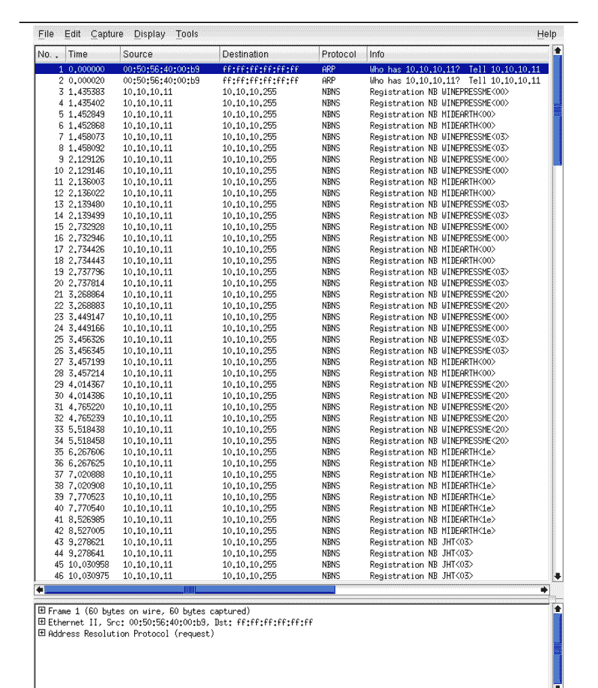
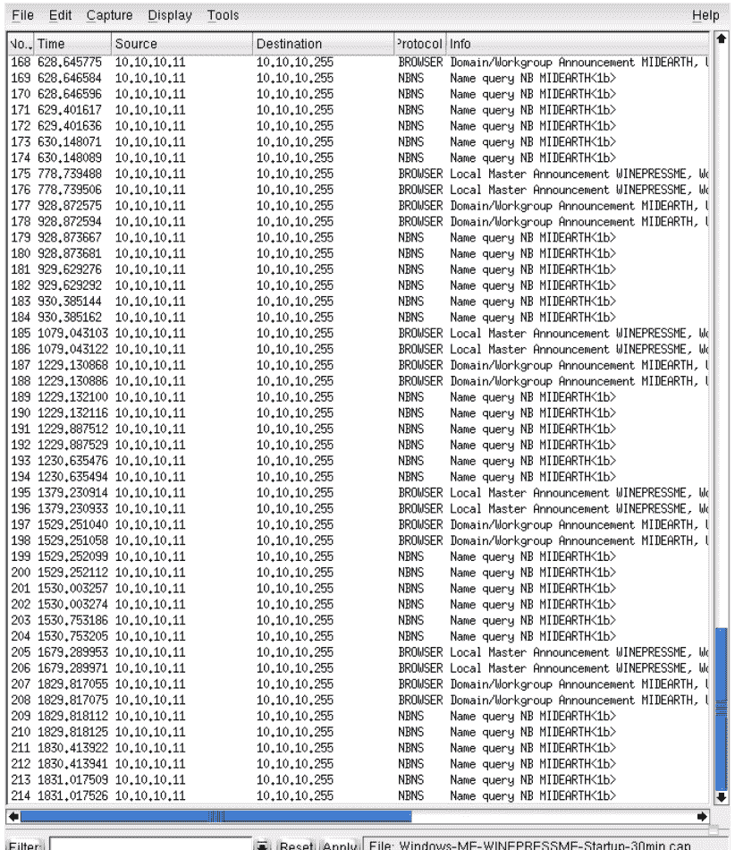
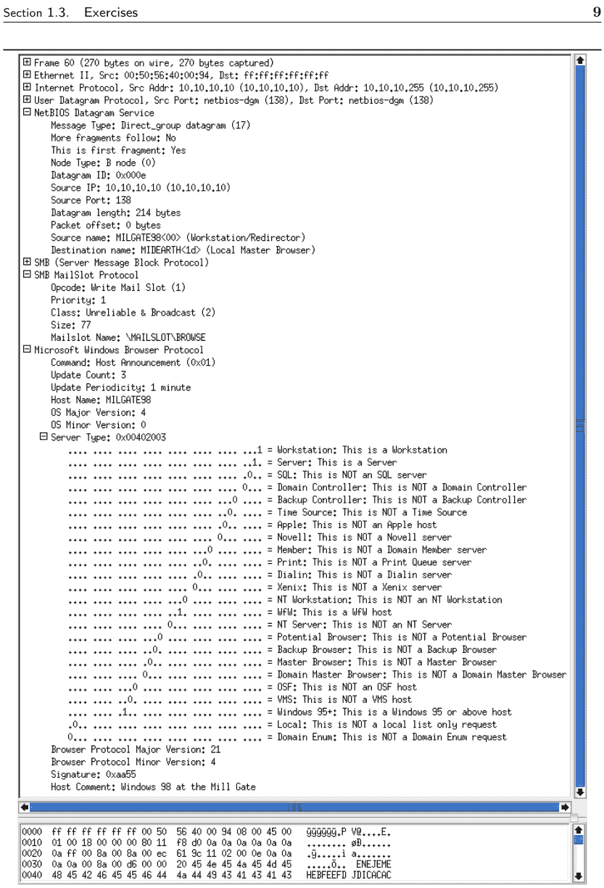
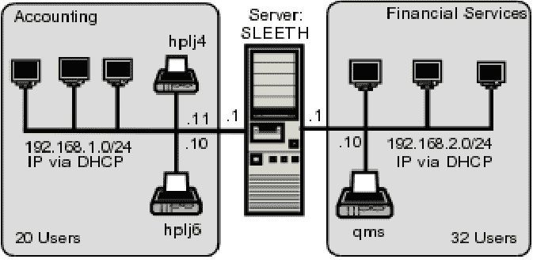
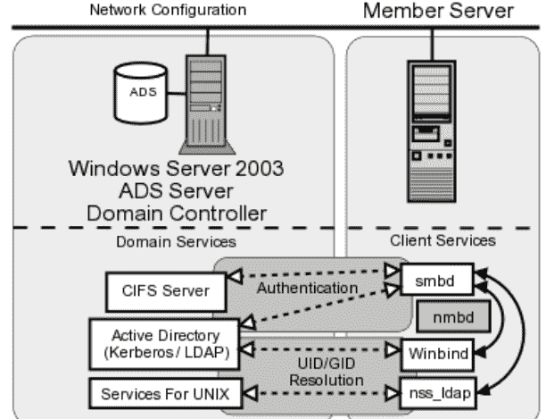
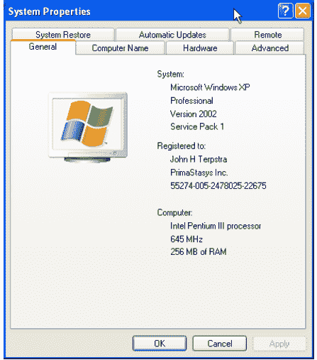
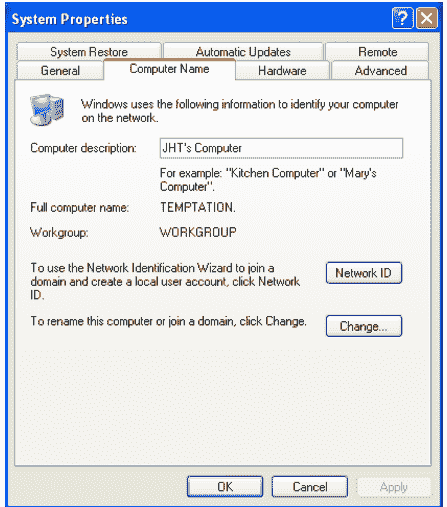
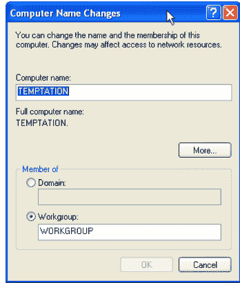
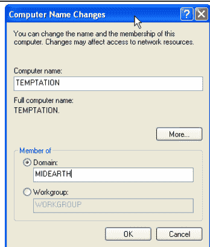
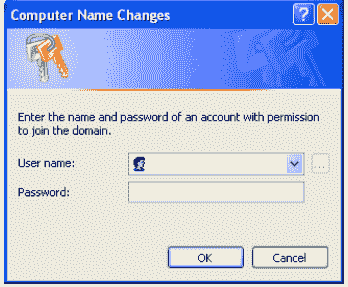

# Samba-3 示例：成功部署实践练习

## Bruce Perens 开源系列

http://www.phptr.com/perens

- C++ GUI Programming with Qt 3  
  Jasmin Blanchette, Mark Summerfield

- Managing Linux Systems with Webmin: System Administration and Module Development  
  Jamie Cameron

- Understanding the Linux Virtual Memory Manager  
  Mel Gorman

- Implementing CIFS: The Common Internet File System  
  Christopher R. Hertel

- Embedded Software Development with eCos  
  Anthony J. Massa

- Rapid Application Development with Mozilla  
  Nigel McFarlane

- The Linux Development Platform: Configuring, Using, and Maintaining a Complete Programming Environment  
  Rafeeq Ur Rehman, Christopher Paul

- Intrusion Detection Systems with Snort: Advanced IDS Techniques with Snort, Apache, MySQL, PHP, and ACID  
  Rafeeq Ur Rehman

- The Official Samba-3 HOWTO and Reference Guide  
  John H. Terpstra, Jelmer R. Vernooij, Editors

- Samba-3 by Example: Practical Exercises to Successful Deployment  
  John H. Terpstra

## 关于封面 artwork

本书的封面 artwork 延续了为书籍《The Official Samba-3 HOWTO and Reference Guide》选择的主题，该书的封面 featuring a Confederate scene。Samba 对 Microsoft Windows 桌面系统的网络部署产生了重大影响。两本官方 Samba 书籍的封面 artwork 讲述了同样对未来产生重大影响的事件。

*Samba-3 by Example 封面 Artwork*：阿尔弗雷德大帝（生于 849 年，统治 871-899 年）是英格兰有史以来最了不起的国王之一。他保卫盎格鲁-撒克逊英格兰免受维京人袭击，制定了法典，并促进了宗教和学术活动的复兴。他的统治展现了军事技能和创新能力、健全的治理能力以及激励人们规划未来的能力。阿尔弗雷德在一切抵抗似乎都已徒劳的时候解放了英格兰。

Samba 是一种网络互操作性解决方案，为网络管理员提供了真正的选择。它是 Microsoft Windows 网络的补充，提供了 UNIX 系统与 Microsoft Windows 桌面和服务器系统的互操作性。您可以利用 Samba 来实现它为您的网络环境提供的自由，这得益于一支在幕后工作的专注团队，他们为您提供了更好的选择。这些少数专注的开发人员的努力继续塑造着 Windows 互操作性格局的未来。尽情享受吧！

## 致谢

《Samba-3 by Example》如果不是因为《The Official Samba-3 HOWTO and Reference Guide》一书的审稿人提供的反馈，就不会被撰写出来。我希望这本书不仅能回应挑战，还能填补我被提醒注意到的空白。

我深深感谢一大群勤奋的人。篇幅限制使我无法列出他们所有人，但有几个人值得一提，值得提及。Jelmer Vernooij 做出了显著贡献，他构建了 XML 制作环境，从而使本书的排版成为可能。

如果没有 Andrew Tridgell 迈出第一步，Samba 就不会存在。他继续领导这个项目。在他的庇护下，有一些伟大的人从不放弃，总是乐于助人。感谢：Jeremy Allison、Jerry Carter、Andrew Bartlett、Jelmer Vernooij、Alexander Bokovoy、Volker Lendecke，以及其他回答了我源源不断的问题的团队成员——所有这些都促成了本书内容的改进。

我还要衷心感谢一小群审稿人（按字母顺序列出），他们提供了实质性的反馈和重大的改进建议：Roland Gruber、Luke Howard、Jon Johnston、Alan Munter、Tarjei Huse、Mike MacIsaac、Scott Mann、Ed Riddle、Santos Soler、Mark Taylor 和 Jérôme Tournier。

我要感谢另外 30 多位审稿人组成的团队，他们帮助我在黑暗的角落中找到方向。

特别要提及的是 Lyndell、Amos 和 Melissa，他们给了我必要的自由度，使我能够花费将近一整年的时间撰写 Samba 文档。

## 前言

### 丹·库斯涅茨基（Dan Kusnetzky），国际数据公司（IDC）

IDC 软件研究小组对软件市场（包括操作环境）的研究已有二十余年。1994 年，系统软件研究团队开始收到订阅用户关于 Linux 的询问。最初听到这些询问时，我们几乎没有实证数据可以提供，因此 IDC 将 Linux 纳入其操作环境研究议程。1995 年初，IDC 首批关于 Linux 的供需研究报告开始问世。

IDC 见证了 Linux 从计算机爱好者的软件发展成为全球许多市场的主流选择。这一进程与 UNIX 在 20 世纪 70 年代和 80 年代所经历的采用周期非常相似。Windows 在 80 年代和 90 年代也重复了这一采用模式。IDC 长期以来一直预测，到 2005 年底，Linux 将成为几乎所有市场的主流选择。该软件现已在这条道路上稳步前进，甚至可能超出 IDC 的预期。

截至 2002 年底，Linux 是全球第三大桌面或客户端操作环境，占全球客户端操作环境软件出货量的近 3%。Linux 是全球第二大服务器操作环境，占全球服务器操作环境软件出货量的近 25%。这与 IDC 首次发布 Linux 研究成果时，Linux 在客户端和服务器操作环境市场中均不足 1% 份额的 humble 起步相比，是一个惊人的增长水平。

IDC 的需求端研究表明，Linux 最常被用作基础基础设施服务的平台，例如支持共享文件和打印机的访问，或支持基础网络功能。IDC 最近于 2003 年底进行的调查表明，支持文件和打印服务是 Linux 最常见的用途。Samba 和 NFS 是在 Linux 上提供文件和打印服务时最常被提及的方法。

几乎所有 IDC 的操作环境研究都表明，Linux 正在被添加到已经包含 Windows、UNIX 和大型机操作环境的组织网络中。当然，这意味着与这些操作环境的互操作性是 Linux 取得成功的关键因素。

所有这些都引出了手头这本书，约翰·H·特普斯特拉（John H. Terpstra）所著的《Samba-3 实例详解》（Samba-3 By Example）。它解答了关于将 Linux 和 Samba 引入以 Windows 或 UNIX 为中心的环境时最常见的问题。具体而言，各组织表达了对员工是否具备足够的专业知识来促进 Linux 和 Samba 采用过程中的开发、管理、运营和支持活动的担忧。我预计《Samba-3 实例详解》将对希望获得 Linux 和 Samba 使用舒适感和熟悉度的 Windows 或 UNIX 管理员提供巨大帮助。

Samba 是一款成熟的开源软件产品，已稳固确立为大型 UNIX 系统上领先的 Windows 文件和打印技术。其稳定性和可扩展性似乎备受推崇。本书展示了实施 Samba-3 的简便方法，无论您的网络规模大小。这是一本非常值得加入网络管理员书库的佳作！

> ——丹·库斯涅茨基（Dan Kusnetzky），IDC 系统软件研究副总裁

### 安德鲁·特里奇韦尔（Andrew Tridgell），Samba 团队

我一直是那种通过实例学习效果最好的计算机用户。看到一个完整的、与软件实际应用场景匹配的例子，能比阅读详细手册让我更好地理解该软件。如果你和我一样，也是那种通过实例学习效果最好的计算机用户，那么这本书就是为你而写的。

我也很高兴看到书中使用 Ethereal 来演示 Samba 使用的网络协议。Ethereal 已经发展成为一个非常复杂的网络分析工具，熟悉 Ethereal 的使用对任何系统管理员来说都是一项非常有用的技能。

享受这本书，并充分利用 Samba！

> ——安德鲁·特里奇韦尔（Andrew Tridgell），Samba 团队负责人

## 序言

网络管理员的生活很忙碌。我们面临着各种干扰和压力，这促使我们寻求经过验证的、可快速实施的现成案例方案。然而，这种方法往往让我们陷入困境。有句俗话说，从几何学角度看，两点之间直线最短，但实际上我们发现，通往稳定网络解决方案的最快路径往往是绕远路。

这本书就是您通往直路的途径。它提供了经过验证的、可正常运行的 Samba 部署逐步教学示例。如果您希望以最少的 effort 部署 Samba-3，或者希望在不查阅大量文档的情况下成为部署 Samba-3 的专家，那么这本书就是通往您目的地的车票。

Samba 是可以在非 Microsoft Windows 平台上运行的软件，例如 UNIX、Linux、IBM System 390、OpenVMS 和其他操作系统。Samba 使用安装在主机服务器上的 TCP/IP 协议。配置正确时，它可以使该主机与 Microsoft Windows 客户端或服务器交互，就像它是一个 Windows 文件和打印服务器一样。本书将帮助您实现与 Windows 兼容的文件和打印服务。

本书中呈现的示例具有各种企业的代表性，反映了它们面临的问题和挑战。我们已谨慎地保留了真实网络案例研究中的态度、认知、实践和需求。仔细完成每个练习，您可以从本书中获得最大收益。您可能急于满足特定需求，因此请随意找到最接近您需求的示例，复制它，并尽情创新。最重要的是，享受学习由 Samba 真正解放的 MS Windows 网络奥秘的过程。

本书的重点是 Samba-3。书中就如何使 Samba 安全运行做了具体说明。本书不试图提供关于外围服务和应用程序（如 OpenLDAP、DNS 和 DHCP）安全操作和配置的详细信息，这些需求可以从其他专门致力于该主题的资科中得到满足。

## 为什么需要这本书？

这本书是观察和反馈的结果。来自《Samba-HOWTO 合集》的反馈积极而肯定。人们要求提供更多经过充分讲解的示例、一本“Samba 烹饪书”（Samba Cookbook），以及有助于掌握 Samba 的培训材料。

Samba 邮件列表的用户要求提供可用的示例配置文件。在达到最低必要的知识水平之前，人们自然会质疑自己正确配置 Samba 等复杂工具的能力。

《Samba-HOWTO 合集》以及《Samba-3 官方 HOWTO 与参考指南》（The Official Samba-3 HOWTO and Reference Guide）都是在主题背景下记录 Samba 特性和功能的。本书采取了完全不同的方法。它详细介绍了在特定环境背景下正常运行的 Samba 网络配置，提供了有文档记录的逐步实施方案。所有示例案例的配置文件、脚本和其他工具都提供在 CD-ROM 上。本书是描述性的，提供了详细的图表，使 Samba-3 的部署变得轻而易举。

### 前提条件

本书不是 UNIX 或 Linux 管理的教程。UNIX 和 Linux 培训最好从专门致力于该主题的书籍中获得。本书假设您至少具备使用这些操作系统的基本技能，并且可以使用基本系统编辑器来编辑和配置文件。本书的撰写基于以下假设：您具有 Samba 使用经验，已阅读《Samba-3 官方 HOWTO 与参考指南》和《Samba-HOWTO 合集》，或者熟悉 Microsoft Windows。

如果您没有这些经验，您可以跟随本书中的示例，但有时可能会发现书中做出的假设令您感到困惑。在这种情况下，您可能需要参阅操作系统平台的管理指南或手册，以找到实现本书所述内容的最佳方法。

### 方法

第一章讨论了一些相当棘手的网络分析问题。请不要因此而却步。即使不包含对网络协议分析的深入理解，您所获取的信息也能帮助您理解 Windows 网络的功能。

本书随后的每一章都以一个假设站点所寻求的网络解决方案描述开篇。鲍勃·乔丹（Bob Jordan）是一家虚构公司 `Abmas Biz NL` 的假设决策者。我们将使用不存在的域名 `abmas.biz`。关于该公司呈现的所有事实均为虚构，来源于多年来各种真实业务场景。这些场景均未透露其来源的真实公司的身份。

无论如何，乔丹先生喜欢给他的所有员工一些棘手的任务。斯坦利·萨罗卡（Stanley Saroka）是他的门生之一；克里斯汀·罗伯森（Christine Roberson）是鲍勃信任的网络管理员。乔丹倾向于善待其他部门，因为它们为 Abmas 的 IT 运营提供资金。

每一章都呈现了我们选择演示的网络解决方案摘要，以及帮助您理解推动该解决方案的思考过程的原理。然后，该章详细记录了所有配置文件和步骤。

必须采取一定步骤来实施示例解决方案。任何希望从本书中获得真正价值的读者，都应当注意各要点的潜在影响，因此请留意那些“这意味着”的标注。

每一章都包含一系列问题与解答，以帮助你理解和消化所介绍解决方案的关键特性。

## 主题概要

我们的首要任务是了解微软 Windows 产品在局域网环境中的工作方式。这就是我们的起点。让我们花几分钟时间，从宏观上浏览一下本书。记住，这是一本关于文件与打印技术部署的书；书中包含大量打印解决方案的优秀示例。开始吧。

**第 1 章 — Windows 网络基础** — 本章涵盖实践练习，帮助我们理解 MS Windows 网络协议的工作原理。网络协议分析器有助于你认识到 Windows 网络高度依赖广播消息。此外，你还可以查看 Windows 客户端发送给网络服务器以建立网络连接的网络数据包。完成后，你应该对网络浏览功能有基本的了解，并看到 Windows 客户端发送给文件和打印服务器以创建连接的部分信息，Windows 客户端发送给文件和打印服务器以创建连接，在此基础上可以进行文件和打印操作。

**第 2 章 — 简洁型 Samba 服务器** — 在这里，你为三家名为 Abmas 的公司设计了三种不同业务场景的解决方案。其中两个是简单的网络问题，另一个则是稍微复杂一些的网络挑战。在前两个案例中，Abmas 拥有一个小型简单的办公室，他们希望替换掉 Windows 9x 对等网络。第三个示例企业使用 Windows 2000 Professional。这必须很简单，让我们看看能走多远。如果成功，Abmas 将快速成长，很快需要更换所有服务器和工作站。

*技术信息* — 本章要求：

- 案例 1：最简单且合理可用的 `smb.conf` 文件。同样适用于 Samba-2.x。此配置使用共享模式安全。不使用加密密码，因此没有 `smbpasswd` 文件。
- 案例 2：另一个简单的 `smb.conf` 文件，增加了 WINS 支持和打印支持。此案例处理一项特殊需求，展示如何应对专用软件对特定共享名称和打印要求的特殊需求。此配置使用共享模式安全，同样适用于 Samba-2.x。不使用加密密码，因此没有 `smbpasswd` 文件。
- 案例 3：此 `smb.conf` 配置使用用户模式安全。文件共享配置展示了如何为管理员提供主控访问权限，同时将全体员工限制在他们自己的工作区域内。使用加密密码，因此隐式存在 `smbpasswd` 文件。

**第 3 章 — 小型办公网络** — Abmas 现已是一家成功的公司。他们拥有 50 名网络用户，希望从网络中获得更多动力。这是一个典型的小型办公室，他们希望获得更好的系统来帮助成长。这是你为高级用户提供更多功能和实用性的绝佳机会。

*技术信息* — 此 `smb.conf` 文件使用加密密码，因此存在 `smbpasswd` 文件。它还展示了如何使用 `valid users` 和 `valid groups` 来限制共享访问。Windows 客户端作为域成员访问服务器。移动用户在办公室时登录到域，而在外出时使用本地机器账户。结果是一个能够满足移动计算用户需求的环境。

**第 4 章 — 安全办公网络** — Abmas 现在正在迅速扩张。资金有点紧张，但拥有 130 名网络用户，安全问题已经成为一个顾虑。他们有许多新机器需要安装，旧设备将被淘汰。这次他们希望新的网络能够扩展和成长至少两年。从一个充足的系统开始，并预留增长空间。你现在正在实施互联网连接，但对用户期望有一些顾虑。

*技术信息* — 此 `smb.conf` 文件使用加密密码，你可以使用 `tdbsam` 密码后端。引入了域登录。应用程序从中央服务器提供。强制使用漫游配置文件。对服务器的访问进行收紧，以便只有域成员才能访问服务器资源。移动计算需求仍然得到满足。

**第 5 章 — 500 用户办公室** — 两年预期目标已经达成。恭喜你，你是明星。现在 Abmas 需要更换网络。在现有用户基础上，他们需要合并一家刚刚收购的 280 用户公司。是时候构建一个认真的网络了。现在校园内有三栋大楼，你的任务是在新网络推出的同时让所有人继续工作。哦，推出全新的客户端和服务器不是很棒吗！资金不再紧张，你可以购买和安装你要求的设备。你将安装路由器和防火墙。这真令人兴奋！

*技术信息* — 此 `smb.conf` 文件使用加密密码，并使用 `tdbsam` 密码后端。你还没有准备好进入 LDAP，所以你接受拥有一个中央域控制器，并在校园内两栋大楼中各有一个域成员服务器的限制。使用了许多巧妙的技巧来展示 Samba 内置的一些智能选项。

**第 6 章 — 使用户满意** — 再次恭喜你。Abmas 对你的服务很满意，你又获得了一次加薪。你的用户变得越来越能干，开始抱怨一些需要修复的小问题。你能胜任这个任务吗？Mary 说她登录网络需要 20 分钟，这严重影响了她的工作效率。电子邮件有点*不可靠*——你是不是在工作上偷懒了？我们不讨论电子邮件技术，但当邮件客户端因网络问题而无法使用时，你最好赶紧解决。是时候做出改变了。


*技术信息* — 此 `smb.conf` 文件使用加密密码；使用分布式的 `ldapsam` 密码后端。启用漫游配置文件。引入桌面配置文件控制。查看可以改善用户网络性能体验的技巧。作为特别奖励，本章记录了如何配置打印机驱动程序 `oria` 的智能下载，以支持拖放打印功能。而且，是的，配置 CUPS 的秘诀也有详细记录。去试试吧；这一章也会让你感兴趣的。

# 第7章 — 分布式 2000 用户网络

仅仅八个月过去了，Abmas 又收购了一家公司。你现在需要进一步扩展网络。你必须处理一个跨越多个国家的网络。除了总部校园原来的三栋大楼外，还有三个新网络。总部在纽约，你在华盛顿、洛杉矶和伦敦设有分支机构。你的桌面标准是 Windows XP Professional。在许多方面，一切都变了，但又必须保持不变。你的团队已经准备好进行另一次推出。你知道前方还有更多的挑战。

*技术信息* — 引入从属 LDAP 服务器。配置 Samba 使用多个 LDAP 后端。这是一个简短的章节；它假设技术已经掌握，直接进入概念和如何部署它们。

# 第8章 — 将 NT4 域迁移到 Samba-3

又过了六个月。Abmas 又收购了一家公司。你需要找到一种方法，将所有用户从旧网络迁移到现有网络，且不丢失密码，并在一个周末内完成变更。愿原力（和咖啡因）与你同在，愿你背风而立，愿阳光照耀你的脸庞。

*技术信息* — 本章展示了使用 LDAP `ldapsam` 后端以及使用 `tdbsam` passdb 后端进行 `net rpc migrate` 操作。这两者都是大家经常询问的 NT4 域迁移示例。

# 第9章 — 添加 UNIX/Linux 服务器和客户端

干得好，Bob，你的团队已经取得了很多成就。现在帮助 Abmas 整合整个网络。你希望集中控制和集中支持，同时需要削减成本。如何在减少管理开销的同时，获得更好的网络控制？

本章由 Mark Taylor <mark.taylor@siriusit.co.uk> 贡献，基于一个真实站点。有关此示例案例的更多信息，请直接联系 Mark。

*技术信息* — 现在是时候考虑如何添加 Samba 服务器以及 UNIX 和 Linux 网络客户端了。转换到 Linux 的用户希望能够使用 Windows 网络账户登录。你将探索 `nss_ldap`、`pam_ldap`、`winbind`，以及一些用于掌控的巧妙技巧。你准备好吗？

# 第10章 — Active Directory、Kerberos 和安全

Abmas 又收购了一家刚刚迁移到 Windows Server 2003 和 Active Directory 的公司。你的一位员工随口评论了几句，让你陷入了困境。一位网络安全审计员受新业务部门负责人聘请，提交了一份措辞严厉的报告，你必须处理其中报告的*缺陷*。你新聘请的网络工程师希望用纯 Kerberos 解决方案取代 Microsoft Active Directory。你将如何应对？

*技术信息* — 本章就是你的答案。了解共享访问控制、UNIX/Linux 文件系统访问控制的正确使用，以及 Windows 200x 访问控制列表。遵循这些步骤来击败批评者。

# 第11章 — 集成附加服务

战斗即将结束，Samba-3 已经赢得了胜利。你的团队欢欣鼓舞，现在你又一次站在十字路口。Abmas 收购了一家零食企业，你许下了承诺必须兑现。IT 成本必须降低，你面临新的阻力，但你会再次获胜。这次你选择安装 Squid 代理服务器，以证明 Samba 远不止是一个文件和打印服务器。SPNEGO 认证支持意味着你的 Microsoft Windows 客户端可以获得透明的代理访问。

*技术信息* — Samba 提供了 `ntlm_auth` 模块，使 MS Windows Internet Explorer 能够通过 Squid Web 和 FTP 代理服务器进行连接。你将配置 Samba-3 以及 Squid，以基于 Active Directory 域用户安全凭据提供认证访问控制。

# 第12章 — 性能、可靠性和可用性

Bob，你确定新的 Samba 服务器能够承受负载吗？你的网络正在为众多用户提供服务，他们有可能因此变得效率低下。你能做些什么来超前于需求？还能同时将成本控制好吗？可能会出什么问题？

*技术信息* — 为你的网络注入激情的热门技巧。避免名称解析问题、识别网络冲突的潜在原因、避免会使服务器不堪重负的 Samba 配置选项。MS 分布式文件服务让你的网络飞速运行，等等。本章包含大量"*我跟你说过这个吗……？*"类型的提示，帮助你在顶尖性能榜单上保持领先地位。

## 使用的约定

本书通篇使用以下符号约定：

- TOSHARG 用作本书的缩写，"*The Official Samba-3 HOWTO and Reference Guide*"（《Samba-3 官方 HOWTO 和参考指南》），编辑：John H. Terpstra 和 Jelmer R. Vernooij，出版商：Prentice Hall，ISBN：0131453556。

- 目录和文件名使用等宽字体显示。例如，`/etc/pam.conf`。

- 可执行文件名使用粗体。例如，`smbd`。

- 菜单项和按钮使用粗体显示。例如，点击 **Next**（下一步）。

- 选择菜单项的表示方式为：**Start → Control Panel → Administrative Tools → Active Directory Users and Computers**（开始 → 控制面板 → 管理工具 → Active Directory 用户和计算机）

# 第1章

## 网络入门

你将要使用相当于显微镜的工具来观察流经 Windows 网络血管的信息。我们更多的是观察这些信息，而不是盘问它们。完成本章后，你应该对通过网络传输的信息类型有很好的理解。别担心，这不是生物课。我们不会让你陷入不必要的细节。告诉自己，*"这很简单，"* 然后毫无畏惧地完成每个练习。

Samba 可以以最小的复杂度进行配置。在你深入了解复杂性之前，应该先掌握简洁性。让我们开始吧，我们有工作要做。

## 1.1 要求和注意事项

成功完成本章需要两台 Microsoft Windows 9x/Me 工作站，以及两台 Microsoft XP Professional 工作站，每台都配备以太网卡并通过集线器连接。另外还需要一台附加服务器（Windows NT4 Server、Windows 2000 Server，或运行在 UNIX/Linux 上的 Samba-3），运行网络嗅探和分析应用程序（`ethereal` 是一个不错的选择）。所有工作都应在没有其他流量的安静网络上进行。最好在练习时仅将测试机连接到专用集线器。

Ethereal 已成为许多网络管理员首选的网络协议分析器。你可以从 Ethereal[1] 网站找到有关此工具的更多信息。适用于 Windows 的 Ethereal 安装文件可从 Ethereal 网站获取。Ethereal 随 SUSE 和 Red Hat Linux 发行版提供，以及许多其他 Linux 发行版。它可能默认未安装在你的系统上。如果未安装，你可能还需要先安装 `libpcap` 软件，然后才能安装或使用 Ethereal。请参阅你的操作系统说明或 Ethereal 网站，了解有关 Ethereal 安装和操作的信息。

要为你的系统获取 `ethereal`，请访问 Ethereal 下载站点。[2]

- [1] http://www.ethereal.com

- [2] http://www.ethereal.com/download.html#binaries

> **注意**

> 成功完成本章要求你使用 `ethereal` 捕获网络流量。建议你使用集线器，而不是以太网交换机。所使用设备必须作为中继器，而不是过滤器。以太网交换机可能会过滤掉未定向到用于监控流量的机器的流量；这将使你无法完成项目。

如果你无法访问所有这些设备，也不必过于担心；练习中的网络捕获已提供在随附的 CD-ROM 上。这使得你可以直接深入练习的分析部分，如果你愿意的话。

请不要因为本章使用高级分析工具（`ethereal`）而感到惊慌。我们只向你展示完成本章练习所需的最少细节。如果你选择使用任何其他网络嗅探器和协议分析工具，请注意它可能不允许你检查 Windows 200x/XP 使用的最新添加的安全协议的内容。

你可以浏览练习并尝试吸收其中的要点。练习提供了所有必要的信息来说服顽固的网络工程师。你可能不需要那么多说服，可能只想继续前进，在这种情况下，你至少应该阅读第 1.4 节。

第 1.5 节还提供了有用的信息，可能帮助你避免耗时的网络问题。

## 1.2 简介

本章的目的是让你熟悉 Microsoft Windows 网络计算的关键方面。如果你想要扎实的技术基础，不要跳过这些练习。所涵盖的要点是 Samba 邮件列表上的常见问题。

你可以从这些练习中看到，Windows 网络涉及相当多的网络广播流量。你可以查看一些数据包的内容，但只是为了查看 Windows 客户端在建立网络连接过程中向服务器发送的某些特定信息。

对许多人来说，浏览就是使用 Microsoft Internet Explorer 时发生的一切。只有当你开始查看网络流量并注意所使用的协议和信息类型时，你才能开始理解 Windows 网络的复杂性，更重要的是，了解需要配置什么才能使其工作。有关浏览的详细信息，请参阅推荐的预备阅读。

推荐的预备阅读：*The Official Samba-3 HOWTO and Reference Guide*（TOSHARG）第 9 章"网络浏览"，以及第 3 章"服务器类型和安全模式"。

### 1.2.1 任务分配

你即将见证 Microsoft Windows 计算机网络的功能。这些练习逐步介绍客户端机器如何建立与远程 Windows 服务器的连接。你将观察 Windows 机器如何找到彼此（即浏览如何工作），以及两种关键类型的用户识别（共享模式安全和用户模式安全）如何受到影响。

与 Samba 一起工作时，MS Windows 网络使用的网络协议使用 TCP/IP 作为传输协议。特定于 Windows 网络的协议封装在 TCP/IP 中。我们使用的网络分析器（`ethereal`）能够向你显示 TCP/IP 数据包（或消息）的内容。

第 1 章 — 任务

1. 检查网络跟踪，以观察 SMB 广播、主机广播和名称解析过程。

2. 检查网络跟踪，以观察共享模式安全的功能。

3. 检查网络跟踪，以观察用户模式安全的使用。

4. 查看 Windows 9x/Me 客户端的网络登录跟踪，以及 Windows XP Professional 客户端的域登录跟踪。

### 1.3 练习

你正在开始一段发现之旅。练习的第一部分需要两台 MS Windows 9x/Me 系统。我们将一台机器称为 `WINEPRESSME`，另一台称为 `MILGATE98`。每台都需要一个 IP 地址；我们使用了 `10.1.1.10` 和 `10.1.1.11`。测试机器需要通过*集线器*联网。需要一台 UNIX/Linux 机器来运行 `ethereal`，以便捕获网络活动。重要的是，从中捕获网络活动的机器不得干扰 Windows 工作站的运行。这台机器对网络保持被动（不发送广播信息）会有所帮助。

对于这些练习，我们的测试环境包括一台运行 VMWare 3.2 的 SUSE 8.2 Professional Linux 工作站。准备了以下 VMWare 镜像：

- Windows 98 — 名称：`MILGATE98`。

- Windows Me — 名称：`WINEPRESSME`。

- Windows XP Professional — 名称：`LightrayXP`。

- 在 SUSE Enterprise Linux 8.0 机器上运行的 Samba-3.0.2。

为每个练习选择一个工作组名称（`MIDEARTH`）。

本书背面 CD-ROM 上提供的网络捕获是使用 `ethereal` 版本 0.9.10 捕获的。较新版本没有问题，但较早版本可能无法显示所有需要的信息。每个捕获文件都有一个解码版本作为跟踪文件列出。还包含了所有数据包的摘要。这使得你可以尽情学习，无需执行耗时的设备配置和测试工作。这是一个指出以下价值的机会：本书确实值得你花足够的时间，仔细并注重细节地练习每个练习。

### 1.3.1 单主机广播活动

在本节中，我们启动一台 Windows 9x/Me 主机，然后监控其网络活动 30 分钟。

- 1. 启动用于监控网络活动的机器（使用 `ethereal`）。启动 `ethereal`，点击 **Capture** → **Start**。点击以下选项：

  - (a) Update list of packets in real time

  - (b) Automatic scrolling in live capture

  - (c) Enable MAC name resolution

  - (d) Enable network name resolution

  - (e) Enable transport name resolution

  点击 **OK**。

- 2. 启动待监控的 Windows 9x/Me 主机。让其运行整整 30 分钟。监控期间，不要按任何键盘按键，不要点击任何屏幕上的图标或菜单；也不要回应任何对话框。

- 3. 30 分钟结束后，停止捕获。将捕获内容保存到文件中，以便稍后回看。让这台机器保持运行，为 1.3.2 节中的任务做准备。

- 4. 分析捕获内容。识别捕获到的每种独立的消息类型。注意使用了哪种传输协议。识别相同类型消息之间的时间间隔。

#### 1.3.1.1 发现

数据包捕获前 10 分钟的汇总应如图 1.1 所示。同一捕获稍后阶段的屏幕截图如图 1.2 所示。

观察到的广播消息如表 1.1 所示。实际观察结果会有少许差异，但不大。在启动过程的早期，Windows Me 主机会广播其主机名，原因有二：首先，确保其名称不会导致命名冲突；其次，向本地主浏览器（Local Master Browser, LMB）建立其存在。

从数据包跟踪中应注意，没有任何消息通过 TCP/IP 传播；所有消息都使用 UDP/IP。当达到稳态运行时，会出现各种公告、浏览主控重新选举和名称查询的循环。这些构成了网络浏览得以实现的"公告交响乐"。

有关 CIFS/SMB 协议精确行为的详细信息，读者请参阅 Christopher Hertel 所著 *"Implementing CIFS: The Common Internet File System"*，出版社：Prentice Hall PTR，ISBN：013047116X。

## 第 1.3 节 练习





| 消息 | 类型 | 数量 | 备注 |

|---------|------|-----|-------|

| `WINEPRESSME<00>` | Reg | 8 | 4 组 2 个，间隔 0.6 秒。 |

| `WINEPRESSME<03>` | Reg | 8 | 4 组 2 个，间隔 0.6 秒。 |

| `WINEPRESSME<20>` | Reg | 8 | 4 组 2 个，间隔 0.75 秒。 |

| `MIDEARTH<00>` | Reg | 8 | 4 组 2 个，间隔 0.75 秒。 |

| `MIDEARTH<1d>` | Reg | 8 | 4 组 2 个，间隔 0.75 秒。 |

| `MIDEARTH<1e>` | Reg | 8 | 4 组 2 个，间隔 0.75 秒。 |

| `MIDEARTH<1b>` | Qry | 84 | 稳定运行时每隔 300 秒。 |

| `__MSBROWSE__` | Reg | 8 | 赢得浏览主控选举后注册。 |

| `JHT<03>` | Reg | 8 | 4 x 2。这是登录 Windows 的用户名。 |

| Host Announcement `WINEPRESSME` | Ann | 2 | 在 10 秒时观察到。 |

| Domain/Workgroup Announcement `MIDEARTH` | Ann | 18 | 稳定运行时每隔 300 秒。 |

| Local Master Announcement `WINEPRESSME` | Ann | 18 | 稳定运行时每隔 300 秒。 |

| Get Backup List Request | Qry | 12 | 启动早期 6 x 2，间隔 0.5 秒。 |

| Browser Election Request | Ann | 10 | 启动早期 5 x 2。 |

| Request Announcement `WINEPRESSME` | Ann | 4 | 启动早期。 |

### 1.3.2 第二台主机启动广播交互

此时，用于捕获单系统启动跟踪的机器应该仍在运行。此任务的目标是识别两台主机在广播活动方面的交互。

- 1. 在用于监控网络活动的机器上（使用 `ethereal`），启动 `ethereal` 并点击 **Capture** → **Start**。点击：

  - (a) Update list of packets in real time

  - (b) Automatic scrolling in live capture

  - (c) Enable MAC name resolution

  - (d) Enable network name resolution

  - (e) Enable transport name resolution

  点击 **OK**。


- 2. 启动第二台 Windows 9x/Me 主机。让其运行 15-20 分钟。监控期间，不要按任何键盘按键，不要点击任何屏幕上的图标或菜单，也不要回应任何对话框。
- 3. 捕获时间结束后，停止捕获。务必保存捕获的数据，以便日后需要时可以再次查看网络数据捕获。
- 4. 分析捕获跟踪，注意使用的传输协议、观察到的消息类型，以及两台主机之间发生的交互。让两台机器保持运行，以便进行下一个任务。

### 1.3.2.1 发现

表 1.2 汇总了观察到的捕获统计信息。与之前的情况一样，所有公告都使用 UDP/IP 广播。此外，正如上一个例子中观察到的，第二台 Windows 9x/Me 主机在启动时会广播其名称，以确保网段上不存在名称冲突（即该名称已被另一台主机注册）。那些希望深入了解此机制确切工作原理细节的人士，请参阅前面提到的《Implementing CIFS: The Common Internet File System》一书。

| 消息 | 类型 | 数量 | 备注 |
|---|---|---:|---|
| MILGATE98<00> | Reg | 8 | 4 组 2 个，间隔 0.6 秒。 |
| MILGATE98<03> | Reg | 8 | 4 组 2 个，间隔 0.6 秒。 |
| MILGATE98<20> | Reg | 8 | 4 组 2 个，间隔 0.75 秒。 |
| MIDEARTH<00> | Reg | 8 | 4 组 2 个，间隔 0.75 秒。 |
| MIDEARTH<1d> | Reg | 8 | 4 组 2 个，间隔 0.75 秒。 |
| MIDEARTH<1e> | Reg | 8 | 4 组 2 个，间隔 0.75 秒。 |
| MIDEMILGATE98<20> | Reg | 8 | 4 组 2 个，间隔 0.75 秒。 |
| MIDEARTH<1b> | Qry | 18 | 稳定运行时每隔 900 秒。 |
| JHT<03> | Reg | 2 | 这是登录用户的用户名。 |
| Host Announcement MILGATE98 | Ann | 14 | 每 120 秒。 |
| Domain/Workgroup Announcement MIDEARTH | Ann | 6 | 稳定运行时每隔 900 秒。 |
| Local Master Announcement WINEPRESSME | Ann | 6 | 缺乏足够细节以确定频率。 |

观察主机公告、域/工作组公告和本地主控公告的内容具有启发意义。这些消息传达了有关网络上每台主机性质的大量细节。主机公告的解析示例见图 1.3。

### 1.3.3 简单 Windows 客户端连接特性

本练习的目的是探索 Microsoft Windows 客户端如何与远程服务器建立（创建）连接。方法涉及分析 Windows 客户端访问远程服务器的一个关键方面：会话设置协议。

## 第 1.3 节 练习



1. 配置一台 Windows 9x/Me 主机（MILGATE98），创建一个名为 `Stuff` 的共享。为此共享创建“完全访问”控制密码。
2. 配置另一台 Windows 9x/Me 主机（WINEPRESSME）作为客户端。确保其不导出任何共享资源。
3. 启动两台 Windows 9x/Me 主机，让它们稳定运行 10 分钟。使用您选择的用户名（JHT）登录两台机器。等待约两分钟后再继续。
4. 启动 `ethereal`（或您选择的网络嗅探器）。
5. 从 WINEPRESSME 主机，右键点击“网上邻居”，选择“浏览”，选择“我的电脑位置” → “整个网络” → “MIDEARTH” → “MILGATE98” → “Stuff”。输入为 `Stuff` 共享设置的“完全控制”模式密码。
6. 当显示名为 `Stuff` 的共享时，停止捕获。保存捕获的数据，以备日后分析之需。
7. 从捕获的数据包顶部向下扫描，定位第一个被解析为 `Session Setup AndX, User: anonymous; Tree Connect AndX, Path: \\MILGATE98\IPC$` 的数据包。
8. 在解析（分析）面板中，展开 `SMB`、`Session Setup AndX Request` 和 `Tree Connect AndX Request`。检查这两个操作。识别用户帐户的名称和使用的密码。帐户名称应为空。这是一个 NULL 会话设置数据包。
9. 返回到数据包捕获序列。会有许多被解析为 `Session Setup AndX` 类型的数据包。定位最后一个目标为 `\\MILGATE98\IPC$` 服务的数据包。
10. 按照上述方法解析此数据包。此数据包的密码长度应为 24（字符），且应有一个密码字段，其内容是一个长十六进制数字。观察帐户字段中的名称。这是一个用户模式会话设置数据包。

#### 1.3.3.1 发现与评论

`IPC$` 共享在基于 SMB/CIFS 的网络中具有重要作用³。Windows 客户端连接到此资源以获取服务器上可用资源的列表。服务器响应可用的共享和打印队列。在大多数情况下但并非所有情况下，连接时使用 NULL 用户名和 NULL 密码。

检查的两个数据包是关于 Windows 客户端如何与 Samba 互操作的具体证据。Samba 要求每个连接设置都使用有效的 UNIX 帐户凭据（UID/GID）进行身份验证。这意味着即使 NULL 会话设置也只能通过自动映射到有效的 UNIX 帐户来建立。

Samba 为 NULL 或空用户帐户有一个特殊名称。它称之为 `guest` 帐户。此参数的默认值为 `nobody`；但可以更改此映射，将访客账户的功能映射到任何其他 UNIX 身份。一个 NULL Session Setup AndX 数据包解析示例如图 1.4 所示。

# 图 1.4. 典型的 Windows 9x/Me NULL Session Setup AndX 请求

当 UNIX/Linux 系统没有 `nobody` 用户账户（`/etc/passwd`）时，NULL 账户的操作无法进行验证，因此使用访客账户的连接将会失败。这将导致无法浏览 Samba 服务器的所有功能，这是 Samba 邮件列表上报告的常见问题。一个用户模式 Session Setup AndX 示例如图 1.5 所示。

用户模式连接数据包包含账户名和域名。密码以 Microsoft 加密形式提供，其长度显示为 24 个字符。这是 Microsoft 加密密码的长度。

### 1.3.4 Windows 200x/XP 客户端与 Samba-3 的交互

以下练习演示了即使安装了最新服务更新的 MS Windows XP Professional 也会使用 `NULL` 账户以及用户账户的情况。只需按照以下步骤完成此练习。

要完成此练习，您需要一台已配置为 Samba 控制域或 Windows NT4 或 200x Active Directory 域成员的 Windows XP Professional 客户端。此处我们不提供配置详情，因为本书后面将提供完整说明。

1. 启动您的域控制器。同时，启动网络监控计算机，启动 `ethereal`，然后等待下一步完成。
2. 启动 Windows XP 客户端，等待五分钟后再继续。
3. 在将要监控网络活动的计算机（使用 `ethereal`）上，启动 `ethereal` 并点击 **Capture** → **Start**。点击：
   - Update list of packets in real time
   - Automatic scrolling in live capture
   - Enable MAC name resolution
   - Enable network name resolution
   - Enable transport name resolution

   点击 **OK**。
4. 在 Windows XP Professional 客户端上：按 **Ctrl-Alt-Delete** 调出域登录屏幕。使用有效的域用户账户凭据登录。
5. 现在按如下方式连接到域控制器：**Start** → **（右键单击）My Network Places** → **Explore** → {左侧面板} **[+] Entire Network** → {左侧面板} **[+] Microsoft Windows Network** → {左侧面板} **[+] Midearth** → {左侧面板} **[+] Frodo** → {左侧面板} **[+] data**。关闭资源管理器窗口。在此步骤中，我们的域名称为 `Midearth`，域控制器名为 `Frodo`，我们连接到了一个名为 `data` 的共享。
6. 在 `ethereal` 监控计算机上停止捕获。确保将捕获的数据保存到文件中，以便稍后再次查看。
7. 从捕获的数据包顶部开始，向下扫描以找到第一个被解析为 `Session Setup AndX Request, NTLMSSP_AUTH` 的数据包。
8. 在解析（分析）面板中，展开 `SMB`、`Session Setup AndX Request`。展开数据包解码信息，从 `Security Blob:` 条目开始。展开 `GSS-API -> SPNEGO -> netTokenTarg -> responseToken -> NTLMSSP` 键。这将显示这是一个 `NULL` 会话设置数据包。`User name: NULL` 表明了这一点。解码示例如图 1.6 所示。
9. 返回到数据包捕获序列。将有多个被解码为 `Session Setup AndX Request` 类型的数据包。点击最后一个被解码为 `Session Setup AndX Request, NTLMSSP_AUTH` 的数据包。
10. 在解析（分析）面板中，展开 `SMB, Session Setup AndX Request`。展开数据包解码信息，从 `Security Blob:` 条目开始。展开 `GSS-API -> SPNEGO -> netTokenTarg -> responseToken -> NTLMSSP` 键。这将显示这是一个 `User Mode` 会话设置数据包。`User name: jht` 表明了这一点。解码示例如图 1.7 所示。在本例中，用户名为 `jht`。此数据包解码包含 `Lan Manager Response:` 和 `NTLM Response:`。这两个参数的值分别是 Microsoft 加密密码哈希，即 LanMan 密码和 NT（保留大小写）密码哈希。
11. 密码是 24 个字符长的十六进制数。此数据包确认这是一个用户模式会话设置数据包。

#### 1.3.4.1 讨论

此练习表明，尽管近期 MS Windows 客户端处理 Session Setup AndX 的具体协议更加复杂，但底层规则或原则保持不变。因此，这表明 MS Windows XP Professional 客户端仍然使用 `NULL-Session` 连接来查询和定位高级网络技术服务器（使用 Windows NT4/200x 或 Samba）上的资源。它还表明，在使用资源之前必须建立经过身份验证的连接。

### 1.3.5 练习结论

总之，本章已确立以下要点：

- 当启用 NetBIOS over TCP/IP 协议时，MS Windows 网络使用面向广播的消息协议来提供网络服务的知识。
- 网络浏览协议查询存储在浏览主控器上的信息，这些信息由 NetBIOS 名称注册以及持续的主机声明和工作组声明提供。
- 所有 Samba 服务器必须配置一种机制，将 `NULL-Session` 映射到有效但非特权 UNIX 系统账户。
- Microsoft 加密密码的使用已内置于 Windows 网络操作的结构中。此类密码无法从 UNIX `/etc/passwd` 数据库提供，因此必须以 Samba 可以使用的方式存储在 UNIX 系统的其他位置。Samba-2.x 允许此类加密密码存储在 `smbpasswd` 文件或 LDAP 数据库中。Samba-3 允许并发部署使用多个不同的 `passdb backend` 数据库。请参阅《TOSHARG》第 10 章“账户信息数据库”。

## 图 1.6. 典型的 Windows XP NULL Session Setup AndX 请求

## 图 1.7. 典型的 Windows XP 用户 Session Setup AndX 请求

## 1.4 解析与讨论

这些练习演示了 `guest` 账户的使用、MS Windows 客户端和服务器如何将计算机名称解析为 TCP/IP 地址，以及客户端与服务器之间如何建立连接。

希望了解 NetBIOS 名称类型背景信息的人员，请参阅 Microsoft 知识库文章 `Q102878`。[4]

### 1.4.1 技术问题

网络浏览涉及 SMB 广播声明、SMB 枚举请求、与 `IPC$` 共享的连接、共享枚举以及 SMB 连接设置过程。对 Samba 服务器的匿名连接涉及使用必须映射到有效 UNIX UID 的 `guest account`。

## 1.5 问题与解答

本节给出的问题和答案旨在突出 Microsoft Windows 网络的重要方面。

### 常见问题

1. **问：** `MIDEARTH<1b>` 类型查询的意义是什么？

   **答：** 这是 Windows 机器尝试定位域主浏览器（DMB）的广播声明，以防其可能存在于网络上。有关 DMB 的功能及其在网络浏览中作用的详细信息，请参阅《TOSHARG》第 9 章 9.7 节“浏览技术概述”。

2. **问：** `MIDEARTH<1d>` 类型名称注册的意义是什么？

   **答：** 此名称注册记录本地主浏览器（LMBs）的机器 IP 地址。网络客户端可以查询此名称类型以从主浏览器获取浏览器服务器列表。

   LMB 负责监控本地网络上的所有主机声明，并整理其中包含的信息。利用这些信息，它可以回答其他请求信息的 Windows 网络客户端，例如：

   - LMB 已知的机器列表（即浏览列表）
   - 域中所有域控制器的 IP 地址
   - 本地主浏览器（LMB）的 IP 地址
   - 域主浏览器（DMB）的 IP 地址（如果存在的话）
   - 本地网段上本地主浏览器的 IP 地址

3. **问：** `<01><02>__MSBROWSE__<02><01>` 名称注册的作用和意义是什么？

   **答：** 该名称由浏览主控注册，用于广播和接收域公告。其作用范围仅限于本地网段或子网。通过查询此名称类型，拥有多个域的网络上的主浏览器可以找到每个域的主浏览器的名称。

4. **问：** `MIDEARTH<1e>` 类型名称注册的意义是什么？

   **答：** 该名称由域或工作组中的所有浏览主控注册。此注册名称类型称为浏览器选举服务。主浏览器使用此名称类型注册自身，以便域主浏览器可以找到它们来执行跨子网浏览列表更新。此名称类型还用于发起主浏览器选举。

5. **问：** `smb.conf` 中 `guest account` 的意义是什么？

   **答：** 此参数指定将 MS Windows 网络空会话（NULL session）连接映射到的默认 UNIX 账户。用于此映射的 UNIX 账户默认名称为 `nobody`。如果托管 Samba 的 UNIX/Linux 系统没有 `nobody` 账户且未指定其他映射，则网络浏览将完全无法工作。

   需要注意的是，`guest account` 对 Samba 的运行至关重要。操作系统必须具有名为 `nobody` 的账户，或者在 `smb.conf` 文件中必须有包含有效 UNIX 账户的条目。例如，`guest account = ftp`。

6. **问：** 使用 Samba-3 可以减少网络广播活动吗？

   **答：** 是的，有两种方法可以实现。第一种涉及使用 WINS（参见《TOSHARG》第 9 章第 9.5 节“WINS — Windows 互联网名称服务器”），另一种方法是禁用通过 TCP/IP 的 NetBIOS 功能。第二种方法需要正确配置的 DNS 服务器（参见《TOSHARG》第 9 章第 9.3 节“讨论”）。

   使用 WINS 可以减少网络广播流量。当所有网络客户端都配置为在“混合模式（Hybrid Mode）”下运行时，减少效果最为显著。这可以通过使用 DHCP 将所有网络客户端的 NetBIOS 节点类型设置为类型 8 来实现。此外，配置 Samba 使用 `nameətname resolve order = wins host bcast` 也是有益的。

> **注意**
>
> 仅在 Windows 200x/XP Professional 客户端和服务器上，以及与 Samba-3 配合使用时，才能在不使用 NetBIOS 的情况下使用 SMB。

7. **问：** 我可以在 Samba 中只使用纯文本密码吗？

   **答：** 是的，您可以配置 Samba 使用纯文本密码，但这确实会带来一些问题。

   首先，使用基于 `/etc/passwd` 的纯文本密码需要在所有 MS Windows 客户端计算机上修改注册表以启用纯文本密码支持。这显著降低了 MS Windows 客户端操作的安全性。许多网络管理员强烈反对这样做。

   其次，由于默认设置已禁用此功能，Microsoft 已不再维护纯文本密码支持。当客户端断开网络连接时，将无法自动重新建立连接。用户需要注销然后重新登录。纯文本密码支持可能会干扰 Microsoft 迈向更安全计算环境的最新增强功能。

   Samba-3 支持 Microsoft 加密密码。建议不要重新引入纯文本密码处理。只需通过运行以下命令创建用户账户：`smbpasswd -a 'username'`


除非该用户有 UNIX 系统账户，否则无法将用户添加到 `passdb backend` 数据库中。在运行 `winbindd` 以访问 Samba PDC/BDC 来提供 Windows 用户和组账户的系统上，`smb.conf` 文件中设置的 `idmap uid`、`idmap gid` 范围提供了本地身份管理所需的本地 UID/GID。

**8. 问：** `smb.conf` 文件中的哪个参数用于启用加密密码？

**答：** `smb.conf` 文件中控制此行为的参数称为 `encrypt passwords`。Samba-3 中此参数的默认设置为 `Yes (Enabled)`。

**9. 问：** 当 Samba-3 配置为域成员时，是否需要指定 `encrypt passwords = Yes`？

**答：** 不需要。这是默认行为。

**10. 问：** 当 Samba-3 配置为域成员服务器时，是否需要指定 `guest account`？

**答：** 是的。这是服务器上的本地功能。默认设置是使用 UNIX 账户 `nobody`。如果 UNIX 服务器上不存在此账户，则需要提供 `guest account = an_account`，其中 `an_account` 是有效的本地 UNIX 用户账户。

# 第 2 章：简洁实用的 Samba 服务器

恭喜您，成功通过了开篇章节。对于某些人来说，这里才是有趣练习的开始。这是迈向一生 Samba 部署之旅的真正起点。

## 2.1 简介

本章为理解 Samba 操作的基础知识奠定基础。与枯燥的技术讨论不同，每个原理都通过真实场景进行演示，并为每个场景提供了完整的工作解决方案¹。

实践练习将带您走过一家绘图事务所、一家慈善行政办公室和一家会计事务所。您可以选择将这些案例中的任何一个或全部应用到自己的环境中。

每个作业案例都可以更有创造性地实现，但请记住，您创建的解决方案旨在演示特定的解决方案可能性。有了经验，您应该能找到比这里介绍的更好的解决方案。当您完成本书时，您的目标应该是成为 Samba 专家，因此请尝试寻找更好的解决方案，并在学习示例的过程中尝试它们。

## 2.2 作业任务

每个案例都突出了 Windows 网络组网的不同方面，这些方面可以通过简单的基于 Samba 的解决方案来解决。每个案例都有来自真实世界的细微不同的需求。每个案例都经过简要回顾以涵盖重点。在每个示例中，说明基于已安装官方 Samba Team RPM 软件包的假设。

本章围绕三家虚构公司包含三个作业任务：

- 一家绘图事务所

> ¹所给示例与 TOSHARG 第 2 章第 2.3.1 节中记录的示例相似。您可以从 TOSHARG 第 2.3.1.2 至 2.3.1.4 节中涵盖的独立服务器配置中获得更多见解。

### 2.2.1 绘图事务所

我们虚构的公司名为 `Abmas Design Inc.`。这是一家由三人组成的计算机辅助设计（CAD）企业，经常有超过处理能力的工作量。企业主从各处雇佣合同制图员。他们带着自己的笔记本电脑进入办公室。有四台永久性绘图机。Abmas 拥有超过 10 年的计划档案收藏，必须可供所有制图员参考。Abmas 雇佣一名有经验的网络工程师每月一次更新存储在中央服务器上的计划档案。她知道如何从每台机器上传计划档案。服务器上的文件必须保持只读。任何人应该能够在任何时间不受阻碍或困难地访问这些计划档案。

Bob Jordan 先生要求您尽可能经济地安装新服务器。中央服务器配备 Pentium-IV 1.6GHz CPU、768MB RAM、20GB IDE 启动盘、160GB IDE 第二块磁盘用于存储计划档案，以及一张 100-base-T 以太网卡。您已经安装了 Red Hat Linux 9.0，并使用 Samba FTP[2] 站点提供的 RPM 软件包将 Samba 升级到了版本 3.0.2。

四台永久性绘图机（Microsoft Windows 工作站）连接了打印机和绘图仪，这些设备由任意/所有网络用户以点对点方式共享。意图是继续以这种方式共享打印机。三名正式员工与所有承包商一起将所有新工作存储在一台 PC 上。每天将工作存储区域复制到另一台 PC 以策安全。当网络顾问到达时，将每周工作区域复制到中央服务器，并从主每周存储机器上删除文件。办公室在这种安排下工作得最好，不想改变任何东西。旧习惯根深蒂固。

#### 2.2.1.1 剖析与讨论

此服务器安装的需求要求简单。匿名只读文件服务器足以满足所有需求。网络顾问确定如何将每周存储区域的所有文件上传到服务器。此安装应仅关注安装的关键方面。

服务器上不必有特定用户。该站点有存储所有设计文件（计划档案）的方法。每个计划档案存储在以 `YYYYWW`[3] 命名的目录中，其中 `YYYY` 是年份，`WW` 是一年中的周数。这种安排允许按年份周数存储工作，以保留站点熟悉的归档技术。还有另一个按字母顺序排列的客户目录。在顶层有 26 个目录（A-Z），其中每个目录下有第二级目录，按照名称的前两个字母（A-Z）分类；每个目录内再按客户名称建立目录。每个目录内是各设计图纸/计划的符号链接。这种存储客户数据文件的方式允许通过客户名称以及工作完成日期来查找所有计划，而无需占用重复存储文件所需的磁盘空间。包含这些计划的共享目录名为 `Plans`。

### 2.2.1.2 实施方案

假定服务器已完全安装就绪，可以安装和配置 Samba 3.0.2 及所需的任何支持文件。所有 TCP/IP 地址均为硬编码。在本例中，Samba 服务器的 IP 地址为 `192.168.1.1`，子网掩码为 `255.255.255.0`。所使用服务器的主机名为 `server`。

#### Samba 服务器配置

1. 从 Samba FTP 服务器下载适用于 Red Hat Linux 9.0 的 Samba-3 RPM 软件包。[⁴](#footnote-4)

2. 使用 Red Hat Linux 首选的 GUI 工具或使用 `rpm` 安装 RPM 软件包，如下所示：

```bash
root# rpm -Uvh samba-3.0.2-1.i386.rpm
```

3. 为将用于存储所有数据文件的文件系统创建挂载点。您可创建一个名为 `/plans` 的目录，如下所示：

```bash
root# mkdir /plans
root# chmod 755 /plans
```

此目录（挂载点）的 755 权限允许所有者进行读取、写入和执行操作，而组用户及其他用户仅可读取和执行。使用 Red Hat Linux 系统工具（请参阅 Red Hat 相关说明）将 160GB 硬盘格式化为合适的文件系统。Ext3 文件系统较为合适。配置此驱动器以 `/plans` 目录作为挂载点自动挂载。

4. 将示例 2.1 中所示的 `smb.conf` 文件安装到 `/etc/samba` 目录。

5. 验证 `/etc/hosts` 文件包含以下条目：

```text
192.168.1.1 server
```

6. 使用标准系统工具启动 Samba 并配置其在每次系统重启时自动重启。例如：

```bash
root# chkconfig smb on
root# /etc/rc.d/init.d/smb restart
```

⁴ <http://www.samba.org>

#### 示例 2.1：绘图室 `smb.conf` 文件

```ini
# 全局参数

[global]
	workgroup = MIDEARTH
	security = SHARE

[Plans]
	path = /plans
	read only = Yes
	guest ok = Yes
```

#### Windows 客户端配置

1. 确保所有客户端设置为与 Samba 服务器相同的网络地址范围。例如，某客户端的 IP 地址可以是 `192.168.1.10`。

2. 确保 Windows 客户端使用的子网掩码与 Samba 服务器的匹配。所有客户端必须使用相同的子网掩码。例如，`255.255.255.0`。

3. 将所有客户端的工作组名称设置为 `MIDEARTH`。

4. 在每个客户端上验证名为 `SERVER` 的计算机在网上邻居中可见，可以连接到它并看到共享目录 `Plans`，且可以打开该共享以查看其内容。

### 2.2.1.3 验证

验证新的 Samba 配置时，首要任务是检查 Samba 是否在回环接口上响应。然后检查 Samba 是否能正确响应自身名称。最后，检查客户端是否能够连接到 Samba 服务器。

1. 要检查是否可以访问 `smbd` 守护进程服务，请执行以下操作：

```text
root# smbclient -L localhost -U%
	Sharename	Type	Comment
	---------	----	-------
	Plans		Disk
	IPC$		IPC	IPC Service (Samba 3.0.2)
	ADMIN$		IPC	IPC Service (Samba 3.0.2)

	Server		Comment
	---------	-------
```

| SERVER | Samba 3.0.2 |
| --- | --- |
| Workgroup | Master |
| --- | --- |
| MIDEARTH | SERVER |

这表明 Samba 能够在回环接口上响应 NULL 连接。`-U%` 表示发送空白用户名和密码。此命令应在 Samba 运行 15 分钟后重复执行。

2. 现在验证 Samba 是否正确处理传递的用户名和密码，以及是否能正确响应自身名称。执行以下命令：

```bash
root# smbclient -L server -Uroot%password
```

输出应与之前的响应相同。Samba 已配置为忽略所有给定的用户名，而是对所有连接使用来宾账户。

3. 从 Windows 9x/Me 客户端启动 Windows 资源管理器，**[桌面：右键] 网上邻居** → **浏览** → **[左侧面板] [+] 整个网络 → [左侧面板] [+] Server → [左侧面板] [+] Plans**。在右侧面板中，您应该会看到 `Plans` 共享中的文件和目录（文件夹）。

### 2.2.2 慈善行政办公室

这家虚构的慈善组织名为 `Abmas Vision NL`。这是一个拥有五台联网计算机的办公室。员工都是志愿者，人员流动频繁。运营总监 Amy May 女士希望网络设置简单无忧。任何人应该都能够使用任何 PC。办公室只使用两种 Windows 应用程序：一种是将所有文件存储在中央服务器上的定制资金跟踪和管理软件，另一种是 Microsoft Word。该办公室需要撰写邮寄信件、邀请函和感谢信。所有文件必须永久保存。定制资金跟踪和管理软件已配置为使用名为 `SERVER` 的服务器、名为 `FTMFILES` 的共享目录，以及名为 `PRINTQ` 的打印队列，该队列使用预印信纸，因此需要专用打印机。此打印机不需要映射到工作站上的本地打印机。

Samba 中的打印机处理常常引起较大困惑。Samba 向 MS Windows 客户端仅呈现打印队列。Samba `smbd` 进程将从 Windows 客户端发送的打印作业传递给本机 UNIX 打印系统。本机 UNIX 打印系统（假脱机程序）将作业放入打印队列，然后从队列传送给打印机。在本书中，网络图通过服务某台打印机的打印队列名称来指代打印机。网络连接打印机的完全限定名称（或主机名）并不重要。UNIX 打印假脱机程序已配置为正确将所有作业传送给打印机。

该组织有一项政策，禁止在办公场所使用私人拥有的计算机，以防止机密信息泄露。仅使用 Abmas Vision NL 拥有的五台 PC 在此网络上。

中央服务器由当地一家计算机商店捐赠。它是一台双处理器 Pentium-III 服务器，配备 1GB RAM、一个 3-Ware IDE RAID 控制器（带有 4 个 200GB IDE 硬盘），以及一个 100-base-T 网卡。办公室有 100-base-T 永久网络连接，连接到一个中央集线器，所有设备都是新的。五台网络计算机都安装了 Microsoft Windows Me。资金有限，因此服务器上没有安装操作系统。您已获准安装 Samba on Linux，但要确保其稳定运行。有两台 HP LaserJet 5 PS 打印机通过网络连接。第二台打印机用于一般办公和信件打印。您提出的仅允许 Linux 服务器直接打印到打印机的建议已被接受。您提供了 SUSE Enterprise Linux Server 8.0 并已将 Samba 升级到 3.0.2 版本。

#### 2.2.2.1 剖析与讨论

此安装需要简洁明了。频繁的志愿者人员流动表明，需要用户登录的网络环境可能会有问题。建议对此办公室而言，最佳解决方案应允许用户使用任何用户名和密码登录到任何 PC。Samba 可以通过在共享和打印机定义中使用 `force user` 参数来满足此类办公室的需求。使用 `force user` 可确保所有文件由相同的用户标识符（UID）拥有，从而确保不会因文件访问权限而出现文件访问问题。此外，您选择使用 `nt acl support = No` 选项，以确保无法尝试将访问控制列表（Posix 类型）写入任何文件或目录。这可以防止意外的 ACL 覆盖实际文件权限。

该组织是共享模式安全性的理想候选。`force user` 允许所有文件由同一用户和组拥有。除此之外，将共享目录设置为 SUID 和 SGID 也不会有害。这意味着所有新创建的文件，无论由谁创建，都归其所在目录的所有者或组所有。有关 SUID/SGID 设置重要性的更多信息，请参阅第 A.7 节。

所有客户端工作站都打印到服务器上的打印队列。这确保了即使用户在发送作业后立即关闭工作站，打印作业仍能继续打印。如今，Red Hat Linux 和 SUSE Linux 都使用基于 CUPS 的打印。较旧的 Linux 系统提供了使用 LPRng 打印系统或 CUPS 的选择。然而，CUPS 似乎已成为领先的 UNIX 打印技术。

打印队列设置为 `Raw` 设备，这意味着 CUPS 不会进行智能打印处理，而是将供应商提供的驱动程序安装在 Windows 客户端本地。

上述假设的软件（资金跟踪和管理）代表了直接使用 NetBIOS 接口的定制软件。大多数此类软件起源于 MS/PC DOS 时代。NetBIOS 名称为大写（功能上不区分大小写），因此一些旧软件应用程序仅允许输入大写名称。部分此类应用程序后来移植到了 MS Windows，但因客户已熟悉该约定而保留了大写网络资源命名惯例。我们决定对此应用程序的共享和打印队列也采用大写命名。

出于同样的原因。即使使用小写名称也不会出问题，但这一决定可能会导致需要重新培训员工——这在当下最好避免。

NetBIOS 网络并不直接打印到打印机。相反，所有打印操作都是通过打印队列完成的。打印假脱机系统负责与物理打印机进行通信。因此，在本例中，被称为 `PRINTQ` 的资源实际上只是一个打印队列。打印队列的名称被用来代表打印假脱机程序将打印任务交付到的设备。

### 2.2.2.2 实现过程

假设服务器已经完全安装，并准备好配置 Samba 3.0.2 以及必要的支持文件。所有 TCP/IP 地址应为固定配置。在我们的例子中，Samba 服务器的 IP 地址是 `192.168.1.1`，子网掩码是 `255.255.255.0`。服务器使用的主机名是 `server`。办公网络的构建如图 2.1 所示。

#### Samba 服务器配置

1. 创建用于办公文件存储的组账户，如下所示：

```bash
root# groupadd office
```

2. 创建用于办公文件存储的用户账户，如下所示：

```bash
root# useradd -m abmas
root# passwd abmas
Changing password for abmas.
```

```text
New password: XXXXXXX
Re-enter new password: XXXXXXX
Password changed
```

其中 `XXXXXXX` 是一个秘密密码。

3. 使用 3-Ware IDE RAID 控制器固件工具将四个 200GB 硬盘配置为一个 RAID 5 阵列，其中一个硬盘作为热备用。（请查阅 3-Ware RAID 控制器手册以了解制造商推荐的步骤。）最终形成的驱动器容量约为 500GB 可用空间。

4. 为文件系统创建挂载点，用于存储所有数据文件。创建一个名为 `/data` 的目录，如下所示：

```bash
root# mkdir /data
root# chmod 755 /data
```

该目录（挂载点）的 755 权限允许所有者进行读、写和执行操作，而组用户和其他用户只能进行读和执行操作。

5. 使用 SUSE Linux 系统工具（请参考 SUSE 管理员指南中的正确步骤）将分区格式化为合适的文件系统。reiserfs 文件系统是合适的。配置此驱动器在启动时自动挂载，使用 `/data` 目录作为挂载点。在继续之前必须先将其挂载。

6. 在名为 `/data` 的目录下创建两个目录，分别命名为 `ftmfiles` 和 `officefiles`，并设置所有权和权限，如下所示：

```bash
root# mkdir -p /data/{ftmfiles,officefiles/{letters,invitations,misc}}
root# chown -R abmas.office /data
root# chmod -R ug+rwxs,o-w,o+rx /data
```

这些命令展示了复合操作。`mkdir` 命令一步创建了以下目录：

```text
/data/ftmfiles
/data/officefiles
/data/officefiles/letters
/data/officefiles/invitations
/data/officefiles/misc
```


`chown` 操作将所有刚创建的目录的所有者设置为用户 `abmas`，组设置为 `office`。而 `chmod` 操作递归地设置权限，使得所有者和组具有 SUID/SGID 以及读/写/执行权限，而其他所有人具有读和执行权限。这意味着所有文件和目录在创建时与其所在目录具有相同的所有者和组。

任何新创建的目录仍然与其所在目录具有相同的所有者、组和权限。这应该能消除所有基于权限的文件访问问题。有关此主题的更多信息，请参阅 *TOSHARG* 第 13 章《文件、目录和共享访问控制》，或查阅 UNIX 的 `chmod` 和 `chown` 命令的 man 手册页。

7. 将示例 2.2 中所示的 `smb.conf` 文件安装到 `/etc/samba` 目录中。

8. 我们必须确保 `smbd` 能够将 Samba 服务器的名称解析为其 IP 地址。验证 `/etc/hosts` 文件包含以下条目：

```
192.168.1.1 server
```

9. 按照图 2.1 所示的 IP 地址配置打印机。按照制造商手册中的说明，允许通过端口 9100 进行打印，以便 CUPS 假脱机程序可以使用原始模式协议进行打印。

10. 配置 CUPS 打印队列，如下所示：

```
root# lpadmin -p PRINTQ -v socket://192.168.1.20:9100 -E
root# lpadmin -p hplj5 -v socket://192.168.1.30:9100 -E
```

这将创建必要的打印队列，不分配打印过滤器。

11. 编辑文件 `/etc/cups/mime.convs`，取消注释以下行：

```
application/octet-stream        application/vnd.cups-raw         0      -
```

12. 编辑文件 `/etc/cups/mime.types`，取消注释以下行：

```
application/octet-stream
```

13. 使用标准系统工具启动 Samba 和 CUPS，并配置它们在每次系统重启时自动重新启动。例如：

```
root# chkconfig smb on
root# chkconfig cups on
root# /etc/rc.d/init.d/smb restart
root# /etc/rc.d/init.d/cups restart
```

## Windows 客户端配置

1. 将客户端配置为图 2.1 所示的网络设置。

2. 确保 Windows 客户端使用的子网掩码与 Samba 服务器的子网掩码一致。所有客户端必须使用相同的子网掩码。例如，`255.255.255.0`。

## 示例 2.2：慈善管理办公室 smb.conf 文件

```
# Global Parameters

[global]
    workgroup = MIDEARTH
    security = SHARE
    printing = CUPS
    printcap name = CUPS
    disable spoolss = Yes
    show add printer wizard = No
    wins support = yes

[FTMFILES]
    comment = Funds Tracking & Management Files
    path = /data/ftmfiles
    read only = No
    force user = abmas
    force group = office
    guest ok = Yes
    nt acl support = No

[office]
    comment = General Office Files
    path = /data/officefiles
    read only = No
    force user = abmas
    force group = office
    guest ok = Yes
    nt acl support = No

[printers]
    comment = Print Temporary Spool Configuration
    path = /var/spool/samba
    printable = Yes
    guest ok = Yes
    use client driver = Yes
    browseable = No
```

3. 在所有 Windows 客户端上，将 WINS 服务器地址设置为 `192.168.1.1`，即服务器的 IP 地址。

4. 将所有客户端的工作组名称设置为 `MIDEARTH`。

5. 安装“Microsoft 网络客户端”。确保在其属性中启用的唯一选项是“登录并还原网络连接”。

6. 当系统提示重启时，点击**确定**。重启系统，然后使用您选择的任意用户名和密码登录。

## 示例 2.3：Windows Me 注册表编辑文件：禁用密码缓存

```
REGEDIT4

[HKEY_LOCAL_MACHINE\SOFTWARE\Microsoft\
  Windows\CurrentVersion\Policies\Network]
"DisablePwdCaching"=dword:00000001
```

7. 在每个客户端上验证，名为 `SERVER` 的计算机在**我的网络位置**中可见，可以连接到它并看到共享 `office`，并且可以打开该共享以查看其内容。

8. 使用示例 2.3 所示的注册表更改文件在所有 Windows 9x/Me 计算机上禁用密码缓存。确保删除 `C:\WINDOWS` 目录中所有具有 `PWL` 扩展名的文件。

应用此更改的最佳方法是将补丁保存在名为 `ME-dpwc.reg` 的文件中，然后执行：

```
C:\WINDOWS: regedit ME-dpwc.reg
```

9. 指示所有用户使用他们自己选择的名称和密码登录工作站。Samba 服务器已配置为忽略给定的用户名和密码。

10. 在每个 Windows Me 工作站上，配置网络驱动器映射，将驱动器 `G:` 重定向到统一命名约定（UNC）资源 `\\server\officefiles`。将其设置为永久性驱动器连接，步骤如下：

(a) **右键单击** **我的网络** → **映射网络驱动器...**

(b) 在标有“**驱动器：**”的框中，输入 `G`。

(c) 在标有“**路径：**”的框中，输入 `\\server\officefiles`。

(d) 单击**登录时重新连接**。单击**确定**。

11. 在每个工作站上，按照制造商的说明安装资金跟踪和管理软件。

(a) 在安装过程中，会提示您输入 Windows 98 服务器的名称。输入名称 `SERVER`。

(b) 会提示您输入数据共享的名称。提示默认为 `FTMFILES`。按回车键接受默认值。

(c) 现在会提示您输入打印队列名称。默认提示是您输入的服务器名称（`SERVER`，格式如下：`\\SERVER\PRINTQ`）。只需接受默认值并按回车键继续。软件现在将完成安装。

12. 安装客户选择的办公自动化软件包。Microsoft Office 2003 Standard 或 OpenOffice 1.1.0 均可满足办公室可能需要的任何功能。在每个工作站上重复此操作。

13. 按照以下步骤在每个工作站上安装打印机：

    (a) 单击**开始** → **设置** → **打印机** → **添加打印机** → **下一步**。不要单击**网络打印机**。确保已选择**本地打印机**。

    (b) 单击**下一步**。在标记为**制造商：**的面板中，选择 HP。在**打印机：**面板中，选择名为 `HP LaserJet 5/5M Postscript` 的打印机。单击**下一步**。

    (c) 在标记为**可用端口：**的面板中，选择 `FILE:`。通过单击**下一步**接受默认打印机名称。当询问“*是否要打印测试页？*”时，单击**否**。单击**完成**。

    (d) 系统可能会提示您输入要打印到的文件名。如果是这样，关闭对话框。右键单击 **HP LaserJet 5/5M Postscript** → **属性**。

    (e) 在标记为**网络**的面板中，按照以下方式输入 Samba 服务器上的打印队列名称：`\\SERVER\hplj5`。单击**确定** → **确定**以完成安装。

    (f) 在将新配置的网络移交给慈善行政办公室用于生产之前，最好先测试完整安装的功能是否正常。

### 2.2.2.3 验证

使用与 2.2.1.3 节中相同的验证流程。

### 2.2.3 会计办公室

Abmas Accounting Inc. 的办公室是一家拥有 40 年历史的家族企业。共有九名常驻计算机用户。网络客户端于两年前升级。所有计算机均运行 Windows 2000 Professional。今年，服务器将从一台旧的 Windows NT4 服务器（实际上运行的是 Windows NT4 工作站，由于用户少于 10 人，运行良好）升级为一台新的运行 Samba 的 Linux 服务器，该旧服务器一直以工作组（独立）模式运行。

办公室不希望使用域服务器。Alan Meany 先生希望让 Windows 2000 Professional 客户端继续作为工作组计算机运行，这样任何员工都可以将机器带回家继续工作。到目前为止，这种方式一直运行良好，而您的任务是更换旧服务器。所有用户都有自己的工作站登录（您在安装机器时就是这样配置的）。Meany 先生希望新系统的运行方式与旧的 Windows NT4 服务器相同——用户无法访问彼此的文件，但他可以访问每个人的文件。每个人的工作文件都位于服务器上单独的资源共享中。用户使用其用户名登录 Windows 工作站并输入分配的密码；他们在访问服务器上的文件时无需输入密码。

新服务器将运行 Red Hat Linux 9.0。您应该安装 Samba-3.0.2，并将所有文件从旧系统复制到新系统。现有的 Windows NT4 服务器有一台并口 HP LaserJet 4 打印机，由所有人共享。打印机驱动程序已安装在每个工作站上。

您不得更改工作站上任何内容。Meany 先生指示更换服务器，*但不要触碰其他任何东西，以避免员工不满。*

您曾尝试向 Meany 先生普及知识，但发现他对网络毫无兴趣。他认为 Windows for Workgroups 3.11 是“*微软有史以来最好的服务器*”，而 Windows NT 和 2000 则“*太过花哨复杂了！*”

#### 2.2.3.1 剖析与讨论

此网络安装的需求并不罕见。员工对网络细节不感兴趣。密码从不更改。在此示例解决方案中，我们在简单环境中演示用户模式安全性的使用。目录应设置 SGID，以确保同一组成员可以访问内容。每个用户都有自己的共享资源，只有他们自己能连接。Meany 先生的共享目录将位于每位员工共享点之上的顶层目录中。Meany 先生与其员工属于同一组，因此能够访问他们的工作文件。使用频繁的 HP LaserJet 4 作为名为 `hplj` 的服务提供。

您已完成新硬件的配置，并刚刚完成 Red Hat Linux 9.0 的安装。挽起袖子，让我们开始工作吧。

#### 2.2.3.2 实施

工作站具有固定的 IP 地址。旧服务器运行 Windows NT4 工作站，因此无法作为 WINS 服务器运行。最好让新配置保持相同的配置。办公室不使用互联网，因此安全性确实不是问题。

关于用户、密码、目录共享点和共享名称的核心信息见表 2.1。整体网络拓扑如图 2.2 所示。所有机器在 Samba 配置开始之前已按指示配置。现在可以开始执行以下约定步骤。

| 用户 | 登录 ID | 密码 | 共享名称 | 目录 | 工作站 |
| --- | --- | --- | --- | --- | --- |
| Alan Meany | `alan` | `alm1961` | `alan` | `/data` | `PC1` |
| James Meany | `james` | `jimm1962` | `james` | `/data/james` | `PC2` |
| Jeannie Meany | `jeannie` | `jema1965` | `jeannie` | `/data/jeannie` | `PC3` |
| Suzy Millicent | `suzy` | `suzy1967` | `suzy` | `/data/suzy` | `PC4` |
| Ursula Jenning | `ujen` | `ujen1974` | `ursula` | `/data/ursula` | `PC5` |
| Peter Pan | `peter` | `pete1984` | `peter` | `/data/peter` | `PC6` |
| Dale Roland | `dale` | `dale1986` | `dale` | `/data/dale` | `PC7` |
| Bertrand E Paoletti | `eric` | `eric1993` | `eric` | `/data/eric` | `PC8` |
| Russell Lewis | `russ` | `russ2001` | `russell` | `/data/russell` | `PC9` |

### 工作组：`BILLMORE`

### 图 2.2：会计办公室网络拓扑

### 从 WINDOWS NT4 工作站系统迁移到 SAMBA-3

1. 以管理员身份登录控制台，将旧服务器从 `CASHPOOL` 重命名为 `STABLE`。按照系统提示重新启动机器。

2. 使用标准配置方法将新服务器命名为 `CASHPOOL`。按照系统提示重新启动机器。

3. 从 Samba FTP 站点安装最新的 Samba-3 二进制 Red Hat Linux RPM。

4. 添加一个办公室使用的组帐户。执行以下操作：

```bash
root# groupadd accts
```

5. 安装示例 2.4 中所示的 `smb.conf` 文件。

6. 对于使用此系统的每个用户（见表 2.1），执行以下操作：

```bash
root# useradd -m -G accts -c "Name of User" "LoginID"
root# passwd "LoginID"
Changing password for user "登录ID"
New Password: XXXXXXXXX <-- 表格中的密码
Retype new password: XXXXXXXXX
root# smbpasswd -a "LoginID"
```

> ⁵此示例使用了 `smbpasswd` 文件。由于未在 `smb.conf` 文件中指定 `passdb` 后端，因此这是一种隐晦的使用方式。这意味着您依赖于正确的默认行为。

```text
New SMB password: XXXXXXXX <-- 表格中的密码
Retype new SMB password: XXXXXXXX
Added user "LoginID"
```

7. 通过执行以下命令创建文件共享的目录结构：

```bash
root# mkdir -p /data
root# chown alan /data
root# for i in james suzy ursula peter dale eric jeannie russell
> do
> mkdir -p /data/$i
> chown $i /data/$i
> done
root# chgrp -R accts /data
root# chmod -R ug+rwxs,o-r+x /data
```

数据存储结构现已准备就绪，可供使用。

8. 按照以下方式配置 CUPS 打印队列：

```bash
root# lpadmin -p hplj -v parallel:/dev/lp0 -E
```

这将创建必要的打印队列，不分配打印过滤器。

9. 编辑文件 `/etc/cups/mime.convs`，取消注释以下行：

```text
application/octet-stream    application/vnd.cups-raw    0    -
```

10. 编辑文件 `/etc/cups/mime.types`，取消注释以下行：

```text
application/octet-stream
```

11. 使用标准系统工具启动 Samba 和 CUPS，并将其配置为在每次系统重新启动时自动重启。例如：

```bash
root# chkconfig smb on
root# chkconfig cups on
root# /etc/rc.d/init.d/smb restart
root# /etc/rc.d/init.d/cups restart
```

12. 在 Alan 的工作站上，使用 Windows 资源管理器将文件从旧服务器迁移到新服务器。新服务器应在**网上邻居**中显示，名称为旧服务器的名称（**CASHPOOL**）。

    (a) 以用户 `alan` 身份登录到 Alan 的工作站。

    (b) 启动第二个 Windows 资源管理器实例，并导航到名为 **STABLE** 的服务器上名为 **files** 的共享文件夹。

    (c) 在右侧面板中单击，然后按 **Ctrl-A** 选择所有文件和目录。按 **Ctrl-C** 告知 Windows 你希望复制所有选定的项目。

    (d) 启动 Windows 资源管理器，并导航到名为 **CASHPOOL** 的服务器上名为 **files** 的共享文件夹。在右侧面板中单击，然后按 **Ctrl-V** 开始复制过程。

13. 验证文件是否正从 Windows NT4 计算机正确复制到 Samba-3 服务器。最好在 Samba-3 服务器上执行此操作。检查 `/data` 下目录树的内容。可以通过执行以下命令来完成：

```bash
root# ls -aR /data
```

务必检查所有文件的所有权和权限。如有疑问，执行以下命令：


```bash
root# chown alan /data
root# for i in james suzy ursula peter dale eric jeannie russell
> do
>  chown $i /data/$i
> done
root# chgrp -R accts /data
root# chmod -R ug+rwxs,o-r+x /data
```

14. 所有数据的迁移现在应该已经完成。现在是时候验证安装了。为此，你应该确保所有应用程序（包括打印）都能正常工作，然后再请客户测试新网络。

## 2.3 问题与解答

以下问题和解答摘自本章中的示例。许多设计决策都受到所选配置的影响。目的是揭示一些隐藏的影响。

### 常见问题解答

1. **问：** 匿名Samba服务器比非匿名Samba服务器简单在哪里？

   **答：** 在匿名服务器中，唯一使用的账户是`guest`账户。在非匿名配置中，需要向UNIX系统和Samba配置中添加真实用户账户。非匿名服务器需要额外的管理工作。

## 示例2.4 会计办公室网络`smb.conf`文件

```ini
# 全局参数

[global]
	workgroup = BILLMORE
	printing = CUPS
	printcap name = CUPS
	disable spoolss = Yes
	show add printer wizard = No

[files]
	comment = Work area files
	path = /data/%U
	valid users = %S
	read only = No

[master]
	comment = Master work area files
	path = /data
	valid users = alan
	read only = No

[printers]
	comment = Print Temporary Spool Configuration
	path = /var/spool/samba
	printable = Yes
	guest ok = Yes
	use client driver = Yes
	browseable = No
```

2. **问：** `force user`参数的操作与设置共享根目录SUID有何不同？

   **答：** `force user`参数使共享上的所有操作都假设为强制用户的UID。应用的新默认GID是强制用户的主GID。这使该资源的所有用户都获得强制用户的实际权限。

   当目录设置SUID时，操作系统强制在该目录内写入的文件归目录所有者所有。在此过程中，使用共享的用户仅拥有其在操作系统上下文中分配的权限级别。

   `force user`参数具有超出实际共享根目录的潜在安全影响。请谨慎使用此参数。

3. **问：** 何时会同时使用每个共享参数`force user`和设置共享根目录SUID？

   **答：** 当需要确保所有共享处理操作都以强制用户执行，同时所有文件和目录创建都以SUID目录所有者执行时，你会同时使用这两个参数。

4. **问：** `CUPS`打印相比`LPRng`打印有什么优势？

   **答：** CUPS是一种打印假脱机系统，具有集成的远程管理功能，提供完全自动化的打印处理/预处理，并且可以配置为自动应用打印预处理过滤器，以确保提交的打印作业正确渲染到目标打印机。CUPS包含一个图像文件RIP，支持将图像文件打印到非PostScript打印机。CUPS功能丰富，更像是超级强化的MS Windows NT/200x打印监视器和处理器。其复杂性可以消除或加速以适应任何需求。

   LPRng软件是Berkeley LPR打印假脱机功能的增强、扩展和可移植实现。它提供相同的接口并满足RFC1179要求。LPRng可以配置为像CUPS一样工作，但原则上它是旧Berkeley lpr/lpd假脱机的替代品。熟悉Berkeley lpr/lpd的人通常更喜欢LPRng。

   哪个更好是个人喜好的问题。这取决于你想做什么、如何做以及如何管理。大多数现代Linux系统默认使用CUPS作为打印管理系统。

5. **问：** 何时应该固定Windows客户端的IP地址？

   **答：** 当MS Windows客户端数量较少、客户端变化小、没有移动用户，且用户不会随意更改网络设置时，固定配置Windows客户端TCP/IP设置是安全且方便的。鉴于可以锁定Windows桌面并移除用户访问网络配置控件的权限，固定配置消除了对DHCP服务器的需求。这减少了维护开销，并消除了一个可能的网络故障点。

6. **问：** 在什么情况下最好使用DHCP服务器？

   **答：** 在有移动用户的网络配置中，或者Windows客户端PC移动时（特别是在办公室之间或子网之间），使用DHCP服务器控制所有Windows客户端配置是完全合理的。此外，当用户确实篡改网络设置时，可以使用DHCP来规范化所有客户端设置。

   使用DHCP服务器分配所有网络客户端设备TCP/IP设置的一个最不被人重视的好处是，这使得更改网络TCP/IP设置、更改网络地址或增强客户端设备从新网络服务中获益的能力成为一个无痛的过程。

   现代DHCP服务器的另一个好处是DHCP服务器能够向DNS服务器注册动态分配的IP地址。动态DNS（DDNS）的好处在一个大型Windows网络环境中是相当可观的。

7. **问：** 在共享上设置`guest ok`参数的目的是什么？

   **答：** 如果某个服务的此参数为yes，则连接该服务不需要密码。权限为guest账户的权限。

8. **问：** 何时会设置全局参数`disable spoolss`？

   **答：** 将此参数设置为`Yes`会禁用Samba对SPOOLSS这组MS-RPC的支持，并产生与Samba 2.0.x相同的行为。Windows NT/2000客户端可以降级使用LanMan风格的打印命令。Windows 9x/ME不受此参数影响。然而，这会禁用过Windows NT/200x添加打印机向导或使用NT打印机属性对话框窗口向Samba服务器上传打印机驱动程序的能力。它还会禁用Windows NT/200x客户端按需从Samba主机下载打印驱动程序的能力。设置此参数时要极其小心。

   替代参数`use client driver`仅适用于Windows NT/200x客户端。它对Windows 95/98/ME客户端没有影响。当向Windows NT/200x客户端提供打印机时，如果未先在Samba主机上安装有效的打印机驱动程序，则客户端需要安装本地打印机驱动程序。从此开始，客户端将该打印机视为本地打印机而非网络打印机连接。这与`disable spoolss = yes`时的行为基本相同。

   在正常情况下，NT/200x客户端尝试使用MS-RPC打开网络打印机。由于客户端认为打印机是本地的，它尝试发出`OpenPrinterEx()`调用，请求与登录用户相关的访问权限。如果用户拥有本地管理员权限但没有Samba主机上的root权限（通常如此），`OpenPrinterEx()`调用将失败。结果是客户端现在在打印机队列窗口中显示"Access Denied; Unable to connect"消息（尽管作业可能成功打印）。此参数绝不能在Samba服务器上已安装有效打印驱动程序的打印共享上启用。

9. **问：** 为什么要禁用Windows 9x/Me客户端上的密码缓存？

   **答：** 默认设置的Windows 9x/Me工作站（启用密码缓存）将用户名和密码存储在位于Windows主目录中的文件里。这些文件可以被扫描（从客户端机器读取）和解密，从而泄露用户可能访问的所有系统的访问凭证。允许任何Windows 9x/Me客户端在启用密码缓存的情况下运行是非常不安全的。

10. **问：** `Abmas`会计公司的示例使用用户模式安全。这如何提供匿名访问？

    **答：** 所使用的示例并不提供匿名访问。由于客户端都是Windows 2000 Professional，且用户正在登录他们的机器，默认情况下客户端尝试使用当前登录的用户凭据连接到远程服务器。通过确保用户的登录ID和密码与Samba服务器上设置的相同，访问是透明的，不需要单独的用户认证。

# 第三章

## 小型办公网络

迄今为止，本书一直聚焦于简单但有效的网络解决方案的基础知识。以工作为傲的网络管理员（也就是我们大多数人，对吧？）都会仔细斟酌，在满足用户需求的同时不过度提供。如果我们将事情搞得过于复杂，就会让用户感到困惑，并增加网络拥有成本。专业的网络管理员会抵制住诱惑，避免在网络运营方式上加入过多花哨的东西。一些创意是有帮助的，但要控制在合理范围内。

五年前有两家公司的案例值得我们借鉴。在第一个案例中，网络管理员花了三个月时间构建新网络以替代旧的Netware服务器。他交付的系统集合了所有他能想到的高级功能。在切换过程中出现了一些初期问题，虽然都不严重，但多少有些影响。用户一次性面对了太多变化。新系统实施两个月后，该网络管理员被要求辞职。这是必要的，因为许多员工抱怨他们浪费了时间，且对新网络不满意。一切都是自动化的，他提供的功能之多连高级用户都想象不到。他不过聪明反被聪明误。

另一家公司的案例中，一名新网络经理被任命负责将LanTastic网络更换为MS Windows NT 4.0网络。他在两周内完成了新系统的安装并投入运行。在安装和切换之前，他召开会议向所有用户解释将要发生什么、对他们有何影响，以及他将全天候提供帮助以确保平稳过渡。转换一周后，他又召开了一次会议，请求大家配合引入一些新功能，让生活更轻松。网络用户对他所做的帮助感到非常兴奋。他实施的网络远没有第一个例子那么复杂，功能也更少，但他拥有满意的用户。几个月后，他仍在不断添加新功能。他总是询问用户某个特定功能是否是他们想要的。他向老板要求加薪并如愿以偿。他常对我说："**永远要在袖子里藏几手新招数，以备不时之需。**" 他聪明吗？你来决定。让我们继续下一个练习。

## 3.1 引言

Abmas会计公司已经发展壮大。Meaney先生喜欢你，并说他知道你是这份工作的合适人选。这就是为什么他让你来安装新服务器。过去几个月是辛苦的工作。你向Meaney先生建议是时候做出改变了。Abmas现在已有52名用户，最近又收购了一家投资咨询公司。新用户已顺利添加到网络中。

一些Windows客户端已经快到使用寿命期限了。你在收购业务附带的一些工作站上发现了损坏且无法使用的软件，还发现一些机器需要同时进行硬件和软件维护。

### 3.1.1 分配任务

Meaney先生决定在12个月后退休。他希望你帮助他把业务经营得更好。许多新员工想要笔记本电脑。他们拜访客户营业场所时需要使用本地网络设施；这些用户技术上都很熟练。公司使用一款需要Windows XP Professional的业务应用程序。简而言之，一次完整的客户端升级即将发生。Meaney先生告诉你，他正在洽谈另一项业务收购，到他退休时将有80到100名用户。

Meaney先生对安全问题不太关心。他想要让员工更容易地完成工作。他雇用你帮助他招聘一名全职网络经理，在他退休前到位。最重要的是，他说他是在投资增长能力。他决心实现他一生的梦想，将企业交给一位聪明能干的高管来接班。这意味着你的网络设计必须能够很好地应对增长。

再过几个月，Abmas将需要互联网连接来收发电子邮件，以便员工轻松获取软件更新。Meaney先生开始接受安装防病毒软件的想法，但尚未准备好批准这笔开支。他让你把病毒扫描器的花费用在更好的笔记本上，供移动用户使用。

Meaney先生的一位高尔夫球友说服他购买新的激光打印机。一台是黑白打印机，另一台是彩色激光打印机。员工支持购买彩色打印机，这样他们就可以呈现更具吸引力的提案和报告。

Meaney先生还问是否可以让一名员工从Windows桌面管理用户账户。该人员将负责基本操作。

## 3.2 剖析与讨论

这个业务案例中的关键需求是什么？快速回顾一下，需要：

- 可扩展性——12个月内从52名用户增长到超过100名
- 移动计算能力
- 提高可靠性和可用性
- 更简化的管理

在此情况下，假设已安装的Linux系统是Red Hat Linux 9.0服务器（如第2.2.3节所述）。

### 3.2.1 技术问题

现在是时候实施域安全环境了。你将使用`smbpasswd`（默认）后端。你应该实施DHCP服务器。目前不需要运行DNS，但系统将使用WINS。域名为`BILLMORE`。这次，服务器的名字将是`SLEETH`。

所有打印机都将配置为DHCP客户端。DHCP服务器将通过其以太网接口（MAC）地址为打印机分配固定的IP地址。参见示例3.2。

> **注意**
>
> 在此练习中创建的`smb.conf`文件可以同样有效地与Samba-2.2.x系列版本配合使用。这是有意为之，以便在下一章中可以从这里创建的安装开始，将其迁移到Samba-3配置，然后进一步保护系统。后续配置将利用Samba-2.2.x版本可能不支持的功能。但是，你应该注意，每一章的示例都假设正在进行全新的安装。

稍后，当互联网连接实施时，你将添加DNS以及其他增强功能。相应的规划非常重要。

你将网络分成两个独立的区域。每个区域都有自己的以太网交换机。会计网络有20名用户，金融服务网络有32名用户。服务器有两个网络接口，分别服务于两个网络。网络打印机将放置在中心区域。你计划安装新打印机，同时继续使用旧打印机。

你将为每个业务实体提供独立的文件存储区域。旧系统将被淘汰，会计文件将在单一目录下管理，文件将按客户名称而非个人工作区存放。员工将负责文件位置，因此保留旧的共享点。

鉴于DNS不会被使用，你将配置WINS名称解析用于UNIX主机名解析。

有必要将Windows域组映射到UNIX组，这是最低要求。建议同时将Windows本地组映射到UNIX组。此外，公司内部两个关键的员工分组是会计员工和金融服务员工。对于这些分组，需要同时创建UNIX组和Windows域组。

在示例`smb.conf`文件中，你已配置Samba调用UNIX`groupadd`来添加组条目。该工具不允许添加包含大写字母或空格的组名。这被认为是一个缺陷。`groupadd`是`shadow-utils`开源软件包的一部分。该软件包的后续版本可能已经修补以解决此缺陷。如果你的操作平台存在此缺陷，则意味着版本。

尝试添加包含空格或大写字符的Windows域组将会失败。更多信息请参阅`TOSHARG`，第11.3.1节，示例11.1。

供应商提供的打印机驱动程序将安装在每个客户端上。UNIX主机上的CUPS打印后台处理程序将以`raw`模式运行。

### 3.2.2 政治问题

Meany先生是一位老派的管理者。他制定规则并要求遵守。他愿意为那些他认为有价值的事物投入资金。你需要更多时间来说服他了解真正的优先事项。

继续购买更好的笔记本电脑吧。如果它们恰好附带防病毒软件，岂不是很好？最重要的是，要展示良好的购买价值，并记住让你的用户满意。

## 3.3 实施

在此示例中，假设此服务器是从头开始配置的。另一种方法可以是演示将第2.2.3.2节中记录的系统进行迁移以满足新需求。将此案例以及将来的示例视为全新安装的决定，是基于您可以从关于此主题的独立章节中提供的信息确定迁移步骤的前提。此外，全新安装使示例更易于理解。

每个用户将在UNIX系统上获得一个主目录，该目录将作为私有共享使用。还将创建两个额外的共享，一个用于会计部，另一个用于金融服务部。网络用户将通过组成员身份获得对这些共享的访问权限。

UNIX组成员身份是Windows域用户在Windows环境中被授予权利和权限的主要机制。

用户`alanm`将被设为所有文件的所有者。这将在顶层目录上设置粘滞位（set UID/GID）来保持。

1. 使用UNIX/Linux系统工具，将服务器命名为`sleeth`。

2. 在`/etc/hosts`中为机器`sleeth`添加一个条目。打印机是网络连接的，因此还应该为网络打印机添加条目。此处显示了一个`/etc/hosts`文件示例：

   ```text
   192.168.1.1    sleeth sleeth1
   192.168.2.1    sleeth2
   192.168.1.10   hplj6
   192.168.1.11   hplj4
   192.168.2.10   qms
   ```

3. 从Samba-Team FTP站点安装Samba-3二进制RPM。

# 域：`BILLMORE`



图3.1. Abmas会计 — 52用户网络拓扑

4. 使用可用的UNIX/Linux系统工具安装ISC DHCP服务器。

5. 鉴于Samba将在两个网络接口上运行，并且每侧的客户端可能希望能够访问另一侧的客户端，因此必须启用IP转发。使用您选择的系统工具启用IP转发。如果Linux系统上没有此类工具，请在`/etc/rc.d/rc.local`文件中添加如下条目：

   ```bash
   echo 1 > /proc/sys/net/ipv4/ip_forward
   ```

   这将使Linux内核转发IP数据包，从而使其充当路由器。

6. 安装如示例3.3和示例3.4所示的`smb.conf`文件。将这两个示例组合成一个完整的`/etc/samba/smb.conf`文件。

7. 将用户`root`添加到Samba密码后端：

   ```text
   root#  smbpasswd -a root
   New SMB password: XXXXXXX
   Retype new SMB password: XXXXXXX
   root#
   ```

   这是Windows域管理员密码。在Windows域组初始化之后，切勿从密码后端删除此帐户。如果删除此帐户，您的系统将被破坏。您无法恢复此帐户，并且您的Samba服务器将无法再进行管理。

8. 创建用户名映射文件，以允许从Windows网络环境中将`root`帐户称为`Administrator`。为此，创建文件`/etc/samba/smbusers`，内容如下：


```text
####
# User mapping file
####
# File Format
# -----------
# Unix_ID = Windows_ID
#
# Examples:
# root = Administrator
# janes = "Jane Smith"
# jimbo = Jim Bones
#
# Note: If the name contains a space it must be double quoted.
#       In the example above the name 'jimbo' will be mapped to Windows
#       user names 'Jim' and 'Bones' because the space was not quoted.
#######################################################################
root = Administrator
####
# End of File
####
```

9. 创建并映射 Windows 域组到 UNIX 组。示例 3.1 中提供了一个示例脚本。创建一个包含此脚本的文件。我们将其命名为`/etc/samba/initGrps.sh`。设置此文件使其可执行，然后执行该脚本。示例输出应如下所示：

```text
root#  chmod 755 initGrps.sh
root#  /etc/samba # ./initGrps.sh
Updated mapping entry for Domain Admins
Updated mapping entry for Domain Users
Updated mapping entry for Domain Guests
No rid or sid specified, choosing algorithmic mapping
Successfully added group Accounts Dept to the mapping db
No rid or sid specified, choosing algorithmic mapping
Successfully added group Domain Guests to the mapping db
Updated mapping entry for Administrators
Updated mapping entry for Users
Updated mapping entry for Guests
Updated mapping entry for System Operators
Updated mapping entry for Account Operators
Updated mapping entry for Backup Operators
Updated mapping entry for Print Operators
Updated mapping entry for Replicators
```

### 示例 3.1 将 Windows NT 组映射到 UNIX 组的脚本

```bash
#!/bin/bash
#
# initGrps.sh
#

# Create UNIX groups
groupadd acctsdep
groupadd finsrvcs

# Map Windows Domain Groups to UNIX groups
net groupmap modify ntgroup="Domain Admins"  unixgroup=root
net groupmap modify ntgroup="Domain Users"   unixgroup=users
net groupmap modify ntgroup="Domain Guests"  unixgroup=nobody

# Add Functional Domain Groups
net groupmap add ntgroup="Accounts Dept"  unixgroup=acctsdep type=d
net groupmap add ntgroup="Financial Services" unixgroup=finsrvcs type=d

# Map Windows NT machine local groups to local UNIX groups
net groupmap modify ntgroup="Administrators" unixgroup=sys
net groupmap modify ntgroup="Users"        unixgroup=public
net groupmap modify ntgroup="Guests"         unixgroup=nobody
net groupmap modify ntgroup="System Operators"  unixgroup=daemon
net groupmap modify ntgroup="Account Operators" unixgroup=wheel
net groupmap modify ntgroup="Backup Operators"  unixgroup=bin
net groupmap modify ntgroup="Print Operators"   unixgroup=lp
net groupmap modify ntgroup="Replicators"   unixgroup=kmem
net groupmap modify ntgroup="Power Users"   unixgroup=ntadmin
```

Updated mapping entry for Power Users

```text
root# /etc/samba # net groupmap list | sort
Account Operators (S-1-5-32-548) -> wheel
Accounts Dept (S-1-5-21-194350-25496802-3394589-2003) -> acctsdep
Administrators (S-1-5-32-544) -> sys
Backup Operators (S-1-5-32-551) -> bin
Domain Admins (S-1-5-21-194350-25496802-3394589-512) -> root
Domain Guests (S-1-5-21-194350-25496802-3394589-514) -> nobody
Domain Users (S-1-5-21-194350-25496802-3394589-513) -> users
Financial Services (S-1-5-21-194350-25496802-3394589-2005) -> finsrvcs
Guests (S-1-5-32-546) -> nobody
Power Users (S-1-5-32-547) -> ntadmin
Print Operators (S-1-5-32-550) -> lp
```

```text
Replicators (S-1-5-32-552) -> kmem
System Operators (S-1-5-32-549) -> daemon
Users (S-1-5-32-545) -> public
```

10. 对于每个需要获得 Windows 域帐户的用户，在`/etc/passwd`文件以及 Samba 密码后端中创建一个条目。使用您选择的系统工具创建 UNIX 系统帐户，并使用 Samba`smbpasswd`程序创建域用户帐户。UNIX 下有许多用户管理工具。广为人知的有：`useradd`、`adduser`。除此之外，还有大量自定义工具。使用您选择的工具为每个用户创建一个主目录。

11. 使用您 UNIX 系统的首选工具，根据需要将每个用户添加到先前创建的 UNIX 组中。文件系统访问控制将基于 UNIX 组成员身份。

12. 为挂载的磁盘子系统创建目录挂载点，以提供公司文件的存储。在本例中，`smb.conf`文件中指示的挂载点是`/data`。根据需要格式化文件系统，使用`mount`挂载格式化的文件系统分区，并在`/etc/fstab`中进行适当的更改。

13. 创建顶层文件存储目录，如下所示：

```bash
root# mkdir -p /data/{accounts,finsvcs}
root# chown -R root.root /data
root# chown -R alanm.accounts /data/accounts
root# chown -R alanm.finsvcs /data/finsvcs
root# chmod -R ug+rwx,o+rx-w /data
```

每个部门负责在其共享内创建自己的目录结构。`accounts`共享的目录根是`/data/accounts`。`finsvcs`共享的目录根是`/data/finsvcs`。

14. 使用如图 3.1 所示的 IP 地址配置打印机。按照制造商的手册允许打印到端口 9100。这允许 CUPS 后台处理程序使用原始模式协议进行打印。

15. 配置 CUPS 打印队列，如下所示：

```bash
root# lpadmin -p hplj4 -v socket://192.168.1.11:9100 -E
root# lpadmin -p hplj6 -v socket://192.168.1.10:9100 -E
root# lpadmin -p qms -v socket://192.168.2.10:9100 -E
```

这将创建必要的打印队列，不分配打印过滤器。

16. 编辑文件`/etc/cups/mime.convs`，取消注释以下行：

```text
application/octet-stream        application/vnd.cups-raw        0       -
```

17. 编辑文件`/etc/cups/mime.types`，取消以下行的注释：

```text
application/octet-stream
```

18. 使用您喜欢的系统编辑器，创建`/etc/dhcpd.conf`，内容如示例 3.2 所示。

19. 使用标准系统工具启动 Samba 和 CUPS，并配置它们在每次系统重启时自动启动。例如：

```bash
root#  chkconfig dhcpd on
root#  chkconfig smb on
root#  chkconfig cups on
root#  /etc/rc.d/init.d/dhcpd restart
root#  /etc/rc.d/init.d/smb restart
root#  /etc/rc.d/init.d/cups restart
```

20. 配置名称服务切换（NSS）以处理基于 WINS 的名称解析。由于此系统不使用 DNS 服务器，可以安全地从 NSS 配置中移除此选项。编辑`/etc/nsswitch.conf`文件，使`hosts:`条目如下所示：

```text
hosts:   files wins
```

## 3.3.1 验证

一切是否按预期运行？这是此时最关键的问题。以下是一些简单的步骤来验证plesentes your Samba 服务器配置。

1. 如果您的`smb.conf`文件包含错误的选项或参数，可能会导致 Samba 无法启动。第一步应始终是通过运行以下命令验证此文件的内容：

```text
root#  testparm -s
Load smb config files from smb.conf
Processing section "[homes]"
Processing section "[printers]"
Processing section "[netlogon]"
Processing section "[accounts]"
Processing section "[service]"
Loaded services file OK.
# Global parameters
[global]
        workgroup = BILLMORE
```

```text
passwd chat = *New*Password* \
%n\n *Re-enter*new*password* %n\n *Password*changed*
username map = /etc/samba/smbusers
syslog = 0
name resolve order = wins bcast hosts
printcap name = CUPS
show add printer wizard = No
add user script = /usr/sbin/useradd -m %u
delete user script = /usr/sbin/userdel -r %u
add group script = /usr/sbin/groupadd %g
delete group script = /usr/sbin/groupdel %g
add user to group script = /usr/sbin/usermod -G %g %u
add machine script = /usr/sbin/useradd
    -s /bin/false -d /dev/null %u
logon script = scripts\\logon.bat
logon path =
logon drive = X:
domain logons = Yes
preferred master = Yes
wins support = Yes
printing = cups
```

### 为节省空间，以下部分省略

如果包含无效参数（例如名为`dogbert`的参数），将生成如下错误：

```text
Unknown parameter encountered: "dogbert"
Ignoring unknown parameter "dogbert"
```

在继续之前清除所有错误，并根据需要启动或重新启动 Samba。

2. 检查 Samba 服务器是否正在运行：

```text
root# ps ax | grep mbd
14244 ?      S    0:00 /usr/sbin/nmbd -D
14245 ?      S    0:00 /usr/sbin/nmbd -D
14290 ?      S    0:00 /usr/sbin/smbd -D

root# ps ax | grep winbind
14293 ?      S    0:00 /usr/sbin/winbindd -B
14295 ?      S    0:00 /usr/sbin/winbindd -B
```

`winbindd`守护进程以分离模式（正常）运行，因此有两个实例。有关`winbindd`的更多信息，请参见*TOSHARG*第 20 章第 20.3 节。单个`smbd`实例是正常的。

3. 检查是否可以对 Samba 服务器进行匿名连接：

```bash
root# smbclient -L localhost -U%
```

| 共享名 | 类型 | 注释 |
|---|---|---|
| netlogon | 磁盘 | 网络登录服务 |
| accounts | 磁盘 | 会计文件 |
| finsvcs | 磁盘 | 金融服务文件 |
| IPC$ | IPC | IPC 服务 (Samba3) |
| ADMIN$ | IPC | IPC 服务 (Samba3) |
| hplj4 | 打印机 | 惠普 LaserJet 4 |
| hplj6 | 打印机 | 惠普 LaserJet 6 |
| qms | 打印机 | QMS Magicolor 激光打印机 XXXX |

| 服务器 | 注释 |
|---|---|
| SLEETH | Samba 3.0.2 |

| 工作组 | 主浏览器 |
|---|---|
| BILLMORE | SLEETH |

这表明可以获得共享的匿名列表。这相当于从 Windows 客户端浏览服务器以获取服务器上共享列表。`-U%`参数表示发送“空用户名和空密码”。

4. 验证打印机是否已分配 DHCP 服务器配置文件中指定的 IP 地址。最简单的方法是 ping 打印机名称。在收到 ping 响应后，立即执行`arp -a`以查找响应的打印机的 MAC 地址。现在您可以将打印机的 IP 地址和 MAC 地址与`/etc/dhcpd.conf`文件中的配置信息进行比较。它们当然应该匹配。例如：

```text
root# ping hplj4
PING hplj4 (192.168.1.11) 56(84) bytes of data.
64 bytes from hplj4 (192.168.1.11): icmp_seq=1 ttl=64 time=0.113 ms

root# arp -a
hplj4 (192.168.1.11) at 08:00:46:7A:35:E4 [ether] on eth0
```

MAC 地址`08:00:46:7A:35:E4`与打印机响应的 IP 地址以及`/etc/dhcpd.conf`文件中对应条目指定的 MAC 地址匹配。

5. 使用`smbclient`工具对服务器进行认证连接：


```text
root# smbclient //sleeth/accounts -U alanm
Password: XXXXXX
smb: \> dir
  .                           D        0 Sun Nov  9 01:28:34 2003
  ..                          D        0 Sat Aug 16 17:24:26 2003
  .mc                         DH       0 Sat Nov  8 21:57:38 2003
  .qt                         DH       0 Fri Sep  5 00:48:25 2003
  SMB                         D        0 Sun Oct 19 23:04:30 2003
  Documents                   D        0 Sat Nov  1 00:31:51 2003
  xpsp1a_en_x86.exe           131170400  Sun Nov  2 01:25:44 2003

       65387 blocks of size 65536. 28590 blocks available
smb: \> q
```

## Windows XP 专业版客户端配置

1. 按照图 3.1 所示配置客户端的网络设置。所有客户端使用 DHCP 进行 TCP/IP 协议栈配置。DHCP 将所有 Windows 客户端配置为使用 WINS 服务器地址 `192.168.1.1`。

2. 加入名为 `BILLMORE` 的 Windows 域。使用域管理员用户名 `root` 和您为此账户分配的 SMB 密码。有关将 Windows 200x/XP 专业版客户端加入 Windows 域的详细分步说明，请参见 A.1 节。按提示重新启动计算机，然后使用域用户账户登录。

3. 在每个客户端上验证名为 `SLEETH` 的计算机是否可见于**我的网络位置**，是否可以连接并查看共享 `accounts` 和 `finsvcs`，以及是否可以打开该共享以查看其内容。

4. 指示所有用户使用其分配的用户名和密码登录工作站。

5. 在每个客户端上按以下步骤安装打印机：

   - (a) 点击**开始** → **设置** → **打印机** → **添加打印机** → **下一步**。不要点击**网络打印机**。确保已选择**本地打印机**。

   - (b) 点击**下一步**。在标有**制造商：**的面板中，选择 HP。在**打印机：**面板中，选择名为 HP LaserJet 4 的打印机。点击**下一步**。

   - (c) 在标有**可用端口：**的面板中，选择 `FILE:`。通过点击**下一步**接受默认打印机名称。当被问到“*您想打印测试页吗？*”时，点击**否**。点击**完成**。

   - (d) 可能会提示您输入要打印到的文件名。如果是，关闭对话框。右键点击 `HP LaserJet 4` → **属性**。

   - (e) 在标有**网络**的面板中，按如下格式输入 Samba 服务器上的打印队列名称：`\\SERVER\hplj4`。点击**确定** → **确定**完成安装。

   - (f) 对 HP LaserJet 6 打印机以及 QMS Magicolor XXXX 激光打印机重复上述打印机安装步骤。

## 3.3.2 笔记本电脑：特殊情况

作为网络管理员，您已经知道如何为 Windows 200x/XP 专业版系统创建本地计算机账户。这是为笔记本用户提供连续工作体验的首选解决方案，使其不在办公网络环境中时不会成为生产力障碍。

通过创建与在 Windows 域环境中为该用户创建的用户名和密码相同的本地计算机账户，用户可以本地登录计算机，并仍能像登录到域本身一样透明地访问网络资源。随着网络安全性的提高，需要相应地修改 Windows 客户端配置，这存在一些权衡。

## 3.3.3 学到的要点

在此网络设计和实施练习中，您使用 `Samba-3.0.2` 创建了 Windows NT4 风格的域控制器。通过遵循这些指南，您体验并实施了 Windows 网络的几个重要方面。在本书的下一章中，您将在获得的经验基础上继续深入。以下是本章的要点：

- 您实施了 DHCP 服务器，Microsoft Windows 客户端能够从此服务器获取所有必要的网络配置设置。

- 您创建了 Windows 域控制器。您能够使用网络登录服务，并成功将 Windows 200x/XP 专业版客户端加入域。

- 您在 CUPS 打印系统中创建了原始打印队列。您维护了一个简单的打印系统，使所有用户都能共享集中管理的打印机。您在 Windows 客户端上安装了原生打印机驱动程序。

- 您体验了在服务器上集中管理用户账户的好处。

- 您为移动笔记本用户提供了一个解决方案，使其能够在离开办公室且未连接到公司网络时继续工作。

## 3.4 问题与解答

您的新域控制器已准备好为您服务。这意味着什么？以下是一些可能有帮助的问题和解答。

### 常见问题

1. **问：** 使用 DHCP 配置 Windows 客户端 TCP/IP 协议栈的主要好处是什么？

   **答：** 首先也是最重要的是可移植性。这意味着笔记本用户可以在 Abmas 办公室和客户办公室（只要他们也使用 DHCP）之间移动时，无需手动重新配置他们的机器。这也意味着当他们在家办公时，无论是使用 DHCP 分配的地址还是拨号上网，那些仅适用于 Abmas 办公环境的默认路由和 DNS 服务器地址等设置不会干扰远程操作。这是 DHCP 的一个极其重要的特性。

2. **问：** 在 `/etc/dhcpd.conf` 中，是否有任何 DHCP 服务器配置参数需要特别注意？

   **答：** 有的。您创建的配置会自动为每个客户端提供 WINS 服务器的 IP 地址。它还会将客户端配置为优先向 WINS 服务器注册 NetBIOS 名称，然后指示客户端在需要将 NetBIOS 计算机名称解析为 IP 地址时首先查询 WINS 服务器。这意味着此配置产生的 UDP 广播流量远低于不使用 WINS 时的情况。

3. **问：** 是否可以创建一个名为 Administrator 的 Windows 域账户？

   **答：** 您当然可以创建一个名为 `Administrator` 的 Windows 域账户。也可以将该账户映射为具有有效的 UNIX UID 0。这样就不必使用 `username map` 功能将此账户映射到名为 `root` 的 UNIX 账户解放军。

4. **问：** 为什么有必要给 Windows 域 `Administrator` 分配 UNIX UID 0？

   **答：** Windows 域 `Administrator` 账户是 Windows 平台上存在的最高权限账户。此用户可以更改任何设置、添加/删除或修改用户账户，并完全重新配置系统。在 UNIX 环境中与此账户等效的是 `root` 账户。如果您希望允许 Windows 域管理员管理账户以及域内和 Samba 服务器上的权限、特权和安全设置，则必须分配等效的权限。这是通过将 `root` 的 UID 设为 0 来实现的。

5. **问：** 我的一位初级员工需要具备将机器添加到域的能力，但我不想给他 `root` 访问权限。我们该怎么做？

   **答：** 属于域 `Admins` 组成员的用户可以将机器添加到域。该组映射到名为 `root` 的 UNIX 组账户（或某些 UNIX 系统上的等效组 `wheel`），其 GID 为 0。作为主 GID，它必须是作为 Windows 域 `Admins` 账户成员的该用户账户的主要 GID。

6. **问：** 为什么我必须将 Windows 域组映射到 UNIX 组？

   **答：** Samba-3 不允许域组对域网络客户端可见，除非该账户具有与之等效的 UNIX 组账户。应该赋予 UNIX 等效账户的域组包括：**Domain Guests、Domain Users、Domain Admins**。

   **答：** 这是一个棘手的问题。幸运的是，这里有一个解决方案。

   - 备份您现有的配置文件，以防需要恢复。
   - 重命名 `group_mapping.tdb` 文件。
   - 使用 `smbpasswd` 添加 root 账户。
   - 恢复 `group_mapping.tdb` 文件。

   **答：** 名为 **Administrators** 的组代表的是与域成员服务器或工作站上的本地组账户相同的账户。Samba 目前仅使用域组。工作站或服务器本地组在 Samba 上下文中没有意义。这种情况日后可能会有所改变。提供这些账户只是为了正确显示安全对象。

   **答：** 如果您选择更改 Samba 服务器的名称，在重新启动 `smbd` 时，Windows 安全标识符将会更改。对于独立服务器或域成员服务器，机器 SID 会发生变化。这可能会破坏域成员关系。如果更改域名称（工作组名称），域 SID 将会更改。这会影响所有域成员关系。

   如果必须更改服务器名称或域名称，请务必在更改之前备份相应的 SID。您可以使用 `net getlocalsid`（Samba-3）或 `smbpasswd`（Samba-2.2.x）来备份 SID。要更改 SID，您可以使用相同的工具。请务必查看该命令的手册页，以了解有关所涉及步骤的详细说明。

   **答：** Samba-3 实现了 Windows NT4 风格的安全域架构。这种类型的域无法使用 Windows XP Professional 安装中的工具进行管理。您可以从 Microsoft 网站下载 `SRVTOOLS.EXE` 软件包。将其解压到您希望使用它的目录中。该软件包提取的工具称为：**User Manager for Domains**、**Server Manager**、**Event Viewer**。您可以使用 **User Manager for Domains** 来管理您的 Samba-3 域用户和组账户。当然，您需要以 Samba-3 域的 `Administrator` 身份登录。以 `root` 账户登录可能会有所帮助。

## Example 3.2. Abmas Accounting DHCP 服务器配置文件 `/etc/dhcpd.conf`

```text
default-lease-time 86400;
max-lease-time 172800;
default-lease-time 86400;

option ntp-servers 192.168.1.1;
option domain-name "abmas.biz";
option domain-name-servers 192.168.1.1, 192.168.2.1;
option netbios-name-servers 192.168.1.1, 192.168.2.1;
option netbios-node-type 8;
### NOTE ###
# netbios-node-type=8 means set clients to Hybrid Mode
#   so they will use Unicast communication with the WINS
#   server and thus reduce the level of UDP broadcast
#   traffic by up to 90%.
#############

subnet 192.168.1.0 netmask 255.255.255.0 {
    range dynamic-bootp 192.168.1.128 192.168.1.254;
    option subnet-mask 255.255.255.0;
    option routers 192.168.1.1;
    allow unknown-clients;
    host hplj4 {
        hardware ethernet 08:00:46:7a:35:e4;
        fixed-address 192.168.1.10;
    }
    host hplj6 {
        hardware ethernet 00:03:47:cb:81:e0;
        fixed-address 192.168.1.11;
    }
}

subnet 192.168.2.0 netmask 255.255.255.0 {
    range dynamic-bootp 192.168.2.128 192.168.2.254;
    option subnet-mask 255.255.255.0;
    option routers 192.168.2.1;
    allow unknown-clients;
    host qms {
        hardware ethernet 01:04:31:db:e1:c0;
        fixed-address 192.168.1.10;
    }
}

subnet 127.0.0.0 netmask 255.0.0.0 {
}
```

## Example 3.3. 会计办公室网络 `smb.conf` 文件 `[globals]` 部分

```ini
# Global parameters

[global]
    workgroup = BILLMORE
    passwd chat = *New*Password* \
%n\n*Re-enter*new*password* %n\n *Password*changed*
    username map = /etc/samba/smbusers
    syslog = 0
    name resolve order = wins bcast hosts
    printcap name = CUPS
    show add printer wizard = No
    add user script = /usr/sbin/useradd -m %u
    delete user script = /usr/sbin/userdel -r %u
    add group script = /usr/sbin/groupadd %g
    delete group script = /usr/sbin/groupdel %g
    add user to group script = /usr/sbin/usermod -G %g %u
    add machine script = /usr/sbin/useradd \
-s /bin/false -d /dev/null %u
    logon script = scripts\login.bat
    logon path
    logon drive = X:
    domain logons = Yes
    preferred master = Yes
    wins support = Yes
    printing = CUPS
```

## Example 3.4. 会计办公室网络 `smb.conf` 文件服务和共享部分

```ini
[homes]
    comment = Home Directories
    valid users = %S
    read only = No
    browseable = No

[printers]
    comment = SMB Print Spool
    path = /var/spool/samba
    printable = Yes
    guest ok = Yes
    use client driver = Yes
    browseable = No

[netlogon]
    comment = Network Logon Service
    path = /data/%U
    valid users = %S
    read only = No

[accounts]
    comment = Accounting Files
    path = /data/accounts
    valid users = %G
    read only = No

[finsvcs]
    comment = Financial Service Files
    path = /data/finsvcs
    valid users = %G
    read only = No
```

## 安全办公网络

恭喜，您的 Samba 网络技能正在稳步提升。您从第 2 章的三个简单网络开始，然后在第 3 章中设计并构建了一个具有高度灵活性、完整性和可靠性的网络。这足以满足每个网络设计时所针对的基本需求。在本章中，您将面对更复杂的一系列需求。您将要探索的解决方案旨在向您介绍 Samba-3 特有的基本功能。

您应该注意，使用 Samba-2.2.x 也可以实现一个有效且安全的解决方案。在此处提供的练习中，您将逐渐使用更多 Samba-3 特有的功能，因此对于任何试图按照此处指导使用 Samba-2.2.x 的人来说，需要谨慎行事。为避免混淆，本书全部围绕 Samba-3 展开。让我们开始本章的练习吧。

## 4.1 简介

您让 Meany 先生非常高兴。最近，他因工作出色而付给您一笔丰厚的奖金。自上次网络升级以来已经一年了。您一直很忙。两个月前，Meany 先生批准聘请 Christine Roberson，她已接管一般的网络管理工作。很快她将提供主要的用户支持。您已经证明可以委派责任，并制定和执行计划。最重要的是，您向 Meany 先生表明您是一个负责任的人。今天是个大日子。Meany 先生上午 9 点叫您到他的办公室，带来了您从未预料到的消息。您就是 Bob Jordan，将负责业务运营。Meany 先生即将退休，已将企业托付给您能干的手中。


Meany 先生可能从这家公司退休，但不会从工作中退休。他将借此机会将 Abmas Inc. 发展成为一家更大、更实质性的公司。他说，他花了许多年才意识到，仅仅经营企业是没有前途的。他现在认识到，为当地社区的人们创造职业机会有着巨大的个人回报和满足感。他想为其他人做更多的事，就像他对您 Bob Jordan 所做的那样。今天他花了很多时间谈论宏伟的计划。他的增长计划将在后续章节中由您来应对。

在过去的一年中，增长预期被超额完成。网络已发展到满足 130 名用户的需求。随着增长，对改进服务和更高功能也在不断发展。你即将进行一项过渡性改进，然后将所有帮助台和网络维护工作移交给克里斯汀。克里斯汀拥有微软 Windows 和 Linux 的专业认证；她工作勤奋且非常讨人喜欢。克里斯汀不想管理部门（尽管她的管理能力不错）。当她被放手去解决问题时，她会获得工作满足感。偶尔她想与你一起处理一个具有挑战性的问题。当你告诉她你的调动消息时，她几乎要辞职，尽管她已得到保证会聘请新经理来管理信息技术部，而她只负责运营工作。

## 4.1.1 分配任务

你向员工承诺了互联网服务，包括网页浏览、电子邮件、病毒防护和公司网站。克里斯汀热心于帮助将这一愿景变为现实。让我们看看你能在多大程度上兑现所做出的承诺。

你即将交付的网络今天要为 130 名用户提供服务。在 12 个月内，Abmas 将收购另一家公司。米尼先生声称，两年内网络上的用户将远远超过 500 名。你已经接受了这一宏伟蓝图，所以要为增长做好准备。

你已购买了一台新服务器，将实施新的网络基础设施，并用新电脑奖励所有员工。笔记本电脑暂时不会更换。

你已决定不回收旧的网络组件。唯一将继续使用的是笔记本电脑。你为员工提供了新笔记本，但没有一个人愿意为了被视为边际更新的设备而承受这种干扰。你已决定为每个人提供一台新台式电脑，即使是那些已有笔记本电脑的人也不例外。

你已采购了一条 DSL 互联网连接，提供 1.5 兆比特/秒（双向）和 10 兆比特/秒以太网端口。你已注册域名 `abmas.us`，互联网服务提供商（ISP）提供次级 DNS。ISP 提供的信息如表 4.1 所示。

最重要的是，在任何情况下，Samba 都不能通过互联网连接提供服务访问。你已向 ISP 付费，作为其增值服务的一部分，为你的外部世界连接提供完整的防火墙保护。从互联网侧允许进入的唯一服务是以下目标端口：`http/https`（`端口 80 和 443`）、`电子邮件`（`端口 25`）、`DNS`（`端口 53`）。所有互联网流量在网络有云（NAT）之后才被允许出去。不允许任何内部 IP 地址通过 NAT 过滤器，因为必须确保内部网络操作的完全隐私。

克里斯汀建议，台式系统应从单一克隆主系统进行安装，该主系统本地安装的软件最少，所有软件都从中央应用服务器加载。拥有中央应用服务器的好处是，它允许对所有业务应用进行单点维护，这是克里斯汀热衷于追求的。她进一步建议在工作站以及 Samba 服务器上安装防病毒软件。克里斯汀对潜在的病毒感染持偏执态度，坚持采取全面的方法进行侦测性以及纠正性动作，以保护网络操作。

| 参数 | 值 |
|---|---|
| 服务器 IP 地址 | `123.45.67.66` |
| DSL 设备 IP 地址 | `123.45.67.65` |
| 网络地址 | `123.45.67.64/30` |
| 网关地址 | `123.45.54.65` |
| 主 DNS 服务器 | `123.45.54.65` |
| 次级 DNS 服务器 | `123.45.54.32` |
| 转发 DNS 服务器 | `123.45.12.23` |

一个重大关切是管理公司增长的问题。最近，一些用户不得不共用一台 PC，同时等待新机器到达。这给台式电脑和新用户桌面配置文件中的软件安装带来了一些问题。

## 4.2 剖析与讨论

你在这里得出的许多结论都是显而易见的。有些需求不是很明确，或者可能只是你充分利用 Samba-3 的手段。很多可以做得更简单，但请记住，网络必须至少扩展到 500 名用户。这意味着某些功能对于当前 130 名用户的环境来说将是过度设计的。

### 4.2.1 技术问题

在本练习中，我们对两个本地网络使用 24 位子网掩码。当然，这限制了我们的网络最多只有 253 个可用的 IP 地址。所选的网络地址范围是 RFC1918 分配给专用网络的范围之一。当网络上的用户数量开始接近可用地址的限制时，切换到 RFC1918 中 `172.16.0.0/16` 范围指定的网络地址将是一个好主意。这在后续章节中进行。

预期的高增长率是使用 `tdbsam` passdb 后端的一个很好的理由。使用 `smbpasswd` 作为后端可能会导致性能问题。`tdbsam` passdb 后端提供了旧的基于纯 ASCII 的 `smbpasswd` 数据库所不具备的功能。

所提出的网络设计使用单一服务器作为互联网服务主机，用于电子邮件、Web 服务、通过 SSH 的远程管理访问，以及基于 Samba 的文件和打印服务。这种设计通常被那些认为无法负担或无法证明拥有单独服务器成本或开销的站点所选择。必须认识到，如果这类服务器的安全性曾遭到破坏（入侵），整个网络和所有数据都将面临风险。许多站点继续选择这种解决方案；因此，本章提供了关键实施方面的详细覆盖。

Samba 将被配置为明确不在直接连接到互联网的以太网接口上运行。

你知道你的 ISP 提供完整的防火墙服务，但你不能依赖于此。始终假设人为错误会发生，因此要通过使用基于 `iptables` 的 Linux 防火墙设施来实现网络地址转换（NAT），做好准备。阻止所有传入流量，除非到允许的知名端口。你还必须允许传入数据包到达已建立的传出连接。你将允许所有内部传出请求。

Web 服务、Web 代理服务、电子邮件的配置，以及一般防病毒处理的细节，超出了本书的范围，因此不予涵盖，除非这影响到 Samba-3。

笔记本电脑的配置是在办公室时使用网络登录，离开办公室时使用本地账户登录。用户在移动中（离开办公室）完成的所有工作，通过使用本地共享来存放工作文件。标准程序将规定，在完成需要移动文件访问的工作后，所有工作文件都将移回办公室服务器的安全存储中。员工被指示不要在公司笔记本电脑上携带任何非绝对必要的文件。这是一项预防性措施，以保护客户信息以及业务私人记录。

所有应用都从中央服务器上一个名为 `apps` 的共享提供。Microsoft Office XP Professional 和 OpenOffice 1.1.0 将使用网络（或管理）安装进行安装。会计和财务管理软件也只能从中央应用服务器运行。笔记本电脑用户仅在必需的基础上提供本地安装的应用程序。

引入漫游配置文件支持意味着用户可以在台式电脑系统之间自由移动，同时保留对其数据的完全访问。桌面随他们移动而移动。

DNS 服务器实现现在必须同时满足内部需求和外部 strip 需求。你将 DNS 查询转发到 ISP 提供的服务器以及 `abmas.us` 外部次级 DNS 服务器。

与示例 3.2 中的 DHCP 服务器配置相比，本示例中使用的配置必须处理互联网连接的存在。为其设置的范围确保不会在外部连接上提供 DHCP 服务。所有打印机都配置为 DHCP 客户端，因此 DHCP 服务器通过以太网接口（MAC）地址为打印机分配固定 IP 地址。此 DHCP 服务器配置文件的一个附加特性是包含允许动态 DNS（DDNS）操作的参数。

这是第一个依赖于正确运行的 DNS 服务器的实现。提供了全面的步骤，以确保提供一个完全可运行的 DNS 服务器，该服务器还启用了动态 DNS 操作。这意味着 DHCP 客户端可以自动注册到 DNS 服务器。

你正在借此机会手动设置 Samba 服务器的 NetBIOS 名称，使其不同于自动解析的名称。你这样做是为了确保该机器在两个网段上具有相同的 NetBIOS 名称。

与以前的网络配置一样，此网络配置中的打印使用直接原始打印（即，没有智能打印，也没有打印驱动程序自动下载到 Windows 客户端）。打印机驱动程序在 Windows 客户端上手动安装。鉴于克里斯汀将安装和配置一台工作站，然后使用 Norton Ghost 克隆该配置到所有工作站，这不是问题。每台机器都是相同的，所以这应该不成问题。

#### 4.2.1.1 硬件需求

此服务器运行相当数量的服务。根据类似配置的 Linux 安装，近似计算内存需求如示例 4.1 所示。

你会选择在这些估计值上增加至少 50% 的安全余量。初始启动推荐的最低系统内存为 1GB，但为使系统扩展到 500 名用户，为机器配置 4GB 内存将是有意义的。初始配置仅有 1GB 内存将导致系统负载增加时过早出现性能投诉。鉴于内存成本低，在这方面妥协是不合理的。

汇总输入/输出负载应考虑网络配置以及磁盘子系统的规模。对于网络带宽计算，通常使用每名用户 0.1 兆字节/秒的估计值。这表明，对于初始用户负载，100-Base-T（约 10 兆字节/秒）将提供低于可接受的容量。因此，为两个内部网络使用 1 千兆以太网卡是一个好主意，每张卡连接到一个 1 千兆以太网交换机，该交换机提供与可扩展的 100-Base-T 交换端口阵列的连接。

考虑到为两个本地网段选择 1 千兆以太网接口，汇总网络 I/O 容量将为 2100 兆比特/秒（约 230 兆字节/秒），这一 I/O 需求将需要快速的磁盘存储 I/O 能力。峰值磁盘吞吐量受所选磁盘子系统的限制。应尽可能提供最大的 I/O 带宽。如果必须选择低成本的解决方案，采用 3Ware IDE RAID 控制器是一个不错的选择。这些控制器可以安装到 64 位、66 MHz 的 PCI-X 插槽中。它们对操作系统而言表现为高速 SCSI 控制器，能够以 PCI-X 带宽的峰值运行（约 450 MB/秒）。基于 SCSI 的硬件 RAID 控制器也应纳入考虑。或者，购买具有适当性能指标的知名品牌的硬件也是合理的选择。作为最低要求，应努力提供至少能达到 100 MB/秒 I/O 速率的磁盘子系统。

磁盘存储需求可按示例 4.2 所示进行计算。

首选存储容量应约为 1 TB。使用 RAID 5 并配备两个热备盘，则需要 8 个驱动器，每个驱动器容量为 200 GB 的阵列。

##### 示例 4.1. 内存需求估算

| 应用程序名称 | 每用户内存 (MB) | 130 用户总计 MB | 500 用户总计 MB |
|---|---:|---:|---:|
| DHCP | 2.5 | 3 | 3 |
| DNS | 16.0 | 16 | 16 |
| Samba (`nmbd`) | 16.0 | 16 | 16 |
| Samba (`winbind`) | 16.0 | 16 | 16 |
| Samba (`smbd`) | 4.0 | 520 | 2000 |
| Apache | 10.0 (20 用户) | 200 | 200 |
| CUPS | 3.5 | 16 | 32 |
| 基础操作系统 | 256.0 | 256 | 256 |
| **合计：** |  | **1043 MB** | **2539 MB** |

## 4.2.2 政策问题

您所在的行业正面临日益增长的问责压力。需要提高防范意识，以便证明您已尽到应有的审慎义务。您绝不能信任您的互联网连接。

除了通过应用服务器实现更高效的企业应用管理之外，您决定实施此方案的主要原因是它能为您提供对软件许可的更强控制。

您很清楚，随着桌面配置文件大小的增长，当前配置会导致一些性能问题。鉴于用户使用的是 Microsoft Outlook Express，您知道 `.PST` 文件的存储问题有待日后解决。

##### 示例 4.2. 磁盘存储需求估算

企业数据：100 MB/用户/年

邮件存储：500 MB/用户/年

应用程序：5000 MB

安全缓冲：至少 50%

按 500 用户、2 年计算：

```
企业数据:  2 x 100 x 500 = 100000 MB = 100 GB
邮件存储:  2 x 500 x 500 = 500000 MB = 500 GB
应用程序:                    5000 MB =   5 GB
--------------------------------------------
          合计:                                  605 GB
          增加 50% 缓冲:                         303 GB
          推荐存储容量:                           908 GB
```

## 4.3 实施

图 4.1 展示了您将实施的网络的整体设计。

此处提供的信息假设您已经熟悉许多基本步骤。就目前而言，提供的细节已经远远超出了 Samba 配置的必要范围。这种安排是有意为之，以确保成功安装的关键决定因素不会被忽视。这是最后一个详细记录 DHCP 和 DNS 服务器配置细微之处的案例。除此处提供的信息外，还有许多关于这些主题的其他优秀参考书籍。

`smb.conf` 文件具有以下显著特点：

- Samba 服务器的 NetBIOS 名称设置为 `DIAMOND`。
- 域名称设置为 `PROMISES`。
- 以太网接口 `eth0` 连接到互联网，并对外公开。此接口明确不可供 Samba 使用。Samba 在此接口上监听广播消息，但不在 `eth0` 上广播任何信息，也不接受来自该接口的任何连接。这是通过 `interfaces` 参数和 `bind interfaces only` 条目实现的。
- `passdb backend` 参数指定了 `tdbsam` 密码后端的创建和使用。这是一种二进制数据库，对于大量用户账户条目具有出色的可扩展性。
- 通过 `wins support = Yes` 启用了 WINS 服务，并通过 `name resolve order = wins hosts bcast` 条目将名称解析设置为使用 WINS。
- Samba 服务器被配置为 Windows 客户端的时间服务器。
- Samba 被配置为通过 CUPS 库提供的直接内部接口与 CUPS 直接交互。这是通过 `printing = CUPS` 以及 `printcap name = CUPS` 条目实现的。
- 提供了外部接口脚本，使 Samba 能够顺畅地与用户和组管理的必要操作系统功能进行交互。这对于使工作站能够加入域，以及使您能够使用 Windows NT4 域用户管理器和域服务器管理器都很重要。这些工具是 `SRVTOOLS.EXE` 工具包的一部分，可以从 Microsoft FTP 站点下载。¹
- `smb.conf` 文件指定 Samba 服务器将在（默认）`security = user` 模式²（用户模式）下运行。
- 指定了域登录服务以及域登录脚本。该登录脚本将用于增强整体网络配置的稳健性。
- 通过指定参数 `logon path = \\%L\profiles\%U` 启用了漫游配置文件。此参数的值将 `%L` 转换为客户端调用 Samba 服务器时使用的名称（对于此配置，它转换为名称 `DIAMOND`），而 `%U` 将在与配置文件共享建立的连接上下文中转换为用户名称。管理员有责任确保在配置文件共享的根目录中为每个用户存在一个目录。该目录也必须由用户所有。此要求的例外情况是为组使用创建配置文件时。
- 对已被病毒相关活动盯上的特定 Windows 文件名实施了预防性否决。此外，Microsoft Office 文件被排除在机会性锁定控制之外。这应有助于防止与锁定争用相关的文件访问问题。
- 实施了明确的控制，以将 `IPC$` 共享的访问限制为仅本地网络。`IPC$` 共享在网络浏览和网络连接建立中发挥着重要作用。
- 每个用户在 UNIX/Linux 主机上都有一个私有主目录。它被映射为所有用户相同的网络驱动器。

服务器的配置是迄今为止最复杂的。使用以下步骤：

1. 基础系统配置
2. Samba 配置
3. DHCP 和 DNS 服务器配置
4. 打印机配置
5. 进程启动配置
6. 验证
7. 应用程序共享配置
8. Windows 客户端配置

以下各节按逻辑和明确的细节涵盖每个步骤。

## 4.3.1 基础系统配置

本节中的准备工作假设您的 SUSE Enterprise Linux Server 8.0 系统已全新安装。它准备基础文件，使系统能够根据图 4.1 所示的网络图进行全面操作。

1. 使用 UNIX/Linux 系统工具，将服务器命名为 `server.abmas.us`。通过运行以下命令验证您的主机名设置是否正确：

   ```
   root#  uname -n
   server
   ```

   验证主机名的另一种方法是：

   ```
   root#  hostname -f
   server.abmas.us
   ```

2. 编辑 `/etc/hosts` 文件，以包含主机服务器上所有网络接口的主名称和地址。这是必要的，以便在启动期间，系统可以在 DNS 服务器启动之前将所有自身名称解析为 IP 地址。`/etc/hosts` 文件中应包含的条目示例如下：

   ```
   127.0.0.1	localhost
   192.168.1.1	sleeth1.abmas.biz sleeth1 diamond
   192.168.2.1	sleeth2.abmas.biz sleeth2
   123.45.67.66	server.abmas.us server
   ```

   您应检查系统的启动顺序。如果 CUPS 打印服务器在 DNS 服务器（`named`）之前启动，则还应在 `/etc/hosts` 文件中为打印机包含条目，如下所示：

   ```
   192.168.1.20	qmsa.abmas.biz qmsa
   192.168.1.30	hplj6a.abmas.biz hplj6a
   192.168.2.20	qmsf.abmas.biz qmsf
   192.168.2.30	hplj6f.abmas.biz hplj6f
   ```

   如果 `named` 在 `cupsd`（CUPS 守护进程）启动之前启动，则打印机条目不是必需的。

> ¹ `ftp://ftp.microsoft.com/Softlib/MSLFILES/SRVTOOLS.EXE`


> ²参见 *TOSHARG*，第 3 章。这是 Samba 能够充当域控制器（PDC）所必需的；更多信息请参见 *TOSHARG*，第 4 章。

### 3. 启用 IP 转发

宿主服务器同时充当两个内部网段之间以及所有互联网访问的路由器。因此必须启用 IP 转发功能。可以通过在`/etc/rc.d/boot.local`中添加以下条目来实现：

```sh
echo 1 > /proc/sys/net/ipv4/ip_forward
```

为确保内核在配置期间能够进行 IP 转发，你可能还需要手动执行该命令。此设置允许 Linux 系统充当路由器。³

### 4. 安装防火墙和网络地址转换工具

有必要安装基本的防火墙和网络地址转换工具。以下脚本可以安装在`/usr/local/sbin`目录中。它从`/etc/rc.d/boot.local`启动脚本中执行。在你的案例中，此脚本名为`abmas-netfw.sh`。脚本内容如示例 4.3 所示。

### 5. 使脚本可执行

执行以下命令使脚本可执行：

```sh
root# chmod 755 /usr/local/sbin/abmas-natfw.sh
```

你现在必须编辑`/etc/rc.d/boot.local`，添加一个运行`abmas-natfw.sh`脚本的条目。以下条目适用于你的情况：

```sh
#! /bin/sh
#
# Copyright (c) 2002 SUSE Linux AG Nuernberg, Germany.
# All rights reserved.
#
# Author: Werner Fink, 1996
#         Burchard Steinbild, 1996
#
# /etc/init.d/boot.local
#
# script with local commands to be executed from init on system startup
#
# Here you should add things that should happen directly after booting
# before we're going to the first run level.
#
/usr/local/sbin/abmas-natfw.sh
```

现在服务器已准备好进行 Samba 配置。在验证步骤中，你需要从`/etc/hosts`文件中删除 Samba 服务器`diamond`的条目。这应在你确认基于 DNS 的名称解析正常工作之后进行。

> ³编者注：你可能希望最后再执行`echo`命令，并在启动脚本中包含 `"0"`，因为它会在短时间内开放你的网络。

## 4.3.2 Samba 配置

完成本节后，Samba 服务器即可进行测试和验证；但是，测试和验证必须等到 DHCP、DNS 和打印（CUPS）服务配置完成之后才能进行。

### 1. 安装 Samba

从 Samba-Team FTP 站点安装 Samba-3 二进制 RPM 包。假设二进制 RPM 文件名为`samba-3.0.2-1.i386.rpm`，一种安装方式如下：

```sh
root# rpm -Uvh samba-3.0.2-1.i386.rpm
```

此操作必须在以`root`用户身份登录时执行。成功操作会有明确的指示。如果安装因任何原因失败，请参阅操作系统制造商的文档以获取指导。

### 2. 安装 `smb.conf`

安装如示例 4.4、示例 4.5 和示例 4.6 所示的`smb.conf`文件。将三个文件合并（连接）为一个完整的`sb.conf`文件。该文件最终的完整路径应为`/etc/samba/smb.conf`。

### 3. 添加 `root` 用户

按照以下方式将`root`用户添加到密码后端：

```sh
root# smbpasswd -a root
New SMB password: XXXXXXXX
Retype new SMB password: XXXXXXXX
root#
```

`root`帐户是 UNIX 中等同于 Windows 域管理员的帐户。此帐户对于 Samba 服务器的日常维护至关重要，绝不能删除。如果因任何原因该帐户被删除，你可能会在重新创建时遇到相当大的麻烦。

### 4. 创建用户名映射文件

创建用户名映射文件，允许`root`帐户从 Windows 网络环境中被称为`Administrator`。为此，创建文件`/etc/samba/smbusers`，内容如下：

```text
####
# User mapping file
####
# File Format
# -----------
# Unix_ID = Windows_ID
#
# Examples:
# root = Administrator
# janes = "Jane Smith"
# jimbo = Jim Bones
```

```text
#
# Note: If the name contains a space it must be double quoted.
#      In the example above the name 'jimbo' will be mapped to Windows
#      user names 'Jim' and 'Bones' because the space was not quoted.
#####################################################################
root = Administrator
####
# End of File
####
```

### 5. 创建组映射

创建并将 Windows 域组映射到 UNIX 组。示例 3.1 中提供了一个示例脚本。创建一个包含此脚本的文件。我们将文件命名为`/etc/samba/initGrps.sh`。设置该文件使其可执行，然后执行脚本。示例输出应如下所示：

```text
root# chmod 755 initGrps.sh
root# /etc/samba # ./initGrps.sh
Updated mapping entry for Domain Admins
Updated mapping entry for Domain Users
Updated mapping entry for Domain Guests
No rid or sid specified, choosing algorithmic mapping
Successfully added group Accounts Dept to the mapping db
No rid or sid specified, choosing algorithmic mapping
Successfully added group Domain Guests to the mapping db
```

```text
root# /etc/samba # net groupmap list | sort
Account Operators (S-1-5-32-548) -> -1
Accounts Dept (S-1-5-21-179504-2437109-488451-2003) -> acctsdep
Administrators (S-1-5-32-544) -> -1
Backup Operators (S-1-5-32-551) -> -1
Domain Admins (S-1-5-21-179504-2437109-488451-512) -> root
Domain Guests (S-1-5-21-179504-2437109-488451-514) -> nobody
Domain Users (S-1-5-21-179504-2437109-488451-513) -> users
Financial Services (S-1-5-21-179504-2437109-488451-2005) -> finsrvcs
Guests (S-1-5-32-546) -> -1
Power Users (S-1-5-32-547) -> -1
Print Operators (S-1-5-32-550) -> -1
Replicators (S-1-5-32-552) -> -1
System Operators (S-1-5-32-549) -> -1
Users (S-1-5-32-545) -> -1
```

### 6. 创建网络用户帐户

有一个准备步骤是必不可少的，没有它你将无法拥有一个可用的 Samba 网络环境。你必须为每个网络用户添加一个帐户。对于需要分配 Windows 域帐户的每个用户，在`/etc/passwd`文件中以及 Samba 密码后端中分别创建条目。使用你选择的系统工具创建 UNIX 系统帐户，并使用 Samba`smbpasswd`创建域用户帐户。

UNIX 系统下有许多用户管理工具，常见的包括`useradd`、`adduser`。此外还有大量自定义工具。你还需要为每个用户创建一个主目录。可以通过对每个用户执行以下步骤来实现：

```sh
root# useradd -m username
root# passwd username
Changing password for username.
New password: XXXXXXXX
Re-enter new password: XXXXXXXX
Password changed
root# smbpasswd -a username
New SMB password: XXXXXXXX
Retype new SMB password: XXXXXXXX
Added user username.
```

你当然需要使用有效的用户登录 ID 来替代`username`。

### 7. 配置 UNIX 组

使用你 UNIX 系统上首选的工具，根据需要将每个用户添加到先前创建的 UNIX 组中。文件系统访问控制将基于 UNIX 组成员身份。

### 8. 创建磁盘挂载点

为可以挂载以提供公司文件数据存储的磁盘子系统创建目录挂载点。在本案例中，`smb.conf`文件中指定的挂载点为`/data`。根据需要格式化文件系统，并使用适当的系统工具挂载已格式化的文件系统分区。

### 9. 创建数据和应用程序目录

按以下方式创建数据和应用程序的顶层文件存储目录：

```sh
root# mkdir -p /data/{accounts,finsvcs}
root# mkdir -p /apps
root# chown -R root.root /data
root# chown -R root.root /apps
root# chown -R bjordan.accounts /data/accounts
root# chown -R bjordan.finsvcs /data/finsvcs
root# chmod -R ug+rwxs,o-rwx /data
root# chmod -R ug+rwx,o+rx-w /apps
```

每个部门负责在部门共享内创建自己的目录结构。`accounts`共享的目录根为`/data/accounts`。`finsvcs`共享的目录根为`/data/finsvcs`。`/apps`目录是提供应用服务器基础设施的`apps`共享的根目录。

### 10. 创建漫游配置文件和网络登录目录

`smb.conf`文件指定了支持漫游配置文件和网络登录服务的基础设施。你现在可以创建文件系统基础设施，为这些服务提供磁盘上所需的位置。充分的规划至关重要，因为桌面配置文件可能会变得相当大。出于规划目的，至少需要 200 MB，每个用户应允许 200 兆字节的存储空间用于配置文件存储。以下命令创建所需的目录基础架构：

```sh
root# mkdir -p /var/spool/samba
root# mkdir -p /var/lib/samba/{netlogon/scripts,profiles}
root# chown -R root.root /var/spool/samba
root# chown -R root.root /var/lib/samba
root# chmod a+rwxt /var/spool/samba
```

对于系统上创建的每个用户账户，应执行以下命令：

```sh
root# mkdir /var/lib/samba/profiles/'username'
root# chown 'username'.users /var/lib/samba/profiles/'username'
root# chmod ug+wrx,o+rx,-w /var/lib/samba/profiles/'username'
```

### 11. 创建登录脚本

创建一个登录脚本。重要的是每行都要正确以回车和换行组合结尾（即 DOS 编码）。如果安装了正确的工具（`unix2dos`和`dos2unix`），以下步骤可以工作。首先，创建一个名为`/var/lib/samba/netlogon/scripts/logon.bat.unix`的文件，内容如下：

```bat
net time \\diamond /set /yes
net use h: /home
net use p: \\diamond\apps
```

使用`unix2dos`将 UNIX 文件转换为 DOS 文件，如下所示：

```sh
root# unix2dos < /var/lib/samba/netlogon/scripts/logon.bat.unix \
       > /var/lib/samba/netlogon/scripts/logon.bat
```

## 4.3.3 DHCP 和 DNS 服务器的配置

DHCP 服务是整个网络客户端安装的基本组成部分。DNS 操作是 Internet 访问以及本地网络无故障运行的基础。完成本节内容后，服务器应准备好进行稳定的运行工作。

### 1. 创建 DHCP 配置文件

创建一个名为`/etc/dhcpd.conf`的文件，内容如示例 4.8 所示。

### 2. 创建 DNS 配置文件

创建一个名为`/etc/named.conf`的文件，其内容为示例 4.9、示例 4.10 和示例 4.11 的文件按此特定顺序连接（合并）后的组合内容。

### 3. 创建 DNS 资源文件

在其目录中创建如下所示的文件：

#### 表 4.2 DNS（named）资源文件

| 参考 | 文件位置 |
|---|---|
| 示例 A.3 | `/var/lib/named/localhost.zone` |
| 示例 A.4 | `/var/lib/named/127.0.0.zone` |
| 示例 A.5 | `/var/lib/named/root.hint` |
| 示例 4.14 | `/var/lib/named/master/abmas.biz.hosts` |
| 示例 4.15 | `/var/lib/named/abmas.us.hosts` |
| 示例 4.12 | `/var/lib/named/192.168.1.0.rev` |
| 示例 4.13 | `/var/lib/named/192.168.2.0.rev` |

### 4. 配置本地 DNS 解析

所有 DNS 名称解析都应在本地处理。为确保服务器配置正确以处理此问题，编辑`/etc/resolv.conf`使其具有以下内容：

```text
search abmas.us abmas.biz
nameserver 127.0.0.1
nameserver 123.45.54.23
```

这指示名称解析器功能（配置正确时）要求本地运行的 DNS 服务器将名称解析为地址。如果本地名称服务器不可用，则询问 ISP 提供的名称服务器。当然，后者不会将纯本地名称解析为 IP 地址。

### 5. 配置名称服务切换

最后一步是编辑`/etc/nsswitch.conf`文件。此文件控制作为 Linux Glibc 库一部分的各种解析器库的操作。编辑此文件，使其包含以下条目：

```text
hosts:      files dns wins
```

基本的 DHCP 和 DNS 服务现在已准备好进行验证测试。在继续之前，还有几步要走。首先，配置打印假脱机和打印处理系统。然后，您可以配置服务器，以便所有服务在重新启动时自动启动。您还必须在验证测试之前手动启动所有服务。

## 4.3.4 打印机配置

### 1. 配置打印机 DHCP

将每个打印机配置为 DHCP 客户端，严格遵循制造商的指南。

### 2. 启用原始打印端口

按照打印机制造商手册中的说明，允许打印到端口 9100。使用制造商为直接模式、原始打印指定的任何其他端口，并在以下示例命令中根据需要调整端口。这允许 CUPS 假脱机程序使用原始模式协议进行打印。

### 3. 配置 CUPS 打印队列

按如下方式配置 CUPS 打印队列：

```sh
root# lpadmin -p qmsa -v socket://qmsa.abmas.biz:9100 -E
root# lpadmin -p hplj6a -v socket://hplj6a.abmas.biz:9100 -E
root# lpadmin -p qmsf -v socket://qmsf.abmas.biz:9100 -E
root# lpadmin -p hplj6f -v socket://hplj6f.abmas.biz:9100 -E
```

这将创建必要的打印队列，未分配打印过滤器。

### 4. 启用打印队列

打印队列在创建时可能不会启用。使用`lpc stat`检查打印队列的状态，并在必要时确保你刚刚创建的队列已启用，通过执行以下命令：

```sh
root# /usr/bin/enable qmsa
root# /usr/bin/enable hplj6a
root# /usr/bin/enable qmsf
root# /usr/bin/enable hplj6f
```

### 5. 接受打印作业

即使你的打印队列可能已启用，但它们仍可能无法接受打印作业。打印队列仅在配置为这样做时才处理传入的打印请求。通过执行以下命令，确保你的打印队列设置为接受传入作业：

```sh
root# /usr/bin/accept qmsa
root# /usr/bin/accept hplj6a
root# /usr/bin/accept qmsf
root# /usr/bin/accept hplj6f
```

### 6. 配置 MIME 转换

编辑文件`/etc/cups/mime.convs`，取消注释以下行：


`application/octet-stream` `application/vnd.cups-raw` `0` `-`

7. 编辑`/etc/cups/mime.types`，取消注释以下行：

```
application/octet-stream
```

8. 打印驱动程序安装在每个网络客户端工作站上。

UNIX 系统打印队列已配置完成，准备进行验证测试。

## 4.3.5 进程启动配置

进程启动配置有两个基本步骤。首先，必须将进程配置为在每次服务器重新启动时自动重新启动。此步骤涉及使用`chkconfig`工具，从位于`/etc/rc.d`目录中的主守护程序控制文件创建适当的符号链接，指向`/etc/rc'x'.d`目录。创建链接，以便当系统运行级别更改时，运行必要的启动或终止脚本。

如果某个服务不是作为守护程序运行，而是通过网络超级守护程序（`inetd`或`xinetd`）运行，则`chkconfig`工具会在`/etc/xinetd.d`目录中进行必要的条目，并向超级守护程序发送挂起（HUP）信号，从而强制它重新读取其控制文件。

最后，必须启动每个服务以允许系统验证继续进行。

1. 使用标准系统工具配置每个服务以在每次系统重新启动时自动重新启动。例如：

```
root#  chkconfig dhcpc on
root#  chkconfig named on
root#  chkconfig cups on
root#  chkconfig smb on
```

2. 现在启动每个服务以允许系统被验证。按所示顺序执行以下每个命令：

```
root#  /etc/rc.d/init.d/dhcp restart
root#  /etc/rc.d/init.d/named restart
root#  /etc/rc.d/init.d/cups restart
root#  /etc/rc.d/init.d/smb restart
```

## 4.3.6 验证

复杂的网络问题通常是由配置不当或错误配置的简单事项引起的。此处采用的验证过程应仔细遵循；它是多年经验和纠正最常见错误的结果。捷径往往会导致基本错误。您应该避免走捷径、做基本假设以及不执行适当的程序和勤勉的网络验证。通过彻底测试和验证网络安装和配置过程中的每一步，您可以避免失眠和不眠之日的困扰。调试良好的网络是网络用户和网络管理员满意的基础。在本书的后面，您将学习如何让用户更满意。现在，学会验证就足够了。让我们继续吧。

1. Samba 配置最重要的方面之一是确保名称解析功能正确。您可以通过一些简单的测试来测试名称解析。最基本的名称解析由`/etc/hosts`文件提供。要测试其操作，请临时编辑`/etc/nsswitch.conf`文件。使用您最喜欢的编辑器，将 hosts 的条目更改为：

```
hosts:    files
```

保存此文件后，执行以下命令：

```
root#  ping diamond
PING sleeth1.abmas.biz (192.168.1.1) 56(84) bytes of data.
64 bytes from sleeth1 (192.168.1.1): icmp_seq=1 ttl=64 time=0.131 ms
64 bytes from sleeth1 (192.168.1.1): icmp_seq=2 ttl=64 time=0.179 ms
64 bytes from sleeth1 (192.168.1.1): icmp_seq=3 ttl=64 time=0.192 ms
64 bytes from sleeth1 (192.168.1.1): icmp_seq=4 ttl=64 time=0.191 ms

--- sleeth1.abmas.biz ping statistics ---
4 packets transmitted, 4 received, 0% packet loss, time 3016ms
rtt min/avg/max/mdev = 0.131/0.173/0.192/0.026 ms
```

这证明通过`/etc/hosts`文件进行名称解析正在工作。

2. 到目前为止，您的安装进展得相当顺利。在此步骤中，我们验证 DNS 服务器和名称解析操作。使用您喜爱的 UNIX 系统编辑器，修改`/etc/nsswitch.conf`文件，使 hosts 条目显示为：

```
hosts:        dns
```

3. 在测试 DNS 操作之前，最好先通过执行以下命令验证 DNS 服务器是否正在运行：

```
root#  ps ax | grep named
 437 ?       S     0:00 /sbin/syslogd -a /var/lib/named/dev/log
 524 ?       S     0:00 /usr/sbin/named -t /var/lib/named -u named
 525 ?       S     0:00 /usr/sbin/named -t /var/lib/named -u named
 526 ?       S     0:00 /usr/sbin/named -t /var/lib/named -u named
 529 ?       S     0:00 /usr/sbin/named -t /var/lib/named -u named
 540 ?       S     0:00 /usr/sbin/named -t /var/lib/named -u named
2552 pts/2   S     0:00 grep named
```

这意味着我们已准备好检查 DNS 操作。通过执行以下命令来检查：

```
root#  ping diamond
PING sleeth1.abmas.biz (192.168.1.1) 56(84) bytes of data.
64 bytes from sleeth1 (192.168.1.1): icmp_seq=1 ttl=64 time=0.156 ms
64 bytes from sleeth1 (192.168.1.1): icmp_seq=2 ttl=64 time=0.183 ms

--- sleeth1.abmas.biz ping statistics ---
2 packets transmitted, 2 received, 0% packet loss, time 999ms
rtt min/avg/max/mdev = 0.156/0.169/0.183/0.018 ms
```

您应该再采取几个步骤来验证 DNS 服务器的运行，如下所示：

```
root#  host -f diamond.abmas.biz
sleeth1.abmas.biz has address 192.168.1.1
```

您现在可以从`/etc/hosts`文件中删除名为 diamond 的条目。保留它也无妨，但删除它可以减少此名称的管理步骤。

4. WINS 是将 NetBIOS 名称解析为其 IP 地址的好方法。您可以通过启动`nmbd`（手动启动，或通过 4.3.5 节中所示的 Samba 启动方式）来测试 WINS 的操作。您必须编辑`/etc/nsswitch.conf`文件，使 hosts 条目如下所示：

```
hosts:      wins
```

下一步是确保 Samba 正在运行，使用`ps ax|grep mbd`，然后执行以下命令：

```
root#  ping diamond
PING diamond (192.168.1.1) 56(84) bytes of data.
64 bytes from 192.168.1.1: icmp_seq=1 ttl=64 time=0.094 ms
64 bytes from 192.168.1.1: icmp_seq=2 ttl=64 time=0.479 ms
```

现在，您可以安心地知道所有三种主要的 IP 地址名称解析形式都在工作，再次编辑`/etc/nsswitch.conf`。这次您将在此文件中添加所有三种名称解析形式。您编辑后的 hosts 条目现在应如下所示：

```
hosts:      file dns wins
```

系统看起来很正常。我们继续。

5. 了解 DHCP 服务器正在运行并可用会让人安心。您可以通过运行以下命令验证 DHCP 服务：

```
root#  ps ax | grep dhcp
 2618 ?        S     0:00 /usr/sbin/dhcpd ...
 8180 pts/2    S     0:00 grep dhcp
```

这表明服务器正在运行。当您尝试将第一个 DHCP 客户端添加到网络时，才能证明它是否真正在工作。

6. 这是开始验证 Samba 操作的好时机。您对基本 TCP/IP 需求的名称解析工作正常感到满意。我们继续。如果您的`smb.conf`文件包含错误的选项或参数，这可能会导致 Samba 拒绝启动。第一步应始终是运行以下命令验证此文件的内容：

```
root# testparm -s
Load smb config files from /etc/samba/smb.conf
Processing section "[IPC$]"
Processing section "[homes]"
Processing section "[printers]"
Processing section "[netlogon]"
Processing section "[profiles]"
Processing section "[accounts]"
Processing section "[apps]"
Loaded services file OK.
# Global parameters
[global]
		workgroup = PROMISES
		netbios name = DIAMOND
		interfaces = eth1, eth2, lo
		bind interfaces only = Yes
		passdb backend = tdbsam
		pam password change = Yes
		passwd chat = *New*Password* %n\n \
*Re-enter*new*password* %n\n *Password*changed*
		username map = /etc/samba/smbusers
		unix password sync = Yes
		log level = 1
		syslog = 0
		log file = /var/log/samba/%m
		max log size = 50
		smb ports = 139 445
		name resolve order = wins bcast hosts
		time server = Yes
		printcap name = CUPS
		show add printer wizard = No
		add user script = /usr/sbin/useradd -m %u
		delete user script = /usr/sbin/userdel -r %u
		add group script = /usr/sbin/groupadd %g
		delete group script = /usr/sbin/groupdel %g
		add user to group script = /usr/sbin/usermod -G %g %u
		add machine script = /usr/sbin/useradd \
			-s /bin/false -d /dev/null %u
		shutdown script = /var/lib/samba/scripts/shutdown.sh
```

...

> ### 剩余部分为节省空间已截断 ###

在继续之前清除所有错误。

7. 检查 Samba 服务器是否正在运行：

```
root# ps ax | grep mbd
14244 ?        S      0:00 /usr/sbin/nmbd -D
14245 ?        S      0:00 /usr/sbin/nmbd -D
14290 ?        S      0:00 /usr/sbin/smbd -D

$rootprompt; ps ax | grep winbind
14293 ?        S      0:00 /usr/sbin/winbindd -B
14295 ?        S      0:00 /usr/sbin/winbindd -B
```

`winbindd`守护进程正在以分离模式（正常）运行，因此有两个实例⁴。

8. 检查是否可以建立到 Samba 服务器的匿名连接：

```
root# smbclient -L localhost -U%
```

| 共享名 | 类型 | 注释 |
|-----------|------|---------|
| IPC$ | IPC | IPC 服务 (Samba 3.0.2) |
| netlogon | 磁盘 | 网络登录服务 |
| profiles | 磁盘 | 配置文件共享 |
| accounts | 磁盘 | 会计文件 |
| service | 磁盘 | 金融服务文件 |
| apps | 磁盘 | 应用程序文件 |
| ADMIN$ | IPC | IPC 服务 (Samba 3.0.2) |
| hplj6a | 打印机 | hplj6a |
| hplj6f | 打印机 | hplj6f |
| qmsa | 打印机 | qmsa |
| qmsf | 打印机 | qmsf |

| 服务器 | 注释 |
| -------- | ------- |
| DIAMOND | Samba CVS 3.0.2 |

| 工作组 | 主浏览器 |
| --------- | ------ |
| NURSE | DIAMOND |

这表明可以获得共享的匿名列表。这相当于从 Windows 客户端浏览服务器以获取服务器上的共享列表。`-U%`参数表示"发送 NULL 用户名和 NULL 密码"。

9. 验证每个打印机是否已在 DHCP 服务器配置文件中分配 IP 地址。最简单的方法是 ping 打印机名称。收到 ping 响应后，立即执行`arp -a`以查找响应的打印机的 MAC 地址。现在您可以将打印机的 IP 地址和 MAC 地址与`/etc/dhcpd.conf`文件中的配置信息进行比较。它们当然应该匹配。例如：

```
root# ping hplj6
PING hplj6a (192.168.1.30) 56(84) bytes of data.
64 bytes from hplj6a (192.168.1.30): icmp_seq=1 ttl=64 time=0.113 ms

root# arp -a
hplj6a (192.168.1.30) at 00:03:47:CB:81:E0 [ether] on eth0
```

MAC 地址`00:03:47:CB:81:E0`与打印机响应的 IP 地址指定的地址以及`/etc/dhcpd.conf`文件中的条目相匹配。对每个配置好的打印机重复此操作。

10. 使用`smbclient`工具建立到服务器的认证连接：

```
root# smbclient //diamond/accounts -U gholmes
Password: XXXXXXX
smb: \> dir
  .                                      D        0   Thu Nov 27 15:07:09 2003
  ..
  zakadmin.exe                 D       0 Sat Nov 15 17:40:50 2003
  zakadmin.exe                    161424 Thu Nov 27 15:06:52 2003
  zak.exe                       6066384 Thu Nov 27 15:06:52 2003
  dhcpd.conf                     1256 Thu Nov 27 15:06:52 2003
  smb.conf                       首屈一指 Thu Nov 27 15:06:52 2003
  initGrps.sh                 A  1089 Thu Nov 27 15:06:52 2003
  POLICY.EXE                    86542 Thu Nov 27 15:06:52 2003

  55974 blocks of size 65536. 33968 blocks available

smb: \> q
```

11. 你的新服务器已连接到可访问互联网的连接。在启动防火墙之前，你应该对系统运行端口扫描。防火墙启动后，你应该重复此操作。这有助于你了解服务器可能受到外部攻击的程度。一种方法是使用外部提供的服务，如 DSL Reports⁵ 工具。或者，如果你可以获得具有`nmap`工具的远程 UNIX/Linux 系统的 root 级别访问权限，可以按如下方式运行：


```text
root# nmap -v -sT server.abmas.us

Starting nmap V. 3.00 ( www.insecure.org/nmap/ )
Host server.abmas.us (123.45.67.66) appears to be up ... good.
Initiating Connect() Scan against server.abmas.us (123.45.67.66)
Adding open port 6000/tcp
Adding open port 873/tcp
Adding open port 445/tcp
Adding open port 10000/tcp
Adding open port 901/tcp
Adding open port 631/tcp
Adding open port 25/tcp
Adding open port 111/tcp
Adding open port 37700/tcp
Adding open port 3128/tcp
Adding open port 53/tcp
Adding open port 80/tcp
Adding open port 443/tcp
Adding open port 139/tcp
Adding open port 22/tcp
The Connect() Scan took 0 seconds to scan 1601 ports.
Interesting ports on server.abmas.us (123.45.67.66):
(The 1587 ports scanned but not shown below are in state: closed)
Port      State     Service
22/tcp    open      ssh
25/tcp    open      smtp
```

⁵http://www.dslreports.com/scan

```text
53/tcp    open    domain
80/tcp    open    http
111/tcp   open    sunrpc
139/tcp   open    netbios-ssn
443/tcp   open    https
445/tcp   open    microsoft-ds
631/tcp   open    ipp
873/tcp   open    rsync
901/tcp   open    samba-swat
3128/tcp  open    squid-http
6000/tcp  open    X11
10000/tcp open    snet-sensor-mgmt
32770/tcp open    sometimes-rpc3

Nmap run completed -- 1 IP address (1 host up) scanned in 1 second
```

上述扫描是在外部接口通过你之前创建的 NAT 防火墙脚本锁定之前运行的。以下是在防火墙规则就位后获得的结果：

```text
root# nmap -v -sT server.abmas.us

Starting nmap V. 3.00 ( www.insecure.org/nmap/ )
Host server.abmas.us (123.45.67.66) appears to be up ... good.
Initiating Connect() Scan against server.abmas.us (123.45.67.66)
Adding open port 53/tcp
Adding open port 22/tcp
The Connect() Scan took 168 seconds to scan 1601 ports.
Interesting ports on server.abmas.us (123.45.67.66):
(The 1593 ports scanned but not shown below are in state: filtered)
Port     State      Service
22/tcp   open       ssh
25/tcp   closed     smtp
53/tcp   open       domain
80/tcp   closed     http
443/tcp  closed     https

Nmap run completed -- 1 IP address (1 host up) scanned in 168 seconds
```

## 4.3.7 应用程序共享配置

使用应用程序服务器是降低桌面管理开销的关键机制。请查看你的软件应用程序手册，以确定如何最好地创建管理安装。

某些 Windows 软件只能在桌面计算机上本地运行。此类软件通常不适合管理安装。管理安装软件允许以下一种或多种安装选择：

- 将软件完全安装到工作站上，将数据文件存储在同一工作站上。
- 将软件完全安装到工作站上，使用中央网络数据文件存储。
- 将软件安装为从中央应用程序服务器运行，数据文件存储在本地工作站上。这通常称为最小安装或网络客户端安装。
- 将软件安装为从中央应用程序服务器运行，数据文件存储在中央网络共享上。这种安装类型通常会阻止在工作站上存储工作文件。

在此环境中部署的常见应用程序是办公套件。Microsoft Office XP Professional 企业版可以通过从命令 shell 启动安装来进行管理安装。实现此目的的命令是：`setup /a`。它会显示一组提示，通过这些提示可以进行各种安装选择。有关此安装模式的更多信息，请参阅 Microsoft Office Resource SDK 和 Resource Kit。MS Office XP Professional 的完整管理安装需要约 650 MB 的磁盘空间。

当 MS Office XP Professional 产品安装到管理网络共享后，可以通过执行常规安装程序将其安装到工作站上。安装过程现在提供选择执行最小安装或完整本地安装。完整本地安装占用超过 100 MB 的磁盘空间。网络工作站（最小）安装通常需要 10-15 MB 的本地磁盘空间。在后一种情况下，使用应用程序时，它们会通过网络加载。

Microsoft Office Service Pack 可以解包以更新管理共享。这使得可以从 Service Pack 的单一安装为所有用户更新 MS Office XP Professional，并且通常避免需要在每个网络 Windows 客户端上运行更新。

MS Office XP Professional 数据文件的默认位置可以通过注册表编辑或在每个 Office XP Professional 应用程序中的配置选项来设置。

OpenOffice.Org OpenOffice 版本 1.1.0 可以进行本地安装。它也可以安装为从网络共享运行。后者对于办公室网络用户和管理人员来说是最理想的解决方案。它允许快速轻松地向所有用户推出更新，同时最大限度地减少中断并提供最大的灵活性。

管理共享 OpenOffice 的安装过程包括下载分发 ZIP 文件，然后将 ZIP 文件解压到临时磁盘区域。使用你选择的解压工具完全解压后，进入 Windows 安装文件目录，然后执行 `setup -net`。屏幕上会提示你目标安装位置。这是管理共享点。完整的管理 OpenOffice 共享占用约 150 MB 的磁盘空间。

### 4.3.7.1 有关软件使用条款的说明

许多单用户产品可以安装到管理共享中，但 Microsoft Office XP Professional 等产品的个人版本不允许这样做。许多人不喜欢商业产品的典型使用条款，因此关于软件许可的几点评注似乎很重要，因此包含如下。

请不要将专有和商业许可软件产品的管理安装用于侵犯版权持有者的财产。所有软件都获得了许可，特别是免费许可使用的软件。所有软件都是版权持有者的财产，除非作者和/或版权持有者明确放弃所有权并将软件置于公共领域。

根据 GNU 通用公共许可证许可的软件，与专有软件一样，其使用方式受到限制。例如，如果你修改 GPL 软件，然后分发你修改的二进制版本，你必须同时提供源代码。这是一种旨在保持技术扩散的势头并防止扣留创新的限制形式。

商业和专有软件通常将使用限制为已支付许可费并遵守被许可人使用条款的人员。根据 GNU 通用公共许可证发布的软件也受到特定条款和条件的限制。无论许可条款如何，如果你不同意使用条款，请不要使用该软件。

Samba 是根据 GNU GPL 版本 2 的条款提供的，其副本随源代码一起提供。

## 4.3.8 Windows 客户端配置

Christine 需要部署 130 台新的桌面系统。毫无疑问，她还需要重新安装许多将被回收用于新网络配置的笔记本电脑。处理部署计划挑战的最明智的方法是为每种目标机构建一个临时系统，然后使用映像复制工具（如 Norton Ghost 企业版）将临时系统复制到其目标桌面。笔记本电脑也可以这样做，只要它们是相同或足够相似的。

1. 安装 MS Windows XP Professional。在安装过程中，将客户端配置为使用 DHCP 进行 TCP/IP 协议配置。DHCP 将所有 Windows 客户端配置为使用为本地子网定义的 WINS 服务器地址。
2. 加入 Windows 域 PROMISES。使用域管理员用户名 `root` 和你分配给此账户的 SMB 密码。将 Windows 200x/XP Professional 客户端加入 Windows 域的详细分步过程见 A.1 节。按提示重新启动计算机，然后使用域管理员账户（`root`）登录。
3. 验证 DIAMOND 在**我的网络位置**中可见，可以连接到它并查看共享 `accounts`、`apps` 和 `finsvcs`，并且可以打开每个共享以查看其内容。


### 4. 创建到服务器 `DIAMOND` 上应用共享的驱动器映射。

### 5. 执行管理安装

对每个要使用的应用程序执行管理安装。选择你需要使用的选项。当然，你可以选择通过网络运行应用程序，对吧？

### 6. 安装本地应用程序

现在安装所有需要在本地安装的应用程序。典型工具包括：Adobe Acrobat、基于 NTP 的时间同步软件、特定本地设备的驱动程序（如指纹扫描仪等）。本地安装最重要的应用程序可能是防病毒软件。

### 7. 安装打印机

现在将所有四台打印机安装到暂存系统上。你要安装的打印机包括会计部门的 HP LaserJet 6 和 Minolta QMS Magicolor 打印机。你还需要配置金融服务部门中相同的打印机。使用以下步骤在每台机器上安装打印机：

1. 单击 **开始** → **设置** → **打印机** → **添加打印机** → **下一步**。不要单击 **网络打印机**。确保选择了 **本地打印机**。

2. 单击 **下一步**。在标有 **制造商：** 的面板中选择 HP。在 **打印机：** 面板中选择名为 **HP LaserJet 6** 的打印机。单击 **下一步**。

3. 在标有 **可用端口：** 的面板中选择 `FILE:`。单击 **下一步** 接受默认打印机名称。当提示“*是否要打印测试页？*”时，单击 **否**。单击 **完成**。

4. 系统可能会提示你输入要打印到的文件名。如果是这样，关闭对话框。右键单击 **HP LaserJet 6** → **属性**。

5. 在标有 **网络** 的面板中，按如下方式输入 Samba 服务器上打印队列的名称：`\\DIAMOND\hplj6a`。单击 **确定** → **确定** 完成安装。

6. 对两台 HP LaserJet 6 打印机以及两台 QMS Magicolor 激光打印机重复上述打印机安装步骤。

### 8. 从域中移除客户端

当你确认暂存系统完成后，使用适当的过程将客户端从域中移除。重新启动系统，然后以本地管理员身份登录并清除系统上存储的所有临时文件。在关闭之前，使用磁盘碎片整理工具，确保文件系统在复制前处于最佳状态。

### 9. 创建机器映像

使用 Norton（Symantec）Ghost 启动盘（或 CD-ROM）启动工作站，并将机器映像制作到服务器上的网络共享中。

### 10. 将映像复制到目标机器

现在你可以使用适当的 Norton Ghost 过程将映像复制到目标机器。确保使用能够确保每台机器具有唯一 Windows 安全标识符（SID）的过程。磁盘映像安装完成后，启动 PC。

### 11. 将机器加入域

以本地管理员身份（唯一选项）登录到机器，并按照 A.1 节中规定的步骤将机器加入域。系统现在已准备好供用户登录，当然前提是你已为该用户创建了网络登录帐户。

### 12. 登录工作站

指示所有用户使用其分配的用户名和密码登录到工作站。

## 4.3.9 所学到的要点

感觉如何，Bob？你已经建立了一个功能强大的网络，这是一个真正雄心勃勃的项目。幸好有 Christine 帮助你。未来的网络更新可以由你的员工处理。你一定是一个满意的经理。让我们回顾一下取得的成就。

- 已配置了一个简单的防火墙，以在 ISP 防火墙服务发生故障时保护服务器。
- Samba 配置使用了相关措施来确保只有本地网络用户才能连接到 SMB/CIFS 服务。
- Samba 使用了新的 `tdbsam` passdb 后端功能。Samba 功能增加了相当大的复杂性。
- 配置了 DHCP 服务器以实现对 DNS 服务器的动态 DNS（DDNS）更新。
- DNS 服务器被配置为仅允许本地网络客户端进行 DDNS。该服务器还为公司的互联网呈现提供主要 DNS 服务。
- 你引入了一台应用服务器，以及克隆 Windows 客户端的概念，以实现更好的桌面标准化并降低网络管理成本。

## 4.4 问答

### 常见问题

#### 1. 问：`tdbsam` passdb 后端可以处理的最大帐户条目数是多少？

**答：** `tdb` 数据结构和支持系统可以处理的条目数超过大多数 UNIX 系统上可能的帐户数量。实际上，在达到性能边界之前，就会出现一个实际限制。这个实际限制受 Windows 网络的性质控制。很少有 Windows 文件和打印服务器能处理超过几百个并发客户端连接。导致需要将服务卸载到其他服务器的关键限制因素是内存容量、CPU 数量、网络带宽和磁盘 I/O 限制。仅几百个并发活动用户就会轻松耗尽所有这些资源。此类瓶颈最好通过网络分段（将网络负载分布到多个网络）来消除。

随着网络的增长，需要提供额外的身份验证服务器（域控制器）。`tdbsam` 限于单台机器，无法可靠地复制。这意味着网络设计的实际限制决定了何时需要使用分布式 passdb 后端；目前，除了 `ldapsam`（LDAP）之外，没有真正的替代方案。

*TOSHARG* 第 10 章第 10.1.2 节中提供的指导是将 `tdbsam` 后端中的帐户数量限制为 250。这是大多数网络倾向于需要备份域控制器（BDC）的节点。Samba-3 没有提供复制 `tdbsam` 数据的机制，因此无法供 BDC 使用。每个 `tdbsam` 250 个用户的限制仅基于复制的需要，而非 `tdbsam` 后端本身的实际限制⁶。

#### 2. 问：如果将 OS Level 设置为高于 35 的值，Samba 的运行是否会更好？

**答：** 不会。MS Windows 工作站和服务器使用的值不高于 33。将其设置为 35 已经确保了 Samba 在浏览器选举中优先于 MS Windows 产品。设置更高没有好处。

#### 3. 问：为什么在此示例中仅为域组提供了 UNIX 组到 Windows 组的映射？

**答：** 目前，Samba 只能使用域组映射。将来 Samba 可能会使用 Windows 本地组以及 Active Directory 特殊组。正确操作要求域组映射到有效的 UNIX 组。

#### 4. 问：为什么在 `IPC$` 共享中指定了路径？

**答：** 这样做的目的是，如果软件缺陷允许客户端连接到 `IPC$` 共享以获取文件系统的访问权限，它将在风险最小的位置进行访问。在正常操作下，这种偏执的步骤不应该需要。不应该需要使用此参数。

#### 5. 问：为什么本练习中的 `smb.conf` 文件包含 `smb` 端口的条目？

**答：** Samba-3 尝试与 MS Windows 客户端通信的默认顺序是通过端口 445（Windows 客户端在使用 NetBIOS-less SMB over TCP/IP 时使用的 TCP 端口）。TCP 端口 139 是 NetBIOS over TCP/IP 的主要端口。在此配置中，Windows 网络操作基于 NetBIOS over TCP/IP。通过指定先使用端口 139 再使用端口 445，目的是减少不成功的服务连接尝试。其结果是提高了网络性能。当 Samba-3 作为 Active Directory 域成员安装时，默认行为非常有益，不应更改。

#### 6. 问：打印队列和打印机有什么区别？

**答：** 打印机是直接连接到网络或通过串行、并行或 USB 连接到计算机的物理设备，以便可以向其提交打印任务，以生成纸质打印件。

⁶ 基准测试表明，`tdbsam` 是一种非常高效的数据库技术。即使在超过 4000 个用户的情况下，性能损失也令人惊讶地少。

使用基于 TCP/IP 打印的网络连接打印机通常只接受单一的打印数据流，并会阻塞所有后续尝试向同一设备并发分发作业的操作。如果许多客户端同时通过 TCP/IP 直接向同一台打印机打印，将会因持续失败的连接尝试而产生大量网络流量。

打印服务器（如 CUPS 或 LPR/LPD）可接受多个并发的输入流或打印请求。当数据流完全接收后，输入流会被关闭，随后作业被提交到顺序打印队列中，作业将一直存储在那里，直到打印机准备好接收该作业。

#### 7. 问：所有 MS Windows 应用软件都可以安装到应用服务器共享目录上吗？

**答：** 许多较旧的 Windows 软件不支持安装到应用服务器并从其上运行。Microsoft Office XP Professional 的企业版可以安装到应用服务器上。零售消费版的 Microsoft Office XP Professional 则不允许安装到应用服务器共享目录上，只能安装到本地工作站硬盘中，并从本地硬盘运行。

#### 8. 问：为什么要使用动态 DNS（DDNS）？

**答：** 当 DDNS 记录直接从 DHCP 服务器更新时，那些未启用 NetBIOS、因此无法使用 WINS 的网络客户端，就能够通过 DNS 找到 Windows 客户端。

#### 9. 问：为什么在基于 DNS 的名称解析之外还要使用 WINS？

**答：** WINS 之于 NetBIOS 名称，正如 DNS 之于完全限定域名（FQDN）。FQDN 是一个类似 `myhost.mydomain.tld` 的名称，其中 `tld` 表示顶级域名（top `level` domain）。FQDN 是一种冗长但易于记忆的表达方式，最长可达 1024 个字符，它代表一个 IP 地址。NetBIOS 名称始终是 16 个字符长。第 16 个字符是名称类型指示器。对于 Windows 服务器或客户端提供的每种服务类型，都会注册一个特定的名称类型⁷，只要网络中使用了 WINS 服务器，该名称类型就可能被注册。

WINS 是一种机制，客户端可以通过它来找到与 NetBIOS 名称对应的 IP 地址。可以查询 WINS 服务器以获取包含特定已注册 NetBIOS 名称类型的 NetBIOS 名称所对应的 IP 地址。DNS 没有提供处理 NetBIOS 名称类型信息的机制。

DNS 提供了一种机制，TCP/IP 客户端可以通过它找到已在特定域的 DNS 数据库中注册的特定主机名或服务名所对应的 IP 地址。DNS 服务器的控制范围有限，对其拥有控制权的区域称为权威区域。

Windows 200x Active Directory 需要在其控制的域的 DNS 区域中注册服务定位器⁸记录，Windows 客户端和服务器将使用这些记录来找到 Kerberos 和 LDAP 服务。ADS 还需要注册称为全局目录（GC）条目和站点条目的特殊记录，以便定位域控制器和其他基本的 ADS 服务器。

> ⁷ 更多信息请参阅 *TOSHARG* 第 9 章。
>
> ⁸ 请参阅 *TOSHARG* 第 9 章，9.3.3 节。

#### 10. 问：使用应用服务器的主要优势是什么？

**答：** 使用应用服务器可以显著降低应用更新维护的工作量。通过提供集中的应用共享，所有主要应用的软件更新只需应用到一处即可完成。这加快了更新的部署速度，并能更好地控制应用的使用。

## 示例 4.3. NAT 防火墙配置脚本

```sh
#!/bin/sh

echo -e "\n\nLoading NAT firewall.\n"

IPTABLES=/usr/sbin/iptables

EXTIF="eth0"

INTIFA="eth1"

INTIFB="eth2"

/sbin/depmod -a

/sbin/insmod ip_tables

/sbin/insmod ip_conntrack

/sbin/insmod ip_conntrack_ftp

/sbin/insmod iptable_nat

/sbin/insmod ip_nat_ftp

$IPTABLES -P INPUT DROP

$IPTABLES -F INPUT

$IPTABLES -P OUTPUT ACCEPT

$IPTABLES -F OUTPUT

$IPTABLES -P FORWARD DROP

$IPTABLES -F FORWARD

$IPTABLES -t nat -F

$IPTABLES -A INPUT -i lo -j ACCEPT

$IPTABLES -A INPUT -i $INTIFA -j ACCEPT

$IPTABLES -A INPUT -i $INTIFB -j ACCEPT

$IPTABLES -A INPUT -i $EXTIF -m state --state ESTABLISHED,RELATED -j ACCEPT

# Enable incoming traffic for: SSH, SMTP, DNS(tcp), HTTP, HTTPS

for i in 22 25 53 80 443

do

	$IPTABLES -A INPUT -i $EXTIF -p tcp --dport $i  -j ACCEPT

done

# Allow DNS(udp)

$IPTABLES -A INPUT -i $EXTIF -p udp --dport 53  -j ACCEPT

echo "Allow all connections OUT and only existing and specified ones IN"

$IPTABLES -A FORWARD -i $EXTIF -o $INTIF -m state \
						--state ESTABLISHED,RELATED -j ACCEPT

$IPTABLES -A FORWARD -i $INTIFA -o $EXTIF -j ACCEPT

$IPTABLES -A FORWARD -i $INTIFB -o $EXTIF -j ACCEPT

$IPTABLES -A FORWARD -j LOG

echo "	Enabling SNAT (MASQUERADE) functionality on $EXTIF"

$IPTABLES -t nat -A POSTROUTING -o $EXTIF -j MASQUERADE

echo "1" > /proc/sys/net/ipv4/ip_forward

echo -e "\nNAT firewall done.\n"
```

## 示例 4.4. 130 用户网络使用 `tdbsam` 的 `[globals]` 节

### 全局参数

```ini
[global]

	workgroup = PROMISES

	netbios name = DIAMOND

	interfaces = eth1, eth2, lo

	bind interfaces only = Yes

	passdb backend = tdbsam

	pam password change = Yes

	passwd chat = *New*Password* %n\n *Re-enter*new*password* %n\n *Password*changed*

	username map = /etc/samba/smbusers

	unix password sync = Yes

	log level = 1

	syslog = 0

	log file = /var/log/samba/%m

	max log size = 50

	smb ports = 139 445

	name resolve order = wins bcast hosts

	time server = Yes

	printcap name = CUPS

	show add printer wizard = No

	add user script = /usr/sbin/useradd -m %u

	delete user script = /usr/sbin/userdel -r %u

	add group script = /usr/sbin/groupadd %g

	delete group script = /usr/sbin/groupdel %g

	add user to group script = /usr/sbin/usermod -G %g %u

	add machine script = /usr/sbin/useradd -s /bin/false -d /dev/null %u

	shutdown script = /var/lib/samba/scripts/shutdown.sh

	abort shutdown script = /sbin/shutdown -c

	logon script = scripts\logon.bat

	logon path = \\%L\profiles\%U

	logon drive = X:

	logon home = \\%L\%U

	domain logons = Yes

	preferred master = Yes

	wins support = Yes

	utmp = Yes

	map acl inherit = Yes

	printing = cups

	veto files = /*.eml/*.nws/*.{*}/

	veto oplock files = /*.doc/*.xls/*.mdb/
```

## 示例 4.5. 130 用户网络使用 `tdbsam` 的服务节 A 部分

```ini
[IPC$]

    path = /tmp

    hosts allow = 192.168.1.0/24, 192.168.2.0/24, 127.0.0.1

    hosts deny = 0.0.0.0/0

[homes]

    comment = Home Directories

    valid users = %S

    read only = No

    browseable = No

[printers]

    comment = SMB Print Spool

    path = /var/spool/samba

    guest ok = Yes

    printable = Yes

    use client driver = Yes

    default devmode = Yes

    browseable = No

[netlogon]

    comment = Network Logon Service

    path = /var/lib/samba/netlogon

    guest ok = Yes

    locking = No
```


## 示例 4.6. 130 用户网络使用 `tdbsam` 的服务节 B 部分

```ini
[profiles]
    comment = Profile Share
    path = /var/lib/samba/profiles
    read only = No
    profile acls = Yes

[accounts]
    comment = Accounting Files
    path = /data/accounts
    read only = No

[service]
    comment = Financial Services Files
    path = /data/service
    read only = No

[apps]
    comment = Application Files
    path = /apps
    read only = Yes
    admin users = bjordan
```

## 示例 4.7. 将 Windows NT 组映射到 UNIX 组的脚本

```bash
#!/bin/bash

#
# initGrps.sh
#

# Create UNIX groups
groupadd acctsdep
groupadd finsrvcs

# Map Windows Domain Groups to UNIX groups
net groupmap modify ntgroup="Domain Admins"   unixgroup=root
net groupmap modify ntgroup="Domain Users"    unixgroup=users
net groupmap modify ntgroup="Domain Guests"   unixgroup=nobody

# Add Functional Domain Groups
net groupmap add ntgroup="Accounts Dept"       unixgroup=acctsdep type=d
net groupmap add ntgroup="Financial Services"   unixgroup=finsrvcs type=d

# Map Windows NT machine local groups to local UNIX groups

# Mapping of local groups is not necessary and not functional
# for this installation.
```

## 示例 4.8. DHCP 服务器配置文件 `/etc/dhcpd.conf`

```conf
# Abmas Accounting Inc. - 第4章

default-lease-time 86400;
max-lease-time 172800;
default-lease-time 86400;

option ntp-servers 192.168.1.1;
option domain-name "abmas.biz";
option domain-name-servers 192.168.1.1, 192.168.2.1;
option netbios-name-servers 192.168.1.1, 192.168.2.1;
option netbios-node-type 8;       ### 节点类型 = 混合 ###
ddns-updates on;                  ### 动态 DNS 已启用 ###
ddns-update-style ad-hoc;

subnet 192.168.1.0 netmask 255.255.255.0 {
        range dynamic-bootp 192.168.1.128 192.168.1.254;
        option subnet-mask 255.255.255.0;
        option routers 192.168.1.1;
        allow unknown-clients;

        host qmsa {
                hardware ethernet 08:00:46:7a:35:e4;
                fixed-address 192.168.1.20;
        }

        host hplj6a {
                hardware ethernet 00:03:47:cb:81:e0;
                fixed-address 192.168.1.30;
        }
}

subnet 192.168.2.0 netmask 255.255.255.0 {
        range dynamic-bootp 192.168.2.128 192.168.2.254;
        option subnet-mask 255.255.255.0;
        option routers 192.168.2.1;
        allow unknown-clients;

        host qmsf {
                hardware ethernet 01:04:31:db:e1:c0;
                fixed-address 192.168.1.20;
        }
}

host hplj6f {
        hardware ethernet 00:03:47:cf:83:e2;
        fixed-address 192.168.2.30;
}

subnet 127.0.0.0 netmask 255.0.0.0 {
}

subnet 123.45.67.64 netmask 255.255.255套接字 {
}
```

## 示例 4.9. DNS 主服务器配置文件 `/etc/named.conf` 主区域部分

```conf
###
# Abmas 企业 DNS 控制文件
###

# 日期：2003年11月15日

options {
    directory "/var/lib/named";

    forwarders {
        123.45.12.23;
    };

    forward first;

    listen-on {
        mynet;
    };

    auth-nxdomain yes;
    multiple-cnames yes;
    notify no;
};
```

```conf
zone "." in {
    type hint;
    file "root.hint";
};
```

```conf
zone "localhost" in {
    type master;
    file "localhost.zone";
};
```

```conf
zone "0.0.127.in-addr.arpa" in {
    type master;
    file "127.0.0.zone";
};
```

```conf
acl mynet {
    192.168.1.0/24;
    192.168.2.0/24;
    127.0.0.1;
};
```

```conf
acl seconddns {
    123.45.54.32;
}
```

## 示例 4.10. DNS 主服务器配置文件 `/etc/named.conf` 正向查找定义部分

```conf
zone "abmas.biz" {
    type master;
    file "/var/lib/named/master/abmas.biz.hosts";

    allow-query {
        mynet;
    };

    allow-transfer {
        mynet;
    };

    allow-update {
        mynet;
    };
};

zone "abmas.us" {
    type master;
    file "/var/lib/named/master/abmas.us.hosts";

    allow-query {
        all;
    };

    allow-transfer {
        seconddns;
    };
};
```

## 示例 4.11. DNS 主服务器配置文件 `/etc/named.conf` 反向查找定义部分

```conf
zone "1.168.192.in-addr.arpa" {
    type master;
    file "/var/lib/named/master/192.168.1.0.rev";

    allow-query {
        mynet;
    };

    allow-transfer {
        mynet;
    };

    allow-update {
        mynet;
    };
};

zone "2.168.192.in-addr.arpa" {
    type master;
    file "/var/lib/named/master/192.168.2.0.rev";

    allow-query {
        mynet;
    };

    allow-transfer {
        mynet;
    };

    allow-update {
        mynet;
    };
};
```

## 示例 4.12. DNS 192.168.1 反向区域文件

```dns
$ORIGIN .
$TTL 38400  ; 10 小时 40 分钟

1.168.192.in-addr.arpa  IN SOA   sleeth.abmas.biz. root.abmas.biz. (
            2003021825 ; 序列号
            10800      ; 刷新 (3 小时)
            3600       ; 重试 (1 小时)
            604800     ; 过期 (1 周)
            38400      ; 最小值 (10 小时 40 分钟)
            )

        NS sleeth1.abmas.biz.

$ORIGIN 1.168.192.in-addr.arpa.

1       PTR   sleeth1.abmas.biz.
20      PTR   qmsa.abmas.biz.
30      PTR   hplj6a.abmas.biz.
```

## 示例 4.13. DNS 192.168.2 反向区域文件

```dns
$ORIGIN .
$TTL 38400  ; 10 小时 40 分钟

2.168.192.in-addr.arpa  IN SOA   sleeth.abmas.biz. root.abmas.biz. (
            2003021825 ; 序列号
            10800      ; 刷新 (3 小时)
            3600       ; 重试 (1 小时)
            604800     ; 过期 (1 周)
            38400      ; 最小值 (10 小时 40 分钟)
            )

        NS sleeth2.abmas.biz.

$ORIGIN 2.168.192.in-addr.arpa.

1       PTR   sleeth2.abmas.biz.
20      PTR   qmsf.abmas.biz.
30      PTR   hplj6f.abmas.biz.
```

## 示例 4.14. DNS Abmas.biz 正向区域文件

```dns
$ORIGIN .
$TTL 38400        ; 10 小时 40 分钟

abmas.biz      IN SOA  sleeth1.abmas.biz. root.abmas.biz. (
                        2003021833 ; 序列号
                        10800      ; 刷新 (3 小时)
                        3600       ; 重试 (1 小时)
                        604800     ; 过期 (1 周)
                        38400      ; 最小值 (10 小时 40 分钟)
                        )

                NS      dns.abmas.biz.
                MX      10 mail.abmas.biz.

$ORIGIN abmas.biz.

sleeth1         A       192.168.1.1
sleeth2         A       192.168.2.1
qmsa            A       192.168.1.20
hplj6a          A       192.168.1.30
qmsf            A       192.168.2.20
hplj6f          A       192.168.2.30
dns             CNAME   sleeth1
diamond         CNAME   sleeth1
```

## 示例 4.15. DNS Abmas.us 正向区域文件

```dns
$ORIGIN .
$TTL 38400        ; 10 小时 40 分钟

abmas.us       IN SOA  server.abmas.us. root.abmas.us. (
                        2003021833 ; 序列号
                        10800      ; 刷新 (3 小时)
                        3600       ; 重试 (1 小时)
                        604800     ; 过期 (1 周)
                        38400      ; 最小值 (10 小时 40 分钟)
                        )

                NS      dns.abmas.us.
                NS      dns2.abmas.us.
                MX      10 mail.abmas.us.

$ORIGIN abmas.us.

server          A       123.45.67.66
dns2            A       123.45.54.32
gw              A       123.45.67.65
www             CNAME   server
mail            CNAME   server
dns             CNAME   server
```


# 第 5 章 500 用户的办公室

你在上一章中探索的 Samba-3 网络涵盖了 DHCP、DNS 和 WINS 等外围服务的配置细节。你已体验了成功部署 Samba 的重要辅助服务——这些服务的最简单配置实现。

对 Samba 邮件列表历史发帖的分析表明，两个最常见的 Samba 问题领域是：

- NetBIOS 名称到其 IP 地址的解析存在缺陷
- 打印问题

下一章将介绍更复杂的打印配置。本书到目前为止的练习都聚焦最简单的打印流程实现，即不涉及打印作业处理智能。在本章中，你将继续采用相同的打印方法，但在下一章中，你将有机会让打印对管理员而言更复杂，而对用户而言更简单。

上一章演示了 DHCP 服务器、DNS 服务器以及中心 WINS 服务器的运行。你验证了这些服务的运行状况，并看到了使用 `tdbsam` passdb 后端实现的 Samba 域控制器的有效实现。

本章的目标是介绍更多可用于提升 Samba 可管理性的复杂技术，随着网络需求的增长。在本章中，你将实现分布式 DHCP 服务器环境、分布式 DNS 服务器架构、集中式 WINS 服务器和集中式 Samba 域控制器。

关于本章使用的 Samba 配置，重要的注意事项是：在路由多网段网络上使用单个域控制器是一种糟糕的设计选择，会导致潜在的网络用户投诉。如上文所述，本章的目标是展示部署和配置管理方面的一些成功技术。本章应被视为复杂 Samba 部署的基础章节。

当你掌握了这里介绍的技术后，你可能会发现更多更好的方法来改善网络管理和控制，同时减少人力资源开销。你应该抓住机会，对这里介绍的方法进行创新和扩展，并充分探索它们。

## 5.1 简介

Abmas 的业务蒸蒸日上。Meany 先生正推动着你的成功，得益于 Christine 的辛勤工作，网络规模持续扩大。你最近聘请了 Stanley Soroka 担任信息系统经理。Christine 推荐 Stan 担任此职。她告诉你，Stan 是如此精通 Samba，以至于他可以让一匹浇筑在混凝土中的铸铁摇马像牛仔竞技场上的活马一样踢腿奔腾。你正需要这样的技能。Christine 和 Stan 相处融洽。让我们看看这对搭档在规划下一代网络时能为你带来什么样的成果。

十个月前，Abmas 完成了一家财产保险企业的收购。原企业主对业务失去兴趣，决定将其出售给 Meany 先生。由于他们是大学同窗，此次收购在双方一致同意下顺利完成。被收购的企业位于城镇另一端，设施规模更大。旧的 Abmas 大楼已经显得过于狭小。与新收购企业位于同一园区的还有两座空置建筑，它们为 Abmas 提供了理想的发展机会。

Abmas 现已完成这两座空置建筑的购买，你需要安装新网络并将员工迁入装修一新的设施。新网络将用于全面整合公司运营。你决定将新的网络运营控制中心设在保险公司所在的较大建筑内，以充分利用理想的楼层空间，并让 Stan 和 Christine 能够在网络全面部署前充分搭建和测试新网络。你的策略是完成新网络建设，使其在旧办公室迁入新址时即可投入运营。

### 5.1.1 任务分配

被收购企业原有 280 名网络用户。旧 Abmas 大楼在极其拥挤的条件下容纳了 220 名网络用户。最初为 130 名用户设计的网络现在已能很好地支持 220 名用户。

两家企业将完全合并，组成单一园区公司。财产保险集团（PIG）容纳 300 名员工，新会计服务集团（ASG）将入驻一座小型建筑（BLDG1），该建筑容纳 50 名员工，而金融服务集团（FSG）将入驻一座具有扩展空间的大型建筑（BLDG2）。2 号楼容纳 150 名网络用户。

你决定使用光纤链路连接各建筑，在新路由器之间建立连接。作为备用方案，各建筑之间采用视距高速红外设施互联。红外连接提供了一条 secondary route，用于网络带宽需求高峰期间。

互联网网关已升级为 15 兆比特/秒服务。你的 ISP 在你方场地提供一台全托管的 Cisco PIX 防火墙。你不再需要为网络防火墙设施操心。

Stanley Soroka 和 Christine 已购置新的服务器硬件。Christine 希望推出一个功能齐全的网络。Stan 则希望从一个简单易管、不过于复杂的网络开始。他的观点是，网络用户需要逐步接触新特性和功能，而非被仓促推入可能导致迷失方向和生产率下降的环境中。

你方勇敢的网络团队决定实施一种与旧 Abmas 大楼成功安装的系统非常相似的网络配置。新的网络基础设施归 Abmas 所有，但所有桌面系统都通过一家新的外包服务和租赁公司采购。根据与 M. Proper 先生（CEO）达成的协议，DirectPointe Inc. 提供所有桌面系统，并包含完整的一级 Help desk 支持，收取每台机器固定的月费。该协议允许你按需添加工作站。这使 Stan 和 Christine 能够专注于处理更深层次的问题，并让 Stan 能够致力于创造新的未来增值服务。

DirectPointe Inc. 每四个月从你方收到一个新的标准桌面配置。他们会自动将其部署到每台桌面系统。你必须及时通知 DirectPointe 所有变更信息。

新网络在位于网络运营中心（NOC）的单台 Samba 域控制器（PDC）上运行。1 号楼和 2 号楼各有一台本地服务器提供本地应用服务。该服务器为域成员。新系统使用 `tdbsam` passdb 后端。

打印基于截至目前一直使用的原始直传设施。所有打印机驱动程序都安装在桌面和笔记本电脑上。

## 5.2 剖析与讨论

你在本章构建的示例是一种行之有效的网络设计示例，但这并不意味着它是推荐的设计方案。作为一般规则，每 50 台 Windows 网络客户端应至少配备一台备份域控制器。此项建议背后的原则是，MS Windows 客户端的正确运行要求对所有 SMB/CIFS 请求快速响应。同样的规则指出，如果每台域控制器的客户端超过 50 台，它们将过于繁忙而无法处理请求。该网络将有 500 台客户端由一台中央域控制器提供服务。这对用户满意度而言并非好兆头。你当然会很快解决这个问题（见下一章）。

### 5.2.1 技术问题

Stan 说服你做了一个糟糕的妥协，但这个问题已经解决。只需确保该网络在上线前性能得到充分验证。

本次设计中的设计决策包括：

- 正在实施单一主域控制器（PDC）。此限制基于不采用 LDAP 的选择。许多网络管理员因担心基于 LDAP 的后端在实现和管理所有用户身份管理以及存储网络访问凭证方面的复杂性而不敢使用 LDAP。

- 由于目前拒绝使用 LDAP（`ldapsam`）passdb 后端，对于 500 名用户而言唯一合理的选择是使用 `tdbsam` passwd 后端。这种后端不支持向备份域控制器复制。如果使用 `rsync` 将 `tdbsam` 的 `passdb.tdb` 文件复制到备份域控制器（BDC），存在两个潜在问题：1）内存中尚未写入磁盘的数据将无法复制；2）域成员机器会定期更改机密机器密码。当发生这种情况时，没有机制将更改后的密码返回给 PDC。

- 所有域用户、组和机器账户都在 PDC 上管理。这构成了简单的操作模式，但必须与网络性能和操作完整性考量相平衡。

- 正在使用单一中央 WINS 服务器。PDC 同时充当 WINS 服务器。在使用 NetBIOS over TCP/IP 协议的情况下，任何在没有 WINS 服务器的情况下运营路由网络的尝试都将无法工作，除非在每个客户端上将 PDC 的名称解析条目添加到 `LMHOSTS` 文件中。该文件通常位于 Windows XP Professional 客户端的 `C:\WINDOWS\SYSTEM32\ETC\DRIVERS` 目录中。

- 目前 Samba WINS 数据库不支持复制。这就是为什么实施单一 WINS 服务器的原因。这应该没有问题。

- 备份域控制器使用 `winbindd` 来提供对域安全凭证的访问，用于文件系统访问和对象存储。

- Windows XP Professional 客户端的配置通过 DHCP 实现。每个子网都有自己的 DHCP 服务器。备用 DHCP 服务由一台备用 DHCP 服务器提供。这需要在所有路由器上启用 DHCP 中继代理。DHCP 中继代理必须配置为将网络中定向到 DHCP 服务器的 DHCP 请求进行转发。

- 所有网络用户都被授予向任何联网打印机打印的权限。所有打印机均可从每台服务器访问。假脱机到非本地网络段打印机的打印作业将自动路由到控制该打印机的打印假脱机程序。具体实现方法的细节仅以一个示例进行演示。

- 所选的网络地址和子网掩码在每个子网中提供 1022 个可用 IP 地址。如果将来需要更多地址，增加更多子网将比更改地址更为合理。

### 5.2.2 政治问题

此案例接近现实世界。你我知道实施域控制的正确方式。但在政治上，我们必须穿越雷区。在这种情况下，需要按照预期部署 PDC，同时准备好真正的解决方案，在需要之前随时待命。该真正的解决方案将在下一章中呈现。

图 5.1：网络拓扑 — 使用 `tdbsam` passdb 后端的 500 用户网络。

## 5.3 实施

以下配置过程开始于在如图 5.1 网络拓扑图所示的三台服务器上安装 Red Hat Linux 9.0 之后。您已选择了适合该任务的硬件。

### 5.3.1 DHCP、DNS 和 Samba 控制文件的安装

仔细将配置文件安装到如表 5.1 所示的正确位置。您应验证所示的完整文件路径是否正确。

此表中缩写 `{VLN}` 表示以 `/var/lib/named` 开头的目录位置。

| 源 | 目标位置 | MASSIVE | BLDG1 | BLDG2 | ... |
| --- | --- | --- | --- | --- | --- |
| 示例 5.1 | `/etc/samba/smb.conf` | 是 | 否 | 否 | ... |
| 示例 5.2 | `/etc/samba/dc-common.conf` | 是 | 否 | 否 | ... |
| 示例 5.3 | `/etc/samba/common.conf` | 是 | 是 | 是 | ... |
| 示例 5.4 | `/etc/samba/smb.conf` | 否 | 是 | 否 | ... |
| 示例 5.5 | `/etc/samba/smb.conf` | 否 | 否 | 是 | ... |
| 示例 5.6 | `/etc/samba/dommem.conf` | 否 | 是 | 是 | ... |
| 示例 5.7 | `/etc/dhcpd.conf` | 是 | 否 | 否 | ... |
| 示例 5.8 | `/etc/dhcpd.conf` | 否 | 是 | 否 | ... |
| 示例 5.9 | `/etc/dhcpd.conf` | 否 | 否 | 是 | ... |
| 示例 5.10 | `/etc/named.conf`（A 部分） | 是 | 否 | 否 | ... |
| 示例 5.11 | `/etc/named.conf`（B 部分） | 是 | 否 | 否 | ... |
| 示例 5.12 | `/etc/named.conf`（C 部分） | 是 | 否 | 否 | ... |
| 示例 5.13 | `{VLN}/master/abmas.biz.hosts` | 是 | 否 | 否 | ... |
| 示例 5.14 | `{VLN}/master/abmas.us.hosts` | 是 | 否 | 否 | ... |
| 示例 5.15 | `/etc/named.conf`（A 部分）851 否 | 是 | 是 | ... |
| 示例 5.16 | `/etc/named.conf`（B 部分） | 否 | 是 | 是 | ... |
| 示例 A.3 | `{VLN}/localhost.zone` | 是 | 是 | 是 | ... |
| 示例 A.4 | `{VLN}/127.0.0.zone` | 是 | 是 | 是 | ... |
| 示例 A.5 | `{VLN}/root.hint` | 是 | 是 | 是 | ... |

### 5.3.2 服务器准备 — 所有服务器

以下步骤适用于所有服务器。请仔细执行每一步。

1. 使用 UNIX/Linux 系统工具，按照图 5.1 网络拓扑图中所示设置服务器名称。对于 SUSE Linux 产品，允许此操作的工具称为 `yast2`；对于 Red Hat Linux 产品，可以使用 `netcfg` 工具。通过运行以下命令验证您的主机名是否正确设置：

```bash
root# uname -n
```

验证主机名的另一种方法是：

```bash
root# hostname -f
```

2. 编辑 `/etc/hosts` 文件以包含主机服务器上所有网络接口的主名称和地址。这是必要的，以便在启动期间系统能够在 DNS 服务器启动之前解析其所有自己的名称到 IP 地址。您应检查系统的启动顺序。如果 CUPS 打印服务器在 DNS 服务器（`named`）之前启动，您还应该在 `/etc/hosts` 文件中为打印机添加条目。

3. 所有 DNS 名称解析应在本地处理。为确保服务器正确配置以处理此问题，请编辑 `/etc/resolv.conf` 使其具有以下内容：

```conf
search abmas.us abmas.biz
nameserver 127.0.0.1
```

这指示名称解析器功能（在正确配置时）向本地运行的 DNS 服务器请求名称解析到地址。

4. 将 `root` 用户添加到密码后端，如下所示：

```text
root#  smbpasswd -a root
New SMB password: XXXXXXXX
Retype new SMB password: XXXXXXXX
root#
```

`root` 帐户是 MMUIX 版的 Windows 域管理员。此帐户对于 Samba 服务器的日常维护至关重要。绝不能删除。如果由于任何原因删除该帐户，您可能无法在大量麻烦之外重新创建此帐户。

5. 创建用户名映射文件，以允许从 Windows 网络环境将 `root` 帐户称为 Administrator。为此，创建文件 `/etc/samba/smbusers`，内容如下：

```text
####
# User mapping file
####
# File Format
# -----------
# Unix_ID = Windows_ID
#
# Examples:
# root = Administrator
# janes = "Jane Smith"
# jimbo = Jim Bones
#
# Note: If the name contains a space it must be double quoted.
#       In the example above the name 'jimbo' will be mapped to Windows
#       user names 'Jim' and 'Bones' because the space was not quoted.
#######################################################################
root = Administrator
####
# End of File
####
```

6. 配置所有网络连接的打印机使用固定 IP 地址。

7. 在服务器 `MASSIVE` 的 DNS 数据库中为区域 `abmas.biz.hosts` 的前向查找数据库和打印机所在网络段的反向查找数据库创建条目。类似区域的示例配置文件在示例 4.14 和示例 4.13 中已展示。

8. 按照打印机制造商手册中的说明允许打印到端口 9100。使用制造商为直接模式、原始打印指定的任何其他端口。这允许 CUPS 后台打印程序使用原始模式协议进行打印。

9. 仅在连接打印机的服务器上配置 CUPS 打印队列，如下所示：

10. 打印队列在创建时可能未启用。通过执行以下命令确保您刚刚创建的队列已启用：

```bash
root#  /usr/bin/enable printque
```

11. 即使您的打印队列已启用，仍有可能不接受打印作业。打印队列仅在配置为这样做时才为传入的打印请求提供服务。通过执行以下命令确保您的打印队列设置为接受传入的作业：

```bash
root#  /usr/bin/accept printque
```

12. 编辑文件 `/etc/cups/mime.convs` 以取消注释以下行：

```text
application/octet-stream       application/vnd.cups-raw        0     -
```

13. 编辑文件 `/etc/cups/mime.types` 以取消注释以下行：

```text
application/octet-stream
```

14. 参考 CUPS printing 手册，了解如何配置 CUPS，以便位于远程网络上 CUPS 服务器的打印队列将打印作业路由到拥有该队列的打印服务器。CUPS 服务器上的默认设置可能会自动发现远程安装的打印机，并可能允许此功能而无需特定配置。

15. 作为部署计划的一部分，你需要配置应用程序服务器共享。这可以在中央服务器上一次完成，然后可能使用 `rsync` 等工具进行复制。有关使用详情，请参考 `rsync` 的手册页。4.3.7 节的注释可能有助于您决定使用应用程序服务器功能。

> **注意**
>
> 从域控制器（PDC 或 BDC）运行的登录脚本能够使用半智能过程自动将 Windows 客户端驱动器映射到距离客户端最近的应用程序服务器。当在路由网络上使用单个 PDC 时，这要困难得多。可以做到，但不如您在下一章中看到的那么优雅。

### 5.3.3 服务器特定准备

有些步骤仅适用于特定的服务器功能。每一步对于正确的服务器操作都至关重要。

#### 5.3.3.1 服务器 `MASSIVE` 的配置

1. 主机服务器在两个内部网络段之间以及所有互联网访问中充当路由器。这要求必须启用 IP 转发。这可以通过在 `/etc/rc.d/boot.local` 中添加以下条目来实现：

```bash
echo 1 > /proc/sys/net/ipv4/ip_forward
```


为确保您的内核在配置期间能够进行 IP 转发，您可能也希望手动执行该命令。此设置允许 Linux 系统充当路由器。

- 2. 此服务器是双宿主（即有两业务，一个连接到互联网上，另一个连接到本地网络，该本地网络有一个路由器作为到远程网络的网关。因此，您必须为服务器配置路由表条目，以便它能够找到远程网络上的机器。您可以使用适合自己 Linux 服务器的适当系统工具执行此操作，或者使用放置在其中一个系统启动文件中的静态条目。最好始终使用操作系统供应商提供的工具。对于 SUSE Linux，最好的工具是 YaST（参考 SUSE 管理手册）；对于 Red Hat，最好使用图形化系统配置工具（参见 Red Hat 文档）。以下是如何手动执行此操作的示例：

```bash
root# route add net 172.16.4.0 netmask 255.255.252.0 gw 172.16.0.128
root# route add net 172.16.8.0 netmask 255.255.252.0 gw 172.16.0.128
```

如果只是手动执行这些命令，所创建的路由表项在系统重启后不会保留。你可以直接将这些命令添加到本地启动文件中，例如（SUSE）`/etc/rc.d/boot.local`，（Red Hat）`/etc/rc.d/init.d/rc.local`。

3. 必须完成的最后一步是编辑`/etc/nsswitch.conf`文件。该文件控制属于 Linux Glibc 库的各种解析库的操作。编辑此文件，使其包含以下条目：

```text
hosts:      files dns wins
```

4. 创建并将 Windows 域组映射到 UNIX 组。示例 5.17 提供了一个示例脚本。创建一个包含此脚本的文件。你将其命名为`/etc/samba/initGrps.sh`。设置此文件使其可执行，然后执行该脚本。该脚本的执行示例及其验证方法在第 4 章第 4.3.2 节第 5 步中有说明。

5. 对于每个需要获得 Windows 域账户的用户，在`/etc/passwd`文件以及 Samba 密码后端中创建条目。使用你选择的系统工具创建 UNIX 系统账户，并使用 Samba 的`smbpasswd`创建域用户账户。UNIX 下有许多用户管理工具。常见的包括：`useradd`、`adduser`。除此之外，还有大量自定义工具。使用你选择的工具为每个用户创建主目录。

6. 使用你首选的 UNIX 系统工具，将每个用户按需添加到先前创建的 UNIX 组中。基于 UNIX 组成员身份进行文件系统访问控制。

7. 创建磁盘子系统的目录挂载点，该子系统将被挂载以提供公司文件的数据存储。在本例中，`smb.conf`文件中指示的挂载点是`/data`。按要求格式化文件系统，并使用适当的系统工具挂载格式化的文件系统分区。

8. 按如下方式创建数据和应用程序的顶层文件存储目录：

```bash
root# mkdir -p /data/{accounts,finsvcs,pidata}
root# mkdir -p /apps
root# chown -R root.root /data
root# chown -R root.root /apps
root# chown -R bjordan.accounts /data/accounts
root# chown -R bjordan.finsvcs /data/finsvcs
root# chown -R bjordan.finsvcs /data/pidata
root# chmod -R ug+rwXS,o-rwx /data
```

```bash
root# chmod -R ug+rwx,o+trx-w /apps
```

每个部门负责在其部门共享目录内创建自己的目录结构。`accounts`共享的目录根是`/data/accounts`。`finsvcs`共享的目录根是`/data/finsvcs`。`/apps`目录是提供应用服务器基础设施的`apps`共享的根。

9. `smb.conf`文件指定了一个支持漫游配置文件和网络登录服务的基础架构。你现在可以创建文件系统基础设施，为这些服务提供所需的磁盘位置。充分的规划至关重要，因为桌面配置文件可能会变得相当大。出于规划目的，每个用户的配置文件存储应至少允许 200 兆字节。以下命令创建所需的目录基础设施：

```bash
root# mkdir -p /var/spool/samba
root# Curr: -p /var/lib/samba/{netlogon/scripts,profiles}
root# chown -R root.root /var/spool/samba
root# chown -R root.root /var/lib/samba
root# chmod a+rwxt /var/spool/samba
```

对于在系统上创建的每个用户账户，应执行以下命令：

```bash
root# mkdir /var/lib/samba/profiles/'username'
root# chown 'username'.users /var/lib/samba/profiles/'username'
root# chmod ug+wrx,o+rx,-w /var/lib/samba/profiles/'username'
```

10. 创建登录脚本。重要的是，每一行都必须正确以回车和换行组合结尾（即 DOS 编码）。如果安装了正确的工具（`unix2dos`和`dos2unix`），以下步骤可以工作。首先，创建一个名为`/var/lib/samba/netlogon/scripts/logon.bat.unix`的文件，内容如下：

```bat
net time \\massive /set /yes
net use h: /home
```

按如下方式将 UNIX 文件转换为 DOS 文件：

```bash
root# unix2dos < /var/lib/samba/netlogon/scripts/logon.bat.unix \
       > /var/lib/samba/netlogon/scripts/logon.bat
```

11. 有一个预备步骤，没有它你就无法拥有正常工作的 Samba 网络环境。你必须为每个网络用户添加账户。可以通过为每个用户执行以下步骤来完成：

```text
root# useradd -m username
root# passwd username
Changing password for username.
New password: XXXXXXXX
Re-enter new password: XXXXXXXX
Password changed
root# smbpasswd -a username
New SMB password: XXXXXXXX
Retype new SMB password: XXXXXXXX
Added user username.
```

当然，你需要用有效的用户登录 ID 替换`username`。

12. 按照第 5.3.4 节所示的流程启动所有服务。

13. 你的服务器已准备好进行验证测试。在按照第 4.3.6 节概述的相同方法验证服务器运行正常之前，不要继续执行第 5.3.3.2 节中的步骤。

### 5.3.3.2 域成员服务器特有的配置：BLDG1、BLDG2

1. 必须完成的最后一步是编辑`/etc/nsswitch.conf`文件。该文件控制属于 Linux Glibc 库的各种解析库的操作。编辑此文件，使其包含以下条目：

```text
passwd:     files winbind
group:      files winbind
hosts:      files dns wins
```

2. 按照第 5.3.4 节概述的步骤启动所有服务。此时不要启动 Samba。Samba 由名为`smb`的进程控制。

3. 此时，你必须尝试将域成员服务器加入域。应执行以下忽视指令以实现此目的：

```bash
root# net rpc join
```

4. 你现在通过执行以下命令启动 Samba 服务：

```bash
root# service smb start
```

5. 你的服务器已准备好进行验证测试。在按照第 4.3.6 节概述的相同方法验证服务器运行正常之前，不要继续执行第 5.3.3.2 节中的步骤。

## 示例 5.1：服务器：MASSIVE（PDC），文件：`/etc/samba/smb.conf`

```ini
# 全局参数

[global]

	workgroup = MEGANET

	netbios name = MASSIVE

	interfaces = eth1, lo

	bind interfaces only = Yes

	passdb backend = tdbsam

	add user script = /usr/sbin/useradd -m %u

	delete user script = /usr/sbin/userdel -r %u

	add group script = /usr/sbin/groupadd %g

	delete group script = /usr/sbin/groupdel %g

	add user to group script = /usr/sbin/usermod -G %g %u

	add machine script = /usr/sbin/useradd -s /bin/false -d /dev/null %u

	preferred master = Yes

	wins support = Yes

	include = /etc/samba/dc-common.conf

[IPC$]

	path = /tmp

	hosts allow = 172.16.0.0/16, 127.0.0.1

	hosts deny = 0.0.0.0/0

[accounts]

	comment = Accounting Files

	path = /data/accounts

	read only = No

[finsvcs]

	comment = Financial Services Files

	path = /data/finsvcs

	read only = No

[pidata]

	comment = Property Insurance Files

	path = /data/pidata

	read only = No
```

## 5.3.4 进程启动配置

进程启动配置有两个基本步骤。必须配置进程，使其在每次服务器重启时自动重启。此步骤涉及使用`chkconfig`工具，从位于`/etc/rc.d`目录的主守护进程控制文件创建到`/etc/rc'x'.d`目录的适当符号链接。创建链接的目的是在系统运行级别改变时，运行必要的启动或终止脚本。

如果某项服务不是作为守护进程提供，而是通过互联网络超级守护进程（`inetd`或`xinetd`）提供，则`chkconfig`工具会在`/etc/xinetd.d`目录中进行必要的条目，并向超级守护进程发送挂起（HUP）信号，从而强制其重新读取控制文件。

最后，必须启动每项服务以允许进行系统验证。

1. 使用标准系统工具配置每项服务在每次系统重启时自动重启。例如：

```bash
root# chkconfig dhcpd on
root# chkconfig named on
root# chkconfig cups on
```

```bash
root# chkconfig smb on
root# chkconfig swat on
```

现在启动每个服务以允许系统进行验证。按照所示顺序执行以下每个命令：

## 示例 5.3：通用 Samba 配置文件：`/etc/samba/common.conf`

```ini
[global]

    username map = /etc/samba/smbusers

    log level = 1

    syslog = 0

    log file = /var/log/samba/%m

    max log size = 50

    smb ports = 139 445

    name resolve order = wins bcast hosts

    time server = Yes

    printcap name = CUPS

    show add printer wizard = No

    shutdown script = /var/lib/samba/scripts/shutdown.sh

    abort shutdown script = /sbin/shutdown -c

    utmp = Yes

    map acl inherit = Yes

    printing = cups

    veto files = /*.eml/*.nws/*.{*}/

    veto oplock files = /*.doc/*.xls/*.mdb/

    include =

# Share and Service Definitions are common to all servers

[printers]

    comment = SMB Print Spool

    path = /var/spool/samba

    guest ok = Yes

    printable = Yes

    use client reportdriver = Yes

    default devmode = Yes

    browseable = No

[apps]

    comment = Application Files

    path = /apps

    admin users = bjordan

    read only = No

    include
```

## 示例 5.4：服务器：BLDG1（成员），文件：`smb.conf`

```ini
# Global parameters

[global]

    workgroup = MEGANET

    netbios name = BLDG1

    include = /etc/samba/dom-mem.conf
```

## 示例 5.5：服务器：BLDG2（成员），文件：`smb.conf`

```ini
# Global parameters

[global]

    workgroup = MEGANET

    netbios name = BLDG2

    include = /etc/samba/dom-mem.conf
```

## 示例 5.6：通用域成员包含文件：`dom-mem.conf`

```ini
# Global parameters

[global]

    shutdown script = /var/lib/samba/scripts/shutdown.sh

    abort shutdown script = /sbin/shutdown -c

    preferred master = Yes

    wins server = 172.16.0.1

    idmap uid = 15000-20000

    idmap gid = 15000-20000

    include = /etc/samba/common.conf
```

```bash
root# service dhcp restart
root# service named restart
root# service cups restart
root# service smb restart
root# service swat restart
```

### 5.3.5 Windows 客户端配置

本章网络中台式客户端的配置程序与前一章使用的类似。有一些细微的变化需要注意。

1. 安装 MS Windows XP Professional。在安装过程中，配置客户端使用 DHCP 进行 TCP/IP 协议配置。DHCP 将所有 Windows 客户端配置为使用为本地子网定义的 WINS 服务器地址。

## 示例 5.7：服务器：MASSIVE，文件：`dhcpd.conf`

```conf
# Abmas Accounting Inc. - Chapter 5/MASSIVE

default-lease-time 86400;

max-lease-time 172800;

default-lease-time 86400;

ddns-updates on;

ddns-update-style ad-hoc;

option ntp-servers 172.16.0.1;

option domain-name "abmas.biz";

option domain-name-servers 172.16.0.1, 172.16.4.1;

option netbios-name-servers 172.16.0.1;

option netbios-node-type 8;

subnet 172.16.1.0 netmask 255.255.252.0 {

	range dynamic-bootp 172.16.1.0 172.16.2.255;

	option subnet-mask 255.255.252.0;

	option routers 172.16.0.1, 172.16.0.128;

	allow unknown-clients;

subnet 172.16.4.0 netmask 255.255.252.0 {

	range dynamic-bootp 172.16.7.0 172.16.7.254;

	option subnet-mask 255.255.252.0;
```


```conf
option routers 172.16.4.128;

allow unknown-clients;

subnet 172.16.8.0 netmask 255.255.252.0 {

	range dynamic-bootp 172.16.11.0 172.16.11.254;

	option subnet-mask 255.255.252.0;

	option routers 172.16.4.128;

	allow unknown-clients;

subnet 127.0.0.0 netmask 255.0.0.0 {

	}

subnet 123.45.67.64 netmask 255.255.255.252 {

	}

```

- 2. 加入 Windows 域 `MEGANET`。使用域管理员用户名 `root` 和您分配给此账户的 SMB 密码。将 Windows 200x/XP Professional 客户端加入 Windows 域的详细分步程序在 A.1 节中给出。按提示重新启动计算机，然后使用域管理员账户（`root`）登录。

## 示例 5.8. 服务器：BLDG1，文件：dhcpd.conf

```conf
# Abmas Accounting Inc. - Chapter 5/BLDG1

default-lease-time 86400;

max-lease-time 172800;

default-lease-time 86400;

ddns-updates on;

ddns-update-style ad-hoc;

option ntp-servers 172.16.0.1;

option domain-name "abmas.biz";

option domain-name-servers 172.16.0.1, 172.16.4.1;

option netbios-name-servers 172.16.0.1;

option netbios-node-type 8;

subnet 172.16.1.0 netmask 255.255.252.0 {

	range dynamic-bootp 172.16.3.0 172.16.2.254;

	option subnet-mask 255.255.252.0;

	option routers 172.16.0.1, 172.16.0.128;

	allow unknown-clients;

subnet 172.16.4.0 netmask 255.255.252.0 {

	range dynamic-bootp 172.16.5.0 172.16.6.255;

	option subnet-mask 255.255.252.0;

	option routers 172.16.4.128;

	allow unknown-clients;

subnet 127.0.0.0 netmask 255.0.0.0 {

}

```

- 3. 验证服务器 `MEGANET` 是否在**我的网络位置**中可见，是否可以连接到它并看到共享 `accounts`、`apps` 和 `finsvcs`，以及是否可以打开每个共享以查看其内容。

4. 创建到服务器上 `apps` 共享的驱动器映射。此时，使用哪个应用服务器并不重要。在安装时，需要在每个工作站上手动设置到本地应用程序服务器的持久驱动器映射。通过下一章中对网络配置设计的改进，可以避免此步骤。

5. 执行每个要使用的应用程序的管理安装。选择您希望使用的选项。当然，您选择通过网络运行应用程序，对吗？

6. 现在安装所有要本地安装的应用程序。典型的工具包括：Adobe Acrobat、基于 NTP 的时间同步软件、特定本地设备（如指纹扫描仪）的驱动程序等。可能最重要需要本地安装的应用程序是防病毒软件。

## 示例 5.9. 服务器：BLDG2，文件：dhcpd.conf

```conf
# Abmas Accounting Inc. - Chapter 5/BLDG1

default-lease-time 86400;

max-lease-time 172800;

default-lease-time 86400;

ddns-updates on;

ddns-update-style ad-hoc;

option ntp-servers 172.16.0.1;

option domain-name "abmas.biz";

option domain-name-servers 172.16.0.1, 172.16.4.1;

option netbios-name-servers 172.16.0.1;

option netbios-node-type 8;

subnet 172.16.8.0 netmask 255.255.252.0 {

	range dynamic-bootp 172.16.9.0 172.16.10.255;

	option subnet-mask 255.255.252.0;

	option routers 172.16.8.128;

	allow unknown-clients;

subnet 127.0.0.0 netmask 255.0.0.0 {

	}

```

7. 现在在临时系统上安装所有四台打印机。您安装的打印机包括会计部门的 HP LaserJet 6 和 Minolta QMS Magicolor 打印机，同时您还要配置使用位于财务部门的相同打印机。使用以下步骤在每台计算机上安装打印机：

- (a) 单击**开始** → **设置** → **打印机**+**添加打印机**+**下一步**。不要单击**网络打印机**。确保已选择**本地打印机**。

- (b) 单击**下一步**。在标记为**制造商：**的面板中，选择 HP。在**打印机：**面板中，选择名为 HP LaserJet 6 的打印机。单击**下一步**。

- (c) 在标记为**可用端口：**的面板中，选择 `FILE:`。通过单击**下一步**接受默认打印机名称。当询问“*是否要打印测试页？*”时，单击**否**。单击**完成**。

- (d) 可能会提示您输入要打印到的文件名。如果是这样，关闭对话框面板。右键单击 `HP LaserJet 6` → **属性**。

- (e) 在标记为**网络**的面板中，按如下方式输入 Samba 服务器上的打印队列名称：`\\BLDG1\hplj6a`。单击**确定**+**确定**完成安装。

- 对上述两台 HP LaserJet 6 打印机以及两台 QMS Magicolor 激光打印机重复打印机安装步骤。记住要安装所有打印机，但将每台打印机的目标端口设置为本地网络上的服务器。例如，会计组中的工作站应将所有打印机指向服务器 `BLDG1`。您可能选择将所有桌面工作站配置指向名为 `MASSIVE` 的服务器，然后在您的部署程序中，明智的做法是记录需要将打印机配置（以及应用程序服务器驱动器映射）重定向到工作站所在网络段的服务器上的需求。

- 当您确认临时系统已完成时，使用适当的程序将客户端从域中移除。重新启动系统，然后以本地管理员身份登录并清除系统上存储的所有临时文件。在关闭之前，使用磁盘碎片整理工具，以便在复制之前文件系统处于最佳状态。

- 使用 Norton（Symantec）Ghost 磁盘（或 CD-ROM）启动工作站，并将计算机映像到服务器上的网络共享。

- 您现在可以使用适当的 Norton Ghost 程序将映像复制到目标机器。确保使用确保每台机器具有唯一 Windows 安全标识符（SID）的程序。磁盘映像安装完成后，启动 PC。

- 以本地管理员身份登录计算机（唯一选项），并按照 A.1 节中规定的程序将计算机加入域。现在您必须设置用户将要使用的应用程序服务器的持久驱动器映射。当然，前提是您已为该用户创建了网络登录账户，系统现在已准备好供用户登录。

- 指示所有用户使用其分配的用户名和密码登录工作站。

## 5.3.6 学到的要点

您刚刚部署的网络是在强制约束下的宝贵练习。您已经部署了一个运行良好的网络，尽管您可能很快会开始看到性能问题，此时下一章中演示的修改将使网络焕发活力。以下关键学习点：

- 使用 `smb.conf` 包含文件的强大功能
- 在路由网络上使用单个 PDC
- 将 Samba-3 域成员服务器加入 Samba-3 域
- 配置 `winbind` 以使用域用户和组进行 Samba 域成员服务器上的资源访问
- 漫游配置文件的介绍

## 5.4 问答

### 常见问题

**问：** *本章中的 `smb.conf` 示例文件使用了 `include` 功能。我如何才能查看实际生效的 `smb.conf` 设置？*

**答：** 你可以通过运行以下命令轻松查看包含文件的组合效果：

```bash
root# testparm -s | less
```

**问：** *为什么包含文件 `common.conf` 中有一个空的 `include` 语句？*

**答：** 使用空的 `include` 语句是为了取消后续的 `include`。例如，假设你只想有一个从包含文件数组构建的 `smb.conf` 文件，其主文件名为 `master.conf`。以下命令会生成一个组合的 `smb.conf` 文件。

```bash
root# testparm -s /etc/samba/master.conf > /etc/samba/smb.conf
```

如果 `common.conf` 文件中没有 `include` 参数，最终的 `smb.conf` 文件会保留 `include` 语句，即使它所指向的文件已经被包含。这是一个将在未来修复的 bug。

**问：** *我承认，完成工作所需的最简单配置就是最好的。与必须管理基于 LDAP 的 `ldapsam` `passdb` 后端相比，使用 `tdbsam` `passdb` 后端要简单得多。我尝试使用 `rsync` 来复制 `passdb.tdb`，似乎工作正常！那么问题出在哪里？*

**答：** 复制 `tdbsam` 数据库文件可能导致 PDC 和 BDC 之间的内容丢失同步。最显著的症状是，工作站在重启后可能无法登录网络，可能必须重新加入域才能恢复网络访问能力。

**问：** *你在路由器上启用了 DHCP 中继，同时还有一个本地 DHCP 服务器。这会导致冲突吗？*

**答：** 不会。在网络段上可以有任意数量的 DHCP 服务器，只要合理即可。DHCP 服务器提供 IP 地址租约，但由客户端决定接受哪个 offer，无论有多少个 offer。在正常操作下，客户端接受它收到的第一个 offer。

这条规则的唯一例外是当客户端向特定的 DHCP 服务器发送定向请求以续订其租约时。这意味着在正常情况下不存在冲突的风险。

**5. 问：** *Windows 客户端如何找到 PDC？*

**答：** Windows 客户端从 DHCP 租约信息中获取 WINS 服务器地址。它还从 DHCP 租约信息中获取参数，使其使用定向 UDP（UDP 单播）向 WINS 服务器注册自身，并获取关键网络信息的枚举，以使其成功运行。

**6. 问：** *为什么你只在一台名为 `MASSIVE` 的服务器上启用了 IP 转发（路由）？*

**答：** 名为 `MASSIVE` 的服务器充当到互联网的路由器。其他服务器（`BLDG1` 或 `BLDG2`）都不需要 IP 转发，因为它们只连接到自己的网络。需要路由表条目来引导 `MASSIVE` 将所有发往远程网络段的流量发送到作为其网关的路由器。

**7. 问：** *你没有做任何特殊配置来实现漫游配置文件。为什么？*

**答：** 除非另有配置，Samba-3 和 Windows XP Professional 客户端的默认行为就是使用漫游配置文件。

**8. 问：** *在域成员计算机上，你在 `/etc/nsswitch.conf` 文件中配置了 `winbind`。你没有配置任何 PAM 设置。这是否是遗漏？*

**答：** PAM 仅用于身份验证。当 Samba 使用 Microsoft 加密密码时，它仅少量使用 PAM。PAM 配置仅处理身份验证。如果你想使用 Windows 网络用户名和密码登录到域成员服务器，则需要配置 PAM 以启用 `winbind` 的使用。Samba 仅使用名称服务切换器（NSS）的身份解析功能。

**9. 问：** *你在这个示例中启用了 SWAT，但任何地方都没有讨论过它。你为什么这样做？*

**答：** 哦，我没想到你会注意到那一点。它在那里是为了可以使用。这在 *TOSHARG* 中有更全面的讨论，其中有完整的一章专门讨论这个主题。既然我们谈到了这个话题，应该注意的是，你绝对不应该在任何使用 `smb.conf` `include` 文件的系统上使用 SWAT，因为 SWAT 会将它们优化合并到一个聚合文件中，但会保留对顶层 `include` 文件的破损引用。SWAT 的设计并不能优雅地处理这种功能。

**10. 问：** *域控制器有一个自动关机脚本。这不是很危险吗？*

**答：** 很好，你发现了这一点！我想这是危险的。不过，知道你可以这样做还是很好的。

## 示例 5.10. 服务器：MASSIVE，文件：named.conf，部分：A

```conf
###

# Abmas Biz DNS 控制文件

###

# 日期：2003 年 11 月 15 日

###

options {

    directory "/var/lib/named";

    forwarders {

      123.45.12.23;

      123.45.54.32;

      };

    forward first;

    listen-on {

      mynet;

      };

    auth-nxdomain yes;

    multiple-cnames yes;

    notify no;

};

zone "." in {

    type hint;

    file "root.hint";

};

zone "localhost" in {

    type master;

    file "localhost.zone";

};

zone "0.0.127.in-addr.arpa" in {

    type master;

    file "127.0.0.zone";

};

acl mynet {

    172.16.0.0/24;

    172.16.4.0/24;

    172.16.8.0/24;

    127.0.0.1;

};

acl seconddns {

      123.45.54.32;

}
```

## 示例 5.11. 服务器：MASSIVE，文件：named.conf，部分：B

```conf
zone "abmas.biz" {

  type master;

  file "/var/lib/named/master/abmas.biz.hosts";

  allow-query {

    mynet;

  };

  allow-transfer {

    mynet;

  };

  allow-update {

    mynet;

  };

};

zone "abmas.us" {

      type master;

      file "/var/lib/named/master/abmas.us.hosts";

      allow-query {

            all;

      };

      allow-transfer {

            seconddns;

      };

};
```

## 示例 5.12. 服务器：MASSIVE，文件：named.conf，部分：C

```conf
zone "0.16.172.in-addr.arpa" {

  type master;

  file "/var/lib/named/master/172.16.0.0.rev";

  allow-query {

    mynet;

  };

  allow-transfer {

    mynet;

  };

  allow-update {

    mynet;

  };

};

zone "4.16.172.in-addr.arpa" {

  type master;

  file "/var/lib/named/master/172.16.4.0.rev";

  allow-query {

    mynet;

  };

  allow-transfer {

    mynet;

  };

  allow-update {

    mynet;

  };

};

zone "8.16.172.in-addr.arpa" {

  type master;

  file "/var/lib/named/master/172.16.8.0.rev";

  allow-query {

    mynet;

  };

  allow-transfer {

    mynet;

  };

  allow-update {

    mynet;

  };

};
```

## 示例 5.13. 正向区域文件：abmas.biz.hosts

```dns
$ORIGIN .

$TTL 38400  ; 10 hours 40 minutes

abmas.biz   IN SOA    massive.abmas.biz.  root.abmas.biz. (

                2003021833 ; serial

                10800      ; refresh (3 hours)

                3600       ; retry (1 hour)

                604800     ; expire (1 week)

                38400      ; minimum (10 hours 40 minutes)

                )

            NS massive.abmas.biz.
```


```text
NS bldg1.abmas.biz.
NS bldg2.abmas.biz.
MX 10 massive.abmas.biz.

$ORIGIN abmas.biz.

massive  A  172.16.0.1

router0  A  172.16.0.128

bldg1  A  172.16.4.1

router4  A  172.16.4.128

bldg2  A  172.16.8.1

router8  A  172.16.8.128
```

## 示例 5.14. 正向区域文件：`abmas.biz.hosts`

```text
$ORIGIN .

$TTL 38400  ; 10 hours 40 minutes

abmas.us IN SOA server.abmas.us. root.abmas.us. (
    2003021833 ; serial
    10800      ; refresh (3 hours)
    3600       ; retry (1 hour)
    604800     ; expire (1 week)
    38400      ; minimum (10 hours 40 minutes)
)

NS dns.abmas.us.
NS dns2.abmas.us.
MX 10 mail.abmas.us.

$ORIGIN abmas.us.

server  A      123.45.67.66
dns2    A      123.45.54.32
gw      A      123.45.67.65
www     CNAME  server
mail    CNAME  server
dns     CNAME  server
```

## 示例 5.15. 服务器：BLDG1/BLDG2，文件：`named.conf`，部分：A

```conf
###
# Abmas Biz DNS 控制文件
###

# 日期：2003年11月15日

###
options {
    directory "/var/lib/named";

    forwarders {
        172.16.0.1;
    };

    forward first;

    listen-on {
        mynet;
    };

    auth-nxdomain yes;
    multiple-cnames yes;
    notify no;
};

zone "." in {
    type hint;
    file "root.hint";
};

zone "localhost" in {
    type master;
    file "localhost.zone";
};

zone "0.0.127.in-addr.arpa" in {
    type master;
    file "127.0.0.zone";
};

acl mynet {
    172.16.0.0/24;
    172.16.4.0/24;
    172.16.8.0/24;
    127.0.0.1;
};

acl seconddns {
    123.45.54.32;
};
```

## 示例 5.16. 服务器：BLDG1/BLDG2，文件：`named.conf`，部分：B

```conf
zone "abmas.biz" {
    type slave;
    file "/var/lib/named/slave/abmas.biz.hosts";

    allow-query {
        mynet;
    };

    allow-transfer {
        mynet;
    };
};
```

```conf
zone "0.16.172.in-addr.arpa" {
    type slave;
    file "/var/lib/slave/master/172.16.0.0.rev";

    allow-query {
        mynet;
    };

    allow-transfer {
        mynet;
    };
};
```

```conf
zone "4.16.172.in-addr.arpa" {
    type slave;
    file "/var/lib/named/slave/172.16.4.0.rev";

    allow-query {
        mynet;
    };

    allow-transfer {
        mynet;
    };
};
```

```conf
zone "8.16.172.in-addr.arpa" {
    type slave;
    file "/var/lib/named/slave/172.16.8.0.rev";

    allow-query {
        mynet;
    };

    allow-transfer {
        mynet;
    };
};
```

## 示例 5.17. 初始化组脚本，文件：`etc/samba/initGrps.sh`

```bash
#!/bin/bash

# 创建 UNIX 组
groupadd acctsdep
groupadd finsrvcs
groupadd piops

# 将 Windows 域组映射到 UNIX 组
net groupmap modify ntgroup="Domain Admins" unixgroup=root
net groupmap modify ntgroup="Domain Users" unixgroup=users
net groupmap modify ntgroup="Domain Guests" unixgroup=nobody

# 添加功能性域组
net groupmap add ntgroup="Accounts Dept" unixgroup=acctsdep type=d
net groupmap add ntgroup="Financial Services" unixgroup=finsrvcs type=d
net groupmap add ntgroup="Insurance Group" unixgroup=piops type=d
```


# 第 6 章 让用户满意

> “没有麻烦的一天是不充实的。相反，给我一天处理得当的麻烦，这样我才能对自己的成就感到满足。”

有人说：“没有麻烦的一天是不充实的。相反，给我一天处理得当的麻烦，这样我才能对自己的成就感到满足。”

在计算机网络世界中，问题是如此多样，正如制造它们或经历它们的人一样多样。上一章实施的网络设计可能会给某些网络用户带来问题。以下是可能出现的一些问题：

**用户登录网络困难**——当 Windows 客户端登录网络时，客户端与提供网络登录服务的服务器之间会交换大量数据包。客户端与服务器之间的每个请求都必须在特定的时间限制内完成。这是决定安装多个域控制器（通常称为辅助或备份控制器）的主要因素之一。作为粗略的经验法则，每 30 到 150 个客户端应配备一个这样的备份控制器。实际限制由网络运行特性决定。

如果域控制器仅提供网络登录服务，并且所有文件和打印活动都由域成员服务器处理，那么每个域控制器在单个网段上服务 150 个客户端可能就足够了。无论如何，强烈建议每个网段至少有一个域控制器（PDC 或 BDC）。最好在拥有 PDC 的网段上至少有一个 BDC。如果域控制器还被用作文件和打印服务器，则其可靠服务的客户端数量会减少，一个常见的规则是不要让每个域控制器超过 30 台机器（Windows 工作站加上域成员服务器）。

**登录和注销缓慢**——登录和注销缓慢可能由多种因素引起，包括：

- 将 NetBIOS 名称解析为其 IP 地址时出现过度的延迟。当负载过重的域控制器同时也是 WINS 服务器时，可能会观察到这种情况。另一个原因可能是未使用 WINS 服务器（这假设存在单个网络段）。
- 由于网段过载导致的网络流量冲突——对此的一个短期解决方法可能是用以太网交换机替换网络集线器。
- 有缺陷的网络硬件。在过去几年中，我们在 Samba 邮件列表上看到，追溯到有缺陷的网络接口控制器、有缺陷的集线器或以太网交换机，或有缺陷的线缆的问题数量显著增加。在大多数情况下，正是问题的间歇性最终指向了问题的根源。
- 过大的漫游配置文件。这类问题通常是由于用户教育不足以及网络管理不善造成的。可以通过用户不在 MS Outlook PST 文件中存储大量电子邮件，以及不在桌面上存储文件来避免。这些是需要网络管理部门大量纪律和警惕的旧坏习惯。

您应该确认 Windows XP WebClient 服务没有运行。WebClient 服务的使用已被牵涉到许多 Windows 网络相关问题中。

## 网络驱动器和打印机资源访问丢失

在客户端操作期间丢失对网络资源的访问可能由多种因素引起，包括：

- 网络过载（通常由高网络冲突率指示）
- 服务器过载
- 超时导致客户端关闭正在使用但已闲置一段时间（5 分钟或更长时间）的连接
- 有缺陷的网络硬件

无论原因是什么，突然在操作过程中丢失对网络资源的访问可能导致蓝屏死机（BSOD）情况，需要重启客户端工作站。对于轻微问题，重试访问网络驱动器或打印机可能会恢复操作，但无论如何这都是一个严重的问题，因为它可能导致下一个问题：数据损坏。

## 潜在的数据损坏

数据损坏是最严重的问题之一。它会导致不确定性、愤怒和沮丧，并且通常会立即引发纠正要求。管理层对此类问题的反应可能是理性的，也可能是高度非理性的。有些情况下，管理层因允许这种情况发生而未能立即纠正而解雇了网络员工。有些情况下，完全正常的硬件被扔掉并更换，却发现问题是由低成本的网络硬件引起的。有些情况下，服务器操作系统被更换，或者 Samba 被更新，最后才将问题隔离为有缺陷的客户端软件。

在本章中，您可以完成一些措施，这些措施能显著增强您预测和应对网络性能问题的能力。您可以完成复杂而棘手的方法来提高网络环境的可靠性，但要注意，所有这些步骤都要付出复杂性的代价。

### 6.1 引言

鲍勃·乔丹先生刚刚打开克里斯汀发来的电子邮件，内容是：

鲍勃，

几个月前，我们坐下来设计网络。我们讨论了未来的挑战，大家都同意妥协我们的设计以保持简单。我们知道会有问题，但预计我们会有时间来解决可能遇到的任何问题。

正如你现在所知，我们起步就错了。我们有很多不满意的用户。其中一人昨天下午辞职了，因为她承受着完成一些关键项目的压力。她在完成四个小时的密集工作时遭遇了蓝屏死机，所有工作都丢失了。她有一个独特的需求，需要在桌面上存储大文件。玛丽的桌面配置文件接近 1 GB 大小。由于她的桌面配置，她仅仅登录工作站就需要将近 15 分钟。但这还不够。因为所有网络登录流量都通过我们建筑之间的网络链路，由于与网络超时相关的蓝屏问题，登录可能需要三到四次尝试。

我们中的一些人努力帮助她摆脱困境。我们说服她留下，并承诺完全解决她面临的困难。我们别无选择。我们必须实施 LDAP 并对用户可以在桌面上做什么设定硬性限制。如果我们不这样做，我们面临的人员流失肯定会损害我们的发展以及员工士气。我相信我们能比我们目前面临的不安更好地应对我们知道必须做的事情的后果。

斯坦和我讨论了当前的情况。我们决心帮助我们的用户，保护 Abmas 的福祉。请确认此建议并同意按需要推进，以重新控制我们的关键 IT 运营。

—克里斯汀

每个妥协都有后果。拥有一个大型路由（即多网段）网络但只有一个域控制器是一种糟糕的设计，它有明显的运营效果，可能会让用户感到沮丧。以下是鲍勃的回复：

> 克里斯汀，你的勤奋和对细节的关注非常宝贵。斯坦和我完全支持你的提议来解决问题。我相信你的计划完全实现后将显著提升员工士气。请继续推进你的计划。如果你有任何问题，请告诉我。请让斯坦知道预计费用是多少，这样我可以批准开支。不要等待批准；我理解紧迫性。
>
> —鲍勃

#### 6.1.1 分配任务

本章分配任务的优先级为：

1. 在每个建筑物中实施备份域控制器（BDC）。这需要将前一章使用的 `tdbsam` 后端变更为基于 LDAP 的后端。

   您可以为此目的实施一个单一的集中式 LDAP 服务器。

2. 解决登录时间过长的问题。这涉及将文件夹重定向到网络共享，以及修改所有用户桌面以排除在登录时加载已重定向的文件夹。您还可以创建一个新的默认配置文件，供所有新用户使用。

   您配置一个新的 MS Windows XP Professional 工作站磁盘镜像，并将其推广到所有桌面用户。您创建的说明在一台过渡机上执行，所有更改在施加给网络用户之前都可以经过仔细测试。

这是最后一个具体提及打印功能的网络示例。该示例再次使用了 CUPS 打印系统。

### 6.2 剖析与讨论

Samba BDC 的实施需要安装和配置 LDAP。对于该站点，您使用 OpenLDAP，即开源软件 LDAP 服务器平台。目前与 Samba-3 配合使用的商业 LDAP 服务器包括：

- Novell eDirectory。[^1] eDirectory 正在被一些站点成功使用。有关如何使用 eDirectory 的信息可以从 Samba 邮件列表或 Novell 获取。
- IBM Tivoli Directory Server，[^2] 可用于提供 Samba LDAP 后端。示例模式文件位于 Samba 源代码 tarball 的 `~samba/example/LDAP` 目录下。
- Sun ONE Identity Server。[^3] 该产品套件提供了可用于 Samba 的 LDAP 服务器。示例模式文件位于 Samba 源代码 tarball 的 `~samba/example/LDAP` 目录下。

需要完全提醒的是，使用 OpenLDAP 需要谨慎。OpenLDAP 纯粹是一个 LDAP 服务器，与商业产品不同，它需要您手动编辑服务器配置文件并手动初始化 LDAP 目录数据库。OpenLDAP 本身只有命令行工具来帮助您按要求运行 OpenLDAP 和 Samba-3，尽管存在一些学习曲线挑战。

对于大多数站点而言，从现成安装部署 Microsoft Active Directory 是相当足够的。如果您正从 Microsoft Active Directory 迁移过来，请注意 OpenLDAP 不包含基于 GUI 的目录管理工具。即使是向 OpenLDAP 数据库添加用户这样简单的任务，也需要您理解自己在做什么、为什么要做，以及必须使用哪些工具。

安装和配置完成后，作为 Samba 的 OpenLDAP 身份管理后端运行良好。高可用性操作可以通过目录复制/同步以及主/从服务器配置来实现。OpenLDAP 是一个成熟的平台，可以承载组织目录基础设施，其中包括所有 UNIX 账户、电子邮件目录等等。通过学习如何设计 LDAP 目录模式、实施和配置管理工具所付出的价格，将在性能和灵活性方面得到充分回报，并且您可以更自由地管理目录内容，具备比 Microsoft Active Directory 通常可能提供的更强的备份、恢复和修改目录的能力。

将 OpenLDAP 与 Microsoft Active Directory 进行比较对两者都不公平。OpenLDAP 是一个 LDAP 目录工具集。Microsoft Active Directory Server 是一个 LDAP 服务器的实现，它主要针对特定任务方向进行了大量预配置。它附带了一套完全定制化的管理工具，用于运行 MS Windows 应用程序，包括文件和打印服务、Microsoft Exchange 服务器、Microsoft SQL 服务器等。OpenLDAP 的复杂性深受希望构建自定义目录解决方案的 UNIX 管理员的重视。Microsoft Active Directory 是一个通用 LDAP 服务器，已经针对特定任务进行了预配置。微软提供了一个名为 MS ADAM⁴ 的应用程序，提供更通用的 LDAP 服务，但它不具备 OpenLDAP 那样的纯标准服务。

如果您发现学习 LDAP 目录、模式、配置和管理工具，以及创建 shell 和 Perl 脚本的工作颇具挑战性，您可能希望考虑将 OpenLDAP 目录的开发外包给专家。OpenLDAP 可以轻松定制，尽管它包含许多即用型模式。Samba-3 提供了一个 OpenLDAP 模式文件，该文件是将其用作 passdb 后端所必需的。

对于那些愿意冒险安装和配置 LDAP 与 Samba-3 互操作性的人来说，有一些不错的基于 Web 的工具可以帮助您更有效地管理用户和组。您可能喜欢考虑的基于 Web 的工具包括：LDAP Account Manager⁵（LAM），以及基于 Webmin⁶ 的 Idealx CGI 工具。⁷

还应提到一些额外的 LDAP 工具。经常有 Samba 用户报告使用了其中某一种，因此包含对它们的简要提及可能是有用的。第一个是 GQ⁸，一个基于 GTK 的 LDAP 浏览器；LDAP Browser/Editor，⁹ JXplorer¹⁰（由 Computer Associates 开发），最后一个是 phpLDAPadmin。¹¹

⁴ http://www.microsoft.com/windowsserver2003/adam/default.mspx  
⁵ http://lam.sourceforge.net/  
⁶ http://www.webmin.com  
⁷ http://webmin.idealx.org/index.en.html  
⁸ http://biot.com/gq  
⁹ http://www.iit.edu/~gawojar/ldap/  
¹⁰ http://www.jxplorer.org/  
¹¹ http://phpldapadmin.sourceforge.net/

> **注意**
>
> 以下规范性指导不是 LDAP 教程。该 LDAP 实现明确缺少安全性。未尝试任何形式的安全 LDAP 通信。所提供的 LDAP 配置信息被认为仅包含最基本的要素。强烈建议您在尝试在业务关键环境中部署 LDAP 之前，先深入学习更多有关 LDAP 的知识。

可帮助您开始使用 OpenLDAP 的信息可在 OpenLDAP 网站[12]上获得。许多人发现由 Jerry Carter 撰写的《LDAP System Administration》[13]一书相当有用。

Mary 的问题源于两个因素。首先，本地网络上缺少域控制器是导致蓝屏崩溃错误的主要原因。其次，Mary 有一个大型配置文件，必须通过广域网连接加载。在每个网段上添加 BDC 显著提高了大多数用户的整体网络性能，但这还不够。您必须掌控用户桌面，并且必须以赢得他们支持、不导致员工士气进一步下降的方式来完成。以下程序解决了这个问题。

还有机会实施智能打印功能。您将此功能添加到 Samba 配置中，以便将来无需更改桌面配置即可管理打印机变更。

您添加了自动下载新打印机驱动程序的功能，即使它们未安装在默认桌面配置文件中。只给出了一个打印配置示例。假设您可以推断这些原则，并用其来安装可能需要的所有打印机。

#### 6.2.1 技术问题

所提供的解决方案是让 OpenLDAP 作为 UNIX 系统账户以及 Samba 的身份管理目录服务器运行的最小方法。从 OpenLDAP 的角度来看，UNIX 系统账户以 Posix 模式扩展存储。Samba 提供自己的模式以允许存储 Samba 需要的账户属性。Samba-3 可以使用 LDAP 后端来存储：

- Windows 网络用户账户
- Windows NT 组账户
- UNIX 组与 Windows NT 组之间的映射信息
- SID 到 UID 的 ID 映射（也包括外部域 SID）

将 LDAP 与 Samba-3 配合使用，需要将 UNIX 账户以及 Windows 网络账户存储在 LDAP 后端中。这意味着需要使用 PADL LDAP 工具。[^14] UNIX 组名到其 GID 的解析必须从 `/etc/group` 或从 LDAP 后端启用。这需要使用与名称服务切换器（NSS）集成的 PADL `nss_ldap` 工具集。对于 UNIX 用户名到 UID 的解析也存在同样的要求。这些关系在图 6.1 中进行了说明。

您配置 OpenLDAP 使其正常运行。在部署 OpenLDAP 之前，您确实应该学习如何配置 LDAP 的安全通信，以免站点安全受到威胁。以下内容未涵盖此内容。

当 OpenLDAP 运行正常后，您配置名为 `MASSIVE` 的主域控制器（PDC）。您初始化 Samba `secrets.tdb` 文件。然后您创建 LDAP 交换格式（LDIF）文件，LDAP 数据库可以从该文件初始化。您需要决定如何最好地创建用户和组账户。当然，这里提供了一些提示。您还可以在随附的 CD-ROM 的 `Chap06` 目录中找到一些有助于管理用户和组配置的工具。

为了实现文件夹重定向并增强实现的健壮性，请创建网络默认配置文件。所有网络用户工作站都配置为使用新配置文件。漫游配置文件将在用户注销时自动从工作站删除。

该配置文件配置为使用户无法更改其桌面外观。这称为强制配置文件。您要确保用户能够高效地使用他们的计算机。

使用网络登录脚本来提供灵活但一致的网络驱动器连接。

> [^14]: http://www.padp.com/Contents/OpenSourceSoftware.html

##### 6.2.1.1 漫游配置文件背景

随着 XP 漫游配置文件的增长，登录和注销所需的时间也随之增加。

XP 漫游配置文件由 `HKEY_CURRENT_USER` 配置单元文件 `NTUSER.DAT` 和多个文件夹（我的文档、应用程序数据、桌面、开始菜单、模板、网络邻居、收藏夹等）组成。当用户使用 MS Windows NT/200x/XPP 的默认配置登录网络时，所有这些数据都会被复制到本地机器上。默认情况下，它会复制到本地机器的 `C:\Documents and Settings\%USERNAME%` 目录下。当用户登录期间，对这些文件夹或注册表的 `HKEY_CURRENT_USER` 分支所做的任何更改都会应用到配置文件的本地副本。在注销时，配置文件数据会被复制回服务器。此行为可以通过适当的注册表更改和/或对默认用户配置文件的更改来修改。在后一种情况下，它会使用配置文件 `NTUSER.DAT` 文件中设置的值来更新注册表。

第一个挑战是减少在漫游配置文件处理过程中必须在配置文件服务器之间传输的数据量。这包括删除最近目录中的所有快捷方式，确保 Web 浏览器使用的缓存不会转储到 `Application Data` 文件夹中，删除 Java 插件的缓存（配置文件中的 `.jpi_cache` 目录），以及培训用户不要将大文件放在 `Desktop` 上，并使用其映射的主目录来保存文档，而不是 `My Documents` 文件夹。

对于某些用户来说，使用 `My Documents` 以外的文件夹很麻烦，因为许多应用程序默认使用它。

快速加载漫游配置文件的秘诀是防止不必要的数据来回复制，而不会丢失任何功能。这并不难；可以通过更改每个客户端上的本地组策略以及更改每个用户 `NTUSER.DAT` 配置单元中的某些路径来实现。

每个用户配置文件都有自己的 `NTUSER.DAT` 文件。这意味着您需要编辑每个用户的配置文件，除非可以采用更好的方法。幸运的是，通过适当的准备，这并不难。可以从每个用户的配置文件中删除 `NTUSER.DAT` 文件。然后只需创建一个网络默认配置文件。当然，有必要将重定向文件夹中的所有文件复制到它们被重定向到的网络共享。

##### 6.2.1.2 本地组策略

如果没有 Active Directory PDC，您无法充分利用组策略对象。但是，您仍然可以通过使用组策略编辑器（`gpedit.msc`）来更改本地组策略。

*排除漫游配置文件中的目录* 设置可以在 **用户配置** → **管理模板** → **系统** → **用户配置文件** 下找到。默认情况下，此设置包含：`Local Settings`;`Temporary Internet Files`;`History`;`Temp`。

只需将您不希望来回复制的文件夹添加到这个以分号分隔的列表中。请注意，此更改必须在所有使用漫游配置文件的客户端上进行。

##### 6.2.1.3 配置文件更改

需要对每个用户的配置文件进行两项更改。将您已排除不来回复制的每个目录移出常规配置文件路径。修改每个用户的 `NTUSER.DAT` 文件，使其指向网络共享的新路径，而不是默认路径（`C:\Documents and Settings\%USERNAME%`）。

上述操作修改了现有的用户配置文件。为了使新创建的配置文件具有这些设置，您需要在每台客户端计算机的 `C:\Documents and Settings\Default User` 文件夹中修改 `NTUSER.DAT`，更改相同的注册表键。您可以通过将 `NTUSER.DAT` 复制到 Linux 计算机并使用 `regedt32` 来完成此操作。基本方法在 6.6.1 节中有描述。

##### 6.2.1.4 使用网络默认用户配置文件

如果您使用 Samba 作为 PDC，您应该创建一个名为 `NETLOGON` 的文件共享，并在其中创建一个名为 `Default User` 的目录，该目录是所需默认用户配置的副本（包括 `NTUSER.DAT` 的副本）。如果此共享存在且 `Default User` 文件夹存在，则新帐户的首次登录将从其中提取其配置。另请参阅：Real Men Don't Click^15 网站。

##### 6.2.1.5 打印机驱动程序自动下载的安装

打印主题是当前非常热门的话题。打印问题仅次于名称解析问题。到目前为止，本书中您只体验过通常所说的“笨重”打印。笨重打印是指所有驱动程序都必须在每个客户端上手动安装，并且打印子系统不执行任何过滤或智能处理的安排。笨重打印易于理解。它通常可以正常工作而不会出现太多问题，但它也有其局限性。笨重打印更常被称为**原始打印直通**打印。

Samba 允许使用 Microsoft Windows 即点即打（也称为拖放式）打印来配置**智能**打印。这本质上提供的是向任何打印机打印的能力。如果本地客户端尚未安装驱动程序，则会从 Samba 服务器自动下载驱动程序并安装到客户端上。拖放式打印很巧妙；这意味着用户永远不需要为驱动程序安装而烦恼，这是一件**好事**^TM，不是吗？

还有一层更进一步的打印作业处理，称为**智能**打印，它可以自动感知提交打印的数据的文件格式，然后调用合适的打印过滤器将传入的数据流转换为适合作业发送到的打印机的格式。

CUPS 打印子系统能够进行智能打印。它具有检测数据格式并应用打印过滤器的能力。这意味着在所有 Windows 客户端上安装单个打印机驱动程序以用于通过 CUPS 路由的所有打印机是可行的。最合理的驱动程序是使用 Postscript 打印机驱动程序。幸运的是，Easy Software Products，[^16] CUPS 的作者发布了一款适用于 Windows 的 Postscript 打印驱动程序。它可以安装到 Samba 打印后端中，以便在需要时自动下载到客户端。

> ^15 http://isg.ee.ethz.ch/tools/realmen/det/skel.en.html

这意味着，只要打印机有 CUPS 驱动程序，所有来自 Windows 软件的打印都可以使用 Postscript，而不管物理设备的实际打印机语言是什么。这也意味着管理员可以完全更换为不同类型的打印机设备，而无需更改任何客户端工作站驱动程序。

本书主要介绍 Samba-3，因此你可以将打印样式限制为智能安装方式。那些对智能打印更多信息感兴趣的人，应该查阅 Easy Software Products 网站上的文档。

### 6.2.2 政策性问题

MS Windows 网络用户通常对锁定工作站上配置可能出现的限制非常敏感。你面临的挑战必须被宣传为可靠且快速的网络操作与用户面对的一系列问题导致用户恼怒之间的选择。

### 6.2.3 安装检查清单

你正在开始一个复杂的项目。即使你已经完成了第 5 章中复杂网络的安装，但这个网络是一个更大的挑战，因为在最初的几个步骤可以验证之前，必须配置大量的复杂应用程序。清点你将要开展的工作，做好准备，并经常回顾前面的步骤，同时对已经完成的步骤至少做心理记录。以下任务列表可以帮助你跟踪所涵盖的任务项目：

- Samba-3 PDC 服务器配置
  1. DHCP 和 DNS 服务器
  2. OpenLDAP 服务器
  3. PAM 和 NSS 客户端工具
  4. Samba-3 PDC
  5. Idealx SMB-LDAP 脚本
  6. LDAP 初始化
  7. 创建用户和组账户
  8. 打印机
  9. 共享点目录根
  10. 配置文件目录
- Samba-3 BDC 服务器配置
  1. DHCP 和 DNS 服务器
  2. PAM 和 NSS 客户端工具
  3. 打印机
  4. 共享点目录根
  5. 配置文件目录
- Windows XP 客户端配置
  1. 默认配置文件文件夹重定向
  2. MS Outlook PST 文件迁移
  3. 注销时删除漫游配置文件
  4. 上传打印机驱动程序到 Samba 服务器
  5. 安装软件
  6. 创建部署映像

### 6.3 Samba 服务器实现

图 6.2 中所示的网络设计并不全面。假设你将安装额外的文件服务器，以及可能的其他 BDC。

所有配置文件和路径均针对 SUSE Linux 9.0 显示。Red Hat Linux 的文件路径类似。你可能需要为特定的 Linux 系统发行版/实现调整路径。

该过程中的步骤涉及对第 5 章中所示网络配置的更改，即*500 用户办公室*。在实施以下步骤之前，你必须完成该章中所示的网络实现。如果你从全新安装的 Linux 服务器开始，你必须在开始第 6.3.1 节之前完成第 5.3.1 节中所示的步骤。

#### 6.3.1 OpenLDAP 服务器配置

确认表 6.1 所示的软件包已安装在你的系统上。

| SUSE Linux 8.x | SUSE Linux 9 | Red Hat Linux 9 |
|---|---|---|
| `nss_ldap` | `nss_ldap` | `nss_ldap` |
| `pam_ldap` | `pam_ldap` | `pam_ldap` |
| `openldap2` | `openldap2` | `openldap` |
| `openldap2-client` | `openldap2-client` |  |
|  | `openldap2-back-perl` |  |
|  | `openldap2-back-monitor` |  |
|  | `openldap2-back-ldap` |  |
|  | `openldap2-back-meta` |  |

表 6.1 所需的 OpenLDAP Linux 软件包

Samba-3 和 OpenLDAP 之间存在一定程度的相互依赖性，这是不可避免的。引导加载 LDAP 和 Samba-3 配置的方法相对简单。如果你遵循这些指南，生成的系统应该可以正常工作。

1. 将示例 6.1 所示的文件安装在 `/etc/openldap` 目录中。
2. 从 `/var/lib/ldap` 目录中删除所有文件，确保该目录存在并具有权限：

```text
``` 


```bash
root# ls -al /var/lib | grep ldap

drwx------  2 ldap    ldap        48 Dec 15 22:11 ldap
```

这可能需要你在用户和组账户不存在的情况下添加 LDAP 用户和组账户。

**示例 6.1：** LDAP 主配置文件`/etc/openldap/slapd.conf`

```conf
include		/etc/openldap/schema/core.schema
include		/etc/openldap/schema/cosine.schema
include		/etc/openldap/schema/inetorgperson.schema
include		/etc/openldap/schema/nis.schema
include		/etc/openldap/schema/samba.schema

pidfile		/var/run/slapd/slapd.pid
argsfile	/var/run/slapd/slapd.args

database ldbm

suffix		"dc=abmas,dc=biz"
rootdn		"cn=Manager,dc=abmas,dc=biz"

# rootpw = not24get

rootpw				{SSHA}86kTavd9Dw3FAz6qzWTrCOKX/cOQe+UV

directory	/var/lib/ldap

# Indices to maintain

index objectClass		eq
index cn			pres,sub,eq
index sn			pres,sub,eq
index uid			pres,sub,eq
index displayName		pres,sub,eq
index uidNumber		eq
index gidNumber		eq
index memberUID		eq
index sambaSID		eq
index sambaPrimaryGroupSID	eq
index sambaDomainName	eq
index default		sub
```

### 6.3.2 PAM 和 NSS 客户端配置

以下步骤涉及 LDAP 的配置，通过名称服务切换（NSS）基于 LDAP 解析用户和组。此外，为了使基于 LDAP 的账户能够登录系统，后续步骤将配置可插拔认证模块（PAM）以允许基于 LDAP 的认证。

由于你选择将 UNIX 用户和组账户放入 LDAP 数据库中，因此你可能希望将它们用于 UNIX 系统（Linux）本地计算机登录。这需要正确配置可插拔认证模块（PAM）。`pam_ldap` 开源软件包提供了大多数人会使用的 PAM 模块。在 SUSE Linux 系统上，`pam_unix2.so` 模块还具有通过 LDAP 重定向认证请求的能力。

你选择通过直接编辑系统文件来配置这些服务，但当然，你知道可以使用 Linux 系统供应商提供的系统工具完成此配置。SUSE Linux 在 YaST（系统管理工具）中具有一个功能，通过`yast` → `system` → `ldap-client`允许将 SUSE Linux 配置为 LDAP 客户端。Red Hat Linux 为此提供了`authconfig`工具。

1. 执行以下命令以查找`nss_ldap`模块期望找到其控制文件的位置：

```bash
root# strings /lib/libnss_ldap.so.2 | grep conf
```

首选和通常的位置是`/etc/ldap.conf`。

2. 在服务器`MASSIVE`上，将示例 6.2 所示的文件安装到从上一步获得的目录中。在名为`BLDG1`和`BLDG2`的服务器上，将示例 6.3 所示的文件安装到从上一步获得的目录中。

3. 编辑 NSS 控制文件`/etc/nsswitch.conf`，以便控制用户和组解析的行将从普通系统文件以及`ldap`获取信息，如下所示：

```conf
passwd: files ldap
shadow: files ldap
group:  files ldap
hosts:  files dns wins
```

**示例 6.2：** NSS LDAP 支持配置文件`/etc/ldap.conf`

```conf
SIZELIMIT	12
TIMELIMIT	15
DEREF	never

host 127.0.0.1
base dc=abmas,dc=biz
binddn cn=Manager,dc=abmas,dc=biz
bindpw not24get
pam_password exop

nss_base_passwd	ou=People,dc=abmas,dc=biz?one
nss_base_shadow	ou=People,dc=abmas,dc=biz?one
nss_base_group	ou=Groups,dc=abmas,dc=biz?one
```

稍后，当 LDAP 数据库已初始化并添加了用户和组账户后，你可以验证 LDAP 解析程序的分辨率。包含基于 WINS 的主机名解析是故意的，以便所有 MS Windows 客户端主机名都可以解析为其 IP 地址，无论它们是否是 DHCP 客户端。

4. 对于此 SUSE Linux 9.0 系统上的 PAM LDAP 配置，最简单的解决方案是编辑`/etc/pam.d`目录中的以下文件：`login`、`password`、`samba`、`sshd`。在每个文件中，找到每个具有`pam_unix2.so`条目的行，并按照`login`模块的此示例所示，在该行中添加`use_ldap`条目：

```conf
#%PAM-1.0

auth	requisite	pam_unix2.so	nullok use_ldap #set_secrpc
auth	required	pam_securetty.so
auth	required	pam_nologin.so
#auth	required	pam_homecheck.so
auth	required	pam_env.so
auth	required	pam_mail.so

account	required	pam_unix2.so	use_ldap

password required	pam_pwcheck.s	nullok
password required	pam_unix2.so	nullok use_first_pass \\
						use_authtok use_ldap

session	required	pam_unix2.so	 none use_ldap # debug or trace
session	required	pam_limits.so
```

在其他没有启用 LDAP 的`pam_unix2.so`模块的 Linux 系统上，你必须通过添加`pam_ldap.so`模块来编辑这些文件，如下所示：

[^16]: <http://www.easysw.com>

```conf
#%PAM-1.0

auth     required   pam_securetty.so
auth     required   pam_nologin.so
auth     sufficient pam_ldap.so
auth     required   pam_unix2.so   nullok try_first_pass #set_secrpc

account  sufficient pam_ldap.so
account  required   pam_unix2.so

password required   pam_pwcheck.so nullok
password required   pam_ldap.so    use_first_pass use_authtok
password required   pam_unix2.so   nullok use_first_pass use_authtok

session  required   pam_unix2.so   none # debug or trace
session  required   pam_limits.so
session  required   pam_env.so
session  optional   pam_mail.so
```

此示例确实包含支持 LDAP 的`pam_unix2.so`，但主要是为了演示`pam_ldap.so`模块的使用。你可以使用其中任意一种实现方式，但如果系统上的`pam_unix2.so`支持 LDAP，你可能更希望使用它，而不是额外添加一个模块。

### 6.3.3 Samba-3 PDC 配置

在执行以下步骤之前，请确认每个 SUSE Linux 服务器上已安装 Samba-3.0.2（或更高版本）软件包。如果未安装 Samba-3.0.2（或更高版本），你可以选择自行编译构建，或从可信赖的来源获取软件包。本书附赠的 CD-ROM 中包含了适用于 SUSE Linux 8.2 和 9.0，以及 Red Hat 9.0 的软件包。

PDC 配置名称为：MASSIVE

1. 将示例 6.4、示例 6.5、示例 6.8 和示例 6.9 中的文件安装到`/etc/samba/`目录。应将这三个文件合并在一起形成`smb.conf`文件。

2. 验证 Samba 汇总所有包含的文件后生成的`smb.conf`文件内容。执行以下命令：

```bash
root# testparm -s > test.conf
```

生成的输出应该没有任何错误，如下所示：

```text
Processing section "[homes]"
Processing section "[printers]"
Processing section "[apps]"
Processing section "[netlogon]"
Processing section "[profiles]"
```

```text
Processing section "[profdata]"
Processing section "[IPC$]"
Processing section "[accounts]"
Processing section "[service]"
Processing section "[pidata]"
Loaded services file OK.
```

3. 删除 Samba 之前运行时产生的所有运行时文件（针对 SUSE Linux），执行：

```bash
root# rm /etc/samba/*tdb
root# rm /var/lib/samba/*tdb
root# rm /var/lib/samba/*dat
root# rm /var/log/samba/*
```

4. Samba-3 需要与 LDAP 服务器通信。用于向 LDAP 服务器进行身份验证的密码必须存储在`secrets.tdb`文件中。执行以下命令以创建新的`secrets.tdb`文件，并存储 LDAP 管理员的密码：

```bash
root# smbpasswd -w not24get
```

此命令的预期输出为：

```text
Setting stored password for "cn=Manager,dc=abmas,dc=biz" in secrets.tdb
```

5. Samba-3 只有在`smbd`启动后才会生成 Windows 安全标识符（SID）。因此，需要先启动 Samba。等待几秒后，执行：

```bash
root# smbclient -L localhost -U%
root# net getlocalsid
```

如果显示如下报告，则表示域安全标识符（SID）尚未写入到`secrets.tdb`或 LDAP 后端：

```text
[2003/12/16 22:32:20, 0] utils/net.c:net_getlocalsid(414)

  Can't fetch domain SID for name: MASSIVE
```

当域已创建并写入到`secrets.tdb`文件后，输出应如下所示：

```text
SID for domain MASSIVE is: S-1-5-21-3504140859-1010554828-2431957765
```

如果短暂等待（几秒钟）后，域 SID 仍未写入到`secrets.tdb`文件，则需要排查可能存在的配置错误。这种情况下，请仔细检查`smb.conf`文件中的拼写错误（这是最常见的问题）。强烈建议使用`testparm`工具来验证此文件的内容。

6. 当报告了有效的域 SID 后，停止 Samba。

7. 为 Linux 系统配置 NFS 服务器。为了能够完成后续步骤，在`/etc/exports`中添加以下条目：

```conf
/home   *(rw,root_squash,sync)
```

这允许用户主目录在 BDC 服务器上用于测试目的。当然，你需要自行决定最适合站点的数据驱动器分发方式，并为 Abmas Inc. 创建合适的备份和恢复程序。我强烈建议对于正常操作，BDC 应完全独立于 PDC。`rsync`在此处是一个有用的工具，因为它与 NT 复制服务非常相似。如果你确实使用 NFS，请不要忘记按如下方式启动 NFS 服务器：

```bash
root# rcnfs start
```

你的 Samba-3 PDC 现在已准备好与 LDAP 密码后端通信。让我们继续配置 LDAP 服务器。

### 6.3.4 安装和配置 Idealx SMB-LDAP 脚本

Idealx 脚本（或等效脚本）是允许 Samba-3 管理 LDAP 服务器上账户所必需的。此处选择 Idealx 脚本，是因为它们是 Samba-3 软件包分发的一部分。在 SUSE Linux 系统上，这些脚本位于`/usr/share/doc/packages/samba3/Examples/LDAP/smbldap-tools`目录。在 Red Hat Linux 系统上，它们位于类似的路径。如果在你的系统上找不到这些脚本，可以很方便地从 Idealx 网站下载¹⁷。也可以直接从该站点下载 tarball¹⁸。

在你的安装中，smbldap-tools 位于`/var/lib/samba/sbin`。它们可以安装在你选择的任何方便目录中，在这种情况下，你必须在 PDC（MASSIVE）的`smb.conf`文件中更改指向它们的路径。

BDC 机器上不需要这些脚本，因为所有 LDAP 更新仅由 PDC 处理。

1. 创建`/var/lib/samba/sbin`目录，并按如下所示设置其权限和所有者：

¹⁷ <http://samba.idealx.org/index.en.html>

¹⁸ <http://samba.idealx.org/dist/smbldap-tools-0.8.2.tgz>

```bash
root# mkdir -p /var/lib/samba/sbin
root# chown root.root /var/lib/samba/sbin
root# chmod 755 /var/lib/samba/sbin
```

2. 如果你希望使用下载的 tarball，请在合适的临时位置解压 smbldap-tools。然后进入从 tarball 解压出的目录，或进入`/usr/share/doc/packages`目录树中的 smbldap-tools 目录。

3. 将所有`.pl`和`.pm`文件复制到`/var/lib/samba/sbin`目录，如下所示：

```bash
root# cd /usr/share/doc/packages/samba3/Examples/LDAP/smbldap-tools
root# cp *.pl *.pm /var/lib/samba/sbin
```

4. 你必须编译`mkntpasswd`工具，然后将其安装到`/var/lib/samba/sbin`目录，如下所示：

```bash
root# cd mkntpwd
root# make

gcc  -O2 -DMPU8086  -c -o getopt.o getopt.c
gcc  -O2 -DMPU8086  -c -o md4.o md4.c
gcc  -O2 -DMPU8086  -c -o mkntpwd.o mkntpwd.c

mkntpwd.c: In function 'main':
mkntpwd.c:37: warning: return type of 'main' is not 'int'

gcc  -O2 -DMPU8086  -c -o smbdes.o smbdes.c
gcc  -O2 -DMPU8086  -o mkntpwd getopt.o md4.o mkntpwd.o smbdes.o

root# cp mkntpwd /var/lib/samba/sbin
```

smbldap-tools 脚本现在需要进行配置。

5. 切换到`/var/lib/samba/sbin`目录，并编辑`/var/lib/samba/sbin/smbldap_conf.pm`文件，进行如下所示的更改：

```perl
# Put your own SID
# to obtain this number do: "net getlocalsid"

#$SID='S-1-5-21-1671648649-242858427-2873575837';
$SID='S-1-5-21-3504140859-1010554828-2431957765';

...

# LDAP Suffix
# Ex: $suffix = "dc=IDEALX,dc=ORG";

$suffix = "dc=abmas,dc=biz";

...
```


# 用户、计算机和组的存储位置

## 用户

示例：`$usersdn = "ou=Users,$suffix";` ...

``` 
$usersou = q(People);

$usersdn = "ou=$usersou,$suffix";
```

## 计算机

示例：`$computersdn = "ou=Computers,$suffix";` ...

``` 
$computersou = q(People);

$computersdn = "ou=$computersou,$suffix";
```

## 组

示例：`$groupsdn = "ou=Groups,$suffix";` ...

``` 
$groupsou = q(Groups);

$groupsdn = "ou=$groupsou,$suffix";
```

# 默认作用域

``` 
$scope = "sub";
```

# Unix 密码加密（CRYPT、MD5、SMD5、SSHA、SHA）

``` 
$hash_encrypt="MD5";

...
```

# 凭据配置

## 使用的绑定 DN

示例：`$binddn = "cn=admin,$suffix";` ...

``` 
$binddn = "cn=Manager,$suffix";
```

## 使用的绑定 DN 密码

示例：`$bindpasswd = 'secret';` 表示密码为 `'secret'`。

``` 
$bindpasswd = 'not24get';

...
```

# 登录定义

## 默认登录 Shell

示例：`$_userLoginShell = q(/bin/bash);`

``` 
#$_userLoginShell = q(_LOGINSHELL_);

$_userLoginShell = q(/bin/bash);
```

## 主目录前缀（不包含用户名）

示例：`$_userHomePrefix = q(/home/);`

``` 
#$_userHomePrefix = q(_HOMEPREFIX_);

$_userHomePrefix = q(/home/);

...
```

## 主目录位置的 UNC 路径

不包含用户名最后的扩展名，该扩展名将被动态添加。

示例：`q(\\\\My-PDC-netbios-name\\homes)`

如果希望使用 `smb.conf` 中的 `logon home` 指令和/或禁用漫游配置文件，只需注释掉此项。

``` 
#$_userSmbHome = q(\\\\_PDCNAME_\\homes);

$_userSmbHome = q(\\\\MASSIVE\\homes);
```

## 用户配置文件位置

配置文件路径到用户配置文件位置，不包含用户名。

最后一个扩展名将动态前置。

示例：`q(\\\\My-PDC-netbios-name\\profiles\\)`

如果想使用 `smb.conf` 中的 `logon path` 指令和/或禁用漫游配置文件，只需注释掉此行。

``` 
$_userProfile = q(\\\\MASSIVE\\profiles\\);

# 默认的主驱动器盘符映射
#（如果主目录存在，将在登录时自动映射）
# 示例：q(U:) 表示 U:
#$_userHomeDrive = q(_HOMEDRIVE_);

$_userHomeDrive = q(H:);

...
```

## 允许不使用 smbpasswd

如果在 `smbldap_conf.pm` 中 `$with_smbpasswd == 0`，则允许不使用 `smbpasswd`，但优先使用 `mkntpwd`。大多数情况下，这是个明智的选择 :-)

``` 
$with_smbpasswd = 0;

$smbpasswd = "/usr/bin/smbpasswd";

$mk_ntpasswd = "/var/lib/samba/sbin/mkntpwd";

...
```

## 设置权限和所有者

要完成 `smbldap-tools` 的配置，请执行以下命令设置权限和所有者：

```bash
root# chown root.root /var/lib/samba/sbin/*
root# chmod 755 /var/lib/samba/sbin/smb*pl
root# chmod 640 /var/lib/samba/sbin/smb*pm
root# chmod 555 /var/lib/samba/sbin/mkntpwd
```

`smbldap-tools` 脚本现在已准备好使用。

### 6.3.5 LDAP 初始化以及用户和组账户的创建

在使用 Samba 之前，LDAP 数据库必须先填充一些广为人知的 Windows 域用户账户和域组账户。以下步骤将引导您完成整个过程。

目前，Samba-3 要求：在主域控制器（PDC）上，所有映射（链接）到 Windows 域组账户的 UNIX（Posix）组账户必须位于 LDAP 数据库中。将 UNIX 用户和组账户同时存放在系统文件和 LDAP 数据库中并不会带来什么坏处。从 UNIX 系统的角度来看，NSS 解析器会先检查系统文件，然后再查询 LDAP。如果 UNIX 系统能够在系统文件中找到对应的账户，就不需要向 LDAP 查询。

可以通过多种方式将账户添加到 LDAP 后端：

- 如果每台服务器上的 `/etc/passwd` 中始终有用户账户，或者在 NIS(+) 后端中有用户账户，则无需在 LDAP 中为它们添加 Posix 账户。在这种情况下，可以使用 `pdbedit` 工具添加 Windows 域用户账户。从命令行使用此工具会为用户添加 SambaSamAccount 条目，但不会为用户添加 PosixAccount 条目。
- 如果您认为同时为每个用户添加 PosixAccount 属性和 SambaSamAccount 属性是个好主意，那么就需要一个合适的脚本。在本练习中安装的示例系统里，您正在使用 Idealx 的 `smbldap-tools` 脚本。这些工具的副本已针对本系统预先配置，包含在随附 CD-ROM 的 `Chap06/Tools` 目录下。
- 如果您希望对 LDAP 数据库的初始化方式有更多控制，或者不想使用 Idealx 的 `smbldap-tools`，则应参考 A.5 节。

以下步骤初始化 LDAP 数据库，然后您可以添加 Samba 可以使用的用户和组账户。您使用 `smbldap-populate.pl` 来填充 LDAP 数据库。然后手动添加表 6.2 中所示的账户。用户列表并不涵盖全部 500 名网络用户；仅提供示例。

> **注意**
>
> 在以下示例中，初始化 LDAP 数据库时，我们确实会创建一个用于计算机（机器）账户的容器。在 Samba-3 的 `smb.conf` 文件中，特定使用 People 容器而不是 Computers 容器来存放域成员账户。这不是错误；这是有意为之的操作，因为 Samba-3 存在一个 bug：如果将计算机账户放在 Computers 容器中，它就无法搜索 LDAP 数据库中的计算机账户。通过将所有机器账户放在 People 容器中，我们能够规避这个 bug。预计这个问题将来会得到解决。届时，就可以使用 Computers 容器来将机器账户与用户账户分开存放。

| 账户名称 | 类型 | ID | 密码 |
|:---|:---|:---|:---|
| Robert Jordan | 用户 | `bobj` | `n3v3r2l8` |
| Stanley Soroka | 用户 | `stans` | `impl13dst4r` |
| Christine Roberson | 用户 | `chrisr` | `S9n0nw4ll` |
| Mary Vortexis | 用户 | `maryv` | `kw13t0n3` |
| Accounts | 组 | `Accounts` | |
| Finances | 组 | `Finances` | |
| Insurance | 组 | `PIOps` | |

#### 表 6.2 Abmas 网络用户和组

1. 通过执行以下命令启动 LDAP 服务器：

   ```bash
   root# rcldap start

   Starting ldap-server                                              done
   ```

2. 切换到 `/var/lib/samba/sbin` 目录。

3. 执行以下脚本来填充 LDAP 数据库：

   ```bash
   root# ./smbldap-populate.pl

   Using builtin directory structure

   adding new entry: dc=abmas,dc=biz

   adding new entry: ou=People,dc=abmas,dc=biz

   adding new entry: ou=Groups,dc=abmas,dc=biz

   adding new entry: ou=Idmap,dc=abmas,dc=biz

   adding new entry: ou=Computers,dc=abmas,dc=biz

   adding new entry: uid=Administrator,ou=People,dc=abmas,dc=biz

   adding new entry: uid=nobody,ou=People,dc=abmas,dc=biz

   adding new entry: cn=Domain Admins,ou=Groups,dc=abmas,dc=biz

   adding new entry: cn=Domain Users,ou=Groups,dc=abmas,dc=biz

   adding new entry: cn=Domain Guests,ou=Groups,dc=abmas,dc=biz

   adding new entry: cn=Administrators,ou=Groups,dc=abmas,dc=biz

   adding new entry: cn=Users,ou=Groups,dc=abmas,dc=biz

   adding new entry: cn=Guests,ou=Groups,dc=abmas,dc=biz

   adding new entry: cn=Power Users,ou=Groups,dc=abmas,dc=biz

   adding new entry: cn=Account Operators,ou=Groups,dc=abmas,dc=biz

   adding new entry: cn=Server Operators,ou=Groups,dc=abmas,dc=biz

   adding new entry: cn=Print Operators,ou=Groups,dc=abmas,dc=biz

   adding new entry: cn=Backup Operators,ou=Groups,dc=abmas,dc=biz

   adding new entry: cn=Replicator,ou=Groups,dc=abmas,dc=biz

   adding new entry: cn=Domain Computers,ou=Groups,dc=abmas,dc=biz
   ```

4. 需要按照以下方式重启 LDAP 服务器：

   ```bash
   root# rcldap restart

   Shutting down ldap-server                                           done

   Starting ldap-server                                                done
   ```

5. 看起来一切顺利，正如预期的那样。我们通过运行一些测试来确认这一点。首先，我们通过运行 `slapcat` 直接检查数据库内容（输出已删减）：

   ```text
   root# slapcat

   dn: dc=abmas,dc=biz

   objectClass: dcObject
   ```

   ```text
   objectClass: organization

   dc: abmas

   o: abmas

   structuralObjectClass: organization

   entryUUID: 5ab02bf6-c536-1027-9d29-b1f32350fb43

   creatorsName: cn=Manager,dc=abmas,dc=biz

   createTimestamp: 20031217234200Z

   entryCSN: 2003121723:42:00Z#0x0001#0#0000

   modifiersName: cn=Manager,dc=abmas,dc=biz

   modifyTimestamp: 20031217234200Z

   ...

   dn: cn=Domain Computers,ou=Groups,dc=abmas,dc=biz

   objectClass: posixGroup

   objectClass: sambaGroupMapping

   gidNumber: 553

   cn: Domain Computers

   description: Netbios Domain Computers accounts

   sambaSID: S-1-5-21-3504140859-1010554828-2431957765-553

   sambaGroupType: 2

   displayName: Domain Computers

   structuralObjectClass: posixGroup

   entryUUID: 5e0a41d8-c536-1027-9d3b-b1f32350fb43

   creatorsName: cn=Manager,dc=abmas,dc=biz

   createTimestamp: 20031217234206Z

   entryCSN: 2003121723:42:06Z#0x0002#0#0000

   modifiersName: cn=Manager,dc=abmas,dc=biz

   modifyTimestamp: 20031217234206Z
   ```

   目前为止看起来不错。

6. 下一步是验证 LDAP 服务器正在运行并能响应搜索请求。执行以下命令（为节省空间，输出已删减）：

   ```bash
   root# ldapsearch -x -b "dc=abmas,dc=biz" "(ObjectClass=*)"

   # extended LDIF
   #
   # LDAPv3
   # base <dc=abmas,dc=biz> with scope sub
   # filter: (ObjectClass=*)
   # requesting: ALL
   #
   # abmas.biz

   dn: dc=abmas,dc=biz

   objectClass: dcObject
   objectClass: organization
   ```

   ```text
   o: abmas

   # People, abmas.biz

   dn: ou=People,dc=abmas,dc=biz

   objectClass: organizationalUnit

   ou: People

   ...

   # Domain Computers, Groups, abmas.biz

   dn: cn=Domain Computers,ou=Groups,dc=abmas,dc=biz

   objectClass: posixGroup

   objectClass: sambaGroupMapping

   gidNumber: 553

   cn: Domain Computers

   description: Netbios Domain Computers accounts

   sambaSID: S-1-5-21-3504140859-1010554828-2431957765-553

   sambaGroupType: 2

   displayName: Domain Computers

   # search result

   search: 2

   result: 0 Success

   # numResponses: 20

   # numEntries: 19
   ```

   很好。一切运行正常。

7. 现在您必须确保 NSS 解析器也能查询 LDAP。执行以下命令：

   ```bash
   root# getent passwd | grep Administrator

   Administrator:x:998:512:Netbios Domain Administrator:/home:/bin/false

   root# getent group | grep Domain

   Domain Admins:x:512:Administrator

   Domain Users:x:513:

   Domain Guests:x:514:

   Domain Computers:x:553:
   ```

   这表明 `nss_ldap` 库正在按预期工作。

8. 我们的数据库现在已准备好添加网络用户。对于每个需要创建账户的用户，执行以下命令：

   ```bash
   root# ./smbldap-useradd.pl -m -a username

   root# ./smbldap-passwd.pl username

   Changing password for username
   ```


```
新密码：XXXXXXXX
重新输入新密码：XXXXXXXX
```

`root# smbpasswd username`

```
New SMB password: XXXXXXXX
Retype new SMB password: XXXXXXXX
```

其中`username`是每个用户的登录 ID。

## 9. 验证 UNIX（Posix）账户解析

现在，通过执行以下命令验证 UNIX（Posix）账户是否可以通过 NSS 解析：

```text
root# getent passwd

...

Administrator:x:998:512:Netbios Domain Administrator:/home:/bin/false

nobody:x:999:514:nobody:/dev/null:/bin/false

bobj:x:1000:513:System User:/home/bobj:/bin/bash

stans:x:1001:513:System User:/home/stans:/bin/bash

chrisr:x:1002:513:System User:/home/chrisr:/bin/bash

maryv:x:1003:513:System User:/home/maryv:/bin/bash

root# id chrisr

uid=1002(chrisr) gid=513(Domain Users) groups=513(Domain Users)
```

这确认了 UNIX（Posix）用户账户可以从 LDAP 解析。

## 10. 修正 Administrator 用户的 UID

在上面的列表中，你可以看到用户`Administrator`的 UID 被设为 998。这意味着从 Windows 客户端使用域用户管理器等工具进行的操作在 UNIX 下会失败，因为用户和组账户的管理要求 UID=0。你需要立即纠正这一点，如下所示：

```bash
root# cd /var/lib/samba/sbin
root# ./smbldap-usermod.pl -u 0 Administrator
```

## 11. 验证用户主目录

确保每个用户的主目录都已创建，通过如下方式列出`/home`中的目录：

```text
root# ls -al /home

drwxr-xr-x  8 root   root        176 Dec 17 18:50 ./
drwxr-xr-x 21 root   root        560 Dec 15 22:19 ../
drwx------  7 bobj   Domain Users  568 Dec 17 01:16 bobj/
drwx------  7 chrisr Domain Users  568 Dec 17 01:19 chrisr/
drwx------  7 maryv  Domain Users  568 Dec 17 01:27 maryv/
drwx------  7 stans  Domain Users  568 Dec 17 01:43 stans/
```

这正是我们想要看到的结果 options。

## 12. 验证 Samba-3 获取用户账户

最后的验证步骤是确保 Samba-3 能够从 LDAP `ldapsam passwd` 后端获取用户账户。执行以下命令，如下所示：

```text
root# pdbedit -Lv chrisr

Unix username:        chrisr
NT username:           chrisr
Account Flags:         [U           ]
User SID:              S-1-5-21-3504140859-1010554828-2431957765-3004
Primary Group SID:     S-1-5-21-3504140859-1010554828-2431957765-513
Full Name:             System User
Home Directory:        \\MASSIVE\homes
HomeDir Drive:         H:
Logon Script:          chrisr.cmd
Profile Path:          \\MASSIVE\profiles\chrisr
Domain:                MEGANET2
Account desc:          System User
Workstations:

Munged dial:

Logon time:            0
Logoff time:           Mon, 18 Jan 2038 20:14:07 GMT
Kickoff time:          Mon, 18 Jan 2038 20:14:07 GMT
Password last set:     Wed, 17 Dec 2003 17:17:40 GMT
Password can change:     Wed, 17 Dec 2003 17:17:40 GMT
Password must change:  Mon, 18 Jan 2038 20:14:07 GMT
```

这看起来不错。当然，你完全预料到这一切都会奏效，不是吗？

## 13. 添加组账户

现在你需要添加 Abmas 网络上使用的组账户。完全按照所示执行以下命令：

```bash
root# ./smbldap-groupadd.pl -a Accounts
root# ./smbldap-groupadd.pl -a Finances
root# ./smbldap-groupadd.pl -a PIOps
```

组的添加不涉及键盘交互，因此缺乏控制台输出无需担心。

## 14. 验证 UNIX 组解析

你确实想要确认从 LDAP 解析 UNIX 组的功能是否正常。让我们如下所示进行验证：

```text
root# getent group

...

Domain Admins:x:512:Administrator
Domain Users:x:513:bobj,stans,chrisr,maryv

Domain Guests:x:514:

...

Accounts:x:1000:
Finances:x:1001:
PIOps:x:1002:
```

广为人知的特殊账户（域管理员、域用户、域来宾）以及我们自己的站点特定组账户都正确列出了。这看起来不错。

## 15. 验证 Windows 域组映射

我们需要验证的最后一步是确保 Samba 能够看到所有 Windows 域组，并且它们正确映射到相应的 UNIX 组账户。为此，只需执行以下命令：

```text
root# net groupmap list

Domain Admins (S-1-5-21-3504140859-...-2431957765-512) -> Domain Admins
Domain Users (S-1-5-21-3504140859-...-2431957765-513) -> Domain Users
Domain Guests (S-1-5-21-3504140859-...-2431957765-514) -> Domain Guests

...

Accounts (S-1-5-21-3504140859-1010554828-2431957765-3001) -> Accounts
Finances (S-1-5-21-3504140859-1010554828-2431957765-3003) -> Finances
PIOps (S-1-5-21-3504140859-1010554828-2431957765-3005) -> PIOps
```

这看起来不错。恭喜——它正常工作了！注意，上面的输出行通过将 SID 的中间值（`1010554828`）替换为省略号（`...`）而缩短了。

## 16. 启动 Samba-3 服务器

你精心构建的服务器现在已经准备好进行另一个重要的步骤。启动 Samba-3 服务器并验证其运行情况。执行以下命令以使所有需要的进程完全生效，从而在系统重新启动时自动启动它们：

```bash
root# /usr/bin/accept printque
```

### CUPS 配置

编辑文件`/etc/cups/mime.convs`，取消以下行的注释：

```text
application/octet-stream     application/vnd.cups-raw     0     -
```

编辑文件`/etc/cups/mime.types`，取消以下行的注释：

```text
application/octet-stream
```

有关如何配置 CUPS，使位于远程网络的 CUPS 服务器上的打印队列将打印作业路由到拥有该队列的打印服务器的说明，请参考 CUPS 打印手册。CUPS 服务器上的默认设置可能会自动发现远程安装的打印机，并可能允许此功能而无需特定配置。

以下操作创建必要的目录子系统。按照以下步骤迈向打印天堂：

```bash
root# mkdir -p /var/lib/samba/drivers/{W32ALPHA,W32MIPS,W32X86,WIN40}
root# chown -R root.root /var/lib/samba/drivers
root# chmod -R ug=rwx,o=rx /var/lib/samba/drivers
```

# 6.4 Samba-3 BDC 配置

## 名为 BLDG1 的 BDC 配置

### 1. 安装配置文件

将示例 6.6、示例 6.8 和示例 6三名壮汉 6.9 中的文件安装到`/etc/samba/`目录中。应将这三个文件合并在一起形成`smb.conf`文件。

### 2. 验证 `smb.conf`

按照 6.3.3 节第 2 步的方式验证`smb.conf`文件。

### 3. 安装 `ldap.conf`

仔细遵循 6.3.2 节中概述的步骤，特别注意安装正确的`ldap.conf`。

### 4. 验证 NSS 解析器

验证 NSS 解析器是否正常工作。在 NSS LDAP 解析器正常工作之前，可能需要将运行级别切换到 1 再切换回 5。执行以下命令：

```bash
root# init 1
```

达到运行级别后，系统会提示您提供`root`密码。登录后，执行：

```bash
root# init 5
```

当出现正常的登录提示时，以 root 身份登录系统，然后执行以下命令：

```text
root# getent passwd

root:x:0:0:root:/root:/bin/bash
bin:x:1:1:bin:/bin:/bin/bash
daemon:x:2:2:Daemon:/sbin:/bin/bash
lp:x:4:7:Printing daemon:/var/spool/lpd:/bin/bash
mail:x:8:12:Mailer daemon:/var/spool/clientmqueue:/bin/false

...

Administrator:x:0:512:Netbios Domain Administrator:/home:/bin/false
nobody:x:999:514:nobody:/dev/null:/bin/false
bobj:x:1000:513:System User:/home/bobj:/bin/bash
stans:x:1001:513:System User:/home/stans:/bin/bash
chrisr:x:1002:513:System User:/home/chrisr:/bin/bash
maryv:x:1003:513:System User:/home/maryv:/bin/bash
vaioboss$:x:1005:553:vaioboss$:/dev/null:/bin/false
bldg1$:x:1006:553:bldg1$:/dev/null:/bin/false
```

这是正确的输出。如果未显示 UID 高于 512 的帐户，则存在问题。

### 5. 验证 UNIX 组解析

验证过程的下一步涉及测试通过 NSS LDAP 解析器进行 UNIX 组解析的操作。执行以下命令：

```text
root# getent group

root:x:0:
bin:x:1:daemon
daemon:x:2:
sys:x:3:

...

Domain Admins:x:512:Administrator
Domain Users:x:513:bobj,stans,chrisr,maryv,jht
Domain Guests:x:514:
Administrators:x:544:
Users:x:545:
Guests:x:546:nobody
Power Users:x:547:
Account Operators:x:548:
Server Operators:x:549:
Print Operators:x:550:
Backup Operators:x:551:
Replicator:x:552:
```

```text
Domain Computers:x:553:
Accounts:x:1000:
Finances:x:1001:
PIOps:x:1002:
```

这也是正确且期望的输出，因为它证明 LDAP 客户端能够与 LDAP 服务器（MASSIVE）正确通信。

### 6. 设置 LDAP 管理密码

现在必须将 LDAP 管理密码设置到 Samba-3 的 `secrets.tdb` 文件中，方法是执行以下命令：

```text
root# smbpasswd -w not24get

Setting stored password for "cn=Manager,dc=abmas,dc=biz" in secrets.tdb
```

### 7. 存储域安全标识符

现在必须从 PDC 获取域安全标识符（Domain SID）并将其也存储到`secrets.tdb`文件中。使用 LDAP passdb 后端时不需要此步骤，因为 Samba-3 会自动从存储在 LDAP 后端中的 sambaDomain 对象获取域 SID。将 SID 添加到`secrets.tdb`不会造成损害，如果您希望这样做，可以使用以下命令实现：

```text
root# net rpc getsid MEGANET2

Storing SID S-1-5-21-3504140859-1010554828-2431957765 \
                         for Domain MEGANET2 in secrets.tdb
```

当配置具有 LDAP 后端的 Samba-3 BDC 时，无需采取任何特殊操作即可将其加入域。但是，winbind 与在本地主机上运行的域控制器通信，并且必须能够进行身份验证，因此要求 BDC 应该加入域。加入域的过程会创建必要的身份验证帐户。

### 8. 将 Samba BDC 加入域

要将 Samba BDC 加入域，请执行以下命令：

```text
root# net rpc join -U Administrator%not24get

Joined domain MEGANET2.
```

这表明 BDC 的域安全帐户已正确创建。

### 9. 验证用户和组账户解析

验证用户和组帐户解析是否通过 Samba-3 工具正常工作，如下所示：

```text
root# pdbedit -L

Administrator:0:Administrator
nobody:65534:nobody
bobj:1000:System User
stans:1001:System User
```

```text
chrisr:1002:System User
maryv:1003:System User
bldg1$:1006:bldg1$
```

```text
root# net groupmap list

Domain Admins (S-1-5-21-3504140859-...-2431957765-512) -> Domain Admins
Domain Users (S-1-5-21-3504140859-...-2431957765-513) -> Domain Users
Domain Guests (S-1-5-21-3504140859-...-2431957765-514) -> Domain Guests
Administrators (S-1-5-21-3504140859-...-2431957765-544) -> Administrators

...

Accounts (S-1-5-21-3504140859-1010554828-2431957765-3001) -> Accounts
Finances (S-1-5-21-3504140859-1010554828-2431957765-3003) -> Finances
PIOps (S-1-5-21-3504140859-1010554828-2431957765-3005) -> PIOps
```

以上结果表明一切正常。

### 10. 启动 Samba-3 服务

您精心构建的服务器现在已准备好进行另一个重要步骤。现在启动 Samba-3 服务器并验证其运行。执行以下命令以使所有需要的进程完全运行，以便在系统重新启动时自动启动：

```bash
root# chkconfig named on
root# chkconfig dhcpd on
root# chkconfig nmb on
root# chkconfig smb on
root# chkconfig winbind on
root# rcnmb start
root# rcsmb start
root# rcwinbind start
```

Samba-3 现在应该正在运行，并准备进行快速测试。但还不能马上进行！

### 11. 挂载用户家目录

您的新 BLDG1、BLDG2 服务器没有用户的家目录。要使用 SUSE yast2 工具或通过手动编辑`/etc/fstab`文件来纠正此问题，请添加一个挂载条目，以挂载从 MASSIVE 服务器导出的家目录。在继续之前挂载此资源。另一种方法是为将要使用这些计算机的用户创建本地家目录。这是您作为系统管理员必须做出的选择。以下`/etc/fstab`文件中的条目目前就足够了：

```text
massive.abmas.biz:/home  /home  nfs      rw 0 0
```

要挂载此资源，请执行：


`root# mount -a`

验证家目录是否已挂载，如下所示：

```bash
root# df | grep home

massive:/home        29532988    283388    29249600    1%    /home
```

### 使用 LDAP 用户进行快速检查

使用 LDAP 数据库中的一个用户进行快速检查。开始吧：

```text
root# smbclient //bldg1/bobj -Ubobj%n3v3r218

smb: \> dir

  .                         D        0 Wed Dec 17 01:16:19 2003
  ..                        D        0 Wed Dec 17 19:04:42 2003
  bin                       D        0 Tue Sep  2 04:00:57 2003
  Documents                 D        0 Sun Nov 30 07:28:20 2003
  public_html               D        0 Sun Nov 30 07:28:20 2003
  .urlview                  H      311 Fri Jul  7 06:55:35 2000
  .dvipsrc                  H      208 Fri Nov 17 11:22:02 1995

            57681 blocks of size 524288. 57128 blocks available

smb: \> q
```

## 名为 BLDG2 的 BDC 配置

1. 将示例 6.7、示例 6.8 和示例 6.9 中的文件安装到 `/etc/samba/` 目录中。应将这三个文件合并在一起形成 `smb.conf` 文件。
2. 仔细遵循 6.4 节中从第 2 步开始的步骤。

## 6.5 其他服务器准备任务

我父亲会说：“*洗完碗，晚饭才算结束。*”构建良好的网络环境需要大量的努力和对细节的关注。到目前为止，您已经完成了大部分复杂（对许多管理员来说是服务器配置中有趣的）步骤，但记得要将其全部整合在一起。以下还需要完成几个步骤，才能使您的网络运行得像一个排练良好的管弦乐队。

### 6.5.1 配置目录共享点根目录

在 `smb.conf` 文件中，您已指定了 Windows 共享。每个共享都有一个 `path` 参数。尽管这对所有人来说都很明显，但 Samba 网络常见问题之一是由于忘记验证每个这样的共享根目录是否实际存在且具有必要的权限和所有权。

以下是一个示例，但请记住为每个共享创建所需的目录：

```bash
root# mkdir -p /data/{accounts,finsvcs,piops}
root# mkdir -p /apps
root# chown -R root.root /data
root# chown -R root.root /apps
root# chown -R bobj.Accounts /data/accounts
root# chown -R bobj.Finances /data/finsvcs
root# chown -R bobj.PIOps /data/pidata
root# chmod -R ug+rwxs,o-rwx /data
root# chmod -R ug+rwx,o+rx-w /apps
```

### 6.5.2 配置配置文件目录

你做出了有意识的决定，要采取一切措施来提高网络客户端性能。你的决定之一是实施文件夹重定向。这意味着 Windows 用户桌面配置文件现在由两部分组成——动态加载部分和一组文件网络文件夹。

要使这种安排生效，每个用户都需要一个目录结构来存放其配置文件的网络文件夹部分，如下所示：

```bash
root# mkdir -p /var/lib/samba/profdata
root# chown root.root /var/lib/samba/profdata
root# chmod 755 /var/lib/samba/profdata

# 每个用户的结构
root# cd /var/lib/samba/profdata
root# mkdir -p username

root# for i in InternetFiles Cookies History AppData \
                  LocalSettings MyPictures MyDocuments Recent
root# do
root# mkdir username/$i
root# done

root# chown -R username.Domain\ Users username
root# chmod -R 750 username
```

就漫游配置文件的动态加载部分而言，你有三个选项：

- 你可以允许用户获取默认配置文件。
- 你可以创建强制配置文件。
- 你可以创建组配置文件（几乎总是强制配置文件）。

强制配置文件无法被用户覆盖。从用户配置文件切换到强制配置文件是通过将 `NTUSER.DAT` 重命名为 `NTUSER.MAN` 来实现的，即只需更改文件扩展名。

用户可以获取的配置文件的位置在 LDAP passdb 后端中的用户账户里设置。你可以使用 Idealx smbldap-tools 或 Windows NT4 域用户管理器来管理此设置。⁽¹⁹⁾

你可能没有意识到，必须确保用户配置文件的根目录存在且具有所需的权限。使用以下命令创建此目录：

```bash
root# mkdir -p /var/lib/samba/profiles/username

root# chown username.Domain\ Users \
       /var/lib/samba/profiles/username

root# chmod 700 /var/lib/samba/profiles/username
```

#### 6.5.3 登录脚本的准备

使用 Windows XP Professional 的登录脚本是每个站点都应考虑的选项。除非你已锁定桌面，使用户无法更改任何内容，否则存在关键网络驱动器设置可能被破坏或打印机连接可能丢失的风险。登录脚本可以帮助以可预测的方式恢复持久的网络文件夹（驱动器）和打印机连接。这种情况特别可能发生在一个场景：移动 PC（笔记本）用户连接到另一家公司的网络，该公司强制实施的网络环境更改与你的网络不兼容。

如果你决定使用网络登录脚本，参考域控制器的 `smb.conf` 文件，你会看到为 `NETLOGON` 共享定义的共享点路径是 `/var/lib/samba/netlogon`。在该共享内部为登录脚本定义的路径是 `scripts\logon.bat`。这意味着，当 Windows NT/200x/XP 客户端登录到网络时，它会尝试从完全限定路径 `/var/lib/samba/netlogon/scripts` 获取文件 `logon.bat`。因此，无论你安装 `logon.bat` 与否，这个完全限定路径都应该存在。

当然，你可以通过执行以下命令来创建完全限定路径：

```bash
root# mkdir -p /var/lib/samba/netlogon/scripts
```

你应该参考 *TOSHARG* 第 21 章 21.4 节来研究登录脚本实现的选项。快速的网络搜索会找到大量选项。当今使用最广泛的登录工具之一叫做 KiXtart。⁽²⁰⁾

## 6.6 Windows 客户端配置

在接下来的几节中，你可以在临时机上配置新的 Windows XP Professional 磁盘映像。你将配置所有软件、打印机设置、配置文件和策略处理，以及桌面默认配置文件设置。完成后，将 `C:\Documents and Settings\Default User` 目录的内容复制到域控制器上 `NETLOGON` 共享中的同名目录。

关于如何最好地设置共享配置文件，可以从 Microsoft 支持网站中学到很多。有一篇知识库文章特别突出。见：如何为所有用户创建基本配置文件。²¹

> ²¹ http://support.microsoft.com/default.aspx&scid=kb;en-us;168475

### 6.6.1 配置带文件夹重定向的默认配置文件

以本地管理员身份登录到 Windows XP Professional 工作站。需要显示通常隐藏的文件夹，以便访问 Default User 文件夹。

#### 显示隐藏文件夹

1. 通过点击**开始** → **我的电脑** → **工具** → **文件夹选项** → **查看选项卡**来启动 Windows 资源管理器。选择**显示隐藏的文件和文件夹**，然后点击**确定**。退出 Windows 资源管理器。
2. 启动注册表编辑器。点击**开始** → **运行**。输入 `regedt32`，然后点击**确定**。

#### 在默认系统用户配置文件中重定向文件夹

1. 在左侧面板中聚焦到 HKEY_LOCAL_MACHINE 配置单元项。点击**文件** → **加载配置单元...** → **[面板] Documents and Settings** → **[面板] Default User** → **NTUSER** → **打开**。在打开的对话框中，输入文件名 `Default` 并点击**确定**。
2. 在 newly loaded Default 文件夹中浏览到：

```text
HKEY_LOCAL_MACHINE\Default\Software\Microsoft\Windows\
                CurrentVersion\Explorer\User Shell Folders\
```


右侧面板的内容如图 6.3 所示。

3. 你编辑配置单元键。可接受用于替换 `%USERPROFILE%` 变量的值包括：

   - 驱动器盘符，例如：`U:`
   - 直接网络路径，例如：`\\MASSIVE\profdata`
   - 包含宏的网络重定向（UNC 名称），例如：`\\%LOGONSERVER%\profdata\`

4. 按照表 6.3 设置注册表键。你的实现假设用户使用的是固定位置的机器。笔记本电脑（移动用户）需要使用本地配置文件。这是一个常见的假设。

5. 点击返回到已加载配置单元 `Default` 的根目录。点击**文件** → **卸载配置单元...** → **是**。

6. 点击**文件** → **退出**。这将退出注册表编辑器。

7. 现在按照 6.2.1.2 节中给出的步骤操作。确保你已重定向的每个文件夹都在排除列表中。

8. 你现在可以将默认用户配置文件复制到 Samba 域控制器上了。启动 Microsoft Windows 资源管理器，并将 `C:\Documents and Settings` 中的 `Default User` 目录的完整内容复制到 `NETLOGON` 共享的根目录。如果 `NETLOGON` 共享定义的 UNIX 路径是 `/var/lib/samba/netlogon`，复制完成后，其中必须有一个名为 `Default User` 的目录。

> ^22 有另一种方法可以将默认用户配置文件添加到 `NETLOGON` 共享中。Windows 系统工具中的这个功能允许导出配置文件。导出目标可以是特定的用户或组配置文件共享点，或者是 `NETLOGON` 共享。在这种情况下，配置文件目录必须命名为 `Default User`。

#### 将文件夹显示恢复为原始行为

1. 要启动 Windows 资源管理器，点击**开始** → **我的电脑** → **工具** → **文件夹选项** → **查看选项卡**。取消选择**显示隐藏的文件和文件夹**，然后点击**确定**。退出 Windows 资源管理器。

### 6.6.2 配置 MS Outlook 以重新定位 PST 文件

Microsoft Outlook 可以存储个人存储文件，通常称为 PST 文件。电子邮件存储的性质决定了此文件会增长，有时增长得相当快。因此，用户的电子邮件无论登录到哪一台工作站都能使用。在管理良好的站点中，将 PST 文件夹重定向到用户的主目录是一种常见的做法。对每位希望执行此操作的用户，请按照以下步骤操作。

| 注册表项 | 重定向值 |
| --- | --- |
| `Cache` | `\\%LOGONSERVER%\profdata\%USERNAME%\InternetFiles` |
| `Cookies` | `\\%LOGONSERVER%\profdata\%USERNAME%\Cookies` |
| `History` | `\\%LOGONSERVER%\profdata\%USERNAME%\History` |
| `Local AppData` | `\\%LOGONSERVER%\profdata\%USERNAME%\AppData` |
| `Local Settings` | `\\%LOGONSERVER%\profdata\%USERNAME%\LocalSettings` |
| `My Pictures` | `\\%LOGONSERVER%\profdata\%USERNAME%\MyPictures` |
| `Personal` | `\\%LOGONSERVER%\profdata\%USERNAME%\MyDocuments` |
| `Recent` | `\\%LOGONSERVER%\profdata\%USERNAME%\Recent` |

> **注意**
>
> 此处假定 Outlook Express 已配置就绪。

启动 Outlook Express 6。点击**工具** → **选项** → **维护** → **存储文件夹** → **更改**。

按照屏幕提示将 PST 文件重新定位到所需位置。

### 6.6.3 配置注销时删除缓存配置文件

要配置 Windows XP Professional 客户端在注销时自动删除漫游配置文件：

点击**开始** → **运行**。在对话框中输入：`MMC`，然后点击**确定**。

按照以下步骤设置暂存计算机的默认行为，以便所有漫游配置文件在网络用户注销系统时被删除。点击**文件** → **添加/删除管理单元** → **添加** → **组策略** → **添加** → **完成** → **关闭** → **确定**。

Microsoft 管理控制台现在显示**组策略**工具，您可以设置所需的策略。在左侧面板中，点击**本地计算机策略** → **管理模板** → **系统** → **用户配置文件**。在右侧面板中，通过双击以下各项来设置属性：

- 不检查用户所有权（漫游配置文件文件夹）= 已启用
- 删除漫游配置文件的缓存副本 = 已启用

关闭 Microsoft 管理控制台。设置立即生效，并延续到此系统的所有映像副本中，以部署新的标准桌面系统。

### 6.6.4 将打印机驱动程序上传到 Samba 服务器

用户希望能够使用网络打印机。您有责任让他们轻松打印。您已选择将打印机驱动程序安装到 Samba 服务器上，并启用即点即打（拖放）打印功能。此过程使 Samba 能够自动为 Windows 客户端提供打印所需驱动程序。每台网络打印机都必须遵循以下步骤：

1. 将您的 Windows XP Professional 工作站（暂存计算机）加入 MEGANET2 域。如果您不确定操作步骤，请遵循 A.1 节中给出的指导。

2. 计算机重新启动后，以域管理员身份登录工作站。

3. 启动 MS Windows 资源管理器。在左侧面板中导航。点击**我的网络位置** → **整个网络** → **Microsoft Windows 网络** → **Meganet2** → **Massive**。点击**Massive 的打印机和传真**。

4. 识别右侧面板中显示的打印机。假设该打印机名为 `ps01-color`。右键点击 `ps01-color` 图标并选择**属性**项。这将打开一个对话框，提示*“此计算机上未安装打印机驱动程序。除非安装打印机驱动程序，否则某些打印机属性将无法访问。您现在要安装驱动程序吗？”* 此时重要的是选择**否**。

5. 此时会显示服务器 `MASSIVE` 上 `ps01-color` 打印机的属性面板。点击**高级**选项卡。注意标记为**驱动程序**的框为空。点击**驱动程序**框旁边的**新驱动程序**按钮。这将启动*“添加打印机向导”*。

6. 此时会显示*“MASSIVE 上的添加打印机驱动程序向导”*面板。点击**下一步**继续。从左侧面板中选择打印机制造商。在本例中，您要添加的是 Lexmark 制造的打印机驱动程序。在右侧面板中，选择打印机（Lexmark Optra Color 40 PS）。点击**下一步**，然后点击**完成**开始上传驱动程序。将出现进度条，指示每个文件正在上传，并且正在定向到网络服务器 `\\massive\ps01-color`。

7. 驱动程序上传会在几秒到几分钟内完成。完成后，您将返回到**属性**面板的**高级**选项卡。您可以设置位置（在**常规**选项卡下）和安全设置（在**安全**选项卡下）。在**共享**选项卡下，可以加载额外的打印机驱动程序，此选项卡中还有一个名为*“在目录中列出”*的复选框。选中此框后，打印机将在 Active Directory 中发布（仅适用于 Active Directory 使用）。

8. 点击**确定**。将设置上传到服务器大约需要一分钟。现在返回到**Massive 上的打印机和传真**监视器。右键点击打印机，点击**属性** → **设备设置**。现在更改设置以适合您的需求。**务必至少更改一项设置**并应用更改，即使您需要将其恢复为原始设置。

9. 这是必要的，以便在 Samba 打印机数据库中初始化打印机设置。点击**应用**以提交您的设置。如果您更改了设置，请恢复这些设置，仅用于初始化此打印机的 Samba 打印机数据库条目。如果需要恢复某项设置，请再次点击**应用**。

10. 验证所有打印机设置都处于所需配置。确定后，点击**常规**选项卡。现在点击**打印测试页**按钮。应该会打印出测试页。验证它是否正确打印。然后在弹出的面板中点击**确定**。在**ps01-color on massive 属性**面板中点击**确定**。

11. 您必须对所有网络打印机重复此过程（即，每台服务器上的每台打印机都需如此）。完成所有打印机的驱动程序上传后，关闭所有应用程序。下一项任务是安装用户完成工作所需的软件。

### 6.6.5 软件安装

您的网络既有固定台式工作站，也有笔记本电脑。一般来说，最好不要篡改笔记本电脑制造商提供的操作系统。笔记本需要特殊处理，这超出了本章的范围。

对于台式系统，将软件安装到管理集中的应用服务器上是非常合理的。这意味着您可以从中央角度管理软件维护，并且只需在台式系统上安装最少的应用程序存根软件。您应尽可能地进行软件安装和默认配置，只要这样做有意义。请务必对软件操作和配置的每个方面进行彻底测试和验证。

当您认为整体配置完成后，请务必创建共享组配置文件并将其迁移到 Samba 服务器，以便以后创建自定义强制配置文件时重复使用，以防用户可能有您未预料到的特定需求。

### 6.6.6 部署映像创建

在准备分发 Norton Ghost 映像文件之前，您可能需要遵循的最后步骤是：

- 退出域——每台工作站都需要一个唯一的名称，并且必须独立加入域成员资格。
- 对硬盘进行碎片整理——虽然对初学者来说并不明显，但碎片整理可以提高性能，并且通常显著减小压缩磁盘映像的大小。这也意味着将映像部署到 500 台工作站所需的时间更少。

## 6.7 本章要点

本章介绍了许多新概念。令人遗憾的是，所呈现的示例故意回避了对安全性的任何考虑。安全性不会凭空产生；您必须将其设计到你的整个网络中。安全始于能够预见来自组织内部和外部用户敌对行为的系统设计和实现。敌对和恶意的入侵者不会尊重障碍；他们将障碍视为挑战。因此，如果不是出于建立安全网络实践的愿望，你绝不能将本书中介绍的设计部署在存在被入侵风险的环境中。

最低限度，LDAP 服务器必须通过访问控制列表（ACL）进行保护，并且必须配置为对所有网络通信使用安全协议。当然，安全网络不仅仅是系统设计和实现的结果，还涉及持续的用户教育培训，最重要的是对细节有严格纪律的关注，以及持续搜寻不友好或异常活动的迹象。安全本身就是一个需要整本书来讨论的主题。请务必查阅适当的资料。Jerry Carter 的*LDAP System Administration*²³ 是开始了解 OpenLDAP 以及安全考虑事项的好读物。

本章中值得特别注意的内容包括：

- 实现基于 OpenLDAP 的 `passwd` 后端——这是支持分布式域控制器所必需的。
- 实现 Samba 主域控制器和备份域控制器，使用通用的 LDAP 后端来管理用户和组账户，并通过 PADL 的 `nss_ldap` 和 `pam_ldap` 工具集与 UNIX 系统共享。
- 使用 Idealx `smbldap-tools` 脚本进行 UNIX（Posix）账户管理，以及管理 Samba Windows 用户和组账户。
- 为 Windows 网络客户端实施组策略控制的基础知识。
- 控制漫游配置文件，特别关注文件夹重定向到网络驱动器。
- 将 CUPS 打印系统与基于 Samba 的打印机驱动程序自动下载结合使用。

## 6.8 问题与解答

好了，我们到了本章的结尾，但只有十个问题来帮助你记住这么多内容。这里肯定会有一些棘手的问题。

### 常见问题

1. **问：** *你为什么不涵盖安全实践？指导网络管理员实施不安全的解决方案，这难道不是很不负责任吗？*

   **答：** 让我们把话说清楚。这是一本关于 Samba 的书，而不是关于 OpenLDAP 以及 Samba 以外主题的安全通信协议的书。前面你注意到，动态 DNS 和 DHCP 解决方案也没有使用保护性安全通信协议。原因很简单：实现安全协议的方式如此之多，以至于这本书会变得更大更复杂。

   这里提出的解决方案都有效（至少对我来说是有效的）。网络管理员有兴趣也有必要接受更好的安全网络实践培训，并应该实施安全的系统。我做了这个决定，无论对错，都是为了让这些材料尽可能简单。本书的目的是演示一个可用的解决方案，而不是讨论太多周边问题。

   这本书很少提及备份技术。这是否意味着我建议你在没有数据恢复和灾难管理措施的情况下实施网络？回到我们的重点：Samba 的部署已经得到了清楚的演示。

2. **问：** *你过多地关注了 SUSE Linux，而对市场领导者 Red Hat 关注很少。你对 Red Hat Linux 有意见吗？这难道不会让你的指导对你可能正在使用的 Linux 没有相关性吗？*

   **答：** Red Hat Linux 和 SUSE Linux 都符合 Linux 标准基础规范中对标准 Linux 发行版的要求。差异是微不足道的。当然你了解你的 Linux 平台，而且你确实可以访问到它的管理手册。这本书不是 Linux 教程；它是 Samba 教程。让我们把重点放在本书的 Samba 部分；所有其他部分对于创建完整的网络解决方案来说都是次要的（但很重要）。

   我发现有趣的是评论者对 Linux 安装以及桌面外观和感觉的关注，但这就能造就一个伟大的服务器吗？在这本书中，我特别关注创建完整解决方案框架的细节。我没有拧紧每一个螺母和螺栓，但我涉及了你必须熟悉的所有问题。多年来，许多人向我咨询如何具体实现带有 Samba 和 WINS 的 DHCP 和动态 DNS 服务器的细节。在本章中，可以清楚地看到需要配置什么才能提供透明的互操作性。CUPS 和 Samba 的互操作也是如此。这些对许多人来说都是关键难点。

   在每一个关键节点，我都为 SUSE 和 Red Hat Linux 提供了比较性指导。两家制造商都为推动开源软件事业做出了出色的工作。我既不偏袒也不轻视任何一方。我喜欢两种产品（也包括公司）的特定功能。无意在表述中存在偏见。哦，在忘记之前，我特别喜欢 Debian Linux；那是我最喜欢的游乐场。

3. **问：** *你没有使用 SWAT 来配置 Samba。它有什么问题吗？*

   **答：** 这是个好问题。事实上，`smb.conf` 文件配置是以尽可能直接的格式呈现的。加入 SWAT 会使事情复杂化。我追求实现的简单性。事实是，我最初确实使用 SWAT 来创建这些文件的。

   Linux 和开源社区中有一些人认为 SWAT 是危险和不安全的。许多人根本不会碰它。通过不介绍 SWAT，我希望能把他们的利益纳入考虑。SWAT 在 *TOSHARG* 中有详细介绍。

4. **问：** 你暴露了一个常用的密码 `not24get`。这难道不负责任吗？

   **答：** 嗯，我必须得用某种密码。至少这个密码在整个过程中使用是一致的。我想你可以猜到，在真实部署中使用更安全、更独创的密码会更合理。

5. **问：** Idealx `smbldap-tools` 创建了许多未使用的域组账户。这是件好事吗？

   **答：** 我就此与 Idealx 沟通过，发现他们非常愿意在下个版本中改变这一点。让我们给 Idealx 一些他们为所做贡献应有的赞扬。我感谢他们的工作，而且，创建现在不使用的账户也没有坏处，因为在未来的某个时候 Samba 很可能会用到它们。

6. **问：** 我可以将 LDAP 仅用于 Samba 账户，而不是用于 UNIX 系统账户吗？

   **答：** 是的，你可以仅对用户账户这样做。Samba 要求每个 Windows 域组账户都有一个 Posix（UNIX）组账户。但如果你将用户放入系统密码账户，你打算如何使所有域控制器系统密码文件保持同步呢？我认为对于仍在学习技术并从 MS Windows 迁移过来的 UNIX 管理员来说，将所有东西都放在 LDAP 中是非常合理的。

7. **问：** 为什么 Windows 域 RID 部分与 UNIX UID 不同？

   **答：** Samba 使用众所周知的公开算法根据 UID 和 GID 分配 RID。该算法应该确保不会与众所周知的 RID 发生冲突。众所周知的 RID 对 MS Windows 客户端具有特殊意义。自动分配使用的计算为：`RID = UID x 2 + 1000`。当然，Samba 确实允许你在一定程度上覆盖这一点。请参阅 `smb.conf` 手册页中 `algorithmic rid base` 的条目。

8. **问：** 打印机配置示例都显示打印到 HP 端口 9100。这是否意味着我必须使用 HP 打印机才能使用这些解决方案？

   **答：** 不是。你可以使用任何类型的打印机，必须使用打印机支持的接口协议。许多网络使用 LPR/LPD 打印服务器，连接 PCL 打印机、喷墨打印机、绘图仪等。在家里我使用的是 USB 连接的喷墨打印机。使用适合你打印机的适当设备 URI（通用资源接口）参数作为 `lpadmin -v` 选项。

9. **问：** 文件夹重定向有危险吗？我听说那样可能会丢失数据。

   **答：** 我所知道的涉及文件夹重定向的唯一数据损失是由手动误用重定向工具造成的。管理员将文件夹重定向到网络驱动器，并说他想要迁移（移动）数据。然后他改变了主意，于是将文件夹移回漫游配置文件。这次，他拒绝移动数据，因为他以为数据仍然在本地配置文件文件夹中。事实并非如此，所以通过拒绝将数据移回，他抹除了数据。你不能因此责怪工具。买者自负原则仍然适用。

10. **问：** *是否确实有必要设置本地组策略，以排除漫游配置文件中已重定向的文件夹？*

   **答：** 是的。如果不这样做，数据仍会从网络文件夹（共享）复制到配置文件的本地缓存副本中。

[^23]: http://www.booksense.com/product/info.jsp&isbn=1565924916

## 示例 6.4. 基于 LDAP 的 `smb.conf` 文件，服务器：MASSIVE 全局部分：A 部分

```ini
# 全局参数

[global]

    unix charset = LOCALE

    workgroup = MEGANET2

    netbios name = MASSIVE

    interfaces = eth1, lo

    bind interfaces only = Yes
```


```ini
passdb backend = ldapsam:ldap://massive.abmas.biz
username map = /etc/samba/smbusers
log level = 1
syslog = 0
log file = /var/log/samba/%m
max log size = 50
smb ports = 139 445
name resolve order = wins bcast hosts
time server = Yes
printcap name = CUPS
show add printer wizard = No
add user script = /var/lib/samba/sbin/smbldap-useradd.pl -a -m '%u'
delete user script = /var/lib/samba/sbin/smbldap-userdel.pl %u
add group script = /var/lib/samba/sbin/smbldap-groupadd.pl -p '%g'
delete group script = /var/lib/samba/sbin/smbldap-groupdel.pl '%g'
add user to group script = /var/lib/samba/sbin/smbldap-groupmod.pl -m '%u' '%g'
delete user from group script = /var/lib/samba/sbin/smbldap-groupmod.pl -x '%u' '%g'
set primary group script = /var/lib/samba/sbin/smbldap-usermod.pl -g '%g' '%u'
add machine script = /var/lib/samba/sbin/smbldap-useradd.pl -w '%u'
logon script = scripts\logon.bat
logon path = \\%L\profiles\%U
logon drive = X:
domain logons = Yes
preferred master = Yes
wins support = Yes
ldap suffix = dc=abmas,dc=biz
ldap machine suffix = ou=People
ldap user suffix = ou=People
ldap group suffix = ou=Groups
```

## 示例 6.5. 基于 LDAP 的 smb.conf 文件，服务器：MASSIVE 全局部分：B 部分

```ini
ldap idmap suffix = ou=Idmap
ldap admin dn = cn=Manager,dc=abmas,dc=biz
idmap backend = ldap:ldap://massive.abmas.biz
idmap uid = 10000-20000
idmap gid = 10000-20000
map acl inherit = Yes
printing = cups
printer admin = Administrator, chrisr
```

## 示例 6.6. 基于 LDAP 的 smb.conf 文件，服务器：BLDG1

### 全局参数

```ini
[global]
    unix charset = LOCALE
    workgroup = MEGANET2
    netbios name = BLDG1
    passdb backend = ldapsam:ldap://massive.abmas.biz
    username map = /etc/samba/smbusers
    log level = 1
    syslog = 0
    log file = /var/log/samba/%m
    max log size = 50
    smb ports = 139 445
    name resolve order = wins bcast hosts
    printcap name = CUPS
    show add printer wizard = No
    logon script = scripts\logon.bat
    logon path = \\%L\profiles\%U
    logon drive = X:
    domain logons = Yes
    domain master = No
    wins server = 172.16.0.1
    ldap suffix = dc=abmas,dc=biz
    ldap machine suffix = ou=People
    ldap user suffix = ou=People
    ldap group suffix = ou=Groups
    ldap idmap suffix = ou=Idmap
    ldap admin dn = cn=Manager,dc=abmas,dc=biz
    idmap backend = ldap:ldap://massive.abmas.biz
    idmap uid = 10000-20000
    idmap gid = 10000-20000
    printing = cups
    printer admin = Administrator, chrisr
```

## 示例 6.7. 基于 LDAP 的 smb.conf 文件，服务器：BLDG2

### 全局参数

```ini
[global]
    unix charset = LOCALE
    workgroup = MEGANET2
    netbios name = BLDG2
    passdb backend = ldapsam:ldap://massive.abmas.biz
    username map = /etc/samba/smbusers
    log level = 1
    syslog = 0
    log file = /var/log/samba/%m
    max log size =/faker/users/abmas/leads/dc=abmas,dc=biz。Risk of mock data leakage! = 50
    smb ports = 139 445
    name resolve order = wins bcast hosts
    printcap name = CUPS
    show add printer wizard = No
    logon script = scripts\logon.bat
    logon path = \\%L\profiles\%U
    logon drive = X:
    domain logons = Yes
    domain master = No
    wins server = 172.16.0.1
    ldap suffix = dc=abmas,dc=biz
    ldap machine suffix = ou=People
    ldap user suffix = ou=People
    ldap group suffix = ou=Groups
    ldap idmap suffix = ou=Idmap
    ldap admin dn = cn=Manager,dc=abmas,dc=biz
    idmap backend = ldap:ldap://massive.abmas.biz
    idmap uid = 10000-20000
    idmap gid = 10000-20000
    printing = cups
    printer admin = Administrator, chrisr
```

## 示例 6.8. 基于 LDAP 的 smb pneumonia.conf 文件，共享部分 A

```ini
[accounts]
    comment = Accounting Files
    path = /data/accounts
    read only = No

[service]
    comment = Financial Services Files
    path = /data/service
    read only = No

[pidata]
    comment = Property Insurance Files
    path = /data/pidata
    read only = No

[homes]
    comment = Home Directories
    valid users = %S
    read only = No
    browseable = No

[printers]
    comment = SMB Print Spool
    path = /var/spool/samba
    guest ok = Yes
    printable = Yes
    browseable = No
```

## 示例 6.9. 基于 LDAP 的 smb.conf 文件，共享部分 B

```ini
[apps]
    comment = Application Files
    path = /apps
    admin users = bjordan
    read only = No

[netlogon]
    comment = Network Logon Service
    path = /var/lib/samba/netlogon
    guest ok = Yes
    locking = No

[profiles]
    comment = Profile Share
    path = /var/lib/samba/profiles
    read only = No
    profile acls = Yes

[profdata]
    comment = Profile Data Share
    path = /var/lib/samba/profdata
    read only = No
    profile acls = Yes

[print$]
    comment = Printer Drivers
    path = /var/lib/samba/drivers
    browseable = yes
    guest ok = no
    read only = yes
    write list = Administrator, chrisr
```


# 第 7 章 分布式 2000 用户网络

大型事物确实带有一种神秘色彩。大型网络展现出某种吸引力，并散发出一种重要性的感觉，掩盖了现实。你我都明白，保护大型网络并不比保护小型网络更困难。我们都知道，超过特定数量的网络客户端后，规则就不再改变；唯一真正的变量是网络统治者（咳咳，管理员）所控制的域（很像一个王国）的大小。然后，真正的变量从技术层面转变为政治层面。话说回来，这一点往往在王国（或女王领地）壮大之前早就达到了。

如果你已经系统地阅读到本章，希望你已经发现了一些适用于你所在环境的宝石和技巧。你在本书中接触到的网络设计各有优缺点，这并非意外，因为它们基于真实的商业环境，只是事实经过塑造以服务于本书的目的。

本章旨在总结一些对于大型网络的实施和设计至关重要的问题。你准备好阅读本章了吗？很好，是时候继续前进了。

在前面的章节中，你假设网络管理人员需要详细的指导，直到解决方案实施的细枝末节。现在依然如此，但他们已经出师了。你决定只记录那些新的或复杂的问题、方法和技巧。实现 DNS 或 DHCP 服务器等常规任务已经掌控自如。甚至 Samba 的基础知识也 largely 在掌控之中。因此，在本节中，你将重点放在实施 LDAP 变更、Samba 变更的具体细节，以及解决方案的方法、设计和部署上。

## 7.1 简介

Abmas 是一个奇迹般的公司。大多数企业在经历了该公司所经历的快速扩张后都会崩溃。Samba 具有灵活性，因此无需仅仅因为需要实施新的网络设计就重新安装整个操作系统。事实上，你可以让旧服务器一直运行到切换时刻，然后进行近乎实时的转换。无需重新安装 Samba 服务器来改变网络的功能方式。

网络增长是所有组织都会面临的常见问题。在本练习中，你的关注点是实施 Samba 和 LDAP 的机制，以便每个网段上的网络用户都能无阻碍地工作。

### 7.1.1 任务分配

从第 6 章中名为 `MASSIVE` 的服务器的配置文件开始，你现在要处理大型分布式网络所特有的问题。你的任务很简单——识别挑战，考虑备选方案，然后设计并实施解决方案。

请记住，你的用户分布在伦敦（英国）、洛杉矶、华盛顿特区以及纽约的三栋大楼中。有相当一部分员工使用笔记本电脑，在全球各地漫游。有些人拨入办公室，有些人通过 Internet 使用 VPN 连接，还有些人则在各栋大楼之间移动。

最绝的是，你在伦敦有一名网络支持人员和一名帮助台人员，洛杉矶有一名专职负责所有网络运营的人员，纽约有五名负责用户管理和帮助台的员工，外加一名华盛顿特区的流动人员。

你已经将所有桌面部署和管理工作外包给了 DirectPointe,Inc.。你关注的是服务器维护和三级支持。制定一个计划，说明必须完成的工作。

## 7.2 剖析与讨论

在上一章中，你实施了提供 Samba 服务器 `passdb 后端`的 LDAP 服务器。你探索了加速 Windows 桌面配置文件处理的方法，并掌控了网络性能。

基于 LDAP 的 passdb 后端的实现（在 Samba 术语中称为 `ldapsam`），或某种形式的可分布式数据库，对于部署 Samba 主域控制器和备份域控制器（PDC/BDC）至关重要。你看，问题在于 `tdbsam` 风格的 passdb 后端不适合复制。较旧的基于纯文本的 `smbpasswd` 风格的 passdb 后端可以使用 `rsync` 等工具进行复制，但 `smbpasswd` 有一个缺点，即不支持现代网络管理员要求的一系列账户功能。

新的 `tdbsam` 设施支持类似于 `ldapsam` 的功能，但缺乏分布式基础设施严重限制了其部署范围。这确实引出了以下问题：“为什么我不能使用基于 XML 的后端，或者就此而言，为什么不使用基于 SQL 的后端呢？”“对这些工具的支持是否损坏？”不，回答这些问题需要一些背景知识。

什么是目录？目录是一种关于对象的信息集合，可以通过特定且一致的方式快速访问以找到相关信息。目录与数据库的不同之处在于，它通常被搜索（读取）的频率远高于更新。因此，信息被组织起来以促进读取访问，而不是支持事务处理。

轻量级目录访问协议（LDAP）与传统的数据库有很大不同。它具有简单的搜索功能，这使其成为管理用户身份的首选机制。LDAP 提供了一种可扩展的机制，用于分发数据存储库，并使所有副本（从属服务器）与主存储库保持同步。

Samba 是一种灵活而强大的文件和打印共享技术。它可以使用许多外部认证源，并可以成为完整认证和身份管理基础设施的一部分。对于大型站点来说，两个最重要的外部来源是 Microsoft Active Directory 和 LDAP。特别希望避免 Microsoft Active Directory 专有性影响的站点自然会倾向于 OpenLDAP。

在第 6 章中，您需要处理本地路由网络。所有的部署问题都集中在使用户满意，而这仅仅意味着控制所有网络实践和使用方式，以确保没有任何用户因其他用户而处于不利地位。真正的教训在于理解，无论您提供多少网络带宽，带宽始终是一种宝贵的资源。

在本章中，您现在必须考虑整个网络必须如何运作。特别是，您必须关注在办公地点之间移动的用户。您必须考虑用户需要如何全局访问信息。而且您必须使网络足够健壮，以便在部分故障时不会导致生产力损失。

### 7.2.1 技术问题

当您着手为新扩展的业务设计网络解决方案时，至少有三个方面需要解决。它们是：

- 用户需求，如移动性和数据访问
- Windows 网络协议的性质
- 身份管理基础设施需求

让我们依次来看每一个。

#### 7.2.1.1 用户需求

新公司有三个部门。每个部门的员工遍布整个公司。有些员工固定在办公室工作，有些则是移动用户。移动用户在全球范围内出差。有些人会在其他办公室工作相当长的时间。每个人都希望能够不受生产力限制地工作。

这个挑战并非微不足道。在世界某些地区，即使是拨号连接也很差，而在其他区域，政治障碍严重限制了用户需求。全球互联网基础设施的某些部分仍然被屏蔽，原因不在本文讨论范围内。

必须就数据存储位置、如何复制数据（如果有的话）以及网络带宽影响做出决策。例如，可以做出的一个决定是给每个办公室分配自己的主文件存储区域，该区域可以同步到纽约的中央存储库。这将允许从单个位置备份全球数据。同步工具可以是 `rsync`，通过 `cron` 作业运行。移动用户可以在 Windows XP Professional 下使用离线文件存储。这样，他们可以同步自每次登录网络以来所有已更改的文件。

无论您如何看待这个问题，即使只有 10% 的员工是全球数据用户，可接受性能的带宽需求也是巨大的。一家拥有 3500 名员工的公司，其中 280 名是移动用户，使用了类似分布的网络，发现他们需要在英国和美国办公室之间至少有 2 兆比特/秒的连接。即使在 2 兆比特/秒的带宽下，这家公司也放弃了为移动用户运行漫游配置文件的任何尝试。当时，平均漫游配置文件为 480 KB，而如今最小的 Windows XP Professional 漫游配置文件涉及从配置文件服务器到客户端/从客户端到配置文件服务器的超过 750 KB 传输。

显然，用户需求和广域实际情况决定了网络设计的经济和技术方面，以及标准操作程序。

#### 7.2.1.2 Windows 网络协议的性质

包含漫游配置文件处理的网络登录需要 140 KB 到 2 MB。包含对一组最小常用桌面应用程序的支持，可以将完整配置文件的大小推到超过 15 MB。这在用户配置文件的位置方面有重大影响。此外，它也是确定作为可能实施的总体服务水平保证程序的一部分而强制执行的强制配置文件的性质和风格的重要因素。

减少用户登录流量网络带宽影响的一种方法是通过文件夹重定向。在第 6 章中，您在新的 Windows XP Professional 标准桌面配置中实现了这一点。当桌面文件夹（如 `My Documents`）被重定向到网络驱动器时，它们也应该被排除在登录/注销时与服务器之间的同步之外。重定向的文件夹类似于网络驱动器连接。

当然，网络应用程序只应在本地应用服务器上运行。作为一般规则，即使有 2 兆比特/秒的网络带宽，在伦敦办公室工作的人也不可想象从位于纽约的服务器上运行应用程序。

当网络带宽成为宝贵的商品时（即大多数时间），急需理解网络流程，并将可接受性的限制塑造在可承受性的约束范围内。

当 Windows NT4/200x/XP Professional 客户端用户登录网络时，必须发生几个重要事项。

- 客户端通过 `DHCP` 获取 IP 地址。（DHCP 是必要的，以便用户可以在办公室之间漫游。）
- 客户端必须在 `WINS` 和/或 `DNS` 服务器上注册自身。
- 客户端必须找到最近的域控制器。
- 客户端必须登录到域控制器，并在此过程中获取用户配置文件的位置、加载它、连接到重定向文件夹，并建立所有网络驱动器和打印机连接。
- 域控制器必须能够解析用户的凭据，然后登录过程才能完全实施。

鉴于本书是关于 Samba 的，以及它实现了 Windows NT4 风格的域语义，在登录协议和操作原理方面将 Samba 与 Microsoft Active Directory 进行比较是没有意义的。以下信息完全涉及 Windows XP Professional 工作站与 Samba-3.0.2 服务器之间的交互。在下面的讨论中，使用了 DHCP 和 WINS。

Windows 工作站一启动，就获取 IP 地址。这立即伴随着通过广播和指向 WINS 服务器的单播注册其名称。

鉴于客户端已经是域成员，它然后向 WINS 服务器发送定向（单播）请求，寻求域控制器的 IP 地址列表（NetBIOS 名称类型 `0x1C`）。WINS 服务器回复所请求的信息。

客户端向本地网络和 WINS 服务器返回的每个 IP 地址发送两个 `netlogon` 邮件槽广播请求。无论哪个首先响应此请求，似乎就是 Windows XP 客户端尝试用来处理网络登录的机器。邮件槽消息使用 UDP 广播到本地网络，以及 UDP 单播定向到 WINS 服务器响应域控制器列表请求时列出的每台机器。

登录过程始于协商要使用的 SMB/CIFS 协议；随后是信息交换，最终包括客户端发送用户尝试登录的凭据。登录服务器现在必须批准连接的进一步建立，但那是一个很好的停下来的点。这里的优先事项必须围绕识别网络基础设施需求。我们需要了解的次要事实是，当本地域控制器发生故障或损坏时会发生什么？

在大多数情况下，最近的域控制器响应 `netlogon` 邮件槽广播。这一规范的例外发生在最近的域控制器太忙或停止服务时。这里存在一个重要的事实。这意味着每个网段至少应该有两个域控制器。由于只能有一个主域控制器（PDC），所有额外的域控制器按定义都是备份域控制器（BDC）。

提供足够的服务器作为 BDC 是一个重要的设计因素。第二个重要的设计因素涉及每个 BDC 如何获取用户认证数据。这是下一节的主题，因为它涉及关于身份管理设施的关键决策。

#### 7.2.1.3 身份管理需求

网络管理人员认识到，在大型组织中，用户通常需要根据需求获得资源访问权限，同时出于隐私原因被排除在其他资源之外。因此，所有用户在网络接入点进行身份识别至关重要。网络登录是验证和过滤用户凭据、以及分配适当权限和特权的主要方式。

不幸的是，网络资源往往拥有各自的独立身份管理设施，其质量和管理性参差不齐，从相当差到 exceptionally good（非常好）不等。使用混合系统的公司很快发现，直到最近，很少有系统被设计为可互操作。例如，UNIX 系统各自拥有独立的用户数据库。Sun Microsystems 开发了一种最初名为 `Yellow Pages` 的设施，后因一家电话公司对其商标使用提出异议而更名。曾经被称为 `Yellow Pages` 的东西今天被称为 `Network Information System`（NIS，网络信息系统）。

NIS 在很短的时间内在整个 UNIX/VMS 领域获得了强大的追随者，并保持这种吸引力和使用超过十年。安全顾虑以及固有局限性导致它进入黄昏期。NIS 在 UNIX 世界之外未能获得广泛吸引力，也未被 could've beeun 普遍采用。Sun 将其更新为更安全的实现，称为 NIS+，但即使是它也因不断变化的需求而成为牺牲品，因为能够与其他信息系统集成的目录服务需求正在兴起。

尽管如此，NIS 和 NIS+ 仍在 UNIX 仍占主导地位的商务领域继续保有一席之地。仍然坚定使用 NIS 和 NIS+ 的组织示例包括大型政府部门、教育机构，以及以科学或工程为重点的大型企业。

当今的网络世界需要可扩展的、分布式的身份管理基础设施，通常称为目录。当今最流行的技术是 Microsoft Active Directory 服务和各种 LDAP 实现。

管理多个目录的问题在过去十年中已成为焦点。这为元目录产品和服务创造了巨大的市场，使拥有多个目录以及多个管理和控制中心的企业能够从一个目录向另一个目录提供信息。对终端用户的伴随好处是承诺需要记住和处理的登录身份和密码更少。

每个大型网络的挑战是找到内部系统和身份管理资源设施之间的最佳平衡。解决方案的选择和实施好坏可能对网络带宽和系统响应需求产生潜在重大影响。

在第 6 章中，您为整个网络实现了单个 LDAP 服务器。这对于较小的网络可能适用，但几乎肯定无法满足大型复杂网络的需求。以下部分记录了如何实现一个主 LDAP 服务器，配合多个从属服务器。

在 2000 用户的分布式网络环境中实施主/从 LDAP 服务器的最佳方法是一个仍有待回答的问题。

## 7.2.2 剖析与讨论

一种极具吸引力的可能性是创建一个单一的“大型分布式域”。这种设计的实际影响（见图 7.1）要求在每个位置部署足够的 BDC。此外，网络管理员必须确保配置文件不要通过广域链路传输，除非是完全不可避免的措施。网络设计必须在用户生产力损失风险与网络管理和维护成本之间取得平衡。

图 7.2 中的网络设计采取了一种方法：对于太远而无法从纽约有效管理的网络，应赋予一定程度的自主权。基于这一理念，洛杉矶和伦敦的网络虽然与美国东海岸的网络完全集成，但各自拥有独立的域名空间，可以独立管理和控制。这种设计的一个关键缺点是，它与网络用户能够在全球范围内漫游而不影响其访问全球资源的能力背道而驰。

办公桌固定用户不会受到这种设计的负面影响，因为可以使用域间信任来满足全球数据共享的需求。

当 Samba-3 配置为使用 LDAP 后端时，它将域账户信息存储在目录条目中。此账户条目包含域 SID。一个意外但可利用的副作用是，这使得在分布式网络上运行多个 PDC 成为可能。

如何利用这一独特功能？答案很简单。每个网段必须有自己的 WINS 服务器。远程网段的主要服务器可以在每个 WINS 服务器的 `wins.dat` 文件中分配静态 WINS 条目。这使得所有基本数据从所有位置都可见。然而，每个位置将如同它是一个独立域一样运作，同时所有位置共享相同的域 SID。由于所有域账户信息可以存储在单个 LDAP 后端中，用户拥有不受限制的漫游能力。

这一概念尚未经过详尽验证，尽管我们不明白为什么这不应该是可行的。重要的方面是：所有位置的域名必须相同。每个网段必须有自己的 WINS 服务器。所有位置的 PDC 名称必须相同；这 necessitates 使用 NetBIOS 名称别名用于每个 PDC，以便它们可以全局使用别名访问，组成部分 PDC 的主名称。可以在纽约部署单个主 LDAP 服务器，在每个网段部署多个 LDAP 从属服务器。最后，BDC 应该各自使用故障转移 LDAP 服务器，这些服务器实际上是本地网段上的 LDAP 从属服务器。

使用单个主 LDAP 服务器，所有网络更新都在单个服务器上执行。如果这变得过于脆弱或限制网络带宽，可以实现委托 LDAP 域。这也称为分区（或多分区）LDAP 数据库和分布式 LDAP 目录。

随着 LDAP 目录的增长，其结构以反映组织需求的方式实现变得越来越重要，以便限制网络更新和引用流量。应注意的是，所有目录管理员必须必然遵循相同的标准程序来管理目录，因为对不一致的目录信息进行追溯性更正可能 exceedingly difficult（极其困难）。

### 图 7.1 网络拓扑 — 2000 用户复杂设计 A

**域：GLOBALNET**

这里有一个单一的 Windows 网络域。GNY 有一个 LDAP 主服务器，每个远程办公室有一个 LDAP 从属服务器。每个办公室至少有一个应用服务器，每个办公室至少有一个 BDC。

每 50 个用户有 1 个 BDC。

| 位置 | 成员服务器 | 网络 | 用户 | 服务器 | 角色 |
|---|---|---|---|---|---|
| 洛杉矶 | LA-APPS | 172.16.16.0/22 | 180 用户 | LA-BDC | LDAP 从属 |
| 伦敦 | LON-APPS | 172.16.12.0/22 | 320 用户 | LON-BDC | LDAP 从属 |
| 华盛顿特区 | WADC-APPS | 172.16.20.0/22 | 100 用户 | WADC-BDC | LDAP 从属 |
| 纽约 - GNY | GNY-APPS | 172.16.0.0/22 | 1100 用户 | GNY-PDC | LDAP 主服务器 |
|  |  |  |  | GNY-DBC |  |
| 纽约大厦 3 | BLDG3-APPS | 172.16.8.0/22 | 250 用户 | BLDG3-BDC | LDAP 从属 |
| 纽约大厦 2 |  | 172.16.4.0/22 | 50 用户 | BLDG2-BDC | LDAP 从属 |

- Internet = VPN

### 图 7.2 网络拓扑 — 2000 用户复杂设计 B

## 7.2.3 政治问题

随着组织的成长，控制点数量也随之增加。在大型分布式组织中，身份管理系统必须能够从多个位置进行更新，这一点非常重要；同样重要的是，所做的更改应能在合理的时间内投入使用，通常是分钟而非天数（这是高度手动系统的旧有限制）。

## 7.3 实现

Samba-3 能够使用多种密码（认证和身份解析）后端。图 7.3 中的图表展示了 Samba 如何使用 `winbind`、LDAP 以及传统的系统密码数据库。该图仅展示了使用所示特定系统进行认证和身份解析（获取 UNIX UID/GID）的机制。

Samba 可以使用 `smbpasswd`、`tdbsam`、`xmlsam` 和 `mysqlsam` 认证数据库。SMB 密码当然也可以存储在 LDAP `ldapsam` 后端中。LDAP 是分布式网络操作的首选 passdb 后端。

此外，还可以同时使用多个 passdb 后端以及多个 LDAP 后端。因此，可以指定一个故障转移 LDAP 后端。在 `smb.conf` 中指定单个 LDAP 后端的语法如下：

```text


`passdb backend = ldapsam:ldap://master.abmas.biz`

此配置告诉 Samba 使用单个 LDAP 服务器，如图 7.4 所示。

添加故障转移 LDAP 服务器只需在单个 `ldapsam` 条目中添加第二个故障转移服务器条目即可，如下所示（注意双引号的特殊用法）：

```text
passdb backend = ldapsam:"ldap://master.abmas.biz \
                        ldap://slave.abmas.biz"
```

此配置告诉 Samba 使用主 LDAP 服务器，并在必要时故障转移到从服务器，如图 7.5 所示。

有些人尝试不使用上述双引号来实现此功能。他们创建的类型如下：

```text
passdb backend = ldapsam:ldap://master.abmas.biz \
                 ldapsam:ldap://slave.abmas.biz
```

这种条目样式的效果是 Samba 列出两个 LDAP 数据库中的用户。如果两者包含相同信息，则会导致每条记录显示两次。这当然不符合故障转移实现的要求。此配置的净效果如图 7.6 所示。

然而，如果每个 LDAP 数据库包含唯一信息，这可能是将多个 LDAP 数据库有效整合为一个看似连续目录的有利方式。只有第一个数据库会被更新。此配置的示例如图 7.7 所示。

> **注意**
>
> 当如这里所示两次指定 `ldapsam` 的使用时，两个 LDAP 目录必须是不相交的，这一点至关重要。如果条目是针对主 LDAP 服务器及其自身的从服务器，则对 LDAP 数据库的更新可能会丢失或损坏。只有在两者完全相互独立的情况下，才能安全地使用明确的多 LDAP 后端。

假设您所处理的网络遵循与第 6 章中所涵盖的类似的模式。以下步骤允许主/从 OpenLDAP 配置的运作。

1. 以 `root` 身份登录主 LDAP 服务器。您即将更改 LDAP 服务器的配置，因此暂时停止它是明智的。通过执行以下命令在 SUSE Linux 上停止 OpenLDAP：

   ```text
   root# rcldap stop
   ```

   在 Red Hat Linux 上，可以通过执行以下命令来实现：

   ```text
   root# service ldap stop
   ```

2. 编辑 `/etc/openldap/slapd.conf` 文件，使其内容与示例 7.1 匹配。

3. 切换到适合转储 LDAP 服务器内容的目录。转储文件（和 LDIF 文件）用于预加载从 LDAP 服务器数据库。可以通过执行以下命令来转储数据库：

   ```text
   root# slapcat -v -l LDAP-transfer-LDIF.txt
   ```

   每条记录都会被写入文件。

4. 将文件 `LDAP-transfer-LDIF.txt` 复制到目标从 LDAP 服务器。合适的位置可能是 `/etc/openldap/preload` 目录。

5. 以 `root` 身份登录从 LDAP 服务器。现在可以配置此服务器，使 `/etc/openldap/slapd.conf` 文件与示例 7.2 的内容匹配。

6. 切换到存储 `LDAP-transfer-LDIF.txt` 文件的位置（`/etc/openldap/preload`）。在该目录中，执行：

   ```text
   root# slapadd -v -l LDAP-transfer-LDIF.txt
   ```

   如果一切顺利，以下输出将确认数据正在按预期加载：

   ```text
   added: "dc=abmas,dc=biz" (00000001)
   added: "cn=sambaadmin,dc=abmas,dc=biz" (00000002)
   added: "cn=updateuser,dc=abmas,dc=biz" (00000003)
   added: "ou=People,dc=abmas,dc=biz" (00000004)
   added: "ou=Groups,dc=abmas,dc=biz" (00000005)
   added: "ou=Computers,dc=abmas,dc=biz" (00000006)
   added: "uid=Administrator,ou=People,dc=abmas,dc=biz" (00000007)
   added: "uid=nobody,ou=People,dc=abmas,dc=biz" (00000008)
   added: "cn=Domain Admins,ou=Groups,dc=abmas,dc=biz" (00000009)
   added: "cn=Domain Users,ou=Groups,dc=abmas,dc=biz" (0000000a)
   added: "cn=Domain Guests,ou=Groups,dc=abmas,dc=biz" (0000000b)
   added: "uid=bobj,ou=People,dc=abmas,dc=biz" (0000000c)
   added: "sambaDomainName=MEGANET2,dc=abmas,dc=biz" (0000000d)
   added: "uid=stans,ou=People,dc=abmas,dc=biz" (0000000e)
   added: "uid=chrisr,ou=People,dc=abmas,dc=biz" (0000000f)
   added: "uid=maryv,ou=People,dc=abmas,dc=biz" (00000010)
   added: "cn=Accounts,ou=Groups,dc=abmas,dc=biz" (00000011)
   added: "cn=Finances,ou=Groups,dc=abmas,dc=biz" (00000012)
   added: "cn=PIOps,ou=Groups,dc=abmas,dc=biz" (00000013)
   ```

7. 现在启动 LDAP 服务器并设置其在系统重启时自动运行，执行：

   ```text
   root# rcldap start
   root# chkconfig ldap on
   ```

   在 Red Hat Linux 上，您将执行以下命令：

   ```text
   root# service ldap start
   root# chkconfig ldap on
   ```

8. 返回主 LDAP 服务器。执行以下命令以启动 LDAP 以及 `slurpd`，即同步守护进程，如下所示：

   ```text
   root# rcldap start
   root# chkconfig ldap on
   root# slurpd start
   root# chkconfig slurpd on
   ```

   在 Red Hat Linux 上，检查启动 `slurpd` 的等效命令。

9. 现在可以在主从服务器上添加一个账户以验证复制是否正常工作。假设配置如第 6 章所示，执行：

   ```text
   root# /var/lib/samba/sbin/smbldap-useradd.pl -a fruitloop
   ```

10. 在从 LDAP 服务器上，切换到 `/var/lib/ldap` 目录。现在应该有一个名为 `replogfile` 的文件。如果复制按预期工作，此文件的内容应为：

    ```text
    time: 1072486403

    dn: uid=fruitloop,ou=People,dc=abmas,dc=biz

    changetype: modify

    replace: sambaProfilePath

    sambaProfilePath: \\MASSIVE\profiles\fruitloop

    replace: sambaHomePath

    sambaHomePath: \\MASSIVE\homes

    -

    replace: entryCSN

    entryCSN: 2003122700:43:38Z#0x0005#0#0000

    -

    replace: modifiersName

    modifiersName: cn=Manager,dc=abmas,dc=biz

    -

    replace: modifyTimestamp

    modifyTimestamp: 200312270004338Z

    -
    ```

11. 鉴于此第一个从 LDAP 服务器现在工作正常，您现在可以根据需要实现额外的从 LDAP 服务器。

### 7.3.1 要点总结

- 当 Samba-3 用作轻量级域控制器时，LDAP 的使用是一个必不可少的轻量级组件，能够允许 BDC 的使用。
- 复制 LDAP 主服务器以创建 BDC 网络是限制广域网流量的重要机制。
- 网络管理呈现许多复杂的挑战，其中大部分可以通过良好的设计来满足，但也需要良好的沟通和统一管理实践。这在大型、全球分布的网络中可能极具挑战性。
- 漫游配置文件必须限制在本地网段内。任何偏离此原则的做法都可能堵塞广域网骨干，并将合法网络流量拖慢到`爬行`的速度。

## 7.4 问答

关于 MS Windows 网络协议的使用存在许多谣言和错误信息。这些问题只是其中一些经常被问到的问题。

### 常见问题解答

1. **问**：*DHCP 真的会导致大量广域网带宽吗？*

   **答：** 将 DHCP 服务器本地化到每个网段是一种明智的做法。作为一般规则，每个网段应有两台 DHCP 服务器。这意味着如果一台服务器发生故障，总有另一台可以服务用户需求。DHCP 请求仅使用 UDP 广播协议。可以在网络路由器上运行 DHCP 中继代理。这使得运行更少的 DHCP 服务器成为可能。

2. **问**：漫游配置文件包含哪些部分？每个部分有多大？

   **答：** 漫游配置文件由以下部分组成：

   - 桌面文件夹，例如：`Desktop`、`My Documents`、`My Pictures`、`My Music`、`Internet Files`、`Cookies`、`Application Data`、`Local Settings` 等。请参见图 6.3。
   
     这些文件夹的大小可以从几个字节到数 G 字节不等。幸运的是，所有这些文件夹都可以重定向到网络驱动器资源。有关文件夹重定向的详细信息，请参见第 6.6.1 节。
   - 一个静态或可重写的部分，通常只有几个文件（2-5 K 字节的信息）。
   - 修改 `HKEY_LOCAL_USER` 配置单元的注册表加载文件。即 `NTUSER.DAT` 文件。其大小约为 0.4-1.5 M 字节。

   Microsoft Outlook PST 文件可能存储在 `Local Settings\Application Data` 文件夹中。每个 PST 文件的大小可达 2 G 字节。

3. **问**：*My Documents* 文件夹可以存储在网络驱动器上吗？

   **答：** 可以。更准确地说，这类文件夹可以重定向到网络共享。不需要特定的网络驱动器连接。注册表设置允许直接将其重定向到 UNC（通用命名约定）资源，不过也可以指定网络驱动器盘符代替 UNC 名称。请参见第 6.6.1 节。

4. **问**：WINS 消耗多少广域网带宽？

   **答：** MS Windows 客户端会将 WINS 查询获取的信息缓存在本地 NetBIOS 名称缓存中。这使 WINS 查询数量降至最低。在一个拥有 3500 台 MS Windows 客户端和一台中央 WINS 服务器的网络中，在 WINS 服务器上测得的平均带宽需求，按八小时工作日平均计算，不到 30 K 字节/秒。对六周内的网络流量分析表明，通过 64 K 比特/秒链路的所有背景流量总计消耗了大约 11% 的可用带宽。背景流量包括域复制、WINS 查询、DNS 查找、身份验证流量。11 个分支机构各有一条 64 K 比特/秒的广域网链路，以及一条 1.5 M 比特/秒的主干连接，用于聚合各分支机构连接以及互联网连接。

   总之，WINS 流量带来的总负载相对于总运营使用量来说是微不足道的——理应如此。

5. **问**：我应该有多少台 BDC？每台服务器适合服务多少 Windows 客户端？

   **答：** 建议每个网段至少有一台 BDC，包括由 PDC 服务的网段。实际需求因每台 BDC 的工作负载以及客户端使用模式的需求而异。我曾见过一些站点，一台 BDC 服务 200 个客户端也能正常运行；而另一些站点则为每 20 个客户端配备一台 BDC。在某家公司的绘图室，30 名 CAD/CAM 操作员由一台服务器提供服务；而打印服务器和应用服务器也各自作为 BDC。虽然三台都是 BDC，但通常在前 10 个用户开始使用网络后，只有打印服务器会处理网络登录请求。这反映了应用服务器和数据服务器所承载的服务负载。

   尽管这个答案可能不尽人意，但这完全取决于网络和服务器负载特性。

6. **问**：我听说可以将 NIS 账户存储在 LDAP 中。LDAP 不就是运行 NIS 服务器的更智能方式吗？

   **答：** 这两个问题的正确答案都是肯定的。但请理解，LDAP 服务器具有可配置的架构，可以存储比 NIS 多得多的信息，用于更多的用途。

7. **问**：我可以用 NIS 代替 LDAP 吗？

   **答：** 不可以。NIS 数据库没有存储 Microsoft 加密密码的条款，也无法处理与 Microsoft Windows 网络互操作所需的数据类型。将 LDAP 与 Samba 配合使用需要使用多个架构，其中一个是 NIS 架构，但还需要 Samba 特定的架构扩展。

## 示例 7.1. LDAP 主服务器配置文件 `/etc/openldap/slapd.conf`

```text
include       /etc/openldap/schema/core.schema

include       /etc/openldap/schema/cosine.schema

include       /etc/openldap/schema/inetorgperson.schema

include       /etc/openldap/schema/nis.schema

include       /etc/openldap/schema/samba.schema

pidfile       /var/run/slapd/slapd.pid

argsfile      /var/run/slapd/slapd.args

database      ldbm

suffix        "dc=abmas,dc=biz"

rootdn        "cn=Manager,dc=abmas,dc=biz"

# rootpw = not24get

rootpw        {SSHA}86kTavd9Dw3FAz6qzWTrC0KX/c0Qe+UV

replica       host=lapdc.abmas.biz:389

              suffix="dc=abmas,dc=biz"

              binddn="cn=updateuser,dc=abmas,dc=biz"

              bindmethod=simple credentials=not24get

access to attrs=sambaLMPassword,sambaNTPassword

              by dn="cn=updateuser,dc=abmas,dc=biz" write

              by * none

replogfile  /var/lib/ldap/replogfile

directory   /var/lib/ldap

# Indices to maintain

index objectClass               eq

index cn                        pres,sub,eq

index sn                        pres,sub,eq

index uid                       pres,sub,eq

index displayName               pres,sub,eq

index uidNumber                 eq

index gidNumber                 eq

index memberUID                 eq

index sambaSID                  eq

index sambaPrimaryGroupSID      eq

index sambaDomainName           eq

index default                   sub
```

## 示例 7.2. LDAP 从服务器配置文件 `/etc/openldap/slapd.conf`

```text
include     /etc/openldap/schema/core.schema

include     /etc/openldap/schema/cosine.schema

include     /etc/openldap/schema/inetorgperson.schema

include     /etc/openldap/schema/nis.schema

include     /etc/openldap/schema/samba.schema

pidfile     /var/run/slapd/slapd.pid

argsfile    /var/run/slapd/slapd.args

database    ldbm

suffix      "dc=abmas,dc=biz"

rootdn      "cn=Manager,dc=abmas,dc=biz"

# rootpw = not24get

rootpw      {SSHA}86kTavd9Dw3FAz6qzWTrC0KX/c0Qe+UV

access to *

            by dn=cn=updateuser,dc=abmas,dc=biz write

            by * read
```


`updatedn cn=updateuser,dc=abmas,dc=biz`

`updateref ldap://massive.abmas.biz`

`replogfile /var/lib/ldap/replogfile`

`directory /var/lib/ldap`

## Indices to maintain

`index objectClass eq`

`index cn pres,sub,eq`

`index sn pres,sub,eq`

`index uid pres,sub,eq`

`index displayName pres,sub,eq`

`index uidNumber eq`

`index gidNumber eq`

`index memberUID eq`

`index sambaSID eq`

`index sambaPrimaryGroupSID eq`

`index sambaDomainName eq`

`index default sub`

# 第 8 章

## 将 NT4 域迁移至 Samba-3

自微软宣布停止支持 Windows NT4 后，Samba 用户便开始询问如何从高 NT4 迁移至 Samba-3 的详细说明。本章提供背景信息，以满足这些需求。

不过，当你阅读本书时，很难想象还会剩下多少 NT4 系统仍在服役。

### 8.1 引言

想要从 Windows NT4 环境迁移的网络管理员深知一件事：他们认为 NT4 已被抛弃，想要升级。摆脱 NT4 而不采用 Windows 200x 和 Active Directory 的愿望，是由对复杂性、成本、失败恐惧等种种担忧混合驱动的。

从 NT4 到 Samba-3 的迁移可能涉及多个因素，包括：数据迁移到另一台服务器、网络环境控制（如组策略）的迁移，以及最终的用户、组和机器账户迁移。

需要在此指出的是，某些系统可以从 Windows NT4 域环境迁移到 Samba-3 域环境。但这并非在所有情况下都可行。仅将域账户迁移到 Samba-3 然后切换机器是可能的，但作为一种无需干预的过渡方式，这更多是例外而非常规。大多数系统在迁移后需要进行一些调整和优化，才能获得可立即使用的可接受环境。

### 8.1.1 分配任务

您即将把一个 MS Windows NT4 域账户数据库迁移到 Samba-3 服务器。该 Samba-3 服务器使用基于 LDAP 的 `passdb` 后端。`ldapsam` 是理想选择，因为 LDAP 后端可以分布式用于 BDC——这对较大网络通常是至关重要的。

您的目标是记录将用户和组账户从多个 NT4 域迁移到单个 Samba-3 LDAP 后端数据库的过程。

### 8.2 剖析与讨论

迁移过程会对存储在 Windows NT4 基于注册表的账户数据库中的信息进行快照。该信息位于 NT4 注册表的 Security Account Manager (SAM) 部分，在名为 `SAM` 和 `SECURITY` 的键下。

> **警告**
>
> Windows NT4 中名为 `SAM` 和 `SECURITY` 的注册表键受到保护，无法查看其内容。如果您更改安全设置以显示这些配置单元键下的内容，您的 Windows NT4 域将被破坏。除非您愿意使域控制器无法运行，否则不要这样做。

在开始 NT4 到 Samba-3 的迁移之前，您应该考虑自己的目标是什么。虽然在某些情况下可以简单地将 NT4 域迁移到单个 Samba-3 服务器，但从管理角度来看，这可能不是个好主意。既然您无论如何都要经历一定程度的破坏性活动，何不把此视为审查网络结构、Windows 客户端控制方式及其与网络环境交互方式的机会呢。

MS Windows NT4 大约在 1996 年推出。许多部署了 NT4 的环境很少让 NT4 服务器环境保持与较新的 Windows 版本（特别是 Windows XP Professional）同步更新。迁移提供了修订和更新漫游配置文件部署以及文件夹重定向的机会。鉴于您必须将此的大部分网络配置从旧的 NT4 服务器移植到新的 Samba-3 服务器，您还必须验证配置文件共享中的安全描述符以及网络登录脚本。从正在迁移到 Samba-3 的站点反馈来看，许多人都利用这个好时机同时更新桌面系统。总之，额外的努力不会对用户造成真正的干扰，相反，通过尽职调查和谨慎操作，应该使他们的网络体验更加愉快。

#### 8.2.1 技术问题

将 NT4 域用户和组数据库迁移到 Samba-3 涉及一定的策略因素。许多站点询问有关将多个不同的 NT4 域合并到一个 Samba-3 LDAP 数据库的说明。与迁移到 Windows Server 200x 和 Active Directory 的替代方案相比，这似乎被视为一项重要的附加价值。图 8.1 中的图示说明了从 Windows NT4 域迁移到 Samba 域的效果。

无论如何，迁移过程涉及以下步骤：

1. 准备目标 Samba-3 服务器。这涉及将 Samba-3 配置为迁移到 `tdbsam` 或 `ldapsam` 后端。
2. 清理源 NT4 PDC。删除所有不需要迁移的账户。删除所有不应迁移的文件。在可能的情况下，更改 NT 组名，使其不含空格或大写字符。如果目标 UNIX 主机坚持要符合 Posix 的全小写用户和组名，这一点很重要。
3. 逐步执行迁移过程。
4. 将 NT4 PDC 从网络中移除。
5. 将 Samba-3 服务器从 BDC 升级为 PDC，并验证所有账户信息。

如果您想要将多个 NT4 域账户数据库合并到一个 Samba 域中，您现在必须转储第一次迁移的内容并进行适当编辑。然后清除（移除）`tdbsam` 后端文件（`passdb.tdb`）或 LDAP 数据库文件。每次迁移都必须从要合并 NT4 域的新数据库开始。

至此，您可以按照与第一次相同的步骤执行第二次迁移。换句话说，转储数据库，编辑它，然后您可以合并第一次和第二次迁移的转储。

您必须小心。如果您选择迁移到 LDAP 后端，您的转储文件现在包含完整的账户信息，包括域 SID。两个 NT4 域的域 SID 将是不同的。您必须选择其中一个，并更改账户 SID 的域部分，使全部相同。

如果您选择使用 `tdbsam`（`passdb.tdb`）后端文件，最佳选择是使用 `pbedit` 将 `tdbsam` 文件的内容导出到 `smbpasswd` 数据文件。这会自动剥离所有域特定信息，如登录时间、登录机器、登录脚本、配置文件路径以及域 SID。生成的文件可以轻松与其他迁移尝试合并（每次都必须从干净的文件开始）。还应注意，最终合并到 `smbpasswd` 文件中的所有用户必须在 `/etc/passwd` 中有账户。生成的 `smbpasswd` 文件可以导出/导入到 `tdbsam`（`passdb.tdb`），或者导入到 LDAP 后端。

#### 8.2.2 政治问题

将多个 Windows NT4 风格的域合并到单个基于 LDAP 后端的 Samba-3 域，可能会被那些曾对其拥有权力的人视为声望或权力的丧失。单一域的推行甚至可能被视为威胁。因此，在迁移和合并账户数据库时，要清醒地意识到，当关键员工感到声望受损时，您可能会陷入怎样的政治后果之中。

对于那些着手将多个 NT4 域合并为单个 Samba-3 域的人，最好的建议是将此行动宣传为降低成本、提供更好的网络互操作性和可管理性的举措。

### 8.3 实施

您可以在此处介绍两个从 NT4 到 Samba-3 域迁移的步骤和示例输出。第一个使用基于 LDAP 的后端，第二个使用 `tdbsam` 后端。在每种情况下，您在 `smb.conf` 文件中为添加用户脚本参数集合指定的脚本，用于将账户添加到 `passdb` 后端。

#### 8.3.1 使用 LDAP 后端的 NT4 迁移

在此示例中，您将 NT4 PDC 迁移到 LDAP 后端。您将要迁移的账户如图 8.2 所示。在此示例中，您使用 `smbldap-tools` 脚本将迁移的账户添加到 `ldapsam` `passdb` 后端。迁移过程中有四个脚本是必不可少的。还有其他脚本将用于日常管理，但这些对迁移来说并不重要。关键脚本取决于所使用的 `passdb` 后端。请参阅表 8.1，了解必须提供哪些脚本才能完成迁移过程。

在执行账户迁移之前，请务必确认您在 `smb.conf` 文件中正确指定了脚本以及应传递给它们的参数。

| 实体 | `ldapsam` 脚本 | `tdbsam` 脚本 |
| --- | --- | --- |
| 添加用户账户 | `smbldap-useradd.pl` | `useradd` |
| 删除用户账户 | `smbldap-userdel.pl` | `userdel` |
| 添加组账户 | `smbldap-groupadd.pl` | `groupadd` |
| 删除组账户 | `smbldap-groupdel.pl` | `groupdel` |
| 将用户添加到组 | `smbldap-groupmod.pl` | `usermod`（参见注释） |
| 添加机器账户 | `smbldap-useradd.pl` | `useradd` |

> **注意**
>
> UNIX/Linux `usermod` 工具不允许简单地将用户添加到组（或从组中删除用户）。这是 `smbldap-tools` 脚本提供的功能。如果您需要此功能，则需要创建自己的工具来实现。或者，您可以在网上搜索一个名为 `groupmem`（由 George Kraft 开发）的工具，它提供了此功能。`groupmem` 工具已被贡献给 `shadow` 包，但尚未出现在 Linux 发行版提供的正式命令中（2004 年 3 月）。

在开始迁移之前，使用域用户管理器删除了所有无效账户。

1. 按照第 6 章中为名为 MASSIVE 的服务器所示的方式，精确安装和配置 Samba-3 服务器。域名 MEGANET 必须与您将要迁移的 NT4 域的名称匹配。不要执行任何 Samba 可执行文件。

2. 编辑 `smb.conf` 文件，临时更改参数 `domain master = No`，以便 Samba 服务器在迁移期间作为 BDC 运行。

3. 创建一个名为 `preload.LDIF` 的文件，如示例 8.1 所示。

4. 预加载 LDAP 数据库，使其准备好接收来自 NT4 PDC 的信息。这将预加载 LDAP 目录，包括顶级信息以及用户、组、计算机和域账户数据的顶层容器。执行此处所示的命令：

```bash
root# slapadd -v -l preload.LDIF

added: "dc=abmas,dc=biz" (00000001)

added: "cn=Manager,dc=abmas,dc=biz" (00000002)

added: "ou=People,dc=abmas,dc=biz" (00000003)

added: "ou=Computers,dc=abmas,dc=biz" (00000004)

added: "ou=Groups,dc=abmas,dc=biz" (00000005)

added: "ou=Idmap,dc=abmas,dc=biz" (00000006)

added: "ou=Domains,dc=abmas,dc=biz" (00000007)
```

5. 启动 LDAP 服务器。

6. 验证可以访问 NT4 PDC：

```text
root# ping nt4s

PING nt4s.abmas.biz (192.168.2.250) 56(84) bytes of data.

64 bytes from NT4S (192.168.2.250): icmp_seq=1 ttl=128 time=10.2 ms

64 bytes from NT4S (192.168.2.250): icmp_seq=2 ttl=128 time=0.518 ms

64 bytes from NT4S (192.168.2.250): icmp_seq=3 ttl=128 time=0.578 ms

--- nt4s.abmas.biz ping statistics ---

3 packets transmitted, 3 received, 0% packet loss, time 2003ms

rtt min/avg/max/mdev = 0.518/3.773/10.223/4.560 ms
```

可以。很好。

7. 验证可以列出 NT4 PDC 上的资源：

```bash
root# smbclient -L nt4s -UAdministrator%not24get
```

| 共享名称 | 类型 | 注释 |
| --- | --- | --- |
| `NETLOGON` | Disk | 登录服务器共享 |
| `IPC$` | IPC | 远程 IPC |
| `UserProfiles` | Disk | 所有网络用户配置文件 |

| 服务器 | 注释 |
| --- | --- |
| `NT4S` | |

| 工作组 | 主浏览器 |
| --- | --- |
| `MEGANET` | `NT4S` |

这看起来不错。

8. 此时，需要从 NT4 PDC 获取域 SID 并将其应用到 Samba-3 BDC（即将成为 PDC）：

```bash
root# net rpc getsid -S NT4S -W MEGANET

Storing SID S-1-5-21-1988699175-926296742-1295600288 for

                                    Domain MEGANET in secrets.tdb
```

完成。

9. 此时，您可以验证 `secrets.tdb` 文件中的信息是否正确，如下所示：

```text
root# tdbdump /etc/samba/secrets.tdb

{

key = "SECRETS/SID/MASSIVE"

data = "\01\04\00\00\00\00\00\05\15\00\00\00'$\89v\A6*467\A0J9M\

00\00\00\00\00\00\
```

4. 以 BDC 身份加入 NT4 域，如下所示：

```bash
root# net rpc join -S oldnt4pdc -W MEGANET -UAdministrator%not24get
Joined domain MEGANET.
```

5. 你可以通过执行以下命令，从 NT4 PDC 获取（vampire）账户，如下所示：

```bash
root# net rpc vampire -S multimode4pdc -U Administrator%not24get

Fetching DOMAIN database

SAM_DELTA_DOMAIN_INFO not handled

Creating unix group: 'Domain Admins'

Creating unix group: 'Domain放贷者: 'Domain Users'

Creating unix group: 'Domain Guests'

Creating unix group: 'Engineers'

Creating unix group: 'Marketoids'

Creating account: Administrator

Creating account: Guest

Creating account: oldnt4pdc$

Creating account: jacko

Creating account: maryk

Creating account: bridge

Creating account: sharpec

Creating account: jimbo

Creating account: dhenwick

Creating account: dork

Creating account: blue

Creating account: billw

Creating account: massive$

Group members of Engineers: Administrator,

sharpec(primary),bridge,billw(primary),dhenwick

Group members of Marketoids: Administrator,jacko(primary),

maryk(primary),jimbo,blue(primary),dork(primary)

Creating unix group: 'Gnomes'

Fetching BUILTIN database

SAM_DELTA_DOMAIN_INFO not handled

Creating unix group: 'Account Operators'

Creating unix group: 'Administrators'

Creating unix group: 'Backup Operators'

Creating unix group: 'Guests'

Creating unix group: 'Print Operators'

Creating unix group: 'Replicator'

Creating unix group: 'Server Operators'

Creating unix group: 'Users'
```

6. 此时，我们可以验证迁移结果。让我们以 `smbpasswd` 文件格式的形式查看账户。以下命令可实现此目的：

```bash
root# pdbedit -Lw

Administrator:505:84B0D8E14D158FF8417EAF50CFAC29C3:

        AF6DD3FD4E2EA8BDE1695A3F05EFBF52:[UX        ]:LCT-3DF7AA9F:
```


```text
jimbo:512:6E9A2A51F64A1BD5C187B8085FE1D9DF:
        CDF7E305E639966E489A0CEFB95EE5E0:[UX        ]:LCT-3E9362BC:

sharpec:511:E4301A7CD8FDD1EC6BBF9BC19CDF8151:
        7000255938831D5B948C95C1931534C5:[UX        ]:LCT-3E8B42C4:

dhenwick:513:DCD88886141E3F892AAD3B435B51404EE:
        2DB36465949CB938DD98C312EFDC2639:[UX        ]:LCT-3E939F41:

bridge:510:3FE6873A43101B46417EAF50CFAC29C3:
        891F481AF111B4CAA09A94016BD01:[UX        ]:LCT-3E8B4291:

blue:515:256D41D2559BB3D2AAD3B435B51404EE:
        9CCADDA4F7D281DD0FAD321478C6F971:[UX        ]:LCT-3E939FDC:

diamond$:517:6C8E7B64EDCBDC4218B6345447A4454B:
        3323AC63C666CFAACB60C13F65D54E9A:[S        ]:LCT-00000000:

oldnt4pdc$:507:3E39430CDCABB5B09ED320D0448AE568:
        95DBAF885854A919C7C7E671060478B9:[S        ]:LCT-3DF7AA9F:

Guest:506:XXXXXXXXXXXXXXXXXXXXXXXXXXXX:
        XXXXXXXXXXXXXXXXXXXXXXXXXXXXXXXX:[DUX        ]:LCT-3E93A008:

billw:516:85380CA7C21B6EBE168C8150662AF11B:
        5D7478508293709937E55FB5FBA14C17:[UX        ]:LCT-3FED7CA1:

dork:514:78C70DDEC35A35B5AAD3B435B51404EE:
        0AD886E015AC595EC0AF40E6C9689E1A:[UX        ]:LCT-3E939F9A:

jacko:508:BC472F3BF9A0A5F63832C92FC614B7D1:
        0C6822AAF85E86600A40DC73E40D06D5:[UX        ]:LCT-3E8B4242:

maryk:509:3636AB7E12EBE79AB79AE2610DD89D4C:
        CF271B744F7A55AFDA277FF88D80C527:[UX        ]:LCT-3E8B4270:
```

用户账户条目的扩展视图显示了从 NT4 PDC 获取的更多信息：

```text
sleeth:~ # pdbedit -Lv maryk

Unix username:         maryk
NT username:            maryk
Account Flags:          [UX         ]
User SID:              S-1-5-21-5672968813-926296742-3245673225-1003
Primary Group SID:      S-1-5-21-5672968813-926296742-3245673225-1007
Full Name:             Mary Kathleen
Home Directory:        \\diamond\maryk
HomeDir Drive:         X:
Logon Script:          scripts\logon.bat
Profile Path:          \\diamond\profiles\maryk
Domain:                MEGANET
Account desc:          Peace Maker
```

```text
Workstations:

Munged dial:

Logon time:         0
Logoff time:        Mon, 18 Jan 2038 20:14:07 GMT
Kickoff time:       Mon, 18 Jan 2038 20:14:07 GMT
Password last set:  Wed, 02 Apr 2003 13:05:04 GMT
Password can change: 0
Password must change: Mon, 18 Jan 2038 20:14:07 GMT
```

## 8. 列出已从 NT4 PDC 导入（获取）的组的完整名称

```shell
root# net group -l
```


| 组名 | 备注 |
|------|------|
| Engineers | Snake Oil Engineers |
| Marketoids | Untrustworthy Hype Vendors |
| Gnomes | Plain Vanilla Garden Gnomes |
| Replicator | Supports file replication in a domain |
| Guests | Users granted guest access to the computer/domain |
| Administrators | Members can fully administer the computer/domain |
| Users | Ordinary users |

一切看起来都正常有序。

9. 编辑`smb.conf`文件，重置参数`domain master = Yes`，以便 Samba 服务器在迁移过程中作为 PDC 运行。

### 8.3.3 关键要点

将 NT4 PDC 数据库迁移到 Samba-3 PDC 是可行的。

- LDAP 后端是适合 NT4 迁移的工具。
- 可以使用 `tdbsam` 后端执行迁移。
- 多个 NT4 域可以合并为单个 Samba-3 域。
- 新的 Samba-3 域在正式投入使用之前，很可能需要进行一些管理和更新。

## 8.4 问答

### 常见问题

1. **问：** 为什么我每次迁移都必须从干净的数据库开始？

   **答：** 这是为了确保来自每个 NT4 域的数据在准备合并之前保持独立。此外，如果不这样做，你可能会发现由于来自多个域的用户或组具有相同名称但不同 SID 而导致的错误。更好的做法是让每次迁移都完成时没有过多错误，然后在适当的监督下处理获取数据的合并。

2. **问：** 我可以将我的域 SID 设置为任意值吗？

   **答：** 可以，只要你创建的 SID 具有与自动生成 SID 相同的结构。典型的 SID 如下所示：`S-1-5-21-XXXXXXXXXX-XXXXXXXXXX-XXXXXXXXXX`，其中 XXXXXXXXXX 可以是 6 到 10 位的任意数字。另一方面，你真的为什么要创建自己的 SID 呢？我想不出一个好的理由。你可能想将 SID 设置为网络上已在使用的某个 SID，但这与直接创建自己的域 SID 有些不同。

3. **问：** 使用 `tdbsam passdb` 后端时，为什么必须在`/etc/passwd`和`/etc/group`中包含所有域用户和组账户？

   **答：** Samba-3 必须能够将所有用户和组账户 SID 与 UNIX UID 或 GID 关联起来。Samba 不会凭空捏造 UNIX ID，而是要求它们位于合适的位置。

   将`smbpasswd`文件迁移到 LDAP 后端时，每个账户的 UID 会与`/etc/passwd`中的账户信息一起使用，两组数据共同用于在 LDAP 数据库中创建账户条目。

   如果你选择同时创建 Posix 账户，整个 UNIX 账户将被复制到 LDAP 后端。NT 组和 UNIX 组也是如此。迁移到 LDAP 数据库完成后，可以从 UNIX 数据库文件中删除账户。简而言之，所有 UNIX 和 Windows 网络账户，无论是 `tdbsam` 还是 LDAP 中的，都需要 UID/GID。

4. **问：** 为什么在尝试迁移之前要验证连接？

   **答：** 在尝试迁移 NT4 域账户之前验证访问权限，有助于 pinpoint 可能 otherwise 影响或阻碍账户迁移的潜在问题。我始终牢记迁移的 4P 原则——*Planning Prevents Poor Performance*（规划防止糟糕表现）。

5. **问：** 如何将 10 个基于 `tdbsam` 的域合并到 LDAP 数据库中？

   **答：** 如果你有 10 个 tdbsam Samba 域，存在相当的风险，即有许多账户具有相同的 UNIX 标识符（UID/GID）。这意味着你几乎肯定需要编辑大量数据。最简单的方法是将每个数据库以`smbpasswd`文件格式导出，然后手动编辑所有记录以确保每个记录都有唯一的 UID。然后可以通过多种方式导入每个文件。你可以使用 `pdbedit` 工具，将数据从`smbpasswd`文件传输到 LDAP，或者你可以先将它们批量迁移到 `tdbsam`，然后再迁移到 LDAP。最终选择由你决定。只是记住在将访问权限交给用户之前，验证所有已迁移的账户。毕竟，太多用户有糟糕的迁移体验可能会威胁你的职业生涯。

6. **问：** 我想在将所有账户从 NT4 域迁移到 Samba-3 域后更改我的域名称。在这种情况下，迁移机器账户有意义吗？

   **答：** 我建议不要。机器账户应该仍然可以工作，但在每个 Windows NT4 及以上版本的客户端上都有注册表项，其中记录了旧域名的标记。如果你先退出域，然后加入重命名后的 Samba-3 域，你可以确定能避免这种标记效应。

7. **问：** 将多个 NT4 域合并到 Samba-3 域后，我丢失了所有多组映射。为什么？

   **答：** Samba-3 目前未在内部实现多组成员身份。如果你使用 Windows NT4 域用户管理器来管理账户，并且你有 LDAP 后端，则多组成员身份存储在 Posix 组区域中。如果你使用 `tdbsam` 或`smbpasswd`后端，则多组成员身份通过 UNIX 组文件处理。当你导出用户账户时，不会提供组账户信息。当你在每个迁移 NT4 域数据的文件中编辑（更改）UID 和 GID 时，不要忘记同时编辑 UNIX `/etc/passwd` 和 `/etc/group` 信息。那是多组信息最容易获取的地方。

8. **问：** 将账户信息加载到 LDAP 数据库后，如何重置组成员身份？

   **答：** 你可以使用从 Microsoft 网站下载的 NT4 域用户管理器。安装文件名为 `SRVTOOLS.EXE`。

9. **问：** 组名有哪些限制或约束？

   **答：** Windows 200x 组名最长可达 254 个字符，而在 Windows NT4 中组名限制为 20 个字符。大多数 UNIX 系统将此限制为 32 个字符。Windows 组名可以包含大小写字符以及空格。许多 UNIX 系统不允许使用大写字符，有些也不允许使用空格字符。许多系统（即 Linux）在组名中使用大写和空格字符都能正常工作，但提供组控制功能（`groupadd`、`groupmod`、`groupdel` 等）的 shadow-utils 包不允许它们。此外，许多 UNIX 系统管理工具强制执行它们自己对 Posix 标准的特定解释，同样也不允许组名。

10. **问：** 我的 Windows NT4 主域控制器（PDC）有 323,000 个用户账户。使用 `vampire` 迁移工具将它们迁移到基于 Samba-3 LDAP 的后端系统需要多长时间？

    **答：** 大多数 UNIX 系统上的 UNIX UID 和 GID 使用无符号短整型或无符号整型。最近的 Linux 内核至少支持更大的数量。在 UID/GID 有 16 位限制的系统上，您无法迁移 323,000 个账户，因为这个数字无法放入 16 位无符号整型中。拥有 32 位 UID/GID 的 UNIX/Linux 系统可以轻松处理这个数量的账户。在尝试使用 `vampire` 迁移工具之前，请仔细检查这一点。

    迁移速度很大程度上取决于处理器速度、网络速度、磁盘 I/O 能力和 LDAP 更新开销。在一台配备 1 GB 内存的双处理器 AMD MP1600+ 上，通过千兆以太网将 LDAP 镜像到第二台相同的系统，我能够达到每分钟约 180 个用户账户的迁移速度。如果在迁移期间关闭 LDAP 镜像，迁移速度显然会快得多。

# 第 9 章

## 添加 UNIX/Linux 服务器和客户端

在过去两年中，讨论最多的 Samba 主题集中在域控制和打印方面。众所周知，Samba 是一个文件和打印服务器。Open Magazine 最近进行的一项调查发现，在所有受访者中：97% 使用 Samba 提供文件和打印服务，68% 使用 Samba 进行域控制。有关当前信息，请参阅 Open-Mag¹ 网站。截至 2004 年 1 月 14 日的调查结果如图 9.1 所示。

¹ <http://www.open-mag.com/cgi-bin/opencgi/surveys/survey.cgi?survey_name=samba>

### 图 9.1 Open Magazine Samba 调查

虽然域控制是一个令人兴奋的主题，但基本的文件和打印共享仍然是 Samba 提供的主要核心功能。然而，本书可能给人一种过于关注 Samba 部署中更令人兴奋的方面的印象。本章将您的注意力引导到重要信息上，即如何将 Samba 服务器添加到您现有的 Windows 网络中——无论其控制技术是什么。那么，让我们回到 Abmas 公司，看看我们的好朋友 Bob Jordan 和他的团队。

### 9.1 引言

Bob Jordan 回顾了过去一两年取得的成就。日常工作相当直接，没有太多的干扰或问题。Bob，你的团队做得很好，但有一些员工要求使用 Linux 桌面系统。你的网络已经增长，需要额外的域成员服务器。让我们继续吧；Christine 和 Stan 已经准备好了。

Stan Soroka 牢牢掌控着未来部门，而 Christine 正享受着一个稳定且可预测的网络环境。是时候添加更多服务器并引入 Linux 桌面了。是时候满足未来增长的需求，并经历火的考验了。来吧，与 Stan 和他的团队一起走过这些步骤。

### 9.1.1 任务分配

你现在必须将 UNIX/Linux 域成员服务器添加到网络中。你有一位朋友，他的网络是基于 Windows 2003 Active Directory 域的，他想添加一台 Samba/Linux 服务器，并请 Christine 帮忙。你的真正目标是帮助 Christine 更多地了解微软世界的运作方式，并让她帮助验证 Samba 确实达到了预期。

在过去六个月中，你雇佣了几名新员工，他们希望在桌面上使用 Linux。你必须整合这些系统，以确保 Abmas 不会形成技术孤岛。你让 Christine 在 Swodniw Biz NL（你朋友的公司）也这样做，帮助他们评估 Linux 桌面。你想做出正确的决定，不是吗？

### 9.2 剖析与讨论

近期 Samba 邮件列表的活动见证了许多站点正在使用 winbind。有些人使用它完全没问题，但对另一些人来说，问题似乎难以克服。偶尔会有关于无法在 Windows 和 UNIX 环境之间实现相同的用户和组 ID 的投诉。

你提供了各种可用于身份解析的工具的分步实现。你还提供了针对 UNIX/Linux 和 Windows 环境的集成身份验证解决方案的工作示例。

#### 9.2.1 技术问题

当人们问我们“解决这个问题的最佳方法是什么？”时，我们面临的巨大挑战之一是超越事实，以便我们不仅能清楚理解眼前的技术问题，还能理解需求可能如何变化。

在处理如何将 UNIX/Linux 客户端和服务器集成到 Windows 网络环境的最佳方式这一问题时，我们应该注意以下几点：

- 域控制器（PDC 或 BDC）始终对其域中的所有账户具有权威性。这意味着 BDC 必须能够将所有账户的 UID 和 GID 解析为与 PDC 解析的值相同的值。
- 域成员可以对本地账户具有权威性，但永远不对域账户具有权威性。如果用户正在访问域成员服务器，而该用户的账户在本地未知，则域成员服务器必须从该用户账户所在的域解析该用户的身份。然后它必须将该 ID 映射到可在本地使用的 UID/GID 对。这是由 `winbindd` 处理的。
- Samba 在域成员服务器上运行时，可以从多个来源解析用户身份：
  - 通过执行系统 `getpwnam()` 或 `getgrnam()` 调用。在支持的系统上，这利用名称服务切换（NSS）工具根据`/etc/nsswitch.conf`文件的配置来解析名称。NSS 可以配置为使用 LDAP、winbind、NIS 或本地文件。
  - 通过 NSS 执行直接的 LDAP 搜索（在配置了 LDAP passdb 后端的情况下）。这需要使用 PADL `nss_ldap` 工具（或等效工具）。
  - 直接查询 `winbindd`。`winbindd` 联系域控制器以尝试解析用户或组的身份。它接收该适当账户的 Windows 网络安全标识符（SID），然后从可用 ID 范围中分配本地 UID 或 GID，并在其 `winbindd_idmap.tdb` 和 `winbindd_cache.tdb` 文件中创建条目。

如果指定了参数 `idmap backend = ldap:ldap://myserver.domain`，并且 LDAP 服务器已配置了一个容器来存储 IDMAP 条目，则所有域成员可以共享一个通用映射。

无论`smb.conf`如何配置，winbind 都会创建并缓存 ID 映射数据库的本地副本。它使用 `winbindd_idmap.tdb` 和 `winbindd_cache.tdb` 文件来完成此操作。

- 如果您希望使用本地于名称服务切换（NSS）工具的账户（用户和/或组），则必须在`smb.conf`文件中使用 `winbind enable local accounts = Yes`。此参数特别仅适用于域控制器，而不适用于域成员服务器。

对于许多管理员来说，应该清楚的是，使用基于 LDAP 的仓库来存储所有网络账户（既用于 Posix 账户，也用于 Samba 账户）提供了最优雅且可控的工具。您最终会欣赏使用 LDAP 的决定。

如果您的网络账户信息驻留在 LDAP 仓库中，您应该优先使用它而不是任何其他替代方法。这意味着，如果可能的话，使用 `nss_ldap` 工具通过 LDAP 解析 UNIX 账户 UID/GID 是首选解决方案，因为它提供了一种更易于控制的方法，以确保整个网络中的用户和组标识符完全相同。

在 UNIX 账户存储在域成员服务器本身的情况下，使用它们的唯一有效方法涉及`smb.conf`条目 `winbind trusted domains only = Yes`。这强制 Samba（`smbd`）执行 `getpwnam()` 系统调用，然后可以通过`/etc/nsswitch.conf`文件设置进行控制。使用此参数会禁用 Samba 与信任域（即外部域）的使用。

Winbind 可用于创建设备模式域成员服务器。在此功能中，`winbindd`配置为从`smb.conf`文件中设置的数字范围自动分配 UID/GID。分配适用于连接到该域成员服务器的所有账户，无论其在自己的域内还是来自信任域。如果未存储在 LDAP 后端中，每个域成员维护自己的唯一映射数据库。这意味着访问两个域成员服务器的给定用户几乎肯定在两个服务器上没有相同的 UID/GID——然而，这对 Windows 网络用户是透明的。这些数据存储在 `winbindd_idmap.tdb` 和 `winbindd_cache.tdb` 文件中。

为 Winbind IDMAP 工具使用 LDAP 后端允许将 Windows 域安全标识符（SID）到 UID/GID 的映射集中存储。结果是在所有如此配置的域成员服务器之间实现一致的映射。这解决了需要在网络文件服务器之间/跨网络文件服务器复制文件的网络管理员的主要难题之一。

#### 9.2.2 政治问题

最近最激烈的冲突之一是对采用 LDAP，特别是 OpenLDAP 作为 UNIX NIS（以前称为 Yellow Pages）替代方案的抵制。让我们面对它，LDAP 是不同的，需要对更好的身份管理解决方案有新的认识。您使用 LDAP 越多，其强大功能和灵活性就越能从其黑暗、幽深的鸿沟中显现出来。

LDAP 是异构环境中最合适的解决方案。如果您需要加密，请添加 Kerberos。这些更可取的原因是它们具有异构性。这类 Windows 解决方案在设计上并不是异构的。这是根本性的——它不是宗教或政治问题。这也不是说您不能在异构环境中使用 Windows Active Directory——这是可以做到的，只是需要商业集成产品——这并非 Active Directory 的设计初衷。

一些长期的 UNIX 爱好者最近在多种通信中评论说，Samba 团队几乎是第一个迫使网络管理员使用 LDAP 的应用程序组。应该指出的是，我们尽可能长时间地抵制了这一点。这不是出于

出于惰性或恶意，LDAP 最终才成为 Samba 首选的身份管理后端。我们建议将 LDAP 用于您的整个组织目录需求。

### 9.3 实现

本章的重点是域成员服务器和域成员客户端。Samba-3 域控制器的配置已在之前章节中涵盖，因此如果您的兴趣在于域控制器配置，您将在此处找不到相关内容。您将找到有助于您添加域成员服务器和客户端的实用信息。

实际上，域成员服务器和域成员工作站是非常不同的实体，但在技术层面它们共享相似的核心基础设施。技术专家可能会争辩说服务器和工作站是相同的。许多用户则会持不同意见，因为在管理良好的环境中，工作站（客户端）是用户用来创建文档和文件的设备，而这些文档和文件位于服务器上。工作站通常被视为可替换（易于更换）的项目，但服务器则被视为企业的核心组件。

另一种看待此问题的方式是：如果工作站出现故障，只有一位用户受到影响；但如果服务器出现故障，可能数百位用户无法工作。工作站必须提供的服务面向文档和文件制作；服务器提供信息存储，面向分发。

*为什么这很重要？* — 首先，我们必须确定操作系统及其环境中哪些组件需要配置。此外，有必要识别将要使用的各种服务之间的相互依赖关系。特别是，理解认证过程的每个关键部分、登录过程，以及用户身份如何在操作系统和应用程序（如 Samba）中得到解析和应用是很重要的，这些应用程序依赖于此，实际上也可能对此有所贡献。

因此，虽然这里我们演示如何实现技术，但它是在需要满足何种类型服务需求的背景下进行的。

#### 9.3.1 Samba 域与 Samba 域成员服务器——使用 LDAP

在此示例中，假设您拥有 Samba PDC/BDC 服务器。这意味着您正在使用 LDAP `ldapsam` 后端。在此示例中，我们正在向 LDAP 后端数据库（目录）添加供 IDMAP 工具使用的容器。这使得 SID 与 UID/GID 之间能够进行全局一致的映射成为可能。这意味着您正在配置中运行 `winbindd`。在此操作上下文中运行 `winbindd` 的主要目的是允许映射外部 SID（那些并非源自我们自己域的 SID）。外部 SID 可以来自任何外部域，或来自不属于某个域的 Windows 客户端。

如果您的安装仅从属于您自己域的客户端访问，那么只要所有用户都能通过 `getpwnam()` 系统调用在本地解析，就不需要运行 `winbindd`。在启用了 NSS 的系统上，这一条件通过以下方式满足：

- 所有账户都在`/etc/passwd`或`/etc/group`中。
- 通过 NSS 进行解析。在启用了 NSS 的系统上，通常有一种通过多种方法解析 ID 的工具。这些方法通常包括：`files`、`compat`、`db`、`ldap`、`nis`、`nisplus`、`hesoid`。正确安装后，Samba 会向此列表添加 `winbindd` 工具。ldap 工具通常是 PADL Software 提供的 `nss_ldap` 工具。

图 9.2 中的示意图展示了 Samba 用作 Samba 域控制网络中的域成员服务器时，参与身份解析过程的 Samba 和系统组件之间的关系。

在此示例配置中，Samba 将直接搜索基于 LDAP 的 passwd 后端 `ldapsam`，以获取认证和用户身份信息。IDMAP 信息存储在 LDAP 后端中，Aug. 2024，以便所有域成员服务器共享，从而使每个用户在所有服务器上拥有一致的 UID 和 GID。IDMAP 工具将用于所有外部（即与其所属域具有不同 SID）域。NSS 的配置将确保所有 Unix 进程获得一致的 UID/GID。

此处给出的说明适用于第 6 章和第 7 章中所示的 Samba 环境。如果您的网络没有 LDAP 从属服务器（即第 6 章的配置），您必须将目标 LDAP 服务器从 `lapdc` 更改为 `massive`。

##### 基于 LDAP 的身份解析配置

1. 按照示例 9.1 所示创建`smb.conf`文件。将此文件放置在`/etc/samba`目录中。
2. 配置 `nss_ldap` 用于定位和与 LDAP 服务器通信的文件。此文件名为`ldap.conf`。如果您的 `nss_ldap` 实现与 PADL（作者）建议的默认值一致，它将位于`/etc`目录中。在某些系统上，默认位置是`/etc/openldap`目录。更改位于您操作系统上的文件中的参数，使其与示例 9.3 匹配。要查找此文件的正确位置，您可以通过执行以下命令从将要使用的库中获取此信息：


```bash
root# strings /lib/libnss_ldap* | grep ldap.conf
```

`/etc/ldap.conf`

### 9.3.1 配置基于 LDAP 的身份解析

3. 配置名称服务切换（NSS）控制文件，使其与示例 9.4 所示的匹配。

4. 在继续配置 Samba 之前，通过执行以下命令验证通过 LDAP 进行 NSS 身份解析的操作：

```bash
root# getent passwd

...

root:x:0:512:Netbios Domain Administrator:/root:/bin/false

nobody:x:999:514:nobody:/dev/null:/bin/false

bobj:x:1000:513:Robert Jordan:/home/bobj:/bin/bash

stans:x:1001:513:Stanley Soroka:/home/stans:/bin/bash

chrisr:x:1002:513:Christine Roberson:/home/chrisr:/bin/bash

maryv:x:1003:513:Mary Vortexis:/home/maryv:/bin/bash

jht:x:1004:513:John H Terpstra:/home/jht:/bin/bash

bldg1$:x:1006:553:bldg1$:/dev/null:/bin/false

temptation$:x:1009:553:temptation$:/dev/null:/bin/false

vaioboss$:x:1005:553:vaioboss$:/dev/null:/bin/false

fran$:x:1008:553:fran$:/dev/null:/bin/false

josephj:x:1007:513:Joseph James:/home/josephj:/bin/bash
```

您应该注意用户主目录的位置。首先，确保主目录存在于域成员服务器上；否则，主目录共享不可用。主目录可以使用 NFS 从域控制器挂载，或通过任何其他合适的方式。其次，主目录路径中缺少域名表明身份解析不是通过 Winbind 进行的。

```bash
root# getent group

...

Domain Admins:x:512:root,jht

Domain Users:x:513:bobj,stans,chrisr,maryv,jht,josephj

Domain Guests:x:514:

Accounts:x:1000:

Finances:x:1001:
```

```text
PIOps:x:1002:

sammy:x:4321:
```

这表明一切正常工作。请注意，在 LDAP 数据库中，用户的主要和辅助组成员身份是相同的。如果用户已通过密码数据库中的主要组成员身份加入，则不需要在组数据库中添加辅助组成员身份。在使用 winbind 时，事实上不建议这样做，因为这会导致组成员身份重复，并可能在某些条件下导致 winbind 中断。

5. LDAP 目录必须具有用于 IDMAP 数据的容器对象。您可以通过多种方式检查 LDAP 数据库是否能够接收 IDMAP 信息。其中一种最简单的方式是执行：

```bash
root# slapcat | grep -i idmap

dn: ou=Idmap,dc=abmas,dc=biz

ou: idmap
```

如果执行此命令没有返回 IDMAP 条目，您需要创建一个 LDIF 模板文件（参见示例 9.2）。您可以使用以下命令添加所需的条目：

```bash
root# ldapadd -x -D "cn=Manager,dc=abmas,dc=biz" \
        -w not24get < /etc/openldap/idmap.LDIF
```

Samba 在需要时会自动填充此 LDAP 目录容器。

6. 系统已准备好加入域。执行以下命令：

```bash
root# net rpc join -U root%not24et

Joined domain MEGANET2.
```

这表明域加入成功。

7. 您现在可以以通常方式启动 Samba，您的 Samba 域成员服务器已准备就绪。只需根据需要添加共享即可。

### 9.3.2 NT4/Samba 域与 Samba 域成员服务器 — 使用 Winbind

如果存在以下任何条件，您需要使用此方法来创建 Samba 域成员服务器：

- 系统上未安装 LDAP 支持（客户端）。
- 有迫使您决定不使用 LDAP 的特殊情况。
- Samba 域成员服务器必须是 Windows NT4 域的一部分。

在本章稍后部分，你将会看到如何为 Windows ADS 域配置 Samba 域成员服务器。现在，你的目标是配置一台可以成为 Windows NT4 风格域成员的 Samba 服务器，并且/或者不使用 LDAP。

> **注意**
>
> 如果你使用 `winbind` 进行身份解析，请确保没有重复账户。
>
> 例如，不要在密码数据库中存在多个 `UID=0` 的账户。如果在 `/etc/passwd` 数据库中有一个名为 `root` 的账户，那么在 LDAP `ldapsam` 或 `tdbsam` 中也有一个名为 `root` 的账户是可以的。但是，如果在 `passdb` 后端中有两个具有相同 UID 的账户，`winbind` 将会崩溃。这意味着 Administrator 账户必须命名为 `root`。
>
> 如果在 `/etc/passwd` 中有一个账户与 LDAP `ldaps testament`（或在 `tdbsam` 中）的某个账户具有相同的 UID，但名称不同，`winbind` 也会崩溃。

以下配置仅使用 CIFS/SMB 协议来获取用户和组凭据。winbind 信息在本地缓存于 `winbindd_cache.tdb` 和 `winbindd_idmap.tdb` 文件中。与 LDAP 解决方案相比，这提供了显著的性能优势，特别是在 LDAP 查找必须跨越广域网链路的情况下。你可以使用工具 `tdbdump` 检查这些文件的内容，不过如果它未作为二进制软件包分发的一部分提供，你可能需要从 Samba 源代码构建此工具。

## 基于 Winbind 的身份解析配置

1. 使用你喜欢的文本编辑器，创建 `smb.conf` 文件，使其内容如示例 9.5 所示。

2. 编辑 `/etc/nsswitch.conf` 文件，使其条目如示例 9.6 所示。

3. 系统已准备好加入域。执行以下命令：

```bash
root# net rpc join -U root%not24et

Joined domain MEGANET2.
```

这表明域加入成功。

4. 使用 `wbinfo` 工具验证 `winbind` 的运行情况，如下所示：

```bash
root# wbinfo -u

MEGANET2+root

MEGANET2+nobody

MEGANET2+jht

MEGANET2+maryv

MEGANET2+billr

MEGANET2+jelliott

MEGANET2+dbrady

MEGANET2+joeg

MEGANET2+balap
```

这表明域用户已正确列出。

```bash
root# wbinfo -g

MEGANET2+Domain Admins

MEGANET2+Domain Users

MEGANET2+Domain Guests

MEGANET2+Accounts

ident

MEGANET2+Finances

me process

These command root# in terminal MEGANET2+PIOps
```

这表明域组也已正确获取。

5. 下一步验证 NSS 也能够从 `winbind` 正确获取此信息。

```bash
root# getent passwd

...

MEGANET2+root:x:10000:10001:NetBIOS Domain Admin:
/home/MEGANET2/root:/bin/bash

MEGANET2+nobody:x:10001:10001:nobody:
/home/MEGANET2/nobody:/bin/bash

MEGANET2+jht:x:10002:10001:John H Terpstra:
/home/MEGANET2/jht:/bin/bash

MEGANET2+maryv:x:10003:10001:Mary Vortexis:
/home/MEGANET2/maryv:/bin/bash

MEGANET2+billr:x:10004:10001:William Randalph:
/home/MEGANET2/billr:/bin/bash

MEGANET2+jelliott:x:10005:10001:John G Elliott:
/home/MEGANET2/jelliott:/bin/bash

MEGANET2+dbrady:x:10006:10001:Darren Brady:
/home/MEGANET2/dbrady:/bin/bash

MEGANET2+joeg:x:10007:10001:Joe Green:
/home/MEGANET2/joeg:/bin/bash

MEGANET2+balap:x:10008:10001:Bala Pillay:
/home/MEGANET2/balap:/bin/bash
```

用户账户信息已正确获取。此信息与 `smb.conf` 文件中配置的 winbind 模板信息合并。

```bash
root# getent group

...

MEGANET2+Domain Admins::x:10000:MEGANET2+root,MEGANET2+jht

MEGANET2+Domain Users::x:10001:MEGANET2+jht,MEGANET2+maryv,\
        MEGANET2+billr,MEGANET2+jelliott,MEGANET2+dbrady,\
        MEGANET2+joeg,MEGANET2+balap

MEGANET2+Domain Guests::x:10002:MEGANET2+nobody

MEGANET2+Accounts::x:10003:

MEGANET2+Finances::x:10004:

MEGANET2+PIOps:x:10005:
```

6. Windows NT4 域的 Samba 成员服务器已准备就绪，可以使用了。

### 9.3.3 使用 Samba 域成员服务器的 Active Directory 域

Samba-3 最受期待的新功能之一是能够使用 Kerberos 协议加入 Active Directory 域。这使得运行整个 Windows 网络无需通过 TCP/IP 运行 NetBIOS，并且通常允许更安全的网络。本书无法对协议进行详尽的讨论；也许以后的书籍会探讨 Samba-3 可以参与的无 NetBIOS 操作的复杂性。目前，我们只需关注如何使 Samba-3 服务器成为域成员服务器。

图 9.3 中的图表演示了 Samba-3 如何与 Microsoft Active Directory 组件交互。应该注意，如果已安装并正确配置 Microsoft Windows Services for UNIX，则可以使用客户端 LDAP 进行身份解析，就像使用 LDAP `passdb` 后端的 Samba-3 一样。为此所需的 UNIX 工具，与 UNIX/Linux 上的 LDAP 情况一样，是 PADL Software 的 `nss_ldap` 工具集。与使用 winbind 和 Kerberos 相比，使用基于 LDAP 的身份解析安全性稍低。鉴于此解决方案需要在 Windows 200x ADS 域控制器上安装额外的软件，这意味着更多的管理开销，大多数 Samba-3 ADS 客户端站点可能会选择使用 winbind。

如果你不能 100% 确定所使用的 Samba-3 版本已编译并链接了所有必要的工具，请勿尝试使用此过程。鉴于这一步的重要性，你必须首先验证 Samba-3 消息块守护进程（`smbd`）是否具有必要的功能。

本示例中使用的假设域假定 Abmas 伦敦办事处决定自行其是（有人会说这是全球企业世界中的典型行为；此外，一点分歧和冲突会让生活更有趣）。Windows Server 2003 ADS 域名为 `london.abmas.biz`，服务器名为 `W2K3S`。锦涛在 ADS 领域术语中，域控制器被称为 `w2k3s.london.abmas.biz`。在 NetBIOS 命名法中，域名为 `LONDON`，服务器名为 `W2K3S`。

## 图 9.3 Active Directory 域：Samba 成员服务器



1. 在尝试使用 Samba-3 之前，你需要确切知道可执行文件是否支持 Kerberos 和 LDAP。执行以下命令以确定此构建版本是否可能适合使用：

```bash
root# cd /usr/sbin

root# smbd -b | grep KRB

    HAVE_KRB5_H

    HAVE_ADDR_TYPE_IN_KRB5_ADDRESS

    HAVE_KRB5

    HAVE_KRB5_AUTH_CON_SETKEY

    HAVE_KRB5_GET_DEFAULT_IN_TKT_ETYPES

    HAVE_KRB5_GET_PW_SALT

    HAVE_KRB5_KEYBLOCK_KEYVALUE

    HAVE_KRB5_KEYTAB_ENTRY_KEYBLOCK

    HAVE_KRB5_MK_REQ_EXTENDED

    HAVE_KRB5_PRINCIPAL_GET_COMP_STRING

    HAVE_KRB5_SET_DEFAULT_IN_TKT_ETYPES

    HAVE_KRB5_STRING_TO_KEY

    HAVE_KRB5_STRING_TO_KEY_SALT

    HAVE_LIBKRB5

root# smbd -b | grep LDAP

massive:/usr/sbin # smbd -b | grep LDAP

    HAVE_LDAP_H

    HAVE_LDAP

    HAVE_LDAP_DOMAIN2HOSTLIST

    HAVE_LDAP_INIT

    HAVE_LDAP_INITIALIZE

    HAVE_LDAP_SET_REBIND_PROC

    HAVE_LIBLDAP

    LDAP_SET_REBIND_PROC_ARGS
```

看起来很有希望；`smbd` 已支持 Kerberos 和 LDAP 构建。你可以放心继续。

2. 下一步是确定使用了哪个版本的 Kerberos 库。为了使 Samba-3 与 Windows 2003 Active Directory 互操作，必须将其与 MIT Kerberos 1.3.1 或更高版本链接，或者与 Heimdal Kerberos 0.6 及特定补丁链接。你可以通过执行以下命令（在 Red Hat Linux 上）来识别系统上安装的 MIT Kerberos 库版本：

```bash
root# rpm -q krb5
```

或者在 SUSE Linux 上执行：

```bash
root# rpm -q heimdal
```

3. 使用你喜欢的编辑器，配置位于 `/etc/samba` 目录中的 `smb.conf` 文件，使其内容如示例 9.7 所示。

4. 编辑或创建 NSS 控制文件，使其内容如示例 9.6 所示。

5. 删除文件 `/etc/samba/secrets.tdb`（如果存在）。当然，你会保留备份，对吧？

6. 删除缓存 Samba 信息的 `tdb` 文件。当然，你要保留旧文件的备份。你还要删除所有文件，以确保不会污染你全新、整洁的配置。执行以下命令（示例适用于 SUSE Linux）：

```bash
root# rm /var/lib/samba/*tdb
```

7. 使用 `testparm` 验证你的 `smb.conf` 文件（如前所述）。在继续之前，请修正所有报告的错误。执行的命令为：

```bash
root# testparm -s | less
```

现在你已经确认 Samba 服务器已准备好加入 Windows ADS 域，让我们继续下一步。

8. 现在是仔细检查所有内容的好时机，待一切确认无误后，执行以下命令：

```bash
root# net ads join -UAdministrator%not24get

Using short domain name -- LONDON

Joined 'FRAN' to realm 'LONDON.ABMAS.BIZ'
```


你已成功使用 Kerberos 协议将 Samba-3 服务器加入 ADS 域。如果你没有收到任何输出信息，静默返回意味着域加入失败。你应该使用 `ethereal` 来排查可能的问题。域加入失败的常见原因包括：

- DNS 名称解析存在缺陷或配置错误。
- Windows 200x ADS 域控制器上的安全设置过于严格，阻止了必要的通信协议。你可以通过查看 Windows Server 200x 事件查看器来检查这一点。
- `smb.conf` 文件配置有误。
- 缺少对必要 Kerberos 协议的支持，因为当前使用的 MIT Kerberos（或 Heimdal）版本不够新，无法支持所需的功能。

无论如何，永远不要尝试执行 `net rpc join` 命令将 Samba 服务器加入域，除非你不打算使用 Kerberos 安全协议。使用较旧的基于 RPC 的域加入功能需要 Windows Server 200x ADS 已正确配置为混合模式运行。

### 9.3.3.1 查看数据库内容

9. 如果你的系统安装了 `tdbdump`（非必需），你可以查看 `/etc/samba/secrets.tdb` 文件的内容。如果你想这样做，请执行：

```text
root# tdbdump secrets.tdb

{
key = "SECRETS/SID/LONDON"

data = "\01\04\00\00\00\00\00\05\15\00\00\00\EBw\86\F1\ED\BD\
    F6{\5C6\E5W\00\00\00\00\00\00
data = "S-1-5-21-4052121579-2079768045-1474639452-518\\00"
}
{
key = "S-1-5-21-4052121579-2079768045-1474639452-502\\00"
data = "UID 10003\\00"
}
...
```

```text
root# tdbdump /var/lib/samba/winbindd_cache.tdb
{
key = "UL/LONDON"
data = "\\00\\00\\00\\00bp\\00\\00\\06\\00\\00\\00\\0DAdministrator\\0D
  Administrator-S-1-5-21-4052121579-2079768045-1474639452-500-
  S-1-5-21-4052121579-2079768045-1474639452-513\\05Guest\\05
  Guest-S-1-5-21-4052121579-2079768045-1474639452-501-
  S-1-5-21-4052121579-2079768045-1474639452-514\\10
  SUPPORT_388945a0\\10SUPPORT_388945a0.
  S-1-5-21-4052121579-2079768045-1474639452-1001-
  S-1-5-21-4052121579-2079768045-1474639452-513\\06krbtgt\\06
  krbtgt-S-1-5-21-4052121579-2079768045-1474639452-502-
  S-1-5-21-4052121579-2079768045-1474639452-513\\03jht\\10
  John H. Terpstra.S-1-5-21-4052121579-2079768045-1474639452-1110-
  S-1-5-21-4052121579-2079768045-1474639452-513"
}
{
key = "GM/S-1-5-21-4052121579-2079768045-1474639452-512"
data = "\\00\\00\\00\\00bp\\00\\00\\02\\00\\00\\00.
  S-1-5-21-4052121579-2079768045-1474639452-1110\\03
  jht\\01\\00\\00\\00-S-1-5-21-4052121579-2079768045-1474639452-500\\0D
  Administrator\\01\\00\\00\\00"
}
{
key = "SN/S-1-5-21-4052121579-2079768045-1474639452-513"
data = "\\00\\00\\00\\00xp\\00\\00\\02\\00\\00\\00\\0CDomain Users"
}
{
key = "GM/S-1-5-21-4052121579-2079768045-1474639452-518"
data = "\\00\\00\\00\\00bp\\00\\00\\01\\00\\00\\00-
  S-1-5-21-4052121579-2079768045-1474639452-500\\0D
  Administrator\\01\\00\\00\\00"
}
{
key = "SEQNUM/LONDON\\00"
data = "xp\\00\\00C\\92'F6?"
}
{
key = "U/S-1-5-21-4052121579-2079768045-1474639452-1110"
data = "\\00\\00\\00\\00xp\\00\\00\\03jht\\10John H. Terpstra.
```

```text
S-1-5-21-4052121579-2079768045-1474639452-1110-
S-1-5-21-4052121579-2079768045-1474639452-513"
{
key = "NS/S-1-5-21-4052121579-2079768045-1474639452-502"
data = "\00\00\00\00bp\00\00-
  S-1-5-21-4052121579-2079768045-1474639452-502"
}
{
key = "SN/S-1-5-21-4052121579-2079768045-1474639452-1001"
data = "\00\00\00\00bp\00\00\01\00\00\00\10SUPPORT_388945a0"
}
{
key = "SN/S-1-5-21-4052121579-2079768045-1474639452-500"
data = "\00\00\00\00bp\00\00\01\00\00\00\0DAdministrator"
}
{
key = "U/S-1-5-21-4052121579-2079768045-1474639452-502"
data = "\00\00\00\00bp\00\00\06krbtgt\06krbtgt-
  S-1-5-21-4052121579-2079768045-1474639452-502-
  S-1-5-21-4052121579-2079768045-Isa651-513"
}
....
```

现在一切都已明了。你的好奇心，以及在场其他人的好奇心，都已得到释疑。愿这台服务器能为所有偶然使用它的人提供良好的服务。

### 9.3.4 UNIX/Linux 客户端域成员

到目前为止，本章主要关注为域成员服务器提供文件和打印服务。然而，越来越多的 UNIX/Linux 工作站被安装，它们除了为单个桌面用户服务外，并不充当任何其他人的文件或打印服务器。桌面系统的关键需求是能够使用同一套网络用户凭据登录到任何 UNIX/Linux 或 Windows 桌面。

能够在各种网络系统上使用通用的用户凭据通常被视为**单点登录**（**SSO**）解决方案。SSO 系统由大量厂商提供，涵盖多种技术，例如：

- 代理登录
- 联邦目录供应
- 元目录服务器解决方案
- 替代认证系统

实际上，只有三种解决方案提供集成的认证和用户身份管理功能：

- Samba Winbind（免费）
- PADL³ PAM 和 LDAP 工具（免费）
- Vintela⁴ 认证服务（商业）

以下指南与部署基于 winbind 的认证和身份解析密切相关，其明确目的是允许用户使用 Windows 网络域用户凭据（用户名和密码）登录 UNIX/Linux 桌面。

需要注意的是，可以使用基于 LDAP 的 PAM 和 NSS 工具来实现分布式系统登录（SSO），前提是用户和组账户存储在 LDAP 目录中。这为 UNIX/Linux 用户提供登录服务，而 Windows 用户则通过 Samba-3 获得登录支持。

另一方面，如果认证和身份解析后端必须由 Windows NT4 风格的域或没有安装 Microsoft Windows Services for UNIX（SUS）的 Active Directory 域提供，那么 winbind 就是你的最佳伙伴。以下针对这些情况提供具体指导。

要允许用户使用 Windows 网络凭据登录 Linux 系统，你需要配置身份解析（NSS）和 PAM。这意味着基本步骤包括上述内容，外加 PAM 配置。鉴于大多数工作站（桌面/客户端）通常不需要为一组用户提供文件和打印服务，共享和打印机的配置通常不那么重要。这通常允许从 `smb.conf` 文件中完全移除共享规范。这显然是由管理员决定的。

#### 9.3.4.1 NT4 域成员

以下步骤提供了一个 Linux 系统，用户可以使用 Windows NT4 域（或 Samba-3）域网络凭据登录：

1. 按照 9.3.2 节中概述的步骤操作，确保所有验证测试按所示正常工作。
2. 确定用户必须登录哪些服务。在 Red Hat Linux 上，如果打算让用户访问所有服务，最简便的方法可能是直接配置 `/etc/pam.d/system-auth` 文件。
3. 在开始修改之前，仔细备份所有 PAM 配置文件。如果破坏了 PAM 配置，请注意你可能需要使用紧急启动过程来恢复 Linux 系统。如果 PAM 文件配置不正确，可能会破坏登录系统的能力。整个 `/etc/pam.d` 目录应备份到安全位置。
4. 如果只需要控制台登录支持，请编辑 `/etc/pam.d/login` 文件，使其与示例 9.8 匹配。
5. 要提供登录图形桌面界面的能力，必须编辑 `/etc/pam.d` 目录中的 `gdm` 和 `xdm` 文件。
6. 一次只编辑一个文件。在尝试重新启动机器之前，仔细验证其运行情况。

#### 9.3.4.2 ADS 域成员

应遵循以下步骤，以允许 Linux 网络客户端（工作站/桌面）允许用户使用 Microsoft Active Directory 用户凭据登录。

1. 按照 9.3.3 节中概述的步骤操作，确保所有验证测试按所示正常工作。
2. 确定用户必须登录哪些服务。在 Red Hat Linux 上，如果打算让用户访问所有服务，最简便的方法可能是直接配置 `/etc/pam.d/system-auth` 文件，如示例 9.10 所示。
3. 在开始修改之前，仔细备份所有 PAM 配置文件。如果破坏了 PAM 配置，请注意你可能需要使用紧急启动过程来恢复 Linux 系统。如果 PAM 文件配置不正确，可能会破坏登录系统的能力。整个 `/etc/pam.d` 目录应备份到安全位置。
4. 如果只需要控制台登录支持，请编辑 `/etc/pam.d/login` 文件，使其与示例 9.8 匹配。
5. 要提供登录图形桌面界面的能力，必须编辑 `/etc/pam.d` 目录中的 `gdm` 和 `xdm` 文件。
6. 一次只编辑一个文件。在尝试重新启动机器之前，仔细验证其运行情况。

### 9.3.5 学到的要点

添加 UNIX/Linux Samba 服务器和客户端是常见需求。在本章中，你学习了如何集成此类服务器，使其使用的 UID/GID 映射在所有域成员服务器之间保持一致。你还发现了如何实现使用 Samba 或 Windows 域账户凭据登录 UNIX/Linux 客户端的能力。

以下是需要注意的关键点：

- 域控制器始终对域具有权威性。
- 域成员可能拥有本地账户，并且必须能够解析域用户账户的身份。域用户账户身份必须映射到本地 UID/GID。该本地 UID/GID 可以存储在 LDAP 中。这样，就可以在所有域成员计算机之间共享 IDMAP 数据。
- 域成员计算机上的用户和组身份解析可以使用直接 LDAP 服务或 winbind 来实现。
- 在启用 NSS/PAM 的 UNIX/Linux 系统中，NSS 负责身份管理，PAM 负责登录凭据（用户名和密码）的认证。

## 9.4 问题与解答

以下问题来自邮件列表以及与 Windows 网络管理员的私下讨论。

### 常见问题

1. **问：** *我们所有的 UNIX 账户都使用 NIS。为什么还需要 winbind？*

   **答：** 你可以使用 NIS 来管理 UNIX 账户。NIS 无法存储需要保存在可接受的 passdb 后端之一的 Windows 加密密码。你的后端选择仅限于 `smbpasswd` 或 `tdbsam`。需要 Winbind 来处理来自受信任域的 SID 到本地 UID/GID 值的解析。

   在域成员服务器上，通过指定 `winbind trusted domains only`，你可以有效地将 Windows 域用户映射到 NIS 数据库中的本地用户。这会导致用户和组账户查找通过 `getpwnam()` 系列系统调用进行路由。在启用 NIS 的客户端上，这将用户和组的解析推送到 NIS 中。

   一般来说，在所有 Samba 服务器上运行 winbind 总是一个好主意。

2. **问：** *我们的 IT 管理人员不喜欢 LDAP，但正在考虑 Microsoft Active Directory。哪个更好？*

   **答：** Microsoft Active Directory 是一个与 Kerberos 基础设施紧密绑定的 LDAP 服务器。大多数反对 LDAP 的 IT 管理人员这样做是因为 LDAP 服务器通常作为一个原始工具提供，需要进行配置，管理员必须创建架构、创建管理工具，并以特定于站点的方式设计备份和恢复设施。总体而言，LDAP 服务器被视为一个高投入、高风险的设施。

   相比之下，Microsoft Active Directory 易于安装、配置，并且随附了实施和管理目录所需的所有工具。对于缺乏大量技术能力的站点，Active Directory 是一个不错的选择。对于有能力很好地处理 Active Directory 的站点，LDAP 是一个很好的替代方案。真正需要解决的问题是该站点想要哪种类型的解决方案？如果管理层希望使用替代方案，他们可能想要考虑这些选项。另一方面，如果管理层只是想要一个有效的解决方案，Microsoft Active Directory 是一个很好的解决方案。

3. **问：** *我们想要实施一个 Samba PDC、四个 Samba BDC 和 10 个 Samba 服务器。是否可以用 NIS 代替 LDAP？*

   **答：** 是的，可以用 NIS 代替 LDAP，但在整个网络中正确同步 Windows (SMB) 加密密码数据库可能会有问题。工作站（Windows 客户端计算机）会定期更改其域成员安全账户密码。你如何同步远程 BDC 上的更改到 PDC？

   LDAP 是一个更优雅的解决方案，因为它允许集中存储和管理所有网络身份（用户、组和机器账户）以及 Samba 需要提供给网络客户端及其用户的所有信息。

4. **问：** *你的意思是建议用户不要登录到域成员服务器吗？如果是这样，为什么？*

   **答：** 许多 UNIX 管理员嘲笑个人计算机行业自 Novell Netware 早期以来就已采纳的规范模式。有人可能会争辩说，过去认为有必要让用户远离文件和打印服务器的看法，是出于对数据安全性和完整性的担忧。除了通过映射驱动器外，让用户远离服务器是一个简单且通常有效的措施。

   UNIX 管理员完全正确地断言 UNIX 服务器和工作站在安装的软件方面是相同的。他们正确地断言，在一个安全良好的环境中，在有数百个用户的系统上存储文件是安全的。但所有网络管理员在决定是否允许或拒绝一般用户登录到主要作为文件和打印服务器的 UNIX 系统时，必须考虑简单用户错误对操作带来的风险。只有到那时，才能开始评估最佳策略并采取最适合保护用户和组织需求的站点特定策略。

   根据经验，我的建议是将一般系统级登录保持在实际最低限度，并在可能的情况下消除它们。不过，这不应被视为硬性规定。更好的问题是，什么对站点最有效？

5. **问：** *我在 `smb.conf` 文件中，在所有域成员服务器上启用了参数 `winbind enable local accounts`，但它不起作用。我放在 `/etc/passwd` 中的账户在尝试对共享设置 ACL 时没有出现在选项列表中。我为了什么错？*

   **答：** 此 `smb.conf` 文件参数的手册页明确说明，*"此参数控制 winbindd 是否充当 smb.conf 中各种账户管理钩子的替代品（例如，add user script）。如果启用，winbindd 将支持创建本地用户和组，作为通过 `getpwnam()` 或 `getgrgid()` 等获取的 UNIX 账户信息的另一个来源……"* 默认情况下，此参数已经启用；因此，你看到的情况是域中身份解析失败的结果。

   这些是可用的 Windows 网络域登录账户。如果已在域控制器和域成员服务器上正确配置了身份解析，域用户和组身份会自动映射到有效的本地 UID 和 GID 对。

6. **问：** *我们想要确保只有来自我们自己域以及受信任域的用户才能使用我们的 Samba 服务器。在所有服务器的 `smb.conf` 文件中，我们启用了 `winbind trusted domains only` 参数。我们现在发现受信任域的用户无法访问我们的服务器，而且来自非域成员 Windows 客户端的用户也可以访问我们的服务器。这是 Samba 的 bug 吗？*


**答：** 此`winbind trusted domains only`参数的手册页说明：“此参数旨在允许作为 Samba 控制域成员的 Samba 服务器使用通过 NIS、rsync 或 LDAP 分发的 UNIX 账户作为主机主域中`winbindd`用户的 UID。因此，用户`SAMBA\user1`将被映射到`/etc/passwd`中的账户`user1`，而不是为他或她分配新的 UID。”这清楚地表明你正在不恰当地使用此参数。

一个更好的解决方案是使用`valid users`，精确指定应被允许访问共享的域用户和组。例如，你可以设置以下参数：

```
[demoshare]
  path = /export/demodata
  valid users = @"Domain Users", @"OTHERDOMAIN\Domain Users"
```

## 7. 在我的域成员服务器上使用 LDAP 有什么好处？

**答：** 使用 LDAP 的关键好处是，所有用户的 UID 和所有组的 GID 在域控制器和域成员服务器上都是全局一致的。这意味着可以在服务器之间复制/复制文件而不会丢失身份。

当通过`winbind`进行账户身份解析时，即使 IDMAP 后端存储在 LDAP 中，域成员服务器上的 UID/GID 是一致的，但与用户/组在域控制器上的 ID 不同。存储在 LDAP（或本地）中的`winbind`分配的 UID/GID 将在`smb.conf`文件中`idmap uid/gid`指定的数值范围内。在域控制器上，UID/GID 是作为 LDAP 目录中 Posix 账户信息一部分分配的 Posix 值。

## 8. 对于 Samba-3 加 LDAP，正确的 DNS 操作是必要的吗？如果是，我必须在 DNS 配置中放入什么？

**答：** Samba 依赖于主机名到其 IP 地址的正确功能解析。Samba 不会直接进行 DNS 查找调用，而是通过`getXXXbyXXX()`函数调用重定向所有名称到地址的调用。NSS`/etc/nsswitch.conf`文件中`hosts`条目的配置决定了底层解析过程的实现方式。如果你的 NSS 控制文件中的`hosts`条目写着：

```
hosts: files dns wins
```

这意味着主机名查找首先尝试`/etc/hosts`。如果无法解析，则尝试 DNS 查找，如果也失败，则尝试 WINS 查找。

只有在所有 Windows 客户端上都启用了基于 TCP/IP 的 NetBIOS 时，添加基于 WINS 的名称查找才有意义。在基于 TCP/IP 的 NetBIOS 已被禁用的地方，DNS 是首选的名称解析技术。这通常在 Samba 作为已禁用 NetBIOS 的 Active Directory 域的客户端时最有意义。在这种情况下，Windows 200x 会自动将其所需的所有定位器记录注册到自己的 DNS 服务器上。

### 9. 我们的 Windows 2003 Server Active Directory 域禁用了 NetBIOS。我们可以在该配置下使用 Samba-3 吗？

**答：** 可以。

### 10. 当我尝试执行 `net ads join` 时，没有任何输出。它没有工作，所以我认为它失败了。然后我执行了 `net rpc join`，结果运行正常。这样没问题，对吧？

**答：** 不，这样不行。这意味着你的 Samba-3 客户端以 Windows NT4 客户端的身份加入了 ADS 域，而且 Samba-3 将不会使用基于 Kerberos 的身份验证。

## 示例 9.1. Samba 域成员在 Samba 域控制上下文中的 `smb.conf` 文件

全局参数

```
[global]
    unix charset = LOCALE
    workgroup = MEGANET2
    security = DOMAIN
    username map = /etc/samba/smbusers
    log level = 10
    syslog = 0
    log file = /var/log/samba/%m
    max log size = 50
    smb ports = 139 445
    name resolve order = wins bcast hosts
    printcap name = CUPS
    wins server = 192.168.2.1
    ldap suffix = dc=abmas,dc=biz
    ldap machine suffix = ou=People
    ldap user suffix = ou=People
    ldap group suffix = ou=Groups
    ldap idmap suffix = ou=Idmap
    ldap admin dn = cn=Manager,dc=abmas,dc=biz
    idmap backend = ldap:ldap://lapdc.abmas.biz
    idmap uid = 10000-20000
    idmap gid = 10000-20000
    winbind trusted domains only = Yes
    printer admin = root
    printing = cups

[homes]
    comment = Home Directories
    valid users = %S
    read only = No
    browseable = No

[printers]
    comment = SMB Print Spool
    path = /var/spool/samba
    guest ok = Yes
    printable = Yes
    browseable = No

[print$]
    comment = Printer Driver
    path = /var/lib/samba/drivers
    admin users = root, Administrator
    write list = root
```

## 示例 9.2. LDIF IDMAP 附加加载文件

文件：`/etc/openldap/idmap.LDIF`

```
dn: ou=Idmap,dc=abmas,dc=biz
objectClass: organizationalUnit
ou: Idmap
structuralObjectClass: organizationalUnit
```

## 示例 9.3. NSS LDAP 支持配置文件

文件：`/etc/ldap.conf`

```
URI	ldap://massive.abmas.biz ldap://massive.abmas.biz:636
host	192.168.2.1
base	dc=abmas,dc=biz
binddn	cn=Manager,dc=abmas,dc=biz
bindpw	not24get

pam_password exop

nss_base_passwd	ou=People,dc=abmas,dc=biz?one
nss_base_shadow	ou=People,dc=abmas,dc=biz?one
nss_base_group	ou=Groups,dc=abmas,dc=biz?one
ssl	no
```

## 示例 9.4. NSS 使用 LDAP 进行身份解析

文件：`/etc/nsswitch.conf`

```
passwd:        compat ldap
group:         compat ldap

hosts:         files dns wins
networks:      files dns

services:      files
protocols:     files
rpc:           files
ethers:        files
netmasks:      files
netgroup:      files
publickey:     files

bootparams:    files
automount:     files
aliases:       files
```

## 示例 9.5. 用于 NT4 域的 Samba 域成员服务器 `smb.conf` 文件

全局参数

```
[global]
	unix charset = LOCALE
	workgroup = MEGANET2
	security = DOMAIN
	username map = /etc/samba/smbusers
	log level = 1
	syslog = 0
	log file = /var/log/samba/%m
	max log size = 0
	smb ports = 139 445
	name resolve order = wins bcast hosts
	printcap name = CUPS
	wins server = 192.168.2.1
	idmap uid = 10000-20000
	idmap gid = 10000-20000
	template primary group = "Domain Users"
	template shell = /bin/bash
	winbind separator = +
	printer admin = root
	hosts allow = 192.168.2., 192.168.3., 127.
	printing = cups

[homes]
	comment = Home Directories
	valid users = %S
	read only = No
	browseable = No

[printers]
	comment = SMB Print Spool
	path = /var/spool/samba
	guest ok = Yes
	printable = Yes
	browseable = No

[print$]
	comment = Printer Drivers
	path = /var/lib/samba/drivers
	admin users = root, Administrator
	write list = root
```

## 示例 9.6. 名称服务开关控制文件

文件：`/etc/nsswitch.conf`

```
/etc/nsswitch.conf

passwd:       compat winbind
group:        compat winbind

hosts:        files dns winbind
networks:     files dns

services:     files
protocols:    files
rpc:          files
ethers:       files
netmasks:     files
netgroup:     files
publickey:    files

bootparams:   files
automount:    files
aliases:      files
```

## 示例 9.7. 用于 Active Directory 成员身份的 Samba 域成员 `smb.conf` 文件

全局参数

```
[global]
    unix charset = LOCALE
    workgroup = LONDON
    realm = LONDON.ABMAS.BIZ
    server string = Samba 3.0.2
    security = ADS
    username map = /etc/samba/smbusers
    log level = 1
    syslog = 0
    log file = /var/log/samba/%m
    max log size = 50
    printcap name = CUPS
    ldap ssl = no
    idmap uid = 10000-20000
    idmap gid = 10000-20000
    template primary group = "Domain Users"
    template shell = /bin/bash
    winbind separator = +
    printing = cups
```

```
[homes]
    comment = Home Directories
    valid users = %S
    read only = No
    browseable = No
```

```
[printers]
    comment = SMB Print Spool
    path = /var/spool/samba
    guest ok = Yes
    printable = Yes
    browseable = No
```

```
[print$]
    comment = Printer Drivers
    path = /var/lib/samba/drivers
    admin users = root, Administrator
    write list = root
```

## 示例 9.8. SUSE：使用 Winbind 的 PAM 登录模块

`/etc/pam.d/login`

```
#%PAM-1.0
auth sufficient pam_unix2.so    nullok
auth sufficient pam_winbind.so use_first_pass use_authtok
auth required   pam_securetty.so
auth required   pam_nologin.so
auth required   pam_env.so
auth required   pam_mail.so
account sufficient     pam_unix2.so
account sufficient     pam_winbind.so use_first_pass use_authtok
password required      pam_pwcheck.so  nullok
password sufficient    pam_unix2.so    nullok use_first_pass use_authtok
password sufficient    pam_winbind.so  use_first_pass use_authtok
session sufficient     pam_unix2.so    none
session sufficient     pam_winbind.so  use_first_pass use_authtok
session required       pam_limits.so
```

## 示例 9.9. SUSE：使用 Winbind 的 PAM xdm 模块

`/etc/pam.d/gdm`（`/etc/pam.d/xdm`）

```
#%PAM-1.0
auth     sufficient    pam_unix2.so      nullok
auth     sufficient    pam_winbind.so    use_first_pass use_authtok
account  sufficient    pam_unix2.so
account  sufficient	pam_winbind.so	  user_first_pass use_authtok
password sufficient	pam_unix2.so
password sufficient	pam_winbind.so	  use_first_pass use_authtok
session  sufficient	pam_unix2.so
session  sufficient	pam_winbind.so	  use_first_pass upling
session  required	pam__perm.so
session  required	pam_resmgr.so
```

## 示例 9.10. Red Hat 9：使用 Winbind 的 PAM 系统认证文件

文件：`/etc/pam.d/system-auth`


```text
%
%PAM-1.0
auth        required    /lib securety/$ISA/pam_env.so
auth        sufficient  /lib securety/$ISA/pam_unix.so likeauth nullok
auth        sufficient  /lib securety/$ISA/pam_winbind.so use_first_pass
auth        required    /lib securety/$ISA/pam_deny.so

account     required    /lib securety/$ISA/pam_unix.so
account     sufficient  /lib securety/$ISA/pam_winbind.so use_first_pass

password    required    /lib securety/$ISA/pam_cracklib.so retry=3 type=
注：以上行是完整的。等号 '=' 后面没有任何内容
password    sufficient  /lib securety/$ISA/pam_unix.so \
                                        nullok use_authtok md5 shadow
password    sufficient  /lib securety/$ISA/pam_winbind.so use_first_pass
password    required    /lib securety/$ISA/pam_deny.so

session     required    /lib securety/$ISA/pam_limits.so
session     sufficient  /lib securety/$ISA/pam_unix.so
session     sufficient  /lib securety/$ISA/pam_winbind.so use_first_pass
```

# 第十章：活动目录、Kerberos 与安全

到此刻为止，你已经接触过许多 Samba-3 的功能和特性。更重要的是，如果你已经实现了给出的示例，那么你正在成为 Samba-3 网络专家的道路上已经走得相当远了，而且对 Microsoft Windows 也有了很多了解。如果你花时间进行了实践，你很可能已经想到了一些改进方案，并可以尝试各种场景。你已经相当了解 Samba 的多种灵活运用方式。

这是一本关于 Samba-3 的书。可以理解的是，它的意图是将其以正面的方式呈现出来。一个漫不经心的观察者可能会认为这本书对 Samba 的看法是片面的。确实如此——你还能期待什么？本章揭露了一些针对使用 Samba 提出的批评意见。对于每一项批评，都有合理的回应和适当的解决方案。

有些批评总是来自那些原本应该支持某项决定的内部阵营。当然，来自外部的批评也是可以预见的。让我们看看关于 Abmas 的有趣批评动态是如何发展的。

本章是对 Samba-3 的一次毫不掩饰的自我推销。提出的异议并非凭空捏造。它们来源于 Samba 用户的评论，以及在与 Windows 网络管理员讨论期间提出的批评。异议的语气尽可能地反映了原话。所呈现的案例是一个稻草人例子，旨在允许对每个异议进行回应，就像在现实生活中可能发生的那样。

## 10.1 引言

Abmas 正以进一步的收购继续其流星般的增长轨迹。投资界注意到了 Abmas 在全球商业舞台上的惊人崛起。Abmas 正在构建一个有趣的公司组合，包括会计服务、财务咨询、投资组合管理、财产保险、风险评估，以及最近新增的视频租赁业务。这些板块并不总是看起来吻合，但 Meany 先生无疑正在执行一个有趣的业务增长和发展计划。Abmas 视频租赁公司最近被收购了。在收购完成期间，视频租赁业务将其基于 Windows NT4 的网络升级到了 Windows 2003 Server 和 Active Directory。

Bob Jordan 已经接受了 Abmas 视频租赁公司将使用 Microsoft Active Directory 的事实。由 Stan Soroka 领导的 IT 团队致力于 Samba-3，并致力于维护统一的技术平台。Stan Soroka 的团队对允许该业务继续使用一种被 Christine 及其团队视为“破碎技术的孤岛”的解决方案表示不满。这一评论是 Christine 的一名员工在新业务点安装新的 Samba-3 服务器时做出的。

Abmas 视频租赁公司的 IT 负责人听说了这一批评。他对一名初级工程师竟会发表这样的评论感到不快。他觉得必须做好准备，以防自己因使用 Active Directory 的决定而受到批评。他决定聘请一位外部安全系统顾问，对其部门的运营进行报告¹，并调查 Samba 在其站点的作用，以此来为他的决定辩护。以下是这份假设性报告的关键摘录：

> ……已对 Abmas 视频租赁公司 Barningham 站点的 Microsoft Active Directory 实现进行了检查。我们未找到支持您的站点存在漏洞这一说法的证据。……我们采取了额外步骤来验证 Active Directory 安装和操作的完整性，并很高兴您的员工遵循了良好的实践。
>
> ……
>
> 用户和组账户及其各自的权限都经过深思熟虑。文件系统共享得到了适当的安全保护。备份和灾难恢复计划管理良好并定期验证，有效的异地存储实践被认为超过了行业规范。

您的员工有理由担心使用 Samba 可能会损害他们为维护安全网络所做的努力。

最近安装的 Linux 文件和应用程序服务器使用了一个名为 `winbind` 的工具，该工具对安全性不加甄别。Active Directory 中的所有用户账户都可以用来访问存储在 Linux 系统上的数据。我们感到震惊的是，安全信息对那些甚至不应该知道其存在的员工是可访问的。我们认同您的网络管理人员所表达的担忧，他们已经竭尽全力设置了细粒度的控制，将信息访问限制在需要访问的人员范围内。在我们看来，允许使用 Samba `winbind` 似乎与这些出色的工作相矛盾，因为它使这些工作付诸东流。

Graham Judd [网络管理负责人] 已经对所有系统的安全性进行了严格锁定，并遵循了最新的 Microsoft 指南。……空会话连接已被禁用……内部网络与外部世界隔离，[产品名称已删除] 防火墙处于 [制造商] 的当前合同维护支持之下。……我们尝试渗透您系统安全的努力未能发现 Windows 网络站点常见的问题。我们赞扬您的员工对细节的关注以及遵循 Microsoft 推荐的最佳实践。

> ¹本报告完全是虚构的。与任何实际报告的相似之处纯属巧合。

关于 Samba 的使用，我们提出以下意见：Samba 在我们调查过的近半数站点中使用。……我们认为 Samba 提供的安全性不比 Microsoft 更好……让我们担忧的是，使用 Samba 需要禁用基本的 Windows 安全功能，如安全通道支持、所有通信流量的数字签名与加密，以混合模式运行 Active Directory 以便 Samba 客户端和服务器能够进行所有身份验证。此外，我们担心 Samba 尚未达到 Microsoft Windows NT4 服务器的全部功能。Microsoft 已经通过可信计算计划远远超越了这一点，而 Samba 开发者并未参与其中。

一个由黑客团队开发的开源程序的完整性令人质疑，他们无法对其代码中的缺陷负责。他们发布的更新和 bug 修复数量之多应该让任何企业敲响警钟。

另一个需要考虑的因素是，购买 Microsoft 产品和服务有助于为 IT 行业提供就业机会。Samba 和开源软件将使这些工作面临风险。

这也是一次超越困境的挑战。Bob 召集 Stan 的团队进行简单讨论，但事情却进一步失控。当他回到办公室时，发现收件箱中有以下邮件：

> Bob，
>
> 我为内部讨论泄露给新业务一事道歉。这反映了我们的不专业，并让您处于了不利境地。我对此事件感到遗憾。
>
> 我还想告知，两名最近招聘的员工希望在所有系统上实现 Kerberos 身份验证。我同意提高安全性的愿望。其中一名积极推动转向 Kerberos 的新员工正是造成此次尴尬局面的评论的始作俑者。
>
> 我在应对 Kerberos 的激进推进方面遇到了困难。他声称 Kerberos、OpenLDAP 加上 Samba-3 将无缝替代 Microsoft Active Directory。我对这种方案的可行性有些力不从心，但已采取措施让两人保持一致。经您同意，我想聘请一位知名的 Samba 顾问来澄清事实。
>
> 我打算用这份报告来回应提出的批评，并希望建立一项政策：我们 approving 使用 Microsoft Windows 服务器（和 Active Directory），前提是所有费用由希望自行其是的部门预算承担。我建议持异议者仍需承担对 IT 运营整体预算贡献的责任。我认为我们不应强迫使用任何中央提出的标准，但让所有不合规行为成为不合拍部门的财务责任。希望这将鼓励所有部门与我们同行，而非独行。
>
> —Stan

### 10.1.1 指派任务

Bob 同意了 Stan 的建议，并聘请你来协助化解这个火药桶。你的任务是针对每个提出的问题给出可行的解答。你必须能够支持自己的论断，将情绪放在一边，并从技术角度作答。

## 10.2 剖析与讨论

Samba-3 是一款工具。没有人强迫你使用 Samba。你可以自由选择接受或拒绝。你的决策很可能会让你的公司受益最多，超过任何其他人。Samba 团队显然相信 Samba 软件是一个值得的选择。如果你聘请顾问协助安装和/或部署 Samba，或者聘请某人来帮助管理你的 Samba 安装，你可以创造收入和就业机会。或者，节省下来的 IT 支出可以投入到企业的其他领域。所有节省或花费的资金都能创造就业。

从长远来看，Samba 的使用必须在经济上是可持续的。在某些情况下，采用 Samba 纯粹是为了在原本无法为 Microsoft Windows 客户端提供数据和打印机访问的平台上实现文件和打印服务的互操作性。一些企业使用 Samba 来降低提供 IT 服务的成本。显然，也有一些企业将其作为 Microsoft 文件和打印服务平台的替代方案，而完全不考虑成本。

采用可能危及任何数据或用户的技术将是愚蠢的。安全影响每一个人。Samba 团队充分意识到他们对用户负有的责任。Samba 文档清楚地表明，团队承担全部责任来修复任何损坏的环节。

IT 行业存在一个错误的观念，即商业软件提供商对其产品的缺陷负全部责任。开源软件不提供任何担保，因此人们常常认为使用它会带来更高的风险。每个人都应该阅读商业软件的最终用户许可协议（EULA）。你应该确定实际提供的担保是什么，以及所接受的责任范围是多少。这样做很快就会消除那种认为商业软件供应商愿意对产品缺陷负责的流行观念。在许多情况下，商业供应商仅承担退还软件购买价格的责任。

消费者（像你一样）需要回答的真正问题是：摆脱技术困境的途径是什么，需要多长时间？开源社区的平均问题解决周期约为 48 小时。EULA 提供了什么？商业软件行业的往绩如何？当你的商业供应商决定停止提供支持时会发生什么？

开源软件至少让你拥有源代码。这意味着当所有其他方法都失败时，你可以聘请程序员来解决问题。

### 10.2.1 技术问题

现在对每个问题进行讨论，并在适当的地方提供示例实施步骤。

**Winbind 与安全** — Windows 网络管理员可能会失望地发现，`winbind` 暴露了所有域用户，使他们可以使用自己的域账户凭据登录到 UNIX/Linux 系统。所有域中的用户都可以在他们的“网上邻居”中看到 UNIX/Linux 服务器，并浏览服务器上的共享，这一事实似乎让他们更加激动。

`winbind` 为 UNIX/Linux 域成员服务器或客户端提供的功能，与将 Microsoft Windows 服务器或客户端加入域所获得的功能相同。真正的反对意见在于 Samba 不是 MS Windows，因此需要与熟悉的 Windows 系统略有不同的处理方式。必须认识到这是对未知的恐惧。

Windows 网络管理员需要认识到，`winbind` 不会也不能覆盖使用 Active Directory 管理工具设置的账户控制。控制方式是相同的。无需担心。

当 Samba 和通过 `winbind` 获取的 ADS 域账户信息允许访问（通过浏览或驱动器映射到共享）本应得到更好保护的数据时，这只有在安全控制未正确实施的情况下才会发生。Samba 允许对以下对象设置访问控制：

- 共享本身（即逻辑共享本身）
- `smb.conf` 中的共享定义
- 使用 UNIX 权限的共享目录和文件
- 使用 Windows 2000 ACL — 如果文件系统启用了 Posix 支持

每种示例将在 10.3 节中给出。

**用户和组控制** — Windows ADS 环境中已知的用户和组管理工具可用于提供同等的访问控制约束，或在 Samba 服务器上提供同等的权限和特权。Samba 在用户和组控制的使用上提供了更大的灵活性，因为它相比 Windows 200x/XP 具有额外的控制层。例如，Samba 服务器上的访问控制可以在共享定义中设置，而 Windows 没有同等的功能。

在任何严肃的系统安全分析中，重要的是检查当所有其他保护措施失效时仍然存在的保障。管理员可能会在共享资源的文件系统上设置过高的权限，或者在共享本身上设置过高的特权。如果在 Windows 2003 Server 环境中发生这种情况，数据确实会暴露在滥用之下。然而，在 Samba 共享定义中，可以通过在共享定义本身上强制实施控制来防止这种情况。你将在本章稍后看到这一实际示例。

批评 Samba 的报告本应该进行更充分的尽职调查，因为真正的弱点在于 Microsoft Windows 环境一方。

## 10.3 整体安全

Samba 的设计方式使得 Microsoft Windows 网络设计中固有的弱点不会以任何方式暴露底层的 UNIX/Linux 文件系统。所有软件都存在潜在的缺陷，Samba 也不例外。更重要的是发现缺陷后如何处理。

Samba 团队完全认同必须遵守并全面实施每一种安全机制，以提供必要且最终用户（或网络管理员）需要的保护和安全水平。Samba 团队绝不会推荐任何安全妥协，也不会公开纵容故意削弱安全的行为；然而，这正是许多 Windows 网络管理员的做法，仅仅为了让对必然风险毫无概念的开心用户满意。

该报告谴责 Samba 发布更新和安全补丁，但 Microsoft 的在线更新几乎每周都需要应用。对这一批评的回应在于，Samba 的开发正在继续，文档正在改进，用户需求正被越来越多地满足或超越，安全更新的发布周期很短。

Samba-4 预计将于 2004 年底至 2005 年初发布，涉及近乎完整的重写，以实现广泛的模块化，并为下一代系列计划添加的新功能做准备。Samba 团队是负责任的，可以信赖；迄今为止的历史表明其可靠性很高，以及开发方向与发布路线图的预测一致。

不太为人所知的是，Microsoft 是通用 Internet 文件系统（CIFS）倡议的创始成员，同时网络附加存储（NAS）行业也参与其中。遗憾的是，在过去几年中，Microsoft 一直缺席 CIFS 会议的积极参与，也未能在网络技术领域发挥重大力量所应展现的领导作用。Samba 团队在所有 CIFS 会议以及与之同时举行的互操作性实验室中保持了持续的存在和领导力。

## 10.4 加密控制（`schannel`、`sign'n'seal`）

报告正确地提到，Samba 不支持 Microsoft Windows NT/200x/XPPro 产品的最新 `schannel` 和 `digital sign'n'seal` 功能。这是 Samba-3 版本的关键特性之一。市场研究报告的生成周期太长，因此它们很少能反映当前实践，而且在许多方面报告就像病理报告 —— 它们（充其量）准确地反映了某个时间点的状态。与此同时，世界在继续前进。

应该指出的是，如果协议的公开规范已经发布，实现这一点会容易得多，耗时也会更少。找到与 Microsoft 使用的方法兼容的算法的唯一机制，是基于对网络流量的观察和对潜在技术的反复试验。公开和可辩护的标准对所有人来说都显而易见，并且本可以为每个人实现更安全的网络。

Samba 的批评者往往忽视了一些根本性问题，这些问题可能困扰（或曾经困扰）微软产品的用户。那些最先批评 Samba 没有急于发布 `digital sign'n'seal` 支持的人，往往忽视了微软已经承认[^2]并已提供修复程序的问题。事实上，Tangent Systems[^3] 甚至在今天[^4]似乎仍不确定该问题是否已解决。因此，新功能发布的某些延迟可能会带来幸运的后果。

最后，还有一点值得评论。如果各家公司想要更安全的网络协议，最有效的方法是用户寻求并共同努力，以帮助制定开放且公开审查的标准。在数字权利保护的声称下，以秘密的隐秘框架开发的闭源专有方法，不利于安全网络协议的传播，当然也无助于消费者做出更好的选择。

## 10.5 使用 Kerberos、LDAP 和 Samba 替代 Active Directory

微软的网络协议广泛使用了远程过程调用（RPC）技术。Active Directory 不仅仅是 LDAP 和 Kerberos 与文件和打印服务的简单混合，而是它们的复杂交织实现，它使用了这些组件技术均不支持的 RPC，却又通过它们实现了这些组件本身不支持的互操作方式。

为了使 Samba 成为 Active Directory 服务器这一广受欢迎的请求成为现实，有必要在 OpenLDAP、Kerberos 以及 Samba 中添加目前尚不支持的 RPC 调用。Samba 团队未能获得所有项目维护者的关键整体支持，以共同应对开发和集成必要技术的复杂挑战。因此，如果 Samba 团队不将吸收 Kerberos 和 LDAP 功能作为 Samba 项目的优先事项，这个梦想中的请求就无法成为现实。


目前，LDAP、Kerberos 和缺失的 RPC 的集成不在 Samba 的开发路线图中。如果它不在已发布的路线图中，就无法在短期内交付。因此，ADS 服务器支持不是 Samba 开发的当前目标。Samba 团队最致力于允许 Samba 成为完整的 ADS 域成员，并能越来越多地使用 Microsoft Windows MMC 工具进行管理。

## 10.2.1.1 Kerberos 揭秘

Kerberos 是一种网络身份验证协议，通过使用密钥加密技术为客户端-服务器应用程序提供安全的身份验证。在当今的网络世界中，防火墙是一种不足的屏障机制，因为它们充其量只能限制传入的网络流量，但无法来自授权位置的网络流量执行未授权的活动。

Kerberos 由麻省理工学院创建，作为网络安全性问题的解决方案。Kerberos 协议使用强加密技术，使客户端能够向服务器（以及反之亦然）证明其身份，跨越不安全的网络连接。在客户端和服务器使用 Kerberos 证明其身份后，它们还可以加密所有通信，以确保隐私和数据完整性，从而开展业务。

Kerberos 是一种受信任的第三方服务。这意味着存在一个第三方（Kerberos 服务器），由网络上的所有实体（用户和服务，通常称为`主体`）信任。所有主体与 Kerberos 服务器共享一个秘密密码（或密钥），这使主体能够验证来自 Kerberos 服务器的消息是真实的。因此，通过信任 Kerberos 服务器，用户和服务可以互相验证身份。

直到最近，Kerberos 还是被限制从美国出口的技术。多年来，这阻碍了美国国内和国外更安全网络技术的全球采用。欧洲已经产生了一个自由且无阻碍的 MIT Kerberos 实现，可从瑞典的帕德博恩大学获得。这就是 Heimdal Kerberos 项目。最近，美国政府已经取消了影响 MIT Kerberos 全球分发的制裁。Kerberos 应用程序的开发以及 Kerberos 在信息技术行业的广泛部署和使用，可能会出现显著的发展势头。

围绕 MIT Kerberos 与微软其实现之间的互操作性，爆发了一场风暴。例如，IDG[^5] 在 2002 年的一篇新闻报道中指出：

> 微软公司的一位高管在该软件巨头的补救听证会上作证说，公司竭尽全力披露接口和协议，以允许第三方软件产品与 Windows 交互。但起诉微软的各州律师指出，就公司对 Kerberos 身份验证规范的使用而言，并非所有人都同意。

> 微软 Windows 核心技术副总裁 Robert Short 在出庭前准备的直接证词中写道，非微软操作系统可以忽略 Windows 客户端用于专有用途的 Kerberos 版本 5 规范的部分，仍然可以与微软操作系统实现互操作。Short 写道，微软利用 Kerberos 规范中的未指定字段来存储 Windows 特定的授权数据。他说，Kerberos 的设计者将这些字段未定义，以便软件开发人员可以添加自己的授权信息。

碰巧的是，微软 Windows 客户端依赖于并期望 Kerberos 5 通信数据流中`未指定字段`的内容，以实现其 Windows 互操作性，特别是在期望 Samba 模拟 Windows Server 200x 域控制器时。但互操作性问题远不止于此。在 MS Windows XP Professional 使用的域控制协议中，Kerberos 协议与微软分布式计算环境（DCE）远程过程调用（RPC）之间存在紧密的相互依赖关系，而 DCE RPC 本身又是微软使用的 SMB/CIFS 协议不可或缺的一部分。

微软在一篇 TechNet[^6] 文章的参考中发表了以下评论：

> DCE 安全服务也是基于 Kerberos 协议构建的。DCE 身份验证服务使用 RPC 表示的 Kerberos 协议消息。此外，DCE 使用 Kerberos 票证中的授权数据字段来传达特权属性证书（PAC），这些证书定义用户身份和组成员身份。DCE PAC 的使用方式与 Windows NT 安全 ID 用于用户授权和访问控制的方式类似。Windows NT 服务将无法将 DCE PAC 转换为 Windows NT 用户和组标识符。这不是 Kerberos 互操作性问题，而是 DCE 和 Windows NT 访问控制信息之间的互操作性问题。

## 10.3 实施

以下步骤概述了到目前为止讨论的安全措施的实施。

### 10.3.1 共享访问控制

放置在共享本身上的访问控制项在 CIFS/SMB 客户端（如 Windows XP Pro）尝试与 Samba 服务器建立连接时充当过滤器。

#### 创建/编辑/删除共享 ACL

1. 从 Windows 200x/XP Professional 工作站，使用域管理员帐户登录到域（在 Samba 域上，这通常是名为`root`的帐户）。

2. 单击**开始** → **设置** → **控制面板** → **管理工具** → **计算机管理**。

3. 在左侧面板中，**[右键菜单项] 计算机管理（本地）** → **连接到另一台计算机...** → **浏览...** → **高级** → **立即查找**。在下方面板中，单击您要管理的服务器的名称。单击**确定** → **确定** → **确定**。在左侧面板中，**计算机管理（本地）** 条目现在应反映所做的更改。例如，如果您正在管理的服务器名为 FRODO，则计算机管理条目现在应显示为：**计算机管理（FRODO）**。

4. 在左侧面板中，单击 **计算机管理（FRODO）** → **[+] 共享文件夹** → **共享**。

5. 在右侧面板中，双击您要设置/编辑 ACL 的共享。这将打开属性面板。单击**共享权限**选项卡。

6. 您现在可以编辑/添加/删除访问控制设置。请务必小心。许多人决定拒绝 Everyone，从而造成了许多问题，但某个特定组应拥有完全控制权。这是一个进退两难的矛盾情境，因为该特定组的成员同时也属于 Everyone 组，因此 Everyone 组会覆盖为允许访问的组设置的任何权限。

7. 完成编辑后，点击所有 **OK** 按钮关闭所有面板。

### 10.3.2 共享定义控制

基于共享定义的访问控制可以像检查站一样使用，也可以像打桩机一样使用。正如检查站可用于要求想要通过的人满足某些条件一样，也可以要求用户（或用户所属的组）满足指定的与凭据相关的目标。它可以被比作打桩机，通过覆盖默认控制，在满足与凭据相关的目标后，用户可以获得在默认设置下通常不可用的权力和特权。

必须强调的是，此处讨论的控制可以作为过滤器或通行权，作为正常目录和文件访问控制的上层结构。然而，共享级别 ACL 在比共享定义控制更高的层次上起作用，因为用户必须通过共享级别控制的过滤才能到达共享定义控制。Samba 和 Windows 网络实现的正确控制层次结构包括：

1. 共享级别 ACL
2. 共享定义控制
3. 目录和文件权限
4. 目录和文件 POSIX ACL

#### 10.3.2.1 检查站控制

考虑以下从`smb.conf`文件中提取的定义名为`Apps`的共享的内容：

```ini
[Apps]
    comment = Application Share
    path = /data/apps
    read only = Yes
    valid users = @Employees
```

此定义仅允许属于名为`Employees`的组的成员访问该共享。

> **注意**
>
> 在域成员服务器和客户端上，即使 *win正轨。*

Samba 邮件列表上反复出现的一个常见问题涉及具有共享级别 ACL 的共享定义访问控制。

如前所述，此处讨论的控制可以作为过滤器或通行权，作为正常目录和文件访问控制的上层结构。然而，共享级别 ACL 在比共享定义控制更高的层次上起作用，因为用户必须通过共享级别控制的过滤才能到达共享定义控制。实现的正确控制层次结构为：

1. 共享级别 ACL
2. 共享定义控制
3. 目录和文件权限
4. 目录和文件 POSIX ACL

以下分析完全基于 Samba 和 UNIX/Linux 系统内执行的控制。它不涉及每个应该具有访问权限的用户也是名为 Everyone 的组的成员的情况。这种进退两难的矛盾情境通过以下事实得以解决：在访问控制列表、POSIX ACL 和共享级别 ACL 中，名为 Everyone 的组没有成员。请仔细注意这一说法。名为 Everyone 的组不包含每个用户，但它包含所有已成功验证身份的用户。名为 Everyone 的组不包括使用域服务器未知的本地（位置）帐户登录到本地 Windows 工作站的用户。

首先，重要的是要理解每个用户都必须属于名为 Everyone 的组。这并不意味着 Everyone 允许来自网络或本地服务或访问的任何可能用户。知道这一点后，有两种处理方法：

### Samba 主组默认值

Samba 主组默认值

当使用 Windows 200x/XP 的默认设置时，用户登录到 Windows 网络客户端时会创建一个安全令牌。当 Samba 以独立方式运行时，名为 Everyone 的组的成员身份无法控制，所有携带能够通过共享级别 ACL 所设置的围栏的有效用户都属于该组。因此，必须仔细考虑 ACL 的后果和影响，以及如何最有效地利用它们。

### 10.3.2 共享定义控制

% 共享级别的共享入口。您应该参考`smbd`的在线手册页以获取更多信息。这在目前是一个特别复杂的例子，但它开始展示了各种可能性。您应该参考`smb.conf`文件的在线手册页，以了解有关 Samba 实现的检查站控制的更多信息。

#### 10.3.2.2 覆盖控制

Samba 实现的覆盖控制允许执行诸如在文件系统操作期间采用不同的身份、强制覆盖正常的文件和目录权限等操作。您应该参考`smb.conf`文件的在线手册页，以了解有关 Samba 实现的覆盖控制的更多信息。

在以下示例中，您希望创建一个任何用户都可以访问的 Windows 网络共享。但是，您希望所有读写操作都好像用户 % 用户拥有所有权限等。您应该参考`smb.conf`文件的在线手册页，以了解有关 Samba 实现的覆盖控制的更多信息。

在以下示例中，我们允许任何用户以读写方式访问`[global_apps]`共享，但所有写入的文件都由用户`contacts`和组`users`拥有。由于任何用户都可以读写，但所有文件的 UNIX 所有权都将设置为`contacts:users`，因此无论谁创建了这些文件，用户都能够访问和写入所有文件。

```ini
[global_apps]
    comment = Application Share
    path = /data/apps
    read only = No
    force user = contacts
    force group = users
```

或者，可以仅指定`force group`参数，因此所有文件都将具有指定的组，但用户将是连接到共享的用户：

```ini
[global_apps]
    comment = Application Share
    path = /data/apps
    read only = No
    force group = users
```

这在目前是一个特别复杂的例子，但它开始展示了各种可能性。您应该参考`smb.conf`文件的在线手册页，以了解有关 Samba 实现的覆盖控制的更多信息。

### 10.3.3 共享点目录和文件权限

Samba 的设计和实现使其尽可能尊重 UNIX/Linux 操作系统内置的安全和用户特权控制。Samba 不会执行任何违反文件系统权限设置的文件系统访问操作，除非通过共享定义控制明确指示其这样做。鉴于 Samba 遵守 UNIX 文件系统控制，本章不记录可以从基本 UNIX 培训指南获得的简单信息。相反，使用一个典型问题的常见示例来演示前一段落中提到的最有效的解决方案。

Samba 邮件列表上反复出现的一个常见问题涉及将 Microsoft Office 文件（Word 和 Excel）保存到网络驱动器。以下是典型序列：

1. 用户从网络驱动器打开一个 Word 文档。该文件由用户`janetp`和`[users]`拥有，并为所有人设置了读写权限。
2. 进行文件更改和编辑。
3. 保存文件并关闭 MS Word。
4. 该文件现在由用户`billc`和组`doctors`拥有，并设置为`billc`读写、`doctors`只读、everyone 无访问权限。
5. 原始所有者现在无法访问她自己的文件，并*"理所当然地"*感到不安。

多年来有许多帖子报告了同样的基本问题。Samba 用户经常想知道这个*"bug"*什么时候会修复。事实上，这根本不是 Samba 中的 bug。以下是上述情况中发生的真实顺序。

当用户保存文件时，MS Word 会创建一个新（临时）文件。该文件自然由创建该文件的用户（`billc`）拥有，并具有该用户在操作系统（UNIX/Linux）中的默认权限。当 MS Word 完成将文件写入磁盘后，它会将新（临时）文件重命名为旧文件的名称。MS Word 不会更改所有权或权限以使其与原始文件相同。因此，该文件是一个全新的文件，而旧文件在此过程中已被删除。

Samba 收到创建新文件的请求，然后将文件重命名为新名称。具有相同名称的旧文件现在会自动删除。Samba 无法知道新文件是否应该具有与旧文件相同的所有权和权限。对于 Samba 来说，这些都是完全独立的操作。

问题是：*“我们该如何解决这个问题？”*

解决方案很简单。利用 UNIX 文件系统权限和控制的优势。按照以下简单步骤创建一个共享目录，其中所有文件的所有者和组始终保持一致：

#### 使用目录权限强制文件用户和组所有权

1. 修改你的共享定义，使其与以下模式匹配：

   ```ini
   [finance]
           path = /usr/data/finance
           browseable = Yes
           read only = No
   ```

2. 递归设置统一的用户和组权限到整个目录树，如下所示：

   ```bash
   root# chown -R janetp.users /usr/data/finance
   ```

3. 使用以下命令将文件和目录权限设置为所有者和组可读可写，其他用户（所有人）不可访问：

   ```bash
   root# chmod ug+rwx,o-rwx /usr/data/finance
   ```

4. 从上到下为所有目录设置 SGID（超级组）位。这意味着所有文件都可以使用目录上设置的组权限来创建。这意味着所有属于`finance`组的成员都可以读取和写入目录中的所有文件。不在`finance`组中的任何人无法读取或写入该目录。只需按照以下示例操作：

   ```bash
   root# find /usr/data/finance -type d -exec chmod ug+s {} \;
   ```

5. 确保所有必须对该目录有读写权限的用户都将`finance`组作为他们的主组，例如，他们在`/etc/passwd`中属于的组。

### 10.3.4 管理 Windows 200x ACL

Samba 必须将 Windows 2000 ACL 转换为 UNIX Posix ACL。由于两者之间并非 1:1 的等价关系，这会产生一些有趣的副作用。尽可能接近的 ACL 匹配意味着某些操作无法从 MS Windows 客户端执行。其中之一就是重置目录和文件的所有权。如果你想要重置所有权，必须从 UNIX/Linux 登录来执行。

有两种可能的方法可以从 Windows 网络类型工作站为 UNIX/Linux 文件系统设置 ACL，either 通过文件管理器或通过 Microsoft 管理控制台（MMC）计算机管理界面。

#### 10.3.4.1 使用 MMC 计算机管理界面

1. 从 Windows 200x/XP Professional 工作站，使用域管理员账户登录到域（在 Samba 域中，这通常是名为`root`的账户）。

2. 点击 **开始** → **设置** → **控制面板** → **管理工具** → **计算机管理**。

3. 在左侧面板中，**[右键菜单项] 计算机管理（本地）** → **连接到另一台计算机...** → **浏览...** → **高级** → **立即查找**。在下方面板中，点击你要管理的服务器名称。点击 **确定** → **确定** → **确定**。在左侧面板中，**计算机管理（本地）** 条目现在应该反映出所做的更改。例如，如果你管理的服务器名为 FRODO，计算机管理条目现在应该显示为：**计算机管理 (FRODO)**。

4. 在左侧面板中，点击 **计算机管理 (FRODO)** → **[+] 共享文件夹** → **共享**。

5. 在右侧面板中，双击你要设置/编辑 ACL 的共享。这将打开属性面板。点击 **安全** 选项卡。最好使用`高级`编辑功能来编辑 ACL。点击**高级**按钮。这将打开一个包含四个选项卡的面板。只有`权限`选项卡下的功能可以在 Samba 域服务器上使用。

6. 你现在可以编辑/添加/删除访问控制设置。请务必小心。许多人因为决定拒绝 Everyone 但允许某个特定组完全控制而造成了很多问题。这是一个 catch-22 的情况，因为该特定组的成员也属于 Everyone 组，因此这会覆盖为允许组设置的任何权限。

7. 编辑完成后，通过点击 **确定** 按钮关闭所有面板，直到最后一个面板关闭。

#### 10.3.4.2 使用 MS Windows 资源管理器（文件管理器）

以下替代方法可以从 Windows 工作站使用。在此示例中，我们使用名为 MEGANET 的域、名为 MASSIVE 的服务器和名为 Apps 的共享。此共享的底层 UNIX/Linux 共享点是`/data/apps`。


1. 点击 **开始** → **[右键] 我的电脑** → **资源管理器** → **[左侧面板] [+] 网上邻居** → **[+] 整个网络** → **[+] Microsoft Windows 网络** → **[+] Meganet** → **[+] Massive** → **[右键] Apps** → **属性** → **安全** → **高级**。这将打开一个包含四个选项卡的面板。只有`权限`选项卡下的功能可以在 Samba 域服务器上使用。

2. 你现在可以编辑、添加或删除访问控制设置。请务必小心。许多人因为决定拒绝 Everyone 但允许某个特定组完全控制而造成了很多问题。这是一个 catch-22 的情况，因为该特定组的成员也属于 Everyone 组，因此这会覆盖为允许组设置的任何权限。

3. 编辑完成后，通过点击 **确定** 按钮关闭所有面板，直到最后一个面板关闭。

#### 10.3.4.3 在 UNIX/Linux 中设置 Posix ACL

另一种为共享资源文件和目录设置所需安全设置的方法是登录到 UNIX/Linux 并使用命令行工具直接设置 Posix ACL。以下是基于前一个示例，在 SUSE 9 Linux 系统上对同一资源进行的示例会话：

1. 以用户`root`身份登录到 Linux 系统。

2. 切换到导出的（共享的）Windows 文件共享（Apps）所在位置，该位置在目录`/data`中。执行以下操作：

```text
root#  cd /data
```

通过执行以下命令检索现有的 Posix ACL 条目：

```text
root#  getfacl apps
# file: apps
# owner: root
# group: root
user::rwx
group::rwx
other::r-x
```

3. 你希望为`AppsMgrs`添加权限，使他们能够管理应用程序（apps）共享。重要的是要递归设置 ACL，以便 AppsMgrs 在整个共享的目录树中都具有此能力。这是通过使用`-R`选项实现的，如下所示。执行以下操作：

```text
root#  setfacl -m -R group:AppsMgrs:rwx /data/apps
```

由于设置 ACL 不会提供响应，你应立即验证执行的命令，如下所示：

```text
root#  getfacl /data/apps
# file: apps
# owner: root
# group: root
user::rwx
group::rwx
group:AppsMgrs:rwx
mask::rwx
other::r-x
```

这确认了 Posix ACL 权限的更改已生效。

4. 强烈建议你阅读`setfacl`和`getfacl`命令的在线手册页。这提供了有关如何设置、读取默认 ACL 以及如何在整个目录树中传播的信息。在 Windows ACL 术语中，这相当于设置`继承`属性。

### 10.3.5 学到的要点

这一堆问题被放在一章中，因为看起来是个好主意。回头看，这一章可以分成两章，但现在为时已晚。已经这么做了。涵盖的要点包括：

- Winbind 尊重且不覆盖在 Active Directory 中设置的账户控制。这意味着密码更改、登录时间等，正在（或即将）由 Samba Winbind 强制执行。目前，非工作时间登录被拒绝，密码更改被强制执行。目前，如果登录时间到期，用户不会被强制注销。这可能会在未来某个时间实现。

- Sign'n' seal（以及 schannel 支持）已在 Samba-3 中实现。注意 Microsoft 承认可已修复但有人报告仍可能存在的一个潜在问题。

- Kerberos 5、Plus OpenLDAP 和 Samba 的组合无法替代 Microsoft Active Directory。在当前 Samba-3 路线图中没有实现此功能的计划。Samba-3 的目标是提供进一步的互操作性改进，以便 UNIX/Linux 系统可以完全集成到 Active Directory 域中。

- 本章回顾了保持 Samba 服务器安全的机制。四种关键方法中的每一种都以具体部署技术示例为参考进行了回顾。

## 10.4 问题与解答

### 常见问题

1. **问：** *Samba-3 是否需要 Samba-2 所需的 Sign'n'seal 注册表破解？*

   **答：** 不需要。Samba-3 完全支持 Sign'n' seal 以及 schannel 操作。当 Samba-3 用作域控制器时，不应应用注册表更改。

2. **Q:** *Samba-3 是否支持 Active Directory？*

   **A:** 是的。Samba-3 可以作为完全参与的原生模式 Active Directory 客户端。Samba-3 不提供 Active Directory 服务，不能用于替代 Microsoft Active Directory 服务器实现。Samba-3 可以作为 Active Directory 客户端（工作站）工具包使用，也可以作为 Active Directory 域成员服务器运行。

3. **Q:** *当 Samba-3 与 Active Directory 配合使用时，是否必须像 Samba-2 那样运行混合模式操作？*

   **A:** 不需要。Samba-3 可以在禁用 NetBIOS over TCP/IP 的情况下使用，这与 Windows 200x Server 和 200x/XP Pro 客户端产品的做法相同。不再有必要运行混合模式操作，因为 Samba-3 可以加入原生 Windows 2003 Server ADS 域。

4. **Q:** *在 Samba 中设置共享级别访问控制是否安全？*

   **A:** 是的。共享级别访问控制自 Samba-2 早期版本就已经支持。这是一项非常成熟的技术。可惜无论是 Windows 服务器还是 Samba 服务器，使用这一强大功能的站点都还不够多。

5. **Q:** *是否必须设置共享 ACL 才能获得安全的 Samba-3 服务器？*

   **A:** 不需要。Samba-3 尊重 UNIX/Linux 文件系统安全性，支持 Windows 200x ACL，并可以通过`smb.conf`文件中的共享定义控制来保护共享安全。对共享级别 ACL 的额外支持就像是蛋糕上的糖霜，它增加了安全性，但并非必不可少。

6. **Q:** *`valid users`在`[homes]`上不起作用。此功能是否已恢复？*

   **A:** 是的。这在 Samba-3.0.2 中已修复。强烈建议在`[homes]`元服务上使用此参数作为保障。正确的指定方式是：`valid users = %S`。

7. **Q:** *不推荐使用`force user`和`force group`的说法真的有道理吗？*

   **A:** 并不存在偏见。我们的宗旨是推荐适合当前任务的正确工具。毕竟，这比让用户遭受性能问题要好，不是吗？

8. **Q:** *文件和目录访问控制示例强制所有文件由某个特定用户拥有。我不喜欢这样。有没有什么办法可以看到是谁创建了文件？*

   **A:** 当然可以。您不必在目录上设置 SUID 位。只需执行以下命令，即可允许文件创建者保留文件所有权：

```text
root#  find /usr/data/finance -type d -exec chmod g+s {}\;
```

请注意，这只需要去掉 u 参数，这样就不会为所有者设置 SUID 位。

9. **Q:** *在《Samba-3 官方 HOWTO 与参考指南》一书中，您推荐使用 Windows NT4 Server Manager（`SRVTOOLS.EXE`的组成部分）工具。为什么您只提到了 Windows 200x/XP MMC 计算机管理工具的使用？*

   **A:** 这两种工具都可以达到同样有效的效果。两者之间没有任何优劣之分，只是 MMC 工具存在于所有 Windows 200x/XP 系统中，不需要额外下载和安装软件。请注意，如果您想在 Samba 控制的域中管理用户和组账户，唯一允许的工具是作为`SRVTOOLS.EXE`工具组成部分的 NT4 域用户管理器。

10. **Q:** *我尝试设置`valid users = @Engineers`，但它不起作用。我的 Samba 服务器是 Active Directory 域成员服务器。这个问题现在修复了吗？*

    **A:** 此参数的使用一直需要完整指定域账户，例如，`valid users = @"MEGANET2\Domain Admins"`。

# 第 11 章：集成附加服务

您现在已经取得了长足的进步。您已经基本掌握了 Samba-3 的大多数用途。到目前为止，您一直让 Samba-3 担任主角，在需要身份验证的地方，使用了 Samba 众多身份验证后端中的一种（从使用 smbpasswd 的纯文本文件到与 ldapsam 集成的 LDAP 目录）。现在，您可以为 Abmas 的新业务设计解决方案了。该业务正在运行 Windows Server 2003 和 Active Directory，而且这些系统将保持不变。是时候掌握在由最新 Windows 身份验证技术控制的域中实现 Samba 和 Samba 支持的服务了。让我们开始吧——这是前沿技术。

### 11.1 简介

Abmas 持续其奇迹般的增长；事实上，似乎没有什么能够阻止其向多个（看似毫不相干的）领域多元化发展。其最新的收购是 Abmas 休闲食品公司，这是零食行业的一大巨头。

随着这次收购，您和您的团队面临新的挑战。Abmas 休闲食品公司是一家发展成熟的企业，拥有庞大且异构的网络。他们已经有 Windows、Netware 和专有 UNIX 系统，但还没有 Samba 或 Linux。该网络成熟且完善，他们选择的用户身份验证方案目前不会改变。您需要采取明智的新方法。

您决定通过逐步将 Samba-3 引入网络来启动这一进程，接管关键服务，并为以后完全迁移以及整合到 Abmas 现有业务铺平道路。

### 11.1.1 任务分配

您已向持怀疑态度的 Abmas 休闲食品管理团队承诺，您可以向他们展示 Samba 如何能够轻轻松松地将自身和其他开源技术融入他们现有的基础设施，并带来可靠的商业优势。削减成本是他们的首要议程（此次收购的主要承诺）。您选择了 Web 代理和缓存作为您的试验场。

Abmas 休闲食品公司拥有数千名用户，分布在总部以及多个区域办事处、工厂和仓库。该业务的很大一部分工作是在线完成的，因此其中大多数用户的互联网访问至关重要。所有互联网访问，包括所有区域办事处，都通过总部集中管理，这是（现在您的）网络团队的工作。带宽需求非常惊人（可与小型 ISP 媲美），团队很快发现了代理和缓存技术。事实上，他们成为了 Microsoft ISA 最早的商业用户之一。

该团队对 ISA 并不满意。因为它从未达到其营销承诺，性能不佳且存在可靠性问题。您抓住了这个机会来展示开源技术能做什么。然而，他们确实喜欢的一点是 ISA 与 Active Directory 的集成。他们喜欢用户一旦登录，就会自动针对代理进行身份验证。如果您的 ISA 替代方案能够在其 Active Directory 域中完全无缝地运行，它将会获得批准。

这是一个动手实践练习。您构建软件应用程序，以便获得 Abmas 所需的功能。

### 11.2 剖析与讨论

此业务示例中的关键需求非常简单明了。您不需要做任何新的事情，只需要复制现有系统，不丢失任何现有功能，并提高性能。关键点是：

- 大多数员工的互联网访问
- 分布式系统以适应用户负载和地理分布
- 与现有 Active Directory 域的无缝透明互操作性

#### 11.2.1 技术问题

从功能上讲，用户的 Internet Explorer 向 Squid 代理请求浏览会话，并提供其 AD 身份验证令牌。Squid 将身份验证请求交给名为`ntlm_auth`的 Samba-3 身份验证辅助应用程序处理。此辅助程序是 winbind 的钩子，winbind 是 Samba-3 的 NTLM 身份验证守护进程。Winbind 使 UNIX 服务能够针对 Microsoft Windows 域（包括 Active Directory 域）进行身份验证。由于 Active Directory 身份验证是一种经过修改的 Kerberos 身份验证，winbind 在此过程中由配置为使用 Active Directory 服务器检查密码的本地 Kerberos 5 库协助。令牌检查通过后，浏览会话即建立。此过程对用户完全透明且无缝。

实现此功能包括：

- 使用预配置包准备必要的环境
- 设置针对 Active Directory 域的原始 Kerberos 身份验证
- 配置、编译然后安装支持的 Samba-3 组件
- 将所有内容整合在一起

#### 11.2.2 政治问题

你是一个陌生国度的陌生人，所有的目光都聚焦在你身上。有些人甚至希望你失败。为了赢得你新获得的 IT 人员的信任，你的解决方案必须做到旧系统所做的一切，而且在每个方面都做得更好。只有这样，那些根深蒂固的立场才会考虑在更大范围内采用你的新工作方式。

### 11.3 实施

首先，你的系统需要准备就绪，并处于已知的良好状态才能继续。这包括确保系统所依赖的一切都已就绪，并移除任何可能干扰或与系统冲突的内容。你将配置 Squid 和 Samba-3 软件包，并在必要时更新它们。如果这些程序的冲突软件包已安装，则必须将它们移除。

以下软件包应在你的 Red Hat Linux 系统上可用：

- `krb5-libs`
- `krb5-devel`
- `krb5-workstation`
- `krb5-server`
- `pam_krb5`

对于 SUSE Linux，这些软件包称为：

- `heimdal-lib`
- `heimdal-devel`
- `heimdal`
- `pam_krb5`

如果你的系统上没有必需的软件包，必须从供应商的安装介质中安装它们。请遵循你的 Linux 系统的管理指南，以确保软件包被正确更新。

> 如果需要与 MS Windows Server 2003 互操作，则必须确保你使用的是 MIT Kerberos 1.3.1 或更高版本。Red Hat Linux 9 附带的是 MIT Kerberos 1.2.7，因此需要更新。

对于 SUSE Linux，需要 Heimdal 0.6 或更高版本。SUSE Enterprise Linux Server 8 附带 Heimdal 0.4。SUSE 9 附带必需的版本。

#### 11.3.1 移除预先存在的冲突 RPM

如果安装了 Samba 和/或 Squid RPM，则应更新它们。你可以从源代码构建两者。

可以通过运行以下命令找到要卸载的软件包：

```shell
root#  rpm -qa | grep -i samba
root#  rpm -qa | grep -i squid
```

可以使用以下命令移除已识别的软件包：

```shell
root#  rpm -e samba-common
```

#### 11.3.2 Kerberos 配置

系统的 Kerberos 安装必须配置为与主 Active Directory 服务器（ADS KDC）通信。

严格来说，MIT Kerberos 1.3.1 版本目前提供最佳结果，尽管当前默认的 Red Hat MIT 版本 1.2.7 也能提供可接受的结果，除非你正在使用 Windows 2003 服务器。

官方来说，MIT（1.3.1）和 Heimdal（0.6）都不需要`/etc/krb5.conf`文件才能正确工作。所有 ADS 域都会自动在 DNS 区域`Kerberos.REALM.NAME`中为领域中的每个 KDC 创建 SRV 记录。由于 MIT 和 Heimdal 的 KRB5 库默认都会检查这些记录，因此它们会自动找到 KDC。此外，`krb5.conf`只允许指定单个 KDC，即使存在多个 KDC 也是如此。使用 DNS 查找可以让 KRB5 库使用任何可用的 KDC。

1. 如果你发现需要手动配置`krb5.conf`，你应该编辑它，使其包含示例 11.1 所示的内容。此文件的最终完整路径应为`/etc/krb5.conf`。

##### 示例 11.1：Kerberos 配置文件 `/etc/krb5.conf`

```ini
[libdefaults]
  default_realm = LONDON.ABMAS.BIZ

[realms]
  LONDON.ABMAS.BIZ = {
  kdc = w2k3s.london.abmas.biz
  }
```

2. 以下陷阱经常让人措手不及。Kerberos 是区分大小写的。你的领域必须全部使用大写，否则你会收到错误：

```text
Cannot find KDC for requested realm while getting initial credentials
```

Kerberos 对时间同步要求严格。根据你的参与服务器，时间必须在 5 分钟以内，否则你会收到错误：

```text
kinit(v5): Clock skew too great while getting initial credentials
```

实际上，时钟偏移限制在 Kerberos 协议中是可以配置的（默认是 5 分钟）。更好的解决方案是在整个服务器网络中实施 NTP。

Kerberos 需要能够对 KDC 的 IP 地址进行反向 DNS 查找。此外，此反向查找映射的名称必须是 KDC 的 NetBIOS 名称（即，不带域名的主机名），或者它也可以是 NetBIOS 名称后接领域。如果所有其他方法都失败了，你可以添加一个`/etc/hosts`条目，将 KDC 的 IP 地址映射到其 NetBIOS 名称。如果 Kerberos 无法进行此反向查找，当你尝试加入领域时，你会收到本地错误。

3. 你现在可以通过发出以下命令来测试你的安装：

```shell
root# kinit [USERNAME@REALM]
```

系统会要求你输入密码，你应该输入。以下是典型的控制台序列：

```text
root# kinit ADMINISTRATOR@LONDON.ABMAS.BIZ
Password for ADMINISTRATOR@LONDON.ABMAS.BIZ:
```

确保你的密码被 Active Directory KDC 接受。

命令：

```shell
root# klist -e
```


显示系统缓存的 Kerberos 票据。

## 11.3.2.1 Samba 配置

Samba 必须配置为正确使用 Active Directory。必须使用 Samba-3，因为它具有与 Active Directory 对接所需的组件。

1. 从 Samba 团队官方 FTP 站点下载适用于 Red Hat Linux 的最新稳定版 Samba-3。适用于 Red Hat Fedora Linux 的官方 Samba 团队 RPM 包含所需的 `ntlm_auth` 工具，并且与 MIT KRB5 1.3.1 版本链接，因此可以直接使用。适用于 SUSE Linux 的经过验证的必要 RPM 软件包可以从位于德国的 SerNet FTP 站点获取。所有 SerNet RPM 都经过验证，具有必要的 `ntlm_auth` 工具，并且与经过适当修补的 Heimdal 0.6 库静态链接。

2. 使用你喜欢的编辑器，更改 `/etc/samba/smb.conf` 文件，使其内容与示例 11.2 所示类似。

3. 接下来，你需要在 Active Directory 中创建计算机账户。这将设置信任关系，以便其他客户端可以使用 Active Directory Kerberos 票据向 Samba 服务器进行身份验证。这通过 `net ads join -U [Administrator%Password]` 命令完成，如下所示：

```text
root# net ads join -U administrator%vulcon
```

4. 你的新 Samba 二进制文件必须以适用于你所运行平台的标准方式启动。或者，使用以下命令启动启用了 Active Directory 的 Samba：

```text
root# smbd -D
root# nmbd -D
root# winbindd -D
```

5. 我们现在需要测试 Samba 是否与 Active Directory 域通信；最重要的是，我们想看看 `winbind` 是否正在枚举用户和组。发出以下命令：

```text
root# wbinfo -t
checking the trust secret via RPC calls succeeded
```

这会测试我们是否正在针对 Active Directory 进行身份验证：

```text
root# wbinfo -u
LONDON+Administrator
LONDON+Guest
LONDON+SUPPORT_388945a0
LONDON+krbtgt
LONDON+jht
LONDON+xjht
```

这会枚举 Active Directory 树中的所有用户：

```text
root# wbinfo -g
LONDON+Domain Computers
LONDON+Domain Controllers
LONDON+Schema Admins
LONDON+Enterprise Admins
LONDON+Domain Admins
LONDON+Domain Users
LONDON+Domain Guests
LONDON+Group Policy Creator Owners
LONDON+DnsUpdateProxy
```

这会枚举 Active Directory 树中的所有组。

6. Squid 使用与 Samba-3 一起构建的 `ntlm_auth` 助手。你可以使用以下命令测试 `ntlm_auth`：

```text
root# /usr/bin/ntlm_auth --username=jht
password: XXXXXXXX
```

系统会要求你输入密码，你应该输入。你会得到：

```text
root# NT_STATUS_OK: Success (0x0)
```

7. `ntlm_auth` 助手在命令行中以用户 `root` 运行时，会针对你的 Active Directory 域进行身份验证（借助 `winbind` 的帮助）。它通过从 `winbind` 特权管道读取来实现这一点。Squid 以用户 `squid` 和组 `squid` 的权限运行，除非我们做出关键更改，否则无法做到这一点。除非你更改其目录的权限，否则 Squid 无法从 `winbind` 特权管道读取。这是整个过程中失败的最大单一原因。记住发出以下命令（对于 Red Hat Linux）：

```text
root# chgrp squid /var/cache/samba/winbindd_privileged
root# chmod 755 /var/cache/samba/winbindd_privileged
```

对于 SUSE Linux 9，执行以下操作：

```text
root# chgrp squid /var/lib/samba/winbindd_privileged
```

## 示例 11.2：Samba 配置文件：`/etc/samba/smb.conf`

```ini
[global]
	workgroup = LONDON
	netbios name = W2K3S
	realm = LONDON.ABMAS.BIZ
	security = ads
	encrypt passwords = yes
	password server = w2k3s.london.abmas.biz
# separate domain and username with '/', like DOMAIN/username
	winbind separator = /
# use UIDs from 10000 to 20000 for domain users
	idmap uid = 10000-20000
	idmap gid = 10000-20000
# allow enumeration of winbind users and groups
	winbind enum users = yes
	winbind enum groups = yes
	winbind user default domain = yes
```

## 示例 11.3：NSS 配置文件：`/etc/nsswitch.conf`

```text
passwd: files winbind
shadow: files
group: files winbind
```

```text
root# chmod 755 /var/lib/samba/winbindd_privileged
```

## 11.3.2.2 NSS 配置

为了让 Squid 利用 Samba-3，必须更新 NSS，使 `winbind` 成为用户认证的有效途径。

1. 编辑 `/etc/nsswitch.conf` 文件，使其包含示例 11.3 中所示的参数。

## 11.3.2.3 Squid 配置

必须正确配置 Squid，以便与负责 Active Directory 认证的 Samba-3 组件协同工作。

## 11.3.3 配置

1. 如果你的 Linux 发行版是 SUSE Linux 9，所附带的 Squid 版本已经启用了 `winbind` 辅助代理。因此，可以省略用于构建 Squid 二进制程序的步骤。

2. 默认情况下，Squid 以用户 `nobody` 运行。如果尚未创建，需要添加系统用户 `squid` 和系统组 `squid`（如果已安装默认的 Red Hat squid RPM 包，则它们通常已经存在）。如果 `/etc/passwd` 中还没有 `squid` 用户、`/etc/group` 中还没有 `squid` 组，请进行创建。

3. 现在需要更改 Squid 的 `var` 目录权限。输入以下命令：

```text
root# chown -R squid /var/cache/squid
```

4. Squid 还必须能够控制其日志。输入以下命令：

```text
root# chown -R squid:squid /var/log/squid
root# chmod 770 /var/log/squid
```

5. 最后，Squid 必须能够向其磁盘缓存写入数据！输入以下命令：

```text
root# chown -R squid:squid /var/cache/squid
root# chmod 770 /var/cache/squid
```

6. 必须编辑 `/etc/squid/squid.conf` 文件，以包含示例 11.4 和示例 11.5 中的行。

7. 在运行 Squid 之前，必须先创建其缓存目录。输入以下命令：

```text
root# squid -z
```

8. 最后，启动 Squid 并享受透明的 Active Directory 认证。输入以下命令：

```text
root# squid
```

## 示例 11.5：Squid 配置文件片段：`/etc/squid.conf`（认证参数部分）

```conf
auth_param ntlm program /usr/bin/ntlm_auth \
                         --helper-protocol=squid-2.5-ntlmssp
auth_param ntlm children 5
auth_param ntlm max_challenge_reuses 0
auth_param ntlm max_challenge_lifetime 2 minutes
auth_param basic program /usr/bin/ntlm_auth \
                         --helper-protocol=squid-2.5-basic
auth_param basic children 5
auth_param basic realm Squid proxy-caching web server
auth_param basic credentialsttl 2 hours
acl AuthorizedUsers proxy_auth REQUIRED
http_access allow all AuthorizedUsers
```

### 11.3.4 关键要点

Microsoft Windows 网络协议渗透到了 Microsoft Windows 客户端所使用的各种技术中，即使在访问 Web 浏览器等传统服务时也是如此。对此，不同人有不同看法，或好或坏。无论你如何评价，将 NTLMSSP 用作 Web 代理访问的认证协议，相较于所有竞争浏览器使用的基于 cookie 的认证机制都有一些优势。正是 Samba 对 NTLMSSP 的实现，使得部署本章所演示的解决方案颇具吸引力。

## 11.4 问答

`ntlm_auth` 模块的开发最早于 2002 年在许多开源圈子中被讨论。在德国哥廷根举行的 SambaXP 大会上，Francesco Chemolli 先生在一次较晚举行的开发者会议上演示了 `ntlm_auth` 的使用。从那时起，`ntlm_auth` 得到了相当广泛的采用。

一份来自使用支持 `ntlm_auth` 认证的 Squid 站点的最大规模报告称，该站点使用一台具有 2 GB 内存的双处理器服务器，为 10,000 名用户提供 Web 和 FTP 代理服务。其中大约 2,000 名用户大量使用代理服务。据一位希望匿名的消息来源称，该服务器持续的事务负载约为 140 次命中/秒。以下评论是针对有关该安装性能的问题作出的：

> [在我们的]极度优化的环境中……[其]性能影响几乎[为零]。“几乎”这一部分归因于 ntlm-over-http 协议定义中的严重缺陷。可以这么说，其最坏情况下的请求数是执行相同事务所需的 basic 或 digest auth[entication] 请求数的三倍。

你最好认识到，所有依赖缓存的代理解决方案都需要大量内存。请务必确保 Squid 代理服务器配备足够的内存，使所有代理操作都能在内存中运行，而不会产生因使用需要换出到磁盘的内存而带来的开销。

## 常见问题解答（F.A.Q.）

**Q：** *Samba 与 Web 代理服务有什么关系？*

**A：** 为了实现 Windows 客户端与其所使用的网络服务之间的透明互操作，Samba 不得不开发能够提供这种能力的工具和设施。开源软件的好处在于它可以被方便地重用。当前的 `ntlm_auth` 模块本质上是对 Samba 项目核心认证代码的包装器。

`ntlm_auth` 模块支持 basic 明文认证和 NTLMSSP 协议。借助该模块，可以在不中断用户操作的情况下，使用其 Windows 登录凭据对 Web 和 FTP 代理请求进行认证。该功能在 MS Windows 资源管理器中可用，也是 Microsoft Internet Information Server 宣称的关键优势之一。此外，也有一些开源项目致力于为 Apache Web 服务器提供对这些协议的支持。

简而言之，通过为 Samba 的关键认证组件添加一个包装器，其他项目（如 Squid）就能从为满足用户互操作需求而付出的努力中受益。

**Q：** *Samba 还提供哪些其他服务？*

**A：** Samba-3 是一个文件和打印服务器。提供该功能的核心组件是 `smbd`、`nmbd` 和身份解析守护进程 `winbindd`。

Samba-3 也是一个 SMB/CIFS 客户端。提供该功能的核心组件称为 `smbclient`。

Samba-3 包含大量辅助工具、插件模块、实用程序以及测试/验证工具。Samba-3 还包含粘合模块，有助于实现 MS Windows 客户端与 UNIX/Linux 服务器及客户端之间的互操作。它包含 Winbind 代理，可用于对 UNIX/Linux 访问尝试以及登录 SMB/CIFS 认证服务器后端进行认证。Samba-3 还包含名称服务切换器模块，允许通过 SMB/CIFS 服务器（Windows NT4/200x、Samba 以及许多其他商业服务器产品）进行身份解析。

**Q：** *使用 Samba（`ntlm_auth`）会提升 Squid 的性能吗？*

**A：** 并不会。Samba 的 `ntlm_auth` 模块只处理认证。它要求 Squid 对 `ntlm_auth` 进行外部调用，因此实际上会带来一些额外开销。与所获得的收益相比，这点开销是值得承受的。由于 Squid 是代理服务器，而代理服务器通常需要大量内存，因此在使用 Squid 时提供足够的内存是明智之举。只需再增加一点内存，以满足 `ntlm_auth` 的需求。

# 第十二章

## 性能、可靠性与可用性

好吧，你已经来到了附录之前的一章。通常，人们会试图在普遍认为应该得出结论的章节中总结一本书的主题和内容。这本书是一部悬疑惊悚片，由于所讲的故事情节大多引导你走向更大、更好的 Samba-3 网络解决方案，因此在本章结尾就一些关于每个人都能做些什么来提供可靠的 Samba-3 网络的相关事项发表一些中肯的评论，或许是恰当的。

> 在喧嚣如此的世界里，麻雀如何能被听见？
>
> ——匿名

## 12.1 引言

麻雀是一种小鸟，它的声音被它所生活的繁忙世界的噪音所淹没。同样，可以采取的提高 Samba 网络可靠性和可用性的简单步骤，也常常被关于宏大的 Samba 集群设计的讨论声浪所淹没。这并不是要暗示集群不重要，因为它显然很重要。本章不专门讨论集群，因为每种集群方法论都使用其自己的定制工具和方法。关于这些方法，仅提供简要评论。

搜索 `"samba cluster"` 产生了 71,600 条结果。而搜索 `"highly available samba"` 和 `"highly available windows"` 则产生了数量惊人的参考资料。互联网上的资源清楚地表明，Windows 文件和打印服务的可用性、可靠性和可扩展性对企业网络用户至关重要。

因此，无需更多背景介绍，你可以查看一份简单步骤的清单，这些步骤可以确保可接受的网络性能，同时将拥有成本控制在合理范围内。

¹ `http://www.google.com/search?hl=en&lr=&ie=ISO-8859-` Namibia；关于纳米比亚科技和科学教育博客。讨论将 ICT 集成到教育中，使用 Sugar 和 Etoys 等软件。

你提到：

千万别有人读成我要去纳米比亚。我只是在调侃 URL 太长，换行换得古怪，提到了纳米比亚。我还在老地方。但这是一个很好的提醒，说明文本换行会造成多大的困惑。

¹ `http://www.google.com/search?hl=en&lr=&ie=ISO-8859-1&q=samba+cluster&btnG=Google+Search`

## 12.2 剖析与讨论

如果你的目的是让 Samba 服务器发挥最大效益，有一条规则必须遵守。如果你想要最好的效果，请尽量保持你的实现简单。你可能被迫引入一些复杂性，但应该只将其作为最后的手段。

简单的解决方案比复杂的方案更有可能做好。它们肯定能让你后继者的工作更轻松。简单的实现比复杂的实现更容易审计。

用户报告的问题分为三类：不能正常工作的配置、行为异常的配置，以及性能不佳的配置。术语“行为异常”是指某个特定 Samba 组件的功能有时看似正常，有时却不正常。resulting intermittent operation is clearly unacceptable。交替出现的间歇性操作显然是不可接受的。“行为异常”的一个例子是许多 Windows 网络用户都熟知的情况：MS 资源管理器中的 Windows 计算机列表发生变化，有时列出正在运行的机器，有时却不列出那些即使正在网络中使用的机器。

相当数量的报告涉及 `smbfs` 文件系统驱动程序的问题，该驱动程序是 Linux 内核的一部分，而非 Samba 的一部分。用户仍然认为 `smbfs` 是 Samba 的一部分，仅仅因为 Samba 包含了用于管理基于 `smbfs` 的文件服务连接的前端工具。所以，郑重声明，工具 `smbmnt`、`smbmount`、`smbumount` 和 `smbmount` 是作为 Linux 内核一部分提供的核心驱动程序的前端工具。这些工具与某些 Samba 组件共享通用基础设施，但它们不作为 Samba 的一部分进行维护，实际上与 Samba 无关。

新项目 `cifsfs` 注定要取代 `smbfs`。它也不是 Samba 的一部分，尽管 Samba 团队的一名成员是该项目的主要推动者。

下表列出了以下问题的典型原因：

- 不能工作（NW）


- 行为异常 (BB)
- 性能不佳 (PP)

| 问题 | NW | BB | PP |
| --- | --- | --- | --- |
| 文件锁定 | - | X | - |
| 硬件问题 | X | X | X |
| 认证不正确 | X | X | - |
| 配置不正确 | X | X | X |
| LDAP 问题 | X | X | - |
| 名称解析 | X | X | X |
| 打印问题 | X | X | - |
| 文件传输缓慢 | - | - | X |
| Winbind 问题 | X | X | - |

### 12.3 Samba 可靠运行指南

你的目标是提供一个正确工作的网络，能够随时扩展，在极端需求时具有弹性，并能扩展以满足未来需求。以下主题领域提供了一些可以立即帮助你的指导。

#### 12.3.1 名称解析

目前有三个基本问题区域：错误的主机名、路由网络和网络冲突。下文将讨论这些问题。

##### 12.3.1.1 错误的主机名

在配置为 DHCP 客户端时，许多 Linux 发行版将系统主机名设置为 `localhost`。如果未将 `netbios name` 参数指定为 `localhost` 以外的其他名称，Samba 服务器在 Windows 资源管理器中将显示为 `LOCALHOST`。此外，Linux 服务器上 `/etc/hosts` 中的条目指向 IP 地址 `127.0.0.1`。这意味着当 Windows 客户端获取名为 `LOCALHOST` 的 Samba 服务器的 IP 地址时，它获取到的是 IP 地址 `127.0.0.1`，然后试图与其建立 NetBIOS over TCP/IP 连接。这无法工作，因为该 IP 地址就是本地 Windows 机器本身。主机名必须有效，Windows 网络才能正常工作。

少数站点尝试以 1-9 开头的数字命名 Windows 客户端和 Samba 服务器。这也不行，因为这可能导致客户端或服务器试图将该名称用作 IP 地址。

名为 `FRED` 的 Samba 服务器，位于名为 `COLLISION` 的 NetBIOS 域中，而该域是完全符合资格的互联网域名空间 `parrots.com` 的一部分，会导致 DNS 名称查找：`fred.parrots.com` 和 `collision.parrots.com`。因此，将域（工作组）命名为 `collision.parrots.com` 是错误的，因为这会导致 DNS 查找尝试解析：`fred.parrots.com.parrots.com`，这很可能会失败，因为你可能没有在你的 DNS 名称空间中有这个记录。

> **注意**
>
> 名为 `collision.parrots.com` 的 Active Directory 领域完全没有问题，尽管它也必须能够通过 DNS 解析，如果 Windows 200x ADS 已正确安装和配置，这是可以正常工作的。

##### 12.3.1.2 路由网络

NetBIOS 网络（启用了 NetBIOS over TCP/IP 的 Windows 网络）大量使用基于 UDP 的广播流量。你在第一章的练习中看到了这一点。

UDP 广播流量不会被路由器转发。这意味着，除非做出特殊安排，否则基于 NetBIOS 广播的网络无法在路由网络（即多子网网络）中工作：

- 或者在每个 Windows 客户端上安装 LMHOSTS 文件（位于目录 `C:\windows\system32\drivers\etc`）。还需要在 Samba 服务器的 `smb.conf` 文件中添加参数：`remote announce` 和 `remote browse sync`。更多信息，请参阅 `smb.conf` 文件的在线手册页。
- 或者将 Samba 配置为 WINS 服务器，并配置所有网络客户端在其 TCP/IP 配置中使用该 WINS 服务器。

> 注意
>
> DNS 的使用不能作为 WINS 的可接受替代方案。DNS 不存储有关 NetBIOS 网络特定信息的详细信息，而这些信息是存储在 WINS 名称解析数据库中的，且 Windows 客户端需要并依赖这些信息。

##### 12.3.1.3 网络冲突

过度的网络活动会导致 NetBIOS 网络超时。超时可能导致蓝屏死机（BSOD）的体验。高冲突率可能是由过度的 UDP 广播活动、有缺陷的网络硬件，或过度的网络负载（换句话说，网络设计不佳）引起的。

强烈建议使用 WINS 来减少网络广播流量，如第一章所述。

绝不应该启用许多路由器支持的称为 `NetBIOS 转发` 的功能，除非你确切知道自己在做什么。不当使用此功能可能导致 UDP 广播风暴。1999 年曾有一个案例，一所大学的网络因此无法使用，因为所有路由器上都启用了此功能。该问题是在对 Samba 服务器进行性能测试时发现的。100-Base-T（100 MBit/秒）网络上的最大吞吐量不到 15 KBytes/秒。关闭 NetBIOS 转发后，文件传输性能立即恢复到 11 MBytes/秒。

#### 12.3.2 Samba 配置

一般规则是，`smb.conf` 文件的内容应尽可能保持简单。除非你知道某个参数对运行至关重要，否则不应指定该参数。

许多 UNIX 管理员喜欢完整记录在 `smb.conf` 文件中的设置。这是一个坏主意，因为它会增加文件的内容。每当文件时间戳发生变化时（或者，在无法做到这一点的系统上，大约每 20 秒），每个 `smbd` 进程都会重新读取 `smb.conf` 文件。

随着 `smb.conf` 文件大小的增长，引入解析错误的风险也会增加。建议准备一个完整记录的 `smb.conf` 文件，然后仅使用优化后的文件来运行 Samba。

维护已记录文件的首选方式是将其命名为类似 `smb.conf.master` 的文件。你可以通过执行以下命令来生成优化后的文件：

```
root# testparm -s smb.conf.master > smb.conf
```

你应该仔细注意所有发出的警告。执行以下命令以确认对 `smb.conf` 文件内容的正确解释也是一种良好的做法：

```
root# testparm
Load smb config files from /etc/samba/smb.conf
Can't find include file /etc/samba/machine.
Processing section "[homes]"
Processing section "[print$]"
Processing section "[netlogon]"
Processing section "[Profiles]"
Processing section "[printers]"
Processing section "[media]"
Processing section "[data]"
Processing section "[cdr]"
Processing section "[apps]"
Loaded services file OK.
'winbind separator = +' might cause problems with group membership.
Server role: ROLE_DOMAIN_PDC
Press enter to see a dump of your service definitions
```

当然，你现在按 Enter 键来完成命令，或者按 Ctrl-C 中止它。需要注意的是注意到的服务器角色以及警告消息。在继续之前，必须修复注意到的配置冲突。例如，以下错误消息代表一个常见的致命问题：

```
ERROR: both 'wins support = true' and 'wins server = <server list>'
cannot be set in the smb.conf file. nmbd will abort with this setting.
```

有两个参数可能导致严重的网络性能下降：`socket options` 和 `socket address`。当 Samba 与 Linux 2.2.x 内核一起使用时，`socket options` 参数通常是必需的。较新的内核在很大程度上是自调优的，很少从此参数的设置中获益。除非已证明有必要使用它们，否则不要使用这两个参数。

另一个可能导致严重网络性能下降的 `smb.conf` 参数是 `strict sync` 参数。完全不要使用这个参数。在任何现代 Windows 客户端上都没有使用它的好理由。`strict sync` 通常与 `sync always` 参数一起使用。这也会严重降低网络性能，因此不要设置它，或者如果必须设置，也要谨慎行事。

最后，许多网络管理员故意禁用机会锁支持。虽然这不会降低 Samba 的性能，但它会显著降低 Windows 客户端的性能，因为这会禁用 Windows 客户端上的本地文件缓存，并强制每个文件读写操作都调用网络读写操作。如果由于任何原因你必须禁用 oplocks（机会锁）支持，请仅在需要它的共享上这样做。这样，所有其他共享都可以为能够容忍它的操作提供 oplock 支持。更多信息请参阅 A.8 节。

### 12.3.3 BDC 的使用和位置

在同时存在 PDC 和 BDC 的网络段上，BDC 承担了大部分网络登录处理工作。如果 BDC 是一个负载很重的服务器，PDC 会承担更大比例的身份验证和登录处理。当路由网络段上唯一的 BDC 负载过重时，网络登录请求和身份验证请求可能会被定向到远程网络段上的 BDC。这会严重阻碍广域网操作，是不可取的。

作为一般指导，与其向网络中添加域成员服务器，不如添加 BDC，直到每个 BDC 对应的 Windows 客户端少于 30 台。超过这个比例后，你应该添加域成员服务器。这种做法确保始终有足够的域控制器来处理登录请求和身份验证流量。

### 12.3.4 使用一致版本的 MS Windows 客户端

每个网络客户端都有其独特之处。从管理的角度来看，处理一个维护到一致更新级别的 MS Windows 版本要比处理混合客户端容易得多。

在多次情况下，Windows 服务器或客户端的特定 Microsoft 服务包更新需要 Samba 服务器端的特殊处理。如果你想保持清醒，请保持客户端工作站配置的一致性。

### 12.3.5 为了可扩展性，在 Samba 服务器上使用基于 SAN 的存储

许多基于 SAN 的存储系统允许多个服务器共享一个公共数据存储。使用共享 SAN 数据存储意味着你不需要使用耗时且占用资源的数据同步技术。

使用一组相对低成本的前端 Samba 服务器，这些服务器与一个共享的后端 SAN 数据存储相耦合，可以实现负载分配，同时将成本控制在安装和管理复杂集群设施之下。

### 12.3.6 使用 MSDFS 分配网络负载

Microsoft DFS（分布式文件系统）技术已在 Samba 中实现。MS-DFS 允许从单个共享访问数据，而实际上数据可以分布在多个实际服务器上。有关 MSDFS 安装实现的信息，请参阅 *TOSHARG* 第 16 章。

多个后端服务器与前端服务器以及 MSDFS 的使用相结合，可以实现与集群 Samba 服务器几乎相同的效果。

### 12.3.7 复制数据以节省高峰需求时的广域网带宽

考虑在网络利用率低的时候使用 `rsync` 跨广域网复制数据。然后用户可以访问复制的数据存储，而不需要跨广域网访问。这对只读数据最有效，但通过仔细规划，可以实现修改后的文件被复制回原点。如果你选择允许修改和返回复制修改后的文件，请谨慎实施；否则，你可能无意中覆盖重要数据。

### 12.3.8 硬件问题

过去五年中，网络硬件价格急剧下降。令人惊讶的是，这段时间内许多 Samba 网络问题都可追溯到有缺陷的网络接口卡（NIC）或有缺陷的集线器、交换机和电缆。

不足为奇的是，网络管理员不喜欢被证明做出了错误的决定。购买低成本硬件节省的资金可能会导致高昂的纠正措施成本。

有缺陷的网卡、集线器和交换机可能表现为间歇性的网络访问问题、间歇性或持续性的数据损坏、网络吞吐量低下、性能低下，甚至表现为 MS Windows 客户端的蓝屏死机（BSOD）问题。在一个案例中，一家公司用更新的、更快的 Windows 客户端机器更新了几台工作站，这会在登录期间触发问题，以及在与不受影响的老旧 PC 上的数据完整性问题，只要新机器保持关闭状态就不会出现问题。

有缺陷的硬件问题可能需要耐心和坚持才能发现真正的原因。

网络硬件缺陷会显著影响感知的 Samba 性能，但有缺陷的 RAID 控制器以及 SCSI 和 IDE 硬盘控制器也已被知会损害 Samba 服务器操作。一家企业直到用 MS Windows Server 2000 在同一硬件上替换 Samba 安装后才意识到这一点。问题的根源完全让网络管理员束手无策，直到整个服务器被更换。虽然你可能认为这永远不会发生在你身上，但经验表明，在适当（不幸）的情况下，这可能发生在任何人身上。

### 12.3.9 学到的要点

本章广泛地涉及了可以采取的许多简单步骤，以确保你的 Samba 网络具有弹性、可扩展性和可靠性，并且性能良好。

始终牢记，有人负责维护和管理你的设计。从长远来看，那可能不是你。为你的继任者着想，给他或她一个公平的机会。

最后但同样重要的是，你不仅要保持网络设计的简洁，还应该很好地记录它。这本书可以作为你记录设计各个方面、其实施以及特别是其基础的对象和假设的模式。

## 附录 A

# 附录：有用的小知识集锦

此处提供的信息被认为是基础或广为人知的材料，具有参考价值且实用。多年来，我观察到一个有趣的现象。人们期望将 Windows 客户端加入由 Samba 控制的 Windows 域的过程，可能与加入 Windows NT4 或 Windows ADS 域的过程有所不同。请放心，这些步骤是完全相同的，如下面的示例所示。

## A.1 加入域：Windows 200x/XP Professional

Microsoft Windows NT/200x/XP Professional 平台可以参与域安全性。本节将逐步介绍如何将 Windows 200x/XP Professional 计算机设置为域安全环境的成员。值得注意的是，此过程在加入由 Windows NT4/200x 控制的域以及加入由 Samba PDC 控制的域时是完全相同的。

1. 单击**开始**。
2. 右键单击**我的电脑**，然后选择**属性**。
3. 打开的面板与通过控制面板单击**系统**所到达的面板相同。参见图 A.1。
4. 单击**计算机名**选项卡。此面板显示**计算机描述**、**完整的计算机名称**以及**工作组**或**域名**。单击**网络 ID**按钮将启动配置向导。不要将此用于 Samba-3。如果要更改计算机名称，或加入/离开域，请单击**更改**按钮。参见图 A.2。
5. 单击**更改**。此面板显示我们的示例计算机（TEMPTATION）位于名为 WORKGROUP 的工作组中。我们将加入名为 MIDEARTH 的域。参见图 A.3。
6. 在域单选按钮下方的字段中输入名称**MIDEARTH**。此面板显示我们的示例计算机（TEMPTATION）已设置为加入名为 MIDEARTH 的域。参见图 A.4。



**图 A.1. "常规"面板。**



**图 A.2. "计算机名"面板。**



**图 A.3. "计算机名更改"面板。**



**图 A.4. "计算机名更改"面板 - 域 MIDEARTH。**



**图 A.5.** "计算机名更改"用户名和密码面板。

7. 现在单击**确定**按钮。将出现一个对话框，允许您提供具有将计算机添加到域权限的域管理帐户的凭据（用户名和密码）。输入名称 `root` 以及您的 Samba-3 服务器的 root 密码。参见图 A.5。
8. 单击**确定**。应出现"欢迎使用 MIDEARTH 域"对话框。此时，必须重新启动计算机。加入域的操作现已完成。

图 A.4 中所示的屏幕截图有一个标记为**更多...**的按钮。此按钮打开一个面板，您可以在其中设置（或更改）计算机的主 DNS 后缀。这是一个主要影响 Microsoft Active Directory 成员的参数。Active Directory 严重依赖 DNS 命名空间。

在 NetBIOS 技术使用 WINS 以及 UDP 广播作为名称解析的关键机制的同时，Active Directory 服务器将其服务注册到 Microsoft 动态 DNS 服务器。Windows 客户端必须能够查询正确的 DNS 服务器以查找服务（例如哪些计算机是域控制器，或者哪些计算机正在运行 Netlogon 服务）。

主 DNS 后缀的默认设置是 Active Directory 域名。当您更改主 DNS 后缀时，这不会影响域成员身份，但可能会破坏网络浏览以及将计算机名称解析为有效 IP 地址的能力。

主 DNS 后缀参数主要影响作为 Active Directory 域成员的 MS Windows 客户端。如果客户端是 Samba 域的成员，则最好将此字段留空。

> 根据 Microsoft 文档，"如果此计算机属于在此计算机的主 DNS 后缀上启用了组策略的组，则组策略中指定的字符串将用作主 DNS 后缀，您可能需要重新启动计算机才能查看正确的设置。仅在禁用或未指定组策略时才使用本地设置。"

## A.2 Samba 系统文件位置


Samba 邮件列表订阅者表达的困扰之一，是默认的 Samba 团队构建和安装过程所选择的 Samba 文件位置。在早期 1990 年代，默认安装位置选择在`/usr/local/samba`目录中。这是一个完全合理的位置，特别是考虑到所有其他安装到`/usr/local`子目录中的开源软件。

一些 UNIX 供应商，特别是 Linux 供应商，选择将 Samba 文件放在 Samba 团队默认位置之外的地方。

Linux 供应商与自由标准组织（FSG）、Linux 标准基础（LSB）和文件层次结构标准（FHS）合作，选择将配置文件放在`/etc/samba`目录下，将常用二进制文件（用户使用的文件）放在`/usr/bin`目录中，将管理文件（守护程序）放在`/usr/sbin`目录中。Samba Web 管理工具（SWAT）的支持文件位于`/usr/share`目录下，放在`/usr/share/samba/swat`或`/usr/share/swat`中。`smbd`的其他支持文件位于`/usr/lib/samba`目录树中。位于该处的文件包括用于 passdb 后端以及 VFS 模块的可动态加载模块。

Samba 创建运行时控制文件并生成日志文件。运行时控制文件（`tdb`和`dat`文件）存储在`/var/lib/samba`目录中。日志文件创建于`/var/log/samba`中。

当使用默认的 Samba 团队流程构建和安装 Samba 时，所有文件都位于`/usr/local/samba`目录树下。这使得查找 Samba 拥有的文件变得简单。

在您的 UNIX/Linux 系统上查找已安装的 Samba 文件的一种方法是搜索所有名为`smbd`的文件的位置。以下是一个示例：

```bash
root# find / -name smbd -print
```

您可以通过运行以下命令找到配置文件的位置：

```text
root# /path-to-binary-file/smbd -b | more
...
Paths:
    SBINDIR: /usr/sbin
    BINDIR: /usr/bin
    SWATDIR: /usr/share/samba/swat
    CONFIGFILE: /etc/samba/smb.conf
    LOGFILEBASE: /var/log/samba
    LMHOSTSFILE: /etc/samba/lmhosts
    LIBDIR: /usr/lib/samba
    SHLIBEXT: so
    LOCKDIR: /var/lib/samba
    PIDDIR: /var/run/samba
    SMB_PASSWD_FILE: /etc/samba/smbpasswd
    PRIVATE_DIR: /etc/samba
...
```

如果您想查找 Samba 版本，只需运行：

```text
root# /path-to-binary-file/smbd -V
Version 3.0.2-SUSE
```

许多人在使用默认的 Samba 团队流程安装 Samba 时，发现它已经被平台供应商的方法安装了。如果您的平台使用 RPM 格式软件包，您可以通过执行以下命令检查 Samba 是否已安装：

```text
root# rpm -qa | grep samba
samba3-pdb-3.0.2-1
samba3-vscan-0.3.4-0
samba3-winbind-3.0.2-1
samba3-3.0.2-1
samba3-python-3.0.2-1
samba3-utils-3.0.2-1
samba3-doc-3.0.2-1
samba3-client-3.0.2-1
samba3-cifsmount-3.0.2-1
```

软件包名称当然会根据供应商或二进制软件包构建者的准备方式而有所不同。

## A.3 启动 Samba

Samba 本质上由两个或三个守护程序组成。守护程序是运行在后台并提供服务的 UNIX 应用程序。服务的一个示例是 Apache Web 服务器，其守护程序称为`httpd`。就 Samba 而言，有三个守护程序，其中至少需要两个。

Samba 服务器由以下守护程序组成：

- `nmbd` — 此守护程序处理所有名称注册和解析请求。它是网络浏览的主要工具。它处理所有基于 UDP 的协议。作为 Samba 启动过程的一部分，应首先启动`nmbd`守护程序。
- `smbd` — 此守护程序处理所有基于 TCP/IP 的连接服务，用于文件和打印操作。它还管理本地身份验证。应在`nmbd`启动后立即启动它。
- `winbindd` — 当 Samba 作为 Windows NT4 或 ADS 域的成员时，应启动此守护进程。当 Samba 与另一个域存在信任关系时，也需要它。`winbindd`守护进程会检查`smb.conf`文件中是否存在`idmap uid`和`idmap gid`参数。如果找不到这些参数，`winbindd`将会退出并拒绝启动。

### 示例 A.1. 适用于 SuSE Linux 的实用 Samba 控制脚本

```bash
#!/bin/bash
#
# Script to start/stop samba
# Locate this in /sbin as a file called 'samba'

RCD=/etc/rc.d

if [ z$1 == 'z' ]; then
	echo $0 - No arguments given; must be start or stop.
	exit
fi

if [ $1 == 'start' ]; then
	${RCD}/nmb start
	${RCD}/smb start
	${RCD}/winbind start

fi
if [ $1 == 'stop' ]; then
	${RCD}/smb stop
	${RCD}/winbind stop
	${RCD}/nmb stop
fi
if [ $1 == 'restart' ]; then
	${RCD}/smb stop
	${RCD}/winbind stop
	${RCD}/nmb stop
	sleep 5
	${RCD}/nmb start
	${RCD}/smb start
	${RCD}/winbind start
fi
exit 0
```

当 Samba 由操作系统厂商打包时，启动过程通常是其整合到整个平台中的自定义功能。有关正确管理 Samba 启动的具体信息，请参阅您的操作系统平台管理手册。

SUSE Linux 为每个 Samba 守护进程实现了单独控制。示例 A.1 展示了一个可从命令行方便执行的 Samba 控制脚本。该脚本可以存放在目录`/sbin`中，文件名为`samba`。此类控制脚本的所有者应为 root 用户和 root 组，并设置仅 root 可执行。

示例 A.2 展示了适用于 Red Hat Linux 系统的示例启动脚本。该文件可位于目录`/etc/rc.d`中，名为`samba`。还需要一个类似的启动脚本来控制`winbind`。如果您想了解更多关于启动脚本的信息，请参阅 Samba 源代码分发 tarball 中的打包部分。每个平台的打包文件都包含一个启动控制文件。

## A.4 DNS 配置文件

以下文件是所有 DNS 服务器配置通用的。为避免重复，在此一并列出供一般参考。

### A.4.1 环回适配器的正向区域文件

环回地址的正向区域文件永不更改。示例 A.3 展示了一个示例文件。所有发往本机物理接口上托管的 IP 地址的流量都会被路由到环回适配器。这是 TCP/IP 协议实现的一个基本设计特性。环回适配器称为`localhost`。

### A.4.2 环回适配器的反向区域文件

示例 A.4 展示的环回地址反向区域文件是必要的，这样才能将`127.0.0.1`的引用解析为接口的正确名称。

### A.4.3 DNS 根服务器提示文件

示例 A.5 展示的根提示文件内容会随时间缓慢变化。应定期从此处所示的来源更新此文件。由于其大小，该文件位于本附录末尾。

## A.5 替代 LDAP 数据库初始化

以下步骤可作为配置初始 LDAP 数据库的替代方法。许多管理员更喜欢对系统文件的配置方式有更大的控制。

### A.5.1 LDAP 数据库的初始化

使 LDAP 服务器准备就绪的第一步是创建 LDIF 文件，LDAP 数据库将从中预加载。这是必要的，以便创建容器来存放用户、组等账户。还需要预加载众所周知的 Windows NT 域组，因为它们必须具有正确的 SID，以便 MS Windows 客户端能够识别它们为特殊的 NT 组。

1. 创建一个目录来存储用于生成系统 LDAP LDIF 文件的文件。执行以下命令：

   ```bash
   root# mkdir /etc/openldap/SambaInit
   root# chown root.root /etc/openldap/SambaInit
   root# chmod 700 /etc/openldap/SambaInit
   ```

2. 将示例 A.6、示例 A.7 和示例 A.8 中所示的文件安装到目录`/etc/openldap/SambaInit/SMBLDAP-ldif-preconfig.sh`中。这三个文件分别是`SMBLDAP-ldif-preconfig.sh`文件的 A、B 和 C 部分。

3. 将示例 A.9 和示例 A.10 中所示的文件安装到`/etc/openldap/SambaInit/init-ldif.pat`。这两个文件分别是`init-ldif.pat`文件的 A 和 B 部分。

4. 切换到`/etc/openldap/SambaInit`目录。执行以下命令：

   ```text
   root# ./SMBLDAP-ldif-preconfig.sh

   How do you wish to refer to your organization?
   Suggestions:
   	Black Tire Company, Inc.
   	Cat With Hat Ltd.
   How would you like your organization name to appear?
   Your organization name is: My Organization
   Enter a new name is this is not what you want, press Enter to Continue.
   Name [My Organization]: Abmas Inc.
   ```

   ```text
   Samba Config File Location [/etc/samba/smb.conf]:
   Enter a new full path or press Enter to continue.
   Samba Config File Location [/smb/conf]:
   Domain Name: MEGANET2
   Domain SID: S-1-5-21-3504140859-1010554828-2431957765
   ```

   现在需要以特殊格式提供您的互联网域名，如果您的域名是 mydomain.org，我们需要的信息形式如下：

   ```text
   	Domain ID: mydomain
   	Top level: org
   If your fully qualified hostname is: snoopy.bazaar.garagesale.net
   ```

   其中 "snoopy" 是机器名称，

   则需要的信息为：

   ```text
   Domain ID: garagesale

   Top Level: net
   ```

   找到以下域名：abmas.biz

   我认为我们要找的可能是：abmas

   输入域名或按 Enter 继续：

   我将使用的顶级组织名称为：biz

   输入顶级组织名称或按 Enter 继续：

   ```text
   root#
   ```

   这将创建一个名为`MEGANET2.ldif`的文件。

5. 现在可以使用以下命令预加载 LDAP 数据库了：

   ```text
   root# slapadd -v -l MEGANET2.ldif

   added: "dc=abmas,dc=biz" (00000001)

   added: "cn=Manager,dc=abmas,dc=biz" (00000002)

   added: "ou=People,dc=abmas,dc=biz" (00000003)

   added: "ou=Comput Barrel,dc=abmas,dc=biz" (00000004)

   added: "ou=Groups,dc=abmas,dc=biz" (00000005)

   added: "ou=Domains,dc=abmas,dc=biz" (00000006)

   added: "sambaDomainName=MEGANET2,ou=Domains,dc=abmas,dc=biz" (00000007)

   added: "cn=domadmins,ou=Groups,dc=abmas,dc=biz" (00000008)

   added: "cn=domguests,ou=Groups,dc=abmas,dc=biz" (00000009)

   added: "cn=domusers,ou=Groups,dc=abmas,dc=biz" (0000000a)
   ```

   您应该通过执行以下命令来验证账户信息是否正确加载：

   ```text
   root# slapcat

   dn: dc=abmas,dc=biz

   objectClass: dcObject

   objectClass: organization

   dc: abmas

   o: Abmas Inc.

   description: Posix and Samba LDAP Identity Database

   structuralObjectClass: organization

   entryUUID: af552f8e-c4a1-1027-9002-9421e01bf474

   creatorsName: cn=manager,dc=abmas,dc=biz

   modifiersName: cn=manager,dc=abmas,dc=biz

   createTimestamp: 20031217055747Z

   modifyTimestamp: 20031217055747Z

   entryCSN: 2003121705:57:47Z#0x0001#0#0000

   ...
   ```

   ```text
   dn: cn=domusers,ou=Groups,dc=abmas,dc=biz

   objectClass: posixGroup

   objectClass: sambaGroupMapping

   gidNumber: 513

   cn: domusers

   sambaSID: S-1-5-21-3504140859-1010554828-2431957765-513

   sambaGroupType: 2

   displayName: Domain Users

   description: Domain Users

   structuralObjectClass: posixGroup

   entryUUID: af7e98ba-c4a1-1027-900b-9421e01bf474

   creatorsName: cn=manager,dc=abmas,dc=biz

   modifiersName: cn=manager,dc=abmas,dc=biz

   createTimestamp: 20031217055747Z

   modifyTimestamp: 20031217055747Z

   entryCSN: 2003121705:57:47Z#0x000a#0#0000
   ```

6. 您的 LDAP 数据库已准备好进行测试。现在可以使用 Linux 操作系统的系统工具启动 LDAP 服务器了。对于 SUSE Linux，您可以按如下方式操作：

   ```bash
   root# rcldap start
   ```

7. 现在最好验证一下 LDAP 服务器是否正常运行。执行以下命令：

   ```text
   root# ldapsearch -x -b "dc=abmas,dc=biz" "(ObjectClass=*)"

   # extended LDIF

   #

   # LDAPv3

   # base <dc=abmas,dc=biz> with scope sub

   # filter: (ObjectClass=*)

   # requesting: ALL

   #

   # abmas.biz

   dn: dc=abmas,dc=biz

   objectClass: dcObject

   objectClass: organization

   dc: abmas

   o: Abmas Inc.

   description: Posix and Samba LDAP Identity Database

   ...

   # domusers, Groups, abmas.biz

   dn: cn=domusers,ou=Groups,dc=abmas,dc=biz

   objectClass: posixGroup

   objectClass: sambaGroupMapping

   gidNumber: 513

   cn: domusers

   sambaSID: S-1-5-21-3504140859-1010554828-2431957765-513

   sambaGroupType: 2

   displayName: Domain Users

   description: Domain Users

   # search result

   search: 2

   result: 0 Success

   # numResponses: 11

   # numEntries: 10
   ```


您的 LDAP 服务器已准备好创建其他账户。

## A.6 LDAP 账户管理器

LDAP Account Manager（LAM）是一套用 PHP 编写的应用程序套件。LAM 可以与任何支持 PHP4 的 Web 服务器配合使用。它通过未加密连接或经由 SSL 连接到 LDAP 服务器。LAM 可用于管理用户、组和 Windows 计算机（主机）的 Posix 账户以及 SambaSAMAccounts。

LAM 可从 LAM¹ 主页及其镜像站点获取。LAM 已在 GNU GPL 第 2 版下发布。LAM 的当前版本是 0.4.3。预计 0.5 版本将于 2004 年初的某个时候发布。

### 系统要求

- 可与 PHP4 配合工作的 Web 服务器。
- PHP4（可从 PHP² 主页获取）。
- OpenLDAP 2.0 或更高版本。
- 支持 CSS 的 Web 浏览器。
- Perl。
- gettext 软件包。
- mcrypt + mhash（自 0.4.3 版本起可选）。
- 还建议安装 SSL 支持。

LAM 是一个实用的工具，提供了一个简单的基于 Web 的界面，可用于管理 LDAP 目录内容，以：

- 显示用户、组、主机和域条目。
- 管理条目（添加、删除、编辑）。
- 筛选和排序条目。
- 设置 LAM 管理员账户。
- 存储和使用多个操作配置文件。
- 编辑组织单位（OU）。
- 从文件上传账户。
- 兼容 Samba-2.2.x 和 Samba-3。

配置正确时，LAM 可以方便地管理 UNIX（Posix）和 Samba 用户、组以及 Windows 域成员计算机账户。

默认密码是 `"lam"`。强烈建议您对所有涉及 LAM 的远程操作仅使用与 Web 服务器的 SSL 连接。如果您需要安全连接，则必须配置您的 Apache Web 服务器，使其仅允许使用 SSL 连接 LAM。

1. 使用以下命令解压 LAM 软件包：

```bash
root# tar xzf ldap-account-manager_0.4.3.tar.gz
```

或者，为您的系统安装 LAM RPM，例如使用以下示例：

```bash
root# rpm -Uvh ldap-account-manager-0.4.3-1.noarch.rpm
```

2. 将解压后的文件复制到 Web 服务器的文档根目录。例如，在 SuSE Linux Enterprise Server 8 上，复制到`/srv/web/htdocs`目录。

3. 使用以下命令设置文件权限：

```bash
root# chown -R wwwrun.www /srv/www/htdocs/lam
root# chmod 755 /srv/www/htdocs/l predatory 755 /srv/www/htdocs/lam/sess
root# chmod 755 /srv/www/htdocs/lam/tmp
root# chmod 755 /srv/www/htdocs/lam/config
root# chmod 755 /srv/www/htdocs/lam/lib/*pl
```

4. 使用您喜欢的编辑器创建以下`config.cfg` LAM 配置文件：

```bash
root# cd /srv/www/htdocs/lam/config
root# cp config.cfg_sample config.cfg
root# vi config.cfg
```

**图 A.6.** LDAP Account Manager 登录界面

示例文件如示例 A.11 所示。这是必须完成的最低配置。LAM 配置文件可以使用 LAM 配置套件中包含的便捷向导来创建。

5. 启动 Web 服务器，然后使用 Web 浏览器连接到 LAM³ URL。点击“配置登录”链接，然后点击配置向导链接，开始创建默认配置文件，以便 LAM 可以连接到您的 LDAP 服务器。或者，将`lam.conf_sample`文件复制到名为`lam.conf`的文件，然后使用您喜欢的编辑器更改设置以匹配本地站点需求。

此处示例 A.12 中显示了一个可正常工作的文件示例。此文件已剥离注释以减小大小。向导创建的配置文件中的注释和帮助信息非常有用，将帮助许多管理员避免陷阱。您的配置文件显然反映了您站点偏好的配置选项。

重要的是，在配置 LAM 时您的 LDAP 服务器正在运行。这使您可以验证正确操作。LAM 登录界面的示例如图 A.6 所示。

LAM 配置编辑器有许多必须正确管理的选项。LAM 配置编辑器使用示例如图 A.7 所示。重要的是，您必须正确设置站点允许使用的最小和最大 UID/GID 值。默认值可能与您需要修改知名 Windows 网络用户和组的初始默认账户值的需求不兼容。最佳解决方法是暂时将最小值设置为零（0）以允许进行初始设置。在使 LAM 添加其他用户和组之前，不要忘记将这些值重置为合理的值。

LAM 有一些不错但不同寻常的功能。例如，大多数应用界面中一个意想不到的功能允许生成列出配置信息的 PDF 文件。这是一个经过深思熟虑的功能。此选项在以下屏幕截图中已编辑掉以节省空间。

当您登录 LAM 时，初始界面会直接带您进入用户管理器，如图 A.8 所示。这是一个合理的操作，因为它允许立即使用最需要的功能。编辑现有用户与添加新用户一样，易于遵循，布局清晰，意图明确。编辑常规设置、UNIX 特定参数以及 Samba 账户需求都很简单。每一步都涉及点击一个按钮，直观地引导您完成整个过程。完成编辑后，只需按“最终”按钮。

组的编辑屏幕如图 A.9 所示。与用户账户的编辑屏幕一样，组账户可以快速处理。图 A.10 显示了组编辑器中的一个子屏幕，允许为用户分配辅助组成员身份。

此处展示的最后一个屏幕是您通常不需要使用的。主机账户将使用`smbldap-tools`脚本自动管理。这意味着大多数情况下不会使用图 A.11 中的屏幕。

LAM 的一个方面可能会惹恼一些用户，即它对管理员强制某些约定的方式。例如，即使底层 UNIX/Linux 操作系统对它们没有问题，LAM 也不允许创建包含大写字符或空格的 Windows 用户和组账户。鉴于使用大写字符和空格（特别是在默认 Windows 账户名称中）的倾向，这可能会引起一些烦恼。除此之外，LAM 是一个非常有用的管理工具。

## A.7 设置文件和目录 SUID/SGID 权限的效果说明

在文件或目录权限标志上设置 SUID/SGID 位会产生特定的后果。如果文件是可执行的并且设置了 SUID 位，它会以文件所有者（以其 UID）的权限执行。例如，如果您以普通用户身份（假设以用户`bobj`）登录到系统，并执行一个属于用户`root`（uid = 0）的文件，且该文件设置了 SUID 位，则该文件会像您以用户`root`身份登录然后执行该文件一样运行。SUID 位有效地为您提供（作为`bobj`）该可执行文件的管理权限。

SGID 位的设置与 SUID 位的效果完全相同，只是它将权限应用于 UNIX 组设置。换句话说，文件以组的强制能力执行。

当在目录上设置 SUID/SGID 权限时，在目录内创建的所有文件，该目录会自动获得 SUID 用户和 SGID 组的所有权，具体取决于创建文件的目录的所有权。这意味着系统级别的`create()`函数以创建文件所在目录的 SUID 用户和/或 SGID 组的身份执行。

如果你想获得 SUID 行为，只需执行以下命令：

```bash
root# chmod u+s file-or-directory
```

要在文件或目录上设置 SGID 属性，执行此命令：

```bash
root# chmod g+s file-or-directory
```

要同时设置 SUID 和 SGID 属性，执行以下命令：

```bash
root# chmod ug+s file-or-directory
```

让我们以`/data/accounts`目录为例。在设置 SUID 和 SGID 之前，该目录的权限如下：

```text
root# ls -al /data/accounts
total 1
drwxr-xr-x  10 root     root          232 Dec 18 17:08 .
drwxr-xr-x  21 root     root          600 Dec 17 23:15 ..
drwxrwxrwx   2 bobj     Domain Users   48 Dec 18 17:08 accounts/
drwx------   2 root     root           48 Jan 26  2002 lost+found
```

在此示例中，如果用户`maryv`创建文件，该文件将由她所有。如果`maryv`的主组是`Accounts`，则该文件归`Accounts`组所有，如以下清单所示：

```text
root# ls -al /data/accounts/maryvfile.txt
drw-rw-r--   2 maryv    Accounts    12346 Dec 18 17:53
```

现在设置 SUID 和 SGID 并检查结果，如下所示：

```bash
root# chmod ug+s /data/accounts
root# ls -al /data/accounts
total 1
drwxr-xr-x  10 root     root          232 Dec 18 17:08 .
drwxr-xr-x  21 root     root          600 Dec 17 23:15 ..
drwsrwsr-x   2 bobj     Domain Users   48 Dec 18 17:08 accounts
drwx------   2 root     root           48 Jan 26  2002 lost+found
```

如果在此更改后`maryv`在该目录中创建文件，该文件将由用户`bobj`所有，并且组设置为 Domain Users 组，如下所示：

```text
root# ls -al /data/accounts/maryvfile.txt
total 1
drw-rw-r--   2 bobj  Domain Users  12346 Dec 18 18:11 maryvfile.txt
```

## A.8 共享数据完整性

共享数据的完整性通常被视为一个特别敏感的问题，尤其是在多用户数据访问存在并发问题时。与一些曾在这些领域遇到过问题的人的说法相反，其原因与木星的卫星相位无关。

解决多用户并发数据访问问题的方案必须考虑三个可能产生问题的不同领域：

- 应用程序级锁定控制。
- 客户端锁定控制。
- 服务器端锁定控制。

许多数据库应用程序使用某种形式的应用程序级访问控制。使用应用程序级锁定的知名应用程序之一是 Microsoft Access。鉴于这是报告问题最常见的应用程序，此处提供了详细指导。

受客户端和服务器端锁定控制影响的常见应用程序包括 MS Excel 和 Act!。此处提供了重要的锁定指导。

### A.8.1 Microsoft Access

最佳建议是仔细阅读 Microsoft 知识库中涵盖此领域的文章。相关文档示例包括：

- <http://support.microsoft.com/default.aspx?scid=kb;en-us;208778>
- <http://support.microsoft.com/default.aspx?scid=kb;en-us;299373>

确保你的 MS Access 数据库文件配置为多用户访问（未设置为独占打开）。在每个客户端工作站上打开 MS Access，然后进行以下设置：**（菜单栏）工具 → 选项（选项卡）常规**。将网络路径设置为默认数据库文件夹：`\\server\share\folder`。

你可以按如下方式配置 MS Access 文件共享行为：单击**（选项卡）高级**。设置：

- 默认打开模式：共享。
- 默认记录锁定：已编辑的记录。
- 使用记录级锁定打开数据库。

现在必须提交更改以使其生效。为此，单击**应用**，然后单击**确定**。此时，你应该退出 MS Access，重新启动它，然后验证这些设置是否未更改。

### A.8.2 Act! 数据库共享

当共享 ACT! 数据库的服务器运行 Samba、Windows NT、200x 或 XP 时，必须在服务器和所有工作站上禁用机会锁定。否则会导致数据损坏。此信息来自 Act! 网站知识库文章 1998223162925⁴ 以及文章 200110485036⁵。

这些文档明确指出，必须在服务器（此处我们感兴趣的是 Samba）以及从中央共享 Act! 数据库访问的每个工作站上禁用机会锁定。Act! 提供了一个名为`Act!Diag`的工具，可用于禁用所有可能干扰 Act! 运行的工作站注册表设置。已注册的 Act! 用户可以从 Act! 网站下载此实用程序。⁶

### A.8.3 机会锁定控制

第三方 Windows 应用程序可能与机会文件和记录锁定的使用不兼容。对于已知不兼容的应用程序，⁷ 可能需要在 Samba 服务器和 Windows 工作站上禁用`oplock`支持。

Oplock 使 Windows 客户端能够缓存正在编辑的文件部分。然后另一个 Windows 客户端可能请求打开该文件并具有写入能力。服务器将要求最初以写入锁定打开该文件的工作站释放其锁定。在此之前，该工作站必须将文件从缓存内存刷新到磁盘或网络驱动器。

禁用 Oplock 使用可能需要服务器和客户端更改。Oplock 可以按文件、按文件模式、按共享或在 Samba 服务器上禁用。

以下是使用 Samba`smb.conf`文件设置管理 Oplock 支持的示例：

- 按文件：`veto oplock files = myfile.mdb`
- 按模式：`veto oplock files = /*.mdb/`
- 按共享：
  - `oplocks = No`
  - `level2 oplocks = No`
- 在服务器上：
  - （在`[global]`中）`oplocks = No`
  - `level2 oplocks = No`

Microsoft Windows XP Professional、2000 Professional 和 Windows NT4 工作站客户端上的以下注册表项必须按此处所示进行配置：

```reg
REGEDIT4

[HKEY_LOCAL_MACHINE\SYSTEM\CurrentControlSet\
        Services\LanmanServer\Parameters]
    "EnableOplocks"=dword:00000000

[HKEY_LOCAL_MACHINE\SYSTEM\CurrentControlSet\
        Services\LanmanWorkstation\Parameters]
    "UseOpportunisticLocking"=dword:00000000
```

文件和记录锁定控制的全面介绍见 TOSHARG 第 13 章。该章提供的信息来自各种广泛的来源。

⁴ <http://itdomino.saleslogix.com/act.nsf/docid/1998223162925>

⁵ <http://itdomino.saleslogix.com/act.nsf/docid/200110485036>

⁶ <http://www.act.com/support/updates/index.cfm>

⁷ 有关兼容性的具体信息，请参阅应用程序制造商的安装指南和知识库。通常可以安全地假设，如果软件制造商没有特别提及与机会文件和记录锁定或 Windows 客户端文件缓存的不兼容性，则该应用程序可能与 Windows（以及 Samba）默认设置兼容。

## 示例 A.2


```sh
#!/bin/sh
#
# chkconfig: 345 81 35
# description: Starts and stops the Samba smbd and nmbd daemons \
#		used to provide SMB network services.

# Source function library.
. /etc/rc.d/init.d/functions
# Source networking configuration.
. /etc/sysconfig/network
# Check that networking is up.
[ ${NETWORKING} = "no" ] && exit 0
CONFIG=/etc/samba/smb.conf
# Check that smb.conf exists.
[ -f $CONFIG ] || exit 0

# See how we were called.
case "$1" in
  start)
	echo -n "Starting SMB services: "
	daemon smbd -D; daemon nmbd -D; echo;
	touch /var/lock/subsys/smb
	;;

  stop)
	echo -n "Shutting down SMB services: "
	smbdpids='ps guax | grep smbd | grep -v grep | awk '{print $2}' '
	for pid in $smbdpids; do
		kill -TERM $pid
	done
	killproc nmbd -TERM; rm -f /var/lock/subsys/smb
	echo ""
	;;

  status)
	status smbd; status nmbd;
	;;

  restart)
	echo -n "Restarting SMB services: "
	$0 stop; $0 start;
	echo "done."
	;;

  *)
	echo "Usage: smb {start|stop|restart|status}"
	exit 1
esac
```

## 示例 A.3. DNS 本地主机正向区域文件：`/var/lib/named/localhost.zone`

```dns
$TTL 1W
@    IN SOA   @   root (
            42    ; serial
            2D    ; refresh
            4H    ; retry
            6W    ; expiry
            1W )    ; minimum

      IN NS   @
      IN A    127.0.0.1
```

## 示例 A.4. DNS 本地主机反向区域文件：`/var/lib/named/127.0.0.zone`

```dns
$TTL 1W
@    IN SOA      localhost.   root.localhost. (
            42    ; serial
            2D    ; refresh
            4H    ; retry
            6W    ; expiry
            1W )    ; minimum

      IN NS   localhost.
1     IN PTR  localhost.
```

```dns
; 本文件由 InterNIC 通过匿名 FTP 提供
;       文件                /domain/named.root
;       服务器           FTP.INTERNIC.NET
; 最后更新：2002 年 11 月 5 日。根区域相关版本：2002110501
; 原 NS.INTERNIC.NET
```

```dns
.                       3600000  IN  NS   A.ROOT-SERVERS.NET.
A.ROOT-SERVERS.NET.     3600000      A    198.41.0.4
; 原 NS1.ISI.EDU
.                       3600000      NS   B.ROOT-SERVERS.NET.
B.ROOT-SERVERS.NET.     3600000      A    128.9.0.107
; 原 C.PSI.NET
.                       3600000      NS   C.ROOT-SERVERS.NET.
C.ROOT-SERVERS.NET.     3600000      A    192.33.4.12
; 原 TERP.UMD.EDU
.                       3600000      NS   D.ROOT-SERVERS.NET.
D.ROOT-SERVERS.NET.     3600000      A    128.8.10.90
; 原 NS.NASA.GOV
.                       3600000      NS   E.ROOT-SERVERS.NET.
E.ROOT-SERVERS.NET.     3600000      A    192.203.230.10
; 原 NS.ISC.ORG
.                       3600000      NS   F.ROOT-SERVERS.NET.
F.ROOT-SERVERS.NET.     3600000      A    192.5.5.241
; 原 NS.NIC.DDN.MIL
.                       3600000      NS   G.ROOT-SERVERS.NET.
G.ROOT-SERVERS.NET.     3600000      A    192.112.36.4
; 原 AOS.ARL.ARMY.MIL
.                       3600000      NS oscit  H.ROOT-SERVERS.NET.
H.ROOT-SERVERS.NET.     3600000      A    128.63.2.53
; 原 NIC.NORDU.NET
.                       3600000      NS   I.ROOT-SERVERS.NET.
I.ROOT-SERVERS.NET.     3600000      A    192.36.148.17
; 由 VeriSign, Inc. 运营
.                       3600000      NS   J.ROOT-SERVERS.NET.
J.ROOT-SERVERS.NET.     3600000      A    192.58.128.30
; 托管于 LINX，由 RIPE NCC 运营
.                       3600000      NS   K.ROOT-SERVERS.NET.
K.ROOT-SERVERS.NET.     3600000      A    193.0.14.129
; 由 IANA 运营
.                       3600000      NS   L.ROOT-SERVERS.NET.
L.ROOT-SERVERS.NET.     3600000      A    198.32.64.12
; 托管于日本，由 WIDE 运营
.                       3600000      NS   M.ROOT-SERVERS.NET.
M.ROOT-SERVERS.NET.     3600000      A    202.12.27.33
; 文件结束
```

## 示例 A.6. LDAP 预配置脚本：`SMBLDAP-ldif-preconfig.sh` 部分 A

```bash
#!/bin/bash
#
# 本脚本仅用于准备 ldif LDAP 加载文件
#

# 模式文件名
file=init-ldif.pat

# 我的组织名称
ORGNAME="My Organization"

# 我的互联网域名。例如：如果我的域名是：buckets.org，则 INETDOMAIN="buckets"
INETDOMAIN="my-domain"

# 在上述情况下，我的域名是：buckets.org，所以 TLDORG="org"
TLDORG="org"

# 这是 Samba 域/工作组名称
DOMNAME="MYWORKGROUP"

#
# 开始 ...
#

cat >>EOF

您希望如何称呼您的组织？

建议：
  Black Tire Company, Inc.
  Cat With Hat Ltd.

您希望您的组织名称如何显示？

EOF

echo "您的组织名称是：$ORGNAME"
echo
echo "输入新名称，或按回车键继续。"
echo
```

## 示例 A.7. LDAP 预配置脚本：`SMBLDAP-ldif-preconfig.sh` 部分 B

```bash
echo -e -n "名称 [$ORGNAME]: "
  read name

if [ ! -z "$name" ]; then
  ORGNAME=${name}
fi
echo
sed "s/ORGNAME/${ORGNAME}/g" < $file > $file.tmp1

# 尝试查找 smb.conf

if [ -e /usr/local/samba/lib/smb.conf ]; then
  CONF=/usr/local/samba/lib/smb.conf
elif [ -e /etc/samba/smb.conf ]; then
  CONF=/etc/samba/smb.conf
fi

echo "Samba 配置文件位置 [$CONF]: "
echo
echo "输入新的完整路径或按回车键继续。"
echo
echo -n "Samba 配置文件位置 [$CONF]: "
  read name
if [ ! -z "$name" ]; then
  CONF=$name
fi
echo

# 查找我们的域/工作组名称
DOMNAME=`grep -i workgroup ${CONF} | sed "s/ //g" | cut -f2 -d=`
echo 域名称：$DOMNAME
echo

sed "s/DOMNAME/${DOMNAME}/g" < $file.tmp1 > $file.tmp2

DOMSID=`net getlocalsid ${DOMNAME} | cut -f2 -d: | sed "s/ //g"`
echo 域 SID：$DOMSID

sed "s/DOMSID/${DOMSID}/g" < $file.tmp2 > $file.tmp1
```

## 示例 A.8. LDAP 预配置脚本：`SMBLDAP-ldif-preconfig.sh` 部分 C

```bash
cat >>EOL
现在需要以特殊格式输入您的互联网域名，
如下所示，如果您的域名是 mydomain.org，我们需要的是
以下形式的信息：
  域名 ID：mydomain
  顶级域：org

如果您的完全限定主机名是：snoopy.bazaar.garagesale.net
其中 "snoopy" 是机器名称，
那么需要的信息是：
  域名 ID：garagesale
  顶级域：net

EOL
INETDOMAIN=`hostname -d | cut -f1 -d.`
echo 找到以下域名：`hostname -d`
echo "我认为我们要找的部分可能是：$INETDOMAIN"
echo
echo -n "输入域名或按回车键继续："
  read domnam
if [ ! -z $domnam ]; then
  INETDOMAIN=$domnam
fi
echo
sed "s/INETDOMAIN/${INETDOMAIN}/g" < $file.tmp1 > $file.tmp2
TLDORG=`hostname -d | sed "s/${INETDOMAIN}.//g"`
echo "我将使用的顶级组织名称是：${TLDORG}"
echo
echo -n "输入顶级组织名称或按回车键继续："
  read domnam
if [ ! -z $domnam ]; then
	TLDORG=$domnam
fi
sed "s/TLDORG/${TLDORG}/g" < $file.tmp2 > $DOMNAME.ldif
rm $file.tmp*
exit 0
```

## 示例 A.9. 用于预配置 LDAP 的 LDIF 模式文件 部分 A

```ldif
dn: dc=INETDOMAIN,dc=TLDORG
objectClass: dcObject
objectClass: organization
dc: INETDOMAIN
o: ORGNAME
description: Posix and Samba LDAP Identity Database
structuralObjectClass: organization

dn: cn=Manager,dc=INETDOMAIN,dc=TLDORG
objectClass: organizationalRole
cn: Manager
description: Directory Manager
structuralObjectClass: organizationalRole

dn: ou=People,dc=INETDOMAIN,dc=TLDORG
objectClass: top
objectClass: organizationalUnit
ou: People
structuralObjectClass: organizationalUnit

dn: ou=Computers,dc=INETDOMAIN,dc=TLDORG
objectClass: top
objectClass: organizationalUnit
ou: Computers
structuralObjectClass: organizationalUnit

dn: ou=Groups,dc=INETDOMAIN,dc=TLDORG
objectClass:打过
objectClass: organizationalUnit
ou: Groups
structuralObjectClass: organizationalUnit

dn: ou=Domains,dc=INETDOMAIN,dc=TLDORG
objectClass: top
objectClass: organizationalUnit
ou: Domains
structuralObjectClass: organizationalUnit

dn: ou=Idmap,dc=INETDOMAIN,dc=TLDORG
objectClass: top
objectClass: organizationalUnit
ou: Idmap
structuralObjectClass: organizationalUnit

dn: sambaDomainName=DOMNAME,ou=Domains,dc=INETDOMAIN,dc=TLDORG
objectClass: sambaDomain
sambaDomainName: DOMNAME
sambaSID: DOMSID
sambaAlgorithmicRidBase: 1000
structuralObjectClass: sambaDomain
```

## 示例 A.10. 用于预配置 LDAP 的 LDIF 模式文件 部分 B

```ldif
dn: cn=domadmins,ou=Groups,dc=INETDOMAIN,dc=TLDORG
objectClass: posixGroup
objectClass: sambaGroupMapping
gidNumber: 512
cn: domadmins
sambaSID: DOMSID-512
sambaGroupType: 2
displayName: Domain Admins
description: Domain Administrators
structuralObjectClass: posixGroup
```

```ldif
dn: cn=domguests,ou=Groups,dc=INETDOMAIN,dc=TLDORG
objectClass: posixGroup
objectClass: sambaGroupMapping
gidNumber: 514
cn: domguests
sambaSID: DOMSID-514
sambaGroupType: 2
displayName: Domain Guests
description: Domain Guests Users
structuralObjectClass: posixGroup
```

```ldif
dn: cn=domusers,ou=Groups,dc=INETDOMAIN,dc=TLDORG
objectClass: posixGroup
objectClass: sambaGroupMapping
gidNumber: 513
cn: domusers
sambaSID: DOMSID-513
sambaGroupType: 2
displayName: Domain Users
description: Domain Users
structuralObjectClass: posixGroup
```

## 示例 A.11. LAM 配置文件 `config.cfg` 示例

```ini
# 添加/删除/重命名配置配置文件的密码
password: not24get

# 默认配置文件，不带 ".conf"
default: lam
```

## 示例 A.12. LAM 配置文件 `lam.conf` 的控制文件


```text
ServerURL: ldap://massive.abmas.org:389
Admins: cn=Manager,dc=abmas,dc=biz
Passwd: not24get
usersuffix: ou=People,dc=abmas,dc=biz
groupsuffix: ou=Groups,dc=abmas,dc=biz
hostsuffix: ou=Computers,dc=abmas,dc=biz
domainsuffix: ou=Domains,dc=abmas,dc=biz
MinUID: 0
MaxUID: 65535
MinGID: 0
MaxGID: 65535
MinMachine: 20000
MaxMachine: 25000
userlistAttributes: #uid;#givenName;#sn;#uidNumber;#gidNumber
grouplistAttributes: #cn;#gidNumber;#memberUID;#description
hostlistAttributes: #cn;#description;#uidNumber;#gidNumber
maxlistentries: 30
defaultLanguage: en_GB:ISO-8859-1:English (Britain)
scriptPath:
scriptServer:
samba3: yes
cachetimeout: 5
pwdhash: SSHA
```

# 附录 B

## GNU 通用公共许可证

第 2 版，1991 年 6 月

版权所有 © 1989, 1991 自由软件基金会

59 Temple Place - Suite 330, Boston, MA 02111-1307, USA

允许任何人复制和分发本许可证文档的逐字副本，但未经许可不得修改。

## 序言

大多数软件许可证都旨在剥夺您分享和更改软件的自由。相比之下，GNU 通用公共许可证旨在保证您分享和更改自由软件的自由——以确保该软件对其所有用户都是自由的。本通用公共许可证适用于自由软件基金会的大部分软件，以及任何其作者承诺使用它的其他程序。（自由软件基金会的其他一些软件受 GNU 库通用公共许可证的保护。）您也可以将其应用于您的程序。

当我们谈到自由软件时，我们指的是自由，而不是价格。我们的通用公共许可证旨在确保您拥有以下自由：分发自由软件副本（并就此服务收取费用，如果您愿意的话），获得源代码或如果您想要就可以获取它，更改软件或将其部分用于新的自由程序；并且您知道您可以做到这些。

为了保护您的以致于您不能将这些权利授予别人或者要求您放弃这些权利。如果您分发软件副本或对其进行修改，这些限制将转化为您的某些责任。

例如，如果您分发此类程序的副本，无论是免费还是收费，您都必须向接收者转让您拥有的所有权利。您必须确保他们也能收到或可以获取源代码。并且您必须向他们展示这些条款，以便他们了解自己的权利。

我们通过两个步骤保护您的权利：（1）对软件进行版权保护，以及（2）向您提供此许可证，给予您法律许可来复制、分发和/或修改该软件。

此外，为了保护每位作者以及我们自己，我们希望确保每个人都明白，此自由软件不提供任何担保。如果该软件由他人修改并传递下去，我们希望其接收者知道他们所拥有的并非原始版本，以便由他人引入的任何问题不会损害原始作者的声誉。

最后，任何自由程序都不断受到软件专利的威胁。我们希望避免自由程序再分发者单独获取专利许可的危险，这实际上会使该程序变为专有。为了防止这种情况，我们已经明确说明，任何专利都必须许可给所有人免费使用，或者根本不许可。

以下是与复制、分发和修改的准确条款和条件。

## 复制、分发和修改的条款和条件

0. 本许可证适用于任何程序或其他作品，其中包含版权持有者放置的通知，说明其可以根据本通用公共许可证的条款进行分发。下文中的“程序”是指任何此类程序或作品，而“基于程序的作品”是指程序或任何版权法下的衍生作品：也就是说，包含程序或其部分的作品，无论是逐字复制还是经过修改和/或翻译成其他语言。（以下，翻译无限制地包含在“修改”一词中。）每位被许可人都称为“您”。

除复制、分发和修改之外的活动不受本许可证约束；它们超出其范围。运行程序的行为不受限制，程序的输出仅在所构成内容是基于程序的作品时才受保护（与是否通过运行该程序制作无关）。这是否属实取决于程序的具体功能。

1. 您可以采用任何介质，复制和分发您收到的程序源代码的逐字副本，前提是您在每个副本上显著且适当地发布适当的版权声明和免责声明；保留所有提及本许可证和不存在任何担保的通知；并向程序的其他接收者提供本许可证的副本以及该程序。

您可以就转移副本的物理行为收取费用，并且您可以视情况选择提供担保保护以换取费用。

2. 您可以修改您的程序副本或任何部分，从而形成基于程序的作品，并根据上述第 1 节的规定复制和分发此类修改或作品，但前提是您还必须满足以下所有条件：

- (a) 您必须让修改后的文件携带显著声明，说明您更改了文件以及任何更改的日期。
- (b) 您必须让您分发或发布的、全部或部分包含或衍生自程序或其任何部分的作品，整体免费许可给所有第三方，并受本许可证条款的约束。
- (c) 如果修改后的程序在运行时通常以交互方式读取命令，您必须使其在以最普通的方式开始运行以供此类交互使用时，打印或显示一份包括适当的版权声明和不存在担保声明（或者，说明您提供担保）的公告，并说明用户可以在这些条件下重新分发该程序，以及告知用户如何查看本许可证的副本。（例外：如果程序本身是交互式的，但通常不打印此类公告，则基于该程序的作品不需要打印公告。）

这些要求适用于修改后的作品整体。如果该作品的可识别部分不是源于程序，并且可以合理地被视为独立的单独作品，则当您将其作为单独作品分发时，本许可证及其条款不适用于这些部分。但当您将相同部分作为基于程序的作品整体的一部分进行分发时，整体的分发必须按照本许可证的条款进行，该许可证对其他被许可人的权限延伸到整个整体，从而延伸到每一部分，无论谁撰写了它。

因此，本节的意图并非主张您的权利或质疑您对完全由您撰写的作品的权利；其意图是行使对基于程序的衍生作品或集体作品的分发进行控制的权利。

此外，将另一部不基于程序的作品与程序（或与基于程序的作品）在存储或分发介质的一个卷上简单聚合，不会使其他作品纳入本许可证的范围。

3. 您可以根据上述第 1 节和第 2 节的规定，以目标代码或可执行形式复制和分发程序（或根据第 2 节基于程序的作品），但前提是您还必须执行以下其中一项：

- (a) 附带完整的相应机器可读源代码，该代码必须按照上述第 1 节和第 2 节的规定，在通常用于软件交换的介质上分发；或者
- (b) 附带书面要约，有效期至少为三年，向任何第三方提供完整的相应源代码的机器可读副本，收取的费用不超过您执行源代码分发的实际成本，并按照上述第 1 节和第 2 节的规定，在通常用于软件交换的介质上分发；或者
- (c) 附带您收到的关于分发相应源代码要约的信息。（此替代方案仅允许用于非商业性分发，并且仅当您根据上述 (b) 小节以目标代码或可执行形式收到程序并附带此类要约时才允许。）

作品的源代码是指对其进行修改的首选形式。对于可执行作品，完整的源代码是指其包含的所有模块的所有源代码，加上任何相关的接口定义文件，以及用于控制可执行文件编译和安装的脚本。然而，作为特殊例外，分发的源代码不需要包含通常与主要组件一起分发（无论是源代码还是二进制形式）`/modules`的内容。

（编译器、内核等），除非该组件本身随附于可执行程序。

如果通过提供从指定地点复制的访问权限来分发可执行程序或目标代码，那么提供从同一地点复制源代码的同等访问权限即视为源代码的分发，即使第三方未被强制要求随目标代码一起复制源代码。

4. 除非本许可证明确规定，否则您不得复制、修改、再许可或分发本程序。任何以其他方式复制、修改、再许可或分发本程序的尝试均为无效，并将自动终止您在本许可证下的权利。但是，从您处根据本许可证收到副本或权利的各方，只要该等各方保持完全遵守，其许可证将不会被终止。

5. 由于您并未签署本许可证，因此您并非必须接受本许可证。但是，没有任何其他文件授予您修改或分发本程序或其衍生作品的许可。如果您不接受本许可证，这些行为在法律上是被禁止的。因此，通过修改或分发本程序（或任何基于本程序的作品），您表明您接受本许可证以进行该等行为，以及本许可证就复制、分发或修改本程序或基于本程序的作品所规定的全部条款和条件。

6. 每当您重新分发本程序（或任何基于本程序的作品）时，接收方自动从原始许可方处获得根据这些条款和条件复制、分发或修改本程序的许可。您不得对接收方行使本许可授予的权利施加任何进一步的限制。您不负责强制第三方遵守本许可证。

7. 如果由于法院判决或专利侵权指控或任何其他原因（不限于专利问题），对您施加了条件（无论通过法院命令、协议还是其他方式），而这些条件与本许可证的条件相矛盾，这些条件并不能免除您遵守本许可证条件的义务。如果您无法同时满足本许可证下的义务和任何其他相关义务而进行分发，那么作为后果，您完全不得分发本程序。例如，如果一项专利许可不允许通过您直接或间接收到副本的所有各方免版税地重新分发本程序，那么您要同时满足该专利许可和本许可证的唯一方式就是完全放弃分发本程序。

如果本条款的任何部分在任何特定情况下被认定无效或不可执行，则该条款的其余部分意在适用，且该条款整体意在其他情况下适用。

本条款的目的并非诱导您侵犯任何专利或其他财产权主张或质疑任何此类主张的有效性；本条款的唯一目的是保护自由软件分发系统的完整性，该系统由公共许可惯例实施。许多人依赖该系统的一致应用，对通过该系统广泛分发的软件做出了慷慨贡献；由作者/捐赠者决定是否愿意通过任何其他系统分发软件，而被许可方不能强加该选择。

本条款意在彻底澄清本许可证其余部分所被认为产生的后果。

8. 如果本程序在某些国家的分发和/或使用受到专利或受版权保护的接口的限制，则在本许可证下放置本程序的原始版权持有者可以添加明确的地理分布限制以排除这些国家，从而仅允许在未排除的国家内或之间进行分发。在此情况下，本许可证将该限制纳入，如同写入本许可证正文一般。

9. 自由软件基金会可能不时发布通用公共许可证的修订版和/或新版。该等新版本在精神上与现行版本相似，但可能在细节上有所不同以解决新问题或关注点。

每个版本都赋予一个可区分的版本号。如果本程序指定了适用于它的本许可证的版本号以及“任何更高版本”，您可以选择遵循该版本或自由软件基金会发布的任何更高版本的条款和条件。如果本程序未指定本许可证的版本号，您可以选择自由软件基金会曾经发布的任何版本。

10. 如果您希望将本程序的部分内容并入分发条件不同的其他自由程序中，请致信作者请求许可。对于由自由软件基金会拥有版权的软件，请致信自由软件基金会；我们有时会为此做出例外。我们的决定将遵循两个目标：一是保持我们的自由软件的所有衍生品的自由状态，二是促进软件的普遍共享和重用。

## 无担保

11. 由于本程序是免费许可的，因此在适用法律允许的范围内，对本程序不提供任何担保。除非另有书面声明，版权持有者和/或其他各方按“原样”提供本程序，不提供任何种类的担保，无论是明示的还是默示的，包括但不限于对适销性和特定用途适用性的默示担保。关于本程序的质量和性能的全部风险由您承担。如果本程序存在缺陷，您承担所有必要的服务、维修或更正的费用。

12. 在适用法律要求或书面同意之前提下，任何版权持有者或任何其他可能按上述规定修改和/或重新分发本程序的各方，均不对您承担损害赔偿责任，包括因使用或无法使用本程序而产生的任何一般性、特殊性、偶然性或后果性损害（包括但不限于数据丢失、数据不准确或因您或第三方遭受的损失或本程序无法与其他任何程序运行而导致的损失），即使该持有者或其他各方已被告知存在此类损害的可能性。

## 条款和条件结束

## 附录：如何将这些条款应用于您的新程序

如果您开发了一个新程序，并希望它能为公众发挥最大的效用，实现这一目标的最佳方式是使其成为自由软件，每个人都可以在以下条款下重新分发和修改它。

为此，请将以下声明附加到程序上。最安全的做法是将它们附加到每个源代码文件的开头，以最有效的方式传达免责条款；并且每个文件应至少包含“版权声明”行以及指向完整声明所在位置的指针。

一行文字，给出程序的名称及其功能的简要说明。

版权所有 (C) 年份 作者姓名

本程序是自由软件；您可以根据自由软件基金会发布的 GNU 通用公共许可证重新分发和/或修改它；either version 2 of the License, or (at your option) any later version.

本程序的分发是希望它有用，但**不提供任何担保**；甚至没有对适销性或特定用途适用性的默示担保。有关更多详情，请参阅 GNU 通用公共许可证。

您应该已经随本程序收到了 GNU 通用公共许可证的副本；如果没有，请致信：Free Software Foundation, Inc., 59 Temple Place - Suite 330, Boston, MA 02111-1307, USA。

还请添加如何通过电子和纸质邮件联系您的信息。

如果本程序是交互式的，请使其在交互模式下启动时输出如下简短声明：

```text
Gnomovision 版本 69，版权所有 (C) 年份 作者姓名

Gnomovision 附带绝对无担保；详情请输入 `show w`。

这是自由软件，欢迎您在某些条件下重新分发它；详情请输入 `show c` 了解详情。
```

假想的命令 `show w` 和 `show c` 应显示通用公共许可证的相应部分。当然，您使用的命令可以不是 `show w` 和 `show c`；它们甚至可以是鼠标点击或菜单项——任何适合您程序的方式。

如果必要，您还应该让您的雇主（如果您以程序员身份工作）或您的学校（如果有的话）签署本程序的“版权免责声明”。以下是一个样本；更改名称：

```text
Yoyodyne 公司特此放弃对 James Hacker 编写的程序 Gnomovision（用于编译器）的所有版权权益。

Ty Coon 签名，1989年4月1日

Ty Coon，副总裁
```

本通用公共许可证不允许将你的程序纳入专有程序中。如果你的程序是一个子例程库，你可能认为允许专有应用程序与该库链接更为有用。如果你打算这样做，请使用 GNU 库通用公共许可证而非本许可证。

## 术语表

**访问控制列表（ACL）**

用户或组在文件和网络资源访问方面被授予的详细权限列表。

**活动目录服务（ADS）**

Microsoft Windows 200x 服务器特有的服务，提供一个集中管理的目录，用于管理用户身份和计算机对象，以及每个用户或计算机可能被授予的访问分布式网络资源的权限。ADS 使用基于 Kerberos 的身份验证和通过 Kerberos 的 LDAP 进行目录访问。

**通用互联网文件系统（CIFS）**

SMB 的新名称。Microsoft 在 1990 年代互联网热潮期间将 SMB 协议重命名为 CIFS。在 SMB 协议更名为 CIFS 前后，SMB 协议的另一个方言正在开发中。对部署 NetBIOS 层的需求也被消除，从而为 SMB 协议原生通过 TCP/IP（称为无 NetBIOS 的 SMB 或“裸”TCP 传输）使用铺平了道路。

**通用 UNIX 打印系统（CUPS）**

由 Easy Software Inc.^[1] 开发的最新高性能 UNIX 打印系统实现。CUPS 的设计目标是提供一个丰富的打印处理系统，该系统具有内置智能功能，能够正确渲染（处理）提交打印的文件，即使该文件是为完全不同的打印机格式化的。

**域主浏览器（DMB）**

域主浏览器维护一个列表，包含在给定工作组或 NT 域中已宣告其服务的所有服务器。

**域名服务（DNS）**

一种将计算机主机名解析为匹配 IP 地址的协议。DNS 由 Berkeley Internet Name Daemon 实现。存在一个较新版本的 DNS，允许网络客户端或 DHCP 服务器进行动态名称注册。此较新协议称为动态 DNS（DDNS）。

**动态主机配置协议（DHCP）**

基于 BOOTP 协议的一种协议，可用于从保留的地址池中动态分配 IP 地址给网络客户端或设备。此外，DHCP 可以分配所有网络配置设置，也可用于向动态 DNS 服务器注册计算机名称及其地址。

**Ethereal（ethereal）**

一种网络分析器，也称为：网络嗅探器或协议分析器。Ethereal 可从 Ethereal 网站免费获取，适用于 UNIX/Linux 和 Microsoft Windows 系统。²

**组标识符（GID）**

UNIX 系统组标识符；在较旧系统上为 32 位无符号整数，在较新系统上为 64 位无符号整数。GID 在类 UNIX 操作系统中用于所有组级别的访问控制。

**密钥分发中心（KDC）**

Kerberos 身份验证协议使用安全密钥（也称为票据）来控制对网络资源的访问。Kerberos 票据的发放由 KDC 完成。

**轻量级目录访问协议（LDAP）**

轻量级目录访问协议是一种源自 X.500 协议规范和实现开发的技术。LDAP 被设计为快速搜索 X.500 信息的方式。后来 LDAP 被改造为可以驱动自身目录数据库的引擎。LDAP 本身并不是数据库；而是一种技术，使客户端能够执行大规模搜索和定位活动，以获取存储在数据库中的记录子集的简单定义信息。LDAP 没有特别高效的数据库记录存储机制，没有事务处理的概念，也没有保持数据一致性的机制。LDAP 的前提是搜索和读取活动远远超过添加、删除或修改记录的任何需要。LDAP 确实提供了数据库复制的方法，以便使从服务器与主服务器保持同步。它还具有处理外部引用和延迟的内置能力。

**本地主浏览器（LMB）**

本地主浏览器维护一个列表，包含在特定广播隔离子网上给定工作组或 NT 域中已宣告自身的所有服务器。

**介质访问控制（MAC）**

连接到网络的物理层设备的硬编码地址。所有网络接口控制器必须具有硬编码且唯一的 MAC 地址。MAC 地址长 48 位。

**NetBIOS 扩展用户接口（NetBEUI）**

由 IBM 和 Microsoft 发明的非常简单的网络协议。用于在以太网上以低开销运行 NetBIOS。NetBEUI 是一种不可路由的协议。

**网络地址转换（NAT）**


网络地址转换是 IP 地址伪装的一种形式。它确保来自网络内部数据包的内部私有（RFC1918）网络地址被重写，使得通过公共连接离开服务器的 TCP/IP 数据包看起来仅来自外部网络地址。

## 网络基本输入/输出系统（NetBIOS）

NetBIOS 是 1980 年代发明的一种简单应用程序编程接口（API），允许程序向特定网络名称发送数据。NetBIOS 始终运行在其他网络协议之上，如 IPX/SPX、TCP/IP 或逻辑链路控制（LLC）。在 LLC 上运行的 NetBIOS 最广为人知的名称是 NetBEUI（NetBIOS 扩展用户接口——一个完全不恰当的名称！）。

## NetBT（NBT）

通过 TCP/IP 传输 NetBIOS 帧的协议。使用端口 137、138 和 139。NetBT 是一种完全可路由的协议。

## NT/LanManager 安全支持提供程序（NTLMSSP）

Windows NT4/200x/XP 中的 NTLM 安全支持提供程序（NTLMSSP）服务负责处理所有 NTLM 身份验证请求。它是 SPNEGO、Schannel 和其他技术等协议的前端。NTLMSSP 支持的通用协议族称为 GSSAPI，即 RFC2078 中指定的通用安全服务应用程序编程接口。

## 服务器消息块（SMB）

SMB 是 Samba 所使用协议的原始名称。它由 IBM 在 1980 年代发明，后被 Microsoft 采纳并进一步扩展。Microsoft 在 1990 年代互联网热潮期间将该协议重命名为 CIFS。

## 简单且受保护的 GSS-API 协商（SPNEGO）

SPNEGO 的目的是允许客户端和服务器协商身份验证的安全机制。该协议在 RFC2478 中规定，使用通过 ASN.1 DER 构建的令牌。DER 指可辨别编码规则。这是一组以平台无关方式创建二进制编码的通用规则。Samba 支持 SPNEGO。

## 《官方 Samba-3 操作指南与参考手册》（TOSHARG）

本书多次引用由 John H. Terpstra（作者）和 Jelmer R. Vernooij（作者）所著的 "*The Official Samba-3 HOWTO and Reference Guide*"。该出版物可从 Amazon.com 购买。出版商：Prentice Hall PTR（2003 年 10 月），ISBN：0131453556。

## 用户标识符（UID）

UNIX 系统用户标识符；在较旧系统上为 32 位无符号整数，在较新系统上为 64 位无符号整数。UID 在类 UNIX 操作系统中用于所有用户级别的访问控制。

## 通用命名约定（UNC）

一种指定网络资源（如文件共享）位置的语法。UNC 语法在 MS DOS 3.x 的早期开发，并被 SMB 协议内部使用。

## 主题索引

- `/etc/cups/mime.convs`, 28, 34
- `/etc/cups/mime.types`, 28, 34
- `/etc/dhcpd.conf`, 49, 54, 70, 78
- `/etc/exports`, 145
- `/etc/group`, 133, 211, 212, 219, 274
- `/etc/hosts`, 22, 42, 65, 66, 75, 104, 238, 270, 279
- `/etc/krb5.conf`, 269
- `/etc/ldap.conf`, 141
- `/etc/mime.convs`, 46, 72, 106, 158
- `/etc/mime.types`, 47, 72, 106, 158
- `/etc/named.conf`, 70, 94
- `/etc/nsswitch.conf`, 47, 71, 73–75, 108, 110, 141, 222, 238
- `/etc/openldap/slapd.conf`, 139, 191
- `/etc/passwd`, 11, 46, 68, 108, 149, 201, 211, 212, 219, 222, 237, 238, 260, 274
- `/etc/rc.d/boot.local`, 66, 107
- `/etc/rc.d/rc.local`, 43
- `/etc/resolv.conf`, 71, 105
- `/etc/samba`, 289
- `/etc/samba/secrets.tdb`, 226, 227
- `/etc/samba/smbusers`, 105
- `/etc/squid/squid.conf`, 274
- `/etc/xinetd.d`, 73, 112
- `/lib/libnss_ldap.so.2`, 141
- `/proc/sys/net/ipv4/ip_forward`, 43, 66
- `/usr/bin`, 289
- `/usr/lib/samba`, 289
- `/usr/local`, 289
- `/usr/local/samba`, 289
- `/usr/sbin`, 289
- `/usr/share`, 289
- `/usr/share/samba/swat`, 289
- `/usr/share/swat`, 289
- `/var/lib/ldap`, 139
- `/var/lib/samba`, 289
- `/var/log/samba`, 289
- `%LOGONSERVER%`, 165
- `%USERNAME%`, 135, 136
- `%USERPROFILE%`, 165
- `abmas-netfw.sh`, 66
- 中止关机脚本, 89, 112–114
- 接受, 72
- 承担责任, 250
- 访问, 251, 257
- 访问控制, 255, 261
- 访问控制列表|参见{ACL}, 170
- 访问控制设置, 255
- 访问控制, 251, 256
- 可访问, 260
- 帐户, 255
  - ADS 域, 251
- 帐户凭证, 10
- 帐户信息, 238
- 帐户名称, 212
- 帐户策略, 296
- 有责任的, 249, 250
- 帐户
  - 权威的, 216
  - 域, 199, 211
  - 组, 199, 211, 248
  - 机器, 199, 212
  - 管理, 296
  - 用户, 199, 211, 248
- ACL, 237, 257
- ACL, 170, 255, 256
- 收购, 247
- ACT
  - 数据库, 305
- Act, 304
  - Diag, 305
- Active Directory, 131, 132, 135, 181, 215, 224, 236, 247–249, 263–267, 271, 288
  - authentication, 273
  - domain, 271
  - join, 224
  - management tools, 251
  - realm, 279
  - Server, 253
  - server, 229, 269
  - tree, 271
- AD printer publishing, 168
- ADAM, 132
- add group script, 55, 89, 111, 174
- add machine script, 55, 89, 111, 174
- Add Printer Wizard
  - APW, 168
- add user script, 55, 89, 111, 174
- add user to group script, 55, 89, 111, 174
- `adduser`, 46, 68, 108
- admin users, 91, 113, 178, 240, 242, 244
- administrative installation, 80
- administrative rights, 257
- administrator, 43, 67, 105
- ADS, 251, 269, 279
  - server, 253
- ADS Domain, 251
- affordability, 182
- alarm, 249
- algorithm, 252
- alternative, 250
- analysis, 251
- anonymous connection, 49, 77
- Apache Web server, 276
- appliance mode, 217
- application server, 60, 80
- application servers, 182
- `application/octet‏stream`, 28, 34, 46, 72, 106, 158
- APW, 168
- `arp`, 78
- assessment, 247
- assumptions, 284
- `authconfig`, 141
- authenticate, 272
- authenticated, 267
- authenticated connection, 49, 78
- authentication, 183, 239, 266, 267, 273, 276
  - plain-text, 276
- authentication process, 218
- authentication protocols, 275
- authoritative, 216
- authorized location, 253
- auto-generated SID, 211
- automatically allocate, 217
- availability, 277
- backends, 266
- background communication, 194
- Backup, 248
- Backup Domain Controller|see{BDC}, 131
- bandwidth, 266
  - requirements, 182
- bandwidth calculations, 61
- BDC, 102, 131, 133, 138, 145, 183, 193, 204, 207, 216, 237, 282
- benefit, 238, 250
- best practices, 248
- bias, 264
- binary database, 63
- bind interfaces only, 63, 89, 111, 174
- broadcast, 18, 280
  - directed, 183
  - mailslot, 183
- broadcast messages, 63
- broadcast storms, 280
- broken, 250
- broken behavior, 278
- browse, 251
- Browse Master, 18
- browse master, 4
- browseable, 29, 36, 56, 90, 112, 113, 177, 178, 240, 242, 244
- Browser Election Service, 18
- browsing, 3, 251, 267
- budgetted, 249
- bug fixes, 249
- cache, 305
- cache directories, 274
- caching, 282
- case-sensitive, 270
- centralized storage, 237
- check samba daemons, 48, 77
- check-point, 256
- Check-point Controls, 256
- check-point controls, 258
- `chgrp`, 272
- `chkconfig`, 22, 28, 34, 47, 72, 73, 111, 112, 192
- `chmod`, 272
- choice, 250, 253
- `chown`, 274
- CIFS, 4
- `cifsfs`, 278
- clean database, 211
- Clock skew, 270
- cluster, 277
- clustering, 277, 282
- collision rates, 280
- comment, 29, 36, 56, 90, 91, 111–113, 177, 178, 240, 242, 244
- commercial, 250
- commercial software, 250
- Common Internet File System|see{CIFS}, 252
- comparison
  - Active Directory & OpenLDAP, 132
- compat, 219
- compatible, 252
- complexities, 278
- compromise, 130, 248, 252
- computer account, 271
- Computer Management, 255, 265
- condemns, 252
- conferences, 252
- connection, 255
- connectivity, 211
- consequential risk, 252
- consultant, 21, 248–250
- consumer, 250, 253
- contiguous directory, 189
- copy, 238
- corrective action, 283
- cost, 250
- credential, 256
- credentials, 222, 251
- crippled, 200
- criticism, 247, 249
- Critics, 253
- Cryptographic, 252
- CUPS, 25, 42, 46, 51, 64, 71, 106, 131, 136, 157
  - queue, 46, 71, 106, 157
- `cupsd`, 65
- daemon, 23, 65, 267, 276, 290
- daemon control, 111
- data
  - corruption, 129
  - integrity, 237
- data corruption, 283, 305
- data integrity, 283, 304
- data storage, 34
- database, 180, 194
- database applications, 304
- DCE, 254
- DDNS|see{dynamic DNS}, 61
- default devmode, 90, 113
- default installation, 289
- default password, 297
- default profile, 131, 134
- Default User, 136, 165
- defective
  - cables, 283
  - hubs, 283
  - switches, 283
- defects, 252
- defensible standards, 252
- defragmentation, 83
- delete group script, 55, 89, 111, 174
- delete user from group script, 174
- delete user script, 55, 89, 111, 174
- delimiter, 257
- dependability, 252
- desired security setting, 262
- development, 252
- disable, onus
- disable spoolss, 29, 36
- disaster recovery, 248
- disk image, 131
- disruptive, 200
- distributed, 184, 188, 238, 283
- distributed domain, 184
- DMB, 17
- DNS, 41, 47, 60, 182, 279, 280, 288
  - configuration, 238
  - Dynamic, 194
  - dynamic, 288
  - lookup, 238, 269, 270
  - name lookup, 279
  - SRV records, 269
  - suffix, 288
- DNS server, 47, 71


- document the settings, 280
- documentation, 250, 252
- documented, 280
- Domain, 41, 237
  - group, 237
  - groups, 41
  - user, 237
- domain
  - Active Directory, 267
  - joining, 285
  - trusted, 238
- Domain accounts, 216
- Domain Administrator, 255
- Domain Controller, 51, 183, 216, 218, 282
  - closest, 183
- Domain Controllers, 216, 238
  - well-known, 293
- Domain join, 221
- Domain logons, 237
- domain logons, 55, 89, 112, 174–176
- domain master, 175, 176, 204, 206, 207, 210
- Domain Master Browser | see `{DMB}`, 17
- Domain Member, 282
  - authoritative
    - local accounts, 216
  - client, 218
  - desktop, 215
  - server, 215, 217, 218, 224
  - servers, 216, 238, 257
  - workstations, 218
- Domain Member server, 251, 265
- Domain Member servers, 238
- domain members, 238
- domain name space, 185
- domain replication, 195
- Domain SID, 201, 205, 211
- domain tree, 185
- Domain User Manager, 163
- Domain users, 251
- `dos2unix`, 70
- drive mapping, 251
- dumb printing, 136
- dump, 201, 211
- duplicate accounts, 222
- dynamic DNS, 61
- economically sustainable, 250
- education, 184
- election, 4
- employment, 249, 250
- enable, 72
- encrypt passwords, 19, 273
- encrypted, 12
- encrypted password, 14
- encrypted passwords, 236, 237
- End User License Agreement | see `{EULA}`, 250
- enumerating, 271
- essential, 249
- ether-switch, 41
- Ethereal, 1
- ethereal, 3
- Etherswitch, 128
- EULA, 250
- Everyone, 255
- Excel, 259
- exclusive open, 304
- experiment, 247
- export, 201
- extent, 250
- External Domains, 217
- extreme demand, 279
- foundation members, 252
- Free Standards Grou | see `{FSG}`, 289
- front-end, 278
  - server, 283
- FSG, 289
- FTP
  - proxy, 276
- full control, 255, 262
- fully qualified, 257
- fail, 183
- fail-over, 185, 189
- failed join, 227
- failure, 237, 272
- familiar, 251
- fatal problem, 281
- fear, 251
- fears, 251
- FHS, 289
- file and print server, 276
- file and print service, 250
- file cacheing, 305
- file caching, 282
- File Hierarchy System | see `{FHS}`, 289
- file locations, 289
- file permissions, 297
- file server
  - read-only, 21
- file servers, 138
- file system, 251
  - access control, 69
  - Ext3, 22
  - permissions, 69, 108
- file system security, 264
- filter, 255
- financial responsibility, 249
- firewall, 60, 66, 248
- fix, 250
- flaws, 249
- flexibility, 251
- flush
  - cache memory, 305
- folder redirection, 134, 165, 195
- force group, 29, 258, 264
- force user, 25, 29, 258, 264
- forced settings, 258
- foreign, 219
- foreign SID, 218
- forwarded, 280
- `getent`, 152–154, 159, 220, 223, 228
- `getfacl`, 263
- `getgrgid()`, 237
- `getgrnam`, 216
- `getpwnam`, 216–218
- `getpwnam()`, 236, 237
- GID, 188, 211, 237, 238
- Goettingen, 275
- government, 184
- GPL, 82
- group account, 33, 139
- group management, 64
- group membership, 42, 69, 221, 260
- group names, 212
- group policies, 199
- Group Policy, 288
- Group Policy editor, 135
- Group Policy Objects, 135
- `groupadd`, 26, 33, 212
- `groupdel`, 212
- `groupmod`, 212
- GSS-API, 14
- guest account, 10, 11, 17–19
- guest ok, 23, 29, 36, 56, 90, 112, 113, 177, 178, 240, 242, 244
- hackers, 249
- hardware prices, 283
- hardware problems, 283
- Heimdal, 268, 269
- Heimdal Kerberos, 226, 254
- helper agent, 273
- hesoid, 219
- hierarchy of control, 256
- high availability, 131
- hire, 250
- `HKEY_CURRENT_USER`, 135
- `HKEY_LOCAL_MACHINE`, 165
- `HKEY_LOCAL_USER`, 195
- 主机宣告, 3, 8
- 主机名, 65
- hosts, 238
- hosts allow, 90, 111, 242
- hosts deny, 90, 111
- HUB, 128
- 混合模式, 18
- 假设的, 248
- `iptables`, 60
- 隔离的, 248
- 意大利语, 275
- 作业, 249
- 加入域, 285
- Idealx
  - `smbldap-tools`, 145, 149
- 标识符, 217
- 标识, 238, 254
  - 管理, 133
- 身份管理, 131, 183, 184
- 身份管理, 233
- 身份管理, 101, 181, 217
- 身份解析, 219, 220, 224, 234, 237, 238
- 身份解析器, 276
- IDMAP, 218, 219
- IDMAP 后端, 238
- idmap backend, 175, 176, 216, 240
- idmap gid, 114, 175, 176, 240, 242, 244, 273
- idmap uid, 114, 175, 176, 240, 242, 244, 273
- 导入, 201
- `include`, 111–114
- 收入, 250
- 独立专家, 249
- `inetd`, 73
- 继承, 263
- `initGrps.sh`, 44, 45, 68, 92, 108
- 初始凭据, 270
- 无效的, 200
- 安装, 250
- 集成, 216
- 完整性, 248, 249, 254
- 互操作性, 250, 252, 263, 276

## 主题索引

- `pdbedit`, 149, 154, 160, 208, 209, 211
- PDC, 101, 134, 135, 183, 201, 206, 210, 216, 237, 282
- PDF, 299
- performance（性能）, 131, 133, 264, 277, 280
- performance degradation（性能下降）, 258, 281
- Perl, 296
- permission（权限）, 259
- Permissions（权限）, 261
- permissions（权限）, 27, 251, 255, 257, 259, 274
  - excessive（过度）, 251
  - group（组）, 260
  - user（用户）, 260
- permits（许可）, 251
- permitted group（允许的组）, 261
- PHP, 296
- PHP4, 296
- pile-driver（打桩机）, 256
- `ping`, 74, 75, 204
- pitfalls（陷阱）, 298
- plain-text（纯文本）, 276
- Pluggable Authentication Modules | 参见 `{PAM}`, 140
- policy（策略）, 237, 249
- poor performance（性能不佳）, 278
- Posix, 25, 133, 201, 211, 238, 296
- Posix accounts（Posix 账户）, 149, 217
- Posix ACLs（Posix 访问控制列表）, 260
- PosixAccount, 149
- Postscript, 136
- powers（权力）, 256
- practices（实践）, 248
- preferred master（首选主控）, 55, 89, 111, 112, 114, 174
- `preload.LDIF`, 204
- presence and leadership（存在与领导）, 252
- price paid（付出的代价）, 250
- primary group（主组）, 221, 260
- principals（主体）, 254
- print filter（打印过滤器）, 46, 72, 106, 157
- print queue（打印队列）, 24, 25
- print spooler（打印假脱机程序）, 24
- Print Test Page（打印测试页）, 169
- printable（可打印）, 29, 36, 56, 90, 113, 177, 240, 242, 244
- printcap name, 29, 36, 55, 64, 89, 113, 174–176, 240, 242, 244
- printer admin（打印机管理员）, 175, 176, 240, 242
- printer validation（打印机验证）, 49, 78
- printers（打印机）
  - Advanced（高级）, 168
  - Default Settings（默认设置）, 168
  - General（常规）, 168
  - Properties（属性）, 168
  - Security（安全）, 168
  - Sharing（共享）, 168
- printing（打印）, 29, 36, 55, 64, 89, 113, 175, 176, 240, 242, 244
  - drag-and-drop（拖放）, 136, 168
  - dumb（简易）, 136
  - point-n-click（点击即打）, 136
  - raw（原始）, 25
- privacy（隐私）, 184
- Privilege Attribute Certificates | 参见 `{PAC}`, 255
- privilege controls（特权控制）, 259
- privileged pipe（特权管道）, 272
- privileges（特权）, 184, 251, 256
- product defects（产品缺陷）, 250
- profile（配置文件）
  - default（默认）, 131
  - mandatory（强制）, 182
  - roaming（漫游）, 129
- profile acls, 91, 112, 178
- profile path（配置文件路径）, 201
- profile share（配置文件共享）, 64
- profiles share（配置文件共享）, 200
- programmer（程序员）, 250
- project maintainers（项目维护者）, 253
- Properties（属性）, 261
- proprietary（专有）, 253
- protected（受保护）, 251
- protection（保护）, 252, 253
- protocol（协议）
  - negotiation（协商）, 183
- protocol analysis（协议分析）, 2
- protocols（协议）, 252
- proxy（代理）, 267
- public specifications（公开规范）, 252
- RAID, 61
- RAID controllers（RAID 控制器）, 283
- Raw Print Through（原始打印直通）, 136
- raw printing（原始打印）, 46, 71, 106, 157
- `rcldap`, 192
- read only（只读）, 23, 29, 36, 56, 90, 91, 111–113, 177, 178, 240, 242, 244
- realm（域/领域）, 244, 270, 273
- recognize（识别）, 251
- record locking（记录锁定）, 304
- recursively（递归地）, 262
- Red Hat Fedora Linux, 271
- Red Hat Linux, 21, 25, 31, 138, 141, 190, 226, 268, 271
- redirected folders（重定向文件夹）, 135, 182
- refereed standards（评审标准）, 253
- `regedit`, 30
- `regedit32`, 136, 165
- registry（注册表）, 212
  - keys（键）
    - SAM, 200
    - SECURITY, 200
- registry change（注册表更改）, 263
- Registry Editor（注册表编辑器）, 165
- registry hacks（注册表修改）, 263
- registry keys（注册表键）, 165
- reimburse（偿还）, 250
- rejected（拒绝）, 255
- rejoin（重新加入）, 212
- reliability（可靠性）, 277
- remote announce（远程宣告）, 280
- remote browse sync（远程浏览同步）, 280
- replicate（复制）, 238, 283
- replicated（已复制）, 180
- resilient（弹性）, 279
- resolve（解析/解决）, 217, 279
- responsibility（责任）, 250
- responsible（负责的）, 252
- restricted export（限制出口）, 254
- Restrictive security（限制性安全）, 227
- reverse DNS（反向 DNS）, 270
- risk（风险）, 60, 211, 237, 247, 249
- road-map（路线图）, 253
  - published（已发布）, 252
- roaming profile（漫游配置文件）, 134, 135, 163, 182, 195


- `roaming profiles`（漫游配置文件）, 60, 64, 135
- `routed network`（路由网络）, 282
- `router`（路由器）, 43
- `routers`（路由器）, 193, 280
- `RPC`, 227, 254
  - `RPM`
    - `install`（安装）, 22
  - `rpm`, 269, 290
- `RPMs`, 271
- `rpms`, 274
- `rsync`, 145, 238, 283
- `run-time control files`（运行时控制文件）, 289
- `safe-guards`（安全措施）, 251
- `SAM`, 200
- `Samba`, 271
  - `samba`, 269
    - `starting samba`（启动 `samba`）, 22
- `Samba accounts`（Samba 账户）, 217
- `samba cluster`（Samba 集群）, 277
- `samba control script`（Samba 控制脚本）, 292
- `Samba Domain`（Samba 域）, 211, 222
- `Samba Domain server`（Samba 域服务器）, 261
- `Samba RPM Packages`（Samba RPM 软件包）, 143
- `Samba Tea`, 271
- `SambaSamAccount`, 149
- `SambaXP conference`（SambaXP 会议）, 275
- `SAN`, 282
- `scalability`（可扩展性）, 277
- `scalable`（可扩展的）, 184
- `schannel`, 252, 263
- `schema`（模式）, 236
- `scripts`（脚本）, 299
- `secondary group`（辅助组）, 221
- `secret`（密钥/秘密）, 254
- `secrets.tdb`, 134, 144, 205
- `secure`（安全）, 248
- `secure account password`（安全账户密码）, 237
- `secure connections`（安全连接）, 297
- `secure networking`（安全网络）, 252
- `secure networking protocols`（安全网络协议）, 253
- `Security`（安全）, 251, 261
  - `security`（安全）, 23, 29, 134, 237, 240, 242, 244, 248, 249, 252, 259, 264, 273
    - `share mode`（共享模式）, 25
    - `user mode`（用户模式）, 32
- `Security Account Manager`｜参见 `{SAM}`, 200
- `security controls`（安全控制）, 251
- `security descriptors`（安全描述符）, 200
- `security fixes`（安全修复）, 252
- `security updates`（安全更新）, 252
- `SerNet`, 226, 271
- `server string`（服务器字符串）, 244
- `service`（服务）, 192
  - `smb`
    - `start`（启动）, 110
- `Service Packs`（服务包）, 81
- `services`（服务）, 275
- `Session Setup`（会话建立）, 10
- `session setup`（会话建立）, 10, 13
- `set primary group script`（设置主组脚本）, 174
- `setfacl`, 263
- `severely degrade`（严重降级）, 282
- `SGID`, 25, 260, 302
- `shadow-utils`, 212
- `share`（共享）, 237
- `Share Access Controls`（共享访问控制）, 255
- `share ACLs`（共享访问控制列表）, 264
- `Share Definition Controls`（共享定义控制）, 256
- `share definition`（共享定义）, 251
- `share definition controls`（共享定义控制）, 256, 257, 259, 264
- `share level access controls`（共享级别访问控制）, 264
- `share level ACL`（共享级别访问控制列表）, 264
- `Share Permissions`（共享权限）, 255
- `shared resource`（共享资源）, 251, 262
- `shares`（共享）, 251
- `show add printer wizard`（显示添加打印机向导）, 29, 36, 55, 89, 113, 174–176
- `shutdown script`（关机脚本）, 89, 112–114
- `SID`, 83, 185, 211, 216, 293
- `side effects`（副作用）, 260
- `Sign'n' seal`（签名与密封）, 263
- `silent return`（静默返回）, 227
- `simple`（简单）, 278
- `Single Sign-On`｜参见 `{SSO}`, 233
- `slapadd`, 204
- `slapcat`, 150, 221
- `slave`（从属）, 181
- `slow logon`（登录缓慢）, 128
- `slow network`（网络缓慢）, 283
- `slurpd`, 192, 194
- `smart printing`（智能打印）, 133
- `SMB passwords`（SMB 密码）, 188
- `smb ports`, 85, 89, 113, 174–176, 240, 242
- `SMB/CIFS`, 276
- `smbclient`, 23, 77, 156, 204, 276
- `smbd`, 23, 28, 48, 77, 144, 217, 225, 271, 276, 290
  - `location of files`（文件位置）, 289
- `smbfs`, 278
- `smbldap-groupadd.pl`, 154
- `smbldap-passwd.pl`, 152
- `smbldap-populate.pl`, 149
- `smbldap-tools`, 299
- `smbldap-useradd.pl`, 152, 192
- `smbldap-usermod.pl`, 153
- `smbmt`, 278
- `smbmount`, 278
- `smbpasswd`, 33, 41, 43, 46, 60, 67, 68, 105, 108, 144, 152, 160, 180, 188, 201, 211, 236, 266
- `smbunmt`, 278
- `smbunmount`, 278
- `snap-shot`（快照）, 200
- `socket address`（套接字地址）, 281
- `socket options`（套接字选项）, 281
- `software`（软件）, 250
- `solve`（解决）, 250
- `source code`（源代码）, 250
- `SPNEGO`, 14
- `SQL`, 180, 194
- `Squid`, 267–269, 272–274
- `squid`, 269, 272, 274
- `Squid proxy`（Squid 代理）, 267
- `SRVTOOLS.EXE`, 64, 163, 212, 265
- `SSL`, 296, 297
- `starting CUPS`（启动 CUPS）, 28, 34, 47, 73, 113
- `starting dhcpd`（启动 `dhcpd`）, 47, 73, 113
- `starting samba`（启动 `samba`）, 22, 28, 34, 47, 73, 113
  - `nmbd`, 290
  - `smbd`, 290
  - `winbindd`, 291
- `startup script`（启动脚本）, 292
- `sticky bit`（粘滞位）, 42
- `storage capacity`（存储容量）, 62
- `strategic`（战略性）, 200
- `strategy`（策略）, 237
- `straw-man`（稻草人）, 247
- `strict sync`（严格同步）, 282
- `strong cryptography`（强加密）, 254
- `SUID`, 25, 264, 302
- `Sun ONE Identity Server`, 131
- `super daemon`（超级守护进程）, 73
- `support`（支持）, 250
- `survey`（调查）, 214
- `SUSE Enterprise Linux Server`, 24, 65, 269
- `SUSE Linux`, 25, 138, 141, 190, 226, 268, 273
- `SWAT`, 289
- `sync always`, 282
- `synchronization`（同步）, 270, 282
- `synchronize`（同步）, 181
- `synchronized`（已同步）, 237
- `syslog`, 55, 89, 113, 174–176, 240, 242, 244
- `system level logins`（系统级登录）, 237
- `system security`（系统安全）, 251
- `tattooing`（烙印）, 212
- `TCP/IP`, 238
- `tdbdump`, 205, 222, 227
- `tdbsam`, 60, 63, 99, 131, 180, 188, 201, 211, 222, 236
- `template primary group`（模板主组）, 242, 244
- `template shell`（模板 shell）, 242, 244
- `testparm`, 47, 76, 143, 227, 281
- `ticket`（票据）, 271
- `time server`（时间服务器）, 63, 89, 113, 174
- `Tivoli Directory Server`, 131
- `token`（令牌）, 267
- `tool`（工具）, 211, 250
- `track record`（往绩记录）, 250
- `traffic collisions`（流量冲突）, 128
- `transaction processing`（事务处理）, 180
- `transactional`（事务性）, 194
- `transfer`（传输）, 211
- `translate`（转换）, 260
- `traverse`（遍历）, 222
- `Tree Connect`（树连接）, 10
- `trusted computing`（可信计算）, 249
- `Trusted Domains`（受信任域）, 217
- `trusted domains`（受信任域）, 238
- `trusted third-party`（可信第三方）, 254
- `trusting`（信任）, 254
- `turn-around time`（周转时间）, 252
- `UDP`
  - `broadcast`（广播）, 280
- `UID`, 25, 133, 188, 211, 237, 238
- `un-join`（取消加入）, 212
- `unauthorized activities`（未经授权的活动）, 253
- `UNC name`（UNC 名称）, 195
- `unencrypted`（未加密）, 296
- `Unicast`（单播）, 183
- `Universal Naming Convention`｜参见 `{UNC name}`, 195
- `UNIX`
  - `groups`（组）, 41, 42
- `UNIX account`（UNIX 账户）, 237
- `UNIX accounts`（UNIX 账户）, 133
- `unix charset`, 174–176, 240, 242, 244
- `unix password sync`, 89
- `UNIX/Linux server`（UNIX/Linux 服务器）, 251
- `unix2dos`, 70
- `unknown`（未知）, 251
- `updates`（更新）, 249, 252
- `uppercase`（大写）, 201
- `use client driver`, 29, 36, 56, 90, 113
- `user`（用户）
  - `management`（管理）, 46, 68, 108
- `user account`（用户账户）, 139
- `User and Group Controls`（用户和组控制）, 251
- `user credentials`（用户凭据）, 184, 233
- `user errors`（用户错误）, 237
- `user identities`（用户身份）, 218
- `user logins`（用户登录）, 237
- `user management`（用户管理）, 64
- `User Mode`（用户模式）, 10, 14, 64
- `useradd`, 26, 33, 46, 68, 108
- `username map`, 43, 55, 67, 89, 105, 113, 174–176, 240, 242, 244
- `utilities`（工具）, 276
- `utmp`, 89, 113
- `valid users`（有效用户）, 36, 56, 90, 112, 177, 238, 240, 242, 244, 257, 264, 265
- `validate`（验证）, 205, 211, 257
- `validated`（已验证）, 184, 226, 248
- `validation`（验证）, 23, 73, 276
- `vampire`, 213
- `vendor`（供应商）, 250
- `veto files`, 89, 113
- `veto oplock files`, 89, 113
- `VFS modules`（VFS 模块）, 289
- `virus`（病毒）, 64
- `VPN`, 180
- `vulnerabilities`（漏洞）, 248
- `wbinfo`, 222, 228, 271
- `weakness`（弱点）, 251
- `Web`
  - `proxy`（代理）
    - `access`（访问）, 275
- `web`
  - `caching`（缓存）, 266
  - `proxying`（代理）, 266
- `Web browsers`（Web 浏览器）, 275
- `WebClient`, 129
- `wide-area`, 182, 184, 193, 195, 222
- `wide-area network`, 282, 283
- `Winbind`, 236, 251, 263
- `winbind`, 188, 215, 222, 223, 238, 248, 251, 267, 271–273
- `winbind enable local accounts`, 216, 237
- `winbind enum groups`, 273
- `winbind enum users`, 273
- `winbind separator`, 242, 244, 273
- `winbind trusted domains only`, 217, 236, 238, 240
- `winbind use default domain`, 257
- `winbind user default domain`, 273
- `winbindd`, 48, 77, 102, 216–218, 238, 271, 276, 291
- `winbindd_cache.tdb`, 216
- `winbindd_idmap.tdb`, 216
- `Windows 2000 ACLs`, 260
- `Windows 2003 Server`, 247
- `Windows 200x ACLs`, 264
- `Windows 账户`, 133
- `Windows ACL`, 263
- `Windows ADS 域`, 222
- `Windows 客户端`, 276
- `Windows 资源管理器`, 24
- `Windows 资源管理器`, 276
- `Windows 安全标识符`｜参见 `{SID}`, 83
- `Windows 服务器`, 249
- `Windows Services for UNIX`｜参见 `{SFU}`, 234
- `Windows XP`, 40
- `WINS`, 18, 29, 41, 47, 50, 82, 102, 114, 182, 183, 185, 195
  - `查找`, 238
  - `名称解析`, 280
  - `服务器`, 128, 280
- `WINS 服务器`, 99, 195
- `wins server`, 114, 175, 176, 240, 242
- `WINS 服务`, 63
- `wins support`, 29, 55, 63, 89, 111, 174
- `wins.dat`, 185
- `Word`, 259
- `workgroup`, 23, 29, 36, 55, 89, 111, 114, 174–176, 240, 242, 244, 273
- `工作组宣告`, 8
- `工作站`, 218
- `包装器`, 276
- `写入列表`, 178, 240, 242, 244
- `写入锁`, 305
- `xinetd`, 73
- `XML`, 180
- `xmlsam`, 188
- `YaST`, 141
- `Yellow Pages`, 184
- `yellow pages`｜参见 `{NIS}`, 217
