# Samba：Unix 与 Windows NT 互联网络


## Nicholas Wells 撰写的概要

本书假设读者作为系统管理员工作，同时处理 UNIX 和 Windows 系统，并需要在尽可能少的工作量和时间下将它们集成在一起。为所有读者提供坚实的基础，对 UNIX 和 NT 均提供了背景介绍。随后介绍了开源 Samba 套件，包括其历史和安装过程。书的后半部分描述了如何使用基于文本的配置工具或 SWAT 图形配置界面来配置 Samba 的众多选项。（还描述了其他几种配置工具。）书中包含了来自 UNIX 系统多个部分的输出和示例文件，以及来自 Windows 的许多屏幕截图，展示了不同的 Samba 配置如何影响网络。全书贯穿其中，突出了全局和按共享部分的具体配置选项。

## 封底

SAMBA 是通过 Microsoft 的服务器消息块（SMB）从 Windows 客户端访问 UNIX 文件系统和打印机的全新重要工具集，是当今最热门的技术。本书为 UNIX 管理员提供了将 Windows 2000 集成到企业网络所需的所有工具。

畅销书作者 James DeRoest 清晰地解释了 SAMBA 工具包的原理以及所有 Windows 域系统和文件系统问题的特定复杂性。此外，安装、用户界面、安全、命名空间和故障排除也得到了广泛讨论。

UNIX 系统管理员和程序员会发现《SAMBA: UNIX & NT Internetworking》是解锁 UNIX 强大功能并成功集成 Windows 2000 操作系统的最佳、最及时的资源。

## SAMBA/WINDOWS NT

- 文件系统问题
- 安装/配置
- 运行 启动/关闭
- 日志记录
- 安全
- 命名空间
- 故障排除/维护

> “我不想对所有人都是所有东西，但我希望对某人有些许意义。”

Javan

致我的母亲和祖母们，

伟大而尊贵的。

## 前言

*《Samba: UNIX and Windows Internetworking》是一本描述 Samba 如何在异构桌面和服务器计算环境中统一和集成基于网络的文件和打印资源的文本。除了对如何安装、配置和管理 Samba 的一般讨论外，本书还将讨论 Samba 如何用于解决移动计算同步问题、在小型到大型企业中集成身份验证和访问控制以及与 Windows 2000 互操作。*

## 什么是 Samba？

Samba 是一个开源的 UNIX 服务软件套件，使 MS Windows 和其他桌面客户端能够通过 Microsoft 的服务器消息块（SMB）和通用 Internet 文件系统（CIFS）协议访问 UNIX 文件系统和打印机。自 1991 年诞生以来，Samba 不断发展并融入新功能。Samba 的最新版本提供了 Windows NT 域系统提供的许多功能。最初主要在学术和研究机构中使用，Samba 的受欢迎程度不断增长，如今在全球得到 100 多家商业供应商的支持。Samba 在 GNU 通用公共许可协议下可供大多数 UNIX 平台使用，包括源代码。支持的客户端示例包括 DOS、Windows for Workgroups 3.11、Windows 95/98、Windows NT OS/2、Macintosh、VMS 和 MVS。

## 读者对象

本书的目标读者包括正在寻找在新的和现有的 Windows 和 UNIX 环境中实施 Samba 帮助的系统程序员和管理员。为主要背景可能在这些操作系统环境之一的读者提供帮助，提供了 UNIX 和 Windows 系统和网络架构的基本概述。文本的总体叙述重点是如何安装和配置 Samba 以实现各种身份验证模型，偏好将 UNIX 或 Windows 作为主要安全机构。这包括 Samba 如何配置为充当 NT 主域控制器以及 Samba 如何与 Windows 2000 共存。主题按功能划分，以便快速访问感兴趣的主题。高级主题集成到每个功能章节中，以减少在一般和高级章节之间来回移动的需要。有关操作和客户端工具的部分将使希望更好地了解如何定制和优化 Samba 服务使用的最终用户受益。

## 章节导览

第 1 章首先概述了在混合 UNIX 和 Windows 环境中互联计算资源的问题和挑战。难点包括为移动用户维护应用程序首选项一致性、大型企业中的资源扩展和命名，以及不同操作系统之间的密码同步。其目的是帮助读者确定自己的需求，以便规划基础设施以在 Samba 下实现资源共享。

第 2 章面向不熟悉 UNIX 操作系统及其网络服务的管理员和用户。由于 Samba 作为基于 UNIX 的服务运行，讨论的重点集中在对 Samba 的维护和运行重要的 UNIX 子系统上。本章还包括对在后续章节中关于资源识别和访问控制引用的各种 UNIX 命名、身份验证和授权服务的概述。

第 3 章与第 2 章类似，介绍了各种 Windows 实现和架构的概述。特别关注 Samba 所基于的 NETBIOS、SMB 和 CIFS 协议。其他主题包括名称服务、身份验证和访问控制、浏览以及 Windows 2000 Active Directory。

第 4 章介绍了 Samba、其历史和演变。本章在前面对 UNIX 和 Windows 架构的讨论基础上，概述了 Samba 如何在两个操作系统之间实现身份验证、授权和资源共享。本章还涵盖了许可和分发，并以 Samba NT 主域控制器仿真的简要概述结束。

第 5 章进一步详细介绍了 Samba 分发包、支持的平台、文档和安装过程。介绍了与二进制和源代码分发格式相关的安装权衡，以及从源代码构建 Samba 的逐步程序。本章以 Samba 配置、系统启动和操作的介绍结束。

第 6 章通过进一步详细说明 Samba 配置选项开始了文本的高级部分。本章旨在作为将在后续章节中用于配置服务的节、变量和参数的基础参考。此部分还包括对 Samba 宏的使用讨论，可用于自动化管理和操作任务。

第 7 章重点介绍身份验证和访问控制机制。介绍了用于映射帐户、组和权限的替代方案，以及将 Samba 与 NDIS、Kerberos、LDAP 和 Windows 2000 提供的更高级身份验证机制集成技术。本章还涵盖了大型企业中的密码安全和名称空间扩展。

第 8 章描述了 Samba 支持的各种名称服务机制，用于在域或工作组中标识和定位资源。方法包括使用主机文件、WINS 和 DNS 等名称服务器，以及与 Windows 2000 Active Directory 互操作。

第 9 章在前一节关于资源标识的讨论之后，描述了如何设置浏览服务以管理网络中 Windows 客户端的资源可见性。主题包括浏览列表的使用、浏览器选举过程以及在本地和路由子网上的浏览。

第 10 章解释了如何配置 Samba 以模拟 NT 主域控制器 (PDC)。讨论涵盖了 PDC 实现中的特性和限制、与其他域定义信任关系、设置用户配置文件、策略和登录脚本，以及与 Windows 2000 域、树和林的互操作性问题。

第 11 章描述了通过 Samba 在 UNIX 和 Windows 之间共享文件和目录。本章提出了在配置 Samba 文件共享时必须考虑的许多问题领域。需要特别考虑的领域包括映射文件名结构和字符集、对符号链接的支持以及文件锁定机制。

第 12 章涵盖了 Samba 中打印机共享的配置。讨论涵盖了各种 UNIX 打印样式的配置、驱动程序支持和队列控制。此部分还描述了从 UNIX 向 Windows 管理的打印机打印。

第 13 章将重点从 Samba 的服务器端转向其各种客户端。提供了逐步说明，用于配置 Windows、UNIX 和其他桌面客户端以进行身份验证并访问 Samba 管理的资源。

第 14 章概述了管理任务和工具，可帮助读者维护可靠且可用的 Samba 服务。这包括描述简化 Samba 管理的图形和基于 Web 的工具。

第 15 章以诊断和纠正问题的故障排除程序概述作为文本的总结。提供了 Samba、UNIX 和 Windows 中可用工具的概要，以及它们如何一起用于追踪 Samba 问题。对于“当一切都失败时——求助”情况，提供了额外的 Samba 文档和在线讨论组的列表。

附录提供了示例配置和额外的参考信息。

话虽如此，是时候 Samba 了！

## 第一部分：介绍与规划

### 部分概览

### 第 1 章：UNIX 和 Windows 互联网络

### 概述

当网络工程师谈论互联网络时，谈话的流程通常围绕着涉及某组网络设备之间连接的各种低层协议和电路展开，无论是计算机、路由器、交换机，还是几乎任何一对半智能设备。他们在讨论协议栈中更高层服务之间的连接时通常不会使用该术语（表 1.1）。

### 表 1.1 OSI 协议栈

| 层 | 描述 |
|---|---|
| 7 应用 | 用户界面和服务 |
| 6 表示 | 应用数据转换 |
| 5 会话 | 连接认证 |
| 4 传输 | 端到端数据排序 |
| 3 网络 | 路由和报告机制 |
| 2 数据链路 | 分组格式、完整性和地址 |


| 1 物理 | 物理硬件规范 |

任何高于第 3 层或第 4 层的内容都只是一个表示网络对话中端点的整体或云。另一方面，系统管理员倾向于将互联网络的范围扩展到包括协议和上层服务组合，从而在协作系统之间实现有意义的互操作单元。例如，用于在平台“A”和平台“B”之间共享文件的协议和服务集合。只要能找到一组通用的受支持协议，通常就可以构建相应的软件服务集合，以促进即使在相当不同的操作系统之间也实现资源共享。进入“Samba”，它代表了这样一套软件服务，与标准协议如 `服务器消息块 (SMB)`、`通用互联网文件系统 (CIFS)`、`NetBIOS` 和 `传输控制协议 (TCP)` 协同工作，以互联 UNIX 和基于 Windows 的资源（图 1.1）。因此本书的标题：`Samba: UNIX 和 Windows 互联网络。`

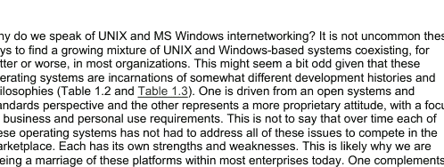

图 1.1：UNIX、Windows 和 Samba

为什么我们要谈论 UNIX 和 MS Windows 互联网络？如今在大多数组织中发现 UNIX 和基于 Windows 的系统以好坏参半的方式共存已变得并不罕见。这可能看起来有点奇怪，因为这些操作系统是相当不同的开发历史和哲学（`表 1.2` 和 `表 1.3`）的产物。一个是从开放系统和标准角度驱动的，另一个代表了更专有的态度，专注于商业和个人使用需求。这并不是说随着时间的推移，每个操作系统都没有不得不解决所有这些问题以在市场上竞争。每个都有其自身的优势和劣势。这可能是为什么我们今天在大多数企业中看到这些平台结合的原因。一个在解决企业、学校甚至家庭中发现的复杂异构计算环境的需求方面互为补充。

无缝互联这两个世界的重要性已引起传统“仅限 UNIX”用户群如 USENIX 协会的关注。过去几年 USENIX 举办了专门针对 UNIX 和 Windows NT 集成的特别研讨会。USENIX `大型安装系统管理 (LISA)` 组织还举办了关于 UNIX 和 Windows 主题的会议。在大多数情况下，这些会议的出席率接近爆满。

### 表 1.2 UNIX 开发历史

| 年份 | 描述 |
|------|-------------|
| 1969 — | Thompson 在 DEC PDP-7 上开发单用户系统 |
| 1970 — | Kernighan 创造了 UNIX 的名称 |
| 1973 — | Ritchie 开发 C 语言<br>UNIX 用 C 重写 |
| 1974 — | ACM 发表了 Thompson 和 Ritchie 关于 UNIX 的论文 |
| 1975 — | Bell 实验室将 UNIX V6 授权给大学 |
| 1977 — | SCO 和 Interactive Systems 成立<br>Thompson & Joy 开发 BSD 1.0 |
| 1978 — | UNIX 第 7 版<br>BSD 2.0 |
| 1979 — | 伯克利 ARPAnet 合同<br>BSD 3.0 |
| 1980 — | BSD 4.0<br>Microsoft 开发 XENIX |
| 1981 — | SUN 成立 |
| 1982 — | AT&T System III<br>SUN 成为 Sun Microsystems |
| 1983 — | AT&T System V<br>BSD 4.2<br>SUN SunOS<br>Hewlett-Packard HP-UX<br>GNU 项目构想 |
| 1984 — | AT&T System V.2<br>DEC ULTRIX<br>X/Open 成立 |
| 1985 — | Sun NFS<br>POSIX 1003.1 发布 |
| 1986 — | AT&T SYSV.3, Streams, RFS<br>BSD 4.3<br>IBM AIX RT |

## 商业 UNIX 发布

1987 —

AT&T SYSV.3.1

1988 —

AT&T SYSV.3.2

BSD 4.3 Tahoe

1989 —

AT&T SYSV.4

开放软件基金会成立

OSF Motif

UNIX 国际组织成立

11 月 2 日互联网蠕虫

1990 —

BSD 4.3 Reno

IBM AIX RS/6000

OSF/1

1991 —

苹果、IBM、摩托罗拉合资企业

Sun Solaris 1.0

Linux 0.02

1992 —

BSD 4.4

1993 —

Novell 收购 UNIX System Laboratories

Novell 将 UNIX 商标授予 X/Open

386BSD 1.0

FreeBSD 1.0

NetBSD 0.8

1994 —

Linux 1.0

Linux 国际组织

1998 —

开源计划

UNIX 已存在约 30 年。最初主要出现在学术和研究环境中，它是一种功能强大的多用户、多任务操作系统，适用于各种应用。它可以轻松扩展，从小型单用户工作站到支持数千名同时用户和进程的非常大的大型机、多处理器和集群计算架构。由于源代码可用、内置编程环境以及对标准接口和协议的坚定关注，UNIX 可以轻松移植到大多数硬件平台。这导致了丰富的公共和厂商实现。尽管如此，源代码的通用访问也使 UNIX 在一定程度上保持厂商独立。当我们使用“UNIX”一词时，我们通常指的是市场上可用的全部公共和厂商版本。确实，每个 UNIX 版本往往都有其自身的细微差别、附加功能以及对基本主题的变体，但在其漫长的开发历史中，功能总体上在各平台间保持相当一致。事实上，这一庞大开发社区的集体专业知识极大地促进了操作系统的整体成熟度、互操作性和健壮性。

另一方面，关于 UNIX 最突出的抱怨指向其基于字符的命令行用户界面。尽管丰富的命令、解释性 shell 和脚本语言为程序员和系统管理员提供了大量功能，但其使用和存在对新手用户来说并不容易。大多数命令都是晦涩的缩写字符串，并且通常从调用它们的 shell 中获取上下文。这对除经验丰富的用户外的所有人来说都可能非常令人困惑。可以向操作系统添加名为 X Windows 的图形用户界面，但它并不能完全屏蔽用户免受命令行界面的复杂性。另一个批评是，尽管大多数应用程序可以在各种 UNIX 版本之间轻松移植，但它们通常在不同厂商平台之间不具备二进制兼容性。这往往限制了某些产品在所有 UNIX 平台上的可用性。

由于其开放接口和与互联网技术的紧密集成，UNIX 在许多企业中找到了立足之地。UNIX 和互联网一起成长。随着像 TCP/IP 这样的互联协议规范的开发，它们迅速融入了 UNIX 的网络结构。我们对互联网上基本信息共享服务所期望的大部分内容都是在 UNIX 下开发的。这使得 UNIX 能够作为协议和服务器瑞士军刀，快速且经济高效地将遗留的专有计算基础设施连接到互联网。

## 表 1.3 Windows 开发历史

| 年 | 事件 |
|------|--------|
| 1980 — | IBM 与微软签订 PC 操作系统合同<br>比尔·盖茨收购 QDOS<br>MS-DOS 由 QDOS 创建 |
| 1981 — | 首台 IBM PC<br>微软开始 "Interface Manager" 开发 |
| 1983 — | Windows 宣布<br>MS-DOS 2.0 |
| 1985 — | Windows 1.0<br>下拉菜单<br>鼠标支持 |
| 1987 — | Windows 2.0<br>图标和重叠窗口<br>微软与 IBM 开始 OS/2 工作<br>微软与 IBM 在 OS/2 和 Windows 开发上分道扬镳<br>Windows/386 |
| 1990 — | Windows 3.0<br>程序管理器和文件管理器<br>网络支持 |
| 1991 — | Windows 3.1<br>对象链接与嵌入 (OLE)<br>多媒体 |
| 1993 — | 微软开始 "New Technology" 操作系统工作 |
| 1994 — | Windows NT 3.1 32 位操作系统<br>保护模式<br>安全<br>Windows for Workgroups 3.11<br>Win32s |
| 1995 — | Windows 95<br>抢占式多任务<br>线程 |
| 1996 — | Windows NT 4.0<br>Windows CE<br>IBM 结束 OS/2 开发 |
| 1997 — | Windows 95 OSR2<br>活动桌面<br>FAT32<br>包含 Internet Explorer 3.0 |
| 1998 — | Windows 98<br>集成 Internet Explorer 4.0 |
| 1999 — | Windows 98 SE<br>Internet Explorer 5.0<br>Windows NT 5.0 更名为 Windows 2000<br>Windows 2000 Beta 3 发布候选版 1 |


微软 Windows 的成功故事可以很容易地归因于其所见即所得的用户界面和低成本硬件平台。Windows 界面的广泛熟悉度、其丰富的生产力工具以及商品化硬件组件基础，使其迅速成为单用户桌面计算的主导世界标准。考虑到其年龄还不到 UNIX 的一半，这是一个相当令人印象深刻的成就。微软在拥抱网络技术、标准以及增强用户界面方面做得非常出色，从而将生产力从桌面扩展到工作组，最近又扩展到互联网。这始于 Windows for Workgroups 中的点对点网络。接下来是与基于 Novell 的网络的互操作性、与 Windows NT 和 UNIX 的客户端/服务器网络，以及使用 Internet Explorer 等工具的强大互联网连接。

在服务器端，微软的故事仍然相对较新。Windows NT（新技术）只有五岁出头，但在短短时间内，它已占据了数据库客户端/服务器市场的重要份额。Windows NT 结合了 UNIX、VMS、OS/2、Netware 和现有 Windows 架构的各个部分，提供了一种多任务网络服务，旨在在名为域的新结构下更紧密地集成和管理工作组局域网。NT 版本 4.0 通过包含 DNS、FTP、Web 和基于 SMTP 的电子邮件等常见互联网服务，为基于 Windows 的网络提供了更紧密的互联网联系。Windows 2000 将通过包含 LDAP 目录服务、Kerberos 身份验证和公钥服务等额外的互联工具来扩展此功能，每一项都与现有的 Windows 网络和安全服务密切相关。

尽管被誉为 UNIX 杀手，Windows NT 尚未完全取代后台的 UNIX 服务。同样，UNIX 也没有提供 Windows 的标志性紧密桌面支持服务以及友好用户和管理员界面。结果是，这两种操作系统在大多数机构中都是常见的配置。因此，系统管理员面临的挑战是如何最好地简化维护这两种操作系统的管理任务，以及如何促进用户无缝访问存在于各自世界中的资源。这就是 Samba 等服务成为平滑 UNIX 和 Windows 共存粗糙边缘的必备工具的地方。

## 规划

在我们深入 Samba 安装和配置的细节之前，我们需要仔细查看现有基础设施，识别需要解决的问题领域和不一致之处，并制定一个允许纳入 Windows 2000 等新技术的架构。大多数架构升级并不是对现有系统的完全替换，因此我们需要一种实施策略，允许旧服务与新开发并存。从提出以下问题开始：

- 现有操作系统基础主要是 UNIX 还是 Windows？
- 内部系统管理技能主要集中在 UNIX 还是 Windows？
- 有哪些资源需要在两种操作系统环境中都可以访问？
- 资源共享的重点是桌面、服务器还是两者兼有？
- 需要支持哪些桌面客户端？
- 用户移动性是否是一个问题？
- 是否会对现有业务模式产生影响？
- 关于用户数、桌面数和/或服务器数，扩展性是否是一个问题？
- 需要什么级别的可用性？
- 资源共享是否需要更改命名空间？
- 是否需要同步账户和密码？
- 需要什么级别的访问控制？
- 设置是基于域、工作组还是 realm？
- 网络拓扑是否会影响浏览和访问控制？

这些只是添加 Samba 到环境中之前需要仔细审查的几个问题。由于每个问题背后都有复杂性，我们将在本章的下一节中更详细地研究其中一些问题。

## 桌面问题

如今几乎每个人都有电脑。我们大多数人可以使用不止一台：掌上电脑、手持设备、笔记本电脑、家庭 PC、办公工作站和网络服务器，列表还在不断延伸。我们花费大量时间在从一个网络孤岛跳到另一个网络孤岛的电脑之间切换。我们使用的机器、网络和服务之间的界限已经模糊到难以确定特定资源所在的位置。我们不禁会想，那份备忘录是留在办公室工作站上，还是留在家里书房的 PC 上？

因此，系统管理员的挑战在于提供一个环境，帮助移动计算机用户在从一台机器切换到另一台机器时，保持对文档、邮件文件夹、地址簿、网页证书、书签以及其他应用程序偏好数据的稳定访问。当机器集合同时包含 UNIX 和 Windows 操作系统时，数据格式和网络协议的差异使状态同步任务变得复杂。

在多台计算机之间维护个人状态的问题上还有一个变体，那就是如何在一台供多人使用的计算机上管理状态。想想机场、图书馆、大学实验室和网吧里的公共电脑。应允许何种程度的环境个性化，如果允许的话？如何在每次使用后维护和重置环境状态以确保隐私和安全？如果要维护个人环境配置文件，账户管理和存储方面会有哪些扩展性问题？

## 企业计算问题

将传统信息服务带入互联网社区的演进过程，使得大多数企业已从专有、受限访问和网络计算架构转向更开放的分布式计算模型。这通常是通过将 UNIX 服务器纳入网络来实现的，以缓解数据仓库系统与互联网之间信息流动。其结果是数据中心的操作系统异构性增加，必须由系统管理和运维人员进行管理。

添加新的操作系统通常会增加维护用户、机器和服务一致命名空间的复杂性。例如，支持字符集的差异需要在各系统之间制定复杂的字符映射。大量用户可能需要在每个平台上复制和管理用户账户和密码空间。用户在访问分布在各系统上的资源时，可能需要反复登录和注销。

## 域和 Realms

在许多组织中，计算和网络基础设施中内置的身份验证、授权和信任模型与组织结构和流程所代表的模型密切匹配。机器之间的信任与员工之间的信任同样重要。当新操作系统无法融入现有结构时，往往会给日常运营带来阻碍。遵循组织管理角色的传递信任规则在同类操作系统之间通常运作良好，例如 UNIX Kerberos realms 之间的信任或 Windows NT 域之间的信任。当尝试在不同的架构之间映射访问控制和组关系时，同样的功能并不总是如此无缝。Windows 2000 凭借其混合身份验证和授权框架为这些信任机制带来了额外的复杂性。将 Windows 2000 整合到现有的 NT 域拓扑中需要仔细规划域关系如何迁移到新的域树和林模型中。关于 Windows 2000 与 UNIX Kerberos 命名空间之间的双向同步，还有一些问题必须解决。

## 密码

刚才描述的移动性问题带来的一个额外副作用是，使用多台计算机时往往会对应每个平台拥有多个账户和密码。对于用户和管理员来说，尝试在不同的操作系统之间保持账户和密码同步可能是一个真正的挑战。还有一个额外的安全风险，即一个系统上使用的加密算法可能在另一个系统上不受支持。其结果可能是通过不安全的网络传输明文密码，或在不安全的工作站上维护密码列表。

## 使用 Samba 共享资源

上述大多数问题都可以通过使用相互支持的软件工具来解决，例如 Sun 的网络文件系统 `NFS` 或 Novell NetWare，它们提供了在 UNIX 和 Windows 之间共享文件、打印机和访问控制的手段。一个稳健且经济高效的替代方案是 Samba，由 Andrew Tridgell 开发。Samba 是对 Windows NT 或基于 LAN Manager 的系统通常提供的


在许多组织中，计算和网络基础设施中内置的身份验证、授权和信任模型与组织结构和流程所代表的模型密切匹配。机器之间的信任与员工之间的信任同样重要。当新操作系统无法融入现有结构时，往往会给日常运营带来阻碍。遵循组织管理角色的传递信任规则在同类操作系统之间通常运作良好，例如 `UNIX` `Kerberos` realms 之间的信任或 `Windows NT` 域之间的信任。当尝试在不同的架构之间映射访问控制和组关系时，同样的功能并不总是如此无缝。`Windows 2000` 凭借其混合身份验证和授权框架为这些信任机制带来了额外的复杂性。将 `Windows 2000` 整合到现有的 `NT` 域拓扑中需要仔细规划域关系如何迁移到新的域树和林模型中。关于 `Windows 2000` 与 `UNIX` `Kerberos` 命名空间之间的双向同步，还有一些问题必须解决。

## 密码

刚才描述的移动性问题带来的一个额外副作用是，使用多台计算机时往往会对应每个平台拥有多个账户和密码。对于用户和管理员来说，尝试在不同的操作系统之间保持账户和密码同步可能是一个真正的挑战。还有一个额外的安全风险，即一个系统上使用的加密算法可能在另一个系统上不受支持。其结果可能是通过不安全的网络传输明文密码，或在不安全的工作站上维护密码列表。

## 使用 Samba 共享资源

上述大多数问题都可以通过使用相互支持的软件工具来解决，例如 Sun 的网络文件系统 `NFS` 或 `Novell NetWare`，它们提供了在 `UNIX` 和 `Windows` 之间共享文件、打印机和访问控制的手段。一个稳健且经济高效的替代方案是 `Samba`，由 `Andrew Tridgell` 开发。`Samba` 是对 `Windows NT` 或基于 `LAN Manager` 的系统通常提供的

## 桌面问题

如今几乎每个人都有电脑。我们大多数人可以使用不止一台：掌上电脑、手持设备、笔记本电脑、家庭 PC、办公工作站和网络服务器，列表还在不断延伸。我们花费大量时间在从一个网络孤岛跳到另一个网络孤岛的电脑之间切换。我们使用的机器、网络和服务之间的界限已经模糊到难以确定特定资源所在的位置。我们不禁会想，那份备忘录是留在办公室工作站上，还是留在家里书房的 PC 上？

因此，系统管理员的挑战在于提供一个环境，帮助移动计算机用户在从一台机器切换到另一台机器时，保持对文档、邮件文件夹、地址簿、网页证书、书签以及其他应用程序偏好数据的稳定访问。当机器集合同时包含 `UNIX` 和 `Windows` 操作系统时，数据格式和网络协议的差异使状态同步任务变得复杂。

在多台计算机之间维护个人状态的问题上还有一个变体，那就是如何在一台供多人使用的计算机上管理状态。想想机场、图书馆、大学实验室和网吧里的公共电脑。应允许何种程度的环境个性化，如果允许的话？如何在每次使用后维护和重置环境状态以确保隐私和安全？如果要维护个人环境配置文件，账户管理和存储方面会有哪些扩展性问题？

## 企业计算问题

将传统信息服务带入互联网社区的演进过程，使得大多数企业已从专有、受限访问和网络计算架构转向更开放的分布式计算模型。这通常是通过将 `UNIX` 服务器纳入网络来实现的，以缓解数据仓库系统与互联网之间信息流动。其结果是数据中心的操作系统异构性增加，必须由系统管理和运维人员进行管理。

添加新的操作系统通常会增加维护用户、机器和服务一致命名空间的复杂性。例如，支持字符集的差异需要在各系统之间制定复杂的字符映射。大量用户可能需要在每个平台上复制和管理用户账户和密码空间。用户在访问分布在各系统上的资源时，可能需要反复登录和注销。

## 域和 Realms

在许多组织中，计算和网络基础设施中内置的身份验证、授权和信任模型与组织结构和流程所代表的模型密切匹配。机器之间的信任与员工之间的信任同样重要。当新操作系统无法融入现有结构时，往往会给日常运营带来阻碍。遵循组织管理角色的传递信任规则在同类操作系统之间通常运作良好，例如 `UNIX` `Kerberos` realms 之间的信任或 `Windows NT` 域之间的信任。当尝试在不同的架构之间映射访问控制和组关系时，同样的功能并不总是如此无缝。`Windows 2000` 凭借其混合身份验证和授权框架为这些信任机制带来了额外的复杂性。将 `Windows 2000` 整合到现有的 `NT` 域拓扑中需要仔细规划域关系如何迁移到新的域树和林模型中。关于 `Windows 2000` 与 `UNIX` `Kerberos` 命名空间之间的双向同步，还有一些问题必须解决。

## 密码

刚才描述的移动性问题带来的一个额外副作用是，使用多台计算机时往往会对应每个平台拥有多个账户和密码。对于用户和管理员来说，尝试在不同的操作系统之间保持账户和密码同步可能是一个真正的挑战。还有一个额外的安全风险，即一个系统上使用的加密算法可能在另一个系统上不受支持。其结果可能是通过不安全的网络传输明文密码，或在不安全的工作站上维护密码列表。

## 使用 Samba 共享资源

上述大多数问题都可以通过使用相互支持的软件工具来解决，例如 Sun 的网络文件系统 `NFS` 或 `Novell NetWare`，它们提供了在 `UNIX` 和 `Windows` 之间共享文件、打印机和访问控制的手段。一个稳健且经济高效的替代方案是 `Samba`，由 `Andrew Tridgell` 开发。`Samba` 是对 `Windows NT` 或基于 `LAN Manager` 的系统通常提供的

## 桌面问题

如今几乎每个人都有电脑。我们大多数人可以使用不止一台：掌上电脑、手持设备、笔记本电脑、家庭 PC、办公工作站和网络服务器，列表还在不断延伸。我们花费大量时间在从一个网络孤岛跳到另一个网络孤岛的电脑之间切换。我们使用的机器、网络和服务之间的界限已经模糊到难以确定特定资源所在的位置。我们不禁会想，那份备忘录是留在办公室工作站上，还是留在家里书房的 PC 上？

因此，系统管理员的挑战在于提供一个环境，帮助移动计算机用户在从一台机器切换到另一台机器时，保持对文档、邮件文件夹、地址簿、网页证书、书签以及其他应用程序偏好数据的稳定访问。当机器集合同时包含 `UNIX` 和 `Windows` 操作系统时，数据格式和网络协议的差异使状态同步任务变得复杂。

在多台计算机之间维护个人状态的问题上还有一个变体，那就是如何在一台供多人使用的计算机上管理状态。想想机场、图书馆、大学实验室和网吧里的公共电脑。应允许何种程度的环境个性化，如果允许的话？如何在每次使用后维护和重置环境状态以确保隐私和安全？如果要维护个人环境配置文件，账户管理和存储方面会有哪些扩展性问题？

## 企业计算问题

将传统信息服务带入互联网社区的演进过程，使得大多数企业已从专有、受限访问和网络计算架构转向更开放的分布式计算模型。这通常是通过将 `UNIX` 服务器纳入网络来实现的，以缓解数据仓库系统与互联网之间信息流动。其结果是数据中心的操作系统异构性增加，必须由系统管理和运维人员进行管理。

添加新的操作系统通常会增加维护用户、机器和服务一致命名空间的复杂性。例如，支持字符集的差异需要在各系统之间制定复杂的字符映射。大量用户可能需要在每个平台上复制和管理用户账户和密码空间。用户在访问分布在各系统上的资源时，可能需要反复登录和注销。

## 域和 Realms

在许多组织中，计算和网络基础设施中内置的身份验证、授权和信任模型与组织结构和流程所代表的模型密切匹配。机器之间的信任与员工之间的信任同样重要。当新操作系统无法融入现有结构时，往往会给日常运营带来阻碍。遵循组织管理角色的传递信任规则在同类操作系统之间通常运作良好，例如 `UNIX` `Kerberos` realms 之间的信任或 `Windows NT` 域之间的信任。当尝试在不同的架构之间映射访问控制和组关系时，同样的功能并不总是如此无缝。`Windows 2000` 凭借其混合身份验证和授权框架为这些信任机制带来了额外的复杂性。将 `Windows 2000` 整合到现有的 `NT` 域拓扑中需要仔细规划域关系如何迁移到新的域树和林模型中。关于 `Windows 2000` 与 `UNIX` `Kerberos` 命名空间之间的双向同步，还有一些问题必须解决。

## 密码

刚才描述的移动性问题带来的一个额外副作用是，使用多台计算机时往往会对应每个平台拥有多个账户和密码。对于用户和管理员来说，尝试在不同的操作系统之间保持账户和密码同步可能是一个真正的挑战。还有一个额外的安全风险，即一个系统上使用的加密算法可能在另一个系统上不受支持。其结果可能是通过不安全的网络传输明文密码，或在不安全的工作站上维护密码列表。

## 使用 Samba 共享资源

上述大多数问题都可以通过使用相互支持的软件工具来解决，例如 Sun 的网络文件系统 `NFS` 或 `Novell NetWare`，它们提供了在 `UNIX` 和 `Windows` 之间共享文件、打印机和访问控制的手段。一个稳健且经济高效的替代方案是 `Samba`，由 `Andrew Tridgell` 开发。`Samba` 是对 `Windows NT` 或基于 `LAN Manager` 的系统通常提供的

## 桌面问题


如今几乎每个人都有电脑。我们大多数人可以使用不止一台：掌上电脑、手持设备、笔记本电脑、家庭 PC、办公工作站和网络服务器，列表还在不断延伸。我们花费大量时间在从一个网络孤岛跳到另一个网络孤岛的电脑之间切换。我们使用的机器、网络和服务之间的界限已经模糊到难以确定特定资源所在的位置。我们不禁会想，那份备忘录是留在办公室工作站上，还是留在家里书房的 PC 上？

因此，系统管理员的挑战在于提供一个环境，帮助移动计算机用户在从一台机器切换到另一台机器时，保持对文档、邮件文件夹、地址簿、网页证书、书签以及其他应用程序偏好数据的稳定访问。当机器集合同时包含 UNIX 和 Windows 操作系统时，数据格式和网络协议的差异使状态同步任务变得复杂。

在多台计算机之间维护个人状态的问题上还有一个变体，那就是如何在一台供多人使用的计算机上管理状态。想想机场、图书馆、大学实验室和网吧里的公共电脑。应允许何种程度的环境个性化，如果允许的话？如何在每次使用后维护和重置环境状态以确保隐私和安全？如果要维护个人环境配置文件，账户管理和存储方面会有哪些扩展性问题？

## 企业计算问题

将传统信息服务带入互联网社区的演进过程，使得大多数企业已从专有、受限访问和网络计算架构转向更开放的分布式计算模型。这通常是通过将 UNIX 服务器纳入网络来实现的，以缓解数据仓库系统与互联网之间信息流动。其结果是数据中心的操作系统异构性增加，必须由系统管理和运维人员进行管理。

添加新的操作系统通常会增加维护用户、机器和服务一致命名空间的复杂性。例如，支持字符集的差异需要在各系统之间制定复杂的字符映射。大量用户可能需要在每个平台上复制和管理用户账户和密码空间。用户在访问分布在各系统上的资源时，可能需要反复登录和注销。

## 域和 Realms

在许多组织中，计算和网络基础设施中内置的身份验证、授权和信任模型与组织结构和流程所代表的模型密切匹配。机器之间的信任与员工之间的信任同样重要。当新操作系统无法融入现有结构时，往往会给日常运营带来阻碍。遵循组织管理角色的传递信任规则在同类操作系统之间通常运作良好，例如 UNIX Kerberos realms 之间的信任或 Windows NT 域之间的信任。当尝试在不同的架构之间映射访问控制和组关系时，同样的功能并不总是如此无缝。Windows 2000 凭借其混合身份验证和授权框架为这些信任机制带来了额外的复杂性。将 Windows 2000 整合到现有的 NT 域拓扑中需要仔细规划域关系如何迁移到新的域树和林模型中。关于 Windows 2000 与 UNIX Kerberos 命名空间之间的双向同步，还有一些问题必须解决。

## 密码

刚才描述的移动性问题带来的一个额外副作用是，使用多台计算机时往往会对应每个平台拥有多个账户和密码。对于用户和管理员来说，尝试在不同的操作系统之间保持账户和密码同步可能是一个真正的挑战。还有一个额外的安全风险，即一个系统上使用的加密算法可能在另一个系统上不受支持。其结果可能是通过不安全的网络传输明文密码，或在不安全的工作站上维护密码列表。

## 使用 Samba 共享资源

上述大多数问题都可以通过使用相互支持的软件工具来解决，例如 Sun 的网络文件系统 `NFS` 或 Novell `NetWare`，它们提供了在 UNIX 和 Windows 之间共享文件、打印机和访问控制的手段。一个稳健且经济高效的替代方案是 `Samba`，由 Andrew Tridgell 开发。`Samba` 是对 Windows NT 或基于 LAN Manager 的系统通常提供的

## 桌面问题

如今几乎每个人都有电脑。我们大多数人可使用不止一台：掌上电脑、手持设备、笔记本、家庭 PC、办公工作站和网络服务器，列表还在不断延伸。我们花费大量时间在不同网络孤岛间切换电脑。我们使用的机器、网络和服务界限已模糊，难以确定特定资源所在。我们会疑惑那份备忘录是留在办公室工作站还是家里书房的 PC 上？

系统管理员的挑战在于提供环境，帮助移动用户在不同机器间保持对文档、邮件文件夹、地址簿、网页证书、书签及其他应用偏好数据的稳定访问。当机器同时包含 UNIX 和 Windows 时，数据格式和网络协议差异使状态同步变得复杂。

在多台电脑间维护个人状态的问题变体是，如何在一台多人共用的电脑上管理状态。想想机场、图书馆、大学实验室和网吧的公共电脑。应允许何种程度的环境个性化？如何在使用后维护和重置环境状态以确保隐私和安全？若要维护个人环境配置文件，账户管理和存储会有哪些扩展性问题？

## 企业计算问题

将传统信息服务带入互联网的演进使大多数企业从专有、受限访问和网络计算架构转向更开放的分布式计算模型。这通常通过将 UNIX 服务器纳入网络来缓解数据仓库系统与互联网间的信息流动。其结果是数据中心操作系统异构性增加，需由系统管理和运维人员管理。

新增操作系统通常增加维护用户、机器和服务一致命名空间的复杂性。例如，字符集支持差异需要在各系统间制定复杂字符映射。大量用户可能需要在每个平台复制和管理用户账户和密码空间。用户在访问分布在各系统的资源时可能需反复登录注销。

## 域和 Realms


许多组织的计算和网络基础设施中内置的身份验证、授权和信任模型与组织结构和流程密切匹配。机器间信任与员工间信任同等重要。新操作系统若不契合现有结构，常会给日常运营带来阻碍。遵循组织管理角色的传递信任规则在同类系统间通常运作良好，如 `UNIX` `Kerberos` realms 间信任或 `Windows NT` 域间信任。尝试在不同架构间映射访问控制和组关系时，同等能力并不总是无缝。`Windows 2000` 以其混合身份验证和授权框架为这些信任机制带来额外复杂性。将 `Windows 2000` 整合到现有 `NT` 域拓扑需仔细规划域关系如何迁移到新的域树和林模型。关于 `Windows 2000` 与 `UNIX` `Kerberos` 命名空间间的双向同步，还有若干问题需解决。

## 密码

上述移动性问题带来的额外副作用是，使用多台电脑往往对应每个平台有多个账户和密码。对用户和管理员而言，在不同操作系统间保持账户和密码同步是真实挑战。还有额外安全风险，即一个系统使用的加密算法可能在另一系统不受支持。其结果可能是通过不安全网络传输明文密码，或在不安全工作站上维护密码列表。

## 使用 Samba 共享资源

上述大多数问题可通过相互支持的软件工具解决，如 Sun 的网络文件系统 `NFS` 或 `Novell NetWare`，它们提供在 `UNIX` 和 `Windows` 间共享文件、打印机和访问控制的手段。稳健且经济高效的替代方案是 Andrew Tridgell 开发的 `Samba`。`Samba` 是对 `Windows NT` 或基于 `LAN Manager` 系统通常提供的服务进行替代。

## 桌面问题

如今几乎每个人都有电脑。我们大多数人可使用不止一台：掌上电脑、手持设备、笔记本、家庭 PC、办公工作站和网络服务器，列表还在不断延伸。我们花费大量时间在不同网络孤岛间切换电脑。我们使用的机器、网络和服务界限已模糊，难以确定特定资源所在。我们会疑惑那份备忘录是留在办公室工作站还是家里书房的 PC 上？

系统管理员的挑战在于提供环境，帮助移动用户在不同机器间保持对文档、邮件文件夹、地址簿、网页证书、书签及其他应用偏好数据的稳定访问。当机器同时包含 `UNIX` 和 `Windows` 时，数据格式和网络协议差异使状态同步变得复杂。

在多台电脑间维护个人状态的问题变体是，如何在一台多人共用的电脑上管理状态。想想机场、图书馆、大学实验室和网吧的公共电脑。应允许何种程度的环境个性化？如何在使用后维护和重置环境状态以确保隐私和安全？若要维护个人环境配置文件，账户管理和存储会有哪些扩展性问题？

## 企业计算问题

将传统信息服务带入互联网的演进使大多数企业从专有、受限访问和网络计算架构转向更开放的分布式计算模型。这通常通过将 `UNIX` 服务器纳入网络来缓解数据仓库系统与互联网间的信息流动。其结果是数据中心操作系统异构性增加，需由系统管理和运维人员管理。

新增操作系统通常增加维护用户、机器和服务一致命名空间的复杂性。例如，字符集支持差异需要在各系统间制定复杂字符映射。大量用户可能需要在每个平台复制和管理用户账户和密码空间。用户在访问分布在各系统的资源时可能需反复登录注销。

## 域和 Realms

许多组织的计算和网络基础设施中内置的身份验证、授权和信任模型与组织结构和流程密切匹配。机器间信任与员工间信任同等重要。新操作系统若不契合现有结构，常会给日常运营带来阻碍。遵循组织管理角色的传递信任规则在同类系统间通常运作良好，如 `UNIX` `Kerberos` realms 间信任或 `Windows NT` 域间信任。尝试在不同架构间映射访问控制和组关系时，同等能力并不总是无缝。`Windows 2000` 以其混合身份验证和授权框架为这些信任机制带来额外复杂性。将 `Windows 2000` 整合到现有 `NT` 域拓扑需仔细规划域关系如何迁移到新的域树和林模型。关于 `Windows 2000` 与 `UNIX` `Kerberos` 命名空间间的双向同步，还有若干问题需解决。


新增操作系统通常增加维护用户、机器和服务一致命名空间的复杂性。例如，字符集支持差异需要在各系统间制定复杂字符映射。大量用户可能需要在每个平台复制和管理用户账户和密码空间。用户在访问分布在各系统的资源时可能需反复登录注销。

## 域和 Realms

许多组织的计算和网络基础设施中内置的身份验证、授权和信任模型与组织结构和流程密切匹配。机器间信任与员工间信任同等重要。新操作系统若不契合现有结构，常会给日常运营带来阻碍。遵循组织管理角色的传递信任规则在同类系统间通常运作良好，如 UNIX Kerberos realms 间信任或 Windows NT 域间信任。尝试在不同架构间映射访问控制和组关系时，同等能力并不总是无缝。Windows 2000 以其混合身份验证和授权框架为这些信任机制带来额外复杂性。将 Windows 2000 整合到现有 NT 域拓扑需仔细规划域关系如何迁移到新的域树和林模型。关于 Windows 2000 与 UNIX Kerberos 命名空间间的双向同步，还有若干问题需解决。

## 密码

上述移动性问题带来的额外副作用是，使用多台电脑往往对应每个平台有多个账户和密码。对用户和管理员而言，在不同操作系统间保持账户和密码同步是真实挑战。还有额外安全风险，即一个系统使用的加密算法可能在另一系统不受支持。其结果可能是通过不安全网络传输明文密码，或在不安全工作站上维护密码列表。

## 使用 Samba 共享资源

上述大多数问题可通过相互支持的软件工具解决，如 Sun 的网络文件系统 NFS 或 Novell NetWare，它们提供在 UNIX 和 Windows 间共享文件、打印机和访问控制的手段。稳健且经济高效的替代方案是 Andrew Tridgell 开发的 Samba。Samba 可以替代 Windows NT 或 LAN Manager 系统通常提供的文件和打印共享服务。Samba 通过也纳入 UNIX 文件系统和打印机来增强这些服务，使其成为共享资源的一部分。其他 Samba 服务包括用于浏览的 NetBIOS 名称服务和有限的 NT 主域控制器仿真。自 1991 年推出以来，Samba 越来越受欢迎；目前全球已有超过 100 家商业厂商提供支持。它已被移植到大多数 UNIX 变种以及 VMS 和 MVS 等专有操作系统上。

在接下来的两章中，我们将回顾 UNIX 和 Windows 中对理解和维护 Samba 至关重要的协议和系统服务。这些章节将使那些可能不熟悉其中一个或另一个操作系统的系统管理员和程序员受益。剩余的文本将重点介绍 Samba 架构、安装、配置和支持任务。

## 第 2 章：UNIX 概述

### 概述

在 60 年代，格言是不要相信超过 30 岁的人。UNIX 很快就要步入 30 多岁，但与此格言相反，我相信我们仍可继续依赖 UNIX 一致、开放和可移植的计算架构进入其下一个十年。多年来，UNIX 已发展成为一个强大的跨平台、多任务、多处理、多用户操作系统，拥有丰富的应用和编程基础。本章将重点介绍支持 Samba 所需的 UNIX 工具和服务。我们还将介绍在互联 UNIX 和 Windows 资源时重要的通用网络概念。那些已经获得 UNIX 巫师 merit badge 的读者可能想跳过本章，直接进入下一章关于 Windows 的内容。

从架构上看，UNIX 最好被视为主服务和接口的层级结构 图 2.1。结构的基础是内核，负责管理所有硬件组件与执行环境之间的接口。这包括调度工作、分配内存、移动数据以及在各种系统事件发生时通知任务。在内核层之上是 shell。shell 不止一种，本质上是一个命令解释器，接受输入、提供上下文并代表用户向内核请求服务。UNIX 层级的顶层是用户界面。这里存放所有命令、脚本语言、图形界面和实用程序，使终端用户能够与操作系统提供的资源交互。使用 UNIX 时需要记住的一个重要概念是，所有系统对象之间的通用接口是每个对象都被抽象为文件。这意味着所有操作都是文件操作，无论目标是硬件、数据、内存还是正在运行的任务。

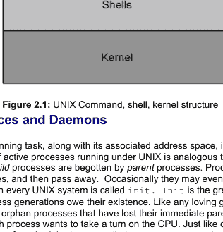

图 2.1：UNIX 命令、shell、内核结构

### 服务和守护进程

每个正在运行的任务连同其关联的地址空间称为进程。在 UNIX 下运行的活动进程组类似于家族树。子进程由父进程产生。进程诞生、度过一生然后消亡。偶尔它们甚至会离家出走。每个 UNIX 系统上运行的第一个进程称为 `init`。`init` 是所有进程世代存在的始祖。像任何慈爱的祖父母一样，`init` 甚至会收养失去直系父母的孤儿进程。在其生命周期中，每个进程都想轮流使用 CPU。就像孩子一样，进程需要调度器的指导，以确保每个进程都能获得公平的 CPU 时间。系统管理员充当进程宇宙的总监督者，对所有进程的生活拥有最终控制权。

UNIX 宇宙中的每个进程都以一个正整数命名，称为进程标识符 `PID`。`PID` 是内核维护的进程表中向量索引。`PID` 是唯一的，且以某种随机方式分配。进程表条目指向每个进程的内核数据结构，这些结构定义了给定进程的关联属性和值 表 2.1。可通过使用 `ps` 命令从命令行查询活动进程的属性 示例 2.1。

表 2.1：进程属性采样

- 进程标识符
- 进程组标识符
- 进程父标识符
- 进程所有者
- 有效用户和组标识符及真实用户和组标识符
- 优先级
- 控制终端
- 地址空间
- 页大小
- 分页统计
- 资源利用率
- 进程状态

## 示例 2.1 显示进程属性

```
# ps -elk          SYSV Process Display Format
F   S UID PID PPID C PRI NI ADDR SZ WCHAN TTY TIME CMD
303  A 0   0   0   0 120 16  707  4    -     0:05 swapper
200003 A 0   1   0   0  60 20  505  220   -     0:07 init
40401 A 0 8626 1   0  60 20  69fa 1060  -     0:09 nmbd
40001 A 0 8664 1   0  60 20  49f2 1440  -     0:06 smbd
```

```
# ps auxw          BSD Process Display Format

USER PID %CPU %MEM SZ RSS TTY STAT STIME TIME COMMAND
root 1   0.1  0.0 220 180 - A 00:19:58 0:07 /etc/init
root 0   0.1  0.0 4   8  - A 00:19:28 0:05 swapper
root 8626 0.0 1.0 1060 852 - A 00:20:17 0:09 nmbd -D -f nmbd.pid
root 8664 0.0 1.0 1440 808 - A 00:20:41 0:06 smbd -D -f smbd.pid
```

在管理运行系统中执行资源时，了解正在运行进程列表中显示的几列会很有帮助。`COMMAND` 和 `CMD` 列表示在进程地址空间中运行的程序。除了其 `PID`，每个进程还记录其父进程标识符 `PPID` 的整数 ID。进程短期 CPU 使用率、执行优先级和 nice 值在 SYSV 显示中的 `PRI`、`C` 和 `NI` 字段中显示。BSD `%CPU` 字段表示进程在其生命周期内使用 CPU 资源所占的百分比。

在每个进程宇宙中，都有一组特殊的进程称为守护进程。守护进程并不是由某些邪恶黑客生成以破坏系统的恶意进程，而是一组一个或多个提供某种明确定义的服务的进程。例如，`sendmail` 守护进程代表 UNIX 用户社区管理和分发电子邮件。在 Samba 的情况下，`smbd` 守护进程管理对共享资源的访问。Samba `nmbd` 守护进程提供名称服务，以帮助客户端定位资源共享。

### 初始化

我已经提到过 `init` 作为运行系统上所有进程的祖先所发挥的特殊作用。`Init` 负责在系统启动时生成一些重要的系统守护进程，并“重新生成”可能由于某些不可预见事件而退出的进程。这些进程在名为 `/etc/inittab` 的配置文件中标识。`inittab` 配置文件中的条目采用以下形式：

```
<identifier>:<runlevel>:<action>:<command>
```

`identifier` 字段唯一标识服务。`runlevel` 对应于运行系统状态，该状态将导致在命令上调用 `action`。Runlevels 用 0 到 9 的数字表示，表示各种系统状态。UNIX 上用于按时间调度批处理作业的 `cron` 守护进程的一个示例 `inittab` 条目如下所示：

```
cron:2:respawn:/usr/sbin/cron      Inittab cron process entry
```

正如我们将在后面的部分看到的那样，还有其他用于生成服务守护进程的机制。对于 Samba 等基于网络的服务，通常希望仅在客户端请求其服务时才启动服务守护进程的一个实例。

### 网络


了解 UNIX TCP/IP 网络配置和管理在此上下文中很重要，因为它用作 Samba NetBIOS 服务的传输。NetBIOS over TCP/IP（NetBT）定义在 RFCs 1001 和 1002 中。我们将在下一章的 Windows 网络部分更详细地查看 NetBT。

## TCP/IP

当我们谈论 TCP/IP 时，我们指的是构成服务相关一般功能的一组更大协议（表 2.2）。在 TCP/IP 栈模型中，这些协议被捆绑成比 OSI 模型中定义的更少层数。

### 表 2.2 常见底层互联网协议

|  |  |
|---|---|
| IP | 互联网协议 |
| ICMP | 互联网控制报文协议 |
| ARP | 地址解析协议 |
| RARP | 反向地址解析协议 |
| TCP | 传输控制协议 |
| UDP | 用户数据报协议 |

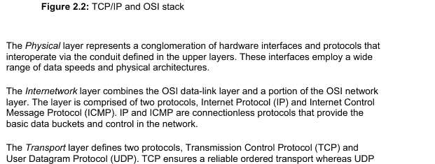

### 图 2.2：TCP/IP 和 OSI 栈

物理层代表硬件接口和协议的集合，它们通过上层定义的总线相互协作。这些接口采用各种数据速率和物理架构。

互联网层结合了 OSI 数据链路层和 OSI 网络层的一部分。该层由两个协议组成，互联网协议（IP）和互联网控制报文协议（ICMP）。IP 和 ICMP 是无连接协议，提供网络中的基本数据桶和控制。

传输层定义了两个协议，传输控制协议（TCP）和用户数据报协议（UDP）。TCP 确保可靠的有序传输，而 UDP 服务不可靠且不保证交付。

TCP/IP 套件中的应用层与 OSI 模型一样，实现用户界面。客户端/服务器协议通常在应用层定义。

## 地址

网络管理员为网络中的每台计算机分配一个唯一的 IP 地址。IP 地址将硬件地址抽象为更通用的用途。在此地址级别，我们不关心特定机器上使用的适配器接口类型。每个 IP 地址是一个 32 位数字，表示为四个八位字节。每个八位字节是 0 到 255 范围内的数字：

```
<0-255>.<0-255>.<0-255>.<0-255>
```

在大型网络中，通常希望对计算机进行分组和分区，以本地化流量模式、隐藏内部网络结构、简化信息路由并强制执行安全策略。这是通过称为子网的系统完成的。子网掩码用于屏蔽 IP 地址的一部分，以确定来自特定计算机的流量将如何路由到网络中的其他计算机。当组织内的机器想要向另一系统发送数据包时，它会将子网掩码应用于目标地址，以查看地址是否在本地网络上，或者是否必须将其发送给路由器进行交付。

子网掩码是一个四八位字节的数字，指示地址中哪些位应作为网络和子网部分进行屏蔽。掩码的低位部分指定地址的主机部分。

```
netmask 0xffffff f0 14 hosts per subnet (0 and 15 excluded)
netmask 0xffffff f8 6 hosts per subnet (0 and 7 excluded)
```

了解网络的子网结构将在您开始定义要在可能存在于不同子网的系统之间共享的资源时变得很重要。

## 域名服务

尽管 IP 地址唯一标识网络上的计算机和相关资源，但人类在尝试查找这些计算机和资源时很难记住它们。解决这种大脑故障的简单方法是映射易于记住的文本字符串到相关的 IP 数字。机器名称和 IP 地址的表可以安装在每台计算机上，作为已知系统的目录。在 UNIX 下，此主机名和 IP 数字对的目录称为 `/etc/hosts` 表（示例 2.2）。

对于小型网络，主机表工作良好，但在扩展到大量系统时立即失效。将主机名映射到大型网络集（如互联网）的 IP 数字时，会遇到与将个人和企业名称映射到特定国家/地区所有城市的电话号码时遇到的相同扩展问题。名称冲突太多，电话簿太大，无法及时纳入和分发更新。

### 示例 2.2 /etc/hosts

```
#
# IP Number      Host Names
#
127.0.0.1      localhost
128.95.135.13  daffy
128.95.135.24  louie
128.95.142.30  huey
140.27.133.4   donald
```

为了解决扩展问题，互联网社区采用了分层命名空间方法，该方法强制唯一性并支持及时分发更新。此命名空间系统是一种称为 BIND 域名服务（DNS）的客户端/服务器协议。

DNS 中的计算机和组织由域名标识。域名是一个以“.”分隔的字符串元组，表示命名空间的管理层次结构（表 2.3）。域名通常用两到四级表示。请注意，域名与 IP 数字八位字节或子网之间没有隐含映射。

### 表 2.3 域名

格式：hostname.subdomain.subdomain.topdomain

示例：

- microsoft.com

- vnet.ibm.com

一种称为 BIND 的分层名称解析协议用于递归查询域名服务器，直到域名解析为 IP 数字。在 DNS 层次结构（图 2.3）中，上层域服务器只需记录名称元组的下一较低级别的名称以及解析该级别地址的名称服务器的 IP 数字。所有名称服务器必须知道顶级互联网名称服务器的地址，这些服务器维护一组众所周知的顶级域名（表 2.4）。DNS 系统支持命名空间的本地管理，并确保网络及时获得信息。

### 表 2.4 顶级域名

|  |  |
|---|---|
| edu | 教育 |
| gov | 政府 |
| mil | 军事 |
| org | 组织 |
|  |  |
|---|---|
| com | 商用 |
| net | 其他网络 |
| 国家代码 | 两字符国际标识符 |

在服务器端，DNS 在 UNIX 下由 `named` 守护进程实现。通常对于给定的组织，只配置一对 DNS 服务器，主服务器和辅助服务器。在网络中的每台机器上运行 `named` 并非必要。`named` 守护进程从表 2.5 所列的配置文件的集合中获取配置信息。这些表的格式和语法的完整范围通常很复杂，超出了本文的目的。读者应查阅有关给定 UNIX 平台 DNS 设置和配置的文档。

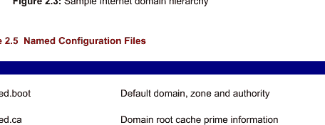

图 2.3：示例 Internet 域层次结构

### 表 2.5 Named 配置文件

|  |  |
|---|---|
| named.boot | 默认域、区域和授权 |
| named.ca | 域根缓存初始信息 |
| named.data | 本地域信息 |
| named.rev | 反向查询信息 |

组织中将使用 DNS 的所有机器都需要知道主名称服务器和辅助名称服务器的位置。此信息记录在每台机器上的 `resolv.conf` 文件中（示例 2.3）。当域名解析为 IP 地址时，会向 `resolv.conf` 列表中的第一个名称服务器发送查询。如果在收到第一个名称服务器的答复之前超时时间到期，则会查询第二个名称服务器。

### 示例 2.3 resolv.conf

```
; /etc/resolv.conf
;
domain		foo.bar.org		; default domain
nameserver	123.145.100.1	; name server1
nameserver	123.145.100.2	; name server2
```

## Inetd

而不是持续运行某些 TCP/IP 服务守护进程，可以在请求服务时启动它们，并在服务完成后停止它们。此功能由 `inetd` 守护进程支持。`inetd` 的配置信息位于 `/etc/inetd.conf` 和 `/etc/services` 文件中（示例 2.4 和 2.5）。`/etc/inetd.conf` 文件中的条目指示每个服务名称和任何所需的启动信息。`/etc/services` 文件列出服务名称、是否使用 TCP 或 UDP 协议以及与服务关联的众所周知的端口号。每次对这两个表中的任何一个进行更新时，都必须刷新 `inetd` 守护进程。这可以通过向 `inetd` PID 发送挂断信号来完成。

```
# kill -HUP <inetd-PID>
```

### 示例 2.4 /etc/inetd.conf


# inetd.conf
```
#
# service socket protocol wait/ user server server program
# name type nowait program arguments
#
echo stream tcp nowait root internal
echo dgram udp wait root internal
discard stream tcp nowait root internal
discard dgram udp wait root internal
daytime stream tcp nowait root internal
daytime dgram udp wait root internal
chargen stream tcp nowait root internal
chargen dgram udp wait root internal
ftp stream tcp nowait root /etc/ftpd ftpd
telnet stream tcp nowait root /etc/telnetd telnetd
time stream tcp nowait root internal
time dgram udp wait root internal
bootps dgram udp wait root /etc/bootpd bootpd
tftp dgram udp wait nobody /etc/tftpd tftpd -n
finger stream tcp nowait nobody /etc/fingerd fingerd
exec stream tcp nowait root /etc/rexeced rexecd
login stream tcp nowait root /etc/rlogind rlogind
shell stream tcp nowait root /etc/rshd rshd
talk dgram udp wait root /etc/talkd talkd
ntalk    dgram    udp wait    root /etc/talkd talkd
uucp     stream   tcp nowait  root /etc/uucpd uucpd
comsat   dgram    udp wait    root /etc/comsat comsat
netbios-ssn stream tcp nowait root /usr/local/samba/bin/smbd
netbios-ns dgram udp wait    root /usr/local/samba/bin/nmbd
```

## 示例 2.5 /etc/services
```
#
# Network well known services
#
# Service Port/Protocol Aliases
#
echo        7/tcp
echo        7/udp
discard     9/tcp        sink null
discard     9/udp        sink null
systat     11/tcp       users
daytime    13/tcp
daytime    13/udp
netstat    15/tcp
qotd       17/tcp       quote
chargen    19/tcp       ttytst source
chargen    19/udp       ttytst source
ftp-data   20/tcp
ftp        21/tcp
telnet     23/tcp
smtp       25/tcp       mail
time       37/tcp       timserver
time       37/udp       timserver
rlp        39/udp       resource  # resource location
nameserver 42/udp       name      # IEN 116
whois      43/tcp       nicname
domain     53/tcp       nameserver # name-domain server
domain     53/udp       nameserver
mtp        57/tcp              # deprecated
bootps     67/udp              # bootp server port
bootpc     68/udp              # bootp client port
tftp       69/udp
rje        77/tcp       netrje
finger     79/tcp
link       87/tcp       ttylink
supdup     95/tcp
hostnames 101/tcp       hostname # usually from sri-nic
iso_tsap  102/tcp
x400 103/tcp
x400-snd 104/tcp
csnet-ns 105/tcp
pop 109/tcp postoffice
sunrpc 111/tcp
sunrpc 111/udp
auth 113/tcp authentication
sftp 115/tcp
uucp-path 117/tcp
nntp 119/tcp readnews untp
ntp 123/tcp
ntp 123/udp # network time protocol (exp)
netbios-udp 137/udp # netbios udp
netbios-ssn 139/tcp # netbios tcp
NeWS 144/tcp
snmp 161/udp # snmp request port
snmp-trap 162/udp # snmp monitor trap port
mux 199/tcp # snmpd smux port
src 200/udp # System Resource controller
exec 512/tcp
login 513/tcp
who 513/udp whod
shell 514/tcp cmd # no passwords used
syslog 514/udp
printer 515/tcp spooler # line printer spooler
talk 517/udp
ntalk 518/udp
efs 520/tcp # for LucasFilm
route 520/udp router routed
timed 525/udp timeserver
tempo 526/tcp newdate
courier 530/tcp rpc
conference 531/tcp chat
netnews 532/tcp readnews
netwall 533/udp # for emergency broadcasts
uucp 540/tcp uucpd # uucp daemon
new-rwho 550/udp
remotefs 556/tcp rfs_server rfs
rmonitor 560/udp
monitor 561/udp
```

## 文件系统

UNIX 文件系统是位于一个或多个磁盘上的块分区，作为目录和文件树的容器。构成文件系统的主要结构是超级块、`inode` 和数据块。

超级块描述了文件系统的整体结构。它包含文件系统名称、大小、指向 `inode` 和空闲块列表的指针等。超级块用于在操作期间跟踪文件系统状态，该状态稍后可在启动过程的一部分以及在发生故障时用于验证文件系统的完整性。

文件系统中的每个目录和文件都由一个 `inode` 表示。`inode` 可以被视为一个索引条目。每个 `inode` 从 1 开始按顺序编号，直到为文件系统定义的最大 `inode` 数。`inode` 标识其所代表的文件或目录的属性（表 2.6）。

### 表 2.6 Inode 文件属性

- 文件模式
- 文件类型
- 所有者 UID 和 GID
- 日期和时间戳
- 链接数
- 数据块指针
- 字节大小
- 块大小

数据块用于在文件系统中存储实际的文件数据。通常每个 `inode` 包含 13 个数据块地址槽。前八个地址槽指向文件的前八个文件数据块。第九个地址指向一个内存中 `inode` 结构。当文件打开时，磁盘 `inode` 信息会被复制到该结构中。第 10 到第 13 个地址指向用于寻址大文件的数据块的间接数据块。每个间接块支持 1024 个地址。较新的 UNIX 文件系统可能包含额外的结构来表示更大文件和文件系统。

## 目录结构


UNIX 目录和文件结构组织成倒置树的形状，从顶部的根目录开始，子目录分支从根向下延伸。树中的每个目录级别可能包含文件或额外的子目录。目录还充当挂载点，用于将额外的文件系统连接到树。根级目录，指定为`/`，充当整个树结构的基挂载点。已挂载文件系统、其挂载点和属性的列表可以使用 `df` 命令显示（示例 2.6）。在浏览各种系统的挂载信息时，您可能会认识到一组常见的目录名称。有一些相当标准的目录集用于存放各种类型的文件。

这些列在表 2.7 中。

### 示例 2.6 已挂载文件系统属性

```
# df
Filesystem 512-blocks Free %Used Iused %Iused Mounted on
/dev/hd2 131072 81496 38% 2302 15% /
/dev/hd2 1310720 91144 94% 25779 16% /usr
/dev/hd9var 262144 156592 41% 554 2% /var
/dev/hd3 524288 307744 42% 335 1% /tmp
/dev/lv01 786432 219952 73% 7442 8% /home
/dev/lv02 1507328 236704 85% 14707 32% /usr/local
```

### 表 2.7 常见的 UNIX 目录


| 目录 | 描述 |
|---|---|
| `/` | 文件系统树的根 |
| `/bin` | 命令二进制文件 |
| `/dev` | 设备文件 |
| `/etc` | 配置文件和管理员脚本 |
| `/home` | 用户文件 |
| `/lib`, `/usr/lib` | 库文件 |
| `/sbin` | 系统二进制文件 |
| `/tmp` | 临时文件 |
| `/usr/bin` | 命令和脚本 |
| `/usr/adm` | 记账和行政文件 |
| `/usr/include` | 系统 ".h" 包含文件 |
| `/var`, `/usr/spool` | 排队和日志文件 |
| `/usr/local` | 本地命令、脚本和文件 |
| `/usr/man` | 手册页 |

## 文件接口

本章开篇段落中我提到过，所有 UNIX 对象都被抽象为文件。此接口提供了一组通用的系统调用，可用于操作文件对象。它还允许将程序、shell 脚本和命令行中的各种文件 I/O 命令和系统调用链接起来。正如人们所期望的那样，接口存在一些细微差异，这些差异基于目标文件对象的属性（表 2.8）。当尝试通过 Samba 共享目录操作 UNIX 文件对象时，这将是有用的信息。

### 表 2.8 UNIX 文件类型

| 类型 | 描述 |
|---|---|
| 普通文件 | 无结构强加的字节串 |
| 目录 | inode 和文件名的配对列表 |
| 硬链接 | 在同一文件系统内由多个名称引用的文件 |
| 符号链接 | 指向任意文件系统中文件的 文件名指针 |
| 块设备 | 指向块数据设备驱动程序的 `/dev` 文件 |
| 字符设备 | 指向字符数据设备驱动程序的 `/dev` 文件 |
| 命名管道 | 用于进程间通信的 SYSV 通道 |
| 套接字 | 用于进程间通信的 BSD 通道 |

文件类型和允许操作属性信息可使用 `ls` 命令显示（示例 2.7）。命令的长选项中最左边的列通过字符串中的第一个字符指示文件类型。随后的 r、w 和 x 字符集分别指定所有者、组和其它用户的读、写和执行权限。所有者和组作为字符串列在下一个列集中，其后是大小、日期和文件名。

### 示例 2.7 文件属性和权限

```
# ls aLF /home/deroest
total 1152
drwx-rx-rx 4 deroest system 1024 Nov 14 04:45 ./
drwx-rx-rx 5 bin bin 512 Aug 08 16:08 ../
-rw------- 1 deroest system 150 Aug 12 04:56 .Xauthority
drwx-rx-rx 8 deroest system 512 Aug 12 04:56 .dt/
-rwx-rx-rx 1 deroest system 3970 Aug 12 04:56 .dtprofile*
-rwxr----- 1 deroest system 254 Aug 08 16:08 .profile*
-rw------ 1 deroest system 54 Sep 26 07:43 .sh_history
drwx-rx-rx 4 deroest system 512 Sep 26 07:42 info/
```

## NFS

在网络化 UNIX 系统之间共享文件和目录的常见方法是 Sun 的网络文件系统（NFS）。NFS 是一种基于一组远程过程调用（RPC）和外部数据表示（XDR）规范的无状态文件共享协议，用于在机器之间捕获、重定向和通信文件操作和属性。NFS 基于客户端/服务器架构，使应用程序能够在远程文件和目录上无缝互操作，而不考虑其位置。Sun 将此架构置于公共领域，它成为 UNIX 下分布式文件系统的事实标准。NFS 也在许多其它操作系统上得到支持，包括 Windows。同样，重要的是要了解 NFS 及其与混合环境中 Samba 目录共享的关系。

NFS 服务器依赖于多个守护进程来管理分布式文件系统服务（表 2.9）。来自多个客户端的 I/O 请求通过可配置数量的 `nfsd` 和 `biod` 守护进程进行多路复用。`nfsd` 守护进程管理文件 I/O 操作，而 `biod` 守护进程控制块 I/O 服务。NFS 服务器将其自身注册到 `portmap` 守护进程，该守护进程维护特定机器上的 RPC 应用程序列表。客户端应用程序查询 `portmap` 守护进程以确定与已知服务名称关联的端口号。`rpc.mountd` 守护进程由服务器用于管理和跟踪客户端挂载请求。客户端和服务器之间的最近 RPC 操作由 `rpc.statd` 守护进程缓存。服务器的 `rpc.lockd` 守护进程支持 SYSV 建议性文件和记录锁定。

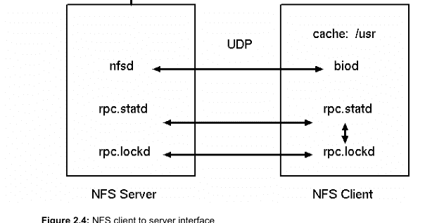

图 2.4：NFS 客户端到服务器接口

### 表 2.9 NFS 服务器守护进程

| 守护进程 | 描述 |
|---|---|
| `nfsd` | NFS 服务器守护进程 |
| `biod` | NFS 块 I/O 守护进程 |
| `portmap` | RPC 程序到端口管理器 |
| `rpc.mountd` | NFS 挂载管理器 |
| `rpc.statd` | RPC 状态管理器 |
| `rpc.lockd` | NFS 锁管理器 |

可用于远程挂载的每个文件系统或目录都由服务器的 `/etc/exports` 文件中的一个条目标识（示例 2.8）。除了目录路径名外，`/etc/exports` 条目还控制哪些机器名称允许挂载目录、以 root 权限对其进行操作以及是否有只读或写访问权限。如果未为远程 NFS 客户端启用 NFS root 访问，则服务器的 root UID 将映射到默认 UID -2（4294967294），用户名 `nobody`。这限制了远程机器上未知超级用户 UID 造成的损害。

### 示例 2.8 `/etc/exports` 条目

```
/usr/lpp/info/En_US -ro,access=alph,lisa
/home -rw,root=alph,access=alph,lisa,armada
```

## 打印

在 UNIX 下，打印相当直接，因为文件 I/O 抽象用于与设备互操作。最简单的形式下，ASCII 字符文件可以通过将文件管道传输到代表本地打印机的设备文件来打印。

```
# cat myfile | /dev/lp0
```

为了便于本地和远程打印机的打印队列，`lpd` 守护进程发挥作用。启动后，`lpd` 会解析 `/etc/printcap` 文件（示例 2.9）中列出的打印机和队列定义。`printcap` 文件指定与每个打印机和队列关联的所有属性。这包括是否打印横幅页和/或尾页，设备是否需要特殊的后端驱动程序或过滤器，正在强制执行的访问控制，以及是否应记录记账信息。在远程队列的情况下，会标识远程站点。

### 示例 2.9 `/etc/printcap`

```
# Sample printcap
lp|Sample Printer Entry:\
:lp=/dev/null:\
:sd=/var/spool/lpd/lp0:\
:if=/usr/local/lib/your-input-filter:\
:rm=host.your.domain.com:\
:mx#0:
```

## 访问控制


`/etc/passwd` 和 `/etc/group` 文件构成了 UNIX 中访问控制的基础。一般来说，对对象进行操作的权利由对象的所有权或与对象关联的组的成员资格来管理。较新的 UNIX 版本通过包含对访问控制列表（ACL）的支持来增强访问控制机制。ACL 允许比对象上允许的操作更精细的粒度，并允许最终用户设置和控制自定义组。缺点是，ACL 在环境之间不易映射，并且可能无法通过远程文件共享工作。

### 密码

UNIX 密码文件 `/etc/passwd` 是一个表，标识允许登录到系统的所有用户（示例 2.10）。每个用户帐户分配一个文本字符串帐户名称和一个唯一的数字标识符，称为 UID，该标识符唯一对应于单个计算机。与用户关联的另一个数字标识符是默认组标识符 GID。基本上，系统在管理访问控制时使用 UID 和 GID 标签。密码文件可能包含也可能不包含用户群体的加密密码。由于密码文件对所有用户可见，一些系统已将加密密码移至受限访问文件，称为 shadow 密码文件。这挫败了通过可见密码文件轻松使用密码破解程序的能力。当启用 shadow 密码时，占位符字符 `!` 会插入到 `/etc/passwd` 中的密码字段，表明关联的加密密码可以在 shadow 密码文件中找到。密码文件中的其它信息可能包括 gecos 字段中的个人姓名和地址数据、用户的 home 目录和默认 shell。密码文件中的每个字段由冒号分隔。

```
Account Name:UID:GID:<Gecos strings>:<Home Directory>:<Shell>
```

#### 示例 2.10 /etc/passwd

```
root::0:0:System Overseer::/bin/ksh
daemon::1:1::/etc:
bin::2:2::/bin
sys::3:3::/usr/sys:
adm::4:4::/usr/adm
uucp::5:5::/usr/lib/uucp:
stimpy::4084:30:Stimson Cat:/ul/stimpy:/bin/ksh
```

解析大型密码文件可能会导致命令响应时间显著延迟。为了提高响应时间，一些 UNIX 实现支持在索引的 dbm 数据库集中镜像 `/etc/passwd` 信息。`mkpasswd` 命令读取 `/etc/passwd` 并创建键控目录文件 `/etc/passwd.dir` 和数据文件 `/etc/passwd.pag`。密码 dbm 支持不是必需的，但作为选项提供 for sites with large user communities.

```
# mkpasswd /etc/passwd    Create new passwd dbm database.
```

### 组

组提供了一种粗略的机制，用于在用户之间共享信息。与 `/etc/passwd` 文件类似，`/etc/group` 文件是一个表格，用于标识系统上的所有组名、关联的 GID 以及组成组成员资格的账户名称的逗号分隔列表（示例 2.11）。UNIX 假定有限的组集来实现默认访问权限。系统管理员可以将用户添加到这些默认组中或创建新组以促进额外的协作。如果用户基数较小，这可以相对容易地完成。对于大量用户，管理 GID 集可能是一项繁重的工作。

#### 示例 2.11 /etc/group

```
system::!0:root,ops
daemon::!1:
bin::!2:root,bin
sys::!3:root,bin,sys
adm::!4:bin,adm,kenm,root
uucp::!5:uucp
mail::!6:
security::!7:root
cron::!8:root
staff::!10:root,ren,stimpy,daffy,huey,dwewy
user::!30:luge,acadmus,gwyneira,bungi
```

### 网络信息服务

网络信息服务（NIS）是一种管理工具，可用于在机器之间分发通用的系统配置信息。NIS 和 NIS+ 过去通常被称为“黄页（YP）”。对于负责维护实验室或分布式网络中大量机器的系统管理员来说，NIS 是一大福音。参与机器的集合称为 NIS 域。分发集中每个文件都被转换为 ndm 数据库格式并作为 NIS 映射文件存储在服务器上。NIS 映射的集合构成了 NIS 数据库，该数据库会定期分发到 NIS 域中的机器。

正如你可能猜到的那样，使用 NIS commonly 分发的两个文件是 `/etc/passwd` 和 `/etc/group` 文件。NIS 提供了一种便捷的方法，可在多台机器之间同步账户信息。在仅需在机器之间保持部分账户和组共用的情况下，NIS 允许将账户和组划分为本地和分布式类别（表 2.10）。本地信息是每个机器独有的。分布式信息是在主 NIS 服务器上管理的配置信息，并推送到参与机器以实现统一。本地数据会覆盖冲突的分布式数据。

#### 表 2.10 NIS 密码和组文件

| /etc/passwd | /etc/group |
|---|---|
| /etc/passwd.yp | /etc/group.yp |
| /etc/passwd.local | /etc/group.local |

### Kerberos

有许多适用于 UNIX 的身份验证系统可供使用，它们增强了基本密码和组架构的功能和安全性。其中一个系统是 *Kerberos* 身份验证，由 M.I.T. 开发，基于 *Trusted Third-Party* 身份验证模型。原始设计在 1988 年 USENIX 冬季会议上发表的一系列论文中进行了描述。Kerberos 是关于 UNIX 和 NT 共存的重要技术，因为它是 Windows 2000 中的网络身份验证系统。

Kerberos 假定网络中的所有内容都是不可信的，除了 Kerberos 身份验证服务器本身。Kerberos 身份验证服务器称为 *Key Distribution Center (KDC)*。KDC 在客户端和所需服务之间充当中介。客户端必须向 KDC 进行身份验证以获取票据，该票据授予访问分布式服务的权限（图 2.5）。该票据称为 *Ticket Granting Ticket (TGT)*。只需向 KDC 验证一次身份，而非每次访问的服务都需验证一次。各种 Kerberos 票据也仅在特定时间内有效。Kerberos 票据机制消除了通过网络以明文传输密码的需求。客户端和服务器密码由 KDC 知晓并存储。

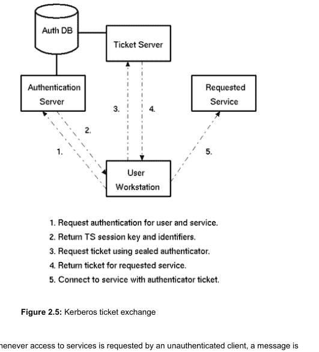

1. 请求用户和服务的身份验证。
2. 返回 TS 会话密钥和标识符。
3. 使用密封的身份验证器请求票据。
4. 返回所请求服务的票据。
5. 使用身份验证器票据连接到服务。

图 2.5：Kerberos 票据交换

每当未经身份验证的客户端请求访问服务时，就会向 KDC 发送一条消息，其中包含客户端名称和 Kerberos 票据授予服务名称。KDC 查找名称并获取客户端和票据服务器的加密密钥。加密密钥仅为拥有方代理和 KDC 所知。然后 KDC 构造一条消息，其中包含客户端和票据服务器名称、地址以及随机会话密钥，并使用客户端的加密密钥对其进行加密。该消息称为票据并发送给客户端。客户端使用其加密密钥解密票据并在票据有效期内存储票据。会话密钥用于加密与 Kerberos 票据服务的票据通信以获取对其他服务和资源的访问权限。

当请求访问服务时，票据服务提供一个新的会话密钥以及使用 KDC 数据库中的服务加密密钥加密的票据。客户端使用新的会话密钥创建身份验证器票据以标识客户端，并将其与加密的服务票据一起发送给新服务。服务使用其加密密钥解密票据。服务票据包含会话密钥，然后用于解密身份验证器票据。现在客户端和服务彼此知晓，真正的任务可以开始了。

这看起来似乎是大量手势挥动以防止明文密码和身份验证信息在网络上传播。另一方面，在线路上窃听极其容易。所有这些协商都在幕后进行，因此对终端用户不可见。请记住，Kerberos 不会限制已经窃取了另一用户登录 ID 和密码的人的访问。

### 摘要

- UNIX 具有三层架构：内核、shell 和命令层。
- 执行任务和程序称为 *processes*，并由 *PID* 号码标识。
- 服务器进程称为 *daemons*。
- *Init*，PID 1，负责生成系统进程，这些进程在 `/etc/inittab` 文件中标识。
- TCP/IP 是一种具有四层的网络协议：*physical*、*internetwork*、*transport* 和 *application*。
- 网络上的每台计算机都由一个四字节的 IP 号码标识。
- 网络计算机组使用 *subnets* 进行划分，以隔离和管理流量并执行安全策略。
- 一种称为 *Domain Name Service (DNS)* 的分层动态网络名称服务将域名解析为 IP 号码。
- UNIX DNS 服务器称为 *named*。
- DNS 服务器地址在 `/etc/resolv.conf` 中标识。
- *inetd* 服务器在由 `/etc/inetd.conf` 定义的客户端请求时启动网络服务器。


- 众所周知的服务名称到端口映射记录在 `/etc/services` 中。
- UNIX 文件系统包含在称为 partitions 的磁盘块集合中。
- 分区内的文件系统结构表示为 superblock、inode table 和 data blocks。
- 文件系统包含 files 和 directories 的分层集合，每个都记录在 inode 中。
- 所有 UNIX 对象都被抽象为文件。
- 文件和目录访问控制记录在 inode 中，指示 owner、group 和 world 的 read、write 和 execute 权限。
- NFS 是一种无状态的网络文件系统，用于共享文件和目录。
- 本地和远程打印与排队由 `lpd` 守护进程管理。
- 打印机和队列配置信息记录在 `/etc/printcaps` 中。
- UNIX 用户由账户名、UID 和 GID 标识。
- 用户识别信息存储在 `/etc/passwd` 中。
- 通过使用 shadow 密码文件启用对加密密码数据库的受限访问。
- 通过使用 `dbm` 密码数据库、`/etc/passwd.dir` 和 `/etc/passwd.pag` 可以提高密码访问性能。
- 组授权在 `/etc/groups` 中定义。
- NIS 可用于向共享通用用户基的多台机器分发密码和组信息。
- Kerberos 是一种基于 Trusted Third-Party 模型的网络身份验证系统。
- Windows 2000 支持 Kerberos 身份验证。

# 第 3 章：Windows 概述

## 概述

在上一章中，我们研究了 UNIX 系统和网络框架的各个部分，以帮助开发使用 Samba 与 Windows 客户端共享 UNIX 资源的模型。在第 3 章中，我们继续这一讨论线索，通过检查相应的 Windows 系统和网络子系统。在 particular，我们将仔细查看 Windows 网络协议、域和工作组、文件系统和访问控制。Samba 是 Windows 文件和打印共享服务的实现，也提供了基本 NT 主域控制器（PDC）功能。因此，对 Windows 网络协议和域服务的透彻理解对于在企业中成功部署 Samba 至关重要。

## Windows NT 架构

Windows NT 操作系统与 UNIX 相似，因为进程通过执行系统服务层与 CPU、内存和硬件交互。NT 采用抢占式多任务来管理进程线程的执行方式，与 UNIX 调度程序的工作方式大致相同。这允许 NT 暂停某些任务以提供资源给更高优先级的任务。NT 也是多线程的，使其能够在对称多处理平台上运行。这看起来与 UNIX 非常相似。NT 开发团队花费了大量时间审查和借鉴 UNIX 和其他计算架构的想法，最终以卡内基梅隆大学的 Mach 微内核作为操作系统的基础。

Windows NT 被实现为分层子系统架构并支持来自多个不同操作系统环境的应用程序（图 3.1）。与上一章自下而上讨论 UNIX 操作系统层不同，我们将从上到下查看 Windows NT。NT 架构堆栈的顶层驻留着用户模式服务。其中包括用于运行传统 DOS 应用程序的虚拟 DOS 机器（VDM）、用于 Windows 3.x 程序的 16 位 Windows 子系统、POSIX 子系统、OS/2 子系统以及 Win32 子系统。在特定子系统内执行的应用程序作为独立的受保护虚拟内存空间进行管理。用户模式服务通过执行服务缓冲区与较低级别的内核模式服务交互。该缓冲区是一个代码段，用于划分和保护用户模式和内核模式操作。紧邻该缓冲区下方的是 NT 执行管理器，它们调节对象和进程生命周期；虚拟内存；过程调用；I/O 功能；并监控访问安全。一个小型固定微内核位于执行管理器层下方。微内核的角色仅限于调度和同步线程以及管理系统中断。操作系统的基础由硬件抽象层（HAL）组成，其工作是隐藏硬件和设备驱动程序依赖性，使其对操作系统其余部分不可见。这简化了、安全化并通用化了用于开发使用硬件服务的应用程序的 API。

| 层 |
|---|
| VDM, Win 3.x, OS/2, POSIX, Win32 |
| 执行服务缓冲区 |
| 执行服务管理器 |
| NT 微内核 |
| 硬件抽象层 |
| 物理硬件 |

图 3.1：Windows NT 分层架构

## 网络

Windows NT 几乎配备了所有可要求的网络协议和接口（图 3.2）。通常的嫌疑对象包括 TCP/IP、NetBIOS/NetBEUI 和 IPX/SPX。基础协议和接口通过额外的通信服务得到增强，以支持虚拟专用网络（VPN）和路由与远程访问服务（RRAS），以及 Microsoft LAN Manager、OS/2 LAN Manager、Banyan Vines、Novell 和 Internet 之间的网关支持。就我们的目的而言，我们将范围缩小到 NetBIOS 和 TCP/IP，它们为 Samba 与 Windows 客户端和服务器之间的服务器消息块（SMB）协议提供传输。

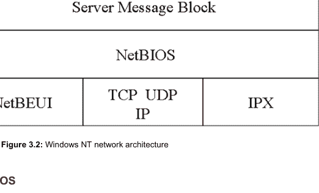

图 3.2：Windows NT 网络架构

### NetBIOS

很久以前，在遥远的 LAN 中，开发了一种 API，用于扩展个人计算机的基本输入/输出系统（BIOS）服务，以包括通过网络在计算机之间共享信息的支持。由此产生的 NetBIOS API 记录在 IBM PC Network Technical Reference Manual 中，（1994 年 9 月）。NetBIOS API 定义了三种服务类型：会话服务、数据报服务和名称服务。

NetBIOS 应用程序之间的对话由 NetBIOS 会话和数据报服务促进。NetBIOS 会话服务在两个已知方之间传递消息需要可靠的虚拟电路并保证交付时使用。会话型连接的示例是访问文件共享。相比之下，当目标接收方事先未知时，NetBIOS 数据报服务用于无连接通信且不保证交付。数据报，或在 Microsoft 用语中称为 Mailslots，通常作为网络广播或多播传输到一组机器。数据报服务在客户端请求主浏览器的标识时使用。

### NetBT

NetBIOS 本身不是通信协议，而是一种用于建立和管理基于网络服务的编程接口。NetBIOS 应用程序之间的消息必须由传输层协议在网络上传输。流行的传输协议包括 NetBEUI、IPX、DECnet 和 TCP/IP。Samba 使用 RFC 1001 和 1002 中定义的 NetBIOS over TCP/IP（NetBT）作为其传输服务。正如本章后面将看到的，在大型网络中扩展 NetBIOS 服务时，使用 NetBT 作为传输至关重要。

### 名称服务

NetBIOS 名称服务表示为扁平的、非层次化的命名空间。每个服务条目由一个 16 字节的字符串标识，该字符串构成服务的唯一名称或其所属的组名（图 3.3）。字符串的前 15 个字节表示字母数字的机器名或组名。第 16 个字节是一个十六进制数字，表示机器或组的资源类型（表 3.1）。

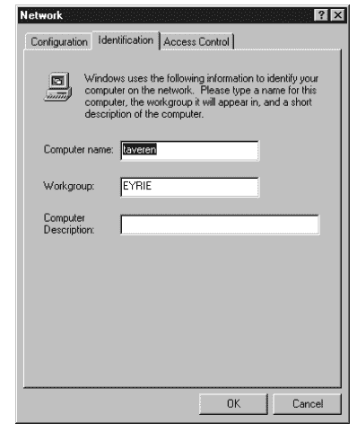

图 3.3：设置 NetBIOS 名称和工作组

### 表 3.1 NetBIOS 名称

| 字符 1-15： | 机器或组名 |
|---|---|
| <a-z, A-Z, 0-9, !, @, #, $, %, ^, &, (, ), *, ', {, }, .-> | |
| 字符 16： | 唯一资源类型 |
| 代码 | 名称 |
|---|---|
| <00> | 工作站服务名称 |
| <03> | 信使服务名称 |
| <06> | RAS 服务器 |
| <1B> | 域主浏览器 |
| <1F> | NetDDE 服务 |
| <20> | 服务器服务 |
| <21> | RAS 客户端 |
| <BE> | 网络监视器代理 |
| <BF> | 网络监视器实用程序 |

### 组资源类型

| 代码 | 名称 |
|---|---|
| <1C> | 域组名称 |
| <1D> | 主浏览器名称 |
| <1E> | 选举组名称 |
| <20> | Internet 组 |

同一逻辑子网或工作组内资源名称之间的冲突可以通过使用 NetBIOS 作用域 标识符对命名空间进行分区来解决（图 3.4）。这是一个字符字符串，与 NetBIOS 名称一起使用以在命名空间中强制唯一性。NetBIOS 作用域加上 NetBIOS 名称的总长度不能超过 256 个字符。请注意，使用 NetBIOS 作用域有效地将资源彼此隔离，无法通信。

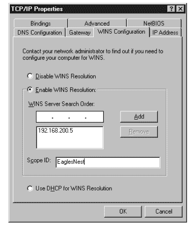

图 3.4：设置 NetBIOS 作用域


每个应用程序通过发出 NetBIOS `Add Name` 或 `Add Group Name` 调用在命名空间中注册其存在。服务或组名随后在命名空间中保留，直到通过 `Delete` 调用明确释放或托管该服务的机器关闭。已注册的名称和资源类型可以通过调用 Windows `nbtstat` 命令进行查询。在示例 3.1 中，`nbtstat` 用于显示名为 `Wizard` 的机器的已注册 NetBIOS 资源表。该列表表明 `Wizard` 是 `Eyrie` 组的成员，并且有一个已连接用户 `DeRoest`。保留名称 `__MSBROWSE__` 将 `Wizard` 标识为该组已注册的主浏览器。

### 示例 3.1 NetBIOS 机器列表

```
C:\nbtstat -a Wizard
NetBIOS Remote Machine Name Table

Name                Type          Status
--------------------------------------------
WIZARD              <00> UNIQUE   Registered
EYRIE                <00> GROUP    Registered
WIZARD               <03> UNIQUE   Registered
WIZARD      <20> UNIQUE      Registered
EYRIE        <1E> GROUP       Registered
DEROEST      <03> UNIQUE      Registered
EYRIE        <1D> UNIQUE      Registered
..__MSBROWSE__.. <01> GROUP   Registered
```

NetBIOS 名称服务使用两种方法注册、解析和释放 NetBIOS 名称、组和地址。第一种方法使用网络广播管理命名空间。客户端机器以广播形式在网络上查询或宣布名称，然后等待对请求的响应。由于交付无法保证，客户端可能需要在请求得到解决前多次重传请求。这种方法在小型网络中有效，但在大型网络中由于广播流量过重而迅速失效。

管理命名空间的第二种方法使用点对点通信。名称注册和 IP 地址解析请求以类似于 Internet 动态 DNS 的方式定向到 NetBIOS 名称服务器 `NBNS`。NetBIOS 点对点名称服务在 `RFC 1001` 和 `RFC 1002` 中定义，并作为 Microsoft 的 Windows Internet Name Service `WINS` 实现（图 3.5）。

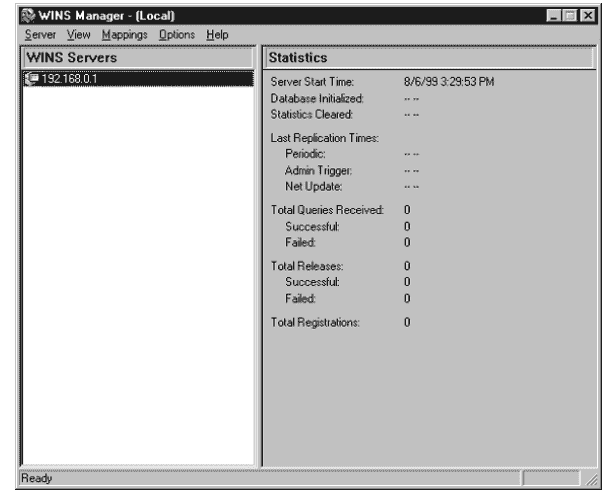

图 3.5：WINS 配置

NetBIOS 名称到 IP 地址的映射也可以硬编码在 `LMHOSTS` 表中并存储在每台机器上。`LMHOSTS` 表是一个包含 IP 地址和名称对的平面 ASCII 文件。如果同时存在 `WINS` 和 `LMHOSTS` 信息用于名称解析，客户端会首先查询其本地 NetBIOS 缓存，然后查询 `WINS`，再使用 `LMHOSTS` 信息。在系统启动时，也可以用标记为 `#PRE` 的 `LMHOSTS` 条目预先填充客户端 NetBIOS 缓存（示例 3.2）。

### 示例 3.2 LMHOSTS 条目

```
149.110.5.12    Wizard   #PRE
```

各种局域网客户端用于名称到地址解析的广播和点对点功能基于其节点类型，如表 3.2 所定义。

### 表 3.2 名称解析方法

| 节点类型 | 名称解析方法 |
|---|---|
| `B-NODE` | 广播解析名称。使用有向和广播 UDP 和 TCP 的混合方式解析名称。所有网络节点必须监听广播。 |
| `P-NODE` | 仅点对点节点。使用有向 UDP 和 TCP 连接。依赖于对名称服务器的访问来解析名称。 |
| `M-NODE` | 混合节点。先尝试广播，然后如果广播无响应则使用点对点与名称服务器通信。 |
| `H-NODE` | 混合节点。先尝试点对点，然后如果无法联系名称服务器则回退到广播。 |
| `MS ENHANCED` | 与 `H-NODE` 相同，但还会使用 |

## 服务器消息块 (SMB)

到目前为止，我们已经简要查看了 MS Windows 在网络、传输层以及在一定程度上会话层的网络服务和协议。现在我们准备在协议栈中更进一步，探究服务器消息块 `SMB` 协议，即 `Samba` 赖以生存的地方（图 3.2）。`SMB` 是一种会话层、表示层和应用层协议，提供了一种在联网计算机之间远程共享文件、打印机和各种通信资源的方式。`SMB` 协议首次在 1987 年联合微软和英特尔发布的文件《Microsoft Networks/OpenNET-File Sharing Protocol》中定义。早期的 `SMB` 实现包括 1987 年的 MS LAN Manager 和 1988 年的 OS/2 LAN Server。1992 年 `SMB` 成为 Open Group 互操作性标准，“Protocols for X/Open PC Interworking: SMB, Version 2, X/Open CAE Specification C209。”微软与多家计算和网络厂商合作，以新名称通用 Internet 文件系统 `CIFS` 协议定义了 `SMB` 的增强版本。`CIFS` 版本 1.0 已作为草案提交给 Internet 工程任务组 `IETF`，以供考虑作为信息性 RFC。

`SMB` 是在 NetBIOS API 上实现的面向连接协议。该协议为 Windows 客户端和服务器应用程序提供了一种通过虚拟电路以请求/响应方式通信的机制。每个服务器消息块的内部结构表示为按最低有效字节在前顺序排列的 Intel 格式多字节值的字符串。每个块以固定长度的头部开始，后跟一组可变的参数字段，最后以数据缓冲区结束。`SMB` 命令协议本质上可以分为四种操作类型：会话、文件、打印机和消息。`SMB` 会话命令用于建立虚拟电路并验证访问。文件和打印机命令允许应用程序对文件进行操作并将作业发送到远程打印机。消息命令为在客户端和服务器应用程序之间传递警报、控制和信息消息提供了一种方式。示例 3.3 中描述的简化 `SMB` 会话将有助于了解 `SMB` 会话如何建立和释放。

### 示例 3.3 SMB 会话

| 命令 | 描述 |
|---|---|
| `SMBnegprot` | 初始消息列出客户端应用程序支持的方言。服务器以选定的方言响应。 |
| `SMBsesssetup` | 应用程序的凭据被传递以供验证。服务器以 UID 响应。 |
| `SMBtcon` | 指示客户端请求的共享名称。服务器以共享的 TID 响应。 |
| `SMBopen` | 要打开的文件名。服务器以在后续文件操作中使用的 FID 响应。 |
| `SMBread` | TID、FID、偏移量和要读取的字节数。 |
| `SMBclose` | 关闭共享 TID 中的文件 FID。 |
| `SMBtdis` | 从共享 TID 断开连接。 |

示例中 `SMB` 方言的初始协商是由于协议在其发展历史中发生的扩展而必需的。基础级别的 `SMB` 版本被称为“核心协议”。其他方言列在表 3.3 中。`Samba` 在 `CIFS 1.0` 和 Windows NT LAN Manager 0.12 级别支持 `SMB`。

### 表 3.3 SMB 方言

| 方言 | 描述 |
|---|---|
| `PC Network Program 1.0` | 核心协议 |
| `Microsoft Networks 1.03` | 核心加协议 |
| `Microsoft Networks 3.0` | 扩展 1.0 协议 |

较新版本 `SMB` 协议的一个特性是它支持机会锁定或 `oplocks`。通过在文件上获取 `oplock`，`SMB` 应用程序可以预读并在本地缓冲数据以供更新，从而提高性能。有三种类型的 `oplocks`。获取独占 `oplock` 意味着没有其他应用程序可以读取或修改目标文件。锁定持有者对文件具有独占控制权。批处理 `oplock` 允许应用程序通过连续的打开和关闭在文件上保持锁定，从而减少客户端和服务器之间的网络流量。二级 `oplock` 允许多个应用程序读取文件但不更新它。

## 通用 Internet 文件系统 (CIFS)

如前所述，`CIFS` 是 `SMB` 协议的增强版本。除了与 `SMB` 向后兼容外，`CIFS` 还提供了一种在 Internet 上跨多个操作系统平台共享资源的方式。这是通过使用类似 HTTP URL 的资源定位语义和 Internet DNS 实现的。就可扩展性和容错性而言，`CIFS` 通过激进的锁定和缓存算法支持对单个文件的多写者。由于其旨在支持更大社区的资源共享，`CIFS` 可以适应广泛的网络速度。这包括从慢速拨号调制解调器比特率到千兆骨干连接的一切。Unicode 字符集也是考虑到更广泛的 Internet 受众而采用的。

## 对等体、工作组、域、林

在规划资源共享的网络基础设施时，首先想到的问题之一是如何控制对这些资源的访问。

### 工作组


在小型同质 MS Windows 环境中，可能可以以友好对等的方式运行。你让我玩你的玩具，我考虑让你玩我的。这种类型的环境通常实现为工作组（图 3.6）。工作组提供了一种将共享通用工作配置文件的用户和资源分组的方式。工作组还简化了在网络中定位资源的任务。可能不需要在网络上的每台工作站上浏览特定资源，因为该资源可能已知位于特定工作组中，从而减少需要检查的系统数量。

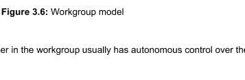

图 3.6：工作组模型

工作组中的每个用户通常对其桌面上的资源具有自主控制权。用户可以为本地资源分配密码以在 `共享级安全` 下限制访问（图 3.7）。`共享级安全`通过要求知道适当的密码来管控访问。按用户和组进行访问控制称为 `用户级`。这需要存在充当安全服务器的 Windows NT 计算机。工作组模型中缺少安全服务器意味着每个用户必须在使用的每个工作组计算机上本地存储账户和密码。这也意味着每个用户必须知道访问本地或远程工作组中各种可用资源所需的所有密码。工作组看起来可能像管理噩梦，但系统管理员可以通过使用系统策略和配置文件在一定程度上控制资源共享。密码管理很可能仍然是一个问题。

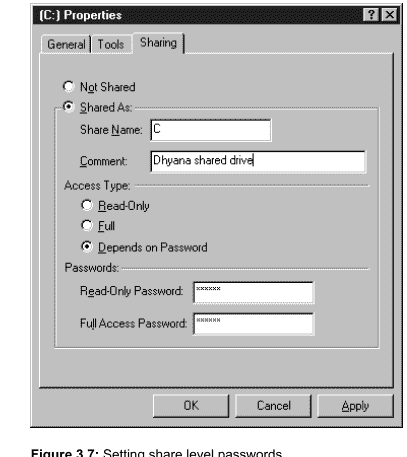

图 3.7：设置共享级密码

### 域

通过为网络实现 Windows `域` 模型，可以更轻松地实现对账户、密码和共享的集中管理。Windows 域是共享通用安全策略和命名空间的逻辑用户和计算机集合。在每个域中，一个或多个称为 `域控制器` 的 Windows NT 计算机充当管理并解析对域中所有资源访问的中心。`主域控制器 (PDC)` 维护域中所有账户、组和密码信息的目录。该目录称为 `安全账户管理器 (SAM)`。要登录计算机或访问域中的资源，域控制器首先会被咨询以在访问前验证用户凭据

已授予资源（图 3.8）。

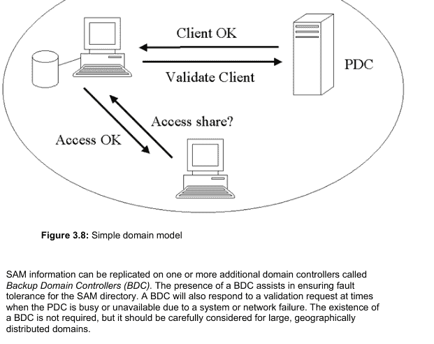

图 3.8：简单域模型

`SAM` 信息可以复制到一个或多个称为备份域控制器（`BDC`）的额外域控制器上。`BDC` 的存在有助于确保 `SAM` 目录的容错性。当 `PDC` 因系统或网络故障而繁忙或不可用时，`BDC` 也会响应验证请求。`BDC` 的存在不是必需的，但在大型、地理分布的域中应仔细考虑。

## 信任

当组织的业务规则、管理结构或地理布局不能很好地适应单一域模型时，可以设置多个域并通过信任关系进行逻辑连接。受信任域中的用户可以在本地域中访问资源并参与组成员身份，而无需在两个域中重复 `SAM` 目录条目。此功能为大型企业提供了一种分发命名空间管理功能的方式。

信任关系可分为三种模型：单向信任、双向信任和完全信任。在单向信任模型中，域 A 允许域 B 访问本地资源，但域 B 不会回馈以允许访问其资源。在双向信任环境中，域 A 和域 B 中的资源访问在两个方向上均被允许。在完全信任模型中，所有域都可以访问所有资源，无论它们位于何处。完全信任或与其他模型的组合非常难以管理。

## 域模型

复制 `SAM` 目录并在域之间定义信任关系的能力为设计稳健且可扩展的基础设施提供了很大的灵活性。实际上，域拓扑方面几乎没有限制。然而，有三种常见的域模型可能有助于规划环境。

最简单的模型是前面描述的 `单域` 基础设施。所有参与资源都是单个域的成员。域有一个 `PDC`，并且可能有一台或多台计算机充当 `BDC`。此模型最易于管理，但对于大量用户或机器可能不太方便。

为了便于管理大量用户和资源，同时保持用户命名空间的单一域，可以将 `SAM` 目录和资源的管理分离到不同的域中。此模型称为 `主域` 模型，它维护 `SAM` 目录。一个或多个 `资源域` 被定义来管理共享。定义单向信任关系以允许主域中的用户访问资源域中的共享。此模型支持用户命名空间的集中管理，并允许对资源域中的共享进行本地管理。

在大型分布式组织中，对命名空间进行分区以支持用户账户和资源的本地化管理可能更有意义。这种 `多主域` 模型代表了与单域模型相反的光谱端点。命名空间被分解为管理单元，每个单元都有自己的安全策略和定义。根据需要建立信任关系以促进域之间的互操作性。如信任讨论中所述，此模型最难以管理，需要域管理员之间密切协调。

## 树和林

Windows 2000 在域模型的基础上构建，通过将域组织成支持集中和分布式管理的分层树结构（图 3.9）。它还将最大命名空间大小增加到 10,000,000 个对象。Windows NT 3.5 仅支持 10,000 个对象，而 Windows NT 4.0 支持 40,000 个。域和管理策略的集合由 `Windows 2000 Active Directory` 管理，它是传统 NT 域安全架构的组合，并增强了一组开放技术，包括 `轻型目录访问协议 (LDAP)`、`Kerberos 版本 5.0` 和 `Internet 风格域名系统 (DNS)`。`Active Directory` 支持 Windows 2000 和 Windows NT 4.0 域控制器的混合环境。旧版客户端仍可使用 NT LAN Manager 挑战/响应身份验证登录。

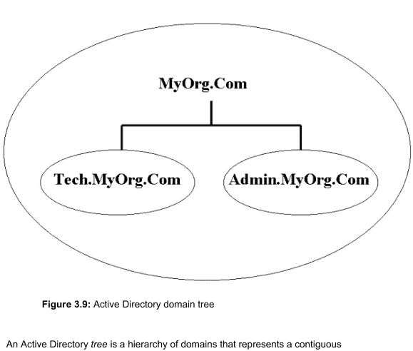

图 3.9：Active Directory 域树

`Active Directory` 树是域的层次结构，表示具有通用 LDAP 架构和 Kerberos 传递信任关系的连续命名空间。架构定义了命名空间中每个对象关联的属性。Kerberos 信任类似于我们已经描述的域信任关系。共享通用架构和信任关系的一组树可以被分组为一个更大的管理单元，称为林。与域一样，称为全局编录的 `Active Directory` 树和林信息在多个服务器之间复制，但采用多主拓扑，而不是域使用的主备模型。

`Active Directory` 通过在域树上叠加一个称为组织单元 (`OU`) 树的独立结构来增强域信任模型。`OU` 是一个容器，包含网络对象，包括用户、组、共享和其他 `OU`。单个 `OU` 安全属性由 `Active Directory` 架构定义。`OU` 提供了更精细的管理权限，与域边界无关。单个域可能在域内实现 `OU` 树，以将管理功能分发给域内的子组。中央 IT 部门可能会定义一个覆盖所有域的全局 `OU` 以集中管理命名空间。

## 浏览

工作站通过浏览来定位共享。基本上，浏览类似于在大型商场或购物中心逛商店。我们从一个网络计算机商店走到下一个，查看可能可用的资源（图 3.10）。浏览器分为两类：浏览器客户端和浏览器服务器。客户端查询浏览器服务器以定位资源。通过域或工作组对资源进行分组可限制浏览范围并简化定位所需资源的工作。

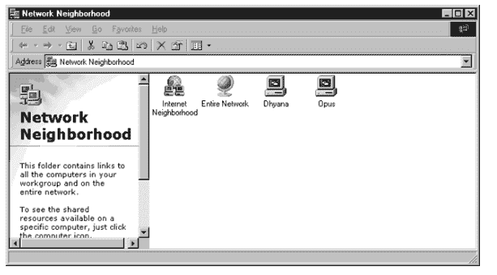

图 3.10：浏览网络邻域

域内的每个子网都有一个本地主浏览器来本地化浏览流量。域内的服务器将其共享注册到本地主浏览器。子网本地主浏览器通过动态竞标过程从域内的候选计算机中选举产生。每台计算机通过宣布其操作系统级别、版本和所需的浏览器角色作为一个四字节字符串，即其选举标准（表 3.4）来进行竞标。选举标准最高的计算机赢得选举并宣布其获胜声明。其他竞争者被降级为备份浏览器状态以支持冗余和负载共享。当客户端认为本地主浏览器已失败或不可用时，会调用选举过程。

### 表 3.4 浏览器选举凭据

#### 操作系统级别（摘要）

| 操作系统 | 值 |
|---|---|
| Windows for Workgroups | 0x01 |
| Windows NT 工作站 | 0x10 |
| Windows NT 服务器 | 0x20 |

#### 所需角色

| 角色 | 值 |
|---|---|
| 备份浏览器 | 0x01 |
| 待命浏览器 | 0x02 |
| 主浏览器 | 0x04 |
| 域主浏览器 | 0x08 |
| WINS 客户端 | 0x20 |
| Windows NT 服务器 | 0x80 |

每个域还拥有一个域主浏览器，其职责是在所有本地主浏览器之间同步共享数据集。域主是子网间浏览的集合点。域 `PDC` 始终充当域主浏览器。在单子网域中，`PDC` 是域主浏览器并且本地

## 文件系统

当谈到文件系统时，MS Windows 是操作系统的 24 种口味冰淇淋店。流行的口味包括 FAT、FAT16、FAT32、OS/2 HPFS、NTFS 和 DFS。然后还有 UNIX 互操作性口味：NFS 和 Samba。Windows 在支持传统和当代文件系统方面提供了大量功能。此功能在异构环境中尤其有用，无论是多个版本的 Windows 还是 Windows 与其他操作系统的混合。

### FAT

文件分配表（`FAT`）文件系统代表了 Windows 平台系列中文件和目录支持的基本共同点。`FAT` 架构本质上是一个索引表，引用磁盘上连续空间分区内的称为簇的数据容器。簇代表磁盘上的最小存储单元。簇大小范围从 512 到 32K 字节，具体取决于磁盘大小和格式。

由于簇大小代表文件或目录的最小容器，因此可能需要根据特定数据集的文件大小特征定制文件系统和驱动器格式。


FAT 文件系统由四个控制区域定义。第一个或保留区域包含引导扇区、引导程序和分区表。下一个区域是簇的 FAT 索引，其后是根目录表，即文件和顶级目录的目录。第四个区域是文件区域簇集合，其中存储数据。

随着更大磁盘的可用性和对更大文件大小的需求，FAT 架构多年来不断发展。基本上，这意味着用于索引簇的 FAT 中的位数增加。更多的索引位意味着可以有更多的簇

已解决。最初 FAT 架构使用 12 位作为簇索引。在 DOS 4.0 中，索引大小增加到 16 位。在 Windows 95 的第二次发行版中，FAT 索引再次增长到 32 位，称为 `FAT32`。

## NTFS

Windows NT 在 Windows 文件系统套件中引入了另一项技术，即 `新技术文件系统 (NTFS)`。考虑到 NT 作为工作组或域服务器的角色，NTFS 提供了可扩展且可恢复的文件系统环境，以更好地支持和保护服务器数据。NTFS 再次将簇索引扩展到 64 位。这使得 NTFS 能够寻址跨多个磁盘驱动器的基于 RAID 的大型数据集。NTFS 的结构内容和状态由一个名为 `主文件表 (MFT)` 的关系数据库跟踪和维护。MFT 信息连同关键文件系统数据的冗余副本以及可选的文件系统镜像，提高了 NTFS 相对于 FAT 文件系统的容错能力，并在系统故障时实现自动恢复。NTFS 还提供了比 FAT 更强的数据安全性。访问控制可以应用于单个文件级别。FAT 文件系统仅在目录级别应用访问控制。

## DFS

在中型到大型域中定位目录共享通常很困难。微软推出的 `分布式文件系统 (DFS)` 用于简化目录共享的定位，并为用户提供可用资源的一致层次视图。在 DFS 下，驻留在多个服务器上的共享可以组织成一个称为 `DFS 树` 的单一目录树。当客户端计算机遍历目录树时，它们会被自动引导到提供构成 DFS 树该部分的共享的服务器。可以在 DFS 中定义备用目录路径，通过在多个服务器上复制共享来平衡对热门共享的访问。与 Windows 2000 结合使用时，Active Directory 中的 LDAP 服务可用于为客户端识别 DFS 树服务器。DFS 是 Windows NT 共享服务器的附加服务，也是 Windows 9x 的客户端附加组件。

## 打印

Windows 打印机可以像共享目录一样在工作组或域中的其他计算机之间进行网络共享。物理打印机首先通过简单的添加打印机向导在服务器上定义。新打印机与适当的设备驱动程序关联，然后在系统中由虚拟打印机对象和队列表示。请注意，多个称为 `打印机池` 的物理打印设备可能由单个队列名称引用。打印机定义完成后，可以为打印机分配共享名称并使其可供远程访问。

远程客户端使用相同的打印机定义向导，并将“network printer”选为目标。如果目标服务器安装了该特定打印机的网络客户端驱动程序，则驱动程序将从服务器自动下载并安装到客户端。安装完成后，网络打印机可以像本地设备一样被应用程序使用。

对于本地应用程序或用户而言，本地打印机和远程打印机之间几乎没有明显区别。要在特定设备上打印的文档被路由到关联的队列名称并由打印服务器进程处理（图 3.11）。如果目标是远程共享，则文档由网络重定向器传输到远程站点，否则路由到本地设备。

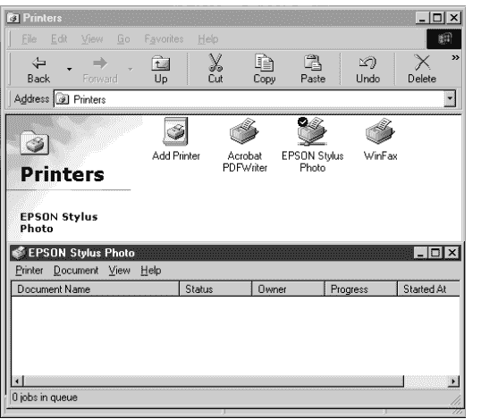

图 3.11：打印机队列列表

## 访问控制

在上一节关于域的讨论中，我们谈到了域用户和组的凭据和权限如何存储在域控制器的安全账户管理器 (`SAM`) 数据库中。权限是管理域中所有资源访问的规则。权限可以按个人定义，也可以按具有相似需求的个人组定义（图 3.12）。组权限具有本地和全局范围。加入全局组允许访问驻留在多个域中的资源。全局组权限受域间信任关系管辖。本地组仅限于单个域内的资源。访问还可能受存在于非域控制器和 NT 工作站上的本地 SAM 信息限制。

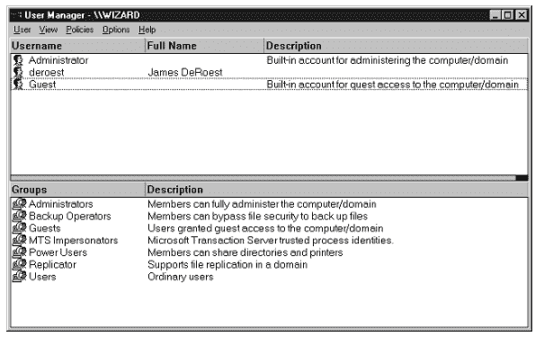

图 3.12：域的用户管理器

`本地安全机构 (LSA)` 和 Net Login 服务分别负责验证对资源的访问权限和对登录请求的身份验证。LSA 通过检查用户的 `资源标识符 (RID)` 和域的 `安全标识符 (SID)` 与所请求资源的访问权限进行比对来验证每个请求。资源权限由 `访问控制列表 (ACLs)` 定义。

## Kerberos

Windows 2000 通过集成 Kerberos 5.0 用于网络身份验证来增强 SAM/LSA 机制。这个在上一章关于 UNIX 中描述的第三方身份验证系统是 Windows 2000 Active Directory 的一个组件。Kerberos 在 Windows 与支持 MIT Kerberos 规范的许多其他厂商操作系统和应用程序之间提供了额外的互操作性。请注意，Kerberos 是一个身份验证系统，通常不指示授权信息。微软通过将 Windows 访问控制信息合并到 Kerberos 票据中的一个未使用字段来增强 Kerberos。该字段被 MIT Kerberos 系统忽略，不会影响整体互操作性。Windows 2000 客户端可以配置为使用 MIT Kerberos 安全服务器进行身份验证。在此配置下，授权信息通过 Kerberos 传递信任关系从 Windows 2000 服务器收集。

## 摘要

- Windows NT 操作系统代表了一种分层架构，具有与 UNIX 类似的分区用户模式和内核模式。
- Windows NT 微内核基于 Mach 微内核。
- 常见的 Windows 网络协议包括 TCP/IP、NetBEUI 和 IPX。
- NetBIOS 是一个 API，旨在促进基于 LAN 的资源共享应用程序的开发。NetBIOS 不是协议，需要使用网络传输。
- NetBIOS-over-TCP/IP，称为 NetBT，被 Samba 用于与 Windows 客户端共享 UNIX 资源。
- NetBIOS 共享名称以两种模式之一注册和查询：网络广播或与名称服务器的点对点通信。
- WINS 是微软对 NetBT 名称服务器的实现。
- SMB 及其后续的 CIFS 是基于 NetBT 的资源共享和消息协议。Samba 是 CIFS 版本 1.0 的实现。
- 在会话启动期间必须协商许多 SMB 和 CIFS 方言。
- 工作组提供了一种将具有共同工作配置文件的用户和资源分组的方法。
- Windows 域是共享通用安全策略和命名空间的用户的逻辑集合。
- 在每个域中，一个或多个称为域控制器的 Windows NT 计算机充当管理域中所有资源访问和解析访问的中心。
- 主域控制器 (`PDC`) 维护域中所有账户、组和密码信息的目录。
- 域账户信息目录称为安全账户管理器 (`SAM`)。
- `SAM` 信息可以复制到一个或多个备份域控制器 (`BDC`)。
- 通过定义信任关系，可以在域之间共享资源。
- Windows 2000 Active Directory 技术将域分组为称为树和森林的层次拓扑结构。
- 域内的资源通过浏览服务定位。
- 域内的每个子网都有一个选举产生的本地主浏览器，维护子网内可用资源的列表。
- 域 `PDC` 充当域主浏览器，以同步本地主浏览器资源信息。
- Windows 支持多种文件系统，包括 FAT、FAT16、FAT32、OS/2 HPFS、NTFS 和 DFS。
- Microsoft `分布式文件系统 (DFS)` 提供了一种将多台计算机上的目录共享组织成单个目录树的方式。
- 带有关联打印机驱动程序的打印设备被表示为虚拟打印机对象，并通过队列名称引用。
- 多个物理打印设备，称为 `打印机池`，可由单个队列名称引用。
- `本地安全机构 (LSA)` 和 Net Login 服务分别负责验证对资源的访问权限和对登录请求的身份验证。
- 资源权限由 `访问控制列表 (ACLs)` 定义。
- Windows 2000 通过集成 Kerberos 5.0 用于网络身份验证来增强 SAM/LSA 机制。

### 第 4 章：Samba 概述

#### 概述

`Samba` 是葡萄牙语中的一个词，意为节奏和舞蹈，源自西非班图语中的 semba 一词，意为祈祷或召唤祖先的灵魂。作为班图语动词，semba 意为“to cry”或“the blues。”在巴西，Samba 是一个神圣的舞者女性。


在 UNIX 世界中，“Samba”是一个软件套件，用于通过 *服务器消息块 (SMB)* 协议与联网的 PC 远程共享 UNIX 文件和打印机。SMB 是一种基于 NetBIOS 的协议，传统上用于 LAN Manager、Windows 和 OS/2 网络中访问远程文件和打印机，统称为 *共享*（参见第 3 章）。SMB 在网络资源和桌面应用程序之间提供无缝接口，其集成性和透明度通常比常用的替代方案如 PC-NFS、FTP 和 LPR 更紧密。Samba 是 SMB-over-TCP/IP（NBT，参见 RFC 1001 和 RFC 1002）的 UNIX 实现。从 Windows 或 LAN Manager 桌面视角来看，Samba 共享的 UNIX 资源看起来就像驻留在另一台 Windows 或 LAN Manager 服务器上一样。不需要特殊的桌面客户端软件。源代码和二进制发行版可免费提供给对该产品感兴趣的任何人。我们将在下一章介绍 Samba 分发站点。

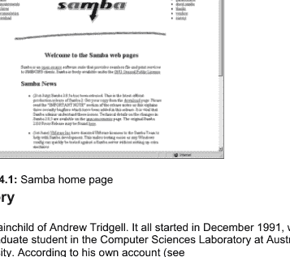

图 4.1：Samba 主页

### Samba 历史

Samba 是 Andrew Tridgell 的创意。这一切始于 1991 年 12 月，当时他在澳大利亚国立大学计算机科学实验室担任研究生。据他自己的说法（参见 http://us3.samba.org/samba/ftp/docs/history/）Andrew 在测试 DEC 的 eXcursion 软件的测试版时，萌生了尝试逆向工程 Digital Equipment Corporation 的 Pathworks 网络用于 DOS 的文件共享协议的想法。eXcursion 为 PC 提供 X Windows 服务。测试 eXcursion 要求他放弃使用 PC-NFS 进行文件共享，并使用 Pathworks 挂载磁盘空间。问题是 Pathworks 将他的网络文件服务选项限制为运行 Ultrix 或 VMS 的 DEC 平台。

作为一个开放系统思想的人，Andrew 决定窃听 Pathworks 网络流量，看看是否可能将该协议移植到其他平台。这需要额外研究网络编程并构建一个软件工具来捕获线路上的网络数据包。在仔细研究了 Pathworks 数据包的位和字节后，他能够在用作开发平台的 Sun 计算机上原型化几个基本文件操作。对协议的进一步研究最终使他找到了 NBT RFC 文献。虽然他显然不确定 NBT 规范与他的 SMB 实现有何关系，但他继续完善代码，并在 1992 年 1 月，“Server 0.1”诞生了。

在接下来的几个月里，Andrew 继续将软件移植到其他非 DEC 平台。这项工作还包括一些错误修复和额外的改进。是时候为软件贴上真正的版本号了。“Server 1.0”已准备就绪，随后发布给互联网社区。然后像任何好的软件开发项目一样，代码在公众审查下发酵了几年。

该项目在收到 Linux 爱好者 Dan Shearer 关于该软件的兴趣笔记后被重新挖掘出来。DEC 也有请求将该软件包含在其 Alpha 贡献作品 CD 上。一些 Linux 到 PC 的家庭网络以及对完整的 Microsoft SMB 规范的发现为开发工作提供了额外的推动。1993 年 12 月，该项目以“NetBIOS for UNIX”的名义重新出现。“Server”暂时被重新命名为“smbserver”，然而，该名称后来因与 Syntax 的商标纠纷而被放弃。在为软件寻找新名称时，Andrew 在 UNIX `/usr/dict/words` 数据库中查找包含字母 SMB 的术语。屏幕上发出荧光般的光芒出现了“Samba”。他声称现在重复这个过程时，该词似乎已从数据库中消失。非常诡异！

### 开发

互联网社区对 Samba 的兴趣高涨要求确定软件的知名归档站点，以便轻松访问新版本和更新。电子邮件讨论列表和新闻组被设立以提供提问、报告错误以及一般讨论该项目的论坛（表 4.1）。由于 Samba 分发包含源代码，许多移植和开发工作迅速出现。这些项目从个人努力到大型机构和厂商项目不等。随着时间的推移，一个大约 20 名松散联合的开发成员的核心小组出现，最终被称为 Samba 团队。截至本文撰写时，Samba 已移植到大多数 UNIX 实现以及许多其他操作系统（表 4.2）。Samba 团队是

Name" 在消息正文中。有关更多信息请参阅 http://lists.samba.org/。

### 新闻组

- linux.samba SMB 协议讨论
- Linux Samba 问题 comp.protocols.smb

### 表 4.2 Samba 平台

| 服务器 | 非 Microsoft 客户端 |
|---|---|
| Amiga | DAVE |
| HP MPE/iX | Linux SMBFS |
| MVS | QNX |
| OS/2 | SCO |
| Stratus-VOS | Sharity |
| UNIX |  |
| VMS |  |

### 许可

Samba 是一个 *开放源码* 软件套件，任何人均可根据 *GNU 通用公共许可证 (GPL)* 使用。基本上这意味着 Samba 源代码将始终可用，任何人都可以自由修改和开发代码库，只要任何衍生作品也按照 GNU GPL 中规定的规范提供即可。更仔细地了解开放源码品牌和 GNU GPL 合规意味着什么可能会有所帮助。

### 开放源码倡议

*开放源码倡议 (OSI)* 代表了草根开放软件组织的演进的下一个阶段。像其前辈一样，OSI 源于互联网用户社区的集体良知，他们坚信互联网的生命力在于思想和软件的开放共享。OSI 品牌表明技术提供者通过提供源代码和规范来遵守同样的理想，并鼓励整个社区进一步开发该技术。

开放源码品牌的想法源于 1998 年 2 月几位志同道合的 *开放技术福音* 倡导者的一次会议（参见 http://www.opensource.org/history.html）。参与者包括 Todd Anderson、Chris Peterson（Foresight Institute）、John Hall 和 Larry Augustin（Linux International）、Sam Ockman（硅谷 Linux 用户组）以及 Eric S. Raymond。讨论的催化剂是 Netscape 最近宣布将免费提供其浏览器的源代码。该会议的目的是制定表征开放技术的规范，并为该倡议找到合适的名称。Chris Peterson 提议 *Open Source* 作为该项目的合适名称。*Debian 自由软件指南* 也称为 *Debian 社会契约* 被选为认证 *开放源码定义* 的基础（表 4.3）。Bruce Perens 和 Eric S. Raymond 启动了 OSI 网站，Linux 之父 Linus Torvalds 对该倡议表示赞同，OSI 开始出现在新闻和厂商产品公告中，更不用说像臭名昭著的 *Microsoft Halloween Document* 这样的文件中了。

### 表 4.3 OSI 认证

- 免费再分发权利
- 可用源代码
- 允许衍生作品
- 保留作者源代码的完整性
- 不对个人或团体进行歧视
- 不对从事领域进行歧视
- 许可证分发
- 许可证不得特定于某产品
- 许可证不得污染其他软件
- * 请参阅 OSI 网站了解完整详情。

软件产品可以通过遵循下面列出的网站上描述的程序获得 OSI 认证。OSI 认可的知名产品包括 Linux、Apache、sendmail、BIND 和 perl。OSI 还维护着一份符合开放源码定义的其他开放或自由源码许可证的清单（表 4.4）。

- 开放软件倡议
- osi@opensource.org
- http://www.opensource.org

## 表 4.4 OSI 批准的许可证

GNU 通用公共许可证 (GPL)

GNU 库（次要）通用公共许可证

BSD 许可证

X 协会许可证

艺术许可证

Mozilla 公共许可证 (MPL)

QPL

libpng 许可证

zlib 许可证

IJG JPEG 库许可证

OpenLDAP 公共许可证

## GNU 通用公共许可证

GNU 通用公共许可证 (GPL) 是由理查德·斯托尔曼于 1983 年创立的自由软件基金会 (FSF) 的产物。与开放源码倡议类似，FSF 有兴趣通过消除专有软件带来的障碍来促进计算社区内的协作开发。请注意，“自由软件”一词并不意味着“免费”，而是指为了社区的进一步利益而“自由”地访问、修改和分发软件。GNU 项目本身旨在按照这一理念的精神构建一套工具库。请注意，GNU 是一个递归定义，代表 GNU's Not UNIX。GPL 要求在该许可证下分发的软件必须始终包含源代码，允许衍生作品和修改，并保证任何后续开发者也可能分发该软件。任何 GPL 产品的衍生产品也必须遵循 GPL 规范。开发者可以对 GPL 产品收取分发费用。有关完整的 GPL 规范，请访问下面列出的 FSF 网页。

自由软件基金会，Inc.


59 Temple Place—Suite 330

Boston, MA 02111, USA

http://www.fsf.org

gnu@gnu.org

## Samba 能为您做什么

我们已经讨论过 Samba 如何代表 SMB 协议的 UNIX 实现，从而促进 UNIX 文件系统和打印机与 Windows 和 LAN Manager 客户端的共享。我们尚未讨论的是 Samba 如何紧密地将 UNIX 集成到这些环境中。

Samba 通过两个 UNIX 服务守护进程 `nmbd` 和 `smbd` 实现 Windows 域和工作组功能。`nmbd` 守护进程兼具 NetBIOS 名称服务和 NetBIOS 浏览器服务双重角色。`smbd` 守护进程提供了用于共享资源的大部分 SMB 协议实现。这两个守护进程以及辅助的行政工具和客户端命令，提供：

- NBNS、WINS 和 DNS 网关服务
- 路由网络浏览器服务
- UNIX 与 Windows 域之间的身份验证和授权网关
- Windows 和 LAN Manager 网络中符合 CIFS 标准的 UNIX 文件共享
- Unicode 字符集和名称映射
- 对网络文件系统服务可见的机会锁
- Windows 和 LAN Manager 网络中的 UNIX 打印机共享，包括 Windows 9x 客户端的自动驱动程序安装
- UNIX 访问 Windows 文件系统
- UNIX 作为完整域客户端
- UNIX 作为最小的主域控制器。

## 未来

Samba 团队正在积极改进和完善 Samba 代码库，其质量最近已通过 Sm@rt Reseller 于 1999 年 1 月和 4 月进行的一系列基准测试得到证实。Sm@rt Reseller 的系统测试人员对在 Red Hat Linux 5.2 和 Pacific Hitech TurboLinux 3.0.1 上运行的 Samba 2.0 运行了 Ziff-Davis NetBench 基准测试。结果与在类似硬件上运行的 Windows NT 4.0 和 Novell NetWare 5.0 进行了比较。在两次测试中，Samba/Linux 组合均优于 NT 和 NetWare。运行在 SGI Origin 200 上的 Samba 2.0 也被证明优于 Network Appliance F760 中实现的定制网络存储架构。

Windows 2000 很可能代表 Samba 团队面临的最紧迫挑战。Windows 2000 中的新功能，如基于 LDAP 的 Active Directory 服务、`Kerberos 5.0` 身份验证、动态 DNS 和文件系统修改，都是对传统 SMB NetBIOS 架构的重大偏离。Windows 2000 将为 NTLM 风格的操作提供向后兼容性，从而确保与旧版 Windows 和 LAN Manager 客户端和服务器的互操作性。Kerberos 和 LDAP 等技术在 UNIX 社区中已被广泛使用，而它们在 Windows 2000 中的实现方式存在细微差异。这里显然有机会让 Samba 继续在紧密集成旧的和新的 UNIX 和 Windows 世界中发挥作用。在剩余的 Samba 安装和配置章节中，我们将更仔细地研究 Samba 与 Windows 2000 共存的相关问题。

## 总结

- Samba 是 UNIX 实现的 SMB 协议，用于在 Windows 和基于 LAN Manager 的网络中共享 UNIX 文件和打印机。
- Samba 由澳大利亚国立大学的 Andrew Tridgell 通过逆向工程 SMB 协议创建。
- Samba 开发是一个协作过程，其主要贡献者被称为 Samba 团队。
- Samba 是一款“开放源码”软件套件，任何人均可在 GNU 通用公共许可证 `GPL` 下使用。
- Samba 的大部分功能由 `nmbd` 和 `smbd` 守护进程提供。
- Samba 提供 NBNS、WINS 和 DNS 网关服务。
- Samba 为单子网和路由网络提供 NetBIOS 浏览器服务。
- Samba 实现了完整的 NT 域客户端协议。
- Samba 可以模拟 NT 主域控制器的基本功能。

## 第二部分：安装

### 部分概览

| 第 5 章： | Samba 安装 |

### 第 5 章：Samba 安装

## 概述

时光已到，海象说，是时候停止谈论这些与 Samba 相关的诸多事情，直接切入正题了。是时候挽起袖子安装 Samba 了。

## 安装或升级

首要任务是确定这将是全新安装还是对现有 Samba 环境的升级。如果是全新安装，请直接跳到下一节关于 Samba 分发的部分。如果您选择升级路线，请先确定正在运行的 Samba 服务的软件版本。您可以通过参考最初用于安装软件的分发目录快速验证版本号。通常目录名称会标明版本和发行号。如果没有，则检查分发树顶层中的 `whatsnew.txt` 文件。如果对运行系统是否对应您认为的分发源有任何疑问，请通过调用 `smbstatus` 或 `smbclient` 命令（示例 5.1）验证运行系统的版本。

## 示例 5.1 smbstatus 和 smbclient 版本显示

```
$ smbstatus -d
Samba version 2.0.5a
Service   uid   gid   pid   machine
----------------------------------------
No locked files
Share mode memory usage (bytes):
1048464(99%) free + 56(0%) used + 56(0%) overhead = 1048576(100%)
total
$ smbclient -L localhost
...
password:
Domain=[EYRIE] OS=[Unix] Server=[Samba 2.0.5a]
...
```

版本号将使您能够衡量当前 Samba 环境与最新版本中可用的新功能和修改之间的差异。在大多数情况下，您希望升级到最新最好的 Samba 版本。这将使您在支持和问题修复方面处于最佳位置。一些站点可能更喜欢落后一两个版本，不想太接近前沿。操作系统或硬件依赖性也可能要求保留在旧版本上。

接下来请注意任何与默认 Samba 分发不同的本地自定义或更改。示例包括命令、库和日志文件的替代目录路径，以及对源代码的任何修改或补丁。将 Samba 配置文件 `smb.conf` 和密码文件 `smbpasswd` 的副本保存在安全的地方，远离安装过程。在对服务或配置进行任何重大更改之前，通过对系统进行完整备份来确保安全始终是一个好主意。安装完成后同样适用进行系统备份的建议。这将在您以后需要从干净的安装基础重新开始时为您提供参考点。

## 分发

## 我在哪里可以获得最新内容？

获取软件当前发行版、参与 Samba 讨论组并偶尔寻求帮助的最简单方法，是参考位于 `http://samba.org` 的 Samba 网站（图 5.1）。该 URL 实际上引用的是镜像 Samba 网站的链接索引页面（图 5.2）。选择距离您网络区域最近的镜像站点，以获得最快的访问速度和最佳连接性。如果您想要更快的访问，可以考虑成为镜像站点。镜像索引页面底部提供了有关如何作为镜像站点参与的说明。如果您没有 Web 访问权限，或者更喜欢以传统方式操作，表 5.1 列出了可通过匿名 FTP 访问的 Samba 归档站点。

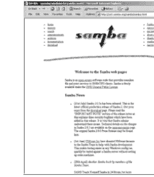

图 5.1：Samba 网站

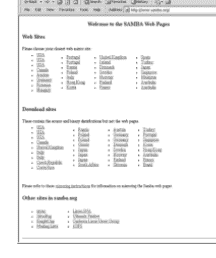

图 5.2：Samba 镜像索引

## 表 5.1 Samba FTP 归档

| URL | 国家 |
|---|---|
| gd.tuwien.ac.at/infosys/servers/samba/ | 奥地利 |
| fau1.samba.org/pub/samba/ | 澳大利亚 |
| ftp.ravel.ufri.br/pub/unix/samba/ | 巴西 |
| ca.samba.org/pub/samba/ | 加拿大 |
| ftp.ucr.ac.cr/pub/Unix/samba | 哥斯达黎加 |
| sunsite.mff.cuni.cz/Net/Protocols/Samba/ | 捷克共和国 |
| sunsite.auc.dk/pub/unix/networking/samba/ | 丹麦 |
| fi.samba.org/pub/samba/ | 芬兰 |
| fr.samba.org/pub/samba/ | 法国 |
| de.samba.org/pub/mirror/samba/ | 德国 |
| ftp.uni-trier.de/pub/unix/network/samba/ | 德国 |
| ftp.ntua.gr/pub/net/samba/ | 希腊 |
| it.samba.org/pub/samba/ | 意大利 |


| `volftp.tin.it/mirror/samba/pub/samba/` | 意大利 |
| `mirror.nucba.ac.jp/pub/samba/` | 日本 |
| `ring.asahi-net.or.jp/pub/net/samba/` | 日本 |
| `ring.aist.go.jp/pub/net/samba/` | 日本 |
| `CAIR-archive.kaist.ac.kr/pub/samba/` | 韩国 |
| `www.bibsyst.no/pub/samba/` | 挪威 |
| `pl.samba.org/pub/unix/net/samba/` | 波兰 |
| `giswitch.sggw.waw.pl/pub/unix/samba/` | 波兰 |
| `pt.samba.org/pub/mirrors/samba` | 葡萄牙 |
| `ru.samba.org/pub/samba` | 俄罗斯 |
| `sg.samba.org/samba/` | 新加坡 |
| `ftp.k2.net/mirrors/samba/` | 斯洛文尼亚 |
| `ftp.vvv.com/pub/samba` | 南非 |
| `se.samba.org/pub/samba/` | 瑞典 |
| `tr.samba.org/samba/` | 土耳其 |
| `sunsite.org.uk/packages/samba/` | 英国 |
| `ftp.samba.org/pub/samba/` | 美国 |
| `us1.samba.org/samba/ftp/` | 美国 |
| `us3.samba.org/pub/mirrors/samba.anu.edu.au/` | 美国 |

从 Samba 镜像索引页面，您可以选择网站或下载站点。网站提供对 Samba 软件归档、支持信息、邮件列表归档和新闻组的完全访问（图 5.3）。下载站点是 Samba 软件发行版和文档目录树的 FTP 索引（表 5.2）。

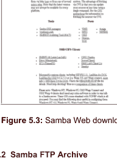

图 5.3：Samba Web 下载页面

## 表 5.2 Samba FTP 归档

| 名称 | 最后修改 | 大小 | 描述 |
|---|---|---|---|
| Parent Directory | 27-Apr-1999 02:02 | 0k | |
| Binary_Packages/ | 15-Jan-1999 23:03 | 0k | |
| COPYING | 03-May-1996 20:38 | 18k | |
| DOWNLOADING | 27-Oct-1998 22:33 | 1k | |
| MIRRORS.txt | 15-Nov-1998 23:33 | 1k | |
| SMB-info/ | 18-Aug-1997 21:41 | 0k | |
| alpha/ | 19-Jul-1999 10:36 | 0k | |
| beta/ | 30-Dec-1998 19:53 | 0k | |
| bin-pkgs/ | 15-Jan-1999 23:03 | 0k | |
| contributed/ | 16-Jul-1999 02:17 | 0k | |
| docs/ | 20-Jul-1999 20:39 | 0k | |
| pam_ntdom/ | 01-Jun-1998 12:42 | 0k | |
| pam_smb/ | 22-Apr-1999 15:59 | 0k | |
| patches/ | 21-Jul-1999 21:16 | 0k | |
| pwdump | 18-Aug-1997 21:41 | 0k | |
| samba-2.0.5a.tar.gz | 21-Jul-1999 21:16 | 2.1M | |
| samba-latest.tar.gz | 21-Jul-1999 21:16 | 2.1M | |
| slides/ | 18-Apr-1999 20:16 | 0k | |
| smb2www/ | 04-Aug-1998 14:03 | 0k | |
| smbedit/ | 20-Jun-1999 15:17 | 0k | |
| smblib/ | 18-Aug-1997 21:41 | 0k | |
| snapshot/ | 30-Dec-1997 09:53 | 0k | |
| tcpdump-smb/ | 23-Jul-1999 10:57 | 0k | |
| translations/ | 25-Jan-1999 18:14 | 0k | |
| xfertest/ | 12-Dec-1998 18:57 | 0k | |

## 二进制或源代码

一旦您导航到归档站点，您需要决定是下载二进制还是源代码发行版。针对包括 AIX、BSDI、Digital UNIX、Linux、SCO、Solaris 在内的多种流行操作系统提供了预编译软件包，还有许多其他系统。对于不想自行配置 Samba 的用户，二进制发行版可以节省时间和麻烦。如果您喜欢自行编译软件所带来的那种温暖而踏实的感觉，那么请选择源代码发行版。如果您有兴趣尝试最新的 alpha 和 beta 版本，则需要源代码。使用版本 2.x 中提供的 GNU `autoconf`，从源代码发行版构建 Samba 非常容易。本章后面会详细介绍 `autoconf`。

请注意，如果您构建的是 1.9.81 之前的 Samba 版本，并且需要支持 Windows 9x 和 Windows NT 的 SAM 加密密码身份验证，则需要获取 `libdes` 库的副本。`libdes` 用于旧版本的 Samba 以启用 DES（数据加密标准）加密密码。DES 技术源于 20 世纪 70 年代初 IBM 所做的工作。在美国，DES 算法的分发受国际武器贸易条例（ITAR）管辖。好消息是，从 1.9.18 版本开始，Samba 包含了一种修改后的 DES 算法，可以在不违反 ITAR 或引起美国国家安全局反感的情况下分发。

## CVS

选择源代码发行版的另一个原因是能够添加自己的修改。最常见的修改之一是将 Samba 与不受支持的身份验证和授权机制集成。如果您需要修改源代码，请考虑使用 GNU 并发版本系统（CVS）。CVS 是一种多用户源代码控制系统，允许开发人员签出源代码快照并将修改并发集成到源代码树中。使用 CVS 可让您轻松地将本地修改重新应用到 Samba 的新版本中。可通过 Web 在 `http://samba.org/cgi-bin/cvsweb/` 访问 Samba 源代码树的只读 CVS（图 5.4）。CVS 客户端软件和 CVS 信息可从 `http://download.cyclic.com` 获取。

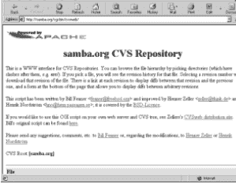

图 5.4：Samba CVS 站点

## 版本

Samba 当前的生产发行版打包为 `samba-latest.tar.gz`。该软件包包含安装和支持 Samba 所需的一切。其他发行版以版本号命名，并带有后缀表示补丁级别或发行版是否为 alpha 或 beta 版本。

| | |
|---|---|
| `samba-latest.tar.gz` | 当前生产版本 |
| `samba-<version>.tar.gz` | 其他版本 |

该软件包采用压缩 tar 格式。将软件包移至源代码维护目录或临时目录，并使用 GNU zip 通过管道传输到 `tar` 命令进行解压。展开后的目录树将类似于示例 5.2。

### 示例 5.2 提取 Samba 发行版

```
$ gzip -dc samba-<version>.tar.gz | tar -xvf -
$ ls -al
-rw-r--r-- 1 root system 18321 May 04 1996 COPYING
-rw-r--r-- 1 root system 3406 Nov 23 1998 Manifest
-rw-r--r-- 1 root system 6753 Jul 20 18:23 README
-rw-r--r-- 1 root system 2453 Feb 25 1999 README-smbmount
-rw-r--r-- 1 root system 1936 May 14 19:03 Roadmap
-rw-r--r-- 1 root system 19982 Jul 21 19:06 WHATSNEW.txt
drwxr-xr-x 1 root system 0 Aug 30 08:51 docs
drwxr-xr-x 1 root system 0 Aug 30 08:50 examples
drwxr-xr-x 1 root system 0 Aug 30 08:50 packaging
drwxr-xr-x 1 root system 0 Aug 30 08:50 source
drwxr-xr-x 1 root system 0 Aug:
```

## 构建 Samba


编译和安装 Samba 是一个使用 UNIX `make` 命令进行的简单自动化过程。版本 2.x 通过包含 GNU `autoconf` 来进一步简化任务，以根据操作系统类型和配置定制 `Makefile` 参数。2 版本之前的发行版需要一些管理维护，因为 `Makefile` 参数必须手动设置。参数包括编译器标志、安装路径和身份验证方法。`Makefile` 文档完善，并包含大多数操作系统的常见设置示例。请参阅表 5.3，了解一些常见变量和标志的列表。要构建和安装 Samba，请移至顶级源代码发行版目录并按照示例 5.3 中列出的步骤操作。

## 示例 5.3 Samba 构建过程

- 1. `$ configure` 仅限版本 2.x 及更新版本。
- 2. `$ make` 编译和加载步骤。
- 3. `$ make install` 将二进制文件安装到目标目录。

如果您从之前的版本升级并且使用相同的源代码发行版目录，则旧版本二进制文件将被复制到 `.old` 目录。您可以通过调用 `make revert` 来恢复之前的版本。请注意，如果您执行 `make install` 两次，旧版本二进制文件将被覆盖。

```
$ make revert    Restore old release binaries.
```

## 表 5.3 Pre-Version 2.0 Makefile 变量示例

### OS 标志（参见 Makefile）

```
FLAGS = -D<OS Type> -DSHADOW_FWD    Shadow Passwords
LIBSM = -lshadow
CC = gcc    C Compiler
INSTALLPERMS = 0755    Permissions
```

### 安装目录

```
BASEDIR = /usr/local/samba
BINDIR = $(BASEDIR)/bin    Binaries
SBINDIR = $(BASEDIR)/bin    Binaries
LIBDIR = $(BASEDIR)/lib    Libraries
VARDIR = $(BASEDIR)/var    Spool dir
MANDIR = $(BASEDIR)/man    Man pages
```

### 日志与锁

```
SMBLOGFILE = $(VARDIR)/log.smb    smbd log file
NMBLOGFILE = $(VARDIR)/log.nmb    nmbd log file
LOCKDIR = $(VARDIR)/locks    Lock files
```

## Samba 配置文件

```
CONFIGFILE = $(LIBDIR)/smb.conf          Samba config file
LMHOSTSFILE = $(LIBDIR)/lmhosts          LMHOSTS file
DRIVERFILE = $(LIBDIR)/printers.def      W95 print drivers
SMB_PASSWD = $(BINDIR)/smbpasswd         Password utility
SMB_PASSWD_FILE = 
$(BASEDIR)/private/smbpasswd             Password file
WORKGROUP = <Workgroup Name>             Workgroup
WEBROOT = $(BASEDIR)
```

## 替代认证方法

```
PAM_FLAGS = -DUSE_PAM                     PAM
PAM_LIBS = -ldl -lpam

AFS_BASE = /usr/afsws                    AFS
AFS_FLAGS = -DAFS_AUTH -I$(AFS_BASE)/include
AFS_LIBDIR = $(AFS_BASE)/lib
AFS_LIBS = -L$(AFS_LIBDIR) -L$(AFS_LIBDIR)/afs \
          -lkauth -lprot -lubik -lauth -lrxkad -lsys \
          -ldes -lrx -llwp -lcom_err \
          $(AFS_LIBDIR)/afs/util.a

DCE_BASE = /opt/dcelocal                DCE
DCE_FLAGS = -DDCE_AUTH -I$(DCE_BASE)/include
DCE_LIBDIR = -L$(DCE_BASE)/lib
DCE_LIBS =

KRB5_BASE = /usr/local/krb5             Kerberos V5
KRB5_FLAGS = -DKRB5_AUTH -I$(KRB5_BASE)/include
KRB5_LIBS = -L$(KRB5_BASE)/lib -ldes425 \
          -lkrb5 -lcrypto -lcom_err
```

## 完成安装

当您完成安装过程时，Samba 组件树将类似于表 5.4 所示。在您启动 Samba 并验证安装之前，需要安装 Samba 配置文件 `smb.conf`。该文件指示服务器角色、访问控制、可用的共享、是否需要加密密码以及一般管理限制。如果这是新的 Samba 安装，您可以将源代码发行版中 `./examples` 子目录下的默认 `smb.conf` 文件复制到 `/usr/local/samba/lib` 目录。这样您就可以启动并验证新安装。我们将在下一章介绍 `smb.conf` 的细节。

## 表 5.4 Samba 组件树示例

```
/usr/local/samba
Default install tree.
./bin:
Commands.
  addtosmbpass
  convert_smbpasswd
  make_printerdef
  make_smbcodepage
  nmbd
  nmblookup
  rpcclient
  smbclient
  smbd
  smbpasswd
  smbstatus
  smbtar
  swat
  testparm
  testprns

./lib:
  ./codepages
  smb.conf
Codepage directory.
Samba Configuration.

./man:
Man pages.

./private:
SID and passwords.
  MACHINE.SID
  smbpasswd

./swat:
Swat support.
  ./help
  ./images
  ./include

./var:
Logs and lock dir.
  ./locks
  log.nmb
  log.smb

./var/locks:
Lock and PID files.
  STATUS.LCK
  browse.dat
  namelist.debug
  nmbd.pid
  smbd.pid
```

## 操作

此时，我们已完成安装，现在必须决定如何运行服务。两个 Samba 服务守护进程 `smbd` 和 `nmbd`，要么在系统启动时作为运行中的守护进程启动，要么在需要时由 `inetd` 调用。后一种方法将在 Samba 服务使用较少的环境中节省系统资源。对于需求高的环境，提前让服务处于运行状态可能更快。

要将 Samba 服务作为始终活动的守护进程在系统启动时启动，请将示例 5.4 中列出的段添加到 BSD UNIX 安装的 `/etc/rc.local` 启动脚本中，或作为 SYSV UNIX 下的 `/etc/rc.d/init.d` 函数的一部分。命令也可以作为 `root` 从命令行输入以进行测试。

### 示例 5.4 Samba 守护进程启动

```
/usr/local/samba/bin/smbd -D
/usr/local/samba/bin/nmbd -D
```

要通过 `inetd` 调用 Samba 服务，首先将服务端口添加到 `/etc/services`（示例 5.5）。然后将启动段添加到 `/etc/inetd.conf`（示例 5.5）。注意使用 `tcpwrappers` `/usr/sbin/tcpd` 参数。使用 `tcpwrappers` 之类的工具限制对服务的访问是一个好主意。请记住，您将需要向 `inetd` 进程发送 `HUP` 信号以在运行系统中激活这些更改。

### 示例 5.5 Samba inetd 启动

# /etc/services

```
netbios-ns      137/udp
netbios-ssn     139/tcp
```

# /etc/inetd.conf


```
netbios-ssn stream tcp nowait root /usr/sbin/tcpd
    /usr/local/samba/bin/smbd smbd
netbios-ns dgram udp wait root /usr/sbin/tcpd
    /usr/local/samba/bin/nmbd nmbd
```

Samba `smbd` 和 `nmbd` 守护进程运行时，您可以使用 `nmblookup` 和 `smbclient` 命令验证服务。使用 `nmblookup` 查询 `nmbd` 名称服务。您可以使用本地主机名作为参数。`Nmbd` 应以您的 IP 地址和主机名进行响应（示例 5.6）。

### 示例 5.6 Samba 名称服务测试

```
$ nmblookup wizard
192.168.0.26  wizard
```

接下来使用 `smbclient` 访问您的主目录（示例 5.7）。系统会提示您输入密码。如果您在让 `smbd` 接受密码时遇到问题，请检查 `smb.conf`（第 7 章）中定义的密码加密选项。

### 示例 5.7 Samba 共享访问测试

```
$ smbclient //wizard/deroest
Password:
Domain = [EYRIE] OS = [Unix] Server = [Samba 2.0.5a]
smb: \>
```

## 摘要

- 如果您从之前的版本升级，请使用 `smbstatus` 或 `smbclient` 命令验证您的版本并备份当前环境。

- 从 Samba 网站 `http://samba.org` 下载 Samba 发行版。

- 根据包文件名 `samba-<version>.tar.gz` 验证发行版版本。"latest" 版本表示当前生产版本。

- 决定使用二进制发行版还是源代码发行版。

- 如果您将对源代码进行本地修改，请考虑使用 GNU 并发版本系统 `CVS`。请参阅 `http://samba.org/cgi-bin/cvs-web` 以通过网络浏览器只读访问 Samba CVS 发行版。

- 在您的源代码维护目录中提取发行版包：

```
$ gzip -dc samba-<version>.tar.gz | tar -xvf -
```

- 如果您要构建 2.x 之前的版本发行版，请编辑 `Makefile` 以反映您的操作系统配置。

- 构建并安装发行版。

  1. `$ configure` 仅限 2.x 及更新版本。

  2. `$ make` 编译。

  3. `$ make install` 安装二进制文件。

- 在 `/usr/local/samba/lib` 中安装一份 Samba 配置文件 `smb.conf`。示例 `smb.conf` 文件可在发行版树的 `./examples` 子目录中找到。

- 配置 Samba `smbd` 和 `nmbd` 启动方式，要么作为运行中的守护进程，要么在 `inetd` 控制下。

- 启动服务并使用 `nmblookup` 和 `smbclient` 命令进行验证。

## 第三部分：配置

### 部分概述

- 第 6 章：Samba 配置，`smb.conf`

- 第 7 章：Samba 认证

- 第 8 章：名称服务

- 第 9 章：浏览

- 第 10 章：域

- 第 11 章：共享文件

- 第 12 章：打印共享

### 第 6 章：Samba 配置，smb.conf

## 概述

Samba 播放器现已打造并排列在我们的操作系统舞台上。现在是时候提供脚本，指导其共享的度量。换句话说，我们已完成 Samba 安装过程。现在是时候将注意力转向定义服务器在工作组或域中的角色并指定它将共享的资源。

在本章中，我们将熟悉 Samba 配置文件 `smb.conf` 的总体结构和语法。该文件指导 `smbd` 和 `nmbd` 守护进程的运行时行为。在接下来的第 7 章至第 12 章中，我们将仔细研究影响认证、名称服务、浏览、域控制、共享文件和共享打印机的 Samba 配置文件的特定部分和参数。在第 15 章中，我们将评估可在 `smb.conf` 中指定的管理参数和事件日志参数。

附录 C 包含随 2.0.5a 版本发布的默认 `smb.conf` 文件副本。在我们回顾配置文件结构和语法时，参考此文件可能会有所帮助。该文件的在线副本可在 Samba 发行版树的 `./examples` 子目录中找到。该文件记录完善，可用作构建您自己的配置文件模板。请参阅 `smb.conf` (5) 手册页以获取更多信息。

```
$ man 5 smb.conf
```

## 定制 smb.conf

`smb.conf` 文件是一个纯 ASCII 文本文件，可以使用任何文本编辑器进行修改。文件的总体格式类似于 Windows `.INI` 文件。配置信息被分解为各部分，并由部分名称分隔（表 6.1）。每个部分指定一个服务。一个特殊的全局部分定义了整体系统和管理的默认值，以及服务器在工作组或域中将承担的角色。文件中剩余的部分指定服务器将向网络客户端提供的资源共享。一组定义良好的参数用于指定每个部分的特性。请注意，有些参数仅适用于全局部分，而其他参数仅适用于“shares”部分。

### 表 6.1 smb.conf 部分

|  |  |

|---|---|

|[Global] | 系统角色和默认值 |

|[Homes] | 主目录共享 |

|[Printers] | 打印机共享 |

|[Name] | 用户定义的共享 |

### 语法和语义

`smb.conf` 文件中的每个段落代表部分名称、参数 = 值对或注释。部分以方括号括起的部分名称开头。其后跟随一组参数和值，每行一个，用于描述该部分的角色和属性（示例 6.1）。部分名和参数名不区分大小写，尽管字符串值的大小写会被保留。参数参数要么是布尔值，要么是字符字符串（表 6.2）。每行以换行符结束。续行以传统 UNIX 方式用 "\" 字符表示。注释行以 "#" 或 ";" 字符开头。空白通常被忽略，除非出现在字符串值内部。包含空白的字符串不需要引号，如果解析器发现引号则会被忽略。空白用于分隔以列表表示的值中的各个字符串条目。

### 示例 6.1 示例 smb.conf 部分

```
#
# A publicly accessible directory, read/write to all users.
#
[public]
    path = /usr/somewhere/else/public
    public = yes
    guest only = yes
    writable = yes
    printable = no
```

### 表 6.2 smb.conf 语法

| Syntax | Description |

|---|---|

| "#", ";" | 指定注释 |

| "\" | 续行到下一行 |

| "%" | 变量前缀 |

| "[name]" | 部分名称 |

| "parameter = value" | 指定配置选项 |

| "1/0", "yes/no", "true/false" | 布尔值 |

修改 `smb.conf` 文件时，使用 `testparm` 命令验证其正确性。`testparm` 不能保证特定共享或服务会按预期工作；它只是验证您为每个部分指定的语法和选项。如果作为选项提供了主机名或 IP 地址，它将检查指定主机的访问权限。

```
$ testparm <-s configfilename> <hostname hostIP>
```

## SWAT

对于更习惯于图形配置工具提供的易用性和错误检查的人来说，Samba 版本 2.x 提供了基于 Web 的配置和管理工具，名为 Samba Web Administration Tool（SWAT）（图 6.1）。由于基于 Web，SWAT 可以从远程联网的工作站调用。对于管理多个地理位置分散的 Samba 服务器或在家中通过拨号链接进行深夜配置更改的人来说，这是一个方便的功能。SWAT 为 `smb.conf` 文件中表示的各种部分类型提供 HTML 表单（图 6.2）。SWAT 简化了常规配置任务，使系统管理员能够专注于感兴趣的部分定义。

HOME  GLOBALS  SHARES  PRINTERS  STATUS  VIEW  PASSWORD

### 欢迎使用 SWAT！

请使用上面的按钮之一选择配置操作

### 文档

- **守护进程**

  - `smbd` - SMB 守护进程

  - `nmbd` - NetBIOS 名称服务器

- **管理实用程序**

  - `smbstatus` - 监控 Samba

  - `SWAT` - Web 配置工具

  - `smbpasswd` - 管理 SMB 密码

  - `make_smbcodepage` - 代码页创建

  - `testparm` - 验证配置文件

  - `testprns` - 测试打印机配置

- **通用实用程序**

  - `nmblookup` - NetBIOS 名称查询工具


- `smbbackup` - SMB 备份工具

- `smbclient` - 命令行 SMB 客户端

## 配置文件

- `smb.conf` - Samba 主配置文件

- `lmhosts` - NetBIOS 主机文件

图 6.1：Samba SWAT 管理工具

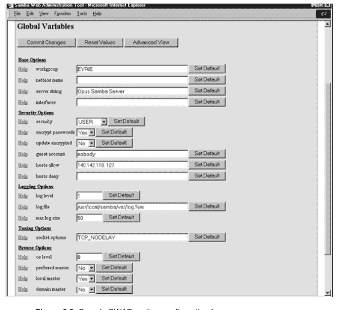

图 6.2：示例 SWAT 部分配置表单

SWAT 默认安装在 `$(BASEDIR)/swat` 目录中，作为 Samba 通用构建和安装过程的一部分。在使用 SWAT 之前，您需要在 `/etc/services` 和 `/etc/inetd.conf` 中添加条目，以标识端口和服务名称到您的系统（示例 6.2）。不要忘记在进行更改后向 `inetd` 守护进程发送 `HUP` 信号。一旦 SWAT 已配置到系统中，您可以通过打开以下 URL 从您喜欢的 Web 浏览器调用该服务。SWAT 将提示您输入管理员用户名和密码。

警告 请注意，SWAT 在重写 `smb.conf` 文件时会删除所有注释、`include=` 和 `copy=` 参数。如果您使用这些参数来支持从通用 `smb.conf` 模板进行多个 Samba 安装，请务必牢记这一点。

### 示例 6.2 SWAT Internet 服务配置

```
/etc/services:
    swat    901/tcp
/etc/inetd.conf:
```

```
swat stream tcp nowait root
/usr/local/samba/bin/swat swat
```

## 变量和文件替换

一个强大的 Samba 功能，有助于简化 `smb.conf` 配置的是变量替换。Samba 提供了一组固定的变量，以 `"%"` 符号为前缀，在运行时处理期间取值。变量替换可以在 `smb.conf` 文件中任何有效字符串值的位置使用。例如，`"%m"` 变量通常用于将请求客户端的 NetBIOS 名称关联到本地服务器资源，如日志文件。

```
log file = /usr/local/samba/var/%m.log
```

给定客户端 NetBIOS 名称为 `WIZARD`，`/usr/local/samba/var/%m.log` 变为 `/usr/local/samba/var/WIZARD.log`。

一些变量可能仅在共享部分的上下文中使用。这些包括请求的服务名称或已验证的客户端 UNIX 账户名称等变量。剩余的一组变量可在所有部分中使用。表 6.3 列出了 Samba 版本 2.0.5a 中预定义变量的集合。共享部分变量列在表的底部。

### 表 6.3 smb.conf 定义的变量

- `%G` = `%u` 的主组名

- `%I` = 客户端机器的 IP 地址

- `%L` = 服务器的 NetBIOS 名称。这允许您根据客户端称呼您的方式更改配置。您的服务器可以具有双重个性。

- `%M` = 客户端机器的 Internet DNS 名称

- `%N` = 您的 NIS 主目录服务器的名称。这是从您的 NIS `auto.map` 条目中获取的。如果您没有使用 `automount` 选项编译 Samba，则此值将与 `%L` 相同。

- `%R` = 协议协商后的所选协议级别。它可以是 `CORE`、`COREPLUS`、`LANMAN1`、`LANMAN2` 或 `NT1` 之一。

- `%T` = 当前日期和时间

- `%U` = 会话用户名（客户端想要的用户名，不一定与实际获得的相同——即实际使用的 UNIX 用户名）。

- `%a` = 远程机器的架构。仅识别其中一些，且可能不可靠 100%。它目前识别 `Samba`、`WfWg`、`WinNT` 和 `Win95`。其他任何内容都将被称为 `"UNKNOWN"`。如果识别错误，则发送 `level 3` 日志到 `mailto:samba-bugs@samba.org` 应该可以使其得到修复。

- `%d` = 当前服务器进程的进程 ID

- `%h` = Samba 运行所在的 Internet DNS 主机名

- `%m` = 客户端机器的 NetBIOS 名称（非常有用）

- `%p` = 服务主目录的路径，从您的 NIS `auto.map` 条目中获取。NIS `auto.map` 条目被拆分为 `"%N:%p"`。

- `%v` = Samba 版本

### 共享上下文变量

- `%H` = 由 `%u` 给出的用户的主目录

- `%P` = 当前服务的根目录（如果有）

- `%S` = 当前服务的名称（如果有）

- `%g` = `%u` 的主组名

- `%u` = 当前服务的用户名（如果有）

`include` 参数提供了在 `smb.conf` 解析期间插入文本的另一种方法。此参数导致在调用位置将路径值字符串中指定的文件插入到 `smb.conf` 中。如果文件不存在，则忽略该参数。在维护一组 Samba 服务器时，使用此功能包含特定于机器的自定义。

```
include = /usr/local/samba/lib/<server specific smb.conf text>
```

`copy` 参数也可以用于在当前位置复制先前定义的部分。新部分内的附加参数将覆盖先前定义的共享的参数。

```
copy = <previously defined section name>
```

## 运行时自动化

`preexec` 和 `postexec` 参数提供了在客户端分别访问和释放共享时调用命令、`shell` 脚本或其他程序的机制。程序在服务器上以 `%u` 指定用户的权限执行

除非使用了 `root preexec` 或 `root postexec` 参数，这表明程序执行将以 `root` 权限运行。在使用这些参数的 `root` 版本之前，请仔细考虑其应用范围。在大多数情况下，可以找到在调用用户权限下运行并产生相同结果的替代方案。

```
preexec = <command or script path name>
postexec = <command or script path name>
root preexec = <command or script path name>
root postexec = <command or script path name>
```

这些参数是管理公共资源的实用工具。例如，`preexec` 可用于在公共实验室中创建个人工作目录并设置其权限。当实验室用户在注销时断开与共享的连接时，`postexec` 可被调用以删除工作目录并执行其他清理活动，如删除 Web 浏览器 `cookie`、`书签` 和其他临时文件。这些参数的其他用途包括在访问共享时在弹出窗口中显示系统或信息消息。

## 全局节

`[global]` 节的 `smb.conf` 配置文件描述了服务器在工作组或域中将扮演的角色，定义了默认节参数值，并设置了管理文件和网络选项的限制和位置。角色信息包括服务器的 NetBIOS 和工作组名称的标识，以及如果服务器将作为 WINS 服务器、主浏览器或域控制器。节默认值提供了一种减少后续节中参数值重复的方法。这些默认值可以通过在单个节中分配新值时显式覆盖。

全局节是 Samba 功能和特性的一个总括，这些功能和特性并不明确针对特定的资源共享定义。在第 7–10 章和第 15 章中，我们将仔细查看构成全局节的一些更复杂的函数定义。这些包括身份验证、名称服务、浏览和域配置。为测试目的，您可以从示例 6.3 中列出的一些通用参数定义开始。全局节参数的完整集合列在表 6.4 中。

### 示例 6.3 全局节参数示例

| 参数 | 描述 |
|---|---|
| `netbios name =` | 标识服务器 NetBIOS 名称 |
| `workgroup =` | 标识工作组或域 |
| `guest account =` | 用于访问标记为 `"guest ok"` 的服务的访客用户账户 |
| `security =` | 指定登录安全设置为 `"user"`、`"share"`、`"server"` 或 `"domain"` |
| `encrypt passwords =` | 如果应为 Win9x 客户端协商加密密码。需要在 `smbpasswd` 文件中生成 NT 加密密码。参见 Samba `docs` 目录中的 `ENCRYPTION.txt`。 |
| `load printers =` | 从 `printcap` 文件加载可浏览的打印机列表。 |
| `log file =` | Samba 日志文件目录路径 |
| `max log size =` | 限制日志文件大小（以千字节为单位） |
| `dns proxy =` | Samba 是否应通过 DNS 查找解析 NetBIOS 名称？ |

### 表 6.4 全局参数列表


- `add user script`

- `allow trusted domains`

- `announce as`

- `announce version`

- `auto services`

- `bind interfaces only`

- `browse list`

- `change notify timeout`

- `character set`

- `client code page`


# 配置参数

- `coding system`
- `config file`
- `deadtime`
- `debug timestamp`
- `debuglevel`
- `default`
- `default service`
- `delete user script`
- `dfree command`
- `dns proxy`
- `domain admin group`
- `domain admin users`
- `domain controller`
- `domain groups`
- `domain guest group`
- `domain guest users`
- `domain logons`
- `domain master`
- `encrypt passwords`
- `getwd cache`
- `homedir map`
- `hosts equiv`
- `interfaces`
- `keepalive`
- `kernel oplocks`
- `dap filter`
- `ldap port`
- `ldap root`
- `ldap root passwd`
- `ldap server`
- `ldap suffix`
- `lm announce`
- `lm interval`
- `load printers`
- `local master`
- `lock dir`
- `lock directory`
- `log file`
- `log level`
- `logon drive`
- `logon home`
- `logon path`
- `logon script`
- `lpq cache time`
- `machine password timeout`
- `mangled stack`
- `map to guest`
- `max disk size`
- `max log size`
- `max mux`
- `max open files`
- `max packet`
- `max ttl`
- `max wins ttl`
- `max xmit`
- `message command`
- `min passwd length`
- `min wins ttl`
- `name resolve order`
- `netbios aliases`
- `netbios name`
- `nis homedir`
- `nt acl support`
- `nt pipe support`
- `nt smb support`
- `null passwords`
- `ole locking compatibility`
- `oplock break wait time`
- `os level`
- `packet size`
- `panic action`
- `passwd chat`
- `passwd chat debug`
- `passwd program`
- `password level`
- `password server`
- `preferred master`
- `preferred master`
- `preload`
- `printcap`
- `printcap name`
- `printer driver file`
- `protocol`
- `read bmp x`
- `read prediction`
- `read raw`
- `read size`
- `remote announce`
- `remote browse sync`
- `restrict anonymous`
- `root`
- `root dir`
- `root directory`
- `security`
- `server string`
- `shared mem size`
- `smb passwd file`
- `smbrun`
- `socket address`
- `socket options`
- `ssl`
- `ssl CA certDir`
- `ssl CA certFile`
- `ssl ciphers`
- `ssl client cert`
- `ssl client key`
- `ssl compatibility`
- `ssl hosts`
- `ssl hosts resign`
- `ssl require clientcert`
- `ssl require servercert`
- `ssl server cert`
- `ssl server key`
- `ssl version`
- `stat cache`
- `stat cache size`
- `strip dot`
- `syslog`
- `syslog only`
- `time offset`
- `time server`
- `timestamp logs`
- `unix password sync`
- `unix realname`
- `update encrypted`
- `use rhosts`
- `username level`
- `username map`
- `valid chars`
- `wins proxy`
- `wins server`
- `wins support`
- `workgroup`
- `write raw`

## 共享节

`共享节` 定义 Samba 将为工作组和域客户端提供的显式资源。两个预定义节，指定为 `[homes]` 和 `[printers]`，用于授予用户访问其 UNIX `$HOME` 目录的权限，以及 UNIX `printcap` 文件中列出的任何打印机。可以定义其他共享以授予或限制对单个目录和打印机的访问，或指定存储漫游配置文件的位置。共享节参数的完整集合列在表 6.5 中。有关每个参数的描述，请参阅 `smb.conf` 手册页。

如果在 `smb.conf` 中定义了 `[homes]` 节，当找不到请求的共享名称的匹配项时，它将成为默认目标。共享名称随后被假定为服务器上的有效用户账户。密码文件将被扫描以寻找新的匹配项。如果找到用户名，则提供的密码将与服务器密码文件中的用户条目进行验证。一旦验证通过，就会通过克隆 `[homes]` 节中指定的默认参数并将其与用户的 `$HOME` 目录关联来创建一个新的共享名称。有关共享目录的更多信息，请参阅第 11 章。

如果在 Samba 配置文件中定义了 `[printers]` 节，服务器会尝试将请求的共享名称与 `printcap` 文件中列出的打印机集合进行匹配。如果找到匹配项，则通过克隆 `[printers]` 节参数来创建一个新的共享。有关定义和共享打印机的详细信息，请参阅第 12 章。

### 表 6.5 共享参数列表

- `admin users`
- `allow hosts`
- `alternate permissions`
- `available`
- `blocking locks`
- `browsable`
- `browseable`
- `case sensitive`
- `casesignames`
- `comment`
- `copy`
- `create mask`
- `create mode`
- `default case`
- `delete readonly`
- `delete veto files`
- `deny hosts`
- `directory`
- `directory mask`
- `directory mode`
- `directory security mask`
- `dont descend`
- `dos filetime resolution`
- `dos filetimes`
- `exec`
- `fake directory create times`
- `fake oplocks`
- `follow symlinks`
- `force create mode`
- `force directory mode`
- `force directory security mode`
- `force group`
- `force security mode`
- `force user`
- `fstype`
- `group`
- `guest account`
- `guest ok`
- `guest only`
- `hide dot files`
- `hide files`
- `hosts allow`
- `hosts deny`
- `include`
- `level2 oplocks`
- `locking`
- `lppause command`
- `lpq command`
- `lpresume command`
- `lprm command`
- `magic output`
- `magic script`
- `mangle case`
- `mangle locks`
- `mangled map`
- `mangled names`
- `mangling char`
- `map archive`
- `map hidden`
- `map system`
- `max connections`
- `min print space`
- `only guest`
- `only user`
- `oplocks`
- `oplock contention limit`
- `path`
- `postexec`
- `postscript`
- `preexec`


- `preserve case`
- `print command`
- `print ok`
- `printable`
- `printer`
- `printer driver`
- `printer driver location`
- `printer name`
- `printing`
- `queuepause command`
- `queueresume command`
- `read list`
- `read only`
- `revalidate`
- `root postexec`
- `root preexec`
- `security mask`
- `set directory`
- `share modes`
- `short preserve case`
- `status`
- `strict locking`
- `strict sync`
- `sync always`
- `user`
- `username`
- `users`
- `valid users`
- `veto files`
- `veto oplock files`
- `volume`
- `wide links`
- `writable`
- `write list`
- `write ok`
- `writeable`

## 安全和访问控制

在以下章节中，我们将研究用于加强 Samba 共享和服务的安全性和访问权限的具体访问控制和防御措施。为此，简要概述 Samba 提供的一些通用访问管理参数和功能将有所帮助。正如俗话所说，“预防胜于治疗。”

保护资源的第一步是欢迎朋友，拒绝敌人。在全局和共享部分中使用 `hosts allow` 和 `hosts deny` 参数来限制对工作组或域中受信任成员主机的访问。您可以通过名称、IP地址或使用子网掩码指定计算机。`except` 关键字可与子网掩码或 IP 号码通配符结合使用，以排除单个或一组机器（示例 6.4）。

### 示例 6.4 按主机名或主机 IP 地址限制访问

```
hosts allow = 192.168. except 192.168.0.10
hosts deny = frodo, bilbo
hosts allow = 149.125.10.0/255.255.255.0
```

您还可以使用 `username`、`only user`、`valid users` 和 `invalid users` 参数来限制对个人或用户组的访问（示例 6.5）。根据所使用的参数，在授予访问权限之前，会将客户端提供的用户名和/或密码与用户名列表进行检查。如果用户名以 "@" 符号或 "&" 符号为前缀，则假定其对应于 NIS netgroup。如果以 "+" 符号为前缀，则会检查 UNIX 组文件。

### 示例 6.5 按用户名限制访问

```
invalid users = root system +wheel
only user = fred
```

有时您希望将共享对任何人开放。这可以通过在共享部分定义中指定 `guest ok` 或 `only guest` 参数来实现。请注意，即使您授予资源公共访问权限，仍希望通过使用 `guest account` 参数将访客访问映射到已知的 UNIX 用户名来限制权限。这样，访客权限就受指定账户名所拥有的特权管辖。

### 示例 6.6 限制访客访问

```
guest ok = true
guest account = nobody
```

可以使用表 6.6 中列出的参数为每个共享指定额外的访问控制。一般来说，当客户端请求访问共享或服务时，适用以下规则。

访问授予的条件为：

- 一个不受限制的客户端提供了映射到允许的 UNIX 账户名称的用户名和密码。
- 客户端之前已向服务器注册用户名并随后提供了有效密码。
- 客户端的 NetBIOS 名称和之前使用的用户名与提供的密码进行检查。
- 客户端拥有之前验证过的用户名/密码对并向服务器提供验证令牌。
- 共享配置了 `user list` 参数且客户端为列表中的其中一个用户名提供了有效密码。
- 共享配置了 `guest account` 参数且客户端提供了有效的访客账户名称。

### 表 6.6 其他访问控制参数

| 参数 | 描述 |
|---|---|
| `read only` | 只读访问 |
| `read list` |  |
| `writeable` | 写访问允许 |
| `write ok` |  |
| `write list` |  |
| `printable` | 可打印到资源 |
| `print ok` |  |
| `revalidate` | 每次访问时重新验证 |
| `group enforce named group rights` |  |
| `force group` |  |
| `force security mode` | 指定权限和 umask |
| `force directory security mode` |  |
| `create mask` |  |
| `security mask` |  |
| `force security mask` |  |
| `veto files` | 隐藏指定文件 |
| `hide files` |  |
| `hide dot files` |  |

## 摘要

- `smb.conf` 分为 *全局* 和 *共享* 部分。
- *部分* 用方括号括起来的部分名称分隔。
- 部分属性由一组预定义的 *参数* 指定。
- *参数* 表示为 *参数* = *值* 对。值是文本字符串或布尔值。
- *替换变量* 可用于在运行时分配参数值。
- `include` 和 `copy` 参数可用于在配置文件中插入或克隆部分。
- `preexec` 和 `postexec` 参数可用于在客户端连接和释放共享时分别调用命令或脚本。
- 可以使用 `testparm` 命令验证对 `smb.conf` 文件的修改。
- SWAT 是一个基于 Web 的 `smb.conf` 配置工具，可从远程工作站使用。
- SWAT 服务和端口信息必须在 `/etc/services` 和 `/etc/inetd.conf` 中定义。
- `[global]` 部分定义服务器在工作组或域中的角色、部分默认值和管理限制。
- 共享部分描述单个服务和相关访问权限。
- 有两个预定义的共享部分：`[homes]` 和 `[printers]`。
- `[homes]` 部分允许通过提供拥有者用户名作为请求的共享来连接 `$HOME` 目录。
- `[printers]` 部分允许访问 printcap 文件中定义的打印机。
- 共享访问权限可在主机、用户和 UNIX 权限级别应用。

### 第 7 章：Samba 身份验证

### 概述

> “有眼可视、有耳可听的人可以说服自己，没有凡人能保守秘密。如果他的嘴唇沉默，他的手指就会喋喋不休，背叛从他每个毛孔渗出。”

西格蒙德·弗洛伊德

同样的话也可以用于计算机和网络安全。你的服务器能保守秘密吗？明文密码是否从每根网络线上渗出？在本章中，我们将探索各种 Samba 身份验证和访问控制机制。我们将了解 Samba 如何用于集成和同步 UNIX 和 Windows 账户信息、与替代身份验证服务交互，并减少网络上明文密码的使用。

### 身份验证机制

Samba 支持四种基本方式来规范网络客户端对特定资源共享的访问权限。首先，Samba 可以基于客户端的 IP 地址允许或拒绝连接请求。这提供了一个粗略的安全级别。任何具有授权 IP 地址的客户端计算机上的用户都将被允许访问共享。其次，Samba 可以将客户端提供的明文用户名和/或密码与 UNIX 身份验证资源如 `/etc/passwd`、NIS 或 Kerberos 进行检查。明文密码由 Samba 使用关联的 UNIX 密码算法加密，然后再与身份验证资源进行验证。第三，Samba 可以与客户端协商 NTLM 风格的加密，并将哈希密码与单独的 `/usr/local/samba/private/smbpasswd` 文件进行验证。此选项需要维护并可能同步服务器的 UNIX `passwd` 数据库和 `smbpasswd` 数据库。最后，Samba 可以将客户端的凭据传递给第三方身份验证服务器进行验证。远程身份验证服务器可能是另一台 Samba 服务器或 NT 域控制器。一旦凭据由远程服务器验证，就会授予对请求资源的访问权限。

### 按 IP 地址身份验证

在第 6 章的“安全和访问控制”部分，我们讨论了使用 `hosts allow` 和 `hosts deny` 参数按客户端 IP 地址限制对共享的访问。通过 NetBIOS 名称、IP 地址或使用子网掩码指定受信任或禁止的计算机。`except` 关键字可与子网掩码或 IP 号码通配符格式结合使用，以从组中包含或排除单个机器（示例 7.1）。

### 示例 7.1 按主机名或主机 IP 地址限制访问

```
hosts allow = 192.168. except 192.168.0.10
hosts deny = frodo, bilbo
hosts allow = 149.125.10.0/255.255.255.0
```

### 身份验证级别


# 用户级身份验证

用户级身份验证的工作方式由全局 `security` 参数设置决定。虽然 `security` 参数接受四个预定义值 `share`、`user`、`server` 和 `domain`，但实际上 Samba 仅支持两种用户身份验证级别，`share` 和 `user`。`server` 和 `domain` 选项实际上是用户级身份验证的扩展。此设置决定了客户端尝试连接共享资源时需要哪些凭据。一般来说，如果您将在 Samba 服务器和客户端工作站之间同步用户名和密码，您希望指定 `user-level` 安全。如果您的客户端用户名和密码与 Samba 服务器不匹配，并且您将支持较旧的 Windows for Workgroups 客户端，请指定共享级安全。

```
security = <share, user, server, domain>
```

## 共享级身份验证

*共享级身份验证* 规定客户端在建立连接之前必须提供与请求资源关联的密码。请注意，一个资源可能关联多个密码。例如，您可以使用 `read-list` 和 `write-list` 参数为文件共享指定单独的只读和读写密码。共享级不需要用户名，因此不需要 SMB 会话设置步骤。如果提供了用户名，则会被忽略。如果允许访客访问，客户端将提交空白密码。共享级身份验证是 Samba 2.0 版本之前发行版以及 Windows 95 文件和打印机共享的默认级别（图 7.1）。从 Samba 2.0 版本开始，默认的 `安全` 设置为 `用户`，以兼容 Windows 98 和 Windows NT。

```
security = share
```

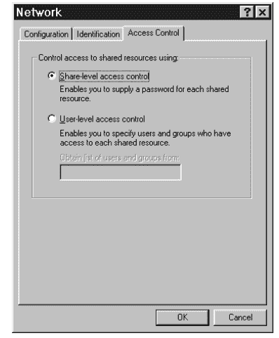

图 7.1：Windows 9x 安全级别

## 用户级身份验证

*用户级身份验证* 会将客户端提供的用户名和密码与 Samba 服务器的密码数据库进行验证。

一旦通过身份验证，客户端对请求共享的访问权限由提供的用户名的有效 UID 和 GID 权限决定。连接新生成的 `smbd` 进程将假定经过身份验证的用户名或由 `管理员用户`、`访客账户`、`强制用户` 和 `强制组` 参数指定的账户权限。请记住，由 `管理员用户` 参数标识的账户以 `root` 权限运行。另请注意，如果 `加密` 参数设置为 no，则用户名和密码将以明文形式通过线路发送。有关更多信息，请参阅下文“密码”部分。

```
security = user
```

## 服务器级身份验证

*服务器级身份验证* 与用户级身份验证类似。Samba 通知客户端需要用户级身份验证。客户端在 SMB 会话设置请求中发送用户名和密码。Samba 将会话设置请求转发到 `password server` 参数中指定的密码服务器之一。密码服务器返回将用于连接的会话 UID。请注意，返回的 UID 必须与 Samba 资源服务器上的有效 UID 匹配或映射。

```
security = server
password server = <hostname1 hostname2 ... hostnameN>
```

## 域级身份验证

*域级身份验证* 表示 Samba 资源服务器正在参与 Windows NT 域。客户端和服务器的交互方式相同，只是需要 NTLM 加密密码。会话设置请求被转发到 `password server` 参数中标识的域控制器之一。与服务器身份验证一样，域用户账户必须与有效的 UNIX UID 匹配或映射。域级身份验证提供额外功能，即客户端请求可通过与其他域的信任关系进行验证。

```
security = domain
encrypt = yes
password server = <pdc-name bdc1-name ... bdcN-name>
```

# 用户名大小写

在 SMB 会话设置期间匹配 UNIX 和 Windows 系统之间的用户名并不总是像人们希望的那样简单。问题在于，即使您在所有 UNIX 和 Windows 系统中保持一致的用户名集合，许多 Windows 和 DOS 客户端也会在提交会话设置请求之前将用户名大写。如果 Samba 服务器支持混合大小写的用户名，这可能会成为问题。这意味着您的 Samba 服务器必须花费 CPU 周期，通过更改字符串中字母的大小写来尝试为提供的用户名找到匹配项。默认行为是 Samba 首先尝试使用全小写进行匹配，然后尝试首字母大写的小写形式。如果匹配尝试失败，则拒绝连接请求。如果您有额外的 CPU 周期可以使用，可以使用 `username level` 参数要求 Samba 尝试更多的大写/小写组合。此参数接受一个数值，决定要尝试的组合数。数值越高，尝试的组合越多：

```
username level = <0-5>
```

# 用户名映射

对于现有 UNIX 和 Windows 命名空间差异显著的环境，Samba 提供了在系统之间映射不同用户名的机制。用户名映射也可以用于将多个用户名映射到单个用户名。多对一映射简化了组成员之间的文件共享活动。用户名映射是通过将包含客户端到服务器用户名分配的文件的 UNIX 路径名指定为 `username map` 全局参数的值来启用的：

```
username map = </path/Filename>
```

命名映射文件中的每一行都使用“=”号字符将一个有效的服务器用户名分配为一个或多个客户端用户名的匹配项（示例 7.2）。可以使用 `@groupname` 语法在等式右侧指定属于 UNIX 组的客户端用户名列表。可以使用“*”字符作为通配符，表示任何用户名都匹配。文件中的行长度可达 1,023 个字符。以“#”或“;”字符开头的行将被解析器忽略。

### 示例 7.2. 用户名映射

```
Syntax: username = username1 username2 ... usernameN
root = Administrator
wheel = @system
!guest = *
```

映射文件的解析包括文件中的所有行。任何以“!”字符开头的行，如果已找到匹配项，则会终止解析。如果未找到有效匹配项，则解析将继续直到文件末尾。

# 密码

密码是大多数 UNIX 和 Windows 计算机安全系统的支柱。因此，我们中的大多数人花费大量时间来微调和加固密码基础设施。这通常意味着定期检查密码数据库中容易猜测的密码，定期更新密码规则和字典，保持明文密码不出现在网络上，教育用户正确使用密码，并就一般密码策略问题与用户争论。对于大多数人来说，这是一项永无止境、没有回报的工作。

我们都不希望增加维护密码服务的复杂性或破坏我们辛苦建立的安全性。不幸的是，UNIX 和 Windows 系统在密码方面遵循不同的规则。首先，它们使用不同的单向算法来加密密码。LAN Manager 服务器对大写密码进行哈希处理，Windows NT4 存储 Unicode 版本密码的 MD4 哈希值，而 UNIX 使用 `crypt()`，即使用随机盐的改进 DES 算法来加密密码。更复杂的是，旧的 Windows 系统在会话设置期间会提供大写明文密码。幸运的是，Samba 提供了许多选项来处理 UNIX 和 Windows 密码方案之间的差异。

## 明文密码

假设您的网络免受密码嗅探（谁的不是？），在 SMB 会话设置时授权明文密码可能是管理混合 UNIX 和 Windows 环境中最简单的方法。相反，就安全性而言，这是最差的方法。客户端向 Samba 提供的密码会使用标准的 UNIX 身份验证方法与 UNIX 密码文件进行验证：

```
encrypt passwords = false
security = <user or share>
```

除了明文密码在线路上的安全问题外，您还可能会遇到 Windows for Workgroups 等客户端的问题，这些客户端可能会在发送到服务器之前将混合大小写的密码大写。类似于上一节中关于大写用户名的讨论，Samba 提供了 `password level` 参数，指示服务器在 uppercase 密码检查失败时尝试不同的大写和小写字符组合。该参数接受一个数值，表示在放弃之前尝试的组合数。参数值越高，在验证密码时尝试的字符组合就越多。值为“0”将指示服务器在拒绝访问之前检查密码的全大写和全小写形式。

```
password level = <integer value>
```

Windows NT4 服务包 3；更新版本的 Windows 95；Windows 98；和 Windows 2000 在 SMB 会话设置时只协商加密密码。要恢复对明文密码的支持，请安装 Samba 发行版 `./docs` 目录中提供的适当注册表更新（表 7.1）或使用 regedit 直接编辑注册表（示例 7.3）。

### 表 7.1 Windows 明文密码注册表更新文件

| 注册表更新文件 |

|---|

| ./samba <version>/docs/NT4_PlainPassword.zip |

| ./samba <version>/docs/Win2000_PlainPassword.zip |

| ./samba <version>/docs/Win95_PlainPassword.zip |


| ./samba <version>/docs/Win98_PlainPassword.zip |

### 示例 7.3 用于明文密码支持的注册表编辑

#### Windows NT

```
Find:HKEY_LOCAL_MACHINE\system\CurrentControlSet /
    \Services\rdr\parameters
Add:    EnablePlainTextPassword, dword:00000001
```

#### Windows 9x

```
Find:HKEY_LOCAL_MACHINE\System\Current\ControlSet /
    \Services\VxD\NETSUP
```

```
Rename: "New Value #1" to
"EnablePlainTextPassword", dword:00000001
```

## 加密密码

在 SMB 会话设置期间，通过在 Samba 中启用 NTLM 加密密码支持，可以消除明文密码选项。

该功能通过消除线路上密码窃听的可能性来提高整体网络安全性；然而它增加了维护和同步 UNIX 与 NTLM 密码空间的复杂性。启用加密密码需要维护一个包含 NTLM 密码的额外密码文件。这必须与标准的 UNIX 密码维护活动一起进行。

NTLM 加密密码选项通过将 `encrypt passwords` 参数设置为 `true` 来启用。在启用加密密码支持之前，您需要创建一个 Samba `smbpasswd` 文件的实例，其中包含每个用户的条目。

通常，最简单的方法是使用现有的 UNIX 或 NIS 密码文件作为输入，提供给 Samba 发行版中的 `mksmbpasswd.sh` shell 脚本。

该过程在示例 7.4 中有描述。

```
encrypt passwords = <true, false>
```

### 示例 7.4 启用 Samba NTLM 加密支持

```
$ cat /etc/passwd | mksmbpasswd.sh > \
/usr/local/samba/private/smbpasswd
$ chown -R root:root /usr/local/samba/private/smbpasswd
$ chmod 500 /usr/local/samba/private
$ chmod 600 /usr/local/samba/private/smbpasswd
```

更新 `smb.conf` 参数。

```
encrypt passwords = true
```

`smbpasswd` 文件默认存储在 `/usr/local/samba/private` 目录中。您可以通过将目录路径指定为 `smbpasswd file` 参数的值来指示替代位置：

```
smbpasswd file = <path>
```

`smbpasswd` 文件中每个条目的格式在表 7.2 中列出。一般来说，它与标准的 UNIX 密码文件格式相似。像其 UNIX 对应物一样，它使用 `:` 来分隔每个字段。请特别注意包含 32 个 `X` 字符的两个字段。这两个字段分别是 LAN Manager 和 NT 版本哈希密码的占位符。如果要被 `smbd` 识别，则字段最初必须包含 32 个 `X` 字符，这一点至关重要。

### 表 7.2 smbpasswd 格式

```
username:uid:XXXXXXXXXXXXXXXXXXXXXXXXXXXXXX: \
XXXXXXXXXXXXXXXXXXXXXXXXXXXXXX: [Account type]: \
LCT-<last-change-time>:<Long name>
```

最初，所有用户的密码条目都由 32 个 `X` 字符组成。这有效地拒绝了对该帐户的访问，直到管理员更改密码为止。您可以通过用字符串 `NO PASSWORD` 覆盖前 10 个 `X` 字符来允许用户自行更改密码（示例 7.5）。您还需要启用 `null passwords` 参数，以便 `smbpasswd` 命令无需密码即可连接到 `smbd` 守护进程。请注意，这会带来安全风险，因为在设置新密码值之前不会提示用户输入现有密码。

### 示例 7.5 允许首次更改密码

#### smb.conf

```
null passwords = true
```

#### smbpasswd

```
deroest:1004:NO PASSWORDXXXXXXXXXXXXXXXXXXXX: \
XXXXXXXXXXXXXXXXXXXXXXXXXXXXXX: [U ]: \
LCT-00000000:Jim DeRoest:/home/deroest:/usr/bin/ksh
```

#### smbpasswd 命令

`smbpasswd` 命令用于设置和更新 `smbpasswd` 文件中的两个 32 字节字段。请注意，与 UNIX `passwd` 命令不同，从版本 1.9.18p4 开始的 Samba 版本中，`smbpasswd` 不应具有 `setuid root` 权限。此版本的 `smbpasswd` 充当客户端，请求权威的 Samba `smbd` 守护进程或 NT 域 PDC 代表最终用户更新密码。与其 UNIX 对应物一样，`smbpasswd` 命令首先请求现有密码，然后两次提示输入新密码（示例 7.6）。具有 root 权限的用户可以包含 `-u <username>` 选项来设置指示用户的密码。

### 示例 7.6 smbpasswd 命令

| 命令 | 描述 |
|---|---|
| $ smbpasswd <-u username> | 如为 root 则添加 -u。 |
| old password > | 如非 root 则为旧值。 |
| New SMB password: | 新值。 |
| Repeat New SMB Password: | 再次输入新值。 |

## 从明文迁移到加密密码

对于最初使用明文密码并希望迁移到加密密码的站点，Samba 可以通过设置 `update encrypted` 参数来自动化此过程。

```
security = user
encrypt passwords = no
update encrypted = yes
```

在会话设置时，Samba 使用默认的 UNIX 身份验证过程将客户端的明文密码与 `/etc/passwd` 进行验证。验证成功后，Samba 然后将明文密码加密为 LAN Manager 和 NT 哈希格式并将它们存储在 `smbpasswd` 文件中。请注意，用户必须已在 `smbpasswd` 文件中拥有现有条目。`smbpasswd` 文件中的任何现有密码信息都将被新密码覆盖。一旦明文到加密密码的迁移过程完成，请关闭 `update encrypted` 参数并打开 `encrypt passwords` 参数。

```
encrypt passwords = yes
update encrypted = no
```

## 密码同步

此时，您已完成 Samba 加密密码支持的设置，现在在服务器上维护两个独立的密码文件，即 UNIX 的 `/etc/passwd` 和 Samba 的 `/usr/local/samba/private/smbpasswd`。您可能更喜欢一种自动方式来保持这两个文件的同步。对一个密码文件所做的更新会自动反映在另一个文件中。Samba 可以为您处理这个问题的一方面。通过使用 `unix password sync`、`passwd program` 和 `passwd chat` 参数，`smbd` 将在收到 `smbpasswd` 更改时更新 UNIX `/etc/passwd` 文件（示例 7.7）。UNIX `passwd` 命令的值和 `password chat` 文本需要根据您的特定 UNIX 操作系统进行调整。对于 UNIX 老手来说，这类似于为 UUCP 连接设置 `login chat`。您可以使用 `passwd chat debug` 参数来自定义聊天序列。在正常操作期间不要保持此选项打开，因为它会使密码以明文形式可见。

```
passwd chat debug = <true, false>
```


如果您想在调用 UNIX `passwd` 命令时更新 `smbpasswd`，您需要构建类似的东西。这可能很棘手。您可能会在 `passwd` 和 `smbpasswd` 之间出现更新循环。如果您宁愿跳过这个编程练习，Stephen Langasek 已经通过他的 `pam_smbpass` 模块为您完成了其中一些工作。Samba 通过一个定义良好的 API 和共享库接口支持附加身份验证方法，该接口称为 *Pluggable Authentication Modules (PAM)*。我们将在有关替代身份验证方法的部分中更多地讨论 PAM。`pam_smbpass` 允许 UNIX 用户针对 NTLM 服务器进行身份验证，并在用户更改 UNIX 密码时更新两个密码文件。请注意，此 PAM 仅在本地 Samba 服务器上工作，因此不能用于在分布式环境中维护远程密码文件。Stephen 的 `pam_smbpass` 可从 `ftp://ftp.netexpress.net/pub/pam` 获取。

### 示例 7.7 同步 Samba smbpasswd 和 UNIX passwd 更新

```
encrypt passwords = yes
security = user
unix password sync = yes
```

```
passwd program = /usr/bin/passwd %u
passwd chat = "*password* %n\n *password* %n\n *successful*"
```

您可能还对定期将 NT SAM 数据库与 `smbpasswd` 文件同步感兴趣。Samba 团队的 Jeremy Alison 创建了一个名为 `pwdump.exe` 的工具，它可以将 SAM 帐户的副本导出到 `smbpasswd` 格式的文件中。该程序必须从 NT 上的管理员帐户运行。`pwdump.exe` 工具可从 samba 分发站点获取。

```
pwdump > smbpasswd
```

## 域身份验证

而不是让 Samba 执行维护密码空间的工作，您可以将此任务交给远程服务器。远程服务器使用 `password server` 参数标识。与远程服务器的交互可以是用户级身份验证或域级身份验证模式，由 `security` 参数值指定为 `server` 或 `domain`。域级身份验证提供了一些额外的功能，您在选择远程身份验证方法时需要考虑。在域级身份验证下，无需重复 NTLM 和 UNIX 帐户。Samba 服务器还可以参与域信任关系。

要将 Samba 加入现有域，请先在服务器上停止 `smbd` 和 `nmbd` 守护进程。使用域控制器上的域服务器管理器将服务器的 NetBIOS 名称添加到域中（图 7.2）。在 Samba 服务器上，使用 `smbpasswd` 命令为域创建服务器帐户密码（示例 7.8）。密码将存储在 `/usr/local/samba/private` 目录中，文件名为 `<Domain Name>.<Samba Name>.mac`。`mac` 文件名后缀代表 `machine account`。最后，使用表 7.3 中列出的参数和值更新 `smb.conf` 配置文件。`machine password timeout` 参数指定一个以秒为单位的时间值，导致 `smbd` 定期重新生成新的服务器域密码。重新启动 `smbd` 和 `nmbd` 守护进程。

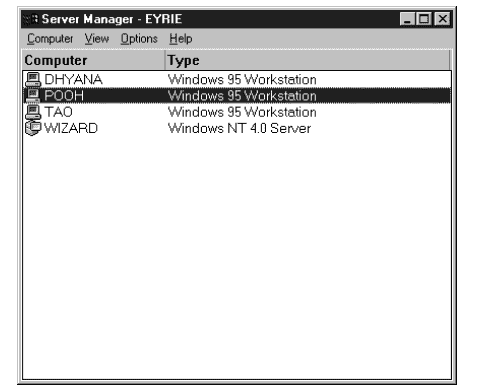

图 7.2：域的服务器管理器

### 示例 7.8 创建域服务器密码

```
$ smbpasswd -j <Domain Name> -r <Server NetBIOS Name>
```

### 表 7.3：smb.conf 域参数

```
security = domain
workgroup = <domain name>
password server = <PDC BDC1 ... BDCn>
encrypt passwords = true
machine password timeout = <seconds>
```

## 替代身份验证方法

遵循开源软件开发的精神，Samba 用户实现了许多替代身份验证方法，并将其提供给其他 Samba 爱好者。其中一些身份验证方法被打包为贡献工具，其他方法则重新进入了 Samba 发行版。该开发领域是一个不断变化的目标，因此最好的信息来源是 Samba 讨论组。你也可以从 `smb.conf(5)` 手册页和发行版源代码中获得大量信息。特别是请仔细查看位于发行版 `./source/passdb` 目录中的 `passdb.c` 和 `pass_check.c` C 语言源文件。

Samba 支持的替代身份验证方法、数据库和通道包括 Kerberos、网络信息服务+（NIS+）、轻量级目录访问协议（LDAP）、MySQL、分布式计算环境（DCE）、可插拔身份验证模块（PAM）、GINAs（可替换的 NT 身份验证模块）和安全套接层（SSL）。特别值得注意的是 PAM 功能。PAM 通过使用共享库和一个定义良好的 PAM 配置表 `/etc/pam.d/login` 为实现替代身份验证系统提供一致的接口。管理员可以通过添加/删除库并更新 PAM 配置表（示例 7.9）轻松更改身份验证方法。

### 示例 7.9 示例 PAM 配置表

```
Service module_type module_path options
login auth required pam_smb_auth.so
login auth required pam_kerberos.so
use_first_pass
login auth optional pam_netware.so
use_mapped_pass
```

为解决大规模用户群 Samba 用户命名空间扩展问题，Kerberos、LDAP 和 MySQL 等替代身份验证数据库正在开发中。Kerberos 5.0 支持特别引起兴趣，因为它是 Windows 2000 中的基本身份验证方法。LDAP 也很重要，因为越来越多的厂商正在开发使用 LDAP 存储用户验证信息的应用程序，包括 Windows 2000 中的 Active Directory 系统。表 7.4 列出了 Samba 中可用的实验性参数。

### 表 7.4 全局部分 LDAP 参数

| Parameter | Description |

|---|---|

| ldap server | LDAP 服务器 DNS 名称 |

| ldap port | LDAP 服务器端口号 |

| ldap root | LDAP 绑定实体 |

| ldap root password | LDAP 绑定密码 |

| ldap suffix | LDAP 区别名称基 |

| ldap filter | 搜索 %u 过滤器 |

| SSL |  |

通过将安全套接层（SSL）纳入 Samba，可以进一步保护 SMB 会话通道。SSL 是一种使用公钥加密和 X.509 数字证书来验证和保护主体之间通信通道的技术。SSL 通常由需要安全数据交换的 Web 应用程序使用，例如电子银行。

可以通过使用 SSLeay 构建发行版将 SSL 添加到 Samba。SSLeay 是 SSL 协议的免费实现。SSLeay 的副本可以从 `ftp://ftp.psy.uq.oz.au/pub/Crypto/SSLeay` 获得。在编译和链接 Samba 之前构建并安装 SSLeay。编辑 Samba Makefile，取消注释并定制 Makefile 定义末尾附近列出的 `SSL_ROOT` 定义。构建并安装 Samba。有许多 Samba SSL 参数（表 7.5）需要为你的安装进行配置。有关安装、配置和为 Samba SSL 支持设置证书和密钥的详细信息，请参阅 `smb.conf(5)` 手册页和 `./textdocs/SSLeay`。

一旦 Samba 启用了 SSL，你需要在 Windows 工作站上安装 SSL CIFS 客户端。名为 Sharity 的商业 CIFS SSL 客户端可从 `http://www.obdev.at/Products/Sharity.html` 获得。

### 表 7.5 全局部分 SSL 参数

| ssl |  |  |

|---|---|---|

| ssl | 启用 SSL。 |  |

| ssl | hosts | 强制为这些主机启用 SSL。 |

| ssl | hosts resign | 未强制进入 SSL 模式的主机。 |

| ssl | CA certDir | 证书目录。 |

| ssl | CA certFile | 受信任的证书颁发机构。 |

| ssl | server cert | Samba 服务器证书。 |

| ssl | server key | Samba 服务器私钥。 |

| ssl | client cert | 客户端证书。 |

| ssl | client key | 客户端私钥。 |


| ssl | require clientcert | 需要客户端证书。 |

| ssl | require servercert | 需要服务器证书。 |

| ssl | ciphers | SSL 协商的密码套件。 |

| ssl | version | SSL 协商的版本。 |

| ssl | compatibility | 支持其他 SSL 实现。 |

## Windows 2000

截至本文撰写时，Samba 与 Windows 2000 域和林的身份验证问题仍未定论。为了确保与旧版 Windows 客户端和服务器的向后兼容性，Windows 2000 将在首选的 Kerberos 5.0 和 Active Directory 身份验证系统之外支持 NTLM 身份验证。NTLM 兼容性应允许 Samba 参与 Windows 2000 域和林。Samba Kerberos 开发工作也可能允许 Samba 通过类似于 MIT 和 Windows 2000 信任关系的信任关系对 Windows 2000 领域进行身份验证。

## 摘要

- 最低身份验证要求可以使用基于主机的访问控制通过主机名和/或 IP 地址与 `hosts allow` 和 `hosts deny` 参数来满足。

```
hosts allow = 192.168. except 192.168.0.10
hosts deny = frodo bilbo
```

- Samba 在 `security` 参数下支持四种身份验证级别，share、user、server 和 domain。

```
security = <share, user, server, domain>
```

- 共享级安全性仅在授予资源访问权限之前要求有效的密码。
- 用户级安全性要求有效的用户名和密码。
- 服务器级安全性类似于用户级安全性，但用户名和密码会转发给由 `password server` 参数指定的安全服务器进行验证。

```
security = server
password server = My-Auth-Server
```

- 域级安全性类似于服务器级安全性，但 Samba 作为完整的域成员参与，加密身份验证由域控制器处理。

```
security = domain
encrypt = true
password server = <PDC BDC1 BDC2 ... BDCn>
```

- Samba 通过 `encrypt passwords` 参数在会话设置期间指示客户端提供明文或加密密码。

```
encrypt passwords = <true, false>
```

- 旧版 Windows 客户端在会话设置期间提交前可能会将用户名和密码大写。Samba 可以使用 `username level` 和 `password level` 参数指示尝试明文字符串的组合。
- 在具有不同用户命名空间的系统上，可以使用 `username map` 参数在系统之间映射用户名。该参数指定一个用户名映射文本文件，每行一个。
- 本地 Samba 服务器上的加密密码支持需要创建名为 `_smbpasswd` 的 NTLM 密码文件。该文件可以使用提供的 `mksmbpasswd.sh` 脚本从现有的 UNIX 密码文件创建。

```
$ cat /etc/passwd | mksmbpasswd.sh > \
/usr/local/samba/private/smbpasswd
$ chown -R root:root /usr/local/samba/private/smbpasswd
$ chmod 500 /usr/local/samba/private
$ chmod 600 /usr/local/samba/private/smbpasswd
```

- 存储在 `smbpasswd` 文件中的 NTLM 密码由用户和管理员使用 `smbpasswd` 命令维护。
- 可以使用更新的 `encrypted` 参数将明文密码环境迁移为需要加密密码。这会导致密码的加密形式在使用时存储在 `smbpasswd` 中。

```
security = user
    encrypt passwords = no
    update encrypted = yes
```

- Windows NT 4.0 SP3 及更新的 Windows 9x 客户端默认仅支持加密。需要修改注册表才能恢复明文密码支持。
- Samba 可以使用 UNIX 密码同步参数在更改时指示同步 NTLM 和 UNIX 密码文件。

```
encrypt passwords = yes
security = user
unix password sync = yes
passwd program = /usr/bin/passwd %u
passwd chat = "*password* %n\n *password* %n\n *successful*"
```

- 通过用户贡献的软件支持替代身份验证方法。替代方法包括 Kerberos、网络信息服务+（NIS+）、轻量级目录访问协议（LDAP）、MySQL、分布式计算环境（DCE）、可插拔身份验证模块（PAM）、GINAs（可替换的 NT 身份验证模块）和安全套接层（SSL）。

### 第 8 章：名称服务

### 概述

名称服务是逻辑上“绑定”网络在一起的胶水（UNIX 系统管理员的双关语）。名称服务为网络提供注册资源名称的方法，强制命名空间中的唯一性，确保命名空间更新及时分发，并从人类可读名称解析资源地址。名称服务还可用于反映组织的行政结构，尽管这不是必需的。基本上，名称服务简化了在电线上寻找方向。

在其最简单的形式中，名称服务可以通过使用主机表来实现；这是一个映射资源名称和网络地址的平面 ASCII 文本文件。对资源名称的引用通过简单的表查找解析为关联的网络地址。主机表的副本必须分发给参与的每个机器。

命名空间作为一个集合进行维护。主机表适用于小型网络计算机集合以及在特定机器上希望强制执行命名空间不同视图的情况。

大型网络需要自动化的名称服务机制，以保证在大量计算机上命名空间的唯一性保持一致。

自动化也需要确保命名空间更新可以以分布式方式管理，并且更改能迅速反映在所有参与机器上。

在 Internet 世界中，自动化的名称服务方法由域名系统（DNS）提供。Windows 支持一种类似的基于 NetBIOS 的名称服务，称为 Windows Internet 名称服务（WINS）。

在深入探讨 Samba 名称服务配置的细节之前，我想强调对 NetBIOS 命名、注册和查询机制有坚实理解的重要性。

这一背景将帮助你更好地理解各种 `smb.conf` 参数如何影响 Samba 作为客户端、服务器或代理代理的角色。

NetBIOS 名称服务主题已在第 3 章中讨论过。我建议在继续以下章节之前先回顾第 3 章的相关部分。我们也将在下一节简要回顾 NetBIOS 命名。

## NetBIOS 名称

你可能还记得，所有 NetBIOS 资源都由一个 16 字节的标识符标识，该标识符表示资源的唯一名称或组名称（示例 8.1）。

前 15 个字符表示标识该资源的字母数字名称。第 16 个字节是十六进制数字，用于指定资源的类型（表 8.1）。

### 示例 8.1 NetBIOS 名称

```
\\<15byte_NetBIOS_name>{00h}
```

### 表 8.1 NetBIOS 资源类型

#### 唯一资源类型

| 代码 | 描述 |
|------|-------------|
| <00> | 工作站服务名称 |
| <03> | 信使服务名称 |
| <06> | RAS 服务器 |
| <1B> | 域主浏览器 |
| <1F> | NetDDE 服务 |
| <20> | 服务器服务 |
| <21> | RAS 客户端 |
| <BE> | 网络监视代理 |
| <BF> | 网络监视实用程序 |

#### 组资源类型

| 代码 | 描述 |
|------|-------------|
| <1C> | 域组名称 |
| <1D> | 主浏览器名称 |
| <1E> | 选举用组名称 |
| <20> | Internet 组 |

在 Samba 支持的 NetBIOS over TCP/IP (NBT) 世界中，NetBIOS 名称以三种方式之一进行注册和解析。

第一种也是最简单的方法是使用主机表手动将 NetBIOS 名称映射到 IP 地址。该表 affectionately 称为 LAN Manager 主机（LMHOSTS）表。

LMHOSTS 表中的每一行都将 NetBIOS 资源名称与其主 IP 地址匹配（示例 8.2）。

### 示例 8.2 示例 Windows LMHOSTS 表

```
149.110.5.12    Wizard    #PRE    #DOM:EYRIE
149.110.5.11    Dragon
149.110.5.2     Dhyana
149.110.5.1     Tao
149.110.5.5     Rose
```


第二种方法使用网络广播注册和解析 NetBIOS 名称（图 8.1）。

为了让自己为人所知，一台机器在 UDP 端口 `137` 上通过网络广播其名称。

这通常发生在系统启动时，网络服务正在启动时。

然后机器等待响应，指示其选择的名称是否被接受或被拒绝，因为该名称已被另一台机器使用（图 8.2）。

由于广播传递不能保证，该过程可能重复多次。

成功注册后，NetBIOS 名称和地址会以协作方式由机器工作组缓存。

NetBIOS 名称解析查询以类似方式处理。

由于路由问题和/或繁重的广播流量，这种方法在大型的复杂网络上会迅速失效。

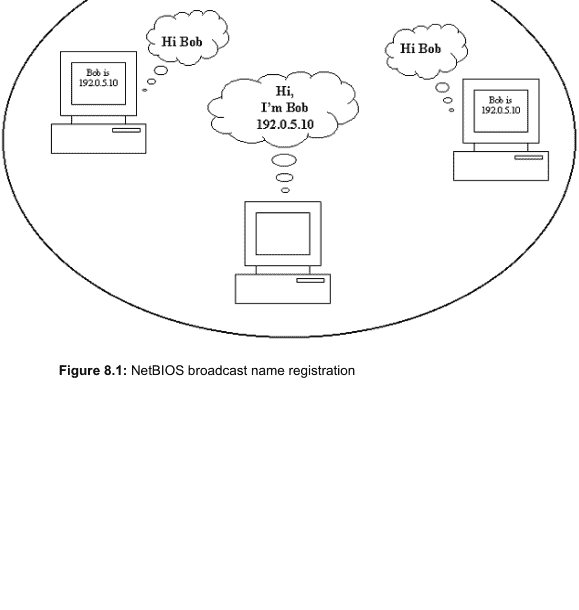

图 8.1：NetBIOS 广播名称注册

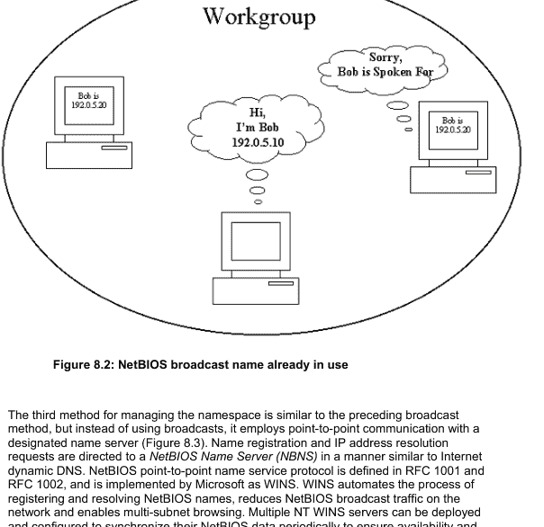

图 8.2：NetBIOS 广播名称已被使用

管理命名空间的第三种方法与前述广播方法类似，但不是使用广播，而是采用与指定名称服务器的点对点通信（图 8.3）。

名称注册和 IP 地址解析请求以类似于 Internet 动态 DNS 的方式发送到 NetBIOS 名称服务器（`NBNS`）。

NetBIOS 点对点名称服务协议在 `RFC 1001` 和 `RFC 1002` 中定义，并由 Microsoft 作为 `WINS` 实现。

`WINS` 自动化了注册和解析 NetBIOS 名称的过程，减少了网络上的 NetBIOS 广播流量并启用多子网浏览。

可以部署多个 NT `WINS` 服务器并配置为定期同步其 NetBIOS 数据以确保可用性和冗余。

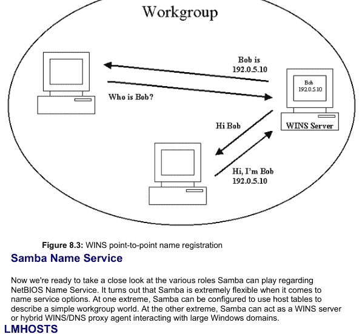

图 8.3：WINS 点对点名称注册

## Samba 名称服务

现在我们准备仔细查看 Samba 在 NetBIOS 名称服务方面可以扮演的各种角色。

事实证明，Samba 在名称服务选项方面极其灵活。

在一端，Samba 可以配置为使用主机表来描述一个简单的工作组世界。

在另一端，Samba 可以充当 `WINS` 服务器或混合 `WINS/DNS` 代理，与大型 Windows 域交互。

### LMHOSTS

将 Samba 资源集成到小型工作组的最简单方法是，将 Samba 服务器添加到工作组的 `LMHOSTS` 表中，并将表的副本提供给 Samba `nmbd` 守护进程。

这是通过在启动 `nmbd` 时将 `LMHOSTS` 文件的目录路径作为 `-H` 选项的参数来完成的（示例 8.3）。

`LMHOSTS` 的默认位置与包含 Samba `smb.conf` 配置文件的目录相同。

请注意，`LMHOSTS` 信息仅对本地机器可用。

其内容不会被 Samba 用于解析来自其他客户端的广播查询。

Samba 和 Windows 版本的 `LMHOSTS` 之间也有一些差异。

最重要的是，NetBIOS 名称条目可以包含 `#` 字符后缀，后跟两位资源类型（示例 8.4）。

`#` 字符后的其他字符串被视为注释。

Windows `LMHOSTS` 表（示例 8.2）中主机 Wizard 的条目和 Samba `LMHOSTS` 表（示例 8.4）中的条目表明 Wizard 是使用各自表语法的 PDC。

#### 示例 8.3 nmbd 和 LMHOSTS

```
nmbd -H <lmhosts path> -D
```

#### 示例 8.4 示例 Samba LMHOSTS 表

```
149.110.5.12    Wizard#1B
149.110.5.11    Dragon
149.110.5.2     Dhyana
149.110.5.1     Tao
149.110.5.5     Rose
```

### WINS

我们已经讨论过 `WINS` 如何简化 NetBIOS 名称服务。

主要特性是由于 NetBIOS 名称注册的动态特性，`WINS` 对命名空间维护的自动化，通过 `WINS` 客户端和服务器之间的点对点通信减少广播流量，以及跨子网浏览的支持（图 8.4）。

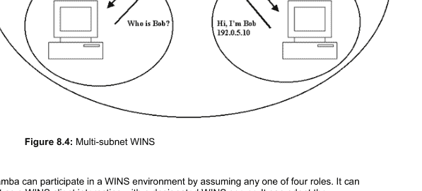

图 8.4：多子网 WINS

Samba 可以通过承担四种角色之一参与 `WINS` 环境。

它可以充当与指定 `WINS` 服务器交互的 `WINS` 客户端。

它可以承担主要 `WINS` 服务器的责任，注册和解析客户端请求。

它可以

将本地 `WINS` 请求代理到远程 `WINS` 服务器。

它可以针对 Internet DNS 解析 `WINS` 名称请求。

这一丰富的选项集使 Samba 成为设计复杂 `WINS` 环境的异常有用的工具。

#### WINS 客户端

为了使 Samba 能与 `WINS` 管理的工作组或域中的资源无缝交互，它必须首先向指定的 `WINS` 服务器注册。

这是通过将目标 `WINS` 服务器的 IP 地址或 DNS 名称作为全局 `wins server` 参数的参数来完成的。

请注意，如果 `WINS` 服务器是多宿主的（多个网络接口），驻留在一个接口子网上的客户端将能够浏览和访问驻留在另一个接口子网上的 Samba 共享：

```
wins server = <DNS name or IP address of WINS server>
```

#### WINS 服务器

Samba 也可以配置为作为主要 `WINS` 服务器运行。

使用 `wins support` 参数启用或禁用 Samba 作为 `WINS` 服务器。

请注意，`wins support` 和 `wins server` 参数是互斥的。

前者表示 Samba 正在充当 `WINS` 服务器。

后者将 Samba 标识为 `WINS` 客户端：

```
wins support = <true, false>
```

作为 `WINS` 服务器运行时，Samba 将客户端注册信息以 ASCII 文本形式存储在 `wins.dat` 文件中。

`wins.dat` 数据库默认位于 `./samba/var/locks` 目录中。

每个条目包括 NetBIOS 名称、资源类型、IP 地址和广播地址。

Samba 不支持 `WINS` 复制。

Windows NT `WINS` 服务器可以通过提供容错和负载共享来相互复制 `WINS` 数据，从而在大网络中提供支持。

因此，你可能想考虑使用 Windows NT 进行 `WINS` 服务，而不是使用 Samba `WINS` 服务。

如果你决定使用 Samba 作为 `WINS` 服务器，请记住对于给定的工作组或域只能部署一个服务器。

使用多个 Samba `WINS` 服务器将导致工作组或域中计算机的访问被分区或碎片化。

#### WINS 代理

具有驻留在多个子网上的旧版 Windows 或 LAN Manager 客户端的环境可能希望考虑使用 Samba 的 `WINS` 代理功能。

启用 Samba 的全局 `wins proxy` 参数会指示 Samba `nmbd` 将其收到的任何广播名称注册或查询转发到工作组或域的指定 `WINS` 服务器。

使用 Samba 作为 `WINS` 代理允许你将旧客户端利用到 `WINS` 管理的工作组或域中：

```
wins proxy = <yes, no>
```

#### WINS DNS 代理

另一个可以简化复杂 `WINS` 网络管理的 Samba 功能是

允许 `nmbd` 通过 Internet DNS 查找 NetBIOS 名称。当 Samba `nmbd` 作为 `WINS` 服务器运行时，并且对已注册的 `WINS` 数据库的姓名检查失败时，会生成第二个 `nmbd` 进程来检查该名称是否与 DNS 匹配。请注意，由于 NetBIOS 名称长度限制为 16 个字符，请求的名称可能被截断，并且某些 DNS 查找可能会失败。

要启用 Samba DNS 代理支持，请将全局 `dns proxy` 和 `wins support` 参数都设置为 true。Samba 必须作为 `WINS` 服务器运行才能通过 DNS 解析名称查询。

```
wins support = true
dns proxy = true
```

#### LMHOSTS 与 WINS

在某些情况下，让 Samba 使用 `LMHOSTS` 表和 `WINS` 服务同时解析其自身的 NetBIOS 名称查询可能会有所帮助。例如，您可能希望通过在 `LMHOSTS` 文件中设置明确的条目来覆盖特定名称的 `WINS` 注册。使用 `name resolve order` 参数，您可以指示 Samba 在尝试 `WINS` 之前先检查 `LMHOSTS`。请注意，当 Samba 作为 `WINS` 服务器或代理运行时，此功能不支持解析远程查询。

```
name resolve order = <lmhosts wins>
```

## Windows 2000 名称服务


Windows 2000 与 WINS 轨道不同之处在于它依赖 DNS 来解析名称。Windows 2000 的 Active Directory 组件使用 Internet 风格的域名来命名目录中的对象。在解析目录中的对象名称时，Internet 域名会被转换为域组件条目（示例 8.5）。为了向后兼容旧的客户端和服务器，Windows 2000 中包含 WINS 集成支持。两种特殊的 DNS 资源记录类型 WINS 和 WINS-R 用于指定在解析 NetBIOS 名称时使用的 WINS 服务器。当本地 DNS 查找失败时，会查询 WINS 服务器。此功能还可用于使用显式子域设置仅 WINS 的 DNS 区域以进行引用。例如，您可以定义一个名为 `wins` 的 DNS 子域。包含此子域的域名进行的任何 DNS 查询都将被引用到解析 WINS NetBIOS 名称的 DNS 服务器。有关更多信息，请参阅 Windows 2000 帮助中的“使用 WINS 查找”。Windows NT 4.0 WINS/DNS 集成也可以用于将 WINS NetBIOS 名称映射到 DNS，作为 WINS 环境与 Windows 2000 之间的过渡桥梁。

## 示例 8.5 DNS 到域组件名称

```
DNS: opus.cac.washington.edu
DC: DC=opus,DC=cac,DC=Washington,DC=edu,o=Internet
```

## 摘要

- 工作组和域资源由 16 个字符的 NetBIOS 名称标识。
- NetBIOS 名称是通过使用主机表、协作广播和缓存，或与名称服务器的点对点通信来注册和解析的。
- 称为 `LMHOSTS` 文件的 NetBIOS 主机表是映射 NetBIOS 名称到 IP 地址的最简单方法。
- NetBIOS 广播提供自动注册和解析服务，但在大型网络中可能会产生大量广播流量，并且可能受子网限制。
- Windows Internet 名称服务 (`WINS`) 使用与指定 WINS 服务器的点对点通信来注册和解析名称。`WINS` 服务减少广播流量并且可以跨越子网。
- Samba 支持 `LMHOSTS`、广播、`WINS` 和混合 `WINS` 操作。
- `LMHOSTS` 查找是通过使用 `-H` 选项调用 `nmbd` 来启用，该选项标识 `LMHOSTS` 文件的目录路径。
- 要将 Samba 配置为 `WINS` 客户端，请使用 `wins server` 参数通过 IP 地址或 DNS 名称标识 `WINS` 服务器。
- 要将 Samba 配置为 `WINS` 服务器，请启用 `wins support` 参数。请记住 `wins server` 和 `wins support` 互斥。
- 通过启用 `wins proxy` 参数，使用 Samba 将来自旧版 Windows 和 LAN Manager 客户端的广播代理到目标 `WINS` 服务器。
- 通过启用 `dns proxy` 参数，允许 Samba 在作为 `WINS` 服务器运行时，除了 `WINS` 数据库外，还通过 DNS 查找名称。
- 通过使用 `name resolve order` 参数指定顺序，指示 Samba 同时通过 `LMHOSTS` 和 `WINS` 解析 NetBIOS 名称。请注意，这仅用于 Samba 的本地查询。

## 第 9 章：浏览

### 概述

在第 8 章中，我们仔细研究了 Samba 如何与 `WINS` NetBIOS 名称服务互操作的底层原理。具体来说，我们学习了如何配置 Samba 以作为 `WINS` 客户端、服务器或代理代理运行。现在我们有了根据 NetBIOS 名称解析系统网络地址的方法，如何发现工作组或域中可用的完整 NetBIOS 资源名称集？

就像购物目录中的厂商产品广告一样，工作组和域计算机在其文件和打印共享列表中公布，这些列表可供潜在客户端使用。这种做法称为浏览，是 Microsoft 网络架构独有的。一组分层的浏览器服务器（表 9.1）收集并同步称为浏览列表的共享列表。服务器根据请求将浏览列表提供给浏览器客户端。常见的浏览器客户端是 Windows 网络邻居客户端（图 9.1）。可用共享的浏览范围按工作组或域分组。这简化了在由多个工作组和域组成的大型网络中查找所需资源的工作。

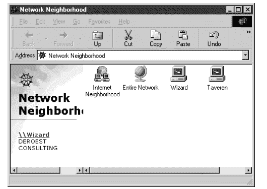

图 9.1：浏览网络邻居

### 表 9.1 浏览器服务器类型

| 浏览器服务器类型 | 描述 |
|---|---|
| 域主浏览器 | 收集整个域的浏览列表。向每个子网上的本地主浏览器服务器提供浏览列表的权威副本。NT 域的 PDC 自动被指定为域主浏览器。 |
| 本地主浏览器 | 收集工作组或域中服务器和共享的列表。每个子网选举一个本地主浏览器服务器。 |
| 备份浏览器 | 维护从主浏览器获得的浏览列表的副本，并在请求时将其提供给工作组或域客户端。 |

### 选举

工作组或域中每台计算机上可用共享的列表由拥有系统广播到网络社区。由于公告是通过网络广播进行的，因此每个子网都需要一个本地主浏览器服务器来收集和整理共享集形成浏览列表。本地主浏览器从能够维护和提供浏览列表的子网上的计算机集中选举产生。选举过程是一种网络竞标争斗，其赌注基于竞争者的操作系统级别和版本，以及它成为主浏览器的意愿。这种赌注或凭证称为选举标准（表 9.2）。选举标准最高的计算机成为该子网的本地主浏览器。失败者被降级为备份浏览器，以实现冗余和负载共享。新的选举会定期进行、在启动时进行，以及在客户端因通信错误而进行。

### 表 9.2 选举标准

#### 操作系统级别

| 操作系统 | 十六进制 | 十进制 |
|---|---|---|
| Windows 工作组版 | 0x01 | 1 |
| Windows NT 工作站 | 0x10 | 16 |
| Windows NT 服务器 | 0x20 | 32 |

#### 期望角色

| 角色 | 十六进制 | 十进制 |
|---|---|---|
| 备份浏览器 | 0x01 | 1 |
| 待命浏览器 | 0x02 | 2 |
| 主浏览器 | 0x04 | 4 |
| 域主浏览器 | 0x08 | 8 |
| WINS 客户端 | 0x20 | 16 |
| Windows NT 服务器 | 0x80 | 64 |

为了支持跨子网的工作组和域浏览，必须指定一个域主浏览器。域主浏览器会定期收集并同步驻留在每个子网上的本地主浏览器维护的浏览列表。域主浏览器的身份由 `WINS` 注册和维护。在 Windows NT 域的情况下，PDC 始终充当域主浏览器。在单子网 NT 域中，PDC 既是域主浏览器也是本地主浏览器。

每个本地主浏览器对于从其自身子网获得的共享信息被视为 "authoritative"。对于通过与域主浏览器通信。本地主浏览器会定期与其域主浏览器重新同步浏览列表。请注意，如果网络问题导致网络分区，错误的浏览列表信息可能在长达 36 分钟内仍然存在。

## Samba 与浏览

自 1.9.17a 版本起，Samba 已支持完整的浏览器功能，包括跨子网的浏览列表复制和同步。与 Samba `WINS` 服务类似，Samba 浏览选项包含在原生 Windows 实现中找不到的混合功能。

表 9.3 列出了影响浏览器操作的可用的全局和服务级 `smb.conf` 参数集合。查看这些参数后，我们将研究在工作组、域以及一个或多个子网中实现浏览器支持所需的特定参数组合。

## 表 9.3 Samba 浏览器参数

### 基础参数

| Parameter | Description |
|---|---|
| `Workgroup = <workgroup name>` | 工作组/域名称。 |
| `Netbios name = <NetBIOS-Name>` | 主 NetBIOS 名称。 |
| `Netbios aliases = <Alias1 ... AliasN>` | 可用于标识服务器的其他 NetBIOS 别名。 |
| `Interfaces = <IP-addr1 ... IP-addrN>` | 用于浏览器通信的硬件接口集合（多宿主）。 |

### LAN Manager 参数

| Parameter | Description |
|---|---|
| `lm announce = <true, false, auto>` | `nmbd` 是否为 OS/2 客户端生成 lanman 公告？如果 OS/2 客户端需要查看浏览列表，则需要此项。"auto" 值表示默认不应发送它们。`nmbd` 会在需要时监听并响应。 |
| `lm interval = <seconds>` | lanman 公告之间的间隔；如果为 '0'，则不会发出公告。 |

### 选举参数

| Parameter | Description |
|---|---|
| `browse list = <yes, no>` | 服务器是否支持浏览列表？ |
| `announce as = <NT, Win95, WfW>` | Samba 将公告的操作系统类型。 |


| `announce version = <version number>` | Samba 将公告的操作系统版本。默认 4.2 高于 NT 公告的 4.0。 |
| `os level = <integer>` | 用于选举标准的 OS 级别；'65' 的值将超过 NT Server。 |
| `local master = <yes, no>` | 指示 Samba 是否应尝试成为本地主浏览器。 |
| `preferred master = <yes, no>` | 指示 Samba 在启动时将强制进行选举并尝试成为主浏览器。用于使浏览器选举倾向于 Samba。 |
| `domain master = <yes, no>` | Samba 是域主浏览器，将在本地主浏览器之间汇总和同步浏览列表。如果域中已存在 NT PDC，请勿使用。 |

### 共享和列表参数

| Parameter | Description |
|---|---|
| `auto services = <list>` | 您希望添加到浏览列表的本地共享名称集合 |
| `browsable = <yes, no>` | 此共享是否可浏览？ |
| `comment = <text>` | 浏览列表的共享描述 |
| `load printers = <yes, no>` | 是否将 printcap 文件中的所有打印机添加到浏览列表？ |
| `server string = <text>` | 浏览列表的服务器描述。 |

### 混合参数

`remote announce = <IP-addr/WORKGROUP>`

强制将本地浏览列表传播到一组远程 IP 地址，并使用别名 WORKGROUP 名称进行公告。如果省略 WORKGROUP，则使用 `workgroup` 参数值。

`remote browse sync = <IP list>`

强制浏览列表同步的远程主浏览器列表；此选项仅适用于 Samba 本地主浏览器。

## 浏览器配置

配置 Samba 以在 Windows 和/或 LAN Manager 浏览环境中互操作时，首先确定将用于标识 Samba 服务器及其工作组或域名称的 NetBIOS 名称。这些由 `smb.conf` 中的 `netbios name` 和 `workgroup` 参数指定。显而易见，这些值对于 Samba 的共享在浏览列表中被识别是必需的。

`workgroup = <workgroup name>`

`netbios name = <NetBIOS name>`

验证全局 `guest account` 参数是否设置为服务器上的有效 UNIX 账户。这样，列出共享时使用的 `IPC$` 服务将在 guest 账户权限下运行。

`guest account = <UNIX account name>`

Samba 还需要将自身公告为 Windows 操作系统类型之一以指示其浏览器功能。这是通过设置 `announce as` 和 `announce version` 参数来模拟 Windows for Workgroups、Windows 95 或 Windows NT 来实现的。

`announce as = <NT, Win95, WfW>`

`announce version = <version number>`

现在通过设置 `domain master`、`local master`、`preferred master` 和 `os level` 参数来定义 Samba 在工作组或域中将扮演的浏览器角色。这些参数决定 Samba 将作为客户端还是服务器运行，如果是后者，则决定它将如何影响主浏览器选举过程。此时我们假设在单个子网或扁平网络上的工作组中运行。

## 浏览器客户端

首先，我们假设 Samba 应公告其共享但不会维护浏览列表（图 9.2）。让其他人执行本地主浏览器和备份浏览器的任务。禁用 `domain master`、`local master` 和 `preferred master` 参数。将 `os level` 设置为零。此配置将阻止 Samba 成为主浏览器：

```
domain master = no
local master = no
preferred master = no
os level = 0
```

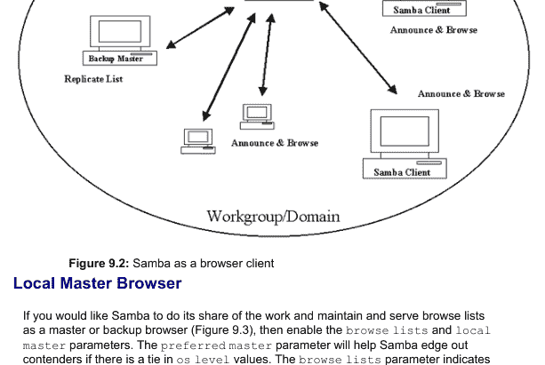

图 9.2：Samba 作为浏览器客户端

## 本地主浏览器

如果您希望 Samba 分担工作并作为主浏览器或备份浏览器维护和提供浏览列表（图 9.3），则启用 `browse lists` 和 `local master` 参数。`preferred master` 参数将在 `os level` 值出现平局时帮助 Samba 击败竞争者。`browse lists` 参数表示当 Samba 收到 `NetServerEnum` 调用时将提供列表。

```
domain master = no
local master = yes
preferred master = yes
os level = 65
browse lists = yes
```

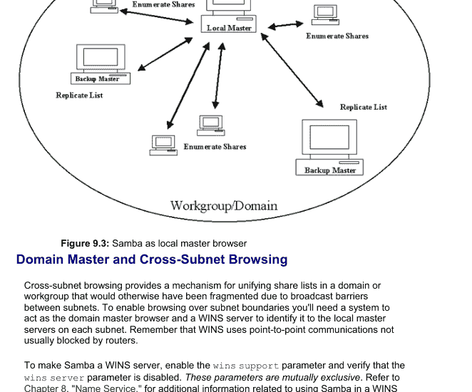

图 9.3：Samba 作为本地主浏览器

## 域主浏览器和跨子网浏览

跨子网浏览提供了一种机制，用于统一在域或工作组中的共享列表，否则这些列表会因子网之间的广播屏障而被分割。要启用跨子网边界的浏览，您需要一个系统充当域主浏览器，以及一个 WINS 服务器来将其标识给每个子网上的本地主服务器。请记住，WINS 使用点对点通信，通常不会被路由器阻止。

要使 Samba 成为 WINS 服务器，请启用 `wins support` 参数并验证 `wins server` 参数已禁用。这些参数互斥。请参阅第 8 章“名称服务”，了解有关在 WINS 环境中使用 Samba 的更多信息。

```
wins support = yes
```

要将 Samba 指向远程 WINS 服务器，请将 `wins server` 参数的值设置为 WINS 服务器的 IP 地址或 DNS 名称：

```
wins server = <IP address or DNS name>
```

接下来您需要一个作为域主浏览器运行的系统来收集和同步来自各个本地主浏览器的浏览列表（图 9.4）。域主浏览器可以是 Samba 服务器或 NT 域 PDC，但不能同时是两者。请记住，NT 域 PDC 会自动被指定为主浏览器。

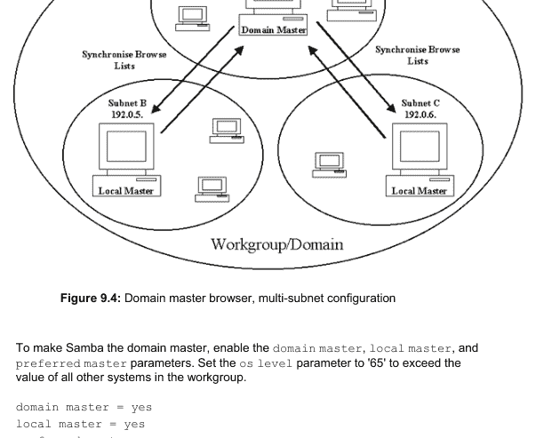

图 9.4：域主浏览器，多子网配置

要使 Samba 成为域主浏览器，请启用 `domain master`、`local master` 和 `preferred master` 参数。将 `os level` 参数设置为 '65' 以超过工作组中所有其他系统的数值。

```
domain master = yes
local master = yes
preferred master = yes
os level = 65
```

如果您已有 Windows NT PDC 为域提供服务，请确保 Samba 的 `domain master` 参数已禁用：

```
domain master = no
```

## 混合跨子网浏览

在某些情况下，您可能需要强制在子网之间进行公告或浏览列表同步，以适用于迄今为止我们尚未检查的配置拓扑。有许多原因可以这样做，但请注意，此功能在原生 Windows 环境中不可用。

您可以通过使用 `remote announce` 参数强制 Samba 服务器公告跨越子网边界。该参数的值是远程子网本地主浏览器的 IP 地址列表，它们是公告的目标。可以将任意工作组名称与每个 IP 地址匹配，以指示 Samba 将为每个子网使用的 workgroup 名称（图 9.5）。如果省略 workgroup 名称，将使用全局 `workgroup` 参数的值：

```
remote announce = <IP address list or IP/WORKGROUP list>
```

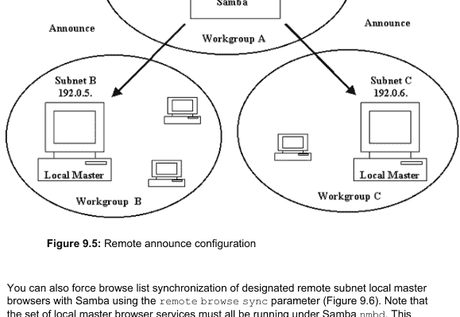

图 9.5：远程公告配置

您还可以使用 `remote browse sync` 参数强制与 Samba 同步指定的远程子网本地主浏览器（图 9.6）。请注意，本地主浏览器服务集必须全部在 Samba `nmbd` 下运行。此功能在 Windows 实现中不受支持。

```
remote browse sync = <remote LMB IP address>
```

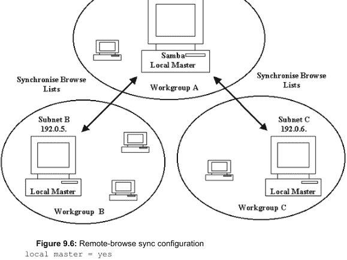

图 9.6：远程浏览同步配置

```
local master = yes
preferred master = yes
os level = 65
```

## LAN Manager 浏览


如果您需要为类似 OS/2 的 LAN Manager 客户端提供浏览支持，请将 `lm announce` 和 `lm interval` 参数添加到 `smb.conf`。`lm announce` 的值为 `"auto"` 将表示 `nmbd` 应侦听 LAN Manager 公告，并且仅在需要时响应。

```
lm announce = <true, false, auto>
lm interval = <seconds>
```

## 问题

如大多数分布式网络服务器一样，在将 Samba 集成到浏览环境中时可能会出现许多问题。如果事情没有按预期工作，首先检查各种 `smb.conf` 参数是否配置正确。接下来验证您是否将 `guest account` 参数映射到用于 `$IPC` 支持的有效 UNIX 帐户。检查 `nmbd.log` 中的异常和错误消息。还验证与 `nmbd` 一起使用的参数列表是否过长且被截断。删除参数和值之间的空格以缩短命令长度。

查看您的网络配置。确保您没有在路由器或网络接入点处阻止流量。如果您有任何 Windows for Workgroups 客户端，请不要使用包含 0 的网络广播地址。还确保您没有为任何 Windows 主浏览器服务器配置多个协议。选举将在两个协议上进行。如果服务器同时配置了 TCP 和 IPX 协议，并且服务器通过其 IPX 通道赢得了本地主浏览器选举，则 Samba 的 TCP 浏览器通信将有效地被禁用。

有关 Samba 浏览器配置的更多信息，请查看位于 `samba-<version>/docs/textdocs` 目录中的 `BROWSING.txt` 和 `BROWSING-Config.txt` 分发文档。

## 摘要

- 工作组和域客户端通过 *浏览器客户端* 工具查看可用共享，这些工具从 *主浏览器* 服务器请求 *浏览列表*。

- 每个子网的主浏览器都是根据能够维护和提供浏览列表的机器集合中的 *OS 级别* 和 *渴望值* 选出的。选举失败者成为 *备份浏览器* 以用于可用性目的。

- Samba 参与浏览器环境所需的基本配置包括指定 *netbios 名称*、*工作组名称*、*announce as* Windows 操作系统类型以及 *announce version*。*guest account* 参数还必须映射到用于 `$IPC` 服务的有效 UNIX 帐户。

- Samba 的浏览器客户端或服务器角色由 *domain master* 和 *local master* 参数决定。

- Samba 可以使用 *os level* 和 *preferred master* 参数影响选举结果。

- 通过指定域主浏览器来汇总来自远程子网本地主浏览器的浏览列表，可以启用跨子网浏览。域主浏览器通过 WINS 服务识别。

```
workgroup = <workgroup name>
netbios name = <NetBIOS name>
announce as = <NT, Win95, WfW>
announce version = <version number>
guest account = <UNIX account name>
```

```
domain master = <yes, no>
local master = <yes, no>
```

```
preferred master = yes
os level = 65
```

```
Wins support = yes
```

or

```
wins server = <IP address or DNS name>
```

- 跨子网公告和列表同步也可以使用非标准的 `remote announce` 和 `remote browse sync` 参数强制执行。

- 对类似 OS/2 的 LAN Manager 客户端的浏览列表支持由 `lm announce` 和 `lm interval` 参数提供。

```
remote announce = <IP address list or IP/WORKGROUP list>
remote browse sync = <remote LMB IP address>
```

```
lm announce = <true, false, auto>
lm interval = <seconds>
```

### 第 10 章：域

#### 概述

迄今为止，我们已将 Samba 配置讨论概括化，以便它们在工作组或域网络模型中同样适用。Samba 服务如 WINS 和主浏览器对于工作组和域都同样适用。在本章中，我们将偏离概括化的轨道，专门关注将 Samba 集成到 Windows 域中。

#### 域与工作组

Windows 域与工作组相似，因为它们代表一组用户、服务和计算机，共同共享一个通用命名空间。域与工作组不同之处在于，域在其成员中强制执行统一的安全策略和管理结构。帐户目录信息存储在称为安全帐户管理器（SAM）的安全中央存储库中。SAM 数据库维护在主域控制器上，并在每个备份域控制器上复制（参见第 3 章）。这意味着对于系统管理员而言，有一个集中位置可用于管理整个域的帐户、密码、访问控制和策略。最终用户通过单点登录访问所有域资源而受益于域模型。

域提高了访问安全性，因为客户端身份验证仅在域登录期间使用与 PDC 的安全通信通道执行一次。经过身份验证后，对资源的客户端访问是通过根据客户端的组成员身份应用访问控制来管理的。域组是用于对具有相似需求和工作概况的用户进行分类的手段。

相比之下，每个工作组客户端都维护一个持久的本地帐户和密码缓存，用于访问网络资源。为每个活动用户创建一个单独的凭据缓存，并存储在 `\windows` 目录中，格式为 `<username>.PWL`。Windows 使用关联用户的登录密码作为密钥打开缓存文件。在连接到网络资源期间，用户凭据缓存中的每个条目都会被尝试，直到身份验证被接受或拒绝。由于采用了弱加密以及在不同工作站用户登录之间持续存在，这些缓存文件中存储的凭据极易受到安全威胁。

域还提供了一种通过信任授权访问驻留在单独域中的资源的方法。信任关系是将两个域在逻辑上组合成一个管理单元的链接。信任关系可以单向应用（域 A 信任域 B，但域 B 不信任域 A）或双向应用（域 A 和域 B 相互信任）。

#### Samba 与域

与其广泛的 WINS 和浏览器实现不同，Samba 的域功能并不完全具备同等特性。这并不意味着 Samba 不能在域环境中作为客户端或控制器发挥作用。

Samba 服务器可以完全作为客户端参与 NT 域。Samba 也可以在一定限制内作为域控制器运行。作为 Windows 9x 环境中的域控制器，Samba 可以支持域登录、登录脚本、用户配置文件和系统策略。Samba 不支持 SAM 数据库复制，也不“正式”支持通过 Windows NT 域管理工具进行远程管理。正在进行的工作旨在为 Windows NT 客户端环境提供 Samba PDC 功能。此工作包括与选定 Windows NT 域工具互操作的支持。您将在本章后面找到有关 Samba PDC 开发以及实验性源代码可用性的更多信息。

#### 域客户端

要将 Samba 服务器添加为域成员，我们必须为服务器创建机器帐户和密码并将其注册到域的 PDC。首先停止 Samba 服务器上的 `smbd` 和 `nmbd` 守护进程。接下来，更新服务器的 `smb.conf` 文件以反映目标域的属性（表 10.1）。`security` 参数应设置为 `domain` 值。`netbios name` 和 `workgroup` 参数必须分别标识服务器的 NetBIOS 名称和域名称。`password server` 参数应列出 PDC 的名称以及域的任何 BDC。由于域登录需要使用加密密码，请启用 `encrypt passwords` 参数。设置机器密码超时间隔以指示 `smbd` 应多久更改一次机器密码。默认值是一周一次。

#### 表 10.1 Samba 域成员参数

```
security = domain
netbios name = <NetBIOS name>
workgroup = <domain name>
password server = <PDC BDC1 ... BDCn>
encrypt passwords = true
machine password timeout = <seconds>
```

尚未重启 Samba。使用 PDC 上的 Server Manager 将 Samba 服务器的 NetBIOS 名称注册为域成员（图 10.1）。在添加服务器名称并验证域成员身份后，使用 `smbpasswd` 命令在 Samba 服务器上设置机器帐户密码（示例 10.1）。新密码将被存储

在 `/usr/local/samba/private` 目录中作为名为 `<Domain Name>.<Samba Name>.mac` 的文件。`mac` 文件名扩展名代表 *机器账户*。

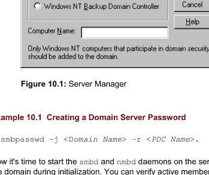

图 10.1：服务器管理器

#### 示例 10.1 创建域服务器密码


```
$ smbpasswd -j <Domain Name> -r <PDC Name>.
```

现在是时候在服务器上启动 `smbd` 和 `nmbd` 守护进程了。初始化期间 Samba 应登录到域。您可以使用服务器管理器（图 10.2）验证活动成员资格。

## 域控制

尽管 Samba 的域控制器功能尚不及 Windows NT，但您仍可能考虑将 Samba 作为 Windows 9x 客户端的域控制器运行。一个原因是，通过使用 Samba 作为域的身份验证服务，您可以在同一 Windows 9x 平台上将 UNIX 和 NetBIOS 命名空间管理协同放置。也可能是您的内部系统管理技能和平台支持基础设施更倾向于在 UNIX 而非 Windows NT 下运行域控制器。不论原因如何，您会发现 Samba 在 Windows 9x 环境中作为域控制器表现良好。对 Windows NT 客户端的域控制涉及额外的未记录协议支持，仍处于实验性 Samba PDC 工作的范畴。

要让 Samba 成为您 Windows 9x 域的域控制器，您需要验证 WINS 服务已配置并且可用（参见第 8 章）。您可以通过启用 `wins support` 参数在 Samba 下运行 WINS。如果 WINS 服务由另一台机器提供，请使用 `wins server` 参数指定远程服务器的 IP 地址或 DNS 名称。请记住 `wins support` 和 `wins server` 互斥。

```
wins support = yes
```

or

```
wins server = <IP address or DNS name>
```

使用 `netbios name` 和 `workgroup` 参数分别标识服务器的 NetBIOS 名称和域名称。

```
netbios name = <NetBIOS name>
workgroup = <domain name>
```

您还需要配置服务器充当域主浏览器（参见第 9 章）。请记住，在 Windows NT 域控制器环境中，PDC 也是域主浏览器。启用服务器的 `domain master`、`local master` 和 `preferred master` 参数，并将 `os level` 参数设置为“65”，表示 Samba 正在模拟 Windows NT Server。

```
os level = 65
domain master = yes
local master = yes
preferred master = yes
```

接下来您需要创建一个 `netlogon` 共享以支持域登录。该共享将用于存储登录脚本和系统策略文件 `CONFIG.POL`（参见本章后面的“Policies”部分）。以下是 `netlogon` 共享定义的示例。请确保 `netlogon` 共享为“只读”，以确保域的系统策略和登录脚本无法被客户端修改：

```
[netlogon]
comment = Network Logon Service
path = /usr/local/samba/lib/netlogon
public = no
writable = no
locking = no
```

通过使用 `-U<username>` 选项调用 `smbclient` 命令来验证 `netlogon` 共享配置。您可以在命令行中使用“%”字符作为用户名和密码之间的分隔符来包含相关密码：

```
$ smbclient -U <username>[%<password>]
```

如果 Samba 还将为每个客户端提供私有文件存储，请验证 `smb.conf` 中是否定义了 `homes` 共享（参见第 11 章）。`homes` 共享是一种特殊服务，通过在访问共享时引用用户名来提供对用户 UNIX `$HOME` 目录的访问。您还可以通过设置 `logon drive` 和 `logon home` 参数，在登录时指定将主目录挂载为指定的驱动器号：

```
[homes]
comment = Home Directories
browseable = no
writable = yes
```

```
logon drive = <drive letter>
logon home = \\ %N\%U
```

现在您可以通过启用 `domain logons` 参数来允许域登录。您还需要验证 `security` 参数的值为 `user`，并且 `encrypt passwords` 已启用。

```
security = user
encrypt passwords = yes
domain logons = yes
```

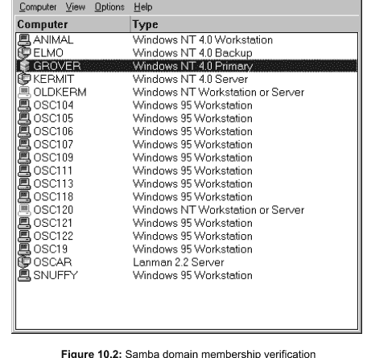

图 10.2：Samba 域成员资格验证

当 Samba 登录到域时，它会收到与发送给 Windows 客户端相同的身份验证和授权信息。数据包括诸如安全标识符（SIDs）和域组成员身份之类的结构。在 Samba 的未来版本中，此信息将用于自动生成 UNIX UID 和 GID。敬请期待。

## 登录脚本

在第 6 章中我们介绍了如何使用 `preexec` 和 `postexec` 参数在客户端连接和断开共享时自动执行命令或脚本。也可以使用 `logon script` 参数在域登录处理期间运行脚本。通过在 `logon script` 名称的值中使用替换变量，可以根据连接客户端的 SMB 信息调用不同的登录脚本。例如，通过在登录脚本名称中使用 `%U` 参数，您可以标识每个用户的登录脚本。请确保在脚本中使用 `crlf` 格式，以免混淆 DOS 客户端。示例 10.2 中列出了一个示例登录脚本。该示例脚本将客户端系统时间与时间服务器同步，并将共享目录挂载为驱动器号 S:。将登录脚本与 `preexec` 和 `postexec` 结合使用，可进一步定制域连接/断开处理。

```
logon script = \\ %N\netlogon\scripts\%U.bat
```

### 示例 10.2 示例登录脚本

```
# Sample logon script
ECHO Domain Logon Setup
NET TIME \\<server-name> /YES /SET
NET USE S: \\<server-name>\workspace
```

## 漫游配置文件

我们大多数人花费太多时间艺术化地定制 Windows 桌面。我们选择的显示背景、文字字体、应用程序快捷方式、图标和屏幕保护程序都反映了我们网络人格的一部分。屏幕上的所有东西都必须放在合适的位置。投入了这么多努力之后，当我们精心打造的桌面世界在我们从一台工作站移动到下一台时不能自动跟随我们时，我们都会感到有点恼火。

解决这个难题的方案称为漫游配置文件，即存储在网络驱动器上并在登录时复制到本地工作站的 Windows 桌面配置文件。配置文件本身是一组 Windows 环境设置，与已安装的应用程序和文件夹一起使用以创建用户的桌面工作区。配置文件是 Windows 注册表项 `HKEY_CURRENT_USER` 的缓存副本，在 Windows 9x 下存储为名为 `user.DAT` 的文件，而在 Windows NT 下为 `NTuser.DAT`。`HKEY_CURRENT_USER` 结构反映了当前登录用户设置的桌面首选项。

用户配置文件的集合通常按用户名存储在域控制器系统根目录下的 `PROFILES` 目录中。当用户登录到域时，Windows 会检查存储在域控制器上的远程配置文件的时间戳与存储在工作站上的本地副本。最近的副本随后用于设置用户的初始桌面环境。当用户注销时，配置文件会被复制回域控制器。假设域注销期间未出现问题，配置文件的最新副本将驻留在域控制器上，并在用户从任何域工作站登录时可用。

配置文件还为系统管理员提供了一种为用户配置通用或默认桌面规则的手段。如果将配置文件文件的扩展名从 `DAT` 改为 `MAN`，配置文件将成为强制配置文件，并将用于设置初始桌面环境。最终用户可以在会话期间修改桌面，但这些更改不会反映在存储在域控制器上的强制配置文件中。

Samba 通过 `logon path` 参数指定漫游配置文件。默认路径是将配置文件存储在用户的主目录中。由于 Windows 客户端可能在用户注销后仍保持主目录挂载，因此建议指定用于存储漫游配置文件的替代存储库。一种简单的解决方案是创建一个用于存储漫游配置文件（示例 10.3）的独立共享。

```
logon path = <profile path>
```

### 示例 10.3 备用漫游配置文件共享

```
logon path = \\N\profiles\%U
[profiles]
    path = /usr/local/samba/profiles
    create mode = 600
    directory mode = 0770
    browseable = no
    writeable = yes
```

您也可能由于文件名大小写而遇到解析配置文件名的问题。建议您同时启用 `preserve case` 和 `short case preserve` 参数，并禁用 `case sensitive` 参数：


```
preserve case = yes
short case preserve = yes
case sensitive = no
```

## 系统策略

系统策略代表系统管理员为定制域用户工作环境所能使用的最后手段。系统策略是用户配置文件和系统配置文件的结合。系统配置文件反映在注册表的 `HKEY_LOCAL_MACHINE` 键分支中。系统策略是确保用户、组和计算机环境策略一致的手段。系统策略强制执行的系统设置包括控制面板访问、桌面方案、Windows Shell、系统工具访问以及应用程序配置。

域管理员使用系统策略编辑器 `poledit.exe`（图 10.3）设置系统策略值。新的策略保存为 Windows 9x 中的名为 `config.pol` 的文件和 Windows NT 中的 `NTconfig.pol`。您可以在 Windows 发行版 CD 上获取 `poledit.exe` 的副本。

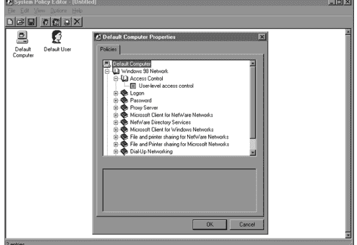

图 10.3：系统策略编辑器，`poledit.exe`

要在 Samba 中使用系统策略，您需要在 Windows 9x 工作站上创建一个 `config.pol` 文件。设置好环境首选项后，保存文件并将其复制到 Samba 的 `netlogon` 共享中。

## Windows 客户端设置

现在您已完成将 Samba 配置为域控制器的设置，您需要在每台 Windows 9x 工作站上配置域登录设置。如果多个用户将使用单独的域工作站，您需要在这些计算机上启用对多个用户配置文件的支持。点击“开始 → 设置 → 控制面板 → 用户”（图 10.4）和“开始 → 设置 → 控制面板 → 密码”（图 10.5）来执行此操作。完成配置文件设置后，在完成域登录属性配置之前不要重新启动计算机。确定用户集以及是否支持默认或单个用户配置文件。

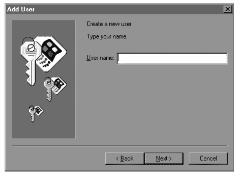

图 10.4：控制面板 → 用户

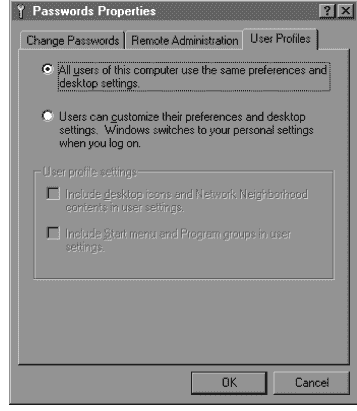

图 10.5：控制面板 → 密码

通过从桌面选择“开始 ➔ 设置 ➔ 控制面板 ➔ 网络”在 Windows 9x 中启用域登录。确保已安装“Microsoft 网络客户端”。打开属性选项卡。设置“登录到 Windows NT 域”框并输入域的名称（图 10.6）。应用更改并重新启动。Windows 登录框现在应显示用户、密码和域选项。每个用户首次登录域时将被询问是否保存用户配置文件。每个用户都应选择“是”。检查 Samba 漫游配置文件存储以验证是否已为新用户创建了配置文件。

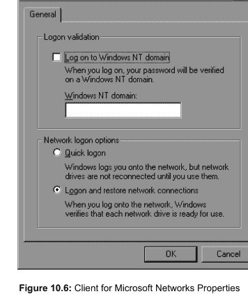

图 10.6：Microsoft 网络客户端属性

## 主域控制器

在章节介绍中我提到了 Samba PDC 开发项目。这个想法是将 Samba 的域控制器功能扩展到包括 Windows NT PDC 功能。已经完成了相当多的工作。未受支持的 Samba PDC 启用代码版本可从 Samba 下载站点获取以供评估和测试。根据最新的 Samba NT 域常见问题解答，以下是哪些 PDC 功能可用以及哪些不可用的信息。

当前包含的功能有：

- 能够充当 Windows NT 3.51 Service Pack 5 和 Windows NT 4.0 Service Pack 4 客户端的 PDC。这包括将 NT 机器添加到域中并对登录域的用户进行身份验证。
- 可以使用“域用户管理器”查看域账户。
- 通过 NT 客户端的服务器管理器查看 Samba PDC 上的资源
- Windows 95 客户端将允许设置用户级安全性，但目前不允许浏览账户。
- 机器账户密码更新
- 从 NT 客户端更改用户密码
- 用户名 <-> RID 映射
- 有些工具可与此配合使用，例如 Pedestal 软件的 NT Sec 工具。
- 有些工具，如 `explorer.exe`，无法工作。
- 对 Windows NT 组和用户名映射的部分支持
- 支持 LDAP 密码数据库后端。

稳定的、功能齐全的 Samba PDC 的发布目前计划在版本 2.1。NT 域客户端代码从版本 2.0 开始可用。以下功能目前在 NTDOM PDC 支持中不可用，但最终会提供：

- 信任关系。
- PDC <=> BDC 集成。
- 网络打印（有关变通方法，请参阅常见问题解答第 2.5 问）。
- Windows NT ACL（在 Samba 共享上）。

## 获取源代码

获取最新源代码以了解已实现哪些功能的最佳方法是，从 CVS 代码树的 HEAD 分支获取最新源代码。要下载 Samba 域控制器源代码的副本，您需要 `cvs` 的副本（http://download.cyclic.com）。使用 `cvs` 登录 Samba CVS 源服务器并更新您的 Samba 源代码副本。

```
$ cvs -d :pserver:cvs@samba.org:/cvsroot login password: cvs
$ cvs -d :pserver:cvs@samba.org:/cvsroot co samba
$ cvs update -d -P
```

## 配置

像标准发行版一样构建和安装源代码（参见第 5 章）。出于测试和评估目的，使用备用目录树安装二进制文件是个好主意。按照前面描述 Windows 9x 环境域控制的上一节概述配置 Samba 并启动服务器。服务器首次调用时，它将在 `/usr/local/samba/private` 目录中创建一个文件以标识域 SID。文件名是 `<domain name>.SID`。

服务器运行后，为域中的每个成员设置机器信任账户。机器信任账户与用户账户类似，只是账户名后附加了“$”字符。首先使用以下格式在 UNIX `/etc/passwd` 文件中添加 `<machine client name>$` 条目：

```
<NetBIOS-name>$:*: <uid>:<gid>:<Client Description>: \
/dev/null:/bin/false
```

将账户添加到 UNIX 后，将账户添加到 Samba 的密码文件中：

```
$ smbpasswd -a -m <NetBIOS-name>$
```

最后，将 Windows 账户和组映射到其 UNIX 对应项。这是通过使用 `domain user map`、`domain group map` 和 `local group map` 参数指定映射文件的位置来完成的。表 10.2 列出了每个参数以及用于配对 UNIX 和 Windows 账户和组的关联格式。

### 表 10.2 UNIX/Windows 账户和组映射

| 参数 | 格式 |
|---|---|
| `domain user map = <path>` | `UNIXuser = \\domain\\NTuser` |
| `domain group map = <path>` | `UNIXgroup = NTgroup` |
| `local group map = <path>` | `UNIXgroup = \\BUILTIN\\NTgroup` |

*`BUILTIN` 表示默认的 NT 组，如“Administrator”。

## Windows 2000

Windows 2000 通过将域组织成支持集中和分布式管理的层次树结构，在 Windows 域模型的基础上进行了构建。域和管理策略的集合由 Windows 2000 Active Directory 管理。Active Directory 是传统 NT 域安全架构的组合，并增强了一组开放技术，包括轻量级目录访问协议（LDAP）、Kerberos 版本 5.0 和 Internet 风格的域名系统（DNS）。Active Directory 支持 Windows 2000 和 Windows NT 4.0 域控制器的混合环境。旧版客户端仍可使用 NT LAN Manager 挑战/响应身份验证登录。

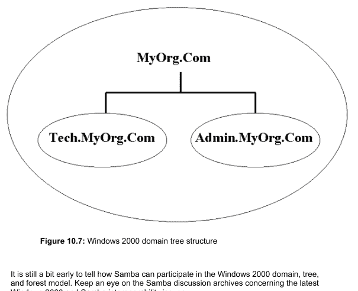

Figure 10.7: Windows 2000 域树结构

目前判断 Samba 如何参与 Windows 2000 域、树和林模型还为时过早。请关注 Samba 讨论存档，了解最新的 Windows 2000 和 Samba 互操作性问题。

## 摘要

- 域与工作组类似，但通过共享的安全策略提供了额外的功能和安全性。
- Samba 支持 Windows 9x 环境的完整域客户端兼容性和域控制器服务。
- 配置 Samba 作为域客户端：
  1. 停止 `smbd` 和 `nmbd`。
  2. 更新 `smb.conf`。


```
security = domain
netbios name = <NetBIOS name>
workgroup = <domain name>
password server = <PDC BDC1 ... BDCn>
encrypt passwords = true
machine password timeout = <seconds>
```

3. 使用 Windows Server Manager 注册服务器。

4. 设置服务器计算机账户密码：

```
$ smbpasswd -j <Domain Name> -r <PDC Name>
```

5. 重启 `smbd` 和 `nmbd`。

### 配置 Samba 作为 Windows 9x 域控制器

1. 启用 WINS 支持，并标识服务器名称和工作组名称。

```
wins support = yes
netbios name = <server name>
workgroup = <domain name>
```

2. 将 Samba 配置为域主浏览器。

```
os level = 64
domain master = yes
local master = yes
preferred master = yes
```

3. 设置 `netlogin`、`homes` 和 `profiles` 共享。

```
[netlogin]
```

```
[homes]
```

```
[profiles$]
```

`logon script = \\%N\netlogin\scripts\%U.bat`

`logon drive = <drive letter>`

`logon home = \\%N\%U`

`logon path = <profile path>`

4. 设置域登录参数。

```
security = user
encrypt passwords = yes
domain logons = yes
```

5. 使用 Windows 9x 机器上的 `poledit.exe` 创建系统策略并复制到 Samba `netlogin` 共享。

6. 在 Windows 9x 客户端上启用用户配置文件和域登录。

- Samba PDC 支持正在开发中。实验性源代码可从

## 第 11 章：共享文件

### 概述

> "关于我被同化的传闻被大大夸大了。"

Picard

Samba 的任务是在*同化* UNIX 和 Windows 资源时充当仲裁者。Samba 将操作系统协议心理融合构建了一个逻辑通信通道，用于共享驻留在两种架构中的文件和打印机。Samba 资源共享服务通过结合名称和属性映射、锁定和缓存以及多级访问控制等功能来增强简单的数据传输。与迄今为止我们讨论过的所有服务定义一样，Samba 共享服务行为是通过 `smb.conf` 配置文件中指定的参数来控制的。

### 文件共享

在 Samba 下最常见的资源共享形式之一是为 Windows 客户端提供对 UNIX 文件和目录的访问。文件共享在 `smb.conf` 的 `services` 部分中定义。除特殊 `[homes]` 共享外，每个文件共享都由方括号括起来的共享名称 `[share name]` 唯一标识。共享名称后至少跟随一个 `path` 参数，定义共享目录路径。最好还包括一个简短的共享描述，由 `comment` 参数指定。

```
[share name]
comment = <text description>
path = <directory path>
```

可以向每个文件共享部分添加附加参数，以定制文件名映射首选项、设置读写权限、强制访问控制并指定特殊锁定选项。`preexec` 和 `postexec` 等参数可用于文件共享定义中以诱发特殊的前连接和后连接处理。例如，您可能会使用 `root preexec` 在访问共享时请求挂载可移动媒体（示例 11.1）。在断开连接时，使用 `root postexec` 参数会随后执行卸载。

#### 示例 11.1 可移动媒体文件共享

```
[cdrom]
path = /mnt/cdrom
comment = Removable CDROM Share
browseable = yes
read only = yes
root preexec = /usr/sbin/mount -o ro /dev/cd0 /mnt/cdrom
root postexec = /usr/sbin/umount /mnt/cdrom
```

### Homes 共享

`[homes]` 部分是 Samba 提供的一个特殊共享服务，允许 Windows 客户端用户访问其 UNIX 主目录。当收到 SMB 连接设置请求时，Samba 首先扫描一组明确命名的共享。如果未找到匹配项，它将扫描 `passwd` 数据库，尝试为客户端用户名找到匹配项。如果找到用户名匹配并且客户端提供了正确的密码，Samba 将授予对通过克隆 `[homes]` 部分定义创建的临时 `[用户名]` 共享的访问权限。如果未提供 `path` 参数，则使用 UNIX `passwd` 数据库中指定的用户主目录路径。

示例 11.2 提供了 `[homes]` 的示例定义。请特别注意示例 `[homes]` 定义中使用的写访问参数。使用 `write list = %S` 而不是 `writable = yes` 消除了另一个用户可能获得对设置为世界可读权限的主目录的读取访问的可能性。

#### 示例 11.2 示例 [homes] 部分定义

```
[homes]
comment = User Home Directories
browseable = no
writable = no
write list = %S
```

`[homes]` 用户目录共享可以通过提供用户名作为共享名称或指定 `homes` 作为共享名称来访问。在后一种情况下，用户名是从请求客户端设置请求派生的。此功能在配置登录脚本以在多用户工作站上设置通用桌面环境时很有用。请注意，一些 Windows 客户端在用户注销时不会卸载主目录共享。您可能希望在注销环境清理过程中强制卸载：

```
C:\ NET USE H: \\<server name>\<user name>
```

```
C:\ NET USE H: \\<server name>\homes
```

其他 `[homes]` 部分注意事项包括使用 `path` 参数指定备用用户目录，以将 UNIX 用户目录与 Windows 客户端用户目录分开（示例 11.3）。另外，请注意，即使 `browseable` 参数被禁用，单个用户仍会在浏览列表中看到其主目录作为文件夹列出。

#### 示例 11.3 具有备用目录路径的 [homes] 共享

```
[homes]
comment = User Home Directories
browseable = no
writable = no
write list = %S
path = /home/samba/%u
```

使用 NIS 管理目录服务器的站点可以通过启用 `nis homedir` 参数并使用 `homedir map` 参数标识 NIS 映射，将 `[homes]` 连接路由到适当的远程目录服务器。远程目录服务器也必须运行 Samba。主目录将直接从目录服务器挂载：

```
nis homedir = <true, false>
homedir map = <NIS map name>
```

### 访问控制

在第 6 章中，我们查看了一些可以应用于 Samba 共享的访问控制。我们将在此处回顾它们，重点关注它们如何影响对文件共享的访问。表 11.1 列出了我们将在接下来的几节中介绍的访问控制参数集。

#### 表 11.1 有用的访问控制参数

**按主机**

`hosts allow` 允许/限制主机

`hosts deny`

**按用户和组**

`username` 限制/允许用户

`valid users`

`invalid users`

`only user`

`force user`

`guest ok` 公共访问

`guest only`

`guest account`

`group` 强制命名组权限

`force group`

**按文件操作**

| 参数 | 描述 |
|---|---|
| `read only` | 只读访问 |
| `read list` | |
| `writeable` | 写访问 |
| `write list` | |
| `force security mode` | 指定权限 |
| `force create mode` | |
| `force directory mode` | |
| `force directory security mode` | |
| `security mask` | |
| `create mask` | |
| `directory mask` | |
| `directory security mask` | |

### 隐藏

| 参数 | 描述 |
|---|---|
| `veto files` | 隐藏/限制指定文件 |
| `hide files` | |
| `hide dot files` | |
| `delete veto files` | |
| `dont descend` | |

### 浏览权限


最无效的访问控制方法是安全通过模糊性。我提到这一点是因为许多站点会使用 `browseable` 参数隐藏共享并假设这足以防止未经授权的访问。他们订阅了对旧说法如“用户不知道的东西不会伤害他们”和“用户无知是系统管理员的福音”的网络哲学扭曲。使共享不可浏览确实有很好的理由。只要记住，虽然共享不会显示在浏览列表中，但如果用户事先知道名称，他们仍然可以访问它：

```
browseable = <yes, no>
```

### 主机访问

Samba 访问控制最基本的形式是按主机名或 IP 地址。使用 `smb.conf` 的全局和共享部分中的 `hosts allow` 和 `hosts deny` 参数来限制对工作组或域中受信任成员主机的访问。您可以通过使用 IP 类值或子网掩码按名称、IP 号码或 IP 组指定计算机。`except` 关键字可与子网掩码等组值结合使用，以排除单个或一组机器（示例 11.4）。

### 示例 11.4 按主机限制访问

```
hosts allow = 192.168. except 192.168.0.10

hosts deny = frodo, bilbo

hosts allow = 149.125.10.0/255.255.255.0
```

## 用户和组访问

在用户级别可以应用更精细的访问限制。Samba 允许你通过 `username`、`only user`、`valid users` 和 `invalid users` 参数（示例 11.5）限制特定个人的进入权限。

根据所使用的具体参数，在授予或拒绝访问之前，会将客户端提供的用户名与关联的用户列表进行核对。如果用户名以 "@" 符号或 "&" 符号为前缀，则假定其对应于 NIS 网络组。如果以 "+" 符号为前缀，则名称会对照 UNIX 组文件进行检查。

### 示例 11.5 按用户名限制访问

```
invalid users = root system +wheel

only user = fred
```

当客户端请求访问共享或服务时，适用以下规则。

访问在以下情况下被授予：

- 未受限制的客户端提供了映射到允许的 UNIX 账户名称的用户名和密码。
- 客户端之前已向服务器注册了用户名，并随后提供了有效密码。
- 客户端的 NetBIOS 名称和先前使用的用户名与提供的密码进行核对。
- 具有先前已验证的用户名/密码对的客户端向服务器提供验证令牌。
- 共享配置了 `user list` 参数，且客户端为列表中的其中一个用户名提供了有效密码。
- 共享配置了 `guest account` 参数，且客户端提供了有效的访客账户名称。

有时你希望将共享对任何人开放。在共享部分定义中添加 `guest ok` 或 `guest only` 参数即可实现此目的。请注意，即使你授予了资源公共访问权限，仍应通过将访客访问映射到有效的 UNIX 账户来限制共享上的操作权限。将期望的用户账户名称作为 `guest account` 参数的值指定。一个具有有限权限的良好候选账户是 `nobody` 账户，该账户通常用于 UNIX 匿名访问服务（示例 11.6）。

### 示例 11.6 限制访客访问

```
guest ok = true

guest account = nobody
```

## 权限和许可

现在我们已将连接权限缩小到明确的客户端用户和机器社区，我们希望将共享中包含的文件和目录对象上允许的操作集合绑定起来。这是通过根据有效的 UNIX 用户和组标识符指示用户是否具有读或写权限，以及如何为操作文件和目录指定 UNIX 所有者、组和世界权限来实现的。请记住，无论 `smb.conf` 中为共享指定的参数规格如何，Samba 都必须遵守 UNIX 权限。

读/写权限可以使用 `readable`、`read list`、`writeable` 和 `write list` 参数在共享级别或用户级别指定。如果用户名以 "@" 符号或 "&" 符号为前缀，则假定其对应于 NIS 网络组。如果以 "+" 符号为前缀，则名称会对照 UNIX 组文件进行检查。"+"、"@" 和 "&" 字符可以组合使用，以指示同时对照 UNIX 组文件和 NIS 网络组进行检查。

```
writeable = <yes, no>

write list = <comma separated user list>

readonly = <yes, no>

read list = <comma separated user list>
```

由于 DOS、LAN Manager、Windows 9x 和 Windows NT 客户端采用的访问控制属性范围广泛，Samba 需要一套机制来确保这些属性反映在相应的 UNIX 文件和目录权限中。这是通过一组 `mask` 或 `mode`（`mask` 的同义词）参数仔细实现的，这些参数可保证 UNIX 权限的适当应用。

在客户端在 Samba 文件共享中创建文件或目录时，可以应用两级掩码。第一组掩码参数与由 DOS 模式或 NT 访问控制属性映射产生的 UNIX 权限位进行按位 AND 操作。创建文件或目录时，任何与掩码不匹配的位都将从 resulting UNIX 权限位中移除。第一级掩码参数包括 `create mask`（DOS）、`directory mask`（DOS）、`security mask`（NT）和 `directory security mask`（NT）。这些参数的每个值均指定为八进制掩码：

```
create mask = <default=0744>

directory mask = <default=0755>
```

```
security mask = <default=create mask>
```

```
directory security mask = <default=directory mask>
```

下一级文件和目录权限参数允许你通过与第一级参数的结果进行按位 OR 操作来强制设置权限位。这确保了在创建文件或目录时，某些所有者、组和世界权限位始终会被应用。第二级参数包括 `force create mode`（DOS）、`force directory mode`（DOS）、`force security mode`（NT）和 `force directory security mode`（NT）。有关更多信息，请参阅 `smb.conf(5)` 手册页。

```
force create mode = <default=000>
```

```
force directory mode = <default=000>
```

```
force security mode = <default=force create mode>
```

```
force directory security mode = <default=force directory mode>
```

在某些情况下，你可能希望强制分配特定的有效 UNIX 用户或组，以便在共享中操作对象时使用。当多个用户共享对文件共享的访问时，这很有用。通过将 UNIX 用户名和组名指定为 `force user` 和 `force group` 参数的值，你可以确保服务上的所有文件操作都使用指定的用户和组进行权限检查和分配：

```
force user = <user name>
```

```
force group = <group name>
```

自 Samba 2.0.5 起，`force group` 参数允许在组名称值前添加 "+" 字符。这意味着，只有当连接用户已在 `/etc/groups` 文件中列为该组的成员时，才会在指定的有效组下操作（示例 11.7）。所有其他用户将在自己的默认主 UNIX 组下操作。

### 示例 11.7 2.0.5 Force Group 增强

```
force group = +sys
```

需要共享完全管理权限的 power 用户由 `admin users` 参数指定。这基本上赋予这些用户在共享内操作文件和目录时的 root 权限。

```
admin users = <user list>
```

## 隐藏文件和目录

另一种通过混淆实现的安全形式是通过 Samba 隐藏文件和目录不让 SMB 客户端看到的能力来实现的。出于实际目的，在 `[homes]` 共享中隐藏诸如 UNIX 点文件之类的内容可能是明智的。可以通过启用 `hide dot files` 参数来隐藏 UNIX 点文件。其他 UNIX 文件和目录可以使用 `hide files` 和 `dont descend` 参数隐藏。`hide files` 参数接受以 "/" 分隔的文件名或文件模式列表。文件模式使用 "?" 和 "*" 字符作为通配符，类似于 DOS 中用于单个字符或文件名/扩展名的方式（示例 11.8）。`dont descend` 参数接受以逗号分隔的目录名称列表，这些目录对已连接客户端不可访问。`dont descend` 参数也有助于消除由符号链接引起的递归目录查找循环：

```
hide dot files = <yes, no>
```

```
hide files = <file pattern / file pattern / ...>
```


```
dont descend = <directory list>
```

### 示例 11.8 按模式隐藏文件

```
hide files = *.mbx / pine.*
```

如果客户端用户已知道隐藏文件或路径名，则隐藏文件和目录不会限制访问。要限制对隐藏文件和目录的访问，请使用 `veto files` 参数。与 `hide files` 参数类似，`veto files` 接受以 `"/"` 分隔的文件/目录名称或文件/目录模式列表，并支持 `"?"` 和 `"*"` 通配符字符。要允许客户端删除包含受 `veto files` 参数限制的文件的目录，请启用 `delete veto files` 参数：

```
veto files = <file pattern / file pattern>
```

```
delete veto files = <yes, no>
```

## DOS 和 Windows 文件属性

UNIX 所有者、组和世界执行权限位在 DOS 和 Windows 世界中没有对应项。这是因为执行权限由文件扩展名 `EXE` 暗示。同样，UNIX 文件属性不包括 DOS 和 Windows 中使用的 `archive`、`system` 和 `hidden` 属性之类的内容。Samba 解决此困境的方法是允许将 DOS/Windows 的 `archive`、`system` 和 `hidden` 属性映射到 UNIX 所有者、组和世界执行位。属性映射由 `map archive`、`map system` 和 `map hidden` 参数打开或关闭。

```
map archive = <yes, no>    UNIX owner execute bit
```

```
map system = <yes, no>    UNIX group execute bit
```

```
map hidden = <yes, no>    UNIX world execute bit
```

通过启用 `nt acl support` 参数，Windows NT 访问控制列表（ACL）被映射到 UNIX 权限位。

## 文件名变形

与访问控制属性和权限的映射一起，Samba 还将文件和路径名转换为各自的 UNIX、DOS 和 Windows 形式（表 11.2）。通常，转换涉及应用一种算法（表 11.4）将长的小写敏感的 UNIX 文件名转换为不区分大小写的 DOS 8.3 格式。该方法与 Windows 9x 和 Windows NT 在将长文件名（LFN）转换为 DOS 8.3 表示形式时采用的方法类似，但有所不同。客户端支持 LFN 或 DOS 8.3 格式的能力在会话设置期间进行协商。

### 表 11.2 文件名特征

| 类别 | 详情 |
|---|---|
| UNIX | 文件名 255 个字符；除 "/" 和 ESC 外的所有字符；混合大小写，区分大小写 |
| DOS (pre 7.0), Windows for Workgroups | 文件名 8.3 个字符；除 \ / : * ? " < > \| 外的所有字符；大写转换，不区分大小写 |
| Windows 9x, Windows NT | 文件名 127 个字符；除 \ / : * ? " < > \| 外的所有字符；Win32、LFN、通用命名约定（UNC）名称 |

### Win 2K 文件名

文件名 255 个字符

除 \ / : * ? " < > \| 外的所有字符

Win32、LFN、通用命名约定（UNC）名称

### 表 11.4 Samba 文件名变形规则

- 1. UNIX 文件名的前五个字母数字字符将被大写并用作新文件名的根。非字母数字字符将被忽略。
- 2. 在新五字符根文件名后附加 "~" 或由 `mangling char` 参数指定的字符，并跟随原始文件名（不含扩展名）的两字符哈希值。
- 3. 原始文件扩展名的前三个字符将被大写并用作新的文件扩展名。如果原始文件名中没有句点，则不应用扩展名。
- 4. 如果未指定为隐藏，则以句点开头的文件名（UNIX 隐藏文件）按上述方式处理，但会删除前导句点并使用三个 "_" 字符作为扩展名。

Samba 还维护最近使用的变形文件名的缓存。这是为了防止与反向名称变形相关的问题。许多 DOS 或 Windows 应用程序可能在重命名操作期间尝试使用变形名称形式创建 UNIX 文件。例如，打开文件后使用 BAK 扩展名重命名旧版本，然后使用原始扩展名重写修改后文件的文本编辑器。您可以使用 `mangled stack` 参数指定缓存的名称数量。

```
mangled stack = <integer>
```

您可以使用表 11.3 中列出的参数为每个共享轻松定制不同的名称变形转换。示例 11.9 演示了 UNIX 到 DOS 8.3 的转换，其中显示了同一 UNIX 主目录的 UNIX 和 Windows 视图。

### 表 11.3 Samba 名称变形参数

| 术语 | 描述 |
|---|---|
| mangled names | 启用/禁用将非 DOS 格式的 UNIX 名称转换为 DOS 8.3 形式的名称变形。 |
| mangle case | 启用/禁用非默认大小写字符的大小写变形。 |
| mangling char | 指定替代的变形字符。 |
| mangled map | 指定单个文件名转换。每个转换对都用括号括起来。示例。(*.HTML *HTM)。可以通过空白分隔每个括号括起来的对来定义多个转换集。 |
| case sensitive | 指定文件名是否区分大小写。 |
| default case | 将默认文件大小写设置为大写或小写。 |
| preserve case | 新文件使用客户端传递的大小写或默认大小写创建。 |
| short preserve case | 新的 DOS 8.3 格式文件使用客户端传递的大小写或默认大小写创建。 |
| strip dot | 从没有扩展名的 UNIX 文件名中删除尾随句点。 |

### 示例 11.9 变形的 UNIX 目录列表

#### UNIX

```
(deroest) ls -l

-rw------ 1 deroest user 1379 Jan 29 1998 .kshrc
-rwxr-x-- 1 deroest daemon 669 Sep 17 1997 .login
-rwx------ 1 deroest daemon 68 Aug 14 1989 .logout
-rwxr-x--- 1 deroest daemon 615 Sep 17 1997 .profile
drwxr-xr-x 2 deroest daemon 512 Oct 20 20:43 .ssh
drwx------ 2 deroest user 512 Mar 24 1997 News
drwxr-xr-x 5 deroest daemon 512 Oct 30 1997 bin
-rw------ 1 deroest daemon 2210 Apr 30 13:59 dead.letter
drwx------ 2 deroest user 512 Mar 24 1997 etc
drwxr-xr-x 4 deroest staff 512 Mar 24 1997 info
drwx----- 2 deroest daemon 512 Mar 24 1997 mail
-rwxr-xr-x 1 deroest daemon 716 Oct 21 15:34 mbuf.sh
drwxr-xr-x 2 deroest daemon 512 Jul 21 14:52 src
drwxr-x--- 2 deroest user 27648 Oct 15 14:35 tmp
```

#### DOS

```
D:\>dir

Volume in drive D is DEROEST
Directory of D:\

KSHRC-TG ___ 1,379 01-29-98 3:12p .kshrc
LOGIN-SY ___ 669 09-17-97 8:09a .login
LOGOU-KI ___ 68 08-14-89 9:42p .logout
PROFI-U-G ___ 615 09-17-97 8:09a .profile
SSH-00 ___ <DIR> 10-20-99 8:43p .ssh
tmp <DIR> 10-15-99 2:35p tmp
info <DIR> 03-24-97 2:47a info
etc <DIR> 03-24-97 2:47a etc
News <DIR> 03-24-97 2:47a News
mail <DIR> 03-24-97 2:47a mail
src <DIR> 07-21-99 2:52p src
bin <DIR> 10-30-97 12:07p bin
mbuf sh 716 10-21-99 3:34p mbuf.sh
DEAD-ZC LET 2,210 04-30-99 1:59p dead.letter
```

`nt acl support = <yes, no>`

## CRLF/LF 转换


在 UNIX 与 DOS/Windows 之间转换文件属性时，另一个问题涉及 CRLF/LF 转换。不幸的是，没有可靠的方法来确定哪些文件需要转换，哪些不需要。您不能依赖 `TXT` 或 `DOC` 等文件名扩展名。Samba 的做法是不会自动修改文件，以确保文件不会因错误的转换而被意外损坏。请注意，像 Linux 这样的某些操作系统可能会根据文件类型自动转换 CD-ROM 文件。使用 `conv=binary` 挂载选项可禁用 Samba 管理的 CDROM 共享的转换。

Jim Barry 编写了一个名为 `fixcrlf` 的出色 Windows 拖放式 CRLF/LF 转换器，可根据需要转换文件。要转换文件，只需将文件从 Windows 资源管理器拖到 `fixcrlf` 图标上。您可以从 Samba 归档站点之一下载 `fixcrlf` 的副本：`ftp://samba.org/pub/samba/contributed/fixcrlf.zip`

## 锁定

在分布式环境中共享文件始终涉及用于序列化和更新通知的锁定机制。Samba 支持两种基本类型，DOS/Windows 共享模式锁定和机会锁（`oplocks`）。由于 UNIX 中没有共享模式操作的通用对应物，共享模式锁定使用共享内存（快速）或文件锁（慢）实现。Samba 实现 `DENY_DOS`、`DENY_ALL`、`DENY_READ`、`DENY_WRITE`、`DENY_NONE` 和 `DENY_FCB` 锁定请求（表 11.5）。

```
share modes = <yes, no>
```

### 表 11.5 Samba 共享模式

| `DENY_DOS` | DOS 兼容模式。允许同一客户端进行额外的打开。 |

| `DENY_FCB` | 文件兼容模式。`DENY_DOS` 打开然后将打开设置为读写。如果第一个打开客户端正在写入，则不允许其他客户端读取。如果第一个客户端为只读，则允许额外的客户端读取。 |

| `DENY_ALL` | 拒绝所有其他打开请求。 |

| `DENY_READ` | 允许只写打开。 |

| `DENY_WRITE` | 允许只读打开。 |

| `DENY_NONE` | 允许额外的打开请求。 |

机会锁定是一种锁定方法，允许 Windows 客户端积极地在本地客户端上缓存文件数据块。LAN Manager 或 Windows 客户端可能会请求三种类型的 `oplocks`。第一种称为独占 `oplock`。这允许客户端获得对文件的独占访问。第二种类型是批处理 `oplock`。使用批处理 `oplock` 锁定的文件允许客户端在客户端上的本地应用程序可能已关闭文件时仍将文件保持在服务器上打开。第三种 `oplock` 类型是二级 `oplock`，允许多个客户端在没有写入者的情况下读取文件。启用 Samba `oplock` 支持（默认）可实现高达 30% 的文件 IO 性能提升。有关锁定参数的详细信息，请参阅 `smb.conf(5)` man 手册。

```
oplocks=<yes, no>
```

Samba 2.0.5 版引入了对二级 `oplocks` 的支持。`level2 oplocks` 允许读写客户端在其他客户端请求访问文件时将其 `oplock` 降级为只读。

```
level2 oplocks = <yes, no>
```

对于您希望允许多个客户端对同一文件请求 `oplocks` 的特定情况，您可以通过启用 `fake oplocks` 参数来指示 Samba 允许多个 `oplock` 请求。请记住，如果此选项在可写共享上被允许，你可能导致数据损坏。允许在只读共享上进行多个 `oplock` 请求可因本地客户端文件缓存而带来显著的性能提升。

```
fake oplocks = <yes, no>
```

如果数据通过非 Samba 控制的接口访问，可能会出现问题。持有 `oplock` 的 Samba 客户端无法感知非 Samba 应用程序的访问。可以通过将一个或多个文件匹配模式指定为 `veto oplocks files` 参数的值来为特定文件关闭 `oplocks` 支持。

```
veto oplocks files = /*.mbx/
```

你还可以通过修改系统注册表在 Windows 9x 和 Windows NT 中关闭 `oplock` 支持。这不是推荐的做法，因为禁用所有 `oplock` 支持可能会对某些 Windows 应用程序产生不利影响。如果你选择在客户端禁用 `oplocks`，请参考 Samba 发行版文档 `File-Caching.txt`。Samba 发行版中还提供了 Windows 9x 和 Windows NT 的注册表更新文件，`Win9x-CacheHandling.reg` 和 `NT4-Locking.reg`。

另一种处理未知客户端访问问题的方法由某些 UNIX 实现支持的内核级 `oplocks` 提供便利。当像 NFS 这样的其他进程触及已被 Samba `oplock` 的文件时，锁会根据指定的 `oplock` 选项被破坏或降级。

```
kernel oplocks = <yes, no>
```

文件内的字节范围锁定可以通过 `ole locking compatibility` 参数启用/禁用。Samba 通过调用 `fcntl()` 系统调用来实现字节范围锁定。`fcntl()` 使用 32 位有符号整数跟踪位置范围。Windows OLE2 客户端使用范围值的第 32 位作为信号量，这可能导致某些 UNIX 和 NFS 系统的范围值问题。

```
ole locking compatibility = <yes, no>
```

## 符号链接

DOS 和 Windows 客户端不支持类似 UNIX 符号链接的跨文件链接。Samba 通过启用 `follow symlinks` 参数允许客户端跟随 UNIX 符号链接。通过启用 `wide links` 参数，客户端可以访问位于共享目录树之外的符号链接目标。

```
follow symlinks = <yes, no>
```

```
wide links = <yes, no>
```

## 限制负载

当共享对于现有服务器资源来说过于流行时，你可以使用 `max connections` 参数限制并发连接数。此功能对于因许可限制而检查并发访问也可能有用：

```
max connections = <integer>
```

## 摘要

```
[share name]
comment = <text description>
path = <directory path>
```

- 文件共享的最小定义将包括用方括号括起来的共享名称和目录 `path` 参数。描述共享的 `comment` 参数也很理想。
- 特殊的 `[homes]` 文件共享部分允许用户从 SMB 客户端访问其 UNIX `$HOME` 目录。
- 访问控制参数可以应用于文件共享，按主机、用户和权限限制访问。
- `Non-browseable` 和隐藏文件参数会移除共享或文件的可见性，但如果客户端已知共享或文件名，则不会限制访问。
- 文件访问模式和掩码参数必须遵守底层 UNIX 权限。
- DOS/Windows `archive`、`system` 和 `hidden` 属性可以通过 `map archive`、`map system` 和 `map hidden` 参数映射到 UNIX `owner`、`group` 和 `world` 执行位。
- Samba 文件名改写用于将区分大小写的 UNIX 长文件名转换为 DOS 8.3 格式。转换映射可以按文件共享进行定制。
- 自动 CRLF/LF 文件文本转换不受支持，因为 Samba 无法准确确定何时应转换文件。可提供 CRLF/LF 工具以允许客户端根据需要转换文件：`ftp://samba.org/pub/samba/contributed/fixcrlf.zip`
- Samba 支持两种基本锁定机制。DOS `share mode` 锁定和 `windows opportunistic locking (oplocks)`。
- Samba 通过启用 `follow symlinks` 参数提供对 UNIX 符号链接文件的访问。位于共享范围之外的链接目标可以使用 `wide links` 参数使其可访问。

# 第 12 章：打印共享

## 概述

Samba 就像一把真正的瑞士军刀，当谈到打印子系统接口时。打印是一个存在于各种 UNIX 实现之间存在实质性差异的领域：守护进程、配置文件和命令。Samba 在支持大多数流行的 UNIX 打印子系统方面做得非常出色。一旦 Samba 知道操作系统类型，启用 Windows 和 LAN Manager 到本地 UNIX 打印机的打印就像一阵微风（或至少是一阵小旋风）。

## 全局打印参数

首先，当你将 Samba 配置为打印服务器时，识别操作系统类型。这让 Samba 了解将与打印排队系统互操作时使用的命令和配置文件的性质。操作系统类型由全局 `printing` 参数标识。支持的操作系统包括 `AIX`、`BSD`、`HPUX`、`LPRNG`、`PLP`、`QNX`、`SOFTQ` 和 `SYSV`。

```
printing = <os type>
```


一旦操作系统类型已知，Samba 需要知道打印机配置文件的位置。打印机配置文件的路径名由全局 `printcap name` 参数指定。Samba 将客户端打印机访问请求与配置文件中列出的队列名称进行匹配。匹配的有效目标包括打印机数据库中定义的所有打印机别名。基于指定操作系统类型的 `printcap name` 默认值包括 BSD 系统的 `/etc/printcap`、AIX 的 `/etc/qconfig` 以及 SYSV 系统的 `lpstat`。在 SYSV 系统的情况下，Samba 调用 `lpstat` 命令以获取可用打印机的列表：

```
printcap name = <printer config file>
```

如果你不想让打印机配置文件中列出的所有打印机都可供客户端访问，请考虑为你的工作组或域使用替代配置文件。使用不同的文件名或路径复制默认打印机配置文件。删除你希望限制访问的打印机定义。将复制的配置文件用作 `printcap name` 参数的值。不要忘记你需要保持驻留在每个文件中的打印机配置同步。

要使可用打印机的集合对浏览可见，请启用全局 `load printers` 参数。默认设置 `yes` 将把打印机配置文件中列出的所有打印机添加到浏览列表。

```
load printers = <yes, no>
```

### 打印共享

打印共享要么使用方括号括起来的显式共享名称定义，要么使用特殊的 `[printers]` 共享。最小的打印共享定义将包括 `path` 参数，指定世界可写排队目录的位置。它还必须设置为 `printable`，否则服务器将不会加载配置。将 `writeable` 参数设置为 `no` 以限制与排队无关的对共享的写入。如果你想允许打印机公开访问，请启用 `guest ok` 参数并验证 `guest` 账户是否设置为已知的 UNIX 账户。如果所选共享名称与 UNIX 打印机配置文件中的条目不匹配，请使用 `printer` 参数指定有效的打印机名称。

```
[print share name]
comment = <text description>
printer = <printcap printer name>
path = <spooling directory>
writeable = no
```

```
guest ok = yes
printable = yes
```

混合打印共享可以在与 `print command` 参数和打印机输入过滤器如 `smbprint` 结合使用时配置为支持其他功能。例如，使用 `HylaFAX` 和 `mgetty+sendfax` 等工具可以将传真作为网络打印功能集成。其他选项包括为图形设置原始打印共享。有关更多信息，请参阅 `Faxing.txt` 和 `Printing.txt` 发行版文档。

**HylaFAX:** http://www.hylafax.org

**mgetty+sendfax:** http://alpha.greenie.net/mgetty/

### `[printers]` 共享

Samba 提供了一种简单机制，使 UNIX 打印机配置文件中识别的所有打印机都可供使用。`[printers]` 共享是一个特殊的 `smb.conf` 部分，类似于第 11 章中讨论的 `[homes]` 共享。当服务器收到 SMB 连接设置请求时，Samba 首先扫描 `smb.conf`，尝试将请求与其中一个具体命名的共享匹配。如果未找到匹配项，它将扫描 `passwd` 数据库，尝试基于客户端用户名查找匹配项。如果未找到匹配项并且配置文件中定义了 `[printers]` 共享，它将扫描 UNIX 打印机配置文件以查找匹配项。如果找到打印机名称匹配，Samba 将授予对通过克隆 `[printers]` 部分定义创建的临时 `[printer name]` 共享的访问权限。示例 12.1 中列出了 `[printers]` 共享的示例。

#### 示例 12.1 示例 `[printers]` 共享

```
[printers]
    path = /var/spool/samba
    writeable = no
    guest ok = yes
    printable = yes
```

### 共享级参数

Samba 提供了一组额外的共享参数，允许你进一步定制单个打印共享的行为。这些参数大多涉及指定命令脚本，这些脚本将用于从 Windows 和 LAN Manager 客户端查询和管理本地 UNIX 打印队列。基于 `printing` 参数指定的操作系统类型，为 `some` 命令参数提供了默认值。

#### 表 12.1 打印共享参数

| `print command` | 打印文件处理命令或脚本。使用 `%s` 或 `%f`。 |
| `lpq command` | 查询打印队列。使用 `%p`（打印机）。 |
| `lpq cache time` | `lpq` 信息缓存多长时间；限制 Windows 客户端重复查询请求带来的服务器负载。默认值为 10 秒。每个客户端上的 Windows 假脱机管理器每 15 秒查询一次远程打印队列。缓存文件存储在 `/tmp/lpq.xxxx` 中，其中 `xxxx` 是所使用 `lpq` 命令的哈希值。 |
| `lprm command` | 从队列中删除打印作业。使用 `%p`（打印机）和 `%j`（作业 #）。 |
| `lppause command` | 暂停特定打印作业。使用 `%p`（打印机）和 `%j`（作业 #）。 |
| `lpresume command` | 恢复特定打印作业。使用 `%p`（打印机）和 `%j`（作业 #）。 |
| `postscript` | 强制以 PostScript 模式打印；通过在发送文件到打印机之前在文件开头添加 `%!` 序列来修复前导 ctl-d 问题。 |
| `queuepause command` | 暂停特定打印队列。使用 `%p`（打印机）。 |
| `queueresume command` | 恢复特定打印队列。使用 `%p`（打印机）。 |

### 打印命令

特别是，您需要验证 `print command` 参数指定的选项。`print command` 的值是一个文本字符串，将通过 `system()` 调用在文件写入到假脱机目录后被调用来处理打印文件。通常，这将导致文件被移交给打印子系统。`print command` 必须在处理完成后从假脱机目录中删除打印文件。示例 12.2 显示了支持的操作系统类型的 `print command` 默认值。

#### 示例 12.2 默认打印命令值

```
print command = lpr -r -P%p %s    AIX, BSD, LPRNG, PLP, QNX
print command = lp -c -d%p %s; rm %s    HPUX, SYSV
print command = lp -d%p -s %s; rm %s    SOFTQ
```

请注意，指定的命令必须指明假脱机文件名，并且可选地指明打印机名称。此外，如果为打印机指定了 `guest ok`，一些系统在 `guest` 账户值为 `nobody` 时会出现打印失败。在这种情况下，请在 `guest account` 参数中使用另一个 UNIX 账户。

### 命令参数脚本

表 12.1 中列出的 `print command` 参数指定一个文本字符串，表示任何有效的 UNIX 命令或 shell 脚本组合。参数字符串值会传递给 C 库 `system()` 例程，后者随后 `fork` 并执行 `sh`（命令语言解释器）来解析和执行传递的字符串。命令字符串值很可能包含 Samba 替换变量的实例。变量值将在传递字符串到 `system()` 例程之前解析。最好在命令参数值中使用任何命令或脚本的完整路径名。这避免了执行期间解析路径相关的问题。示例命令字符串列在示例 12.3 中。

#### 表 12.2 打印机共享替换变量

| 变量 | 描述 |
|---|---|
| `%p` | 打印机名称 |
| `%j` | 整数作业编号 |
| `%s` | 假脱机文件名 |
| `%f` | 不带完整路径前缀的假脱机文件名 |

#### 示例 12.3 示例命令字符串

##### AIX, BSD, LPRNG, PLP, QNX

```
lpq command = lpq %p
```

```
lprm command = lprm -P%p %j
```

##### HPUX, SYSV

```
lpq command = lpstat -o%p
```

```
lprm command = cancel %p-%j
```

## Windows 客户端设置


要从桌面设置对 Samba 管理的打印机在 Windows 客户端上的访问，请选择 开始 ➔ 设置 ➔ 控制面板 ➔ 打印机 ➔ 添加打印机（图 12.1）。从显示的选项中，选中 网络打印机（图 12.2）。接下来，识别服务器 `NetBIOS` 名称和打印机名称。如果服务器上打印机设置为可浏览，您可以使用浏览选项卡从浏览列表中选择打印机（图 12.3）。如果服务器有目标打印机驱动程序可供下载并且客户端是 Windows 9x 系统，驱动程序将自动安装。安装完成后，Samba 网络打印机可由应用程序使用，就像它是本地 Windows 打印设备一样。

### 图 12.1：添加打印机面板

### 打印机

此文件夹包含有关当前打印机的信息以及帮助您安装新打印机的向导。

要获取已安装打印机的信息，请右键单击打印机图标。

要安装新打印机，请单击 添加打印机 以启动添加打印机向导。

选择一个项目以查看其描述。

### 图 12.2：网络打印机选项

### 添加打印机向导

此打印机如何连接到您的计算机？

如果它直接连接到您的计算机，请单击 本地打印机。如果它连接到另一台计算机，请单击 网络打印机

本地打印机

网络打印机

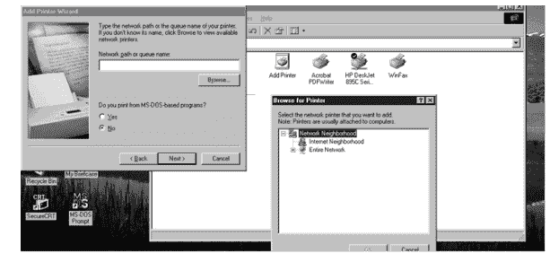

图 12.3：选择服务器和打印机名称

要打印到网络设备的文档由 Windows 网络重定向器路由到 Samba。假设服务器已正确配置打印队列命令参数集，客户端应能够使用 Windows 假脱机界面查看和与远程队列交互（图 12.4）。

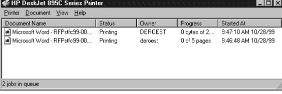

图 12.4：Windows 假脱机列表

## Windows 9x 驱动程序

Windows 9x 系统有一个不错的功能，允许在添加网络打印机时从服务器下载打印驱动程序。Samba 通过设置一个用于保存驱动程序文件的共享、通过全局 `printer driver file` 参数识别受支持的驱动程序定义文件 `printers.def`，然后通过 `printer driver` 和 `printer driver location` 参数为每个打印共享识别所需的单个驱动程序，来支持 Windows 9x 可下载驱动程序功能。

要启用可下载驱动程序支持，首先创建一个名为 `[printers$]` 的共享。不要将其与特殊的 `[printers]` 部分混淆（注意共享名称中使用 `"$"` 而不是 `"s"`）。共享应使用 `path` 参数标识一个将保存驱动程序文件的目录（示例 12.4）。

### 示例 12.4 Windows 9x 驱动程序共享

```
[printers$]
    path=/usr/local/samba/printer
    public=yes
    writeable=no
    browseable=yes
```

驱动程序定义文件 `printers.def` 是首先从 Windows 9x 系统上的 `\Windows\inf` 目录获取 `msprint*.inf` 文件的副本创建的。未包含在默认 `msprint*.inf` 文件中的厂商打印机驱动程序首先需要在 Windows 9x 系统上安装。这些将在 `\Windows\inf` 目录中显示为 `oem*.inf` 文件的某种形式。从 `*.inf` 文件中提取驱动程序信息并将其附加到 Samba `printers.def` 文件，通过调用 `make_printerdef` 命令。向命令提供 `.inf` 文件名和特定的驱动程序名称（用双引号括起来）作为参数。请注意，所提供的驱动程序名称必须与 Windows 9x 客户端期望的厂商提供的驱动程序名称完全匹配。将 `make_printerdef` `stdout` 附加到 `printers.def` 文件（示例 12.5）。一组驱动程序和动态链接库（DLL）文件将输出到 `stderr`。这些文件可以在 Windows 9x 系统的 `\Windows\System` 目录中找到，并且需要存储在 `[printers$]` 驱动程序目录中。

### 示例 12.5 创建 Windows 9x 驱动程序定义

```
make_printerdef msprint.inf "Apple LaserWriter" >> printers.def
```

接下来，使用全局 `printer driver file` 参数标识驱动程序定义文件的位置。默认位置是 `/usr/local/samba/lib/printers.def`。

```
printer driver file = /usr/local/samba/lib/printers.def
```

最后，将 `printer driver` 和 `printer driver location` 参数添加到将提供可下载驱动程序的每个打印共享（示例 12.6）。与 `printer driver location` 参数一起使用的 `%h` 变量将被 Samba 运行所在的服务器名称替换。有关 Windows 9x 可下载驱动程序的更多信息，请参阅 Samba 发行版文档中的 `PRINTER_DRIVER.txt` 文件。

### 示例 12.6 带可下载驱动程序的打印共享

```
[LaserWriter]
    comment = Apple LaserWriter plus Driver
    browseable = yes
    printable = yes
    guest ok = yes
    writeable = no
    printer driver=Apple LaserWriter
```

```
printer driver location=\\%h\\PRINTERS$
```

## Windows 打印机

Samba 还支持通过 spooling 输入过滤器 `smbprint` 将 UNIX 打印到远程 Windows 打印机。`smbprint` 过滤器基本上是 `smbclient` 命令的脚本包装器。`smbprint` 将输入通过管道传递给 `smbclient`，后者处理与远程 Windows spooling 服务的连接会话。提供了两个版本的 `smbprint` 脚本，`smbprint`（BSD）和 `smbprint.sysv`（SYSV）。脚本位于 Samba 发行版子目录 `./examples/printing` 中。

### smbprint（BSD）

要从 BSD UNIX 系统启用对 Windows 管理打印机的访问，首先将 `smbprint` 脚本安装到 Samba 二进制目录中。为远程 Windows 打印机创建类似于示例 12.7 的 `/etc/printcap` 条目。选择打印机名称、一个或多个别名以及 spooling 目录位置。根据 `/etc/printcap` 中新网络打印机条目的 `:sd` 选项所标识的位置创建 spool 目录。

### 示例 12.7 BSD smbprint printcap 条目

```
<printer name>: <printer alias>: \
:cm=<printer description> \
:sd=/var/spool/lpd/<printer name> \
:af=/var/spool/lpd/<printer name>/<accounting file> \
:if=/usr/local/samba/bin/smbprint \
:mx=0 \
:lp=/dev/null
```

在指定的打印机 spool 目录中创建一个名为 `.config` 的文件，该文件将由 `smbprint` 脚本用于标识远程服务器、服务和密码（示例 12.8）。

### 示例 12.8 /var/spool/samba/<printer name>/.config

```
server=<server NetBIOS name>
service=<printer name>
password="<printer share password>"
```

启动打印机并验证访问权限。`smbprint` 将活动消息记录到 `/tmp/smb-print.log`。该文件对于配置调试和测试非常有用。当你确定配置按预期工作时，编辑 `smbprint` 脚本并将 `logfile` 参数设置为 `/dev/null`。

```
logfile=/tmp/smb-print.log
```

### smbprint（SYSV）

要在 SYSV 环境中使用 `smbprint`，将 `smbprint.sysv` 复制到 Samba 安装目录中，文件名设为 `smbprint`。编辑脚本并为远程 Windows 打印服务设置 `server`、`service` 和 `password` 参数，如同 BSD 版本一样。请注意，在 SYSV 下，此信息包含在脚本中，而不是单独的 `.config` 文件中。接下来，调用 `lpadmin` 命令在打印机管理目录（`/etc/lp` 或 `/usr/lib/lp`）中为打印机创建一个新接口。该新接口将由 `lp` 用于将作业路由到远程服务。最后，启用打印机并将其设置为接受作业。


```
$ lpadmin -p<printer name> -v/dev/null -i/usr/local/samba/smbprint

$ enable printername

$ accept printername
```

## 调试打印共享

调试打印共享：

- 验证打印机名称是否使用 `testprns` 命令在打印机配置文件中是有效条目：

  ```
  $ testprns <printer name> <printcap file>
  ```

- 尝试将 `print command` 参数设置为将传入的打印文件简单 `cp` 到临时文件。你可以使用编辑器验证输出：

  ```
  print command = cp %s /tmp/print.tmp
  ```

- 确保 `/dev/null` 对所有用户可写。Samba 使用 `/dev/null` 丢弃指定打印命令的消息和额外输出。

- 确保在各种打印机命令参数中使用的所有命令和脚本都包含绝对路径名或位于 Samba 的 `$PATH` 环境中。

- 检查 `/etc/printcap` 定义中的问题。

- 尝试使用 `smbclient` 连接到打印机。成功连接后，尝试打印文件：

  ```
  smbclient '\\server\printer' -P
  ```

## 摘要

- 要将 Samba 设置为打印服务器，首先设置 `printing`、`printcap name` 和 `load printers` 参数以定义操作系统类型、标识打印机配置文件，并指示是否希望将所有打印机添加到浏览列表：

  ```
  Printing = <os type>
  ```

  ```
  Printcap name = <printer configuration file>
  Load printers = <yes, no>
  ```

- 打印共享可以通过方括号括起来的共享名称定义，也可以使用特殊的 `[printers]` 共享部分。

  ```
  [print share name]
  comment = <text description>
  printer = <printcap printer name>
  path = <spooling directory>
  writeable = no
  guest ok = yes
  printable = yes
  ```

- 特殊的 `[printers]` 共享部分表示由 `printcap name` 参数标识的打印机配置数据库中列出的打印机名称集合。列表会使用客户端提供的打印机名称进行匹配搜索。如果找到匹配项，则通过克隆 `[printers]` 共享中定义的参数，使用匹配的名称设置临时共享。

- 共享级参数包括在从远程客户端打印或与打印队列交互时执行的命令脚本的定义。命令脚本是表示任何有效 UNIX 命令或脚本的字符串：

  ```
  print command = lpr -r -P%p %s
  lpg command = lpg %p
  lprm command = lprm -P%p %j
  ```

- 提供了一组替换变量来标识打印机名称、spool 文件名和作业编号：

  ```
  %p    printer name
  %j    integer job number
  %s    spool file name
  %f    spool file name without full path prefix
  ```

- Windows 9x 可下载驱动程序通过特殊的共享名称 `[printer$]` 和一组标识驱动程序目录位置和驱动程序名称的参数得到支持。驱动程序文件从 Windows 复制。驱动程序定义文件 `printers.def` 由 `make_printerdef` 命令从 Windows `.inf` 文件创建。

## 驱动程序共享

```
[printer$]
path=/usr/local/samba/printer
public=yes
writeable=no
browseable=yes
```

### 参数

```
printer driver file = <printers.def path>
printer driver = <driver name>
printer driver location = <driver path>
```

### 更新 printers.def

```
make_printerdef <.inf file> "<name>" >> printers.def
```

- Samba 使用打印机输入过滤器促进对 Windows 打印机的 UNIX 打印。提供了两个过滤器，`smbprint`（BSD）和 `smbprint.sysv`（SYSV），它们将输入定向到 `smbclient` 命令。

## 第四部分：使用 Samba

### 部分概述

- 第 13 章：Samba 客户端
- 第 14 章：管理工具
- 第 15 章：故障排除
- 附录 A：GUI 旧 Samba 工具和客户端
- 附录 B：Samba 命令和实用程序示例
- 附录 C：Samba 20.5a smb.conf.default
- 参考书目

### 第 13 章：Samba 客户端

#### 概述

> > "另一方面，你有不同的手指。"
>
> 匿名

迄今为止，本书主要关注 Samba 作为 CIFS/SMB 服务器的角色。一方面，Samba 是 CIFS/SMB 服务器，但另一方面，它也是 CIFS/SMB 客户端。在本章中，我们将了解 Samba 如何促进 UNIX 客户端访问由 Windows 以及其他 Samba 服务器管理的共享。我们还将回顾 Windows 客户端设置以及其他非 Windows 平台的 CIFS/SMB 选项。

### UNIX 客户端

Samba 并不是一条单向的 CIFS/SMB 街道。除了作为 CIFS/SMB 服务器的角色外，Samba 还通过其 `smbclient`、`smbwrapper`、`smbtar` 和 `smbprint` 应用程序提供对远程共享的 UNIX 客户端访问。

### smbclient

`smbclient` 是测试 Samba 和 Windows 服务器配置的极其有用的工具。本质上，`smbclient` 是一个类似 ftp 的 CIFS/SMB 命令行客户端应用程序。功能包括在文件共享之间移动文件、创建和删除文件和目录、在远程打印机上打印文件，以及执行 NetBIOS 名称到地址解析。

正如你可能想象的那样，广泛的功能也导致了广泛的命令参数。事实证明，参数集比我们想象的要大。接下来是对可用 `smbclient` 参数的概要以及一些常用示例（示例 13.1）。

在尝试以下参数时，请记住 Samba 必须与各种 CIFS/SMB 平台交互。这意味着协议合规性程度各不相同。某些平台在参数组合和字符大小写方面可能有点固执。如果第一次不成功，请尝试使用大写的用户名、密码、NetBIOS 名称和服务名称重复请求。

```
smbclient <service name> [password] [-s smb.conf path] [-B IP addr] \ [-O socket options] [-R name resolve order] [-M NetBIOS name] \ [-i scope] [-N] [-n NetBIOS name] [-d debug level] [-P] [-p port] \ [-l log base name] [-h] [-I dest IP] [-E] [-U user name] \ [-L NetBIOS name] [-t terminal code] [-m max protocol] \ [-W workgroup] [-T c|x|IXPggbNan] [-D directory] [-c command string]
```

### smbclient 选项

- `服务名称` 表示所请求服务的完整 NetBIOS 名称，`\\server\\share`。请注意，UNIX 将反斜杠字符用作转义。这意味着你需要引用服务名称字符串或使用双反斜杠，`'\\server\\share'` 或 `\\\\server\\\\share`。另一种选择是使用通用网络约定（UNC）格式，用正斜杠代替反斜杠，`//server/share`。

- `密码` 是服务的访问密码。如果使用 `-U` 选项，密码也可以跟在用户名之后。如果提供了密码，`smbclient` 会假设 `-N` suppress 选项。如果在命令行中需要密码但未提供，客户端将在连接处理期间提示输入密码。

- `-s smb.conf path` 指定 Samba 配置文件的替代路径名。

- `-B IP addr` 指定 NetBIOS 名称服务请求的广播地址。

- `-O socket options` 列出在客户端套接字上使用的 TCP 套接字选项集。支持的套接字选项集在 `smb.conf` (5) 手册页中列出。语法为 `option=value`。使用的任何选项都应与操作系统支持的选项相对应。


# smbclient 选项

- `-R` `name` `resolve order` 指定将查询各种名称服务资源以将 NetBIOS 名称解析为网络地址的顺序。选项包括 `lmhosts`（检查 `lmhosts` 文件）、`hosts`（检查 `DNS`、`NIS` 或 `/etc/hosts`）、`wins`（检查 `WINS`）和 `bcast`（广播查询）。
- `-M` `NetBIOS name` 允许您向指定服务器发送 `WinPopup` 消息。消息文本可以通過管道输入 `smbclient`，或在建立连接后交互式输入。输入 `control-d` 以终止并发送消息。
- `-i` `scope` 标识在生成 NetBIOS 名称时使用的 NetBIOS 作用域。该选项很少使用。
- `-N` 将禁止提示输入密码。当目标服务不需要访问密码时很有用。如果在命令行中提供了密码，则假定该选项。
- `-n` `NetBIOS name` 表示本地计算机的替代 NetBIOS 名称。如果未提供，`smbclient` 将使用本地计算机的主机名。
- `-d` `debug level` 设置值 `0-10` 或 `"A"`，以指示调试目的的消息和警告的详细程度。值越高，输出越多。如果级别设置为 `"A"`，则会打印所有输出消息。默认值是 `"0"`。
- `-P` 表示目标服务应被视为打印机。该选项在 `Samba 2.0` 及更高版本中不再使用。
- `-p` `port` 用于指示替代服务器 TCP 端口号。`CIFS/SMB` 服务器的默认众所周知端口号为 `139`。
- `-l` `log base name` 表示用于活动日志的基础文本字符串。默认值在编译时指定。
- `-h` 请求显示 `smbclient` 的使用信息。
- `-I` `dest IP` 以点分十进制形式表示目标服务器的目的 IP 地址。使用此选项可绕过名称服务查找。
- `-E` 将 `stdout` 的消息重定向到 `stderr`。
- `-U` `user name` 标识访问服务时使用的用户名。如果未提供，`smbclient` 将假定 `USER` 或 `LOGNAME` 环境变量指示的值。当无法通过这些方式解析用户名时，它将默认为 `"GUEST"`。如果用户名包含 `"%"` 字符，则该字符右侧的所有内容将被用作密码。
- `-L` `NetBIOS name` 将请求指定服务器上可用的共享列表。
- `-t` `terminal code` 告诉 `smbclient` 如何解释目标服务器上的文件名。这对于在 UNIX 和 Windows 多字节语言表示之间映射是必需的。支持的终端代码包括 `sjis`、`euc`、`jis7`、`jis8`、`junet`、`hex` 和 `cap`。请检查源代码以获取其他类型。
- `-m` `max protocol level` 是 `Samba 2.0` 之前的选项，用于指示与目标服务器协商的协议级别。
- `-W` `workgroup` 设置连接时使用的 `workgroup` 名称。
- `-T` `cix | X F g b b N a n` 表示使用 `smbclient` 创建 `CIFS/SMB` 文件共享的 `tar` 归档时使用的 `tar` 选项。

```
-U username%password
```

## 选项

- `c`—使用指定的文件名、设备或 `stdout` 创建归档。如果使用 `stdout`，请将调试级别设置为 `"0"`。`"c"` 选项与 `"x"` 参数互斥。
- `x`—从归档文件、设备或 `stdin` 中提取文件并将其恢复到文件共享。文件将恢复到顶级目录，除非使用 `-D` 选项覆盖。文件创建时间将设置为保存的归档日期。
- `l`— 包含文件和目录列表。
- `X`—排除文件和目录列表
- `b`—指定写入块大小 * `TBLOCK`（在编译时设置，通常为 `512` 字节）。
- `g`—包含已设置归档位的文件。
- `q`— 指定安静模式（无诊断消息）。
- `r`—根据正则表达式匹配包含或排除文件。
- `N`— 包含比指示文件更新的文件。
- `a`—将文件添加到归档时重置归档位。
- `D` `directory` 设置初始目录位置。
- `-c` 命令字符串是分号分隔的待执行命令列表。

## smbclient 交互模式命令

当 `smbclient` 已连接到服务并通过身份验证后，用户会看到一个命令提示符。

```
smb: \>
```

一旦显示提示符，您可以使用以下命令列表与服务交互。交互行为类似于 `FTP`。命令是不区分大小写的单个单词，后面可以跟一个或多个空格分隔的参数。

- `?` `[command]` 显示所指示命令的帮助信息。如果未指定命令，将显示可用命令列表。
- `!` `[shell command]` 这将暂时返回到 UNIX shell。如果指定了命令，它将在本地机器上执行。
- `cd` `[directory name]` 这将把服务器上的工作目录更改为所指示的位置。如果未指定目录名，则显示当前工作目录名。
- `del` `<mask>` 删除所有匹配指定 `"mask"` 的文件。
- `dir` `<mask>` 列出工作目录中匹配指定 `"mask"` 的所有文件。
- `exit` 终止服务器连接并退出 `smbclient`。
- `get` `<remote file name>` `[local file name]` 从服务器复制指定的远程文件到本地系统。如果提供了 `"local file name"` 选项，则使用指定名称重命名文件。不执行内容转换（二进制模式传输）。
- `help` `[command]` 请参阅上面的 `?[command]`。
- `lcd` `[directory name]` 将本地工作目录更改为指定的 `"directory name"`。如果未指定目录名，则显示当前本地工作目录的名称。
- `lowercase` 切换 `get` 或 `mget` 命令复制的文件名是否转换为小写（默认为开启）。
- `ls` `<mask>` 请参阅上面的 `dir` 命令。
- `mask` `<mask>` 定义文件名匹配模式，将与递归 `mget` 和 `mput` 操作一起使用。例如，`mask` 为 `"*.c"` 将从目录树中收集所有 C 源文件。
- `md` `<directory name>` 请参阅 `mkdir` 命令。
- `mget` `<mask>` 将匹配掩码模式的所有文件从远程文件共享复制到本地工作目录。请注意，在递归操作期间，掩码的解释方式不同（请参阅 `mask` 和 `recurse` 命令）。
- `mkdir` `<directory name>` 在服务器文件共享上创建指定的目录名。
- `mput` `<mask>` 将本地工作目录中匹配掩码模式的所有文件复制到远程文件共享上的工作目录。请注意，在递归操作期间，掩码的解释方式不同（请参阅 `mask` 和 `recurse` 命令）。
- `print` `<file name>` 根据打印模式设置将指定的本地文件打印到远程服务器上的可打印服务。
- `printmode` `<graphics or text>` 将打印模式设置为图形（二进制）或文本。
- `prompt` 在文件复制处理期间切换 `mget` 和 `mput` 对文件名的提示。
- `put` `<local file name>` `[remote file name]` 从本地系统复制指定文件到远程服务器文件共享。如果提供了 `"remote file name"` 选项，则使用指定名称重命名文件。不执行内容转换（二进制模式传输）。
- `queue` 按 ID、名称、大小和状态显示打印队列作业。
- `quit` 请参阅 `exit` 命令。
- `rd` `<directory name>` 请参阅 `rmdir` 命令。
- `recurse` 切换 `mput` 和 `mget` 目录递归。当启用时，这些命令将遍历源目录树，收集匹配掩码模式的文件。另请参阅 `mask` 命令。
- `rm` `<mask>` 从服务器文件共享上的当前工作目录中删除匹配掩码模式的文件。
- `rmdir` `<directory name>` 从服务器文件共享中删除指定的目录。
- `tar` `cjx` `[IXbgNa]` 创建或提取 `tar` 归档。请参阅上面的 `-T` 命令行选项。另请参阅 `blocksize` 和 `tarmode` 命令。
- `blocksize` `<blocksize>` 导致 `tar` 文件按指定的 `blocksize` 乘以 `TBLOCK` 写入（`TBLOCK` 在编译时设置，默认为 `512`）。
- `tarmode` `<full|inc|reset|noreset>` 根据文件归档位设置设置 `tar` 行为。
  - `full`—所有文件都添加到归档。
  - `inc`—仅包含已设置归档位的文件。
  - `reset`—添加至归档后重置归档位。
  - `noreset`—添加至归档后不重置归档位。
- `setmode` `<filename>` `<perm=[+|-][rsha]>` 设置 DOS 文件权限。类似于 DOS `attrib` 命令。
  - `r`—只读
  - `s`—系统


- `h`—隐藏
- `a`—归档

## 示例 13.1 smbclient 示例

### 列出共享

```
$ smbclient -L wizard -N
```

### 发送消息

```
$ echo 'Samba down for maintenance' | smbclient -M wizard
```

### 制作备份

```
$ smbclient //wizard/C "" -N -Tc archive.tar
```

### 查询打印队列

```
$ smbclient //wizard/hplaser -c queue
```

## smbwrapper

Samba 本身并不原生支持在 UNIX 客户端上挂载 CIFS/SMB 文件共享。某些操作系统特定的实现（如 Linux `smbfs`）提供了挂载文件共享的支持。Samba 提供的是一个名为 `smbwrapper` 的实验性工具，它允许 UNIX 客户端对 CIFS/SMB 服务进行有限的文件操作。

`smbwrapper` 利用了某些支持动态加载共享库的 UNIX 实现中的功能。它基于一个可加载库 `smbwrapper.so`，该库可区分 CIFS/SMB 文件操作和标准 UNIX 文件操作。截至本文撰写时，该代码已在以下操作系统上进行过测试：Linux 2.0 with glibc2 (RH5.1)、Linux 2.1 with glibc2、Solaris 2.5.1 with gcc、Solaris 2.6 with gcc、SunOS 4.1.3 with gcc、IRIX 6.4 with cc 以及 OSF1 with gcc。

如果您有兴趣在支持可加载共享库的其他 UNIX 实现下试验该代码，请参阅发行版 `./source/smbwrapper` 目录中的 Readme 和 Porting 文档。

已成功针对远程 CIFS/SMB 服务测试的 UNIX 命令包括：`emacs`、`tar`、`ls`、`cmp`、`cp`、`rsync`、`du`、`cat`、`rm`、`mv`、`less`、`more`、`wc`、`head`、`tail`、`bash`、`tcsh`、`mkdir`、`rmdir`、`vim`、`xedit` 和 `diff`。

`smbwrapper` 默认不安装。要构建和安装代码，请将目录更改为 Samba 源代码发行版树中的 `./source/smbwrapper` 目录并输入 `make smbwrapper`。

```
$ make smbwrapper
```

构建并安装后，通过调用 `smbsh` 命令启动 `smbwrapper` 子 shell。`smbsh` 会提示您输入用户名和密码（示例 13.2）。用户名和密码会发送到任何支持用户级安全性的服务器。

## 示例 13.2 smbsh 会话

```
$ smbsh
Username: <user name>
Password: <password>
```

在 `smbsh` 子 shell 中，您可以通过指定以特殊目录名 `/smb` 为根并随后跟随服务器名称和服务的路径名来与 CIFS/SMB 服务器交互。`/smb` 根目录让 `smbsh` 子 shell 知道您请求的是访问 SMB 服务而不是本地文件或目录资源（示例 13.3）。

```
/smb/<server>/<service>
```

## 示例 13.3 在远程 SMB 服务器上列出服务

```
$ ls /smb/wizard
smbtar
```

`smbtar` 脚本提供了另一种与远程 CIFS/SMB 文件共享交互的方法。这是一个用于 `smbclient` 的包装脚本，可简化使用 `smbclient` 的 tar 选项。您可以使用 `smbtar` 备份和恢复驻留在远程文件共享上的文件（示例 13.4）。目标文件共享可能位于 Windows 平台下或另一个 Samba 服务器下。`smbtar` 还可以合并到 UNIX shell 脚本中，使用 `cron` 等定时批处理服务自动执行备份操作。

## 示例 13.4 smbtar - 转储和恢复

### 增量转储

```
smbtar -s <NetBIOS name> -p <password> -x <Share Name> \ <device>
-I
```

### 恢复共享

```
smbtar -s <NetBIOS name> -p <password> -x <Share Name> \ <device>
-r
```

## smbprint

Samba 通过排队输入过滤器 `smbprint` 支持 UNIX 客户端向远程 Windows 打印机打印。`smbprint` 过滤器是 `smbclient` 命令的另一个脚本包装器。`smbprint` 将输入通过管道传输到 `smbclient`，后者处理与远程 Windows 排队服务的连接会话。提供了 `smbprint` 脚本的两个版本，`smbprint`（BSD）和 `smbprint.sysv`（SYSV）。脚本位于 Samba 发行版子目录 `./examples/printing` 中。有关使用 `smbprint` 接口的详细信息，请参阅第 12 章的“Windows Printers”部分。

## Windows 9x 和 Windows NT

在前面的章节中，我讨论了 Windows 客户端配置与其相关的 Samba 提供的各种 CIFS/SMB 服务。在此我将再次简要介绍 Windows 客户端配置的基础知识，但会将您引向专门讨论 NetBIOS over TCP、名称服务、工作组和域等主题的章节以获取详细信息。我将说明 Windows 9x 的设置，因为 Windows NT 平台非常相似。

要将 Windows 9x 计算机设置为工作组或域成员，请先验证 TCP 协议是否已安装并且 NetBIOS over TCP 支持已启用。单击 `开始 ➔ 设置 ➔ 控制面板 ➔ 网络`。为网络适配器定位或添加 TCP/IP，并从 TCP/IP 属性面板中选择 `NetBIOS` 选项卡（图 13.1）。

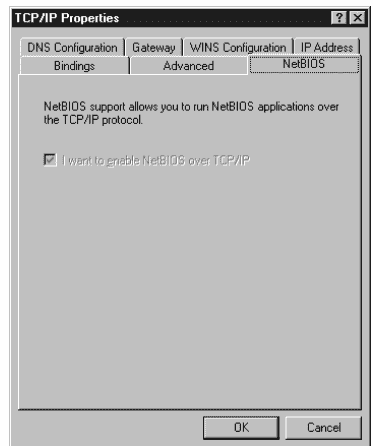

图 13.1：Windows 9x TCP NetBIOS 面板

如果将使用 WINS 进行 NetBIOS 名称服务，请选择 WINS 配置选项卡并标识一个或多个 WINS 服务器（图 13.2）

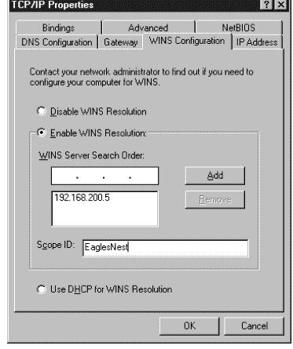

图 13.2：Windows 9x WINS 服务器标识

在重新启动之前，通过从网络面板中选择标识选项卡来指定计算机的 NetBIOS 名称和工作组名称（图 13.3）。系统将在退出标识面板后更新注册表并重新启动。

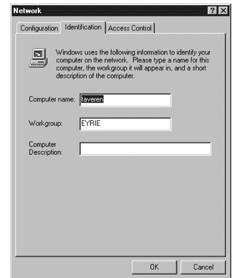

图 13.3：Windows 9x NetBIOS 名称面板

最后，如果计算机将成为域的成员，请从桌面选择 `开始 → 设置 → 控制面板 → 网络` 来启用域登录。确保已安装 `Microsoft Networks 客户端`。突出显示 `Microsoft Networks 客户端` 并选择 `属性` 选项卡。设置 `登录到 Windows NT` 域框并输入域名称（图 13.4）。应用更改并重新启动。`Windows 登录` 框现在应显示 `用户`、`密码` 和 `域` 选项。每个用户首次登录域时，将被询问是否保存用户配置文件。用户应选择 `是`。检查 Samba 漫游配置文件存储以验证是否已为新用户创建了配置文件。

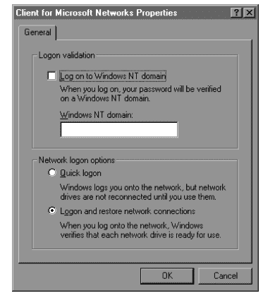

图 13.4：Microsoft Networks 客户端属性

## DOS 和 Windows 3.x 客户端

有多种选项可以将 DOS 和旧版 Windows 系统作为 Samba 工作组或域的成员。对于 DOS 和 Windows 3.x 系统，您可以从下面列出的 Microsoft ftp 站点获取 Microsoft Network Client for DOS 或 Microsoft LAN Manager Client for DOS 的免费副本。下载并执行自解压磁盘映像。安装文档包含在归档文件中。

`ftp://ftp.microsoft.com/BusSys/Clients/MSCLIENT/`

`ftp://ftp.microsoft.com/BusSys/Clients/LANMAN/`

其他选项包括 Digital Pathworks Client for DOS、`IBM LAN Client for DOS` 和 `IBM DOS LAN Requester`。

Windows for Workgroups 平台需要安装 TCP/IP 堆栈。您可以从以下 Microsoft ftp 站点下载免费副本。

`ftp://ftp.microsoft.com/BusSys/Clients/WFW/`

## OS/2


就像 MS Windows 一样，OS/2 有许多版本，为了简洁起见，我们将重点关注其中一个，即 OS/2 Warp。OS/2 Warp 版本 4 通过其点对点网络服务支持 NetBEUI over TCP/IP。要将 OS/2 工作站包括在工作组或域中，请先验证或将 NetBIOS over TCP/IP 添加到网络协议集中。从 OS/2 桌面运行 IBM 多协议传输服务（MPTS）配置程序，并分别选择适配器和协议服务 ➔ 配置 ➔ LAN 适配器和协议，以显示适配器和协议配置菜单（图 13.5）。如果尚未安装，请添加 IBM OS/2 NETBIOS OVER TCP/IP 协议。在重新启动系统之前，您需要编辑 OS/2 启动驱动器上的 `\IBMLAN\IBMLAN.INI` 文件。检查 `IBMLAN.INI` 文件的 `[networks]` 部分并验证 MPTS 是否为 `TCPBEUI$` 添加了条目。段落应类似于示例 13.5。如果缺少，请添加 `TCPBEUI$` 条目。还请验证 `wrknets` 和 `srvnets` 参数是否同时引用 `NET1` 和 `NET2` `[networks]` 段落。

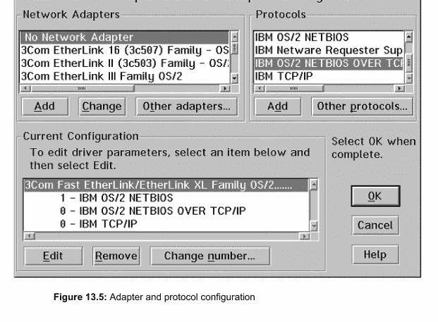

图 13.5：适配器和协议配置

## 示例 13.5 NetBIOS over TCP/IP 的 IBMLAN.INI 段

```
net1 = TCPBEUI$,0,LM10,100,150,14
net2 = NETBEUI$,0,LM10,100,150,14
...
wrknets = NET1, NET2
...
srvnets = NET1, NET2
```

现在您可以重新启动机器。最后，您需要通过运行 MPTS 配置并选择“适配器和协议服务 → 配置 → LAN 适配器和协议”来更新名称服务的 NetBIOS 名称列表和广播列表。突出显示 IBM OS/2 NETBIOS OVER TCP/IP 并选择编辑。在 NetBIOS over TCP/IP 面板上，打开 NetBIOS 和广播列表的编辑/更改菜单。最后，通过调用 `IBMCOM/RFCADDR` 来注册名称列表更改。

## Macintosh

由 Thursby Software Systems, Inc. 分发的 DAVE 工具包将 CIFS/SMB 世界带到了 Macintosh 桌面。DAVE 实现了 CIFS 协议定义的所有服务，以及 WINS 支持和 Windows 域登录。DAVE 客户端既可以充当 CIFS/SMB 客户端，也可以充当 CIFS/SMB 服务器。其他功能包括对 WinPopup 消息和网络打印的支持。

DAVE 客户端使用标准 Macintosh 选择器界面（图 13.6）访问 CIFS/SMB 服务。从选择器中，用户可以与 Windows 工作组和域服务进行交互，就好像它们位于本地 AppleTalk 网络中一样。Windows 客户端使用标准浏览界面（如 Network Neighborhood）与驻留在 Macintosh 服务器上的资源进行交互。

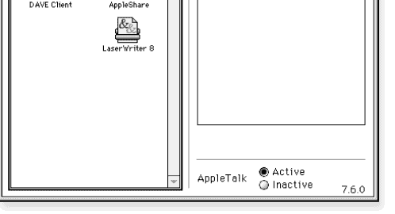

图 13.6：DAVE CIFS/SMB 选择器界面

DAVE 与 Windows 9x、Windows NT 和 Windows 2000 兼容。有关更多信息，请参阅 Thursby 网页：`http://www.thursby.com`。

## 摘要

- Samba 通过 `smbclient`、`smbwrapper`、`smbtar` 和 `smbprint` 例程支持 UNIX 客户端访问远程 CIFS/SMB 服务器。
- `smbclient` 是一种类似“ftp”的 CIFS/SMB 命令行客户端应用程序。其功能包括在文件共享之间移动文件、创建和删除文件和目录、在远程打印机上打印文件以及执行 NetBIOS 名称到地址解析。

  ```
  $ smbclient -L <server>
  ```
- `smbwrapper` 是一种实验性工具，允许 UNIX 客户端对 CIFS/SMB 文件服务执行有限的文件操作。它使用由 `smbsh` 子 shell 调用的可加载共享库。默认情况下未安装。请参阅发行版文档 `./source/smbwrapper/Readme.`

  ```
  $ smbsh
  ```
- `smbtar` 是 `smbclient` 的包装脚本，可简化使用 `smbclient` 的 `tar` 选项。

  ```
  $ smbtar -s <server> -c|x <share> <device>
  ```
- `smbprint` 是一个 printcap 过滤器，将打印输入通过管道传输到 `_smbclient` 以分发到远程打印机共享。
- 其他 CIFS/SMB 客户端包括：
  - **Windows 9x, Windows NT**：集成 NetBEUI over TCP/IP。
  - **DOS, Windows 3x, WWG**：MS Network Client、DOS LAN Manager、TCP/IP Stack：`ftp://ftp.microsoft.com/BusSys/Clients`
  - **OS/2 Warp**：点对点网络
  - **Macintosh**：DAVE—Thursby Software Systems, Inc.；`http://www.thursby.com`

# 第 14 章：管理工具

## 概述

命令行还是 GUI，这就是问题。

在思想中忍受是否更崇高

忍受 UNIX 命令行的苦难和箭矢

还是在配置麻烦的海洋中调用 GUI 管理工具。

当谈到管理复杂软件系统时，图形界面似乎是趋势。Web 无处不在的平台无关特性使得基于浏览器的管理工具成为首选界面。仍然有一些人更喜欢经过验证的命令行系统管理方法。然而，大多数系统管理员会承认，基于 GUI 的工具可以减少复杂表格中的配置错误数量。它们还有助于新系统管理员定制不熟悉的应用程序。

有越来越多的 GUI 管理工具旨在简化 Samba 配置，在本章中我们将简要介绍其中一些工具。在深入色彩丰富、基于表单的 GUI 工具世界之前，让我们先从老式的命令行工具开始。

## 命令行工具

### testparm

验证 `smb.conf` 正确性的优秀命令行工具是 Samba `testparm` 命令。`testparm` 不能保证特定共享或部分会按您预期的方式运行，而是会验证配置文件中每个部分指定的语法和参数。使用目标 `smb.conf` 文件的完整路径名作为参数调用 `testparm`。如果作为选项提供了主机名或 IP 地址，它还会检查指定主机的访问权限。有关更多信息，请参阅 `testparm (1)` 手册页。

```
$ testparm <-s configfilename> <hostname hostIP>
```

### smbclient

我们在文本中多次提到使用 `smbclient` 命令来验证对服务器和服务的访问。`smbclient` 可用于在文件共享之间移动文件、修改文件和目录、在远程打印机上打印文件以及执行 NetBIOS 名称到地址解析。有关 `smbclient` 选项的详细信息，请参阅第 13 章“Samba 客户端”和 `smbclient (1)` 手册页。

```
$ smbclient -L <server> -N
```

### smbstatus

`smbstatus` 命令是一个简单的工具，可显示服务器活动连接的信息。服务器状态信息可以限制为用户、共享或锁。这是一个快速检查服务器整体健康状况的有用工具。有关选项和更多信息，请参阅 `smbstatus (1)` 手册页。

```
$ smbstatus -d
```

### testprns

使用 `testprns` 命令验证打印机名称是否为打印机配置文件中的有效条目。有关更多信息，请参阅 `testprns (1)` 手册页。

```
$ testprns <printer name> <printcap file>
```

## Web 工具

### SWAT

对于更习惯于 GUI 配置工具提供的易用性和错误检查的人来说，Samba 版本 2.x 提供了一个基于 Web 的配置和管理工具，恰当地命名为 Samba Web 管理工具（SWAT）（图 14.1）。由于基于 Web，SWAT 可以从远程网络工作站调用。当您管理多个地理位置分散的 Samba 服务器或从家中通过拨号链接进行深夜配置更改时，这是一个方便的功能。SWAT 为 `smb.conf` 文件中表示的各种部分类型提供 HTML 表单（图 14.2）。SWAT 简化了一般配置任务，并允许系统管理员专注于感兴趣的部分定义。有关安装和使用 SWAT 的详细信息，请参阅第 6 章“Samba 配置，smb.conf”和 `swat(8)` 手册页。


图 14.1：Samba SWAT 管理工具


图 14.2：示例 SWAT 操作配置表单

### Webmin

Webmin 是另一个用于管理 Samba 配置的基于 Web 的工具。它通过支持广泛的通用 UNIX 管理任务而远远超过了 SWAT（图 14.3）。使用 Webmin，您可以配置 Samba、设置用户帐户、管理 DNS 以及管理文件系统、Web 服务器等。

Webmin 使用一组 Perl 5 CGI 程序来更新各种 UNIX 配置表。管理员界面需要浏览器支持表单、框架和 Java。要获取 Webmin 的副本或更多信息，请访问 Webmin 网站：http://www.webmin.com/webmin/。


图 14.3：Webmin UNIX 管理

### SMB2WWW

SMB2WWW 是一个提供 Samba `smbclient` 命令 Web 界面的工具。它以类似“网络邻居”的视图呈现工作组或域（图 14.4）。单击页面上列出的任何服务器，即会显示可用服务的列表。SMB2WWW 允许您执行 `smbclient` 提供的大多数操作。这包括为备份和恢复目的对文件共享目录进行 tar 操作。有关更多信息，请尝试下面列出的演示页面或存档站点。

http://us3.samba.org/samba/smb2www/index.html

http://www.scintilla.utwente.nl/users/frank/smb2www/


图 14.4：SMB2WWW 网络邻域

## Smbconfool

Smbconfool 是另一个 `smb.conf` 编辑工具。与 SWAT 不同，`smbconfool` 会保留 `smb.conf` 中的注释。然而，你无法输入注释。该功能将在未来的版本中提供。你可以执行大多数常规配置任务，如创建、更新和删除共享部分。

Smbconfool 基于 Java，因此浏览器需要 Java 支持。你可以从以下地址获取 `smbconfool` 的副本：http://www.eatonweb.com/samba/

## Windows 工具

### bbSAT

HP 3000 渠道合作伙伴 B+B Unternehmensberatung 开发了一款名为 bbSAT（图 14.5）的基于 Windows 的 GUI 工具，用于维护 Samba 配置。此工作是在 Samba 移植到 MPE/iX 的过程中完成的。bbSAT 可免费获得，并且可与其他 Samba 平台一起使用。与 `smbconfool` 类似，bbSAT 会保留 `smb.conf` 注释。还有一个增强版的 bbSAT，名为“bbSAT (GE) Gold Edition”，提供额外功能。更多信息请访问 bbSAT 网站：http://jazz.external.hp.com/src/samba/bbsat_index.html.


图 14.5：bbSAT

### smbedit

`smbedit` 是另一款免费的 Win32 应用程序，可从 Windows 客户端编辑 `smb.conf`（图 14.6）。除了常规的 Samba 配置编辑外，你还可以调用 Samba 服务，如 `testparm` 和 `smbstatus`。更多信息请参阅 `smbedit` 网页：http://us3.samba.org/samba/smbedit/readme.htm.


图 14.6：smbedit

## 其他工具

### smb-mode.el

对于 Emacs 爱好者来说，有一个名为 `smb-mode.el` 的 Emacs 主模式可用于编辑 `smb.conf`。使用 `smb-mode.el`，你可以编辑单独的 `smb.conf` 部分，从 Samba 手册页查找参数信息，执行参数补全，并通过 Samba `testparm` 命令运行缓冲区。要获取 `smb-mode.el` 的副本，请访问以下网站：http://users.gtn.net/fraserm/smbmode.html.

### GSMB

在我们关注 `smb.conf` 编辑工具之外，我们注意到一个名为 `gsmb`（图 14.7）的 Gtk 工具，用于管理 Samba `smbpasswd` 加密密码支持。它由 Laurent Foucher 创建。`gsmb` 使用 Gtk 1.2.0 库。更多信息请访问 `gsmb` 网站：http://savage.iut-blagnac.fr/projets/developpement/gsmb/.


图 14.7：gsmb

## 摘要

- 有用的 Samba 管理命令行工具包括：`testparm`、`smbclient`、`smbstatus` 和 `testprns`。
- 有用的 Samba GUI 管理工具包括：
  - Web 工具：SWAT、Webmin、SMB2WWW 和 `smbconfool`。
  - Windows 工具：bbSAT 和 `smbedit`。
  - 其他工具：`smb-mode.el` 和 `gsmb`。

# 第 15 章：故障排除

## 概述

> “政治就是寻找麻烦的艺术，找到它，误诊它，然后错误地应用错误的补救措施。”

**格鲁乔·马克斯**

计算机在某种程度上就像政治。迟早麻烦总会出现。它通常发生在你对生产服务进行一次深夜的小改动时。你知道那种情况。它总是某个预防性服务补丁，用于你从未见过的问题；供应商建议需要应用的补丁，保证它只是一个良性的软件更新。你应用补丁并梦想着第二天早上睡个懒觉。就在你准备收工时，问题症状开始从多个子系统出现。SNMP 监控警报到处弹出，宣布网络各地的服务器故障。在紧张的肾上腺素激增中，你迅速尝试在为时已晚之前回滚补丁。进行到一半时，卸载任务失败，你的屏幕变黑，电话开始响个不停。

残酷吧？无法避免计算机和网络问题，但可以限制灾难的范围。诀窍是始终手边有一套良好的诊断工具，并有一个可靠的回退计划。安装新系统时，先在隔离的测试环境中试用。当生产系统出现问题时，将其作为一系列验证阶段来处理。从最低级别的子系统开始。依次检查每个更高级别的服务，在进行过程中排除可能性。此过程有助于诊断根源于复杂子系统相互关系的事件。

## 追踪 Samba

Samba 是由紧密耦合的子系统组成的一个网络服务的典型例子。因此，通常很有帮助以上一段所述的分步方式处理 Samba 问题。首先验证从电路的服务器端和客户端的网络连接。接下来确认 `smbd` 和 `nmbd` 正在运行并监听连接请求。确保配置文件正确反映了 Samba 在工作组或域中扮演的角色。当其他方法都失败时，确保你知道去哪里寻求帮助。

在以下各节中，我们将仔细查看在网络、守护进程和配置级别验证 Samba 服务。表 15.1 列出了我们在分析系统的每个组件时将使用的工具集。

### 表 15.1 故障排除工具

#### Samba 工具

```
smbclient
nmblookup
testparm
testprns
```

#### UNIX 工具

- `ifconfig`
- `netstat`
- `ping`
- `ps`
- `iostat`

#### Windows 客户端工具

- `NET`
- `NBTSTAT`
- `WINIPCFG`

## 网络连接

开始故障排除时，先检查客户端和服务器之间的网络连接。

大家能否通过线路相互通信？每个人是否都配置为支持 NetBIOS over TCP/IP？分配的 IP 地址和子网是否正确？在每个 UNIX 客户端和服务器上使用 `ifconfig` 命令（示例 15.1），在 Windows 客户端和服务器上使用 `winipcfg` 命令（图 15.1）来验证网络接口配置。这些命令将显示网络适配器状态、分配的 IP 地址和子网掩码以及广播地址。

### 示例 15.1 ifconfig – UNIX 网络接口

```
# ifconfig en0
en0: flags=0x080863<UP,BROADCAST,NOTRAILERS,RUNNING,SIMPLEX,
    MULTICAST,GROUPRT>
inet 145.142.210.20 netmask 0xffffffff broadcast
    145.142.210.255
```


图 15.1：winipcfg – Windows 网络接口


一旦你确定每个系统的网络接口都正常运行，就使用`ping`命令在问题系统之间发送 ICMP 回显请求来检查可达性（示例 15.2）。显示回显往返时间和丢包率统计，指示参与系统之间通信路径的整体健康状况。

### 示例 15.2 ping – 验证通信路径

```
# ping foo.bar.com
PING foo.bar.com (130.111.58.1): 56 data bytes
64 bytes from 130.111.58.1: icmp_seq=0 ttl=252 time=8 ms
64 bytes from 130.111.58.1: icmp_seq=1 ttl=252 time=3 ms
64 bytes from 130.111.58.1: icmp_seq=2 ttl=252 time=8 ms
64 bytes from 130.111.58.1: icmp_seq=3 ttl=252 time=5 ms
--- foo.bar.com ping statistics ---
4 packets transmitted, 4 packets received, 0% packet loss
round-trip min/avg/max = 3/5/8 ms
```

在大多数情况下，可达性问题与路由配置或分配错误的子网掩码有关。使用`netstat`命令显示额外的接口统计信息（表 15.2），包括子网掩码和路由信息（示例 15.3）。可以使用`netstat`的间隔标志在一段时间内收集统计快照。

### 表 15.2 有用的 netstat 选项

| Option | Description |
| -i | 接口状态、数据包速率和错误。 |
| -a | 显示套接字连接状态。 |
| -R | 显示路由表信息。 |
| -m | 显示内存分配和使用情况（mbufs）。 |

### 示例 15.3 netstat – 显示路由

```
$ netstat -rn
Routing tables
Destination Gateway.Flags Refs Use If PMTU Exp Groups
Netmasks:
(0) 0 ff00
(0) 0 ffff ff00

Route Tree for Protocol Family 2:
default 145.142.210.100 UG 22 23884982 en0 - -
127 127.0.0.1 U 3 637989 lo0 - -
140.142.78 145.142.210.20 U 4 20262917 en0 - -
```

### 运行中的守护进程

如果你确信所有网络通信路径都正常工作，那么下一步就是确认 Samba `smbd`和`nmbd`守护进程正在运行并监听连接。使用`ps`命令显示`smbd`和`nmbd`的进程状态（示例 15.4）。

查看`inetd`配置（参见“配置文件”部分），以验证在请求 SMB 服务时守护进程将被生成。检查`/usr/local/samba/var`中的`smb.log`和`nmb.log`文件，以获取指示任何启动或通信异常的诊断消息。

### 示例 15.4 'ps' 检查守护进程实例

```
# ps -ef | grep smbd
root 448 1 0 07:25 ? 00:00:00 /usr/local/samba/bin/smbd -D

# ps -ef | grep nmbd
root 446 1 0 07:25 ? 00:00:00 /usr/local/samba/bin/nmbd -D
```

假设`smbd`和`nmbd`守护进程已启动并运行，接下来查看它们是否正在监听传入连接请求。使用`-a`选项调用`netstat`以列出服务器上的端口监听服务集。你可以通过将命令通过管道传输到`grep`来将列表缩小到仅 NetBIOS 服务（示例 15.5）。

### 示例 15.5 Samba 列出 NetBIOS 端口

```
$ netstat -a | grep netbios
```

```
tcp  0  0 *:netbios-ssn  ":"  LISTEN
udp  0  0 *:netbios-ns  ":"
udp  0  0 *:netbios-dgm  ":"
```

此时我们知道`smbd`和`nmbd`已启动并正在监听网络请求。现在的问题是它们是否会实际响应请求。请通过从本地和远程客户端向每个守护进程发送查询来验证响应性。

在本地服务器上通过执行`smbstatus`和`smbclient`命令检查`smbd`。`smbstatus`命令将显示服务器版本、活动连接列表、锁定文件和内存使用统计信息（示例 15.6）。使用`smbclient`命令的`-l`选项向服务器请求共享列表（示例 15.7）。如果`smbd`正在响应，您应该会看到与示例类似的输出。如果遇到密码错误，请验证`security`和`encrypt passwords`参数是否正确适用于您的身份验证环境。还请检查可能限制访问的`hosts allow`、`hosts deny`或`valid users`参数。

### 示例 15.6 smbstatus

```
$ smbstatus -d

Samba version 2.0.5a
Service  uid  gid  pid  machine
----------------------------

No locked files

Share mode memory usage (bytes):
1048464(99%) free + 56(0%) used + 56(0%) overhead = 1048576(100%) total
```

### 示例 15.7 smbclient Share List

```
$ smbclient -L BONZO

Domain=[LAB] OS=[Unix] Server=[Samba 2.1.0-prealpha]

    Sharename  Type  Comment
    ---------  ----  -------
    netlogon   Disk
    IPC$       IPC   IPC Service (UW Lab login)

    Server     Comment
    ---------  -------
    BONZO      Lab login server
    ZARDOZ     Presentation Workstation
```

| 工作组 | 主服务器 |
|---|---|
| EYRIE | WIZARD |
| TEST | ILLUSTRIOUS |
| LAB | BONZO |

通过从命令窗口调用`NET LIST`，从远程 Windows 客户端请求相同的共享列表。

```
NET VIEW \\<Samba NetBIOS name>
```

现在验证`nmbd`是否对本地和远程客户端的查询做出响应。从本地服务器执行`nmblookup`命令并将本地主机名作为参数。`nmbd`应以服务器的 IP 地址响应，确认其正确处理名称服务查询（示例 15.8）。您可以通过广播请求名称列表来进一步测试`nmbd`（示例 15.9）。请记住，如果工作组或域跨越多个子网，您需要一个或多个 WINS 服务器来支持跨子网名称服务。

### 示例 15.8 nmbd Name Service Test

```
# nmblookup -B OPUS __SAMBA__
Sending queries to 0.0.0.0
145.142.210.145 opus<00>
```

### 示例 15.9 Name Query Broadcast

```
# nmblookup -d 2 '*'
Added interface ip=145.142.210.145 bcast=145.142.210.255
nmask=255.255.255.0
Sending queries to 145.142.210.255
Got a positive name query response from 145.142.210.145 (
145.142.210.145 )
Got a positive name query response from 145.142.210.68 (
145.142.210.68 )
...
145.142.210.102 *<00>
145.142.210.227 *<00>
145.142.210.74 *<00>
```

Windows `NBTSTAT`命令是验证工作组或域中 NetBIOS over TCP 服务和统计信息的好通用工具（表 15.3）。您可以使用`NBTSTAT`从 Windows 客户端和服务器验证`smbd`和`nmbd`信息（示例 15.10）。

### 表 15.3 NBTSTAT – Options

```
NBTSTAT [-a <RemoteName>] [-A <IP address>] [-c] [-n] [-r] [-R] [-s] [S] [<interval>]
```


- `-a` 根据名称列出远程机器的名称表

- `-A` 根据 IP 地址列出远程机器的名称表

- `-c` 列出远程名称缓存，包括 IP 地址

- `-n` 列出本地 NetBIOS 名称

- `-r` 列出通过广播和 WINS 解析的名称

- `-R` 清除并重新加载远程缓存名称表

- `-S` 列出包含目标 IP 地址的会话表

- `-s` 列出会话表，通过 hosts 文件将目标 IP 地址转换为主机名

### 示例 15.10 NBTSTAT

```
C:\ NBTSTAT -c WIZARD

Node IpAddress: [192.168.0.2] Scope Id:[]
    NetBIOS Remote Cache Name Table

    Name      Type      Host Address    Life [sec]
    -----------------------------------------------
    WIZARD    <00>      UNIQUE 192.168.0.1  360

C:\ NBTSTAT -a WIZARD

NetBIOS Remote Machine Name Table

Name              Type             Status
------------------------------------------------
WIZARD            <00> UNIQUE      Registered
EYRIE             <00> GROUP       Registered
WIZARD            <03> UNIQUE      Registered
WIZARD            <20> UNIQUE      Registered
EYRIE             <1E> GROUP       Registered
DEROEST           <03> UNIQUE      Registered
EYRIE             <1D> UNIQUE      Registered
```

## 配置文件

### 启动

如果通过 `ps` 进程检查发现 Samba 的 `smbd` 和 `nmbd` 守护进程之一或两者未运行，请验证守护进程启动配置是否正确。请记住，Samba 守护进程可以在系统初始化期间由 `init` 作为持久进程启动，也可以在 `inetd` 接收到服务请求时自动启动（示例 15.11）。

### 示例 15.11 Samba Daemon Startup Configuration

```
init boot-time startup - /etc/rc<file>

/usr/local/samba/bin/smbd -D
/usr/local/samba/bin/nmbd -D

-or-

inetd service startup - /etc/inetd.conf

netbios-ssn stream tcp nowait root /usr/sbin/tcpd \
/usr/local/samba/bin/smbd smbd
netbios-ns dgram udp wait root /usr/sbin/tcpd \
/usr/local/samba/bin/nmbd nmbd
```

### 服务端口

服务器连接问题可能与 `/etc/services` 中缺失或无效的端口号有关。请确保 `udp` 端口 `137` 和 `tcp` 端口 `139` 分别由 `netbios-ns` 和 `netbios-ssn` 服务保留（示例 15.12）。

### 示例 15.12 Samba Port Configuration

```
/etc/services

netbios-ns      137/udp
netbios-ssn     139/tcp
```

### smb.conf

Samba 的整体行为由 `smb.conf` 文件规定。`smb.conf` 的全局节应包含标识服务器 NetBIOS 名称、工作组/域名称、安全类型以及密码是否加密或明文的参数（表 15.4）。

### 表 15.4 Important Global Section Parameters

```
security = <share, user, server, domain>
netbios name = <server NetBIOS name>
workgroup = <workgroup/domain name>
password server = < >
encrypt passwords = true
```

接下来检查标识 Samba 在 WINS、浏览和域等服务中角色的参数。请参阅有关这些服务的章节，以确认 Samba 是作为客户端还是服务器运行。验证 `smb.conf` 的全局节和服务节中的访问控制参数是否反映了服务器和每个共享所需的访问权限。例如，由于 `hosts allow` 和 `hosts deny` 参数配置不当，您可能会阻止访问。

对于具有大量服务器、服务和/或用户的复杂站点，`smb.conf` 文件可能会变得难以管理。可以使用 `testparm` 和 `SWAT` 等工具来协助验证其正确性。`testparm` 验证您为 `smb.conf` 的每个节指定的语法和选项。如果作为选项提供了主机名或 IP 地址，它将检查指定主机的访问权限。

```
$ testparm [-s configfilename] [hostname hostIP]
```

`SWAT` 是一种系统管理工具，为 `smb.conf` 中的每个节提供 html 表单（图 15.2）。`SWAT` 可用于简化常规配置任务，使系统管理员能够专注于感兴趣的节参数定义。


图 15.2: SWAT

## 身份验证

设置身份验证机制时可能出现许多问题。以下是排查标准 Samba 身份验证方案中错误的一些建议。

- 检查 `encrypt passwords` 参数是否为明文或 NTLM 加密密码格式。

- 如果是明文密码，请确认 UNIX `passwd` 文件路径是否正确，或远程身份验证服务器是否已标识。

- 您可能需要微调字符串猜测排列，以正确猜测大写用户名和密码。

- 如果有加密密码，则验证 `smbpasswd` 文件是否存在、是否已填充用户且格式正确，或远程身份验证 server is identified.

- 对于 Samba 域控制器，请检查 `netlogin` 共享是否已定义。使用 `smbclient -U` 验证以测试身份验证。

## 共享

假设身份验证问题没有阻止你访问共享，最可能的原因是访问控制。请仔细确认由于全局 `hosts deny` 限制而没有阻止客户端访问。读写权限是否按预期应用？

要验证通用访问，请使用 `smbclient` 连接一个常用共享，例如在 `smb.conf` 中 `[homes]` 部分定义的 home 目录（示例 15.13）。任何共享都可以。调用 `smbclient` 并指定共享名称。如果共享需要身份验证，你应该会被提示输入密码。共享通过身份验证后，你应该可以访问它。

### 示例 15.13 Samba 主目录共享访问

```
$ smbclient //wizard/deroest
Password:
Domain = [EYRIE] OS = [Unix] Server= [Samba 2.0.5a]
Smb: \>
```

还可以尝试从 Windows 客户端使用 `NET USE` 命令或 **Windows 资源管理器 → 工具 → 映射网络驱动器**（图 15.3）连接共享。

```
C:\> NET USE J: \\<server NetBIOS name>\<share name>
```

对于打印机共享，请确保正确识别了 `printcap` 打印机，并且它们被标记为 `printable`。接下来确认 `printing os` 类型已设置，并且它与 `print command` 和 `lpq command` 参数相对应。

如果你提供可下载的 Windows 9x 打印机驱动程序，请验证 `printer driver name` 和 `printer driver location` 目录是否正确且可读。`printer driver name` 区分大小写，必须与 Windows 驱动程序安装过程期望的名称完全匹配。在 Windows 网络打印机驱动程序安装过程中始终打印测试页，以确保字体和颜色等功能按预期工作。


图 15.3：Windows 资源管理器 – 映射网络驱动器

使用 `testprns` 可以快速确定给定的打印机名称是否有效使用。在测试访问时，始终指定 `printcap` 文件作为命令参数是一个好主意。提供 `printcap` 文件的完整路径名作为参数以避免混淆。


```
$ testprns <printer name> [<printcap-file>]
```

## 性能

在为 Samba 调优额外性能时，第一个建议之一是为该服务专门分配一台或多台计算机。这使你能够调整和定制操作系统以满足 Samba 的资源需求。它还限制了出错的可能性。在 UNIX 中，如果多个服务在同一硬件上运行，一个服务严重影响或中断另一个服务的情况并不少见。

你还可以考虑建立一个 Samba 服务器“集群”并在集群中分发负载。集群通常需要使用混合名称服务，将服务名称映射到多个 IP 地址。

使用操作系统原生的性能监控工具来衡量服务器平台的整体健康状况。同样，如果 Samba 是机器上唯一运行的服务，这将更容易。查找由高 CPU 活动、大量的生成进程、长的调度队列、大内存使用量和高的分页率指示的问题。

与 IO 相关的系统缓慢可以使用 UNIX `iostat` 命令进行监控。使用 `-d` 选项显示磁盘 IO 活动。对于每个磁盘，统计信息包括每秒传输次数、每秒传输字节数和平均寻道毫秒数。请注意，并非所有驱动器类型都会报告寻道时间。你还可以指定时间间隔和计数以随时间记录活动快照。

```
# iostat -d [drive ...] [interval] [count]
```

仔细查看 Samba 锁定选项。对于需要锁定的共享，最好确保机会锁定 `oplock` 参数已启用。`oplocks` 允许客户端使用激进的缓存，与标准锁定相比可实现高达 30% 的性能提升。还应考虑禁用严格锁定。启用时，严格锁定会指示服务器在每次文件访问时检查锁定状态。

大多数网络调优应在操作系统级别处理。Samba 确实提供了一个 `socket option` 参数，用于调整 tcp 和套接字设置，如缓冲区大小和保持活动时间（表 15.5）。`tcp_nodelay` 值是默认启用的唯一值。使用这些参数进行的任何值调整都需要符合相应的操作系统级别设置。

```
socket option = <value list>
```

```
socket option = tcp_nodelay so_reuseaddr
```

### 表 15.5 Samba 套接字选项值

- `so_keepalive`

- `so_reuseaddr`

- `so_broadcast`

- `tcp_nodelay`

- `iptos_lowdelay`

- `iptos_throughput`

- `so_sndbuf=<integer>`

- `so_rcvbuf=<integer>`

- `so_sndlowat=<integer>`

- `so_rcvlowat=<integer>`

## 日志记录

在调试问题时，有帮助总是好的。获得帮助的最佳方法之一是设置详细日志记录和诊断选项。你需要在由于慷慨的日志活动导致的性能损失和问题状态之间做出权衡。在事件排查期间提高诊断级别，在正常操作期间降低。

日志文件和通用诊断行为由 `log file`、`max log size` 和 `debug level` 参数决定。日志文件通常位于 `/usr/local/samba/var` 目录中。通过在日志文件名中使用替换变量，可以按用户、客户端 NetBIOS 名称或架构生成日志。默认情况下，`smbd` 和 `nmbd` 生成名为 `log.smb` 和 `log.nmb` 的日志。`max log size` 参数用于指示何时应关闭日志、重命名为 `log.old` 并开始新日志。消息详细程度由 `debug level` 值控制。值从 0 开始递增。特殊值 100 与 `passwd chat` 调试设置结合使用时会将密码记录到日志文件中。

```
log file = /usr/local/samba/var/log.%m
max log size = 10000
debug level = 3
```

另一个选项是使用 `syslog` 和 `syslog only` 参数将 Samba 消息发送到 `syslogd` 守护进程。`syslog` 参数指示 Samba 调试级别如何映射到相应的 syslog 级别。你指示 Samba 仅通过 `syslogd` 记录消息。当使用 `syslogd` 将日志发送到本地机器或远程日志服务器上的公共收集站点时，这可能很有用。

## 备份

如果你没有备份，那么其余信息对你帮助不大。每个优秀的系统管理员都知道，系统恢复和恢复能力仅与备份策略一样健壮。对于 Samba 服务器，这主要意味着维护系统配置文件（如 `smb.conf`）、密码数据库（如 `smbpasswd`）和关键共享数据的备份副本。

你还可以使用 Samba 的 `smbtar` 命令备份和恢复远程目录共享（示例 15.14）。目标共享可能由 Windows 客户端或另一个 Samba 服务器拥有。`smbtar` 可以集成到 UNIX shell 脚本中，使用定时批处理服务（如 `cron`）自动执行备份操作。

### 示例 15.14 smbtar - 转储和恢复

### 增量转储

```
Smbtar -s <NetBIOS name> -p <password> -x <Share Name> \\device\ -I
```

### 恢复共享

```
Smbtar -s <NetBIOS name> -p <password> -x <Share Name> \\device\ -r
```

## 帮助

在每个系统管理员的职业生涯中，总会有需要外部帮助的时候。这不是我们经常谈论的事情，但有时确实会发生。毋庸置疑，你已经仔细阅读了发行版 `samba-<version>/docs` 目录中提供的所有文档以及 Samba 网站 `http://samba.org` 上的辅助文本（图 15.4）。当你需要额外的配置提示或只是想与 Samba 世界的其他人共鸣时，请查看表 15.6 中列出的邮件列表和新闻组。


### 图 15.4：Samba 网站

### 表 15.6 Samba 帮助

|  |  |

|---|---|

| 网站 |  |

| Samba.org | 镜像 Samba 网站 |

| 邮件列表 |  |

| samba | Samba SMB 文件服务器 |

| samba.digest | Samba 列表的摘要形式 |

| 列表 | 描述 |

|---|---|

| samba.announce | Samba 公告 |

| samba-ntdom | NT 域控制器支持 |

| samba-vms | 适用于 VMS 的 Samba |

| samba-cvs | Samba CVS 提交消息 |

| samba-docs | 关于 Samba 文档的讨论 |

| samba-binaries | 关于 Samba 二进制发行版的开发者讨论 |

| samba-technical | 关于 Samba 内部结构的开发者讨论 |

| mirrors | Samba 镜像站点 |

要订阅列表，请发送电子邮件至：`listproc@samba.org`，邮件正文中写 “subscribe listname Your Full Name”。更多信息请参阅 `http://lists.samba.org/`.

## 新闻组

| 列表 | 描述 |

|---|---|

| comp.protocols.smb | SMB 协议讨论 |

| linux.samba | Linux Samba 问题 |

## T 恤

作为结束语，通过购买和佩戴 Samba T 恤来展示你与其他 Samba 爱好者的情谊。价格合适。有多种尺寸可供选择。你可以在 Samba 网站上获取。就像衬衫上所说，你正在“打开通往更广阔世界的大门”！

## 摘要

- 从最低公分母开始，一次处理一个子系统的问题。

- 使用 `ifconfig`、`winipcfg`、`netstat` 和 `ping` 验证网络连通性。

- 使用 `ps`、`netstat`、`smbstatus` 和 `smbclient` 检查 Samba 守护进程运行情况。

- 通过使用 `NET` 命令或 **Windows 资源管理器 → 工具→ 映射网络驱动器** 从 Windows 客户端测试连通性。

- 使用 `nmblookup` 确认名称服务运行情况。

- Windows `NBTSTAT` 可用于查询工作组或域系统的各种 SMB 信息。

- 验证 Samba 配置文件中的语法和选项。

- 使用 `testparm` 命令或 `SWAT` 等 GUI 配置工具检查 `smb.conf` 选项。

- 使用 `smbclient` 检查身份验证和共享访问。

- `testprns` 命令可用于验证对打印机共享的访问。

- 使用 UNIX 工具如 `iostat` 监控系统性能。

- Samba 的 `socket option` 参数用于调整 tcp 选项。

- 通过设置 `log file`、`max log size` 和 `debug level` 选项设置 Samba 消息日志。

- 使用 `syslog` 和 `syslog only` 参数将 Samba 消息定向到 UNIX `syslog` 守护进程。


- 保持良好的系统备份集。使用 `smbtar` 备份远程客户端共享。

- 查看 Samba 网站和讨论组以获取更多帮助。

- 不要忘记 Samba T 恤。

```
Startup  /etc/rc<file> or /etc/inetd.conf
Services  /etc/services
Samba    /usr/local/samba/lib/smbconf
Password /usr/local/samba/private/smbpasswd
```

## 附录 A：GUI 旧 Samba 工具和客户端

### Samba 管理工具

`bbSAT`

Windows Samba 配置工具。

http://www.bb-online.de/etc/bbsat/samba_body.html

HP Samba MPE/iX Samba 配置工具。

http://jazz.external.hp.com/src/samba/bbsat_index.html

`GSMB`

用于 `smbpasswd` 管理的 GTK 接口

http://savage.iut-blagnac.fr/projets/developpement/gsmb/

`smb-mode.el`

Emacs `smb.conf` 编辑模式

http://users.gtn.net/frasem/smbmode.html

`SMB2WWW`

网络邻域的 Web 视图

http://samba.org/samba/smb2www/

http://www.scintilla.utwente.nl/users/frank/smb2www/

`smbconfool`

Java `smb.conf` 编辑器

http://www.eatonweb.com/samba/

`smbedit`

Win32 `smb.conf` 配置工具

http://samba.org/samba/smbedit/intro.htm

`SWAT`

Samba 发行版管理工具

http://samba.org/cgi-bin/swat/

`Webmin`

具有 Samba 支持的 UNIX 管理工具

http://www.webmin.com/webmin/

### SMB 客户端

`DAVE`

Macintosh SMB 客户端

http://www.thursby.com

`IBM LAN Client`

DOS 客户端

http://www.networking.ibm.com/trl/trlcInt.html

`SMBFS` Linux SMB 文件系统和 LAN 信息

http://samba.sernet.de/linux-lan/

`VisionFS` SCO SMB 客户端支持在 UNIX 下挂载 Windows 共享。

http://www.sco.com

## 附录 B：Samba 命令和实用程序示例

### 概述

`addtosmbpass` 是一个 `awk` 脚本，可自动将用户添加到 `smbpasswd` 文件中。

`make_printerdef`

```
msprint.inf "printer driver name" >> printers.def
```

`make_printerdef` 将基于 `msprint.inf` 和 `msprint2.inf` 文件设置 Windows 9x 可下载打印机驱动程序。

`make_smbcodepage`

```
[c|d] codepage inputfile outputfile
```

`make_smbcodepage` 编译或反编译代码页文件，以便用于 Samba 2.0 的国际化功能。

`nmbd`

```
[-D] [-o] [-a] [-H lmhosts file name] [-d debug level] [-l log file base] \
[-n NetBIOS name] [-p port number] [-s configuration file] \
[-i NetBIOS scope] [-h]
```

`nmbd` 是一个服务器，能够理解并回复 NetBIOS over IP 名称服务请求，例如由 SMBD/CIFS 客户端如 Windows 95/98、Windows NT 和 LAN Manager 客户端产生。它还参与构成 Windows“网络邻域”视图的浏览协议。

`nmblookup`

```
[-M] [-R] [-S] [-r] [-A] [-h] [-B broadcast address] \
[-U unicast address] [-d debug level] [-s configuration file] \
[-i NetBIOS scope] [-T] name
```

### nmblookup

用于使用 NetBIOS over TCP/IP 查询查询 NetBIOS 名称并将其映射到网络中的 IP 地址。选项允许将名称查询定向到特定的 IP 广播区域或特定机器。所有查询均通过 UDP 进行。

### pwdump

将基于 Windows NT 注册表账户信息的内容创建一个 `smbpasswd` 文件。

### smbclient

```
servicename [password] [-s smb.conf] [-B IP addr] \
[-O socket options] [-R name resolve order] [-M NetBIOS name] \
[-i scope] [-N] [-n NetBIOS name] [-d debuglevel] [-P] [-p port] \
[-l log file base] [-h] [-I dest IP] [-E] [-U username] \
[-L NetBIOS name] [-t terminal code] [-m max protocol] \
[-W workgroup] [-T<\c>\IXFqgbNan] [-D directory] \
[-c command string]
```

是一个可以“对话”SMB/CIFS 服务器的客户端。它提供与 FTP 程序类似的界面，操作包括从服务器获取文件到本地机器、将文件从本地机器放到服务器、从服务器检索目录信息等等。

### smbd

```
[-D] [-a] [-o] [-d debug level] [-l log file] [-p port number] \
[-O socket options] [-s configuration file] [-i scope] [-P] [-h]
```

是提供文件共享和打印服务给 Windows 客户端的服务器守护进程。服务器使用 SMB（或 CIFS）协议为客户端提供文件空间和打印机服务。这与 LAN Manager 协议兼容，可以为 LAN Manager 客户端提供服务。这些包括 DOS 的 MSCLIENT 3.0、Windows for Workgroups、Windows 95、Windows NT、OS/2、Macintosh 的 DAVE 和 Linux 的 `smbfs`。

### smbpasswd

```
[-a] [-d] [-e] [-D debug level] [-n] \
[-r remote_machine] [-R name resolve order] [-m] \
[-j DOMAIN] [-U username] [-h] [-s] username
```

程序有多种不同的功能，取决于是否由 root 用户运行。当作为普通用户运行时，它允许用户更改在任何存储 SMB 密码的机器上的 SMB 会话密码。

### smbmnt

```
mount-point [-u uid] [-g gid] [-f file mode] [-d dir mode]
```

是 `smbmount(8)` 程序用于执行实际挂载的辅助应用程序。`Smbmnt` 旨在安装为 setuid root，以便普通用户可以挂载他们的 smb 共享。它检查用户是否对挂载点具有写权限，然后挂载目录。

### smbmount

```
mount-point
```

是普通用户的 UNIX 挂载。使用此程序，普通用户可以挂载 smb 文件系统，前提是它被设置为 setuid root。

### smbstatus

```
[-b] [-d] [-L] [-p] [-S] [-s configuration file] [-u username]
```

是一个非常简单的程序，用于列出当前 Samba 连接。

### smbtar

```
-s server [-p password] [-x service] [-X] [-d directory] [-u user] \
[-t tape] [-b blocksize] [-N filename] [-i] [-r] [-l log level] [-v] filenames
```

是基于 `smbclient` 的一个非常小的 shell 脚本，可直接将 SMB 共享转储到磁带。


## smbumount

```
mount-point
```

是普通用户的 UNIX `umount`。使用此程序，普通用户可以卸载 smb 文件系统，前提是它被设置为 `setuid root`。

## swat

```
[-s smb config file] [-a]
```

`swat` 允许 Samba 管理员通过 Web 浏览器配置复杂的 `smb.conf` 文件。此外，SWAT 配置页面为 `smb.conf` 文件中的所有可配置选项提供了帮助链接，使管理员能够轻松查找任何更改的影响。

`tcpdump_smb` 将跟踪并显示 SMB 数据包的内容；它类似于标准的 `tcpdump` 工具。

## testparm

```
[-s] [config file name] [hostname hostIP]
```

`testparm` 是一个非常简单的测试程序，用于检查 `smbd` 配置文件在内部上的正确性。如果该程序未报告任何问题，您可以确信配置文件能够被 `smbd` 成功加载。

## testprns

```
printername [printcapname]
```

`testprns` 是一个非常简单的测试程序，用于确定给定的打印机名称是否可用于由 `smbd` 提供的服务。

## 附录 C：Samba 2.0.5a smb.conf.default

### 概述


```
# This is the main Samba configuration file. You should read the
# smb.conf(5) manual page in order to understand the options
# listed
# here. Samba has a huge number of configurable options (perhaps
# too
# many!) most of which are not shown in this example
#
# Any line which starts with a ; (semi-colon) or a # (hash)
# is a comment and is ignored. In this example we will use a #
# for commentary and a ; for parts of the config file that you
# may wish to enable
#
# NOTE: Whenever you modify this file you should run the command "testparm"
# to check that you have not made any basic syntactic errors.
#
#========================== Global Settings
#==========================
[global]

# workgroup = NT-Domain-Name or Workgroup-Name, eg: REDHAT4
    workgroup = MYGROUP

# server string is the equivalent of the NT Description field
    server string = Samba Server

# This option is important for security. It allows you to
# restrict
# connections to machines which are on your local network. The
# following example restricts access to two C class networks and
# the "loopback" interface. For more examples of the syntax see
# the smb.conf man page
;   hosts allow = 192.168.1. 192.168.2. 127.

# If you want to automatically load your printer list rather
# than setting them up individually then you'll need this
    load printers = yes

# you may wish to override the location of the printcap file
;   printcap name = /etc/printcap

# on SystemV system setting printcap name to lpstat should allow
# you to automatically obtain a printer list from the SystemV
# spool
# system
;   printcap name = lpstat

# It should not be necessary to specify the print system type
# unless
# it is non-standard. Currently supported print systems include:
# bsd, sysv, plp, lprng, aix, hpux, qnx
;   printing = bsd

# Uncomment this if you want a guest account, you must add this
# to /etc/passwd
# otherwise the user "nobody" is used
;   guest account = pcguest

# this tells Samba to use a separate log file for each machine
# that connects
    log file = /usr/local/samba/var/log.%m

# Put a capping on the size of the log files (in Kb).
    max log size = 50

# Security mode. Most people will want user level security. See
# security_level.txt for details.
    security = user
# Use password server option only with security = server
;   password server = <NT-Server-Name>

# You may wish to use password encryption. Please read
# ENCRYPTION.txt, Win95.txt and WinNT.txt in the Samba
# documentation.
# Do not enable this option unless you have read those documents
;   encrypt passwords = yes

# Using the following line enables you to customise your
# configuration
# on a per machine basis. The %m gets replaced with the netbios
# name
# of the machine that is connecting
;   include = /usr/local/samba/lib/smb.conf.%m

# Most people will find that this option gives better
# performance.
# See speed.txt and the manual pages for details
    socket options = TCP_NODELAY

# Configure Samba to use multiple interfaces
# If you have multiple network interfaces then you must list them
# here. See the man page for details.
;   interfaces = 192.168.12.2/24 192.168.13.2/24

# Browser Control Options:
# set local master to no if you don't want Samba to become a
# master
# browser on your network. Otherwise the normal election rules
# apply
;   local master = no

# OS Level determines the precedence of this server in master
# browser
# elections. The default value should be reasonable
;   os level = 33

# Domain Master specifies Samba to be the Domain Master Browser.
# This
# allows Samba to collate browse lists between subnets. Don't use
# this
# if you already have a Windows NT domain controller doing this
job
;   domain master = yes

# Preferred Master causes Samba to force a local browser election
on startup
# and gives it a slightly higher chance of winning the election
;   preferred master = yes

# Use only if you have an NT server on your network that has been
# configured at install time to be a primary domain controller.
;   domain controller = <NT-Domain-Controller-SMBName>

# Enable this if you want Samba to be a domain logon server for
# Windows95 workstations.
;   domain logons = yes

# if you enable domain logons then you may want a per-machine or
# per user logon script
# run a specific logon batch file per workstation (machine)
;   logon script = %m.bat
# run a specific logon batch file per username
;   logon script = %U.bat

# Where to store roving profiles (only for Win95 and WinNT)
#       %L substitutes for this servers netbios name, %U is
# username
#       You must uncomment the [Profiles] share below
;   logon path = \\%L\Profiles\%U

# Windows Internet Name Serving Support Section:
# WINS Support - Tells the NMBD component of Samba to enable it's
WINS Server
;   wins support = yes

# WINS Server - Tells the NMBD components of Samba to be a WINS
Client
#       Note: Samba can be either a WINS Server, or a WINS Client,
but NOT both
;   wins server = w.x.y.z

# WINS Proxy - Tells Samba to answer name resolution queries on
# behalf of a non WINS capable client, for this to work there
# must be
# at least one      WINS Server on the network. The default is NO.
;   wins proxy = yes

# DNS Proxy - tells Samba whether or not to try to resolve
NetBIOS names
# via DNS nslookups. The built-in default for versions 1.9.17 is
yes,
# this has been changed in version 1.9.18 to no.
dns proxy = no

#=========================== Share Definitions
#===========================
[homes]
    comment = Home Directories
    browseable = no
    writable = yes

# Un-comment the following and create the netlogon directory for
Domain Logons
; [netlogon]
;   comment = Network Logon Service
;   path = /usr/local/samba/lib/netlogon
;   guest ok = yes
;   writable = no
;   share modes = no

# Un-comment the following to provide a specific roving profile
share
# the default is to use the user's home directory
;[Profiles]
;   path = /usr/local/samba/profiles
;   browseable = no
;   guest ok = yes

# NOTE: If you have a BSD-style print system there is no need to
# specifically define each individual printer
[printers]
    comment = All Printers
    path = /usr/spool/samba
    browseable = no
# Set public = yes to allow user 'guest account' to print
    guest ok = no
    writable = no
    printable = yes

# This one is useful for people to share files
;[tmp]
;   comment = Temporary file space
;   path = /tmp
;   read only = no
;   public = yes

# A publicly accessible directory, but read only, except for
# people in
# the "staff" group
;[public]
; comment = Public Stuff
; path = /home/samba
; public = yes
; writable = yes
; printable = no
; write list = @staff

# Other examples.
#
# A private printer, usable only by fred. Spool data will be
# placed in fred's
# home directory. Note that fred must have write access to the
# spool directory,
# wherever it is.
;[fredsprn]
; comment = Fred's Printer
; valid users = fred
; path = /homes/fred
; printer = freds_printer
; public = no
; writable = no
; printable = yes

# A private directory, usable only by fred. Note that fred
# requires write
# access to the directory.
;[fredsdir]
; comment = Fred's Service
; path = /usr/somewhere/private
; valid users = fred
; public = no
; writable = yes
; printable = no

# a service which has a different directory for each machine that
# connects
# this allows you to tailor configurations to incoming machines.
You could
# also use the %U option to tailor it by user name.
# The %m gets replaced with the machine name that is connecting.
;[pchome]
; comment = PC Directories
; path = /usr/pc/%m
; public = no
; writable = yes
```


# 一个对所有用户可公开访问的目录，可读可写。请注意，用户在该目录中创建的所有文件都将归默认用户所有，因此任何有访问权限的用户都可以删除其他用户的文件。显然，该目录必须对默认用户可写。当然也可以指定另一个用户，在这种情况下所有文件将归该用户所有。

```
;[public]
; path = /usr/somewhere/else/public
; public = yes
; only guest = yes
; writable = yes
; printable = no
```

# 以下两个条目演示了如何共享一个目录，以便两个用户可以在其中放置文件且文件归特定用户所有。在此设置中，该目录应由两个用户可写，并且应在其上设置粘滞位以防止滥用。显然，这可以扩展到所需的任意多个用户。

```
;[myshare]
; comment = Mary's and Fred's stuff
; path = /usr/somewhere/shared
; valid users = mary fred
; public = no
; writable = yes
; printable = no
; create mask = 0765
```

## 参考文献

### 概述

Jeremy Alison, "进行 NIS/NT Samba," Linux World, 1998年10月.

John D. Blair, "Samba：集成 UNIX 和 Windows," Specialized Systems Consultants, Inc., 1998.

Jim Boyce, Christa Anderson, Axel Larson, et al., "Windows NT Workstation 4.0 高级技术参考," Indianapolis, IN: Que Corporation, 1996.

Eric Car, "新山丘之王," Sm@rt Reseller Online, ZDNet, Ziff-Davis, Inc., 1999年4月5日.

Gerald Carter, "使用非 Windows NT PDC 管理 Windows NT 域," Proceedings of the 2nd Large Installation System Administration of Windows NT Conference, USENIX SAGE, 1999年7月14-17日.

Pankaj Chowdhry, "Samba 节奏明快的表演者," ZDNet, Ziff-Davis, Inc., 1999年3月14日.

Paul Leach and Dan Perry, "使用 CIFS 标准化 Internet 文件系统." Microsoft Internet Developer, 1996年11月.

Joseph Moran and Jacquelyn Gavron, "使用 NT 保护文件," Windows Sources, ZD Press, 1998年7月.

"Microsoft Windows NT 资源工具包," Microsoft Press, 1996.

"X/Open PC 互操作协议：SMB，版本 2," The Open Group, X/Open 文档编号：C209, 1992.

RFC 1001 "TCP/UDP 传输上 NetBIOS 服务的协议标准：概念与方法," Network Working Group, Internet Engineering Task Force, 1987年3月.

RFC 1002 "TCP/UDP 传输上 NetBIOS 服务的协议标准：详细规范," Network Working Group, Internet Engineering Task Force, 1987年3月.

W. Richard Stevens, UNIX 网络编程, Prentice-Hall, Inc., Englewood Cliffs, NJ, 1990.

Steven B. Thomas, Windows NT：异构网络, Indianapolis, IN: Macmillan Technical Publishing, 1999.

Thursby Software, "CIFS 世界," http://www.thursby.com/cifs/, Thursby Software Systems, Inc, 5840 W. Interstate 20, Arlington, Texas 76017.

Steven J. Vaughan-Nichols and Eric Car, "Samba 2.0：杀死 NT 的许可证？," Sm@rt Reseller Online, ZDNet, Ziff-Davis, Inc., 1999年3月22日.

G. Robert Williams and Ellen Beck Gardner, Windows NT 与 UNIX, Reading, MA: Addison-Wesley, Longman, Inc., 1998.
